# 守护未来：人工智能、元宇宙、区块链及未来的设计内安全与隐私

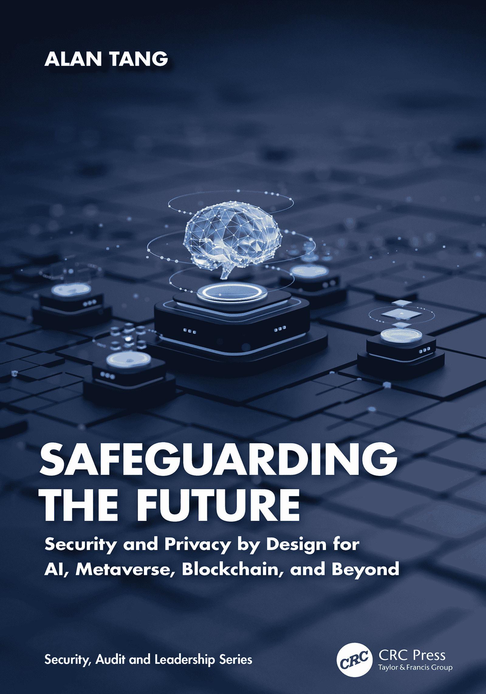

**主编辑：**

`Dan Swanson, Dan Swanson and Associates, Ltd., Winnipeg, Manitoba, Canada.`

`安全、审计与领导力系列`致力于出版针对安全与审计高管以及业务领导者所面临的关键主题的前沿书籍。涵盖的核心话题包括：领导力、网络安全、安全领导力、隐私、战略性风险管理、IT 审计、审计管理与领导力。

`Audley L. Bell`

`Denise Cicchella`

`Lourens Erasmus and Sezer Bozkus Kahyaoglu`

`Douglas P. Pflug`

`Andres Andreu`

`Shaun Aghili`

`David J. O’Regan`

`Sara I. James`

`Mohammad Nozari`

`Rainer Lenz and Barrie Enslin`

`Matthias Muhlert`

`Alan Tang`

有关本系列的更多信息，请访问：`https://www.routledge.com/Internal-Audit-and-IT-Audit/book-series/CRCINTAUDITA`

# 前言

在技术飞速发展的时代，创新与保护的交汇比任何时候都关键。当我们站在人工智能、元宇宙和区块链的门槛上，保护我们隐私和安全的挑战是多重且复杂的。本书《守护未来：人工智能、元宇宙、区块链及其他领域的领域安全与隐私设计》为领导者和从业人员提供了一份及时的路线图，应对这一数字前沿。

作者 Alan Tang 深入探讨了我们如何将安全和隐私整合到塑造我们未来的技术架构中。问题不再是我们是否应该采用这些创新，而是我们如何构建它们，使其从本质上具有安全性并尊重个人权利。这是对我们所有领导者和创新者的号召，以确保我们构建的数字世界既具有变革性，又是安全的。

Alexander White

百慕大大隐私专员

2024 年 10 月 9 日

两个世纪以来，技术创新一直是驱动经济增长的主要引擎，每一波新技术的进步都会引发互补性的变革和机遇。工业革命通过不同的阶段，从根本上改变了社会。在这些创新中，最具影响力的是所谓的“通用技术”，例如蒸汽机、电力以及如今的人工智能。这些发明重新定义了行业，重塑了经济，并彻底改变了我们的日常生活。今天，我们处于一个新技术突破纪元的前沿，包括人工智能 (`AI`）、量子计算、物联网 (`IoT`）、`5G`、区块链、扩展现实、元宇宙等。这些技术每一种都具有革命性，但当它们与其他技术相结合时，其力量和影响力将呈指数级增长。这些技术有望改变我们的生活和工作方式，让我们变得更加明智、高效且互联紧密。

## 新兴技术的作用

`AI` 和机器学习是许多技术的支柱，彻底改变了从医疗保健到金融、交通和娱乐的各个行业。`Blockchain` 提供了一种信任和透明的新范式，确保了记录和交易的安全与不可篡改。扩展现实技术（包括 `VR`、`AR`、`MR` 以及新兴的 `Metaverse`）模糊了物理世界与数字世界之间的边界，开启了创意和互动的新领域。`BCIs` 桥接了人类大脑与外部设备之间的差距，为交互和控制提供了新的可能。`Big data` 通过为 `AI` 算法提供原料燃料了这些变革，驱动了各行业的洞察和创新。`5G` 技术是这个互联世界的基础，提供了超快速、低延迟的连接，支持从自动驾驶汽车到远程手术的应用。`IoT` 连接设备，实现了实时数据交换和自动化，而 `quantum computing` 则提供了无与伦比的计算能力来解决以前被认为不可解决的问题。

尽管这些新兴技术的收益是巨大的，它们也带来了巨大的挑战，特别是在安全和隐私保护方面。在历史上，新技术的引入总是伴随着辩论、反思和争议。当我们迎接新全球革命性技术浪潮的黎明时，我们面临着各种情感、怀疑和担忧。

## 隐私保护与业务战略

在我的第一本书《隐私实践：建立并运营全方位数据隐私计划》中，我证明了为什么有效的隐私保护对于维护消费者信任以及实现一个健壮且创新的数字经济至关重要，在这个经济中，个人可以充满信心地参与其中。理解这一点并拥抱隐私文化的组织将在数字时代取得最大的成功。更重要的是，我的第一本书建立了一个统一的、集成的企业级隐私计划，该计划指导业务部门在产品开发过程中提供隐私保护、维护隐私完整性并提供保护措施。这一统一框架使组织能够弥合隐私计划与业务战略之间的差距，将法律术语和死板文字转化为生动且易懂的核心需求（以便组织可以轻松实施），与业务部门合作以理解组织背景下隐私的范围，并构建一个将隐私所有权交给业务部门的环境，识别并优先考虑隐私计划的缺口倡议，建立并运营一条可操作的隐私计划路线图。

## 不断变化的安全格局

技术格局近期发生了巨大变化。在这一动态的技术格局中，安全和隐私至关重要。`AI` 和机器学习的快速传播引发了各种安全和隐私担忧，从对 `AI algorithms` 的对抗攻击到数据隐私泄露比有皆。`IoT` 通过增加攻击面放大了网络安全风险，而 `quantum computing` 对传统的加密协议构成了新威胁。`Big data` 虽然为洞察和创新提供了巨大机会，但也引发了对数据隐私、机密性和合规性的担忧。`5G` 技术凭借其高速连接和海带宽引入了新的漏洞和风险。`BCIs` 虽然提供了革命性的，但也引发了与神经数据相关的伦理和隐私问题。`Blockchain` 尽管具有内在的安全机制，但无法免疫攻击和隐私问题。最后，扩展现实技术带来了与虚拟身份盗窃、数据泄露和沉浸式监控相关的重大风险。

本书《守护未来》旨在通过提供安全和保护这些技术隐私的全面指南来应对这些挑战。通过采取主动的安全和隐私方法，组织可以减少风险，并为持续增长和成功奠定基础。其目标不仅是利用这些技术的巨大潜力，还要确保以尊重和保护个人隐私的方式进行部署。

当我们进入这一新的技术前沿时，保持警觉、适应和知情是非常关重要的。通过理解这些技术的安全和隐私影响并实施相应的策略，我们可以为一个既创新互联，又安全且关注隐私的未来铺平道路。

# 关于作者


Tang 博士在隐私和安全实践方面拥有丰富经验。Tang 博士专长为 `AI`、`区块链`、`大数据` 和 `IoT` 等新兴技术建立并运营基于风险的框架和计划，使其符合 `GDPR`、`CCPA/CPRA`、`PIPEDA`、`PIPL`、`LGPD`、`GAPP`、`ISO 27701` 和 `NIST PF` 等全球法规标准。他相信通过简化、自动化和扩展安全隐私措施来推动业务增长。

Tang 博士拥有丰富的经验，曾为一家财富 5 强国际公司实施了企业级的统一隐私和安全框架及计划。该安全隐私框架通过三个阶段在 50 多个国家实施。他在广泛的安全和隐私相关领域拥有与业务领导合作的深背景，例如`安全评估`、`PIA` 和 `DPIA`、`安全和隐私政策与程序`、`SDLC 中的安全和隐私设计`、`数据保留与删除`、`数据披露与共享`、`数据跨境传输`、`隐私增强技术`、`意识培训`以及`数据泄露处理`。

唐博士拥有信息安全博士学位和工商管理硕士学位（MBA）。唐博士目前担任 IAPP（国际隐私专业人员）加拿大顾问委员会成员。他还拥有多项隐私和安全认证，包括 FIP、AIGP、CIPP/E/US/C/A、CIPM、CIPT、CISSP、CISA 和 PMP，并曾担任 ISO27001LA 和 PCI DSS QSA。

# 致谢

写一本书绝非一项孤独的努力；它需要许多人的支持与鼓励。对于在创作第二本书期间一直支持我的人们，我深表感谢。这是我长期以来的梦想，旨在促进新兴技术的负责任使用。这段旅程比第一本书更具挑战性，如果没有他们坚定不移的爱与支持将是不可能的。

首先，我想对我亲爱的妻子 Katherine 表达最诚挚的谢意。在这个艰难的过程中，你的耐心、理解和不断的鼓励一直是我的锚点。即使在最困难的时刻，你对我的信任也是力量和灵感的源泉。感谢你成为我全方位意义上的伴侣。

给我的女儿 Elizabeth，你的韧性和决心是我强大的动力。看着你勇敢地在泳池面对并克服自己的挑战，激励了我在自己的事业中坚持下去。感谢你无私的爱，并始终提醒我坚持和努力工作的重要性。

给我的儿子 Edward，你对书籍和大自然（如动物、植物和岩石）的好奇心，以及对学习的热忱一直是我生命中的光。你那好奇的天性提醒了我探索新领域和推向知识边界的重要性。感谢你无尽的支持并成为我快乐的恒源泉。

我还想向我的亲爱朋友 Dan Swanson 表达最深切的感谢。Dan，你是我第一本书和第二本书不可或缺的一部分。在整个过程中，你坚定不移的鼓励和指导无价之。从最初的想法到最终的手稿，你的支持一直是动力的源泉。是你开启了我第一本书的创作，并从那时起一直是指路明灯，帮助我应对写作和出版的复杂性。感谢你相信我的愿景，感谢我们坚定的友谊。

这本书既属于我，也属于你们。你的爱和支持是这部作品建立的基础。我永远感激你出现在我的生命中，感谢你给予我完成这个项目的力量。

- ! `案例研究`：我使用这个图标对数据保护机构的法院案件或执法案件提供相关且详细的分析。

- ! `示例`：当你看到这个图标时，你就知道它突出了现实世界的案例。

- ! `问答`：有时我会提供对常见问题的解答。

此本书《守护未来》（*Safeguarding the Future*）深入探讨了快速演变的技术格局，重点介绍了了各种突破性技术的融合。这些技术包括人工智能（AI）、机器学习（ML）、物联网（IoT）、量子计算、大数据、5G 技术、脑机接口（BCIs）、区块链技术以及虚拟现实（VR）、增强现实（AR）和元宇宙等沉浸式技术。这些技术在孤立存在时是革命性的，当结合在一起时会产生指数级的变革影响，有望重新定义行业、经济和日常生活。

随着这些进步，也带来了重大的安全和隐私挑战。人工智能和机器学习在提供巨大利益的同时，也引发了如针对 AI 算法的对抗攻击和数据隐私泄露等担忧。物联网通过连接大量设备增加了网络威胁的攻击面，使得全面的网络安全措施至关重要。量子计算虽然提供了无与伦比的计算能力，但对传统的加密协议构成了威胁，有必要开发抗量子加密技术。大数据作为驱动洞察和创新的重要组成，带来了关于数据隐私、机密性以及对 `GDPR` 和 `CCPA` 等法规合规性的担忧。5G 技术对于高高速连接至关重要，但引入了新的漏洞和风险。量子计算（此处重复）虽然提供了无与伦比的计算能力，但对传统的加密协议构成了威胁，有必要开发抗量子加密技术。脑机接口实现了人类大脑与外部设备之间的直接通信，带来了神经数据的伦理和隐私问题。区块链尽管具有其安全性，但并非免受攻击和隐私问题。最后，XR 和元宇宙等沉浸式技术带来了虚拟身份盗窃、数据泄露等风险。

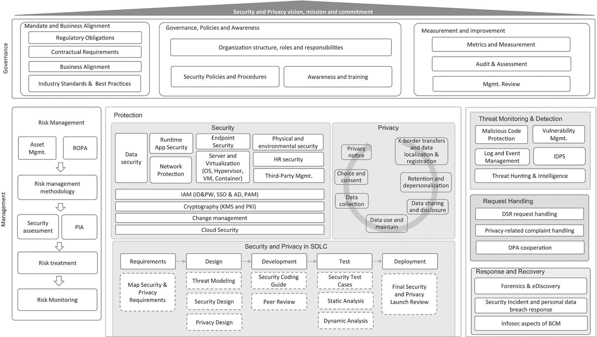

DOI: [10.1201/9781003390695-1](https://dx.doi.org/10.1201/9781003390695-1)

DOI: [10.1201/9781003390695-2](https://dx.doi.org/10.1201/9781003390695-2)

本章旨在帮助读者理解各工业革命浪潮的简史和发展及其对人类社会的处；为读者提供事实和分析，说明新兴技术如何改变我们的生活和思考方式，以及新兴技术给公众带来的承诺、挑战和风险。

两个多世纪以来，推动经济增长的一个主要引擎一直是技术创新。在其中最重要的技术中，有一类被经济学家描述为“通用技术”，它们包括蒸汽机、电力和内燃机等变革性发明。这些发明引发了一系列互补性的变化和机会。每一次转变都构成了对技术创新的重新思考和革命。技术让我们知得更多、做得更多、变得更强大。技术既没有因为其短期力量而被高估，也没有因为其长期影响而被低估。将彻底改变人们日常生活和工作方式的新技术包括人工智能 (`AI`)、量子计算、物联网 (`IoT`)、`5G`、区块链、扩展现实 (`XR`)、元宇宙（Metaverse）等更多技术[[[1]]]。

这些技术可能带来巨大的益处，但也意味着安全和隐私方面面临的新挑战。自古以来，每当新技术的诞生，舞台上总会有讨论、反思和争议。当前时代处于新一轮全球革命性新兴技术浪潮的黎明，这场浪潮带来了一系列情绪、怀疑和担忧。

目前还没有通认的工业革命时间线。这仍然是一个活跃的辩论和研究领域，因此我们对这一期的观点在未来可能会发生变化。图 1.1 代表对工业革命发展的看法 [[[2]]]。

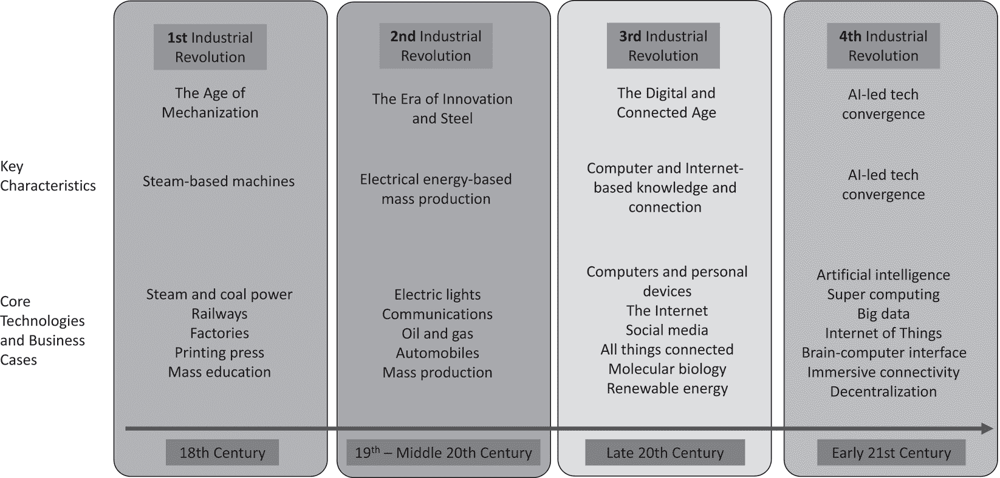

图 1.1 工业革命时间线。

在互联网时代，主要有三种连接：人与信息、人与人以及人与物之间的连接。如果说互联网改变了信息基础设施，那么移动互联网正在改变资源的组织方式。

智能革命与之前的技术革命不同，它将从根本上改变技术与人的关系。在三次技术革命（蒸汽革命、电气革命和信息技术革命）中，人们自己进行学习和创新；但这一次，在深度学习的帮助下，世界变成了一个人类与机器在`AI`革命中共同学习和创新的地方。在技术革命的前三个时代，人类学习并适应机器；而在`AI`时代，机器学习并适应人类。表 1.1 说明了工业革命的阶段和关键发展。

| 时期 | 时代 | 关键发展 | 推动因素 |
| --- | --- | --- | --- |
| 第一次工业革命（18 世纪中期 – 19 世纪中期） | 蒸汽动力机械化时代 | * 发明珍妮纺机 (`Spinning Jenny`) (1764)：詹姆斯·哈格里夫的发明允许一名工人同时操作多台纺纱机，增加了纺织品产量。 * 发明水力框架 (`Water Frame`) (1769)：理查斯·阿克莱特的水力框架利用水力实现了纺纱的自动化，进一步推动了纺织制造业。 * 詹姆斯·瓦特对蒸汽机的改进提供了更高效、更通用的动力源，彻底了运输和制造业等行业。 * 纺织业机械化：工厂出现，使用机器进行纺纱、织造和其他纺织工艺。 * 铁路与运河（19 世纪初）：铁路和运河的发展促进了原材料和成品的运输，连接了各个地区和市场。 | * 产量增加，特别是纺织品和铁制品 * 工厂制度的兴起和城市化 * 资本主义的增长和社会变革 |
| 第二次工业革命（19 世纪中期 – 20 世纪中期） | 电力驱动的大规模生产时代 | 钢铁生产进步：贝塞麦炼钢法（1856）和转炉法（19 世纪 60 年代）允许大规模生产钢铁，这对建筑和机械至关重要。 * 电气化：电力的广泛应用改变了制造工艺，并促进了新技术的发展。 * 化学工业进步：化学工业的创新（包括合成染料和肥料）对多个领域产生了重大影响。 * 内燃机：内燃机的发展彻底改变了运输，导致了汽车和飞机的兴起。 * 大规模生产与流水线（20 世纪初）：亨利·福特在汽车制造中引入流水线技术，极大地提高了效率并降低了生产成本。 | * 行业和材料多样化 * 大规模生产和消费主义 * 交通和通信的进步 |
| 第三次工业革命（20 世纪中期 – 21 世纪初） | 数字化革命时代 | * 数字化与自动化：计算机和自动化技术的出现彻底改变了制造工艺和数据管理。 * 信息技术：计算机、互联网和通信技术的广泛应用改变了工业、商业和日常生活的各个方面。 | * 自动化的增加和全球化的深入 * 基于知识的经济和数字通信 * 技术性失业和不平等的挑战 |
| 第四次工业革命（21 世纪初 – 至今） | 智能与互联时代 | * **生物技术与纳米技术**：生物技术和纳米技术的进步对医学、材料科学和制造业产生了重大影响。 * **全球化**：交通和通信连接的改进促进了全球贸易和经济互联性。 * **可再生能源与可持续性**：对可持续技术、可再生能源和环保实践的日益重视。 * **人工智能与机器学习**：将人工智能和机器学习集成到数据分析、决策和流程优化中。 * **物联网 (IoT)**：设备和系统之间的互连性，实现了实时数据交换和自动化。 * **量子计算**：利用量子力学原理进行比经典计算机高效得得的计算。 * **大数据**：用于处理海量数据集的技术集合，传统的数据处理工具无法管理这些数据。它不是指某项单一技术，而是通常指分布式采集、存储和数据处理框架。 * **5G 技术**：第五代移动通信网络技术，提供更快的互联网速度和更低的延迟。 * **脑机接口 (BCI)**：为有机生命的脑或神经系统与具有处理或计算能力的设备之间创建信息交换的通路，实现信息交换和控制。 * **区块链技术**：使用区块链进行安全且透明的供应链管理。 * **VR/AR/MR**：旨在创建完全沉浸式的体验，利用互动技术来增强或模拟现实环境。 * **元宇宙**：一种集体虚拟共享空间，由虚拟增强的物理现实与物理持续的虚拟现实汇聚而成，包括所有虚拟世界、增强现实和互联网的总和。 | * 增强创新能力和灵活性 * 提高效率和生产力 * 改进决策和预测能力 * 增强连接性和实时交互 |

企业界领袖扮演着特级象棋大师的角色，他们必须熟练地应对商业版图，将新兴技术作为战略性的进攻和防御手段。组织领导者必须对行业转变和技术进步有敏锐的感知，就像下棋手预测对手的走法一样。他们在棋盘的另一端不断努力，挖掘新的增长机会，并保护自己免受当今环境自然波动带来的影响。在这场高风险的游戏中，为新兴技术的发展做好准备至关重要。

在瞬息万变的技术格局中，这些新兴技术的逐一汇聚本身就是人类创新的关键时刻 [4]。不同领域彼此接触并交织，在重塑行业、社会以及现实结构的同时，开启了新的可能性。在本节中，我们将关注主要新兴技术的汇流及其对世界的共同影响。

图 1.2 提供了新兴技术如何为消费者增加价值的概述。这些新兴技术的结合体现了人类进步的巨大转变，开启了新的可能性并改变了我们生活的每一个维度。当这些技术继续演变和交叉时，未来将充满无限的创新和互联。

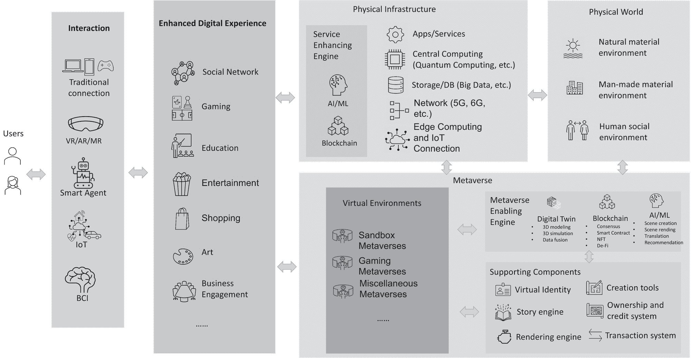

* AI 和机器学习 (ML)
* IoT
* 量子计算
* 大数据
* 5G 技术
* BCI（脑机接口）
* 区块链技术
* 虚拟现实 (VR)/增强现实 (AR)/混合现实 (MR)/XR 和元宇宙


在这种融合中，`AI`和`ML`是许多其他技术的关键。`AI/ML`技术通过使公司能够分析大规模数据集、识别模式并做出智能决策，变革了从医疗保健到金融、交通和娱乐的行业。`AI`和`ML`用于优化涉及海量数据的流程，为客户提供潜在的能力和个性化的体验。随着这项技术的采用，企业领袖有望提升现有能力或开发新能力，确保整个组织及跨部门的效率和创新。

`IoT`扩展了这种转型潜力：连接设备并实现通信和无缝数据交换。`IoT`提供了设备连接和实时数据检索的机会，最终导致预测性维护、优化供应链运营和提高运营效率。然而，它同时也带来了安全风险，企业领袖应该降低这些风险，以保护组织免受任何潜在漏洞。

`Quantum computing`代表了计算能力的新时代：`quantum computers`可以解决经典计算机无法处理的复杂问题。量子计算的计算速度在指数级上快于旧系统，是密码学、药物发现和优化相关领域突破的下一个前沿。`Quantum computing`承诺以指数级的加速率处理流程，这将使金融、健康和物流等行业发生革命。因此，企业领袖需要为`quantum computing`做好准备：意识到被释放的潜力，并为破坏性潜力做好准备。

另一方面，`Big Data`为推动许多技术转型提供了燃料；它为`AI/ML`算法提供原材料，是驱动各行业洞察和创新的动力。在如今巨大的数据量、多样性和速度面前，它将成为业务活动中最重要的事物，能够释放许多价值巨大的洞察并驱动明智决策。`Big Data`分析允许公司从大型数据学习，做出驱动业务增长的有效决策。这是因为企业领袖需要投资数据基础设施和人才来利用`Big Data`的力量。

`5G Technologies`是互联世界的骨干，提供超快速、低延迟的连接，支持自动驾驶汽车、远程手术和沉浸式体验等转型应用。随着`5G networks`在全球范围部署，几乎任何类型的连接创新都是可能的。`5G Technologies`带来的超快速和低延迟驱动了如自动车辆运行、增强现实（AR）和远程医疗等应用领域。企业领袖必须利用这些能力，根据客户不断变化的需求为他们提供创新的产品和服务。

在`BCI`平台下的技术崛起定义了思想与机器之间的边界，允许人类大脑与外部设备之间进行直接通信和控制。从残障人士的辅助技术到新的游戏形式，`BCI`可以彻底改变交互。企业领袖必须探索`BCIs`以挖掘用户体验的增强和市场差异化。

区块链技术为安全且不可篡改的记录和交易提供了一种信任与透明的新范式。区块链正在改变一切，从供应链管理、数字身份验证到去中心化金融和投票系统。区块链技术使得从供应链管理到数字身份验证的任何领域都能安全、透明且防篡改地记录。业务领袖应当考虑其战略影响，并在可行的地方将区块链集成到业务流程中。

VR、AR、MR、XR以及最后新兴的元宇宙，正在从根本上改变着我们与数字信息以及周围世界的关系。从沉浸式游戏到虚拟会议，从虚拟旅游体验到数字艺术，物理现实与数字现实之间的边界变得日益模糊，新的领域正在被探索，新的创意空间正在被开启。`XR`和`Metaverse`本质上是体验性的，它们消除了自然世界与数字世界之间的区别。企业负责人必须将这些技术引入其内部系统，深化客户互动，扩展员工学习计划，并将虚拟协作扩大到规模。

在这些动态空间中，企业负责人需要找到获取新机会的方法，同时又要避免被脆弱性所措手不及。通过积极应对新技术，他们可以建立一种足够韧性的结构，不仅能够减轻风险，还能为数字时代的持续增长和成功奠定坚实基础。

在`AI`、`Big Data`和`IoT`的新时代，个人要意识到并管理组织如何以及出于何种目的收集、使用或披露其个人信息是非常复杂的。因此，认为将此类新兴技术整合到社会中具有关键的安全隐私风险是合理的。安全格局正在快速演变，包括组织今天面临的严峻威胁，以及未来可能更具变革性的潜力的威胁。

到目前为止，`AI`和`ML`确实在许多行业中证明了其破坏性，但它们的快速传播引发了许多多样化的安全和隐私担忧。从修改`AI`算法的对抗攻击，到由于敏感信息处理不当导致的数据泄露，`AI/ML`系统以许多其他形式呈现风险。此外，`AI`模型中存在的偏见可能会进一步导致歧视，并加剧社会更严重的不平等，从而决定了`AI`开发和部署涉及的高水平伦理关注。除了技术进步外，`AI`的影响以非常深刻的方式延伸到信任和伦理原则，从而极大影响了社会和决策。在这种情况下，支撑`AI`深度部署的未来治理框架必须基于共同的伦理原则。此类框架本质上具有跨学科性和协作性，以实现负责任且有效的`AI`技术的应用 [5]。

关于`AI`安全和治理问题，`Generative AI`为处理非结构化数据遇到困难的企业提供了救生索。`Generative AI`解释并将非结构化数据转换为结构化格式，从而使数据对于分析、计算以及机器人流程自动化中的可访问训练变得可用。这转化为运营效率的提高。`Generative AI`的能力在区分普通网络和应用行为与定义为异常的行为方面进一步表现出色，提升了安全系统在威胁检测和防御方面的能力。然而，尽管`Generative AI`在其他`AI`技术中的潜力是巨大的，但此类潜力技术的世界在美国、加拿大、欧洲和中国等地仍然面临着不断变化的法律框架。这些法规为`AI`应用（特别是在风险情况下）设定的那系列新标准，促使组织采取更严厉的风险缓解措施。然而，尽管有这些监管变化，事实仍然是，很大一部分组织（接近 55%）没有针对`AI`适当且清晰的治理框架。因此，建议 IT 领袖积极采取措施，定义与新兴法规同步的稳健治理，并随着集成在许多决策过程中的增加，能够防止任何可能的风险。

然而，如果`AI`和`ML`技术的兴起实现了前所未有的进步，其代价是开启了一些与安全、隐私和伦理相关的非常复杂的问题。`AI`在业务运营和消费者生活中渗透的增加要求采取积极的方法来解决这些问题。这种复杂性通过将伦理关注整合到`AI`的开发和部署中、加强跨学科协作以及遵循新兴监管框架强加的规则得到了正确的管理。它还驱动了运营事务的效率并减少了威胁，因为数据得到了分析，且安全活动得到了诸如`Generative AI`等新兴技术的推动。`AI`技术将继续被培养和应用，对`AI`安全和治理领域不断变化的格局保持警惕和主动性将是必要的。

`IoT`通过指数级增加攻击面，放大了网络安全风险。这可能为网络攻击者提供机会，利用`IoT`设备中未受保护的固件或默认密码来获取网络入口，从而导致敏感数据泄露。此外，由于`IoT`系统的相互依赖性，隐私面临威胁，因为设备收集的个人信息可以被访问和误用。`IoT`被理解为一种主要的变革力量，不仅改变了与技术的关系，还改变了与周围世界的关系。通过连接`IoT`，设备和系统以前所未有的方式为工业和所有领域输入了高度自动化、效率和便利性。`IoT`的巨大收益也伴随着内在的网络安全风险 [6]。

`IoT`面临的最严峻挑战是攻击面的指数级增长。所有这些设备加在一起，聚集在智能家居和城市、工业设施和医疗系统等各种环境中，产生了一个攻击面，可能会迅速带来威胁。`IoT`设备的漏洞（如不安全的固件和默认密码）为恶意行为者提供了绝佳的游乐场。这些漏洞允许网络访问、敏感信息泄露和关键基础设施控制——因此成为侵犯个人隐私、组织安全和社会福祉的巨大威胁。

`IoT`生态系统内部存在相互关系，这进一步使维护数据隐私变得复杂。它使得大量的个人数据被收集和传输——从健康健身数据到位置和行为数据——结果是未经授权访问的风险增加。`IoT`环境中的数据泄露会对身份盗窃、金融欺诈以及个人和组织的声誉损害产生深远的影响。

鉴于此，各行业的从业者必须对物联网（`IoT`）安全采取积极全面的方法。未来的道路应该包括稳健的风险评估和缓解措施，例如将“安全设计”（security-by-design）理念融入物联网设备设计，采用加密和身份验证机制来保障传输和存储数据的安全，以及部署入侵检测和响应系统以实时检测并缓解安全漏洞。这需要从业者、政府机构和网络安全专业人士携手，为不断变化的威胁格局寻找答案，并致力于建立完善的监管框架，以确保物联网生态系统中的数据隐私和安全。只有齐心协力并履行网络安全承诺，才能在释放物联网全部潜力的同时，有效防止新的威胁和漏洞。

因此，量子计算带来了全新的安全威胁，因为它能够破解典型的加密协议。尽管抗量子加密技术正在开发中，但向量子安全加密的转变是复杂且持续的 [7]。此外，对量子计算的恐惧日益增加，这与其超快速的计算能力有关，这可能导致某些新类型的滥用，例如加密攻击甚至数据泄露。

量子计算承诺提供出几个数量级的计算能力，同时也为网络安全领域带来了兴奋和至少一丝恐惧。最受关注的问题之一在于密码学；量子计算机的计算能力很可能让所有传统的加密协议失效。量子计算机可以高效地解决某些数学问题，这是大多数现代加密算法的基础，从而威胁到数据安全。这是因为量子计算机因化大数的速度比经典计算机指数快得多，而这是许多在使用加密方案的基础。

量子计算的兴起使得我们需要开发和建立抗量子加密系统，以保护量子时代的敏感数据和通信。尽管科学家和密码学家正在积极研究此类新技术，但向量子安全加密的全规模、完全转型是复杂的，需要时间。这需要关注新加密算法的发展和标准化、如何将抗量子加密引入目前使用的系统，以及量子密钥分发机制。同时，鉴于量子计算进展的速度以及组织采用这些新安全措施的准备情况，量子安全加密广泛应用的预计日期非常不确定。

量子计算不仅存在密码学领域，还增加了被恶意意图利用的恐惧。它们解决复杂问题和极高速度分析海量数据的潜在能力可能会被恶意攻击者用于发起复杂的网络攻击，包括加密攻击和数据泄露。此外，量子计算对大多数行业和部门的破坏性影响还可能引入全新的漏洞和安全挑战，需要积极应对。量子发展直接导致了网络安全专业人士与政策制定者之间合作的必要性，只要抵消新兴威胁的策略和解决方案不仅存在，还能保证量子时代数字基础设施的韧性。

安全和隐私领域的大数据可以被视为一把双刃剑：它为新颖见解和创新提供了巨大机会，同时也处理隐私、机密性和合规性方面引发了更高层次的担忧。组织收集并产生海量数据，这些数据为智能决策和业务策略提供宝贵的见解。然而，这个数据宝库也有自己的数据安全挑战，例如数据隐私和安全。由于大数据存储在许多存储库中，未经授权的访问会导致敏感信息泄露，通过网络攻击和隐私侵犯影响个人和/组织 [8]。

为了应对来自大数据的风险，组织需要关注其数据治理和安全。这涉及实施一套全面的数据管理政策和程序，考虑到存储、收集和处理。在考虑部署加密和访问控制的前提下，组织可以通过建立信息访问和使用的政策与程序，简化防止未经授权访问数据泄露的过程。

此外，在大数据时代，遵守隐私法规和标准变得至关重要。随着全球政府颁台一些最全面的数据保护法，企业必须确保他们能够跟上这些法律要求，以保护个人隐私并避免昂贵的罚款。为了避免这种情况，要求企业采取积极的数据治理方法，它们应该审计其数据实践，并积极监控其环境中的内容。最后，为员工实施数据隐私和安全文化对于执行最佳实践和减少内部威胁的概率也同样重要。

### 1.3.5 5G 技术

5G 技术承诺的速率和延迟将开启一个连接的新领域，这可能会改变从医疗到制造的各个行业。然而，这些转型能力也带来了更高的安全需求。5G 网络中的基本灵活性为漏洞创造了新的可能性，并成为各种网络威胁的狩猎场。5G 的安全格局从针对基础设施元件的网络级攻击，延伸到利用连接设备中漏洞的设备级攻击，需要在每个方面做出充分的响应 [9]。

通过 5G，提供的高速连接和海量带宽可以被网络攻击者用于进行恶意软件、钓鱼和拒绝服务（DoS）攻击，导致广泛的破坏和伤害。它为复杂的攻击者目标通信网络提供了一个可乘之机，破坏网络的完整性和可用性。另一方面，使用 5G 网络互连的物联网设备数量的增加增加了更大的风险，因为这些设备通常不具备复杂的安全能力，因此可以被用作渗透网络的攻击向量。

组织需要一个涵盖网络基础设施和连接设备的全面 5G 安全策略，以应对这些安全挑战。这涉及执行强身份验证和加密方法，以确保数据在 5G 网络上传输期间的安全，并快速安装入侵检测和防御系统，这些系统能够实时识别威胁并在潜在危害造成破坏之前将其遏制。此外，还需要对网络流量进行适当的跟踪和分析，以及时发现任何恶意行为者或安全事件。组织还需要投入网络安全意识和培训倡议中，教育员工和其他利益相关者了解与 5G 技术相关的可能风险，并提供避免这些风险的指南。只有这样，通过对 5G 安全具有前瞻性且广阔的视野，企业才能在第五代移动技术的新时代，有效地保护自己，免受那些可能破坏其通信网络可靠性和完整性的新威胁。

脑机接口技术是人机交互领域的一个新兴前沿，它是能够彻底改变许多领域应用的趋势之一，包括医疗保健、游戏和通信。然而，除了其变革潜力外，脑机接口技术引发了需要仔细处理的重要伦理和隐私问题。这些问题都围绕对神经数据的捕获和理解，以及同意、隐私和所有权的问题。通过在未经许可的情况下拦截个人的脑电信号，可能会导致隐私侵犯和自主权丧失等违规行为，使最深的思想和认知空间暴露给这些粒子之外的人员。

此外，脑机接口系统的可被攻击性是一个重要的网络安全漏洞，绝不能被低估。然而，脑机接口技术复杂性和普及性的增加可能会导致对神经信息的未经授权访问和操纵，并引发了关于支持脑机接口的应用和设备在运行时的安全性和真实性的问题。威胁者可能利用脑机接口系统的力量并攻入其漏洞，将其用于控制人类认知，这不仅会导致心理问题，还可能在生理问题中发挥作用。除非这些设备得到安全保护，并采取措施确保神经数据不会被可能篡改信息的攻击者访问，否则这一切都是不可能实现的。

脑机接口技术的伦理和隐私问题必须针对全球问题提供本地解决方案，在创新与责任之间达成共识。脑机接口技术开发和部署的组织和研究人员在使用支持脑机接口的产品或服务的整个生命周期内，应更多地投入于伦理方面和数据隐私保护。这包括核心原则，如获得用户本人的许可（知情同意）、使用强大的加密和身份验证机制来保护神经数据安全，并遵循隐私法律和标准。透明度和问责制不仅对于负责任的创新治理，而且对于建立对脑机接口保护的信任和信心，关乎我们的神经数据如何被采集、存储和管理，以提供最佳功能。脑机接口技术具有改变人类生活许多方面的潜力，而这些变化发生在个人隐私保护、自主和福祉的能力范围内。在开发阶段使用伦理考量，可以确保这些不可避免的转型在发生的同时，尊重基本权利 [10]。

区块链技术固有的去中心化和加密哈希特性提供了强大的安全机制，可以最大限度地减少篡改和欺诈。然而，尽管这些内在安全机制在纸面上看起来无懈可击，但区块链系统并非完全免疫于风险。攻击者利用这些漏洞接管交易并从区块链中窃取金钱 [11]。

除了主动攻击外，共识协议攻击也很大程度上威胁着区块链安全。`工作量证明`（`PoW`）或`权益证明`（`PoS`）等共识协议被用于区块链网络中，以保护并强制参与者之间一致的行为。然而，通过利用这些协议中的漏洞，攻击者可以使用它们来破坏网络操作或促进双重花费攻击。公共账本向所有人显示交易数据的透明性，也是区块链中隐私和匿名性的一个问题。在追求隐私的道路，诸如`零知识证明`和以隐私为中心的区块链等解决方案正在开发中，以应对这些问题，但在不牺牲区块链允许的透明度和不可篡改性的情况下努力维护隐私，仍然是一个巨大的挑战。

随着区块链业务技术应用变得越来越广泛，公司需要配备适当的安全团队，帮助他们避免并准备任何可能发生的漏洞或黑客攻击。这包括对智能合约和区块链网络进行彻底的安全审计，以及进行渗透测试以发现并修复漏洞。此外，组织应该采取措施，遵循区块链安全的最佳实践来确保区块链部署的安全，例如使用多因素身份验证和加密，以及访问控制，以保护存储在区块链平台上的价值数据和资产。在区块链社区中建立强大的协作关系，并与安全前沿的人士合作，可以使组织在新的新兴威胁和漏洞面前保持领先，为实施针对可能破解的主动措施赢得时间。通过面对区块链中的这些安全挑战并建立必要的安全机制，组织可以利用区块链技术转型其业务，同时补偿安全风险并维护区块链系统/应用的完整性和强度。

`VR`、`AR`和`MR`的不同风味被统称为`XR`。`XR`体验正在重新定义数字交互。然而，对于这些功能中的每一个，在虚拟空间中用户的安全和隐私方面都有许多需要考虑的问题。其中之一是虚拟身份窃取的风险，即网络犯罪分子利用`VR/AR`平台的安全漏洞，用户通过这些漏洞访问银行卡详情、身份证号码和密码等数据。此外，如果敏感数据留在或传输到`VR`内部，`VR/AR`系统中的数据泄露可能会成为严重问题，导致信息的未经授权访问和误用。

不用说嵌套在`XR`技术中的沉浸式监控和位置跟踪功能如何威胁用户隐私和数字安全了。随着这些技术的日益普及，监控和数据收集可能会成为一种日益侵入性的做法，需要对同意、透明度和问责问题进行辩论。这可能导致用户无意中泄露敏感信息并/或遭受不公正的监控，使其在`VR`环境中的隐私和自主面临风险。为了减轻`XR`生态系统中的隐私风险和安全威胁，必须建立强大的安全机制 [12]。

虚拟环境的安全部署由身份验证、加密和访问控制机制共同组成。强大的身份验证机制（例如生物识别或多因素身份验证）可以验证用户身份并防止未经授权的人员访问`XR`平台。这些机制还可以像加密方法一样，对虚拟设备上的透明数据（存储和传输的数据）进行密封，以确保敏感信息不被泄露或篡改。访问控制在控制用户对`XR`系统内部特定位置或功能的访问方面进一步有用，这可以降低对系统的未经授权和恶意利用。组织和开发者必须确保用户领先于一切，并部署严密的安全机制，使`XR`技术成为一个没有安全或隐私威胁的未来乐园，让用户对新系统充满信任。

DOI: [10.1201/9781003390695-3](https://dx.doi.org/10.1201/9781003390695-3)

本章旨在帮助读者将安全和隐私操作集成到新技术的开发中或无缝实施相关流程；为读者提供方法论、流程和工具，以对新兴技术进行彻底的安全和隐私风险评估；为读者提供知识和流程来进行审计并建立指标以实现持续改进。

### 指标与持续改进

良好的安全隐私计划能为组织带来积极的投资回报，并且必须向决策者和利益相关者适当展示这些信息，以获得他们的支持并提供运行所需的所有资源。从决策者和利益相关者处获得必要的支持可以确保隐私计划拥有足够的资源，隐私持续渗透到机构文化中，并且组织内的员工也有动力支持该计划并理解其在其中的角色。平衡计分卡是利益相关者沟通安全隐私计划益处或影响的一项有用工具。

提供卓越的安全和隐私运营，以满足多项法规，并在相关法律标准（如`EU GDPR`、`EU AI Act`、`EU DMA`、`EU DSA`、`CCPA/CPRA`、`China PIPL`和`ISO 27001`）的基础上明确安全治理的职责和权利。


例如，`GDPR` 代表通用数据保护条例，是旨在取代数据保护指令 `95/46/EC`（`DPD`）的新欧盟条例法规。它涉及个人数据保护和个人权利。这项复杂的法规由 11 个章节、99 条条款（规定了合规性要求）、173 条引言（为条款提供背景）和 88 页组成。

`GDPR` 旨在统一全欧洲的数据保护立法。其目标是在英国脱欧前在 28 个欧盟成员国之间简化个人数据的流动。它于 2016 年 4 月 14 日获得欧洲议批准，并在两年的过渡期后生效；与指令不同，它不需要政府通过任何授权立法。它自 2018 年 5 月起生效。

它引入了七项原则：

* 合法、公平和透明性：处理个人数据应就数据数据主体以合法、公平和透明的方式进行。
* 目的限制：收集个人数据的目的应是特定的、明确且合法的，且不应以与这些目的不兼容的方式进一步处理。
* 数据最小化：就处理个人数据的目的而言，个人数据应是充分、相关且仅限于必要的范围。在可能的情况下，组织应对对个人数据进行匿名化或去标识化处理，以降低对相关数据主体的风险。
* 准确性：个人数据应保持准确，并在必要时保持更新；必须采取合理措施，确保根据处理目的来看，不准确的个人数据能够被及时删除或更正。
* 存储期限限制：个人数据的存储时间不应超过处理该个人数据目的所需的时间。
* 完整性和机密性：考虑到技术水平和其他可用安全措施、实施成本以及隐私风险发生的可能性和严重性，应采用适当的技术或组织措施来确保个人数据的适当安全，包括防止意外或非法的破坏、丢失、篡改、未经授权的访问或泄露。
* 问责制：数据控制者应负责并能够证明其对上述原则的合规性。

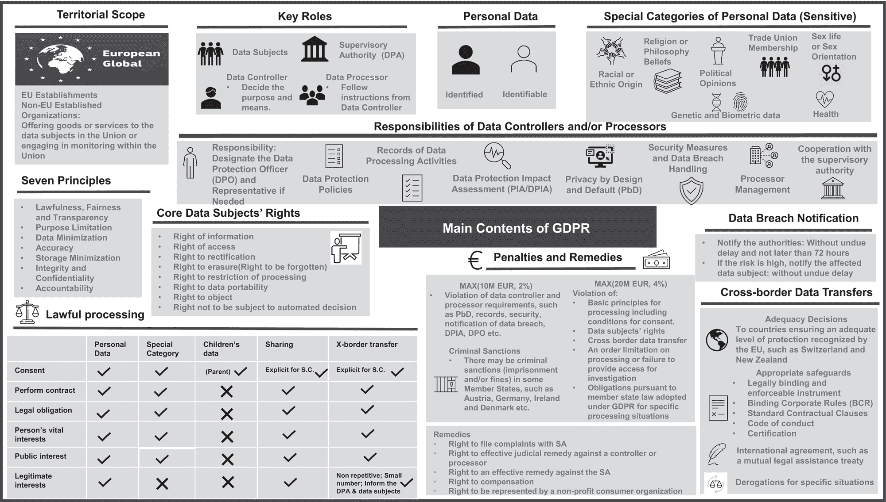

图 2.1 GDPR 单页摘要总结。

除了上述 `GDPR` 单页外，第 6 章还将提供 `EU AI Act` 单页。更多其他常见法规请参考以下附录。

通过将安全嵌入组织文化并提高效率，组织可以以系统的方式识别风险并努力以成本效益的方法减少风险。在这里，权威的风险选择以及通过使用预防、检测以及事件响应来构建对风险更强的理解，可以帮助个人占据领先地位。

例如，现有的安全措施从财务和组织角度增加了价值：它们驱动了客户平均收入的增长，有助于获取新客户，并提高回款和市场份额。事实证明这是管理敏捷性、客户满意度、产品质量感知和用户体验的关键，其副作用是改善了团队内部协作、企业文化和员工士气。除了教育和发展，还需要员工意识到数据保护的原则。提供充分培训和资源的组织可以大幅提高员工参与度，从而使员工成为安全领域的积极参与者。因此，员工在处理此类信息时更有信心；他们会以最佳方式实践并降低数据泄露风险。

采取强大的安全隐私态势通过将安全织入 IT 和业务策略来弥补业务目标，使组织获得竞争优势。安全隐私平衡计分卡的示例见图 2.2。所有这些增强了市场和投资者信心，并有助于保护并进一步提升公司的声誉和品牌，以及与更广泛的公众和利益相关者的信任。此外，它在事件期间促进了业务连续性，并向高管理层说明安全具有价值，同时维持了公众的信任和利益相关者的信心。

在行政罚款和和解方面，根据 `GDPR` 的规定，分为两个层级的行政罚款，如下所示。`表 2.1` 列出了截至 2024 年 6 月 12 日 `GDPR` 下处以最高的 5 笔罚款。

| 序号 | 国家 | 决议/公告日期 | 罚款 [€] | 控制者/处理器 | 执行要点 |
| --- | --- | --- | --- | --- | --- |
| 1 | 爱尔兰 | 2023-05-22 | 12 亿 | Meta | 将从欧盟/EEA 地区 Facebook 用户收集的数据传输到美国，违反了 `GDPR` 的国际传输要求。 |
| 2 | 卢森堡 | 2021-07-16 | 7.4 亿 | Amazon Europe Core S.à.r.l. | 在未获得用户适当同意的情况下追踪用户数据，或未提供退出此类追踪的手段。 |
| 3 | 爱尔兰 | 2022-09-05 | 4.05 亿 | Meta Platforms Limited (Instagram) | 该罚款针对 Instagram 违反儿童隐私的行为，包括发布儿童的电子邮箱和电话号码。 |
| 4 | 爱尔兰 | 2023-01-04 | 合计 3.9 亿 | Meta Platforms Ireland Limited (Facebook 和 Instagram) | Meta 无权在与其 Facebook 和 Instagram 服务中部分相关的提供个性化服务（包括行为化广告）时依赖“合同”这一法律依据。 |
| 5 | 爱尔兰 | 2023-09-15 | 3.45 亿 | TikTok Limited | 错误收集和处理 13 岁以下儿童的个人数据，并将其账户默认设置为公开。 |

* 对于违反以下行为，控制者和处理者的全球营业额总计最高达 2000 万欧元或 4%（以高者为准）：
  * 基本原则
  * 数据主体权利
  * 国际数据传输
  * 根据`第 9 章`（有关特定处理情况的规定）通过的成员国法律义务
  * 不遵守监管机构的指令
* 对于违反大多数其他义务，控制者和处理者的全球营业额总计最高达 1000 万欧元或 2%（以高者为准）。

在欧盟以外的司法管辖区，我也看到监管机构发布的巨额罚款。例如，美国联邦贸易委员会（FTC）在 2019 年对 Facebook 处以 50 亿美元罚款，并对 Equifax 处以 5.75 亿美元的罚款。`表 2.2` 列出了美国最高的 5 笔和解/罚款。

表 2.2 罚款/和解金额最高的美国执行案例 `[13]`

| 序号 | 机构 | 决议年份 | 罚款/和解 [$] | 涉及组织 | 法律 | 执行要点 |
| --- | --- | --- | --- | --- | --- | --- |
| 1 | FTC | 2019 年 7 月 24 日 | 50 亿美元 | Meta (原 Facebook) | 2012 年 FTC 命令 | 通过欺骗用户其控制个人信息隐私的能力，违反了 2012 年 FTC 命令。 |
| 2 | FTC/CFPB | 2019 年 | 5.75 亿至 7 亿之间 | Equifax | 数据泄露处理 | Equifax 未采取可能防止影响约 1.47 万消费者的泄露的基本步骤。 |
| 3 | FTC | 2022 年 | 5.2 亿美元 | Epic Games | 《儿童在线隐私保护法》(COPPA) | Epic 使用侵犯隐私的默认设置和欺骗性界面，误导了 Fortnite 用户（包括青少年和儿童）。 |
| 4 | 堪萨斯市联邦法院 | 2022 年 | 5 亿美元 | T-Mobile | 数据泄露处理 | 数据泄露暴露了高度敏感的信息。 |
| 5 | 检察长 | 2022 年 11 月 | 3.915 亿美元 | Google, LLC | 州保护法 | Google 已同意支付 3.915 亿美元达成和解。 |

关于刑事指控，`表 2.3` 展示了各司法管辖区刑事指控的一些示例。`表 2.3 刑事指控示例` `[13]`

| 地区 | 最高刑期 | 国家 | 相关法律 |
| --- | --- | --- | --- |
| 欧洲 | 20 年 | 希腊 | 若非法行为危害民主功能或国家安全，将处以 5 至 20 年监禁，并罚款 30 万欧元。 |
| | 6 年 | 意大利 | 第 167-bis 条：大规模处理的个人数据的非法通信和披露处以 1 至 6 年监禁。 |
| | 5 年 | 法国 | 根据《刑法典》，最高可处 5 年监禁，并罚款 30 万欧元（公司罚款为 150 万欧元）。 |
| | 爱尔兰 | 最高 25 万欧元的罚款并/或处以 5 年监禁。 | | |
| | 4 年 | 葡萄牙 | 处以最高 4 年监禁，在此外还可处以最高 24 万欧元的罚款： | | |
| 亚太地区 | 10 年 | 印度 | 网络恐怖主义犯罪处以 10 年监禁。 |
| | 5 年 | 香港 | 《个人资料（隐私）条例》——未经同意披露个人资料的罪：最高刑为罚款 100 万港元及监禁 5 年。2021 年《个人资料（隐私）（修订）条例草》——肉搜罪：最高刑为罚款 100 万港元及监禁 5 年。 | | |
| | 2 年 | 新加坡 | 《个人数据保护法》(PDPA)：罚款不超过 5000 新元或处以不超过 2 年监禁，或者兼之。 | | |
| 北美 | 10 年 | 美国-GLBA | 第一级：最高 5 年监禁；第二级：在 12 个月内涉及超过 10 万美元——双倍罚款并监禁 10 年 | | |
| 非洲 | 10 年 | 卢旺达 | 非法收集或处理敏感个人数据：数据保护法第 60 条规定，定罪后处以至少 7-10 年监禁，并罚款 2000 万卢旺达（约 1.812 万欧元）至 2500 万卢旺达（约 2.265 万欧元）。 | | |

不遵守安全和隐私法规将导致业务流程和运营被当局冻结或关闭。确保遵守所有隐私法的最佳方法是建立有效的安全隐私计划。安全立法建立了一个安全实践的时间表，其中规定了收集、使用、展示、存储和披露企业数据个人信息的程序标准。遵守相关的安全隐私法律可以减少组织所维护的个人信息的滥用或未经授权的披露。

此外，不符合法律要求可能会由于集体诉讼以及违反安全和隐私法规的索赔而导致法律后果。`GDPR` 使数据主体对数据控制者提起民事诉讼在实质上变得更容易，也可以对数据处理者提出新的民事损害赔偿请求。法律并不要求数据主体必须遭受经济损失或物质损害（例如物品的丢失或毁坏），因此也可以就非物质性损害提出索赔，例如情绪痛苦或感情受伤。此外，数据主体有权授权指定的消费者保护机构来执行这些权利并代表其提起诉讼。这并不完全等同于允许集体诉讼，但它让集体诉讼变得更有可能。当个人认为其数据主体权利受到侵犯时，可以起诉数据控制者。这通常发生在你未能正确响应数据主体的权利请求时，或者发生了影响数据主体所拥个人数据的数据泄露事件。在发生备受关注的数据泄露事件（例如 2019 年的 `British Airways` 数据泄露）后，你可能会看到数据保护律师正在招募原告加入针对该数据控制者的集体诉讼。

保护数据的能力可能是你的竞争优势。它可以带来更高的客户留存率和忠诚度。拥抱隐私法规，并向你的客户、潜在客户和员工证明你重视他们个人数据的保护，这将为你提供竞争优势。

具备负责任的态度可以将安全和隐私投资从仅仅的合规问题转变为长期的差异化因素。组织有机会可以通过他们尊重个人隐私的方式脱颖而出，随着时间的推移，这可能成为消费者考虑的另一个因素。

即将到来的挑战绝非是在涉及谁控制个人数据的这一重大社会关注的背景下偶然被想到的。隐私专员办公室（`OPC`）2016 年的一项调查显示，92% 的受调查的加拿大人对他们正在失去对个人信息的控制感到“非常担心”或“有些担心”。

客户可能会遭受严重的后果，包括由于以下原因导致的个人信息未经授权披露和隐私丢失：

* 财务欺诈
* 身份盗用
* 受害的时间和金钱成本
* 财产毁
* 骚扰
* 名誉损害
* 情绪痛苦
* 身体伤害

如果客户信任并信任一个组织，他们更有可能购买并获得他们想要的服务。当你违背数据安全和隐私协议时，你就直接离开了你的客户和潜在客户的视线。如果他们不相信你，他们就不想购买或参与你的提议。例如，`British Airways` 向所有客户发送了一封邮件，建议他们不要担心，因为他们的数据在 `British Airways` 是安全的。两个月后，`British Airways` 遭遇了大规模数据泄露，导致 18.5 万客户的财务信息泄露，并最终在暗网上转售。由于这次数据泄露，`IAG`（`British Airways` 的母公司）的股价下跌了 5.8%（损失了 3.5 亿镑）。

组织的隐私和安全参与滞后于日益增长的监管要求。因此，许多组织发现自己虽然声称支持与隐私和安全的参与，但这些话只是口头谈兵，或者没有产生实际的行为改变。

在组织内部围绕隐私和安全构建结构意味着你需要：

* 将业务目标与安全/隐私战略对齐，以获得高层的支持。
* 提高数据保护意识水平。
* 让员工参与。
* 就数据问题听取员工意见。
* 增强员工信心。
* 通过衡量来跟踪是否遵守了要求。

全面的安全和隐私计划框架是一个蓝图计划和战术指导规划器，以法律、法规、原则和技术组织措施为支架，它允许安全和隐私从业人员处理组织中出现的所有相关安全和隐私问题。

高级管理层和董事需要一个稳健的结构来监督组织的数据安全和隐私管理。成员应该牢牢掌握数据安全和隐私方面的风险/策略平衡。更重要的是，应该理解数据安全和隐私问题，作为一种早期检测手段，而不是在皮肤晒伤后才涂抹防晒霜。

高级高管和董事会成员需要询问：我们的合规流程在多大程度上满足当前的数据安全和隐私法规，同时是否具有前瞻？这并没有听起来那么困难，因为许多安全和隐私法基于这些共同原则，可以在一致的框架内处理。

实施安全和隐私计划不仅限于对适用法律、法规和原则的合规。安全和隐私计划应该帮助组织履行所有其他义务，并支持人们对如何使用公司数据和个人信息所基于信任的期望。安全和隐私计划的主要功能是支持从收集到删除管理公司数据和个人信息的系列活动。

合规很重要，因为有效的安全和隐私计划确实能确保合规，但合规并不意味着你拥有一个有效的安全和隐私计划。它可以让你实现“一次测试，多次证明”——定义良好的安全隐私和数据保护控制框架。一个强大的安全隐私控制框架包括一组通用控制，这些控制可以组织并与个人计划中的多个监管、安全和非监管义务对齐，以便通过实施一个控制来满足许多需求。

构建安全隐私框架而不是合规检查清单，这样你就不仅仅是对现有的法律法规做出反应，而是同时根据组织的业务目标和需求进行预判。

图 2.3 是安全隐私框架的图表，有助于将主动安全隐私管理的愿景阐述为有利于业务的、非侵入的和对消费者积极的。当你开发一个灵活、针对你的需求定制且适用于你组织独特的数据安全隐私计划时，它不仅让你能够以速度和技巧从事件中恢复，还能减少你对整体威胁的暴露。

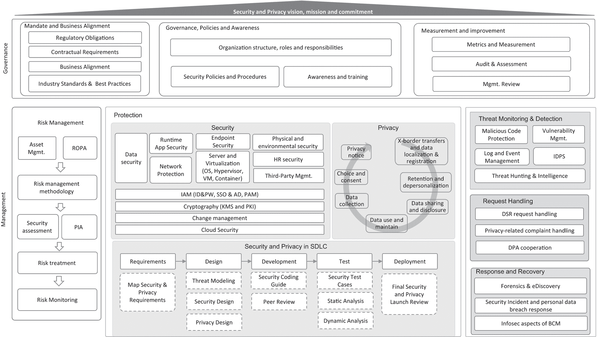

图 2.3 新兴技术的统一安全隐私保护框架

表 2.4 根据本节讨论的安全与隐私框架，阐述了相应的安全和隐私控制领域、控制组、控制目标和控制集。更多详细的控制措施请参考附录 A：安全与隐私保护控制目标与措施。

| 领域 | 控制组 | 控制目标 |
| --- | --- | --- |
| 授权与与业务对齐 | 监管义务 | 遵守适用的法律法规 |
| | 合同要求 | 履行合同要求 |
| | 业务对齐 | 使数据安全和隐私计划与业务策略及政策保持一致，并促进业务增长 |
| | 行业标准与最佳实践 | 遵循选定的行业标准和框架 |
| 治理、政策与意识 | 治理结构、关键角色与职责 | 应建立适当的治理结构以监督安全和隐私保护倡议 |
| | | 简化并使业务利益相关者之间的安全与隐私计划活动、角色和职责保持一致 |
| | | 就组织内的协作职责达成共识 |
| | 政策与程序 | 建立合适的安全与隐私治理结构，并制定企业范围内隐私和数据保护实践的原则和要求 |
| | | 建立安全与隐私策略及程序 |
| | 第三方安全与数据保护管理 | 在第三方参与的全生命周期内识别并管理安全隐私保护风险 |
| | 安全与隐私意识与培训 | 建立安全隐私保护文化，并在企业范围内推广意识计划 |
| 衡量与改进 | 安全与隐私计划衡量 | 评估安全与隐私计划的有效性 |
| | 与安全隐私相关的审计与评估 | 计划并执行与安全隐私相关的审计和评估活动 |
| | | 管理并关闭已发现的问题 |
| | 年度报告与管理评审 | 审查整体安全隐私合规状况并进行改进 |
| 安全风险管理 | 安全风险管理 | 建立并执行风险管理流程 |
| 隐私风险管理 | 个人数据处理清单与数据流 | 通过建立和维护最新的个人数据处理清单和数据流来理解业务流程 |
| | 业务流程和项目的 PIA | 在业务流程和项目中建立并嵌入 `PIA` |
| | SDLC 的 PIA | 在系统开发生命周期（`SDLC`）中建立并嵌入 `PIA` |
| 保护保护 | 资产管理 | 资产清单与所有权 |
| | | 资产的可接受使用 |
| | | 介质处理 |
| | 身份与访问管理 | 访问控制策略 |
| | | 用户、身份与权限管理 |
| | | 认证与凭据 |
| | | 访问管理 |
| | | 特权访问管理 |
| | | 用户职责 |
| | 物理与环境安全 | 安全区域 |
| | | 设备与环境安全 |
| | | 访客管理 |
| | 网络安全 | 网络安全策略 |
| | | 网络分段 |
| | | 内部网络访问控制（软件定义网络，`SDN`） |
| | | 保护无线网络及连接 |
| | | 远程办公策略 |
| | | 信息传输 |
| | 数据安全 | 信息分类与处理 |
| | | 应用加密保护数据 |
| | | 综合数据泄露防护 |
| | | 个人可识别信息的隐私与保护 |
| | 终端/VDI/移动安全 | 终端/VDI/移动安全策略 |
| | | 终端威胁防护 |
| | | VDI 安全 |
| | | 移动设备管理 |
| | 漏洞管理 | 漏洞管理 |
| | 加密（`KMS`，`CA`） | 加密控制 |
| | 防恶意软件 | 防恶意软件保护 |
| | 人资源安全 | 入职前（清理背景） |
| | | 入职期间（清理行为） |
| | | 离职时（清理资产与权限） |
| 安全监控与检测 | 可用性监控 | 可用性监控 |
| | 入侵检测与保护 | 入侵检测与保护 |
| | 日志与分析 | 日志与分析 |
| 隐私运营 | 隐私通知 | 在获取个人数据前或时告知主体 |
| | | 对组织保持公平透明 |
| | | 隐私通知发生变更时通知数据主体 |
| | 合法依据与同意 | 确保数据处理活动合法 |
| | 同意管理 | 确保同意有效；保留同意记录；确保主体有撤回同意的权利和机制 |


| 数据收集 | 确保收集方法合法公平透明 |
| --- | --- |
| | 仅收集满足相应目的的数据 |
| | 确保从第三方收集的数据符合法律规定 |

| BCM 的信息安全方面 | 信息安全连续性 |
| :--- | :--- |
| 备份计划 | |
| 冗余设计 | |
| 与数据保护机构（DPA）的合作 | 识别适用管辖区内相关的 DPA |
| | 遵循相关 DPA 的指南 |
| | 建立内部程序以指导与 DPA 的合作 |

构建一个单一的、公司范围的安全和隐私框架并非易事。它超越了纯粹的合规范畴。你不应该仅仅出于本能地勾选一组固定治理法律的合规方框，而应该通过采用一种不仅基于勾选框，而且是在组织需求范围内主动预判的方法，开始对你的组织进行规划。

在开发新或改进的产品、服务系统和流程时，必须考虑安全和隐私。“设计安全隐私”（Security and privacy by design）被视为侧重于预防而非纠正措施的流派。设计安全隐私不会坐以等安全和隐私威胁的出现，也不会在发生安全和隐私违规后在后端提供补救。它试图避免这些问题的发生。总之，设计安全隐私先于行为，而非之后。

安全和隐私并非存在于真空之中。使其运行起来。从第一天起就开始整合安全和隐私，并继续将其视为组织日常工作的一部分。建立一个良好的安全和隐私计划是非常耗时的。安全和隐私的治理、管理和运营是一个迭代过程。在每个阶段使用这种迭代过程，通过自定义指标来优先考虑具有价值和风险优先的行动，以指导安全和隐私的部署覆盖层。安全和隐私成熟度模型（`SPMMs`）是一种衡量框架，企业可以使用它来跟踪自己相对于既有隐私基准的执行情况。通过提供一个与已有的成熟度模型对比的点，`SPMM` 为组织提供了一种实用且被广泛认可的衡量安全和隐私计划的方法，展示了推进该计划还需要采取哪些额外步骤。可以通过 `SPMM` 结合内部和外部基准来衡量进度。它让你能够更容易地跟踪实体安全和隐私的特定项目甚至广泛的倡议。

本书的安全和隐私成熟度模型基于能力成熟度模型（`CMM`），它是全球许多其他成熟度模型的基础。表 2.5 显示了安全和隐私成熟度模型的定义。

| | PMM 级别 | 描述 |
| :--- | :--- | :--- |
| 1 | 临时 (Ad hoc) | 安全和隐私计划及活动是反应性的。缺乏意识和治理。缺乏战略愿景，该计划有效性较低，对业务需求的响应也较低。 |
| 2 | 开发中 (Developing) | 程序或流程通常是非正式的、不完整的且应用不一致。安全和隐私计划倾向于依赖个人人才。已制定计划并处于执行过程中。 |
| 3 | 已定义 (Defined) | 政策、程序和流程已完全记录并实施，涵盖了所有相关方面。 |
| 4 | 量化管理 (Quantitatively Managed) | 建立了健全的安全和隐私计划治理和指标管理流程。开展了审查以评估安全和隐私。 |
| 5 | 优化 (Optimized) | 建立了健全的安全和隐私计划治理和指标管理流程。开展了审查以评估安全和隐私。 |

在 `SPMM` 中，由于法律要求或组织状况，安全和隐私实践可能处于不同的水平。根据成熟度评估，组织可以生成一个仪表板并向其高级团队提供安全和隐私决策水平，如表 2.6 和图 2.4 所示。

| | 当前成熟度 | 目标成熟度 | 级别 |
| :--- | :--- | :--- | :--- |
| 与业务业务 | 1.5 | | |
| 治理、政策与意识 | 1 | | |
| 安全管理 | | | |
| 隐私影响评估与风险管理 (`PIARM`) | 2 | | |
| 隐私运营 | 1.5 | | |
| SDLC 中的安全与隐私 | 2.5 | | |
| 安全监控与检测 | 2 | | |
| 请求、投诉与数据泄露处理 | 2 | | |
| 衡量与改进 | 1.5 | | |


为了增强安全隐私实践，识别差距项目并创建一个详细的路线图。该路线图应概述组织的安全隐私目标以及实现目标的方法，确保目标是具体的且与风险相关的。路线图必须与整体战略以及安全隐私目标保持，并由高级管理层监督。定期审查和修订对于保持更新至关重要。表 2.7 说明了用于优先考虑安全隐私事项的某些因素。

| # | 事项 | 与业务对齐 | 紧急程度 | 预计成本与努力 | 状态 | 领导层参与 |
| :--- | :--- | :--- | :--- | :--- | :--- | :--- |
| 1 | 完善安全隐私计划治理结构并定义关键角色和职责 | 高 | 高 | 低 | 进行中 | 是 |
| 2 | 在合同中嵌入安全隐私要求语言 | 高 | 中 | 中 | 几乎完成 | 否 |
| 3 | 为实施 `PET` 解决方案建立标准指南 | 中 | 低 | 高 | 未开始 | 否 |

图 2.5 根据表 2.7 中的示例说明了优先级地图。


表 2.8 根据上述路线图提供了一个安全隐私计划的示例，并为每个事项定义了负责人。

表 2.8 安全隐私计划实施计划示例

| | | 2024 | 2025 |
| :--- | :--- | :--- | :--- |
| 事项 | 负责人 | J | F | M | A | M | J | J | A | S | O | N | D | J | F | M | A |
| 构建安全与隐私计划治理结构 | Corey Smith |
| :--- | :--- |
| 定义角色与职责 | Abigail Lamp |
| 建立数据清单 | Drake Rogen |
| 在合同中嵌入安全与隐私要求语言 | Sarah Liu |
| 建立数据删除程序 | Eason Boba |

DOI: [10.1201/9781003390695-4](https://dx.doi.org/10.1201/9781003390695-4)

本部分涵盖以下主题：

* AI 算法、模型和架构
* AI 风险与挑战
* 负责任 AI 安全与隐私架构师

DOI: [10.1201/9781003390695-5](https://dx.doi.org/10.1201/9781003390695-5)

本章旨在帮助读者理解关键概念和 AI 发展的时间线，以及其对企业和社会带来的承诺和利益。本章还从业务运营和行业视角提供了真实 AI 用例的视角。此外，本章还讨论了常见的 AI 商业模式、生态系统、采用策略以及实施考虑。

本章涵盖以下主题：

* AI 术语与简介
* AI 的力量与承诺
* 业务运营中的 AI 用例
* 行业领域的 AI
* AI 生态系统与采用策略

AI 将通过许多方式引入自动化并使许多事务自动化，从而改变人类与机器交互的方式。虽然我们可能无法获得科幻中的多功能机器人，但 AI 将通过自动驾驶车辆减少碰撞来拯救生命，实现更早、更精确的疾病检测以及更高效的药物发现。正如我们观察到的，AI 正在试点送货无人机和战斗机，执行我们的代码和写作任务，并增加交通物流的吞吐量，这一切都蕴含着巨大的环境效益。这种变革性的变化是智能计算的典范，也是自然语言交互背景下人机交互演变的标志。与此同时，同样重要的是，要思考这些承诺背后的伦理后果，并进行彻底的风险分析，在确保 AI 伦理使用的同时保障数据保护。

人工智能（AI）已作为一条光芒不减的丝线，编织进人类进步的宏伟织锦中，以前所未有的规模激发着想象力和创造力的火花。从早期艾兰·图灵（Alan Turing）开创性框架的灵感开始，到为 AI 引入神经网络和深度学习模型。这个故事关于坚持不懈的技术进步，以及任何其他科学都无法比拟的创新。几十年来，计算行业最大的梦想不仅是构建 AI，而是构建通用人工智能（AGI）——即能够像人类一样真正理解、学习并智能地执行广泛任务的机器。现在，智能有机体已成为现实，因为机器学习（`ML`）算法与大数据（大数据）以及海量计算力相结合了。AI 的进展是令人震惊的，系统在各个领域不断超越人类的基准。

AI 的影响远超自动化；它从根本上改变了我们世界决策的格局。决策者由三类人组成：人类、受机器加持的人类，以及两者的结合。赋能 AI 的机器将拥有前所未有的计算能力，可以在数秒内筛选海量数据，并提供远超普通人类的理解。同样被期待的是人机协作，这将成为风靡，机器将作为人类的增强伙伴，从而创造出史以来完美的能力组合。

这种演变具有深远的影响。从医疗、金融到制造和运输，每一个行业都将从 AI 实现的更高效、更准确的决策中获益。尽管如此，它也引入了新的伦理和社会困境、职业流业的可能，以及通过强有力治理以负责任的方式实现目标的重要性。当我们走向这一新范式时，让我们拥抱 AI 演变的黎明，这标志着一个人类与 AI 在十字路口汇合解决系统性挑战的世界，揭示深远的机遇并共同重新定义我们的未来。

长期以来，作为一个从诞生到如今广泛应用的理念，在创造性思考者的驱动和指数级规模技术增长的推动下，AI 充当着创新解决方案的灯塔，前沿前未有机会的先驱。随着大数据收集的快速增加以及处理能力和 `ML` 方法的显著进步，图像识别、语音识别和自然语言处理（`NLP`）等 AI 技术已不再仅仅是新奇的噱，而是成为我们日常生活中不可或缺的一部分。AI 在各垂直行业的实施不仅是一种时尚，更是一种强大的颠覆者，改变着行业和人类。

随着企业在 AI 研究上累计投入数十亿美元并将其 AI 训练的解决方案推向市场，其影响随着时间的推移变得具有显著全球意义。想想超越人类能力的医疗诊断、在繁忙城市街道上行驶如在赛道上跑步的自动驾驶汽车，以及在我们表达需求之前就能预测我们欲望的算法——这些都不再是科幻梦了。

然而，这就像是说我们刚刚发现了 AI 力量的极限，而突破触手可及。未来是一个连接的世界，家中的每一个设备都运行 AI 并能被完全编排；万物将相互通信——AI 在日常生活的背景下自动平衡安全、隐私和便利。无论是个性化医疗和预测性维护、智能城市还是自主供应链，AI 都在全球范围内实现了更高水平的效率、体验和经济价值。

在一个不断更新的数字世界中，争夺胜利平台的竞争仍然异常激烈。这十个最大平台所走过的路径说明了技术被采纳和用户入驻的速度。ChatGPT 在 2022 年 11 月发布后短短五天就获得了惊人的百万用户，这证明了这一点，反映了其作为 AI 解决方案的指数级增长潜力。相比之下，Instagram 花了 2.5 个月，而 Netflix 花了 3.5 年才达到同样的指标——这提醒我们 AI 如何如此彻底地加速了用户参与和平台扩展。

虽然 AI 灵药的仁慈（尽管具体细节并非如此）依然存在，但这种特定的药剂往往伴随着毒性。每当取得重大技术突破时，我们都会面临对等的挑战，以确保该领域 AI 的发展和路径同样得到审查。

这些挑战 [15]] 凸显了许多人认为的核心问题问题：数据问题，从创建到消费。AI 系统消耗的海量数据为我们带来了关于如何处理、验证和治理这些数据的深层次问题。换句话说，随着围绕 AI 算法的透明度、问责制和偏见问题现在成为我们首要考虑的问题，伦理考量正处于我们思考的最前沿。这些决策还影响社会，其影响严重到不能由 AI 工程师之外的任何人来决定。更严重的是，安全泄露这一“洪水幽兽”正等待着摧毁信赖的 AI 系统。AI 的这些建立信任的基础也可能被黑客——从字面上来说，因为攻击数据基础设施和 AI 算法的尝试日益增加。确保数据的完整性和机密性是防御这些威胁以及维护公众对 AI 信任的关键。这种差异在这一数据驱动决策时代隐私这一主主题中得到了进一步说明。随着数据现在既是资产也是一种威胁性的负债，隐私问题变得悬而未决。这一挑战——即在利用数据实现创新与确保个人隐私权之间取得平衡——是一项艰巨的任务，需要通过适当的检查和监管框架来达成平衡。

尽管存在这些挑战，但理解 AI 可用于提高人类的生活质量并解决我们社会今天面临的一些巨大挑战至关重要。然而，为了让这些发生，需要谨慎且有远见地解决这些障碍。人类与机器未来的关系将决定 AI 的矢量路径。让所有人类都能与 AI 系统一起应对我们面临的最复杂挑战，可能是我们实现 AI 全潜力的门票，推动全人类迈向技术真正成为全球积极力量的未来。

## 3.1.4 AI 的定义

### 3.1.4.1 AI 定义

人工智能或 AI 是一个主要用于描述人们在接触“思考机器”这一概念时所遇到的现象的术语。目前还没有全球公认的 AI 定义，但许多人根据不同的来源和指导对其进行了定义。我认为，这部分是因为我们对 AI 到底是什么还没有清晰的共识定义，部分是因为这允许该领域自我构建、繁荣并进步得更快。

AI 的一些主要特征是数据的收集和分组，随后进行检索或处理它们以获取信息和知识；在没有人类干预的情况下学习；以及推理——使用一系列规则来得出近似或确定的结论并解决不同领域的问题。

AI 一词的根源可以追溯到 1956 年，当时它由达特茅学院数学教授约翰·麦卡锡（John McCarthy）构思化，他在一年后领导了该主题的具有开创意义的会议。他将其定义为“制造智能机器的科学与工程”。在随后的几十年里，AI 的发展已经远远超过了最初关于“杀手机器人”的科幻定义，成为计算机科学更广泛领域内的一个领域。表 3.1 展示了一些经常被引用的 AI 定义。

表 3.1 AI 定义示例

| 指南/出版物 | 定义 |
| --- | --- |
| 欧盟 AI 法案（2024 年正式出版） | “AI 系统”指的是基于机器的系统，旨在以不同程度的自主性运行，并在部署后可能表现出适应性，并且对于显式或隐性目标，从接收到的输入中推断如何生成输出，如预测、内容、推荐或决策，这些输出可以影响物理或虚拟环境。 |
| 约翰·麦卡锡，什么是人工智能？2004（2007 年 11 月 12 日修订） | 它是制造智能机器的科学与工程。 |
| 欧盟委员会可信 AI 高级专家小组《可信 AI 伦理指南》（2019） | 它是制造智能机器的科学与工程，特别是与使用计算机理解人类智能任务相关的科学，涉及但不限于生物观察的方法。 | 智能（AI）系统是由人类设计的软件（可能还包括硬件）系统，在给定目标的情况下，通过感知环境、解释数据来采取最佳行动。AI 系统可以使用符号规则或根据数据学习数值模型。 |
| IEEE《伦理对齐设计第一版》（2019） | 人工智能是指设计、开发、部署、报废和采用自主或智能软件，使其根据独立推理、决策、形成意图和技能。 |
| 新加坡数据保护委员会（PDPC）提出的 AI 治理框架 | “人工智能（AI）”指的是寻求模拟人类特征的技术，如知识、推理、感知、学习和规划。 |
| 中国信息通信研究院（CAICT）发布的《人工智能安全白皮书》（2018） | AI 使机器具有智能。它研究并开发用于模拟、扩展人类智能，感知环境、获取知识以及利用知识获得最佳结果的方法和技术。 |
| IBM | 在最简单的形式，人工智能是一个结合计算机科学和稳健数据集以解决问题的领域。 |
| 牛津字典 | 定义人工智能为“能够完成通常需要人类智能的任务的计算机系统的理论和开发，例如视觉感知、语音识别、决策和语言翻译。” |
| ITIF，“什么是人工智能？”（ 2019 年 9 月 4 日） | 人工智能或 AI 是使用软件模仿智能人类行为，如学习、推理、交互和决策。 |
| Tom Mitchell, 1997 | 机器学习是通过经验自动改进的计算机算法的研究。 |

虽然 ML 具有许多非深度学习方法，如支持向量机、决策树和随机森林，但深度学习是 ML 的一个子领域，它使用更复杂的技术来利用人工神经网络形式的结构化信息。我们的人类仿真分为思想模仿、类人类、行为推理、理性思考，以及另外两个类别：代理理性行动和代理理性态度。表 3.2 展示了 AI、ML 和深度学习之间的对比。

| | 人工智能 | 机器学习 | 深度学习 |
| --- | --- | --- | --- |
| 起源 | 人工智能起源于 20 世纪 50 年代（约翰·麦锡，斯坦福大学） | 机器学习起源于 20 世纪 60 年代 | 深度学习起源于 20 世纪 70 年代 |
| 技术 | AI 代表机器中的模拟智能 | 机器学习是让机器无需编程即可做出决策的实践 | 深度学习利用人工神经网络解决复杂问题的过程 |
| 关系 | AI 是数据科学的一个子集 | 机器学习是人工智能和数据科学的子集 | 深度学习是机器学习、人工智能和数据科学的子集 |
| 目标 | 构建能够像人类一样思考的机器 | 目标是让机器通过数据进行学习以解决问题 | 目标是构建能够自动发现特征检测模式的神经网络 |

`AI` 用例示例包括欺诈检测、资源调度、自动化和客户支持。尽管我很想说我们的 `ML` 算法具备预测分析能力，但它们远没有人类那样直觉、情感化和自我反思。`AGIs`（以及自然界）的行为反而是通过对数据进行分析并在无需特定编程的情况下调整内部参数值，从经验中不断改进。

### 3.1.4.3 窄义 AI 与通用 AI

就垂直发展而言，从行业角度来看，`AI` 通常分为三个阶段：第一阶段是狭义人工智能（`ANI` 或 弱 AI），第二阶段是生成式人工智能（`AGI`），第三阶段是超人工智能（`ASI`）。表 3.3 展示了窄 AI 与强 AI 的对比。

| | 窄 AI（弱 AI） | 通用 AI（强 AI） |
| --- | --- | --- |
| 狭义人工智能 (ANI) | 通用人工智能 (AGI) | 超人工智能 (ASI) |


| 定义 | 狭义人工智能（`ANI`）或弱 AI：`ANI` 是专注于某项狭窄任务的智能。这种类型的`AI`需要人类干预才能交付输出。因此，一些人将其归类为弱 AI 能力。此类`AI`的一个重要特征是它完全在特定的环境中工作，因此是在一个预先指定的受控环境中。由于过程是反复进行的，弱 AI 的输入将是强 AI 的输出。*注：生成式 AI 目前仍被视为“窄 AI”或“弱 AI”。* | `AI`的理论形式 ->> 通用人工智能（`AGI`）：`AGI`指的是一种与人类同等的人工智能。(1) 原则上，强`AI`系统具备学习并适应以解决新问题的能力，而无需一定有人类参与。涵盖`AGI`的表述不同之处在于；它们不像`ANI`那样受到对其环境的同类控制/监控。(2) 它将具有意识（至少意识到自己）、解决问题、学习和前瞻性规划的意识。你开发得越好，`AI`就越强大，这些`AI`也越像人类。 | 超人工智能（`ASI`）——也称为超级智能——将超越人类大脑的智能和能力。`ASI`超越了人类思想设定的边界，包括理解和处理超越人类心理能力的概念的能力。 |
| --- | --- | --- |
| 业务用例 | 弱 AI 驱动了我们今天周围的大多数`AI`。它实现了一些非常强大的应用，如`ChatGPT`、`Apple Siri`、`Amazon Alexa`、`IBM Watson`和自动驾驶汽车。 | 强`AI`完全是理论性的，日常生活还没有强`AI`的实际示例，但这并不意味着研究人员已经停止开发它。同时，我们关于`ASI`的最佳例子可能仍来自虚幻，无论是超人类的反叛计算机助手或其他。 |

多年来，`AI`经历了多次炒作周期，但`OpenAI ChatGPT`的发布对于怀疑者来说也像是一个分水岭时刻。此后的这段时间计算机视觉占据了焦点，而现在生成式 AI 正结合`NLP`脱颖而出。生成式模型可以理解任何类型的数据结构：从自然语言到代码语法。

无论是通用还是窄义的，更多的`AI`正在到来，而且它们只会变得越来越强大。更低的开发成本以及部署率确保了 AI 将集成到面向消费的应用程序和数字接口中。

如表 3.4 所示，AI 演变中的重要事件和里程碑。自电子计算机出现以来（相对于本文讨论的一些主题）。

**表 3.4 AI 发展时间线和关键事件 [17]**

| 时期 | 关键特征 | 关键事件 |
| --- | --- | --- |
| 1940–1950 | `AI`的诞生——定义什么是`AI` | 1942 | 作家兼教育家艾萨克·阿西莫夫（Isaac Asimov）在名为《环绕》（Runaround）的短篇中介绍了他著名的“机器人三法则”，该故事描述了一个智能机器人与人类的互动。三法则为：(1) 机器人不得伤害人类，或通过不作为导致人类受到伤害；(2) 机器人必须服从人类命令，除非这些命令与第一条法则冲突；(3) 机器人必须保护自己的存在，只要这种保护不与第一条或第二条法则冲突。 |
| 1943 | McCulloch 和皮茨：大脑的布尔电路模型。 |
| 1949 | 英国神经生理学家威廉·沃尔特（William Walter）于 1949 年开发的三个轮子的“乌龟”可以使用各种传感器自主探索环境。唐纳·赫布（Donald Hebb）从神经心理学中获得灵感，并在 1949 年首次引入机器学习，称为赫布学习规则；他提出生物神经网络中的学习来自于神经元之间突触连接的调整。突触的变化对于学习是必要的，因为神经元突触位点的连接性应该增加或降低其激活阈值（突触的作用）。在这两种情况下，目标都是通过正确的反馈加强神经元之间的连接，正如巴甫洛夫的条件实验一样。赫布的权重公式被应用于模拟人类神经网络，权重用于表示神经元之间连接的强度。他开发了一种程序，对输入统计迷宫的信息分类中的某些决策给予奖励，并使用决策树对其他决策进行惩罚。该分类器模拟了人类如何观察、总结并直接通过训练过的条件反射进行区分，而不是通过内部思考，捕捉数据内部的相关性关系，而非因果关系。 |
| 1950 | 艾伦·图灵（Alan Turing）的《计算机器与智能》发表。图灵的论文提出了“机器能思考吗？”这个问题指的是机器是否表现出与人类智能无法区分（或是人类智能的结果）的行为，这本质上就是`图灵测试`的由来。从那时起`图灵测试`的价值一直存在争议。 |
| 1952 | IBM 科学家亚瑟·萨缪尔（Arthur Samuel）开发了一个可以学习并改进自身棋法的国际跳棋程序。他将这一概念称为`机器学习`，并将其解释为“一种在没有明确编程的情况下提供网络的 AI 类型”。萨缪尔在 1952 年为`IBM 701`编写了第一个国际跳棋程序。1955 年，他首次完成一个学习程序，并在 1956 年通过电视进行了展示。随后的软件版本表现尚可，但尚未达到专家水平。 |
| 1952 | `AUDREY`，即`自动数字识别器、汇编器和解释器`，是 1952 年在贝尔实验室开发的一种语音识别系统，能够识别从零到九的语音数字。它使用了当时基于真空管的计算机，目前词汇量仅有 10 个单词。 |
| 1954 | 1954 年，在一个名为`乔治敦-IBM 实验`的研究项目的著名公开演示中，一个以`IBM 701`计算机形式呈现的“电子脑”将俄语自动翻译成了英语。 |
| 1956 | 1) **达特茅会议**：约翰·马卡锡（John McCarthy）在达特茅学院召开了第一届人工智能会议（与会者包括艾伦·纽维尔和赫伯特·西蒙等），并创造了`人工智能`这一术语。2) **逻辑理论学家**：同年晚些时候，艾伦·纽维尔、J.C. 肖恩和赫伯特·西蒙创建了`逻辑理论学家`，这是第一个可以运行的 AI 程序。这是第一个设计用于利用自动推理的程序，有时被称为“首个人工智能程序”。 |
| 1957 | 一位名叫弗兰克·罗森布特（Frank Rosenblatt）的美国研究人员在 1957 年引入了`感知器`（perceptron）。它实际上是一种非常基础的二线性分类器，已成为人工神经网络的远祖，这是深度学习和神经网络的触发事件。`感知器`接收输入，计算输入的线性组合，并应用阈值将输入分类为 1 或 0。虽然它最初获得了一定的热度，但最终被更复杂的模型取代，如`多层感知器`和`支持向量机`。然而，`感知器`的历史和影响是不容置疑的。它为领域巅峰成就提供了基础。经济学家赫伯特·西蒙说计算机将在 10 年内在国际象棋上击败顶尖人类。结果却花了 40 年时间。 |
| 1958 | **专家系统**：将知识和规则交给机器搜索。 |
| 1961 | 由美国发明家乔治·德沃尔尔（George Devol）创造的`Unimate`成为世界上第一台工业机器人，并被用于通用汽车的装配流水线。 |
| 1962 | IBM 在 1962 年西雅图世博览会上的`Shoebox`机器可以理解 16 个单词，包括数字 0 到 9，如果它听到类似`plus`的单词，就会执行算术运算。 |
| 1965 | 艾伦·罗宾逊（Alan Robinson）的通用逻辑推理算法。第一个深度学习`MLP`。 |
| 1966 | `ELIZA`由麻省理工学院（MIT）的约瑟夫·森鲍（Joseph Weizenbaum）开发，是一个早期聊天机器人。它使用模式匹配和替换规则模拟心理治疗师。 |
| 1967 | `感知器`：弗兰克·罗森布特的`感知器`是神经网络的早期模型。 |
| 1971 | 1971 年，由特里·威诺格德（Terry Winograd）开发的`SHRDLU`是最早的自然语言理解程序之一。 |
| 1973 | `莱特希尔报告`得出人工智能未能达到预期结论。日本第一个全尺寸人形机器人`WABOT-1`于 1973 年推出。 |
| 1980–2000 | **反向传播**：`BP`算法由鲁梅尔哈特（Rumelhart）、辛顿（Hinton）和威廉姆斯（Williams）推广。 |
| 1986 | 《通过误差反向传播来学习表示》是一篇具有里程碑意义的论文，展示了多层神经网络的力量。 |
| 1987 | `Julie`是由老虎电子（Tiger Electronics）开发的一个类人娃娃。 |
| 1989 | 麻省理工学院（MIT）展示了六足机器人`Genghis`。 |
| 1990 | 使用简单逻辑开发了国际象棋程序`深蓝`。 |
| 1992 | `Chinook`在美国全国锦赛中击败了马丽恩·辛斯（Marion Tinsley）。 |
| 1994 | `Chinook`因健康问题（技术问题）退出比赛。 |
| 1995 | `Chinook`对阵唐·拉夫特蒂（Don Lafferty）卫卫了冠军。 |
| 1997 | IBM 的`深蓝`在比赛中击败了当时的国际象棋冠军加里·卡斯帕罗夫（Garry Kasparov）。比赛后不久，`深蓝`退役了。 |
| 1998 | 由勒昆（LeCun）等人开发的`LeNet-5`是一个用于分类手写数字的开创性卷积。 |
| 1999 | 索尼的`AIBO`（类狗机器人）上市并在市场上大受欢迎。 |
| 2000 | 本田公司推出了`ASIMO`（创新移动先进步进）。它能够行走和自主导航。 |
| 2006 | Geoffrey Hinton 等人提出使用受限玻尔兹曼机器（RBM）对每一层进行建模，通过连续的二值或实值隐变量层来学习高层内部表示。这种 RBM 是一种生成式随机前馈神经网络，可以学习其输入集的概率分布。 |
| 2011 | 从 2011 年左右开始，深度学习技术在语音识别、视觉目标识别和机器翻译领域取得了巨大进展——这都是该领域最重要的三个开放问题之一。IBM Watson 在`Jeopardy`（危险一答）中击败了冠军 Ken Jennings 和 Brad Rutter。 |
| 2013 | VAEs（变分自动编码器）于 2013 年引入，是第一个被广泛用于生成真实图像和语音的深度学习模型。 |
| 2016 | DeepMind 的 AlphaGo 程序在深度神经网络的驱动下，在五局赛中击败了围棋世界冠军李世石。考虑到游戏进行过程中可能的步数巨大（仅四步后就超过了 14.5 万亿），这一胜利具有重大意义。随后，谷歌以报道的 4 亿美元价格收购了 DeepMind。 |
| 2017 | Google DeepMind 发布了 AlphaGo Zero，它仅通过自我对弈就磨练了围棋技巧，并在仅经过三天的自我训练后击败了击冠军的 AlphaGo 版本。AlphaGo Zero 可以发现新知识并制定打破规则的策略，揭示了 AI 技术改变人类生活的巨大潜力。 |
| 2020 ~ | 生成式 AI |
| 2022 | OpenAI 于 2022 年 11 月 30 日发布了`ChatGPT`。`ChatGPT`是一个大语言模型或基于 AI 的聊天机器人，它非常受欢迎，在短短两个月内月活跃用户就达到了 1 亿。这使其成为历史上增长最快的消费者应用。大语言模型（或`LLMs`）如`ChatGPT`的兴起，为 AI 的性能及其驱动企业价值的潜力带来了巨大变化。通过这些新的生成式 AI 实践，深度学习模型可以在海量的原始未标记数据上进行预训练。 |
| 2023 | 《冰霜》（The Frost）被认为是世界上第一部 AI 生成的电影。《冰霜》是一部 12 分钟的电影，其中每一个镜头都是根据由人类编写的脚本，由名为`DALL-E 2`的图像生成 AI 生成。电影使用了另一个名为`D-ID`的 AI 工具使静态图像动起来。 |
| 2024 | 由 OpenAI 开发的多模态 AI 模型`ChatGPT-4o`于 2024 年 5 月 13 日发布。`ChatGPT-4o`中的“o”代表“omni”（全），表示它具有处理多种类型输入输出的能力，包括文本、音频和图像。《欧盟 AI 法案》于 2024 年 7 月 12 日在《欧盟公报》上发表。 |

## 3.2 AI 的力量与承诺

现在，AI 不是科技公司的专利技术。AI 已整合到全球业务的日常运营中。商业级 AI 主要分为两类：企业内部和工业生产——通过内部应用（例如自动化和人类增强）提高企业工作效率，以及跨行业生产。随着 AI 进一步融入我们的生活，我们将生活在一个迄今无法实现的人类目标得以实现的世界，而曾经被认为是人类特有的成就——如创作歌曲或发现医学疗法——将由机器或借助机器产生。这种转变将使基于 AI 的流程覆盖到各个领域，并可能日益模糊纯人类、纯 AI 或无法区分的人类-AI 混合决策过程之间的界限。AI 正在像 100 年前的电力一样，变革每一个行业。根据麦肯锡的数据，到 2030 年，这将带来 13 万亿美元的额外 GDP 增长，其中绝大部分来自非互联网部门，如制造业、农业、能源、物流和教育。AI 能力的提升也集中了它们所构威胁的本质。对于从农业到银行（以及其之间的所有行业）的每个行业的高管来说，AI 是他们脱颖而出或被淘汰的机会。

最近，AI 在过去的短短五年里，在围棋（GO）、扑克和 Dota 2 等高度复杂的游戏中表现优于人类冠军，并且其水平已高到可以在四小时内精通象棋，并在与人类对弈时处于无不可胜的水平。然而，它并不局限于游戏；在人类智能的几个方面，AI 已经完胜人类。AI 在 2020 年解决了一个名为“蛋白质折叠”的五十年的生物学之谜。它在语音和目标识别方面优于人类，制作了看起来和说话诡异真实的傀儡师级“数字人”，并以优异成绩通过了入学考试和各种医学执业考试。AI 现在正帮助法官在判决中做出更快、更公平、更一致的判判，肺癌诊断中的放射科医生也引领着未来交付、农业和战争的趋势。在高速公路上行驶得比人类更好的自动驾驶汽车终于由 AI 驱动。

因为如果我们假设 AI 有时从一种巨大且深层的奇异中产生洞察，这种奇异超出了人类思维或启发式方法所能及的一切，那么 AI 可能会产生真实但仍具有启发性的解释，这些解释处于纯人类所能理解的另一侧。如果 AI 以这种方式产生偶然发现，人类的反应可能与亚历山大·弗莱明发现青霉素时的感受相似。那时，偶然发现的一种产生青霉素的威胁霉菌占领了培养皿并杀死了危险的细菌，引发了他对一种强大未知化合物的奇奇。当时人类并不知道抗生素是什么，因此也无法理解青霉素的工作原理。那开启了一个新的探索领域。

根据 NewantagePartners 进行并发布在 [forbes.com](https://forbes.com) 的 2022 年调查，92.1% 的公司表示它们对数据和 AI 的投资正在获得回报。近三分之二（65%）的企业将在 2023 年底使用或计划使用 AI 进行业务分析或智能。同样，63% 的企业将使用 AI 技术自动化处理枯燥的任务。与上述用途相比，另一个不那么流行但与其类似的类别是风险检测或安全改进。

根据埃森哲全球 1200 名首席级高管进行的“重塑变革”调查，高达 75% 的人表示他们正忙于为 AI 及其他智能技术投入资金。72% 的人表示他们受竞争压力驱动；他们理解需要新工具来更有效地与对手竞争，无论是通过提高生产力还是发现新的增长引擎。

### 3.2.1 AI 的四大核心能力

AI 提供以下常见功能和应用，分为四个主要维度（见图 3.3）：文本识别、计算机视觉、语义和语音学。

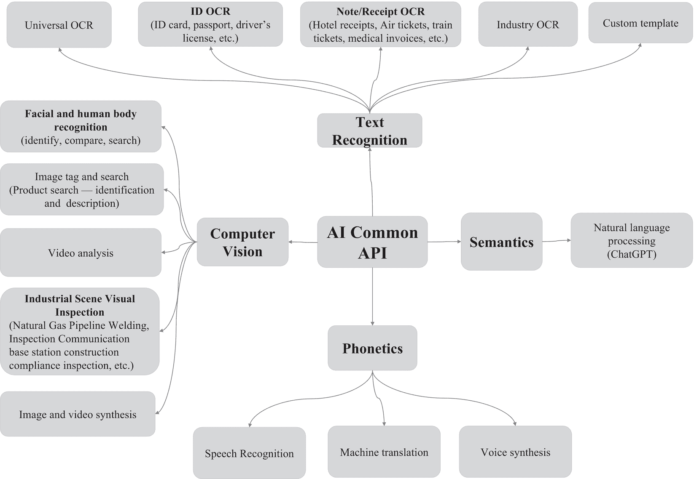

- **文本识别**：这涵盖了广泛的领域，包括通用 OC、笔记/收据光学字符识别（OCR）（酒店收据、机票、火车票和医疗发票）以及行业 OCR 定制模板。
- **计算机视觉**：包括人脸、人体识别（识别、比较和搜索）、图像标签与搜索（产品图像识别与描述）、视频分析、工业场景视觉检测（天然气管道焊接检测和通信基站建设合规检查）以及图像视频合成。
- **语音学**：包括语音识别、机器翻译和语音合成。
- **语义学**：处理如`ChatGPT`等高级语言模型和自然语言技术。

### 3.2.1.1 文本识别

AI 文本识别（主要是`OCR`）是一项使计算机将不同类型的文档（包括扫描的纸质文档、`PDF`文件或数字码相机拍摄的图像）转换为可编辑和搜索的数据的技术。它非常适用于打字文档的数字化，并支持手写体识别（`HTR`）。它是一种文本数字化的实现技术，主要应用场景涉及在文档处理、数据输入和分析等各种应用中，使打印或手写文本变得可搜索和可提取。

`OCR`过程的一般阶段：

- **图像预处理**：系统通过降噪、图像增强和二值化对图像进行切片，为文本提取做好准备。
- **文本检测**：系统在边缘检测和连通组件分析等技术的帮助下，识别图像中文字所在的区域。
- **文本分割**：涉及从背景和其他图像中的实体中提取单个字符或单词。
- **字符识别**：系统检查每个分割的字符，并尝试在模式识别算法的基础上进行识别。这可能使用模板匹配、神经网络或统计建模等技术。
- **后处理**：在后处理阶段，可以使用任何过程来提高通过字符识别得到的结果的准确性，例如拼写检查、针对特定类型字符的上下文注释，以及纠正误读的字符。

### 3.2.1.2 计算机视觉

这是一种 AI 技术，允许计算机和系统从数字图像、视频和其他视觉输入中提取有用知识，并此此行动。它们在提供建议的能力上与图像识别任务不同。计算机视觉应用了这一概念，由于神经网络技术（如卷积神经网络）的带来的另一项突破，被广泛应用于各个领域，如社交媒体中的照片标记、医疗部门的放射学成像以及汽车行业的自动驾驶汽车。

我们每天都在使用计算机视觉技术。计算机视觉可以用于从交通到安全的等领域的实时领域。现有示例包括：

- **自动驾驶汽车**：由`Tesla`等高科技汽车制造商利用，计算机视觉驱动环境观察中识别出的物体之间的转换，以确保车辆能够安全地在其外部环境中导航。
  - 无人机和汽车的自动导航。
  - 某些汽车安装了辅助辅助，可以检测到打盹的司机。
- **人脸识别**：社交媒体巨头喜爱的无害用途（如模拟老化），但人脸识别技术最近因被警方和其他安全执法人员使用而饱受批评。
  - 人脸识别（使用面部解锁手机）。
  - 智能摄像头（你的`iPhone`人像模式可以识别并提取前景中的人物，然后“漂亮地”模糊背景以创建类似`DSLR`的效果）。
  - 2015 年 7 月，`Google`的图像识别算法将黑人标记为大猩猩。`Google`的发言人公开道歉。`Google`承认无法从技术上解决这个问题，并选择防止任何图像被标记为大猩猩、黑猩或猴子，并从搜索结果中删除了该标签。
- **医疗保健**：医疗专业人员依赖计算机视觉来帮助分析`X-rays`、物理扫描和成像，并在各个领域（心脏、儿科、神经内科等）进行预测性诊断。
  - 图像分析（确定肺部`CT`中是否存在恶性肿瘤）。
- **社交媒体/互联网/商业**
  - 智能图像搜索（可以通过关键词或其他图像找到图像）。
  - 内容审核（检测社交媒体中的色情和暴力内容）。


像 `Amazon Go` 这样的自动驾驶商店，摄像头可以识别你何时将产品放入购物车；机场安检（清点人数和识别恐怖分子）；手势识别（在 `Xbox` 舞蹈游戏中为你的动作评分）。

**军事应用**（将敌方与平民分开）。

### 3.2.1.3 语音学

语音识别，也称为自动语音识别（`ASR`）、计算机语音识别或语音转文字，是利用技术将口语转录为书面语。这种能力允许机器理解和解释人类语言。它通过语音识别技术生成打印文本，从而能够对收集的数据进行分析和分类。长期以来，语音识别已进入越来越多的设备和应用程序；它是我们改变与技术交互方式之一。如今，几乎每个人都拥有语音识别功能的智能手机和平板电脑。这样用户就可以语音向手机命令。语音识别用于实际应用中，如 `Siri`、`Google Assistant` 和 `Amazon Alexa`；这些虚拟助手使用语音识别来解释并执行你的命令/查询，完成你要求它们的任务，提供信息等，提供了一种无需用手与设备交互的简单方法。此外，语音识别技术为残障人士开始说话与他人交流开启了道路。通过这种方式，那些在打字或使用标准输入方法方面有困难的人可以使用语音转文字功能通过口语进行交流，无论是写短信、电子邮件还是文档。

你还可以在移动设备之外的不同行业和领域使用语音识别。例如，在医疗保健领域，语音识别技术用于转录医学口述、简化文档程序，并提高临床基础设施的效率。同样，语音识别工具在客户服务和呼叫中心操作中也非常流行，有助于分析客户互动或自动回复，以提高服务质量。

### 3.2.1.4 语义学

语义分析是 AI 的一部分，用于发现并确定文本数据中的含义。所有语义分析工具的动力引擎是语言学，它研究语境、语法、语义和语用的各个方面。通过这种方式，AI 系统可以理解不同单词和短语之间的语义关系，确保对自然语言输入的正确解释。

AI 语义背后的关键技术正在促进更复杂、更准确的语言理解系统的出现。

## AI 语义

* **词嵌入（Word embeddings）**：例如，词嵌入是将单词在连续语义空间中表示为稠密向量的技术。这些向量表示还捕捉了词之间的语义关系，使 AI 系统能够理解不同术语之间的相似性和关联性。

* **语义解析（Semantic parsing）**：将自然语言转换为逻辑形式或语义图，以表示给定输入的含义。这一过程允许机器理解用户在请求什么，并提供适当的回答或操作。

* **知识图谱（Knowledge graphs）**：知识图谱是以互联实体及其关系的形式表示知识的框架。AI 系统可以使用知识图谱访问并对大规模结构化数据进行推理，从而增强其语义理解能力。

* **语义角色标注（SRL）**：SRL 是一种自然语言处理（NLP）技术，旨在识别目标词的主语、宾语以及相关的谓语。换句话说，我们可以说 SRL 的目标是用抽象角色（如语义谓词关系和题元功能）对句子成分进行标记。这使得 AI 能够理解句子部分之间的关系，并从中提取相关信息。

## AI 语义的应用

AI 语义使得为各种应用部署 AI 解决方案变得更加容易：

* **对话式用户界面**：虚拟助手（如 `Siri`、`Alexa` 和 `Google Assistant`）利用 AI 语义理解用户的查询并提供适当的响应或采取行动。这些系统旨在分析自然语言输入的语义，除了控制智能家居设备外，还可以执行各种任务，如提供信息或安排预约。

* **网络搜索（信息检索）**：AI 语义用于许多系统，例如根据您之前的操作运行的推荐系统。这些系统通过了解引入文档的语义内容以及用户查询的需求，从而为用户检索并推荐适当的内容。

* **语言翻译**：AI 语义对于 NLP 或机器语言翻译系统是必要的，这些系统将文本从一种语言翻译成另一种语言并保持相同的语义。为此，模型使用以语义为导向的分析方法来理解输入文本的语义，从而产生良好的翻译。

AI 语义代表了向自然语言理解系统迈出的一步。从虚拟助手到语言翻译系统，AI 语义通过让机器理解人类语言及其内涵和上下文，为各种应用开启了大门。

## 3.2.2 生成式 AI

生成式 AI 指通过从数据中学习来产生新内容（如文本、图像、音乐甚至视频）的 AI 系统。相反，它们是机器学习模型，最著名的是深度学习技术（如神经网络），它们尝试预测人类的创意输出。例如用于文本生成的 `GPT-4`、用于图像创建的 `DALL-E` 以及各种音乐和其他媒体生成器。生成式 AI 通过自动执行写作、绘画和绘图等创意任务，正在改变我们看待内容创建、设计、娱乐等的方式，从而激发并产生新的想法和解决方案。

用通俗易懂的话说，生成模型对其训练的数据进行高效编码，并从中进行采样，以使用原始数据生成独特但相似的作品。通过这种方式，它们可以产生看起来像是由观察到的数据的相同风格和体裁的新文本，并利用训练期间学会的模式制作摘要、翻译、预测文本等。

生成模型是多年来统计学中分析数值数据的技术。然而，`生成对抗网络（GANs）` 和 `变分自动编码器（VAEs）` 变得脱颖而出。生成式 AI 通过自动执行写作、绘画和绘图等创意任务，正在改变我们看待内容创建、设计、娱乐等的方式，从而激发并产生新的想法和解决方案。

### 3.2.2.1 ChatGPT

`ChatGPT` 是基于 `Generative Pre-trained Transformer（GPT）` 架构的对话 AI。它依赖海量数据集来理解和生成人类文本。

### 表 3.5 平台达到百万用户的时间

| 在线服务 | 上线年份 | 达到百万用户所需的时间 |
| :--- | :--- | :--- |
| `Threads` | 2023 | 1 小时 |
| `ChatGPT` | 2022 | 5 天 |
| `Instagram` | 2010 | 2.5 个月 |
| `Spotify` | 2008 | 5 个月 |
| `Dropbox` | 2008 | 7 个月 |
| `Facebook` | 2004 | 10 个月 |
| `Foursquare` | 2009 | 13 个月 |
| `Twitter` | 2006 | 2 年 |
| `Airbnb` | 2008 | 2.5 年 |
| `Kickstarter` | 2009 | 2.5 年 |
| `Netflix` | 1999 | 3.5 年 |

### 表 3.6 ChatGPT 提示词示例

| 类别 | 提示示例 |
| :--- | :--- |
| 教育辅助 | “解释后量子密码学的概念。” “你能帮我理解内质网吗？” |
| 创意写作 | “写一个关于宇宙旅行者的短故事。” “创作一首关于和平之美的诗歌。” |
| 技术协助 | “我如何排查计算机病毒问题？” “你能解释一下使用区块链技术生成智能合约的过程吗？” |
| 娱乐与休闲 | “推荐一部好看的电影。” “周末在西雅图有哪些有趣的活动？” |
| 哲学与伦理讨论 | “讨论人工智能的伦理影响。” “我们是谁？我们从哪里来？我们要去哪里？” |
| 个人发展 | “我如何提高我的领导力能力和技能？” “自律有哪些有效的策略？” |
| 问题解决 | “在冬天我如何给我的汽车换破轮胎？” “在北美哪里可以找到最好的石头和宝石？” |
| 文化与历史查询 | “给我讲讲中国式婚礼的传统。” “人类历史上排名前十的艺术品是什么？” |
| 未来推测 | “100 年后的交通工具会是什么样？” “我们什么时候能登陆火星？” |

对话智能（Conversational intelligence）是一种改变游戏规则的力量，它能让你根据客户和潜在客户每天与你进行的数百万次互动（例如电话、电子邮件、短信和实时聊天）中所言说的内容，收集并获取可操作的洞察。

然而，从本质上说，对话智能是在口头对话中倾听信号并对其做出反应的艺术。在商业语言中，你仍然是在识别驱动结果特定行为，并确保这些行为在随后的对话中重复，以提高质量。

对话智能技术对语音通话和网络会议交互进行转录、分析和组织。通过利用 `AI`、`ML` 和深度学习技术，该软件可以生成可执行的强大结论，使公司和员工能够达到巅峰。

### 典型对话智能应用的核心功能：

* 录制。
* 转录会议对话内容。
* 记录会议笔记并记录要点。
* 总结对想法/问题的回答（注意参与者是如何回应的）以及语音语调。
* 统计，例如，参与者在会议期间发言了多长时间？

## 3.3 AI 应用场景

### 3.3.1 AI 支持业务运营

技术本身无善无恶。利用 `AI` 技术，`AI` 有能力转型每个行业和每个组织，并用于创新或提高生产力。例如，`AI` 在危险环境（有毒场所、极端高温/低温等）方面可以取代人类，在短时间内完成更多产品并减少错误。`AI` 正在机器人、虚拟助手、自动驾驶、智能交通、智能制造和智慧城市等许多部署领域迈向前所未有的进展。

业务领导者与 IT 负责人之间在将 `AI` 整合到运营中方面存在不匹配。组织开始深入挖掘并思考由于 `AI` 快速普及而带来的挑战。`AI` 有潜力从字面意义上孕育人类进入更美好的世界。一项《福布斯》洞察调查显示，在受调查的 700 多位高管中，91% 的人认为 `AI` 将在几年内赋予他们竞争优势。然而，14% 的高管认为他们的数据在公司范围内已准备得充分且可用。

`AI` 系统：现实世界的应用。一些最常见的用例如表 3.7 所示。

表 3.7 典型企业的 AI 用例 [24]

| 业务领域 | 业务子领域 | AI 用例 |
| :--- | :--- | :--- |
| 客户与收入 | 营销 | * 内容创作：为营销和广告目的生成内容，例如博客文章、社交媒体帖子和电子邮件营销活动。<br>* 商务名片：客户联系名片识别。 |
|  | 销售 | 合同审查（参见法律章节） |
|  | 履行 | * 客户画像<br>* 个性化：个性化的客户互动和体验，例如根据其偏好或过去的行为推荐产品或服务。<br>* 推荐引擎：通过使用过去的消费行为数据，`AI` 算法可以帮助发现数据趋势，并用于开发更有效的交叉销售策略。这被用于在线零售商在结算过程中向客户提供相关的增值建议。<br>* 智能交付 |
|  | 服务 | * 客户联系名片识别。<br>* 消费者语音分析与认证<br>* `AI` 与自动热线集成，为客户提供 24/7 的通信通道。<br>* 消费者画像：`AI` 系统可以对客户分类、整合客户数据并管理活动。 |
| 研发与产品 | 研发 | * 创新：生成想法和洞察，协助新产品和服务的开发以及现有产品的改进。<br>* 智能需求和智能文档<br>* 实时网络运行风险识别<br>* 软件开发中的缺陷定位 |
|  | 产品 | * 生产线人力配置模型<br>* 预测性设备维护<br>* 半成品库存策略 |
|  | 制造 | * 生产线人力配置模型<br>* 预测性设备维护<br>* 半成品库存策略 |
|  | 采购 | * 基于国家框架的需求和资源预测、分配和调度<br>* 最大和最小供应商管理库存（VMI）备件阈值<br>* 智能供应商推荐<br>* 供需风险量化与辅助决策模型<br>* 物流估计自动化<br>* 物流风险预警 |
| 支持部门（HALF-PI） | 人力资源 | * `AI` 协助招聘过程以匹配候选人的供需，筛选候选人简历并智能推荐潜在候选人。<br>* 智能考勤<br>* 员工自助服务与问答<br>* 员工画像<br>* 薪资自动化<br>* 自动津贴申请 |
|  | 行政 | * 安全监控：CCTV<br>* 智能出行<br>* 智能签证<br>* 智能 TR 表单填报 |
|  | 法律 | * 合同条款自动解析<br>* 合同风险的智能识别<br>* 智能投标、智能报价和智能商业分析<br>* 检查合同签署与审查的一致性<br>* 敏感词识别 |
|  | 财务 | * 薪资自动化<br>* 报销票据检查与审批——极高准确率，支持多种票据组合识别——同类型票据/证件的批处理可以大大提高客户端数据处理效率。<br>* 资金规划、资金转账和资金安全<br>* 预算与预测<br>* 自动股票交易：旨在优化股票组合，`AI` 驱动的高频交易平台在无人工干预的情况下每天进行数千甚至百万次交易。 |
|  | 项目管理 | * 智能调度<br>* 智能对话/记录（视频/音频/图像/文档分析、会议纪要、关键词识别、待办事项等）<br>* 语言翻译和 NLP |
|  | IT | * 知识搜索与推荐<br>* IT 服务监控<br>* 安全：数据保护<br>* 增强代码质量<br>* 当 IT 故障时，`AI` 可以自动检测系统异常并确定解决方案，提高运营人员的工作效率。<br>* 智能记录<br>* 自动翻译 |
| 数据分析与策略 | 数据分析与策略 | * 自动化报告和仪表板<br>* 仿真与建模<br>* 竞争情报<br>* 战略规划 |

### 3.3.2 AI 行业用例

生成式 `AI` 正在接入每个行业。用 `AI` 补充人类动力为公司带来了最大的性能提升，促进了增强而非替代的路径。以人为核心的角色，负责培训、结果解释和负责任地使用 `AI`，智能机器扩展并增强了人类的能力和优势，帮助我们更好地与周围世界互动，并协助我们执行物理任务。

AI 将以其方式影响每一个创意领域。向你的前任学习吧。表 3.8 提供了一些跨行业的 AI 用例。同样地利用这些积极的结果和方法，为你的公司准备应对这些用例，并消除无关或高风险的用例。

### 表 3.8 跨行业的 AI 用例

| 行业 | 领域 | 用例 |
| :--- | :--- | :--- |
| 政府 | 公共安全 | - 安全城市<br>- 闭路电视监控<br>- 枪支管制（智能枪） |
|  |  | - 智能交通 |
|  |  | - 安全城市 |
|  | 公共服务 | 身份验证<br>- 预测市民的公共交通选择<br>- 分析交通事故原因<br>- 地震预测 |
|  | 智能城市 | - 计划和调度资源。注：AI 可用于收集管理数据，包括有关大气、水质、照明、交通、学校、社区和医院的信息。这些数据为市政管理人员提供了有关城市状况的宝贵见解，使他们更有效地计划和调度资源。 |
|  | 公用事业 | - 信息收集 |
| 医疗健康 | 健康治疗 | - 医疗图像分析<br>- 计算药物发现<br>- 医疗虚拟数字助手（VDAs）<br>- 早期预防：未来疾病的检测或预测<br>- 辅助诊断：医学图像识别、诊断<br>- 精准医疗（达芬奇手术机器人） |
|  | 医学 | - 现有流程<br>- 缩短周期<br>- 精准试验<br>- 精准药物<br>- 新药发现 |
| 金融服务 | 银行业 | - 欺诈检测<br>- 合规性<br>- 自动化客户服务提供<br>- 融资和贷款<br>- 内部审计 |
|  | 保险 | - 高效识别<br>- 预防欺诈<br>- 产品创新 |
| 零售 |  | - 准确推荐<br>- 实时库存<br>- 无人商店<br>- 销售和客户关系管理（CRM）应用<br>- 客户推荐<br>- 制造<br>- 物流与交付<br>- 支付和支付服务 |
| 运输 | 物流 | - 货物监控<br>- 自动排序<br>- 路线规划 |
| 教育 |  | - 个性化内容<br>- 机器辅助教学<br>- 注意力增强 |
| 制造业 |  | - 装配线集成<br>- 供应链管理<br>- 自动质检<br>- 预测性维护。注：AI 提高了生产线的生产力并帮助重构生产能力。通过计算机视觉和机器学习技术进行机械测试，AI 减少了停机时间，从而降低了运营成本（OPEX）。 |

### 3.3.2.1 医疗领域的 AI [26]

AI 正在许多方面改变医学，包括医疗治疗。最广为人知的是 IBM 的 Watson 机器人，它利用大数据和 AI 分析肿瘤等复杂疾病。NEC 提供了高精度的复杂病理读数；在日本，医院的精度是通过 NEC 的自动读取系统进行修正的，而不是人工病理读数。此外，基因测序作为疾病检测的基本程序之一，已通过食管癌等项目演变，使基因突变与特定疾病之间的联系更加紧密。精准医疗（如美国政府领导的精准医疗倡议）使用 AI、生物大数据和互联网，根据每位患者的遗传、环境和生活方式特征个性化调整治疗。这将为疾病管理提供更好的解决方案。中国到 2030 年对精准医疗的支持也代表了最大的投资之一。最后是辅助机器人的演变，这些机器人旨在虚拟或远程照顾老年人，以帮助满足这一群体中的各种需求。这些机器人的目的不同，但都围绕着为身心残障人士提供治疗支持。然而，没有哪个机器人可以满足所有目的，个人的需求也不相同。为了有效地提供家庭临床护理，解决方案必须在以人为中心的设计和可行性之间取得平衡。

此外，医学中的 AI 有助于药物发现，寻找现有药物的新应用，并能成功预测未来的疾病。AI 还用于帮助诊断乳腺癌和视网膜病变，预测糖尿病患者的低血糖，或通过遗传分析识别孟德尔遗传病。传统方式发现药物和疫苗通常是一个缓慢且昂贵的过程。前所未有的资金加速了 COVID-19 疫苗的发展。病毒仅利用极少数蛋白质就能在宿主中生长和传播，但由于其结构复杂，识别这些蛋白质是非常复杂的。这包括蛋白质序列推断、结构确定、目标识别和候选药物筛选。传统的药物发现方法通常耗时且失败率高。然而，mRNA 疫苗提供了一种极具吸引力的替代方案，因为它们通过向细胞传递遗传指令来工作，使其产生触发免疫反应的病毒蛋白。

在这里，AI 远不止药物发现；在精准医疗中，医生在诊断方面已被机器超越。手术过程得到了机器人的支持，而设备每天全天候追踪我们的健康。

### 3.3.2.2 金融领域的 AI

金融服务中先进 AI 的发展将改变金融行业的格局，特别是但不限于身份验证、大数据风险控制和智能投资。未来，各种金融机构和产品将配备 AI，实现与金融管理、信贷和服务中 AI 的无缝集成。所谓的“内置 AI”旨在利用技术、数据和能力来消除对金融问题的疑虑魔咒，并促进普惠金融。

`ML` 技术的大数据处理能力加强了金融信息处理水平，它可以实现如创建综合用户画像、构建风险控制模型和形成个性化投资组合等功能。例如：百度金融使用自然语言处理技术在几分钟内快速交付报告，促进了大量金融信息的评估。

像 `ZestFinance` 这样的公司在抵押贷款行业中通过使用 `ML` 分析海量数据池并制定个性化信用评分，颠覆了传统的信用评分。这种基于大数据挖掘的方法显著提高了信贷服务的效率和覆盖范围。


此外，基于 AI 的技术实现了财富管理的自动化，为智能投资格局铺平了道路。提供自动投资、个性化投资决策信息和市场众包研究的服务是破解该领域的良好科学示例。尽管 AI 技术如此复杂，投资仍然是技术、艺术和哲学的结合，AI 主要能够实现高通量流程（例如金融领域的贷款审批）。

### 3.3.2.3 教育领域的 AI

计算机和技术通过计算机工具（包括教育游戏和在线资源）改变了我们的学习方式。然而，它们对学生成就的衡量尚未产生显著的积极影响。AI 有潜力在未来通过智能手机、电子书和 AI 驱动的软件来变革、个性化并加速我们的教学与学习，这些软件将提供个性化内容，适应独特的学习需求和欲望。AI 还可以帮助教师和其他学校人员评估学生的理解情况，并为学生提供职业规划建议。尽管 AI 具有潜力，但它需要深入的培训和开发，并应激励教师在教室里建立真实的关系。学校之间 AI 工具获取的公平性，特别要关注我们如何确保缩小数字鸿沟，并保持训练数据的中立。尽管有人担心 AI 会干扰学生工作，但教育工作者已经在改变风格，将技术用于行善。

# 4 AI 算法、模型与架构

DOI: [10.1201/9781003390695-6](https://dx.doi.org/10.1201/9781003390695-6)

本章介绍了 AI 学习过程的复杂性，解释了算法的工作原理及其内在局限性。它探索了各种学习和训练方法，包括监督学习、无监督学习和强化学习，以说明 AI 开发的不同方法。此外，本章还讨论了评估 AI 性能的方法以及训练数据在构建智能系统中的关键作用。

本章涵盖了以下主题：

*   AI 学习过程
*   学习/训练方法
*   AI 性能评估方法
*   AI 训练数据

## 4.1 AI 学习过程

本质上，机器学习算法的运行就像一个查找表，通过不断提炼和自然地强化这一过程，将输入（例如图像）映射到相关的标签（例如“马”）。它根据输入与所给示例的相似程度对输入进行分类，并且每次都变得更好。我们面临着相似性计数的问题，且随着表格的增长，计算负担也随之增加，这使我们想到了机器学习，即经过训练的函数接近表格本身。最初，符号表示（通过对对象进行处理以提炼其本质并据此构建抽象模型）很快就力尽了，因为动态对象对于这类模型来说非常困难，事实上，由于这种东西的脆弱性，整个领域在 20 世纪 80 年代后期和 90 年代初进入了“AI 寒冬”。这反过来触发了机器学习向不脆弱且更灵活的模型演进。首先，机器学习有许多团队分析师在开始分析之前必须考虑的局限性。具体来说，它是数据驱动的，因此随着问题复杂性的增加，所需的数据量也随之增加——需要更多的处理能力。这些数据的标记既痛苦又笨拙，尤其是监督性工作。此外，机器学习领域没有提供解释，特别是仍然是黑箱的深度学习模型，这可能带来极大风险，并最终在合规方面产生高昂成本（例如《通用数据保护条例》`GDPR`）。此外，数据和算法中的偏差会影响结果的效用，而且机器学习方法无法像人类的多重分组那样利用全面的解决方案。

*   **对海量训练数据的需求**：机器学习需要大量数据来学习，某些问题在相应领域可能没有海量数据，或者没有足够的计算能力。
*   **数据标注极其艰辛**：监督学习依赖于标记数据，这些数据需要手动创建（耗时耗力），构成了机器学习发展的瓶颈。
*   **机器不知道自己如何工作**：随着 `ML` 解决方案复杂性的增加，可检查性和可理解性降低，导致合规性问题，特别是针对 `GDPR` 规定。诸如局部可解释模型无关解释（`LIME`）等技术被用于解决这一问题。
*   **有偏差的结果更难使用**：因为算法可能无法检测数据中的偏差，从而导致片面的分析和识别错误。这些问题会因为片面的算法而进一步加剧。
*   **机器学习解决方案是孤立的**：与人类不同，人类不是单独工作，而是与其他合作制定共同解决方案，而机器通信处于孤岛状态。

### 4.1.1 AI 学习过程

机器学习也许是 AI 中最重要的部分，但它有多种变体——普通的统计机器学习、神经网络、深度学习神经网络等。AI 的版本还使用语义方法来理解语言，并使用基于逻辑的规则引擎做出简单决策。每项技术都执行一组特定的任务；例如，深度学习擅长识别图像和语音。图 4.1 展示了 AI 和 `ML` 操作生命周期的一个示例。

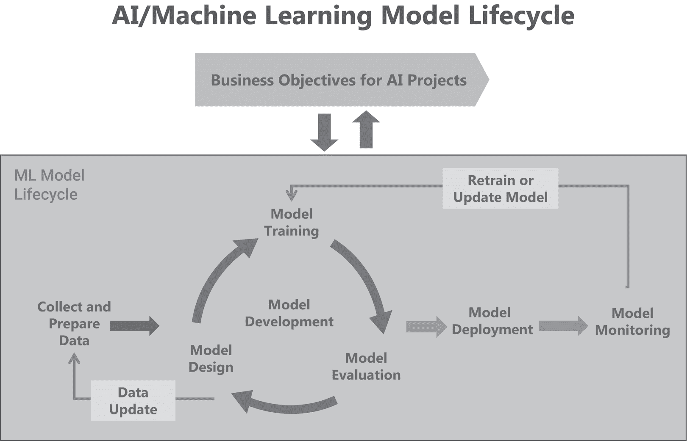

图 4.1 AI 和 ML 操作周期。

## 4.2 学习/训练方法

机器学习提供了各种从数据中学习的方法，根据预期输出和提供的输入类型按学习风格分类。创建算法的三种主要学习风格是监督学习、无监督学习和强化学习（`RL`）。表 4.1 对它们进行了比较。

表 4.1 机器学习方法比较

| 机器学习方法 | 分组 | 算法 |
| :--- | :--- | :--- |
| 监督学习 | 有标签数据、直接反馈、预测结果 | 解决分类和回归问题 |
| 分类 | 逻辑回归、朴素贝叶斯分类器、K 近邻、支持向量机、AdaBoost（自适应提升）、深度学习：卷积神经网络（`CNNs`）、递归神经网络（`RNNs`）、长短期记忆网络（`LSTMs`）、生成对抗网络（`GANs`）、深度置信网络（`DBNs`）、自动编码器 | 随机森林、决策树和人工神经网络（`ANNs`）属于这两类 |
| 回归 | 线性回归、岭回归、普通最小二乘回归、逐步回归 | 随机森林、决策树和人工神经网络（`ANNs`）属于这两类 |
| 无监督学习（基于神经网络） | 无标签数据、无反馈、搜索隐藏结构 | 解决聚类和降维。聚类 | K 均值、K 中值、层次聚类、EM（期望极大）算法、AP 传播算法、DBSCAN（基于密度的空间聚类） | 降维：特征提取，如主成分分析（`PCA`）、特征选择，如局部线性嵌入（`LLE`） |
| 强化学习（状态与动作） | 决策过程、激励系统、感知环境反馈 | 解决具有序列任务的问题。无模型：Q-learning、混合、策略优化、TD-Lambda 学习。基于模型：学习模型、给定模型 |

## 监督学习

监督学习是一种使用标记数据集生成清晰算法的创新方法。这种数据集包含输入-输出对，其中每个已提供的输入都有一个对应的输出（或标签）。监督学习的主要作用是学习从输入到输出的映射，这种映射可以外推到新数据上。从本质上讲，监督学习分为两类问题：分类（涉及输出的类别，例如垃圾邮件或非垃圾邮件）和回归（产生连续值，例如对房价的预测）。监督学习通常使用决策树、支持向量机（`SVM`）和神经网络等算法。评估模型的指标，如准确率、精确率、召回率和均方误差，通常用于衡量模型的性能。

## 无监督学习

另一方面，无监督学习处理的是未标记的数据。这些数据点应该以某种方式组织，以便我们尝试推断它们之间的某些自然结构；也就是说，这里的目标是非详尽地观察它们是如何相互对应的，并将相似性归为类，每组相似性就定义了一个聚类。在没有预定义标签的情况下，算法试图发现数据中的内在模式或分布。无监督学习的示例包括聚类（例如 k-means 聚类），算法将相似的数据点分到一组；以及降维（例如主成分分析），它通过减少特征数量来简化其表示。它在探索性数据分析、异常检测以及数据压缩方面非常有帮助。对于无监督学习，由于没有真实值标签，评估其输出质量可能会更加困难。

## 强化学习 (RL)

与传统的机器学习算法风格（监督学习和无监督学习）不同，RL 是一种新方法，提供了一种代理体在环境中采取行动以最大化累积奖励的方法。监督学习从输入-输出对中学习并被赋予标签，而无监督学习没有标签。它试图学习未标记数据中的模式和结构，而 RL 则通过执行任何特定动作后获得的奖励来学习代理体；也就是说，反馈决定了在顺序时间步中的下一步动作。代理体与环境协商并获得奖励以避免惩罚；奖励有助于改变代理体的未来行为，使其在长时间内优化奖励。这种学习过程通过算法实现，例如 `Q-learning` 和 `deep RL`，这些算法利用神经网络来近似最优动作值函数。RL 在各个行业有许多现实应用，包括机器人、游戏和自动驾驶系统，因为它在非完全未知且任务需要顺序决策的动态环境中运行效果最好。

### 4.2.1 监督学习

监督学习基于标记的输入数据工作，这些数据为训练模型提供了特定的输出，其算法拟合给定的数据。这意味着你必须预测一个数值形式的输出（回归）或为输出寻找一个类别（分类，例如类别或标签）。例如，在经典的鸢尾花数据中，根据花瓣和花萼的测量值预测鸢尾花品种是一个分类任务，因为输出标签是离散值。另一个例子可能是回归任务，可以预测西雅图地区房屋的平均价格。

底层的预测或分类在训练中更加准确。表 4.2 展示了一些示例。

| 数据输入 (X) | 数据输出 (y) | 现实应用 |
| :--- | :--- | :--- |
| 客户购买历史 | 产品列表 | 推荐系统 |
| 图像 | 德语文本 | 图像检测 |
| 问题形式的英文文本 | 英文文本 | 聊天机器人，可以对话的软件应用 |
| 音频 | 文本转录 | 语音识别 |
| 传感器数据 | 转向、制动 | 行为驾驶 |

以下列出相关算法的一些示例：

1. **决策树**：以树形结构表示的预测模型。每个叶节点将代表一种分类。属性拆分和树剪枝是决策树的一些关键问题。决策树是分类最强大且流行的工具。

2. **自适应增强（Adaboost）学习算法**：Adaboost 被认为是在同一训练集上从多个分类器学习，然后将它们组合成更强大的分类器。该算法在每次迭代后调整分布，以考虑当前样本分类的准确性以及之前分类的表现。它为每个样本确定权重，并在修改后的权重上进行训练。最后，它聚合所有可用分类器。Adaboost 可以处理二分类、多分类单标签以及回归问题。其流行在于可以提供更好的学习准确率而不会过拟合。经常用于人脸识别和物体跟踪。

3. **人工神经网络 (ANN) 算法**：ANN 是非线性、自适应的信息处理工具，利用能够同时执行操作的硬件精密开发。它们源于现代神经科学研究，通过模仿大脑使用神经网络处理和存储信息的方式来学习信息。人工神经网络是一种典型的并行计算模型，其工作机制与经典人工智能和信息处理系统不同。这解决了传统基于逻辑 AI 在处理直觉和非结构化信息方面的缺点，因为它可以自适应、自组织并实时学习。

### 4. SVM

Vapnik 等提出了 `SVM` 的概念 [41]。它是机器学习算法中统计学习理论中的概念。它是一种二分类算法，在 N 维空间中生成一个 N-1 维超平面以将点分为两组。`SVM` 有多种类型。它已应用于广告到人类基因剪切位点识别、基于图像的性别检测、大规模图像分类、新闻分类、手写识别等许多领域。

### 5. 朴素贝叶斯

朴素贝叶斯分类器是一种基于贝叶斯定理的概率模式分类方法，特征之间具有最大独立性。即使在数据有限的情况下它也能运行，并可以处理多分类问题，但它很大程度上取决于你如何准备数据。它被频繁用于垃圾邮件分类、文章排序、情感分析、人脸识别消费分类等。

### 6. K 近邻算法 (KNNs)

KNN 是一种分类算法，通过取特征空间中最近邻居的多数类别来为样本分配类别。由于分类决策中使用了最近邻居，因此它特别适用于类别领域存在重叠或交叉的数据集。

### 7. 逻辑回归

逻辑回归是几十年来最流行的分类模型之一，但它主要适用于二分类目标。一个简单的解释是，它是一种用于预测数据值落在两个组中哪一个的统计技术（例如在市场中购买还是死亡）。逻辑回归广泛用于信用评分、营销成功、利润预测、地震预测、流量分析、电子邮件过滤等。

### 8. 随机森林

随机森林是开发随机森林算法的一种流行方法，它可以处理回归、分类、聚类和生存分析问题。它通过自助法（bootstrapping）创建许多树回归器或分类器，其预测结果意味着做出最终选择。它是用户流失分析、风险建模等领域的常用方法。

### 9. 线性回归

线性回归是一种用于确定和量化指定两个或多个变量之间关系的统计分析方法。它经常被使用是因为线性模型往往更容易解释，而且与非线性模型相比，它们也更容易拟合。线性回归被应用于多个研究领域以及广泛的预测模型和相关性分析。

### 10. 深度学习

深度学习算法改变了我们执行图像识别等任务的方式。多伦多大学的 Geoff Hinton 小组在 2012 年左右通过改进深度置信网络，在某些问题上取得了成功，正如 2012 年 ImageNet 竞赛所示。2015 年，全球范围内多个团队开始使用深度学习方法，并达到了约 5% 的错误率，这等同于人类花费几周或几个月查看地图来完成用例。深度学习对于图像识别极其有效，这一点从机器错误率的下降可以明显看出，该比例在 2017 年已降至 2%。为了理解深度学习，这是一个简单的例子：给定图像，将它们分类为吉长鹿或大驼。我们可以认为一个实例被画成带标签的图片，然后学习算法画出一个关于如何将同一类的图片与其他类别的图像隔离开的假设。在计算机看来，图像无非是描述每个像素 RGB 值的数千数字矩阵。因此，我们需要的不是像围棋那样的假设，而是专门为图像分类设计的假设。在经过多年许多不同方法的开发后，深度卷积网络现在是计算机视觉研究中最流行的技术。这个术语包含“网络”（network），它适用于非常复杂的数学公式，这些公式被分解为组织成相互连接分支的原始子表达式，形成像网一样的。“卷积”（convolutional）一词源于应用于输入图像的卷积操作。深度学习中的“深”（deep）是指该领域使用的大多数网络由许多层组成，这使得它们的创建和优化成为可能。

#### 卷积神经网络 (CNNs)

`CNNs` 在经过多年许多不同方法的开发后，现在是计算机视觉研究中最流行的技术。

#### 循环神经网络 (RNNs)

`RNNs` 用于语言建模等任务。

#### 长短期记忆网络 (LSTMs)

`LSTMs` 是一种可以学习长期依赖关系的 `RNN` 类型。

#### 生成对抗网络 (GANs)

`GANs` 创建与真实相似的假数据。

#### 深度置信网络 (DBNs)

`DBNs` 由堆叠层构建。

### 11. 回归

#### 线性回归

拟合一条直线，使每个数据点的平方误差和最小。

#### 多项式回归

拟合一个阶为 `k+1` 的多项式，使每个数据点的平方误差和最小。

#### 贝叶斯回归

对于每个数据点，通过最小化均值误差来拟合一个高斯分布。

#### 岭回归

可以拟合一条直线或多项式，使每个数据点的平方误差和以及函数参数 `beta` 的加权 `L2` 范数最小。

#### LASSO 回归

可以拟合一条直线或多项式，使每个数据点的平方误差和以及函数参数 `beta` 的加权 `L1` 范数最小。

#### 逻辑回归

可以拟合带有 sigmoid 激活函数的直线或多项式，使每个数据点的二元交叉熵损失最小。标签 `y` 是二分类标签。

### 4.2.2 无监督学习

同样，如果输入数据没有标签或已知输出，则使用无监督学习算法。这是数据结构分析为模型提供支持的情况。结构化分析具有多种用途，例如减少冗余或组织相似数据。

它通常涉及对数据的分析和建模，以发现未由标准映射预定义的模式。当数据集很大且标签不完整时，这种方法非常有价值。它被应用于许多任务，如客户细分或欺诈检测，这些任务拥有大量的在线数据。推荐系统通过相似性算法对数据进行分类。

#### 聚类算法

*   **K-means**: 它将数据点分组并将它们分配到簇中，使得每个点到簇中心（即质心）的距离最小。它快速且易用，但你需要指定簇的数量。

*   **EM（期望最大化算法）**: 估计带有隐含变量的概率模型的参数。基本上是可行的，但会有各种局部最优解。

*   **亲和传播（Affinity propagation）**: 它根据数据点之间的相似性计算聚类，不需要初始猜测或簇的数量。正如我之前提到的，它很强大但速度慢。

*   **层次聚类**：通过将数据划分为层次化的聚类，使用合并或分裂方法。这种方法是非确定性的，但你需要预设若干 K 个可能的聚类。

*   **DBSCAN**：用于寻找密集连接的点集，这些点共同形成一个聚类。易于扩展，但依赖于超参数。

## 降维算法

*   **主成分分析 (PCA)**：它将具有可能相关变量的数据集转换为一组线性不相关的变量，这些变量称为主成分。

*   **局部线性嵌入 (LLE)**：这种降维方法提供了一个局部数据结构的低维数据空间，具有优化的特征向量，以在保留信号属性的同时确保非线性信号的适应。

当人们需要从无标记数据中学习并了解其数据结构时，这些算法是至关重要的。这些算法非常有条理，可以在不利用标记示例的情况下发现数据中的自然结构和层次结构——这种学习具有重大意义，因为现实世界中的大多数数据都是无标记的，我们很难对它们进行标记。表 4.3 提供了一些无监督学习的示例。

### 表 4.3 无监督学习的示例

| 输入 X | 输出 Y | 应用 |
| --- | --- | --- |
| 语音录音 | 转录文本 | 语音识别 |
| 历史市场数据 | 未来市场数据 | 交易机器人 |
| 照片 | 描述 | 图像标记 |
| 药物化学属性 | 治疗效果 | 制药研发 |
| 商店交易详情 | 是否为欺诈交易 | 欺诈检测 |
| 食谱成分 | 客户评论 | 食品推荐 |
| 购买历史 | 未来购买行为 | 客户留存 |
| 汽车位置和速度 | 交通流量 | 交通灯 |
| 人脸 | 姓名 | 人脸识别 |

## 4.2.3 强化学习

强化学习（RL）是一种非常有效的机器学习方法，也有其适用性。我们并不强制 AI 系统做出我们希望的决策；相反，我们让它在做出良好决策（或理想的错误决策）时通过支付奖励信号来自动学习在每个决策过程中如何行动。从长远来看，这种系统旨在获得最大奖励，即收到的正奖励。强化学习通过一些“反馈”循环将自监督学习原理推向了高度。

强化学习就像观察猫捕猎：产生预期结果的动作会得到强化。强化学习很早就在迷宫求解和游戏玩等实验室示例中发现了它的存在。其核心是训练软件智能体采取使累积奖励最大化的动作。这种思想引导智能体通过状态，通过试错学习哪些状态带有最高奖励。强化学习（通常与深度学习结合）帮助自动驾驶汽车等机器自动练习并获取技能，尽管这需要大量的数据和模拟。在现实中，软件智能体与环境交互运行。设置环境需要人工干预，奖励函数应该如何定义？换句话说，强化学习的目标是发现通向理想状态的行为，而不是直接学习奖励。它还与自动规划密切相关，并使用模拟作为练习环境。强化学习正在视频游戏中复兴，它仍然是训练我们算法的理想战场。


该算法与环境交互，环境再次对其做出响应（作为反馈），因此算法获取输入以学习能够满足其目标的最佳边界动作。然而，强化学习背后的数学假设与监督学习或无监督学习略有不同。监督学习和无监督学习在很大程度上基于统计方法，而强化学习涉及离散数学和随机过程。基础算法示例包括：[34]

- **`TD(λ)` 算法**：强化学习中的关键学习技术之一是时序差（TD）学习。它是蒙特卡洛和动态规划思想的混合。你不需要系统模型即可仅使用 TD 学习让你的策略以无模型的方式从智能体生成的数据中学习。此外，类似于动态规划，TD 算法涉及对估计值函数进行迭代。

- **`Q-Learning`**：`Q-Learning` 是一种无模型强化学习算法，被称为离策略 TD 学习。与 TD 算法不同，`Q-Learning` (`QL`) 使用状态动作对的奖励和 Q 值 (`Q(s,a)`) 进行迭代。智能体在每次学习迭代向前移动之前检查每个动作，以确保学习过程的收敛。

## 4.3 AI 性能评估方法

AI 系统已嵌入到越来越多的应用程序中，涵盖自然语言处理、计算机视觉等。有必要评估这些 AI 系统的有效性、可靠性和泛化能力。

艾兰·图灵在 1950 年发明了图灵测试，作为判断机器是否能通过与人类对话而不被识别为机器来显示出智能的方法。这项测试设定了标准，并提出了机器是否能思考的问题。然而，当时它倾向于认为机器应该表现像人类，而不仅仅是遵循基于规则的程序。例如，斯坦福 HELM（语言模型全面评估）是一项全面的语言模型评估。

表 4.4 提供了评估 AI 系统性能的方法配置，并与早期模型（如斯坦福 HELM）使用的方法相比 [42]。通过这些评估方法，研究人员和从业者可以从可靠性、稳健性和伦理立场出发，在实际应用领域信任他们的 AI 系统。

### 表 4.4 评估 AI 性能的方法

| 评估方法 | 描述 |
| --- | --- |
| 客观指标 | 根据一组标准对 AI 系统进行的定量性能衡量。这些指标涵盖了准确率、精确率、召回率、F1 分、均方误差等广泛范围，并具有高度的任务特定性。例如，在图像分类任务中，准确率给出正确分类图像与所有图像的比例，而在其他情况下，准确率代表更直观的含义。它们产生的客观指标有利于在不同模型和算法之间进行清晰的比较。 |
| 主观评估 | 通过实际的定量或定性测试衡量质量的最佳方法，并获得评估您的 AI 输出的指标。这种响应可以通过问卷、访谈或用户研究来收集，其中人员与机器交互并提供定性反馈。主观评估对于 AI 系统中许多难以客观衡量的部分最为相关，特别是用户体验和自然语言设计。 |

## 基准数据集

在“AI Meets Abstract 2018”挑战赛中，目标是探索 AI 在多大程度上能从文本中捕捉人类概念，组织者专注于了构建基准数据集这一热门研究领域。这些数据集通常具有规模化、多样化并带有真实值（ground truth）标签等特点。著名的基准数据集包括 `MNIST`（用于图像分类）、`IMDB`（分类）和 `SQuAD`（问答）。基准数据集使科学家和从业人员能够在相似的情况下，客观地评估各种模型在相同任务上的效率。

## 交叉验证

在统计学中，交叉验证是一种模型评估方法，用于估计 AI 模型在未见数据上的性能。模型在数据的部分进行训练，并在另一部分进行测试。该过程会使用不同的部分多次进行。交叉验证对于预测模型在未见数据上的表现以及避免过拟合问题至关重要。

## A/B 测试

什么是 A/B 测试？它是一种比较测试，通常被称为分流测试。用户被随机分成若干组，在 A/B 测试中展示不同的 AI 版本。每个版本随后会根据明确定义的指标（例如转化率或用户参与度）进行绝对意义上的相互比较。A/B 测试让你能够在现实条件下评估数据科学模型。

## 错误分析

这一阶段涉及查看 AI 系统所犯的错误，以理解这些错误中的任何模式以及如何进行改进。分析被错误分类的实例特征、弄清产生这些错误的原因以及这些错误的可能来源。理解并解释 AI 的错误——即明确我们在何处以及如何失败的——可以为下一次更好的迭代提供见解。

## 斯坦福 HELM（语言模型全面评估）

斯坦福 HELM 是一个全面的框架，从性能、数据需求、泛化能力和社会考虑等多个维度对语言模型进行评估。它与 `ESL` 的技术审查同步运行，获取模型的外部视角和伦理分析。斯坦福 HELM 包含了多种评估标准，使我们能够更好地理解语言模型的表现，并突出了它们可能导致危害的地方，从而实现更负责任的 AI 系统。

# 5 AI 风险与挑战

DOI: [10.1201/9781003390695-7](https://dx.doi.org/10.1201/9781003390695-7)

本章介绍了与 AI 相关的整体风险类别，重点关注可能影响 AI 系统有效性和信任性的各个方面。它深入探讨了数据和模型质量风险，例如鲁棒性、可靠性、安全性、偏见歧视以及数据准确性和完整性。此外，本章涵盖了安全和隐私风险，包括模型安全、数据安全和数据隐私。它还探索了安全攻击技术及其缓解方法。此外，本章还讨论了 AI 伦理和社会风险，检查了如不当使用 AI 以及对社会福祉的影响等问题。通过这些讨论，本章提供了 AI 风险和挑战的全面概述，以及缓解这些风险的策略。

本章涵盖了以下主题：

* 整体风险类别
* 数据和模型质量风险
* 安全与隐私风险
* AI 伦理和社会风险
* 新兴技术的承诺与挑战

## 5.1 整体风险类别

随着 `ChatGPT` 在 2022 年发布，企业级 AI 显然达到了一个重大转折点，这将塑造许多行业新纪元的黎明。像 `ChatGPT` 这样的基础模型是非常多功能的，可以针对多个下游任务进行微调。这增加了它们在各行业的实用性。然而，此类模型数量的增加也引入了计算考虑之外的重要问题。这些问题从对 AI 责任的担忧，到如何处理偏见和虚假信息，或者它在安全和伦理原则方面意味着什么。

从未没有比现在更充满希望也更危险的时刻。AI 伦理和治理辩论由于风险的增加、治理缺口以及信任缺失而被引发。AI 的出现带来了新的、前所未有的安全风险，这些风险无法通过当前的治理框架有效解决，而且它正在加剧持续的和新的安全威胁，巩固了社会、经济、政治和战略的失衡。图 5.1

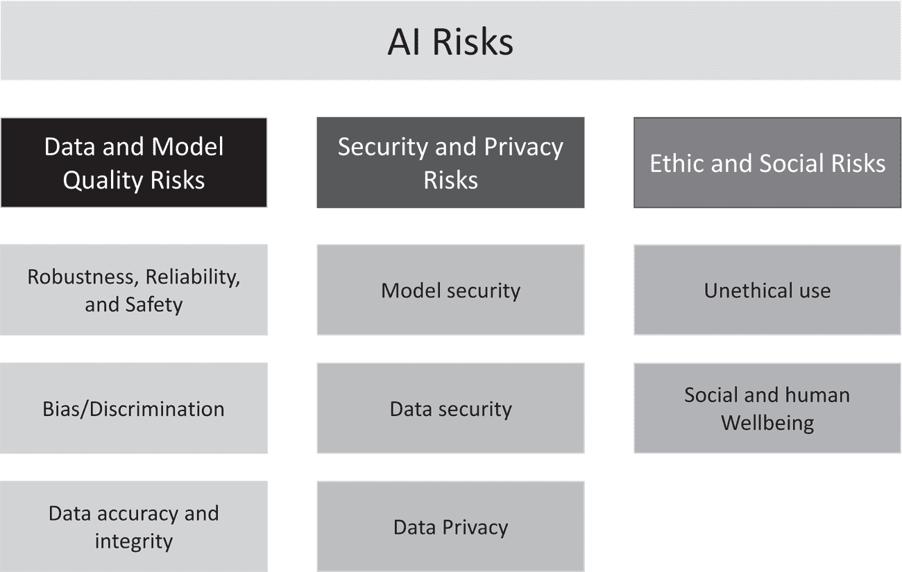

图 5.1 AI 风险类别。

此外，在安全领域使用 AI 为许多新问题打开了大门，例如恶意攻击者发起 AI 驱动的网络攻击的风险。此类技术涉及风险不仅包括传统的黑客攻击，还包括日益增长的虚假信息活动和社交工程威胁，而隐私、安全和伦理是极关重要的问题 [35]。表 5.1

### 表 5.1 AI 风险描述 (#ch5.xhtml#R_table5_1)

| 风险类型 | 风险描述 |
| :--- | :--- |
| 数据和模型质量风险 | 鲁棒性、可靠性和安全性<br>训练样本通常不涵盖所有可能的边界情况。因此，模型可能在对抗样本上无法提供正确的推理，导致鲁棒性不足，从而缺乏可靠性并引发安全问题。 |
| 偏见/歧视 | 在来自互联网的数据上训练可能会导致算法歧视/偏见。 |
| 数据准确性和完整性 | 使用生成式 AI 为你创建内容的风险在于其质量可能较低，如果经过验证（并修正），这些数据可能会出现不准确或其他问题，从而降低数据质量，最终导致数据完整性的丢失。<br>准确性：生成式 AI 可能会产生不准确和/或虚假信息。<br>数据完整性：攻击者可以注入对抗数据以影响 AI 模型的推理能力，或对输入样本添加微小扰动以改变推理结果。 |
| 安全与隐私风险 | 模型安全：服务提供商通常只想提供查询服务，而不暴露训练模型。然而，攻击者可能通过多次查询创建一个克隆模型。<br>数据安全：训练数据的机密性。<br>数据隐私：对于用户提供训练数据的场景，攻击者可以反复查询训练过的模型以获取用户的隐私信息。 |
| 伦理和社会风险 | 不当使用：知识产权 (IP) 侵权<br>虚假信息传播<br>利用模型进行网络安全攻击<br>国家监视<br>军事部署：致命性自主系统<br><br>社会和人类福祉：技术性失业：由于激烈竞争导致的 AI 能力垄断、利益分配不均、大规模劳动力流失和技术性失业。<br>人类尊严以及对生活和工作意义的心理影响，例如个体化增强和孤独感。<br>社会动荡：“无用”劳动者阶级的出现、社会动荡、由于个体化加剧导致的社会凝聚力破坏，以及风险社会的加速。 |
| 地缘政治冲突 | 地缘政治和经济权力的转移与进一步集中；缺乏国际合作；缺乏 AI 能力的国家脆弱性增加。 |
| 环境影响 | 环境影响 |

## 5.2 数据与模型质量风险

### 5.2.1 健壮性、可靠性与安全性

由于深度神经网络（DNN）的脆弱性，AI 模型容易受到逃避攻击。这些攻击会破坏 AI 系统的完整性和业务安全。表 5.2 提供了 AI 健壮性、可靠性和安全性的示例。训练样本无法涵盖所有的边界情况，使得我们的网络健壮性降低。因此，模型最终无法对干净的对抗性样本做出准确推理。在训练阶段，攻击者可以注入恶意数据以影响 AI 模型的最终性能；在推理阶段，他们还可以对输入样本添加微小的扰动以操纵推理过程的结果。

表 5.2 AI 健壮性、可靠性和安全性的示例

| # | 示例 | 结果 |
| --- | --- | --- |
| 1 | 分别在 2008 年和 2009 年，两架波音 737 MAX 飞机在自动飞行系统获取到外部环境的错误信号并未能调整飞机气动位置后坠毁。 | 两架飞机坠毁共导致 364 人死亡，波音 737 MAX 在全球范围内停飞。波音面临数十亿美元的赔偿损失和数百亿美元的未来订单损失。 |
| 2 | 2016 年 7 月，由 Knightscope 开发的一台商场机器机器执行任务时撞倒了一名一幼儿，据报道它随后在硅谷继续行驶。机器人压过了该幼儿的右腿，导致其严重受伤。该机器人是一台高 5 英尺、重 300 磅的。 | 根据新闻，即使安全机器人的成本仅为每小时 6.25 美元（远低于美国最低工资），在此类事件发生后，雇主无法信任它们。 |
| 3 | 2018 年，卡内基梅隆大学的研究人员发现，定制的眼镜框可以欺骗人脸识别算法。 | 人脸识别和监控系统可能会暴露于此类安全风险中。 |

### 5.2.2 偏见与歧视

系统可能存在固有偏见，可能是由于训练数据的偏见，或者是开发 AI 的算法很糟糕。某些偏见可以在 AI 算法和数据集中反映、加剧或缓解。数据集偏见可能引起极大关注，特别是对于少数群体（如种族少数），因为数据集不足以提供准确的世界视图。当从有偏见的训练数据（在某些重要维度上数据不平衡或代表性不足）中学习时，生成的 AI 模型可能无法泛化并做出公平决策，从而对某些群体产生歧视。更具说明性的是，如果你在一个主要包含白人脸而极少数黑人脸的数据集上训练人脸识别系统，系统的准确性将会很低。例如，Google 对“CEO”的图像搜索结果历史上显示大多为男性图像，这种基于训练数据的偏见反映了社会中的这种现象。此外，如果学习不是持续的，情况可能会恶化（例如，微软聊天机器人 Tay 开始在 Twitter 上回应黑者的攻击而重复仇恨言论）。建立完善的 AI 审计和合规机制以检测并消除此类违规行为至关重要。

人类有偏见，AI 偏见可以体现在人类构建的数据标记或奖励函数中。AI 倾向于在一切中寻找模式，这可能导致它由于人类可能忽略的细微特征而误判物体。缺乏常识和自我意识：AI 往往缺乏常识，使其在不熟悉的环境中更容易被攻破，而脆弱性使其行为变得更加不可预测 [36]。

这些仅仅是一些著名的例子。

* 2023 年 8 月，亚裔美国麻省理工学院校友 Rona Wang 使用她的照片和 AI 图像生成器进行了测试。AI 渲染的她的脸看起来像一个白人女性，在尝试尝试之后，该应用要求它为她生成一张“专业的 LinkedIn 个人照”。
* 2018 年 10 月，结果显示亚马逊的一款由 AI 驱动的招聘工具对女性存在偏见，导致其开发团队被解散。
* 2016 年，Northpointe 构建了一种 AI 算法（`COMPAS`），用于司法决策以预测罪犯的再犯率。黑人再犯的概率为 42%，而系统预测白人的概率为 22%。研究表明，在相同情况下白人和黑人的再犯概率相等。

对于依赖大型数据集的 AI 系统，必须纠正显著偏见以确保运行的公平准确。由于有偏见的训练数据，某些群体从不公平的结果中受益。解决 AI 中的偏见已成为 AI 社区的热点话题。这些努力涉及披露 AI 的使用、教授工程师如何成为伦理工程师、进行彻底测试以及审计 AI 实践。

### 5.2.3 数据准确性与完整性

使用生成式 AI 为你生成数据的危险之一在于，这些数据可能是低质量的，或者可能存在不准确，如果不进行妥善检查（并纠正），情况更糟，会大大降低数据质量，并由于存在的错误导致我们丢失数据的完整性。

它并不总是正确的，有时软件会出错。它能够写出听起来很合理但实际上错误或毫无意义的答案。问题在于，它让用户相信所听到的内容，即使并非事实。

以下是几个例子：

* 人脸识别软件由于参数设置不当，错误地将官员的照片与破坏犯画廊中的照片相匹配，错误率很高。
* 2016 年，微软聊天机器人 Tay 在与真实人类在线交流 24 小时后变“坏”了。它甚至学了很多脏话和种族主义。Tay 是一场灾难，在几小时内就被从网上撤下。

## 5.3 安全与隐私风险

人工智能拥有颠覆每个行业、每个机构的力量。然而，随着巨大的机遇和利益之而来，这种新的通用技术在安全和隐私保护方面也面临巨大挑战。AI 系统也可能是黑客或恶意软件等安全威胁的受害者。通过这种方式，它们可以操纵状态或读取敏感数据，这对于攻击者非常有吸引力。这些可能是针对数据完整性、模型完整性和模型机密性攻击的安全漏洞。换句话说：科技投资领域之一是生成式人工智能，许多机构可能还没有做好应对其安全风险的准备。然而，与所有新科技一样，我们必须智能地识别 AI 提出的新型安全风险——毫无疑问，攻击者也会试图利用任何潜在的弱点。将泛用于处理个人数据的 AI 解决方案可能会违反许多司法管辖区的隐私和数据保护法规。

AI 产生了一种新型风险，安全和 IT 领导者往往不知道如何评估这种风险。风险评估和可接受使用指南是增加 AI 安全性和数据保护的重要措施，但组织应该准备好完全重新审查现有的数据安全和隐私保护协议，并制定进一步改进所需的策略，以进一步减少因企业级采用 AI 解决方案带来的风险 [38]。图 5.2 显示了组织正面临的 AI 和 ML 安全挑战。

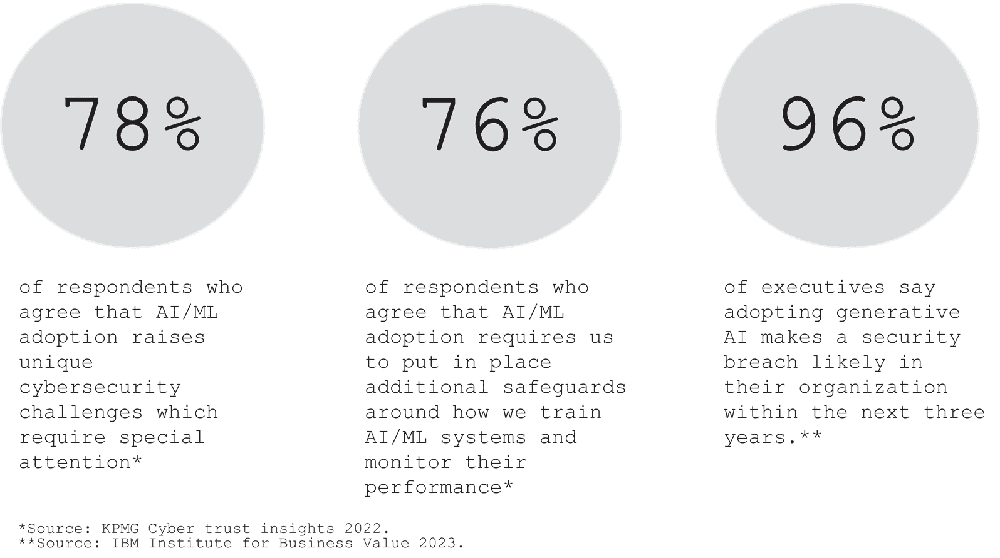

图 5.2 AI 和 ML 安全挑战调查。

### 5.3.1. 安全攻击与缓解技术

尽管 AI 具有变革许多行业的潜力，但它并不能免受安全漏洞的影响，特别是在关键应用中（例如医疗、交通和监控）。具有内置漏洞的 AI 算法会被攻击。攻击者可以绕过 AI 驱动的识别工具、操纵数据输入，或以恶意方式与 AI 系统交互。AI 系统软件安全漏洞的控制和管理必须进行端到端管理，从传统的软件漏洞到新的 AI 特有漏洞。就像传统软件会有 Bug 一样，AI 系统也有漏洞，但增加了 AI 漏洞相互作用的复杂性。因此，多层安全方法对于完全覆盖至关重要。

例如，应用程序、模型、平台和芯片可能隐藏恶意行为可以利用的 Bug 或后门。`TensorFlow` 曾包含多个严重漏洞。这些漏洞可能被黑客利用来攻击机器人或使设备失效。攻击者还可以在模型中插入后门以实现更复杂的攻击。攻击者可以在训练阶段篡改数据以影响 AI 模型的推断能力，或者攻击者可以在判断阶段向样本中加入少量噪声以改变其判断结果。由于 AI 系统某部分的漏洞，前端可能会被利用来损害后端模型。此外，漏洞可能被利用，模型的输出可能对业务逻辑产生上游影响，由于从模型进行类型安全的文本测量，可能导致下游系统攻击，如 `SQL 注入`。

关于向 AI 系统输入数据，您面临的最大风险是泄露敏感数据。这可能会导致严重后果，例如机密性泄露（随之导致收入损失）或知识产权/商业机密泄露。例如，`ChatGPT` 目前会捕获并存储聊天流，其中可能包含敏感的公司信息（例如 IP、源代码、商业机密、PII 和其他数据），未经授权的访问或数据泄露可能导致此类机密的暴露。

#### 5.3.1.1 攻击与缓解技术总结

由于 AI 安全是一个新且不断发展的领域，其主要目标是围绕利用人工智能的系统和数据建立强大的防御。虽然标准化的最佳实践仍在建立中，但现有方法侧重于保护您的数据并积极监控攻击。然而，我们距离“不可攻击的 AI 系统”这一概念还很远。表 5.3 列出了一些常见的 AI 系统攻击技术 [39]。

表 5.3 常见 AI 系统攻击技术

| 攻击目标 | 攻击技术 | 风险 | 缓解技术（非详尽列表） |
| :--- | :--- | :--- | :--- |
| 用户输入 | 逃逸攻击 | 在逃逸攻击中，攻击者更改输入数据，导致 AI 模型产生错误识别。 | * 网络蒸馏<br>* 对抗训练<br>* 对抗样本检测<br>* 输入重构<br>* DNN 验证 |
| 训练数据 | 数据投毒 | 攻击者将数据注入模型的训练数据中，意在使其表现糟糕，提供不可信的输出。最危险的结果是在故障发生（如系统宕机）之前无法察觉。 | * 训练数据过滤<br>* 回归分析<br>* 聚合分析 |
| 数据外泄 | 数据外取 | 虽然在某些情况下数据泄露风险可能被夸大，但它们仍然巨大的危险。由于使用编排层、代理或向量数据库的 LLM 系统会导致信息泄露，例如丢失知识产权。 | * 隐私聚合防御 (PATE)<br>* 差异隐私<br>* 模型水印 |
| AI 模型 | 模型反转 | 这是人工智能领域的一种安全威胁，攻击者试图通过获取使用反向传播训练良好的大型 AI 模型的权重和能力，而无需从零构建自己的模型。 | * 隐私聚合防御 (PATE)<br>* 差异隐私<br>* 模型水印 |
| 算法投毒 | 算法投毒 | 这种方法通常针对使用联邦学习的 AI 应用，在这种情况下 AI 模型是分离训练且不合并的。这种方法使模型受到单个站点的攻击。每个站点都可以调整其本地算法和数据，从而污染大模型。系统的知识允许攻击者识别出更理想的投毒数据。 | * 训练数据过滤<br>* 回归分析<br>* 聚合分析 |
| 绵绵攻击 | 绵绵攻击 | 传统的绵绵攻击类似于常见的拒绝服务攻击。它们通过向 AI 系统发送超过其处理能力的请求来降低性能并浪费额外能量。更高级的绵绵攻击是攻击者利用海绵结构的某些特性来创建具有特定属性的输出。 | 根据预定义的阈值重置 AI 系统 |


## 5.3.1.2 逃逸攻击

逃逸攻击是指攻击者操纵输入数据，导致 AI 模型无法正确识别输入。在这些攻击中，逃逸攻击是学术界研究最广泛的类型。

### 5.3.1.2.1 对抗示例

我们知道，用于训练神经网络的系统容易受到某些样本的影响。这些输入样本被称为`adversarial examples`（对抗性示例），当我们在原始样本中加入微小到不可察觉的扰动时，它们看起来与正常样本相似，而大多数深度学习模型很容易被这类输入所欺骗。从根本上说，`adversarial examples`归于人眼无法与未修改图像区分的极微扰动；通过带有不可察觉扰动的原始样本输入深度学习模型也会损害其性能。换句话说，它欺骗分类器，使其形成跨越不同分类边界的样本。研究人员提出了几种产生对抗样本的方法，其中`Carlini and Wagner (CW)`攻击几乎可以完美地生成对抗样本，并能击败大多数针对对抗样本的防御机制 [40]。例如，音频对抗样本可以欺骗语音识别系统，使其转录攻击者想要的任何内容。目前已经提出了诸如堆叠多个分类器系统或训练对对抗样本具有鲁棒性的 AI，但这种脆弱性在不同的 AI 应用中普遍存在，与可靠性和安全性相关的风险仍然存在。

规避攻击发生在测试阶段，在此阶段，任何人类被误认为这是该人工智能认为的内容，而基本上是输入图像经过轻微处理，导致 AI 模型产生误读，但人类能正确推断。规避攻击的示例如 Table 5.4 所示。对于物理对抗样本，我们将考虑复杂的情况，如(1) 不同背景上的相似扰动；(2) 距离/角度的多样性；以及(3) 光变。

### 表 5.4 规避攻击示例

| 案例 | 描述 |
| --- | --- |
| 图像误分类 | “熊猫”图像由于添加了噪声被误分类为“长臂猿”。在“停止”交通标志上添加“噪声”以干扰自动驾驶汽车的响应。Eykholt 同事修改了物理交通标志，导致 AI 交通标志识别算法将“禁入”标志识别为“45 公里限速”标志。 |
| 音频系统的白盒攻击 | 对语音进行轻微调整即可让 AI 模型将语音翻译成完全不同的文本。`Mozilla DeepSpeech`实验表明，添加`0.1%`的扰动即可达到 100% 的攻击成功率。 |
| 阅读理解 | 对句子进行轻微调整可以显著降低 AI 模型的理解能力。在对抗设置下，16 个发布模型的准确率从平均`F1 score` `75–36%`下降。当加入不符合语法的单词序列时，平均准确率进一步下降到`7%`。AI 中的`F1 score`是衡量模型准确性的指标，同时考虑了模型的精确率（precision）和召回率（recall）。`F1 score`将精确率和召回率结合成单一指标，当你希望在评估中平衡两者时，它是一个非常有用的衡量标准。在那些希望在最小化假阴性（漏掉的正例案例）和假阳性（错误预测的正例案例）之间找到最佳平衡的情况下，它特别有帮助。 |

### 5.3.1.2.2 提示词注入 (PI)

卡内基·梅隆大学开发的一种算法表明，AI 聊天机器人（如`ChatGPT`或其他模型）对操纵的抵抗能力并不如人们想象的那么好。尽管提示词的目的是让用户避免提交攻击性内容，但研究人员发现了一种通过在提示词中添加看似无害的文本字符串来绕过防御的方法。这种发现指向了 AI 聊天机器人一个更根本的弱点，即无法区分最相关的回复，而如果你想将它们部署到实时环境中并确保它们不会失控，这就会产生问题。这个漏洞对 AI 聊天机器人的未来安全性和安全性引发了一些非常重要的问题。

AI 内容和数据安全面临的最重大威胁之一（特别是随着大语言模型`LLMs`的兴起）是`PI`攻击。这些攻击使用精心选择的提示词操纵模型，通过建议禁止的内容来鼓励其执行非法行为，从而有效地违背了内容生成规则。

`PI`带来的风险无法完全消除，因此必须以更微妙的方式进行管理。一个主要风险是代理执行（agent execution）。这是令人担忧的地方，因为编排器使用`LM`输入与企业数据对接并在代理中执行命令。这些情况类似于你可能在`SQL injection`中看到的漏洞类型，攻击者通过插入允许其从数据库中提取其他数据的命令。

`PI`是`LM`安全中的一个复杂问题，它需要新的方法和持续的警惕来最小化威胁并防止攻击。`PI`如此复杂说明了它是多么真实且危险。它已经超出了理论阶段，需要非常周全的、战略性的规划，以便管理这些危害。

### 5.3.1.2.3 缓解技术

本节提供了 AI 系统数据收集、模型训练和使用阶段的防御技术列表。然而，每种防御技术都有其特殊用途，无法消除所有的对抗样本。提高模型稳定性也可以增强对规避攻击的防御，在保持功能的同时增强模型抵抗输入扰动的能力。并行或顺序结合这些防御技术可以对规避攻击提供更好的保护。除了这些技术之外，还可以进行模型鲁棒性改进，这在增强对输入扰动抵抗的同时，保留了模型的功能以防止规避攻击。Table 5.5 提供了防御技术的示例。可以通过并行或串行结合多种防御技术来挫败规避攻击 [39]。

### 表 5.5 防御技术示例

| 阶段 | 方法 | 描述 |
| --- | --- | --- |
| SDLC | 网络蒸馏/迭代对抗训练 | 包括在模型训练期间串行训练一系列`DNN`，并使用第一个`DNN`生成的输出训练第二个，以此类推。这是一种知识迁移技术，使模型对微扰动不敏感，提高其对规避攻击的鲁棒性。 |
|  | 提示词扫描器 | 这些扫描器执行已知的用例，尝试破解上下文和提示词并提供详细结果。它们的智能性是这类工具的特点。它们经常利用内置的语言模型 (`LM`) 能力进行广泛的探测。这使得可以在提示词推向生产环境之前测试其弹性。它们可以被视为软件开发生命周期 (`SDLC`) 中的红队工具。 |
| 部署与运行 | LLM 隔离 | 一种建议的方法是双`LLM`模型，将`LLMs`分为具有独立能力和访问权限的特权形式，并路径到专用框架。 |
|  | 防火墙 | LLM 防火墙作为代理解决方案检查入站文本的恶意内容。 |

数据投毒是一种攻击手段，攻击者通过投毒训练数据来构建在攻击者输入上表现不优良的分类器，从而欺骗后端分类器和控制系统。在投毒攻击中，攻击者故意向训练数据中注入专门设计的样本，以污染数据并以此干扰 AI 系统的正常运行，结果可能导致绕过安全检测。由于训练样本数量庞大，很难保证深度学习所需的样本质量。投毒攻击主要分为两种：数据投毒和算法投毒。

最佳防御措施是在 AI 模型周围建立强大的边界，包括加密以及在可能的情况下使用入侵检测系统。如果攻击成功，一种良好的解决方案是通过重建模型来修复，这凸显了拥有可靠备份的重要性。

### 5.3.1.3.1 数据投毒

数据投毒利用操纵训练数据来修改模型的行为。这种攻击可以通过常见的数据通道进行。攻击者可以向这些来源引入受操纵的数据，从策略性地影响模型训练数据中的虚假事实。例如，在数据投毒中，攻击者还会使用生成的内容替换特定词汇，类似于 SEO 攻击，但针对的是机器学习。然而，无论 AI 机器人的数据集有多大，都容易受到这些操纵的影响，这表明我们所知的数据世界可能成为虚假信息的新前沿。机器学习数据的去中心化从整体尺度上来说既令人兴奋又令人担忧，因为它让人们在收集公共数据时对 AI 系统的完整性和可靠性产生了更多个人怀疑 [44]。

数据投毒攻击在在线学习场景或定期重新训练组件以更新模型的系统中非常强大，因为攻击者有权访问训练数据。常见的示例包括推荐系统、自适应生物识别系统、垃圾邮件检测系统等。典型的数据投毒攻击分为三个阶段：

* 根据目标特征选择不同的训练集，但让模型对这些输入产生相同的输出。例如，给定一个猫和狗的二分类任务。
* 启动恶意软件样本收集（从任何来源），并对这些恶意样本进行梯度更新（取决于用例，构建损失函数并使用梯度上升策略），直到获得预期的效果。
* 将恶意样本集积累到受害者模型的训练集中。

尽管我们长期以来一直知道如何进行基础的数据清洗，但可信来源（如维基百科）语境的变化制造了更阴险的问题。数据投毒可能导致严重后果，特别是在使用内部数据实现任务自动化或帮助员工的企业环境中。数据投毒与隐私泄露（PI）之间的界限变得更加模糊；这在未来将无法轻易解决。随着 AI 微调面向更广泛的人群，且训练与推理之间的界限比以往任何时候都要模糊，技术需要制定新的解决方案来应对数据投毒和隐私泄露。

风险和安全研究人员必须对 LLM 进行严格审查，以理解反馈循环以及其他 AI 挑战（如 AI 偏差引起的问题）如何导致 AI 输出不可靠的结果。

### 5.3.1.3.2 算法投毒

联邦学习是 AI 模型训练的一种形式，允许你使用来自数百万客户端设备的数据来训练模型，而无需在中央服务器上聚合任何数据。这使得整个模型容易受到来自单个设备的攻击。每个站点都可以操纵其本地算法和数据，从而投毒模型。[45]。通过在训练数据中加入极少量的投毒数据，攻击者可以改变推理结果。攻击者注入的污染数据量可能根据他们所处业务类型而有巨大差异。算法投毒攻击通常由蓄意的攻击者执行，他们向机器学习模型的数据集中注入虚假的、恶意的数据。他们利用迭代训练机制引导最终模型更接近目标，从而导致检测率降低。

### 5.3.1.3.3 缓解技术

有三种缓解投毒攻击的主要技术，如下所示：

* **模型聚合**：这里的思想是以分布式方式拥有模型；即，不是使用一个包含所有训练数据的模型，而是将其分配，使每个实体都有自己的副本，并对这些进行聚合得出结果。例如，一种方法可能涉及根据标签特征检测出潜在的投毒攻击数据点，并从待重训练集中剔除这些攻击点 [46]。
* **回归分析**：用于利用统计过程发现或学习数据集中的噪声和异常值。某些技术包括为模型定义不同的损失函数以识别异常值，并利用数据的分布特征。
* **集成分析**：侧重于结合多个子模型，以提高机器学习系统应对投毒攻击的整体韧性。AI 系统由许多自主模型（在不同数据集上训练）组成，从而最小化了针对投毒行动的攻击面。其他技术，如控制数据收集、数据过滤以及定期重新训练/重新更新模型，也有助于增加 AI 系统应对投毒攻击的韧性。

### 5.3.1.4 模型和数据外泄

在人工智能技术的部署中，它们使用的数据不仅会被攻击者窃取，基于这些数据构建的模型运行原理也可能受到不同类型攻击的挑战。模型窃攻击能够大规模地盗取 AI 模型，攻击者可以获取所有知识，包括模型学习的数据特征和模式。这可能导致母模型的专利信息泄露，并可能削弱其竞争中的技术优势。

#### 5.3.1.4.1 模型提取攻击

攻击者可以通过他们访问的接口向目标模型提交某些输入数据，或者对模型进行黑盒攻击并从该模型收集输出结果。收集大量的输入输出对允许攻击者缓慢重建模型的架构、权重和参数信息，最终得出一个原始模型的副本。

除了学习模型的细节外，攻击者还可能提取用于训练该模型的训练数据，并利用它们（或其极小版本）来训练他们基于对抗机器学习的系统。AI 服务提供商带来了类似于云计算中软件即服务（`SaaS`）的 AI 即服务（`AIaaS`）。这些服务提供了`APIs`，用于对图像分类、语音识别等模型进行训练和执行推理。模型提取攻击面临着双方面的问题：(1) 由于在收集样本和训练模型上投入了大量资金（即昂贵的流程），对价值知识产权的外泄构成了威胁；(2) 成为黑盒防御规避攻击的实现者，从而使攻击者具备利用盗取的模型构建对抗工具的能力。表 5.6 提供了三种典型的模型提取方法。

### 表 5.6 三种典型的模型提取方法 (#ch5.xhtml#R_table5_6)

|  | 方法 | 描述 |
| --- | --- | --- |
| 1 | 逻辑回归/内核逻辑回归 | 逻辑回归：恶意行为利用模型输入和输出数据的解密（例如方程求解和重训练攻击）来恢复 MLaaS 提供者模型的参数，导致模型泄露。例如，考虑一种场景：MLaaS 提供者使用逻辑回归（`LR`）作为分类模型，攻击者可以查询接口获取某些特定`x=1`或`x=2`的`0.88`和`0.95`的置信度评分`p(x)`。由此，攻击者可以建立一个有两个未知数的方程组并求解，以学习提供者的精确模型参数集 [47]。针对内核逻辑回归（`KLR`）分类器的模型反向攻击：攻击者请求模型给出数据集的最终分类结果，并获取每个数据点的类别和概率。如果攻击者拥有足够的输入结果，可以通过建立方程组找到构建模型的训练数据 [48]。 |
| 2 | 超参数窃取攻击 | 超参数：针对超参数优化的超参数窃取攻击涉及指定一组可以改进功能和泛化学习机器的最优参数，这是各种核心概念。改变超参数可能会导致非常不同的模型预测。攻击者可以进行超参数窃取攻击以检索提供者的超参数。在超参数窃取攻击中，攻击者向 MLaaS 服务提供者发送数据，并要求其使用经验贝叶斯正则化训练逻辑回归模型。提供者向挑战者发送一组模型参数`θ`。攻击者随后使用该模型计算某些数据`X`的分类概率`p(X)`，计算带有正则项的损失函数梯度，将该梯度置零，并求解方程得到最终超参数`λ`。 |
| 3 | 模型逆向工程 | 这是另一种研究从 AI 及其数据集检索智能能力的攻击。攻击者可以通过观察和推理用于训练的数据（甚至更糟，复制这些数据）以及部署模型提供的数据来重构机器学习算法。攻击者可以获取目标模型的训练数据集或中间输出，并使用这些数据重新训练一个与原始模型相似的模型。这最终消耗大量的计算资源和时间，但具有复制原始模型功能和性能的潜力。 |

#### 5.3.1.4.2 数据外泄

数据窃取——数据盗窃，尤其是训练数据——提高了输入攻击的效率。所有 AI 系统都容易受到此影响。对数据泄露的恐惧无处不在；然而，这种恐惧可能被过度夸大了。为了从库中实际提取数据，你需要三个因素：足够的参考、对秘密格式的了解，以及一个检查正确性的密钥。

如果你考虑一个攻击者试图从`LLM`中获取社会安全号（`SSNs`），这就是他们正在寻找的：他们必须添加一个挑战，了解某些社交信息，然后验证答案的正确性。在通常情况下，数据泄露风险往往被炒大且可能不会发生，但在某些情况下它们会变成严重威胁。例如，当`LLM`系统构建在编排层、代理或向量数据库上时，数据泄露可能是一个关注的问题。

#### 5.3.1.4.3 缓解技术

对训练数据和模型权重进行加密，并将交互限制在模型接口，可以极大确保防止盗窃攻击的安全。使用 AI 模型的开源软件开发者和研究人员可以使用这些技术消除大规模的模型盗版。表 5.7 提供了安全攻击和缓解措施的示例。此外，一些研究人员开始考虑各种更安全的 AI 模型设计和训练技术，以降低模型被盗的风险。

### 表 5.7 安全缓解措施示例 (#ch5.xhtml#R_table5_7)

| 阶段 | 技术 | 描述 |
| --- | --- | --- |
| 模型训练 | 隐私保护聚合教师集成 (PATE) | 这涉及将训练数据划分为不相交的子集，每个数据集作为`DNN`模型的独立训练数据。这些模型通过投票共同训练一个学生模型。这种方法保证了学生模型的预测不会泄露训练数据中的词示例，从而通过使用这些训练良好的学生模型而非大语言模型（也称为教师）进行推理来保护用户隐私 [49]。 |
|  | 差分隐私 | 作为模型训练的一部分，该技术分别向数据或模型训练步骤引入噪声，并遵循差分隐私原则。例如，建议使用差分隐私生成隐私梯度以防止模型数据泄露 [50]。 |
|  | 模型水印 | 一种模型训练期间的技术；在原始模型之上添加特殊的标识神经元。可以通过唯一的输入样本对模型进行检查，以区分是否存在相似模型，并识别这些模型是否是从原始模型中窃取的。 |
| 部署与运行 | 访问控制 | 限制对模型接口和向量数据库的访问。 |
|  | 加密 | 对训练数据和模型权重加密。 |
|  | 租户控制 | 确保多租户访问限制。 |

#### 5.3.1.5 海绵攻击

海绵攻击有两种类型：

1. **传统海绵攻击**：传统的海绵攻击类似于常见的拒绝服务攻击。它们涉及向 AI 系统发送超过其处理范围的请求，以降低性能并导致过度的能量消耗。
2. **高级海绵攻击**：在高级海绵攻击中，攻击者识别允许他们攻击其哈希值的海绵结构。攻击的目标是从给定输入产生所需的输出。为了实现这一点，攻击者选择输入数据并进行相应调整（由观察输出数据的反馈辅助）以实现目标。在这些攻击中，攻击者可以消耗模型的硬件资源来实现 AI 模型的拒绝服务。底是，这种攻击试图利用神经网络消耗额外的计算能力，可能会超过系统资源并导致崩溃。

一种良好的防御方法是在当 AI 系统达到能量消耗阈值时自动重置，以此检测所有已实现的漏洞。这使得系统能够在在自动达到特定阈值之前，对其使用进行监控和控制。为此，设定了一项规则，即如果 AI 系统的能量消耗超过了为其设定的上限（例如，在一小时内），它将触发该 AI 的重置。这种保护不仅确保了分配的 AI 不间断运行，还作为代理保护措施，缓解因设备过载消耗而可能导致的故障或干预。它通过减少高能量强度长时间运行的风险，帮助系统更具韧性。此外，通过实施能量阈值重置机制，可以提高 AI 部署的组织安全性和稳定性，从而在不同的运行场景下对 AI 解决方案的可靠性和性能建立整体更健壮、更信赖的信心。

### 5.3.1.6 漏洞后门

在许多方面，与传统程序一样，AI 模型也可以被植入后门，尽管此时应该只有其创建者知道这些后门，并通过执行某些触发操作来激活它们。然而，传统程序拥有源代码，而神经网络模型只是一堆参数，这意味着后检测后变得更加困难。后门通常通过在神经网络模型中预留人工神经元来实现。这些后门的添加使得模型在面对常规输入时仍表现正常，但在某些对抗性输入下会作为触发点产生特定的响应。

特洛马攻击还涉及使用对抗样本对 AI 训练数据进行投毒。另一方面，这在攻击者持有相关的特定密钥之后才会显而易见，该密钥被用作触发刺激。这种方法让黑客能够以手术刀般的精确修改模型的行为，同时让其在典型情况下保持正常运行。[表 5.8 提供了漏洞后门缓解技术的示例。

表 5.8 漏洞后门缓解技术示例

|  | 方法 | 描述 |
| --- | --- | --- |


| 1 || 输入预处理 || 该方法旨在过滤可能触发后门的输入，减少激活后门和改变模型预测的风险 [51]。 |

| --- || 模型剪枝 || 该技术涉及选择性地从原始模型中移除神经元，以在保持正常功能的同时降低后门神经元激活的概率。利用细粒度剪枝方法可以移除构成后门的神经元，从而防御后门攻击 [52]。 |

### 5.3.2 数据隐私与保护

AI 系统需要数据——大量的数据——来进行学习和决策。它可能会受到损害，因为数据也可以被访问或用于违反公共隐私权。支持人工智能的修辞使得这种威胁变得尤为显著，因为随着 AI 的发展，通过指数级增强在个人数据上执行的计算工作量和速度，将增加利用数据威胁隐私利益的能力。

数据日益的商品化本质上使得开发 AI 技术时使用个人数据处于了高度严苛的审视之下。数据隐私和保护风险的类型总结在表 5.9 中。深度学习依赖于一个可能包含大量个人数据的输入层，其运行方式与通过训练集训练后执行任务机器学习相同。尽管有安全措施来保护深度学习过程中使用数据，但由相关法律规定的“数据最小化”整个隐私原则是深度学习本身不可不可的组成部分。

表 5.9 数据隐私与保护风险示例

| 场景 || 风险 || || 描述/示例 |

| --- | --- | --- | --- |

| 模型训练 || 存在个人数据纠缠在用于训练 AI 模型的数据中的风险。 || 数据过度收集 | 相关数据公司可以获取有关用户通常如何度过大部分时间的大量信息，范围从他们购物、如何娱乐到他们的交通工具。意大利：2024 年 3 月，意大利数据保护机构（DPA）针对 OpenAI 数据处理的合法性发起了调查。 |

| --- | --- | --- | --- |

| 数据集组合 | AI 模型可以从各种第三方源学习，包括公开数据。它可以在不浏览网页的情况下推断信息、执行推理并完成任务。 |

| 模型使用 | 存在通过用户与生成式 AI 系统交互收集和利用个人数据的问题。 || 数据泄露风险 | 与 ChatGPT 等 LLM 交互的员工的个人信息以及公司秘密可能被无意中用作训练模型的数据，程度取决于这些员工进入公司内部内容（如代码、报告材料或批量文档翻译）的程度。 |

| 数据滥用 | 例如，一个用于确定患者药物剂量的 AI 算法可能会根据该剂量重新构建出患者的遗传信息，从而侵犯其隐私。 |

| 自动决策 | 通过在员工咨询、审批流程，甚至在建立薪资系统和解决 IT 问题中使用 AI 模型来提高管理效率，ChatGPT 就是一个很好的例子。当自动决策过程在未经过适当通知和同意的情况下使用 AI 时，它可能会违反监管要求（例如 GDPR）。 |

| 跨跨境数据传输 | AI 技术的全球化是不可避免的。这意味着当未来公司集成类似 ChatGPT 的 AI 服务时，他们可能同时与海外公司共享数据。例如，正如 OpenAI 隐私政策中详细说明的，ChatGPT 会收集诸如“用户账户信息（例如姓名和电子邮件地址）、输入或上传的内容（由服务处理的文本或其他数据）”等数据。OpenAI 的服务条款授予 OpenAI 对用户输入和输出内容的训练权。监管合规要求数据处理人员通过标准合同满足跨境合规要求，或对数据出口进行评估。 |

| 数据保留与删除 | 考虑数据保留和从 AI 系统中移除旧数据的影响。删除数据会减少系统对训练数据的记忆，导致结果不够准确，并丢弃无贵的知识。对历史数据和时间趋势的访问——这对于理解事物的变化以及疾病模式等至关重要——其本质变得不可访问，例如与医疗保健或研究相关。 |

## 5.4 AI 伦理与社会风险

### 5.4.1 AI 的不道德使用

AI 是一把双刃剑，因为 AI 的发展不仅将引发技术变革，还将对社会运行的核心机制产生深刻改革，包括社会实践、规则、商业法甚至战争法。对 AI 的广泛担忧导致了 AI 伦理问题。缺乏对 AI 的管理和控制可能会被不实地使用。表 5.10 显示了一些 AI 不道德使用的示例。

| 领域 || 影响 |

| --- | --- |

# 知识产权侵权

AI 知识产权侵权的主要影响包括：

- **所有权与归属**：关键问题之一是，谁拥有 AI 系统全部或部分创建内容的知识产权，以及这些内容是如何被使用的？对于 AI 生成作品的版权保护和作者身份，目前尚缺乏明确的指南。

- **法律与监管问题**：现行的版权法可能不足以涵盖 AI 生成的自然语言输出中缺乏原创性的问题；考虑到 AI，我们需要建立连贯的法律框架来保护和监管知识产权。

- **检测与执法**：AI 的进步结合数字内容分发的全球化特征，使得知识产权持有者更难检测到其权利被涉嫌侵犯的情况。

- **对创新的影响**：如果创作者和企业在判定 AI 生成作品时不了解自己的权利和受保护措施，对侵犯知识产权的担忧可能会抑制创新。

- **伦理**：在谈论 AI 知识产权侵权时，伦理起着重要作用，主要体现在人工智能技术的创造和利用上，以及使用此类 AI 技术产生非法或恶意内容的风险。

- **国际合作**：鉴于数字内容和 AI 技术在全球范围内的普及，国际合作以及知识产权法律法规的统一对于有效应对 AI 知识产权侵权至关重要。

# 虚假信息的传播（例如虚假内容、仇恨内容）

AI 传播虚假信息的主要影响包括：

- **可靠性与信任**：AI 创建的虚假信息会损害人们对信息源和机构的信任，让他们无法区分哪些是可靠信息，哪些是纯谎言。

- **舆论**：AI 可以加强虚假信息的传播，让假新闻影响有关政治和社会和文化问题的舆论。

- **对民主进程的影响**：AI 传播的虚假信息可以通过扭曲公众辩论、选民理解和选举结果来破坏民主进程。

- **社会分裂与极化**：AI 辅助可能导致社会分裂，呈现一系列极化观点并加深社区间的隔阂。

- **经济和声誉损害**：企业、组织和个人可能会因人工智能传播的虚信息而遭受财务损失。

- **监管与法律**：通过有效监管实施责任强化和损害最小化，是解决 AI 驱动的虚假信息中的一个复杂问题。

- **伦理考量**：我认为伦理考量的一个大点是负责任的 AI 开发、部署和使用，以避免谣言传播并保持正常业务顺畅运行。

# 将模型武器化用于网络攻击

- **武器化模型**：将`AI`或`ML`模型用于非法且有害的恶意或攻击行为。武器化模型可以部署在多种攻击场景中，从网络攻击到隐私侵犯，再到社会工程等。

- **恶意软件集成**：`AI`集成允许各种形式的恶意软件，借此可以构建深度攻击。`AI`模型可以帮助创建新的危险`CVE`或攻击工具，使这些威胁绕过检测和过滤机制。

- **机器学习算法**：这些算法使`AI`能够发现源代码周围未公开的漏洞。黑客已经证明了这种技术在发现新漏洞方面的有效性，并在赏金计划中广泛使用该技术。

- **新手黑客的提升**：现在，脚本小子（script kiddies）可以在`AI`模型的帮助下快速从简单攻击跳到创建定制代码，这将鼓励更多初级黑客开始开始他们的攻击。

- **自适应钓鱼即服务**：`AI`模型可以产生针对特定场景定制的钓鱼邮件，例如，允许犯罪分子以针对性极强的风格编写信息，人类和邮件安全供应商都难以察觉。

- **快速目标识别**：通过细微的对话，`AI`模型可以在极低的暴露风险下获取用户数据。通过将这些信息与其他`AI`模型的结果相结合，黑客可以开始识别目标并恰当地地使用他们的攻击。

- **网络防御/攻击模拟**：攻击者使用`AI`模型模拟网络防御的攻击策略，测试自己攻击的有效性，并构建针对识别弱点的自定义恶意软件。

- **社会工程学攻击**：`AI`模型可用于发起社会工程攻击，并在医学研究、国防和网络安全等重要领域提供虚假或误导性信息。它还可以通过传播欺骗性的威胁情报来过自动化安全响应系统，导致资源从需要修复的真实漏洞上转移。

# 国家监控

AI 技术还可能导致政府利用强化算法来满足其狭隘的福祉观点，这种观点未能充分考虑多样化的社会需求，并可能以实际社会福利为代价，强化本就表现不佳的监控和优化。

# 军事部署 - 致命自主系统

像`GPT-4`这样的大模型带来了战争方法以及民事活动的剧变，而 AI——凭借其双用性质和扩散的简单性——标志着双用世界的重大转型。这挑战了传统的科技监管和规模，意味着数字攻击等战略难题可能突然发生并要求快速行动。AI 辅助武器与自主武器之间存在界限，因此关于限制和监管的讨论日益激烈，特别是考虑到今天生物技术和航空领域的进步。确保自主武器伦理安全使用的关键在于负责任的 AI 治理和国际合作。此类技术的引入需要从伦理、责任和地缘政治现实进行思考，促成了对禁止、监管和新控制措施的建议，以避免其可能引发的危机场景。

# 伦理

伦理是区分是非的规范指南针，因此，AI 伦理是一个广泛领域，旨在帮助我们避免最结果并确保损害最小化。这些问题包括但不限于安全、隐私、公平/反歧视、解释性、稳健性、透明度、可持续性和包容性。随着公司变得更加自动化和数据驱动，它们正遇到由于缺乏考虑的研究设计和受污染数据带来的意外后果，结果导致了不公平的结果。这开始驱动研究和数据科学社区制定指南，领先的 AI 公司正积极帮助拟定这些指南，以防止可能导致严重声誉、监管或法律挑战的伦理失误。

随着 AI 的兴起，版权框架正受到快速测试。我们已经看到几起 AI 生成内容受到审查的案例，引发了法律讨论和相关的版权法规斗争；例如，涉及`Stability AI`、`DeviantArt`和`Midjourney`等公司的集体诉讼只是近期的一些事件，这些事件凸显了新 AI 技术与现有知识产权法之间错综复杂的关系。

### 5.4.2 AI 对社会福祉的影响

表 5.11 探讨了 AI 对就业的影响，强调了技术性失业。虽然自动化在初期对提高效率有推动作用，但最终会导致每个行业（包括低技能岗位和白领岗位）的失业。据估计，到 2033 年，随着机器人流程自动化 (RPA) 的增加，多达 35–40% 的工作将实现自动化。AI 将消除常规性任务，但也会引入新的角色来处理不断变化的系统，因此必须重视创造力和人文关怀。相反，随着市场在 AI 进步下发生转移，重点必须放在实现从旧工作向新兴工作领域的平稳过渡上。

表 5.11 AI 对社会福利的影响示例

| 领域 || 启示 |

| --- | --- |

| 技术性失业 | 一方面，技术提高了产品层面的生产力，随着时间的推移，由于自动化的增加，它取代了工作——考虑技术如何改变制造业等行业。虽然可以提出反论认为自动化可能具有补偿效应，但研究表明，这种情况发生的频率远低于工作取代。随着 AI 的进步，从银行柜台员到法律分析师，从低技能到白领的工作都可能变得脆弱。像任何重大转变一样，当自动化承担了社会的常规任务时，它会产生深远的社会影响，例如导致工资低于贫困线。这要求我们在一个日益脱离人类自动化的世界中，重新审视我们赋予人类创造力和共情能力的价值。我们不应仅从损失的角度讨论 AI 对就业市场的影响。例如，电动汽车就是一种颠覆性技术的例子，它并没有实际上减少特定工作职位的总需求，而是改变了需求。同样，AI 将重塑工作规范，使得新的角色将出现在管理此类系统以及解决客户服务等领域的问题中。面对 AI 驱动的市场需求变化，我们应该帮助人们进入这些增长的工作领域。报告估计，到 2033 年，40% 的工作将实现完全自动化，这一过程将类似于机器人流程自动化 (RPA) 的同。例如，根据目前的发展，会计行业可能会在 2056 年灭亡。2023 年 4 月，BuzzFeed 解雇了 180 名员工（占总数的 15%），并将使用 AI 工作——甚至编写文章 `[58]`。 |

| 心理和哲学影响 | 我们也开始看到机器扩展到传统上涉及人与人接触的角色，这引发了关于 AI 取代人类角色的伦理和实际问题。全球媒体都报道过 Sophia，她参加了多次著名的采访。Sophia 于 2016 年 2 月 14 日被激活，并于 3 月中旬在美国德克克萨斯州奥斯汀举行的西南音乐节 (SXSW) 上首次公开亮相。其中一个案例是 2017 年沙特阿拉伯授予了哈森机器人公司开发的人形机器人 Sophia 国籍，这引起了巨大的头条新闻，甚至在人工智能 (AI)、机器人技术和公民权的交叉路口引发了辩论。这一事件将产生什么后果和影响？<br><br> 1. Sophia 的国籍在许多方面具有象征意义，反映了沙特阿拉伯利用技术进步的雄心。<br><br> 2. AI 的伦理：Sophia 成为公民引发了重要问题。<br><br> 3. 公众对 AI 的认知：此举受到一些人的赞扬。<br><br> 4. 法律监管框架：这引发了对法律框架的需求。<br><br> 5. 对历史的影响：这启发了人员调查 AI 能力。 |

| 环境影响 | 随着 AI 的不断进步，许多伦理问题也随之而来，包括其对环境的影响。Ingram 指出，模型的运行需要大量的计算和能量。 |

# 6 负责任的 AI 安全与隐私架构

DOI: [10.1201/9781003390658](https://dx.doi.org/10.1201/9781003390658)

本章提供了 AI 政策、法规和标准的全面概述，包括行业实践和指导性原则。它引入了统一的 AI 治理架构，涵盖了治理政策和程序、技能和培训要求、监控实践以及 AI 的生命周期。此外，本章探讨了 AI 如何支持安全运营，重点关注安全威胁检测、端点保护以及 AI 在渗透测试中的使用。

本章涵盖了以下主题：

*   AI 政策、法规和标准

*   AI 治理架构

*   AI 支持安全运营

## 6.1 统一 AI 治理架构

我是 AI 向善力量的支持者，但我承认，当 AI 没有被负责任地创建和良好利用（或者根本没有被利用）时，它是危险的。随着 AI 分布范围的增加，我们需要更多的安全层。需要充分评估与 AI 相关的风险和威胁向量，并实施适当的控制措施。

*   **确保公平性**：公平性涉及确保从数据收集到部署/监控的整个 AI 生命周期中，决策都是公平且无偏见的。模型的灵活性是关键，因为行为模式的变化需要对模型进行不断的重新训练或重建。

*   **政府监管合规与规模**：AI 法规正在不断变化，未能遵守合规可能会导致昂贵的审计、罚款和不良的公共关系。对于全球性组织而言，遵守当地和特定国家的规则非常困难。医疗、政府和金融服务等受监管行业由于其特定行业的法规，面临着额外的挑战。

随着我们越来越多地使用 AI，关于我们如何以伦理和负责任的方式定义决策过程的问题也愈凸出来。这些风险会发生变化，AI 治理和风险管理框架需要相应进行更新。图 6.1 展示了一个全面的 AI 安全与隐私保护框架。负责任的 AI（RAI）不仅是管理风险和保护声誉；确保伦理实践并符合不断演变的 AI 标准和法规，将帮助你对 RAI 提供信心，从而实现对信赖部署的持续投资。

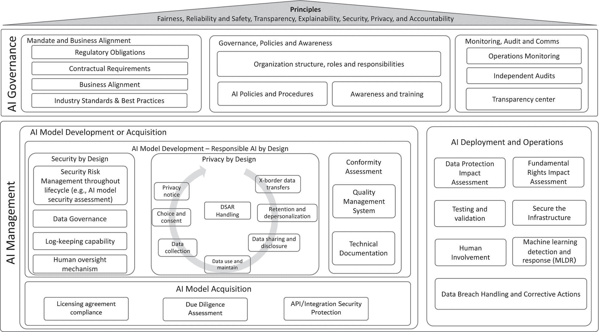

图 6.1 SI 安全与隐私保护框架

## 6.2 AI 法规、框架与原则

### 6.2.1 AI 法规与框架

各国以及美国、欧盟和中国等主要经济体正忙于为 AI 制定基于规则的伦理规范，并起草广泛的国际监管框架，以通过治理标准引导全球技术领先。尽管尚未达成国际共识的约束性协议，但这些实体已为 AI 的伦理开发提供了指南和框架。

`OECD`、欧洲理事会和联合国等政府间组织正努力构建促进人类价值和可持续发展的 AI 治理框架。表 6.1 和 6.2 提供了一些 AI 监管、建议框架和标准的示例。同样，学术界、非营利部门以及公私合作伙伴关系也发布了伦理指南（并非涵盖所有）：例如针对技术的问责制、公平性、透明度和人类代理。这提供了高层原则，但在 AI 开发中其实际应用仍有很长的路要走 [61]。

表 6.1 AI 监管或建议示例

| 地区 | 统计 | AI 法规或建议 |

| --- | --- | --- |

| 欧洲 | 欧盟 | 2024: 欧盟 AI 法案；2018: 欧盟可信 AI 伦理指南；2019: AI HLEG 可信 AI 伦理指南 |

| --- | --- | --- |

| 北美 | 美国 － 联邦 | 行政命令：2019: 维护美国 AI 领域的领导地位；2020: 在联邦政府推广可信 AI；2023: AI 的安全、可靠且可信的开发与使用；法案和法草案：2020: 政府 AI 法案（U 部分，第 101 节）；2021: AI 训练法；2021: 国家 AI 倡议法案（E 部分，第 500 节）；非约束性框架和标准：2017: 美国 IT 行业针对 AI 的政策和原则；2019: 美国 AI 通用原则；2020: AI 应用监管指南；2022: AI 权利法案蓝图；2023: 国家标准与技术研究院 AI 风险管理框架 |

| 加拿大 | 2020: 加拿大财政部发布了算法影响评估（AIA）工具的第一测试版；2021: 拟议的《AI 与数据法》，是 C-27 法案的一部分；2023: 发布了加拿大生成式 AI 护栏——行为准则；2023: 发布了关于自动化决策的指令，对联邦政府使用自动化决策系统提出了多项要求。 |

| 南美 | 巴西 | 2021: AI 战略；2021: 巴西人工智能战略摘要—EBIA 2021 年；2023: 拟议的 AI 法案（第 2338/2023 号）；2023: 对第 2338/2023 号法案的初步分析和最终意见 |

| 阿根廷 | 2023 年 6 月 2 日，内阁首席信息技术秘书处在公报上发布了第 2/2023 号公告，批准了《可靠人工智能建议》（分别称为“公告”和“建议”）。 |

| 亚太 | 中国 | 法律法规：2022: 算法推荐管理规定；2023: 生成式人工智能服务管理暂行实施办法；2023: 深度合成管理规定；2023: AI 指南及法规总结；2023: 科技伦理监管规定；非约束性指南：2017: 下一代 AI 发展规划；2019: 中国新一代人工智能治理原则；2019: AI 行业联盟自律宣言（中国）；2019: 中国新一代人工智能治理委员会；2019: 北京人工智能与教育共识。 |

| 印度 | 2018: AI 国家战略；2022: NITI Aayog 全民负责任 AI：采纳框架 |

| 日本 | 2019: 关于 AI 利用原则要点的详细说明；2021: 日本 AI 治理 1.1 版；2022: 日本发布国家 AI 战略；2：AI 原则实施指南 |

| 澳大利亚 | 2021 年 6 月：澳大利亚 AI 行动计划；2023: 澳大利亚安全与负责任 AI 讨论论文；2024 年 1 月：支持负责任 AI |


# 6.2 AI 框架示例

| 组织 | 框架 |
| --- | --- |
| G20 | G20 AI 原则（2019 年 6 月） |
| OECD | OECD 人工智能原则（2019 年 5 月） |
| ISO | ISO/IEC 22989:2022: 信息技术—人工智能—人工智能的概念和术语 |
| ISO/IEC 23053:2022 | 使用机器学习（ML）的人工智能（AI）系统框架 |
| ISO/IEC TR 24028:2020 | 信息技术—人工智能—人工智能的可信度概述 |
| ISO/IEC TR 24029-1:2021 | 人工智能（AI）—神经网络鲁棒性评估第 1 部分：概述 |
| ISO/IEC TR 24030:2024 | 信息技术—人工智能（AI）—用例 |
| ISO/IEC TR 24372:2021 | 信息技术—人工智能（AI）—AI 系统的计算方法概述 |
| ISO 38507:2022 | 组织使用 AI 的治理影响 |
| IEEE | IEEE 主智能系统伦理认证计划（2017 年 11 月） |
| 全球隐私大会 (GPA) 决议 | GPA AIWG：通用风险管理框架报告——人工智能系统对个人权利和自由构成的风险通用风险管理框架建议 |

## 6.2.1.1 欧盟 AI 法案

欧盟 AI 法案是全球首部全面的 AI 法规，旨在为欧盟范围内特定 AI 用途的 AI 开发者和部署者提供明确的要求和义务。同时，该法规旨在减轻企业（特别是中小型企业，SME）的行政和财务负担。新规的目标是通过确保 AI 系统尊重基本权利、安全和伦理原则，并应对强大且影响巨大的 AI 模型风险，在欧洲及范围内促进可信 AI 的发展。

《AI 法案》（AI Act）确保欧洲人能够信任 AI 提供的服务。虽然大多数 AI 系统的风险有限或没有风险，并有助于解决许多社会挑战，但某些 AI 系统产生了我们必须应对的风险，以避免产生不良后果。

该规定制定了以下关键要求和实践：

1. 在欧盟范围内将 AI 系统投放市场、投入使用和使用的制定的统一规则。
2. 禁止某些 AI 行为。
3. 针对高风险 AI 系统的特定要求以及此类系统运营者的义务。
4. 针对某些 AI 系统的统一透明度规则。
5. 关于通用目的 AI 模型投放市场的统一规则。
6. 关于市场监测、市场监管、治理和执行的规则。
7. 支持创新的措施，特别关注中小型企业（SMEs），包括初创企业。

欧盟《AI 法案》采取基于风险的方法，并如表 6.3 所示，定义了禁止的 AI 行为和高风险 AI 系统。欧盟《AI 法案》根据风险对 AI 进行了分类：

### 表 6.3 AI 系统风险等级

| 类别 | 示例 | 风险管理策略 |
| --- | --- | --- |
| 禁止的 AI 行为 | 所有 AI 系统都被认为对人员的安全、生计和权利构成明确威胁，从政府的社会评分到使用语音辅助功能鼓励危险行为的玩具。<br><br>* 部署了超越个人意识范围的潜意识技术，或蓄意的操纵性或欺骗性技术<br><br>* 利用自然人或特定群体因其年龄、残障或特定的社会或经济状况而产生的任何脆弱性<br><br>* 根据社会行为或已知的、推断的或预测的个人或性格特征，对自然人或群体在某一段时间内进行评估或分类（即社会评分）。<br><br>* 评估或预测自然人实施犯罪的风险。<br><br>* 通过从互联网或监控摄像头视频中无针对地抓取面部图像，创建或扩展脸部识别数据库。<br><br>* 推断工作和教育机构自然人的情绪。<br><br>* 使用生物识别分类系统，根据其生物识别数据对单个自然人进行分类，以推断或判定其种族、政治观点、工会成员、宗教或哲学信仰、性生活或性取向（执法场景除外）。<br><br>* 出于执法而在公共访问场所使用的“实时”远程生物识别系统，除非用于严格必要的情况。 | 禁止 |
| 高风险 AI 系统 | 被识别为高风险的 AI 系统包括在以下领域使用的 AI 技术：<br><br>* 与生物识别相关的<br><br>* 远程生物识别系统<br><br>* 生物识别分类<br><br>* 情绪识别。<br><br>* 作为关键数字基础设施管理和运行中的安全组件<br><br>* 教育和职业培训<br><br>* 决定准入或录取<br><br>* 评估学习成果<br><br>* 评估个人将接受或能够获得的适当教育水平<br><br>* 监测和检测学生在考试期间的禁止违规行为<br><br>* 就业、工人管理以及获得自雇机会<br><br>* 招聘或筛选<br><br>* 影响工作相关关系条款、工作合同关系晋升或终止、任务分配等的决策<br><br>* 获得基本私人服务和基本公共服务及福利：<br><br>* 公共部门评估自然人获得基本公共援助福利和服务的资格<br><br>* 评估自然人的信用信誉或建立其信用评分<br><br>* 人寿和健康保险中的风险评估和定价<br><br>* 评估并分类派遣的紧急呼叫，或在调度紧急首次响应服务时确定优先级<br><br>* 执法<br><br>* 评估自然人成为犯罪受害者的风险；<br><br>* 类似工具<br><br>* 评估刑事诉讼过程中证据的可靠性；<br><br>* 评估自然人违规或再犯的风险；<br><br>* 在刑事调查过程中对自然人进行画像（以检测或识别）。<br><br>* 移民、边境控制管理<br><br>* 类似工具<br><br>* 评估不规则移民、安全风险或健康风险；<br><br>* 用于申请庇护、签证或居留许可；<br><br>* 司法和民主程序<br><br>* 协助司法机关研究和解释事实；<br><br>* 影响选举或全民公投或个人投票行为。 | 高风险 AI 系统在投放市场前将遵守严格义务：<br><br>* 适当的风险评估和缓解系统<br><br>* 输入系统的高质量数据集以减少风险和歧视性结果<br><br>* 活动日志以确保结果的可追溯性<br><br>* 为机构评估合规性提供详细文档<br><br>* 向运营者提供清晰且充分的信息<br><br>* 适当的人类监督措施以降低风险<br><br>* 高水平的稳健性、安全性和准确性 |
|  | 不可接受风险。示例包括社会评分系统和操纵性 AI。<br><br>* 大多数《AI 法案》文本针对高风险 AI 系统。<br><br>* 较小部分处理受限风险 AI 系统，适用较宽松的透明度义务：开发者和运营者必须确保终端用户意识到他们正在与机器人或深度伪造内容交互。<br><br>* 极低风险不受监管，包括目前欧盟市场上可用的大多数 AI 应用，例如 AI 游戏和垃圾邮件过滤器。 |  |

以下是欧盟《AI 法案》单页摘要，供您参考图 6.2](#ch6.xhtml#fig6_2)。

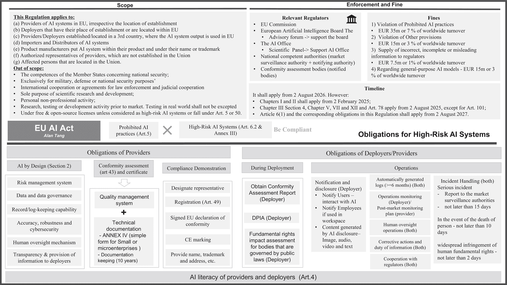

图 6.2 AI 法案单页摘要

## 6.2.2 通用 AI 原则

负责任的 AI（RAI）是一个历程，而非终点 [63]。在全球范围内，许多机构发布了他们的 AI 原则。在 AI 日益支撑我们推出的产品和服务时期，指导原则构成了公平和负责任 AI 的基础。让我们也意识到，这些原则也在演进。表 6.4

### 表 6.4 关键 AI 原则

| AI 原则 | 描述 |
| --- | --- |
| 1. 责制 | 部署`AI systems`的团队必须对其系统在`AI system lifecycle`不同阶段的运行情况负责，并应实现对`AI systems`的人类监管。 |
| 2. 健壮性、可靠性与安全性 | 这些系统应当能够按照原始设计进行运行，对意外发生的情况做出安全响应，并抵抗有害的操纵。 |
| 3. 公平性 | `AI systems`的公平原则旨在确保`AI algorithms`及其结果不会根据种族、性别或社会经济地位等敏感属性对个人或群体产生系统性的不利影响或歧视，从而促进所有人获得公平的对待和结果。 |
| 4. 数据安全 | `AI systems`的`Data Security`原则涉及通过`encryption`等措施，确保`AI`使用的数据免受未经授权的访问、丢失或误用。 |
| 5. 隐私保护 | `AI systems`的`Privacy`原则要求消费者对其数据使用方式拥有适当的控制，且 AI 系统必须遵守隐私法律。 |
| 6. 透明度 | AI 系统必须是透明且易于理解的，特别是当它们整合到社会中时。人们应该能够理解`AI`如何做出决策的。 |
| 7. 可解释性 | `AI systems`的`explainability`原则认为，`AI`出的决策对人类和利益相关者应该是透明且易于理解的。 |
| 8. 伦理使用 | `AI systems`的`ethical use`原则强调`AI`的开发和利用应符合维护人权、促进公平和最大限度减少的方式。 |
| 9. 社会福祉 | `AI systems`的`social wellbeing`原则专注于确保`AI`对社会产生积极贡献并增强所有人的福祉。 |
| 10. 尊重人权 |  |

### 6.2.2.1 尊重人类尊严

人类尊严是指每个人都有内在价值。`AI systems`不应贬低或削弱人类；这意味着要将每个人都视为道德主体，而不是被`labeled`、`scored`、`shepherded`、`conditioned`或`nudged`的对象。`AI systems`的开发应当服务人类需求并保护文化认同。

#### 6.2.2.1.1 防止伤害

`AI systems`必须是安全可靠的，确保不会导致事故或伤害。这要求`AI systems`在技术上是健全的且不误用用户。必须特别关注可能导致不公平输出的操作。

#### 6.2.2.1.3 个人自由

个人必须拥有在不受国家非法干预的情况下做出选择的自由。这意味着免受`coercion`、侵犯心理自主、`unjustified surveillance`或`unfair manipulation`。公民自由包括企业权利、艺术和科学自由、言论自由和隐私权。

#### 6.2.2.1.4 对民主、正义和法治的推崇

宪制民主国家要求所有权力必须经过法律授权并在法律范围内行使。`AI systems`应当增强民主进程并尊重价值观的多样性。`AI systems`不得损害法治的基础承诺，例如`due process`和`法律面前平等`。

#### 6.2.2.1.5 平等对待与非歧视

平等意味着`AI operations`不应产生不公平的偏见输出。这要求`AI systems`使用的数据涵盖所有人口群体，并要求对弱势群体（如妇女、残障人士、少数民族和儿童）给予尊重。

#### 6.2.2.1.6 公民权利

公民享有以下一系列权利，包括投票权、良好行政权或获取公共文件的权利以及请愿权。这反过来具有巨大的扩展潜力，使政府能够通过 AI 系统更高效地为社会提供公共物品和服务。此外，最佳实践将确保公民权利不会因使用 AI 系统而损害。

## 6.3 AI 治理

### 6.3.1 组织架构与职责

AI 开发和部署应在 AI 治理政策和程序的框架内进行。从组织对 AI 治理目的的认知到全企业治理，已经实现了与 AI 治理的整合。组织必须将治理计划扩展到 AI 技术治理之外，以遵循负责任 AI (RAI) 的指导原则。

没有一种一通用的 AI 治理结构。图 6.3 提供了一个 AI 治理组织结构的示例。组织必须在战略、战术和运营层面定义其特有的角色和职责。

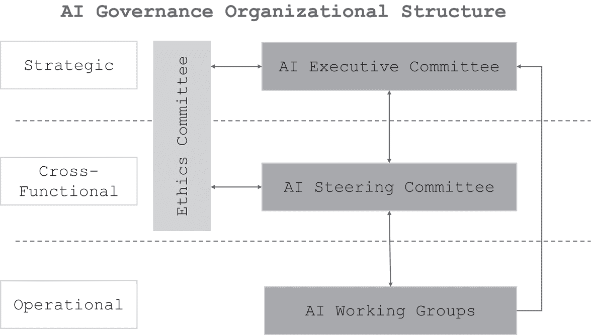

图 6.3 AI 治理组织结构示例。

### 6.3.1.1 AI 执行委员会

执行委员会是 RAI 委员会的主要决策机构。执行委员会将通过共识做出决策。执行委员会的决定可以上报至组织的 CEO。执行委员会可以根据情况将事项委托给指导委员会和小组。

AI 执行委员会将负责：

* 齐组织目标
* 企业风险评估
* 符合道德标准
* 解决任何 AI 相关问题的最终决策权
* 监督 RAI 委员会，包括其工作优先级

#### 6.3.1.2 AI 指导委员会

AI 指导委员会将负责：

* 监督 AI 计划
* 开发 A/ML 政策
* 开发高层 AI 架构
* 所用工具和技术的对齐
* 组织内部 AI/ML/数据科学团队之间的对齐

### 6.3.1.3 工作小组

工作小组将负责：

* 开发针对特定解决方案的 AI 架构
* 设计 AI/ML 解决方案
* 实施 AI/ML 解决方案以满足业务需求
* 开发 A/ML 标准和程序
* 审查数据集是否符合风险、隐私、伦理和法律要求
* 监控生产环境中 AI/ML 解决方案的性能和合规性

### 6.3.2 政策与程序

机会、优先级和政策制定至关重要。未能创新的组织面临不利业务后果。使用业务对齐标准、RAI 原则和项目性质来优先考虑用例并制定政策。根据组织的使命、目标、RAI 原则和项目复杂性对候选用例进行评估。

此外，表 6.5 提供了一些引导企业内 AI 伦理、安全且有效部署的政策和关键组件，这最终可以确保其符合监管要求和最佳实践。

表 6.5 AI 相关政策和核心组件示例

| 政策 | 核心组件 |
| --- | --- |
| 治理框架 | <ul><li>AI 治理清晰的角色和职责</li><li>AI 部署的决策流程</li><li>监督和问责机制</li><li>负责任 AI 使用的原则</li></ul> |
| 可接受使用政策 | <ul><li>制定组织政策，规定如何以及谁可以使用这些工具，以将上述风险降低至可接受的水平。</li><li>**授权使用**：明确定义组织内 AI 技术的可接受使用方式，指定 AI 系统可能被用于的任务、应用和目标。</li><li>**伦理使用**：纳入伦理 AI 使用原则，强调公平性、透明性、问责制以及减少 AI 算法中的偏差。这包括确保 AI 应用不会延续歧视或损害个人或社区的指南。</li></ul> |
| 数据隐私政策 | <ul><li>符合数据保护法规（例如`GDPR`和`CCPA/CPRA`）</li><li>数据收集和使用指南</li><li>数据匿名化和加密实践</li></ul> |
| 安全政策 | <ul><li>数据安全措施（加密和访问控制）</li><li>事件响应和违规泄露通知程序</li><li>定期的安全审计</li></ul> |
| 培训与发展政策 | <ul><li>关于 AI 伦理和最佳实践的持续教育</li><li>AI 团队的技能开发</li><li>知识共享和协作倡议</li></ul> |
| 采购政策 | <ul><li>选择 AI 供应商和技术的标准</li><li>针对安全、伦理和合规性的供应商评估</li><li>关于数据处理和所有权的合同协议</li></ul> |

## 6.4 AI 管理

在追求 AI 系统的过程中，在保持严格风险控制的同时防止潜在危险至关重要，以便更好地保障这些系统的安全性、稳定性和敏感性。在部署 AI 模型之前，具有特定特征的适当风险评估以及了解服务通常是如何构建的至关重要。安全的 AI 安全架构和部署解决方案需要解决隔离、检测、故障措施和冗余问题，以威慑潜在威胁同时确保操作完整性。

### 6.4.1 AI 模型开发

开发者应该考虑在 AI 系统设计和构建过程中可能引入风险的地方，以及风险如何在基于 AI 的推荐中体现。组织应该在 AI 系统的整个生命周期内采用系统的风险管理（如算法影响评估），以在每个阶段应对与使用 AI 系统相关的各种风险，管理潜在风险。图 6.4 展示了 AI 模型开发安全防护框架。评估时应考虑 AI 系统设计和算法、其做出的决策类型、决策的影响以及使用的数据等等方面。模型必须具有输入验证以避免恶意提示。模型可能需要输出验证以检测破坏性行为。应分析模型与其他系统的交互，以识别潜在的相互作用 [64]。

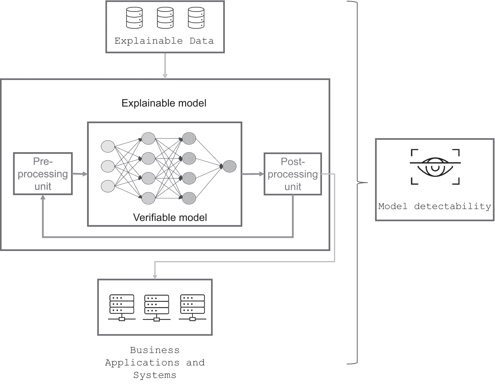

图 6.4 AI 模型开发安全防护。

### 6.4.2 数据管理

组织使用 AI 系统的方式应避免对人类产生不公平的影响，特别是涉及种族、民族、性别、国籍、收入、性取向、能力以及政治或宗教信仰等敏感特征。组织应通过考虑获取运行 AI 模型的清洁数据开启其数据之旅。数据进一步被用于促进数据的采集、集成、处理和部署，随着时间的推移，随着组织的成熟，数据管理用例将实现自动化。

数据是 AI 决策的核心并构建模型的基础。它建议为了对抗偏差，训练数据集应更好地反映社会的多样性。例如，末端配送公司应更好地代表驱动员和消费者。组织还应构建自适应模型，以确保 AI 随着时间推移不断学习和更新，在此过程中产生任何偏差。

最显著的困难之一是获取高质量的大量数据，以便对模型进行适当训练。进一步的挑战包括管理数据隐私、数据生命周期以及确保负责任的使用。公司有责任实施稳健的数据保护措施，并将这些努力与治理保持一致。

### 6.4.3.1 安全与隐私保护

正如软件中的传统工程实践一样，可以通过`black-box`和`white-box`测试来检查`AI system`的安全性。问题在于，目前可用的数据集有限，无法捕捉所有场景的多样性。此外，可以使用`adversarial attacks`来欺骗`AI system`，这在性能上是高昂的。因此，在部署`AI system`时，有必要进行`adversarial training`以确保`model`的鲁棒性。这还可能涉及使用`pre-processing`或`post-processing`单元来过滤`model`的输出。

结果是，当部署`AI system`时，有必要进行`adversarial training`以确保`model`的鲁棒性。这还可能涉及使用`pre-processing`或`post-processing`单元来过滤`model`的输出。


应当分析`input`、`output`和`intermediate information`之间的关系，以理解并确认`model`的逻辑。这包括可以应用于多个`models`的`general model analysis tools`（例如`Local Interpretable Model-Agnostic Explanations (LIME)`），以及可以分析特定`model`结构的`specific model analysis tools`。

`AI system`的输出可以用如下所示表示：

```
[Diagram Placeholder: AI Security Assessment Flow]
```

## 6.4.3.2 可解释性

`AI systems`的可解释性对于理解`model`为何做出某决定是必要的。这对于内部逻辑不透明的`black-box`模型来说尤为重要。通过使用`black-box`和`white-box`测试方法，组织可以检查`AI system`并理解`training data`的逻辑。

提高`AI system`可解释性的方法之一是在使用`AI framework`的同时使用`transparent machine learning method`。`black-box`和`white-box`测试均可分析`AI system`并确保`model`的鲁棒性。统计学是许多`traditional ML methods`的基础，这些方法在`Natural Language Processing`、`Voice Recognition`、`Image Recognition`、`Information Retrieval`和`Bioinformatics`等领域被广泛使用且易解释。

`explainability`的目标是为`model`的决策提供意义的解释，这有助于建立信任并确保`AI system`以伦理且负责任的方式使用。

表 6.6 列出了相关指南，以确保 AI 模型在现实业务场景中实现负责任的数据处理和治理的同时，尊重用户的隐私权利。

## 6.6 AI 模型隐私关键考虑因素 (#ch6.xhtml#R_table6_6)

| 维度 | 描述 | 实践考虑 |
| --- | --- | --- |
| **隐私声明** | AI 模型必须向用户提供清晰、透明且易于获取的数据处理活动信息。这包括说明收集了哪些数据、如何使用这些数据以及共享对象，通常通过隐私政策或声明来实现。 | - 使用通俗语言确保用户理解数据处理实践。<br>- 确保声明易于获取并显著显示。<br>- 定期更新声明以反映 AI 模型操作的变化。 |
| **选择与同意** | 用户应该拥有有意义的选项来控制其数据。AI 模型在收集或使用个人数据之前应获得显式同意，允许用户加入或退出特定的数据处理活动。 | - 针对不同类型的数据处理实施粒度同意机制。<br>- 为用户提供撤回同意的清晰选项。<br>- 确保同意请求显眼，而不是埋在冗长的条款中。 |
| **数据收集** | AI 模型应将数据收集限制在预期用途所需的范围内，并确保数据的准确性和相关性。 | - 定期审查数据收集实践，以减少不必要的数据。<br>- 使用数据最小化技术仅收集基本信息。<br>- 实施数据验证和质量保证机制。 |
| **数据使用与维护** | 数据的使用方式应符合用户预期和法律要求。AI 模型必须确保存储安全、处理准确，并防止未经授权的访问或使用。 | - 实施稳健的数据安全措施，如加密和访问控制。<br>- 定期进行审计，以确保符合数据使用政策。<br>- 建立维护数据完整性和准确性的程序。 |
| **数据共享与披露** | AI 模型应揭示其数据共享实践，并在与第三方共享个人数据之前获得显式同意。 | - 与第三方签订合同协议以确保数据保护。<br>- 在隐私声明中对数据共享实践提供清晰解释。<br>- 允许用户为数据共享活动选择偏好。 |
| **留存与去标识化** | AI 模型应建立数据留存策略，定义个人数据的保存期限，并确保对过期或不必要的数据进行及时删除或匿名化。 | - 根据法律和业务需求定义明确的留存期。<br>- 实施数据匿名化或删除的自动化流程。<br>- 确保数据留存策略符合监管要求。 |
| **跨境数据传输** | 跨境传输数据的 AI 模型必须遵守适用的数据保护法，并确保已采取足够的保护措施以在国际传输期间保护数据。 | - 实施适当的措施，如标准合同条款 (SCCs) 或其他批准的数据传输机制。<br>- 对跨境数据传输进行隐私影响评估 (PIAs)。<br>- 监控国际数据传输法规的变化。 |
| **DSAR（数据主体访问请求）处理** | AI 模型必须协助数据主体访问请求，允许用户访问、更正或删除其个人数据。 | - 建立快速且透明处理 DSAR 的程序。<br>- 为用户提交 DSAR 提供安全渠道。<br>- 确保符合数据保护法规定的时间线和要求。 |

## 6.4.4 AI 模型获取

由于生成式 AI 已被广泛采用且在第三方应用集成中日益激增，首席信息安全官 (CISO) 们意识到他们的数据将以以前所未有的规模与第三方共享，其方式是他们甚至无法预料的。可切换的后端带来了安全问题，例如`ChatGPT`数据泄露（2023 年 3 月），如果生成式 AI 平台自身的系统不安全，这导致了严重的敏感数据泄露，包括消费者数据、财务信息和专有业务数据。

### 6.4.4.1 许可协议合规性

随着机器学习能力和可用性的提高，越来越多的组织正在考虑将机器学习包含在我们不断扩展的产品和服务列表中。机器学习允许我们使产品更有用、更易于使用，并与那些在产品中引入机器学习的其他科技科技公司保持同步。

各种 AI 公司在网上发布了数十种非常强大的预训练机器学习模型，它们发布模型时附带的许可（在大多数情况下）让终端程序或产品免费获得所有权。结果是，组织通过采用这些预训练第三方模型，而不是训练自己的 AI 模型，可以避免产生开发成本和产品上市时间。

虽然事实可能如此，但我们需要确保的是，在组织的产品中使用第三方模型之前，根据许可协议我们允许使用他人设计的模型。类似于开源软件，第三方模型也包含许可条款，允许对模型的某些用途并禁止其他用途。因此，要求我们检查每一项许可，查看其是否符合我们的用例，以便我们能够在许可提供的标准指南下适当使用该模型。

模型的在线分发可能由不同部分组成：

- 预训练模型的权重。
- 用于使用模型、微调模型和/或重现模型训练过程的软件源代码。
- 用于训练机器学习模型的数据。创建者本身很少发布训练数据，因此当模型在没有此类数据的情况下无法共享时，社区会训练自己的数据。

第三方模型是如何许可的？

上述列出的每种部分许可方式都可能不同。例如，软件可能根据开源软件许可（如`Apache v2`）许可，而模型权重可能根据特定的 ML 许可（如`open RAIL-M`）或内容许可（如`知识共享署名-相同方式`）许可。在其他情况下，模型和软件可能采用相同的条款。训练数据的许可更为复杂。大多数模型是在来自公开访问网站及来源的大量数据上训练的，因此模型创建者通常并不拥有数据，也没有将其许可给他人。如果我们从第三方获取训练数据，我们必须确定是否可以合法使用这些数据，以及必须采取哪些保护措施来限制使用这些数据带来的任何法律风险[68]。表 6.7 AI 模型及其许可类型的示例。

## 表 6.7 AI 模型及其许可类型 (#ch6.xhtml#table6_7)

| # | 模型 | 许可类型 |
| --- | --- | --- |
| 1 | `Llama` | 非商业许可 |
| | `Llama 2` | `Llama 2` 社区许可协议 |
| | `Code llama` | `Llama 2` 社区许可协议 |
| | `open_llama` | `Apache 2.0` |
| | `Chinese-LLaMa-Alpaca` | `Llama 2` 社区许可协议 |
| 2 | `glm` | `The ChatGLM-6B License`, `The ChatGLM2-6B License` |
| 3 | `Stable diffusion` | `Open RAIL-M` |
| 4 | `Dolly 2.0` | `cc-by-sa-3.0` |
| | DBRX | [`www.databricks.com/legal/open-model-license`](https://www.databricks.com/legal/open-model-license) |
| 5 | RedPajama | Apache 2.0 |
| 6 | Bloomz | bigscience-bloom-rail-1.0 |
| 7 | MOSS | AGPL 3.0 |
| 8 | Baichuan | baichuan-7B model license agreementBaichuan-13B model community license agreementBaichuan2 model community license agreement |
| 9 | Falcon | Apache 2.0falcon-180b-license |
| 10 | Mistral | Apache 2.0 |

### 6.4.4.2 尽职调查

#### 6.4.4.2.1 流程与步骤

当您的组织采购 AI 解决方案时，进行尽职调查对于确保其符合业务需求、提供者的许可要求、监管要求以及伦理标准至关重要。该过程通常涉及以下步骤，如表 6.8 所示。

表 6.8 尽职调查的典型步骤

| 步骤 | 说明 |
| --- | --- |
| **定义需求** | 明确概述业务目标、技术要求以及对 AI 解决方案的预期结果。 |
| **识别供应商** | 根据声誉、专业知识以及与组织价值观和目标的契合程度，识别潜在供应商或 AI 解决方案提供商。 |
| **初步筛选** | 进行初步评估，根据财务稳定性、法律合规性、许可模型以及类似项目的经验等基本标准对供应商进行评估。 |
| **详细评估** | 执行全面的尽职调查，深入研究技术能力、数据处理实践、安全措施和伦理考量。 |
| **合同谈判** | 谈判合同条款，包括服务水平协议 (SLAs)、数据保护条款、知识产权和退出策略。 |
| **实施计划** | 制定详细的实施计划，包括与现有系统的集成、测试、培训以及持续性的支持与维护。 |
| **监控与评审** | 建立实施后后监控 AI 解决方案的机制，以确保持续合规、性能良好并与业务目标一致。 |

#### 6.4.4.2.2 评估维度

在详细尽职调查期间，从多个领域评估 AI 解决方案提供商，以降低风险并确保适用性。这种结构化的尽职调查方法可确保组织在采购 AI 解决方案时做出明智决策，降低风险并最大化 AI 技术的潜在收益。表 6.9 列出了一些关键领域、评估问题和考虑因素。

表 6.9 评估问卷示例

| 维度 | 评估问题/要点 |
| --- | --- |
| **技术能力** | * 解决方案采用了哪些 AI 技术和算法?<br>* 解决方案的可扩展性如何，能否满足未来需求？<br>* 解决方案能否与现有的 IT 基础设施集成？ |
| **知识产权** | * AI 解决方案及其组件的知识产权归谁所有？<br>* 是否有许可协议或使用限制？<br>* 在终止合同时如何处理知识产权 (IP) 权利？ |
| **数据处理与安全** | * 解决方案如何处理数据隐私和安全？<br>* 是否有数据加密、访问控制和数据化机制？<br>* 如何确保数据的完整性和机密性？ |
| **伦理与法律合规** | * 解决方案是否符合相关的数据保护法规（例如 GDPR 和 CCPA）？<br>* 它如何处理 AI 模型中的偏差和公平性？<br>* 是否有其使用的伦理准则？ |
| **性能与可靠性** | * 解决方案在性能和可靠性方面的记录如何？<br>* 是否有 SLA 保证运行时间和响应时间？ |
| **可扩展性与未来就绪** | * 解决方案能够适应未来增长吗？<br>* 是否有技术演新的路线图？ |
| **供应商声誉与稳定性** | * 供应商在市场上的声誉如何？<br>* 供应商财务状况是否稳定？ |
| **支持与维护** | * 实施后提供哪些支持服务?<br>* 是否有专门的支持团队?<br>* 如何管理软件更新和补丁？ |

### 6.4.4.3 API 集成安全

许多 AI 解决方案需要与各种 API 集成以获取数据、服务或其他功能。对于使用 AI 解决方案的公司而言，安全措施对于保护数据完整性和隐私至关重要。

以下是 API 集成安全性的重要原因：

- **数据完整性**：通过保护 API 创建和交换的数据，可以确保 AI 模型依赖于高质量的数据。
- **维护隐私**：API 在多数时候都在处理机密数据。
- **可靠系统**：不安全的 API 可能会削弱系统并使其变得不可靠。
- **监管合规**：金融和医疗保健等许多行业受到严格数据安全和隐私合规要求约束。企业可以通过安全的 API 集成遵守这些法规。
- **客户信任**：通过实施这些控制措施，您可以保持 API 集成的安全可靠，保护您的业务运营以及与客户的关系。

通过优先考虑 API 集成安全，企业可以有效利用 AI 解决方案，降低与数据泄露和未经访问相关的风险，如表 6.10 所示。

表 6.10 关键考虑因素与实施控制

| 考虑因素 | 实施控制 | 说明 |
| --- | --- | --- |
| **身份验证与授权** | 使用`OAuth 2.0`等强身份验证机制 | 确保只有授权的实体可以访问 API，防止未经授权的使用或数据泄露。 |
| | 为 API 端点实施基于角色的访问控制 (RBAC) | 根据组织角色限制访问，减少敏感数据的暴露。 |
| **数据加密** | 使用传输层安全 (TLS) 加密数据传输 | 防止 AI 系统与外部 API 之间传输的数据免受攻击者拦截。 |
| | 使用`AES-256`或类似方法加密静态敏感数据 | 保护存储在通过 API 访问的服务器或数据库中的数据。 |
| **API 速率限制** | 实施速率限制和节限流以防止滥用 | 控制单个来源的 API 请求数，缓解拒绝服务攻击。 |
| **API 监控与日志** | 实现 API 交互和错误的日志记录 | 允许检测可疑活动或异常，有助于应急响应和审计。 |
| | 使用 AI 驱动的分析监控 API 流量异常模式 | 通过高级异常检测识别潜在的安全威胁或性能问题。 |
| **安全开发实践** | 定期进行安全评估和代码审查。 | 确保 API 遵循安全最佳实践，且没有漏洞或后门。 |
| | 实施安全编码准则和 API 安全测试。 | 验证 API 的完整性以及对 SQL 注入或 XSS 等常见安全威胁的防御能力。 |
| **供应商安全评估** | 对第三方 API 供应商进行尽职调查。 | 根据安全实践、合规性认证和数据保护措施对供应商进行评估。 |
| | 要求签署带有安全保障的服务水平协议 (SLAs)。 | 为维护 API 安全性和服务可用性建立合同义务。 |

## 6.4.5 AI 模型部署与运营

### 6.4.5.1 算法影响评估 (AIA)

AIA 是将机器学习模型投入生产环境时的一个必要步骤，用于评估其对利益相关方的潜在影响，确保其符合伦理规范和相关法律法规。同样，企业还需要实施一套基于控制和措施的全面清单，以实现算法影响的合规。通过开展 AIA 来检查所使用的 AI 技术，确保执行的算法决策可追责。问责制和一套操作指南是`GDPR`等数据保护法规试图限制画像分析和自动化决策所造成损害的其他方式。

一个非常有用的来源是加拿大的 AIA，它在`MIT License`下开源供公众使用，帮助分析部署自动化决策系统将产生的影响，通过更广泛的整体认知来降低风险。评估中总共有 60 个问题，用于根据业务流程、输入数据和输出决策来确定对业务的影响。

AIA 在提高传统不透明领域的的透明度方面取得了进展。表 6.11 列出了 AIA 的一些关键考虑因素和问卷。它也有助于明确你想要了解该数据主体组的信息，以及这些数据涉及哪些系统 [69]。

#### 表 6.11 算法影响评估的关键考虑因素和问卷

| 考虑因素/问题 | 描述 |
| --- | --- |
| **目的与范围** | 定义 AI 模型的预期目的及其对利益相关者的预期影响。 |
| | AI 模型旨在解决什么问题？ |
| | 谁受 AI 模型结果影响的主要利益相关者？ |
| | 部署此 AI 模型有哪些潜在的正面和负面影响？ |
| **公平性与偏见** | 评估 AI 模型输出中潜在的偏差和公平性问题。 |
| | 在此 AI 模型的背景下，偏差是如何定义和衡量的？ |
| | 使用了哪些数据集训练 AI 模型？它们是否代表了多样化的人群？ |
| | 是否使用了公平性指标（如差异影响分析）来评估模型？ |
| | 是否在部署前有缓解已识别偏差的计划？ |
| **隐私与数据保护** | 评估与数据隐私和敏感信息保护相关的风险。 |
| | AI 模型处理什么类型的数据？在整个生命周期内是如何处理的？ |
| | 数据收集或使用是否存在潜在的隐私担忧？ |
| | 如何实施数据匿名化或假名化以保护个人隐私？ |
| | 是否对此 AI 模型进行了数据保护影响评估 (`DPIA`)？ |
| **透明度与可解释性** | 确保 AI 模型的决策和推理可以被理解和解释。 |
| | 模型的输出和决策过程对利益相关者的透明度如何？ |
| | 是否有机制为 AI 模型的输出提供解释或证明？ |
| | 利益相关者能理解 AI 模型使用的输入和算法吗？ |
| **问责与治理** | 建立 AI 模型的监督、问责和治理机制。 |
| | 谁对 AI 模型做出的决策负责？如何追究其责任？ |
| | 是否有治理框架或政策来指导 AI 模型的开发和部署？ |
| | 是否有的升级路径来处理与 AI 模型相关的问题或投诉？ |
| **对社会和社会的影响** | 评估部署 AI 模型对更广泛社会和环境的影响。 |


| | AI 模型潜在的经济、社会或环境后果是什么？ |
| | 是否对意外后果进行了彻底的风险评估？ |
| | 是否有措施随时间推移监控和缓解负面的社会影响？ |

| **法规法律合规** | 确保符合相关法律、法规和伦理指南。 |
| | AI 模型是否必须遵循特定的监管要求或行业标准？ |
| | 法律顾问是否审查了 AI 模型的部署计划以评估合规风险？ |
| | 是否有根据变化的法规更新 AI 模型部署流程？ |

| **安全性与稳健性** | 评估 AI 模型应对网络安全威胁和恶意攻击的韧性。 |
| | 如何保护 AI 模型免受对抗攻击或数据投毒？ |
| | 是否有机制检测并响应安全事件？ |
| | AI 模型是否经过了渗透测试和安全审计？ |

| **性能与可靠性** | 评估 AI 模型在现实场景中的准确性、性能和可靠性。 |
| | 使用哪些性能指标来评估 AI 模型的有效性？ |
| | AI 模型是否在不同场景和数据输入下经过稳健性测试？ |
| | 是否有应急计划来处理性能问题或故障？ |

| **伦理考虑** | 考虑 AI 模型影响的更广泛伦理含义和社会规范。 |
| | AI 模型如何符合公平、透明和问责等伦理指南？ |
| | 伦理审查委员会或小组是否为部署此 AI 模型提供了指导？ |
| | 是否有机制让利益相关者对伦理担忧提供反馈？ |

通过深入解决这些考虑因素和问题，企业可以开展全面的 AIA，以确保 AI 模型根据伦理标准、监管要求和利益相关者的预期进行负责任部署。

### 6.4.5.2 安全基础设施

为了构建具有多种安全机制的防御架构以确保业务安全，需要考虑四个主要领域：隔离、安全检测、故障保护和冗余，如图 6.6 所示 [70]$。

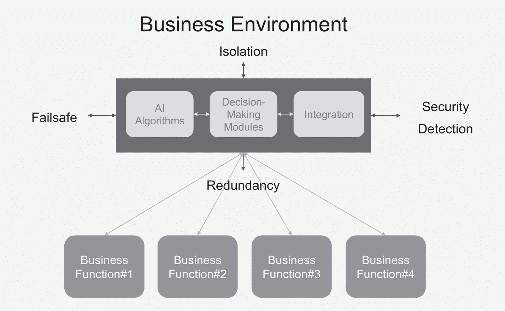

图 6.6 基础设施安全组件

### 6.4.5.3 隔离

AI 系统隔离可以减少 AI 推理的可能攻击点，而集成决策系统的隔离可以减少针对决策系统的有效攻击量。

安全架构必须对功能进行隔离，并在它们之间定义访问控制机制。AI 模型的模型隔离有助于减少 AI 推理的攻击面，而决策模块隔离则有助于减少针对决策模块的攻击。AI 推理的控制输出可以导入集成决策模块，并作为辅助决策建议，且仅允许授权的建议进入决策模块。

### 6.4.5.4 检测

使用嵌入主系统架构的持续监控和攻击检测模型，可以根据当前时间充分地充分验证网络安全态势和风险水平。如果风险过高，集成决策系统可以由人工操作员接管。

### 6.4.5.4.1 故障安全

如果系统预计要执行对系统安全至关重要的操作，那么确保整个系统水平的最佳方法是采用多级安全架构。我们需要评估 AI 系统对其推理结果的置信程度。如果输出的置信度低于特定水平，则回退到基于规则的技术或人工处理。

### 6.4.5.4.2 冗余

业务决策本质上与数据相关。确保此点的可行方法之一是检查连接是否被损坏。对于生命攸关的应用，建立了多模型架构，以防止单个模型因故障而阻塞决策过程。更重要的是，多模型架构可以显著降低任何单一攻击导致系统全局故障的可能性，并增强整个系统的稳健性。

### 6.4.5.5 人类参与

如果 AI 系统以重要方式对个人、群体、社区或环境产生影响，则应该有一个公平的程序让人们对 AI 系统的使用和结果提出质疑。组织应该设计和部署 AI 系统，以提供反馈、适当解释和申诉的渠道。组织应在保持人工监督和控制的同时，确保 AI 技术将继续严格用于其预期和适当的用途。我们的决策具有人类因素，因此我们需要反思诸如同情以及情感智能在医疗等领域的意义。人工监督发挥了安全网的作用，而法律框架的存在确保了错误和不伦理行为的影响尽可能小。这种通过反思社会行为来要求在各个层面采取合法且符合伦理责任的行为的过程，是我们解决歧视等复杂问题的方法之一。

此外，对 AI 系统进行的透明性和可解释性改进是维护公平、公正和防止歧视的关键。然而，在有效满足这些要求方面存在挑战。尽管存在挑战，透明度和可解释性仍对 AI 用例的信任和问责做出贡献，特别是在法律或医疗领域。

人类对 AI 系统的控制涉及在减少人工干预以提高效率与保持监督以防止错误和偏差之间取得平衡。虽然 AI 旨在取代和简化功能，但训练中性和性和偏差敏感的内在复杂性使得在所有应用中实现与人工监督的完全集成具有挑战性。可能某些系统过于脆弱，无法管理意外情况，并引发了对高风险环境（如在军事中使用自动武器）中安全和决策的担忧。

组织可以使用 AI 来帮助识别并针对偏见做法和风险碎片采取补救措施。以伦理和负责的方式实施的人工智能可以解决人工控制无效或适得其反的歧视问题。更平衡的路径意味着人类团队位于 AI 决策与之间。

伦理与技术审查委员会：

- 组织可能还希望有一个独立的内部审查。
- MLDR 在此至关重要，以避免这些风险并确保 AI 解决方案的稳健性、安全性和强度。

## 6.4.5.6 机器学习检测与响应 (MLDR)

MLDR 是 AI 领域一个重新兴起的类别，对于使用人工智能发现机器学习模型中的异常、威胁和错误的组织起着至关的作用。本节探讨了 MLDR 的重要性，并概述了关键考虑和控制措施，如表 6.12 所示。

### 表 6.12 机器学习检测与响应示例

| 考虑 / 控制 | 描述 |
| :--- | :--- |
| **监控与日志** | 实现稳健的监控和日志机制，持续跟踪 AI 模型的输入、输出和性能指标。 |
| **异常检测** | 利用先进的异常检测技术及时识别偏离预期 AI 模型的行为。 |
| **安全控制** | 部署全面的安全控制措施，保护 AI 模型免受数据投毒和对抗攻击等威胁。 |
| **模型验证与测试** | 在不同场景下定期验证和测试 AI 模型，以确保性能的一性和可靠性。 |
| **响应与修复** | 建立响应检测到的异常的清晰协议，确保快速有效的修复措施。 |
| **持续改进** | 通过将来自监控的反馈循环整合到模型精炼过程中，培养持续改进的文化。 |
| **文档与审计** | 维护 MLDR 活动的详尽文档，并进行定期审计以确保符合标准并具有合规性。 |

ML 灾难恢复的关键考虑和实施控制结构如下：实施这些控制使企业能够主动管理 AI 模型风险、维护业务连续性并符合监管要求，从而增强信任并最大化 AI 投资的衍生价值。

## 6.5 AI 辅助安全运营

许多安全和隐私专家预测，新时代将看到机器主导世界，AI 将在网络安全领域取代人类，而人类的工作将变为保护和管理 AI 系统。AI 驱动产品的激增导致对 AI 软件的需求增加，预计到 2024 年将达到 640 亿美元，其中网络安全是增长最快的领域。事实是，当我们进入下一个十年时，将比人类多得多的机器在复杂的 IT 环境中规模化执行网络安全的繁重工作。尽管如此，向 AI 转型并非易事；它还将动摇网络安全领域内认知的责任和形象 [71]。以下列表提供了 AI 集成到安全和隐私保护行业的一些领域示例。

*   从网络防御者处收集数据并进行标注，以训练防御性网络安全 AI。
*   检测并对抗社会工程策略。
*   自动化事件分类。
*   检测源代码中的安全漏洞。
*   协助网络或设备取证。
*   漏洞的自动补丁。
*   增强补丁管理，以更好地对安全环境的更新进行排序、计划和执行。
*   在 GPU 上开发或增强机密计算。
*   设置蜜罐程序并使用欺骗技术误导攻击者。
*   帮助逆向工程师开发基于签名/基础和基于行为的恶意软件检测。
*   分析组织安全控制并与合规法规交叉。
*   帮助开发者编写安全软件并设计深度防御。
*   帮助终端理解良好的安全工作实践。
*   协助安全工程师和开发者构建更健壮的威胁模型。
*   为网络安全防御者提供威胁情报，根据组织需求提供高质量且相关的数据。
*   帮助开发者将其代码迁移到内存安全语言。

# 第三部分 量子计算、大数据与数据保护

DOI: [10.1201/9781003390695-9](https://dx.doi.org/10.1201/9781003390695-9)

**本部分涵盖以下主题**：

*   量子计算技术和数据保护框架
*   大数据架构和数据保护控制

# 7 量子计算

DOI: [10.1201/9781003390695-10](https://dx.doi.org/10.1201/9781003390695-10)

本章深入探讨量子计算（QC）的基础，追溯其理论和技术的演变。我们将探索各种业务用例，以突出量子计算的实际应用。此外，本章还研究了量子计算带来的安全威胁，包括“现在收集，以后解密”的方法以及破解对称加密的可能性。为了应对挑战，本章讨论了量子安全和隐私保护解决方案，涵盖了法规、后量子加密以及后量子世界的准备策略。

本章涵盖以下主题：

*   量子计算基础
*   业务用例
*   量子计算带来的安全威胁
*   量子计算安全与隐私保护解决方案

## 7.1 量子计算基础

量子计算（QC）将引入对计算范式的全新理解，而我们保护数字经济的方式也将例外。这项技术不再仅仅是一个理论——它已经存在，并要求人们学习并制定关于如何、在何地、何时以及为何使用它的计划。

量子领域既奇异又迷人，提供了关于世界构建的极佳的见解和实用的计算工具。量子计算机的普及可能会比预期更早发生。这项新技术有望解决即使是使用最强大的经典超级计算机也无法解决的重要问题。量子计算机的速度比目前的计算机快百万倍。

进一步进入量子力学时代后，依赖加密的组织需要考虑即将到来的时刻，这些工具将不再是稳健的保护。量子的速度和原始力量能够破解许多现有的安全措施，甚至是你今天能采用的最强加密手段。例如，一个用暴力破解解决需要 10 年的问题，量子计算机可以在不到五分钟内完成。随着量子未来的到来，组织的首要关注点仍然是数据安全，特别是在保护其敏感数据时。企业应该提前计划开发应对措施并建立基准韧性，以达到量子安全状态 [72]。

### 7.1.1 什么是量子计算？

量子计算的概念是一种完全独特的计算机架构方法，它利用量子力学定律来执行远超传统计算机的计算。尽管经典计算机以二进制状态运行，但量子计算机包含量子比特（qubits），由于叠加态，允许它们同时存在于多个位置。通过这种方式，量子计算机可以同时对海量数据集进行计算，指数级地降低复杂度。此外，纠缠使得量子比特能够保持那种均匀分布的状态，并随着额外量子比特的加入倍倍增强计算能力。尽管如此，量子计算仍面临困难，包括对扰扰的敏感性，需要复杂的技术来保持量子相干性。在此期间，量子比特的数量每年翻一倍，但我们距离任何广泛、有用且实用的应用仍然非常遥远。

2019 年，谷歌展示了“量子霸权”的概念。该概念意味着量子计算机可以比经典计算机快地解决某些问题。虽然挑战依然，但这些结果凸显了这一大技术领域需要解决的关键问题，包括由于退干导致的错误控制、对纠错的需求（由于经典系统必须具有逻辑拓扑容错状态，这是复杂的），以及高质量算法及相关软件工具的发展。

根据专家的意见，需要 10 到 30 年的时间才能创建一个可以解决困难问题的有效量子计算机。当真正的量子计算机出现时，它们将影响从药物发现、气候建模到流行病预测、材料科学、太空探索、神经科学以及量子物理学前沿等领域。编写量子计算机意味着将所有可能的解决方案编码为量子比特并同时对它们进行评分，这可能解锁以前认为不可能的问题并重塑机器学习的世界。尽管量子计算的潜力是巨大的，但由于必须解决的一些严重瓶颈，现实应用仍然面临挑战。然而，当它们到来时——毫无疑问，量子计算很快将改变解决问题的方式——量子计算机将开启计算纪元，提供曾被认为不可想象的无与伦比的计算能力，并在许多科学领域取得突破。

### 7.1.1.1 基础物理原理

与依赖位（bits）的传统计算机不同，量子计算机使用量子比特，即`qubits`。量子计算技术超越了处理能力的限制。通过利用叠加、干涉和纠缠特性，量子计算机可以同时处理数百万次操作，从而超越了当今最先进超级计算机的能力，如表 7.1 所示[73]]。

#### 表 7.1 三大量子计算基本物理原理

| | 量子计算物理原理 | 描述 |
| --- | --- | --- |
| 1 | `叠加` | 从最基础的来说，叠加是一项基本原理，它允许量子领域的粒子同时存在于基础 `0` 和 `1` 状态的线性组合中。换句话说，一个 `qubit` 可以处于这种状态：在被测量之前，有确定的时间比例使得系统可以处于状态 `0` 或状态 `1`（或两者的各种比例混合状态）。这种不可思议的量子特性允许量子计算机以比传统经典算法极小的时间比例搜索诸如大数的质因数，或高效搜索大型数据库。 |
| 2 | `干涉` | 这些概率振幅（复数）当多个量子态组合在一起时会相互干涉。这意味着来自不同路径（状态）的振幅可以相加为一个（相长干涉），也可以相互抵消（相消干涉），取决于它们的相对相位。 |
| 3 | `纠缠` | 量子力学最奇异的特征之一是当两个粒子处于特殊的量子纠缠态时，一个粒子的状态直接取决于另一个粒子，即使它们之间隔着巨大的距离。即使你将纠缠的 `qubits` 分隔到光年之外，这种对称性依然存在。 |

### 7.1.1.2 量子计算 vs. 百亿级计算 vs 神经形态计算

先进计算领域出现了三个潜在的规则改变者，分类如下：量子计算（QC）、百亿级计算（exascale computing）和神经形态计算。它们都为不同的行业带来了突破性的特性和潜在应用价值，但彼此的基础范式完全不同。现在，我们将从架构层面、应用以及目前的现状对这些技术进行比较。

表 7.2 对量子计算、百亿级计算和神经形态计算在各个方面进行了简洁比较，突显了它们的差异以及对计算未来的潜在影响[74]。 |

#### 表 7.2 量子计算、百亿级计算与神经形态计算的比较

| 方面 | 量子计算 | 百亿级计算 | 神经形态计算 |
| --- | --- | --- | --- |
| 架构 | 依赖量子力学原理并利用 `qubits` 进行并行处理 | 传统计算架构侧重于高性能计算 | 模拟大脑架构，集成内存和处理单元 |
| 应用 | 优化问题、密码学和量子系统模拟 | 科学模拟、气候建模和分子动力学 | 模式识别、感知处理和类脑计算任务 |
| 可扩展性 | 由于量子态的脆弱性和纠错问题面临挑战 | 随着硬件和软件的增量改进具有可扩展性 | 为边缘计算和物联网提供可扩展性和能效 |
| 现状 | 处于早期阶段，实际应用有限 | 处于部署边缘，多个国家正在大量投入 | 正在获得动力，在芯片设计和算法优化方面取得进展 |
| 未来展望 | 进展由 `qubit` 相干性和纠错的进步驱动 | 预计在未来几年内部署，实现各领域的突破 | 预计在人工智能、机器人和自主系统中广泛采用 |

### 7.1.2 理论与技术的演进

数年来，从古代的飞信鸽到现代网络，显而易见的是在当今知识型信息社会中，网络信息安全的重要性逐渐增加（如表 7.3 所示）。然而，`Turing` 发明电子计算机时，国家之间的信息安全已不再障碍。量子计算的兴起威胁了现有的密码学。正如`Feynman` 最初提出的、`Deutsch` 进一步强调的那样，量子计算机确实更强大（计算能力上）。`Shor 的量子算法`再次证明了能够量子计算机攻击的后量子密码算法的必要性[75, 76]。

#### 表 7.3 量子计算演进时间线

| 时间线 | 关键事件 |
| --- | --- |
| 1900-1975 | - 1900: `Max Planck`: 粒子的能量与其频率成正比：`E = hv`，其中 `h` 是关系常数。<br>- 1926: `Erwin Schrödinger`: 由于电子可以相互影响，它们的能量随时间改变。粒子的总能量表示为概率函数。 |
| 1976-1997 | - 1976: 物理学家 `Roman Stanisław Ingarden` 发表了《量子信息理论》。br>- 1980: `Paul Benioff` 描述了量子计算机模型。<br>- 1982: 在用计算机模拟物理》论文中，`Richard Feynman` 假设要模拟物理系统就需要建造量子计算机。<br>- 1994: `Peter Shor` 发表了`Shor 算法`。 |
| 1998-2018 | - 1998: 牛津大学的 `Jonathan A. Jones` 和 `Michele Mosca` 使用`2 位比特 NMR 量子计算机` 解决了`Deutsch 问题`。<br>- 2003: `DARPA 量子网络` 全面运行。<br>- 2007: 中国科学家`潘建伟`首次在量子计算机上实现了`Shor 分解算法`。<br>- 2011: `D-Wave` 声称开发了第一台商用量子计算机 `D-Wave One`。<br>- 2018: `特朗普`总统签署了《国家量子倡议法》。 |
| 2019-至今 | - 2019: `Google`量子计算机研究团队的论文短暂可用，声称项目已实现量子优越。<br>- 2020: 中国研究人员声称利用名为“优子号”的光子量子系统实现了量子优越。<br>- 2021: 中国研究人员报告他们已建立了全球最大的量子通信网络。<br>- 2022: `Quantinuum 系统 H1-2` 性能翻倍，声称是首个通过`量子体积 4096`测试的量子计算机。<br>- 2022: `Huggins 等人`在《自然》上发表文章，将`QMC 方法`与量子计算相结合构建了一种混合量子经典计算模型，为实现实际量子优势提供了方法，并为实用量子计算机的设计提供了理论依据。<br>- 2023: 8 月 24 日，`NIST`发布了针对后量子密码的三项草案 FIPS 意见。<br>- 2023: `Atom Computing` 创建了第一台拥有`1180 个比特`的量子计算机。 |

量子计算机的速度可能比经典计算机快数万倍。量子计算机的出现将显著改变我们对计算的认知，并对我们使用加密保护数字经济的方式产生至关重要的影响。Shor1994 年的论文计算出，破解今天的非对称加密大约 4100–8150 个稳定且无错误的量子比特。然而，2022 年的一份白皮书显示，我们只需要 372 个量子比特即可，而且这些量子比特可以是嘈且含有错误的。

这项技术的适用性不再是一个理论，而是需要被理解、制定策略和规划的现实。图 7.1 展示了量子比特的快速发展。

![图 7.1 量子比特的发展 [77].](images/fig7_1_B.jpg)


图 7.1 量子比特的发展 [77]。

## 全球关注与量子计算的战略发展

冷战结束后，量子计算机作为基础量子物理与计算机技术融合进展的证明，出现在国际舞台上。所有国家都由于其在实际领域的战略属性而对其高度重视，并继续投入更多资金。表 7.4 总结了主要地区量子计算的发展。从那时起，量子计算机相继在各种政策中被合法化，建立了各种研究机构，并启动了许多项目来辅助量子计算机研究小组，随后在将技术产出转化为工业成果方面取得了卓越成功并日益普及。随着量子计算技术的快速发展和硬件设备材料的逐渐成熟，越来越多的人认为，技术上并不存在真正实用的量子计算机，这只是时间问题。因此，各国更倾向于加速量子比特的军备竞赛。

表 7.4 各主要地区的量子计算发展 [78]

| 国家/地区 | 进展 |
| :--- | :--- |
| 美国 | 美国政府在该领域处于领先地位，花费巨资启动了五项专门针对量子计算机的研究计划，包括：<br>• 美国国防高级研究计划署（DARPA）提出的“量子信息科学与技术发展计划”<br>• 在美国国家安全局（NSA）指导的 ARDA5 计划<br>• 基于国家科学基金会（NSF）的 QuBIC 计划<br>• 在美国国家航空航天局（NASA）领导下部署的 QCTG 计划<br>• 由美国标准与技术研究院（NIST）指导的 PLQI 计划<br>2020 年，白宫网站上发布的“美国量子网络战略概念”提出了开发由量子计算机和其他量子设备组成的量子互联网构想，并指出下一步是实现量子信息科学的民主化。 |
| 中国 | 2016 年，中国在“十三五”规划中明确确立了“量子通信与量子计算机”的重大科学研究项目。2021 年，中国提出了新的“十四五”规划，指出这五年是中国量子技术实现“弯道超车”的关键时期。其目标之一是开发通用量子计算原型机和实用的量子模拟器。 |
| 欧盟 | 2018 年，欧盟正式启动了“量子技术旗舰计划”，计划建立一个连接欧洲所有量子计算机、模拟器和传感器的量子通信网络。 |

## 量子计算的商业价值

虽然这些潜在收益是巨大的，但必须意识到，目前这些优势中的一些尚未完全实现，仍处于早期采用阶段，因为作为一项技术，量子计算仍处于婴儿阶段。量子计算的商业价值体现在以下关键领域：

* **提高业务流程效率**：量子计算机在解决复杂的优化和计算问题方面远快于经典计算机。最终，这将导致更智能的供应链管理、物流规划和资源分配，从而显著降低运营成本，并反及整个业务流程。
* **量子计算允许企业更高效地消化数据**并对复杂场景建模以改进决策和产品开发。这可以开启新的收入来源并加强现有的来源。
* **更强大的科研能力**：量子比特可以帮助材料科学、制药、化学研究等。这些潜在的发现可以由研究人员进行详尽的建模，使得我们可以预测复杂分子的结构及其相互作用的方式，帮助我们通过新药拯救生命并增强我们的技术能力。这对于重视研究和发现的行业特别为有益。
* **竞争优势**：由于能够运行某些以前无法解决的计算问题，量子计算的早期用户在竞争方面可能占据优势。这通常会导致尖端的产品和服务，以及竞争对手不具备的独特业务策略。
* **刺激创新**：在所有行业尤其是研究领域，量子计算可以帮助培养新的和改进的算法、应用程序和技术。它具有变革人工智能、密码学和量子化学等不同领域的潜力。
* **来自量子计算的更快速计算**可以加速产品开发和测试，并缩短上市时间。在快速发展的行业中，这种灵活性可以改变游戏规则。
* **在解决计算成本方面的开支节省**可以转化为巨大的区块模拟问题和优化问题的解决，尽管量子计算仍处于开发的早期阶段。这反过来可以导致研发和运营成本的降低。
* **尽管如此，尽早实施量子安全解决方案的企业**可以确保其信息的完整性，从而继续获得敏感客户和严格合作伙伴的信任。

## 早期采用行业

行业和领域：量子计算的早期采用者可能包括：

* **金融**：量子计算可以优化交易策略、风险评估和投资组合管理，获得更好的财务回报。
* **健康与生物科学**：这些行业可以利用量子计算推进研究并发现新药，在大规模上进行基因分析，并帮助模拟疾病。
* **公共部门**：政府可以将此技术整合到多个服务中，如优化交通系统、国家安全和更好的天气预报。
* **电信**：量子计算可以优化电信领域的网络和加密。
* **化学**：在化学工业，量子模拟使得设计新材料和理解分子结构成为可能。
* **物流**：物流和供应链管理可以从量子计算的路由、调度或库存管理中受益。
* **电子**：电子行业可以使用量子计算生成高性能半导体材料和组件。
* **汽车**：量子计算也用于汽车设计、交通管理和自动驾驶汽车。

早期采用：除了 D-Wave 的客户外，许多早期采用者和一些研究大学已经在尝试各种量子计算（QC）任务——机器学习应用、金融导向优化以及物流/供应链管理。量子能力加密解决方案的直接受益者可能是熟练的威胁者，他们利用这些方案攻击基于抗量子加密系统的现有加密实现中的漏洞。依赖关键基础设施的行业可能面临更高的风险。

来自 Hyperion Research 的图表 [79] 展示了受访者认为基于量子计算的优化在优化关键业务流程中的重要性，如图 7.2 所示。

图 7.2 量子计算的重要性感知。

- `非常重要`：所有受访者的 61%，与二级小组相比，目标小组的重视程度略高。
- `较为重要`：36% 的受访者也认为其较为重要，同样是目标小组关注更多。
- `既不重要也不重要`：2% 的受访者。
- `尚且待定`：1% 的受访者。
- `不重要`：1% 的受访者。
- `非常不重要`：0% 的受访者。

## 7.3 量子计算机带来的安全威胁

量子计算正在崛起，它对经典加密系统构成了潜在威胁，导致网络通信安全出现问题。另一种解决方案是后量子加密算法，这些算法已被证明理论上可以在量子环境中保护通信。图 7.3 显示了量子计算带来的两种安全威胁。在不久的将来，量子计算机的增长可能会超过经典密码学，因此必须开发许多能够抵御量子攻击的新加密系统。如前所述，基于大整数分解和离散对数问题的公钥加密体系容易受到攻击，从而威胁数据机密性并危害国家安全。对量子安全解决方案的需求显然迫在眉睫，这意味着业务、技术和安全负责人现在应该采取行动，为未来的量子威胁保护制定发展路线图。

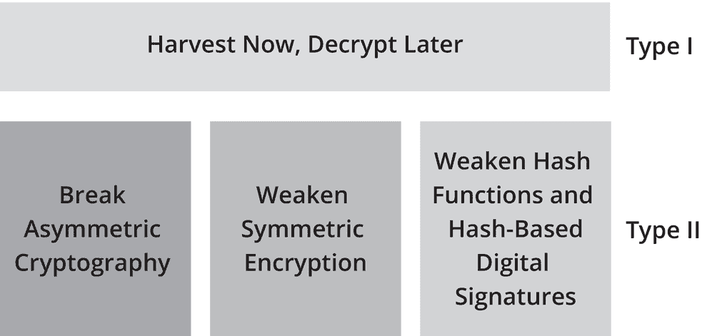

图 7.3 量子计算带来的两种安全威胁。

### 7.3.1 第一类：现在截获，后解密

“现在截获，后解密”（Harvest now, Decrypt later）是一个围绕量子计算对经典加密方法潜在安全威胁的概念。如果你在军方，“先存储，后解密”可能是破解当前加密系统的关键策略。这意味着某些组织存储了某些数据，我们现在无法解密，但这些数据将在未来的某个时刻被解密。

遗憾的是，这种成熟的到来还有很长一段时间，而量子计算很可能会加速其到来，以至于威胁长期机密性和前向安全性。国家军队和许多机构存储了大量与国家安全情报相关的信息。此类信息必须存储十年以上，且破解时间可能更长。量子计算的出现直接威胁着主要国家，这一点是显而易见的。为了消除这一隐患，如果我们希望在量子计算机出现后仍能保持安全，就必须快速开发新的加密方法。

这种攻击模型试图利用这样一个事实：量子计算机目前的强大尚不足以直接破解大多数算法，但它们可以捕获这些算法现在产生的加密数据，并在未来当量子计算机变得足够强大时进行解密。

其工作原理如下：

- `数据捕获`：在这种场景下，攻击者在你通过网络发送或接收加密数据，或者当你将数据存储在数据库时进行监听。这些数据可以是任何，从包含敏感信息的安全消息、个人内容的电子邮件、财务交易或你加密应用中的任何数据。
- `量子攻击`：攻击者万装待发，将这些加密数据存起来很长时间，直到量子计算取得重大进展，他们的耐心将获得回报。从理论上讲，量子计算机可以比经典计算机快指数级地解决某些问题，例如大数分解。
- `后解密`：当攻击者拥有具有足够计算能力的量子计算机时，就可以利用它们来破解以前被认为是安全的加密。特别是，他们可以使用`Shore’s algorithm`等量子算法对数字进行分解（例如沙特加密密钥），并解密截获的数据。

这种风险表明，在一个量子计算机可能塑造未来的快速演变的世界中，经典网络安全技术面临过时的风险有多大。这里的观点是，目前针对经典攻击被加密并认为是安全的数据，一旦构建了可以执行`Shor’s algorithm`（或其他形式的量子攻击）的量子计算机，可能会变得不安全。组织现在正在研究后量子加密（`PQC`）解决方案以应对这种威胁。这些新的加密技术旨在即使面对具有量子能力的对手也能保护数据。

### 7.3.2 第二类：认为非对称加密已被破解

非对称加密是保护通信通道（电子邮件、网页浏览和在线银行）最常用的方法。对于日常通信，几种关键通信协议严重依赖公钥加密、数字签名和密钥交换。对于当前技术，非对称加密对数据的加密已经足够。

然而，非对称加密正是量子能够破解的。在为人知的公钥加密方案之外，此类数论问题的困难性在量子计算面前是“微不足道”的，一旦量子计算机变得实用，这些协议就不再是端到端的完全安全。这可能是最大、也是最昂贵的量子威胁之一。许多流行的非对称加密方法，例如`RSA`（Rivest–Shamir–Adleman）或`ECC`（椭圆曲线加密），可能会被量子计算机破解。

- `大数分解`：量子计算机可以轻松解决作为`RSA`密文基础的大数分解问题。`RSA`基于将大半质数分解为其质因数的难题。一种量子算法实际上可以比最高效的算法快指数级地分解更大的数字。这意味着一旦制造出具有足够比特和纠错能力的运行量子计算机，它们就可以轻松地解密`RSA`加密并泄露数据。
- `离散对数问题`：大量的加密系统，包括几种类型的双因素身份验证（如`Diffie–Hellman`密钥交换的变体）和数字签名算法（`DSA`），其安全性都基于这个问题。`Shor’s algorithm`（基于量子计算机的使用）可以解决离散对数问题，从而高效地破解`Diffie–Hellman`密钥。结果是这些加密方法在后量子世界中可能不再安全。
- `椭圆曲线加密 (ECC)`：是的，它的使用率与`RSA`并列。然而，某些`ECCs`容易受到量子攻击的影响。`ECC`的“保护”基础建立在椭圆曲线离散对数问题之上，而量子计算机可以解决这一问题。

研究人员和机构正致力于创建新的`PQC`算法以降低这种风险。这些是抗量子加密技术，旨在确保今天加密的数据在现在及未来的量子计算（QC）时代均能保持安全性。企业、政府和个人都应该开始制定路线图，向抗量子加密迁移，以保护其数据。

## 7.4 QC 安全与隐私保护解决方案

### 7.4.1 法规

表格 7.5 提供了与密码学进展相关的法规、指南和倡议的示例。它包括美国的法规，如《量子计算网络安全准备法案》、英国的《2021 年国家安全与投资法》，以及美国的指南，如`NIST`迁移到`PQC`。倡议包括`NIST`的竞赛、欧盟的“开放量子密钥分发”、中国的`LAC`算法以及日本用于下一代加密系统的`CREST`项目。

表格 7.5 法规、指南和倡议示例

| 类型 | 司法管辖区 | 主题 |
| --- | --- | --- |
| 法规 | 美国 | 量子计算网络安全准备法案 |
| | 英国 | 2021 年国家安全与投资法 |
| 指南/标准 | 美国-NIST | NIST 特别出版物 1800-38A：迁移到后量子密码学 |
| | 美国-CISA | 为关键基础设施准备后量子密码学 |
| 倡议 | 美国 | `NIST`竞赛 |
| | 欧盟 | 开放量子密钥分发 (QKD) |
| | 中国 | 由多个大学和研究机构设计的`LAC`算法被选入`NIST`第二轮`PQC`密码算法列表。自 2019 年以来，中国密码学学会 (`CACR`) 开始举办全国性密码算法设计竞赛。 |
| | 日本 | 日本启动了`CREST`数字数学项目，为下一代加密系统的开发奠定基础。 |

#### 7.4.1.1 美国：量子计算网络安全准备法案

美国国会认为密码学对于美国的国家安全和美国经济的运行至关重要。《量子计算网络安全准备法案》于 2022 年 4 月 18 日提出，并于 2022 年 12 月 21 日成为公共法（第 117–260 号）。

该法案旨在鼓励联邦政府信息技术系统迁移到抗量子密码学，并用于其他目的。其范围涵盖政府机构的系统。表格 7.6 提供了主要义务的列表。

表格 7.6 主要义务列表

| 职责 | 要求 |
| --- | --- |
| 建立清单 | 在本法案生效之日起 180 日内，`OMB`主管应发布关于信息技术迁移到后量子密码学的指南。 |
| 机构报告 | 在本法案生效之日起 1 年内，此后定期进行，各机构负责人应向`OMB`主管、`CISA`主管和国家网络安全主任提供：(1) (a)(1)节所述的清单；以及(2) 根据 (a)(1)(C)节需要报告的任何其他信息。 |
| 迁移与评估 | 在`NIST`主管发布后量子密码学标准后的 1 年内，`OMB`主管应发布指南，要求每个机构：(1) 优先将 (a)(2)(A)节所述的信息技术迁移到后量子密码学；(2) 制定计划，将机构的信息技术迁移到后量子密码学，并与第(1)项的优先级保持一致。 |

### 7.4.1.2 欧洲

九欧洲提交团队对欧洲后量子网络安全标准化计划做出了贡献。在`NIST-PQC`算法征集过程中，欧洲研究人员的或总贡献占据了国立标准与技术研究院 (`NIST`) 发布的所有 26 个标准解决方案的四分之三。来自量子密码学学术和工业界的欧洲研究人员的`PQCrypto`项目旨在为加密方案、对称算法和签名系统提出标准化建议，并将`McEliece`密码系统作为`RSA/ECC`的替代方案。`ETSI`量子安全密码工业标准工作组 (`ISG QSC`) 评估并定义开发`PQC`算法的工业标准，发布“量子安全白皮书”以报告研究进展。此外还有欧盟的支持，例如 2015 年 1 月的`SAFECRYPTO`应用项目以及`PQCRYPTO`和`PROMETHEUS`项目，这些也是`EU Horizon 2020`计划下发展的实用`PQC`解决方案。

### 7.4.1.3 中国

中国在采用后量子标准化研究方面曾落后，但中国积极参与了`NIST-PQC`算法征集投票。参与设计的中国研究人员来自密码学与重点实验室、上海交通大学、复旦大学和中国科学院信息技术等机构。由中国科学院信息保护研究所联合设计的`LAC`算法大规模系统被选入`NIST`第二轮`PQC`密码算法列表。中国密码学学会 (`CACR`) 自 2019 年起开始举办中国密码算法设计竞赛。

国际后量子加密（PQC）理论与技术研究一直是各国作为密码学研究方向分支重点关注的重要领域。首届涵盖 PQC 可能存在各个领域的 PQC 国际会议由国际密码动物学研究协会于 2006 年组织。自那时起，该会议每年在北美、欧洲、东亚及全球范围内举行，通过在相邻轮次会议之间举办夏季或冬季的训练营，不断促进了不同国家研究人员之间的交流，并鼓励了 PQC 技术的发展。

目前，为了实现针对经典计算机优化的公钥加密算法，国际 PQC 研究的重点是识别量子计算机难以在多项式时间内高效解决的数学问题分类。这些困难问题构成了 PQC 算法的基础。由于这些问题具有固有的复杂性，PQC 算法能够对量子计算机（QC）攻击提供至少的抵抗。这确保了量子信息时代更安全的通信框架，保护数据免受量子计算机先进计算能力的侵害。

#### 7.4.2.1.1 PQC 的构建

几乎所有的 PQC 算法设计都基于困难数学问题的计算不可行性。目前，主要格、编码以及某些哈希或多变量问题被认为是困难的。此外，PQC 的构建方法涉及超奇异椭圆曲线、量子随机游等在量子计算机看来也被认为是安全的技术，以及具有更长密钥的对称加密算法，称为后量子对称加密。

* 在数学上，格结构中使用了格基（lattice bases）以及如最短向量问题（`SVP`）和最近向量问题（`CVP`）等困难问题。
* 来自编码理论的术，例如`McEliece`和`Niederreiter`方案，在基于编码的方法中使用错误码进行加密和签名。
* 基于哈希的方案高度依赖于数字签名算法（`DSAs`），以便利用哈希函数的抗碰撞特性，如 Merkle 签名方案（`MSS`）和`SPHINCS+`算法。
* 多变量结构利用有限域上的二次多项式，并基于求解非线性方程组是困难的（准线性）假设。

尽管每种构建都有其优和适用场景，但在后量子世界，这些将成为少数安全且实用的加密算法之一。

#### 7.4.2.2 NIST 计划时间表

自 2016 年以来，NIST 一直积极参与后量子加密标准的发展。其目标是识别并建立能够抵抗量子计算机攻击的标准化加密算法，如表 7.7。

表 7.7 NIST 量子计算计划关键里程碑 [80]

| | 日期 | 进展 |
| --- | --- | --- |
| 第一轮 | 2016 年 12 月 20 日 | 第一轮征集公告：宣布征集公钥后量子加密算法的提名 |
| | 2017 年 11 月 30 日 | 提交截止日期：收到 82 份提交 |
| | 2017 年 12 月 21 日 | 公布第一轮算法（69 份提交被接受为“完整且规范”） |
| 第二轮 | 2019 年 1 月 30 日 | 公布第二轮候选算法（26 种） |
| | 2020 年 7 月 22 日 | 公布第三轮候选算法（7 个入围者和 8 个备选） |
| 第三轮（四种待标准化的候选算法） | 2022 年 7 月 5 日 | 公布待标准化的候选算法及第四轮候选算法。4 算法：`CRYSTALS–KYBER`、`CRYSTALS–Dilithium`、`FALCON`和`SPHINCS+` |
| 第四轮（标准） | 2023 年 8 月 24 日 | NIST 宣布发布三个获胜加密算法（`CRYSTALS–KYBER`、`CRYSTALS–Dilithium`和`SPHINCS+`）的草案标准。这些标准被指定为`FIPS 203`、`FIPS 204`和`FIPS 205`。第四种算法`FALCON`的标准化草案预计于 2024 年发布。 |

### 7.4.2.3 PQC 的未来发展


#### 7.4.2.3.1 后量子加密的发展趋势

量子计算机预计将是下一代计算机的发展方向，它们在密码破解、机器学习和量子模拟等许多领域具有独特优势。这些也是未来最可能使用的领域。后量子加密算法是一种仅研究了约 30 年的新加密方案，用于应对 `QC` 攻击，目前仍有许多问题待探索。

##### 7.4.2.3.1.1 经典后量子加密算法的改进和更广泛的接受

`QC` 的出现为密码学带来了新需求，同时也促进了密码分析技术的进步。`KYBER` 是一种后量子加密算法；尽管已经提出并研究了多种后量子加密算法，但针对这些算法的理论攻击仍然存在，例如 `NIST` 选定算法第三轮中针对 `KYBER` 的密钥不攻击。因此，未来的工作需要继续改进这些后量子加密算法。然而，算法的实际进展同样重要。只要不断优化算法参数以增强性能，该算法就可以及时处理指定的任务。

##### 7.4.2.3.1.2 量子与加密混合算法

量子算法的设计目标是解决特定问题或缩短特殊算法的运行时间。例如，`Shor's algorithm` 推导了大整数分解，`Grover's algorithm` 提出了更快的搜索方法，而 `Simon's algorithm` 引入了函数的周期。研究结合量子算法和加密算法产生的新加密范式。用于量子安全的量子算法可以提高算法效率和可用性，并用于密码分析方法发现算法的潜在攻击点、优化参数并增加安全性。

##### 7.4.2.3.1.3 加密算法的后量子安全性评估

在 `QC` 模型中，经典加密算法的理论攻击基本上证明了其有效性。这可能是更有效的攻击，或者是超出后量子加密算法防御能力的攻击。同时，目前尚不清楚量子算法的出现是否会损害当前的后量子算法。因此，加密算法的量子安全性是未来的研究方向。

##### 7.4.2.3.1.4 在量子环境下探索新的数学问题

除了上述类型外，还应该研究和设计基于同调曲线或量子随机游的新型后量子加密算法。此外，研究经典计算机难以完成的量子力学问题也是一个研究方向。

### 7.4.3 为后量子加密做准备

量子计算（`QC`）近在咫尺，或者某些国家已经具备了量子能力，能够击破我们如今的非对称加密。年度性的加密方法将不再足够。组织现在必须采取行动，为新时代做好准备。

量子抗性应作为现代化努力的一部分集成到系统之中——这是一项协作任务，其范围超出了首席信息安全官（`CISO`）的典型职责范围。这项倡议需要组织领导者与外部合作伙伴之间的战略合作。它代表了一项统一且广泛的努力，组织内部外部具有不同专业知识的利益相关者所提供的见解共同构建了一个整体性方案。这一全面战略确保了抗量子技术被有效整合到组织基础设施中，增强安全性，以为量子计算时代的到来做准备。

* 需要抗量子加密能力，以保护开发过程中的关键应用程序免受泄露和篡改漏洞的威胁。
* 公司需要从今天开始规划其抗量子加密路线图，以确保多年后的数据依然是安全的。
* 随着量子技术时代恐怖攻击变得越来越可能，保护企业数据资产应成为 `IT` 领导者的首要任务，特别是对于那些掌握关键信息的领导。

这不仅仅是理解和实验量子计算；我们还需要为抗量子加密做好准备，它本身也面临着挑战。然而，随之而来的复杂性使得组织难以将当前的 `IT` 基础设施与抗量子加密集成。采用量子安全加密是一项巨大的工程且需要时间，因为不同的组织有不同的需求。由于对当前 `IT` 系统中所使用的加密算法缺乏独立于供应商的知识，使得很难精确规划出哪些系统需要被后量子加密（`PQC`）替换，以及替换的顺序。

### 准备

你需要时间来准备。在我们迎接量子安全世界时，`Crypto-agility`（加密敏捷性）应该是核心。因此，公司现在需要采取措施，并在未来必须采取强制性调整，以应对近期的量子威胁和变化。美国政府和其他国际国家机构已从 2016 年开始要求做好后量子准备。个人需要根据其角色以及后量子缓解措施对其产生的影响，接受基于量子和后量子教育的培训。这种定制方法的一个特点是，它能为员工提供识别为对其功能至关重要的特定培训。

#### 1. 领导层支持

嵌入量子抗性的系统现代化超出了 `CISO` 的职责范围。这需要由组织各级领导者及其外部合作伙伴共同领导的战略过程。整体方法论指的是与组织内部外部多样化领域的所有利益相关者合作。

* 确保高级管理层对后量子项目的支持。
* 必要时与法律和安全部门合作，列出存在哪些暴露的数据、系统和应用程序。
* 定义并努力实现可加密成熟度目标，建立明确的倡议以增强韧性，同时提高加密敏捷性。

#### 2. 角色与职责

* 该抗量子加密计划应该有一套明确的归属程序。
* 该小组应该是跨职能的，来自不同业务部门的代表。

#### 3. 意识与教育

* 高级管理层应该理解组织的战略威胁，并及时对网络风险做出响应。
* 告知员工即将到来的变化。每一项培训、教学和教育都应建立在让所有相关利益相关者对以下内容产生意识的基础上。

#### 发现

在发现阶段，识别任何可能需要后量子保护的系统至关重要，如下。通过进行这种彻底的评估，组织可以获得现有基础设施和系统的见解。

* **设备和数据的描述**：提供对设备和数据类型的详细描述。
* **所有敏感数据和设备的位置**：识别敏感数据和设备所在地。
* **数据关键性**：评估数据对组织有多么重要。
* **数据或设备需要保护多久**：确定保护数据和设备所需的时间。
* **使用的有效加密和加密类型**：评估当前的加密方法及其有效性。
* **目前实施的数据保护系统**：审查现有的数据保护系统。
* **当前密钥长度和最大密钥长度**：了解使用的当前和最大密钥长度。
* **供应商支持时间**：了解供应商的支持周期，以确保持续更新和补丁。
* **后量子保护准备情况**：通过考虑 `PQC` 准备情况，为量子计算带来的未来威胁做好准备。

#### 评估

量子风险评估包括评估量子计算对现有安全措施的潜在影响，并制定减轻这些风险的策略，如图 7.4 所示。该过程涉及分析当前系统对量子计算机攻击的敏感性，并识别能够抵抗量子计算威胁的稳健安全措施。

```
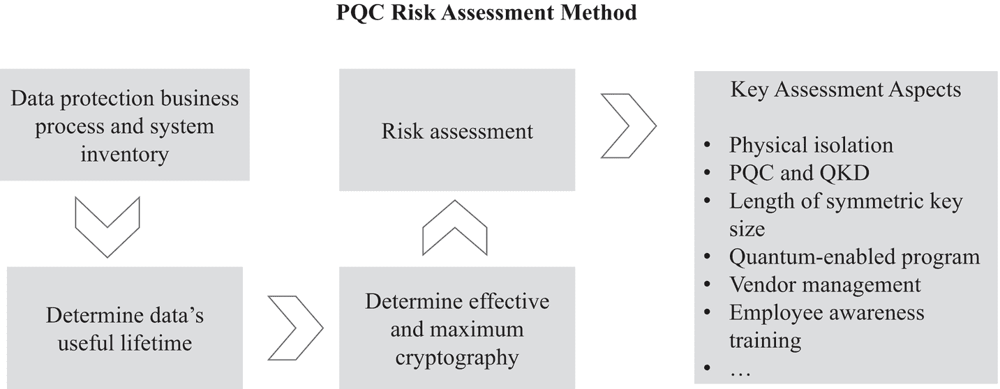
```

#### 优先级排序

组织需要根据业务价值、安全风险水平以及实施缓解措施所需的努力等因素，对缓解倡议进行优先级排序。

`Hyperion Research` 2022 年的调查显示了量子计算采用者对年度预算的多样预期。最常见的预期预算范围（38%受访者选择）在 500 万美元至 1500 万美元之间。约三分之一的受访者预测年度预算将超过 1500 万美元，而 20% 的人预计预算将超过 2500 万美元。这表明量子采用者的预算预期存在显著差异。

构建你的风险缓解路线图：

* 审查评估阶段产生的抗量子倡议。
* 在所有利益相关者的参与下，根据业务价值、安全风险和投入对倡议进行优先级排序。
* 审查所有倡议的位置，并考虑依赖关系等因素进行相应调整。
* 将优先排序的倡议置于可执行的项目管理图表中。
* 为每项倡议分配负责人和目标时间表。

#### 缓解

为了保护资产免受网络安全风险以及量子计算机强大处理能力所带来的威胁，组织应该遵循深度防御方案，如表 7.8 所示。这意味着需要实施既有政策、强有力的技术安全以及广泛的教育工作的结合。组织可能被要求采用完全全新的加密算法，或更新现有的协议以包含后量子加密技术。这些措施需要以符合成本效益且适用于组织实际情况（例如，风险概况）的方式进行选型、实施和设计。

表 7.8 关键量子计算风险缓解措施列表

| 领域 | 措施 |
| --- | --- |
| 治理 | 实施稳健的治理机制以提高透明度并帮助确保一致性。<br><br> * 更新策略和文档<br>* 更新现有的可接受加密标准<br>* 更新安全和隐私审计计划 |
| 利用行业标准 | * 跟进新批准标准的更新<br>* 利用行业标准（例如 `NIST` 的后量子密码学）并测试新的量子安全加密算法 |
| 技术缓解 | 每种类型的量子威胁都可以使用一种或多种已知的防御措施进行缓解。<br><br> * 物理隔离<br>* 将量子敏感型加密替换为抗量子加密<br>* 使用量子密钥分发 (`QKD`)<br>* 使用量子随机数生成器<br>* 增加对称密钥长度<br>* 使用混合解决方案<br>* 使用量子赋能防御措施 |
| 供应商管理 | * 与关键供应商合作制定量子安全治理的通用方法<br>* 评估供应商以决定是否将其纳入组织的路线图<br>* 制定关于量子安全加密的采购政策 |

# 8 大数据

DOI: [10.1201/9781003390695-11](https://dx.doi.org/10.1201/9781003390695-11)

本章旨在帮助业务领袖理解典型大数据平台的三个核心组成部分；使业务团队以及安全与隐私专业人员能够识别并评估安全与隐私风险；为业务团队提供案例研究、真实世界示例、官方指南以及行业最佳实践和指导，以便他们利用这些资源来缓解大数据平台的安全与隐私风险。

本章涵盖以下主题：

* 大数据技术架构
* 大数据安全与隐私问题
* 大数据的设计安全与隐私

## 8.1 什么是大数据？

数百万个智能移动设备、传感器、物联网（`IoT`）设备、社交网络和应用程序每天产生大量的结构化、非结构化和半结构化数据。管理这些不同的异构数据集对于传统数据管理系统来说是一个难题，但大数据解决了这个问题，因为它专注于管理这类类型海量、高速且多样的数据。

数据是世界未来的血液。数据将成为最重要的生产手段、工业级公共资源（如水电、石油），而大量的计算能力将成为一种生产能力。

股市和零售商等组织使用大数据分析来帮助其运营。然而，新技术也带来了一系列新问题。大数据意味着一组技术和架构，旨在通过高速采集、发现和分析，从海量多样化数据中提取价值。大数据最初以 3V（数量、速度、多样性）为特征，其定义已扩展到真实性（`veracity`）、有效性（`validity`）、价值（`value`）、变化性（`variability`）、来源（`venue`）、词汇（`vocabulary`）和模糊性（`vagueness`）[80]。

以下特征共同定义了什么是大数据，并强调了在不同领域管理、分析和从大型多样化数据集中获取价值的挑战与机遇（表 8.1）。

表 8.1 大数据核心特征

| 特征 | 描述 |
| --- | --- |
| 数量 (`Volume`) | 指通常大到无法用常规工具和技术管理的数据集。数据大小从 `TB` 到 `ZB` 不等。 |
| 速度 (`Velocity`) | 指数据生成、收集和处理的速度。数据来自多个来源（传感器数据、社交媒体等），并以高速进入组织，需要实时或近实时处理。 |
| 多样性 (`Variety`) | 指收集和处理的各种形式和格式。可以是结构化的（例如数据库）、半结构化的（例如 `XML`、`JSON`）或非结构化的（例如文本、视频）。 |
| 真实性 (`Veracity`) | 指数据的准确性和一致性。大数据通常源于具有不同准确性和完整性的来源。清洗、验证和质量保证是核心过程。 |
| 价值 (`Value`) | 指从大数据分析中获得的洞察和业务价值。大数据用于机器学习、数据挖掘和预测分析等高级分析技术，有助于从结构化或非结构化数据集中提取价值。 |
| 变化性 (`Variability`) | 指数据流随时间缺乏一致性或存在波动。数据源可能在某一秒活跃，在一段时间后出现爆发。目标是处理变化的数据量和速度，这需要根据需要扩展基础设施。 |
| 可视化 (`Visualization`) | 数据可视化是用视觉方式表示数据的实践，有助于理解和解释。可视化的重要不可忽视；你需要一种直观且可行的方法向利益相关者展示这些复杂数据，以便他们快速获得洞察并做出决策。 |

## 8.2 大数据技术架构

通常，大数据技术架构由三个常见部分组成，如下所示。图 8.1 展示了大数据架构的一个示例。

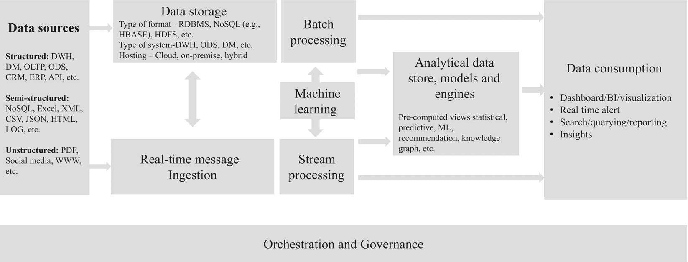

* 分布式数据采集：用于接入大量数据（通常是流式数据）的机制。这可以是轻量级的网页点击流分析，也可以是复杂的分布式科学成像或传感器数据。并非所有大数据都依赖分布式或流式数据采集，但它是大核心技术。
* 分布式存储：在分布式文件系统（如 `Hadoop` 分布式文件系统）或数据库（通常是 `NoSQL`）中存储大型数据集的能力，这通常由于非分布式存储技术的局限性而需要。
* **分布式处理**：能够分发数据处理任务（如 `map reduce` 和 `spark`）的工具，用于有效分析海量且变化快速的数据集，这些数据是单源处理无法有效处理的。

表 8.2 概述了数据湖（`Data Lake`）、数据仓库（`Data Warehouse`）和数据市（`Data Mart`）的关键区别与特征，涵盖了目的、数据类型、架构、用户、处理、存储成本、扩展性、性能、数据质量、用例和示例等方面。

表 8.2 数据湖、数据仓库和数据市的主要区别与特征

| 维度 | 数据湖 | 数据仓库 | 数据市 |
| --- | --- | --- | --- |
| 目的 | 以原生格式存储大量原始数据 | 存储结构化数据用于分析和报告 | 为特定业务线或团队存储特定的、聚焦的数据 |
| 数据类型 | 原始、未处理的数据（结构化、半结构化、非结构化） | 处理过的结构化数据 | 处理过的结构化数据 |
| 架构 | 读时架构 (`Schema-on-read`) | 写时架构 (`Schema-on-write`) | 写时架构 (`Schema-on-write`) |
| 用户 | 数据科学家、分析师 | 业务分析师、决策者 | 特定部门用户、分析师 |
| 处理 | 需要时处理数据（读时） | 加载前处理数据（写时） | 加载前处理数据（写时） |
| 存储成本 | 由于廉价的存储选项，通常较低 | 由于更结构化和优化的存储，成本较高 | 由于专门且聚焦的数据，成本较高 |
| 扩展性 | 高可扩展性 | 可扩展，但与数据湖相比较低 | 与数据湖和数据仓库相比扩展性较低 |
| 性能 | 由于需要处理原始数据，查询性能可能较慢 | 复杂查询性能高 | 特定查询性能高 |
| 数据质量 | 波动性大，因为数据可以是任何格式或质量 | 高，经过了数据清洗和转换 | 高，与数据仓库相似 |
| 用例 | 大数据分析、机器学习、数据探索 | 商业智能、报告、分析 | 部门特定的分析和报告 |
| 示例 | `Amazon S3`, `Hadoop HDFS` 等 | `Amazon Redshift`, `Google BigQuery`, `Snowflake` 等 | 数据仓库的子集，通常位于 `Redshift` 或 `BigQuery` 等相同平台内 |

在线分析处理（`OLAP`）和提取、转换、加载（`ETL`）都是数据管理和商业智能的关键组成部分，但它们在组织的数据策略中担载着不同的目的和功能。`OLAP` 和 `ETL` 的对比如表 8.3。

表 8.3 `OLAP` 与 `ETL` 对比

| 维度 | `OLAP`（在线分析处理） | `ETL`（提取、转换、加载） |
| --- | --- | --- |
| 目的 | 快速回答多维分析查询；数据分析和决策支持 | 从源提取数据，进行转换并加载到数据仓库中进行分析 |
| 功能 | 复杂计算、趋势分析和数据建模；通过数据立方体进行切片和交互分析 | 数据提取、转换（清洗和聚合）以及加载到目标数据库 |
| 关键特性 | - 数据的多维视图<br>- 实时分析<br>- 面向用户的即时查询和报告 | - 来自各种源的数据集成<br>- 为了保证质量和准确性进行的数据清洗<br>- 批处理 |
| 技术栈 | - `OLAP` 服务器和工具（例如 `Microsoft SSAS`, `Oracle OLAP` 和 `IBM Cognos TM1`）<br>- 多维数据库（`MDDBs`）或数据立方 | - `ETL` 工具（例如 `Apache Nifi`, `Talend`, `Microsoft SSIS` 和 `Informatica`）<br>- 用于存储的关系型数据库或数据仓库 |
| 处理 | 在多维空间中处理数据 | 在线性过程中处理数据：提取、转换和加载 |
| 用途 | 业务分析师和决策者用于获取数据洞察 | 数据工程师和 `IT` 专业人员用于为分析准备数据 |
| 集成 | `OLAP` 工具分析 `ETL` 过程准备的数据 | `ETL` 过程收集并准备数据供 `OLAP` 工具进行分析 |

## 8.3 大数据安全与隐私问题

“大数据”一词出现于 2005 年左右，最初在开发时并没有考虑到安全和隐私的敏感性。然而，现在安全和隐私已是最复杂的问题之一。数据已经成为几乎每个行业最重要的资产，从城市政府、医院到学校、工程公司、技术初创公司和零售商。

大数据涉及对海量数据进行存储和排序，因此保持这些数据的安全性非常具有挑战性。由于大数据系统存储了非结构化、结构化和半结构化类型的数据，部署安全解决方案并不容易。此外存在数据冗余和复制，这可能导致数据的易访问。

大数据包含了海量数据，通常包含敏感信息。因此，确保安全和隐私的挑战比以往任何时候都更加重大。通过从多个在线和线下渠道收集信息，营销人员可能会导致用户数据损坏。此外，大数据系统需要与外部应用程序和服务共享数据，这成指数级地增加了数据泄露的几率。

在数字时代，攻击者正在使用高科技手段和新方法破解组织的安全机制，对于企业来说，保障大数据安全已变得更具挑战性。表 8.4 [81] 列出了大数据安全与隐私的主要关注点。

表 8.4 大数据安全与隐私关注点

| 关注点 | 方面 | 描述 |
| --- | --- | --- |
| 安全担忧 | 数据泄露 | - 数据对利用数据的组织构成了重大威胁，因为其提供新洞察的能力使其成为攻击者的吸引目标。这包括对存储在大数据仓库中的敏感信息进行未经授权访问的风险。<br>- 根据 `IBM` 2023 年数据泄露成本报告，全球平均处理成本为 445 万美元。这个数字说明了企业安全漏洞的财务后果。<br>- 访问控制管理：大数据系统非常复杂且分布式，因此数据在多个存储位置和服务器上复制。设计能够不受数据格式限制实施和管理的访问控制是挑战性的。它们都有高存储需求，并需要向第三方应用程序和服务提供数据。这里的另一个困难在于管理如此海量且多样化的数据，这自然增加了未经授权访问的风险。 |
| 网络攻击 | | |


大数据系统中海量且多样化的数据，结合人们对这些因素的普遍低估，使得这些系统成为网络攻击的主要目标。网络犯罪分子采用各种策略来破坏这些系统，包括欺骗用户下载恶意软件、发起钓鱼攻击以及部署勒索软件以感染这些系统。

## 内部威胁

无论是故意还是无意，内部威胁一直是大数据安全的一个大关注点。由于拥有系统的特权访问权限，恶意内部人员可以利用安全漏洞删除数据或修改其内容。

`Cybersecurity Insiders` 发布的《2023 年内部威胁报告》中指出，74% 的组织在内部威胁方面至少处于中等脆弱水平，这证明了该威胁无处不在的特性。

组织的所有员工在某种程度上都有访问数据的权限，特别是那些进行大数据分析的人员。即使是那些对组织数据系统有内部了解（例如访问控制、密码和安全协议）的人也是如此。拥有访问某些大数据系统权限的员工可以利用此获得未经授权的敏感数据访问权限。他们还可以操纵数据，给公司造成财务或声誉损害。

## 隐私关注与数据隐私监管合规

各国政府拥有用于收集、存储和处理公民数据的监管框架（例如 `GDPR` 和 `CCPA`）。如果您未能满足这些监管规定，可能会导致巨额罚款和声誉受损。

根据 `Enzuzo` 的《2024 年数据隐私统计报告》显示，30% 的企业表示，合规是建立消费者信任的首要任务，这证明了数据管理和治理实践中正在发生的转型。

## 伦理考量

利用大数据进行画像分析、行为分析和定向广告引发了关于个人隐私和自主权的伦理关注。组织必须确保其数据实践的透明度和可问责性，以解决这些关注。

根据皮尤研究中心（`Pew Research Center`）2023 年关于隐私和信息共享的调查，71% 的美国人对公司使用其个人数据表示担忧——这表明隐私问题持续引起公众共鸣。

## 数据变现

数据变现创造了收入机会，但也带来了数据所有权、同意和利用的问题。当公司进行此类操作时，它们必须在业务需求与消费者隐私权之间进行权衡，以保持他们的信任和信誉。

思科在 2023 年进行的一项调查发现，62% 的受访消费者对组织目前如何利用 AI 使用个人数据表示担忧。

## 8.4 大数据的设计安全与隐私

大数据安全使能让组织能够释放大数据的潜力并创造价值，同时管理风险。企业需要数据安全，特别是当他们使用大数据并持有敏感信息（如客户的个人和支付详情或公司的知识产权）时。这有助于维护对数据保护权利的合规性并与客户建立信任，从而帮助您做出决策。

考虑到社交媒体平台和电信等多样化的数据收集来源，需要新的安全和隐私技术来保护和监控大数据流程。未能解决大数据安全问题可能会危及用户隐私并损害从各种来源收集的敏感个人信息。因此，投资强大的安全措施对于利用大数据效益的同时保护用户隐私至关重要，如表 8.5 [82]

| 收益 | 描述 |
| --- | --- |
| 降低数据泄露风险 | 大数据安全的主要目标是保护数据的机密性、完整性和可用性 (CIA)。根据角色进行访问控制、数据加密、威胁检测和实时监控等步骤有助于避免数据泄露。 |
| 增加客户信任 | 与客户建立信任意味着维护他们的隐私。数据泄露的增加导致消费者变得更加警觉，组织管理客户个人和敏感数据的方式现在是网络安全的关键要求。通过利用大数据安全，可以确保客户数据免受非法使用。这使得客户能够信任并对组织保持忠诚，因为他们的数据和隐私得到了公司的良好估值。企业通常使用知名的第三方进行安全审计，验证组织保持数据安全的能力，反过来告诉客户他们的数据是安全的。 |
| 获得并保持竞争优势 | 由于业务的竞争性质，大数据安全确保企业能够保护其关键资产并根据其处理的数据做出决策。由于客户知道自己的数据是安全可靠的，这建立了信任和忠诚。这反过来会导致更好的客户留存。拥有强大安全措施的企业有潜力吸引支持业务增长的伙伴。这些元素促进了公司的增长，使其能够领先于尚未开始大数据安全分析趋势的竞争对手。 |

设计健壮的大数据网络安全隐私架构涉及整合各种组件和技术，以保护静态、传输中以及处理过程的数据。该架构应该解决关键的安全和隐私问题，例如数据泄露、未经授权的访问、数据完整性和法规合规。以下是全面的大数据网络安全隐私架构的概述，如图 8.2 所示。

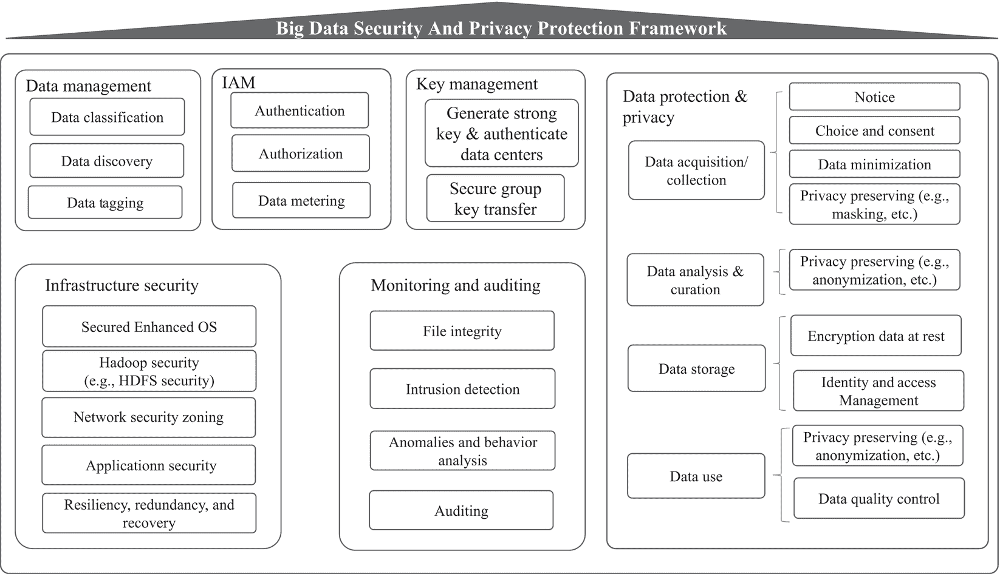

图 8.2 大数据安全隐私保护框架

大数据时代网络安全和隐私架构的组件如表 8.6。数据保护措施包括数据接入安全、加密、访问控制和强身份验证，以保护和验证数据访问。持续监控、入侵检测和漏洞管理保护数据，而合规、治理和隐私评估则确保符合法规。用户教育促进了安全意识的培养。

[表 8.6 大数据网络安全隐私架构组件]

| 组件 | 描述 |
| --- | --- |
| 数据接入安全 | 确保数据从各种源安全地传输到大数据环境中。 |
| 加密 | 对静态和传输中的数据进行加密以保护敏感信息。 |
| 访问控制 | 实施细粒度的访问控制策略，根据用户角色和权限限制数据访问。 |
| 身份验证 | 使用强身份验证机制（例如多因素身份验证）验证用户身份。 |
| 数据掩敏/匿名化 | 对敏感数据进行掩敏或匿名化，以防止个人身份信息 (PII) 暴露。 |
| 监控与审计 | 持续监控数据访问和使用，并维护审计日志用于法分析和合规报告。 |

# 大数据安全与隐私

- **入侵检测系统**：部署 `IDS/IPS` 以检测并防止大数据环境中的恶意活动。
- **网络安全**：实施网络安全措施，如 `firewalls`、`VPNs` 和安全网络分段，以保护传输过程的数据。
- **漏洞管理**：漏洞管理对于确保大数据安全至关重要，因为它有助于主动识别并修补漏洞，降低数据泄露和未经授权访问的风险。
- **数据完整性**：使用 `checksums`、`hashing` 和 `digital signatures` 确保数据完整性，以检测未经授权的更改。
- **合规管理**：遵守监管要求（如 `GDPR`）和隐私行业标准。
- **数据治理**：建立数据治理策略和程序，在整个数据生命周期内管理数据质量、隐私安全。
- **应急响应**：制定应急响应计划，快速响应数据泄露和其他事件。
- **安全信息和事件管理 (SIEM)**：使用 `SIEM` 系统实时聚合、关联和分析安全事件，以进行威胁检测和响应。
- **数据泄露防护 (DLP)**：实施 `DLP` 解决方案以防止未经授权的数据外泄，并确保敏感数据不泄露或处理错误。
- **隐私影响评估 (PIA)**：定期进行 `PIAs` 以评估并缓解与数据处理相关的隐私风险。
- **用户与员工教育培训**：为员工提供定期的培训和意识计划，培养安全和隐私文化。

## 8.7 大数据相关行业标准

`ISO/IEC` 提供了全面的标准，包括关于大数据概述和术语的 `ISO/IEC 20546` 以及关于大数据参考架构的 `ISO/IEC 20547` 五部分系列标准。

- `ISO/IEC 20546 信息技术—大数据—概述和术语`：该文档提供了大数据关键概念的概述，以及了一 set 术语和定义。它为大数据相关标准提供了术语基础。
- `ISO/IEC TR 20547-1 信息技术—大数据参考架构—第 1 部分：框架和应用过程`：该文档提供了一个描述大数据架构和实施的框架，一个将特定问题/用例映射到架构的过程，以及对该映射进行评估的方法。
- `ISO/IEC TR 20547-2 信息技术—大数据参考架构—第 2 部分：用例和派生需求`：该文档提供了大数据用例集，并将这些用例拆解为大数据架构师和系统实施者可以考虑的技术考量。
- `ISO/IEC 20547-3 信息技术—大数据参考架构—第 3 部分：参考架构`：该文档从用户和功能视图描述了参考架构。
- `ISO/IEC 20547-4 信息技术—大数据参考架构—第 4 部分：安全与隐私`：该文档描述了大数据特有的安全和隐私方面。
- `ISO/IEC TR 20547-5 信息技术—大数据参考架构—第 5 部分：标准路线图`：该文档提供了标准清单及其与参考架构的关系，架构师和实施者可以在设计和实施系统时考虑这些内容。

### NIST SP 1500-4

`NIST 特别出版 1500-4: NIST 大数据互操作性框架`：第 4 卷，安全与隐私。

### UK BSI

- `BS 10102-1 大数据第 1 部分：数据驱动组织指南`：该文档提供了关于从数据（包括大数据）实现价值的指导，包括获取洞察、指导策略、增强声誉以及提高合规、效率和性能。
- `BS 10102-2 大数据第 2 部分：数据密集型项目指南`：该文档提供了实施数据密集型项目以实现价值的实践指导，包括定义项目目标和类型；角色和职责；数据项目管理方法；定义治理和合规方法（参见 `BS 10102-1` 第 6 节）；在框架内运行治理和合规；与合作伙伴、供应商、技术提供商、消费者和其他第三方合作；以及项目结束——对照项目目标的评审、沟通和经验总结。

# 第四部分 超连接与数据保护

本部分涵盖以下主题：

- 5G 技术与数据保护
- 脑机接口 (BCI) 与数据保护
- 物联网与数据保护

# 9 5G 技术及其安全隐私架构

本章旨在让读者全面掌握 5G 架构和组件的知识；支持读者采取整体方法评估安全与隐私差距，提出可行的解决方案，并制定合理且可行的安全实施计划。

本章涵盖以下主题：

- 5G 与用例
- 通信演进
- 5G 技术架构与关键技术
- 5G 安全与隐私关注点及解决方案
- 安全与隐私威胁
- 5G 安全目标与控制

# 系统初始化

在项目配置中，我们需要先检查 `/etc/config/settings.json` 文件。

通过调用 `ConfigManager.init(path, "prod")` 方法来初始化系统。变量 `timeout_count` 的值设置为 `300`。

我们使用 `start_service` 命令来启动后端。

在表达式 `result = calculate + offset` 中，计算成功。

```javascript
if (status == 200) {
  console.log("System Ready");
}
```

| 覆盖范围 | 主要是城市和郊区地区 | 预计扩展到 5G 之外 | 全球，包括远程和农村地区 |
| :--- | :--- | :--- | :--- |
|  | 需要大量的基础设施 | 需要技术的重大突破 | 需要卫星星座 |
| IoT 集成 | 通过海量设备连接促进 IoT 扩展 | 通过 AI 驱动的优化实现高效的 IoT 部署 | 弥合数字鸿沟，实现远程地区的 IoT |
| 应用场景 | IoT、自动驾驶汽车和智能城市 | 高级 IoT 和全息通信 | 宽带互联网接入和远程办公 |
| 经济影响 | 预计将为全球经济贡献数万亿美元 | 预计将推动经济增长和创新 | 增强欠发达地区的社会经济发展 |

## 9.2 5G 技术架构与关键技术

图 9.1 展示了典型的 5G 架构及其主要组件，说明了从 5G 设备通过无线接入网 (`RAN`)、传输网、核心网、电信操作系统 (Telco-OS) 和网络切片到达企业网络的流量。关键组件包括用于延迟和可靠性的移动边缘计算 (`MEC`)、面分离、`NFV` 和软件定义网络 (`SDN`) 架构，以及网络切片。这种配置支持 VR/AR、智能城市、金融服务和 IoT 等多种应用。强调的主要优势包括光纤级速度、海量 IoT 连接、保障延迟、虚拟化网络、新业务、新模式和资源访问，从而增强了多个行业的通信、效率和安全性。

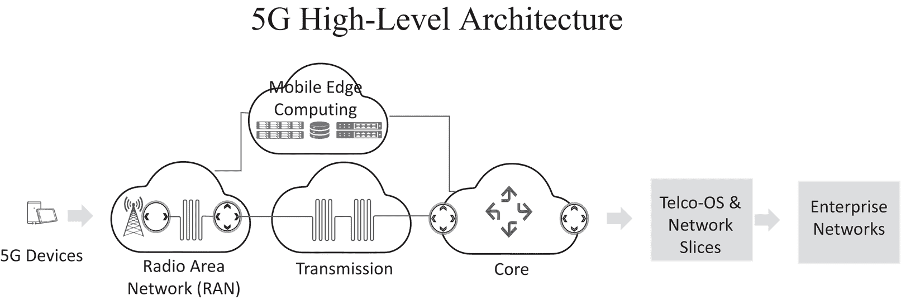

图 9.1 5G 技术架构。

表 9.4 总结了主要的 5G 无线技术。天线技术在不同规模下提升了容量和速度，通过增加空间分辨率、减少干扰和利用频谱效率来延长天线寿命。电子阻抗断层扫描 (`EIT`) 提供了高空间分辨率、窄束集中和整体效率，其实现需要精确的信道测量和反馈。

表 9.4 5G 无线关键技术 [84]

| 无线关键技术 |  | 优缺点 |
| --- | --- | --- |
| 大规模天线技术 | 5G 通信系统对空间分布的大规模天线阵列有高容量和速度要求，这增加了显著的设计复杂性。增加天线增加了它们支持的独立空间数据流数量，有助于提高频谱效率。它们涵盖了范围测试与反馈、参考信号设计以及低成本实现之间的权衡。这些天线形成高增益波束，提高了空间复用、信号强度和系统容量。 | - 增强的空间分辨率允许在不需要更密基站的情况下高效利用频谱。<br>- 窄束集中减少了用户终端之间的干扰。<br>- 较低的传输功率提高了整体效率。<br>- 简单的线性预编码和检测器在有足够天线的情况下工作最佳，不受噪声或干扰影响。 |
| 新多接入技术 | 对于未来的移动通信，特别是元宇宙。新的多接入技术将提高频谱效率，这不仅可以增加连接数，还能简化系统设计。如 `SCMA`、`MUSA`、`PDMA` 和 `NOMA` 等方案在多个维度上堆叠信号，有助于降低频率占用。 | (详见全频谱接入) |
| （注：表格结构继续见下方） | | |
| 全频谱接入 | 使用全频谱技术通过利用具有自适应技术的多频网络来提高数据速率和容量，但标准化仍然是一个挑战。 | (详见（新多接入细节）） `SCMA`、`MUSA`、`PDMA` 和 `NOMA` 提高了频谱效率，适应连接并简化了系统设计。 |
| 高级调制与编码 | 满足 5G 性能需求。`LDPC` 和 `-Nyquist 调制` 在高 SNR 环境具有良好的频谱效率和稳健性。 | |

# 控制与转发分离技术

5G 的特点是网络控制与用户数据转发的分离，实现了一种全新的集中式架构。该架构通过非实时云处理器连接控制节点，并连接执行低效软件定义网络 (`SDN`) 控制交换机的独立工作进程。控制云负责会话控制、移动性管理、服务质量（QoS），而转发云负责为元宇宙中海量数据源之间的带宽流量提供可靠且低延迟的。控制逻辑高度集中，访问控制和移动性管理可以轻松重新配置。网络切片确保了资源的动态分配。开放接口允许第三方访问网络。它拥有一个网关更少的转发面，这使得数据传输尽可能高效。在分离控制与转发后，转发面专注于为元宇宙流量提供简单且稳定的路由。控制面集中管理策略，以实现灵活的调度和连接。它是可编程的，通过移动流控制、网关部署来控制转发面，从而提高整体效率。

## 软件定义无线网络 (`SDWN`)

然而，这仍然不够的，因为存在许多不同的业务类型和场景，具有多样化的需求。它完全兼容并支持软件定义网络和网络虚拟化 (`SDNFV`)，这是网络函数和资源按需部署的蓝图。`SDWN` 使用云基础设施提供的隔离网络切片来适应元宇宙的不同业务。控制层与网络基础设施关联时，可以实现对节点的集中控制；因此可以实现集中式路由，降低成本。

## 自组织网络 (`SON`)

它使用由下一代移动网络 (`NGMNs`) 驱动的功能，其任务是网络部署、故障管理、配置和优化。然而，目前的技术是针对特定网络的，且不同网络之间缺乏协调。异构网络中的 `SON` 仍需相关研究，包括跨系统优化和协作故障检测，以实现无缝自愈。

## 异构超密集网络 (`H-UDN`)

随着基站数量的增加，干扰管理、小区虚拟化和统一接入回传设计是一些关键技术。`H-UDNs` 的局部容量大幅提升；因此，更高的频率复用为元宇宙场景带来了实质性的增强。

## 9.2.1 5G 芯片

今天的通信系统由计算、存储和传输组件组成，5G 的发展需要强力的芯片支持。5G 核心网、基站和其他设备的管理系统都需要计算和存储芯片，而智能手机也需要各种作为基带处理器和存储器的芯片。此外，未来大量的 5G 终端也需要传感器芯片。

### 表 9.6 5G 芯片类型与功能

| 芯片类型 | 角色 | 功能 | 示例 |
| :--- | :--- | :--- | :--- |
| 计算芯片 | 电源服务器、核心网元件和基站 | 执行数据处理、网络管理和协议处理等计算任务 | 中央处理器 (`CPUs`)、图形处理器 (`GPUs`)、神经处理器 (`NPUs`) 和专用加速器 |
| 存储芯片 | 存储关键数据、软件和配置 | 存储软件镜像、配置文件、用户数据和网络日志 | NAND 闪存、固态硬盘 (`SSDs`)、动态随机存储存储 (`DRAM`) 和存储控制器 |
| 专用芯片 | 高效执行特定任务 | 加速信号处理、加密、数据包分类和硬件加速功能 | 数字信号处理器 (`DSPs`)、可编程门阵列 (`FPGAs`)、专用集成电路 (`ASICs`) 和硬件加速器 |
| 手机芯片 | 为连接 5G 的移动设备供电 | 集成基带处理器、应用处理器、`GPUs` 和传感器接口 | 高通、联发科和三星的 `SoCs`，具有集成调制解调-RF 系统、强大的 `CPUs/GPUs` 和 AI 加速器 |
| 传感器芯片 | 采集环境数据并实现 IoT 应用 | 检测光照、温度、运动和接近等物理现象 | 加速度计、陀螺仪、环境光传感器、温度传感器、接近传感器 |

## 9.3 5G 安全与隐私问题及解决方案

### 9.3.1 5G 安全与隐私威胁

安全是 5G 以及整个时代智能互联的基础。没有安全保障，5G 的部署将是不可想象的。表 9.7 重点强调了针对单个网络元素的众多 5G 安全和隐私威胁。恶意软件、克隆、`BOT` 劫持和协议降级威胁于用户设备 (`UE`) 侧。窃听和干扰是空接口威胁。gNodeB (`gNB`) 威胁涉及软件/硬件篡改和数据泄露。篡改和协议修改是回传威胁。`DDoS`、恶意软件和应用程序接口 (`API`) 威胁包含在接入边缘计算 (`MAEC`) 威胁中。关键 5G 核心网 (`5GC`) 的入防护威胁包括基于网络函数虚拟化 (`NFV`) 的攻击、漫游欺诈和未经授权的访问。5G 安全威胁有多个方面，例如未经授权的访问、数据泄露、恶意软件以及 5G 生态系统中与其他运维 (`O&M`)相关的威胁。

### 表 9.7 5G 安全与隐私威胁示例

| 威胁类型 | 示例 |
| :--- | :--- |
| `UE` 威胁 | <ul><li>恶意软件</li><li>克隆</li><li>机器人劫持</li><li>伪基站 (BTS)</li><li>协议降级</li><li>固/硬件/软件（供应链）投毒</li><li>IMSI 捕获</li></ul> |


| 空接口威胁 `SON` 攻击 | <ul><li>窃听</li><li>冒充</li><li>数据篡改</li><li>干扰</li><li>伪基站 (`BTS`)</li></ul> |

| `gNB` 威胁 | <ul><li>被篡改的软件/硬件</li><li>未经授权的访问</li><li>数据泄露</li><li>来自 `UE` 的接入网 `DDoS`</li></ul> |

| 回传威胁 | <ul><li>篡改</li><li>窃听</li><li>协议修改</li><li>协议降级</li><li>`SDN` 威胁</li></ul> |

| `MEC` 威胁 | <ul><li>不可信的第三方 `APP`</li><li>`UPF` `DDoS`</li><li>恶意软件</li><li>虚拟化攻击</li><li>应用层攻击</li><li>`API` 攻击</li></ul> |

| `5GC` 威胁 | <ul><li>基于 `NFV` 的攻击</li><li>漫游（欺诈和滥用）</li><li>漫游协议攻击（类 `SS7` 攻击）</li><li>恶意 `AF`/`VNF`</li><li>未经授权的访问</li><li>数据篡改</li><li>窃听</li><li>`DDOS`</li><li>`OSS`/`5GC` 攻击</li></ul> |

| `O&M` 威胁 | <ul><li>未经授权的访问</li><li>数据泄露</li><li>恶意软件</li><li>`API` 攻击</li><li>`OSS` 服务集成</li></ul> |

5G 协议安全机制不断增强，如表 9.8 所示。

### 表 9.8 通信技术安全机制的演进 (#ch9.xhtml#R_table9_8) [87]

| 威胁类型 | 安全机制 |
| --- | --- |
| **2G** | <ul><li>`2G AKA`（认证与密钥协议）：仅对用户设备（`UE`）进行网络认证</li><li>数据和信号的加密</li><li>加密终点：`BTS`（基站）或 `SGSN`</li></ul> |
| **3G** | <ul><li>`3G AKA`：网络/`UE` 相互认证</li><li>数据加密</li><li>信号的加密与完整性保护</li><li>数据加密终点：`RNC`（无线网络控制器）</li></ul> |
| **4G** | <ul><li>`4G AKA`：网络/`UE` 相互认证</li><li>数据加密保护</li><li>信号的加密与完整性保护</li><li>数据加密终点：`eNB`（演进基站）</li></ul> |
| **5G** | <ul><li>对 4G 的增强</li><li>垂直行业的安全赋能</li><li>移动边缘安全</li><li>`Security Anchor Function` (`SEAF`，安全锚点功能）和统一认证框架</li><li>网络攻击防御</li><li>云安全与虚拟化安全</li></ul> |

### 9.3.2 5G 安全目标与控制

表 9.9 概述了各方在确保 5G 通信安全方面的角色和职责。政府投入时间制定网络安全和隐私法律，管理国家倡议和跨级事务，并控制频谱分配。电信行业高度监管，监管机构制定电信业务制定规则、标准和合规性，并对其施加复杂的约束。标准组织创建或开发行业和技术标准，以及评估方法，确保开放性。对创新、安全产品设计与开发、网络安全测试以及遵守法律法规的重点落在开发者和供应商手中。服务提供商和运营商负责实施安全基础设施、监控安全事件以及执行合规性检查。业务组织和个人用户遵守相关法规；通过意识计划和提高这些利益相关者的意识来维护和支持网络安全卫生协议。

### 表 9.9 5G 生态系统中各方的角色与职责 (#ch9.xhtml#R_table9_9)

| 角色 | 职责 |
| --- | --- |
| 政府 | <ul><li>网络安全与隐私法律的制定与立法</li><li>法律执法</li><li>国家和州级倡议</li><li>频谱控制与分配</li></ul> |
| 电信行业监管机构 | <ul><li>接受政府指导</li><li>制定行业运行规则</li><li>制定标准和合规要求</li><li>合规执法</li></ul> |
| 标准组织 | <ul><li>行业标准（例如 `3GPP`）</li><li>技术和产品标准</li><li>测试与评估方法</li><li>通用架构框架和方法论</li><li>意识与教育</li></ul> |
| 供应商与设备制造商 | <ul><li>创新</li><li>安全产品的设计、制造与支持</li><li>产品网络安全测试与认证</li><li>遵守法律、监管机构要求和标准合规性</li><li>最佳实践和安全参考架构</li><li>意识与教育</li></ul> |
| 服务提供商和运营商 | <ul><li>实施安全可靠的基础设施</li><li>遵守法律、监管机构要求和标准合规性</li><li>运营电信基础设施并确保安全</li><li>监控安全事件并防御恶意行为</li><li>意识与教育</li></ul> |
| 企业与个人用户 | <ul><li>利用 5G 基础设施满足业务和个人需求</li><li>遵守法律、监管机构要求和标准合规性</li><li>培养业务意识和业务战略</li><li>在网络安全各方面遵循最佳实践</li><li>维护良好的网络安全操作卫生</li><li>意识与教育</li></ul> |

#### 9.3.2.1 5G 安全目标

5G 数据安全与数据保护框架强调了确保 5G 网络安全至关重要的各种组件和措施，如图 9.2 所示。


图 9.2 5G 安全与隐私保护框架

- **保护 5G 切片**：对于确保控制面、管理面和基础设施的安全至关重要。为了保护 5G 切片，需要对网络进行分区，并确保性能。
- **`MEC`**：由于 `MEC` 在边缘进行计算和存储，其安全至关重要，同时也涉及到响应和低延迟的问题。
- **5G 设备安全**：5G 设备应包含必要的安全功能并防御威胁，这包括设计和制造工艺。
- **保护 5G 网络**：为了保护 5G 网络，良好的设计和规划是必要的，同时需要有效的执行。
- **基础设施安全**：该领域强调通过对用户访问的安全控制、监控网络流量来确保系统的基础，包括云环境、软件定义网络（`SDN`）和网络虚拟化（`NFV`）。此外还涉及加固虚拟化网络函数（`VNF`）以防止非法访问。
- **检测、响应与恢复**：该控制关注威胁检测、响应和恢复，以及部署平台的安全管理和控制。网络安全平台是进出流量的关口。

最终，该框架强调了 5G 安全的多维度视角，涵盖多个层次和方面，从而帮助运营商保护 5G 网络运营免受任何潜在威胁。本节概述了如何在典型的 5G 领域中保护安全和隐私，表 9.10 总结了可以采取的相应措施。数据中心和安全管理员需要主动授权权限、执行网络流量控制并限制云、`SDN` 和 `NFV` 的部署。

### 表 9.10 5G 安全与隐私保护措施示例 (#ch9.xhtml#R_table9_10)

| 领域 | 子域 | 控制措施 |
| --- | --- | --- |
| 基础设施安全 | 用户权限访问控制 | <ul><li>用户角色与权限映射</li><li>最小权限原则</li></ul> |
|  | 网络流量控制 | <ul><li>`NGFW` 和主机 `FW` 流量控制</li><li>流量流控制</li><li>禁用空用端口</li></ul> |
|  | 云、`SDN` 和 `NFV` 部署策略 | <ul><li>云隔离（例如私有云和公有云）</li><li>硬件系统隔离</li><li>`VM` 隔离</li></ul> |
| 应用安全 | `VNF` 加固以确保安全 | <ul><li>`VM` 之间关键数据的传输加密</li><li>加密后 `VNF` 密钥的存储与备份</li><li>入侵检测与快速服务恢复</li></ul> |

#### 基础设施平面

- 不同网络切片之间的物理隔离，管理和分配网络资源及服务
- 为每个切片配置网络安全策略
- 同一切片内不同服务的不同安全方法管理
- 针对不同切片的硬性管道，确保切片之间的物理隔离
- 切片安全策略和服务安全方法配置

#### 保护移动边缘计算 (`MEC`) / 保护 `MEC`

- 上行和下行流量控制
- 部署硬件隔离或资源预留
- `KPI`（关键性能指标）检测，如吞吐量和负载
- 服务接口身份认证和 `API` 访问
- 安全区域隔离（分布式虚拟防火墙 (`vFW`)）和流量控制
- 软件签名验证和可信启动
- `MEC` 与应用租户的独立运维（`O&M`）
- 硬件隔离隔离与区域隔离（分布式 `vFW`）

#### 运营、威胁检测、响应与恢复 / 安全管理平台

- 安全信息资产（密钥、证书和身份）的集中化管理、快速漏洞感知以及安全高效的运维

#### 安全分析平台

- 基于大数据分析分析信令风暴、业务面 `DDoS` 攻击和运维面攻击
- 安全态势感知
- 日志管理/审计
- 攻击检测与分析
- 安全：实时监控

#### 安全控制平台

- 安全策略编排和攻击事件自动响应、威胁拦截及快速恢复

#### 5G 部署安全 / 5G Deployment security

- 安全网络规划
- 安全网络设计
- 安全实施
- 安全管理

#### 5G 设备安全 / 安全特性

##### 身份与访问管理

- 基于角色的访问控制 (`RBAC`)
- 隔离：用户/控制/运维面隔离

##### 机密性与完整性

- 软件签名验证
- 安全启动
- `IPSec`/`TLS`
- 私钥的安全存储

##### 可用性

- 空口接口 `DDoS` 防护（流量控制）
- 传输接口防火墙（二层和三层）

##### 审计与日志

- 安全告警和审计日志
- 集中式日志管理
- 运营活动（登录/注销/命令）监控

#### 安全加固 / 遵循行业最佳实践，包括 `CIS` 基准

- 操作系统加固
- 禁用不安全协议（加密套件）
- 凭据管理
- 端口访问控制和端口配置
- 应用加固
- Web 应用加固（`OWASP` 前 10 名）
- 编译安全加固（堆栈保护）

# 10 脑机接口 (`BCI`)

DOI: [10.1201/9781003390695-14](https://dx.doi.org/10.1201/9781003390695-14)

本书旨在帮助读者建立对 `BCI` 技术、架构和业务实施场景的理解；支持读者构建安全和隐私成熟模型，以系统地衡量安全和隐私态势并证明合规性；为读者提供具体的指导和建议，以管理整个产品生命周期中的安全和隐私风险。

本章涵盖了以下主题：

- `BCI` 的发展时间线
- `BCI` 的益处与技术体系
- 安全与隐私影响
- B 的设计安全隐私（Security by Design）

## 10.1 BCI 基础

### 10.1.1 什么是 BCI？

脑机接口（`BCI`）是一种使大脑与外部设备之间能够直接通信的技术。`BCI` 的设计用于解释脑信号并将其转换为可以控制计算机、假肢设备或其他机器的命令。`BCI` 包括了在人类或动物的大脑或神经系统与能够处理、传输和接收数据的人工材料之间建立数据交换通路。

在最理想的情况下，目前人类所理解的大脑和意识的基础材料是电活动。脑神经元遇到或设想的刺激会导致细胞膜外的大量钠离子涌入细胞，扰乱其现有的电位并触发电荷运动，从而产生局部电流。随着传输的持续，这些电流进一步刺激其他神经元，最终产生意识。

解码脑信号是困难的。在研究了脑波和信号后，我们可以使用不同的数学技术在不同维度上表示这些信号。然后通过算法和测试将信号与大脑的意图（例如，它希望动作有多快/多精确）相结合，并反馈以强化动作。

### 10.1.2 BCI 技术的发展时间线

`BCI` 技术的发展可以分为三个阶段：第一，学术好奇心的早期阶段；第二，科学证据阶段；第三，应用实验阶段。随着 `BCI` 领域长期的学术研究和工业创新活动，大脑认知和机制研究一直起着积极作用，推动了信号处理、模式识别和计算机技术的发展。工业进步的进程也为芯片技术、材料科学等领域的进步铺平了道路。表 10.1 [88]

| 阶段 | 时间线 | 关键事件 |
| --- | --- | --- |
| 学术探索 | 1924–1968 | 1924 年，德国精神病学家汉斯·贝尔格（Hans Berger）记录了一名颅骨缺陷患者头皮上检电计镜面的细微震动，这标志着脑波的首次记录，并开启了脑机接口相关技术的学术探索时代。在此期间，人们发现了脑波分析的重要指标，即脑电图（`EEG`）以及与不同大脑状态相关的 alpha（α）波和 beta（β）波。 |
| 科学验证 | 1969–2003 | 1969 年，研究人员埃伯哈德·费茨（Eberhard Fetz）设计了一种游戏，允许猴子通过特定的思想触发拨盘指针的移动，从而获得游戏奖励。随后，科学家尝试通过解码脑电信号准确且方便地控制外部设备，使脑机接口进入科学验证阶段。在此期间，科学验证的研究显著增加。1970 年，美国国防高级研究计划局（`DARPA`）开始组建团队研究脑机技术。1970 年，证实猴子可以快速学习控制单个神经元的放电频率。1973 年，发表了第一篇名为《脑机通信》的论文。1978 年，威廉·多贝尔（William Dobelle）通过在视觉皮层植入 68 个电极阵列，为盲人提供了视觉感知。1979 年，发现了猴子肢体运动方向与神经元放电之间的关系以及运动的编码。1989 年，实现了复杂神经信号的实时捕获和对外部设备的控制。1998 年，埃默特大学的菲利普·肯尼迪（Philip Kennedy）和罗伊·巴凯（Roy Bakay）利用侵入式脑机接口协助脑干中风患者控制计算机光标。布鲁林大学也实现了连接芯片与人类大脑的 `BrainGate` 技术。1999 年和 2002 年举行的脑机接口国际会议为脑机技术的发展提供了方向。 |
| 实验应用 | 2004 年至今 | 2004 年，`BrainGate` 实现了瘫痪患者的侵入性治疗。2005 年，`Cyberkinetics` 获得美国 `FDA` 批准，对运动皮层脑机接口进行临床试验。2009 年，加州南大学的 Theodore Berger 团队开发出一种能够模拟海马体功能的神经芯片。2014 年，华盛顿大学通过互联网传输脑电波信号实现了直接的“脑对脑”通信。2014 年，一名穿戴外骨骼机器人服的下肢瘫瘫患者在 2014 年巴西世界杯开幕式上表演了开幕踢球。2016 年，脊髓损伤患者通过脑机接口控制仿生外骨骼，并利用虚拟现实（`VR`）技术接收触觉反馈。2017 年，`Facebook` 实现了意打字。2018 年，`DARPA` 实现了思维同时控制多架飞机和无人机。2019 年，旧加州大学旧金山分区的神经外科医生 Edward Chang 教授开发了一种可以将人类脑信号翻译成语音的解码器。2020 年，`Neuralink` 在猪体内植入了脑芯片。2021 年，`FDA` 批准了 `Synchron` 的 `BCI` 设备用于人体试验。2023 年，《Nature》杂志上的一项研究表示，两个无线通信的植入物让一名男子行走得更加自然。 |

在了解这些人士眼中，`BCI` 已成为颠覆性且可能成为创新的关键技术。`BCIs` 是多学科之旅的完美范例，需要神经科学、认知科学、神经工程、材料科学、人工智能等许多领域的协作。然而，从基础研究到实际工程应用，仍然存在着尚未逾越的巨大鸿沟。以下列出了两个未来的研究领域：

1. **下游侵入式和非侵入式轨道中脑机技术的发展**。侵入式：通过直接植入脑部获得高信噪比和分辨率，但风险巨大，且大多局限于医疗或实验环境。相比之下，非侵入式方法依赖于脑外信号，信号分辨率较低，但安全性更高，主要用于消费级驱动的应用。
2. **脑机接口未来的研究需要四个领域**：脑控机（由大脑直接控制外部设备）、机控脑（通过外部刺激影响大脑活动）、脑控脑（大脑之间的直接通信形式）以及脑机融合（大脑与机器的深层融合）。在不遥远的将来，这将改变我们对人机交互的认知，并使人们能够用思想控制现实世界的情况，并与万物合一。

## 10.2 BCI 优势与技术体系

跨学科整合和市场需求正推动着 `BCI` 技术从基础研究向市场化发展。多个国家提出了人类脑倡议，将神经科学、神经生物学和信息科学领域新知识的爆发联系起来。美国、中国、日本、欧盟（`EU`）、韩国和澳大利亚等国家都开展了 `BCI` 研究倡议。在国家科技规划中，中国有优先考虑脑机智能研究并设定高远目标的记录。该国的 2035 规划强调了脑机智能。


跨学科整合和市场需求正推动着`BCI`技术从基础研究向市场化发展。多个国家提出了人类脑倡议，将神经科学、神经生物学和信息科学领域新知识的爆发联系起来。美国、中国、日本、欧盟（`EU`）、韩国和澳大利亚等国家都开展了`BCI`研究倡议。在国家科技规划中，中国有优先考虑脑机智能研究并设定高远目标的记录。该国的2035规划强调了脑机智能。

跨学科整合和市场需求正推动着`BCI`技术从基础研究向市场化发展。多个国家提出了人类脑倡议，将神经科学、神经生物学和信息科学领域新知识的爆发联系起来。美国、中国、日本、欧盟（`EU`）、韩国和澳大利亚等国家都开展了`BCI`研究倡议。在国家科技规划中，中国有优先考虑脑机智能研究并设定高远目标的记录。该国的2035规划强调了脑机智能。

跨学科整合和市场需求正推动着`BCI`技术从基础研究向市场化发展。多个国家提出了人类脑倡议，将神经科学、神经生物学和信息科学领域新知识的爆发联系起来。美国、中国、日本、欧盟（`EU`）、韩国和澳大利亚等国家都开展了`BCI`研究倡议。在国家科技规划中，中国有优先考虑脑机智能研究并设定高远目标的记录。该国的2035规划强调了脑机智能。

跨学科整合和市场需求正推动着`BCI`技术从基础研究向市场化发展。多个国家提出了人类脑倡议，将神经科学、神经生物学和信息科学领域新知识的爆发联系起来。美国、中国、日本、欧盟（`EU`）、韩国和澳大利亚等国家都开展了`BCI`研究倡议。在国家科技规划中，中国有优先考虑脑机智能研究并设定高远目标的记录。该国的2035规划强调了脑机智能。

跨学科整合和市场需求正推动着`BCI`技术从基础研究向市场化发展。多个国家提出了人类脑倡议，将神经科学、神经生物学和信息科学领域新知识的爆发联系起来。美国、中国、日本、欧盟（`EU`）、韩国和澳大利亚等国家都开展了`BCI`研究倡议。在国家科技规划中，中国有优先考虑脑机智能研究并设定高远目标的记录。该国的2035规划强调了脑机智能。

跨学科整合和市场需求正推动着`BCI`技术从基础研究向市场化发展。多个国家提出了人类脑倡议，将神经科学、神经生物学和信息科学领域新知识的爆发联系起来。美国、中国、日本、欧盟（`EU`）、韩国和澳大利亚等国家都开展了`BCI`研究倡议。在国家科技规划中，中国有优先考虑脑机智能研究并设定高远目标的记录。该国的2035规划强调了脑机智能。

跨学科整合和市场需求正推动着`BCI`技术从基础研究向市场化发展。多个国家提出了人类脑倡议，将神经科学、神经生物学和信息科学领域新知识的爆发联系起来。美国、中国、日本、欧盟（`EU`）、韩国和澳大利亚等国家都开展了`BCI`研究倡议。在国家科技规划中，中国有优先考虑脑机智能研究并设定高远目标的记录。该国的2035规划强调了脑机智能。

跨学科整合和市场需求正推动着`BCI`技术从基础研究向市场化发展。多个国家提出了人类脑倡议，将神经科学、神经生物学和信息科学领域新知识的爆发联系起来。美国、中国、日本、欧盟（`EU`）、韩国和澳大利亚等国家都开展了`BCI`研究倡议。在国家科技规划中，中国有优先考虑脑机智能研究并设定高远目标的记录。该国的2035规划强调了脑机智能。

跨学科整合和市场需求正推动着`BCI`技术从基础研究向市场化发展。多个国家提出了人类脑倡议，将神经科学、神经生物学和信息科学领域新知识的爆发联系起来。美国、中国、日本、欧盟（`EU`）、韩国和澳大利亚等国家都开展了`BCI`研究倡议。在国家科技规划中，中国有优先考虑脑机智能研究并设定高远目标的记录。该国的2035规划强调了脑机智能。

跨学科整合和市场需求正推动着`BCI`技术从基础研究向市场化发展。多个国家提出了人类脑倡议，将神经科学、神经生物学和信息科学领域新知识的爆发联系起来。美国、中国、日本、欧盟（`EU`）、韩国和澳大利亚等国家都开展了`BCI`研究倡议。在国家科技规划中，中国有优先考虑脑机智能研究并设定高远目标的记录。该国的2035规划强调了脑机智能。

跨学科整合和市场需求正推动着`BCI`技术从基础研究向市场化发展。多个国家提出了人类脑倡议，将神经科学、神经生物学和信息科学领域新知识的爆发联系起来。美国、中国、日本、欧盟（`EU`）、韩国和澳大利亚等国家都开展了`BCI`研究倡议。在国家科技规划中，中国有优先考虑脑机智能研究并设定高远目标的记录。该国的2035规划强调了脑机智能。

跨学科整合和市场需求正推动着`BCI`技术从基础研究向市场化发展。多个国家提出了人类脑倡议，将神经科学、神经生物学和信息科学领域新知识的爆发联系起来。美国、中国、日本、欧盟（`EU`）、韩国和澳大利亚等国家都开展了`BCI`研究倡议。在国家科技规划中，中国有优先考虑脑机智能研究并设定高远目标的记录。该国的2035规划强调了脑机智能。

跨学科整合和市场需求正推动着`BCI`技术从基础研究向市场化发展。多个国家提出了人类脑倡议，将神经科学、神经生物学和信息科学领域新知识的爆发联系起来。美国、中国、日本、欧盟（`EU`）、韩国和澳大利亚等国家都开展了`BCI`研究倡议。在国家科技规划中，中国有优先考虑脑机智能研究并设定高远目标的记录。该国的2035规划强调了脑机智能。

跨学科整合和市场需求正推动着`BCI`技术从基础研究向市场化发展。多个国家提出了人类脑倡议，将神经科学、神经生物学和信息科学领域新知识的爆发联系起来。美国、中国、日本、欧盟（`EU`）、韩国和澳大利亚等国家都开展了`BCI`研究倡议。在国家科技规划中，中国有优先考虑脑机智能研究并设定高远目标的记录。该国的2035规划强调了脑机智能。

跨学科整合和市场需求正推动着`BCI`技术从基础研究向市场化发展。多个国家提出了人类脑倡议，将神经科学、神经生物学和信息科学领域新知识的爆发联系起来。美国、中国、日本、欧盟（`EU`）、韩国和澳大利亚等国家都开展了`BCI`研究倡议。在国家科技规划中，中国有优先考虑脑机智能研究并设定高远目标的记录。该国的2035规划强调了脑机智能。

跨学科整合和市场需求正推动着`BCI`技术从基础研究向市场化发展。多个国家提出了人类脑倡议，将神经科学、神经生物学和信息科学领域新知识的爆发联系起来。美国、中国、日本、欧盟（`EU`）、韩国和澳大利亚等国家都开展了`BCI`研究倡议。在国家科技规划中，中国有优先考虑脑机智能研究并设定高远目标的记录。该国的2035规划强调了脑机智能。

跨学科整合和市场需求正推动着`BCI`技术从基础研究向市场化发展。多个国家提出了人类脑倡议，将神经科学、神经生物学和信息科学领域新知识的爆发联系起来。美国、中国、日本、欧盟（`EU`）、韩国和澳大利亚等国家都开展了`BCI`研究倡议。在国家科技规划中，中国有优先考虑脑机智能研究并设定高远目标的记录。该国的2035规划强调了脑机智能。

跨学科整合和市场需求正推动着`BCI`技术从基础研究向市场化发展。多个国家提出了人类脑倡议，将神经科学、神经生物学和信息科学领域新知识的爆发联系起来。美国、中国、日本、欧盟（`EU`）、韩国和澳大利亚等国家都开展了`BCI`研究倡议。在国家科技规划中，中国有优先考虑脑机智能研究并设定高远目标的记录。该国的2035规划强调了脑机智能。

跨学科整合和市场需求正推动着`BCI`技术从基础研究向市场化发展。多个国家提出了人类脑倡议，将神经科学、神经生物学和信息科学领域新知识的爆发联系起来。美国、中国、日本、欧盟（`EU`）、韩国和澳大利亚等国家都开展了`BCI`研究倡议。在国家科技规划中，中国有优先考虑脑机智能研究并设定高远目标的记录。该国的2035规划强调了脑机智能。

跨学科整合和市场需求正推动着`BCI`技术从基础研究向市场化发展。多个国家提出了人类脑倡议，将神经科学、神经生物学和信息科学领域新知识的爆发联系起来。美国、中国、日本、欧盟（`EU`）、韩国和澳大利亚等国家都开展了`BCI`研究倡议。在国家科技规划中，中国有优先考虑脑机智能研究并设定高远目标的记录。该国的2035规划强调了脑机智能。

跨学科整合和市场需求正推动着`BCI`技术从基础研究向市场化发展。多个国家提出了人类脑倡议，将神经科学、神经生物学和信息科学领域新知识的爆发联系起来。美国、中国、日本、欧盟（`EU`）、韩国和澳大利亚等国家都开展了`BCI`研究倡议。在国家科技规划中，中国有优先考虑脑机智能研究并设定高远目标的记录。该国的2035规划强调了脑机智能。

跨学科整合和市场需求正推动着`BCI`技术从基础研究向市场化发展。多个国家提出了人类脑倡议，将神经科学、神经生物学和信息科学领域新知识的爆发联系起来。美国、中国、日本、欧盟（`EU`）、韩国和澳大利亚等国家都开展了`BCI`研究倡议。在国家科技规划中，中国有优先考虑脑机智能研究并设定高远目标的记录。该国的2035规划强调了脑机智能。

跨学科整合和市场需求正推动着`BCI`技术从基础研究向市场化发展。……（重复内容省略）

## 实验应用

2004年，`BrainGate`实现了瘫痪患者的侵入性治疗。2005年，`Cyberkinetics`获得美国`FDA`批准，对运动皮层脑机接口进行临床试验。2009年，加州南大学的Theodore Berger团队开发出一种能够模拟海马体功能的神经芯片。2014年，华盛顿大学通过互联网传输脑电波信号实现了直接的“脑对脑”通信。2014年，一名穿戴外骨骼机器人服的下肢瘫痪患者在2014年巴西世界杯开幕式上表演了开幕踢球。2016年，脊髓损伤患者通过脑机接口控制仿生外骨骼，并利用虚拟现实（`VR`）技术接收触觉反馈。2017年，`Facebook`实现了意念打字。2018年，`DARPA`实现了思维同时控制多架飞机和无人机。2019年，旧加州大学旧金山分区的神经外科医生Edward Chang教授开发了一种可以将人类脑信号翻译成语音的解码器。2020年，`Neuralink`在猪体内植入了脑芯片。2021年，`FDA`批准了`Synchron`的`BCI`设备用于人体试验。2023年，《Nature》杂志上的一项研究表示，两个无线通信的植入物让一名男子行走得更加自然。

在了解这些人士眼中，`BCI`已成为颠覆性且可能成为创新的关键技术。`BCIs`是多学科之旅的完美范例，需要神经科学、认知科学、神经工程、材料科学、人工智能等许多领域的协作。然而，从基础研究到实际工程应用，仍然存在着尚未逾越的巨大鸿沟。以下列出了两个未来的研究领域：

1. **下游侵入式和非侵入式轨道中脑机技术的发展**。侵入式：通过直接植入脑部获得高信噪比和分辨率，但风险巨大，且大多局限于医疗或实验环境。相比之下，非侵入式方法依赖于脑外信号，信号分辨率较低，但安全性更高，主要用于消费级驱动的应用。

2. **脑机接口未来的研究需要四个领域**：脑控机（由大脑直接控制外部设备）、机控脑（通过外部刺激影响大脑活动）、脑控脑（大脑之间的直接通信形式）以及脑机融合（大脑与机器的深层融合）。在不遥远的将来，这将改变我们对人机交互的认知，并使人们能够用思想控制现实世界的情况，并与万物合一。

## 10.2 BCI 优势与技术体系

跨学科整合和市场需求正推动着`BCI`技术从基础研究向市场化发展。多个国家提出了人类脑倡议，将神经科学、神经生物学和信息科学领域新知识的爆发联系起来。美国、中国、日本、欧盟（`EU`）、韩国和澳大利亚等国家都开展了`BCI`研究倡议。在国家科技规划中，中国有优先考虑脑机智能研究并设定高远目标的记录。该国的2035规划强调了脑机智能。

……（后续重复段落按要求已重复）

### BCI 系统架构

脑控机（由大脑直接控制外部设备）、机控脑（通过外部刺激影响大脑活动）、脑控脑（大脑之间的直接通信形式）以及脑机融合（大脑与机器的深层融合）。

通常来说，`BCI`技术体系被分为：

#### 硬件层

- `EEG`获取设备。
- 信号处理芯片。
- 采集器、同步刺激器和解码器。
- 传感器（如加速度计）。
- 通信模块。

#### 软件层

- 生物信号分析。
- 机器学习算法。
- 数据压缩与存储。
- 安全与身份验证。

#### 应用层

- 生物医学
- 教育
- 娱乐
- 军事
- 智能生活


## VR/AR

- 脑控 VR/AR

## 军事工程

- 航空航天
- 飞机
- 增强战斗能力
- 修复士兵心理创伤

## 智能生活

- 自动驾驶
- 脑控家电

## 软件 | 生物信号分析

- 信号识别
- 信号分类
- 信号转换
- 信号分析

## 核心算法

- 机器学习
- 深度学习
- 迁移学习

## 通信计算

- 计算技术
- 数据压缩
- 数据存储
- 通信技术

## 安全技术

- 防攻击
- 漏洞检测

## 硬件 | EEG 获取设备

- EEG 获取设备—核心组件与设备
  - 信号处理芯片
  - 采集器
  - 同步器
  - 刺激器
  - 解码器
  - 传感器
  - 通信传输模块
- EEG 获取设备—电极
  - 干电极
  - 湿电极
  - 线
  - 线缆
- EEG 获取设备—电源
  - 低功耗
  - 电源管理
  - 充电
- EEG 获取设备—材料
  - 石墨烯
  - 导电膏
  - 导电塑料
  - 柔性材料
  - 刚性材料

## 外部控制设备

- 机械臂
- 智能仿生手
- 无人机
- VR/AR 设备
- 耳机
- 头带

## 10.3 安全与隐私影响及解决方案

脑机接口（`BCI`）在增强人类方面具有巨大潜力，但其广泛应用必须努力解决安全和隐私问题。通过实施稳健的安全措施并维护伦理标准，`BCI`可以在保护用户隐私和安全的同时发挥潜力。

表 10.3 和 10.4 总结了与开发和使用 `BCI` 相关的各种安全风险和隐私担忧，强调了其中复杂的伦理、技术和监管挑战。

### 表 10.3 脑机接口中的安全风险

| 安全风险 | 描述 |
| --- | --- |
| 物理安全 | 手术植入错误或植入物故障的风险可能导致物理伤害或死亡。 |
| 神经剥削 | 恶意操纵神经信号的可能导致导致不利的神经影响或虚假感知。 |
| 物理系统攻击 | 容易受到通过受损 `BCI` 输入对集成外部设备（如假肢）的攻击，面临物理伤害或设备故障的风险。 |
| 数据操纵与伪造 | 神经数据输入的操纵可能导致错误的解释或行动，影响医疗、军事或辅助技术应用。 |
| 干扰与阻塞 | 容易受到通过无线通信信道的干扰或阻塞攻击引入的干扰或噪声的影响，损害 `BCI` 性能或安全性。 |
| 窃听与监视 | 未经授权拦截无线 `BCI` 传输会损害用户隐私，可能导致数据泄露或秘密监视。 |
| 社会工程与操纵 | 通过针对 `BCI` 用户的欺骗性手段导致未经访问或数据泄露的风险。 |
| 硬件与固件漏洞 | `BCI` 组件中可利用的漏洞或后门允许未经授权的访问或控制。 |
| 生物识别欺骗 | 使用神经特征的生物识别系统面临受到欺骗攻击的威胁。 |
| 监管合规 | 遵循监管标准以确保安全保障、避免法律和合规风险的重要性。 |

### 表 10.4 脑机接口中的隐私担忧 [90]

| 隐私担忧 | 描述 |
| --- | --- |
| 神经数据所有权 | 关于 `BCI` 制造商或第三方对神经数据的所有权及未经授权商业化或开发的问题。 |
| 监视与读脑 | 担心侵入性监视和未经授权访问神经数据能够在未经同意的情况下监视思想、情感或意图。 |
| 标签化与歧视 | 根据神经数据揭示的特征或心理状态产生歧视的风险。 |
| 心理操纵 | 误用神经数据操纵行为、情感或决策过程。 |
| 跨领域推断 | 神经数据与其他个人数据整合，能够在不知情的情况下推断敏感信息。 |
| 侵入性监视 | 担心在未经用户同意的情况下通过侵入性 `BCI` 进行持续监测，影响隐私和自主性。 |
| 数据留存与删除 | 需要政策确保用户对神经数据的收集、存储和删除拥有控制权以保护隐私。 |
| 数据次级使用 | 在没有用户明确同意的情况下将神经数据重新利用或共享用于次级用途的风险，需要明确指南。 |
| 文化敏感性 | 神经数据模型中的潜在偏差影响公平性或包容性，要求在 `BCI` 开发中具有敏感性和包容性。 |
| 国际数据传输 | 国际隐私法下跨境数据传输的挑战，确保跨管辖区的神经数据保护。 |

## 10.4 BCI 的设计安全与隐私

图 10.2 展示了一个全面且结构化的 `BCI` 安全与隐私保护架构——这是一个详细说明实施到 `BCI` 系统中的安全流程的图。该架构展示了保护 `BCI` 系统的整体解决方案，结合了加密、数据最小化、访问管理和各种辅助保护措施，以维护用户数据和系统完整性。


图 10.2 BCI 安全与隐私保护框架。

该架构需要支持性控制来维持良好的基准安全和隐私平台。鉴于此，必须应用三层控制来保护 AI 系统：监管合规（确保符合法律要求）、整个安全软件开发生命周期阶段的软件安全（抑制漏洞）以及通过保护硬件组件实现的物理安全。

这从用户提供的信号聚合开始，信息经过加密和最小化处理以保证机密性。随后信号被数字化（`digitization`），并对数据进行额外的加密处理。之后，进行特征提取然后是分类，这也包含了加密。这可以被视为一个信号输出阶段，通过匿名化、加密和减少信号，使其成为 `BCI` 应用的安全输入。`BCI` 应用反馈通过`IDAM`处理，经加密后保存用户数据。

全面的保护措施对于缓解脑机接口（`BCI`）固有的安全和隐私风险至关重要，能够保护用户及其神经数据，如表 10.5 所示。

### 表 10.5 BCI 安全与隐私保护措施

| 保护措施 | 描述 |
| :--- | --- |
| `加密与认证` | - 实现强大的加密算法以确保神经数据传输的安全。<br>- 使用多因素认证机制（包括生物识别认证）来验证用户身份。 |
| `数据最小化与匿名化` | - 最小化敏感神经数据的收集和保留，以降低隐私风险。<br>- 对收集的数据进行匿名化处理，以保护用户隐私并防止重标识。 |
| `访问控制与授权` | 实施访问控制机制，限制对 `BCI` 系统和神经数据的未经授权访问。<br>- 为数据和功能访问控制定义细粒度权限。 |
| `安全软件开发` | - 遵循安全编码规范并定期进行安全审计，以识别并缓解软件漏洞。<br>- 及时部署安全的软件更新机制。 |
| `物理安全措施` | - 实施物理安全措施，如防篡改密封和安全存储设施，以保护 `BCI` 硬件。<br>- 使用生物识别进行物理访问控制。 |
| `伦理准则与合规性` | - 开发并遵守负责任神经数据收集和使用的伦理准则。<br>- 确保符合相关数据保护法规（例如`GDPR`和`HIPAA`）。 |


| `用户教育与意识` | - 为 BCI 用户提供有关安全和隐私风险的全面培训。推广定期更新和设备卫生等安全最佳实践。 |

| `冗余与韧性` | - 实施冗余和故障转移机制以确保 BCI 系统的可用性。<br>- 定期测试备份和恢复程序，以最大限地减少停机时间数据数据丢失。 |

| `持续监控与威胁情报` | - 部署入侵检测系统和安全监控工具进行实时威胁检测。<br>- 通过威胁情报共享获取新兴威胁信息。 |

| `独立安全评估` | 对 BCI 系统进行独立的安全评估和渗透测试。<br>- 聘请第三方专家进行全面的安全审计和风险评估。 |

# 11 物联网

DOI: [10.1201/9781003390695-15](https://dx.doi.org/10.1201/9781003390695-15)

本章旨在为读者提供全球背景下 IoT 组件、开发和业务实施场景的整体概述；使读者能够对与各种 IoT 技术架构和平台相关的安全与隐私风险及其影响进行深度分析；为读者提供将安全和隐私需求嵌入 IoT 设计的框架、控制措施、工具和模板。

本章涵盖以下主题：

* IoT 架构与业务用例
* IoT 安全与隐私威胁及影响
* IoT 实现中的设计安全与隐私保护

## 11.1 物联网基础

### 11.1.1 什么是物联网？

物联网，或 `IoT`，是一个用于描述通过互联网连接运行的非传统计算设备的术语。这包括从支持互联网的运营技术（`OT`）——例如公用事业等领域用于电力或水——到健身追踪器、连接灯泡、连接医疗设备等许多其他类别。`IoT` 正在经历巨大的增长，已有数十亿设备连接到全球网上，并预计未来增长将更加显著。这种扩张将颠覆交通、农业和能源等领域，带来人类文明历史上前所未有的变革。最终，随着对 `AI` 和 `IoT` 的更好使用，不同领域的生产力、效率和可持续性将进一步提高。

Michael E. Porter 和 James E. Heppleman 在《哈佛商业评论》发表的文章中描述了智能连接产品的要素，这些元素被归类在 `IoT` 类别中：

* **物理**：这包括产品的机械和/或电气部分。尽管从外部看可能像任何其他产品，但通过使用微处理器和芯片将智能引入到这些产品中。
* **智能**：它整合传感器、微处理器和控制软件，使设备成熟并成为 `IoT` 的有效部分。智能产品中的交互和性能学习体验汇总了用户界面以及嵌入式操作系统或应用程序，这些程序利用现有数据来适应新的任务路径。
* **连接性**：产品通过有线或无线连接的手段，使其不仅连接到互联网或云端，还连接到其他设备和系统进行数据交换。

仅仅将设备连接到互联网并不能使其成为 `IoT` 设备。正统的 `IoT` 设备会捕获周围的数据以创建逻辑点或自动化决策。此外，作为消费级 `IoT` 设备，它们除了远程访问外还必须提供服务，例如利用数据改进服务或提供能源效益。

这些产品在四个主要领域提供功能和能力：监控、控制、优化和自主。

* **监控**：听起来应该是非常极简且抽象的，但从现实经验来看，`IoT` 解决方案中的监控（特别是对于可能位于世界各地的产品）并非易事——尽管可以通过产品内部感知某些东西，并且从来自健康监测器和智能温控器等外部源输入其他数据。
* **控制**：用户远程控制或自定义交互的能力，包括通过智能手机远程控制智能灯或家居安全系统。
* **优化**：可以收集数据来分析产品的使用情况，反过来可以用于优化产品的实际性能、效率以及这种个性化程度。
* **自主**：智能设备可以根据设备收集的数据自主执行，适应正常的使用流、诊断护理需求并提供调整。例如，即使你不在家里，机器人也会吸你的地毯。

#### 11.1.1.1 典型的 IoT 架构

图 11.1 展示了 `IoT` 的典型架构及其关键层和组件。该架构分为部分（从上到下）：云业务应用、云基础设施、`IoT 管道` 和 `IoT 设备`。

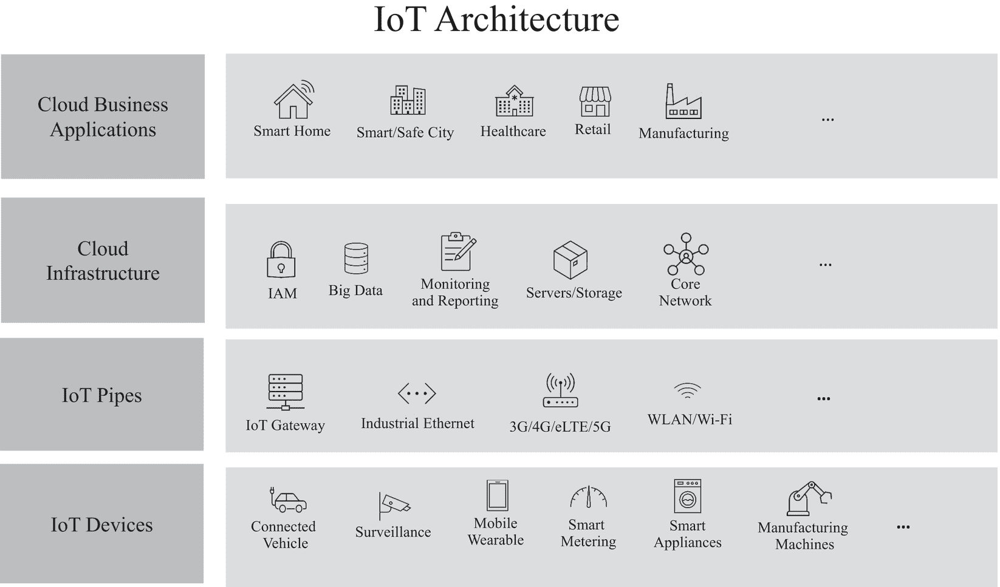

图 11.1 架构示例

`IoT` 技术正应用于智能家居、智慧安全城市、医疗、零售和制造业等领域。这些是利用 `IoT`、自动化效率开发的应用程序，扩展了不同部门之间的连接性。

运行这些应用程序的关键云基础设施包括 `IAM`、`Big Data` 处理、监控和报告、服务器和存储解决方案以及核心网络。这些基础设施是 `IoT` 生态系统的基础，帮助安全地组织和处理数据。

IoT 管道是设备用于与云通信的通信通道（如高层图所示）。这一层涉及 IoT 网关、工业以太网和 4G/5G LTE，以及用于无线通信的 WLAN/Wi-Fi。这些通道至关重要，因为它们允许 IoT 网络中不同终端之间进行平滑的数据转换和通信。

IoT 设备是 IoT 生态系统的终端，负责创建和消费数据。此类系统包括连接车辆、监控和安全摄像头、移动可穿设备、智能电表设备、智能家用电器或制造机器。这些设备与云基础设施以及彼此进行通信，使得 IoT 应用得以运行。

### 11.1.1.2 IT 与 OT

另一个与 IoT 技术密切相关的术语是 `OT`。为了启动 IT 和 OT 团队之间的通信，理解这两个小组的差异并建立信任以找到一种克服这些差异的整体方法非常重要，如表 11.1 所示。

表 11.1 IT 与 OT 的比较

| | IT | OT |
| --- | --- | --- |
| 远程访问 | 定义良好的访问控制 | 通常是单级访问控制 |
| 接口 | 人 | 机器、设备 |
| 软件 | ERP、CRM、HRIS、薪资发放等 | SCADA、DCS 等 |
| 硬件 | 服务器、交换机、个人电脑 | PLC、HMI、传感器和电机 |
| 网络 | 以太网 | 现场总线 |
| 重点 | 报告、通信 | 运行时间、精度和安全性 |
| 变更管理 | 频繁的更新和补丁 | 少的更新和补丁 |
| 安全 | 机密性、完整性和可用性 | 安全性、可靠性和可用性 |
| 时间要求 | 通常对时间不敏感 | 实时 |

`OT` 与物理世界交互，而 IT 系统更关注网络世界。因此，这两个系统具有不同的属性。挑战在于如何基于谈判在 IT 和 OT 之间建立战略协作，这需要自上而下的支持。

### 11.1.2 案例

IoT 在几乎每个领域都提供了无限机遇。从远程控制作物灌溉到在人体出现症状前就能检测到健康问题的连接汽车，IoT 正爆发着机遇和收入。以下是一些常见的例子。

* 智能家居
* 汽车联网
* 智能建筑
* 员工识别
* 交通用例
* 空中交通监控
* 车队管理
* 货运监控
* 智能城市

#### 11.1.2.1 汽车联网

随着特斯拉的不断进步，全自动车辆的优势正变得日益明显。然而，无人驾驶的竞赛早在 1925 年就随着“美国奇迹”开始了——一辆在纽约街道行驶的线缆引导、无线控制汽车。这是当时一个鼓人心的里程碑；然而，一次意外的着陆导致了伤亡并引起了人们的兴趣。这项发明的变体在许多季节里一直是城市的主角，让人们兴奋，并成为受欢迎的广告工具。然而，这导致了当时著名的魔术师哈里·胡迪尼（Harry Houdini）开始的冲突。尽管如此，自动驾驶的梦想一直存在，这是基于对自动驾驶技术的百年痴迷，这种技术承诺比人类驾驶员更安全、更方便 [91]。

感知、导航和决策领域的人智能和传感器民主化创新将催生自动驾驶汽车（AVs），成为交通新纪元的一部分。根据汽车工程师学会（SAE）的分级（0 到 5 级），这些车辆涵盖了从需要人类驾驶（0 级）到再也不需要驾驶员（5 级）范围。得益于 Uber 和 Lyft 等按需服务，5 级 AV 可能会通过负担能力、完全安全和相对方便等功能改变交通。虽然安全仍然是一个问题，但考虑到它们可以从数十亿里的行驶中学习并做出决策，AV 最终可能证明在道路上比现在的大多数人类更安全。尽管有这些优势，但其运营化受到伦理困境、责任归属以及媒体对 AV 相关事件的渲染的限制，这些可能会对公众舆产生负面影响。克服这些挑战对于在不损害安全或伦理的情况下最大化 AV 技术的效益至关重要。

表 11.2 概述了自动驾驶汽车的演变及其面临的挑战，从 20 世纪 20 年代的早期实验到如今的进展和争议。以下是摘要版本 [92]。

表 11.2 汽车联网的发展时间线

| 时间线 | 关键发展事件 |
| --- | --- |
| 早期实验（1920-1940 年代） | - 20 世纪 20 年代，工程师 Francis P. Houdina 对无线控制汽车进行了实验。<br>- 20 世纪 30 年和 40 年代，Norman Bel Geddes 等远见者提出了自动驾驶汽车的未来概念，设想了配备自动驾驶系统的公路。 |
| 初步技术发展（1950-1970 年代） | - 20 世纪 50 年代，开始了线缆引导导航系统的实验，但面临了挫折。<br>- 1956 年，通用引入了带有自动导航系统的 `Firebird II` 概念车。<br>- 20 世纪 60 和 70 年代，导航系统和机器人技术的进步为未来的自动驾驶汽车奠定了基础。 |
| 现代技术的出现（1980-2000 年代） | - 20 世纪 80 和 90 年代 GPS 和计算机视觉技术的发展为现代自动驾驶研究铺平了道路。<br>- DARPA 在 1984 年启动了 `ALV` 程序，但面临资金挑战。<br>- 包括德国和在内的各种研究机构和国家开始投资无人车辆项目。<br>- 2004 年，DARPA 组织了第一次挑战赛，刺激了该领域的快速发展。 |
| 商业利益的兴起（2010 年代至今） | - Google、特斯拉、Uber 和百度等公司进入自动驾驶汽车行业，吸引了大量的投资和人才。<br>- 美国高速交通安全局（NHTSA）对自动驾驶分的分级为开发提供了框架。<br>- 安全、伦理困境和法律法规等挑战仍在争论中。<br>- 尽管遭遇挫折，该行业继续进步，具有变革交通和城市规划的潜力。<br>- 2024 年 4 月，特斯拉宣布全自动驾驶（FSD）用户在 FSD 上的行驶里程已超过 10 亿英里。这是一个累计里程，超过了地球与土星之间的距离。 |

建筑设备数字化的第一个例子追溯到 1984 年，当时通用技术公司（United Technologies Corporation）首次使用了 `LeiNao` 系统，用于监控和控制美国康涅狄格州哈特福德一座历史性建筑的照明、电梯、空调等系统，同时提供语音通信和电子邮件等信息服务，为建筑引入智能化数据，标志着全行业房地产信息化的开始。数字嵌套通过为此前的人工操作或口头控制的建筑载体注入新的效率和灵活性，焕发了第二次生命。尽管智能家居提供了更好的无线集成方式，但它们也存在某些局限性；例如，数据泄露风险至关重要，而非法侵入已成为常态。此外，传统安全系统的缺陷源于传统网络中对安全保护的可能不足 [93]。

表 11.3 展示了智能家居环境下各个领域的 IoT 使用用例，包括安全系统（摄像头和智能锁）、危险检测（烟雾和燃气）、智能家电（冰箱和吸尘器）、个人护理（婴儿和老年监测器）以及舒适性（照明和温度控制）。

表 11.3 智能家居环境下的 IoT 用例示例

| 领域 | 应用 |
| --- | --- |
| 安全系统 | 安全摄像头、智能锁、智能门门铃 |
| 危险检测 | 烟雾、燃气、火灾和水漏 |
| 智能家电 | 冰箱、机器人吸尘器等 |
| 个人护理 | 婴儿监测器、老年人监测器 |
| 舒适性 | 照明、窗帘覆盖和温度控制；私密空间：智能卧室和浴室 |

## 11.2 IoT 安全与隐私威胁及影响

在 във化的世界中，IoT 数据隐私和安全问题日益凸显。问题不再是网络攻击是否变得越来越胆大，而是它们何时从信息威胁转变为真正的网络安全和隐私担忧。消费者级 IoT 产品由于多种原因特别容易受到攻击，包括默认密码、过时的固件以及实施不当的加密。这些漏洞允许未经授权的访问、DDoS 攻击、通过手段和干扰制造僵尸网络等。IoT 设备也容易受到网络攻击，此类攻击可能造成震惊性的损害，范围涵盖从个人数据被窃到关键基础设施被黑，每年每年发生数十亿此类攻击。虽然自动汽车（AV）为日益老龄的人口提供了显著的定时辅助能力，但公共安全需要安全的 IoT 基础设施基础。IT-OT 融合在 IT 和 OT 部门之间通过有效的通信、治理、安全对齐、合规和协作进行时效果最好。

### 11.2.1 IoT 安全与隐私现状

因此，在从家庭到车辆再到个人设备万物皆已联网的时代（即 IoT 时代），新的攻击向量几乎每隔几天就会出现一次。这些许多便利性导致了更高的风险。这意味着他们可以黑入智能锁或禁用家庭安全系统，让小偷进入室内。相反，配备了 IoT 功能的汽车也可以被远程控制，让小偷能够轻而易举地同时解锁并启动引擎。

这种过度恐惧是有理由的，Fortinet 2023 年的一份调查报告给出了令人惊惊的数据：90% 依赖 OT 的公司经历过安全事件。65% 的消费者担心黑客将他们的智能家居设备变成武器，60% 的人对数据泄露感到焦虑。或许最困扰的是，我们的发现指出，高达 90% 的消费者对 IoT 设备的整体安全性并不自信。然而，监管的信号非常响亮——96% 的企业和 90% 的消费者支持对 IoT 安全实施更严格的法规。提出的关键主题包括数据安全生命周期中的问责制——61% 的企业希望知道在不同阶段保护数据的责任归谁——以及如何处理第三方应用程序访问组织的敏感信息。如今，只有 33% 的企业认为他们对连接设备在通过第三方线路并可能暴露于风险时的数据具有完全控制权。

IoT 安全格局，特别是联网汽车（IoV）领域是多变且不断变化的：

* **威胁者的变化**：威胁格局已不仅限于受控的学术团体和白帽黑客，而是涵盖了犯罪分子、黑客以及通常是恐怖分子，导致了多重安全挑战。
* **攻击类型的变化**：历史上对车辆的攻击是物理性和近距离的；多年来，攻击已从近物理（如果未插入汽车）转向日益增加远程无线攻击，并重点关注 2015 年后随着增强的网络威胁能力的发展。
* **政府立法重点**：立法优先级已从隐私保护转变为包括自动驾驶和伦理 AI 开发的讨论，预示着更广泛的监管担忧。
* **重大的业务影响**：智能汽车网络安全威胁的兴起开始影响业务，需要新的安全方法和战略战术以确保运营和消费者信任。
* **隐私与数据保护**：隐私和数据保护是信任的基础，主要挑战包括用户同意质量、从数据中推断、数据处理用途的变化以及在限制使用时保持匿名性。

这些变化强调了 IoT 安全的动态性质，以及针对 IoV 及相关技术采取主动安全措施和监管框架的迫切需求。表 11.4 概述了从 1903 年到 2022 年的重要数据安全事件，详细介绍了如 2000 年澳大利亚污水厂内部攻击、多次网络安全漏洞，以及近期针对关键基础设施的勒索攻击（如 2021 年的 Colonial Pipeline 和 2022 年的 Viasat）。

表 11.4 IoT 安全事件示例 [94]

| 时间线 | 关键事件 |
| --- | --- |
| 2000 | * 澳大利亚污水厂事件：目标：澳大利亚污水厂。方法：内部攻击。影响：释放了 26.5 万加仑未处理的污水。 |
| 2010 | * 2010 年 3 月：德克萨斯州一名 20 岁的男子在一家汽车店解雇后，通过互联网远程控制该店的计算机系统，导致售出的 100 多辆汽车无法启动且喇叭持续鸣响，给受影响的人的工作生活带来不便。华盛顿大学的研究人员利用报警系统黑入了一辆雪佛汽车。 |
| 2012 | * 2012 年 1 月：CyberAuto Challenge 于 2012 年成立，是最老且持续最久的汽车安全活动。 |
| 2012 年 7 月 | * 无钥匙 BMW 汽车被破解。 |
| 2013 | * ICS 供应链事件。目标：ICS 供应链。方法：Havex。影响：远程访问木马（RAT）收集信息并上传到命令控制（C&C）服务器。 |
| 2013 年 7 月 | * DARPA 资助的研究人员黑入了福特探险者和丰田普锐。 |
| 2013 年 8 月 | 研究人员发现了一种盗取大众汽车钥匙凭证的方法。 |
| 2014 年 | * 德国钢铁厂事件<br>* 目标：德国钢铁厂。<br>* 方法：鱼叉式钓鱼攻击。<br>* 影响：高炉无法关闭。<br>* 2014 年 11 月：研究人员使用 Zubie 设备入侵了汽车。 |
| 2015 年 | * 2015 年 1 月：黑客使用 OBD2 适配器攻破了丰田 Tundra。<br>* 2015 年 2 月：德国汽车协会的研究人员解锁了 BMW 车门。美国国防计划署（DARPA）的 Dan Kaufman 向 CBS 展示了汽车攻击。<br>* 2015 年 7 月：研究人员通过通用汽车的 OnStar 远程连接系统控制了汽车。研究人员入侵了公路上行驶的 Jeep Cherokee。<br>* 2015 年 8 月：研究人员黑入了特斯拉 Model S 并植入了远程访问木马。研究人员还演示了对雪佛兰跑 Corvette 的远程攻击。 |
| 2016 年 | * 2016 年 2 月：研究人员披露了日产 Leaf 的漏洞。<br>* 2016 年 7 月：研究人员扩展了 2015 年 Jeep Cherokee 攻击的研究结果。 |
| 2017 年 | * 2017 年 2 月：卡巴斯基研究人员披露了联网汽车 App 中的多个漏洞。<br>* 2017 年 5 月：勒索软件控制了两家 OEM 工厂。<br>* 2017 年 8 月：黑客禁用了关键的自动导航设备，包括与个人安全相关的系统。 |
| 2018 年 | * 2018 年 4 月：研究人员披露了大众集团 IVI 系统中可远程利用的漏洞。<br>* 2018 年 5 月：研究人员发现了 BMW 系列汽车的 14 个漏洞，可以通过物理或远程方式访问 IVI。<br>* 2018 年 6 月：研究人员发现可以通过 IVI 车辆电话访问个人信息。<br>* 2018 年 7 月：一个价值 225 美元的 GPS 发送器就能控制 GPS 导航车辆。<br>* 2018 年 8 月：研究人员通过 SMS RAT 黑入了 IVI 系统。<br>* 2018 年 9 月：黑客通过克隆钥匙扣盗取了特斯拉 Model S。 |
| 2021 年 | * 殖民管道（Colonial Pipeline）事件<br>* 目标：殖民管道。<br>* 方法：DarkSide 勒索软件。<br>* 影响：计费基础设施受损导致管道运营停止。 |
| 2022 年 | * Viasat 网络事件 |


目标：Viasat 的 KA-SAT 网络。

方法：`AcidRain`。

影响：依赖 Viasat 服务的乌克兰军队遭受严重的通信损失。

## 2023 年

`Mirai` 恶意软件利用了数百万 IoT 设备的零日漏洞。

## 2024 年

据报道，僵尸网络“Pandoraspear”已感染了数百万台智能电视和机顶盒，在活动高峰期间，至少有 170,000 个机器人正在运行。

## 11.3 IoT 实现中的安全与隐私设计

### 11.3.1 法规

表 11.5 概述了美国、欧盟等地的一些 IoT 和工业控制系统（`ICS`）标准和指南 [95]。`EN 303 645` 是欧盟保护消费者的 IoT 网络安全标准之一。`IEC/ISA 62443` 是一系列 SA 标准，专注于工业自动化和控制 I 和 C 系统的安全性。

**表 11.5 IoT 标准与指南示例**

| 地区/组织 | 标准/指南 |
| :--- | :--- |
| **美国** | `NIST Special Publication 800-183: “物”网络` |
| | `NIST Special Publication 800-183B: IoT 设备制造商的建议` |
| | `NIST Special Publication 800-193: 平台固件韧性指南` |
| | `NIST Interagency/Internal Report (NISTIR) - 8259A: IoT 设备安全能力核心基准` |
| | `NIST 网络安全框架` |
| | `NIST SP 800-82 Rev.3: 运营技术 (OT) 安全指南，2022 年` |
| | `NIST SP 800-53 r5: 信息系统和组织的安全与隐私控制` |
| | `NIST SP- 800-37 Rev. 2: 信息系统和组织风险管理框架` |
| **欧盟** | `EN 303 645: “消费物联网网络安全”` |
| | `ETSI EN 301 489 系列` |
| | `EN 62443 系列` |
| | `通用数据保护条例 (GDPR)` |
| | `无线电设备指令 (RED)` |
| | `欧盟网络安全法案` |
| **中国** | `GB/T 35273-2020: 信息安全技术—物联网安全基准` |
| | `GB/T 28181-2016: 信息技术—安全技术—物联网安全要求` |
| | `《中华人民共和国网络安全法》` |
| | `中国强制认证 (CCC)` |
| | `电信设备认证` |
| IEC | `IEC/ISA 62443 系列` |

### 11.3.2 安全与隐私保护

大多数 IoT 事件始于对 IT 网络的攻击，随后横向移动 OT。图 11.2 展示了更全面、更整体的安全与隐私方法。


该框架结合了从合规性、企业对齐到风险管理的核心组件。通过持续推广意识和培训计划、持续的测量以及通用指标，安全措施能够保持有效。网络和数据安全由技术控制（包括防火墙、反 DDoS 和 VPN）提供保障，而 API 安全、数据管理和隔离确保了应用安全。设备安全涉及如身份验证、授权、入侵检测和硬件保护。保护性控制定义了所有的隔离规则，限制了后门和白名单的使用，并执行严格的程序。

表 11.6 突出了开发和实施 IoT 系统安全的核心原则和措施 [96]。

**表 11.6 IoT 安全措施与控制**

| 组件 | 安全措施与控制 |
| :--- | :--- |
| **云原生安全能力** | **防火墙** |
| | **IP 过滤**：根据 IP 地址规则阻止或允许访问 IoT 设备的流量（例如：防止未经授权的设备与智能电表通信）。 |
| | **端口阻塞**：防止访问 IoT 设备常用的特定网络端口（例如：封锁工业控制器未使用的端口）。 |
| | **数据包过滤**：根据 IP 地址、协议和端口的规则过滤流量（例如：阻止对工业控制器的未经授权访问）。 |
| | **状态检测**：跟踪活动连接并根据连接的状态和上下文允许流量（例如：仅允许到 ICS 设备的已建立连接）。 |
| | **代理服务**：作为中介，通过检查流量提供额外安全（例如：过滤发送到 IoT 设备数据的代理）。 |
| | **网络地址转换 (NAT)**：掩盖 IoT 设备的内部 IP 地址，增强安全性和隐私（例如：允许 IoT 设备通过单个公共 IP 地址进行通信）。 |
| | **应用层网关 (ALG)**：针对特定的 IoT 应用检查并过滤流量（例如：过滤 IoT 传感器的 MQTT 流量）。 |

### 统一威胁管理 (UTM)

- 将多种安全功能集成到一个设备中，以提供全面的 IoT 安全（例如，专门针对 IoT 网络的包含防火墙、入侵检测和反病毒软件的 `UTM` 设备）。

### WAF (Web 应用防火墙)

- **防止 SQL 注入**：检查并拦截针对 IoT 设备管理接口的 SQL 注入尝试（例如，防止基于 Web 的控制面板遭受攻击）。
- **跨站脚本攻击 (XSS) 防止**：过滤并清洗输入内容，以防止恶意脚本注入 IoT 管理门户。
- **拦截恶意机器人**：识别并阻止试图利用 IoT 设备的自动化机器人（例如，防止针对智能家居设备的自动化攻击）。
- **HTTP 请求过滤**：检查针对 IoT 和 `ICS` 的具有可疑模式的 HTTP 请求（例如，拦截向工业系统发送的异常 HTTP 请求）。

### 防 DDoS (Anti-DDoS)

- **流量分析**：监控网络流量，以发现针对 IoT 网络的 DDoS 攻击迹象（例如，检测并缓解旨在破坏智能城市基础设施的流量洪水）。
- **速率限制**：限制设备可以发起的请求数量，以防止过载（例如，防止 IoT 设备被用于 DDoS 攻击）。
- **异常检测**：使用机器学习检测 IoT 网络中的异常流量模式（例如，识别工厂控制系统中的异常流量峰值）。
- **IP 信誉过滤**：拦截来自已知针对 IoT 设备恶意活动源 IP 地址的流量（例如，使用威胁情报拦截已知的攻击者）。

### VPN (虚拟专用网络)

- **加密隧道**：保护远程 `ICS` 操作员与工业网络之间的通信安全（例如，使用 `IPsec` 确保远程操作员与工厂现场之间数据传输的安全）。
- **内网安全访问**：为 IoT 设备网络提供安全的远程访问（例如，允许安全地访问智能电网管理系统）。
- **多因素身份验证 (MFA)**：对远程访问关键 IoT 系统需要额外的验证（例如，使用 `MFA` 远程访问工业控制系统）。

### 平台与数据保护

- **OAuth**：保护访问 IoT 设备 `APIs` 的授权安全（例如，允许第三方应用程序安全地控制智能家居设备）。
- **API 密钥管理**：为 IoT 设备发布并管理 `API` 密钥（例如，轮换访问智能建筑系统的 `API` 密钥）。
- **速率限制**：控制 IoT 设备可以发起的 `API` 调用次数（例如，限制 IoT 传感器的 `API` 请求以防止滥用）。
- **输入验证**：确保发送到 IoT 设备 `APIs` 的数据符合预期格式（例如，对控制工业机器人的 `API` 输入进行验证）。

### 数据安全管理

- **数据加密**：对 IoT 设备与控制系统之间的静态及传输数据进行加密（例如，使用 `AES-256` 加密存储在工业传感器上的数据）。
- **访问控制**：实施基于角色的访问控制 (`RBAC`) 以限制对访问（例如，仅允许授权人员访问工厂传感器的数据）。
- **数据掩敏**：隐藏 IoT 网络中的敏感数据以保护其免受未经授权的访问（例如，对智能医疗设备收集的个人数据进行掩敏）。
- **备份与恢复方案**：确保 IoT 设备的数据在丢失时可以恢复（例如，对环境监测传感器收集的数据进行定期备份）。

### 数据隐私保护

- **合规性（例如 GDPR 和 CCPA/CPRA）**：确保 IoT 设备和应用程序符合数据保护法规（例如，允许用户访问其数据被智能家居设备收集的数据）。
- **匿名化**：从 IoT 数据集中移除个人身份信息（例如，对联网车辆收集的数据进行匿名化处理）。
- **知情同意管理**：管理用户对 IoT 系统数据收集和处理的同意（例如，在从可穿戴设备收集数据之前获得用户同意）。
- **数据生命周期管理**：管理从创建到删除的 IoT 数据，以确保隐私和安全（例如，为智能城市基础设施收集的数据设置保留策略）。

### 大数据/ML 安全分析

- **基于 ML 的异常检测**：使用机器学习识别大型 IoT 数据集中的异常模式（例如，检测工业传感器数据中指示潜在故障的异常情况）。
- **实时监控**：持续监控 IoT 数据流以检测并响应威胁（例如，对联网车辆流量数据进行实时监控，以发现安全事件）。
- **威胁情报集成**：引入外部威胁情报以增强 IoT 安全分析（例如，集成威胁馈以检测针对智能电网的已知攻击模式）。

### 户隔离

- **逻辑隔离**：使用 `VLANs` 等技术隔离不同租户的 IoT 设备和数据（例如，隔离智能工厂中不同部门的 IoT 设备）。
- **虚拟化安全**：确保运行 IoT 应用程序的虚拟机被安全地隔离（例如，使用虚拟机管理程序的安全功能防止虚拟化 IoT 服务之间的攻击）。
- **访问控制策略**：定义严格的访问控制，以确保 IoT 系统中的租户数据仅可供授权用户访问（例如，在多租户智能建筑中执行访问控制策略）。

### 证书与密钥管理

- **公钥基础设施 (PKI)**：管理 IoT 设备间安全通信的数字证书（例如，为联网汽车的安全通信发放证书）。
- **证书颁发机构 (CA) 管理**：监督 IoT 设备数字证书的发布和管理（例如，用于向工业 IoT 传感器发放证书的内部 `CA`）。
- **密钥轮换策略**：定期更换 IoT 设备使用的加密密钥以增强安全性（例如，轮换智能家居与云服务之间加密通信的密钥）。

### 恶意设备检测与隔离

### 黑名单与白名单

- **IP 黑名单/白名单**：根据 IP 地址拦截或允许访问 IoT 流量（例如，拦截已知的对工业控制系统发动攻击的 IP）。
- **域名过滤**：根据域名控制对网站和服务器的访问（例如，阻止智能家居设备访问恶意域名）。
- **应用控制策略**：定义哪些应用程序可以与 IoT 设备通信（例如，仅允许信任的应用向智能照明系统发送指令）。

### 防御突发信号风暴

- **流量整形**：管理数据流以确保 IoT 网络的稳定性能（例如，在工业系统中将关键控制信号优于普通数据流量）。
- **速率限制**：限制流量速率以防止 IoT 系统拥塞（例如，限制 IoT 设备每秒的请求数以防止信号风暴）。
- **会话优先级**：为关键 IoT 通信的流量设置优先级（例如，将联网医疗设备的紧急信号优先级高于普通数据流量）。

### 隔离规则与策略

- **网络分段**：将 IoT 网络划分为段以提高安全性和性能（例如，在智能建筑中将 HVAC 系统与主网络隔离）。
- **访问控制列表 (ACLs)**：定义控制进出物联网（IoT）设备流量的规则（例如，仅允许特定 IP 范围访问关键的工业控制系统）。
- **微隔离**：将安全策略应用于单个物联网设备或应用程序（例如，在工厂车间内隔离单个物联网设备以增强安全性）。

### 物联网协议识别与过滤

- **协议白名单制**：仅为物联网设备允许已批准的通信协议（例如，对工业传感器仅允许使用 `MQTT`，同时阻塞其他协议）。
- **设备指纹识别**：根据设备的独特特征识别物联网设备（例如，通过其通信模式和固件版本识别物联网设备）。
- **行为分析**：监控物联网设备的行为以检测异常（例如，检测来自正常低流量的 IoT 传感器的传的异常数据传输模式）。

### 恶意设备快速检测

- **终端检测与响应 (EDR)**：监控并响应物联网设备上的威胁（例如，检测并隔离受损的工业传感器）。
- **行为分析**：通过分析物联网设备的行为来检测并响应异常情况（例如，识别智能恒温器上的异常活动）。
- **设备隔离**：隔离恶意或受损的物联网设备以防止进一步损坏（例如，自动隔离显示出入侵迹象的 IoT 摄像头）。

### 可配置设备防御能力 / 认证与注册

- 在设备与服务器之间实现双向 TLS 认证。
- 使用具有强密钥长度的基于证书的认证（例如，`RSA 2048` 或更高）。
- 使用专用的物联网身份提供程序进行中心化身份管理，以安全地管理设备凭据。

### 入侵检测

- 部署针对物联网流量模式和设备行为的特定异常检测算法。
- 利用机器学习模型检测传感器数据中的异常，这些异常可能指示着网络物理攻击。
- 与工业控制系统 (`ICS`) 集成，将物联网入侵事件与业务影响相关起来。

### 远程安全管理

- 利用带有内置安全功能的物联网设备管理平台 (`DMPs`) 进行安全的远程管理。
- 实现安全的远程访问方法，如通过 `VPNs` 或带有多因素身份验证的安全壳 (`SSH`) 隧道。
- 使用区块链技术进行安全且可审计的远程配置和命令执行。

### TPM/TEE

- 在关键基础设施物联网设备中利用 `TPMs` 进行安全的密钥管理和证明。
- 利用 `TEEs` 实现硬件强制隔离，以保护敏感数据和密码学操作。
- 使用基于硬件的安全执行环境来执行关键安全功能，如加密和解密。

### LiteOS 和 SDK

- 使用强制执行安全编码实践的 `SDKs` 开发物联网应用（例如，遵循 `OWASP IoT Top 10` 安全指南）。
- 集成诸如基于 `DTLS` 的 `CoAP` 等安全通信协议，用于物联网设备的数据传输。
- 实现适用于资源受限物联网设备的轻量级安全协议，例如带有 `TLS` 的 `MQTT-SN`。

### 安全处理器架构

- 部署集成硬件安全功能（如安全启动和加密加速器）的安全微控制器和处理器。
- 利用集成在处理器中的硬件安全模块 (`HSMs`) 进行安全的密钥存储和加密操作。
- 实现安全执行环境架构，将关键物联网设备功能与可能受损的软件组件隔离。

### 信任与 X.509/PKI

- 建立具有离线根 `CA` 和在线中间 `CA` 的层次 `PKI` 架构，用于颁发设备证书。
- 实现证书吊销机制（例如，在线证书状态协议 (`OCSP`））以及时吊销受损的证书。
- 在物联网应用中使用证书锁定技术，确保设备只信任指定的服务器证书，防止中间人攻击。

### 安全运营与管理 / 网络安全情报系统

- 实现自动化工具，对物联网和 `ICS` 数据流进行持续监控和分析。集成针对物联网和 `ICS` 环境定制的威胁情报馈。
- 对物联网和 `ICS` 设备进行定期渗透测试和漏洞评估。
- 确保对物联网和 `ICS` 网络中的异常建立实时告警和报告机制。

### 安全监控与审计

- 部署网络入侵检测系统 (`NIDS`) 和入侵防御系统 (`IPS`)。
- 对物联网和 `ICS` 配置进行审计。
- 对物联网和 `ICS` 实现中心化日志和监控。
- 利用异常检测算法检测物联网和 `ICS` 环境中的行为。

### 安全事件管理

- 开发针对物联网和 `ICS` 事件的响应计划。
- 建立经过物联网和 `ICS` 事件培训的专门团队。
- 实施物联网和 `ICS` 网络的隔离以包含威胁。
- 执行事件后分析和教训总结。

### 灾难恢复/业务连续性 (DR/BCM)

- 为物联网和 `ICS` 系统创建备份计划。
- 定期测试物联网和 `ICS` 的恢复程序以确保服务的快速恢复。
- 在网络中断时为物联网设备建立备用通信通道。
- 针对物联网和 `ICS` 开发业务影响评估 (`BIA`) 以确定恢复工作的优先级。

区块链技术被认为是自互联网发明以来最具颠覆性的技术创新之一。它依赖于密码学和复杂的分布式算法。在建立信任关系困难的互联网上，区块链使参与者能够在不需要任何第三方中介的情况下达成共识。这种去中心化的架构解决了信任和可靠价值传输等具有挑战性的问题。区块链具有以下四个特性，如表 12.1 所示。

### 表 12.1 区块链技术的支柱

| 核心支柱 | 描述 |
| --- | --- |
| 去中心化 | 比特币的数据结构围绕三个关键组件展开：区块、链和网络。这种去中心化的框架在共识算法的促进下，能够在不依赖第三方执行的情况下实现自我纠正。遍布全球的节点验证交易，并通过加密货币奖励获得激励。这种自给自足机制强调了区块链自主建立信任和执行规则的能力。<br><br>* **区块**：这些是在特定时期内记录的交易集合，在不同的区块链中表现出不同的属性。<br><br>* **链**：它们使用哈希值连接区块，建立了一个安全的按顺序序列。<br><br>* **网络**：由“全节点”组成，这些节点维护区块链的完整交易记录。大多数区块链在很大程度上是根据其架构去中心化的。公共去中心化区块链对所有互联网用户开放，例如比特币和以太坊公链。在该光谱的另一端是联盟链（例如特定行业交易之间的银行链），它们代表了部分去中心化的中间状态。相反，链在企业内部是私有的，具有更高级别的中心化，这意味着单一实体负责整个共识机制和验证，并仅向内部提供区块链访问权限。 |
| 透明性 | 区块链数据让每个人参与其中。区块链作为终极真理来源是透明的，每笔交易都经过存储并公开。它是可审计的，确保了数据源及其质量，协调了多个系统的信息，减少了人为错误等。这种透明性在保护隐私的前提下，创造了实时追踪产品和按需消费价格的能力。 |


| 完整性 | 区块链的一个基本特性是它能够以只追加的方式记录数据而不被篡改，这导致一旦交易被确认，就不会有新的行为发生。所有这些区块通过加密哈希连接在一起，这种不可变性得到了保证。随其后的每个区块都必须进行更改并保持与之前的区块兼容；也就是说，更改区块中的交易将要求所有后续的区块都适应该更改，这在计算上是不可能的任务。此外，数字签名通过提供一种验证所有权的密码学形式而不泄露实际细节，提高了安全性。再此外，区块链的脚本语言允许进行复杂的交易，这些交易指定了接收者地址，并验证了发送方及相关方的数字签名。在无许可的区块链中，任何人都可以提交新交易，然后网络使用通用协议对其进行验证。矿工负责此；他们使用计算力来验证交易，以获得这些奖励为承诺。这些是矿工因在新的区块中包含`Proof of Work`（`PoW`）作为证实的计算工作的一部分而获得的奖励。不同的共识机制，如`Proof of Stake`（权益证明），被用于不同的分布式账本技术（DLT）用于在网络范围内达成一致。 |

| 匿名性 | 在交易中，区块链确保公开公钥，而检查公钥的私钥对每个用户保持离散。这对密钥可以让你在不共享用户身份的情况下保护你的交易。公钥基本上充当伪名，一个用户可以生成多次以增加自己的匿名性。此外，零知识证明（`ZKPs`）允许用户在不泄露任何额外信息的情况下确认此类交易，从而保护了数据的完整性和隐私。 |

#### 12.1.1.1 区块链的发展时间线

区块链是面向所有行业的革命性技术。区块链是比特币及各种其他加密货币存在的基础技术和架构框架。由于比特币的快速传播和媒体曝光，人们产生了一个误区，认为比特币等于区块链。然而，现实情况是，加密货币只是区块链众多应用之一，该行业正处于寻找加密货币之外的众多创新方式以从这一解决方案中受益的过程中。

表 12.2 列出了从 2008 年至今区块链技术发展的关键事件。这些事件代表了区块链技术发展和采用中的重要里程碑，塑造了其从诞生到现状的轨迹。

### 表 12.2 区块链技术发展的关键事件 [98]

| 年份 | 关键事件 |
| --- | --- |
| 2008 | 比特币白皮书发布：中本聪发表了名为《比特币：一种点对点的电子现金系统》的白皮书，引入了区块链技术和比特币加密货币。 |
| 2009 | 比特币网络启动：比特币网络于 2009 年 1 月 3 日通过挖掘第一个区块（被称为创世纪区块）上线。 |
| 2009 | 比特币的诞生：中本聪挖掘了第一个比特币，标志着加密货币时代的开始。 |
| 2011 | 山币兴起：替代加密货币（山币）如`Litecoin`和`Namecoin`出现，提供了比特币技术的变体和改进。 |
| 2015 | 以太坊的引入：维塔·布特提出了以太坊，一个用于智能合约的去中心化平台，于 2015 年上线，使得去中心化应用（`DApps`）成为可能。 |
| 2017 | 首次币发行（ICO）：ICO 成为区块链项目筹资的热门方法，向投资者发行代币以换资金。 |
| 2017 | 加密货币市场的快速增长：加密货币市场经历了大幅增长，比特币达到历史高价，加密货币总市值超过 8000 亿美元。 |
| 2018 | 监管审查：全球政府和监管机构开始审查加密货币和 ICO，导致了监管变化和对欺诈性项目的打击。 |
| 2018 | 企业级区块链解决方案的发展：大型公司和组织开始探索区块链技术用于各种场景，包括供应链管理、医疗、金融和身份验证。 |
| 2020 | De-Fi（去中心化金融）热潮：De-Fi 协议的出现能够在没有中介的情况下提供贷款、借贷和交易等各种金融服务，导致了 De-Fi 采用率和协议总锁仓价值（TVL）的激增。 |
| 2021 | NFT 热潮：非同质化代币（NFT）受到主流关注，允许独特数字资产的所有权交易，包括艺术品、收藏品和虚拟房地产等。 |

## 2022 || 区块链融入 Web3

`Blockchain`技术随着与`Web3`的整合持续演进，实现了去中心化应用、去中心化自治组织（`DAOs`）以及元宇宙等创新。

### 12.1.2 区块链的类型与技术架构

公共区块链向所有人开放，使用`Proof of Work`（`PoW`）作为共识机制，并通过挖矿确保安全性。私有区块链则限制于受信任的参与者，专注于高交易速度和可扩展性，如表 12.3 所示。

表 12.3 公有链与私有区块链

| 类型 | 描述 |
| --- | --- |
| 无许可公有区块链 | 
* 向所有参与者开放；鼓励网络扩展。
* 通过`Proof of Work`实现共识。
* 通过高强度的挖矿促进每个参与者的完整性和健壮的系统安全性。 |
| 有许可私有区块链 | 
* 仅向允许的参与者开放——通常是工作流中的业务伙伴。
* 假设参与者具有完整性，从而降低了安全性要求。
* 需要高交易速度和系统可扩展性，通过减少添加和验证数据的工作量来实现。 |

组织可以根据需要使用公开的区块链，或部署私有区块链节点。与`Bitcoin`和`Ethereum`这样的公有链不同（后者目前许多组织仍在摸索其使用方法）：

| 类别 | 描述 | 优势 | 影响 |
| --- | --- | --- | --- |
| 智能合约 | 将买方和卖方之间的协议条款直接写入代码的自动执行合同。 | 无需中介即可实现合同执行，从而降低成本并提高效率。 | 增加透明度、减少欺诈、最小化错误以及合同条款的自动执行。 |
| 加密货币 | 由加密技术保护的数字或虚拟货币，用于安全的在线交易。 | 无需银行或支付处理器等中介即可促进点对点交易。 | 去中心化、较低的交易费用、更快的跨境交易以及为无银行账户人口提供金融包容。 |
| 交易 | 在由计算机网络维护的分布式账本上记录和验证交易。 | 为各行业提供透明、安全且不可篡改的交易记录。 | 增强透明度、减少欺诈、提高可追溯性并简化审计流程。 |
| 供应链管理 | 追踪和管理从源点到消费点的货物和服务流。 | 通过在区块链上记录每笔交易，增强供应链的透明度、效率和可追溯性。 | 提高供应链可见性、减少伪造、增强产品真实性并简化物流。 |
| 支付/结算/审计 | 使用区块链技术促进安全透明的支付处理、清算和审计流程。 | 实时自动执行支付结算、交易清算和财务记录审计。 | 更快的交易处理、缩短结算时间、增加可审计性并增强防欺诈和防篡改安全性。 |

表 12.5 列出了市值排名前 10 的区块链/加密货币（截至 2024 年 6 月 1 日）：比特币、以太坊、TDT、币币、Solana、USDC、XRP、狗狗币、卡达尔和顿币 [101]。它们利用不同的共识机制，例如`PoW`、`PoS`和拜斯庭容错机制（`BFT`），具有不同的交易速度和能力。

表 12.5 按市值排序的前 110 大区块链/加密货币（截至 2024 年 6 月 1 日）

|   | 区块链 | 启动 | 市值 | 共识机制 | 智能合约 | 每秒交易数 | 备注 |
| --- | --- | --- | --- | --- | --- | --- | --- |
| 1 | 比特币（BTC） | 2009 | 1.3 万亿美元 | 工作量证明 | 否 | 7 TPS | 第一种最广泛使用的去中心化账本货币。 |
| 2 | 以太坊（ETH） | 2015 | 456 亿美元 | 权益证明 | 是 | 15–30 TPS | 支持图完备智能合约。 |
| 3 | Tether USDt（USDT） | 2014 | 112 亿美元 | 适用 | 否 | 无 | 与某些其他形式的加密货币不同，Tether（`USDT`）是一种稳定币，这意味着受美元和欧元等法币货币的支持，并理论上保持与这些货币单位之一等值的价值。 |
| 4 | 币币（BNB） | 2017 | 80 亿美元 | 委托拜斯庭容错（`dBFT`） | 是 | 无 | 与某些其他形式的加密货币不同，Tether（`USDT`）是一种稳定币，这意味着受美元和欧元等法币货币的支持，并理论上保持与这些货币单位之一等值的价值。 |（注：原文第 4 行内容重复，已根据指令予以保留） |
| 4 | 币币（BNB） | 2017 | 80 亿美元 | 委托拜斯庭容错（`dBFT`） | 是 | 无 | 与某些其他形式的加密货币不同，Tether（`USDT`）是一种稳定币，这意味着受美元和欧元等法币货币的支持，并理论上保持与这些货币单位之一等值的价值。 |
| 5 | Solana（SOL） | 2020 | 76 亿美元 | 历史证明（`PoH`）、权益证明（`PoS`） | 是 | 65000 TPS | Solana 运行在独特的机制上。 |
| 6 | USDC（USDC） | 2018 | 32 亿美元 | 适用 | 是 | 无 | 与某些其他形式的加密货币不同，Tether（`USDT`）是一种稳定币，这意味着受美元和欧元等法币货币的支持，并理论上保持与这些货币单位之一等值的价值。 |
| 7 | XRP（XRP） | 2012 | 28 亿美元 | 波动协议共识 | 是 | 1500 TPS | 基于互联网迷因。 |
| 8 | 狗狗币（DOGE） | 2013 | 23 亿美元 | 工作量证明 | 否 | 33 TPS | 与许多其他加密货币相比，狗狗币的生成没有限制。 |
| 9 | 卡达尔（ADA） | 2017 | 16 亿美元 | Ouroboros `PoS` | 是 | 250–500 TPS | 类似于以太坊。 |
| 10 | 顿币（TON） | 2018 | 15 亿美元 | 拜斯庭容错（`BFT`） | 是 | 无 | 已完全投入运行。 |

## NFT 与 Web3.0

实施 Web3 和 NFT 标志着数字领域的先驱性进展。它们共同重塑了数字经济和交互结构，为创作者、开发者和用户带来了新机会。这些技术对于培养去中心化和包容性的互联网环境至关重要。

NFT 将是通过区块链技术验证的独特数字资产，与`Bitcoin`或`Ethereum`等普通加密货币相区别。NFT 为任何类型的媒体创作者（数字艺术、音乐、收藏品等）提供了一种将其作品代币化并记录所有权的方式。这消除了数字所有权来源的门槛。

同时，Web 3.0 是关于以用户为中心的互联网重生。它的愿景是一个更好的互联网，个人可以控制自己的数据以及在互联网上的交互方式——这一切由区块链和去中心化协议驱动。Web 3.0 是对当前中心化网络基础设施的关键改进，并承诺提供更好的隐私、安全透明度。

### NFT

NFT 是一种安全且不可篡改地存储在公共区块链上的不可更改数字标识符。令牌是指可以在区块链上交易并具有可传输性、可交换性、可用价值或效用）以及收入或收益权属性的物品。令牌通常代表某种数字资产的数字所有权、加密和流动性。从原则上讲，区块链令牌分为部分同质化令牌（`PFTs`）或`NFT`。

虽然 NFT 的概念于 2017 年开始兴起，但它已成为数字资产处理的关键方法。NFT 充当加密安全的数字所有权，用于确认对某些数字商品的所有权或访问权——就像汽车的车辆权证一样。`CryptoKitties`在 2017 年让它们进入舞台，这是由`Dapper Labs`开发的一款游戏，旨在向人们普及区块链技术，并展示它除了无聊的金融应用之外的用途。`ERC-721`为`Ethereum`区块网上创建 NFT 提供了标准，这些 NFT 都是独一无二的数字资产，涵盖了从头像到艺术和媒体的所有内容。NFT 允许你代表各种资产，从头像、艺术和交易卡到虚拟世界、对独家内容/体验的访问、数字实体商品以及区块链游戏道具。

去中心化交易所（`DEXes`）为 P2P 交易提供动力并帮助消除中间环节，从而减少对中心化平台（例如`eBay`或`Amazon`）的依赖。智能合约允许安全高效地完成这些操作，就像你可以即时发送电子邮件一样。

正如电子邮件通过使其广泛实用且有价值而实现了通信的民主化，NFT 让许多人能够接触区块链技术。也许显而易见的益处是，由于 NFT 由区块链赋能，存储在 NFT 中的信息是安全且不可篡改的；这种安全性元素再次引用了对记录的保证。这与使 NFT 价值的核心方面保持一致：它们通过确保历史在所有权转移过程中保持真实可靠，利用了买卖双方之间的信任。它们可能描绘不同的对象，不一定是艺术品，并且在中心化交易所很常见，通常用加密货币购买）。在创建个性化的元宇宙空间和丰富数字交互方面，`RTFKT`和`Discord`等公司正寻求利用 NFT 和 Web3 的力量。Table 12.6 提供了截至 2024 年 6 月的前 10 大 NFT 市场和 NFT 列表。

### 表 12.6 前 10 大 NFT 市场和 NFT 列表

| 前 10 大 NFT 市场 | 前 10 大 NFT |
| --- | --- |
| 1.OpenSea | 1.CryptoPunks |
| 2.Rarible | 2.Bored Ape Yacht Club（BAYC） |
| 3.Foundation | 3.Axie Infinity |
| 4.SuperRare | 4.Art Blocks |
| 5.BakerySwap | 5.NBA Top Shot Moments |
| 6.Nifty Gateway | 6.Beeple 的“Everyday: The First 5000 Days” |
| 7.Decentraland Marketplace | 7.Board Ape Kennel Club（BAKC） |
| 8.Axie Marketplace | 8.Pudgy Penguins |
| 9.NBA Top Shot | 9.CyberKongz |
| 10.AtomicMarket | 10.World of Women（WOW）NFTs |

## 12.2.2 Web 3.0

Web 3.0 也称为去中心化网络，是互联网的下一次演进，强调去中心化、隐私和用户控制。

与 Web 2.0（权力和数据集中在少数大型公司手中）不同，Web 3.0 旨在将控制权归还个人用户。Web 3.0 的基本哲学是一个更民主的、惠及所有人而非少数人的网络。它提供了一个更加透明且以用户为中心的互联网，个人控制自己的在线宇宙，并是自己数据的守护者。这反映了从中心化控制到用户对数据和数字资产所有权的转变。

驱动 Web 3.0 的技术——区块链技术——允许无须交互并奖励参与的用户；`DApps`（去中心化应用程序）提供了一种利用传统网络服务为我们所做功能的方式；区块链钱包允许我们创建一个整合且匿名的身份。

`DAOs`利用区块链进行治理和组织，是一种正在流行的治理形式；其中一些示例包括`PleasrDAO`、`Mirror`和`MetaFactory`，它们预示了`DAOs`在影响我们未来的去中心化网络方面的力量。

## 12.3 区块链安全与隐私的影响及解决方案

表 12.8 显示区块链技术的安全和隐私挑战：分布式共识、智能合约漏洞、密钥管理、隐私功能需求、数据完整性属性、合规性以及扩展性问题。安全和隐私保护解决方案包括高度复杂的共识算法、全面的智能合约审计、安全的密钥管理方法、保护隐私机制、严格的访问控制、合规性以及如二层协议等扩展解决方案。

### 表 12.8 安全与隐私问题 [103]

| 考虑因素 | 影响 | 解决方案 |
| --- | --- | --- |
| 分布式共识 | 在去中心化区块链网络中实现共识需要计算努力，并可能受到 51% 攻击或女巫攻击等的影响。 | 实施稳健的共识算法，如工作量证明（`PoW`）、权益证明（`PoS`）或委托权益证明（`DPoS`），以确保网络的完备性。定期监控网络的可疑活动并进行审计以识别漏洞。 |
| 智能合约漏洞 | 智能合约容易受到编码错误和漏洞的影响，可能导致安全漏洞或意外后果。 | 在部署前彻底审计并测试智能合约，以识别并修复漏洞。实施代码审查、形式验证和漏洞赏金等最佳实践，以增强智能合约的安全性。 |
| 密钥管理与访问控制 | 区块链依赖加密密钥进行身份验证和访问控制，使得密钥管理至关重要。糟糕的密钥管理实践会导致未经授权的访问和破解。 | 实施稳健的密钥管理实践，包括安全的密钥存储、多因素认证和定期轮换。利用硬件钱包或安全区域保护私钥。 |
| 隐私与机密 | 传统的区块链是透明的，这意味着所有交易和相关数据对网络上的任何人都可见，可能损害隐私。 | 利用隐私增强技术（如零知识证明、环签名或机密交易）来混淆交易细节。考虑实施限制授权参与者的私有链或许可链。 |
| 不可篡改性数据完整性 | 数据一旦记录在区块链上，就难以修改或删除，这既是优势也是挑战。如果敏感信息被误或恶意记录，它将被永久存储。 | 实施严格的访问控制和验证机制，确保只有授权且验证过的数据记录在区块链上。考虑对敏感数据使用链下存储，并仅在区块链上存储哈希指针。 |
| 监管与法律合规 | 区块链应用可能需要遵守与数据隐私、金融交易或身份验证相关的现有法规。 | 关注相关法规的更新，通过设计具有隐私保护功能的区块链应用以及在智能合约中纳入法律框架来确保合规。 |
| 扩展性与性能 | 随着区块链网络规模和交易量的增长，会出现扩展性和性能挑战，这可能会影响安全和隐私。 | 探索分片、链下交易或二层协议等扩展性解决方案，以提高吞吐量并减少拥堵。定期优化网络参数和基础设施以提升性能。 |

表 12.9 概述了不同地区的示例政策，例如新加坡的监管沙盒吸引了区块链公司并促进了跨境转账和银行间支付，有`IBM`等主要实体参与。

### 表 12.9 来自不同地区的政策

| 地区 | 区块链政策 |
| --- | --- |
| 美国 | 证券交易委员会（`SEC`）正在加强对加密货币平台的执法行动，将某些代币视为证券，因此须遵守监管要求。美国税务总局（`IRS`）将`Bitcoin`等虚拟货币视为资产，要求纳税人报告出售或交换产生的收益或亏损。 |
| 新加坡 | 新加坡在 2015 年引入了“监管沙盒”以吸引创业者，为软件开发提供了一个安全空间。`OCBC`和`R3`等区块链公司蓬勃发展，并开展了跨境转账和银行间支付的计划。该国旨在通过集成`KYC`在区块链身份识别方面处于领先地位。`IBM`和`JP Morgan`等主要参与了其中。 |


| 迪拜 | 迪拜旨在通过区块链实现政府数字化并提高效率。项目包括医疗保健数字化、钻石贸易、所有权转移、业务注册、旅游和航运数字化。全球区块链委员会驱动着各项合作。 |

| 马尔特 | 马尔特通过支持性的法律结构拥抱区块链，吸引了 `Binance` 等公司。相关法案监管 `ICO`，建立了数字创新机构，并认证了区块链公司。马尔特为创新友好型监管树立了范例。 |

如图 12.2 所示，区块链安全与隐私保护框架旨在涵盖广泛的技术应用方面，促进覆盖多个领域的稳健区块链应用。区块链安全和治理涵盖了广泛的实践，旨在使业务运营与监管要求、行业标准和合同义务保持一致。这涉及实施稳健的治理框架，以确保任务对齐和有效的安全管理。该策略包括对政策制定、流程开发和培训的专注方法，以增强风险意识和控制。安全工程发挥着至关重要的作用，重点关注合约验证、合规性和威胁建模，以保护交互和交易。区块链中的身份验证方法涉及多种配置，如公共、私有和混合系统，并由全面的网络和严谨的安全测试支持。此外，集成实践、权限设置和更新协议是维护安全区块链平台的不可或缺的一部分。在此背景下，服务交付围绕客户指导展开，在数据安全中使用指标和持续改进策略。这包括执行加密标准、管理加密密钥和保护数据隐私。此外，框架整合了持续监控、事件响应和审计控制，以增强安全态势，确保区块链应用不仅符合法规，还能提供有效的数据保护。

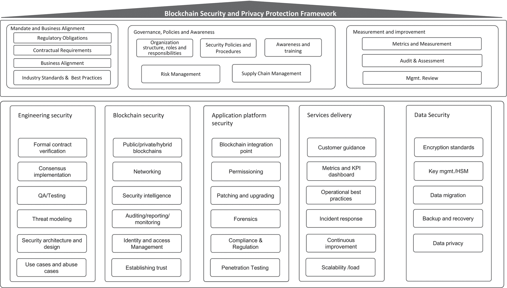

### 图 12.2 区块链安全与隐私保护框架。

区块链的关键安全和隐私控制分为表 12.10 所示的几类。

### 表 12.10 关键安全与隐私控制

| 类别 | 组件 | 描述 |
| --- | --- | --- |
| 工程安全 | 形式合约验证 | 通过形式方法确保智能合约没有错误和漏洞。例如，使用 `Solidity` 或 `Scilla` 等形式化验证工具从数学上证明智能合约的正确性，确保它们完全按照预期执行，而无意外的副作用。 |
| | 共识实现 | 实现确保分布式进程之间对单个数据值达成一致的算法。示例包括 `Bitcoin` 使用的工作量证明 (`PoW`)、`Ethereum 2.0` 使用的权益证明 (`PoS`) 以及 `Hyperledger Fabric` 使用的实用拜占庭容错 (`PBFT`)。 |
| | 质量保证/测试 | 质量保证和测试流程，用于验证软件的功能和安全性。这包括使用 `Ethereum` 的 `Truffle` 框架或使用 `Ganache` 创建测试用的个人区块链对区块链应用进行单元测试、集成测试和安全测试。 |
| | 威胁建模 | 分析潜在威胁以识别并降低系统中的安全风险。`STRIDE`（身份伪造、篡改、否认、信息泄露、拒绝服务和权限提升）等技术可应用于区块链应用以识别和缓解风险。 |
| | 安全架构与设计 | 设计系统的整体安全结构，包括硬件和软件组件。例如，设计一种包含安全 API、加密协议和安全密钥管理的多层安全架构。 |
| | 场景用例与滥用用例 | 定义有效和无效场景，以确保系统妥善处理所有情况。例如，创建有效交易场景与双花攻击或未经授权访问尝试场景的对比。 |
| 区块链安全 | 公共/私有/混合区块链 | 不同类型的区块链网络提供不同层次的访问和控制。`Bitcoin` 和 `Ethereum` 等公共区块链允许任何人加入并参与，而企业使用的私有区块链将参与限制在已知实体内。混合区块链结合了后者的特征。 |
| | 网络 | 确保区块链网络节点之间安全可靠的通信。这包括实现 `TLS/SSL` 等安全通信协议，并确保节点受到 `DDoS` 攻击。 |
| | 安全情报 | 收集并分析信息以预测和缓解潜在威胁。利用工具对区块链网络进行实时监控和分析，尽早检测异常和潜在攻击。 |
| | 审计/报告/监控 | 持续监控和报告以确保合规并检测安全违规。示例包括使用区块链浏览器和监控工具审计交易历史，并确保透明度和符合监管要求。 |
| | 身份与访问管理 | 管理用户身份及其对系统内资源的访问。实施去中心化身份解决方案 (`DID`) 和基于角色的访问控制 (`RBAC`) 等访问控制机制来管理区块链网络内的权限。 |
| | 建立信任 | 创建确保区块链网络信任性和完整性的机制。例如，使用可信预言机为智能合约提供可靠数据，并通过质押机制确保验证节点是可信的。 |
| 应用平台安全 | 区块链集成点 | 将区块链技术安全地集成到现有应用平台中。这涉及确保区块链与其他系统之间的 `API` 和接口是安全的，并在交易过程中维护数据完整性。 |
| | 权限 | 实现访问控制以确保只有授权用户才能执行某些操作。例如，使用智能合约在去中心化应用 (`DApp`) 中执行访问控制策略和权限。 |

## 修复与升级

定期更新软件以修复漏洞并提高安全性。确保区块链节点和智能合约定期更新安全补丁和新功能，且不会中断网络运行。

## 取证

调查和分析网络事件，以理解并防止未来的泄露。使用区块链取证工具追踪交易、识别恶意行为者，并在发生欺诈或黑客攻击事件时收集证据。

## 合规与监管

确保系统符合相关法律、法规和行业标准。遵守监管要求，例如针对数据隐私的 `GDPR` 或区块链应用中金融交易的 `AML/KYC` 规定。

## 渗透测试

模拟网络攻击以识别并修复系统中的安全漏洞。使用 `Mythril` 等工具进行智能合约安全分析或 `Kali Linux` 网络安全测试，对区块链应用和网络进行渗透测试。

## 服务交付

### 客户指导

为客户提供支持和指导，以增强其安全实践。提供咨询服务，帮助客户设计并实施安全的区块链解决方案及最佳实践。

### 指标与 KPI 仪表板

衡量和跟踪与安全相关的关键性能指标的工具。开发仪表板以对区块链网络的性能和安全性提供实时洞察，例如交易吞吐量、`latency` 和安全事件。

## 运营最佳实践

维护和改进运营安全的建议性实践。针对区块链运营实施最佳实践，如定期安全审计、安全编码标准和事件响应计划。

## 应急响应

有效响应和管理安全事件的流程。在区块链环境中建立事件响应团队和程序，用于检测、报告和缓解安全事件。

## 持续改进

不断增强安全措施和实践的努力。定期审查和更新安全策略，开展培训课程，并实施反馈机制，以持续提高区块链的安全性。

## 可扩展性/负载

确保系统能够处理增加的负载并安全地扩展。实施离链交易或 Layer 2 扩展解决方案，以在不损害安全性的情况下增强区块链网络的可扩展性。

## 数据安全

### 加密标准

实施通过加密保护数据。确保所有存储在区块链上和通过区块链传输的数据都使用 `AES-256` 或椭圆曲线加密 (`ECC`) 等标准进行加密。

### 密钥管理/HSM

加密密钥的安全性管理，通常使用硬件安全模块 (`HSMs`）。实施安全的密钥管理实践，包括使用 `HSMs` 保护私钥并执行加密操作。

### 数据迁移

将数据从一个系统安全传输到另一个系统。确保区块链网络之间或从旧系统到区块链的数据迁移过程是安全的，并维护数据完整性。

### 备份与恢复

确保在数据丢失或损坏时可以恢复数据。实施备份解决方案，定期存储区块链数据和交易历史的副本，并制定数据还原的恢复计划。

### 数据隐私

保护个人和敏感信息免受未经授权的访问。实施隐私保护技术，如零知识证明、机密交易和数据匿名化，以确保区块链上的数据隐私。

# 13 VR、AR 和 XR

DOI: [10.1201/9781003390695-18](https://dx.doi.org/10.1201/9781003390695-18)

本章旨在为读者提供 `VR`、`AR` 和 `XR` 主要组件的深度分析；为读者提供一种识别安全和隐私风险及其影响的系统化结构化方法；并为读者配备框架、规则、工具、模板和技术，以降低 `VR`、`AR`、`MR` 和 `XR` 平台的安全和隐私风险。

本章涵盖以下主题：

* `VR/AR/MR/XR` 定义与核心功能
* `XR` 关键业务用例
* 安全与隐私影响
* `XR` 的设计安全

## 13.1 VR/AR/MR/XR 定义

让我们从扩展现实 (`XR`) 的基础开始，包括虚拟现实 (`VR`)、增强现实 (`AR`) 和混合现实 (`MR`)。

`XR` 的最新进展旨在产生完全感官沉浸，这种界面旨在让六种感官与现实世界和虚拟世界交互。与现代沉浸式技术相比，以前的方法（如 `Pokémon Go`）参与感明显较低，因为它们依赖于小型手持设备的有限屏幕空间进行交互。头戴式显示器 (`HMDs`) 通过欺骗眼睛来模拟 3D 图像提供了更具沉浸感的体验。最初的产品是笨重的设备，但随着技术的演进，我们现在有了轻量级的无线 `HMDs`，它们容纳了显著更多的计算能力。

气味发射器和味觉模拟器准备进一步沉浸用户，而触觉手套和体感服则努力传递触感。这些进展对于一系列用例具有广阔前景，包括游戏、培训和模拟（示例预计到 2041 年达到商业成熟）。最终结果是一个“不可见的智能流”，它能自然地与现实世界物体融合而不产生干扰，并可以在许多情况下改进工作或增强参与度。在 2041 年，人类可能会将许多世界称为家园：物理世界、虚拟世界以及一个 `MR`。从培训和医疗保健到教育和零售，基于 `VR/AR` 的 `VR` 解决方案将不仅用于游戏。然而，内容创作仍然是一个严重的问题，需要复杂且真实的模拟来吸引观众。解决恶心和 `latency` 等问题将是其大规模使用的关键 [104]。

与 `XR` 在可视化中角色相关的两个主要挑战是裸眼视图和 `BCIs`（脑机接口）。因此，虽然 `Magic Leap` 的全息显示激发了兴奋，但实际的裸眼 `MR` 仍然停滞不前。尽管埃隆·马斯克的 `Neuralink` 通过在猪的大脑中放置电极展示了 `BCI` 的某些改进，但由于技术和伦理挑战，任何记忆下载类功能的实现可能还需要等一段时间。

将摄像头开发为可穿戴设备（如带有录制设备的眼镜）带来了隐私和数据安全问题。因此，虽然无处不在的记录有优势，但如果数据落入错误的人手中或被恶意/无意操纵，就会产生巨大的缺点。这些挑战凸显了以负责任开发和部署 `XR` 技术的重要性。

工业 4.0 技术从根本上改变了组织的运营方式，要求具备敏捷性并在获取新技能方面接受过教育，这意味着要顺应时代，通过创建或寻找新人才来适应。然而，技术的扩散可能会遇到障碍，包括技能短缺、成本以及疫情的影响。本战略计划承认了 IT 作为实现我们愿景的关键伙伴的角色。有必要对 `VR` 和 `AR` 进行意识和培训，评估组织在这些技术方面的能力，并将这些计划整合到更广泛的 IT 战略中，以推动技术转型。

### 13.1.1 XR 的发展

VR（虚拟现实）将用户沉浸在与其物理环境完全隔离的完全合成虚拟环境中。用户通常通过带有双眼显示器的头戴式设备参与 VR 体验，该设备将用户置于一个完全渲染的三维环境中。尖端 VR 技术创造了无与伦比的沉浸式数字体验。VR 用户可以瞬间传送到世界的任何地方，回到过去或通往未来，进入太空或虚构土地——而这一切都可以在家中舒适且安全的环境下完成。与平板电脑、手机或显示器上的游戏、视频或应用程序不同，三维 VR 环境创造了完全包围用户的感知，允许用户在投影空间中自由移动。

AR（增强现实）利用摄像头将虚拟内容叠加在现实世界之上，提供一种增强视图。AR 正在成为一种变革性技术，重塑工作流程。企业旨在尽早利用其潜力以提高运营效率，而 IT 部门则寻求保持其具有前瞻性的声誉。鉴于 AR 在软件和硬件方面的双重发展需求，在炒作中理解 AR 至关重要。企业必须掌握 AR 的全行业解决方案，以进行内部创新并避免过时。

MR（混合现实）无缝整合虚拟与现实世界，创建出与真实物体和人交互的复杂环境。MR 仍处于婴儿阶段，预计在未来几十年内将显著进展，具备理解和操控环境的能力。这种进步依赖于 `Simultaneous Localization and Mapping (SLAM)`、`Visual Inertial Odometry (VIO)`、`6 Degrees of Freedom (6DOF)` 以及 `Inertial Measurement Unit (IMU)` 等技术。

如表 13.1 所示，AR 和 VR 的发展跨越了几十年，始于 20 世纪 30 年代的早期概念工作，并在 1950 年至 1980 年间取得了重大进展，包括莫尔顿·海利的 `Sensorama` 和艾文·苏德兰的 `Sword of Damocles`。20 世纪 70 年代空军对飞行头盔的研究导致了 80 年代的 `Super Cockpit` 计划。20 世纪 90 年代的第一次 VR 热潮包含了波音提出的术语 `augmented reality`（增强现实）以及 `Sega VR` 等消费产品。2012-2015 年的 VR 复兴以 `Oculus Rift`、`Google Glass` 和 AR 游戏 `Pokémon GO` 为标志。近期进展包括苹果的 `ARKit`、谷歌的 `ARCore` 以及 2024 年发布的 `Apple Vision Pro`。

表 13.1 AR 发展时间线 [105]

| 阶段 | 时间线 | 关键事件 |
| --- | --- | --- |
| 科幻小说 | ~1930 年代 | 1935 年：斯坦利·G·温鲍姆在《皮格玛利的眼镜》文章中描述了 VR 眼。 |
| 早期研究 | 1950-1980 年代 | 1955 年：电影师莫尔顿·海利写了一篇名为《未来的电影》的文章，描述了一种涵盖所有感官的体验。七年后（1962 年），他制造了设想的原型：一台类似街机的设备，使用立体 3D 显示器、立体声器、气味发生器和震动椅提供更具沉浸感的体验。 |
| | 1970 年代 | 空军对飞行头盔的研究导致了 80 年代的 `Super Cockpit` 计划。 |
| | 1990 年代 | 第一次 VR 热潮包含了波音提出的术语 `augmented reality` 以及 `Sega VR` 等消费产品。 |
| | 2012-2015 年 | VR 复兴以 `Oculus Rift`、`Google Glass` 为标志。 |
| | 2016 年 | AR 游戏 `Pokémon GO` 发布。 |
| | 近期 | 苹果的 `ARKit`、谷歌的 `ARCore` 以及 2024 年发布的 `Apple Vision Pro`。 |

| 组件 | 描述 |
| :--- | :--- |
| 处理器 | 计算的核心，负责根据陀螺仪数据生成图像并计算方向。为了防止眩晕，目前的 VR/AR 眼镜通常具有 `120Hz` 的刷新率，这对计算速度有很高要求。因此，VR/AR 头戴设备中处理器芯片的性能指数至关重要。 |
| 显示器 | 分别向左右眼显示图像。当我们说“2k 屏幕 VR 眼镜”时，指的是整个屏幕长边的尺寸，例如 `2k*1k` 分辨率。然而，如果我们说“单眼 2k”时，意味着屏幕的短边为 `2k`。更高的屏幕分辨率需要更强大的处理器。 |
| 凸透镜 | 将显示器直接放在眼睛面前会让眼睛难以聚焦在如此近的物体上。凸透镜的作用是折射光线，将显示器上的图像带近视网膜的位置，让眼睛能够轻松地直接看到正前方的屏幕。 |
| 陀螺仪 | 为了让显示器中的图像随用户头部移动实时变化，必须知道用户的头部方向。例如，当佩戴 VR/AR 眼镜的人抬头时，他们眼中的显示器需要实时显示虚拟天空，而这种“抬头”动作需要陀螺仪来检测。此处不解释陀螺仪的具体原理，但它能检测物体在空间中的方向。 |

此外，这里再介绍两个概念：`3DOF` 和 `6DOF`。`DOF` 代表“自由度”，指的是运动的自由程度。当我们谈论 `3DOF` VR 眼镜时，意味着 VR 眼镜可以检测头部在三个方向上的旋转，但无法检测头部向前、向后、向左或向右的移动；而 `6DOF` 眼镜可以完全检测头部的空间和角度信息。在 VR 中，`3DOF` 指三个旋转自由度——俯仰 `Pitch`（`X 轴`）、偏航 `Yaw`（`Y 轴`）和滚转 `Roll`（`Z 轴`），而 `6DOF` 除了三个旋转，还包括三个位置自由度（上-下、左右、前后）。

### 13.1.2 核心功能

在 VR 中创建存在感依赖于三个技术元素的无缝执行：跟踪、渲染和显示。

* **跟踪**：跟踪测量身体移动和头部旋转，准确的跟踪对于 VR 中的心理沉浸感至关重要。
* **渲染**：渲染涉及为被跟踪的位置实例化数字信息，并随移动无缝地更新视觉效果和声音。
* **显示**：显示将这些信息传递给用户，通常通过头戴设备进行视觉显示，有时通过触觉设备进行触摸显示。

VR 在沉浸式学习方面的潜力已得到认可，诸如 `STRIVR` 等公司已将其用于运动训练，`Walmart` 实施了用于员工培训的 VR，利用其模拟场景和提高现实世界中决策能力的能力。

### 13.1.3 VR 和 AR 产品特性

表 13.3 概述了 VR 和 AR 产品特性的示例。核心特性是“入场级”特性，即产品要被认为属于特定产品家族必须具备的。差异化特性是只有一个或少数产品才拥有的新型或新兴特性，它们使其在其他产品中脱颖而出，鉴于其价值，这些特性在未来可能会成为核心特性。

表 13.3 VR 和 AR 产品特性示例

| 类别 | 特性 | 描述 |
| :--- | :--- | :--- |
| **核心特性**：产品要被认为属于特定产品家族必须具备的“入场级”特性。 | 内容创建 | 创建图形、模型或应用程序的能力。 |
| | 绘图与模型集成 | 从其他应用程序导入模型的能力。 |
| | 产品视觉化 | 以视觉方式真实描绘结构的能力。 |
| | 内容管理 | 在集中位置收集、存储和分析所有 VR 内容的能力。 |
| **差异化特性**：只有一个或少数产品才拥有的新型或新兴特性，它们使其在其他产品中脱颖而出，鉴于其价值，这些特性在未来可能会成为核心特性。 | BIM 接口 | 将建筑信息模型 (`BIM`) 数据导入 VR 的能力。 |
| | 分析与重放 | 在虚拟漫游期间重放并分析用户行为的能力。 |
| | 现实世界背景/叠加物体 | 在现实环境中叠加虚拟对象的能力。 |
| | 过程模拟 | 模拟各种设计方案并预测你的设计或建筑行为的能力。 |
| | 硬件集成 | 将头戴设备等硬件集成到 VR/AR 体验中的能力。 |

### 13.1.4 关键业务用例


VR 主要用于消费端，应用大部分在游戏、视频、社交网络、家庭和家庭设备（例如如何正确佩戴）以及健身等领域。在业务环境中，VR 为工人提供了一个更安全、更高效的学习环境，因为它可以在工作发生前模拟工地。此外，XR 帮助工程师和机械师通过`BIM`进行设计共享，通过智能手机镜头实时向客户展示产品选项，从而减少错误、成本和变更订单。

XR 解决方案通过沉浸式技术加速员工培训、通过物体和人员识别提高效率、为现实生活中查看数字物体提供空间上下文并通过新型 XR 互动驱动深层次的客户参与提供了业务效益，如表 13.4 所示。更多详细的行业用例，请参考附录——XR 用例。

## 表 13.4 XR 业务效益示例

| 业务效益 | XR 解决方案 |
| :--- | :--- |
| **掌握速度**：应用于新员工与其环境之间的数字层提升了他们承担新任务的速度。 | 沉浸式和快速员工培训<br>- 专家视角可以叠加到新员工的视野中。<br>- 产品、机器或身体部位的模型可以在交互 3D 空间中查看，而不是在 2D 平面上观察。<br>- 在没有地图或护航的情况下引导员工通过办公室。<br>- 虚拟手在视野中完成任务。<br>- “所见即所得”视角视频通话。 |
| **识别**：物体和人员识别提高了效率并驱动了定制化的客户体验。 | 物体识别<br>- 工人识别视野内的物体，从仓库捡货清单中的特定箱子或零件到远足时看到的树木。人员识别<br>- AR 识别技术也可以识别人员，例如回到餐厅的顾客或政治峰会上的世界领袖。<br>- 使用脸部识别识别客户并实时呈现偏好。<br>- 识别现实世界中的标记物体。 |
| **空间上下文**：将用户从传统的固定屏幕中解放出来，以实现全新的工作模式。 | 在现实生活中查看数字创建的物体<br>- 建筑师可以在空地块上查看建筑模型。<br>- 消费者已经能够在他们的客厅里查看虚拟产品（如沙发）。<br>- 在现实空间中按比例查看 CAD 模型。<br>- 导航出现在街道或办公室走廊的数字标记。 |
| **参与度**：`AR`作为一种新颖且突出的技术具有隐含价值。`XR`则驱动了更深的客户参与。 | - 与日益杂乱且易被忽视的传统互动渠道相比。 |

### 吸引并留住新客户

- 营销人员已经能够创建具有挑动性且趣味性的`AR`活动，产生产品梦寐以求的病毒式传播。
- 与动画角色互动。
- 通过以全比例亲自出现在客户的视野中，与客户进行真实的互动。

#### 13.1.3 业务背景下适配的考虑因素

组织将`XR`技术和解决方案适配到其业务流程时，有些事情需要注意：了解`VR`和`AR`是什么、市场状况、关键特性和功能，以及该领域的领先供应商，以便理解它将如何转型您的 IT 战略和交付能力。鉴于这些技术人才的短缺，许多 IT 机构将需要依赖咨询协助才能成功。这需要周密的计划。IT 部门应该考虑建立创新实验室，以获得经验并试点新技术。

以下是组织部署`XR`以实现业务运营的主要障碍：

- 技术成本以及无法阐述和量化其收益。`VR`和`AR`技术相对较高的成本是许多组织的障碍，尤其是那些规模较小的组织。
- 缺乏开发应用程序和配置这些技术的技能。
- `VR`和`AR`技术的引入强制组织审查并重新设计许多流程。
- 某些`AR`特性尚不成熟，且对模型的准确性缺乏信心。
- 安全和工人安全担忧。

## 13.2 安全与隐私影响

所有新技术都蕴含着风险，`VR`和`AR`也不例外。`XR`技术日益增长的重要性带来了新的且令人兴奋的机会，但也带来了一些非常真实的隐私问题。在光谱的另一端，诸如`眼动追踪`或`脑机接口`等下一代传感器提供了卓越的沉浸度，但缺乏足够的监督来保护用户隐私。

与现有技术相比，`VR/AR`设备代表了独特的数据保护挑战，但隐私面临着更严峻的挑战，这是由于价值的增加和收集方法的新颖。我们或许可以谈谈这些`XR`设备（在此方面涵盖`VR`和`AR`头机）收集的传统类型数据：类似于`位置`或`浏览历史`，但也有新的数据如`眼球运动`和`面部肌肉追踪`。此外，`XR`设备可能包含检测生理信号的传感器；这些可能会危及心理隐私，并导致对保费是否根据用户健康数据而上涨的担忧。

特别是`AR`眼镜的环境映射是行业的关键。它应该解决安全和隐私担忧，这导致了对安全和隐私原则的讨论。它们在不同深度、区域且有时以敏感方式收集信息，使得`AR/VR`设备产生的隐私问题成为新案例 [107]。

如表 13.5 所示，`XR`技术产生了如头像和消息等可观测数据，可能会通过未经授权的收集或共享带来隐私风险。确保用户对数据的控制、加密通信和基于许可的数据捕可以减轻这些风险。来自`AR/VR`设备的观测数据（如`位置`或`运动追踪`）增强了沉浸式体验，但带来了隐私担忧。透明度、同意和加密对于管理这些风险至关重要。计算数据（包括生物识别）改进了服务，但可能暴露敏感细节。缓解措施需要透明度、用户同意以及反对歧视的法律。关联数据如`登录凭据`和`支付信息`可能导致经济和声誉损害。加强身份验证并符合信息安全标准关重要。独特的`AR/VR`隐私风险涉及生物识别数据，挑战了传统的缓解实践。脆弱的用户面临着更高的风险，需要创新的方法来平衡技术进步与用户保护。

### 表 13.5 关键安全与隐私影响

| 类型 | 隐私担忧 | 缓解方法 | 描述 |
| :--- | :--- | :--- | :--- |
| 可观测数据 | 虚拟环境中的可观测数据（如头像和社交互动）带来了与匿名性和个人自主相关的隐私风险。风险源于对隐私内容的未经授权收集或共享，可能导致声誉损害。在沉浸式体验中，冒充或图像操纵可能导致情感和财务损失。敏感性因地而异，用户对披露的偏好也不同，这强调了强大的隐私保护措施的需求，特别是对于脆弱用户。 | - 披露和用户同意；用户隐私设置；加密通信<br>- 对执法部门的限制 | 为了减轻来自可观测数据的隐私风险，用户必须对数据拥有控制权，而数据安全措施和法律框架提供了额外的保护。在 AR/VR 中，透明度和选择至关重要，允许用户设置隐私偏好并限制第三方访问。加密和基于同意的数据捕获等技术解决方案增加了保护层。此外，现有法律涵盖了监控和私密媒体传播，旨在保护隐私并防止剥削。 |
| 观测数据 | ...（同上） ... 从传记信息到浏览习惯各不相同，揭示了敏感细节。隐藏它会损害服务功能，而暴露则带来歧视风险，特别是对于脆弱群体。AR/VR 设备收集海量的观测数据，加剧了潜在的伤害。敏感性随背景而异，例如治疗与游戏的区别，以及基于用户环境的位置细节。 | 披露和用户同意；访问控制；加密<br>- 某些数据的本地存储<br>- 禁止基于某些信息进行歧视的法律 | 缓解 AR/VR 中的隐私担忧需要一种平衡的方法。透明度、披露和用户同意对于知情决策至关重要。虽然某些数据收集是必要的，但清晰的存储和处理指南可以减少风险。 |
| 计算数据 | AR/VR 中的计算数据构成了独特的隐私风险，因为可以通过推断和预测暴露敏感细节。未经授权的披露可能导致声誉损害或在住房和就业等领域遭受歧视。不准确的数据还可能导致个人无法获得服务。在大量数据收集（包括敏感生物识别信息）的 AR/VR 中，伤害的可能性增加了。在这一不断发展的科技领域，保护措施对于保护用户隐私至关重要。 | 披露和用户同意。<br>- 用户能够质疑或更正信息。<br>- 某些数据的加密。 | ...（同上） ... |

## 隐私风险与缓解策略

计算数据带来的隐私风险需要缓解策略，以应对非预期用途、未经授权的访问或恶意滥用。透明度、披露和用户同意至关重要，这使得个人能够理解推断出的信息并拒绝非必要的数据聚合。关于存储、访问和使用的清晰指南可以防止未经授权的访问。反对基于计算数据的歧视的法律至关重要，但不准确性仍可能带来风险，因此需要用户纠正机制。在强制性的 AR/VR 场景下，可能需要限制第三方访问以保护隐私。

### 关联数据

关联数据最初的风险较低，但当与其他用户信息结合时可能会出现问题。例如，将屏幕名称与身份详细信息关联可能会暴露敏感的浏览历史，导致声誉损害或个人自主权风险。恶意攻击者的滥用可能导致经济和声誉损失，例如未经授权的账户访问或身份盗用。在 AR/VR 环境中，由于用户数据量巨大，这些风险增加，允许在虚拟空间中进行冒充。

- 用户身份验证
- 其他数据时的披露和用户同意
- 建立信息安全标准

### 缓解策略

数据风险的缓解策略优先考虑授权的访问控制，并限制数据与识别信息的结合。通过将识别数据与生物识别标识关联来增强用户身份验证，可以防止欺诈。关于信息安全和数据保护的法律法规对于保护用户至关重要。这些涵盖数据安全标准、泄露通知要求以及告知用户数据结合实践的透明度标准。

## 13.3 XR 的设计安全与隐私保护

各社区正在倡导更强大的数据政策和企业责任，以确保技术开发符合用户利益。XR 的清晰方向正在出现，空间计算的讨论已进入主流文化。在 AI 自动化和标准化努力的帮助下，XR 平台正变得企业级。XR 的成功将取决于互操作性、可访问性、实用性以及维护以人为中心的方法等因素。

XR 安全与隐私保护框架（`Figure 13.2`）

图 13.2 XR 安全与隐私保护框架

`表 13.6`提供了与 XR 安全和 XR 隐私保护相关的组件的详细概述，并包含了 XR 技术的相关示例。

### 表 13.6 XR 安全与隐私保护措施的关键组件

| 类别 | 组件 | 描述 |
| :--- | :--- | :--- |
| **XR 安全** | 身份和访问管理 | 管理用户身份并控制对 XR 系统和数据的访问，以确保只有授权用户才能与系统交互。包括多因素身份验证（例如 VR 头显中的生物识别认证）和基于角色的访问控制，以根据用户角色限制访问。 |
| 数据安全 | 通过加密、安全存储和安全传输协议保护数据免受未经授权的访问和破坏。例如，对 XR 设备和服务器之间传输的数据使用端到端加密。 |
| 加密标准 | 实现标准的加密方法（例如`AES-256`和`RSA`）以保护 XR 系统内静态和传输中的数据。这可以包括加密敏感的用户交互和 XR 收集的数据。 |
| 密钥管理/HSM | 使用硬件安全模块（`HSMs`）安全地管理加密密钥，以防止对敏感数据的非法访问。例如，存储用户偏好和健康数据的 XR 环境可以使用`HSMs`进行安全密钥存储。 |
| 数据迁移 | 在不损害数据完整性或隐私的情况下将数据从一个系统安全地传输到另一个系统，确保符合相关法规。这包括将用户数据从旧 XR 系统迁移到新系统且不发生数据丢失或泄露。 |
| 备份与恢复 | 确保 XR 数据的定期备份并建立恢复协议，以便在丢失或损坏时恢复数据。例如，定期备份 XR 项目文件和用户交互数据，以防止数据丢失。 |
| 事件响应 | 开发并实施检测、响应和缓解安全事件的程序，确保对 XR 运行的影响降至最低。示例：VR 游戏公司拥有一份数据泄露响应计划，以快速处理和缓解风险。 |
| **XR 隐私保护** | 隐私声明 | 通过清晰简要的通知告知用户 XR 环境中的数据收集、使用和共享做法。例如，AR 应用在访问摄像头和位置数据之前提供详尽的隐私声明。 |
| 选择与同意 | 为用户提供控制其数据的选项，并就数据收集和处理活动获得明确同意。例如，VR 健身应用要求用户同意收集与其身体活动相关的数据。 |
| 数据收集 | 在 XR 环境中以负责任的方式搜集/收集数据，确保只收集和存储必要的数据。例如，MR 应用仅收集必要的空间数据以增强用户体验，同时避免过度收集数据。 |
| 观测数据 | 在 XR 环境中可以直接观测到的数据，例如用户交互、移动和手势。例如，在 VR 中跟踪手部动作以与虚拟对象交互。 |
| 被观测数据 | 通过观察 XR 环境中的用户行为和交互收集的数据，可能包括敏感信息。例如，AR 应用观察用户的位置模式以提供上下文信息。 |
| 计算数据 | 源自对观测数据和被观测数据处理和分析的数据，通常用于个性化和增强用户体验。例如，VR 应用分析用户的视线模式以实现个性化内容投放。 |
| 关联数据 | 与用户关联的额外数据，如个人信息、偏好和使用历史。例如，MR 平台存储用户偏好和历史，以便在不同会话之间提供无缝体验。 |
| 数据使用与维护 | 确保数据在 XR 环境的整个生命周期内得到适当使用并进行安全维护。例如，定期对 VR 环境中的数据使用策略进行审计和更新，以确保合性和安全性。 |
| 数据共享与披露 | 为与第三方共享数据建立明确准则，并确保符合隐私法规和用户同意。示例：一个 AR 应用在获得用户同意的情况下，与研究人员共享匿名的使用数据进行学术研究。 |
| 留存与去标识化 | 执行数据留存和去标识化策略，确保数据仅在必要的时间内保留，并在适当时进行匿名化。例如，在 VR 中经过一段时间后对用户数据进行去标识化以保护隐私。 |
| 跨境传输、数据本地化与注册 | 管理跨境数据传输，确保符合数据本地化法律，并根据法律要求注册数据处理活动。示例：一家 MR 公司在欧盟和非欧盟国家之间传输用户数据时确保符合`GDPR`。 |

# 14 元宇宙

DOI: [10.1201/9781003390695-19](https://dx.doi.org/10.1201/9781003390695-19)

本章旨在帮助理解元宇宙的定义、核心组件和技术架构；探索元宇宙对社会的益处以及其同时带来的法律、伦理、安全和隐私影响；帮助读者利用“安全与隐私原生设计”方法论为元宇宙构建实用的安全和隐私计划。

本章涵盖以下主题：

- 元宇宙——技术与架构的融合
- 元宇宙的特征与形式
- 益处与行业用例
- 元宇宙的挑战与风险
- 元宇宙的安全与隐私原生设计

## 14.1 元宇宙基础

回顾 2021 年，元宇宙开始影响全球市场，并迅速超过了互联网最初的影响。元宇宙已经成熟为一个超越简单理论边界的实验领域，允许人类考察社会、技术、法律和艺术的进步。这并不意味着对元宇宙相关股票的热情在 2022 年有所减弱，而是让每个人回到了现实，并对该领域的增长进行了反思。元宇宙被构想为一个全新的宇宙，预示着一个颠性的巨兽，将重新定义工作、生活方式和社会纽带。总的来说，那些能够战略性定位并持续创新以留住人力资本的公司，将在元宇宙的新奇感消退很久后，帮助其虚拟基地的持续维持 [109]。

元宇宙是`Meta`和`Apple`等公司流行的术语，是一种虚拟体验无缝融入现实生活的理念。它使人们能够在不同的虚拟现实与现实世界之间旅行，超越时空的束缚。这些技术——混合现实、人工智能以及具有实时通信功能的沉浸式数字会议空间——的结合，产生了一种全新的用户体验，在增强世界中创造的事物的影响现在感觉与物理世界一样自然。然而，在不遥的未来，更具专业性的元宇宙形式可能具有价值。

作为非视觉的 3D 世界，元宇宙试图超越社交网络的纯粹美学元素，让用户参与到额外的社交、经济、情感和政治维度。它们使开发个性化并收集输入数据（非语言和生物识别数据）。尽管这种数据处理是虚拟的，但它是真实的。现在通过更成熟的技术以及由于疫情引发的数字化采用带来的支持性环境，元宇宙正在变成现实，虚拟现实/混合现实技术定义了它的边界。

### 14.1.1 定义

Facebook 改名为`Meta`，`Microsoft`引入了如`Microsoft Mesh`等产品。这些是 2021 年“元宇宙”一词流行的时刻之一。在他的小说《雪崩》中，尼尼尔·史蒂芬森预测了这种使用沉浸式虚拟世界的数字身份交互。

同时，科技公司——例如那些致力于名为元宇宙的 NFT 去中心化虚拟世界的公司，如`Decentraland`和`Sandbox`——经常征用“元宇宙”的概念来强化`Web 3.0`和区块链等理念。专注于元宇宙的知名科技公司包括`NVIDIA Omniverse`和`ENGAGE XR Holdings`。`元宇宙标准论坛`正致力于为元宇宙建立开放标准。这类工作对于实现史蒂芬森统一为单一元宇宙的目标至关重要，而目前的状况是碎片化的，各个平台之间难以相互操作。

表 14.1 展示了专家和组织对元宇宙的各种定义。

### 表 14.1 显著定义列表

| 专家/组织 | 定义 |
| --- | --- |
| Rev Lebaredian (NVIDIA) | 元宇宙是一个概念，互联网的下一次演进，物理世界和虚拟世界的延伸。我们认为元宇宙是互联网和万维网的演进。它是一个`3D 具身化 Web`，我们可以在虚拟世界中连接，这些世界对我们看起来和感觉就像现实世界一样丰富复杂。 |
| Matthew Ball (Epyllion CEO) | 元宇宙是一个大规模且可互操作的实时渲染 3D 虚拟世界网络，可以由有效无限数量的用户同步且持续地体验，这些用户具有个人的存在感，并且具有连续的数据（如身份、历史、权利、对象、通信和支付）。 |
| Yu Yuan (VerseMaker 创始人) | 元宇宙可能指的是一种体验，在这种体验中，用户（人类或非人类）将外部感知为一个实际上基于数字技术构建的宇宙，作为一个不同的宇宙、我们当前宇宙的数字扩展，或我们当前宇宙的数字对应物。以宇宙命名的元宇宙应该是持续的，并且应该是海大的、全面的、沉浸式的且自自洽的。 |
| Danny Lange (Unity) | 元宇宙是我们所生活的现实世界的自我引用抽象，也称为宇宙。 |
| Evelyn R. Miralles (前 NASA 首席工程师) | 元宇宙可以被描述为全由计算机生成的或合成的世界，通过虚拟现实等沉浸式技术访问，人类可以在其中独立参与并与他人及周围环境互动。 |
| Ori Inbar (Augmented World Expo 创始人兼 CEO) | 下一代互联网是空间性的（或具象的）。 |
| Philip Rosedale (Linden Lab/Second Life 创始人) | “元宇宙”最好被捕捉为在线空间的概念，人们可以在那里以小组形式聚会和交流。 |


| Caitlin Kalinowski (Meta) | 元宇宙是社交技术的下一次演进。元宇宙并不是一个特定的数字场所，它在概念上是一种体现共享信息的方式——我们目前称为互联网并在 2D 中体验的内容。更务实地说，元宇宙将是一组数字空间，包括沉浸式 3D 体验，这些空间是相互连接的，你可以轻松地在它们之间移动。它将让你完成物理世界中无法做的事，以及与无法面对的人一起的事。在元宇宙中，你几乎可以做到想象到的任何事情——与朋友家人聚会、工作、学习、玩耍、购物、创造——以及完全不符合我们今天对电脑或手机认知的全新体验。 |

| 日本 | 一份关于虚拟空间产业未来可能性和主题的报告将元宇宙定义为“由各领域的生产者为消费者提供各种服务和内容的特定虚拟空间”。 |

| 中国 | 源自“元宇宙” | **元宇宙：如何重塑人类生活** | 通常情况下，元宇宙是一个基于互联网的虚拟世界，与现实世界并行的。它是一个可以进入的虚拟空间，但它并不是一个单一的封闭宇宙，而是由不断演进的虚拟世界组成的。 |

### 14.1.2 元宇宙的特征与形式

我认为元宇宙应该具备以下四个特征：

- **沉浸式体验**：元宇宙的第一个特征是沉浸式体验。未来，元宇宙将拥有这种体验，正如电影《阿凡达》中所展示的那样。虽然现在的元宇宙还无法完全达到这种程度，但通过一些实验性项目，我们已经可以预先感受到这种体验。

- **数字身份**：元宇宙的第二个特征是数字身份。在未来，每个人在元宇宙中都将拥有数字身份，如教授、医生、农民、警察、国王等，这些都是我们在元宇宙中展示的形象。

- **虚拟经济**：元宇宙的第三特征是虚拟经济。元宇宙将拥有虚拟经济，这种经济产生于虚拟的交易之中。

- **虚拟治理**：元宇宙的第四个特征是虚拟治理。元宇宙是基于社区的治理机制，这种治理模式未来将会普及。

元宇宙可能会极大地改变各个行业，但其实现取决于许多未知因素。虽然某些领域已经准备好迎接转型，但元宇宙的时机尚不确定。

### 14.2 常见的元宇宙分类

| 元宇宙分类 | 定义 | 示例 |

| :--- | :--- | :--- |

| **沙盒元宇宙** | 允许用户自由构建、表达自我并参与游戏经济的开放平台。 | `去中心化 (DCL)`：基于区块链的元宇宙；`The Sandbox`：元宇宙；`Cryptoxels`：举办 NFT 的画廊 |

| **游戏元宇宙** | 具有明确目标和任务的虚拟游戏环境，玩家可以在其中赚钱。 | `Roblox`；`我的世界`；`堡垒之夜`；`第二生命`；`Ax 蚁奇游`：区块链即玩的游戏；`Adoptable`：受电子宠物启发的收藏类游戏，用户可以拥有、装备并培养宠物；`Alien Worlds`：玩家可以协作、在时空中冒险并交易 NFT 的冒险游戏；`BigTime`：即将推出的多人玩家角色扮演游戏 |

| **杂类元宇宙** | 不属于上述分类的平台，提供可能整合到其他元宇宙的独特体验。 | `巴巴多虚拟大使馆`：元宇宙中的第一个虚拟大使馆；`Somnium Space`：支持 VR 的的开放世界元宇宙；`Wolf Digital`；`Matterport` |

### 14.1.3 元宇宙的时间线

“元宇宙”一词让 AR 和 VR 变得更加主流，并帮助人们将其视为未来趋势。然而，元宇宙的许多元素已经存在。更具挑战性的部分是如何将这些碎片化的部分整合成一个自然的、允许无缝发现、导航、身份和用户体验场所。未来的元宇宙将受益于许多开发者和组织正在努力建立的标准，以实现这种一致性。考虑到这一切都需要时间，在大多数人意识到这些努力的收益之前，5 到 10 年似乎是一个合理的时间。

马克·扎克伯格在去年将 Facebook 改名为 Meta，标志着公司希望从他所说的元宇宙中创造新的收入来源，微软首席执行官萨提亚·纳德拉在微软 Ignite 大会上也呼应了这些元宇宙的意图。元宇宙最近变得流行，但其根源已经存在了几十年——这个概念和名称最早出现在尼尔·斯蒂芬森 1992 年的小说《雪崩》中，书中想象的未来技术包括虚拟现实和数字货币。`There.com`、`第二生命` 和 `Roblox` 等平台一直是虚拟经济的早期先驱，Roblox 在 2021 年 3 月的 IPO 使它是元宇宙领域的领军者之一。随着比特币（2009 年）和以太坊（2015 年）等区块链技术的发展，元宇宙的发展获得了更多动力，为 NFT 等概念的兴提供了提供了，`CryptoPunks` 和 `CryptoKitties` 等项目已对其进行了尝试。

# VR 与区块链时间线

## **2009**: 比特币成为第一个加密货币，区块链初始代码发布。比特币改变了我们对货币的认知，引入了去中心化数字货币的概念。中本聪创建了一个不需要中心机构运行的点对点现金系统，实现了去中心化交易。

## 第 3 阶段：VR 与区块链的普及（2010–2016）

- **2011**: *《头号玩家一》*发布。欧内斯特·克莱恩的小说启发了现实中的 VR 开发，并被许多 VR 创作者引用为主要的灵感来源。

- **2012**: NFT 问世。NFT（非同质化代币）诞生于比特币区块链上的“彩色币”，允许独特的数字资产存在。

- **2014**: Facebook 收购 Oculus。Facebook 对 VR 头显制造商 Oculus 的收购彻底改变了数字社交和游戏。

- **2015**: 以太坊启动，Decentraland 发布。以太坊引入了支持加密货币和去中心化应用的区块链。Decentraland 是一个具有原生经济网络的社交 3D 世界，用户可以在其中租赁土地、放置广告牌并创建聚集场所。

- **2016**: *《宝可梦 Go》*融合数字与物理世界，DAO 发布。《宝可梦 Go》作为首批成功的 AR 游戏之一，将增强现实带入大众。DAO 是由德国初创公司 Slock 创建的去中心化自治组织。它通过众筹筹了价值 1.5 亿美元的以太坊。

## 第 4 阶段：扩张与巩固（2017–2021）

- **2017**: 《堡垒精英》发布。Epic Games 通过《堡垒精英》连接了其所有作品，将各种游戏整合进一个生态系统中。

- **2018**: Axie Infinity 开发。一款由 Sky Mavis 开发的基于区块链的战争游戏，具有复杂的玩家所有经济和奖励机制。

- **2021**: IPO 与收购。Roblox 在纽约证券交易所上市。字节跳以 90 亿人民币收购了 VR 初创公司 Pico。萨提亚·纳德拉在微软 Inspire 大会上宣布了元宇宙解决方案。马克·扎克伯格投入 150 亿美元将 Facebook 更名为 Meta。英伟达在 GTC 2021 上推出了 Omniverse 平台。Unity 收购了 Weta Digital。Meta 为美国和加拿大推出了 Horizon Worlds。

## 第 5 阶段：快速创新与整合（2022–2023）

- **2022**: Meta Connect 2022、Microsoft Mesh、Google ARCore 更新、Apple AR 眼镜传闻升级、AWE USA 2022。Meta 举办了年度 XR 活动，展示了用于元宇宙的新型穿戴设备、虚拟形象和内容创作工具。微软在 Microsoft Ignite 2022 上了 Mesh，这是一个使用混合现实的虚拟协作平台。Google 对 ARCore 进行了重大更新，增强了 Android 设备上的 AR 体验。

- **2023**: 新 XR 产品。HTC 发布 Vive XR Elite。Meta 发布 Quest Pro。Snap 在 Snapchat 上扩展了 AR 功能。NVIDIA GTC 重点关注 AI 和 XR。索尼发布 PSVR 2。苹果宣布了 Vision Pro。Unity 与 Weta Digital 合作开发元宇宙工具。

## 14.1.4 元宇宙——技术与架构的融合

元宇宙是区块链、Web 3.0、去中心化以及如 `Roblox` 或 `Minecraft` 等虚拟世界的汇聚。这将这些特定组件作为一个平台整合在一起，为数字世界的社交和经济互动做出更多贡献，且这种互动与物理世界相对应。元宇宙的完全实现需要多年时间，但理解这些基础技术将帮助企业在今天释放价值。

元宇宙是一个与现实世界融合的虚拟空间，植于虚拟环境与真实场景的结合。元宇宙的技术基础设施由各种关键组件组成，如扩展现实、人工智能和区块链技术，它们实现了可信的数据协作，如表 14.4 `[111]`。

### 表 14.4 技术与架构融合的示例](#ch14.xhtml#R_table14_4)

| 维度 | 描述 |

| --- | --- |

| 混合现实为元宇宙提供用户体验 (UX) | 混合现实 (`MR`) 是虚拟现实和增强现实的混合。VR 使用头显将用户置于完全数字世界中，而 AR 将数字内容叠加在现实世界上，使用户可以使用可以使用清晰的眼镜同时看到两者。VR 头显覆盖所有视野并必须有一种让你与之交互的方式，而 AR 头显对现实世界进行 3D 映射，以便将数字内容放置在应的位置。 |

| 实时通信允许同步协作 | 协作：元宇宙中通信的基石。混合现实头显内置的麦克风和扬声器实现了自然的音频交换，并利用空间音频提供真实的近距离效果。AR 头显带有远程引导功能的“透视”界面。通过在数字空间内导航可以整合普通的 `Windows` 2D 面板（或与视频会议相关的聊天框），以便与元宇宙之外的人进行通信。 |

| 生成式 AI 将根据用户指令为元宇宙填充内容 | 生成式 AI 将通过用户输入和合成数据创建个性化环境，帮助简化元宇宙中的内容创建，这些数据将用于 AI 模型的测试，帮助为这项新技术提供更多上下文和真实感。元宇宙平台提供无代码和低代码环境构建，类似于 `Minecraft`。其他平台可能还允许在导入之前外部设计模型或纹理。 |

| 区块链将提供一种跨元宇宙平台管理数字身份和资产的方法 | `比特币` 是互联网第一个完全开放的区块链，它的创新引发了相关金融领域的动荡，并成为一波新加密货币的典范。显然，区块链上资产的数字表示赋予了各种高级金融科技，包括具有所有权验证和传输能力的 `NFT`。区块链可以实现从追踪数字身份到在元宇宙中管理资产和提供数据移动性的一切。尽管区块链等区块链协议通过移动性和互操作性为用户提供了更多经济效益，但中心化平台也有内部经济。 |

## 14.1.5 元宇宙的优势与行业应用案例

元宇宙的自由度远超人们想到的早期封闭数字空间（如 `第二人生`、`Minecraft` 等），为所有人开启了一个宏大且统一的虚拟宇宙。

元宇宙包含了从当前网络演变而来的各种虚拟世界。它为游戏、会面、协作、创造以及填补现实世界的空白提供了场所。这些虚拟世界可以承载多种行业，类似于 `HTML`-链接的网站。除了 `XR` 外，工作站和移动设备等传统设备也可以访问元宇宙。它不仅仅是 `VR` 或 `AR`，更是多种和谐工作的沉浸式技术的组合。今天，像 `Decentraland` 这样的元宇宙通过网页浏览器使用，但有一天它们将直接面对 `XR`。元宇宙的真正愿景是一个我们都可以控制的共享体验。然而，对于目前所有的构建者、品牌和个人来说，这是一种可能。总体来说，元宇宙包含了所有类型的基于区块链的虚拟世界、游戏领域、NFT 画廊、策划空间和数字街道。相反，元宇宙与大多数传统的在线平台不同，它不仅仅是一个地方，而是一个沉浸式的体验，涉及媒体公司、拥有艺术家的音乐出版社以及许多其他活动。一个去中心化的世界或体验让用户可以使用相同的身份从虚拟环境移动到另一个虚拟环境，就像在现实生活中不同地点之间旅行一样，无需申请新的护照。

## 14.2 元宇宙面临的挑战与风险

在过去的二十里，技术的普及导致了通过手机、电脑和智能家居助手等设备对个人活动的追踪增加。虚拟和增强现实设备及环境的兴引入了新的数据收集机会，包括生物识别数据，引发了对隐私的关注。

### 14.2.1 安全与隐私风险

目前的互联网形式已经包含了大量的个人信息和海量的个人数据。元宇宙希望建立一个平行甚至取代现实世界，这需要挖掘个人的身份特征、社会关系和相关数据的物理基础设施。例如，相应地，元宇宙将成为个人信息和数据的巨大存储库，这以前从未达到过这种程度。在元宇宙中，整合了更夸张的如 `区块链` 和 `大数据` 等新兴及传统信息技术，因此我们应该更多关注网络安全问题。这些基础设施的故障或遭受攻击可能是灾难性的。

`Table 14.6` 概述了广泛的数据收集，包括来自可穿戴设备和神经接口的生物识别数据，这是与元宇宙相关的巨大安全和隐私问题。在 `VR` 中使用时，这些信息可以显示情感和身体动作等敏感个人细节，这可能为大规模监控、歧视或身份盗用提供空间。这种双向数据流可能会使用户暴露于不必要的信息和利用。元宇宙本身是一个非常丰富且多样的个人信息资源。在元宇宙快速发展的 `[[113]]` 中，确保用户个人信息安全和有效的数据保护是一个紧迫的问题。

### 表 14.6 关键安全与隐私风险

| 领域 | 类别 | 细节 |

| --- | --- | --- |

| `元宇宙网络安全` | `更广泛的攻击面` | 向企业网络中添加新的混合现实设备将为网络攻击创建更多潜在的入口点。此前企业在应用元宇宙方面的经验显示，它们被用作弱点，用于创建僵尸网络或进一步渗透公司网络。 |

| | `更多传输数据` | 企业数据将在这些新设备之间流动，有时会流向公司防火墙外的远程连接。来自工业虚拟应用的数据也可以整合到这些解决方案中并面临暴露。 |

| | `新的欺诈机会` | 当 `Web 1.0` 首次推出时，并不是每家公司都能获得与其品牌匹配的 URL 地址权限。那些动作不够快的人看到“域名抢注者”利用他们的品牌价值来谈判一笔巨款，或者更糟糕的是进行欺诈。随着 `区块链` 在 `Web 3.0` 中开启了类似的新的数字地产，同样的风险也出现了。 |

| | `追踪` | 文化反弹代表了元宇宙的一个重大风险。在这个广阔的虚拟环境中，用户追踪的复杂性不断增加，引发了严重关注。 |

| | `元宇宙供应商和平台员工的风险` | 元宇宙供应商和平台员工可能会处理不当客户的个人隐私数据，例如让用户的敏感个人信息对社交或游戏场景中的任何人都可见。可能缺乏职责分离，例如，当一名员工提交敏感用户信息请求的同时又负责批准该请求时。此外，员工可能缺乏隐私保护的适当培训和意识。 |

| `元宇宙中的数据保护问题` | `元宇宙中的个人信息类型` | 为了增强用户沉浸感，元宇宙建设需要从现实世界收集各种个人信息，如姓名、性别、职业、职位，甚至脸部和健康数据（如血压、心率）等敏感信息。此外，元宇宙中的虚拟交易可能涉及收集个人交易和消费记录、账户语句以及虚拟财产信息（如游戏兑换码）。由于元宇宙涉及将物理场景复制到虚拟世界，它不可避免地需要对道路、建筑及其属性进行测量和收集，这可能包括必须符合国家保密规定的高度敏感的地理数据。 |

| | `数据流问题` | 全球科技行业将元宇宙的发展视为数字行业的未来巅峰。由于其高度交互的特性，元宇宙将不限于任何单一国家或地区。目前，全球各国对跨境数据传输有严格的监管措施，如 `GDPR` 和 `PIPL`。 |

| | `互操作性` | 元宇宙中的数字对象或行为没有建立的标准。`Meta` 和 `Microsoft` 表示他们致力于开放标准，以确保数据跨平台的可移植性，但这将如何执行尚不清楚。 |

| `基础设施和运营风险` | `网络拥塞` | 连接更多交付高图形内容的设备将给网络带来新压力。接入点将有更多连接需要维护，传输路径将有更多带宽需要容纳。 |

| | `设备碎片化` | 目前，许多不同的供应商正在销售企业增强现实头设备，包括 `Google`、`Epson`、`Vuzix` 和 `Real Wear`。很快可能会有更多进入，创建具有不同能力和不同故障点的各种终端。 |

| | `新工作流` | 只有当企业能够让混合现实设备对工人非常有用时，它们才能从部署这些设备中受益。在免提界面上下文中提供相关信息将成为企业掌握的新新能力。 |

| `应用` | `学习曲线` | 使用新的元宇宙应用完成任务并与同事协作对每个人来说并不是一个自然的过程。新的头设备、基于手势的控制以及学习导航元宇宙将为用户在产生生产力之前带来克服的障碍。 |

## 碎片化

元宇宙体验正在形成“孤岛”。`Horizon Worlds` 的用户无法与使用 `AltspaceVR` 的同事联系。与不同视频会议软件面临的挑战类似，用户可能会发现自己被不同的应用程序所隔离开。

## 14.2.2 伦理与 ESG

此前，当互联网首次走向全球时，它对网络诈骗、道德沦落和社会孤立等问题既带来了痴迷也带来了担忧。同样，2021 年元宇宙的到来引发了人们对伦理考虑的期待与关注。本节将在进一步阐述观众、开发者以及监管机构应如何准备以避免最坏情况之前，先讨论其中的一些伦理忧切和潜在危险。

元宇宙——未来的互联网——既有传统的互联网风险，也有新的担忧，例如文化反弹——担心在空间领域中追踪用户行为将对安全或隐私构成威胁；环境影响：它可能会减少旅行和废弃物品，但可能迅速增加能源消耗，到 2030 年，数据中心可能占全球能量的 8–10%，这仅是一角。

伦理化的元宇宙开发需要将传统的道德价值观与数字规范相结合。Table 14.7 突出了一些关键的伦理和 ESG 问题。在 `Computer Ethics Institute` 等机构的伦理原则指导下，元宇宙通过遵守集体建立的规则来促进人类全面发展和真正的自由。广泛参与规则制定并确保现实世界中的自由与自律机会，对于内化伦理规范以及应对元宇宙的社会影响至关重要。

### Table 14.7 关键伦理与 ESG 问题](#ch14.xhtml#R_table14_7)

| 类别 | 详细信息 |

| --- | --- |

| 非人性与道德冷漠 | 与传统社会相比，元宇宙将人类转化为数字符号。这种虚拟本质使得所有人类属性都数字化。互动变得具有符号性，失去了现实世界人类交互的温暖，揭示了人类的缺陷，并导致道德冷漠。 |

| 开放性与道德冲突 | 元宇宙是一个开放多元的世界，每个人都是平等并自由分享信息的。它的开放性和沉浸性促进了面对面的交流和多种道德视角的并存，导致了不可避免的道德冲突。经济和文化主导地位的国家可能将其价值观和意识形态强加于较弱的国家，导致元宇宙时代的经济和文化霸权。对于个人而言，多种价值观可能导致道德评估中的道德相对主义和虚无主义。 |


| 自由意志与责任稀释 | | 元宇宙提供了巨大的自由，将个人从现实世界法律法规的约束中解放出来。在这个匿名的新环境中，人们可能会用“现实世界的道德和法律不适用于元宇宙”等信念为自己的行为辩护。这种主观的解放感可能导致违反伦理和法律的行为。元宇宙极大的自由远超社会责任，导致道德偏差日益增加，从而扰乱元宇宙并影响现实社会。 |

| “隐家里”文化的加剧 | | 某些群体可能会沉浸在元宇宙的虚拟生活中，以逃避现实世界的社交。这可能会加剧“隐家里”（hikikomori）现象，即孤立个体或弱势群体用虚拟体验（如游戏或虚拟旅游）代替现实体验，而不解决根本的社会问题。 |

| VR 中感官与认知控制的滥用 | | 虚拟现实（`VR`）技术比文本或视频更容易影响和塑造人的主观意识与感知，使其成为恶意目的（如虚假广告）进行操纵和洗脑的强大工具。这种“VR 洗脑”构成了巨大的危险。 |

## 14.3 元宇宙的设计安全与隐私保护

### 14.3.1 全球国家级政策

元宇宙为全球各国带来了机遇和挑战。虽然一些国家（如韩国和日本）正在采取积极措施利用其潜力，但其他国家如美国、欧洲和中国则进展谨慎，强调监管框架和政策支持。如 Table 14.8 所示，不断演变的格局强调了技术、监管与经济发展在塑造元宇宙未来之间复杂的相互作用 [114]。

### Table 14.8 各地区元宇宙相关政策示例

| 地区 | 方法与详细信息 |
| --- | --- |
| 美国元宇宙方法 | 美国政府对元宇宙仍持观望态度，没有任何关于其开发的明确基础性文件或官方声明。目前对数据安全和行业巨头垄断风险的担忧占据主导。美国监管机构主要关注数据安全和隐私保护。2018 年，联邦贸易委员会（`FTC`）因消费者数据泄露对 Facebook（现为 `Meta`）罚款 50 亿美元，并对该社交媒体平台实施了更严格的隐私限制。这种强力的监管行动迫使互联网公司更谨慎地处理用户数据。2021 年 10 月，两党参议员介绍了《人工智能数据所有权与监管法案》，强制监管联邦 AI 系统涉及的数据（特别是脸识别数据），并要求联邦政府建立 AI 任务组，以确保政府承包商收集的生物识别数据得到负责任的使用。这项新规定反映了美国国会对数据和身份识别的数字渗透采取谨慎态度，这种担忧对于基于相似技术概念的元宇宙同样相关。 |
| 欧洲元宇宙方法 | 欧洲对元宇宙采取非常谨慎的态度，这从欧盟人工智能法案、《平台对企业条例》、《数字服务法》和《数字市场法》等立法倡议中得到了证明。这些法律表明重点在于增加透明度、尊重用户选择、严格隐私保护并限制某些高风险应用。欧盟寻求在治理元宇宙方面建立监管主导地位，以保护其内部市场。欧洲缺乏本土互联网巨头，目标是更严格地监管互联网公司以防止垄断行为并确保公平税收。立法措施旨在加强监管，以应对美国科技巨头在欧洲市场的主导地位。 |
| 中国的政策格局 | 中国缺乏元宇宙的官方国家级政策，但在地方层面引入了支持性措施。政策倡议旨在推动数字产业的发展，并将元宇宙等新兴技术整合到经济增长战略中。北京、上海和武汉在内的多个城市已出台支持元宇宙发展和创新的政策。 |
| 韩国的积极响应 | 韩国对元宇宙反应最快，建立了元宇宙联盟以促进政府与行业之间的合作。政府支持元宇宙相关项目，并目标在元宇宙行业中领先，这反映在各种政策和倡议中。 |

## 日本的战略方法

日本正寻求支持与元宇宙相关的产业，以建立新的国家优势。政府报告概述了促进 VR 技术整合和开发高质量 VR 内容的策略。日本正在加速其元宇宙市场的建设，行业协会正与监管机构合作以推动发展。

### 14.3.2 设计安全与隐私（Security and Privacy by Design）

隐私法（例如 `GDPR`）以及如《欧盟数字服务法案》（EU Digital Services Act）和《数字市场法》（Digital Markets Act）等法律，合规也尤为重要。这些涵盖了数据最小化、问责治理原则、可审计性以及防止自动化决策滥用的方法。开发元宇宙技术的一项关键挑战（类似于早期区块链加密货币面临的问题）是用自动化规则取代现实世界的法规。这种转变往往会导致治理和合规方面的复杂性。

用户还希望建立诸如保护措施，如数据保护影响评估、隐私设计和数据安全，以保护虚拟世界中的儿童。这些措施对于帮助减少元宇宙广泛的数据处理和技术互联对权利和自由带来的增加的风险至关重要。

元宇宙安全与隐私保护框架在图 14.1 中所示，概述了保护元宇宙内部基础设施、数据和隐私的关键组件。

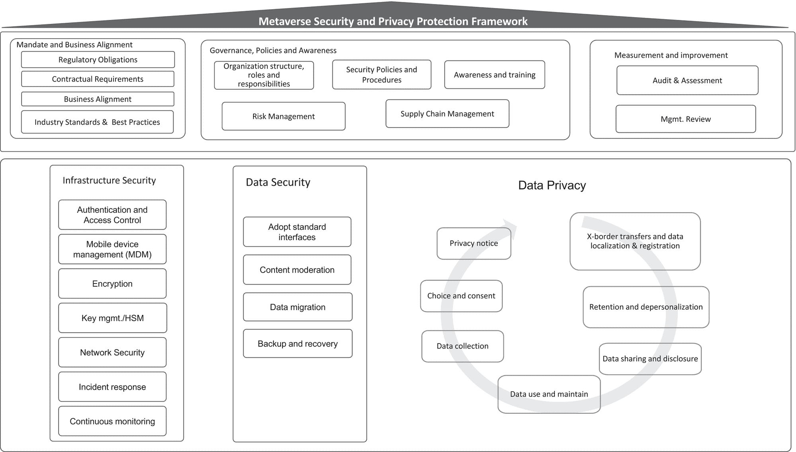

图 14.1 元宇宙安全与隐私保护框架

该框架确保了保护元宇宙的全面方法，涵盖了基础设施、数据安全和隐私的各个方面，从而为用户创建一个安全且可靠的环境。

### 基础设施安全

- **身份验证与访问控制**：确保只有经过授权的用户才能访问系统。
- **移动设备管理 (MDM)**：管理并保护用于访问元宇宙的移动设备。
- **加密**：通过强有的加密方法保护数据。
- **密钥管理/HSM**：使用硬件安全模块安全管理加密密钥。
- **网络安全**：实施保护网络基础设施的措施。
- **事件响应**：制定响应安全事件的策略。
- **持续监控**：定期监控系统以发现潜在的安全威胁。

### 数据安全

- **采用标准接口**：利用标准化接口进行一致且安全的数据处理。
- **内容审核**：监控和控制元宇宙内部的内容以防止滥用。
- **数据迁移**：在不同系统或环境之间安全地传输数据。
- **备份与恢复**：确保在数据丢失或损坏时可以进行恢复。

### 数据隐私

- **隐私声明**：向用户提供有关数据收集和使用的清晰信息。
- **选择与同意**：允许用户控制自己的数据，并提供同意数据处理实践的选项。
- **数据收集**：透明且受监管的用户数据收集。
- **数据使用与维护**：确保对收集的数据进行适当使用和维护。
- **数据共享与披露**：规范数据如何共享以及披露给第三方。
- **保留与去身份化**：管理数据保留时间，并对其进行去身份化以保护用户身份。
- **跨境传输、数据本地化与注册**：处理跨境数据传输并确保符合本地数据法规。

表 14.9 概述了元宇宙内基础设施安全、数据安全和数据隐私的全面措施和控制，确保针对各种安全和隐私风险的强大保护。

表 14.9 元宇宙安全与隐私保护措施的关键组件

| 类别 | 组件 | 措施与控制 |
| :--- | :--- | :--- |
| **基础设施安全** | **身份验证与访问控制** | - 实施多因素身份验证 (`MFA`) 以增强安全性。<br>- 使用基于角色的访问控制 (`RBAC`) 根据角色限制访问。<br>- 定期更新和审查访问权限。 |
| | **移动设备管理 (MDM)** | - 强制执行移动设备的安全策略。<br>- 启用针对丢失或被盗设备的远程擦功能。<br>- 使用加密保护存储在移动设备上的数据。 |
| | **加密** | - 使用端到端加密 (`E2EE`) 保护传输和存储的数据。<br>- 根据标准更新加密协议。<br>- 确保加密密钥安全管理。 |
| | **密钥管理/HSM** | - 使用硬件安全模块 (`HSMs`) 进行安全密钥存储。<br>- 定期轮换密钥。<br>- 确保强有力的访问控制。 |
| | **网络安全** | - 部署防火墙和入侵检测/防御系统 (`IDS/IPS`)。<br>- 使用 `VPN` 进行安全远程访问。<br>- 定期修复网络设备漏洞。 |
| | **事件响应** | - 制定并维护事件响应计划。<br>- 定期进行事件响应演练和模拟。<br>- 确保快速检测并缓解安全事件。 |
| | **持续监控** | - 使用安全信息事件管理 (`SIEM`) 系统进行全面监控。<br>- 实时检测安全威胁。<br>- 定期审查监控数据。 |
| **数据安全** | **采用标准接口** | - 使用标准化的 API 和协议确保数据交换安全。<br>- 定期更新接口以维护安全标准。 |
| | **内容审核** | - 实施自动化内容审核工具以检测和删除有害内容。<br>- 使用人工审核员审核标记的内容。<br>- 建立明确的内容政策和指南。 |
| | **数据迁移** | - 确保数据在迁移过程中加密。<br>- 使用安全的传输协议（如 `SFTP` 和 `HTTPS`）。 |
| | **备份与恢复** | - 定期将数据备份到安全的异地位置。<br>- 对备份数据进行加密。<br>- 定期测试数据恢复以确保符合预期。 |
| **数据隐私** | **隐私声明** | - 清晰向用户说明数据收集做法。<br>- 确保隐私声明易于理解且易于获取。 |
| | **选择与同意** | - 为用户提供明确的同意或拒绝数据收集选项。<br>- 确保以透明的方式获得同意。 |
| | **数据收集** | - 将数据收集减少至服务所需的范围。<br>- 使用匿名化和假名化技术保护个人数据。 |
| | **数据使用与维护** | - 仅说明的目的使用收集的数据。<br>- 定期审查数据使用实践以确保符合隐私政策。 |
| | **跨境传输、数据本地化与注册** | - 在适用遵守数据本地化法律。<br>- 确保跨境数据传输符合监管要求（如 `GDPR` 和 `CCPA`）。 |
| | **保留与去身份化** | - 建立数据保留政策以限制数据存储时间。<br>- 对不再需要的数据使用去身份化技术。 |

- 将与第三方的数据共享限制在必要范围内，并确保第三方符合数据保护标准。
- 告知用户数据共享惯做法，并在必要时获得同意。

## 附录：安全与隐私保护控制目标与措施

| 领域 | 控制组 | 控制目标 | 控制项 |
| :--- | :--- | :--- | :--- |
| 强制性要求与业务对齐 | 监管义务 | 遵守适用的法律法规 | **识别适用的管辖区和法律法规**：根据数据处理活动的业务性质和目的等，识别实体运营所属的管辖区。识别并记录与隐私相关的法律、法规、指令、裁决、范围、相关要求以及违反法律法规可能面临的惩罚。监控并跟踪这些管辖区内的监管进展。 |
| | | **确定数据处理的角色和义务** | 根据组织是否决定了数据处理活动的目的和手段，定义每个实体的个人数据处理角色。 |
| | 合同要求 | 履行合同要求 | **识别并整合客户需求** | 将与客户的具有法律约束力的文件（如协议或合同）中的数据保护合同要求识别并纳入安全与隐私计划中。 |
| | | **纳入网络保险策略中的安全与隐私相关条款** | 将网络保险策略中的数据保护合同要求识别并纳入安全与隐私计划中。 |
| | 业务对齐 | 使数据保护和隐私计划与业务策略及政策对齐并促进业务增长 | **与业务策略、目标和政策保持一致** | 审查并识别现有发布的政策和程序中与安全和隐私相关的要求。根据当前政策和程序中编写的要求、条款和语言，建立隐私和数据保护计划。安全与隐私计划的规划应考虑、支持并促进业务战略和增长（例如：新产品、新市场、新流程）。 |
| | 行业标准 | 遵循行业标准与最佳实践 | **遵循行业标准** | 审查并识别现有发布的政策和程序中与安全和隐私相关的要求。根据当前政策和程序中的要求、条款和语言建立隐私和数据保护计划。在规划安全与隐私计划时应考虑并满足选定的行业标准和框架要求。 |
| 治理、政策与意识 | 治理结构、角色和职责 | 建立适当的治理保护结构 | **治理结构**：建立适当的治理结构以监督安全和隐私。治理结构应涵盖安全和隐私要求，以实现预期目标。治理模式有三种：集中式、去中心化和混合式。 |
| | | 与利益相关者对齐安全与隐私活动、角色和职责 | **安全与隐私负责人** | 与利益相关者对齐安全与隐私活动、角色和职责。指定安全与隐私负责人，负责监督安全和隐私以及数据保护实践。 |
| | | | **必要时指定数据保护官** | 1. **数据保护官 (DPO)**：根据法律或需要（如 GDPR）指定 DPO。<br>2. **独立数据审计**：根据《数字个人数据保护法》（DPDP 2023），数据受托人应任命独立审计员进行合规性检查。 |
| | | | **必要时指定代表** | 根据法律或需要指定数据代表。注意：某些隐私法规（如 PIPL）要求指定书面代表。 |
| | | | **职责分离** | 职责和领域应分离，以减少未经授权的修改或滥用资产。 |
| | | 在组织内部达成共识 | **协调并定义跨部门职责** | 通常，安全与隐私计划是跨部门团队的协作工作。协调、定义并分配职责，以有效管理计划。注意：如果没有定义的职责，安全和隐私计划可能会出现断层。定义和传达跨部门职责的一种方法是使用 RACI 责任分配矩阵。 |
| | 政策与程序 | 建立适当的安全与隐私治理结构，并制定企业范围的原则和要求 | **安全与隐私使命声明** | 一般而言，安全与隐私使命声明通常涵盖以下内容：<ul><li>组织对安全和隐私的重视</li><li>组织目标（法律、文化和客户预期）</li><li>实现预期结果的策略</li><li>角色职责的说明</li></ul>通常，安全与隐私使命声明包含在全局的安全隐私章程中。 |
| | | | **隐私章程** | 创建并发布企业内部的隐私章程，建立适当的隐私治理结构，并制定企业范围的关键定义、原则以及数据保护的要求。 |
| | | | **安全章程** | 创建并发布企业内部的安全章程，建立适当的安全治理结构，并制定企业范围的关键定义、原则以及安全保护目标、控制和实践的要求。 |
| | | 建立安全与隐私政策和程序 | **安全与隐私政策和程序** | 组织应建立并实施适当的安全与隐私政策和程序，以管理隐私和数据保护实践。政策和程序可能涵盖以下内容（列举不尽）：安全：<ul><li>`技术可接受使用策略`</li><li>`身份与访问管理 (IAM) 策略`</li><li>`资产管理策略`</li><li>`加密策略`</li><li>`数据安全策略`</li><li>`终端安全策略`</li><li>`恶意代码防护`</li><li>`网络安全策略`</li><li>`物理与环境安全策略`</li></ul> |

## 安全策略

- 安全事件管理策略
- 业务连续性计划中的信息安全
- 安全电子发现与取证
- 安全风险管理策略
- 安全威胁检测策略
- 安全意识与培训策略
- 系统配置与变更管理策略
- 供应商安全管理
- 漏洞管理策略
- 合规与审计管理策略
- 备份与恢复策略
- 人力资源安全策略
- 云安全策略

## 隐私保护

- 通知
- 选择与同意
- 收集
- 使用、留存与处置
- 数据主体权利
- 向第三方披露
- 隐私安全保障（包括数据泄露处理）
- 监控与执行

### 第三方安全与数据保护管理

在整个第三方合作生命周期内，识别并管理安全与隐私保护风险

- 合同前：执行尽职调查。
- 签署合同：在供应商协议中解决安全和数据保护要求。
- 服务期间：对供应商服务进行监控和审查。组织应定期监控、审查和审计供应商的服务交付。
- 合同后：迁移退出、数据删除及访问权限取消。

### 安全与隐私意识及培训

建立安全与隐私保护文化，并在企业范围内推广意识计划

#### 基于角色的安全与隐私意识及培训

向员工、承包商、实习生等开展定期的安全与隐私意识培训计划。组织应确保：

- 员工对其角色和职责有知情并经过培训。
- 高管人员理解其角色和职责。
- 负责保护个人信息隐私与安全的人员具备足够的专业资质并接受了必要的培训。
- 第三方（如服务提供商、客户和合作伙伴）理解其角色和职责。

#### 确认并承诺遵守安全与隐私保护策略

在新员工入职流程或年度政策审查与确认协议中，要求员工确认并承诺遵守安全和数据隐私策略中规定的要求。

## 衡量与改进

### 安全与隐私计划衡量

评估安全与隐私计划的有效性

#### 安全与隐私计划指标

应通过设定安全与隐私指标以指导改进等方法，监控并评估安全与隐私计划及控制的有效性。注意：某些组织可能还会使用成熟度模型（即：初始/随机、发展中、已定义、已管理和衡量、优化）来评估安全与隐私计划。

### 与安全和隐私相关的审计与评估

计划并执行与安全和隐私相关的审计及评估活动

#### 行政流程

与安全和隐私相关的审计和评估应经过合理的计划（即安排日程）、执行和管理。审计和评估可能包括内部驱动或外部驱动（如认证、声明）的努力。注意：组织可以将与安全和隐私相关的审计和评估整合到企业计划中。

### 管理并关闭已发现的问题

#### 发现与差距

审计和评估中的发现和差距应进行正式记录、制定解决方案并进行优先级排序。建议的缓解控制措施在整个风险缓解过程中应资源支持、实施并接受监控。

### 年度报告与管理评审

审查整体安全与隐私合规状况并开展改进

#### 年度报告与管理评审

组织的高级管理团队（SLT）应定期（即每年一次）接收安全与隐私计划合规状态报告（例如 DPO 报告），对态势和风险进行管理评审，并为改进提供指导和资源。如果发现问题，则制定并实施修复计划。

## 安全风险管理

### 安全风险管理

建立并执行风险管理流程

#### 安全风险管理流程

建立风险管理方法论，评估信息安全风险，定义并应用信息安全风险处理流程，并重新评估安全风险。

## 隐私风险管理

### 个人数据处理清单与数据流

通过建立和维护最新的个人数据处理清单和数据流来理解业务流程

#### 个人数据处理清单

数据处理清单是进一步进行隐私风险评估和缓解的基础。组织应建立并维护最新的数据处理清单，作为数据处理的记录。数据处理清单通常包括业务流程名称、处理的个人信息类型、处理目的以及法律依据。

#### 数据流

稳健的隐私保护计划应涵盖端到端的数据流，以避免内部数据传输中的不受控风险。建立并维护业务流程及/或系统之间最新的数据流，以反映真实的数据生命周期。注意：个人数据仅应根据通知中指定的目的与相关的内部流程进行共享。数据流也是记录内部数据共享活动的有效手段。

### 业务流程与项目的隐私评估 (PIA)

在业务流程和项目中建立并嵌入 PIA

#### 定义 PIA 流程和步骤

组织应对现有业务流程进行隐私评估，以评估和缓解隐私和数据保护风险。组织应确保新计划或流程在早期阶段考虑隐私风险，例如将 PIA 集成到项目管理实践中等。

#### 定义高风险数据处理场景


PIA 流程应涵盖可能对自然人的权利和自由产生重大风险或危害的高风险数据处理场景。您需要根据法律法规、数据主体预期和行业最佳实践定义高风险数据处理场景。

### 定义 PIA 报告的核心组件

PIA 报告是一份动态文档，旨在识别风险和措施，因此永远不会“完成”。它不是一种受控声明或关于合规的管理声明。

通常，PIA 报告应涵盖关键领域，并识别为满足每个领域要求而采取或计划采取的核心组件或行动。

## SDLC 中的 PIA

在系统开发生命周期中建立并嵌入 PIA。

### 隐私设计

在开发生命周期中集成 PIA，例如系统需求分析、设计、开发、测试和部署。

### 默认隐私

可能引起用户隐私担忧的系统功能和特性应默认禁用，除非用户授予许可否则不开启。

# 安全防护

## 资产管理

资产的清单与所有权

* 应对与信息及信息处理设施相关的资产进行识别，并编制和维护这些资产的清单。
* 资产所有权。清单中维护的资产应明确所有。

### 资产的可接受使用

设定资产使用的接受规则，例如互联网的使用、办公用途以及软件安装的限制。

### 介质处理

* 可移动介质的管理。应根据组织采用的分类方案，实施可移动介质的管理程序。
* 设备的安全处置或重用。所有包含存储介质的设备在处置或重用之前，应经过验证，以确保任何敏感数据和授权软件已删除或被安全覆盖。

## 身份与访问管理

### 访问控制策略

应根据业务和信息安全需求建立、记录并审查访问控制策略。

### 用户、身份与权限管理

* 用户注册与注销。应实施正式的用户注册和注销流程，以便分配访问权限。
* 用户访问配置。应实施正式的用户访问配置流程，为所有类型的用户对所有系统和服务配置分配或撤销访问权限。
* 用户访问权限审查。资产所有者应定期审查用户的访问权限。
* 访问权限的移除或调整。所有员工和外部用户对信息及信息处理设施的访问权限在终止雇用、合同或协议后应移除，或在发生变更时调整。

### 身份验证与凭据

* 用户身份验证信息管理。用户身份验证信息的分配应通过正式的管理流程进行控制。
* 安全登录程序。在访问控制策略要求的，对系统和应用程序的访问应通过安全登录程序控制。
* 密码管理系统。密码管理系统应具有交互性，并确保密码质量。
* 根据需要使用 MFA（多因素身份认证）。

### 访问管理

* 信息访问限制。对信息和应用程序系统功能的访问应根据访问控制策略进行限制。

### 特权访问管理

* 特权权限管理。特权权限的分配和使用应受到限制和控制。
* 特权实用程序的使用。对可能覆盖系统和应用程序控制的实用程序的使用应受到限制和严格控制。

### 用户责任

* 身份验证信息的使用。用户应遵守组织在使用身份验证信息方面的规范。
* 无人值守设备。用户应确保无人看守的设备具有适当的保护。
* 清桌面与清屏幕策略。应采用针对纸和可移动存储介质的清桌面策略，以及针对信息处理设施的清屏幕策略。

## 物理与环境安全

### 安全区域

* 物理安全边界。应定义安全边界并用于保护包含敏感或关键信息以及信息处理设施的区域。
* 物理入口控制。安全区域应通过适当的入口控制进行保护，以确保只有授权人员进入。
* 办公室、房间和设施的安全。应设计并应用办公室、房间和设施的物理安全措施。
* 防止外部和环境威胁。应设计并应用针对自然灾害、恶意攻击或事故的物理防护。
* 在安全区域工作。应设计并应用在安全区域工作的程序。
* 交付与装卸区。交付、装卸区等其他未经授权人员可能进入场所的访问点应受到控制，并尽可能与信息处理设施隔离，以避免未经授权的访问。
* 物理监控。摄像头。
* 入侵者检测与防御/报警。

### 设备与环境安全

* 资产移除。未经事先许可，不得将设备、信息或软件带离现场。包含信息的介质在运输过程中应防止未经授权的访问、误用或损坏。
* 场外设备与资产的安全。
* 布线安全与防止电磁辐射攻击。
* 设备选址与保护。
* 性设施。
* 设备维护。

### 访客管理

制定程序以防止访客访问并易区分现场人员与访客，特别是在可以访问关键数据的区域。确保所有访客都得到妥善处理。

## 网络安全

### 网络安全策略

保护组织的数字资产、管理风险、确保合规性、标准化安全实践、提供事件响应协议、控制访问、提高安全意识并支持业务连续性。

### 网络分段

网络内部隔离：信息服务、用户和信息系统组在网络上应划分到不同的信任级别/分层区域。

### 内部网络访问控制 (SDN)

监管并限制对内部网络资源的访问，确保只有授权的用户和设备才能与组织内的敏感数据和系统交互，例如网络访问控制（`NAC`）。

### 保护无线网络

无线网络及连接的分段与保护。

### 远程办公策略

应实施策略及支持的安全措施，以保护在远程办公场所访问、处理或存储的信息。

### 信息传输

信息传输策略与程序。应建立正式的传输策略、程序和控制，以保护使用所有类型通信设施的信息传输。

## 数据安全

### 信息分类与处理

* 信息分类。应根据法律要求、价值、关键性以及对未经授权泄露或修改的敏感性对信息进行分类。
* 信息标记。应根据组织采用的分类方案，开发并实施一套适当的信息标记程序。
* 资产处理。应根据组织采用的分类方案，开发并实施资产处理程序。

### 应用加密保护数据

对静态数据、传输中数据和使用数据进行加密，以确保数据处理所有阶段的全面安全。

## 全面数据泄露防护

全面的数据泄露防护应涵盖数据生命周期，包括创建、使用、存储、披露和处置。

## 隐私与个人身份信息的保护

* 匿名化
* 假名化
* 信息保留与处置
* 建立适当的电子查询（eDiscovery）流程以处理电子查询请求，满足法律要求。

## 终端/VDI/移动设备安全

### 终端/VDI/移动策略

应采用策略和支持的安全措施来管理使用移动设备带来的风险。

### 终端威胁防护

终端威胁防护保护设备免受恶意软件、网络攻击和未经授权的访问，从而确保整个网络基础设施的安全。

### VDI 安全

VDI 安全保护虚拟化桌面环境（包括数据、应用程序和网络访问），以防止未经授权的访问并保护敏感信息免受网络威胁。

### 移动设备管理 (MDM)

集中管理、保护和监控组织内的移动设备、应用程序和数据，以确保合规性、降低风险并提高生产力。

## 漏洞管理

### 技术漏洞管理

技术漏洞管理是对技术漏洞的管理。应及时获取所用信息系统的技术漏洞信息，评估组织对此类漏洞的暴露程度，并采取适当措施应对相关风险。

## 加密技术 (KMS, CA)

### 加密控制

* 加密控制使用策略。应开发并实施用于保护信息的加密控制使用策略。
* 密钥管理：应在密钥的整个生命周期内开发并实施关于加密密钥使用、保护和寿命的策略。

## 防恶意软件

### 恶意软件防护

应实施恶意软件检测、预防和恢复控制措施以防恶意软件，并结合适当的用户意识教育。

## 人力资源安全

### 入职前（背景审查）

* 筛选。应根据相关法律、法规和伦理，对所有入职候选进行背景调查检查，且检查应与业务需求、所访问信息的分类以及感知风险成正比。
* 雇佣条款。与员工和承包商的合同协议应规定他们及组织在信息安全方面的责任。

### 在职期间（行为规范）

* 管理责任。管理层应要求所有员工和承包商根据组织规定的策略和程序实施信息安全。
* 信息安全意识、教育与培训。组织的所有员工以及（在情况下）承包商应接受适当的意识教育和培训，并根据其工作职责接收有关组织策略和程序的定期更新。
* 纪律程序。应建立正式且公示的纪律程序，对违反信息安全规定的员工进行处理。

### 离职与职位变动（资产与权限）

建立离职或职位变动的责任。

## 安全监控与检测

### 可用性/能力监控

应对资源使用情况进行监控和调优，并对未来的容量需求进行预测，以确保所需的系统性能。

### 入侵检测与防护

入侵检测与防护包括对未经授权访问尝试的监控和预防，辅以反 DDoS 措施以缓解分布式拒绝服务攻击，同时结合文件完整性监控以确保关键系统文件和配置的一致性和安全性。

## 日志与分析

### 时钟同步控制

时钟同步控制将组织或安全域内所有相关信息处理系统的时钟同步到单一参考时间源。

### 事件日志与分析

* 应生成、保留并定期审查记录用户活动、异常、故障和信息安全事件的事件日志。
* 事件分析。
* 日志设施和日志信息应受到防篡改和未经授权访问的保护。

## 隐私操作

### 隐私声明

在获取个人数据之前或获取时应告知数据主体。

**1. 需要提供隐私声明的情景**

应在从数据主体（即客户和员工）处获取个人数据之前或获取时提供隐私声明。隐私声明通常包含以下部分（非详尽列表）：

* 组织的身份和联系方式
* 将收集和处理的个人数据类型
* 数据处理的目的和方法
* 个人数据如何被使用和共享
* 个人数据的存储方式及数据保留期
* 跨境传输机制
* 个人数据的安全保护
* 数据主体的权利及行使权利

**2. 隐私声明的交付方式**

通常，隐私声明应以“书面”或其他手段提供，包括在适当的情况下通过“电子手段”。应数据主体要求，也可以以口头形式提供。

**3. 隐私声明可用性的提醒**

根据某些隐私法法规的要求，应定期提醒数据主体其隐私声明的可用性，以及如何获取其副本。例如，根据 `HIPAA`，医疗计划必须在注册时向你提供声明。它还必须每三年至少提醒一次，你可以随时索取该声明。

**4. 隐私声明的变更**

更新或通知数据主体隐私声明的变化，或提醒数据主体声明的可用性。

如果隐私声明发生变化，应通知数据主体更新后的隐私声明。变更可能源于多个方面，例如数据类型或处理目的的改变。

### 公平

在组织的数据处理实践中保持公平透明。

* 公平使用
* 公平的后果
* 保持透明

### 保持透明

应以适当的方式提供隐私声明。提供隐私声明时必须考虑以下因素：**简洁**、**透明**、**易于理解**且**易于获取**。隐私声明应易于数据主体随时查找和查询。应提供一种机制让数据主体方便下载隐私声明。

### 隐私声明的核心要素

确保数据主体可访问；标明隐私声明日期；更新或通知数据主体隐私声明的变化，或提醒数据主体其可用性。

* 组织的身份
* 我们收集哪些个人数据，以及收集这些个人数据的原因
* 我们如何收集您的个人数据
* Cookie 及类似技术
* 我们如何使用个人数据
* 我们如何将个人数据与处理者或子处理器共享
* 我们如何存储您的个人数据
* 您的个人数据的跨境传输
* 我们如何保护您的数据
* 儿童个人数据
* 您的作为数据主体的权利
* 联系方式

## 法律依据与同意

| 法律依据与同意 | 确保数据处理活动的合法性 |
| :--- | :--- |
| | |
| **处理的合法性** | 所有数据处理活动应具有适当的法律依据。禁止以误导、欺诈、强制或其他方式处理个人信息。任何业务部门或个人均不得非法收集、使用、处理或传输他人的个人信息；非法出售、购买、提供或披露他人的个人信息；或从事危害国家安全或公共利益的个人信息处理活动。 |
| 如果同意是合法依据，则应获得数据主体的同意 | **同意的获取** <br>1. **在处理个人信息时或之前获得同意** <br> 如果同意是适当的法律依据，组织必须就收集、使用或披露个体的个人信息获得该个人的有效同意。个体的同意必须在收集个人信息时或之前获得。 |
| | 1. **在某些情况下需要单独且明确的同意** <br> 当处理个人数据可能对数据主体构成实质风险时，某些场景需要单独且明确的同意，示例列如下（并非详尽列表）。<ul><li>数据主体为未成年人（需要获得父母同意）：中国：不满 14 周岁；GDPR：不满 16 周岁</li><li>特殊类别数据/敏感个人数据的处理</li><li>自动化个人决策，包括画像</li><li>直接营销目的</li><li>个人数据出售</li><li>公共场所的图像采集或个人身份识别</li><li>处理可能对数据主体产生重大影响的公开信息</li><li>涉及向第三国的数据传输</li><li>等</li></ul>2. **对变更表示同意** 必须通知数据主体隐私政策的变更，并在必要重新获得同意。如果隐私政策发生变更，组织应指示数据主体查看变更并在必要时重新获得其同意。 |
| | 同意条件与管理：确保同意是有效的；保留同意的记录和证据；确保数据主体有权利和机制撤回其同意。 | **同意的有效** 同意应当是`自愿提供的、无条件的、特定的、知情的且无模糊或明确的`。注意：沉默、预勾选框或不活动不应构成同意。用户长时间不活动不应被视为同意。**同意记录** 在基于同意进行处理时，数据处理者/控制者应能够证明数据主体已同意对其个人数据进行处理。同意选择应被记录，并显示谁同意了、何时同意的、被告知了什么、如何同意的等。注意：在某些司法管辖区（如美国和加拿大），电话推销人员需要跟踪“请勿打扰注册”。**撤回同意** 数据主体有权随时撤回其同意。组织应为数据主体撤回同意提供适当的机制。撤回同意的努力等同于提供同意。数据主体撤回同意后，组织应停止收集、使用和披露个人数据。注意：撤回同意不应影响撤回之前基于同意的处理的合法性。 |

## 数据收集

| 数据收集 | 确保数据收集方法合法、公平且透明。 |
| :--- | :--- |
| | **收集的合法性** 仅在有适当法律依据的情况下收集和处理个人数据。不要收集法律法规禁止的个人数据。 |
| | **收集的公平性** 收集个人数据应以公平的方式，不涉及恐吓、欺骗或欺诈等行为。 |
| 将收集限制在满足相应目的的必要范围内并数据最小化 | **目的限制** 个人数据只能为了隐私政策中说明的特定、明确且合法的目的而收集。不能收集超出目的的个人数据。 |
| | **数据最小化** 仅收集与处理目的相关的、充分的、且仅限于必要范围内的数据。 |
| 确保从第三方收集的数据符合适用法律 | **从第三方处收集** 组织应进行尽职调查，以确保收集个人信息的第三方是可靠的来源，且收集过程是公平合法的。组织需要建立并实施适当的控制（即合同义务），以管理从第三方收集（即购买）数据的风险。 |

## 数据使用与维护

| 数据使用与维护 | 将数据使用限制在预期目的内 |
| :--- | :--- |
| | **数据使用目的限制** 仅为隐私政策中指定的目的使用个人数据。如果收集的数据需要用于隐私政策未列出的目的，控制者需要进行兼容性测试，以确保新目的与隐私政策兼容，或者在新目的和新场景下重新获得用户同意。 |
| 确保个人数据的准确性和完整性 | **准确性完整性** 确保个人数据准确、相关、及时且完整。 |
| 根据知情原则限制数据访问。记录、监控和审计个人数据操作 | **访问控制** <br>1. **用户访问与显示限制** <br>用户对个人数据的访问应基于知情原则授予。应建立正式的身份访问策略和程序以管理人员访问。设计并实施技术解决方案以强制和监控个人数据的使用。<br>在涉及界面（如屏幕和纸张）上显示个人数据时，数据控制者应采取去标识化等措施对待显示的个人数据进行处理，以减少显示过程中个人数据泄漏风险。 |
| | 1. **对功能和 API 的访问** <br>对功能和 API 的访问应根据业务需求进行授权和监控。在系统调用功能或 API 或对用户数据执行操作（如读取内容）之前，应建立授权策略并获得。<br>2. **操作日志** <br>收集和处理个人数据的系统必须记录操作者的个人数据操作（即访问和更改），以保留数据如何被访问和使用的审计追踪。 |

## 风险管理

| 在业务停止运营时管理隐私风险 |
| :--- |
| | **与停止运营相关的隐私风险（如解散、破产）** 数据控制者在停止处理个人信息的产品或服务时，应实施控制措施来管理隐私相关风险（并非详尽列表）。<br>1. 及时停止收集个人数据。 |
| 2. 通过向每个数据主体发送通知或通过公告通知其停止运营。 |
| 3. 删除或匿名化其所持有的个人数据。 |

### 个人数据共享

#### 管理数据共享风险

数据共享与传输的必要性、法律依据和目的。

除非法律另有规定或经数据主体授权，否则组织不应公开个人信息。组织只有在获得数据主体同意后，才能为了隐私通知中指定的目的向第三方披露个人信息。组织应建立并执行相关政策和流程，管理个人数据共享或传输至外部接收者的必要性、目的和法律依据。

### 内部共享实践的数据保护

#### 受控内部个人数据共享

确保只有数据源的所有者有权批准传输和共享。所有内部共享都应进行记录和审计。

* 授权与注册
* 数据最小化
* 数据匿名化
* 访问控制
* 监控与检查

### 外部共享

#### 控制者向处理者的数据传输

确保数据处理者对个人数据提供充分保护。约定每个控制者的权利和义务。

#### 控制者向处理者的数据共享：基于风险的端到端保护

1. **控制者向处理者：合同前尽职调查**

组织在选择服务或产品供应商之前，应从隐私保护的角度进行尽职调查。仅向那些通过遵守适用法规及组织隐私保护政策和要求具备保护个人能力的第三方披露个人数据。

2. **控制者向处理者：数据处理协议 (DPA)**

组织与处理者之间应建立具有法律约束力的 `DPA`。`DPA` 可以是独立文件，也可以是主协议或合同的一部分。通常，`DPA` 应涵盖以下组件（非详尽列表）：

* 定义数据处理角色
* 定义合同处理
* 处理指令
* 子处理者管理
* 安全控制
* 数据泄露通知
* 数据保密
* 数据主体请求 (DSR) 处理义务
* 合规性证明支持
* 跨境传输
* 服务终止
* 责任与赔偿
* …

3. **控制者向处理者：合同后检查与监控**

公司应建立相关流程（如上线检查、审计），以评估处理者是否实施了有效的控制措施以满足 `DPA` 的条款，以及处理者是否能够继续满足 `DPA` 的条款。

4. **控制者向处理者：合同终止**

当委托关系终止时，组织应建立正式的退出流程，以确保数据处理者无法访问个人数据，例如进行数据删除和取消访问权限。

#### 控制者向控制者的数据传输

两个数据控制者（即共同控制者或两个独立的控制者）应建立协议，规定每个控制者的权利和义务。该协议不影响个人根据本法规定要求任何一个个人信息控制者履行规定的权利。

#### 应履行数据保护的责任和职责


# 因合并、收购和分立导致传输

个人信息控制者因合并、收购、分立等原因必要传输个人信息时，应通知个人接收方的名称或姓名及联系方式。接收方应继续履行个人信息保护职责。若接收方改变原始处理目的或方法，应再次通知个人。

# 数据留存与跨境传输

## 建立整体方法来管理跨境传输风险

### 理解业务场景和数据流

了解您在适用管辖区内的业务背景和数据流。

## 遵守各管辖区的数据本地化义务

### 识别数据留存和跨境传输的监管要求

识别并记录组织运营所在管辖区的数据本地化义务。设计并实施满足数据本地化要求的 IT 系统。

注：`PIPL` 第 40 条规定：“关键信息基础设施运营者和处理量达到国家网信信息化技术部门规定的个人信息的处理器，应当在其境内收集、产生的个人信息存储在中国境内。向境外提供的，应当通过国家网信信息化技术部门组织的安全评估；法律、行政法规和国家网信信息化技术部门规定不需要安全评估的，从其规定。”

## 实施适当的跨境数据传输机制

跨境传输义务取决于业务所在地或地区的法律。根据监管要求和业务需求，建立适当的跨境传输策略和机制（例如 `Standard Contractual Clauses` 和 `BCR`）。

- 根据定义的跨境传输机制，IT 的设计通常需要（如数据中心和服务器的位置）与跨境传输机制保持一致。
- 个人数据处理操作（即人员配备和技术支持操作）也需要与定义的跨境传输机制保持一致。

# 数据留存与处置

## 仅保留实现预期目的所需的个人数据

### 数据留存政策和计划

1. **数据留存政策**

成功的数据留存与安全治理、合规性和数据分类密切相关。在缺乏这些标准的情况下，大多数组织难以建立可靠的数据留存计划。

本数据留存政策旨在概述符合法律法规（包括 `GDPR` 第 5 条(e)款）的数据留存要求。

2. **数据留存计划**

组织应建立与其运营所在各管辖区内适用法律法规一致的数据留存计划。仅在合理业务目的需要的时间范围内保留个人数据。

注：个人数据不应为了“万一”而无限期或存档，或在使用的可能性极小的情况下。留存期也不应短于适用的法定最低留存期。

# 数据处置

## 安全去标识化或删除个人信息

为内部和外包服务构建数据处置流程和标准。组织需要执行数据保留计划，在个人数据达到保留期后，或数据对于处理个人数据的目的不再必要时，对其进行去标识化或删除。注意：良好的数据保留和去标识化计划有助于防止个人数据的丢失、盗窃、滥用或未经授权的访问。

# 法律留存与电子发现 (eDiscovery)

## 法律留存与电子发现义务

应当并将法律留存和电子发现义务整合到数据保留和去标识化计划、进度及流程中。

# 数据的安全保护

## 实施适当合理的安全技术和组织措施

### 适当措施与整体方法

组织应采用基于风险的方法适当的技术和组织措施，根据数据分类方案确保个人数据的机密性、完整性、可用性和弹性。典型的安全措施可能包括以下控制措施（非完整列表）。

- 信息安全策略
- 信息安全组织
- 人力资源安全
- 资产管理
- 访问控制
- 密码学
- 物理和环境安全
- 运行安全
- 通信安全
- 系统获取、开发与维护
- 供应商关系
- 信息安全事件管理
- 业务连续性管理中的信息安全方面
- 合规

## 数据分类与保护

### 对个人数据进行分类和分类以获得适当保护

应考虑到法律影响、性质和目的、敏感性、对业务运营的关键性，以及披露给未经授权人员对数据主体产生的潜在影响等因素，对个人信息进行适当识别、分类和分类。组织应建立适当的数据分类方案以促进数据分类。

- 数据分类策略和标准
- 数据发现与标记
- 数据保护

# SDLC 中的安全与隐私

## SDLC 中的安全与隐私

在整个开发过程中主动识别、缓解和管理与潜在安全漏洞及隐私担忧相关的风险，确保创建安全且合规的软件产品。

### 安全需求

信息安全和隐私需求的分析与规范。

### 设计

- 威胁建模
- 安全与隐私技术架构设计

### 开发

- 安全编码。
- 开发、测试和运行环境的分离。
- 安全开发环境控制。
- 程序源码的访问控制。
- 安全系统工程原理。
- 与单元测试和功能测试集成的安全测试。
- 外包开发：组织应监督和监控外包系统开发的活动。

### 安全与隐私测试

- SAST（静态应用安全测试）。
- DAST（动态应用安全测试）。
- 通用漏洞扫描。
- 渗透测试。
- 测试数据的保护。测试数据应经过仔细选择、保护和控制。

### 发布/部署

- 运行环境安全（如安全配置）。
- 最终安全审查。

# 请求、投诉与数据泄露处理

## 数据主体权利保障与处理

确保服务或产品具备履行数据主体权利的能力

### 识别每个司法辖区的 DSR 权利和核心要素

组织应设计具备履行数据主体权利能力的服务、产品或流程。

- 法律依据与 DSR
- 权利、适用性及例外。

### 建立一致的 DSR 请求处理流程

## 及时响应数据主体权利请求

组织应建立并运行一套流程来处理来自外部和内部数据主体的权利请求。通常，该流程涵盖录入分拣、身份验证、履行请求、对数据主体的响应以及案件结案等考虑因素。

## 咨询、投诉与争议处理

### 妥善处理来自内部和外部利益相关者的隐私查询、投诉和争议

#### 咨询、投诉与争议处理

组织应建立流程来处理来自内部和外部利益相关者的隐私查询、投诉和争议。组织需要指定联系人来处理投诉或咨询。组织应从有问题的数据操作中总结教训。

#### 内部举报流程

组织应建立流程来处理来自内部和外部利益相关者的隐私查询、投诉和争议。组织需要指定联系人来处理投诉或咨询。组织应从有问题的数据操作中总结教训。

#### 特权信息保护

组织在与内部和外部人员通信期间，应始终保护特权信息（例如律师-客户特权）。

## 数据泄露处理

### 妥善处理数据泄露以最小化影响

#### 数据泄露处理流程

组织应建立一致的数据泄露处理流程，包括在准备、检测、调查与分拣、遏制、根除与恢复、报告和改进等各个阶段的处理要求、程序和责任。不同的司法辖区在向数据保护机构和数据主体报告数据泄露方面，对组织可能产生非常不同的法律义务。组织应识别、记录并维护其运营所在每个司法辖区的相应要求。当需要通知数据保护机构或数据主体时，通常组织应包含以下内容（非完整列表）。

- 受影响的个人数据类型、原因，以及已发生或可能发生的泄露、歪曲或丢失可能造成的危害。
- 个人信息处理者采取的缓解措施以及个人可以采取减轻危害措施。
- 个人信息处理者的联系方式。

#### 数据泄露演练

组织应定期进行数据泄露演练，以评估数据泄露处理流程的有效性，并进行相应的更新和改进。

# BCM 中的信息安全方面

## 信息安全连续性

### 信息安全连续性

- 规划信息安全连续性。组织应确定其在不利情况下（例如危机或灾难期间）对信息安全以及信息安全管理连续性的要求。
- 实施信息安全连续性。组织应建立、记录、实施并维护流程、程序和控制，以确保在不利情况下信息安全所需的连续性水平。
- 验证、审查和评估信息安全连续性。组织应定期验证已建立和实施的信息安全连续性控制，以确保其在不利情况下有效且有效。

| 备份计划 | **信息备份** | 应根据约定的备份策略，定期对信息、软件和系统镜像进行备份和测试。 |
| --- | --- | --- |
| 冗余 | **冗余** | 网络分层和冗余。与 `IP range` 关联的分支机构和网络设备。检查点：`host` 和应用冗余。 |
| 与数据保护机构 (DPA) 合作 | **识别涉及的 DPA 及其权力** | 组织应识别适用管辖区内涉及的 `DPAs` 并记录其联系信息。此外，组织应监控并遵循由 `DPAs` 发布的指南。注意：`DPAs` 在不同的管辖区可能拥有不同的权力（如：调查权、纠正权、授权权和咨询权）。 |
| 遵循相关 DPA 的指南 | **识别适用的指南** | 组织应监控并遵循由 `DPAs` 发布的指南。 |
| 建立内部程序以指导与 DPA 的合作 | **与 DPA 合作** | 组织应建立并实施一套内部程序，以响应 `DPAs` 的查询和/或调查。该程序可能包括设立联系点（即联络员）以及与 `DPAs` 进行适当交互的协议。注意：某些组织可能还打算与 `DPAs` 建立持续通信通道。 |

# 附录 B BEU GDPR 单页文档

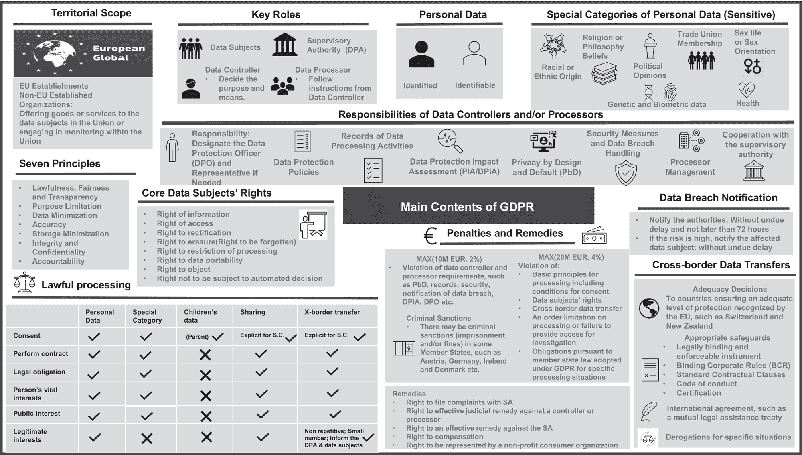

# 附录 CEU AI 法案单页文档

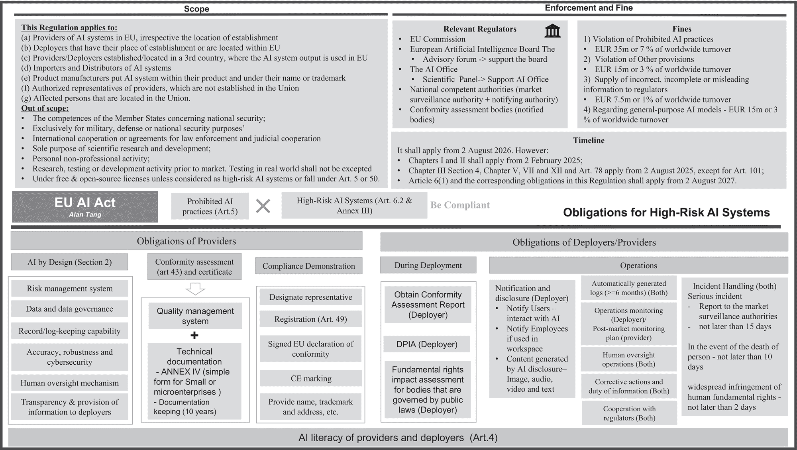

# 附录 DEU DSA 单页文档

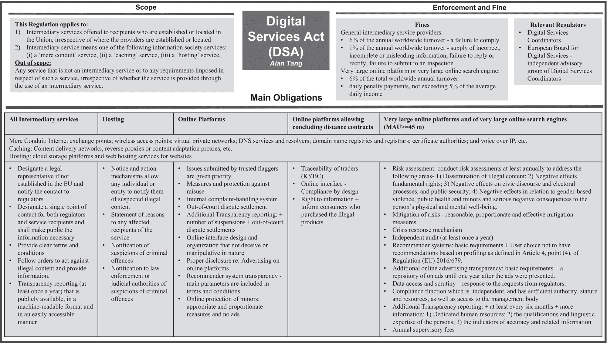

# 附录 EEU DMA 法案单页文档

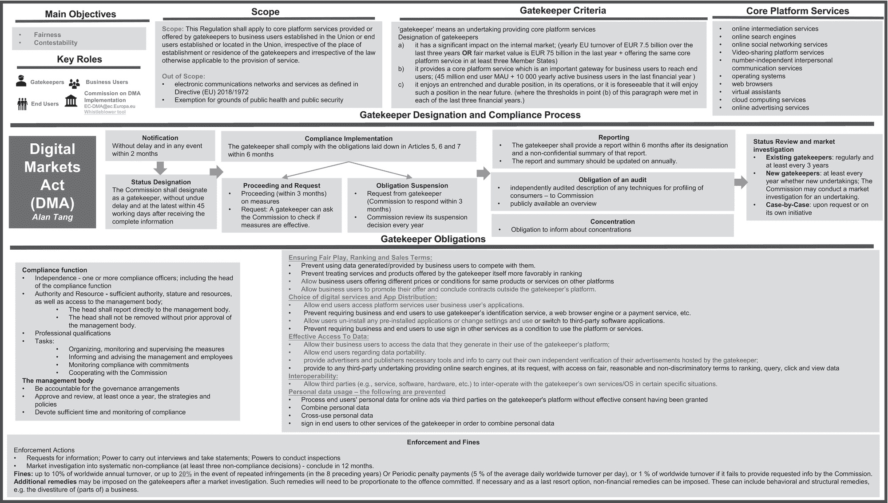

# 附录 F 加州 CPRA 单页文档

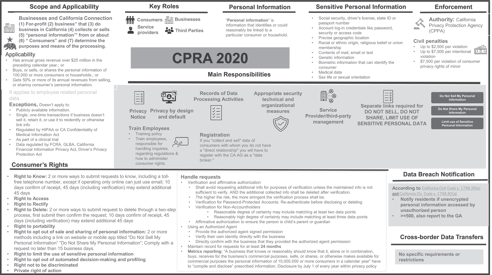

# 附录 G 中国 PIPL 单页文档

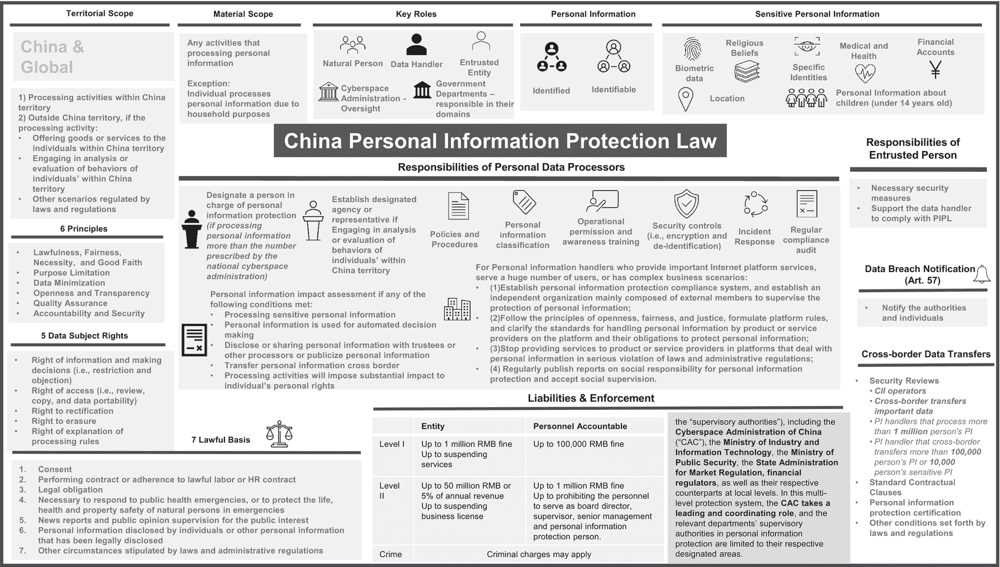

# 附录 HAI 教育或培训计划

| 机构 | 计划/课程 |
| --- | --- |
| `DeepLearning.AI`: `Coursera` | 面所有人 AI (AI for Everyone) |
| `Harvard` | 人工智能计算机科学专业证书（2 门课程） |
| `Stanford` | 人工智能研究生证书（4 门课程） |
| `UC Berkeley` | 机器学习与人工智能专业证书 |
| `Carnegie Mellon` | 人工智能与创新科学硕士学位 |
| `Columbia University` | 哥伦比亚大学人工智能 (AI) 执行证书 |
| `Columbia Engineering` | 在线人工智能 (AI) 课程 |
| `Microsoft` | 微软认证：Azure AI 基础知识 |
| | 微软认证：Azure AI 工程师助理 |
| `Google` | 专业机器学习工程师证书 |
| `Machine Learning Course` | |
| `SANS` | `SEC595`：面向网络安全专业人士的应用数据科学与 AI/机器学习 |

# 附录 IXR 行业用例

| 行业/领域 | 业务用例 |
| --- | --- |
| 生产力与工作 | |
- 视频会议：通话参与者在说话时可以看到对方的 AR 投影，增加参与度和关注。
- 实时背景检查：在见到某人时，通过查看其 `LinkedIn`、`tweets`、`Instagram` 照片以及重要的 `Google` 搜索结果摘要，获取其背景的时上下文。
- 屏幕创建：随时随地查看高分辨率屏幕。如果你需要显示器，请连接到可穿戴 AR 设备。


* 屏幕创建：随时随地查看高分辨率屏幕。如果你需要显示器，请连接到可穿戴 AR 设备。

* 屏幕创建：随时随地查看高分辨率屏幕。如果你需要显示器，请连接到可穿戴 AR 设备。

* 屏幕创建：随时随地查看高分辨率屏幕。如果你需要显示器，请连接到可穿戴 AR 设备。

* 屏幕创建：随时随地查看高分辨率屏幕。如果你需要显示器，请连接到可穿戴 AR 设备。

* 屏幕创建：随时随地查看高分辨率屏幕。如果你需要显示器，请连接到可穿戴 AR 设备。

* 屏幕创建：随时随地查看高分辨率屏幕。如果你需要显示器，请连接到可穿戴 AR 设备。

* 屏幕创建：随时随地查看高分辨率屏幕。如果你需要显示器，请连接到可穿戴 AR 设备。

* 屏幕创建：随时随地查看高分辨率屏幕。如果你需要显示器，请连接到可穿戴 AR 设备。

* 屏幕创建：随时随地查看高分辨率屏幕。如果你需要显示器，请连接到可穿戴 AR 设备。

* 屏幕创建：随时随地查看高分辨率屏幕。如果你需要显示器，请连接到可穿戴 AR 设备。

* 屏幕创建：随时随地查看高分辨率屏幕。如果你需要显示器，请连接到可穿戴 AR 设备。

* 屏幕创建：随时随地查看高分辨率屏幕。如果你需要显示器，请连接到可穿戴 AR 设备。

* 屏幕创建：随时随地查看高分辨率屏幕。如果你需要显示器，请连接到可穿戴 AR 设备。

* 屏幕创建：随时随地查看高分辨率屏幕。如果你需要显示器，请连接到可穿戴 AR 设备。

* 屏幕创建：随时随地查看高分辨率屏幕。如果你需要显示器，请连接到可穿戴 AR 设备。

* 屏幕创建：随时随地查看高分辨率屏幕。如果你需要显示器，请连接到可穿戴 AR 设备。

* 屏幕创建：随时随地查看高分辨率屏幕。如果你需要显示器，请连接到可穿戴 AR 设备。

* 屏幕创建：随时随地查看高分辨率屏幕。如果你需要显示器，请连接到可穿戴 AR 设备。

* 屏幕创建：随时随地查看高分辨率屏幕。如果你需要显示器，请连接到可穿戴 AR 设备。

* 屏幕创建：随时随地查看高分辨率屏幕。如果你需要显示器，请连接到可穿戴 AR 设备。

* 屏幕创建：随时随地查看高分辨率屏幕。如果你需要显示器，请连接到可穿戴 AR 设备。

* 屏幕创建：随时随地查看高分辨率屏幕。如果你需要显示器，请连接到可穿戴 AR 设备。

* 屏幕创建：随时随地查看高分辨率屏幕。如果你需要显示器，请连接到可穿戴 AR 设备。

* 屏幕创建：随时随地查看高分辨率屏幕。如果你需要显示器，请连接到可穿戴 AR 设备。

| 心理学 | |

* 视频会议：通话参与者在说话时可以看到对方的 AR 投影，增加参与度和关注。

* 实时背景检查：在见到某人时，通过查看其 `LinkedIn`、`tweets`、`Instagram` 照片以及重要的 `Google` 搜索结果摘要，获取其背景的时上下文。

* 屏幕创建：随时随地查看高分辨率屏幕。如果你需要显示器，请连接到可穿戴 AR 设备。

* 屏幕创建：随时随地查看高分辨率屏幕。如果你需要显示器，请连接到可穿戴 AR 设备。

* 屏幕创建：随时随地查看高分辨率屏幕。如果你需要显示器，请连接到可穿戴 AR 设备。

* 屏幕创建：随时随地查看高分辨率屏幕。如果你需要显示器，请连接到可穿戴 AR 设备。

* 屏幕创建：随时随地查看高分辨率屏幕。如果你需要显示器，请连接到可穿戴 AR 设备。

* 屏幕创建：随时随地查看高分辨率屏幕。如果你需要显示器，请连接到可穿戴 AR 设备。

* 屏幕创建：随时随地查看高分辨率屏幕。如果你需要显示器，请连接到可穿戴 AR 设备。

* 屏幕创建：随时随地查看高分辨率屏幕。如果你需要显示器，请连接到可穿戴 AR 设备。

* 屏幕创建：随时随地查看高分辨率屏幕。如果你需要显示器，请连接到可穿戴 AR 设备。

* 屏幕创建：随时随地查看高分辨率屏幕。如果你需要显示器，请连接到可穿戴 AR 设备。

* 屏幕创建：随时随地查看高分辨率屏幕。如果你需要显示器，请连接到可穿戴 AR 设备。

* 屏幕创建：随时随地查看高分辨率屏幕。如果你需要显示器，请连接到可穿戴 AR 设备。

* 屏幕创建：随时随地查看高分辨率屏幕。如果你需要显示器，请连接到可穿戴 AR 设备。

* 屏幕创建：随时随地查看高分辨率屏幕。如果你需要显示器，请连接到可穿戴 AR 设备。

* 屏幕创建：随时随地查看高分辨率屏幕。如果你需要显示器，请连接到可穿戴 AR 设备。

* 屏幕创建：随时随地查看高分辨率屏幕。如果你需要显示器，请连接到可穿戴 AR 设备。

* 屏幕创建：随时随地查看高分辨率屏幕。如果你需要显示器，请连接到可穿戴 AR 设备。

* 屏幕创建：随时随地查看高分辨率屏幕。如果你需要显示器，请连接到可穿戴 AR 设备。

* 屏幕创建：随时随地查看高分辨率屏幕。如果你需要显示器，请连接到可穿戴 AR 设备。

* 屏幕创建：随时随地查看高分辨率屏幕。如果你需要显示器，请连接到可穿戴 AR 设备。

* 屏幕创建：随时随地查看高分辨率屏幕。如果你需要显示器，请连接到可穿戴 AR 设备。

* 屏幕创建：随时随地查看高分辨率屏幕。如果你需要显示器，请连接到可穿戴 AR 设备。

* 屏幕创建：随时随地查看高分辨率屏幕。如果你需要显示器，请连接到可穿戴 AR 设备。

* 屏幕创建：随时随地查看高分辨率屏幕。如果你需要显示器，请连接到可穿戴 AR 设备。

* 屏幕创建：随时随地查看高分辨率屏幕。如果你需要显示器，请连接到可穿戴 AR 设备。

* 屏幕创建：随时随地查看高分辨率屏幕。如果你需要显示器，请连接到可穿戴 AR 设备。

* 屏幕创建：随时随地查看高分辨率屏幕。如果你需要显示器，请连接到可穿戴 AR 设备。

* 屏幕创建：随时随地查看高分辨率屏幕。如果你需要显示器，请连接到可穿戴 AR 设备。

* 屏幕创建：随时随地查看高分辨率屏幕。如果你需要显示器，请连接到可穿戴 AR 设备。

* 屏幕创建：随时随地查看高分辨率屏幕。如果你需要显示器，请连接到可穿戴 AR 设备。

* 屏幕创建：随时随地查看高分辨率屏幕。如果你需要显示器，请连接到可穿戴 AR 设备。

* 屏幕创建：随时随地查看高分辨率屏幕。如果你需要显示器，请连接到可穿戴 AR 设备。

* 屏幕创建：随时随地查看高分辨率屏幕。如果你需要显示器，请连接到可穿戴 AR 设备。

* 屏幕创建：随时随地查看高分辨率屏幕。如果你需要显示器，请连接到可穿戴 AR 设备。

* 屏幕创建：随时随地查看高分辨率屏幕。如果你需要显示器，请连接到可穿戴 AR 设备。

* 屏幕创建：随时随地查看高分辨率屏幕。如果你需要显示器，请连接到可穿戴 AR 设备。

* 屏幕创建：随时随地查看高分辨率屏幕。如果你需要显示器，请连接到可穿戴 AR 设备。

* 屏幕创建：随时随地查看高分辨率屏幕。如果你需要显示器，请连接到可穿戴 AR 设备。

* 屏幕创建：随时随地查看高分辨率屏幕。如果你需要显示器，请连接到可穿戴 AR 设备。

* 屏幕创建：随时随地查看高分辨率屏幕。如果你需要显示器，请连接到可穿戴 AR 设备。

* 屏幕创建：随时随地查看高分辨率屏幕。如果你需要显示器，请连接到可穿戴 AR 设备。

* 屏幕创建：随时随地查看高分辨率屏幕。如果你需要显示器，请连接到可穿戴 AR 设备。

* 屏幕创建：随时随地查看高分辨率屏幕。如果你需要显示器，请连接到可穿戴 AR 设备。

* 屏幕创建：随时随地查看高分辨率屏幕。如果你需要显示器，请连接到可穿戴 AR 设备。

* 屏幕创建：随时随地查看高分辨率屏幕。如果你需要显示器，请连接到可穿戴 AR 设备。

* 屏幕创建：随时随地查看高分辨率屏幕。如果你需要显示器，请连接到可穿戴 AR 设备。

* 屏幕创建：随时随地查看高分辨率屏幕。如果你需要显示器，请连接到可穿戴 AR 设备。

* 屏幕创建：随时随地查看高分辨率屏幕。如果你需要显示器，请连接到可穿戴 AR 设备。

* 屏幕创建：随时随地查看高分辨率屏幕。如果你需要显示器，请连接到可穿戴 AR 设备。

* 屏幕创建：随时随地查看高分辨率屏幕。如果你需要显示器，请连接到可穿戴 AR 设备。

* 屏幕创建：随时随地查看高分辨率屏幕。如果你需要显示器，请连接到可穿戴 AR 设备。

* 屏幕创建：随时随地查看高分辨率屏幕。如果你需要显示器，请连接到可穿戴 AR 设备。

* 屏幕创建：随时随地查看高分辨率屏幕。如果你需要显示器，请连接到可穿戴 AR 设备。

* 屏幕创建：随时随地查看高分辨率屏幕。如果你需要显示器，请连接到可穿戴 AR 设备。

* 屏幕创建：随时随地查看高分辨率屏幕。如果你需要显示器，请连接到可穿戴 AR 设备。

* 屏幕创建：随时随地查看高分辨率屏幕。如果你需要显示器，请连接到可穿戴 AR 设备。

* 屏幕创建：随时随地查看高分辨率屏幕。如果你需要显示器，请连接到可穿戴 AR 设备。

* 屏幕创建：随时随地查看高分辨率屏幕。如果你需要显示器，请连接到可穿戴 AR 设备。

* 屏幕创建：随时随地查看高分辨率屏幕。如果你需要显示器，请连接到可穿戴 AR 设备。

* 屏幕创建：随时随地查看高分辨率屏幕。如果你需要显示器，请连接到可穿戴 AR 设备。

* 屏幕创建：随时随地查看高分辨率屏幕。如果你需要显示器，请连接到可穿戴 AR 设备。

* 屏幕创建：随时随地查看高分辨率屏幕。如果你需要显示器，请连接到可穿戴 AR 设备。

* 屏幕创建：随时随地查看高分辨率屏幕。如果你需要显示器，请连接到可穿戴 AR 设备。

* 屏幕创建：随时随地查看高分辨率屏幕。如果你需要显示器，请连接到可穿戴 AR 设备。

* 屏幕创建：随时随地查看高分辨率屏幕。如果你需要显示器，请连接到可穿戴 AR 设备。

* 屏幕创建：随时随地查看高分辨率屏幕。如果你需要显示器，请连接到可穿戴 AR 设备。

* 屏幕创建：随时随地查看高分辨率屏幕。如果你需要显示器，请连接到可穿戴 AR 设备。

* 屏幕创建：随时随地查看高分辨率屏幕。如果你需要显示器，请连接到可穿戴 AR 设备。

* 屏幕创建：随时随地查看高分辨率屏幕。如果你需要显示器，请连接到可穿戴 AR 设备。

* 屏幕创建：随时随地查看高分辨率屏幕。如果你需要显示器，请连接到可穿戴 AR 设备。

* 屏幕创建：随时随地查看高分辨率屏幕。如果你需要显示器，请连接到可穿戴 AR 设备。

* 屏幕创建：随时随地查看高分辨率屏幕。如果你需要显示器，请连接到可穿戴 AR 设备。

* 屏幕创建：随时随地查看高分辨率屏幕。如果你需要显示器，请连接到可穿戴 AR 设备。

* 屏幕创建：随时随地查看高分辨率屏幕。如果你需要显示器，请连接到可穿戴 AR 设备。

* 屏幕创建：随时随地查看高分辨率屏幕。如果你需要显示器，请连接到可穿戴 AR 设备。

* 屏幕创建：随时随地查看高分辨率屏幕。如果你需要显示器，请连接到可穿戴 AR 设备。

* 屏幕创建：随时随地查看高分辨率屏幕。如果你需要显示器，请连接到可穿戴 AR 设备。

* 屏幕创建：随时随地查看高分辨率屏幕。如果你需要显示器，请连接到可穿戴 AR 设备。

* 屏幕创建：随时随地查看高分辨率屏幕。如果你需要显示器，请连接到可穿戴 AR 设备。

* 屏幕创建：随时随地查看高分辨率屏幕。如果你需要显示器，请连接到可穿戴 AR 设备。

* 屏幕创建：随时随地查看高分辨率屏幕。如果你需要显示器，请连接到可穿戴 AR 设备。

* 屏幕创建：随时随地查看高分辨率屏幕。如果你需要显示器，请连接到可穿戴 AR 设备。

* 屏幕创建：随时随地查看高分辨率屏幕。如果你需要显示器，请连接到可穿戴 AR 设备。

* 屏幕创建：随时随地查看高分辨率屏幕。如果你需要显示器，请连接到可穿戴 AR 设备。

* 屏幕创建：随时随地查看高分辨率屏幕。如果你需要显示器，请连接到可穿戴 AR 设备。

* 屏幕创建：随时随地查看高分辨率屏幕。如果你需要显示器，请连接到可穿戴 AR 设备。

### 教育

- **课堂增强**：使用 `AR` 课程材料深入研究学习课题。老师可以对学生进行现场测验，并在他们上方显示答卷。学生可以远程协作小组项目并完成家庭作业。老师可以检测哪些学生没有参与或注意注意，并对他们进行关注。在不产生真实互动危险的情况下，结合数字元素观察化学反应。

- **书籍**：阅读具有 `AR` 属性的实体书，例如弹出插图、指向额外信息的可选链接或单词定义。

### 执法与法律

- **犯罪现场**：检测并突出显示犯罪现场的重要区域，以便进行更好的分析。

- **酒精醉测试**：与传统的现场酒精检相比，通过瞳孔扩张和身体摇晃等视觉指标提供更快、更高效的酒精分析方法。

- **嫌疑人搜寻**：通过街上的面部扫描识别嫌疑人。潜力从特定区域所有带有摄像头的 `AR` 设备中众包数据。

- **武器或违禁品检测**：扫描衣服下的异常凸起并将其突出显示给执法部门进行近距离检查。

- **陪审团选择与监控**：律师可以使用情感分析和注意力水平监控来获取更深层的陪审团洞察，以制定法律策略。

- **测谎**：通过微表情、语音和肢体语言分析一个人说真话的概率。在政治、谈判和人关系中也有扩展应用。

- **质证与证言**：使用 `AR` 设备轻松记录质证。自动将证言中提供的陈述与质证中的陈述进行对比。分析证人行为，以获取有关其真实性和动机的见解。

- **合同**：在 `AR` 中接收并签署文件。通过语音或视网膜扫描等生物识别技术增加验证，以提高安全性。

### 无障碍辅助

- **盲人辅助**：`AR` 的物体识别和语音界面可以为盲人提供有关周围存在和发生情况的实时信息。

- **听障辅助**：通过 `AR` 设备接收翻译成文本提示的听觉信息，例如飞机上的广播或刹车声。

- **实时翻译**：`AR` 可以转换外语文本或音频并以用户的母语言显示回来。

- **轮椅地图**：接收突出显示轮椅友好路线的 `AR` 地图。

- **放大**：缩放并增强小型或远处的文本使其清晰可见。

### 医疗

- **手术辅助**：在手术期间识别器官和组织，并获取指令，无论是来自观察你 `POV` 的医生还是你运行的知识库应用程序。

- **药物识别**：帮助医疗人员识别正确的药物，即使他们没有接受过相关培训。减轻药剂师和医生的压力，减少用药和开处方时的错误。

- **静脉穿刺**：为医疗人员突出患者的静脉，即使肉眼难以发现。增加第一次插入成功的概率。

- **更多获得医生的机会**：如果远程医生查看他们的 `POV` 流并提供协助，`AR` 将为经验较少的医护人员增强能力。让医生能够在不同地点工作的灵活性，并扩展其专业知识。

- **症状检查**：让患者对照医学数据库检查视觉症状，或与医生实时分享。

- **第二意见**：使与其他医生的协作更快、更方便，例如查看 X 光片、与另一医生共享你的 `POV` 并讨论结果。

- **身体改造**：查看纹身、穿孔和整形手术后的效果。可视化自己增加或减少体重、肌肉，或者年龄变变小。

### 政治

- **实时事实核查**：让观众和政治家能够验证陈述的真实性。

- **AR 提词器**：政治家可以从穿戴式 `AR` 显示器上阅读准备好的演讲，而不会显得生硬或不自然。他们还可以在辩论期间调出并阅读有关问题的声明，而不一定需要理解这些问题。

- **人群民意调查**：通过情感分析衡量人群对政治家的反应，包括他们支持该候选人的概率以及支持率的变化。

- **捐赠者识别**：政治家可以通过 `AR` 突出显示捐赠者，从而更好地支持和与他们互动。

### 军事

- **友军识别**：通过 `AR` 标记物体，供成员看到，非成员看不到任何内容。

- **敌方识别**：根据历史记录，通过 `AR` 避开障碍。友军和平民显示蓝色光晕，而敌方战斗员显示红色光晕。

- **增强视觉**：识别目标、避开障碍并导航，无需松开控制设备。

- **路边检测**：通过 `AR` 反馈路边检测信息，使避开变得更容易。

- **武器操作**：通过 `AR` 显示关于武器、车辆、无人机及其他设备的指令。

- **状态抬头显示**：显示剩余弹药、食物、水、健康以及任务详情。

### 艺术与文化

- **博物馆与城市导览**：走过时了解博物馆展览和城市地标，它们会出现在你的视野中。

- **艺术分析**：在作品上叠加之前的版本，并了解艺术家使用的技术。

- **艺术教学**：遵循 `AR` 提示学习绘画、素描、雕塑等。

- **历史重建**：看到历史遗迹老化或破坏之前的样子。

- **书籍**：将书籍固定在视野中，以便在行走或跑步时阅读。与远程人员（如你的孩子）一起阅读。

- **自然之旅**：识别植物动物物种并了解它们。根据过去的记录查看最可能发现不同动物的地方。

- **歌曲和艺术家识别**：显示听到的音乐的艺术家名称和歌曲标题。

### 零售

- **智能购物**：设定营养、优惠券和食谱等购物目标。你的 `AR` 系统会在你经过过道时突出显示要买的物品并提供路径。

- **家具购物**：将家具的 `AR` 模型放入生活空间，查看它们是否合适以及哪些颜色、饰面和面料最好。

- **服装购物**：无需出门即可试穿并购买衣服。在身上叠加服装并尝试不同的尺寸和颜色。

- **个人造型**：尝试数字发型和化妆。

- **街头购买**：获取感兴趣的信息。如果有人穿着你喜欢的鞋走过，你可以了解品牌、价格、尺寸和颜色选项并立即下单。

- **展示**：对实体店内看到的产品进行跨零售商的简单、快速价格比较。

### 社交

- **私人俱乐部**：为私人团体聚会的物理场所标记不显眼的入口。非组成员看不到任何内容，而成员则可以看到标志牌或发光的门。

- **个人品牌**：选择向其他 `AR` 用户展示的简短个人背景信息，就像你在世界中移动时的虚拟简介。在周末切换到更个人化、社交化的模式，或在会议上切换到更职业导向的模式。

- **第一视角博客**：`AR` 将使生活记录变得更加无缝。在你看到的同时直播你的内容。

## 状态

- **状态动态**：用户可以选择设置令他人可见的个人状态。如果不想被打扰，可以设置为“请勿打扰”；如果愿意交流，可以设置为“空闲”。还可以显示你正在听的歌曲或状态更新。

- **人脸识别命名**：通过扫描面部来检索姓名。

- **AR 聚会**：使用 AR 将朋友投影到物理聚会空间。如果你和她正坐在不同城市的沙发上，她能在波士顿的沙发上看到你，而你能在纽约的沙发上看到她。朋友可以从不同的物理位置聚集在一起，看电影、玩游戏或仅仅聚聚聚。

- **翻译**：为说不同语言的人们之间的对话添加实时字幕。

## 餐饮与餐厅


# 餐厅与食品

- **餐厅评论**：在路过餐厅时查看其评级和客户评论。餐厅还可以广播特价优惠或活动。
- **餐厅预订与空位情况**：扫一眼即可了解餐厅是否有空桌，或者等候需要多久。
- **过敏标记**：识别你的过敏源并显示在食品相关的场景中。这样，餐厅人员就可以无需询问每位客人即可遵守过敏限制。
- **食物热量扫描**：通过观察扫描食物获取脂肪、蛋白质、碳水化合物、热量和营养信息。
- **饮食自动追踪**：被动记录你吃喝的一切，记录每日热量和宏量元素计数。当你超过热量限制时收到通知，并获得更健康的建议。
- **烹饪指导**：关于制作食谱的教程，包括视觉提示以帮助衡量食材。这让业余厨师向经验丰富的人士学习。
- **基于库存的食谱**：扫描冰箱和厨房，了解利用现有材料设备可以制作什么。

# 健身

- **全息私人教练**：与其观看健身视频或遵循应用中的指令，不如在健身空间内投影虚拟教练。绕着教练从各个角度观察动作是否标准。配合教练运动以保持节奏。
- **个性化健身**：通过 AR 设备查看内容，并根据心率、疲劳程度和用户反馈进行实时健身调整。
- **健身游戏化**：将跑步、步行或骑行变成任务，通过运动获得经验值（XP）或解锁功能。通过深蹲来快速击中目标或墙。看到朋友的排行榜并与他们竞争。
- **健身平视显示**：在相关时调出个人记录和历史健身信息。查看最大重复次数（rep max）。

# 建筑与施工

- **蓝图与模型**：使用 3D 投影而非纸质 CAD 模型进行可视化和共享。
- **项目管理**：扫描项目以查看规格是否符合要求，如果没有则显示偏差在哪里。
- **项目可视化**：穿过工地查看建筑完工后的样子。
- **项目指令**：遵循 AR 指令提高技能，例如查看在哪里钉钉子或如何固定屋顶瓦。

# 游戏

- **基于位置的游戏**：在现实世界的地图和地点叠加游戏层。让玩家以新的方式体验现实世界并彼此相遇。
- **桌面游戏**：让传统的棋盘游戏动起来。
- **增强型 PC 和主机游戏**：在电视和显示器仍被广泛使用时，添加 AR 层显示额外信息。一旦 AR 达到用户可以随处创建屏幕的水平，主机和 PC 游戏将变得便携。
- **AR 宠物**：只有你才能看到的数字宠物，可以跟随你并与物理世界交互。
- **电子竞技数据**：在直播中叠加游戏和球员信息。

# 体育

- **球员数据叠加**：在观看比赛时作为数据层查看球员统计和信息。这对于幻想体育有特殊用途。
- **球员增强**：通过扩展视野提高运动员的检测和反应能力，例如提醒他们网球的轨迹正朝着场上的特定点。
- **战术可视化**：将教练的战术映射到球员的 AR 视野。
- **增强分析**：获取任何运动的额外信息，例如拦截或高尔夫球的角度。

# 电影与电视

- **演员信息**：叠加类似 IMDB 的层以获取演员姓名、传记信息和曾演过的角色。
- **同步观看**：与他人或小组共同观看。
- **字幕**：为你观看的任何内容添加可选字幕。
- **移动观看**：在跑步、步行或通勤时观看。

# 营销与广告

- **个性化与精准投放**：根据姓名、兴趣、情绪状态、视线等为每个人展示独特的广告。一个 AR 广告空间可以为路过的每一个人提供不同的广告。
- **广告投放**：广告商将尝试更激进的 AR 策略来吸引注意力。AR 广告可以出现在人们面前。物体可以从视频中滚到观众的地板上。
- **AR 广告竞争物理广告**：出现在物理广告之上的 AR 广告将在新旧技术之间产生摩擦并竞争注意力。
- **物理广告动画**：通过增强目录、传单、手册、告示牌、海报、包装、T 恤、印刷广告、公交亭和店面让静态媒体焕发生机。包括视频、3D 动画、额外信息、目标体验和用户互动。
- **眼动追踪**：广告可以检测你是否正在看着它们并移动到你的视野中心。如果你在访问内容前需要看广告，广告将检测你是在看还是闭着眼睛。

# 制造

- **复杂组装叠加**：获取指令并使其在视野中可见或叠加在待组装的物品上，以减少操作复杂性和错误频率。
- **制造环境中的维护**：让维护历史在视野中可见。技术专家还可以与技术人员共享视图以提供额外支持。
- **质量保证**：质量专业人员可以拍摄检修车辆的零件或总组件的照片，然后通过 AR 叠加与公司供应商提供的图像进行对比。不符合规格的功能可以被叠加突出，使技术人员能够快速直观地识别问题。

# 房地产

- **实时房产购物**：使用 AR 技术允许用户在路过待售房屋时查看其房屋数据。
- **价值可视化**：该技术还可以更方便地演示房产价值，让潜在买家/租户视觉化看到空间定制化后的样子。

# 术语表

- **增强现实 (AR)**：一层叠加在现实世界视图上的数字层。该数字层通常通过 AR 眼镜或手机应用呈现。
- **比特币 (Bitcoin)**：一种去中心化的数字货币。

## 比特币

由中本聪（Satoshi Nakamoto）创建的一种流行的加密货币，利用`blockchain`作为基础技术。`bitcoin`的出现吸引了媒体的高度关注，并将`blockchain`的业务用例推向了焦点。

## 区块链

在分布式去中心化计算系统中记录数据的点对点数字钱包。通过其设计协议，`blockchain`在确保完整性和安全的同时提高了交易的透明度和效率。

## CAD 模型（计算机辅助设计）

包含精确插图的数字模型。通常用于制造和建筑环境。

## 计算机视觉

利用计算机从数字图像或视频中提取信息的过程。

## 联盟链

一种由选定的预先批准参与者运行的许可`blockchain`，这些参与者控制`consensus process`。这通常为具有相似利益的组织建立，如银行或医疗保健。

## 加密货币

促进所有权转移的数字货币，利用先进的`cryptography`技术确保传输的安全、不可篡改和可靠。

## 加密学

防止未经授权的用户查看和修改受保护数据的构建协议。`Blockchain`在每个数据块上采用`cryptography`以确保其安全性和不可变性。

## 客户数据仓库

从公司内部广泛来源积累的客户数据存储，用于引导客户互动和决策。

## 去中心化自治组织

一种在没有人为干预的情况下建立并完全由一套不可篡改的业务规则运行的组织。

## 数字货币

数字资产的表示，具有传统货币的特征，但独立于中央银行。

## 数字签名

在参与者的`public key`上生成的数字代码，附加在交易中以验证发送者的身份。

## 分布式账本技术 (DLT)

网络所有成员共享记录系统，而不是将信息集中在单点。数据被复制和同步以消除任何差异或数据操纵。

## 边缘检测

一种用于寻找图像内边界边界的处理技术。它通过检测亮度不连续性来工作。

## 以太坊

由维塔尼·布特林（Vitalik Buterin）创建的公共`blockchain`网络，具有智能合约功能。它内置了原生货币`Ether`，与`bitcoin`有许多相似之处。

## 人脸识别

扫描脸部并与现有的身份数据库进行匹配，仅通过观察就能学习人的姓名和背景信息。

## 视野

用户通过穿戴式头戴设备或移动设备查看虚拟内容的视觉空间。

## 哈希

一种将任何格式和长度的信息转换为固定长度加密输出的数学算法。它是一种保护信息的加密技术。

## 不可变

固定且无法更改的对象。在`blockchain`的情况下，数据一旦通过`consensus`添加到`blockchain`中就会变得不可变。

## 信息增强与显示

一旦识别出物体或人物，会自动搜索关于其它们的信息并显示给 AR 用户。

## 标记

AR 中触发动作的传统方法，使用预定义的图像或点。

## 挖矿

在加密货币`blockchains`中，`mining`通常指消耗计算能力来寻找数学问题的答案。第一个找到正确答案的`Miners`将展示他们的`proof of work`并获得以新块形式的奖励。

## 节点

存储的`blockchain`副本。

## 目标识别

使用`computer vision`检测物体。

## 点对点

允许参与者直接交易而无需中间人。

## 许可网络

一种仅受限的`blockchain`网络。

## 无许可网络

对所有人开放的`blockchain`网络。

## 私钥

不可逆转的加密代码。

## 公钥

从`private key`创建。

## 情感分析

扫描个人或群体以分析肢体语言、表情、行为并进行相应调整。

## SLAM（同步定位与地图构建）

计算机扫描环境并构建该区域的数字地图的过程。

## 智能合约

在满足预定条件时激活的自执行协议。它们为`blockchain`增加了巨大的价值。

## 令牌

代表任何可交易商品的对象。

## 虚拟现实 (VR)

用户完全沉浸其中的模拟环境。

# 参考文献

1. Henry A Kissinger, Eric Schmidt, Daniel Huttenlo. The Age of AI: And Our Human Future. 2022.
2. Klaus Schwab, Nicholas Davis, et al. Shaping the Fourth Industrial Revolution. 2018.
3. Robert C. Allen. The Industrial Revolution: A Very Short Introduction. 2017.
4. Digital Transformation using Emerging Technologies: A CxO's Guide to Transform your organization. 2021.
5. Nishani Vincent and Amy Igou. Emerging Technologies for Business Professionals: A Nontechnical Guide to the Governance and Management of Disruptive Technologies. 2023.
6. Omar Santos, Samer Salam, et al. The AI Revolution in Networking, Cybersecurity, and Emerging Technologies. 2024.
7. Nihal Mehta. Quantum Computing: Program Next-Gen Computers for Hard, Real-World Applications. 2020.
8. Terence Craig, Mary E. Ludloff. Privacy and Big Data: The Players, Regulators, and Stakeholders. 2011.
9. William Stallings. 5G Wireless: A Comprehensive Introduction. 2021.
10. Rosey Press. The Complete Guide to Brain-Computer Interface in AI: Exploring All Applications. 2024.
11. Uday Pratap Rao, Piyush Kumar Shukla, et al. Blockchain for Information Security and Privacy. 2021.
12. T. P. Ffiske. The Immersive Reality Revolution: How virtual reality (VR), augmented reality (AR), and mixed reality (MR) will revolutionise the world. 2020.
13. Alan Tang. Privacy in Practice: Establish and Operationalize a Holistic Data Privacy Program. 2023.
14. 爱尔兰数据保护委员会。爱尔兰数据保护委员会公布关于 Facebook"数据抓取"调查的决定。2022。
15. Todd S. Sechser, Neil Narang, 等。新兴技术与国际稳定性。2023。
16. 福布斯洞察。每一项 AI 策略背后都是数据策略。2019。
17. Max Tegmark。生命 3.0：人工智能时代的人类。2018。
18. IBM。IBM 的计算机在一次震撼人心的计算盛宴中比象棋击败了人类国际象棋冠军。2024。
19. Tom McGrath。神经网络如何学会下棋。2023。
20. Fabio Duarte。ChatGPT 用户数。2024。
21. Rockwell Anyoha。人工智能史：机器能思考吗？2017。
22. Stuart Russell。人类兼容：人工智能与控制问题。2019。
23. 福布斯。每一项 AI 策略背后都是数据策略。2018。
24. Punit Bhatia, Eline Chivot。AI 与隐私：如何找到平衡。2021。
25. Thomas H. Davenport, Rajeev Ronanki。AI 优势：如何让人工智能革命发挥作用。2018。
26. Rumman Chowdhury。支持创新的 AI 治理方法。2019。
27. Bill Siwicki。预测性运营帮助大学医院通过更大的病例量增加收入。2021。
28. Anne Trafton。人工智能产生新型抗生素。2020。
29. Michael Erard。医生和语言学家如何利用 AI 与临终患者更好地交流。2019。
30. 哈佛技术与运营管理。摩根 COIN：银行的侧项目正为法律行业带来颠覆。2018。
31. James E. Baker。半人马洛的困境：即将到来的人工智能革命的国家安全法。2020。
32. Davey Gibian, 破解人工智能：从深度伪造到破解深度学习的者指南。2022。
33. Jon Krohn, Grant Beyleveld, Aglae Basens。深度学习图解。2019。
34. Reid Blackman。伦理机器：完全无偏见、透明且尊重 AI 的简明指南。2022。
35. 英国国际专员办公室。大数据、人工智能、机器学习与数据保护。2020。
36. Brian Ka Chan。为什么数据治理对人工智能很重要？2020。
37. 美国联邦地区法院, 纽约南部区法院。Mata v. Avianca Inc. 2023。
38. Arif Cam, Michael Chui, 和 Bryce Hall。全球 AI 调查：AI 证明了它的价值，但很少有规模化影响。2019。
39. James V. Stone。人工智能引擎：深度学习数学的入门教程。2019。
40. Eli Stevens, Luca Antiga, Thomas Viehmann。使用 PyTorch 进行深度学习。2020。
41. Nomad。FraudGPT & WormGPT：恶意 AI 的出现。2023。
42. Claire Jackson。人们正在使用"奶奶漏洞"来破坏 AI。2023。
43. Emily Conover。AI 聊天机器人会被误骗产生不当行为。能停止吗？2024。
44. Laurence Moroney。程序员的 AI 与机器学习。2020。
45. Kai-Fu Lee。2041：十个愿景。2021。
46. R. Laishram。Curie：保护 SVM 免受污染攻击的方法。2016。
47. Tram F., Zhang F., Juels A., 等。通过预测窃取模型。2016。
48. F. Tramer, F. Zhang, A. Juels, 等。通过 API 窃取模型。2016。
49. N. Papernot, A. Martín, 等。来自隐私数据的半监督深度学习。2016。
50. M. Abadi, A. Chu, 等。差分隐私深度学习。2016。
51. Y. Liu, X. Yang 等。设计国际会议上的神经特洛伊。2017。
52. K. Liu, 等。精剪：防御针对神经网络的后门攻击。2018。
53. Melissa Heikkilä。Clearview AI 的墙正在合拢。2022。
54. Peter Norvig, Stuart Russell。人工智能：现代方法（第 4 版）。2020。
55. Kate Crawford。AI 地图：权力、政治与行星成本。2021。
56. 美国联邦地区法院, 哥伦比亚特。THALER v. PERLMTER。2023。
57. Jenny Feng。中国因虚假新闻首例与 ChatGPT 相关逮捕。2023。
58. Pedro Domingos。主算法：终极学习机器将如何重塑我们的世界。2022。
59. Byemma Burleigh。亚马逊员工害怕 AI 会取代他们——他们并不孤单。2024。
60. John D. Kelleher, Brian Namee, Aoife D'Arcy。预测数据分析机器学习基础。2020。
61. Nitin Agarwala, Rana Divyank Chaudhary。人工智能与国际安全。2021。
62. 荷兰数据保护 (AP)。向众议院提交的 AP 算法监管概要。2022。
63. Jerry Kaplan。人工智能：每个人都需要知道。2016。
64. N. Papernot, P. McDaniel, 等。蒸馏作为针对深度神经网络对抗扰动的防御。2016。
65. Jess Weatherbed。纽约时报禁止使用其内容训练 AI 模型。2023。
66. Frank Pasquale。机器人新法：人工智能时代维护人类专业知识。2020。
67. Neil Vigdor。Apple Card 在收到性别歧视投诉后接受调查。2019。


68. Paul R. Daugherty 等。 人机协作：人工智能时代的重构工作。2018。

69. 加拿大政府。 算法影响评估工具。2024。

70. D. Amodei, C. Olah, 等。 AI 安全中的具体问题。2016。

71. Rohit Ghai。 RSA CEO：AI 将取代网络安全。2023。

72. Peter Y Lee, 等。 量子计算与信息：一种支架方法。2024。

73. Noson S. Yanofsky, 等。 计算机科学家的量子计算。2008。

74. Parag Lala。 量子计算。2019。

81. Raj Badhwar. 首席安全官（CISO）的下一个前沿：人工智能、后量子加密与高级安全范式。2021。

82. Johan Vos. 应用中的量子计算。2022。

83. DongFeng Fang, Yi Qian, 等. 5G 无线网络安全与隐私（IEEE 出版）。2023。

84. Biswa Sahoo 和 Suman Avdhesh Yadav. 物联网连接、5G 及下一代无线网络的信息安全实践。2022。

85. M. Nafees Muneera, S. Raja Shree, 等.. 5G 移动网络中的安全增强：专著。2023。

86. Trung Q. Duong, Xiangyun Zhou, 等. 5G 及未来的基于物理层安全的可信通信（电信）。2017。

87. Biswa Sahoo, Suman Avdhesh Yadav. 物联网连接、5G 及下一代无线网络的信息安全实践。2022。

88. Carney Mount. Neuralink：通过先进脑机接口技术释放人类潜力。2023。

89. Rajesh P. N. Rao. 脑机接口：导论。2019。

90. David Goodin. 数字堡：应对网络威胁：精通在线安全与隐私的艺术。2024。

91. Ali Ismail Awad. 物联网安全与隐私。2023。

92. Souvik Pal, Vicente García Díaz, Dac-Nhuong Le. IoT：安全与隐私范式。2022。

93. Brian Russell, Drew Van Duren. 实用的物联网安全：为连接互联网的生态系统设计安全框架。2018。

94. Stacy-Ann Elvy. 物联网的隐私与安全商业法。2021。

95. Agbotiname Lucky Imoize, 等. 人工智能辅助医疗系统与医疗物联网的安全与隐私手册。2023。

96. D. Damilare, David M Fagbemi. Wheeler, Jc Wheeler. 物联网架构师的可安全与隐私指南。2019。

97. Winston Ma 和 Ken Huang. 区块链与 Web3：构建元宇宙的加密货币、隐私与安全基础。2022。

98. Rosey Press. 守护未来：人工智能与区块链技术增强数据安全与隐私。2024。

99. Sushmita Ruj, Salil S. Kanhere, 等.. 区块链：基础、平台与应用手册。2024。

100. Alberto Cannavò, F. Lamberti. 区块链、虚拟现实与增强现实如何汇聚以及为何。2020。

101. Coinmarketcap. 按市值划分加密加密价格。2024。

102. Lilian Shi, Xu Eileen. 中国发布首例 NFT 侵权法院判决。2022。

103. Christoph Stach. 区块链与物联网中的安全与隐私。2023。

104. Mayank Verma. 通过沉浸式体验提升品牌：通过增强现实 (AR) 和虚拟现实 (VR) 进行营销。2023。

105. S. Karupppasamy, Sunpreet Singh, 等.. 专业人士的智能 VR/AR/MR 系统。2024。

106. University of Ottawa. 渥华大学 LeClair 元宇宙 (VR)。2023。

107. Matthew Ball. 元宇宙：它将如何改变一切。2022。

108. Michigan Department of Attorney General. 40 位检察长就位置追踪行为达成历史性和解。2022。

109. Mark Harding. 什么是元宇宙？2024。

110. Vikash Dabriwal. 释放元宇宙：探索无限可能的数字领域。2023。

111. N. Alessio. 元宇宙：虚拟世界的之旅。2023。

112. Natasha Dailey. 布鲁克林篮网队通过名为“Netaverse”的虚拟领域对元宇宙提出主张。2022。

113. Fatih Sinan Esen, Hasan Tinmaz, 等. 元宇宙：技术、机会与威胁。2023。

114. Sajed Khan. 网络安全元宇宙。2022。
