# Sams PHP 和 MySQL 自学教程：视频学习入门套件


## 开始之前

本 Sams Teach Yourself 视频学习套件介绍的是两种 Web 开发技术，它们是世界上众多最佳、最受欢迎的网站和应用程序的基础。

PHP 和 MySQL 在幕后发挥作用，从最简单的 WordPress 博客到 Facebook、Wikipedia、Digg 和 Yahoo 等庞大网站，拥有全球数百万订阅者和用户。

尽管本课程中的视频大多不会教你如何开发下一个 Facebook 或 WordPress，但它们将使即使是非程序员也能深入了解 PHP 和 MySQL 的工作原理，以及你也可以轻松学习使用 PHP 和 MySQL 的基础知识，开始在自己的网站上添加交互性和动态内容，无论网站大小。

但是，在开始观看视频之前，我们建议你先花几分钟时间阅读本小册子中的材料。这里的信息将帮助你确保拥有观看视频和进行练习所需的所有设备，并帮助你充分利用这些课程以及 DVD 上附带软件的所有独特功能。

### 关于 PHP 和 MySQL

PHP 和 MySQL 都是开源技术。这意味着它们不是由一家为其软件使用收取费用的单一公司开发的，而是由来自世界各地的开发者社区开发的，这些开发者将时间贡献给该项目。作为回报，任何人都可以免费使用该软件，只要他们不试图声称对软件的所有权，并且只要他们将对产品所做的任何改进“回馈”给项目。

PHP 是一种所谓的脚本语言，是一种不需要编译的编程语言，因此，了解该语言基本规则和术语的人通常可以相对容易地阅读 PHP 程序——或代码。PHP 最常用于 Web 开发，帮助使网页更具交互性和动态性，每次运行脚本时都显示不同的信息或数据片段。

PHP 代码通常嵌入在 HTML 页面中。当在浏览器中打开特定的基于 HTML 的网页时，PHP 脚本会告诉 Web 服务器执行某项特定任务——例如，计算并显示当前日期和时间，或调用并显示客户的账户信息。

MySQL（发音为 My-Ess-Que-Ell）是一种非常快速、强大的关系型数据库管理系统（RDBMS），可让您高效地存储、搜索、排序和检索数据。

MySQL 也最常用于 Web 开发，通常与 PHP 配合使用，响应来自 PHP 脚本的特定数据片段请求（或存储数据）。

PHP 和 MySQL 对初学者来说在基础层面上相对容易学习。任何已经熟悉 HTML，并且通常了解网站和服务器工作原理的人，在学习几课后都应该能够理解并创建基本的 PHP 代码。

### 关于视频课程

Sams Teach Yourself 视频学习课程不仅面向初学者，也面向那些繁忙、时间紧迫、无法投入大量时间参加某门学科完整课程，或阅读某本包含过多细节（远超你所需）的厚书的人。

本课程中的每个课程不超过 10 分钟，用于 1）观看视频教程，2）在实验室部分尝试动手示例，3）在继续前进行一次简短测验以测试自己。

简短的视频教程清晰地解释了关键概念、术语和技术，并包含丰富的图表和清晰的现实示例。此外，您可以随心所欲地随时停止、启动、暂停或重播视频的任何部分，直到您觉得自己真正理解为止。

观看视频教程后，您可以亲自动手尝试，并在一个独特的动手实验学习室中将所学付诸实践，帮助您开始开发可在自己的网站上使用的真实程序。完成练习所需的软件包含在 DVD 中。而且，当您在计算机上继续观看课程时，您将逐步被引导完成创建自己可用代码的过程。

每节课的动手实验室结束后，都会有一个简短、简单的测验，以便在继续下一课之前测试您所学的内容。

### 本视频学习套件适用人群

本课程面向希望学习 PHP 的初学者 Web 开发人员或设计师，即使他们没有任何以前的编程或脚本编写经验。

它也可用于那些拥有一些以前编程经验但尚未为 Web 编写过代码的人。本课程将提供对 PHP 特定方面的理解，以及如何将通用编程技术应用于 Web 环境。

本课程不教授 HTML。虽然深厚的 HTML 知识不一定是先决条件，但本课程确实假设您基本了解网页是如何构建的，它们存储和维护在哪里，以及用户如何通过 Web 浏览器与它们交互。

### DVD 上有什么

Sams Teach Yourself PHP 和 MySQL 视频学习套件的 DVD 包含多个组件，所有组件均可通过 Windows 或 Mac 计算机访问：

- 25 个十分钟的视频课程——每个课程由简短的视频教程、用于尝试的动手实验学习室以及结尾处的简短自我评估测验组成。
- 用于学习实验室的软件——PHP、MySQL、Apache Web 服务器、脚本编辑程序，以及您可以在自己的脚本中剪切粘贴或自定义的代码。


本课程完整的课文PDF版本——本课程中的所有视频课程均基于印刷书籍 *10分钟自学PHP* 的章节编写。因此，如果您想重读某个特定课程或快速查找某个术语或技术，我们已将本书全文以易于搜索的PDF格式包含在内。

## 课程结构

Sams Teach Yourself PHP and MySQL Video Learning 分为五个部分，每个部分包含至少六个视频课程，每个课程设计为在10分钟或更短时间内完成。

## 第一部分：PHP基础

第一部分的课程介绍了PHP语言的基本构建块：

- Lesson 1: 了解PHP。向您介绍PHP是什么，并提供一些简单示例，展示PHP如何在网页中使用。
- Lesson 2: 变量。解释如何为变量赋值，并演示一些简单表达式。
- Lesson 3: 流程控制。考察允许您控制PHP脚本流程的条件和循环结构。
- Lesson 4: 函数。解释如何将常用代码片段模块化并重复使用为函数。
- Lesson 5: 使用数字。提供PHP中可执行的数值操作的更详细示例。
- Lesson 6: 使用字符串。考察PHP提供的用于处理文本字符串的强大函数集。

## 第二部分：使用PHP处理数据

第二部分的课程更详细地考察了PHP可以处理的不同数据类型：

- **Lesson 7: 使用数组。** 解释数组的工作原理，并考察可操作这种强大数据类型的PHP函数。
- **Lesson 8: 正则表达式。** 演示如何使用正则表达式执行复杂的字符串操作。
- **Lesson 9: 使用日期和时间。** 考察如何在PHP脚本中使用日期和时间值。
- **Lesson 10: 使用类。** 向您介绍面向对象PHP，并考察如何在脚本中定义和访问类。
- **Lesson 11: 处理HTML表单。** 演示如何使用PHP处理从HTML表单提交的用户输入。
- **Lesson 12: 生成动态HTML。** 考察从PHP即时创建HTML组件的一些技术。

## 第三部分：PHP与Web环境

第三部分的课程专门针对Web环境中使用PHP：

- **Lesson 13: 表单验证。** 考察验证从HTML表单提交的用户输入的一些技术。
- **Lesson 14: Cookie和会话。** 演示如何使用PHP会话在页面之间传递数据，以及如何将Cookie发送到用户的浏览器。
- **Lesson 15: 用户身份验证。** 考察验证从HTML表单提交的用户输入的一些技术。
- **Lesson 16: 与Web服务器通信。** 介绍PHP可以与Web服务器交互的方式。
- **Lesson 17: 文件系统访问。** 考察使您能够访问服务器文件系统的PHP函数。
- **Lesson 18: 主机程序执行。** 考察使您能够在主机系统上执行程序的PHP函数。

## 第四部分：将MySQL与PHP一起使用

第四部分介绍了PHP如何与MySQL等数据库通信，还涵盖了基本的PHP管理和安全技术。

- **Lesson 19: 使用MySQL数据库。** 演示如何使用MySQL数据库从PHP进行数据存储和检索。
- **Lesson 20: 数据库抽象。** 解释如何通过抽象层访问数据库，以使脚本更具可移植性。
- **Lesson 21: 在命令行上运行PHP。** 演示如何将PHP用作强大的Shell脚本语言。
- **Lesson 22: 错误处理和调试。** 讨论在脚本中查找和修复错误的一些技术。
- **Lesson 23: PHP配置。** 解释可以在运行时设置以更改PHP行为的一些常用配置选项。
- **Lesson 24: PHP安全。** 讨论PHP脚本中的安全问题，并演示如何在共享Web服务器上使用安全模式。
- **Lesson 25: 使用PEAR。** 介绍PHP扩展和应用程序库中可用的免费类。

## 使用此视频学习套件

Sams Teach Yourself PHP and MySQL Video Learning Kit可以以多种不同的方式使用，具体取决于您的学习需求和风格。

仅观看视频课程就能快速概览PHP语言以及开发简单PHP和MySQL脚本的过程。每节课末尾的测验还能让您在进入下一课前快速自我测试。

视频和测验只需要一台配备DVD驱动器的计算机和安装了Flash插件的Web浏览器。

但是，要获得最佳、最完整的体验，莫过于通过实践来学习。每节课中的学习实验室练习旨在让学习者在真实的、活跃的（非模拟）Web服务器环境中获得动手经验。

学习实验室练习所需的要么是提供PHP和MySQL数据库访问权限的Web托管服务，要么是在开始课程之前，使用DVD中包含的软件在Windows PC或Mac上设置Web服务器学习环境。

## 如何观看视频

观看本套件中视频课程的要求非常简单：

- 任何带有能够读取数据DVD的DVD驱动器的Windows、Mac或Linux PC。
- Web浏览器，例如Microsoft Internet Explorer、Safari或Mozilla Firefox。

注意：确保已将DVD放入计算机的DVD驱动器。DVD无法在计算机的CD驱动器上运行，也无法在设计用于连接电视观看电影的DVD播放器中使用。

Adobe Flash Player插件允许您在浏览器中观看Flash视频。如果您可以在YouTube上观看视频，则应该已准备就绪。

确认一切就绪后，即可开始：

1. 将本套件中的DVD插入计算机的DVD驱动器。
2. 如果DVD主界面未自动启动，请在计算机上导航到DVD文件夹，然后双击名为“Start”（Windows上的start.exe或Mac OS X上的start.app）的图标或文件。

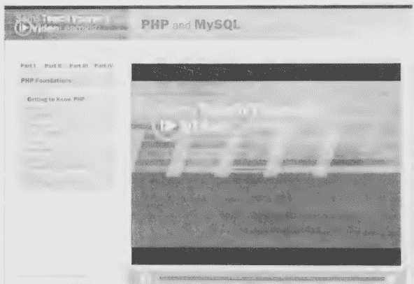

图1.1 DVD的主界面。

3. 要观看视频，请从窗口左侧的课程列表中（图1.1）选择要开始的课程，然后单击右侧播放器窗口中的播放按钮。
4. 要设置学习环境软件，请单击窗口左下角的“安装软件和支持”链接。

## 如何使用学习实验室并参加测验

每个视频结束后，您可以选择完成学习实验室练习并参加一个简短的（不太难）测验，以帮助评估您在该课中学到的内容。

本课程中的学习实验室练习要求您在Web托管服务或自己的计算机上设置Web服务器学习环境（有关详细安装说明，请参阅下一部分）。

设置好学习环境后，每个练习的说明将一步步引导您完成整个过程。

通常建议您花时间输入每个练习所需的代码——人们普遍认为，亲自输入代码有助于您更熟悉代码结构和用法的细节。但是，如果您打字技术很差，或者想稍微加快速度，练习的完整代码位于浏览器窗口的第二个选项卡中，准备剪切并粘贴到您的代码编辑器中。

练习后的测验相对简短且轻松。做出选择后，程序会立即告诉您是正确还是错误。您的答案不会被存储或编译，因此您可以随时参加测验，猜测也不会被扣分。

### 设置您的学习环境

如上所述，要完成课程中的练习，您需要能够访问运行在家庭电脑或Web托管服务上的Web服务器环境，其中您可以访问PHP脚本语言，并可以创建和管理MySQL数据库。


许多网络托管服务为需要的客户提供 PHP 和 MySQL 访问权限。如果您对此不确定，请向您的服务商询问是否提供 PHP 和 MySQL，以及如果提供，如何在您的服务上使用它们。

不过，由于您目前只是尝试简单的练习，暂时可能不会将您的工作发布到整个互联网，因此为您的学习环境提供更好的解决方案可能是使用本软件包中的 DVD 在计算机上安装所需的软件。为此您甚至不需要连接到互联网。

由于 Windows PC 和 Mac 的说明略有不同，我们分别在两个独立的章节中包含了快速的逐步说明，一个适用于 Windows，另一个适用于 Mac OS X。只需选择适合您的即可。

注意：以下安装指南旨在帮助您尽可能快速高效地启动并运行，使用随 DVD 提供的软件。

如果在过程中遇到困难，或者您想从互联网下载 PHP、MySQL 或 Apache 的最新版本，更详细的说明（包含扩展的解释和故障排除信息）可在紧随本章之后的章节中找到。

## 在 Windows 上安装 PHP、MySQL 和 Apache

DVD 中包含的设置文件适用于 Windows XP、2003 和 Vista。不支持更早版本的 Windows。

要启动软件安装程序（图 1.10），请双击 DVD 主文件夹中的“Software”图标或文件。

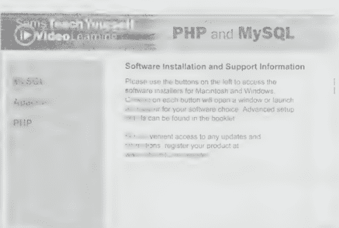

图 1.2 Windows DVD 安装菜单。

### 安装 MySQL

单击菜单中的按钮开始安装 MySQL 5.0。在图 1.3 所示的屏幕上，单击 Next 按钮继续。

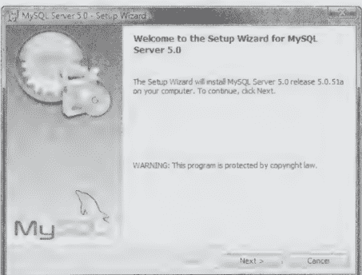

图 1.3 在 Windows 上开始 MySQL 安装。

接下来的几个屏幕将包含有关安装和 MySQL 许可证的一般信息。阅读这些屏幕并单击 Continue 按钮继续。您将遇到的第一个重要选择是安装类型——典型、紧凑或自定义，如图 1.4 所示。典型安装即可满足要求，因此保持默认选项并单击 Next 按钮继续安装。

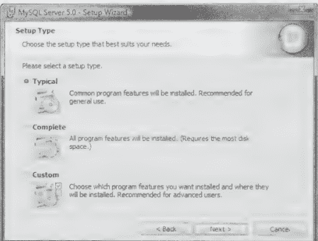

图 1.4 MySQL 安装类型选择。

安装完成后，继续使用 MySQL 配置向导创建符合您特定需求的自定义 my.ini 文件。要继续使用 MySQL 配置向导，请选中 Configure MySQL Server Now 复选框并单击 Finish 按钮，如图 1.5 所示。

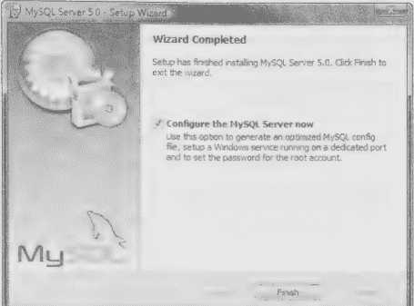

图 1.5 MySQL 已安装；现在继续使用 MySQL 配置向导。

在 MySQL 配置向导的几个屏幕上选择适当的配置选项；有关这些选项的详细说明，请参阅 DVD 上 PDF 格式的扩展安装和配置说明。完成配置后（其中包括为 root 用户添加密码），向导将启动 MySQL 服务。

### 安装 Apache

单击 Windows DVD 安装菜单中的按钮开始安装 Apache 2.2。在图 1.6 所示的屏幕上，单击 Next 按钮继续。

您必须在下一个屏幕上接受许可条款才能继续安装操作，之后将看到一些发行说明。阅读注释后单击 Next 按钮，您将看到输入服务器信息的请求，如图 1.7 所示。

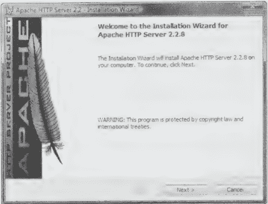

图 1.6 在 Windows 上开始 Apache 安装。

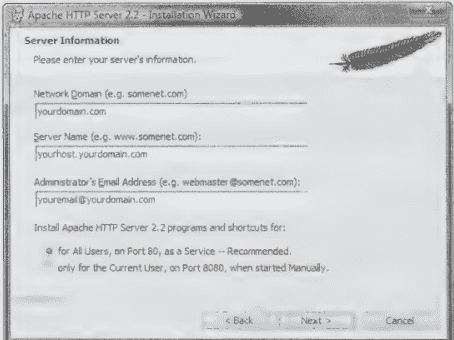

图 1.7 输入您的 Apache 服务器详细信息。

输入您的服务器域名和主机名，以及您的电子邮件地址。如果您在个人工作站上安装，请使用 localhost 和 localdomain 作为服务器信息。保持 Recommended 选项的单选按钮被选中，以便在端口 80 上安装 Apache。

下一个屏幕要求您选择设置类型，可以是典型或自定义。典型设置就足够了，因此保持该选项的单选按钮被选中并单击 Next 继续。

然后您可以选择 Apache 文件的目标文件夹。默认情况下，这是 C:\Program Files\Apache Software Foundation\Apache 2.2\ — 此位置不应该给您带来任何问题。如果您想更改它，请在单击 Next 按钮之前单击 Change 按钮。

最后，Apache 准备好安装。单击 Install 按钮开始将文件复制到您的系统并进行设置。

安装操作完成后，Apache 服务器和监控程序将启动，您将在系统托盘中看到一个新图标。

您可以通过打开 Web 浏览器并访问 http://localhost/ 来验证 Apache 是否已成功启动。将显示默认 Apache 页面，如图 1.8 所示。


图 1.8 Apache 默认安装页面。

您可以从 Apache 服务监视器或 Windows 服务管理器中停止或重新启动 Web 服务器。

### 安装 PHP

在 Windows DVD 安装菜单中单击选项以安装 PHP 5.2；将打开一个 zip 压缩包，如图 1.9 所示。

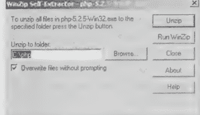

图 1.9 在 Windows 上开始 PHP 安装。

将 zip 压缩包的内容提取到 C:\php。提取操作完成后关闭此窗口。

PHP 安装过程需要手动干预以将 PHP 模块添加到 Apache。使用文件资源管理器，打开 Apache 配置目录——如果您使用了默认位置，则为 C:\Program Files\Apache Software Foundation\Apache 2.2\conf——并编辑 httpd.conf。查找包含多个 LoadModule 指令的部分，其中一些以 # 符号开头。此部分的最后几行看起来将如下：

```
LoadModule userdir_module modules/mod_userdir.so
#LoadModule usertrack_module modules/mod_usertrack.so
#LoadModule vhost_alias_module modules/mod_vhost_alias.so
#LoadModule ssl_module modules/mod_ssl.so
```

将以下行添加到 LoadModule 部分，以告诉 Apache 在启动时加载 PHP 模块：

```
LoadModule php5_module c:/php/php5apache2_2.dll
```

此外，添加以下行以确保 Apache 知道 php.ini 的位置：

```
PHPIniDir "C:/php/"
```

接下来，查找 AddType 部分，指令如下所示：

```
AddType application/x-tar .tgz
AddType image/x-icon .ico
```

添加以下行以告诉 Apache 将任何以 .php 或 .html 结尾的文件作为 PHP 脚本处理。如果您愿意，可以在此行中添加更多文件扩展名，用空格分隔：

```
AddType application/x-httpd-php .php .html
```

我们还需要提供一个 php.ini 的版本。为此，首先将 PHP 目录添加到 Windows PATH。（这涉及在 Windows 系统属性中编辑系统环境变量，以便将 C:\php 作为 Path 变量的一个值包含在内。如果您不熟悉执行此操作的过程，请尝试进行 Web 搜索，或在 Windows 帮助中查找以下短语："Add or change the values of environment variables"）。

接下来，在 PHP 安装目录中，将 php.ini-recommended 文件复制到 php.ini。做出这些更改后，您必须重新启动 Apache 服务器—使用 Apache 服务监视器或 Windows 服务管理器。

如果在启动 Apache 时遇到问题，请从控制面板，然后是管理工具中检查系统事件日志以找到错误消息。

现在我们准备检查 PHP 是否正常工作。在 Apache 目录的 htdocs 目录中，创建一个名为 phpinfo.php 的文件，包含以下行：

```
<?php
phpinfo();
?>
```

在您的 Web 浏览器中，访问 http://localhost/phpinfo.php，您应该会看到一个包含大量 PHP 配置信息的页面。

> **注意:** 如果在本过程的任何步骤中遇到困难，需要更详细的说明，并查看扩展的解释和故障排除信息，请参见第 2、3 和 4 章。

## 在 Mac OS X 上安装 PHP、MySQL 和 Apache

DVD 中包含的设置文件适用于 Mac OS X 10.3 或更高版本。请注意，Apache 已预安装，因此此处未包含安装信息。

要启动软件安装程序（图 1.10），请双击 DVD 主文件夹中的 "Software" 图标或文件。


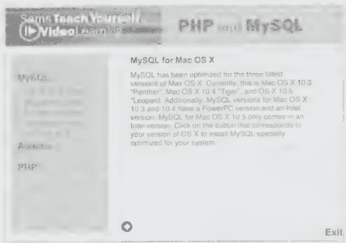

图 1.10 Mac OS X DVD 安装菜单。

### 安装 MySQL

单击 Mac OS X DVD 安装菜单中的按钮，开始安装 MySQL 5.0。在图 1.11 所示的屏幕上，单击“继续”按钮。

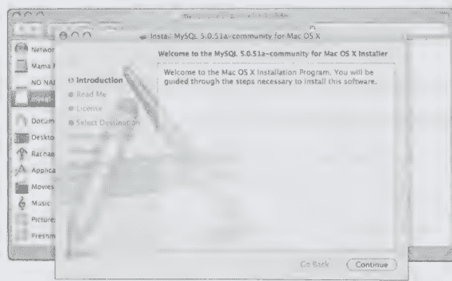

图 1.11 在 Mac 上开始 MySQL 安装操作。

单击“继续”按钮进入下一步，该步骤包含有关安装的信息。单击“继续”按钮进入下一步，该步骤包含许可证信息。单击“继续”按钮进入下一步，该步骤用于选择目标位置。选择相应的驱动器，如图 1.12 所示，然后单击“继续”按钮继续。

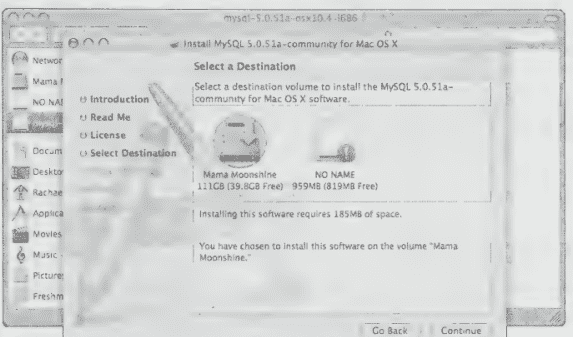

图 1.12 选择 MySQL 目标位置。

下一屏幕将验证您的安装位置，并要求您单击“安装”按钮以继续。此时，系统会提示您输入管理员用户名和密码（除非您以 root 身份安装），然后安装过程才会继续。继续后，让进程运行完成，直到您看到安装已完成，如图 1.13 所示。

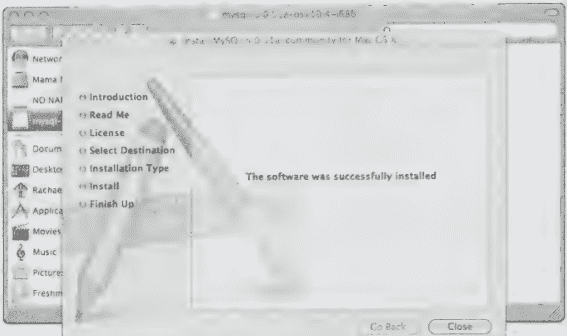

图 1.13 MySQL 已安装。

### 安装 PHP

单击 Mac OS X DVD 安装菜单中的选项以安装 PHP；将打开一个安装程序包，如图 1.14 所示。

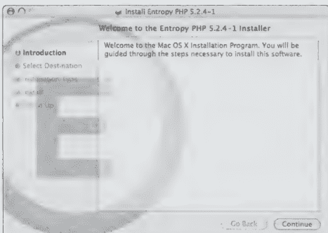

图 1.14 在 Mac OS X 上开始安装 PHP。

单击“继续”进入下一步，该步骤要求您选择目标位置。选择相应的驱动器，如图 1.15 所示，然后单击“继续”按钮继续。

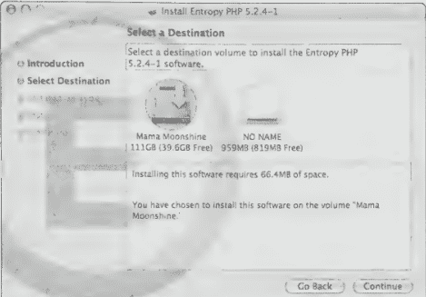

图 1.15 选择 PHP 目标位置。

下一屏幕将验证您的安装位置，并要求您单击“安装”按钮以继续。此时，系统会提示您输入管理员用户名和密码（除非您以 root 身份安装），然后安装过程才会继续。继续后，让进程运行完成，直到您看到安装已完成，如图 1.16 所示。

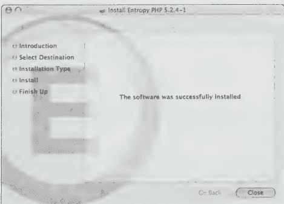

图 1.16 PHP 已安装。

要测试 PHP 是否已成为 Web 服务器的一部分，请创建一个名为 phpinfo.php 的简单脚本，内容如下：

```
<?php
phpinfo();
?>
```

将此文件放在 Web 服务器文档根目录 /Library/WebServer/Documents 中。在 Web 浏览器中，访问新服务器上的 http://localhost/phpinfo.php，您应该会看到一个提供大量 PHP 配置信息的页面。

### 故障排除

这些快速入门指南中的所有步骤均已在本软件包随附 DVD 上提供的软件版本上进行过测试。

如果遇到安装问题，首先检查是否严格按照此处给出的步骤操作，然后尝试紧随本章后面章节中提供的扩展安装和故障排除信息。这些章节提供故障排除提示和指向其他网站的链接，可帮助您解决安装问题。

## 安装和配置 MySQL

本章是三个与安装相关的章节中的第一个，您将在其中学习如何设置开发环境。我们将先处理 MySQL 安装，因为如果您打算将 MySQL 与 PHP 一起使用，构建 PHP 模块需要 MySQL 安装的某些部分先完成。

在本章中，您将学习：

- 如何安装 MySQL
- 运行 MySQL 的基本安全准则
- 如何使用 MySQL 用户权限系统

### MySQL 的当前版本和未来版本

本章中的安装说明引用的是 MySQL 5.0.51，这是该软件的当前生产版本。该版本号可读作“主要版本 5.0 软件的次要版本号 51”。MySQL AB（现已被 Sun Microsystems 收购）是负责创建和分发 MySQL 的公司；该公司使用次要版本号用于包含安全增强或错误修复的更新。次要版本不遵循固定的发布计划；当增强功能或修复程序添加到代码中并经过彻底测试后，MySQL AB 会发布带有新次要版本号的新版本。

有可能在您阅读本文时，次要版本号已更改为 5.0.52 或更高版本。如果是这种情况，您应该阅读 http://dev.mysql.com/doc/refman/5.0/en/news-5-0-x.html 上的列表，了解有关安装或配置过程（即本章的主要内容）的任何更改。

尽管次要版本更新之间不太可能更改任何安装说明，但您应养成始终检查所安装和维护的软件变更日志的习惯。如果发生次要版本更改，但变更日志未注明安装更改，只需在脑中记住，并在安装说明和随附图中出现的任何位置替换为新版本号即可。

> 注意：在打印本文时，MySQL 5.1 很可能已正式发布。虽然我们不涵盖 MySQL 5.1 的增强功能，但此处或视频课程中涵盖的任何内容均未因 MySQL 5.1 的发布而失效。换句话说，如果您选择安装 MySQL 5.1 而非 MySQL 5.0，您应该能够完成视频中的所有练习。有关 MySQL 5.0 和 MySQL 5.1 之间更改的信息，请参阅 http://dev.mysql.com/doc/refman/5.1/en/mysql-nutshell.html。

### 如何获取 MySQL

> 注意：Linux 发行版 CD 通常包含某种版本的开源 MySQL 软件，但这些版本通常比当前版本落后几个次要版本。

MySQL AB（开发和维护 MySQL 数据库服务器的公司）在其网站 http://www.mysql.com/ 上分发 MySQL。所有平台的二进制分发版、Mac OS X 的安装程序包以及 Linux/UNIX 平台的 RPM 和源代码文件均可在该网站上找到。

本章中的安装说明基于 MySQL AB 提供的官方 MySQL 5.0.x Community Server 分发版。所有文件均可从 http://dev.mysql.com/downloads/mysql/5.0.html 下载，撰写时的当前版本可在 DVD 上找到。

### 在 Mac OS X 上安装 MySQL

Mac OS X 上的 MySQL 安装过程相当简单——MySQL AB 的开发人员为 Mac OS X 创建了一个安装程序包。请访问 http://dev.mysql.com/downloads/mysql/5.0.html 上的 MySQL 下载页面，查找标题为“Mac OS X 下载（包格式）”的部分。从那里，下载适合您系统的适当标准版本；您选择的版本将取决于您的 Mac OS X 版本（10.3、10.4 或 10.5）和架构（PowerPC、PowerPC 64 位或 Intel x86）。

下载完成后，解压缩安装程序文件并双击 *.pkg 文件。按照以下安装步骤完成该过程：

1. MySQL 安装程序会自动启动，如图 2.1 所示。单击“继续”进入下一步。

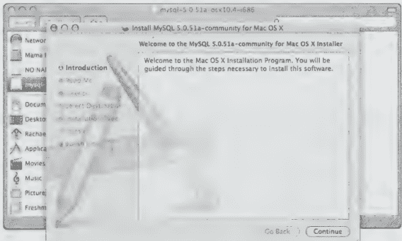

图 2.1 Mac 版 MySQL 安装程序已启动。

2. 接下来的几个屏幕包含有关安装和 MySQL 许可证的常规信息。阅读这些屏幕并单击“继续”以继续。

3. 浏览完信息和许可证屏幕后，必须选择安装目标位置。选择相应的驱动器，如图 2.2 所示，然后单击“继续”按钮。

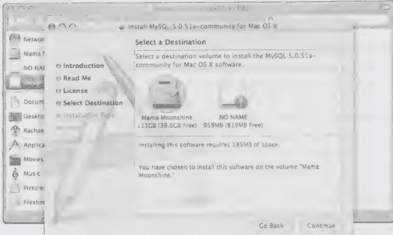

图 2.2 选择安装位置。

4. 下一个屏幕将验证您的安装位置选择，并要求您单击“安装”按钮以继续。此时，系统可能会提示您输入管理员用户名和密码，然后安装过程才会继续。继续后，让进程运行，直到您看到安装已完成，如图 2.3 所示。

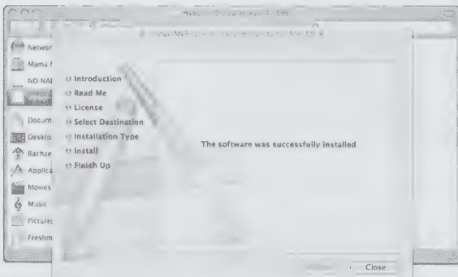

图 2.3 MySQL 已安装。


安装包中还包含 MySQL 启动项安装程序。如果要让 MySQL 在系统启动时自动启动，请安装这个附加包。MySQL 启动项的安装遵循刚才描述的标准安装方法——双击 *.pkg 文件，选择目标磁盘，并允许安装过程运行至完成。安装 MySQL 启动项后，在终端窗口中使用以下命令启动 MySQL：

```
#### sudo /Library/StartupItems/MySQLCOM/MySQLCOM start
```

系统可能会要求您输入帐户密码。启动 MySQL 后，按 Ctrl+D 退出 shell。启动 MySQL 后，您可以跳转到本章后面的“基本安全准则”部分。如果安装过程中出现任何问题，请查看“排查您的安装”部分。

### 在 Windows 上安装 MySQL

Windows 上的 MySQL 安装过程使用标准的 Microsoft Windows Installer (MSI) 文件，引导您在 Windows 2000、Windows XP、Windows Server 2003 或 Windows Vista 计算机上安装和配置 MySQL。转到 MySQL 下载页面 http://dev.mysql.com/downloads/mysql/5.0.html，查找标题为“Windows 下载”的部分。下载 Windows 基础文件，该文件应具有 .msi 文件扩展名。下载该文件后，双击它以开始安装过程。

以下步骤详细介绍了如何使用 MySQL AB 的 Windows 基础安装程序在 Windows 上安装 MySQL 5.0.20。无论您的 Windows 环境如何，安装顺序都遵循相同的步骤。

> 注意：Windows 用户还可使用另外两个安装包——Windows ZIP/Setup.EXE 和无安装程序选项。如果您想安装其中任何一个版本，而不是此处描述的 Windows 基础版本，请务必阅读 MySQL 手册 http://dev.mysql.com/doc/refman/5.0/en/windows-choosing-package.html 中的描述和说明。

直接进入安装顺序（假设您已从 MySQL AB 网站下载了 Windows 基础安装程序），请执行以下步骤：

- 1. 双击 *.msi 文件以开始安装顺序。您将看到 MySQL 安装向导的第一个屏幕，如图 2.4 所示。单击 Next 继续。

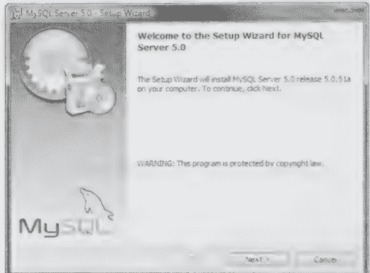

图 2.4 Windows 上的 MySQL 安装向导第一步。

- 2. 选择安装方式——典型、完整或自定义（参见图 2.5）。自定义选项允许您选择要安装的 MySQL 元素，而完整选项会安装 MySQL 的所有组件，这些组件范围从文档到基准测试套件。典型安装方式适用于大多数用户，因为它包含客户端、服务器以及用于常规管理 MySQL 安装的众多工具。选择典型作为安装方式，并单击 Next 继续。

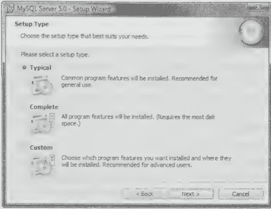

图 2.5 选择安装类型。

- 3. 在下一屏幕确认您的选择，并单击 Install 按钮继续。安装过程将接管并将文件安装到相应位置。

- 4. 安装完成后，您可以选择继续进行 MySQL 配置向导。强烈建议使用此向导，因为它将根据您的特定需求创建自定义的 my.ini 文件。要继续进行 MySQL 配置向导，请选中“立即配置 MySQL 服务器”复选框并单击 Finish 按钮，如图 2.6 所示。

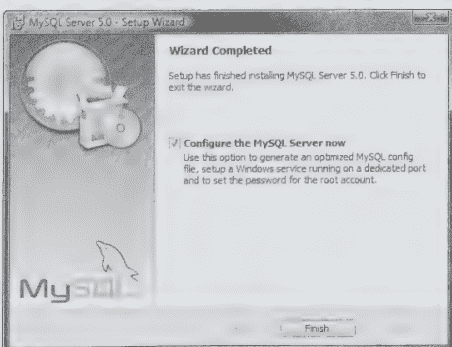

图 2.6 MySQL 已安装。现在继续进行 MySQL 配置向导。

- 5. 当您看到 MySQL 配置向导欢迎屏幕时，单击 Next 按钮进入向导的下一步。您将看到两个服务器配置选项：详细和标准。我们将使用详细配置选项，以便您可以查看所有可用选项。如果您决定选择标准配置选项，则需要手动修改生成的 my.ini 文件以实现所需的配置。选择详细配置单选按钮，然后单击 Next 继续。

- 6. 下一步需做的选择如图 2.7 所示。在此步骤中，您选择正在运行的机器类型：开发者计算机、服务器计算机或专用 MySQL 服务器计算机。您在此屏幕上的选择决定了内存、磁盘和处理器使用的分配。如果您在个人计算机上将 MySQL 用于测试目的，请选择开发者计算机选项。如果 MySQL 运行在带有其他服务器软件的计算机上，并且可以占用比在个人计算机上运行更多的系统资源，请选择服务器计算机选项。如果 MySQL 是计算机上运行的主要服务并且可以占用大部分系统资源，请选择专用 MySQL 服务器计算机选项。做出选择后，单击 Next 继续。

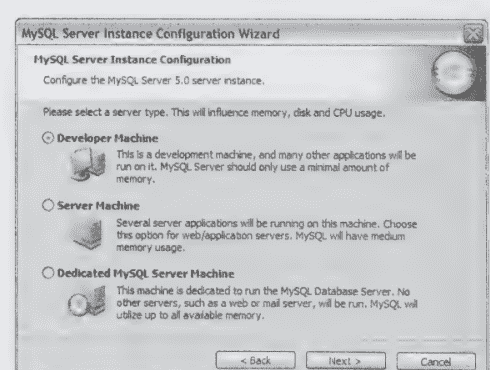

图 2.7 作为 MySQL 配置的一部分选择您的服务器类型。

- 7. 下一个配置选项涉及数据库用途。选项包括多功能数据库（同时支持 InnoDB 和 MyISAM 存储引擎，资源在两者之间均匀分配）；事务型数据库（同时启用 InnoDB 和 MyISAM，但将大部分服务器资源分配给 InnoDB）；以及仅非事务型数据库（禁用 InnoDB 并将所有资源应用于 MyISAM）。除非您确切知道数据库将用于什么，否则请选择多功能数据库单选按钮，并单击 Next 继续。

- 8. 如果您选择的数据库用途选项包含 InnoDB 存储引擎，则配置过程的下一步将允许您配置磁盘位置和存储阈值。默认值如图 2.8 所示，您可以单击 Next 继续以确认，也可以更改这些设置，然后单击 Next 继续使用您的自定义设置。

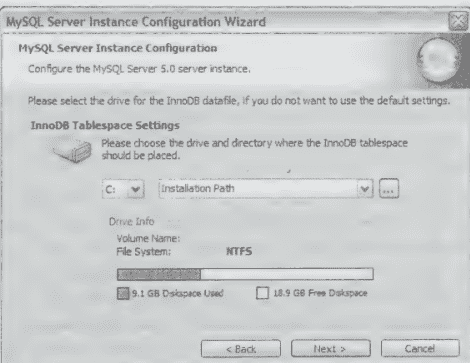

图 2.8 调整 InnoDB 存储引擎的磁盘使用选项。

- 9. 下一个配置选项确定到 MySQL 服务器的并发连接数。您的设置将取决于网站或应用程序的流量和数据库用途。默认设置是决策支持 (DSS)/OLAP，最大并发连接数为 100，平均假设为 20。在线事务处理 (OLTP) 选项最大并发连接数为 500，而手动设置允许您从下拉列表中选择或输入自己的值。做出选择并单击 Next 继续。

> 注意：请记住修改防火墙规则，以允许端口 3306 或您决定用于 MySQL 的任何端口上的流量。

- 10. 配置顺序中的下一屏幕是网络选项。在此屏幕中，您将启用或禁用 TCP/IP 网络，以及配置用于连接到 MySQL 的端口号——默认值为 3306，但您可以选择任何未使用的端口。此屏幕上的另一个选项是启用或禁用严格模式；除非您知道自己在更改什么，否则建议启用严格模式。有关更多信息，请参见 http://dev.mysql.com/doc/refman/5.0/en/server-sql-mode.html。做出选择并单击 Next 继续。

- 11. 在网络选项屏幕之后是字符集选项。默认选项是标准字符集，这将在整个数据库中使用 Latin1。您也可以选择最佳多语言支持选项，这将使用 UTF8 作为字符集；UTF8 允许您在单个字符集中存储多种语言。如果您想使用特定字符集，请选择手动选择默认字符集单选按钮，然后从下拉列表中选择适当的字符集。做出选择后，单击 Next 继续。

- 12. 建议将 MySQL 安装为服务，图 2.9 所示的配置屏幕演示了如何执行此操作。选中“以 Windows 服务安装”复选框并为服务选择一个名称。可选地，选中“自动启动 MySQL 服务器”复选框。您还可以选择将 MySQL bin 目录添加到 Windows PATH，以便从 cmd 提示符更轻松地调用 MySQL；如果适用，请选中该框。完成选择后，单击 Next 继续。


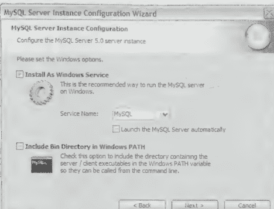

图 2.9 继续 MySQL 服务器实例配置。

- 13. 安全选项配置屏幕是所有屏幕中最重要的一个。如图 2.10 所示，使用此配置屏幕设置 root 密码。输入两次密码以确认。除非你真的知道自己在做什么，否则不要勾选“从远程计算机启用 root 访问”复选框；通常，root 连接仅允许从 localhost 进行。此外，你可以创建一个匿名账户，但出于安全考虑，不建议这样做。完成此屏幕上的配置选项后，单击“下一步”继续。

- 14. 配置序列还剩一步，即单击“执行”按钮以启动过程。向导完成各种配置步骤后，你将看到如图 2.11 所示的确认屏幕，指示配置文件已创建且 MySQL 服务已启动。单击“完成”关闭向导。

> 注意：你可以使用任何文本编辑器手动编辑 my.ini 文件。更改后，必须重新启动 MySQL 服务器。

安装和配置向导完成后，会得到一个正在运行的 MySQL 服务以及位于 C:\\Program Files\\MySQL\\MySQL Server 5.0 目录中的自定义 my.ini 文件。

既然 MySQL 已经启动，请跳转到本章稍后的“基本安全准则”部分。如果安装过程中遇到任何问题，请查看“排查安装问题”部分。

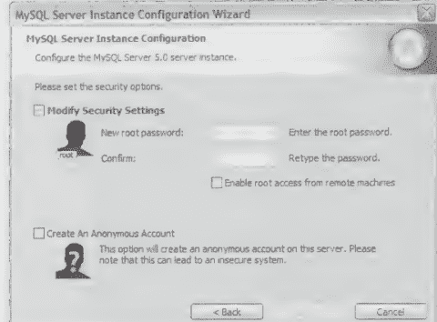

图 2.10 在 MySQL 配置期间为 root 创建密码。

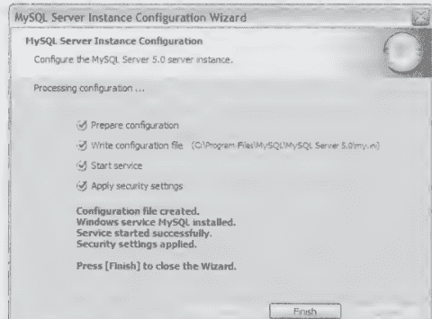

图 2.11 MySQL 配置向导完成其任务。

### 排查安装问题

如果在安装 MySQL 期间遇到任何问题，首先应该查看 MySQL 手册中附录 A“问题和常见错误”，该手册位于 http://dev.mysql.com/doc/refman/5.0/en/problems.html。

以下是几种常见的安装问题：

- 在 Linux/UNIX 和 Mac OS X 上，权限不正确将不允许启动 MySQL 守护进程。如果是这种情况，请确保已将所有者和组更改为与安装说明中指示的内容相匹配。

- 如果连接到 MySQL 时显示“访问拒绝”消息，请确保使用正确的用户名和密码。

- 如果显示“无法连接到服务器”消息，请确保 MySQL 守护进程正在运行。

如果阅读 MySQL 手册中的附录 A 后仍有问题，向 MySQL 邮件列表发送电子邮件（有关详细信息，请参阅 http://lists.mysql.com/）可能会产生效果。你也可以从 MySQL AB 购买支持合同。

### 基本安全准则

无论你是在 Windows、Linux/UNIX 还是 Mac OS X 上运行 MySQL，以及你是管理自己的服务器还是使用互联网服务提供商提供的系统，都必须了解基本安全准则。如果通过互联网服务提供商访问 MySQL，作为非 root 用户，服务器安全的几个方面你不应该能够修改或规避。不幸的是，许多互联网服务提供商对安全准则毫不在意，使其客户暴露在风险中——并且大多未意识到风险。

### 启动 MySQL

保护 MySQL 从服务器启动程序开始。如果你不是服务器的管理员，将无法更改此设置，但当然可以检查并向互联网服务提供商报告漏洞。

如果你的 MySQL 安装在 Linux/UNIX 或 Mac OS X 上，你的主要关注点应该是 MySQL 守护进程的所有者——它不应该是 root。以非 root 用户（如 mysql 或 database）运行守护进程，可以限制恶意个人访问服务器并覆盖文件的能力。

> 注意：你可以在 Linux/UNIX 或 Mac OS X 系统上使用 ps（进程状态）命令验证进程的所有者。

如果发现系统上 MySQL 以 root 身份运行，请立即联系互联网服务提供商并投诉。如果你是服务器管理员，应该以非 root 用户启动 MySQL 进程，或在启动命令行中指定首选用户名：

```
mysqld --user=non_root_user_name
```

例如，如果你想以用户 mysql 运行 MySQL，请使用此命令：

```
mysqld --user=mysql
```

但是，启动 MySQL 的推荐方法是通过 MySQL 安装目录 bin 目录中的 mysqld_safe 启动脚本：

```
#### bin/mysqld_safe --user=mysql &
```

### 保护 MySQL 连接

有多种不同的方式可以连接到 MySQL 监视器或其他 MySQL 应用程序，每种方式都有其自身的安全风险。如果你的 MySQL 安装在自己的工作站上，相比于必须使用网络连接才能访问其服务器的用户，你需要担心的更少。

如果 MySQL 安装在你的工作站上，最大的安全顾虑是让你的工作站在 MySQL 监视器或 MySQL GUI 管理工具正在运行的情况下无人看管。在这种情况下，任何人都可以走过来删除数据、插入虚假数据或关闭服务器。如果你必须在公共场所让工作站无人看管，请使用带密码的屏幕保护程序或锁定屏幕机制。

如果 MySQL 安装在你网络外部的服务器上，连接的安全性应引起一定关注。与通过互联网传输的任何数据一样，数据可能被截获。如果传输未加密，截获数据的人可以将其拼凑起来并使用这些信息。假设未加密的传输是你的 MySQL 登录信息——那么一个不法分子现在就可以冒充你的身份访问你的数据库。

防止这种情况发生的一种方法是通过安全连接连接到 MySQL。不要使用 Telnet 访问远程计算机，而应使用 SSH。SSH 的外观和操作与 Telnet 类似，但所有从远程计算机发送和接收的传输均已加密。同样，如果你使用基于 Web 的管理界面，例如强烈推荐的 phpMyAdmin（有关详细信息，请参阅 http://www.phpmyadmin.net/）或互联网服务提供商使用的其他工具，请通过安全 HTTP 连接访问该工具。

在下一节中，你将了解 MySQL 权限系统，该系统有助于进一步保护你的数据库。

### 介绍 MySQL 权限系统

MySQL 权限系统始终处于启用状态。第一次尝试连接以及后续的每个操作中，MySQL 都会检查以下三件事：

- 你从哪里访问（你的主机）
- 你声称自己是谁（你的用户名和密码）
- 你被允许执行什么操作（你的命令权限）

所有这些信息都存储在名为 mysql 的数据库中，该数据库在安装 MySQL 时自动创建。mysql 数据库中有几个与权限相关的表：

- columns_priv—定义表中特定字段的用户权限
- db—定义服务器上所有数据库的权限
- host—定义可以连接到特定数据库的可接受主机
- procs_priv—定义存储例程的用户权限
- tables_priv—定义数据库中特定表的用户权限
- user—定义特定用户的命令权限

本章稍后在向 MySQL 添加一些示例用户时，这些表将变得更加重要。目前，只需记住这些表存在，并且用户要完成操作，这些表中必须包含相关数据。

### 两步身份验证过程

如你所学，MySQL 在身份验证过程中检查三件事。与这些事项相关的操作分两步执行：

- 1. MySQL 查看你正在从中连接的主机以及你使用的用户名和密码组合。如果你的主机被允许连接，你的密码与用户名正确，并且用户名与分配给主机的用户名匹配，MySQL 将进入第二步。
- 2. 对于你尝试使用的任何 SQL 命令，MySQL 验证你是否有权针对该数据库、表和字段执行该操作。

如果步骤 1 失败，你将看到关于此问题的错误，并且无法继续进行步骤 2。例如，假设你使用用户名 joe 和密码 abc123 连接到 MySQL，并想要访问名为 myDB 的数据库。如果出于以下任何原因，这些连接变量中的任何一个不正确，你都将收到一条错误消息：

- 你的密码不正确。
- 用户名 joe 不存在。
- 用户 joe 无法从 localhost 连接。
- 用户 joe 可以从 localhost 连接，但无法使用 myDB 数据库。

你可能会看到类似以下的错误：

```
#### mysql -h localhost -u joe -pabc123 test
Error 1045: Access denied for user: 'joe@localhost' (Using password: YES)
```

如果允许拥有密码 abc123 的用户 joe 从 localhost 连接到 myDB 数据库，MySQL 将在过程的步骤 2 中检查 joe 可以执行的操作。就我们的目的而言，假设 joe


被允许选择数据但不允许插入数据。事件和错误的顺序如下所示：

```
#### mysql -h localhost -u joe -pabc123 test
Reading table information for completion of table and column
names
You can turn off this feature to get a quicker startup with -A

Welcome to the MySQL monitor.  Commands end with ; or \\g.
Your MySQL connection id is 12 to server version: 5.0.20-log
Type 'help;' or '\\h' for help. Type '\\c' to clear the buffer.

mysql> SELECT * FROM test_table;
| id | test_field |
|----|------------|
| 1 | blah |
| 2 | blah blah |
2 rows in set (0.0 sec)

mysql> INSERT INTO test_table VALUES ('', 'my text');
Error 1044: Access denied for user: 'joe@localhost' (Using
password: YES)
```

基于操作的权限在具有多个管理层级的应用程序中很常见。例如，如果你创建了一个包含个人财务数据的应用程序，你可能只会向初级员工授予 SELECT 权限，而向具有安全许可的高级员工授予 INSERT 和 DELETE 权限。

### 使用用户权限

在大多数情况下，当你通过互联网服务提供商访问 MySQL 时，只能使用一个用户和一个数据库。默认情况下，该用户可以访问该数据库中的所有表，并被允许执行所有命令。在这种情况下，作为开发人员，你有责任通过编程来创建安全的应用程序。

但是，如果你是自己服务器的管理员，或者你的互联网服务提供商允许你添加任意数量的数据库和用户以及修改用户的访问权限，那么接下来的几个部分将指导你完成这些过程。

#### 添加用户

通过第三方应用程序管理服务器可能会提供一种使用向导式过程或图形界面添加用户的简单方法。但是，通过 MySQL 监视器添加用户并不困难，尤其是当你了解刚才学到的 MySQL 使用的安全检查点时。

添加新用户最简单的方法是使用 GRANT 命令。以 root 用户身份连接到 MySQL，你可以发出一条命令来设置新用户。另一种方法是向 mysql 数据库中所有相关表发出 INSERT 语句，这要求你了解用于存储权限的表中的所有字段。这种方法同样有效，但比简单的 GRANT 命令更复杂。GRANT 命令的简单语法如下所示：

```
GRANT privileges
ON databasename.tablename
TO username@host
IDENTIFIED BY "password";
```

以下是可授予的一些常见权限。要查看完整列表，请参阅 MySQL 手册中 http://dev.mysql.com/doc/refman/5.0/en/grant.html 处的 GRANT 条目。

- ALL—向用户授予所有常见权限
- ALTER—用户可以修改表、列和索引
- CREATE—用户可以创建数据库和表
- DELETE—用户可以从表中删除记录
- DROP—用户可以删除（丢弃）表和数据库
- FILE—用户可以读取和写入文件；此权限用于导入或导出数据
- INDEX—用户可以添加或删除索引
- INSERT—用户可以向表中插入记录
- PROCESS—用户可以查看和停止系统进程；只有受信任的用户才能执行此操作
- RELOAD—用户可以执行 FLUSH 语句；只有受信任的用户才能执行此操作
- SELECT—用户可以从表中查询记录
- SHUTDOWN—用户可以关闭 MySQL 服务器；只有受信任的用户才能执行此操作
- UPDATE—用户可以更新（修改）表中的记录

例如，如果你想创建一个名为 john、密码为 99hjcl5 的用户，并授予其对名为 myDb 的数据库中所有表的 SELECT 和 INSERT 权限，并且希望该用户能够从任何主机连接，请使用此命令：

```
GRANT SELECT, INSERT
ON myDB.*
TO john@"%"
IDENTIFIED BY "99hjcl5";
```

请注意使用了两个通配符：* 和 %。这些通配符替换值。在此示例中，* 替换整个表列表，% 替换已知世界中所有主机的列表——这确实是一个非常长的列表。

下面是使用 GRANT 命令添加用户的另一个示例，这次是添加一个名为 jane、密码为 45sdg11 的用户，并授予其对名为 myCompany 的数据库中名为 employees 的表的 ALL 权限。此新用户只能从特定主机连接：

```
GRANT ALL
ON myCompany.employees
TO jane@janescomputer.company.com
IDENTIFIED BY "45sdg11";
```

如果你知道 janescomputer.company.com 的 IP 地址为 63.124.45.2，则可以在命令的主机名部分替换该地址，如下所示：

```
GRANT ALL
ON myCompany.employees
TO jane@"63.124.45.2"
IDENTIFIED BY "45sdg11";
```

关于添加用户的一点说明：始终使用密码，并确保密码足够强！

如果使用 GRANT 命令添加用户，更改会立即生效。为确保这一点，你可以在 MySQL 监视器中发出 FLUSH PRIVILEGES 命令以重新加载权限表。

#### 删除权限

删除权限与添加权限一样简单；不使用 GRANT 命令，而是使用 REVOKE。REVOKE 命令语法如下所示：

```
REVOKE privileges
ON databasename.tablename
FROM username@hostname;
```

就像可以使用 INSERT 命令授予权限一样，你也可以通过发出 DELETE 命令来从 mysql 数据库的表中删除记录，从而撤销权限。但是，这要求你熟悉字段和表，使用 REVOKE 要简单和安全得多。

要撤销用户 john 在 myCompany 数据库中插入项的权限，你将发出此 REVOKE 语句：

```
REVOKE INSERT
ON myDB.*
FROM john@"%";
```

对权限表中数据的更改会立即生效，但为了让服务器知道你的更改，请在 MySQL 监视器中发出 FLUSH PRIVILEGES 命令。

## 安装和配置 Apache

在三个与安装相关的章节中的第二个章节中，你将安装 Apache Web 服务器并熟悉其主要组件，包括日志和配置文件。

### Apache 的当前和未来版本

当你访问位于 http://httpd.apache.org 的 Apache HTTPD 服务器网站时，你将看到关于 Apache 1.3.x、Apache 2.0.x 和 Apache 2.2.x 版本发布的公告。正如你从版本号所能想象的那样，Apache 1.3.x 是这三个版本中最古老的一个。Apache 软件基金会维护所有三个版本，但 Apache 2.2.x 的功能包括对过滤、缓存、负载平衡和其他系统函数的更大支持；它是本章中使用的版本。但是，如果你选择安装 Apache 2.0.x 甚至 Apache 1.3.x，本工具包中的所有 PHP 和 MySQL 代码仍将如描述般工作。事实上，你会发现相当多的托管提供商仍在使用 Apache 1.3.x 版本的服务器，还有其他提供商托管 Apache 2.0.x 版本。如果你在按照本章描述安装 Apache 2.2.x 时遇到问题，请尝试之前的版本（例如，Apache 2.0.x）；安装说明非常相似。本章中的安装说明是指 Apache HTTPD 服务器版本 2.2.8，这是撰写本书时可用的最佳版本。

Apache 软件基金会使用次要版本号用于包含安全增强或错误修复的更新。次要版本不遵循固定的发布计划。当增强或修复添加到代码中并经过彻底测试后，Apache 软件基金会会发布带有新次要版本号的新版本。

有可能在你购买此工具包时，次要版本号已更改为 2.2.9 或更高版本。如果是这种情况，你应该阅读更改列表，该列表链接自位于 http://httpd.apache.org/download.cgi 的下载区域，以了解有关安装或配置过程的任何更改（这构成了本章的主体部分）。

虽然次要版本更新之间不太可能更改任何安装说明，但你应当养成始终检查所安装和维护的软件更改日志的习惯。如果在阅读本工具包期间确实发生了次要版本更改，但更改日志未注明安装更改，请在心中做个记录，并在安装说明及附带图中出现的地方替换为新版本号。

### 在 Mac OS X 上安装 Apache

幸运的是，Apache 已预装在 Mac OS X 上！默认情况下，Apache 服务器二进制文件位于 /usr/sbin/httpd。配置文件（例如 httpd.conf，即 Apache 的主配置文件）位于 /etc/httpd。因为 Apache 已准备就绪并完全支持使用 PHP，请跳转至“Apache 配置文件结构”部分，以了解有关 Apache 配置文件及其用法的更多信息。

### 在 Windows 上安装 Apache

Apache 2.2 可在大多数 Windows 平台上运行，并相对于适用于 Windows 的 Apache 2.0 和 Apache 1.3 版本提供了更高的性能和稳定性。你可以从源代码构建 Apache，但由于并非许多 Windows 用户都有编译器，本节将介绍 MSI 安装程序版本。


在安装 Apache 之前，您可能希望确保您的机器上当前没有运行 Web 服务器（例如，之前的 Apache 版本、Microsoft Internet Information Services 或 Microsoft Personal Web Server）。您可能需要卸载或以其他方式禁用现有服务器。您可以运行多个 Web 服务器，但它们必须使用不同的地址和端口组合。

在下载安装程序之前，花点时间——一个非常重要的时间——并在下载页面（位于 http://httpd.apache.org/download.cgi）上查找这样一段说明：“如果您正在下载 Win32 发行版，请阅读这些重要说明。”这些说明的直接 URL 是 http://www.apache.org/dist/httpd/binaries/win32/README.html。

Apache 软件基金会为希望运行 Apache 服务器版本的 Windows 用户维护了此页面。在此页面上，有针对目前仍在使用的几乎每个 Windows 版本的说明，阅读所提供的信息符合您的最佳利益。我向您保证，如果您将 Apache 用作生产服务器或开发服务器，您将在说明页面上找到相关信息。

准备好开始安装时，请查找标记为 Win32 Binary (MSI Installer) 的链接。下载安装程序后，双击文件以启动安装过程。您将看到欢迎屏幕，如图 3.1 所示。

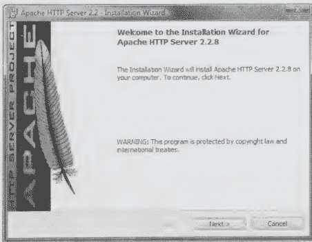

图 3.1 Windows 安装程序欢迎屏幕。

单击 Next 继续安装过程，系统将提示您接受 Apache 许可证。基本上，许可证规定您可以随意使用该软件——包括进行专有修改——但不能声称是您编写的，但请务必阅读许可证，以便充分理解条款。

接受许可证后，安装程序将向您简要介绍 Apache。随后，它会要求您提供有关计算机的基本信息，如图 3.2 所示。这包括服务器的完整网络地址（例如，mycomputer.mydomain.com）和管理员电子邮件地址。服务器名称是客户端用于访问您的服务器的名称，管理员电子邮件地址会添加到错误消息中，以便访问者在出现问题时知道如何联系您。

注意：如果您的计算机没有完整的网络地址，请使用 localhost 或 127.0.0.1 作为服务器名称。

在此屏幕上，您还将被提示选择应安装哪些安装快捷方式——是将 Apache 作为服务启动的快捷方式，还是手动启动 Apache 的快捷方式。将 Apache 安装为服务会导致其在每次 Windows 启动时运行，您可以通过标准 Windows 服务管理工具对其进行控制。为当前用户安装 Apache 要求您手动启动 Apache，并将 Apache 监听请求的默认端口设置为 8080（而不是 80）。选择适当的单选按钮并单击 Next 以继续。

下一屏幕允许您选择安装类型：典型或自定义。典型安装意味着安装 Apache 二进制文件和文档，但不安装头文件和库。除非您计划编译自己的模块，否则这是最佳选择。

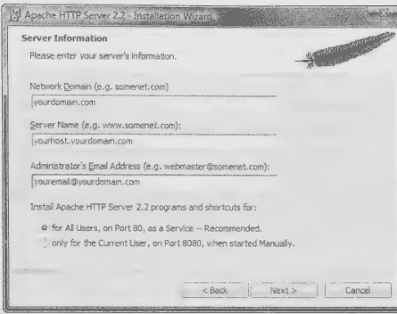

图 3.2 基本信息屏幕。

自定义安装使您可以选择是否安装头文件或文档。选择目标安装目录后（默认为 c:\Program Files\Apache Group），程序将继续安装过程。如果一切顺利，它将向您显示图 3.3 中所示的最终屏幕。

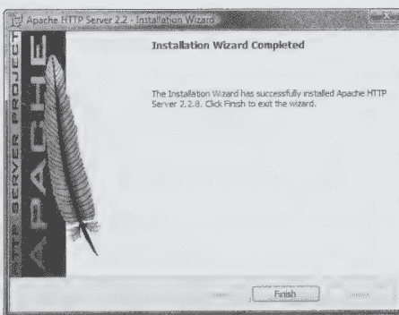

图 3.3 成功安装屏幕。

在下一节中，您将了解 Apache 配置文件并最终启动新服务器。

### Apache 配置文件结构

Apache 将所有配置信息保存在文本文件中。主文件是 `httpd.conf`。此文件包含指令和容器，使您可以自定义 Apache 安装。`Directives` 配置 Apache 的特定设置，例如授权、性能和网络参数。`Containers` 指定这些设置所引用的上下文。例如，授权配置可以引用整个服务器、某个目录或单个文件。

#### 指令

以下规则适用于 Apache 指令语法：

- 指令参数跟在指令名称之后。
- 指令参数由空格分隔。
- 参数的数量和类型因指令而异；有些指令没有参数。
- 指令占据单行，但可以通过在前一行末尾使用反斜杠字符 (`\`) 在另一行上继续。
- 井号 (#) 应位于指令之前，且必须独占一行。

Apache 服务器文档在 http://httpd.apache.org/docs/2.2/mod/quickreference.html 提供了指令的快速参考。您很快将了解一些基本指令，但应使用在线文档来补充您的知识。

Apache 指令文档通常遵循以下模型：

- **说明**—此条目提供指令的简要描述。
- **语法**—此条目解释指令选项的格式。必填参数以斜体显示，可选参数以斜体和括号显示。
- **默认值**—如果指令有默认值，它将出现在此处。
- 上下文—此条目详细说明指令可以出现在哪些容器或部分中。下一节将解释容器。可能的值为 server config、virtual host、directory 和 .htaccess。
- 覆盖—Apache 指令属于不同类别。覆盖字段指定哪些指令类别可以出现在 .htaccess 每目录配置文件中。
- 状态—此条目指示指令是内置于 Apache（core）中，属于捆绑模块之一（base 或 extension，具体取决于是否默认编译），是多处理模块（MPM）的一部分，还是与 Apache 捆绑但未准备好在生产服务器中使用（experimental）。
- 模块—此条目指示指令所属的模块。
- 兼容性—此条目包含关于哪些版本的 Apache 支持该指令的信息。

文档中对指令的进一步解释紧随这些条目之后，文末可能会出现对相关指令或文档的引用。

#### 容器

指令容器（也称为部分）限制指令适用的范围。如果指令不在容器内，则它们属于默认服务器范围（server config）并应用于整个服务器。

以下是默认的 Apache 指令容器：

- <VirtualHost>—VirtualHost 指令指定一个虚拟服务器。Apache 使您可以使用单个 Apache 安装托管不同的网站。此容器内的指令适用于特定网站。该指令接受域名或 IP 地址以及可选端口作为参数。
- <Directory>, <DirectoryMatch>—这些容器允许指令应用于文件系统中的某个目录或目录组。Directory 容器采用目录或目录模式参数。封闭的指令适用于指定的目录及其子目录。DirectoryMatch 容器允许将正则表达式模式指定为参数。例如，以下内容允许匹配 www 目录的所有二级子目录且由四个数字组成，例如以年份和月份命名的目录（0906 表示 2006 年 9 月）：
<DirectoryMatch "^/www.*/[0-9]{4}">

- <Location>, <LocationMatch>—这些容器允许指令应用于某些请求的 URL 或 URL 模式。它们与 Directory 类似。LocationMatch 将正则表达式作为参数。例如，以下内容匹配包含 "/my/data" 或 "/your/data" 的目录：
<LocationMatch "^/(my|your)/data">

- <Files>, <FilesMatch>—与 Directory 和 Location 容器类似，Files 部分允许指令应用于某些文件或文件模式。

容器包围指令，如清单 3.1 所示。

```
LISTING 3.1 Sample Container Directives
1: <Directory "/some/directory">
2:   SomeDirective1
3:   SomeDirective2
4: </Directory>
5: <Location "/downloads/*.html">
6:   SomeDirective3
7: </Location>
8: <Files "\.(gif|jpg)">
9:   SomeDirective4
10: </Files>
```

示例指令 SomeDirective1 和 SomeDirective2 适用于目录 /some/directory 及其子目录。SomeDirective3 适用于 /downloads/ URL 下具有 .html 扩展名的页面的 URL。SomeDirective4 将应用于所有具有 .gif 或 .jpg 扩展名的文件。

#### 条件求值

Apache 提供对条件容器的支持。仅在满足某些条件时，才会处理封装在这些容器中的指令。


<IfDefine>—如果向 Apache 可执行文件传递了特定的命令行开关，则此容器中的指令将被处理。Listing 3.2 中的指令仅在将 -DMyModule 开关传递给正在执行的 Apache 二进制文件时才会被处理。您可以直接传递，也可以通过修改 apachectl 脚本来传递，如本章后面“Apache 相关命令”部分所述。

IfDefine 容器还允许您否定参数。也就是说，<IfDefine !MyModule> 节内的指令——注意 MyModule 名称前的感叹号——仅在未将 -DMyModule 参数作为命令行参数传递时才会被处理。

<IfModule>—仅当作为参数传递的模块存在于 Web 服务器中时，IfModule 节中的指令才会被处理。例如，Apache 随附一个默认的 httpd.conf 配置文件，该文件为不同的 MPM 提供支持。仅会处理编译到 Apache 中的 MPM 所属的配置，如 Listing 3.3 所示。该示例的目的是说明仅评估一个指令组。

#### Listing 3.2 IfDefine 示例

```
1: <IfDefine MyModule>
2: LoadModule my_module modules/libmy_module.so
3: </IfDefine>
```

#### Listing 3.3 IfModule 示例

```
1: <IfModule prefork.c>
2: StartServers 5
3: MinSpareServers 5
4: MaxSpareServers 10
5: MaxClients 20
6: MaxRequestsPerChild 0
7: </IfModule>
8:
9: <IfModule worker.c>
10: StartServers 3
11: MaxClients 8
12: MinSpareThreads 5
13: MaxSpareThreads 10
14: ThreadsPerChild 25
15: MaxRequestsPerChild 0
16: </IfModule>
```

#### ServerRoot 指令

ServerRoot 指令接受一个参数：指向服务器所在目录的目录路径。其他指令中的所有相对路径引用均相对于 ServerRoot 的值。如果您在 Linux/UNIX 上从源代码编译了 Apache（如前面本章所述），则 ServerRoot 的默认值为 /usr/local/apache2。Mac OS X 用户的 ServerRoot 默认值为 /Library/WebServer。如果您使用了 Windows 安装程序，则 ServerRoot 为 C:\Program Files\Apache Software Foundation\Apache 2.2\。

#### 每目录配置文件

Apache 使用每目录配置文件，以允许指令存在于主配置文件 httpd.conf 之外。这些特殊文件可以放置在文件系统中。如果请求包含此类文件的目录或其任何子目录下的文档，Apache 将处理这些文件的内容。所有适用的每目录配置文件的内容都会被合并并处理。例如，如果 Apache 收到对 /usr/local/apache2/htdocs/index.html 文件的请求，它将按顺序在 /、/usr、/usr/local、/usr/local/apache2 和 /usr/local/apache2/htdocs 目录中查找每目录配置文件。

> 注意：启用每目录配置文件会带来性能损失。Apache 必须在每个请求中执行昂贵的磁盘操作来查找这些文件，即使这些文件不存在。

每目录配置文件默认名为 .htaccess。这是出于历史原因；它们最初保护包含 HTML 文件的目录的访问权限。

AccessFileName 指令允许您将每目录配置文件的名称从 .htaccess 更改为其他名称。它接受一个文件名列表，Apache 在查找每目录配置文件时将使用该列表。

要确定是否可以在每目录配置文件中覆盖指令，请检查包含 .htaccess 的指令语法定义中的 Context: 字段。Apache 指令属于不同的组，如指令语法描述中的 Override 字段所示。Override 字段的可能值如下：

- AuthConfig—控制授权的指令
- FileInfo—控制文档类型的指令
- Indexes—控制目录索引的指令
- Limit—控制主机访问的指令
- Options—控制特定目录功能的指令

您可以使用 AllowOverride 指令来控制哪些指令组可以出现在每目录配置文件中。AllowOverride 也可以接受 All 或 None 参数。All 表示属于所有组的指令都可以出现在配置文件中。None 禁用目录及其任何子目录中的每目录文件。Listing 3.4 显示如何为整个服务器禁用每目录配置文件。这可提高性能，也是 Apache 的默认配置。

#### Listing 3.4 禁用每目录配置文件

```
1: <Directory />
2: AllowOverride none
3: </Directory>
```

### Apache 日志文件

Apache 默认包含两个日志文件。access_log 文件用于跟踪客户端请求。error_log 文件用于记录重要事件，例如错误或服务器重启。这些文件在您首次启动 Apache 之前不存在。在 Windows 平台上，这些文件的名称为 access.log 和 error.log。

#### access_log 文件

当客户端从服务器请求文件时，Apache 会记录与请求关联的几个参数，包括客户端的 IP 地址、请求的文档、HTTP 状态码和当前时间。Listing 3.5 显示示例日志文件条目。

#### Listing 3.5 示例 access_log 条目

```
1: 127.0.0.1 - - [13/Apr/2008:08:33:25 -0700] "GET / HTTP/1.1"
200 44
2: 127.0.0.1 - - [13/Apr/2008:08:33:25 -0700] "GET /favicon.ico
HTTP/1.1" 404 209
```

#### error_log 文件

error_log 文件包括错误消息、启动消息以及服务器生命周期中的任何其他重要事件。当您遇到 Apache 问题时，这是首先要查看的位置。Listing 3.6 显示示例 error_log 条目。

#### Listing 3.6 示例 error_log 条目

```
1: Starting the Apache2.2 service [The Apache2.2 service is running.]
2: Apache/2.2.8 (Win32) configured -- resuming normal operations
3: [Sun Apr 13 08:29:34 2008] [notice] Server built: Jan 18 2008 00:37:19
4: [Sun Apr 13 08:29:34 2008] [notice] Parent: Created child process 3504
5: [Sun Apr 13 08:29:35 2008] [notice] Child 3504: Child process is running
6: [Sun Apr 13 08:29:35 2008] [notice] Child 3504: Acquired the start mutex.
```

### 其他文件

httpd.pid 文件包含正在运行的 Apache 服务器的进程 ID。您可以使用此编号手动向 Apache 发送信号，如下一节所述。记分板文件（在 Linux/UNIX Apache 上）由基于进程的 MPM 用于与其子进程通信。通常，您不需要担心这些文件。

### Apache 相关命令

Apache 发行版包含多个可执行文件。本节仅涵盖服务器二进制文件和相关脚本。

#### Apache 服务器二进制文件

Apache 可执行文件在 Linux/UNIX 和 Mac OS X 上名为 httpd，在 Windows 上名为 apache.exe。它接受多个命令行选项，其中一些在表 3.1 中有所描述。您可以通过在 Linux/UNIX 上输入 /usr/local/apache2/bin/httpd -h、在 Mac OS X 上输入 /usr/sbin/httpd -h，或在 Windows 命令提示符下输入 apache.exe -h 来获取完整的选项列表。

| 选项 | 含义 |
|---|---|
| -D | 允许您传递可用于 <IfDefine> 节处理的参数 |
| -l | 列出已编译的模块 |
| -v | 显示版本号和服务器编译时间 |
| -f | 如果 httpd.conf 的位置不同于编译时默认值，则允许您传递其位置 |

Apache 运行后，您可以在 Linux/UNIX 和 Mac OS X 上使用 kill 命令向父 Apache 进程发送信号。信号提供了一种向进程发送命令的机制。要发送信号，请执行以下命令：

```
##### kill -SIGNAL pid
```

在此语法中，pid 是进程 ID，SIGNAL 是以下之一：

- HUP—停止服务器
- USR1 或 WINCH—优雅重启；使用哪个信号取决于底层操作系统
- SIGHUP—重启

如果您对配置文件进行了一些更改并希望其生效，则必须向 Apache 发出信号，指示配置已更改。您可以通过停止并启动服务器或发送重启信号来完成此操作。这会告诉 Apache 重新读取其配置。

正常重启可能会导致服务短暂中断。优雅重启采用不同的方法：为客户端服务的每个线程或进程继续处理当前请求，但完成后，它会被终止并由带有新配置的新线程或进程替换。这使得 Web 服务器能够无缝运行，无需停机。

在 Windows 上，您可以使用 apache.exe 可执行文件向 Apache 发送信号。以下是一些命令：

- apache.exe -k restart—告诉 Apache 重启
- apache.exe -k graceful—告诉 Apache 执行优雅重启
- apache.exe -k stop—告诉 Apache 停止


可以通过 Apache 安装程序创建的“开始”菜单条目访问这些命令的快捷方式。如果将 Apache 安装为服务，可以使用 Windows 服务界面启动或停止 Apache：在控制面板中，选择“管理工具”，然后单击“服务”图标。

### Apache 控制脚本

尽管可以在 Linux/UNIX 上使用 httpd 二进制文件来控制 Apache，但建议使用 apachectl 工具。apachectl 支持程序将常见功能封装在易于使用的脚本中。要使用 apachectl，请键入以下内容：

```
#### /usr/local/apache2/bin/apachectl command
```

在此语法中，*command* 可以是 stop、start、restart 或 graceful。你也可以编辑 apachectl 脚本的内容以添加额外的命令行选项。某些操作系统发行版提供用于控制 Apache 的其他脚本；请查看随发行版提供的文档。

### 首次启动 Apache

在启动 Apache 之前，应验证 Apache 配置文件 `httpd.conf` 中是否存在所需的最小信息集。以下各部分介绍了配置 Apache 并启动服务器所需的基本信息。

### 检查配置文件

可以使用喜欢的文本编辑器编辑 Apache `httpd.conf` 文件。在 Linux/UNIX 和 Mac OS X 上，这可能指的是 `vi` 或 `emacs`。在 Windows 上，可以使用“记事本”或“写字板”。必须记住以纯文本格式保存配置文件，这是 Apache 唯一能理解的格式。

要首次启动 Apache，可能只需更改两个参数：服务器名称以及监听的地址和端口。服务器名称是 Apache 在需要引用自身时会使用的名称（例如，重定向请求时）。Apache 通常可以从计算机的 IP 地址推断出服务器名称，但并非总是如此。如果服务器没有有效的 DNS（域名服务）条目，可能需要指定计算机的某个 IP 地址。如果服务器未连接到网络（你可能希望在独立计算机上测试 Apache），可以使用值 127.0.0.1，即回环地址。默认端口值为 80。如果计算机上已在端口 80 运行服务器，或没有管理员权限，则可能需要更改此值——在 Linux/UNIX 和 Mac OS X 系统中，只有 root 用户可以绑定到特权端口（即端口号低于 1024 的端口）。

可以使用 Listen 指令更改监听地址和端口值。Listen 指令接受端口号，或 IP 地址和端口（两者之间用冒号分隔）。如果仅指定端口，Apache 将在计算机上所有可用 IP 地址的该端口上监听。如果提供其他 IP 地址，Apache 将仅监听该地址和端口组合。例如，Listen 80 告诉 Apache 在端口 80 上监听所有 IP 地址的请求。Listen 10.0.0.1:443 告诉 Apache 仅监听 10.0.0.1 的端口 443。

ServerName 指令允许你定义服务器在任何自引用 URL 中将报告的名称。该指令接受 DNS 名称和可选端口（两者之间用冒号分隔）。确保 ServerName 具有有效值。否则，服务器将无法正常工作；例如，它会发出错误的重定向。

在 Linux/UNIX 和 Mac OS X 平台上，可以使用 User 和 Group 指令来指定服务器以哪个用户 ID 和组 ID 运行。nobody 用户是大多数平台的不错选择。但是，HP-UX 平台上存在此用户 ID 的问题，因此必须创建并使用不同的用户 ID，例如 www。

### 启动 Apache

要在 Linux/UNIX 上启动 Apache，请切换到包含 apachectl 脚本的目录并执行以下命令：

```
#### /usr/local/apache2/bin/apachectl start
```

Mac OS X 用户可以在提示符下键入以下内容：

```
#### /usr/sbin/httpd
```

要在 Windows 上手动启动 Apache，请在“开始”菜单的“Apache HTTP Server 2.2”程序组的“控制 Apache 服务器”部分中，单击“控制台中启动 Apache”链接。如果将 Apache 安装为服务，则必须改为启动 Apache 服务。

如果一切正常，可以使用浏览器访问 Apache。将显示默认安装页面，如图 3.4 所示。如果无法启动 Web 服务器，或出现错误页面，请参阅以下的“疑难解答”部分。确保正在访问 Listen 指令中指定的端口之一——通常是端口 80 或 8080。


图 3.4 Apache 默认安装页面。

### 疑难解答

以下小节介绍首次启动 Apache 时可能遇到的几个常见问题。

#### 已存在的 Web 服务器

如果计算机上已有服务器在运行，并且正在监听相同的 IP 地址和端口组合，Apache 将无法成功启动。错误日志文件中会出现一条条目，指示 Apache 无法绑定到端口：

```
[crit] (48)Address already in use: make_sock: could not bind..[alert] no listening sockets available, shutting down
```

要解决此问题，需要停止运行中的服务器，或更改 Apache 配置以在不同端口上监听。

#### 没有绑定端口的权限

如果没有管理员权限且尝试绑定到特权端口（0 到 1024 之间），将收到错误：

```
[crit] (13)Permission denied: make_sock: could not bind to address 10.0.0.2:80 [alert] no listening sockets available, shutting down
```

要解决此问题，必须在启动 Apache 之前以管理员身份登录，或更改端口号（8080 是常用的非特权端口）。

#### 访问被拒绝

如果没有权限读取配置文件或写入日志文件，可能无法启动 Apache。将收到类似于以下的错误：

```
(13)Permission denied: httpd: could not open error log file
```

如果构建和安装 Apache 的用户与尝试运行它的用户不同，可能会出现此问题。

#### 组设置错误

可以配置 Apache 在特定用户名和组下运行。Apache 为运行服务器的用户名和组提供默认值。有时默认值无效，你会收到包含 setgid: unable to set group id 的错误。

要在 Linux/UNIX 和 Mac OS X 上解决此问题，必须将配置文件中 Group 指令的值更改为有效值。检查 /etc/groups 文件以查看现有组。

## 安装和配置 PHP

在三个与安装相关的章节的最后一章中，你将获取、安装和配置 PHP，并对 Apache 安装进行一些基本更改。

### PHP 的当前版本和未来版本

本章中的安装说明指的是 PHP 版本 5.2.5，这是该软件的当前版本。

> 注意：如果已在生产环境中使用 PHP 4.x.x，或希望继续使用 4.x.x 开发树，请访问 PHP 手册中的“安装和配置”部分：http://www.php.net/install。
> 
> 由于 PHP 5 已使用超过三年，且 PHP 6 可能会在 2009 年投入生产使用，PHP 4 的状态官方已为“生命周期结束”——这意味着 PHP 组自 2007 年 12 月 31 日以来未对 PHP 4 进行任何更新。有关更多信息，请访问：http://www.php.net/archive/2007.php#2007-07-13-1。
> 
> 本工具包中的代码假设使用 PHP 5 而不是 PHP 4；在某些情况下，两个版本之间的代码没有区别，但你应该熟悉两个版本之间的差异，以便做出相应调整。


PHP 组使用次要版本号用于包含安全增强或错误修复的更新。次要版本发布没有固定的发布计划；当增强功能或修复程序添加到代码中并经过彻底测试后，PHP 组会发布带有新次要版本号的新版本。

在您购买本书时，次要版本号可能已发生变化，达到 5.2.6 或更高。如果是这样，您应阅读 http://www.php.net/ChangeLog-5.php 中的更改列表，了解有关安装或配置过程（即本章主要内容）的任何变更。

尽管次要版本更新之间不太可能更改任何安装说明，但您应养成始终检查所安装和维护的软件的变更日志的习惯。如果在阅读本书时发生了次要版本变更，但变更日志未注明安装变更，只需在脑海中记住，并在安装说明及配套图中出现的位置替换为新版本号即可。

### 在 Mac OS X 上安装 PHP

在 Mac OS X 上将 PHP 与 Apache 一起安装有多种不同选项，包括如前一节所述从源代码构建。但最简单的方法是从预编译二进制包安装 PHP，例如此处列出的（参考 PHP 手册）：

- Entropy—http://www.entropy.ch/software/macosx/php/
- Fink—http://www.finkproject.org/
- MacPorts—http://www.macports.org/

> **注意**：如果您希望从源代码构建 PHP，并且熟悉 Mac OS X 操作系统和终端使用，可随时参考 PHP 手册中的说明，网址为 http://www.php.net/manual/en/install.macosx.php。

Entropy 和开发者 Marc Liyanage 的软件包功能完整、维护良好且文档齐全。

要获取 PHP 安装包，请访问 http://www.entropy.ch/software/macosx/php/ 并查找标题为“安装说明”的部分。到达该页面后，按照链接下载适用于您 Mac OS X 版本的 PHP 5。此 PHP 版本可能会比当前的 Linux/UNIX 构建文件或 Windows 安装程序落后几个版本。

下载完成后，挂载磁盘映像并双击 `*.pkg` 文件。执行以下安装步骤以完成过程：

- 1. PHP 安装程序会自动启动，如图 4.1 所示。单击“继续”进入下一步。

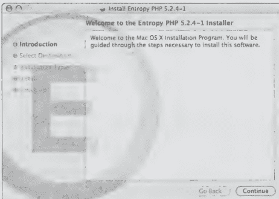

图 4.1 Mac PHP 安装程序已启动。

- 2. 下一屏幕要求您选择目标位置。选择驱动器，如图 4.2 所示，然后单击“继续”。

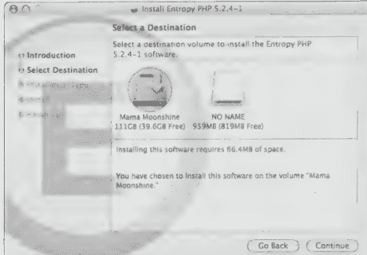

图 4.2 选择安装位置。

- 3. 系统将提示您输入管理用户名和密码，除非您以 root 身份进行安装。如果是，请输入这些值并单击“继续”按钮。

- 4. 安装过程将继续，安装 PHP 并优化系统。过程完成后，安装程序将显示完成消息，如图 4.3 所示。

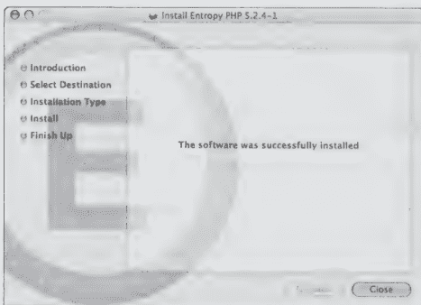

图 4.3 PHP 安装已完成！

PHP 安装程序已对您的 Apache 配置进行了所有必要更改，因此您无需做其他事情，只需跳至“测试您的安装”部分即可。

### 在 Windows 上安装 PHP

在 Windows 上安装 PHP 只需下载发行版文件即可。要下载 PHP 发行版文件，请访问 PHP 主页 http://www.php.net/，并按照链接进入下载部分。从 Windows 二进制文件部分获取 zip 包的最新版本（不是安装程序）— 在此示例中，我们使用 5.2.5。您的发行版名称将类似于 php-VERSION.zip，其中 VERSION 是最新的发布版本号。

> **注意**：您可能会问，“为什么不用安装程序？”答案很简单：在自动设置各种文件、扩展和配置时存在相当多的限制。这些限制会导致您花费更多精力去“修复”安装，而不是最初就手动安装。这种情况，加上作者认为如果您打算使用某项技术，就应该了解其工作原理，以及 PHP 组自身建议“使用安装程序不是安装 PHP 的首选方法”，共同促成了本章中您将看到的说明。

文件下载到您的系统后，双击它以启动解压缩软件。该发行版已使用相对路径打包，因此请将文件解压缩到名为 `C:\php\` 的新目录中，所有文件和子目录都将放置在该新目录下。

从此点开始，只需执行两个基本步骤：

- 1. 将您的 PHP 目录添加到 Windows PATH。如果您不知道如何操作，请参阅 PHP 手册中 http://www.php.net/manual/en/faq.installation.php#faq.installation.addtopath 的相应常见问题解答。
- 2. 在 PHP 安装目录中，将 php.ini-recommended 文件复制为 php.ini。要使 PHP 的基本版本与 Apache 配合工作，您需要对 Apache 配置文件进行一些小修改。

#### 将 PHP 与 Windows 上的 Apache 集成

要确保 PHP 和 Apache 能够协同工作，您需要向 httpd.conf 配置文件添加一些项目。首先，找到如下所示的部分：

```
##### Example:
##### LoadModule foo_module modules/mod_foo.so
#
LoadModule access_module modules/mod_access.so
...
#LoadModule ssl_module modules/mod_ssl.so
```

在本节末尾，添加以下内容：

```
LoadModule php5_module C:/php/php5apache2_2.dll
```

此外，添加以下内容以确保 Apache 知道 php.ini 的位置：

```
PHPIniDir "C:/php/"
```

接下来，查找以下部分：

```
#
##### AddType allows you to add to or override the MIME
##### configuration
##### file mime.types for specific file types.
#
```

> **注意：** 如果您在让 Apache 读取正确的 php.ini 文件时遇到困难，请查看 PHP 手册中的“运行时配置”条目，该条目提供了搜索 php.ini 的位置列表，网址为 http://www.php.net/manual/en/configuration.php。

添加以下行：

```
AddType application/x-httpd-php .php .html
```

此语句可确保 PHP 引擎解析以 .php 和 .html 扩展名结尾的文件。您的文件名选择可能不同。

保存 httpd.conf 文件，然后重启 Apache。服务器应无警告地启动；PHP 现在已成为 Apache Web 服务器的一部分。

### php.ini 基础知识

在编译或安装 PHP 后，您仍可通过 php.ini 文件更改其行为。在 Linux/UNIX 系统上，此文件的默认位置是 /usr/local/php/lib，或是配置时使用的 PHP 安装位置的 lib 子目录。在 Windows 系统上，此文件应位于 PHP 目录中，或 Apache httpd.conf 文件中 PHPIniDir 值所指定的其他目录中。

php.ini 文件中的指令有两种形式：值和标志。值指令采用指令名称和用等号分隔的值的形式。可能的值因指令而异。标志指令采用指令名称和用等号分隔的正面或负面术语的形式。正面术语包括 1、On、Yes 和 True。负面术语包括 0、Off、No 和 False。空格会被忽略。

您可以随时更改 php.ini 设置，但更改后，需要重启服务器才能使更改生效。找个时间自行通读 php.ini 文件，了解可以配置的内容类型。

### 测试您的安装

测试 PHP 安装的最简单方法是创建一个使用 phpinfo() 函数的小型测试脚本。该函数将生成一长串配置信息。打开文本编辑器，键入以下行：

```
<?php phpinfo(); ?>
```

将此文件另存为 phpinfo.php，并将其放置在 Web 服务器的文档根目录中—即您 Apache 安装的 htdocs 子目录或 Mac OS X 上的 /Library/WebServer/Documents 目录。使用 Web 浏览器访问此文件，您应该会看到类似图 4.4 所示的内容。


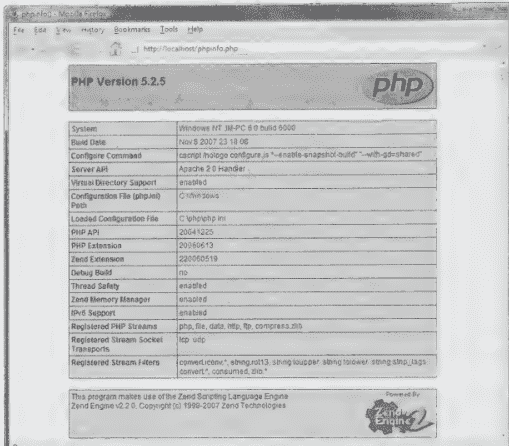

图 4.4 phpinfo() 的结果。

phpinfo() 的精确输出取决于您的操作系统、PHP 版本和配置选项。

### 获取安装帮助

互联网上随时可获得帮助，尤其是针对开源软件的问题。不过，在您单击发送按钮之前，请稍等片刻。无论您的安装、配置或编程问题看起来多么棘手，您很可能并非孤军奋战。很可能有人已经回答过您的问题了。

当您遇到障碍时，首选之路应该是访问官方 PHP 网站 http://www.php.net/（尤其是带注释的手册 http://www.php.net/manual/）。如果您仍然找不到答案，请不要忘记 PHP 网站支持搜索。您要找的建议可能隐藏在新闻稿或常见问题解答文件中。您还可以在 http://www.php.net/search.php 中搜索邮件列表存档。这些存档是一个巨大的信息资源，汇集了 PHP 社区中许多杰出人才的贡献。花些时间尝试几个关键字组合。

如果您仍然确信自己的问题尚未得到解决，那么公开该问题很可能是在为 PHP 社区提供服务。您可以加入 http://www.php.net/mailing-lists.php 上的 PHP 邮件列表。尽管这些列表的流量通常很大，但您可以从中学到很多。如果您认真对待 PHP 脚本编写，您绝对应该至少订阅一个摘要列表。订阅与您关注的问题相匹配的列表后，考虑发布您的问题。

在发布问题时，最好尽可能提供大量信息（但不要写成一部小说）。以下项目通常相关：

- 您的操作系统
- 您正在运行或安装的 PHP 版本
- 您选择的配置选项
- 在安装失败前出现的 configure 或 make 命令的任何输出
- 导致问题的代码的一个相当完整的示例

为什么要对向邮件列表发布问题有这么多谨慎之处？首先，培养研究技能将对您大有裨益。一名优秀的研究人员通常能快速而高效地解决问题。向技术列表发布一个幼稚的问题，通常只会等到一两条消息，这些消息会把您引导到存档中，而您本应从一开始就在存档中寻找答案。

其次，请记住，邮件列表不等同于技术支持呼叫中心。没有人会因回答您的问题而获得报酬。尽管如此，您可以接触到一个令人印象深刻的人才和知识库，其中包括 PHP 本身的一些创建者。一个好问题及其答案将被存档，以帮助其他程序员。询问一个已经回答过好几遍的问题，只会增加更多噪音。

话虽如此，不要害怕向列表发布问题。PHP 开发者是一个文明且乐于助人的群体，通过将问题提请社区关注，您可能正在帮助其他人解决相同的问题。

## PHP 脚本基础

**提示：** 查找 PHP 友好型编辑器的好网站位于 http://www.php-editors.com。

让我们直接上手一个 PHP 脚本。首先，打开您喜欢的文本编辑器。与 HTML 文档一样，PHP 文件由纯文本组成。您可以使用任何文本编辑器创建它们，大多数流行的 HTML 编辑器至少为 PHP 提供一些支持。

请键入清单 4.1 中的示例，并保存文件，文件名类似于 first.php。

```
LISTING 4.1 A Simple PHP Script
1: <?php
2:    echo "<h1>Hello Web!</h1>";
3: ?>
```

如果您不是直接在将提供 PHP 脚本的机器上工作，则需要使用 FTP 或 SCP 客户端将保存的文档上传到服务器。文档放置到位后，您应该能够使用浏览器访问它。如果一切顺利，您应该能看到脚本的输出。图 4.5 显示了 first.php 脚本的输出。


图 4.5 成功：first.php 的输出。

### 开始和结束 PHP 语句块

编写 PHP 时，您需要告知 PHP 引擎您希望它执行您的命令。如果不这样做，您编写的代码会被误认为是 HTML，并输出到浏览器。您可以使用标记代码块开始和结束的特殊标签，将代码指定为 PHP。表 4.1 显示了四种这样的 PHP 分隔标签。

| 标签样式 | 开始标签 | 结束标签 |
|---|---|---|
| 标准标签 | <?php | ?> |
| 短标签 | <? | ?> |
| ASP 标签 | <% | %> |
| 脚本标签 | <script language="php"> | </script> |

表 4.1 中的标签中，只有标准标签和脚本标签保证可以在任何配置下工作。您必须在 php.ini 文件中显式启用短标签和 ASP 样式标签。

要激活短标签的识别，您必须确保 php.ini 中的 short_open_tag 开关设置为 On：

```
Short_open_tag = On;
```

要激活 ASP 样式标签的识别，您必须在 php.ini 中启用 asp_tags 设置：

```
asp_tags = On;
```

编辑 php.ini 并重新启动 Apache 后，您应该能够在脚本中使用任何一种风格。这在很大程度上是个人偏好的问题，尽管如果您打算在脚本中包含 XML，则应禁用短标签（<? ?>）并使用标准标签（<?php ?>）。

让我们浏览一下编写清单 4.1 中代码的合法方式。鉴于前面所示的配置更改，您可以使用您见过的任何四个 PHP 开始和结束标签：

```
<?
Echo "Hello Web!";
?>
```

> **注意：** 为了确保代码的可移植性和可重用性，最好使用标准标签，而不是短标签或 ASP 样式标签，原因很简单：服务器配置各不相同——使用标准样式，因为您知道它是任何配置的一部分，可以指望它。

> **警告：** 字符序列 ?< 告诉 XML 解析器预期一条处理指令，因此经常出现在 XML 文档中。如果您在脚本中包含 XML 且已启用短标签，PHP 引擎可能会将 XML 处理指令和 PHP 开始标签混淆。如果您打算在文档中加入 XML，请禁用短标签。

```
<?php
echo "Hello Web!";
?>
```

```
<%
echo "Hello Web!";
%>
```

```
<script language="php">
echo "Hello Web!";
</script>
```

您也可以将 PHP 中的单行代码放在与 PHP 开始和结束标签相同的行上：

```
<? echo "Hello Web!"; ?> 。
```

现在您知道如何定义 PHP 代码块了，让我们更仔细地查看清单 4.1 本身的代码。

### echo 语句和 print() 函数

简单来说，您使用 echo 语句来输出数据。在大多数情况下，由 echo 输出的任何内容最终都会显示在浏览器中。或者，您可以使用 print() 函数来代替 echo 语句。使用 echo 或 print() 是个人喜好的问题；查看他人的脚本时，您可能会看到两者中的任一种。

echo 是语句，而 print() 是函数。函数是执行操作的命令，通常会以某种方式根据为其提供的数据进行修改。发送到函数的数据几乎总是放在函数名后面的括号中。在此情况下，您可以将一组字符（即字符串）发送到 print() 函数。字符串始终必须用引号括起来，可以是单引号或双引号，如本示例所示：

```
<?
print("Hello Web!");
?>
```

清单 4.1 中唯一的一行代码以分号结尾。分号告知 PHP 引擎，您已完成一条语句。

### 组合 HTML 和 PHP

清单 4.1 中的脚本是纯 PHP。您可以通过在 PHP 开始和结束标签之外添加 HTML，将其合并到 HTML 文档中，如清单 4.2 所示。

```
LISTING 4.2 A PHP Script Incorporated into HTML
1: <html>
2: <head>
3: <title>A PHP script including HTML</title>
4: </head>
5: <body>
6: <h1><?php echo "hello world"; ?></h1>
7: </body>
8: </html>
```

如您所见，将 PHP 代码合并到以 HTML 为主的文档中，只需键入代码即可。PHP 引擎会忽略 PHP 开始和结束标签之外的所有内容。如果您将清单 4.2 的内容保存为 helloworld.php，将其放在文档根目录中，然后像图 4.6 所示在浏览器中查看，您会在粗体标题中看到字符串 hello world。如果您查看文档源代码，如图 4.7 所示，该列表看起来就像一个普通的 HTML 文档。

您可以在单个文档中包含任意数量的 PHP 代码块，并根据需要与 HTML 交错插入。虽然您可以在单个文档中拥有多个代码块，但它们合并形成一个单一脚本。在第一个块中定义的任何变量通常都可用于后续块。


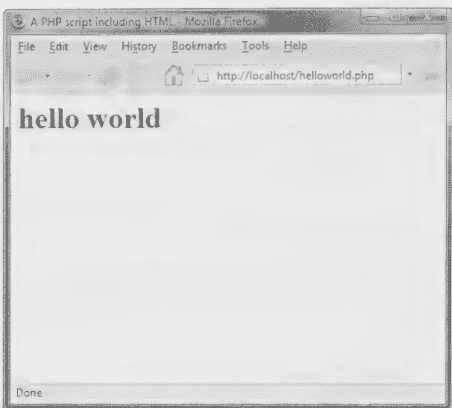

图 4.6 在浏览器中查看 helloworld.php 的输出。

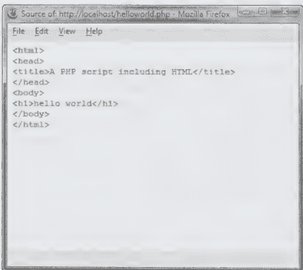

图 4.7 helloworld.php 的 HTML 源代码输出。

### 为 PHP 代码添加注释

编写时看似清晰的代码，六个月后试图修改时可能变得一团糟。在编写代码时添加注释，可节省日后时间，并让其他程序员更容易与您的代码协作。

_注释_ 是脚本中 PHP 引擎忽略的文本。注释可使代码更易读，或对脚本进行注释。

单行注释以两个正斜杠（`//`）开头——这是首选样式——或者以单个井号（`#`）开头。PHP 引擎会忽略这些标记之间以及行末或 PHP 闭合标记之前的所有文本：

```
#### this is a comment
```

多行注释以正斜杠后跟星号（`/*`）开始，以星号后跟正斜杠（`*/`）结束：

```
/*
* this is a comment
* none of this will
* be parsed by the
* PHP engine
*/
```

## 注册
此产品
informit.com/register

注册您拥有的 Addison-Wesley、Exam Cram、Prentice Hall、Que 和 Sams 产品，即可解锁极佳权益。

- 注册您的产品可解锁以下权益：
  - 访问补充内容，包括附加章节、源代码或项目文件。
  - 可用于下次购买的优惠券。

要开始注册流程，只需前往 informit.com/register 登录或创建帐户。随后，系统将提示您输入产品背面出现的 10 位或 13 位 ISBN。

注册权益因产品而异。权益将列于您的“帐户”页面下的“已注册产品”中。

## 关于 InformIT — 值得信赖的技术学习资源

INFORMIT 是领先技术出版品牌的本家，包括 Addison-Wesley Professional、Cisco Press、Exam Cram、IBM Press、Prentice Hall Professional、Que 和 Sams。在这里，您将获取来自技术作者、创造者、创新者和领导者的优质可信内容和资源。无论您是在寻找关于新技术的书籍、实用文章、及时通讯，还是访问 Safari Books Online 数字图书馆，InformIT 都能为您提供解决方案。

## Sams PHP 和 MySQL 视频学习入门套件

DVD

圣克拉拉县图书馆
33305215685227

ISBN-13: 978-0-672-33027-8
ISBN-10: 0-672-33027-X
©2009 Pearson Education, Inc.
版本 1.0

1 张光盘

圣克拉拉县图书馆
3 3305 21568 5227

