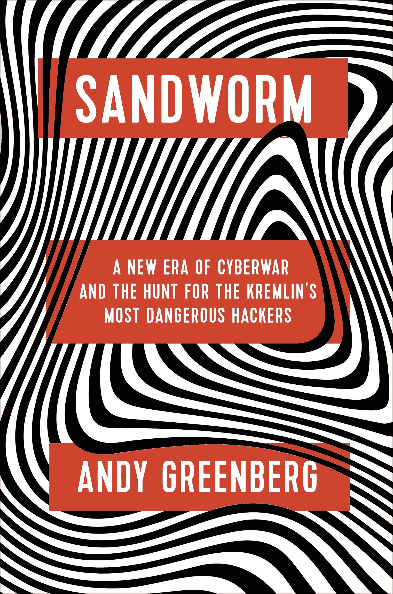

## 沙虫：网络战新纪元与对克里姆林宫最危险黑客的追捕

# 序言

2017 年 6 月 27 日，一场诡异而可怕的事件开始在全球基础设施中蔓延开来。

宾夕法尼亚州的一组医院开始推迟手术、拒收患者。塔斯马尼亚的一家吉百利工厂停止了巧克力生产。制药巨头默克公司停止了人乳头瘤病毒疫苗的制造。

很快，全球十七个港口的码头——均属世界最大航运公司马士基所有——陷入瘫痪。数万辆装载集装箱的十八轮卡车开始在这些港口大门外排起长龙。巨轮跨越大洋而来，每艘装载数十万吨货物，却发现无人能卸下它们。仿佛全球爆发了一场吞噬大脑的细菌感染，世界那相互交织、自动化运转的系统中的核心组件，似乎瞬间集体遗忘了如何运作。

在攻击的震中——乌克兰，这场技术末日的影响更为集中。ATM 机和信用卡支付系统莫名其妙地掉线。首都基辅的大众交通瘫痪。政府机构、机场、医院、邮政局，甚至监测切尔诺贝利核电站废墟放射性水平的科学家，都眼睁睁看着自己网络中几乎每一台电脑被一段神秘的恶意代码感染并清除数据。

这就是网络战的模样：一种无形力量，能从未知源头发起打击，大规模破坏支撑文明运转的技术体系。

几十年来，互联网安全领域的卡珊德拉们一直在警告我们，这一天终将到来。他们告诫说，黑客很快就会跨越单纯的犯罪甚至国家资助的间谍活动这一界限，开始利用现代世界数字化关键基础设施中的漏洞。2007 年，当俄罗斯黑客向爱沙尼亚发动网络攻击，几乎将该国所有网站全部瘫痪下线时，那次闪击战暗示了地缘政治动机驱动的黑客行为可能达到的规模。两年后，当美国国家安全局（NSA）的恶意软件 `Stuxnet` 悄无声息地加速伊朗核浓缩离心机直至其自我毁灭时，该行动展示了另一个未来的预演：它表明网络战工具的触角可以延伸至纯数字领域之外，甚至触及物理世界中戒备最森严、最敏感的组件。

但对于自 2014 年初俄罗斯对乌克兰战争爆发以来一直在关注局势的人来说，有更清晰、更直接的预兆。从 2015 年开始，一波接一波恶毒的网络攻击开始袭击乌克兰的政府、媒体和交通系统。它们最终导致了历史上首次由黑客引起的大停电，攻击切断了数十万平民的电力供应。

一小群研究人员开始敲响警钟——但大多徒劳无功——称俄罗斯正将乌克兰变成网络战创新的试验场。他们警告说，这些进展很快可能会被部署到美国、北约以及更广阔的世界，而后者对战争的这一新维度仍然盲目地毫无准备。他们指出，似乎是一支由克里姆林宫支持的黑客力量在发射这些前所未有的大规模破坏武器：一个被称为 `Sandworm` 的组织。

在接下来的两年里，`Sandworm` 升级了其攻击力度，确立了其作为世界上最危险黑客集团的地位，并重新定义了网络战。最终，在 2017 年 6 月下旬的那个命运之日，该组织释放了震惊世界的蠕虫 `NotPetya`，它现在被认为是历史上破坏性最大、代价最高的恶意软件。在此过程中，`Sandworm` 前所未有地证明了：拥有军事破坏单位动机的高度复杂、国家资助的黑客，可以跨越任意距离发动攻击，动摇人类生活的基础，打击相互连锁、相互依赖的系统，造成不可预测的灾难性后果。

如今，`Sandworm` 及其同类所构成的威胁的全貌笼罩着未来。如果网络战升级继续失控，国家资助的黑客攻击受害者可能会面临更具毒性、破坏性更强的蠕虫。在乌克兰首次展示的数字攻击预示着地平线上出现了一种反乌托邦，在那里黑客引发的停电持续数天、数周甚至更久——故意施加的剥夺电力行为可能类似于飓风“玛丽亚”袭击波多黎各后的美国悲剧，造成巨大的经济损害甚至人员伤亡。或者黑客破坏工业现场的物理设备以制造致命混乱。又或者如 `NotPetya` 案例所示，他们只是在战略时刻擦除数十万台计算机，使敌方经济或关键基础设施的数字系统陷入“脑死亡”状态。

本书讲述了 `Sandworm` 的故事，这是迄今为止推动这种网络战反乌托邦的流氓行为体最清晰的例证。它记录了追踪这些黑客的侦探们多年的工作——随着 `Sandworm` 的指纹出现在一个又一个数字灾难现场——以识别并定位他们，并呼吁关注该组织代表的危险，怀着绝望的希望能够阻止它。

但 *Sandworm* 不仅仅是一个黑客组织的故事，甚至不仅仅是俄罗斯鲁莽地在全球发动这种新形式网络战的更广泛威胁的故事。这是一个至今仍在继续的更大规模、全球性军备竞赛的故事。美国和西方不仅未能阻止这场竞赛，反而因自己头脑发热般地拥抱数字攻击工具而直接加速了它。而在这样做的过程中，我们将一种新的、不受约束的混乱力量引入了世界。

# 序章

当灯光熄灭时，时钟显示零点。

那是 2016 年 12 月的一个周六晚上，奥列克西·亚辛斯基和妻子、十几岁的儿子坐在基辅公寓客厅的沙发上。这位四十岁的乌克兰网络安全研究员和他的家人正看得入神——奥利弗·斯通执导的电影《斯诺登》放映了一小时左右——突然，他们所在的大楼断电了。

“黑客不想让我们看完电影，”亚辛斯基的妻子开玩笑说。她指的是一年前发生的一件事，一次网络攻击在 2015 年圣诞节前两天切断了近四十万乌克兰人的电力供应。

亚辛斯基是基辅一家网络安全公司的首席取证分析师，他没笑。他看了一眼桌上的便携式时钟：时间是 00:00。正是午夜。

亚辛斯基的电视插在一个带电池备用电源的防雷插座上，所以现在只有屏幕上闪烁的影像照亮了房间。电源插座开始可怜兮兮地蜂鸣报警。亚辛斯基起身将其关闭以保存电量，房间顿时陷入寂静。

他走到厨房，拿出几根蜡烛点燃。然后走到厨房窗前。这位瘦削、沙金色头发的工程师向外眺望，看到了从未见过的城市景象：他公寓楼周围的整个天际线一片漆黑。只有远处灯光的灰白微光映照在阴云密布的天空中，勾勒出现代公寓楼和苏联时期高层建筑的黑色轮廓。

注意到精确的时间和日期——距离 2015 年 12 月的电网攻击几乎整整一年——亚辛斯基确信这绝非寻常停电。他想到室外的寒冷——接近华氏零度（约摄氏零下 18 度）——成千上万户人家温度缓慢下降，以及水泵停止工作导致水管冻结的倒计时。

就在这时，另一个偏执的念头开始在亚辛斯基脑海中滋长：过去十四个月里，他发现自己置身于一场不断逼近的危机中心。越来越多的乌克兰公司和政府机构找到他，分析接二连三、毫不留情地袭击他们的网络攻击瘟疫。似乎同一个黑客组织是这一切的幕后黑手。现在他无法抑制一种感觉：那些他追踪了一年多的幽灵，已经伸出手，穿过互联网的以太，伸进了他的家中。

# 第一部

# 崛起

> 利用最初的时刻进行研究。这样做你可能会错失许多速胜的良机，但研究的时刻是成功的保险。慢慢来，确保万无一失。

# 1

# 零日漏洞

在环城公路之外，华盛顿特区的情报-工业综合体逐渐平展为一望无际的停车场和灰色办公楼海洋，楼上标注着特意设计得让人过目即忘的标志和企业名称，在那里，弗吉尼亚州尚蒂利有一栋楼，其四楼设有一个无窗的内部房间。房间的墙壁涂成哑光黑，仿佛要开辟出一片负空间，让任何外部光线都无法穿透。

2014 年，就在乌克兰网络战争爆发前一年多，这就是小型私营情报公司 `iSight Partners` 所谓的“黑屋”。里面办公的是公司负责软件漏洞研究的两人小组，这份工作需要极度专注，以至于从业者坚持要求最接近感官剥夺室的办公室布局。

## 1

正是这对技艺高超的“洞穴居住者”，在九月的一个周三清晨，最先接到了约翰·赫尔奎斯特罕见的求助。当天早些时候，赫尔奎斯特来到办公桌前——那间办公室采光好得多，位于 `iSight` 大楼的另一侧，甚至有真正的窗户——他打开了一封来自公司乌克兰分部同事的邮件。邮件里藏着一个惊喜：基辅的员工认为他们可能拿到了一个零日漏洞。

在黑客行话中，零日漏洞是指软件中一个秘密的安全缺陷，连编写和维护该软件代码的公司都不知道它的存在。这个名字源于这样一个事实：该公司拥有“零天”时间来响应并推出补丁以保护用户。一个强大的零日漏洞，特别是那种允许黑客突破漏洞所在软件应用的限制，并在目标计算机上执行自己的代码的漏洞，可以充当一种全球通用的“万能钥匙”——一张免费通行证，可让持有者进入世界上任何运行该脆弱软件且连接互联网的机器。

赫尔奎斯特从 `iSight` 乌克兰办事处收到的文件是一个 PowerPoint 附件。它似乎悄无声息地实现了恰好那种代码执行，且作用于 Microsoft Office，这是世界上最普及的软件之一。

读着这封邮件，赫尔奎斯特脑海中警报大作。如果乌克兰人怀疑的属实，这意味着某些未知黑客拥有并使用了一种危险能力，能让他们劫持数百万台计算机中的任意一台。必须立即警告微软修补其缺陷。但从更现实的角度来看，发现一个零日漏洞对像 `iSight` 这样渴望在新兴的“威胁情报”安全细分领域赢得声誉、吸引客户的小公司来说，是一个里程碑。公司一年只能挖掘两三个这种秘密缺陷。每一个都是一种抽象的、高度危险的奇观，也是重大的研究战果。“对一家小公司来说，发现这样一块‘金块’非常、非常令人欣慰，”赫尔奎斯特说，“这对我们来说是件大事。”

赫尔奎斯特是个声音洪亮、长相魁梧的田纳西东部退伍军人，留着浓密的黑胡子，脸上挂着永恒的微笑。他有个习惯，隔一段时间就从办公桌上对隔壁一间叫“牛栏”的房间大喊大叫。那间屋子一边坐着恶意软件专家，另一边坐着专注于理解数字攻击背后地缘政治动机的威胁分析师。赫尔奎斯特一读完 `iSight` 乌克兰员工的邮件，就冲出办公室闯进“牛栏”，向全屋简报并分配任务，以便对这一发现进行分流处理——当时没人知道，这将成为这家小公司历史上最大的发现之一。

但真正开始纠结 `iSight` 这一发现意义的，是走廊尽头那间黑屋子里的“黑客修道士”们：一个微小的、隐藏的恶意工程奇迹。

***

■

在仅有发光显示器照明的屋子里，逆向工程师们开始反复运行乌克兰人发来的、植入恶意代码的 PowerPoint 附件，环境是一系列虚拟机——运行在真实物理机内部的、短暂的计算机模拟，每个虚拟机与计算机其余部分的隔离程度，就如同黑屋子与 `iSight` 其他办公室的隔离一样。

在这些密封容器中，代码可以像水族箱玻璃下的蝎子一样被研究。他们让代码反复感染虚拟受害者，逆向工程师启动不同数字机器的模拟，运行不同版本的 Windows 和 Microsoft Office，以研究攻击的维度和灵活性。当他们确定该代码能从 PowerPoint 文件中提取自身，并完全控制甚至最新、已全补丁版本的软件时，他们得到了确认：这确实是一个零日漏洞，正如乌克兰人和赫尔奎斯特所怀疑的那样罕见且强大。到了深夜——在他们的工作空间里，这段时间的流逝几乎完全无迹可寻——他们已经产出一份详细报告与微软及客户共享，并编写了自己的版本，一个概念验证重写版，像试管里的病原体一样演示了其攻击过程。

正如黑屋子里的两名逆向工程师之一乔恩·埃里克森向我解释的，PowerPoint 拥有“惊人的力量”。多年进化下来，它已成为一个装满了大量不必要功能的鲁布·戈德堡机械，错综复杂到实际上可作为自己的编程语言。而利用这个零日漏洞的黑客，深入研究了其中一项功能：允许任何人在演示文稿中放置一个信息“对象”，比如从该 PowerPoint 文件自带的数据包中提取的图表或视频，甚至来自互联网上远程计算机的内容。

在本案中，黑客利用该功能在演示文稿中精心植入了两块数据。第一块被加载到目标计算机的一个临时文件夹中。第二块则利用了 PowerPoint 的动画功能：PowerPoint 动画不仅能让演讲者用移动的文字和卡通让观众感到厌烦，实际上还能在运行演示文稿的计算机上执行命令。在本案中，当演示文稿加载该动画文件时，会运行一个自动脚本，对演示文稿先植入机器的第一个文件进行右键点击，并在弹出的下拉菜单中点击“安装”，从而在不惊动用户的情况下，让那段代码在计算机上站稳脚跟。结果就像一个外表无害的包裹放在你家门口，等你拿进屋后，它长出一只手臂，剖开自己，在门厅释放出成群微型机器人。所有这些瞬间、隐形地发生，就在受害者双击附件打开它的那一刻。

第一个在 `iSight` 黑屋子里处理该零日漏洞的逆向工程师埃里克森，回忆起他拆解和拆除该攻击的工作时，称这是一个相当罕见、迷人，但完全非个人化的事件。在他的职业生涯中，他只在野外环境下处理过寥寥几个真正的零日漏洞。但他分析过成千上万其他恶意软件样本，并学会了将它们视为研究标本，而不去考虑其背后的作者——那个组装起狡猾机械的人类。“只是某个未知家伙和某个我以前没见过的未知事物，”他说。

但零日漏洞是有作者的。当埃里克森那天早晨在漆黑的工作间里开始拆解这个漏洞时，他研究的不仅仅是某种自然发生的、无生命的谜题。他在欣赏一种远程的、恶毒的智能的最初线索。

# 2

# BLACKENERGY

一旦 `iSight` 围绕零日漏洞发现的最初狂热平息，问题依然存在：是谁编写了攻击代码？他们以谁为目标，为什么？

这些问题落在了德鲁·罗宾逊头上，他是 `iSight` 的一名恶意软件分析师，约翰·赫尔奎斯特形容他是个“日行者”：罗宾逊拥有与黑屋子“吸血鬼团队”大部分相同的逆向工程技能，却坐在赫尔奎斯特办公室旁边阳光充足的“牛栏”里，负责对黑客行动进行广得多的角度分析——从实施人员到政治动机。罗宾逊的工作，就是追踪那个 PowerPoint 内部的技术线索，解开它所代表的隐藏行动的更大谜团。

Hultquist 走进大工位区宣布全员投入应对那个周三早上发现的 PowerPoint 零日漏洞几分钟后，Robinson 正仔细研究那个带毒附件的内容。演示文稿本身似乎是一份用西里尔字母写在蓝黄相间的乌克兰国旗上的名单，带有乌克兰国徽水印——黄盾上一支淡蓝色的三叉戟。Robinson 使用 Google 翻译后发现，那些名字是一份所谓的“恐怖分子”名单——即在乌克兰冲突中支持俄罗斯的一方。该冲突始于当年早些时候，当时俄罗斯军队入侵了乌克兰东部及其克里米亚半岛，在那里点燃了分离主义运动并引发了持续至今的战争。

黑客选择一条反俄信息来携带他们的零日感染，这是 Robinson 判断该邮件很可能是一场针对乌克兰目标的俄罗斯行动的第一个线索，利用了该国的爱国主义情绪和对内部克里姆林宫同情者的恐惧。但当他寻找该诡计背后黑客的线索时，他很快发现了另一个可循的蛛丝马迹。当 PowerPoint 零日漏洞被触发时，它在受害者系统上释放的文件竟然是一款臭名昭著恶意软件的变种，这款软件很快将变得更加臭名昭著。它叫做 `BlackEnergy`。

直到那时，`BlackEnergy` 短暂的历史在一定意义上已经包含了常见黑客行动分类学的入门指南，从最低级的“脚本小子”——技术如此生疏以至于通常只能使用更懂行的人编写的工具的黑客——到专业的网络犯罪分子。该工具最初由一名名为 Dmytro Oleksiuk 的俄罗斯黑客创建，也以其代号 Cr4sh 为人所知。大约在 2007 年，Oleksiuk 在俄语黑客论坛上出售 `BlackEnergy`，售价约 40 美元，其代号像涂鸦签名一样印在控制面板的一个角落里。

该工具专为一个明确目的而设计：即所谓的分布式拒绝服务（DDoS）攻击，旨在同时从数百或数千台计算机向网站发送欺诈性信息请求，使其瘫痪下线。用 `BlackEnergy` 感染受害机器，它就会成为所谓僵尸网络的一员——一组被劫持的计算机，即僵尸。僵尸网络操作员可以配置 Oleksiuk 那款用户友好的软件，以控制其受控机器会用伪造请求猛击哪个网络目标，以及这种数字轰炸的类型和速率。

到 2007 年底，安全公司 Arbor Networks 统计出用 `BlackEnergy` 构建的僵尸网络超过三十个，攻击目标大多指向俄罗斯网站。但在网络攻击复杂程度的光谱上，分布式拒绝服务攻击在很大程度上属于粗糙且笨拙的手段。毕竟，它们只能造成昂贵的停机时间，无法像更渗透性的黑客技术那样造成严重的数据泄露。

然而，在随后的几年里，`BlackEnergy` 发生了演变。安全公司开始检测到该软件的新版本，现已配备可互换功能的武器库。这个改进版工具不仅仍能用垃圾流量攻击网站，还能被编程为发送垃圾邮件、销毁受感染计算机上的文件，以及窃取银行用户名和密码。^(¹)

现在，在 Robinson 眼前，`BlackEnergy` 又以另一种形式重现。他在 iSight 大工位区的座位上看到的这个版本，似乎不同于他以前读到的任何版本——肯定不是简单的网站攻击工具，也很可能不是金融诈骗工具。毕竟，为什么一个以欺诈为重点的网络犯罪计划会用一份亲俄恐怖分子名单作为诱饵？这个骗局似乎带有政治针对性。从他第一眼看到乌克兰版 `BlackEnergy` 样本起，他就开始怀疑自己看到的是该代码的一个变种，有了新目标：不仅仅是犯罪，而是间谍活动。^(²)

不久后，Robinson 有了一个幸运的发现，揭示了该恶意软件目的的更多信息。当他在虚拟机上运行这个新的 `BlackEnergy` 样本时，它试图通过互联网连接到欧洲某地的一个 IP 地址。他立刻看出，该连接就是所谓的命令与控制服务器，充当该程序的远程傀儡主。当 Robinson 自己通过网页浏览器联系那台远程机器时，他惊喜地震惊了。那台命令与控制计算机完全处于无保护状态，允许任何人随意浏览其文件。

这些文件惊人地包括一份针对这个独特版 `BlackEnergy` 的帮助文档，方便地列出了其命令。它证实了 Robinson 的怀疑：通过零日漏洞投递的这个 `BlackEnergy` 版本，拥有比网络犯罪调查中常见的恶意软件样本广泛得多的数据收集能力。该程序能截屏、从受害机器提取文件和加密密钥、记录按键，这些都是有针对性、彻底的网络间谍活动的标志，而非某个以盈利为目的的银行诈骗勾当。

但比那份操作指南内容更重要的是它的书写语言：俄语。

## 3

## ARRAKIS02

网络安全行业时刻警告“归因问题”——即任何行动背后的远程黑客，尤其是复杂行动的黑客，往往根本无法锁定。互联网提供了太多代理、误导和纯粹压倒性的地理不确定性的机会。但通过识别那个无保护的命令与控制服务器，Robinson 凭借一个罕见的识别细节攻破了 iSight 的 `BlackEnergy` 谜团。尽管他们在 PowerPoint 黑客攻击中表现出了所有的谨慎，黑客似乎还是泄露了一个强有力的国籍线索。

然而，在获得这一意外收获后，Robinson 仍面临深入恶意软件代码内部以寻找更多线索、并创建“签名”的任务，以便安全公司和 iSight 的客户能用它检测其他网络是否感染了同一程序。破译恶意软件代码的功能远不如追踪其命令与控制服务器容易。正如 Robinson 在随后几天扎实、令人脑麻的工作中艰辛领会到的，它已被三层交替的压缩和加密彻底打乱。

换句话说，获取恶意软件的秘密有点像寻宝游戏。虽然 Robinson 知道恶意软件是自包含的，因此必须包含解密自身并运行代码所需的所有加密密钥，但每一层打乱的密钥只有在解码其上层后才能找到。甚至在通过扫描类似随机的噪音寻找可识别模式来猜测黑客使用的压缩算法后，Robinson 又花了更多天来识别他们使用的加密方案——一种现有系统的独特修改版。随着他越陷越深，他会抬头望向办公桌，发现几个小时似乎已跳跃式流逝。甚至在家里，他也会发现自己呆立在淋浴下，在脑海中反复推敲那个密码。

当罗宾逊在经历了一周的反复试错后终于破解了那些混淆层，他得以一窥 BlackEnergy 样本中数百万个 0 和 1 的全貌——乍看之下，这堆数据依然毫无意义。毕竟，这是程序的编译形式，已被翻译成机器可读的二进制代码，而非任何人类可读的编程语言。为了理解这段二进制代码，罗宾逊必须在电脑上逐步观察其执行过程，利用一款名为 `IDA Pro` 的常用逆向工程工具实时解析，将运行时指令的功能转化为代码。“这简直就像仅凭观察某人的 DNA 就试图推断他们的长相，”罗宾逊说。“而创造这个人的上帝，正竭力让这个过程变得尽可能困难。”

然而到了第二周，这种微观的逐步分析终于开始见效。当他设法解读出恶意软件的配置设置时，其中包含一个所谓的战役代码——本质上是一个与该版本恶意软件关联的标签，黑客可用它来对感染的受害者进行分类和追踪。而对于他们在乌克兰 PowerPoint 文档中投放的 BlackEnergy 样本，其战役代码是他立刻就认出的一个，认出它不是源于他恶意软件分析师的职业生涯，而是源于他作为科幻迷的私人生活：`arrakis02`。

事实上，对罗宾逊而言，或对几乎任何懂科幻的极客而言，“Arrakis”（亚拉基斯）这个词不仅仅是耳熟能详：它就像塔图因或中土世界一样，是文化经典核心支柱的背景设定，无比熟悉。亚拉基斯是弗兰克·赫伯特 1965 年史诗巨著《沙丘》故事发生的沙漠星球。

《沙丘》的故事设定在一个地球早已因与人工智能机器的全球核战争而毁灭的世界。它讲述了显贵的亚崔迪家族在被任命为亚拉基斯（也称沙丘）的统治者后，又被邪恶的宿敌哈克南家族在政治上破坏并清洗夺权的命运。

亚崔迪家族被推翻后，书中青少年英雄保罗·亚崔迪逃往星球广袤的沙漠，那里游荡着千英尺长的沙虫，它们偶尔会冒出地面吞噬路径上的一切。随着成长，亚崔迪学会了亚拉基斯原住民弗里曼人的生存之道，包括驾驭和骑乘沙虫的能力。最终，他领导了一场斯巴达式的游击起义，骑着沙虫发动毁灭性战役，他和弗里曼原住民从哈克南家族手中夺回了首都，他们的起义最终夺取了支持哈克南家族政变的整个银河帝国的控制权。

“无论这些黑客是谁，”罗宾逊记得自己当时想，“看起来他们是弗兰克·赫伯特的粉丝。”

***

■

当他发现那个 `arrakis02` 战役代码时，罗宾逊隐约觉得自己发现的不仅仅是关于选择该名字的黑客的单一线索。他第一次感觉到自己正在窥探他们的思想和想象力。事实上，他开始怀疑这可能是一种指纹。也许他能用它匹配其他犯罪现场。

在接下来的日子里，罗宾逊将乌克兰 PowerPoint 版本的 BlackEnergy 搁置一旁，开始深挖，既在 iSight 存档的旧恶意软件样本中，也在一个名为 `VirusTotal` 的数据库中。`VirusTotal` 由谷歌母公司 Alphabet 拥有，允许任何测试恶意软件的安全研究人员上传样本，并针对数十款商业杀毒产品进行检测——这是一种快速粗略的方法，用以查看其他安全公司是否在别处检测到该代码，以及他们可能了解什么。因此，`VirusTotal` 汇集了一个海量的实战代码样本集合，积累了十多年，研究人员可付费访问。罗宾逊开始对这些恶意软件记录运行一系列扫描，搜索与他从 BlackEnergy 样本中解包出的代码片段相似的代码，以匹配 iSight 或 `VirusTotal` 目录中的早期代码样本。

很快他有了收获。四个月前（2014 年 5 月）的另一个 BlackEnergy 样本，与乌克兰 PowerPoint 投放的那个几乎完全一样。当罗宾逊挖出它的战役代码时，他找到了想要的东西：`houseatreides94`，另一个毫无争议的《沙丘》典故。这一次，BlackEnergy 样本藏在一个 Word 文档中，内容是一篇关于油气价格的讨论，显然是为一家波兰能源公司设计的诱饵。

在接下来的几周里，罗宾逊继续在他的恶意程序档案库中搜寻。他最终编写了自己的工具，能够扫描恶意软件匹配项，自动解锁文件的混淆加密层，然后提取战役代码。他的样本收藏慢慢增加：`BasharoftheSardaukars`、`SalusaSecundus2`、`epsiloneridani0`，仿佛黑客们试图用他们对《沙丘》越来越晦涩的细节知识来给他留下深刻印象。

这些《沙丘》典故中的每一个，就像他发现的前两个一样，都与一个诱饵文档相关联，揭示了恶意软件预期受害者的信息。其中一个是一份外交文件，讨论欧洲与俄罗斯在乌克兰问题上的“拔河”，当时乌克兰在民众亲西方的民众运动与俄罗斯残留影响力之间挣扎。另一个似乎是为参加在威尔士举行的以乌克兰为主题的峰会以及在斯洛伐克举行的北约相关活动（部分聚焦俄罗斯间谍活动）的与会者设计的诱饵。甚至还有一个似乎专门针对一位专注于俄罗斯外交政策的美国学术研究人员，iSight 决定不公开其身份。多亏了黑客们贴心的《沙丘》典故，所有这些分散的攻击都能被确定地串联起来。

但有些受害者看起来不太像俄罗斯地缘政治间谍活动的常规目标。例如，黑客究竟为何盯上一家波兰能源公司？iSight 后来还会发现另一个诱饵，针对的是乌克兰铁路局 `Ukrzaliznytsia`。

但随着罗宾逊在安全行业的垃圾堆中挖得越来越深，追寻那些《沙丘》典故，他最震惊的还有一个发现：虽然他们发现的 PowerPoint 零日漏洞相对较新，但黑客们更广泛的攻击活动不仅持续了几个月，而是长达数年。与《沙丘》相关的黑客诱饵最早出现于 2009 年。直到罗宾逊设法拼凑起他们行动的蛛丝马迹，他们已秘密渗透组织长达半个十年。

***

■

经过六周的分析，iSight 准备公开其发现：他们发现了一个似乎规模巨大、高度复杂的间谍活动，所有迹象表明这是一个针对北约和乌克兰的俄罗斯政府行动。

当罗宾逊艰辛地理清该行动时，他的老板约翰·赫尔奎斯特对这伙俄罗斯黑客的行径变得几乎和审视代码的恶意软件分析师一样着迷。罗宾逊坐在离赫尔奎斯特办公室最近的牛栏一侧，赫尔奎斯特会隔着墙大声向他提问，他那带着田纳西口音的吼声极具穿透力。但到了 10 月中旬，随着谜团从第一个 PowerPoint 零日漏洞延伸开来，赫尔奎斯特现在几乎每天都会闯进牛栏，向罗宾逊询问进展。

# 力量倍增器

尽管黑客们拥有各种高明的伎俩，Hultquist 明白，要让他们的发现引起关注，仍然需要媒体策略。当时，中国网络间谍——而非俄罗斯网络间谍——是美国媒体和安全行业的头号公敌。从诺斯罗普·格鲁曼到陶氏化学再到谷歌，众多公司都曾遭到中国黑客入侵，经历了一系列令人震惊的数据窃取行动——主要聚焦于知识产权和商业机密——时任 NSA 局长 Keith Alexander 称之为“历史上最大的财富转移”。像这样一个目标毫不意外地锁定东欧国家的俄罗斯间谍行动，尽管拥有所有阴险的技巧和持久的生命力，却依然有可能淹没在喧嚣中。

他们的黑客组织需要一个朗朗上口、引人注目的名称。按照网络安全行业的惯例，命名权属于发现该组织的公司——iSight。

自青少年时代起就是《沙丘》粉丝的 Robinson 建议将该黑客行动命名为“Bene Gesserit（贝尼·杰瑟里特）”，这是书中一个拥有近乎魔法般心理操控能力的神秘女性组织。从未真正读过 Frank Herbert 这本书的 Hultquist 否决了这个想法，认为它太晦涩、难以发音。

相反，Hultquist 选择了一个更直白的名字，他希望这个名字能唤起人们对一种潜伏怪物的联想：它就在水面下移动，偶尔浮现出来施展可怕的力量——这个名字比 Hultquist 当时所能知道的更加贴切。他将该组织命名为 **Sandworm（沙虫）**。

在首次发现 Sandworm 六周后，iSight 的员工在办公室举行了一轮庆祝酒会，聚集在分析师们的工位大厅尽头的一个酒吧里，那里酒水备得很全。Sandworm 登上世界舞台的首秀完全符合 Hultquist 的期望。当公司公开披露发现了一个持续五年、装备零日漏洞、以《沙丘》为主题的俄罗斯间谍活动时，消息在整个行业和媒体中扩散开来，相关报道出现在《华盛顿邮报》、《Wired》以及无数科技和安全行业的专业出版物上。Robinson 回忆起用一杯伏特加向 Hultquist 致敬，以此纪念他们发掘出的这一新种类的俄罗斯黑客。

但就在同一个晚上，在西边 2500 英里外的地方，另一位安全研究人员仍在深挖。日本安全公司 Trend Micro 的恶意软件分析师 Kyle Wilhoit 那天下午在加利福尼亚州库比蒂诺的一家酒店参加企业会议的无尽会议间隙，在网上看到了 iSight 的 Sandworm 报告。Wilhoit 久闻 iSight 的大名，尤其是 John Hultquist，便记下要在一天结束时仔细研究一下。他预感，像 iSight 这样重大的发现往往会引发连锁反应。也许这会为他和 Trend Micro 带来新的发现。

那天晚上，坐在酒店室外酒吧里，Wilhoit 和另一位 Trend Micro 研究员 Jim Gogolinski 拿出笔记本电脑，下载了 iSight 公开的所有内容——即它发布的所谓“妥协指标”，旨在帮助 Sandworm 的其他潜在受害者检测并阻止攻击者。

在这些证据中——就像犯罪现场装在塑料袋里的物证一样——包含了 BlackEnergy 样本通信回连的命令与控制服务器的 IP 地址。随着夜色渐深，酒吧逐渐空荡，Wilhoit 和 Gogolinski 开始将这些 IP 地址与 Trend Micro 自身的恶意软件档案库和 VirusTotal 进行比对，看看能否找到任何新的匹配项。

酒店酒吧关门后，只留下两位研究人员独自待在黑暗的露台上，Wilhoit 发现了一个指向斯德哥尔摩某服务器的 IP 地址匹配项，Sandworm 曾使用过该服务器。他找到的文件 `config.bak` 也连接到那台瑞典机器。虽然在安全行业普通人眼中这看起来完全不足为奇，但它立刻引起了 Wilhoit 的高度警觉。

Wilhoit 拥有安全研究人员中罕见的背景。就在两年前，他还在圣路易斯担任 Peabody Energy（美国最大的煤炭公司）的 IT 安全经理。因此，他熟悉所谓的工业控制系统（ICS）——在某些情况下也称为监控与数据采集（SCADA）系统。这种软件不仅仅是推送比特，而是向工业设备发送指令并接收反馈，是数字世界与物理世界交汇的节点。

ICS 软件用途广泛：从 Peabody 矿井中循环空气的通风机、清洗煤炭的巨大洗煤池、发电厂燃烧煤炭的发电机，到向消费者供电的变电站断路器。ICS 应用程序运行工厂、水厂、油气炼厂和交通系统——换句话说，就是构成现代文明支柱的那些庞大、高度复杂的机器，而我们大多数人却视其为理所当然。

通用电气销售的一款常见 ICS 软件是 Cimplicity，它包含一种称为人机界面（HMI）的应用程序，本质上是那些数字转物理指令系统的控制面板。Wilhoit 发现的 `config.bak` 文件实际上是一个 `.cim` 文件，设计用于在 Cimplicity 中打开。通常，`.cim` 文件会在 Cimplicity 软件中加载一个完整的自定义控制面板，就像工业设备的一个无限可重构的仪表盘。

这个 Cimplicity 文件几乎什么也不做——除了连回 iSight 认定为 Sandworm 的斯德哥尔摩服务器。但对于任何接触过工业控制系统的人来说，仅这一连接的概念就令人深感不安。运行这些敏感系统的基础设施本应完全与互联网隔离，以防止黑客破坏并实施灾难性攻击。

运营此类设备的公司，特别是作为工业化世界最基础层的电力公用事业公司，不断向公众保证，其常规 IT 网络与工业控制网络之间有严格的“气隙”隔离。但在令人不安的相当一部分案例中，这些工业控制系统仍与其系统的其他部分——甚至公共互联网——保持着微弱的连接，例如允许工程师远程访问或更新软件。

Sandworm 与一个会向瑞典服务器“回传”数据的 Cimplicity 文件之间的联系，足以让 Wilhoit 得出一个惊人的结论：Sandworm 并不只是专注于间谍活动。情报收集行动不会闯入工业控制系统。Sandworm 似乎在更进一步，试图触达受害者那些可能劫持物理机械、造成物理后果的系统。

“坏人正在收集信息，为进入第二阶段做准备，”Wilhoit 坐在库比蒂诺酒店外凉爽的夜风中意识到，“他们可能正试图跨越数字与动能之间的鸿沟。”黑客的目标似乎已超越间谍活动，延伸至工业破坏。

Wilhoit 和 Gogolinski 那晚没合眼。相反，他们留在酒店的室外桌旁，开始搜寻更多线索，看看 Sandworm 可能在 ICS 系统中做了什么。它是如何获得那些接口控制权的？目标是谁？答案依然遥不可及。

他们第二天逃掉了所有会议，撰写调查结果并发布在 Trend Micro 的博客上。Wilhoit 还将其分享给 FBI 的一位联系人——以典型的、守口如瓶的 G-man（联邦探员）风格——对方接受了信息，却未提供任何回馈。

# 回到他在尚蒂伊的办公室，约翰·赫尔奎斯特阅读了趋势科技关于 Cimplicity 文件的博客文章。

他兴奋得甚至没想过要为趋势科技在 iSIGHT 重大发现的核心区域找到了一块未被翻动的石头而感到恼火。“这完全开启了一场新游戏，”赫尔奎斯特说。

突然，桑德沃姆受害者中那些不合常理的基础设施目标，比如那家波兰能源公司，变得合情合理了。六周前，iSIGHT 发现了线索，将其对黑客任务的认知模型从单纯的网络犯罪转变为国家级情报收集。现在赫尔奎斯特对威胁的认知再次转变：从网络间谍活动转向网络战。“这看起来已不像经典的间谍活动了，”赫尔奎斯特心想。“我们看到的是为攻击而进行的侦察。”

***

###

从某种意义上说，赫尔奎斯特整个职业生涯都在寻找类似桑德沃姆的东西，远在 iSIGHT 偶然发现它之前，甚至在他不知道它会以何种形式出现之前。像网络安全行业的许多其他人一样，尤其是那些有军事背景的人，他一直在期待网络战的到来：一个新时代，最终将把黑客的数字能力应用到更古老、更熟悉的战争和恐怖主义世界中。对赫尔奎斯特来说，这将是一种回归。自十五年前的陆军生涯以来，他就学会了将对手视为无情之人，他们愿意炸毁事物、破坏基础设施，并杀害他、他的朋友以及他受命保护的无辜平民。

这位来自田纳西州东部小镇阿尔科亚的陆军预备役士兵，在大学期间因“9·11”事件被征召入伍去阿富汗服役。很快，这名二十岁的年轻人发现自己身处坎大哈省的一个民政部队单位。他们的工作是乘坐六人小组在乡间巡逻，与当地村庄负责人会面，争取人心。“当然，我们依然全副武装，”赫尔奎斯特告诉我，随后发出一种大笑声，这成了他许多故事的标志性标点。“那是高难度的冒险。”他留起了乱糟糟的黑胡子，在部队里被称为“少年狼人”。

他们民政部队的座右铭印在制服肩章上：*vis amplificans vim*，他的上级告诉他，这大致翻译为“战力倍增器”。其理念是与当地平民建立关系，以协助并拓展驱逐和击杀塔利班那些不那么微妙的工作；他们是步兵和特种部队这根“大棒”对应的“胡萝卜”。他们会与一群村里的长者共进午餐，在羊肉和烤饼的餐食中询问他们需要什么，然后，比如说，为他们挖一口井。“有时我们几周后回来，他们会告诉我们弹药藏匿点在哪里，”赫尔奎斯特说。

战争初期，塔利班大多已逃离该国，在美国最初的入侵中蒸发般地撤入巴基斯坦的山区。然而，在随后的几个月里，随着他们慢慢开始潜回阿富汗，暴力再次升级。一天夜里，一名塔利班游击队员向赫尔奎斯特和他的单位休息的建筑发射了两枚火箭弹。一枚偏离目标，飞向天空。另一枚因走运未能爆炸，被他们的爆炸物处理小组拆除。仅仅几天后，那些同样的拆弹技术人员在拆除一个隐藏的塔利班火箭弹储藏点时，炸药突然引爆，导致他们丧生。赫尔奎斯特和他的单位最先赶到现场，花费数小时收集他们支离破碎的身体残肢。

2003 年伊拉克战争爆发后，赫尔奎斯特被调往那里，这次部署一开始就如同阿富汗后期一样激烈血腥。在伊拉克，战争迅速转变为追捕一支主要隐形的破坏分子部队，他们埋设简易炸弹，这是一场高度不对称的游击冲突。赫尔奎斯特领教了那些反复无常、不可预测且致命的爆炸在心理上有多么毁灭性。他最终因在战友的悍马车遭遇路边炸弹袭击时的快速反应而获得陆军英勇表彰，他实施了急救并为两名幸存者输液。

然而，车顶的机枪手在爆炸中瞬间身亡。炸弹爆炸时，他胸前绑着手榴弹，以便快速装填发射器。赫尔奎斯特至今仍记得那人尸体燃烧时，手榴弹一颗接一颗爆炸的声音。

***

###

赫尔奎斯特结束服役，返回美国，完成了学业。毕业后，他在新泽西州迪克斯堡获得了一份教授心理战课程的工作，随后进入了全国各地在“9·11”后设立的信息共享与分析中心（ISAC）之一，以应对可能的恐怖主义威胁。他被分配关注公路安全问题，后来是水系统和铁路的安全，构思应对严峻场景的对策，比如袭击者驾驶大型车辆冲撞人群，或在车辆货舱安放炸弹，正如他在研究的斯里兰卡案例中恐怖分子所为。

直到 2006 年，当他作为初级情报分析师承包商加入国务院，主要负责帮助保护该机构自己的网络免受黑客攻击时，他才接触到这些安全威胁的数字层面。当时，中国国家资助的网络间谍活动刚刚被认定为对美国国家安全甚至商业主导地位的严重问题。2000 年代中期，一系列被称为“泰坦雨”的入侵事件，据信是由为中国人民解放军工作的网络间谍实施的，攻破了洛克希德·马丁、桑迪亚国家实验室和美国国家航空航天局。当赫尔奎斯特在国务院开始工作时，关于中国间谍活动攻破从国防承包商到科技公司等目标网络的报道几乎每周都会出现。“他们窃取了我们所有的知识产权，也占据了我们所有的关注，”赫尔奎斯特谈到中国黑客时说。

但从他在美国政府追踪国家资助的网络间谍的最初几年起，赫尔奎斯特就倾向于一种不同的、鲜少被考虑的数字攻击形式。基于他在军队和 ISAC 中试图智取叛乱分子和恐怖分子的经验，他自然而然地将关注点放在了能够对敌人造成心理破坏、关闭民用资源并制造混乱的威胁上，而非间谍活动。

# 示例文本排版

## 爱沙尼亚与格鲁吉亚的网络攻击

例如在 2007 年，爱沙尼亚遭受了一场惩罚性的、前所未有的 DDoS 攻击狂轰滥炸，所有攻击似乎都源自俄罗斯。当爱沙尼亚警方镇压由该国俄语少数族裔煽动的骚乱时，针对性的垃圾流量洪峰在几天内将爱沙尼亚的政府、媒体和银行网站击瘫，这是一场世界从未见过的网络闪击战。第二年，当俄罗斯与其另一个后苏联邻国格鲁吉亚爆发战争时，粗糙的网络攻击也重创了该国的政府和媒体。在赫尔奎斯特看来，俄罗斯似乎正在尝试将传统物理攻击与大规模破坏性数字武器进行基本的配合使用。

当时，赫尔奎斯特主要只能旁观。他研究了爱沙尼亚和格鲁吉亚的攻击，会见了追踪这些攻击的研究人员，并向高级官员进行简报。但他很少能将他们的注意力从中国黑客实施的大规模窃取国家机密和知识产权的行为上转移开，那种威胁对美国利益而言似乎更为迫切。

## Sandworm 的发现与 Hultquist 的执念

多年后，iSight 对 Sandworm（沙虫）的发现，让 Hultquist 处于了一种似乎全新、且更为先进的俄罗斯网络战争形式的最前沿。在俄罗斯入侵乌克兰之际，一支俄罗斯黑客团队正利用复杂的渗透工具获取对手基础设施的访问权限，这可能为攻击前线数百英里之外的民用社会根基奠定基础：他想象着制造业遭破坏、交通瘫痪、大面积停电。

当 Sandworm 的任务在他脑海中逐渐清晰时，他十多年前在陆军民政部队服役时的一个短语浮现在脑海：*vis amplificans vim.*

***

读完 Trend Micro（趋势科技）的报告后，Hultquist 的着迷程度与日俱增：在他的认知中，Sandworm 已从一个棘手的谜题蜕变为一种罕见且危险的地缘政治现象。他开始不断地向 iSight 的分析师、交谈过的任何记者、安全行业的其他从业者以及华盛顿特区的情报界提起此事。在 iSight 的办公室万圣节派对上，他甚至用一个绿色的儿童游戏隧道给自己做了一套 Sandworm 服装，这或许只是半开玩笑地表达了他的执念。“Sandworm 是我最喜欢的东西，”Hultquist 简单地说道。

尽管如此，他仍感到沮丧：在 iSight 发现引发的最初轰动过后，他的“沙虫观察俱乐部”并没有吸引到多少其他成员。主流媒体似乎暂时已基本耗尽了对该组织的兴趣。模糊的暗示指向一个技术上错综复杂的基础设施攻击关联，似乎不足以吸引哪怕一小部分最初因 Sandworm 的零日漏洞利用和神秘的《沙丘》线索而聚焦于 iSight 的关注度。

但 Hultquist 不知道，另有他人也在追踪该组织的入侵活动，并已悄然拼凑出迄今为止最令人不安的组织画像。

## ICS-CERT 报告与美国基础设施受威胁

在 Trend Micro 发布关于 Sandworm 关联工业控制系统攻击的调查结果十三天后，国土安全部下属的工业控制系统网络应急响应小组（ICS-CERT）发布了自己的报告。ICS-CERT 作为一个专注于基础设施的政府网络安全监管机构，负责向美国人预警即将到来的数字安全威胁。它与美国电力、供水等公用事业单位有着深厚联系。而现在，或许是受 iSight 和 Trend Micro 研究的触动，它证实了 Hultquist 对 Sandworm 触角延伸范围的最坏担忧。

根据 ICS-CERT 的报告，Sandworm 不仅构建了入侵 Trend Micro 所提及的 GE Cimplicity 人机界面的工具，还针对西门子和 Advantech/Broadwin 这两家主要供应商销售的类似软件开发了工具。报告称，针对工业控制系统目标的入侵最早始于 2011 年，并持续到 2014 年 9 月（即 iSight 发现 Sandworm 的那个月份）。黑客已成功渗透多个关键基础设施目标，尽管文件中未点名道姓。就 ICS-CERT 所知，这些行动仅达到侦察阶段，尚未实施实际破坏。

iSight 的分析师开始利用他们在安全行业的消息来源，低调地跟进 DHS 报告，并迅速确认了他们从字里行间读到的信息：Sandworm 的一些入侵发生在并非仅限于乌克兰或波兰的基础设施目标上。它们是美国的目标。

在 iSight 发现第一丝蛛丝马迹不到两个月后，Hultquist 对 Sandworm 的认知再次转变。“这是一个拥有零日漏洞的外国行为体，正蓄意针对我们的关键基础设施发动攻击，”Hultquist 说。“我们探测到一个在地球另一端从事间谍活动的组织。我们仔细研究了其遗留的工件。并发现它对美国构成了威胁。”

***

即使揭露 Sandworm 是一个装备精良、与俄罗斯有关联且具有全球攻击野心的基础设施黑客团队，也从未获得 Hultquist 认为应有的关注度。白宫官员没有发表任何声明。安全和公用事业行业的专业媒体短暂地议论了一番便转移了话题。“这只是个插曲，没人给一捧屎，”Hultquist 罕见地流露出一丝苦涩。

但所有的关注似乎终于触达了一个受众：Sandworm 本身。在所有公开报告发布后，当 iSight 再次寻找与该恶意软件相关的服务器时，那些计算机已被下线。公司在 2015 年初还会发现一个 BlackEnergy 样本，似乎出自同一作者之手，但其活动代码中不再包含任何《沙丘》引用。他们再也找不到那种显而易见的、人类的指纹；该组织从暴露其科幻偏好的错误中吸取了教训。

Sandworm 重返地下。它还要过一年才会再次浮出水面。当它再次出现时，将不再专注于侦察。它将蓄势待发，准备发动打击。

# 第 5 章：STARLIGHTMEDIA

2015 年 10 月的一个平静周日清晨，比 Yasinsky 站在厨房窗前眺望漆黑天际线早了一年多，他坐在基辅高层公寓的那扇同一个窗边，啜饮着茶，吃着一碗玉米片。突然，手机响了，是单位一位 IT 管理员打来的电话。

当时，Yasinsky 受雇于 StarLightMedia（星光传媒），担任信息安全总监，该公司是乌克兰最大的电视广播集团。电话那头的同事告诉他，前晚 StarLight 有两台服务器莫名其妙地下线了。管理员向 Yasinsky 保证这不是紧急情况，机器已从备份中恢复。

但随着 Yasinsky 进一步追问服务器宕机的细节，一个事实立刻让他感到不安：那两台机器几乎在同一分钟陷入瘫痪。“一台服务器宕机，常有的事，”Yasinsky 想道。“但两台服务器同时宕机？那可疑得很。”

周末注定泡汤，他离开公寓，踏上前往 StarLight 办公室的通勤路，乘坐无尽的扶梯深入基辅地铁——这是世界上最深的地铁系统之一，冷战时期设计初衷是作为潜在的防空洞隧道。在地下度过四十分钟后，Yasinsky 来到市中心，呼吸着凛冽的秋日空气。他走了一条风景优美的路线去上班，穿过塔拉斯·谢甫琴科公园和毗邻的大学校园。路过街头艺人、约会的大学生、树叶开始变色的植物园，东部爆发的惨烈战争仿佛远在天边。

Yasinsky 抵达 StarLightMedia 的办公室，这是一座位于安静街道上的五层楼建筑。在内部，他和公司的 IT 管理员开始检查他们保留的其中一台受损服务器的镜像——其所有数据的数字副本。Yasinsky 关于此次宕机非意外的预感立刻得到证实。服务器的主引导记录——计算机硬盘中深植的、类似爬行动物大脑般的部分，指引机器在何处寻找自己的操作系统——已被精准地用零值覆盖。而遭受这种“脑叶切除术”的两台受害服务器并非随机挑选。它们是域控制器，拥有强大权限的计算机，可用于触达企业网络中数百台其他机器。

## Yasinsky 的发现与背景

### 攻击范围远超预期

Yasinsky 很快发现，攻击的范围远不止那两台机器。在被清除之前，这对被感染的服务器已在十三名 StarLight 员工的笔记本电脑上植入了恶意软件。当时这些员工正准备基辅地方选举前的早间电视新闻公报，突然发现他们的电脑变成了黑屏、毫无用处的“砖头”。感染在每块硬盘上触发了相同的引导记录覆盖技术。

尽管如此，Yasinsky 看出公司算是幸运的。查看 StarLightMedia 的网络日志时，他发现域控制器“过早自杀”了。它们原本被设定为感染并摧毁公司另外两百台电脑。有人精心在媒体公司网络的核心植入了一个逻辑炸弹，旨在造成最大程度的破坏。

Yasinsky 设法从备份中提取了破坏性程序的副本，那天晚上回到城北的家中，他仔细审查了代码。他被其中层层的混淆手段震惊了；该恶意软件逃过了所有杀毒软件的扫描。它甚至伪装成了杀毒扫描器本身——微软的 `Windows Defender`。在家人入睡后，Yasinsky 打印出代码，铺满厨房的桌子和地板，划掉伪装字符，高亮关键命令，以窥见恶意软件的真实面目。

### 资深专家的震惊

Yasinsky 在信息安全领域工作了二十年。服役后，他在乌克兰最大的电信公司 `Kyivstar` 担任了十三年的 IT 安全分析师。他管理过大规模网络，抵御过复杂的网络犯罪黑客团伙。但他从未分析过如此隐蔽且高度针对性的数字武器。

作为一名安全研究员，Yasinsky 长期以来以冷静、科学的方法处理信息安全问题为傲，专注于数字防御的实用细节，而非痴迷于对手的心理。但当他沿着 `Sandworm` 的踪迹追踪 StarLightMedia 的网络时，他仍能感觉到面对的敌人比以往任何时候都更复杂。

---

### 童年与编程启蒙

Oleksii Yasinsky 从小就直觉地理解：数字世界不亚于物理世界真实——生死可以同样轻易地取决于其中任何一个。

1985 年，九岁的他在苏联基辅长大，会把国家发行的杂志《青年技术》（*Tekhnika Molodezhi*）偷偷塞进被窝，连同手电筒和他珍爱的 `MK-61` 可编程计算器。他翻阅两位虚构宇航员 `Korshunov` 和 `Perepyolkin` 持续冒险的页面。这对搭档因命运捉弄，被困在月球上，只有一辆专为短途设计的月球运输车。更糟的是，燃料不足，且没有电子制导系统。在非法的睡后时光里，Yasinsky 承担起秘密责任：通过将杂志上的命令输入计算器，让这两人回家。

> “两个在太空中无助悬浮的人的生命，取决于这个小男孩。”Yasinsky 多年后在日记中写道，描述那第一次编程体验的紧张强度。
>
> 当时我还不理解印在杂志发黄页面上整齐神秘字符列中的隐含意义。页面仿佛撕自某种巫师手稿，我按下计算器柔软的灰色按键，期待新的冒险。但即使那时我就知道：这是通往一个完全不同世界的钥匙，更准确地说，是我能自己创造的无数其他世界的钥匙。

### 成长与黑客顿悟

Yasinsky 在基辅一个典型的五层赫鲁晓夫时代苏联公寓楼的两居室长大。他是工程师的孩子：父亲在唱片机工厂工作，母亲是高校的航空航天金属研究员。他拥有非常典型的苏联童年。每天自豪地佩戴列宁少年先锋队的红领巾上学，在楼院里和朋友玩耍，偶尔用足球踢碎邻居窗户。他记不得家里讨论过政治，仅有一次父母在厨房低声谈论曾祖父母遭秘密警察拜访，因怕邻居偷听而匆匆结束。

学校从未像 `MK-61` 计算器解锁的冒险那样吸引 Yasinsky。毕竟那是他的第一台计算机，那时西方的 `Apple II` 和 `Nintendo` 游戏机尚未穿透铁幕。但当 Yasinsky 约十二岁时，父亲设法收集并组装了一台 `Sinclair Spectrum` 电脑。对 Yasinsky 来说，这是令人难以置信的升级。他在当地无线电市场找到的复印手册中艰难阅读，用 `BASIC` 后来用汇编语言编写代码，在屏幕上绘制线框飞船的像素画。

然而，他相信将计算机痴迷从爱好转变为职业的时刻，不是编程，而是逆向工程。仅通过修改一个原始射击游戏代码中的几个字节，他发现可以赋予角色无限生命和弹药。对 Yasinsky 来说，这一基本黑客行为不仅仅是在无意义游戏中作弊。仿佛他获得了重塑现实本身的新力量。“我把世界颠倒了。我走进了屏幕的另一面。”Yasinsky 回忆道。

对他来说，直觉上这力量若能改变数字世界，也能控制物理宇宙。“我意识到世界不是我们看到的样子，”他说。“这不关乎获得额外生命；而是改变我身处的世界。”

### 从武术回归代码

1980 年代末，`Gorbachev` 的“公开化”政策带来西方文化冲击。对 Yasinsky 和少年朋友们而言，全球媒体涌入表现为 `Jean-Claude Van Damme` 和 `Bruce Lee` 的功夫电影。空手道和柔道的痴迷短暂取代了对计算机的热爱。Yasinsky 武艺不凡，1993 年入选乌克兰全国空手道锦标赛。但在一场比赛中，对手一记膝下非法踢击撕裂了他腿后韧带，终结了短暂的武术生涯。“幸运的是，我还有汇编语言。”Yasinsky 在日记中写道。

在 `Kiev Polytechnic Institute` 学习计算机科学两年后，Yasinsky 入伍。他将随后的年半描述为纪律、组织、自信和极度严苛枯燥的长期训练。“铲子是战士最好的朋友，当个战士真好。”他记得上级灌输的话。除了这点性格磨练，他说只学会了如何叠好被子。

退伍复学后，他终于回归计算机科学。他发现学科中出现了一个新兴领域，契合他对世界隐藏结构和驱动杠杆的感知：网络安全。

# 亚辛斯基的早期职业生涯

亚辛斯基在学业中仅掌握了最基础的知识。但毕业后，他在 Kyivstar（当时乌克兰最大的电信运营商）找到了一份工作。他说，这份工作才给了他真正的教育。尽管他在该公司的大部分职业生涯受保密协议保护，但他暗示曾在打击欺诈和犯罪的团队工作，并担任执法部门的顾问。他还表示，这是他第一次学习如何筛选海量数据集，以对抗聪明且恶意的对手。“那就像《黑客帝国》，”他说。“你看着所有这些数字，就能看到真实的人类行为。”

六年后，亚辛斯基转向了这场“猫鼠游戏”的纯数字化版本：他不再追踪现实世界的罪犯，而是被指派追踪试图利用 Kyivstar 系统的黑客。在 2000 年代末，这些黑客正从机会主义的犯罪勾当向高度组织化的欺诈行动转型。亚辛斯基发现自己再次投身于那种少年时就让他着迷的逆向工程工作中。但这一次，他拆解的不再是电子游戏的代码，而是精心策划的犯罪入侵，剖析恶意软件，以窥见 Kyivstar 网络内那些狡诈寄生虫的意图。

即使这场“猫鼠游戏”的赌注不断升级，它看起来仍像是一场公平的较量。在网络安全领域，攻击者占据优势：入口点总比防御者能保护的要多，而熟练的黑客只需要一个。但这些主要还是面对着一个组织良好的企业安全团队的小型犯罪团伙，后者有能力识别入侵并限制其造成的损害。

随后，在乌克兰与俄罗斯的战争爆发前不久，亚辛斯基接受了 StarLightMedia 首席信息安全官的职位。他发现自己面临着一种新形式的冲突——无论是他的公司、他的国家，还是整个世界，都未为此做好准备。

***

到 2015 年秋天，只有这场冲突规模的最微弱迹象可见。数日来，亚辛斯基致力于弄清针对 StarLightMedia 的神秘攻击的基本事实，对从公司备份中提取的、那枚差点摧毁其网络的“数字简易爆炸装置”进行逆向工程分析。亚辛斯基判定，在所有伪装和误导之下，是一款名为 KillDisk 的恶意软件，这是一种数据销毁工具，在黑客圈子流传了约十年。^(⁴)

要搞清这个破坏性程序是如何进入 StarLightMedia 系统的，又花了数周时间：连同两位同事，亚辛斯基痴迷地深入公司的网络日志，反复梳理，日夜加班，用越来越精细的过滤器解析数据，希望能提取线索。

团队开始发现黑客存在的明显迹象——一些被攻陷的企业 YouTube 账号，一名管理员的网络登录凭证即使在他生病请假期间仍保持活跃。怀着逐渐沉重的恐惧，他们缓慢地发现了证据，显示入侵者在引爆攻击载荷前，已在他们的网络内潜伏了数周。随后另一条线索表明潜伏时间长达三个月。接着是六个月。

最终，他们确定了给黑客提供初始立足点的那枚恶意软件，它通过受感染的附件渗透了某员工的电脑：它再次是 BlackEnergy 的一种变体，正是一年前 iSight 关联到“沙虫”组织的那款恶意软件。但现在它经过重写以逃避杀毒软件检测，并包含新模块，允许黑客在同一网络上横向移动到其他机器并执行 KillDisk 数据擦除器。

当他深入挖掘公司遭破坏的取证细节时，亚辛斯基开始听到其他公司同事和政府部门的人说，他们也被黑了，手法几乎完全相同。一家竞争对手媒体公司 TRK 就没那么幸运：它在 KillDisk 攻击中损失了上百台电脑。另一次入侵袭击了乌克兰最大的铁路公司 Ukrzaliznytsia。亚辛斯基后来得知，基辅主机场鲍里斯波尔机场也遭到了袭击。还有其他目标，他们请求亚辛斯基对其失陷事件保密。一次又一次，黑客利用万能的 BlackEnergy 恶意软件进行访问和侦察，然后用 KillDisk 进行数据销毁。他们的动机依然是个谜，但他们的痕迹无处不在。

“每向前迈一步，就越清楚我们的‘泰坦尼克号’撞上了冰山，”亚辛斯基说。“我们挖得越深，它就越大。”

# 第六章：从大饥荒到切尔诺贝利

尽管他当时尚不知情，亚辛斯基已身处一场定义了乌克兰漫长而多舛历史的事件核心：一场外来入侵。

要理解乌克兰为何会成为世界首场全面网络战争的战场，回顾千年冲突与统治的历史会有所帮助，乌克兰是两大洲最血腥边缘交汇的地点。过去一千年里，对乌克兰的入侵形式包括来自东方的蒙古大军、来自西方的立陶宛异教徒和波兰帝国主义者。该国名称“Ukraina”源自斯拉夫语中的“边境地带”。乌克兰的生存由其地理位置定义，夹在强大的邻国之间。但该国最持久的宿敌，是那个与它不仅共享最长边境，还拥有最多共同历史和文化的国家——那个来自同一母亲、体型更大、更具侵略性、早已疏远的兄弟。

俄罗斯和乌克兰将两国文明的起源追溯至同一个共同祖先——繁荣的中世纪国家基辅罗斯。该王国从公元 10 世纪起在基辅周围兴起，在其国王弗拉基米尔（Volodymyr）有些武断地决定让子民从异教改信东正教后，成为了欧洲文化的东方前哨。乌克兰人喜欢指出，他的儿子雅罗斯拉夫·穆德雷（Yaroslav the Wise）于 1037 年建造了基辅标志性的圣索菲亚大教堂，那时莫斯科不过是伏尔加河畔的一片森林。

但地理从未站在乌克兰一边。基辅罗斯于 13 世纪被残暴的蒙古人摧毁，他们在成吉思汗的孙子拔都汗率领下，从乌拉尔山骑马向西南横扫这片无险可守的草原。经过长期围困，入侵者屠杀了基辅居民，烧毁了数百座教堂，夷平了城墙。

俄罗斯人的说法是，在那场巨大的毁灭之后，基辅罗斯早期斯拉夫社会的难民迁徙至莫斯科，成为了俄罗斯人。乌克兰人的说法是，他们的文化在最初扎根的地方——黑海以北广阔地区肥沃的黑土地上——悄然延续发展，尽管历经蒙古人、波兰人、土耳其人、鞑靼人，最后是俄罗斯人等一层层试图宣称拥有权的外来者，却存续了几个世纪。

然而，在过去三十年之前，乌克兰争取真正独立的尝试都是痛苦、艰难的失败。过去一千年里，该国自治的希望三起三落：十七世纪乌克兰哥萨克人的叛乱，他们是固执自治的草原定居者；1917 年俄国布尔什维克革命后爆发的血腥乌克兰内战；以及二战期间与纳粹占领者短暂而悲剧性地结盟。正如安娜·里德在其著作《边境地带：穿越乌克兰史》中所写，乌克兰的叛乱长期以来一直是“肮脏、残暴，最重要的是短暂的”。到了二十世纪初，乌克兰——或称“the Ukraine”，因为它被视为一个地区而非一个国家——是俄罗斯帝国的领地，常被称为“西南俄罗斯”或“小俄罗斯”。

# 乌克兰历史上的恐怖与苦难

乌克兰的历史虽已十分黑暗，但其最大的恐怖清单可以说出现在过去一个世纪左右的俄罗斯霸权统治时期。

## 第一次世界大战与内战（1914-1921）

在第一次世界大战中，350 万乌克兰人被征召为他们的俄罗斯统治者而战。即使布尔什维克主义席卷俄罗斯并使该国退出战争，乌克兰境内的战斗仍持续了数年，交战方包括该国自己的独立战士、“白军”（效忠于俄罗斯沙皇政权）以及弗拉基米尔·列宁的共产党红军。

内战比第一次世界大战更将乌克兰土地推向了悲剧性且无差别的混乱。各方士兵和土匪都对平民犯下了暴行，其中包括许多针对犹太人的屠杀，这使得“哥萨克”一词在全球犹太侨民中几乎成了“杀人犯”的同义词。总计约有 150 万乌克兰人在 1914 年至 1921 年的暴力岁月中丧生。

## 霍洛多莫尔：人为制造的大饥荒（1930 年代）

然而，战间期的下一个十年，对许多乌克兰人来说，依然回响着深重的、甚至不可饶恕的压迫记忆。苏维埃政权在乌克兰制造了一场饥荒，导致 390 万人死亡，这场难以想象规模的悲剧如今被称为**霍洛多莫尔**（Holodomor），由乌克兰语中“饥饿”和“灭绝”两词组合而成。

饥饿始于简单的掠夺：乌克兰肥沃的黑土为俄罗斯提供了诱人的粮仓。在 1917 年至 1922 年的内战期间，俄罗斯枪口下强行征收尽可能多的粮食，以缓解自身战时的粮荒。“为了上帝，动用所有力量和一切革命手段运送粮食、粮食、更多的粮食！”列宁在 1918 年给乌克兰苏维埃部队的电报中写道。秘密警察部队克格勃（KGB），最初称为契卡，后称联合国家政治保卫局（OGPU），成立的部分目的就是不惜一切手段从乌克兰农民手中搜寻并征收粮食。当美国救济管理局的工作人员被派往俄罗斯帮助缓解粮食危机时，苏维埃军队将他们拒之门外，掩盖了乌克兰人正经历最严重短缺的事实。

到 1932 年，饥饿已成为苏维埃更有目的的控制工具。莫斯科在约瑟夫·斯大林统治下推行了农业集体化，将农民从世代拥有的土地上驱逐到集体农庄。同时，最富裕的农民——**库拉克**（kulaks）被打上阶级叛徒的烙印，遭受流放、监禁和屠杀。当结果不可避免地导致粮食产量大幅短缺时，苏维埃当局非但没有停手，反而加倍努力，从乌克兰农民手中搜刮每一盎司可能的粮食。他们系统性地搜查，用带钩和带刺的长杆挖掘墙后、地板下，甚至房外的泥土寻找藏粮。找到后，他们将没收的粮食堆放在上锁的仓库里。OGPU 卫兵巡逻田间，发现拾穗者即刻射杀。

农民以零星抵抗回应：他们宁愿屠宰牲畜也不愿交给集体农庄，并组成游击队武装反抗。这些反抗行为只会加剧斯大林对乌克兰民族主义叛乱的偏执恐惧，唤起布尔什维克几年前与乌克兰自由战士交战的记忆。于是饥荒不仅成了乌克兰颠覆活动的起因，也成了其解决方案：苏维埃政权仅仅通过饥饿就让国家屈服了。

苏维埃政府限制旅行，阻止饥民逃往其他地区或国家。尸体堆积在火车站和路边。历史学家安妮·阿普尔鲍姆在其关于霍洛多莫尔的著作《红色饥荒》中，记录了绝望的农民被迫吃皮革、啮齿动物、草，甚至在饥饿诱发的疯狂中吃掉自己孩子的故事。所有这些发生在世界上最肥沃的粮食产区之一。

大约 13%的乌克兰人口当时死于这场灾难，但没有一个乌克兰人能幸免于这段创伤的触及。拉斐尔·莱姆金，这位在下一个十年的大屠杀中失去四十九位亲属、并创造了“种族灭绝”一词的波兰犹太裔律师，后来在 1953 年纽约的一次演讲中引用霍洛多莫尔作为其新词的典型例证。“这不仅仅是大规模谋杀案，”莱姆金说，“这是种族灭绝案件，是毁灭，不仅毁灭个人，而且毁灭一种文化和一个民族。”

## 第二次世界大战：东西方的战场

乌克兰最大的不幸，除了发现自己身处俄罗斯挥之不去的阴影之外，还在于它注定要成为东西方之间的战场。第二次世界大战也不例外。就像二十年前该国内战的血腥重演，希特勒与俄罗斯红军的战争将乌克兰分裂为三个交战方：那些抱着比斯大林统治下更美好生活的幻想而支持纳粹的人、被征召入苏联红军的人、以及为独立乌克兰徒劳战斗的一小派人马。

事实上，苏维埃的暴行甚至在纳粹到来之前、德苏互不侵犯的短暂时期就已开始。1939 年希特勒吞并波兰时，此前一直处于波兰控制下的西乌克兰加利西亚地区突然落入莫斯科手中。斯大林及其乌克兰共产党下属尼基塔·赫鲁晓夫毫不迟疑地清洗了该地区所有可能抵抗苏联吞并的人：抵抗集体化的农民、波兰人、犹太人、律师、神父和政府官员。

80 万至 160 万人被捕并从西乌克兰被驱逐至哈萨克斯坦和西伯利亚的劳改营，多达该地区人口的五分之一。两年后希特勒发动突袭、打破两国条约时，苏军在逃往东方前匆忙屠杀了尚未遣送的乌克兰囚犯。

随后几年，纳粹轮到他们蹂躏乌克兰。随着希特勒大军东进，党卫军部队随行，尽可能多地屠杀犹太平民，主要用行刑队枪杀并将尸体丢入乱葬岗，而不费心用火车运往集中营。欢迎德军甚至协助大屠杀屠杀的乌克兰人，得到的回报是一项将所有斯拉夫人、俄罗斯人和乌克兰人一视同仁视为“劣等人”的政策。纳粹抓捕了 280 万苏联公民，其中 200 多万是乌克兰人，将他们运往德国工厂做苦力。

即使红军在 1943 年斯大林格勒战役中以巨大代价取得胜利扭转战局——超过 100 万苏联士兵阵亡——纳粹仍继续大规模屠杀，在向西的死亡行军中让 200 万被俘苏联战俘活活饿死。总的来说，每 6 个乌克兰人中就有 1 人死于战争，约每 8 个俄罗斯人中就有 1 人死亡，整个苏联高达 2660 万人死亡，这是战争史上无与伦比的数字。

## 战后几十年：缓慢燃烧的压迫

战后几十年里，莫斯科对乌克兰的对待演变为对被征服国家较缓慢燃烧的压迫。1950 年代，在斯大林恐怖统治的末年以及赫鲁晓夫上台接替他期间，被送往苏联古拉格的乌克兰人比任何其他民族都多。1960 年代和 1970 年代，“六十年代人”团体和“赫尔辛基小组”为乌克兰自治和人权而战，却迅速被扫荡，在西伯利亚劳改营度过了一生的贫困与绝望。

1980 年代戈尔巴乔夫的崛起将在八百年后为乌克兰独立奠定基础。但在此之前，苏联统治给乌克兰留下了最后一份持久的“纪念品”。

# 切尔诺贝利之夜

1986 年 4 月 25 日深夜，工程师们在位于乌克兰北部普里皮亚季镇附近的切尔诺贝利核电站进行一项测试，该镇人口五万。实验旨在检查反应堆在完全断电情况下能继续运行多久。午夜刚过，操作员关闭了紧急情况下用水冷却反应堆核心的系统，并启动了功率关闭程序。

随后究竟发生了什么，至今仍是科学家们争论的焦点。但在凌晨 1:23，一次大规模爆发——可能由蒸汽突然积聚引起，也可能是核爆炸随后触发了蒸汽爆炸——撕裂了电厂，破坏了反应堆核心，造成两名工程师死亡。一股放射性物质柱瞬间冲上三千多英尺高空。

消防员冲向现场扑灭电厂燃烧的屋顶，许多人在不知情的情况下接受了致死剂量的辐射。但当局并未向几英里外普里皮亚季镇的居民发布任何公开警告，人们照常过着周六的生活，毫不知情就在几英里外的河边发生核熔毁并喷发核辐射尘。直到三十六小时后，共产党官员才实施有限撤离，仅从电厂周围几英里的小范围区域开始。事实上，一股放射性烟羽已在大气中扩散，远达瑞典，其对受害者健康造成的无形代价至今仍难以估量。

事发后数周，莫斯科的国家通讯社对这场持续的灾难只字未提。共产党总书记米哈伊尔·戈尔巴乔夫也是如此。爆炸六天后，核碎片仍从切尔诺贝利的毒云中降落，党官员却将自己的孩子疏散到克里米亚半岛避难，同时却指示乌克兰民众照常举行年度五一游行。在距切尔诺贝利爆心仅六十英里的基辅，成千上万的人——包括无数儿童——沿着赫列夏季克大街游行。他们手持鲜花、旗帜和苏联领导人的画像，不知情那些领导人明知故犯地让他们暴露在历史上最严重的工业灾难之一的辐射尘中。

# 从迈丹到顿巴斯

2017 年春天，我在基辅的第一个夜晚，走出了巍峨的乌克兰大酒店——前身是莫斯科大酒店，一家苏联时代的豪华酒店，现已沦为廉价破旧的苏联口味遗迹——来到下方的迈丹广场，即乌克兰首都的中央广场。还没等我时差困扰的大脑反应过来，我就置身于基辅建城者纪念碑台阶前的人群中，一名身穿黑衣、手持吉他的男子正高唱乌克兰国歌，右手按在胸前，两侧站着身穿迷彩作训服的士兵，其中一人在夜色中戴着墨镜。

歌手身后是戴着头套和头盔、面带友善微笑的照片。直到后来我才明白，这些是三年前在该地点附近遇害的普通乌克兰人的照片。许多人是被部署在乌克兰大酒店顶楼的狙击手射杀的。酒店大厅也被征用为革命服务，一侧变成了抗议者的野战诊所，另一侧变成了临时停尸房。

随着围绕歌手的迈丹人群高唱国歌，手按胸口，有的裹着乌克兰国旗，他们的声音充满了一种诡异的强度，让我汗毛倒竖。“乌克兰的自由尚未消亡，荣耀亦未逝去，”他们高唱，“我们不允许他人统治我们的祖国。”踏上乌克兰土地的第一个小时，我感觉自己置身于一个战后革命国家沸腾的中心。

经过几个世纪为独立而进行的血腥斗争，乌克兰的解放于 1991 年几乎是意外地到来。随着苏联解体，震惊的乌克兰议会投票决定成为主权国家，仅有最东部的顿涅茨克地区——该国种族构成最俄罗斯化的地区——投了反对票。

但在随后的几十年里，莫斯科对乌克兰保持着强大影响力，两国从共产主义向寡头政治同步转型。乌克兰独立前十四年的总理兼总统列昂尼德·库奇马，因向亲信输送大量虚假交易和廉价贷款而臭名昭著。2000 年，一名贴身保镖公开了库奇马讨论酷刑杀害调查记者（该记者尸体在基辅以南树林中被发现）、操纵选举、收受贿赂以及向萨达姆·侯赛因出售武器系统的录音带。

对于一个长期习惯腐败、只能从官方媒体获取谎言的民众来说，即便是所谓的“库奇马门”也未能推翻总统。他一直撑到其钦定的继任者、与俄罗斯总统弗拉基米尔·普京关系密切的寡头维克托·亚努科维奇于 2004 年竞选总统。对手是维克托·尤先科，一位乌克兰民族主义者、金融家和改革派，承诺最终让国家摆脱俄罗斯的控制。

察觉到风向变化，克里姆林宫决定收紧对乌克兰的控制。俄罗斯政治操盘手开始秘密为亚努科维奇效力，很快尤先科发现自己的演讲场地被关闭，竞选飞机被迫改道。大选前一个月，尤先科神秘中毒（二恶英），病危入院。他九死一生，皮肤因中毒留下疤痕和毁容。后来，两名俄罗斯人因试图炸毁基辅尤先科竞选总部未遂被捕。

当亚努科维奇于 11 月被宣布赢得大选时，舞弊几乎毫无遮掩。此时尤先科已从中毒中恢复足以重返竞选，民调领先对手两位数。但作弊显而易见：普京甚至在结果统计出炉前就向亚努科维奇致贺。

这一次，乌克兰人忍无可忍。成千上万的人涌上基辅街头，挤满迈丹广场，挥舞着橙色围巾——尤先科竞选的标志色。面对大规模起义，亚努科维奇一个月后下台。橙色革命终成乌克兰走向真正独立的第一步。尤先科在次月赢得合法大选，宣告国家历史新纪元开启。

但乌克兰政治从不那么简单。尤先科虽具鼓舞人心却治理乏方，与总理尤莉亚·季莫申科斗争不断。政府陷入瘫痪，经济陷入困境。令人惊讶的是，亚努科维奇在俄罗斯支持和美国游说保罗·马纳福特（唐纳德·特朗普未来的竞选经理）操盘的形象重塑下，竟重返聚光灯下。2006 年至 2007 年，亚努科维奇甚至在昔日死敌尤先科手下担任总理。2010 年，他在总统大选中击败季莫申科，彻底终结了始于五年前的橙色革命。

乌克兰又酝酿了四年才再次沸腾。担任总统期间，亚努科维奇的贪腐野心甚至超过库奇马，公然掏空国库。他那伙赤裸裸的腐败同伙，被称为“家族”，将高达 1000 亿美元的政府资金转入私人账户。亚努科维奇位于基辅以北的梅日戈里耶庄园，成了黑帮头目的“仙境”，拥有珍禽异兽园、保龄球馆、射击场、拳击台，以及价值 4650 万美元的吊灯。

然而，压垮骆驼的最后一根稻草，并非亚努科维奇的贪腐，而是他的亲俄联盟。在尤先科执政期间，乌克兰已踏上加入北约的漫漫长途，这一前景无疑激怒并恐吓了普京。在亚努科维奇统治下，乌克兰人对欧洲的期盼仍以与欧盟签署联系国协定的形式延续着，那些贸易谈判代表了向西方迈出的蹒跚第一步。但在签署协定前一周，在普京的施压下，亚努科维奇毁掉了这笔交易。

随之而来的起义与镇压，已鲜少见到橙色革命那种不流血的理想主义。当数十万人于 2013 年 11 月再次涌入独立广场（Maidan）时，警察笨拙地试图用水炮、橡皮子弹和催泪瓦斯驱散他们。抗议者则以路障和燃烧瓶回应。

在这日益升级的暴力之中，独立广场运动也开始出现数字攻击的第一批迹象。来历不明的电话和短信淹没了亲西方及亲革命政府官员的电话线路。在电信运营商 `Kyivstar`，像 `Oleksii Yasinsky` 这样的工程师发现自己在危机升级之际，正艰难地维持着移动网络的完整。在独立广场附近的一条街道上，被称为 `IMSI` 捕手的设备冒充手机基站，向抗议者群发短信，命令他们回家。但随着广场上肢体冲突的升级，鲜有人留意到这些数字干预的最初迹象。

至那个冬天结束时，子弹已不再是橡皮的。当抗议者发起最后一次臭名昭著的冲锋，沿着独立广场的坡道冲向乌克兰酒店时，狙击手从高处向他们开火，带头的是一支被称为“伯库特”（Berkut，乌克兰语意为“金雕”）的残暴亲俄武装警察部队。许多乌克兰人相信，伯库特得到了亚努科维奇引入的真正俄罗斯士兵的协助。死亡人数达 103 名抗议者，这群人如今被永载史册，称为“百人天团”——正是这些烈士的生平在我初抵基辅的第一晚于独立广场上被纪念。

在革命最后那场悲剧性的流血事件后，亚努科维奇意识到暴力只会让运动更加坚定地反对他。他逃往了俄罗斯。

普京绝不甘心地缘政治局势对他不利，便采取了不同的手段：他随即发动了入侵。

尘埃尚未在独立广场落定，2014 年 2 月底，一群身穿无标识制服的民兵（其中包括伯库特士兵）进入乌克兰南部半岛州克里米亚的议会，并扶植了一个亲俄政府。眨眼间，三万五千俄罗斯大军调入，几乎未开一枪便迅速占领了该地区。两个月后，更多身穿无标识制服的俄罗斯士兵——他们很快被称为“小绿人”——开始渗透过边境，进入讲俄语的乌克兰东部顿巴斯地区，协助武装一股分离主义运动，该运动在俄罗斯坦克和火炮的支援下迅速控制了顿涅茨克和卢甘斯克两座城市。

自此以来，俄罗斯成功将克里米亚变为其彻底的领地，而乌克兰东部战线则陷入了一场磨人、未宣而战的战争。两百万乌克兰人沦为境内流离失所者，一万名乌克兰人丧生。2014 年 7 月，克里姆林宫支持的部队的冷酷无情震惊了世界：一支俄罗斯防空部队在亲俄乌克兰武装的掩护下，发射“山毛榉”导弹，在乌克兰领空击落了一架马来西亚客机，机上 298 人全部遇难。

但从入侵初期起，乌克兰战争中便形成了另一种战线。2014 年 5 月乌克兰革命后大选前四天，一个自称“赛伯伯库特”（CyberBerkut，影射在独立广场革命中杀害抗议者的同一支警察部队）的亲俄黑客组织在网站 `cyber-berkut.org` 上宣布，意图破坏即将到来的总统大选，以填补亚努科维奇留下的空缺。声称用俄语写道：“反人民军政府试图通过组织这场由西方导演的闹剧来使自己合法化。我们绝不允许！”

当晚，该组织对国家中央选举委员会发动了一系列狡猾的网络攻击：他们闯入委员会网络，擦除了数十台计算机的数据。“想法是摧毁系统，阻止其显示结果，然后怪罪乌克兰所谓的军政府，”时任委员会安全承包商的 `Victor Zhora` 说。“目的是让选举过程失去公信力。”

委员会的 IT 管理员设法在大选前重建了网络。但他们在选举日发现，黑客已在委员会网络服务器上植入了一张伪造结果的图片，显示极右翼总统候选人德米特罗·亚罗什获胜。管理员在投票结束前发现了该图片文件，阻止了其公开展示。但俄罗斯国家电视台似乎与黑客配合，抢先发布了亚罗什获胜的虚假消息，试图对真正赢家——温和派政治人物、巧克力大亨彼得·波罗申科的当选产生怀疑。第二天早上，选举委员会遭遇了第三次也是最后一次攻击，这是一波惩罚性的垃圾流量攻击，旨在让其服务器离线，阻止其确认合法结果。（多年后揭露，CyberBerkut 黑客与俄罗斯黑客组织“花式熊”有关，后者也干预了美国大选。）

那场选举舞弊只是更大规模数字炮火的前奏，后者摧毁了数千台计算机，瘫痪了受害组织。到 2017 年初我访问基辅时，乌克兰社会几乎每个阶层都在遭受一波波协同黑客破坏的袭击：媒体、能源、交通、金融、政府和军事。“你在乌克兰简直找不到一个`没遭受过`攻击的领域，”专注于网络安全的北约大使 `Kenneth Geers` 当时告诉我。“翻开每一块石头，你都会发现一次计算机网络行动。”

当年晚些时候我通过电话与前总统尤先科交谈时，他辩称俄罗斯无论线上线下的战术，只有一个单一目的：“破坏乌克兰局势，让其政府显得无能且脆弱。”他将网络攻击、淹没乌克兰媒体的俄罗斯虚假信息、东部的恐怖主义战斗、以及多年前他本人遭遇的毒杀事件归为一类——全都是旨在将乌克兰拉向东方、或将其描绘为一个破碎国家的卑鄙手段。“俄罗斯永远不会接受乌克兰成为一个主权独立的国家，”他告诉我。“苏联解体二十五年来，俄罗斯依然患着这种帝国主义综合症。”

普京对乌克兰的执着无疑包含对其作为通往欧洲利润丰厚的管道路线及拥有不冻港地位的经济嫉妒。但外交政策分析人士认为，普京未必在寻求以某种方式将他的“小俄罗斯”重新纳入克里姆林宫帝国版图。相反，他希望制造一场“冻结冲突”：通过夺取足够多的乌克兰领土将其锁定在永久战争状态，俄罗斯试图阻止该国加入欧盟或北约，而是将其钉在原地，作为莫斯科与西方之间的战略缓冲地带。

但在与尤先科的交谈中，他还坚持了另一个鲜少被解释、却更令人不安的观点：无论是通过破坏性恶意软件还是“山毛榉”导弹，俄罗斯对乌克兰的攻击不应被视为仅仅是乌克兰的问题。他坚称，俄罗斯对其邻国的侵略揭示了一本黑暗的剧本，迟早会蔓延至全球其他地区。

# 断电

“问题不在于丧钟为谁而鸣，”尤先科警告道。“丧钟为我们所有人而鸣。这是对世界上每一个国家的威胁。”

2015 年 11 月底，随着针对乌克兰的数字闪电战步伐加快，约翰·赫尔奎斯特受邀前往五角大楼进行简报，这是一个难得的机会，可以争取合同并让世界上最强大的军队听取他的意见。他在五角大楼深处、最高级军官那间挂满勋章的办公室里，与情报官员们围坐在会议桌旁。

# 代表团

轮到他发言时，赫尔奎斯特毫不犹豫地切入他最钟爱的主题。他用“电梯演讲”版本概述了“沙虫”组织的历史：俄罗斯的指纹、危险的复杂性、攻击目标从波兰延伸至美国但集中在乌克兰，并令人不安地聚焦于关键基础设施。他指出，俄罗斯与乌克兰的实际战争正在升级，且越来越多地从物理入侵转变为针对从媒体公司到政府机构等各类目标的破坏性数字攻击。亲乌克兰活动家曾以一种低技术含量的破坏手段进行报复，拆毁了向克里米亚半岛供电的电塔，导致俄罗斯夺取的领土陷入大规模停电。普京当然将破坏行为归咎于乌克兰政府。

随着所有这些因素汇聚，赫尔奎斯特进而预测，俄罗斯的黑客即将实施网络安全历史上从未发生过的一种攻击形式。“我认为很有可能，”他对五角大楼的官员们说，“他们会试图关掉灯。”

赫尔奎斯特回忆，军方听众似乎认可了他的警告。但互联网上潜在威胁遍布，还有无数其他麻烦点，因此会议继续进行。“老实说，”赫尔奎斯特说，“我不认为他们当时真的听进去了。”

起初，罗伯特·李把责任归咎于松鼠。

那是 2015 年平安夜——巧合的是，也是李在家乡阿拉巴马州卡尔曼市结婚的前一天。这个膀大腰圆、留着胡子和红发的 27 岁小伙子，最近刚从美国国家安全局（NSA）的一个高层职位离职，在那里他领导一个分析师团队，专注于一项独特的任务：追踪威胁关键基础设施的黑客。现在他准备安定下来，创办自己的安全初创公司，并娶他在海外驻扎时认识的荷兰女友。

当李忙于婚礼筹备时，手机屏幕上的新闻标题立刻让他分了心。黑客刚刚瘫痪了乌克兰西部的一个电网，标题写道。显然，该国的大片地区已经陷入黑暗长达六小时。最初的肾上腺素飙升过后，李天生的怀疑论占了上风。他记得这很可能只是媒体炒作；他心烦意乱，以前也听过很多关于电网被黑的虚假说法。罪魁祸首通常是啮齿动物或鸟类；松鼠对电网的威胁大于黑客，这一观念已成为业内的一个流传已久的笑话。

然而第二天，就在婚礼举行前，李收到一条短信，将这起事件重新拉回他的视野。发件人是迈克·阿桑特，他是 SANS 研究所（一个精英网络安全培训中心，李也在那里授课）工业控制系统安全总监。对李来说，阿桑特的短信比任何媒体都更有分量：在涉及影响电网的数字威胁方面，阿桑特是世界上最受尊敬的专家之一。他告诉李，乌克兰停电黑客攻击看起来是货真价实的。

李清空了手机里的消息，试图专注于婚礼。但就在他说完誓词、吻过新娘的片刻之后，乌克兰的一位联系人给他发了信息：停电黑客攻击是真的，那人说，他需要李的帮助。

李为此刻准备了整个职业生涯。在国家安全局，他花了数年时间追踪那些以电网、管道和水系统为目标的罕见、复杂的黑客团队，以保护文明最基本的基石为荣。他曾向政府最高级别官员汇报过这些威胁。他甚至在自家地下室搭建了工业控制系统的模型用于测试。现在，在他预期了多年的历史性里程碑似乎终于到来了——首例已知的黑客导致的停电事件——却有着荒谬的糟糕时机。

几乎没有选择的余地。他不仅缺席了与家人的圣诞节，还缺席了自己的婚宴，在房间里找了个安静的角落，开始与阿桑特发短信讨论乌克兰电网攻击的细节。

李仍穿着婚礼西装，最终退到父母附近家里的母亲的台式电脑前。他与阿桑特协同工作，后者掏出笔记本电脑，躲在爱达荷州乡下一场朋友圣诞聚会的角落里。他们一起研究乌克兰地图及其电网图表。遭袭的三家电力公司的变电站位于该国不同地区，相距数百英里，且互不相连。“这不是松鼠干的，”李带着一丝暗爽的战栗断定道。

当晚，李忙着剖析乌克兰联系人从被黑电力公司发来的 `KillDisk` 恶意软件，就像亚辛斯基几个月前在“星光传媒”遭黑后所做的那样。“我有一个非常体贴的妻子，”李谈到决定在婚礼之夜守在电脑前时说道。

在接下来的几天里，他从乌克兰联系人那里又收到了另一份代码样本和攻击的取证数据。拆解分析后，李看清了入侵的起因。一切始于一封伪装成乌克兰议会发来的钓鱼邮件。一个恶意的 Word 附件在受害者的机器上悄无声息地运行了一个称为宏的脚本——隐藏在文档中的一个小程序。

其效果与 iSight 2014 年首次发现“沙虫”在其受感染的 Microsoft PowerPoint 文档中使用的零日技术相同，但做出了新的权衡：没有零日漏洞，受害者必须被诱骗点击按钮以允许脚本运行。在点击之前，文档会显示内容缺失或损坏，因此大多数用户会不假思索地点击以加载内容。但通过使用一种更简单的替代方案来取代他们的零日技术，黑客能够更隐蔽地行动，且他们的攻击不再依赖于对微软保守一个罕见的漏洞秘密。

Word 脚本植入了 `BlackEnergy` 感染，这款恶意软件此时已几乎成为乌克兰 IT 网络的“官方国病”。从这个立足点出发，黑客似乎蔓延到了电力公司的系统，并最终攻陷了一个虚拟专用网络——该公司用于远程访问其系统的工具，包括赋予操作员对断路器等设备指挥控制权的高度专业化的工业控制软件。

通过观察攻击者的手法及其对 `BlackEnergy` 的使用，李开始将其与 iSight 早期的发现以及他在国家安全局时期的其他情报联系起来。他确信这是“沙虫”的杰作。在潜伏、间谍活动、构建能力和执行侦察工作多年后，“沙虫”迈出了其他黑客从未敢于跨出的一步：他们造成了实际的停电，无差别地破坏了数十万平民赖以生存的物理基础设施。

对于李来说，拼图拼凑完毕：是的，Sandworm（沙虫组织）的关联意味着停电极有可能是俄罗斯的攻击，目标是俄罗斯首选的受害者乌克兰。但当他沿着 Sandworm 的已知历史追溯到终点时，他想起 ICS-CERT（工业控制系统网络应急响应小组）曾指责该组织对美国关键基础设施网络上的 BlackEnergy 感染负责。换句话说，就在一年前，刚刚让近 25 万乌克兰人陷入黑暗的同一个组织，曾用完全相同的恶意软件感染了美国电力公用事业的计算机。

在李的脑海中，警报拉响。乌克兰的袭击不仅仅是一个遥远的外国案例研究。“一个已经以美国能源公用事业为目标的对手跨越了红线，瘫痪了一个电网，”李说。“这对美国构成了迫在眉睫的威胁。”

***

李长期宣扬一条简单的规则。“没人应该去搞破坏民用工业控制系统，”他说。“永远不应该。”

李认为，针对非军事物理基础设施的网络攻击是一类武器，应与集束炸弹和生物武器归为一类，根本上讲太过危险且不可控，任何合乎道德的国家都不应挥舞。毕竟，并非每一次针对电网的黑客攻击都能在短短六小时内得到补救，攻击者在某些情况下也未必知晓他们造成的破坏程度。李花费数年思考针对关键基础设施的网络攻击可能产生的连锁效应，他最恐惧的场景是黑客引发的停电持续数周甚至一个月，时间足够长，以至于后果不可预测，可能包括瘫痪医院、制造业或食品分发。“你冒着造成甚至不符合人道的附带损害的风险，”李辩称。“这正是我们试图通过国际公约和规范在其他冲突领域消除的那种破坏。”

他设想的针对基础设施黑客攻击的禁令，对于一个几乎生于军旅世家的人来说，是一个令人惊讶的鸽派立场。李的一位祖父曾是二战无线电操作员。另一位曾是“绿色贝雷帽”（美军特种部队）。他在阿拉巴马州长大时，父母均为美国空军现役人员；他的父亲参加过越战，李出生后不久，父母双双参加了“沙漠风暴行动”，母亲留驻国内照顾李和他的姐妹。在他十几岁时，母亲又因伊拉克和阿富汗战争再次部署，从伊利诺伊州的一处基地协调 C-17 运输机。

李的父亲比母亲大十岁，曾在越战中获得铜星勋章，但从未告诉李具体因何壮举获得。在伊拉克，他担任空军装载主管，负责安排军用飞机投掷到目标上的所有军火。李记得父亲给他看过炸弹照片，上面潦草地写着：“献给萨达姆，李家敬上。”

但李自己走了一条不同的路。进入美国空军学院后——他说父亲骗他进去的，告诉他绝对录取不上——他发现自己对无休止的工程和物理课程不如对非洲研究感兴趣。他利用一个暑假去喀麦隆执行人道主义任务，与当地一个专注于可再生能源和供水的非政府组织合作。他们穿越乡间，睡在当地人的村庄里，吃着鱼和一种叫作 `fufu` 的淀粉糕，建立简单的水过滤系统和太阳能集热器。

李从来不算个技术极客。他像其他孩子一样玩电子游戏、组装电脑，但从未学过编程。然而在喀麦隆，他对控制系统产生了浓厚兴趣。他发现，一个基本的可编程逻辑控制器（PLC），能让他安装的机器效率大幅提升。那些书本大小、带着几个闪烁指示灯的灰盒子，由西门子和罗克韦尔自动化等公司出售，能让他为放置在溪流中的太阳能水过滤系统编程，使其无需人工干预即可自动更换滤芯。或者，同样的控制器可以编程为给连接太阳能电池板或风力涡轮机的一组汽车电池充电。这意味着更多的清洁水，或更多的能源为他们分发给村民的 LED 灯供电，从而让每天的照明时间更长，真切地改善了人类生活。

李开始将那些可编程逻辑控制器——能够改变周围物理世界的数字大脑——视为基础设施和经济发展的基石。“我想，我可以教你们如何创造能源、为村庄供电。这能改变文明，”他说。“我看到了控制系统是变革的途径。”

***

2010 年，李从美国空军学院毕业，被派往密西西比州比洛克西的基斯勒空军基地，接受通讯军官培训。当时，空军刚开始重视网络安全，将这一新学科归入那更广泛的教育类别中。在那里，李学到了黑客基础：网络分析、取证、“蓝队”防御和“红队”攻击演练。

但涉及控制系统及其安全的课程时，李发现讲师们对这个鲜为人知的计算机利基领域的了解，往往不如他自己亲手编程控制器设备学到的多。

随后，在李于基斯勒服役期间，他突然发现自己的小众兴趣成了一个喧嚣的新冲突领域的中心：一种名为 Stuxnet（震网病毒）的神秘恶意软件开始出现在中东和南亚数千台计算机中。没人确切知道它的设计目的。但这种蠕虫似乎有能力干扰可编程逻辑控制器，这是前所未见的。（和世界上大多数人一样，李当时还不知道 Stuxnet 其实是美国的杰作。它由李未来的雇主 NSA 与以色列情报机构联手打造，直接瞄准伊朗核浓缩设施的设备进行破坏，这标志着网络战新时代的开启。但那是后话了。）

李当时仅凭恶意软件能攻击物理基础设施这一概念就感到愤慨。“有个混蛋把控制系统当目标了，”他记得自己当时想。“让世界变得更美好的路径是控制系统。有人在危及这条路，这让我火大。”

随着关于 Stuxnet 的更多信息逐渐为公众所知，李对工业控制系统安全的兴趣升级为痴迷。他利用课间时间阅读能找到的每一份相关文档。不久，他在橡树岭国家实验室找到一位友好的核科学家，反复通过保密线路给他打电话，盘问关于可编程逻辑控制器的细节，以及关于首个专门设计用于破坏它们的恶意软件样本的最新发现。

最终，李说，随着真相大白——该代码是为精准打击伊朗纳坦兹单一综合体而设计，而该综合体可能是伊朗获取核武器努力的关键组成部分——他对该恶意软件的看法发生了转变。但在此期间，他不知不觉成了基斯勒空军基地工业控制系统安全方面最接近专家的人。他发现自己在教导其他学员，偶尔甚至为到访的将军做简报。

训练结束时，李在德国拉姆施泰因空军基地的一个情报部门获得了一个职位。他在那份第一份真正的空军工作中到底做了什么，由于其机密工作日益隐秘的性质，至今仍不得而知。但他暗示该部门从事反恐战争的情报任务，由全球鹰和捕食者等远程驾驶飞行器执行。李将工作重点放在这些飞行器控制系统的安全上。然而几个月内，他就被另一个将从根本上改变其职业生涯的机构注意到了：美国国家安全局（NSA）。

李在拉姆施泰因刚站稳脚跟，就被命令调往德国另一处的设施。

李自然开始打听国家安全局中谁负责追踪威胁工业控制系统安全的黑客。他震惊地发现，并没有专门的小组承担这一任务。国家安全局有团队负责查找和修复工业控制系统设备中的漏洞。正如震网病毒所揭露的，它还拥有自己的进攻性团队，发明基础设施利用技术。然而，它并没有专门指派一个团队专门猎捕敌方专注于基础设施的黑客。

于是李主动提出组建一个。他惊讶地发现面临的官僚主义极少；他回忆说，创建该机构首个工业控制系统威胁情报团队只需填写一份表格。“所以我一夜之间成了国家安全局所有工业控制系统威胁发现工作的负责人，”李说。

那时他二十二岁。“挺他妈离谱的，不是吗？”

罗布·李形容他在国家安全局开始工作，就像将大脑连接到一个庞大、超智能的群体思维。

突然之间，他不仅拥有了专家同事，还能接触到该机构的机密知识库，以及其庞大的情报收集能力。当然，李很少透露这些情报来源的细节。但多亏了爱德华·斯诺登，我们知道其中包括一系列秘密数据收集工具，统称为“信号情报”，简称“SIGINT”，范围从从海底光缆中吸取海量原始互联网数据，到入侵敌方系统管理员并在其肩后窥视私有网络。“当你获得了美国信号情报系统几乎全部的访问权限，并身边围绕着全球从事此道最聪明的人时，你会迅速上手，”李说。

随后四年，他和一个由约六名分析师组成的小团队，将每一个工作小时都花在追踪震网病毒事件后蓬勃发展的工业控制系统黑客世界上。“每天都是假设驱动的狩猎。我们会自问，如果我是敌人，我会怎么做来入侵工业控制系统？然后我们去现实世界中搜寻那些迹象，”李说。“我们很快超越了人类关于如何做这些事的任何现有知识，不得不开发出自己的模型、方法和培训。”很快，他撰写的关于关键基础设施黑客新威胁的报告摆上了奥巴马总统的案头，并向时任国家安全局局长基思·亚历山大进行汇报。

李拒绝透露他团队发现的细节。但他暗示，他们发现外国政府正在实施的新的、活跃的工业控制系统黑客行动，频率高达每周一次。只有极小部分的黑客团队曾在媒体上被识别出来。（不过他谨慎地将团队当时追踪的行动仅描述为“针对”工业控制系统。李不愿透露有多少——如果有的话——像震网病毒那样跨越了红线，扰乱或破坏了物理设备。）

即使他的团队建立起了一个充满关键基础设施威胁的互联网全球视图，李指出，他记得“沙虫”团伙格外突出。他早早就将其标记为一个独特的危险行为体。“我可以确认我们知道他们并一直在追踪，”他谨慎地选择措辞说道。“我发现与我们看到的其他威胁相比，他们表现得特别激进。”

然后，2014 年，李的梦想工作戛然而止。作为一名快速崛起且有时鲁莽的后起之秀，他从未特别遵从军队对军衔的严格恪守。国家安全局相对自由奔放的文化曾让他摆脱了那套体系。但他依然对空军新兵的待遇感到沮丧，他们有时会轮换进他在国家安全局的单位，展现出真才实学，然后突然被调走，去执行更符合其低军衔的琐碎任务。

于是李发声了，在军事杂志《信号》上撰写了一篇措辞强硬的文章，标题为《空军网络的失败》。这篇不加修饰的评论文章指责空军在网络安全方面无能，抨击扼杀进步、浪费智力资源的军衔官僚教条。

李没料到会有如此强烈的反弹，也没充分考虑到他仍受制于他所抨击的那套军衔体系。他的《信号》文章发表不久后，李发现自己被重新分配了，从猎捕黑客的团队被调回空军情报部队。

回到那个衣领挺括的军事等级森严的体系中，李对从属于那些在他看来缺乏他在国家安全局获得的专业知识的军官感到愤懑。更糟的是，他现在被分配到了一个处于博弈另一端的团队。他成了一个驻扎在德克萨斯州的美国空军中队的一员，负责的不是网络安全，而是网络攻击。换句话说，他现在接到命令要从事他视为不可原谅的那种基础设施黑客行为。就在首次发现“某个混蛋”正在针对工业控制系统短短四年后，他成了那个混蛋。

他在高度机密的工作中度过了一个不快乐的年头，随后说服一位指挥官让他辞职，这在一个世代服役空军的家庭中几乎是不可想象的举动。李说，在他作为空军军官的最后一天走出基地大门时，他哭了。

那是 2015 年。那年秋天，李离开德克萨斯州搬到马里兰州，试图在私营部门重组他的国家安全局梦之队。不久后，圣诞节到了。随之而来的，“沙虫”重新进入了他的生活。

***

尽管他在世界上最神秘的机构之一工作了多年，但谨慎从未是李的强项。在简短的圣诞婚礼后不久，他就将乌克兰停电事件与一个活跃的黑客组织联系起来，该组织甚至已经探测过美国基础设施。而这是他职业生涯中第一次不再受安全许可约束，必须对外隐瞒该信息。他立刻下定决心要向世界发出警告。

就在新年前的几天里，李、迈克·阿桑特和另一位 SANS 研究员蒂姆·康威拼凑出了乌克兰攻击的大致轮廓。李想全部公开。“到 12 月 29 日，我们知道公众有必要知道真相，”他说。

尽管迹象指向“沙虫”是停电事件的幕后黑手，阿桑特认为公开指责任何特定黑客组织——更不用说政府——为时过早。三人一致同意由阿桑特撰写一篇博客文章，审慎地提及此次攻击但不透露过多细节，以抢在可能夸大或歪曲故事的媒体报道之前发声。

第二天，他们在 SANS 网站上发布了一篇审慎的帖子，署名阿桑特：“俄罗斯和乌克兰的少数消息来源表明，停电是由网络攻击造成的，具体来说是来自外部源头的病毒，”文中写道。“我持怀疑态度，因为提到的停电事件难以证实。”

然而仅仅两天后，即元旦当天，李还是发布了自己的博客文章，首次讨论了他获得的 `BlackEnergy` 恶意软件样本。该文章仍采取了谨慎的态度，但透露了一个结论的暗示。他写道：“乌克兰停电是由网络攻击引起的可能性比之前认为的要大。早期的报道并无定论，但从网络中获取的一个恶意软件样本佐证了这些说法。”李表示，他的初衷是以最不危言耸听的语气，向美国电力公司明确指出：它们应立即检查网络中是否存在 `BlackEnergy` 感染，因为那可能是 `Sandworm` 的立足点。

接下来的一周里，李、阿桑特和康威继续与乌克兰政府、国土安全部和能源部交换有关该攻击的情报。但八天后，当没有任何美国官方就该攻击发表公开声明时，他们以阿桑特的名义发布了另一篇文章，明确确认此次停电是一起网络攻击，点名了 `BlackEnergy` 和 `KillDisk` 作为攻击中使用的工具，尽管不一定是导致停电的直接原因。他们计划发布一份完整报告，基于他们的分析详细记录攻击的全过程。

但此时，令李极度沮丧的是，一位资深 `DHS` 官员告知 `SANS` 研究人员不要再透露任何进一步信息。这一停止行动的要求直接针对阿桑特，后者因多年在爱达荷国家实验室和北美电力可靠性公司工作，仍保有深厚的政府关系。

正如奥巴马政府的网络安全协调员 J. Michael Daniel 后来向我描述的那样，政府辩称希望在公开披露这些公用事业单位的漏洞之前，给它们一个机会低调地解决问题，以免在公开场合泄露信息而提醒投机型黑客。但李勃然大怒：他反而认为这种拖延是官僚主义的拖沓做法。

在随后的日子里，`SANS` 研究人员和政府官员在李的反对下达成了妥协。他们将组织一个实地调查团前往乌克兰，会见遭受攻击的电力公用事业公司，并编写供政府参阅的机密报告和供公众查阅的非机密报告。在此之前，所有人都将保持沉默。

阿桑特和康威受邀加入代表团。李此时已被官方认定为一个麻烦的急性子，未获邀请。

***

几周后，这支美国代表团在一个阳光明媚、寒风凛冽的冬日抵达基辅。他们在凯悦酒店集合，酒店距离千年历史的圣索菲亚大教堂金色圆顶仅一个街区，距离独立广场也仅几步之遥。成员包括 `FBI`、能源部、国土安全部和北美电力可靠性公司（负责美国电网稳定性的机构）的工作人员，以及 `SANS` 的阿桑特和康威，所有人的任务都是弄清乌克兰停电事件的全部真相。

# 第一天

小组在酒店无菌的会议室里与 `Kyivoblenergo`（基辅州能源公司，基辅地区的电力配电公司，也是电网攻击的三个受害者之一）的员工会面。接下来的几个小时里，这家乌克兰公司冷峻的高管和工程师们详细梳理了针对其网络的一场无情、狡猾的袭击时间线。

正如李和阿桑特所注意到的，感染能源公司的恶意软件并不包含任何能够实际控制断路器的命令。然而在 12 月 23 日下午，`Kyivoblenergo` 的员工眼睁睁地看着乌克兰中部一个马萨诸塞州大小的区域内，数十个变电站的断路器一接一接地被打开，似乎是由他们网络上看不见的计算机发出的命令。事实上，`Kyivoblenergo` 的工程师确定，攻击者在一个远程设施的一台 PC 上搭建了他们自己完美配置的控制软件副本，然后利用这个流氓克隆体发送了切断电力的命令。

一旦断路器打开，数万乌克兰人的电力中断，黑客发起了攻击的另一阶段。他们重写了变电站串口转以太网转换器的晦涩代码——这些是服务器机柜里的微型盒子，将现代互联网通信转换为旧设备可解释的形式。通过入侵这些硬件组件，入侵者永久性地“变砖”了这些设备，将合法运营商从断路器的进一步数字控制中彻底拒之门外。

阿桑特心想，单是串口转以太网转换器这一招就得花几周时间设计。坐在会议室的桌旁，他惊叹于这次行动的周密彻底。

黑客还留下了他们的惯用“名片”，运行 `KillDisk` 销毁了公司的一些 PC。随后而来的是攻击中最恶毒的环节：当该区域断电时，变电站自身也失去了电力。控制站为此配备了备用电池，但黑客却将其关闭，让公用事业运营商在危机中陷入黑暗，拖慢了他们的恢复工作。黑客以极高的精准度，制造了一场“黑中之黑”的停电。

阿桑特说：“传递的信息是，‘我要让你处处感受到痛苦。’*砰砰砰砰砰砰砰*，”他从一名困惑的电网运营商视角想象着这次攻击。“这些攻击者看起来简直像神一样。”

那天晚上，为了行程的下一站，团队登机飞往乌克兰西部城市伊万诺-弗兰科夫斯克，该市位于喀尔巴阡山脚下，他们在暴风雪中抵达了这个微型的苏联时代机场。第二天早上，他们造访了 `Prykarpattyaoblenergo`（普里卡尔帕季亚州能源公司）总部，这家电力公司承受了圣诞节前袭击的重创。

电力公司高管们礼貌地欢迎美国人进入他们现代化的大楼，大楼矗立在同一园区内一座废弃燃煤电厂高耸烟囱的阴影下。随后他们邀请客人进入董事会会议室，让他们坐在一张长木桌旁，桌上方挂着一幅描绘中世纪战役后果的油画。

`Prykarpattyaoblenergo` 高管们描述的攻击与袭击 `Kyivoblenergo` 的几乎一模一样：`BlackEnergy`、固件损坏、备用电源系统中断、`KillDisk`。但在此次行动中，攻击者更进一步，用虚假电话轰炸公司的呼叫中心——要么是为了掩盖客户关于停电的警告报告，要么纯粹是为了增加另一层混乱和羞辱。仿佛黑客决心用其全方位的能力给观众留下深刻印象，又或是测试其武器库的射程。

与其他公用事业攻击相比，还有另一个不同之处。当美国人询问是否像基辅地区那样，由克隆的控制软件发送了切断电力的命令时，`Prykarpattyaoblenergo` 的工程师回答说不是，他们的断路器是通过另一种方法打开的。

此时，公司的技术总监插话了，他是一位身材高大、神情严肃的黑发冰蓝色眼睛男子。他没有试图通过翻译向美国人解释黑客的手法，而是主动提出演示给他们看。他点击播放了一段他用自己那部磨损的 iPhone 5s 亲自录制的视频。

这段五十六秒的视频显示，光标在公司控制室内其中一台计算机的屏幕上移动。指针滑向其中一个断路器的图标，并点击命令将其打开。视频画面从计算机的三星显示器平移到鼠标上，鼠标纹丝不动。随后画面显示光标再次移动，似乎自行其是，悬停在一个断路器上，再次试图切断其电力输送，而屋内的工程师们互相询问是谁在控制它。

黑客并非像在基辅电网公司那样，通过自动化恶意软件，甚至克隆机器来发送停电指令。相反，他们利用了公司的 IT 服务台工具，直接控制了变电站操作员的鼠标移动。他们将操作员锁定在自己的用户界面之外。而在操作员眼皮底下，幽灵般的大点击了数十个断路器——每个断路器为该地区不同区域供电——一个接一个，将它们全部断开。

# 第二部分：起源

> 人类曾将思考托付给机器，希望借此获得解放。但这仅仅让其他拥有机器的人得以奴役他们。

# 第 10 章：回溯：极光实验

在迈克·阿桑特前往乌克兰的九年前，2007 年 3 月一个刺骨寒冷、大风呼啸的早晨，他抵达了爱达荷国家实验室的一个设施，该设施位于爱达荷瀑布市以西三十二英里处，坐落在一片覆盖着积雪和鼠尾草的广袤高原沙漠中央。他走进游客中心内的一个礼堂，那里聚集了一小群人。成员包括国土安全部、能源部和北美电力可靠性公司（NERC）的官员，来自全国各地的几家电力公用事业公司的高管，以及其他研究人员和工程师，他们和阿桑特一样，受国家实验室委托，每天的工作就是构想针对美国关键基础设施的灾难性威胁。

房间前方摆放着一排视频显示器和数据馈送设备，面向阶梯式座位，宛如火箭发射时的任务控制中心。屏幕上显示着一台巨型柴油发电机的多角度实时画面。这台机器有校车大小，呈薄荷绿色，是一个重达二十七吨的庞然大物，重量相当于一辆 M3 布拉德利坦克。它距离观众一英里远，矗立在一个电气变电站内，产生的电力足以供一家医院或一艘军舰使用，并发出持续的轰鸣声。从其表面散发出的热浪在视频画面中使地平线呈现出波纹状的扭曲。

阿桑特和他的 INL 同事以 30 万美元的价格从阿拉斯加的一个油田购买了这台发电机。他们将其运输数千英里至爱达荷测试场，这是一块 890 平方英里的土地，国家实验室在此维护着一个规模可观的电网用于测试，拥有六十一英里长的输电线路和七个电气变电站。

现在，如果阿桑特工作做得到位，他们将摧毁它。而聚集的研究人员计划摧毁这台极其昂贵且坚固的机器，手段并非任何物理工具或武器，而是约 140 千字节的数据——一个文件，比如今在 Twitter 上分享的普通猫咪 GIF 还要小。

***

三年前，阿桑特曾担任美国电力公司的首席安全官，该公用事业公司在德克萨斯州到肯塔基州等十一州拥有数百万客户。作为一名从海军军官转型为网络安全工程师的人，阿桑特早就敏锐地意识到黑客攻击电网的潜在可能。但令他沮丧的是，他发现电力公用事业行业的大多数同行对这一仍属理论且遥远的威胁持有相对简单的看法。当时的行业通识认为，如果黑客确实设法深入公用事业网络并开始开启断路器，工作人员只需将入侵者踢出网络，再合上电闸恢复供电即可。“我们可以像应对风暴一样应对它，”阿桑特回忆起同事们这么说。“按他们的设想，这就像一次停电，我们从停电中恢复，这就是风险模型思考的极限。”

但阿桑特拥有电网架构与计算机安全领域罕见的跨界专业知识，一个更阴险的念头一直萦绕在他心头。如果攻击者不仅仅是劫持电网操作员的控制系统来翻转开关、造成短期停电，而是重新编程电网的自动化组件——那些无需征询任何人类意见、自行做出电网运行决策的组件——会怎样？

特别是，阿桑特一直在思考一种名为“保护继电器”的设备。保护继电器的设计初衷是作为安全机制，防范电力系统中的危险物理状况。如果线路过热或发电机失去同步，正是这些保护继电器检测到异常并打开断路器，隔离故障点，保护宝贵的硬件设备，甚至防止火灾。保护继电器的作用类似于电网的“救生员”。

但如果这个保护继电器被瘫痪了——或者更糟，被篡改成了攻击者载荷的载体——会怎样？

这个令人不安的问题，阿桑特从电力公司时期就带到了爱达荷国家实验室。如今，在实验室测试场的游客中心，他和同伴工程师们即将将他最恶毒的想法付诸实践。这项秘密实验被赋予了一个代号，这个代号后来成为了数字攻击能够造成物理后果这一潜力的代名词：极光。

***

测试主管宣读时间：上午 11 点 33 分。他与一名安全工程师确认实验室柴油发电机周围区域无无关人员。随后，他向爱达荷福尔斯市国家实验室办公室的一名网络安全研究人员发出开始攻击的指令。像任何真实的数字破坏一样，这次攻击将从数英里之外、通过互联网实施。测试中的模拟黑客响应了指令，从他的机器向连接那台公交车大小的柴油发电机的保护继电器推送了大约三十行代码。

直到遭到破坏的那一刻，发电机内部一直在与其连接的电网进行一种无形的、完美协调的“舞蹈”。柴油燃料在其燃烧室内被雾化并以非人的精准时机引爆，推动活塞旋转发电机引擎内的钢杆——整个组件被称为“原动机”——每分钟约 600 转。该旋转通过一个设计用于减少振动的橡胶垫圈传递，随后进入发电部件：一根缠绕铜线的带臂杆，置于两个巨大磁铁之间，使得每次旋转都在线圈中感应出电流。让这团缠绕铜线的物质足够快地旋转，就会产生 60 赫兹的交流电，将电力输送至其连接的大得多的电网中。

连接在该发电机上的保护继电器，旨在防止发电机在未先同步至该精确节奏（即 60 赫兹）的情况下接入电力系统其余部分。但阿桑特在爱达荷福尔斯的黑客刚刚重新编程了这个安全装置，彻底颠覆了其逻辑。

上午 11 点 33 分 23 秒，保护继电器观测到发电机已完美同步。但其被篡改的“大脑”却做了与其职责完全相反的事：它打开断路器，将机器断开。

当发电机从爱达荷国家实验室电网的大电路中分离，并摆脱了与该庞大系统共享能量的负担时，它瞬间开始加速，旋转得更快，就像一群马匹挣脱了马车的束缚。一旦保护继电器观测到发电机的转速已加快到与电网其余部分完全失去同步，其被恶意篡改的逻辑便立即将其重新接入电网机械。

柴油发电机再次与大系统连接的那一刻，它承受了电网上所有其他旋转发电机施加的剧烈扭矩。所有这些设备将柴油发电机自身旋转部件相对较小的质量拉回到其原始的、较慢的速度，以匹配邻居的频率。

在访客中心的屏幕上，在场观众目睹这台巨型机器剧烈震动，发出如鞭炮般的深沉脆响。从恶意代码被触发到第一次震颤的整个过程，仅持续了几分之一秒。

黑色碎块开始从发电机的一个检修面板飞出，研究人员特意将其打开以观察内部结构。内部连接发电机轴两半的黑色橡胶垫圈正在自我撕裂。

几秒钟后，随着保护继电器代码重复其破坏循环，再次断开机器并使其失去同步地重新接入，机器再次剧烈震动。这一次，灰色烟雾开始从发电机中涌出，这或许是内部橡胶碎屑燃烧的结果。

尽管阿桑特花费了数月精力和数百万美元联邦经费开发他们正在目睹的这次攻击，但他不知为何对这台正在从内部被撕裂的机器产生了一种同情。“你会发现自己在为它加油，就像那台自信能行的小火车，”阿桑特回忆道。“我在想，‘你能行的！’”

机器最终没能坚持住。第三次冲击后，它释放出更大团的灰烟。“原动机报废了，”站在阿桑特身旁的一位工程师说道。第四次冲击后，一股黑烟从机器中升腾而起，冲上三十英尺高空，发出了最后的死鳴。

试验主管终止了实验，最后一次将这台毁坏的发电机从电网断开，留下它死一般寂静。在随后的取证分析中，实验室研究人员发现发动机轴与发动机内壁发生碰撞，在两者上留下深深的凹痕，并将机器内部填满了金属屑。在发电机的另一侧，其线路和绝缘层已熔化烧毁。这台机器彻底报废。

演示结束后，访客中心陷入一片寂静。“那是一个令人清醒的时刻，”阿桑特回忆道。工程师们刚刚毫无疑问地证明，攻击电力设施的黑客不仅能造成受害者运营的暂时中断：他们还能将其最关键的设备损坏到无法修复的地步。“场面太逼真了。你能想象这种情况发生在实际电厂的机器上，后果不堪设想，”阿桑特说。“其含义是，只需几行代码，就能制造出在物理上极具破坏性的条件，损害我们赖以生存的机器。”

但阿桑特也记得，在“极光”实验后的那一刻，他感受到了某种更沉重的东西。那是一种感觉，就像六十年前罗伯特·奥本海默在美国另一个国家实验室观看第一颗原子弹试验时那样，他正在见证某种历史性且极具威力的事物的诞生。

“我胃里有一个真实的坑洞感，”阿桑特说。“这就像是对未来的一瞥。”

# 第 11 章：闪回：月光迷宫

国家资助黑客的已知历史，可追溯到俄罗斯黑客切断数十万人电力供应的三十年前，以及“极光发电机测试”等实验证明此类攻击具有毁灭性的二十年前。一切始于一个 75 美分的会计错误。

1986 年，担任劳伦斯伯克利国家实验室 IT 管理员的 36 岁天文学家克利夫·斯托尔被指派调查这一财务异常：不知怎么地，有人远程使用了实验室的一台共享机器，却未支付当时在线计算机典型的按分钟收费。他很快意识到，这名未经授权的用户是一位自称“猎人”的极其老练的黑客，他利用了实验室软件中的一个零日漏洞。斯托尔随后花费了一年时间追踪这名猎人，艰难地追踪入侵者的行踪，因为他从实验室网络窃取了大量文件。

最终，斯托尔和他的女友玛莎·马修斯创建了一整套虚假文件集合来引诱窃贼，同时监视他利用实验室计算机作为跳板，试图渗透包括国防部 MILNET 系统、阿拉巴马州陆军基地、白沙导弹靶场、海军数据中心、空军基地、美国宇航局喷气推进实验室、国防承包商 SRI 和 BBN，甚至中央情报局在内的目标。与此同时，斯托尔还在追溯黑客的源头：德国汉诺威的一所大学。

多亏了斯托尔的侦查工作——他将其记录在开创性的网络安全著作《布谷鸟的蛋》中——德国警方逮捕了斯托尔的黑客及其四名西德同伙。他们共同向东德特工提出提议，从西方政府网络窃取机密并出售给克格勃。

所有五名成员均被指控间谍罪。“猎人”真名马库斯·赫斯，被判处 20 个月监禁。两名男子同意与检方合作以避免入狱。其中一名合作者、30 岁的卡尔·科赫的尸体后来在汉诺威郊外的森林中被发现，烧毁至面目全非，旁边有一罐汽油。

***

■

十年后，俄罗斯黑客卷土重来。这一次，他们不再是外国自由职业者，而是有组织、专业且极具韧性的间谍。他们将在数年间掠夺美国政府和军方的机密。

从 1996 年 10 月开始，美国海军、空军，以及美国宇航局、能源部、环保署和国家海洋和大气管理局等机构开始在其网络上检测到零星入侵。尽管入侵者通过从科罗拉多到多伦多再到伦敦的受控机器路由攻击，但这场黑客行动的首批受害者仍设法将黑客追踪到莫斯科的一家互联网服务提供商 Cityline。

到 1998 年 6 月，五角大楼的国防信息系统局正在调查这些入侵事件，联邦调查局和伦敦大都会警察局也参与其中。他们确定黑客正在从美国政府和军事机构窃取海量数据：据一项估计，窃取的数据总量相当于高达华盛顿纪念碑高度的一叠纸质文件。当调查人员逐渐意识到他们面临的这场前所未有的网络间谍行动的规模时，他们为其命名：“月光迷宫”。

到 1998 年，很明显 Moonlight Maze 黑客几乎可以肯定是俄罗斯人。他们的行动时间表明，入侵者在莫斯科白天工作时间进行活动。调查人员翻阅学术会议记录，发现俄罗斯科学家曾参加过一些会议，其主题与他们从美国机构窃取的文件主题高度吻合。前空军取证专家 Kevin Mandia 甚至对黑客工具进行了逆向工程，剥离了代码的多层混淆，提取出了俄语字符串。（几十年后，Mandia 会成为 John Hultquist 在 FireEye 的上司，该公司收购了 iSight Partners，后者也有过发现 Sandworm 俄罗斯渊源的类似经历。）

从所有迹象来看，这看起来像是俄罗斯情报机构在窃取美国政府机密，这很快被认定为同类首例的国家对国家网络间谍活动。但要证明这些间谍是为俄罗斯政府工作，而不仅仅是身在俄罗斯，要困难得多。这是一个将困扰黑客调查数十年的根本性问题。除非侦探能完成近乎不可能的壮举——将入侵的足迹追踪到实际建筑，或指认出具体个人姓名，政府就可以轻易否认对其间谍活动的一切责任，将罪责推给无聊的少年或犯罪团伙。

因此，在 1999 年初，在绝望的 Moonlight Maze 调查人员多年未能阻止渗透或证明与克里姆林宫有任何确凿联系后，他们不得不求助于备选计划：他们向俄罗斯寻求帮助。

***

■

1999 年 3 月，FBI 特工在华盛顿特区一家高档餐厅招待俄罗斯内务部官员，用伏特加敬酒，并正式请求俄罗斯执法部门协助追踪几乎可以肯定位于莫斯科的黑客。

该部给出了令人惊讶的友好回应，承诺提供“积极的调查支持”。毕竟，这是 1990 年代后苏联、前普京时代。美国表面上赢得了冷战。在叶利钦总统领导下的新后改革时代俄罗斯似乎可能成为西方真正的民主盟友。

不到两周后，美国调查人员飞往莫斯科与俄罗斯官员会面。其中一位将军对美国代表团格外友好，邀请调查人员参加另一场推杯换盏的晚宴。结果证明，他太友好了：在那第二个外交之夜结束时，醉酒的将军未经允许将舌头伸入一名女 FBI 特工耳中，差点酿成国际事件。

但第二天，内务部确实兑现了合作承诺：这位宿醉的将军命令下属带美国人前往 Moonlight Maze 黑客使用过的互联网服务提供商办公室，包括 Cityline。调查人员很快发现 Cityline 不仅向平民提供互联网服务，也向俄罗斯政府提供，这是他们希望能通向克里姆林宫涉案证据的线索。

随后，发生了一件意想不到的事。在俄罗斯国防部的另一次会议上，同一位将军令人震惊地直截了当地确认，俄罗斯政府就是 Moonlight Maze 入侵事件的幕后黑手。

将军解释说，入侵是通过俄罗斯科学院发起的，但负责的个人是“情报部门那些混蛋”。他宣称，这种针对俄罗斯新结识的美国朋友的行为将不被容忍。美国代表团简直不敢相信自己的运气，相互祝贺这次行程成功。或许，原本看似棘手的俄罗斯网络间谍新瘟疫，可以通过外交手段解决。

美国人的乐观情绪昙花一现。第二天，代表团从俄罗斯接待人员处得知，他们的日程被安排满了莫斯科观光行程。第三天又是如此，调查人员开始感到沮丧。他们向俄罗斯联系人询问一直会面的那位将军的下落，却未得到明确回复。第三天仍无进一步会议后，他们知道这段短暂、意外的美俄网络安全合作插曲已结束。

困惑的调查人员只能猜测发生了什么。他们友好的那位将军，似乎没收到关于克里姆林宫黑客行动的备忘录。他将其视为叛逆的异常现象，而非它的真实面目：一种强大的新能力，且俄罗斯政府正在后苏联时代将其磨练为情报收集的核心工具。这个错误无疑导致了严重后果。美国人再也没见过那位将军。

当调查人员返回美国时，发现 Moonlight Maze 的入侵活动已停止。片刻间，似乎他们的调查震慑住俄罗斯政府，下令停止了间谍狂潮。随后，仅两个月后，1999 年春天，军方网络管理员发现同样的疯狂黑客活动重启了，现在工具代码具有更好的隐蔽性和更多混淆。国家资助的网络间谍新时代已然开始。

不久后，1999 年 6 月，国防部正式启动了联合特遣部队——计算机网络防御（JTF-CND），这是五角大楼专门应对日益增长的数字入侵威胁的新机构。当年 8 月该部门成立剪彩仪式上，国防部副部长 John Hamre 暗示了军方面临的持续网络安全危机，Moonlight Maze 仍在窃取其机密。

“国防部过去半年一直处于网络战争之中，”Hamre 告诉听众。他没有点名 Moonlight Maze；该代号几个月后才泄露给媒体。“网络空间不只是极客的天地，”Hamre 在 JTF-CND 讲话中补充道。“现在它是战士的战场。”

***

■

Hamre 口中的“网络空间战士”和那个仍显陌生的词“网络战”究竟意味着什么？

到 1999 年 Hamre 发表讲话时，这一概念在军事研究圈子里已讨论多年。“网络战”一词源于 1987 年《Omni》杂志的一篇文章，文中用巨型机器人和自主武器系统取代并增强人类士兵来定义它。文章描述了飞行无人机、自制导坦克，以及覆盖着“残缺机器尸体”的战场。

但 1993 年，另一篇里程碑式论文抛弃了这种《终结者》风格的定义，赋予了网络战更具影响力的含义，从军事力量对信息技术的潜在利用角度进行阐述。智库兰德公司的两位分析师 John Arquilla 和 David Ronfeldt 撰写的这篇文章，刊登在《Comparative Strategy》期刊上，标题为“Cyberwar Is Coming!”（感叹号，Arquilla 后来表示，旨在“向所有人展示这有多严重”）。

两位兰德公司的分析师将网络战定义为任何能将知识平衡倾向攻击者的战争手段。这些战术可能包括侦察和间谍活动，但至关重要的是，还包括攻击敌人的指挥控制系统。“这意味着破坏甚至摧毁信息和通信系统，其定义广泛到甚至包括军事文化，敌方依赖这些系统来‘了解’自身：它是谁，它在哪里，它何时能做什么，为什么而战，优先应对哪些威胁，等等，”阿奎拉和龙费尔特写道。“作为战争的一项创新，我们预计网络战对 21 世纪的意义，可能正如*闪电战*对 20 世纪的意义一样。”^(⁶)

但半个十年后，在哈姆雷的剪彩演讲之时，一种更黑暗的网络战概念已悄然成形。哈姆雷曾在 1997 年的国会听证会上表示，美国必须为“电子珍珠港事件”做好准备：一场灾难性的、突如其来的网络攻击，其目的不仅是瘫痪军事指挥控制通信，更是要在物理层面上摧毁美国基础设施。

这种更具启示录色彩的网络战愿景，也在政府和军事分析圈子中酝酿已久。战争专家们刚开始思考：如果黑客能从互联网伸出触手，深入支撑文明运转的物理系统，会怎样？

在阿奎拉和龙费尔特发表网络战文章三年后，兰德智库的专家们于 1996 年围绕这一确切问题开展了自己的黑客战争游戏模拟。在那个戏剧性地命名为“网络空间中的第二天……”的演习中，兰德分析师设想了网络攻击对军民双方造成的灾难性、致命后果：德国一列火车脱轨、沙特阿拉伯国家石油公司阿美石油公司的控制系统中断、切断美国一空军基地的电力、一架客机在芝加哥坠毁，或在纽约和伦敦证券交易所引发恐慌。

兰德设想的这种数字末日愿景，比阿奎拉和龙费尔特描绘的网络战图景向前跨出了令人不寒而栗的一大步。网络攻击不再仅仅是切断军队士兵和武器的通讯联系，如果网络战意味着黑客本身将成为士兵呢？如果网络攻击成为他们的武器，其物理破坏力堪比子弹或弹头呢？

正如兰德所设想的，这种通过数字手段实施的物理瘫痪攻击，引发了关于现代社会根基的令人不安的问题。“如果四分之一的空管系统瘫痪 48 小时，航空运输还能继续吗？”分析师们在演习最终报告中自问。“三分之二的银行系统能维持运转吗；如果能，能维持多久？”

当他们公开探讨这些不可想象的场景时，战争游戏参与者达成共识：最关键的脆弱点在于电力供应，现代社会技术基础设施的所有其他层面都依赖于此。“如果电力系统处于风险之中，”他们写道，“一切都处于风险之中。”

***

■

1999 年，网络战多少还是属于科幻范畴。几乎按任何定义，约翰·哈姆雷在其预兆性演讲中都言过其实了。“月光迷宫”不是网络战。它是标准的网络间谍活动。

即使俄罗斯黑客窃取了大量数据，他们也并未利用对军事网络的访问权限来破坏或篡改这些系统。没有迹象表明他们试图像阿奎拉和龙费尔特所描述的那样，通过扰乱或欺骗美国指挥控制系统来获取战术优势。他们当然也未伸向物理世界，制造致命混乱和停电。

但“月光迷宫”确实证明，国家资助的黑客能获得比美国政府许多人想象中更深、更广的访问权限。而下一次，他们可能不会仅将这些能力用于间谍活动。

2000 年 1 月，比尔·克林顿总统本人在白宫南草坪上发表了一次不祥的演讲，将这一威胁浓缩概括。这番简短讲话本意是揭晓一项启动美国网络安全研究和招聘的计划。然而，它们如今回响如来自过去的警告。“今天，我们的关键系统，从电力结构到空中交通管制，都由计算机连接并运行，”克林顿说。

> 从未有过这样一个时代，我们拥有创造知识的力量，也拥有制造浩劫的力量，而这两种力量掌握在同一双手中。我们生活在一个时代，一个人坐在一台电脑前，凭借一个想法，穿越网络空间，能将人类推向新的高度。然而，有人也能坐在同一台电脑前，入侵计算机系统，从而可能瘫痪一家公司、一座城市，甚至一个政府。

黑客造成那种规模破坏的日子尚未到来。但克林顿对那未来的想象并非错谬。事实上，它就在地平线彼端。

# 12

# 插叙：爱沙尼亚

托马斯·亨德里克·伊尔韦斯的互联网断了。

或者说，当这位五十三岁的爱沙尼亚总统于 2007 年 4 月下旬的一个周六清晨在自家农场醒来时，情况看起来是这样的。起初，他以为定是他那座坐落于起伏群山数英亩土地之中的偏远农舍的网络连接出了问题。伊尔韦斯对这最新的麻烦感到恼火。前一天，他勉强同意让国家安全部门将他从塔林的总统府偷偷带出，送往 125 英里外的家族庄园“阿尔马”，那里有国民警卫队站岗执勤。

这一临时举措旨在保护伊尔韦斯免受塔林日益动荡局势的影响。暴力动荡已震撼这座城市数日。愤怒的暴徒——主要由该国讲俄语的少数族裔组成——掀翻汽车、砸毁商铺，造成数百万美元损失。他们与警察发生冲突，并呼吁政府辞职——这一诉求得到了俄罗斯政府声明的呼应。

所有混乱的导火索只是一个象征性的冒犯：苏联解体十六年后，爱沙尼亚政府终于决定将塔林市中心的一座苏联士兵雕像，连同周围一小片二战阵亡者墓地一起迁走。对该国的俄罗斯族而言，这些墓地和那座六英尺半高的青铜纪念碑，是对苏联为击败爱沙尼亚的纳粹占领者而做出的血腥牺牲的纪念。对大多数爱沙尼亚人而言，它们却是对随后那段阴暗的苏联占领历史的提醒，那段历史以大规模驱逐至西伯利亚和数十年的经济停滞为标志。

多年来，这座雕像一直是爱沙尼亚与俄罗斯及其境内讲俄语人口之间紧张关系的爆发点。2007 年 4 月下旬，当政府工作人员掘出苏联战争坟墓，将其连同雕像一起转移到市郊的一座军事公墓时，亲俄爱沙尼亚人如潮水般涌入塔林市中心，酝酿着一场骚动。

伊尔韦斯不情愿地离开了塔林，并对骚乱升级感到焦虑。因此，那天清晨他在农舍二楼卧室醒来后做的第一件事，就是打开他的 `MacBook Pro`，访问爱沙尼亚主要报纸《Postimees》的网站，寻找关于骚乱和俄罗斯要求其政府下台的最新消息。但新闻网站神秘地无法加载。浏览器请求超时，留给他一个错误提示。

他尝试访问其他爱沙尼亚媒体网站，它们也都瘫痪了。是他电脑的 Wi-Fi 网卡坏了？还是路由器？但不是，他很快发现英国《金融时报》网站加载正常。随后伊尔韦斯尝试访问几个爱沙尼亚政府网站。它们也同样无法访问。

Ilves 给他的 IT 管理员打了电话，询问 Ärma 连接可能出了什么问题。这位困惑的总统技术人员告诉 Ilves，这并非他独有的情况。爱沙尼亚的网站似乎对所有人都瘫痪了。不知何故，爱沙尼亚整个国内网络的很大一部分被摧残了。

在过去的十年里，爱沙尼亚已从苏联时代的低迷中跃升，成为世界上数字化程度最高、最充满活力的国家之一。互联网已成为爱沙尼亚生活的支柱：95% 的公民银行业务在网上进行，近 90% 的所得税在网上申报，该国甚至成为世界上第一个实现互联网投票的国家。Ilves 本人作为部长，后来又作为总统，大力推动了许多此类举措，对此功不可没。现在看来，他帮助建立的这个独一无二的网络友好型社会，正经历着一场独一无二的、以网络为中心的崩溃。

当 Ilves 在南爱沙尼亚的偏远农舍里点开一个个瘫痪的网站时，他察觉到事态远比单纯的技术故障严重得多。仿佛他陷入了战争迷雾之中，在冲突的关键时刻感到战略上的盲目与孤立。“这是某种事情的前奏吗？”他问道，“到底发生了什么？”

***

■

攻击始于前一晚。Hillar Aarelaid 早已预料到它们会来。

爱沙尼亚计算机应急响应小组（CERT）的负责人在黑客论坛上观察了数日，匿名人物们在那里策划了一场行动，要向爱沙尼亚网站倾泻洪水般的垃圾流量，以报复青铜士兵雕像的迁移。他们招募志愿者，让其从自己的电脑向一长串目标发起一系列持续的 `ping` 命令，汇聚成一场暴力的分布式拒绝服务攻击，以淹没网站的服务器。

当第一波洪峰袭来时，Aarelaid 正在爱尔兰一个小镇的酒吧里，喝着一杯健力士啤酒，此前他在附近的一所警察学院刚完成两周的取证培训。手机响了，是爱沙尼亚 CERT 的同事打来的。“开始了，”那人说道。这两个爱沙尼亚人以其典型的简练风格达成一致：监控攻击，并按计划采取应对措施——与网站管理员合作增加带宽，启用备份服务器，并过滤掉恶意流量。Aarelaid 是个寡言的前巡逻警，留着平头和长年不刮的胡茬，通话不过十秒便挂断，继续喝他的健力士。

第二天早上，当总统 Ilves 还在南爱沙尼亚的农舍里为网络连接发愁时，Aarelaid 的 CERT 同事在塔林机场接走了他，并向他通报了攻击者的进展。恶意数据的洪流在增长，目标清单也在扩长。从国防部到议会，大多数媒体和政府网站都在遭受轰炸——攻击规模大到让许多网站离线。

Aarelaid 依然镇定自若。这类分布式拒绝服务攻击是无能黑客的低垂果实，多用于小敲诈。他仍相信，当攻击者对这场军备竞赛感到厌倦时，常规的应对手段终将奏效。“我们能应付，”Aarelaid 对 CERT 同事说道。他把这次攻击视为单纯的“网络骚乱”，是塔林街头即兴混乱在互联网上的延伸。

然而到了第三天，Aarelaid 痛苦地意识到，这些绝非寻常的网站瘫痪，常规手段无法阻止它们。每当尝试拦截恶意流量流，攻击者就会改变技术以规避过滤器并重新发起猛攻。越来越多的电脑被征召，为这场毒性洪流增添火力。个别志愿攻击者让位于由犯罪黑客控制的、成规模的僵尸网络——包括臭名昭著的“俄罗斯商业网络”，这是一个著名的网络犯罪组织，负责互联网上很大一部分垃圾邮件和信用卡欺诈活动。这意味着遍布全球、从越南到美国的恶意软件感染电脑，现在正对着爱沙尼亚倾泻数据消防水带。

攻击者的目标发生转移，从单纯的拒绝服务攻击演变为篡改网页，用卐字标志和给总理加上希特勒小胡子的照片替换网站内容，所有这一切都是为了以协调一致的方式将爱沙尼亚人描绘成反俄法西斯分子。目标清单也增长到荒谬的地步，从银行到任意电商网站，再到塔林公寓楼的社区论坛，无一幸免。“二十个、五十个、一百个网站，在这些数字面前已无法再逐一响应，”Aarelaid 说。“到了周日，我们意识到常规响应行不通了。”

周一上午，Aarelaid 在塔林市中心的 CERT 办公室召集关键政府和商业目标网站的管理员开会。他们一致认为，是时候采取严厉的新策略了。他们不再试图过滤已知的恶意流量来源，而是直接将来自爱沙尼亚境外的所有网络连接列入黑名单。

随着爱沙尼亚网络管理员实施这一黑名单，服务器上的压力逐一消退：仅来自爱沙尼亚境内那一小部分攻击流量轻松被吸收。但这策略付出了一定代价：它切断了爱沙尼亚媒体与外界的联系，阻止其分享骚乱和数字轰炸的故事。这个袖珍国家成功地将外国攻击者拒之门外。但它也把自己关在了里面。

***

■

在随后实施封锁的日子里，爱沙尼亚 CERT 开始了缓慢的过程，以缓解该国的互联网隔离状态。Aarelaid 和同事们与世界各地的互联网服务提供商合作，艰难地识别并过滤掉这些全球流量来源中托管的每一台恶意机器。攻击仍在增长、变异、更换源头——直到攻击开始一周后，它们突然停止了。

在随后诡异的平静中，爱沙尼亚的防御者知道攻击者会卷土重来。5 月 9 日，俄罗斯庆祝卫国战争胜利日，纪念苏联在四年不可估量的损失和牺牲后击败希特勒。黑客论坛上的闲聊清楚地表明，下一波攻击正为这个极具象征意义的日子蓄势待发，号召同道数字抗议者投身事业。“你不同意 eSStonia 的政策???”一位俄罗斯论坛的发帖者问道，用“SS”来强调爱沙尼亚所谓的纳粹渊源。“你可能以为你对局势无能为力??? 你可以在互联网上施加影响！”

“行动将是大规模的，”另一人写道。“计划把 Estonnet 彻底搞垮:).”

在 5 月 8 日莫斯科时间午夜敲响的那一刻，另一轮炮火袭击了爱沙尼亚网络，近百万台电脑被征召进数十个僵尸网络，同时瘫痪了五十八个网站。

整晚以及随后的几天里，Aarelaid 与结交的互联网服务提供商协调，过滤新的恶意流量。但在第二波攻击中，一些黑客已超越单纯的暴力洪水攻击。他开始看到更复杂的攻击，利用软件漏洞短暂瘫痪互联网路由器，导致依赖互联网的系统（包括 ATM 和信用卡系统）瘫痪。“你去商店想买牛奶和面包，”Aarelaid 说，“你无法在商店刷卡付款。你无法从 ATM 取现。所以你只能不买牛奶和面包了。”

随着攻击的持续升级，它们对爱沙尼亚网站管理员和民众的震慑效应也开始消退。正如 Aarelaid 所言，他和全国的 IT 管理员对这些攻击产生了一种典型的爱沙尼亚式斯多葛学派般的坚忍。他们每晚入睡，任由攻击者随意摧毁目标。第二天清晨，防御者醒来收拾残局，过滤新流量并重启路由器，在工作日开始前让国家的数字基础设施恢复上线。Aarelaid 表示，即便是更复杂的路由器攻击也只有暂时影响，重启即可修复。

他将这种围城防御常规比作爱沙尼亚人忍受零度以下严冬、每天仅见几小时阳光的能力，这是数千年集体磨练出的韧性。“你上班时天是黑的，下班时天也是黑的。很长一段时间里，你完全看不到光，所以你已准备好应对这类事情，”Aarelaid 说，“你会备好柴火。”

***

■

五月剩余时间里，攻击时起时伏，至月底终于减弱并消失。它们留下的疑问，即便十年后仍无定论：攻击者是谁？意图何为？

身处事件核心的爱沙尼亚人，如 Aarelaid 和 Ilves，从一开始就认为俄罗斯政府——而非仅仅是其爱国黑客——参与了策划和实施这场轰炸。在最初微弱的恶意流量尝试后，攻击显得过于老练、专业，其时机和技术手段绝非流氓黑客活动家所为。毕竟，是谁协调了数十个僵尸网络，它们看似由截然不同的俄罗斯犯罪集团控制？安全公司 Arbor Networks 的分析还发现，部分流量来源与早期针对加里·卡斯帕罗夫网站的分布式拒绝服务攻击重叠，后者是反对党总统候选人、克里姆林宫的直言不讳的批评者。

“这是一场有组织的行动，谁能组织这个？罪犯？不可能，”Aarelaid 说，“是政府。而俄罗斯政府最想要这个结果。”

其他深陷攻击漩涡的爱沙尼亚人则将其视为非政府黑客与其政府操纵者的合作——以 Russian Business Network 等团伙为例，网络犯罪分子在克里姆林宫庇护人的指使下行动，交换条件是执法部门对其业务运营睁一只眼闭一只眼。“这像封建制度。你能做生意是因为你辖区的某个老大允许你，你要向他进贡，”在攻击发生时担任爱沙尼亚最大银行 Hansabank IT 安全负责人的 Jaan Priisalu 说，“如果你的老大要打仗，你也得跟着打仗。”

2007 年初，俄罗斯的“老大”确实在备战，至少是在为新的冷战调整温度。在爱沙尼亚遭袭两个月前，普京在慕尼黑安全会议上发表了一场严厉的、载入史册的演讲，猛烈抨击美国和北约制造了他眼中全球地缘政治的危险失衡。他痛斥后冷战时代“单极”世界的概念，即没有竞争力量能制衡美国及其盟友的权力。

普京显然感受到了这个崛起的单一超级大国集团的直接威胁。毕竟，爱沙尼亚三年前刚加入北约，立陶宛和拉脱维亚等波罗的海国家也一同加入，北约首次推进到俄罗斯家门口，距圣彼得堡不足百英里。

“北约已将其前线部队部署在我们边境上，”普京在慕尼黑演讲中称。他继续说道，北约的扩张“代表了一种严重的挑衅，降低了相互信任的水平。我们有权问：这种扩张意在针对谁？”普京未说出口的答案当然是——俄罗斯，以及他本人。

三个月后，当爱沙尼亚网络攻击达到高潮，普京并未掩饰其赞许，尽管其政府否认责任。在 5 月 9 日卫国战争胜利日演讲中，他对黑客给予了默许祝福。“亵渎战争英雄纪念碑者，是在侮辱自己的人民，播下分裂和新的不信任种子，”他在莫斯科红场对人群说道。

尽管如此，北约从未将爱沙尼亚网络攻击视为俄罗斯国家对北约成员国的公然侵略行为。根据《华盛顿条约》第 5 条（规定了北约规则），对任何北约成员的攻击应被视为对所有成员的攻击，并作出集体反击。但当 Ilves 总统在网络攻击第一周与大使们交谈时，被告知北约成员国不愿考虑针对俄罗斯挑衅的第 5 条集体反应。毕竟，这只是针对互联网的攻击，而非威胁生命的实体战争。

Ilves 称，他请求外交官改询问第 4 条，该条款仅规定当成员国安全受威胁时召集北约领导人进行“磋商”。联络人很快回复：即便这一温和步骤也行不通。如何认定俄罗斯在背后操纵？毕竟，北约的外交官和领导人几乎不懂分布式拒绝服务攻击的机制。流量来源似乎是俄罗斯自由黑客和罪犯，或者对外行更令人困惑的是，全球各地被劫持的电脑。

Ilves 称，这种不作为的根源还在于另一动机：他描述为一种西欧北约国家与面临俄罗斯威胁的东欧国家之间的裂痕。“有一种感觉，那事‘发生在远方’，‘他们不像我们’，”Ilves 讽刺道，模仿他所描述的西欧北约成员“傲慢、自大”的语气。“‘哦，那些东欧人，他们不喜欢俄罗斯人，所以出了故障就怪罪俄罗斯。’”

最终，北约对爱沙尼亚攻击基本未作任何实质性回应。普京似乎测试了一种新方法：利用几乎无法追溯到克里姆林宫的工具，以合理否认的方式给北约国家“擦破鼻子”。他正确判断出缺乏政治意愿，去保卫北约东欧成员国免受这种创新形式的大规模破坏。

那两个月在爱沙尼亚发生的事件，在某些圈子里被视为第一次网络战争，或更具创意地称为“Web War I（网络世界大战 I）”。现实中，这些网络攻击远不如真正的战争灾难性；“电子珍珠港”级威胁仍在未来。但俄罗斯政府似乎展示了一种无差别、前所未有的破坏形式，瘫痪了对手的政府和公民社会——且全身而退。

# 13

# 回溯：格鲁吉亚

距夜幕降临几小时后，Khatuna Mshvidobadze 得知俄罗斯坦克正向其位置压来。

2008 年 8 月 11 日深夜，Mshvidobadze 正在位于格鲁吉亚首都第比利斯市中心的北约信息中心办公室加班。格鲁吉亚曾是苏联加盟共和国。当时她担任该组织副主任一职，该组织隶属于格鲁吉亚国防部，致力于游说让这个高加索小国成为北约联盟的一部分。该小组的大部分工作包括举办活动和说服媒体，为格鲁吉亚联合黑海对岸的西方邻国加入北约造势。但 2008 年夏天，北约信息中心发现自己面临一个新的、更为紧迫的焦点：对抗克里姆林宫试图主导围绕俄罗斯入侵的媒体叙事。

战争在几天前爆发。俄罗斯向格鲁吉亚境内两个分离主义地区——阿布哈兹和南奥塞梯——调动了军队和火炮。作为回应，格鲁吉亚军队发动了先发制人的打击。8 月 7 日，他们炮击了南奥塞梯城市茨欣瓦利的军事目标，试图在一场被视为由克里姆林宫侵略引发的不可避免的冲突中夺取主动权。但从各方面来看，他们的计划并未预料到俄罗斯反击的压倒性力量。

俄罗斯宣称是在保护阿布哈兹和南奥塞梯免受格鲁吉亚的压迫，向这个小国倾泻了两万五千多名士兵、一千两百辆火炮车辆、两百架飞机和四十架直升机。这些数字远远超过格鲁吉亚不足一万五千人的军队，以及仅有八架飞机和二十五架直升机的空军骨干力量。战争第二天，克里姆林宫自二战以来首次释放其黑海舰队战舰，派遣一支舰队穿越海面封锁格鲁吉亚海岸线。仅在数天内，该国就被压制火力并包围了。

到 8 月 11 日，俄罗斯军队正从分离主义地区向格鲁吉亚腹地推进，攻占了果里市，将被入侵的国家一分为二。当晚，俄罗斯坦克已准备好合上从果里通往首都的四十英里路程。

对于在市中心第比利斯办公室工作的 Mshvidobadze 来说，8 月 11 日深夜是她一生中最混乱的夜晚。首先，她所在大楼的互联网莫名其妙地瘫痪了，这使得她对抗俄罗斯军事宣传的工作——包括格鲁吉亚人在南奥塞梯和阿布哈兹屠杀平民的虚假指控——几乎变得不可能。

在日益增长的无助感中，她接到了北约信息中心主任——她的上司——的电话。几天前，主任曾前往南奥塞梯前线，以记者身份报道这场正在展开的冲突，留下副手 Mshvidobadze 代管组织。现在，Mshvidobadze 的上司想警告她：俄罗斯人要进第比利斯了。所有人都需要撤离。

在随后的一个小时里，Mshvidobadze 和她的员工为可能到来的占领做准备，删除敏感文件，销毁他们担心可能落入俄罗斯人手中的文件。随后，在最后一次混乱中，全市突然断电——这或许是入侵部队实施物理破坏的结果。大约午夜时分，员工们终于从漆黑一片的大楼里匆忙撤离，各奔东西。

当时，北约信息中心设在第比利斯瓦凯区一条侧街上的玻璃建筑内，该街区在格鲁吉亚苏联时期以知识分子聚居地而闻名，是一个时髦的社区。Mshvidobadze 走了一条街到附近一条更繁忙的街道，发现了一片彻底的社会秩序崩溃景象。断电导致路灯熄灭，只有汽车前灯照亮人行道。司机们惊慌失措，无视所有交通法规，冲过失灵的红绿灯路口——导致她甚至无法过马路。当她徒劳地试图拦出租车时，其他绝望的行人跑过她身边，有的尖叫着，有的哭泣着。

Mshvidobadze 决心回到住在城市另一头公寓的妹妹身边。但她联系不上妹妹，也叫不到出租车来接她：手机只能间歇性工作，因为绝望的第比利斯市民的电话淹没了电信网络。

半小时后，她终于联系上一位能在混乱中找到她的司机。直到那时，她一直僵立在十字路口，目睹城市陷入恐慌。“那是一种可怕、疯狂的局面。你必须身处战区才能理解那种感觉，”她说。“脑子里全是这些念头。我想到妹妹、家人、我自己。我想到我国家的未来。”

***

Jose Nazario 早在近一个月前就预见到了格鲁吉亚的战争——不是从高加索的前线，而是从他在密歇根州的办公室。Nazario 是网络攻击追踪公司 Arbor Networks 的安全研究员。那个 7 月的早晨，他来到位于安娜堡市、密歇根大学校园南端一个街区外的公司办公室，像往常一样开始一天的工作：查看前一晚僵尸网络战斗的后果。

为了实时分析整个互联网的数字冲突，Arbor 运行着一个名为`BladeRunner`的系统，因其僵尸网络追踪目的而得名。它是数百万个“蜜罐”集合的一部分——运行在 Arbor 全球服务器上的虚拟计算机，每台都专门设计用于被黑客攻击并征召进僵尸网络的受控电脑大军。Arbor 将这些计算机作为一种“小白鼠”集合体，从中收集恶意软件样本，更重要的是为了公司的商业模式，监控僵尸网络从命令控制服务器接收到的指令。这些指令能让他们确定黑客的目标是谁，以及使用何种火力。

那天早上，Nazario 对`BladeRunner`的复查结果显示出一些异常。一个主要的僵尸网络正将其有毒的 ping 洪流瞄准格鲁吉亚总统米哈伊尔·萨卡什维利的网站。该网站显然已被足够的恶意流量击倒离线。而淹没网站服务器的查询请求中包含一组奇怪的字符，似乎是给管理员留的言语：“win+love+in+Rusia”。

那串奇怪且略有拼写错误的字符串立即向 Nazario 暗示，这不是寻常的犯罪勒索式瘫痪攻击，而是带有政治倾向的行动。它看起来更像是前一年狂轰滥炸爱沙尼亚的那些僵尸网络的杰作，他和 Arbor 的其他员工曾带着好奇心追踪过那些攻击。

“这在原版俄语里听起来可能更顺口，”Nazario 谈到那条信息时说。“但意思非常明确。”他联系了他最喜欢的讨论网络地缘政治冲突的对象之一：John Hultquist，当时是国务院一位专注于网络安全和东欧事务的年轻分析师。

自 Hultquist 加入国务院以来的几个月里，他和 Nazario 一直在培养一种互利的友谊。Hultquist 渴望获取 Arbor Networks 的攻击数据，最初曾打电话给 Nazario，提出在 Nazario 一次去华盛顿推销的行程中送他去机场。Nazario 同样对 Hultquist 关于 Arbor 追踪的攻击背后的外交政策背景的见解感兴趣。从此，两人形成了一种惯例：Hultquist 会在 Nazario 华盛顿行程结束时去接他，两人开车去水晶城的一家名为 Jaleo 的西班牙小吃餐厅吃晚餐。在那里，他们会讨论针对从爱沙尼亚到印古什再到车臣等目标的最新攻击，然后赶往机场送 Nazario 回家。

纳扎里奥在发现格鲁吉亚总统网站遭受攻击后，他和赫尔奎斯特迅速拼凑出了更大的图景：俄罗斯与格鲁吉亚之间的紧张关系正逼近临界点。正如乌克兰一样，格鲁吉亚新近连任的亲西方总统正推动该国加入北约。如果该国加入该联盟，将代表北约迄今为止向俄罗斯势力范围最深度的扩张。这一想法自然激怒了克里姆林宫。

作为回应，俄罗斯以所谓维和部队的名义，缓慢增加其在阿布哈兹和南奥塞梯的军事存在。当格鲁吉亚向北约抗议俄罗斯正悄然威胁其主权时，抗议大多被驳回，并被警告不要挑衅其庞大强大的邻国。与此同时，格鲁吉亚受俄罗斯支持的分离主义地区爆发了小规模冲突和暴力事件，轰炸和间歇性交火导致少量分离分子以及格鲁吉亚警察和士兵伤亡。

现在，纳扎里奥和赫尔奎斯特认为，俄罗斯政府——或者至少是与其目标一致的爱国俄罗斯黑客——正利用新工具对格鲁吉亚施加压力，这些工具正是其在与爱沙尼亚的冲突中试验过的。只是这一次，网络攻击可能成为实体射击战的前奏。

战争于 8 月 7 日降临。一天后，一波近乎同步的分布式拒绝服务攻击袭击了三十八个网站，包括外交部、格鲁吉亚国家银行、议会、最高法院、美国和英国驻第比利斯大使馆，以及再一次被攻击的萨卡什维利总统网站。正如在爱沙尼亚那样，黑客篡改了部分网站，张贴萨卡什维利与希特勒的合影。攻击似乎是集中协调的：它们在半小时内相继开始，并持续不断，直到 8 月 11 日中午刚过，恰逢俄罗斯开始谈判停火。

正如在爱沙尼亚那样，这些攻击无法直接追溯到莫斯科。它们像所有僵尸网络攻击一样，同时从四面八方发起。但安全公司 Secureworks 和非营利组织 Shadowserver 基金会的研究人员能够将攻击与“俄罗斯商业网络”联系起来，这是同一批网络犯罪分子，他们的僵尸网络曾助力爱沙尼亚攻击，此外还有通过`StopGeorgia.ru`等网站组织的更多草根黑客。

在某些情况下，数字攻击与物理攻击似乎有着不可思议的协调。例如，黑客在俄罗斯飞机开始轰炸戈里市之前，刚好攻击了该市的官方网站和新闻媒体。

“他们怎么知道要在戈里投弹而不是首都？”Secureworks 研究员唐·杰克逊问道。“从我亲眼所见，在某个层面上存在实际的协调和/或指挥。”

哈图纳·姆什维多巴泽在格鲁吉亚战争后攻读政治学和网络安全政策博士，现任安全研究员和顾问，她认为今天几乎毫无疑问克里姆林宫直接参与了这些网络攻击。“还需要多少迹象？”她愤愤地问道。“这就是俄罗斯政府的行事方式。他们利用代理人、寡头、罪犯使归因更难，为俄罗斯提供合理否认空间。这种把戏行不通了。我们知道你们是谁，也知道你们在搞什么名堂。”

对约翰·赫尔奎斯特而言，攻击中的一个细节留存在记忆中，成为一条线索，他将其封存，六年后在追踪“沙虫”小组时重现。许多轰炸格鲁吉亚的黑客使用某款恶意软件来控制和指挥他们的数字军队，该软件虽仍处于早期形态，但随着时间的推移发展成了一种复杂得多的网络战工具：`BlackEnergy`。

***

### 俄罗斯和格鲁吉亚于 2008 年 8 月 12 日同意停火。随后几天，俄罗斯坦克继续推进格鲁吉亚领土——这是在最终掉头撤退前的最后一次挑衅。它们从未进入首都。炮火停息，俄罗斯舰队拆除了其黑海封锁。

然而，俄罗斯从这场短暂战争中获得的收益是实实在在的。它巩固了亲俄分离势力对阿布哈兹和南奥塞梯的控制，使俄罗斯在格鲁吉亚约 20%的领土上获得了永久立足点。正如 2014 年在乌克兰所做的那样，俄罗斯并未寻求征服或占领其较小的邻国，而是将其锁定在“冻结冲突”中，即在其本土上处于永久的低强度战争状态。许多格鲁吉亚人（如姆什维多巴泽）梦想其国成为北约一员，从而受到保护免受俄罗斯侵略，这一梦想被无限期搁置。

那么，俄罗斯的网络攻击在战争中扮演了什么角色？姆什维多巴泽说几乎没有。“当时没人考虑网络，没人懂网络，”她说。毕竟当时格鲁吉亚远非爱沙尼亚。只有七百分之七的格鲁吉亚人使用互联网。他们有更迫切的担忧，而非无法访问的网站——如在他们城市和村庄周围爆炸的迫击炮弹和向家园压来的坦克。

但网络攻击加剧了内部和国际上的更广泛混乱。它们切断了格鲁吉亚人触达西方、分享其关于与俄罗斯战争叙事的关键渠道。例如，对于普遍存在的观点——即格鲁吉亚炮击茨欣瓦利引发了战争，而非俄罗斯数周前悄然在格鲁吉亚领土内集结军队和物资——姆什维多巴泽至今仍愤愤不平。

但或许比网络攻击的实际效果更重要的是它们树立的历史先例。此前从未有国家如此公开地将黑客破坏战术与传统战争结合。俄罗斯寻求在战争的每个领域主导敌人：陆、海、空，以及现在的互联网。格鲁吉亚是连接数字与物理的新型混合战争的第一次粗糙实验。

回顾今天的格鲁吉亚和爱沙尼亚冲突，赫尔奎斯特看到的是未来的原始原型。背后的俄罗斯黑客在技能和资源上远不及“沙虫”小组。但他们暗示了一个无限制、无差别数字攻击的时代，毫不在意军事与平民目标的界限。

“黑客切断电力？我们还没到那一步，”赫尔奎斯特说。“但无论网络战会变成什么样，毫无疑问，这就是它的起点。”

## 14

## 闪回：震网

2009 年 1 月，就在贝拉克·奥巴马就职前几天，他与乔治·W·布什总统会面，讨论一个笼罩在最高行政机密之下的主题。在大多数国家安全事务上，即使像发射核导弹的指令序列这样敏感的主题，布什也让下属向新当选总统简报。但在这件事上，他觉得有必要亲自与奥巴马交谈。布什希望获得继任者继续一项前所未有项目的承诺。这是布什时代美国国家安全局（NSA）开发多年、但直到最近才开始见成果的行动：部署一段后来被称为`Stuxnet`（震网）的代码，这是历史上最复杂的网络武器。

### Stuxnet 的起源与奥林匹克运动会行动

Stuxnet 的构想始于两年多前，源于一个绝望的两难困境。2005 年，伊朗强硬派总统马哈茂德·艾哈迈迪-内贾德上台后，公开炫耀发展国家核能力的意图。这包括将铀浓缩到可用于核能的等级。但国际监督机构指出，伊朗只有一座核电站，且已由俄罗斯供应浓缩铀。他们怀疑动机远不止于此：艾哈迈迪-内贾德想要核武器——以色列极可能将其视为生存威胁，并可能引燃整个中东。

早在 1980 年代，伊朗政府就在与伊拉克的残酷战争中寻求获得核武器，当时怀疑伊拉克领导人萨达姆·侯赛因也在谋求制造核弹。但两国均未实现原子野心，随后几十年里，伊朗加入世界核强国行列的进展仅是蹒跚前行。

然而，在 2005 年夏季艾哈迈迪-内贾德当选两个月内，他废除了伊朗与国际原子能机构（IAEA）达成的暂停核发展的协议。多年来，伊朗一直在纳坦兹（Natanz，伊朗中部城市）地表下 25 英尺处建设两座 27 万平方英尺的大型地下设施，旨在将铀浓缩至武器级纯度。在艾哈迈迪-内贾德领导下，纳坦兹项目重新全速推进。

2005 年，美国情报机构估计伊朗需 6 至 10 年才能制造核弹。以色列情报估计约 5 年。但伊朗重启纳坦兹浓缩计划后，以色列情报将估计缩短至最少 2 年。私下里，以色列官员告诉美方，核弹可能在 6 个月内就绪。危机迫在眉睫。

随着截止日期逼近，布什国家安全团队提出两个选项，均无吸引力：要么允许伊朗这个不可预测且极具侵略性的政府获得毁灭性武器，要么对纳坦兹发动导弹袭击——这是战争行为。事实上，无论哪种选择，战争似乎都不可避免。若伊朗逼近实现核野心的临界点，以色列强硬政府将自行发动袭击。“我需要第三条路”，布什反复告诉顾问。

这条路就是 Stuxnet。这是一个诱人的构想：一段代码旨在像物理破坏一样有效地瘫痪伊朗核计划，深入纳坦兹核心实施，却避免了全面军事打击的风险和附带损害。五角大楼战略司令部联同美国国家安全局（NSA）精英进攻性黑客团队“定制访问行动”（TAO）及以色列网络安全团队“8200 部队”，开始开发前所未有的恶意软件。它不仅能破坏纳坦兹的关键设备，还能摧毁设备。

到 2007 年，一批能源部国家实验室已获得伊朗使用的同款 P1 离心机——粗如电话杆、高近 6.5 英尺的光亮圆筒。数月来，实验室悄悄测试这些机器的物理特性，实验如何仅凭数字指令摧毁它们。（部分测试在爱达荷国家实验室进行，大致同期该实验室研究人员正进行“极光”黑客演示，证明几行代码即可摧毁大型柴油发电机。主导“极光”工作的迈克·阿桑特拒绝回答任何关于 Stuxnet 的问题。）

测试开始不久，布什的情报顾问在桌上摆出了一台仅凭代码就被摧毁的离心机的金属碎片。总统印象深刻，批准了部署这款精妙恶意软件的计划，代号“奥林匹克运动会”。这被证明是一种极其复杂的网络战工具，让爱沙尼亚和格鲁吉亚的网络攻击看起来像中世纪的投石机。

2009 年初布什卸任时，“奥林匹克运动会”仍处早期阶段。Stuxnet 刚开始展现渗透和降级伊朗浓缩过程的潜力。布什与奥巴马举行紧急交接会议，向继任者亲自阐述了这一前所未有的网络战任务的地缘政治重要性与微妙性。

奥巴马在倾听。他不仅选择继续 Stuxnet 行动，还将其大幅扩展。

***

### 离心机与浓缩原理

所幸人类种族得以延续，将铀浓缩至制造世界最毁灭性武器所需的纯度，是一个极其复杂的过程。铀矿石开采时，主要由同位素铀-238 组成，铀-235（这种银白色金属稍轻的形式，可用于核裂变，释放足以供电或摧毁整座城市的能量）含量不足 1%。核能需要约 3%至 5%的铀-235，而核武器要求核心由高达 95%的稀有同位素组成。

这就是离心机的用武之地。为将铀浓缩成武器级材料，必须将其转化为气体并泵入离心机的长铝筒。筒内腔室由一端电机驱动，以每分钟数万转高速旋转，腔室外缘速度超音速。由中心向旋转腔室壁的离心力高达百万倍重力，分离出较重的铀-238，从而吸取铀-235。为达到武器级浓度，该过程须通过离心机“级联”反复进行。因此，隐藏在纳坦兹地下的核浓缩设施需要成千上万台高大、脆弱、高精密的旋转机器组成的庞大“森林”。

Stuxnet 旨在成为投入这些运转中的完美、隐形扳手。

2008 年某时，纳坦兹工程师开始面临神秘问题：看似随机时间，某台离心机会失控旋转，内部腔室转速超出其精密轴承设计极限；其他情况下，腔室内压力增大将其推离轨道，旋转筒以超音速撞击外壳，从内部将机器撕裂——正如一年前爱达荷国家实验室“极光”测试中柴油发电机自我撕裂般。

纳坦兹操作员在离心机数字监控中未见任何迹象或预警解释机器突然“自杀”。故障却持续发生。最终，工厂管理员指派员工肉眼盯着离心机寻找线索。他们甚至报废整组 164 台离心机级联以隔离问题。均无效。

“初衷是让这些故障让他们觉得自己很愚蠢，而这正是发生的情况，”秘密“奥林匹克运动会”行动的参与者之一后来告诉《纽约时报》记者大卫·桑格。美国和以色列情报机构发现伊朗科学家内部出现了争执，因为他们试图为反复发生的灾难推卸责任。一些人被解雇了。

随着时间的推移——以及奥巴马政府开始主导该行动——纳坦兹的离心机问题只会变得更加严重。2009 年底和 2010 年初，国际原子能机构紧张监测伊朗核进展的官员们发现证据表明，伊朗人正以远超正常故障率的速度将报废的离心机运出其浓缩设施。据一位国际原子能机构官员称，当时纳坦兹的 8,700 台离心机中，多达 2,000 台受损。

换句话说，“奥林匹克运动会”行动奏效了。美国和以色列黑客将他们的数字破坏代码植入到了那个曾让中东濒临战争边缘的机械过程的核心之中，并以令人难以置信的精准度对其进行干扰。“震网”病毒让他们得以在甚至不让目标察觉自己遭受攻击的情况下完成这一壮举。一切都按计划进行——直到 2010 年夏天，“震网”背后的黑客失去了对其造物的控制，将其暴露给了世界。

* * *

■

“震网”病毒的发现始于一个“零日”漏洞，正如数年后“沙虫”组织的发现一样。

2010 年 6 月，位于白俄罗斯明斯克的一家默默无闻的杀毒公司 VirusBlokAda 发现，其在伊朗的一位客户的电脑陷入了反复崩溃和重启的循环中。该公司的研究人员调查了这些崩溃的源头，发现了比他们想象中复杂得多的东西。一种被称为“Rootkit”（根工具包/隐蔽工具包）的超隐蔽恶意软件已深深植入电脑的操作系统。当他们分析该 Rootkit 时，发现了更令人震惊的事情：它利用 Windows 显示 USB 驱动器内容的方式，通过一个强大的零日漏洞感染了这台机器。只需将受感染的 USB 闪存盘插入电脑端口，恶意软件就会弹出并安装到机器上，用户毫无察觉。

VirusBlokAda 在一个安全论坛上发布关于该恶意软件的公告后，安全巨头赛门铁克的研究人员接手了调查。他们将对此进行数月的深入挖掘，这一侦探故事被金·泽特在其关于“震网”病毒的权威著作《倒计时零日》中详细记录。仅该恶意软件的体积和复杂性就令人惊叹：它由五百千字节的代码组成，是他们日常处理的典型恶意软件的二十到五十倍大。当研究人员逆向工程分析该代码内容时，发现它还包含*三个*零日漏洞，使其能在 Windows 机器间毫不费力地传播——一个完整的内置自动化大师级黑客技巧武器库。

安全界无人能回忆起曾见过单次攻击中使用四个零日漏洞的恶意软件。微软最终根据其代码中的文件名将该恶意软件命名为“震网”，它无疑是迄今为止在野外发现的最复杂的网络攻击。

到那个夏天结束时，赛门铁克的研究人员已拼凑出更多拼图碎片：他们发现该恶意软件已传播到全球三万八千台电脑，其中二万二千台受感染电脑在伊朗。他们还确定该恶意软件与西门子的`STEP 7`软件进行交互。该应用程序是允许工业控制系统操作员监控设备并发送指令的软件的一种形式。分析师们以某种方式确定，“震网”的目标似乎与物理机器有关——且极可能在伊朗。直到 2010 年 9 月，德国研究员拉尔夫·朗纳深入钻研了针对西门子的代码细节，得出结论：“震网”的目标是摧毁一种非常特定的设备：核浓缩离心机。

# 第三部分：演变

> 摧毁一事物的力量，即对该事物的绝对控制权。

# 第十五章：警告

2015 年底，“震网”打开潘多拉魔盒、释放数字威胁于物理世界半个十年后，第一只怪物终于从中现身。那只怪物就是“沙虫”。

针对乌克兰的圣诞节停电攻击清楚地表明，俄罗斯黑客确实在发动网络战争——或许是历史上第一场真正的、大规模的网络战争。他们跨越了与“震网”创造者相同的界线，从数字黑客攻击跨越到有形破坏。他们还跨越了从军事到民用的界线，将爱沙尼亚和格鲁吉亚的无限制混合战争战术，与更加复杂和危险的黑客技术相结合。

但即使在 2016 年 1 月底，全世界也只有寥寥几人知晓这一持续的威胁。其中两人是迈克·阿桑特和罗布·李。阿桑特从美国代表团的乌克兰实地考察归来后，无法与李分享所获信息，因为相关机构以“仅供公务使用”为由对信息设置了防火墙。但李凭借其乌克兰联系人分享的网络日志及其他取证证据，已经拼凑出了一次非同寻常、多环节入侵的解剖图景：“黑色能量”、KillDisk、重写固件以锁定防御者、电话 DDoS 攻击、禁用现场电力备份，以及最终劫持公用事业操作员控制权的“幽灵鼠标”攻击。

没有什么能阻止“沙虫”再次发动攻击。李和阿桑特一致认为，他们配合政府玩弄官僚游戏的时间已够长了。是时候发布完整报告，警告世界了。

但当李和阿桑特汇总调查结果时，他们得知白宫*仍然*坚持将乌克兰停电事件的细节保密，不让公众知晓，直到国土安全部工业控制系统网络应急响应小组（ICS-CERT）能向电力公用事业发布预警。当那份报告终于在 2 月底发布——距离“沙虫”攻击已过去两个月——其中包含的一份声明让李大怒：“公开报告表明‘黑色能量’（BE）恶意软件在公司计算机网络上被发现，但重要的是要注意，BE 在此事件中的作用在进一步技术分析完成前仍属未知。”

李和阿桑特非常清楚“黑色能量”在攻击中是如何被使用的：它是植入受害者机器的远程访问木马，开启了那条漫长、狡诈的入侵链条，最终导致黑客打开公用事业的断路器。

李认为 ICS-CERT 的声明简直是掩盖真相。通过质疑“黑色能量”在攻击中的作用，甚至质疑其在公用事业网络上的存在，国土安全部模糊了一个关键事实：植入该恶意软件的黑客仅一年前就曾用同一工具针对美国公用事业——美国人同样面临风险。

“传递的信息是：‘这与我们无关；这是乌克兰的事，’”李说。“他们误导了整个社区。”

***

接下来的几周里，李称他在与国土安全部、能源部、国家安全局甚至中央情报局联系人的会议和电话中提出抗议，辩称白宫和 CERT 在淡化一种严重、前所未有的新黑客威胁，该威胁笼罩的不仅是乌克兰，还有西欧和美国。他甚至在 SANS 网站上发布了一篇愤怒的博客文章。正如李今天所总结的，那篇文章的大意是：“这是胡扯。人们需要知道真相。”实际文本已湮灭在历史中；阿桑特出于政治审慎要求李删除该帖子。

与此同时，李和阿桑特与白宫就他们可以公开披露关于停电攻击的哪些细节进行了数周的争论，白宫官员坚持一次又一次地修改，以删除他们认为属于机密的细节。一个月后，SANS 的研究人员只能通过电力信息共享与分析中心（E-ISAC）发布他们的报告，该中心是北美电力可靠性公司的一部分，向国会负责，而非行政部门。奥巴马政府直到最后一刻都反对发布该报告。

即便如此，在那个春天，李发现自己还在与那些误判或盲目乐观的政府官员作斗争，这些官员曾告诉能源公用事业公司，乌克兰的攻击不可能发生在美国。能源部和 NERC 的代表曾安抚电网运营商，称乌克兰人使用了盗版软件，网络毫无防备，甚至没有运行防病毒软件。据李和阿桑特称，这些说法全都不属实。

但最重要的是，李认为美国政府犯了一个更大的、不可挽回的错误：不仅仅是迟迟未警告公众和潜在目标关于“沙虫”组织的威胁，或是淡化其危害，而是未能向“沙虫”本身——或任何可能追随其脚步的人——发出明确信号。

多年来，自 20 世纪 90 年代末首次出现网络战预警以来，黑客诱导的停电一直是让将军、电网运营商和安全专家彻夜难眠的噩梦场景。他们已经构想并推演了针对电网的军事网络攻击数十年。甚至克林顿总统也曾谈论过为这种最基础的数字破坏形式做好准备的必要性，这比乌克兰停电早了近十五年。

现在，正如李所见，时刻终于来临，而美国政府所做的不过是将事件掩盖起来。或许最危险的是，它甚至没有发布一份谴责该攻击的公开声明。“我们谈论了多年这条红线，可一旦有人跨越，我们却保持沉默，”李说。“政府里必须有人站出来说，针对民用基础设施的网络攻击是我们绝不容忍的。”

事实上，就在一年前，联邦政府曾针对一种不那么新颖的攻击形式，做出了李所呼吁的那种回应。2014 年 12 月，朝鲜黑客伪装成一个名为“和平卫士”的黑客组织，声称他们入侵了索尼影业的服务器，以报复其喜剧片《采访》，该片描绘了朝鲜独裁者金正恩被暗杀。入侵者破坏了数千台计算机的内容，并窃取了大量机密信息，随后在数周内陆续泄露到网上，其中包括四部未上映的故事片。

在索尼遭入侵后的几周内，FBI 迅速发布公开声明，指认朝鲜为罪魁祸首，揭穿了其黑客行动主义的虚假旗号。FBI 局长詹姆斯·科米甚至公开发表演讲，列举朝鲜参与的证据，包括黑客多次未能按预期使用代理计算机，从而暴露了与其先前黑客行动相关的 IP 地址——这些线索指向了金正恩政权。奥巴马总统本人也在白宫新闻发布会上谈及此次攻击，警告世界美国不会容忍朝鲜的数字侵略。

“他们造成了严重破坏，我们将做出回应。我们将做出相称的回应，并将在我们选择的地点、时间和方式进行回应，”奥巴马总统说。（该回应的确切性质从未得到证实，但朝鲜几天后确实经历了全国性的互联网中断，政府次月宣布对金正恩政权实施新的金融制裁。）

“这凸显了我们需要与国际社会合作，”奥巴马继续说道，“开始制定一些非常明确的‘路规则’，关于互联网和网络空间如何运作。”

然而一年后，当俄罗斯黑客对乌克兰民用基础设施深处发动了规模大得多、危险得多的攻击时，没有任何政府官员就相称回应或国际“路规则”发表声明。甚至没有任何美国机构指认俄罗斯为肇事者，尽管任何研究人员稍加调查就能发现大量线索。奥巴马政府几乎保持了沉默。

李认为，美国和世界错失了一个千载难逢的机会，来在新的网络战时代确立一套保护平民的规范。“这是一个错失的机会，”他说。“如果你说不允许某事发生，可它发生了却只有蟋蟀声，你实际上就是在纵容它。”

***

■

事实上，奥巴马最资深的网络安全官员从未怀疑过“沙虫”停电攻击的严重性。1 月下旬，代表团从乌克兰飞回华盛顿不久后，J·迈克尔·丹尼尔坐在艾森豪威尔行政办公大楼一个高度设防的态势室里，西翼办公区就在不远处，听取国土安全部官员关于那次实地考察结果的简报。丹尼尔是一位说话轻声细语的职业公务员，面容和善而略显紧张，头发稀疏。他仔细聆听，然后走回走廊尽头的办公室与自己的团队会面，他们将为国家安全顾问，进而为奥巴马总统准备一份报告。

在与白宫助手讨论总统应知情的内容时，丹尼尔不禁感叹攻击者的厚颜无耻。“我们显然已经渡过了卢比孔河，”他回忆自己当时说道，呼应了三年前迈克尔·海登关于“震网”病毒的评论。“这是全新的事物。”

丹尼尔以奥巴马政府在确立国家支持的黑客挑衅行为的明确界限方面所做的工作为傲。他的团队与司法部、五角大楼、国务院和商务部的奥巴马政府官员通力合作，以严厉的报复回应外国黑客的不当行为。例如在 2014 年，中国网络间谍多年来掠夺美国知识产权后，奥巴马司法部指认并对中国人民解放军一个黑客单位的五名成员提起刑事指控，点名道姓。第二年，国务院威胁如果经济间谍活动持续将对中国实施制裁。中国国家主席习近平或多或少地妥协，签署了一项协议，双方均不黑入对方私营部门目标。CrowdStrike 和 FireEye 等安全公司报告称中国入侵活动几乎立即骤降——据 CrowdStrike 称下降了 90%——这是网络安全外交前所未有的胜利。

朝鲜的索尼攻击也受到了几乎同样有力的回应。后来政府还起诉了一组伊朗国家黑客，指控他们对美国银行发动 DDoS 攻击，并探测纽约州上游一座美国水坝的计算机系统。（他们瞄准的鲍曼大道大坝只有约 20 英尺高。黑客可能原本想攻击俄勒冈州规模大得多、重要得多的鲍曼大坝。）所有这些强硬纪律行动传递的信息是：任何外国国家都别想通过黑客攻击美国公司或数字化破坏美国基础设施而逍遥法外。

随后发生了针对乌克兰的全面网络战行为，然而所有相同的外交官和安全官员却集体噤声。为什么？

当迈克尔·丹尼尔第一次得知停电事件时，他脑海中闪过的第一个念头或许能给出答案：圣诞节第二天，国土安全部的一个电话通报了“沙虫”组织的攻击，他的第一反应是惊恐。“我们担心的事情真的发生了，”他想。但片刻之后，他回忆起一种截然不同的感觉：“我的第二反应竟有一丝宽慰，因为这并非发生在美国本土。”

丹尼尔深感不安，俄罗斯黑客竟敢攻击民用基础设施。更糟的是，这些黑客似乎就是一年前一直在探测美国基础设施的那帮人。他对停电攻击中使用的技术仅限于乌克兰目标这一点不抱任何幻想。“我们美国也有那些系统，我们不能声称那些系统比乌克兰运行的更安全，”他后来告诉我。事实上，美国电网更高程度的自动化可能意味着它提供了更多的攻击点。“我们同样脆弱，甚至更脆弱。”（等美国代表团从乌克兰返回时，丹尼尔也几乎毫无疑问地认为俄罗斯政府确实是攻击的幕后黑手。“如果它走起路来像鸭子，叫起来也像鸭子……，”他说。）

但即便如此，当“沙虫”终于扣动扳机时，它实施攻击的地点是乌克兰，距离美国边境四千英里。这正是丹尼尔感到宽慰的根源：乌克兰不是美国。它甚至不是北约成员国。因此，对美国政府而言，这官方层面上属于别人的问题。

# 第十六章：“花哨熊”

或许给奥巴马政府足够的时间，它最终会指责“沙虫”的网络战行为，并通过演讲、起诉书或制裁将攻击者作为典型予以惩戒。但到了 2016 年 6 月，它的注意力已完全被另一起黑客挑衅所劫持——那一次离家门近得多。

6 月 14 日，《华盛顿邮报》披露，民主党全国委员会（DNC）已被渗透数月，渗透者不止一支，而是两支国家资助的俄罗斯黑客团队。安全公司 CrowdStrike 受 DNC 委托在两个月前分析此次入侵，它发布了一篇博客文章，指出潜伏在民主党人网络中的这两支入侵小组分别是“舒适熊”和“花哨熊”，CrowdStrike 多年来一直在监视它们实施间谍活动，攻击目标涵盖从美国国务院、白宫到航空航天和国防承包商等各个领域。

基于多年的侦查工作，CrowdStrike 将“花哨熊”与俄罗斯军事情报机构——格鲁乌（GRU）联系在了一起。后来揭露，“舒适熊”则隶属于俄罗斯对外情报局（SVR）。（这两个“熊”的名称源于 CrowdStrike 根据原产国用不同动物给黑客团队贴标签的系统——俄罗斯用熊，中国用熊猫，印度用老虎，以此类推。）“这两个对手都从事广泛的政治和经济间谍活动，造福俄罗斯联邦政府，并被认为与俄罗斯政府强大且高能力的情报机构关系密切，”CrowdStrike 的分析报告写道。

换句话说，这些团队似乎专注于那种自“月光迷宫”行动以来俄罗斯一直在实施的隐蔽网络间谍活动，而非“沙虫”刚刚开始展示的那种喧嚣、破坏性更强的网络战战术。（事实上，CrowdStrike 也一直在追踪“沙虫”的攻击。其内部给该组织的代号是“巫毒熊”。）

但尽管 DNC 入侵不是破坏性的网络战行为，它也绝非一次寻常的间谍行动。就在入侵消息曝光后仅二十四小时，一个自称“古西费 2.0”的人物出现在 Twitter 上，发布了链接指向一个向世界介绍他的博客。该帖子标题为“DNC 服务器被一名独行黑客攻破”。

“全球知名的网络安全公司 CrowdStrike 宣布民主党全国委员会（DNC）服务器已被‘复杂的’黑客组织攻破，”古西费 2.0 油滑地写道。“我很高兴该公司如此高度评价我的技能))) 但实际上，这很容易，非常容易。”

帖子接下来的内容震惊了世界：一份来自 DNC 服务器的实际被盗文件样本。其中包括一份关于共和党总统领跑者唐纳德·特朗普的对手研究文件、政策文件，以及一份按姓名和金额列出的捐赠者名单。“主要部分，数千个文件和邮件，我已给了维基解密。他们很快就会发布，”古西费 2.0 写道。“去他妈的光明会和他们的阴谋!!!!!!!!!”

那个“光明会”的引用和“古西费 2.0”这个名字，意在传达一种流氓黑客行动主义者的形象，窃取并泄露权势人物的文件以颠覆腐败的社会秩序。最初的“古西费”是一名叫马塞尔·莱赫尔·拉扎尔的罗马尼亚业余黑客，曾闯入科林·鲍威尔、洛克菲勒家族以及前总统乔治·W·布什妹妹等知名人士的电子邮箱账户。

古西费 2.0 采用了一名自负的东欧赛博朋克的人设，崇拜最初的古西费、爱德华·斯诺登和朱利安·阿桑奇等人物。“就我个人而言，我认为我是世界上最优秀的黑客之一，”他曾在一份常见问题解答中写道。

当 CrowdStrike 坚持认为古西费 2.0 只是一个薄弱的伪装，意在掩盖 DNC 入侵背后的俄罗斯国家黑客时，古西费 2.0 以模糊的否认进行反击。“他们搞砸了！他们什么也证明不了！”他写道。“我听到的全是废话、无根据的理论和某人的估计。”

但现实中，俄罗斯人的面具几乎立刻就露出了破绽。英国情报机构 `GCHQ` 的前员工马特·泰特发现，俄罗斯人发布的第一份文件——那份特朗普对手研究文件——包含俄语的格式错误提示信息。此外，该文件的元数据显示，它曾在一个用户名为“费利克斯·捷尔任斯基”的计算机上被打开。这个线索近乎滑稽地暴露了一切：捷尔任斯基是苏联秘密警察的创始人，他的铜像曾矗立在克格勃总部前。

当科技新闻网站 *Motherboard* 通过 Twitter 联系上古西费 2.0，并同意进行即时通讯采访时，*Motherboard* 的记者洛伦佐·弗朗西斯基-比基耶拉伊巧妙地用一连串英语、罗马尼亚语和俄语的问题让他措手不及。古西费 2.0 用蹩脚的英语和罗马尼亚语回答了这些问题，并抗议说他看不懂俄语。弗朗西斯基-比基耶拉伊随后将聊天记录展示给罗马尼亚人和语言专家，他们指出了一些细微的语言线索，表明古西费的写法像俄罗斯人，且其罗马尼亚语回答似乎是从谷歌翻译复制过来的。俄罗斯黑客似乎甚至懒得为他们的掩护故事招募一个真正的罗马尼亚人。

***

古西费 2.0 谎言的拙劣几乎无关紧要。黑客将那份特朗普对手研究文件发给了新闻网站 *Gawker*，后者发布了一篇关于该文件的报道，获得了五十万次点击，剥夺了民主党人按自己的时间表发布特朗普“黑材料”的能力。很快，正如承诺的那样，维基解密也开始稳步发布黑客窃取的数据；毕竟，朱利安·阿桑奇的泄密组织从来不太在意其“泄露”来自举报人还是黑客。

这些文件如今带有维基解密的可信度背书，开始被《纽约时报》、《华盛顿邮报》、《卫报》、《Politico》、《BuzzFeed》和《The Intercept》等新闻媒体采用。这些揭露是真实的：原来民主党全国委员会（`DNC`）秘密偏袒候选人希拉里·克林顿，而非其对手伯尼·桑德斯，作为民主党总统候选人的预定人选，尽管该委员会所谓的角色是作为该党的中立仲裁者。民主党全国委员会官员曾秘密讨论如何抹黑桑德斯，包括策划关于其宗教信仰的公开对抗，以及一起其竞选团队工作人员据称访问了克林顿竞选团队选民数据的事件。

民主党全国委员会主席黛比·沃瑟曼·舒尔茨受到的冲击最大。被盗的电子邮件显示，她曾私下写道，桑德斯的竞选经理是个“该死的骗子”，且桑德斯“当不上总统”。在被黑邮件首次出现一个多月后，她辞职了。

但黑客们不满足于仅依赖维基解密，民主党全国委员会也不是他们的唯一受害者。在接下来的几个月里，Guccifer 2.0 窃取的民主党全国委员会邮件也开始出现在一个名为 `DCLeaks` 的新网站上，连同从其他目标窃取的邮件，目标范围涵盖共和党和民主党议员，以及空军官员菲利普·布里德洛夫将军——他曾主张对俄罗斯入侵乌克兰采取更强硬的回应。尽管 `DCLeaks` 试图将自己伪装成另一个吹哨“泄密”网站，但安全公司 `ThreatConnect` 迅速将其识别为俄罗斯“花式熊”黑客组织的掩护，依据是其目标数据与已知的“花式熊”入侵行动重叠，以及 `DCLeaks` 注册数据中的线索。

如果还有人怀疑“花式熊”是连续数据泄露事件的幕后黑手，这种不确定性在 2016 年 9 月消失了，当时该组织对世界反兴奋剂机构发动了新的攻击。由于该国多支运动队被发现参与了大规模兴奋剂计划，该机构建议禁止所有俄罗斯运动员参加当年的夏季奥运会，普京政府对此勃然大怒。作为报复，“花式熊”公布了网球明星维纳斯和塞雷娜·威廉姆斯姐妹以及体操运动员西蒙·拜尔斯的被盗医疗记录，显示她们也曾使用过某种药物——勉强说——可能提供运动优势。这一次，该组织公然嘲讽批评者，将泄露文件发布在 `Fancybears.net` 上，该网站覆盖着熊的剪贴画和动画 GIF 图。

“花式熊”成为了情报分析师所谓“影响力行动”中厚颜无耻的实践者。更具体地说，他们使用的是一种古老的俄罗斯情报做法，称为 *kompromat*（搜集把柄）：这一传统可追溯至苏联时期，即获取政治对手的妥协性信息，并通过战术性泄露和抹黑来利用舆论。

“沙虫”组织的黑客是隐秘、专业的破坏者。相比之下，“花式熊”似乎是厚颜无耻、下流的宣传者。而现在，在弗拉基米尔·普京的效力下，他们的任务是帮助唐纳德·特朗普赢得总统大选。

2016 年总统大选并非“花式熊”首次利用其技能影响选举。2017 年 5 月，多伦多大学一个名为“公民实验室”的安全研究小组将发现取证证据，表明该组织也是“网络伯库特”的幕后黑手，后者是亲普京的黑客行动组织，曾在 2014 年黑入乌克兰中央选举委员会。就像 Guccifer 2.0 和 `DCLeaks` 一样，“网络伯库特”只是另一个掩护故事。

该组织的大多数技都很简单。与“沙虫”组织 2015 年圣诞节停电行动相比，它们简直原始至极。但“花式熊”最粗糙的战术之一被证明是最有效的：一个简陋的伪造登录页面。

10 月 7 日，维基解密开始发布新一系列泄露文件，这次直接来自希拉里·克林顿竞选主席约翰·波德斯塔的电子邮件账户。前 3 月，波德斯塔中了一个基本的网络钓鱼邮件的圈套，该邮件将他引导至一个虚假的 Gmail 网站，要求输入用户名和密码，他照做了。当然，该网站是“花式熊”设下的陷阱。

维基解密将在未来几周内陆续披露由此获得的克林顿竞选 *kompromat*（把柄材料）。揭露内容包括克林顿向华尔街私人听众发表的演讲全文共八十页。其中一份提到政治家需要有单独的“公开”和“私下”立场，批评者将其解读为承认欺骗。另一份似乎呼吁“开放边境”，激怒了强硬派移民反对者。每日媒体炸弹让竞选团队在最后几天里疲于奔命。^(⁷)

波德斯塔邮箱被黑事件也消除了关于“花式熊”角色的任何残留疑虑：安全公司 `Secureworks` 发现，诱骗波德斯塔的虚假 Gmail 网站链接是使用 URL 缩短服务 `Bitly` 的一个账户创建的，该账户也曾被用于攻击数百名其他“花式熊”受害者，对象从乌克兰官员到关注俄罗斯事务的学者和记者。

特朗普当然无视俄罗斯介入的证据，并沉醉于丑闻的洪流中。“我爱维基解密！”他在一次集会上宣称。在另一个场合，他风趣地表示希望俄罗斯黑客也入侵了克林顿在家中设立的有争议的私人邮件服务器，并要求黑客发布更多她的数千封邮件。但总的来说，特朗普虚无主义地否认这些泄露是由克里姆林宫策划的，反而暗示黑客可能同样是中国人，或者是一个“400 磅重”的独行者，又或者是民主党自导自演。特朗普的混淆视听为“花式熊”提供了帮助：即使几个月后，即 2016 年 12 月，也只有约三分之一的美国人相信俄罗斯干预了美国大选，而 44% 表示怀疑，四分之一的人不确定。^(⁸)

克里姆林宫是否真指望通过其影响力行动扭转 2016 年大选局势，从未清楚过。普京自奥巴马执政时期克林顿担任国务卿以来对她的仇恨几乎无法掩饰，他可能只是希望让她的总统任期背上沉重的政治包袱。俄罗斯官员当然一再否认参与了这些攻击。但无论他们设想的结果是什么，他们成功地将美国民主的核心推入了混乱。

2016 年 10 月，大选仅剩几周时，我在曼哈顿金融区的一座公园里会见了 `CrowdStrike` 首席技术官德米特里·阿尔佩罗维奇，他似乎勉强钦佩起了这群黑客的效力，而他的公司四个月前最先揭露了他们的行动。

“我觉得他们已经拿到勋章了，”他懊恼地说。“他们的成功超出了他们最疯狂的梦想。”

事实上，“花式熊”真正的高光时刻在三周后到来：唐纳德·特朗普赢得了美国总统大选。

***

■

# 17

# FSOCIETY

大选之夜，迈克尔·马托尼斯早早就上床睡觉了。他看到了特朗普获胜的可能性越来越大。但他选择不整晚抓心挠肝，而是假设克林顿会如预期般获胜，睡一觉熬过这场大戏。

凌晨 5 点，床边的短波收音机把他吵醒了，他立刻听到了消息，发出了一声长长的、发自内心的脏话呻吟。

马托尼斯是一位二十七岁的安全研究员，有一头浓密的黑卷发，当时住在纽约州奥尔巴尼，但原本计划当晚在家乡布鲁克林举办派对——与其说是庆祝克林顿获胜，不如说是庆祝不用再每天在电视上看到特朗普的脸。得知震惊的选举结果后，马托尼斯和朋友们迅速将派对重新定性为一种情感互助小组。于是他依然登上了南行的美铁列车，然后从宾夕法尼亚车站穿过一座显而易见地陷入悲痛的纽约市，地铁站台和橱窗上贴满了抗议标语和哀悼字样。

抵达城市后，马托尼斯原计划在威廉斯堡闲逛，寻找一些不错的土耳其菜或巴西菜。但他很快发现自己太沮丧了，不想离开 Airbnb 住所。因此，尽管名义上在休假，他还是打开了笔记本电脑，试图用工作来分散注意力。

马托尼斯是向约翰·哈尔奎斯特汇报工作的研究团队成员，后者此时已成为安全公司 `FireEye` 的网络间谍分析总监，该公司于 2016 年早些时候收购了 `iSight`。作为日常狩猎的一部分，马托尼斯创建了自己的软件工具，自动扫描 `VirusTotal` 等恶意软件源，寻找可能作为国家资助黑客“足迹”的有趣线索——他称之为“网络淘金”。

那天清晨，他的一个过滤工具向他发送了结果，但他因分心未去细看。现在他深入挖掘其来源：有人上传到 `VirusTotal` 的一段恶意代码利用 `Microsoft Office` 脚本将自身安装在受害者机器上，正如 `BlackEnergy` 在 2015 年底的攻击中所做的那样。这款新恶意软件似乎是一个用于远程访问受害者机器的新型后门，它有一个奇怪的特点：使用加密即时通讯软件 `Telegram` 与其命令与控制（`C2`）服务器通信。但马托尼斯对 `BlackEnergy` 攻击跟踪得足够紧密，发现它们共享一种相似的编码方式。

该后门程序打包在一个用西里尔字母编写的 `Word` 文档中。当马托尼斯将该文件放入 `Google Translate` 翻译时，发现这是一份用乌克兰语编写的存储硬件和服务器价格清单，看起来像是针对乌克兰 IT 系统管理员的诱饵。“我想只有一个组织会以这种特定方式做这种事，”他说。

自乌克兰大停电近一年以来，`Sandworm` 彻底沉寂了。在完成了电网黑客攻击的壮举后，该组织似乎甚至已经消失。除了马托尼斯、他的老板哈尔奎斯特和罗布·李等少数死忠狂热者外，美国安全界对俄罗斯黑客的关注几乎完全转移到了 `Fancy Bear` 的选举干预上。

现在，马托尼斯看到了俄罗斯断电黑客重新浮出水面的第一个迹象。“Holy shit（我的天），”马托尼斯坐在布鲁克林租住处的餐桌前心想，“我想我发现了 `Sandworm` 2.0 版本。”

***

■

到 2016 年 8 月，首次圣诞节大停电八个月后，亚辛斯基离开了 `StarLightMedia` 的工作。他决定，面对似乎针对乌克兰社会每个阶层的攻击浪潮，仅保护一家公司是远远不够的。尽管 `Sandworm` 自大停电以来一直保持沉默，但亚辛斯基知道该组织花费漫长月份推进其入侵，下一波攻击很可能已经在酝酿中。他需要一个更全面的视角来审视黑客的工作，而乌克兰需要一个更连贯的应对方案，来对付 `Sandworm` 正在成为的这种厚颜无耻、冷酷无情的攻击者组织。“光明的一方依然四分五裂，”他告诉我，谈及受害者对黑客的分散反应时说，“黑暗的一方却铁板一块。”

因此，亚辛斯基接受了基辅一家名为 `Information Systems Security Partners`（简称 `ISSP`）公司的研究与取证主管职位。这家公司在安全行业算不上大牌。但亚辛斯基加入的初衷是利用这个职位，使 `ISSP` 成为乌克兰数字围攻受害者的首选首批响应者。

在他换工作不久后，仿佛约定好了一样，乌克兰遭遇了另一波更广泛、更惩罚性的攻击。从 12 月开始——比 `FireEye` 的迈克尔·马托尼斯和世界各地的其他研究人员看到 `Sandworm` 重现迹象晚了一个月——亚辛斯基开始得知其他乌克兰机构和基础设施公司成为与 2015 年相同的破坏性黑客的目标。这些受害者最终包括乌克兰的养老基金、财政部、海港管理局，以及基础设施部、国防部和财政部。在每种情况下，正如前一年一样，攻击最终都以 `KillDisk` 风格的硬盘引爆告终。

黑客再次袭击了乌克兰铁路公司 `Ukrzaliznytsia`，这次在假日旅行高峰期瘫痪了其在线订票系统数日。就财政部而言，逻辑炸弹删除了数 TB 数据，销毁了该机构 80% 计算机的内容，删除了下一年度国家预算草案，并导致其网络在随后两周完全离线。

换句话说，黑客的新一轮冬季攻势在规模和精心挑选目标的痛苦程度上，都达到了并超过了前一年的水平。但随着安全研究人员在 12 月的最初几周深入分析公司日志，他们发现折磨者们也在尝试新的欺骗手段。例如，在一轮攻击中，黑客修改了 `KillDisk` 代码，不仅使受害者机器瘫痪，还在屏幕上显示了一幅令人毛骨悚然的图像。

这张图片——最早由斯洛伐克安全公司 `ESET` 的研究人员发布，他们也在密切追踪针对乌克兰的第二波攻击——不仅仅是植入受害者电脑中的一个文件。相反，带着一种黑客式的炫技，它被精心编程进恶意软件，每当代码运行时，都由 Windows 的图形界面绘制出来。生成的图像是一个霓虹绿和黑色的低分辨率胡子面具，背景是五颜六色的 0 和 1。面具上方和下方分别写着“WE ARE FSOCIETY”（我们是 FSOCIETY）和“JOIN US”（加入我们）。

黑客挪用了电视剧《黑客军团》中虚构无政府主义黑客的象征符号，或许是为了给这场显然有组织、有国家支持的破坏行动，披上一层自由奔放、草根式虚无主义的外衣。（事后诸葛亮地看，他们或许也在无意中透露了意图：在《黑客军团》中，FSociety 的黑客永久销毁了一家大型银行集团的记录，抹除了数千人的债务，让世界经济陷入混乱——这一情节在一年内就变成了先见之明。）

在第二轮攻击中，黑客换了个伪装：不再扮演黑客活动家，而是披上网络犯罪分子的外衣，在受害者被破坏的机器上贴上勒索信息，要求支付比特币：“很抱歉，但您的数据加密已成功完成，所以您可以选择丢失数据，或支付 222 btc。”

`Sandworm` 似乎调整了掩护故事，以模仿黑客牟利者中日益流行的一种战术：与其试图窃取信用卡或其他必须倒卖才能变现的数据，网络犯罪分子发现，他们可以通过加密受害者的硬盘并索要解锁费，直接向受害者勒索钱财。只有受害者在规定时限内交出赎金，勒索者才会发送密钥解密数据。一些勒索软件方案甚至变得非常专业，甚至包含实时客户支持，通过让受害者放心他们真的能拿回数据，从而增加付款的可能性。

但大多数敛财计划，尽管残酷，通常只向受害者索要几百或几千美元。这一个却要求支付 222 枚比特币，按 2016 年底的汇率折合超过 15 万美元。似乎没有人愚蠢到去支付。而 `ESET` 的研究人员发现，即使支付了，恶意软件中也没有解密机制。相反，勒索要求只是为 `Sandworm` 自去年以来一直在实施的 `KillDisk` 式数据破坏，又增加了一层迷雾。

Yasinsky 看出，黑客不仅在进化，还在实验。潜伏一年后，他们以比以往更危险、更具欺骗性的姿态重新现身。乌克兰的网络战正在升级。然后，在一个周六晚上，那场不断蔓延的瘟疫开始两周后不久，Yasinsky 在基辅的公寓沙发上和家人一起看完电影《斯诺登》没多久，`Sandworm` 就全面展示了它的实力。

---

## 18

## *POLIGON*

这一次，攻击向上移动到了乌克兰电网的“循环系统”核心部位。破坏者没有切断那些分支成毛细血管般电力线的配电变电站，而是击中了一条“动脉”。基辅北部的那座单一变电站承载着两百兆瓦的负荷，其总电力负载超过了 2015 年攻击中被瘫痪的五十多个配电站的总和。

幸运的是，系统瘫痪仅持续了一个小时——远不足以让水管冻裂或让当地人陷入恐慌——`Ukrenergo` 的工程师便开始手动合闸，恢复供电。即便如此，当那持续一小时的午夜大停电笼罩了基辅北部 Yasinsky 的家，它让这位资深安全专业人士感到的不安，胜过他多年经历的任何一次网络攻击。

Yasinsky 告诉我，他一直试图对入侵肆虐其国家的闯入者保持超然的视角。例如，他完全避免谈论攻击者的身份，认为他们的名字或国籍不属于入侵分析或防御策略制定的范畴。（这种拒绝涉及归因问题的做法在网络安全行业很常见。但 Yasinsky 推向了极致，当我把攻击者称为俄罗斯人时，他甚至摇着手指，带着假装责备的笑容予以纠正。）

Yasinsky 一向视自己的工作为一场国际象棋游戏，在一个摆脱个人心理因素的抽象平面上，逻辑性地分析对手的走位。他认为，如果投入过多情感，让思维被自己的愤怒、执念或私心腐蚀，就会开始犯错。“你需要一颗冷静、清醒的头脑，”Yasinsky 说。“如果你想下好这盘棋，就不能恨你的对手。”

但当大停电蔓延到他自己的家时，他承认这跨越了一条新的界限。这“就像被抢劫，”他告诉我。“这是一种侵犯，一个让你意识到自己的私人空间只是幻觉的时刻。”

在停电发生的二十四小时内，乌克兰国家电力公司（`Ukrenergo`）的员工公开确认，正如亚辛斯基立即怀疑的那样，这确实是由另一次网络攻击造成的。`Ukrenergo` 和乌克兰安全局（`SBU`）——这个部分承担着相当于美国国家安全局（`NSA`）职能的乌克兰安全机构——决定由乌克兰自行处理应对工作。这一次，不会有美国代表团介入。因此，当 `ISSP` 致电 `Ukrenergo` 并提供服务时，这项工作自然而然地交给了亚辛斯基。

***

■

2017 年初，在 Ukrenergo 位于基辅的中央总部举行的一次会议上，公司向 ISSP 移交了一块装满了数 TB 日志文件的硬盘，亚辛斯基需要这些文件来开始他的取证分析。就像他在 StarLightMedia 时一样，他花了数周时间仔细研读日志，梳理其中的任何异常，这些异常可能会揭露黑客的踪迹——黑客在入侵的每一个环节都试图完美模仿受害者的正常行为，亚辛斯基称之为“在针堆里找针”。

在追踪同一群黑客一年多之后，亚辛斯基知道去哪里寻找他们的足迹。到 1 月底，ISSP 已拼凑出了入侵过程的几乎完整解剖图。他在 Ukrenergo IT 管理员的简报会上展示了这一成果，在他们面前铺开了一张长达六英尺的打印纸时间线，记录了黑客的活动。尽管公司只给了他六个月的日志，但黑客似乎更早就获得了访问权限：2016 年 1 月，距离第二次停电将近一年前，Ukrenergo 发现感染了同样的 `BlackEnergy` 恶意软件，该软件此前曾袭击 StarLightMedia、TRK 和鲍里斯皮尔机场。亚辛斯基推测，尽管电力公司进行了清理，但入侵者在 Ukrenergo 的系统内某处保持了隐蔽的立足点，耐心地等待时机。

为了在 Ukrenergo 的网络内横向移动，他们部署了一个名为 `Mimikatz` 的常见黑客工具，该工具旨在利用旧版 Windows 中的一个安全疏忽——即密码会以明文形式留在计算机内存中。`Mimikatz` 从这短暂的迷雾中提取凭证，以便黑客利用它们反复访问一台计算机，或访问受害者账户在同一网络上能访问的任何其他计算机。黑客还利用了一个更晦涩的技巧，即当应用程序意外崩溃时，允许他们翻查内存，敏感凭证会残留在崩溃程序留下的“崩溃转储”数据中——这有点像从一辆熄火的车里拿走钥匙并瞬间复制。

利用这些窃取的凭证，黑客最终访问了 Ukrenergo 网络中一种全视数据库服务器，有时称为“历史服务器”。该数据库充当公用事业运营的记录员，从物理设备收集数据并将其提供给业务网络。对入侵者而言，它提供了一个关键桥梁，连接了 Ukrenergo 网络的传统 IT 侧与工业控制系统侧，包括有权访问断路器的工作站。

那个历史数据库不仅从公用事业的计算机收集数据。更危险的是，它还具备向这些计算机发送特定命令的能力。正如亚辛斯基所描述的，黑客劫持了这一功能，将数据库变成了一把“瑞士军刀”，能够运行黑客选择的任何代码。最终，这包括将攻击载荷植入 Ukrenergo 实际变电站设备的门口，并像 2015 年那样，无情地合上那些开关，切断了数十万人的电力供应。

与 2015 年的攻击相比，攻击者似乎转移了焦点。当时，他们像一群残暴的街头斗士，用庞大的武器库洗劫了三家地区电力公司，攻击目标涵盖从电力公司自身的备用发电机到电话系统的一切。而这一次，他们以单一专注的专业精神直接渗透进了输电系统。“2015 年，他们像一群残暴的街头斗士，”出生于乌克兰的德国工业控制系统专家 Marina Krotofil 说道，她当时在霍尼韦尔工作，并在 ISSP 的分析期间担任亚辛斯基的顾问。“2016 年，他们是忍者。”

但对亚辛斯基而言，这些破坏者植入的最终载荷是一个黑盒。他能看到，黑客在午夜袭击前安装了一组动态链接库（`.dll`）文件，本质上是他们可以调用的指令集合。但工业控制系统是网络安全领域内一个晦涩的独立学科，尽管亚辛斯基精通传统 IT 系统的取证，却无法自行解读这些 `.dll` 文件。他的朋友、首选工控专家 Krotofil 曾帮助他理清 Ukrenergo 调查的这一方面。但由于他与电力公司签署了保密协议，无法与她共享这些 `.dll` 文件。

亚辛斯基向 Ukrenergo 的工程师展示了这些文件，他们告诉他，代码中包含用特定协议编写的命令——一种被他们的断路器设备理解的计算机词汇。不知何故，这些文件触发了黑客停电行动的最后一步破坏性操作。确切原理在未来几个月里仍将是个谜。

***

■

与此同时，在美国，第二次乌克兰停电在网络安全界引起了短暂共鸣，从围绕俄罗斯大选攻击的狂热中夺回了一丝关注。正如李向我描述的，历史上首次，一群黑客展示了他们有意愿且有能力反复攻击关键基础设施。他们在多次不断演变的攻击中改进了技术。而且他们曾一度将恶意软件植入美国电网。

李辩称，所有这些意味着，美国公用事业公司和政府官员需要将俄罗斯不断升级的网络战行动不仅视为乌克兰的问题，也视为他们自己的问题。“了解美国电网的人知道，这可能发生在这里，”他告诉我。

当我在电话中向北美电力可靠性公司（NERC）首席安全官 Marcus Sachs 提及这一观点时，他淡化了这一威胁。他辩称，美国电力公司已经从乌克兰的受害经历中吸取了教训。Sachs 指出，他和其他人为美国公用事业公司举办了巡回简报会，教育他们了解这些攻击，反复强调他们需要加强基本的网络安全实践，并在可能的情况下关闭对关键系统的远程访问。他还指出，尽管乌克兰电网黑客攻击技术复杂，但甚至不算真正的灾难；毕竟，灯最终又亮了。

“很难说我们不脆弱。任何连接到其他事物的东西都是脆弱的，”Sachs 说。“但断言电网距离崩溃仅几毫秒之遥是不负责任的。”

但李反驳道，对于像“沙虫”这样的黑客来说，美国可能提供了一组更方便的目标。美国电力公司对网络安全更加重视，但它们也比乌克兰的公司更自动化、更现代化，拥有更多计算机控制的设备。换句话说，与一些老旧系统相比，它们为黑客提供了更大的数字“攻击面”。

美国工程师，他认为，在从频繁停电中人工恢复供电方面的经验，也比乌克兰这样的国家要少。乌克兰的地区公用事业公司，甚至基辅的乌克兰国家电力公司，都比美国公用事业公司更习惯于因常规设备故障导致的停电。他们有车队随时准备开往变电站，人工合闸恢复供电，就像乌克兰公用事业公司在 2015 年黑客首次袭击时所做的那样。并非每一个高度自动化的美国公用事业公司都做好了全员出动、亲赴现场进行人工覆盖操作的准备。“瘫痪美国电网将比乌克兰更难，”李说。“但*维持*瘫痪状态可能更容易。”

随着“沙虫”组织实力的增强和行事的肆无忌惮，问题依然存在：它是否曾敢像袭击乌克兰那样袭击美国？毕竟，攻击美国公用事业公司几乎肯定会招致美国政府立即、严厉的报复，即使在俄罗斯侵略的地区战争中发生同类袭击，美国官员也几乎未发出一声抗议。

在“沙虫”组织第二次攻击电网时，一些网络安全分析师认为，俄罗斯的目标仅仅是遏制美国自己的网络战战略：通过让基辅陷入黑暗——并展示其渗透美国电网的能力——莫斯科发出了一条警告信号，告诫美国不要尝试对俄罗斯或其盟友（如叙利亚独裁者巴沙尔·阿萨德，美国在叙利亚内战中支持其反对派）发动“震网”式攻击。

在这种观点下，这完全是一场威慑博弈。正如一位名为“the Grugq”的有影响力的匿名黑客兼安全分析师在第二次乌克兰大停电后的博客文章中所写：“将这种昂贵的‘灯光闪烁’视为一种影响力行动，旨在向西方发出信号：俄罗斯拥有西方自己所认为的‘真正的网络战网络武器’，这样解释更合理。”

他写道：“俄罗斯已经两次让乌克兰的灯光熄灭。如果第一次进攻测试成功，没有理由进行第二次测试。他们想确保西方收到这个信号。”

但李曾在 NSA 任职期间参与过大量战争推演，他能想象如果俄罗斯发现自己被逼入绝境——例如美国威胁要干涉莫斯科在乌克兰或叙利亚的军事利益——俄罗斯可能会将打击美国公用事业设施作为报复措施。“当你剥夺一个国家投射力量的能力时，”他辩称，“它就不得不反击。”

当然，李和他的同行们为这些噩梦场景进行战争推演已超过十年。然而到目前为止，网络末日尚未降临美国本土。但在“花式熊”干预大选之后，似乎已没有什么能限制俄罗斯的厚颜无耻。克里姆林宫干预乌克兰大选却未面临真正后果；随后又将类似战术用于美国。俄罗斯黑客逍遥法外地切断了乌克兰的电力；这个三段论不难推断出结论。

对于约翰·赫尔奎斯特来说，他已目睹“沙虫”组织的攻击升级两年多，下一步显而易见。2016 年基辅遭袭三周后，他在 Twitter 上发布了一条预测并将其置顶以留作纪念：“我发誓，当‘沙虫’团队最终攻破西方关键基础设施，而人们反应得好像这是个巨大惊喜时，我会崩溃的。”

***

■

2017 年 3 月的一个阴沉日子，一辆出租车将我送到基辅 ISSP 总部前的停车场。当时，该公司占据乌克兰首都一个工业区的低矮建筑，四周是泥泞的运动场和摇摇欲坠的高层公寓——这些都是苏联留给这个国家的众多遗迹中的一部分。

当我找到奥列克西·亚辛斯基时，我们在公司的“网络实验室”坐下，这是一个昏暗的房间，圆桌上铺满了他为乌克兰国家电力公司行动绘制的同类网络拓扑图，长长的纸卷上显示着博尔赫斯式复杂度的节点和连接。每张地图代表一次“沙虫”入侵的时间线。到那时，这个黑客组织已成为亚辛斯基近两年工作的核心焦点，追溯到其首次攻击“星光媒体”。他告诉我，仍无法确切知道有多少乌克兰机构在升级的网络攻击中遭殃；任何统计数字都可能被低估。每一个公开已知的目标背后，至少还有一个未承认被入侵的秘密受害者，以及其他尚未发现系统中有入侵者的目标。

事实上，亚辛斯基说，新一轮的数字入侵甚至可能当时已经在进行中。在他身后，两名留着胡须的年轻 ISSP 员工盯着键盘和屏幕，正在剖析公司前一天刚从新一轮钓鱼邮件中获取的恶意软件。亚辛斯基逐渐认为，这些攻击呈现季节性周期：年初头几个月，黑客悄无声息地渗透目标、扩大立足点；年底则释放攻击载荷。亚辛斯基推测，即使他在分析去年的电网攻击时，2017 年 12 月惊喜的种子早已播下。

亚辛斯基告诉我，为下一轮做好准备，就像“为即将到来的期末考试复习”。他坚持认为，他和乌克兰迄今面对的，很可能只是一系列模拟考。

他用一个俄语词总结了攻击者的意图：*poligon*（训练场/试验场）。即使在破坏力最大的攻击中，亚辛斯基说，黑客本可以走得更远。他们本可以不仅销毁财政部的存储数据，还能销毁其备份。他们或许能让乌克兰国家电力公司的输电站瘫痪更久，或对电网造成永久性物理损害——美国分析师阿桑特和李在与我的交谈中也注意到了这种克制。“他们还在拿我们练手，”亚辛斯基说。每次攻击，黑客都在造成最大可能破坏前撤退，仿佛在为未来的某次行动保留真实实力。“我们只能希望他们还没玩够。”

亚辛斯基并非唯一围绕乌克兰网络战形成这种新的、不祥理论的人：国际观察家开始推测，俄罗斯正将该国变成试验场，测试日后可能对西方释放的数字战术。在普京势力范围内的热战这种无拘无束的氛围中，还有什么比这更适合训练一支克里姆林宫黑客大军的地方呢？“手套扔下了。这是个你可以为所欲为、无需担心报复或起诉的地方，”北约大使肯尼斯·吉尔斯告诉我。“乌克兰不是法国或德国。许多美国人在地图上找不到它。所以你可以在那里练手。”

约翰·霍普金斯大学战略与军事研究教授托马斯·里德说，在这种被忽视的阴影下，俄罗斯不仅在挑战其技术能力的极限，也在摸索国际社会的容忍底线。“他们在试探红线，看能逃脱到什么程度，”里德告诉我。“你推一把，看有没有被推回来。如果没有，你就尝试下一步。”

当黑客停止这些表演赛、释放全部实力时，会是什么样子？在我 2017 年春天造访基辅 ISSP 办公室的昏暗后屋，亚辛斯基承认他不知道下一次攻击会采取何种形式。也许是另一次更严重的大停电。又或许是针对水务设施的定向攻击。无论何种形式，他说，他相信它会像他亲身经历的那次大停电一样，超越我们长期以来理解的互联网范畴，延伸至物理世界的基础设施。

在他身后，逐渐消逝的午后阳光透过百叶窗洒入，将他的脸庞勾勒成一个黑色的剪影。“网络空间本身不是目标。它是一种媒介，”亚辛斯基说道。“发挥你的想象力。”

## 19

## INDUSTROYER/CRASH OVERRIDE（工业毁灭者/崩溃覆盖）

原来，亚辛斯基并不是唯一一个深入研究乌克兰能源公司停电事件取证证据的人。在六百英里之外的西方，另一位安全研究员安东·切雷帕诺夫，不仅在追踪公用事业网络中那些相同的足迹；他还在不知不觉中——当时两人均不知晓对方的存在——拼凑起了亚辛斯基拼图中缺失的碎片。

在“沙虫”组织 12 月 17 日发动停电攻击的五天后，切雷帕诺夫在电脑上打开了那组 `.dll` 文件，这组文件曾是 ISSP 对乌克兰能源公司入侵分析中最后一个未解之谜。切雷帕诺夫在斯洛伐克安全公司 ESET 总部的主运营中心工作，这是一个开放式办公室，排排工位面对着一整面墙的屏幕，上面显示着从 ESET 杀毒软件拉取的恶意软件数据流可视化图表。该公司向 NASA 致敬，将这个房间称为“休斯顿”。

ESET 的办公室位于 Aupark Tower 的第十六层，这座商业大厦矗立在斯洛伐克首都布拉迪斯拉发的多瑙河南岸。大楼可饱览多瑙河的壮丽景色，河对岸是布拉迪斯拉发城堡，巍峨地矗立在城市历史街区之上。但在那个 12 月的日子里，切雷帕诺夫完全沉浸在面前两块屏幕上展开的代码中。他独自一人工作；“休斯顿”里空无一人。ESET 的几乎所有其他员工都已经开始了圣诞假期。只有切雷帕诺夫，作为俄罗斯人，不过的是 1 月初的东正教圣诞，而非 12 月的西方圣诞。

2012 年，切雷帕诺夫从俄罗斯车里雅宾斯克市搬到斯洛伐克，缘由是他破解了 ESET 用于招聘的五部分逆向工程和密码学挑战。如今，看着乌克兰能源公司停电事件核心的那些 `.dll` 文件，他发现了一个谜题，其困惑程度不亚于他五年来面对的任何挑战。在痛苦地逐行翻阅代码寻找可识别字符串并疯狂“谷歌搜索”相结合后，他发现这些文件实际上并非单一载荷，而是四个截然不同的载荷，每个都旨在用一种不同的工业控制系统协议发送命令——即特定电力设备所懂的“数字行话”。

这代码在他多年在 ESET 的工作中分析数千个犯罪和国家资助的黑客作品时，从未见过。“这是我无法理解的东西。大多数恶意软件很简单：窃取一些密码、加密驱动器、擦除数据。这是完全不同的东西，”切雷帕诺夫说。“我意识到这将是一个漫长的圣诞节。”

ESET 和切雷帕诺夫一直从前排座位上目睹 2016 年末针对其乌克兰邻国的恶意软件轰炸：该公司长期销售乌克兰最流行的杀毒程序之一，其庞大的杀毒软件安装基数使其能提前获取困扰该国的恶意软件样本。（事实上，即使 ISSP 和 FireEye 在私下分析攻击，ESET 也率先公开了“沙虫”组织第二波乌克兰攻击的许多细节。当约翰·赫尔奎斯特的 FireEye 研究人员将入侵归类为“沙虫”组织的卷土重来时，ESET 根据其首次安装在受害者机器上的基于 Telegram 的后门，给这波攻击背后的黑客起了自己的名字：TeleBots。）因此，当这波攻击在圣诞节前一周达到高潮，破坏了乌克兰能源公司的输电站时，ESET 立即开始对第二起黑客停电事件进行自己的分析。

切雷帕诺夫拒绝透露 ESET 是如何获得乌克兰能源公司入侵核心代码的。但当他查看其中包含的 `.dll` 文件集合时，它们起初对他来说和几周后获得相同代码的乌克兰研究员亚辛斯基一样，都是难以捉摸的。尽管如此，他已经能感觉到它们的重要性。那个冬日，他在 ESET 安静的办公室里，面对屏幕检查载荷程序达数小时之久，甚至太阳已落至布拉迪斯拉发以西、奥地利边境的山后，他仍未离开。

切雷帕诺夫告诉妻子，他们得取消计划好的塞尔维亚假期。到了元旦，他仍在逆向工程代码，挖掘那些晦涩的工业控制系统协议手册，并逐步分析其功能。

ESET 的员工在 1 月初返回办公室，他终于向他们解释了自己发现的这款非凡的破坏工具：该恶意软件类似于一个自我驱动的停电机器人。一旦安装在连接了断路器等设备的计算机上，它旨在定位那些物理机器，执行自动发现并将配置数据发回给操作员。然后，当攻击时机来临，它能用 `.dll` 文件中包含的四种工业控制系统协议中的任意一种，直接与受害者的设备“对话”。

在乌克兰能源公司的案例中，这四种协议中只有一种被实际使用，且显然打开了其基辅北部输电站的所有断路器。只要运行恶意软件的机器保持连接，它就会持续重复那些“打开”命令，形成一种快速连续的轰炸。即使操作员试图合上断路器恢复供电，也会被瞬间、以数字方式如风钻般再次强行打开。

换句话说，黑客们创造了一种自动化网络武器，执行的任务与前一年相同，但现在具备了非人的速度。他们不再用“幽灵之手”手动点击断路器，而是创造了一段恶意代码，以残酷、机器般的高效速度执行攻击。

“卧槽，”切雷帕诺夫在 ESET 的上司罗伯特·利波夫斯基回忆道，当切雷帕诺夫概述他的发现时，他心想，“这是自震网病毒以来我们处理过的最大事件。”

事实上，不可避免的事情发生了。美国的对手之一终于建造了属于自己的“震网病毒”：第二个直接攻击物理世界的代码样本。

***

ESET 将该恶意软件命名为 Industroyer（工业毁灭者），这是对其罕见的破坏工业控制系统能力的一种戏谑。公司知道自己掌握着一个载入史册的发现。但即使切雷帕诺夫牺牲假期完全逆向工程了该恶意软件，ESET 仍莫名其妙地将他的发现严守机密，又将近六个月。

ESET 员工援引的理由包括：需要反复确认发现、已签署的保密协议，以及通过中介与乌克兰当局分享研究的复杂性。直到 2017 年 6 月，ESET 才准备好最终发布关于其在乌克兰能源公司停电核心发现的代码的报告。

在计划公开发布 Industroyer 报告的前四天，即一个周四，ESET 的研究人员联系了罗布·李。他们想让这位前 NSA 关键基础设施安全专家——他曾为第一次乌克兰停电事件撰写过最详细的报告——提前预览他们的发现，以便他能作为一个可信的声音支持他们的分析。他们谨慎地发送给他一部分 Industroyer 代码和计划发布的博客文章草稿。

李立刻被眼前所见的严重性震惊了。面前的代码将他早已相信的“沙虫”组织升级的网络战战术，凝结成了一单一、具体的程序代码。“这是第一个导致民用基础设施中断的恶意软件，”他惊叹道，并指出即使是震网病毒也将目标限制在军事设施上。“这是件大事。”

### Crash Override：Sandworm 电网恶意软件的发现与影响

### 竞相分析恶意软件

Lee 索要完整代码，但 ESET 拒绝了。不幸的是，ESET 低估了 Lee 执着的好奇心和赤裸裸的野心，更不用说他愿意得罪安全行业同行了。

于是 Lee 让自己在 Dragos（他创办的年轻工业控制系统安全初创公司）的员工自行寻找该恶意软件。公司开始利用 ESET 的代码片段作为指纹，梳理自己的恶意软件样本来源。Lee 说，几小时内，他们就在一台被改造成 Sandworm 行动所谓“暂存服务器”的计算机上找到了匹配项。

暂存服务器充当黑客的一种前哨基地，一个跳板，他们可以在其中存储并随后针对目标发起黑客工具攻击，而不暴露自己的源头。Lee 告诉我，Dragos 以某种方式访问了那台服务器，并从中提取了 ESET 发现的相同代码——他拒绝进一步解释细节。

在 ESET 计划发布调查结果前不到七十二小时，Dragos 的研究人员开始竞相撰写自己的报告。公司的六名主要逆向工程师（他们全都远程工作）建立了一个开放的视频会议频道。他们从分布在三个时区、六个州的家庭办公室出发，开始联手拆解有效载荷代码，几乎不睡觉。Lee 本人在马里兰州郊区的家庭办公室里，靠着一瓶 Nikka Coffey Grain 日本威士忌和一箱（二十四罐）红牛，坚持了整个七十二小时的冲刺。只有在周一早上 6:00 Dragos 自己的报告完成后，他才允许自己小睡两个小时。

## 命名威胁：Crash Override 与 Industroyer

几小时后，两家公司都发布了报告。Dragos 采取了有争议的一步，给该程序起了自己的名字：**Crash Override**。这个名称结合了恶意软件的一个启动器组件 `crash.dll` 的名字——它激活恶意模块，以及该软件旨在反复打开断路器的速度快于操作员合闸的速度，从而覆盖那些手动命令这一事实。这也是对 1995 年电影《黑客帝国》主角化名的暗示。（当微软和 US-CERT 那周一发布关于该代码的警告时，他们称其为 Crash Override，*而非* Industroyer。Cherepanov 和震惊的 ESET 团队至今仍未原谅 Lee 的这一冒犯。）

## 技术分析：“无法修复”的攻击

撇开业界的内讧不谈，Dragos 和 ESET 的报告在关于停电有效载荷的许多最令人担忧的发现上达成了一致。无论叫它 Crash Override 还是 Industroyer，都没有简单的补救办法。如果黑客能像 Sandworm 渗透 Ukrenergo 那样，将这种自动化恶意软件深深植入公用事业网络，它将利用工业控制系统的预期功能，发送与合法操作员发送的命令无法区分的指令。“没有补丁可打，没有漏洞可修，”Lee 说。“这是一个无法修复的攻击。”

更糟糕的是，破坏的自动化性质意味着 Sandworm 如今在乌克兰已实施两次的那种停电行动，可以扩大规模，针对一个国家或地区的多个同时目标。Lee 估计，2015 年的攻击需要多达二十名黑客手动劫持计算机并点击断路器。现在，他指出，同样规模的团队可以在十个或十五个公用事业目标上同时植入他们的自传播恶意软件，并设定代码在特定时间激活，就像定时炸弹。从黑客的角度来看，他解释道，“你可以确信它会在无需你交互的情况下造成破坏。”

最后，恶意软件有效载荷还包含自己的擦除工具，标记为 `haslo.dat`——乌克兰语“火炬”的意思——旨在销毁目标系统的所有数据。几个月后跟进分析该代码的 Marina Krotofil 将该功能描述为既是延长停电时间的尝试，也是清理阶段，旨在阻止取证分析师事后发现恶意软件。在本案中，由于命运般的幸运，擦除功能以某种方式失效了。“他们不想烧掉这个工具，”她告诉我，使用了黑客术语“烧毁”，意指程序被曝光，失去了突然袭击的优势。“我们本不该看到它。”

## 模块化设计：全球性威胁

该恶意软件最令人不安的方面之一仅在 ESET 的报告中被简略提及：是的，它被设计为用四种不同的电力传输系统协议发送命令，其中只有一种实际在 Ukrenergo 中使用。但代码也高度模块化。这些协议可以同样轻松地替换为其他协议——包括美国使用的协议。“我向这款恶意软件的作者致敬，因为它能在任何地方运行，”Krotofil 后来如此评价。“它的妙处在于，你可以在任何国家、任何变电站启动它。”

Sandworm 正利用乌克兰测试技术，也许有一天会在西欧或美国重演这一想法，不再是抽象理论：研究人员发现的工具的实际机制已证明了这一点。该恶意软件似乎不是设计为一次性手榴弹，而是可重复使用、可适应的武器系统。

没有人会构建如此独特的恶意软件，并花一年时间潜入受害者网络植入它，仅仅为了造成一次性的、持续一小时的停电。“这款恶意软件看起来是为攻击*其他*站点而构建的，”Lee 告诉我。“这次攻击没有任何看起来是单一的地方。它的构建、设计和运行方式，看起来都是为了多次使用。而且不仅仅在乌克兰。”

---

## 白宫简报与政治余波

就在这周，Lee 和他的 Dragos 研究人员发布了关于 Crash Override 恶意软件的报告，Lee 受邀向白宫国家安全委员会成员进行简报。他在一个大会议室里，与国土安全部、能源部、中情局和国家安全局的代表同坐，解释了这段代码的发现如何代表了对全球电网的一种独特、可扩展且多功能的威胁。

起初，Lee 以为特朗普政府可能正准备针对第二次乌克兰停电事件发起那种回应——这种回应在第一次事件中明显缺席。“大家达成了共识。没人困惑。大家都知道这很重要，”Lee 说。

但随着简报后的日子一天天、几周周过去，Lee 再无音讯。最终，当他联系上一位白宫工作人员时，被告知他提交的关于俄罗斯电网恶意软件的信息已传达到国家情报总监 Dan Coats 手中，后者向特朗普总统转达了片段。据 Lee 讲述，得到的答复是“我们不想谈论那个。”

特朗普对计算机和数字安全的理解出了名地浅薄，可能仅仅因为他对所有“网络”相关的事物都不屑一顾而忽略了这个消息。但正如 Lee 所描述的，经过总统几层过滤传达给他的信息是，Crash Override 的消息“时机不好”且“太政治化”。换句话说，随着关于俄罗斯在其大选胜利中扮演角色的争议愈演愈烈，特朗普似乎对讨论任何包含“俄罗斯”和“黑客”字眼的句子都不感兴趣，无论语境如何。（白宫从未回应我就 Lee 对这些事件的描述提出的多次置评请求。）

如果特朗普感觉到这条新闻可能被用来在政治上攻击他，他的直觉是对的。2017 年 6 月底，十八位民主党参议员和独立参议员伯尼·桑德斯联名致信总统，引用了 Dragos 的研究成果，要求特朗普指示能源部重新分析俄罗斯政府破坏美国电网的能力。他们还要求调查克里姆林宫是否已经尝试入侵美国的电力公用事业、管道或其他能源基础设施。

“我们深感担忧，贵政府未能用任何有意义的行动来兑现将能源网络网络安全置于优先地位、打击网络侵略的口头承诺，”立法者们写道。白宫从未回应。

李很快就后悔 Crash Override（工业控制系统恶意软件）的新闻沦为了党派争斗的足球。但他更感到沮丧的是，一年前的历史仿佛在重演：又一届白宫似乎正在将另一次乌克兰大停电掩盖起来。“当网络攻击首次凭借一种可扩展且能影响全球民众的能力瘫痪电力供应时，它甚至没能博得一条声音片段，”李说。“这太荒谬了。”

***

■

在 Dragos 研究人员疯狂的七十二小时解剖 Crash Override（即 Industroyer）的过程中，他们遗漏了某些东西。事实上，罗布·李会告诉我，ESET 在其报告中描述的代码中的一个要素，在 Dragos 发现的恶意软件版本中是缺失的。显然，它并未在 Ukrenergo（乌克兰国家电力公司）攻击中被使用。甚至不清楚它是否真的能工作。但从某种意义上说，这却是所有线索中最不祥的一个。

在梳理 Industroyer 代码的某个时刻，切雷帕诺夫发现它被编程为发送一串奇怪的十八字节数字字符串。当他在谷歌搜索该字符串时，发现了一个关于西门子 Siprotec 设备已知漏洞的通告——这些保护继电器旨在作为电气设备的安全“急停”开关。向西门子 Siprotec 设备发送那一个十八字节的数据包，就会使其失去响应。只有手动重启才能将其唤醒。

当迈克·阿桑特在怀俄明州的家中阅读 ESET 关于 Industroyer 的报告时，那个 Siprotec 技巧立刻引起了他的注意。毕竟，保护继电器正是他一直担心会被黑客攻击、不仅用于破坏而是用于*摧毁*物理设备的装置。距离他主导“极光”演示刚刚过去十多年，该演示展示了当保护继电器被恶意篡改时，可能引发的灾难规模。

桑德沃姆恶意软件利用的漏洞，与他的“极光”攻击不同，并没有真正改变保护继电器的逻辑以造成危险后果。它只是让继电器“睡着”了。但如果这种技术与其他类型的变电站破坏手段相结合，仍可能造成更持久的损害：在禁用保护继电器的同时操纵某些组件上的电力负载，黑客可能会熔化线路或烧毁变压器，其后果将使一小时的停电看起来像是一场无害的捉人游戏。“如果你曾见过变压器起火，它们非常巨大，”阿桑特说。“浓重的黑烟突然变成一个火球。”

2007 年，他首次警告世界黑客可能对电力系统释放物理破坏。现在似乎有人正在朝着非常字面意义上的“极光”式攻击迈出第一步。当他透过二楼家庭办公室的窗户眺望远处的提顿山脉时，阿桑特感到一种自豪与苦涩恐惧交织的复杂心情。“有一种想象力未曾失职的满足感，”他说。“但也有恐惧：他们现在正在开发这些能力。”

他的“极光”噩梦即将成真。“这是真的，”他心想。“正在发生。”他整整十年前窥见的未来已经到来。

# 第四部

# 神格

> 从沙雾中涌现出一群有序的闪烁身影——巨大的上升曲线，带着水晶般的辐条，化作沙虫张开的巨口，形成一堵密集的墙，每一条沙虫上都骑着弗雷曼战士冲向攻击。它们呈嘶嘶作响的楔形阵型而来，长袍在风中猎猎作响，劈开平原上的混战。

# 20

# 马士基

那是哥本哈根一个完美、阳光明媚的夏日午后，世界上最大的航运集团开始“失去理智”。

A.P. 穆勒-马士基的总部坐落在哥本哈根港口微风拂面、铺着鹅卵石的滨海大道旁。一根升着丹麦国旗的船桅杆矗立在大楼东北角，六层蓝色着色的窗户俯瞰着水面，对面是丹麦皇室停放游艇的码头。在大楼地下室，员工可以浏览一家企业礼品店，里面备有马士基品牌的包和领带，甚至还有一款罕见的乐高模型——该公司巨大的 Triple-E 集装箱船，这艘船的长度大致相当于帝国大厦侧躺的长度，能在甲板上堆叠另一座帝国大厦大小的货物。

这家礼品店内还设有一个技术帮助中心，紧邻收银台，只有一张桌子，由 IT 故障排查人员值守。2017 年 6 月 27 日下午，困惑的马士基员工开始成对结伴地聚集在那个帮助台前，几乎人手一台笔记本电脑。有些电脑屏幕上显示着“正在修复 C: 盘文件系统”，并严厉警告不要关闭电脑。另一些则超现实地显示着“糟糕，您的重要文件已被加密”，并要求支付价值 300 美元的比特币以进行解密。

马路对面，IT 管理员亨里克·延森正在马士基园区的另一栋建筑里工作，这栋华丽的白石建筑在之前的几个世纪里曾作为皇家海事地图和海图档案馆。⁹

他压低声音咒骂了一句。延森以为这突如其来的重启是马士基中央 IT 部门典型的粗鲁举动，这个位于英国、备受诟病的实体监管着大部分企业帝国，其八大业务单元涵盖港口、物流到石油钻探，在全球 130 个国家设有 574 个办事处。

延森抬头询问开放式办公室里的其他 IT 员工是否也遭遇了如此无礼的打断。当他伸长脖子时，看着房间里其他每一个电脑屏幕接连熄灭。

“我看到一波屏幕变黑。黑、黑、黑。*黑黑黑黑黑*，”他说。这些电脑，延森和他的邻居们很快发现，被不可逆地锁定了。重启它们只会导致显示其他马士基员工看到的比特币勒索信息。

整个马士基总部，危机的全貌开始清晰可见。半小时内，马士基员工在走廊奔跑，大喊大叫让同事关闭电脑或将其从马士基网络断开，以免恶意软件感染更多设备，因为他们意识到每一分钟可能意味着几十上百台更多的电脑被破坏。技术人员冲进会议室，在会议进行中拔掉电脑插头。很快，员工们翻越被锁定的刷卡闸机——这些闸机因那依然神秘的恶意软件而瘫痪——将警告传播到大楼的其他区域。

马士基的 IT 员工花费了两个多惊恐的小时才将公司的整个全球网络断开。到该过程结束时，所有员工都被命令关闭电脑并留在工位上。每个工位上的数字电话，也因紧急网络关闭而变得毫无用处。

下午 3 点左右，一位马士基高管走进了詹森和十几位焦急等待消息的同事所在的房间，让他们回家。马士基的网络遭到了极深度的破坏，甚至连 IT 员工也束手无策。公司少数老派经理让团队留在办公室。但许多员工——在没有电脑、服务器、路由器或座机电话的情况下完全无法工作——干脆就离开了。

詹森走出大楼，迎着六月下旬午后的暖风。像绝大多数马士基员工一样，他完全不知道何时能返岗。这家雇佣了他的海运巨头，在全球拥有 76 个港口、近 800 艘远洋船只（包括承载数千万吨货物的集装箱船），代表了全球近五分之一的航运运力，如今却瘫痪了。

# 21

# 影子经纪人

历史上最严重的网络攻击，像任何完美风暴一样，源于罕见的多重因素交汇。其中最强大、最不稳定的前兆之一，间接地由美国政府提供。

对于杰克·威廉姆斯来说，这场为“沙虫”组织提供关键要素的闹剧，始于 2016 年 8 月的一个清晨——距离马士基屏幕变黑还有十个月——在俄亥俄州某处的一个会议室里。威廉姆斯，这家安全公司 Rendition Infosec 39 岁的创始人，带着四名员工驻扎在一家企业客户的办公室内，该客户的计算机网络已被一伙网络犯罪分子深度入侵。这属于常规业务：威廉姆斯的团队架设了笔记本电脑和显示器，将客户的一个会议室改造成了作战室。他们前一晚工作到很晚，梳理受害者的网络日志，与公司律师反复沟通，睡了几个小时后，第二天早上 7 点前又扎回了这座“犯罪现场”。

威廉姆斯在作战室的一个屏幕上打开了 Twitter，建立了一个提及该客户公司的所有消息的实时流。他在监控是否有任何闲聊泄露了此次入侵的消息——该公司和媒体均未公开披露。就在那时，他看到了一些推文，提及了一种不同类型的泄露，不是来自他的客户，而是来自地球上最神秘的组织之一：美国国家安全局（NSA）。

这些推文链接回一个名为“@shadowbrokerss”的 Twitter 账号，后者又链接到网站 Pastebin 上的一篇帖子——这是匿名黑客偏爱的发布工具。威廉姆斯在那里发现了一篇用某种模仿的蹩脚英语写成的牢骚。

“!!! 致网络战的政府赞助商及其获利者 !!!!” 消息开头写道。“你们为敌人的网络武器支付多少钱？”

帖子接着提出了一个非同寻常的提议。黑客声称他们实现了几乎无人公开达成的壮举：他们入侵了 NSA，窃取了一些最敏感的文件。具体来说，他们写道，他们入侵了“方程组”，这是俄罗斯安全公司卡巴斯基给“震网”病毒创造者起的名字。“影子经纪人”无论是谁，不仅声称入侵了 NSA，还声称入侵了 NSA 的顶级黑客——美国政府最精英的网络间谍团队，即“定制访问行动”（Tailored Access Operations，TAO）小组。而现在，他们正将窃取的战利品拍卖给出价最高者：

> 我们跟踪方程组流量。我们发现方程组源地址范围。我们入侵方程组。我们发现许多许多方程组网络武器。你们看图片。我们免费给你们一些方程组文件，你们看。这是很好的证明，不是吗？你们享受吧！！！你们破坏许多东西。你们发现许多入侵。你们写许多文字。但不是全部，我们拍卖最好的文件。

在这条消息下方，帖子包含了下载链接，上传了免费的“证据”文件作为样本，还有一个加密文件，据称包含一组秘密黑客工具，他们吹嘘这些工具“比震网更好”。影子经纪人要求任何想查看该文件内容的人向某个地址发送比特币竞标。他们规定，这些竞标均不退还。只有最高出价者才能获得解密这所谓黑客圣杯的密钥。在另一段怪异的文字中，影子经纪人提到“富有精英”，似乎既在用窃取的 NSA 黑客工具威胁他们，又在向他们大力推销。“让我们为精英们拼写出来。你们的财富和控制权依赖于电子数据，”他们写道。“如果电子数据消失，富有精英们去哪？也许和愚蠢的牛群在一起？‘你觉得自己掌权吗？’富有精英们，你们发送比特币，参与竞标，也许对你们有巨大优势？”

从表面上看，这篇帖子没有任何看起来像是技艺精湛到足以真正入侵 NSA 的黑客所为的迹象。那种近乎故意的蹩脚英语、马虎的拍卖系统，甚至“影子经纪人”这个名字——显然源自电子游戏《质量效应》中的一个角色——看起来更像是无聊的青少年干的，而非“沙虫”组织甚至“幻影熊”组织那样的国家资助团体。

但杰克·威廉姆斯还是下载了样本文件。当他在电脑上打开它们时，惊讶地发现其中包含一组工具，能够悄无声息地攻破几款常见防火墙，包括思科和 Fortinet 的产品。

事实上，这些不仅仅是普通的防火墙攻击程序。对威廉姆斯而言，它们有特殊意义。四年前，威廉姆斯离开了 NSA，在那里他曾担任“定制访问行动”小组的黑客。即使现在，那项工作的高度机密性质意味着他无法明确告诉我，他是否从自己在机构内部的时光中认出了这些黑客工具。但可以肯定的是，威廉姆斯知道它们正如影子经纪人所称那般强大。“我从未怀疑过它们的真实性，”他说。

影子经纪人作为免费样本提供的这些工具，不仅仅是粗糙的黑客程序，而是网络安全界最稀有的商品：许多都是针对零日漏洞设计的。尽管这些文件似乎可以追溯到 2013 年，但它们针对的一些软件缺陷在影子经纪人发布之前，一直保密了那么多年。例如，思科最终会警告其客户，需要更改 11 款不同思科产品的配置，以防范其中一个泄露的黑客工具，否则入侵者可能获得对这些设备的完全控制权。在某些情况下，这可能意味着完全拦截或篡改全球数百万人使用的网络的进出流量。

威廉姆斯立刻意识到，每一个泄露的样本工具本身就极其危险，它们被一起抛向公共互联网，任何不法分子都能利用它们制造混乱。如果影子经纪人所言非虚，他们手里还有更多货。

当 Rendition 团队在临时作战室里检查这些文件时，暂时从剖析客户入侵事件的工作中分了心，威廉姆斯与一名员工对视一眼，那人也曾与他在 NSA 共事，似乎对眼前发生的一切同样感到沮丧。

十年来，随着世界各国资助的黑客慢慢向网络战迈进，这场军备竞赛的顶峰一直是“震网”病毒。这种罕见的恶意软件证明了数字黑魔法能在美国情报和军事行动中实现不可能的任务，同时也证明了如果美国的对手（如“沙虫”组织）使用这些相同的武器，将构成多大的危险。

但那个八月早晨酝酿的灾难，将以更加直白的形式表现出来。美国不再只是抽象地担心其网络武器会激励对手开发出自己的武器，而是其黑客武器库突然、直接地落入了敌人手中。

***

■

在“影子经纪人”发帖后的早期，似乎该组织的行动可能是一场空。他们没有得到那 100 万比特币的大奖。根据比特币区块链公开的交易记录，在拍卖的前 24 小时里，他们总共只收到了 937.15 美元。

但这次拍卖仍然成功制造了关于美国国家安全局（NSA）安全漏洞的舆论热度。专家们普遍认为，牟利动机很可能只是一个掩人耳目的借口，“影子经纪人”极有可能是国家资助的黑客，而非网络罪犯，他们的首要目的是让 NSA 难堪。杰克·威廉姆斯立刻怀疑是俄罗斯干的。“只有这一个政府有能力做这事，”他平淡地说道。

### 另一位意想不到的前 NSA 人士也提出了类似的看法

三年前泄露了该机构大量绝密文件的 NSA 告密者爱德华·斯诺登，在 Twitter 上发布了一系列消息，勾勒出一个更宏大的理论。他猜测“影子经纪人”确实是俄罗斯人，他们是从一个“暂存服务器”窃取了 NSA 工具——该服务器作为该机构黑客行动的一种前哨基地——而且窃贼的主要动机是羞辱 NSA 并传递一个特定信息：我们知道你们在搞什么名堂。“间接证据和常规智慧表明应由俄罗斯负责，”斯诺登写道。“这可能是为了影响那些正在考量要多大力度回应 DNC（民主党全国委员会）黑客事件的决策者的计算。”

毕竟，“影子经纪人”的首次亮相，距离俄罗斯黑入民主党全国委员会的消息曝光仅过去两个月。斯诺登推测，俄罗斯利用其对 NSA 的入侵，给美国关于鲁莽黑客行为的指控举起了一面镜子，警告美国：俄罗斯也能揭露其对手的入侵行动。

这一理论最先由近期导致 NSA 机密泄露的另一起最大案件的主角——且因躲避美国执法而避难莫斯科的人——提出，这似乎颇具讽刺意味。但尽管 NSA 声称斯诺登的披露造成了巨大损害，他从未发布过实际的零日漏洞或黑客工具。在接下来的几个月里，“影子经纪人”的数据泄露将证明其破坏性远超斯诺登披露的任何内容——不仅对美国情报机构，而且对全世界。

***

■

### 黑客们似乎乐在其中，折磨着 NSA

在接下来的几个月里，“影子经纪人”会长时间消失，然后自发地重现以推广新泄露，随着他们剖开该机构并将其放射性内脏抛撒遍互联网，混乱和焦虑感被不断延长。

他们的第二次泄露在某些意义上规模较小——或许只是提醒 NSA，其问题不会就此消失。在轰动首秀两个月后，“影子经纪人”在万圣节前夕发布了另一批被盗数据样本，博文标题为“Trick or Treat?（不给糖就捣蛋？）”。这一次，他们提供了一组 IP 地址，据称这些地址代表 NSA 用作暂存服务器的计算机，暴露了该机构在全球秘密黑客行动的广泛图谱。

这次新泄露附带了一条回应副总统乔·拜登几天前言论的消息，拜登当时点名俄罗斯是民主党全国委员会黑客事件的源头，并承诺将由中央情报局（CIA）实施某种报复措施。“我们正在发出一个信息，”拜登在 NBC 节目《与媒体见面》中表示。“时机由我们选择——在影响最大的情况下。”

“脏老头为什么要用网络战威胁俄罗斯？”影子经纪人回应道。“书本上最老的控制伎俩，不是吗？挥舞旗帜，将问题归咎于外部，不为失败承担责任。但不管怎样，黑 DNC 比方程式组织丢失能力重要得多。”尖刻的讽刺掩盖不了“影子经纪人”对俄罗斯干预美国大选的防卫心理。

又过了六周，“影子经纪人”似乎失去了耐心。“TheShadowBrokers 试拍卖。大家不喜欢，”他们写道。“现在 TheShadowBrokers 试直接销售。”他们决定零售其窃取的零日黑客技术。这一次他们的帖子包含一组文件的屏幕截图，让人一窥他们仍掌握的大量秘密黑客武器目录。

也许是“影子经纪人”可疑的拍卖设置吓跑了买家。又或许他们整个赚钱计划就是一场精心策划的闹剧。无论哪种方式，到了 1 月，他们突然宣布销售惨淡收场，决定罢手。“再见了，各位。TheShadowBrokers 要隐身了，撤退：继续下去风险太大扯淡太多，比特币没赚到几个，”他们写道。“尽管有各种理论，对 TheShadowBrokers 来说永远都是为了比特币。免费泄露和扯淡的政治言论只是为了营销博眼球。”

又过了三个月，该组织似乎销声匿迹。安全业内有人推测，该组织的工作从一开始就旨在转移人们对俄罗斯黑客攻击选举相关目标的注意力，随着唐纳德·特朗普于 2017 年初就任总统，他们的任务完成了。“好戏结束了，”科技新闻网站 *Motherboard* 写道。

但如果 NSA 官员因出血止住而感到任何欣慰，那都是为时过早。2017 年 4 月，三个月后，“影子经纪人”再次现身，发布了他们最初发布的那个原始加密文件的 32 字符密码——他们最初声称那个文件“比震网病毒更厉害”。

当世界各地的黑客解密该文件后，发现其中包含大量黑客工具，目标均为 Linux、Unix 和 Solaris 等操作系统，而非 Windows。许多工具已有十多年历史。这些秘密项目似乎并不“比震网病毒更厉害”。但这意味着 NSA 的噩梦还在继续，且看不到明确的尽头。

随着该版本发布的，还有一篇长达 1500 字、漫无边际的公开信，恳请特朗普与其极右翼民族主义基本盘保持联系，不要向“深层政府”和“全球主义者”妥协。黑客们批评特朗普决定对叙利亚发动空袭，以报复该国得到俄罗斯支持的独裁者巴沙尔·阿萨德使用化学武器。他们现在声称，尽管有关于他们俄罗斯渊源的理论，他们实际上是前美国情报官员，已成为良心拒服兵役者。他们抨击高盛、犹太复国主义者、社会主义者和批评俄罗斯的人：

> 我们认识到，美国人与俄罗斯人有更多共同点，而非与中国人、全球主义者或社会主义者。俄罗斯和普京是民族主义者，是全球主义者的敌人，例如：北约东扩和乌克兰冲突。因此，在共同敌人被击败、美国再次伟大之前，俄罗斯和普京是最好的盟友。

Jake Williams 像几乎所有与 NSA 有联系的人一样，继续以着迷与深深焦虑交织的心情注视着 Shadow Brokers 的闹剧。在该组织重新露面后，他在安全行业社交媒体网站 Peerlyst 上发布了一篇快速分析，陈述了他当时认为显而易见的事实：Shadow Brokers 除其他身份外，显然还是另一个克里姆林宫的影响力行动。“俄罗斯很可能利用最新的 Shadow Brokers 发布内容，试图控制新闻周期，转移对叙利亚冲突的报道，”他写道。

第二天早上，他在奥兰多的一间酒店房间里醒来，原定在那里授课，随即查看了 Twitter。他立刻发现 Shadow Brokers 对他的博文做出了回应。现在他们点名道姓地叫嚣 *Jake Williams*。“@malwarejake You having big mouth for former #equationgroup member，”他们在 Twitter 上写道，使用了他的账号。“The Shadow Brokers ISNOT in habit of outing #equationgroup members but had make exception for big mouth.”

Williams 从未公开透露过自己是前 NSA 员工，更不用说是 Shadow Brokers 所谓的 Equation Group 即 Tailored Access Operations 团队的成员。他小心翼翼地将那段职业生涯隔离开来，仅向同事和客户描述自己的背景是曾为国防部工作。

他的身份刚刚被曝光。他屏住了呼吸。“感觉就像被重重一拳打在胃上，”他说。

该消息伴随着诸如`OddJob`、`CCI`、`Windows BITS persistence` 等代号的模糊引用，以及涉及`Q Group`（NSA 的反情报部门）的调查。Williams 拒绝透露这些内容的具体含义。但他解释说，通过包含这些引用，Shadow Brokers 向他发出信号：他们不仅知晓他的 NSA 身份，还掌握了他在机构内职业生涯的高度具体细节。“信息很明确，‘这不是猜测，’”他说，“‘我们知道。’”

泄露 Williams 的秘密改变了他的生活。现在他成了知名的前 TAO 黑客，不再前往可能因俄罗斯或中国等国的法律或人身攻击而变得脆弱的地方。在被 Shadow Brokers 曝光后的几个月里，他取消了去捷克共和国、新加坡和香港的工作行程。即使在今天，他仍生活在对过去黑客行为可能面临外国起诉的恐惧中，正如美国通过自身的刑事指控试图在从伊朗到朝鲜的外国黑客心中播下恐惧一样。

但在那看到秘密泄露的第一瞬间，Williams 的反应不那么理性，更多是本能的：他感受到了 NSA 八个月来遭受的那种侵犯感，只是现在降临在个人层面。他感觉到 Shadow Brokers 关于他的了解远超他对他们的了解，而他完全处于他们的掌控之下。他们随时可能发布他私人历史的其余部分。

当然，NSA 的其他秘密也是如此。最糟糕的还在后头。

## 22

## ETERNALBLUE

当 Shadow Brokers 最终决定释放其短暂而离奇生涯中破坏力最大的泄露时，他们既没有用政治宣言，也没有用牟利动机来解释行动，而是纯粹的虚无主义。

“Last week theshadowbrokers be trying to help peoples，”他们在 2017 年 4 月 14 日的新消息中写道，回溯了前一周的政治咆哮。“This week theshadowbrokers be thinking fuck peoples.”

照例，他们贴出了一个下载链接。“Theshadowbrokers not wanting going there. Is being too bad nobody deciding to be paying theshadowbrokers for just to shutup and going away，”他们总结道。“Maybe if all suviving WWIII theshadowbrokers be seeing you next week.”

也许这个第三次世界大战的俏皮话与美国和朝鲜之间升级的紧张局势有关；后者透露将很快具备发射可打击美国任何地方的核导弹的能力。又或许它指的是他们刚刚泄露的文件内容，从本质上提供了数字等价物。

这批新文件是 Shadow Brokers 从一开始就承诺的、威力巨大的黑客工具母矿。在八个月的嘲弄和游戏后，他们终于抛出了 NSA 皇冠上的明珠。下载文件的网络安全分析师统计出二十多种不同的黑客工具，全都经过打磨、专业且随时可造成破坏，即便是不熟练的黑客也能上手。

但其中有一个程序特别引起了网络安全社区的立即狂热，NSA 将其代号命名为 `EternalBlue`。`EternalBlue` 旨在利用 Windows 8 之前几乎所有 Windows 版本中的零日漏洞，该缺陷存在于 Windows 一项名为 Server Message Block（`SMB`）的古老、晦涩功能中。`SMB` 允许计算机直接相互共享信息，如文件和打印机访问权限。它包含多个关键漏洞，允许任何人向计算机发送 `SMB` 消息，从而在目标机器上获得完全的远程代码执行权限。

有了 `EternalBlue`，NSA 的黑客将这种利用编码为一个简单的程序，能够渗透全球数以百万计的计算机。随后他们失去了对它的控制。

“This is as big as it gets，”英国安全分析师 Matthew Hickey 告诉我，他已分析 Shadow Brokers 泄露数月。“It’s internet God mode.” 或者正如我的 *Wired* 同事 Lily Hay Newman 所描述的，“a sophisticated, top-secret US cyber espionage tool is now the people’s crowbar.”

然而，在 Shadow Brokers 发布后几小时内，Microsoft 发布了一个意外声明：`EternalBlue` 利用的零日漏洞在技术上并非零日。早在 3 月，该公司在当时未作任何解释的情况下，发布了针对其 `SMB` 缺陷的补丁，使 NSA 的黑客技术失效，比 Shadow Brokers 泄露早了整整一个月。*The Washington Post* 后来证实，NSA 在得知 `EternalBlue` 是 Shadow Brokers 窃取的工具之一后，曾悄悄警告过 Microsoft 该漏洞。

随着安全补丁可用的消息传出，一个新问题浮现：究竟有多少人实际安装了该补丁？在全球范围内更新软件防护从来不是简单的修复，而是一个复杂的流行病学问题。系统管理员忽略补丁，或未统计所有计算机，或因担心补丁会破坏所需软件功能而跳过，或运行根本接收不到补丁的盗版软件。所有这些意味着，将安全更新推送到易受攻击的机器上，往往和在疫苗发现很久后让全球人类接种疫苗一样，是一个复杂且不完美的过程。

在接下来的几天里，仍未针对 `EternalBlue` 打补丁的机器群体规模开始显露端倪。安全研究人员无法直接确定 `EternalBlue` 攻击的数量，但他们可以扫描互联网，寻找另一种互补的 NSA 恶意软件 `DoublePulsar`，这是一种后门程序，也由 Shadow Brokers 发布，设计用于由 `EternalBlue` 安装在目标机器上。当向感染了 `DoublePulsar` 的计算机发送特定类型的网络 ping 时，它会响应一个可识别的、独特的确认信号。

### 好奇的研究人员向整个互联网大规模发送了那些 Ping 探测包

他们立即收到了数万个独特的响应，每一个响应都可能预示着一台已被 NSA“万能钥匙”攻陷的计算机。在 Shadow Brokers 发布工具一周内，这一数字超过了 10 万。两周后，潜在受害者的数量已突破 40 万。互联网的“永恒之蓝”噩梦远未结束。而其全貌即将大白于天下。

---

### 在一个周五下午 2:30 左右，Marcus Hutchins 从当地的炸鱼薯条店吃完午饭回来，在英国小海滨城镇 Ilfracombe 家中的卧室里坐在电脑前，发现互联网正在“燃烧”。

Hutchins 是一位说话轻声细语、留着一头半失控的棕色卷发的 22 岁英国青年。按理说，他那天应该休假，不用去网络安全公司 Kryptos Logic 上班做恶意软件分析师。但 Hutchins 从不在生活中划清界限：他在家办公，他的家庭办公室就是他父母家二楼（美式一楼）的卧室。那间卧室配备了三台高性能台式机——每台都连接多显示器并装有水冷散热器以满足高性能处理需求——以及两台笔记本电脑和一整机架闪烁着指示灯的服务器。

Hutchins 利用这套精心搭建的卧室设备运行着他自己的独立恶意软件研究中心。在他的服务器上，他运行虚拟机来模拟各类计算机，以测试新的恶意软件并安全地观察其行为。一块屏幕持续显示着他收集的垃圾邮件和钓鱼邮件数据流，以便分析其来源以及附件中常夹带的恶意程序。

在另一块屏幕上，Hutchins 打开了一个英国网络安全研究论坛，他一直在那里试图了解一种特定的银行欺诈恶意软件。他发现了一场正在展开的危机。英国国家医疗服务体系（NHS）正遭受勒索软件的伏击。这并非那种日益以医院、警察局等关键机构为目标、加密数据并勒索赎金的常规犯罪勒索软件。这是另一种东西：数千台该机构的计算机正在被感染，且数量以非人的速度增长。

受害电脑被锁定，红色屏幕要求支付 300 美元比特币赎金。“您的重要文件已被加密，”消息写道。“也许您正忙着寻找恢复文件的方法，但请别浪费时间。没有我们的解密服务，没人能恢复您的文件。”屏幕左侧，一个倒计时计时器在七天内逐小时递减，一旦归零，黑客将删除文件解密密钥，导致电脑数据永久、不可逆地被打乱。

研究人员将这种新勒索软件命名为 WannaCry——一个极具唤起力的名字，源于它加密文件后在文件名后添加的 `.wncry` 后缀。很快，代码为何如此毒性大的原因便清晰了：它利用 EternalBlue 进行传播。每台被感染的机器都会扫描局域网和互联网，寻找仍未针对该泄露 NSA 工具打补丁的机器，利用它闯入尽可能多的其他计算机，然后重复这一过程。

随着 WannaCry 扩散，混乱随之而来。英国各地数千人的医生预约被取消。一些急诊室被迫暂时关闭，迫使患者前往更远、有幸躲过攻击的医院。Hutchins 看到，英国的苦难只是全球灾难的一个切片。西班牙电信巨头 Telefónica 也遭殃了。俄罗斯的 Sberbank、德国铁路公司 Deutsche Bahn、法国汽车制造商 Renault 也受到了攻击，受害者远至中国的大学和印度的警察局。

凭借纯粹的运气，美国迄今基本幸免于难。但随着勒索软件浪潮汹涌，美国被吞没也只是几小时甚至几分钟的事了。

由失控的 NSA 零日漏洞驱动的蠕虫在全球肆虐的噩梦成真了。结果是史上最严重的勒索软件爆发。“我他妈选了个要命的周请假，”Hutchins 在 Twitter 上写道。

---

### 一位网名为“Kafeine”的黑客朋友给 Hutchins 发来了一份 WannaCry 的代码副本，Hutchins 迅速开始尝试剖析它。

首先，他在服务器上启动了一台模拟电脑，里面放好供勒索软件加密的假文件，并在该隔离测试环境中运行了该程序。他立刻注意到，在加密假文件之前，恶意软件先向一个看起来极其随机的网址发送了查询请求：`iuqerfsodp9ifjaposdfjhgosurijfaewrwergwea.com`。这引起了 Hutchins 的重视，虽不罕见：恶意软件向此类域名发送 Ping 通常意味着与某处的命令与控制服务器通信，后者可能正向受感染电脑下达指令。

Hutchins 将那串长长的网址字符串复制到浏览器中，惊讶地发现该网站并不存在。于是他访问域名注册商 Namecheap，花 10.69 美元买下了这个难看的网址。Hutchins 希望借此能从恶意软件创作者手中夺回对 WannaCry 僵尸网络某部分的控制权。至少他能获得一个监测受感染机器数量和位置的工具，恶意软件分析师称此举为“黑洞化”。

果不其然，Hutchins 一在雇主 Kryptos Logic 托管的服务器集群上搭建好该域名，它就遭到了来自全球每一台新被 WannaCry 感染电脑的数千次连接轰炸。Hutchins 现在能亲眼目睹攻击的巨大规模。当他在推特上发布工作进展时，数百封来自其他研究人员、记者和系统管理员的邮件涌入，他们试图了解更多关于吞噬全球网络的这场瘟疫的信息。凭借他的黑洞域名，Hutchins 突然独占了全球无人拥有的感染情报。

接下来的四小时里，他回复邮件，并疯狂调试一张用于追踪全球新增感染的地图。直到下午 6:30 左右，即注册域名约四小时后，他的黑客朋友 Kafeine 发给他另一位安全研究员 Darien Huss 的一条推文。其中一个简单的陈述让 Hutchins 震惊：“现在域名已被黑洞化，执行失败。”换句话说，自 Hutchins 的域名上线以来，WannaCry 的新感染持续扩散，但不再造成任何新破坏。蠕虫似乎被中和了。

Huss 的推文附带了一段他逆向工程出的 WannaCry 代码片段。代码逻辑显示，在加密任何文件前，恶意软件首先检查能否访问 Hutchins 的网址。如果不能访问，便着手破坏电脑内容；如果*能*访问，便原地停下脚步。

# Hutchins 找到的不是恶意软件的命令与控制地址，而是它的**杀毒开关**

他注册的域名是一个只需简单、即时操作，就能关闭全球 WannaCry 狂暴行径的方法。就像他将质子鱼雷发射进死星的排气口直击反应堆核心、将其炸毁、拯救了银河系一样——只是他不明白自己在做什么，甚至四小时后才注意到自己行为的效果。

当他看到 Huss 的推文时，Hutchins 的心开始狂跳。难道是真的吗？他需要亲自测试以确认。他在服务器上运行了一次 WannaCry 感染的模拟，并允许其连接到他的域名。果不其然，它在连接的那一刻就停止了恶意行为。然后他再次运行测试，这次阻止恶意软件连接到他的黑洞服务器。在第二次测试中，电脑的文件立即被加密，WannaCry 威胁性的勒索信息弹出在屏幕上。测试证实了他的“杀灭开关”生效了。

Hutchins 的反应或许是历史上从未有人在看到自己的电脑被勒索软件瘫痪时会有的反应：他从椅子上跳起来，在卧室里蹦来蹦去，欣喜若狂。

***

■

# WannaCry 创作者的目标仍然是个谜

他们是想从这个超级充能的勒索软件骗局中榨取尽可能多的钱？还是仅仅想制造最大程度的全球混乱？无论哪种方式，在恶意软件中内置“杀灭开关”似乎是一种奇怪的、笨拙的自我破坏行为。^(¹⁰)

WannaCry 的程序员在其他方面也很粗心。内置在代码中的支付机制实际上是无用的：与设计更好的勒索软件不同，WannaCry 没有向已付费受害者自动分发解密密钥的系统，甚至没有记录谁付费谁没付费的功能。当受害者意识到这一点后，他们就停止付费了。整个骗局总共产生的收入不足 200,000 美元，这笔钱甚至比追踪该软件的许多恶意软件分析师的个人年薪还要少。

一些研究人员得出结论，WannaCry 必定是过早发布的：也许其创作者正在测试他们的蠕虫，然后，正如蠕虫的习性所致——就像七年前的 Stuxnet 所做的那样——它在真正准备好之前就蔓延到了创作者控制之外。

最后，在另一个关键的粗心大意中，WannaCry 的编码者还留下了关于他们身份的线索。几天内，谷歌的安全研究人员和俄罗斯网络安全公司卡巴斯基就注意到，WannaCry 中使用的代码与一个名为 Lazarus 的朝鲜政府黑客组织常用的后门程序有重叠。到 2017 年 12 月，特朗普白宫宣布认定朝鲜是这次攻击的幕后黑手。三年前重创索尼的同一群黑客，如今将同样的破坏力释放到了世界上每一个网络，只有意外的“杀灭开关”阻止了彻底的灾难。^(¹¹)

***

■

# 到 2017 年底，关于 Shadow Brokers 如何实施那起震惊窃取 NSA 机密事件的理论也开始浮出水面

那年 12 月，一名 67 岁的前 NSA 员工、该机构“定制访问行动”黑客团队的开发人员 Nghia Hoang Pho 承认违反安全许可规定。他把大量机密资料带回了家。他后来向马里兰州法庭表示，在收到不好的绩效评估后，他只是想研究这些材料以便在工作中取得进步。Pho 被判处 66 个月监禁。

该案件与几个月前《华尔街日报》报道的另一条叙事线索相吻合，该报道称俄罗斯政府黑客利用其对莫斯科卡巴斯基实验室杀毒软件的访问权限，从一名 NSA 合同员工的家用电脑中窃取了大量 NSA 文件。报道称，这名承包商愚蠢地不仅违反规定将绝密材料带回家，还运行了卡巴斯基的软件——和大多数杀毒程序一样，它包含一项功能，允许程序将文件上传到公司的远程服务器进行分析。

卡巴斯基在一份声明中回应，否认其与俄罗斯政府有任何“不当关系”，这可能会让克里姆林宫的黑客利用其杀毒代码。几周后，该公司跟进发布了内部调查结果：它承认曾在 2014 年上传过一批 NSA 黑客工具。但声称在发现这些文件的性质后立即删除了它们。^(¹²)

即使这些线索增加了俄罗斯对 NSA 秘密武器库泄露负责的间接证据，但没有任何迹象表明 Shadow Brokers 或 WannaCry 与 Sandworm 有关联。但正如艺术家们相互激发灵感一样，Sandworm 毫无疑问正在观察并从其黑客同行身上学习。Shadow Brokers 公开了一款强大的黑客工具，这是一支好战的网络战士团队难以忽视的。

随后出现的 WannaCry 蠕虫为 Sandworm 提供了一个观察大规模破坏性武器实战运作的机会——并且，事实证明，它还提供了一些关于如何构建一个威力更大的武器的思路。

# 23

# MIMIKATZ

2012 年 5 月，Benjamin Delpy 走进莫斯科总统酒店的房间，发现一个身穿深色西装的男人正把手放在他的笔记本电脑上。

就在几分钟前，这位 25 岁的法国程序员刚去前台投诉房间的网络连接问题。他提前两天抵达，准备在附近的安全会议 Positive Hack Days 上演讲，却发现房间没有 Wi-Fi 连接，网口也不好用。楼下，一名酒店员工坚持让他在大厅等着，同时派技术人员上楼维修。Delpy 拒绝了，转而回房间等待。

当他回来时，正如 Delpy 所讲述的，他震惊地发现那个陌生人正站在房间的书桌旁，身边放着一个小黑色滚轮登机箱，手指正从他的键盘上匆忙缩回。笔记本电脑上仍然显示着锁定的 Windows 登录屏幕。

那人嘟囔着为他的门卡误开错房间道歉，擦身从 Delpy 身边走过，在 Delpy 甚至还没来得及反应前就出了门。“对我来说一切都很奇怪，”Delpy 说。“就像身处间谍电影中一样。”

Delpy 不用太久就猜到了为什么他的笔记本电脑会成为一场实实在在的“黑包行动”目标。那台电脑里装着他在莫斯科会议上演讲的主题，一个名为 `Mimikatz` 的程序的早期版本。

`Mimikatz` 对 Delpy 来说是一种爱好。他在一家法国政府机构担任 IT 经理——他拒绝透露具体是哪家——并观察到 Windows 存在一个微妙的缺陷：微软创建了一个名为 `WDigest` 的功能，旨在让企业和政府 Windows 用户能更方便地向网络或网络上的不同应用程序证明身份。`WDigest` 会将用户的认证凭证（如用户名和密码）保存在计算机内存中，这样用户只需输入一次，就能轻松复用以解锁其他敏感程序。

Delpy 注意到，虽然 Windows 加密了内存中用户密码的副本，但它也将解密该密码的秘密密钥副本方便地保存在内存中。“这就像把一个受密码保护的秘密和密码放在同一封电子邮件里，”Delpy 向我解释道。

如果黑客能在该计算机上立足，从内存中提取加密凭据和解密密钥，解密它们，然后利用窃取的用户身份和密码为所欲为，会怎样？德尔皮于 2011 年通过微软支持页面提交的一条消息，向微软指出了这一潜在的安全疏漏。但该公司敷衍了他的警告，回复称这不是一个真正的问题。毕竟，黑客首先必须已经拥有对受害者计算机的访问权限，才能访问内存中的密码。（当我就同一问题询问微软时，六年后他们给我的答复也是如此。“值得注意的是，部署此工具要求系统已被攻陷，”公司在一份声明中写道。“为帮助保持防护，我们建议客户遵循安全最佳实践并应用最新更新。”）

但在德尔皮看来，Windows 认证系统的缺陷在实践中仍会为试图将感染从一台机器扩展到网络上许多机器的黑客提供一个强有力的垫脚石。如果黑客设法获得对目标机器足够深度的访问权限——无论是通过简单的网络钓鱼方案，还是罕见的零日漏洞——他或她就能利用德尔皮的技巧从内存中窃取那些凭据，然后用它们访问网络上的其他计算机。在多用户计算机网络中，危险尤为严重：如果另一位用户登录到了黑客用窃取的密码访问的第二台机器，他或她就能在第二台计算机上运行同一程序，窃取那位*其他*用户的密码，以此类推。

因此，在微软没有给出实质性回应的情况下，德尔皮做了善意黑客在面对质疑其发现的安全漏洞的公司时通常会做的事：他制作了一个概念验证。德尔皮说他反正一直想学习 C 编程语言。于是他用 C 语言编写了一个应用程序，演示他曾警告微软的那种攻击。他将其命名为 Mimikatz——该名称使用了法语俚语前缀 *mimi*，意为“可爱”，因此意为“可爱的猫咪”——并于 2011 年 5 月公开发布。

“因为你们不想修复它，我就把它展示给全世界，让人们知晓，”德尔皮谈起当时的态度时说。“结果证明，微软做出改变需要数年时间。坏人可不会等。”

不久，德尔皮在黑客论坛上看到中国用户在讨论 Mimikatz 并试图对其进行逆向工程。然后，在 2011 年中，他首次得知——他拒绝透露消息来源——Mimikatz 已被用于入侵一个外国政府网络。德尔皮并未发布该工具的源代码，这增加了其他人改编或调整该程序的难度，但显然一些黑客动力十足，辛苦地将其反汇编，并创建了他们自己的可用版本。“第一次我感到非常、非常难过，”他说。

随后，那年 9 月，Mimikatz 再次被使用，这次是里程碑式的 DigiNotar 公司黑客事件。该公司是所谓的证书颁发机构之一，负责确保当网站地址出现在用户浏览器中时，网站就是其声称的那个实体。证书颁发机构是在线信任的基石，DigiNotar 的沦陷从根本上破坏了这种信任。此次入侵让身份不明的黑客——很可能为伊朗政府工作——得以签发欺诈性证书，从而完美伪造他们选择的任何网站。根据安全公司 Fox-IT 分析该事件的研究人员称，他们最终利用对 DigiNotar 的控制监视了数千名伊朗人。DigiNotar 被网页浏览器列入黑名单，该公司随后破产。

DigiNotar 的倒闭生动地展示了德尔皮发布给世界的这把开锁工具的威力——其威力或许甚至超出了他当时的理解。但德尔皮表示，他从一开始就知道，他的创造让他涉足了危险领域；他在试图引起人们对 Windows 严重安全缺陷的关注时，也将其引到了互联网上最危险的行为体面前。

“Mimikatz 完全不是为攻击者设计的。但它确实帮了他们，”德尔皮承认道，这种轻描淡写源于他有限的英语词汇量。“当你出于善意创造这样的东西时，你知道它也可能被坏人利用。”

***

# 微软低估了其安全缺陷的严重性

但德尔皮低估了他为利用该缺陷而创建的工具的危险性——即使在他得知外国间谍正在使用它之后。他假设 Mimikatz 的技巧肯定已为大多数国家资助的黑客所知；他肯定不是唯一一个发现微软将密码置于如此脆弱境地这一错误的人。

因此，在 2012 年初，当德尔皮受邀在莫斯科的 Positive Hack Days 大会上就其 Windows 安全工作发表演讲时，他接受了邀请。结果，在他抵达莫斯科几乎紧接着，就在他酒店房间里与一名陌生的俄罗斯男子发生了令人毛骨悚然的遭遇。

那笨拙的动手黑客攻击显然失败了。德尔皮如此认为，因为在那次事件后，俄罗斯人尝试了一种更直接的方法。两天后，德尔皮在旧苏联巧克力工厂（会议举办地）向一群黑客发表完会议演讲后，另一名身穿深色西装的男子走近他。他要求德尔皮将会议幻灯片和一份 Mimikatz 副本放在一个 U 盘上。

为了避免戏剧性的冲突，德尔皮照做了。然后，在离开俄罗斯之前，他公开将 Mimikatz 的源代码发布在软件代码库 GitHub 上，既是担心如果保守工具代码秘密会威胁到自己的人身安全，也认为如果黑客要使用他的创造物，防御者也应充分了解它。

在接下来的几年里，Mimikatz 成为了黑客工具包中近乎通用的工具，从仁慈的渗透测试人员到网络犯罪分子，再到复杂的网络间谍。它出现在各种黑客入侵事件中，从臭名昭著的 Carbanak 犯罪集团的入侵，到 Fancy Bear 在德国联邦议院的间谍行动。“它是网络安全界的 AK-47，”CrowdStrike CTO 德米特里·阿尔佩罗维奇曾如此形容。

出于难以在黑客文化这个奇特世界之外解释的原因，德尔皮并未与他的创造物划清界限，即使它出现在越来越多的犯罪现场。相反，他继续对其进行改进。如果提醒微软注意 Windows 最初的内存中明文密码问题是值得的，为什么不演示他发现的其他漏洞呢？

于是，他往 Mimikatz 里塞入了新功能，从生成微软 Kerberos 系统使用的欺诈性“票据”（让计算机能在网络上相互证明身份），到从 Chrome 和 Edge 浏览器的自动填充功能中窃取密码。他甚至加入了一个工具，能让任何人在*扫雷*游戏中作弊，从计算机内存中提取每颗地雷的位置。“这是我的工具箱，我把所有想法都放进去，”德尔皮告诉我。

在往工具箱里添加潜在危险的新黑客工具之前，德尔皮说他会通知微软，或其他可能修复他所利用缺陷的厂商。有时他们最终确实会响应并推出新防护。例如在 Windows 8.1 中，微软终于默认关闭了 WDigest，堵住了 Mimikatz 最初的感染途径。

但修复往往是不彻底的。杰克·威廉姆斯在渗透测试业务中对进攻性黑客行动并不陌生，他告诉我，他经常能在目标网络中立足，却发现系统管理员开启了 WDigest，让 Mimikatz 在他们的系统中横行霸道。或者在其他情况下，他只需找到一种方法自己把 WDigest 重新开启。“我绕过该修复在目标上总共只需约三十秒，”威廉姆斯说。

所有这些可能会让德尔皮显得天真，甚至是鲁莽的帮凶。但我请教过加州大学伯克利分校计算机科学研究员尼克·韦弗关于 Mimikatz 的看法，他认为事情没那么简单。是的，Mimikatz “强大得离谱，”他说。但也许它只是代表了那些复杂的黑客迟早会学会利用的漏洞——无论是否有 Mimikatz，只是可能关注度较低。“我认为我们必须诚实：如果不是 Mimikatz，就会有其他工具，”韦弗说。“这些是人们管理大量计算机方式中存在的根本问题。”

然而，沙虫并没有编写自己的 Mimikatz。它只是拿来了德尔皮的。像任何贪婪、杂食的掠食者一样，它捡拾唾手可得的低垂果实时，和猎杀大型猎物一样开心。奥列克西·亚辛斯基首次在 2015 年对 StarLightMedia 的渗透中检测到乌克兰的折磨者使用了 Mimikatz。它又出现在 2016 年底 Ukrenergo 停电事件前那场漫长、耐心的行动日志中。

然而，随着 EternalBlue 的泄露及其被整合进 WannaCry，沙虫的程序员看到了一个机会，将德尔皮的工具从一个简单的、手动的垫片提升为更加优雅和自动化的东西。NSA 的代码提供了强大燃烧性化学反应的一半原料。Mimikatz 提供了另一半。

# 24

# NOTPETYA

2017 年 6 月 27 日清晨，马克西姆·夏波瓦尔上校驾驶着他的奔驰汽车行驶在基辅西部索洛米扬斯基区安静的街道上。当他在国立电信大学校园郁郁葱葱的旁边一个十字路口停车时，塞在乌克兰军官车底的炸药——当量约等于两磅 TNT——爆炸了。他在火球中瞬间身亡。车辆碎片向四面八方飞出数十英尺远。两名路过的行人腿部和颈部被弹片击中。他们将成为当天首批附带受害者，但绝非最后一批。

***

■

# 在基辅市中心以东时髦的波迪尔社区边缘

咖啡馆和公园突然消失了，取而代之的是一片阴郁的工业景观。在一座高架公路下，穿过垃圾遍地的铁轨，再穿过一道混凝土大门，矗立着 Linkos Group 的四层总部大楼，这是一家小型的、家族经营的乌克兰软件公司。

在这栋楼的三楼是一个服务器机房，几台比萨盒大小的计算机通过一堆乱糟糟的电线连接在一起，并贴上了手写的编号标签。在正常的日子里，这些服务器推送常规更新——错误修复、安全补丁、新功能——给一款名为 M.E.Doc 的会计软件，它或多或少是乌克兰版的 TurboTax 或 Quicken。几乎所有在乌克兰报税或做生意的人都在用它。

但从 2017 年春天开始，这些机器有了另一个用途。Linkos Group 的任何人都不知情，沙虫的黑客劫持了该公司的更新服务器，从而获得了一个隐藏的后门，可以进入全国乃至全球数千台安装了 M.E.Doc 的电脑。然后，就在 6 月 27 日那个同一个清晨，破坏者利用这个后门释放了他们的有效载荷：互联网历史上最具毁灭性的网络武器。

***

■

# 奥列克西·亚辛斯基原本预计会是一个平静的周二

那天早上早些时候，他带着沮丧读到了关于乌克兰上校在基辅市中心遭公然暗杀的头条新闻，但随后他像往常一样上班，走进了一个异常安静的办公室。那是乌克兰宪法日——一个国定假日——的前一天，他的大多数同事都在计划假期或已经休假了。亚辛斯基除外。他在 ISSP 的工作职责已不再允许他闲暇。事实上，自 2015 年俄罗斯网络战的第一击打击 StarLightMedia 以来，他总共只允许自己休了一周假。

那天早上，当亚辛斯基接到 ISSP 总监的电话，得知乌克兰第二大银行 Oschadbank 正遭受攻击时，他并未感到不安。该公司告诉 ISSP 他们面临的是勒索软件感染，这对于全球被网络犯罪分子盯上的公司来说几乎不是什么罕见的危机。但半小时后，当亚辛斯基走进 Oschadbank 位于基辅市中心总部的 IT 部门时，他很快怀疑情况更糟。“员工们迷失了、困惑了、处于震惊状态，”亚辛斯基说。该行成千上万台电脑中约 90% 被永久锁定。一些显示“正在修复 C: 上的文件系统”信息。另一些显示“哎呀，您的文件已被加密”的勒索屏幕，索要 300 美元比特币。

通过检查银行幸存的日志，亚辛斯基发现这是一场自动化的蠕虫攻击。它看起来有点像 WannaCry，但有所不同：它不仅仅是在随机扫描互联网并感染能找到的任何易受攻击的计算机，而是以某种方式获得了管理员凭证，从而在银行网络中畅通无阻。随后，它像偷到了典狱长钥匙的囚犯一样，在 Oschadbank 的系统中横冲直撞。

当他在 ISSP 办公室分析银行的入侵事件时，亚辛斯基开始接到来自乌克兰各地人们的电话和消息，告诉他在其他公司和政府机构也发生了类似事件。有人告诉他，另一家受害者尝试支付了蠕虫的赎金。正如亚辛斯基早已料到的，付款毫无作用。这不是普通的勒索软件。“对此没有灵丹妙药，没有解药，”他说。而且不像 WannaCry，没有“杀灭开关”。

在南方一千英里外，ISSP 的首席执行官罗曼·索洛古布正试图在土耳其南部海岸度过一个宪法日假期，准备带着家人去海滩。他的手机也开始疯狂响个不停，来自 ISSP 客户的电话，他们要么眼睁睁看着神秘的蠕虫撕裂他们的网络，要么读到袭击新闻后惊慌失措地寻求建议。

索洛古布退回到他的酒店，在那里他度过了余下的一天，接听了五十多个客户的电话，一个接一个，报告他们的网络已被感染。ISSP 的安全运营中心实时监控客户网络，警告索洛古布，这种新蠕虫以惊人的速度使受害者系统饱和：它只用四十五秒就瘫痪了一家大型乌克兰银行的网络。ISSP 作为演示安装了设备的一个主要乌克兰交通枢纽的部分网络，在十六秒内完全被感染。Ukrenergo，这家 ISSP 曾在 2016 年停电网络攻击后帮助重建网络的能源公司，再次遭到袭击。“你还记得我们马上要实施新的安全控制了吗？”索洛古布回忆一位沮丧的 Ukrenergo IT 总监在电话里问他。“嗯，太晚了。”

### NotPetya：数字灾难

到了中午，ISSP 的联合创始人、连续创业者奥列格·杰列维扬科也被迫中断了假期。杰列维扬科当时正驱车北上，准备在村里的房子与家人会合过节，电话却接个不停。很快他将车停在了高速公路旁的一家路边餐馆，从那里开始工作。到下午早些时候，他已在警告每一个打来电话的高管：毫不犹豫地拔掉网络连接，哪怕这意味着关停整个公司。在许多情况下，他们等待的时间已经太长了。“等你联系上他们时，”杰列维扬科说，“基础设施早已沦陷。”

***

这场正在展开的数字灾难很快有了一个名字：**NotPetya**。全球各地的安全公司立即开始分析这种新型蠕虫，上个月的 WannaCry 爆发让它们早已进入备战状态。卡巴斯基的研究人员注意到，这种新恶意软件的代码与一种名为 **Petya** 的犯罪勒索软件有些相似，后者自 2016 年初起就在流传。与那款旧勒索软件一样，当这种样本感染一台新机器时，它会立即着手加密计算机的所谓主文件表——即操作系统中跟踪存储中数据位置的部分。它还会单独加密机器上的每一个文件；其效果就像一个破坏者，先把图书馆的卡片目录塞进碎纸机，然后再有条不紊地将其书籍一摞摞地制成纸浆。

但这种新勒索软件通过关键的修改，与早期的犯罪代码区分开来——因此得名。在二十四小时内，一位名为马修·苏伊切的法国安全研究员发现，该代码实际上根本不支持在支付赎金后进行解密。相反，其勒索信息似乎是一个熟悉的诡计，掩盖了其简单、永久地销毁数据的真实意图。

NotPetya 还因另一个特性而与其同名软件 Petya 区分开来：它经过优化，具有极强的毒性。该蠕虫将 `Mimikatz` 和 `EternalBlue` 结合使用。对于拆解其代码的研究人员来说，该代码究竟是如何在计算机网络上获得初始立足点的，起初是个谜。但一旦完成首次感染，他们就能看到 `Mimikatz` 充当了其主要扩散工具。它从计算机内存中吸取密码，利用常见的 Windows 管理工具瞬间在机器间跳跃传播——如果管理员拥有正确凭证，这些工具允许他们自由访问网络上的其他计算机，这正是亚辛斯基在奥沙德银行发现的“囚犯管理监狱”式漏洞。

影子经纪人泄露的 NSA `EternalBlue` 代码——连同另一个针对旧版 Windows 的工具 `EternalRomance`——提供了一个额外的、爆炸性的催化剂。如果网络上有任何计算机未安装微软的 `EternalBlue` 补丁，NotPetya 就会跳转到那台脆弱的计算机，并从那里利用其 `Mimikatz` 手法继续分支扩散。这两个工具配合使用，成倍扩大了其触及范围，使 NotPetya 的传染性强于其各部分之和。“你可以感染未打补丁的计算机，然后从这些计算机窃取密码，去感染那些*已打补丁*的计算机，”`Mimikatz` 的创造者德尔皮说。“当你混合这两种技术时，威力巨大。”

结果是自动、快速、无差别的焦土式文件损坏。“迄今为止，它就是我们见过的传播速度最快的恶意软件，”思科安全事业部 Talos 的研究员克雷格·威廉姆斯告诉我。“等你发现它的那一秒，你的数据中心已经没了。”

事实上，NotPetya 的传染性甚至可能超出了其创作者的预期。几小时内，它便蔓延至乌克兰之外，感染了全球无数机器。它瘫痪了包括马士基、制药巨头默克、联邦快递欧洲子公司 TNT Express、法国建筑公司圣戈班、吉百利和纳贝斯克的母公司亿滋国际，以及英国制造商雷克特·本克瑟（其产品包括杜蕾斯避孕套和莱索驱菌剂）在内的跨国公司。在每起案例中，损失高达数亿美元。它甚至蔓延到了俄罗斯——网络安全界立即认定的 NotPetya 来源头号嫌疑国——袭击了俄罗斯石油公司、叶夫拉兹钢铁、因维特罗医疗技术公司和俄罗斯联邦储蓄银行等受害者。

但在国家层面，没有哪个国家感受到 NotPetya 的冲击能像乌克兰这样深刻。即使蠕虫的触须正从最初的受害者向全球网络蔓延，其核心的大规模感染正忙着吞噬乌克兰的数字基础设施。

# 第 25 章：国家灾难

同一个周二早晨，谢尔盖·洪恰罗夫开始了他漫长而奇特的通勤，就像往常一样。在乌克兰北部边陲小镇斯拉武季奇，这位戴眼镜、寡言的工程师登上了一列向东行驶的火车，跨过第聂伯河，随后短暂地越过白俄罗斯边境。火车穿越了四十英里无人涉足、三十多年来未见人类足迹的景观。树木和杂草如同史前时代般疯长。从车窗望去，他看见鹿群和鸟群，它们似乎都更喜欢人类文明的放射性残骸，而非人类的存在。最终火车跨过普里皮亚季河，抵达了一座仅服务于一个目的地的车站：切尔诺贝利核反应堆清理现场。

在车站，洪恰罗夫换上蓝色制服，登上一辆大巴，前往切尔诺贝利综合体中他办公的大楼，该综合体占地面积超过十几个足球场。场地一端矗立着一座闪闪发光的结构，员工称之为“拱顶”，这是一个巨大的机库式建筑，比自由女神像还高，比罗马斗兽场还宽，旨在封存切尔诺贝利核反应堆极具毒性的废墟。内部仍存放着近两百吨铀燃料，自 1986 年最初的悲剧性清理工作以来几乎未被动过。切尔诺贝利设施员工的宏大使命，是利用起重机将这些燃料从反应堆中取出，并安全掩埋在附近的隔离区，这一过程规模巨大、极其精细，预计要持续到 2064 年。

洪恰罗夫来到综合体另一端的大楼，这里是他担任 IT 总监的办公地点。他到办公室仅两小时，便开始接到电话，称情况糟糕透顶：园区十几栋楼里，员工们发现屏幕变黑，重启后出现了 NotPetya 的勒索信息。洪恰罗夫冲进隔壁办公室挤满系统管理员的房间，他们对恶意软件在网络中撕裂般的传播速度感到震惊。

七分钟内，他们做出了决定：关闭整个切尔诺贝利站点所有千余台 Windows 机器。处理放射性废物的关键设备功能已与受感染网络断开，不会受影响。但站点所有用于行政管理和与外界通信的电脑即将陷入瘫痪。

一名男子的声音通过覆盖全园区每栋楼的紧急广播系统宣读信息。在切尔诺贝利震惊世界的核灾难发生三十一年后，现场回荡着一种截然不同的“熔毁”警报。“全体员工注意，立即关闭计算机并拔掉网线。等待进一步指示。”

***

大约在同一时间，回到首都基辅，乌克兰卫生部的 IT 管理员帕夫洛·邦达连科正看着 NotPetya 的浪潮开始在社交媒体上达到顶峰，看到同样的勒索屏幕在 Facebook 和 Telegram 上一次又一次地出现。邦达连科，一位二十二岁、身高六英尺七英寸（约 2 米）的技术顾问，留着一头卷曲的金发，体格更像职业摔跤手而非政府雇员，他在部里的办公桌前注视着事态的发展迹象。他预感基辅的政府机构将是下一个目标。

邦达连科给卫生部长乌拉娜·苏普伦打了电话，提出了一个不可思议的建议：拔掉该部整个网络的插头，该网络负责从工人薪资发放、药品库存编目到国家器官捐赠者和接受者数据库的一切事务。正如他向苏普伦描述的那样，这种做法是“保住数据”，“别管后果了。”

苏普伦同意了。邦达连科和他的同事们开始疯狂地断开该部计算机的连接并关闭其网络链路。几小时内，乌克兰实际上每个其他联邦机构要么效仿照做，要么眼睁睁看着 NotPetya 撕裂其系统，瘫痪其路径上的一切。“政府瘫痪了，”乌克兰基础设施部长弗拉基米尔·奥梅利扬总结道。很快，NotPetya 袭击了乌克兰国家铁路，瘫痪了其售票系统，正如 2016 年年底的袭击一样。它冲垮了基辅的鲍里斯波尔机场，导致其航站楼的排班屏幕全黑。

到下午 1 点，NotPetya 开始推翻乌克兰社会的另一大支柱：邮政局。第一批勒索屏幕开始出现在位于基辅独立广场的标志性白石总部大楼内。一小时内，国家邮政局 IT 总监亚历山大·里亚贝茨正在大厅里踱步，与身在西部城市利沃夫开会的首席执行官伊戈尔·斯梅利安斯基进行电话会议。他们只交谈了几分钟，斯梅利安斯基就下令里亚贝茨关闭该机构的整个国家网络。

在乌克兰社会，邮政局的 IT 系统负责的不仅仅是邮件。它们还处理汇款、报纸订阅，或许最重要的是，处理养活 450 万退休老人的养老金发放，以及邮政局自身 7.4 万名员工的工资发放和 2500 辆邮政卡车的调度系统。

里亚贝茨，一位秃顶、标准的职业公务员形象，面带永久的疲惫神情，停顿片刻以消化老板这个令人难以置信的指令——关闭那些至关重要的数字服务，这在许多情况下意味着要用笔和纸来处理它们巨大的复杂性。随后，他和员工们花了接下来的一个小时打电话，将关机命令传达给负责 11500 个分支机构、总计 23000 台电脑和服务器的 25 个地区总部。（事实上，他们后来发现，拔网线的举动来得太晚了：邮政局 70% 以上的电脑已经被感染，一种令人难以置信的混乱，恢复需要数月时间。）

那天下午，当最后一个办公室收到消息且关机完成时，里亚贝茨回忆说，一种诡异的、如死一般的寂静笼罩了大楼。“有一种令人震惊的空虚感，”他说。“就像你在迪斯科派对上跳舞，音乐突然停了，万籁俱寂。”

***

■

下午 6 点左右，ISSP 主席奥列格·杰列维扬科终于离开了路边餐厅，他意外地在那里度过了一整天，接听受惊吓客户的电话。在上路前，他停下来给车加油。这时他发现，加油站的信用卡支付系统也被 NotPetya 摧毁了。他身上没带现金，焦虑地盯着油量表，不知剩下的油能否开回他的村庄。

全国各地，乌克兰人都在问自己类似的问题：手里的钱够不够买食品和汽油撑过这场闪电战，能否收到工资和养老金，处方药能否买到。

其中一位就是帕夫洛·邦达连科，那位二十二岁的卫生部 IT 管理员。邦达连科晚上 7 点左右离开办公室，走进了依然明亮的夏夜。但当他在附近的阿森纳地铁站闸机上刷非接触式信用卡时，发现毫无反应。又一个 NotPetya 的牺牲品。

他没现金买代币。于是他走出社区，去用附近的 ATM 取款机，发现坏了。第二个也坏了。第三个也坏了。第四次尝试，他找到了一台能用的取款机，前面排着长队，取款额度极低。

邦达连科取出足够买地铁票回家的现金，然后来到城市北部他居住的奥博隆区。回他和母亲合住的公寓途中，他在一家杂货店停下，买了足够撑两三天的牛奶、肉和面包。在结账排队时，他发现那里的 POS 机也瘫痪了，收银员只收现金。他剩下的钞票不够了。于是他又走回街上，重复绝望的找钱之旅，又试了五台 ATM，终于找到一台能用的。

后来，当他终于提着杂货回到家，邦达连科坐在电脑前想缴纳基辅能源公司的电费。他在最后一次滑稽的挫败中发现，网站挂了；电力公司的支付系统已被下线。

“感觉像烂尾的世界末日电影。你迷失了方向。不知道下一步该干什么。感觉像失去了一条胳膊，无法正常运作，”邦达连科说。“生活从‘Facebook 上有什么新鲜事？’极快地变成了‘我明天买饭的钱够不够？’”

***

■

即便如此，NotPetya 在乌克兰的肆虐还未结束。晚上 10 点，基辅鲍里斯诊所医院集团的总裁米哈伊尔·拉杜茨基正在他位于基辅西郊住宅的浴室里刷牙，接到了 NotPetya 的电话。他开车进城，发现医院遭受重创：几乎所有 Windows 机器都被加密了，尽管运行 Linux 和 IBM 操作系统的医疗设备幸免于难。

所有即将到来的预约都不得不取消。定位救护车的 GPS 系统瘫痪了。IT 管理员有三天前的完整系统备份。但从那时起做的每一项检查，从血液分析到核磁共振再到 CT 扫描，都得重做。

拉杜茨基那晚没回家。第二天早上，预约被取消的愤怒患者聚集在诊所大厅、走廊，甚至他办公室外的候诊室里。“一团糟，”拉杜茨基简单地告诉我。“一片混乱。”

总之，到 6 月 27 日结束时，仅基辅就有至少四家医院、六家电力公司、两个机场、二十多家乌克兰银行、ATM 和刷卡支付系统，以及实际上整个联邦政府遭到 NotPetya 袭击。据 ISSP 称，至少三百家公司受创，一位乌克兰政府高级官员后来估计，全国共有 10% 的电脑被擦除；该国互联网字面意义上被“十分之一”了（注：decimated 原意毁掉十分之一，此处指大规模破坏）。“这是对我们所有系统的大规模轰炸，”基础设施部长奥梅利扬说。

那天晚上，外界仍在争论 NotPetya 是勒索软件犯罪还是国家赞助的网络战武器。但 ISSP 的阿列克谢·亚辛斯基和奥列格·杰列维扬科已经开始称其为一种新现象：“大规模、协同的网络入侵。”

与此同时，在这场数字瘟疫之中，一次单独的感染对航运巨头马士基来说显得尤为关键。在敖德萨——乌克兰黑海沿岸的一座港口城市——的一间办公室里，马士基乌克兰分公司的一位财务主管曾要求 IT 管理员在一台电脑上安装名为 M.E.Doc 的会计软件。这给了 NotPetya 所需的唯一立足点。

# 第 26 章：瘫痪

位于新泽西州伊丽莎白的航运码头——构成马士基港口运营部门 APM Terminals 的七十六个码头之一——延伸至纽瓦克湾，占据了一座面积达一平方英里的人工半岛。成千上万个堆叠整齐、完美模块化的集装箱覆盖了其广阔的沥青地面，两百英尺高的蓝色起重机耸立在海湾之上。从五英里外下曼哈顿摩天大楼的顶层望去，它们看起来像聚集在侏罗纪水坑边的腕龙。

在风和日丽的日子里，约有三千辆卡车抵达码头，每辆车被指派提运或卸下数万磅重的货物，从尿布到牛油果再到拖拉机零件，应有尽有。卡车开始这一流程的方式，很像航空乘客办理登机手续：先在码头大门办理入场，扫描仪自动读取集装箱的条形码，马士基的大门职员通过扬声器系统与卡车司机通话。司机会收到一张打印好的通行证，告知其停车位置，以便巨大的场桥将集装箱从卡车底盘吊起，放至货场堆场中的一堆，随后装上集装箱船漂洋过海——或者按完全相反的顺序卸货。

在 6 月 27 日早上，货运代理巴勃罗·费尔南德斯原本指望着数十车货物能从伊丽莎白港运往中东的一个港口。费尔南德斯是一名所谓的货运代理——货主支付费用给这类中间人，以确保他们的财产安全抵达地球另一端的目的地。^(¹³)

上午 9 点左右（新泽西时间），费尔南德斯的手机开始疯狂震动，接连不断全是愤怒货主的咆哮电话。他们全都刚从卡车司机那里得知：车辆卡在马士基伊丽莎白码头外面动弹不得。“大家急得直跳脚，”费尔南德斯说。“他们进不去也出不来大门。”

那个大门——马士基整个新泽西码头运营的咽喉要道——瘫痪了，马士基其他被 NotPetya 蹂躏的网络系统也全都瘫痪了。大门职员噤若寒蝉。

很快，数百辆十八轮大卡车在码头外排起了长达数英里的长龙。同一新泽西港口另一家公司码头的一名员工目睹了卡车一辆挨一辆地聚集，远至视线尽头。他以前见过大门系统瘫痪十五分钟或半小时。但过了几个小时，马士基依然毫无音讯，港务局发布警报称马士基的伊丽莎白码头将关闭至当天结束。“那一刻我们才意识到，”那位附近码头的员工回忆道，“这是一场攻击。”警察开始走近驾驶室里的司机，让他们掉头离开，清空现场。

费尔南德斯和无数焦急的马士基客户面临着几个惨淡的选择：他们可以尝试以溢价的临时价格将宝贵货物改装上其他船只，往往只能等同于候补出行。又或者，如果他们的货物属于紧凑型供应链的一环，比如工厂零部件，马士基的停摆可能意味着要花大价钱走空运，或者冒着制造流程停工的风险，而一天的停工成本高达数十万美元。许多被称为“冷藏柜”的集装箱通了电、装满了易腐货物，需要冷藏。它们必须找地方插上电，否则货物就会腐烂。

费尔南德斯不得不四处奔波，在新泽西寻找仓库暂存客户货物，同时等待马士基的消息。他说，第一天全天他只收到一封官方邮件，读起来像“天书”，出自一位心烦意乱的马士基员工的 Gmail 账号，对这场不断升级的危机没有给出任何实质性解释。公司的核心订舱网站 Maerskline.com 瘫痪了，公司里没人接电话。他当天安排上马士基船只的部分集装箱，在随后三个月里依然散落在世界各地的货场和港口中失踪。“马士基像个黑洞，”费尔南德斯叹了口气回忆道。“简直是一团糟。”

事实上，这是一团糟中的一团糟。同一幕在马士基七十六个码头中的十七个上演，从洛杉矶到西班牙的阿尔赫西拉斯，从荷兰的鹿特丹到孟买。大门关闭。起重机冻结。成千上万辆卡车被拒之于全球各地瘫痪的码头之外。

无法进行新订舱，基本切断了马士基航运收入的核心来源。马士基船只上的电脑未被感染。但码头的软件系统——设计用于接收来自船只的电子数据交换文件，告知码头操作员巨大货舱内的确切货物内容——已被彻底清除。这让马士基的港口失去了指引，无法进行那场卸载和装载高耸集装箱堆的巨大“叠叠乐”游戏。

未来几天里，支撑全球经济循环系统的世界上最复杂、最互联的分布式机器之一，将持续处于瘫痪状态。“很明显，这个问题的规模是全球航运史上从未见过的，”一位马士基客户回忆道。“在航运 IT 历史上，从未有人经历过如此巨大的危机。”

***

在亨里克·延森目睹马士基总部周围所有屏幕变黑的数天后，他正在哥本哈根的公寓里，享用着水煮蛋、吐司和橘子酱的早午餐。自从上周二走出办公室后，他再没收到任何上级的消息。这时电话响了。

接起电话，他发现自己被接入了一个与三名马士基员工的会议电话。他们说延森的帮助，在马士基位于英国梅登黑德的办公室——这座城镇位于伦敦以西，是马士基集团基础设施服务部（该集团的 IT 最高管理部门）所在地。他们让他放下手头一切，立刻赶往那里。

两小时后，延森登上了飞往伦敦的航班，随后乘车前往梅登黑德市中心一栋八层的玻璃砖混合结构大楼。抵达时，他发现该楼的第四、五层已被改造成一个 24/7 紧急行动中心。其唯一目的：在 NotPetya 熔毁事件后，重建马士基的全球网络。

延森得知，一些马士基员工自周二 NotPetya 首次袭击起就已在恢复中心。有些人睡在办公室，趴在桌上或蜷缩在会议室角落。其他人似乎每分钟都在从世界各地赶到，拖着行李。马士基几乎订满了方圆数十英里内的所有酒店房间、所有民宿、所有酒楼楼上的空闲房间。员工们靠着有人堆在办公室厨房里的零食充饥，那些零食是某人去附近的 Sainsbury’s 超市采购来的。

## 梅登黑德恢复行动

梅登黑德恢复中心由咨询公司德勤管理。马士基实际上给了这家英国公司一张空白支票，以解决其 NotPetya 问题，在任何给定时间，多达两百名德勤员工驻扎在梅登黑德办公室，此外还有多达四百名马士基人员。NotPetya 爆发前马士基使用的所有计算机设备均被没收，因为担心其可能感染新系统，并张贴了标语威胁对任何使用该设备的人采取纪律处分。取而代之的是，员工们走进梅登黑德所有可用的电子产品商店，买光了堆积如山的新笔记本电脑和预付费 Wi-Fi 热点。像其他数百名马士基 IT 员工一样，Jensen 获得了一台崭新的笔记本电脑，并被告知去完成他的工作。“基本上就是‘找个角落，开始干活，做任何需要做的事’，”他说。

行动初期，重建马士基网络的 IT 员工得到了一个令人毛骨悚然的认识。他们找到了马士基几乎所有单个服务器的备份，日期在 NotPetya 发作前三到七天之间。但没有人能找到公司网络中一个关键层面的备份：其域控制器，即作为马士基系统详细地图并设定基本规则以确定哪些用户被允许访问哪些机器的服务器。

马士基的 150 个左右的域控制器被编程为相互同步数据，因此理论上它们中的任何一个都可以作为所有其他域控制器的备份。但这种去中心化的备份策略未曾考虑到一种场景：即每个域控制器同时被擦除。“如果我们无法恢复域控制器，”一名马士基 IT 员工回忆当时心想，“我们就无法恢复任何东西。”

在疯狂搜索中，这涉及致电全球数据中心的数百名 IT 管理员，马士基绝望的管理员最终在一个偏远办公室——加纳——找到了唯一一台幸存的域控制器。在 NotPetya 袭击前的某个时刻，一次停电将这台加纳机器踢离线，该计算机始终与网络断开连接。因此，它包含了已知的唯一一份未被恶意软件触及的公司域控制器数据副本——全靠一次停电。“当我们找到它时，办公室里响起了许多欢呼声，”一名马士基管理员回忆道。

然而，当梅登黑德紧张的工程师建立与加纳办公室的连接时，他们发现其带宽极窄，将数百 GB 的域控制器备份传输到英国需要数天时间。他们的下一个主意：让一名加纳员工搭乘下一班飞机飞往伦敦。但西非办公室的员工没有人持有英国签证。

因此，梅登黑德行动安排了一种接力赛：一名加纳办公室的员工飞往尼日利亚，在机场会见另一名马士基员工，移交那块极其珍贵的硬盘。随后该员工登上飞往希思罗机场长达六个半小时的航班，随身携带马士基整个恢复过程的基石。

随着这次营救行动的完成，梅登黑德办公室得以开始让马士基的核心服务重新上线。首批几天过后，马士基的港口运营恢复了读取船舶库存文件的能力，因此操作员不再对抵达其港口的庞大 18,000 标箱船只的内容一无所知。但在初始中断后的数天内，马士基才开始通过 Maerskline.com 接受新货物的订单，并且要过一个多月，全球各地的码头才开始以某种程度恢复正常运作。

在此期间，马士基员工利用一切仍可用的工具工作。他们在 APM 码头将纸质文件粘贴在集装箱上，并通过个人 Gmail 账户、WhatsApp 和 Excel 电子表格接单。“我可以告诉你，发现自己通过 WhatsApp 预订五百个集装箱是一种相当怪异的经历，但这正是我们所做的，”一位马士基客户说道。

袭击发生约两周后，马士基的网络终于达到了一个节点，公司可以开始向大多数员工重新发放个人电脑。回到哥本哈根总部，大楼地下室的一间食堂变成了重装组装线。电脑每二十台一排摆放在餐桌上，服务台员工沿着排行走，插入他们成打复制好的 USB 驱动器，点击提示持续数小时。

在从梅登黑德返回几天后，Henrik Jensen 在数百台按字母顺序堆叠的笔记本电脑堆中找到了自己的那台，其硬盘已被擦除，安装了干净的 Windows 副本。他和其他每一位马士基员工存储在本地机器上的所有内容，从笔记到联系人再到家庭照片，统统消失了。

## 27

## 代价

马士基从 NotPetya 攻击中恢复五个月后，公司主席 Jim Hagemann Snabe 在瑞士达沃斯的世界经济论坛会议上登台，赞扬了马士基 IT 救援行动中的“英勇努力”。他说，从 6 月 27 日凌晨 4 点接到电话被唤醒（当时他身在加利福尼亚，准备出席斯坦福的一个会议）起，公司仅用了十天就重建了其包含四千台服务器和四万五千台 PC 的整个网络。（完全恢复花费的时间要长得多：梅登黑德行动的一些员工继续日夜工作了近两个月，以重建马士基的软件设置。）“我们凭借人类的韧性克服了这个问题，”Snabe 对听众说道。

从那时起，Snabe 继续说道，马士基不仅致力于改善其网络安全，还将其打造为一项“竞争优势”。确实，在 NotPetya 之后，IT 员工告诉我，他们要求的几乎每一个安全功能都几乎立即获得批准。多因素认证已在全公司推出，连同早已拖延的 Windows 10 升级。

然而，Snabe 对马士基攻击前的安全状况只字未提。马士基安全员工告诉我，直到攻击发生时，公司一些服务器仍在运行 Windows 2000——一种古老到微软不再提供支持的操作系统。2016 年，一组 IT 高管曾推动对马士基全球网络进行预防性的安全重新设计。他们指出了马士基不完善的软件补丁、过时的操作系统，以及最重要的是不充分的网络分段。他们警告说，最后这一漏洞特别是可能允许获得网络一部分访问权限的恶意软件在其初始立足点之外疯狂传播，这正是 NotPetya 第二年所做的。

安全改造获得批准并列入预算。但其成功从未被设定为马士基最高级 IT 监管者的所谓关键绩效指标，因此实施它不会增加他们的奖金。他们从未推进这项安全大修。

很少有公司因在安全问题上拖延而付出如此惨痛的代价。在达沃斯的演讲中，Snabe 声称，得益于快速努力和手动变通方法，公司在 NotPetya 中断期间总运输量仅减少了 20%。但除了公司损失的业务和停机时间，以及重建整个网络的成本外，马士基还报销了许多客户为重新路由或存放其滞留货物所支付的费用。一位马士基客户描述称，他收到了公司开出的七位数支票，以支付通过临时包机喷气式飞机运送其货物的费用。“他们只用了两分钟讨论就付给我一百万大洋，”他说。

总的来说，Snabe 在达沃斯的评论中估计，NotPetya 给马士基造成了 2.5 亿到 3 亿美元的损失。我私下交谈的大多数员工怀疑公司的会计师低估了这一数字。

无论如何，这些数字只能开始描述 NotPetya 造成的损害规模。例如，那些生计依赖马士基旗下码头的物流公司，在停运期间并非都像马士基的客户那样受到妥善对待。杰弗里·贝德是位于纽瓦克港的卡车运输团体——双州汽车运输协会的主席，他估计，仅卡车运输公司和卡车司机未获赔偿的成本就高达数千万美元。“这简直是一场噩梦，”贝德说。“我们损失了大量资金，我们很愤怒。”

马士基的中断对全球供应链整体造成的更广泛成本——后者依赖于产品和制造组件的准时制交付——则更难衡量。当然，马士基只是受害者之一。只有当你开始将马士基的故事乘以数十——想象同样的瘫痪、同样的连环危机、同样的艰难复苏——在其他数十家 NotPetya 受害者和无数其他行业中上演时，俄罗斯这场网络战罪行的真实规模才开始清晰可见。

默克公司是一家市值 2000 亿美元、总部位于新泽西州的制药巨头，在 NotPetya 审判日的清晨率先遭袭。据公司一位 IT 员工透露，在管理员设法关闭其整个网络之前，该公司在 90 秒内就失去了 1.5 万台 Windows 电脑。默克为此类危机专门维护了一个备份数据中心，但该员工告诉我，这是一个“热站点”，与默克的网络相连以实现更快恢复，而非“冷站点”，后者会为安全起见而断开连接。这意味着它也在 NotPetya 的海啸中被彻底清除。“我们没有一个完善的计划来应对两个站点同时被感染的情况，而这正是发生的情况，”这位 IT 员工告诉我。“某种东西会同时击垮我们`所有`的 Windows 系统——我们从未想象过那种规模的事情。”

正如 NotPetya 关闭了马士基全球的港口码头一样，它也立即波及到默克的物理流程，瘫痪了其药物研发，并关闭了其制药制造的很大一部分。“没有电脑，现在你什么都干不了，”一位默克科学家向《华盛顿邮报》感叹道。几个月后，在给股东的财务报告中，该公司透露被迫从联邦疾病控制与预防中心（CDC）借用了价值 2.5 亿美元的自家疫苗——用于预防致癌的人乳头瘤病毒。两名国会议员在致卫生与公众服务部的一封信中写道，NotPetya 对默克的影响“引发了关于国家如何准备应对关键医疗物资重大中断的问题”。

袭击发生八个月后，默克告诉股东，其因恶意软件造成的总损失高达 8.7 亿美元。联邦快递（FedEx）旗下的欧洲子公司 TNT Express 在袭击中瘫痪，历经数月才恢复部分数据，损失 4 亿美元。法国建筑巨头圣戈班（Saint-Gobain）损失数额大致相同。英国制造商礼来（Reckitt Benckiser）损失 1.29 亿美元，食品生产商亿滋（Mondelēz）损失 1.88 亿美元。无数没有公开股东的受害者在暗中统计损失。

据前国土安全顾问汤姆·博塞特向我证实的白宫评估，总计造成了超过 100 亿美元的损失。袭击发生时，博塞特是特朗普总统最资深的网络安全专职官员。博塞特强调，这个十一位数的数字代表的是他们估算的下限，而非上限；实际数字可能高得多。“虽然没有人员伤亡，但这相当于使用核弹来取得一个小型的战术胜利，”博塞特说。“这是我们在世界舞台上无法容忍的鲁莽程度。”

为了了解这 100 亿美元损失在网络攻击谱系中的分量，可以参考这样一个对比：2018 年 3 月，一场噩梦般但更典型的勒索软件攻击瘫痪了亚特兰大市政府，估计成本为 1700 万美元。换句话说，还不到 NotPetya 代价的千分之五。即使是当时前所未有的互联网灾难 WannaCry，据大多数估计也造成了约 40 亿美元的损失。此后再无攻击能与之相比。

“这是一个非常重要的警钟，”马士基主席斯纳贝在达沃斯论坛小组讨论中曾这样说道。随后他带着斯堪的纳维亚式的低调补充道：“你可以说，这是一个非常昂贵的警钟。”

***

■

但 NotPetya 的代价并非全都能用美元衡量。另一个附带受害者是一家鲜为人知的公司——纽安斯（Nuance），专注于语音识别软件。例如，iPhone 首代 Siri 使用的就是纽安斯的代码，福特汽车的语音指令系统也是。然而到了 2017 年，纽安斯的大部分业务来自于依赖其技术处理生死攸关事务的大量机构：医院。

正如许多其他大型跨国公司所经历的那样，NotPetya 从纽安斯的乌克兰办公室爆发，瞬间瘫痪了该公司遍布七十个地点（从印度、韩国到马萨诸塞州伯灵顿总部）的数字系统。正如在马士基发生的那样，绝望的 IT 管理员们挣扎了数周，试图恢复被蠕虫加密的数千台电脑和服务器。“这是堑壕战，”一位参与救援工作的前纽安斯员工告诉我。“办公室处于分诊状态。人们 24/7 不间断工作。每个空闲会议室里都放着床铺。”

最终，纽安斯报告因 NotPetya 损失 9200 万美元，仅仅是默克和联邦快递等公司损失的一小部分。但纽安斯为电子病历提供的转录服务，在其人工转录团队的协助下，被全球数百家医院和数千家诊所使用。而这才是其停机造成的真正代价所在。

袭击当天早上，杰基·蒙森坐在加利福尼亚州罗斯维尔（萨克拉门托郊区）一个办公园区的会议室里。蒙森担任萨特医疗（Sutter Health）的首席隐私与信息安全官，该网络拥有从犹他州到夏威夷的二十四家以上医院和诊所。清晨早些时候，她通过一个邮件列表收到了默克首席信息安全官关于该公司遭受 NotPetya 严重感染的震惊消息，该邮件列表属于医疗行业网络安全特别工作组——一个由奥巴马政府创建、用于审视医疗机构网络安全风险的小组。太平洋时间上午 9 点，蒙森正与全球医疗安全高管们进行一场紧张的电话会议，大家都希望能以某种方式避开 NotPetya 不断膨胀的影响。

会议进行半小时后，蒙森接到了萨特医疗信息管理系统负责人的另一个电话。蒙森听到萨特医院似乎尚未感染 NotPetya，松了一口气。取而代之的是，他们面临一个不那么明显的问题：过去一小时，纽安斯的系统宕机了，随之而来的是，萨特每家医院的每位医生都无法通过语音录入患者病历变更。

蒙森迅速意识到了这一瓶颈的严重性。萨特旗下所有医院的医生都在向纽安斯的转录服务朗读变更——在某些情况下一次长达数小时——而现在这些变更都不会显示在患者档案中。当天上午安排手术的患者可能缺乏手术许可所需的最终批准。其他人，如器官移植受者，其医生需要持续监测和调整药物，可能会错过关键的治疗变更。

Sutter 的应急响应小组很快开始争分夺秒地梳理数十家医院中数千名患者的记录，试图找出哪些患者可能会因 Nuance 这一瓶颈而面临严重后果。与此同时，Monson 和她的 IT 同事们正拼命寻找一种替代系统，以便让他们医院的医生能以正常节奏继续修改健康记录。虽然 Nuance 的有人工协助的听写服务已下线，但安装在 Sutter 自有系统上的全自动软件仍在运行。但该软件容易出错，且难以识别口音。医院自有的医学记录员不堪重负。Sutter 需要两周时间才能切换到 Nuance 的竞争对手之一。而在短短二十四小时内，Sutter 面临着 140 万条患者记录变更的积压，每一条都可能对真人的健康产生实际影响。

在国家的另一端，另一个医院网络正更直接地与 NotPetya 作斗争。宾夕法尼亚州一家名为 Heritage Valley Health System 的小型双医院网络本身就感染了该蠕虫。据该医院一位与我交谈的 IT 员工透露，其管理员在公司感染时正登录在 Nuance 服务器上，导致蠕虫直接蔓延进了医院自有系统。美国东部时间上午 8 点前，已有两千台电脑和数百台服务器被损坏。

据该 Heritage Valley 员工称，X 光机和 CT 扫描仪等设备未运行 Windows，因此未被感染。但每一台 Windows 机器的关机仍使医院运营瘫痪。“MRI 机器本身没受影响。但那台装有将 MRI 影像从机器上*导出*软件的电脑中招了，”他告诉我。“看不见该死的影像，检查就毫无用处。”

该员工称，两家 Heritage Valley 医院继续为现有患者服务，但新患者被拒之门外约三天。《美联社》报道称，医院的一些手术不得不推迟。一位名为 Brenda Pisarsky 的 56 岁女性告诉美联社，她的胆囊手术被全院广播打断，广播呼叫工作人员前往“指挥中心”应对 NotPetya 危机。

“欧洲或那一带的某地黑进了 Beaver Medical Hospital 和 Swickley Hospital，关闭了他们所有的电脑系统！就在我进手术室后立刻发生！！！”Pisarsky 在 Facebook 上写道。“谢天谢地，我这种手术没用到电脑。其他人没那么走运，不得不取消手术。”

***

■

Heritage Valley 的案例是个异数。绝大多数因 NotPetya 受损的医院（如 Sutter Health）是通过 Nuance 的恶意软件爆发感受到其影响，而非自身感染。Jacki Monson 回忆称，一次为应对 Nuance 不断膨胀的听写积压而召开的电话会议有两百多名参与者。

就 Sutter 而言，Monson 声称，该医院网络最终追踪到了每一个紧急病例，并确保医生和 IT 人员及时更新了病历，从而防止了伤害。“幸运的是，因为我们采取的主动措施，我们没有出现任何患者安全问题，”她说。

但并非每位医院员工都这么确信。一位美国大型医院的 IT 系统分析师——她拒绝透露是哪家医院——讲述了一个更令人不安的故事。NotPetya 爆发后，她最初专注于如何防止自家机构被感染。直到一周后的一个下午，一位濒临恐慌、怒不可遏的同事才提醒她，因 Nuance 瘫痪，两份儿童诊断报告从病历中丢失。这两个孩子都安排了治疗，其安全性取决于病历是否为最新。其中一个孩子已被转至另一家医院，计划次日早上手术。

这位 IT 员工感到血液从脸上退去。自家医院是否有听写记录变更的副本？他们是否不得不推迟一个可能挽救生命的手术？在仅剩几小时的情况下，她找到了医院自有的听写原始归档，听了近四十个音频文件，找到了关键文件，并将其发送给备用转录服务，勉强赶在孩子次日手术前完成了请求。

在接下来的一周里，这位 IT 员工又发现了两例儿科患者病历缺少听写报告的情况，每次距离安排的重大治疗仅剩一两天。在其中一例中，医生不得不在重新检查一名儿童心脏的超声扫描后，手动重新输入他的听写内容。

这位 IT 员工告诉我，在所有四例中，医院都设法及时处理了故障，防止了任何治疗延误或错误。但即使一年半后，她告诉我，那些因网络攻击而使儿童护理陷入危险的案例仍萦绕在她心头。医院的 Nuance 瘫痪及其影响持续了四个多月。是的，她看到的四例结局都是好的，她自我宽慰。但其他数百家受 NotPetya 影响的医院及其成千上万的病例呢？在经历了自己的惊魂未定后，她真能相信那些成千上万患者中没有一个受到伤害吗？“我无法说有多少患者受到影响，或 Nuance 瘫痪导致了什么健康问题，”她告诉我。“但光看受影响报告的数量、影响时长、以及所提供护理的关键性，其潜在风险就极大。”

大西洋委员会安全研究员、医疗行业网络安全工作组成员 Joshua Corman 认为，如果哪怕极小比例的病例出现了延误，对人类生命的损害就可能是真实的。他指出《新英格兰医学杂志》的一项研究表明，救护车即使延误不到五分钟，也会导致患者在随后三十天内的医院死亡率上升 4%。

“想想美国所有使用 Nuance 的医院。想想瘫痪了多少天，乘以化验结果、转院、出院的数量，再看其中有多少是时效敏感的，”Corman 说。“在某些情况下，时间至关重要。疼痛程度受影响。生活质量受影响。死亡率受影响。”

## 28

## 后果

NotPetya 爆发一周后，身穿全套 SWAT 迷彩装、手持突击步枪的乌克兰警察从货车涌出，冲进 Linkos Group 简陋的总部，像海豹突击队第六小队突击本·拉登藏身处一样冲上楼梯。

正如公司创始人 Olesya Linnyk 后来向我描述的，他们用步枪指着不知所措的员工，让他们在走廊排队。在二楼，紧邻她办公室的地方，全副武装的警察甚至用金属警棍砸开了一间屋子的门，尽管 Linnyk 主动提出用钥匙打开。“这是一种荒谬的情况，”Linnyk 长叹一口气，恼火地说。

这支军事化警察小队最终找到了目标：在 NotPetya 大流行中扮演“零号病人”角色的 M.E.Doc 服务器机架。他们没收了有问题的机器，将硬盘装进黑色塑料袋。

***

■

### NotPetya 调查：从 M.E.Doc 供应链攻击到 Sandworm 组织的多年布局

### M.E.Doc 连接的发现

Anton Cherepanov 在 ESET 休斯顿办公室的工位上工作时，在 NotPetya 蠕虫开始传播的最初几小时内，就发现了其与 Linkos Group 会计软件 M.E.Doc 的关联。在混乱的攻击当天上午十点左右，ESET 的乌克兰员工向他发送了恶意软件勒索信息的照片，他迅速从 ESET 杀毒软件收集的最新恶意软件样本库中找到了样本。分析 NotPetya 经过轻度混淆的代码后，他发现该蠕虫是通过受害者机器上名为 `ezvit.exe` 的文件触发的——这是 M.E.Doc 会计应用程序的一个组件。

Cherepanov 并未过多纠结于这一连接。当时他忙于推送 ESET 杀毒软件的更新以保护客户免受滚雪球般增长的感染，随后又疯狂地搜寻解密 NotPetya 加密的技术，甚至在其代码中寻找类似 WannaCry 的“杀灭开关”，但均无果。

直到 NotPetya 初期混乱过后的几天，Cherepanov 才回过头来深究 M.E.Doc 的关联，并开始梳理一长串取证链条——这条链条复杂到一年多后，我还得在 ESET 布拉迪斯拉发总部的会议室里让他给我讲解好几遍。

Cherepanov 之所以认出 `ezvit.exe` 文件，是因为他在更早的一次恶意软件爆发中见过它。同一个程序曾是他在 2017 年 5 月发现的另一种感染的载体。WannaCry 爆发五天后，他发现一款名为 XData 的勒索软件似乎正通过该 `ezvit` 可执行文件传播，使用了 `Mimikatz` 但未使用 `EternalBlue`。当时他认为，受害者或许是被诱骗安装了带有恶意代码的 M.E.Doc 版本，这是黑客常用的欺骗手段，用于传播勒索软件和其他犯罪代码。

他曾通过邮件警告 Linkos Group 的 M.E.Doc 开发人员，收到过简短回复，协助 ESET 增加了针对该新恶意软件的防护，并撰写博客文章披露了调查结果。但在 WannaCry 狂潮之后，鲜有人关注他关于那次仅影响 WannaCry 受害者极小一部分的攻击的警告。

## 供应链劫持的真相

一个月后，他又看到了 M.E.Doc 被用于传播 NotPetya，这是一场规模大得多的爆发，远超他早先的发现甚至 WannaCry。Cherepanov 在 5 月首次检测到 M.E.Doc 被用于传播恶意软件时，已从 Linkos Group 网站下载了 M.E.Doc 2017 年的所有更新。NotPetya 爆发后，他迅速下载了 5 月和 6 月的最新更新（就在网站被 Linkos Group 关闭前），并花费整周时间仔细审查。通过分析代码，他意识到黑客不仅仅是分发了带毒的 M.E.Doc 软件版本来感染受害者——就像凶手在茶水中投放砒霜。他们劫持了软件实际的、合法的更新机制——这无异于腐蚀了印度的整个茶叶供应。这一惊人的供应链劫持意味着他们必然深入渗透了 Linkos Group 的服务器。“M.E.Doc **本身** **就是** 后门，”Cherepanov 想道。

那一整周，他埋头于被篡改的更新代码和 ESET 的恶意软件记录中，每天工作超 12 小时，只为弄清黑客究竟是如何将这款看似无害的税务软件变成将 NotPetya 推向世界的载体。现在很清楚了，同一伙黑客至少两次劫持 M.E.Doc 更新传播勒索蠕虫：第一次是 5 月的 XData，第二次是 6 月毒性大得多的 NotPetya。

## 通过 VBS 后门追溯 Sandworm 踪迹

但随后 Cherepanov 根据另一个指纹——一个能让他拼凑出更长时间线的线索，从 NotPetya 反向建立起其他关联。

他一直密切关注着他称为 TeleBots、他人称为 Sandworm 的组织。去年 12 月，该组织在乌克兰网络中肆虐，发动了一系列以 FSociety 为主题的数据销毁攻击——这些攻击最终导致了第二次停电事件。此后，Cherepanov 又观测到该组织在 2017 年 2 月和 3 月实施了更多入侵。在每起案件中，除了那个 Telegram 后门，他还看到黑客安装了另一个用 `Visual Basic Scripting Edition`（即 `VBS`）编写的后门访问工具。

指纹就藏在这里。在调查 M.E.Doc 劫持机制时，一家主要的乌克兰金融机构（他拒绝透露具体哪家）向他提供了另一个惊人的线索：在该机构感染 NotPetya 之前，同一个 `VBS` 后门和另一个类似的 `VBS` 脚本也曾通过被篡改的 M.E.Doc 软件被安装在其网络上。这两个 `VBS` 工具中的一个似乎是一种次级立足点——设计用于在 M.E.Doc 后门被发现并删除后依然持久存在。第二个则似乎是一种在最终投递 NotPetya 载荷前，测试 M.E.Doc 后门控制权的方法。

Cherepanov 意识到，这些 `VBS` 工具与他过去六个多月观测到的攻击相匹配，将 NotPetya 一路关联回 2016 年 12 月开始的那波数据销毁性入侵。他现在看清了将整个事件串联起来的发光链条：一切都指向 Sandworm。

## KillDisk 到 NotPetya 的演进

进一步追溯 Sandworm 的历史，他意识到 NotPetya 甚至是可以追溯到 2015 年 KillDisk 攻击的直接后代。近三年来，攻击者心中肆意破坏数据的技术不断演进。事实上，深入代码后他发现，2016 年 12 月攻击中针对删除的几十个文件扩展名列表，与 NotPetya 中针对加密的列表几乎完全一致。“从攻击者的角度看，我看到了问题。KillDisk 不会自我传播，”他解释道。“他们在测试这种战术：如何寻找更多受害者，寻找最佳感染向量。”

随着他深入挖掘 M.E.Doc 更新的归档，他发现攻击者已在 Linkos Group 的会计软件中找到了完美的载体。事实上，他发现 Sandworm 在 NotPetya 爆发前两个月（4 月）就已首次测试通过 M.E.Doc 推送后门代码。在最终释放终极载荷前，黑客已享有数月之久、对每个 M.E.Doc 客户网络的非凡访问权限。经过多年的实验，他们找到了通往乌克兰互联网核心的完美钥匙，既适合间谍活动也适合破坏活动。他们测试过、等待过，然后利用它释放了震惊世界的蠕虫。“这太独特了，”Cherepanov 感叹道。“如此专注，如此耐心。”

## 真相大白的深夜

当他最终拼凑出完整图景时，那是周日凌晨 3 点，Cherepanov 仍坐在布拉迪斯拉发市中心东侧公寓的家庭办公桌前。只有电脑屏幕的微光照亮房间。妻子几小时前已入睡。他完成工作上床，但肾上腺素和 Sandworm 多年破坏战役的幻影仍在脑海奔涌。他躺在那里清醒到黎明。

***

### 疫苗的发现

在 NotPetya 大流行的混乱中，蠕虫的一个奇怪特性被很大程度忽视了：NotPetya 可能没有“杀灭开关”或解药，但它确实有一个**疫苗**。

## 距离

在那个注定的六月下旬周二，前以色列政府黑客、波士顿网络安全公司 Cybereason 的安全研究员 Amit Serper 正在特拉维夫度假。他在市郊探亲时，于以色列时间晚上 7 点左右（与乌克兰同一时区）从电视新闻报道中得知了 NotPetya 的扩散情况。Serper 原本计划晚上 10 点和朋友出去喝酒。“我有三个小时要打发，”他想。“来玩玩吧。”

Serper 迅速获取了一份 NotPetya 副本，并在 MacBook 上开始拆解、扫描其代码。两小时内，他意外发现了一个“退出进程”函数调用。函数调用是代码中的一条指令——在本例中，它能停止程序某个组件的运行。Serper 从这一异常点倒推，试图弄清它可能关闭恶意软件的哪个部分，以及什么可能触发它。很快，他有了一个令他因兴奋而头脑几近麻木的发现：他发现的隐藏在代码中的这个功能，能完全阻止 NotPetya 的破坏性加密。

在前往市区喝酒前，Serper 精确定位了触发该关闭机制的“if/then”语句：如果主 Windows 目录下存在一个名为 `perfc` 且无扩展名的文件，NotPetya 就会基本退出，从而使机器数据免遭破坏。或许该文件是 NotPetya 所基于的勒索算法的一个残留特性，旨在防止恶意软件重复加密数据导致其无法恢复？无论如何，如果管理员在该特定目录下安装一个具有该特定 `perfc` 名称的文件，计算机就会像逾越节故事中涂羊血门框的长子被死神放过一样，免受 NotPetya 侵害。

Serper 简直不敢相信自己找到了一场全球危机的可能解决方案，他在推特上发布了这一发现。他写道，NotPetya 有一个“杀灭开关”。或许还不算太晚，能挽救世界免受这场瘟疫之苦。接下来的几个小时里，当 Serper 和朋友们在特拉维夫的一家酒吧喝啤酒时，他的手机被安全研究人员、网络管理员和记者的海量消息轰炸，以至于反复崩溃。

但所有这些兴奋在一定程度上都是错位的。事实上，Serper 并没有完全找到像 Marcus Hutchins 在 WannaCry 中发现的那种杀灭开关。`perfc` 检查并非一个能阻止 NotPetya 在全球蔓延的单一开关。而且要产生作用，该文件必须在计算机*被感染前*就已存在。这意味着教育受害者和分发修复方案的任务，面临着修补软件那些同样的老旧流行病学难题。

毫无疑问，一些 NotPetya 的潜在受害者最终安装了 Serper 的“疫苗”，提前保住了数据。但到那天晚上，当该疫苗引起安全社区关注、经测试、确认并共享时，除了极小一部分受害者外，其他人利用它都已太晚。NotPetya 造成的 100 亿美元损失在很大程度上已不可逆转地发生。死神早已完成巡视。

***

然而，无论如何，Serper 的工作引起了乌克兰政府的注意。Cybereason 联系乌克兰当局提供协助。而在当局刚刚对 Linkos Group 总部进行了那场奇怪、过度戏剧化的突袭后，基辅的警方给 Cybereason 员工一个独特机会：协助分析被黑客入侵、被没收的 Linkos Group 服务器。

乌克兰警方冲入 Linkos 服务器机房的第二天，Serper 的两位在基辅的同事获准接触那些仍装在黑色塑料袋中的被查服务器硬盘。他们迅速复制了机器上的所有数据，Serper 远程连接到同事们的笔记本电脑，从公司波士顿总部分析 Linkos 的日志。从中午左右直到深夜，他致力于将渗透公司 M.E.Doc 基础设施核心的黑客指纹串联起来。Serper 如此专注，甚至在乘 Uber 从 Cybereason 办公室回家的路上，仍在笔记本电脑上继续工作。那天晚上他没有浪费时间洗澡，而是坐在浴缸里，将电脑架在浴缸上方的搁板上，继续进行逆向工程。

Serper 最终拼凑出 Linkos Group 遭入侵的大致经过：始于黑客利用公司网站服务器内容管理系统的漏洞——即其用于编辑网站外观的软件。随后，黑客在服务器上建立了一个“Web Shell”，一种简单的管理面板，作为立足点，让他们能随意在其上安装自己的软件。

他们以某种方式利用对该 Web 服务器的控制，获得了同一网络上 M.E.Doc 更新服务器的访问权限，尽管 Serper 无法向我确切解释具体如何做到。他们基本上将该更新服务器变成了其后门软件更新的命令与控制信标，将传统恶意软件感染的整个后端设置隐藏在 Linkos Group 自身基础设施内部，就像一群寄生虫同时在宿主的四肢和大脑安家落户。

更引人注目的是，被黑的更新服务器与其控制的全球 M.E.Doc 后门副本之间的通信模式。M.E.Doc 设计为通过 `http` 与 Linkos Group 服务器连接，即 Web 浏览器与网站通信所用的基本互联网协议。因此，这些 `http` 消息包含一个用于“Cookie”的标准通道——网站植入用户浏览器以追踪活动的数据位。

现在，安装在被黑 M.E.Doc 服务器上的命令与控制软件，利用这一隐蔽的 Cookie 通道向其植入后门的计算机发送命令。它能发送一系列指令，不仅包括安装 NotPetya 等文件，还包括从运行该会计软件的机器中窃取黑客选定的任何文件，利用 M.E.Doc 自身的通信系统逃避检测。“他们利用 M.E.Doc 的基础设施反制其自身的方式非常优雅，”Serper 说。“这是一项出色的工作。”

Serper 对这些黑客与其面对的防御之间的极度失配感到震惊。这些敏捷、创新的入侵者，漫步穿过了 M.E.Doc 服务器软件中那些陈旧多年、配置不当、修补拙劣的漏洞。“这根本不算挑战，”他告诉我，仿佛在克制不说更不客气的话。

但或许最引人注目的是 M.E.Doc 安全困境的持久性。在公司硬盘上，Serper 还发现了另一组更早的日志文件，记录于 2015 年 11 月，记录了公司在成为 NotPetya 崩溃震中前数年的网络活动。在这些日志中，Serper 发现了*另一个*隐藏的 Web Shell。

无法判断那次更早的感染是否与 NotPetya 或任何特定黑客组织有关。但它表明，有人至少在长达二十个月里，秘密访问了后来成为全球灾难震中的同一网络。这家将成为 Sandworm 高潮网络武器触发器的公司，甚至在黑客首次圣诞节断电行动前，就已被悄然渗透。

## NotPetya：最具破坏力网络攻击的不为人知的故事

当 Olesya Linnyk 谈及 NotPetya 时，她表现出一种习惯了一次次重温职业生涯中最糟糕时刻的人所特有的疲惫耐心。“在情感上，这完全是一场恐怖片，”Linnyk 在 Linkos Group 的一间会议室里，用一种克制的厌恶语气告诉我。“我们的口号是‘无忧财务报告’。结果我们自己成了问题。”

在公司命运多舛地成为聚光灯下焦点前的七年里，Linnyk 将 M.E.Doc 从父亲的会计软件公司剥离出来作为一个新产品，并将其从一个萌芽的想法培育成了一项蓬勃发展的独立业务。她招聘了近三百名员工，同时抚养四个孩子长大，视公司如同另一个孩子。“它就像我的第五个孩子，也是最大的一个，而我的其他孩子往往得到的关注较少，”她带着一丝转瞬即逝的微笑告诉我。“七年的声誉，毁于一旦。”

我本想问一个不客气的问题：考虑到对她、对公司、对世界都有如此重大的利害关系，为什么 Linkos 没能更好地保护自己？为什么要让这样一个强大的全球感染机制处于如此不设防的状态？

Linnyk 在我开口前就回答了这个问题，让我免去了尴尬。她坚称公司并非故意忽视保护自己和客户免受网络攻击。他们只是从未想过自己会成为目标。“我们做的都是很基础、很简单的事。我们帮助会计师，”她说。“我们认为自己离网络安全问题很远。”

这种对“距离”的理解，让我觉得简明扼要地概括了导致 NotPetya 对全球互联网产生史诗级影响的更广泛心态。Linkos Group 从未想象过自己会成为全球数字传染病的载体。灾难发生后，乌克兰警方对这只蠕虫无意中的发射点——总部——进行了一场声势浩大的突袭，而真正的攻击实施者却在数千英里外逍遥法外。美国情报界——以及 Mimikatz 的创作者在较小程度上——未曾料到他们的工具落入敌手后可能产生的后果。甚至 NotPetya 的创作者自己似乎也不了解这只蠕虫在乌克兰之外造成的附带损害程度，无论是对西方还是对俄罗斯自身。

但或许最大的盲点，在于西方对乌克兰的态度，以及面对其遭受的网络战争时的沉默。十年来，美国将俄罗斯对其邻国——爱沙尼亚、格鲁吉亚，尤其是乌克兰——的网络攻击视为一个“遥远”的问题。奥巴马政府自 2015 年起眼睁睁看着乌克兰沦为无助的受害者，以及俄罗斯最残酷黑客技术的国家级实验室。它任由那些黑客跨越一条又一条红线，包括前所未有的两次断电攻击。第二次攻击的时机恰到好处，溜过了外交的缝隙，发生在奥巴马政府已一脚踏出大门、即将卸任之际，最终其任期结束时未曾公开谴责过那些破坏行动。

特朗普政府当然让对普京的妥协变得更加露骨。特朗普的虚无主义式否认，让俄罗斯黑入美国大选目标成了一个辩论话题——尽管有确凿且不断增加的证据——根本不留任何空间去讨论对乌克兰关键机构规模大得多的激进黑客行动。与此同时，特朗普公开赞扬普京，在公开场合反复称其为“强有力的领导人”，甚至称赞他对奥巴马政府制裁的回应。

同时，其政府更广泛的孤立主义向世界发出信号：乌克兰将在面对俄罗斯攻击——无论是物理还是数字——时完全孤立无援。“为什么美国纳税人要对乌克兰感兴趣？”特朗普的国务卿 Rex Tillerson 在 NotPetya 发布前三个月，在意大利的一次外交官聚会上冷酷地问道。

NotPetya 给 Tillerson 的问题提供了一个简洁的答案。美国人无视乌克兰升级的网络战争，尽管反复收到警告：那里的攻击很快就会蔓延到世界其他地方。然后，まさに 那个场景突然上演了，代价巨大。

所有这些近视效应叠加的结果，是地球迄今为止所见到的、最接近长期预测的那种瘫痪基础设施的网络战争末日场景。在前所未有的程度上——就撰写本文时而言，此后也未再出现过——一次突如其来的网络攻击从文明的基石上啃下了一大块，涉及制药、航运、食品等领域。NotPetya 分布在全球，对乌克兰本身而言则以一种更加集中的方式，成为了 John Hamre 早在 1997 年首次警告过的“电子珍珠港事件”。

即使是 Thomas Rid——约翰霍普金斯大学战略与军事研究教授，曾对网络战争潜力持怀疑态度，批评“网络武器”和即将到来的“网络 9/11”这类夸张的隐喻——也表示 NotPetya 终于代表了一个足以证明这种夸张合理的事件。“如果有什么事接近‘网络 9/11’，”Rid 告诉我，“那就是它。”

***

### 面对损失

在面对 NotPetya 破坏程度的清算中，受害者们常用失控的病原体或自然灾害来向我描述它。但当然，这其中没有任何自然成分。这条蠕虫是人造的，注入了其创作者的恶意意图。问题依然存在：这些黑客的意图*是什么*？

袭击发生近一年后，我造访了 ISSP 的新总部，那里经过升级，从原本阴郁的街区搬到了一个包含 Uber 分公司在内的时尚创业园区。在里面的一间会议室里，我会见了 Oleksii Yasinsky，他的外貌变化与周围环境截然相反：他不再穿着熨烫平整的商务休闲装，而是穿着破洞牛仔裤、白 T 恤，留着几天的胡茬，这是过度劳累的网络安全专家的标准制服。

Yasinsky 和他的老板、ISSP 联合创始人 Oleh Derevianko 迅速切入主题，提出了关于乌克兰网络战争的所有常见理论：恐吓、实验、附带损害。但他们又增加了一个惊人的论点：NotPetya 不仅旨在破坏，还意在“清理现场”。毕竟，他们指出，发动 NotPetya 的黑客此前通过劫持的 M.E.Doc 基础设施，已拥有数月不受限制的受害者网络访问权限。除了引发的恐慌和混乱，NotPetya 可能还抹去了间谍活动的证据，甚至是为未来破坏进行的侦察痕迹。

事实上，当 Yasinsky 在受害者中招后的几天和几周内查看乌克兰受害者的网络时，他发现了一件无人向我提及的事：Amit Serper 认定为 NotPetya“疫苗”的“perfc”文件，出现在了并未实际受蠕虫影响的电脑上，在某些情况下接近 10% 的机器。受害公司的管理员告诉他，他们并未安装该疫苗。但那些电脑 nonetheless 幸免于加密。

Yasinsky 认为，在黑客手中，该“疫苗”实际上服务于不同目的：旨在保留他们的访问权限。即使受害者重建了网络，他可能也不会重建那些接种过疫苗、未受损的电脑。而那些机器可能藏有其他某种巧妙的感染，受害者和 ISSP 迄今仍未发现。“乌克兰被用作通往全世界的后门，”Yasinsky 告诉我。他警告说，那扇后门的某些部分，可能依然敞开着。

## 第五部分

## 身份

> 奸诈中的奸诈，奸诈中的奸诈。

## 30

## 格鲁乌

# 叛逃者

当我与其他网络安全分析师讨论 NotPetya 时，认为非乌克兰公司遭受蠕虫袭击只是无意的附带损害这一观点，似乎也是一种过度简化。Serper、ESET 以及思科的 Talos 安全部门都曾注意到，M.E.Doc 后门具备将一种名为 EDRPOU 的乌克兰政府颁发的税务识别号上传给黑客的能力，它会从每一个 M.E.Doc 安装实例中提取该号码。有了这个 ID，黑客便能查询每一个向乌克兰政府注册的法人实体，在将蠕虫释放到系统中之前，建立起一份精确的潜在受害者名录。如果他们愿意，本可以仔细避开绝大多数附带损害，转而实施一场精确制导导弹式的打击行动。

思科的 Craig Williams 认为，这意味着俄罗斯完全清楚该蠕虫将在国际上造成多大程度的痛苦。他推测，这种后果绝非意外。相反，这是一种极具侵略性的贸易禁运，旨在明确惩罚任何胆敢在俄罗斯敌人的国境内维持办公机构的人。“任何认为这是意外的人都在一厢情愿，”Williams 说。“这是一款旨在传递政治信息的恶意软件：如果你在乌克兰做生意，坏事就会降临到你头上。”

关于 NotPetya 意图的其他争论至今仍在持续。一些网络安全研究人员指出，它对俄罗斯公司造成了巨大破坏，以此作为证据，证明这不可能是俄罗斯政府的行动。保加利亚科学院的安全研究员 Vesselin Bontchev 强调了 NotPetya 勒索软件组件编码中的错误，他认为这些错误必定是不成熟黑客的杰作，而非俄罗斯政府特工的作为，尽管他指出 M.E.Doc 后门确实具备政府情报行动的所有特征。事实上，除非其创作者亲自揭示意图，否则隐藏在 NotPetya 误导层层之下的思维谜团可能永远无法被最终解开。

但无论其目标和目的为何，NotPetya 最持久的教训，或许仅仅是它发动战役的那个奇异的、超维度的战场景观。这就是网络战令人费解的地理特性：以至今仍违背人类直觉的方式，基辅一个粗犷角落里 M.E.Doc 服务器机房中的幽灵，将混乱蔓延至首都联邦机构镀金的会议室、遍布全球的港口、哥本哈根港口马士基庄严的总部大楼、美国医院的手术室，以及全球经济的各个角落。“不知怎么的，这款乌克兰会计软件的漏洞竟然影响到了美国国家安全的疫苗供应和全球航运？”大西洋理事会网络安全研究员 Joshua Corman 问我，仿佛仍在拼凑那个使因果关系成为可能的虫洞的形状。“网络空间的物理法则与其他所有作战领域截然不同。”

NotPetya 提醒我们，在这些法则中，距离不再是防御。每一个蛮族都已站在每一道城门之外。而那个以太空间中将世界融合并提升了过去二十五年的纠缠网络，能在夏日的几小时内，将其戛然而止。

到 2017 年底，我已经追踪“沙虫”小组一年多了。那段时间里，我花费了大量精力研究其 NotPetya 巅峰之作是如何在全球上演的。该组织如今已完全吸引了我的注意力：在我的认知中，其成员已确立了“世界上最危险的黑客”地位。而作为一名记者，我对“沙虫”究竟*是谁*几乎毫无概念，这冒犯了我的职业直觉。

是的，他们似乎是俄罗斯人，且几乎可以肯定受俄罗斯政府控制。但我想知道更多。我想了解那些在键盘和屏幕后释放“沙虫”混乱的具体人物，他们的姓名、面孔和个人动机——或者至少尽可能接近这些细节，尽管该组织在地球另一端运作，拥有多年利用互联网匿名性潜力的专业经验。

“沙虫”正成为我的一种执念，正如三年前它成为 John Hultquist 的执念一样。我也与 Hultquist，以及 Oleksii Yasinsky 和 Rob Lee 等人共同拥有另一种身份：我加入了卡珊德拉的孤独俱乐部，成员们决心引起世人对该组织的关注，而世界其他地方似乎却决心无视它。

除了前所未有的破坏力，“沙虫”的 NotPetya 蠕虫在其身后还留下了长达六个月的不可思议的沉默。在 2017 年剩余的夏天、秋天，直至冬天，乌克兰境外没有任何 NotPetya 受害者指名道姓地指出俄罗斯是攻击肇事者。除乌克兰政府外，也没有任何其他政府站出来指认克里姆林宫。俄罗斯似乎发射了一件跨越无数国界、违反了几乎所有可想象的国家资助黑客规范的网络战武器，却未从西方招致一丝一毫的谴责。

NotPetya 爆发三天后，北约合作网络防御卓越中心——该中心于 2007 年俄罗斯对爱沙尼亚发动早期粗暴网络攻击浪潮后在爱沙尼亚成立——发表了一份温和乏力的声明：它呼吁国际社会采取行动，并指出 NotPetya 很可能是某个政府的杰作。“NotPetya 很可能是由国家行为体发动，或由获得国家支持或批准的非国家行为体发动，”声明写道。“其他可能性不大。”

但它止步于点名俄罗斯。且它指出，任何反制措施都需要将攻击确切归因于其源头，而它辩称这仍是个谜。即使有更确凿的归因，该声明天真或教条地宣称，NotPetya 并未真正造成“可与武装攻击后果相提并论”的后果，因此未触发北约集体防御条款第 5 条——即要求成员国将针对其中一国的军事攻击视为针对所有成员国的战争行为。^(¹⁴)

除了马士基主席 Snabe 在世界经济论坛上等人的简短公开声明外，NotPetya 的国际受害者仅共享了向股东合法报告不断膨胀的损失所必需的最低限度信息。即使资产负债表上红墨水直流，那些大型跨国公司也没有一家指认俄罗斯是其施暴者。仿佛这些公司在礼貌地退出地缘政治冲突的混乱厮杀，又或许更可能是，它们试图避免助长一个它们担心会引发关注自身网络安全漏洞的故事的火势。^(¹⁵)

事实上，对我来说，俄罗斯责任的证据已经足够清晰。ESET 的 Anton Cherepanov 发表了分析，展示了指向“沙虫”极有可能是 NotPetya 背后黑手的交织法医线索。大量其他公开报道显示，同一组织对乌克兰升级的网络战负责，包括两次断电事件，所有迹象都指向克里姆林宫的罪责。

西方世界对早先针对乌克兰的破坏行动表现出的冷漠，曾显得理性，尽管残酷地自私。如今，不知为何，这些国家却对一场在自家领土上产生了史诗级效应的攻击视而不见。

## 31

## 叛逃者

这种看似漠不关心的态度，尤其是美国方面的态度，令人抓狂。特朗普总统不愿承认曾助其竞选的俄罗斯黑客攻击，这是否现在延伸到了*所有*俄罗斯黑客攻击，无论其破坏力有多大？还是说他的政府仅仅是无能或消息不灵通？“他们甚至从未*点名肇事者*，”罗布·李在 2017 年底对我说道，对政府持续对“沙虫”挑衅不予回应感到惊讶。

“NotPetya 试探了西方的红线，测试结果是：红线尚不存在，”约翰霍普金斯大学的托马斯·里德说道。“缺乏任何适当的回应，几乎等于邀请其进一步升级。”

***

终于，在 2018 年 1 月，那堵沉默的墙出现了第一道裂缝。资深情报机构记者埃伦·中岛——她最先披露了民主党全国委员会遭入侵的消息——在《华盛顿邮报》上发表了一篇仅 424 字的简短报道。标题为：“CIA 认定俄罗斯军方是乌克兰‘NotPetya’网络攻击的幕后黑手。”文章引述了匿名的美国情报官员，他们看过前一年 11 月的一份 CIA 报告，该报告以“高度置信度”断定俄罗斯军方黑客创造了 NotPetya。来自 CIA 这类情报机构的此类声明，其分量远超克劳德斯特莱克或 FireEye 等私营情报公司的类似发现。CIA 与 NSA 一样，拥有独特的能力，能利用人力和数字间谍技术渗透到网络攻击的源头——这些手段对几乎任何其他人来说都是非法的。

中岛的报道不仅暗示美国政府强烈认为俄罗斯国家是攻击背后的主使，还点出了 NotPetya 程序员所在的确切组织：主要特种技术中心，即 GTsST，这是俄罗斯军事情报机构——总情报局，即 Glavnoye Razvedyvatel’noye Upravleniye（通常用其俄语缩写称呼）的一部分。即**格鲁乌（GRU）**。

突然之间，匿名政府消息来源不仅追究俄罗斯的责任，还指向了一个答案——尽管没有任何解释——解开了“沙虫”身份这一更大谜团。该答案指出，格鲁乌对 NotPetya 负责，并由此推断，针对乌克兰长达数年、不断升级的攻击行动也都在格鲁乌的主导之下。这既是一个重大揭露，又不完全令人意外。毕竟，格鲁乌正是那个其“花式熊”黑客早已被揭露为 2016 年美国总统大选和 2014 年乌克兰总统大选主要干涉者的机构——后者是在黑客行动组织“赛伯伯库特”的掩护下进行的。沙虫作为网络战红线的终极跨越者，属于同一个实施了那些其他鲁莽、破坏规范、旨在破坏民主的尝试的机构，这一想法似乎吻合得天衣无缝。

事实上，我此前曾听到过沙虫与格鲁乌“花式熊”黑客有关联的暗示。一年前，我曾坐在加勒比海圣马丁岛东岸一家酒店的草坪上，与约翰·赫尔奎斯特共进午餐。那是俄罗斯安全公司卡巴斯基举办的安全分析师峰会的间隙。我开始盘问赫尔奎斯特关于他最爱的话题——他帮助发现并命名的那个黑客组织，就在几个月前，他们第二次瘫痪了乌克兰电网。

“这只是谣情，”他压低声音，预设了答案的性质。（“谣情”是情报界一个半开玩笑的行话：正如“信号情报”指从拦截信号中收集情报，“人力情报”指从人力来源收集情报，“谣情”指从情报界小道消息中获取的线索——换句话说，未经证实的流言蜚语。）

赫尔奎斯特说，据消息灵通人士透露，沙虫和花式熊是同一个组织。“我甚至听说过有人交替使用这两个名字，”他扬了扬眉毛说道。我困惑地回应说，这两个群体似乎拥有截然不同的工具集、任务，甚至个性——沙虫专注于复杂的基础设施破坏，而花式熊则从事喧闹、更基础的黑客行动，如政治泄密和抹黑运动。

赫尔奎斯特耸了耸肩，看起来和我一样困惑。他的谣情只到此为止，不再深入。

现在，《邮报》的报道似乎提供了一种解读他线索的方式：沙虫和花式熊都是格鲁乌内部的黑客团队。也许赫尔奎斯特的政府联系人根本没费心区分他们，只是用同一把宽刷子涂抹了这两个极具侵略性的格鲁乌行动。

在《邮报》报道发表后的几个月里，我曾一度在基辅市中心一间拉着窗帘的会议室里，与乌克兰主要情报机构 SBU 的两名官员会面。当我询问他们关于归因于沙虫的攻击时，他们提出了与我在赫尔奎斯特谣情中听到的完全相同的令人困惑的说法。“各种因素让我们同意美国同事的看法，即这是一个叫花式熊的组织，”一名叫马特维·米哈伊洛夫的 SBU 分析师告诉我，再次将沙虫归入我原以为是一个独立的黑客实体之中。“格鲁乌很可能是针对乌克兰基础设施破坏性攻击的幕后黑手。”

坐在米哈伊洛夫旁边的一位年长、更谨慎的律师同事竖起一根手指。“也许，”他用英语补充道。（当我向国际关系学院的俄罗斯问题观察家马克·加莱奥蒂提起那次奇怪的谈话时，他说情报来源曾用更不确定的措辞告诉他沙虫就是格鲁乌。“没有律师在场、有酒精助兴的谈话往往能带来更坦率的讨论，”他说。）

线索支离破碎且不完整。但到 2018 年初，它们已汇聚成一个惊人的结论：俄罗斯政府内的单一机构，在短短三年内，至少对历史上三个最大胆的黑客里程碑事件负责。格鲁乌，现在看来，策划了首例黑客引发的停电、干涉美国总统大选的阴谋，以及有史以来最具破坏力的网络武器的释放。一个更大的问题开始在我脑海中浮现：格鲁乌究竟是谁？

自苏联早期成立以来的一百年里，格鲁乌这个机构几乎完全笼罩在神秘之中。该机构不仅隐瞒其目标、战术工具或组织架构，几十年来，它甚至隐瞒其存在的事实本身。

格鲁乌由列宁于 1918 年创建——最初称为登记局，即 RU——旨在作为红军的眼睛和耳朵，并制衡令人畏惧的克格勃（当时称契卡）的权力。与克格勃不同，这支军事情报机构的任务被指派为国外行动，不参与赋予克格勃恐怖声誉的国内敌人监视和清除工作。这种对外聚焦意味着格鲁乌无需像克格勃那样在苏联民众心中植入恐惧。它不在莫斯科中央广场上用宏伟总部宣示其阴险权力。当共产党需要为那些暴行寻找替罪羊时，它也从未因内部清洗、镇压和大规模处决而公开背锅，就像赫鲁晓夫将被称为“大恐怖”的滥杀无辜的政治屠杀归咎于克格勃那样。

### GRU 的隐秘历史与关键叛逃者

#### 机构的隐秘性

在其漫长而晦涩的历史大部分时间里，这种机构保密纪律达到了预期效果：即使格鲁乌（GRU）在外国间谍和破坏活动中的预算和人力是克格勃（KGB）的数倍——甚至比克格勃存在得更久，后者在苏联解体后正式解散——格鲁乌这个名字在几十年里极少在公开场合被书写或提及。它悄无声息地运作，鲜为苏联或俄罗斯公民所知，在其隐秘开展工作的外国更是鲜为人知。

#### 叛逃者与内鬼：西方认知的主要来源

世界对格鲁乌历史及其内部人员的了解，主要来自其罕见的叛逃者和内鬼。格鲁乌通过对敢于背叛者施加传说中极其严厉的后果，将这些泄密降至最低。

1978 年成功叛逃的格鲁乌上尉弗拉基米尔·列祖恩（Vladimir Rezun）在其回忆录中写道，在他入职该机构接受培训的第一天，他被播放了一段视频：一名叛变的上校被铁丝捆绑在担架上，然后被推入大火中活活火化。他写道，另一次，一名上级告诉他，一名不忠诚的特工被活着放进棺材埋葬。

这两个恐怖故事均未得到独立证实。相反，西方公开记录的第一个格鲁乌线人悲剧故事，是关于彼得·波波夫（Pyotr Popov）的。这位年轻的中校驻扎在维也纳。1953 年，波波夫将一张纸条扔进一名美国外交官停放的汽车里，主动提出担任美国在格鲁乌内部的间谍。这位 29 岁的青年在伏尔加河北部地区贫苦农民家庭中长大，从未原谅斯大林政权对农民阶级的残酷迫害，那在 1930 年代摧毁了俄罗斯部分地区，其彻底程度不亚于乌克兰。

#### 彼得·波波夫：首位重要线人

在接下来的六年里，当他在维也纳然后是柏林招募苏联特工时，波波夫还与中央情报局（CIA）会面，并识别了几乎整个格鲁乌指挥结构，包括 650 多名格鲁乌军官。随后，1959 年，在一次护送苏联间谍飞离柏林的行动搞砸后，波波夫被俄罗斯当局调查，随即被捕，短暂被策反为双重间谍，后被枪决。

波波夫作为西方情报机构首要格鲁乌线人的角色，很快被一位价值高得多的来源取代：奥列格·彭科夫斯基（Oleg Penkovsky）。

#### 奥列格·彭科夫斯基：冷战时期最多产的内鬼

这位格鲁乌上校，中央情报局代号“英雄”（HERO），成为冷战历史上级别最高、最多产的内鬼之一。与波波夫一样，彭科夫斯基对苏联政权怀有深深的怨恨，根源于历史积怨：他的父亲在俄国内战的一场围城战中被杀，当时他在沙皇的白军中服役；彭科夫斯基认为，这一家庭背景阻碍了他在苏联军队中的晋升。他还希望通过秘密背叛赚取足够的钱，在莫斯科郊外买一辆车和一座达恰（别墅），逃离与三代家人挤在一起的两居室公寓，并终有一日将全家迁往西方。

从 1961 年开始，在通过一名英国商人联系英国情报机构后，他花了十八个月时间，源源不断地向英美两国政府提供绝密报告和照片。他会在伦敦将材料交给官员——他被派往那里为苏联从事工业间谍活动——或在莫斯科的一座公园里，与一名英国情报官员的妻子会面，后者将胶卷罐藏在婴儿车的糖果盒里。

##### 改变历史进程的情报

这些泄密被广泛认为改变了历史进程。其中包括苏联核武库规模的详细信息，而美国政府在感知到的军备竞赛中曾极大地高估了这一点。1961 年，最关键的是，彭科夫斯基提供了线索，后来使白宫得以推断赫鲁晓夫的战术，当时这位苏联领导人正准备在古巴部署核导弹。据一些说法，正是这一预警让约翰·肯尼迪总统得以对抗赫鲁晓夫，并在导弹投入使用前几天开始谈判撤走武器。

几乎就在之后，彭科夫斯基的背叛被俄罗斯情报机构识破。他被捕、反复审讯，后被处决。他究竟是如何被抓获的，从未公开。

彭科夫斯基让西方以前所未有的程度了解了苏联军事机器的内部运作和赫鲁晓夫的战略思维。但他也无意中让他的西方联络人窥见了高级格鲁乌军官那冷酷、极度好斗的心态。

##### 核威胁的惊人提议

彭科夫斯基在与中央情报局和英国军情六处（MI6）在伦敦一家酒店的首次会面中，就留下了鲜明印象。在中断面谈吃三明治、喝干型德国白葡萄酒后，彭科夫斯基毫无征兆地提议，他已准备好领导一个小组，在莫斯科的苏联军事、共产党和克格勃总部周围，手工安放当量相当于两千吨 TNT 的小型核武器。听命于英国人或美国人，他的小组随后会炸毁所有这些建筑，杀死苏联政府的全部高级职员。

彭科夫斯基冷静地解释说，他可以帮助在每个主要苏联城市定位类似目标，以及周围可作为原子武器藏匿处的住宅和商业建筑。他绝口不提爆炸和随后放射性尘埃中将死亡的成千上万平民。

彭科夫斯基的西方审讯者震惊了。根据会面记录，他们无视他的提议，继续询问苏联的能力。但在苏联军事情报的历史认知中，彭科夫斯基的这个建议或许是他职业生涯中最具启示性的时刻之一：它展示了格鲁乌官员如何看待大规模杀伤性武器的新创新，以及他们使用这些武器的意愿。

***

---

#### 弗拉基米尔·列祖恩：面向公众的讲述者

如果波波夫和彭科夫斯基是西方情报机构无窗后屋中了解格鲁乌的最佳来源，那么弗拉基米尔·列祖恩则为西方公众扮演了同一角色：格鲁乌最多产的讲述者。

1978 年，列祖恩从格鲁乌上尉职位上叛逃，向维也纳的英国大使馆递交纸条，最终抵达伦敦。正如他后来所描述的，他曾被命令出卖机构里的一位朋友，从未原谅强迫他做出该决定的苏联体制。在新生活中，他成为了一位讲述其在苏联情报机构经历的内幕故事的多产作家——尽管其中大部分真正有价值的机密被删除或模糊处理，其他细节被捏造或夸大，一些情报专家警告说。他以维克多·苏沃洛夫（Viktor Suvorov）为笔名撰写的最具揭示性的著作，包括《苏联军事情报内幕》（Inside Soviet Military Intelligence，他将其献给奥列格·彭科夫斯基）和回忆录《水族馆内幕》（Inside the Aquarium），后者指位于莫斯科霍丁卡机场的一座玻璃包裹的九层楼建筑，曾是格鲁乌总部。

在这些书中，列祖恩讲述了自己被从坦克连长的低级职位提拔、并被培养进入格鲁乌的个人故事。他描述了一周的入职考试，包含数千道题，每天持续十七小时，有时不提供食物和水，以及他在机构中从卑微的“猎犬”（borzoi，负责支援其他军官）晋升为“维京人”（viking，管理自己线人的资深间谍）的过程。列祖恩继续详述了招募西方平民作为线人、搜寻和编目“死信箱”（dead drops）的日常工作，后者是隐藏和由其他特工取走信息的秘密地点，有时藏在地下隔间、水下，或伪装成桥梁支撑上的微小平凡物体，如假铆钉。

据雷祖恩称，几乎任何技术博览会或会议都挤满了格鲁乌特工，他们将这些活动视为获取工业间谍线人的大好良机。太空也是格鲁乌的领域：他写道，三分之一的苏联卫星由格鲁乌使用，绝大多数宇航员将大约一半的时间用于格鲁乌的间谍任务。正如他所讲述的，雷祖恩自己的创新是想出了一个主意，在欧洲购买一系列完全由格鲁乌控制的酒店，旨在吸引去阿尔卑斯山度假的西方官员，并将他们作为潜在线人目标。

但雷祖恩对格鲁乌的描述并不局限于单纯的间谍活动。他还曾在该机构被称为*特种部队*的特种部队分支短暂服役，该分支专门从事破坏、暗杀和恐怖主义活动。他称，苏联武装部队五十多个情报部门中，每个都包含这样一个分队。“这支由 115 名破坏分子和杀人犯组成的连队，能够渗透进敌方领土，谋杀和绑架人员，炸毁桥梁、发电站、水坝、输油管道等，”雷祖恩写道。

# 信息对抗

## GRU 的网络战演变史

尽管叛逃者曾威胁要破坏敌后基础设施、使用战术核武器和化学武器，但 GRU（俄罗斯总参谋部情报局）似乎直到很晚才意识到互联网可能成为一种新型非常规武器的载体。在与极少数接触过近期俄罗斯情报内部人士的消息来源交谈时，无人能指出确凿证据表明 GRU 参与了俄罗斯最早、最原始的网络战实验，甚至基本的网络间谍活动——从“月光迷宫”到爱沙尼亚网络瘫痪事件。

毕竟，雇佣西德自由黑客、在 1980 年代开创国家资助黑客先河的是 KGB 而非 GRU，这在 Cliff Stoll 的《布谷鸟的蛋》中有详述。长期调查俄罗斯情报机构的俄罗斯记者 Andrei Soldatov 告诉我，在 1990 年代俄罗斯网络间谍时代，克里姆林宫的黑客攻击和网络安全主要由 FAPSI（联邦政府通信与信息局）主导，该机构相当于俄罗斯的 NSA。

2003 年，FAPSI 被其情报同行瓜分，大部分核心职能划归 FSB（联邦安全局），后者是由 KGB 解体后组建的几个机构之一。Soldatov 描述的结果是，FSB 接管了该十年剩余时间克里姆林宫大部分国家资助的黑客活动。“FAPSI 并入 FSB 后，后者被置于主导地位，”他在普京会议（PutinCon，一个邀请俄罗斯总统最直言不讳的批评者的纽约会议）演讲前的酒吧采访中告诉我。“在所有层面，他们制定规则。”这种层级关系意味着，在俄罗斯早期针对爱沙尼亚和格鲁吉亚的网络战中，GRU 处于 FSB 之后，被降级为直接支援军事的传统情报工作，而非令人兴奋的数字进攻行动新领域。^(¹⁷)

但 2008 年格鲁吉亚战争成为 GRU 的转折点：在克里姆林宫眼中，这被视为该机构不可原谅无能的铁证。虽然俄罗斯在格鲁吉亚冲突中占据主导，GRU 的特种部队表现也据称良好，但该机构错误的情报导致了轰炸已被遗弃的格鲁吉亚机场等尴尬事件。GRU 间谍未能发现格鲁吉亚拥有威胁俄罗斯空军行动的防空导弹。拦截格鲁吉亚通信的尝试失败了。莫斯科认为 GRU 过于痴迷于特种部队式的突袭，而不够专注于更隐蔽的间谍和影响力行动。

在俄罗斯机构间残酷的倾轧环境中，结果是 GRU 被剥夺职责并蒙受羞辱。时任总统梅德韦杰夫将其许多情报职责移交给 FSB 和对外情报局（SVR）。一千名 GRU 军官被裁减或调离，几乎整个特种部队也被移交给军方另一分支管辖。

克里姆林宫甚至考虑过一种官僚降级，这将彻底剥夺该机构与梅德韦杰夫总统及真正掌权者普京的直接联系。（甚至威胁取消其名称中的“G”，使其仅成为“一个”情报局而非“主要”情报局。相反，它被奇怪地更名为总局（GU），尽管西方大多数人仍沿用其更知名的三字母名称。）甚至连该机构的徽章——一只翅膀笼罩地球的威猛黑蝙蝠——也被替换成了一幅远不那么可怕的花朵图案。“在我看来，这也是一种侮辱，”Soldatov 说。

但与 FAPSI 不同，GRU 没有被摧毁。相反，正是在随后的改革和变异期，当代 GRU 诞生了。

塑造这一复活的机构间冲突很大程度上仍对外部观察者隐形。“这就像看着地毯下斗牛犬厮杀，”英国智库查塔姆研究所的俄罗斯观察员、前英国国防学院顾问 Keir Giles 说。“你只能等着看谁最终胜出。”

未来几年两项人事变动助推了 GRU 的改头换面：首先是局长 Valentin Korabelnikov 被解职，Mark Galeotti 在《外交政策》撰文称他“似乎更习惯陪同特种部队刺杀小组在车臣行动，而非在莫斯科玩宫廷政治”。Korabelnikov 最终于 2011 年由 Igor Sergun 接替，后者与普京关系更近，且更擅长在克里姆林宫险恶的迷宫中导航。随后 2012 年新任国防部长 Sergey Shoygu 上任，支持 GRU 重新作为俄罗斯武装力量尖刀的角色。

与此同时，在保密掩护下，GRU 开始重塑自己为俄罗斯政府——乃至全球——最激进的黑客机构。“它们处于低谷，试图避免被降级，”Galeotti 说，他花了三十年与俄罗斯情报内部人士交谈，最初作为英国外交办公室职员，并在公开记录中撰写了比任何其他分析师更多关于现代 GRU 的内容。“从 2008 年到 2014 年，GRU 试图向克里姆林宫重新证明其角色和价值。一种方式是更认真地对待网络。”

据 Galeotti 称，在寻求重塑自我时，最近的格鲁吉亚网络战为该机构提供了一个粗糙模型。“那就是 GRU 说‘aha’的时刻，”Galeotti 说。“像敲倒和篡改网站这样简单的事，能在战争中产生影响。”（2010 年，“震网”病毒展示了强大得多的网络战模型，但那似乎在未来多年超出了 GRU 的技术能力。）

我询问的无人能告知 GRU 蜕变的内部细节。但这些变化的时间节点在我看来绝非巧合：那些年份大致与 John Hultquist 团队在 iSight Partners 发现的“沙虫”攻击时间线吻合，从黑客 2009 年首次已知入侵，到 2014 年其作为独特危险的、专注关键基础设施的行动浮现。

当年俄罗斯入侵乌克兰时，GRU 的复兴已显而易见。克里米亚的接管基于主要源自 GRU 情报的计划。是 GRU 领导了“小绿人”入侵，武装并煽动乌克兰东部亲俄分裂分子。^(¹⁸)

这家百年历史的俄罗斯军事情报机构的新化身“向世界展示了俄罗斯如何预期打未来战争：隐秘、可否认性、颠覆和外科手术式暴力的混合”，Galeotti 于当年 7 月撰文写道。“GRU 重回全球间谍游戏，带着一本将在未来多年挑战西方的新剧本。”

***

### 透视沙虫的思维

然而，这些历史都未回答我潜在的问题：沙虫在想什么？是什么驱动着没有底线、不分军民的网络战？

一份较新的文件似乎提供了一扇窥视俄罗斯军方思维及其对这一区别理解的钥匙孔。2013 年，俄语期刊《军工快报》发表了一篇两千字的文章，标题枯燥至极：“科学在预测中的价值”。文章基于俄罗斯军队总参谋长、Valery Gerasimov 大将的一次演讲。该文在西方鲜少引起注意，但 Mark Galeotti 一年后在其博客发布了翻译。

> “在 21 世纪，我们看到一种模糊战争与和平状态界限的倾向，”文章开篇写道。“战争不再被宣告，一旦开始，便按一个陌生的模板推进。”
>
> 新的信息技术使部队与指挥机关之间在空间、时间和信息方面的差距显著缩小。战略和作战层面的大规模集团正面交锋正逐渐成为过去式。远程、非接触式的对敌行动正成为实现战斗和作战目标的主要手段。对敌方目标的摧毁贯穿其领土的全纵深。

随文发布的一幅图表以要点形式简明列举了战争的“新形式和方法”。其中包括：

*   “在短时间内通过摧毁其军事和民用基础设施的关键设施，削弱国家的军事经济潜力。”
*   “在所有物理环境和信息空间同时作战。”
*   “运用非对称和间接行动。”

作为这种新型战争的典型例子，格拉西莫夫指向了北非各地的“阿拉伯之春”革命，认为这表明外部政治因素如何能够削弱或推翻一个政权。他分析的这一部分反映了一个可疑的阴谋论——无疑在克里姆林宫内部普遍存在——即突尼斯、埃及和利比亚的起义都以某种方式被西方政府秘密煽动。

但正如加列奥蒂在其对格拉西莫夫文章的评论中所写，阿拉伯之春的类比似乎只是一个借口，用来谈论俄罗斯自身如何削弱或摧毁其敌人。而实现这一点的方法，格拉西莫夫主张，是采用非传统、非对称、隐蔽的攻击，打击其社会稳定的支柱，通常通过他所谓的 `informatsionnoye protivoborstvo`（“信息对抗”）手段。

当加列奥蒂于 2014 年 7 月发表他对格拉西莫夫演讲的解读，并将其帖子标题定为“‘格拉西莫夫主义’与俄罗斯非线性战争”时，他从演讲中看到了一种先见之明的解释，阐述了俄罗斯在入侵乌克兰的最初几个月里已采用的战略。甚至在任何网络战迹象浮出水面之前，俄罗斯就已秘密派遣身着便服的部队越过边境，向乌克兰媒体灌输虚假信息，并利用内部不稳定因素。

但两年后，当格鲁（GRU）干预美国总统大选的行径浮出水面时，这突然暗示了格拉西莫夫所描述思想的一个更为深远、更为阴险的实践范例。随着 2016 年底至 2017 年围绕俄罗斯选举相关黑客攻击的狂热升温，“格拉西莫夫主义”开始在西方主流媒体中被提及，视为理解所有俄罗斯战争的关键。这一说法被广泛重复，以至于加列奥蒂本人都感到有必要对此退一步，指出格拉西莫夫几乎不是第一个建议发动超越传统军事前线的混合战争的人——五年前的格鲁吉亚战争就提供了一个清晰的例子——而且他的“格拉西莫夫主义”甚至不是一个正式或全面的学说，而更多只是对俄罗斯军事思维演变的一个瞬间窥探。

但到了 2018 年初，在“沙虫”组织被直接关联到俄罗斯军方之后，我忍不住看到格拉西莫夫的思想也解释了“沙虫”的行动。格拉西莫夫建议的“信息对抗”并不一定局限于虚假信息或宣传。事实上，加列奥蒂和吉尔斯都向我强调，在通用的俄罗斯词汇中，“信息战”与暗示黑客攻击具有破坏性或物理后果的“网络战”概念之间没有区别。两者都归属于同一个术语：`informatsionnaya voyna`。“无论是为了改变某人的想法，还是为了达到物理效果，这是一回事，”吉尔斯说道。

格拉西莫夫所描述的针对敌方目标“贯穿其领土全纵深”的“远程、非接触式行动”，完美契合了“沙虫”的作案手法，从断电攻击到 NotPetya。“沙虫”并非俄罗斯武装力量中某种异类或失控分子。它是其最高层领导人战略的直接体现。

***

### GRU 黑客的心理画像

如果在官方层面难以辨别格鲁（GRU）和俄罗斯军事思维的模糊轮廓，那么要深入其基层人员的内心世界则更难。当我询问加列奥蒂和索尔达托夫关于格鲁普通黑客的心理画像时，他们都从一个简单的回答开始：他们在服从命令。

正如加列奥蒂所解释，联邦安全局（FSB）臭名昭著地将其员工中的黑客与招募来的网络罪犯混编在一起，往往强迫他们合作以避免入狱。当格鲁于 2008 年开始建立自己的黑客行动时，加列奥蒂称，它走了一条慢得多但更可靠的路径：在黑客十八九岁时招募他们，然后像培养任何士兵一样对他们进行训练。

在最平实的层面上，这意味着格鲁黑客更有可能身着军装、在实际的格鲁大楼内工作，这与其他俄罗斯机构的黑客形成对比。但这种士兵心态也意味着格鲁黑客在实施高风险甚至高破坏性行动时顾虑更少，加列奥蒂说。该机构保持着一种马乔、军事化的文化，奖励冒险精神，甚至到了短视的地步。“他们更有可能因为尝试做某事而获得晋升，即使尝试失败了，而不是因为他们是稳妥之选，”加列奥蒂告诉我。“如果你证明自己既激进又有效，上级就会对你青睐有加。”

尽管许多`特种部队`多年前已从格鲁管辖下移出，但格鲁仍是特种作战杀手和破坏分子的大本营，加列奥蒂提醒我，这种精神感染了整个机构。“武官和深入敌后炸毁桥梁、实施暗杀的突击队员在同一个组织里，”他告诉我。“有时他们甚至是同一个人。至少，他们感觉彼此相关。”

正如我交谈的那些俄罗斯问题观察家所描述的，格鲁基层人员的心态在很大程度上似乎也与格拉西莫夫的愤世嫉俗相吻合，正是这种阴谋论思维让他相信西方煽动了阿拉伯之春。许多俄罗斯士兵坚持认为，乌克兰的主权完全是西方的造物，其近期的革命只是更多由美国触发的政变。攻击这个伪国家乌克兰，不仅是取悦上级的权宜之举，更是在与欧洲和美国进行的持续、未宣告的第二次冷战中的爱国义务。

然而，索尔达托夫警告我，这种格鲁黑客的刻板画像远非普遍适用。一些人，与加列奥蒂的描述相反，实际上是来自私营部门的外部承包商和自由职业者，被征召提供服务，几乎没有拒绝的余地。

对于格鲁轨道上的这些次要参与者，他们的个人动机截然不同。拒绝作为研究员、开发人员，甚至作为实战黑客提供服务，可能面临业务毁灭、职业生涯终结，或更糟的后果。“人们用许多东西掩饰恐惧：爱国主义、愤世嫉俗，”索尔达托夫告诉我。“但当你与人交谈时，你会看到恐惧扮演了重要角色。你刮开表面，底下就是恐惧。”

# 制裁

2018 年 2 月的一个下午，特朗普白宫发布了一份极短、直截了当的声明：

> 2017 年 6 月，俄罗斯军方发动了历史上破坏性最大、代价最高昂的网络攻击。
>
> 此次被命名为“NotPetya”的攻击迅速蔓延至全球，在欧洲、亚洲和美洲造成了数十亿美元的损失。这是克里姆林宫为破坏乌克兰稳定所做持续努力的一部分，也越来越清晰地表明了俄罗斯卷入了这场持续的冲突。这也是一次鲁莽且不分青红皂白的网络攻击，将面临国际后果。

这四句话出现在白宫网站的一页上，标志着美国政府终于公开承认了俄罗斯在乌克兰的网络战。这一承认迟到了近三年半——自围攻开始以来，以及攻击爆发蔓延至世界其他地区近八个月之后。

即使就当天的时间尺度来看，该声明似乎也发布得太晚了：英国情报机构 GCHQ 当天早些时候已发布声明，将 NotPetya 归咎于俄罗斯，抢在白宫之前。但在美国下午晚些时候发表声明后，加拿大、澳大利亚和新西兰的情报机构纷纷跟进，发布了自己的确认声明。到当晚，所谓的“五眼联盟”——这五个讲英语国家松散结盟的情报机构——罕见地联合发布了一系列确认，将 NotPetya 与俄罗斯挂钩并谴责该攻击，意在不留任何余地怀疑他们的调查结果。

克里姆林宫当然予以否认。“我们强烈拒绝此类指控，认为它们毫无根据，这是基于对俄罗斯仇恨的同样毫无根据的运动的一部分，”普京的发言人德米特里·佩斯科夫在莫斯科对记者说道。

白宫从未公开拿出证据支持其声明。但它承诺过后果，一个月后后果来了：美国财政部宣布对 19 名个人和 5 个组织实施新制裁。然而，被点名的大多数个人似乎与 NotPetya 无关。列出的罪魁祸首被归入一大类俄罗斯不当行为中，主要仍聚焦于干涉 2016 年大选。他们包括互联网研究局的十几名员工，该总部设在圣彼得堡的机构雇佣平民工人在社交媒体上大量发布具有分裂性和挺特朗普的内容，以及与该机构有关联的一家咨询公司和一家餐饮公司。但名单也点名了格鲁乌（GRU）及其局长伊戈尔·科罗博夫，以及该机构的三名副局长。虽然这些格鲁乌军官早已列入奥巴马早期的制裁名单，但新名单增加了一名此前未被制裁的副局长，以及格鲁乌培训学院的院长。

像大多数制裁一样，惩罚纯粹是经济上的。但它对目标人物仍会产生个人影响。战略与国际研究中心（CSIS）的俄罗斯问题观察员詹姆斯·刘易斯当时告诉我，对于被点名者而言，要过一种与所有美国公司——以及任何希望与美国保持友好关系的其他企业——完全脱离互动的生活，并不容易。“这让你在华尔街有点像个弃儿，”刘易斯说。“你要去匈牙利度假，拿张俄罗斯信用卡给他们？什么是俄罗斯信用卡？你把这些人与美国经济切断了，这会产生全球性影响。”

在否认俄罗斯黑客攻击的所有言论之后，特朗普政府似乎以极其缓慢的节奏意识到，它无法再无视克里姆林宫不断升级的数字暴行。“很难相信，但看起来白宫对俄罗斯的态度正在强硬起来，”刘易斯说。

在制裁宣布当天与记者的电话会议上，特朗普总统的国土安全顾问汤姆·博塞特明确表示，正是 NotPetya 最需要纠偏——它跨越了一条红线，无论明说与否，这条红线关乎美国期望他国在互联网上如何行事。“美国认为，任何肆无忌惮、无边无际传播的恶意软件，都违反了比例性和区分性的一切标准和期望。真正负责任的国家不会这样行事，”博塞特在电话会上说。“我们还有额外的期望，即不应以鲁莽方式使用像 NotPetya 这样的工具，在全球造成 100 亿美元或更多的损失，不仅在欧洲，也在美国。”

博塞特表示，通过当天的制裁，美国政府意在毫无疑问地划清这条红线的轮廓。“我们已明确规则，”博塞特补充道。“我们已开始明确违反该规则的惩罚。”

***

■

对于任何希望防止未来全面网络战争的人来说，白宫对俄罗斯的谴责打了一剂乐观的强心针：历史上最严重的网络攻击终于得到了*某种*回应，而不是像多年来那样，似乎有免责金牌护佑，让“沙虫”（Sandworm）的行动逍遥法外。

但这也笼罩着另一种同时存在的威胁音符：在宣布制裁的同一天，联邦调查局（FBI）和国土安全部（DHS）也确认，俄罗斯黑客从 2016 年起瞄准了广泛的美国关键基础设施目标，包括水电公用事业，其中一些是核电厂。与之前关于此类瞄准的警告不同——如“沙虫”2014 年最初对美国公用事业的入侵——这些黑客挖得很深。

在少数几起案例中——幸好不涉及核设施——入侵者已渗透至公用事业传统 IT 网络之外，进入其工业控制系统。他们尚未跨越导致物理设备实际中断的红线。但他们已获得足够的访问权限，可以随意操控这些设备。几个月后，国土安全部部长克斯滕·尼尔森会解释说，该行动看起来像是侦察——她将其描述为“准备战场”的尝试。

据所有迹象表明，这些黑客与“沙虫”截然不同。就安全研究人员所能判断的而言，这个新组织未使用“沙虫”的任何独特工具、技术或基础设施。安全公司赛门铁克（Symantec）在六个月前的一份报告中首次详细披露了他们的攻击，并将入侵归因于一个名为“蜻蜓 2.0”（Dragonfly 2.0）的组织，未点名黑客可能所在的国家。但赛门铁克确实指出，此前从未发现过如此深度渗透公用事业网络的证据——除了乌克兰的两次大停电。

“距离实施破坏只差一步，与……真正能随意切断发电开关，是有区别的，”赛门铁克安全分析师埃里克·奇恩当时告诉我。“我们现在谈论的是在美国发生这种情况的实地技术证据，除了世界上某个行动者的动机外，没有任何东西能阻挡它。”

如今，在 2018 年 3 月，美国政府证实了所有人的猜测：那个手握开关的行动者是俄罗斯，这是唯一一个其黑客曾胆敢切断平民供电的国家。即使世界正在觉醒，认清“沙虫”的威胁，该组织在社会破坏方面的实验似乎正在转移到其他俄罗斯黑客的行动中——并波及新的受害者。

## 34

## 坏兔子，奥运会破坏者

将 NotPetya 归因于俄罗斯军方，是迄今为止确认“沙虫”格鲁乌身份的最有力证据。但就在那个身份似乎在 2018 年头几个月逐渐清晰之际，两起怪异事件模糊了图景，每起事件似乎都直觉上与该黑客组织的破坏轨迹相关。然而，它们包含了偏离“沙虫”画像的神秘异常，打破了我试图用来理解其行动的任何清晰思维模型。

第一起事件像是一种 NotPetya 的余震。2017 年 10 月 24 日清晨，ESET 的安东·切雷帕诺夫正坐在 ESET 总部休斯顿办公室的同一个座位上，再次开始接收来自该安全公司东欧客户的勒索软件消息截图。这一次，这些消息在要求受害者支付比特币以解密文件的上方，显示着无法解释的“BAD RABBIT”（坏兔子）字样。恶意软件再次在乌克兰网络中迅速蔓延。很快，它袭击了敖德萨机场和基辅地铁，再次瘫痪了交通系统的信用卡支付功能。

切雷帕诺夫将这种感觉描述为一种似曾相识。正如四个月前应对 NotPetya 所做的那样，切雷帕诺夫从 ESET 的杀毒软件样本库中挖出了一份新的恶意软件样本，并开始拆解其代码。他很快发现，和以前一样，该恶意软件利用 `Mimikatz` 和一种泄露的 NSA 技术，将感染从一台机器扩散到另一台机器。但令人惊讶的是，它并不包含 NotPetya 中使用的 `EternalBlue` 代码。取而代之的是，它仅使用了 NSA 泄露工具集中的 `EternalRomance` 程序，该程序针对旧版 Windows，并结合一种自定义编码的机制，在尝试利用 Windows 同一计算机间通信功能进行传播时，遍历一组常用密码。

更奇怪的是，ESET 从全球运行其杀毒软件的计算机中提取的统计数据显示，这一次蠕虫仅加密了几百台机器——仅占 NotPetya 破坏性后果的一小部分。最怪异的是，受害者的数量发生了反转：ESET 检测到的绝大多数受感染计算机不在乌克兰，而在俄罗斯。整整 65% 的受害者是俄罗斯的，而乌克兰仅占 12% 多一点。

当 ESET 和俄罗斯安全公司卡巴斯基的分析师分析 Bad Rabbit 恶意软件（他们立即将其命名为 Bad Rabbit）的来源时，发现它是通过所谓的“水坑攻击”传播的，即通过入侵特定网站来感染这些网站的访问者。黑客入侵了俄罗斯、乌克兰、保加利亚和土耳其的一系列新闻网站，并在其页面上植入代码，提示访问者安装一个包含勒索软件的虚假 Flash 软件更新。与承载 NotPetya 载荷的强大、聚焦乌克兰的后门相比，这种技术显得粗糙且马虎。

但毫无疑问，Bad Rabbit 是由与 NotPetya 相同的黑客发布的。根据安全公司 CrowdStrike 的数据，它包含了 67% 的相同代码。卡巴斯基在 Bad Rabbit 爆发几小时内揭示了更有力的证据：NotPetya 也至少在一起案例中通过水坑攻击进行过分发。卡巴斯基发现，乌克兰新闻网站 `Bahmut.com.ua` 曾被黑客入侵，并于 6 月 27 日触发当天被用于投放 NotPetya。该公司的分析师随后将该网站的入侵与针对其他三十个网站的一系列攻击联系起来，其中许多网站现在正在传播 Bad Rabbit。看来，NotPetya 的幕后主使几个月前就已为 Bad Rabbit 这一后续行动奠定了基础。

但为什么？即使在 2017 年秋天，即“沙虫”组织被正式关联到俄罗斯军方之前，所有迹象都表明该组织的黑客是在为克里姆林宫效力。是什么动机驱使俄罗斯政府黑客故意用恶意软件感染数百台俄罗斯电脑？

当切雷帕诺夫和他的上司罗伯特·利波夫斯基对这些不一致的线索感到困惑时，他们注意到 Bad Rabbit 攻击的一个可疑因素：恶意软件究竟是如何到达乌克兰地铁和机场等基础设施网络的仍无法解释，但那些感染似乎是高度定向的。与此同时，袭击俄罗斯电脑的水坑攻击在他们看来则更加随机。

“这看起来像是一个烟幕弹，”利波夫斯基告诉我。“他们有想要感染的目标。然后他们在其他地方到处释放恶意软件作为干扰。”

利波夫斯基警告说，他只能推测——Bad Rabbit 仍然无法用直觉来解释。但他的理论暗示该攻击可能有两个不同的目标：它顺道又给乌克兰基础设施造成了一次打击。同时，它为调查人员制造了新的困惑层。“它模糊了界限，”利波夫斯基告诉我。“它使得基于目标国家来归因攻击变得不可能。”

格鲁乌真的如此无情，仅仅作为佯攻就随机摧毁自己公民的电脑吗？事实上，它的下一次行动将揭示，为了制造不确定性，它愿意走得更远。

***

■

2018 年 2 月 9 日晚上 8 点前十秒，在韩国东北部的山区，吴相珍（音）坐在平昌奥林匹克体育场的记者席后方，距离即将开始 2018 年冬奥会开幕式的巨大圆形舞台仅几百英尺远。

3.5 万观众的期待情绪在空气中弥漫。但很少有人比吴相珍感受得更强烈。三年多来，这位 47 岁的公务员一直担任平昌奥组委技术总监一职。他监督建立了奥运会的 IT 后端系统，包含 1 万多台 PC、近 2.5 万台移动设备、6300 个 Wi-Fi 路由器，以及位于首尔两个数据中心的 300 台服务器，外加合作伙伴公司设施中的 100 多台额外服务器。

几分钟前，他收到合作伙伴公司之一的消息，称其遇到了某种技术问题。事实上，该公司的故障一直是个长期的头疼事。吴相珍的反应是恼火：即使现在，全世界的目光都聚焦在他们管理的活动上，该公司还在解决其漏洞？

然而，首尔的数据中心并未报告任何此类问题，吴相珍的团队认为合作伙伴数据中心的问题是可控的。他当时还不知道，这些问题已经阻止一些观众打印进入体育场的门票。他坐定在座位上，准备见证职业生涯的高光时刻。

晚上 8 点前十秒，数字开始在舞台周围的投影光中逐个成型，随着一群童声用韩语倒数活动开始：

“十！”

“九！”

“八！”

“七！”

就在这倒数进行中，吴相珍的三星 Galaxy Note 8 手机突然亮了。他低头一看，是下属通过 `KakaoTalk`（一款流行的韩国即时通讯应用）发来的消息。那条消息分享了吴相珍在那确切时刻可能收到的最坏消息：某种东西正在关闭首尔数据中心的每一个域控制器。

随着开幕式开始，数千枚烟花按提示在体育场周围炸开，数十个巨大的木偶和韩国舞者登上舞台。吴相珍什么也没看见。他正疯狂地与员工发短信，看着他们整个 IT 系统陷入黑暗。他很快意识到，合作伙伴公司报告的不是简单的故障。这是一场正在展开的攻击的第一个迹象。他需要赶往技术运营中心。

当吴某走出新闻区朝出口走去时，周围的记者已经开始抱怨 Wi-Fi 似乎突然停止工作了。体育场和其他十二个奥运场馆中数千台联网电视显示仪式的屏幕全黑了。通往每个奥运建筑的所有基于 RFID 的安检闸机都瘫痪了。奥运会官方 App 也崩溃了，它试图从后端服务器获取数据，但服务器突然无数据可提供。这意味着有未知数量的观众无法将电子票加载到手机上，被拒在表演之外。

对吴某来说，这种感觉既愤怒又超现实。平昌组委会为此做过准备：他们的网络安全咨询小组自 2015 年以来已开会二十次。他们早在前年 6 月就进行过演练，模拟网络攻击、火灾和地震等灾难。但吴某仍难以相信那些噩梦般的场景正在现实中上演。“这真的发生了，”吴某在心里想着，仿佛要甩脱这只是一场噩梦的感觉。

吴某挤过人群，跑向体育场的一个出口，冲进平昌冬夜的寒风中，穿过停车场，此时又有两名 IT 员工加入了他。他们跳上一辆现代 SUV，开始向东进行为期四十分钟的车程，翻过群山来到沿海城市江陵，那里设有奥运会技术运营中心。

在车上，吴某立即打电话指示体育场工作人员开始向记者分发 Wi-Fi 热点，并让安保人员手动核对证件，因为所有 RFID 系统都瘫痪了。但他知道，两个多小时后开幕式将结束，现场数万名运动员、来访贵宾和观众将发现他们没有 Wi-Fi 连接，也无法访问包含日程、酒店信息和地图的奥运会 App。后果将是令人羞耻的混乱。如果到第二天早上还无法恢复服务器，负责从膳食、酒店预订到赛事售票等一切事务的组委会整个 IT 后端将保持离线状态。一种前所未有的技术惨案将在世界上网络最发达的国家之一上演。

晚上 9 点，仪式进行到一半时，吴某抵达了江陵的技术运营中心，这是一个大型开放房间，一面墙覆盖着屏幕，摆放着 150 名员工的桌椅和电脑。当他走进去时，许多员工正站着，聚在一起，焦急地讨论如何应对这次攻击——攻击还让他们无法使用电子邮件和即时通讯等许多基本服务。

奥运会员工的所有九台域控制器——正是这些核心服务器的被擦除差点让马士基瘫痪——不知怎么全都瘫痪了。员工决定采取临时变通方案，将为关键服务（如 Wi-Fi 和奥运会 App）提供支持的所有幸存服务器设置为直接绕过那些死掉的域控制器。他们设法在仪式结束前几分钟让这些系统恢复了上线。

接下来的两个小时里，当他们试图重建域控制器以重建一个更长期、更安全的网络时，员工们会发现服务器神秘地一次又一次被破坏。他们网络中某种恶意的存在持续不断，破坏服务器的速度比重建还快。

午夜前几分钟，吴某和他的管理员不得不做出决定，切断所有系统与互联网的连接，试图将它们与破坏者隔离开来，后者肯定仍在内部保持着立足点。这意味着关闭所有服务——甚至包括奥运会官方网站——同时他们努力根除正在从内部撕裂其网络的任何恶意软件感染。

那天晚上剩下的时间里，吴某和他的员工将拼命重建奥运会的 IT 基础设施。直到第二天凌晨 5 点刚过，与组委会合作的韩国安全公司安实（AhnLab）才设法创建出一个防病毒特征码，帮助吴某的员工为网络中成千上万台 PC 和服务器接种“疫苗”，抵御那种名为 `winlogon.exe` 的神秘恶意软件，后者是此次攻击的根源。早上 6:30，奥运会管理员重置了 120 名员工的密码，以切断黑客可能窃取的任何访问手段。就在韩国时间早上 8 点前，距离奥运会遭受网络攻击开始几乎整整十二小时后，吴某和他熬夜的员工们完成了从备份中重建服务器并重启每一项服务的工作。

令人惊讶的是，他们的应急分诊式响应奏效了。当天的单板滑雪、跳台滑雪和冰壶比赛照常进行，仅出现了几次 Wi-Fi 小故障。数千名运动员和数百万观众幸福地不知情，奥运会 IT 员工刚刚度过了一个通宵，抵御了一场威胁整个赛事的网络攻击。

即便如此，吴某回想起开幕式那晚时仍怒火中烧。“对我来说，奥运会关乎和平。没有任何明确目的，却有人黑了这个活动，这仍让我愤怒，”几个月后他告诉我。“如果我们没解决它，这将是这些和平奥运会上巨大的黑点。我只希望国际社会能想出办法，让这种事永不再发生。”

## 35

## 虚假旗帜

几小时内，谣言开始在网络安全社区中流传，称开幕式期间网站、Wi-Fi 和 App 故障是由恶意行为导致的。平昌组委会很快证实确实遭遇了网络攻击。但它拒绝就攻击来源发表评论。相反，这起事件成为全球舞台上一桩扑朔迷离的“黑客悬案”——有令人头疼的众多潜在罪魁祸首。

韩国发生任何网络攻击的常规嫌疑对象当然是朝鲜。自 1945 年分裂后爆发的内战，两国从未正式宣布结束，长期以来，为隐士王朝效力的黑客一直把南方邻居当作俄罗斯对待乌克兰那样的在线“沙袋”。十年来，朝鲜黑客用从粗糙的垃圾网络流量洪峰到擦除数据的恶意软件等一切手段打击韩国目标——这些广泛攻击像“沙虫”组织的网络战战术一样毫不松懈，只是不那么复杂。在奥运会筹备期间，麦咖啡（McAfee）网络安全公司的分析师曾警告说，说韩语的黑客以网络钓鱼邮件和疑似间谍恶意软件为手段瞄准平昌奥运组织者，在与我的通话中暗示朝鲜很可能是间谍活动的幕后黑手。

但随着奥运会开始，朝鲜似乎在尝试一种更友好的方式。朝鲜独裁者金正恩派妹妹作为外交特使出席奥运会，并邀请韩国总统文在寅访问朝鲜首都平壤。两国甚至采取了令人惊讶的一步，合并女子冰球队以示友好。朝鲜为何要在这样的攻势中发动破坏性网络攻击？

接着是俄罗斯。克里姆林宫有自己的动机对平昌发动攻击：其“花哨熊”黑客组织实际上已针对奥运相关目标进行了多年的黑客攻击和数据泄露，以报复反兴奋剂调查惩罚俄罗斯运动员有组织地使用兴奋剂提升成绩。在 2018 年冬奥会前夕，国际奥委会采取了最终措施，正式全面禁止俄罗斯参赛。俄罗斯运动员可以参赛，但不得佩戴俄罗斯国旗或国家颜色，且任何奖牌将计入个人名下，而非其祖国。

这正是那种可能激励克里姆林宫针对开幕式释放破坏性恶意软件的羞辱。如果俄罗斯政府无法享受奥运会，那么别人也别想享受。

然而，如果俄罗斯试图通过攻击奥运会服务器来传递信息，那几乎算不上清晰。在开幕式*前*几天，它抢先否认了任何针对奥运会的黑客攻击。“我们知道西方媒体正计划开展伪调查，主题是‘俄罗斯指纹’出现在针对韩国冬奥会相关信息资源的黑客攻击中，”俄罗斯外交部告诉路透社。“当然，不会向世界提供任何证据。”

事实上，会有大量证据模糊地暗示俄罗斯的责任。但分析攻击的取证指纹，结果比理清其地缘政治动机更令人困惑。

开幕式三天后，思科 Talos 安全部门透露，其已获取并剖析了针对奥运会的恶意软件，并将其命名为**奥运破坏者**。奥运会组委会或韩国安全公司安博的人员将代码上传至**VirusTotal** 进行分析，思科的逆向工程师在那里发现了它。思科发布的**奥运破坏者**解剖描述，大体上同时类似于**NotPetya** 和 **Bad Rabbit**：它拥有一个类 **Mimikatz** 的窃密工具，再次将窃取的密码与合法的 Windows 功能结合，在网络中的计算机间传播，随后是一个擦除组件，在关机前从机器中删除启动配置文件，使计算机无法重启。

但与 **Bad Rabbit** 不同，**NotPetya** 和 **奥运破坏者** 之间似乎没有明确的代码匹配。尽管它包含类似功能，但显然是从头重写或从别处复制的。安全公司 **CrowdStrike** 的分析师会发现其他明显的俄罗斯指纹：例如，奥运恶意软件使用的 **C++** 编程语言版本与 **Sandworm** 的 **XData** 勒索软件相匹配，其处理从受害机器窃取凭证的机制也是如此。但随着恶意软件分析师深入挖掘，线索变得更加诡异。**奥运破坏者** 的数据擦除部分，与并非俄罗斯、而是朝鲜黑客组织 **Lazarus** 使用的一个数据擦除代码样本共享特征。当思科研究人员将擦除器的逻辑结构并排对比时，它们似乎大致匹配。两者都用同一个独特技巧销毁文件：仅删除其前一千字节。难道攻击背后是朝鲜？

但仍有更多矛盾的路标。安全公司 **Intezer** 指出，**奥运破坏者** 中一块类 **Mimikatz** 的代码，与名为 **APT3** 的黑客组织使用的工具完全匹配。该公司还追溯了 **奥运破坏者** 用于生成加密密钥的一个组件，发现其源自第三个组织 **APT10**。他们指出，据公司分析师所知，该加密组件此前从未被任何其他黑客团队使用过。**APT3** 和 **APT10** 均被多家网络安全公司认定可能与中国政府有关联。

俄罗斯？朝鲜？中国？取证分析师挖掘得越深，似乎离确定性结论越远。

安全界此前见过许多假旗行动：多年来，每起重大攻击背后的国家资助黑客都伪装成其他身份，面具范围从网络犯罪分子、黑客活动家到他国特工。但这回不同。从未见过有如此多的欺骗手段折叠进同一款软件中。深入 **奥运破坏者** 代码，就像走进了一座镜子迷宫，每个死胡同都有一面不同的假旗。

***

■

在困惑和误导的迷雾中，向《华盛顿邮报》埃伦·中岛泄露的信息，以一项明确无误的声明穿透了迷雾。她的标题：“美国官员称：俄罗斯间谍黑入奥运会，并试图嫁祸朝鲜。”再次，*邮报* 引用了匿名美国情报来源——两位——他们声称 `GRU` 主特种技术中心是攻击背后的主使，即那些对 `NotPetya` 负责的同一批黑客。`奥运破坏者` 似乎随之而来，是 `Sandworm` 的杰作，或至少是该机构其同事的杰作。

*邮报* 的报道听起来可信。尽管花尽诡计，`奥运破坏者` 给我的印象，正是 `Sandworm` 和 `GRU` 多年来从事的那种鲁莽破坏。但中岛的报道未引用证据——至少没有公众可验证的证据。面对克里姆林宫主动否认任何奥运黑客行为，结果形成了一种两国政府相互矛盾声明的僵局。尽管其中一个政府的可信度远高于另一个，但对于网络安全界的怀疑论者而言，争论远未尘埃落定。他们如何能确定，匿名的“美国官员”解开了谜团，而非仅仅中了 `奥运破坏者` 多层谎言之一？

很快，另一组线索从一个意想不到的来源浮现：`卡巴斯基实验室`。在 `Shadow Brokers` 从 `NSA` 窃取机密被关联到 `卡巴斯基` 软件后，围绕这家总部位于莫斯科的安全公司的嫌疑云雾只增不减。但 2018 年 3 月，它涉足 `奥运破坏者` 的泥沼，带回的证据实际上强化了指控俄罗斯的论据。

`卡巴斯基` 获取其 `奥运破坏者` 恶意软件副本，并非来自奥运会组委会，而是来自一家同样遭受攻击的滑雪度假村酒店。事实上，黑客似乎试图攻击除奥运会本身以外的广泛奥运相关目标，但 `卡巴斯基` 只能确认两家滑雪度假村遭入侵（连同一家滑雪设备自动化公司和法国 IT 服务提供商 `Atos`）。与 `卡巴斯基` 分享恶意软件样本的那家酒店感染严重，导致其自动滑雪闸门和滑雪缆车暂时瘫痪。

当 `卡巴斯基` 驻韩国员工将恶意软件样本送回莫斯科分析时，其全球研究与分析团队开始为其提取指纹。但他们没有像 `思科` 和 `Intezer` 等其他公司那样立即关注恶意软件代码，而是着眼于其“文件头”，即文件元数据的一部分，其中包含编写该文件所用编程工具的线索。将该文件头与 `卡巴斯基` 庞大恶意软件样本数据库中的其他样本对比，他们发现它与 `思科 Talos` 已指认出的、与 `奥运破坏者` 共享特征的朝鲜数据擦除恶意软件样本，完美匹配。

但在这种情况下，卡巴斯基的一位高级研究员伊戈尔·苏门科夫决定更进一步调查。苏门科夫是一位黑客天才，多年前还是个青少年时就被招募进卡巴斯基的研究团队，他对文件头有着独特的深度了解，并决定复核同事们的发现。在公司莫斯科办公室的一个深夜结束时，他确定头部元数据实际上与“奥林匹克破坏者”代码本身中的其他线索并不匹配；该恶意软件并非使用头部所暗示的编程工具编写。元数据被伪造了。

这与研究人员所痴迷的其他误导迹象截然不同。“奥林匹克破坏者”中的其他“红鲱鱼”之所以令人头疼，部分原因在于无法分辨哪些线索是真实的，哪些是欺骗。但现在，在包裹着奥林匹克恶意软件的层层虚假旗帜深处，苏门科夫发现了一面*可以证明*是虚假的旗帜。

现在完全清楚了：有人试图让恶意软件看起来像是朝鲜的杰作，只是因一次疏忽和苏门科夫严谨的三重核查而败露。“这是一个完全可验证的虚假旗帜。我们可以 100% 确定这是假的，所以它*不是*拉撒路组织的所为，”苏门科夫后来在卡巴斯基安全分析峰会的演讲中说道，他使用“拉撒路组织”这一名称指代被广泛认为是朝鲜的黑客。尽管如此，无论是出于怀疑主义的严谨性还是克里姆林宫某种隐秘的影响，卡巴斯基的研究人员拒绝公开声明他们认为恶意软件背后是谁。

如果“奥林匹克破坏者”是格鲁（`GRU`）的杰作，其时机似乎绝非巧合。就在俄罗斯军方即将因历史上最大的网络攻击而被公开指责和惩罚之际，一款恶意软件恰逢其时地出现了，它似乎旨在质疑安全研究人员确定任何网络攻击来源的根本能力。“即使它完成了任务，它也向安全社区传递了一个信息：你们不应该这么快就归因攻击，”思科的克雷格·威廉姆斯告诉我。*“你们可能会被误导。”* 仿佛格鲁感觉到调查人员已紧随其后，便扔下一颗烟雾弹逃之夭夭。

所有迹象比以往任何时候都更指向俄罗斯，而非朝鲜，是奥运会黑客攻击的肇事者。但随着谜团的展开，我想起了弗拉基米尔·列祖恩描述的“特种部队”穿的跳靴，鞋底设计成模仿敌人的脚印。虚假旗帜达到了其目的：一旦出现，每一件证据都染上了怀疑的色彩，即使真相赤裸裸地摆在你眼前。

### 36

### 74455

2018 年 9 月一个温暖的秋日，我从约翰·赫尔奎斯特的车上走下来，踏上了他位于华盛顿特区一个如画郊区的两层楼房车道，院子布置精美，还有一只名叫佩尼的极其亲人的金毛寻回犬。

赫尔奎斯特身穿绿色 T 恤和短裤，请我进屋。我们在家里见面是因为他一直在休陪产假，离开 FireEye 总部已有一个月，这是他第二个孩子出生后的事。当然，离开办公室丝毫没有减弱他对“沙虫”的痴迷。当我们坐在厨房餐桌旁时，他首先告诉我，他已经写了一万字的汤姆·克兰西风格小说——纯属虚构，当然——讲述一名网络安全研究员发现自己正在追踪一群超级黑客的破坏轨迹。目前的暂定标题：“强尼拯救互联网。”

但赫尔奎斯特也继续着他的非虚构黑客狩猎工作。他让我从纽约下来，因为他和他的研究团队建立了新的关联，想当面为我梳理——这些关联很重要，他警告过我，而且非常、非常复杂。我打开了手机上的录音机。

“我想……7-4-4-5-5，”赫尔奎斯特毫无铺垫地突然说道。“我觉得那就是你要找的人。”

我愣住了，目瞪口呆。“这是什么意思？”我缓缓问道，琢磨这串数字可能代表什么代码。

“我觉得 7-4-4-5-5 就是‘沙虫’，”他理所当然地说。

“7-4-4-5-5 是什么？”我问道，依然一头雾水，不知赫尔奎斯特是否在享受这个谜语。

“那就是那个部队，”赫尔奎斯特耐心地拼读出来，仿佛在对他的孩子说话。“我觉得 74455 部队就是你们要找的那帮人。”

我又花了一会才明白赫尔奎斯特在告诉我什么：这在某种意义上是个答案，回答了困扰我一年多、困扰赫尔奎斯特更久的谜题。他的意思是“沙虫”是格鲁的 74455 部队。

甚至在赫尔奎斯特解释他得出这一关联的证据之前，仅听到这个数字就让我感到一种顿悟。这五位数字本身并没有立刻告诉我关于“沙虫”任何我已知之外的信息。但它们蕴含着代表“沙虫”自称的秘密名称的希望。那个部队编号或许也能揭示隐藏在互联网另一端、那个代号背后的真实人类的关键。

当我请赫尔奎斯特解释他是如何建立这一关联时，他打开笔记本电脑，调出了一份 FireEye 2018 年 6 月的报告，他说公司曾分发给一些情报客户，但未公开发布。标题是“针对美国和法国大选的攻击与奥运会事件及其他有关”。我一眼就能看到里面有大量图表和技术数据点间的关联图谱。接下来的两个小时，赫尔奎斯特带我梳理了一系列关联，彻底重塑了我对“沙虫”、其在格鲁内部的地位及其使命的认知。

“基本上你可以从 NotPetya 追溯到奥运会，再到入侵选举基础设施，”我们开始时赫尔奎斯特总结道。“我的朋友，你手里有一张相当大的网。”

***

■

当赫尔奎斯特的研究员迈克尔·马托尼斯在 2018 年 2 月发现那根能解开这张网的线索时，并非通过在“奥林匹克破坏者”载荷的代码中搜寻线索。相反，在奥运会网络攻击消息传出的当天，马托尼斯审视了行动中一个平凡得多的环节：那个携带恶意软件的伪造 Word 文档，它是那场近乎灾难性的奥运会破坏行动的第一步。

当马托尼斯从 VirusTotal 提取受感染文档时，发现诱饵文件在奥运会开始前两个多月、2017 年 11 月底就已发送给国际奥委会工作人员。该 Word 文件伪装成参会贵宾名单，但内部隐藏了一个恶意宏脚本，这是赫尔奎斯特团队 2014 年首次发现“沙虫”使用、并持续部署到其首次停电攻击的同一种简单“文档内程序”把戏。

正如三年前德鲁·罗宾逊在为赫尔奎斯特团队进行另一项调查时在 iSight 办公室所做的那样，马托尼斯开始翻查 FireEye 的历史恶意软件库和 VirusTotal，寻找与该代码样本的匹配项。初次扫描未果。但马托尼斯注意到，档案库中有几十个受感染文档与他的文件粗略特征相符：它们同样携带嵌入式 Word 宏，且像针对奥运会的文件一样，被构建为启动一套名为 PowerShell Empire 的常见黑客工具。

然而，这些恶意 Word 宏陷阱彼此看起来截然不同。每一个都有多层混淆——就像罗宾逊在 iSight 办公室拆解的第一个“沙虫”恶意软件那样——而且那层编码噪音对每个样本似乎都完全独特。

但当马托尼斯对比恶意软件样本、在它们的噪音中搜寻线索时，他发现了一个关联。马托尼斯拒绝告诉我他从随机性中提取出的模式；像个老练的赌徒，他想把黑客的“破绽”保密，以便将来再次利用。但从最抽象的意义上讲，结果是：虽然这些文件看起来各不相同，但它们*看起来不同的方式*却是一致的。事实上，就像一群十几岁的朋克，他们都在夹克上别着同一支默默无闻乐队的徽章，留着同款发型，他们试图显得独特的努力，反而让他们成为了一个独特且可识别的群体。

马托尼斯很快拼凑出，噪音中那个信号的源头，是一个用于创建每一个诱饵文档的通用工具。这是一个容易在网上找到的开源程序，名为 `Malicious Macro Generator`。马托尼斯推测，黑客选择该程序是为了混迹于其他恶意软件作者之中。但除了共享工具外，该恶意软件团伙还因马托尼斯从文件元数据中提取的作者姓名而联系在一起：几乎所有文件的作者都叫“AV”、“BD”或“john”。当他查看恶意软件连接回去的命令与控制服务器——那些会控制任何成功感染“木偶戏”的字符串时，发现除了极少数外，这些机器的 IP 地址也都有重叠。

这些指纹几乎不完全相同。但经过几周时间，他拼凑出了一张松散的线索网，最终编织成一张坚固的大网，将那些伪造的 Word 文档串联在一起。

当他建立起这些关联后，让马托尼斯血脉偾张的，是那些 Word 文件实际可见的内容，而非其隐藏的恶意代码。该收藏中的两份文档可追溯至 2017 年春天，似乎以乌克兰 LGBT 活动团体为目标，使用伪装成同性恋权益组织战略文件和基辅骄傲游行地图的受感染文件。其他文档则以乌克兰公司和政府机构为目标，使用了一份带毒的立法草案副本。

在马托尼斯看来，奥运会攻击的所有其他嫌疑对象都排除了。只有一个国家会在近一年前的同一黑客行动中以乌克兰为目标，那不是中国，也不是朝鲜。

奇怪的是，马托尼斯挖掘出的收藏中，其他受感染文档似乎以俄罗斯商业和房地产界的受害者为目标。是否有一支俄罗斯黑客团队受其情报主子之托，受命监视某位俄罗斯寡头？他们是否将以营利为目的的网络犯罪作为副业？无论怎样，马托尼斯感觉自己正在逐步、最终地拨开奥运网络攻击的虚假旗帜，揭示其真实源头：克里姆林宫。

***

■

在马托尼斯从“奥运破坏者”建立起通往一组非常熟悉的俄罗斯黑客受害者的最初那些令人振奋的关联后，他想看看这些新线索能延伸多远。他告诉赫尔奎斯特，在可预见的未来他不会去 FireEye 办公室了。相反，他把自己关在华盛顿国会山社区地下室层的公寓里。接下来的三周，他几乎没走出过那间四百平方英尺的盒子，而是背对着家中唯一能晒到太阳的窗户，坐在折叠椅上对着笔记本电脑工作，仔细研判每一个可能揭示黑客下一个目标集群的数据点。

互联网前时代的侦探可能会从查阅电话簿开始初步搜寻某人。马托尼斯则开始挖掘其网络等价物——全球网络目录，即域名系统，或称 `DNS`。`DNS` 服务器将人类可读的域名（如 `facebook.com`）转换为实际描述运行该网站或服务的联网计算机位置的机器可读 IP 地址（如 `69.63.176.13`）。马托尼斯开始艰辛地逐一检查他刚发现的恶意 Word 文档行动中，黑客用作命令与控制服务器的每一个 IP 地址，将那些域名转换为曾经托管过它们的任何 IP 地址。同时，他会使用反向查找工具反向搜索，找出曾托管在任何单个 IP 地址上的每一个域名，以组装一张分支图谱。

一旦他为与奥运攻击相关的几十个 IP 地址和域名创建了这些树状地图，其中一个分支的探索引向了一个在马托尼斯脑海中如霓虹灯般亮起的域名。在他的 IP 地址和域名雏菊链的三个环节下，它就在那里：`account-loginserv.com`。

过目不忘是情报分析师的一个有用技巧。马托尼斯一看到 `account-loginserv.com` 这个域名，立刻就知道他在近一年前的一份 FBI “闪报”——发送给美国网络安全从业者和潜在受害者的简短警报——中见过它。那份闪报提供了一个新细节，关于 2016 年入侵亚利桑那州和伊利诺伊州选举委员会的黑客：相同的入侵者还伪造了投票技术公司 VR Systems 的邮件，试图诱骗更多与选举相关的受害者泄露密码。^¹⁹

马托尼斯在一张纸上画了一张杂乱的关联图，用一个猫王磁贴拍在冰箱上，惊叹于自己的发现。根据 FBI 闪报——马托尼斯告诉我他通过另一位不愿透露姓名的人力来源证实了这一关联——那些伪造的 VR Systems 邮件是一场网络钓鱼行动的一部分，该行动还使用了他在“奥运破坏者”地图中发现的 `account-loginserv.com` 域名上的一个伪造登录页面。在他的 IP 地址和域名长链尽头，马托尼斯发现了一个指纹，将奥运攻击者追溯到了一场直接针对 2016 年美国大选的黑客行动。

马托尼斯自少年时代起就是个摩托车迷。刚到合法骑行年龄时，他就凑够了钱买了一辆 `1975 Honda CB750`。直到有一天，朋友让他试骑了一辆搭载 `1100 EVO` 引擎的 `2001 Harley-Davidson`。三秒钟内，他在纽约州上州的一条乡间公路上以每小时六十五英里的速度飞驰，既为生命感到恐惧，又忍不住狂笑。

当马托尼斯最终绘制出他的取证网络，智胜史上最具欺骗性的恶意软件时，他说他感受到了同样的感觉，一种只能比作骑着那辆 `Harley-Davidson` 一档起步冲刺的激流。他独自坐在华盛顿的公寓里，盯着屏幕大笑。

### 37

### 塔楼

当马托尼斯向他的老板约翰·赫尔奎斯特汇报发现时，他们一致认为已无任何疑问：“奥运破坏者”背后的黑客是俄罗斯人。但这是他们最爱的那支横冲直撞的网络战士团队“沙虫”的杰作吗？

马托尼斯在他在新发现的行动枢纽与“沙虫”早期活动之间，建立了一些可靠但尚不完全确凿的关联：奥运黑客将他们的命令与控制服务器放在了 `Fortunix Networks` 和 `Global Layer` 等特定公司运营的数据中心，极有可能是因为这些公司接受比特币付款，使得任何资金流向取证变得困难得多。在少数情况下，他能看到这些托管公司有重叠：`Fortunix` 曾用于最初的“黑能量”攻击，随后又被奥运黑客使用。奥运集群中的其他攻击似乎托管在 `Global Layer`，就像“沙虫”用来控制其劫持的 `M.E.Doc` 服务器的命令与控制服务器一样。

很快，马托尼斯建立了一个更为惊人的关联：桑德沃姆在 NotPetya 之前的小规模破坏性攻击中使用的同一组命令与控制服务器，也与针对法国总统候选人埃马纽埃尔·马克龙竞选团队的黑客入侵并泄露行动有关。^(²⁰)

2018 年初我第一次与马托尼斯谈论桑德沃姆时，他向我将其描述为俄罗斯黑客工具箱中的“铁锤”。“当你想把事情搞得一团糟时，就找他们，”他在一次会议的早餐上对我说。但他对桑德沃姆使命的理解正在改变——我的理解也是。将桑德沃姆简单地视为专注于破坏的格鲁乌（`GRU`）武装力量，这一概念现在显得不完整了。格鲁乌的黑客团队显然是在通力合作。

***

■

到了 6 月，FireEye 已将马托尼斯的发现汇编成一份复杂的客户报告，赫尔奎斯特后来在他的厨房里向我展示了这份报告。与此同时，马托尼斯又建立了一个关联：那场针对乌克兰活动人士、俄罗斯房地产企业和奥运会的受感染 Word 文档攻击活动，也以禁止化学武器组织为目标，该组织位于瑞士施皮茨，是一个化学武器研究小组，正在调查格鲁乌叛逃者谢尔盖·斯克里帕尔及其女儿的中毒事件。指向俄罗斯参与的箭头从未如此清晰。

FireEye 私下发布这些发现一个月后，美国政府提供了马托尼斯和赫尔奎斯特正在拼凑的拼图的最后一块。7 月 14 日，美国司法部发布起诉书，指控十二名格鲁乌黑客干预 2016 年美国大选。这些刑事指控展示了当美国情报机构的全部调查权力被启用时，甚至可以揭示遥远的国家资助黑客的惊人细节。

这份由特别检察官罗伯特·穆勒提交的起诉书，是为调查俄罗斯在 2016 年大选中的全部角色而设立的独立调查的一部分，它甚至点名道姓地说明了哪些格鲁乌工作人员在黑客行动中扮演了何种角色：例如，格鲁乌特工阿列克谢·维克托罗维奇·卢卡舍夫被指控发送了针对民主党和克林顿竞选团队工作人员的钓鱼邮件。谢尔盖·亚历山德罗维奇·莫尔加切夫据称监督了构建并运行恶意软件的团队，该软件被用于监视民主党全国委员会（DNC）工作人员数月。另一名格鲁乌军官伊万·谢尔盖耶维奇·叶尔马科夫被指控从 DNC 服务器窃取邮件，这些邮件后来被泄露，造成了灾难性后果。文件甚至点出了大多数黑客所属的具体格鲁乌部队编号——26165，以及其在莫斯科的办公地址：共青团大街 20 号。

与大多数针对外国政府黑客的起诉书一样，被指控的肇事者几乎肯定永远不会在法庭上面对这些指控。相反，这些起诉书旨在传递一个信息——点名道姓地羞辱涉案的个体黑客——并对他们的生活施加严苛的限制。他们将永远无法踏入任何与美国有引渡条约的国家，否则将面临被捕。

当我第一次阅读这份起诉书时，尽管它对俄罗斯专注于大选的黑客行动——由“花式熊”团队主导——具有揭示性，但我视其与寻找桑德沃姆那些更具破坏性的黑客无关。但赫尔奎斯特刚掌握马托尼斯发现的秘密，解读方式不同。他反而聚焦于起诉书中十二名格鲁乌黑客中一名特定人物的指控：阿纳托利·谢尔盖耶维奇·科瓦列夫。

文件单独列出了科瓦列夫，指控他在 2016 年入侵了至少一个州的选举委员会，据称窃取了约 50 万选民的数据，包括姓名、地址、出生日期、驾照号码和部分社会安全号码。起诉书继续指责科瓦列夫入侵了一家公司，该公司的软件用于验证选民登记信息。

赫尔奎斯特看出，这些入侵是马托尼斯绘制的网络的一部分：在支持那些针对选举委员会攻击的基础设施中，马托尼斯发现了法医线索，这些线索与针对奥运会的攻击有强关联，并与 NotPetya 和桑德沃姆有间接关联。这份选举黑客起诉书揭露的罪魁祸首，与那个混乱的更广泛网络有关。

起诉书详细列出了对科瓦列夫的指控，他不属于大多数被起诉黑客所属的 26165 部队。他和另外两名格鲁乌工作人员——亚历山大·弗拉基米罗维奇·奥萨丘克和阿列克谢·亚历山德罗维奇·波捷姆金——属于 74455 部队，位于莫斯科郊外另一座城市希姆基的基洛夫大街 22 号，起诉书中将该建筑称为“塔楼”。

起诉书称，74455 部队为 26165 部队入侵民主党全国委员会和克林顿竞选团队提供了后端服务器。但更令人惊讶的是，起诉书指控 74455 部队“协助”实施了泄露这些行动中窃取邮件的行动。指控称，74455 部队帮助建立了 `DCLeaks.com`，甚至建立了“古西费 2.0”这一虚假的罗马尼亚黑客人设，后者声称对入侵负责，并将民主党被盗邮件提供给维基解密。

一个新理论在赫尔奎斯特脑海中成型。26165 部队是“花式熊”。74455 部队是桑德沃姆。这两个团队的行动紧密交织，是同一枚格鲁乌硬币的两面。而他们的办公地址如今已公之于众。

***

■

FBI 在其网站上发布了十二名被起诉黑客中十一人的照片，在与赫尔奎斯特会面后，我盯着 74455 部队三名成员的照片看。部队指挥官、上校亚历山大·奥萨丘克，是一位 56 岁的男子，棕色眼睛，拥有《狄克·特雷西》漫画人物那种宽阔、方正的面部特征。照片中，他身穿深蓝色俄罗斯军装，上面沉甸甸地挂满了勋章和徽章。

在一个乌克兰古董收藏品销售网站上，似乎正在出售其中一枚徽章——FBI 照片分辨率太低无法确定——一块圆形的金属，中心刻着白色钻石图案。一道闪电和一把剑斜跨圆圈，交叉在宝石后方。图像底部有一条绶带，写着“74455”字样。另一面刻着翻译过来意为“为祖国服务”的字样。

我对另外两张脸更感兴趣：阿纳托利·科瓦列夫和阿列克谢·波捷姆金都是年轻得多的男子。波捷姆金是两人中年长者，35 岁，身穿蓝衬衫和领带，戴着一顶绿色帽子，遮住了看起来像平头的发型。他浅蓝色的眼睛盯着镜头，目光坚毅，近乎蔑视。

科瓦列夫被指控亲自黑入至少一个美国州的选举委员会网站，资料显示他只有 27 岁。他的照片截在脖子处，没有军装迹象，尽管他留着平头，却有一张开朗、聪明的脸，我能想象在世界各地任何网络安全公司或研究生院的黑客身上看到这样的面孔。2017 年，科瓦列夫被列在网络安全会议 `Positive Hack Days` 网站上作为与会者。他填写的单位是莫斯科国立技术大学。我的俄语翻译给学校打了电话；她发现那里没人听说过他。

我现在有了三个名字、三张面孔和一个地址。这些只是最微薄的线索。但正如我在与赫尔奎斯特会面后的日子里开始意识到的那样，它们也是我所能得到的最接近可靠线索的东西。带着那些名字和烙印在脑海中的“塔”大楼地址，我预订了飞往俄罗斯的机票。

# 38

# 俄罗斯

2018 年 11 月底，我抵达圣彼得堡，正值该城市零度以下、长达十七小时的冬夜深处。第二天早上，我走进了市中心附近的 `A2 Green Concert` 俱乐部，这是一个巨大的音乐场所，内部砖墙被幽绿和紫罗兰色的灯光照亮，低音震耳欲聋。其中两个房间里，黑客们在舞台上展示技术研究，主题涵盖从工业控制系统劫持方法到 ATM 硬件逆向工程。大楼其余地方，穿着深色衣服的年轻人在场馆的走廊和酒吧间穿梭。一张桌子旁，俄罗斯国有银行 `Sberbank` 正在招聘安全工程师。另一张桌子旁，黑客们围拢在一起，带着笔记本电脑，试图在最短时间内攻破一台邮件服务器以赢得比赛。这是 `ZeroNights`——俄罗斯最大的两个黑客大会之一，也是我希望能了解俄罗斯黑客社区如何与格鲁乌（GRU）互动的最佳机会。

在接下来的两天会议期间，我会向任何能搭上话的俄罗斯黑客询问一个话题——这或许是该活动最糟糕的破冰话题：他们国家的情报机构。一提起这个，他们大多数人明显疏远了，告诉我对此无话可说，并找借口走开了。少数愿意交谈的人说，他们不认识我要找的格鲁乌 74455 部队的那三名成员，也不认识任何其他格鲁乌特工。他们告诉我的内容反而似乎把我引得离真相更远，或者陷入循环：*俄罗斯政府没有复杂的黑客；付不起足够的钱雇佣他们。像这样的活动上没人与俄罗斯情报机构合作。没有哪个有技术的俄罗斯黑客既聪明到足以成为才华横溢的黑客，又蠢到甘愿做一个爱国的格鲁乌特工。我不想跟任何相信俄罗斯黑了美国大选这个故事的人说话。乌克兰电网？你甚至不需要黑它。你只需等一会儿，它就会自行崩溃。*

最后，一位安全研究员坐下来与我交谈，公开承认他和他认识的其他人确实向俄罗斯政府出售黑客工具——尽管是间接的。在他的案例中，他提供零日漏洞及利用工具的订阅服务。他表示，其黑客产品的目标是工业控制系统软件。

他的买家中包括寻求探查客户漏洞的渗透测试人员、美国政府机构，以及他认为充当克里姆林宫情报人员掩护的俄罗斯公司，尽管他礼貌地拒绝点名具体客户。他告诉我，他不认识任何被迫与联邦安全局（FSB）或格鲁乌合作的人，但毫无疑问，他和他的黑客同伴——无论知情与否——都与他们做过交易。“他们不需要给你施压，那只是往年的事了，”他平静地说，当时我们坐在场馆的阳台上，旁边吸烟室飘出陈旧的烟味。“钱能解决很多问题。”

他相信格鲁乌特工或他们的掩护公司现在就在 `ZeroNights` 招募人员或购买工具吗？他不知道，但他确实在其他俄罗斯会议上见过他们。“他们不戴着证件到处走，”他说。“他们可能是这里的任何人。”

* * *

■

会后我离开圣彼得堡，那些对话让我更加困惑而非豁然开朗，便登上了前往莫斯科的“萨普桑”高速列车。那天傍晚，我从列宁格勒车站走出，置身于俄罗斯首都的核心地带，正赶上小雪初落。但即使我已逼近格鲁乌的地理心脏，发现自己依然在撞击其那道秘密之墙。

第二天，当我拜访卡巴斯基实验室全球总部时，我切实感受到了这种难以穿透性。我来到其位于莫斯科西北部一条高速公路旁的时尚玻璃大楼，大厅白色墙面装饰着兰花和萨尔瓦多·达利的大象雕塑。在四楼的会议室里，我会见了伊戈尔·索门科夫，这位才华横溢的安全研究员曾发现第一个、也是最关键的线索，为朝鲜在“奥林匹克破坏者”攻击案中洗清嫌疑。

接下来的一个小时，我就这一惊人发现采访了他。这位面容清瘦慈善、32 岁的研究员用完美的英语，以大学教授般的自信和清晰度，陈述了朝鲜无辜的论据。在会议室的白板上，他绘制了软件编译器工作原理的图表，以解释恶意软件头部中的不匹配，证明其伪旗操作的失败。到那时，卡巴斯基也已建立起 `FireEye` 的迈克尔·马托尼斯所发现的大多数关联，将“奥林匹克”黑客与针对乌克兰、俄罗斯企业和瑞士化学武器实验室的攻击联系起来。（索门科夫未提及这些黑客与针对美国各州选举委员会攻击的关联，后者将他们与格鲁乌 74455 部队联系起来。因为马托尼斯和赫尔奎斯特曾以保密方式与我共享该关键数据点，所以我当时也没有告诉索门科夫。）

在与索门科夫长达一小时的简报快结束时，我总结了他似乎向我阐述的内容：“奥林匹克”攻击显然不是朝鲜所为。“完全不像他们的手笔，”索门科夫表示同意。

尽管“奥林匹克破坏者”中藏有更透明的虚假代码，一度欺骗了一些研究人员，但这肯定也不是中国所为。“中国代码非常有辨识度，这看起来不一样，”索门科夫再次表示同意。

最后，我提出了那个显而易见的问题：如果不是中国，也不是朝鲜，那会是谁？排除法的结论似乎就坐在会议室里，却无法说出口。

“啊，针对那个问题，我带了个好玩的游戏，”索门科夫说道，语气显得颇为愉快。他拿出一个小黑布袋，倒出一组骰子。每个小黑立方体的六个面上写着“匿名者”、“网络罪犯”、“黑客活动家”、“美国”、“中国”、“俄罗斯”、“乌克兰”、“网络恐怖分子”、“伊朗”等词汇。我以前见过这种所谓的“归因骰子”：一种道具，旨在说明虚无主义观点，即没有任何网络攻击能被追溯到源头，试图追踪的人不过在猜测。

当他拿着骰子时，索门科夫的双颊泛起微红。也许是房间闷热，尽管我没感觉到。又或许是索门科夫因掩饰一个答案而感到尴尬——这个答案他的天生智力诚实帮助揭示了出来。又或许是他感受到了安德烈·索尔达托夫向我描述的、存在于俄罗斯网络安全社区皮肤表下的恐惧。

索门科夫将骰子抛在桌上。“归因是个棘手的游戏，”他说。“谁在背后操纵，这不是我们的故事，也永远不会是。”

* * *

■

# 39

# 大象与叛乱分子

在我离开俄罗斯的前一天早晨，我走出酒店，沿着莫斯科河岸走向 `20 Komsomolsky Prospekt`（共青团大街 20 号），这里是格鲁乌第 26165 部队的所在地，该部队是俄罗斯针对 2016 年美国大选干涉行动的主要实施者。当我走近这座因美国起诉书指控那些黑客而声名狼藉的地址时，我经过了一个华丽的东正教教堂，随后来到一排排漫长、褪色的黄色建筑前，它们占据了整个街区。每栋建筑的中间三分之一处，立面上都有一排希腊式圆柱，仿佛在宣示其无害的学术机构身份——官方名称为军事教官学院。

但亲眼见到这栋建筑后显而易见，它里面藏着的东西比学校要严加看管得多。其正门被红色木板整齐地封死，侧门的守卫则荒谬地森严：卫兵在金属大门后筛查访客，周围环绕着三个加固的沙袋掩体，每个掩体前方都立着一块弧形钢板，开有射击口。这三个微型碉堡全都刷成绿色，并覆盖着伪装网，因此在莫斯科市中心的人行道上显得滑稽地显眼。我看着两个穿黑大衣的老者，然后一个穿绿色冬装的年轻人进入大门。随后我赶紧离开，以免卫兵注意到我的盯视。

也许“沙虫”就在那道大门里。但霍尔奎斯特的理论——唯一一个试图从乌克兰最早的“黑能量”攻击一直追溯到实际部队编号和地址的理论——指向了别处。我也想去看看那栋大楼。随着雪花再次飘落，我登上地铁，向北一直坐到近乎终点站。将近一个小时后，我出站，乘出租车穿过莫斯科河来到郊区城市希姆基。司机把我放在 `22 Kirova Street`（基洛夫大街 22 号）：那座塔楼，格鲁乌第 74455 部队的所在地。

临近莫斯科河的希姆基街区由 1960 年代和 1970 年代苏联时期的砖砌公寓楼组成。那个下午，它们安静的庭院被大雪覆盖，呈现出一幅共产主义怀旧的田园画卷。但在河岸边，塔楼高耸于它们之上，拥有二十五层多的玻璃与钢铁结构。

我走过一家汽车修理厂、一家社区健身房，以及塔楼设防的大门，门上标着 `Glavnoye Upravleniye Obustroystva Voysk`——大致翻译为“部队营建总局”——四周环绕着监控摄像头。然后我顺着金属楼梯下到河边的小径，河面在城市以北变宽并冻结，化作一条完美平坦的白色雪带。

背靠河流，塔楼直立在我头顶，被陡坡上的一道高高的铁栅栏隔开。不用望远镜，我根本无法透过窗户辨认出任何人影，而我又不敢尝试使用望远镜。

我意识到，这大概是我这辈子能离我追踪了两年的那些黑客最近的一次了。跋涉了近五千英里，我对“沙虫”的理解或揭露，并不比在弗吉尼亚北部约翰·霍尔奎斯特的厨房里更近一步。

我曾感到有必要寻找“沙虫”栖息的地方。但现在看来，我似乎被网络战地理的那种特殊性欺骗了，正是这种特殊性让乌克兰警方突袭 `M.E.Doc` 服务器机房显得如此荒诞。正如“非 Petya”违背了人类关于武器发射物理源头的直觉——正如距离无法保护其受害者——临近也未能让我有意义地接近其肇事者。

一名保安出现在我头顶停车场边缘的围栏内，向外张望——无论是盯着我还是出来抽烟，我都看不出来。是我该走的时候了。我沿着莫斯科河向北走，远离塔楼，穿过街区积雪铺垫的公园和小径的寂静，来到附近的火车站。在返回市区的火车上，我从冻结的河对岸最后瞥见那座玻璃大楼一眼，随后它被莫斯科的天际线吞没。

当霍尔奎斯特告诉我格鲁乌第 74455 部队就是“沙虫”时，我曾想相信他。那五个数字，无论多么难以捉摸，似乎为“沙虫”之谜提供了一种解答。但即便在我怀揣着对塔楼的想象飞往俄罗斯之前，我就无法忽视内心挥之不去的怀疑，告诉我说完整的故事没那么简单。

拥有美国国家安全局（NSA）黑客猎手官方资历的罗布·李，几个月前就警告过我，国际上追踪“沙虫”的研究人员——从 `FireEye` 到卡巴斯基再到 `ESET`——看到的都只是拼图的碎片。他指出，他们大多是在分析黑客攻击留下的恶意软件中的线索，而非其他证据，比如从受害者日志中提取的入侵数据。

李解释说，这种恶意软件分析方法的问题在于，高度复杂的黑客行动通常不是由单一团队单独完成的。相反，就像任何成熟的行业一样，任何称职情报机构内部的黑客都会分工专业化。一个团队可能只负责构建工具。另一个团队可能专注于获取目标网络的初始访问权限。第三个团队可能被指派接管那个立足点，监控植入的间谍软件，或执行入侵的下一阶段，比如从 IT 网络渗透到连接工业控制系统的计算机。

李指出，我所了解的“沙虫”故事的问题在于，该组织主要是通过其使用的软件线索被追踪的。甚至它的名字，也源自其“黑能量”感染代码中对《沙丘》的引用。网络安全研究社区从那些初始指纹入手，发现其他与那些入侵相关的软件痕迹，并将那些行动归类为“沙虫”的所为。但如果那些行动仅仅共享相同的软件开发者，而不同的行动小组部署了那些代码进行攻击呢？“你在追踪恶意软件。开发它的人不一定就是使用它的人，”李在电话中警告我。结果可能导致类似的误解：将一系列谋杀案归结为单一帮派所为，而实际上它们只是使用了同一家枪店的武器。

我不得不承认，这似乎是真的：“沙虫”的网络战战线上至少存在两条截然不同的线索：一条似乎意在销毁数据，从“杀盘”到“非 Petya”；另一条似乎在磨练具有物理效果的攻击，最终催生了“撞车覆盖”，即“工业毁灭者”。如果它们是不同的小组，仅通过共享的软件开发团队关联呢？

在 `Dragos`，李试图通过创建一个新名称来阐明这一区别，他将其视为“沙虫”的开发团队，称之为“Electrum”（琥珀/合金），意指其断电恶意软件。事实上，他辩称，那支开发团队甚至可能不属于同一机构，而是一个私人承包商。“见鬼，我们追踪为‘Electrum’的东西可能就是俄罗斯的‘博兹·艾伦’，”李曾沉吟道。“他们可能是格鲁乌，但也可能是共享资源。”

## GRU 与“沙虫”组织的关联得到确认

## 英国政府的归因认定

就在拜访约翰·赫尔奎斯特几天之后，英国政府的国家网络安全中心（NCSC）发布了一份引人注目的文件。它作为最终确认，确立了 GRU（俄罗斯总参谋部情报总局）与“沙虫”组织的关联，在网络战的迷雾中建立了一层事实真相的基石。

正如我对政府关于国家资助黑客攻击声明所预期的那样，它只给出了结论，而未提供得出这些结论的线索。但它作为一种全面的谴责，指责俄罗斯政府对过去两年里我所关联的“沙虫”组织发动的几乎所有网络攻击负责。它也彻底平息了关于究竟哪个情报机构应承担最终责任的任何残留疑问。

> “我们的信息很明确：我们将与盟友一道，揭露并回应 GRU 试图破坏国际稳定的行径，”英国外交大臣杰里米·亨特在声明中表示。“GRU 的行动鲁莽且不加选择：它们试图破坏并干涉他国选举；甚至不惜损害俄罗斯公司和俄罗斯公民的利益。这种行为模式表明，它们渴望无视国际法或既定规范行事，并怀着一种免受惩罚、不承担后果的心态为所欲为。”

声明后附有两份清单。一份列举了网络安全社区用于指代那些现已获英国政府确认与 GRU 相关联的组织的别名。这些名称几乎涵盖了本书故事中所有已知俄罗斯参与者的称呼：“花式熊”（Fancy Bear）、“黑能量行动者”（Black Energy Actors）、“赛博伯库特”（Cyber Berkut）、“巫毒熊”（Voodoo Bear），以及最后的“沙虫”（Sandworm）。

文件接着列出了一系列归因于这些行动者的行动：`NotPetya`、`Bad Rabbit`、对民主党全国委员会（DNC）的攻击、对世界反兴奋剂机构（WADA）的入侵、马托尼斯曾关联到“奥林匹克破坏者”的针对禁止化学武器组织（OPCW）的入侵企图。对于上述每一项行动，国家网络安全中心均声称（并着重强调）它有“**高度信心**认为 GRU **几乎可以肯定**是肇事者。”

关于这一根本事实，不再有任何怀疑的余地：无论“沙虫”以何种面貌示人，几乎所有曾被归因于它的攻击，现在都被认定为 GRU 的杰作。

## 消融的边界

事实上，这一清晰的信号发出之时，恰逢描述“沙虫”作为一个实体的清晰边界开始瓦解。我对“沙虫”与“花式熊”之间区别的认知正在消融。^[21]

所有这些意味着，将赫尔奎斯特团队在 2014 年发现的那个群体概念化为一个独特的、具名的实体，拥有其自己离散的行动集合，正在失去其效用。那个简单的模型不再符合现实。从这个意义上讲，“沙虫”的故事已经结束。

然而，其身份背后的根本谜团已经解开。答案正是一直以来逐渐清晰浮现的那个。无论盲人摸到了大象的哪个部位，这头大象都是 GRU，为俄罗斯联邦及其总统弗拉基米尔·普京效力。

---

### 赫尔奎斯特的统一理论

赫尔奎斯特关于“沙虫”的统一理论——即它完美对应第 74455 部队及其希姆基塔楼——可能是正确的，也可能不是。除情报机构外，或许永远无人能证实或反驳它。

但当赫尔奎斯特在 2018 年那个温暖的秋日午后，在厨房里向我阐述他的理论时，在某种意义上，它过于庞杂，超出了我的大脑处理能力。同一批 GRU 黑客关闭了乌克兰的电灯，释放了 `NotPetya`，攻击了奥运会，入侵了美国各州选举委员会，甚至协助建立了那个离奇的虚假人古西费 2.0？这些荒谬迥异的任务怎么可能都落在 GRU 内部一个黑客小组的职权范围内？

然而对赫尔奎斯特而言，将“沙虫”与 74455 部队联系起来，却具有某种反直觉的解释力。正如他向我所描述的，这种联系让该组织整个历史背后的目的变得清晰聚焦。现在他能看出，选举干预这类影响力行动与针对基础设施的破坏性攻击之间，并没有什么分界线。**所有这一切**在他看来都是影响力行动。

> “这不关乎关灯，”赫尔奎斯特说道，眼中闪烁着顿悟的光芒。“这关乎让人们**知道**你能关灯。”

赫尔奎斯特指出，俄罗斯在乌克兰的网络战实际上并未带来任何实质性的军事胜利。没有领土收复，没有敌方伤亡，也没有其他战术胜利。其全部目的都是心理层面的：削弱乌克兰人民战斗的意志。“这不关乎战场上的具体变化。这关乎让人们感到他们不再安全，”赫尔奎斯特坚持道。“没有长期的军事目标。这是一个**心理**目标，将战争从东线战场引向基辅。”

正如选举黑客攻击旨在动摇公民对其民主运作的信任基础，基础设施黑客攻击则旨在动摇他们对社会根本安全的信心，Hultquist 告诉我，这呼应了 Gerasimov 论文五年前所描述的统一信息战概念。“政府的基础在于保护人民的能力，”Hultquist 继续说道，仿佛我的问题打开了他憋了几个月的思绪闸门。“如果他们做不到这一点——如果他们无法保护这些软目标——他们看起来就不合法。”

Hultquist 认为，这种威胁本质上与他在伊拉克和阿富汗对抗的威胁相同：突发的、不可预测的破坏，其目的更多在于粉碎安全感，而非真正促进军事控制。“实施恐怖主义的原因很少是为了杀死*那些*特定受害者，”Hultquist 说。“这不会削弱对手的作战能力。那从来不是有人试图用简易爆炸装置袭击我的原因。这是为了吓破人们的胆，让他们失去战斗意志，或改变对自己安全部门合法性的看法，或做出过激反应。”

# 第六部分

# 经验教训

> 进步的概念作为一种保护机制，用以保护我们免受未来恐惧的侵袭。

# 40

# 日内瓦

2018 年 1 月下旬的一个下午，距离 J. Michael Daniel 作为行政部门官员最后一次走出白宫刚过一年，我在世界贸易中心一号楼 64 层与他会面喝咖啡，那里是我为 *Wired* 杂志工作的地方。这是一次迟来的离职访谈，一个回顾他作为奥巴马政府最高网络安全官员记录的机会，他在近五年任期内负责监督政府处理互联网上的每一场冲突。

Daniel 为这份记录感到自豪，其中包括对从伊朗对美国银行的 `DDoS` 攻击、朝鲜对索尼的攻击到俄罗斯对美国大选的攻击等事件的精心校准的回应。但我想和他谈谈奥巴马政府几乎完全没有做出回应的那一系列事件：乌克兰网络战，特别是 2015 年圣诞节前夕 `Sandworm` 实施的世界首例断电攻击。

“我认为，考虑到我们当时所知所悟及不断演变的认知，白宫和奥巴马政府处理这些事件的方式相当妥当，”Daniel 在一张俯瞰曼哈顿市区景色的沙发上坐下后，审慎地说道。

我追问了一个不客气的问题：事后诸葛亮地看，且知晓同一批黑客随后释放了历史上代价最高昂的全球恶意软件大流行，他是否后悔没有在首次前所未有的基础设施攻击发生时就对这些黑客采取行动？如果不是制裁或起诉，为什么至少不发表公开声明谴责电网攻击为国际舞台上不可接受的行为？

Daniel 最初最明确的回答是，如果攻击针对美国人甚至北约成员国，他很可能会主张采取那些回应。“海外发生的事情与发生在美国公司或美国领土上的事情是有区别的，”他说。

但随后 Daniel 提出了一个更黑暗、更现实政治的理由来为美国在乌克兰网络战面前的不作为辩护：美国可能*不希望*战时针对关键基础设施的网络攻击被视为禁区——它希望保留自行实施此类攻击的自由。“这就是根本张力，”他继续说道。“我们不想把任何选项从我们自己的桌面上拿走。”

Daniel 指出，在 1990 年代末的科索沃战争中，北约飞机投下的炸弹在目标上空爆炸，释放出大量微小碳纤维，旨在短路电气设备，关闭了向塞尔维亚武装部队供电的五座发电厂。“我们需要始终如一地倡导和平时期不破坏基础设施，”Daniel 说。“你可以争辩说在战时电网是合法目标。”

但这些都无法提供一个完全令人满意的答案。乌克兰可能正在与俄罗斯交战，但位于远离战斗另一侧的乌克兰西部服务平民的电网，绝不能被称为军事目标。而乌克兰的非北约成员国身份，并未阻止世界公开谴责俄罗斯入侵克里米亚和顿巴斯，甚至在不到一年前就因该物理侵略对俄罗斯实施制裁，随后却给该国对其后续数字攻击的默许通行证。

随着我进一步追问，Daniel 的回答变得更加含糊：他说他当时并未参与所有关于俄罗关系的讨论。行政部门的其他部分将乌克兰网络攻击纳入了一个更大、更纠缠不清的关系网中，其中还包括叙利亚的血腥解体，俄罗斯和美国在那里对立。政府的对俄政策在早期尝试与克里姆林宫友好“重置”后仍在重新校准，这一缓和因克里米亚入侵而破裂。他不想透露他认为受行政特权保护的与总统的私人谈话。他不想“赛后诸葛亮”。

但当我第三次问他是否后悔没有做得更多时，Daniel 公开承认他确实后悔。“我希望我们能更直截了当，对此问题推动更大力度，是的，”他说。

随后，他提供了一些作为终身政治官员罕见的诚实想法：除了法律上的辩护，这些听起来更像是对一个他至今仍不确定是否做对的过去决定的深思熟虑分析。“这是一个极其新的领域，”Daniel 说，语气变得不同、不设防。“我们还没有转变思维，去思考这个节点式的、光速的网络，它不遵循现实世界的物理法则，却与现实世界紧密相连，且每天联系更紧密。

“我们的理解仍在增长。重要的是我们汲取这些教训并将其应用于未来，”他总结道。“因为这将是一个会反复出现的问题。它还会再次发生。”

***

■

四个月后，即 2018 年 5 月，轮到汤姆·博塞特接受离任采访。直到 4 月，博塞特一直是特朗普的国土安全顾问，因此也是专注于网络安全的最高级别官员。随后，特朗普动荡的内阁进行了最新一次重组，这一次由他那咄咄逼人的新国家安全顾问约翰·博尔顿主导。博塞特在任职一年多后辞职——他小心地向我保证，是在友好的条件下离职的。

我在曼哈顿联合广场找到了新近失业的博塞特，他开完会了，在赶回华盛顿的火车前还有几个小时空闲，急需一个贝果。“来纽约不吃个贝果怎么行，”当我快步走在街上跟上他时，他对我说。博塞特身材高大、相貌英俊，散发着政客的重要感和不耐烦，我发现自己本能地充当起了他的私人助理，打开 `Yelp` 为他寻找贝果店。他考虑了我的建议，果断做出“行政决定”，认为走过去太远了，转身快步走进了一家 `Au Bon Pain` 面包店。

博塞特比丹尼尔更为狂热地为他在白宫的成就感到自豪。毕竟，他是在多年无所作为之后，终于因 `NotPetya` 事件对“沙虫”组织实施了实质性制裁的人。“我上任时的前提，也是我任职期间始终坚持的，就是要在归因问题上采取强硬、积极的态度，”他坐在靠窗的桌子旁，一边吃着贝果三明治一边对我说。“这不仅仅是为了获知真相。而是为了在认定罪魁祸首后采取惩罚性行动。”

当然，针对 `NotPetya` 对格鲁（`GRU`）实施制裁是在事发八个月后才出台的。但博塞特补充道，这传递了必要的信号，而且时机刚好，迫使欧盟盟友投票决定继续对俄罗斯实施更广泛的制裁——那些制裁是针对俄罗斯 2014 年入侵乌克兰而实施的。

但博塞特坚持认为，凭借其法律训练赋予的逻辑严谨性，制裁 `NotPetya` 肇事者的决定是基于一条规则，这条规则与俄罗斯在乌克兰的更广泛行为背景截然不同。“存在区别对待和相称性的期望，”他说，像法官快速宣读判决书一样陈述他的论点。“我对那次特定网络攻击感到愤怒的理论依据是，其蔓延破坏不仅是可预测的；很明显，它会不受控制地蔓延到乌克兰之外。”

我表示赞同，听起来都很合理。但格鲁在演变成史上最大网络攻击的那次攻击*之前*，发动的针对乌克兰的所有攻击怎么办？罗布·李、托马斯·里德等人提出的论点又该如何看待？他们认为，多年来在乌克兰民用基础设施上使用前所未有的网络攻击，包括两次断电攻击，本应足以触发回应。毕竟，导致基辅电网瘫痪的 `Industroyer/CrashOverride` 恶意软件于 2017 年 6 月曝光，正值博塞特任职期间。

“他们恼火于乌克兰的断电攻击没有遭到美国对俄罗斯的回应？”博塞特挑起眉毛问道。“忘掉网络因素，设想一下任何侵略行为。告诉自己，世界上无数地方都在发生区域性侵略行为。美国介入这些纷争的责任和风险核算是什么？”

博塞特辩称，卡珊德拉们关于“沙虫”组织的警告及其对早期威慑的呼吁，忽视了那种设想政策的巨大负担，忽视了如果单方面实施该政策，美国将报名参加的冲突之多。“他们把美国‘世界警察’的责任推向了荒谬的极端，”他平静地说，仿佛在压制愤怒。“设想一下，我们要向美国纳税人施加多少资源负担，才能为针对所有恶意网络活动提供全方位防御。”

但我指出，政府的批评者并不是在要求一项针对“所有恶意网络活动”都要回应的政策。如果是一项更简单、更狭窄的政策呢：我们为世界树立一个规范，即即使在战时，任何人也不应利用网络攻击让平民陷入黑暗？

博塞特停顿了一下。“我得考虑一下我是否赞同这一点，”他回答，语速放缓了。“我不认为我赞同。我不认同那项政策。

“在战争情况下，我们保留权利做任何符合我们自身利益且在武装冲突法范围内的事，”他继续说道，呼应了迈克尔·丹尼尔几个月前向我表达的观点。“如果你我设身处地坐上‘美国队长’的椅子，决定与某国开战，我们可能会切断他们的电力和通讯，以获得战略和战术优势。事实上，战争法甚至允许对敌人实施各种破坏活动。”

但我指出，这些断电攻击并非旨在取得战术军事利益。它们针对的是远离前线的目标，意在恐吓平民。

“同意，我绝不赞同这些行为，”博塞特说。“但设身处地为普京着想。”博塞特指出，普京愿意派“小绿人”进入乌克兰，击落飞机，入侵电网。在普京看来，所有这些都因他入侵乌克兰的原始、可疑的理由而合理化了。

“如果美国面临类似的假设情形，同样不在乎国际舆论，意味着我们得出结论认为这符合我们的国家自卫利益，我们也很容易做同样的事，”博塞特说。“*我们*如果与某国交战，会击落飞机。*我们*会切断电力。我们会做所有那些事。区别在于普京在乌克兰的军事存在是否合理。我们都认为他不合理。”

只有在博塞特吃完午餐、与我握手、跳上出租车奔向宾夕法尼亚车站后，我才设法在脑海中理清他提出的政策层层逻辑：普京入侵乌克兰违反了规则。作为入侵一部分的 `NotPetya` 造成的粗暴、鲁莽破坏也违反了规则，但理由不同。但这些规则划定的红线，依然保留了对民用关键基础设施实施各种网络攻击的能力。

反之，如果某国精心瞄准其网络攻击目标，并因正当理由、针对正确的国家发动战争，那些红线将不构成任何障碍。换句话说，在那场未来的网络战争中，目的将证明手段的正当性。

***

2017 年 11 月 9 日，微软总裁布拉德·史密斯站在日内瓦联合国大楼的一群听众面前，提醒他们注意这座城市历史上的一条特定脉络。一百五十年前，十几个国家在日内瓦会晤，敲定一项协议：不再在战场上杀害彼此的医务人员。在接下来的一个世纪里，越来越多的国家又会晤了三次，最终在 1949 年于这同一地点签署了《第四届日内瓦公约》，确立了当今世界基本遵守的战时非战斗人员保护基本准则。

“1949 年，世界各国政府齐聚日内瓦，承诺即使在战争时期也要保护平民，”史密斯说。“然而让我们看看正在发生什么。我们看到国家甚至在和平时期攻击平民。”

## 史密斯呼吁建立“数字日内瓦公约”

史密斯回顾了仅在前几个月里席卷全球的网络安全灾难：先是 `WannaCry`，接着是 `NotPetya`。接连不断的国家资助黑客攻击动摇了全球人类基础设施的根本安全——从医院到制造业再到航运业——正如 1859 年索尔费里诺战役中步枪和大炮的恐怖促使人们关注到建立红十字会的必要性，第二次世界大战则凸显了保护平民的必要性。

“我们生活在一个世界里，我们赖以生存的基础设施最终易受最薄弱环节的攻击，”史密斯对听众说道，值得注意的是，他略过了一个事实：在他提到的这两次网络攻击中，一些最薄弱的环节竟是微软自家 `Windows` 操作系统的安全漏洞。“世界走向显而易见。我们正进入一个世界，在那里每一个恒温器、每一个电暖器、每一个空调、每一个发电厂、每一个医疗设备、每一家医院、每一个红绿灯、每一辆汽车都将连接互联设想一下，当这些设备成为攻击目标时，将意味着什么。”

随后他提出了自己的主张。“世界需要一份新的、数字化的日内瓦公约。它需要新的‘路规’，”史密斯缓慢而有力地说道，以示强调。“我们需要的是一种各国政府将采纳的方针，即它们承诺在和平时期不攻击平民、不攻击医院、不攻击电网、不攻击他国的政治进程。”

史密斯的演讲或许是我多年来听到的关于这一理想最广泛、最公开的阐述，最著名的莫过于理查德·克拉克。这位曾担任三任总统国家安全反恐顾问的前官员，在其 2010 年的著作《网络战》中主张签署一份“网络战限制条约”。克拉克设想的条约将禁止对关键基础设施发动“首发制人”式网络攻击，甚至禁止在电网、铁路和金融机构等目标上植入破坏性恶意软件。

网络战“鸽派”的立场归结为罗布·李的格言：任何人、在任何地方，都不应入侵他国的民用关键基础设施。对于那些身处乌克兰溢出效应引发的近期网络攻击一线的人来说，这显而易见。世界需要新的红线，超越我从 J·迈克尔·丹尼尔和汤姆·博塞特等官员那里听到的那些红线。它需要直截了当的新规范，将其载入国际法，限制这一强大而危险的新型武器的使用，以免其夺去人命或瘫痪整个社会。

## “数字日内瓦公约”面临的挑战

但事情没那么简单。“我认为在网络空间有一套商定规则的空间，”在我们会面后的一个跟进电话中，当我提到日内瓦公约的想法时，博塞特告诉我。“但很难想象我必须附加多少警示条款。”

博塞特指出，各国经常探测彼此的基础设施，甚至用恶意软件感染它，但止步于不触发破坏开关。这些探测会违反假设性新规则的字面含义吗？“我只想确保起草规则的人明白他们在签署什么，”博塞特说。“如果他们把‘攻击’解释为扫描和控制，而不包括真正拉闸断电，我们可能会不必要地陷入战争。我在那个灰色地带待得太久了。”

但据约书亚·科曼称，阻碍“数字日内瓦公约”还有一个更根本的障碍。史密斯演讲时，科曼是大西洋理事会网络国家造诣倡议的主任：像美国这样的国家仍认为，保留自身发动网络战的能力比剥夺敌人的这种能力更有利。“完全没有意愿直接搞日内瓦公约。毫无意愿，”科曼告诉我。“微软的提议一出台就死定了，因为我们绝不可能放弃那种行动自由。”

科曼解释说，美国官员仍着眼于 `NSA` 的优越能力，并相信网络战有利于进攻最强者。他们没考虑到的是，西方对互联网和自动化的依赖程度——远高于朝鲜甚至俄罗斯等对手。“作为最互联互通的国家之一，我们依赖性更强、暴露面更广，”科曼说。“我们损失也会大得多。”

不过，科曼主张的不是完整的日内瓦公约式答案，而是一套更窄的规则：例如禁止对医院发动网络攻击——他称之为医疗目标周围的“网络禁飞区”。“行，就说蓄意或非蓄意入侵医院构成战争罪，”科曼说。“网络战照常进行，但你们最好执行得滴水不漏。搞砸了击中医院，就算国际战争罪，海牙法庭见。”

## 升级而非外交

当然，关于那些外交措施的任何辩论仍停留在学术层面。俄罗斯、中国、朝鲜和伊朗无意放弃其网络武器。特朗普政府似乎也决心朝着与黑客和平主义相反的方向前进。2017 年，特朗普宣布将提升五角大楼网络司令部的权限，次年又悄悄扩大了该网络部队的授权，允许其在认为外国目标计划袭击美国时发动先发制人的攻击。三个月后，特朗普推翻了奥巴马政府的一项指令，该指令要求一套复杂的联邦机构对任何进攻性黑客行动联合签字批准。

所有这些都兑现了特朗普在 2016 年 10 月大选前的竞选承诺。“作为对我们关键资源遭受攻击的威慑，美国必须拥有、且不得不拥有发动毁灭性网络反击的无可置疑能力，”特朗普在弗吉尼亚州对一群退伍军人发表演讲时说道。“我指的是毁灭性的。*毁灭性的。*”

“数字日内瓦公约”仍是一个美好的梦想。与此同时，美国政府更有可能采取对网络军备竞赛最本能、最原始的反应：升级。

# 41

# 黑启动

2018 年 11 月初一个潮湿的日子，电力公司工程师斯坦·麦克汉正走在普拉姆岛东南海岸的一条路上。这座细长的岛屿位于长岛北叉尖端外海，长三英里、宽一英里。他向左望去，眺望着辽阔的大西洋，在极其艰难的一周中难得感到了片刻宁静。

麦克汉和同事们一直在抵御一群狡猾黑客的攻击，对方表现出了极强的决心，要瘫痪他们的电网——并让它持续瘫痪。他已与入侵者交锋数日，在配电变电站间奔波，有时要在六十节风速和横雨中，绕过被破坏的数字设备并诊断故障。每当黑客似乎已被清除，他们总能找到新途径注入新一轮混乱，迫使麦克汉再次冲入风暴。

那天上午 9 点前，所有变电站似乎终于恢复上线。出于极度的谨慎，麦克汉决定还是去检查一遍，于是走出岛屿北部附近的调度中心，沿海岸公路而行。就在这时，他听到了一种非常特别的声音。

“那是‘砰砰砰砰砰砰砰’，”麦克汉后来向我描述道。七声爆响，如小口径枪声接连在岛屿上空炸响。每一声“砰”，他立刻意识到，都是一个断路器猛然分闸。一位同行的康爱迪生工程师吓了一跳，问那奇怪可怕的噪音是什么。麦克汉回答：“那是你们所有的电力中断了。”

## DARPA 长岛网络攻击电网模拟演练

幸运的是，这场灾难情景并非听起来那般可怕。麦克汉和他的工程师同事们并非在抵御美国本土历史上首次引发大停电的网络攻击。相反，他们正身处一场令人不安的逼真模拟演练中，该演练模拟了这一令人恐惧的场景：他们在一个定制建造、与外界隔离的电网上，抵御一支由技术娴熟的国防部合同黑客组成的“红队”攻击。这旨在让他们的“蓝队”切身体会针对公用事业的网络攻击之痛，而不必将这种痛苦强加给美国平民受害者。

长岛测试电网由国防高级研究计划局（`DARPA`）建造，该机构是五角大楼的实验部门，旨在开发应对未来战争的技术。`DARPA` 因发明互联网而闻名，在最近几十年里，还帮助开发了 `GPS` 和无人驾驶飞行器等改变世界的技术。在长岛，该机构致力于寻找工具，使电力公用事业能够抵御高度复杂的黑客攻击。为了测试这些工具，它将公用事业工程师置于一个最坏的场景中：他们的任务不仅仅是维持供电，而是在数字对手已经让电网瘫痪数日后，将电力**恢复**供应。

当红队黑客再次将他的公用事业拖回大停电状态时，麦克汉正在发现这种恢复过程有多么痛苦。“你的心沉了下去，胃仿佛掉到了地心，”他形容那种从头再来的感觉说道。“然后你咬牙振作起来，继续干活。”

---

### 演练设置

在麦克汉听到那七声枪响划破长岛天际的几天前，`DARPA` 已以精心设计的布局拉开了网络攻击兵棋推演的序幕：两家公用事业公司在岛上集结，拥有一个远程调度中心和十六座安置在散布各处的集装箱内的输电变电站。一家公用事业在演练开始时完全处于“黑启动”状态；在该游戏令人恐慌的设定中，黑客切断电力的时间足够长——数周甚至数月——以至于其所有发电机都停机，甚至备用电池也完全耗尽。

第二家公用事业在演练周开始时，仅有一台柴油发电机连接到一个“关键资产”，蓝队被告知必须不惜一切代价保持其供电。该资产是一座位于长岛南部的破旧建筑，曾被五角大楼用作生物战实验室，在 `DARPA` 模拟的世界中，它代表着类似医院或国防指挥中心的设施——一个为挽救生命或赢得战争而必须供电的、想象中不可妥协的用电大户。为了让参与者能从远处看出关键资产是否通电，一系列充气舞动的风筒人被插在建筑物外的电源上，使其看起来更像二手车行，而非岌岌可危的医院。

参与者来自全国各地的公用事业工程师和向 `DARPA` 提交提案的网络安全研究人员，他们被告知必须执行所谓的“黑启动”。这意味着从零开始引导一家瘫痪公用事业的电网：启动其柴油发电机，然后从两家公用事业的发电机出发构建通往变电站的配电路径，最后将岛上两家公用事业同步，为关键资产创建冗余电源。

---

### 挑战：不可信的系统

# 演练第一天

公用事业工程师们迅速发现，在电网被数字破坏者完全劫持后，他们必须何其彻底地重新思考运行电网的方法。麦克汉表示，一些资深公用事业操作员起初告诉队友，他们将“按部就班”重启电网。这些工程师认为，他们可以利用来自联网数字设备的远程读数来为电网送电，就像应对任何自然灾害一样。“他们非常确信这只是另一场飓风应对培训场景，”他干巴巴地说。

据麦克汉称，在二十四小时内，那些天真的操作员就明白了，当每台计算机都在撒谎时，这种直截了当的方法行不通。公用事业操作员习惯使用的工业控制系统软件，从电力设备获取电流和电压读数，并显示在调度中心被称为人机界面的计算机上。但该软件现已被黑客完全渗透，只能提供极度不准确甚至具有欺骗性的答案。

更糟的是，操作员很快发现，不仅远程读数不可信，甚至设备上的面板仪表也不能信任。“他们瘫痪了路由器，篡改屏幕数据，跳闸断路器，错误路由电力，”麦克汉谈到折磨他们的幽灵黑客时说。“你能想到的，全都扑面而来。”

公用事业防守方试图将黑客清除出系统并重建系统，却发现攻击者会顽强地再次挖掘通道潜入。“在我们清理现场时，对手正在反制我们的举动，”一位网络安全研究员斯坦·皮特罗维奇在演练期间一次惩罚性暴雨中，告诉到访长岛的我的《连线》同事莉莉·海·纽曼。第三天，就在防守方几乎重启整个电网时，攻击者击垮了一个关键变电站，将他们再次扔回混乱之中。“甚至那一点微小的胜利也被夺走了，”皮特罗维奇感叹道。

---

## 适应：绕过被攻陷的网络

一旦公用事业工程师向网络安全研究员队友承认他们的传统计算机已无望挽救，他们便求助于旨在绕过被黑网络的实验性工具。工程师们最终走进每个变电站，将传感器用夹具直接连接到电力设备上。他们用便携式计算机——台式机大小的黑盒子——构建了一个“网状”网络连接这些传感器，这些黑盒子通过加密信道相互通信，免受公用事业其他部分感染的影响。

通过该加密网络和电话语音指令进行通信，公用事业操作员终于能朝稳定方向取得一些进展。在为期一周的演练最后几个小时，他们终于短暂地实现了两家公用事业的同步，尽管无法保证若游戏继续，黑客不会再次将其击垮。

与此同时，红队取得了另一种胜利：他们两次成功切断了蓝队受命保护的“关键资产”供电。在这两次事件中，建筑外混凝土坡道上的充气筒人无力倒下，成为这场对抗隐蔽、高度持久敌人的冲突中的牺牲品。

---

## 启示：美国与乌克兰电网韧性的对比

听完 DARPA “小白鼠”们的经历，我想起了罗布·李一年半前对我说的话，那时距离第二次乌克兰大停电不久。我们初次见面时，他在新创办的初创公司 Dragos 位于巴尔的摩的简陋总部。透过他办公室的窗户，恰巧能看到一排输电塔支撑着输电线，将电力向南传输十八英里至华盛顿特区。

“瘫痪美国电网比乌克兰难，”李当时告诉我。“但**让它持续瘫痪**可能更容易。”

DARPA 演练似乎印证了这一观点：美国公用事业操作员比乌克兰人更习惯主要通过计算机和自动化系统来管理电力的生成和流动。没有这些现代工具，他们就瞎了。相比之下，乌克兰操作员更习惯这些工具的失效，因此准备好退回到模拟手段。

当“沙虫”组织切断乌克兰西部和中部公用事业的断路器时，这些公用事业的员工在数小时内就做好了准备，驾驶卡车奔赴变电站手动合闸。当我问斯坦·麦克汉为什么 DARPA 模拟演练中的蓝队不直接将断路器等设备从自动化系统中断开并改为手动操作时，他告诉我，对于某些现代设备来说，这甚至不是一个选项。“有些断路器已经高度自动化，只能通过软件控制，”他遗憾地说道。

但比美国公用事业缺乏模拟备选方案更严重的是，DARPA 演练阐释了李向我提出的一个更宏大的观点：针对电网或其他工业控制系统的攻击，其后果可能远比世界迄今所见严重得多。

未来的入侵目标可能不再是配电站或输电站，而是实际的发电厂。或者攻击目的不仅仅是关闭设备，而是摧毁设备，正如迈克·阿桑特 2007 年的“极光”实验所证明的那样。毕竟，那次概念验证攻击中被毁的巨大旋转发电机，受到的保护正是遍布美国电力系统（包括“沙虫”攻击基辅时的目标输电站）的同类保护继电器。利用合适的保护继电器漏洞，有人有可能永久瘫痪发电设备，或作为美国电力传输系统脊柱的那些巨大、通常定制、价值数百万美元的变压器。

李告诉我，加上这种破坏能力，反乌托邦场景将远远超出乌克兰经历的短暂停电。“华盛顿特区？一个民族国家可以轻而易举地让其瘫痪两个月，”他平静地说道。

甚至孤立的物理破坏事件都可能不是黑客能造成的损害极限。当网络安全界谈论国家资助的黑客时，常称其为“高级持续性威胁”——这些复杂的入侵者不仅仅是为了一次攻击而渗透系统，而是长期潜伏，悄无声息地保持对目标的控制。如果受害者幸运地发现并清除了它们——就像 DARPA 蓝队试图做的那样——往往会发现黑客已在网络的某个隐蔽角落留下了后门，并利用它再次悄无声息地驻留下来，就像超高智商蟑螂的虫害一样。

李曾告诉我，在他的噩梦中，美国基础设施遭遇这种持久性的黑客攻击：交通网络、管道或电网被根深蒂固的对手一次又一次地瘫痪。“如果他们在多地同时这么做，整个地区可能会停电长达一个月，”他说。“当美国半数关键城市停电一个月时，告诉我什么`不会`发生剧变。”

***

■

一年半后，当我再次造访 Dragos 时，罗布·李的关键基础设施网络安全公司已搬迁至市内一处时尚的工业风办公空间。新办公室一角摆放着一套小型的“管道”系统——由管道和水泵组成，旁边还有一个装满可编程逻辑控制器的储物柜。另一角则摆放着一套完整的工业级自酿啤酒设备。这些设备旨在作为 Dragos 黑客演示和培训课程的靶场——同时也提供近乎无限量的自制 IPA 和黑啤。保护客户免受工业控制系统攻击的业务似乎蒸蒸日上：自上次会面以来，李的公司员工已从 22 人激增至 84 人，并从投资者处融资超过 4800 万美元。

我与李坐在一张由单块橡木树干定制的会议桌旁。他看起来比空军时期的照片更显苍老和圆润，留着维京战士般浓密的红胡子。他从军中异类到自信、古怪 CEO 的转变似乎已臻完美。他很快便明确指出，推动他和 Dragos 繁荣发展的动力，是全球关键基础设施黑客活动的真实升级。

“情况毫无好转，”他总结道。“上次见面时，我们在追踪三个专门针对工业领域的不同组织。现在我们在追踪十个。”

Dragos 的分析师认为，这十个基础设施黑客团队为六个不同的政府效力，尽管李拒绝透露具体是哪些。“俄罗斯、中国、伊朗和朝鲜并非该领域唯一的参与者，”他暗示道。“我们在追踪一个针对工业领域的非洲国家。所有这些完全超出了人们的固有认知。”李估计，尽管 Dragos 拥有广泛的情报收集能力——如今已是全球最大的专注于工业控制系统的网络安全应急响应团队——他们发现的活跃黑客行动，还不到渗透全球电网、工厂、管道和水处理设施等目标总数的一半。

事实上，2017 年底见证了这场大多隐形冲突的另一里程碑：来源不明的黑客用一款名为“特里顿”或“特里西斯”的恶意软件攻击了沙特炼油厂 Petro Rabigh，旨在禁用所谓的安全仪表系统，该系统监测可能导致爆炸或化学泄漏的设备状况。

后果本可能是灾难性的致命事故。幸运的是，恶意软件仅触发了工厂的紧急停机。尽管黑客普遍被怀疑为伊朗效力，但 FireEye 于 2018 年秋季将该恶意软件关联到俄罗斯中央化学机械科学研究院的一个实验室，表明俄罗斯开发者可能也构建了这种网络武器，尽管或许是代表另一支破坏小组行事。“威胁变得更加大胆，”李告诉我。“我们看到的侵略性、频繁的行动，比我十多年从业所见的任何时候都多。”

这种升级的主要原因，是李多年来一直唠叨的那个问题——久到他的愤怒已凝结成一种静态的、愤世嫉俗的愤怒：美国政府及整个西方世界，未能确立可能遏制网络战争蔓延的规范。

正是这种不作为、疏忽和对进攻的执着，促使他离开情报界，导致他与政府联系人烧毁了许多桥梁，如今却在助推一场全球性的数字军备竞赛。事实上，这已成为他这家非常成功的初创公司增长的主要动力。而他对此依然不满。“政府在很大程度上放弃了其责任，”李总结道。红线依然未曾划定。“我们的对手认为他们可以逍遥法外。”

但李也将基础设施黑客活动的持续攀升视为一种自我延续的循环：他解释说，每个国家的情报机构在目睹另一国的黑客能力后，都会立即寻求匹配或超越对手。而俄罗斯早在两年多前就展示了其名为“Crash Override”（工业毁灭者/Industroyer）的断电恶意软件。此后，可以假设，“沙虫”黑客已开发出在物理世界制造混乱的新手段。

“国家之间喜欢保持均势。如果此时你不是俄罗斯或美国，你会感觉`真的`落后得太远了，”李说。“将会出现一场人人构建这些能力的竞赛。而输家将是民用基础设施所有者。”

换句话说，“沙虫”如此鲁莽展示的破坏力并非异常。它们仅仅是一个工具包最显眼的样本，世界上每个军事化国家和流氓国家很快都可能渴望或拥有该工具包：全球网络战争对峙的新标准武库。

---

# 韧性

## 网络韧性：Dan Geer 的离线智慧与乌克兰的实战演练

### Geer 的“双脚”人生

Dan Geer 住在田纳西州和阿拉巴马州交界处附近的一座单层白房子里，周围是他那两百英亩的农场。他和妻子一起耕种这片土地，种植一种传家宝玉米、大蒜、大丽花、豌豆种子，以及一种名为 *tarbais* 的特定白豆——他向我解释说，任何自尊的厨师做正宗卡苏莱（cassoulet）都离不开它。

在职业生涯的另一面，他担任 In-Q-Tel 的首席信息安全官。In-Q-Tel 是一个非营利组织，其功能类似于美国间谍机构的风险投资机构。他问道：“我发现一只脚踩在泥土里，另一只脚踩在情报界，这多少有点成效。”

In-Q-Tel 的任务是投资那些既能盈利又能推进 CIA、NSA、FBI 及其他“三字母机构”议程的公司。作为公司网络安全投资组合的监管者，Geer 的工作是代表那些以“洞察一切”自豪的情报机构，展望安全的未来。

他符合职业先知的形象：今年 69 岁，岁月漂白了他浓密的络腮胡，他将较黑的头发扎成马尾辫。他在网络安全社区的声誉配得上这“绝地大师”的形象。大西洋理事会的 Josh Corman 以崇敬的语气形容他是网络安全界的“资深政治家和哲学家”。Geer 每半年会从深山老林中走出来，在 Black Hat 和 RSA 等世界最大的安全会议上，面对鸦雀无声的听众发表简练的主题演讲。他曾五次在关于国家安全和技术风险的国会听证会上作证。

### 先知般的“卢德派”

但对于一个未来学家来说，Geer 的行事风格却很像卢德派。经过几周的尝试终于联系上他时，是通过连接他家螺旋线电话的铜质固定电话。他唯一的手机关机放在生锈的 2001 款 Ford F-150 皮卡的手套箱里。家里没有电视，除了一台用于应急的手摇收音机外没有收音机。甚至他的拖拉机——一款较老的韩国型号——也是特意挑选的，以尽量减少自动化和软件。“如果你不追赶最新的潮流，过段时间你看起来像是抛弃了现代生活，但其实不是，你只是没采纳而已，”Geer 解释道。“我零暴露。”

特别是最后这句话，捕捉到了我寻找 Geer 的原因。它暗示了他这种数字苦行的一个关键事实：这不仅仅是隐士固执习惯的结果。这也是他践行安全原则的方式。在斯坦福大学胡佛研究所 2018 年初发表的一篇题为“A Rubicon”的短文中，Geer 主张审视社会抵御网络攻击的安全方程中一个常被遗忘的变量：韧性。

### 从预防到恢复

在 NotPetya 事件前后很长一段时间里，网络安全专家、权威和推销员们提供了防止灾难性网络攻击的策略：编写更安全的软件并更尽责地打补丁。使用经过机器学习磨练的工具监控网络，以发现入侵者或其恶意软件。惩罚俄罗斯和朝鲜等恶意行为体。

但正如 DARPA“李子岛”演习一样，Geer 并不关注如何防止下一场大规模、级联的安全惨剧。相反，他决心弄清如何快速恢复并限制损害。正如他对我所说：“可能是时候不再进一步投资于延长故障间隔时间，而是缩短平均修复时间。”

Geer 在文中论证，这种韧性的关键在于一种独立性。“因为风险的源泉是依赖，聚合风险是聚合依赖的单调递增函数，”Geer 写道。更简单地说，一个像数字化文明这样的复杂系统会遭受级联故障，一物依赖另一物，那一物又依赖第三物。如果地基失效，整座塔就会倒塌。如果控制系统被黑，电力中断，加油泵停摆，邮车停运，面包无法送达——或是从无数令人眩晕的、过于复杂而无法计算的相互依赖中流出的千种不可预测的后果。

Geer 认为，计算机系统中潜在级联故障的问题，按某些衡量标准看，对人类已知的生活方式构成的威胁甚至超过气候变化。“当今社会内部的相互依赖以互联网为中心，除气候依赖外超越所有其他依赖，而互联网的变化时间常数比气候小五个数量级，”他写道。或者正如他在电话中为我翻译的那样：依赖稳定气候对人类生存构成的风险，至少不亚于依赖稳定计算机网络。但一个企图改变气候的恶意行为者需要数十年的碳排放才能造成严重破坏，而一支恶意黑客团队却能在几分钟内在互联网上释放混乱。

### 如何切断级联故障

那么如何保护社会免受这些危险依赖的侵害？“扑灭级联故障，就像扑灭森林大火，需要清理一个原本无关区域的传播机制，也就是说它需要相互依赖的对立面，”Geer 写道。

他主张，社会需要以某种方式建立或维护与相互依赖、脆弱的现代网络断开连接的备份系统。通常，这意味着模拟替代方案。蜂窝网络瘫痪时的固定电话。投票计数被黑时可人工清点的纸质选票。像乌克兰那样的公用事业操作员，随时准备切换到手动控制，逐个断路器地手动恢复供电。加纳一家停电数据中心里、与你受创的全球航运网络断开连接的备份域控制器。

---

## 乌克兰邮政的实战韧性

Geer 的论文让我想起几个月前的一次谈话，当时我随乌克兰邮政 CEO Igor Smelyansky 同行，他的私人司机送他去基辅的鲍里斯波尔机场。这位 CEO 因坦率谈论 NotPetya 对邮政服务的瘫痪效应——那场攻击摧毁了其数千台计算机——给我留下了深刻印象。他对于是否会再次发生毫无幻想。“我认为我们无法真正防止类似事件，”他平静地说。“我们能做好准备。并尽量将损害降到最低。”

关于如何为下一场网络灾难做损害控制，Smelyansky 有自己的想法。针对其 7.4 万员工公司的每个环节，Smelyansky 表示他和高管们正在制定计划，以便在再次发生技术熔断时，退守到一套最基本的基础服务。他们在权衡为卡车储备燃料、为关键办公室配备应急备份系统的成本。每辆邮车都将配发一份纸质包裹，说明在蜂窝网络瘫痪时如何行动。“我们会在分拣中心配备备用发电机，这样系统还能以较小规模运转，”Smelyansky 用他在纽约工作多年练就的美式英语说。“司机知道要去那里。如果联系不上我们，他就照着做，一、二、三。”

对于邮政至关重要的养老金发放，Smelyansky 提出了一套备份系统：如果发生长时间大规模计算机停机，每人只需按月领取 1000 格里夫纳（约合 36 美元的中位数津贴）。待计算机恢复上线，再在下一次发放时增减差额。但在此期间，没人会挨饿。

从某种程度上说，乌克兰邮政在 NotPetya 事件后的表现，远比另一个更加现代化的国家可能表现出的要好得多。当报纸订阅数据库被毁时，当地办事处翻出了成箱的纸质订阅卡来重建分发名单。乌克兰的退休人员仍然以现金而非电子支付的方式领取养老金。许多办事处，尤其是乌克兰偏远地区的办事处，仍使用纸质系统处理付款；有些员工在日常工作中甚至根本不接触电脑。

斯梅利安斯基告诉我：“大城市的问题最大。在小城市，一些员工还记得怎么在纸上办公。在基辅，我们有员工不记得没有电脑的时代是什么样了。我们不得不让他们找个年长的人教教他们。”

尽管乌克兰邮政有一只脚稳稳地踏在模拟的过去里，NotPetya 仍然给它造成了巨大损失，正如它对乌克兰及世界各地众多组织所造成的那样。当我们抵达鲍里斯波尔机场准备登机时，斯梅利安斯基承认，为下一次袭击做准备不会简单。但他持乐观态度。“这是一个依赖性问题。你必须彻底梳理依赖链条，”他说，“我们正在梳理它们。”

***

■

当我问丹·吉尔是否预计会有另一个 NotPetya 袭击互联网时，我还没问完，他就回答了。“会。会，会，”他说，“为什么不会？有理由相信朝鲜会干这种事吗？有，他们干过。中国会吗？会。有能力做这事的国家数量在增加吗？我猜是的。”

但上一场网络安全灾难的一个教训——乌克兰邮政的老一辈员工拥有模拟技能，能在年轻一代束手无策时维持系统运转——正是特别困扰吉尔的想法。那些模拟后备方案正随着历史消逝，被数字化、自动化、最终脆弱不堪的新系统取代。吉尔将自己与现代技术的脱节视为一种个人偏好，也是对维持过去稳定后备系统运转的“基载”人群的一种贡献。

他说：“如果当前方案崩溃，拥有一个随时可用、正在运行且已知有效的替代方案，这种社会优势难以衡量，但我认为它很重要。但你从哪里获得维持模拟系统运转的基载？必须有一群人，顺其自然地继续使用它。否则将来我们不得不回头重建它，那将比现在维持它运转难得多。”

没有这种模拟基载，人类将把自己创新推向一个新的、危险时代的悬崖边缘，在那里，巨大的相互依赖决定我们的命运，而安全网已被抽走。吉尔承认，从创新中保留一部分社会资源是有代价的。但抛弃过去的代价可能更大。“我不想听起来像杞人忧天，但我正试图穿针引线，”吉尔坚持道，“我至少想*自己选择*我们是否想要对某样东西产生不可逆转的依赖。”

做出这种选择的时间所剩无几。“我们将永远不会拥有比现在更模拟的世界了，”吉尔在其《卢比孔河》论文的结尾段落中写道：

> 建立了完整模拟物理设施的国家，比那些直接跨越式进入全面数字化的国家拥有显著优势。前者拥有可保存、可防护的防火隔离带，而后者永远不会拥有；但前者只有在保存其物理设施的前提下，才能享受这种韧性红利。这种保存既能为数字化提供韧性，又能为那些选择不参与数字化的人保持自由，这是这一历史时刻独有的。
>
> 我们正站在我们的卢比孔河岸边。

---

# 尾声

乌克兰依然名副其实——“乌克兰纳”，意为“边境地带”。很少有地方能像马林卡那样如此敏锐地感受到乌克兰边境的压力。这个人口不足一万的小镇，坐落在一座风景如画的湖泊旁，位于基辅东南方 350 英里处，处于被称为顿巴斯的战火蹂躏地区。马林卡那网格状的林荫大道和灰色建筑，点缀着华丽的大教堂和苏联纪念碑，与许多乌克兰小镇别无二致。但向南和向东的城镇边缘，建筑显得破败不堪，展露出多年战火在交火中给小镇留下的伤痕——弹痕、烧毁废弃的建筑、以及壮观地炸裂的立面将砖块倾泻进空荡荡的窗框。

随后，仍在镇界内，出现了一道关卡，由士兵把守，迷宫般的混凝土路障构成防护。这就是当地人所说的“零点”。另一侧是无人区。亲乌克兰和亲俄罗斯武装之间的前线贯穿小镇本身。

即便如此，距离那条前线不到半英里处，在马林卡中心，中年妇女们正在一栋曾是超市的橙色建筑里忙碌，烘烤面包，将温热的面包装进爱国色彩的蓝黄塑料筐中。这是神父、企业家、俄罗斯入侵难民奥列格·特卡琴科的面包房。

在顿巴斯更北部的斯拉维扬斯克市，特卡琴科于 2014 年为家人建造一栋八室住宅时，由一名前俄罗斯军方官员率领的士兵占领了当地警察局。他们在邻居的公寓阳台上将其射杀——这是该市沦陷中第一位平民死者。“当你生活在二十一世纪，突然战争降临你的小镇，有人开枪，有人死亡，很难相信这是真的，”他回忆道。如今，他与妻子和四个孩子住在马林卡以北，挤在一间不足 500 平方英尺（约 46 平方米）的两居室公寓里。

奥列格和妻子尤金尼娅花费大量时间沿着顿巴斯前线奔波。特卡琴科担任乌克兰士兵的随军牧师，夫妇俩经常分发他们面包房生产的新鲜小麦和黑麦面包；这门生意产生的慈善多于利润。自战争爆发以来，当地经济基本崩溃，马林卡近一半人口西逃。“人们甚至没钱买面包，”特卡琴科感叹道。

在沿着乌克兰战区的奔波中，特卡琴科夫妇目睹了无数破碎社会的惨状。村庄布满了炮火留下的 15 英尺（约 4.5 米）深的巨坑。受炮火惊吓的家庭在地窖里生活了数周或数月。村里的长者宁愿自杀也不愿面对战争的荒凉。一位寡妇被迫在自家后院安葬丈夫。一户家庭在 1986 年切尔诺贝利灾难后从普里皮亚季搬到顿巴斯，抛弃所有财产，三十年后，他们的房子却在战火中被烧成灰烬。

但奥列格和尤金尼娅说，最令人震惊的状况就在他们面包房以南，马林卡本身。在军队关卡另一侧的鬼城里，大多数建筑严重受损，有些被夷为平地，只剩下烟囱。鲜有记者、援助工作者甚至警察敢涉足那片废土。但仍有十二户人家住在那里，固执地不愿离开，或仅仅是缺乏在别处重新开始生活的手段。

正如特卡琴科一家向我描述的那样，那些家庭已将自家住宅改造成了掩体，窗外堆满沙袋，墙内绘有宗教圣像，作为一种绝望的终极防护手段。最近有一名男子被地雷炸死，战况依然危急，以至于他的遗体无法下葬，足足拖延了两周。社区里一名 12 岁的男孩头部被弹片击中，经过数次手术后，仍留下了脑损伤。

但正如身陷战区的大多数乌克兰人一样，这些家庭依然在艰难地维持生存。“最初阶段充满了恐惧和恐慌。这些永远不会消失，但人们会习惯它们。他们活在压力之中，”特卡琴科一边说，一边忍住泪水。“人们能习惯绝对任何事情。”

***

### 低烈度、无休止的战争，依然是这个横跨文明断层线国家的反乌托邦现实。乌克兰至今未能摆脱其地理环境的残酷性。

“沙虫”的故事展示了这种地理因素如何助推乌克兰成为网络战的滩头阵地；如果同等规模的数字攻击发生在乌克兰饱受战火蹂躏的国境之外、针对北约或欧盟，西方几乎不可能予以容忍。但与俄罗斯几个世纪以来对邻国持续不断的压迫不同，没有理由相信这种新形式的冲突会受限于地理版图的轮廓。网络战不像西方几个世纪以来视而不见的许多其他遥远暴行，它并非发生在舒适的安全距离之外，而是发生在一个延伸进我们家庭、公司、政府和基础设施的全球网络之上。

2010 年，美国国家安全局（NSA）和中央情报局（CIA）前局长迈克尔·海登在拉斯维加斯“黑帽”安全大会的主题演讲中，向一群程序员、安全工程师和黑客提出了一个阴暗而富有预见性的观点。“你们让网络领域看起来像北德平原。然后当你们被入侵时却又抱怨连天，”他说。“在互联网上，我们都是波兰。我们都在网络上遭受入侵。这个领域固有的地理特性是：一切都有利于进攻方。”

近十年后，海登愤世嫉俗的话语依然振聋发聩——哪怕他在距离上偏差了几百英里。在互联网上，我们都是乌克兰。在一个没有国界的冲突维度里，我们都生活在前线。如果我们不听取边境地带的警告，我们可能都将共享其命运。

## 附录

### “沙虫”与法国大选黑客攻击的关联

迈克尔·马托尼斯揭示的“奥林匹克破坏者”与 2016 年美国各州选举委员会遭受攻击之间的关联，是格鲁（GRU）对该奥运会实施破坏负责的最具公开可验证性的证据。但大致在同一时期，马托尼斯还发现了“沙虫”与另一项聚焦选举的行动之间存在另一个独特的——尽管错综复杂的——关联，这值得单独解释。

2018 年 5 月，在他开始分析“奥林匹克破坏者”三个月后，马托尼斯着手挖掘“沙虫”在“非 Petya”攻击前夕所使用后门中的另一条线索。ESET 发现，其中一个后门——那个帮助其将“非 Petya”追溯至“沙虫”早期攻击的 VBS 工具——曾通过保加利亚的一台特定服务器进行控制。那台计算机的配置一直让马托尼斯觉得古怪。它运行着一款名为 Tor 的软件，旨在通过三重加密并将流量随机跳转经过全球志愿者服务器（即 Tor 节点）三次，来隐藏互联网流量的来源。“沙虫”的命令控制服务器同时也在充当这些 Tor 节点之一，为陌生人的流量在互联网中跳转中转。这或许是为了制造混淆视听的掩护流量洪流，就像扒手试图混入人群中一样。

但当马托尼斯检查“沙虫”Tor 服务器的配置时，他发现其设置可作为一种指纹特征——不是用来识别其背后的黑客，而是用来发现他们为不同行动搭建的其他类似服务器。这些服务器本想借助 Tor 隐匿踪迹，但其对 Tor 的使用反而让它们在鲜明的对比中暴露无遗。

马托尼斯拒绝向我透露该指纹的细节，正如他拒绝透露将“奥林匹克破坏者”与“恶意宏生成器”软件联系起来的线索一样。但利用该 Tor 指纹作为一种模板，他在互联网上挖掘出了二十多台具有相似特征的服务器，它们全部于 2017 年上线。在他看来，似乎“沙虫”内部或为其效力的人员被指派创建了一套全新的后端服务器集合，用于该组织的攻击行动。

一旦确定了这组“沙虫”后端机器，马托尼斯便开始同样的过程：搜刮互联网域名系统，寻找曾托管在这些服务器 IP 地址上的域名。当他谷歌搜索该过程挖掘出的首个域名之一——伪造谷歌的钓鱼链接`drive.googlmail.com.verification.security.login-service.ml`时，出现了一个非凡的单一结果。那是从法国总统埃马纽埃尔·马克龙所属政党被黑邮件转储数据中发现的一条信息。

就在 2017 年法国大选前夕，维基解密发布了这批被窃取的邮件，正如前一年美国大选中发布希拉里·克林顿竞选团队邮件一样。包含该假“googlmail”域名的邮件是一封钓鱼邮件——极有可能就是黑客用来攻入马克龙竞选团队服务器并泄露其内容的那封。黑客在转储整批被盗邮件时，似乎忘记移除这封诱饵邮件了。通过连同钓鱼域名一同泄露完整邮件库——马托尼斯现已将该域名与“非 Petya”关联——“沙虫”黑客似乎在泄露新当选法国总统机密的同时，也泄露了他们自己的秘密。并确凿地证明了他们参与了那次 2017 年大选黑客事件。

## 致谢

如果没有已故的迈克·阿桑特的帮助，这本书就不可能完成。他在与白血病抗争后于 2019 年 7 月去世。阿桑特不仅在技术知识和分析方面无人能及，更以其分享知识的深厚慷慨著称。甚至在生命的最后几个月里，阿桑特从未犹豫过回答关于乌克兰停电事件事后分析细节或其“极光”研究机制的问题。凭借这两项贡献以及其他无数贡献，阿桑特让我们所有人的世界变得更安全。希望通过分享他生命中的这些篇章，本书能缅怀他的记忆。

《沙虫》的所有核心当事人花费了无数小时向我讲述他们的故事，我将永远心存感激。但许多其他消息来源仅向我透露单个轶事或经历，且往往要求其姓名永不公开。在许多情况下，他们讲述的是高度敏感的情况，他们或其雇主在其中承受了灾难性网络攻击的后果。我反复听到这样的心声：尽管分享受害细节存在职业风险或潜在尴尬，但他们觉得这个故事“值得被讲述”——其历史价值或对其他人和组织安全的教训太过重要，不容隐瞒。在一个掌权者肆无忌惮地撒谎、公然自我吹嘘的时代，这种无私的讲真话比以往任何时候都更令人钦佩、更加重要。

## 致谢

我的四位翻译和修订者——来自乌克兰、俄罗斯、韩国的 Grigory Kuznetsov、Margarita Minasyan、Daria Mykhaylova 和 James Yoo——都做了至关重要的工作，帮助寻找了许多消息来源，让我得以听到他们的故事，并用他们自己的报道构思塑造了叙事。了不起的 Chelsea Leu 承担了更复杂、更困难的任务，作为事实核查员重新追踪这些报道。特别感谢你，Chelsea，感谢你几个月来默默无闻地工作，纠正我的错误和误解。

我在 *Wired* 的同事们都非常慷慨地给了我时间和灵活性来写作。他们包括 Jahna Berry、Katie Davies、Erica Jewell、Nick Thompson 和 Andrea Valdez。我的 *Wired* 网络编辑 Brian Barrett 不仅毫不犹豫地批准了我的图书休假，还承担了新的工作量来帮我填补空缺，在我缺席期间写的稿子比我原本能写的还多。他和 Susan Murcko 还编辑了许多新闻故事，这些故事的事件成为了本书叙事的片段。Rob Capps 功不可没，是他首先建议我寻找网络战的*那个*大故事。John Gravois 熟练而深思熟虑地编辑了启发本书的 *Wired* 文章以及改编自它的早期杂志节选。最重要的是，我的 *Wired* 安全记者同事 Lily Hay Newman 不仅承担了大量新闻写作，在我的休假期间让 *Wired* 的安全频道保持活跃，还帮我思考本书的叙事和构思，对初稿进行了极其彻底的阅读，最英勇的是她在倾盆大雨中在 Plum Island 待了一整天，报道 DARPA 的黑启动演习，而我却舒舒服服地在家打字。

非常感谢我的经纪人 Eric Lupfer，多年来在我实现这个想法之前，他听了很多半成熟的点子，并首次建议了 *Sandworm* 这个标题。本书在 Doubleday 的编辑 Yaniv Soha 是我所能希望得到的最有耐心、最挑剔、最有洞察力的向导。Doubleday 的编辑助理 Cara Reilly 也为本书进行了几轮宝贵的编辑。感谢你们俩——还有 Bill Thomas 和 Edward Kastenmeier——如此迅速地看到了提案的潜力并选择与我合作。感谢 Kathy Hourigan 站在 Yaniv 办公室门外督促他快速编辑。特别感谢 Dan Novack 作为法律顾问的坚强后盾，以及 Doubleday/Penguin Random House 的其他人员，包括 Sean Yule、Beth Pizio、Kate Hughes、Todd Doughty、Michael Goldsmith、Hannah Engler 和 Ingrid Sterner。

其他杂项但衷心的感谢（排名不分先后）致：Mike Assante、Sam Chambers、James Lewis、Kenneth Geers、Alan Paller、Oleh Derevianko 及基辅 ISSP 的员工、Anne Applebaum、Cliff Stoll、Steven Levy、Alex Gladstein、Maryna Antonova、Khatuna Mshvidobadze、Zurab Akhvlediani、Elena Ostanina、Autumn Maison、Roman Dobrokhotov、Fyodor Mozgovoy、Adrian Chen、Joshua Corman、Trevor Timm、Ben Wizner、Edward Snowden、Patrick Neighorn、Cristiana Brafman Kittner、Marina Krotofil、Ben Miller、Anna Keeve、Ranson Burkette、Ilina Cashiola、Jessica Bettencourt、Sarah Kitsos、Jaime Padilla、Mike Smith、Walter Weiss、Nadya 和 Stephan Wasylko、Natalie Jaresko、Tom Mayer、Jasmine Lake、Bryan Fogel、Sarahana Shrestha、Sabrina Bezerra、Sam Greenberg、Naima Zouhali、Steve Worrall，以及非常特别的大大的感谢致 Bertha Auquilla。

感谢 Bilal Greenberg 陪伴我、让我开心，并睡那些史诗级的大觉，让我得以写作。最后，无法衡量的感谢献给我的妻子 Malika Zouhali-Worrall，她是这项工作以及其他一切中的合伙人。

## 来源说明

本书许多章节，尤其是历史章节，很大程度上依赖二手来源，我特别感激参考文献中列出的作品的作者。然而，*Sandworm* 的核心故事主要基于数百小时的采访，其对象我已尽可能在正文中点名。除非我可能错误地遗漏引用的零星事实——对于任何遗漏我提前道歉——未包含在以下尾注中的任何内容均应归因于我自己的报道。

本书各部分的题词均引自 Frank Herbert 的 *Dune*，页码分别为 469、11、462 和 451。

## 第 2 章 BLACKENERGY

2007 年左右，Oleksiuk 曾出售：Jose Nazario，“BlackEnergy DDoS 僵尸网络分析”，Arbor Networks，2007 年 10 月，存档：[bit.ly/2D0qzQ0](http://bit.ly/2D0qzQ0)。

到 2007 年底，安全公司 Arbor Networks：同上。

## 第 3 章 ARRAKIS02

从 Northrop Grumman 到 Dow Chemical 的公司：Ariana Eujung Cha 和 Ellen Nakashima，“Google 中国网络攻击是大规模间谍活动的一部分，专家称”，《Washington Post》，2010 年 1 月 14 日，[www.washingtonpost.com](http://www.washingtonpost.com)。

## 第 4 章 FORCE MULTIPLIER

Trend Micro 之后的第十三天：“正在进行的复杂恶意软件活动危害 ICS”，ICS-CERT 网站，2014 年 12 月 10 日，[ics-cert.us-cert.gov/](http://ics-cert.us-cert.gov/)。

## 第 6 章 从大饥荒到切尔诺贝利

国家的名称本身：Reid，《Borderland》，第 1 页。

到 20 世纪初：同上，第 13 页。

即使布尔什维克主义席卷俄罗斯之后：同上，第 97 页。

总共约 150 万乌克兰人：同上，第 99 页。

苏维埃政权制造了：Applebaum，《Red Famine》，第 xxvi 页。

“为了上帝，利用所有能量”：同上，第 25 页。

秘密警察部队：同上，第 31 页。

当美国救济管理局：同上，第 64 页。

与此同时，最富裕的农民：同上，第 123 页。

他们系统地搜查：同上，第 223 页。

苏维埃政权 simply starved：同上，第 236 页。

苏联政府限制旅行：同上，第 202 页。

历史学家 Anne Applebaum 的书：同上，第 257 页。

波兰裔犹太律师 Raphael Lemkin：“创造一个词并为一项事业奋斗：Raphael Lemkin 的故事”，《Holocaust Encyclopedia》，美国大屠杀纪念博物馆网站，[www.ushmm.org/](http://www.ushmm.org/)。

“这不仅仅是一个案例”：Raphael Lemkin，“乌克兰的苏联种族灭绝”，载于 *Holodomor: Reflections on the Great Famine of 1932–1933 in Soviet Ukraine*，Lubomyr Y. Luciuk 编（Kingston, Ontario: Kashtan Press, 2008）。

Stalin 及其乌克兰共产党下属：Reid，《Borderland》，第 150 页。

80 万到 160 万人：同上，第 151 页。

纳粹集结了：同上，第 162 页。

## 尾注

### 第 6 章

即使在红军之后：同上，第 161 页。

总的来说，每 6 个乌克兰人中就有 1 人死亡：Vadim Erlikhman, *Poteri narodonaseleniia v XX veke: Spravochnik* (Moscow: Russkaia Panorama, 2004), 21–35, via Wikipedia.

在 20 世纪 50 年代，直至斯大林恐怖统治的最后几年：Reid, *Borderland,* 第 205 页。

1986 年 4 月 25 日的夜晚：同上，第 194 页。

紧接着发生了什么：“新研究重写切尔诺贝利事故最初几秒”，《科学新闻》，2017 年 11 月 21 日，[www.sci-news.com/](http://www.sci-news.com/)。

一股放射性物质喷射：“事件顺序”，切尔诺贝利事故附录 1，世界核协会网站，2009 年 11 月，[www.world-nuclear.org](http://www.world-nuclear.org)。

但没有任何公开警告：Reid, *Borderland,* 第 197 页。

他们手持鲜花、旗帜和肖像：Lev Golinkin, “切尔诺贝利大游行的持久影响”，《时代周刊》，2016 年 4 月 30 日，[time.com](http://time.com)。

### 第 7 章：从广场到顿巴斯

随着苏联的解体：Reid, *Borderland,* 第 216 页。

2000 年，一名保镖发布了：同上，第 244 页。

普京甚至走到了：同上，第 246–47 页。

2010 年，他击败了季莫申科：同上，第 252 页。

作为总统， 亚努科维奇证明了自己：同上，第 253–57 页。

在广场附近的一条街上：Glib Pakharenko, “广场上的网络行动：第一手记述”，《视角中的网络战：* *俄罗斯对乌克兰的侵略*，2014 年 5 月 24 日，[ccdcoe.org/](http://ccdcoe.org/)。

许多乌克兰人认为别尔库特：Plokhy, *Gates of Europe,* 第 340 页。

死亡人数：Reid, *Borderland,* 第 268 页。

尘埃未定：Plokhy, *Gates of Europe,* 第 340 页。

眨眼间，三万五千俄罗斯军队：Reid, *Borderland,* 第 268 页。

2014 年 7 月，冷酷无情：Ray Furlong, “调查人员称俄罗斯部队导弹击落 MH17”，自由欧洲电台/自由电台，2018 年 5 月 24 日，[www.rferl.org/](http://www.rferl.org/)。

# 第 9 章：代表团

他直言不讳的观点文章：Robert M. Lee, “空军网络战的失败”，《信号》，2013 年 11 月 1 日，[www.afcea.org](http://www.afcea.org)。

“少数消息来源”：Michael J. Assante, “关于导致停电的乌克兰网络攻击的当前报道”，SANS 工业控制系统安全博客，2015 年 12 月 30 日，[ics.sans.org/](http://ics.sans.org/)，存档于[bit.ly/2WCU0jt](http://bit.ly/2WCU0jt)。

“乌克兰停电更有可能”：Robert M. Lee, “发现乌克兰网络攻击潜在恶意软件样本”，SANS 工业控制系统安全博客，2016 年 1 月 1 日，[ics.sans.org/](http://ics.sans.org/)，存档于[bit.ly/2t1l9ib](http://bit.ly/2t1l9ib)。

这段五十六秒的视频：Andy Greenberg, “观看黑客接管电网计算机的鼠标”，《连线》，2017 年 6 月 20 日，[www.wired.com/](http://www.wired.com/)。

# 第 10 章：回溯：极光行动

在访客中心的屏幕上：“极光测试镜头”，由 MuckRock 发布，2016 年 11 月 9 日，[www.youtube.com](http://www.youtube.com)。

# 第 11 章：回溯：月光迷宫

它始于七十五美分：Stoll, *Cuckoo’s Egg,* 第 3 页。

他迅速意识到未经授权的用户：同上，第 28 页。

其中一名合作者的尸体：同上，第 370 页。

尽管入侵者通过路由：Rid, *Rise of the Machines,* 第 316 页。

据一项估计，总共窃取：同上，第 330 页。

该部提供了一个令人惊讶的友好：同上。

在那个第二个晚上结束时：同上，第 331 页。

“情报部门那些混蛋”：Kaplan, *Dark Territory,* 第 87 页。

“国防部一直处于网络战争中”：Rid, *Rise of the Machines,* 第 333 页。

它描述了飞行无人机：同上，第 301 页。

(感叹号)：“对 John Arquilla 的采访”，《前线》，采访于 2003 年 3 月 4 日，[www.pbs.org](http://www.pbs.org)。

“这意味着破坏，如果不是摧毁的话”：John Arquilla and David Ronfeldt, “网络战来了！”，载于《在雅典娜的营地：为信息时代冲突做准备》（加利福尼亚州圣莫尼卡：兰德公司，1997），[www.rand.org/](http://www.rand.org/)。

Hamre 在 1997 年曾说过：Pierre Thomas, “专家为‘电子珍珠港’做准备”，CNN，1997 年 11 月 7 日，[cnn.com](http://cnn.com)。

兰德公司的分析师设想了灾难性的：Robert H. Anderson and Anthony C. Hearn, “第二天……在网络空间 II”，载于《为 DARPA 探索网络空间安全研发投资策略》（加利福尼亚州圣莫尼卡：兰德公司，1996），[www.rand.org/](http://www.rand.org/)。

“今天，我们的关键系统”：“记录：克林顿 2000 年 1 月 7 日关于网络恐怖主义的讲话”，《USIS 华盛顿档案》，2000 年 1 月 7 日，[fas.org](https://fas.org/)。

# 第 12 章：回溯：爱沙尼亚

“You do not agree with the policy”：Joshua Davis，“Web War One”，《连线》，2007 年 9 月，[www.wired.com/](http://www.wired.com/)。

At almost exactly the stroke of midnight：Eneken Tikk, Kadri Kaska, and Liis Vihul，“International Cyber Incidents: Legal Considerations”，2010，20，[ccdcoe.org/](http://ccdcoe.org/)。

An analysis by the security firm Arbor Networks：Davis，“Web War One”。

“NATO has put its frontline forces”：“Putin’s Prepared Remarks at 43rd Munich Conference on Security Policy”，《华盛顿邮报》，2007 年 2 月 12 日，[www.washingtonpost.com](http://www.washingtonpost.com)。

“Those who desecrate monuments”：Guy Faulconbridge，路透社，2007 年 5 月 9 日，[uk.reuters.com](http://uk.reuters.com)。

# 第 13 章 回溯：格鲁吉亚

Those numbers dwarfed Georgia’s army：Ariel Cohen and Robert E. Hamilton，“The Russian Military and the Georgian War: Lessons and Implications”，战略研究所，2011 年 6 月，[ssi.armywarcollege.edu](http://ssi.armywarcollege.edu)。

They began within half an hour：同上，45。

But the security firm：Jose Nazario and Andre Dimino，“An In-Depth Look at the Russia-Georgia Cyber Conflict of 2008”，[www.shadowserver.org/](http://www.shadowserver.org/)。

“How did they know that”：Joseph Menn，“Expert: Cyber-attacks on Georgia Websites Tied to Mob, Russian Government”，《洛杉矶时报》，2008 年 8 月 13 日，[latimesblogs.latimes.com/](http://latimesblogs.latimes.com/)。

It had consolidated pro-Russian：Luke Coffey，“10 Years After Putin’s Invasion, Russia Still Occupies Parts of Georgia”，《每日信号》，2018 年 3 月 1 日，[www.dailysignal.com](http://www.dailysignal.com)。

Only seven in a hundred：Eneken Tikk, Kadri Kaska, and Liis Vihul，“International Cyber Incidents: Legal Considerations”，2010，68，[ccdcoe.org/](http://ccdcoe.org/)。

# 第 14 章 回溯：震网

On most matters of national security：Sanger，《Confront and Conceal》，201。

But on this, he felt the need：David Sanger，“Obama Order Sped Up Wave of Cyberattacks Against Iran”，《纽约时报》，2012 年 6 月 1 日，[www.nytimes.com](http://www.nytimes.com)。

But international watchdog groups noted：Zetter，《Countdown to Zero Day》，70。

Within two months of Ahmadinejad’s election：同上，81。

A crisis was looming：同上，83。

“I need a third option”：Sanger，《Confront and Conceal》，191。

For months, the labs would quietly test：同上，198。

Not long after the tests began：Kaplan，《Dark Territory》，206。

A chamber inside the length：Ivan Oelrich and Ivanka Barzashka，“How a Centrifuge Works”，美国科学家联合会，[fas.org/](https://fas.org/)。

“The intent was that the failures”：Sanger，《Confront and Conceal》，199–200。

Out of the 8,700 centrifuges：Zetter，《Countdown to Zero Day》，3。

As soon as an infected USB：同上，6–11。

And they’d determined that the malware：同上，28–30。

It was only in September 2010：同上，177。

(Siemens software engineers might have been)：Sanger，《Confront and Conceal》，196。

It would then play that recording：同上，198。

But they had blown the ultrasecret：同上，203。

(It would be two more years)：Sanger，“Obama Order Sped Up Wave of Cyberattacks Against Iran”。

Instead, the Americans and Israelis behind：Sanger，《Confront and Conceal》，206。

According to some U.S. intelligence analysts：同上，207。

Even in spite of its confusion：Zetter，《Countdown to Zero Day》，361。

“Somebody crossed the Rubicon”：Sanger，“Obama Order Sped Up Wave of Cyberattacks Against Iran”。

“This has a whiff of August 1945”：Paul D. Shinkman，“Former CIA Director: Cyber Attack Game-Changers Comparable to Hiroshima”，《美国新闻与世界报道》，2013 年 2 月 20 日，[www.usnews.com](https://www.usnews.com/)。

# 第 15 章 警告

The intruders destroyed the contents：Peter Elkind，“Inside the Hack of the Century”，《财富》，2015 年 6 月 25 日，[fortune.com/](http://fortune.com/)。

The FBI director, James Comey：Andy Greenberg，“FBI Director: Sony’s Sloppy North Korean Hackers Revealed Their IP Addresses”，《连线》，2015 年 1 月 7 日，[www.wired.com](http://www.wired.com)。

“They caused a lot of damage”：“Remarks by the President in Year-End Press Conference”，2014 年 12 月 19 日，[www.obamawhitehouse.archives.gov](https://obamawhitehouse.archives.gov/)。

In 2014, for instance, after Chinese cyberspies：“U.S. Charges Five Chinese Military Hackers for Cyber Espionage Against U.S. Corporations and a Labor Organization for Commercial Advantage”，司法部，2014 年 5 月 19 日，[www.justice.gov](http://www.justice.gov)。

Security companies such as CrowdStrike：Andy Greenberg，“Obama Curbed Chinese Hacking, but Russia Won’t Be So Easy”，《连线》，2016 年 12 月 16 日，[www.wired.com](http://www.wired.com)。

(The Bowman Avenue Dam they’d targeted)：Joseph Berger，“A Dam, Small and Unsung, Is Caught Up in an Iranian Hacking Case”，《纽约时报》，2016 年 3 月 25 日，[www.nytimes.com](http://www.nytimes.com)。

# 第 16 章 花哨熊

# 第 17 章 FSOCIETY

该图片——首次由研究人员发布：Anton Cherepanov，“TeleBots 的崛起：分析破坏性 KillDisk 攻击”，《We Live Security》（ESET 博客），2016 年 12 月 13 日，[www.welivesecurity.com](http://www.welivesecurity.com)，存档于 [bit.ly/2B6Lgc3](http://bit.ly/2B6Lgc3)。

“我们很抱歉”：Chris Bing，“早期迹象指向 Sandworm 黑客组织发动全球勒索软件攻击”，《Cyberscoop》，2017 年 6 月 30 日，[www.cyberscoop.com](http://www.cyberscoop.com)。

# 第 18 章 POLIGON

# 第 19 章 INDUSTROYER/CRASH OVERRIDE

ESET 将该恶意软件命名为 Industroyer：Anton Cherepanov，“Win32/Industroyer：工业控制系统的新威胁”，ESET 报告，2017 年 6 月 12 日，[www.welivesecurity.com](http://www.welivesecurity.com)，存档于 [bit.ly/2Tan4N2](http://bit.ly/2Tan4N2)。

Dragos 采取了有争议的一步：“CRASHOVERRIDE：电网运营的威胁”，Dragos 报告，2017 年 6 月 12 日，[dragos.com/](http://dragos.com/)，存档于 [bit.ly/2HyuTuB](http://bit.ly/2HyuTuB)。

“我们深感担忧”：Maria Cantwell、Ron Wyden、Brian Schatz、Sherrod Brown、Tammy Baldwin、Martin Heinrich、Chris Van Hollen、Christopher Coons、Al Franken、Bernard Sanders、Richard Durbin、Jack Reed、Edward Markey、Tammy Duckworth、Mazie K. Hirono、Thomas Carper、Patty Murray、Christopher Murphy、Jeanne Shaheen，致特朗普总统的公开信，2017 年 6 月 22 日，[www.energy.senate.gov](http://www.energy.senate.gov)。

发送那十八字节的数据包：“通告 (ICSA-15-202-01) Siemens SIPROTEC 拒绝服务漏洞”，ICS-CERT 通告，2015 年 7 月 21 日，[ics-cert.us-cert.gov](http://ics-cert.us-cert.gov)。

# 第 21 章 SHADOW BROKERS

“!!! 网络战政府赞助者请注意”：Shadow Brokers，“Equation Group 网络武器拍卖——邀请函”，2016 年 8 月 13 日，最初发布于 [www.pastebin.com](http://www.pastebin.com)，存档于 [bit.ly/2TfpEBt](http://bit.ly/2TfpEBt)。

# 第 22 章 ETERNALBLUE

“上周 theshadowbrokers 试图”：Shadow Brokers，“Lost in Translation”，[Steemit.com](http://Steemit.com)，2017 年 4 月 14 日，[www.steemit.com](http://www.steemit.com)，存档于 [bit.ly/2FQ7Auy](http://bit.ly/2FQ7Auy)。

或者，正如我的 *Wired* 同事 Lily Hay Newman 所言：Lily Hay Newman，“泄露的 NSA 间谍工具黑遍全球”，《Wired》，2018 年 3 月 7 日，[www.wired.com](http://www.wired.com)。

*《Washington Post》后来证实：Ellen Nakashima 和 Craig Timberg，“NSA 官员担心其强大黑客工具失控的那一天终将到来。然后它真的发生了”，《Washington Post》，2016 年 5 月 16 日，[www.washingtonpost.com](http://www.washingtonpost.com)。

他们立即收到了数以万计的：Dan Goodin，“>10,000 台 Windows 电脑可能已感染高级 NSA 后门”，《Ars Technica》，2017 年 4 月 21 日，[arstechnica.com](http://arstechnica.com)。

在 Shadow Brokers 发布的一周内：“DoublePulsar”，《Binary Edge》（博客），2017 年 4 月 21 日，[blog.binaryedge.io](http://blog.binaryedge.io)，存档于 [bit.ly/2RNPiAq](http://bit.ly/2RNPiAq)。

研究人员将这种新勒索软件称为 WannaCry：Jakub Křoustek，“感染 Telefonica 和 NHS 医院的 WannaCry 勒索软件正在激进扩散，截至今日已超 50,000 次攻击”，《Avast》（博客），2017 年 5 月 12 日，[blog.avast.com](http://blog.avast.com)，存档于 [bit.ly/2FXxbRz](http://bit.ly/2FXxbRz)。

# 附录：注释与参考文献

## 第 22 章

**成千上万的人失去了医生的**

Amyas Morse, “Investigation: WannaCry Cyber Attack and the NHS,” U.K. National Audit Office, Oct. 24, 2017, [www.nao.org.uk](http://www.nao.org.uk).

**这家西班牙电信公司**

Agamoni Ghosh and India Ashok, “WannaCry: List of Major Companies and Networks Hit by Ransomware Around the Globe,” *International Business Times,* May 16, 2017, [www.ibtimes.co.uk](http://www.ibtimes.co.uk).

**“我选了个他妈的倒霉周”**

Marcus Hutchins, Twitter post, May 12, 2017, [twitter.com](http://twitter.com), archived at [archive.is/9CkQn](http://archive.is/9CkQn).

**整个骗局共产生了**

Samuel Gibbs, “WannaCry: Hackers Withdraw £108,000 of Bitcoin Ransom,” *Guardian,* Aug. 3, 2017, [www.theguardian.com](http://www.theguardian.com).

**也许其创建者一直在测试**

Andy Greenberg, “The WannaCry Ransomware Hackers Made Some Real Amateur Mistakes,” *Wired,* May 15, 2017, [www.wired.com](http://www.wired.com).

**几天内，谷歌的安全研究人员**

Andy Greenberg, “The WannaCry Ransomware Has a Link to North Korean Hackers,” *Wired,* May 15, 2017, [www.wired.com](http://www.wired.com).

**到 2017 年 12 月，特朗普白宫**

“Press Briefing on the Attribution of the WannaCry Malware Attack to North Korea,” [Whitehouse.gov](http://Whitehouse.gov), Dec. 19, 2017.

**他后来会告诉马里兰州法庭**

Sean Gallagher, “NSA Employee Who Brought Hacking Tools Home Sentenced to 66 Months in Prison,” *Ars Technica,* Sept. 25, 2018, [arstechnica.com](http://arstechnica.com).

**报告称，该承包商**

Gordon Lubold and Shane Harris, “Russian Hackers Stole NSA Data on U.S. Cyber Defense,” *Wall Street Journal,* Oct. 5, 2017, [www.wsj.com](http://www.wsj.com).

**它确实如此，该公司**

“Preliminary Results of the Internal Investigation into Alleged Incidents Reported by US Media (Updated with New Findings),” Kaspersky blog, Oct. 25, 2017, [www.kaspersky.com](http://www.kaspersky.com), archived at [bit.ly/2B4xnLn](http://bit.ly/2B4xnLn).

**除了 Nghia Hoang Pho**

Josh Gerstein, “Suspect’s Twitter Messages Played Role in NSA Hacking-Tools Leak Probe,” *Politico,* Dec. 31, 2018, [www.politico.com](http://www.politico.com); and Kim Zetter, “Exclusive: How a Russian Firm Helped Catch an Alleged NSA Data Thief,” *Politico,* Jan. 9, 2019, [www.politico.com](http://www.politico.com).

## 第 23 章 MIMIKATZ

**DigiNotar 被列入黑名单**

Kim Zetter, “Diginotar Files for Bankrupty in Wake of Devastating Hack,” *Wired,* Sept. 20, 2011, [wired.com](http://wired.com).

## 第 24 章 NOTPETYA

**当他在十字路口停下时**

“Car Bomb Kills Senior Intelligence Officer in Central Kyiv,” *NTD,* June 27, 2017, [mb.ntd.com](http://mb.ntd.com).

**他当场身亡**

Christopher Miller, “Colonel in Ukrainian Military Intelligence Killed in Kyiv Car Bombing,” Radio Free Europe/Radio Liberty, June 27, 2017, [www.rferl.org](http://www.rferl.org).

**他车辆的碎片飞出了几十**

Alec Luhn, “Ukrainian Military Intelligence Officer Killed by Car Bomb in Kiev,” *Guardian,* June 27, 2017, [www.theguardian.com](http://www.theguardian.com).

**相反，它的勒索信息似乎**

Matt Suiche, “Petya.2017 Is a Wiper Not a Ransomware,” Comae blog, June 28, 2017, [blog.comae.io/](https://blog.comae.io/), archived at [bit.ly/2UjSdxI](http://bit.ly/2UjSdxI).

**它瘫痪了跨国公司**

Eduard Kovacs, “NotPetya Attack Costs Big Companies Millions,” *SecurityWeek,* Aug. 17, 2017, [www.securityweek.com](https://www.securityweek.com/).

**它甚至蔓延到了俄罗斯**

“Информационная система Evraz подверглась хакерской атаке,” *РИА Новости,* June 27, 2017, [www.rbc.ru/](http://www.rbc.ru/); Yuri Zoria, “Ukrainian Banks, Enterprises, Media and Energy Companies Under Powerful Cyber Attack, Including Chornobyl NPP—LiveUpdates,” *Euromaidan Press,* June 27, 2017, [euromaidanpress.com/](http://euromaidanpress.com/); “Malicious Malware: Lessons Learned and What to Expect from Cyber Crime in 2018,” *Tass,* Jan. 1, 2018.

## 第 25 章 国家灾难

**切尔诺贝利设施员工的宏伟使命**

“The New Safe Confinement Made Simple,” Chernobyl NPP website, [chnpp.gov.ua/](http://chnpp.gov.ua/).

**根据 ISSP**

Raphael Satter, “Ukraine Official: Worm Likely Hit 1 in 10 State, Company PCs,” Associated Press, July 6, 2017, [dailyherald.com](http://dailyherald.com).

## 第 27 章 代价

**“我们克服了这个问题”**

Richard Chirgwin, “IT ‘Heroes’ Saved Maersk from NotPetya with Ten-Day Reinstallation Bliz,” *Register,* Jan. 25, 2018, [www.theregister.co.uk](https://www.theregister.co.uk/).

**“没有电脑的日子里”**

Hamza Shaban and Ellen Nakashima, “Pharmaceutical Giant Rocked by Ransomware Attack,” *Washington Post,* June 27, 2017, [www.washingtonpost.com](http://www.washingtonpost.com).

**在其财务报告中**

“Merck & Co. (MRK) Q3 2017 Results—Earnings Call Transcript,” *Seeking Alpha,* Oct. 17, 2017, [seekingalpha.com](http://seekingalpha.com).

**两位国会议员会写信**

Alex Keown, “Recent Cyberattack on Merck & Co. Could Lead to Drug Shortage,” [Biospace.com](http://Biospace.com), Sept. 25, 2017, [www.biospace.com](http://www.biospace.com).

**英国制造商 Reckitt Benckiser**

Chelsea Leu, “The Cost of NotPetya,” sidebar to “The Code That Crashed the World,” *Wired,* Aug. 2017, [www.wired.com](http://www.wired.com).

**要了解什么**

Kate Fazzini, “The Landmark Ransomware Campaign That Crippled Atlanta Last March Was Created by Two Iranians, Says DoJ,” CNBC, Nov. 28, 2018, [www.cnbc.com/](http://www.cnbc.com/).

**一名女性，五十六岁的**

“Heritage Valley Health, Drugmaker Merck Hit by Global Ransomware Cyberattack,” Associated Press, June 27, 2017, [www.post-gazette.com](http://www.post-gazette.com).

他指向一篇《新英格兰医学杂志》文章：Anupam B. Jena 等人，“大型美国马拉松赛期间急救延误与死亡率”，《新英格兰医学杂志》，2017 年 4 月 13 日，[www.nejm.org](http://www.nejm.org)。

# 第 29 章 距离

与此同时，特朗普：Philip Bump，“特朗普关于俄罗斯和普京的言论——以及竞选团队在做什么”，《华盛顿邮报》，2017 年 12 月 14 日，[www.washingtonpost.com/](http://www.washingtonpost.com/)。

“为什么美国纳税人”：Nick Wadhams 和 John Follain，“蒂勒森询问为何美国纳税人应关心乌克兰”，《彭博社》，2017 年 4 月 11 日，[www.bloomberg.com](http://www.bloomberg.com)。

Serper、ESET 和思科 Talos 团队：David Maynor 等人，“MeDoc 关联”，《Talos》（博客），思科，2017 年 7 月 5 日，[blog.talosintelligence.com](http://blog.talosintelligence.com)，存档于 [bit.ly/2S6UpuU](http://bit.ly/2S6UpuU)。

# 第 30 章 格鲁乌（GRU）

“NotPetya 很可能是由……发动的”：“NotPetya 和 WannaCry 呼吁国际社会共同应对”，北约合作网络防御卓越中心，2017 年 6 月 30 日，[ccdcoe.org](http://ccdcoe.org)。

2018 年底：Steve Evans，“Mondelez 就 NotPetya 网络攻击提出的索赔遭苏黎世保险反驳：报告”，《再保险新闻》，2018 年 12 月 17 日，[www.reinsurancene.ws](http://www.reinsurancene.ws)。

“俄罗斯军方是……幕后黑手”：Ellen Nakashima，“中央情报局断定俄罗斯军方是乌克兰‘NotPetya’网络攻击的幕后黑手”，《华盛顿邮报》，2018 年 1 月 12 日，[www.washingtonpost.com/](http://www.washingtonpost.com/)。

# 第 31 章 叛逃者

军事情报机构的使命：Suvorov，《苏联军事情报内幕》，第 8 页。

它也从未公开承担过责任：同上，第 39 页。

弗拉基米尔·列兹恩，格鲁乌上尉：同上，第 3 页。

在另一个场合，他写道：同上，第 162 页。

这位 29 岁的年轻人成长于……：Hart，《中情局的俄罗斯人》，第 18 页。

在接下来的六年里：Richard C. S. Trahair 和 Robert L. Miller，《冷战间谍、特工与秘密行动百科全书》（纽约：Enigma Books，2009），第 342 页。

随后，1959 年，在一次搞砸了的……之后：Hart，《中情局的俄罗斯人》，第 51 页。

他的父亲已被杀害：Schecter 和 Deriabin，《拯救世界的间谍》，第 59 页。

他还希望赚够……：同上，第 87 页。

他会传递材料……：同上，第 179 页。

据一些说法，正是那个警告……：Jerrold Schechter，“一位极其重要的间谍”，《纽约书评》，1993 年 6 月 24 日，[www.nybooks.com](http://www.nybooks.com)。

关于他是如何被抓获的确切细节：Hart，《中情局的俄罗斯人》，第 123 页。

在英国人那里……：Schecter 和 Deriabin，《拯救世界的间谍》，第 75 页。

正如他后来所描述的那样：Suvorov，《水族馆内幕》，第 241 页。

在他的新生活中：Dimitri Simes，“一名苏联叛逃者兜售他的故事”，《华盛顿邮报》，1986 年 5 月 11 日，[www.washingtonpost.com](http://www.washingtonpost.com)。

他最具揭露性的书籍：“《水族馆》格鲁乌总部”，美国科学家联合会情报资源项目，[fas.org](https://fas.org/)。

他描述了为期一周的……：Suvorov，《水族馆内幕》，第 92、131、148 页。

列兹恩继续详述……：Suvorov，《苏联军事情报内幕》，第 105、124 页。

据列兹恩所述：Suvorov，《水族馆内幕》，第 143 页。

太空，也是格鲁乌的……：Suvorov，《苏联军事情报内幕》，第 60 页。

列兹恩自己的创新：Suvorov，《水族馆内幕》，第 193 页。

“这家公司，编制 115 人……”：同上，第 33 页。

在某些情况下，他写道……：同上，第 38 页。

(虽然那描述……)：“酷刑和虐待——对提交给联合国反酷刑委员会的第二份定期报告的意见”，国际特赦组织，1996 年 10 月 1 日，[www.refworld.org](http://www.refworld.org)。

在那卷书中：Viktor Suvorov，《特种部队：苏联特种部队内幕故事》（纽约：Norton，1987），第 98 页。

“一个可能的目标将是……”：Lunev，《透过敌人的眼睛》，第 32 页。

在国会听证会之后：Nicholas Horrock，“联邦调查局聚焦便携式核威胁”，UPI，2001 年 12 月 21 日，[bit.ly/2TiKvDO](http://bit.ly/2TiKvDO)。

但其他苏联叛逃者证实了……：Alexander Kouzminov，“假旗行动、种族炸弹和 X 日”，《加利福尼亚文学评论》，2005 年 4 月 25 日，存档于 [bit.ly/2B7yn1w](http://bit.ly/2B7yn1w)。

“这不应该令人震惊”：Lunev，《透过敌人的眼睛》，第 32 页。

据大多数说法：Luke Harding，“马克·厄本《斯克里帕尔档案》书评——索尔兹伯里间谍的故事”，《卫报》，2018 年 10 月 17 日，[www.theguardian.com](http://www.theguardian.com)。

英国广播公司（BBC）的报道：Richard Galpin，“俄罗斯间谍中毒案：谢尔盖·斯克里帕尔为何遭袭击？”，BBC，2018 年 10 月 25 日，[www.bbc.com](http://www.bbc.com)。

父女俩……：John Lauerman 和 Caroline Alexander，“诺维乔克，让英国恐慌的俄罗斯神经性毒剂”，彭博快讯，《华盛顿邮报》，2018 年 7 月 5 日，[www.washingtonpost.com](http://www.washingtonpost.com)。

悲剧的是，两名英国人……：Vikram Dodd 和 Stephen Morris，“警方认为致死诺维乔克来自瓶装”，《卫报》，2018 年 7 月 13 日，[theguardian.com](http://theguardian.com)。

# 第 32 章 *Informatsionnoye Protivoborstvo*（信息对抗）

# 附录：注释与参考文献

## 第 32 章

**格鲁的间谍错失了**：S.J.，“什么是格鲁？”，《经济学人》，2018 年 9 月 11 日，[www.economist.com](http://www.economist.com)。

**拦截企图**：马克·加列奥蒂，“普京的九头蛇：深入俄罗斯情报机构”，欧洲对外关系委员会政策简报，2016 年 5 月，第 6 页，[www.ecfr.eu](http://www.ecfr.eu)。

**莫斯科开始意识到**：马克·加列奥蒂，“普京的秘密武器”，2014 年 7 月 7 日，[foreignpolicy.com](http://foreignpolicy.com)。

**(格鲁甚至受到威胁)**：马克·加列奥蒂，“我们不知道该怎么称呼俄罗斯军事情报机构，这可能是个问题”，《战争在岩石上》，2016 年 1 月 19 日，[warontherocks.com](http://warontherocks.com)。

**一条线索**：“什么是格鲁？谁会被招募成为间谍？为什么他们如此频繁地暴露？”，《Meduza》，2018 年 11 月 6 日，[meduza.io/](http://meduza.io/)。

**"似乎更乐于陪伴"**：加列奥蒂，“普京的秘密武器”。

**科拉别利科夫最终被替换**：加列奥蒂，“普京的九头蛇”，第 6 页。

**是格鲁主导了**：加列奥蒂，“普京的秘密武器”。

**"向世界其他地方展示了"**：同上。

**在春天**：“MH17——俄罗斯格鲁指挥官‘奥里翁’被确认为奥列格·坎尼科夫”，《贝林卡特》，2018 年 5 月 25 日，[www.bellingcat.com](https://www.bellingcat.com/)；以及“斯克里帕尔中毒案第三嫌疑人被确认为高级格鲁军官德米特里·谢尔盖耶夫”，《贝林卡特》，2019 年 2 月 24 日，[bellingcat.com](http://bellingcat.com)。

**它基于一次演讲**：瓦列里·格拉西莫夫，“科学的价值在于预见：新挑战要求重新思考实施作战行动的形式和方法”，《军工信使报》，2013 年 2 月 27 日，译文转载于《军事评论》，2016 年 1/2 月，[usacac.army.mil/](http://usacac.army.mil/)。

**该文章鲜为人知**：马克·加列奥蒂，“‘格拉西莫夫主义’与俄罗斯非线性战争”，《莫斯科阴影下》，2013 年 2 月 27 日，[inmoscowsshadows.wordpress.com](http://inmoscowsshadows.wordpress.com)，存档于[bit.ly/2G2NsEK](http://bit.ly/2G2NsEK)。

## 第 33 章 惩罚

**"2017 年 6 月，俄罗斯军方"**：莎拉·哈克比·桑德斯，“新闻秘书声明”，[Whitehouse.gov](http://Whitehouse.gov)，2018 年 2 月 15 日，[www.whitehouse.gov](http://www.whitehouse.gov)。

**到那天晚上**：“俄罗斯军方‘几乎可以肯定’应对 2017 年破坏性网络攻击负责”，国家网络安全中心网站，2018 年 2 月 15 日，[www.ncsc.gov.uk](http://www.ncsc.gov.uk)；“关于 NotPetya 恶意软件的 CSE 声明”，通信安全局网站，2018 年 2 月 15 日，[www.cse-cst.gc.ca](http://www.cse-cst.gc.ca)；“新西兰加入国际社会谴责 NotPetya 网络攻击”，政府通信安全局，2018 年 2 月 16 日，[www.gcsb.govt.nz](http://www.gcsb.govt.nz)；“NotPetya 恶意软件归因”，CERT 澳大利亚网站，2018 年 2 月 16 日，www.cert.gov.au \[失效\]。

**"我们强烈拒绝此类指控"**：“克里姆林宫抨击将 NotPetya 网络攻击归咎于俄罗斯的‘恐俄症’指控”，《塔斯社》，2018 年 2 月 15 日，[tass.com/](http://tass.com/)。

**美国财政部宣布**：“财政部制裁干预 2016 年美国大选和恶意网络攻击的俄罗斯网络行为体”，美国财政部网站，2018 年 3 月 15 日，[home.treasury.gov](http://home.treasury.gov)。

**在一份声明中**：“俄罗斯政府网络活动针对能源及其他关键基础设施部门”，US-CERT 网站，2018 年 3 月 15 日，[www.us-cert.gov](http://www.us-cert.gov)。

**克斯滕·尼尔森将会解释**：布莱克·索布扎克，“国土安全部谈俄罗斯电网黑客：‘他们在做研究’”，《能源连线》，2018 年 10 月 3 日，[www.eenews.net](http://www.eenews.net)。

**安全公司赛门铁克首次详细披露了**：安迪·格林伯格，“黑客获得美国电网控制系统直接访问权”，《连线》，2017 年 9 月 6 日，[wired.com](http://wired.com)。

## 第 34 章 坏兔子，奥运破坏者

**它整整包含了 67%**：丹·雷伍德，“#BadRabbit 背后的狂犬病勒索软件兔子”，《信息安全》，2017 年 10 月 25 日，[www.infosecurity-magazine.com](http://www.infosecurity-magazine.com)。

## 第 35 章 假旗行动

**在奥运会前夕**：安迪·格林伯格，“黑客已将冬奥会作为目标——且可能尚未结束”，《连线》，2018 年 2 月 1 日，[www.wired.com](http://www.wired.com)。

**朝鲜独裁者金正恩**：乔·斯特林、希娜·麦肯齐、布莱恩·托德，“金正恩妹妹在冬奥会上抢尽风头”，CNN，2018 年 2 月 10 日，[www.cnn.com](http://www.cnn.com)。

**两国甚至采取了**：伊万·沃森、斯黛拉·高、希娜·麦肯齐，“朝韩联合冰球队在奥运会前首次亮相”，CNN，2018 年 2 月 5 日，[www.cnn.com](http://www.cnn.com)。

**俄罗斯运动员可以参赛**：丽贝卡·鲁伊斯、塔里克·潘贾，“国际奥委会禁止俄罗斯参加冬奥会”，《纽约时报》，2017 年 12 月 5 日，[www.nytimes.com](http://www.nytimes.com)。

**"我们知道西方媒体正计划"**：“奥运官员证实开幕式期间发生网络攻击——俄罗斯已否认是其所为”，路透社，《商业内幕》，2018 年 2 月 11 日，[www.businessinsider.com](http://www.businessinsider.com)。

**奥运破坏者的数据擦除部分**：胡安·安德烈斯·格雷罗-萨德、普里西拉·莫里乌奇、格雷格·莱斯内维奇，“奥运会 IT 基础设施攻击归属仍未确定”，Recorded Future 博客，2018 年 2 月 14 日，[www.recordedfuture.com](http://www.recordedfuture.com)，存档于[bit.ly/2CXNGdd](http://bit.ly/2CXNGdd)。

**两者都销毁了文件**：保罗·拉斯卡涅雷斯、马丁·李，“谁不对奥运破坏者负责？”，《Talos》（博客），2018 年 2 月 26 日，[blog.talosintelligence.com](http://blog.talosintelligence.com)，存档于[bit.ly/2UuAyDs](http://bit.ly/2UuAyDs)。

# 笔记

## 第 35 章

该公司还追踪了：Jay Rosenberg，“2018 年冬季网络奥林匹克：与平昌网络攻击的代码相似性”，《网络安全 DNA》（博客），2018 年 2 月 12 日，[www.intezer.com](http://www.intezer.com)，存档于[bit.ly/2WvQFCD](http://bit.ly/2WvQFCD)。

APT3 和 APT10 均已被命名：“高级持续性威胁组织：网络威胁行为者名录”，FireEye，[www.fireeye.com](http://www.fireeye.com)，存档于[bit.ly/2MG27qI](http://bit.ly/2MG27qI)。

“俄罗斯间谍黑入奥运会”：Ellen Nakashima，“美国官员称：俄罗斯间谍黑入奥运会并试图嫁祸于朝鲜”，《华盛顿邮报》，2018 年 2 月 24 日，[www.washingtonpost.com/](http://www.washingtonpost.com/)。

元数据：Kaspersky GReAT 团队，“OlympicDestroyer 意在欺骗业界”，SecureList 博客，2018 年 3 月 8 日，[securelist.com](http://securelist.com)，存档于[bit.ly/2GcHdhR](http://bit.ly/2GcHdhR)。

“这是一个完全可验证的假旗行动”：卡巴斯基实验室，“惊喜主题演讲”，YouTube，2018 年 4 月 2 日，[www.youtube.com](http://www.youtube.com)。

## 第 37 章

7 月 14 日：起诉书，案件编号 1:18-cr-00215-ABJ，美国司法部，2018 年 7 月 13 日，[www.justice.gov](http://www.justice.gov)。

## 第 39 章

“我们的信息很明确”：“俄罗斯军事情报机构鲁莽的网络攻击行动被曝光”，国家网络安全中心网站，2018 年 10 月 4 日，[www.ncsc.gov.uk](http://www.ncsc.gov.uk)。

大致在同一时间：Anton Cherepanov 和 Robert Lipovsky，“GreyEnergy：最危险威胁行为者之一的武器库更新”，《We Live Security》（ESET 博客），2018 年 10 月 17 日，[welivesecurity.com](http://welivesecurity.com)，存档于[bit.ly/2D5atDU](http://bit.ly/2D5atDU)；以及 Kaspersky ICS-CERT，“GreyEnergy 与 Zebrocy 的重叠”，《SecureList》（博客），2019 年 1 月 24 日，[securelist.com](http://securelist.com)，存档于[bit.ly/2DdFEwK](http://bit.ly/2DdFEwK)。

即使拥有庞大的军费开支：[Armedforces.eu](http://Armedforces.eu)，“武装力量对比：美国和俄罗斯的军事力量”，[armedforces.eu/](http://armedforces.eu/)。

## 第 40 章

“1949 年就在这里，日内瓦”：“Brad Smith 将数字日内瓦公约的呼吁带入联合国”，微软官方博客，2017 年 11 月 9 日，[blogs.microsoft.com](https://blogs.microsoft.com/)，存档于[bit.ly/2t0Ft3c](http://bit.ly/2t0Ft3c)。

Clarke 设想的条约：Clarke 和 Knake，《网络战》（纽约：HarperCollins，2010），第 242 页。

2017 年，特朗普宣布：David Sanger，“五角大楼让网络战士转入进攻，增加冲突风险”，《纽约时报》，2018 年 6 月 17 日，[www.nytimes.com](http://www.nytimes.com)。

三个月后：Dustin Volz，“特朗普寻求放宽美国网络攻击规则，推翻奥巴马指令”，《华尔街日报》，2018 年 8 月 15 日，[www.wsj.com](http://www.wsj.com)。

“作为对抗攻击的威慑力”：Daniel White，“阅读特朗普对退伍军人团体的讲话”，《时代周刊》，2016 年 10 月 3 日，[time.com](http://time.com)。

## 第 41 章

“当我们在善后时”：Lily Hay Newman，“重启被黑美国电网的‘绝地反击’计划”，《连线》，2018 年 11 月 14 日，[www.wired.com](http://www.wired.com)。

来源不明的黑客：Blake Sobczak，“世界上最危险恶意软件的内幕故事”，《E&E News》，2019 年 3 月 7 日，[www.eenews.net](https://www.eenews.net)。

## 第 42 章

Geer 主张审视：Daniel E. Geer Jr.，“一条鲁比孔河”，国家安全、技术与法律，2018 年 2 月 5 日，[www.hoover.org](http://www.hoover.org)。

## 尾声

即便如此，不到半英里远：Lily Hyde，“战区里的面包房”，《Roads and Kingdoms》，2017 年 10 月 6 日，[roadsandkingdoms.com](https://roadsandkingdoms.com)。

## 附录

ESET 发现了：Anton Cherepanov，“TeleBots 卷土重来：针对乌克兰的供应链攻击”，《We Live Security》（ESET 博客），2017 年 6 月 30 日，[www.welivesecurity.com](http://www.welivesecurity.com)，存档于[bit.ly/2UEDQEo](http://bit.ly/2UEDQEo)。

# 参考文献

Applebaum, Anne. *Red Famine.* 纽约：Doubleday，2017。

Clarke, Richard, and Robert Knake. *Cyber War.* 纽约：HarperCollins，2010。

Hart, John Limond. *The CIA’s Russians.* 安纳波利斯：Naval Institute Press，2003。

Herbert, Frank. *Dune.* 注释版再版，纽约：Penguin，2005。首版费城：Chilton Books，1965。

Kaplan, Fred. *Dark Territory.* 纽约：Simon & Schuster，2016。

Lunev, Stanislav. *Through the Eyes of the Eyes of the Enemy.* 合著者 Ira Winkler。华盛顿特区：Regnery，1998。

Plokhy, Serhii. *The Gates of Europe.* 纽约：Basic Books，2015。

Reid, Anna. *Borderland.* 纽约：Basic Books，1997。

Rid, Thomas. *Rise of the Machines.* 纽约：W. W. Norton，2016。

Sanger, David. *Confront and Conceal.* 纽约：Crown，2012。

Schecter, Jerrold L., and Peter S. Deriabin. *The Spy Who Saved the World.* 纽约：Macmillan，1992。

Stoll, Clifford. *The Cuckoo’s Egg.* 纽约：Pocket Books，1990。

Suvorov, Viktor. *Inside the Aquarium.* 纽约：Macmillan，1986。

———. *Inside Soviet Military Intelligence*. 纽约：Macmillan，1984。

Zetter, Kim. *Countdown to Zero Day.* 纽约：Crown，2014。

# 作者简介

Andy Greenberg 是 *Wired* 杂志屡获殊荣的资深撰稿人，报道安全、隐私、信息自由和黑客文化。他是 2012 年著作 *This Machine Kills Secrets* 的作者，其为 *Wired* 撰写的关于乌克兰网络战的报道（包括 *Sandworm* 的节选）曾获得 Gerald Loeb 国际报道奖和两项纽约专业记者协会 Deadline Club 奖。他与妻子、纪录片制片人 Malika Zouhali-Worrall 定居布鲁克林。

# 接下来读什么？

[发现你的下一本好书！](http://links.penguinrandomhouse.com/type/prhebooklanding/isbn/9780385544412/display/1)

获取个性化图书推荐和关于该作者的最新资讯。

[立即注册。](http://links.penguinrandomhouse.com/type/prhebooklanding/isbn/9780385544412/display/2)

---

1.  \*1 随着 BlackEnergy 更复杂的网络犯罪用途蔓延，其最初的创建者 Oleksiuk 一直小心地与之划清界限——特别是在 BlackEnergy 与针对俄罗斯银行的金融欺诈联系在一起之后，在一个以对针对西方受害者的网络犯罪睁一只眼闭一只眼而闻名的国家，这是一个危险的举动。“事实上，其源代码可供各种（半）私人圈子中的许多人获取，可能意味着有人将其据为己用，”Oleksiuk 试图在 2009 年博客网站 LiveJournal 上一篇题为“Fuck me I’m famous”的帖子中解释道。“要怀疑这款僵尸软件的作者——其签名三年前还写在公开可访问的版本上——卷入了犯罪阴谋，你得是个十足的白痴。”↩

2.  \*2 事实上，俄罗斯安全公司卡巴斯基的安全分析师早已悄悄怀疑，自 2013 年初以来就有人利用 BlackEnergy 进行复杂的间谍活动。该工具的某些版本开始出现，不再在黑客论坛上出售，并且一些版本被设计为感染运行 Linux 的机器——这是一种罕见到足以表明黑客正将其用于精准间谍行动而非无差别窃取的操作系统。“犯罪软件的用途不见了，”卡巴斯基分析师 Maria Garnaeva 告诉我。“那就是使用该工具的黑客成为一个独特的定向攻击组织的时候。”↩

3.  \* 事实上，iSight 并不一定是第一个拼凑出这伙黑客“指纹”的机构。斯洛伐克公司 ESET 大约在同一时间做出了相同的发现，甚至包括该组织恶意软件中以 *Dune*（沙丘）为主题的战役代号。ESET 甚至于 2014 年 9 月在西雅图的 Virus Bulletin 大会上展示了其调查结果。但由于 ESET 没有在网上发布其调查结果，iSight 的分析师告诉我他们不知道其平行研究的存在，iSight 因此被广泛认为——或许是错误地——最先发现了 Sandworm。↩

4.  \* 两位安全研究人员 Michael Goedeker 和 Andrii Bezverkhyi 称，他们和 Bezverkhyi 的安全公司 SOC Prime 深度参与了 StarLightMedia 的调查。但 Yasinsky 对合作的程度提出异议，他告诉我，虽然他曾与 Bezverkhyi 共享一些信息，且 SOC Prime 为他们的工作提供了一些工具，但 Goedeker 和 SOC Prime 的任何人都没有为 StarLightMedia 的最终分析做出贡献。↩

5.  \* 尽管 Lee 拒绝透露更多关于该基地的信息，但所有迹象都指向达姆施塔特的 Dagger Complex（匕首综合体/达格综合体）。该 NSA 前哨位于该国西部的一个小型美军基地内，其作为情报机构的角色当时属于机密，直到后来 NSA 举报人 Edward Snowden 泄露的机密文件才将其曝光。↩

6.  \* 作者们指出，他们所描述的那种网络战实际上可能是一种暴力性和杀伤性较低的军事战斗形式，攻击者或许能迅速刺入敌军指挥中心，而非陷入残酷血腥的消耗战。“很难把任何一种战争形式称为人道，但一个充分阐述的网络战理论或许能发展出一种使用武力的能力，不仅能将对自身的代价降至最低，还能在无需最大化摧毁敌人的情况下取得胜利，”他们写道。“仅凭这一点，网络战减轻战争残酷性的潜力就要求我们对其进行仔细研究和详细阐述。”↩

7.  \*1 那些泄露文件最强大的效果，或许是转移了人们对《华盛顿邮报》于 10 月 7 日发布的一段震惊视频的注意力，视频中 Trump 在电视节目 *Access Hollywood* 的片场吹嘘他未经同意抓过女性生殖器。WikiLeaks 就在该录音带曝光几小时后发布了第一批 Podesta 泄露文件。↩

8.  \*2 本书付梓时，Trump 与俄罗斯政府在选举干预中合作的程度仍不清楚。但独立检察官 Robert Mueller 的调查揭露，Trump 的多名幕僚以及 Donald Trump Jr. 曾与克里姆林宫官员和其他俄罗斯国民会面，后者提供了关于 Clinton 的不利信息，Trump Jr. 渴望接受。作为候选人，Trump 还削弱了共和党捍卫乌克兰抗衡俄罗斯的立场，同时却追求在莫斯科建立 Trump Tower 的十亿美元交易。↩

9.  \* Henrik Jensen 是化名。像我采访的几乎每一位马士基员工、客户或合作伙伴一样，Jensen 担心公开谈论此事的后果。↩

10.  \*1 那个“杀灭开关”为何存在是另一个谜团。但当 Hutchins 和其他恶意软件研究人员困惑于该缺陷时，他们开始相信这可能是一种反取证技术，旨在让防御者更难解读 WannaCry 的行为。根据该理论，恶意软件尝试与一个不存在的域名通信，是为了测试其运行环境是真实受害者的机器，还是某安全研究人员的模拟环境。↩

11.  \*2 Hutchins 作为 WannaCry 故事中英雄的角色，仅三个月后就变得复杂起来，他在参加 DEF CON 黑客大会后被 FBI 逮捕。Hutchins 被指控涉嫌多年前创建并销售银行恶意软件，罪名为计算机欺诈和滥用。然而在 2019 年 7 月，法官判处他无需入狱，部分原因是考虑到他在 WannaCry 事件中的贡献。↩

12.  \*3  除了吴英（Nghia Hoang Pho）之外，另一名名为哈尔·马丁的 NSA 员工截至撰写本文时仍是“影子经纪人”案件的嫌疑人。马丁是该机构 TAO 小组的承包商，于 2016 年底因将机构的数 TB 机密资料带回家而被捕，这与吴英的情况非常相似。两年后的一份法庭文件中，主审法官透露，马丁曾于 2016 年 8 月向卡巴斯基的两名安全研究人员发送可疑的私人 Twitter 信息，请求会面，调查人员认为这可能意在出售或共享机密信息。马丁发送这些信息仅几小时后，“影子经纪人”就宣布了首次泄露。卡巴斯基向美国政府联系人举报了马丁，随后导致其住所被搜查并被捕。↩

13.  \*  费尔南德斯并非其真名。就像亨里克·詹森一样，这位消息来源要求我使用化名来指代他。↩

14.  \*1  2018 年底，一家保险公司——这只蠕虫破坏力的一个意外受害者——正式对 NotPetya 不构成战争行为这一说法提出异议。当食品生产商 Mondelez 就其 NotPetzy 损失向苏黎世保险集团申请 1 亿美元赔付时，保险公司拒绝了其索赔，理由是其保单中的细则条款规定不承保任何“政府或主权国家”的“敌对或战争行为”。Mondelez 提起诉讼，截至撰写本文时，该案件仍在审理中。↩

15.  \*2  了解这些攻击的细节——如本书前几章所包含的——则需要数月的匿名、秘密渠道对话，对象是受害公司如马士基的现任和前任员工，其中许多人极其恐惧，如果上司得知他们在向记者透露 NotPetya 的影响，职业生涯将毁于一旦。↩

16.  \*  遗憾的是，几个月后两名英国公民因出现与斯克里帕尔相同的症状而住院，似乎是因为捡到了斯克里帕尔的企图刺杀者丢弃的一个诺维乔克神经毒剂瓶子。其中一名，44 岁的唐·斯特吉斯，九天后死亡。↩

17.  \*1  有一条线索确实暗示格鲁（GRU）参与了针对格鲁吉亚的网络攻击：网站 StopGeorgia.ru 似乎旨在招募和装备黑客活动家参与那些攻击，该网站由一家名为 SteadyHost 的公司托管，该公司总部设在莫斯科一家已知的格鲁研究所隔壁。↩

18.  \*2  2018 年春，调查性新闻媒体*Bellingcat*和俄罗斯新闻网站*The Insider*也点名两名格鲁军官对马来西亚航空 MH17 航班被击落事件负责，该事件造成 298 名平民死亡。在随后几个月中，同一调查小组还点名三名格鲁特工为企图谋杀谢尔盖·斯克里帕尔的刺客。↩

19.  \*  举报人雷切尔·温纳在一家承包商公司工作，曾向新闻网站*The Intercept*泄露文件，披露同一黑客组织也入侵了 VR Systems。↩

20.  \*  导致马托尼斯建立这一联系、将“沙虫”组织与一项针对法国大选的黑客行动联系起来的线索，代表了他调查网络中另一条漫长而错综复杂的路径。完整细分析请见附录。↩

21.  \*  大约同一时间，另一组新线索也在模糊“沙虫”与“花哨熊”之间的界限：ESET 于 2018 年 10 月披露了一个名为 GreyEnergy 的工具包，该公司称“沙虫”曾用其作为 BlackEnergy 的继任者，以攻击乌克兰和波兰的工业控制系统受害者。随后，2019 年 2 月，卡巴斯基曝光了 GreyEnergy 恶意软件与“花哨熊”的关联，指出“花哨熊”内部的一个小组似乎在同一时间针对相同的受害者，并使用相同的命令与控制服务器。↩
