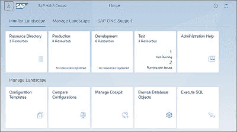
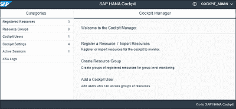
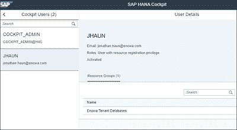
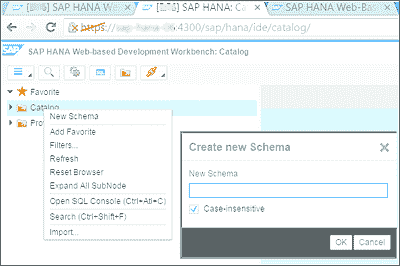
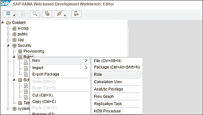
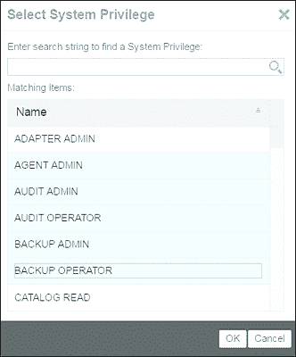
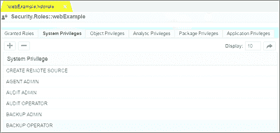
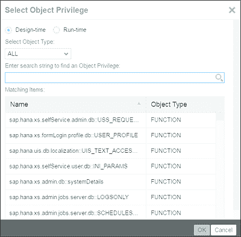
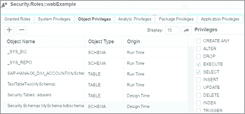
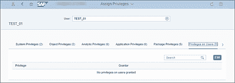

# SAP HANA 2.0 安全指南（第2版）


# Dear Reader,

Recently, a new branch of a bank was built on my route to work. Because I was driving past it twice a day, I got to see how it was built, brick-by-brick. First the ground was leveled, and then the foundation poured. From there, the whole building was framed and then gradually filled in with brick and plaster. At some point, pre-roof, the vault was lifted in, disappearing into the building before I could even see it.

While building a secure bank branch and setting up security in your SAP HANA system are wildly different processes, there are some lessons to be drawn. A new SAP HANA system is good chance to start your security practices fresh, leveling on the ground beneath you. Layers of security in the form of privileges, authorizations, certificates, and other measures are the best way to put up walls and vaults between those who should have access, and those who shouldn’t.

What did you think about SAP HANA 2.0 Security Guide? Your comments and suggestions are the most useful tools to help us make our books the best they can be. Please feel free to contact me and share any praise or criticism you may have.

Thank you for purchasing a book from SAP PRESS!

Meagan White  
Editor, SAP PRESS  

meaganw@rheinwerk-publishing.com  
[www.sap-press.com](http://www.sap-press.com)  
Rheinwerk Publishing • Boston, MA  

# 作者

# 索引

## 服务页面

## 法律声明

# 前言

SAP HANA 支持 SAP 应用程序，并托管来自各种来源的数据，这些功能通常对组织的运营至关重要。未能正确保护 SAP HANA 环境通常会导致系统不稳定并损害数据完整性；因此，必须给予 SAP HANA 安全适当的关注和审查。

## 目的

编写本书的目的是向读者介绍如何保护 SAP HANA。我们将重点介绍 SAP HANA 安全模型的关键方面，包括用户配置、角色创建、权限分配、加密、审计和身份验证。我们还将讨论可用于创建和维护 SAP HANA 安全模型的工具。此类信息对于 SAP HANA 安全架构师为其组织实施安全模型至关重要。此信息对于组织保护 SAP HANA 中托管的数据并维护依赖 SAP HANA 的系统的可靠性也是必不可少的。

## 谁应该阅读本书？

本书将帮助安全团队、SAP Basis 团队、安全顾问以及任何寻求实施 SAP HANA 安全模型的全面指南的人。

我们建议本书读者具备以下先决条件：

*   了解 SAP HANA Cockpit 的一般知识
*   了解 SQL 的一般知识
*   在数据库管理领域工作的经验
*   使用表、视图和存储过程等数据库对象的经验

每章的结构旨在为特定安全相关概念提供背景和理论。许多章节以虚构的 E-Corporation 为中心的案例研究结束，以对本书中涵盖的主题进行“现实世界”应用。我们的目标是为您提供技术知识和基于真实客户合作的独特视角，了解如何在实际中实施安全性。

## 本书结构

本书分为 18 章。简介和 第 1 章 到 第 4 章 介绍了 SAP HANA、SAP HANA 安全、SAP HANA Cockpit、权限和数据库对象。第 4 章、第 5 章 和 第 6 章 介绍了用户和角色。第 7 章 到 第 11 章 讨论了 SAP HANA 中的各种权限类型。其余章节讨论了 SAP HANA 身份验证、加密、生命周期管理、审计策略、安全故障排除以及保护 SAP HANA 环境的一般建议。

### 简介

作为许多组织数据管理的下一代演进，SAP HANA 还为管理您的组织提供关键应用程序。因此，SAP HANA 可以成为许多组织的宝贵资产。由于其重要性，必须保护 SAP HANA。在简介中，我们将介绍 SAP HANA 的硬件和软件层的概述。我们将介绍 SAP HANA 安全的基本概念，并列举保护 SAP HANA 环境重要的几个原因。

### 第 1 章：使用 SAP HANA Cockpit 管理安全性

本章介绍 SAP HANA Cockpit，这是管理 SAP HANA 安全性的关键工具。我们将从 SAP HANA Cockpit 的架构概述开始。我们将解释如何在 SAP HANA Cockpit 中导航。我们还将提供详细的工作流程，以帮助识别 SAP HANA Cockpit 中的关键安全管理区域，包括所有安全相关功能、SAP HANA 数据库资源管理器和 SQL 控制台。

### 第 2 章：SAP HANA 权限简介


# Chapter 3: 目录对象

本章解释了目录对象在 SAP HANA 系统中所起的作用。我们将回顾创建标准架构和基于存储库的架构的过程。我们还将回顾如何创建其他标准架构和基于存储库的目录对象。您需要了解目录对象的性质，因为它们与对象权限以及整体 SAP HANA 安全模型架构相关。

# Chapter 4: 用户帐户

身份验证和授权围绕用户帐户展开。每个单独用户以及每个与 SAP HANA 交互的应用程序都需要一个用户帐户。本章将提供有关用户帐户类型的详细信息，如何创建用户帐户，以及如何从用户帐户授予或撤销权限。我们还将讨论如何将角色授予用户帐户。最后，我们将提供一个案例研究，以回顾从外部来源以编程方式配置用户的方法。

# Chapter 5: 数据库角色

在授予权限时，您应始终避免将权限直接授予用户，因为这可能导致安全模型中出现重大不一致性。作为替代方案，您可以将权限授予角色，然后可以将角色授予一个或多个用户，从而提供一致性。在本章中，我们将探讨创建角色的多种选项。我们还将讨论从角色授予或撤销权限的不同方式，以及如何嵌套角色以简化安全模型的管理。

# Chapter 6: 存储库角色

除了创建标准数据库角色外，您还可以在 SAP HANA 开发存储库中定义角色。使用基于存储库的角色可以克服与标准数据库角色相关的许多问题。在本章中，我们将讨论为什么应该使用基于存储库的角色。我们还将回顾在设计时脚本中定义存储库角色所需的语法。作为定义脚本的替代方案，我们还将回顾如何使用 SAP HANA 基于 Web 的开发工作台编辑器图形用户界面 (GUI) 来创建基于存储库的角色。我们还将讨论如何将基于存储库的角色授予现有用户和角色。最后，我们将通过一个案例研究，讨论在 E-Corporation 中实现的常见角色。

# Chapter 7: 系统权限

系统权限管理您在 SAP HANA 系统中执行特定操作的能力。这些操作通常与管理和开发角色相关。在本章中，我们将探讨 SAP HANA 中可用的系统权限。我们将演示如何使用 SQL 语句、SAP HANA 驾驶舱以及 SAP HANA 基于 Web 的开发工作台安全管理器授予系统权限，以及在基于存储库的角色中授予系统权限。我们将以一个案例研究结束本章，概述几种常用的管理角色及其所需的系统权限。

# Chapter 8: 对象权限

对象权限在开发任何 SAP HANA 安全模型中都起着重要作用，因为它们定义了用户可以在目录对象上执行的 SQL 脚本操作类型。SAP HANA 托管多种类型的目录对象。在本章中，我们将仔细研究对象权限。我们将演示如何使用 SQL 语句或 SAP HANA 驾驶舱以及在基于存储库的角色中将对象权限授予用户或角色。我们将以一个案例研究结束本章，回顾 E-Corporation 用于向几个现有基于存储库的角色添加对象权限的工作流程。

# Chapter 9: 包权限

SAP HANA 既是数据管理解决方案，也是开发平台。为了便于应用程序开发、应用程序代码存储、安全性和应用程序生命周期管理，SAP HANA 提供了一个组织为包的存储库。要在包级别保护存储库，必须实现包权限。在本章中，我们将首先讨论 SAP HANA 开发存储库。然后，我们将回顾可以授予包的各种权限以及如何将它们授予被授予者。最后，我们将通过一个案例研究，其中 E-Corporation 识别并解决了其现有包层次结构和包权限设计中的差距。

# Chapter 10: 分析权限

分析权限用于授予或限制对 SAP HANA 系统中托管的数据的访问。在本章中，我们将提供分析权限的概述。我们将讨论静态分析权限和动态分析权限之间的差异，并讨论经典基于 XML 的分析权限如何被较新的基于 SQL 的分析权限所取代。我们将演示如何管理和创建静态和动态权限，并回顾排查被授予者有效分析权限的过程。最后，我们将讨论可用于授予分析权限的流程。

# Chapter 11: 应用程序权限

SAP HANA 是一个应用程序开发平台，其中基于 Web 的应用程序既被开发也被托管。有时，这些应用程序也需要自己的安全模型，称为应用程序权限。在本章中，我们将提供 SAP HANA 中应用程序权限的概述，如何创建它们，以及如何使用各种选项将它们授予角色。我们还将回顾“用户上的权限”选项，并向您展示如何使用它将 ATTACH DEBUGGER 权限授予另一个被授予者。

# Chapter 12: 身份验证

为了使授权机制正常工作，SAP HANA 系统必须首先正确识别每个用户。为了识别用户，SAP HANA 支持多种身份验证机制。在本章中，我们将详细介绍 SAP HANA 的内部基本身份验证系统及其可配置的密码策略设置。我们还将讨论支持与 SAP HANA 系统进行无缝身份验证的各种外部提供程序。最后，我们将介绍 E-Corporation 定义存储过程的过程，以将安全断言标记语言 (SAML) 身份添加到 SAP HANA 中的现有用户帐户。

# Chapter 13: 证书管理和加密

除了授权和身份验证外，您还需要加密来保护 SAP HANA 系统。在本章中，我们将回顾 SAP HANA 中的安全套接字层 (SSL) 证书管理。我们还将讨论可用于加密客户端应用程序与 SAP HANA 服务器之间通信的选项。最后，我们将讨论加密 SAP HANA 数据和日志卷所需的步骤。

# Chapter 14: 安全生命周期管理

由于 SAP HANA 是一个开发平台，安全管理员将发现与安全相关的开发工件可以轻松在不同的 SAP HANA 实例之间传输。在本章中，我们将概述使用此传输机制的最佳实践和可用选项。我们将首先讨论如何维护一致的安全模型。然后，我们将回顾定义包含与安全相关的工件的交付单元所需的步骤。接着，我们将回顾如何访问 SAP HANA 应用程序生命周期管理工具。最后，我们将讨论 SAP HANA 应用程序生命周期管理中的其他功能，这些功能可以使安全工件的生命周期管理受益。


# Chapter 15: 审计

审计允许组织配置规则，以记录在 SAP HANA 系统内进行的重要活动。在本章中，我们将讨论为什么需要在 SAP HANA 中进行审计。我们还将讨论启用审计以及定义策略以记录关键活动所需的步骤。最后，我们将通过一个案例研究，您将在其中创建审计规则来跟踪 E-Corporation SAP HANA 环境中的重要更改。

# Chapter 16: 安全跟踪和故障排除

在现实世界中，大多数安全模型都非常复杂。SAP HANA 提供安全跟踪选项和系统视图，以帮助管理员管理其安全模型。本章概述了启用安全相关授权跟踪所需的步骤，并描述了如何查看跟踪文件结果。此外，我们将回顾各种系统视图，这些视图提供了有效授予单个用户的权限的详细信息。我们将以一个案例研究结束本章，在该案例研究中，E-Corporation 查询系统视图以排查其环境中的授权问题。

# Chapter 17: 安全建议

了解如何在 SAP HANA 中配置和实施安全性至关重要，基于既定最佳实践的指南可以提供帮助。本章提供了几条建议，用于基于本书中学到的原则保护 SAP HANA 系统。我们将讨论与密码身份验证、加密、高级特权、SYSTEM 帐户、提权漏洞、设备移交和审计策略相关的建议。

# Chapter 18: SAP HANA XSA 安全

SAP 通过 SAP HANA 扩展应用服务，高级模型（SAP HANA XSA）增强了 SAP HANA 平台中包含的应用服务器。通过此增强，引入了新的安全层和保护应用程序组件的新方法。在本章中，我们将更深入地了解 SAP HANA XSA 平台的安全结构。我们将从 SAP HANA XSA 平台的概述开始。然后，我们将讨论 SAP HANA XSA 用户、角色集合、组织和空间，并向您展示如何对其进行管理和保护。我们将简要讨论 SAP Web IDE for SAP HANA，包括为什么需要它以及如何保护对该应用程序的访问。最后，我们将回顾 SAP HANA 部署基础架构（HDI）容器的架构、HDI 容器内的运行时安全性如何工作、HDI 容器角色如何工作，以及安全管理员如何管理对 HDI 容器外对象的运行时访问。

## 致谢

我谨将此书献给上帝，感谢您赐予我的智慧与知识。致我的家人和亲人，感谢您在完成本项目的无数小时和许多周末中给予的支持与理解。致 Samantha、Addison 和 Mason Haun：没有您的体贴与支持，本书将无法完成。独立完成 18 章只有在您愿意牺牲我们宝贵的家庭时间才成为可能。我珍视并热爱与您共度的每一刻，并感谢您的支持。

我还要感谢我们的客户，感谢他们将 SAP HANA 项目托付给我。没有这些来自一线的经验，本书将无法完成。

我还要感谢 Enowa，并对其允许使用托管在其 SAP 卓越中心中的 SAP HANA 环境表示赞赏。没有 Enowa 的支持，本书中的部分内容将无法创建。

感谢 Roy Wells，一位前同事和好友，他在多年与我们的客户实施 SAP HANA 解决方案的过程中帮助我开创了许多安全概念。您的智慧和指导帮助塑造了本书。

最后，我由衷地感谢 Rheinwerk 出版社的每一位同事，尤其是 Hareem Shafi 和 Meagan White。完成本书需要艰苦奋斗，他们的耐心、奉献和指导帮助我实现了另一个出版梦想。

### 简介

SAP HANA 代表了许多组织数据管理的下一代演进。作为宝贵资产，数据必须得到保护。

大多数组织将其数据视为资产：数据有助于开展业务、识别趋势、管理运营和预测变化。几十年来，计算机系统产生的数据量大幅增加。随着数据量的增加，对足够强大以处理这些数据的计算机系统的需求也随之增加。对于许多组织来说，SAP HANA 是管理和处理大量数据的强大而重要的工具。

SAP HANA 托管数据并运行对组织至关重要的应用程序。如果数据丢失或应用程序不可用，组织可能会遭受重大财务损失。因此，安全性是确保依赖 SAP HANA 的数据及其应用程序完整性所需的许多重要方面之一。

在本书中，我们将带您了解 SAP HANA 安全模型的关键概念，其核心由用户、角色和特权组成。您还必须采取措施，使用加密、身份验证和操作系统控制来保护其数据。您还必须了解用于管理安全性的各种工具，同时跟踪更改以进行审计。在深入安全模型之前，让我们先了解 SAP HANA 的概述。

### SAP HANA 概述

有些人认为 SAP HANA 只是另一个数据库，但 SAP HANA 提供的远不止数据库服务。SAP HANA 是一种下一代数据设备，可以在组织中发挥多种作用。更准确地说，SAP HANA 可以促进多种解决方案，包括 SAP HANA 为应用程序管理数据的解决方案，以及 SAP HANA 管理数据和分析的解决方案。了解 SAP HANA 安全性的第一步是了解其架构。因此，我们必须首先检查 SAP HANA 的软件层和硬件层。

#### 软件层和功能

从本质上讲，SAP HANA 充当数据库。然而，SAP HANA 也是一个应用程序开发环境，具有促进多维模型的层。SAP HANA 提供预测分析引擎，甚至在线事务处理（OLTP）引擎。不要忘记，SAP HANA 还可以充当非结构化数据处理器、全文搜索引擎、数据联合引擎和数据集成工具。由于这些功能，保护 SAP HANA 系统需要了解远超标准关系数据库管理系统（RDBMS）对象及其安全性的组件。

从高层次来看，图 1 显示了 SAP HANA 设备的软件功能和层。这些层使 SAP HANA 能够处理不仅仅是标准数据库处理。SAP HANA 内的安全性必须解决每个层的问题。


**图 1** SAP HANA 软件设备层高级概述

SAP HANA 内存数据库层包含多个查询处理引擎，例如计算引擎、在线分析处理（OLAP）引擎、行引擎和连接引擎。此层还包含行存储表、列存储表以及新的 SAP HANA 智能数据访问逻辑数据库表。引擎还设计用于管理文本处理和文本搜索。


SAP HANA 软件设备层（包括 SAP HANA 内存数据库层）还包括 SAP HANA 扩展应用服务，经典模型（SAP HANA XS）引擎（XS 引擎），以使 SAP HANA 能够用作开发平台。某些功能是嵌入式的，例如预测分析库（PAL）、业务功能库（BFL）、规划引擎、规则引擎和地理空间引擎。SAP HANA 支持使用复制代理进行数据的实时复制，以及使用 SAP HANA 智能数据集成进行数据集成。SAP HANA 还提供更强大、更复杂的 SAP HANA 扩展应用服务，高级模型（SAP HANA XSA）应用服务器，该服务器支持更复杂的编程语言和应用程序进程隔离。总的来说，这些层相互构建，形成 SAP HANA 设备。由于 SAP HANA 是一个强大的数据和应用程序平台，保护此数据和应用程序设备可能是一项具有挑战性的工作。

## 硬件层和功能

了解 SAP HANA 的硬件组件对于理解 SAP HANA 是什么以及如何保护它也至关重要。使用 SAP HANA 时，数据存储在动态随机存取存储器（DRAM）、Intel Optane DC 持久内存以及中央处理器（CPU）缓存中。因此，SAP HANA 软件可以提供卓越的性能，因为数据存储在靠近 CPU 的位置。传统数据库将数据存储在磁盘驱动器上并从中访问数据，这些驱动器在架构上距离 CPU 更远，并且出于各种技术原因，访问数据的速度较慢。

每个服务器还配置了多个 CPU 插槽，每个插槽都有多个 CPU 核心。多个 CPU 插槽和核心允许软件并发处理多个请求。例如，当数据存储在列存储中时，软件可以将每列数据的处理减少为一个或多个并行请求。由于有多个 CPU 核心可用，每个请求可以由一个或多个 CPU 核心并行处理。净结果是，对于单个查询，可以同时处理更多数据。

由于 DRAM 是易失性的，或者在服务器断电时被擦除，因此存储在 DRAM 中的数据必须自动且定期地备份到非易失性存储层。SAP HANA 设备会自动管理这些内存到磁盘和持久内存的定期快照。SAP HANA 内存数据库将数据存储在两个主要持久位置：首先，内存数据的镜像会定期同步并存储在 `/hana/data` 文件路径中。对于具有持久内存的系统，非增量数据存储也可以同时放置在持久内存池和 `/hana/data` 路径中。其次，所有事务都记录在重做日志中。SAP HANA 符合原子性、一致性、隔离性和持久性（ACID）原则。ACID 合规性保证每个数据库事务都是可靠的，即使服务器断电也是如此。SAP HANA 的重做日志有助于 ACID 合规性，重做日志存储在默认的 `/hana/log` 路径中。安全管理员必须了解此过程，因为这些位置也必须加密。

单个 SAP HANA 设备支持的 RAM 数量是有限的，组织通常需要在内存中存储比单个主机支持的更多数据。为了克服这一限制，SAP HANA 可以扩展到在多个服务器上运行，这些服务器作为单个实例运行，在多个节点上扩展时作为单个设备，同时也作为用户的单个访问点。当分布在多个节点上时，核心软件引擎在每个节点上处于活动状态，并用于管理内存中的分布式数据。

在多节点或扩展型 SAP HANA 设备中，所有节点共享一个单一的逻辑持久存储层。因此，每个节点的内存数据在常规内存数据快照和备份期间写入同一个共享持久存储层。图 2 显示了 SAP HANA 设备作为分布在多个节点上的单个实例运行。

每个 SAP HANA 节点通过专用冗余网络链路进行通信。从安全角度来看，每个 SAP 节点之间的通信必须得到保护。此外，存储在持久层中的数据也可能需要加密。幸运的是，因为 SAP HANA 扩展集群作为单个实例运行，用户、角色和权限对所有服务器节点进行集中管理。

### SAP HANA 硬件选择

各种服务器硬件供应商提供经过认证的预构建系统，用于运行 SAP HANA。每个硬件供应商都必须经过严格的认证流程，以确保其硬件平台满足或超过 SAP 设定的标准。经过认证的 SAP HANA 2.0 设备应仅在以下 CPU 模式下运行：

*   Haswell v3 Intel E7-8880 v3、E7-8890 v3 或 E7-8880L v3

*   Broadwell v4 Intel E7-8880 v4、E7-8890 v4 或 E7-8894 v4

*   Skylake SP Intel Xeon Platinum 8176、8176M、8180 或 8180M

*   Cascade Lake SP Intel Xeon Platinum 8276 或 8280

有关按供应商列出的经过认证的服务器的完整列表，请参阅 SAP HANA 认证设备硬件目录，可在 [`s-prs.co/v498226`](http://s-prs.co/v498226) 上查阅。

除了使用经过认证的预构建 SAP HANA 系统外，您还可以使用定制数据中心集成（TDI）计划设计自己的经过认证的系统。该计划允许您使用自己的内部网络基础架构和存储基础架构来构建完全受支持的 SAP HANA 系统。但是，您只能使用 SAP HANA 认证设备硬件目录中列出的服务器或计算节点。有关更多信息，请参阅 [`www.saphana.com/docs/DOC-4380`](http://www.saphana.com/docs/DOC-4380)。


**图 2** 带有一个或多个节点的 SAP HANA 扩展设备

## SAP HANA 版本

在本书中，当我们提到“SAP HANA”时，指的是 SAP HANA 2.0 SPS 01 或更高版本中的安全功能和功能。在许多情况下，相同的功能也适用于 SAP HANA 1.0 SPS 12，但通常，我们不会系统地指示 SAP HANA 1.0 和 SAP HANA 2.0 之间的差异。

## SAP HANA 架构

从高层次来看，图 3 显示了 SAP HANA 的基本服务架构，包括标准连接或通信协议。SAP HANA 系统由多个核心服务组成，例如名称服务器、预处理器服务器、编译服务器、脚本服务器、索引服务器、XS 引擎和 XSA 引擎。每个服务提供 SAP HANA 平台中可用的许多功能中的一个或多个。服务间通信在 SAP HANA 内自动得到保护。索引服务器主要负责核心安全模型元素，例如用户、角色和权限验证。索引服务器还负责核心 RDBMS 目录对象及其安全性。XS 引擎和 XSA 引擎也具有扩展到索引服务器的安全性。


**图 3** SAP HANA 服务和连接概览

为了更好地了解每个 SAP HANA 服务的功能，让我们回顾平台中每个服务的职责以及每个服务与安全性的关系。

### 索引服务器


### SAP HANA 架构概述

平台的核心服务是索引服务器，负责所有数据库、数据存储和数据处理任务。当数据存储在内存中时，数据位于索引服务器进程内。这些数据包括存储在行存或列存表中的数据。当商业智能应用程序执行 SQL 或多维表达式 (MDX) 查询时，索引服务器处理查询并返回结果。索引服务器负责 OLAP 引擎、计算引擎、连接引擎和行引擎中执行的查询，使其成为平台中最重要的服务。

索引服务器在安全模型中管理许多对象，例如用户、角色、身份验证、审计、目录对象和开发仓库，因此负责 SAP HANA 中的大部分安全性。

## XS 引擎

XS 引擎充当 Web 应用程序服务器，并管理和处理部署到 SAP HANA 平台的应用程序代码。像 SAP HANA 基于 Web 的开发工作台编辑器这样的应用程序驻留在 XS 引擎中。开发人员还可以使用 JavaScript 和 HTML5 创建自定义应用程序，并在 XS 引擎中操作这些应用程序。

XS 引擎托管许多用于管理 SAP HANA 安全性的应用程序，还提供应用程序来帮助您进行 SAP HANA 的生命周期管理。但是，SAP 指出，从长远来看，XS 引擎及其应用程序开发将被 SAP HANA XSA 平台取代。从 SAP HANA 2.0 SPS 04 开始，XS 引擎、`_SYS_REPO` 仓库和一些 SAP HANA XS 应用程序仍然可用且可用。

## XSA 引擎

XSA 引擎在 SAP HANA 1.0 SPS 11 中引入，是一个强大的 Web 应用程序服务器，您可以使用它来管理和处理应用程序代码。但是，其总体架构与 XS 引擎有很大不同。像 SAP HANA 驾驶舱和 SAP Web IDE for SAP HANA 这样的应用程序托管在此服务中。XSA 引擎可以与您的 SAP HANA 实例一起安装，也可以安装在 SAP HANA express edition 上，在那里它可以作为独立的应用程序服务器运行。每个 SAP HANA XSA 应用程序都分配了一个子进程和一个 TCP/IP 连接端口。因此，单个应用程序可以崩溃而不会导致整个 SAP HANA XS 运行时崩溃。SAP HANA XSA 还支持高级编程语言，使您能够创建更复杂的应用程序。

您还可以使用像 SAP HANA 驾驶舱和 SAP Web IDE for SAP HANA 这样的应用程序来管理 SAP HANA 安全模型的许多方面。

## 名称服务器

名称服务器负责管理 SAP HANA 架构的拓扑。在 SAP HANA 扩展中，名称服务器跟踪哪些服务处于活动状态以及数据表位于集群中的哪个位置。

名称服务器配置文件包含全局密码策略的配置，该策略定义了 SAP HANA 在整个扩展环境中如何管理密码身份验证。

## 预处理器服务器

预处理器服务器帮助索引服务器处理基于文本的搜索。此服务器包括情感分析、文本分析、全文搜索以及结构化和非结构化文本的模糊搜索等功能。此服务在保护 SAP HANA 安全方面不发挥主要作用。

## 编译服务器

编译服务器负责帮助索引服务器编译基于 L 语言的过程。此服务器在 SAP HANA SPS 06 中从索引服务器中移除，以防止编译任务导致索引服务器崩溃。但是，SAP 从未正式公布将编译服务器与索引服务器隔离的具体原因。此服务在保护 SAP HANA 安全方面不发挥主要作用。

## 脚本服务器

脚本服务器负责帮助 SAP HANA 处理需要应用程序函数库 (AFL) 的操作，其中包括 BFL 和 PAL。使用 SAP HANA 进行预测建模的开发人员或应用程序将使用此服务。此服务在保护 SAP HANA 安全方面不发挥主要作用。

除了核心服务之外，几个外部应用程序也可以访问 SAP HANA。图 3 显示了一些常见客户端及其通信协议。这些客户端与核心 SAP HANA 服务器之间的通信在安全领域尤其重要。SAP HANA 支持与所有客户端应用程序进行安全通信。SAP HANA Studio、SAP HANA 驾驶舱和 SAP Web IDE for SAP HANA 可以使用开放数据库连接 (ODBC)、Java 数据库连接 (JDBC) 或超文本传输协议 (HTTP) 与 SAP HANA 系统通信。这些通信路径中的每一个都支持强加密。许多商业智能应用程序也支持 ODBC 和 JDBC 连接。对于在 XS 引擎中托管的应用程序，SAP HANA 支持通过 HTTP 或安全 HTTPS 进行安全通信。

现在您已对 SAP HANA 的架构有基本了解，在下一节中，我们将对 SAP HANA 安全性进行基本介绍。

### SAP HANA 安全性简介

从本质上讲，SAP HANA 安全性由用户、角色和权限组成。创建用户帐户并分配一个或多个角色，创建角色并分配一个或多个权限。角色和权限的组合决定了用户帐户在 SAP HANA 平台中有权执行的操作。图 4 显示了用户、角色和权限之间关系的高级概述。


**图 4** 用户、角色和权限概述

权限分为系统、包、应用程序、分析和对象类别。每个类别控制 SAP HANA 架构中的特定区域。但是，在帐户经过身份验证之前，用户帐户无法与 SAP HANA 系统交互。通常，会提供密码用于身份验证，但 SAP HANA 还支持多种第三方身份验证机制。

除了用户、角色和权限的核心领域之外，安全管理员还必须关注加密、审计策略、用户配置、生命周期管理和安全模型故障排除。在本书中，我们将介绍这些关键概念，并让您沉浸在掌握 SAP HANA 安全模型所需的知识中。

### 保护 SAP HANA 系统的重要性

如 SAP HANA 概述部分中所述，SAP HANA 通常托管组织的关键数据。SAP HANA 还通常运行对组织至关重要的应用程序。像 SAP HANA 这样的数据库通常包含主数据源，例如客户、产品和财务数据；销售订单；以及物料清单 (BOM)。如果这些系统的完整性受到破坏，您的组织可能会遭受重大财务损失或失去竞争优势。

因此，您的组织必须在其 SAP HANA 系统中实施适当的安全模型。同样重要的是，组织必须投资于培训和资源，以管理安全模型并访问系统。只有当管理员和用户能够遵守安全模型的所有方面时，SAP HANA 才能保持安全。

您的组织需要保护其 SAP HANA 系统的四个关键原因包括以下内容：

* 组织应提供隐私保护，以保护在 SAP HANA 系统中存储和访问的数据。这种保护包括使用加密来保护内存数据和磁盘上的数据，以及使用加密来保护客户端与 SAP HANA 服务器之间的数据通信。授权和身份验证在维护数据隐私方面也发挥着重要作用。通常，只有授权的个人才应被授予访问您组织数据的权限。


组织必须确保托管在 SAP HANA 系统中的数据的完整性。记录财务交易时，这些记录应受到保护，防止未经授权的更改。数据完整性通过仅允许授权人员更改数据，并通过审计、加密和强密码身份验证策略来保护。

组织还必须确保 SAP HANA 系统的可用性。安全性是维护系统可用性的重要组成部分。授权用户和未经授权的用户都可能导致数据库可用性降低。安全模型可以管理受信任用户之间的访问，即那些在数据库中被明确授予权限的用户。但是，组织必须确保用户访问仅限于其职责范围。你还必须确保用户已针对其访问级别接受良好培训。未经授权的用户是指组织外部且未在 SAP HANA 系统中被明确授予权限的用户。这些用户通常通过不正当或未经授权的手段获取访问权限，并意图窃取数据或干扰数据库的运行。安全模型既可以管理授权访问，也可以防止未经授权的访问。

在从客户处收集敏感数据时，组织必须保护这些数据。未能保护客户数据的组织往往声誉受损。如果客户无法信任你的组织来处理其敏感数据，他们可能会选择与你的竞争对手开展业务。如果敏感客户数据未得到保护，你的组织也可能面临巨额罚款。

因此，你的组织应出于多种原因优先考虑、强调并审查其 SAP HANA 安全模型。在本书中，我们将教你如何实施安全模型、识别风险权限，并在可能的情况下遵循最佳实践。

### 摘要

我们现在准备好开始探索 SAP HANA 安全模型的旅程，首先是 SAP HANA cockpit 的概述，这是管理许多 SAP HANA 安全工件的重要工具。

## 1 使用 SAP HANA Cockpit 管理安全性

在本章中，我们将向你介绍 SAP HANA cockpit 以及管理安全设置和安全模型所需的许多工作流程。

自诞生以来，大部分 SAP HANA 安全模型一直使用 SAP HANA Studio 开发和维护，这是安装在 SAP HANA 开发人员或管理员工作站上的客户端工具。但是，在 2016 年 11 月，SAP 宣布并发布了 SAP HANA 2.0，其中包括一种名为 SAP HANA cockpit 的新管理工具。

SAP HANA cockpit 提供监控、配置、性能优化、安全性、平台生命周期管理和其他管理功能。与 SAP HANA Studio 不同，SAP HANA cockpit 不提供应用程序或内容开发工具。这些工具已迁移到 SAP Web IDE for SAP HANA，这是 SAP HANA 2.0 产品组合中的另一种独立的基于 Web 的开发工具。

SAP HANA cockpit 是一个独立的、基于 Web 的 HTML5 应用程序服务器，而不是基于桌面的客户端工具。它在 SAP HANA 扩展应用服务，高级模型（SAP HANA XSA）中运行，并且还需要 SAP HANA 2.0 express edition 数据库或 SAP HANA 2.0 租户数据库才能运行。SAP HANA cockpit 的架构旨在集中化和简化整个 IT 环境中 SAP HANA 的管理和运维。鉴于其在 SAP HANA 安全领域的重要性，本章的目标是向你介绍可以在 SAP HANA cockpit 中管理的各种安全工作流程和安全选项。但是，本章不旨在作为使用 SAP HANA cockpit 的全面指南。

###### 其他基于 Web 的管理工具

从 SAP HANA 2.0 SPS 04 开始，安全模型的某些方面仍可以使用 SAP HANA 基于 Web 的开发工作台进行管理。该工具托管在旧版 SAP HANA 扩展应用服务，经典模型（SAP HANA XS）引擎（XS 引擎）中。

在整本书中，对 SAP HANA cockpit 的引用将非常突出，因此你需要对其及其安全相关界面有基本了解。在本章中，我们将提供 SAP HANA cockpit 的概述，介绍其架构、基本导航步骤和特定的安全管理界面。我们还将介绍 SAP HANA 数据库资源管理器和 SQL 控制台，其中执行安全相关的 SQL 命令，并将概述你将用于管理安全相关项目的关键用户界面，包括用于用户和角色管理的图形界面。我们还将讨论用于管理数据加密、身份验证和数据库安全性的其他界面。

### 1.1 SAP HANA Cockpit 是什么？

在本节中，我们将提供 SAP HANA cockpit 架构的概述，向你展示如何首次访问它，回顾 SAP HANA cockpit 管理器，并引导你完成在 SAP HANA cockpit 中注册 SAP HANA 数据库所需的步骤。

### 1.1.1 SAP HANA Cockpit 架构

从架构上讲，SAP HANA cockpit 是一个 SAP HANA XSA 多目标应用程序（MTA），需要 SAP HANA 数据库才能运行。SAP 提供多种部署选项，如 图 1.1 所示。

如 图 1.1 所示，你可以使用 SAP HANA express edition 在受支持的独立服务器上部署 SAP HANA cockpit。SAP HANA cockpit 也可以与现有的 SAP HANA 实例一起安装，或通过使用共享同一实例的独立租户数据库安装在现有实例中。在所有情况下，软件必须部署到受支持的 Linux 操作系统（OS）。请务必根据你选择的部署选项正确调整硬件大小。

独立安装和作为独立实例安装都需要使用 SAP HANA express edition。幸运的是，SAP HANA cockpit 的安装介质包含每个所需组件，并为你部署整个架构。安装介质还可以将 SAP HANA cockpit 部署到现有的 SAP HANA 数据库、SAP HANA XSA 应用程序和专用租户（如果你选择该选项）。


**图 1.1** SAP HANA Cockpit 的部署选项

###### 关于安装和升级 SAP HANA Cockpit 的更多信息

有关安装、SAP HANA cockpit 架构和升级选项的更多信息，请参阅 SAP HANA 安装和更新指南，可在 [`http://s-prs.co/v498200`](http://s-prs.co/v498200) 获取。

### 1.1.2 开始使用 SAP HANA Cockpit

在开始在 SAP HANA 中管理安全性之前，你必须先学习如何访问 SAP HANA cockpit、创建 SAP HANA cockpit 用户并注册 SAP HANA 系统。在某些情况下，你还需要创建资源组，以限制用户在访问 SAP HANA cockpit 时查看注册的资源或 SAP HANA 数据库连接。在本节中，我们将引导你完成确定 SAP HANA cockpit URL、访问 SAP HANA cockpit 管理器、创建 SAP HANA cockpit 用户、创建资源组以及最后注册 SAP HANA 数据库的高级流程。请注意，本章不旨在作为 SAP HANA cockpit 的全面指南。相反，本章的目标是讨论使用 SAP HANA cockpit 管理 SAP HANA 安全模型部分所需的高级功能。

#### SAP HANA Cockpit 的重要 URL


# SAP HANA Cockpit 部署与配置指南

安装 SAP HANA cockpit 后，可以通过 SAP HANA XSA 命令行查询 SAP HANA XSA，列出已安装的应用程序及其 URL 和端口。从提供的媒体部署 SAP HANA cockpit 时，会安装多个 SAP HANA XSA 应用程序。从 SAP HANA 2.0 SPS 04 开始，SAP HANA cockpit 应用程序名为 `cockpit-web-app`。如需查找确切 URL，请使用 SAP HANA XSA 命令行列出已安装的应用程序。具体流程如下：

## 1. 登录 SAP HANA XSA 命令行

SAP HANA XSA 命令行随 SAP HANA cockpit 安装包提供。该命令行从操作系统 shell 执行。要使用 SAP HANA XSA 命令行，请以 `<sid>adm` 用户身份通过安全外壳协议（SSH）登录到 SAP HANA cockpit 服务器。默认情况下，SAP HANA cockpit 的 SAP 系统标识（SID）为 `H4C`，因此应以 `h4cadm` 用户身份登录 Linux。

SAP HANA XSA 命令行命令可从任何目录运行。启动流程前，运行以下命令登录 SAP HANA XSA：

```
xs login
```

使用 SAP HANA cockpit 管理员用户登录，通常为 `COCKPIT_ADMIN` 用户。

输入应用程序编程接口（API）端点 URL，通常为 `https:<cockpit-host-name>:39630`。

默认情况下，应使用 `HANACockpit` 组织和 `SAP` 空间登录。如果不在此空间中，请运行以下命令进入正确的组织和空间：

```
xs org HANACockpit
xs space SAP
```

## 2. 查询应用程序 URL 和端口

执行以下命令列出 `cockpit-web-app` 应用程序的 URL 和端口：

```
xs a | grep cockpit-web-app
```

输出右侧查找 URL 和端口。在大多数情况下，该 URL 将运行在端口 `51028` 上，并匹配以下模式：

```
https://<cockpit-host-name>:51028
```

还需要 SAP HANA cockpit 管理器应用程序的 URL。运行以下命令列出该应用程序的 URL 和端口：

```
xs a | grep cockpit-admin-web-app
```

输出右侧查找 URL 和端口。在大多数情况下，该 URL 将运行在端口 `51030` 上，并匹配以下模式：

```
https://<cockpit-host-name>:51030
```

输入包含端口的 SAP HANA cockpit 应用程序 URL 以访问登录页面。例如，输入 `https://hanacockpit.ecorp.com:51028/`。可以使用 `COCKPIT_ADMIN` 用户或由 SAP HANA cockpit 管理员提供的用户登录。

## 3. SAP HANA Cockpit 主页

SAP HANA cockpit 主页将提供多个链接和磁贴，单击后可导航到各种管理选项，如图 1.2 所示。例如，可以单击“资源目录”磁贴查看已注册的 SAP HANA 系统。也可以单击“管理驾驶舱”磁贴，访问 SAP HANA cockpit 管理器。



**Figure 1.2** SAP HANA Cockpit Homepage

## 4. SAP HANA Cockpit Manager

现在，让我们详细了解 SAP HANA cockpit 管理器。在 SAP HANA cockpit 中进一步导航之前，必须注册 SAP HANA 系统，并建立 SAP HANA cockpit 用户和 SAP HANA cockpit 组。

默认情况下，可以使用以下 URL 模式访问 SAP HANA cockpit 管理器：

```
https://<cockpit-host-name>:51030
```

但是，在您的环境中，该应用程序可能部署到不同的端口。如前所述，使用 SAP HANA XSA 命令行中的 `xs a` 命令列出应用程序、URL 和端口。SAP HANA cockpit 管理器应用程序名为 `cockpit-admin-web-app`。

输入 URL 并使用提供的凭据登录。首次访问管理器时，可以使用 `COCKPIT_ADMIN` 用户。驾驶舱管理器主页分为左侧的菜单选项列表和右侧窗格中的配置页面，如图 1.3 所示。



**Figure 1.3** SAP HANA Cockpit Manager Homepage

以下项目列表概述了“类别”菜单中的每个项目在 SAP HANA cockpit 管理中的用途：

* **Registered Resources**

  使用此菜单选项添加或导入 SAP HANA 数据库连接信息。SAP HANA 数据库必须在 SAP HANA cockpit 管理器中注册，才能在 SAP HANA cockpit 中使用。

* **Resource Groups**

  使用此菜单选项创建和管理资源组，资源组是用于将一个或多个已注册的 SAP HANA 数据库分组的组织和安全对象。SAP HANA cockpit 用户被分配到一个或多个组。对于标准 SAP HANA cockpit 用户，可以使用组来限制其在 SAP HANA cockpit 中看到的注册系统。但是，被授予“管理员”或“资源管理员”角色的用户将看到所有资源，无论其分配的组如何。

* **Cockpit Users**

  使用此菜单选项创建和管理 SAP HANA cockpit 用户。

* **Cockpit Settings**

  使用此菜单选项管理 SAP HANA cockpit 特定设置。

* **Active Sessions**

  使用此菜单选项查看和终止 SAP HANA cockpit 中的活动会话。

* **XSA Logs**

  使用此菜单选项查看 SAP HANA XSA 应用程序日志。SAP HANA cockpit 用户必须是 SAP HANA XSA 组织管理员才能使用此功能。可以使用 SAP HANA XSA 命令行界面授予 SAP HANA cockpit 管理员此访问权限，运行以下命令：

  ```
  xs set-org-role COCKPIT_ADMIN HANACockpit OrgManager
  ```

## 5. 创建 SAP HANA Cockpit 用户

所有需要与 SAP HANA cockpit 交互的人员都需要用户帐户来登录和访问资源。SAP HANA cockpit 用户实际上是 SAP HANA XSA 用户，也实际上是 SAP HANA 数据库用户。可以在上述每个层中创建这些用户，但最佳做法是从 SAP HANA cockpit 管理器创建，以避免任何设置问题。

SAP HANA cockpit 用户凭据仅适用于 SAP HANA cockpit 应用程序及其支持的 SAP HANA 数据库。这些凭据不提供对已注册 SAP HANA 数据库的访问权限。用户除了 SAP HANA cockpit 用户凭据外，还需要每个已注册数据库的凭据。还请注意，SAP HANA cockpit 用户的密码策略遵循支持该应用程序的 SAP HANA，express edition SYSTEMDB 或 SAP HANA 租户数据库中配置的密码策略。管理员应考虑在 SAP HANA cockpit 中注册此 SAP HANA，express edition 数据库或租户数据库，以管理这些和其他数据库设置。

要创建 SAP HANA cockpit 用户，请从主页单击“Cockpit Users”菜单选项。将出现一个新窗口，左侧列出现有用户，右侧显示所选用户的详细信息，如图 1.4 所示。



**Figure 1.4** Cockpit Users Interface in the SAP HANA Cockpit Manager

单击用户列表底部的“Create User”按钮，创建新用户。要编辑现有用户，请在列表中选择用户，然后单击用户详细信息右下角的“Edit”按钮。现在，让我们了解创建用户的流程，并描述可以授予用户的各种角色。

单击“Create User”按钮后，将出现一个三步向导。在第一页“1. User Information”中，使用提供的字段输入新用户的用户名、密码、确认密码和电子邮件，如图 1.5 所示。


点击 `Step 2` 按钮以继续。在 `2. Cockpit Roles` 页面上，选择要授予用户的角色的复选框。点击 `Step 3` 按钮以继续。在 `3. Resource Groups` 部分页面，点击 `Add Groups` 按钮以打开 `Add User to Existing Group` 弹出窗口。在此弹出窗口中，选择要分配给用户的组的复选框。点击 `OK` 关闭弹出窗口，然后最后一次点击 `Create User` 以完成该过程。


**图 1.5** 在 SAP HANA Cockpit Manager 中创建用户

现在，让我们来看看可以授予用户的各种角色。请注意，角色不是累积的，这意味着一个角色不会建立在另一个角色之上。相反，每个角色都是明确的，每个角色只直接提供对一个区域的访问权限。用户需要获得所有授予的角色才能完全访问 SAP HANA cockpit 和 SAP HANA cockpit manager。

以下列表概述了每个角色，并提供了每个角色授予用户的权限的其他信息：

*   `Cockpit Administrator Role`

    此角色仅提供对 SAP HANA cockpit 设置的管理访问权限。此角色不是主角色，仅提供更改设置的访问权限；不包含其他访问权限。

*   `Cockpit Resource Administrator Role`

    此角色将授予用户注册 SAP HANA 数据库、创建资源组和管理资源组分配的权限。具有此角色的用户将可以访问所有已注册的资源，无论其分配的 SAP HANA cockpit 组如何。

*   `Cockpit User Administrator Role`

    此角色将授予用户在 SAP HANA cockpit manager 和底层 SAP HANA cockpit 数据库中创建和管理其他用户的能力。在数据库级别，此角色授予 `ROLE ADMIN` 和 `USER ADMIN` 系统权限。在 SAP HANA cockpit manager 应用程序级别，此角色授予类似的访问权限。

*   `Cockpit User Role`

    此标准角色是用户访问 SAP HANA cockpit 所必需的。用户必须具有此角色才能访问 SAP HANA cockpit 主页。此角色的两个其他选项将授予标准 SAP HANA cockpit 用户有限但额外的权限。让我们更详细地看看这些选项：

    *   `Register resources through the Cockpit Manager`

        此子角色选项授予用户有限的访问权限，以便在 SAP HANA cockpit manager 中创建和注册 SAP HANA 服务器资源。资源将不带组创建，访问权限仅限于 `Cockpit Resource Administrator` 角色的成员和其自身。

    *   `System configuration template administrator role`

        此子角色允许用户访问 SAP HANA cockpit 配置模板磁贴。配置模板包含 SAP HANA 数据库 `.ini` 文件设置，可以存储并应用于 SAP HANA 数据库。

*   `Cockpit Troubleshooting Role`

    此角色授予用户查看 SAP HANA cockpit manager 中 SAP HANA XSA 日志区域的访问权限。用户必须是 SAP HANA XSA 组织管理员才能使用此功能。您可以使用 SAP HANA XSA cockpit 图形用户界面 (`GUI`) 或使用 SAP HANA XSA 命令行运行以下命令来授予 SAP HANA cockpit 管理员此访问权限：`xs set-org-role COCKPIT_ADMIN HANACockpit OrgManager`。

在下一节中，我们将更详细地探讨 SAP HANA cockpit 组，并向您展示如何在 SAP HANA cockpit manager 中创建组。

### 创建 SAP HANA Cockpit 资源组

SAP HANA cockpit 使用资源组来组织和保护已注册的 SAP HANA 数据库。SAP HANA cockpit 用户可以分配到一个或多个组。对于标准 SAP HANA cockpit 用户，您可以使用组来限制他们在 SAP HANA cockpit 中看到的已注册系统。但是，如果用户被授予 `Administrators` 或 `Resource Administrators` 角色，他们将看到所有资源组，无论其分配的组如何。

资源组是使用 SAP HANA cockpit manager 创建的。从 SAP HANA cockpit manager 主页，单击 `Resource Groups` 菜单选项以访问资源组管理界面。该界面分为两个窗格。左侧是 `Resource Groups` 窗格中现有资源组的列表。右侧是 `Resource Group Details` 窗格，如 图 1.6 所示。当您单击左侧的资源组时，其已注册的资源或 SAP HANA 数据库将出现在右侧。


**图 1.6** SAP HANA Cockpit Manager 资源组管理界面

要创建组，请找到资源组列表底部的 `Create Group` 按钮。单击该按钮以启动三步 `Create Group` 向导。在第一步 `1. General information` 中，在提供的字段中输入资源 `Group name` 和 `Description`。单击 `Step 2` 按钮以继续。在第二步 `2. Resource` 中，将现有已注册的 SAP HANA 系统分配给组。单击 `Step 3` 按钮以继续。在第三步 `3. Cockpit Users` 中，将一个或多个用户分配给组。单击 `Create Group` 按钮以完成向导。

您可以通过在 SAP HANA cockpit manager 右侧选择一个组，在 `Resource Group Details` 窗格左侧列出的资源或用户上方的 `Resource` 和 `Cockpit Users` 选项卡之间切换，来修改现有组。您也可以使用此界面从资源组中删除或移除已注册的资源或用户。

分配给组的用户现在登录到 SAP HANA cockpit 时将看到相应的已注册资源。在下一节中，我们将探讨已注册资源的用途以及如何使用 SAP HANA cockpit manager 注册它们。

### 注册 SAP HANA 数据库和租户

在与 SAP HANA 系统交互之前，您必须先添加或配置与 SAP HANA 系统的连接，并将此连接存储在 SAP HANA cockpit 中。

要注册资源或 SAP HANA 数据库，请单击 SAP HANA cockpit manager 主页上方的 `Registered Resources` 按钮以访问已注册资源管理界面。此界面分为两个窗格。左侧是 `Registered Resources` 窗格中现有已注册资源或 SAP HANA 服务器的列表。右侧是 `Resource Details` 窗格，如 图 1.7 所示。当您单击左侧的资源组时，有关已注册资源或 SAP HANA 数据库的详细信息将出现在右侧。


**图 1.7** SAP HANA Cockpit Manager 中的 SAP HANA 数据库或已注册资源


# 注册 SAP HANA 资源

单击 Register Resource 按钮以启动五步 Register Resources 向导。在第一步 `1\. Resource` 中，提供 SAP HANA 数据库的连接详细信息。单击 Step 2 按钮继续。在第二步 `2\. Connection` 中，选择连接到 SAP HANA 数据库时所需的通信加密选项。单击 Step 3 按钮继续。在第三步 `3\. Technical User` 中，输入将用于从数据库收集运行时和运行状况信息的凭据。此步骤还提供在目标数据库中创建技术用户的附加选项。单击 Step 4 按钮继续。在第四步 `4\. Resource Groups` 中，将注册分配给一个或多个现有资源组。单击 Step 5 按钮继续。在第五步 `5\. Contact` 中，输入数据库管理员的联系信息。单击 Review 按钮查看注册摘要。如果信息正确，请单击 Register 按钮激活连接。

创建 SAP HANA cockpit 用户以及管理对整体 SAP HANA cockpit 功能的访问时，需要具备 SAP HANA cockpit manager 的基本了解。本节对设置对 SAP HANA cockpit 和 SAP HANA cockpit manager 的访问所需的组件和步骤进行了高级概述。在下一节中，我们将提供一些关于在 SAP HANA cockpit 主页上导航、连接到已注册数据库以及在系统概览页面上查找特定于安全性的选项的提示。

## 1.1.3 导航 SAP HANA Cockpit

导航 SAP HANA cockpit 需要对界面布局以及用于连接到已注册数据库，然后在系统概览界面上与安全性和管理工具交互的工作流程有基本了解。我们讨论了如何获取 SAP HANA cockpit URL（请参阅 第 1.1.2 节）以及如何设置对 SAP HANA cockpit 的用户访问。登录 SAP HANA cockpit 后，您将从 SAP HANA cockpit 主页开始。

图 1.8 显示了 SAP HANA cockpit 主页的示例布局。界面顶部附近的选项卡（监控景观、管理景观和 SAP One Support）将分别将您导航到主页上的不同部分和磁贴集。让我们更详细地查看每个选项卡。

第一个选项卡和磁贴集是监控景观选项卡。在此选项卡下，您可以通过单击资源目录磁贴查看整个资源目录。您还可以根据数据库的配置文件，查看组织为生产、开发和测试资源组的已注册系统。安装 SAP HANA 时，安装程序将确定系统的预期用途，SAP HANA cockpit 使用该信息自动将已注册系统组织为生产、开发和测试资源组。分配给您用户帐户的任何资源组也将显示为此部分中的磁贴。最后，管理帮助磁贴使您能够导航到与管理 SAP HANA cockpit 相关的文档。


**图 1.8** SAP HANA Cockpit 主页

要导航到 SAP HANA 数据库，请根据主页上的磁贴组查找连接。在大多数情况下，您将在一个或多个磁贴组中找到系统。每个磁贴并非专属于某个已注册的 SAP HANA 系统。例如，要查看您的帐户有权访问的所有已注册系统，请单击资源目录磁贴以查看完整列表。在资源目录中，您可以使用筛选栏查找特定的 SAP HANA 数据库。即使在可能包含多个已注册系统的大型景观中，此功能也能轻松查找特定的 SAP HANA 数据库。

找到已注册的 SAP HANA 数据库后，单击资源名称，通常采用 `<数据库租户>@<SID>` 格式。例如，如果租户数据库是 H4E，数据库的 SID 是 HDB，则注册名称将是 H4E@HDB。图 1.9 显示了已注册的 SAP HANA 系统列表和筛选栏。找到目标系统后，单击系统名称以访问该系统的系统概览页面。


**图 1.9** SAP HANA Cockpit 资源目录中的 SAP HANA 系统列表

系统概览页面也分为磁贴和部分。页面顶部有一个较小的筛选栏。您可以使用此筛选栏限制显示的管理磁贴。在按区域筛选下拉列表中，选择安全性，以将界面限制为包含 SAP HANA 安全性功能的磁贴。

图 1.10 显示了磁贴布局示例以及可用于管理安全性的各种选项。安全区域中的磁贴包括数据加密、审计、身份验证、安全相关链接、用户和角色管理以及匿名化报告磁贴。

在下一节中，我们将更详细地探讨每个磁贴。目前，了解如何访问已注册资源、如何访问系统概览页面以及如何筛选安全相关区域或磁贴是您需要了解的最重要流程。


**图 1.10** 连接到已注册系统时，SAP HANA Cockpit 中的安全相关磁贴和配置选项

### 1.2 SAP HANA Cockpit 中的安全区域

到目前为止，在本章中，我们讨论了 SAP HANA cockpit 的架构，包括部署选项。我们探索了 SAP HANA cockpit manager，并描述了设置用户、资源组和已注册系统所需的高级步骤。最后，我们提供了关于如何在 SAP HANA cockpit 中访问已注册系统，然后访问已注册系统的系统概览页面的高级信息。在系统概览页面上，您可以使用按区域筛选下拉列表筛选各种可用选项。对于管理安全性，我们将在该区域中找到大多数选项。

安全区域提供指向数据加密、审计、身份验证、安全相关链接、用户和角色管理以及匿名化报告区域的磁贴和链接。在下一节中，我们将对每个区域进行高级概述，并描述如何使用这些区域来管理 SAP HANA 安全模型。

### 1.2.1 用户和角色管理区域

用户和角色管理区域提供多个链接，例如管理用户、为用户分配角色、为用户分配权限、管理角色、管理用户组和查看数据库对象依赖关系链接，如 图 1.11 所示。


**图 1.11** SAP HANA Cockpit 中的用户和角色管理磁贴

以下列表概述了此磁贴中每个链接的用途。在后续章节中，我们将更详细地演示这些项目。但是，在本章中，我们将仅对每个链接提供基本概述。让我们简要查看每个链接：

*   管理用户


你将使用此链接来创建、编辑和删除数据库用户。你只能在此链接中配置用户账户设置。例如，你可以在此区域配置用户的身份验证模式、密码、第三方身份验证设置和自定义用户属性。你不能使用此区域向用户授予角色或权限。相反，你将使用“Assign role to users”和“Assign privilege to users”链接来执行这些活动。我们将在第 4 章中更详细地讨论这些选项。

*   Assign role to users  

    你将使用此链接来授予或撤销用户账户的角色。我们将在第 5 章中更详细地讨论此链接。

*   Assign privilege to users  

    你将使用此链接来授予或撤销用户的单个权限。我们将在第 4 章和从第 6 章到第 11 章中更详细地讨论此链接。

*   Manage roles  

    你将使用此链接来查看和管理标准数据库运行时角色，例如，向角色授予其他角色、系统权限和对象权限。你还将使用此链接来创建和删除角色。我们将在第 5 章中更详细地讨论此链接。

*   Manage user group  

    你将使用此链接来创建和编辑用户组。用户组有助于将用户组织成组。你可以配置用户组，以便只有特定用户可以管理组内的其他用户账户。你还可以为每个用户组建立唯一的密码策略。

*   View database object dependencies  

    你将使用此链接来查看给定目录对象的授权依赖项，这是安全管理员在删除数据库对象之前必须执行的重要步骤，也是用于确定哪些用户可以访问数据库对象的步骤。

在下一节中，我们将探索“数据加密”磁贴及其链接。

### 1.2.2 数据加密

你将使用“数据加密”磁贴及其链接来管理静态数据的数据加密选项。磁贴本身包含滑块按钮，你可以快速启用或禁用（开启或关闭）数据卷加密、重做日志加密和备份加密，如图 1.12 所示。


**图 1.12** SAP HANA Cockpit 中的“数据加密”磁贴和链接

除了使用滑块之外，每个项目都可以点击，包括磁贴的标题，以便在“数据加密”配置界面中导航到每个项目的其他选项。我们将在第 13 章中更详细地讨论此界面和这些选项。你现在应该已基本了解如何访问“数据加密”磁贴以及它为管理 SAP HANA 安全模型提供的选项。在下一节中，我们将探索“身份验证”磁贴和链接。

### 1.2.3 身份验证

你将使用“身份验证”磁贴及其链接来管理密码策略、单点登录 (SSO) 和 SYSTEM 用户的密码。此磁贴中的链接（密码策略、单点登录和 SYSTEM 用户密码）可以点击来管理每个特定区域，如图 1.13 所示。


**图 1.13** SAP HANA Cockpit 中的“身份验证”磁贴和链接

在第 12 章中，我们将更详细地讨论这些链接选项。你现在应该已基本了解如何访问“身份验证”磁贴以及在管理 SAP HANA 安全模型时可用的选项。在下一节中，我们将探索“安全相关链接”磁贴及其链接。

### 1.2.4 安全相关链接

你将使用“安全相关链接”磁贴及其链接来管理 SAP HANA 数据库中的多个安全相关项目，如图 1.14 所示。


**图 1.14** SAP HANA Cockpit 中的“安全相关链接”磁贴和链接

让我们更详细地探索每个链接的目的和预期用途：

*   Manage certificates  

    你将使用此链接来访问数据库内的证书。如我们将在第 13 章中进一步讨论，你将使用此界面来导入和删除证书。

*   Manage certificate collections  

    你将使用此链接来管理证书集合。证书集合是一个物理或逻辑存储，用于保存证书并定义其用途。如我们将在第 13 章中进一步讨论，你将使用此界面来管理存储在数据库中的证书集合。

*   View network security information  

    你将使用此链接来访问一个页面，该页面提供有关通信加密状态、传输层安全 (TLS)/安全套接字层 (SSL) 设置和类型以及内部通信加密的一般信息。此信息为只读，且无法在此界面中更改任何设置。

*   Manage SAML identity providers  

    你将使用此链接来管理第三方安全断言标记语言 (SAML) 身份验证提供程序，并导入和删除对该机制至关重要的 SAML 证书。如我们将在第 12 章中进一步讨论，SAML 可以为 SAP HANA 数据库和 Web 应用程序界面提供单点登录功能。

*   Manage JWT identity providers  

    你将使用此链接来管理 SAP HANA 系统中支持的用于单点登录的 JSON Web 令牌 (JWT) 提供程序。JWT 是一种开放标准 (RFC 7519)，概述了使用 JavaScript 对象表示法 (JSON) 对象在两方之间传递安全信息的方法。SAP HANA 对此功能的支持有限，如我们将在第 12 章中进一步讨论。

*   Security checklist  

    你将使用此链接来访问 SAP 的检查清单，以便将当前 SAP HANA 安全设置与 SAP 的建议进行比较。此检查清单提供与保护 SAP HANA 系统相关的实时报告、警告和信息。该界面仅提供警告，不推荐具体操作。请参见第 17 章，了解如何降低检查清单中发现的一些警告所关联的风险。

*   Security administration help  

    你将使用此链接来打开托管在 SAP HANA Cockpit Web 应用程序服务器上的 SAP HANA Administration with SAP HANA Cockpit 指南。此指南提供有关管理 SAP HANA Cockpit 的详细信息。此链接将直接带你进入指南的“安全管理”部分。

*   SAP HANA security website   

    你将使用此链接来打开 [www.sap.com](http://www.sap.com) 上的 SAP HANA 安全产品页面。在此页面上，你将找到指向相关安全帮助文档、白皮书和案例研究的链接。

你现在应该已基本了解如何访问“安全相关链接”磁贴以及它在管理 SAP HANA 安全模型时提供的选项。在下一节中，我们将探索“匿名化报告”磁贴及其链接。

### 1.2.5 匿名化报告

从 SAP HANA 2.0 SPS 04 开始，你可以定义 SQL 视图，以便在基于各种参数和方法查询数据时对数据进行匿名化处理。使用此功能保护的视图称为匿名化视图。你可以使用“匿名化报告”磁贴和链接来访问“查看可用匿名化视图”链接，该链接将引导你进入“匿名化报告”界面。在“匿名化报告”界面中，你将看到一个启用了此功能的目录视图列表。你可以点击每个列出的视图，以查看已应用于该视图的匿名化参数和方法的只读信息。


请注意，您可以使用 `SQL` 语句将此功能应用于视图，或在使用 `SAP Web IDE for SAP HANA` 开发计算视图时应用。目前您无法使用 `SAP HANA cockpit` 创建这些视图。

您现在应该已基本了解如何访问 `Anonymization Report` 磁贴以及在管理 `SAP HANA` 安全模型时它提供的选项。在下一节中，我们将探讨 `Auditing` 磁贴及其链接。

### 1.2.6 Auditing

`Auditing` 磁贴及其链接可用于访问审计设置并在 `SAP HANA` 数据库中配置审计策略。审计策略（如 第 15 章 中进一步讨论）用于跟踪 `SAP HANA` 数据库中的特定操作。此磁贴中的所有链接均可点击，包括 `Auditing` 标题，它将导航至 `Auditing` 配置界面，如 图 1.15 所示。


**图 1.15** SAP HANA Cockpit 中的 Auditing 磁贴和链接

`Status` 链接；`Audit Trail Target` 链接；`Enabled Audit Policies` 链接（包含已启用策略的摘要）；以及 `Disabled Audit Policies` 链接（同样包含摘要）均可点击，以直接跳转至 `Auditing` 配置界面中的相应设置。磁贴底部是 `Turn on Auditing` 链接，它将启用审计机制。

您现在应该已基本了解如何使用 `Auditing` 磁贴及其提供的链接选项访问 `Auditing` 配置界面。我们已对 `SAP HANA cockpit` 提供的用于管理安全性的磁贴和链接进行了高级概述。后续章节将提供有关如何使用每个磁贴及其链接来管理 `SAP HANA` 安全模式的更多信息。

在下一节中，我们将探讨 `SAP HANA database explorer` 和 `SQL console`，这两者都是 `SAP HANA cockpit` 中的重要工具集。您将发现，需要使用这些工具来探索数据库并执行 `SQL` 语句，所有这些都是管理 `SAP HANA` 安全模型所必需的。

### 1.3 SAP HANA Database Explorer 和 SQL Console

`SAP HANA cockpit` 提供 `SAP HANA database explorer`，以便您可以连接到 `SAP HANA` 数据库并在运行时处理目录对象。从 `SAP HANA cockpit` 主页，单击 `Browse Database Objects` 磁贴以访问 `SAP HANA database explorer`，如 图 1.16 所示。您也可以通过单击此页面上的 `Execute SQL` 磁贴直接访问 `SQL console`。


**图 1.16** Browse Database Objects 和 Execute SQL 磁贴

或者，您可以在连接到已注册的 `SAP HANA` 数据库时访问 `SQL console`。在 `System Overview` 页面上，如 图 1.17 所示，您将在右上角看到两个链接：`Open SQL Console` 和 `Manage Databases`。


**图 1.17** 用于从 SAP HANA Cockpit 系统概览页面访问 SQL Console 的 Open SQL Console 链接

单击 `Open SQL Console` 链接可直接导航至 `SAP HANA database explorer`，连接到已注册系统，并在单个步骤中启动 `SQL console`。从技术上讲，此链接除了打开 `SQL console` 之外，还会带您进入 `SAP HANA database explorer`。

在 `SAP HANA database explorer` 界面中，您可以单击 `SAP HANA Database Explorer` 标题下方窗格中的加号图标（`+`）来添加连接。您有多种 `Database Types` 可供选择：`SAP HANA database`、`SAP HANA database (Multitenant)` 或 `Cockpit Resource`。选择 `Cockpit Resource` 选项可使用 `SAP HANA cockpit` 注册信息连接到 `SAP HANA` 数据库。要连接到经典 `SAP HANA` 数据库对象，请选择 `SAP HANA database` 或 `SAP HANA database (Multitenant)` 选项，并输入所需数据库的连接信息。

对于每个连接，您将获得各种目录对象类型的图形列表，如 图 1.18 所示。例如，如果您正在搜索表，请单击 `Catalog` 下的表选项，然后使用下方窗格中的架构选择栏和搜索栏在所选架构中按名称查找表。一旦在列表中找到对象，双击该对象即可显示其元数据，或右键单击该对象以打开包含与所选对象交互选项的弹出窗口。

当您进一步查看已连接数据库中 `Catalog` 文件夹下方时，您将看到一个 `Host Diagnostic Files` 文件夹。展开此节点下的子文件夹，直到找到以每个 `SAP HANA` 数据库服务命名的文件夹。例如，将出现 `Name Server` 和 `Index Server` 文件夹。在每个文件夹中，您将找到特定于服务文件夹的各种 `.trc` 文件（跟踪文件）。双击文件以打开并在 `SAP HANA database explorer` 界面右侧的选项卡中查看其内容。安全管理员在排查安全配置问题或用户无法访问内容时，通常需要查看这些文件。


**图 1.18** SAP HANA Cockpit 中的 SAP HANA Database Explorer

您现在应该已基本了解 `SAP HANA cockpit` 中的 `SAP HANA database explorer`。

###### 关于 SAP HANA Database Explorer 的更多信息

有关 `SAP HANA database explorer` 的更多信息，请参阅 `SAP HANA Database Explorer Guide`，可在 [`s-prs.co/v498201`](http://s-prs.co/v498201) 上查阅。

一旦您与数据库建立连接，即可访问 `SQL console`，在其中执行 `SQL` 语句。要启动 `SQL console`，请从 `SAP HANA database explorer` 中找到的列表中选择现有数据库连接。单击数据列表右上角带有单词 `SQL` 的图标，如 图 1.19 所示。右侧将出现带有 `SQL console` 标签（可能带有数字）的新选项卡。

在此选项卡中是 `SQL console`。输入所需的 `SQL`，然后单击运行图标（绿色播放按钮）。您也可以按 (`F8`) 按钮来运行 `SQL` 命令。`SQL` 语句的结果将出现在输入的语句下方，如 图 1.19 所示。


**图 1.19** 在 SAP HANA Cockpit 中访问和使用 SQL Console

您现在应该已基本了解访问 `SAP HANA database explorer` 和 `SQL console` 所需的步骤。作为安全管理员，您将使用 `SQL console` 执行特定于安全性的语句。当您需要在数据库中定位目录对象并查看其元数据时，`SAP HANA database explorer` 非常有用。您还将使用 `SAP HANA database explorer` 访问可能包含特定于安全性的跟踪信息的 `.trc` 文件。

### 1.4 摘要

本章向您介绍了 `SAP HANA cockpit`。我们还提供了您管理对 `SAP HANA cockpit` 的访问以及各种应用程序、磁贴和链接所需的基本信息，这些应用程序、磁贴和链接允许您管理 `SAP HANA` 数据库的安全模型。在后续章节中，我们将提供有关如何使用 `SAP HANA cockpit` 管理 `SAP HANA` 安全模型特定方面的更多信息和示例。

## 2 SAP HANA 权限简介


在本章中，我们将向您介绍 SAP HANA 权限，并定义几个相关的关键术语。权限是 SAP HANA 安全性的主要组成部分，因为它们控制用户可以执行哪些操作。

用户可以以多种不同的方式与 SAP HANA 进行交互。在过去，用户会使用 `SAP HANA Studio` 来开发内容和管理系统。使用 `SAP HANA 2.0` 时，您可能会使用 `SAP HANA Web-Based Development Workbench` 编辑器和 `SAP Web IDE for SAP HANA` 来开发内容。您还将使用 `SAP HANA cockpit` 来管理系统。其他用户可能会与商业智能工具进行交互，并查询托管在 `SAP HANA` 中的数据。在其他情况下，`SAP NetWeaver` 使用 `SAP HANA` 数据库来帮助运行 `SAP Business Warehouse (SAP BW)` 和 `SAP S/4HANA` 等应用程序。在所有情况下，都需要数据库用户帐户才能与 `SAP HANA` 进行交互。这些用户帐户通常分配给个人。但是，您也可以设置专用服务帐户，以允许应用程序将多个用户的访问权限委托给 `SAP HANA` 系统。为了管理这些交互，必须将各种权限分配给用户帐户。

当用户帐户与 `SAP HANA` 进行交互时，该用户只能执行通过权限授予的操作和动作。授予权限是授予者将权限分配给另一个用户帐户的过程。为了授予单个权限，授予者必须已被授予该权限，并且还必须被分配了 `WITH GRANT OPTION` 或 `Grantable to Others` 选项，这是一项额外的权利，允许授予者将相同的权限授予另一个用户。如果您使用 `SQL` 来授予权限，则将使用 `WITH GRANT OPTION` 语法。如果您在 `SAP HANA cockpit` 中使用图形用户界面 (`GUI`)，则会看到一个标记为 `Grantable to Others` 的滑块按钮。

当您首次设置 `SAP HANA` 系统时，第一个可用的用户帐户将是 `SYSTEM` 帐户。该帐户的用户名仅为 `SYSTEM`。默认情况下，`SYSTEM` 帐户可以为所有默认系统对象、权限和角色创建用户并向其他用户帐户授予权限。

当您首次与 `SAP HANA` 进行交互时，您很可能会使用 `SYSTEM` 用户帐户登录。如果您遵循最佳实践，您将创建新用户帐户，设置新的安全模型，并将该安全模型分配给新的专用用户帐户。大多数组织随后将禁用对 `SYSTEM` 帐户的访问，以便他们可以正确审计单个用户的活动。

从定义上讲，您在 `SAP HANA` 中执行的各种操作和动作被组织为称为权限的对象。在本章中，我们将向您介绍 `SAP HANA` 中可用的五大类权限，我们还将描述如何将权限正确地授予角色和用户，以及系统如何验证用户的访问权限。在后续章节中，我们将深入探讨各个权限，并概述每个权限授权的内容；但是，本章的目的是提供权限的概述。

### 2.1 SAP HANA 中的权限

`SAP HANA` 中可用的五大类权限是系统权限、对象权限、分析权限、包权限和应用程序权限。每个类别包含可以授予用户或角色的单个权限。在以下各节中，我们将逐一介绍每个类别。

### 2.1.1 系统权限

系统权限旨在管理用户可以执行的各种系统活动。它们主要用于管理 `SAP HANA` 数据库中的管理活动。但是，某些系统权限专门管理与 `SAP HANA` 开发存储库和开发内容相关的开发者活动。

为了帮助您更好地了解系统权限管理的内容，让我们回顾几个示例。管理系统权限包括创建架构等活动。尽管每个用户帐户都分配了专用架构，但用户在首先获得相应权限之前无法创建其他架构。除非用户被授予 `CREATE SCHEMA` 系统权限，否则该用户将无法执行创建其他架构的 `SQL` 命令。其他管理系统权限管理用户使用 `SAP HANA cockpit` 中的 `SAP HANA database explorer` 导入和导出目录对象的能力。除非用户被授予 `IMPORT` 或 `EXPORT` 权限，否则他们无法执行这些操作。

如您在后续章节中将发现的那样，可以授予许多系统权限。我们将从 第 7 章 开始详细介绍所有不同的权限。现在，在下一节中，我们将介绍对象权限及其如何管理对目录对象的访问。

### 2.1.2 对象权限

对象权限管理用户访问和操作数据库或目录对象的能力。数据库对象也称为目录对象；某些 `SAP HANA` 界面会互换使用这些术语。在 `SAP HANA` 的早期版本中，这些权限被称为 `SQL` 权限。这个名称很合适，因为您使用 `SQL` 语句来访问和更改目录对象。对象权限控制可以针对目录对象执行的 `SQL` 语句类型。对象权限管理的 `SQL` 语句类型示例包括以下内容：

*   `SELECT "column" FROM "schema"."table"`
*   `EXECUTE "schema"."stored_procedure"()`
*   `DROP "schema"."table"`
*   `ALTER "schema"."table"`

当您授予对象权限时，您正在指定可以针对目录对象执行的 `SQL` 语句命令类型。如上述示例所示，您可以指定用户是否可以执行包含 `SELECT`、`EXECUTE`、`DELETE` 或 `ALTER` 等语法的 `SQL` 语句。在 第 8 章 中，我们将更详细地介绍对象权限管理的不同类型的 `SQL` 语句。

在较新版本的 `SAP HANA` 中，对象权限也可以授予开发对象。因此，使用更通用的术语“对象权限”来指代它们更为合适。

###### 使用 GUI 管理对象权限

从技术上讲，您可以说对象权限管理针对目录对象执行的 `SQL` 语句类型，但管理员在通过 `GUI` 与安全性进行交互时，并不总是意识到自己正在发出 `SQL` 命令。例如，当通过 `SAP HANA cockpit` 中的用户管理 `GUI` 为用户添加对象权限时，您并不是直接输入 `SQL` 语句。相反，`SAP HANA cockpit` 将管理员的图形工作流转换为相应的 `SQL` 语句，并在后台将这些语句发送到系统。

目录对象包括表、视图、存储过程、架构、序列和触发器等项目。为了正确理解对象权限，您可以将它们分为两大类：首先，我们有架构对象权限。架构是逻辑上包含其他目录对象的目录对象。您可以将架构视为其他目录对象的父对象。您可以将对象权限授予整个架构，或授予架构内的单个数据库目录对象。当您将对象权限授予架构时，您也将相同的权利授予该架构中的所有对象。因此，您可以说子对象继承授予给父架构的权利。


但是，您也可以将对象权限授予架构内的单个目录对象。在这种情况下，我们正在向每个单独的对象授予目录对象权限。如果安全管理员希望限制对架构内单个表和视图的访问，可能会使用这种方法。有些管理员会发现，向每个单独的目录对象授予权限是一项不可扩展且繁琐的任务。幸运的是，您也可以选择简单地提供对架构中所有对象的访问权限。

对象所有权也是与对象权限相关的重要概念。当用户创建目录对象时，他就是该对象的所有者。作为所有者，他对该对象拥有完全访问权限。他也是唯一可以将该目录对象的权限授予系统中其他用户的用户。请注意，SYSTEM 数据库用户帐户无法将权限授予其他用户，因为它不拥有该对象。在对象的所有者明确将必要的权限授予 SYSTEM 帐户之前，SYSTEM 帐户对该对象没有任何权限。所有者还必须允许 SYSTEM 帐户通过 `WITH GRANT OPTION` 或 `Grantable to Others` 选项将这些权限授予其他用户，然后 SYSTEM 帐户才能将这些目录对象权限授予其他用户。

理解对象所有权与用户帐户删除之间的关系非常重要。当用户帐户被删除时，该用户拥有的所有目录对象也会被删除。如果用户拥有一个架构，则该架构中的所有对象都会被删除。用户授予其他用户的任何对象权限也适用相同的规则。在 第 6 章 中，我们将重点介绍帮助您防止对象和授予权限级联删除的策略，但在本章中，我们专注于对象权限、对象所有权和用户删除概念的基本理解。

为了帮助您进一步理解对象权限以及用户如何获得对目录对象的访问权限，请注意以下注意事项：

*   当您创建用户时，系统会生成与用户名匹配的架构。该用户是此用户架构的唯一所有者。

*   当用户使用 `CREATE SCHEMA` SQL 命令创建架构时，该用户是该架构的所有者。

*   如果用户被授予架构的权限，则该架构中的所有对象都会继承相同的权限，包括 `WITH GRANT OPTION` 或 `Grantable to Others` 权限。

对象权限在 SAP HANA 安全模型中起着重要作用。它们控制对目录对象的访问以及用户可以使用 SQL 命令对这些对象执行的操作类型。在下一节中，我们将探讨如何使用分析权限来控制通过目录对象存储或呈现的数据的访问权限。

### 2.1.3 分析权限

分析权限控制通过 SAP HANA 的信息视图（在某些情况下，还包括目录或数据库视图）提供的数据的访问权限。信息视图是开发和运行时对象，可将数据转换为多维模型，并使用元数据元素丰富视图。这些元数据元素包括属性、度量值、层次结构、键列、标签列和计数器。

三种特定类型的信息视图如下：

*   维度计算视图是一种用于逻辑组织和管理可重用主数据的信息视图。这些视图引用目录表，并定义这些表之间的连接关系，以生成逻辑主数据视图。自 SAP HANA 1.0 SPS 11 起，维度计算视图取代了属性视图。但是，从分析权限的角度来看，维度计算视图的保护方式与属性视图完全相同。

*   星连接计算视图是一种用于定义星型架构多维模型的信息视图。在此类模型中，星连接计算视图连接到事务基目录表，以生成包含属性数据列和度量值的逻辑数据立方体。自 SAP HANA 1.0 SPS 11 起，星连接计算视图取代了分析视图。但是，从分析权限的角度来看，星连接计算视图的保护方式与分析视图完全相同。

*   计算视图是最后一种信息视图。这些视图是一种多样化的信息视图，既可以表示星型架构多维模型，也可以表示复杂的分析查询。它们可以使用目录表或其他信息视图来设计。这种类型的计算视图存在于所有版本的 SAP HANA 中。

数据库视图是查询时生成数据集的目录对象。但是，目录视图本质上是存储为目录对象的预定义查询。目录视图使用 SQL 语句编程，可以表示基于数据过滤、连接目录表以及连接现有目录视图的数据集。它们提供基本元数据，如列名和列描述，但不提供丰富的元数据元素，如属性、度量值、层次结构或列标签。

存在两种类型的分析权限：基于 XML 的和基于 SQL 的。基于 XML 的分析权限是旧版类型。您将使用这种类型的分析权限来管理对信息视图的访问，并提供简单和动态的过滤功能。基于 SQL 的分析权限使您能够控制对信息视图和目录数据库视图的访问。它们还提供使用子查询语句实现更复杂过滤逻辑的功能。使用子查询语句的功能克服了基于 XML 的分析权限中可用过滤逻辑的一些局限性。

基于 XML 的分析权限提供两级访问权限。首先，这些权限授予与分析权限关联的信息视图的读取访问权限。在大多数安全模型中，每个信息视图都将与至少一个分析权限关联。分析权限分配给用户，从而授予用户通过信息视图表达的数据的读取访问权限。其次，可以在分析权限中应用数据限制，以根据指定的过滤条件静态或动态地过滤数据。商业智能领域的人员称此功能为行级安全性。数据行会被战略性地过滤，以限制用户对数据的访问。例如，如果管理员需要限制数据，以便区域经理只能查看与其区域相关的记录，他将使用分析权限来实现这一点。

相比之下，基于 SQL 的分析权限授予对信息视图和目录视图的双重访问权限。首先，它们控制对这两种视图的读取访问权限。基于 SQL 的分析权限在这方面独一无二，因为它们提供了控制信息视图和目录视图的功能。其次，它们提供使用子查询过滤逻辑定义简单和复杂数据限制的功能。请注意，信息视图在激活时会自动注册用于授权检查。但是，目录视图必须在其基于 SQL 的分析权限生效之前明确注册用于授权检查。

到此，您现在应该已基本了解如何使用分析权限来控制对信息视图和目录视图的访问。在 第 10 章 中，我们将详细探讨创建基于 XML 和基于 SQL 的分析权限的过程。

### 2.1.4 包权限


如前所述，SAP HANA 是一种数据库系统和开发平台，还具有众多其他属性。SAP HANA 中嵌入了一个存储库，用于存储数据库系统和 SAP HANA 扩展应用服务经典模型（`SAP HANA XS`）引擎（`XS engine`）使用的设计时对象。该存储库的层次结构组织为包及其子包，每个包包含设计时开发工件。为了控制对包和开发工件的访问，SAP HANA 包特权被分配给用户和角色。

###### SAP HANA 扩展应用服务高级模型（`SAP HANA XSA`）

SAP 已声明，SAP HANA XS 模型及其关联的开发存储库将在 SAP HANA 2.0 之后不再可用。组织应在下一个版本的 SAP HANA 发布之前，开始将内容从 SAP HANA XS 引擎迁移到 SAP HANA 扩展应用服务高级模型（`SAP HANA XSA`）。目前的普遍看法是，这一变化将在未来 SAP HANA 3.0 发布时发生，但此预测尚未得到 SAP 的确认。有关更多信息，请参阅 SAP Note 2465027。但是，请记住，SAP HANA XSA 平台目前在安全模型管理方面并不提供相同的功能和灵活性。因此，从 SAP HANA 安全角度来看，使用 SAP HANA XSA 可能会导致安全漏洞，并给遵循最佳实践带来挑战。

包特权分为两大类：本机包特权和导入包特权。本机包特权用于在 SAP HANA 系统中从头开发的包及其子开发工件；您预期会在开发系统中创建和编辑本机内容。导入包特权表示导入到系统中的包及其子开发工件。这些对象在远程系统中创建，导出，然后导入到不同的系统。

SAP HANA 允许安全管理员为本机和导入包内容设置不同的包特权。此功能专门设计用于帮助组织促进适当的内容生命周期管理。例如，您可以仅因为导入包内容被导入到生产系统，就以不同的方式保护生产系统中的导入包内容。虽然这不是最佳实践，但开发人员可以在生产环境中创建本机内容，但可能被阻止编辑从开发（`DEV`）或质量保证（`QA`）系统导入的内容。

既然我们已经讨论了如何使用包特权来保护对 SAP HANA 存储库中开发工件的访问，现在让我们定义应用程序特权。

### 2.1.5 应用程序特权

SAP HANA 是一个开发平台，可通过该平台开发和托管基于 Web 的应用程序。这些应用程序有时需要自己的独特特权来管理应用程序特有的操作。例如，一个允许用户将数据输入问卷的简单应用程序。一些用户只需要访问权限来回答问题。这些用户不应有权查看提供给其他用户的其他问卷的结果。但是，管理员用户可能需要查看所有用户给出的答案的能力。可以开发应用程序特权来促进这种自定义安全要求。SAP HANA 系统不提供用于管理这种区别的本机特权，因为每个应用程序都是为满足特定要求而定制构建的。

### 2.2 特权验证和分配

既然我们已经讨论了五种不同类型的可用特权，让我们花点时间向您展示它们是如何分配给用户帐户的，以及系统如何验证这些特权。

### 2.2.1 分配特权

图 2.1 展示了特权应如何分配，用户帐户（可分配多个角色）位于顶部，角色位于中间，不同类型的特权分配位于底部。当用户与 SAP HANA 交互时，系统通过检查直接分配给该用户或从分配的角色继承的特权来验证用户的特权。特权可以直接分配给用户帐户，但我们建议将用户帐户分配给一个或多个角色，然后将角色分配给一个或多个特权。我们强烈建议您在设计安全模型时遵循此方法。


**图 2.1** SAP HANA 特权分配层次结构

角色是用于组织和向一个或多个用户分配特权的数据库对象。在大多数大型环境中，为每个单独的用户帐户管理特权是不可扩展的。管理员偏好使用角色，因为通常只需要少数几个角色来管理。角色有助于促进特权的一致应用，并可由多个用户帐户共享。可以创建各种角色，每个角色可以包含各种不同的特权。

在后续章节中，我们将详细讨论创建用户、创建角色和分配特权的过程。目前，我们只想强调向用户授予或分配特权的基本过程。

### 2.2.2 验证特权

既然您已基本了解特权如何分配给用户，让我们花点时间讨论当用户尝试在系统中执行操作时，这些特权是如何被验证的。在本节中，我们将讨论两大类验证：首先是基本验证。当用户尝试直接访问对象或执行操作时，会涉及这种类型的验证。其次，我们将讨论当对象引用其他对象时，系统如何验证特权。例如，系统如何完全验证引用系统中其他目录对象的存储过程？

#### 基本验证

在验证特权时，系统会检查直接分配给用户的特权以及分配给用户所分配角色的特权。此过程是基本授权验证。SAP HANA 目前仅支持授予特权，不支持拒绝特权。SAP HANA 只需查看用户的特权及其角色分配的特权。如果 SAP HANA 找到已授予的特权，它将停止验证过程并假设用户被允许，授权已授予。由于 SAP HANA 不支持拒绝特权，因此系统不需要检查所有分配的特权。

#### 引用其他对象的目录对象的验证

某些目录对象可以引用其他目录对象进行开发，目录视图和目录存储过程都代表了促进此场景的对象。让我们先定义两类对象：首先，父对象包含一个或多个引用对象。父对象有时也是具有依赖关系的对象。例如，如果目录视图引用三个目录表，则该视图是引用目录表的父对象。其次，引用的子对象是包含在父对象定义中的对象。父对象引用这些对象或依赖于它们。

系统使用以下规则验证具有依赖关系的父目录对象的特权：

1. 访问父对象的用户帐户必须具有访问该对象的显式对象特权。例如，如果您创建一个引用三个架构中表的目录视图，则无论引用表对象上指定了什么特权，用户帐户都必须对目录视图具有 SELECT 访问权限。


2. 创建父对象的开发者必须拥有子对象所需的权限，并且有能力将这些权限授予其他用户。例如，如果你创建一个引用三个架构中表的目录视图，则开发者必须拥有这些架构中对象的 SELECT 访问权限。他还必须拥有 WITH GRANT OPTION/Grantable to Others 权限，以便将这些权限委托给其他用户。

3. 使用定义者模式创建的存储过程根据规则 1 和 2 进行验证。最终用户只需要访问存储过程的权限。存储过程引用的对象在激活时会根据开发者的权限进行验证。实际上，开发者正在间接地授予用户对子引用对象的访问权限。

4. 使用调用者模式创建的存储过程验证方式不同。访问存储过程的最终用户必须对父对象和引用的子对象都拥有显式的目录对象权限。此选项会更改依赖对象的默认行为，当过程试图操作应根据执行用户的权限而非设计者的权限进行验证的对象时使用此选项。

请注意，目录存储过程具有用于更改默认验证行为的独特选项。

#### 包和开发工件的验证

如前所述，包是按父子关系组织的节点。包共同构成了 SAP HANA 存储库。每个包包含一个子包或一个或多个开发工件。包权限在包节点上分配。开发工件不能单独或显式地被授予权限。但是，开发工件会继承分配给其父包和祖父包节点的权限。在验证对开发工件的访问时，系统首先检查分配给直接父包的权限。如果直接父包未分配任何权限，系统将继续向上遍历层次结构，检查每个祖父节点，直到能够验证请求的操作。如果没有父包或祖父包为该用户分配了权限，则用户授权失败，无权执行请求的操作。此过程称为授权验证的自底向上方法。

由于 SAP HANA 采用自底向上的方法，你只需将用户权限授予其最近的所需父包或祖父包即可。换句话说，你不需要为给定用户在包层次结构的每个级别建立权限。理解这一区别将帮助你避免过度设计安全模型。

请注意，开发者可能需要包、系统和对象权限的组合才能完全管理存储库中的内容。例如，可能需要 `REPO.MODIFY_CHANGE` 系统权限才能允许用户在需要变更管理时激活内容。用户可能还需要 `REPO.IMPORT` 和 `REPO.EXPORT` 系统权限来导入和导出存储库交付单元。要访问包存储库，开发者需要 `SYS.REPOSITORY_REST` 存储过程的 EXECUTE 对象权限。因此，仅包权限并不总能提供访问系统所需的权限。在本书中，我们将探讨各种权限以及它们如何在角色中分层。目前，我们只想强调，权限通常是分层的，以授予对 SAP HANA 中某些区域的完整访问权限。

### 2.3 总结

在本章中，你学习了 SAP HANA 权限的基础知识以及这些权限如何分配给用户。你还学习了系统如何验证这些权限。在后续章节中，我们将深入探讨五种权限中的每一种。我们还将探讨这些权限如何分配给角色和用户帐户。如你所见，开发 SAP HANA 安全模型的关键在于创建角色、向这些角色分配权限，然后将用户分配给角色。

## 3 目录对象

在本章中，我们将探讨不同类型的目录对象，并介绍创建它们的两种主要选项。你选择创建目录对象的方式会对安全模型结构和管理流程产生深远影响。

对象权限在开发任何 SAP HANA 安全模型中都发挥着重要作用。它们定义了用户可以在目录对象（有时也称为数据库对象）上执行的 SQL 脚本操作类型。SAP HANA 托管多种类型的目录对象。在本章中，我们将探讨 SAP HANA 托管的不同类型的目录对象。我们还将解释创建大多数目录对象的不同方式：目录对象可以直接使用 SQL CREATE 语句创建，在这种情况下，它们被称为本机目录对象。发出 SQL 语句的用户是本机目录对象的所有者。SAP HANA 还支持将某些目录对象创建为存储库开发工件，在这种情况下，它们被称为存储库目录对象。存储库目录对象由 `_SYS_REPO` 系统帐户拥有。

由于对象所有权原则是所有安全模型中的关键概念，因此本机目录对象的所有权与存储库目录对象的所有权之间的区别非常重要。因此，在本章中，我们将详细探讨创建目录对象的不同选项。你的组织在创建目录对象时选择的选项对所有安全管理员都至关重要。我们将定义不同类型的目录对象，演示如何创建本机目录对象和存储库目录对象，回顾部署存储库对象的流程，并以一个案例研究结束，以展示现实世界中的应用。

### 3.1 什么是 SAP HANA 目录对象？

目录对象由各种关系数据库管理系统（RDBMS）工件组成，例如表、视图、存储过程、触发器、序列以及其他一些项目。例如，表既存储又定义数据的结构。其他项目，例如视图，用于表达查询逻辑。以下列表描述了 SAP HANA 中可用的最常见目录对象：

*   架构

    架构对象是一个逻辑组织单元，是所有其他目录对象的父级。在创建其他目录对象时，必须指定架构。从安全模型的角度来看，架构是最重要的目录对象。是保护整个架构，还是保护架构内的各个目录对象，是你必须做出的关键选择。

*   表

    表定义数据的结构并在 RDBMS 中存储数据。其结构由列、行和数据类型定义，数据行在逻辑上存储在此表结构中。由于表中包含的数据可能是敏感的，你的组织必须限制可以在表上执行的 SQL 语句类型。

*   触发器

    触发器是包含代码的目录对象，该代码根据 RDBMS 中发生的各种事件执行过程。它们用于各种目的，从数据库管理到数据完整性。由于其代码可以操纵数据和其他目录对象，你的组织需要限制触发器的使用位置和方式。

*   视图


Views act as logical tables. However, in SAP HANA, views don’t store data. Instead, they are defined using SQL query statements. Like tables, views offer columns and data types and can be queried. Within their definitions, SQL query statements can perform actions such as combining tables, restricting data, and aggregating results. From a security standpoint, most catalog views must be secured for the same reasons that you need to secure access to tables.

## Synonyms

Synonyms are logical reference points to other catalog objects. They act as aliases to obscure the identity of other catalog objects. Synonyms exclusively use the granted privileges of the objects they reference.

## Sequences

Sequences are catalog objects for keeping track of an incremented number value by means of its definition. They can be queried in procedural code to determine the current or next value within a defined sequence. They often are used to create unique identity columns within a table. For example, you can use a sequence to generate a new value in a primary key column, with the requirement that the value be unique for the row.

## Procedures

A stored procedure is a catalog object that contains complex developed SQL code. Stored procedures can return a dataset, much like a catalog view. However, the code can also perform tasks within the RDBMS system. These procedures support both input and output parameters, which makes them dynamic.

## Indexes

An index is an object used to optimize the retrieval of data from a table. Although indexes enhance the performance of some queries, they come at the cost of increased storage. Security administrators typically limit privileges to create and delete/drop indexes because of the impact indexes can have on both performance and storage costs.

## Functions

Functions are custom snippets of SQL code used to perform read-only operations on data. They can be defined as single-valued input and output or table-valued input and output. Once created, functions can be referenced within SQL SELECT statements and SQL stored procedures. Depending on the purpose of a catalog function, regulating access to these objects can be important. For example, if a function applies core business logic within a SQL query, security administrators likely will need to limit the number of individuals that can alter the function.

Now that you are familiar with the common catalog objects used in an SAP HANA system, let’s look at the options for creating them. For this discussion, we’ll demonstrate the processes necessary to create a schema and the processes necessary to create a table. We’ll highlight the differences between these options based on instances where we plan to use SQL statements and instances where we plan to use repository objects. How you create objects is important to your security model, so pay close attention to these options, focusing on how they affect an object’s ownership.

### 3.2 Creating and Managing Native Catalog Objects

The process of creating standard catalog objects typically involves executing a SQL statement containing a `CREATE` statement with the supporting syntax specific to the objects being created. Once a `CREATE` statement is successfully executed, a runtime version of the object will exist in the SAP HANA system. Active objects within the RDBMS catalog are called runtime objects. However, the design-time script will remain within the SQL console. The design-time state or design-time objects represent the script or code used to define an object. With SQL, if you need to save the design-time script, you’ll need to save the script to a file system independent of the SAP HANA system.

Regardless of the method you use to create a standard catalog object, SQL statements inevitably will be issued to the SAP HANA system. In this section, we’ll introduce the basic workflows and SQL syntax needed to create a standard schema and a catalog table and discuss how they influence a security model.

### 3.2.1 Creating Schemas

Schemas are core relational database objects that logically store all other catalog objects. Standard catalog schemas can be generated in three different ways:

*   When a standard user account is created, the system automatically generates a schema for that user. The user is the sole owner of that schema, and the account owner must grant privileges to other users or roles before they can interact with the user’s schema.

*   Schemas can be created using a SQL `CREATE` statement. The following SQL statements can be used to create a schema. In the first example, we are specifying the owner of the schema. In the second example, the system will assume that the user executing the statement should be the owner:

    ```
    CREATE SCHEMA "MySchema" OWNED BY USER_NAME
    ```

    ```
    CREATE SCHEMA "MySchema"
    ```

*   The third option for creating a schema is via the SAP HANA Web-Based Development Workbench catalog editor. The SAP HANA system offers several web-based graphical user interfaces (GUIs) to help you create and modify both catalog objects and repository-based objects. Not all objects can be created utilizing the GUI within this interface, but schemas can be. The user account used to log on to the SAP HANA Web-Based Development Workbench catalog editor will be the owner of the schema.

To access this web-based GUI, enter the correct URL into a supported web browser’s address bar using the following template:

```
http://<sap_hana_host>:80<instance_number>/sap/hana/ide/catalog
```

Replace `<sap_hana_host>` with the host name of the SAP HANA system in your environment and `<instance_number>` with the two-digit instance number corresponding to your SAP HANA system.

For secure access, use the following template:

```
https://<sap_hana_host>:43<instance_number>/sap/hana/ide/catalog
```

If you have the appropriate privileges to access the SAP HANA Web-Based Development Workbench catalog editor, you can log on to the web interface using these URLs. Once logged in, you can create a catalog schema, assuming you have the necessary system privileges.

To create a catalog schema within this interface, right-click the Catalog node on the left side of the window. From the context menu, choose New Schema. The Create new Schema window will open. Enter a name for the schema in the New Schema field, as shown in Figure 3.1. If you want the exact case of the text (uppercase/lowercase) to be used in the schema name, deselect the Case-insensitive checkbox. Click OK to complete the workflow and generate the schema.



**Figure 3.1** Creating Schemas with SAP HANA Web-Based Development Workbench

###### SAP HANA Web-Based Development Workbench

For more information on accessing and using the SAP HANA Web-Based Development Workbench, refer to the SAP HANA Developer Guide for the SAP HANA Web-Based Development Workbench, available at [`s-prs.co/v498202`](http://s-prs.co/v498202).

For a direct link to the PDF version of the guide, use the following URL: [`s-prs.co/v498203`](http://s-prs.co/v498203).

All three options will result in a schema that will be owned by the individual user executing the script or completing the action within the GUI. Because standard catalog schemas are owned by standard user accounts, maintaining access to these accounts is critical because only the owner of the schema can initially grant privileges on the schema’s catalog objects to other users and roles. This important concept needs to be understood by all security administrators.


根据您的 SAP HANA 解决方案，标准架构及其关联的服务帐户可能会由其他 SAP 软件以编程方式生成。例如，当您在 SAP HANA 上安装基于 SAP NetWeaver 的解决方案时，软件预配管理器会创建一个服务帐户用户，并使用其用户架构来存储 SAP NetWeaver 应用程序使用的系统表、视图和其他对象。如果您的组织计划提供对这些 SAP HANA 对象的直接访问，则维护拥有该架构的服务帐户的访问权限至关重要。在某个时间点，安全管理员或 SAP Basis 管理员可能需要使用服务帐户登录到 SAP HANA cockpit 或 SQL 控制台，以便向其他用户或角色授予权限。

如前所述，向架构授予权限将固有地授予与该架构关联的表、视图、函数、序列、列视图和其他对象的任何适用权限。某些组织可能选择仅向用户和角色授予架构权限。这样做将大大减少安全模型的维护工作量，因为所有新对象都将继承从架构授予的权限。但是，其他组织可能认为这种方法过于宽泛，并选择单独保护对象。

现在让我们探讨创建目录表时可用的选项，以了解如何创建单个对象。

### 3.2.2 创建目录表

从 SAP HANA cockpit 开始，标准目录表只能使用在 SAP HANA 数据库资源管理器中执行的 SQL 语句来创建。例如，您可以使用 `CREATE TABLE` 语法执行 SQL 语句来生成目录表。此类对象由发出语句的用户帐户或登录到 SAP HANA cockpit 的用户帐户拥有。作为参考，SAP HANA Studio（一种用于与 SAP HANA 交互的旧版工具）提供了一个 GUI 来定义目录表。

让我们看看如何使用 `CREATE` SQL 语句生成目录表。首先，您可以在 SQL 控制台中执行 SQL 语句。如果您需要回顾如何在 SAP HANA 数据库资源管理器中访问 SQL 控制台，请参阅 第 1 章。要创建一个包含两个列的列存储表，您将在 SQL 控制台中执行以下 SQL 语句：

```
CREATE COLUMN TABLE "MySchema"."MyTable"    
("MyColumnA" NVARCHAR(5) PRIMARY KEY, "MyColumnB" DECIMAL(26,6) );
```

要使用另一个表的定义作为模板来创建表，请执行以下 SQL 语句：

```
CREATE TABLE "MySchema"."MyCopyTable" like "MySchema"."MyTable" WITH NO DATA;
```

###### 创建表或架构

创建表、架构和其他目录对象的完整语法超出了本书的范围。要查看完整语法和所有可用选项，请参阅 SAP HANA Platform Guide 中的 SAP HANA SQL and System Views Reference，可在 [`help.sap.com/hana_platform`](https://help.sap.com/hana_platform) 上查阅。

### 3.2.3 创建其他目录对象

所有目录对象都可以使用 SQL `CREATE` 语句来创建。在大多数情况下，语法遵循以下模式：

```
CREATE <Catalog Object Type>  <Catalog Object Name> <Options>
```

目录对象类型可以是 `TABLE`、`VIEW`、`PROCEDURE`、`FUNCTION`、`SCHEMA`、`TYPE` 或其他目录对象等项目。目录对象名称可以是您选择的任何名称，只要它仅包含支持的字符即可。支持字符的选项将根据您创建的目录对象而有所不同。

例如，要创建目录视图，您可以执行以下 SQL 代码：

```
CREATE VIEW "MyView" AS     
SELECT * FROM "MyTable" WHERE "State" = 'Active';
```

要创建名为 `MyProcedureName` 的存储过程，该过程从表中输出数据集，请使用 清单 3.1 中显示的代码定义存储过程。

```
CREATE PROCEDURE MyProcedureName(IN id INT, OUT data CUSTOMER) LANGUAGE 
SQLSCRIPT 
READS SQL DATA WITH RESULT VIEW ProcView AS 
BEGIN 
data = SELECT * FROM DMART.DIMCUSTOMER WHERE CUSTOMER_ID = :id; 
END;
```

**清单 3.1** 定义 `MyProcedureName` 示例存储过程的代码

这些示例演示了如何使用 SQL 脚本创建目录对象。使用 SQL 创建对象时，请记住，执行语句的用户将是该对象的所有者。

###### 创建目录对象

创建表、架构和其他目录对象的完整语法超出了本书的范围。要查看完整语法和所有可用选项，请参阅 SAP HANA Platform Guide for SAP HANA SQL and System Views Reference Guide，可在 [`help.sap.com/hana_platform`](https://help.sap.com/hana_platform) 上查阅。

### 3.3 创建和管理存储库目录对象

对于许多 RDBMS 管理员来说，发出 `CREATE` 语句是生成数据库目录对象的一种熟悉方法。但是，SAP HANA 为这种传统方法提供了一种替代方案，因为 SAP HANA 也是一个开发环境，允许组织定义和存储对象的设计时版本和运行时版本。设计时对象存储在 SAP HANA 存储库中，而运行时对象存在于 SAP HANA RDBMS 目录中。

例如，您可以在 SAP HANA Web-Based Development Workbench 编辑器中找到的开发存储库中定义一个称为存储库表的开发工件。定义并激活后，将在指定架构中创建一个目录表。存储库表的功能与使用 SQL `CREATE` 语句创建的表完全相同。但是，存储库表由 `_SYS_REPO` 系统帐户拥有，而不是由激活它的开发人员拥有。

`_SYS_REPO` 系统帐户是负责管理、生成、拥有和激活基于存储库的对象（包括存储库架构、表、角色、视图和过程）的主要系统帐户。利用存储库对象可以大大减少安全模型中的维护工作量，因为 `_SYS_REPO` 已经是这些对象以及系统中许多其他对象的所有者。您不再需要以传统对象所有者身份登录，并为存储库对象向其他用户和角色授予权限。大多数开发人员很难记住，每次创建架构或有时创建架构内的对象时，都需要向安全管理员授予权限。通过创建存储库对象，开发人员与这一责任解耦，因为他们的存储库对象被激活为由 `_SYS_REPO` 拥有的目录对象。这种安排简化了流程，并减少了 SAP HANA 开发人员与安全管理员之间所需的沟通。

`_SYS_REPO` 还负责管理 SAP HANA 信息视图的激活。这些多维视图引用目录表，除非 `_SYS_REPO` 帐户已被授予对该对象的 `SELECT`、`EXECUTE` 和 `WITH GRANT OPTION`/`Grantable` 权限，否则无法激活。同样，如果您选择创建存储库表或架构，`_SYS_REPO` 帐户将已经拥有所需的权限。

在 第 6 章 中，我们将进一步讨论这一概念。目前，请注意，只有在同时使用存储库目录对象和存储库角色时，安全模型的简化才能完全实现。这两个对象均由 `_SYS_REPO` 帐户拥有和执行。

如前所述，所有权的指定在安全模型中至关重要。存储库对象由 `_SYS_REPO` 系统帐户拥有。因此，您必须密切关注开发人员创建目录对象时使用的方法。为了进一步加深理解，让我们看看创建存储库架构和存储库表的几个示例流程。

### 3.3.1 创建存储库架构


# 创建存储库架构

你可以在 SAP HANA Web-Based Development Workbench 编辑器中创建存储库架构。SAP HANA 扩展应用程序服务，经典模型（SAP HANA XS）系统提供基于 Web 的 GUI，帮助你创建和修改基于存储库的对象。

如果你拥有访问 SAP HANA Web-Based Development Workbench 编辑器的适当权限，请使用 第 3.2.1 节 中提到的 URL 登录 Web 界面。登录后，你可以创建存储库架构。

在 SAP HANA Web-Based Development Workbench 编辑器中，你可以在包层次结构中的任何位置创建存储库架构。但是，在 GUI 或右键菜单中创建架构的过程并不明显。幸运的是，你可以直接使用编辑器创建所需的 `.hdbschema` 文件。

要创建文件，右键单击所需的包，然后选择 `New • File`。文件名必须与新架构的名称完全匹配，后跟扩展名 `.hdbschema`。图 3.2 显示了命名文件时将出现的 GUI 窗口示例。输入文件名，后跟文件扩展名 `.hdbschema`。同样，文件名也必须是架构的名称。


**Figure 3.2** 创建存储库架构在 SAP HANA Web-Based Development Workbench 编辑器中

单击 `Create` 按钮继续。窗口右侧将出现一个空编辑器选项卡。在此编辑器中，你需要使用特定的 `.hdbschema` 语法定义架构。架构的语法如下：

```
schema_name = “MYSCHEMA”;
```

图 3.3 显示了编辑器窗口和语法的示例。完成语法后，单击编辑器选项卡左侧图标栏中的保存图标。保存后，将在运行时创建一个由 `_SYS_REPO` 拥有的新架构。然后，你将通过基于存储库的角色授予用户对架构的访问权限，然后架构才能在 SAP HANA 数据库资源管理器中对他们可见。


**Figure 3.3** `.hdbschema` 文件的语法

激活后，拥有架构 `CREATE ANY` 权限的用户可以使用 `CREATE` 语句在架构中创建标准目录对象。但是，我们建议开发人员改用存储库来创建这些对象。存储库架构将由 `_SYS_REPO` 用户拥有，无需开发人员被授予架构上的 `CREATE ANY` 权限。开发人员只需要访问权限来激活 SAP HANA 存储库中的对象；`_SYS_REPO` 用户帐户将代表开发人员创建相关对象。再次，你可以通过这种方式简化安全模型，因为开发人员不需要任何架构上的 `CREATE ANY` 权限来在该架构中创建目录对象。

存储库架构的另一个重要安全方面是，`_SYS_REPO` 帐户将拥有架构。因此，`_SYS_REPO` 帐户将拥有架构中所有对象的完整权限，无论使用何种方法创建这些对象。再次，我们建议开发人员使用存储库来创建对象。但是，如果出于某种原因他们不这样做，那么 `_SYS_REPO` 帐户将已经拥有建立引用存储库架构中对象的存储库角色所需的权限。

## 3.3.2 创建存储库表

存储库表可以在 SAP HANA Web-Based Development Workbench 编辑器中创建。SAP HANA XS 系统提供基于 Web 的 GUI，帮助你创建和修改基于存储库的对象。

如果你拥有访问 SAP HANA Web-Based Development Workbench 编辑器的适当权限，你可以使用 第 3.2.1 节 中提到的 URL 登录界面。登录后，你可以创建存储库表。

在 SAP HANA Web-Based Development Workbench 编辑器中，你可以使用核心数据服务（CDS）在包层次结构中的任何位置创建存储库表。CDS 是 SAP HANA 特定的语法，可以在设计时创建各种目录对象。在 `.hdbdd` 文件的情况下，你可以在单个文件中定义多个表。但是，在 GUI 或右键菜单中创建基于 CDS 的表的过程并不明显。幸运的是，你可以直接使用编辑器创建所需的 `.hdbdd` 文件。

要创建文件，右键单击所需的包，然后选择 `New • File`。文件名很重要，因为名称将成为运行时对象的名称和 CDS 脚本中的上下文的一部分。输入名称，后跟 `.hdbdd`。图 3.4 显示了命名文件时将出现的 GUI 窗口示例。


**Figure 3.4** 创建存储库表在 SAP HANA Web-Based Development Workbench 编辑器中

单击 `Create` 按钮继续。窗口右侧将出现一个空编辑器选项卡。在此编辑器中，你需要使用特定的 `.hdbdd` 语法定义 CDS 实体。CDS 表的语法比架构的语法复杂得多。在编辑器中，首先定义命名空间。命名空间必须与存储 `.hdbdd` 文件的存储库包的命名空间匹配。例如，如果 `.hdbdd` 文件要存储在 `dev.datamart` 包中，文件的第一行将包含以下文本：

```
namespace dev.datamart;
```

在编辑器中，你还必须包含一行引用 CDS 表将存储在其中的架构的名称。此行的语法如下：

```
@Schema: ’MYSCHEMA’
```

此语句假设我们将表存储在名为 `MYSCHEMA` 的架构中。请注意，此行不以分号结尾。接下来的几行如下：

```
context tables {
 @Catalog.tableType : #COLUMN
  ENTITY MYTABLENAME {
```

在 `context` 单词后输入的文本必须与创建的 `.hdbdd` 文件的名称匹配。在我们的示例中，我们创建了一个列存储表，并添加了元标签 `@Catalog.tableType: #COLUMN`。在 `ENTITY` 单词之后，表定义以其名称和一个左括号开始。在括号之后，你将开始定义表中的列。你还将用右括号和分号完成 `ENTITY`。你还将用右括号和分号完成 `context`。

图 3.5 显示了编辑器窗口和语法输入方式的示例。完成语法后，单击编辑器选项卡左侧图标栏中的保存图标。保存后，将在运行时在引用的架构中创建新的 `_SYS_REPO` 拥有的表。你需要通过基于存储库的角色授予用户对架构或单个表的访问权限，然后这些对象才会在 SAP HANA 数据库资源管理器中对他们可见。


**Figure 3.5** 定义基于 CDS 的 `.hdbdd` 表的语法

请注意，设计时对象名称和目录对象名称将与 `.hdbdd` 文件或其上下文不同。目录对象名称将包含你为 `ENTITY` 对象指定的名称，并将带有包层次结构名称（或命名空间）和上下文（或 `.hdbdd` 文件扩展名）作为前缀。例如，使用 图 3.4 中所示的示例，运行时对象名称将为 `"MYSCHEMA"."dev.datamart::tables.MYTABLE"`。你将使用以下 SQL 语句查询此对象：

```
SELECT * FROM "MYSCHEMA"."dev.datamart::tables.MYTABLE"
```


因为我们对包名和上下文名分别使用了小写和驼峰命名，所以必须在 SQL 语句中将架构和目录表名放在双引号之间，因为 SAP HANA 默认区分大小写。如果没有双引号，系统会在查找对象名时假设你打算对所有对象都使用大写，因此会因为对象是使用小写或驼峰命名创建的而无法找到这些对象。

### SAP HANA 仓库目录对象

有关创建和管理仓库表及其他基于仓库的对象的过程的更多信息，请参阅 SAP HANA 开发者指南，可在 [`help.sap.com/hana_platform`](http://help.sap.com/hana_platform) 获取。

同样，仓库表由 `_SYS_REPO` 系统帐户拥有，这将大大简化安全模型的设置。这种安排还将帮助你在移动到另一个 SAP HANA 环境时推广安全模型及其引用的仓库对象。例如，你可以在 SAP HANA 开发环境中定义安全模型，在其中创建包含设计时仓库 CDS 表、架构和角色的交付单元。包含安全模型的交付单元可以导出到文件，并稍后导入到生产环境中。之所以能进行此过程，是因为你将目录对象定义为仓库对象。在下一节中，我们将更详细地了解如何使用交付单元部署仓库对象。

### 3.4 部署仓库对象

第 14 章 将提供有关使用 SAP HANA 应用生命周期管理管理基于仓库的安全模型生命周期所需的过程、程序和步骤的更多详细信息。在本节中，我们将简单介绍特定于目录对象的生命周期管理术语和概念。具体来说，我们将定义内容供应商和交付单元这两个术语。我们还将演示如何将基于仓库的内容打包到交付单元中，并使用基于 Web 的 SAP HANA 应用生命周期管理 GUI 将其导出到文件。

对于大多数安全模型，在某个时刻，你需要将其移动、共享或迁移到新的 SAP HANA 环境。在正确执行此操作之前，你必须确保模型引用的所有对象在每个环境中也都可用。我们将这些对象称为安全模型依赖项。安全模型依赖项通常由各种目录对象组成。设计良好的安全模型由一系列仓库角色组成。当这些仓库角色引用基于仓库的目录对象时，你可以通过 SAP HANA XS 平台内置的应用生命周期管理工具将模型的所有部分移动到另一个环境。

我们已经介绍了创建仓库架构和表所需的过程。假设你将所有其他对象开发为基于仓库的工件，那么在这些环境之间移动这些对象将成为可能。但是，在将这些对象导出并导入到另一个环境之前，你必须确保源 SAP HANA 系统已设置为支持此类活动。在继续之前，必须配置两个关键项目：首先，你需要在源 SAP HANA 系统中定义内容供应商，其次，你必须定义交付单元。

在可以执行生命周期管理活动之前，每个 SAP HANA 实例都必须配置内容供应商。内容供应商是一个用于唯一标识生成交付单元或导出内容的组织或系统的值。其值的典型格式类似于电子邮件地址中使用的域名，但也支持其他格式。例如，该值可以是类似 `mycompany.com` 或 `MyCompanyName` 的内容。我们不建议在字符之间使用空格，因为某些 SAP HANA 接口在指定内容供应商名称时不支持空格。

在 SAP HANA 系统中建立内容供应商的最简单方法是请你的 SAP HANA 管理员执行 `ALTER SYSTEM` SQL 语句。以下示例将内容供应商设置为 `'mycompany.com'`：

```
ALTER SYSTEM ALTER CONFIGURATION ('indexserver.ini', 'SYSTEM')     
   SET ('repository', 'content_vendor') = 'mycompany.com'    
WITH RECONFIGURE;
```

第二个示例将内容供应商设置为 `'MyCompanyName'`：

```
ALTER SYSTEM ALTER CONFIGURATION ('indexserver.ini', 'SYSTEM')     
   SET ('repository', 'content_vendor') = 'MyCompanyName'    
WITH RECONFIGURE;
```

要使此语句在你的环境中工作，只需将 `mycompany.com` 更改为适合你组织的值即可。确保你包含 `WITH CONFIGURE` 语句以激活更改，而无需重新启动系统。

你也可以使用基于 Web 的 SAP HANA 应用生命周期管理 GUI 更改内容供应商。要访问此基于 Web 的 GUI，请使用以下模板将正确的 URL 输入到受支持的 Web 浏览器的地址栏中：

*   `http://<sap_hana_host>:80<instance_number>/sap/hana/xs/lm/index.html?page=SettingTab`

将 `<sap_hana_host>` 替换为你环境中 SAP HANA 系统的主机名，并将 `<instance_number>` 替换为与你的 SAP HANA 系统对应的两位实例号。

为了安全访问，请使用以下模板：

*   `https://<sap_hana_host>:43<instance_number>/sap/hana/xs/lm/index.html?page=SettingTab`

要访问 SAP HANA 应用生命周期管理，你需要被授予角色 `sap.hana.xs.lm.roles::Administrator` 或具有类似权限的角色。

一旦你访问了设置页面，请查找常规然后供应商设置。单击更改供应商按钮以调整内容供应商名称。

定义内容供应商后，你就可以定义交付单元了。交付单元是一个可以配置一个或多个仓库包的逻辑对象。如在 第 2 章 中所述，包是用于存储开发工件的逻辑组织单元。交付单元的主要目的是创建包含仓库对象的包捆绑包，以便你可以将这些对象传输到另一个 SAP HANA 系统。

要使用基于 Web 的 SAP HANA 应用生命周期管理 GUI 创建交付单元，请使用以下模板将正确的 URL 输入到受支持的 Web 浏览器的地址栏中：

*   `http://<sap_hana_host>:80<instance_number>/sap/hana/xs/lm/index.html?page=DUManagementTab`

将 `<sap_hana_host>` 替换为你环境中 SAP HANA 系统的主机名，并将 `<instance_number>` 替换为与你的 SAP HANA 系统对应的两位实例号。

为了安全访问，请使用以下模板：

*   `https://<sap_hana_host>:43<instance_number>/sap/hana/xs/lm/index.html?page=DUManagementTab`

要访问 SAP HANA 应用生命周期管理，你需要被授予角色 `sap.hana.xs.lm.roles::Administrator` 或具有类似权限的角色。你还需要系统权限 `REPO.MAINTAIN_DELIVERY_UNITS`（该权限属于此角色的一部分）来管理交付单元。

一旦你获得对 SAP HANA 应用生命周期管理 GUI 的访问权限，你就会发现自己处于交付单元选项卡上。在界面的左侧，你会看到交付单元列表。当你单击每个交付单元时，配置选项将出现在右侧的详细信息部分中。

在交付单元列表上方，你会看到一系列操作按钮，如 图 3.6 所示，该图还显示了大多数 SAP HANA 2.0 SPS 04 系统中找到的交付单元列表。


# 图 3.6 SAP HANA 应用生命周期管理中交付单元管理界面概览

要创建交付单元，请单击 `+` Create 按钮。将打开“新建交付单元”窗口，如 图 3.7 所示。输入交付单元的名称，并可选地维护 Version、Description 和 Responsible 字段。这些字段为您提供了为交付单元提供额外元数据的选项。单击 Create 继续。


# 图 3.7 新建交付单元配置窗口

现在将显示新建交付单元窗口的 Details 部分。此时，您需要将一个或多个包分配给交付单元。在窗口底部附近找到 Assigned Packages 部分。单击 Assign 按钮。将打开“分配包”窗口，如 图 3.8 所示。突出显示要分配的包，然后单击 Assign 按钮。您现在将在 Assigned Packages 部分中看到所选包的列表。


# 图 3.8 将包分配给交付单元

现在您已定义交付单元，可以使用 SAP HANA 应用生命周期管理将包内容导出到文件中。您可以将此文件用作备份，将文件存储以供以后作为导入源使用，或将文件与其他人共享。要导出交付单元，请在 SAP HANA 应用生命周期管理工具的交付单元管理界面中找到您的交付单元。单击图标操作栏中的 Export 按钮。

将出现“将交付单元导出到文件”窗口。根据 SAP Note 1984354 中概述的信息选择文件格式。如果您正在导出并随后导入到同一版本的 SAP HANA 系统，只需选择最高版本号即可。您的浏览器将提示您将 `.tgz` 文件保存到所选的操作系统文件夹中。

交付单元文件现在应该存在于您保存文件时提供的指定文件路径下。交付单元文件使用 `.tgz` 文件扩展名，该扩展名通常用于 Unix 和 Linux 系统中包含压缩存档的文件。因此，交付单元文件实际上是一个压缩存档，包含与导出的交付单元关联的所有 SAP HANA 开发工件。您可以使用此文件作为源，并将文件导入到另一个 SAP HANA 系统，甚至同一个 SAP HANA 系统。在大多数情况下，这些文件为 SAP HANA 存储库中您创建的内容提供了出色的备份机制。

要导入交付单元文件，请找到 SAP HANA 应用生命周期管理的交付单元管理界面。单击图标操作栏上的 Import 按钮。将出现“导入交付单元”窗口，如 图 3.9 所示。单击 Browse… 按钮以定位 `.tgz` 文件。


# 图 3.9 用于从文件系统选择 .tgz 文件的导入交付单元对话框

选择文件后，单击 Import 按钮。将打开“确认导入交付单元”窗口，如 图 3.10 所示。查看 Object Test Import Result 部分，以确保预期对象已无错误地导入到系统中。再次单击 Import 以继续。


# 图 3.10 确认导入交付单元信息窗口

要验证导入状态，请找到浏览器屏幕底部的通知栏。如果此栏不可见，请将鼠标光标悬停在屏幕底部中间部分，以显示一个眼睛形状的弹出图标。单击眼睛，然后单击向上指向的箭头以打开状态窗口。将出现“通知”窗口，如 图 3.11 所示，现在应该出现在屏幕底部。


# 图 3.11 SAP HANA 应用生命周期管理通知窗口

### 3.5 案例研究

E-Corporation 是世界上最大的机器人制造商，也是一家大型跨国集团。该公司拥有大规模的 SAP ERP 实施，并最近购买了 SAP HANA，以便构建一个高性能销售分析数据集市，该集市将多个核心 SAP Business Suite 系统的数据以及少数使用非 SAP 应用程序管理其销售运营的子公司的数据相结合。

E-Corporation 的新分析项目仍处于早期阶段。开发人员刚刚开始分析和分析来自各种源系统的数据。但是，E-Corporation 的分析总监意识到，极其敏感的数据将托管在 SAP HANA 系统中。由于数据性质敏感，实施可靠的安全模型至关重要。为了帮助 E-Corporation 团队实施可靠的安全模型，该公司已从可信赖的咨询合作伙伴处聘请了一位 SAP HANA 安全专家。

在初始项目会议期间，安全顾问建议 E-Corporation 在开发阶段开始规划安全模型。安全顾问知道开发团队需要创建多个目录表和几个架构来存放来自各种来源的数据，他强烈建议公司首先创建两个基于存储库的架构来托管暂存表和数据集市表。顾问还建议 E-Corporation 创建基于存储库的表，以帮助简化安全模型的开发和管理。

在激活任何基于存储库的对象之前，安全顾问建议定义包层次结构来存储将用于定义安全模型的核心存储库对象。(第 1 章 提供了创建包和包层次结构所需的信息。) 知道包权限对于安全模型本身的安全性至关重要，顾问建议定义一个名为 Security 的顶级包，然后定义一个名为 Schemas 的子包和另一个名为 Roles 的子包。图 3.12 显示了在 SAP HANA Web-Based Development Workbench 编辑器中查看的完整包层次结构。


# 图 3.12 E-Corporation 的初始包层次结构

E-Corporation 决定创建两个基于存储库的架构（使用 第 3.3.1 节 中概述的步骤）。第一个架构将命名为 StagingMart，第二个架构命名为 SalesMart。基于存储库的架构将在名为 Security.Schemas 的 SAP HANA 包中激活。创建每个基于存储库的架构的语法列在 表 3.1 中。

| 架构名称 || 基于存储库的架构语法 |

| --- | --- |

| StagingMart || `schema_name = "StagingMart";` |

| --- | --- |

| SalesMart || `schema_name = "SalesMart";` |

# 表 3.1 基于存储库的架构名称和语法

图 3.13 显示了包层次结构中存在的项目。在子包 Schemas 下将有两个对象，两者都带有 `.hdbschema` 文件扩展名。每个对象或文件前面都有文件名，然后是架构名称。


现在架构已就位，开发人员可以创建表来存储数据。安全顾问建议开发人员使用基于仓库的表，原因有二：首先，开发人员不需要针对两个架构拥有`CREATE ANY object`权限，这简化了安全模型。其次，基于仓库的表可以随安全模型轻松提升到其他 SAP HANA 环境，以支持良好的生命周期管理。


**Figure 3.13** Development Repository Schema Artifacts and Corresponding Script Syntax

由于开发人员创建的表必须以一种方式进行保护，以便开发人员可以频繁进行更改，因此安全顾问建议 E-Corporation 创建一个新的包层次结构，用于存储开发团队可用于销售分析项目的开发工件。在这些情况下，建议设置一个单独的包层次结构，因为该层次结构可以独立于顶级安全包进行保护。因此，顾问建议创建一个名为`e-corp`的顶级包，并在其中创建一个名为`sales`的子包。在`sales`包中，他还建议创建一个名为`tables`的包。Figure 3.14 显示了生成的包层次结构在 SAP HANA Web-Based Development Workbench 编辑器中的显示方式。


**Figure 3.14** E-Corporation’s Package Hierarchy

E-Corporation 在`StagingMart`架构中创建了 Customers 表和 Products 表（遵循 Section 3.3.2 中的步骤）。基于仓库的 CDS 表在`e-corp.sales.tables`包中创建。基于仓库的对象类型将是 CDS 文档或 `.hdbdd` 文件。我们将使用上下文 `stg`，以便每个表都以“`e-corp.sales.tables::stg`”为前缀。Listing 3.2 显示了将被激活以在 SAP HANA 架构“`StagingMart`”中生成运行时表的 `stg.hdbdd` 脚本的语法。

```
namespace "e-corp".sales.tables;
@Schema: 'StagingMart'
context stg {ENTITY Customers {
    key CustomerID : Integer;
    CustomerName : String(256);
    CustomerAddressLine1 : String(256);
    CustomerCity : String(256);
    CustomerLatt : Decimal(26,6);
    CustomerLong : Decimal(26,6);

    }
ENTITY Products {
    key ProductID : Integer;
    ProductName : String(256);
    ProductDescription : String(256);
    ProductTypeID : Integer;
    ParentProductID : Integer;
    }

}
```

**Listing 3.2** Syntax of the `stg.hdbdd` Script

一旦 CDS 文档表脚本被激活，`StagingMart` 架构中将显示两个新表。表的名称显示在 Figure 3.15 中，该图显示了 SAP HANA Web-Based Development Workbench 目录。请注意，每个表的运行时版本的名称包括仓库包层次结构名称、两个冒号、上下文名称，最后是表或 CDS 实体名称。


**Figure 3.15** CDS Repository-Based Tables Created in the StagingMart Schema

SAP HANA 要求在仓库中创建的所有对象的运行时版本都具有唯一的对象名称。为了实现这一要求，包层次结构名称会自动作为前缀包含在 CDS 文档中创建的每个目录对象中。

E-Corporation 现在有两个设计时架构脚本，一个 CDS 文档脚本生成两个运行时架构，以及两个运行时目录表。健全安全模型的基础已实现。已获得这些对象权限的开发人员现在可以开始将数据加载到这些 SAP HANA 表中。安全管理员可以放心，因为他们的安全模型可以被传输和备份。

### 3.6 Summary

在本章中，您了解了目录对象。您选择创建目录对象的方式是决定将实施哪种安全模型和安全流程的最重要因素之一。如果您创建标准目录对象，那么开发人员和安全管理员将不断需要遵循繁琐的流程来维护模型。但是，如果您选择创建基于仓库的目录对象，那么开发人员可以在很大程度上与安全模型维护流程解耦。此外，安全模型及其依赖的目录对象可以轻松传输到另一个系统或备份文件中。

在下一章中，我们将更深入地探讨安全模型，研究为用户配置所需的流程。我们还将讨论将权限和角色分配给用户帐户所需的流程。

## 4 User Accounts

在本章中，我们将提供用户帐户的完整概述，包括为用户帐户配置、维护以及授予权限和角色的流程。

在个人、应用程序或服务可以与 SAP HANA 系统交互之前，必须先进行身份验证。要与 SAP HANA 进行身份验证，个人、应用程序或服务必须提供凭据。这些凭据通常以用户帐户和密码的形式进行验证。身份验证过程旨在唯一标识个人、应用程序或服务，因为 SAP HANA 支持为每个单独的用户帐户授予授权。授权是 SAP HANA 确定用户帐户可以执行哪些类型操作的过程，这些授权以授予的权限形式出现。

在 Chapter 2 中，我们向您介绍了权限背后的概念，并探讨了 SAP HANA 中可用的不同类型的权限。权限可以授予用户帐户或角色，然后角色可以授予一个或多个用户帐户。不可避免地，权限授权用户帐户在 SAP HANA 中执行特定操作，因此权限与被分配权限的用户帐户之间存在重要关系。

在本章中，我们将向您介绍创建用户帐户、管理用户帐户、向用户帐户分配权限以及向用户帐户分配角色的过程。正如您将发现的，这些操作可以通过多种方式执行，例如通过 SQL 语句或使用图形用户界面 (GUIs)。

### 4.1 What Are User Accounts?

用户帐户本质上是 SAP HANA 系统中的一个对象，用于存储用户名、密码以及与用户帐户相关的其他属性。用户名可以使用 A–Z 或 0–9 中的任何字母数字字符定义。下划线 (`_`) 也受支持。大多数特殊字符，如句点、冒号、等号、空格、逗号以及许多其他字符，在用户名中不受支持。默认情况下，密码必须根据系统配置的复杂性标准进行定义。用户帐户还包含其他属性，例如电子邮件地址、安全断言标记语言 (SAML) 身份、Kerberos 身份、区域设置、语句内存限制和时区。可以创建四种不同类型的用户帐户，我们将在以下部分中探讨。

### 4.1.1 Standard User Accounts


标准用户帐户默认分配 `PUBLIC` 角色。当你在 SAP HANA Web-Based Development Workbench 安全 GUI 中使用 GUI 界面时，默认会创建一个标准用户帐户，当你发出 `CREATE USER` SQL 语句时，也会创建一个标准用户帐户。标准用户默认对 SAP HANA 的访问权限最小。每个标准用户帐户都会提供一个用户架构。该用户对其主架构拥有 `CREATE ANY` 对象权限。在该主架构中创建的任何对象都将由该用户拥有，因此该用户对这些对象拥有完全控制权。但是，标准用户也将拥有分配给 `PUBLIC` 角色的任何权限，该角色授予对 `SYS` 和其他 `\_SYS\_\*` 架构中多个单独目录对象的访问权限。当被查询或执行时，这些目录对象中的大多数都提供有关系统中其他对象的元数据。例如，如果没有 `PUBLIC` 角色，用户将无法访问 SAP HANA Studio 或 SAP HANA cockpit 等 SAP HANA 管理工具。

标准用户帐户是为各种目的创建的。可以创建三种标准用户帐户子类型，每种都有不同的用途。让我们简要地看一下每种：

*   个人帐户  

    这些帐户是为支持个人而设置的。例如，组织中的每个人都会被分配一个帐户，以便他或她可以查询 SAP HANA 信息视图。

*   服务帐户  

    服务帐户由软件应用程序用于委派对 SAP HANA 系统的访问权限。例如，外部报告系统使用专用服务帐户来查询 SAP HANA 信息视图。在这种情况下，通过单个标准 SAP HANA 用户帐户委派对 SAP HANA 的访问权限。报告系统中的每个用户都使用共享服务帐户凭据进行身份验证。

*   应用程序帐户  

    应用程序有时需要专用帐户来在 SAP HANA 系统中执行操作。例如，当你安装 SAP S/4HANA 时，SAP NetWeaver Application Server（SAP NetWeaver AS）将需要一个专用的 SAP HANA 帐户，为应用程序提供必要的 SAP HANA 访问权限以及用于存储应用程序表的架构。

### 4.1.2 技术用户帐户

技术用户帐户本质上是标准用户帐户——但这些帐户是专门为支持 SAP HANA 环境中的管理和开发用户而设置的。请记住，如果你在 SAP HANA 中删除用户帐户，该用户帐户拥有的所有对象以及它授予的所有权限也将被删除。在你的环境中，如果用户在存储库之外创建目录对象或标准角色，我们建议这些用户获得特殊用途帐户，这些帐户将按政策和程序永远不会从系统中删除。从技术上讲，这些帐户仍然可以从系统中删除，但应该为这些帐户实施特殊的命名约定，以帮助避免意外删除。例如，你可以创建帐户 `TECH_JHAUN` 以便于实施安全模型或开发目录对象。根据需要创建其他技术用户帐户时，你也应将它们以 `TECH_` 开头，以标识其重要性。此命名约定会向其他管理用户发出信号，表明这些帐户不应从系统中删除。

最佳实践是在 SAP HANA 中开发目录对象和角色时使用存储库对象，因为这些对象由内置技术用户 `_SYS_REPO` 拥有。该帐户从技术上讲永远不会从系统中删除。因此，由 `_SYS_REPO` 拥有的安全模型也是如此。如果你使用基于存储库的角色，其权限将像系统帐户 `_SYS_REPO` 一样被授予。你可能会问，如果我们遵循这些最佳实践，那么为什么还需要创建技术用户帐户呢？

即使遵循基于存储库的最佳实践，技术用户帐户也可能对于支持在 SAP HANA 中执行管理任务的用户是必要的。你的安全模型应努力确保所有对象和权限都由 `_SYS_REPO` 拥有和授予。确实存在特定用例，其中架构和其他目录对象无法在开发存储库中创建。在这些情况下，你将需要技术用户帐户来保留授予其他用户或角色的任何权限。

一些组织可能会使用内置的 `SYSTEM` 帐户来执行管理操作。`SYSTEM` 帐户无法被删除，因此可以作为出色的技术用户帐户。但是，当组织选择使用此帐户时，会丢失一些问责制，因为审计管理活动的能力有限。如果多个个人使用相同的 `SYSTEM` 帐户来执行管理活动，识别哪个特定用户执行了特定操作可能会很困难，甚至不可能。因此，从安全审计的角度来看，我们不建议以这种方式使用 `SYSTEM` 帐户。

### 4.1.3 受限用户帐户

与标准用户帐户和技术用户帐户不同，受限用户帐户在技术上有很大区别。这种类型的帐户没有为其自身架构授予 `CREATE ANY` 权限，并且默认情况下拒绝 Open Database Connectivity（ODBC）/Java Database Connectivity（JDBC）访问。这些用户默认也不会被授予 `PUBLIC` 角色。它们理想情况下旨在支持用户访问在 SAP HANA extended application services, classic model（SAP HANA XS）引擎（XS 引擎）中开发的自定义应用程序。但是，受限用户帐户可以专门用于向 SAP HANA 关系数据库管理系统（RDBMS）提供极其有限的访问权限。虽然不是要求，但安全管理员需要将通常通过 `PUBLIC` 角色授予的权限授予受限用户，然后他们才能在 RDBMS 中使用大多数功能。

请注意，在 SAP HANA 1.0 中，受限用户无法转换为标准用户，反之亦然。但是，在 SAP HANA 2.0 中，你可以将受限用户转换为标准用户，反之亦然。此外，区分受限用户和标准用户的三个主要设置可以相互独立配置。例如，你可以禁用在用户自身架构中创建对象，同时授予他们 `PUBLIC` 角色并允许 ODBC/JDBC 访问。

从 SAP HANA 2.0 开始，管理员现在可以使用 SQL 语句代表 `SYS` 帐户授予或撤销 `PUBLIC` 角色。要撤销 `PUBLIC` 角色并禁用 ODBC/JDBC 连接，请使用以下 SQL 语法：

```
ALTER USER <USER_NAME> REVOKE ROLE PUBLIC;
ALTER USER <USER_NAME> DISABLE CLIENT CONNECT;
```

将 `<USER_NAME>` 替换为系统中定义的用户帐户名。第一条语句撤销 `PUBLIC` 角色，第二条语句禁用使用 ODBC/JDBC 的客户端连接。此步骤实际上将 SAP HANA 中的标准用户转换为受限用户。

要将受限用户转换为标准用户，请使用以下 SQL 语法：

```
ALTER USER <USER_NAME> GRANT  ROLE PUBLIC;
ALTER USER <USER_NAME> ENABLE CLIENT CONNECT;
```

将 `<USER_NAME>` 替换为系统中定义的用户帐户名。第一条语句代表 `SYS` 用户授予 `PUBLIC` 角色，第二条语句启用使用 ODBC/JDBC 的客户端连接。此步骤实际上将 SAP HANA 中的受限用户转换为标准用户。

在 SAP HANA 1.0 中，除非用户设置为受限用户，否则你无法阻止用户访问其自身架构。使用 SAP HANA 2.0，你现在可以授予或撤销标准用户对其自身架构的访问权限。管理员可以使用以下 SQL 语法来防止用户在其自身架构中创建对象：


```
ALTER USER <USER_NAME> REVOKE CREATE ANY ON OWN SCHEMA;
```

将 `<USER_NAME>` 替换为系统中定义的用户帐户名称。要允许用户在其自身用户架构中创建对象，请使用以下语法：

```
ALTER USER <USER_NAME> GRANT CREATE ANY ON OWN SCHEMA;
```

SAP HANA cockpit GUI 还提供单选按钮，可让您快速启用或禁用“在自身架构中创建对象”、“分配 PUBLIC 角色”或“禁用 ODBC/JDBC 访问”。图 4.1 显示了新用户创建屏幕，您可以在其中为用户配置所需的设置。


**图 4.1** 在 SAP HANA Cockpit 中管理受限用户设置

如果没有 PUBLIC 角色，受限用户的访问权限将受到极大限制，以至于这些用户无法使用 SQL 控制台、SAP HANA Web-Based Development Workbench 或 SAP HANA Studio 或 SAP HANA cockpit 等 SAP HANA 管理工具，除非向该帐户授予其他权限或角色。例如，要授予受限用户查询表的基本 SQL 控制台访问权限，必须执行以下步骤：

1. 启用用户属性 ODBC/JDBC 访问。此步骤可以在 SAP HANA cockpit 用户管理 GUI 中完成，或通过发出以下 SQL 语句完成：`ALTER USER <USER> ENABLE CLIENT CONNECT`。

2. 授予 `RESTRICTED_USER_ODBC_ACCESS` 角色。

3. 授予 `RESTRICTED_USER_JDBC_ACCESS` 角色。

4. 授予包含数据的目录对象上的 SELECT 权限。

可以通过两种方式创建受限用户：您可以发出特殊的 SQL `CREATE` 语句，也可以使用 SAP HANA cockpit 用户管理 GUI。要使用 SQL 语句创建受限用户，请使用以下语法：

```
CREATE RESTRICTED USER <USER> PASSWORD <PASSWORD>
```

将 `<USER>` 替换为所需的用户名，并将 `<PASSWORD>` 替换为所需的初始密码。或者，您可以使用 SAP HANA cockpit。要通过 GUI 创建受限用户，请使用 SAP HANA cockpit 连接到系统，然后在 cockpit 系统概览仪表板中找到“管理用户”界面。在用户管理界面的左侧，找到加号 (`+`) 并选择“创建受限用户”。图 4.2 显示了前面描述的 GUI 及各种选项的示例。


**图 4.2** 通过 SAP HANA Cockpit 创建受限用户

界面右侧将出现一个窗格，您可以在其中指定用户帐户信息。

在以下部分中，我们将提供有关创建标准用户、受限用户和技术用户帐户过程的更多详细信息。我们还将回顾涉及 SQL 语句和 SAP HANA cockpit 的选项。

### 4.1.4 LDAP 用户帐户

从 SAP HANA 2.0 SPS 03 开始，基于轻量级目录访问协议 (LDAP) 的用户现在可以在 SAP HANA 中配置，其 LDAP 管理的密码可用于身份验证。当 SAP HANA 用户设置为 LDAP 身份验证时，标准本地密码身份验证将被禁用。因此，用户只能通过受支持的单点登录 (SSO) 提供程序之一或使用其 LDAP 凭据进行身份验证。例如，如果您的 Microsoft Active Directory 帐户在 SAP HANA 中配置为 LDAP 帐户，则可以使用 Active Directory 管理的密码访问 SAP HANA Studio。您将无法为同一帐户设置本地管理的 SAP HANA 密码。

在创建 LDAP 用户之前，SAP HANA 还必须预先配置 LDAP 提供程序，并且 SAP HANA 数据库角色必须映射到 LDAP 组。请注意，基于存储库的角色不能映射到 LDAP 组。根据 LDAP 提供程序的配置，LDAP 用户可以在 SAP HANA 中自动创建。此外，您可以使用 `CREATE USER <USER_NAME> WITH IDENTITY FOR LDAP PROVIDER` SQL 语句手动创建 LDAP 用户。SAP HANA cockpit 在创建用户时还提供选择身份验证密码模式（本地或 LDAP）的选项。请注意，用户帐户可以在 SAP HANA cockpit 中从本地更改为 LDAP 密码身份验证。可以通过先运行 `ALTER USER <USER_NAME> DISABLE PASSWORD` 然后运行 `ALTER USER <USER_NAME> ENABLE LDAP` 来使用 SQL 实现相同的更改。

我们将在 第 12 章 中更详细地讨论 LDAP 设置过程。要验证用户是否可以使用 LDAP 进行身份验证，请执行以下 SQL 以验证用户是否已正确映射且 LDAP 提供程序是否已正确配置：

```
VALIDATE LDAP PROVIDER ldap_ecorp CHECK USER JONATHHAU99 PASSWORD "NeverG0ing2Get!t";
```

如果用户不存在于 SAP HANA 中，您可以验证 LDAP 提供程序是否会自动创建缺失的用户，方法是使用以下示例 SQL 针对用户 `JIMGTO88`：

```
VALIDATE LDAP PROVIDER ldap_edcorp CHECK USER CREATION FOR LDAP USER JIMGOT88;
```

### 4.2 创建和管理用户帐户

从高层次来看，您可以在 SAP HANA 中以三种不同的方式创建用户帐户。您可以使用基于 `CREATE USER` 或 `CREATE RESTRICTED USER` 语法的 SQL 语句，或使用两种不同的 GUI 之一。SAP HANA cockpit 提供了一个用于创建用户帐户的 GUI，另一个用于创建用户帐户的 GUI 托管在 XS 引擎中，位于 SAP HANA Web-Based Development Workbench 安全管理器内。在本节中，我们将讨论配置和管理用户帐户的三种不同选项，并描述如何使用系统视图查询系统以获取有关用户帐户的详细信息。最后，我们将讨论删除用户帐户的选项及其影响。

### 4.2.1 使用 SQL 语句创建和管理用户

使用 SQL，您可以创建、修改和删除用户帐户。您还可以为用户指定其他属性，例如添加第三方身份验证身份、电子邮件地址和内存利用率限制。让我们看几个示例 SQL 语句。

使用 SQL 语句创建用户帐户涉及发出 `CREATE USER` 或 `CREATE RESTRICTED USER` 语句。要创建标准用户，请发出以下语句：

```
CREATE USER <USERNAME> PASSWORD <PASSWORD>
```

将 `<USERNAME>` 替换为所需的用户名，并将 `<PASSWORD>` 替换为所需的密码。将指定的密码用双引号括起来，以允许使用特殊字符。

您也可以使用 SQL 创建受限用户。例如，要创建名为 `REPORTSERVICE` 的受限用户，请使用以下 SQL 语句：

```
CREATE RESTRICTED USER REPORTSERVICE PASSWORD "@134545DdfSD34";
```

要为 SAML 提供程序 `ac_saml_provider` 启用 SAML 身份验证来创建用户 `JONATHAN`，请使用以下 SQL 语句：

```
CREATE USER JONATHAN PASSWORD "Password1" WITH IDENTITY ANY FOR SAML PROVIDER TEST_SAML_PROVIDER;
```

要使用 X.509 证书身份验证身份创建用户，请使用 清单 4.1 中的 SQL 语句，并填入您自己的所需详细信息。

```
CREATE USER JONATHAN PASSWORD "Password1" WITH IDENTITY 'C=US, ST=GA, 
L=Atlanta, O=ecorp.com, CN=JONATHAN'     
ISSUER 'C=US, ST=GA, L=Atlanta, O=ecorp.com, CN=Root CA' FOR X509;
```

**清单 4.1** 创建用户并包含用于身份验证的 X.509 证书

您也可以使用 SQL 管理用户帐户，例如使用 `DROP USER` 语句删除用户帐户。例如，要删除用户帐户 `JONATHAN`，请使用以下 SQL 语句：

```
DROP USER JONATHAN;
```

要更改用户帐户的属性，您可以发出 `ALTER USER` 语句。例如，要强制用户帐户 `JONATHAN` 在下次登录时更改其密码，请使用以下 SQL 语句：

```
ALTER USER JONATHAN FORCE PASSWORD CHANGE;
```


ALTER USER 语法也可用于解锁因多次登录失败而被禁用的用户帐户。重置无效连接尝试次数并激活用户帐户的语法如下：

```
ALTER USER JONATHAN RESET CONNECT ATTEMPTS;
```

要启用由管理员明确禁用的帐户，请使用以下语法：

```
ALTER USER JONATHAN ACTIVATE;
```

要为用户禁用 SAML 身份验证，请使用以下语法：

```
ALTER USER JONATHAN DISABLE SAML;
```

要启用 Kerberos 并添加 Kerberos 身份，请使用以下语法：

```
ALTER USER JONATHAN ADD IDENTITY 'testkerberosName' FOR KERBEROS;
ALTER USER JONATHAN ENABLE KERBEROS;
```

有时有必要修改用户帐户，以防止系统的默认设置使特定期限的密码过期。要防止用户帐户的密码过期，请使用以下语法：

```
ALTER USER JONATHAN DISABLE PASSWORD LIFETIME;
```

要限制单个用户帐户在给定 SQL 语句中可消耗的系统内存量（以千兆字节为单位），请使用以下语法：

```
ALTER USER JONATHAN SET PARAMETER STATEMENT MEMORY LIMIT = 5; 
```

要禁用单个用户的内存限制，请使用以下语法：

```
ALTER USER JONATHAN CLEAR PARAMETER STATEMENT MEMORY LIMIT;
```

### 4.2.2 在 SAP HANA Cockpit 中创建和管理用户

您也可以在 SAP HANA Cockpit 中创建和管理用户帐户。使用 SAP HANA Cockpit 主屏幕，在资源目录中找到 SAP HANA 系统。连接到所需的租户数据库或 SYSTEMDB，这将带您进入系统概览窗口。使用按区域筛选下拉列表，选择安全选项。找到用户和角色管理磁贴并选择管理用户。在用户管理窗口的左侧，单击大加号图标（+）以创建新用户。在创建用户和创建受限用户选项之间进行选择。窗口右侧将出现一个新窗格，您将在其中添加有关用户帐户的详细信息。图 4.3 显示了选择创建用户选项时将出现的窗格示例。


**图 4.3** SAP HANA Cockpit 用户创建和编辑窗口

要指定用户帐户的名称，请在必填的用户名字段中输入所需的名称。如果需要用户组，请选择现有用户组。如果需要，请在电子邮件字段中输入电子邮件地址。在需要时，使用有效起始和有效截止字段指定有效日期和时间。通过选择每个选项旁边的是或否单选按钮，为在自身架构中创建对象、PUBLIC 角色和禁用 ODBC/JDBC 访问选择所需的选项。

向下滚动以显示授权模式和身份验证部分，如 图 4.4 所示。


**图 4.4** SAP HANA Cockpit 用户授权和身份验证选项

在授权模式部分，在本地和 LDAP 之间进行选择。当设置为本地时，用户将完全依赖在 SAP HANA 中定义的本地角色。当设置为 LDAP 时，用户只能拥有映射到分配给其帐户的 LDAP 组的角色。请注意，对于现有用户帐户，在这些选项之间切换将撤销之前授予的任何 LDAP 或本地角色。

在身份验证部分，您可以使用身份验证机制和密码复选框启用或禁用密码身份验证。做出选择后，在本地或 LDAP 模式之间进行选择。如果选择本地选项，请在密码字段中输入所需的密码。在密码确认字段中确认密码。如果选择 LDAP 选项，请注意不需要密码，因为它将由 LDAP 提供程序管理。

要定义第三方身份验证信息，请使用 Kerberos、SAML、SAP Logon Ticket、X509、SAP Assertion Ticket 和 JWT 复选框。Kerberos 选项还要求您输入区分大小写的外部 ID。例如，如果 Kerberos 基于 Microsoft Active Directory，请将 SAMAccountName 属性输入此字段。对于 SAML 选项，为每个身份提供程序映射外部身份。继续向下滚动，您还将看到 X.509 证书身份和 JWT 的其他身份选项。

与 SAP HANA 的旧版 GUI 不同，SAP HANA Cockpit 用户管理 GUI 不提供授予或撤销角色和权限的选项。我们将在 第 4.3.2 节 向您介绍这些选项。在 第 4 章 和 第 5 章 中，我们还将提供更多关于如何授予和撤销权限的详细信息。

定义所需选项后，滚动到底部并单击保存按钮。如果没有出现错误，将激活新帐户。

当用户帐户因多次登录失败而被禁用或停用时，SAP HANA Cockpit 中的用户管理界面将在左侧用户列表的用户状态字段中指示该帐户已停用。要激活用户，请单击列表中的帐户。用户管理窗格将以只读模式出现。单击窗格右上角的激活按钮。单击激活按钮以激活帐户。相反，要停用帐户，请单击停用按钮。

### 4.2.3 使用 SAP HANA Web-Based Development Workbench 创建和管理用户

托管在 XS 引擎中的 SAP HANA Web-Based Development Workbench 安全管理器提供了一个 GUI，用于创建用户、创建角色或管理安全性。

您可以通过受支持的 Internet 浏览器访问 SAP HANA Web-Based Development Workbench。以下 URL 可以自定义以匹配您环境的详细信息：

`http://<sap_hana_host>:80<instance_number>/sap/hana/ide/security`

将 `<sap_hana_host>` 替换为您环境中 SAP HANA 系统的主机名，并将 `<instance_number>` 替换为对应于您 SAP HANA 系统的两位数实例（例如，`http://sap-hana.myhost.com:8000/sap/hana/ide/security`）。

为了安全访问，请使用 `https://<sap_hana_host>:43<instance_number>/sap/hana/ide/security`（例如，`https://sap-hana.myhost.com:4300/sap/hana/ide/security`）。

要使用 SAP HANA Web-Based Development Workbench 安全管理器，用户帐户首先需要 表 4.1 中列出的角色之一。用户只需要这两个角色之一即可访问安全管理器。

| 角色名称 || 摘要 |

| --- | --- |

| `sap.hana.ide.roles::SecurityAdmin` || 在 SAP HANA Web-Based Development Workbench 中，用户只能访问安全管理器，该管理器提供用于创建和管理用户和角色的界面。 |

| --- | --- |

| `sap.hana.ide.roles::Developer` || 此角色授予需要完全访问 SAP HANA Web-Based Development Workbench 的用户更高级别的权限。此角色授予对编辑器、目录和安全界面的访问权限，并被视为 `sap.hana.ide.roles::SecurityAdmin` 角色的父角色。 |

**表 4.1** 使用安全管理器所需的角色

###### 使用安全管理器所需的其他权限

请注意，表 4.1 中列出的角色仅允许被授予用户访问 GUI。要管理安全模型，还需要授予其他权限和角色。例如，用户将需要系统权限 USER ADMIN 来创建用户，以及系统权限 ROLE ADMIN 来创建角色。要将权限授予用户或角色，访问安全管理器的帐户还需要拥有将权限授予其他用户或角色的权限。


# 创建用户

要在安全管理器中创建用户，请展开界面左侧的 Security • Users 节点。右键单击 Users 节点并选择 New User。New User 选项卡将出现在右侧，如 Figure 4.5 所示。


**Figure 4.5** New User Tab in Security Manager

要指定用户帐户的名称，请在必填的 User Name 字段中输入所需名称。在 Authentication 部分，在 Password 字段中输入所需密码。在 Confirm 字段中确认密码。使用 Valid From 和 Valid Until 字段指定有效日期和时间。至少，如果启用了密码身份验证，则必须为每个新用户帐户指定用户名和密码；所有其他元素均为可选。

要定义第三方身份验证信息，请使用 Kerberos、SAML、SAP Logon Ticket、X509 或 SAP Assertion Ticket 复选框。如果可以进一步配置第三方身份验证选项，则会在选项下方看到灰色的 Configure 链接，或者在 Kerberos 的情况下看到 External ID 字段。

在 New User 选项卡底部，您将看到其他六个选项卡：Granted Roles、System Privileges、Object Privileges、Analytic Privileges、Package Privileges 和 Application Privileges。单击每个选项卡以查看可用于授予或撤销适用权限的选项，我们将在 Chapter 5 和 Chapter 6 中更详细地讨论。请注意，将角色授予用户比为每个单独用户指定单个权限更好。

要激活新用户，请单击安全管理器屏幕顶部的磁盘图标。单击图标将保存并激活更改。请注意，激活状态窗口位于界面底部，并具有黑色背景。如果在激活过程中遇到任何错误，将出现红色文本指示问题。

在下一节中，我们将讨论如何使用 SQL 语句和系统视图查看系统中配置的所有用户。

## 4.2.4 用户帐户系统视图

可以查询两个主要系统视图来查看和定位系统中定义的用户帐户。当您需要根据配置的属性定位用户，或者需要以编程方式配置用户帐户时，这些只读视图非常有用。

第一个系统视图位于 SYS 架构中，名为 USERS。要直接查询该视图，请在 SQL 控制台中发出以下 SQL 语句：

```sql
SELECT * FROM "SYS"."USERS";
```

大多数用户属性都位于此系统视图中。使用 SQL 语句，您可以使用属性列根据需要隔离的属性过滤列表，以查找用户帐户。Table 4.2 定义了此系统视图中可用的列。

| View Column Name | Column Comments or Description |
| --- | --- |
| `USER_NAME` | Name of the user |
| `USER_ID` | ID of the user |
| `USER_MODE` | Mode of the user: LOCAL/GLOBAL/EXTERNAL |
| `EXTERNAL_IDENTITY` | External identity of the user |
| `CREATOR` | Creator of the user |
| `CREATE_TIME` | Creation time |
| `VALID_FROM` | Start time of user’s validity |
| `VALID_UNTIL` | End time of user’s validity |
| `LAST_SUCCESSFUL_CONNECT` | Time of the last successful connection of the user |
| `LAST_INVALID_CONNECT_ATTEMPT` | Time of the last invalid connection attempt |
| `INVALID_CONNECT_ATTEMPTS` | Number of invalid connection attempts since last successful attempt |
| `ADMIN_GIVEN_PASSWORD` | Specifies if the password was given by an administrator or by the user himself: TRUE/FALSE |
| `PASSWORD_CHANGE_TIME` | Time of last password change; NULL if password lifetime won’t be checked for this user |
| `PASSWORD_CHANGE_NEEDED` | Specifies if user is forced to change his password himself: TRUE/FALSE |
| `USER_DEACTIVATED` | Specifies if user is deactivated: TRUE/FALSE |
| `DEACTIVATION_TIME` | Time given with explicit deactivation command for this user |
| `IS_PASSWORD_ENABLED` | Specifies if authentication using password is enabled: TRUE/FALSE |
| `IS_KERBEROS_ENABLED` | Specifies if authentication using Kerberos is enabled: TRUE/FALSE |
| `IS_SAML_ENABLED` | Specifies if authentication using SAML is enabled: TRUE/FALSE |
| `IS_X509_ENABLED` | Specifies if authentication using an X.509 certificate is enabled: TRUE/FALSE |
| `IS_SAP_LOGON_TICKET_ENABLED` | Specifies if authentication using an SAP logon ticket is enabled: TRUE/FALSE |
| `IS_SAP_ASSERTION_TICKET_ENABLED` | Specifies if authentication using an SAP assertion ticket is enabled: TRUE/FALSE |
| `IS_RESTRICTED` | Specifies if user was created as a restricted user: TRUE/FALSE |
| `IS_CLIENT_CONNECT_ENABLED` | When TRUE, the user can connect using the ODBC/JDBC protocols. When FALSE, the user cannot use the ODBC/JDBC protocols to connect to SAP HANA. |
| `HAS_REMOTE_USERS` | Specifies if user has remote identity mapping: TRUE/FALSE |

**Table 4.2** Columns Available in `SYS.USERS` View

第二个系统视图也可以在 SYS 架构中找到，名为 `USER_PARAMETERS`。要直接查询该视图，请在 SQL 控制台中发出以下 SQL 语句：

```sql
SELECT * FROM "SYS"."USER_PARAMETERS";
```

此视图为每个用户和用户参数的组合返回一条记录。例如，如果用户定义了电子邮件地址和语句内存限制，则将为该用户帐户返回两条记录。如果用户定义了四个参数，则将返回四条记录。在定义配置用户帐户的自定义程序时，了解该表的基数及其与 `SYS.USERS` 的关系非常重要。Table 4.3 定义了此系统视图中可用的列。

| View Column Name | Column Comments or Description |
| --- | --- |
| `USER_NAME` | Name of the user |
| `PARAMETER` | Name of the parameter |
| `VALUE` | Parameter value |

**Table 4.3** Columns Available in `SYS.USER_PARAMETERS` View

可以将这两个视图连接在一起，以生成用户属性及其定义参数的列表。例如，Listing 4.2 中显示的 SQL 语句将返回所有用户属性、电子邮件地址参数以及用户帐户的定义语句内存限制。

```sql
SELECT 
U.*, 
E."VALUE" as EMAIL_ADDRESS, 
M."VALUE" AS STATEMENT_MEMORY_LIMIT

FROM "SYS"."USERS" U
LEFT OUTER JOIN "SYS"."USER_PARAMETERS" E 
ON (U.USER_NAME = E.USER_NAME and E.PARAMETER = 'EMAIL ADDRESS')
LEFT OUTER JOIN "SYS"."USER_PARAMETERS" M 
ON (U.USER_NAME = M.USER_NAME and M.PARAMETER = 'STATEMENT MEMORY LIMIT')
```

**Listing 4.2** Example SQL Statement for User Attributes and Email Addresses

## 4.2.5 删除用户帐户

删除用户帐户是使用 `DROP USER` SQL 语句、SAP HANA cockpit 或 SAP HANA Web-Based Development Workbench 安全管理器完成的。该过程易于执行，但删除某些用户帐户的后果可能非常深远。

删除用户帐户时，必须记住系统将删除该用户创建的所有对象以及它授予的所有权限，因此您需要谨慎操作。在本节中，我们将回顾删除用户帐户的选项，并讨论用户拥有的对象以及用户授予的权限的影响。

### 使用 SQL 删除用户

要使用 SQL 删除用户帐户，请发出 `DROP USER` 语句。以下 SQL 语句删除用户帐户：

* `DROP USER my_user;`
* `DROP USER my_user CASCADE;`
* `DROP USER my_user RESTRICT;`

在最后两个语句中，请注意 `RESTRICT` 和 `CASCADE` 选项。如果未指定选项，系统默认使用 `RESTRICT` 选项。


The `RESTRICT` option will prevent the deletion of the user account if other user accounts own objects within schemas also owned by the to-be-deleted user. The `RESTRICT` option will also prevent the deletion if the to-be-deleted user has created objects in a schema that it doesn’t own. The command will only execute if the following two conditions are true:

*   The to-be-deleted user owns all the objects in schemas that it owns. No other user can own objects in this user’s schemas.

*   All the user’s objects are in a schema that it owns. The user can’t have objects in a foreign schema owned by another user.

The `CASCADE` option will remove all objects owned by the user and revoke all privileges granted by the user. The system will perform the following actions:

*   All schemas owned by the user will be deleted.

*   All objects in all schemas owned by the user will be deleted, including objects created by other users.

*   All objects that reference catalog objects owned by the deleted user will be deleted.

*   All public synonyms owned by the deleted user will be deleted.

*   All privileges granted to objects deleted will be revoked.

*   All privileges granted by the deleted user will be revoked.

*   User accounts will be deleted, even if they have an active session.

Note that user accounts created by the deleted user are not affected. Database roles created by the deleted user are also not affected. However, privileges granted within those roles by the deleted user will be revoked. Audit policies created by the deleted user are not affected.

Given the ramifications of using the `CASCADE` option, user accounts should only be deleted with this option if the user account hasn’t been used to create meaningful catalog objects or hasn’t been used to set up security. As mentioned earlier, technical user accounts should be created for this reason since these accounts should never be deleted from the system.

#### Deleting Users with the SAP HANA Cockpit

You can also delete user accounts in the SAP HANA cockpit. Using the SAP HANA cockpit Home screen, locate an SAP HANA system in the Resource Directory. Connect to the desired tenant database or `SYSTEMDB`, which will take you to the System Overview window. Using the Filter by Area dropdown list, choose the option Security. Locate the User & Role Management tile and choose Manage Users. On the left side of the User Management window, locate the list of existing users. Highlight the user account you want to delete. A new pane will open on the right side containing read-only user properties. On the top right side of that pane, click the Delete button.

A new Delete User popup window will appear containing user deletion options. This confirmation window contains two delete options, as shown in Figure 4.6. As with the `DELETE USER` SQL syntax, you must choose one of two delete options (Restrict or Cascade).

The default Restrict option will prevent the account from being deleted if any dependent objects owned by the user (or any foreign objects not owned by the user) exist in schemas owned by the deleted user. The Cascade option will delete the user and all its objects as well as any privileges granted by the user. The interface will also list the objects that will be deleted assuming that the cascade option is selected. Before cascade deleting the account, confirm that the listed objects can be deleted. Click the Yes button on the bottom right of the popup window to execute the selected delete options.


**Figure 4.6** Delete User Confirmation with Options Window in the SAP HANA Cockpit

#### Deleting Users with the SAP HANA Web-Based Development Workbench

As mentioned earlier, the SAP HANA Web-Based Development Workbench security manager provides an interface for creating and managing both user accounts and roles. The following example URLs can be used as templates when constructing the links specific to your environment:

*   `http://<sap_hana_host>:80<instance_number>/sap/hana/ide/security`

*   `https://<sap_hana_host>:43<instance_number>/sap/hana/ide/security`

Once your account has access and has the appropriate privileges, you’ll be able to delete user accounts. To delete users via the security manager, expand the Security node and then expand the Users node. A list of users within the system will appear. Right-click the user account that you want to delete and choose Delete. The Delete User popup confirmation and options window will appear, as shown in Figure 4.7.


**Figure 4.7** Delete User Confirmation and Options Window in the SAP HANA Web-Based Development Workbench

Choose the Restrict or Cascade option, then choose OK to delete the user account. The two options work exactly as described in the previous two sections. The window will disappear, and the delete action status will appear in the bottom window pane with a black-colored background. If any errors are encountered, red text will appear with the error message. If no issues deleting the account arise, a message will appear that ends with the word Succeeded.

### 4.3 Granting and Revoking Privileges

Although we recommend that you never maintain privileges on a user-by-user basis, in some instances, you’ll need to assign privileges to individual user accounts. For example, you might need to assign privileges to temporarily test a scenario, or you might need to change a service account’s privileges. Three different interfaces can be used for granting and revoking privileges to a user account: SQL statements, SAP HANA cockpit user management, or the SAP HANA Web-Based Development Workbench security manager. Let’s look at all three options and describe how to use each. Then, we’ll discuss how to use system database views to list all the privileges assigned to a given user account.

### 4.3.1 Granting and Revoking Privileges with SQL

Using the SQL console and SQL statements, you can both grant and revoke privileges for user accounts. When granting privileges to some objects, you must be aware of the type of object. Specifically, you’ll need to use a different syntax for repository-based objects because they’re owned by the `_SYS_REPO` system account. With this account, you can’t log on as `_SYS_REPO`, so you have no way to delegate grant and revoke privileges to other users in the system. For example, you can’t log on as `_SYS_REPO` and grant `SELECT` to another user while including the `WITH ADMIN OPTION` statement or the `WITH GRANT OPTION` statement. Because of this limitation, you must use a series of system-delivered stored procedures to grant privileges for repository objects owned by `_SYS_REPO`. These stored procedures are activated in the `_SYS_REPO` schema and can be called directly, assuming you have the `EXECUTE` privilege for the procedures. Let’s look at some example SQL statements that illustrate how you can grant privileges based on the privilege type.

#### System Privileges

You can grant system privileges using the `GRANT` SQL syntax. The following three SQL statements are separated by a semicolon after each:

```
GRANT <SYSTEM_PRIVILEGE> TO <USER>;
GRANT <SYSTEM_PRIVILEGE> TO <USER> WITH ADMIN OPTION;
GRANT DATA ADMIN, EXPORT, IMPORT TO JONATHAN WITH ADMIN OPTION;
```


第一条语句提供带有变量的通用模板。变量由尖括号内的文本表示（例如，`<USER>`）。需要将变量替换为环境中特有的项。`<SYSTEM_PRIVILEGES>` 变量可以替换为逗号分隔的系统权限列表，如第三个示例所示。第二条 SQL 语句在语句末尾包含 `WITH ADMIN OPTION`。该选项允许被授予者随后将相同的权限授予另一个用户，通常保留给管理安全模型的用户帐户或角色。最后一条语句提供了一个完整示例，其中您将向用户 `JONATHAN` 授予三个不同的系统权限。该语句包含 `WITH ADMIN OPTION`，允许帐户 `JONATHAN` 将相同的权限授予其他用户或角色。

您也可以使用 `REVOKE` SQL 语法撤销系统权限。以下语句演示了 `REVOKE` 语法：

```
REVOKE <SYSTEM_PRIVILEGE> FROM <USER>;    
REVOKE DATA ADMIN, EXPORT, IMPORT FROM JONATHAN;
```

第一条语句提供带有变量的通用模板。变量由尖括号内的文本表示（例如，`<USER>`）。需要将变量替换为环境中特有的项。`<SYSTEM_PRIVILEGES>` 变量可以替换为逗号分隔的系统权限列表，如第二个示例所示。第二条语句提供了一个完整示例，其中列出的系统权限已从用户帐户 `JONATHAN` 中删除。

## 目录架构权限

如果架构由标准数据库用户拥有，可以使用以下 SQL 语句之一向用户帐户授予一个或多个权限：

```
GRANT <SCHEMA_PRIVILEGE> ON SCHEMA <SCHEMA_NAME> TO <USER>;    
GRANT <SCHEMA_PRIVILEGE> ON SCHEMA <SCHEMA_NAME> TO <USER> WITH GRANT OPTION;    
GRANT SELECT, EXECUTE, DROP ON SCHEMA "MySchema" TO JONATHAN;
```

`<SCHEMA_PRIVILEGES>` 变量可以替换为逗号分隔的架构对象权限列表，如第三条语句所示。当包含时，语句末尾的 `WITH GRANT OPTION` 子句允许用户随后将相同的权限授予另一个用户。

要删除权限，请使用以下语法：

```
REVOKE <SCHEMA_PRIVILEGE> ON SCHEMA <SCHEMA_NAME> FROM <USER>;
REVOKE SELECT, EXECUTE, DROP ON SCHEMA "MySchema" FROM JONATHAN;
```

`<SCHEMA_PRIVILEGES>` 变量可以替换为逗号分隔的架构对象权限列表，如第二条语句所示。

请注意，`GRANT` 和 `REVOKE` 语句不适用于基于存储库的架构。此类架构由系统帐户 `_SYS_REPO` 拥有，必须使用特殊的存储过程进行授予。在下一节中，我们将为这种情况提供示例 SQL 语句。

## 存储库架构权限

当架构在 SAP HANA 开发存储库中创建时，该架构将由系统用户 `_SYS_REPO` 拥有。我们称这些类型的架构为存储库架构。在这种情况下，不能使用标准的 `GRANT` 和 `REVOKE` SQL 语法来管理给定用户帐户的权限。相反，必须使用特定的存储过程来授予和撤销存储库架构权限。

要授予存储库架构权限，需要在 `_SYS_REPO` 架构中执行名为 `GRANT_SCHEMA_PRIVILEGE_ON_ACTIVATED_CONTENT` 的存储过程。要使用此过程，安全管理员必须对存储过程拥有对象权限 `EXECUTE`。此过程有三个输入参数。第一个参数可以容纳架构权限的逗号分隔数组。第二个参数可以容纳单个架构名称。第三个参数可以容纳用户名或角色名。

在以下示例中，需要将变量 `<OBJECT_PRIVILEGES>` 替换为一个或多个架构权限；将变量 `<SCHEMA_NAME>` 替换为架构的区分大小写的名称（如果名称是小写或混合大小写，请在名称周围使用双引号）；并将 `<USER_NAME>` 替换为 SAP HANA 系统中定义的用户名：

```
CALL "_SYS_REPO"."GRANT_SCHEMA_PRIVILEGE_ON_ACTIVATED_CONTENT"
('<OBJECT_PRIVILEGES>','<SCHEMA_NAME>','<USER_NAME>');
```

以下 SQL 语句基于演示环境中的对象提供了一个完整示例；向用户 `JONATHAN` 授予针对架构 `"MySchema"` 的多个架构权限：

```
CALL "_SYS_REPO"."GRANT_SCHEMA_PRIVILEGE_ON_ACTIVATED_CONTENT"
('SELECT, EXECUTE, UPDATE, CREATE ANY' ,'"MySchema"', 'JONATHAN');
```

要撤销存储库架构权限，需要在 `_SYS_REPO` 架构中执行名为 `REVOKE_SCHEMA_PRIVILEGE_ON_ACTIVATED_CONTENT` 的存储过程。此过程有三个输入参数，与前一个用于授予权限的过程相同。以下 SQL 语句可用于调用用于撤销存储库架构权限的存储过程；第二条语句提供了撤销先前授予用户帐户 `JONATHAN` 的权限的示例：

```
CALL "_SYS_REPO"."REVOKE_SCHEMA_PRIVILEGE_ON_ACTIVATED_CONTENT"
('<OBJECT_PRIVILEGES>','<SCHEMA_NAME>','<USER_NAME>');
CALL "_SYS_REPO"."REVOKE_SCHEMA_PRIVILEGE_ON_ACTIVATED_CONTENT"
('SELECT, EXECUTE', '"MySchema"', 'JONATHAN');
```

## 目录对象权限

如果目录对象由标准数据库用户拥有，可以使用以下 SQL 语句之一向用户或角色授予目录对象权限。`<OBJECT_PRIVILEGE>` 变量可以替换为权限的逗号分隔数组。当指定 `WITH GRANT OPTION` 时，允许被授予者随后将相同的权限授予系统中的其他用户，如 清单 4.3 所示。

```
GRANT <OBJECT_PRIVILEGE> ON <OBJECT_NAME> TO <USER>;    
GRANT <OBJECT_PRIVILEGE> ON <OBJECT_NAME> TO <USER> WITH GRANT OPTION;
GRANT SELECT, INSERT, UPDATE, DELETE ON “MySchema”.”MyTable” TO JONATHAN WITH GRANT OPTION;
```

**清单 4.3** 向被授予者授予对象权限的三个示例 SQL 语句

要撤销这些权限，可以使用以下语句之一：

```
REVOKE <OBJECT_PRIVILEGE> ON <OBJECT_NAME> FROM <USER>;    
REVOKE SELECT, INSERT, UPDATE, DELETE ON “MySchema”.”MyTable” FROM JONATHAN;
```

## 存储库对象权限

当目录对象在 SAP HANA 开发存储库中创建时，该目录对象将由系统用户 `_SYS_REPO` 拥有。我们称这些类型的对象为存储库目录对象。在这种情况下，不能使用标准的 `GRANT` 和 `REVOKE` SQL 语法来管理给定用户帐户的权限。相反，必须使用特定的存储过程来授予（以及另一个特定的存储过程来撤销）存储库目录对象权限。

要授予存储库目录对象权限，需要在 `_SYS_REPO` 架构中执行名为 `GRANT_PRIVILEGE_ON_ACTIVATED_CONTENT` 的存储过程。要使用此过程，安全管理员必须对存储过程拥有 `EXECUTE` 对象权限。此过程有三个输入参数：第一个参数可以容纳架构权限的逗号分隔数组，第二个参数可以容纳单个架构名称，第三个参数可以容纳用户名或角色名。如 清单 4.4 所示，需要将变量 `<OBJECT_PRIVILEGES>` 替换为一个或多个架构权限，并将变量 `<OBJECT_NAME>` 替换为目录对象的区分大小写且完全限定的名称。此外，如果名称是小写或混合大小写，请在架构和目录对象名称周围包含双引号，并将 `<USER_NAME>` 替换为 SAP HANA 系统中定义的用户名。


## 存储库权限

### 授予和撤销存储库对象权限

```
CALL "_SYS_REPO"."GRANT_PRIVILEGE_ON_ACTIVATED_CONTENT"('<OBJECT_PRIVILEGES>',
'<OBJECT_NAME>','<USER_NAME>');
CALL
"_SYS_REPO"."GRANT_PRIVILEGE_ON_ACTIVATED_CONTENT "('SELECT, EXECUTE', 
'"StagingMart"."e-corp.sales.tables::STG_CUSTOMERS"', 'JONATHAN');
```

清单 4.4 向被授予者授予基于存储库的对象的对象权限的两个示例 SQL 语句

要撤销存储库目录对象权限，您需要在 `_SYS_REPO` 架构中执行名为 `REVOKE_PRIVILEGE_ON_ACTIVATED_CONTENT` 的存储过程。该过程有三个输入参数，与前一个用于授予权限的过程中的参数相同。清单 4.5 中显示的 SQL 语句调用用于撤销目录对象权限的存储过程；第二个语句提供了专门撤销先前授予用户帐户 `JONATHAN` 的目录对象权限的示例。

```
CALL 
"_SYS_REPO"."REVOKE_PRIVILEGE_ON_ACTIVATED_CONTENT "('<OBJECT_PRIVILEGES>',
'<SCHEMA_NAME>','<USER_NAME>');
CALL "_SYS_REPO"."REVOKE_PRIVILEGE_ON_ACTIVATED_CONTENT"('SELECT, EXECUTE' , 
'"StagingMart"."e-corp.sales.tables::STG_CUSTOMERS"' , 'JONATHAN');
```

清单 4.5 从被授予者撤销基于存储库的对象的对象权限的两个示例 SQL 语句

### 结构化权限

结构化权限是一种特殊类型的对象，它强制系统针对列视图或目录视图提供额外的访问限制。在第 3 章中，我们介绍了分析权限，它与 SAP HANA 信息视图一起使用，以向已激活的信息视图提供数据访问。我们将在第 10 章中更详细地讨论分析权限。从技术上讲，分析权限是一种结构化权限，但大多数 GUI 将结构化权限称为分析权限。基于存储库的分析权限由系统帐户 `_SYS_REPO` 拥有和管理。但是，结构化权限可以由任何具有所需系统权限的用户拥有。

如果结构化权限由标准数据库用户拥有，则可以使用 `GRANT STRUCTURED PRIVILEGE` SQL 语法将此类权限授予用户帐户。要授予结构化权限，您必须是其所有者，因为没有 `WITH ADMIN OPTION` 允许另一个用户授予此权限。请注意，此语法不适用于基于存储库的分析权限。在以下示例中，将 `<STRUCTURED_PRIVILEGE_NAME>` 变量替换为结构化权限的名称：

```
GRANT STRUCTURED PRIVILEGE <STRUCTURED_PRIVILEGE_NAME> TO <USER_NAME>;
```

例如，我们将逐步介绍创建目录视图和结构化权限以及将权限授予用户的过程。首先，使用清单 4.6 中显示的 SQL 语句创建标准目录视图。

```
CREATE VIEW "MySchema"."MYVIEW" ( "MYKEYCOLUMN",
     "STATE",
     "CITY",
     "POSTALCODE" ) AS select
     T0."MYKEYCOLUMN",
     T0."STATE",
     T0."CITY",
     T0."POSTALCODE" 
FROM "SYSTEM"."MYTABLENAME" T0
WITH STRUCTURED PRIVILEGE CHECK;
```

清单 4.6 创建 MYTABLE 视图的 SQL 代码

然后，您将创建引用该视图的结构化权限，该权限将对 `STATE` 列应用筛选器。以下 SQL 语句将创建一个结构化权限，该权限将 `STATE` 列筛选为 `TN`，然后，在权限名称之后，使用 `FOR SELECT` 语法来指示在查询视图时应应用该权限：

```
CREATE STRUCTURED PRIVILEGE "MyStructuredPriv"     
FOR SELECT ON "MySchema"."MYVIEW" WHERE "STATE" = 'TN';
```

然后，您将结构化权限授予用户 `JONATHAN`。授予后，用户将只能看到视图中 `"STATE" = 'TN'` 的值：

```
GRANT STRUCTURED PRIVILEGE "MyStructuredPriv" TO JONATHAN;
```

要撤销结构化权限，您将使用 `REVOKE STRUCTURED PRIVILEGE` SQL 语法。以下 SQL 语句首先提供通用示例，然后提供特定示例：

```
REVOKE STRUCTURED PRIVILEGE <STRUCTURED_PRIVILEGE_NAME> FROM <USER>;
REVOKE STRUCTURED PRIVILEGE "MyStructuredPriv" FROM JONATHAN;
```

### 远程源

要授予对远程源或智能数据访问联合数据库连接的访问权限，请根据以下示例发出 SQL 语句：

```
GRANT <SOURCE_PRIVILEGE> ON REMOTE SOURCE <SOURCE_NAME> TO <USER>;
```

变量 `<SOURCE_PRIVILEGE>` 可以替换为特定于远程源对象的权限的逗号分隔数组。`<SOURCE_NAME>` 变量可以替换为远程源的名称。

要删除远程源权限，请使用 `REVOKE` SQL 语句。以下 SQL 语句将删除 `<SOURCE_PRIVILEGE>` 变量数组中指定的权限：

```
REVOKE <SOURCE_PRIVILEGE> ON REMOTE SOURCE <SOURCE_NAME> FROM <USER>;
```

### 存储库分析权限

当您创建标准分析权限时，该权限由系统用户 `_SYS_REPO` 拥有。分析权限是一种结构化权限，但您不能使用标准 `GRANT` 和 `REVOKE` SQL 语法将分析权限分配给用户。相反，您必须使用特定的存储过程来授予（以及使用另一个特定的存储过程来撤销）用户的分析权限。

要将分析权限授予用户，您必须执行存储在 `_SYS_REPO` 架构中的存储过程 `GRANT_ACTIVATED_ANALYTIC_PRIVILEGE`。要使用此过程，安全管理员必须对存储过程具有 `EXECUTE` 对象权限。该过程提供两个输入参数：第一个参数包含分析权限的名称，第二个输入参数包含用户的名称。以下 SQL 语句提供了执行存储过程所使用的语法，然后是特定示例：

```
CALL "_SYS_REPO"."GRANT_ACTIVATED_ANALYTICAL_PRIVILEGE"
('<ANALLYTIC_PRIVILEGE_NAME>','<USER_NAME>');
CALL "_SYS_REPO"."GRANT_ACTIVATED_ANALYTICAL_PRIVILEGE"
('"e-corp.sales.security/ap_sales_reporting_region"','JONATHAN');
```

要从用户撤销分析权限，您必须执行存储在 `_SYS_REPO` 架构中的存储过程 `REVOKE_ACTIVATED_ANALYTIC_PRIVILEGE`。此存储过程使用相同的两个输入参数。以下 SQL 语句提供了执行存储过程所使用的语法和特定示例：

```
CALL "_SYS_REPO"."REVOKE_ACTIVATED_ANALYTICAL_PRIVILEGE"
('<ANALLYTIC_PRIVILEGE_NAME>','<USER_NAME>');
CALL "_SYS_REPO"."REVOKE_ACTIVATED_ANALYTICAL_PRIVILEGE"
('"e-corp.sales.security/ap_sales_reporting_region"','JONATHAN');
```

### 应用程序权限

当您创建应用程序权限时，该应用程序权限由系统用户 `_SYS_REPO` 拥有。要授予或撤销应用程序权限，您必须使用特定的存储过程。以下 SQL 语句演示了用于授予应用程序权限的语法和特定示例：

```
CALL "_SYS_REPO"."GRANT_APPLICATION_PRIVILEGE"
('<APPLICATION_PRIVILEGE_NAME>','<USER_NAME>');
CALL "_SYS_REPO"."GRANT_APPLICATION_PRIVILEGE"('"sap.hana.admin::Administrator"','JONATHAN');
```

接下来的语句提供了用于撤销应用程序权限的语法和特定示例：

```
CALL "_SYS_REPO"."REVOKE_APPLICATION_PRIVILEGE"
('<APPLICATION_PRIVILEGE_NAME>','<USER_NAME>');
CALL "_SYS_REPO"."REVOKE_APPLICATION_PRIVILEGE"('"sap.hana.admin::Administrator"','DFT');
```

### 包权限

要授予对 SAP HANA 存储库中包的访问权限，请根据以下语法发出 SQL 语句；第二个语句提供特定示例：

```
GRANT <PACKAGE_PRIVILEGE> ON <"package.subpackage"> TO <USER> WITH GRANT OPTION;
GRANT REPO.READ, REPO.EDIT_NATIVE_OBJECTS ON "e-corp" TO JONATHAN WITH GRANT OPTION;
```


变量 `<PACKAGE_PRIVILEGE>` 可以替换为逗号分隔的包权限数组，变量 `<"package.subpackage">` 可以替换为包和子包层次结构的区分大小写的名称。包层次结构的每个节点应用句点分隔。`WITH GRANT OPTION` 允许被授予者将相同的权限授予其他用户。

要删除远程源权限，请使用 `REVOKE` SQL 语句。以下 SQL 语句将删除 `<PACKAGE_PRIVILEGE>` 变量数组中指定的权限；第二条语句提供了一个具体示例：

```
REVOKE <PACKAGE_PRIVILEGE> ON <"package.subpackage"> FROM <USER>;
REVOKE REPO.EDIT_NATIVE_OBJECTS ON "e-corp" FROM JONATHAN;
```

### 4.3.2 使用 SAP HANA Cockpit 授予和撤销权限

作为使用 SQL 语句的替代方案，您可以使用名为“Assign Privileges to Users”的 SAP HANA Cockpit GUI 操作。此界面允许您为给定用户帐户授予和撤销权限。大多数用户会发现使用 SAP HANA Cockpit 比记忆和输入 SQL 语句更容易。

要访问“Assign Privileges to Users”区域，请从 SAP HANA Cockpit 主屏幕开始，在资源目录中找到一个 SAP HANA 系统。连接到所需的租户数据库或 `SYSTEMDB`，这将带您进入系统概览窗口。使用“Filter by Area”下拉列表，选择“Security”选项。在“User & Role Management”磁贴中单击“Assign Privileges to Users”，这将启动“Assign Privileges”窗口，您的第一个也是唯一的选项是搜索用户帐户。将用户帐户名称输入到“User”字段中。该字段支持搜索提前，这意味着系统将开始显示与输入文本匹配的一个或多个用户帐户。选择或输入请求的用户以显示一个新的 GUI，您将在其中为用户帐户分配单个权限。

Figure 4.8 显示了 SAP HANA Cockpit 中针对 `TEST_01` 用户帐户的“Assign Privileges”界面。您将看到几个权限类别，从 System Privileges、Object Privileges、Analytic Privileges、Application Privileges、Package Privileges 开始，一直到 Privileges on Users。每个链接都是一个界面，可通过该界面授予或撤销特定类型的权限。在以下部分中，我们将更详细地审查 System Privileges、Object Privileges、Analytic Privileges、Package Privileges 和 Privileges on Users 选项。因为 Application Privileges 代表 SAP HANA XS 平台上的应用程序安全性，并且因为 SAP HANA Cockpit 不支持基于存储库的角色授予（应在其中配置应用程序权限），所以我们不会详细介绍 SAP HANA Cockpit。


**Figure 4.8** Managing Privileges Assigned to User Account in the SAP HANA Cockpit

#### System Privileges

让我们先审查授予和撤销系统权限所需的工作流程。“Assign Privileges”窗口中的第一个选项卡名为 System Privileges。使用此选项卡列出、授予或撤销给定用户帐户的系统权限。

此界面中列出的权限仅包括已授予用户的权限。如果列表为空白，则当前未授予任何内容。要授予系统权限，请单击界面最右侧靠近“Search”字段的“Edit”按钮。单击“Edit”按钮后，将出现标记为“Cancel”、“Add”和“Remove”的新按钮。单击“Add”按钮以打开“Select System Privileges”弹出窗口。在此窗口中，您将看到一个搜索栏和一个带有左侧复选框的系统权限列表。使用搜索栏根据输入的文本过滤列表。然后，滚动列表并选择要授予的系统权限旁边的复选框。选中一个或多个系统权限后，单击“OK”按钮以将所需项目添加到用户。您刚刚选择的系统权限现在应出现在“System Privileges”选项卡下，如 Figure 4.9 所示。


**Figure 4.9** List of Selected System Privileges

要分配“Grantable to Others”权限，请在列表中找到一个系统权限。在右侧，您将看到一个滑块按钮移动到“Yes”，从而允许用户将相同的权限授予另一个用户或角色。对列表中的每个系统权限重复此过程。将所有所需的系统权限添加到列表后，单击“Save”按钮以授予权限。

要撤销系统权限，请先再次单击“Edit”按钮，然后选择列表中每个系统权限旁边的复选框，并单击“Remove”按钮以撤销权限。对要撤销的每个系统权限重复此过程。移除所有所需的系统权限后，单击“Save”按钮。已移除的权限将被撤销，用户对象将被更新。

在添加或移除系统权限的过程中，您可以单击“Cancel”按钮以丢弃任何未保存的更改。单击“Cancel”按钮还将停用“Add”、“Cancel”和“Remove”按钮，并将您返回到当前已授予系统权限的只读列表。

#### Object Privileges

“Assign Privileges”窗口中的第二个选项卡名为 Object Privileges。授予或撤销对象权限的过程与上一节中用于系统权限的过程略有不同。此界面中列出的权限已授予用户。如果列表为空白，则当前未授予任何内容。要授予对象权限，请单击界面最右侧靠近“Search”字段的“Edit”按钮。单击“Edit”按钮以启用编辑模式后，将出现标记为“Cancel”、“Add Object”、“Change Privileges”和“Remove Object”的新按钮。单击“Add Object”按钮以打开“Select Objects”弹出窗口。在此窗口中，您将看到一个搜索栏和一个目录对象列表。

使用搜索栏根据输入的文本过滤列表。搜索允许多个单词，从而允许您输入对象名称和类型。例如，您可以输入“`_SYS_BIC schema`”以过滤具有该名称且为目录对象类型的对象。滚动列表并突出显示要分配权限的目录对象。Figure 4.10 显示了如何使用多个单词仅过滤到 `_SYS_BIC` 架构的示例。


**Figure 4.10** Filtering the List of Object Privileges When Searching for a Catalog Object

单击所需的目录对象后，“Add Object with Privileges”窗口将出现。在此窗口中，您将看到可以分配的对象权限列表。选择要授予的每个权限旁边的复选框。此外，对于每个权限，您可以使用“Grantable to Others”下的 Yes/No 滑块来允许将权限授予其他用户。Figure 4.11 显示了用于分配对象权限和 Yes/No 滑块的界面示例。单击右下角的“OK”按钮以继续。

您现在应该在“Object Privileges”选项卡中看到所选目录对象和您分配的权限。


**Figure 4.11** Selecting and Granting Object Privileges for a Given Catalog Object


与 SAP HANA Web-Based Development Workbench 和较旧的 SAP HANA Studio 不同，SAP HANA cockpit GUI 不支持基于 SAP HANA XS 仓库的目录对象和架构。因此，你无法向目录中的设计时对象及其运行时对象授予权限。简而言之，SAP HANA cockpit 并非为处理由 `_SYS_REPO` 账户拥有的 SAP HANA XS 仓库对象而设计。SAP 选择不支持此功能的原因尚不明确，但最可能的解释是，未来版本的 SAP HANA 将不再支持 SAP HANA XS 开发架构。

要撤销对象权限，请从列表中单击已分配的对象及其已分配的权限，然后单击 `Remove Object` 按钮以撤销权限。要使更改生效，请单击 `Save` 按钮，或在必要时继续进行其他更改。请注意，单击 `Save` 按钮后，你将返回到权限列表，并需要再次单击 `Edit` 按钮才能进行进一步更改。

要更改已分配的对象权限，在编辑模式下，请从列表中单击已分配的对象及其已分配的权限，然后单击 `Change Privileges` 按钮以打开一个新的弹出窗口，标题为 `Change Privileges of` 与对象名称拼接而成。将出现该对象的已分配和未分配权限列表。选择复选框以授予权限，或取消选择复选框以撤销权限。使用 `Yes/No` 滑块来管理可授予他人的权限。单击右下角的 `OK` 按钮以应用更改。同样，要使更改生效，请单击 `Save` 按钮，或在必要时继续进行其他更改，直到你准备好激活所有更改。

#### 分析权限

用户管理界面中的第三个选项卡是 `Analytic Privileges` 选项卡。授予或撤销分析权限的过程与前面在本节中讨论的系统权限过程类似。

此界面中列出的分析权限已授予给用户。如果列表为空白，则当前未授予任何权限。要授予分析权限，请单击位于最右侧靠近 `Search` 字段的 `Edit` 按钮以启用编辑模式。单击 `Edit` 按钮后，将出现标记为 `Cancel`、`Add` 和 `Remove` 的新按钮。单击 `Add` 按钮以打开 `Select Analytic Privileges` 弹出窗口。在此窗口中，你将看到一个搜索栏和带有复选框的运行时分析权限列表。使用搜索栏根据输入的文本筛选列表。然后，浏览列表并选择要授予的分析权限旁的复选框。选择一个或多个分析权限后，单击 `OK` 按钮以将所需项目添加到用户。你选择的分析权限现在应出现在列表中。

要分配 `Grantable to Others` 权限，在编辑模式下，在列表中找到一个分析权限。在右侧，你将看到一个 `Yes/No` 滑块。将滑块移动到 `Yes` 以允许用户将相同的权限授予另一个用户或角色。请注意，如果当前登录的用户帐户没有授予 `Grantable to Others` 所需的权限，则滑块将不可用。对列表中的每个分析权限重复此过程。将所有所需的分析权限添加到列表后，单击 `Save` 按钮以授予权限。

要撤销分析权限，首先再次单击 `Edit` 按钮以启用编辑模式，然后选择要撤销的每个分析权限旁的复选框，并单击 `Remove` 按钮以撤销权限。对要撤销的每个分析权限重复此过程。移除所有所需的分析权限后，单击 `Save` 按钮。已移除的权限将被撤销，用户对象将被更新。

在添加或移除权限的过程中，你可以单击 `Cancel` 按钮以丢弃任何未保存的更改。单击 `Cancel` 按钮将停用 `Add`、`Cancel` 和 `Remove` 按钮，并返回到当前已授予的分析权限的只读列表。

#### 包权限

`Assign Privileges` 窗口中的第五个选项卡名为 `Package Privileges`。授予或撤销包权限的过程与对象权限的过程类似。此界面中列出的包和权限已授予给用户。如果列表为空白，则当前未授予任何权限。要授予包权限，请单击位于界面最右侧靠近 `Search` 字段的 `Edit` 按钮。单击 `Edit` 按钮以启用编辑模式后，将出现标记为 `Cancel`、`Add Package`、`Change Privileges` 和 `Remove Package` 的新按钮。单击 `Add Package` 按钮以打开 `Select Objects` 弹出窗口。在此窗口中，你将看到一个搜索栏和一个包列表。使用搜索栏根据输入的文本筛选列表。浏览列表并突出显示要分配权限的包。

单击所需包后，将出现 `Add Package with Privileges` 窗口。在此窗口中，你将看到可分配的包权限列表。选择要授予的每个权限旁的复选框。此外，对于每个权限，你可以使用 `Grantable to Others` 下的 `Yes/No` 滑块来允许将权限授予其他用户。单击界面右下角的 `OK` 按钮以继续。

你现在应该在 `Package Privileges` 选项卡中看到所选包及其分配的权限。

要撤销包权限，请从列表中单击已分配的包及其已分配的权限，然后单击 `Remove Package` 按钮以撤销权限。要使更改生效，请单击 `Save` 按钮，或在必要时继续进行其他更改。请注意，单击 `Save` 按钮后，你将返回到权限列表，并需要再次单击 `Edit` 按钮才能进行进一步更改。

要更改已分配的包权限，在编辑模式下，请从列表中单击已分配的包及其已分配的权限，然后单击 `Change Privileges` 按钮以打开一个新的弹出窗口，标题为 `Change Privileges of` 与包名称拼接而成。将出现该包的已分配和未分配权限列表。选择复选框以授予权限，或取消选择复选框以撤销权限。使用 `Yes/No` 滑块来管理可授予他人的权限。单击窗口右下角的 `OK` 按钮以应用更改。同样，要使更改生效，请单击 `Save` 按钮，或在必要时继续进行其他更改，直到你准备好激活所有更改。

#### 用户权限

`Assign Privileges` 窗口中的第六个选项卡名为 `Privileges on Users`。你将使用此界面为当前经过身份验证的用户向被授予者授予 `Attach Debugger` 权限。此 GUI 仅限于一个操作。单击 `Add` 按钮将自动添加 `Attach Debugger` 权限，授予者将授予用户帐户访问 SAP HANA cockpit 中注册系统的权限。单击 `Save` 按钮以授予权限，或单击 `Cancel` 按钮以丢弃更改。如果权限已授予，请单击 `Remove` 按钮以撤销权限。

### 4.3.3 使用 SAP HANA Web-Based Development Workbench 授予和撤销权限

SAP HANA Web-Based Development Workbench 安全管理器托管在 XS 引擎中，提供了一个 GUI，你可以使用它来创建用户、创建角色或管理安全性。你可以通过受支持的 Internet 浏览器访问 SAP HANA Web-Based Development Workbench。以下两个 URL 可以自定义以匹配你环境的详细信息：

*   `http://sap-hana.myhost.com:8000/sap/hana/ide/security`
*   `http://<sap_hana_host>: 80<instance_number>/sap/hana/ide/security`


在第二个示例中，将 `<sap_hana_host>` 替换为您环境中 SAP HANA 系统的主机名，并将 `<instance_number>` 替换为与您的 SAP HANA 系统对应的两位实例号。

为了安全访问，以下示例可帮助您构建正确的 URL：

*   `https://<sap_hana_host>:43<instance_number>/sap/hana/ide/security`

*   `https://sap-hana.myhost.com:4300/sap/hana/ide/security`

一旦您可以访问 SAP HANA Web-Based Development Workbench，请在窗口右侧展开 Security 节点。展开 Users 以显示用户帐户列表。单击某个用户以打开该用户的管理界面。在选定的 User 窗口打开后，您可以开始授予和撤销权限。在用户设置下方找到权限选项卡：Granted Roles、System Privileges、Object Privileges、Analytic Privileges、Package Privileges、Application Privileges 和 Privileges on Users。Figure 4.12 显示了此用户界面的示例，您可以在其中编辑用户设置，也可以将权限分配给用户帐户。

在没有 SAP HANA Studio 的情况下，您可以使用此 GUI 来管理标准目录对象以及在设计时创建的 `_SYS_REPO` 拥有的目录对象的安全性。


**Figure 4.12** Layout of the User Management Interface Where You Can Configure User Settings and Assign Privileges to a User

在使用此界面时，如果出现任何激活问题，警告消息将显示在 User Management 窗口底部的状态窗格中。状态窗格具有深色背景，错误消息将以红色文本显示。仅在尝试激活或保存更改时才会生成错误。在以下部分中，我们将更详细地审查 System Privileges、Object Privileges、Analytic Privileges、Package Privileges、Application Privileges 和 Privileges on Users 选项卡。

## System Privileges

要授予或撤销用户帐户的系统权限，请找到 System Privileges 选项卡。要添加系统权限，请单击 + 以打开 Find System Privileges 选项卡。您可以使用搜索框根据输入的文本过滤列表。从列表中选择一个或多个权限，然后单击 OK 继续。您选择的系统权限现在将列在选项卡中。要将 Grantable to Other Users and Roles 分配给选定的权限，请选择权限，并根据需要在 Details for 区域右侧每个选定系统权限右侧的复选框中找到复选框。Figure 4.13 显示了此界面的示例，您可以在其中查看列出的系统权限以及可以配置 Grantable to Other Users and Roles 的详细信息部分。


**Figure 4.13** Working with System Privileges in the SAP HANA Web-Based Workbench Security Interface

要撤销系统权限，请从列表中选择该权限，然后单击红色 X。要保存更改，请按 `(Ctrl)+(S)`。或者，单击左上角的保存图标（软盘）以保存并激活权限。在权限选项卡下方深色背景区域中查找激活错误。错误将以红色文本列出。白色文本将指示更改成功。

## Object Privileges

用户管理界面中的第三个选项卡称为 Object Privileges。您将使用此选项卡授予或撤销对象权限。要添加对象权限，请单击 + 并搜索所需的目录对象。将出现一个搜索对话框，允许您搜索对象。与 SAP HANA cockpit 不同，SAP HANA Web-Based Development Workbench 还提供基于对象类型的其他搜索选项作为复选框，这可能会使按类型定位特定对象变得更加容易。选择所需的对象并单击 OK。选定对象的列表将出现在选项卡中，如 Figure 4.14 所示。每个对象右侧是可使用复选框授予的适用权限列表。保存更改时，选中的项将被授予，未选中的框将被撤销。Grantable to Others 选项也可使用 Yes 和 No 单选按钮使用。


**Figure 4.14** Working with Object Privileges in the SAP HANA Web-Based Workbench Security Interface

要撤销对象权限的所有权限，请从列表中选择该对象，然后单击红色 X。这将删除对象并撤销当前授予的所有权限。要保存更改，请按 `(Ctrl)+(S)` 或单击磁盘图标以保存并激活权限。在选项卡下方深色背景区域中查找激活错误。错误将以红色文本列出。白色文本将指示更改成功。

## Analytic Privileges

用户管理界面中的第四个选项卡称为 Analytic Privileges。要将分析权限添加到列表中，请单击 + 并搜索所需的分析权限。要撤销分析权限，请从列表中选择该权限，然后单击红色 X 以删除分析权限。要保存更改，请按 `(Ctrl)+(S)` 或单击磁盘图标以保存并激活权限。

## Package Privileges

用户管理界面中的第五个选项卡称为 Package Privileges。要添加包并配置其权限，请单击 + 并搜索所需的包层次结构级别。将出现 Find Package 搜索界面窗口，允许您搜索并选择一个或多个包级别。选择要保护的包并单击 OK 按钮返回到上一屏幕，您可以在其中授予所需的包权限。Figure 4.15 显示了 Package Privileges 界面的示例，您可以在其中分配包并授予权限。


**Figure 4.15** Working with Package Privileges in the SAP HANA Web-Based Workbench Security Interface

要撤销包权限，请从列表中选择包层次结构级别并选择红色 X 将其删除。要保存更改，请按 `(Ctrl)+(S)` 或单击磁盘图标以保存并激活权限。

## Application Privileges

用户管理界面中的第六个选项卡称为 Application Privileges。要将应用程序权限添加到列表中，请单击加号图标 (+) 并搜索所需的应用程序权限。要撤销应用程序权限，请从列表中选择该权限，然后单击红色 X 以删除应用程序权限。要保存更改，请按 `(Ctrl)+(S)` 或单击磁盘图标以保存并激活权限。

## Privileges on Users

用户管理界面中的第七个链接名为 Privileges on Users。您将使用此界面为当前经过身份验证的用户向被授予者授予附加调试器权限。此 GUI 界面仅限于一个操作。单击添加图标（绿色加号）将自动将登录用户添加到列表中。然后，只能检查或选择 Attach Debugger 权限。要保存更改，请按 `(Ctrl)+(S)` 或单击磁盘图标以保存并激活权限。如果权限已授予，请单击撤销图标（红色 X），通过在列表中选择用户来撤销权限。

## 4.3.4 Effective Privileges System View


进入`/path/to/xxx`目录，找到`xxx.json`。

在表达式`cvar = avar + bvar`中，加法运算符（`+`）将`avar`与`bvar`相加，得到它们的和`cvar`

在`List.of(arg0, arg1, arg2)`中，`List`接口的工厂方法`of()`接受一系列的元素，返回包含它们的只读列表。

之后我们这样调用`cmd`命令：`cmd arg0 arg1 arg2`。

```
if (condVar > someVal) {console.log("xxx")}
```


要访问“向用户分配角色”区域，请从 SAP HANA 驾驶舱主屏幕开始，并在资源目录中找到一个 SAP HANA 系统。连接到所需的租户数据库或 `SYSTEMDB`，这将带您进入系统概览窗口。使用“按区域筛选”下拉列表，选择安全选项。在“用户和角色管理”磁贴上单击“向用户分配角色”。将启动“分配角色”窗口，您的第一个也是唯一的选项是搜索用户帐户。将用户帐户名称输入到“用户”字段中。该字段支持搜辑前功能，这意味着当您开始输入时，系统将开始显示一个或多个与输入文本匹配的用户帐户。选择或输入请求的用户以揭示一个新的 GUI，您可以在其中向用户帐户分配单个权限。

图 4.16 显示了 SAP HANA 驾驶舱中 `TEST_01` 用户帐户的“分配角色”界面。您将看到已授予给用户帐户的现有角色。在窗口的右侧，您将看到一个“编辑”按钮，您将使用它来向用户帐户授予或撤销角色。


**图 4.16** 在 SAP HANA 驾驶舱中分配角色 GUI 界面

单击“编辑”按钮后，将出现四个名为“保存”、“取消”、“添加”和“删除”的新按钮。要授予角色，请单击“添加”按钮。将出现一个新的“选择角色”搜索弹出窗口。使用搜索栏过滤弹出窗口中的角色列表。要选择角色，请选择要授予的每个角色旁边的复选框，然后在完成选择后单击“确定”。您将返回到“分配角色”窗口，您选择的角色现在应该出现在列表中。

请注意，列表中的每个角色旁边都有一个复选框。假设您已激活编辑模式，您可以使用这些复选框撤销任何未保存或当前授予的角色。要撤销角色，请选择要撤销的每个角色的复选框，然后单击“删除”按钮。单击“删除”按钮后，角色将从列表中删除。

配置好角色列表后，单击“保存”按钮以授予列表中的角色或撤销列表中不再存在的任何现有角色。如果您不想保存更改，请单击“取消”按钮以丢弃这些更改。

### 4.4.3 使用 SAP HANA Web-Based Development Workbench 授予和撤销角色

如前所述，在 第 4.2.3 节 和 第 4.3.3 节 中，托管在 XS 引擎中的 SAP HANA Web-Based Development Workbench 安全管理器提供了一个 GUI，您可以使用它来创建用户、创建角色或管理安全。您可以通过使用自己的环境详细信息填写以下两个 URL 来访问 SAP HANA Web-Based Development Workbench 安全管理器：

*   `http://<sap_hana_host>:80<instance_number>/sap/hana/ide/security`
*   `https://<sap_hana_host>:43<instance_number>/sap/hana/ide/security`

获得访问权限后，展开窗口右侧的安全节点，然后展开用户以显示用户帐户列表。双击用户以打开该用户的管理界面。在选定的用户管理窗口打开后，您可以开始使用“已授予角色”选项卡授予和撤销角色。


**图 4.17** 在 SAP HANA Web-Based Development Workbench 中管理用户角色：安全

单击添加图标（绿色加号）以向用户帐户添加新角色。单击添加图标后，将出现“查找角色”搜索对话框，允许您过滤角色列表。默认情况下，此搜索界面列出系统中的所有角色。在搜索对话框中，选择要授予的角色，然后单击“确定”以返回到“已授予角色”选项卡。要撤销角色，请在“已授予角色”选项卡中逐个选择它们，然后单击红色 X 以将角色从列表中删除。图 4.17 显示了用户“已授予角色”选项卡的概览以及用于授予和撤销角色的各种按钮。

完成所有所需的角色更改后，单击保存图标（软盘）以保存并激活更改。如果保存这些更改时出现任何问题，请在用户管理选项卡下方的部分中找到红色文本中的问题描述。如果操作成功，此部分将出现白色文本，确认更改成功。

### 4.4.4 有效角色系统视图

您需要定期查询系统以查看已授予特定用户的角色。此数据库视图包含在 `SYS` 架构中，名为 `EFFECTIVE_ROLES`。此视图列出当前直接和间接授予指定用户帐户的所有角色。在执行之前，必须将视图过滤到单个用户帐户。清单 4.8 显示了查询此视图所需的 SQL 示例。

```
SELECT
"USER_NAME", "GRANTEE", "GRANTEE_TYPE", "GRANTOR", "ROLE_NAME", "IS_GRANTABLE"
FROM "SYS"."EFFECTIVE_ROLES" 
WHERE ("USER_NAME" = '<USER_NAME>');
```

**清单 4.8** 针对 `EFECTIVE_ROLES` 视图执行的 SQL 代码

变量 `<USER_NAME>` 应替换为活动用户帐户名称。除非 WHERE 子句包含对 `USER_NAME` 列的过滤，否则视图不会执行。有关其他过滤器的完整列表，请参阅 [`help.sap.com/hana/SAP_HANA_SQL_and_System_Views_Reference_en.pdf`](https://help.sap.com/hana/SAP_HANA_SQL_and_System_Views_Reference_en.pdf) 上提供的 SAP HANA 参考指南。

总之，使用 SAP HANA Web-Based Development Workbench 安全管理器授予和撤销角色所需的工作流和步骤与在 SAP HANA 驾驶舱中使用的流程非常相似。使用 SAP HANA Web-Based Development Workbench 的一个优势是，管理员不需要安装 SAP HANA 驾驶舱即可授予或撤销角色。在下一节中，我们将探讨一个案例研究，该研究演示了以编程方式预配用户的过程。

### 4.5 案例研究：使用 SQL 脚本和存储过程预配用户

假设 E-Corporation 已经设计了一个销售分析数据集市。该数据集市托管的数据必须按用户限制。E-Corporation 已经创建了 SAP HANA 信息视图，设置了分析权限以满足部分要求，并在 SAP HANA 中配置了 SAML 身份验证。但是，为了使解决方案按用户工作，每个访问 SAP HANA 的用户都需要自己的单独用户帐户和 SAML 身份。在我们的示例中，E-Corporation 需要预配和配置超过 5,000 个单独用户帐户以满足此要求。

管理团队确定手动创建 5,000 个用户帐户不可行。因此，团队需要一个以编程方式创建这些帐户并维护其属性的解决方案。他们目前有一个基于轻量级目录访问协议 (LDAP) 的用户目录系统，其中包含所有需要访问 SAP HANA 系统的用户帐户。LDAP 系统管理员从 LDAP 系统中提取了基本用户帐户信息到一个逗号分隔值 (CSV) 平面文件中。

SAP HANA 管理员现在有一个包含 5,000 个用户及其基本属性的列表。他可以使用此列表以编程方式预配和配置帐户以支持 SAML 身份验证。


在 SAP HANA 管理员将 CSV 文件导入 SAP HANA 系统之前，他必须先创建一个表来存储数据。根据 E-Corporation 安全顾问的建议，管理员将创建一个新的存储库架构和一个新的基于存储库的表，以便存放导入的 LDAP 用户列表。使用专用的架构和表来托管与安全相关的数据和程序，可以简化对架构、表、存储过程以及未来支持对象的访问限制过程。

在本案例研究中，我们将引导您了解该解决方案的技术细节。我们将首先回顾将 LDAP 用户列表导入 SAP HANA 表所需的流程；然后，我们将回顾创建基于存储库的存储过程所需的流程，这些存储过程将以编程方式配置、停用和删除从 LDAP 系统导入的用户帐户。

### 4.5.1 创建存储库架构

在创建存储库架构之前，管理员决定创建几个新的包层级别，用于存储其用户配置程序的新开发对象。E-Corporation 已经有一个名为 Security 的根包。新程序将需要一个架构、一个表以及一系列存储过程。存储库架构开发工件将存储在名为 Schemas 的子包中，存储库存储过程开发工件将存储在名为 Provisioning 的子包中，而存储库表开发工件将存储在名为 Tables 的子包中。Figure 4.18 显示了完成的包层级别应如何在 SAP HANA Web-Based Development Workbench 编辑器中配置。


**Figure 4.18** Package Hierarchy to Store Security-Related Development Content

要创建包层级别，请登录 SAP HANA Web-Based Development Workbench 编辑器。在左侧，展开 Content。展开包层级别以显示名为 Security 的根级包节点。然后，右键单击 Security 节点并选择 New • Package 以定义 Figure 4.18 中显示的每个子包。例如，在 Package Name 字段中输入“Tables”以创建新的 Tables 子包。

要在包层级别中创建存储库架构，请右键单击 Schemas 包并选择 New。在弹出窗口中，选择 File。输入文件名“security_tables.hdbschema”。将出现一个新的空文件，您可以在其中定义存储库架构语法。

使用以下语法定义将用于存储与管理 SAP HANA 安全相关的存储库目录对象的存储库架构：

```
//To define the HDB schema, use the following code:     
schema_name = "security_tables";
```

单击保存图标（软盘）激活设计时脚本。Figure 4.19 显示了 `security_tables.hdbschema` 文件及其在 SAP HANA Web-Based Development Workbench 编辑器中的定义示例。


**Figure 4.19** Defining the security_tables Schema in the Repository

### 4.5.2 创建存储库表

在定义 `security_tables` 架构后，您现在可以创建一个基于存储库的表来托管从 CSV 文件导入的 LDAP 数据。要创建存储库表，请右键单击 `Security.Tables` 包并选择 New • File。将文件命名为“adusers.hdbtable”并单击 Create。

使用存储库表的定义语法，定义一个包含四个列的表：`USER_NAME`、`AD_USER_NAME`、`EMAIL_ADDRESS` 和 `ACCOUNT_STATUS`。Listing 4.9 显示了定义存储库表所需的语法。单击保存图标激活设计时脚本。

```
table.schemaName = "security_tables";
table.tableType = COLUMNSTORE;

table.columns =
 [
    {name = "USER_NAME";  sqlType = NVARCHAR;  length = 256; 
comment = "User Name in SAP HANA System"; },
    {name = "AD_USER_NAME";  sqlType = NVARCHAR;  length = 256; 
comment = "User Name in AD System"; },
    {name = "EMAIL_ADDRESS";  sqlType = NVARCHAR;  length = 256; 
comment = "Email address from AD System"; },
    {name = "ACCOUNT_STATUS";  sqlType = NVARCHAR;  length = 1; 
comment = "A for Active, D for Disabled"; }     

];    

table.primaryKey.pkcolumns = ["USER_NAME"];
```

**Listing 4.9** Repository Table Syntax

一旦存储库表脚本被激活，表 `Security.Tables::adusers` 将出现在 `security_tables` 架构中。我们现在可以将 CSV 数据加载到此表中了。

### 4.5.3 将 CSV 文件导入表中

请回顾，我们的 LDAP 系统管理员提供了一个包含超过 5,000 名用户列表的 CSV 文件。您现在需要将此 CSV 文件的内容添加到存储库中。

SAP HANA 存储库可以存储几乎任何类型的文件，包括 `.csv` 文件。为了验证解决方案的设计，假设我们的 SAP HANA 开发人员决定将 `.csv` 文件存储在存储库中，然后定义一个表导入存储库对象，以将 `.csv` 的内容加载到我们在 Section 4.5.2 中设计的 `Security.Tables::adusers` 表中。要创建 `.csv` 文件，请右键单击包 `Security.Tables` 并选择 New • File。将文件名输入为“user_list.csv”并单击 Create。将出现一个空文件选项卡。将提供的 `.csv` 文件的内容复制并粘贴到存储库中托管的 `user_list.csv` 文件中。一旦将内容放入文件中，单击保存图标以在存储库中激活该文件。Figure 4.20 显示了存储库中此文件的示例。


**Figure 4.20** Defining the user_list.csv File in the Repository

接下来，您需要定义一个表导入配置文件，以将 `.csv` 文件导入到 `Security.Tables::adusers` 表中。表导入配置文件使用特定的关键字和值对语法来定义源 `.csv` 文件和目标表。这些文件具有 `.hdbti` 扩展名，一旦保存并激活，源 `.csv` 文件的内容将被导入到目标表中。

要创建 `.hdbti` 文件，请右键单击包 `Security.Tables` 并选择 New • File。将文件名输入为“user_list.hdbti”并单击 Create。将出现一个空文件选项卡。输入 Listing 4.10 中显示的语法。

```
import = [
{
hdbtable = "Security.Tables::adusers";                   
file = "Security.Tables:user_list.csv";    
header = true;
delimField = ",";
} 
];
```

**Listing 4.10** The user_list.hdbti File Syntax

单击保存图标以保存并激活 `.hdbti` 文件。保存后，`.csv` 文件的内容将被导入到表 `Security.Tables::adusers` 中。

### 4.5.4 创建存储库角色以访问表

在开发人员和管理员可以查看 `Security.Tables::adusers` 表的内容之前，安全团队必须定义角色，以便这些用户在运行时可以访问查看表内容。为了满足此要求，我们的开发人员向安全团队提出了请求，要求定义一个新的存储库角色，然后将存储库角色授予开发人员。

安全团队定义了一个名为 `SCHEMA_ADMIN_SECURITY_TABLES` 的角色，并将其放置在 `Security.Roles` 包中。Figure 4.21 显示了该角色在 SAP HANA Web-Based Development Workbench 编辑器中定义的示例。


一旦安全团队定义角色并将其授予开发人员后，开发人员即可查询表格内容，并看到 `.csv` 文件的内容已导入到表格中。图 4.22 显示了开发人员在 SAP HANA Web-Based Development Workbench 目录界面中查询表格的示例。


**图 4.21** 定义用于向开发人员提供管理 `Security.Tables::adusers` 表访问权限的角色


**图 4.22** 查看 `Security.Tables::adusers` 表的内容

### 4.5.5 创建存储库存储过程

数据已导入到表 `Security.Tables::adusers` 中，您现在可以开发一个存储过程来配置表中列出的用户帐户。

请注意存储过程以及在 E-Corporation 中以编程方式创建用户所需流程的以下基本要求：

*   该过程将根据表中 `USER_NAME` 列的值创建一个用户帐户。
*   帐户密码需要复杂且随机生成。
*   用户永远不会使用用户名和密码的组合手动对 SAP HANA 系统进行身份验证。因此，他们永远不需要知道自己的密码。
*   用户帐户将使用配置的 SAML 提供程序和 SAML 标识进行身份验证。
*   用户帐户密码将设置为永不过期。但是，将创建另一个存储过程来随机重置用户帐户密码。该过程将每 90 天执行一次。
*   您需要为表中列出的每个用户帐户配置并启用 SAML。
*   您需要将用户电子邮件地址添加到用户属性中。此信息可帮助管理员联系用户，并在适用时允许系统向单个用户发送电子邮件。

基于这些要求，您需要创建两个独立的基于存储库的存储过程。第一个过程将命名为 `CREATE_AD_USERS`，它将配置表中列出的用户，添加 SAML 标识，启用 SAML，并添加电子邮件地址。

要使用 SAP HANA Web-Based Development Workbench 编辑器创建第一个基于存储库的存储过程，请右键单击 `Security.Provisioning` 包并选择 New • File。将文件命名为 “`CREATE_AD_USERS.hdbprocedure`” 并单击 Create。将出现一个新的空文件表，允许您定义存储过程。

使用 清单 4.11 中显示的语法定义 `CREATE_AD_USERS` 基于存储库的存储过程。单击保存图标激活设计时脚本。

```
PROCEDURE "security_tables"."Security.Provisioning::CREATE_AD_USERS" () 
  LANGUAGE SQLSCRIPT
  /* Procedure invoker must have privileges to create users */
  SQL SECURITY INVOKER
  AS
   BEGIN
/*Use a Cursor for future use. The following only 
loops one time based on each record from SQL statement */

 DECLARE CURSOR c_users_list FOR
/* Get Active Users from table that are not currently 
provisioned in HANA */
/* We need to escape the single quote mark around 
SAMUSER and EMAILADDRESS with three single quote 
marks ''' a total of 4 are needed */

SELECT 
UT.AD_USER_NAME, 
upper(UT.USER_NAME) as HANAUSER, 
'''' || UT.AD_USER_NAME || '''' as SAMUSER, 
CAST(ROUND(RAND() * 100000000,0) as NVARCHAR(50)) as RAN_NUMBER,
'''' || UT.EMAIL_ADDRESS || '''' as EMAILADDRESS
FROM  "security_tables"."Security.Tables::adusers" UT
WHERE upper(UT.USER_NAME) NOT IN 
    (SELECT upper(USER_NAME) FROM "SYS"."USERS") 
    and UT.ACCOUNT_STATUS = 'A';

 FOR cur_row as c_users_list DO
    --- Create Users with generic complex random password
    EXEC 'CREATE USER ' || cur_row.HANAUSER 
        || ' PASSWORD "asdfSAD!' || cur_row.RAN_NUMBER || '"';
    --- Update user account so the password will not expire
    EXEC 'ALTER USER ' || cur_row.HANAUSER || ' DISABLE PASSWORD LIFETIME' ;
    --- Add SAML identity to user account
    EXEC 'ALTER USER ' || cur_row.HANAUSER || ' ADD IDENTITY ' 
        || cur_row.SAMUSER || ' FOR SAML PROVIDER TEST_SAML_PROVIDER';
    --- Enable SAML Authentication for the user account
    EXEC 'ALTER USER ' || cur_row.HANAUSER ||' ENABLE SAML';
    --- Add Email Addres to user account
    EXEC 'ALTER USER ' || cur_row.HANAUSER 
        || ' SET PARAMETER EMAIL ADDRESS = ' || cur_row.EMAILADDRESS ;    
   
 END FOR;

END;
```

**清单 4.11** 创建用户的存储过程语法

重复该过程以创建另一个存储过程 `UPDATE_USER_PASSWORDS`。该过程可以定期执行，以更改表中列出的所有用户的密码。由于您将在每个密码字符串的末尾附加一个随机数生成器，因此每个用户的密码都不同，如 清单 4.12 所示。

```
PROCEDURE "security_tables"."Security.Provisioning::UPDATE_USER_PASSWORDS" ( ) 
  LANGUAGE SQLSCRIPT
  /* Procedure invoker must have privileges to create users */
  SQL SECURITY INVOKER
  AS
   BEGIN
/*Use a Cursor for future use. The following only 
loops one time based on each record from SQL statement */

 DECLARE CURSOR c_users_list FOR
/* Get Active Users from table that are currently 
provisioned in HANA */
/* We need to escape the single quote mark around 
SAMUSER and EMAILADDRESS with three single quote 
marks ''' a total of 4 are needed */

SELECT 
UT.AD_USER_NAME, 
upper(UT.USER_NAME) as HANAUSER, 
'''' || UT.AD_USER_NAME || '''' as SAMUSER, 
CAST(ROUND(RAND() * 100000000,0) as NVARCHAR(50)) as RAN_NUMBER,
'''' || UT.EMAIL_ADDRESS || '''' as EMAILADDRESS
FROM  "security_tables"."Security.Tables::adusers" UT
WHERE upper(UT.USER_NAME) IN 
    (SELECT upper(USER_NAME) FROM "SYS"."USERS");

 FOR cur_row as c_users_list DO
    --- Update Users from security table with a new generic complex random password
    EXEC 'ALTER USER ' || cur_row.HANAUSER 
        || ' PASSWORD "WxgT67e#21^' || cur_row.RAN_NUMBER || '"';

 END FOR;

END;
```

**清单 4.12** 更新用户密码的存储库存储过程语法

### 4.5.6 执行存储库存储过程

要执行存储过程，请打开 SQL 控制台。如果您的帐户具有 `USER ADMIN` 系统权限，则可以执行该过程，以根据从 CSV 文件导入到表中的用户记录以编程方式创建或更新用户。执行这两个过程所需的语法在以下两个 SQL 语句中提供：

```
CALL "security_tables"."Security.Provisioning::CREATE_AD_USERS"; CALL "security_tables"."Security.Provisioning::UPDATE_USER_PASSWORDS";
```

要验证用户是否已创建，请执行 清单 4.13 中显示的 SQL 代码。

```
SELECT 
CASE WHEN U.USER_NAME is null 
    THEN 'Not Created' ELSE 'Created' 
    END as CREATION_STATUS,
UT.USER_NAME as REQUESTED_HANAUSER,
U.USER_NAME as PROVISIONED_HANAUSER

FROM  "security_tables"."Security.Tables::adusers" UT
LEFT OUTER JOIN "SYS"."USERS" U 
    on (upper(UT.USER_NAME) = upper(U.USER_NAME));
```

**清单 4.13** 列出未由配置流程创建的用户的 SQL 代码

表中列出但在 SAP HANA 中未配置的用户将在 `CREATION_STATUS` 列中显示 Not Created；请再次执行 `CREATE_AD_USER` 过程以创建缺失的用户帐户。您还将在 SAP HANA cockpit 的 Manage Users 区域或 SAP HANA Web-Based Development Workbench 安全管理器中看到列出的用户帐户。

### 4.6 总结


创建和管理用户帐户的过程可以通过 `SQL` 语句、`SAP HANA cockpit` 或 `SAP HANA Web-Based Development Workbench` 完成。所有三个界面还允许您授予和撤销分配给用户帐户的权限和角色。使用所有三个选项时，您始终必须意识到从系统中删除用户帐户的影响。如果用户帐户用于管理 `SAP HANA` 系统或在 `SAP HANA` 系统中开发内容，则必须特别注意。

## 5 数据库角色

在本章中，我们将介绍标准角色的完整概述，包括用于配置角色、维护角色以及向角色授予权限的过程。

角色是有助于创建安全模型的对象。安全模型开发过程的大部分涉及定义角色、分配权限以及将角色分配给用户帐户。在本章中，我们将定义标准数据库角色，这些角色使用 `CREATE ROLE` SQL 语法创建。根据最佳实践，标准数据库角色不应在 `SAP HANA` 中使用；我们将简要讨论原因。但是，在某些情况下，您将需要使用标准数据库角色。在本章中，我们将从角色创建和删除过程的概述开始，然后回顾管理向角色分配权限的几个选项。最后，我们将探讨如何将角色分配给其他角色。

### 5.1 什么是角色？

角色本质上是 `SAP HANA` 系统中的一个对象，包含一组授予的权限。角色可以授予用户，使用户继承分配给角色的所有权限，并且权限可以直接授予角色。在这些情况下，您将使用 `GRANT` 语句将单个权限分配给角色。但是，现有角色也可以授予角色。在这些情况下，角色将包含其权限以及附加角色中的任何权限。我们通常将这类角色称为嵌套角色，因为父角色的权限被扩展到子角色。

角色有助于创建安全模型，因为它们允许管理员创建可重用的权限集合。如果没有角色，管理员将需要向每个单独的用户帐户授予单个权限。如果 `SAP HANA` 环境有数百个用户，每个用户都有不同的访问级别，管理员将发现很难管理 `SAP HANA` 安全。使用角色，安全管理员只需关注向用户授予角色，而不是权限。

由于角色是可重用的，单个角色可以授予数百个用户。这种方法在多个方面帮助管理员：首先，任何给定的用户帐户只需要授予几个角色。其次，对角色的更新会自动级联到分配了该角色的每个用户。第三，角色支持创建一致实现的安全模型。因此，角色对于创建安全模型至关重要；事实上，您可能会认为角色是创建安全模型时生产的关键对象。

`SAP HANA` 系统在安装过程中由系统创建了几个基础角色。大多数专家同意，您应避免将这些角色分配给用户，因为它们通常会授予对 `SAP HANA` 系统的高级别访问权限。管理员可以审查授予这些角色的权限，以确定分配给 `SAP HANA` 内特定活动的权限。作为经验法则，新的自定义角色应根据每个组织的要求创建。

Table 5.1 显示了随 `SAP HANA` 系统提供的几个示例标准数据库角色的概述。

| Role Name | Description |
| --- | --- |
| `MODELING` | 建模角色允许用户在 `SAP HANA Studio` 或 `SAP HANA Web-Based Development Workbench` 中创建信息视图或模型。默认情况下，此角色已授予完全访问分析权限 `_SYS_BI_CP_ALL`。具有此级别访问权限的用户对 `SAP HANA` 内所有信息视图数据具有完全数据（行级）访问权限。该角色还具有完全本机对象根包权限访问权限。因此，当访问数据很重要时，此角色应仅用作模板。该角色还对发布信息视图的 `_SYS_BIC` 和 `_SYS_BI` 架构具有高级别访问权限。该角色无法将其任何权限分配给其他用户。 |
| `CONTENT_ADMIN` | 此角色拥有 `SAP HANA` 建模人员在 `SAP HANA Studio` 或 `SAP HANA Web-Based Development Workbench` 中管理和生成信息视图或模型所需的所有权限。具有此角色的用户还可以将这些权限分配给其他用户和角色。通常，此角色包括分配给 `MODELING` 角色的所有权限，再加上几个额外的权限。但是，此角色允许将这些权限授予其他用户。此角色还允许用户在 `SAP HANA` 包存储库中导入和导出内容，并提供对导入和本地开发工件的完全访问权限。此角色具有高权限，不应授予实际用户。此角色最适合用作模板，帮助管理员了解 `SAP HANA` 建模人员和安全管理员所需的各种权利和权限。 |
| `PUBLIC` | 此角色是分配给 `SAP HANA` 内所有标准用户的默认角色，包括对 `SYS` 架构中表、视图和过程的各种 `SELECT` 和 `EXECUTE` 对象权限。`SYS` 架构中的许多存储过程将用于创建数据库对象或列出 `SAP HANA` 内容。如果没有对这些过程、表或视图的访问权限，用户在 `SAP HANA` 和 `SAP HANA` 管理工具中将拥有极其有限的权限。可以从 `PUBLIC` 角色授予和撤销其他权限。这种灵活性允许管理员为所有标准用户建立一组基准权限。 |
| `MONITORING` | 此角色包含查询系统元数据和系统状态表所需的所有权限。顾名思义，此角色授予监控系统所需的权限。此角色授予 `DBA_COCKPIT` 角色，授予 `CATALOG READ` 系统权限，并启用对 `_SYS_STATISTICS` 架构的 `SELECT` 使用。 |
| `RESTRICTED_USER_JDBC_ACCESS` | 此角色提供使用 Java Database Connectivity (`JDBC`) 连接到 `SAP HANA` 所需的绝对最小权限。此角色通常授予受限用户，以便他们可以通过 `JDBC` 连接到 `SAP HANA`。 |
| `RESTRICTED_USER_ODBC_ACCESS` | 此角色提供使用 Open Database Connectivity (`ODBC`) 连接到 `SAP HANA` 所需的绝对最小权限。此角色通常授予受限用户，以便他们可以通过 `ODBC` 连接到 `SAP HANA`。 |
| `SAP_INTERNAL_HANA_SUPPORT` | 此角色为 `SAP` 支持工程师提供最低级别的访问权限，以便查看有关客户系统的信息，包括跟踪日志管理。此角色不提供对客户任何数据的访问权限，因此与 `MONITORING` 角色类似，只有少数差异。 |

**Table 5.1** 随 `SAP HANA` 提供的默认标准数据库角色

在开发安全模型时，使用标准数据库角色时经常会出现两个主要问题：第一个问题是组织在环境之间保持一致安全模型的能力。此问题适用于所有当前版本的 `SAP HANA`。第二个问题是组织管理向其他用户和角色授予权限的用户帐户的能力。此问题仅在 `SAP HANA 2.0` 之前是一个问题，但让我们更详细地看看这些差异：

* 一致性问题


大多数组织都会维护多个相关的 SAP HANA 系统，以便开展生命周期管理实践。生命周期管理实践的一个特点是，它是一个过程，其中内容在特定环境中开发，然后首先提升到测试环境，接着再提升到生产环境。该过程不仅限于 SAP HANA 应用程序开发工件；你还可以将安全模型的开发生命周期纳入此过程。特别是，安全模型可以在开发环境中创建，然后提升到测试和生产环境，以供验证。这种实践很重要，因为每个环境都需要安全性，你需要在生产环境之外测试安全性更改。

当你使用标准数据库角色时，用于创建角色、授予权限和撤销权限的设计时脚本必须以包含 SQL 脚本的文本文件形式在 SAP HANA 系统之外进行维护。要提升这些角色及其权限，你必须在每个环境中执行相同的 SQL 脚本。此外，你还必须在 SQL 脚本中手动保留每个角色的版本，以便在需要回滚更改时使用。由于角色的设计时版本与 SAP HANA 系统解耦，因此该过程的管理是手动的，并且容易在环境之间出现不一致。幸运的是，SAP HANA 提供了一种替代标准数据库角色的方案，称为基于存储库的角色，这些角色不受此问题影响。我们将在下一章中更详细地讨论基于存储库的角色。

## 授予者问题

在 SAP HANA 1.0 及 SAP HANA 2.0 SPS 03 之前，标准数据库角色也存在授予者问题。当一个用户帐户将权限授予另一个用户或角色时，第一个用户成为授予者，只有授予者才能撤销授予给第二个用户的角色。从 SAP HANA 2.0 SPS 03 开始，任何拥有 `ROLE ADMIN` 系统权限的用户都可以授予和撤销角色，而不考虑原始授予者。所有 SAP HANA 版本中常见的另一个授予者问题是授予者删除问题。如 第 4 章 中所述，应为每个安全管理员创建技术用户帐户，以避免删除用户帐户时常见的级联删除问题。删除已授予权限的用户帐户将撤销他们授予给标准角色的任何权限。因此，在安全模型中使用标准角色需要额外的纪律，因为你必须确保所有安全更改都使用技术用户帐户实施，并且这些帐户永远不会被删除。这一要求会使安全模型管理过程比通常情况更加困难。同样，幸运的是，基于存储库的角色不受此问题影响（有关更多信息，请参见 第 6 章）。

### 5.2 创建和管理角色

从高层次来看，在 SAP HANA 中创建和管理角色有三种不同的方式：基于 `CREATE ROLE` 语法的 SQL 语句、在 SAP HANA cockpit 中，或在 SAP HANA Web-based Development Workbench 安全管理器中。在本节中，我们将讨论用于配置和管理标准角色的三种不同选项。

### 5.2.1 使用 SQL 语句创建和删除角色

你可以使用 SQL 语句创建和删除角色。使用 SQL 语句创建全局角色涉及发出 `CREATE ROLE` 语句。用户必须拥有 `ROLE ADMIN` 系统权限才能创建和删除标准角色。要创建标准角色，请使用以下语法：

```
CREATE ROLE <ROLENAME>
```

将 `<ROLENAME>` 替换为所需的角色名称。角色名称可以包含大多数字符，包括空格和特殊字符。例如，你可以使用以下 SQL 语句创建一个名为“My Role Has a Long Name？”的角色：

```
CREATE ROLE "My Role Has a Long Name?";
```

从 SAP HANA SPS 11 开始，角色也可以带有架构前缀创建。给定角色的名称必须在全局系统命名空间或架构特定命名空间中唯一，但相同的角色名称可以同时存在于全局和架构命名空间中。从技术上讲，架构前缀在系统中区分角色，即使它们的显示名称看起来重叠。如果关联的架构从系统中删除，带架构前缀的角色也会从系统中删除。要创建带架构名称前缀的角色，请发出以下两个 SQL 语句：

```
CREATE ROLE <MY_SCHEMA_NAME>.<ROLENAME>;    
CREATE ROLE "MySchema"."DATABASE ADMIN USER 2200";
```

将 `<MY_SCHEMA_NAME>` 替换为现有架构的名称。

你也可以使用 `DROP ROLE` SQL 语法删除角色，如下所示：

```
DROP ROLE <ROLENAME>;    
DROP ROLE <MY_SCHEMA_NAME>.<ROLENAME>;
```

将 `<ROLENAME>` 替换为现有标准角色的名称，并将 `<MY_SCHEMA_NAME>` 替换为现有架构的名称。

当角色从系统中删除时，该角色将从之前被授予该已删除角色的任何用户或角色中撤销，与该角色关联的所有权限也将被撤销。通常，当角色当前与用户或其他角色关联时，你应该避免从系统中删除角色。

从 SAP HANA SPS 12 开始，在 `SYS` 架构中创建了一个新的系统视图，以帮助识别与指定角色关联的用户帐户。该视图的名称为 `EFFECTIVE_ROLE_GRANTEES`。以下 SQL 语句查询此视图：

```
SELECT * FROM EFFECTIVE_ROLE_GRANTEES WHERE ROLE_NAME = <ROLE_NAME>;
```

将 `<ROLE_NAME>` 替换为系统中定义的角色的名称。该视图必须基于 `ROLE_NAME` 列进行过滤。因此，此 SQL 语句中的 `WHERE` 子句是强制性的。

从 SAP HANA 2.0 SPS 03 开始，角色也可以在不自动将角色授予创建者的情况下创建。安全管理员在发出 SQL 语句创建角色时必须添加额外的语法 `NO GRANT TO CREATOR`。以下 SQL 语句提供了此语法的示例：

```
CREATE ROLE <MY_SCHEMA_NAME>.<ROLENAME> NO GRANT TO CREATOR;
```

### 5.2.2 使用 SAP HANA Cockpit 创建和删除角色

你也可以在 SAP HANA cockpit 中创建和管理角色。使用 SAP HANA Cockpit 主页，在资源目录中找到一个 SAP HANA 系统。连接到所需的租户数据库或 `SYSTEMDB`，这将带你进入系统概览窗口。使用按区域筛选下拉列表，选择安全性选项。单击用户和角色管理磁贴，然后选择管理角色。在管理角色窗口的左侧，单击底部附近的大号加号（+）以创建新角色。窗口右侧将出现一个新窗格，你可以在其中定义角色的详细信息。图 5.1 显示了选择新角色选项时将出现的窗格示例。


**图 5.1** 在 SAP HANA Cockpit 中定义新角色

要指定角色的名称，请在强制性的角色名称字段中输入所需的名称；所有其他配置选项均为可选。但是，你会注意到你还为角色定义了架构和可以映射到该角色的 LDAP 组。单击窗口右下角的保存按钮以保存角色。

保存角色后，角色详细信息窗口将出现。在角色名称下方，你还将看到八个选项卡：角色、系统权限、对象权限、分析权限、是角色的一部分、应用程序权限、包权限和用户权限。单击每个选项卡以揭示新选项，以授予或撤销适用于选项卡名称的权限。


要使用 SAP HANA cockpit 删除角色，请在“管理角色”（Manage Role）窗口左侧单击该角色。所选角色的角色详细信息窗口将打开。在此窗口中，单击左下角的“删除”（Delete）按钮，将出现一个新的确认弹出窗口。单击“确定”（OK）按钮确认要删除该角色。

当从系统中删除角色时，该角色将从之前被授予该已删除角色的任何用户或角色中撤销，与该角色关联的所有权限也将被撤销。通常，当角色当前与用户关联时，应避免从系统中删除角色。查询系统视图 `EFFECTIVE_ROLE_GRANTEES` 以识别当前被分配了角色的任何用户或角色。

### 5.2.3 使用 SAP HANA Web-Based Development Workbench 创建和删除角色

SAP HANA Web-Based Development Workbench 安全管理器（托管在 SAP HANA 扩展应用程序服务经典模型（SAP HANA XS）引擎（XS 引擎）中）提供了一个图形用户界面（GUI）来创建和删除角色。您可以通过受支持的 Internet 浏览器访问 SAP HANA Web-Based Development Workbench。使用以下 URL（根据您的环境详细信息进行自定义）：

*   `http://sap-hana.myhost.com:8000/sap/hana/ide/security`
*   `http://<sap_hana_host>: 80<instance_number>/sap/hana/ide/security`

将 `<sap_hana_host>` 替换为您环境中 SAP HANA 系统的主机名。将 `<instance_number>` 替换为与您的 SAP HANA 系统对应的两位实例编号。

为了安全访问，请自定义以下 URL：

*   `https://<sap_hana_host>: 43<instance_number>/sap/hana/ide/security`
*   `https://sap-hana.myhost.com:4300/sap/hana/ide/security`

要使用 SAP HANA Web-Based Development Workbench 安全管理器，用户帐户首先需要被授予 表 5.2 中列出的角色之一。用户只需要列出的两个角色之一即可访问安全管理器。

| 角色名称 | 描述 |
| --- | --- |
| `sap.hana.ide.roles::SecurityAdmin` | 在 SAP HANA Web-Based Development Workbench 中，用户只能访问安全管理器，该管理器提供用于创建和管理用户和角色的接口。 |
| `sap.hana.ide.roles::Developer` | 此角色授予需要完全访问 SAP HANA Web-Based Development Workbench 的用户更高级别的权限。此角色授予对编辑器、目录和安全接口的访问权限，并被视为 `sap.hana.ide.roles::SecurityAdmin` 角色的父角色。 |

**表 5.2** SAP HANA Web-Based Development Workbench 安全管理器所需的角色

###### 使用安全管理器所需的其他权限

请注意，表 5.2 中列出的角色仅允许被授予的用户访问 SAP HANA Web-Based Development Workbench 安全管理器。要管理安全模型，还需要授予其他权限和角色。例如，用户需要 ROLE ADMIN 系统权限来创建和删除角色。要将权限授予用户或角色，访问安全管理器的帐户还需要具有将权限授予其他用户或角色的权限。

要在 SAP HANA Web-Based Development Workbench 安全管理器界面中创建角色，请展开左侧的 Security • Roles 节点。右键单击 Roles 节点并选择 New Role。右侧将打开一个 New Role 选项卡，如 图 5.2 所示。

要指定角色名称，请在必填的 Role Name 字段中输入所需的名称。在 New Role 选项卡底部，您将看到七个选项卡：Granted Roles、Part of Roles、System Privileges、Object Privileges、Analytic Privileges、Package Privileges 和 Application Privileges。单击每个选项卡以揭示适用于选项卡名称的授予或撤销权限的新选项。

要激活新角色，请单击图标栏中位于磁盘图标的位置。单击该图标将保存并激活更改。请注意，激活状态窗口位于界面窗口底部，并具有黑色背景。如果在激活过程中遇到任何错误，将出现红色文本指示问题。


**图 5.2** SAP HANA Web-Based Development Workbench 中的新角色区域

要使用 SAP HANA Web-Based Development Workbench 安全管理器删除角色，请定位右侧的 Security 节点并将其展开以显示 Security 和 Roles 节点。展开 Roles 节点以显示系统中定义的角色。右键单击一个角色并选择 Delete。在出现的确认窗口中，单击 OK 以永久删除该角色。

当从系统中删除角色时，该角色将从之前被授予该已删除角色的任何用户或角色中撤销，与该角色关联的所有权限也将被撤销。通常，当角色当前与用户关联时，应避免从系统中删除角色。查询系统视图 `EFFECTIVE_ROLE_GRANTEES` 以列出当前被分配了角色的任何用户或角色。

在下一节中，我们将讨论如何从角色授予和撤销权限。

### 5.3 授予和撤销权限

如 第 4 章 中所讨论的，我们不建议将单个权限分配给单个用户帐户作为安全模型的基础。应创建角色，然后将权限分配给角色。一旦角色配置了适用的权限，则应将角色授予一个或多个用户帐户。在以下部分中，我们将探讨将权限授予角色的不同方法，然后向您展示使用 SQL、SAP HANA cockpit 和 SAP HANA Web-Based Development Workbench 将权限授予角色的步骤。

### 5.3.1 将权限授予角色的方法

在拥有大量用户帐户和多样化访问要求的环境中，使用基于角色的安全模型方法通常更具可扩展性。应根据常见的访问要求和常见的用户功能创建角色。例如，您可能会创建一个名为 `PUBLIC_DATA_ACCESS` 的角色。此类角色可以授予所有定义的用户帐户都认为可访问的数据库表、列视图和标准视图的基本 SELECT 访问权限。您可以创建另一个名为 `SECURE_DATA_ACCESS` 的角色，该角色授予对包含机密数据的表、列视图和视图的有限访问权限。此类角色还可能包含一个结构化权限，该权限根据定义的数据访问级别过滤结果。

通常，我们建议创建两大类角色。第一类涉及同时适应基本目录对象和架构级访问的角色。这些角色专注于向特定目录对象或可能整个架构提供 SELECT 和 EXECUTE 访问权限。例如，您可能会创建一个名为 `DATA_MART_READ_ONLY` 的角色。此角色将提供对名为 `DATA_MART` 的架构中所有对象的 SELECT 访问权限。通常，每个架构都有自己专用的一组角色，每个角色提供不同级别的架构访问权限。例如，您可以定义以下角色，其中每个角色授予前缀中使用的架构名称更高级别的权限：

*   `DATA_MART_READ_ONLY`
*   `DATA_MART_POWER_USER`
*   `DATA_MART_SEC_ADMIN`
*   `DATA_MART_OWNER`


第二个类别涉及基于功能活动的角色。例如，开发人员可以获得在 SAP HANA 包存储库中工作的权限。可能会为将创建信息视图的用户创建名为 `ECORP_INFORMATION_MODELER` 的角色。安全管理员将获得管理安全性的权限。例如，将为计划管理安全性的个人创建 `ECORP_SECURITY_ADMIN` 角色。最后，可以创建 `BACKUP_MONITOR` 和 `BACKUP_ADMIN` 角色并授予管理备份的个人。

这些类别提供了很好的划分，但授予任一类型角色的权限类型之间可能存在一些重叠。但是，你仍应尽量避免将相同权限授予多个角色。管理这种分离的一种简单方法是将角色授予角色。SAP HANA 支持将权限授予角色，并将现有角色授予其他角色。在角色中嵌套角色，如果正确实现，可以大大减少安全模型的维护工作。例如，你可以将角色 `DM_READ_ONLY` 授予 `ECORP_INFORMATION_MODELER` 角色。这样，即使你没有在 `ECORP_INFORMATION_MODELER` 角色中明确授予这些权限，也可以确保开发人员对数据集市架构具有 SELECT 访问权限，从而确保信息建模人员对数据集市架构具有基本访问权限。

Figure 5.3 显示了如何嵌套角色以简化安全模型设计。


**Figure 5.3** Child Roles Nested within a Parent Role

`ECORP_INFORMATION_MODELER` 父角色已被授予 `DM_READ_ONLY`、`STG_READ_ONLY` 和 `PACKAGE_ECORP_ROOT` 子角色，以提供信息建模人员使用的架构和包的访问权限。Figure 5.3 仅显示了授予角色的少数示例权限，显示在每个角色名称的右侧。在真正的安全模型中，你预计每个角色将被授予多个不同的权限。

### 5.3.2 使用 SQL 授予和撤销权限

使用 SQL 控制台和 SQL 语句，你可以向角色授予权限，也可以从角色撤销权限。当向特定对象授予权限时，你需要先识别对象类型。具体来说，你需要对基于存储库的对象使用与标准目录对象不同的语法。基于存储库的对象由 `_SYS_REPO` 系统帐户拥有。使用此帐户，你无法将授予和撤销权限委托给系统中的其他用户。例如，你无法以 `_SYS_REPO` 身份登录并向另一个用户授予 SELECT，同时包含 `WITH ADMIN OPTION` 或 `WITH GRANT OPTION` 语句选项。由于此限制，你必须使用一系列系统提供的存储过程来授予由 `_SYS_REPO` 拥有的基于存储库的对象的权限。这些存储过程在 `_SYS_REPO` 架构中激活，可以直接调用，前提是你对这些过程具有 `EXECUTE` 权限。标准目录对象可以使用标准 SQL `GRANT` 或 `REVOKE` 语句进行授予或撤销。让我们来看看一系列用于基于对象和权限类型授予权限的 SQL 语句。

#### 系统权限

你可以使用 `GRANT` SQL 语法将系统权限授予角色。以下三个 SQL 语句由结束分号分隔：

```
GRANT <SYSTEM_PRIVILEGE> TO <ROLENAME>;
GRANT <SYSTEM_PRIVILEGE> TO <ROLENAME> WITH ADMIN OPTION;
GRANT DATA ADMIN, EXPORT, IMPORT TO ROLE_SEC_ADMIN WITH ADMIN OPTION;
```

第一个语句提供一般语法，变量由尖括号 (`<>`) 内的文本指示。变量必须替换为环境中特有的项目。`<SYSTEM_PRIVILEGES>` 变量可以替换为系统权限的逗号分隔列表，如第三个 SQL 示例所示。`<ROLENAME>` 变量将替换为系统中激活角色的名称。

第二个 SQL 语句在语句末尾包含 `WITH ADMIN OPTION`。此选项允许角色的被授予者随后将相同权限授予另一个用户或角色。此功能通常保留给管理安全模型的用户帐户或角色。最后一个 SQL 语句提供了一个完整示例，你将向角色 `ROLE_SEC_ADMIN` 授予系统权限。该语句包含 `WITH ADMIN OPTION`，允许被授予者将相同权限授予其他用户或角色。

你也可以使用 `REVOKE` SQL 语法撤销系统权限，如下所示：

```
REVOKE <SYSTEM_PRIVILEGE> FROM <ROLENAME>;
REVOKE DATA ADMIN, EXPORT, IMPORT FROM ROLE_SEC_ADMIN;
```

第一个语句提供一般语法，第二个 SQL 语句提供一个完整示例，其中列出的系统权限从角色 `ROLE_SEC_ADMIN` 中删除。

###### Note

随着我们继续本节，相同的规则将适用于每个示例：第一个和/或第二个示例是包含尖括号内变量的通用模板，需要替换为环境中特有的项目，最后一个 SQL 语句将提供一个完整示例。

#### 目录架构权限

如果架构由标准数据库用户拥有，你可以使用 Listing 5.1 中显示的语法向角色授予一个或多个权限。

```
GRANT <SCHEMA_PRIVILEGE> ON SCHEMA <SCHEMA_NAME> TO <ROLENAME>;
GRANT <SCHEMA_PRIVILEGE> ON SCHEMA <SCHEMA_NAME> TO <ROLENAME> WITH GRANT OPTION;
GRANT SELECT, EXECUTE ON SCHEMA "MySchema" TO MYSCHEMA_READONLY_ACCESS;
```

**Listing 5.1** Three Example SQL Statements Granting Privileges to a Role

`<SCHEMA_PRIVILEGES>` 变量可以替换为架构对象权限的逗号分隔列表，如示例所示。

要删除权限，请使用以下语法：

```
REVOKE <SCHEMA_PRIVILEGE> ON SCHEMA <SCHEMA_NAME> FROM <ROLENAME>;
REVOKE SELECT, EXECUTE ON SCHEMA "MySchema" FROM MYSCHEMA_READONLY_ACCESS;
```

请注意，`GRANT` 和 `REVOKE` 语句不适用于基于存储库的架构，这些架构由系统帐户 `_SYS_REPO` 拥有，必须使用特殊存储过程进行授予。在下一节中，我们将提供基于存储库的架构的示例 SQL 语句。

#### 存储库架构权限

当在 SAP HANA 开发存储库中创建架构时，该架构由系统用户 `_SYS_REPO` 拥有；这些架构是存储库架构。在这些情况下，你不能使用标准 `GRANT` 和 `REVOKE` SQL 语法来管理给定角色的权限。相反，你必须使用特定的存储过程来授予（以及另一个用于撤销）存储库架构权限。

要授予存储库架构权限，你需要在 `_SYS_REPO` 架构中执行名为 `GRANT_SCHEMA_PRIVILEGE_ON_ACTIVATED_CONTENT` 的存储过程。要使用此过程，安全管理员必须对存储过程具有 `EXECUTE` 对象权限。此过程有三个输入参数：第一个参数可以容纳架构权限的逗号分隔数组，第二个参数可以容纳单个架构名称，第三个参数可以容纳角色名称。

在以下示例中，你需要将 `<OBJECT_PRIVILEGES>` 替换为一个或多个架构权限；将 `<SCHEMA_NAME>` 替换为架构的区分大小写的名称，如果为小写或混合大小写则用双引号括起来；并将 `<ROLENAME>` 替换为 SAP HANA 系统中定义的角色的名称。要执行存储过程，请使用 SQL `CALL` 函数，后跟存储过程的名称，如以下语句所示：

```
CALL "_SYS_REPO"."GRANT_SCHEMA_PRIVILEGE_ON_ACTIVATED_CONTENT"
('<OBJECT_PRIVILEGES>','<SCHEMA_NAME>','<ROLENAME>');
```


# Schema 权限管理

以下 SQL 语句提供了一个完整示例，在 `MySchema` 架构中将多个架构权限授予 `MYSCHEMA_ADMIN` 角色：

```
CALL "_SYS_REPO"."GRANT_SCHEMA_PRIVILEGE_ON_ACTIVATED_CONTENT"
('SELECT, EXECUTE, UPDATE, CREATE ANY' ,'"MySchema"', ' MYSCHEMA_ADMIN');
```

要撤销存储库架构权限，需要在 `_SYS_REPO` 架构中执行名为 `REVOKE_SCHEMA_PRIVILEGE_ON_ACTIVATED_CONTENT` 的存储过程。该过程有三个输入参数，与之前用于授予权限的过程相同，如 清单 5.2 所示。

```
CALL "_SYS_REPO"."REVOKE_SCHEMA_PRIVILEGE_ON_ACTIVATED_CONTENT"
('<OBJECT_PRIVILEGES>','<SCHEMA_NAME>','<ROLENAME>');
CALL "_SYS_REPO"."REVOKE_SCHEMA_PRIVILEGE_ON_ACTIVATED_CONTENT"
('SELECT, EXECUTE, DROP, CREATE ANY', '"MySchema"', 'MYSCHEMA_ADMIN');
```

**清单 5.2** 向数据库角色授予然后撤销存储库拥有的架构权限的两个 SQL 语句示例

## 目录对象权限

如果目录对象由标准数据库用户拥有，可以使用以下 SQL 语法将目录对象权限授予角色。`<OBJECT_PRIVILEGE>` 变量可以替换为逗号分隔的权限数组。指定 `WITH GRANT OPTION` 时，允许受让人随后将相同的权限授予系统中的其他用户。清单 5.3 中的示例假设架构不是基于存储库的架构。

```
GRANT <OBJECT_PRIVILEGE> ON <OBJECT_NAME> TO <ROLENAME>;    
GRANT <OBJECT_PRIVILEGE> ON <OBJECT_NAME> TO <ROLENAME> WITH GRANT OPTION;
GRANT SELECT, INSERT, UPDATE, DELETE ON "MySchema"."MyTable" TO MYSCHEMA_ADMIN WITH GRANT OPTION;
```

**清单 5.3** 向数据库角色授予对象权限的三个 SQL 语句示例

要删除权限，请使用以下语法：

```
REVOKE <OBJECT_PRIVILEGE> ON <OBJECT_NAME> FROM <ROLENAME>;    
REVOKE SELECT, INSERT, UPDATE, DELETE ON "MySchema"."MyTable" FROM MYSCHEMA_ADMIN;
```

## 存储库对象权限

当目录对象在 SAP HANA 开发存储库中创建时，该对象由系统用户 `_SYS_REPO` 拥有。我们称这些目录对象为存储库目录对象。在这些情况下，不能使用标准的 `GRANT` 和 `REVOKE` SQL 语法来管理给定用户帐户的权限。相反，必须使用特定的存储过程来授予（以及另一个用于撤销）存储库目录对象权限。

要授予存储库目录对象权限，需要在 `_SYS_REPO` 架构中执行名为 `GRANT_PRIVILEGE_ON_ACTIVATED_CONTENT` 的存储过程。要使用此过程，安全管理员必须对存储过程拥有 `EXECUTE` 对象权限。该过程有三个输入参数：第一个参数可以容纳逗号分隔的架构权限数组，第二个参数可以容纳单个架构和对象名称，第三个参数可以容纳角色名称。

在 清单 5.4 中的示例中，需要将 `<OBJECT_PRIVILEGES>` 替换为一个或多个架构权限；将 `<OBJECT_NAME>` 替换为目录对象的区分大小写且完全限定的名称，如果名称是小写或混合大小写，则用双引号括起来；并将 `<ROLENAME>` 替换为 SAP HANA 系统中定义的角色名称。

```
CALL "_SYS_REPO"."GRANT_PRIVILEGE_ON_ACTIVATED_CONTENT"
('<OBJECT_PRIVILEGES>','<OBJECT_NAME>','<ROLENAME>');
CALL
"_SYS_REPO"."GRANT_PRIVILEGE_ON_ACTIVATED_CONTENT "('SELECT, EXECUTE', 
'"StagingMart"."e-corp.sales.tables::STG_CUSTOMERS"', 'STAGING_READ_ONLY');
```

**清单 5.4** 向数据库角色授予存储库拥有对象的对象权限的两个 SQL 语句示例

要撤销存储库目录对象权限，需要在 `_SYS_REPO` 架构中执行名为 `REVOKE_PRIVILEGE_ON_ACTIVATED_CONTENT` 的存储过程。该过程有三个输入参数，与之前用于授予权限的过程相同。使用 清单 5.5 中显示的语法来调用用于撤销先前授予的目录对象权限的存储过程。

```
CALL 
"_SYS_REPO"."REVOKE_PRIVILEGE_ON_ACTIVATED_CONTENT "
('<OBJECT_PRIVILEGES>','<SCHEMA_NAME>','<ROLENAME>');
CALL "_SYS_REPO"."REVOKE_PRIVILEGE_ON_ACTIVATED_CONTENT"('SELECT, EXECUTE' , 
'"StagingMart"."e-corp.sales.tables::STG_CUSTOMERS"' , 'STAGING_READ_ONLY');
```

**清单 5.5** 撤销存储库拥有对象的对象权限的两个 SQL 语句示例

## 结构化权限

结构化权限是一种特殊类型的对象，用于强制系统对列视图或目录视图提供额外的访问限制。在 第 2 章 中，我们向您介绍了分析权限，分析权限用于 SAP HANA 信息视图，以向已激活的信息视图提供数据访问。从技术上讲，分析权限是结构化权限的一种类型，但大多数 GUI 将其称为分析权限。基于存储库的分析权限由系统帐户 `_SYS_REPO` 拥有和管理。但是，结构化权限可以由任何具有系统权限的用户拥有。

如果结构化权限由标准数据库用户拥有，可以使用 `GRANT STRUCTURED PRIVILEGE` SQL 语法将此类权限授予用户帐户。要授予结构化权限，必须拥有该结构化权限，因为没有 `WITH GRANT OPTION` 可用于允许另一个用户授予此权限。请注意，此语法不适用于基于存储库的分析权限。在以下示例中，将 `<STRUCTURED_PRIVILEGE_NAME>` 变量替换为结构化权限的名称：

```
GRANT STRUCTURED PRIVILEGE <STRUCTURED_PRIVILEGE_NAME> TO <ROLENAME>;
```

现在，我们将引导您完成创建目录视图和结构化权限以及将权限授予用户的过程。首先，使用 清单 5.6 中显示的 SQL 代码创建标准目录视图。

```
CREATE VIEW "MySchema"."MYVIEW" ( "MYKEYCOLUMN",
     "STATE",
     "CITY",
     "POSTALCODE" ) AS select
     T0."MYKEYCOLUMN",
     T0."STATE",
     T0."CITY",
     T0."POSTALCODE" 
FROM "SYSTEM"."MYTABLENAME" T0
WITH STRUCTURED PRIVILEGE CHECK;
```

**清单 5.6** CREATE VIEW SQL 代码

然后，您将创建引用该视图的结构化权限，该权限将对名为 `STATE` 的列应用筛选器。以下 SQL 语句将创建一个结构化权限，该权限将 `STATE` 筛选为值 `TN`；在权限名称之后，使用 `FOR SELECT` 语法指示应在查询视图时应用该权限：

```
CREATE STRUCTURED PRIVILEGE "MyStructuredPriv"     
FOR SELECT ON "MySchema"."MYVIEW" WHERE "STATE" = 'TN';
```

然后，您可以将结构化权限授予用户 `JONATHAN`，例如。授予后，用户将只能看到视图中 `"STATE" = 'TN'` 的值：

```
GRANT STRUCTURED PRIVILEGE "MyStructuredPriv" TO ROLE_STATE_TN;
```

要撤销结构化权限，请使用 `REVOKE STRUCTURED PRIVILEGE` SQL 语法：

```
REVOKE STRUCTURED PRIVILEGE <STRUCTURED_PRIVILEGE_NAME> FROM <ROLENAME>;
REVOKE STRUCTURED PRIVILEGE "MyStructuredPriv" FROM ROLE_STATE_TN;
```

要允许其他用户或角色授予结构化权限，可以包含 `WITH GRANT OPTION`。例如，要允许角色 `ROLE_SEC_ADMIN` 将结构化权限授予其他用户，必须包含 `WITH GRANT OPTION`，如以下语句所示：

```
GRANT STRUCTURED PRIVILEGE "MyStructuredPriv" TO ROLE_SEC_ADMIN WITH GRANT 
OPTION;
```

## 远程源

要授予对远程源或 SAP HANA 智能数据访问联合数据库连接的访问权限，请按如下方式发出 SQL 语句：


# GRANT 和 REVOKE 语句

```
GRANT <SOURCE_PRIVILEGE> ON REMOTE SOURCE <SOURCE_NAME> TO <ROLENAME>;
```

`<SOURCE_PRIVILEGE>` 变量可以替换为特定于远程源对象的逗号分隔的权限数组，`<SOURCE_NAME>` 变量可以替换为远程源的名称。

要删除远程源权限，请使用 REVOKE SQL 语句。以下语句将删除 `<SOURCE_PRIVILEGES>` 变量数组中指定的权限：

```
REVOKE <SOURCE_PRIVILEGE> ON REMOTE SOURCE <SOURCE_NAME> FROM <ROLENAME>;
```

## Repository Analytic Privileges

当您创建标准分析权限时，该权限由系统用户 `_SYS_REPO` 拥有。分析权限是一种结构化权限，但不能使用标准的 GRANT 和 REVOKE SQL 语法将分析权限分配给用户。相反，必须使用特定的存储过程来授予（以及另一个用于撤销）用户的分析权限。

要将分析权限授予用户，必须执行存储在 `_SYS_REPO` 架构中的存储过程 `GRANT_ACTIVATED_ANALYTIC_PRIVILEGE`。要使用此过程，安全管理员必须对存储过程拥有 `EXECUTE` 对象权限。该过程提供两个输入参数。第一个参数应包含分析权限的名称，第二个输入参数将包含用户的名称，如 Listing 5.7 所示。

```
CALL "_SYS_REPO"."GRANT_ACTIVATED_ANALYTICAL_PRIVILEGE"
('<ANALLYTIC_PRIVILEGE_NAME>','<ROLENAME>');
CALL "_SYS_REPO"."GRANT_ACTIVATED_ANALYTICAL_PRIVILEGE"
('"e-corp.sales.security/ap_sales_reporting_region"','ROLE_REGION');
```

**Listing 5.7** 授予数据库角色分析权限的两个示例 SQL 语句

要从用户撤销分析权限，必须执行存储在 `_SYS_REPO` 架构中的存储过程 `REVOKE_ACTIVATED_ANALYTIC_PRIVILEGE`。此存储过程使用相同的两个输入参数，如 Listing 5.8 所示。

```
CALL "_SYS_REPO"."REVOKE_ACTIVATED_ANALYTICAL_PRIVILEGE"
('<ANALLYTIC_PRIVILEGE_NAME>','<ROLENAME>');
CALL "_SYS_REPO"."REVOKE_ACTIVATED_ANALYTICAL_PRIVILEGE"
('"e-corp.sales.security/ap_sales_reporting_region"','ROLE_REGION' );
```

**Listing 5.8** 撤销数据库角色分析权限的两个示例 SQL 语句

## Application Privileges

当您创建应用程序权限时，它由系统用户 `_SYS_REPO` 拥有。要授予或撤销应用程序权限，必须使用特定的存储过程，如下所示：

```
CALL "_SYS_REPO"."GRANT_APPLICATION_PRIVILEGE"
('<APPLICATION_PRIVILEGE_NAME>','<ROLENAME>');
CALL "_SYS_REPO"."GRANT_APPLICATION_PRIVILEGE"
('"sap.hana.admin::Administrator"','ROLE_APP');
```

使用以下语法撤销应用程序权限：

```
CALL "_SYS_REPO"."REVOKE_APPLICATION_PRIVILEGE"
('<APPLICATION_PRIVILEGE_NAME>','<ROLENAME>');
CALL "_SYS_REPO"."REVOKE_APPLICATION_PRIVILEGE"
('"sap.hana.admin::Administrator"','ROLE_APP');
```

## Package Privileges

要授予对 SAP HANA 存储库中包的访问权限，请发出类似 Listing 5.9 中所示的 SQL 语句。

```
GRANT <PACKAGE_PRIVILEGE> ON <"package.subpackage"> TO <ROLENAME> WITH GRANT 
OPTION;    
GRANT REPO.READ, REPO.EDIT_NATIVE_OBJECTS ON "e-corp" TO ROLE_ECORP_PKG_ROOT_ADMIN WITH GRANT OPTION;
```

**Listing 5.9** 授予数据库角色包权限的两个示例 SQL 语句

`<PACKAGE_PRIVILEGE>` 变量可以替换为逗号分隔的包权限数组，`<package.subpackage>` 变量可以替换为包和子包层次结构的区分大小写名称。包层次结构的每个节点应由句点分隔。`WITH GRANT OPTION` 允许被授予者将相同的权限授予其他用户。

要删除包权限，请使用 REVOKE SQL 语句。以下示例 SQL 语句将删除 `<PACKAGE_PRIVILEGE>` 变量数组中指定的权限：

```
REVOKE <PACKAGE_PRIVILEGE> ON <"package.subpackage"> FROM <ROLENAME>;
REVOKE REPO.EDIT_NATIVE_OBJECTS ON "e-corp" FROM ROLE_ECORP_PKG_ROOT_ADMIN;
```

### Full SQL Syntax

授予和撤销权限以及创建和管理角色所需的完整可用语法超出了本书的范围。要查看完整语法和所有可用选项，请参阅 SAP HANA SQL and System Views Reference Guide，可在 [`help.sap.com/hana_platform`](https://help.sap.com/hana_platform) 上查看。

搜索有关 `GRANT`、`REVOKE`、`CREATE ROLE` 和 `DROP ROLE` 语句的部分。

## 5.3.3 使用 SAP HANA Cockpit 授予和撤销权限

作为使用 SQL 语句的替代方案，您可以使用名为 Manage Roles 的 SAP HANA Cockpit GUI 操作。此界面允许您为给定的标准角色授予和撤销权限。大多数用户会发现使用 SAP HANA Cockpit 比记忆和输入 SQL 语句更容易。

要访问 Manage Roles 区域，请从 SAP HANA Cockpit 主屏幕开始，在 Resource Directory 中找到 SAP HANA 系统。连接到所需的租户数据库或 SYSTEMDB，这将带您进入 System Overview 窗口。使用 Filter by Area 下拉列表，选择 Security 选项。单击 User & Role Management 磁贴中的 Manage Roles 链接，这将启动 Manage Roles 窗口，您将在左侧看到角色列表，右侧显示所选角色的属性。角色列表在列表顶部提供了一个搜索过滤栏，您可以使用它来过滤角色列表。选择一个角色以在右侧的 Role Details 窗格中显示其分配的权限。

Figure 5.4 显示了 SAP HANA Cockpit 中 TEST_ROLE 角色的 Role Details 界面。在窗口中，您将看到每个权限类别的选项卡，例如 Roles、System Privileges、Object Privileges、Analytic Privileges、Is Part of Roles、Package Privileges 和 Privileges on Users 选项卡。每个选项卡都是一个界面，可通过该界面授予或撤销特定类型的权限。在本节中，我们将详细介绍 System Privileges、Object Privileges、Analytic Privileges 和 Package Privileges 选项卡。Roles 和 Is Part of Roles 选项卡将在 Section 5.4.2 中详细讨论。


**Figure 5.4** 在 SAP HANA Cockpit 中管理分配给角色的权限

### System Privileges

首先，让我们回顾授予和撤销系统权限所需的工作流程。Role Details 窗口中的第二个选项卡名为 System Privileges。您将使用此选项卡列出、授予或撤销所选角色的系统权限。

此界面中列出的权限是已授予给角色的权限。如果列表为空，则当前未授予任何内容。要授予系统权限，请单击界面最右侧靠近 Search 字段的 Edit 按钮。单击 Edit 按钮后，将出现标记为 Save、Cancel、Add 和 Remove 的新按钮。单击 Add 按钮以打开 Select System Privileges 弹出窗口。在此窗口中，您将看到一个搜索栏和一系列系统权限，每个权限左侧都有复选框。使用搜索栏根据输入的文本过滤列表。然后，滚动列表并选择要授予的系统权限旁边的复选框。选择一个或多个系统权限后，单击 OK 按钮将所需项目添加到用户。您选择的系统权限现在应出现在 System Privileges 部分中，如 Figure 5.5 所示。


# 系统权限管理

要分配“可授予他人”权限，请在列表中找到一个系统权限。在右侧，将滑块按钮移动到 Yes，以允许用户将相同的权限授予另一个用户或角色。对列表中的每个系统权限重复此过程。一旦将所有所需的系统权限添加到列表中，请单击 Save 按钮以授予权限。


**Figure 5.5** List of Selected System Privileges

要撤销系统权限，请先单击 Edit 按钮，选择列表中每个系统权限旁边的复选框，然后单击 Remove 按钮以撤销权限。对要撤销的每个系统权限重复此过程。一旦移除所有所需的系统权限，请单击 Save 按钮。移除的权限将被撤销，用户对象将被更新。

在添加或移除过程中，您可以单击 Cancel 按钮以丢弃任何未保存的更改。单击 Cancel 按钮将禁用 Save、Add、Cancel 和 Remove 按钮，并将您返回到当前已授予系统权限的只读列表。

## 对象权限

Role Details 窗口中的第三个选项卡名为 Object Privileges。授予或撤销对象权限的过程与前一节中使用的系统权限过程略有不同。与之前一样，此界面中列出的权限是已授予给角色的权限。如果列表为空，则当前未授予任何权限。要授予对象权限，请单击界面最右侧（在搜索字段右侧）的 Edit 按钮。单击 Edit 按钮启用编辑模式后，将出现标记为 Save、Cancel、Add Object、Change Privileges 和 Remove Object 的新按钮。单击 Add Object 按钮以打开 Select Objects 弹出窗口。在此窗口中，您将看到一个搜索栏和一个目录对象列表。

使用搜索栏根据输入的文本过滤列表。搜索允许多个词，允许您输入对象名称和类型。例如，您可以输入文本“\_SYS\_BIC schema”以过滤具有该名称且为目录对象类型的对象。滚动列表并突出显示您要分配权限的目录对象。Figure 5.6 显示了如何使用多个词来仅过滤到 \_SYS\_BIC schema 的示例。


**Figure 5.6** Filtering the List of Object Privileges When Searching for a Catalog Object

单击所需的目录对象后，将出现 Add Object with Privileges 窗口。在此窗口中，您将看到可以分配的可能对象权限列表。选择每个您要授予的权限旁边的复选框。此外，对于每个权限，您可以使用 Grantable to Others 下的 Yes/No 滑块来允许将权限授予其他用户。Figure 5.7 显示了用于分配对象权限和 Yes/No 滑块的界面示例。单击界面右下角的 OK 按钮以继续。

您现在应该在 Object Privileges 窗格中看到所选目录对象和您分配的权限。

与 SAP HANA Web-Based Development Workbench 和较旧的 SAP HANA Studio 不同，SAP HANA cockpit GUI 不支持基于 SAP HANA XS 存储库的目录对象和架构。因此，您无法在目录中授予设计时对象及其运行时对象的权限。简而言之，SAP HANA cockpit 不是为使用由 \_SYS\_REPO 账户拥有的 SAP HANA XS 存储库对象而设计的。虽然 SAP 选择不支持此功能的原因不明确，但最可能的解释是，未来版本的 SAP HANA 将不支持 SAP HANA XS 开发架构。


**Figure 5.7** Selecting and Granting Object Privileges for a Given Catalog Object

要撤销对象权限，请从列表中单击已分配的对象及其分配的权限，然后单击 Remove Object 按钮以撤销权限。要使更改生效，请单击 Save 按钮，或在必要时继续进行其他更改。请注意，单击 Save 按钮后，您将返回到权限列表，并需要再次单击 Edit 按钮才能进行进一步更改。

要更改已分配的对象权限，在编辑模式下，从列表中单击已分配的对象及其分配的权限，然后单击 Change Privileges 按钮以打开名为 Change Privileges of concatenated with the name of the object 的新弹出窗口。将出现对象的已分配和未分配权限列表。选择复选框以授予权限，或取消选择复选框以撤销权限。使用 Yes/No 滑块来管理可授予他人权限。单击窗口右下角的 OK 按钮以应用更改。同样，要使更改生效，请单击 Save 按钮，或在准备好激活所有更改之前继续进行其他更改。

## 分析权限

Role Details 界面中的第四个选项卡是 Analytic Privileges。授予或撤销分析权限的过程与本节讨论的系统权限过程类似。

此界面中列出的分析权限是已授予给角色的权限。如果列表为空，则当前未授予任何权限。要授予分析权限，请单击界面最右侧（在搜索字段右侧）的 Edit 按钮以启用编辑模式。单击 Edit 按钮后，将出现标记为 Cancel、Add 和 Remove 的新按钮。单击 Add 按钮以打开 Select Analytic Privileges 弹出窗口。在此窗口中，您将看到一个搜索栏和一个带有复选框的运行时分析权限列表。使用搜索栏根据输入的文本过滤列表。然后，滚动列表并选择要授予的分析权限旁边的复选框。选中一个或多个分析权限后，单击 OK 按钮将所需项目添加到用户。您选定的分析权限现在应该出现在列表中。

要分配“可授予他人”权限，在编辑模式下，在列表中找到一个分析权限。在右侧，您将看到一个 Yes/No 滑块，将其移动到 Yes，从而允许用户将相同的权限授予另一个用户或角色。请注意，如果您当前的登录用户帐户没有授予“可授予他人”权限所需的权限，则滑块将不会启用。对列表中的每个分析权限重复此过程。一旦将所有所需的分析权限添加到列表中，请单击 Save 按钮以授予权限。

要撤销分析权限，请再次单击 Edit 按钮以启用编辑模式，然后选择列表中每个分析权限旁边的复选框，并单击 Remove 按钮以撤销权限。对要撤销的每个分析权限重复此过程。一旦移除所有所需的分析权限，请单击 Save 按钮。移除的权限将被撤销，用户对象将被更新。

在添加或移除权限过程中，您可以单击 Cancel 按钮以丢弃任何未保存的更改。单击 Cancel 按钮将禁用 Add、Cancel 和 Remove 按钮，并将您返回到当前已授予分析权限的只读列表。

## 包权限


# 包特权

“分配特权”窗口中的第七个选项卡名为包特权。授予或撤销包特权的过程与用于对象特权的过程相似。此界面中列出的包和特权是已授予给角色的包和特权。如果列表为空白，则当前未授予任何内容。要授予包特权，请单击界面最右侧搜索字段右侧的“编辑”按钮。单击“编辑”按钮启用编辑模式后，将出现标记为“取消”、“添加包”、“更改特权”和“移除包”的新按钮。单击“添加包”按钮以打开“选择对象”弹出窗口。在此窗口中，您将看到一个搜索栏和一个包列表。使用搜索栏根据输入的文本筛选列表。浏览列表并突出显示要为其分配特权的包。

单击所需包后，将出现标题为“添加包及特权”的新窗口。在此窗口中，您将看到可分配的包特权列表。选择要授予的每个特权旁边的复选框。此外，对于每个特权，您可以使用“可授予给其他用户”下的是/否滑块来允许将特权授予给其他用户。单击界面右下角的“确定”按钮以继续。

您现在应该在“包特权”选项卡中看到所选包和您分配的特权。

要撤销包特权，请从列表中单击已分配的包及其分配的特权，然后单击“移除包”按钮以撤销特权。要使更改生效，请单击“保存”按钮，或在必要时继续进行其他更改。请注意，单击“保存”按钮后，您将返回到特权列表，并需要再次单击“编辑”按钮才能进行进一步更改。

要更改已分配的对象特权，在编辑模式下，从列表中单击已分配的对象及其分配的特权，然后单击“更改特权”按钮以打开标题为“更改包名的特权”的新弹出窗口。将出现包的已分配和未分配特权列表。选择相关复选框以授予特权，或取消选择复选框以撤销特权。使用是/否滑块来管理可授予给其他用户的特权。单击窗口右下角的“确定”按钮以应用更改。同样，要使更改生效，请单击“保存”按钮，或在准备好激活所有更改之前继续进行其他更改。

# 5.3.4 使用 SAP HANA Web-Based Development Workbench 授予和撤销特权

托管在 XS 引擎中的 SAP HANA Web-Based Development Workbench 安全管理器提供了一个用于创建用户、创建角色或管理安全性的界面。您可以通过受支持的 Internet 浏览器访问 SAP HANA Web-Based Development Workbench。以下两个 URL 可以自定义以匹配您环境的详细信息：

*   `http://sap-hana.myhost.com:8000/sap/hana/ide/security`
*   `http://<sap_hana_host>:80<instance_number>/sap/hana/ide/security`

在第二个示例中，将 `<sap_hana_host>` 替换为您环境中 SAP HANA 系统的主机名。将 `<instance_number>` 替换为对应于您 SAP HANA 系统的两位数实例。

为了安全访问，以下示例应帮助您构建正确的 URL：

*   `https://<sap_hana_host>:43<instance_number>/sap/hana/ide/security`
*   `https://sap-hana.myhost.com:4300/sap/hana/ide/security`

一旦您可以访问 SAP HANA Web-Based Development Workbench，请展开窗口右侧的“安全性”节点。展开“角色”以显示角色列表。单击角色以打开给定角色的管理界面。在选定的“角色”窗口打开时，您可以开始授予和撤销特权。在角色名称下方，您将看到“已授予的角色”、“角色的一部分”、“系统特权”、“对象特权”、“分析特权”、“包特权”和“应用程序特权”（在屏幕截图中不可见）选项卡。图 5.8 显示了此角色界面的示例，您可以在其中向角色分配特权。


**图 5.8** 在您可以向角色分配特权的角色管理界面布局

在没有 SAP HANA cockpit 的情况下，您可以使用此 GUI 来管理设计时创建的标准目录对象和 `_SYS_REPO` 拥有的目录对象的安全性。

在使用此界面时，如果出现任何激活问题，警告消息将出现在“角色编辑器”窗口底部的状态窗格中。状态窗格具有深色背景，错误消息将以红色文本显示。仅在尝试激活或保存更改时才会生成错误。

## 系统特权

要在角色中授予或撤销系统特权，请找到“系统特权”选项卡。要添加系统特权，请单击加号 (`+`) 以打开“查找系统特权”选项卡。您可以使用搜索框根据输入的文本筛选列表。从列表中选择一个或多个特权，然后单击“确定”以继续。您选择的系统特权现在将列在选项卡中。要分配“可授予给其他用户和角色”，请选择特权，并根据需要找到每个选定系统特权右侧“详细信息”区域右侧的复选框。图 5.8 还显示了系统特权已授予给角色 `TEST_ROLE` 的示例。

要撤销系统特权，请从列表中选择特权，然后单击红色 X。要保存更改，请按 `(Ctrl)+(S)`。或者，单击左上角的保存图标（软盘）以保存并激活特权。请在特权选项卡下方深色背景区域中查找激活错误。错误将以红色文本列出。白色文本将指示更改成功。

## 对象特权

用户角色编辑器界面中的第四个选项卡称为“对象特权”。您将使用此选项卡来授予或撤销对象特权。要添加对象特权，请单击加号 (`+`) 并搜索所需的目录对象。将出现一个搜索对话框，允许您搜索对象。与 SAP HANA cockpit 不同，SAP HANA Web-Based Development Workbench 还提供基于对象类型的其他搜索复选框选项，这可能有助于您按类型定位特定对象。选择所需对象并单击“确定”。所选对象的列表将出现在选项卡中，如 图 5.9 所示。每个对象右侧是可使用复选框授予的适用特权列表。保存更改时，选中的项将被授予，未选中的框将被撤销。“可授予给其他人”选项也可使用是和否单选按钮使用。

要撤销先前授予的单个特权，请在左窗格中选择对象，然后取消选择右窗格中任何现有特权。要撤销对象特权的所有特权，请从列表中选择对象并单击红色 X。此操作将删除对象并撤销当前授予的所有特权。要保存更改，请按 `(Ctrl)+(S)` 或单击磁盘图标以保存并激活特权。请在特权选项卡下方深色背景区域中查找激活错误。错误将以红色文本列出。白色文本将指示更改成功。


**图 5.9** 在 SAP HANA Web-Based Development Workbench 安全管理器中处理角色的对象特权


### 分析权限

角色编辑器界面中的第五个选项卡称为分析权限。要将分析权限添加到列表中，请单击加号（+）并搜索所需的分析权限。要撤销分析权限，请从列表中选择该权限，然后单击红色 X 以移除该分析权限。要保存更改，请按 `(Ctrl)+(S)` 或单击磁盘图标以保存并激活该权限。

### 包权限

角色编辑器界面中的第六个选项卡称为包权限。要添加包并配置其权限，请单击加号（+）并搜索所需的包层级别。将出现“查找包”搜索界面窗口，允许您搜索并选择一个或多个包层级别。选择要保护的包，然后单击“确定”按钮返回上一屏幕，您可以在该屏幕中授予所需的包权限。图 5.10 显示了包权限界面的示例，您可以在其中分配包并在角色中授予权限。

要撤销包权限，请从列表中选择包层级别，然后单击红色 X 将其移除。要保存更改，请按 `(Ctrl)+(S)` 或单击磁盘图标以保存并激活该权限。


**图 5.10** 在 SAP HANA Web-Based Development Workbench 安全界面中使用包权限

### 应用程序权限

角色编辑器界面中的第七个选项卡称为应用程序权限（请参阅 图 5.11）。要将应用程序权限添加到列表中，请单击 + 并搜索所需的应用程序权限。要撤销应用程序权限，请从列表中选择该权限，然后单击红色 X 以移除该应用程序权限。要保存更改，请按 `(Ctrl)+(S)` 或单击磁盘图标以保存并激活该权限。


**图 5.11** 在 SAP HANA Web-Based Development Workbench 安全界面中使用应用程序权限

### 5.4 管理嵌套角色

您将使用三个基本界面来授予和撤销嵌套角色或授予其他角色的角色：用于发出 SQL 语句的 SQL 控制台、SAP HANA cockpit 或 SAP HANA Web-Based Development Workbench。我们将在下一部分讨论这些选项。

### 5.4.1 使用 SQL 授予和撤销角色

当将角色授予另一个角色时，您必须先确定角色类型。如果角色是由标准用户帐户创建的，或者如果角色是在安装过程中由系统预配的，我们将该角色称为标准角色。这些角色通常使用 `CREATE ROLE` SQL 语法创建。标准角色可以使用 `GRANT` 和 `REVOKE` SQL 语句进行授予和撤销。

或者，如果角色是作为开发工件创建的，并由系统帐户 `_SYS_REPO` 拥有，我们将该角色称为存储库角色。我们将在 第 6 章 中讨论使用 GUI 对存储库角色进行嵌套的过程。但是，您可以使用 SQL 将存储库角色授予标准角色，我们将在本节中讨论这一点。

使用 SQL 将标准角色授予不同的标准角色，其语法与授予权限时使用的语法类似。要将角色授予另一个角色，必须使用 `GRANT` SQL 语句，如下所示：

```
GRANT <EXISTING_ROLENAME> TO <TARGET_ROLENAME>;
GRANT <EXISTING_ROLENAME> TO <TARGET_ROLENAME> WITH ADMIN OPTION;
GRANT MODELING, DBA_COCKPIT, CONTENT_ADMIN TO MY_ROLE_NAME;
```

`<EXISTING_ROLENAME>` 变量可以替换为现有角色的逗号分隔列表，`<TARGET_ROLENAME>` 变量可以替换为目标角色的名称。`WITH ADMIN OPTION`（如果包含）允许将现有角色授予其他用户或角色。

要使用 SQL 撤销角色，必须发出 `REVOKE` SQL 语句，如下所示：

```
REVOKE <EXISTING_ROLENAME> FROM <TARGET_ROLENAME>;
REVOKE MODELING, DBA_COCKPIT, CONTENT_ADMIN FROM MY_ROLE_NAME;
```

您可能需要使用 SQL 将基于存储库的角色授予标准角色。如果存储库角色在将来的任何时间点都未被删除，此操作将是永久性的。

#### 在运行时将标准角色授予基于存储库的角色

请记住，您不能使用 SQL 永久地将标准角色授予基于存储库的角色，但从技术上讲，SQL 将会执行。为了使该授予操作成为永久性的，您必须更新存储库角色的设计时版本，然后保存并激活设计时脚本。这个过程可能听起来令人困惑，但请记住，存储库角色同时存在于设计时和运行时。有时，您可以操作存储库对象的运行时安全性，但这些设置在系统重新启动时将丢失。

当在 SAP HANA 开发存储库中创建角色时，该角色由系统用户 `_SYS_REPO` 拥有。这些角色是存储库角色。您不能使用标准的 `GRANT` 和 `REVOKE` SQL 语法将存储库角色分配给标准角色；相反，您必须使用特定的存储过程将存储库角色授予标准角色，并使用另一个存储过程从标准角色中撤销存储库角色。

第一个存储过程存储在 `_SYS_REPO` 架构中，名为 `GRANT_ACTIVATED_ROLE`。要使用此过程，安全管理员必须对存储过程具有 `EXECUTE` 对象权限。该过程有两个输入参数：第一个输入参数需要一个存储库角色的名称，不支持输入多个存储库角色；第二个输入参数需要一个现有标准角色的名称。以下 SQL 语句对存储库角色名称和标准角色参数使用变量：

```
CALL "_SYS_REPO"."GRANT_ACTIVATED_ROLE"('<REPOSITORY_ROLE_NAME>', '<STANDARD_ROLE>');
```

以下示例演示了使用示例参数执行该过程：

```
CALL "_SYS_REPO"."GRANT_ACTIVATED_ROLE"('sap.hana.ide.roles::Developer', 'TEST_ROLE');
```

第二个存储过程存储在 `_SYS_REPO` 架构中，名为 `REVOKE_ACTIVATED_ROLE`。要使用此过程，安全管理员必须对存储过程具有 `EXECUTE` 对象权限。该过程有两个输入参数：第一个输入参数需要一个存储库角色的名称，不支持输入多个存储库角色；第二个输入参数需要一个标准角色的名称。以下 SQL 语句对存储库角色名称和标准角色参数使用变量：

```
CALL "_SYS_REPO"."REVOKE_ACTIVATED_ROLE"('<REPOSITORY_ROLE_NAME>', '<ROLE_NAME>');
```

以下语句演示了使用示例参数执行该过程：

```
CALL "_SYS_REPO"."REVOKE_ACTIVATED_ROLE"('sap.hana.ide.roles::Developer', 'TEST_ROLE');
```

### 5.4.2 使用 SAP HANA Cockpit 授予和撤销角色

作为使用 SQL 语句的替代方案，您可以使用 SAP HANA cockpit GUI 操作“管理角色”将标准角色授予另一个标准角色。大多数用户会发现使用 SAP HANA cockpit 比记忆和输入 SQL 语句更容易。


若要访问“管理角色”区域，请从 SAP HANA 驾驶舱主屏幕开始，并在资源目录中找到一个 SAP HANA 系统。连接到所需的租户数据库或 SYSTEMDB，这将带你进入系统概述窗口。使用“按区域筛选”下拉列表，选择“安全”选项。单击“用户和角色管理”磁贴中的“管理角色”链接。此操作将启动“管理角色”窗口，你将在左侧看到角色列表，在右侧看到所选角色的属性。角色列表在列表顶部提供了一个搜索过滤栏，你可以使用它来筛选角色列表。选择一个角色，以便在右侧的“角色详细信息”窗格中查看其分配的权限。

让我们回顾一下向现有角色授予和撤销角色所需的工作流程。“角色详细信息”窗口中的第一个选项卡名为“角色”。使用此选项卡可以向现有角色列出、授予或撤销其他角色。此过程是将一个角色嵌套到另一个角色中，以简化安全模型的方法。

此界面中列出的角色是那些已经授予给该角色的角色。如果列表为空，则当前没有授予任何内容。要授予角色，请单击界面最右侧（搜索字段右侧）的“编辑”按钮。单击“编辑”按钮后，将出现标记为“保存”、“取消”、“添加”和“删除”的新按钮。单击“添加”按钮以打开“选择角色”弹出窗口。在此窗口中，你将看到一个搜索栏和一个带有左侧复选框的角色列表。使用搜索栏筛选列表。然后，滚动浏览列表，并选择要嵌套的角色旁边的复选框。选择一个或多个角色后，单击“确定”按钮以将所需项目添加到角色中。你所选的角色现在应该出现在“角色”部分中，如 图 5.12 所示。


**图 5.12** 所选角色列表

要分配“可授予他人”权限，请在列表中找到一个角色。在右侧，将滑块按钮移动到“是”，以允许用户将同一角色授予另一个用户或角色。对列表中的每个角色重复此过程。一旦将所有所需角色添加到列表中，请单击“保存”按钮以授予这些角色。

###### SAP HANA 驾驶舱中的存储库角色

根据我们的测试，你可以使用 SAP HANA 驾驶舱将存储库角色授予另一个角色。但是，我们无法以同样的方式撤销该角色。因此，根据我们的经验，SAP HANA 驾驶舱不完全支持基于存储库的角色。在使用基于存储库的角色时，请使用 SAP HANA Web-Based Development Workbench 安全管理器。

要撤销角色，请先再次单击“编辑”按钮，然后选择列表中每个角色旁边的复选框，并单击“删除”按钮以撤销该角色。对要撤销的每个角色重复此过程。一旦移除了所有所需角色，请单击“保存”按钮。已移除的角色将被撤销，角色对象将被更新。

在添加或移除角色的过程中，你可以使用“取消”按钮丢弃任何未保存的更改。单击“取消”按钮将停用“保存”、“添加”、“取消”和“删除”按钮，并将你返回到当前已授予角色的只读列表。

### 5.4.3 使用 SAP HANA Web-Based Development Workbench 授予和撤销角色

如前所述，托管在 XS 引擎中的 SAP HANA Web-Based Development Workbench 安全管理器提供了一个用于创建用户、创建角色或管理安全性的界面。总结来说，你可以通过更新以下两个 URL 以匹配你环境的详细信息来访问 SAP HANA Web-Based Development Workbench 安全管理器：

*   `http://<sap_hana_host>:80<instance_number>/sap/hana/ide/security`
*   `https://<sap_hana_host>:43<instance_number>/sap/hana/ide/security`

一旦你访问了 SAP HANA Web-Based Development Workbench 安全管理器，请展开窗口右侧的“安全”节点。展开“角色”以显示角色列表。双击一个角色以打开给定角色的管理界面。在所选角色管理窗口打开后，你可以开始使用“已授予角色”选项卡来授予和撤销角色。

要在所选角色中授予或撤销角色，请找到“已授予角色”选项卡。要添加角色，请单击加号 (+) 以打开“查找角色”弹出窗口。你可以使用搜索框来筛选列表。从列表中选择一个或多个角色，然后单击“确定”以继续。你所选的角色现在将列在“已授予角色”选项卡中。要分配“可授予其他用户和角色”，请选择角色，并在每个所选角色右侧的“详细信息”区域中根据需要选择复选框。

要撤销角色，请从列表中选择角色并单击红色 X。要保存更改，请按 (Ctrl)+(S)。或者，单击左上角的保存图标（软盘）以保存并激活角色。请在“已授予角色”选项卡下方深色背景区域中查找激活错误。错误将以红色文本列出。白色文本将指示更改成功。

### 5.5 将 LDAP 组映射到角色

从 SAP HANA 2.0 SPS 03 开始，基于 Lightweight Directory Access Protocol (LDAP) 的用户现在可以在 SAP HANA 中预配，并且其 LDAP 管理的密码可用于身份验证。除了身份验证之外，从 SAP HANA 2.0 SPS 00 开始，你还可以将 SAP HANA 数据库角色映射到 LDAP 组以简化授权。实际上，SAP HANA 将在 LDAP 目录中查找用户的组成员身份。如果 LDAP 组映射到 SAP HANA 角色，则用户将被授予 SAP HANA 数据库角色及其权限。每次用户进行身份验证时都会执行此检查。在使用此功能之前，你需要在 SAP HANA 系统中设置和配置 LDAP 提供程序。我们将在 第 12 章 中更详细地讨论此设置。在本节中，我们将回顾使用 SQL 语句和 SAP HANA 驾驶舱将 LDAP 组映射到角色的过程。

### 5.5.1 使用 SQL 映射角色

你可以使用 SQL 在单个步骤中创建 SAP HANA 数据库角色并将该角色映射到 LDAP 组。你还可以修改现有角色并添加 LDAP 组。（请注意，目前无法将 LDAP 组映射到存储库角色。）让我们先回顾一下在单个步骤中创建角色并将其映射到 LDAP 组所需的 SQL。以下 SQL 语句将创建 SAP HANA 角色 ECORP_SECURITY_ADMINS 并将其映射到 LDAP 组 HANA Security Team：

```
CREATE ROLE ECORP_SECURITY_ADMINS LDAP GROUP 'CN=HANA_SECURITY_TEAM,CN=Users,DC=ecorp,DC=com';
```

要修改现有角色并添加 LDAP 组，你将运行以下 SQL 语句，将 LDAP 组 HANA Security Team 添加到 SAP HANA 角色 ECORP_SECURITY_ADMINS：

```
ALTER ROLE ECORP_SECURITY_ADMINS ADD LDAP GROUP 'CN=HANA_SECURITY_TEAM,CN=Users,DC=ecorp,DC=com';
```

要从角色中删除 LDAP 组映射，请运行以下 SQL 语句：

```
ALTER ROLE ECORP_SECURITY_ADMINS DROP LDAP GROUP 'CN=HANA_SECURITY_TEAM,CN=Users,DC=ecorp,DC=com';
```

在下一节中，我们将回顾使用 SAP HANA 驾驶舱将 LDAP 组映射到 SAP HANA 角色的过程。

### 5.5.2 使用 SAP HANA 驾驶舱映射角色

作为使用 SQL 语句的替代方案，你可以使用 SAP HANA 驾驶舱 GUI 操作“管理角色”将 LDAP 组映射到角色。此界面允许你从标准角色中添加或删除 LDAP 组。大多数用户会发现使用 SAP HANA 驾驶舱比记忆和输入 SQL 语句更容易。


要访问“管理角色”区域，请从 SAP HANA 驾驶舱主屏幕开始，在资源目录中找到 SAP HANA 系统。连接到所需的租户数据库或 `SYSTEMDB`，这将带您进入系统概览窗口。使用“按区域筛选”下拉列表，选择“安全”选项。单击“用户和角色管理”磁贴中的“管理角色”链接。此操作将启动“管理角色”窗口，您将在左侧看到角色列表，右侧显示所选角色的属性。角色列表在列表顶部提供了一个搜索过滤栏，您可以使用它来筛选角色列表。选择一个角色，以便在右侧的“角色详细信息”窗格中查看其分配的权限。

在“角色详细信息”窗格中，找到角色名称右侧的“编辑”按钮，如 图 5.13 所示。角色编辑窗格将出现，允许您修改角色的基本信息，例如其注释、架构和 LDAP 组。


**图 5.13** 定位编辑按钮以配置角色的映射 LDPA 组

在 LDAP 组部分，您将看到名为“分配 LDAP 组”的选项，用于启用 LDAP 组映射。将单选按钮选项更改为“是”以启用其他 LDAP 组映射选项。在 LDAP 组名称字段中，单击“添加 LDAP 组”按钮，然后使用 LDAP 命名约定键入 LDAP 组的名称，如 图 5.14 所示。


**图 5.14** 使用 SAP HANA 驾驶舱配置 LDAP 组映射

单击“保存”按钮以启用 LDAP 组映射。要删除映射，请单击列出的 LDAP 组右侧的删除图标（圆圈中的 X），然后保存以删除映射。

您现在了解了如何使用 SQL 和 SAP HANA 驾驶舱来管理角色的 LDAP 组映射。

### 5.6 摘要

创建和管理角色的过程可以使用 SQL 语句、SAP HANA 驾驶舱或托管在 XS 引擎中的 SAP HANA Web-Based Development Workbench 安全管理器来完成。您还可以使用所有三个界面来授予和撤销权限和角色，但 SAP HANA 驾驶舱和基于存储库的角色存在一些限制。在下一章中，我们将探讨基于存储库的角色，它们是标准角色的替代方案，在大多数情况下相对于标准角色具有优势。

## 6 基于存储库的角色

在本章中，我们将提供基于存储库的角色的完整概述，包括用于创建、维护和向基于存储库的角色授予权限的过程。

角色是有助于创建安全模型的对象。安全模型开发过程的大部分涉及定义角色、向角色分配权限以及将角色分配给用户帐户。但是，SAP HANA 提供了一种称为基于存储库的角色的独特角色类型，我们将在本章中对其进行探讨。我们将首先定义基于存储库的角色并讨论其重要性，然后我们将回顾创建和管理基于存储库的角色的选项。与标准角色一样，我们还将回顾向基于存储库的角色授予和撤销权限和角色的过程。由于基于存储库的角色的重要性，我们将概述基于存储库的角色结构的基本示例。最后，我们将演示使用基于存储库的角色创建基本安全模型的过程。

### 6.1 什么是基于存储库的角色？

在 第 5 章 中，我们讨论了标准角色以及创建它们的过程。如果您有在其他关系数据库管理系统 (RDBMS) 中创建角色的经验，创建标准 SAP HANA 角色将看起来非常相似。在此过程中，您将发出语句以生成角色的运行时版本，这意味着该对象仅在 RDBMS 内处于活动状态中存在。一旦创建了标准角色，该角色即可立即使用。

创建角色后，您将发出一系列 `GRANT` 语句来向角色分配权限。要从角色中删除权限，您将发出 `REVOKE` 语句。每发出单个命令，角色的运行时版本都会立即更新。通过此过程，您将无法轻松回滚更改或无缝地将更改提升到上游 SAP HANA 环境。例如，如果您在开发环境中进行更改，则需要通过发出相同的命令在测试环境中进行相同的更改，并可能在生产环境中进行相同的更改。此过程历来难以管理，通常需要第三方软件来解决。如果没有软件的帮助，用于创建、修改、授予或撤销角色的 SQL 脚本都需要手动保留，并在每个上游环境中按顺序执行。

基于存储库的角色可以克服归因于标准数据库角色的许多限制。基于存储库的角色在 SAP HANA 开发存储库或包层次结构中定义和保存。这些角色可以使用 SAP HANA 特定的脚本语言或使用 SAP HANA Web-Based Development Workbench 编辑器来定义。无论哪种情况，您都可以在开发工件中保存角色的设计时版本，这意味着角色及其授予的权限可以作为独立于运行时版本的单独对象存在。一旦激活了角色的设计时版本，SAP HANA RDBMS 中将创建匹配的运行时版本。SAP HANA 的此功能允许您在环境之间实施角色的变更管理、回滚和传输。

除了这些好处之外，基于存储库的角色还有助于简化 SAP HANA 安全模型的管理。为了说明这些好处，让我们先讨论 `_SYS_REPO` 系统帐户的重要性。然后我们将讨论基于存储库的角色如何帮助您避免与权限和角色的授予者相关的问题。最后，我们将概述使用基于存储库的角色的总体好处。

### 6.1.1 用户帐户 `_SYS_REPO` 和基于存储库的角色

如前所述，当您使用 SAP HANA 开发存储库来定义基于存储库的对象和角色时，这些对象的运行时版本将由 `_SYS_REPO` 系统帐户拥有或授予。您必须理解这种所有权安排的重要性，它对您在 SAP HANA 中建立安全模型有着深远的影响。

回顾一下，使用 SQL `CREATE` 语句创建的目录对象将由发出该语句的用户拥有。因此，所有者必须向其他用户或角色授予权限，如果这些用户/角色需要访问所有者的目录对象。所有者还必须向安全管理员授予权限，如果这些管理员预计将促进对所有者对象的访问。之所以需要此步骤，是因为标准目录安全在 RDBMS 中的多用户帐户环境中运行的方式。按设计，没有任何单个用户会自动获得对其他用户拥有的对象的权限，除非所有者或安全管理员采取某种行动。

虽然这种方法增强了安全性，但在实践中可能会导致几乎无法管理的安全模型。对象所有者必须与安全管理员密切合作并遵循严格的程序来维护安全模型。安全管理员必须相互依赖来撤销他们授予的任何角色，因为只有授予者才能撤销授予的角色。这一要求以及其他要求，使得如果没有外部软件系统来委派、管理、控制和跟踪该过程，标准目录角色和对象的安全管理就非常困难。


为了简化 SAP HANA 中的这种机制，你需要在逻辑上构建一个系统，由单个用户拥有所有对象，并且该用户授予所有权限。还应以这样的方式设置该用户，使该用户永远无法从系统中删除。理想情况下，这个特殊用户应委托开发人员的操作，以防止其账户拥有对象。该用户还应委托安全管理员的操作，以防止其账户被列为权限的授予者。

在多用户环境中，创建这种逻辑系统似乎不太可能是一个解决方案。幸运的是，SAP HANA 已经将此解决方案集成到 SAP HANA 开发存储库中。在这种情况下，`_SYS_REPO` 系统用户既是所有存储库对象的所有者，也是存储库角色中定义的所有权限的授予者。使用 SAP HANA，你可以使用一个系统用户账户来管理安全流程，同时避免多用户 RDBMS 环境中安全管理的大多数陷阱。

如果在创建对象时遵循基于存储库的模型，开发人员只需要创建存储库对象的能力，安全管理员只需要创建存储库角色并将其授予他人的能力。因此，你还可以在系统内隔离这些操作，因为基于存储库的模型提供了一种方法来区分可以定义角色的用户和可以将角色授予他人的用户。

相比之下，当你使用标准角色和目录对象时，角色的定义者和授予者必须拥有 `ROLE ADMIN` 系统权限。此权限应谨慎授予，且仅授予安全管理员。缺乏清晰的区分也迫使安全管理员定义所有角色，并在过程中与开发人员密切合作。这种依赖关系往往被证明效率低下且容易出错。

因此，`_SYS_REPO` 账户对你的安全模型结构至关重要。你应努力构建一个安全模型，确保该账户拥有所有目录对象，并将权限授予存储库角色。

## 6.1.2 授予者和权限

当你使用标准用户账户发出 `GRANT <PRIVILEGE>` SQL 语句时，该用户账户成为权限的授予者。授予者是安全模型中的一个重要功能。当权限授予角色或用户时，只有授予者可以撤销该权限。如果你在 SAP HANA 环境中有多个安全管理员运行，这种谁可以撤销权限的限制可能难以管理。

例如，如果一名安全管理员将权限授予角色，则只有该管理员可以撤销该权限。如果该安全管理员某天不可用且必须撤销该权限，系统中没有其他用户账户可以撤销该权限。这种情况可能会出现问题，并且还引入了风险，因为关键人员必须始终在场以管理对安全模型的更改。

一些组织会尝试通过创建由多个管理员共享的专用账户来解决此问题。但是，不建议这样做，因为共享账户会降低你在使用共享账户时正确审计个人活动的能力。换句话说，有人可以进行影响系统安全的重要更改，而没有记录实际执行更改的人员。

当你使用存储库角色时，不需要担心这些问题。使用存储库角色时，权限始终使用 `_SYS_REPO` 系统账户授予。你也不需要担心多个用户管理安全。任何有权访问 SAP HANA 存储库中角色所在包的用户都可以更新存储库角色。每次激活存储库角色时，该角色中的权限都会以 `_SYS_REPO` 作为授予者进行授予。如果从存储库角色定义中删除权限，则该权限将从存储库角色的运行时版本中撤销。因为 `_SYS_REPO` 是原始授予者，所以始终可以完全访问以撤销该权限。

授予者的另一个重要要求是授予者在授予权限之前需要的权限。如果满足两个先决条件，则账户可以充当授予者。首先，授予者必须已使用 `WITH GRANT OPTION` 被授予该权限。其次，授予者必须拥有该对象。如果授予者不拥有该对象，则所有者必须首先将必要的权限授予安全管理员。如前所述，这种安排使基于标准目录对象和标准角色的安全模型管理变得困难。

如果你使用存储库对象，同样，你不会遇到此问题。所有存储库对象都将由 `_SYS_REPO` 拥有。如果你在存储库角色中引用存储库对象，`_SYS_REPO` 将已经是所有者和权限的自然授予者。现在，让我们看看存储库角色如何帮助角色的授予者。

## 6.1.3 授予者和角色

正如安全管理员账户可以授予单个权限一样，它也可以将现有的标准角色授予其他用户或角色。但是，在安全账户可以授予标准角色之前，该账户必须满足两个先决条件之一：

*   用户必须直接或间接被授予该角色，并且已为授予的角色设置 `WITH ADMIN OPTION`。
*   用户必须拥有系统权限 `ROLE ADMIN`。此系统权限允许被分配者将任何现有的标准角色授予另一个用户或角色。

`ROLE ADMIN` 权限允许安全管理员创建和授予角色，这对某些组织可能不是问题。但是，如果你的组织要求职责分离，防止创建者同时也是角色的授予者将会很困难。一些组织将坚持该模型允许一个组创建角色，另一个组负责分配这些角色。

存储库角色使用 `"_SYS_REPO"."GRANT_ACTIVATED_ROLE"` 存储过程授予，并使用 `"_SYS_REPO"."REVOKE_ACTIVATED_ROLE"` 存储过程撤销。存储库角色本身是在 SAP HANA 包层次结构中创建的，设计时对象可以独立于这些存储过程进行保护。因此，要求职责分离的组织有一个解决方案：存储库角色的创建可以与授予存储库角色所需的权限隔离。现在，让我们总结使用存储库角色的好处。

## 6.1.4 为什么使用存储库角色？

SAP 已宣布，SAP HANA 扩展应用服务经典模型引擎（XS 引擎）和 `_SYS_REPO` 拥有的对象将在未来从平台中删除。但是，截至 SAP HANA 2.0 SPS 04，在我们看来，不存在管理全面安全模型的可行替代方案，如果你继续在 SAP HANA XS `_SYS_REPO` 存储库中开发内容，基于存储库的角色工作得很好。但是，如果你正在新的 SAP HANA 扩展应用服务高级模型（SAP HANA XSA）平台上开发内容，你将别无选择，只能采用 SAP HANA XSA 的一些新安全原则，即使基于最佳实践保护此类对象仍存在许多差距。

总体而言，存储库角色可以帮助你的组织通过以下方式实现安全模型：

*   如前所述，存储库角色的定义以基于文本的脚本形式存储在 SAP HANA 开发存储库中。因此，存储库角色定义可以独立于存储库角色的运行时版本进行管理。


Repository roles can be transported from one SAP HANA system to another using SAP HANA application lifecycle management or using the delivery unit export and import process.

When a user is copied in SAP HANA Studio, all the user’s repository roles are also copied to the target user account.

Because they’re development artifacts, the standard SAP HANA version management process applies. Each activated version is maintained in the SAP HANA database and repository, allowing each version to be retrieved and activated as needed.

Repository roles are granted and revoked using special stored procedures, which make defining accounts used by security administrators easier. Security administrators only need `EXECUTE` access to the stored procedures that grant repository roles or revoke them from others. They won’t require the `ROLE ADMIN` system privilege, which could grant them too many rights in the system, nor do they need first to be granted a role and the additional `WITH ADMIN OPTION` privilege before gaining the ability to grant roles to others.

Users only require access to the SAP HANA package repository to define a repository role and its privileges. They don’t require the `ROLE ADMIN` system privilege, which could grant them too many rights in the system. Although these users can define the repository role, they can’t grant the role to others without `EXECUTE` access to the special stored procedures mentioned in the previous bullet point. As a result, you can separate the granting and revoking processes from the repository role definition process. Developers can define repository roles and privileges for their applications without needing the ability to grant roles and privileges to other users.

If standard database objects are used in the system, the object’s owner only needs to grant privileges using `WITH ADMIN OPTION` or `WITH GRANT OPTION` to the `_SYS_REPO` user account. Without repository roles, the owner would need to grant privileges to existing security administration users or roles each time an object is created.

If repository-based objects are used in the system, the `_SYS_REPO` account will already own the objects and therefore can grant privileges to them without any further actions by the developer. For this reason, among others, we highly recommend that developers use repository-based objects rather than catalog objects in their solutions.

## Additional Comparison of Repository Roles to Standard Roles

SAP provides an additional matrix to compare the differences between standard catalog roles, design-time repository-based roles, and design-time SAP HANA Deployment Infrastructure (HDI) roles in the SAP HANA Security Guide for SAP HANA 2.0 SPS 04, available at [`s-prs.co/v498205`](http://s-prs.co/v498205).

Within the document, look for the “Catalog Roles and Design-Time Roles Compared” section.

Given the benefits of using repository roles, using them as the basis for a security model is a worthwhile idea. Based on our firsthand experience, a system based on repository objects and repository roles is considerably more manageable than one based on standard roles and catalog objects. With their importance established, let’s now look at how repository roles are created, how you grant privileges to them, and how repository roles assigned to other users or roles.

### 6.2 Managing Repository Roles with Design-Time Scripts

In broad terms, as of SAP HANA 2.0 SPS 04, you can create repository roles in two ways: First, you can define repository roles in the SAP HANA Web-Based Development Workbench editor text editor as hand-coded scripts. The scripting language is unique to SAP HANA but is similar to JavaScript Object Notation (JSON) scripting. To avoid hand-coding scripts, the SAP HANA Web-Based Development Workbench editor offers a graphical user interface (GUI) that is similar to the role creation user interface (UI) found in SAP HANA Studio. Most beginners will find using the SAP HANA Web-Based Development Workbench editor GUI much easier because learning a scripting language is not required.

### 6.2.1 Creating a Repository Package

Before you can create a package, let’s review the information necessary to access the SAP HANA Web-Based Development Workbench editor, a tool where you can create and manage packages. You can access the SAP HANA Web-Based Development Workbench via a supported Internet browser. The following two URLs can be customized to match the details of your environment:

*   `http://sap-hana.myhost.com:8000/sap/hana/ide/editor`
*   `http://<sap_hana_host>:80<instance_number>/sap/hana/ide/editor`

In the last example, replace `<sap_hana_host>` with the host name of the SAP HANA system in your environment and `<instance_number>` with the two-digit instance number corresponding to your SAP HANA system.

For secure access, the following examples should help you construct the correct URL:

*   `https://<sap_hana_host>:43<instance_number>/sap/hana/ide/editor`
*   `https://sap-hana.myhost.com:4300/sap/hana/ide/editor`

To use the editor, the user account first will need to be granted one of the roles listed in Table 6.1. Users only need one of these two roles to access the SAP HANA Web-Based Development Workbench editor.

| Role Name | Summary |
| --- | --- |
| `sap.hana.ide.roles::EditorDeveloper` | Within the SAP HANA Web-Based Development Workbench, users will only be able to access the editor. The editor provides interfaces to create a variety of repository objects, including repository-based roles. |
| `sap.hana.ide.roles::Developer` | This role grants a higher level of privileges for users that need full access to the SAP HANA Web-Based Development Workbench. This role grants access to the editor, catalog, and security interfaces and is considered the parent of the `sap.hana.ide.roles::EditorDeveloper` role. |

**Table 6.1** Roles Required to Use the SAP HANA Web-Based Development Workbench Editor

### Additional Privileges

Note that the roles in Table 6.1 simply allow the granted user access to the interface. The user will also need access to the package in which the repository roles are stored. To grant repository roles to other users and roles, the user will need `EXECUTE` access to the system stored procedure named `"_SYS_REPO"."GRANT_ACTIVATED_ROLE"`. To revoke repository roles, the user will need `EXECUTE` access to the `"_SYS_REPO"."REVOKE_ACTIVATED_ROLE"` stored procedure.

Once you have access to the SAP HANA Web-Based Development Workbench editor, expand the Content node on the right side of the window. Expand Packages to reveal a list of packages defined in the system.

Before you create a repository role, you must define a unique repository package in which to store repository roles. The package should be structured in such a way that it can be completely isolated using package privileges. Only administrators assigned the responsibility of creating repository roles should have any level of access to the package. We typically recommend that a first-level package named `Security` be created. Within that package, a subpackage named `Roles` should be created to host your repository roles. Figure 6.1 shows one way to set up a package hierarchy for security-related objects such as repository roles.


**Figure 6.1** SAP HANA Package Hierarchy for Security-Related Objects


我们强烈建议使用此方法，因为只有安全角色创建者才能访问这些对象。如果标准开发人员意外获得此包的编辑访问权限，开发人员可以更新设计时仓库角色，激活更改，并提升其自身权限。因此，将此包放在根级别风险较小，因为可以防止意外继承包权限。理想情况下，此包将包含用于在 SAP HANA 系统中建立角色和权限的基础仓库角色。现在，让我们来看看创建仓库角色的过程。

### 6.2.2 在包中创建仓库角色

如前所述，包用于存储仓库角色。要在 `Security.Roles` 包中创建新的仓库角色（如 图 6.1 所示），右键单击 `Roles` 包并选择 New • File。将文件命名为 `ExampleRole.hdbrole`，如 图 6.2 所示。扩展名 `.hdbrole` 是强制性的，您应使用与预期分配给角色的名称相同的名称来命名角色文件。


**Figure 6.2 Naming Your .hdbrole File**

默认情况下，新选项卡将出现在右侧。SAP HANA Web-Based Development Workbench 会将对象默认设置为仓库角色 GUI 编辑器界面。但是，为了说明，我们想要查看角色文件脚本的文本。要查看文本，您需要保存文件，关闭选项卡，然后使用文本编辑器重新打开文件。保存文件后，右键单击 `ExampleRole.hdbrole` 文件并选择 Open With • Text Editor。图 6.3 显示了用于用文本编辑器打开 `Examplerole.hdbrole` 文件的右键菜单。


**Figure 6.3 Opening the ExampleRole.hdbrole File with the Text Editor**

### 6.2.3 定义角色名称标记

因为我们使用 SAP HANA Web-Based Development Workbench 编辑器创建了角色，所以语法的这部分在创建过程中已完成。但是，仓库角色的语法以单词 `role` 开头，后跟完全限定的仓库名称。完全限定的角色名称以完整的包层次结构名称开头，后跟两个冒号和角色名称。此脚本中的角色名称必须与 `.hdbrole` 文件名前缀完全相同。以下脚本表示仓库角色的基本语法。将尖括号 (`<>`) 中的项目替换为您环境中特有的对象：

```
role <package.subpackage>::<repository role name> {    
}
```

例如，假设您需要创建一个名为 `ExampleRole` 的角色，该角色将存储在 `Security.Roles` 包中。以下脚本将是定义该仓库角色的起点：

```
role Security.Roles::ExampleRole {    
}
```

### 6.2.4 扩展角色

在角色名称和第一个左括号之间，您可以选择添加将扩展新仓库角色的现有角色。因此，引用角色中的权限将授予您的新仓库角色，此外还包括您在括号之后明确定义的任何权限。清单 6.1 向您展示了如何通过添加 `extends role`，后跟现有的完全限定的仓库角色名称的逗号分隔列表来包含现有角色。

```
role Security.Roles::ExampleRole extends role     
sap.hana.xs.formLogin.profile::ProfileOwner,
sap.hana.xs.selfService.user.roles::USSExecutor {
}
```

**Listing 6.1 Repository Role Script with Multiple Extended Roles**

### 6.2.5 分配权限

每个权限都使用特殊语法授予或分配给角色。权限将在左花括号和右花括号 (`{}`) 内指定。清单 6.2 所示的脚本将为 `StagingMart` 和 `SalesMart` 架构授予架构权限，此外还授予 `CATALOG READ` 系统权限、分析权限和包权限。

```
role Security.Roles::ExampleRole extends role   
 sap.hana.xs.formLogin.profile::ProfileOwner,
 sap.hana.xs.selfService.user.roles::USSExecutor {

  -- Begin Schema Privileges  
  catalog schema "StagingMart": SELECT, EXECUTE;
  catalog schema "SalesMart": SELECT, EXECUTE;

  -- Begin System Privileges
  system privilege: CATALOG READ;

  -- Begin Analytic Privileges
  catalog analytic privilege : "_SYS_BI_CP_ALL";

  // Begin Package Privileges
  package .REPO_PACKAGE_ROOT: REPO.READ; 
}
```

**Listing 6.2 Repository Role Script Granting Different Privilege Types**

每个权限行必须以分号结尾。要在脚本中放置注释，请以两个连续的破折号或斜杠 (`--` 或 `//`) 开头注释行。注释是可选的，但应包含注释以传达有关脚本整体或每个脚本行的重要信息。同样，各个权限必须限定在左花括号和右花括号内。如 清单 6.2 所示，您可以在同一脚本中定义不同类型的权限。在大多数情况下，每种权限类型都需要略有不同的语法。

### 6.2.6 保存和激活

脚本完成后，您需要保存并激活脚本。要保存脚本，请单击保存图标（软盘）或按 `(Ctrl)+(S)`。保存还会在 SAP HANA Web-Based Development Workbench 编辑器中激活文件。但是，如果保存文件时出现任何错误，请查看文本编辑器下方的状态窗格。状态区域默认具有深色背景。如果有任何错误，请查找红色文本。白色文本的消息通常表示保存操作成功。

### 6.2.7 运行时仓库角色

激活仓库角色后，将在 SAP HANA 目录中创建该角色的运行时版本。运行时角色的名称将使用包层次结构和仓库角色名称的组合构建。每个元素将由两个冒号分隔，如以下示例所示：

*   `<package.subpackage>::<repository role name>`
*   `Security.Roles::ExampleRole`

该角色将在 SAP HANA Web-Based Development Workbench 编辑器的安全管理器中找到的标准角色列表中可见。现在，让我们花点时间来看看如何为每个对象和权限类型定义权限。

### 6.3 在设计时脚本中授予和撤销权限

使用设计时脚本开发仓库角色时，您会发现语法因对象类型或权限类型而异。图 6.4 显示了 SAP HANA Web-Based Development Workbench 的文本编辑器选项卡中完整仓库角色脚本的示例。为了演示目的，此角色向各种设计时和运行时对象类型授予了各种权限。


**Figure 6.4 Example Repository Role Script**

使用基于仓库的脚本时，请注意 `_SYS_REPO` 系统用户必须拥有目录对象，或者必须使用 `WITH ADMIN OPTION` 或 `WITH GRANT OPTION` 被授予相同的权限。如果 `_SYS_REPO` 不满足这些要求，仓库角色将无法激活。在本节中，我们将探讨使用设计时仓库角色脚本授予权限的语法。

### 6.3.1 系统权限


在设计时仓库基于角色的脚本中定义系统权限时，必须以 `system privilege:` 开头。冒号后，提供逗号分隔的系统权限列表。列表末尾，包含分号以结束该行。如果不想包含逗号分隔的列表，可以在每一行上明确列出每个权限，确保每一行都以 `system privilege:` 开头。

以下代码片段显示了仓库角色脚本中系统权限的定义。第一行包含两个权限，其余两行每行仅包含一个系统权限：

```
system privilege: AGENT ADMIN, AUDIT ADMIN;    
system privilege: AUDIT OPERATOR;    
system privilege: CREATE REMOTE SOURCE;
```

注意如何在脚本中多次重用 `system privilege:` 表达式。还可以将所有这些实例合并为一行，每个权限之间用逗号分隔。请注意，`_SYS_REPO` 账户默认已被授予所有系统权限，并且默认可以将所有系统权限授予其他用户或角色。

## 6.3.2 架构权限

架构权限可以通过两种方式授予。首先，可以将架构权限授予系统中活动的任何运行时目录架构。在这种情况下，无论使用何种方法创建架构，都可以引用该架构。架构权限也可以授予设计时架构对象。在这种情况下，只能引用在仓库中创建的架构。

### 运行时架构

在设计时仓库基于角色的脚本中定义运行时目录架构权限时，必须以 `catalog schema` 开头每一行。在此术语后，包含架构名称后跟冒号。如果希望所有架构共享相同的权限，也可以包含逗号分隔的架构列表。冒号后，包含逗号分隔的架构权限列表。列表末尾，包含分号以结束该行。

以下代码片段显示了仓库角色脚本中目录架构权限的定义。第一行在 `_SYS_BIC` 架构上授予 `EXECUTE` 和 `SELECT`。第二行为 `MySchema` 架构授予多个权限。第三行显示在同一行中使用多个架构：

```
catalog schema "_SYS_BIC": EXECUTE, SELECT;    
catalog schema "MySchema": CREATE ANY, DROP, ALTER, UPDATE;    
catalog schema "_SYS_REPO", "_SYS_BIC": SELECT;
```

还要注意，`_SYS_REPO` 系统账户必须对列出的架构拥有完整权限，或者必须拥有这些架构，然后才能在仓库角色定义中激活此类权限。

### 设计时架构

除了引用运行时目录对象外，还可以引用设计时架构。只有当架构本身是仓库对象时，才能引用设计时架构。在大多数情况下，我们建议引用架构的设计时版本，因为在生命周期管理期间，创建可识别的依赖链可能很有用。一旦所有引用对象都被激活，权限将授予对象的运行时版本。

在定义仓库架构权限时，必须以 `schema` 开头每一行。此术语仅适用于设计时架构对象。在此术语后，包含仓库架构文件的名称。文件名需要包含包层次结构以及文件名前的冒号。列表中也可以指定多个架构文件。以下示例包含设计时架构对象的完全限定名称：

```
Security.Schemas:SalesMart.hdbschema
```

在架构文件名后，包含冒号，然后是逗号分隔的架构权限列表。列表末尾，包含分号以结束该行。清单 6.3 显示了授予列出架构权限的两个完整行。第一行引用单个架构文件，第二行在同一行中引用多个架构文件。

```
schema Security.Schemas:SalesMart.hdbschema: SELECT, EXECUTE;
schema 
  Security.Schemas:SalesMart.hdbschema,
  Security.Schemas:MySchema.hdbschema: 
  SELECT; 
```

**清单 6.3** 授予架构权限的仓库角色脚本

总结，您将使用不同的语法来编程运行时架构对象和设计时架构对象。

## 6.3.3 对象权限

对象权限可以通过两种方式授予。首先，可以将对象权限授予任何运行时目录对象，这适用于标准目录对象和已激活的仓库对象。对象权限也可以授予仓库中列出的设计时对象。在这种情况下，只能引用在仓库中创建的对象。分配给设计时对象的权限也将授予同一对象的运行时版本。

### 运行时对象

在仓库角色脚本中定义运行时对象权限时，必须以 `catalog sql object` 开头每一行。在此术语后，包含目录对象的完全限定名称，后跟冒号。如果希望所有对象都具有相同的权限，也可以指定逗号分隔的目录对象列表。冒号后，包含逗号分隔的对象权限列表。列表末尾，包含分号以结束该行。请注意，`_SYS_REPO` 系统账户必须对该对象拥有完整权限或拥有该对象，然后才能在仓库角色定义中包含此类权限。

清单 6.4 显示了仓库角色脚本中目录对象权限的定义。第一行引用单个目录对象。第二行引用两个不同的目录对象，每个对象都被授予列出的权限。

```
catalog sql object "MySchema"."TestTableTwo": SELECT, ALTER, DROP;
catalog sql object 
  "MySchema"."DIM_CUSTOMER", "MySchema"."DIM_PRODUCT": 
  SELECT, DELETE, ALTER;
```

**清单 6.4** 授予运行时目录对象权限的仓库角色脚本

我们建议在使用此语法时，只引用仅存在于运行时的目录对象——即使用 SQL `CREATE` 语句创建的对象。相反，对于任何基于仓库的目录对象，应使用设计时语法。

### 设计时对象

除了引用运行时目录对象外，还可以引用设计时目录对象。只有当对象本身是仓库对象时，才能引用设计时对象。在大多数情况下，我们建议引用对象的设计时版本，因为在生命周期管理期间，创建可识别的依赖链可能很有用。

要引用设计时仓库对象，需要使用不同的语法。语法必须以 `sql object` 开头每一行。实际上，您只是移除了引用运行时对象时使用的语句中的术语 `catalog`。在此术语后，包含设计时对象的包名和对象名。您将用两个冒号分隔包名和对象名。与架构不同，不需要在完全限定名称中包含文件扩展名。例如，要引用存储在 `e-corp.sales.table` 包中的仓库表 `STG_CUSTOMER`，您将使用以下仓库表语法：

```
e-corp.sales.tables::STG_CUSTOMERS
```


注意，包名和对象名之间由两个冒号分隔。您还可以在逗号分隔的列表中指定多个存储库对象。在存储库对象名称之后，您需要再包含一个冒号。在最后一个冒号之后，包含对象权限的逗号分隔列表。在列表末尾，包含分号以结束该行。清单 6.5 显示了两行引用存储库角色脚本中设计时对象权限的代码。

```
sql object Security.Tables::adusers: SELECT, ALTER, DROP;

sql object 
 e-corp.tables::STG_CUSTOMERS, e-corp.tables::STG_PRODUCTS,
 e-corp.tables::STG_EMPLOYEE: 
SELECT, ALTER, DROP, DELETE;
```

**清单 6.5** 授予设计时目录对象权限的存储库角色脚本

### 6.3.4 结构化权限

从 SAP HANA 2.0 SPS 04 开始，结构化权限只能定义为标准目录对象。除了分析权限之外，没有文档化的存储库工件可以生成结构化权限。如您所记得，分析权限是一种结构化权限，用于规范对 SAP HANA 信息视图的访问。从通用术语来看，结构化权限超出了信息视图，还可以对标准目录视图提供限制。因此，我们只需要讨论将目录结构化权限包含在存储库角色中所需的语法。

在存储库角色脚本中定义运行时结构化权限时，必须以 `catalog analytic privilege` 开头每一行。在此术语之后，包含冒号和结构化权限名称，并用双引号括起来以避免潜在的大小写敏感问题。包含分号以结束该行，如下所示：

```
catalog analytic privilege : "MyStructuredPriv";
```

请注意，目录结构化权限将由创建它的帐户拥有。当系统帐户 `_SYS_REPO` 是权限的授予者时，存储库角色会被激活。因此，结构化权限的所有者需要将结构化权限授予 `_SYS_REPO` 并包含 `WITH GRANT OPTION`。以下示例 SQL 语句将结构化权限 `"MyStructuredPriv"` 授予 `_SYS_REPO` 用户并包含 `WITH GRANT OPTION`：

```
GRANT STRUCTURED PRIVILEGE "MyStructuredPriv" TO "_SYS_REPO" WITH GRANT 
OPTION;
```

此语句必须由拥有结构化权限的用户或之前被授予结构化权限完全访问权限的用户执行。

### 6.3.5 远程源权限

在 SAP HANA 2.0 SPS 04 中，远程源目录对象权限不能在 SAP HANA 存储库角色中指定。我们未能找到 SAP 提供示例的任何文档，也无法使用 SAP HANA Web-Based Development Workbench 编辑器配置此类权限。从表面上看，不支持远程源权限。

如果您正在使用 SAP HANA 智能数据访问或 SAP HANA 智能数据集成，并且需要开发包含远程源权限的安全模型，我们有以下建议：

*   您可以为在架构中发布的单个远程源虚拟表配置存储库角色权限。这种安排有助于限制对单个远程源表的访问，而无需使用变通方法。

*   使用技术用户帐户创建一个或多个标准角色并分配远程源权限。将角色和权限授予 `_SYS_REPO` 系统帐户并包含 `WITH GRANT OPTION` 或 `WITH ADMIN OPTION`。

*   在标准存储库角色中扩展标准目录角色。

*   将所有 SQL 语句保存在存储库文本对象中，这是在存储库中存储 SQL 代码的唯一方法。您可能需要在由适当生命周期管理管辖的上游 SAP HANA 环境中使用此 SQL 代码。请记住，这些存储库角色在目录角色创建之前不会激活。

### 6.3.6 分析权限

在存储库角色脚本中定义分析权限时，必须以 `analytic privilege` 开头每一行。在此术语之后，包含冒号。在冒号之后，包含分析权限文件的完全限定名称。文件名必须包含包层次结构名称、分析权限名称和 `.analytic privilege` 扩展名。包层次结构名称和分析权限名称将由单个冒号分隔。在语句末尾，包含分号以结束该行。因为所有分析权限都由 `_SYS_REPO` 拥有，所以您不需要将 `_SYS_REPO` 权限授予这些分析权限对象，如以下示例所示：

```
analytic privilege: <package.name> : <analytic privilege name>   
<.analyticprivilege> ;
```

以下示例授予存储在 `e-corp.sales.security` 包中的 `ap_sales_reporting_region` 分析权限。请记住，存储库包名和对象名区分大小写：

```
analytic privilege:     
  e-corp.security:ap_sales_reporting_region.analyticprivilege;
```

在最后一个示例中，您将授予 `_SYS_BI_CP_ALL` 系统分析权限。这种特殊的目录分析权限，当被授予时，会授予对存储库中定义的所有信息视图的完全访问权限：

```
catalog analytic privilege : "_SYS_BI_CP_ALL";
```

### 6.3.7 应用程序权限

在存储库角色脚本中定义应用程序权限时，必须以 `application privilege` 开头每一行。在此术语之后，包含冒号。在冒号之后，包含应用程序权限的名称。应用程序权限名称必须包含包层次结构名称、两个冒号和应用程序权限的名称。为了大小写敏感目的，名称必须用双引号括起来。在语句末尾，包含分号以结束该行。

以下示例是用于在存储库角色中授予应用程序权限的单行：

```
application privilege: "sap.hana.security.base::DataService";
```

### 6.3.8 包权限

在存储库角色脚本中定义包权限时，必须以 `package` 开头每一行。在此术语之后，包含包层次结构节点的名称。在包名之后，包含单个冒号，然后是包权限的逗号分隔列表。在语句末尾，包含分号以结束该行。

以下示例是用于在存储库角色中授予包权限的单行：

```
Package e-corp.sales: REPO.READ, REPO.ACTIVATE_NATIVE_OBJECTS, REPO.MAINTAIN_NATIVE_PACKAGES, REPO.EDIT_IMPORTED_OBJECTS;
```

要授予根包权限，请使用系统包值 `.REPO_PACKAGE_ROOT` 来表示将应用于所有包的权限。以下示例显示授予根包权限所需的语法：

```
package .REPO_PACKAGE_ROOT: REPO.READ;
```

### 6.4 使用 SAP HANA Web-Based Development Workbench 管理存储库角色

SAP HANA Web-Based Development Workbench 编辑器托管在 SAP HANA XS 引擎中，提供了一个您可以用来管理和创建存储库角色的界面。在上一节中，我们使用此界面来创建、查看和修改存储库角色的脚本文本。该界面看起来类似于 SAP HANA Studio 中的标准角色管理界面，但在此界面中创建的角色对象有着深刻的不同。此图形编辑器创建基于存储库的角色。


# 6.4 管理仓库角色与权限

大多数用户会发现，使用 SAP HANA Web-Based Development Workbench 编辑器 GUI 创建仓库角色更加简单。该界面无需记忆每种对象类型的确切语法。您还可以在目录或仓库中搜索对象。在以下部分中，我们将首先了解如何访问 SAP HANA Web-Based Development Workbench 并浏览其基本功能。然后，我们将回顾授予系统权限、对象权限、分析权限、包权限和应用程序权限所需的具体流程。

## 6.4.1 访问和浏览 SAP HANA Web-Based Development Workbench 编辑器

您可以使用 第 6.2.1 节 中的说明访问 SAP HANA Web-Based Development Workbench。一旦您获得 SAP HANA Web-Based Development Workbench 编辑器的访问权限，请展开窗口右侧的 Content 节点。展开 Packages 以查看系统中定义的包列表。如前所述，仓库角色必须存储在仅安全管理员可以访问的包中。您通常会创建一个名为 Security 的顶级包来托管此类对象。

要创建仓库角色，请右键单击要存储角色的包，然后选择 New • Role，如 图 6.5 所示。



**Figure 6.5** Navigating the SAP HANA Web-Based Development Workbench Editor and Creating a Repository Role

将出现一个名为 New Role 的小窗口。输入所需的角色名称并单击 Create。右侧大窗格中将出现一个新的选项卡窗口。选项卡标签应与提供的仓库名称匹配。新窗口将包含一系列子选项卡：Granted Roles、System Privileges、Object Privileges、Analytic Privileges、Package Privileges 和 Application Privileges。

与基于仓库的角色相关，您可以在 SAP HANA Web-Based Development Workbench 编辑器中执行三项主要任务。您可以创建新角色、编辑现有角色，或管理分配给现有仓库角色的权限。

我们已在 第 6.2 节 中讨论了创建仓库角色的流程，因此现在让我们讨论在 SAP HANA Web-Based Development Workbench 编辑器中删除基于仓库的角色的流程。首先，在包层次结构中找到要删除的角色。右键单击该角色并选择 Delete。将出现一个 Confirmation Needed 窗口。选择 OK 以删除仓库角色。

要在 SAP HANA Web-Based Development Workbench 编辑器中编辑现有仓库角色，首先在包层次结构中找到要编辑的角色。单击该角色以打开角色编辑器 GUI。或者，右键单击该角色并选择 Open With • Role Editor 以使用 GUI 编辑该角色。您也可以选择 Open With • Text Editor 以编辑角色的脚本，如前面在 第 6.2.1 节 中讨论的那样。

如果您使用角色编辑器打开了仓库角色，现在可以从角色中添加或删除权限。让我们现在更仔细地了解授予每种权限所需的流程。

## 6.4.2 系统权限

单击 System Privileges 选项卡以显示可以添加或删除系统权限的界面。要添加系统权限，请单击子选项卡标题上的大号加号 (+) 按钮。将出现 Select System Privilege 弹出窗口，如 图 6.6 所示。此窗口中将出现一个搜索框；输入系统权限名称的一部分以缩小结果范围。或者，您可以滚动未过滤的列表以找到所需的系统权限。在列表中选择一个或多个权限。按住 (Ctrl) 键的同时单击以选择多个项目。所选项目将以浅蓝色突出显示。单击窗口底部的 OK 按钮以最终确定选择。



**Figure 6.6** Selecting and Assigning System Privileges in the SAP HANA Web-Based Development Workbench

所选权限将出现在 System Privileges 选项卡中，如 图 6.7 所示。



**Figure 6.7** Selected System Privileges

要删除已分配的系统权限，请从列表中选择一个，然后单击列表上方的大号减号 (–) 以删除该权限。列表中的项目必须一次删除一个。

配置好所需的系统权限列表后，请单击左上角的保存所有图标（三个软盘）。

如果在保存和激活仓库角色时出现任何问题，消息将以红色文本显示在打开的 Repository Roles 选项卡下方的控制台窗口中。控制台窗口具有深色背景，位于打开的选项卡底部。肯定消息将以白色文本显示，错误消息将以红色文本显示。

要关闭打开的仓库角色选项卡，请单击选项卡右侧的小 X。

## 6.4.3 对象权限

单击 Object Privileges 选项卡以显示可以添加或删除对象权限的界面。要添加对象，请单击子选项卡标题上的大号加号 (+) 按钮。将出现 Select Object Privilege 弹出窗口，如 图 6.8 所示。搜索框分为两种广泛的对象类型。顶部的两个单选按钮允许您在设计时对象和运行时对象之间切换。搜索设计时对象时，请选择 Design-time 单选按钮。搜索运行时对象时，请选择 Run-time 单选按钮。



**Figure 6.8** Selecting and Assigning Object Privileges in the SAP HANA Web-Based Development Workbench

单选按钮下方，有可用的筛选选项，用于将结果限制为特定对象类型。使用 Select Object Type 下拉列表选择要限制搜索结果的特定对象类型。默认选项是 All，表示考虑所有对象类型。例如，如果要将搜索结果限制为仅表，请从下拉列表中选择 Table，结果中将仅显示表对象。

在下拉列表下方，将出现一个搜索框。在文本框中输入对象名称的一部分以缩小结果范围。或者，您可以滚动未过滤的列表以按名称找到所需的对象。在列表中选择一个或多个对象。按住 (Ctrl) 键的同时单击以选择多个项目。单击窗口底部的 OK 按钮以最终确定选择。

所选对象将出现在 Object Privileges 选项卡中，如 图 6.9 所示。



**Figure 6.9** Selected Runtime and Design-Time Objects

列出对象后，您现在需要为每个选定的对象分配各种对象权限。要为单个对象指定权限，请单击列表中的对象将其选中。在选定对象的右侧，将出现一系列权限和相应的复选框，如 图 6.9 右侧所示。

选择每个权限旁边的复选框，将所选权限分配给所选对象。对所有对象重复此过程。要删除权限，只需取消选择要删除的权限旁边的复选框即可。


要删除已分配的对象及其所有权限，请从列表中选择一个对象，然后单击列表上方的大减号（–）将其删除。列表中的项目必须逐个删除。

配置所需的对象列表并建立其权限后，单击保存全部图标（三个软盘）。

如果保存和激活存储库角色时出现任何问题，消息将以红色文本显示在打开的“存储库角色”选项卡下方的控制台窗口中。控制台窗口具有深色背景，位于打开的选项卡底部。肯定消息将以白色文本显示，错误消息将以红色文本显示。

要关闭打开的存储库角色选项卡，请单击选项卡右侧的小 X。

### 6.4.4 分析权限

单击“分析权限”选项卡以显示可在其中添加或删除分析权限的界面。要添加分析权限，请单击子选项卡标题上的大加号（+）按钮。将出现“选择分析权限”弹出窗口，如 图 6.10 所示。


**图 6.10** 在 SAP HANA Web-Based Development Workbench 中选择和分配分析权限

搜索框分为两种广泛的分析权限类型。顶部的两个单选按钮允许您在设计时对象和运行时对象之间切换。搜索设计时分析权限时，请选择“设计时”单选按钮。搜索运行时分析权限时，请选择“运行时”单选按钮。请注意，运行时列表还包括通用结构化权限。

将在此窗口中出现一个搜索框；输入分析权限名称的一部分以缩小结果范围。或者，您可以滚动未过滤的列表以按名称找到所需的分析权限。在列表中选择一个或多个分析权限，单击时按住 (Ctrl) 键以选择多个项目。单击窗口底部的“确定”按钮以最终确定选择。

所选的分析权限将现在出现在“分析权限”选项卡中，如 图 6.11 所示。


**图 6.11** 选定的运行时和设计时分析权限

要删除已分配的分析权限，请从列表中选择该权限，然后单击列表上方的大减号（–）将其删除。列表中的项目必须逐个删除。

配置所需的分析权限列表后，单击保存全部图标（三个软盘）。

如果保存和激活存储库角色时出现任何问题，消息将以红色文本显示在控制台窗口中，该窗口具有深色背景，位于打开的选项卡底部。肯定消息将以白色文本显示，错误消息将以红色文本显示。

要关闭打开的存储库角色选项卡，请单击选项卡右侧的小 X。

### 6.4.5 包权限

单击“包权限”选项卡以显示可在其中添加或删除包权限的界面。要添加包，请单击子选项卡标题上的大加号（+）按钮。将出现“选择包”弹出窗口，如 图 6.12 所示。

在窗口中，将出现一个搜索框。在文本框中，输入包名称的一部分以缩小结果范围。或者，您可以滚动未过滤的列表以按其完整的层次结构名称找到所需的包。在列表中选择一个或多个对象，单击时使用 (Ctrl) 键以选择多个项目。单击窗口底部的“确定”按钮以最终确定选择。


**图 6.12** 在 SAP HANA Web-Based Development Workbench 中选择和分配包权限

所选的包将现在出现在“包权限”选项卡中，如 图 6.13 所示。


**图 6.13** 选定的包及其权限

列出对象后，您现在需要将各种包权限分配给每个选定的包。要为单个包指定权限，请选择并高亮显示左侧列表中的包。在选定包的右侧，将出现一系列权限和相应的复选框，如 图 6.13 右侧所示。

选择每个权限旁的复选框以将所选权限分配给所选包。对所有包重复此过程。要删除权限，只需取消选择要删除的权限旁的复选框即可。

要删除已分配的包及其所有权限，请从左侧列表中选择一个对象，然后单击列表上方的大减号（–）。列表中的项目必须逐个删除。

配置所需的包列表并建立其权限后，单击保存全部图标（三个软盘）。

如果保存和激活存储库角色时出现任何问题，消息将以红色文本显示在控制台窗口中，该窗口具有深色背景，位于打开的选项卡底部。肯定消息将以白色文本显示，错误消息将以红色文本显示。

要关闭打开的存储库角色选项卡，请单击选项卡右侧的小 X。

### 6.4.6 应用程序权限

单击“应用程序权限”选项卡以显示可在其中添加或删除应用程序权限的界面。要添加应用程序权限，请单击子选项卡标题上的大加号（+）按钮。将出现“选择应用程序权限”弹出窗口，如 图 6.14 所示。

将在此窗口中出现一个搜索框；输入应用程序权限名称的一部分以缩小结果范围。或者，您可以滚动未过滤的列表以按名称找到所需的应用程序权限。在列表中选择一个或多个应用程序权限，单击时使用 (Ctrl) 键以选择多个项目。单击窗口底部的“确定”按钮以最终确定选择。

所选的应用程序权限将现在出现在“应用程序权限”选项卡中，如 图 6.15 所示。

要删除已分配的应用程序权限，请从列表中选择该权限并单击列表上方的大减号（–）。列表中的项目必须逐个删除。


**图 6.14** 在 SAP HANA Web-Based Development Workbench 中选择和分配应用程序权限


**图 6.15** 选定的应用程序权限

配置所需的应用程序权限列表后，单击保存全部图标（三个软盘）。如果保存和激活存储库角色时出现任何问题，消息将以红色文本显示在控制台窗口中，该窗口具有深色背景，位于打开的选项卡底部。肯定消息将以白色文本显示，错误消息将以红色文本显示。

要关闭打开的存储库角色选项卡，请单击选项卡右侧的小 X。

### 6.5 将存储库角色授予用户


与标准角色不同，在将存储库角色分配给现有用户或角色时，流程略有不同。标准角色依赖于特定的 GRANT SQL 语法。例如，必须执行 `GRANT <SOME PRIVILEGE> TO <GRANTEE>` 才能分配标准角色。存储库角色则不同。由于它们由 `_SYS_REPO` 系统帐户拥有，因此存储库角色只能由该帐户授予。由于您无法以此系统帐户身份登录，因此需要一种替代方法来模拟 `_SYS_REPO` 以执行授予操作。

为满足此需求，SAP HANA 提供了特殊的存储过程，用于将存储库角色授予其他用户或角色，或撤销其分配。您可以直接使用 SQL 控制台调用这些存储过程。这些存储过程也可以使用 SAP HANA Studio 或 SAP HANA 基于 Web 的开发工作台安全管理器自动调用。让我们来看看如何使用三种可用方法中的每一种来授予和撤销存储库角色。

### 6.5.1 使用存储过程授予和撤销存储库角色

存储库角色使用 `SYS_REPO` 架构中的 `GRANT_ACTIVATED_ROLE` 存储过程进行授予。安全管理员要使用该存储过程，必须拥有过程的 EXECUTE 权限。

该存储过程要求您指定两个输入参数才能正确执行。第一个参数需要活动存储库角色的名称，第二个参数需要被授予者的名称。被授予者可以是用户或角色。请使用以下语法：

```
GRANT_ACTIVATED_ROLE"('<Repository Name Name>','Grantee Name')
```

例如，要将 Security.Roles::consumer 存储库角色授予用户帐户 G3457543，您可以在 SQL 控制台中按如下方式执行存储过程：

```
CALL "_SYS_REPO"."GRANT_ACTIVATED_ROLE"
('Security.Roles::consumer','G3457543');
```

要撤销存储库角色，您需要使用 `_SYS_REPO` 架构中名为 `REVOKE_ACTIVATED_ROLE` 的另一个存储过程。安全管理员要使用该过程，必须已被授予过程的 EXECUTE 权限。此存储过程与前面示例具有相同的两个输入参数。例如，要从用户帐户 G3457543 撤销存储库角色 Security.Roles::consumer，您可以在 SQL 控制台中按如下方式执行存储过程：

```
CALL "_SYS_REPO"."REVOKE_ACTIVATED_ROLE"
('Security.Roles::consumer','G3457543');
```

授予过程的设置是模拟系统帐户 `_SYS_REPO` 执行代码来执行角色授予操作。这种安排确保授予者不是执行过程的用户帐户。因此，您不需要担心保护角色的授予者。撤销过程执行类似的功能。执行时，该过程模拟 `_SYS_REPO` 用户，并且角色很容易被撤销，因为 `_SYS_REPO` 是授予者。

### 6.5.2 使用 SAP HANA Cockpit 授予和撤销存储库角色

目前，SAP HANA Cockpit 不能正确支持基于存储库的角色的授予，因此我们不建议在授予基于存储库的角色时使用此界面。作为替代方案，您可以使用 SAP HANA Cockpit SQL 控制台中的 SQL 语法来授予和撤销存储库角色。

### 6.5.3 使用 SAP HANA 基于 Web 的开发工作台授予和撤销存储库角色

如 第 5 章 中所述，SAP HANA 基于 Web 的开发工作台安全管理器（托管在 SAP HANA XS 引擎中）提供了一个您可以用来创建用户、创建角色和管理安全性的界面。

您可以通过更新以下两个 URL 以匹配您环境的详细信息来访问 SAP HANA 基于 Web 的开发工作台安全管理器：

*   `http://<sap_hana_host>:80<instance_number>/sap/hana/ide/security`
*   `https://<sap_hana_host>:43<instance_number>/sap/hana/ide/security`

一旦您可以访问 SAP HANA 基于 Web 的开发工作台安全管理器，请展开窗口右侧的 Security 节点。展开 Users 以显示用户列表。单击用户以打开给定用户帐户的管理界面。在打开所选用户管理窗口后，您可以开始使用 Granted Roles 选项卡授予和撤销存储库角色。图 6.16 显示了带有现有存储库角色授予的 Granted Roles 选项卡示例。


**图 6.16** 使用 SAP HANA 基于 Web 的工作台安全界面授予基于存储库的角色

请注意，在 GUI 的 Granted Roles 下，存储库角色的授予者是 `_SYS_REPO`。实际上，GUI 在授予或撤销存储库角色时正在执行正确的存储过程。

要撤销存储库角色，请在 Granted Roles 列表中选择该角色。单击红色 X 按钮以撤销角色。保存您的更改以在运行时激活该操作。

为了进一步帮助演示存储库角色的概念，让我们回顾一个案例研究，我们将研究 E-Corporation 如何使用存储库角色来创建安全模型。

### 6.6 案例研究：创建基本存储库角色

E-Corporation 最近在 SAP HANA 平台内实施了一个分析解决方案。该公司已配置表格；使用提取、转换和加载 (ETL) 工具加载了数据；并创建了一系列 SAP HANA 信息视图。用户社区将主要与 SAP HANA 信息视图交互，这些视图将由限制按区域访问数据的分析权限保护。每个用户都将拥有自己的 SAP HANA 系统登录名，以满足数据安全性要求。但是，用户将主要通过 SAP BusinessObjects 商业智能 (BI) 访问数据。SAP BusinessObjects BI 系统已配置为支持使用安全断言标记语言 (SAML) 身份验证为 SAP HANA 平台提供单点登录 (SSO)。

除了保护对信息视图访问所需的权限之外，安全模型还必须支持高级用户访问、开发人员访问和安全管理员访问。

E-Corporation 已联系其首席 SAP HANA 安全顾问，并请求帮助定义一个安全模型以满足其安全要求。顾问已确定需要定义一系列存储库角色。让我们进一步了解顾问的决策过程以及为本项目推荐的四个存储库角色。

### 6.6.1 消费者存储库角色

第一个存储库角色将提供对 SAP HANA 信息视图的基础访问级别。该存储库角色的名称将是 `consumer`。此角色将授予 `_SYS_BI` 架构的 SELECT 和 EXECUTE 访问权限，这是因为需要将其他元数据发布到该架构。该角色还将授予设计时计算视图 `e-corp.sales.models::SCV_CUSTOMER_SALES` 的 SELECT 访问权限。用户至少需要拥有 SELECT 访问权限，才能查询 `_SYS_BIC` 架构中的信息视图和元数据。当您在存储库角色中引用设计时计算视图时，系统将自动授予对其在 `_SYS_BIC` 架构中的相应列视图的访问权限。还将授予一个分析权限。分析权限将限制消费者对一系列信息视图的访问，并将动态过滤视图的结果，以便每个用户将根据其预定义的安全配置文件被限制在一个或多个销售区域。


Data consumers also need access to the SAP HANA Info Access service hosted in the SAP HANA XS platform. To use this service, these users are granted the role `sap.bc.ina.service.v2.userRole::INA_USER`. In addition, some consumers need the ability to change their passwords using a web interface hosted in the SAP HANA XS platform. The role `sap.hana.xs.formLogin.profile::ProfileOwner` must be granted to allow consumers access to this utility.

Figure 6.17 shows the configuration of the consumer repository role script, which in our example, contains two catalog schema privileges and one analytic privilege.


**Figure 6.17** Consumer Repository Role Script

### 6.6.2 Power User Repository Role

In addition to the standard users at E-Corporation, a small group of power users require unique permissions. These users need access the SAP HANA Web-Based Development Workbench to query information views and tables for debugging purposes. They’ll also need to access the SAP HANA packages to view the design-time versions of the SAP HANA information views. Therefore, they’ll need basic access to the SAP HANA repository. To accommodate this requirement, the security consultant recommends that an additional repository role named `poweruser` be created.


**Figure 6.18** Poweruser Repository Role Script

The `poweruser` repository role will be an extension of the consumer repository role, which means that power users will inherit all the privileges assigned to the consumer repository role. The `poweruser` repository role will grant access to the `REPOSITORY_REST` stored procedure, which is required to access the package hierarchy within SAP HANA. It will also grant SELECT access to the schemas housing the data used by the SAP HANA information views. Finally, it will grant `REPO.READ` access to the `e-corp` package, which will allow a power user the ability to view the configuration of each information view within the repository.

Figure 6.18 shows the configuration of the `poweruser` repository role script, which contains all the privileges necessary to accommodate the security requirements.

### 6.6.3 Developer Repository Role

The developers at E-Corporation will require access to SAP HANA and the SAP HANA Web-Based Development Workbench. These users will be responsible for creating the development artifacts used by the analytic solution. At a high level, developers require the following privileges and accesses:

*   Developers will require at least the privileges assigned to the consumer and power user repository roles.
*   Developers need the ability to fully manage the staging and data mart schemas. They’ll also be responsible for creating and managing the tables used by the solution.
*   Developers will require access to the SAP HANA repository, system views, SAP HANA application lifecycle management, delivery units, analytic privileges, and import and export interfaces.
*   Developers will require access to all data when querying SAP HANA information views.
*   Developers will require full access to the `e-corp` package and its child packages.
*   Developers will require read access to all packages and development artifacts.
*   Developers will require access to the SAP HANA Web-Based Development Workbench.

To accommodate these requirements, a repository role named `developer` will be created. Figure 6.19 shows the repository role script designed to accommodate E‐Corporation’s requirements for developers.

Let’s look at how the developer repository role script shown in Figure 6.19 fulfills the requirements:

*   By including three existing roles within the extends role section of the script, two requirements are achieved. Developers will gain all the privileges of the consumer and `poweruser` roles and will gain access to the SAP HANA Web-Based Development Workbench.
*   The two schema privilege lines grant the role full access to the staging and data mart schemas using their design-time reference.
*   The items listed in the system privilege line grant access to the SAP HANA repository, system views, SAP HANA application lifecycle management, delivery units, analytic privileges, and import and export interfaces.
*   The catalog analytic privilege line grants full query access to all SAP HANA information views.
*   The first package line grants full access to the top-level `e-corp` package.
*   The second package line grants read-only access to the entire package hierarchy.


**Figure 6.19** Developer Repository Role Script

As you can see, developer requirements can be fulfilled by including a few existing roles and by specifying several specific privileges. Referencing existing roles is helpful by reducing redundancy within custom repository roles. These references also ensure that the developer role will inherit the same privileges as the lower-level power user and consumer roles. Two of the existing repository roles also provided application privileges specific to the SAP HANA Web-Based Development Workbench.

### 6.6.4 Security Administrator Repository Role

The final recommended repository role grants privileges to a select group of security administrators. This role must provide security administrators the ability to manage users, create repository roles, and grant permissions. Figure 6.20 shows the privileges and additional roles that will be assigned to the repository role named `SecurityAdmin`.

As described in the comments within the script, the security administrator role is an extension of the developer role and three additional XS engine application-specific roles. The applications in the XS engine provide interfaces useful in managing a security model. Three additional system privilege lines are included to grant user, role, and audit management. The catalog sql object lines grant EXECUTE privileges for a series of stored procedures necessary to grant and revoke privileges for objects owned by `_SYS_REPO`. Finally, the package security lines are included to provide exclusive access to the top-level package that will be used to store security-related development artifacts.


**Figure 6.20** SecurityAdmin Repository Role Script

Once the repository roles are activated and assigned to the appropriate users, E‐Corporation will have the makings of a sound security model. Because the company used repository roles, the model can easily be transported to other systems and managed using lifecycle management best practices. In addition, the `_SYS_REPO` system account will be the primary owner and grantor of the privileges.

### 6.7 Summary

Repository roles offer multiple advantages when managing an SAP HANA security model. With few exceptions, repository roles should be used as the basis for your SAP HANA security model. You can create repository roles using design-time scripts or a GUI interface within the SAP HANA Web-Based Development Workbench editor. Repository roles can be configured to reference both runtime catalog objects and design-time objects within the repository. In addition, you can transport repository roles between SAP HANA systems for consistency.

## 7 System Privileges

In this chapter, we’ll explore the different system privileges that govern a broad spectrum of actions within the SAP HANA platform.


系统权限在开发任何 SAP HANA 安全模型中都发挥着重要作用。这些权限管理 SAP HANA 平台中的特定操作：在某些情况下，是特定于管理员的操作；在其他情况下，是开发人员执行的操作。在本章中，我们将探讨 SAP HANA 提供的各种系统权限以及它们管理的活动类型。我们还将回顾 SAP HANA 2.0 中包含的系统权限，并演示如何使用 SQL、SAP HANA cockpit、SAP HANA Web-Based Development Workbench 安全管理器以及基于存储库的角色来授予系统权限。我们将以一个案例研究结束本章，概述几种常用的管理角色及其所需的系统权限。

### 7.1 什么是系统权限？

系统权限管理可以在 SAP HANA 平台中执行的各种活动或操作。管理员必须被授予系统权限才能执行备份、许可证密钥管理、审计管理、安全套接字层 (SSL) 管理、系统配置设置、用户创建和角色创建等活动。开发人员必须被授予系统权限才能执行目录对象和存储库对象的导入和导出。多个系统权限还管理在 SAP HANA 开发存储库中执行的操作的访问权限。

系统权限是预定义的，并随 SAP HANA 系统一起交付。截至 SAP HANA 2.0 SPS 00，系统权限无法创建或自定义。为了澄清系统权限在安全模型中的作用，让我们回顾每个默认系统权限并对它们进行分类。

### 7.2 默认系统权限

SAP HANA 随附多个系统权限。为了更好地解释系统权限可能在安全模型中如何使用，我们将它们组织成五个广泛的类别：开发人员、安全管理员、系统管理员、环境监控和环境性能。我们根据经验定义了这些类别，但它们在 SAP HANA 中并不原生存在。将系统权限放入类别中，希望能帮助您了解如何将它们与您将为支持安全模型而设计的存储库角色一起使用。

### 7.2.1 开发人员相关系统权限

以下系统权限通常由开发人员所需。一般来说，这些权限仅授予访问与 SAP HANA 内容开发相关的区域。例如，创建 SAP HANA 信息视图的开发人员可能在开发环境中需要许多这些系统权限。

#### 创建 R 脚本

创建 R 脚本系统权限授予角色使用 R 语言创建存储过程的能力。

#### `REPO.EXPORT`

`REPO.EXPORT` 系统权限管理访问用于将交付单元从 SAP HANA 系统导出到交付单元导出文件的接口。交付单元是包含一个或多个 SAP HANA 开发工件的逻辑组织单元。通常，交付单元被导出，然后导入到另一个 SAP HANA 系统以在系统之间传输代码。

#### `REPO.IMPORT`

`REPO.IMPORT` 系统权限管理访问用于将交付单元文件导入 SAP HANA 系统的接口。

#### `REPO.MAINTAIN_DELIVERY_UNITS`

`REPO.MAINTAIN_DELIVERY_UNITS` 系统权限管理访问用于在 SAP HANA 存储库中定义交付单元的接口。

#### `REPO.WORK_IN_FOREIGN_WORKSPACE`

`REPO.WORK_IN_FOREIGN_WORKSPACE` 系统权限授予角色获取托管在另一用户工作区中的非活动开发工件版本所有权的能力。

#### `REPO.CONFIGURE`

`REPO.CONFIGURE` 系统权限用于 SAP HANA 应用程序生命周期管理。具体来说，此系统权限允许被授予者在启用时配置更改记录。

#### `REPO.MODIFY_CHANGE`

`REPO.MODIFY_CHANGE` 系统权限用于 SAP HANA 应用程序生命周期管理。具体来说，此系统权限允许被授予者在启用更改记录时将对象分配给更改列表。

#### `REPO.MODIFY_OWN_CONTRIBUTION`

`REPO.MODIFY_OWN_CONTRIBUTION` 系统权限用于 SAP HANA 应用程序生命周期管理。具体来说，此系统权限允许被授予者在启用更改记录时将对象分配给更改列表。

#### `REPO.MODIFY_FOREIGN_CONTRIBUTION`

`REPO.MODIFY_FOREIGN_CONTRIBUTION` 系统权限用于 SAP HANA 应用程序生命周期管理。具体来说，此系统权限允许被授予者在启用更改记录时修改更改列表中的对象。即使被授予者不拥有更改列表分配，也可以执行该操作。

### 7.2.2 安全管理员相关系统权限

安全管理员通常需要以下系统权限。一般来说，这些权限授予访问与 SAP HANA 中用户、角色、审计和加密的管理和维护相关的操作。

#### 审计管理员

`AUDIT ADMIN` 系统权限管理审计相关 SQL 命令的执行以及使用 SAP HANA Studio 或 SAP HANA cockpit 中的各种选项执行的操作。除非用户固有拥有 `AUDIT ADMIN` 系统权限，否则无法执行 `CREATE AUDIT POLICY`、`DROP AUDIT POLICY`、`ALTER AUDIT POLICY` 和 `SELECT * FROM SYS.AUDIT_LOG` 等 SQL 命令。此规则也适用于图形用户界面 (GUI)，因为当用户尝试更改正在审计的各种活动时，它们在后台执行相同的 SQL 命令。

#### 审计操作员

`AUDIT OPERATOR` 系统权限管理访问在启用审计时可以清除审计日志的命令。例如，拥有此权限后，可以执行 SQL 命令 `ALTER SYSTEM CLEAR AUDIT LOG ALL`。此规则也适用于允许清除审计日志的类似 GUI 选项。请注意，清除审计日志的操作始终记录到审计日志中，这是 SAP HANA 系统中的 MandatoryAuditPolicy。换句话说，此审计策略始终处于活动状态且无法绕过。此系统权限还提供对系统审计日志的读取访问权限以及执行 `SELECT * FROM SYS.AUDIT_LOG` SQL 语句的权限。

#### 证书管理员

`CERTIFICATE ADMIN` 系统权限管理访问用于在 SAP HANA 内部数据库证书存储中管理证书的 SQL 命令和 GUI。此权限在执行 `SELECT * FROM SYS.CERTIFICATES` 或 `SELECT * FROM SYS.PSE_CERTIFICATES` 时提供数据访问权限，并允许执行 `CREATE CERTIFICATE`、`DROP CERTIFICATE` 和其他相关内部数据库证书管理命令。

#### 创建结构化权限

`CREATE STRUCTURED PRIVILEGE` 系统权限授予执行 SQL 命令 `CREATE STRUCTURED PRIVILEGE` 的访问权限。结构化权限可以实现以限制对目录视图和列视图的数据级访问。

请注意，此系统权限包含在 `MODELING` 和 `CONTENT_ADMIN` 默认角色中。您可能会得出结论，认为所有创建 SAP HANA 分析权限（一种结构化权限）的角色或用户都需要此权限。但是，自定义角色不需要此权限即可激活使用 SAP HANA Studio 或 SAP Web IDE for SAP HANA 创建的分析权限。SAP HANA 分析权限的激活是使用包权限控制的，包层次结构的导航是使用 `SYS.REPOSITORY_REST` 存储过程控制的。SAP HANA 分析权限工件的运行时对象类型是一种特殊的结构化权限，但由系统帐户 `_SYS_REPO` 创建。因此，只有 `_SYS_REPO` 系统帐户需要 `CREATE STRUCTURED PRIVILEGE` 系统权限。

#### 凭据管理员


# CREDENTIAL ADMIN

`CREDENTIAL ADMIN` 系统权限控制对 `CREATE CREDENTIAL`、`ALTER CREDENTIAL` 和 `DROP CREDENTIAL` SQL 命令的访问。凭据是存储 SAP HANA 智能数据访问和 SAP HANA 智能数据集成所用远程源身份验证信息的对象。

# ENCRYPTION ROOT KEY ADMIN

`ENCRYPTION ROOT KEY ADMIN` 系统权限授予访问与管理用于加密数据、日志和应用程序的根密钥相关的所有 SQL 命令的权限。`ALTER SYSTEM APPLICATION ENCRYPTION`、`ALTER SYSTEM PERSISTENCE ENCRYPTION` 和 `ALTER SYSTEM LOG ENCRYPTION` 等 SQL 命令均受此系统权限管控。除特定 SQL 命令外，此权限还授予访问任何 SAP HANA 相关 GUI 的权限，这些 GUI 会代表用户发出相同的语句。

# LDAP ADMIN

`LDAP ADMIN` 系统权限管控用于管理 SAP HANA 轻量目录访问协议 (LDAP) 提供程序的 SQL 语句的使用，例如 `CREATE`、`ALTER`、`DROP` 和 `VALIDATE LDAP PROVIDER`。

# ROLE ADMIN

`ROLE ADMIN` 系统权限管控对 GUI 界面和 SQL 命令的访问，这些界面和命令用于在系统中 `CREATE`、`ALTER` 或 `DROP` 标准角色。此权限还管控用于 `GRANT` 或 `REVOKE` 角色的界面和 SQL 语句。`ROLE ADMIN` 系统权限仅适用于标准目录角色，不授予基于存储库的角色相同的权限。

尽管通常授予安全管理员，但当基于存储库的角色是安全模型的基础时，此权限不一定是必需的。存储库角色是使用特殊存储过程授予的，安全管理员只需要对这些过程拥有 `EXECUTE` 访问权限。

# SSL ADMIN

`SSL ADMIN` 系统权限管控对用于建立 SSL 证书用途的 SQL 命令的访问，例如 `SET <STORE_NAME> PURPOSE SSL`。此权限还授予对 `SYS.PSES` 个人安全环境 (PSE) 系统视图的数据访问权限。

# STRUCTUREDPRIVILEGE ADMIN

`STRUCTUREDPRIVILEGE ADMIN` 系统权限授予被授予者 `CREATE`、`ALTER` 和 `DROP` 系统中定义的任何结构化权限的能力。拥有此权限的角色不需要是结构化权限的所有者即可执行 `DROP` 或 `ALTER` 操作。

# TRUST ADMIN

`TRUST ADMIN` 系统权限管控对管理信任存储或证书存储中的 SSL 证书的 GUI 和命令的访问。此权限授予访问用于创建用于数据库内证书管理的证书存储的 `CREATE PSE` SQL 命令的权限。

# USER ADMIN

`USER ADMIN` 系统权限管控对用于在 SAP HANA 系统中 `CREATE`、`ALTER` 和 `DELETE` 用户帐户的 GUI 和 SQL 语句的访问。

# 7.2.3 系统管理员相关系统权限

系统管理员通常需要许多以下权限。其中一些权限可能看似与其他领域相关，在某些情况下可能确实如此。但是，这些权限通常授予执行对 SAP HANA 系统稳定性和可靠性产生深远影响的操作的能力。由于这些权限值得更高级别的审查，我们建议将这些权限仅限制给高级系统管理员。此外，在将这些权限授予管理员之前，必须启用系统审计和其他关键规则。

# ADAPTER ADMIN

`ADAPTER ADMIN` 系统权限应分配给管理 SAP HANA 智能数据集成适配器框架的角色。必须将此权限授予将负责发出 `CREATE ADAPTER`、`DROP ADAPTER` 和 `ALTER ADAPTER` 等 SQL 语句的角色。此权限还提供对 `SYS.ADAPTERS`、`SYS.ADAPTER_CAPABILITIES` 和 `SYS.ADAPTER_LOCATION` 等系统视图的数据访问权限。

# AGENT ADMIN

`BACKUP ADMIN` 系统权限应分配给管理 SAP HANA 智能数据集成数据预配代理框架的角色。必须将此权限授予将负责发出 `CREATE AGENT`、`DROP AGENT` 和 `ALTER AGENT` 等 SQL 语句的角色。此权限还提供对 `SYS.AGENTS`、`SYS.AGENT_CONFIGURATION` 和 `SYS.AGENT_GROUPS` 等系统视图的数据访问权限。

# BACKUP ADMIN

`BACKUP ADMIN` 系统权限管控对启动与 SAP HANA 系统相关的备份和恢复活动的命令和 GUI 的访问。此权限授予更改与系统备份和恢复相关的系统配置参数的能力，并允许截断备份目录及其关联文件。此权限还授予访问 `SYS` 架构中备份相关系统视图的查询权限，例如 `SELECT * FROM SYS.M_BACKUP_CATALOG`。

仅凭此权限本身，不提供对 SAP HANA Studio 中备份控制台或 SAP HANA 驾驶舱内界面的访问权限。在我们的测试中，我们发现使用备份控制台还需要 `CATALOG READ` 系统权限。但是，授予这两个权限后，此类角色将能够在 SAP HANA 中完全管理备份和恢复过程。

# BACKUP OPERATOR

`BACKUP OPERATOR` 系统权限管控对启动系统备份或提供对备份特定系统视图的读取访问权限的 SQL 命令的访问。但是，此权限不提供更改备份设置、恢复系统或执行管理备份目录的命令的能力。此权限最常授予从命令行启动系统备份的服务帐户，例如，从 Linux cron 调度引擎启动计划备份作业的 SAP HANA 帐户。

# CREATE REMOTE SOURCE

`CREATE REMOTE SOURCE` 系统权限管控对用于创建 SAP HANA 智能数据访问或 SAP HANA 智能数据集成所用远程源的 SQL 命令和 GUI 的访问。此权限还提供对 `SYS.REMOTE_SOURCES` 和 `SYS.REMOTE_SOURCE_OBJECTS` 等系统视图的只读数据访问权限。

# CREATE SCENARIO

`CREATE SCENARIO` 系统权限管控对执行 `CREATE CALCULATION SCENARIO` SQL 语句的访问。计算场景是 SAP HANA 计算视图使用的专用目录对象。SAP 未发布关于计算场景的重大信息，但我们确实知道它们对于创建 SAP HANA 计算视图至关重要。`_SYS_REPO` 系统帐户通常在代表激活计算视图的开发人员在 `_SYS_BIC` 架构中创建计算场景，因此大多数角色不一定需要此权限。

但是，如果应用程序或高技能用户正在创建计算视图并将计算场景存储在自定义架构中，则需要此系统权限。例如，SAP Business Warehouse (SAP BW) 服务帐户在 SAP HANA 服务帐户架构中创建计算场景和列视图。因此，SAP BW 服务帐户需要此权限。

请注意，此系统权限包含在 `MODELING` 和 `CONTENT_ADMIN` 默认角色中。您可能会得出结论，认为所有创建 SAP HANA 信息视图的角色或用户都需要此权限，但自定义角色不需要此权限即可使用 SAP HANA Studio 或 SAP Web IDE for SAP HANA 激活 SAP HANA 信息视图。SAP HANA 信息视图的激活是通过包权限控制的，包层次结构的导航是通过 `SYS.REPOSITORY_REST` 存储过程控制的。运行时 SAP HANA 信息视图工件由 `_SYS_REPO` 系统帐户创建。因此，只有 `_SYS_REPO` 系统帐户需要创建场景系统权限。

# CREATE SCHEMA


# 系统权限说明

## CREATE SCHEMA

CREATE SCHEMA 系统权限授予执行 `CREATE SCHEMA` SQL 命令的能力。系统通常为每个标准用户创建一个用户架构。但是，如果用户希望创建额外的标准目录架构，则必须授予此系统权限。

## Data Admin

DATA ADMIN 系统权限控制对多个项目的访问。与目录读取系统权限类似，此权限授予对 `SYS` 架构中存储的所有系统视图的完全只读访问权限。

此权限还允许执行任何数据定义语言 (DDL) 语句。例如，`CREATE COLUMN TABLE` 命令被视为 DDL 语句。DDL 语句可以针对任何架构中的对象发出，即使被授予者没有该架构的 `CREATE ANY` 权限访问权限。但是，此权限不授予被授予者针对其不拥有或否则没有 DML 访问权限的目录对象发出数据操纵语言 (DML) 语句的权限。

除了允许执行任何 DDL 语句之外，DATA ADMIN 系统权限还授予删除系统中任何表的能力，无论是否授予了其他任何权限。作为参考，授予此权限时，您可以删除与系统相关的表。即使被授予者不拥有表或否则没有 `DELETE` 权限，也可以删除表。因此，此权限应仅在极其有限的基础上授予。

## Database Admin

DATABASE ADMIN 系统权限授予访问与租户数据库相关的所有 SQL 命令的权限，包括租户数据库 SQL 命令，例如 `CREATE`、`DROP`、`ALTER`、`RENAME`、`BACKUP` 和 `RECOVERY`。除了特定的 SQL 命令之外，此权限还授予访问任何 SAP HANA 相关 GUI 的权限，这些 GUI 代表用户发出相同的语句。

## Export

EXPORT 系统权限控制使用 `EXPORT` SQL 命令或 GUI（例如 SAP HANA 数据库资源管理器）导出目录对象和数据的能力，这些 GUI 提供将目录对象导出到 SAP HANA 数据库文件系统的选项。根据我们的测试，此权限仅适用于在 SQL 控制台中发出 SQL 命令，或者当导出位置是 SAP HANA 数据库文件系统时。除了 EXPORT 系统权限之外，被授予者还需要对正在导出的目录对象的 `SELECT` 权限。

请注意，此权限不控制访问 SAP HANA 驾驶舱中 SAP HANA 数据库资源管理器的导出目录对象向导，在该向导中，导出位置是本地计算机。要使用此 GUI 界面执行目录导出，被授予者只需要对正在导出的架构或表的 `SELECT` 权限。

## Extended Storage Admin

EXTENDED STORAGE ADMIN 系统权限授予管理 SAP HANA 扩展存储并发出 `CREATE EXTENDED STORAGE`、`ALTER EXTENDED STORAGE` 和 `DROP EXTENDED STORAGE` 等 SQL 命令的能力。此权限还控制对扩展存储系统视图（例如 `SYS.M_ES_DBSPACES`、`SYS.M_ES_DELTA_MEMORY` 等）的只读数据访问。除了特定的 SQL 命令之外，此权限还授予访问任何 SAP HANA 相关 GUI 的权限，这些 GUI 代表用户发出相同的语句。

## Import

IMPORT 系统权限控制使用 `IMPORT` SQL 命令或 GUI（例如 SAP HANA 数据库资源管理器）将数据导入目录表的能力，这些 GUI 提供从 SAP HANA 数据库文件系统导入目录对象的选项。根据我们的测试，此权限仅适用于在 SQL 控制台中发出 SQL 命令，或者当导入位置是 SAP HANA 数据库文件系统时。除了导入系统权限之外，被授予者还需要对目标目录表的 `INSERT` 权限。

请注意，此权限不控制访问 SAP HANA 驾驶舱的 SAP HANA 数据库资源管理器中的导入目录对象向导，在该向导中，导入位置是本地计算机。要使用此 GUI 界面执行目录导入，被授予者还需要对目标架构的 `INSERT`、`UPDATE`、`DROP` 和 `CREATE ANY` 权限。如果架构不存在，还需要 `SCHEMA ADMIN` 系统权限。

## INIFILE Admin

INIFILE ADMIN 系统权限控制对系统设置中更改的访问。使用此权限，可以通过在 SQL 控制台中发出 `ALTER SYSTEM ALTER CONFIGURATION` SQL 语句来更改系统配置。

## License Admin

LICENSE ADMIN 系统权限控制对用于安装和删除许可证密钥的 GUI 和 SQL 语句的访问。只有在授予许可证管理员系统权限后，才能在 SQL 控制台中发出 `SET SYSTEM LICENSE` 等 SQL 语句。

## Log Admin

LOG ADMIN 系统权限控制对 SQL 命令 `ALTER SYSTEM LOGGING` 的访问。此命令允许启用或禁用重做日志记录机制。当重做日志记录机制被禁用时，关系数据库管理系统 (RDBMS) 无法在索引服务器中断后正确恢复。因此，此权限仅应在需要时授予。

## Optimizer Admin

OPTIMIZER ADMIN 系统权限控制对 `ALTER SYSTEM` SQL 命令的访问，例如 `ALTER SYSTEM CLEAR SQL PLAN CACHE`。这些命令可以影响查询优化器。

## Resource Admin

RESOURCE ADMIN 系统权限控制对各种 SQL 命令和 GUI 的访问，这些命令和 GUI 用于影响系统资源、表分布、页面文件数据加密密钥和表分区。`ALTER SYSTEM RECLAIM DATAVOLUME` 和 `ALTER SYSTEM RESET MONITORING VIEW` 等 SQL 命令由此系统权限管理。授予此系统权限时，还允许重置内存统计信息的 GUI。

## Savepoint Admin

SAVEPOINT ADMIN 系统权限控制对 `ALTER SYSTEM SAVEPOINT` SQL 命令的访问。执行此命令将把所有内存数据提交到 SAP HANA 持久存储层中的数据卷。默认情况下，SAP HANA 保存点由系统每 5 分钟自动执行一次。

## Scenario Admin

SCENARIO ADMIN 系统权限控制对所有计算场景相关活动的访问，包括创建计算场景的能力。SAP 尚未发布关于计算场景的重大信息，但我们确实知道它们对于创建 SAP HANA 计算视图是基础性的。计算场景通常由 `_SYS_REPO` 帐户在创建 SAP HANA 信息视图时创建。

## Service Admin

SERVICE ADMIN 系统权限控制对用于启动、停止、终止、取消和重新配置 SAP HANA 系统服务的 SQL 命令和 GUI 的访问，例如 `indexserver`、`compileserver`、`nameserver` 和 `xsengine`。

## Session Admin

SESSION ADMIN 系统权限控制对用于取消或更改用户会话的 GUI 和 SQL 语句的访问。如果没有此系统权限，则无法执行 `ALTER SYSTEM CANCEL SESSION` 和 `ALTER SYSTEM ALTER SESSION` 等 SQL 命令。

## Tenant Admin

根据文档，TENANT ADMIN 系统权限控制用于恢复和挂起租户数据库的 GUI 和 SQL 语句。不幸的是，SAP HANA 文档没有提供可用于挂起或恢复租户数据库的示例 SQL 语句，因此我们无法完全测试此功能。我们确实尝试执行 `ALTER SYSTEM SUSPEND TENANT <TENANT DATABASE>`，但返回了一个错误：Alter Tenant deprecated and Was Never Fully Implemented。

## Table Admin

TABLE ADMIN 系统权限控制用于将列式表卸载到内存中、将列式表从内存中卸载以及对列式表执行差异合并的 GUI 和 SQL 语句。被授予此系统权限的用户不需要拥有表或架构，也不需要任何 SQL 对象权限来执行这些操作。

## Trace Admin


`TRACE ADMIN` 系统权限允许角色在 SAP HANA 系统中配置跟踪。该权限还授权从系统中删除跟踪文件的功能。

### Version Admin

`VERSION ADMIN` 系统权限控制对用于管理行存储垃圾回收器的 SQL 语句的访问，例如 `ALTER SYSTEM RECLAIM VERSION SPACE`。

### Workload Admin

`WORKLOAD ADMIN` 系统权限控制对用于 `CREATE`、`ALTER` 和 `DROP` 工作负载映射和工作负载类的 SQL 语句的访问。工作负载和工作负载类用于基于用户或应用程序特定信息来管理语句执行优先级、语句内存限制或语句线程限制。

## 7.2.4 环境监控相关系统权限

监控 SAP HANA 系统的个人通常需要以下权限。例如，`CATALOG READ` 系统权限包含在 `MONITORING` 默认角色中。

### Catalog Read

`CATALOG READ` 系统权限提供对 `SYS` 架构中所有目录视图的完全只读数据访问。视图不会应用任何筛选限制，访问系统视图数据不需要其他权限。

### Monitor Admin

`MONITOR ADMIN` 系统权限控制对特定于事件管理的 `ALTER SYSTEM` SQL 命令的访问。

## 7.2.5 环境性能相关系统权限

对于使用工作负载相关工具来捕获、比较或测试特定工作流性能的个人，可能需要以下系统权限。

### Workload Analyze Admin

`WORKLOAD ANALYZE ADMIN` 系统权限控制对 SAP HANA 系统中工作负载分析、捕获和重放操作的访问。

### Workload Capture Admin

`WORKLOAD CAPTURE ADMIN` 系统权限控制对 `SYS.M_WORKLOAD_CAPTURES` 系统视图的数据访问，并授予 `SYS.WORKLOAD_CAPTURE` 存储过程的 `EXECUTE` 权限。捕获和重放工作负载允许管理员在对 SAP HANA 配置或硬件进行更改后查看性能影响。

### Workload Replay Admin

`WORKLOAD REPLAY ADMIN` 系统权限控制对 `SYS.M_WORKLOAD_REPLAY_PREPROCESSES` 和 `SYS.M_WORKLOAD_REPLAYS` 系统视图的数据访问。该权限还授予 `SYS.WORKLOAD_REPLAY` 存储过程的 `EXECUTE` 权限。捕获和重放工作负载允许管理员在对 SAP HANA 配置或硬件进行更改后查看性能影响。

### 7.3 授予系统权限

在本节中，我们将回顾可用于授予和撤销系统权限的各种选项：SQL 命令、SAP HANA cockpit、SAP HANA Web-Based Development Workbench 安全管理器，以及基于存储库的角色脚本或基于存储库的角色编辑器 GUI。

### 7.3.1 使用 SQL 授予系统权限

使用 SQL 控制台和 SQL 语句，您可以向角色或用户授予和撤销权限。让我们看看一系列用于向用户和角色授予系统权限的示例 SQL 语句。

使用系统权限时，被授予者可以是用户帐户或角色。一个健全的安全模型会将权限授予角色，避免直接将单个权限授予单个用户。从技术上讲，您可以使用 `GRANT` SQL 语法将系统权限授予被授予者。但是，正如我们讨论过的，使用不使用 SQL 来授予系统权限的基于存储库的角色是最佳的；我们将在 第 7.3.4 节 中再次回顾这一优势。话虽如此，回顾向标准用户或角色授予系统权限的过程仍然很重要。虽然我们在几个章节中提供了 SQL 脚本示例，但让我们花点时间回顾一下向被授予者授予系统权限的 SQL 语句。请注意，分号标记了以下每个 SQL 语句的结束：

```
GRANT <SYSTEM_PRIVILEGE> TO <GRANTEE>;    
GRANT <SYSTEM_PRIVILEGE> TO <GRANTEE> WITH ADMIN OPTION;    
GRANT DATA ADMIN, EXPORT, IMPORT TO ROLE_SEC_ADMIN WITH ADMIN OPTION;
```

第一个语句提供了一般语法，变量由尖括号 (`<>`) 内的文本指示。变量必须替换为您环境中特有的项目。`<SYSTEM_PRIVILEGES>` 变量可以替换为系统权限的逗号分隔列表，如第三个语句所示。`<GRANTEE>` 变量将替换为系统中激活的角色或用户帐户的名称。

第二个 SQL 语句在末尾包含 `WITH ADMIN OPTION`，这允许角色的被授予者随后将相同的权限授予另一个用户或角色。此选项通常保留给管理安全模型的用户被授予者。

最后一个语句提供了一个完整示例，其中系统权限被授予 `ROLE_SEC_ADMIN` 角色。该语句包含 `WITH ADMIN OPTION`，允许角色被授予者将相同的权限授予其他用户或角色。

您也可以使用 `REVOKE` SQL 语法撤销系统权限，如下所示：

```
REVOKE <SYSTEM_PRIVILEGE> FROM <GRANTEE>;    
REVOKE DATA ADMIN, EXPORT, IMPORT FROM ROLE_SEC_ADMIN;
```

第一个语句提供了一般语法，第二个 SQL 语句提供了一个完整示例，其中列出的系统权限从 `ROLE_SEC_ADMIN` 角色中删除。

### 7.3.2 使用 SAP HANA Cockpit 授予系统权限

让我们回顾使用 SAP HANA cockpit 授予和撤销系统权限的工作流程。作为使用 SQL 语句的替代方案，您可以使用 SAP HANA cockpit 链接 `Assign Privileges` 或 `Manage Roles`。每个界面都允许您为给定用户帐户或给定角色授予和撤销系统权限。大多数用户会发现使用 SAP HANA cockpit 比记忆和输入 SQL 语句更容易。

要访问 `Assign Privileges` 或 `Manage Roles` 区域，请从 SAP HANA cockpit 主屏幕开始，在资源目录中找到一个 SAP HANA 系统。连接到所需的租户数据库或 `SYSTEMDB`，这将带您进入系统概览窗口。使用 `Filter by Area` 下拉列表，选择 `Security` 选项。在用户和角色管理磁贴中找到 `Assign Privileges` 或 `Manage Roles`。

第 7.1 节 显示了 SAP HANA cockpit 中 `TEST_01` 用户帐户的 `Assign Privileges` 界面。在此窗口中，您将看到几个选项卡，每个权限类别一个，从 `System Privileges`、`Object Privileges`、`Analytic Privileges`、`Application Privileges`、`Package Privileges` 到 `Privileges on Users`。使用角色时，您会找到类似的界面。但是，`Role Details` GUI 有一个名为 `Roles` 的额外链接，您可以在其中将现有角色授予所选角色。

 

**Figure 7.1** Managing Privileges Assigned to User Account in the SAP HANA Cockpit

`Assign Privileges` 窗口中的第一个选项卡名为 `System Privileges`。使用此选项卡列出、授予或撤销给定用户帐户或给定角色的系统权限。


Privileges listed in this interface are already granted to the user or role. If the list is blank, nothing is currently granted. To grant a system privilege, click `Edit` button located on the far-right side of the interface near the `Search` field. Once you click the `Edit` button, new buttons labeled `Cancel`, `Add`, and `Remove` will appear. Click the `Add` button to open the `Select System Privileges` popup window. Within this window, you’ll see a search bar and a list of system privileges with checkboxes to their left. Use the search bar to filter the list based on the entered text. Then, scroll through the list and select the checkbox beside the system privilege you want to grant. With one or more system privileges selected, click the `OK` button to add the desired items to the user. Your selected system privileges should now appear under the `System Privileges` tab, as shown in Section 7.2.


**Figure 7.2** List of Selected System Privileges

To assign the `Grantable to others` privilege, locate a system privilege in the list. To the right, you’ll see a slider button to move to `Yes`, thus allowing the user to grant the same privilege to another user or role. Repeat this process for each system privilege in the list. Once you’ve added all the desired system privileges to the list, click the `Save` button to grant the privileges.

To revoke a system privilege, start by clicking the `Edit` button again, then select the checkbox beside each system privilege in the list, and click the `Remove` button to revoke the privileges. Repeat the process for each system privilege you want to revoke. Once you’ve removed all the desired system privileges, click the `Save` button. The removed privileges will be revoked, and the user object will be updated.

During the process of adding or removing, you can click the `Cancel` button to discard any unsaved changes. Clicking the `Cancel` button will deactivate the `Add`, `Cancel`, and `Remove` buttons and return you to a read-only list of currently granted system privileges.

### 7.3.3 Granting System Privileges with the SAP HANA Web-Based Development Workbench

The SAP HANA Web-Based Development Workbench security manager, hosted within the SAP HANA extended application services, classic model (SAP HANA XS) engine (XS engine), provides an interface that you can use to create users, create roles, or manage security for standard roles. This interface provides a web-based alternative to the SAP HANA cockpit and also serves as an alternative to issuing `GRANT` and `REVOKE` statement with SQL.

You can access the SAP HANA Web-Based Development Workbench via a supported Internet browser. The following URLs can be customized to match the details of your environment:

*   `http://sap-hana.myhost.com:8000/sap/hana/ide/security`
*   `http://<sap_hana_host>:80<instance_number>/sap/hana/ide/security`

In the last example, replace `<sap_hana_host>` with the host name of the SAP HANA system in your environment and `<instance_number>` with the two-digit instance number corresponding to your SAP HANA system.

For secure access, the following examples should help you construct the correct URL:

*   `https://<sap_hana_host>:43<instance_number>/sap/hana/ide/security`
*   `https://sap-hana.myhost.com:4300/sap/hana/ide/security`

Once you have access to the SAP HANA Web-Based Development Workbench security manager, expand the `Security` node on the right. Expand `Roles` to reveal a list of standard roles defined in the system. Double-click a role to open the management interface for the given role. With the selected role management window open, you can begin granting and revoking privileges.

###### Note

To perform the same action for an individual user account, expand the `Users` node and double-click the desired user account.

Recall that we recommend the use of repository-based roles to support an SAP HANA security model. However, in this section, we’ll simply highlight the basic workflow if you chose to manage security with standard roles or directly on individual user accounts.

With the GUI management interface open for a given grantee, you can add a system privilege as follows. Locate the tab labeled `System Privileges`. Click the plus (`+`) button to add and search for the desired system privilege. The `Find System Privileges` window will appear where you can search for a specific system privilege. Select the desired system privileges and click `OK` to add them to the list. Choose `Grantable to Other Users and Roles` to the right of each listed system privilege as needed.

To save your changes, press `(Ctrl)+(S)` or click the disk icon at the top left to save and activate the privilege. To revoke a system privilege, select it in the list and click the red `X`. Once again, save the changes to make them active within the database system.

If any activation issues arise, warning messages will appear in the status pane at the bottom of the user management window. The status pane has a dark background. Error messages will appear in red text. Errors are only generated during an attempted activation or saving of changes.

### 7.3.4 Granting System Privileges with Repository Roles

When SAP HANA was initially released, assigning system privileges to standard roles was the best available option. Multiple GUIs and SQL statements were created to help organizations manage granting privileges to and revoking privileges from standard roles. As SAP HANA evolved, repository roles were introduced to aid in application development efforts. Because of their numerous benefits, we highly recommend that you use repository roles to generate security models. Now, let’s review the process for granting and revoking system privileges within repository-based roles.

#### Script-Based Repository Roles

In Chapter 6, we introduced you to repository roles and outlined the workflows required to create and manage repository roles. In this section, we’ll again review the syntax necessary to assign system privileges to design-time repository-based role scripts. If you require more information about this process, refer to Chapter 6.

When defining system privileges within design-time repository-based role scripts, you must start each line with `system privilege:`. After the colon, you can provide a comma-separated list of system privileges. At the end of the list, include a semicolon to finish the line. If you don’t want to include a comma-separated list, you can explicitly list each privilege on its own line, with each line beginning with `system privilege:`.

The following snippets of code show the definition of system privileges within a repository roles script. The first line includes three privileges, each separated by a comma; the remaining two lines only include a single system privilege each:

```
system privilege: AGENT ADMIN, AUDIT ADMIN, AUDIT OPERATOR;    
system privilege: AUDIT OPERATOR;    
system privilege: CREATE REMOTE SOURCE;
```

As you can see, you can reuse the `system privilege:` expression multiple times within the script. You can also consolidate them all into a single line in which each privilege is comma-separated. Note that the `_SYS_REPO` account has been granted all system privileges by default. The `_SYS_REPO` account also can grant all system privileges to other users or roles by default.

#### SAP HANA Web-Based Development Workbench Editor


SAP HANA Web-Based Development Workbench 编辑器托管在 XS 引擎中，提供了一个可用于构建和测试开发工件的界面。从安全角度来看，你可以使用此界面创建和管理基于存储库的角色。此界面提供了基于存储库的角色的所有优势，而无需使用脚本和 SAP HANA 领域特定语言来定义存储库角色。但是，你可以使用此界面通过 GUI 编辑角色，或在文本编辑器中打开角色文件。

你可以通过受支持的 Internet 浏览器访问 SAP HANA Web-Based Development Workbench 编辑器。以下 URL 可根据你的环境详细信息进行自定义：

*   `http://sap-hana.myhost.com:8000/sap/hana/ide/editor`
*   `http://<sap_hana_host>:80<instance_number>/sap/hana/ide/editor`

将 `<sap_hana_host>` 替换为你环境中 SAP HANA 系统的主机名。将 `<instance_number>` 替换为对应于你的 SAP HANA 系统的两位数实例。

为了安全访问，以下示例应能帮助你构建正确的 URL：

*   `https://<sap_hana_host>:43<instance_number>/sap/hana/ide/editor`
*   `https://sap-hana.myhost.com:4300/sap/hana/ide/editor`

要使用 SAP HANA Web-Based Development Workbench 并定义存储库角色，用户帐户首先需要被授予 表 7.1 中列出的角色之一。用户只需要两个角色中的一个即可使用 SAP HANA Web-Based Development Workbench。

| 角色名称 | 摘要 |
| --- | --- |
| `sap.hana.ide.roles::EditorDeveloper` | 在 SAP HANA Web-Based Development Workbench 中，用户只能访问编辑器。在编辑器中，用户可以查看、编辑、创建、删除或激活开发包或开发存储库中找到的基于存储库的角色或其他基于存储库的开发工件。用户除了拥有此角色外，还必须拥有包权限才能正确访问和激活存储库角色或其他开发工件。 |
| `sap.hana.ide.roles::Developer` | 此角色授予需要完全访问 SAP HANA Web-Based Development Workbench 的用户更高级别的权限。此角色授予对编辑器、目录和安全界面的访问权限，并被视为 `sap.hana.ide.roles::EditorDeveloper` 角色的父角色。 |

**表 7.1** 使用 SAP HANA Web-Based Development Workbench 编辑器所需的角色

###### 使用 SAP HANA Web-Based Development Workbench 编辑器所需的包权限

除了 表 7.1 中列出的角色外，用户还需要为其计划在其中编辑、创建或激活存储库角色的包分配适当的包权限。此要求也适用于基于脚本的存储库角色。例如，用户将需要以下包权限才能使用 SAP HANA Web-Based Development Workbench 编辑器界面创建存储库角色：

*   `REPO.READ`
*   `REPO.EDIT_NATIVE_OBJECTS`
*   `REPO.ACTIVATE_NATIVE_OBJECTS`

SAP HANA Web-Based Development Workbench 编辑器界面（如 图 7.3 所示）与 SAP HANA Studio 的 Repositories 选项卡下的开发区域非常相似。界面左侧是一个 Content 文件夹，其下是包层次结构。


**图 7.3** SAP HANA Web-Based Development Workbench Editor

当你展开包层次结构节点时，你将开始看到开发工件，具体取决于你的环境中可用的内容。要创建存储库角色，请右键单击要存储角色的包，然后选择 New • Role。将出现一个小窗口，要求输入角色名称。输入所需名称并单击 OK；右侧将出现一个新的基于选项卡的窗口，如 图 7.3 所示，其中选项卡名为 `SECURITY_ADMIN.hdbrole`。单击 System Privileges 选项卡以管理和列出系统权限。

在此选项卡下，要添加系统权限，请单击子选项卡标题上的大加号 (+) 按钮。将出现 Select System Privilege 弹出窗口，如 图 7.4 所示。

将在此窗口中出现一个搜索框；输入系统权限名称的一部分以缩小结果范围，或滚动浏览未过滤的列表以找到所需的系统权限。在列表中选择一个或多个权限，单击时按住 (Ctrl) 键以选择多个项目。所选项目将以浅蓝色高亮显示。单击窗口底部的 OK 按钮以最终确定选择。

所选权限将现在出现在 System Privileges 选项卡中。要删除已分配的系统权限，请从列表中选择该权限，然后单击列表上方的大减号 (–) 按钮。列表中的项目必须逐个删除。


**图 7.4** 在 Select System Privileges 对话框中搜索系统权限

配置好所需的系统权限列表后，单击左上角的保存所有图标（三个软盘）。

如果在保存和激活存储库角色时出现任何问题，消息将以红色文本显示在打开的存储库角色选项卡下方的控制台窗口中。控制台窗口具有深色背景，位于打开的选项卡底部。肯定消息将以白色文本显示，错误消息以红色文本显示。

要关闭打开的存储库角色选项卡，请单击选项卡右侧的小 X。

### 7.4 案例研究：安全管理员系统权限

E-Corporation 已联系其首席 SAP HANA 安全顾问，并请求帮助定义一系列存储库角色，以供其安全团队用于管理 SAP HANA 环境中的安全性。基于以往经验，顾问建议为安全团队定义四个存储库角色，以允许在系统内实现职责分离。这种分离有助于减少安全模型中的欺诈和疏忽。顾问建议根据以下组创建四个角色：

*   负责管理用户的管理员
*   负责创建角色的管理员
*   管理通信和数据加密的管理员
*   管理系统审计的管理员

为了帮助 E-Corporation 更好地理解顾问的推理，他为每项活动提供了理由，并说明了为什么需要将它们相互分离。此外，他还列出了每项广泛活动所需的功能和系统权限。在此案例研究中，我们将审查顾问的建议及其对每项活动的理由。

### 7.4.1 用户管理角色

安全顾问推荐的第一个存储库角色授予配置和管理用户帐户所需的权限。该角色的获得者将负责以下任务：

*   配置用户帐户
*   重置用户帐户密码
*   分配安全断言标记语言 (SAML) 和 Kerberos 身份

为了确保遵循最佳实践并正确实施职责分离，拥有此角色的获得者不应能够执行以下任务：

*   创建或更新现有角色
*   将标准角色授予用户
*   将存储库角色授予用户
*   将单个权限授予用户
*   管理系统审计


在定义了这些要求和限制后，安全顾问建议将用户管理仓库角色限制为仅管理用户所需的系统权限。该角色的授予者不应有能力为用户账户分配角色。允许他们分配角色将使其既能操纵用户，又能为用户分配权限。这种访问级别使授予者能够冒充用户账户，从而在系统内执行欺诈或恶意操作。为了实现列出的要求，用户管理仓库角色只需要 `USER ADMIN` 系统权限。

除了仅授予 `USER ADMIN` 系统权限外，该仓库角色内的用户账户还必须满足以下条件：

*   用户账户不得拥有 `ROLE ADMIN` 系统权限，该权限授予创建标准角色并将其授予其他用户的能力。

*   用户账户不得拥有 `_SYS_REPO.GRANT_ACTIVATED_ROLE` 存储过程或 `_SYS_REPO` 架构中用于管理安全性的其他存储过程的 `EXECUTE` 访问权限。授予对这些过程的访问权限将允许授予仓库角色或分配其他权限。

*   用户账户不得使用 `WITH ADMIN OPTION` 或 `WITH GRANT OPTION` 被授予任何其他权限。此规则防止用户直接将任何单独权限授予其他用户账户。请注意，在 SAP HANA 1.0 中，用户将能够将其自身架构的访问权限授予其他人。从 SAP HANA 2.0 开始，用户可以被限制访问其自身用户架构，从而防止其将权限授予其自身架构。

*   授予者必须被授予 `sap.hana.ide.roles::SecurityAdmin` 角色，以便使用基于 Web 的 GUI 来管理用户。

*   为了防止访问审计机制，不得向用户授予 `AUDIT ADMIN` 和 `AUDIT OPERATOR` 系统权限。

按照这些要求实施后，授予者将无法提升其自身权限或其他用户账户的权限。此外，由于授予者无权操纵审计机制，他将无法掩盖自己的踪迹。他对用户账户执行的所有操作都应由审计机制捕获。现在，让我们看看角色管理角色应如何构建以及原因。

## 7.4.2 角色管理角色

安全顾问推荐的第二个仓库角色授予配置角色和将角色授予用户所需的权限。该角色的授予者将负责以下任务：

*   创建基于仓库的角色并分配所有权限

*   在必要时创建标准角色

*   将 LDAP 组映射到角色

*   管理除分析权限外的结构化权限

*   创建分析权限并分配限制

*   向用户授予角色并从用户撤销角色

分配了该角色的授予者不应能够创建或操纵用户账户。此规则防止这些授予者冒充用户账户，从而允许他们在系统内执行欺诈或恶意操作，同时隐藏其身份。

为了确保遵循最佳实践并正确实施职责分离，以下列表包含授予者不应能够执行的任务：

*   创建用户账户或更改用户账户密码

*   向用户授予单独权限

*   管理系统审计

为了实现列出的要求，角色管理仓库角色需要以下系统权限：`ROLE ADMIN`、`LDAP ADMIN` 和 `STRUCTUREDPRIVILEGE ADMIN`。除了授予这些系统权限外，该仓库角色内的用户账户还必须满足以下条件：

*   授予者必须拥有用于存储仓库角色和分析权限的包层次结构节点的包权限。授予者必须能够在此包中创建、编辑和激活基于仓库的角色。

*   授予者必须拥有其打算使用 GUI 授予仓库角色的包节点上的 `REPO.READ` 包权限。仅在图形列表中查看它们时才需要此权限。

*   授予者必须拥有包含将在分析权限中配置的信息视图的包上的 `REPO.READ` 包权限。

*   授予者和 `_SYS_REPO` 必须拥有包含数据级安全性信息的任何表的 `SELECT` 访问权限，例如将用户账户映射到数据属性的表。这些表用于定义动态分析权限。

*   授予者必须拥有 `_SYS_REPO` 架构中名称以 `GRANT_` 和 `REVOKE_` 开头的存储过程的 `EXECUTE` 权限。

*   授予者必须拥有 `SYS.REPOSITORY_REST` 存储过程的 `EXECUTE` 权限。在创建仓库角色的 SAP HANA 包层次结构或仓库中工作需要此权限。

*   如果安全模型中使用标准角色，则授予者必须使用 `WITH ADMIN OPTION` 或 `WITH GRANT OPTION` 被授予可授予的权限。如果使用仓库角色，则不需要此权限。使用仓库角色时，系统账户 `_SYS_REPO` 必须使用 `WITH ADMIN OPTION` 或 `WITH GRANT OPTION` 被授予可授予的权限。

*   授予者必须被授予 `sap.hana.ide.roles::EditorDeveloper` 和 `sap.hana.ide.roles::SecurityAdmin` 角色，以便在创建仓库角色或管理角色时使用基于 Web 的 GUI。

*   为了防止访问审计机制，不得向用户授予 `AUDIT ADMIN` 和 `AUDIT OPERATOR` 系统权限。

按照这些要求实施后，授予者将无法使用另一个用户账户在 SAP HANA 系统中执行欺诈或恶意操作。此外，由于授予者无权操纵审计机制，他无法掩盖自己的踪迹。他使用其分配的账户执行的所有操作都应由审计机制捕获。

## 7.4.3 数据和通信加密角色

安全顾问推荐的第三个仓库角色授予管理通信协议、日志卷和数据卷加密所需的权限。该角色的授予者将负责以下任务：

*   更改根密钥

*   启用持久数据卷加密

*   启用事务日志卷加密

*   管理远程源使用的凭据

*   管理 SAP HANA 操作系统上的密钥库和证书文件

*   管理用于身份验证和安全通信的 SSL 证书

鉴于此角色需要高度的操作系统和管理级别访问权限，系统管理员将需要被分配此角色，安全团队中的个人不会执行列出的操作。在这种情况下，职责分离更多与管理端到端加密所需的访问量有关。例如，管理角色的用户不需要操作系统级别访问权限或 SAP HANA INI 文件访问权限来执行其功能。因此，她不应仅仅因为是安全团队的成员就自动获得管理功能。


无论您的组织决定如何配置与加密相关的管理访问权限，限制对这些活动的访问仍然很重要。如果禁用通信加密，中间人攻击可能会拦截数据和凭据。如果禁用数据卷或日志卷加密，拥有 SAP HANA 持久存储设备物理访问权限的未经授权的个人可能能够访问机密或专有数据。当 SAP HANA 系统托管在组织内部数据中心或网络的物理安全性之外时，这一点尤其需要考虑。

牢记这一点，让我们来看看管理数据和通信加密所需的系统权限。要管理加密的所有方面，将需要 `CERTIFICATE ADMIN`、`ENCRYPTION ROOT KEY ADMIN`、`SSL ADMIN`、`TRUST ADMIN`、`INIFILE ADMIN`、`CREDENTIAL ADMIN` 和 `CATALOG READ` 系统权限。此外，如果证书存储在操作系统的文件系统上，则还需要一个操作系统用户帐户。

### 7.4.4 系统审计角色

安全顾问推荐的最终存储库角色授予了在 SAP HANA 系统中管理审计所需的权限。这一至关重要的角色应仅限于在系统中没有其他安全性或系统管理相关权限的个人。该角色的获得者将负责以下任务：

*   启用或禁用审计

*   创建审计策略以跟踪 SAP HANA 系统中的操作

*   清除审计数据库表、日志或文件

必须将 `AUDIT ADMIN` 和 `AUDIT OPERATOR` 系统权限授予将满足这些要求的角色。使用此角色保持职责分离的能力至关重要。该角色的获得者不得能够在系统中掩盖自己的行踪，这意味着他们不能同时管理用户、角色和审计。将所有这些能力授予单个用户将允许该用户在没有问责的情况下实施欺诈或执行恶意操作。

### 7.5 摘要

系统权限管理对 SAP HANA 系统中各种操作的访问。这些操作可以分为开发、安全性、管理、系统监控和性能测试等领域。系统权限可以授予用户、角色和存储库角色，但使用存储库角色是最佳选择，因为 `_SYS_REPO` 帐户默认拥有将系统权限授予其他用户所需的权限。

## 8 对象权限

在本章中，我们将探讨可以授予目录对象的不同权限，并引导您完成授予权限的过程。

对象权限在任何 SAP HANA 安全模型的开发中发挥着重要作用，并定义了用户可以在目录对象上执行的 SQL 脚本操作类型。SAP HANA 托管多种类型的目录对象。在 第 3 章 中，我们讨论了可以在 SAP HANA 中创建的各种目录对象类型，以及创建目录对象的方式如何影响安全模型。

作为提醒，目录对象由各种关系数据库管理系统 (RDBMS) 构件组成，例如架构、表、视图、存储过程、触发器、序列以及一些其他项目。表等项目既存储又定义数据的结构。其他项目，例如视图，表达查询逻辑。

架构在目录对象的世界中至关重要。所有目录对象都分配给单个架构。可以说，架构是所有其他目录对象的父对象。SAP HANA 允许安全管理员选择授予架构上的权限，在这种情况下，架构内的所有对象都将继承分配给架构的权限。或者，安全管理员可以将权限分配给单个对象，在这种情况下，安全管理员将需要在架构中创建新对象时更新安全模型，以向目录对象授予适当的权限。

在本章中，我们将探讨对象权限，并演示如何使用 SQL 语句、使用 SAP HANA 驾驶舱或在基于存储库的角色中向用户或角色授予对象权限。

### 8.1 什么是对象权限？

当您向目录对象授予权限时，您实际上是指定可以针对目录对象使用 SQL 执行的操作类型。其中一些操作与您将在 SQL 语句中使用的语法直接相关。例如，您可以使用以下 SQL 语句查询表：

```
SELECT TOP 100 "FirstName" FROM "EDW"."DimCustomer" WHERE "Status" = 'Active'
```

请注意，此 SQL 语句以 SELECT 开头。要正确执行此 SQL 语句，用户或其关联角色必须被授予目录表 `DimCustomer` 的 `SELECT` 权限。您也可以将 `SELECT` 授予企业数据仓库 (`EDW`) 架构，允许用户或关联角色查询该架构中的任何表。

在以下部分中，我们将探讨与架构、表、视图、存储过程、函数、远程源和序列相关的目录对象权限。

### 8.1.1 目录对象权限

在探讨向目录对象授予权限的过程之前，让我们先看看可以授予每种主要目录对象类型的不同权限，从目录架构开始。

#### 授予所有权限

SAP HANA 2.0 支持一种特殊的 `GRANT` 语句，作为向受让人授予当前已授予授予者的所有数据定义语言 (`DDL`) 和数据操作语言 (`DML`) 权限的快捷方式，适用于给定对象。此 `GRANT` 语句仅适用于架构、表和视图目录对象。根据测试，对于架构，此 `GRANT` 语句似乎只有在授予者也是架构所有者时才有效。但是，即使授予者不是所有者，此特殊语句对于表和视图也有效。如果授予者有能力授予其他人，他可以使用此特殊快捷方式，这会部分授予权限。如果授予者只有一个可授予给其他人的权限，则只有该权限会应用于目标受让人。

授予者可以使用以下示例 SQL 语句将当前已授予的所有权限授予另一个受让人：

```
GRANT ALL PRIVILEGES ON SCHEMA <SCHEMA_NAME> TO <GRANTEE_NAME>;
GRANT ALL PRIVILEGES ON <SCHEMA_NAME>.<TABLE_NAME> TO <GRANTEE_NAME> WITH GRANT OPTION;
```

#### 目录架构

表 8.1 列出了与架构相关的一些常用 SQL 操作。这些操作可以授予用户或角色。在 表 8.1 中，我们简要描述了每个操作如何与架构及其关联的对象相关联。请记住，这些操作将应用于架构内的所有目录对象。架构权限不如应用于单个目录对象的权限限制性，因此，在授予架构权限之前，您应对其进行严格审查。

| 目录架构可授予的权限 || SQL 操作描述 |

| --- | --- |

| `CREATE ANY` || 授予后，此权限允许在指定架构内创建目录对象。当用户创建目录对象时，他就是该对象的所有者，并对其拥有完整权限。注意：创建目录对象的权限仅在架构级别建立。您不能为每个单独的对象类型授予此权限。 |

| --- | --- |

| `ALTER` || 此权限允许更改架构内的所有对象。 |

| --- | --- |

| `DROP` || 此权限允许从系统中删除或丢弃架构内的任何对象。 |

| --- | --- |

| `EXECUTE` || 此权限允许受让人执行在指定架构内定义的任何存储过程或函数。 |


| `SELECT` || 此权限允许被授予者针对引用架构中定义的任何适用对象发出 SQL `SELECT` 语句。该语句通常用于查询表和视图，但也允许访问序列。 |

| `INSERT` || 此权限允许将数据插入到指定架构中定义的任何表中。 |

| `UPDATE` || 此权限允许更新指定架构中定义的任何表中的数据。 |

| `DELETE` || 此权限允许删除指定架构中定义的任何表中的数据，并适用于 `DELETE` 和 `TRUNCATE` SQL 操作。 |

| `INDEX` || 此权限控制为指定架构中定义的任何表创建、更改或删除索引的能力。 |

| `TRIGGER` || 此权限控制为指定架构中定义的任何表创建触发器的能力。 |

| `DEBUG` || 此权限授权架构中定义的任何适用对象的调试功能。 |

| `REFERENCES` || 此权限允许被授予者在使用 SAP HANA Studio、使用 SAP HANA 数据库资源管理器，或查询包含基本表元数据的系统视图时，检索架构及其对象的名称。例如，当被授予用户使用 SQL 语句 `SELECT * FROM SYS.TABLES` 查询系统视图表时，将返回架构的引用表名称。 |

| `CREATE TEMPORARY TABLE` || 此权限允许被授予者创建存储过程使用的临时本地表。此权限与 `CREATE ANY` 权限独立，用于限制用户在架构中创建任何类型的对象。 |

| `CREATE VIRTUAL PACKAGE` || 此权限允许被授予者创建虚拟包。虚拟包是包含 Java 库和资源文件的文件。此文件是存档（ZIP）文件，可在虚拟过程和函数中引用。例如，自定义 Spark 过程是用于通过 SAP HANA 智能数据访问访问 Spark 远程源的虚拟过程。 |

| `SELECT CDS METADATA` || 此权限授予访问给定 CDS 表的目录中存储的所有核心数据服务（CDS）元数据的权限。 |

| `UNMASKED` || 此权限授予访问表中存储的掩码数据的权限，并允许被授予者查询表或视图并查看其中存储的实际数据。 |

**Table 8.1** 可授予目录架构的权限

## Catalog Tables

Table 8.2 列出了可授予用户或角色的与表相关的常用 SQL 操作。在 Table 8.2 中，我们简要描述了每个操作与表的一般关系。

| Grantable Privileges for Catalog Tables || Description of SQL Action |

| --- | --- |

| `ALTER` || 此权限允许被授予者对表进行 DDL 更改，例如，添加或删除列。 |

| --- | --- |

| `DROP` || 此权限允许被授予者从系统中删除表。 |

| `SELECT` || 此权限允许被授予者在 SQL 语句中使用 `SELECT` 从表中检索数据。 |

| `INSERT` || 此权限允许被授予者在 SQL 语句中使用 `INSERT` 向表中添加其他数据。 |

| `UPDATE` || 此权限允许被授予者在 SQL 语句中使用 `UPDATE` 更新表中的现有行。 |

| `DELETE` || 此权限允许被授予者在 SQL 语句中使用 `DELETE` 删除或截断表中的一个或多个行。此操作支持 `DELETE` 和 `TRUNCATE` SQL 语句。 |

| `INDEX` || 此权限允许被授予者控制在表中定义的索引的创建、更改或删除。 |

| `TRIGGER` || 此权限允许被授予者控制与表关联的触发器的创建。 |

| `REFERENCES` || 此权限允许被授予者授予由外键约束引用的任何表的有限访问权限。例如，假设您正在保护名为 transactions 的表，该表具有对名为 customers 的表的外键约束或引用。向表 transactions 授予 `REFERENCES` 也将向表 customers 授予有限访问权限。 |

| `UNMASKED` || 此权限授予访问表中存储的掩码数据的权限，并允许被授予者查询表或视图并查看其中存储的实际数据。 |

**Table 8.2** 可授予目录表的权限

## Catalog Views

Table 8.3 列出了与目录视图相关的常用 SQL 操作。这些操作可以授予用户或角色。在 Table 8.3 中，我们简要描述了每个操作与视图及视图引用的对象的关系。

| Grantable Privileges for Catalog Views || Description of SQL Action |

| --- | --- |

| `ALTER` || 此权限允许被授予者对视图的定义进行更改。 |

| --- | --- |

| `DROP` || 此权限允许从系统中删除或丢弃视图。 |

| `SELECT` || 此权限允许被授予者针对视图使用 SQL `SELECT` 语句。请注意，视图定义中引用的对象也会被授予。 |

| `INSERT` || 此权限允许将数据插入到视图的基础表中。支持这些操作的目录视图类型存在限制。根据我们的测试，只有当视图引用单个表且视图中定义的列未应用任何公式或函数时，才能将数据 `INSERT` 到视图中。 |

| `UPDATE` || 此权限允许更新视图的基础表中的数据。支持这些操作的目录视图类型存在限制。根据我们的测试，只有当视图引用单个表且视图中定义的列未应用任何公式或函数时，才能将数据 `UPDATE` 到视图中。 |

| `DELETE` || 此权限允许删除视图的基础表中的数据。支持这些操作的目录视图类型存在限制。根据我们的测试，只有当视图引用单个表时，才能从视图中 `DELETE` 数据。 |

| `UNMASKED` || 此权限授予访问表中存储的掩码数据的权限，并允许被授予者查询表或视图并查看其中存储的实际数据。 |

**Table 8.3** 可授予目录视图的权限

## Catalog Stored Procedures and Functions

Table 8.4 列出了与目录存储过程和函数相关的常用 SQL 操作。由于这两个目录对象具有相同的权限和相关操作，我们已将它们合并到一个表中。这些操作可以授予用户或角色。在 Table 8.4 中，我们简要描述了每个操作与存储过程或函数以及各自引用的对象的关系。

| Grantable Privileges for Procedures or Functions || Description of SQL Action |

| --- | --- |

| `ALTER` || 此权限允许使用 `ALTER` SQL 语法对存储过程或函数的定义进行更改。 |

| --- | --- |

| `DROP` || 此权限允许从系统中删除或丢弃存储过程或函数。 |

| `EXECUTE` || 此权限允许执行存储过程或函数。可直接执行的操作取决于存储过程或函数中定义的 SQL 或 SQLScript 代码。在定义者模式下，存储过程或函数定义中引用的对象不需要显式授予执行存储过程或函数的用户。这些对象可由过程或函数的创建者访问。但是，启用调用者模式时引用的对象必须显式授予执行过程或函数的用户。 |

| `DEBUG` || 此权限允许调试存储过程或函数。 |

**Table 8.4** 可授予目录存储过程或目录函数的权限


#### 远程源

远程源是一种独特的目录对象。它们是虚拟表，通过 SAP HANA 智能数据访问引用 RDBMS 表，SAP HANA 智能数据访问是 SAP HANA 内置的一种机制，支持来自第三方或远程 RDBMS 的数据联合。使用 SAP HANA 智能数据访问，您可以将远程表视为 SAP HANA 数据库目录中的本地表。当在 SAP HANA 中查询此表时，系统会实时从远程表获取请求的数据。由于其独特性，SAP HANA 中提供了特殊权限，以便与远程源和虚拟表进行交互。表 8.5 按名称列出了可用权限，并描述了与远程源相关的行为。

| 远程源可授予的权限 || SQL 操作描述 |

| --- | --- |

| `CREATE VIRTUAL TABLE` || 此权限授予在授权架构中创建虚拟表的能力。用户还必须拥有 `CREATE ANY` 权限或拥有放置虚拟表的架构。 |

| --- | --- |

| `DROP` || 此权限授予从系统中删除或丢弃虚拟表的能力。 |

| `CREATE VIRTUAL FUNCTION` || 此权限授予创建函数的能力。 |

| `CREATE VIRTUAL PROCEDURE` || 此权限授予创建虚拟存储过程的能力。 |

| `PROCESS REMOTE SUBSCRIPTION EXCEPTION` || 此权限允许处理远程订阅的异常。 |

| `CREATE REMOTE SUBSCRIPTION` || 此权限允许为从虚拟源捕获更改数据创建订阅。 |

| `ALTER` || 此权限允许修改现有远程源配置。 |

**表 8.5**    可用于处理远程源的可分配权限

#### 目录序列

您可以使用序列来定义自动递增数字序列的行为。例如，您可以在表中定义主键列，并调用序列以检索序列中的下一个或先前可用的值。表 8.6 按名称列出了可用权限，并描述了与序列相关的行为。

| 序列可授予的权限 || SQL 操作描述 |

| --- | --- |

| `Drop` || 此权限允许从系统中删除或丢弃序列。 |

| --- | --- |

| `Select` || 此权限允许查询序列，例如，检索序列中的下一个数字。 |

**表 8.6**    可用于处理序列的可分配权限

### 8.1.2    目录对象的安全注意事项

让我们花点时间讨论处理目录对象时的几个关键安全注意事项。我们在 第 2 章 中讨论过其中一些项目，但我们认为在本章中重申它们很重要。在设计安全模型时，您需要考虑可授予他人的授权、对象所有权、架构级权限、对象级权限、目录视图授权、存储过程授权、函数授权以及存储库对象。

#### 可授予他人的授权

除了 第 8.1 节 表格中概述的 SQL 权限外，您还必须考虑向其他用户授予权限所需的授权。在大多数情况下，安全管理员需要同时拥有 SQL 权限和该权限的可授予他人授权，才能建立安全模型。SAP HANA 不会允许任何用户帐户向其他用户授予对象访问权限。如果用户是对象的所有者，他可以向其他用户授予权限。

但是，大多数安全管理员并不是所有对象的所有者；每个对象只有一个所有者，而且通常您需要多个安全管理员。因此，安全管理员既需要对对象的 SQL 访问权限，也需要将相同的权限授予其他用户的能力。

当您使用 SAP HANA 驾驶舱为用户和角色建立权限时，请注意，每个权限右侧都有一个标记为“可授予他人”的列中的“是”和“否”指示器。选择“是”选项时，被授予者可以将相同的权限授予不同的被授予者。

#### 对象所有权

请记住，创建对象的个人是该对象的所有者。她固有地拥有对该目录对象权限的完全控制权。根据安全模型的设置，每次创建对象时，您可能需要向其他用户和角色授予该对象的权限。但是，在架构级别授权权限可能会简化此要求，我们将在下一小节中讨论这一点。

对象所有权与创建对象的用户帐户也有关。如果使用用户帐户创建目录对象，则不应删除该用户帐户，因为删除帐户也会删除该用户帐户建立的任何目录对象和授予的权限。因此，通常会为创建目录对象和管理安全性的用户创建特殊技术帐户。希望，已建立的政策确保永远不会删除技术用户帐户。如我们稍后将讨论的那样，或者，您可以将大多数对象创建为存储库对象。这些对象由 `_SYS_REPO` 系统帐户所有，当开发人员的帐户被删除时，它们不会被删除。

#### 架构级别的授权

在保护目录对象时，您可以在架构级别或在某些情况下针对每个单独对象建立授权。仅在架构级别建立权限要容易得多；当在单个对象级别建立权限时，每次创建新对象时都必须调整安全模型。对象所有者或安全管理员随后需要更新现有角色以适应每个新对象。如果频繁创建对象，这些任务可能会变得繁琐，并且经常被忽略。为了简化安全模型，可以在架构级别建立权限。这样，架构中的所有对象都会自动继承分配给架构的权限。

#### 目录对象级别的授权

虽然在架构级别建立权限更容易，但这种方法可能安全性较低。如果您确定使用架构级权限是可接受的，请注意，该架构中当前和未来的所有对象都将对分配的用户或角色可访问。SAP HANA 中不存在拒绝权限的机制。因此，如果您的安全要求要求同一架构中的两个目录表，每个表分配给不同角色的不同权限，您将不得不在单个表级别建立权限，并放弃使用架构级权限。虽然这种方法更繁琐，但它提供了对同一架构中对象权限的更细粒度控制。

#### 目录视图的注意事项

如 第 2 章 中讨论的那样，目录视图在其定义中引用其他目录视图或表。当用户查询目录视图时，他只需要该目录视图上的 SELECT 权限。系统不会针对视图中引用的对象验证权限。


但是，创建目录视图的开发人员必须拥有 `SELECT` 权限以及将此权限授予其他用户的权限。除非开发人员是所有引用对象的所有者，或者对每个引用对象拥有 `SELECT` 权限和 `Grantable to Others` 权限，否则他无法激活该视图。根据我们的经验，这一概念在大多数安全模型中最常被误解，且实现不佳。如果您的组织计划开发目录数据库视图以支持数据访问，请确保您的开发人员拥有激活目录视图所需的适当权限。

### 目录存储过程和函数的注意事项

如 第 2 章 中所述，在定义存储过程或函数时，您可以在两种安全选项中进行选择。您可以在定义者模式或调用者模式下建立 SQL 安全性。

在定义者模式下，开发人员必须拥有执行存储过程或函数中定义的所有 SQL 操作的权限。此外，他必须对每个关联的 SQL 权限拥有 `Grantable to Others` 权限。通过这种方式，定义者实际上将这些权限委托给了被授予存储过程或函数 `EXECUTE` 权限的用户或角色。在大多数情况下，这种方法是管理对存储过程或函数执行的活动的访问权限的最不严格的方式。

在调用者模式下，拥有存储过程或函数 `EXECUTE` 权限的用户或角色还必须拥有针对每个引用的目录对象支持定义操作的适当权限。例如，如果存储过程向表中添加数据，用户首先需要拥有存储过程的 `EXECUTE` 权限。其次，他需要拥有引用的目录表的 `INSERT` 权限。在大多数情况下，这种方法是管理对存储过程或函数执行的活动的访问权限的最严格的方式。

### 架构、表、存储过程和视图作为存储库对象

SAP HANA 安全中最重要的概念之一是能够理解使用 SQL `CREATE` 语句创建的目录对象与在 SAP HANA 开发存储库中使用开发工件创建的目录对象之间的区别。在 SAP HANA 存储库中创建的对象通常称为存储库对象。两种对象类型之间的关键区别在于对象的所有权，我们将在下一节中讨论这一点。

当用户执行 `CREATE` SQL 语句来定义对象时，他将成为该对象的唯一所有者。在大多数情况下，他必须随后将权限授予其他用户或角色，以便他们可以访问他创建的对象。如果所有者的用户帐户从系统中删除，他创建的任何对象或他授予的任何权限也将从系统中删除。此外，如果组织拥有多个 SAP HANA 环境以支持适当的生命周期管理，则这些 `CREATE` 语句必须在每个环境中手动执行。在建立安全模型时应避免这些情况，因为模型应该能够在 SAP HANA 环境之间轻松传输。

当对象作为 SAP HANA 存储库中的开发工件创建时，该对象不由开发人员所有。相反，该对象由名为 `\_SYS\_REPO` 的特殊系统帐户所有。该帐户无法从系统中删除，并且存在于所有 SAP HANA 系统中。因此，如果需要，您可以轻松地在两个或多个 SAP HANA 系统之间传输目录对象的定义或安全模型；它已经存在于每个环境中，因此可以轻松地在每个环境中拥有这些对象的所有权。

如 第 3 章 和 第 6 章 中所述，`\_SYS\_REPO` 负责激活基于存储库的角色、SAP HANA 信息视图以及少数其他安全敏感对象。在理想的安全模型中，几乎所有目录对象都应作为开发工件创建，以确保 `\_SYS\_REPO` 是对象的所有者。当 `\_SYS\_REPO` 拥有大多数对象时，在 SAP HANA 环境中建立、传输和维护安全模型会容易得多。

### 8.2 使用 SQL 授予对象权限

在本节中，我们将回顾使用 SQL 语句向用户或角色授予对象权限的不同方式。

### 8.2.1 使用 SQL 保护架构

当您保护目录对象时，您本质上是向用户、角色或两者授予 SQL 权限。在 第 8.1 节 中，我们概述了根据您正在使用的目录对象类型而授予的许多权限。在本节中，我们将演示使用 SQL 语句将这些权限授予用户或角色的实际过程。

在 第 3 章 中，我们概述了创建目录架构的过程。创建架构后，架构的所有者可能需要访问 SAP HANA cockpit，并向其他管理员用户或安全管理员角色授予可授予他人的架构的完整权限。完成此过程后，安全管理员将能够基于架构及其对象建立安全模型。请记住，架构可能还与服务帐户相关联，而不是实际的人类用户。例如，如果您设置了一个 SAP HANA 服务帐户，以使用 SAP Landscape Transformation Replication Server 在 SAP ERP 和 SAP HANA 之间管理表复制，那么 SAP HANA 中将需要维护其他安全设置。这种方法假设用户将与复制的数据进行交互。一旦建立了 SAP Landscape Transformation Replication Server 大量数据传输配置，您就需要使用服务帐户凭据登录到 SAP HANA，并授予其他人访问 SAP Landscape Transformation Replication Server 使用的架构的权限。请记住，只有架构的所有者才能授予此访问权限。

用户授予或撤销其架构权限的一种方法是发出 SQL 语句，这些语句可以在 SQL 控制台中执行。授予权限的 SQL 脚本的基本语法如下：

```
GRANT <PRIVILEGE1, PRIVILEGE2,…> ON SCHEMA <SCHEMA> TO <SOME_USER or 
SOME_ROLE> WITH GRANT OPTION;
```

在此语法中，尖括号（`<>`）内的项目是变量，您可以根据权限、架构、用户或角色进行调整。`GRANT` 命令表示您正在允许该操作。`GRANT` 语句后也可以指定逗号分隔的权限数组。如果只需要一个权限，则不需要数组；只需按名称指定单个权限，无需逗号。包括 `ON SCHEMA` 后跟架构名称以标识架构目录对象。然后，包括 `TO` 后跟用户或角色以标识谁正在接收授予的权限。

例如，要将 `ADMIN_SEC` 用户帐户的 `SELECT` 权限授予用户的架构，请以拥有该架构的用户身份登录，访问 SQL 控制台，并执行以下语句（假设拥有该架构的帐户名为 `TEST_USER`，且架构名称相同）：

```
GRANT SELECT on SCHEMA TEST_USER to ADMIN_SEC WITH GRANT OPTION;
```

在此情况下，添加 `WITH GRANT OPTION` 语法至关重要，因为您需要向安全管理员授予对用户架构的完全访问权限。用户必须包含此语句，以便向安全管理员授予将相同权限授予其他用户或角色的能力。


作为替代方案，架构所有者也可以将权限授予现有角色。我们通常建议架构所有者将权限授予现有角色，因为角色可以分配给多个安全管理员用户帐户。要将 `SEC_ADMINS` 角色的 `SELECT` 权限授予用户的架构，请以拥有该架构的用户身份登录，访问 SQL 控制台，并执行以下语句。在我们的示例中，我们假设拥有该架构的帐户名为 `TEST_USER`，并且 `SEC_ADMINS` 角色已分配给所有安全管理员帐户；您可以假设这是一个用户架构，因为用户名和架构名称相同：

```
GRANT SELECT on SCHEMA TEST_USER to SEC_ADMINS WITH GRANT OPTION;
```

现在，假设您需要为名为 `TEST_USER` 的用户架构授予 `SEC_ADMIN` 角色的全部权限。发出 Listing 8.1 中所示的语句将向该角色授予所有权限。

```
GRANT 
ALTER, SELECT, CREATE ANY, DEBUG, 
DELETE, DROP, EXECUTE, INDEX, 
INSERT, UPDATE, REFERENCES, TRIGGER,
SELECT CDS METADATA, SELECT METADATA,
CREATE TEMPORARY TABLE, CREATE VIRTUAL FUNCTION PACKAGE
ON SCHEMA TEST_USER TO ADMIN_SEC WITH GRANT OPTION;
```

**Listing 8.1** 授予多个架构权限的 SQL 代码

请注意，您可以在单个语句中指定用逗号分隔的多个 SQL 权限。要删除权限，您需要发出 `REVOKE` 语句，如下所示：

```
REVOKE <PRIVILEGE1, PRIVILEGE2,…> ON SCHEMA <SCHEMA> FROM <SOME_USER or SOME_ROLE>
```

在此语法中，尖括号（`<>`）内的项目是变量，您可以根据权限、架构、用户或角色进行调整。`REVOKE` 命令表示您正在删除该操作。`REVOKE` 语句后也可以指定逗号分隔的权限数组。包括 `ON SCHEMA` 后跟架构名称以标识架构目录对象。然后，包括 `FROM` 后跟用户或角色以标识我们正在从谁那里删除权限。

要删除分配给给定架构的角色的所有权限，请以架构所有者身份执行 Listing 8.2 中所示的 SQL 语句。

```
REVOKE
ALTER, SELECT, CREATE ANY, DEBUG, 
DELETE, DROP, EXECUTE, INDEX, 
INSERT, UPDATE, REFERENCES, TRIGGER,
SELECT CDS METADATA, SELECT METADATA,
CREATE TEMPORARY TABLE, CREATE VIRTUAL FUNCTION PACKAGE
ON SCHEMA TEST_USER FROM ADMIN_SEC;
```

**Listing 8.2** 撤销多个架构权限的 SQL 代码

请注意，即使列出的权限已经授予或尚未撤销，也可以针对用户或角色发出 `GRANT` 和 `REVOKE` SQL 语句。当您以编程方式授予或撤销权限时，此选项很有帮助，因为您不需要先识别缺少哪些权限或哪些权限不存在，然后再执行命令；无论哪种情况，命令都会执行。

### 8.2.2 使用 SQL 保护单个目录对象

架构中的表和其他目录对象可以单独保护。我们在 Section 8.1.1 中识别了这些其他目录对象。在这些情况下，权限不是在架构级别授予，而是在单个对象级别授予。例如，假设用户帐户 `JH2345` 已被授予架构 `CORPORATE` 上的 `SELECT` 权限。另一个用户帐户 `GR4555` 在架构 `COPORATE` 上具有 `CREATE ANY` 权限。`GR4555` 在架构 `CORPORATE` 中创建了一个名为 `CUSTOMERS` 的表。此时，`GR4555` 对表 `CUSTOMERS` 拥有所有权限，因为该帐户拥有该表。但是，`JH2345` 也对该表具有 `SELECT` 权限，因为他已在架构 `CORPORATE` 上被授予该权限。

始终考虑架构权限和单个对象权限之间的这种关系。授予架构上的过多权限可能会暴露在该架构中创建的对象的安全风险。授予单个对象上的过多权限可能会导致维护安全模型的困难。因此，安全管理员通常必须仔细平衡架构权限和单个对象权限的使用。

现在，让我们逐步介绍为目录表授予和撤销权限的过程，目录表是可以保护的多种不同类型的目录对象之一。但是，保护每个项目的 SQL 语句和过程与用于保护表的代码相同。授予表权限的语法如下：

```
GRANT <PRIVILEGE1, PRIVILEGE2,…> ON <CATALOG OBJECT> TO <SOME_USER or SOME_ROLE> WITH GRANT OPTION;
```

与用于架构的语法一样，您可以指定一个或多个逗号分隔的权限数组。可以授予的权限特定于 `ON` 子句后列出的对象。Section 8.1.1 包含基于对象类型可以授予的权限列表。在 `ON` 子句之后，您将指定目录对象。在 `TO` 子句之后，您将列出要向其授予权限的用户或角色。

例如，要将 `CORP` 架构中创建的表 `CUSTOMERS` 上的 `SELECT` 权限授予名为 `QUERY_USERS` 的角色，您需要发出以下 SQL 语句：

```
GRANT SELECT ON CORP.CUSTOMERS TO QUERY_USERS;
```

请注意，我们在目录表前加上了架构名称。通常需要此前缀，以便系统知道您引用的确切表。

现在，让我们看看对象所有者如何将所有权限委派给安全管理员组。请记住，他们可能需要在将来将这些权限委派给其他用户。要将所有权限授予名为 `SEC_ADMIN` 的安全管理员角色，您需要使用以下 SQL 语句：

```
GRANT ALTER, DROP, SELECT, INSERT, UPDATE, DELETE, INDEX, TRIGGER, REFERENCES ON CORP.CUSTOMERS TO SEC_ADMIN WITH GRANT OPTION;
```

请注意，我们包含了 `WITH GRANT OPTION`，这是允许被授予者将这些权限授予其他用户或角色所必需的。在大多数情况下，您只会在被授予者负责在 SAP HANA 系统内建立安全性时才指定此选项。

在某些情况下，您还需要撤销权限，即删除授予用户或角色的权限。使用以下语法从用户或角色撤销目录对象权限：

```
REVOKE <PRIVILEGE1, PRIVILEGE2,…> ON <Catalog Object> FROM <SOME_USER or SOME_ROLE>
```

与架构一样，语句以 `REVOKE` 开头，后跟权限列表。在 `ON` 子句之后，您将指定目录对象。在 `FROM` 子句之后，您将包含要从中删除权限的用户或角色。

现在，让我们看看对象所有者如何从安全管理员组（在此情况下名为 `SEC_ADMIN`）中删除所有权限。使用以下 SQL 语句：

```
REVOKE ALTER, DROP, SELECT, INSERT, UPDATE, DELETE, INDEX, TRIGGER, REFERENCES ON CORP.CUSTOMERS FROM SEC_ADMIN;
```

除了架构之外，您用于为给定目录对象 `GRANT` 或 `REVOKE` 权限的语法适用于所有单个目录对象类型。您可以为表、视图、过程、函数和序列授予或撤销权限。现在，让我们看看如何使用 SAP HANA cockpit 为目录对象授予或撤销权限。

### 8.3 使用 SAP HANA Cockpit 授予对象权限

让我们回顾使用 SAP HANA Cockpit 授予和撤销目录对象权限所需的工作流程。作为使用 SQL 语句的替代方案，您可以使用名为 `Assign Privileges` 或 `Manage Roles` 的 SAP HANA Cockpit 选项。每个界面都允许您为给定用户帐户或给定角色授予和撤销对象权限。大多数用户会发现使用 SAP HANA Cockpit 比记忆和输入 SQL 语句更容易。


# 访问 SAP HANA Cockpit 中的权限分配与角色管理

要访问“分配权限”或“管理角色”界面，请从 SAP HANA Cockpit 主屏幕开始，在资源目录中找到 SAP HANA 系统。连接到所需的租户数据库或 `SYSTEMDB`，这将带你进入系统概览窗口。使用“按区域筛选”下拉列表，选择“安全”选项。在“用户和角色管理”磁贴中找到“分配权限”或“管理角色”。

Figure 8.1 显示了 SAP HANA Cockpit 中 `TEST_01` 用户账户的“分配权限”界面。在此窗口中，你将看到多个用于各种权限类别的选项卡，例如“系统权限”、“对象权限”、“分析权限”、“应用程序权限”、“包权限”和“用户权限”选项卡。在使用角色时，你会发现类似的界面。但是，角色详细信息 GUI 有一个名为“角色”的额外链接，你可以在其中将现有角色授予所选角色。


**Figure 8.1** 在 SAP HANA Cockpit 中管理分配给用户账户的权限

“分配权限”窗口中的第二个选项卡名为“对象权限”。使用此选项卡列出、授予或撤销给定被授予者的对象权限。

此界面中列出的权限已授予给被授予者。如果列表为空，则当前未授予任何内容。要授予对象权限，请单击界面最右侧搜索字段附近的“编辑”按钮。单击“编辑”按钮以启用编辑模式，新按钮“取消”、“添加对象”、“更改权限”和“移除对象”将出现。单击“添加对象”按钮以打开“选择对象”弹出窗口。在此窗口中，你将看到一个搜索栏和一系列目录对象。

使用搜索栏根据输入的文本过滤列表。搜索允许多个单词，允许你输入对象名称和类型。例如，你可以输入文本“`_SYS_BIC` schema”以过滤具有该名称且为目录对象类型的对象。滚动列表并突出显示你想要分配权限的目录对象。单击所需的目录对象后，“添加带权限的对象”窗口将出现，如 Figure 8.2 所示。在此窗口中，你将看到可分配的对象权限列表。选择每个要授予的权限旁边的复选框。


**Figure 8.2** 使用 SAP HANA Cockpit 将对象权限分配给被授予者

要授予“可授予给其他用户”权限，请在同一列表中找到一个对象权限。在右侧，你将看到一个滑块按钮移动到“是”，允许被授予者将相同的权限授予另一个用户或角色。对列表中的每个对象权限重复此过程。一旦你在列表中维护了所有所需的对象权限，请单击“确定”按钮以返回授予的对象权限列表。你选择的对象和对象权限现在应该出现在列表中。

与 SAP HANA Web-Based Development Workbench 和 SAP HANA Studio 不同，SAP HANA Cockpit GUI 不支持基于存储库的目录对象和带有 SAP HANA 扩展应用服务经典模型（SAP HANA XS）的架构。因此，你无法将权限授予设计时对象 nor 其在目录中的运行时对象。简而言之，SAP HANA Cockpit 不是为与由 `\_SYS_REPO` 账户拥有的 SAP HANA XS 存储库对象协同工作而设计的。SAP 选择不支持此功能的原因不清楚；最可能的解释是未来版本的 SAP HANA 将不支持 SAP HANA XS 开发架构。

要撤销对象权限，请从列表中单击已分配的对象及其已分配的权限，然后单击“移除对象”按钮以撤销权限。要使更改生效，请单击“保存”按钮或在必要时继续进行其他更改。请注意，单击“保存”按钮后，你将返回到权限列表，并需要再次单击“编辑”按钮才能进行进一步更改。

要更改已分配的对象权限，在编辑模式下，从列表中单击已分配的对象及其已分配的权限，然后单击“更改权限”按钮以打开一个新的弹出窗口，标题为“更改权限”连接对象名称。将出现对象的已分配和未分配权限列表。选择复选框以授予权限或取消选择复选框以撤销权限。使用“可授予给其他用户”下的“是/否”滑块来管理可授予给其他用户的权限。单击窗口右下角的“确定”按钮以应用更改。同样，要使更改生效，请单击“保存”按钮或在准备好激活所有更改之前继续进行其他更改。

### 8.4 使用 SAP HANA Web-Based Development Workbench 授予对象权限

SAP HANA Web-Based Development Workbench 安全管理器托管在 XS 引擎中，提供了一个你可以用来创建用户、创建角色或管理标准角色安全性的界面。此界面提供了 SAP HANA Studio 的 Web-based 替代方案，并作为使用 SQL 发出 `GRANT` 和 `REVOKE` 语句的替代方案。

你可以通过受支持的 Internet 浏览器访问 SAP HANA Web-Based Development Workbench。以下 URL 可以自定义以匹配你环境的详细信息：

*   `http://sap-hana.myhost.com:8000/sap/hana/ide/security`
*   `http://<sap_hana_host>:80<instance_number>/sap/hana/ide/security`

在最后一个示例中，将 `<sap_hana_host>` 替换为你环境中 SAP HANA 系统的主机名，并将 `<instance_number>` 替换为对应于你 SAP HANA 系统的两位实例号。

为了安全访问，以下示例应帮助你构建正确的 URL：

*   `https://<sap_hana_host>:43<instance_number>/sap/hana/ide/security`
*   `https://sap-hana.myhost.com:4300/sap/hana/ide/security`

一旦你有权访问 SAP HANA Web-Based Development Workbench 安全管理器，请在右侧展开“安全”节点。展开“角色”以揭示系统中定义的标准角色列表。双击角色以打开给定角色的管理界面。在选定的角色管理窗口打开后，你可以开始授予和撤销权限。

###### 注意

要对单个用户账户执行相同操作，请展开“用户”节点并双击所需的用户账户。

回顾一下，我们建议你使用基于存储库的角色来支持 SAP HANA 安全模型。但是，在本节中，我们将简单地突出显示如果你选择使用标准角色或直接在单个用户账户上管理安全性的基本工作流程。

在给定被授予者的 GUI 管理界面打开后，你可以在“对象权限”选项卡下添加对象权限。单击加号（`+`）以添加并搜索所需的对象权限。“查找目录对象”窗口将出现，允许你搜索特定的数据库对象。选择所需的对象并单击“确定”以将它们添加到列表中。选定的目录对象现在在列表中，突出显示该对象以揭示右侧的一个框，你可以在其中选择要为该对象授予或撤销的特定对象权限。选择每个你打算授予的权限旁边的复选框。根据需要，在每个列出的系统权限右侧选择“可授予给其他用户和角色”单选按钮“是”或“否”。


要保存更改，请按 `(Ctrl)+(S)` 或单击左上角的磁盘图标以保存并激活权限。要撤销或更改对象权限，请在列表中选择该对象。如果要从授予对象中移除该对象并撤销其所有权限，请单击红色 X 并保存。如果要更改当前的权限分配，请选中或取消选中所选对象右侧框中列出的所需权限。再次保存更改，以使其在数据库系统中生效。

如果出现任何激活问题，警告消息将显示在用户管理窗口底部的状态框中。状态框具有深色背景颜色。错误消息将以红色文本显示。错误仅在尝试激活或保存更改时生成。

### 8.5 使用存储库角色授予对象权限

在 第 6 章 中，我们向您介绍了存储库角色，并描述了管理和创建它们的过程。请记住，存储库角色可以使用 `.hdbrole` 开发工件中的角色脚本语言来定义和管理。存储库角色也可以在 SAP HANA Web-Based Development Workbench 编辑器中使用 GUI 或文本编辑器来定义和管理。在本节中，我们将更深入地介绍文本编辑器语法，并展示使用存储库角色针对目录对象权限的特定流程。

### 8.5.1 基于脚本的存储库角色

在 第 6 章 中，我们概述了创建 `.hdbrole` 存储库工件所需的步骤和流程。在该脚本中，您可以为单个目录对象和架构定义目录对象权限。该脚本支持引用运行时和设计时目录对象。运行时对象是仅存在于 SAP HANA 数据库中的对象。设计时对象是在开发存储库中处于活动状态的对象。

针对单个运行时目录对象定义权限的语法如下：

```
catalog sql object <schema>.<object>: <array of privileges> ;
```

该语句以 `catalog sql object` 开头，区分大小写。该术语后跟一个完全限定的目录对象名称，包括架构名称。在目录对象之后，您将包含一个冒号，后跟一个由逗号分隔的按名称标识的权限数组。该语句以分号结束。

例如，要授予角色执行系统存储过程的权限，请使用以下语法：

```
catalog sql object "SYS"."REPOSITORY_REST": EXECUTE;
```

要授予多个单个目录对象的权限，只需为每个目录对象重复语法即可。每行都需要以分号结尾，这告诉系统语句已完成。清单 8.3 显示了授予三个不同目录对象权限的语法。

```
catalog sql object "dev_tables"."MyTable": SELECT, DELETE;
catalog sql object "dev_tables"."MyStoredProc": SELECT, EXECUTE, DROP, ALTER;
catalog sql object "dev_tables"."MyUDFunction": SELECT, EXECUTE, DROP, ALTER;
```

**清单 8.3** 向三个不同目录对象授予权限的存储库角色脚本

现在，让我们看看当需要将权限分配给整个运行时架构时使用的语法，如下所示：

```
catalog schema <schema name>: <array of privileges>;
```

此语法与用于授予单个目录对象的语法类似，但您将以 `catalog schema` 开头语句，后跟架构名称。例如，要为名为 `demo_schema` 的架构授予多个权限，请在 `.hdbrole` 开发脚本中使用以下语法：

```
catalog schema "demo_schema": ALTER, SELECT, EXECUTE, INSERT, UPDATE, DELETE, 
CREATE ANY, DROP, DEBUG, TRIGGER, INDEX;
```

要授予多个运行时目录架构的权限，只需为每个架构重复语法即可。请记住以分号结束每行，如 清单 8.4 所示。

```
catalog schema "dev_tables": SELECT, EXECUTE;
catalog schema "ECCDATA": SELECT, EXECUTE;
catalog schema "_SYS_BIC": SELECT, EXECUTE;
catalog schema "SLT_ECC_ECP": SELECT, UPDATE, ALTER, DROP;
catalog schema "ECC76DATA": SELECT;
```

**清单 8.4** 向五个不同架构授予权限的存储库角色脚本

对于设计时对象，您将使用略有不同的语法。请注意，对于运行时对象，您将在引用 SAP HANA 目录中的运行时对象之前使用短语 `catalog sql object` 和 `catalog schema`。对于设计时对象，您将简单地以短语 `schema` 或 `sql object` 开头。此外，在引用设计时目录对象时，您需要使用其完全限定的设计时名称。此完全限定的设计时名称是包层次结构、冒号，然后是设计时文件名的组合。例如，要授予存储在 Security.Schemas 包中的设计时架构 SalesMart 的 SELECT 和 EXECUTE 权限，您将使用以下语法：

```
schema Security.Schemas:SalesMart.hdbschema: SELECT, EXECUTE;
```

请注意，该架构存储在包 `Security.Schemas` 中，架构文件的名称是 `SalesMart.hdbscema`。对于架构的完全限定名称，您将使用由冒号 (`:`) 分隔的包名称，最后是设计时对象名称的命名约定。

对于其他目录对象（如表），您将使用类似的语法。例如，要授予存储在包 `Security.Tables` 中的设计时表 `adusers` 的 SELECT 和 DELETE 权限，您将使用以下语法：

```
sql object Security.Tables::adusers: SELECT, DELETE;
```

请注意，对于表对象，您没有引用其设计时脚本文件扩展名 `.hdbtable`。虽然架构对象需要扩展名 `.hdbschema`，但引用设计时目录对象不需要存储库文件扩展名引用。还请注意，在设计时表的完全限定名称中，双冒号 (`::`) 分隔包名称和目录对象名称。您会发现，这是所有设计时目录对象（基于存储库的架构除外）的常规做法。

请注意，当这些权限在 `.hdbrole` 脚本中激活时，授予对象将是系统管理用户 `_SYS_REPO`。但是，在系统允许这些权限被激活之前，目录对象的所有者必须确保 `_SYS_REPO` 帐户对对象具有完全访问权限，包括将权限授予其他用户的能力。此要求仅在对象本身是由标准用户帐户拥有的标准目录对象时才适用。但是，如果目录对象是基于存储库的，则该对象已由 `_SYS_REPO` 帐户拥有，因此您不需要向 `_SYS_REPO` 用户授予任何其他权限。如前所述，这种安排是我们建议开发人员通过基于存储库的开发流程创建目录对象的原因之一。

### 8.5.2 SAP HANA Web-Based Development Workbench GUI

SAP HANA Web-Based Development Workbench 编辑器托管在 XS 引擎中，提供了一个您可以用来构建和测试开发工件的界面。从安全角度来看，您可以使用此界面来创建和管理基于存储库的角色。此界面可帮助您使用 GUI 管理存储库角色，或使用内置文本编辑器查看和编辑其底层脚本语言。这种灵活性使安全管理员能够在单个界面中管理存储库角色。

您可以通过受支持的 Internet 浏览器访问 SAP HANA Web-Based Development Workbench 编辑器。以下 URL 可以自定义以匹配您环境的详细信息：

*   `http://sap-hana.myhost.com:8000/sap/hana/ide/editor`

*   `http://<sap_hana_host>:80<instance_number>/sap/hana/ide/editor`


Replace `<sap_hana_host>` with the host name of the SAP HANA system in your environment and `<instance_number>` with the two-digit instance number corresponding to your SAP HANA system.

For secure access, the following examples should help you construct the correct URL:

*   `https://<sap_hana_host>:43<instance_number>/sap/hana/ide/editor`

*   `https://sap-hana.myhost.com:4300/sap/hana/ide/editor`

To use the SAP HANA Web-Based Development Workbench and define a role, the user account first will need to be granted one of the roles listed in Table 8.7. Users only need one of the two roles to use the SAP HANA Web-Based Development Workbench.

| Role Name | Summary |
| --- | --- |
| `sap.hana.ide.roles::EditorDeveloper` | Within the SAP HANA Web-Based Development Workbench, users will only have access to the editor. Within the editor, users can view, edit, create, delete, or activate a repository-based role or other repository-based development artifacts found in development packages or the development repository. A user must have package privileges in addition to this role to properly access and activate the repository role or other development artifacts. |
| `sap.hana.ide.roles::Developer` | This role grants a higher level of privileges for users that need full access to the SAP HANA Web-Based Development Workbench. This role grants access to the editor, catalog, and security interfaces and can be considered the parent to the `sap.hana.ide.roles::EditorDeveloper` role. |

**Table 8.7** Roles Required to the Use SAP HANA Web-Based Development Workbench Editor

### Package Privileges Required for the SAP HANA Web-Based Development Workbench Editor

In addition to the roles listed in Table 8.7, users will also need the appropriate package privileges on the package in which they plan to edit, create, or activate repository roles. For example, they’ll need the following package privileges to create a repository role using the SAP HANA Web-Based Development Workbench editor interface:

*   `REPO.READ`

*   `REPO.EDIT_NATIVE_OBJECTS`

*   `REPO.ACTIVATE_NATIVE_OBJECTS`

The SAP HANA Web-Based Development Workbench editor organizes design-time objects into packages. Figure 8.3 shows the editor; on the left, you’ll see a Content folder, which contains the package hierarchy.


**Figure 8.3** View of the SAP HANA Web-Based Development Workbench Editor and an Example Package Hierarchy

As you expand the package hierarchy nodes, you’ll probably see development artifacts, depending on what’s available within your environment. To create a repository role, right-click the package where you want to store the role and choose New • Role. A small window will appear asking for the Role Name. After entering the name, click OK, and a new tab-based window will appear on the right, as shown in Figure 8.4. Click the Object Packages tab to manage object privileges.


**Figure 8.4** The Object Privileges Tab in the SAP HANA Web-Based Development Workbench Editor

Select or add a catalog object to manage its privileges by clicking the plus sign (`+`). Once you click the plus sign, the Select Object Privileges window will appear where you can search for catalog objects within SAP HANA. As demonstrated in Section 8.5.1, within `.hdbrole` scripting, you can reference either design-time or runtime catalog objects. As shown in Figure 8.5, the first two radio buttons in the Select Object Privileges window provides the options to filter for Design-time or Run-time objects. We highly recommend that you use design-time objects when defining repository roles. The use of design-time objects helps the internal dependency checkers used within the SAP HANA development and SAP HANA application lifecycle management. Select an object and click OK to continue, which will return you to the list of catalog objects and their privileges.

Once an object is selected, you’re now ready to grant object privileges to that objects. As shown earlier in Figure 8.4, to the right of a selected object, you’ll see a frame called Privileges with various object privileges listed. Note that the privileges listed here are specific to the type catalog object selected. To grant these privileges, select the checkbox next to each privilege name. When finished, click the Save All icon to save and activate the repository role.


**Figure 8.5** Repository Role and Select Object Privilege GUI with Various Filtering Options

By avoiding the need for SQL or repository role scripts to define a security model with repository roles, users will find this GUI to be an efficient alternative. The GUI is easy to use and alleviates the need for security developers to memorize SQL statements or script syntax.

So far, we’ve reviewed the process for granting catalog object privileges using SQL statements, the SAP HANA cockpit, script-based repository roles, and now GUI-based repository roles. In the next section, we’ll walk you through a case study to provide a real-world example of how to use catalog object privileges within a security model based on repository roles.

### 8.6 Case Study: Updating Repository Roles to Access Information Views

E-Corporation is in the processing of defining its security model using repository roles. Its security consultant directs the company to define a few necessary catalog object privileges within its base-level repository roles. Three repository roles will need to be updated: the consumer, power user, and developer roles. In the next three subsections, we’ll provide an overview of each role and the catalog object privileges required. We’ll also provide the repository role scripts that make up each of the repository roles.

### 8.6.1 Consumer

E-Corporation is building several SAP HANA information views to provide analytical query access to the data hosted in the SAP HANA system. When an information view is activated, its runtime catalog column view object is generated in the `_SYS_BIC` schema. For users to query these information views, they’ll need both catalog object and analytic privileges.

The security consultant explains that E-Corporation should simply provide the SELECT and EXECUTE catalog object privileges to the design-time versions of each calculation view and runtime SELECT access to the entire `_SYS_BI` schema. In SAP HANA terminology, a calculation view is the design-time name of an SAP HANA model, but the runtime name of that same model is called a column view. Also, the `_SYS_BI` schema contains a few non-sensitive date- and time-based tables that users might need SELECT access to.

Because total information view access is a component of both SELECT catalog object privileges on column views and granted analytics privileges, E-Corporation can provide data security via dynamic analytic privileges and SELECT access via catalog object privileges. E-Corporation has also chosen to restrict access to individual column views within the `_SYS_BIC` schema so that users only see the column views (or models) that they have corresponding analytic privilege access to.

The consumer role will be created within the `Security.Roles` package hierarchy. The security consultant recommends that the consumer role be set up based on the script shown in Listing 8.5.


```
role Security.Roles::CONSUMER extends role sap.hana.xs.formLogin.profile::ProfileOwner, sap.bc.ina.service.v2.userRole::INA_USER
{
catalog schema "_SYS_BI": SELECT, EXECUTE;
sql object e-corp.sales.models::SCV_CUSTOMER_SALES: SELECT;
analytic privilege : Security.AP:AP_CUSTOMER_SALES.analyticprivilege;

}
```

**Listing 8.5** Consumer Repository Role Syntax

E-Corporation’s security developers decide to use the SAP HANA Web-Based Development Workbench editor to develop and activate their script-based repository roles. Figure 8.6 shows an example script in the package hierarchy on the left and open in the script editor window on the right.


**Figure 8.6** View of the Consumer Role Script in the SAP HANA Web-Based Development Workbench Text Editor

### 8.6.2 Power User

The power user role will need all the privileges assigned to the consumer role, plus the ability to query the sales data mart tables and staging tables. Power users have also requested the ability to view the definition of information views defined in the e-corp package.

To facilitate these requirements, the security consultant recommends that the power user repository role script use the syntax shown in Listing 8.6.

```
role Security.Roles::POWERUSERS extends role Security.Roles::CONSUMER
{
catalog sql object "SYS"."REPOSITORY_REST": EXECUTE;
schema Security.Schemas:SalesMart.hdbschema: SELECT, EXECUTE;
schema Security.Schemas:StagingMart.hdbschema: SELECT, EXECUTE;
package e-corp: REPO.READ;
}
```

**Listing 8.6** Power User Repository Role Syntax

This role grants SELECT access to the SalesMart and StagingMart schemas while also granting access to the `REPOSITORY_REST` system stored procedure. These users require EXECUTE access to this system procedure to view and navigate the SAP HANA package hierarchy using SAP HANA Studio or other tools that provide similar access. In addition to the catalog object privileges, power users will need READ access to the top-level `e-corp` package node. To include the privileges assigned to the consumer role, the syntax includes the `extends role Security.Roles::consumer` syntax, as shown in Listing 8.5. Thus, the power user role also has the privileges found in the consumer role.

### 8.6.3 Developer

The developer repository role will contain several types of privileges. For this case study, we’ll focus on privileges related to catalog objects.

The security consultant has identified that developers will require a high level of access to all catalog objects associated with the SalesMart and StagingMart schemas. Developers need the ability to create catalog objects and to load data into these objects. Listing 8.7 contains an excerpt of the script that grants the appropriate catalog schema privileges to the developer repository role.

```
role Security.Roles::DEVELOPER extends role Security.Roles::POWERUSERS, 
sap.hana.ide.roles::CatalogDeveloper, sap.hana.ide.roles::EditorDeveloper
{
catalog sql object "SYS"."REPOSITORY_REST": EXECUTE;
schema Security.Schemas:SalesMart.hdbschema: ALTER, DROP, DELETE, UPDATE, INSERT, INDEX, TRIGGER;
schema Security.Schemas:StagingMart.hdbschema: ALTER, DROP, DELETE, UPDATE, INSERT, INDEX, TRIGGER;
package e-corp: REPO.READ;
}
```

**Listing 8.7** Excerpt from Developer Repository Role Syntax

Notice that the developer role is an extension of the power user role. Thus, you don’t need to include the privileges granted to the consumer and power user roles. (Recall that the power user role extends the consumer role.) In this way, you can cascade the granting of role privileges from the consumer role, through the power user role, to the developer role. This cascading technique minimizes the duplication of code for each repository role.

### 8.7 Summary

In this chapter, you learned about different catalog objects and their privileges. We also discussed a variety of ways you can grant catalog object privileges to users and roles. Because of the numerous benefits of repository roles, we reviewed a case study in which catalog object roles were granted.

## 9 Package Privileges

In this chapter, we’ll explore the different package privileges that you can grant to a package hierarchy and the processes you’ll use for granting them.

SAP HANA is a development platform, in addition to many of its other data management qualities. To facilitate application development, application code storage, security, and application lifecycle management, SAP HANA provides a repository. This repository is used to store design-time objects used by both the database system and the SAP HANA extended application services, classic model (SAP HANA XS). The hierarchy of this repository is organized into packages and their subpackages. Each package contains design-time development artifacts. To govern access to both packages and development artifacts, SAP HANA package privileges can be assigned to users and roles.

To understand package privileges thoroughly, you must understand the makeup of the SAP HANA development repository. In this chapter, we’ll start by discussing the SAP HANA development repository. We’ll then review the various privileges that can be granted for packages and show you how they’re granted. Let’s first discuss how the development repository is organized and managed.

### 9.1 What Is the SAP HANA Development Repository?

The SAP HANA development repository is organized into major node structures called packages. In this section, we’ll explore the hierarchical structure of this package-based repository, and we’ll explain the process for creating packages. Finally, we’ll explain the process for creating delivery units.

### 9.1.1 Structure of the Development Repository

The development repository consists of packages, logical organizational units that begin with the root node, followed by the top-level nodes, then optionally a hierarchy of subpackage nodes. Figure 9.1 shows an example package hierarchy as viewed in the SAP HANA Web-Based Development Workbench editor.


**Figure 9.1** Package and Development Artifact Hierarchy in SAP HANA Repository

As shown in Figure 9.1, the root of all the packages is at the top, with the Content folder. This folder is a logical location, but privileges can be applied at this level. The logical root node is named `.REPO_PACKAGE_ROOT`; you’ll reference that name when assigning root package privileges in graphical user interfaces (GUIs) and via SQL commands. However, only top-level packages can exist under the root level. You can’t create development artifacts directly under the root node. Beneath the root are several top-level packages, for example, the package named `e-corp` shown in Figure 9.1. Top-level packages can contain either subpackages or development artifacts. Several development artifacts are stored below or within the package named `Roles` also shown in Figure 9.1. Package privileges can only be applied at the package level; development artifacts effectively inherit privileges from their parent or grandparent package nodes.

With this structure in mind, let’s review the process for creating packages and subpackages.


使用 SAP HANA Web-Based Development Workbench 编辑器，您可以在层次结构中创建包。要创建顶级包，请右键单击 Content 文件夹并选择 New • Package。要在顶级包中创建子包，请右键单击现有包并选择 New • Package。您也可以使用键盘快捷键 `(Ctrl)+(Alt)+(Shift)+(N)` 作为右键菜单的替代方法来启动包创建过程。一旦开始该过程，Create Package 弹出窗口将出现。Figure 9.2 显示了将出现的窗口示例，您可以在其中定义包。


**Figure 9.2** 在 Create Package 弹出窗口中命名您的包

在提供的字段中输入包名称。在 Description 字段中输入文本描述，以帮助其他人识别包的用途。其余的 Responsible 和 Original Language 字段是额外的可选元数据字段。单击 Create 按钮，新包将出现在您启动创建过程的节点下方的层次结构中。您可以为每个需要保护和组织开发工件的新顶级节点或子包重复此过程。

### 9.1.3 交付单元概述

交付单元在包的生命周期管理中发挥作用。在将内容导出到文件或将开发内容从一个 SAP HANA 系统传输到另一个系统之前，您必须先将包或包层次结构分配给交付单元。交付单元应包含彼此关联的包和开发工件。例如，在 XS 引擎中开发的基于 Web 的应用程序及其关联的包层次结构可以分配给单个交付单元。使用交付单元可以使内容以有组织且一致的方式进行传输。

一旦内容被组织到交付单元中，您可以将交付单元导出到压缩文件，然后可以将其导入另一个 SAP HANA 系统以传输代码。使用 SAP HANA 应用程序生命周期管理，您还可以在系统之间传输交付单元。交付单元还可以作为外部代码备份，如果需要恢复内容，可以将其导入回源 SAP HANA 系统。

请注意，管理员必须在系统配置中定义供应商 ID 或内容供应商，然后才能将内容分配给交付单元。此供应商定义在 `indexserver.ini` 文件的 repository 选项和 `content_vendor` 键下配置。指定一个将标识您组织名称的值；例如，您可以输入域名，如“e-corp.com”。

创建交付单元的用户必须具有类似于分配给默认角色 `sap.hana.xs.lm.roles::Administrator` 的权限。请注意，此默认角色中找到的 INIFILE 管理系统权限仅用于定义内容供应商。应为创建交付单元的开发人员创建自定义角色，以避免授予他们对 SAP HANA 系统进行配置更改的访问权限。

###### 关于交付单元的其他信息

有关创建和管理交付单元的其他信息，请参阅 SAP HANA Application Lifecycle Management Guide，可在 [`s-prs.co/v498206`](http://s-prs.co/v498206) 获取。

### 9.2 包权限是什么？

包权限分为两大类：本机包权限和导入包权限。本机包权限是指在 SAP HANA 系统中从头开发的包及其子开发工件。您应该期望在开发系统中创建和编辑本机内容。导入包权限表示导入到系统中的包及其子开发工件。这些对象在远程系统中创建，导出，然后导入到不同的系统。

如前所述，包是以父子关系组织的节点。这些节点共同构成了 SAP HANA 存储库。每个包包含一个子包或一个或多个开发工件。包权限分配给包节点；开发工件不能单独或显式地授予权限。但是，开发工件确实会继承分配给其父包和祖父包节点的权限。

继承可以简化安全模型的设计。例如，您可以为顶级包建立权限，并假设所有子对象都将继承相同的权限。您不需要为存储库中的每个子包或子包显式配置权限。继承简化了存储库角色的设计，因为您不需要在每次创建新包或开发工件时都处理包权限。

除了其优点之外，继承还会引入一些风险，具体取决于关键开发工件（如存储库角色）的位置。例如，存储库角色必须存储在隔离位置，以防止不管理角色或权限分配的用户提升权限。用于预配用户的存储过程也必须出于相同原因存储在隔离位置。因此，继承也可能给利用开发工件的安全模型带来挑战。

当系统验证对开发工件的访问时，它首先检查分配给直接父包的权限。如果未向直接父包分配任何权限，系统将继续向上遍历层次结构，检查每个祖父节点，直到可以验证请求的操作。如果没有父节点或祖父节点为该用户分配了权限，则用户授权失败，被视为无权执行请求的操作。

开发工件采用自底向上的方法进行授权验证。因此，您不需要向每个父包和祖父包节点显式分配权限；您只需将权限授予其最近所需的父包或祖父包，并且不需要为给定用户在包层次结构的每个级别建立特定权限。请确保您理解这一点，因为经验丰富的安全专业人员可能会假设开发工件基于继承采用自顶向下的方法，然后可能会过度设计安全模型。

本机包权限适用于在特定源环境中直接创建、维护和激活的对象。例如，如果您在开发系统中创建存储库角色，该角色将始终保持为该系统中的本机对象。本机包权限如下：

*   `REPO.READ`

    此包权限授予对包及其子对象的读取访问权限。此权限同时适用于本机对象和导入对象。

*   `REPO.EDIT_NATIVE_OBJECTS`

    此包权限授予包中设计时对象的编辑权限。此权限仅适用于本机对象或在源系统中创建的对象。

*   `REPO.ACTIVATE_NATIVE_OBJECTS`

    此包权限授予在包中创建、激活或重新激活设计时对象的能力。此权限仅适用于本机对象或在源系统中创建的对象。

*   `REPO.MAINTAIN_NATIVE_PACKAGES`

    此包权限授予编辑和创建包及子包的能力。此权限仅适用于本机包或在源系统中创建的包。

导入包权限如下：

*   `REPO.EDIT_IMPORTED_OBJECTS`


此包特权授予对包内设计时对象的编辑权限。此特权仅适用于导入的对象或从交付单元导入的对象。

`REPO.ACTIVATE_IMPORTED_OBJECTS`

此包授予在包内创建、激活或重新激活设计时对象的能力。此特权仅适用于导入的对象或从交付单元导入的对象。

`REPO.MAINTAIN_IMPORTED_PACKAGES`

此包特权授予编辑和创建包及子包的能力。此特权仅适用于导入的包或从交付单元导入的包。

### 9.3 授予包特权

在本节中，我们将回顾四种可用于授予包特权的选项：通过 SQL 命令、SAP HANA cockpit、SAP HANA Web-Based Development Workbench 安全管理器，以及基于存储库的角色脚本/基于存储库的角色编辑器。

### 9.3.1 使用 SQL 授予包特权

使用 SQL 控制台，您可以使用以下 SQL 语法授予对 SAP HANA 存储库中包的访问权限：

```
GRANT <PACKAGE_PRIVILEGE> ON <"package.subpackage"> TO <GRANTEE> WITH GRANT OPTION;
```

`<PACKAGE_PRIVILEGE>` 变量可以替换为逗号分隔的包特权数组。`<"package.subpackage">` 变量可以替换为包和子包层次结构的区分大小写的名称。在构建完整的包名称时，包层次结构的每个节点应用句点分隔。`WITH GRANT OPTION` 允许被授予者将相同的特权授予其他用户。`<GRANTEE>` 可以是角色或用户帐户。例如，您可以使用以下 SQL 语句：

```
GRANT REPO.READ, REPO.EDIT_NATIVE_OBJECTS ON "e-corp" TO JONATHAN WITH GRANT OPTION;
```

要删除包特权，请使用 `REVOKE` SQL 语句。以下 SQL 语句将删除 `<PACKAGE_PRIVILEGES>` 变量数组中指定的特权：

```
REVOKE <PACKAGE_PRIVILEGE> ON <"package.subpackage"> FROM <GRANTEE>;
```

以下语句是一个更具体的示例：

```
REVOKE REPO.EDIT_NATIVE_OBJECTS ON "e-corp" FROM JONATHAN;
```

### 9.3.2 使用 SAP HANA Cockpit 授予包特权

让我们回顾使用 SAP HANA cockpit 授予和撤销包特权所需的工作流程。作为使用 SQL 语句的替代方案，您可以使用名为“分配特权”或“管理角色”的 SAP HANA cockpit 选项。每个界面都允许您为给定用户帐户或给定角色授予和撤销包特权。大多数用户会发现使用 SAP HANA cockpit 比记忆和输入 SQL 语句更容易。

要访问“分配特权”或“管理角色”界面，请从 SAP HANA cockpit 主屏幕开始，在资源目录中找到 SAP HANA 系统。连接到所需的租户数据库或 `SYSTEMDB`，这将带您进入系统概览窗口。使用“按区域筛选”下拉列表，选择“安全”选项。在“用户和角色管理”磁贴中找到“分配特权”或“管理角色”。

第 9.3 节 显示了 SAP HANA cockpit 中 `TEST_01` 用户帐户的“分配特权”界面。在窗口中，您将看到几个代表特权类别的选项卡，例如系统特权、对象特权、分析特权、应用程序特权、包特权和用户特权选项卡。在使用角色时，您会发现类似的界面。但是，角色详细信息 GUI 有一个额外的链接，标记为“角色”，您可以在其中将现有角色授予所选角色。


**图 9.3** 在 SAP HANA Cockpit 中管理分配给用户帐户的包特权

“分配特权”窗口中的第五个选项卡名为“包特权”。使用此选项卡列出、授予或撤销给定被授予者的包特权。如 第 9.3 节 所示，此界面中列出的包和特权已授予给被授予者。如果列表为空，则当前未授予任何内容。要授予包特权，请单击界面最右侧搜索字段附近的“编辑”按钮。单击“编辑”按钮后，将出现标记为“取消”、“添加包”、“更改特权”和“删除包”的新按钮。单击“添加包”按钮以打开“选择包”弹出窗口。在此窗口中，您将看到一个搜索栏和存储库中现有包的列表。使用搜索栏根据输入的文本筛选列表。然后，滚动列表并选择要配置的包。

单击所需的包，将出现“带特权的添加包”窗口。在此窗口中，您将看到可分配的包特权列表。选择要授予的每个特权旁边的复选框。此外，对于每个特权，您可以使用“是/否 可授予他人”滑块来允许将特权授予其他用户。单击界面右下角的“确定”按钮以继续。

您现在应该在“包特权”选项卡中看到所选包和您分配的特权，如 第 9.3 节 所示。

要撤销包特权，请单击列表中的已分配包及其已分配特权，然后单击“删除包”按钮以撤销特权。要使更改生效，请单击“保存”按钮，或在必要时继续进行其他更改。请注意，单击“保存”按钮后，您将返回到特权列表，并需要再次单击“编辑”按钮才能进行进一步更改。

要更改已分配的包特权，在编辑模式下，单击列表中的已分配对象及其已分配特权，然后单击“更改特权”按钮以打开标题为“更改特权”的新弹出窗口，后面跟着包的名称。将出现包的已分配和未分配特权列表。选择复选框以授予特权，或取消选择复选框以撤销特权。使用“是/否 可授予他人”滑块按钮来管理可授予他人特权。单击窗口右下角的“确定”按钮以应用更改。同样，要使这些更改生效，请单击“保存”按钮，或在准备好激活所有更改之前继续进行其他更改。

### 9.3.3 使用 SAP HANA Web-Based Development Workbench 授予包特权

SAP HANA Web-Based Development Workbench 安全管理器托管在 XS 引擎中，提供了一个您可以用来创建用户、创建角色或管理标准角色安全性的界面。此界面提供了 SAP HANA cockpit 的另一种基于 Web 的替代方案，也可以作为使用 SQL 发出 `GRANT` 和 `REVOKE` 语句的替代方案。

您可以通过受支持的 Internet 浏览器访问 SAP HANA Web-Based Development Workbench。以下两个 URL 可以自定义以匹配您环境的详细信息：

*   `http://sap-hana.myhost.com:8000/sap/hana/ide/security`
*   `http://<sap_hana_host>:80<instance_number>/sap/hana/ide/security`

在最后一个示例中，将 `<sap_hana_host>` 替换为您环境中 SAP HANA 系统的主机名。将 `<instance_number>` 替换为与您的 SAP HANA 系统对应的两位数实例号。

为了安全访问，以下示例应帮助您构建正确的 URL：

*   `https://<sap_hana_host>:43<instance_number>/sap/hana/ide/security`
*   `https://sap-hana.myhost.com:4300/sap/hana/ide/security`


一旦你获得安全管理器的访问权限，请在右侧展开 Security 节点。展开 Users 以显示用户账户列表，或展开 Roles 以显示角色列表。双击受权人以打开给定项目的管理界面。在选定的受权人管理窗口打开后，你可以开始授予和撤销包权限。图 9.4 显示了包权限管理选项卡。


**图 9.4** 在 SAP HANA Web-Based Development Workbench 安全管理器中管理包权限

要添加包并配置其权限，请单击加号 (`+`) 并搜索所需的包层级别。将出现 Find Package 搜索界面窗口，你可以在其中搜索并选择一个或多个包层级别。选择要保护的包，然后单击 OK 按钮返回上一屏幕，你可以在该屏幕上授予所需的包权限。同样，图 9.4 显示了包权限界面的示例，你可以在其中分配包并授予权限。

要保存更改，请按 (`Ctrl`)+(`S`) 或单击磁盘图标以保存并激活权限。要撤销包权限或进行更改，请从列表中选择包层级别，然后单击红色 X 以从受权人中删除包并撤销其所有权限。要进行更改，请在列表中突出显示包以显示其右侧的 Privileges for 框。为每个权限选择或取消选择复选框以达到预期结果。再次单击 Save 以在数据库中激活更改。

如果出现任何激活问题，警告消息将出现在用户管理窗口底部的状态框中。状态框具有深色背景。错误消息将以红色文本显示。

### 9.3.4 在基于存储库的角色中授予包权限

在 第 6 章 中，我们讨论了使用基于存储库的角色作为安全模型基础的重要性。我们还详细讨论了创建基于存储库的角色的工作流。要完整回顾基于存储库的角色，请参阅 第 6 章。在本节中，我们将提供用于在基于存储库的角色中授予或撤销包权限的工作流摘要，无论是通过设计时脚本还是通过 SAP HANA Web-Based Development Workbench 存储库中的角色管理选项。

#### 使用设计时脚本授予和撤销权限

在基于存储库的角色脚本中定义包权限时，必须以术语 `package` 开头，然后包含包层级节点的名称。在包名称之后，包含一个单冒号。在冒号之后，包含一个逗号分隔的包权限列表。在语句末尾，包含一个分号以结束该行。

以下示例是一行代码，用于向 `e-corp.sales` 包授予多个权限：

```
Package e-corp.sales: REPO.READ, REPO.ACTIVATE_NATIVE_OBJECTS, REPO.MAINTAIN_NATIVE_PACKAGES, REPO.EDIT_IMPORTED_OBJECTS;
```

以下示例是一行代码，用于向单个包授予单个权限：

```
Package e-corp.sales: REPO.READ;
```

要授予根包权限，请使用系统定义的包名称值 `.REPO_PACKAGE_ROOT` 来表示将应用于所有包的权限，如以下语句所示：

```
package .REPO_PACKAGE_ROOT: REPO.READ;
```

#### 使用 SAP HANA Web-Based Development Workbench GUI

托管在 XS 引擎中的 SAP HANA Web-Based Development Workbench 编辑器提供了一个界面来管理和创建基于存储库的角色。该界面看起来很像 SAP HANA Studio 中的标准角色管理选项，但它创建的角色对象却截然不同：编辑器创建基于存储库的角色。在编辑器中创建的对象也可以在 SAP HANA Studio 开发者透视图中打开，这意味着你可以使用 SAP HANA Studio 界面或脚本编辑器来管理基于存储库的角色。

你可以通过受支持的 Internet 浏览器访问 SAP HANA Web-Based Development Workbench。以下两个 URL 可以自定义以匹配你环境的详细信息：

*   `http://sap-hana.myhost.com:8000/sap/hana/ide/editor`
*   `http://<sap_hana_host>:80<instance_number>/sap/hana/ide/editor`

在最后一个示例中，将 `<sap_hana_host>` 替换为你环境中 SAP HANA 系统的主机名，并将 `<instance_number>` 替换为与你的 SAP HANA 系统对应的两位数实例号。

为了安全访问，以下示例应帮助你构建正确的 URL：

*   `https://<sap_hana_host>:43<instance_number>/sap/hana/ide/editor`
*   `https://sap-hana.myhost.com:4300/sap/hana/ide/editor`

一旦你获得编辑器的访问权限，请在右侧展开 Content 节点，然后展开 Packages 以显示系统中定义的包列表。你通常会创建一个名为 Security 的顶级包来托管此类对象。

要创建基于存储库的角色，请右键单击要在其中存储角色的包。从上下文菜单中，选择 New • Role，如 图 9.5 所示。

将出现一个名为 New Role 的小窗口。输入所需的角色名称并单击 Create。右侧大框架中将出现一个新的选项卡窗口。选项卡的标签应与提供的基于存储库的角色名称匹配。新窗口将包含一系列子选项卡：Granted Roles、System Privileges、Object Privileges、Analytic Privileges、Package Privileges 和 Application Privileges。每个选项卡允许安全管理员定义特定于该选项卡的权限。让我们现在更仔细地查看配置 Package Privileges 选项卡所需的过程。


**图 9.5** 在 SAP HANA Web-Based Development Workbench 编辑器中导航并创建基于存储库的角色

单击 Package Privileges 选项卡以显示一个界面，你可以通过该界面添加或删除包权限。要添加包，请单击子选项卡标题上的大加号 (`+`)。将出现 Select Package 窗口，如 图 9.6 所示。


**图 9.6** 在 SAP HANA Web-Based Development Workbench 中选择和分配包权限

在窗口中，将出现一个搜索框。在搜索框中，输入包名称的一部分以缩小结果范围。或者，你可以滚动未过滤的列表以通过其完整的层级名称找到所需的包。在列表中选择一个或多个对象，按住 (`Ctrl`) 键的同时单击以选择多个项目。所选项目将以浅蓝色突出显示。单击窗口底部的 OK 按钮以最终确定选择。所选包将现在出现在 Package Privileges 选项卡中，如 图 9.7 所示。


**图 9.7** 在 Package Privileges 选项卡中列出的所选包及其权限

列出对象后，你现在需要为每个选定的包分配各种包权限。要为单个包指定权限，请选择并突出显示左侧列表中的包。在选定包的右侧，将出现一系列权限和相应的复选框，如 图 9.7 右侧所示。


选择每个特权旁边的复选框，将所选特权分配给所选软件包。对所有软件包重复此过程。要删除特权，只需取消选择要删除的特权旁边的复选框即可。

要删除已分配的软件包及其所有特权，请从左侧列表中选择一个对象，然后单击列表上方的大减号（–）以删除软件包。列表中的项目必须逐个删除。

配置好所需的软件包列表并建立其特权后，单击左上角的“全部保存”按钮，该按钮看起来像三个叠放的软盘。

如果在保存和激活存储库角色时出现任何问题，消息将以红色文本显示在打开的“存储库角色”选项卡下方的控制台窗口中。控制台窗口具有深色背景，位于打开的选项卡底部。肯定消息将以白色文本显示，错误消息将以红色文本显示。

要关闭“存储库角色”选项卡，请单击选项卡右侧的小 X。

### 9.4 案例研究：防止内容开发人员提升其特权

E-Corporation 有几名开发人员使用 SAP HANA 系统在 SAP HANA XS 引擎中创建信息视图和自定义应用程序。该公司还严重依赖基于存储库的角色来支持其安全模型。由于开发人员和安全管理员都需要访问同一存储库，E-Corporation 管理层担心开发人员可能会访问存储库角色。如果开发人员获得访问权限，他们可以编辑存储库角色并为其分配的角色授予额外特权。在以下部分中，我们将先了解 E-Corporation 当前的安全模型，然后讨论公司可以做出的一些改进措施。

### 9.4.1 评估当前配置

E-Corporation 要求公司的安全顾问审查安全模型和存储库结构，以确保公司已正确保护对其基于存储库的角色的访问。为了正确评估当前设计，安全顾问创建了一个图表来概述当前的软件包层次结构，如 图 9.8 所示。


**图 9.8 当前 E-Corporation 软件包层次结构**

E-Corporation 目前将所有安全相关的工件（包括存储库角色）存储在 `E-corp.Admins.Security` 软件包中。父软件包 `E-corp.Admins` 包含与系统管理相关的开发工件。`E-corp` 软件包配置为结构性软件包，这阻止开发工件直接在 `E-corp` 顶级软件包下创建。

除了评估软件包层次结构外，顾问还请求列出所有为 `ROOT`、`E-corp`、`E-corp.Admins` 和 `E-corp.Admins.Security` 节点分配软件包特权的角色。表 9.1 概述了每个软件包节点分配的角色类型和软件包特权。

| 角色类型 | 软件包节点 | 分配的软件包特权 |
| --- | --- | --- |
| 系统管理员 | ROOT | 全部 |
| 开发人员 | E-corp | REPO.READ |
| 系统管理员 | E-corp.Admins | 全部 |
| 角色管理员 | E-corp.Admins.Security | 全部 |

**表 9.1 E-Corporation 中具有 ROOT、管理和安全软件包访问权限的角色**

根据提供的信息，系统管理员对 E-Corporation SAP HANA 系统中的所有软件包拥有完全访问权限。开发人员可以查看在顶级 `E-corp` 节点下创建的所有内容，系统管理员再次获得对 `E-corp.Admins` 节点的完全访问权限，角色管理员获得对 `E-corp.Admins.Security` 节点的完全软件包访问权限。有了这些信息，安全顾问确定可以实施多项更改以改善环境的整体安全性，我们将在下一部分讨论。

### 9.4.2 建议

顾问建议对 E-Corporation 的软件包层次结构以及分配给角色类型的软件包特权进行更改。主要建议是只有安全管理员才应有权提升存储库角色中分配的特权。由于 E-Corporation 需要职责分离，系统管理员不应有权创建或编辑现有存储库角色。为了实现这种职责分离，需要对软件包层次结构以及分配给角色的软件包特权进行相关更改。

#### 软件包层次结构的更改

E-Corporation 当前的软件包层次结构将存储库角色放在 `E-corp.Admins.Security` 软件包中。这种设计允许存储库角色位于专用软件包中，但会使安全模型的设计变得复杂。请记住，在 SAP HANA 中无法显式拒绝特权，软件包会继承分配给父节点和祖父母节点的特权。如果在父节点或祖父母节点为角色分配了特权，子节点将继承这些特权。您无法打破这种继承，也无法在子节点上显式拒绝特权。当前设计授予系统管理员完全访问权限，尽管他们并未在 `E-corp.Admins.Security` 节点上显式获得完全访问权限。此问题源于在 `ROOT` 和 `E-corp.Admins` 节点分配的特权的继承。该设计还授予所有开发人员 `REPO.READ` 访问权限。虽然开发人员的读取访问权限不是重大问题，但它确实凸显了在软件包层次结构中计算意外特权继承风险的重要性。例如，安全团队可能会意外将 `REPO.EDIT_NATIVE_OBJECTS` 开发人员角色授予 `E-corp` 软件包节点，这将通过继承授予开发人员对存储库角色的编辑访问权限。

安全顾问建议对层次结构进行简单更改。鉴于继承的重要性以及通过继承意外提升特权的可能性，他建议将 Security 软件包节点移至层次结构的顶层。这样一来，只有 `ROOT` 级软件包特权才会对安全模型设计构成挑战。此外，安全顾问建议创建 `Security.Roles`、`Security.UserProvisioning` 和 `Security.Schemas` 软件包，以更好地组织并可能限制安全相关的开发工件。图 9.9 显示了 E-Corporation 推荐的软件包层次结构示例。


**图 9.9 推荐的 E-Corporation 软件包层次结构**

#### 角色类型及其软件包特权的更改

将 `Security` 软件包配置为顶级软件包后，需要对角色进行多项更改，如 表 9.2 所示。

| 角色类型 | 软件包节点 | 分配的软件包特权 |
| --- | --- | --- |
| 系统管理员 | ROOT | `REPO.READ`, `REPO_MAINTAIN_NATIVE_PACKAGES`, `REPO_MAINTAIN_IMPORTED_PACKAGES` |
| 开发人员 | E-corp | 无 |
| 开发人员 | E-corp.Sales | 全部 |
| 系统管理员 | E-corp.Admins | 全部 |
| 角色管理员 | Security | 全部 |

**表 9.2 E-Corporation 推荐的角色类型和软件包特权**


从系统管理员开始，顾问建议将其 `ROOT` 级包权限限制为 `REPO.READ`、`REPO`、`REPO_MAINTAIN_NATIVE_PACKAGES` 和 `REPO_MAINTAIN_IMPORTED_PACKAGES`，这样他们可以在任何级别添加包节点，而不会自动获得在现有包中激活或修改现有开发工件的权限。不能将“可授予他人”或 `WITH GRANT` 选项分配给系统管理员角色类型，以防止他们将其包权限分配给其他用户或标准角色。可以授予系统管理员对 `E-corp.Admins` 包的完全访问权限，因为该包包含其开发相关工件。该包应是系统管理员可以激活或修改内容的唯一区域。

除非有正当理由，开发者角色不应获得顶级 `E-corp` 包节点的 `REPO.READ` 权限。开发者只应获得包含其开发工件的节点上的权限。例如，对于 `E-corp.sales` 包节点，他们可能拥有创建 SAP HANA 信息视图的完全访问权限。开发者不需要在父节点或祖父节点上拥有 `REPO.READ` 权限即可在其指定包内工作。请记住，包权限是从下往上评估的；因此，您不需要为包层次结构中的每个父节点或祖父节点授予 `REPO.READ` 访问权限。开发者将能够因为这种自下而上的评估而浏览包层次结构。

管理员角色应获得顶级包安全性的完全访问权限。这个顶级包是角色管理员将用于创建安全模型开发工件的地方。

总体而言，推荐的更改将创建一个更安全的环境。将安全包移至顶级将减少环境中意外和故意权限提升的可能性。在安全节点内添加几个额外的子包有助于更好地组织与安全相关的开发工件。通过防止系统管理员在 `ROOT` 节点拥有完全访问权限，E-Corporation 可以更好地确保只有角色管理员能够在环境中管理存储库角色。

### 9.5 摘要

保护包层次结构在任何安全模型中都发挥着重要作用。包权限分为两大类：原生内容权限和导入内容权限。当在模型中使用基于存储库的角色时，必须确保只有角色管理员可以修改存储库角色。此外，必须建立适当的安全性以支持环境中的开发活动。当利用继承来实现包权限时，继承既可能有益也可能有风险。

## 10 分析权限

在本章中，我们将探讨分析权限，并描述如何使用这些权限来保护对 SAP HANA 信息视图和数据的访问。

分析权限授予或限制对托管在 SAP HANA 系统中的数据的访问。这些权限提供两个级别的访问。首先，它们提供对信息视图的只读访问。假设信息视图需要分析权限检查，要查询信息视图，您必须拥有关联的分析权限；换句话说，除非用户获得引用该信息视图的分析权限或适用于所有信息视图的分析权限，否则用户无法查询信息视图。其次，分析权限可以配置为限制信息视图在查询时返回的数据。从高层次来看，这种数据限制是通过在查询执行期间过滤属性数据来实现的。当使用分析权限过滤数据时，访问信息视图的每个用户都需要自己的唯一用户帐户，这成为过滤数据的基础。

在本章中，我们将提供分析权限的概述，并讨论静态分析权限和动态分析权限之间的区别。我们还将讨论基于经典 XML 的分析权限如何被新的基于 SQL 的分析权限所取代，并解释如何管理和创建静态和动态权限。最后，我们将回顾用于排查被授权人有效分析权限的过程，并讨论可用于授予分析权限的流程。

然而，在开始讨论分析权限之前，您首先需要了解一些关于 SAP HANA 信息视图的基础知识，我们将在下一部分讨论。

### 10.1 什么是 SAP HANA 信息视图？

信息视图是一个通用术语，用于描述在 SAP HANA 系统中创建丰富元数据、多维模型所使用的任何组件。除了 SAP HANA 将数据存储在列式表中的能力之外，您还可以创建信息视图来整合表和数据元素之间的复杂关系。信息视图通常用于生成按各种属性聚合可量化数据元素的分析模型。例如，可以为 SAP ERP 中的控制和盈利能力分析（CO-PA）创建一个信息视图，以按时间、物料、客户、市场和区域生成毛利率分析，这些属性成为使用分析权限限制数据的基础。

SAP HANA 中存在三种主要类型的信息视图：属性视图、分析视图和计算视图。在本节中，我们将简要讨论这三种视图类型及其与分析权限的关系。

### 10.1.1 属性视图

属性视图是为生成主数据视图而创建的模型。例如，客户属性视图将生成客户 ID、客户名称、客户地址行 1、客户区域、客户销售区域以及更多客户相关属性等列。属性视图是帮助将属性与分析视图中的度量值关联的对象。这些可重用对象可以与多个分析视图关联。单独来看，属性视图不会创建完整的多维模型。它们只是对将在多维模型中使用的主数据进行建模。属性视图中的每个列都是分析权限过滤的候选项。例如，您可以根据销售区域属性列限制查询中返回的客户。

从 SAP HANA 1.0 SPS 07 开始，SAP 用一种新的计算视图类型：维度计算视图取代了属性视图。维度计算视图是在您在各种图形用户界面（GUI）中最初创建计算视图时定义的。创建视图时，您会注意到在定义视图的数据类别时有“维度”选项。维度计算视图支持更高级的转换，例如使用排名和并集，这从建模角度来看很有吸引力。这些视图还允许 SAP 为所有计算视图类型维护单一用户界面。维度计算视图的另一个主要区别是，其最终转换节点始终是投影节点，这意味着该视图将生成一个平面数据集，而不会聚合结果。

###### SAP HANA 1.0 和 SAP HANA 2.0 之间的差异

在 SAP HANA 1.0 到 SAP HANA 2.0 SPS 04 之间，属性视图只能使用 SAP HANA Studio 创建，不能使用 SAP HANA Web-Based Development Workbench 编辑器创建。此外，随着 SAP 将 SAP HANA extended application services, classic model（SAP HANA XS）过渡到 SAP HANA extended application services, advanced model（SAP HANA XSA），SAP Web IDE for SAP HANA 可用于创建 SAP HANA 维度计算视图。

### 10.1.2 分析视图


# 分析视图

分析视图是连接一个或多个属性视图与可量化事务的模型。在分析视图中，你可以定义度量对象以聚合特定表中的值。属性视图和分析视图的组合构建了一个完整的多维模型。这些视图可以回答分析问题，例如：我的按地区划分的销售额是多少？按毛利润排名前十的客户是谁？我们在 2016 年 1 月销售了多少数量？费用账户的当前余额是多少？

从 SAP HANA 1.0 SPS 07 开始，SAP 用一种新的计算视图类型——星型连接计算视图取代了分析视图。星型连接计算视图是具有独特设置和特定组成的计算视图。在创建视图时，你会注意到在“数据类别”下拉列表下有“立方体”选项，以及额外的“带星型连接”设置复选框。如果这些选项被正确选择，你将在计算视图的定义中找到一个独特的星型连接转换节点。

星型连接计算视图支持更高级的转换，例如在星型连接节点之前使用排名、来自多个表的度量以及并集，这从建模角度来看很有吸引力。这些视图还允许 SAP 为所有计算视图类型维护单一用户界面。星型连接计算视图的另一个主要区别是，其最终转换节点始终是星型连接节点，后跟一个聚合节点。星型连接的另一个独特之处在于，它设计为仅在视图上连接维度计算。在这方面，星型连接计算视图几乎与旧版分析视图相同。

分析视图或星型连接计算视图中的非聚合列可以使用分析权限进行过滤。在分析视图和星型连接计算视图中，每个视图内的属性视图或维度计算视图都在分析权限评估中发挥作用。一般来说，用户必须直接拥有对分析视图或星型连接视图以及其组成属性视图或维度计算视图的访问权限。

## SAP HANA 1.0 和 SAP HANA 2.0 之间的差异

在 SAP HANA 1.0 到 SAP HANA 2.0 SPS 04 期间，分析视图只能使用 SAP HANA Studio 创建，不能使用 SAP HANA Web-Based Development Workbench 编辑器创建。此外，随着 SAP 将 SAP HANA XS 过渡到 SAP HANA XSA 平台，SAP Web IDE for SAP HANA 可用于创建 SAP HANA 星型连接计算视图。

# 10.1.3 计算视图

从历史上看，标准计算视图是 SAP HANA 中可用的第三种信息视图类型。你可以使用这些视图执行复杂计算、脚本计算和数据的复杂非规范化。鉴于维度计算视图和星型连接计算视图的出现，确定何时使用标准计算视图可能会令人困惑。但是，无需深入细节，标准计算视图的使用最近并未发展。

标准计算视图仅使用“数据类别”选项“立方体”定义。在这种情况下，不应配置“带星型连接”选项。在许多情况下，你将使用这些视图来合并多个星型连接计算视图，或创建用户特定的查询类型模型以满足用户需求和要求。但是，从分析权限的角度来看，它们也可以像所有其他类型的信息视图一样进行保护。视图最终语义节点中的属性列可以利用静态或动态过滤条件来保护对数据的访问。

### 10.2 什么是分析权限？

分析权限管理通过 SAP HANA 的信息视图提供的数据访问。存在两种类型的分析权限：基于 XML 的经典类型和基于 SQL 的类型。基于 XML 的分析权限是一种旧版分析权限类型。这些权限管理对信息视图的访问，并提供简单和动态过滤功能。基于 SQL 的分析权限提供管理对信息视图和目录数据库视图访问的能力。这些权限还提供使用子查询语句实现更复杂过滤逻辑的能力，从而克服了基于 XML 的分析权限可用的过滤逻辑的一些局限性。

## 10.2.1 基于 XML 的分析权限

与所有分析权限一样，基于 XML 的分析权限提供两级访问权限。首先，基于 XML 的分析权限授予与分析权限关联的信息视图的读取访问权限。在 SAP HANA 中，我们将它们称为受保护模型。在大多数安全模型中，每个信息视图都将与至少一个分析权限关联，然后将其分配给一个角色。当分析权限分配给角色时，该角色的被授予者将拥有对信息视图的读取访问权限。

其次，可以在分析权限中应用数据限制，以根据指定的过滤条件静态或动态过滤数据。在商业智能领域，我们称之为行级安全性。数据行会被战略性地过滤，以限制用户对特定数据行的访问。例如，如果安全管理员需要限制数据，以便区域经理只能查看与其区域关联的记录，他将使用分析权限来实现这一点。

基于 XML 的分析权限提供两种不同类型的限制来过滤数据。你可以使用静态过滤条件定义静态分析权限，或使用动态分析权限，后者将按用户动态查找过滤条件。让我们更详细地了解这些选项。

### 静态分析权限

静态分析权限背后的方法论规定，为每个唯一的过滤场景创建一个分析权限对象。例如，如果你的组织想要为 10 个不同的区域过滤其信息视图，你将需要在存储库中定义 10 个不同的分析权限对象。你可能会为每个分析权限定义 10 个不同的角色，并为匹配的过滤条件向用户帐户分配一个或多个相应的角色。图 10.1 显示了静态分析权限与角色/用户之间的映射通常如何设置。


**图 10.1** 静态分析权限映射到角色和用户

假设每个分析权限过滤每个分配信息视图中的销售区域属性列。例如，属性列 `SALES_REGION = 'NORTH'` 将应用于分析权限 `AP_STATIC_REGION_NORTH`，而 `SALES_REGION = 'SOUTH EAST'` 条件将应用于分析权限 `AP_STATIC_REGION_SOUTH_EAST`。如 图 10.1 所示，每个过滤条件都需要一个分析权限，每个分析权限都需要一个角色。每个用户可以被授予一个或多个角色。

每个分析权限可以分配一个或多个过滤条件或限制。当在同一个分析权限中配置多个条件时，它们使用 AND 条件执行，这意味着所有过滤条件或限制都必须为真。例如，如果你配置了带有条件 `SALES_REGION = 'NORTH' AND SELLING_PLANT = 'Chicago North'` 的分析权限，则在查询时，只有同时满足这两个条件的数据记录才会被返回。


当用户被分配一个或多个分析权限时，整体过滤条件将使用 OR 条件执行，这意味着每个单独分析权限中的任一限制可以为真。例如，用户被授予两个角色，每个角色都有其自身独特的分析权限。第一个角色的分析权限要求 `SALES_REGION = 'NORTH'` 限制，第二个角色的分析权限要求 `SALES_REGION = 'SOUTH_EAST'` 限制。当用户查询分配的信息视图时，查询结果将返回 `SALES_REGION` 为 NORTH 或 SOUTH_EAST 的记录。

静态分析权限在提供数据级安全性方面很有效。但是，如 图 10.1 所示，每个唯一的过滤条件都需要一个分析权限对象和角色。如果您的组织需要对各种不同的属性列施加大量限制，您将需要创建和维护大量对象。对象的激增可能会在大多数 SAP HANA 系统中产生管理问题。让我们看看动态分析权限如何帮助解决这个问题。

### 动态分析权限

动态分析权限背后的方法论允许单个分析权限对象根据一个或多个数据元素动态查找限制。动态分析权限显著减少了支持大量且多样化限制所需的对象数量。图 10.2 显示了实现动态分析权限所需对象的概览。

动态分析权限通过从 SAP HANA 系统中的目录表检索过滤条件来工作。目录表至少必须将每个 SAP HANA 用户帐户映射到特定的数据元素。例如，每个用户帐户在表中映射到一个或多个区域。具有多个数据元素分配的用户将在表中定义多行，每行将用户帐户名称映射到唯一的数据元素。当查询关联的信息视图时，这些数据元素将动态生成并应用于分析权限。

动态分析权限的主要好处是它们减少了促进数据限制所需的分析权限和角色对象的数量。例如，在之前的基于区域的示例中，使用动态分析权限只需要一个分析权限和角色。您不需要为每个过滤条件创建分析权限和角色。但是，包含用户到区域映射的目录表仍然必须维护。在理想场景中，此映射可以从外部源以编程方式派生并刷新。


**图 10.2** 动态分析权限映射到角色和用户

### 10.2.2 基于 SQL 的分析权限

基于 SQL 的分析权限授予对信息视图或目录视图的访问权限。在本章中，我们将只讨论使用存储在 SAP HANA 存储库中的分析权限对象限制信息视图的选项。请注意，基于 SQL 的分析权限是一种结构化权限。通常，当我们提到基于 SQL 的分析权限时，我们指的是在 SAP HANA 存储库中创建的图形分析权限对象。使用目录视图时，您通常会创建结构化权限或将限制称为结构化权限。

在信息视图可以使用基于 SQL 的分析权限之前，该视图必须注册以进行授权检查。定义信息视图时，必须选择支持分析权限检查的选项。此选项位于语义节点的“视图属性”选项卡下的“应用权限”下拉列表中。图 10.3 显示了信息视图中的此选项。请注意“视图属性”选项卡和“应用权限”下拉列表，其中有三个选项：SQL 分析权限、分析权限和 <空白> 选项。使用所有计算视图类型时，您会发现相同的选项。请注意，“分析权限”选项仅适用于基于 XML 的分析权限，而空白选项意味着不会对信息视图执行分析权限检查。


**图 10.3** 在信息视图中设置 SQL 分析权限选项

SQL 分析权限还为您提供使用复杂 SQL 过滤逻辑定义简单和复杂数据限制的能力。它们支持三种定义限制的选项：静态、动态和 SQL 表达式。

### 静态分析权限

静态基于 SQL 的分析权限类似于其基于 XML 的对应物，如果您的组织需要多样化的过滤条件分配，它们也可能导致可扩展性问题。您可以假设与静态基于 XML 的权限相关的所有优点和问题也适用于静态基于 SQL 的分析权限。

### 动态分析权限

动态基于 SQL 的分析权限也类似于其基于 XML 的对应物。但是，基于 SQL 的分析权限查找过滤条件，而不是过滤值。例如，动态基于 XML 的分析权限将查找并返回值数组，例如 10、100、300、400 和 900。动态基于 SQL 的分析权限将查找并返回单个字符串值，例如 `(CUSTOMER IN (10, 100, 300, 400, 900))`。此字符串值可成为用于过滤信息视图的条件的语法。动态基于 SQL 的分析权限还支持更复杂的条件，例如 `(( CUSTOMER = 900 ) or ( PLANT = 1000))`。我们将在 第 10.5.2 节 中进一步探讨动态分析权限。

### SQL 表达式分析权限

动态表达式基于 SQL 的分析权限是独特的，没有基于 XML 的对应物。这些类型的分析权限是动态的，但不需要使用存储过程来查找过滤条件；过滤条件被手动制作成过滤表达式。过滤表达式支持在其定义中使用子查询和其他复杂运算符。例如，您可以使用复杂子查询表达式为给定用户动态过滤数据，例如，在以下示例代码中：

```
"CUSTOMERKEY" IN     
(SELECT DISTINCT CUSTOMERKEY     
FROM "SECURITY"."Security.ap::RLS_CUSTOMER_ACCESS"    
WHERE USERNAME = SESSION_USER)
```

表达式可以比此示例更复杂，并且支持各种各样的解决方案。我们将在 第 10.6 节 中进一步探讨表达式。

## 10.3 \_SYS\_BI\_CP\_ALL：系统生成的分析权限

SAP HANA 默认仅包含一个系统生成的分析权限：系统生成的分析权限 `_SYS_BI_CP_ALL` 是一种特殊的分析权限，它提供对所有信息视图以及使用经典基于 XML 的分析权限配置的信息视图所生成的所有数据的访问权限。当被授予者被授予此分析权限时，此权限将覆盖分配给同一被授予者的其他经典基于 XML 的分析权限的限制；因此，此权限只应授予不需要任何分析权限的被授予者。


基于测试和研究，`_SYS_BI_CP_ALL` 分析权限不会覆盖基于 SQL 的分析权限。使用基于 SQL 的分析权限时，所有用户至少需要一个引用其要查询的每个信息视图的自定义分析权限。要授予信息视图的完全访问权限，只需引用该信息视图而不定义任何限制即可。即使将其他基于 SQL 的分析权限授予同一用户，此方法也会授予此类被授予者对引用信息视图的完全数据访问权限。现在，让我们来看看创建分析权限的流程。

### 10.4 管理静态分析权限

您可以创建两种类型的静态分析权限：基于 XML 或基于 SQL。这两种选项几乎相同，只有少数例外。截至 SAP HANA 2.0 SPS 04，SAP 尚未正式弃用经典的基于 XML 的选项，但文档表明 SAP 将在未来弃用此选项。某些用户界面（UI）也将基于 XML 的分析权限称为经典选项。因此，我们建议所有新开发均基于 SQL 分析权限工作流。在本节中，我们将提供创建这两种类型的说明。

### 10.4.1 创建静态基于 XML 的分析权限

分析权限是开发工件，因此在 SAP HANA 存储库中创建和存储。通常，它们存储在访问受限的包中。例如，存储存储库角色的相同包结构将是理想位置。此包结构应已设置好，以便只有角色管理员拥有适当的包权限。开发人员必须拥有适当的包权限才能创建和激活这些开发工件。

要创建分析权限，请打开 SAP HANA 基于 Web 的开发工作台编辑器。在内容存储库中，找到安全位置中的包。右键单击该包并选择“新建 • 分析权限…”。将出现一个名为“新建分析权限”的弹出窗口，如 图 10.4 所示。

在此窗口中，在 `Name*` 字段中指定分析权限的技术名称。名称只能包含字符 Aa–Zz 和下划线（`_`）特殊字符。在 `Label` 字段中，输入分析权限的描述。在 `Type` 下拉列表中，根据引用的信息视图选择适当的选项。例如，对于配置为使用经典基于 XML 的分析权限的引用信息视图，请选择经典分析权限选项。单击 `Create` 继续。


**图 10.4** 新建基于 XML 的分析权限窗口

经典基于 XML 或经典分析权限管理窗口分为四个主要部分，如 图 10.5 所示。


**图 10.5** 基于 XML 的分析权限管理窗口

`General` 部分（左上角）提供更新 `Label` 字段的选项。此字段下方是第二个选项，即“应用于所有信息模型”复选框。当选中“应用于所有信息模型”复选框时，所有基于 XML 的信息视图都将受到分析权限限制的约束。例如，如果系统中已激活 12 个信息视图，且每个信息视图都有一个技术名称为 `CUSTOMER_REGION` 的属性列，则即使未在分析权限中明确引用，此分析权限中定义的限制也将适用。

`Secured Models` 部分（左下角）提供添加或删除引用信息模型的选项。如果未选中“应用于所有信息模型”选项，信息视图将在分析权限访问范围内并应用限制。通过在列表中选择信息视图，然后单击 `Remove` 按钮来删除信息视图。

在 `Privilege Validity` 部分（右上角），您可以为限制定义有效期。要定义有效期，请单击 `Add…` 按钮，然后选择 `Operator` 来定义日期范围。维护 `From` 和 `To` 日期字段以根据所选运算符定义日期。定义有效期后，分析权限仅在指定的日期范围内应用。如果未定义有效期，则权限始终有效。要删除有效期，请在列表中选择它，然后单击 `Remove` 按钮。

在 `Associated Attribute Restrictions` 部分（图 10.5 的右下角），您可以选择将受筛选限制约束的属性列。单击 `Add…` 按钮，从 `Secured Models` 部分中引用的信息视图中选择一个属性列。如果属性列源自维度计算视图或属性视图，则列中标记为 `Shared` 的复选框将被选中。要删除属性列，请在列表中选择它，然后单击 `Remove` 按钮。

添加列后，在限制类型列中单击 `+ Restrictions` 按钮。您可以使用此界面为 `Associated Attribute Restrictions` 部分中指定的每个列定义筛选条件或限制。单击 `+ Restrictions` 按钮后，将在列下方插入一行。您可以添加多行来为给定列定义多个限制。在每种情况下，限制条件将列在属性列下方的行中。要定义筛选条件，对于静态分析权限，请选择 `Fixed value` 选项。在右侧列中从下拉列表中选择 `Operator` 来定义筛选条件的一部分。例如，如果筛选条件要求属性列值等于 `Value` 字段中指定的静态值，请选择 `Equal`。或者，如果值必须大于或等于指定的静态值，请选择 `GreaterEqual`。`Value` 列包含筛选条件中使用的静态值。您可以单击该字段角落的图标以查看属性列中可能值的列表。

静态基于 XML 的分析权限中的筛选条件支持使用 `Between`、`ContainsPattern`、`Equal`、`GreaterEqual`、`GreaterThan`、`Is Not Null`、`IsNull`、`LessEqual` 和 `LessThan` 运算符。如果对同一属性列应用多个限制，则所有筛选条件将作为 true 执行或使用 `AND` 条件执行。图 10.6 显示了为示例属性 `TYPE` 配置的静态限制。示例中应用了 `EQUEL CHAR30` 的筛选条件。


**图 10.6** 在分析权限中应用的限制示例

请注意，图 10.6 中显示的 `Count` 列和 `Associated Attribute Restrictions` 部分表示已对属性列应用一个限制。每次为给定属性列添加额外限制时，计数都会增加。

定义完分析权限后，单击左上角的保存图标（软盘）以保存并激活分析权限。单击保存图标将同时在存储库中保存分析权限并将其部署到系统中，以便在角色中使用。

激活分析权限后，其限制不会应用，直到将分析权限授予现有角色或用户。如果未对被授予者应用竞争性分析权限，则对引用信息视图的查询将基于定义的筛选条件或限制进行限制。


### 10.4.2 创建基于静态 SQL 的分析权限

创建基于静态 SQL 的分析权限的过程与其经典 XML 版本几乎相同。要创建基于静态 SQL 的分析权限，请打开 SAP HANA Web-Based Development Workbench 编辑器。在存储库中，找到安全位置中的一个包。右键单击该包并选择 New • Analytic Privilege…。将出现一个标记为 New Analytic Privilege 的弹出窗口，如 图 10.7 所示。


**图 10.7** New SQL-Based Analytic Privilege Window

要指定使用 SQL 分析权限，Type 下拉列表必须设置为 SQL。除此之外，过程与我们在 第 10.4.1 节 中概述的过程相同。在 New Analytic Privilege 窗口中，在 Name 字段中指定分析权限的技术名称。名称只能包含字符 A–Z、a–z 和下划线 (`_`) 特殊字符。在 Label 字段中，输入描述。在 Type 下拉列表中，根据引用的信息视图选择适当的选项。例如，为配置为使用 SQL 分析权限的引用信息视图选择 SQL 选项。单击 Create 继续。

基于 SQL 的分析权限管理窗口与用于管理基于 XML 的分析权限的窗口几乎相同。一个关键区别是，基于 SQL 的分析权限窗口有三个额外的单选按钮选项，如 图 10.8 所示，位于 Privilege Validity 部分上方。这三个选项是 Attributes、SQL Editor 和 Dynamic。


**图 10.8** SQL-Based Analytic Privileges Management Window

要配置静态分析权限，必须选择 Attributes 选项。本章后面，我们将探讨其余两个选项的使用：Dynamic（第 10.5.2 节）和 SQL Editor（第 10.6 节）。

选择 Attributes 选项后，Secured Models、Associated Attribute Restrictions 和 Privilege Validity 部分的配置与我们在 第 10.4.1 节 中提供的步骤相同。

请注意，如果您在 Secure Models 部分引用信息视图但未定义任何限制，则授予此分析权限的角色将对引用的信息视图及其管辖的任何数据拥有完整查询访问权限。即使被授予者针对同一信息视图还拥有多个相互矛盾的基于 SQL 的分析权限，此规则也适用。根据测试，在这种情况下，过滤条件 `1 = 1` 将被有效推导并应用为限制。由于 `1 = 1` 对所有记录都为真，所有其他限制都将被有效忽略。

### 10.5 管理动态分析权限

您可以创建基于 XML 或基于 SQL 的动态分析权限。这些选项相似，但存在一些主要区别。请注意，SAP 文档指出基于 XML 的分析权限将在未来由基于 SQL 的分析权限取代，因此我们建议所有新开发均基于 SQL 分析权限工作流。在本节中，我们将首先简要介绍基于 XML 的分析权限。然后，由于基于 SQL 的分析权限是未来推荐的方法，我们将对其端到端创建过程进行更详细的讨论。

### 10.5.1 基于 XML 的动态分析权限

基于 XML 的动态分析权限是在用于定义基于 XML 的静态分析权限的同一界面中设置的（第 10.4.1 节）。但是，要将分析权限配置为动态，必须在管理界面的 Assign Restrictions 部分中选择不同的选项。在此部分中，必须将 Restriction Type 列的值从 Fixed 更改为 Catalog Procedure 或 Repository Procedure。Operator 列应包含一个运算符，以便于 Value 列中所选存储过程的结果。在大多数情况下，您将选择 IN 运算符，因为该过程将返回一个值数组。

在讨论存储过程的配置之前，让我们先回顾一下基于 XML 的动态权限的结构。这些分析权限本质上被配置为在目录表中执行查找，以检索给定用户的过滤值数组。查找基于用户名，该用户名从查询引用信息视图的 SAP HANA 用户帐户中推导而来。存储映射数据的表至少需要两列：第一列包含用户名，第二列包含过滤值。表 10.1 显示了该表的结构示例，并包含一些示例数据。

| USER_NAME | FILTER_VALUE |
| --- | --- |
| SHODGE01 | North Central |
| CBESSLER04 | South West |
| WTRAN05 | North Central |
| WTRAN05 | South Central |

**表 10.1** 用于促进基于 XML 的动态分析权限的映射

选定用于与分析权限配合使用的存储过程必须配置为从此表返回单个值或值数组。因此，存储过程的输出变量必须配置为表类型。表类型是充当一种虚拟表的目录对象，最常用于临时定义存储过程的表格输出。例如，您可以使用以下 SQL 代码定义容纳此存储过程输出所需的表类型：

```sql
CREATE TYPE "SECURITY"."CUSTOMER_ACCESS" AS TABLE ( "CUSTOMERKEY" int);
```

该过程本身被定义为基于包含用户到值映射的表输出一条或多条记录。清单 10.1 中显示的 SAP HANA 特定 SQLScript 将创建一个满足这些要求的过程。

```sql
CREATE PROCEDURE "SECURITY"."SP_RLS_CUSTOMER" ( OUT VAL     "SECURITY"."CUSTOMER_ACCESS" )        
LANGUAGE SQLSCRIPT     
SQL SECURITY DEFINER     
READS SQL DATA AS    
BEGIN
      VAL = SELECT FILTER_VALUE FROM "SECURITY"."RLS_CUSTOMER_ACCESS”  
WHERE USER_NAME = SESSION_USER;    
END;
```

**清单 10.1** 用于基于 XML 的动态分析权限的存储过程

在 SQLScript 代码中，请注意以 `VAL = SELECT FILTER_VALUE FROM` 开头的行。此行中的 SELECT 语句查询表，并使用 `USER_NAME = SESSION_USER` 的 WHERE 子句来细化返回的值。`SESSION_USER` 变量为 SAP HANA 系统所知，并在运行时替换为分配了此分析权限的用户名。

例如，假设用户帐户 `WTRAN05` 用于在查询信息视图时对 SAP HANA 进行身份验证。该用户帐户被授予基于 XML 的动态分析权限。当 `WTRAN05` 查询动态分析权限引用的信息视图时，存储过程中的过滤条件将从 `USER_NAME = SESSION_USER` 更改为 `USER_NAME = WTRAN05`。与 `WTRAN05` 关联的表中的所有值将由表类型输出变量返回。该值数组随后将传递给执行引擎并用于过滤信息视图。根据 表 10.1，值 North Central 和 South Central 将用作过滤条件。

您现在应该对基于 XML 的动态分析权限的结构有基本了解。请记住，此类分析权限将被基于 SQL 的动态分析权限取代。在下一节中，我们将详细回顾创建基于 SQL 的动态分析权限的过程。


### 10.5.2 基于动态 SQL 的分析权限

基于动态 SQL 的分析权限提供了根据用户名与筛选条件之间的映射，对筛选条件进行编程查找的功能。基于 XML 的动态分析权限需要单个数据值，但基于 SQL 的动态分析权限需要筛选条件，类似于 SQL WHERE 子句中的筛选条件。使用筛选条件支持为给定用户动态生成的复杂且多样的筛选条件。例如，您可以在同一条件子句中引用多个属性列和筛选运算符类型。相比之下，每个基于 XML 的动态分析权限限制仅限于单个属性列和筛选值数组。

为了适应查找，必须存在一个表，将每个用户帐户映射到一个或多个筛选条件。表 10.2 显示了该表及其数据结构的基本示例。表可以更复杂，但至少必须遵循此结构。

| User Name || Filter Condition |

| --- | --- |

| JHARRIS01 || ("REGION" = ' North Central') |

| --- | --- |

| TTIM03 || ("REGION" = ' South West') |

| WTRAN05 || ("REGION" = ' North Central') |

| TIMG05 || ("REGION" = ' South Central') |

**表 10.2** 用于基于 SQL 的动态分析权限的示例映射

在表中，左列包含用户名。用户名值应与配置的 SAP HANA 用户帐户名称完全匹配。右列提供筛选条件，这些条件将被检索并添加到信息视图的执行中。这些条件应以一种方式构建，以将属性列与数据值匹配。同样，此构建类似于 SQL WHERE 子句中的筛选条件。以下语法表示构建基本单列筛选条件：

```
( <"COLUMN"> operator <'VALUE'> )
```

建议在整个条件语句周围加上括号。属性列应使用双引号。支持的运算符为 `=`、`<=`、`<`、`>=`、`>`、`LIKE`、`BETWEEN` 和 `IN`。如果值为字符串值，则应使用单引号。数字类型值不需要单引号。请注意，此模式不支持子查询筛选条件。

与基于 XML 的分析权限不同，返回这些条件的存储过程必须仅支持单值字符串输出变量。如果表中为给定用户存储了多行，则存储过程代码需要将这些行压缩为单个值。或者，存储在表中的条件可以非常复杂，使用列和运算符的混合，并消除为给定用户存储多个值的需求。例如，对于给定用户，以下条件也受支持：

```
((REGION IN ('NE','NW','SW','NC') ) or (PLANT IN ('1001','1005','1006')))
```

同样，为了适应从表中查找值，您需要创建一个存储过程。理想情况下，您应创建基于存储库的存储过程，但也支持基于目录的存储过程。请记住，`_SYS_REPO` 系统帐户将需要访问表和存储过程。因此，最好在存储库中创建这些对象，`_SYS_REPO` 将作为所有者并拥有完全访问权限。当在存储库中创建这些对象时，它们在交付单元中也可传输。

存储过程的结构必须符合几个条件。首先，存储过程必须配置为基于 `DEFINER` 的过程。换句话说，执行时将使用过程创建者进行验证。其次，该过程必须被视为只读，且应仅返回值而不执行任何数据操作语言 (DML) 语句。第三，存储过程不能包含任何输入参数。第四，该过程只能包含一个单值输出参数，数据类型为 `VARCHAR` 或 `NVARCHAR`。最后，`_SYS_REPO` 必须对过程及其引用的任何表拥有完全访问权限。

为了更好地理解该过程，让我们逐步了解实现动态分析权限所需的三个主要步骤。首先，您必须创建一个表来托管用户和数据元素映射。其次，您必须创建一个存储过程来执行值的查找。最后，您将构建一个基于 SQL 的动态分析权限。

#### 创建基于存储库的安全表

为了简化设计，您将创建一个基于存储库的表。您可以使用 SAP HANA Web-Based Development Workbench 编辑器创建此表。找到一个安全的包位置来托管基于存储库的表。右键单击所需的包节点并选择 New • File。将出现一个名为 Create File 的窗口。在 File Name 字段中，输入基于存储库的表的名称。例如，输入“`RLS_CUSTOMERKEY_ACCESS.hdbtable`”。单击 Create 以定义表。图 10.9 显示了可用于定义此表的脚本示例。


**图 10.9** 基于存储库的表定义脚本示例

示例表配置了两列。第一列包含筛选条件；在我们的示例中，使用了 `CUSTOMER_FILTERS` 列，其中包含用于筛选数据中 `CUSTOMER_REGION` 的条件。第二列是 `USER_NAME`，将根据 `SESSION_USER` 变量进行筛选。

创建表后，您现在必须用映射数据填充表。有多种选项可用于填充此表。您可以从文件导入数据，使用 SQL 手动插入记录，或使用受支持的工具从其他来源提取数据并将其加载到安全表中。图 10.10 显示了表中的示例数据。

清单 10.2 显示了如何使用 SQL 插入语句在示例表中填充数据的示例。请注意，您必须在 `CUSTOMER_REGION` 数据值周围使用两个连续的单引号，而不是双引号。在 SAP HANA 中，单引号是转义字符。当将静态值插入表中时，您必须用另一个单引号“转义”插入的单引号，以便表值仅存储一个单引号，如 图 10.10 所示。

```
INSERT INTO "security_tables"."Security.Tables::RLS_CUSTOMERKEY_ACCESS"
VALUES ('JHARRIS01', '("CUSTOMER_REGION" = ''North Central'')');
INSERT INTO "security_tables"."Security.Tables::RLS_CUSTOMERKEY_ACCESS"
VALUES ('TTIM03', '("CUSTOMER_REGION" = ''South West'')');
INSERT INTO "security_tables"."Security.Tables::RLS_CUSTOMERKEY_ACCESS"
VALUES ('WTRAN05', '("CUSTOMER_REGION" in (''South West'',''North Central''))');
INSERT INTO "security_tables"."Security.Tables::RLS_CUSTOMERKEY_ACCESS"
VALUES ('TIMG05', '("CUSTOMER_REGION" in (''South Central'',''North Central''))');
INSERT INTO "security_tables"."Security.Tables::RLS_CUSTOMERKEY_ACCESS"
VALUES ('TIMG05', '("CUSTOMER_REGION" = (''South Central''))');
INSERT INTO  "security_tables"."Security.Tables::RLS_CUSTOMERKEY_ACCESS"
VALUES ('SYSTEM', '_ALL');
```

**清单 10.2** 用于填充示例表的一系列六个 SQL INSERT 语句


**图 10.10** 安全表中的示例筛选条件

#### 创建基于存储库的存储过程


# 创建基于存储库的存储过程

为了简化设计，我们将创建一个基于存储库的存储过程。你可以使用 SAP HANA Web-Based Development Workbench 编辑器创建此表。找到一个安全的包位置来托管基于存储库的存储过程。右键单击所需的包节点，选择 `New • HDB Procedure`。将出现一个名为 `New HDB Procedure` 的窗口。在该窗口中，在 `File Name` 字段中输入存储过程的名称。在 `Schema` 字段中，选择存储过程所在的现有架构。单击 `Create` 继续。

将出现一个标题为存储过程名称的表格。在该选项卡中，你将看到存储过程脚本的预配置文本模板。你可以修改脚本以满足你的要求。Figure 10.11 显示了用于促进基于 SQL 的动态分析权限安全值查找所需的完整存储过程代码示例。


**Figure 10.11** 用于 SQL-Based Dynamic Analytic Privileges 的示例存储过程

此示例被编程为从安全映射表中检索过滤条件。如果给定用户没有找到记录，则返回过滤条件 `CUSTOMER_REGION = ''`。由于所有客户区域都填充了值，此条件仅返回无数据。如果在表中找到值 `_ALL`，则返回条件 `(1=1)`，从而返回所有记录。对于表中具有单个条件或多个条件的用户，该过程使用游标循环将多个条件行连接在一起，使用 `OR` 运算符将它们分隔。基于示例数据，Figure 10.12 显示了示例用户 `TIMG05` 执行存储过程时的输出。输出位于 `Resutls1` 选项卡下的第 1 行。


**Figure 10.12** 用户 TIMG05 执行时的示例存储过程输出

请注意，在结果中，两个不同的过滤条件使用 `OR` 运算符连接在一起。此设计是此示例的一个可选功能。你可以简单地将此确切条件存储在表中，并避免构建存储过程的需要。但是，此示例说明了为每个用户仅返回单个字符串的需求。

另外，在示例中，请注意游标 `v_Cursor` 基于一个 SQL `SELECT` 语句，该语句在 `WHERE` 子句中使用 `SESSION_USER` 系统变量，以根据查询信息视图的用户名动态过滤安全表。在运行时，`SESSION_USER` 被替换为访问信息视图的用户。此步骤对于动态分析权限的功能至关重要。

当你完成存储过程的编程后，保存并激活存储过程。

# 定义基于 SQL 的动态分析权限

要创建基于 SQL 的动态分析权限，可以使用 SAP HANA Web-Based Development Workbench 编辑器。在编辑器中，找到一个安全的包位置来托管分析权限。在存储库中，找到安全位置中的一个包。右键单击包，选择 `New • Analytic Privilege…`。将出现一个名为 `New Analytic Privilege` 的弹出窗口，如 Figure 10.13 所示。

在此窗口中，在标记为 `Name` 的字段中指定分析权限的技术名称。名称只能包含字符 `A–Z`、`a–z` 和下划线特殊字符。在 `Label` 字段中，指定分析权限的描述。`Type` 下拉列表必须选择 `SQL` 选项，因为信息视图已配置为使用 SQL 分析权限。单击 `Create` 继续。


**Figure 10.13** 新建基于 SQL 的分析权限窗口

将出现一个新选项卡，你可以在其中配置分析权限。在 `Privilege Validity` 部分上方，你将看到三个单选按钮：`Attributes`、`SQL Editor` 和 `Dynamic`，如 Figure 10.14 所示。选择 `Dynamic` 以配置基于存储过程的动态 SQL 分析权限。

如 Figure 10.14 所示，基于 SQL 的动态分析权限管理窗口分为三个主要部分：`General`、`Dynamic` 和 `Secured Models`。


**Figure 10.14** 基于 SQL 的动态分析权限管理窗口

第一部分 `General` 位于左上角，包含分析权限的 `Name`、`Label` 和 `Type` 字段。`Label` 字段可以随时更新；在此过程中，`Name` 和 `Type` 字段为只读。

`Secured Models` 部分位于左下角，提供用于添加或删除其他引用信息视图的界面。要添加信息视图，请单击 `Add…` 按钮并搜索所需的信息视图。要删除信息视图，请在列表中将其突出显示并单击 `Remove` 按钮。

右上角的大部分区域标题为 `Dynamic`，你将在其中配置将驱动条件动态过滤的过程。`Procedure` 字段旁边的下拉列表包含两个选项：`Repository Procedure` 和 `Catalog Procedure`。选择 `Repository Procedure` 以利用设计时存储过程。选择 `Catalog Procedure` 选项以使用运行时过程。单击过程类型下方空字段右下角的堆叠方块图标，按名称搜索存储过程。此时假设存储过程将返回包含信息视图列、运算符和过滤条件的字符串值。字符串中的信息视图列必须与 `Secured Models` 部分中引用信息视图的输出中的列名匹配。

一旦分析权限被激活，其限制将不会应用，直到分析权限被授予现有角色或用户。如果没有竞争的分析权限也应用于被授予者，则对引用信息视图的查询将基于定义的过滤条件或限制进行限制。

基于 SQL 的动态分析权限可以容纳各种复杂的过滤条件和过滤条件运算符，因此比旧版基于 XML 的选项提供更多灵活性。在下一节中，我们将审查允许你通过使用 SQL 表达式（包括使用子查询）构建更复杂动态过滤条件的选项。

### 10.6 管理基于动态表达式的 SQL 分析权限

基于 SQL 的分析权限提供了定义过滤表达式的第三个选项。此选项允许你使用自定义 SQL 表达式来定义由分析权限生成的 `WHERE` 子句。当与目录表中的过滤值和 `SESSION_USER` 系统变量的使用结合时，它们既是动态的又是灵活的。

与动态分析权限不同，基于表达式的 SQL 分析权限不需要存储过程来容纳过滤条件或值的动态查找。你可以直接在接口中提供的 SQL 编辑器内定义查找。从某种意义上说，这种方法是支持基于 SQL 的分析权限中复杂过滤条件的一种更简单的方式。


虽然不是必须使用存储过程，但使用目录表来存储用户帐户与过滤值之间的映射是必须的。该表的结构与基于动态 SQL 的分析权限的结构不同，后者需要将过滤条件映射到用户。事实上，该结构与支持基于动态 XML 的分析权限所需的结构类似。表 10.3 提供了此类表中结构和数据的示例。

| `USER_NAME` || `FILTER_VALUE` |

| --- | --- |

| `JHARRIS01` || `1000` |

| --- | --- |

| `TTIM03` || `2000` |

| --- | --- |

| `WTRAN05` || `2000` |

| --- | --- |

| `WTRAN05` || `3000` |

**表 10.3**    用于促进基于动态表达式的 SQL 分析权限的示例映射

`USER_NAME` 列必须包含与 SAP HANA 系统中定义的用户帐户匹配的值。`FILTER_VALUE` 列必须包含单个值。此表将成为在 SQL 编辑器中定义的子查询的源。

根据我们的测试，SQL 编辑器支持多种不同的 SQL 表达式。支持的语法似乎与可在 SQL 语句 WHERE 子句中使用的任何内容相匹配。但是，在测试和验证期间我们无法识别的一些限制可能存在。

在以下语句中，您可以定义静态过滤条件。假设信息视图有一个名为 `CUSTOMERKEY` 的属性列。您将使用 `IN` 子句和静态字符串值数组，如以下示例所示：

```
("CUSTOMERKEY" in (1000,2000,3000,4000,5000))
```

在以下语句中，您可以在表达式中引用两个不同的列。假设所有引用的信息视图都具有名为 `CUSTOMERKEY` 和 `PLANT` 的属性列。您将在表达式中使用两个不同的运算符——用于 `CUSTOMERKEY` 的 `IN` 运算符和用于 `PLANT` 的 `=` 运算符：

```
("CUSTOMERKEY" in (1000,2000,3000,4000,5000)) and ("PLANT" = 1000)
```

如 清单 10.3 所示，您可以在表达式中引用两个不同的列。假设所有引用的信息视图都具有名为 `CUSTOMERKEY` 和 `PLANT` 的属性列。但是，与静态过滤值列表不同，您将使用子查询从两个不同的目录表中查找过滤值。您还将使用 `SESSION_USER` 系统变量来动态引用表中的用户帐户列 `USER_NAME`。

```
 ("CUSTOMERKEY" in (SELECT DISTINCT "FILTER_VALUE" FROM "SECURITY".
"RLS_CUSTOMER_ACCESS" WHERE USER_NAME = SESSION_USER))
AND 
("PLANT" in (SELECT DISTINCT "FILTER_VALUE" FROM "SECURITY".
"RLS_PLANT_ACCESS" WHERE USER_NAME = SESSION_USER) )
```

**清单 10.3**    用于动态过滤数据的 SQL 表达式

在这些示例中，请注意，您可以使用各种属性列、运算符，甚至子查询来定义过滤表达式。为了更好地说明基于动态表达式的基于 SQL 的分析权限，让我们逐步介绍定义它们的过程。

要创建基于 SQL 的动态分析权限，您可以使用 SAP HANA 基于 Web 的开发工作台编辑器。在编辑器中，找到一个安全的包位置来托管分析权限。在存储库中，找到安全位置中的一个包。右键单击该包并选择“新建” > “分析权限…”。将出现一个名为“新建分析权限”的弹出窗口。

在此窗口中，在“名称”字段中指定分析权限的技术名称。名称只能包含字符 A–Z、a–z 和下划线特殊字符。在“标签”字段中，指定分析权限的描述。“类型”下拉列表必须选择 SQL 选项，因为这些信息视图已配置为使用 SQL 分析权限。单击“创建”继续。

将出现一个名为分析权限名称的新基于 SQL 的动态分析权限管理选项卡。在“权限有效性”部分上方，您将看到三个单选按钮：属性、SQL 编辑器和动态。选择“SQL 编辑器”选项继续。选项卡布局将再次更新，并将出现一个名为“SQL 编辑器”的新部分。如 图 10.15 所示，新布局窗口分为三个主要部分：常规、受保护模型和 SQL 编辑器。

第一部分“常规”位于左上角，包含分析权限的名称、标签和类型字段。“标签”字段可以随时更新。在此过程中，名称和类型字段为只读。

 

**图 10.15**    基于动态表达式的 SQL 分析权限管理窗口

“受保护模型”部分位于左下角，提供用于添加或删除其他引用信息视图的界面。要添加其他信息视图，请单击“添加”按钮并搜索所需的信息视图。要删除信息视图，请在列表中将其突出显示并单击“删除”按钮。右侧名为“SQL 编辑器”的大部分区域是您可以键入所需 SQL 过滤表达式的位置。

假设 SQL 表达式必须支持基于 表 10.3 所示的安全表值的子查询查找。为此，我们将使用子查询从 `FILTER_VALUES` 列查找过滤值数组。基于此要求，我们将使用 清单 10.4 中所示的表达式。

```
 "CUSTOMERKEY" IN 
    (SELECT "CUSTOMERKEY"
    FROM "security_tables"."Security.Tables::RLS_CUSTOMER_ACC"
    WHERE "USER_NAME" = SESSION_USER)
```

**清单 10.4**    复杂 SQL 过滤表达式示例

实际上，您可以查找过滤值，并在运行时使用 `SESSION_USER` 变量将这些值应用于过滤表达式。您甚至可以在不使用存储过程的情况下执行此操作，这通过减少所需设计时对象的数量来简化解决方案。

准备好部署分析权限时，请单击保存图标，这将同时在存储库中保存分析权限并将其部署到系统中以在角色中使用。分析权限激活后，其限制不会应用，直到分析权限授予现有角色或用户。如果没有竞争性分析权限也应用于被授予者，则对引用信息视图的查询将基于定义的过滤条件或限制进行限制。

### 10.7 排查有效分析权限和过滤条件

排查给定用户和信息视图的分析权限净效果的最简单方法是查询 `SYS.EFFECTIVE_STRUCTURED_PRIVILEGES` 系统视图。

查询此系统视图时，WHERE 子句中的三个过滤条件必须满足，查询才会执行。`USER_NAME`、`ROOT_SCHEMA_NAME` 和 `ROOT_OBJECT_NAME` 列都必须在 WHERE 子句中指定为过滤条件。清单 10.5 中所示的 SQL 代码将检查应用于 `WTRAN05` 用户的 `e-corp.sales.models/SCV_CUSTOMER_SALES` 信息视图的有效分析权限。

```
SELECT *
FROM "SYS"."EFFECTIVE_STRUCTURED_PRIVILEGES" 
WHERE
"USER_NAME" = 'WTRAN05' AND 
"ROOT_SCHEMA_NAME" = '_SYS_BIC' AND
"ROOT_OBJECT_NAME" = 'e-corp.sales.models/SCV_CUSTOMER_SALES'
```

**清单 10.5**    用于查询 EFFECTIVE\_STRUCTURED\_PRIVILEGES 系统视图的 SQL 语句

查询的输出提供了一些重要信息。`EFFECTIVE_FILTER` 输出列将指示来自所有限制的总过滤器。如果应用了多个限制，则该列对所有行都将具有相同的输出值。


The `STRUCTURED_PRIVILEGE_NAME` output column will indicate the source of the restriction. A unique row will exist for each unique analytic privilege.

The `STRUCTURED_PRIVILEGE_FILTER` output column will indicate the syntax of the restriction in relation to the analytic privileges that produced the restriction. A unique row will exist for each unique analytic privilege.

The `STRUCTURED_PRIVILEGE_STATUS` output column will contain the value `APPLIED` when a restriction is found and applied. If the value `NOT AUTHORIZED` is returned, then the user doesn’t have any analytic privileges assigned. Other values, such as `NOT GRANTED`, `NO MATCHING ATTRIBUTE`, and `NO FILTER VALUES FOUND`, are also possible depending on the type of structured privilege referenced.

### 10.8 Granting Analytic Privileges

In this section, we’ll review the options available for granting analytic privileges to and revoking analytic privileges from grantees: SQL commands, the SAP HANA cockpit, the SAP HANA Web-Based Development Workbench security manager, and repository-based role scripts or repository-based role editor options.

### 10.8.1 Granting Analytic Privileges with SQL

When you create an analytic privilege, that privilege is owned by the system user `_SYS_REPO`. Analytic privileges are a type of structured privilege, but you can’t use the standard `GRANT` and `REVOKE` SQL syntax to assign analytic privileges to a grantee. Instead, you must use a specific stored procedure to grant and another to revoke analytic privileges for a grantee.

To grant an analytic privilege to a grantee, you must execute the `GRANT_ACTIVATED_ANALYTIC_PRIVILEGE` stored procedure in the `_SYS_REPO` schema. To use this procedure, the security administrator must have the `EXECUTE` object privilege on the stored procedure. The procedure provides two input parameters. The first parameter should contain the name of the analytic privilege, and the second input parameter should contain the name of the grantee. Use the following SQL syntax to execute the stored procedure and assign the analytic privilege:

```
CALL "_SYS_REPO"."GRANT_ACTIVATED_ANALYTICAL_PRIVILEGE"
('<ANALLYTIC_PRIVILEGE_NAME>','<GRANTEE>');
```

Following is another example, using an actual analytic privilege and role:

```
CALL "_SYS_REPO"."GRANT_ACTIVATED_ANALYTICAL_PRIVILEGE"
('"e-corp.sales.security/ap_sales_reporting_region"','ROLE_REGION');
```

To revoke an analytic privilege from a grantee, you must execute the `REVOKE_ACTIVATED_ANALYTIC_PRIVILEGE` stored procedure in the `_SYS_REPO` schema. This stored procedure uses the same two input parameters. Use the following syntax to execute the stored procedure:

```
CALL "_SYS_REPO"."REVOKE_ACTIVATED_ANALYTICAL_PRIVILEGE"
('<ANALLYTIC_PRIVILEGE_NAME>','<GRANTEE>');
```

The following example uses an actual analytic privilege and role:

```
CALL "_SYS_REPO"."REVOKE_ACTIVATED_ANALYTICAL_PRIVILEGE"
('"e-corp.sales.security/ap_sales_reporting_region"','ROLE_REGION' );
```

### 10.8.2 Granting Analytic Privileges with the SAP HANA Cockpit

Let’s review the workflows necessary to grant and revoke analytic privileges with the SAP HANA cockpit. As an alternative to using SQL statements, you can use the SAP HANA cockpit options called `Assign Privileges` or `Manage Roles`. Each interface allows you to both grant and revoke analytic privileges for a given user account or for a given role. Most users will find using the SAP HANA cockpit easier than memorizing and entering in SQL statements.

To access the `Assign Privileges` or `Manage Roles` interfaces, start at the SAP HANA cockpit Home screen, locate an SAP HANA system in the Resource Directory. Connect to the desired tenant database or `SYSTEMDB`, which will take you to the System Overview window. Using the `Filter by Area` dropdown list, choose the option `Security`. Locate the `Assign Privileges` or `Manage Roles` in the `User & Role Management` tile.

Figure 10.16 shows the `Assign Privileges` interface within the SAP HANA cockpit for the `TEST_01` user account. In the windows, you’ll see several tabs for various privilege categories starting with the `System Privileges`, `Object Privileges`, `Analytic Privileges`, `Application Privileges`, `Package Privileges`, and `Privileges on Users` tabs. You’ll find a similar interface when working with roles. However, the `Role Details` GUI has an additional link called `Roles` where you can grant existing roles to the selected role.

The third tab in the `Assign Privileges` window is named `Analytic Privileges`. Click this tab to list, grant, or revoke analytic privileges for a given grantee.

The privileges listed in this interface have already been granted to the user or role. If the list is blank, nothing is currently granted. To grant an analytic privilege, click the `Edit` button located on the far-right side of the interface near the `Search` field. Once you click the `Edit` button, new buttons labeled `Save`, `Cancel`, `Add`, and `Remove` will appear. Click the `Add` button to open the `Select Analytic Privileges` popup window. Within this window, you’ll see a search bar and a list of analytic privileges with checkboxes. Use the search bar to filter the list based on the entered text. Then, scroll through the list and select the checkbox beside the analytic privilege you want to grant. With one or more analytic privileges checked, click the `OK` button to add the desired items to the user. Your selected analytic privileges should now appear in the `Analytic Privileges` section.


**Figure 10.16** Managing Privileges Assigned to User Accounts in the SAP HANA Cockpit

To assign the `Grantable to Others` privilege, locate an analytic privilege in the list. To the right, you’ll see a slider button to move to `Yes`, thus allowing the user to grant the same privilege to another user or role. Repeat this process for each analytic privilege in the list. Once you’ve added all the desired analytic privileges to the list, click the `Save` button to grant the privileges. Note that most analytic privileges are owned by the system user `_SYS_REPO` and cannot be configured as grantable to others. However, generic structured privileges, like the runtime catalog object type, can be configured with this option.

To revoke an analytic privilege, start by clicking the `Edit` button again, then select the checkbox beside each analytic privilege in the list, and click the `Remove` button to revoke the privileges. Repeat the process for each analytic privilege you want to revoke. Once you’ve removed all the desired analytic privileges, click the `Save` button. The removed privileges will be revoked, and the user object will be updated.

During the process of adding or removing privileges, you can click the `Cancel` button to discard any unsaved changes. Clicking the `Cancel` button will deactivate the `Add`, `Cancel`, and `Remove` buttons and return you to a read-only list of currently granted analytic privileges.

### 10.8.3 Granting Analytic Privileges with the SAP HANA Web-Based Development Workbench

The SAP HANA Web-Based Development Workbench security manager, hosted within the XS engine, provides an interface that you can use to create users, create roles, or manage security for standard roles. This interface provides a web-based alternative to SAP HANA Studio and also serves as an alternative to issues `GRANT` and `REVOKE` statement with SQL.

You can access the SAP HANA Web-Based Development Workbench via a supported Internet browser. The following URLs can be customized to match the details of your environment:

*   `http://sap-hana.myhost.com:8000/sap/hana/ide/security`
*   `http://<sap_hana_host>:80<instance_number>/sap/hana/ide/security`

In the last example, replace `<sap_hana_host>` with the host name of the SAP HANA system in your environment and `<instance_number>` with the two-digit instance number corresponding to your SAP HANA system.


为确保安全访问，以下示例可帮助您构建正确的 URL：

*   `https://<sap_hana_host>:43<instance_number>/sap/hana/ide/security`

*   `https://sap-hana.myhost.com:4300/sap/hana/ide/security`

一旦您获得 SAP HANA Web-Based Development Workbench 安全管理器的访问权限，请展开右侧的 Security 节点。展开 Roles 以查看系统中定义的标准角色列表。双击某个角色以打开该角色的管理界面。在选定的角色管理窗口打开后，您可以开始授予和撤销权限。

###### Note

若要对单个用户帐户执行相同操作，请展开 Users 节点并双击所需的用户帐户。

如前所述，我们建议您使用基于仓库的角色来支持 SAP HANA 安全模型。但是，在本节中，我们将简单介绍如果您选择使用标准角色或直接在单个用户帐户上管理安全性时的基本工作流。

在为特定授予对象打开 GUI 管理界面后，您可以按以下方式添加分析权限。单击 Analytic Privileges 选项卡。单击加号 (`+`) 按钮，这将打开 Find Analytic Privileges 窗口，您可以在其中搜索特定的分析权限。选择所需的分析权限并单击 OK 将其添加到列表中。

要保存更改，请按 (`Ctrl`)+(`S`)，或单击左上角的磁盘图标以保存并激活权限。要撤销分析权限，请在列表中选择它并单击红色 X。再次保存更改，使其在数据库系统中生效。

如果出现任何激活问题，警告消息将出现在用户管理窗口底部的状态框中。状态框具有深色背景。错误消息将以红色文本显示。错误仅在尝试激活或保存更改时生成。

### 10.8.4 使用仓库角色授予分析权限

SAP HANA 初始发布时，将分析权限分配给标准角色是当时最佳可用选项。创建了多个 GUI 和 SQL 语句来帮助组织管理向标准角色授予和撤销权限。随着 SAP HANA 的发展，引入了仓库角色以辅助应用程序开发。由于其诸多优势，我们强烈建议使用仓库角色来生成安全模型。现在，让我们回顾向基于仓库的角色授予分析权限以及从基于仓库的角色撤销分析权限的过程。

#### 基于脚本的仓库角色

在 第 6 章 中，我们向您介绍了仓库角色，并概述了创建和管理仓库角色所需的工作流。在本节中，我们将再次回顾将分析权限分配给设计时基于仓库的角色脚本所需的语法。如果您需要了解此过程的更多信息，请参见 第 6 章。

在设计时基于仓库的角色脚本中定义分析权限时，必须以 `analytic privilege:` 开头每一行。冒号后，您可以提供逗号分隔的分析权限列表。在列表末尾，包含分号以结束该行。如果您不想包含逗号分隔的列表，可以在每一行上明确列出每个权限，每行均以 `analytic privilege:` 开头。

以下示例授予存储在 `e-corp.sales.security` 包中的 `ap_sales_reporting_region` 分析权限。请记住，仓库包和对象名称区分大小写：

```
analytic privilege:     
  e-corp.security:ap_sales_reporting_region.analyticprivilege;
```

在最后一个示例中，我们将授予 `_SYS_BI_CP_ALL` 系统分析权限。这种特殊的目录分析权限，一旦授予，将允许完全访问仓库中定义的所有信息视图：

```
catalog analytic privilege : "_SYS_BI_CP_ALL";
```

#### SAP HANA Web-Based Development Workbench 编辑器

SAP HANA Web-Based Development Workbench 编辑器托管在 XS 引擎中，提供了一个您可以用来构建和测试开发工件的界面。从安全角度来看，您可以使用此界面来创建和管理基于仓库的角色。此界面提供了基于仓库角色的所有优势，而无需使用脚本和 SAP HANA 特定领域语言来创建这些角色。但是，您可以使用此同一界面通过 GUI 编辑角色，或在文本编辑器中打开角色文件。

您可以通过受支持的 Internet 浏览器访问 SAP HANA Web-Based Development Workbench 编辑器。以下 URL 可根据您环境的详细信息进行自定义：

*   `http://sap-hana.myhost.com:8000/sap/hana/ide/editor`

*   `http://<sap_hana_host>:80<instance_number>/sap/hana/ide/editor`

将 `<sap_hana_host>` 替换为您环境中 SAP HANA 系统的主机名。将 `<instance_number>` 替换为对应于您 SAP HANA 系统的两位数实例。

为确保安全访问，以下示例可帮助您构建正确的 URL：

*   `https://<sap_hana_host>:43<instance_number>/sap/hana/ide/editor`

*   `https://sap-hana.myhost.com:4300/sap/hana/ide/editor`

要使用 SAP HANA Web-Based Development Workbench 并定义仓库角色，用户帐户首先需要获得 表 10.4 中列出的角色之一。用户只需要两个角色中的一个即可使用 SAP HANA Web-Based Development Workbench。

| Role Name || Summary |

| --- | --- |

| `sap.hana.ide.roles::EditorDeveloper` || 在 SAP HANA Web-Based Development Workbench 中，用户只能访问编辑器。在编辑器中，用户可以查看、编辑、创建、删除或激活开发包或开发仓库中找到的基于仓库的角色或其他基于仓库的开发工件。用户除拥有此角色外，还必须拥有包权限才能正确访问和激活基于仓库的角色或其他开发工件。 |

| --- | --- |

| `sap.hana.ide.roles::Developer` || 此角色授予需要完全访问 SAP HANA Web-Based Development Workbench 的用户更高级别的权限。此角色授予对编辑器、目录和安全界面的访问权限，并被视为 `sap.hana.ide.roles::EditorDeveloper` 角色的父角色。 |

**Table 10.4** 使用 SAP HANA Web-Based Development Workbench 编辑器所需的角色

###### 使用 SAP HANA Web-Based Development Workbench 编辑器所需的包权限

除了 表 10.4 中列出的角色外，用户还需要为其计划编辑、创建或激活仓库角色的包拥有相应的包权限。此要求也适用于基于脚本的仓库角色。例如，用户需要以下包权限才能使用 SAP HANA Web-Based Development Workbench 编辑器界面创建仓库角色：

*   `REPO.READ`

*   `REPO.EDIT_NATIVE_OBJECTS`

*   `REPO.ACTIVATE_NATIVE_OBJECTS`

SAP HANA Web-Based Development Workbench 编辑器界面（如 图 10.17 所示）类似于 SAP HANA Studio 的 Repositories 选项卡中的开发区域。界面左侧是 Content 文件夹，其下是包层次结构。

 

**Figure 10.17** SAP HANA Web-Based Development Workbench Editor


随着你展开包层次结构节点，你将开始看到开发工件，具体取决于环境中可用的内容。要创建存储库角色，请右键单击要存储存储库角色的包，并选择“新建 • 角色”。将出现一个小窗口，要求输入角色名称。输入所需名称并单击“确定”，右侧将出现一个新的选项卡式窗口。如 图 10.17 所示，此选项卡名为 `CONSUMER.hdbrole`。单击“分析权限”选项卡以管理和列出已授予的分析权限。

在该选项卡下，要添加分析权限，请单击子选项卡标题上的大号加号 (`+`) 按钮。将出现一个名为“选择分析权限”的弹出窗口，如 图 10.18 所示。

此窗口中将出现一个搜索框；输入分析权限名称的一部分以缩小结果范围，或滚动未过滤的列表以找到所需的分析权限。在列表中选择一个或多个权限，单击时按住 `(Ctrl)` 键可选择多个项目。所选项目将以浅蓝色高亮显示。单击窗口底部的“确定”按钮以完成选择。


**图 10.18** 在“选择分析权限”对话框中搜索分析权限

所选权限将出现在“分析权限”选项卡中。要删除已分配的分析权限，请从列表中选择它，然后单击列表上方的大号减号 (`–`) 按钮。列表中的项目必须逐个删除。

配置好所需的分析权限列表后，请单击左上角的“全部保存”图标（三个软盘）。

如果在保存和激活存储库角色时出现任何问题，消息将以红色文本显示在打开的存储库角色选项卡下方的控制台窗口中。控制台窗口背景为深色，位于打开的选项卡底部。肯定消息将以白色文本显示，错误消息以红色文本显示。

要关闭打开的存储库角色选项卡，请单击选项卡右侧的小 `X`。

### 10.9 摘要

大多数组织都需要保护其 SAP HANA 系统中托管的数据访问。当出现此需求时，分析权限提供了多种管理解决方案来管理访问。分析权限控制通过 SAP HANA 信息视图提供的数据访问。未来，基于 SQL 的分析权限将取代旧版基于 XML 的分析权限。基于 SQL 的分析权限提供了使用子查询语句或复杂过滤条件语句实现复杂过滤逻辑的功能。与所有权限一样，基于 SQL 的分析权限必须授予被授予者后才能生效。理想情况下，您将分析权限分配给基于存储库的角色，然后将存储库角色授予用户。

## 11 应用程序权限

在本章中，我们将讨论应用程序权限及其与安全模型和在 SAP HANA 开发平台内开发的应用程序的关系。

应用程序权限定义了对在 SAP HANA 扩展应用程序服务、经典模型引擎 (`XS engine`) 或 SAP HANA 扩展应用程序服务、高级模型引擎 (`XSA engine`) 中开发的应用程序的自定义访问级别。SAP HANA 是一个应用程序开发平台，可在其中开发和托管基于 Web 的应用程序。这些应用程序有时需要自己的唯一权限来管理应用程序特有的操作。例如，一个允许用户回答一系列问题的基于 Web 的应用程序。一些用户只需要访问权限来回答每个问题，这些用户不应有权查看分配给其他用户的其他问卷的结果。但是，管理员用户可能需要查看所有用户给出的答案的能力。可以开发应用程序权限以促进这些自定义应用程序级安全要求。然后可以将应用程序权限授予安全模型中的角色。

在本章中，我们将概述 SAP HANA 中的应用程序权限，并描述如何使用各种选项创建和授予应用程序权限。我们还将简要总结用户权限及其如何用于将 `ATTACH DEBUGGER` 权限授予另一个被授予者。

### 11.1 什么是应用程序权限？

原则上，应用程序权限并非 SAP HANA 关系数据库管理系统 (`RDBMS`) 的本机功能。除非在本地开发或从支持外部开发的 SAP HANA 应用程序的交付单元导入，否则这些权限不存在于 SAP HANA 中。但是，在最初部署 SAP HANA 系统时，安装引擎将导入多个 SAP 开发的交付单元，这些单元代表托管在 `XS engine` 中的应用程序。其中许多导入的应用程序都有关联的应用程序权限和基于存储库的角色。

在大多数情况下，这些默认应用程序权限随相应的基于存储库的角色一起交付。您通常会将相应的基于存储库的角色授予其他被授予者，而避免直接授予这些默认应用程序权限。大多数 SAP 交付的应用程序权限也没有文档记录，但其相应的基于存储库的角色有文档记录。由于这些权限文档不完善，因此它们在 SAP 交付的 `XS engine` 应用程序中授予的权限并不总是清晰明了。

从 SAP HANA 1.0 SPS 11 开始，并在 SAP HANA 2.0 中继续，大多数 SAP 交付的基于 `XS engine` 的应用程序正在过渡到 SAP HANA 驾驶舱或 SAP Web IDE for SAP HANA。这些基于 Web 的应用程序托管在 `XSA engine` 中。高级 `XSA engine` 运行时具有基于 `XSA engine` 应用程序特定角色的自身角色管理界面，不利用经典 SAP HANA 1.0 应用程序权限。因此，尽管我们将在本章中讨论应用程序权限，请记住它们将在未来变得过时，并且本章内容适用于 `XS engine` 中的应用程序权限。

### 11.2 创建应用程序权限

应用程序权限定义在存储在 SAP HANA `XS package repository` 中的特定文件内。这些权限必须存储在包含相应应用程序代码的包中，并使用文本编辑器基于领域特定语言定义。该过程类似于在设计时脚本中定义存储库角色的过程。

必须在 `XS engine` 应用程序包层次结构中创建两种不同类型的脚本文件。第一个脚本文件具有 `.xsprivileges` 文件扩展名，不需要文件名。此文件称为应用程序权限文件，为关联的应用程序定义一个或多个应用程序权限。应用程序权限文件存储在应用程序特定包层次结构节点的顶部，以涵盖所有子应用程序访问定义的完整范围。应用程序权限脚本被编程为特定于应用程序的所有子授权权限的目录、列表或定义。清单 11.1 中显示的脚本说明了如何定义三个示例授权，`QEdit`、`QAdmin` 和 `QView`。

```
{
 "privileges" :
  [
   { "name" : "QEdit", "description" : "Edit Questions" },
   { "name" : "QAdmin", "description" : "Full Access"},
   { "name" : "QView", "description" : "View Questions"},
  ]
}
```

**清单 11.1** 定义示例应用程序授权的脚本


该脚本充当目录。对于每个授权，您都会添加一行，其中包含授权名称和描述。子应用程序特权对象将在文件中查找对应的条目，除非找到对应的条目，否则不会被激活。

第二个文件的扩展名为 `.xsaccess`，同样未指定文件名。该文件称为应用程序访问文件，定义了将授予托管在相应子包中的应用程序代码的访问级别。每个应用程序访问文件必须存储在它所管理的应用程序代码对应的子包中。应用程序代码将优先于托管在同一子包或最接近的父包中的应用程序访问文件。清单 11.2 中所示的脚本说明了如何将应用程序特权与托管在子包 `e-corp.apps.survey.results` 中的应用程序代码关联起来。

```
{
    "prevent_xsrf": true, // Prevent cross-site request forgery
    "exposed": true,      // Expose data via HTTP
    "authentication": {
        "method": "Form"
    },
    "force_ssl": true,    // Accept only HTTPS requests
    "authorization": [
       "e-corp.apps.survey::QView",
       " e-corp.apps.survey::QEdit",
       " e-corp.apps.survey::QAdmin"
     ]
}
```

**清单 11.2** 将应用程序特权与自定义应用程序代码关联的脚本

脚本语言包含多种关键字，可用于启用或禁用对包及其相应应用程序代码的各种访问级别。关键字 `authorization` 旁括号中列出的指定应用程序特权表示将应用于子包节点及其代码的应用程序特权。随后将类似的 `.xsaccess` 文件添加到其他子包，以定义完整的应用程序特定安全模型。

###### 为 SAP HANA 创建应用程序特权

有关创建应用程序特权的更多信息，请参阅 SAP HANA 开发者指南。“创建应用程序描述符”和“维护应用程序安全”部分将提供本节未涵盖的其他详细信息。您可以从 [`s-prs.co/v498207`](http://s-prs.co/v498207) 下载 SAP HANA 开发者指南。

定义应用程序特权后，必须将其授予角色，然后再将这些角色授予用户。在大多数情况下，存储库角色是专门为访问应用程序而创建的。这些角色随后将被扩展或授予其他特定于安全模型的存储库角色。

### 11.3 授予应用程序特权

在本节中，我们将回顾授予和撤销应用程序特权的各种可用选项：SQL 命令、SAP HANA 驾驶舱、SAP HANA Web-Based Development Workbench 安全管理器，以及存储库角色脚本或存储库角色编辑器图形用户界面 (GUI)。

### 11.3.1 使用 SQL 授予应用程序特权

创建应用程序特权时，该特权由系统用户 `_SYS_REPO` 拥有。要授予或撤销应用程序特权，必须使用特定的存储过程。清单 11.3 中所示的 SQL 语句提供了如何使用存储过程将应用程序特权授予被授予者的通用示例。被授予者可以是用户帐户或现有角色。

```
CALL "_SYS_REPO"."GRANT_APPLICATION_PRIVILEGE"
('<APPLICATION_PRIVILEGE_NAME>','<GRANTEE>');
CALL "_SYS_REPO"."GRANT_APPLICATION_PRIVILEGE"
('"sap.hana.admin::Administrator"','Security.roles::ADMIN_ROLE');
```

**清单 11.3** 授予应用程序特权的 SQL 语法

清单 11.4 提供了用于撤销应用程序特权的语法。

```
CALL "_SYS_REPO"."REVOKE_APPLICATION_PRIVILEGE"
('<APPLICATION_PRIVILEGE_NAME>','<GRANTEE>');
CALL "_SYS_REPO"."REVOKE_APPLICATION_PRIVILEGE"('"sap.hana.admin::Administrator"','ADMIN_ROLE');
```

**清单 11.4** 撤销应用程序特权的 SQL 语法

执行这些存储过程的安全管理员将需要 `EXECUTE` 对象特权。

### 11.3.2 使用 SAP HANA 驾驶舱授予应用程序特权

让我们回顾一下使用 SAP HANA 驾驶舱授予和撤销应用程序特权所需的工作流程。作为使用 SQL 语句的替代方案，您可以使用名为“分配特权”或“管理角色”的 SAP HANA 驾驶舱 GUI 操作。每个界面都允许您为给定用户帐户或给定角色授予和撤销应用程序特权。大多数用户会发现使用 SAP HANA 驾驶舱比记忆和输入 SQL 语句更容易。

要访问“分配特权”或“管理角色”区域，请从 SAP HANA 驾驶舱主页开始，在资源目录中找到 SAP HANA 系统。连接到所需的租户数据库或 `SYSTEMDB`，这将带您进入系统概览窗口。使用“按区域筛选”下拉列表，选择安全选项。在用户和角色管理磁贴中找到“分配特权”或“管理角色”。

第 11.1 节 显示了 SAP HANA 驾驶舱中 `TEST_ROLE` 被授予者的角色详情界面中的“分配特权”界面。在该窗口中，您将看到几个选项卡，用于各种特权类别，从系统特权、对象特权、分析特权、应用程序特权、包特权到用户特权选项卡。在使用用户帐户时，您会发现类似的界面。但是，角色详情 GUI 有一个名为“角色”的额外链接，您可以在其中将现有角色授予所选角色。


**图 11.1** 在 SAP HANA 驾驶舱中管理分配给标准角色的特权

角色详情窗口中的第三个选项卡名为应用程序特权。使用此选项卡列出、授予或撤销给定被授予者的应用程序特权。

此界面中列出的特权已授予用户或角色。如果列表为空，则当前未授予任何内容。要授予应用程序特权，请单击界面最右侧靠近搜索字段的“编辑”按钮。单击“编辑”按钮后，将出现标记为“保存”、“取消”、“添加”和“删除”的新按钮。单击“添加”按钮以打开“选择应用程序特权”弹出窗口。在此窗口中，您将看到一个搜索栏和一个带有左侧复选框的应用程序特权列表。使用搜索栏根据输入的文本筛选列表。然后，滚动列表并选择要授予的应用程序特权旁的复选框。选择一个或多个应用程序特权后，单击“确定”按钮将所需项目添加到用户。您选择的应用程序特权现在应出现在应用程序特权部分中。

要撤销应用程序特权，请先再次单击“编辑”按钮，然后选择列表中每个系统特权旁的复选框，并单击“删除”按钮以撤销特权。对要撤销的每个应用程序特权重复此过程。在移除所有所需的应用程序特权后，单击“保存”按钮。已移除的特权将被撤销，被授予者将被更新。

在添加或移除特权的过程中，单击“取消”按钮以丢弃任何未保存的更改。单击“取消”按钮将禁用“添加”、“取消”和“删除”按钮，并将您返回到当前已授予的应用程序特权的只读列表。

### 11.3.3 使用 SAP HANA Web-Based Development Workbench 安全管理器授予应用程序特权


SAP HANA Web-Based Development Workbench 安全管理器托管在 XS 引擎中，提供了一个可用于创建用户、创建角色或管理标准角色安全性的界面。此界面提供了 SAP HANA Studio 的 Web 替代方案，也可作为使用 SQL 执行 `GRANT` 和 `REVOKE` 语句的替代方案。

您可以通过受支持的 Internet 浏览器访问 SAP HANA Web-Based Development Workbench。以下 URL 可根据您的环境详细信息进行自定义：

*   `http://sap-hana.myhost.com:8000/sap/hana/ide/security`

*   `http://<sap_hana_host>:80<instance_number>/sap/hana/ide/security`

在最后一个示例中，将 `<sap_hana_host>` 替换为您环境中 SAP HANA 系统的主机名，并将 `<instance_number>` 替换为与您的 SAP HANA 系统对应的两位数实例号。

为实现安全访问，以下示例应能帮助您构建正确的 URL：

*   `https://<sap_hana_host>:43<instance_number>/sap/hana/ide/security`

*   `https://sap-hana.myhost.com:4300/sap/hana/ide/security`

一旦您访问了 SAP HANA Web-Based Development Workbench 安全管理器，请在右侧展开 Security 节点。展开 Roles 以查看系统中定义的标准角色列表。双击角色以打开给定角色的管理界面。在选定的角色管理窗口打开后，您可以开始授予和撤销权限。

###### Note

要对单个用户帐户执行相同操作，请展开 Users 节点并双击所需的用户帐户。

请记住，我们建议您使用基于存储库的角色来支持 SAP HANA 安全模型。但是，在本节中，我们将简单介绍如果您选择使用标准角色或直接在单个用户帐户上管理安全性时的基本工作流程。

在为给定接收者打开 GUI 管理界面后，您可以按如下方式添加应用程序权限。单击 Application Privileges 选项卡。单击加号（`+`）按钮以添加并搜索所需的分析权限。将出现 Find Application Privileges 窗口，允许您搜索特定的应用程序权限。选择所需的应用程序权限并单击 OK 将其添加到列表中。

要保存更改，请按 (`Ctrl`)+(`S`) 或单击左上角的磁盘图标以保存并激活权限。要撤销应用程序权限，请在列表中选择它并单击红色 X。再次保存更改以使其在数据库系统中生效。

如果出现任何激活问题，警告消息将出现在用户管理窗口底部的状态窗格中。状态窗格具有深色背景。错误消息将以红色文本显示。仅在尝试激活或保存更改时才会生成错误。

### 11.3.4 在存储库角色中授予应用程序权限

如前所述，将安全模型基于基于存储库的角色是最佳选择。由于其优势，我们将回顾在基于存储库的角色中授予应用程序权限的过程。要将应用程序权限分配给基于存储库的角色，您可以在设计时脚本中修改或开发存储库角色，也可以使用 SAP HANA Web-Based Development Workbench 编辑器来创建和修改基于存储库的角色。

#### 设计时脚本中的 SQL 语法

在 第 6 章 中，我们向您介绍了存储库角色，并概述了创建和管理存储库角色所需的工作流程。在本节中，我们将再次回顾将应用程序权限分配给设计时基于存储库的角色脚本所需的语法。如果您需要更多关于此过程的信息，请参阅 第 6 章。

在基于存储库的角色脚本中定义应用程序权限时，必须以 `application privilege` 开头。在此术语后，包含冒号，然后包含应用程序权限的名称。应用程序权限名称必须包含包层次结构名称、两个冒号和应用程序权限的名称。为区分大小写，名称必须用双引号括起来。在语句末尾，包含分号以结束该行。

以下示例显示用于在基于存储库的角色中授予应用程序权限的单行：

```
application privilege: "sap.hana.security.base::DataService";
```

#### 使用 SAP HANA Web-Based Development Workbench 授予和撤销

SAP HANA Web-Based Development Workbench 编辑器托管在 XS 引擎中，提供了一个可用于构建和测试开发工件的界面。从安全角度来看，您可以使用此界面来创建和管理基于存储库的角色。此界面提供了基于存储库的角色的所有优势，而无需使用脚本和 SAP HANA 特定领域语言来定义存储库角色。但是，您可以使用此同一界面通过 GUI 编辑角色，或在文本编辑器中打开角色文件。

您可以通过受支持的 Internet 浏览器访问 SAP HANA Web-Based Development Workbench。以下 URL 可根据您的环境详细信息进行自定义：

*   `http://sap-hana.myhost.com:8000/sap/hana/ide/editor`

*   `http://<sap_hana_host>:80<instance_number>/sap/hana/ide/editor`

在最后一个示例中，将 `<sap_hana_host>` 替换为您环境中 SAP HANA 系统的主机名，并将 `<instance_number>` 替换为与您的 SAP HANA 系统对应的两位数实例号。

为实现安全访问，以下示例应能帮助您构建正确的 URL：

*   `https://<sap_hana_host>:43<instance_number>/sap/hana/ide/editor`

*   `https://sap-hana.myhost.com:4300/sap/hana/ide/editor`

要使用编辑器，用户帐户首先需要被授予 表 11.1 中列出的角色之一。用户只需要两个角色之一即可访问 SAP HANA Web-Based Development Workbench 编辑器。

| Role Name || Summary |

| --- | --- |

| `sap.hana.ide.roles::EditorDeveloper` || 在 SAP HANA Web-Based Development Workbench 中，用户只能访问编辑器。编辑器提供用于创建各种存储库对象的界面，包括基于存储库的角色。 |

| --- | --- |

| `sap.hana.ide.roles::Developer` || 此角色授予需要完全访问 SAP HANA Web-Based Development Workbench 的用户更高级别的权限。此角色授予对编辑器、目录和安全界面的访问权限，并被视为 `sap.hana.ide.roles::EditorDeveloper` 角色的父角色。 |

**表 11.1** 使用 SAP HANA Web-Based Development Workbench 编辑器所需的角色

###### 使用编辑器所需的其他权限

请注意，表 11.1 中列出的角色仅允许被授予用户访问界面。用户还需要访问存储库角色所在的包。要将存储库角色授予其他用户和角色，用户需要对名为 "`_SYS_REPO`"."`GRANT_ACTIVATED_ROLE`" 的系统存储过程拥有 EXECUTE 访问权限。要撤销存储库角色，他们需要对 "`_SYS_REPO`"."`REVOKE_ACTIVATED_ROLE`" 存储过程拥有 EXECUTE 访问权限。

一旦您访问了 SAP HANA Web-Based Development Workbench 编辑器，请在右侧展开 Content 节点，然后展开 Packages 以查看系统中定义的包列表。如前所述，存储库角色必须存储在仅安全管理员可以访问的包中。您通常会创建一个名为 Security 的顶级包来托管此类对象。

要创建新的存储库角色，请右键单击要存储角色的包，然后选择 New • Role，如 图 11.2 所示。


### 11.4 用户权限

与应用程序权限无关，名为 `Privileges on Users` 的附加选项可用于授予 `ATTACH DEBUGGER` 权限，但在 SAP HANA 中具有有限的使用范围。`Privileges on Users` 允许用户将其自身会话的调试访问权限授予被授予者。此权限仅提供分配 `ATTACH DEBUGGER` 权限的功能，并且仅限于授予者的账户。

例如，用户账户 `SYSTEM` 可以登录到 SQL 控制台，并将 `ATTACH DEBUGGER` 权限授予用户账户 `ADMIN_MIKE`，但仅限于用户 `SYSTEM`。实际上，此功能的 GUI 界面只允许您在“用户”列下指定 `SYSTEM` 账户。此权限授予 `ADMIN_MIKE` 在 `SYSTEM` 账户会话中调试 SQLScript 代码的权限。`SYSTEM` 也是唯一可以将此权限授予 `ADMIN_MIKE` 的用户。

在以下部分中，我们将回顾使用 SAP HANA cockpit 和使用 SQL 语句授予用户权限的两个选项。

## 11.4.1 使用 SAP HANA cockpit 授予用户权限

让我们回顾使用 SAP HANA cockpit 授予和撤销用户权限所需的工作流程。作为使用 SQL 语句的替代方案，您可以使用名为 `Assign Privileges` 或 `Manage Roles` 的 SAP HANA cockpit GUI 操作。每个界面都允许您授予和撤销用户权限。大多数用户会发现使用 SAP HANA cockpit 比记忆和输入 SQL 语句更容易。

要访问 `Assign Privileges` 或 `Manage Roles` 区域，请从 SAP HANA cockpit 主屏幕开始，在资源目录中找到 SAP HANA 系统。连接到所需的租户数据库或 `SYSTEMDB`，这将带您进入系统概览窗口。使用按区域筛选下拉列表，选择安全选项。在用户和角色管理磁贴中找到 `Assign Privileges` 或 `Manage Roles`。

Figure 11.5 显示了 SAP HANA cockpit 中 `TEST_01` 用户账户的 `Assign Privileges` 界面内的 `Assign Privileges` 界面。在窗口中，您将看到几个选项卡，用于各种权限类别，从 `System Privileges`、`Object Privileges`、`Analytic Privileges`、`Application Privileges`、`Package Privileges` 和 `Privileges on Users` 选项卡开始。在使用角色时，您会发现类似的界面。但是，`Role Details` GUI 有一个名为 `Roles` 的附加链接，您可以在其中将现有角色授予所选角色。

`Assign Privileges` 窗口中的第六个选项卡名为 `Privileges on Users`。使用此选项卡配置用户权限。

如果已配置，界面将列出 `ATTACH DEBUGGER` 权限以及分配该权限的授予者。如果列表为空，则当前未配置任何内容。要授予附加调试器，请单击界面右侧搜索字段附近的 `Edit` 按钮。单击 `Edit` 按钮后，将出现标记为 `Save`、`Cancel`、`Add` 和 `Remove` 的新按钮。单击 `Add` 按钮将 `ATTACH DEBUGGER` 添加到被授予者。请注意，授予者始终是用于与 SAP HANA 系统进行身份验证的账户。`Attach Debugger` 分配现在应出现在列表中。请注意，此处无法配置其他内容。只能分配 `ATTACH DEBUGGER` 权限，授予者会自动确定为通过 SAP HANA cockpit 访问系统所使用的账户。配置此选项后，单击 `Save` 按钮以授予权限。



**Figure 11.5** Managing Privileges Assigned to User Accounts in the SAP HANA Cockpit

要撤销 `ATTACH DEBUGGER` 权限，请先单击 `Edit` 按钮。突出显示 `Attach Debugger` 分配行，然后单击 `Remove` 按钮以撤销权限。移除项目后，单击 `Save` 按钮。移除的权限将被撤销，用户对象将被更新。

在添加或移除权限的过程中，您可以单击 `Cancel` 按钮以丢弃任何未保存的更改。单击 `Cancel` 按钮将停用 `Add`、`Cancel` 和 `Remove` 按钮，并将您返回到之前的只读状态。

## 11.4.2 使用 SQL 授予用户权限

除了使用 SAP HANA cockpit 之外，授予者可以执行以下 SQL 代码将 `ATTACH DEBUGGER` 权限授予另一个被授予者：

```
GRANT ATTACH DEBUGGER TO <GRANTEE>;
```

将 `<GRANTEE>` 变量替换为您环境中被授予者的名称。执行后，被授予者将获得调试授予者会话的访问权限。

### 11.5 摘要

应用程序权限定义了在 XS 引擎中开发的应用程序的自定义访问级别。激活后，这些权限可以授予 SAP HANA 系统中的用户或角色。SAP HANA GUI 界面中的 `Privileges on Users` 选项卡用于将 `ATTACH DEBUGGER` 权限授予另一个被授予者。您也可以使用 SQL 授予 `ATTACH DEBUGGER` 权限。

## 12 身份验证

身份验证是验证用户访问 SAP HANA 系统的关键。在本章中，我们将讨论 SAP HANA 如何支持外部身份验证提供程序，以及其基本内部身份验证机制。


本书的大部分章节都花费了大量时间讨论授权，这是 SAP HANA 系统用来确定用户是否被允许在平台内执行特定操作的过程。要在 SAP HANA 中定义允许的操作，你实际上需要向用户授予权限，以定义用户账户被授权执行的各个操作。但是，为了使授权机制正常工作，SAP HANA 系统必须首先正确识别每个用户。识别用户的过程称为身份验证。SAP HANA 支持多种不同的身份验证机制，包括内部基本身份验证、轻量级目录访问协议（LDAP）身份验证以及支持单点登录（SSO）的外部身份验证系统。

SAP HANA 的内部基本身份验证系统通过密码身份验证工作，这意味着 SAP HANA 会提示用户提供用户名和密码——即用户凭据——作为身份识别形式。与大多数身份验证系统一样，SAP HANA 假设账户所有者是唯一知晓这些凭据的个人，因此可以证明其身份。一旦账户通过密码身份验证得到验证，SAP HANA 将基于用户授予的权限或角色进行授权检查。

从 SAP HANA 2.0 SPS 03 开始，SAP HANA 还支持 LDAP 身份验证。使用 LDAP 身份验证时，SAP HANA 会将验证凭据的过程委托给外部系统。大多数组织支持一个或多个基于 LDAP 的目录和身份验证系统。最常见的是 Microsoft 的 Active Directory。

SAP HANA 还可以利用许多外部身份验证系统来支持 SSO，这允许用户的凭据由主系统挑战一次，然后传递到后续系统，而无需再次提供凭据。在 SAP HANA 的情况下，你可以配置系统以支持以下外部提供程序选项：Kerberos、安全断言标记语言（SAML）、JSON Web 令牌（JWT）、SAP logon 票据、SAP assertion 票据和 X.509 客户端证书。默认情况下，所有用户账户都支持 SAP HANA 的内部基本身份验证机制。LDAP 身份验证也受支持，但 SAP HANA 不允许账户同时支持 LDAP 身份验证和内部基本身份验证。但是，内部用户和 LDAP 用户都可以配置为支持一个或多个额外的外部身份验证提供程序，以用于 SSO 目的。

在为外部身份验证配置用户账户时，你必须首先激活外部提供程序，然后指定映射数据。SAP HANA 使用此映射数据来验证 SAP HANA 用户账户的外部身份。因此，系统的每个内部或外部用户都需要一个专用的 SAP HANA 用户账户。例如，除非 SAP HANA 中存在用户账户，并且其 SAML 身份已启用和配置，否则你无法在 SAP HANA 和另一个系统之间使用 SAML SSO 身份验证。因此，每个身份验证用户在所有身份验证场景中都必须是预配置用户。

为了更好地了解 SAP HANA 支持的身份验证提供程序，本章将详细介绍内部基本身份验证系统及其可配置设置。我们还将讨论 LDAP 身份验证及其设置。最后，我们将讨论支持用于 SAP HANA 系统 SSO 的各种外部提供程序。

### 12.1 SAP HANA 内部身份验证机制

SAP HANA 提供内部基本身份验证机制，形式为内部用户账户和密码系统。内部密码身份验证机制必须以两种方式保护：首先，你需要识别用于将这些密码传输到 SAP HANA 系统的方法，并实施加密以防止他人拦截这些密码。其次，你需要建立与用户密码相关的策略。密码应足够复杂并定期更改。让我们看看如何使用加密和密码策略来保护内部 SAP HANA 身份验证机制。

### 12.1.1 使用加密保护 SAP HANA 密码

当客户端应用程序与 SAP HANA 通信，并且使用密码身份验证来验证用户时，你通常需要使用加密来防止未经授权的个人拦截密码。默认情况下，许多客户端应用程序在与 SAP HANA 通信时不使用加密。但是，SAP HANA 支持使用开放数据库互连（ODBC）、Java 数据库连接（JDBC）和超文本传输协议（HTTP）协议进行通信加密。

你可以根据连接模式使用 ODBC、JDBC、HTTP 或 HTTPS 客户端连接协议。像 SAP HANA Studio 这样的工具将使用 JDBC 将用户提供的身份验证凭据传输到 SAP HANA 系统。商业智能工具也经常使用 ODBC 和 JDBC。访问 SAP HANA 扩展应用程序服务，经典模式（SAP HANA XS）引擎（XS 引擎）中应用程序的用户可能会使用 HTTP 或 HTTPS 将身份验证凭据传输到 SAP HANA 系统。

JDBC 和 ODBC 客户端凭据可以以加密格式传输，以帮助防止未经授权的访问。托管在 XS 引擎中的应用程序可以使用 HTTPS 协议访问。HTTP 协议未加密；使用 HTTPS 将提供必要的加密。通常，不应将 HTTP 访问用于 SSO 或基于表单的身份验证，因为 HTTP 不安全。基于表单的身份验证（用户在表单中输入用户名和密码）由基于 Web 的应用程序用于收集身份验证凭据。大多数 XS 引擎应用程序默认支持基于表单的身份验证。许多外部身份验证系统在通信 SSO 凭据时也依赖于 HTTP 协议。在所有情况下，都应将 SAP HANA 配置为使用带有 SSL 的 HTTP 或 HTTPS 来通过 HTTP 协议进行加密通信。我们将在 第 13 章 中讨论如何启用和管理加密；目前，请注意，除了强密码策略外，还需要加密才能正确保护 SAP HANA 的内部身份验证机制。

### 12.1.2 配置内部身份验证密码策略

SAP HANA 内的密码策略安全设置可以使用几种不同的方法进行配置：首先，你可以发出 `ALTER SYSTEM ALTER CONFIGURATION` SQL 命令来更新存储在 SAP HANA INI 配置文件中的安全设置。其次，你可以使用 SAP HANA cockpit 的数据库管理“管理系统配置”选项来直接更新单个 INI 设置。第三，SAP HANA cockpit 还提供了一个图形用户界面（GUI）用于带有密码策略的身份验证，以便轻松访问 SAP HANA 内的安全设置。第四，你可以使用 SAP HANA cockpit 的管理用户组 GUI 为每个自定义用户组建立唯一策略。最后，SAP HANA Web-Based Development Workbench 安全管理器提供了一个界面，你可以在其中管理旧版设置。


# SAP HANA 密码策略安全设置

这些密码策略安全设置特定于 SAP HANA 内部身份验证，允许更改密码策略。两个主要配置文件会影响密码策略。如果 SAP HANA 系统设置为单容器系统，则 `indexserver.ini` 文件将用于密码策略设置。此配置文件包含特定于 SAP HANA 索引服务器进程的设置。可以针对特定服务器节点上的索引服务器进程或集群中的所有索引服务器输入设置。为了容纳集群中的所有服务器，应使用系统层。为了容纳特定主机，应使用主机层。如果 SAP HANA 系统设置为多容器系统，则 `nameserver.ini` 文件将用于管理系统数据库的策略。

在本节中，我们将回顾 SAP HANA 中的密码策略设置，并演示如何使用 SQL 语句、SAP HANA cockpit 和 SAP HANA Web-Based Development Workbench 安全管理器逐步配置密码策略设置。

SAP HANA 为安全管理员提供了多种选项来操纵其内部基本身份验证机制的行为。特定设置允许您根据需要加强密码策略标准或放宽它们。让我们按技术名称详细查看这些设置。

## minimal_password_length

`minimal_password_length` 设置控制密码允许的最小长度。系统支持 6 到 64 个字符的长度。在创建用户帐户或更改密码时，指定的密码必须符合配置的最小密码长度。大多数 GUI 将此设置称为 Minimum Password Length。

## password_layout

`password_layout` 设置控制密码支持的最小复杂性。设置值基于输入的表达式模式。要定义模式，可以从以下字符表达式中选择一个或多个：

* 小写字母 a 到 z
* 大写字母 A 到 Z
* 数字 0 到 9
* 键盘上大多数特殊字符

要定义最小复杂性表达式，请从每个受支持的字符中选择值。字符可以按任何顺序输入，但请记住，重复字符会改变模式的评估方式。例如，如果最小密码复杂性要求至少使用一个大写字母、两个小写字母和三个数字，则可以指定表达式 `Abc123`、`156Cxf` 或 `Fa103c`。对于特殊字符，您将在模式中使用下划线 (`_`)。如果复杂性要求至少一个大写字母、一个数字和一个特殊字符，则可以指定表达式 `G3_`。同样，使用的特定字母、数字或字符顺序并不重要，但使用多个相同类型的字符很重要。系统查看指定的模式以确定最小复杂性。要禁用最小复杂性要求，请将表达式指定为空字符串值。但是，建议至少指定默认表达式模式 `Aa1`。大多数 GUI 将此设置称为 Required Character Types。

### 在密码中使用特殊字符

虽然在密码中使用特殊字符是增加密码复杂性的绝佳方式，但用户可能会在从某些客户端向 SAP HANA 进行身份验证时遇到困难。当密码包含特殊字符时，SAP HANA 要求将特殊字符用双引号发送到系统（例如，`"\_"`）。如果客户端未能遵守此要求，用户可能无法进行身份验证。因此，我们强烈建议在所有密码中强制使用特殊字符之前，检查所有必需的客户端接口是否能够使用密码中包含特殊字符的用户进行身份验证。

## force_first_password_change

`force_first_password_change` 设置规定用户在首次尝试与系统进行身份验证之前是否必须更改其初始密码。大多数 GUI 将此设置称为 Password Change Required on First Logon。

当设置为 `true` 时，用户必须更改管理员建立的密码，然后才能完全登录系统。当设置为 `false` 时，用户可以使用管理员创建的密码登录。请注意，在将来的某个时间点，用户可能会根据其他密码策略设置被迫更改密码。

在每个用户的基础上，您可以发出以下 SQL 语句以要求在下一次身份验证尝试之前更改密码：

```sql
ALTER USER <USER_NAME> FORCE PASSWORD CHANGE
```

您还可以在每个用户的基础上创建或更改用户帐户并禁用此策略。以下 SQL 语句在每个用户帐户的基础上禁用该策略：

```sql
CREATE USER <USER_NAME> PASSWORD "!niti@LPass" NO FORCE_FIRST_PASSWORD_CHANGE
ALTER USER <USER_NAME> PASSWORD "!niti@LPass" NO FORCE_FIRST_PASSWORD_CHANGE
```

发出 `ALTER` 语句时，必须指定密码，否则语句不会执行。根据密码重用策略的配置，发出 `ALTER` 语句时可能需要新密码。

## last_used_passwords

`last_used_passwords` 设置控制在同一密码可以再次使用之前必须更改密码的最小次数。此设置强制用户在每次更改密码或每次被要求更改密码时，选择未在最近 x 个密码中使用过的密码。默认值为五个先前的密码。如果指定值为 0，则可以随时重用密码。大多数 GUI 将此设置称为 Number of Last Used Passwords That Cannot Be Reused。

## maximum_invalid_connect_attempts

`maximum_invalid_connect_attempts` 设置指定在系统锁定帐户以防止进一步访问之前，给定帐户的失败登录尝试的最小次数。大多数 GUI 将此设置称为 Number of Allowed Failed Logon Attempts。

此设置的最小值为 1，文档中未指定最大值。系统默认在帐户被锁定之前允许六次无效登录尝试。一旦帐户被锁定，用户帐户就无法与系统进行身份验证。用户必须等待系统在配置的持续时间后解锁帐户，或等待管理员手动解锁帐户。如果配置设置中将锁定无限期策略设置为 `true`，系统不会解锁帐户。仅当启用锁定无限期策略时，管理员才能解锁帐户。

管理员可以发出以下 SQL 语句来解锁用户帐户：

```sql
ALTER USER <USER_NAME> RESET CONNECT ATTEMPTS;
```

要列出无效连接尝试次数超过配置的无效连接尝试策略的帐户，请执行 Listing 12.1 中显示的 SQL 代码：

```sql
SELECT 
X.USER_NAME, 
X.INVALID_CONNECT_ATTEMPTS,
(CASE WHEN X.INVALID_CONNECT_ATTEMPTS >= X.PASSPOL 
THEN 'Locked' ELSE 'OK' END) AS ACCOUNT_STATUS
FROM
    (
SELECT USER_NAME, INVALID_CONNECT_ATTEMPTS,
(SELECT TOP 1 "VALUE" FROM "SYS"."M_PASSWORD_POLICY" 
WHERE PROPERTY = 'maximum_invalid_connect_attempts') 
AS PASSPOL
FROM "SYS"."USERS"
    ) X
WHERE X.INVALID_CONNECT_ATTEMPTS >= X.PASSPOL
```

**Listing 12.1** SQL Code to List Account Status for Users in an SAP HANA System

每次用户成功登录时，活动连续失败连接尝试的次数都会重置。但是，系统会记录每次成功登录之前发出的历史失败尝试次数。以下 SQL 语句将查询包含每次成功连接尝试的时间戳之前的失败连接尝试历史记录的系统视图：

```sql
SELECT * FROM SYS.INVALID_CONNECT_ATTEMPTS
```


# 密码策略设置管理

## 移除失败连接尝试的历史数据

要移除与失败连接尝试相关的所有历史数据，请针对每个用户执行以下 SQL 语句：

```
ALTER USER <USER_NAME> DROP CONNECT ATTEMPTS;
```

### password_lock_time

`password_lock_time` 设置指定系统在解锁超过最大失败登录尝试次数的账户之前等待的分钟数。大多数 GUI 将此设置称为用户锁定时间。

默认值为 1,440 分钟或 1 天。如果指定的值为 0，则账户将立即解锁，且 `maximum_invalid_connect_attempts` 设置将被有效禁用。

要无限期锁定账户，请在文件设置中输入 -1，或选择某些 SAP HANA GUI 中的“无限期锁定用户”选项。

### minimum_password_lifetime

`minimum_password_lifetime` 设置（或大多数 GUI 中的最小密码生存期）规定在用户可以更改自己的密码之前必须经过的最少天数。默认值为一天，值为 0 禁用此设置。此设置旨在防止用户反复更改密码以规避密码重用策略。鉴于所需的延迟，默认值为一天将阻止大多数用户连续更改密码。如果用户不被默认值所阻止，则应增加该值。

### maximum_password_lifetime

`maximum_password_lifetime` 设置（或大多数 GUI 中的最大密码生存期）以天为单位管理密码的有效期。默认值为 182 天，支持最小值为 1。当密码生存期超过时，用户将被强制更改密码，然后才能成功与系统进行身份验证。应定期更改密码，以防止故意解密并降低密码被泄露的可能性。

在每个用户的基础上，发出以下 SQL 语句以禁用密码生存期策略：

```
ALTER USER <USER_NAME> DISABLE PASSWORD LIFETIME;
```

要重新启用该策略，请发出以下 SQL 语句：

```
ALTER USER <USER_NAME> ENABLE PASSWORD LIFETIME;
```

### maximum_unused_initial_password_lifetime

`maximum_unused_initial_password_lifetime` 设置确定管理员建立的密码的有效期（以天为单位）。创建账户或由管理员生成密码时，此设置将确定密码在过期且账户被禁用之前保持有效的时间。系统默认值为七天，支持最小值为一天。配置值的持续时间过后，用户的账户将被禁用，直到管理员重置密码。请注意，在 SAP HANA 1.0 SPS 12 之前的版本中，此值拼写错误。大多数 GUI 将此设置称为初始密码生存期。

### maximum_unused_productive_password_lifetime

`maximum_unused_productive_password_lifetime` 设置指定在非活动用户账户被禁用之前的天数。非活动用户账户是指一段时间内未与系统进行身份验证的账户。默认值为 365 天，支持最小值为一天。管理员必须在用户账户过期后重置账户密码。大多数 GUI 将此设置称为用户非活动最大持续时间。

### password_expire_warning_time

`password_expire_warning_time` 设置指定系统在密码过期前多少天通知用户。通知在任何 ODBC 或 JDBC 成功身份验证或连接尝试期间传输。连接的应用程序负责将此消息发送给用户。如果指定的值为 0，则禁用密码过期通知。大多数 GUI 将此设置称为密码过期通知。

### password_lock_for_system_user

当配置为默认值 true 时，`password_lock_for_system_user` 设置将防止 SYSTEM 用户账户被锁定，即使发出多个连续的无效密码。此设置替代了 `password_lock_time` 和 `maximum_invalid_connect_attempts` 设置。大多数 GUI 将此设置称为豁免 SYSTEM 用户免于锁定。

### detailed_error_on_connect

`detailed_error_on_connect` 设置确定在身份验证尝试期间提供的失败登录信息量。大多数 GUI 将此设置称为失败登录的详细错误信息。默认值为 false，这意味着无论失败原因如何，都会返回通用的身份验证失败消息。当为 true 时，会返回更具体的消息，例如无效用户或密码、用户已锁定、连接尝试不在有效期内或用户已停用。使用默认值 false 是最佳的，因为此值使黑客更难以未经授权访问 SAP HANA 系统。

## 12.1.3 使用 SQL 管理密码策略设置

使用 SQL 命令，您可以直接设置列在 第 12.3.1 节 中的每个设置的值。语法基于 `ALTER SYSTEM ALTER CONFIGURATION` 命令。您需要 `INIFILE ADMIN` 系统权限才能使用 SQL 修改这些设置。以下通用 SQL 语句演示了在 SAP HANA 中操作密码策略设置所需的语法：

```
ALTER SYSTEM ALTER CONFIGURATION ('<ini file name>', '<layer>') 
   SET ('password policy', '<Setting Name>') = '<value>' WITH RECONFIGURE ;
```

`<ini file name>` 变量应替换为配置文件的名称。对于单容器系统，请使用 `indexserver.ini`。对于多容器系统，请使用 `nameserver.ini`。`<layer>` 变量应替换为 `SYSTEM` 或 `HOST`。使用 `SYSTEM` 将设置应用于集群中的所有配置文件。使用 `HOST` 将设置应用于特定主机。`<Setting Name>` 变量必须包含 第 12.3.1 节 中列出的设置。`<value>` 字段应替换为给定设置的受支持值。指定 `WITH RECONFIGURE` 以立即应用设置。如果未指定此设置，则配置值将在下次重新启动之前不生效。

以下示例 SQL 语句将 `password_layout` 密码策略设置配置为值 `Aa1`：

```
ALTER SYSTEM ALTER CONFIGURATION ('nameserver.ini', 'SYSTEM') 
   SET ('password policy', 'password_layout') = 'Aa1' WITH RECONFIGURE ;
```

要将设置恢复为默认值，请在命令中使用 `UNSET` 选项。以下示例将 `password_layout` 设置恢复为其默认值：

```
ALTER SYSTEM ALTER CONFIGURATION ('nameserver.ini', 'SYSTEM') 
   UNSET ('password policy', 'password_layout');
```

您可以使用相同的语法取消设置 第 12.3.1 节 中列出的所有密码策略设置；只需更新变量以匹配您的环境。请记住指定特定于您环境的正确 INI 设置文件和层。现在，让我们回顾如何使用 SAP HANA GUI 更改设置。

## 12.1.4 在 GUI 中管理密码策略设置

SAP HANA 提供可配置密码策略设置的 GUI。SAP HANA cockpit 提供“管理系统配置” GUI，以及系统概览页面的身份验证部分中的“密码策略”链接。SAP HANA Web-Based Development Workbench 安全管理器也提供配置密码策略的接口。让我们更详细地了解这四个选项。

### SAP HANA Cockpit：管理系统配置 GUI


# SAP HANA Cockpit：系统配置 GUI

不再使用 SQL 命令来更新安全策略设置，而是可以使用 SAP HANA Cockpit（位于数据库管理下）中的管理系统配置选项。单击管理系统配置以启动系统配置 GUI。

系统配置 GUI 列出了 SAP HANA 的任何默认或自定义配置设置。在参数选项卡下方，您将看到一个搜索栏和一系列下拉列表，如 图 12.1 所示供参考。请注意，您需要 `INIFILE ADMIN` 系统权限才能查看或修改这些设置。


**图 12.1** SAP HANA Cockpit 系统配置 GUI

您可以使用搜索栏搜索特定参数名称。此外，您可以使用配置文件下拉列表将列表筛选到特定配置文件。各个参数被组织为相关参数的节。您可以使用节下拉列表筛选到特定节。如果 SAP HANA 系统有多个服务器（横向扩展），您可以使用主机节将列表筛选到给定服务器节点或主机。最后，您可以使用数据库下拉列表将列表筛选到特定租户数据库的设置。

找到参数后，您可以使用位于参数最右侧的覆盖值链接来更改当前值，或者在某些情况下更改默认值。图 12.2 显示了 GUI 的示例，其中我们搜索了术语“password”并在配置文件下拉列表中选择了 indexserver.ini 选项。结果显示了节 `[]password_policy` 和可更改的参数列表。要更改单个参数配置值，请单击最右侧的覆盖值选项，这将为关联参数启动一个配置窗口。


**图 12.2** 使用 SAP HANA Cockpit GUI 查看 indexserver.ini 配置文件的密码策略设置

图 12.3 显示了 `last_used_passwords` 参数配置窗口的示例，以及如何为系统值覆盖参数，即在选择数据库下拉列表下为所有租户数据库或单个租户数据库值覆盖参数。


**图 12.3** 更改 last_used_passwords 的密码策略设置

配置窗口将列出设置的默认值和活动值。此外，您可以单击恢复默认值按钮以快速恢复设置的默认值。要更改配置设置，请在提供的字段中输入所需值并单击确定按钮。要在保存前取消更改，请单击取消按钮。密码策略设置在 SAP HANA 系统中立即生效；无需重启即可生效。

## SAP HANA Cockpit：身份验证密码策略 GUI

SAP HANA Cockpit 还提供了一个专用 GUI 来管理密码策略。您可以通过单击 SAP HANA Cockpit 系统概览页面身份验证部分中的密码策略链接来访问该 GUI。图 12.4 显示了 SAP HANA Cockpit 中密码策略管理 GUI 的概览。请注意，前一节中列出的相同配置设置也在此 GUI 中可用。

要修改密码策略，请单击窗口右上角的编辑按钮。对于每个设置，将出现可编辑字段或单选按钮选项。单击底部的保存按钮以保存更改。单击取消以丢弃任何未保存的更改。


**图 12.4** SAP HANA Cockpit 中的密码策略配置 GUI

GUI 还在顶部提供了一个额外的密码黑名单选项卡，位于密码策略选项卡旁边，如 图 12.4 所示。此界面（如 图 12.5 所示）允许管理员定义一组特定单词、短语或密码组合，系统不会为给定用户接受这些组合。


**图 12.5** 密码黑名单配置 GUI

要添加黑名单项，请单击密码黑名单选项卡右上角的编辑按钮。在提供的列中，单击添加条目按钮以向列表中插入新短语。如果您希望系统在提供的密码中查找该单词，请选择包含在密码中选项旁边的复选框。例如，如果黑名单单词是“welcome”，则密码“welcome1234”不会被接受，因为它包含目标单词。如果未选择包含在密码中选项，系统将仅阻止第一个单元格中列出的确切单词。使用相同示例，密码“welcome1234”是可接受的，因为它不是“welcome”的精确匹配。如果应使用输入文本的精确大小写来评估该单词，请选择区分大小写复选框。例如，如果选择区分大小写选项，则如果提供的黑名单单词是“welcome”，将接受“Welcome”。

您还可以执行以下 SQL 语句以查看系统中定义的配置黑名单密码单词列表：

```
SELECT * FROM "_SYS_SECURITY"."_SYS_PASSWORD_BLACKLIST"
```

## SAP HANA Cockpit：用户组特定密码策略

从 SAP HANA 2.0 开始，您还可以定义用户组。用户组是组织单元，可帮助您将用户分组到容器中，用于委派管理目的和密码策略目的。用户组当前不用于授权目的。使用用户组，您可以向特定管理员授予对选定用户组的访问权限。您还可以为每个组定义唯一的密码策略。

在 SAP HANA Cockpit 中，您可以从用于创建和编辑组的相同磁贴和链接访问此密码策略。找到用户和角色管理磁贴并单击管理用户组链接，这将启动用户组管理窗口。在管理窗口中，您将看到先前定义的用户组列表。单击列表中的组以打开该组的管理选项。在组管理窗口打开时，单击密码策略选项卡。您将看到该组的配置密码策略选项列表。单击编辑按钮以修改该组的密码策略。

请注意，如果未为用户组显式配置单个密码策略，则该值将默认为系统或租户数据库中配置的值。您还可以随时发出以下 SQL 语句以查看给定用户的密码策略，以查看其有效密码策略：

```
SELECT * FROM "SYS"."M_EFFECTIVE_PASSWORD_POLICY" WHERE USER_NAME = '<USER_NAME>';
```

## SAP HANA Web-Based Development Workbench 安全管理器

SAP HANA Web-Based Development Workbench 安全管理器托管在 XS 引擎中，提供了一个用于管理安全设置（包括密码策略）的界面。

您可以通过更新以下两个 URL 以匹配您环境的详细信息来访问 SAP HANA Web-Based Development Workbench 安全管理器：

*   `http://<sap_hana_host>:80<instance_number>/sap/hana/ide/security`
*   `https://<sap_hana_host>:43<instance_number>/sap/hana/ide/security`


一旦您获得 SAP HANA Web-Based Development Workbench 安全管理器的访问权限，请展开左侧的 Security 节点。图 12.6 显示了安全控制台界面和密码策略选项卡。


**图 12.6** SAP HANA Web-Based Development Workbench 中的密码策略配置

单击 图 12.6 中显示的安全图标 `1`。安全控制台选项卡 `2` 将打开。此选项卡包含 SAP HANA cockpit 中可用的所有相同选项，包括位于安全控制台选项卡底部的密码黑名单区域。

SAP HANA 还支持一些外部或第三方身份验证提供程序，用于系统的单点登录 (SSO)。在下一节中，我们将更详细地审查这些外部提供程序。

### 12.2 SAP HANA 和 LDAP 身份验证

从 SAP HANA 2.0 SPS 03 开始，基于 LDAP 的用户现在可以在 SAP HANA 中预配，并且其 LDAP 管理的密码可用于身份验证。当 SAP HANA 用户设置为 LDAP 身份验证时，标准本地密码身份验证将被禁用。因此，用户只能通过受支持的 SSO 提供程序之一或使用其 LDAP 凭据进行身份验证。例如，如果您的 Active Directory 帐户在 SAP HANA 中配置为 LDAP 帐户，则您可以使用 Active Directory 管理的密码访问 SAP HANA Studio。您不能为同一帐户设置本地管理的 SAP HANA 密码。

在创建 LDAP 用户之前，SAP HANA 还必须预先配置 LDAP 提供程序，并且 SAP 标准角色应映射到 LDAP 组。根据 LDAP 提供程序的配置，LDAP 用户可以自动在 SAP HANA 中创建。此外，您可以使用 `CREATE USER <USER_NAME> WITH IDENTITY FOR LDAP PROVIDER` SQL 语句手动创建 LDAP 用户，SAP HANA cockpit 在创建用户时提供一个选项，让您选择身份验证密码模式（本地或 LDAP）。请注意，用户帐户可以在 SAP HANA cockpit 中或通过 SQL 从本地更改为 LDAP 密码身份验证，方法是先运行 `ALTER USER <USER_NAME> DISABLE PASSWORD`，然后运行 `ALTER USER <USER_NAME> ENABLE LDAP`。

同样，在使用 LDAP 身份验证或授权之前，您必须先创建 LDAP 提供程序，任何拥有 LDAP ADMIN 系统权限的管理员都可以通过 SQL 控制台执行此操作。

在配置 LDAP 提供程序之前，您必须满足以下先决条件：

*   LDAP 源必须符合 LDAP v3 标准。
*   您必须拥有 LDAP ADMIN 系统权限，该权限允许您配置 LDAP 提供程序。
*   您必须创建用途为 LDAP 的证书集合，并将 LDAP 服务器的证书导入此集合。如果没有此证书，SAP HANA 和 LDAP 将无法进行安全通信。
*   您必须验证 `global.ini` 配置文件中 `[authentication]` 参数的键 `authentication_methods` 是否在逗号分隔的提供程序列表中包含 `ldap`。
*   您必须识别将映射到 SAP HANA 角色的 LDAP 组。

同样，您将使用 SQL 创建 LDAP 提供程序。清单 12.2 显示了如何针对 Active Directory LDAP 创建 LDAP 提供程序的示例。假设 Active Directory 域名为 `ecorp.local`，并且通信需要 SSL。我们还假设 LDAP 提供程序可以在 SAP HANA 数据库中自动创建基于 LDAP 的用户。

```
CREATE LDAP PROVIDER ldap_ecorp
CREDENTIAL TYPE 'PASSWORD' USING 'user=CN=HDBLDAP,OU=Service Accounts,DC=ecorp,DC=local;password=N0tIt2018'
USER LOOKUP URL 'ldap://ecorp.local:389/CN=Users,DC=ecorp,DC=local??sub?(&(objectClass=user)(sAMAccountName=*))'
NESTED GROUP LOOKUP URL 'ldap:// ecorp.local:389/DC=ecorp,DC=local??sub?(member:1.2.840.113556.1.4.1941:=*)'
ATTRIBUTE DN 'distinguishedName'
ATTRIBUTE MEMBER_OF 'memberOf'
SSL ON
DEFAULT ON
ENABLE PROVIDER 
ENABLE USER CREATION FOR LDAP;
```

**清单 12.2** 在 SAP HANA 中创建 LDAP 提供程序的 SQL 用户

为确保 SSL 正常工作，您需要从 `ecorp.local` Active Directory 域控制器导出 SSL 证书，然后将证书导入 LDAP 证书集合。

作为 Active Directory 域控制器服务器上的域管理员，在命令行中运行以下命令以生成证书文本：

```
certutil -ca.cert c:\ecorp_ca_name.cer
```

复制命令行输出窗口中出现的证书文本。您必须在 清单 12.3 所示的 SQL 命令中使用此文本。（您不应打开 `.cer` 文件。）使用该证书文本，运行 `CREATE CERTIFICATE FROM` 命令，如 清单 12.3 所示。

```
CREATE CERTIFICATE FROM '-----BEGIN CERTIFICATE-----
MfdsgFDGdfHgfhdD9gAVErJNkl7RYP0HKzANBgkqhkiG8hsdfE
MRUwEwYKCZImiZPyLGQBGRYFbG9jYWwxHTAbBgoJkiaJk/SDFSDFre4567ujfgdfd
...
PA78M4CX8fSrBI2lT433h4hjtG9fM8QKIgzLjVi3tFNaYkkZ4VzgF1MxvSRT9YRa
pG0RDSFsdgfadgfasrty==
-----END CERTIFICATE-----' 
COMMENT 'AD Certificate';
```

**清单 12.3** 将 Active Directory LDAP 证书添加到 SAP HANA 的 SQL 示例

接下来，您将创建证书个人安全环境 (PSE) 并在 SAP HANA 中将其用途设置为 LDAP。在 SAP HANA 数据库中，您将使用 PSE 来组织和存储 SSL 证书。要创建所需的 LDAP PSE，请执行以下 SQL 语句：

```
CREATE PSE LDAP_PSE; 
SET PSE LDAP_PSE PURPOSE LDAP;
```

然后，您将导入的证书分配给此 PSE，这是一个两步过程。首先，查找您刚刚导入的证书的证书 ID。您可以运行以下示例 SQL 来识别系统生成的 ID。查找导入证书时添加的注释，以正确识别它：

```
SELECT * FROM CERTIFICATES; /*Get Certificate ID*/
```

识别 ID 后，您将运行以下示例 SQL 将证书分配给 PSE 集合：

```
ALTER PSE LDAP_PSE ADD CERTIFICATE 378500; /*Use Certificate ID from above*/
```

如果一切设置正确，您可以使用以下示例 SQL 语句验证特定用户（例如 `JONATHHAU99`）的 LDAP 提供程序和身份验证：

```
VALIDATE LDAP PROVIDER ldap_ecorp CHECK USER JONATHHAU99 PASSWORD "NeverG0ing2Get!t"; 
```

如果用户不存在于 SAP HANA 中，您可以验证 LDAP 提供程序是否会自动创建缺失的用户，例如 `JIMGTO88`，使用以下示例 SQL：

```
VALIDATE LDAP PROVIDER ldap_edcorp CHECK USER CREATION FOR LDAP USER JIMGOT88 ;
```

### 12.3 支持的第三方身份验证提供程序

SAP HANA 支持多种成熟的第三方身份验证机制，用于单点登录 (SSO)。此支持简化了从受信任的第三方应用程序在 SAP HANA 内进行身份验证的过程。但是，与 LDAP 身份验证不同，使用 SSO 时，用户不能直接使用其第三方密码进行身份验证。使用第三方身份验证时，用户在每次访问 SAP HANA 平台内的资源时，无需手动重新输入用户名和密码。相反，SAP HANA 系统将信任外部系统已正确验证用户，因此将安全地信任来自外部系统的用户请求。SAP HANA 支持通过 HTTP、HTTPS、ODBC 和 JDBC 协议访问第三方系统，这些协议允许访问托管在 SAP HANA 平台中的基于 Web 的应用程序和数据。在本节中，我们将讨论多种第三方身份验证机制，即 Kerberos、SAML、X.509、SAP logon 票据、SAP assertion 票据和 JWT 身份验证提供程序，从 Kerberos 身份验证开始。

### 12.3.1 Kerberos 身份验证


# Kerberos 网络身份验证协议

Kerberos 是一种基于 MIT 早期网络计算工作的网络身份验证协议。该协议旨在作为一种强大的协议，防止多种形式的未经授权的访问。该协议使用强加密，使其难以被攻破。由于 MIT 公开发布了该协议的可用实现，并且因其强大性，Kerberos 多年来已集成到许多计算系统中。Kerberos 的一个关键集成是其包含在 Microsoft 的流行 Active Directory 解决方案中。因此，在几乎每个使用 Microsoft Windows 的商业环境中，当你登录桌面时，很可能正在使用一种 Kerberos 身份验证形式。

Kerberos 依赖于公钥/私钥加密原理来实现其强大的身份信息交换，并依赖于一个中央机构来管理凭据。这个中央系统称为密钥分发中心（KDC）。从高层次来看，受支持的客户端应用程序从 KDC 请求票据，然后将其发送到 SAP HANA 作为一种身份验证形式。Figure 12.7 显示了通过 SSO 促进身份验证的 Kerberos 票据交换过程的高级概述。在此示例中，你可以假设客户端是运行在用户桌面上的 SAP HANA Studio 应用程序。


**Figure 12.7** High-Level Kerberos Ticket Exchange among Client, KDC, and SAP HANA

你可以假设 Figure 12.7 中显示的客户端已经与支持 Kerberos 身份验证的主源进行了身份验证。当尝试访问 SAP HANA 资源时，客户端从 KDC 获取加密的 Kerberos 票据。然后，该票据被路由到客户端，使用客户端凭据解密，并连同其他信息一起发送到 SAP HANA 系统，用于身份验证。SAP HANA 系统接受票据并定位具有匹配 Kerberos 身份的 SAP HANA 用户。当客户端与 SAP HANA 系统交互时，分配给此 SAP HANA 用户帐户的所有有效权限都会得到验证。

在当今的大多数实现中，KDC 由 Microsoft Active Directory 服务提供。这种对外部中央机构的依赖可能使端到端 Kerberos 解决方案的配置变得有些繁琐。Kerberos 是在桌面软件时代开发的，因此它与 SAP HANA Studio 等桌面工具以及 ODBC 和 JDBC 等协议配合良好。但是，为基于 Java 的应用程序和基于 Web 的应用程序配置 Kerberos 可能会很困难。

你还可以通过几个将 Kerberos 集成到 Web 浏览器中的其他标准，使用 Kerberos 进行基于 Web 的 SSO。这些标准虽然最初由 Microsoft Internet Explorer 引入，但后来被大多数现代 Web 浏览器采用。XS 引擎及其基于 Web 的应用程序可以利用大多数现代浏览器中可用的 Simple and Protected GSSAPI Negotiation Mechanism (SPNEGO) 使用 Kerberos。例如，客户端可以登录到个人计算机，然后，当客户端访问受信任的 Web 应用程序时，浏览器将使用初始登录凭据，获取票据，并将凭据发送到 Web 应用程序进行身份验证。

## Additional Resources and SAP Knowledge Base Articles (KBA)

有关 Kerberos 的更多技术细节，我们推荐以下资源：

*   MIT’s Kerberos 项目页面 ([`web.mit.edu/kerberos/`](http://web.mit.edu/kerberos/))
*   Kerberos Consortium ([`www.kerberos.org/`](http://www.kerberos.org/))
*   Microsoft’s Negotiate 和 SPNEGO 协议 ([`msdn.microsoft.com/en-us/library/ms995329.aspx`](https://msdn.microsoft.com/en-us/library/ms995329.aspx))

有关在 SAP HANA 平台内配置 Kerberos 的信息，可以在以下资源中找到：

*   SAP HANA Administration Guide ([`s-prs.co/V498208`](http://s-prs.co/V498208))
*   SAP Note 1837331: Detailed Instructions for Kerberos Configuration ([`launchpad.support.sap.com/#/notes/0001837331`](https://launchpad.support.sap.com/#/notes/0001837331))
*   SAP Note 1813724: Automation Tools to Assist with Kerberos Configuration ([`launchpad.support.sap.com/#/notes/1813724/E`](https://launchpad.support.sap.com/#/notes/1813724/E))
*   SAP Note 2303807: Smart Data Access: SSO with Kerberos and Active Directory ([`launchpad.support.sap.com/#/notes/2303807/E`](https://launchpad.support.sap.com/#/notes/2303807/E))

你可以通过 SAP HANA 用户管理选项或通过 SQL 命令为用户配置 Kerberos 身份。例如，要在 SAP HANA cockpit 中为用户配置 Kerberos 身份，请打开用户管理界面，在列表中选择用户，并为给定用户选择 Edit 选项。在 SAP HANA cockpit 的用户管理选项卡中，单击 Authentication Mode 选项卡，如 Figure 12.8 所示，要启用 Kerberos SSO，请选择 Kerberos 复选框。然后，在 External ID 字段中提供外部 Kerberos 身份。此身份的格式应与外部用户 Kerberos 系统用户帐户的用户主体名称（UPN）属性匹配。此属性通常采用 user@domain.com 格式，其中用户部分替换为外部系统的用户名，domain.com 替换为外部系统的域名。

你还可以使用 SQL 语句将 Kerberos 身份添加到用户，并为给定用户帐户启用 Kerberos 支持，如下所示：

```
ALTER USER <USER_NAME> ADD IDENTITY 'user@domain.com' FOR KERBEROS;
ALTER USER <USER_NAME> ENABLE KERBEROS;
```

`<USER_NAME>` 变量应替换为 SAP HANA 系统中现有用户帐户的名称。IDENTITY 语句后面的字符串值应与外部系统的 UPN 匹配；也就是说，`'user@domain.com'` 字符串值将包含特定于单个用户 UPN 属性的值，该属性在外部系统中。你现在应该对 Kerberos 在 SAP HANA 系统中的支持有基本了解。接下来，让我们看看如何以类似的方式利用 SAML 身份验证。


**Figure 12.8** Configuring a Kerberos Identity for a User Account

## 12.3.2 SAML Authentication

SAML 是一种来自名为 OASIS 的开源标准组织的身份验证标准。SAML 的一个关键优势是，身份验证和安全数据的传输通过简单的 XML 消息进行，这使得在应用程序中实现 SAML 支持非常简单。

SAML 与 Kerberos 有些不同，因为 SAML 具有更分散的架构。这种身份验证解决方案通常被称为联合身份系统。该解决方案被称为“联合”，是因为多个系统的松散耦合相互合作，通过交换身份验证和授权数据。与 Kerberos 中由单个集中式系统管理所有身份信息不同，SAML 可以支持多个身份提供者，这些提供者管理来自各方的用户身份验证。


# SAP HANA SAML 和 X.509 认证

在 SAP 产品组合中，SAML 的使用是 SAP BusinessObjects Business Intelligence (BI) 与 SAP HANA 之间单点登录 (SSO) 的一个示例。虽然 Kerberos 也支持 SSO，但 SAML 配置的实现和维护要容易得多。当将 SAML 与 SAP BusinessObjects BI 和 SAP HANA 作为端到端身份验证解决方案使用时，SAP BusinessObjects BI 充当交互的身份提供者。因此，您无需在 SAP BusinessObjects BI 和 SAP HANA 系统之外配置任何内容即可使解决方案正常工作。此外，由于 SAP BusinessObjects BI 是身份提供者，任何已成功通过 SAP BusinessObjects BI 身份验证的用户都可以使用其 SAML 身份访问 SAP HANA 中的数据。这种安排提供了高度的灵活性。您可以通过 Kerberos、LDAP 或 SSO 对 SAP BusinessObjects BI 平台进行身份验证，然后使用 SAML 访问 SAP HANA 系统中的数据。Figure 12.9 显示了 SAML 身份验证过程的概述。

Figure 12.9 中显示的客户端表示使用分配的凭据通过 SAP BusinessObjects BI 系统进行身份验证的用户。SAP BusinessObjects BI 系统充当身份提供者 (IdP)，管理和验证这些凭据。


**Figure 12.9** High-Level SAML Authentication Process

SAP HANA 系统充当服务提供者 (SP)。如果两个系统之间定义了信任关系，则 SAML 身份将发送到 SAP HANA 系统，身份验证将被接受。SAP BusinessObjects BI 系统中的用户可以基于 SAP HANA 用户的 SAML 身份作为已识别用户查询 SAP HANA 系统。当 SAP BusinessObjects BI 系统发出查询时，分配给此 SAP HANA 用户帐户的所有有效特权都将得到验证，其中包括任何授予的分析特权所需的筛选条件。

SAML 也是 XS engine Web 应用程序支持的 SSO 机制。SAP HANA 支持多个 SAML 提供者，允许各种系统对托管在 SAP HANA 中的 Web 应用程序执行 SSO 身份验证。例如，对 ODBC/JDBC 连接的支持可用于与 SAP HANA 关系数据库管理系统 (RDBMS) 进行交互。理论上，任何供应商应用程序在与 SAP HANA 进行身份验证时都可以使用 SAML SSO。请记住，供应商负责提供其应用程序与 SAP HANA 的 SAML 提供者配置之间的集成。

## 附加 SAML 资源和配置指南

有关 SAML 的更多技术细节，请参阅以下资源：

*   SAML 技术概述 ([`s-prs.co/v498209`](http://s-prs.co/v498209))

*   完整的 SAML 规范 ([`saml.xml.org/saml-specifications`](http://saml.xml.org/saml-specifications))

有关配置 SAP BusinessObjects BI 和 SAP HANA 之间 SAML SSO 的帮助，请查看以下指南：

*   SAP BusinessObjects BI 管理指南，第 18.1.3.14 节：从 SAP BusinessObjects BI 到 SAP HANA 实现 SAML SSO ([`s-prs.co/v498210`](http://s-prs.co/v498210))

*   BI 平台到 HANA 的 SAML SSO ([`s-prs.co/v498211`](http://s-prs.co/v498211))

SAML 身份可以通过 SAP HANA 的用户管理选项或通过 SQL 命令为用户配置。例如，您可以使用 SAP HANA cockpit。在 SAP HANA cockpit 用户管理窗口中，选择 SAML 复选框以启用 SAML SSO。然后，您必须单击 SAML 复选框下方的添加 SAML 身份链接提供外部 SAML 身份，如 Figure 12.10 所示。


**Figure 12.10** Configure SAML Identity for User Account

在身份提供者下拉列表中，选择在 SAP HANA 系统中配置的现有 SAML 身份提供者。关闭按提供者自动映射以指定外部身份。在外部身份字段中，输入外部系统中的用户名。请注意，此值区分大小写。

您也可以使用 SQL 语句将 SAML 身份添加到用户并为给定用户帐户启用 SAML 支持，例如，以下语句：

```
ALTER USER <USER NAME> ADD IDENTITY '<SAML IDENTITY STRING>' FOR SAML PROVIDER <SAML PROVIDER>;
ALTER USER <USER NAME> ENABLE SAML;
```

`<USER NAME>` 变量应替换为 SAP HANA 系统中现有用户帐户的名称。`'<SAML IDENTITY STRING>'` 变量应与外部系统中找到的用户名匹配。`<SAML PROVIDER>` 应与 SAP HANA 系统中配置的 SAML 提供者的名称匹配。

请回顾，您还可以配置单个 SAP HANA 帐户以支持外部系统中的所有用户。为此步骤，您需要使用 IDENTITY ANY 子句，例如，在以下语句中：

```
ALTER USER <USER NAME> ADD IDENTITY ANY FOR SAML PROVIDER <SAML PROVIDER>;
```

您现在应该对 SAP HANA 系统中 SAML 的支持有基本了解。现在，让我们看看如何以类似的方式利用 X.509 身份验证。

## 12.3.3 X.509 身份验证

X.509 是用于管理数字证书的公钥基础设施 (PKI) 标准，用于验证、加密，在某些情况下用于身份验证。SAP HANA 支持使用 X.509 证书进行 XS engine 应用程序的 SSO 访问。

根证书可以从受信任的证书颁发机构 (CA) 生成，并导入到 XS engine 信任存储和 SAP Web Dispatcher 信任存储中。部署 XS engine 应用程序时，您可以使用 SAP HANA XS 应用程序管理工具为该特定 Web 应用程序配置 X.509 SSO 支持。

SAP HANA 用户可以配置特定的 X.509 身份，可以使用 SAP HANA 用户管理选项或使用特定的 SQL 命令将外部身份添加到用户帐户。例如，以下 SQL 代码将为用户启用 X.509 身份验证并将 X.509 身份添加到同一用户帐户：

```
ALTER USER <USER_NAME> ENABLE X509;
ALTER USER <USER_NAME> ADD IDENTITY 'CN=MyUserName, O=ecorp, C=com' ISSUER 'CN=ecert_so, O=ecorp, C=com' FOR X509;
```

`<USER_NAME>` 变量应替换为 SAP HANA 系统中现有用户帐户的名称。IDENTITY 语句后面单引号中的字符串值应与生成的证书特定的字符串值匹配。例如，字符串值 CN=MyUserName 将包含特定于单个用户的值。

要完成该过程，将生成与 SAP HANA 用户身份相关的客户端证书，并将其导入客户端的 Web 浏览器。当用户尝试访问 XS engine 应用程序时，浏览器将要求客户端选择用于身份验证的证书。如果选择了正确的证书，SAP HANA 系统将信任客户端的证书，定位具有相应 X.509 身份的关联用户帐户，并允许客户端与 XS 应用程序交互。由于证书已映射到现有用户帐户，会话期间将可用所有授予的特权。

## 附加配置信息

有关更多配置详细信息，请参阅 SAP HANA 管理指南中的“维护 SAP HANA XS 应用程序的单点登录”部分，可在 [`s-prs.co/v498212`](http://s-prs.co/v498212) 查看。

## 12.3.4 SAP Logon 票据


# SAP Logon Tickets

SAP logon tickets 充当数字凭据，用于对支持的外部系统中的 SAP 系统用户进行身份验证。在 SAP HANA 的情况下，logon tickets 可提供从 SAP 应用程序到 XS 引擎 Web 应用程序的单点登录 (SSO)。例如，用户可以登录到托管在 SAP NetWeaver 应用程序服务器 (SAP NetWeaver AS) 上的 Web 应用程序。该应用程序中包含指向基于 XS 引擎的 Web 应用程序的代理链接。基于 SAP NetWeaver 的应用程序配置为生成 logon ticket，并将此票据作为临时会话 HTTP cookie 存储在用户的浏览器中。XS 引擎应用程序配置为支持 logon tickets。单击代理链接时，SAP HANA 系统会在浏览器中找到 cookie，并使用它对 XS 引擎应用程序进行身份验证。

在 SAP HANA 系统信任 logon ticket 之前，必须将外部 SAP 应用程序服务器证书导入 SAP HANA 信任存储。建立此信任后，必须为每个 SAP HANA 用户配置支持此身份验证机制。假设 cookie 中找到的用户 ID 将与 SAP HANA 系统中配置的用户 ID 匹配。与 Kerberos 和 SAML 不同，logon ticket 身份验证启用时，没有可用于显式定义用户外部身份的选项。

## 其他配置信息

有关其他配置详细信息，请参阅 SAP HANA Administration Guide 中的“Configure SSO with SAP Logon Tickets for SAP HANA XS Applications”部分，网址为 [`s-prs.co/v498213`](http://s-prs.co/v498213)。

SAP HANA Security Guide 也提供了有关配置过程的几个其他详细信息。请查找“Single Sign-On Using SAP Logon and Assertion Tickets”部分：[`s-prs.co/v498214`](http://s-prs.co/v498214)。

每个 SAP HANA 用户帐户都必须配置为支持 logon tickets。您可以在 SAP HANA cockpit 的用户管理选项中为用户启用支持，也可以使用 SQL 命令。

要在 SAP HANA cockpit 中为用户启用 logon tickets，请打开用户管理窗口。在用户管理窗口中，选择位于 Kerberos 配置区域下方的 SAP Logon Ticket 复选框，如 图 12.11 所示。


**图 12.11** 在 SAP HANA Cockpit 中启用 Logon Ticket

要使用 SQL 执行相同操作，请在 SQL 控制台中执行以下命令，将 `<USER_NAME>` 变量替换为 SAP HANA 用户：

```
ALTER USER <USER_NAME> ENABLE SAP LOGON TICKET;
```

# 12.3.5 SAP Assertion Tickets

SAP assertion tickets 的工作方式与 logon tickets 类似，但有一些例外。主要区别在于，assertion tickets 是从一个应用程序服务器通过 HTTP 标头传输到下一个服务器的。在 SAP HANA 的情况下，SAP 凭据是从 HTTP 标头中获取的，而不是从会话 cookie 中获取的。这些票据配置为仅与一个特定目标系统配合使用，并且固定生存期为 2 分钟。使用一次后，assertion ticket 将被删除。大多数专家会认为，由于这些因素，assertion tickets 比 logon tickets 更安全一些。除此之外，assertion ticket 过程与 logon ticket 过程类似。

必须为 SAP HANA 用户帐户配置支持 assertion tickets。您可以在 SAP HANA cockpit 的用户管理选项中为用户启用支持，也可以使用 SQL 命令。

要在 SAP HANA cockpit 中为用户启用 assertion tickets，请打开用户管理窗口。在用户管理窗口中，选择 SAP Assertion Ticket 复选框，如 图 12.12 所示。


**图 12.12** 在 SAP HANA Cockpit 中启用 Assertion Ticket

要使用 SQL 执行相同操作，请在 SQL 控制台中执行以下命令，将 `<USER_NAME>` 变量替换为 SAP HANA 用户：

```
ALTER USER <USER_NAME> ENABLE SAP ASSERTION TICKET;
```

# 12.3.6 JWT Identity Providers

JSON Web Token (JWT)，有时发音为“jot”，是一种开放标准 (RFC 7519)，它概述了使用 JavaScript Object Notation (JSON) 对象在两方之间传递安全信息的一种方式。SAP HANA 使用此标准用于第三方 SSO 和两个 SAP HANA 系统之间 SAP HANA 智能数据访问功能的身份验证。与 SAML 类似，您必须导入一个共享证书，该证书在配置为用于 JWT 身份验证的 PSE 中。

在配置 SAP HANA 智能数据访问源时，SAP HANA 系统会在 SAP HANA cockpit 中或通过 SQL 命令注册为 JWT 提供程序。对于 JWT 提供程序，您将使用 JWT claims 设置来配置如何识别用户。在大多数情况下，您将使用传输的 JSON 文件中的 'user' 值。证书在两个 SAP HANA 数据库之间共享，以保护和信任凭据的交换。

## 关于配置 JWT 进行身份验证和 SSO 的其他信息

由于此设置仅支持特定用例，本章不会进一步介绍详细信息。请查看 SAP HANA Platform 的 SAP HANA Administration Guide，尤其是可在 [`s-prs.co/v498215`](http://s-prs.co/v498215) 上找到的“Managing Single-Sign On (SSO) with JSON Web Tokens”部分。

### 12.4 案例研究：添加 SAML 身份用户帐户

在最初实施 SAP HANA 时，E-Corporation 在决定实施 SAML 身份验证之前创建了几百个用户帐户。现在，公司需要一个脚本来更新现有用户帐户并添加相应的 SAML 身份。在 第 4 章 中，我们讨论了 E-Corporation 如何从文件导入用户数据并使用存储过程来配置用户。该过程可以创建新用户并添加其 SAML 身份，但无法对现有用户帐户执行相同操作。为了解决此问题，E-Corporation 决定创建一个新的存储过程，该过程将向现有帐户添加 SAML 身份。该过程仅会为列在 `Security.Tables::adusers` 表中且尚未拥有 SAML 身份的用户添加 SAML 身份。

公司对存储过程和以编程方式更新用户帐户所需的流程有以下其他要求：

* 仅当用户帐户在表 `Security.Tables::adusers` 中有记录时，才会用 SAML 身份对其进行更新。该表包含从外部系统获取的用户属性。
* 用户帐户的内部基本身份验证密码不会更改；用户可以继续使用内部基本身份验证和 SAML 身份验证进行 SSO。
* 用户帐户的内部基本身份验证密码生存期将符合 E-Corporation 配置的密码策略。

要在 SAP HANA Web-Based Development Workbench 编辑器中创建基于存储库的存储过程，请右键单击 `Security.Provisioning` 包并选择 New • HDB Procedure。

将出现 New Stored Procedure 窗口。在 File Name\* 字段中，输入“ADD\_SAML\_TO\_EXISTING\_USERS”，使用大写字母。在 schema 字段中，输入或选择 `Security_tables`。单击 Create 保存文件并打开 `ADD_SAML_TO_EXISTING_USERS.hdbtable` 配置文件进行编辑。将出现一个空白模板，可在定义过程时将其用作指南。

要在 SQL 中定义基于存储库的 `ADD_SAML_TO_EXISTING_USERS` 存储过程，请使用 清单 12.4 中所示的语法。按 (Ctrl)+(S) 激活设计时脚本。


### 12.5 总结

通过授予权限进行授权，允许 SAP HANA 系统确定给定用户的允许操作。但是，在系统确定授权之前，用户必须先对 SAP HANA 进行身份验证。SAP HANA 提供支持密码身份验证的基本内部身份验证机制。SAP HANA 还支持外部身份验证提供程序，例如 Kerberos、SAML 和 X.509 证书。外部提供程序仅可用于使用 JDBC、ODBC 或 HTTP 协议的单点登录 (SSO)。

## 13 证书管理与加密

保护传输到和从 SAP HANA 的数据，以及存储在 SAP HANA 中的数据，至关重要。在本章中，我们将讨论 SAP HANA 提供的更强安全性：通信加密和数据级加密，以防止未经授权访问系统及其数据。

除了授权和身份验证之外，您还需要加密来保护 SAP HANA 系统。加密始于安全套接字层 (SSL) 证书的管理。然后，您必须在客户端和 SAP HANA 系统之间启用通信加密。最后，您还必须加密包含内存数据副本的持久存储卷。在本章中，我们将讨论这些加密阶段。使用和启用加密是保护 SAP HANA 中数据的绝佳方式。

### 13.1 SSL 证书

X.509 是公钥基础设施 (PKI) 的标准，用于管理数字证书，用于验证、加密，在某些情况下还用于身份验证。SAP HANA 支持使用 X.509 证书来保护内部和外部通信协议。

通常，我们将通信协议安全称为传输层安全 (TLS) 或历史上的安全套接字层 (SSL)。您经常会听到两者都被称为 SSL 协议。SSL 协议在 SAP HANA 中的目标是保护客户端与 SAP HANA 平台之间的通信通道。客户端通信通过 SAP HANA 平台中的 Java 数据库连接 (JDBC)、开放数据库连接 (ODBC) 或超文本传输协议 (HTTP) 进行。

当这些通信通道使用 SSL 证书加密时，单个 TCP/IP 应用层数据包不容易被拦截和解密。例如，如果您使用 SAP HANA cockpit 的 SAP HANA 数据库资源管理器来执行查询并返回数据集，那么在已注册系统连接属性中启用 SSL 将确保数据集以加密格式传输。然后由 SAP HANA 数据库资源管理器解密，使用户能够对其进行解读。

部署 SAP HANA 时，安装过程中会配置一些客户端通信证书，这允许 HTTPS 通信和 JDBC/ODBC 等项目开箱即用支持加密。在 SAP HANA 中，某些 X.509 证书可以存储在数据库本身中，也可以存储在管理 SAP HANA 实例的操作系统的文件系统中。在 第 13.1.1 节 中，我们将回顾可以在 SAP HANA 数据库中管理的证书列表。在 第 13.1.2 节 中，我们将回顾可以在文件系统中管理的证书列表。

### 13.1.1 数据库内证书管理

SAP HANA 允许将 X.509 证书存储在数据库本身中，这意味着证书管理员不需要访问托管 SAP HANA 实例的操作系统 (OS) 或文件系统。可以使用 SQL 控制台和特定 SQL 命令将证书信息直接导入 SAP HANA 系统。导入后，证书会被分配给证书集合，也称为内部个人安全环境 (PSE)。内部 PSE 是 SAP HANA 数据库中的一个安全位置，用于存储公钥和私钥证书。PSE 还可以包含受信任的公钥证书和受信任的根证书。

证书可以在 SAP HANA 中用于身份验证和使用 TLS 进行安全通信。图 13.1 显示了存储在内部 SAP HANA 数据库中的证书的机制和用途。

出于身份验证目的，SAP HANA 可以存储用于安全断言标记语言 (SAML)、SAP 断言票证和 X.509 证书的证书。为了在 TLS 层保护客户端通信，可以加密 SAP HANA 系统复制数据包和客户端通信协议。ODBC 和 JDBC 等客户端协议，包括所有 SAP HANA 管理工具通信，都可以使用 TLS 安全性进行加密。

数据库内证书管理是使用 SQL 命令完成的，在某些情况下，也可以使用 SAP HANA cockpit。命令可分为四组：用于将证书添加到系统的命令、用于管理证书集合的命令、用于管理 PSE 中证书的命令以及用于定义证书用途的命令。


**图 13.1** 内部数据库证书集合支持的项目

#### 将证书添加到数据库内存储

要将证书添加到数据库内证书存储，请使用 `CREATE CERTIFICATE FROM SQL` 命令。要执行此语句，被授予者需要 `CERTIFICATE ADMIN` 系统权限。清单 13.1 中显示的 SQL 语句说明了导入证书。

**清单 12.4** 存储过程创建用户的语法

该脚本使用游标根据系统中现有用户帐户生成用户列表，这些帐户在表 `Security.Tables::adusers` 中具有匹配的活动记录。游标查询还验证用户不已具有 SAML 身份。验证后，脚本遍历用户列表，执行两个 `ALTER USER` 语句：第一个 `ALTER USER` 语句添加表 `Security.Tables::adusers` 中列出的 SAML 身份。第二个 `ALTER USER` 语句为用户启用 SAML 身份。可以根据需要使用以下 SQL 命令在 SQL 控制台中执行该脚本：

```
call "security_tables"."Security.Provisioning::ADD_SAML_TO_EXISTING_USERS"();
```


# 管理 SAP HANA 数据库中的证书

## 添加证书

```
CREATE CERTIFICATE FROM 
'-----BEGIN CERTIFICATE-----
ERGJKjCCAz6gAwIDGDddtJHdfDFVmGMA0666*GSIb3DQEBBQUAMHkx89SDFGfV
cvdfSFGydfgDGGjgh5$5DSFghghdsdfs4%^SDfsdgfdgsdf++dffYTFTDFDSd
2FFgtDSFSDFdsfds==
-----END CERTIFICATE-----' 
COMMENT 'E-Corp Certificate CA Client Communications';
```

**Listing 13.1** 将证书添加到 SAP HANA 数据库存储的 SQL 代码

要删除尚未添加到证书集合的证书，请使用 `DROP CERTIFICATE` SQL 语句。例如，执行以下 SQL 语句以删除证书 ID 为 123454 的证书：

```
DROP CERTIFICATE 123454;
```

您可以查询系统视图以确定先前导入证书的证书 ID。以下 SQL 语句将返回当前导入到系统中的所有证书：

```
SELECT * FROM SYS.CERTIFICATES;
```

除了使用 SQL，您还可以使用 SAP HANA cockpit 来管理证书。您可以在“安全相关链接”磁贴下找到管理界面的链接以及“管理证书”链接。一旦您有权访问证书存储管理界面，您将看到先前导入的证书列表，从“颁发给”列开始。单击单个证书以查看更多详细信息、查看证书的原始 PEM 格式或删除证书。您还可以使用证书列表右侧圆圈内的 x 图标删除证书。

您可以使用证书列表上方右侧的“导入”链接导入证书。单击导入链接后，将出现“导入受信任证书”窗口，如 Figure 13.2 所示。证书可以直接使用“从文件导入”部分导入。所选文件必须为 PEM 格式，并且位于浏览器操作系统的本地。或者，您也可以在“粘贴内容”部分中粘贴 PEM 格式的原始证书文本。添加自定义注释以描述证书的其他详细信息。


**Figure 13.2** 使用 SAP HANA Cockpit 导入证书

接下来，我们需要将证书分配给证书集合。

## 创建/删除证书集合或 PSE

证书必须与 PSE 关联，因此您需要先创建一个 PSE，然后才能分配证书的用途。要创建 PSE，请执行 `CREATE PSE` SQL 命令。要执行此 SQL 命令，被授予者必须拥有 `TRUST ADMIN` 系统权限。以下语句提供了一般语法和示例：

```
CREATE PSE <PSE_NAME>;
CREATE PSE "BI_SSO_SAM_CERT";
```

要按 PSE 查看证书列表，可以查询 `PSE_CERTIFICATES` 系统视图。例如，要查看 SAP HANA 系统中的所有证书集合或 PSE，请使用以下 SQL 查询：

```
SELECT * FROM PSE_CERTIFICATES;
```

要查看系统中定义的 PSE 列表，请执行以下 SQL 语句：

```
SELECT * FROM PSES;
```

要删除 PSE，请使用以下 SQL 命令；第一行提供语法，第二行提供示例：

```
DROP PSE <PSE_NAME>;
DROP PSE "BI_SSO_SAM_CERT";
```

除了使用 SQL，您还可以使用 SAP HANA cockpit 来管理证书集合。您可以在“安全相关链接”磁贴下找到管理界面的链接以及“管理证书集合”链接。将出现“证书集合”窗口，如 Figure 13.3 所示。窗口左侧是一个带有先前定义的证书集合列表的窗格。单击每个列出的证书集合，以在右侧查看与其相关的详细信息，包括集合中的关联证书列表以及证书集合的用途等其他详细信息。我们将在下一节中更详细地回顾该界面，演示如何将证书添加到集合中，以及如何使用 SAP HANA cockpit 设置证书用途。


**Figure 13.3** SAP HANA Cockpit 证书集合界面

接下来，您需要将证书分配给 PSE。

## 管理 PSE 中的证书

您可以使用 SQL 命令从 PSE 或证书集合中添加和删除证书。要将证书添加到 PSE，请使用 `ALTER PSE` SQL 命令。要修改 PSE，您必须是 PSE 的所有者。或者，被授予者必须在证书集合或 PSE 上拥有 `ALTER` 对象权限。例如，以下 SQL 将授予对 PSE 的访问权限：

```
GRANT ALTER ON PSE "BI_SSO_SAM_CERT" TO SECURITY_ADMINS;
```

要将现有证书添加到 PSE，请使用以下 SQL 语句：

```
ALTER PSE <PSE> ADD CERTIFICATE <CERTIFICATE ID>
```

在示例中，将 `<PSE>` 变量替换为您的 PSE 名称，并将 `<CERTIFICATE ID>` 变量替换为先前导入到 SAP HANA 系统中的证书 ID。

要从 PSE 中删除证书，请使用以下 SQL 命令：

```
ALTER PSE <PSE> DROP CERTIFICATE <CERTIFICATE ID>
```

在示例中，将 `<PSE>` 变量替换为您的 PSE 名称。将 `<CERTIFICATE ID>` 变量替换为与 PSE 关联的证书 ID。

除了使用 SQL，您还可以使用 SAP HANA cockpit 从证书集合中添加和删除证书。您可以在“安全相关链接”磁贴下找到管理界面的链接以及“管理证书集合”链接。在界面中，选择现有证书集合以查看集合中的详细信息和关联证书，如 Figure 13.4 所示。


**Figure 13.4** 使用 SAP HANA Cockpit 将证书添加到集合

要添加证书，请找到证书列表上方的“添加证书”按钮。将出现“选择证书”窗口，您可以在其中搜索并选择 SAP HANA 数据库中的现有证书。Figure 13.4 显示将现有证书添加到 none 集合的位置。要从集合中删除证书，请单击列出的证书右侧圆圈内的 x 图标。“设置为自有证书”按钮将允许您直接将新证书导入数据库，同时将其添加到集合中。

接下来，您需要定义 PSE 的用途。

## 定义 PSE 的用途

数据库内证书管理的最后一步是定义 PSE 及其证书的用途。PSE 的用途指示其将如何使用，您提供的用途名称对数据库中的特定用例具有意义。例如，用途 `LDAP` 告诉数据库该证书用于信任配置的 LDAP 提供程序并通过 TLS 与其通信。您可以使用数据库内 PSE 进行身份验证或 TLS 安全通信。例如，如果您使用 PSE 进行带有 SAML 的 SSO，则必须将 PSE 的用途定义为 `SAML`。系统允许 Table 13.1 中列出的用途被分配。

| Purpose | Use |
| --- | --- |
| SAML | If the PSE is used for SAML SSO authentication |
| SAP LOGON | If the PSE is used for SAP assertion ticket authentication |
| X509 | If the PSE is used for X.509 certificate-based authentication |
| SSL/TLS | If the PSE is used to secure communications with JDBC, ODBC, or SAP HANA administration tool connections |


| DATABASE REPLICATION || 如果在系统复制期间通信的网络数据包由 PSE 保护 |

| JWT || 如果 PSE 用于 JSON Web 令牌身份验证 |

| LDAP || 如果 PSE 用于通过 TLS 与受信任 LDAP 服务器进行安全通信 |

**Table 13.1** 用于数据库内证书管理的受支持 PSE 用途

当分配 PSE 的用途时，被授予者必须拥有两种可能的系统权限之一。首先，如果 PSE 用途与身份验证相关，被授予者必须拥有对 PSE 的访问权限和 `USER ADMIN` 系统权限。其次，如果 PSE 用途与客户端通信或系统复制相关，被授予者必须拥有对 PSE 的访问权限和 `SSL ADMIN` 系统权限。

如果被授予者没有对 PSE 的访问权限或不是 PSE 的所有者，则必须向被授予者分配 `REFERENCES` 对象权限。例如，以下 SQL 命令将向 `CERT_ADMINS` 角色授予 `REFERENCES`：

```
GRANT REFERENCES ON PSE "BI_SSO_SAM_CERT" TO CERT_ADMINS;
```

要定义 PSE 的用途，请执行 `SET PSE` SQL 命令，如下所示：

```
SET PSE <PSE Name> PURPOSE <Purpose>;
SET PSE "BI_SSO_SAM_CERT" PURPOSE SAML;
```

在第一个示例中，将 `<PSE Name>` 变量替换为 PSE 的名称。将 `<Purpose>` 变量替换为 Table 13.1 中列出的用途之一。

要移除用途，请使用 `UNSET PSE` SQL 命令。例如，要从 PSE `BI_SSO_SAM_CERT` 中移除 SAML 用途，请执行以下 SQL 命令：

```
UNSET PSE "BI_SSO_SAM_CERT" PURPOSE SAML;
```

除了使用 SQL，您还可以使用 SAP HANA cockpit 来设置证书集合的用途。您可以在“安全相关链接”磁贴下找到管理界面的链接，以及“管理证书集合”链接。在界面中，选择现有的证书集合以查看集合中的详细信息和关联证书。在关联证书列表上方是“编辑用途”链接。单击该链接后，将出现“编辑用途”窗口，其中包含数据库中定义的现有证书用途的下拉列表，如 Figure 13.5 所示。从列表中选择正确的用途，如果用途未知，则将其设置为 NONE。单击弹出窗口中的“保存”按钮以激活用途。


**Figure 13.5** 使用 SAP HANA Cockpit 编辑证书集合用途

内部证书存储不包含所有可能的证书。让我们看看如何也可以使用操作系统中的文件来存储证书。

### 13.1.2 外部 SAP HANA PSE 文件和证书管理

证书也可以存储在 SAP HANA 实例文件系统中的文件中进行管理。默认情况下，它们存储在以下路径中：

`/hana/shared/<SID>/HDB<instance number>/<host name>/sec`

`<SID>` 变量必须替换为 SAP HANA 系统的 SID。两位数的实例号应替换 `<instance number>` 变量。`<host name>` 变量表示配置的 SAP HANA 系统主机名。以下示例显示了 SID 为 PJ5、实例为 25、主机名为 w4-hana-05 的示例 SAP HANA 系统的路径：

`/hana/shared/PJ5/HDB25/w4-hana-05/sec`

在此路径中，您将找到带有 `.pse` 扩展名的多个文件。例如，`sapsrv.pse`、`saplogon.pse`、`sapsslc.pse`、`sapssls.pse`、`sap_system_pki_instance.pse`、`sapsrv_internal.pse` 和 `sapsrv_internal_\*.pse` 文件。每个文件都有预定的用途，用于存储用于身份验证或 TLS 安全通信的公钥和私钥证书。Figure 13.6 显示了这些文件的概览及其与给定用途的关系。


**Figure 13.6** 外部 PSE 文件支持的项目

身份验证部分中的项目与受支持的外部身份验证提供程序相关。传输层安全（TLS/SSL）部分中的项目与客户端通信协议、SAP HANA 扩展应用服务经典模型引擎（XS 引擎）中的 Web 应用程序 SSL 协议以及内部服务器通信协议相关。在 Section 13.1.1 中，我们识别了用于数据库内托管证书的几个受支持用途。其中一些相同的用途也可以使用文件系统上的 PSE 文件来实现。但是，文件系统中的 PSE 文件是唯一可以配置内部服务器通信加密和 HTTP 通信加密的项目。

配置 PSE 文件主要有两种方式。首先，您可以使用 `SAPGENPSE` 工具。这个命令行界面工具可用于管理 SAP HANA PSE 文件。其次，您可以使用托管在 XS 引擎中的基于 Web 的 SAP Web Dispatcher 管理图形用户界面（GUI）。大多数用户会发现通过 SAP Web Dispatcher 管理 PSE 文件比使用 `SAPGENPSE` 工具要容易得多。因此，在本章中，我们将只探索 SAP Web Dispatcher 中可用的选项。

要访问 SAP Web Dispatcher 管理 GUI，被授予者必须拥有角色 `sap.hana.xs.wdisp.admin::WebDispatcherAdmin`。使用以下 URL 并添加您的主机和实例详细信息来访问此基于 Web 的 GUI：

*   `http://<SAP_HANA_XS_HOST>:80<Instance #>/sap/hana/xs/wdisp/admin/`

填充我们假设环境中特有的变量后，此 URL 可能如下示例所示：

*   `http://w4-db4-hana19.e corp.root.internal.com:8000/sap/hana/xs/wdisp/admin`

访问 SAP Web Dispatcher 时，您需要使用环境中设置的机制进行身份验证。在大多数环境中，您会看到一个登录表单，其中输入 SAP HANA 内部用户名和密码。登录页面将默认显示 SAP Web Dispatcher 监视器，如 Figure 13.7 所示。


**Figure 13.7** SAP Web Dispatcher 监视器

在左侧，您将看到菜单包含几个层次结构选项。在 SSL 和信任配置菜单列表项下方查找 PSE 管理选项。Figure 13.8 显示了单击 PSE 管理时将出现的界面示例。


**Figure 13.8** SAP Web Dispatcher 中的 PSE 管理区域

在界面中，使用位于左上角、菜单窗格右侧的“管理 PSE”下拉列表，选择要管理的 PSE 文件。选择 PSE 文件后，您可以执行多个操作，如 Table 13.2 中所列。

| 界面选项 || 描述 |

| --- | --- |

| 重新创建 PSE || 选择后，活动 PSE 文件将重置为默认状态。所有证书也将从信任存储中移除。 |

| --- | --- |

| 删除 PSE || 要从文件系统中删除 PSE，请在“管理 PSE”下拉列表中选择 PSE 文件，然后选择此选项。 |

| 创建新 PSE || 要创建新 PSE，单击后将出现一个新窗口，允许您定义 PSE 加密算法、密钥长度、可分辨名称和文件名。 |

| 导出自身证书 || 选择后，将出现一个包含所选 PSE 文件证书的新窗口。 |

| 创建 CA 请求 || 选择后，将出现一个包含证书请求文本的新窗口。将此文本复制到证书颁发机构（CA）以生成新的证书响应。 |

| 导入 |


# 配置和管理证书

配置用于身份验证和安全通信的证书所需的流程和工作流似乎随着每个新版本的 SAP HANA 而发生变化。因此，您应始终查阅适用于您 SAP HANA 版本的文档。在大多数情况下，您会在 SAP HANA 2.0 SPS 04 Administration Guide 中找到配置步骤，该指南可在 [`s-prs.co/v498216`](http://s-prs.co/v498216) 处查阅。

SAP HANA 2.0 SPS 04 Security Guide 也提供了关于配置过程的几个额外细节，可在 [`s-prs.co/v498217`](http://s-prs.co/v498217) 处查阅。

使用 SAP Web Dispatcher 管理 GUI 将大大简化管理 PSE 文件及其证书的过程。您可能会认为，在适用时使用数据库内的 PSE 管理选项是最佳选择。但是，某些功能（例如 HTTP SSL 和内部服务器加密）仍必须在文件系统上找到的 PSE 文件中进行管理。在下一节中，我们将探讨为连接到 SAP HANA 的客户端启用加密的可用选项。

### 13.2 客户端加密设置

在本节中，我们将回顾为 SAP HANA Studio、XS 引擎应用程序以及 JDBC/ODBC 客户端启用 TLS 或 SSL 设置的过程。您的组织必须了解如何配置这些选项，以保护客户端与 SAP HANA 之间的数据通信或传输。

### 13.2.1 SAP HANA Studio

在 SAP HANA Studio 中配置系统连接时，有多个选项可用于启用基于 SSL 的通信。当使用不受信任或不受限制的网络访问 SAP HANA 时，启用基于 SSL 的通信加密非常重要。例如，如果您从家中的桌面电脑访问基于云的 SAP HANA 实例，那么您的桌面电脑与 SAP HANA 之间的通信通道可能会经过多个网络跳转。每个跳转都会引入有人或某个组织可能正在监控和捕获您的 TCP/IP 数据包的可能性。如果没有加密，这些数据包可能会被重建，其中的信息可能会暴露给未经授权的个人。同样的漏洞甚至可能存在于私有企业网络中。因此，组织应加密可能包含敏感数据的通信。

要为 SAP HANA Studio 中现有系统连接启用 SSL 加密，请右键单击 Systems 选项卡中列出的系统。将出现 Properties 窗口，右侧有三个属性选项卡。第一个选项卡 General（如 Figure 13.9 所示）包含 Connect Using SSL 复选框。要强制连接使用 SSL 加密，请选择此复选框。


**Figure 13.9** Configuring SAP HANA Studio Connection for SSL Communication

如果您使用的是自签名证书或 SAP HANA Studio 密钥库中不受信任的证书，请选择 Additional Properties 选项卡以配置一些其他选项。在此选项卡上，取消选择 Validate the SSL Certificate 复选框以忽略证书问题，如 Figure 13.10 所示。

SAP HANA 系统部署时带有可用于 TLS 通信的自签名证书。但是，这些证书不会被 SAP HANA Studio 等客户端信任。不受信任或自签名的证书仍然可以提供加密通信。如果 SAP HANA Studio 无法验证证书，您的组织仍然可以依赖该证书来加密客户端与服务器之间的通信，并且 SAP HANA Studio 确实提供了一个选项来忽略此类证书的问题。


**Figure 13.10** Configuring SAP HANA Studio Connection to Ignore Untrusted SSL Certificate Issues

单击 OK 以启用新的 SSL 设置。Systems 选项卡中列出的系统现在应显示右侧带有闭合黄色挂锁的图标，指示客户端与服务器之间的连接已加密。

在下一节中，我们将回顾保护托管在 XS 引擎中的基于 Web 的应用程序通信所需的步骤。

### 13.2.2 XS Engine Web-Based Applications

默认情况下，基于 Web 的 SAP HANA XS 应用程序的 SSL 访问在安装期间使用自签名证书进行配置。您也可以选择从公共受信任的证书颁发机构部署新证书。基于 Web 的 SAP HANA XS 应用程序的默认 SSL 监听端口为 43XX，其中 XX 表示两位数的 SAP HANA 实例号。虽然默认可用，但 SSL 访问并非 SAP HANA XS 引擎应用程序的强制要求。

要正确保护 SAP HANA XS 引擎基于 Web 的应用程序，应强制使用 SSL。此强制执行是按包启用的。SAP HANA 中的存储库包与网站文件夹结构具有直接关系。因此，您可以按子网站或网站文件夹结构强制执行 SSL 访问。

要强制 SSL，您必须访问托管在每个 SAP HANA 实例的 SAP HANA XS 引擎中的基于 Web 的 SAP HANA XS 工件管理应用程序。要访问此管理门户，请使用包含您详细信息的以下 URL；第二个 URL 提供了完整示例：

* `http://<hana host>:80<instance number>/sap/hana/xs/admin`
* `http://w4-db-hana.e-corp.internal.net:8000/sap/hana/xs/admin/`

如 Figure 13.11 所示的登录页面，左侧将首先显示 Application Objects 窗格。右侧是每个选定应用程序对象的 Runtime Configuration Details。


**Figure 13.11** SAP HANA XS Artifact Administration Landing Page

要编辑包，请在 Application Objects 窗格中选择包层次结构级别。在右侧的 Runtime Configuration Details 窗格中，单击页面底部的大型 Edit 按钮以打开包配置选项。在 Security & Authentication 部分中，选择 Force SSL 复选框，如 Figure 13.12 所示。


**Figure 13.12** Forcing SSL Access

选择此复选框将强制包或相应的网站树结构使用 SSL 加密。单击窗口底部的 Save 按钮以激活新的配置选项。启用此选项后，用户将别无选择，只能使用加密与基于 Web 的应用程序进行交互。

### 13.2.3 JDBC and ODBC Drivers

JDBC 和 ODBC 是软件应用程序用于与 SAP HANA 交互的行业标准应用程序编程接口 (API)。这些 API 包含在 SAP HANA 客户端应用程序中。SAP HANA 客户端是包含多个行业标准编程接口的应用程序代码，可用于访问 SAP HANA。例如，一些组织使用这些 API 来授予其软件应用程序对托管在 SAP HANA 中的数据的查询访问权限。由于客户端应用程序与 SAP HANA 之间的通信可能包含敏感数据，因此这些通信通道应进行加密。


在 Windows 操作系统上配置 ODBC 数据源名称（`DSN`）时，你会发现有用于配置基于 SSL 的连接的选项。就像在 SAP HANA Studio 中一样，你可以选择绕过 SSL 证书的验证。

例如，在安装了 SAP HANA 客户端的 Windows 操作系统上，你可以使用 ODBC 数据源管理器来配置 SAP HANA ODBC DNS。在 Windows 开始菜单中搜索 ODBC 管理器。打开 ODBC 管理器后，选择“系统 DSN”选项卡。单击“添加”以设置新的 DSN。在弹出窗口中，浏览系统上安装的数据源驱动程序列表。查找名为 `HDBODBC32` 或 `HDBODBC` 的驱动程序（取决于你正在配置的 DSN 版本）。选择驱动程序并单击“完成”。将出现一个新窗口，允许你定义数据源名称以及 SAP HANA 服务器和端口。要配置 SSL，请单击右下角的“设置”按钮。SAP HDB 高级设置窗口将出现，如 图 13.13 所示。


**图 13.13** 为 SSL 通信配置 Windows ODBC DNS

要启用 SSL 通信，请选择“使用 SSL 连接”复选框。如果你使用的 SSL 证书不会被自动信任，请保持“验证 SSL 证书”复选框未选中状态。如果你需要覆盖 SSL 证书中列出的主机的通用名称，请在“证书中覆盖主机名”字段中输入备用主机名。单击“确定”保存高级设置，然后再次单击“确定”保存 DSN。

大多数 JDBC 连接字符串将提供类似的选项。JDBC 驱动程序不能在 Windows ODBC 管理器中使用。大多数基于 Java 的应用程序将提供其自己的 SAP HANA JDBC 连接配置界面。鉴于其专有性质，我们不会为 JDBC 驱动程序提供逐步配置示例，但请注意，ODBC 驱动程序可用的相同 SSL 选项也适用于 JDBC 驱动程序。应用程序供应商拥有可用的 API，即使他们选择不将 SSL 选项纳入其配置 GUI 中。例如，清单 13.2 中显示的代码取自基于 Java 的 SAP HANA Studio 跟踪文件。在连接字符串中，你会看到 `encrypt=true` 和 `validateCertificate=false` 选项在跟踪文件结果中列出。

```
new Connection 'jdbc:sap://w3-hanan01.e-corp.internal.root:30015; 
10.54.240.31:30015'
locale=en_US
user=SYSTEM
password=***
reconnect=true
timeout=0
encrypt=true
validateCertificate=false
```

**清单 13.2** SAP HANA Studio 跟踪文件显示与 SAP HANA 的安全 JDBC 连接

为 JDBC 或 ODBC 连接层启用 SSL 通信是一种良好的做法，可确保与客户端和服务器交换的信息受到良好保护，免受未经授权的访问。但是，除非 SAP HANA 系统本身要求 SSL 连接，否则配置此设置是可选的。幸运的是，SAP HANA 提供了一个选项，用于强制客户端使用 SSL 安全连接，该选项位于“配置”选项卡下的路径 `global.ini • communication • sslenforce` 中。图 13.14 显示了 SAP HANA 驾驶舱 INI 配置界面中此选项的概览。

此选项默认为 False，意味着客户端可以选择如何配置连接。当选项设置为 True 时，客户端必须启用“使用 SSL 连接”选项。除了使用 SAP HANA 驾驶舱的 INI 文件编辑器外，你还可以发出以下 SQL 语句来启用该选项：

```
ALTER SYSTEM ALTER CONFIGURATION 
('global.ini','SYSTEM')
SET ('communication','sslenforce') ='true' WITH RECONFIGURE;
```


**图 13.14** 为 global.ini 强制 SSL 客户端连接的通信设置

要禁用该选项，请发出以下 SQL 语句：

```
ALTER SYSTEM ALTER CONFIGURATION 
('global.ini','SYSTEM')
SET ('communication','sslenforce') ='false' WITH RECONFIGURE;
```

### 13.2.4 SAP HANA 驾驶舱

在 SAP HANA 驾驶舱中注册系统时，你也可以选择加密通信。在注册系统时，在“连接”部分建立了使用加密连接的选项。在“通过导入的受信任证书使用加密 (TLS/SSL)”消息下，有一系列复选框可供使用。让我们逐一查看每个复选框，如下所示：

*   `Encrypt SAP Control connection`

    此选项强制 SAP HANA 驾驶舱通过 SSL 与 SAP 控制子系统通信。选择此复选框是良好的做法，因为通过此通道传递的凭据是操作系统上用户的凭据。

*   `Encrypt the database connection`

    此选项强制 SAP HANA 驾驶舱通过 SSL 与数据库通信。同样，数据库级凭据通过此通道传递，加密该通信有助于避免中间人攻击。

*   `Validate the certificate`

    如果你使用的是默认安装证书或自签名 SSL 证书，请取消选择此复选框。仅当安装的证书来自 SAP HANA 扩展应用程序服务、高级模型引擎（XSA 引擎）已配置为信任的受信任证书颁发机构时，才选择此选项。否则，连接将失败。

*   `Override hostname in certificate`

    当使用受信任证书且证书通用名称与连接定义中使用的完全限定的 SAP HANA 服务器主机名不同时，请选择此复选框。当使用 DNS 别名来支持 SAP HANA 数据库连接时，有时会出现这种不匹配。将证书的通用名称放入文本框中，因为 SAP HANA 驾驶舱将假设该主机名已在连接中定义。

SAP HANA 提供了多种用于管理证书和加密客户端与 SAP HANA 服务器之间通信的选项。在下一节中，我们将回顾如何使用加密来保护 SAP HANA 持久存储层。

### 13.3 加密数据

加密与 SAP HANA 的通信至关重要。但是，加密也可用于保护存储在 SAP HANA 服务器持久层上的数据。虽然 SAP HANA 是内存数据库，但其数据并非完全存储在内存中。SAP HANA 会定期创建保存点，将内存数据镜像到磁盘。保存点过程将数据保存到每个 SAP HANA 服务器节点上托管的 `/hana/data/<SID>` 卷中。

除了这些数据保存点外，每个已提交的事务同时写入每个 SAP HANA 服务器节点上的 `/hana/log/<SID>` 卷和内存中。在发生断电的情况下，SAP HANA 系统将使用存储在 `/data` 卷中的持久数据快照和每个 SAP HANA 服务器节点上的 `/log` 卷中的事务重做日志的组合来重新创建内存数据。因为这些存储区域包含 SAP HANA 中托管数据的二进制版本，所以你应该加密这些数据。

如果你将数据库备份到 NFS 位置的磁盘上，情况也是如此。除了数据和日志加密外，SAP HANA 还支持备份媒体加密。启用后，备份文件将使用与加密数据和日志分区相同的根密钥进行加密。启用后，除非该数据库具有完全相同的根密钥，否则加密的备份文件无法在 SAP HANA 数据库中恢复或访问。


具有 SAP HANA OS 访问权限的用户可能会访问托管在数据或日志卷中的未加密数据。大多数组织会严格限制对本地 SAP HANA 实现的 OS 的访问，但使用托管或基于云的 SAP HANA 实现的组织可能对具有 OS 级访问权限或对存储驱动器物理访问权限的用户控制有限。当无法正确验证对 OS 的访问时，我们强烈建议使用备份、数据和日志卷加密。当对磁盘驱动器具有物理访问权限的个人未得到妥善管理时，情况亦是如此。

现在，让我们回顾一下 SAP HANA 如何管理用于加密的根密钥。

### 13.3.1 服务器端数据加密

SAP HANA 内置了加密服务，可帮助您管理托管在数据和日志卷中的数据的加密。该服务使用文件系统中的安全存储 (SSFS) 来保护加密根密钥。加密根密钥是 SAP HANA 系统内用于加密数据或通信的所有公钥或私钥的基础。SAP HANA 有两个 SSFS。第一个 SSFS 是 SAP HANA 实例 SSFS，它保护用于加密存储在数据和日志卷中的信息的根密钥。第二个 SSFS 是系统 PKI SSFS，它保护用于保护内部通信的根证书。

实例 SSFS 密钥默认存储在 OS 的以下位置：

`/usr/sap/<SID>/SYS/global/hdb/security/ssfs`

将示例中的 `<SID>` 变量替换为您的 SAP HANA 系统的 SID。在文件夹位置中，您将找到两个文件：`SSFS_<SID>.DAT` 和 `SSFS_<SID>.KEY`。

系统 PKI SSFS 密钥默认存储在 OS 的以下位置：

`/usr/sap/<SID>/SYS/global/security/rsecssfs/data`

将示例中的 `<SID>` 变量替换为您的 SAP HANA 系统的 SID。在文件夹位置中，您将找到两个文件：`SSFS_<SID>.DAT` 和 `SSFS_<SID>.KEY`。

鉴于其重要性，这些密钥应备份并存储在根密钥备份文件中。在恢复新 SAP HANA 主机或在备份文件创建日期之后生成新密钥的主机的恢复场景中，管理员必须能够访问此备份文件及其位置。启用数据或日志卷加密时，SSFS 需要在数据库恢复之前从备份中恢复。但是，如果您将备份恢复到用于生成备份文件的同一 SAP HANA 数据库，并且备份后未更改 SSFS 密钥，则不需要 SSFS 密钥恢复。备份介质可以恢复，因为目标上的 SSFS 与备份期间活动的 SSFS 密钥匹配。

接下来，我们将提供有关用于备份和恢复 SSFS 密钥的过程的更多详细信息。您的组织必须在每次更改 SSFS 密钥以及在启用备份、数据或日志卷加密之前维护 SSFS 密钥的备份。如果您丢失了 SSFS 密钥和 SAP HANA 系统，则无法将数据库恢复到另一个 SAP HANA 实例。

### 13.3.2 在 SSFS 中管理根密钥

在每个 SAP HANA 实例的标准安装或升级期间，会生成一个唯一的根密钥。标准安装是指遵循已记录的 SAP HANA 安装方法的安装。但是，由于 SAP HANA 通常作为设备交付，设备供应商可能在其每个设备构建中使用了相同的加密根密钥的副本。例如，供应商可能会部署 SAP HANA 设备文件系统的复制映像。使用映像可实现 SAP HANA 软件的快速且一致的部署，但每个默认实例最终都会使用相同的根密钥和 SSFS。组织还必须在安装期间考虑 SSFS 及其密钥的安全性。SAP HANA 目前必须由认证供应商或认证个人部署。该个人可能会复制根密钥并将其不安全地存储在组织控制之外。因此，无法保证加密根密钥的副本不存在于组织之外。因此，供应商完成安装后应更改这些密钥。

因此，组织通常需要在 SAP HANA 系统初始部署后生成新的加密根密钥。从 SAP HANA 2.0 开始，生成新根密钥时应备份 SSFS。组织可以执行一系列 SQL 语句来生成新密钥。要备份 SSFS，需要操作系统的命令行访问权限。在 SAP HANA 2.0 中生成新根密钥的过程如下：

1. 使用 SQL 命令生成新根密钥。
2. 备份新密钥并将其存储在安全的文件位置。
3. 使用 SQL 命令激活新密钥。

要正确执行这些活动，被授予者将需要 `<sid>adm` 操作系统凭据来执行命令行实用程序 `hdbnsutil`。被授予者需要 ENCRYPTION ROOT KEY ADMIN 系统权限。您还需要为根密钥备份文件建立密码。要建立此密码，请执行以下 SQL 语句：

```
ALTER SYSTEM SET ENCRYPTION ROOT KEYS BACKUP PASSWORD "<Password>";
```

要为 SAP HANA 数据卷生成新根密钥，请执行以下 SQL 命令：

```
ALTER SYSTEM PERSISTENCE ENCRYPTION CREATE NEW ROOT KEY WITHOUT ACTIVATE;
```

要为 SAP HANA 日志卷生成新根密钥，请执行以下 SQL 命令：

```
ALTER SYSTEM LOG ENCRYPTION CREATE NEW ROOT KEY WITHOUT ACTIVATE;
```

要为 SAP HANA 的内部应用程序加密生成新根密钥，请执行以下 SQL 命令：

```
ALTER SYSTEM APPLICATION ENCRYPTION CREATE NEW ROOT KEY WITHOUT ACTIVATE;
```

对于所有三个 SQL 语句，请注意指定了 `WITHOUT ACTIVATE` 选项。此选项允许生成新密钥而不使其在系统中处于活动状态。您必须在激活根密钥之前但在其创建之后立即备份根密钥。为此，您可以使用 `hdbnsutil` 命令行实用程序。要使用此实用程序，请使用 `<sid>adm` 凭据登录到 SAP HANA 操作系统。或者，您可以执行一个返回包含加密文本消息的 CLOB 字段的 SQL 语句。您可以将文本消息复制到文件并将其保存为 `.rkb` 扩展名。

要使用 `hdbnsutil` 命令行实用程序，请使用您选择的安全外壳 (SSH) 服务登录到 SAP HANA 系统。使用 `<sid>adm` 凭据登录到 shell。此实用程序存储在 `/usr/sap/<sid>/HDB<instance_number>/exe`。执行以下命令以备份根密钥：

```
./hdbnsutil -backupRootKeys <file path and name>.rkb --dbid=<dbid> --type='ALL'
```

如果 SAP HANA 是单容器系统，则可以省略命令中的 `–dbid=<dbid>` 部分。变量 `<dbid>` 应替换为租户数据库 ID。

如果您无法访问操作系统 shell，也可以执行一个 SQL 语句来返回包含 RKB 文件内容的 CLOB 字段。将 CLOB 字段的内容复制并保存到带有 `.rkb` 扩展名的文件中。要返回 CLOB 字段，请执行以下 SQL：

```
SELECT ENCRYPTION_ROOT_KEYS_EXTRACT_KEYS 
('PERSISTENCE, APPLICATION, LOG') FROM DUMMY
```

在激活新根密钥之前，您必须验证您拥有恢复根密钥所需的正确密码。为此，请从 SAP HANA OS shell 执行以下命令：

```
./hdbnsutil -validateRootKeysBackup <path to filename> --password="<password>"
```


# 数据和日志卷加密备份恢复

当在启用数据和日志卷加密的情况下创建备份时，该备份只能恢复到具有相同 SSFS 和根密钥的系统。如果需要将备份恢复到具有不同根密钥的系统，必须先从 RKB 文件恢复根密钥。要恢复根密钥，请从操作系统 shell 执行以下命令；您必须以 `<sid>adm` 用户身份进行身份验证才能恢复根密钥：

```
./hdbnsutil -recoverRootKeys <path to filename>.rkb --dbid=<dbid> 
--password="<password>" --type=ALL
```

如果 SAP HANA 是单容器系统，可以省略命令中的 `--dbid=<dbid>` 部分。变量 `<dbid>` 应替换为租户数据库 ID。

备份文件生成并验证后，可以在系统中激活新密钥。要激活所有三个区域的密钥，请执行以下三条语句：

```
ALTER SYSTEM PERSISTENCE ENCRYPTION ACTIVATE NEW ROOT KEY;
ALTER SYSTEM LOG ENCRYPTION ACTIVATE NEW ROOT KEY;
ALTER SYSTEM APPLICATION ENCRYPTION ACTIVATE NEW ROOT KEY;
```

要查看系统中生成的根密钥的当前和历史状态，请查询 `ENCRYPTION_ROOT_KEYS` 系统视图。要查询此视图，请从 SQL 控制台执行以下 SQL 语句：

```
SELECT * FROM SYS.ENCRYPTION_ROOT_KEYS;
```

也可以使用 SAP HANA cockpit 管理 SSFS 密钥。连接到 SAP HANA cockpit 中的数据库后，从系统概览页面，单击“数据加密”磁贴以管理 SSFS 密钥。再次单击“数据加密”链接以访问数据加密配置管理界面。找到“静态数据加密”部分，如 Figure 13.15 所示，以查看数据卷加密和日志卷加密的当前状态。也可以使用此页面启用或禁用加密。


**Figure 13.15** SAP HANA Cockpit Interface for Managing Data at Rest Encryption and SSFS Keys

在数据卷加密部分的右侧，如 Figure 13.16 所示，您会注意到“管理密钥”链接。单击该链接以访问“管理密钥”界面。在此界面中，您可以更改根密钥备份密码、备份根密钥、生成根密钥，并查看根密钥的历史和状态。为数据卷加密根密钥、重做日志加密根密钥和备份加密根密钥维护了历史记录。单击“查看所有版本”链接以查看每个密钥的历史记录。

顾名思义，使用“更改根密钥备份密码”链接访问弹出窗口，您可以在其中更改密码。请记住此密码，因为在恢复加密备份之前恢复 SSFS 密钥需要它。

单击“备份加密根密钥”链接以下载根密钥的备份。当您需要备份文件但没有操作系统级访问权限时，此备份很有用。请记住保存密钥，以便在恢复任何加密备份介质之前可以恢复它们。如果目标系统中的 SSFS 密钥与创建备份介质时使用的密钥不匹配，则恢复到任何目标 SAP HANA 系统都将失败。


**Figure 13.16** SAP HANA Cockpit Interface for Manage SSFS Keys

“更改根密钥备份密码”链接将启动一个三步向导，引导您更改或重新生成新的 SSFS 密钥。更改 SSFS 密钥后，请记住制作新的密钥备份。

在 SSFS 中生成新根密钥是所有组织在收到新 SAP HANA 设备后都应考虑的重要步骤。在下一节中，我们将探讨启用数据和日志卷加密所需的要求和命令。

# 13.3.3 加密数据卷

在 SAP HANA 2.0 中，有两种主要方法可以启用数据卷加密：通过专用 SQL 语句或通过 SAP HANA cockpit 中的“数据加密”链接。

## 使用 SQL

注意，在较旧版本的 SAP HANA 中，如果系统中已启用扩展存储，则无法启用数据卷加密；您需要先将扩展存储表移回内存存储并禁用扩展存储，然后才能成功执行命令。用户还需要 `ENCRYPTION ROOT KEY ADMIN` 系统权限才能在所有版本的 SAP HANA 中启用/禁用数据卷加密。要启用数据卷加密，请执行以下 SQL 命令：

```
ALTER SYSTEM PERSISTENCE ENCRYPTION ON;
```

要监控数据卷加密的状态，请执行以下 SQL 语句：

```
SELECT * FROM SYS.M_ENCRYPTION_OVERVIEW
```

## 使用 SAP HANA Cockpit

也可以使用 SAP HANA cockpit 管理数据卷加密。连接到 SAP HANA cockpit 中的数据库后，从系统概览页面，单击“数据加密”磁贴以管理 SSFS 密钥并启用或禁用加密。同一磁贴还包含一个部分，您可以使用开/关滑块快速启用或禁用数据卷加密。也可以单击“数据加密”链接访问此同一选项。找到“静态数据加密”部分以查看数据卷加密和日志卷加密的当前状态，或使用开/关滑块禁用或启用加密，如 Figure 13.17 所示。滑块下方还有元数据，将指示上次更改密钥的时间和用于加密的算法。


**Figure 13.17** SAP HANA Cockpit Data Volume and Redo Log Volume Encryption Management Screen

# 13.3.4 加密日志卷

加密日志卷是 SAP HANA 2.0 SPS 00 首先提供的功能。日志卷加密可以使用 SQL 和 SAP HANA cockpit 启用。

## 使用 SQL

可以从任何受支持的 SQL 控制台使用 SQL 来启用重做日志卷加密。要启用日志卷加密，请执行以下 SQL 命令：

```
ALTER SYSTEM LOG ENCRYPTION ON;
```

要监控日志卷加密的状态，请执行以下 SQL 语句：

```
SELECT * FROM SYS.M_ENCRYPTION_OVERVIEW
```

## 使用 SAP HANA Cockpit

也可以使用 SAP HANA cockpit 启用或禁用重做日志卷加密。从系统概览页面，单击“数据加密”磁贴以管理 SSFS 密钥并启用或禁用加密。同一磁贴还包含一个部分，您可以使用开/关滑块快速启用或禁用重做日志卷加密。也可以单击“数据加密”链接访问此同一选项。找到“静态数据加密”部分以查看日志卷加密的当前状态。使用开/关滑块禁用或启用重做日志卷加密。

# 13.3.5 加密备份介质

加密备份介质是 SAP HANA 2.0 SPS 01 首先提供的功能。备份加密可以使用 SQL 和 SAP HANA cockpit 启用。

## 使用 SQL

可以从任何受支持的 SQL 控制台使用 SQL 来启用备份加密。要启用备份加密，请执行以下 SQL 命令：

```
ALTER SYSTEM BACKUP ENCRYPTION ON;
```

要监控备份加密的状态，请执行以下 SQL 语句：

```
SELECT * FROM SYS.M_ENCRYPTION_OVERVIEW
```

## 使用 SAP HANA Cockpit


SAP HANA 驾驶舱也可用于启用或禁用备份加密。从“系统概览”页面，单击“数据加密”磁贴来管理 SSFS 密钥并启用或禁用加密。同一磁贴还包含一个部分，你可以使用开/关滑块快速启用或禁用备份加密。你也可以通过单击“数据加密”链接访问同一选项。找到“备份加密”部分以查看其当前状态，如 图 13.18 所示。同样，使用开/关滑块来禁用或启用备份加密。


**图 13.18** 在 SAP HANA 驾驶舱中启用或禁用备份加密的界面

### 13.4 摘要

要正确保护 SAP HANA 系统，必须同时启用通信数据加密和静态数据加密。如果没有加密，有人可能会未经授权访问你的 SAP HANA 系统或其托管的数据。SAP HANA 提供使用 X.509 证书保护通信的选项，并提供根密钥系统来保护备份、数据和日志卷。

## 14 安全生命周期管理

实施安全模型仅仅是开始。在本章中，我们将讨论如何创建流程和程序来管理未来的更改，并将这些更改推广到其他环境中。

如本书所述，SAP HANA 是一个开发平台，这使得 SAP HANA 不仅仅是一个数据库。作为开发平台，安全管理员会发现，与安全相关的开发工件可以轻松在不同的 SAP HANA 实例之间传输。在本章中，我们将概述使用此传输机制时可用的最佳实践和选项，以便你可以在 SAP HANA 实例之间保持一致的安全模型。我们将首先讨论如何保持一致的安全模型。然后，我们将回顾定义包含与安全相关的工件的交付单元所需的步骤。你将使用交付单元在系统之间传输安全模型。我们将然后回顾访问 SAP HANA 应用程序生命周期管理工具所需的步骤。最后，我们将讨论 SAP HANA 应用程序生命周期管理中可以有助于安全工件生命周期管理的其他功能。

### 14.1 保持一致的安全模型

大多数组织在其环境中将维护多个 SAP HANA 实例。有些组织需要多个实例来支持多个 SAP 应用程序解决方案，而其他组织则需要多个实例来支持同一解决方案中的生命周期管理。鉴于组织可能拥有多个唯一或相关实例的可能性，期望安全管理员为每个唯一环境手动创建安全模型是不切实际的。幸运的是，SAP HANA 提供了功能，可以轻松在环境之间传输基于存储库的内容，包括存储库角色。

你需要遵循三组准则，以确保你的安全模型既一致又安全。第一种做法涉及生命周期管理最佳实践。第二种做法管理你如何对安全模型进行更改并进行测试。最后一种做法集中于每个环境中保持一致安全模型所需的政策和程序。

### 14.1.1 最佳实践

安全模型生命周期管理涵盖你将遵循的过程、程序和任务，以确保你的安全模型在所有环境中都是安全且一致的。由于 SAP HANA 也是一个开发平台，因此提供了内置工具来帮助你管理和推广存储在其存储库中的软件代码。幸运的是，许多安全工件（例如存储库角色）都存储在此存储库中。为了促进 SAP HANA 中软件代码和安全工件的管理和推广，一种名为 SAP HANA 应用程序生命周期管理的工具作为托管在 SAP HANA 扩展应用程序服务引擎（XS 引擎）中的基于 Web 的应用程序可用。请注意，从 SAP HANA 2.0 SPS 04 开始，SAP HANA 驾驶舱不提供帮助你管理托管在基于 SAP HANA XS 的存储库中的工件的应用程序生命周期的工具。

SAP HANA 应用程序生命周期管理允许你的组织在 SAP HANA 存储库中管理更改，并将这些更改推广到其他 SAP HANA 环境。在 第 14.2 节 和 第 14.3 节 中，我们将更详细地讨论 SAP HANA 应用程序生命周期管理，但在本节中，我们将讨论一些基本的安全模型生命周期管理最佳实践。保护 SAP HANA 环境只是第一步。一旦环境得到保护，你就需要遵循严格的政策和程序来帮助维护环境的安全。具体来说，组织应维护多个环境，在开发环境中创建内容，有效地组织内容，清理未使用的内容，制定回滚计划，并管理内容依赖关系。这些最佳实践将帮助你制定政策和程序，以促进安全模型和内容生命周期管理。为了进一步加深理解，让我们更详细地了解每个项目。

#### 维护多个环境

安全模型的开发、验证、测试和实施的关键依赖关系是组织需要维护多个唯一的 SAP HANA 实例。大多数组织将部署一个开发（DEV）环境，在其中创建内容、安全模型和其他依赖内容；一个质量保证（QA）环境，在其中验证推广过程并测试应用程序代码的内容更改；以及一个生产（PROD）环境，它作为用户工作并执行业务相关事务的活动环境。

维护多个环境的目的是在将开发的内容或配置更改实施到生产环境之前，识别开发内容的问题或识别与配置更改相关的问题。如 图 14.1 所示，SAP HANA 安全的生命周期管理过程遵循从 DEV 到 QA 再到 PROD 的严格路径。


**图 14.1** SAP HANA 安全的生命周期管理过程

#### 在开发环境中创建内容

在 DEV 环境中生成存储库角色及其依赖项是最佳的。在内容经过验证后，此内容应随后传输到 QA 环境以进行进一步测试。我们绝不建议直接在生产环境中进行安全更改。生产环境中的更改未经过测试，可能导致意外提升权限或暴露敏感数据。

#### 在包中组织内容


SAP HANA 开发和安全工件均存储在逻辑 SAP HANA 仓库和包层次结构中。你如何组织包、子包及其依赖关系，在将内容提升到其他环境方面起着关键作用。例如，假设所有内容（包括开发相关和安全相关内容）都存储在一个单一包中。包及其下属对象在 SAP HANA 中分配给交付单元。（请记住，交付单元是在环境之间传输的对象。）如果所有内容都组织到一个单一包中，你的组织在每次将代码提升到生产环境时，将别无选择，只能在一个交付单元中提升所有内容，这可能导致提升不完整且未经过验证的内容。因此，我们建议根据内容之间的关系将其组织到包中。不相关的对象应放在它们自己的独立包和交付单元中。

#### 清理测试和验证内容

开发环境通常成为应用程序代码的测试场。安全工件也可能出现同样的情况。例如，可以创建用户帐户、仓库角色、目录对象和其他项目，以便在对永久对象进行更改之前测试一个场景。你应该鼓励在开发环境中进行这种类型的验证。但是，你也应该阻止那些不会提升到 QA 或 PROD 的对象的永久性增殖。当这些对象不再使用时，应将其从系统中删除。这些对象经常被误认为是永久对象，并被提升到 QA 或 PROD 环境。防止验证内容意外提升的最有效方法是在验证完成后将内容从系统中删除。

#### 回滚计划

在环境之间提升内容时，请确保你始终有回滚计划。SAP HANA 提供了多种功能来帮助满足这些要求。例如，你可以从备份恢复系统，恢复导出的目录内容，并从仓库激活历史记录中恢复单个项目。

#### 提升仓库角色依赖项

仓库角色通常引用其他基于仓库的对象或运行时目录对象。这些被引用的对象是仓库角色的依赖项。当你提升仓库角色时，必须确保所有被引用的仓库对象（无论是设计时还是运行时）都包含在提升的交付单元中。如果仓库角色引用了运行时目录对象，则该对象必须存在于所有环境中。出于这个原因以及许多其他原因，我们强烈建议对安全和数据库开发都使用基于仓库的对象。

### 14.1.2 测试安全模型更改

安全模型生命周期管理的一个目的是促进更改的测试和验证。鉴于测试不被强调时引入的风险量，应给予测试实践特别关注。为了确保你的组织正确地对待测试，让我们探讨一些你应该遵循的最佳实践。你的组织应该跟踪更改、验证代码、与同行交流、在与生产环境相同的环境中测试内容，并根据更改类型定义测试计划。让我们更详细地了解每一项。

#### 跟踪更改

在外部软件应用程序中跟踪安全模型更改对于生命周期管理、合规性和审计目的非常重要。此类系统应包含有关更改目的和更改本身具体细节的信息。如果你的组织有多个个人实施更改，保留这些信息很有帮助，以便每个人都可以访问有关更改的信息，以防引入矛盾或重叠。更重要的是，这些信息通常对于向未来的内部和外部安全管理员传达更改意图很有用。

#### 在开发环境中验证安全模型

安全模型开发人员和管理员应在更改被提升之前验证他们自己的更改。组织经常忽略在其安全模型生命周期管理过程中强调验证的重要性。我们强烈建议你的组织要求安全模型开发人员使用针对其更改的测试用例验证他们自己的工作。将此额外要求添加到流程中，将进一步降低安全漏洞和不准确更改的可能性。此外，由于开发相关缺陷而频繁将内容从 DEV 提升到 QA 并不高效。建立包含开发人员验证的流程和程序将有助于降低内容提升的频率。

#### 与其他管理员讨论安全更改

安全模型更改应与更广泛的 SAP HANA 管理团队讨论。可以使用会议、电子邮件或其他形式的沟通来建立这种沟通渠道。让每个人都能就更改进行开放对话非常重要。在大多数情况下，关于更改的社交讨论可以帮助识别意外问题，减轻与更改相关的意外情况。

#### 在相同环境中测试安全更改

如前所述，安全管理员和开发人员应在将更改提升到 QA 环境之前验证他们的工作。但是，一旦内容被传输到 QA，这些更改应该得到彻底测试。为了使这些测试更有用，QA 环境应该是 PROD 环境的镜像。你不需要 QA 环境中有完全相同的数据，但你应该确保内容、元数据和配置是相似的，如果不是完全相同的话。如果你使用可靠的测试流程，使用近乎相同的环境将有助于减轻生产环境中的潜在问题。

#### 根据更改类型定义测试计划

在 QA 中测试内容时，请确保你执行不同级别的测试。一系列标准测试应始终执行。但是，你还应该针对最近的更改制定特定的测试。例如，如果更改是针对授予访问新 SAP HANA 信息视图权限的仓库角色，则测试应包括测试访问此新信息视图的程序。

### 14.1.3 保持仓库角色同步

在大多数情况下，你会识别出几个可以在组织内所有环境中存在的仓库角色。除少数例外情况外，这些角色主要与管理级别访问相关。此外，同一解决方案中 SAP HANA 实例使用的仓库角色可能托管相同的安全内容。例如，如果你有 DEV、QA 和 PROD SAP HANA 实例，每个实例都运行等效的 SAP S/4HANA 应用程序服务器，你应该努力在每个环境中拥有相同的仓库角色。简而言之，你可能有一些存在于所有 SAP HANA 实例中的仓库角色，以及一些仅存在于同一解决方案中托管的实例中的仓库角色。

确保管理员在每个环境中拥有相同访问级别的一种方法是在每个环境中使用相同的管理仓库角色。例如，所有 SAP HANA 实例都可以拥有相同的基础安全管理角色。我们并不是建议所有仓库角色在所有环境中都相同，但基础级别的管理仓库角色可以在每个环境中相同。对于共享相同解决方案的 SAP HANA 实例，你应该假设非管理仓库角色将在每个基于解决方案的实例中相同。


因此，您需要制定一套流程，以确保 SAP HANA 环境中的存储库角色始终保持一致。实现一致性最有效的方法是通过一个流程，在该流程中跟踪和监控更改，直到这些更改被移至生产环境。例如，事件管理系统可以跟踪从开始到结束的整个流程。此类系统通常会针对未完成的事件提供警报和报告。类似的解决方案也可能同样有效。除了使用跟踪系统外，您还可以遵循一些准则，以帮助保持内容的一致性。具体来说，您可以快速传输和测试更改、消除生产环境中的更改、设计可在多个环境中工作的角色、记录存储库角色、安排更改，并经常审计环境。让我们更详细地了解每一项内容。

### 快速传输和测试

确保内容保持同步的一种方法是加快传输过程及其后续测试。内容未经测试和传输的时间越长，您的组织就越可能遇到一致性问题。

### 消除生产环境中的手动更改

当组织直接在生产环境中对存储库角色进行更改时，这些更改可能会被后续传输覆盖的风险。发生这种情况时，这些早期的更改可能会永久丢失。您应该通过使用传输，并主要使用基于存储库的内容来开发开发对象和安全对象，从而消除在生产环境中进行更改的需求。使用传输可确保在每个目标实例中实现相同的内容。基于存储库的对象都可以在系统之间传输，这有助于保持它们的一致性。

### 设计可在其他环境中工作的存储库角色

您需要设计存储库角色，使其能够在多个环境中工作。设计一组通用适用的基础存储库角色。您还应考虑，用户不会自动获得对新存储库角色的访问权限；这些角色必须手动分配给用户或其他角色。因此，在每个环境中拥有相同的存储库角色是可以的，即使同一用户在每个环境中可能被授予不同的角色。

### 记录存储库角色

每个存储库角色都应在外部主源位置记录其配置。理想情况下，所有安全模型更改都应在每次更改事件期间在文档和 SAP HANA 实例中进行更新。此文档可用于系统的定期审计，或用于确定 SAP HANA 实例之间的不一致性。

### 安排更改

您的组织应安排每周进行更改。每周留出时间来处理内容传输和更改测试。如果不需要更改，这些事件可以跳过，直到下周。保持一致的计划有助于使实例保持一致。

### 经常审计安全性

应使用通常管理生命周期流程的团队之外的资源，对安全模型进行常规审计。此类审计将有助于确保 SAP HANA 环境中的一致性。

牢记这些关键原则，让我们现在来看看如何使用 SAP HANA 的内置工具来管理系统之间开发和安全工件的传输。

### 14.2 为安全相关包创建交付单元

交付单元在包的生命周期管理中发挥作用。在将内容导出到文件或将开发内容从一个 SAP HANA 系统传输到另一个系统之前，您必须先将包或包层次结构分配给交付单元。交付单元应包含彼此关联的包和开发工件。例如，在 XS 引擎中开发的基于 Web 的应用程序及其关联的包层次结构可以分配给单个交付单元。使用交付单元可以使内容以有组织且一致的方式进行传输。

一旦内容被组织到交付单元中，您就可以将其导出到压缩文件中。此文件随后可以导入到另一个 SAP HANA 系统，用于传输代码。使用 SAP HANA 应用程序生命周期管理，您还可以在系统之间传输交付单元。交付单元还可以作为代码的外部备份，如果需要恢复内容，随后可以将其导入回原始的 SAP HANA 系统。

请注意，管理员必须在系统配置中定义供应商 ID 或内容供应商，然后才能将内容分配给交付单元。此定义在 `indexserver.ini` 文件的 Repository 选项和 `content_vendor` 键下进行配置。指定一个用于标识您组织的值。例如，您可以输入域名，如“e-corp.com”。

创建交付单元的用户必须拥有类似于分配给 `sap.hana.xs.lm.roles::Administrator` 默认角色的权限。请注意，此默认角色中存在的 `INIFILE ADMIN` 系统权限仅用于定义内容供应商。应为创建交付单元的开发人员创建自定义角色，以避免授予他们对 SAP HANA 系统进行配置更改的访问权限。

您可以使用两个主要的图形用户界面 (GUI) 来创建和管理交付单元：SAP HANA Studio (第 14.2.1 节) 和基于 Web 的 SAP HANA 应用程序生命周期管理应用程序 (第 14.2.2 节)。同样，此功能在 SAP HANA cockpit 中不可用，但即使在 SAP HANA 2.0 SPS 04 中，它对于支持 SAP HANA 安全模型仍然至关重要。因此，我们将花时间从 SAP HANA Studio 的角度来解释该过程。

### 14.2.1 使用 SAP HANA Studio 创建交付单元

SAP HANA Studio 提供了一个用于管理交付单元的界面。要访问此界面，请打开默认建模器透视图。然后，转到右侧的快速视图区域。快速视图区域提供了几个按钮，这些按钮作为管理开发工件的界面的快捷方式。快捷方式列表中的第一个项目是交付单元快捷方式。单击此快捷方式以管理系统中的交付单元。当您首次单击该快捷方式时，将出现“选择系统”窗口。从 SAP HANA Studio 中配置的系统列表中，选择与您需要管理的交付单元相关的系统。单击“下一步”以打开交付单元管理窗口，如 图 14.2 所示。

#### 在 SAP HANA Studio 中管理交付单元所需的最低权限

被授予者需要至少几个权限才能管理特定包的交付单元。以下示例仅使用 `SQL` 语句进行演示。我们建议您在开发安全模型时，在基于存储库的角色中应用相同的权限。

被授予者必须能够执行 `REPOSITORY_REST` 存储过程。以下 `SQL` 示例演示了如何授予此目录对象权限：

```
GRANT EXECUTE ON "_SYS_REPO"."REPOSITORY_REST" TO <GRANTEE>;
```

被授予者必须拥有维护交付单元的系统权限。以下 `SQL` 示例演示了如何授予此系统权限：

```
GRANT REPO.MAINTAIN_DELIVERY_UNITS TO <GRANTEE>;
```

被授予者必须拥有读取和维护交付单元引用的包上的导入包的权限。以下 `SQL` 示例演示了如何授予这些包权限：

```
GRANT REPO.READ, REPO.MAINTAIN_IMPORTED_PACKAGES on "<Package>" TO <GRANTEE>;
```


**图 14.2** SAP HANA Studio 中的交付单元管理窗口


# 交付单元管理

交付单元管理窗口分为两个主要部分。窗口上半部分标题为 Delivery Units。在此部分中，您可以在系统中创建和删除交付单元。要创建交付单元，请单击部分右侧的 Create 按钮。将出现 New Delivery Unit 窗口，如 Figure 14.3 所示。

在此窗口中，输入交付单元的 Name。Vendor 字段应已填充在 indexserver.ini 配置文件中配置的内容供应商 ID。所有其他配置字段均为可选。Version、Support Package Version、Patch Version、Caption 和其他字段通常由 SAP 或为 XS 引擎提供插件的其他供应商使用。单击 OK 以创建交付单元。要删除交付单元，请删除所有已分配的包，在 Delivery Unit 列表中突出显示交付单元，然后单击 Delete 按钮。


**Figure 14.3** New Delivery Unit Window in SAP HANA Studio

在 Figure 14.2 的底部，您将看到 Assigned Packages 部分。您将使用此部分从交付单元中添加或删除包。要将包添加到选定的交付单元，请单击 Add 按钮。将出现 Assign Packages 窗口，如 Figure 14.4 所示。

## Repository Role Dependencies

在我们的示例中，我们将所有与安全相关的开发工件打包到一个交付单元中。我们包含了依赖的子包项，例如架构和分析特权。尽管此方法将捕获大多数依赖项，但交付单元可能不会包含所有依赖项。所有依赖项必须打包到它们自己的交付单元中，并在导入特定于安全的交付单元之前传输到目标系统。


**Figure 14.4** Assign Packages Window in SAP HANA Studio

要选择包，请使用窗口的 Select Package(s) 部分中的包层次结构顶级包节点。要包含顶级包节点的所有子包，请选择 Selects all sub-packages under the selected nodes 复选框。单击 Finish 将包添加到交付单元。要从 Assigned Packages 部分中删除包或子包，请在列表中选择它，然后单击 Remove 按钮。将出现确认弹出窗口。单击 OK 确认您要从交付单元中删除所选包。

## 14.2.2 使用 SAP HANA Application Lifecycle Management 创建交付单元

在 Section 14.3 和 Section 14.4 中，我们将更详细地讨论 SAP HANA Application Lifecycle Management。在本节中，我们将具体探讨 SAP HANA Application Lifecycle Management 中的交付单元管理。要访问 SAP HANA Application Lifecycle Management，您必须使用 Web 浏览器。为您的系统自定义以下 URL。

要通过安全套接字层 (SSL) 访问 SAP HANA Application Lifecycle Management，请使用以下 URL：

`https://<host_name>:43<instance number>/sap/hana/xs/lm`

例如，URL 可能如下所示：

`https://w5-3db-hana01.e-corp.root.local:4300/sap/hana/xs/lm`

如果未配置 SSL，请使用以下 URL：

`http://<host_name>:80<instance number>/sap/hana/xs/lm`

例如，URL 可能如下所示：

`http://w5-3db-hana01.e-corp.root.local:8000/sap/hana/xs/lm`

在这些示例中，将 `<host_name>` 变量替换为 SAP HANA 实例的主机名，并将 `<instance number>` 变量替换为 SAP HANA 实例的两位实例号。

要访问 SAP HANA Application Lifecycle Management 并管理交付单元，您必须拥有 `sap.hana.xs.lm.roles::Administrator` 角色。在我们的测试中，我们发现即使被授予者拥有使用 SAP HANA Studio 执行相同操作所需的权限，也需要此角色。一旦您获得 SAP HANA Application Lifecycle Management 的访问权限，并使用为您的环境配置的方法登录，将出现如 Figure 14.5 所示的主页。


**Figure 14.5** SAP HANA Application Lifecycle Management Homepage

在主页上，单击标记为 Delivery Units 的磁贴。将出现一个新窗口，导航路径 Products • Delivery Units 将被预选。在此 Delivery Units 窗口中，您将在左侧看到交付单元列表。在右侧，您将找到所选交付单元的配置选项。Figure 14.6 显示了 SAP HANA Application Lifecycle Management 中交付单元管理窗口的示例。


**Figure 14.6** Delivery Unit Management Window in SAP HANA Application Lifecycle Management

要创建新交付单元，请单击左上角的 `+ Create` 按钮。将出现 New Delivery Unit 窗口，如 Figure 14.7 所示。

Name 字段是必填字段，必须维护。Vendor 字段将包含在您的环境中配置的内容供应商名称。所有其余字段均为可选。输入所需信息后，单击 Create。


**Figure 14.7** New Delivery Unit Window in SAP HANA Application Lifecycle Management

要将包分配给交付单元，请在左侧选择交付单元，然后在窗口右侧向下滚动，直到 Assigned Packages 部分可见。在此部分中，单击 Assign 按钮将包添加到交付单元。将出现 Assign Packages 窗口，如 Figure 14.8 所示。


**Figure 14.8** Assign Packages Window in SAP HANA Application Lifecycle Management

单击要分配给交付单元的包节点级别。选择 Select Sub Packages 选项以包含交付单元中的所有子包。单击 Assign 按钮分配包。

要从交付单元中删除包，请在左侧选择交付单元，然后在右侧向下滚动到 Assigned Packages 部分。选择要删除的包，然后单击 Unassign。要保存对交付单元所做的更改，请单击 `+ Create` 按钮右侧的 Save 按钮。

## Additional Information

有关 SAP HANA Application Lifecycle Management 的更多信息，请参阅 SAP HANA Application Lifecycle Management Guide，可在 [`s-prs.co/v498218`](http://s-prs.co/v498218) 获取。

在此指南中，您将找到本章简要讨论的以下主题的信息：

* 维护交付单元（本节）
* 为传输路线注册系统（Section 14.3.1）
* 创建传输路线并启动传输（Section 14.3.1）
* 维护 SAP HANA 变更记录（Section 14.4.1 和 Section 14.4.2）

在下一节中，我们将探讨在 SAP HANA 系统之间传输或推广内容所需的选项。我们还将回顾将交付单元导出到文件所需的流程。

## 14.2.3 使用 SAP HANA Application Lifecycle Management 导入和导出交付单元


根据 第 14.2.2 节 中提供的信息，并如 图 14.6 所示，您会注意到图标栏中有两个额外按钮：`Import` 和 `Export`。在列表中选择一个交付单元，然后单击 `Export` 按钮，将交付单元导出到本地文件系统。

要导入交付单元，请选择 `Import` 按钮。将出现“导入交付单元”窗口。单击 `Browse` 按钮以在文件系统中定位交付单元。单击 `Import` 以启动导入过程。将出现“确认导入交付单元”窗口。查看“对象测试导入结果”列表，查找是否存在任何可能的错误。如果结果似乎成功，请再次单击 `Import` 按钮以启动导入过程。

### 14.3 将安全包传输到其他 SAP HANA 系统

如前所述，在系统之间传输安全模型可使整体 SAP HANA 环境中安全模型的实现更加一致。要使用 SAP HANA 传输系统并实现此目标，必须在安全模型中定义基于存储库的角色。如果安全模型基于使用 SQL 语句创建的标准角色，则无法在 SAP HANA 实例之间传输它。

在系统之间传输交付单元时，交付单元中的所有包和开发工件都会在目标系统中导入并激活。如果存在同名的现有对象，则会被覆盖。如果对象存在于目标系统但不存在于交付单元中，则会被标记为删除。如果对象存在于交付单元中但不存在于目标系统，则会在目标系统中创建。导入交付单元时，同一交付单元会在目标系统中创建，包括与该交付单元关联的所有包和开发工件。因此，交付单元是确保存储库角色保持一致的绝佳方式。

SAP HANA 提供了两种工具，用于在实例之间传输与安全相关的交付单元。第一种工具是 SAP HANA 应用生命周期管理，我们在 第 14.2.2 节 中介绍过。第二种工具是 SAP HANA Studio，它提供导出和导入交付单元到压缩文件的选项。生成的文件可以导入到运行类似软件版本的 SAP HANA 系统中。

在本节中，我们将探讨使用 SAP HANA 应用生命周期管理传输交付单元的过程。我们还将回顾使用 SAP HANA Studio 导出和导入交付单元的过程。

### 14.3.1 使用 SAP HANA 应用生命周期管理传输交付单元

为了管理系统之间内容的传输或迁移，SAP 开发了 SAP HANA 应用生命周期管理 Web 应用程序。该应用程序托管在 XS 引擎中。在将对象传输到新系统时，必须访问目标 SAP HANA 实例上的 SAP HANA 应用生命周期管理实例。SAP HANA 应用生命周期管理使用拉取方法，这意味着目标 SAP HANA 应用生命周期管理实例访问源 SAP HANA 应用生命周期管理实例，并将交付单元拉取到目标系统的本地存储库中。图 14.9 显示了此过程的概览。


**图 14.9** 高级别 SAP HANA 应用生命周期管理传输过程

如 图 14.9 所示，该过程的第一步要求开发人员或安全管理员在 SAP HANA DEV 实例中创建内容。该过程的第二步要求传输管理员将内容分配给源实例中的交付单元。在最后一步，传输管理员将访问目标 SAP HANA 应用生命周期管理实例，并将交付单元从源系统拉取到目标系统。

提醒一下，您可以使用特定于每个实例的 URL 访问 SAP HANA 应用生命周期管理，如下所示：

*   `https://<host_name>:43<instance number>/sap/hana/xs/lm`

*   `https://w5-3db-hana01.e-corp.root.local:4300/sap/hana/xs/lm`

或者，如果未配置 SSL：

*   `http://<host_name>:80<instance number>/sap/hana/xs/lm`

*   `http://w5-3db-hana01.e-corp.root.local:8000/sap/hana/xs/lm`

在 SAP HANA 应用生命周期管理实例的主页上，您将看到一系列磁贴。磁贴上方有一个菜单栏，如 图 14.10 所示。该菜单栏中的第三个选项卡是 `Transport`；单击此选项卡以启动传输过程。


**图 14.10** SAP HANA 应用生命周期管理主页

传输管理窗口在主菜单栏下方有三个主要选项卡或菜单选项。默认情况下选择 `System` 选项卡，`Transports` 和 `Logs` 选项卡也可用，如 图 14.11 所示。


**图 14.11** 传输管理窗口和系统选项

在传输过程开始之前，必须在目标系统的 SAP HANA 应用生命周期管理实例中注册源系统。要注册新系统，请单击子菜单栏下方的 `+ Register` 按钮。将出现“注册系统”窗口，如 图 14.12 所示。


**图 14.12** SAP HANA 应用生命周期管理中的注册系统窗口

在此窗口中，输入源 SAP HANA 实例的主机。在 XS 引擎 HTTP(S) 端口字段中输入源 SAP HANA 实例 XS 引擎的 TCP/IP 端口。注释字段为可选项。输入正确信息后，单击 `Next`。将出现一个名为“配置目标”的新窗口。此窗口说明必须配置特定于源 SAP HANA 实例的连接和身份验证详细信息。要配置这些详细信息，请单击 `Maintain Destination` 按钮以打开名为“HTTP 目标详细信息”的新窗口。

在此窗口中，指定源系统的连接详细信息。单击 `Authentication Details` 菜单选项以打开其配置页面。在身份验证详细信息页面上，单击右下角的 `Edit` 按钮。现在，您可以指定源系统的身份验证详细信息。最常见的选项是选择 `Basic` 身份验证类型。然后，可以使用 `User` 和 `Password` 字段指定源系统的登录凭据。将使用的源系统服务帐户至少需要授予 `sap.hana.xs.lm.roles::Transport` 角色。输入凭据后，单击右下角的 `Save` 按钮。单击窗口右上角的 `X` 关闭“HTTP 目标详细信息”窗口。在“注册系统”窗口上单击 `Finish`。您的源系统现在应该已在传输系统列表中注册。

该过程的下一步是定义传输路径。要创建传输路径，请单击名为 `Transports` 的子菜单项，如 图 14.13 所示。


**图 14.13** 传输管理窗口和传输选项

要创建新的传输路径，请单击 `+ Create` 按钮。将出现“创建传输路径”窗口，如 图 14.14 所示。


## 图 14.14 创建传输路由窗口

输入传输路由的名称并选择源系统。源系统下拉列表中仅包含已注册的系统。目标系统值固定，无法更改。在内容部分，选择“交付单元”单选按钮，然后选择一个或多个源系统交付单元进行传输。单击右下角的“创建”按钮。

定义传输路由后，即可启动传输过程，如 图 14.15 所示。要传输交付单元，请在列表中选择传输路由 1。选中后，单击“开始传输”按钮 2 启动传输过程。


## 图 14.15 选择传输包并启动传输过程

单击“开始传输”按钮后，将出现“启动传输”窗口以确认启动操作。单击“确定”按钮以启动传输过程。窗口将消失，您将返回到传输路由列表页面。

要查看传输请求的状态，请单击标记为“日志”的子菜单项。您将看到系统中发起的传输的当前状态和历史状态。如果出现任何问题，状态列将显示红色三角形。如果传输完成，状态列将显示绿色方块。

## 14.3.2 将交付单元导出到文件

除了使用 SAP HANA 应用生命周期管理在 第 14.2.3 节 中导出交付单元外，您还可以使用 SAP HANA Studio。此功能在 SAP HANA cockpit 中不可用，因此我们将在本章中介绍如何使用 SAP HANA Studio。SAP HANA Studio 提供了一个界面，用于将交付单元导出到压缩文件。此压缩文件稍后可以重新导入到 SAP HANA 存储库中。开发人员通常使用此导出过程作为其代码的备份。但是，此功能也可用于生命周期管理，尽管 SAP HANA 应用生命周期管理是管理 SAP HANA 实例之间传输的首选工具。

要启动该过程，请在 SAP HANA Studio 中切换到管理控制台透视图。从菜单栏中，选择“文件” > “导出”。将出现“导出”窗口。在“选择导出向导”部分，展开“SAP HANA 内容”，然后选择“交付单元”。单击“下一步”继续。将出现“选择源系统”窗口。在系统列表中，选择将作为交付单元源的系统。单击“下一步”继续。将出现带有副标题“选择交付单元”的“通过交付单元导出”窗口。此窗口用于指定交付单元导出选项，如 图 14.16 所示。


## 图 14.16 SAP HANA Studio 中的导出选项

在此窗口中，使用“交付单元”下拉列表选择要导出的交付单元。导出工具将包含“包列表”部分中列出的包相关的所有开发工件。但是，您也可以根据激活日期导出开发工件。使用“按时间筛选”复选框启用基于时间的筛选器。选中“按时间筛选”复选框后，使用提供的下拉列表选择一个时间间隔。下拉列表提供以下间隔：上周、上个月和时间范围。选择“时间范围”以指定自定义的“从”和“到”日期。

导出交付单元文件时，您可以选择将文件放在服务器上，或将文件下载到 SAP HANA Studio 的客户端系统。通常，您会导出到客户端系统，因为大多数开发人员无法访问 SAP HANA 服务器的文件系统。在“导出位置”部分，单击“导出到客户端”。在“位置”字段中，指定将下载交付单元文件的本地文件路径。“文件名”字段将预填基于当前时间、系统和交付单元名称的文件名。您可以更改名称，但请务必保留文件扩展名 .tgz。单击“下一步”继续。将出现一个摘要页面，概述导出设置。单击“完成”以启动导出过程。完成后，将在配置的路径中出现一个文件。创建后，该文件可用作备份或导入源。

## 14.3.3 从文件导入交付单元

除了使用 SAP HANA 应用生命周期管理在 第 14.2.3 节 中导入交付单元外，您还可以使用 SAP HANA Studio。此功能在 SAP HANA cockpit 中不可用，因此我们将在本章中介绍如何使用 SAP HANA Studio。SAP HANA Studio 提供了一个界面，用于将交付单元文件导入到包存储库中。该工具将导入文件中找到的所有开发工件，并在存储库中激活它们。假设导出源和导入源共享类似的 SAP HANA 软件版本，则该文件可以导入到 SAP HANA 实例中。

要启动导入过程，请在 SAP HANA Studio 中切换到管理控制台透视图。从菜单栏中，选择“文件” > “导入”。将出现“导入”窗口。在“选择导入向导”部分，展开“SAP HANA 内容”，然后选择“交付单元”。单击“下一步”继续。将出现一个名为“目标系统”的新弹出窗口。在系统列表中，选择将作为交付单元文件导入目标的系统。单击“下一步”继续。将出现“通过交付单元导入”窗口，如 图 14.17 所示。


## 图 14.17 SAP HANA Studio 中的导入选项

要配置导入选项，首先选择导入文件位置。对于存储在 SAP HANA Studio 客户端系统上的文件，请选择“客户端”位置。单击“浏览”按钮以指定文件路径。在“操作”部分，从以下选项中选择：选择“覆盖非活动版本”复选框，以便即使目标中已存在另一个版本的内容，也要导入交付单元内容。选择“激活对象”复选框，以便导入向导激活新导入的开发工件。如果未选择此选项，则对象将在未激活的情况下导入。

在“激活模式”下拉列表中，决定向导应如何处理不一致性。“激活并忽略受影响对象中的不一致性”模式将直接激活交付单元文件中找到的对象，即使其激活会导致现有开发工件变得不一致。“如果受影响对象中存在不一致性，则停止激活”选项将在导入过程中检测到任何不一致性时停止激活过程。默认选项是“激活并忽略导入对象及其受影响对象中的不一致性”。选择此选项后，导入向导将尝试激活交付单元文件中找到的开发工件，即使某些工件及其受影响对象导入失败。

“对象导入模拟”部分包含将要导入的开发工件列表。此外，您还将根据对目标存储库的审查，看到预期的激活状态。请注意，即使模拟指示不会出现错误，对象仍可能导入失败。单击“完成”以导入对象。


要监控导入作业的状态，请找到 Job Log 选项卡，如 图 14.18 所示，该选项卡将在导入过程启动后出现在窗口底部。在 Job Log 选项卡中，导入作业类型名称将列为 Import (Delivery Unit)。使用 Status 列来确定导入状态。


**图 14.18** SAP HANA Studio 中的 Job Log 选项卡

如果出现错误，双击 Job Status 行以打开 Job Details 窗口，该窗口将提供交付单元中包含的每个开发工件的详细导入状态。需要解决已识别的问题，并且在问题解决后需要重复导入过程。

### 14.4 SAP HANA 应用生命周期管理中的其他选项

除了管理交付单元以及系统之间交付单元的传输之外，SAP HANA 应用生命周期管理还提供一些其他功能，这些功能可能有助于安全相关工件的生命周期管理。SAP HANA 应用生命周期管理提供使用变更记录机制的功能，并且还支持变更和传输系统 (CTS)。让我们仔细了解一下这些选项。

### 14.4.1 变更记录

变更记录是您可以在 SAP HANA 仓库中启用的一个选项。启用后，开发工件的初始激活需要分配给变更列表或变更 ID，直到变更列表被释放。变更列表的目的是跟踪开发工件中的更改。请记住，工件被分配给包，而包被分配给交付单元。启用变更记录后，交付单元的更改在 SAP HANA 应用生命周期管理的变更管理界面中被确认和释放之前，不可用于传输。因此，您无法传输更改，直到其单独的修订版被确认，并且变更列表使用 SAP HANA 应用生命周期管理的变更管理区域被释放。

启用变更记录后，您的组织将在传输过程中拥有一个中间层。这个中间层要求所有更改在传输甚至导出到交付单元文件之前都必须获得批准。如果没有变更跟踪，每次执行传输过程或每次从 SAP HANA Studio 导出交付单元文件时，交付单元都将由最新的更改组成。即使交付单元和包中的对象尚未准备好，也需要传输它们。变更跟踪允许传输管理器将更改重新分配给不同的变更列表。例如，假设交付单元包含五个开发工件。其中五个工件之一必须尽快提升到 QA。但是，其余四个工件尚未经过验证。传输管理器可以将 QA 中所需的一个工件重新分配给一个新的变更列表，然后批准并释放变更列表以进行传输，从而允许传输管理器在需要时传输包和交付单元中的单个开发工件。

### 14.4.2 使用变更和传输系统

变更和传输系统 (CTS) 是组织通常用于管理传统 SAP NetWeaver 应用程序服务器 (SAP NetWeaver AS) 生命周期的实用程序。CTS 促进 ABAP Workbench 中开发项目的提升。虽然是独立的应用程序，SAP HANA 应用生命周期管理提供与 CTS 的集成。启用此集成后，您的组织可以使用 CTS 提供的工具和流程来管理 SAP HANA 实例之间本机 SAP HANA 开发工件的提升。

### 14.5 摘要

管理安全模型的完整生命周期对于消除环境中的潜在安全漏洞至关重要。对于 SAP HANA 安全模型，生命周期管理过程涉及使用软件工具、遵守政策和遵守程序。您将使用诸如 SAP HANA 应用生命周期管理之类的工具来确保环境之间模型的一致性。您将制定政策和程序来正确测试和审计您的安全设计。

## 15 审计

实施安全模型只是开始。您还需要设置规则来记录和跟踪 SAP HANA 系统中所做的特定更改。在本章中，我们将讨论 SAP HANA 的内部审计机制，用于按用户名、客户端地址和其他属性记录和跟踪更改。

审计允许组织配置规则，以记录在 SAP HANA 系统中进行的重要活动。例如，管理员可以记录任何包含 ALTER ROLE 或 GRANT ROLE 语法的 SQL 语句。这些详细信息将记录到日志中，可根据需要进行审查。在本章中，我们将讨论您为什么需要在 SAP HANA 中进行审计。我们还将讨论启用审计并定义策略以记录关键活动所需的步骤。最后，我们将带您完成一个案例研究，您将在其中创建审计规则来跟踪 SAP HANA 环境中的重要更改。

### 15.1 为什么需要审计？

从技术角度来看，审计本身并不能保护 SAP HANA 系统免受未经授权的访问。但是，在许多情况下，审计可以确定未经授权访问的来源。此外，审计可以作为一种威慑手段，阻止可能想要欺诈性更改数据或恶意破坏系统完整性的用户。您需要在 SAP HANA 中实施审计，原因有很多，例如：

*   提供问责制

    启用审计后，您的组织将对在 SAP HANA 系统中所做的配置、安全性和对象更改负责。这些信息可用于各种目的。最重要的是，审计可以让您的组织了解导致 SAP HANA 系统中更改的事件。组织通常必须授予管理员对 SAP HANA 系统的重大访问权限。当审计启用并正确设置时，用户了解其行为正在被记录，从而对其所实施的任何更改负责。

*   法规合规性

    许多组织受到多项法规合规性措施的约束。这些措施通常要求 SAP HANA 等系统不仅保持安全，而且还要有特定的审计措施。审计日志和审计规则是大多数法规的主要要求。审计不能防止安全漏洞，但可以帮助当局识别漏洞的来源。

*   阻止不一致的行为

    启用后，审计会阻止其他人在系统中执行未经授权或恶意的操作。审计机制按用户名记录操作，并记录用于更改的计算机的信息，例如 IP 地址、主机名和操作系统用户名。这些信息可以帮助识别在 SAP HANA 系统中执行的操作的真实来源。

*   监控可疑活动

    启用审计后，您的组织可以设置监视器来探测审计日志数据中的可疑活动。例如，可以开发监视器来搜索多个连续的失败登录事件。来自单一来源的多个连续失败登录可能表明有人正在尝试未经授权访问 SAP HANA 系统。监控日志可能是组织在敏感数据被窃取或系统被攻破之前阻止漏洞的唯一机制。

*   改进流程和程序


审计日志数据可以被审查，以确保管理员遵循正确的程序。例如，您可以设置事件来跟踪将权限直接分配给用户账户的实例。如果策略规定用户账户只应被授予角色而非权限，您可以查询审计日志，以确保您的管理员遵循此规则。

* 衡量系统利用率和并发性

审计日志数据可以被查询，以确定用户操作的频率和并发性。从系统规模和维护的角度来看，这些数据很有帮助。例如，您可以使用审计日志数据来确定查询系统的并发用户数量。您还可以使用这些信息来确定系统维护的最佳时间。

* 数据库取证

在发生安全漏洞或欺诈的情况下，审计日志数据可以提供与漏洞来源和范围相关的取证信息。在发生欺诈的情况下，配置正确的审计系统可以识别对 SAP HANA 系统所做更改的来源和范围。

* 按时间顺序的审计跟踪

当审计功能已启用并正确配置时，您的组织将有一种按时间顺序审查用户所做更改的方式。这种级别的信息对于欺诈和恶意活动的调查至关重要。如果没有这种级别的详细信息，可疑和欺诈活动可以在没有问责的情况下进行。

### 15.2 配置审计

默认情况下，SAP HANA 审计功能未启用，且系统未配置为捕获 SAP HANA 中的特定事件。要启用和配置审计，SAP HANA 提供了多个接口。最常用的接口位于 SAP HANA cockpit 和 SAP HANA Web-Based Development Workbench 安全管理器中。但是，您也可以使用 SQL 语句来配置审计策略。让我们更详细地了解这三种方法。

### 15.2.1 使用 SAP HANA Cockpit 启用审计

SAP HANA cockpit 提供了一个图形用户界面（GUI），您可以在其中管理 SAP HANA 数据库的审计。要访问安全管理器，请登录到您的 SAP HANA cockpit 并连接到所需的数据库。单击“审计”磁贴。在此磁贴中，单击“审计”标题以访问审计界面。

在审计界面中，您将看到多个选项和链接。Figure 15.1 显示了审计界面主屏幕的概览。如果已启用审计，您将看到现有的已定义审计策略。在接下来的部分中，我们将详细介绍这些选项和链接，然后再讨论审计级别。

如果系统尚未启用审计，您将在右侧看到“启用审计”按钮。单击此按钮以启用审计。如果审计已启用且您希望禁用它，该按钮将标记为“禁用审计”。同样，单击此按钮以禁用审计。

请注意“审计策略”、“配置”和“审计跟踪”选项卡。“审计策略”选项卡是从界面主页选择的默认链接。在此选项卡下，您将看到已定义审计策略的列表。“配置”链接界面在连接到系统数据库与连接到多租户数据库容器（MDC）配置中的租户数据库时会有所不同。MDC 是 SAP HANA 2.0 SPS 01 的默认设置。当连接到系统数据库时，“配置”选项卡将显示整体审计跟踪目标的选项，以及将不同警报级别记录到不同目标的选项。假设我们已连接到系统数据库，让我们更详细地了解审计跟踪目标选项。


**Figure 15.1** SAP HANA Cockpit 中的审计界面主屏幕

### 15.2.2 SAP HANA Cockpit 中的审计日志目标和选项

审计目标是指 SAP HANA 将记录审计策略事件的位置。SAP HANA 提供了一组强大的目标和选项来记录审计事件。让我们更详细地了解可用目标，即 syslog、数据库表、CSV 文件和内核跟踪。我们还将讨论将审计级别记录到一个或多个审计目标的一些可用选项。

#### Syslog

运行 SAP HANA 的操作系统有一个安全的中心位置，事件可以写入该位置，称为 syslog。该位置可以包含在 Linux 操作系统（OS）上运行的软件包中的审计日志和其他事件数据。当选择 Syslog (Default) 选项时，配置的审计事件规则将在操作系统 syslog 中记录活动。当事件需要收集到 syslog 时，您的组织应使用此选项，但您还必须确保 syslog 已正确配置并正在运行。如果事件无法写入 OS 级 syslog，SAP HANA 将丢弃事件。syslog 也可能在 SAP HANA 系统不知情的情况下被更改。例如，日志可以由有权访问 syslog 文件的操作系统清除。

#### 数据库表

事件也可以写入托管在 SAP HANA 实例中的表中。在大多数情况下，使用 SAP HANA 审计日志记录的内部数据库表选项是最佳选择。选择此选项后，审计事件将记录到系统表 `SYS.AUDIT_LOG`。由于数据写入数据库表，可以编写 SQL `SELECT` 语句来分析数据。例如，您可以使用以下 SQL 语句查询审计日志表，以查找特定用户在 SAP HANA 中执行的操作：

```
SELECT * FROM SYS.AUDIT_LOG WHERE USER_NAME = 'ADMIN_JHAUN';
```

此表仅允许 `SELECT` 语句。例如，无论用户拥有何种权限，用户都无法插入、更新或删除审计日志记录。要清除审计日志，用户必须拥有 `AUDIT OPERATOR` 系统权限，并发出特定的 SQL 命令来删除审计日志中的条目。以下示例 SQL 命令将清除指定日期之前的所有审计日志记录：

```
ALTER SYSTEM CLEAR AUDIT LOG UNTIL '2016-01-01 23:59:59';
```

执行此语句时，会记录一个强制的系统生成事件到审计日志中，指示发出该语句的来源和用户账户。此事件在日志截断后记录。必须记录此事件，因为它可能是特定用户试图删除可疑活动的证据。

#### CSV 文件

事件也可以临时写入 CSV 文件。选择此选项后，事件将写入“目录名称”字段中指定的目录的文件中。该字段位于“审计跟踪目标”字段下方。指定的路径是 SAP HANA 主机操作系统上的本地路径。此选项仅应用于临时测试目的，因为这些 CSV 文件不安全。如果未指定目录名称，审计日志将写入 SAP HANA 中的默认跟踪文件路径。有权访问跟踪文件的用户也将有权访问此审计日志 CSV 文件。

#### 内核跟踪

您还可以指定将事件写入 SAP HANA 数据库内核跟踪。内核跟踪文件由 SAP HANA 系统管理，并包含与 SAP HANA 数据库相关的其他跟踪信息。此选项仅应在 SAP 支持部门的指导下使用。

#### 审计级别跟踪目标


# 15.2.3 在 SAP HANA Cockpit 中查看审计日志

定义审计规则时，其审计级别可分为 `Emergency`、`Critical`、`Alert`、`Warning` 或 `Info`。我们将在 第 15.3.1 节 中进一步讨论这些级别。但是，被分类为 `Emergency`、`Critical` 或 `Alert` 的事件可以定向到一个或多个目标。要配置这些备用目标位置，您需要配置 Configuration 选项卡中找到的选项。图 15.2 显示了这些选项，位于连接的系统数据库的 Overall Audit Trail Target 字段下方。

对于列出的每个警报级别，您可以使用提供的复选框定义一个或多个目标。如果您选择不定义此部分，警报将根据为每个审计策略配置的选项进行记录，或者将默认为 Overall Audit Trail Target 设置。


**图 15.2** Configuration 部分中配置的审计级别跟踪目标

当您需要将重要事件记录到多个目标位置时，此选项特别有用。例如，某些组织可能希望将事件记录到审计表和 syslog，因为它们使用第三方软件来监控 Linux syslog。您可以为所有三个可能的目标位置配置警报、紧急和严重事件。例如，您可以将紧急警报配置为写入审计表、syslog 和操作系统上的 CSV 文件。

Audit Trail 选项卡将打开一个界面，您可以在其中查看针对 SAP HANA 审计选项 Database Table 记录的审计策略事件。界面列出了记录的事件，如 图 15.3 所示。本节不会列出记录到 CSV、syslog 或内核跟踪的审计事件。


**图 15.3** 使用 SAP HANA Cockpit 在审计表中查看审计事件

您还可以使用此界面来截断或删除记录的审计事件。如 图 15.3 右上角所示，您将看到一个名为 Delete Audit Events 的链接。单击此链接后，将出现 Delete Audit Events 窗口。要截断审计表，您有三个选项：使用 Older than 选项删除早于提供的 Days 字段中输入的天数的事件。使用 Before 选项删除在提供的字段中输入的日期之前记录的审计事件。使用 All Entries 选项删除所有审计事件历史记录。请注意，用户必须被授予 `AUDIT OPERATOR` 系统权限才能执行此操作。

指定所需选项后，按 Delete 按钮删除审计事件。使用 Cancel 按钮放弃您的更改。

现在我们已经回顾了在 SAP HANA Cockpit 中启用审计和定义审计目标所需的选项和工作流程，让我们简要回顾一下这些选项如何在 SAP HANA Web-Based Development Workbench 安全管理器中配置，该管理器托管在 SAP HANA 扩展应用程序服务经典模型引擎（XS 引擎）中。

# 15.2.4 使用 SAP HANA Web-Based Development Workbench 启用审计

托管在 XS 引擎中的 SAP HANA Web-Based Development Workbench 安全管理器提供了一个用于配置 SAP HANA 审计的界面。

您可以通过受支持的 Internet 浏览器访问 SAP HANA Web-Based Development Workbench。要使用此工具，用户至少必须拥有 `sap.hana.xs.ide.roles::SecurityAdmin` 角色。以下两个 URL 可以自定义以匹配您环境的详细信息：

*   `http://sap-hana.myhost.com:8000/sap/hana/ide/security`
*   `http://<sap_hana_host>:80<instance_number>/sap/hana/ide/security`

在最后一个示例中，将 `<sap_hana_host>` 替换为您环境中 SAP HANA 系统的主机名，并将 `<instance_number>` 替换为与您的 SAP HANA 系统对应的两位数实例号。

为了安全访问，以下示例应帮助您构建正确的 URL：

*   `https://<sap_hana_host>:43<instance_number>/sap/hana/ide/security`
*   `https://sap-hana.myhost.com:4300/sap/hana/ide/security`

一旦您可以访问 SAP HANA Web-Based Development Workbench 安全管理器，您将看到位于 GUI 功能区左上角的一系列按钮。描绘垂直密钥和服务器的图标打开安全控制台；单击此图标以打开右侧的 Security Console 选项卡。单击 Auditing 选项卡以显示审计配置选项。选项和界面与 SAP HANA Studio 中的选项几乎相同，只有少数例外。图 15.4 显示了安全控制台的示例，其中可见审计选项。

要启用审计，请使用 Auditing Status 下拉列表并选择 Enable。使用下拉列表指定 Audit Trail Target。根据我们使用 SAP HANA 1.0 SPS 12 和 SAP HANA 2.0 SPS 04 进行的测试，Audit Level Trail Target 设置在 SAP HANA Web-Based Development Workbench 中不起作用；这些设置将需要使用 SAP HANA Cockpit（第 15.2.1 节）进行维护。

SAP HANA Web-Based Development Workbench 与 SAP HANA Cockpit 有几个不同之处。首先，截断数据库表审计跟踪图标（粉色橡皮擦）位于 Audit Policy 设置下方的图标栏中。单击该图标以打开一个弹出窗口，您可以在其中指定审计事件截断的结束日期。另外，在此图标栏中，请注意日志截断按钮右侧的表格图标。单击时，表格图标将打开一个新窗口，启动 SAP HANA Web-Based Development Workbench 目录界面及其基于 Web 的 SQL 控制台。控制台将预填充一个查询审计日志表的 SQL 语句。请注意，尽管可用，但此选项在我们测试的 SAP HANA 2.0 SPS 04 中不起作用。在 第 15.3.1 节 中，我们还将讨论如何为审计策略单独配置特定的审计跟踪目标。例如，您可以指定特定的审计策略应将信息输出到 CSV 文件。


**图 15.4** 在 SAP HANA Web-Based Development Workbench 中管理审计设置

# 15.2.5 使用 SQL 启用审计

除了使用 GUI 之外，拥有 `INIFILE ADMIN` 系统权限的用户还可以使用 `ALTER SYSTEM ALTER CONFIGURATION` SQL 脚本来配置 SAP HANA 中的审计机制。如果您需要确保环境中所有 SAP HANA 系统使用相同的设置，使用脚本很有帮助。

要启用审计，您需要更新 `global.ini` 文件中启用审计配置（`global_auditing_state`）的设置。执行以下 SQL 代码将值设置为 true：

```
ALTER SYSTEM ALTER CONFIGURATION ('global.ini', 'SYSTEM') 
   SET ('auditing configuration', 'global_auditing_state') = 
'TRUE' WITH RECONFIGURE ;
```

要指定审计跟踪类型，您需要更新 `global.ini` 文件中指定审计跟踪类型（`default_audit_trail_type`）的设置。该设置名称有三个选项：`CSTABLE`、`SYSLOGPROTOCOL` 和 `CSVTEXTFILE`。要使用系统数据库表，执行以下 SQL 代码：

```
ALTER SYSTEM ALTER CONFIGURATION ('global.ini', 'SYSTEM') 
   SET ('auditing configuration', 'default_audit_trail_type') = 
'CSTABLE' WITH RECONFIGURE ;
```

要将事件写入 Linux syslog，请使用 `SYSLOGPROTOCOL` 选项，要使用 CSV 文件作为目标，请使用 `CSVTEXTFILE` 选项。


使用 CSV 文件选项时，还应指定一个安全路径来存储 CSV 文件。要指定路径，请更新 `global.ini` 文件中的路径设置（`default_audit_trail_path`）。例如，可以执行以下 SQL 代码来指定审计日志 CSV 文件使用路径 `/usr/sap/HDB/HDB00/auditlog`：

```
ALTER SYSTEM ALTER CONFIGURATION ('global.ini', 'SYSTEM') 
   SET ('auditing configuration', 'default_audit_trail_path') = 
'/usr/sap/HDB/HDB00/auditlog' WITH RECONFIGURE ;
```

也可以使用 SQL 根据级别定义自定义审计日志目标。可从 alert、emergency 和 critical 审计级别中选择。审计配置中使用了三个特定的 `global.ini` 文件设置：`emergency_audit_trail_type`、`critical_audit_trail_type` 和 `alert_audit_trail_type`。例如，执行 清单 15.1 中显示的三条 SQL 语句，为 alert、emergency 和 critical 审计级别指定自定义审计目标。

```
ALTER SYSTEM ALTER CONFIGURATION ('global.ini', 'SYSTEM') 
   SET ('auditing configuration', 'emergency_audit_trail_type') = 'CSTABLE, SYSLOGPROTOCOL, CSVTEXTFILE' WITH RECONFIGURE ; 

ALTER SYSTEM ALTER CONFIGURATION ('global.ini', 'SYSTEM') 
   SET ('auditing configuration', 'critical_audit_trail_type') = 
'CSTABLE, SYSLOGPROTOCOL' WITH RECONFIGURE ;

ALTER SYSTEM ALTER CONFIGURATION ('global.ini', 'SYSTEM') 
   SET ('auditing configuration', 'alert_audit_trail_type') = 
'CSTABLE, SYSLOGPROTOCOL' WITH RECONFIGURE ;
```

**清单 15.1** 配置自定义审计目标的 SQL 语句

仅启用审计是不够的。还必须定义审计策略来跟踪 SAP HANA 系统中的特定事件。在下一节中，我们将讨论如何配置审计策略。

### 15.3 创建审计策略

如前所述，SAP HANA 系统中默认禁用审计。此外，默认不包含任何自定义审计策略。可以根据特定条件定义审计策略来跟踪特定事件。审计策略由审计管理员根据组织要求定义。在理想情况下，组织应记录其 SAP HANA 系统中的每个事件。但是，将所有事件记录到内存数据库中成本高昂，无论是财务上还是架构上。因此，必须配置特定的审计策略，仅记录对系统安全性和稳定性至关重要的事件。

即使在全局启用审计后，大多数事件也不会被记录，除非定义了特定的审计策略，尽管 SAP HANA 确实有几个强制性审计策略，涵盖与审计机制本身特定的事件。例如，如果禁用审计、更改审计设置或截断审计日志，即使未定义任何策略，这些事件也会记录在默认目标位置。用户必须拥有 `AUDIT ADMIN` 系统权限才能定义审计策略。

SAP HANA 系统中的大多数操作都可以被审计。审计策略由特定操作、操作状态和执行操作的用户组合而成。操作状态基于三个状态选项之一：成功、不成功或全部。

某些操作只有在引用一个或多个用户帐户时才能激活。此外，策略也可以针对除指定用户外的所有用户生效。如果操作不需要引用用户，则假设该操作适用于系统中的所有用户。此外，某些操作还需要引用目录对象。例如，在使用数据操作操作定义审计策略时，必须引用用户和目录对象。

在回顾审计策略的组成及用于定义它们的各种工具之前，让我们先看看可以审计的 16 个不同操作类别。在以下部分中，我们概述了这些类别，并提供了它们包含的特定操作的几个示例。

### 15.3.1 审计策略的组成

审计策略由审计操作、审计操作状态、审计级别、目标对象、目标用户和跟踪目标组成。在以下部分中，我们将更详细地查看每个项目。

#### 可用于审计的操作

SAP HANA 中可以监控二十个不同的操作类别。这些类别中的大多数操作直接对应于执行与类别相关的操作的 SQL 语句。在每个类别中，您会找到各种可以配置和选择的操作。大多数审计策略只能使用同一操作类别中的操作来定义。此外，每个类别中的一些操作可以从广泛到特定不等。为了更好地了解可以审计的操作类型，让我们回顾这二十个类别：

1. 所有操作  

   所有操作类别包含一个名为相同的单个审计操作。此操作必须映射到特定用户，或从特定用户中排除。启用后，系统中的所有操作将根据配置的审计操作状态和选定的用户进行审计。通常，您不希望为许多用户启用此规则，因为此规则可能会对系统性能产生负面影响。应将此类别限制为不常发生的事件。例如，此类别可以用作通用策略，以捕获除系统帐户外所有用户的所有不成功事件。在这种情况下，当用户未获授权执行操作时，系统将记录该用户的任何操作。引用所有操作的策略必须映射到特定用户，或必须映射到排除用户列表。此类别不能普遍应用于系统中的所有用户。

2. 应用程序审计  

   应用程序审计类别可用于审计在 SAP HANA XSA 应用程序中发生的事件和操作。部署在 SAP HANA XSA 中的应用程序可以配置为将事件记录到 SAP HANA XSA 审计日志服务。该服务将事件记录到 SAP HANA 数据库审计系统。

3. 身份验证提供程序管理  

   当您想要审计与安全断言标记语言 (SAML)、轻量目录访问协议 (LDAP) 或 JSON Web 令牌 (JWT) 身份验证提供程序相关的事件和操作时，可以选择身份验证提供程序类别。对这些提供程序的任何更改都可以记录，以及创建这些提供程序时也可以记录。

4. 审计配置  

   当您想要特别记录审计策略由具有足够访问权限的用户在租户数据库中禁用或启用时，可以选择审计配置类别。

5. 备份删除  

   备份删除类别仅包含 `BACKUP CATALOG DELETE` 操作。此操作对于监控删除备份目录条目和文件的用户很有用。带有此操作的策略不必分配给特定用户。

6. 证书和 PSE 存储  

   证书和个人安全环境 (PSE) 存储类别包括与管理 SAP HANA 系统中的 PSE 或证书相关的所有 `ALTER`、`CREATE` 和 `DROP` SQL 操作。带有此操作的策略不必分配给特定用户。

7. 客户端加密  

   客户端加密类别记录在给定表列创建、更改或删除客户端加密时的事件。客户端加密是一项功能，其中列中的数据可以被加密，并且只有在客户端拥有适当的密钥对来查看它时才能随后解密。

8. 数据定义


# 数据定义

数据定义类别包括几乎可以针对目录对象执行的所有 CREATE、ALTER、DROP 和 RENAME SQL 操作。目录对象包括表、视图、架构、索引和触发器等。此类别中列出的操作特定于特定目录对象。例如，您会在此类别中找到大多数目录对象的 CREATE TABLE、CREATE VIEW、CREATE PROCEDURE 和 CREATE 操作。带有这些操作的策略不必分配给特定用户。

# 数据预配置

## 9. Data provisioning

数据预配置类别包括与外部适配器、代理和远程订阅相关的 ALTER、CREATE、DROP 和 PROCESS REMOTE SUBSCRIPTION EXCEPTION 命令。带有这些操作的策略不必分配给特定用户。

# 数据查询和操作

## 10. Data query and manipulation

数据查询和操作类别包括针对特定目标目录对象执行的所有 SQL 操作。这些操作与 DELETE、EXECUTE、INSERT、SELECT 和 UPDATE 等 SQL 命令相关。例如，您可以记录用户针对特定表或架构中的所有对象发出 SELECT 语句时的操作。基于架构制定规则有助于审计架构内的所有目录对象。所选操作不特定于任何特定目录对象类型，但定义策略时必须指定目标对象和目标用户。为避免任何负面性能影响，基于这些规则的审计策略应受到限制。

# 卷加密

## 11. Volume encryption

数据卷加密类别包括与应用程序、数据和日志加密相关的 ALTER 命令的所有 SQL 操作。此类别还包括用于更改根密钥备份密码的 ALTER 命令。带有这些操作的策略不必分配给特定用户。

# 授予和撤销授权

## 12. Granting and revoking authorizations

授予和撤销授权类别包含特定于使用 GRANT 和 REVOKE 等 SQL 命令的操作。这些命令用于向用户或角色授予或撤销权限。系统仅会捕获用户作为权限被授予者的实例。带有这些操作的策略不必分配给特定用户或目标对象。

请注意，大多数组织在其安全模型中使用基于存储库的角色。此类别中的操作不会捕获授予和撤销基于存储库的角色。组织需要设置策略来监控 `_SYS_REPO` 架构内存储过程的执行。例如，必须设置数据和查询操作操作来监控 `_SYS_REPO.GRANT_ACTIVATED_ROLE` 存储过程的执行。

# 许可证删除

## 13. License deletion

许可证删除类别包含一个操作，可用于审计 SAP HANA 许可证密钥从系统中移除的实例。例如，如果用户在 SQL 控制台中执行 SQL 语句 UNSET SYSTEM LICENSE 或使用 SAP HANA Studio GUI 删除许可证密钥，则此操作将作为事件记录。带有此操作的策略不必分配给特定用户或目标对象。

# 许可证安装

## 14. License installation

许可证安装类别包含一个操作，可用于审计将 SAP HANA 系统许可证密钥添加到系统的实例。例如，如果用户在 SQL 控制台中执行 SQL 语句 SET SYSTEM LICENSE 或使用 SAP HANA Studio GUI 安装新许可证密钥，则此操作将作为事件记录。带有此操作的策略不必分配给特定用户或目标对象。

# 多租户数据库容器操作

## 15. Operations on multitenant database containers

多租户数据库容器操作类别记录与租户数据库相关的系统数据库内的活动。ALTER、CREATE、DROP、RENAME、START 和 STOP 等操作均可记录。

# 存储库内容操作

## 16. Repository content operations

存储库内容操作类别包含特定于在 SAP HANA 存储库中导入、导出和激活开发工件的操作。使用这些操作的策略必须指定一个或多个用户帐户，以便从策略中包含或排除。限制这些操作的范围很重要，因为它们可能会对系统性能产生负面影响。

# SAP HANA 动态分层

## 17. SAP HANA dynamic tiering

SAP HANA 动态分层类别包含特定于动态分层管理的操作。仅在 SAP HANA 集群中安装并启用动态分层时，才需要这些策略。带有这些操作的策略不必分配给特定用户或目标对象。

# 会话管理和系统配置

## 18. Session management and system configuration

会话管理和系统配置类别包含与会话管理、停止服务和系统配置更改相关的操作。在大多数情况下，这些操作应包含在任何审计策略中。例如，您需要记录任何系统配置更改以及用户会话终止的任何实例。请注意，与审计相关的配置更改不需要使用这些操作定义的策略。审计更改是系统强制性的，并且始终会被记录。带有这些操作的策略不必分配给特定用户或目标对象。

# 结构化权限管理

## 19. Structured privileges management

结构化权限管理类别包含特定于管理存储库分析权限和目录结构化权限的操作。结构化权限是用于限制访问信息视图和目录视图的目录对象。在限制 SAP HANA 信息视图时，这些权限称为分析权限，但从技术上讲它们仍然是结构化权限。

请注意，当存储库分析权限被更改或创建时，系统帐户 `_SYS_REPO` 将作为操作用户记录在审计日志中。为正确审计基于存储库的分析权限，您还需要使用单独的策略规则启用存储库内容操作类别中的操作。两个操作将具有相同的时间戳，可用于关联这两个事件。带有这些操作的策略不必分配给特定用户或目标对象。

# 用户和角色管理

## 20. User and role management

用户和角色管理类别包含特定于更改、删除或创建用户帐户或标准角色的操作的操作。例如，当创建用户时，可以将这些事件包含在策略中以在审计日志中捕获该操作。

请注意，这些操作不审计基于存储库的角色。组织需要使用单独的策略规则启用存储库内容操作类别中的操作，以监控基于存储库的角色的创建。带有此操作的策略不必分配给特定用户或目标对象。

# 审计操作状态

## Audited Action Status

在理想情况下，组织将审计 SAP HANA 系统中的所有操作。不幸的是，审计所有操作可能会对系统性能产生负面影响，并可能导致基于审计日志表增长而显著增加内存消耗。因此，必须根据必要性定义审计规则。幸运的是，定义审计策略时可以指定多个条件；其中一种条件是审计操作状态。


# 定义审计策略

在定义审计策略时，可以从三种状态选项中选择一种。当用户被授权执行某个操作时，该操作的状态将为成功。可以定义审计策略仅捕获成功的操作，也可以基于用户被阻止执行操作的情况来定义审计策略。在这些情况下，账户的状态将被标记为不成功。可以使用此状态仅捕获未经授权用户执行的操作。监控未经授权的访问非常重要，因为它通常是有人试图破坏系统或数据的主要指标。作为第三种选择，还可以选择审计成功和不成功的审计状态，即使用 `all` 审计状态。

## Audit Levels

在定义审计策略时，可以将审计策略分配给以下审计级别之一：`Emergency`、`Critical`、`Alert`、`Warning` 或 `Info`。如 第 15.2.1 节 中所述，前三个级别在实现 Audit Level Trail Targets 时很有用。总体而言，它们也可用于分类已审计操作的严重性。例如，可以建立一个配置了 `Emergency` 审计级别的策略。由于此值被写入审计日志，因此审计事件可以轻松识别。

## Target Objects

在定义使用来自数据查询和操作以及过程执行类别的操作的审计策略时，还必须选择目标对象。目标对象是 SAP HANA 系统中的目录对象。如果选择架构对象，则架构中的所有对象都将受审计规则约束。如果选择单个表、视图、索引、序列或过程，则仅对选定对象的更改会触发审计策略。在每个单独的审计策略中，可以指定一个或多个目录对象。

## Target User

在定义审计策略时，可以选择指定一个或多个用户。选择用户后，审计策略仅针对选定的用户触发。某些策略在激活前需要指定目标用户。但是，所有策略都可以基于一个或多个用户进行配置。策略还支持使用规则，即审计除选定用户之外的所有用户，这在希望忽略系统用户账户创建的活动时很有帮助。请注意，某些策略操作支持所有用户。如果用户未包含在策略中或未从策略中排除，则策略假设适用于该用户。

## Audit Trail Target

在每个审计策略的基础上，可以覆盖全局审计目标设置，这在需要将特定事件捕获到特定目标时很有帮助。例如，可以捕获发布到架构的所有 `SELECT` 语句，并将其存储在 CSV 文件中，该文件可以加载到数据库中，用于容量规划或负载分析目的。

# 15.3.2 使用 SAP HANA Web-Based Development Workbench 管理策略

SAP HANA Web-Based Development Workbench 安全管理器（托管在 XS 引擎中）提供了一个用于定义审计策略的界面。

可以通过受支持的 Internet 浏览器访问 SAP HANA Web-Based Development Workbench。要使用此工具，用户至少必须拥有 `sap.hana.xs.ide.roles::SecurityAdmin` 角色。以下两个 URL 可以自定义以匹配您环境的详细信息：

*   `http://sap-hana.myhost.com:8000/sap/hana/ide/security`
*   `http://<sap_hana_host>:80<instance_number>/sap/hana/ide/security`

在最后一个示例中，将 `<sap_hana_host>` 替换为环境中 SAP HANA 系统的主机名，并将 `<instance_number>` 替换为与 SAP HANA 系统对应的两位实例号。

为了安全访问，以下示例应帮助您构建正确的 URL：

*   `https://<sap_hana_host>:43<instance_number>/sap/hana/ide/security`
*   `https://sap-hana.myhost.com:4300/sap/hana/ide/security`

一旦获得对 SAP HANA Web-Based Development Workbench 安全管理器的访问权限，您将看到位于左上角功能区中的一系列按钮。垂直密钥和服务器图标在右侧打开 Security Console 选项卡。单击 Auditing 选项卡以打开审计策略管理界面。

在 Auditing 选项卡底部，您将看到一个名为 Audit Policies 的部分，如 图 15.5 所示。


**图 15.5** 用于定义一个或多个审计策略的界面

在 Audit Policies 标签下，您将看到四个图标。加号图标（`+`）允许您定义新的审计策略。`X` 图标删除选定的审计策略。粉色橡皮擦图标从审计日志中删除审计事件。最后一个图标是带有绿色齿轮叠加的表格。可以使用此图标打开 SQL 控制台，在其中可以查询审计日志表或执行 SQL 命令。

要定义新的审计策略，请单击加号图标（`+`）。审计策略表中将出现新行。要开始流程，请在 Policy 列中使用 Enter Name 单元格为策略输入唯一名称。在 Policy Status 列中，单击单元格内的下拉箭头，然后从选项中选择 `Enable`。在 Audited Actions 列中，单击包含两个堆叠框的单元格内的图标以打开新窗口 Edit Actions Audited by Policy。在此窗口中，可以按类别从一些可用的审计操作中进行选择。选择需要审计的操作；请记住，所选操作必须来自同一类别。完成后，单击右下角的 OK 按钮。

在 Audited Actions Status 列中，单击单元格右侧的下拉箭头。选择 `Successful`、`Unsuccessful` 或 `All`。在 Audit Level 列中，单击单元格右侧的下拉箭头。选择 `Emergency`、`Critical`、`Alert`、`Warning` 或 `Info`。

在 Users 列中，单击单元格内的两个堆叠框图标。将出现 Select Users 窗口。使用窗口中的选项搜索一个或多个现有用户。找到用户后，单击 Matching Items 列表和 Selected Items 列表之间的 Add 按钮，将选定的用户添加到窗口右侧。在 Selected Items 区域上方，选择 Include Selected Users in policy 或 Exclude Selected Users from policy。选择要包含或排除的用户后，单击 OK。请注意，大多数操作不需要选择用户。当此字段留空时，系统假设策略应应用于所有用户。如果策略在没有用户的情况下无法激活，则可以假设策略操作需要引用用户。

如果审计策略使用来自数据查询和操作以及过程执行类别的操作，则还必须选择目标对象。在 Target Object 单元格中，单击两个堆叠框图标。将出现 Target Object 窗口。在搜索框中，输入将作为审计策略目标的目录对象的名称。完成选择后，单击右下角的 OK 按钮。

如果要为审计策略定义特定的审计目标，请使用 Audit Trail Target 列中的单元格定义其他目标。在 Audit Trail Target 单元格中，单击两个堆叠框图标。将出现 Select Targets 窗口。为每个审计目标位置选择复选框。单击 OK 按钮继续。

定义审计策略后，要保存审计策略设置，请单击主图标栏上的大磁盘图标以保存更改，或按 `(Ctrl)+(S)`。

除了以这种方式定义审计策略外，还可以使用 SQL 命令，我们将在下一节中讨论。

# 15.3.3 使用 SQL 管理审计策略


你也可以使用 SQL 语句来定义 SAP HANA 审计策略。使用 SQL 不太容易，但这种脚本选项可以帮助你在整个 SAP HANA 环境中应用一致的审计策略。SQL 脚本可以在 SAP HANA 大多数管理工具中找到的 SQL 控制台中执行。我们发现，基于 GUI 的工具在不一致的时间可用，并且不总是支持所有审计策略选项，但 SQL 选项支持所有可能的审计配置。

创建审计策略时，请使用 清单 15.2 中显示的通用 SQL 语法。

```
CREATE AUDIT POLICY <POLICY NAME> 
AUDITING <STATUS> <ACTIONS>
ON <CATALOG OBJECTS>
FOR | EXCEP FOR <USER LIST>
LEVEL <LEVEL> 
TRAIL TYPE <TRAIL>;
```

**清单 15.2** 定义审计策略的 SQL 模板

`<POLICY NAME>` 变量将替换为策略的名称。`<STATUS>` 变量应替换为 `SUCCESSFUL`、`UNSUCCESSFUL` 或 `ALL`。`<ACTIONS>` 变量应替换为特定于正在审计的操作的语法；例如，你可以指定一个或多个操作，如 `CREATE USER`、`ALTER USER` 或 `ALTER ROLE`。

###### 注意

所有可能操作的语法非常广泛，可以在 SAP HANA SQL 和系统视图参考指南中的“CREATE AUDIT POLICY 语句参考”部分找到。

你可以从 [`s-prs.co/v498219`](http://s-prs.co/v498219) 下载该指南。

`ON` 子句和 `<CATALOG OBJECTS>` 变量对于数据操作操作是必需的。`<CATALOG OBJECTS>` 变量应替换为目录对象的完全限定名称。

`<USER LIST>` 变量可以包含系统中用户账户的逗号分隔列表。`FOR` 和 `EXCEPT FOR` 语法对于大多数审计操作是可选的。`<LEVEL>` 变量可以替换为 `EMERGENCY`、`ALERT`、`CRITICAL`、`WARNING` 或 `INFO`。`<TRAIL>` 变量可以替换为 `TABLE`、`SYSLOG` 或 `CSV`。

为了更好地理解 SQL 语法，让我们回顾几个完整的 SQL 示例。要审计标准角色的管理，你可以使用以下代码创建名为 `MANAGE ROLE` 的审计策略：

```
CREATE AUDIT POLICY "MANAGE ROLE" 
AUDITING ALL CREATE ROLE, ALTER ROLE, DROP ROLE
LEVEL INFO;
```

要审计用户账户的管理，你可以使用以下代码创建名为 `MANAGE USER` 的审计策略：

```
CREATE AUDIT POLICY "MANAGE USER" 
AUDITING ALL CREATE USER, ALTER USER, DROP USER
LEVEL INFO;
```

要监控 `_SYS_REPO` 架构中存储过程的执行实例，你可以使用 清单 15.3 中显示的 SQL 代码创建审计策略：

```
CREATE AUDIT POLICY "GRANT OR REVOKE REPOSITORY OBJECTS" 
AUDITING ALL 
EXECUTE ON 
"_SYS_REPO"."*"
LEVEL INFO;
```

**清单 15.3** 创建名为 GRANT OR REVOKE REPOSITORY OBJECTS 的策略

要监控除系统账户用户外所有用户的所有不成功操作，你可以使用 清单 15.4 中显示的 SQL 代码创建策略：

```
CREATE AUDIT POLICY "ALL ACTIONS" 
AUDITING UNSUCCESSFUL ACTIONS 
EXCEPT FOR 
_SYS_DI, _SYS_AFL, _SYS_XB, _SYS_WORKLOAD_REPLAY, 
_SYS_TASK, _SYS_STATISTICS, _SYS_SQL_ANALYZER, 
_SYS_REPO, _SYS_ES, _SYS_EPM, _SYS_DI_TO, _SYS_DI_SU, 
_SYS_DI_SEARCH_CATALOG, _SYS_DI_CDS_CATALOG, _SYS_DI_CATALOG, 
_SYS_DI_BI_CATALOG 
LEVEL INFO;
```

**清单 15.4** 创建名为 ALL ACTIONS 的策略

使用 SQL 创建审计策略时，审计策略默认处于禁用状态。要激活策略，你需要发出 `ALTER AUDIT POLICY` SQL 语句。例如，你可以发出以下 SQL 语句来启用名为 `ALL ACTIONS` 的审计策略：

```
ALTER AUDIT POLICY "ALL ACTIONS" ENABLE;
```

要禁用审计策略，你可以发出以下 SQL 语句：

```
ALTER AUDIT POLICY "ALL ACTIONS" DISABLE;
```

要删除审计策略，你必须使用 `DROP AUDIT POLICY` SQL 语句。例如，你可以按如下方式删除 `ALL ACTIONS` 策略：

```
DROP AUDIT POLICY "ALL ACTIONS";
```

###### SAP HANA SQL 和系统视图参考指南

用于删除和修改审计策略的完整语法可以在 SAP HANA SQL 和系统视图参考指南中在线找到。查找“ALTER AUDIT POLICY 语句（访问控制）”和“DROP AUDIT POLICY 语句（访问控制）”部分。

用于创建审计策略的完整语法也可以在此指南中找到。查找“CREATE AUDIT POLICY 语句（访问控制）”部分。

使用 SQL 定义和管理审计策略有助于在整个 SAP HANA 环境中应用一致的审计策略。在下一节中，我们将简要回顾如何在 SAP HANA cockpit 中创建审计策略。

### 15.3.4 使用 SAP HANA Cockpit 创建策略

SAP HANA cockpit 提供了一个 GUI 界面，你可以在其中管理 SAP HANA 数据库中的审计。要访问安全管理器，请登录 SAP HANA cockpit 并连接到所需的数据库。单击“审计”磁贴。在此磁贴中，单击“审计”标题以访问审计界面。

在审计界面中，查找审计策略选项卡，如 图 15.6 所示。

要定义新的审计策略，请单击位于已定义审计策略列表上方的“创建审计策略”链接。将出现一个新界面，带有两步选项，最终将转变为四步过程。在第一步 `1. Name` 中，在提供的字段中输入审计策略的名称，将出现一个标记为 `Step 2` 的新按钮。单击 `Step 2` 按钮以进入下一步。

 

**图 15.6** SAP HANA Cockpit 中的审计策略区域

下一步 `2. 审计操作和操作状态` 将出现，如 图 15.7 所示。在此页面上，你可以按类别为策略配置审计操作状态和特定的审计操作。请注意，你可以使用列出的审计事件上方的搜索框搜索类别或操作。选择操作后，`Step 3` 按钮将出现。单击此按钮以进入下一步。

 

**图 15.7** 在 SAP HANA Cockpit 中配置审计操作状态和审计策略操作

下一步 `3. 审计用户` 将出现，如 图 15.8 所示。在“选择要由策略审计的用户”部分下选择一个选项。如果需要审计特定用户或多个用户，请在提供的列表中搜索用户，并为每个要审计的用户选择复选框。单击列表下方的 `Step 4` 按钮以继续。

 

**图 15.8** 在 SAP HANA Cockpit 中配置审计策略目标用户

下一步 `4. 审计跟踪` 将出现，如 图 15.9 所示。在此步骤中，你将为策略配置审计级别设置。

 

**图 15.9** 在 SAP HANA Cockpit 中配置审计策略审计跟踪

对于系统数据库，你可以配置一个或多个审计跟踪目标。对于租户数据库，你只能选择为数据库配置的默认跟踪目标。单击 `Step 5` 按钮以继续。

最后一步 `5. 策略状态` 允许你在保存时选择启用或禁用策略，如 图 15.10 所示。单击 `Review` 按钮进入摘要屏幕并查看每个单独设置，然后在准备好激活策略时单击底部的 `Save` 按钮。


**图 15.10** 在 SAP HANA Cockpit 中配置审计策略状态

保存后，您现在应该在 SAP HANA Cockpit 的审计界面中看到已列出的策略。要在创建后编辑策略，请单击列表中的策略名称以打开策略详情。单击概览屏幕右上角的“编辑”按钮。启用编辑模式后，您可以更改策略状态、审计操作状态和审计跟踪目标选项。在“审计操作”部分中，如 图 15.11 所示，您可以单击每个操作右侧圆圈内的 X 图标来删除操作。您可以单击位于右上角的“添加操作”按钮来添加其他操作。


**图 15.11** 在 SAP HANA Cockpit 中修改现有审计策略的界面

在修改“审计对象”和“策略中包含的用户”部分时，您将遵循类似的过程。完成更改后，单击窗口右下角的保存按钮。

您现在应该对构成审计策略的组件有深入的了解。此外，您还应该了解如何使用 SAP HANA Web-Based Development Workbench 安全控制台、SAP HANA Cockpit 和 SQL 语句来配置策略。在下一节中，我们将回顾包含审计特定数据的各种系统视图。

### 15.4 查询审计数据

您可以查询三个与审计数据和 SAP HANA 中审计配置相关的主要系统视图。这些视图可用于多种目的。这三个视图是 `AUDIT_ACTIONS`、`AUDIT_LOG` 和 `AUDIT_POLICIES`，它们都位于 `SYS` 架构中。

###### 注意

有关每个视图的更多信息，请参阅 SAP HANA SQL 和系统视图参考指南，可在 [`s-prs.co/v498219`](http://s-prs.co/v498219) 处查阅。

* `AUDIT_ACTIONS`

    审计操作视图提供对 SAP HANA 系统中所有可审计操作列表的访问。此视图提供审计操作列表和标志，以指示需要用户或目录对象引用的操作。当您需要查看支持的审计操作列表时，此视图很有用。要查询该视图，请发出以下 SQL 语句：

    ```
    SELECT * FROM SYS.AUDIT_ACTIONS;
    ```

* `AUDIT_LOG`

    审计日志视图提供对基于启用的审计策略的所有记录操作的访问。启用审计策略后，事件会写入隐藏的系统表 `_SYS_AUDIT.CS_AUDIT_LOG_`。审计日志视图引用此系统表。管理员可以创建引用此系统视图的各种审计相关查询，并且该视图包含多个列。要查询该视图，请发出以下 SQL 语句：

    ```
    SELECT * FROM SYS.AUDIT_LOG;
    ```

* `AUDIT_POLICIES`

    审计策略视图提供系统中定义的所有审计策略的完整列表。可以查询此视图以确定在 SAP HANA 系统中定义的审计策略的数量和范围。请注意，单个策略在视图中可能有多个记录；每个记录代表一个唯一的配置选项。例如，如果您在策略中引用多个用户，则每个用户的记录都将在此视图中表示。要查询该视图，请发出以下 SQL 语句：

    ```
    SELECT * FROM SYS.AUDIT_POLICIES;
    ```

本节中列出的视图在您的组织需要检查从审计中收集的数据以及审计机制本身的配置时很有用。在下一节中，我们将带您了解一个案例研究，概述 E-Corporation 在定义其审计策略时使用的决策过程。我们还将向您展示公司用于定义其审计策略的 SQL。

### 15.5 案例研究：定义审计策略

E-Corporation 最近在 SAP HANA 环境中启用了审计。其内部审计小组确定，出于法规合规性和最佳实践的目的，捕获审计事件是必要的。E-Corporation 联系了其 SAP HANA 安全顾问，并请求帮助审查和实施拟议的审计策略。因此，E-Corporation 列出了其要求，随后是其顾问的建议，我们将在以下部分中进行审查。顾问将使用 SQL 语句来定义确切的推荐策略。

E-Corporation 要求审计策略配置为便于主动事件监控、审计报告、身份验证操作、未经授权的访问、系统更改、安全管理和超级用户事件。让我们详细查看每个要求。

### 15.5.1 主动事件监控

#### 要求

E-Corporation 要求 SAP HANA 审计系统支持可以主动挖掘系统审计日志的外部工具。这些工具将需要 Open Database Connectivity (ODBC) 和 Java Database Connectivity (JDBC) 访问审计日志表。

#### 解决方案

审计策略应配置为支持可以主动监控的事件。这些事件包括但不限于失败的登录事件、未经授权的操作、对系统的过度查询访问以及其他活动。此外，事件需要记录到内部 SAP HANA 数据库表中，以允许这些事件通过 JDBC 或 ODBC 连接以及通过 SQL 查询使用。大多数监控工具支持这种类型的访问。

### 15.5.2 审计报告

#### 要求

E-Corporation 要求所有审计日志数据都可以使用 ODBC 和 JDBC 协议访问。

#### 解决方案

审计事件必须记录到内部 SAP HANA 数据库表中，这将允许这些事件通过 JDBC 或 ODBC 连接以及通过 SQL 查询使用。大多数报告工具支持这种类型的访问。

### 15.5.3 身份验证审计

#### 要求

E-Corporation 要求记录审计日志中的所有连接和断开连接尝试。但是，E-Corporation 不希望记录内部系统帐户进行的身份验证尝试。

#### 解决方案

安全顾问建议创建一个审计策略，将这些活动记录到 SAP HANA 中的表 `AUDIT_LOG`。将创建一个名为 `USER CONNECT AND DISCONNECT` 的审计策略，以监控标准用户执行的所有成功连接和随后的断开连接操作。不会在此策略中记录不成功的尝试，因为它们将在后续的审计策略中捕获。该策略不会记录系统生成帐户的事件。

该策略将使用 清单 15.5 中显示的 SQL 代码定义。

```
CREATE AUDIT POLICY "USER CONNECT AND DISCONNECT" 
AUDITING SUCCESSFUL CONNECT, DISCONNECT SESSION 
EXCEPT FOR 
     _SYS_AFL,
     _SYS_DI,
     _SYS_DI_BI_CATALOG,
     _SYS_DI_CATALOG,
     _SYS_DI_CDS_CATALOG,
     _SYS_DI_SEARCH_CATALOG,
     _SYS_DI_SU,
     _SYS_DI_TO,
     _SYS_EPM,
     _SYS_ES,
     _SYS_REPO,
     _SYS_SQL_ANALYZER,
     _SYS_STATISTICS,
     _SYS_TASK,
     _SYS_WORKLOAD_REPLAY,
     _SYS_XB,
     SYS_XS_SBSS 
LEVEL INFO;
```

**清单 15.5** 创建名为 `USER CONNECT AND DISCONNECT` 策略的 SQL 代码

要激活策略，必须执行以下 SQL 语句：

```
ALTER AUDIT POLICY "USER CONNECT AND DISCONNECT" ENABLE;
```

### 15.5.4 未经授权的操作审计

#### 要求


E-Corporation 要求将所有未成功的操作记录到审计日志中。在给定的一天内，未成功操作数量较多的用户应立即接受询问。未成功操作数量较多通常表明有人试图使用自己的账户或他人账户来破坏系统的安全性。

## Solution

安全顾问建议创建名为 `ALL FAILED ACTIONS` 的审计策略，以将此活动记录到 SAP HANA 中的表 `AUDIT_LOG`。该策略将配置为记录系统中执行的所有 `UNSUCCESSFUL` 操作。

该策略将使用 Listing 15.6 中显示的 SQL 代码定义。

```sql
CREATE AUDIT POLICY "ALL FAILED ACTIONS" 
AUDITING UNSUCCESSFUL ACTIONS 
EXCEPT FOR 
_SYS_DI, _SYS_AFL, _SYS_XB, _SYS_WORKLOAD_REPLAY, 
_SYS_TASK, _SYS_STATISTICS, _SYS_SQL_ANALYZER, 
_SYS_REPO, _SYS_ES, _SYS_EPM, _SYS_DI_TO, _SYS_DI_SU, 
_SYS_DI_SEARCH_CATALOG, _SYS_DI_CDS_CATALOG, _SYS_DI_CATALOG, 
_SYS_DI_BI_CATALOG 
LEVEL INFO;
```

Listing 15.6 创建名为 ALL FAILED ACTIONS 的策略的 SQL 代码

要激活该策略，必须执行以下 SQL 语句：

```sql
ALTER AUDIT POLICY "ALL FAILED ACTIONS" ENABLE;
```

## 15.5.5 系统变更审计

### Requirements

E-Corporation 要求将所有系统配置变更记录到审计日志中。这些事件还应使用 `EMERGENCY` 级别进行设置，以便在审计日志中轻松识别。此外，这些事件应写入操作系统安全目录中存储的 CSV 文件。

### Solution

安全顾问建议创建名为 `ALTER SYSTEM` 的审计策略，以将此活动记录到 SAP HANA 中的表 `AUDIT_LOG` 和 CSV 文件。该策略将使用以下 SQL 代码定义：

```sql
CREATE AUDIT POLICY "ALTER SYSTEM" 
AUDITING ALL SYSTEM CONFIGURATION CHANGE 
LEVEL EMERGENCY
TRAIL TYPE CSV, TABLE;
```

请注意，SQL 代码使用 `LEVEL` 为 `EMERGENCY`，`TRAIL TYPE` 为 `CSV` 和 `TABLE`。要激活该策略，必须执行以下 SQL 语句：

```sql
ALTER AUDIT POLICY "ALTER SYSTEM" ENABLE;
```

由于该策略会将此类事件记录到 CSV 文件，因此系统需要配置新的默认审计跟踪 CSV 文件路径。已在路径 `/usr/sap/HB5/HDB00/auditlog/` 内创建了一个目录，用于存储包含系统配置变更的审计跟踪文件。系统中没有其他审计规则会使用 CSV 文件选项。要在 SAP HANA 中配置 CSV 文件路径，必须执行以下 SQL 语句：

```sql
ALTER SYSTEM ALTER CONFIGURATION ('global.ini', 'SYSTEM') 
   SET ('auditing configuration', 'default_audit_trail_path') = 
'/usr/sap/HB5/HDB00/auditlog/' WITH RECONFIGURE ;
```

## 15.5.6 安全管理任务审计

### Requirements

E-Corporation 要求将所有与安全相关的活动记录到审计日志中，包括用户、角色和仓库角色的管理，以及向其他用户授予和撤销权限和角色。

### Solution

安全顾问建议创建一系列审计策略，以将此活动记录到 SAP HANA 中的表 `AUDIT_LOG`。将创建审计策略 `MANAGE ROLE`、`MANAGE USER`、`GRANT OR REVOKE REPOSITORY OBJECTS`、`GRANT OR REVOKE PRIVILEGES`、`ANALYTIC PRIVILEGES` 和 `ACTIVATE REPOSITORY OBJECTS`。

`MANAGE ROLE` 策略将记录在 SAP HANA 系统中创建、修改或删除角色的所有尝试。E-Corporation 的标准策略是创建基于仓库的角色，此类角色不会被此策略涵盖。但是，此策略将识别未遵循策略的安全管理员。此外，他们与标准角色相关的操作将被记录。要创建该策略，必须执行以下 SQL 代码：

```sql
CREATE AUDIT POLICY "MANAGE ROLE" 
AUDITING ALL CREATE ROLE, ALTER ROLE, DROP ROLE
LEVEL INFO;
```

`MANAGE USER` 策略将记录在 SAP HANA 系统中创建、修改或删除用户的所有尝试。E-Corporation 允许安全管理员在系统中创建用户。要创建该策略，必须执行以下 SQL 代码：

```sql
CREATE AUDIT POLICY "MANAGE USER" 
AUDITING ALL CREATE USER, ALTER USER, DROP USER
LEVEL INFO;
```

`GRANT OR REVOKE REPOSITORY OBJECTS` 策略旨在记录 `_SYS_REPO` 架构中存储过程的使用。这些过程由安全管理员使用，使他们能够向基于仓库的对象（包括基于仓库的角色）授予权限。这些过程应受到密切监控，因为基于仓库的对象权限始终由 `_SYS_REPO` 授予，无论执行这些过程的用户是谁。要创建该策略，必须执行 Listing 15.7 中显示的 SQL 代码。

```sql
CREATE AUDIT POLICY "GRANT OR REVOKE REPOSITORY OBJECTS" 
AUDITING ALL 
EXECUTE ON 
"_SYS_REPO"."*"
LEVEL INFO;
```

Listing 15.7 创建名为 GRANT OR REVOKE REPOSITORY OBJECTS 的策略的 SQL 代码

`GRANT OR REVOKE PRIVILEGES` 策略将记录在 SAP HANA 系统中授予或撤销权限的所有尝试。E-Corporation 的标准策略是创建基于仓库的角色，基于仓库的角色中的权限由系统账户 `_SYS_REPO` 授予或撤销。但是，此策略将识别未遵循策略的安全管理员。此外，他们与授予和撤销权限相关的操作将被记录。要创建该策略，必须执行以下 SQL 代码：

```sql
CREATE AUDIT POLICY "GRANT OR REVOKE PRIVILEGES" 
AUDITING ALL GRANT ANY, REVOKE ANY 
LEVEL INFO;
```

`ANALYTIC PRIVILEGES` 策略将记录在 SAP HANA 系统中创建、修改或删除结构化权限的任何尝试。由于这些权限提供数据级安全性，审计这些权限非常重要。请注意，经典基于仓库的分析权限将由系统账户 `_SYS_REPO` 创建、修改和删除。要创建该策略，必须执行 Listing 15.8 中显示的 SQL 代码。

```sql
CREATE AUDIT POLICY "ANALYTIC PRIVILEGES" 
AUDITING ALL 
ALTER STRUCTURED PRIVILEGE, 
CREATE STRUCTURED PRIVILEGE, 
DROP STRUCTURED PRIVILEGE 
LEVEL INFO;
CREATE AUDIT POLICY "ACTIVATE REPOSITORY OBJECTS" 
AUDITING ALL ACTIVATE REPOSITORY CONTENT 
LEVEL INFO;
```

Listing 15.8 创建 ACTIVATE REPOSITORY OBJECTS 和 ANALYTIC PRIVILEGES 策略的两条 SQL 语句

`ACTIVATE REPOSITORY OBJECTS` 策略用于捕获与基于仓库的角色和其他基于仓库的对象相关的变更的真实来源。当激活基于仓库的对象时，许多审计事件将记录 `_SYS_REPO` 用户执行了一系列操作。为了将这些操作正确关联到实际用户，必须确保所有基于仓库的激活也被审计。这样，您就可以知道发起由 `_SYS_REPO` 用户执行的操作的用户身份。要创建该策略，必须执行以下 SQL 代码：

```sql
CREATE AUDIT POLICY "ACTIVATE REPOSITORY OBJECTS" 
AUDITING ALL ACTIVATE REPOSITORY CONTENT 
LEVEL INFO;
```

创建后，这些策略需要被激活。要激活这些策略，必须执行 Listing 15.9 中显示的 SQL。

```sql
ALTER AUDIT POLICY "MANAGE ROLE" ENABLE;
ALTER AUDIT POLICY "ANALYTIC PRIVILEGES" ENABLE;
ALTER AUDIT POLICY "ACTIVATE REPOSITORY OBJECTS" ENABLE;
ALTER AUDIT POLICY "GRANT OR REVOKE PRIVILEGES" ENABLE;
ALTER AUDIT POLICY "MANAGE USER" ENABLE;
ALTER AUDIT POLICY "GRANT OR REVOKE REPOSITORY OBJECTS" ENABLE;
ALTER AUDIT POLICY "ACTIVATE REPOSITORY OBJECTS" ENABLE;
```

Listing 15.9 激活七个审计策略的七条 SQL 语句

## 15.5.7 超级用户事件审计

### Requirements


E-Corporation 要求所有拥有提升权限的用户的所有操作都被记录。E-Corporation 的超级用户用户名以 `ADMIN\_` 开头。每个月，审计团队将查询审计日志，以确保超级用户活动符合其职责所允许的可接受使用要求。

除了超级用户之外，E-Corporation 还要求记录使用 `SYSTEM` 用户帐户执行的所有操作。该帐户通常处于禁用状态，仅在必要时使用。

#### 解决方案

`SUPER USER AUDIT` 策略用于记录 SAP HANA 系统中所有超级用户的 `SUCCESSFUL` 操作。`UNSUCCESSFUL` 操作将由 `ALL FAILED ACTIONS` 策略记录。要创建该策略，必须执行以下 SQL 代码：

```
CREATE AUDIT POLICY "SUPER USER AUDIT" 
AUDITING SUCCESSFUL ACTIONS 
FOR SYSTEM, ADMIN_JHAUN, ADMIN_PETER, ADMIN_BOB
LEVEL INFO;
```

创建策略后，必须执行以下 SQL 来激活该策略：

```
ALTER AUDIT POLICY " SUPER USER AUDIT " ENABLE;
```

SAP HANA 安全顾问推荐的策略将使 E-Corporation 能够更深入地了解其 SAP HANA 系统中发生的关键操作，帮助 E-Corporation 遵守许多法规，并帮助 E-Corporation 遵守其自身的内部策略。

### 15.6 总结

审计是任何 SAP HANA 安全模型的关键组成部分，它使您的组织能够让用户对与安全和系统更改相关的政策和程序负责。审计可以帮助您的组织主动识别未经授权的访问尝试。最后，审计可以帮助您的组织在发生安全漏洞后重建事件。

在 SAP HANA 环境中，应启用审计，并应实施特定的审计策略以保护系统的安全性和稳定性。

## 16 安全跟踪与故障排除

实施安全模型可能是一项复杂的工作，安全管理员通常会发现其安全模型中存在漏洞。在本章中，我们将讨论安全跟踪和有效权限视图，这些功能可以帮助安全管理员识别这些漏洞。

在现实世界中，大多数安全模型都非常复杂。当遍历角色及其权限的复杂血缘关系变得困难时，SAP HANA 提供了一个安全跟踪选项，该选项将捕获并列出许多尝试与 SAP HANA 交互的用户所缺失的权限。本章将概述启用与安全相关的授权跟踪并查看跟踪文件结果所需的步骤。

除了安全跟踪之外，我们还将审查提供有关授予单个用户的有效权限详细信息的各种系统视图，并提供示例查询，以帮助您加深对这些系统视图如何被利用的理解。

### 16.1 授权跟踪

授权跟踪是一种特定于用户的跟踪类型，仅限于跟踪单个用户帐户执行的详细操作。您可以配置特定于用户的跟踪，以记录 SAP HANA 系统中各种活动的详细信息。SAP HANA 的几乎每个组件都可以进行跟踪，跟踪信息可以用于提供与 SAP HANA 系统中某项活动相关的具体信息。安全管理员可以使用此跟踪机制来关注活动的授权组件。

跟踪授权组件提供有关给定用户允许和拒绝的操作的详细信息。例如，授权跟踪将记录用户无权执行操作的实例。此外，授权跟踪通常会记录用户在尝试执行未经授权的操作时所缺失的权限。

跟踪与审计（在 第 15 章 中讨论）不同。跟踪提供了关于用户操作内部处理的更多详细信息。由于这种详细程度，跟踪应仅短时间启用，并且应仅与故障排除活动协调进行。授权跟踪不仅记录用户的操作，而且在许多情况下，在操作被拒绝时还会提供所需权限的建议。跟踪活动仅记录到跟踪文件中；记录到跟踪文件的信息是半结构化的，不易记录到数据库表中。因此，查询跟踪数据很困难。

相比之下，审计记录执行的特定操作，包括操作状态。当审计数据记录到数据库表中时，可以轻松查询，但它不提供跟踪所能提供的同样详细程度。此外，审计策略通常始终保持活动状态，并且不旨在排查与安全相关的漏洞。

一般来说，您可以通过两种方式为单个用户启用安全跟踪：SAP HANA cockpit 提供了一个图形用户界面 (`GUI`)，可以在其中启用授权跟踪，管理员还可以使用 `ALTER SYSTEM ALTER CONFIGURATION` SQL 语句来配置和启用授权跟踪。在以下部分中，我们将详细探讨这些选项。

### 16.1.1 使用 SAP HANA Cockpit 启用跟踪

在 SAP HANA cockpit 中，您可以使用 SAP HANA 数据库资源管理器来配置跟踪设置并查看跟踪日志输出。要在 SAP HANA cockpit 中访问 SAP HANA 数据库资源管理器，请登录并单击主屏幕上的“浏览数据库对象”磁贴，这将启动 SAP HANA 数据库资源管理器界面，如 图 16.1 所示。

在 SAP HANA 数据库资源管理器的右上角，您将看到类似于 图 16.1 中所示的已连接数据库。但是，如果未列出任何数据库，您将需要添加一个。要添加 SAP HANA 数据库系统，请单击该部分右侧的大号加号 (`+`)，这将启动“添加数据库”弹出窗口。添加系统的最简单方法是从 Cockpit Resources 中选择一个。此快捷方式将从 SAP HANA cockpit 管理器获取已注册系统的信息，并快速将数据库添加到界面中。或者，您可以使用数据库类型下拉列表添加未注册的 SAP HANA 数据库。

一旦您连接了数据库，右键单击该数据库并单击“跟踪配置”选项。一个名为“跟踪配置”的新选项卡将出现在数据库系统列表的右侧，如 图 16.2 所示。


**图 16.1** SAP HANA Cockpit 中的 SAP HANA 数据库资源管理器


**图 16.2** SAP HANA Cockpit 中的 SAP HANA 数据库资源管理器中的跟踪配置

在跟踪配置选项卡中找到名为“特定于用户的跟踪”的部分。在此部分的右侧，您将看到一个“添加”按钮。单击此按钮来配置跟踪设置。“特定于用户的跟踪配置”窗口将出现，如 图 16.3 所示。


**图 16.3** SAP HANA Cockpit 中的 SAP HANA 数据库资源管理器中的特定于用户的跟踪配置选项卡


在跟踪配置窗口中，您需要配置多个选项以启用用户特定的跟踪。在“上下文名称”字段中，输入您想要用于将生成的跟踪文件的一部分的自定义名称，例如，“USERAUTHTRACE”。在“数据库用户”字段中，输入系统中单个数据库用户的名称。执行授权跟踪时，无需维护“应用程序用户”字段。使用“连接 ID”字段将跟踪限制为特定的连接 ID；否则，保持该字段为空。

要将跟踪配置为授权跟踪，请设置授权的跟踪级别。在“隐藏具有默认跟踪的组件”选项下方的部分中，您将看到一个包含三列的表格：组件、默认跟踪级别和系统跟踪级别，如 图 16.3 底部所示。

要配置授权跟踪，首先在组件列中找到 INDEXSERVER 下的“授权”选项。在表格上方的字段中，输入搜索短语“auth”以缩小结果范围。在结果中，找到可见“授权”组件的行。使用同一行的“系统跟踪级别”列，单击单元格以显示下拉列表。在下拉列表中，选择“Debug”。单击窗口底部的“OK”以激活授权跟踪。“用户特定跟踪”部分现在应显示用户跟踪，并列出您刚刚配置的特定跟踪，其左侧有铅笔和 X 图标，如 图 16.4 所示。


**Figure 16.4** 用户特定跟踪配置部分，已启用活动跟踪

请记住，在收集完跟踪数据后删除跟踪。要删除跟踪，请单击跟踪配置文件名称旁边的 X 图标（SYSTEMTRACE，如 图 16.4 所示）。

### 16.1.2 使用 SQL 启用跟踪

用户跟踪也可以使用特定的 SQL 语句进行配置。跟踪配置存储在 `global.ini` 配置文件中。使用 `ALTER SYSTEM ALTER CONFIGURATION` SQL 语法，您可以对该文件进行配置更改并启用用户特定的跟踪。

必须指定的第一个配置选项是跟踪用户名。要配置特定用户，必须使用 `sql_user` 选项创建跟踪配置文件。跟踪配置文件名称是静态术语 `traceprofile_` 后跟用户特定的配置文件名称的组合。配置文件名称将与其他设置一起使用，并将附加到跟踪文件名。可以使用以下 SQL 语法为您的环境构建所需的 SQL 代码：

```
alter system alter configuration ('global.ini','SYSTEM') 
SET ('traceprofile_<Profile Name>', 'sql_user') = '<User Name>' 
with reconfigure;
```

`<Profile Name>` 变量必须替换为跟踪配置文件的名称，`<User Name>` 变量必须替换为 SAP HANA 系统中用户的名称。以下示例演示了用于名为 `USERAUTHTRACE` 的跟踪配置文件和用户 `TEST_SVC` 的 SQL：

```
alter system alter configuration ('global.ini','SYSTEM') 
SET ('traceprofile_USERAUTHTRACE', 'sql_user') = 'TEST_SVC' 
with reconfigure;
```

接下来，必须指定跟踪级别。可以使用以下 SQL 语法为您的环境构建所需的 SQL：

```
alter system alter configuration ('global.ini','SYSTEM') 
SET ('traceprofile_<Profile Name>', 'authorization') = 'debug' 
with reconfigure;
```

`<Profile Name>` 变量必须替换为跟踪配置文件的名称，即前一个示例中使用的相同配置文件名称。配置文件名称必须与其他设置中使用的名称匹配。以下示例演示了用于名为 `USERAUTHTRACE` 的跟踪配置文件的 SQL 代码：

```
alter system alter configuration ('global.ini','SYSTEM') 
SET ('traceprofile_USERAUTHTRACE', 'authorization') = 'debug' 
with reconfigure;
```

请记住，在收集完跟踪详细信息后禁用跟踪。要禁用名为 `USERAUTHTRACE` 的跟踪配置文件，请使用以下两个 SQL 语句。第一个语句删除特定用户的设置：

```
alter system alter configuration ('global.ini', 'SYSTEM') 
unset ('traceprofile_USERAUTHTRACE', 'sql_user') with reconfigure;
```

第二个语句删除跟踪级别设置：

```
alter system alter configuration ('global.ini', 'SYSTEM') 
unset ('traceprofile_USERAUTHTRACE', 'authorization') with reconfigure;
```

使用 SQL 是在 SAP HANA 系统中启用授权跟踪的快速简便方法。在以下部分中，我们将探讨用于查找和查看跟踪激活时生成的跟踪文件的过程。

### 16.1.3 在 SAP HANA Cockpit 中查看跟踪文件

启用跟踪后，您需要使用跟踪配置中指定的用户执行测试。例如，您可以以该用户身份登录并尝试重现被拒绝的操作。再次进行故障排除练习对于确保被拒绝的操作将在跟踪文件中恢复非常重要。完成故障排除后，您可以查看生成的跟踪文件的内容。

在 SAP HANA Cockpit 的 SAP HANA 数据库资源管理器中，您将在连接的数据库的“数据库诊断文件”文件夹结构下看到跟踪文件。在此文件夹下，一个子文件夹将包含 SAP HANA 服务器或服务器的主机名。展开服务器主机名节点以显示其他子文件夹。此级别的子文件夹将包含 SAP HANA 主机上活动的服务名称，如 图 16.5 所示。单击每个文件夹以显示搜索栏下方部分中的跟踪文件。使用搜索栏过滤显示的跟踪文件列表。


**Figure 16.5** 在 SAP HANA Cockpit 的 SAP HANA 数据库资源管理器中查看“数据库诊断文件”文件夹节点内的跟踪文件

使用“搜索”字段，您可以将跟踪文件列表缩小到由授权跟踪生成的文件。幸运的是，您在跟踪配置中使用的跟踪配置文件名称也可以用于查找文件。例如，您可以输入“SYSTEMTRACE”以将文件列表缩小到包含我们授权跟踪详细信息的文件。

跟踪文件使用 `.trc` 文件扩展名，代表跟踪。在结果中找到跟踪文件后，单击该文件，它将在数据库连接窗格右侧打开一个文本查看器选项卡。将出现一个新选项卡，标题为跟踪文件的名称。文件将默认显示生成的最后几行。图 16.6 显示了跟踪文件中数据的示例。


**Figure 16.6** 授权跟踪文件中的详细数据

打开文件后，当指定 Debug 跟踪级别时，文件中的详细数据并不总是容易解读，但通常您可以按 (Ctrl)+(F) 在文本查看器中打开“查找”对话框窗口。

使用“查找”对话框窗口，您可以找到与安全模型故障排除相关的跟踪详细信息。在许多情况下，短语“Return Not Authorized”和“Missing”位于被拒绝的确切操作和特权附近。您还可以搜索执行的特定 SQL、与之交互的对象的名称，或预期缺失的特权。


使用 Debug 跟踪级别在故障排除期间可能会产生数十万行日志。如果跟踪文件过大，无法在浏览器中搜索，请右键单击跟踪文件并选择 Download 选项下载该文件。下载完成后，您可以在提供更强大搜索功能的文本查看应用程序中打开该文件。

查看完跟踪文件后，请不要忘记禁用特定于用户的跟踪，使用前文 第 16.1 节 中描述的选项。

仅跟踪并不总能提供您所需的所有信息。除了跟踪之外，SAP HANA 还提供多个系统管理的目录视图，用于提供被授权者的有效权限。这些视图可以使用 SQL 语句并在 WHERE 子句中使用过滤条件进行查询。在下一节中，我们将更详细地介绍这些视图中的每一个。

### 16.2 查询系统以查看有效权限

鉴于安全模型中产生的层级，确定用户将继承的确切权限通常很困难。用户帐户可以被授予角色，而这些角色本身又被授予了额外的嵌套角色层级。此外，确定针对给定对象被授予特定权限的被授权者的确切数量通常也很困难。为了帮助安全管理员了解权限的有效或净结果，已提供多个系统视图。

有八个不同的视图可供安全管理员查看有效权限。这些视图提供了授予的权限、授予的角色、可访问的视图、有效权限被授权者、有效结构化权限、有效权限、有效角色被授权者和有效角色方面的访问权限。在以下各节中，我们将探讨每种视图类型如何帮助安全管理员管理 SAP HANA 安全模型。

### 16.2.1 授予的权限

当管理员需要查看明确授予单个用户或运行时角色的权限时，可以查询 `GRANTED_PRIVILEGES` 系统视图来列出权限。此视图不会递归检查授予被授权者的角色的权限。要查看分配给被授权者的有效权限，请使用 `EFFECTIVE_PRIVILEGES` 系统视图，我们将在 第 16.2.6 节 中讨论该视图。

使用以下 SQL 语法查询 `GRANTED_PRIVILEGES` 系统视图：

```
SELECT * FROM "SYS"."GRANTED_PRIVILEGES" 
WHERE GRANTEE = '<USER OR ROLE NAME>'; 
```

请注意，`GRANTED_PRIVILEGES` 视图不需要 WHERE 子句中的过滤条件或语句。如果不带过滤条件执行，将返回所有被授权者及其权限。视图中的所有列都可用于过滤、排序和分组数据。表 16.1 列出了每个可用列，并提供了每个列可以返回的值的描述。

| Column Name || Column Value Description |

| --- | --- |

| GRANTEE_SCHEMA_NAME || The grantee’s schema |

| --- | --- |

| GRANTEE || A runtime role or user account |

| GRANTEE_TYPE || Static value of either USER or ROLE |

| GRANTOR || User that granted the privilege |

| OBJECT_TYPE || Type of object granted |

| SCHEMA_NAME || The owning schema of the object |

| OBJECT_NAME || Object’s name |

| COLUMN_NAME || Column name |

| PRIVILEGE || Name of the granted privileges |

| IS_GRANTABLE || TRUE or FALSE: Was the privilege granted using WITH GRANT OPTION or WITH ADMIN OPTION? |

| IS_VALID || TRUE or FALSE: Is the privilege valid? |

**Table 16.1** Columns in `GRANTED_PRIVILEGES` View

### 16.2.2 授予的角色

如果管理员需要查看明确授予单个用户或运行时角色的角色，可以查询 `GRANTED_ROLES` 系统视图。此视图不会递归检查授予被授权者的嵌套角色或有效角色。要查看分配给被授权者的有效角色，请使用 `EFFECTIVE_ROLES` 系统视图，该视图在 第 16.2.8 节 中讨论。

使用以下 SQL 语法查询 `GRANTED_ROLES` 系统视图：

```
SELECT * FROM "SYS"."GRANTED_ROLES" 
WHERE GRANTEE = '<USER OR ROLE NAME>'; 
```

请注意，`GRANTED_ROLES` 视图不需要 WHERE 子句中的过滤条件或语句。如果不带过滤条件执行，将返回所有被授权者及其角色。视图中的所有列都可用于过滤、排序和分组数据。表 16.2 列出了每个可用列，并提供了每个列可以返回的值的描述。

| Column Name || Column Value Description |

| --- | --- |

| GRANTEE_SCHEMA_NAME || The grantee’s schema |

| --- | --- |

| GRANTEE || A runtime role or user account |

| GRANTEE_TYPE || Static value of either USER or ROLE |

| ROLE_SCHEMA_NAME || The role’s schema |

| ROLE_NAME || The name of the granted role |

| GRANTOR || Name of the user account that granted the role |

| IS_GRANTABLE || TRUE or FALSE: Was the privilege granted using WITH GRANT OPTION or WITH ADMIN OPTION? |

| IS_GRANTED_BY_LDAP || TRUE or FALSE: Was the role granted by an LDAP group? |

**Table 16.2** Columns in `GRANTED_ROLES` View

### 16.2.3 可访问的视图

要列出给定用户可以访问的所有目录视图和列视图，可以查询 `ACCESSIBLE_VIEWS` 系统视图。该视图必须使用条件 `USER_NAME = 'Some User'` 进行过滤。要返回多个用户的可访问视图，请使用多个 `USER_NAME = 'Some User'` 条件，并用 OR 运算符分隔每个条件子句。例如，以下 SQL 代码将返回用户名 1 和用户名 2 可以访问的视图。

```
SELECT * from "SYS"."ACCESSIBLE_VIEWS" 
WHERE (USER_NAME = '<User Name 1>' 
OR USER_NAME = '<User Name 2>');
```

视图中的所有列都可用于过滤、排序和分组数据。表 16.3 列出了每个可用列，并提供了每个列可以返回的值的描述。

| Column Name || Column Value Description |

| --- | --- |

| USER_NAME || Name of the user with access to the catalog or column view |

| --- | --- |

| SCHEMA_NAME || The view’s schema |

| VIEW_NAME || Name of the catalog or column view |

| ANALYTICAL_PRIVILEGE_NEEDED || TRUE or FALSE: Is an analytic privilege needed to query this view? |

**Table 16.3** Columns in `ACCESSIBLE_VIEWS` System View

### 16.2.4 有效权限被授权者

当管理员需要查看具有分配权限的被授权者列表时，可以查询 `EFFECTIVE_PRIVILEGE_GRANTEES` 系统视图。此视图旨在列出对特定目录对象、系统权限或分析权限具有指定访问权限的被授权者。此视图可以使用多种不同的过滤值进行查询。至少，`OBJECT_TYPE` 和 `PRIVILEGES` 列必须包含在过滤条件的 WHERE 子句中。根据 `OBJECT_TYPE` 列中指定的值，还必须在 WHERE 子句中包含其他列。

当您需要列出对架构具有特定访问级别的被授权者时，请使用 清单 16.1 中显示的 SQL 语法。

```
SELECT * FROM EFFECTIVE_PRIVILEGE_GRANTEES 
WHERE OBJECT_TYPE = 'SCHEMA' 
AND SCHEMA_NAME = '<schema_name>' 
AND PRIVILEGE = '<privilege>';
```

**Listing 16.1** Example SQL Syntax for Identifying Users with Specific Privileges Granted to a Specific Schema

SQL 代码中的过滤条件必须包括 `OBJECT_TYPE = 'SCHEMA'`，以及 `SCHEMA_NAME` 和 `PRIVILEGES` 列上的其他过滤条件。

当您需要列出对给定目录对象具有特定访问级别的被授权者时，请使用 清单 16.2 中显示的 SQL 语法。


```
SELECT * FROM EFFECTIVE_PRIVILEGE_GRANTEES 
WHERE OBJECT_TYPE = '<object_type>' 
AND SCHEMA_NAME = '<schema_name>' 
AND OBJECT_NAME = '<object_name>' 
AND PRIVILEGE = '<privilege>';
```

**清单 16.2** 用于识别授予特定目录对象特定权限的用户的示例 SQL 语法

如 清单 16.2 所示，必须满足四个过滤条件才能识别在指定目录对象上拥有指定权限的用户。过滤器必须包含 `OBJECT_TYPE` 过滤条件。例如，条件值 `TABLE`、`VIEW`、`PROCEDURE`、`INDEX` 或其他目录对象均有可能。`SCHEMA_NAME` 列的条件必须包含对象的架构名称。`OBJECT_NAME` 列的条件必须包含问题对象的名称。`PRIVILEGE` 条件必须包含对象权限。例如，可以将 `SELECT`、`EXECUTE`、`DELETE`、`ALTER`、`INSERT`、`UPDATE` 或 `DELETE` 包含在此条件中。只有当权限明确授予对象时，才会列出受让人。因此，除了对象本身外，您还应始终检查对象架构中给定权限的情况。请回顾，对象从其架构继承权限；但是，继承的权限不会在本节的 SQL 语句中计算。

当您需要列出拥有特定系统权限的受让人时，请使用以下 SQL 语法：

```
SELECT * FROM EFFECTIVE_PRIVILEGE_GRANTEES 
WHERE OBJECT_TYPE = 'SYSTEMPRIVILEGE' 
AND PRIVILEGE = '<privilege>';
```

必须包含 `OBJECT_TYPE = 'SYSTEMPRIVILEGE'` 过滤条件，并且 `PRIVILEGES` 列必须包含在 `WHERE` 子句中。

### 16.2.5 有效结构化权限

要查看应用于给定用户和视图的有效过滤条件，可以查询 `EFFECTIVE_STRUCTURED_PRIVILEGES` 视图。查询时，`WHERE` 子句中必须包含三个列：`ROOT_OBJECT_NAME`、`ROOT_SCHEMA_NAME` 和 `USER_NAME`。`ROOT_OBJECT_NAME` 列过滤器必须引用目录或列视图的名称，`ROOT_SCHEMA_NAME` 列过滤器必须引用根对象的架构，`USER_NAME` 列过滤器必须引用将查询根对象过滤条件中指定视图的用户。

清单 16.3 中显示的 SQL 代码可以自定义以匹配您环境中的对象。

```
SELECT * 
FROM "SYS"."EFFECTIVE_STRUCTURED_PRIVILEGES"
WHERE ROOT_SCHEMA_NAME = '_SYS_BIC' AND
ROOT_OBJECT_NAME = '<Column View Name>'
AND USER_NAME = '<User Name>';
```

**清单 16.3** 查询 `EFFECTIVE_STRUCTURED_PRIVILEGES` 视图的示例 SQL 语句模板

清单 16.4 中显示的 SQL 代码是识别在查询 `enowa.infoview/CV_INTERNET_SALES` 列视图时应用于 `TEST_SVC` 用户的限制的示例。

```
SELECT * 
FROM "SYS"."EFFECTIVE_STRUCTURED_PRIVILEGES"
WHERE ROOT_SCHEMA_NAME = '_SYS_BIC' AND
ROOT_OBJECT_NAME = 'enowa.infoview/CV_INTERNET_SALES'
AND USER_NAME = 'TEST_SVC3';
```

**清单 16.4** 查询 `EFFECTIVE_PRIVILEGE_GRANTEES` 视图的 SQL 代码

视图中的所有列都可用于过滤、排序和分组数据。表 16.4 列出了每个可用列，并提供了每个列可以返回的值的描述。

| 列名 || 列值描述 |

| --- | --- |

| `ROOT_SCHEMA_NAME` || 列或目录视图的架构。此列必须包含在过滤器中。 |

| --- | --- |

| `ROOT_OBJECT_NAME` || 列或目录视图的名称。此列必须包含在过滤器中。 |

| `USER_NAME` || 您正在测试的用户帐户的名称。该视图将返回适用于该用户的有效限制。 |

| `USER_ID` || 您正在测试的用户帐户的数字用户 ID。该视图将返回适用于该用户的有效限制。 |

| `EFFECTIVE_FILTER` || 将所有有效过滤条件合并为单个语句。 |

| `STRUCTURED_PRIVILEGE_NAME` || 结构化权限的名称。 |

| `STRUCTURED_PRIVILEGE_ID` || 结构化权限的数字 ID。 |

| `STRUCTURED_PRIVILEGE_FILTER` || 给定结构化权限的名称应用的单个过滤条件。 |

| `STRUCTURED_PRIVILEGE_STATUS` || 指示结构化权限的状态。可能的值为 `APPLIED`、`NOT GRANTED`、`NO MATCHING ATTRIBUTE` 或 `NO FILTER VALUES FOUND`。 |

**表 16.4** `EFFECTIVE_STRUCTURED_PRIVILEGES` 视图中的列

### 16.2.6 有效权限

要查看直接和间接授予的权限的完整列表，可以查询 `EFFECTIVE_PRIVILEGES` 视图。此视图返回净有效权限，即使它们是从角色授予的。该视图提供权限的来源以及与授予的权限相关的对象列表。

可以使用以下示例 SQL 语句列出授予特定用户帐户的所有权限：

```
SELECT * FROM "SYS"."EFFECTIVE_PRIVILEGES" 
WHERE USER_NAME = '<USER_NAME>'; 
```

将 `<USER_NAME>` 变量替换为问题用户帐户。此视图提供对多个列的访问，这些列可用于对视图进行排序、分组和过滤。表 16.5 提供了此视图中可用的关键列列表。

| 列名 || 列值描述 |

| --- | --- |

| `USER_NAME` || 与权限相关的用户的名称。 |

| --- | --- |

| `GRANTEE_SCHEMA_NAME` || 受让人架构名称。 |

| `GRANTEE` || 提供权限的用户或角色的名称。 |

| `GRANTEE_TYPE` || 受让人类型；输出 `USER` 或 `ROLE`。 |

| `GRANTOR` || 授予权限的用户或角色的名称。 |

| `GRANTOR_TYPE` || 授予者类型；输出 `USER` 或 `ROLE`。 |

| `OBJECT_TYPE` || 目录对象类型或权限类型。 |

| `SCHEMA_NAME` || 如果对象类型是架构，则返回架构名称。 |

| `OBJECT_NAME` || 适用时，返回应用权限的对象的名称。 |

| `COLUMN_NAME` || 列名。 |

| `PRIVILEGE` || 已授予的权限的名称。 |

| `IS_GRANTABLE` || 当 `TRUE` 时，该列表示已授予 `WITH GRANT OPTION`、`WITH ADMIN OPTION`。 |

| `IS_VALID` || 返回 `TRUE` 或 `FALSE`；当 `TRUE` 时，权限当前处于活动状态且有效。 |

**表 16.5** `EFFECTIVE_PRIVILEGES` 视图中的列

### 16.2.7 有效角色受让人

要生成已授予角色的用户和角色列表，可以使用 `EFFECTIVE_ROLE_GRANTEES` 视图。此视图要求 `ROLE_NAME` 列包含在 `WHERE` 子句中作为过滤条件。要查询此视图，请使用以下 SQL 语法：

```
SELECT * FROM "SYS"."EFFECTIVE_ROLE_GRANTEES" 
WHERE ROLE_NAME = '<role_name>'; 
```

必须使用包含 `ROLE_NAME` 列上的过滤条件的 `WHERE` 子句来查询此视图。视图中的其他列也可用于排序、过滤和分组。表 16.6 列出了可用列。

| 列名 || 列值描述 |

| --- | --- |

| `ROLE_SCHEMA_NAME` || 角色的架构名称。 |

| --- | --- |

| `ROLE_NAME` || 问题角色的名称。 |

| `GRANTEE` || 已授予问题角色的用户或角色的名称。 |

| `GRANTEE_TYPE` || 问题受让人的类型。选择 `USER` 或 `ROLE`。 |

| `GRANTOR` || 授予角色的用户的名称。 |

| `GRANTED_ROLE_NAME` || 提供授予角色的角色的名称。当授予角色名称和角色相同时，角色是直接授予的。当授予角色名称不同时，角色是从另一个角色继承的。 |

| `IS_GRANTABLE` || 当 `TRUE` 时，此列表示已授予 `WITH GRANT OPTION` 或 `WITH ADMIN OPTION`，并且用户可以将此角色授予其他用户或角色。 |


## 16.2.8 有效角色

要查看直接和间接授予给定用户的角色完整列表，可以使用 `EFFECTIVE_ROLES` 视图。此视图可用于列出用户获得的角色，包括直接授予和通过角色继承获得的角色。要查询此视图，请使用以下 SQL 语法：

```
SELECT * FROM "SYS"."EFFECTIVE_ROLES" 
WHERE USER_NAME = '<USER_NAME>';
```

`USER_NAME` 列必须在 WHERE 子句中用作筛选条件。表 16.7 提供了可用列的列表。

| 列名 | 列值描述 |
| --- | --- |
| `USER_NAME` | 与所列角色相关的给定用户的名称。 |
| `GRANTEE` | 当角色直接授予用户时，列出用户名。当角色从列出的角色名称授予时，列出角色名称。 |
| `GRANTEE_TYPE` | 指示被授予者的类型。将列出 `USER` 或 `ROLE` 选项。 |
| `GRANTOR` | 授予角色的用户。 |
| `ROLE_SCHEMA_NAME` | 角色的架构名称。 |
| `ROLE_NAME` | 角色的名称。 |
| `IS_GRANTABLE` | 当 `TRUE` 时，此列表示已授予 WITH ADMIN OPTION，用户可以将此角色授予其他用户或角色。 |

**表 16.6 EFFECTIVE_ROLE_GRANTEES 视图中的列**

**表 16.7 EFFECTIVE_ROLES 视图中的列**

### 16.3 案例研究：识别信息视图访问中的缺陷

E-Corporation 在其 SAP HANA 环境中开发了大量信息视图。E-Corporation 还有几个用户抱怨无法查询这些视图。E-Corporation 安全团队成员认为他们已正确设置权限，但无法确定用户无法访问信息视图的原因。为了帮助 E-Corporation 识别缺失的权限，该公司聘请了一名安全顾问。

E-Corporation 向安全顾问提供了以下信息，以帮助他正确识别缺失权限的问题：

*   `HAUNJON` 是遇到访问问题的用户帐户之一的名称。
*   信息视图的名称是 `ecorp.sales.view/CV_SALES`。

在以下部分中，我们将逐步介绍安全顾问将采取的步骤来识别问题。

### 16.3.1 排查问题

要开始排查过程，安全顾问要求 E-Corporation 执行 清单 16.5 和 清单 16.6 中显示的 SQL 语句，以帮助识别用户无法查询信息视图的原因。

```
SELECT * 
FROM "SYS"."EFFECTIVE_PRIVILEGES" 
WHERE 
USER_NAME = 'HAUNJON' 
AND SCHEMA_NAME = '_SYS_BIC'
AND PRIVILEGE = 'SELECT'
AND IS_VALID = 'TRUE'
AND (OBJECT_NAME IS NULL OR OBJECT_NAME = 'ecorp.sales.view/CV_SALES');
```

**清单 16.5 查询 EFFECTIVE_PRIVILEGES 系统视图的 SQL 代码**

清单 16.5 中显示的代码将验证用户是否对 `_SYS_BIC` 架构具有 SELECT 权限。信息视图作为列视图发布到 `_SYS_BIC` 架构，因此用户必须对架构或包含 `ecorp.sales.view/CV_SALES` 前缀的列视图具有 SELECT 权限。如果用户可以访问架构或单个列视图，查询视图时将出现记录。

```
SELECT * 
FROM "SYS"."EFFECTIVE_STRUCTURED_PRIVILEGES"
WHERE ROOT_SCHEMA_NAME = '_SYS_BIC' 
AND ROOT_OBJECT_NAME = 'ecorp.sales.view/CV_SALES'
AND USER_NAME = 'HAUNJON';
```

**清单 16.6 查询 EFFECTIVE-STRUCTURED_PRIVILEGES 系统视图的示例 SQL**

清单 16.6 中显示的代码将验证用户是否具有信息视图的适当分析权限。除了需要 `_SYS_BIC` 架构上的 SELECT 对象权限外，用户还必须具有分析权限。在 SQL 输出中，`STRUCTURED_PRIVILEGES_STATUS` 列将指示状态为 NOT AUTHORIZED 或 APPLIED。当状态为 APPLIED 时，可以假设用户具有分析权限。

### 16.3.2 审查结果

E-Corporation 的 SAP HANA 安全管理员执行了两个 SQL 语句。执行针对 `EFFECTIVE_PRIVILEGES` 视图编写的第一个语句时，返回了几条记录。根据结果，用户确实对 `_SYS_BIC` 架构具有 SELECT 权限，应该能够查询信息视图。但是，针对 `EFFECTIVE_STRUCTURED_PRIVILEGES` 视图编写的第二个 SQL 语句的结果表明，用户未获授权访问该视图。

### 16.3.3 审查解决方案

安全顾问审查结果后，提供了一个解决方案。由于 `EFFECTIVE_STRUCTURED_PRIVILEGES` 视图表明用户帐户未获授权，因此用户没有所需的分析权限。顾问建议 E-Corporation 将所需的分析权限授予也授予给用户的角色。

当 E-Corporation 安全团队成员收到安全顾问的建议时，他们最初不同意该建议。安全团队认为，只有在数据需要行级限制时，用户才需要分析权限。安全顾问解释说，所有用户都必须具有引用其需要的信息视图的分析权限，即使他们不需要限制。SAP HANA 要求每个用户在查询信息视图时同时具有对象权限和分析权限。

E-Corporation 安全团队现在了解了问题。为解决该问题，团队成员创建了一个引用信息视图的新分析权限。将此分析权限授予用户的一个角色后，用户成功查询了信息视图。

### 16.4 摘要

使用用户特定跟踪记录授权调试信息，是确定用户在尝试执行未授权操作时缺少哪些权限的绝佳方法。除了安全跟踪之外，安全管理员还可以使用 `SYS` 架构中的几个安全相关视图来列出给定用户、角色或被授予者的显式和有效安全。

## 17 安全建议

了解如何在 SAP HANA 中配置和实施安全至关重要，但您通常需要基于既定最佳实践的指南。在本章中，我们将根据本书涵盖的原则，提供几条保护 SAP HANA 系统的建议。

在本章中，我们将识别 SAP HANA 中的几个重要安全配置选项，但这绝非完整列表。您的组织在采纳本章中的任何建议时应咨询其安全团队。我们将包括与密码身份验证、加密、高级别权限、`SYSTEM` 帐户、提权漏洞、设备移交和审计策略相关的建议。

### 17.1 密码身份验证设置

SAP HANA 提供内部用户和密码身份验证机制。任何启用密码的用户都应遵守行业和组织密码标准，因此，现在让我们审查与标准用户密码策略和服务帐户相关的建议。

### 17.1.1 标准用户密码策略

标准用户是使用 SAP HANA 管理的用户名和密码登录到 SAP HANA 系统的实际人员相关的用户。开箱即用，SAP 密码身份验证只需要一个身份验证令牌：该令牌以密码形式出现。因此，安全管理员必须实施措施来加强用户使用的密码。


# SAP HANA 密码策略与服务账户配置

在任何 SAP HANA 系统中，都需要解决六项关键密码策略项目：密码有效期、复杂度、重复使用的密码数量、锁定策略、初始密码策略以及密码禁用选项。

## Password Lifetime

应配置密码，使其在指定天数后过期；在 SAP HANA 中，默认值为 182 天。根据所需的密码复杂度和长度，此数字可能需要降低。例如，许多组织要求密码每 90 天过期一次，因为它们只要求 8 个字符且复杂度有限。请咨询贵组织的安全团队，以获取适合您情况的策略。

除了最大密码有效期外，还应实施最小密码有效期，以防止用户进行频繁的连续密码更改。例如，用户可能会尝试多次更改密码以绕过密码重复使用策略。默认值为一天，通常会阻止用户绕过重复使用策略，但如果用户频繁滥用该策略，则应增加该值。

## Password Complexity

密码应要求最少数量的字符类型，以降低软件程序和其他用户猜测密码的可能性。默认情况下，SAP HANA 中的密码需要一个大写字母、一个小写字母和一个数字。默认最小长度为 8 个字符。组织可以通过要求特殊字符（除其他字符类型外）来增加密码的复杂度要求。还可以通过增加所需字符的最小数量，并防止在密码中使用常见的字典单词来提高复杂度。

## Number of Reused Passwords

更改密码时，基于最大有效期，组织应防止用户在一段时间内重复使用密码。SAP HANA 的默认值为五个先前的密码。将 5 乘以 182 天，您会发现默认情况下，SAP HANA 中的密码大约 2.5 年内无法重复使用。此计算假设用户不会在过期日期之前更改密码。

贵组织应审查此设置，并根据配置的最小和最大密码有效期，根据需要增加此数字。例如，许多组织将此值增加到 12 个先前的密码，以降低密码被泄露的可能性。

## Lockout Policy

当密码输入错误达到指定次数时，应锁定账户或限制其使用，直到所有者和管理员可以审查原因。SAP HANA 默认在账户被锁定前允许六次无效密码尝试。此外，SAP HANA 默认在 1,440 分钟（即一天）后系统会自动移除锁定。

贵组织应审查这些默认设置，并根据其安全团队的要求实施策略。例如，许多组织会将失败尝试次数从 6 次增加到 10 次，但也会强制账户无限期保持锁定状态。当无限期锁定时，只有管理员可以移除账户锁定条件，这迫使用户和管理员就锁定原因进行沟通，从而有助于识别其他人可能正在尝试猜测账户密码的情况。

## Initial Password

当管理员为用户创建账户时，她会建立一个初始密码。SAP HANA 默认强制用户在首次登录时更改此初始密码。管理员不应长期知道用户的密码。因此，用户必须尽快更改此密码。如果初始密码在创建后 7 天内未更改，SAP HANA 还会禁用账户。

这些设置至关重要，SAP HANA 中的默认值通常是可接受的。但是，贵组织应咨询其安全策略团队关于其自身所需的设置。例如，一些组织可能会增加初始密码有效期，如果新用户通常在账户创建后的前 30 天内不访问系统。但是，在增加此策略设置时，安全管理员应为每个用户选择唯一的初始密码，这将降低新用户账户被泄露的可能性。

## Disable Password Authentication

使用第三方身份验证和单点登录（SSO）与 SAP HANA 账户的组织，不一定需要为给定用户启用密码身份验证。以下 SQL 代码将禁用给定用户的密码身份验证：

```
ALTER USER <USER_NAME> DISABLE PASSWORD;
```

配置了安全断言标记语言（SAML）或 Kerberos 身份的用户，仍然可以使用第三方身份验证机制进行身份验证，而无需通过由 SAP HANA 管理的密码与 SAP HANA 进行身份验证。这种方法消除了为用户管理密码的需求。

## 17.1.2 Service Accounts

服务账户或技术用户账户可能需要在您的 SAP HANA 系统中创建。这些账户由软件应用程序用于与 SAP HANA 系统进行身份验证。例如，设置服务账户以允许 SAP NetWeaver 管理 SAP HANA 关系数据库管理系统（RDBMS）。此外，此类账户的密码有效期限通常被禁用，以确保密码不会过期，从而阻止外部应用程序运行。事实上，SAP HANA 驾驶舱中的 SAP HANA 安全检查清单工具，如果服务账户具有永不过期的密码，会专门警告您。虽然此警告是合理的，但您不能仅仅删除该设置，否则当密码过期时，您的生产系统将面临风险。为此，在建立服务账户时，我们建议遵循以下准则：

*   使用安全随机密码生成器生成 64 个字符或更长的密码。这种方法有助于防止密码被设计用于解密密码存储或暴力破解密码的软件应用程序泄露。

*   限制分配给服务账户的总体权限。仅授予账户在 SAP HANA 中为应用程序服务所必需的权限。

*   计划每年生成一个新密码——并记住，使用服务账户的应用程序也必须支持密码更改。更改此密码很重要，因为此密码可能因人为错误而轻易泄露。例如，包含密码的介质可能未加密且容易泄露。

*   使用安全密码管理器应用程序存储密码。这些应用程序通常具有其自身的内部安全机制和审计功能，以帮助组织管理多个用户可访问的服务账户密码。例如，密码可以被检出用于测试。检出时，SAP HANA 安全管理员可以将账户的使用与 SAP HANA 审计日志相关联。

*   应创建 SAP HANA 审计策略来监控服务账户活动，尤其是关键操作。并非所有操作都需要监控，但我们强烈建议对重要操作进行审计。

*   应起草服务账户的可接受使用策略。这些策略应限制这些账户在贵组织中的使用方式，并应为密码策略、使用限制以及有权访问账户密码的个人建立指导方针。

### 17.2 Encryption Settings


SAP HANA 2.0 支持通信加密、备份加密、数据卷加密和日志卷加密。SAP HANA 1.0 仅支持通信加密和数据卷加密。加密通信协议可保护数据在客户端应用程序与 SAP HANA 服务器之间传输时的信息。备份、数据和日志卷加密可保护数据免受拥有 SAP HANA 文件系统物理访问权限的个人访问。启用数据和日志卷加密后，数据只能通过 SAP HANA 支持的身份验证和内部授权机制访问。

当信息在不受信任且不安全的网络上传输时，应随时使用通信加密，这可能包括您组织的内部网络，但肯定包括通过公共网络的访问。例如，如果您的 SAP HANA 系统由云服务提供商托管，则应使用传输层安全协议 (TLS) 对通信协议进行加密，并要求客户端使用 TLS 连接。

如果对 SAP HANA 服务器或存储的物理访问控制存在疑问，则应使用备份、数据和日志卷加密。例如，如果服务器的数据中心由多个组织共享或由云服务提供商托管，则强烈建议使用数据和日志卷加密。

### 17.3 识别具有提升权限的用户

在实施安全模型时，您的组织应维护一份已被授予 SAP HANA 系统高级别访问权限的用户列表。高级别访问一词大致描述了用户拥有的本质上具有风险的权限。SAP HANA 中的许多系统权限本质上具有风险，不应授予其他用户，但其他类型的权限也可能具有风险。

使用 SAP HANA 的组织无法完全避免将这些权限授予部分用户。但是，应对系统进行审查并频繁审计，以确保用户根据其既定职能和组织定义的职责分工拥有适当的权限。

在本节中，我们将识别本质上具有风险的系统、包和分析权限，并列出本质上具有风险的默认角色。此外，我们将帮助您使用 SQL 语句识别具有这些权限的用户帐户。

### 17.3.1 系统权限

除少数例外外，大多数系统权限本质上具有风险，因为它们允许用户对系统进行更改。但是，在我们看来，`DATA ADMIN`、`USER ADMIN`、`ROLE ADMIN`、`AUDIT OPERATOR` 和 `INIFILE ADMIN` 系统权限是可授予的最危险的权限之一。应限制拥有这些系统权限的用户，并应定期审计其操作。让我们更详细地了解每个系统权限。

#### 数据管理员

拥有 `DATA ADMIN` 系统权限的被授予者可以查询所有系统视图。这些用户还可以针对任何架构中的任何表执行数据定义语言 (DDL) SQL 命令。DDL 命令包括 `ALTER`、`DROP` 和 `CREATE` 等项。仅在必要时才应授予此权限。要识别拥有此权限的被授予者，请执行 清单 17.1 中显示的 SQL 代码。

```
SELECT * 
FROM SYS.EFFECTIVE_PRIVILEGE_GRANTEES 
WHERE OBJECT_TYPE = 'SYSTEMPRIVILEGE' 
AND PRIVILEGE = 'DATA ADMIN' 
AND GRANTEE NOT IN ('SYSTEM','_SYS_REPO');
```

**清单 17.1** 识别拥有 DATA ADMIN 系统权限的被授予者的 SQL 代码

请注意，清单 17.1 中显示的代码从结果中排除了 `SYSTEM` 和 `_SYS_REPO` 默认帐户。

#### 用户管理员

`USER ADMIN` 系统权限允许被授予者在系统中 `CREATE`、`ALTER` 或 `DROP` 任何用户，并包括密码重置、第三方身份管理和删除用户等操作。在大多数情况下，此权限仅应授予负责用户帐户管理的用户。

要识别拥有此权限的被授予者，请执行 清单 17.2 中显示的 SQL 代码。

```
SELECT * 
FROM SYS.EFFECTIVE_PRIVILEGE_GRANTEES 
WHERE OBJECT_TYPE = 'SYSTEMPRIVILEGE' 
AND PRIVILEGE = 'USER ADMIN' 
AND GRANTEE NOT IN ('SYSTEM','_SYS_REPO');
```

**清单 17.2** 识别拥有 USER ADMIN 系统权限的被授予者的 SQL 代码

请注意，清单 17.2 中显示的代码从结果中排除了 `SYSTEM` 和 `_SYS_REPO` 默认帐户。

#### 角色管理员

`ROLE ADMIN` 系统权限允许被授予者 `CREATE` 和 `DROP` 标准角色。此权限还允许被授予者将现有标准角色授予另一个被授予者，即使 `ROLE ADMIN` 权限持有者未明确分配 `WITH ADMIN` 选项。因此，如果用户拥有 `ROLE ADMIN` 系统权限，组织无法限制可以授予哪些角色。此外，您的组织应限制标准角色的使用，而改用基于存储库的角色。考虑到这些风险，仅在必要时才应授予此权限。

要识别拥有此权限的被授予者，请执行 清单 17.3 中显示的 SQL 代码。

```
SELECT * 
FROM SYS.EFFECTIVE_PRIVILEGE_GRANTEES 
WHERE OBJECT_TYPE = 'SYSTEMPRIVILEGE' 
AND PRIVILEGE = 'ROLE ADMIN' 
AND GRANTEE NOT IN ('SYSTEM','_SYS_REPO');
```

**清单 17.3** 识别拥有 ROLE ADMIN 系统权限的被授予者的 SQL 代码

请注意，清单 17.3 中显示的代码从结果中排除了 `SYSTEM` 和 `_SYS_REPO` 默认帐户。

#### 审计操作员

`AUDIT OPERATOR` 系统权限允许被授予者清除审计日志，仅在必要时才应授予。通常，审计日志相关系统权限永远不会分配给安全管理员，以确保安全管理员无法更改审计策略或清除审计日志以掩盖其踪迹。

要识别拥有此权限的被授予者，请执行 清单 17.4 中显示的 SQL 代码。

```
SELECT * 
FROM SYS.EFFECTIVE_PRIVILEGE_GRANTEES 
WHERE OBJECT_TYPE = 'SYSTEMPRIVILEGE' 
AND PRIVILEGE = 'AUDIT OPERATOR' 
AND GRANTEE NOT IN ('SYSTEM','_SYS_REPO');
```

**清单 17.4** 识别拥有 AUDIT OPERATOR 系统权限的被授予者的 SQL 代码

请注意，清单 17.4 中显示的代码从结果中排除了 `SYSTEM` 和 `_SYS_REPO` 默认帐户。

#### INIFILE 管理员

`INIFILE ADMIN` 系统权限允许被授予者更改任何 SAP HANA 配置设置。对系统配置的更改在生产环境中极具风险，也可能影响非生产环境的操作。因此，此系统权限仅应授予负责实施系统配置更改的管理员。

要识别拥有此权限的被授予者，请执行 清单 17.5 中显示的 SQL 代码。

```
SELECT * 
FROM SYS.EFFECTIVE_PRIVILEGE_GRANTEES 
WHERE OBJECT_TYPE = 'SYSTEMPRIVILEGE' 
AND PRIVILEGE = 'INIFILE ADMIN' 
AND GRANTEE NOT IN ('SYSTEM','_SYS_REPO');
```

**清单 17.5** 识别拥有 INIFILE ADMIN 系统权限的被授予者的 SQL 代码

请注意，清单 17.5 中显示的代码从结果中排除了 `SYSTEM` 和 `_SYS_REPO` 默认帐户。

### 17.3.2 根包权限

当被授予者拥有根包权限时，该用户被假定在存储库中的所有包上都拥有所授予的权限。识别拥有允许对存储库进行更改的根包权限的用户非常重要。以下包权限允许对存储库进行更改：

*   `REPO.EDIT_NATIVE_OBJECTS`
*   `REPO.ACTIVATE_NATIVE_OBJECTS`
*   `REPO.MAINTAIN_NATIVE_PACKAGES`


# REPO.READ 权限

`REPO.READ` 权限允许用户查看所有存储库对象，但不允许进行更改。在根级别，此权限应仅限于需要查看所有存储库对象的被授权者。限制谁可以查看所有信息是最好的，因为这些信息可用于构建更复杂的攻击。

当被授权者被授予根包权限时，这些权限将分配给名为 `.REPO_PACKAGE_ROOT` 的特殊包对象。分配给此对象的权限将被存储库中的所有包和开发工件继承。我们建议您限制根包访问权限，因为存储库通常包含存储库角色，如果用户可以修改其被授予的存储库角色，则可能会提升自己的权限。

要识别具有风险根包权限的被授权者，请执行 清单 17.6 中显示的 SQL 代码。

```
SELECT * 
FROM SYS.EFFECTIVE_PRIVILEGE_GRANTEES 
WHERE OBJECT_TYPE = 'REPO' 
AND (PRIVILEGE = 'REPO.EDIT_NATIVE_OBJECTS'
 OR PRIVILEGE = 'REPO.ACTIVATE_NATIVE_OBJECTS' 
 OR PRIVILEGE = 'REPO.MAINTAIN_NATIVE_PACKAGES')
AND OBJECT_NAME = '.REPO_PACKAGE_ROOT'
AND GRANTEE NOT IN ('SYSTEM','_SYS_REPO')
ORDER BY GRANTEE;
```

清单 17.6 用于识别具有风险根包权限的被授权者的 SQL 代码

要识别具有根包 `REPO.READ` 权限的被授权者，请执行 清单 17.7 中显示的 SQL 代码。

```
SELECT * 
FROM SYS.EFFECTIVE_PRIVILEGE_GRANTEES 
WHERE OBJECT_TYPE = 'REPO' 
AND (PRIVILEGE = 'REPO.READ')
AND OBJECT_NAME = '.REPO_PACKAGE_ROOT'
AND GRANTEE NOT IN ('SYSTEM','_SYS_REPO')
ORDER BY GRANTEE;
```

清单 17.7 用于识别具有只读根包权限的被授权者的 SQL 代码

## 17.3.3 绕过分析权限

在 SAP HANA 中，可以通过两种方式绕过分析权限检查。分析权限保护 SAP HANA 系统中的数据。为了确保这些权限未被绕过，您需要审查具有 `_SYS_BI_CP_ALL` 分析权限的被授权者，并识别已禁用分析权限检查的信息视图。

### SYS_BI_CP_ALL

信息视图要求所有被授权者都具有分析权限，然后才能查询视图。使用经典基于 XML 的分析权限模型配置的信息视图，会自动分配给名为 `_SYS_BI_CP_ALL` 的特殊系统托管分析权限。此分析权限允许使用经典基于 XML 的分析权限检查，无限制地访问所有信息视图。

具有此权限的被授权者不会受到任何数据级别限制，即使这些用户被分配了具有限制的自定义分析权限。当被授权者具有多个分析权限时，它们实际上会使用 OR 条件组合。例如，如果被授权者有一个分析权限，其中 `REGION = 'North'`，并且具有 `_SYS_BI_CP_ALL` 分析权限，则系统将生成有效的过滤限制 `(1=1) OR (REGION = 'North')`。因为第一个条件 `(1=1)` 始终为 TRUE，系统将忽略其余限制。因此，`_SYS_BI_CP_ALL` 分析权限将始终授予对所有数据和所有具有经典基于 XML 检查的信息视图的访问权限。

请注意，此安排不适用于使用基于 SQL 的分析权限的信息视图；换句话说，`_SYS_BI_CP_ALL` 分析权限不适用于具有基于 SQL 检查的信息视图。

要识别具有 `_SYS_BI_CP_ALL` 分析权限的被授权者，请执行 清单 17.8 中显示的 SQL 代码。

```
SELECT * 
FROM EFFECTIVE_PRIVILEGE_GRANTEES 
WHERE OBJECT_TYPE = 'ANALYTICALPRIVILEGE' 
AND OBJECT_NAME = '_SYS_BI_CP_ALL' 
AND PRIVILEGE = 'EXECUTE' 
AND GRANTEE NOT IN ('SYSTEM','MODELING', 'CONTENT_ADMIN');
```

清单 17.8 用于识别具有风险分析权限的被授权者的 SQL 代码

两个默认角色授予 `SYS_BI_CP_ALL` 分析权限：`MODELING` 和 `CONTENT_ADMIN`。这些角色绝不应在安全模型中使用，因为它们具有固有风险。要识别具有这些角色的被授权者，请执行 清单 17.9 中显示的 SQL 代码。

```
SELECT * 
FROM EFFECTIVE_PRIVILEGE_GRANTEES 
WHERE OBJECT_TYPE = 'ANALYTICALPRIVILEGE' 
AND OBJECT_NAME = '_SYS_BI_CP_ALL' 
AND PRIVILEGE = 'EXECUTE'
AND GRANTEE NOT IN ('SYSTEM')
AND GRANTOR IN ('MODELING', 'CONTENT_ADMIN')
AND GRANTOR_TYPE = 'ROLE';
```

清单 17.9 用于识别具有风险默认角色的被授权者的 SQL 代码

### 未启用分析权限检查的信息视图

要识别未启用分析权限检查的信息视图，您必须查询 `_SYS_REPO` 架构中的表 `ACTIVE_OBJECT`。例如，要识别禁用了分析权限检查的信息视图，可以执行 清单 17.10 中显示的 SQL 代码。

```
SELECT *
FROM "_SYS_REPO"."ACTIVE_OBJECT" 
WHERE 
( UPPER("CDATA") LIKE  UPPER('%checkAnalyticPrivileges="false"%') 
AND 
"OBJECT_SUFFIX" 
IN ('analyticview', 'calculationview', 'attributeview'));
```

清单 17.10 用于识别具有风险分析权限检查设置的信息视图的 SQL 代码

任何禁用了分析权限检查的信息视图都可以被任何在 `_SYS_BIC` 架构上具有 `SELECT` 权限或在关联列视图上具有 `SELECT` 权限的被授权者查询。此外，无法对信息视图应用任何过滤限制。因此，您的组织应维护不安全信息视图的列表，并记录其配置状态的原因。

除了列出没有分析权限检查的信息视图外，您还可以列出具有不同分析权限检查类型的视图。要列出所有具有经典基于 XML 的分析权限检查或基于 SQL 的分析权限检查的信息视图，请执行 清单 17.11 中显示的 SQL 代码。

```
SELECT 'XML BASED AP CHECK' AS AP_TYPE, *
FROM "_SYS_REPO"."ACTIVE_OBJECT" 
WHERE 
( UPPER("CDATA") LIKE UPPER('%applyPrivilegeType="ANALYTIC_PRIVILEGE"%'))
AND "OBJECT_SUFFIX" 
IN ('analyticview', 'calculationview', 'attributeview')

UNION ALL

SELECT 'SQL BASED AP CHECK' AS AP_TYPE, *
FROM "_SYS_REPO"."ACTIVE_OBJECT" 
WHERE 
( UPPER("CDATA") LIKE UPPER('%applyPrivilegeType="SQL_ANALYTIC_PRIVILEGE"%'))
AND "OBJECT_SUFFIX" 
IN ('analyticview', 'calculationview', 'attributeview'); 
```

清单 17.11 按分析权限类型列出所有信息视图的 SQL 代码

## 17.3.4 默认标准角色

通常，不应将 SAP HANA 安装中包含的默认角色授予标准用户，其中一些角色授予高权限级别。在本节中，我们将讨论其中两个角色：`CONTENT_ADMIN` 和 `MODELING`。

### 内容管理员

`CONTENT_ADMIN` 角色旨在用于管理开发存储库和系统相关区域的被授权者。由于授予此角色存在以下风险，我们不建议使用此角色：

*   此角色的许多系统、对象和包权限都启用了“可授予他人”选项，这允许具有 `CONTENT_ADMIN` 权限的被授权者将许多权限授予其他被授权者。这些操作通常保留给安全管理员，而不是首席开发人员。

*   此角色授予 `_SYS_BI_CP_ALL` 分析权限，该权限绕过适用信息视图上实现的所有数据安全设置。向任何用户授予此权限时应谨慎。

*   此角色授予完全根包权限以及将这些权限授予其他被授权者的能力，在大多数场景中都有风险，尤其是在已实现基于存储库的角色时。具有 `CONTENT_ADMIN` 角色的用户可以通过修改现有基于存储库的角色来提升其权限。


要识别拥有此角色的受权人，请执行 Listing 17.1 中显示的 SQL 代码。

```
SELECT * FROM 
SYS.GRANTED_ROLES 
WHERE 
ROLE_NAME = 'CONTENT_ADMIN' 
AND GRANTEE NOT IN ('SYSTEM');
```

Listing 17.12 用于识别拥有 CONTENT_ADMIN 角色的受权人的 SQL 代码

### 建模

`MODELING` 角色旨在用于在开发仓库及系统相关区域工作的受权人。由于授予此角色存在以下风险，我们不建议使用此角色：

*   此角色授予 `_SYS_BI_CP_ALL` 分析权限，该权限会绕过适用信息视图上实现的所有数据安全设置。组织在将此权限授予任何用户时应谨慎。

*   此角色授予本机对象的根包权限，在大多数场景中都有风险，尤其是在已实现基于仓库的角色时。拥有 `MODELING` 角色的用户可以通过修改现有基于仓库的角色来提升其权限。

要识别拥有此角色的受权人，请执行 Listing 17.2 中显示的 SQL 代码。

```
SELECT * FROM 
SYS.GRANTED_ROLES 
WHERE 
ROLE_NAME = 'MODELING' 
AND GRANTEE NOT IN ('SYSTEM');
```

Listing 17.13 用于识别拥有 MODELING 角色的受权人的 SQL 代码

### 17.3.5 WITH GRANT 或 WITH ADMIN

当授予受权人权限时，一个附加选项允许受权人也将相同权限授予另一个用户或角色。使用 SQL 授予权限时，该选项名为 `WITH GRANT` 或 `WITH ADMIN`。使用图形用户界面 (GUI) 时，该选项名为 Grantable to Others。只有管理安全性的受权人才应拥有此附加权限选项。

要识别拥有此附加功能的受权人，请执行 Listing 17.3 中显示的 SQL 代码。

```
SELECT DISTINCT "GRANTEE", "GRANTEE_TYPE", "PRIVILEGE", "IS_GRANTABLE"
FROM "SYS"."GRANTED_PRIVILEGES" 
WHERE "IS_GRANTABLE" = 'TRUE'
AND GRANTEE 
NOT IN ('PUBLIC','SYSTEM','_SYS_REPO','SYS','_SYS_AFL','_SYS_DI_SU')
AND GRANTEE NOT LIKE '_SYS%'
AND GRANTEE NOT LIKE 'SYS_%'
AND GRANTEE NOT LIKE 'USR_%'
AND GRANTEE NOT LIKE 'AFL__%'
AND GRANTEE NOT LIKE 'SBSS_%'
AND GRANTEE NOT LIKE 'XSSQLCC_%'
ORDER BY 1 DESC;
```

Listing 17.14 用于识别可以授予权限的受权人的 SQL 代码

请注意，Listing 17.3 中显示的代码试图移除许多内部系统生成的帐户，因为 SAP 控制这些帐户的权限。但是，如果您的组织创建的用户遵循与 SAP 使用的类似命名约定，则 Listing 17.3 中显示的代码需要进行修改。

在较新版本的 SAP HANA 中，会生成多个名称看起来是字母和数字随机组合的受权人。应忽略这些帐户；它们由系统管理或已被禁用。

### 17.3.6 跟踪、转储文件和调试访问

虽然数据库管理员可能需要经常查看跟踪文件并调试 SQL，但当启用高级别跟踪时，可能会泄露安全信息。SAP 表示，默认跟踪级别不会泄露此类信息。但是，如果修改跟踪设置并配置为记录更深层级的活动，跟踪可能包含危险信息。因此，我们建议您遵循以下规则：

*   仅在需要时启用高级别跟踪，并在捕获调试信息后快速禁用跟踪。

*   让安全团队审查跟踪文件中的机密安全信息。应将此数据从文件中掩码或删除。

*   分析完成后，从操作系统和其他文件系统中删除跟踪文件。

您必须知道哪些用户拥有更改跟踪设置所需的系统权限，并审计任何增加跟踪级别的配置设置。以下 SQL 将帮助您识别拥有这些系统权限的受权人：

```
SELECT * FROM GRANTED_PRIVILEGES WHERE PRIVILEGE='DEBUG' OR PRIVILEGE='ATTACH DEBUGGER' or PRIVILEGE='TRACE ADMIN';
```

### 17.4 禁用 SYSTEM 帐户

系统设置完成并建立安全模型后，我们建议组织禁用 `SYSTEM` 帐户。此帐户仅应在极端情况下启用。启用时，其操作应由安全团队成员完全审计。禁用 `SYSTEM` 帐户很重要，原因如下：

*   该帐户对系统的几乎所有方面拥有几乎完全访问权限，由于其默认功能，这很危险。

*   `SYSTEM` 帐户是一个众所周知的管理帐户，经常被组织内外的黑客利用。如果禁用，则该帐户无法被利用。

*   SAP HANA 审计机制可能无法始终识别作为 `SYSTEM` 帐户执行操作的实际用户。因此，使用此帐户时几乎没有或没有问责制。

*   该帐户不提供职责分离。

要禁用 `SYSTEM` 帐户，请以其他用户身份登录并执行以下 SQL 代码：

```
ALTER USER SYSTEM DEACTIVATE;
```

要验证 `SYSTEM` 帐户是否已禁用，请执行以下 SQL 代码：

```
SELECT * FROM USERS
WHERE USER_NAME = 'SYSTEM'
AND USER_DEACTIVATED = 'TRUE';
```

如果返回包含 `SYSTEM` 帐户详细信息的记录，则该帐户已禁用。如果需要重新激活 `SYSTEM` 帐户，请执行以下 SQL 代码：

```
ALTER USER SYSTEM ACTIVATE;
```

### 17.5 识别权限提升漏洞

当组织使用基于仓库的角色时，限制对包含基于仓库的角色的包层次结构区域的访问很重要。只有获授权管理仓库角色的受权人才应拥有包含这些角色的包的编辑访问权限。

要识别拥有仓库角色访问权限的受权人，必须创建一个 SQL 查询来检查包层次结构的每个级别。例如，假设我们的仓库角色存储在包 `Security.roles` 中。要列出可能拥有仓库角色访问权限的用户，必须检查根包、`Security` 包和 `Security.roles` 包的包权限，如 Listing 17.4 所示。

```
SELECT * 
FROM SYS.EFFECTIVE_PRIVILEGE_GRANTEES 
WHERE OBJECT_TYPE = 'REPO' 
AND (PRIVILEGE = 'REPO.EDIT_NATIVE_OBJECTS'
 OR PRIVILEGE = 'REPO.ACTIVATE_NATIVE_OBJECTS' 
 OR PRIVILEGE = 'REPO.MAINTAIN_NATIVE_PACKAGES')
AND (OBJECT_NAME = 'Security'
OR OBJECT_NAME = 'Security.roles'
OR OBJECT_NAME = '.REPO_PACKAGE_ROOT')
AND GRANTEE NOT IN ('SYSTEM','_SYS_REPO')
ORDER BY GRANTEE;
```

Listing 17.15 用于识别拥有更改仓库角色访问权限的受权人的 SQL 代码

Listing 17.4 中显示的代码从验证检查中排除了 `SYSTEM` 和 `_SYS_REPO` 帐户，因为假设它们始终拥有对所有包的访问权限。结果中列出的任何受权人都可能访问仓库并提升其自身权限。因此，只有授权用户或角色应被列出。

### 17.6 硬件供应商交接

在 SAP HANA 设备或定制数据中心集成 (TDI) 交付模型下，SAP HANA 通常由硬件供应商或认证个人部署。由于组织外的个人通常部署 SAP HANA 系统，在设备交付给您的组织后，必须更改多个关键用户帐户密码和加密密钥，例如：

*   操作系统用户


在安装 SAP HANA 期间，将创建操作系统用户 `root` (`sapadm`) 和 `<sid>adm`。`<sid>adm` 账户中的 `<sid>` 部分将是安装期间选择的三字符 SAP 系统标识（`SID`）。例如，如果实例 `SID` 为 `HDB`，则操作系统用户将命名为 `hdbadm`。SAP HANA 操作系统上可以存在多个 `SID`，每个 `SID` 都将拥有专用用户帐户。

系统从供应商处移交后，应更改这些帐户的每个密码。此外，应禁用或从系统中删除创建的任何其他供应商帐户。

*   数据库帐户

    安装期间，供应商必须为 `SYSTEM` 用户帐户建立密码。移交完成后，应更改 `SYSTEM` 帐户密码。如 第 17.4 节 中所述，系统全面运行后，此帐户也应被禁用。如果供应商创建了任何其他帐户，也应禁用或从系统中删除这些帐户。

*   加密根密钥

    硬件供应商在部署 SAP HANA 时通常使用磁盘映像。由于此映像可能在多个客户站点使用，因此必须更改所有加密根密钥。即使供应商不使用磁盘映像，他们也有权复制加密根密钥，因此，应更改所有加密根密钥。

### 17.7 创建审计策略

审计默认处于禁用状态，系统未包含任何审计策略。应启用审计机制，并创建审计策略。

要验证审计是否已启用，请执行以下 SQL 代码：

```
SELECT * FROM "SYS"."M_INIFILE_CONTENTS" 
WHERE SECTION = 'auditing configuration' 
AND KEY = 'global_auditing_state';
```

如果列值返回 `TRUE`，则表示审计机制已启用。

除了启用审计之外，还必须确保已定义特定策略。如果没有任何活动策略，大多数事件都不会被记录。要验证是否存在活动审计策略，请执行以下 SQL 代码：

```
SELECT *
FROM "SYS"."AUDIT_POLICIES" 
WHERE "IS_AUDIT_POLICY_ACTIVE" = 'TRUE';
```

如果列出了任何策略，则可以假设列出的审计操作正在被捕获。

### 17.8 总结

要正确保护 SAP HANA 系统，首先必须了解 SAP HANA 安全模型的机制。用户、角色和权限之间的关系是理解这一点的关键。但是，在基于最佳实践定义模型时，还必须听取他人的建议。在本章中，我们向您介绍了许多此类最佳实践，并提供了 SQL 语句，帮助您检查组织对这些标准的遵守情况。

## 18 SAP HANA XSA 安全

SAP HANA 扩展应用服务，高级模型（`SAP HANA XSA`）是 SAP HANA 扩展应用服务，经典模型（`SAP HANA XS`）的下一代演进。新的 `SAP HANA XSA` 提供了一个更强大的应用服务器环境，支持多种运行时和编程语言。

在本章中，我们将更深入地了解 `SAP HANA XSA` 平台的安全结构。我们将首先介绍 `SAP HANA XSA` 平台的概述。然后，我们将讨论 `SAP HANA XSA` 用户、角色集合、组织和空间，并描述它们如何被管理和保护。我们将简要讨论 `SAP Web IDE for SAP HANA`、为什么需要它，以及如何保护对该应用程序的访问。最后，我们将回顾 `SAP HANA 部署基础架构`（`HDI`）容器的架构，讨论 `HDI` 容器内的运行时安全性如何工作，探讨 `HDI` 容器角色如何工作，并向您展示安全管理员将如何管理对 `HDI` 容器外对象的运行时访问。

### 18.1 SAP HANA XSA 概述

`SAP HANA 扩展应用服务，高级模型`（`SAP HANA XSA`）平台提供了一个多功能且强大的应用服务器和开发环境。`SAP HANA XSA` 平台随 `SAP HANA 1.0 SPS 11` 推出，当时在多目标应用程序（`MTA`）框架内、在 `Cloud Foundry` 平台上以及在 `SAP` 的软件即服务（`SaaS`）平台产品中对应用程序开发的需求不断增加。作为整体 `SAP HANA` 平台的一部分，`SAP HANA XSA` 可以与核心 `SAP HANA` 数据库服务一起安装。

在 `SAP HANA 2.0` 中，`SAP HANA XSA` 框架已成为与 `SAP HANA` 进行应用程序开发的默认且推荐的框架。然而，您很少会发现组织在本地 `SAP HANA 2.0` 部署中使用 `SAP HANA XSA` 框架，原因多种多样。尽管 `SAP HANA XSA` 提供了显著增强的应用程序开发框架，但根据我们的个人经验，它也大大增加了开发、管理和安全性的复杂性。

当 `SAP HANA` 最初发布时，`SAP HANA 扩展应用服务，经典模型`（`SAP HANA XS`）值得注意，因为 `SAP HANA XS` 与 `SAP HANA` 内的数据库服务紧密耦合。`SAP HANA` 的这一功能（数据库设计用于处理应用程序的所有数据管理，而 Web 应用服务器仅用于可视化结果）是独特的。纯粹从应用程序开发的角度来看，这种架构存在局限性。首先，`SAP HANA XS` 仅提供了一个单一的存储库和框架，应用程序可以在其中部署，这为拥有多个版本应用程序的组织以及在单个 `SAP HANA` 实例中托管多个开发团队的组织带来了挑战。

但是，除了应用程序设计范式之外，`SAP HANA XS` 存储库为管理数据库安全性和商业智能相关内容提供了一个简单而优雅的解决方案。仅在这两个方面，`SAP HANA XSA` 的扩展功能并非必要，在大多数情况下，`SAP HANA XSA` 增加的复杂性和管理成本并不合理。

`SAP HANA XSA` 框架与 `SAP HANA` 数据库解耦。图 18.1 显示了架构的基本概述。请注意，`SAP HANA` 数据库与 `SAP HANA XSA` 平台是分开的。`SAP HANA XSA` 平台通过 `SQL` 与 `SAP HANA` 数据库通信。客户端将通过 `HTTP/HTTPS` 访问 `SAP HANA XSA`。大多数组织将在与 `SAP HANA` 索引服务器（也称为核心数据库服务）相同的物理主机上安装 `SAP HANA XSA` 服务。

`SAP HANA XSA` 由三个不同的 `SAP HANA` 平台服务组成：`xscontroller`、`xsexecagent` 和 `xsuaaserver`。每个服务在 `SAP HANA XSA` 平台内执行不同的任务，每个服务都与 `SAP HANA` 数据库的组件进行交互。通常，`SAP HANA XSA` 服务使用 `SQL` 协议与 `SAP HANA` 数据库进行交互。`SAP HANA XSA` 将在数据库中创建和交互对象，包括用户、架构、表、容器、角色和其他项目。

从 `SAP HANA 2.0 SPS 04` 开始，`SAP HANA XS` 框架、`_SYS_REPO` 用户概念、包层次结构和存储库角色在技术上仍然可以正常工作。诸如 `SAP HANA Web-Based Development Workbench` 编辑器之类的工具在 `SAP HANA XS` 服务下仍然功能正常，并且仍然可以用于创建基于存储库的角色和商业智能内容。其他工具（如 `SAP HANA application lifecycle management`）也可用于帮助您在 `SAP HANA` 系统之间传输内容。


**Figure 18.1** Basic SAP HANA XSA Architecture


最后，所有在 SAP HANA Studio 中发现的功能，即使在基于 SAP HANA 2.0 SPS 04 的系统上也能正常工作。在本书中，我们的大部分讨论都集中在基于 SAP HANA XS 模型的解决方案上。之所以关注这一点，是因为 SAP HANA XSA 框架对其替代目前无法提供足够的安全控制，也无法提供可扩展的安全机制来妥善管理 SAP HANA 数据库安全模型。我们希望 SAP 在 SAP HANA XS 环境从平台中移除之前解决这些差距。

使用 SAP HANA XSA 框架时，SAP HANA 开发发生在名为 SAP HANA 部署基础架构 (HDI) 的服务层中。虽然 HDI 容器的基础架构与基于 SAP HANA XS 的模型有很大不同，但可以将 SAP HANA XSA 中的 HDI 容器视为 XS `_SYS_REPO` 存储库的替代品。一个 SAP HANA 实例只能有一个 XS `_SYS_REPO` 存储库。但是，同一个实例可以支持多个 HDI 容器。这种多功能性既允许你将一个 HDI 容器与另一个隔离，也允许将同一对象的多个版本部署到同一数据库实例中。我们将在 第 18.4 节 中更详细地讨论 HDI 容器。

在本章的后续部分中，我们将回顾 HDI 容器，并向你展示保护 HDI 容器生成的数据库工件的机制。在下一节（第 18.2 节）中，我们将为你概述 SAP HANA XSA 平台的安全机制。由于 SAP HANA XSA 在很大程度上与数据库解耦，它拥有自己的独立授权机制和组织结构。请注意，SAP HANA XSA 与其关联的租户或 SYSTEM 数据库共享用户和身份验证机制。让我们来看看你将用来管理 SAP HANA XSA 平台的流程。

### 18.2 在 SAP HANA XSA 中管理空间访问、用户和角色集合

在 SAP HANA 中，SAP HANA XSA 的开发环境被结构化为称为组织和空间的单元。这种结构是支持多目标应用程序 (MTA) 架构所必需的。MTA 旨在通过将典型 Web 应用程序解决方案的组件分块化，并在单一平台上托管这些组件，来帮助整合应用程序开发。大多数 Web 应用程序组件都是使用各种不同的编程语言开发的，可能每个都有自己的环境、生命周期管理和断开的操作系统服务。使用 MTA 架构，你可以将这些多样化的元素组合并管理为单一解决方案。这种整合使你能够在单一平台上管理依赖项、服务、代码、生命周期和安全性。例如，典型的 Web 应用程序由 Java 应用程序服务器后端、Node.js 和 HTML 前端以及用于数据存储的数据库后端组成。使用 SAP HANA 和 SAP HANA XSA 平台，你可以在一个或多个 HDI 容器空间内管理代码、服务和生命周期。SAP HANA XSA 为每个代码库提供运行时，并提供数据库后端。

在 SAP HANA XSA MTA 架构中，应用程序开发内容被组织为组织和空间。让我们先从对空间的解释开始。空间定义了一个容器，其中该容器内的所有应用程序共享通用代码和资源并相互信任。空间可以由多个开发人员共享，但开发人员也可以拥有自己的“沙箱”用于测试。请记住，空间既有运行时方面，也有设计时方面。设计时代码在开发人员之间的空间内不可直接访问。开发人员必须在 SAP HANA XSA 工具之外共享他们的代码。作为 SAP HANA XSA 中托管的应用程序，SAP Web IDE for SAP HANA 与 GitHub（一个基于 Web 的平台，旨在托管代码）紧密集成。GitHub 非常适合版本控制和开发人员协作。其基于云或本地的服务帮助开发人员共同参与项目。

组织是可以与一个或多个空间关联的单元。空间只能与一个组织关联。这种分组从安全角度有所帮助，并对空间的运行时方面影响有限。唯一的影响是用于构建应用程序外部 URL 的组织特定域。在 SAP HANA XSA 中，你将使用组织来托管一个或多个空间。反过来，你可以在组织级别建立安全性，允许每个空间继承相同的安全性。

在 SAP HANA XSA 中，你可以创建用户、角色集合、组织和空间。这些组件是 SAP HANA XSA 中安全性的基础。当 SAP HANA XSA 首次推出时，你可以使用 SAP HANA XS 命令行和 SAP HANA XSA 管理图形用户界面 (GUI) 的组合来管理 SAP HANA XSA。但是，从 SAP HANA 2.0 SPS 03 开始，引入了 SAP HANA XSA 驾驶舱，SAP HANA XSA 管理工具已被弃用。对于所有版本的 SAP HANA XSA，SAP HANA XS 命令行实用程序也可用于管理。但是，为了简单起见，我们将在本章中专注于 SAP HANA XSA 驾驶舱。

在本节中，我们将首先引导你访问 SAP HANA XSA 中的应用程序，然后继续介绍使用 SAP HANA XSA 驾驶舱创建 SAP HANA XSA 用户并建立 SAP HANA XSA 安全性的流程。

### 18.2.1 访问应用程序

安装 SAP HANA XSA 并将应用程序导入其平台后，一个选项是为每个应用程序分配专用 TCP/IP 端口。你将使用端口和 SAP HANA XSA 应用程序服务器的主机名来构建访问在 SAP HANA XSA 中托管的应用程序的 URL。查找 SAP HANA XSA 应用程序端口的最确定方法是使用命令行实用程序列出每个应用程序以及正在侦听服务浏览器访问的带端口的 URL。SAP HANA XS 命令行可以通过 SAP HANA 数据库的操作系统访问，但你也可以下载并安装它。有关安装 SAP HANA XSA 命令行的说明，请参见 SAP Note 2242468。但是，在本章中，我们将专注于使用安装在 SAP HANA 服务器上的命令行。

要访问 SAP HANA 服务器上的 SAP HANA XSA 命令行，请使用安全外壳 (SSH) 和提供的凭据登录。如果你有 `<sid>adm` Linux 用户帐户的密码，请使用这些凭据登录。如果没有，请先使用以下命令切换到该用户的会话：

```
sudo -i -u <sid>adm
```

要访问 SAP HANA XSA 命令行，请先使用以下命令登录 SAP HANA XSA：

```
xs login
```

如果 SAP HANA XSA 命令行界面请求应用程序编程接口 (API) 端点的 URL，请输入以下内容：

```
https://<hana-xsa-hostname>:30030/
```

出现提示时，请使用默认 SAP HANA XSA 凭据或 SAP HANA XSA 管理员提供给你的凭据登录。请注意，默认 SAP HANA XSA 帐户用户通常是 `XSA_ADMIN`，但在安装期间可以提供自定义名称。

运行以下命令列出当前部署的 SAP HANA XSA 应用程序：

```
xs a
```

将出现已安装应用程序的列表，如 图 18.2 所示。应用程序名称将出现在第一列，访问应用程序所用的 URL 将出现在最右侧列。

要访问 `xsa-cockpit` 应用程序，请在应用程序列表中找到它。记下访问该应用程序所需的 URL 和端口。如 图 18.2 所示，我们将使用以下部分掩码的 URL：

```
https://##hana-01:51030
```


**Figure 18.2** Listing SAP HANA XSA Applications and URL with Port Information

Enter this URL into a supported browser. For this book, we’re using the Chrome browser to access the application. The web application will redirect you to the SAP HANA XSA login. Enter credentials with access to the SAP HANA XSA cockpit. Once loaded, you’ll land on the SAP HANA XSA cockpit Home screen, as shown in Figure 18.3.


**Figure 18.3** Homepage of the SAP HANA XSA Cockpit

The interface is divided into two panes. On the left is an accordion menu with options for managing Organizations, Security, Tenant Databases, Host Management, User Management, and More. On the right side are additional options specific to each item selected within the accordion menu.

## 18.2.2 Managing SAP HANA XSA Users

To create and manage SAP HANA XSA users, click the User Management menu option, as shown in Figure 18.4. On the right, you’ll see a list of users that have already been configured in the SAP HANA XSA system. These users correspond to users in the tenant database or SYSTEMDB that operates SAP HANA XSA. However, only the user account and password apply within SAP HANA XSA security. SAP HANA database roles, granted to these same users, have no bearing on their access within the SAP HANA XSA platform. SAP HANA XSA uses a separate application role security mechanism to determine application-level authorizations. We call these SAP HANA XSA role collections.

To create a new user, click the New User button located just above the list of users, as shown in Figure 18.4. A new window will appear requesting the User Name, First Name, Last Name, E‐Mail, and Password. Enter the requested information for the new user and then click the Create button. Click the Migrate SAP HANA User button to import an existing user within the associated SAP HANA tenant or SYSTEMDB. The new or existing user will now be listed in the interface.


**Figure 18.4** SAP HANA XSA Cockpit User Management Interface

Next to each user is a series of icons. Click the pencil icon to edit the existing user’s name and email address. Click the key icon to manage the user’s password. Click the trashcan icon to delete the user from SAP HANA XSA and the database.

## 18.2.3 Managing SAP HANA XSA Role Collections

To manage role collections, click the Security option within the accordion menu to reveal the Role Collections option. On the right side of the interface, you’ll see a listing of existing role collections, as shown in Figure 18.5.


**Figure 18.5** SAP HANA XSA Role Collection Management Interface

Role collections are comprised of elements defined within the SAP HANA XSA application at design time using the `xs-security.json` file. This file is added to the application’s project via SAP Web IDE for SAP HANA. Within this file, each application will have an application identifier or `xsappname` again defined in the `xs-security.json` file. Application roles are also defined in the `xs-security.json` file within the scopes section. The description of each scope item will be presented as a role when defining a role collection within the SAP HANA XSA cockpit.

Finally, scope items will be organized into role templates (role-template section) within the `xs-security.json` file. Again, these items will be presented to you when defining the role collection in the SAP HANA XSA cockpit. However, note that the actual SAP HANA XSA application roles and role templates are defined by the developer and configured within the `xs-security.json` file that is part of the overall design-time SAP HANA XSA code and project.

### More Information on Defining Roles within an SAP HANA XSA Application

For more information on defining roles and roles templates within your SAP HANA XSA application, refer to the SAP HANA Developer Guide for XS Advanced Model, available at [`s-prs.co/v498220`](http://s-prs.co/v498220).

The “Assign Functional Authorization Scopes for an XS Advanced Application” section provides more details on the structure of the `xs-security.json` file.

To define a role collection, click the New Role Collection button. The New Role Collection window will appear. Enter the name and a description for the role collection. Click Save and the role collection will now be present in the list.

To add SAP HANA XSA application roles to the role collection, locate the collection in the list and click its name. A new interface will appear where you can add SAP HANA XSA application roles. Click the Add Role button. The Add Role popup window will appear. Using the cascading Application Identifier, Role Template, and Role dropdown lists and locate an application role for the collection, as shown in Figure 18.6. Click the Save button once you’ve located the role.


**Figure 18.6** Defining a Role Collection within the SAP HANA XSA Cockpit

You can delete the assigned application role from the list by clicking the trashcan icon located on the right of each assigned role. No general save button for the role collection is available when viewing the role list. Once you click save in Add Role popup window, as shown in Figure 18.6, the role is considered assigned to the role collection. To navigate back to the list of role collections, click the Home button at the top part of the interface on the right side. To delete a role collection, click the trashcan icon to its right. To edit a role collection, click the pencil icon to its right within the list, as shown in Figure 18.5.

To grant or revoke a role collection associated with a user, return to the User Management interface found within the accordion menu of the SAP HANA XSA cockpit Home screen. Locate a user within the list. To the right of the user, within the list, click the user and padlock icon. The Assign Role Collections : `<USER>` window will appear, as shown in Figure 18.7. Click the Add button within the popup window and then use the search bar to filter the list. Select the checkbox to the left of each desired role collection. Click the OK button to assign the role collection to the user. You’ll return to the Assign Role Collections : `<USER>` popup window.


**Figure 18.7** Granting or Revoking a Role Collection Associated with a User in the SAP HANA XSA Cockpit

To delete an assigned role collection, locate it in the Assign Role Collections : `<USER>` popup window and click the trashcan icon to its right. Click the Save button to activate the assigned role collections for the given user.

## 18.2.4 Managing Organization and Space Access


开发者需要被分配对组织或组织内空间的访问权限，以便他们能够创建容器并在 HDI 容器内部署设计时内容。要创建和管理组织和空间，请在 SAP HANA XSA 驾驶舱主页中单击 `Organizations` 菜单选项，如 图 18.8 所示。在页面上找到现有组织。每个组织将创建一个单独的磁贴，每个磁贴的标题即为组织名称。单击组织磁贴以深入了解与其关联的配置选项和空间。


**Figure 18.8** Managing Organizations and Spaces in SAP HANA XSA Cockpit

当你单击进入组织时，右侧的手风琴菜单会发生变化，并包含针对该组织的新菜单选项。单击 `Members` 菜单选项。将出现组织成员列表。要添加新成员，请单击 `Add Members` 按钮。添加成员时，可以授予两种权限之一。第一种权限是组织管理员，该权限授予对组织及其内所有空间的完全访问权限。选择 `Organization Manager` 角色旁边的复选框以将其授予成员。为只需要对组织及其内所有空间具有读取访问权限的成员授予组织审计员角色。使用每个列出成员右侧的铅笔图标来修改分配。你也可以通过单击每个成员右侧的垃圾桶图标来删除成员。

要访问所选组织内的空间，请单击右侧手风琴菜单中的空间按钮。所选组织内的空间将作为界面右侧的磁贴显示。单击空间名称以深入了解空间选项。同样，手风琴菜单将变化以显示特定于空间管理的选项。再次，单击空间特定手风琴菜单中的 `Members` 菜单项。将在右侧出现现有成员列表，如 图 18.9 所示。


**Figure 18.9** Managing Members within a Space Using the SAP HANA XSA Cockpit

使用此界面（如 图 18.9 所示）来添加成员和空间特定的角色分配。有三种空间角色可用。空间管理员将能够使用 SAP HANA XSA 驾驶舱或其他可用界面更改给定空间的各种选项。空间开发者角色授予成员管理部署到空间的应用程序和服务的能力。例如，开发者需要此权限才能在 SAP Web IDE for SAP HANA 中使用此空间来构建项目或将其部署到其运行时 HDI 容器。空间审计员角色允许成员查看空间的配置，但无法进行更改。开发者不能使用此角色部署运行时内容。再次，请确保你理解 SAP HANA XSA 用户通常需要访问组织或其中的空间，以便基于该空间部署应用程序。此外，组织和空间访问权限的管理与使用角色集合授予的应用程序访问权限是独立的。

你现在应该了解如何在 SAP HANA XSA 平台上使用 SAP HANA XSA 驾驶舱来管理用户、组织、空间和角色集合。请注意，SAP HANA XSA 角色集合和 SAP HANA XSA 应用程序角色与 SAP HANA 数据库是解耦的。因此，开发者不能在没有对空间的适当访问权限的情况下部署运行时应用程序。接下来，我们将回顾开发者在 SAP HANA XSA 平台上从安全角度使用的另一个重要工具，即 SAP Web IDE for SAP HANA。

### 18.3 Working with SAP Web IDE for SAP HANA

SAP Web IDE for SAP HANA 是一个托管在 SAP HANA XSA 平台内的基于 Web 的应用程序，开发者使用它来为 SAP HANA XSA 平台创建应用程序。SAP Web IDE for SAP HANA 也可由开发者用于创建 SAP HANA 数据库目录对象、SAP HANA 计算视图、SAP HANA 核心数据服务 (CDS) 工件以及基于 SAP HANA XSA 的存储库角色。从安全角度来看，你可以使用 SAP Web IDE for SAP HANA 来管理部署在特定 HDI 容器内的角色。作为 SAP HANA 和 SAP HANA XSA 安全管理员，你必须了解该工具的作用以及授予开发者访问权限所需的步骤。在下一节中，我们将提供该工具及其控制安全性的组件的概述。

### 18.3.1 SAP Web IDE for SAP HANA Overview

SAP Web IDE for SAP HANA 部署在 SAP HANA XSA 平台内。在访问 SAP Web IDE for SAP HANA 之前，你需要验证几个项目。首先，当 SAP Web IDE for SAP HANA 2.0 安装到 SAP HANA XSA 平台时，部署不会在 SAP HANA XSA 驾驶舱中创建角色集合。你必须登录到 SAP HANA XSA 驾驶舱并创建两个新的角色集合。在大多数情况下，你只需执行此操作一次。例如，你可以创建 表 18.1 中所示的角色集合。

| Role Collection Name || Application Identifier || Included Role/Role Template |
| --- | --- | --- |
| `ZXS_WEBIDE_ADMIN` || `webide!i1` || `WebIDE_Administrator` |
| `ZSX_WEBIDE_DEVELOPER` || `webide!i1` || `WebIDE_Developer` |

**Table 18.1** Example Roles Collections to Create before Accessing SAP Web IDE for SAP HANA

创建这两个角色集合后，SAP Web IDE for SAP HANA 用户至少必须被授予 表 18.1 中所示的 `ZSX_WEBIDE_DEVELOPER` 角色集合示例。应用程序角色 `WebIDE_Developer` 允许用户访问 SAP Web IDE for SAP HANA 和 SAP HANA 数据库资源管理器。`WebIDE_Administrator` 角色授予访问 SAP Web IDE for SAP HANA 内其他工具的权限，例如空间启用工具。

除了这些自定义角色集合外，用户可能还需要以下 SAP HANA XSA 权限，具体取决于其职能：

*   至少，用户需要被授予角色集合 `XS_CONTROLLER_USER`，以便在构建项目或将其部署到运行时时处理空间和组织。
*   对于给定的空间，他们需要空间角色 `space developers` 来构建或部署项目到运行时。

如果你有一个 SAP HANA XSA 用户，并且对空间、组织和 SAP HANA XSA 平台具有正确的访问权限，你应该能够登录到 SAP Web IDE for SAP HANA 应用程序。在登录之前，你必须确定用于访问 SAP Web IDE for SAP HANA 应用程序的 URL。如果你不确定 URL，可以访问 SAP HANA XSA 命令行并运行以下命令来列出每个已部署的应用程序及其 URL：

```
xs login
xs a
```

一旦你有了 URL，访问 SAP Web IDE for SAP HANA 并提供你的凭据。你将登陆到应用程序的主页，如 图 18.10 所示。


**Figure 18.10** SAP Web IDE for SAP HANA Homepage

界面分为左侧的菜单图标选项、顶部的文件菜单栏、包含你代码的工作区域，以及右侧的工作区域。当你在工作区中打开对象时，它们将在右侧的工作区域中打开。

在本节中，我们不会详细介绍如何使用 SAP Web IDE for SAP HANA 开发内容。该主题超出了本书的范围。本节的目标是确保管理员了解如何为 SAP Web IDE for SAP HANA 设置安全性以及用户如何访问该应用程序。

###### More Information on Development within SAP Web IDE for SAP HANA


你可以在 SAP HANA XSA 的 SAP HANA 开发者指南中找到有关 SAP Web IDE for SAP HANA 的更多信息，该指南可在 [`s-prs.co/v498221`](http://s-prs.co/v498221) 获取。

查找标题为“SAP Web IDE for SAP HANA 参考”的部分。

### SAP Web IDE for SAP HANA 中的 SAP HANA 数据库资源管理器

SAP Web IDE for SAP HANA 还提供了 SAP HANA 数据库资源管理器，你可以在其中连接到 SAP HANA 数据库或 HDI 容器架构，以在运行时查找和处理目录对象。从 SAP Web IDE for SAP HANA 主页，找到文件菜单栏并选择 Tools • Database Explorer 以访问 SAP HANA 数据库资源管理器。

在此界面中，你可以通过单击文件菜单栏下方窗格中的大号加号（`+`）来添加连接。你可以连接到以下数据库类型：SAP HANA 数据库、SAP HANA 数据库（多租户）、HDI 容器或特定的应用程序托管服务实例。选择 HDI Container 选项以连接到 HDI 容器架构。在 HDI Schema 列表中，找到你的 HDI 容器的服务实例名称。服务实例名称以你当前的登录用户名开头，并以你的容器名称后跟 `-hdi_db` 结尾。要连接到经典 SAP HANA 数据库对象，请选择 SAP HANA 数据库或 SAP HANA 数据库（多租户），并填写数据库的连接信息。

一旦你建立了与数据库的连接，就可以访问 SQL 控制台，在其中执行 SQL 语句。除了标准 SQL 控制台外，你还可以选择 Open SQL Console (Admin) 选项，该选项将以系统用户身份启动控制台，并拥有对 HDI 容器架构和过程的 API 访问权限。请注意，只有在使用基于 HDI 容器服务的连接时，才能启动此控制台。你可以使用此管理控制台授予用户对运行时 HDI 容器对象的访问权限。

对于每个连接，你将获得各种目录对象类型的图形列表。例如，如果你正在搜索表，请单击表图标，然后使用下方窗格中的搜索栏按名称查找表。一旦你在列表中找到对象，双击该对象以显示其元数据，或右键单击该对象以启动包含与所选对象交互选项的弹出窗口。你现在应该对 SAP Web IDE for SAP HANA 中的 SAP HANA 数据库资源管理器有基本了解。

#### 关于 SAP HANA 数据库资源管理器的更多信息

有关 SAP HANA 数据库资源管理器的更多信息，请参阅 SAP HANA 数据库资源管理器指南，该指南可在 [`s-prs.co/v498222`](http://s-prs.co/v498222) 获取。

在下一节中，我们将从安全角度更详细地介绍 HDI 容器，并将使用示例用例重新探讨 SAP HANA 数据库资源管理器。我们还将进一步探索 SAP Web IDE for SAP HANA，因为我们将讨论如何创建 HDI 容器角色。

## HDI 容器与安全

借助 SAP HANA XSA 框架，SAP HANA 开发发生在名为 SAP HANA 部署基础架构（`HDI`）的服务层中。与 SAP HANA XS 或 `_SYS_REPO` 模型类似，HDI 容器具有设计时概念和运行时概念，但正如你将看到的，HDI 有几个不同之处。创建 HDI 容器时，SAP HANA 会分离出一个设计时容器和一个运行时容器。设计时容器将托管表示数据库工件和应用程序的元数据和代码。设计时容器不是运行时 SAP HANA 数据库的一部分，但始终附加到其对应的运行时容器。运行时容器表示在指定 SAP HANA XSA 空间的 SAP HANA 数据库中激活的已部署对象。运行时容器是 SAP HANA 数据库的一部分，构建时将创建几个相应的数据库对象。

从安全角度来看，每个 HDI 容器默认情况下都与其他容器甚至与其他 SAP HANA 数据库目录对象隔离。通常，容器只能访问同一容器中的运行时对象。HDI 容器基于角色，类似于 SAP HANA XS 中的存储库角色，可以在容器内创建并授予开发人员和用户。在设计时，不存在已知的安全性：设计时工作区安全性与 SAP HANA 数据库解耦。开发人员可以访问设计时容器中的所有开发工件，前提是代码已从 SAP HANA 外部共享给他们。如果他们将相同内容导入到 SAP Web IDE for SAP HANA 工作区，并已被授予对相应 SAP HANA XSA 托管组织或空间的访问权限，他们可能会在运行时修改安全性。

仅此一种安排在使用 HDI 容器管理基于 HDI 的存储库角色时，就构成了最紧迫的安全问题。理论上，开发人员可以通过修改基于 HDI 容器的角色的组成来提升自己的权限或其他用户的权限。此外，开发人员可以修改控制数据访问的分析权限。在我们看来，开发人员不应该有能力在容器内外提升自己的权限。使用 SAP HANA XS 存储库时，你可以使用包组织和包权限来防止开发人员在设计时提升自己的权限。使用 SAP HANA XSA 开发环境时，你需要设置和管理复杂的独立 HDI 容器景观，以将安全对象与开发对象解耦。这种解耦很复杂，因为 HDI 容器彼此不感知，也无法在没有大量重复管理的情况下访问彼此的内容。

为此，我们建议管理员继续使用基于 SAP HANA XS 存储库的角色来管理其 SAP HANA 安全模型，并在 SAP 解决这些安全问题之前，继续在 SAP HANA XS 中开发 SAP HANA 计算视图、数据库对象和其他项目。此建议仅限于将 SAP HANA 用作商业智能解决方案或数据安全性至关重要的情况。如果你只是管理 OData 服务或 GUI 等应用程序，SAP HANA XSA 的当前安全功能可能已经足够。

现在，让我们更仔细地了解 HDI 容器的架构。

### HDI 容器的安全架构

在运行时，HDI 容器由一系列数据库架构组成。架构的名称直接基于你在 SAP Web IDE for SAP HANA 工作区中定义的项目名称。例如，如果你创建如 图 18.11 所示且名为 MyProj 的项目，任何相应的运行时对象都将存储在名为 `MYPROJ_HDI_DB_1` 的架构中。


**图 18.11** SAP Web IDE for SAP HANA 项目结构示例

还将创建名为 `MYPROJ_HDI_DB_1` 的相应数据库用户，该用户将是部署到数据库的任何运行时对象的所有者。请注意，此过程创建的所有用户都是受限用户，没有关键权限，也不能用于访问数据库。这些用户也没有已知密码。在某些情况下，用户帐户也会被禁用。SAP HANA XSA 包含一个 Node.js 应用程序，该应用程序将在 SAP Web IDE for SAP HANA 中从设计时脚本创建对象到数据库中的运行时等效对象的过程代理。除了创建 `MYPROJ_HDI_DB_1` 用户外，还会创建其他用户帐户和架构，用于存储元数据并托管其他部署 API。使用相同的示例，你将在 SAP HANA 2.0 SPS 04 系统中找到以下用户和架构：


# HDI 容器用户、架构与权限说明

*   一个名为 `MYPROJ_HDI_DB_1#DI` 的用户和架构。此用户和架构包含作为存储过程的 API 和元数据表。例如，你可以使用此架构中的存储过程来授予标准用户访问 HDI 架构 `MYPROJ_HDI_DB_1` 的权限。

*   对象所有者用户和架构名为 `MYPROJ_HDI_DB_1#OO`。从安全角度来看，此用户是一个重要用户，我们将在稍后详细说明。

*   多个使用命名模式 `MYPROJ_HDI_DB_1_<GUID>_DT` 的用户。这些用户扮演的角色尚不清楚，但从安全角度来看，它们可以在 `MYPROJ_HDI_DB_1#DI` 架构中对某些关键 API 存储过程使用 `EXECUTE`。

*   多个使用命名模式 `MYPROJ_HDI_DB_1_<GUID>_RT` 的用户。这些用户扮演的角色尚不清楚，但从安全角度来看，它们可以在 `MYPROJ_HDI_DB_1#DI` 架构中对某些关键 API 存储过程使用 `EXECUTE`。

从与我们示例 HDI 容器（名为 `MYPROJ`）关联的完整授予权限、用户、架构和其他数据库对象列表中，你可以运行 清单 18.1 中所示的示例 SQL 语句，以查看有关部署的详细信息。

```
SELECT * FROM SYS.SCHEMAS WHERE SCHEMA_NAME like '%MYPROJ%';
SELECT * FROM SYS.TABLES WHERE SCHEMA_NAME like '%MYPROJ%';
SELECT * FROM SYS.VIEWS WHERE SCHEMA_NAME like '%MYPROJ%';
SELECT * FROM SYS.PROCEDURES WHERE SCHEMA_NAME like '%MYPROJ%';
SELECT * FROM SYS.OWNERSHIP WHERE SCHEMA_NAME like '%MYPROJ%';
SELECT * FROM SYS.USERS WHERE USER_NAME like '%MYPROJ%';
SELECT * FROM SYS.ROLES WHERE ROLE_NAME like '%MYPROJ%';
SELECT * FROM SYS.GRANTED_ROLES WHERE ROLE_NAME like '%MYPROJ%';
SELECT * FROM SYS.SYNONYMS WHERE SCHEMA_NAME like '%MYPROJ%'; 
SELECT * FROM SYS.GRANTED_PRIVILEGES 
WHERE  SCHEMA_NAME like 'MYPROJ_HDI_DB_1#%';
```

**清单 18.1** 查看 SAP HANA 数据库中为支持 HDI 容器创建了哪些内容的示例 SQL

除了这些用户之外，还会创建两个角色。第一个是 `MYPROJ_HDI_DB_1::access_role`，第二个是 `MYPROJ_HDI_DB_1::external_privileges_role`。`MYPROJ_HDI_DB_1::access_role` 被授予架构 `MYPROJ_HDI_DB_1` 上的有限对象权限，并且还被授予在 `.hdbgrants` 脚本中为应用程序用户或在 `application_user` 值数组中定义的权限。角色 `MYPROJ_HDI_DB_1::external_privileges_role` 默认没有定义的权限。

以“#OO”结尾或使用我们的工作示例 `MYPROJ_HDI_DB_1#OO` 的用户账户是我们将要检查的第一个账户。“OO”是“object owner”的缩写，在本章中，我们有时会使用术语 `#OO` 来指代此用户。默认情况下，此用户对数据库的访问权限有限，但在架构 `MYPROJ_HDI_DB_1` 上具有 `CREATE ANY`、`CREATE VIRTUAL PACKAGE` 和 `SELECT METADATA` 对象权限。在其自身架构上，此用户仅被授予 `CREATE TEMPORY TABLE` 对象权限。此用户还被授予角色 `_SYS_DI_OO_DEFAULTS` 和 `PUBLIC` 角色。`_SYS_DI_OO_DEFAULTS` 角色提供对存储过程的“API”类似访问以及对元数据视图的访问，用于操作 HDI 容器中的运行时对象。此角色默认也授予所有 `#OO` 用户。此角色被授予的任何权限都将应用于数据库中的所有 `#OO` 用户。但是，我们不建议在安全模型设计中利用此角色。

开箱即用，`#OO` 用户将能够访问 `MYPROJ_HDI_DB_1` 架构中的对象，因为它是该架构中所有对象的创建者或“对象所有者”。在 SAP HANA 中，如果你创建一个目录对象，你将拥有对其的完全权限访问。当 HDI 容器在运行时需要访问非 HDI 容器目录对象（即数据库中的经典运行时对象）或由另一个 HDI 容器部署的其他运行时对象时，`#OO` 用户也必须对这些目录对象具有访问权限。例如，如果你在 SAP HANA 数据库上部署了 SAP S/4HANA，并且 SAP S/4HANA 创建了架构 `SAPABAP1`，你需要以 `SAPABAP1` 身份登录 SAP HANA，并为 HDI 容器 `MyProj` 运行以下语句，以便在运行时访问该架构中的表：

```
GRANT SELECT ON SCHEMA SAPABAP1 TO MYPROJ_HDI_DB_1#OO WITH GRANT OPTION;
```

第二个过程是 SAP Web IDE for SAP HANA 开发人员可以使用的过程，用于通过项目中的标准数据库角色、`.hdbgrants` 文件、用户定义的服务和 `.hdbsynonym` 文件，授予 `#OO` 用户访问外部对象的权限。我们将在 第 18.4.3 节 中更详细地解释此过程。

第二个感兴趣的用户是 `MYPROJ_HDI_DB_1#DI` 用户，或简称为 `#DI` 用户。此用户是包含对 HDI 容器在运行时的机制至关重要的表、视图和存储过程的架构的所有者。如前所述，你无法以此用户身份登录。因此，从技术上讲，你需要另一个具有对该架构或架构内存储过程的 `EXECUTE` 访问权限的数据库用户，然后才能在 HDI 容器之外授予外部访问权限。此过程非常复杂，需要在各种架构和以不同用户身份执行一系列存储过程，才能有效地让非 HDI 用户能够授予对 HDI 用户架构的访问权限，而不是创建 SAP Web IDE for SAP HANA 开发人员工件。幸运的是，使用 SAP Web IDE for SAP HANA，SAP HANA 数据库资源管理器提供了一个选项，允许用户以“admin”或 `_SYS_DI` 或其他具有对存储过程 `EXECUTE` 访问权限的技术系统生成用户身份打开 SQL 控制台。

## 对 #DI 架构存储过程具有 EXECUTE 访问权限的用户

请注意，我们无法确定在 SAP HANA 数据库资源管理器中以管理员身份启动 SQL 控制台时模拟的确切用户。通过查询 SAP HANA 元数据视图，我们可以看到系统账户 `_SYS_DI` 是 `#DI` 架构内存储过程的所有者。我们还可以看到其他系统生成的用户也具有访问权限。例如，以下 SQL 将列出对名为 `MYPROJ_HDI_DB_1` 的 HDI 容器的存储过程具有 `EXECUTE` 访问权限的用户账户：

```
SELECT * FROM SYS.GRANTED_PRIVILEGES 
WHERE  SCHEMA_NAME like 'MYPROJ_HDI_DB_1#%' 
and OBJECT_NAME like 'GRANT_CONTAINER_%'
```

你还可以查询所有权视图以查看存储过程的所有者。以下 SQL 将列出名为 `MYPROJ_HDI_DB_1` 的 HDI 容器的存储过程的所有者：

```
SELECT * FROM SYS.OWNERSHIP 
WHERE SCHEMA_NAME like '%MYPROJ%'
and OBJECT_NAME like 'GRANT_CONTAINER_%';
```

以“admin”身份打开 SQL 控制台是 第 18.3.2 节 和 第 18.4.3 节 中解释的快捷方式。另一个选项，我们将在 第 18.4.2 节 中稍后讨论，即创建 HDI 容器角色，然后将其授予用户。但是，你仍然需要使用 SAP HANA 数据库资源管理器的 SQL 控制台以管理员身份运行，才能将角色授予其他用户。因此，从技术上讲，你有两个额外的选项来实现相同的结果。但是，这些“更简单”的选项会让 SAP Web IDE for SAP HANA 开发人员获得安全访问权限，并在运行时提升其自身权限的能力。这种访问是一个主要的安全问题，因为你无法像在 SAP HANA XS `_SYS_REPO` 平台上那样，在设计时有选择地防止对对象的编辑。

在下一节中，我们将回顾 HDI 容器角色以及如何使用它们来提供对 HDI 容器内目录对象、架构、计算视图和其他项目的访问权限。

## 18.4.2 HDI 容器角色


# HDI 容器角色

实际上，您将使用 HDI 容器角色作为向数据库用户授予对 HDI 容器架构内运行时对象访问权限的基础。创建 HDI 容器角色后，您可以使用 SAP HANA 数据库资源管理器中特殊的 SQL 控制台，执行特殊的存储过程，将 HDI 容器角色授予用户。在本节中，我们将概述 HDI 容器角色，描述使用 SAP HANA 数据库资源管理器授予 HDI 容器角色的步骤，最后描述授权标准数据库用户对 HDI 容器的 `#DI` 架构中的存储过程具有 EXECUTE 访问权限所需的步骤。

## 定义 HDI 容器角色

HDI 容器角色类似于我们在 第 6 章 中讨论的旧版 SAP HANA XS 仓库角色；但是，HDI 容器角色默认只能提供对容器内对象的安全访问。为了使 HDI 角色引用外部目录对象，`#OO` 用户必须对外部目录对象具有相同的访问权限，包括 `WITH GRANT OPTION`。在大多数情况下，HDI 容器角色由开发人员在其项目中创建。因此，HDI 容器角色不是 SAP HANA XS 仓库角色的可行替代方案，后者可用于管理整个数据库系统的安全模型。这种限制主要有两个原因：

*   首先，不存在设计时安全性来防止开发人员在拥有设计时内容并能够将其部署到运行时容器时操纵 HDI 容器角色。如果没有这种保护，开发人员可以提升其对 HDI 内容、外部对象以及 SAP HANA 数据库中数据的访问权限，从而绕过基于安全性的隔离。在此，我们特指通常用于基于 SAP HANA 的商业智能解决方案的表、分析特权和计算视图。

*   其次，HDI 容器数据库 `#OO` 用户默认无法访问容器外的对象。如果要创建系统范围的 HDI 容器角色来管理整个数据库的安全模型，此用户需要类似于 `_SYS_REPO` 用户的访问权限。这种方法反过来会赋予任何拥有相应 HDI 容器设计时访问权限的人，即使只有一个 HDI 容器角色被授予开发人员的用户帐户，也能提升其自身权限的能力。此外，将 HDI 容器角色授予标准 SAP HANA 用户很困难，专门为安全团队设置跨 HDI 容器访问也很困难。授予 HDI 容器角色需要复杂的 SQL 语句，授予跨容器访问需要复杂的脚本。这种模型不符合职责分离原则，也不安全，而且作为系统范围的安全模型，此解决方案也不可扩展。

此过程也不会是一次性活动，因为随着每个额外 HDI 容器的创建，需要将对该容器内运行时对象的访问权限授予包含用于管理 SAP HANA 安全模型的 HDI 角色的旧版容器。这种安排的繁琐性也使得此解决方案不可扩展。

希望 SAP HANA 有一天能设计出一种解决方案，在每个 SAP HANA 数据库中部署一个系统管理的 HDI 容器。该容器将能够以既符合设计时安全性又符合管理可扩展性的方式访问所有新 HDI 容器和任何经典运行时数据库对象。在 SAP HANA XS 模型中，`_SYS_REPO` 服务帐户部署时具有高级别的数据库访问权限，并且有权访问其拥有的所有设计时对象。您还可以轻松地将 `_SYS_REPO` 访问权限授予在设计时未创建的运行时对象。此外，此授权活动只需为每个新创建的运行时架构执行一次。

话虽如此，在本节中，我们将解释 HDI 容器角色的组成，并向您展示如何将其授予用户。即使不建议用于支持系统范围的安全模型，了解此过程也是必要的。一些组织已经开始在 SAP HANA XSA 中开发内容，其中为 HDI 容器建立安全性很重要。

HDI 容器角色是设计时脚本，使用符合 JavaScript 对象表示法 (JSON) 的语法，在构建或激活时，会在 SAP HANA 数据库中创建运行时角色。脚本中指定的权限必须由 HDI `#OO` 用户拥有，并且权限必须包括 `WITH GRANT OPTION`。对于在 HDI 容器中创建的目录对象，`#OO` 用户将是所有者，因此将拥有必要的权限。

对于容器外的对象，`#OO` 用户需要获得权限，需要对外部架构的引用，并且需要同义词来引用外部目录对象。需要同义词是为了让 `.hdbrole` 能够在数据库中找到外部对象。根据测试，`.hdbrole` 只查找 HDI 容器架构中的目录对象。同义词允许您以 `.hdbrole` 构建器可以找到的方式为外部对象创建别名。您可以轻松定义 `.hdbsynonym` 文件来创建所需的同义词，SAP Web IDE for SAP HANA 具有一个 GUI 来帮助您创建同义词。

对于外部架构，您还需要一个架构引用，可以在 `.hdbconfig` 文件中配置。此文件不存在 GUI，我们将在 清单 18.5 中共享此文件的 JSON 语法。让我们先看看 `.hdbrole` 文件的语法。清单 18.2 显示了一个不授予任何权限的基本 `.hdbrole` 文件。

```
{ 
  "role":{ 
                "name":"MyProj.db.roles::EMPTYROLE" 
          }
 }
```

**清单 18.2** 不授予任何权限的基本 `.hdbrole` 文件

格式以开括号和闭括号开始和结束，如 `{<some text>}`。在下一个值级别，您将定义一个名为“role”的 JSON 值：`{ <some text> }`。在该值对级别中，您将定义“name”:`"<namespace + role name>"`,`{<privilege text>}` 值。命名空间遵循项目的文件夹结构。例如，如果您在 `MyProj` 项目中创建此角色，并将角色存储在文件夹路径 `MyProj • db • src • roles` 中，则命名空间将是 `MyProj.db.roles::`，后跟角色的名称。

其余结构根据权限类型而有所不同。为了进一步描述语法，让我们指定一些要求，然后提供一个示例 `.hdbrole` 脚本。例如，假设您需要创建一个角色，授予对 HDI 表 `MyProj.db::CUSTOMERS`、`SYSTEM` 架构中的外部表 `CUSTOMERS`、整个 `SYSTEM` 架构以及 `MYPROJ_HDI_DB_1` 架构的 `SELECT` 访问权限。您将使用 清单 18.3 中所示的代码定义该角色。

```
{ 
  "role":{ 
    "name":"MyProj.db.roles::TABLE_READ_ONLY_ACCESS", 
      "object_privileges":[ 
      { 
       "name":"MyProj.db::CUSTOMERS", 
       "type":"TABLE", 
       "privileges":[ "SELECT" ]
      } ,
      { 
       "name":"MyProj.db::CS_CUSTOMERS", 
       "type":"TABLE", 
       "privileges":[ "SELECT" ]
      }
    ],
      
      "schema_privileges":[  
{  
    "reference":"REF_SYSTEM",
    "privileges":[ "SELECT" ]
},
{  
    "privileges":[ "SELECT" ]
}
  ]
    }
   }
```

**清单 18.3** 示例 `.hdbrole`

除了 `.hdbrole` 文件外，您还需要为外部引用的目录表对象和架构定义 `.hdbsynonym` 和 `.hdbroleconfig` 文件。清单 18.4 显示了所需的 `SYSTEM.hdbsynonym` 文件的语法。需要此文件是因为“`MyProj.db::CS_CUSTOMERS`”实际上是一个指向 `SYSTEM.CUSTOMERS` 表的同义词。

```
{
  "MyProj.db::CS_CUSTOMERS": {
    "target": {
      "object": "CUSTOMERS",
      "schema": "SYSTEM"
    }
  }
}
```


# Listing 18.4 外部目录对象引用所需的 SYSTEM.hdbsynonym 文件

同义词在 HDI 架构 `MYPROJ_HDI_DB_1` 中创建，当 HDI 容器内的对象必须引用 HDI 容器外的对象时需要它。同样，`#OO` 用户必须有权访问此对象，否则项目将无法构建。

此外，您还需要创建一个 `.hdbroleconfig` 文件，用于描述对外部架构 `SYSTEM` 的引用。Listing 18.5 显示了所需文件的示例。此 JSON 文件要求您按名称将 HDI 容器角色映射到外部架构引用或别名。然后，您将在 `.hdbrole` 文件的定义中使用引用名称 `"REF_SYSTEM"`。

```
{ 
  "MyProj.db.roles::TABLE_READ_ONLY_ACCESS":{ 
    "REF_SYSTEM":{ 
      "schema":"SYSTEM" 
    }
  } 
}
```

# Listing 18.5 外部架构引用所需的 ROLEREF.hdbroleconfig 文件

现在我们已经回顾了示例文件，让我们来看看可以使用的其他语法值。`.hdbrole` 文件可以在 `"global_roles"` 值数组中引用 HDI 容器内的现有角色。以下代码是用于引用现有角色的值字符串示例：

```
"global_roles":[ 
    "HDI_ROLE_1", 
    "HDI_ROLE_2" 
]
```

系统权限可以使用 `"system_privileges"` 值数组进行配置。在以下示例中，我们引用了两个系统权限：

```
"system_privileges":[  
   "BACKUP ADMIN",
   "USER ADMIN"
 ]
```

分析权限或结构化权限可以使用 `"schema_analytic_privileges"` 值数组进行引用。所需语法取决于引用的对象。如果您引用的是 HDI 容器内的分析权限，则会使用以下语法：

```
"schema_analytic_privileges":[
{
"privileges": ["MyProj.db.aps::AP_CUSTOMER"]
} 
```

在这种情况下，您只需要在 `"privileges"` 值字符串中输入命名空间或包文件夹结构以及分析权限的名称。如果您引用的是带有架构的外部结构化权限，则会使用 Listing 18.6 中所示的语法。

```
"schema_analytic_privileges":[
   {
     "schema_reference":"APSchemaRef1",
     "privileges": ["AP1", "AP2"] }
 ]
```

# Listing 18.6 权限值字符串

与外部架构一样，架构引用必须在支持的 `.hdbroleconfig` 文件中定义。

## .hdbrole 文件语法的其他信息

有关 `.hdbrole` 文件完整语法的其他信息，请参阅 SAP HANA 2.0 SPS 04 的 SAP HANA 开发基础架构参考指南中的“SAP HDI 工件类型和构建插件参考”部分，可在 [`s-prs.co/v498223`](http://s-prs.co/v498223) 上查阅。

回顾 第 6 章，SAP HANA XS 平台中的基于存储库的角色不能直接使用 `GRANT` 或 `REVOKE` 语句授予给受让人。您必须执行存储过程并提供输入参数来授予存储库角色。这种限制是因为只有所有者 `_SYS_REPO` 可以授予角色，因为没有其他用户拥有 `WITH GRANT OPTION`。但是，大多数 GUI 界面在您在 GUI 工作流中选择存储库角色时会自动执行这些过程。HDI 角色有类似的要求。只有系统管理的技术用户可以开箱即用地授予 HDI 容器角色。使用 SAP HANA XS 存储库角色时，您只需将 `EXECUTE` 权限授予 `_SYS_REPO` 架构的安全管理员，允许他们执行该操作。该过程易于执行，因为 `SYSTEM` 帐户拥有这些权限，包括 `WITH GRANT OPTION`。您也可以不费吹灰之力将它们包含在存储库角色中。

在 HDI 平台中，只有 `_SYS_DI` 用户和少数其他技术用户默认直接拥有这些权限。因此，您只有两种授予这些权限的选项：

*   您可以使用基于 HDI 容器服务连接的 SAP HANA 数据库资源管理器。在该连接中，您可以右键单击并选择 `Open SQL Console (Admin)`，这将打开模拟具有过程 `EXECUTE` 访问权限的用户的 SQL 控制台。

*   您可以利用 `_SYS_DI` 架构中名为 `GRANT_CONTAINER_API_PRIVILEGES_WITH_GRANT_OPTION` 的存储过程。默认情况下，`SYSTEM` 帐户对该过程拥有 `EXECUTE` 权限。但是，运行此过程并不简单，因为您必须按正确顺序运行一系列其他 SQL 语句才能正确使用此过程。

让我们更详细地查看每个选项，从第一个选项开始。

## 使用 SAP HANA 数据库资源管理器授予 HDI 角色

要使用 SAP Web IDE for SAP HANA 授予 HDI 角色，您必须先访问 SAP HANA 数据库资源管理器。在 第 18.3 节 中，我们提供了访问 SAP Web IDE for SAP HANA 应用程序的详细信息。登录应用程序后，您会注意到左侧垂直栏上有三个图标，如 图 18.12 所示。显示为一组堆叠立方体或方框的图标是用于启动 SAP HANA 数据库资源管理器视图的图标。您也可以使用文件菜单选项 `Tools • Database Explorer` 来启动 SAP HANA 数据库资源管理器界面。

 

**图 18.12** SAP Web IDE for SAP HANA 中的 SAP HANA 数据库资源管理器

在启动 `Open SQL Console (Admin)` 选项之前，您需要创建正确类型的数据库连接。要创建连接，请定位 图 18.12 中包含现有数据库连接的窗格上方的大号加号 (`+`)。如果这是您第一次访问 SAP HANA 数据库资源管理器，则没有现有连接。单击加号 (`+`) 后，`Add Database` 窗口将出现。选择数据库类型 `HDI container`。搜索您当前的容器。在我们的环境中，正确的容器以当前登录用户的名称开头，后跟一个序列代码，然后项目名称以 `hdi_db` 结尾，如 图 18.13 所示。

 

**图 18.13** 从 HDI 容器连接添加数据库

此连接将显示 HDI 数据库架构中的所有目录对象。要以管理员身份访问 SQL 控制台，请右键单击连接的顶部节点并选择 `Open SQL Console (Admin)`，如 图 18.14 所示。

SQL 控制台将在右侧打开，您可以在其中执行一系列 SQL 语句，将 HDI 容器角色授予指定用户。必须执行的 SQL 有些复杂。您必须运行五个不同的语句来授予角色。此外，您还需要 HDI 容器的技术名称。

 

**图 18.14** 以 HDI 容器管理员身份访问 SQL 控制台

如果您需要 HDI 容器的技术名称，可以运行 SQL 语句来查看名称，但您需要使用不同的 SQL 控制台。管理员用户没有正确的访问权限来显示技术容器名称，因此您需要在具有 `_SYS_DI` 架构 `SELECT` 访问权限的用户连接的 SQL 控制台中运行 SQL 语句。例如，`SYSTEM` 用户默认拥有此访问权限。以下语句将显示 HDI 容器的技术名称：

```
SELECT * FROM "_SYS_DI".M_ALL_CONTAINERS WHERE CONTAINER_NAME like 'MYPROJ%';
```


# 获取技术名称后

获取技术名称后，请确保您已以 HDI 容器管理员身份连接到 SQL 控制台，然后再进行后续步骤。您需要运行的第一条语句用于设置临时表所使用的默认架构：

```
SET SCHEMA "MYPROJ_HDI_DB_1#DI";
```

第二条语句将在架构中创建一个局部临时列表。您将使用此临时表来存储作为存储过程输入参数的角色授予信息：

```
CREATE LOCAL TEMPORARY COLUMN TABLE #ROLES LIKE _SYS_DI.TT_SCHEMA_ROLES;
```

第三条语句将向名为 `#ROLES` 的临时表中插入角色名称信息和目标用户。要将角色 `MyProj.db.roles::TABLE_READ_ONLY_ACCESS`（输入参数 1）授予用户 `SYSTEM`（输入参数 3），您需要根据实际用例调整以下语句：

```
INSERT INTO #ROLES ( ROLE_NAME, PRINCIPAL_SCHEMA_NAME, PRINCIPAL_NAME ) 
VALUES ( 'MyProj.db.roles::TABLE_READ_ONLY_ACCESS', '', 'SYSTEM' );
```

第四条语句将调用 `MYPROJ_HDI_DB_1#DI` 架构中的存储过程。在编写此语句时，请确保将架构名称更新为与支持您的 HDI 容器的 `#DI` 架构名称匹配：

```
CALL MYPROJ_HDI_DB_1#DI.GRANT_CONTAINER_SCHEMA_ROLES(#ROLES, _SYS_DI.T_NO_PARAMETERS, ?, ?, ?);
```

此过程的输出将包含多个选项卡的结果。查看“结果 1”选项卡，以查看已执行操作的详细消息，并验证角色是否已正确授予用户。

最后，您将删除临时表，因为它不再需要，具体操作如下：

```
DROP TABLE #ROLES;
```

在正确运行每条语句后，您的目标用户将被授予 HDI 容器角色。现在让我们更详细地了解第二种选项。

## 使用数据库用户授予 HDI 角色

作为第二种选项，您也可以使用标准 SAP HANA 数据库用户来授予上述语句，从而有效地将 HDI 容器角色授予数据库用户。但是，标准用户必须首先配置为拥有与 HDI 容器管理员相同的权限。幸运的是，`_SYS_DI` 架构提供了一个您可以用来将正确权限授予其他用户的过程。

默认情况下，只有 `SYSTEM` 帐户拥有执行 `_SYS_DI` 架构中过程所需的访问权限。因此，您需要先以 `SYSTEM` 用户身份连接到 SQL 控制台。

您需要执行的第一条语句将设置示例中使用的默认架构。运行以下 SQL 语句：

```
SET SCHEMA SYSTEM;
```

接下来，您将暂时将 HDI 容器移动到 `_SYS_DI` 容器组。此步骤是必需的，因为 `_SYS_DI` 容器中的过程被硬编码为引用此组，且无法在其他组中的 HDI 容器上工作。完成后，您将把 HDI 容器移回其原始组。在移动 `MYPROJ_HDI_DB_1` HDI 容器之前，您需要使用以下语句查询数据库以捕获其当前容器组：

```
SELECT * FROM "_SYS_DI".M_ALL_CONTAINERS WHERE CONTAINER_NAME like 'MYPROJ%';
```

查找 `CONTAINER_GROUP_NAME` 列中的值。在我们的示例中，该列名为 `CG_SYS_XS_HANA_BROKER_2`。同样，在完成权限授予后，我们将把此容器移回该组。

现在，您可以使用以下语句执行 SQL 以暂时将 HDI 容器移动到所需的容器组 `_SYS_DI`：

```
CALL _SYS_DI.MOVE_CONTAINER_TO_GROUP('MYPROJ_HDI_DB_1', '_SYS_DI', _SYS_DI.T_NO_PARAMETERS, ?, ?, ?);
```

接下来，您将在 `SYSTEM` 架构中创建一个名为 `#PRIVILEGES` 的局部临时表，使用以下语句：

```
CREATE LOCAL TEMPORARY COLUMN TABLE #PRIVILEGES LIKE _SYS_DI.TT_API_PRIVILEGES;
```

接下来，您将把所有 API 权限插入临时表。此数组是存储过程所需的输入。在以下脚本中，将目标用户名 `JHAUN` 替换为您的目标用户帐户名：

```
INSERT INTO #PRIVILEGES (PRINCIPAL_NAME, PRIVILEGE_NAME, OBJECT_NAME) SELECT 'JHAUN', PRIVILEGE_NAME, OBJECT_NAME FROM _SYS_DI.T_DEFAULT_CONTAINER_ADMIN_PRIVILEGES; 
```

接下来，执行 `_SYS_DI` 架构中的存储过程，该过程将授予 `#PRIVILEGES` 临时表中的权限数组。该过程名为 `GRANT_CONTAINER_API_PRIVILEGES_WITH_GRANT_OPTION`，它将把所有 API 权限授予用户，并包含 `WITH GRANT OPTION`，以便用户将来可以有选择地将相同权限授予其他用户。在您的脚本中，您需要将第一个参数的值更新为与您的 HDI 容器的技术名称匹配，具体操作如下：

```
CALL _SYS_DI.GRANT_CONTAINER_API_PRIVILEGES_WITH_GRANT_OPTION('MYPROJ_HDI_DB_1', #PRIVILEGES, _SYS_DI.T_NO_PARAMETERS, ?, ?, ?);
```

此过程的结果包含多个输出选项卡。查看第一个选项卡，其中将包含每个授予操作的详细信息。

接下来，您需要删除临时表 `#PRIVILEGES`。运行以下 SQL：

```
DROP TABLE #PRIVILEGES;
```

最后，您需要将 HDI 容器移回其原始的 HDI 容器组。此步骤至关重要，不能跳过。

```
CALL _SYS_DI.MOVE_CONTAINER_TO_GROUP('MYPROJ_HDI_DB_1', 'CG_SYS_XS_HANA_BROKER_2', _SYS_DI.T_NO_PARAMETERS, ?, ?, ?);
```

此时，您可以以目标用户身份登录到 SQL 控制台并运行以下语句。这些示例与上一节中使用的语句相同。因此，我们假设您已经了解每个步骤，不会对每个步骤进行详细说明。运行 清单 18.7 中显示的语句，并根据您的特定环境调整语法。

```
SET SCHEMA "MYPROJ_HDI_DB_1#DI";
CREATE LOCAL TEMPORARY COLUMN TABLE #ROLES LIKE _SYS_DI.TT_SCHEMA_ROLES;
INSERT INTO #ROLES ( ROLE_NAME, PRINCIPAL_SCHEMA_NAME, PRINCIPAL_NAME ) 
VALUES ( 'MyProj.db.roles::TABLE_READ_ONLY_ACCESS', '', 'SYSTEM' );
CALL MYPROJ_HDI_DB_1#DI.GRANT_CONTAINER_SCHEMA_ROLES(#ROLES, _SYS_DI.T_NO_PARAMETERS, ?, ?, ?);
DROP TABLE #ROLES; 
```

**清单 18.7** 授予 HDI 容器角色给数据库用户所必须执行的 SQL 语句

您现在应该对 `.hdbrole` 的结构以及引用外部目录对象时所需的两个依赖对象 `.hdbsynonym` 和 `.hdbroleconfig` 有基本了解。您还应该了解将 HDI 容器角色授予数据库用户的过程，以及创建 HDI 容器管理员用户的过程。在下一节中，我们将为您提供更多关于 `.hdbsynonym` 文件的详细信息，当您针对外部表开发计算视图时也需要这些文件。我们还将向您展示 SAP Web IDE for SAP HANA 最新版本中可用的同义词 GUI。

## 18.4.3 授予 HDI 容器对外部对象的访问权限

在使用 SAP Web IDE for SAP HANA 在 HDI 容器中工作时，必须解决两个安全注意事项：首先，开发人员可能需要访问 HDI 容器之外的运行时目录对象，以及访问其他 HDI 容器中的对象。默认情况下，开发人员只能访问 HDI 容器或项目工作区中的目录对象。


# SAP Web IDE for SAP HANA 中 HDI 容器的外部对象访问

如果你正在构建商业智能解决方案，你的表和架构很可能位于非仓库架构或由标准用户账户拥有的架构中。因此，你的 HDI 容器可能需要访问外部对象或其他 HDI 容器。其次，当你部署引用外部对象的 HDI 容器内容时，`#OO` 用户将在运行时需要访问这些外部对象。SAP Web IDE for SAP HANA 提供了解决这两种情况的机制，但开发人员无法完全在 SAP Web IDE for SAP HANA 内完成任何一种机制。因此，你需要详细探索每个选项及其要求。让我们先看看外部目录对象的安全注意事项，然后再看看其他 HDI 容器的注意事项。

## 开发人员在设计时访问外部目录对象

SAP Web IDE for SAP HANA 使用用户提供的服务和服务实例来代理访问外部目录对象或 HDI 容器。此服务是 SAP HANA XSA 架构的一部分，可以在 SAP Web IDE for SAP HANA 或 SAP HANA XSA 驾驶舱中创建。你也可以使用 SAP HANA XSA 驾驶舱在创建后管理该服务。服务实际上是一段代码片段，它提供了到 SAP HANA 数据库的 Java Database Connectivity (JDBC) 访问桥。该代码片段采用 JSON 格式，如 Figure 18.15 中的示例所示。


**Figure 18.15** SAP HANA XSA 驾驶舱 GUI 中用户提供的服务定义示例

定义并与你的 HDI 容器 `di-builder` 关联后，你可以配置项目以使用此服务。但是，SAP Web IDE for SAP HANA 还有一个工作流可帮助你创建服务，我们将在本节中引导你完成此过程。

在构建服务之前，让我们先讨论服务用户所需的安全性。服务桥提供两个功能。首先，在设计时，搜索外部目录对象时可以选择该服务。例如，在创建同义词或 SAP HANA 计算视图时，你可能需要使用此服务搜索外部对象。其次，如果你使用 `.hdbgrants` 文件向 `#OO` 用户授予权限，此服务桥将向 `#OO` 用户授予权限。因此，使用 `.hdbgrants` 时，服务用户必须为两种场景（包括 `WITH GRANT OPTION`）拥有所需的权限。一旦在 `.hdbgrants` 项目文件中引用，此服务用户也将成为项目的永久组件。安全团队必须仔细设计 SAP HANA 数据库上的服务账户用户，并确保该账户仅拥有支持应用程序所需的权限。

现在，让我们看看如何使用 SAP Web IDE for SAP HANA GUI 创建用户提供的服务。在开始此步骤之前，请确保你的项目已分配空间和 `di-builder`。在你的 SAP Web IDE for SAP HANA 项目中，右键单击 `db` 文件夹并选择 New • SAP HANA Service Connection，如 Figure 18.16 所示。


**Figure 18.16** 创建 SAP HANA 服务连接

将出现 Add External SAP HANA Service 窗口。输入 SAP HANA 数据库的详细信息，如 Figure 18.17 所示，包括连接信息和本地数据库中用户的凭据。


**Figure 18.17** 定义服务连接

单击 OK 继续。该服务现在可用于帮助你搜索 HDI 容器外部的外部对象。例如，在创建同义词时，你可以连接到服务并在 GUI 中搜索对象。同样，从安全角度来看，只有服务拥有 SELECT 访问权限的对象才会显示。如果你担心开发人员拥有服务用户的凭据，开发人员不必创建此服务。安全管理员和 SAP HANA XSA 管理员可以使用 SAP HANA XSA 驾驶舱定义服务。然后，开发人员可以更新 `mta.yaml` 文件并引用该服务。例如，你可以随时使用 `mta.yaml` GUI 编辑器创建或更改服务值。

Figure 18.18 显示了使用 `mta.yml` GUI 编辑此值的示例。你将在项目的工作区中找到 `mta.yaml` 文件。默认情况下，打开该文件将启动 GUI 编辑器。选择 Resources 选项，然后选择 `cross-container-servcie-1` 以显示 `service-name` 属性。将值更改为与用户定义的服务的值匹配。请注意，更改此值可能会影响项目中任何现有的 `.hdbgrants` 文件，因为 `.hdbgrants` 文件引用服务以在运行时向 `#OO` 用户授予访问权限。


**Figure 18.18** 在 `mta.yaml` 文件中更改与我们的 MTA 项目关联的服务名称

## 开发人员访问其他 HDI 容器

我们将使用类似的过程来提供对另一个 HDI 容器的设计时访问。在定义 SAP HANA 服务连接时，选择 HDI Container 选项，然后选择现有的 HDI 容器。列表将仅显示已完全构建并部署到数据库并在 SAP HANA XSA 中具有服务实例的 HDI 容器。将在 `mta.yaml` 文件中定义一个新服务，该服务在 GUI 中定义计算视图和同义词时也可选择。请注意，在引用对象构建之前，你需要授予本地项目 `#OO` 用户对远程容器的访问权限。在下一节中，我们将解释如何使用 `.hdbgrants` 文件和 HDI 角色来授予必要的访问权限。

## `#OO` 服务用户在运行时访问对象

在完全部署或构建项目中的内容文件之前，容器的 `#OO` 用户必须能够访问其引用的远程内容。远程内容包括经典 SAP HANA 数据库对象以及其他 HDI 容器。你可以通过三种方式创建此访问权限。让我们看看给定场景可用的每个选项：

*   当需要访问经典 SAP HANA 数据库中的外部对象时，安全团队可以直接授予权限。简而言之，他们可以使用 SQL 控制台或 SAP HANA 驾驶舱向 `#OO` 用户授予对外部目录对象的访问权限。此步骤可以独立于开发人员和 SAP Web IDE for SAP HANA 工件完成。此选项更安全，因为开发人员不需要访问可以授予权限的用户提供的服务。

*   安全管理员可以在数据库中创建标准角色，然后使用开发人员定义的 `.hdbgrants` 文件将这些角色授予 `#OO` 用户。在这种情况下，用户提供的服务需要能够根据 `.hdbgrants` 文件中的信息将这些角色授予 `#OO` 账户。服务用户是授予这些角色给 `#OO` 账户的用户。此方法可能不太安全，因为狡猾的开发人员可能会向 `#OO` 用户授予对象访问权限，然后更新分配给其账户的容器中的 HDI 角色，以提升自己的权限。


当开发人员需要访问远程 HDI 容器时，可以再次使用 `.hdbgrants` 文件为本地 `#OO` 用户提供对远程 HDI 容器对象的访问权限。在这种情况下，远程 HDI 容器也需要由开发人员在其 HDI 容器中创建两个 HDI 角色。通过此场景，开发人员可以构建解决方案，无需 SAP HANA 数据库安全团队的任何参与。

为了更好地理解每个选项，让我们逐步介绍每个选项的示例设置场景。让我们从第一个选项的详细视图开始，即 SAP HANA 数据库安全团队直接将权限授予 `#OO` 用户。

### 直接将权限授予 #OO 用户

在直接将权限授予 `#OO` 用户时，SAP Web IDE for SAP HANA 开发人员不需要在其项目中创建 `.hdbgrant` 文件，但仍需要一个服务来设计时访问 HDI 容器之外的数据库对象。他们还需要传达 HDI 容器将访问的外部对象列表。让我们先介绍设置服务用户所需的流程和要求。

在此场景中，开发人员将使用该服务来查看和读取 HDI 容器之外对象的元数据。服务帐户需要对外部架构中的视图和表具有 SELECT 访问权限，以及对表值函数和存储过程具有 EXECUTE 访问权限。假设外部架构名为 `SAPABAP1`，开发人员需要查询该架构中的所有表、视图和表值函数。要实现此设置，管理员将执行 Listing 18.8 中显示的 SQL。

```
CREATE USER SVC_FOR_HDI_PRJ_SAPABAP1 PASSWORD "<some password>" NO FORCE_FIRST_PASSWORD_CHANGE;
CREATE ROLE SVC_FOR_HDI_PRJ_SAPABAP1_ROLE;
GRANT SVC_FOR_HDI_PRJ_SAPABAP1_ROLE TO SVC_FOR_HDI_PRJ_SAPABAP1;
GRANT SELECT, EXECUTE ON SCHEMA SAPABAP1 TO SVC_FOR_HDI_PRJ_SAPABAP1_ROLE;
```

**Listing 18.8** 四个示例 SQL 语句，用于创建服务帐户和角色，以便设计时访问 HDI 容器之外的目录对象

如 Listing 18.8 所示，第一条语句将创建名为 `SVC_FOR_HDI_PRJ_SAPABAP1` 的服务帐户用户，开发人员或 SAP HANA XSA 管理员在创建用户提供的服务时可以使用该用户。然后，您将创建一个标准角色，并授予该角色访问 `SAPABAP1` 架构所需的权限。最后，我们将角色 `SVC_FOR_HDI_PRJ_SAPABAP1_ROLE` 授予用户帐户。

接下来，您需要将相同的权限授予 `#OO` 用户，以便 HDI 内容在运行时可以访问相同的表。可以使用 Listing 18.9 中显示的 SQL 来设置必要的安全性。

```
CREATE ROLE SVC_FOR_HDI_#OO_SAPABAP1_ROLE;
GRANT SELECT ON SCHEMA SAPABAP1 TO SVC_FOR_HDI_#OO_SAPABAP1_ROLE WITH GRANT OPTION;
GRANT SVC_FOR_HDI_#OO_SAPABAP1_ROLE TO MYPROJ_HDI_DB_1#OO;
```

**Listing 18.9** 三个示例 SQL 语句，用于授予 `#OO` 用户访问运行时目录架构的权限

如 Listing 18.9 所示，您将首先创建一个角色，该角色将授予 HDI 容器 `MYPROJ_HDI_DB_1#OO` 或对象所有者用户。然后，您将授予该角色 SELECT 访问权限，并包含 `WITH GRANT OPTION`。需要 `WITH GRANT OPTION`，因为 `#OO` 用户正在委托对远程架构的访问权限。最后，您将 `SVC_FOR_HDI_#OO_SAPABAP1_ROLE` 授予 `MYPROJ_HDI_DB_1#OO` 用户。

再次，使用此选项时，开发人员不需要在其项目中使用 `.hdbgrants` 文件，服务用户也不需要能够将这些相同的权限授予其他用户。由用户提供的服务使用的服务帐户对数据库的访问权限有限。

### 使用 .hdbgrants 提供对外部目录对象的访问权限

第二个选项与第一个选项类似，是利用项目中的 `.hdbgrants` 文件。但是，一个关键区别是，用户提供的服务必须能够将两个特定角色授予 `#OO` 用户。在此场景中，服务用户将需要提升的权限。让我们先检查 SAP HANA 安全团队将执行的 SQL，以创建服务用户、角色和权限。

首先，您需要创建一个服务用户 `SVC_FOR_HDI_PRJ_SAPABAP1`，就像我们在上一节的示例中所做的那样。执行以下 SQL 以创建服务帐户用户：

```
CREATE USER SVC_FOR_HDI_PRJ_SAPABAP1 PASSWORD "<some password>" NO FORCE_FIRST_PASSWORD_CHANGE;
```

接下来，您需要创建两个角色，就像您在上一节的示例中所做的那样。执行以下 SQL 以创建两个角色：

```
CREATE ROLE SVC_FOR_HDI_PRJ_SAPABAP1_ROLE;
CREATE ROLE SVC_FOR_HDI_#OO_SAPABAP1_ROLE;
```

接下来，您需要授予两个角色访问权限。第一个角色将由 `.hdbgrants` 文件中的应用程序层用户使用。第二个角色将用于 `.hdbgrants` 文件中的对象所有者。对象所有者将需要 `WITH GRANT OPTION`。执行以下 SQL 以授予两个角色的权限：

```
GRANT SELECT ON SCHEMA SAPABAP1 TO SVC_FOR_HDI_PRJ_SAPABAP1_ROLE;
GRANT SELECT ON SCHEMA SAPABAP1 TO SVC_FOR_HDI_#OO_SAPABAP1_ROLE WITH GRANT OPTION;
```

最后，您需要将两个角色都授予 `SVC_FOR_HDI_PRJ_SAPABAP1` 用户帐户，包括 `WITH ADMIN OPTION`。`.hdbgrants` 文件将使用服务用户将这些角色授予 `#OO` 用户。因此，服务帐户现在需要提升的访问权限才能完成此操作。这种安排与第一个选项有很大区别，在第一个选项中，安全团队成员直接授予 `#OO` 用户。使用 `.hdbgrants` 文件时，服务用户执行此任务，因此需要所需的权限。执行以下 SQL 以将两个角色授予服务帐户，包括 `WITH ADMIN OPTION`：

```
GRANT SVC_FOR_HDI_PRJ_SAPABAP1_ROLE TO SVC_FOR_HDI_PRJ_SAPABAP1 WITH ADMIN OPTION;
GRANT SVC_FOR_HDI_#OO_SAPABAP1_ROLE TO SVC_FOR_HDI_PRJ_SAPABAP1 WITH ADMIN OPTION;
```

现在，让我们逐步介绍开发人员在 SAP Web IDE for SAP HANA 中创建用户提供的服务、同义词和 `.hdbgrants` 文件的过程。让我们先访问 SAP Web IDE for SAP HANA 并打开此示例的现有项目 `MyProj`。首先创建访问 `SAPABAP1` 架构所需的用户提供的服务，以便在设计时访问并在运行时将创建的角色授予 `#OO` 用户。

右键单击项目中的 `db` 文件夹，然后选择 SAP HANA 服务连接，如 Figure 18.19 所示。


**Figure 18.19** 在我们的项目中创建新的用户提供的服务

使用 SAP HANA 安全团队在我们的示例中创建的服务帐户凭据，创建名为 `SAPABAP1` 的服务，如 Figure 18.20 所示。我们建议使用目标架构名称作为服务，以帮助其他开发人员识别正确的服务。


**Figure 18.20** 定义用户提供的服务

为了进一步演示示例，假设开发人员正在基于 `SAPBAP1` 架构中的表 `/SDF/SQLCUST` 创建计算视图。假设开发人员正在将新表添加到计算视图中的项目节点。将出现“查找数据源”窗口，如 Figure 18.21 所示。在此窗口中，选择外部服务，然后选择 `SAPABAP1` 作为服务名称。搜索表 `/SDF/SQLCUST`。在列表中选择表，然后单击“创建同义词”按钮。


## 图 18.21 使用外部服务查找外部表并创建同义词

SAP Web IDE for SAP HANA 提供选项，帮助开发人员轻松创建同义词和 `.hdbgrant` 文件。开发人员只需了解 SAP HANA 安全团队提供的两个角色的名称。在下一屏幕（如 图 18.22 所示）中，在提供的字段中输入所需的同义词名称。同义词用于将本地 HDI 容器链接到外部表。

在同义词列表下方的部分中，选择生成 `.hdbgrants` 文件选项，然后在对象所有者角色字段中输入角色 “`SVC_FOR_HDI_#OO_SAPABAP1_ROLE`”。然后，在应用程序用户角色字段中输入 “`SVC_FOR_HDI_PRJ_SAPABAP1_ROLE`”。请注意，您仅在首次使用该服务时需要选择这些选项。单击完成，开发基础架构构建器将部分部署以验证服务用户是否具有必要的访问权限。在大多数情况下，此阶段的错误是由于服务帐户没有必要的权限将项目授予 `#OO` 用户。


## 图 18.22 在 SAP Web IDE for SAP HANA 中定义同义词并创建 .hdbgrants 文件

现在，让我们看看工作流生成的两个文件。第一个是 `SAPABAP1.hdbgrants` 文件，如 图 18.23 所示。该文件的语法直接链接到用户提供的服务名称 `SAPBAP1`，作为第一个值，这告诉构建器在将权限授予 `#OO` 用户时使用该服务连接和那些凭据。

接下来的两个值 `object_owner` 和 `application_user` 定义将被授予的角色及其预期目标。输入到 `object_owner` 值中的角色将被授予 `MYPROJ_HDI_DB_1#OO` 用户，而 `application_user` 值将被授予 `MYPROJ_HDI_DB_1::access_role` 角色。此角色仅授予与 HDI 容器绑定的系统托管用户帐户，但可以为 SAP Web IDE for SAP HANA 中的开发人员提供运行时访问权限。因此，此角色应仅具有有限权限以查看，排除 WITH GRANT OPTION。当此文件在 SAP Web IDE for SAP HANA 中构建时，指定的角色将由服务用户 `SVC_FOR_HDI_PRJ_SAPABAP1` 授予 `MYPROJ_HDI_DB_1#OO` 和 `MYPROJ_HDI_DB_1::access_role` 角色。


## 图 18.23 SAPABAP1.hdbgrants 文件

下一个文件是 `SAPABAP1.hdbsynonym` 文件，如 图 18.24 所示。此文件为 HDI 容器定义引用外部目录对象的同义词。同样，HDI 容器内的所有开发工件都假设对象位于 HDI 容器架构中。因此，您需要使用同义词链接到外部对象。


## 图 18.24 SAPABAP1.hdbsynonym 文件

构建此文件时，将在 `MYPROJ_HDI_DB_1` 架构中创建运行时同义词。

总结，此选项要求 SAP HANA 安全团队成员和开发人员共同合作以最终确定解决方案。安全团队将创建服务帐户用户和角色。然后，开发人员将设置引用这些角色的 `.hdbgrants` 文件。虽然开发人员也可以创建服务，但 SAP HANA XSA 管理员可以在 SAP HANA XSA 驾驶舱中创建服务，这防止开发人员获取服务帐户凭据。

### 关于使用 .hdbgrants 文件的更多信息

SAP HANA XS 高级模型开发人员指南包含一个名为“使用同义词访问 XS 高级模型中的外部架构和对象”的部分。该指南将引导您完成使用外部经典架构或未由 HDI 容器维护的架构的完整示例。以下链接引用此文档和部分：[`s-prs.co/v498224`](http://s-prs.co/v498224)。

“hdbgrants 文件中的语法选项”部分提供了关于 `.hdbgrants` 文件中各种可用选项的更多详细信息，可在 [`s-prs.co/v498225`](http://s-prs.co/v498225) 处找到。

在下一节中，我们将回顾用于管理 HDI 容器之间安全性的过程。

## 使用 .hdbgrants 在 HDI 容器之间提供访问权限

在两个容器之间建立访问权限可以由开发人员完成，无需安全团队的干预。此过程假设开发人员有权访问存储 HDI 容器的空间或组织。虽然方便，但这种安排也违反了大多数职责分离标准。尽管缺乏控制，组织通常发现创建多个容器然后在容器之间授予访问权限是必要的。为了帮助您理解此过程，让我们在示例 SAP Web IDE for SAP HANA 工作区中确定两个容器的名称。第一个 HDI 容器的名称将是 `MyProj`，这是我们在本章中多次使用过的示例。第二个示例 HDI 容器的名称将是 `EXAMPLE`。我们将 `MyProj` 称为主 HDI 容器，将 `EXAMPLE` 称为目标 HDI 容器。

要开始设置过程，您需要在主容器 `MyProj` 中创建两个 HDI 容器角色。这些角色应专门设置以管理容器之间的通用连接。以下列表包括将在 `MyProj` 项目中创建的两个角色的运行时名称：

*   `MYPROJ_EXT_HDI_APP_ACCESS`
*   `MYPROJ_EXT_HDI_OO_ACCESS#`

除了这两个角色，您还需要创建一个 `.hdbroleconfig` 文件，该文件将这两个角色映射到架构别名或架构引用。此步骤是必需的，因为您将向目标 HDI 容器授予外部架构访问权限。实际上，您将在 `.hdbroleconfig` 文件中使用 `MyProj` 架构作为外部架构的代理。

在项目中，您已创建文件夹结构 `db • src • roles`，并将把角色脚本放在该文件夹中。第一个角色的设计时名称将是 `MYPROJ_EXT_HDI_APP_ACCESS.hdbrole`。其运行时名称将是 `MyProj.db.roles::MYPROJ_EXT_HDI_APP_ACCESS`，该角色将配置为 清单 18.10 所示的 JSON 语法。

```
{ 
  "role":{ 
    "name":"MyProj.db.roles::MYPROJ_EXT_HDI_APP_ACCESS", 
      "object_privileges":[ 
      { 
       "name":"MyProj.db::CUSTOMERS", 
       "type":"TABLE", 
       "privileges":[ "SELECT" ]
      } ,
      { 
       "name":"MyProj.db::CS_CUSTOMERS", 
       "type":"TABLE", 
       "privileges":[ "SELECT" ]
      }
    ],
      "schema_privileges":[  
{  
    "reference":"REF_SYSTEM",
    "privileges":[ "SELECT" ]
},
{  
    "privileges":[ "SELECT" ]
}
  ],
 "schema_analytic_privileges":[
   {
     "privileges": ["MyProj.db.aps::AP_CUSTOMER"]
    }
          ]
    }
   }
```

### 清单 18.10 MYPROJ_EXT_HDI_APP_ACCESS.hdbrole 脚本

清单 18.10 中显示的脚本将授予以下内容：

*   授予 HDI 表 `"MyProj.db::CUSTOMERS"` 的 `SELECT` 权限
*   授予 HDI 同义词 `"MyProj.db::CS_CUSTOMERS"` 的 `SELECT` 权限，该同义词实际指向 `SYSTEM.CUSTOMER` 表。
*   授予架构引用 `REF_SYSTEM` 的 `SELECT` 权限，该引用实际指向 `SYSTEM` 架构。
*   授予 HDI 容器架构 `MYPRJ_HDI_DB_1` 的 `SELECT` 权限
*   HDI 容器分析权限 `MyProj.db.aps::AP_CUSTOMER`

请注意，在 清单 18.10 中显示的脚本中，`"schema_privileges"` 值数组中授予的任何不包含 `"reference"` 值的内容都被视为对 HDI 容器架构 `MYPRJ_HDI_DB_1` 的授予。


第二个角色将与第一个角色类似，但脚本中每个权限都需要 `"privileges_with_grant_option"`。此选项将允许被授予者也将相同的权限授予给其他人。请记住，在向容器的 `#OO` 用户授予权限时，此能力是一项要求。此外，必须以 `#` 结尾角色的运行时名称，这表示该角色包含 `"privileges_with_grant_option"`，且 HDI 基础架构仅允许通过 `.hdbgrants` 文件将此权限授予目标容器的 `#OO` 用户。

第二个角色的设计时名称将为 `MYPROJ_EXT_HDI_OO_ACCESS.hdbrole`。其运行时名称将为 `MyProj.db.roles::MYPROJ_EXT_HDI_OO_ACCESS#`，该角色将配置为 清单 18.11 中所示的 JSON 语法。

```
{ 
  "role":{ 
    "name":"MyProj.db.roles::MYPROJ_EXT_HDI_OO_ACCESS#", 
      "object_privileges":[ 
      { 
       "name":"MyProj.db::CUSTOMERS", 
       "type":"TABLE", 
       "privileges_with_grant_option":[ "SELECT" ]
      } ,
      { 
       "name":"MyProj.db::CS_CUSTOMERS", 
       "type":"TABLE", 
       "privileges_with_grant_option":[ "SELECT" ]
      }
    ],
      
      "schema_privileges":[  
{  
    "reference":"REF_SYSTEM_2",
    "privileges_with_grant_option":[ "SELECT" ]
},
{  
    "privileges_with_grant_option":[ "SELECT" ]
}
  ]
    }
   }
```

**清单 18.11** `MYPROJ_EXT_HDI_OO_ACCESS.hdbrole` 脚本

清单 18.11 中所示的脚本将授予以下访问权限：

*   向 HDI 表 `"MyProj.db::CUSTOMERS"` 授予 SELECT 权限，包括 WITH GRANT OPTION

*   向 HDI 同义词 `"MyProj.db::CS_CUSTOMERS"` 授予 SELECT 权限，该同义词实际指向 SYSTEM.CUSTOMER 表，包括 WITH GRANT OPTION。

*   向架构引用 `REF_SYSTEM` 授予 SELECT 权限，包括 WITH GRANT OPTION，该引用指向 SYSTEM 架构。

*   向 HDI 容器架构 `MYPRJ_HDI_DB_1` 授予 SELECT 权限，包括 WITH GRANT OPTION

在项目中构建角色之前，您需要创建 `MYPROJ_EXT_HDI_ROLREF.hdbroleconfig` 文件，以提供指向 清单 18.10 和 清单 18.11 文件中引用的 SYSTEM 架构的链接。该文件必须包含 清单 18.12 中所示的 JSON 语句。

```
{ 
 "MyProj.db.roles::MYPROJ_EXT_HDI_APP_ACCESS":{ 
    "REF_SYSTEM":{ 
      "schema":"SYSTEM" 
        }
  },
   "MyProj.db.roles::MYPROJ_EXT_HDI_OO_ACCESS#":{ 
    "REF_SYSTEM_2":{ 
      "schema":"SYSTEM" 
        }
  }
 }
```

**清单 18.12** `MYPROJ_EXT_HDI_ROLREF.hdbroleconfig` 文件

在项目中，您现在可以构建将在运行时部署这些角色的三个文件。这些角色需要在运行时处于活动状态，以便 EXAMPLE 容器可以访问它们。

要完成此过程，您现在需要在 SAP Web IDE for SAP HANA 中访问目标 EXAMPLE 项目。在此项目中，我们将创建两个项目。首先，您需要创建到主 HDI 容器 MyProj 的 SAP HANA 服务连接。其次，您需要创建 `MYPROJ.hdbgrants` 文件，该文件将引用您在前面步骤中创建的两个 HDI 角色。

让我们从创建到主 HDI 容器 MyProj 的服务连接开始。访问 SAP Web IDE for SAP HANA，展开 EXAMPLE 项目节点以显示 `db` 文件夹。右键单击 `db` 文件夹，选择“新建 • SAP HANA 服务连接”。选择 HDI 容器选项，然后在列表中选择引用 MyProj 容器的服务。服务的名称将以激活它的用户名开头，后跟序列化的数字和字母字符串，然后以 `-MyProj-hdb_db` 结尾，如 图 18.25 所示。


**图 18.25** 创建 SAP HANA 服务连接时选择 MyProj 服务

单击“确定”将此服务添加到 `mta.yaml` 文件中。请注意服务的名称，因为您在定义 `.hdbgrants` 文件时需要引用此名称。

接下来，您需要定义 `MYPROJ.hdbgrants` 文件。此文件将向各个 HDI 容器系统用户授予主容器 MyProj 的角色。此步骤是必需的，以便目标 EXAMPLE 容器中的运行时内容可以访问 MyProj 容器中的运行时内容。在 `db • src` 文件夹中，创建文件 `MYPROJ.hdbgrants`。该文件应包含 清单 18.13 中所示的 JSON 文本。

```
{
  "XSA_ADMIN-x6o70e6hj4yiatlu-MyProj-hdi_db" : {
   "object_owner" : { 
      "schema_roles" : [
       "MyProj.db.roles::MYPROJ_EXT_HDI_OO_ACCESS#"
      ]
    },
    "application_user" : {
      "schema_roles" : [
        "MyProj.db.roles::MYPROJ_EXT_HDI_APP_ACCESS"
      ]
    }
  }
}
```

**清单 18.13** EXAMPLE 项目中的 `MYPROJ.hdbgrants` 文件

在脚本中，您将首先引用服务名称 `"XSA_ADMIN-x6o70e6hj4yiatlu-MyProj-hdi_db"` : {。此名称特定于您在 `mta.yaml` 项目中设置的名称或在创建 SAP HANA 服务连接时设置的名称。然后，您将把两个角色分配给不同的服务帐户用户。角色 `"MyProj.db.roles::MYPROJ_EXT_HDI_OO_ACCESS#"` 是访问级别最高的角色，必须授予 `"object_owner"` JSON 值数组中的 `#OO` 用户。`"application_user"` JSON 值数组将映射到 `"MyProj.db.roles::MYPROJ_EXT_HDI_APP_ACCESS"` 角色。

一旦 `MYPROJ.hdbgrants` 构建并部署到运行时，您现在可以在 EXAMPLE 项目中引用 MyProj 运行时对象。请记住，您还需要先在 EXAMPLE 项目中创建引用 MyProj 容器中对象的同义词。但是，每当您从 HDI 容器服务连接浏览对象时，GUI 都会引导您完成此过程。同样，服务连接允许开发人员在设计时搜索主 HDI 容器 MyProj 中原生的对象。此外，服务连接允许 `MYPROJ.hdbgrants` 文件在运行时将其角色授予 `EXAMPLE_HDI_DB_1#OO` 用户。

### 18.5 摘要

您现在应该对安全团队在支持 SAP HANA XSA 环境中的安全性时需要了解的不同场景和选项有基本的了解。SAP HANA XSA 驾驶舱用于配置 SAP HANA XSA 用户、对组织的访问以及对空间的访问。还有许多其他选项可用，包括管理服务连接，这对于在 SAP Web IDE for SAP HANA 和 HDI 容器中提供安全性至关重要。SAP Web IDE for SAP HANA 主要是开发人员工具，但安全团队需要了解如何创建 HDI 容器角色并管理 `.hdbgrants` 文件。此外，我们讨论了使用 `.hdbrole` 文件向数据库用户授予对 HDI 容器中对象的访问权限的复杂选项，在 `.hdbgrants` 文件中授予容器之间以及与经典数据库对象之间的访问权限，直接向 `#OO` 用户授予访问权限，最后是容器之间的访问权限。

# 作者


Jonathan Haun 目前担任 Enowa LLC 的高级总监，负责管理公司的商业智能和技术实践。在过去几年中，Jonathan 已帮助多个客户使用 SAP HANA 实施解决方案。除了在多个 SAP BusinessObjects 商业智能 (BI) 工具中获得认证外，他还持有 SAP 认证应用助理—SAP HANA 1.0、SAP 认证技术助理—SAP HANA 1.0 和 SAP 认证技术专家—SAP HANA 安装认证。


Jonathan 在商业智能和数据库管理领域拥有超过 19 年的工作经验。在此期间，他积累了宝贵的经验，帮助客户使用 SAP BusinessObjects BI 和 SAP HANA 产品线中的工具实施解决方案。在担任全职 SAP 顾问之前，他曾担任过各种信息技术管理和行政职务。他的经验和丰富的技术知识使他成为有关 SAP BusinessObjects BI 和 SAP HANA 信息的理想来源。您可以在 Twitter 上关注 Jonathan @jdh2n 或访问他的博客 [`sapbi.blog`](http://sapbi.blog)。

# Index

↓**A** ↓**B** ↓**C** ↓**D** ↓**E** ↓**F** ↓**G** ↓**H** ↓**I** ↓**J** ↓**K** ↓**L** ↓**M** ↓**N** ↓**O** ↓**P** ↓**Q** ↓**R** ↓**S** ↓**T** ↓**U** ↓**V** ↓**X**

`_SYS_BI_CP_ALL` [\[→ Section 10.3\]](#10_003.html#i10_37)

`_SYS_BIC` schema [\[→ Section 17.3\]](#17_003.html#i17_33)

`_SYS_REPO` [\[→ Section 3.1\]](#03_001.html#i03_04) [\[→ Section 3.3\]](#03_003.html#i03_35) [\[→ Section 4.1\]](#04_001.html#i04_12) [\[→ Section 5.3\]](#05_003.html#i05_39) [\[→ Section 6.1\]](#06_001.html#i06_09) [\[→ Section 6.1\]](#06_001.html#i06_16) [\[→ Section 7.2\]](#07_002.html#i07_16) [\[→ Section 8.1\]](#08_001.html#i08_29) [\[→ Section 8.1\]](#08_001.html#i08_38) [\[→ Section 8.5\]](#08_005.html#i08_73) [\[→ Section 17.3\]](#17_003.html#i17_22)

`_SYS_REPO` repository [\[→ Section 18.1\]](#18_001.html#i18_11)

`_SYS_REPO` schema [\[→ Section 10.8\]](#10_008.html#i10_88)

`.hdbgrants` file [\[→ Section 18.4\]](#18_004.html#i18_121)

`.hdbrole` [\[→ Section 18.4\]](#18_004.html#i18_108)

`.hdbrole` file [\[→ Section 18.4\]](#18_004.html#i18_97)

`.hdbrole` repository artifact [\[→ Section 8.5\]](#08_005.html#i08_66)

`.hdbschema` file [\[→ Section 3.3\]](#03_003.html#i03_39)

A ⇑

ABAP Workbench [\[→ Section 14.4\]](#14_004.html#i14_66)

Accessible views [\[→ Section 16.2\]](#16_002.html#i16_24)

Active Directory [\[→ Section 12.2\]](#12_002.html#i12_51) [\[→ Section 12.3\]](#12_003.html#i12_58)

Adapter framework [\[→ Section 7.2\]](#07_002.html#i07_23)

Alert levels [\[→ Section 15.2\]](#15_002.html#i15_23)

Analytic privileges [\[→ Section 2.1\]](#02_001.html#i02_22) [\[→ Section 2.1\]](#02_001.html#i02_26) [\[→ Section 4.3\]](#04_003.html#i04_95) [\[→ Section 4.3\]](#04_003.html#i04_105) [\[→ Section 4.3\]](#04_003.html#i04_107) [\[→ Section 5.3\]](#05_003.html#i05_70) [\[→ Section 5.3\]](#05_003.html#i05_79) [\[→ Section 5.3\]](#05_003.html#i05_81) [\[→ Section 6.3\]](#06_003.html#i06_60) [\[→ Section 6.3\]](#06_003.html#i06_67) [\[→ Section 6.4\]](#06_004.html#i06_84) [\[→ Section 6.4\]](#06_004.html#i06_86) [\[→ Section 7.2\]](#07_002.html#i07_15) [\[→ Section 10.1\]](#10_001.html#i10_00) [\[→ Section 10.8\]](#10_008.html#i10_101) [\[→ Section 15.3\]](#15_003.html#i15_59) [\[→ Section 15.5\]](#15_005.html#i15_97) [\[→ Section 18.4\]](#18_004.html#i18_96)

bypassing [\[→ Section 17.3\]](#17_003.html#i17_29)

configure [\[→ Section 10.5\]](#10_005.html#i10_70)

create [\[→ Section 10.4\]](#10_004.html#i10_41)

default [\[→ Section 10.3\]](#10_003.html#i10_38)

filters [\[→ Section 10.2\]](#10_002.html#i10_25)

grant [\[→ Section 10.8\]](#10_008.html#i10_87)

management window [\[→ Section 10.4\]](#10_004.html#i10_42)

overview [\[→ Section 10.2\]](#10_002.html#i10_17)

repository roles [\[→ Section 10.8\]](#10_008.html#i10_94)

restrictions [\[→ Section 10.5\]](#10_005.html#i10_74)

revoke [\[→ Section 5.3\]](#05_003.html#i05_71) [\[→ Section 10.8\]](#10_008.html#i10_90)

SAP HANA Web-Based Development Workbench [\[→ Section 10.8\]](#10_008.html#i10_91)

SQL [\[→ Section 10.4\]](#10_004.html#i10_48) [\[→ Section 10.8\]](#10_008.html#i10_86)

`SYS_BI_CP_ALL` [\[→ Section 17.3\]](#17_003.html#i17_30)

troubleshooting [\[→ Section 10.7\]](#10_007.html#i10_84)

types [\[→ Section 6.4\]](#06_004.html#i06_85)

validity period [\[→ Section 10.4\]](#10_004.html#i10_44)

Analytic views [\[→ Section 10.1\]](#10_001.html#i10_11)

Anonymization views [\[→ Section 1.2\]](#01_002.html#i01_48)

Application auditing [\[→ Section 15.3\]](#15_003.html#i15_39)

Application Function Library (AFL) [\[→ Appendix Introduction\]](#00_002.html#i00_39)

Application identifier [\[→ Section 18.2\]](#18_002.html#i18_34)

Application privilege objects [\[→ Section 11.2\]](#11_002.html#i11_11)

Application privileges [\[→ Section 2.1\]](#02_001.html#i02_37) [\[→ Section 4.3\]](#04_003.html#i04_84) [\[→ Section 5.3\]](#05_003.html#i05_59) [\[→ Section 6.3\]](#06_003.html#i06_68) [\[→ Section 6.4\]](#06_004.html#i06_89) [\[→ Section 6.4\]](#06_004.html#i06_90) [\[→ Section 11.1\]](#11_001.html#i11_00) [\[→ Section 11.3\]](#11_003.html#i11_38)

add [\[→ Section 11.3\]](#11_003.html#i11_37)

creation [\[→ Section 11.2\]](#11_002.html#i11_08)

creation guide [\[→ Section 11.2\]](#11_002.html#i11_14)

grant [\[→ Section 11.3\]](#11_003.html#i11_15) [\[→ Section 11.3\]](#11_003.html#i11_22)

remove [\[→ Section 11.3\]](#11_003.html#i11_39)

revoke [\[→ Section 11.3\]](#11_003.html#i11_23) [\[→ Section 11.3\]](#11_003.html#i11_27)

SAP HANA Web-Based Development Workbench [\[→ Section 11.3\]](#11_003.html#i11_24)

SQL [\[→ Section 11.3\]](#11_003.html#i11_16)

subpackage node [\[→ Section 11.2\]](#11_002.html#i11_13)

within repository roles [\[→ Section 11.3\]](#11_003.html#i11_28)

Application programming interfaces (APIs) [\[→ Section 13.2\]](#13_002.html#i13_55)

Application roles [\[→ Section 18.2\]](#18_002.html#i18_38)

Application-access file [\[→ Section 11.2\]](#11_002.html#i11_12)

Application-privileges file [\[→ Section 11.2\]](#11_002.html#i11_10)

Assertion tickets [\[→ Section 12.3\]](#12_003.html#i12_84)

Atomicity, consistency, isolation, and durability (ACID) [\[→ Appendix Introduction\]](#00_002.html#i00_19)

Atribute views [\[→ Section 2.1\]](#02_001.html#i02_24)

ATTACH DEBUGGER privilege [\[→ Section 11.4\]](#11_004.html#i11_44)

Attribute data [\[→ Section 10.1\]](#10_001.html#i10_02)

Attribute views [\[→ Section 10.1\]](#10_001.html#i10_05)

Audit action [\[→ Section 15.3\]](#15_003.html#i15_79)

Audit actions view [\[→ Section 15.4\]](#15_004.html#i15_83)

Audit levels [\[→ Section 15.2\]](#15_002.html#i15_22) [\[→ Section 15.3\]](#15_003.html#i15_63) [\[→ Section 15.3\]](#15_003.html#i15_80)

Audit logs [\[→ Section 7.2\]](#07_002.html#i07_12)

data [\[→ Section 15.1\]](#15_001.html#i15_05)

targets [\[→ Section 15.2\]](#15_002.html#i15_34)

view [\[→ Section 15.2\]](#15_002.html#i15_25) [\[→ Section 15.4\]](#15_004.html#i15_84)

Audit operator system privilege [\[→ Section 17.3\]](#17_003.html#i17_25)

Audit policies [\[→ Section 15.3\]](#15_003.html#i15_35) [\[→ Section 15.5\]](#15_005.html#i15_88) [\[→ Section 15.5\]](#15_005.html#i15_95) [\[→ Section 17.7\]](#17_007.html#i17_48)

audit trail target [\[→ Section 15.3\]](#15_003.html#i15_66)

components [\[→ Section 15.3\]](#15_003.html#i15_37)

creation [\[→ Section 15.3\]](#15_003.html#i15_72) [\[→ Section 15.3\]](#15_003.html#i15_76)

define new [\[→ Section 15.3\]](#15_003.html#i15_69) [\[→ Section 15.3\]](#15_003.html#i15_78)

management [\[→ Section 15.3\]](#15_003.html#i15_67) [\[→ Section 15.3\]](#15_003.html#i15_71)

mandatory [\[→ Section 15.3\]](#15_003.html#i15_36)

SAP HANA cockpit [\[→ Section 15.3\]](#15_003.html#i15_77)

SQL [\[→ Section 15.3\]](#15_003.html#i15_75)


# A

- target objects [\[→ Section 15.3\]](#15_003.html#i15_64) [\[→ Section 15.3\]](#15_003.html#i15_70)
- target user [\[→ Section 15.3\]](#15_003.html#i15_65)
- view [\[→ Section 15.4\]](#15_004.html#i15_85)
- Audit reporting [\[→ Section 15.5\]](#15_005.html#i15_90)
- Audit rule [\[→ Section 15.2\]](#15_002.html#i15_21)
- Audit trail [\[→ Section 15.1\]](#15_001.html#i15_07) [\[→ Section 15.2\]](#15_002.html#i15_31)
- Auditing [\[→ Section 1.2\]](#01_002.html#i01_49) [\[→ Section 7.2\]](#07_002.html#i07_11) [\[→ Section 14.1\]](#14_001.html#i14_24) [\[→ Section 15.1\]](#15_001.html#i15_00) [\[→ Section 16.1\]](#16_001.html#i16_05)
- action status [\[→ Section 15.3\]](#15_003.html#i15_62)
- all actions [\[→ Section 15.3\]](#15_003.html#i15_38)
- backup deletion [\[→ Section 15.3\]](#15_003.html#i15_42)
- benefits [\[→ Section 15.1\]](#15_001.html#i15_01)
- case study [\[→ Section 15.5\]](#15_005.html#i15_87)
- certificate and PSE store [\[→ Section 15.3\]](#15_003.html#i15_43)
- configuration [\[→ Section 15.2\]](#15_002.html#i15_08) [\[→ Section 15.3\]](#15_003.html#i15_41)
- data [\[→ Section 15.4\]](#15_004.html#i15_82)
- data definition [\[→ Section 15.3\]](#15_003.html#i15_45)
- data provisioning [\[→ Section 15.3\]](#15_003.html#i15_46)
- data query and manipulation [\[→ Section 15.3\]](#15_003.html#i15_47)
- data volume encryption [\[→ Section 15.3\]](#15_003.html#i15_49)
- enable [\[→ Section 15.2\]](#15_002.html#i15_11)
- granting and revoking authorizations [\[→ Section 15.3\]](#15_003.html#i15_50)
- level trail targets [\[→ Section 15.2\]](#15_002.html#i15_20)
- license deletion [\[→ Section 15.3\]](#15_003.html#i15_52)
- license installation [\[→ Section 15.3\]](#15_003.html#i15_53)
- monitoring [\[→ Section 15.1\]](#15_001.html#i15_03)
- regulatory compliance [\[→ Section 15.1\]](#15_001.html#i15_02)
- repository content operations [\[→ Section 15.3\]](#15_003.html#i15_54)
- SAP HANA cockpit [\[→ Section 15.2\]](#15_002.html#i15_09)
- SAP HANA dynamic tiering [\[→ Section 15.3\]](#15_003.html#i15_56)
- SAP HANA Web-Based Development Workbench [\[→ Section 15.2\]](#15_002.html#i15_27)
- session management and system configuration [\[→ Section 15.3\]](#15_003.html#i15_57)
- SQL [\[→ Section 15.2\]](#15_002.html#i15_30)
- structured privileges management [\[→ Section 15.3\]](#15_003.html#i15_58)
- targets [\[→ Section 15.2\]](#15_002.html#i15_13)
- unauthorized actions [\[→ Section 15.5\]](#15_005.html#i15_92)
- user account management [\[→ Section 15.3\]](#15_003.html#i15_74)
- user and role management [\[→ Section 15.3\]](#15_003.html#i15_61)

# B

- Authentication [\[→ Section 1.2\]](#01_002.html#i01_40) [\[→ Section 4.1\]](#04_001.html#i04_00) [\[→ Section 4.2\]](#04_002.html#i04_43) [\[→ Section 12.1\]](#12_001.html#i12_01) [\[→ Section 13.1\]](#13_001.html#i13_14) [\[→ Section 13.1\]](#13_001.html#i13_34)
- auditing [\[→ Section 15.5\]](#15_005.html#i15_91)
- case study [\[→ Section 12.4\]](#12_004.html#i12_87)
- provider [\[→ Section 15.3\]](#15_003.html#i15_40)
- Authorization component [\[→ Section 16.1\]](#16_001.html#i16_04)
- Authorization trace [\[→ Section 16.1\]](#16_001.html#i16_02) [\[→ Section 16.1\]](#16_001.html#i16_10)
- configuration [\[→ Section 16.1\]](#16_001.html#i16_11)
- Authorization validation [\[→ Section 2.2\]](#02_002.html#i02_47)
- Authorizations [\[→ Section 4.1\]](#04_001.html#i04_02) [\[→ Section 12.1\]](#12_001.html#i12_00)
- catalog object-level [\[→ Section 8.1\]](#08_001.html#i08_32)
- grantable to others [\[→ Section 8.1\]](#08_001.html#i08_26)
- local v. LDAP [\[→ Section 4.2\]](#04_002.html#i04_42)
- schema-level [\[→ Section 8.1\]](#08_001.html#i08_30)

B ⇑

- Backup admin system privilege [\[→ Section 7.2\]](#07_002.html#i07_25)
- Basis administrator [\[→ Section 3.2\]](#03_002.html#i03_24)
- Business Function Library (BFL) [\[→ Appendix Introduction\]](#00_002.html#i00_11)

C ⇑

- Calculation scenarios [\[→ Section 7.2\]](#07_002.html#i07_41)
- Calculation views [\[→ Section 2.1\]](#02_001.html#i02_27) [\[→ Section 10.1\]](#10_001.html#i10_16) [\[→ Section 18.4\]](#18_004.html#i18_124)
- CASCADE option [\[→ Section 4.2\]](#04_002.html#i04_59)
- Case studies [\[→ Section 3.5\]](#03_005.html#i03_72) [\[→ Section 4.5\]](#04_005.html#i04_126) [\[→ Section 6.6\]](#06_006.html#i06_101) [\[→ Section 7.4\]](#07_004.html#i07_65) [\[→ Section 8.6\]](#08_006.html#i08_80) [\[→ Section 9.4\]](#09_004.html#i09_40) [\[→ Section 12.4\]](#12_004.html#i12_86) [\[→ Section 15.5\]](#15_005.html#i15_86) [\[→ Section 16.3\]](#16_003.html#i16_32)
- Catalog object access [\[→ Section 5.3\]](#05_003.html#i05_31)
- Catalog object privileges [\[→ Section 2.1\]](#02_001.html#i02_18) [\[→ Section 4.3\]](#04_003.html#i04_74) [\[→ Section 5.3\]](#05_003.html#i05_48) [\[→ Section 6.3\]](#06_003.html#i06_55) [\[→ Section 8.1\]](#08_001.html#i08_04) [\[→ Section 8.5\]](#08_005.html#i08_79) [\[→ Section 8.6\]](#08_006.html#i08_84)
- Catalog object types [\[→ Section 1.3\]](#01_003.html#i01_53) [\[→ Section 18.3\]](#18_003.html#i18_62)
- Catalog objects [\[→ Section 2.1\]](#02_001.html#i02_11) [\[→ Section 2.1\]](#02_001.html#i02_13) [\[→ Section 3.1\]](#03_001.html#i03_00) [\[→ Section 3.3\]](#03_003.html#i03_50) [\[→ Section 5.3\]](#05_003.html#i05_66) [\[→ Section 5.3\]](#05_003.html#i05_75) [\[→ Section 8.1\]](#08_001.html#i08_02) [\[→ Section 8.1\]](#08_001.html#i08_31) [\[→ Section 8.5\]](#08_005.html#i08_72) [\[→ Section 16.2\]](#16_002.html#i16_27) [\[→ Section 18.4\]](#18_004.html#i18_78)
- case study [\[→ Section 3.5\]](#03_005.html#i03_73)
- create and maintain [\[→ Section 3.2\]](#03_002.html#i03_15)
- creation [\[→ Section 3.2\]](#03_002.html#i03_29)
- multiple [\[→ Section 8.5\]](#08_005.html#i08_68)
- runtime [\[→ Section 8.5\]](#08_005.html#i08_67)
- securing [\[→ Section 8.2\]](#08_002.html#i08_48)
- security [\[→ Section 8.1\]](#08_001.html#i08_25)
- Catalog read system privilege [\[→ Section 7.2\]](#07_002.html#i07_44)
- Catalog schema privileges [\[→ Section 4.3\]](#04_003.html#i04_69) [\[→ Section 5.3\]](#05_003.html#i05_44)
- Catalog schemas [\[→ Section 3.2\]](#03_002.html#i03_20) [\[→ Section 3.2\]](#03_002.html#i03_22) [\[→ Section 8.1\]](#08_001.html#i08_08) [\[→ Section 8.5\]](#08_005.html#i08_69)
- privileges [\[→ Section 8.1\]](#08_001.html#i08_10)
- Catalog sequence [\[→ Section 8.1\]](#08_001.html#i08_23)
- Catalog stored procedures [\[→ Section 8.1\]](#08_001.html#i08_17) [\[→ Section 8.1\]](#08_001.html#i08_34)
- privileges [\[→ Section 8.1\]](#08_001.html#i08_18)
- Catalog table objects [\[→ Section 18.4\]](#18_004.html#i18_91)
- Catalog tables [\[→ Section 8.1\]](#08_001.html#i08_13) [\[→ Section 8.2\]](#08_002.html#i08_53) [\[→ Section 10.6\]](#10_006.html#i10_78)
- creation [\[→ Section 3.2\]](#03_002.html#i03_25)
- grant/revoke privileges [\[→ Section 8.2\]](#08_002.html#i08_51)
- privileges [\[→ Section 8.1\]](#08_001.html#i08_14)
- Catalog views [\[→ Section 3.2\]](#03_002.html#i03_30) [\[→ Section 5.3\]](#05_003.html#i05_53) [\[→ Section 8.1\]](#08_001.html#i08_15) [\[→ Section 8.1\]](#08_001.html#i08_33)
- privileges [\[→ Section 8.1\]](#08_001.html#i08_16)
- Certificate admin [\[→ Section 7.2\]](#07_002.html#i07_13)
- Certificate collection [\[→ Section 1.2\]](#01_002.html#i01_43) [\[→ Section 13.1\]](#13_001.html#i13_11) [\[→ Section 13.1\]](#13_001.html#i13_21)
- Certificate keys [\[→ Section 13.1\]](#13_001.html#i13_33)
- Certificate management [\[→ Section 13.1\]](#13_001.html#i13_00)
- external [\[→ Section 13.1\]](#13_001.html#i13_32)
- in-database [\[→ Section 13.1\]](#13_001.html#i13_10)
- Certificate store [\[→ Section 13.1\]](#13_001.html#i13_16)
- Certificates [\[→ Section 1.2\]](#01_002.html#i01_42) [\[→ Section 13.1\]](#13_001.html#i13_13)
- collection purpose [\[→ Section 13.1\]](#13_001.html#i13_31)
- collections [\[→ Section 13.1\]](#13_001.html#i13_24)
- configuration [\[→ Section 13.1\]](#13_001.html#i13_40)
- ID [\[→ Section 13.1\]](#13_001.html#i13_17)
- import [\[→ Section 13.1\]](#13_001.html#i13_19)


# 索引

## D

- `validate` → Section 13.2
- Change and Transport System (CTS) → Section 14.4 → Section 14.4
- Change recording → Section 14.4
- Change tracking → Section 14.4
- Child objects → Section 2.1
- referenced → Section 2.2
- Client certificate → Section 12.3
- Client-side encryption → Section 15.3
- Cloud Foundry → Section 18.1
- Column store table → Section 3.2 → Section 3.3
- Compile server → Appendix Introduction
- Consumer role → Section 8.6
- Content vendor → Section 3.4 → Section 3.4
- change → Section 3.4
- create → Section 3.4
- CONTENT_ADMIN role → Section 17.3
- Core data services (CDS) → Section 3.3 → Section 8.1 → Section 18.3
- document table → Section 3.5
- entity → Section 3.3
- CPU → Appendix Introduction
- Create scenario system privilege → Section 7.2
- Create schema → Section 2.1
- CREATE statement → Section 6.1
- Create users → Section 4.5
- CSV file → Section 15.2 → Section 15.2
- CSV file import → Section 4.5

D ⇑

- Data admin system privilege → Section 7.2 → Section 17.3
- Data and communication encryption role → Section 7.4
- Data Definition Language (DDL) → Section 7.2 → Section 8.1 → Section 17.3
- Data encryption → Section 1.2 → Section 13.3
- Data Manipulation Language (DML) → Section 7.2 → Section 8.1 → Section 10.5
- Data provisioning agent framework → Section 7.2
- Data source name (DSN) → Section 13.2
- Data volume encryption → Section 13.3 → Section 15.3
- SAP HANA Studio → Section 13.3
- SQL → Section 13.3
- Database accounts → Section 17.6
- Database forensics → Section 15.1
- Database object dependencies → Section 1.2
- Database objects → Section 2.1 → Section 3.1 → Section 6.1
- Database roles → Section 5.1
- consistency → Section 5.1
- standard → Section 5.1
- Database schemas → Section 18.4
- Database store → Section 13.1
- Database users → Section 18.4
- Database views → Section 2.1
- DBA_COCKPIT role → Section 5.1
- Default roles → Section 17.3
- Definer mode → Section 2.2 → Section 8.1
- Delivery units → Section 3.4 → Section 3.4 → Section 6.1 → Section 7.2 → Section 7.2 → Section 9.1 → Section 14.1 → Section 14.2
- actions → Section 3.4
- assign packages → Section 3.4 → Section 14.2
- create → Section 3.4 → Section 3.4 → Section 14.2
- creation → Section 14.2
- export → Section 3.4 → Section 14.3
- export options → Section 14.3
- export to file → Section 14.3
- import → Section 3.4
- import from file → Section 14.3
- import status → Section 3.4
- import/export → Section 14.2
- management window → Section 14.2
- overview → Section 9.1
- packages → Section 14.2
- privileges → Section 9.1
- remove packages → Section 14.2
- SAP HANA application lifecycle management → Section 14.2
- SAP HANA Studio → Section 14.2
- Design-time container → Section 18.4
- Design-time objects → Section 3.2 → Section 3.3 → Section 3.3 → Section 6.3 → Section 6.4
- packages → Section 8.5
- Design-time repository objects → Section 6.3
- Design-time repository-based roles → Section 7.3 → Section 10.8
- Design-time schemas → Section 6.3
- Design-time scripts → Section 5.1 → Section 6.2 → Section 9.3 → Section 11.3
- granting and revoking privileges → Section 6.3
- Design-time security → Section 18.4
- Design-time stored procedure → Section 10.5
- Developer repository role → Section 8.6
- Development (DEV) → Section 14.1
- Development artifacts → Section 2.2 → Section 6.1 → Section 9.2
- Development repository → Section 9.1
- structure → Section 9.1
- Diagnostic files → Section 1.3
- Dimensional calculation views → Section 2.1 → Section 10.1
- Dynamic analytic privileges → Section 10.2 → Section 10.2
- management → Section 10.5
- Dynamic expression-based SQL analytic privileges → Section 10.2
- management → Section 10.6
- Dynamic random-access memory (DRAM) → Appendix Introduction
- Dynamic SQL-based analytic privileges → Section 10.2 → Section 10.2 → Section 10.5
- Dynamic XML-based analytic privileges → Section 10.5

E ⇑

- Effective privileges → Section 4.3
- Effective roles → Section 4.4
- Encrypting data → Section 13.3
- Encryption → Appendix Introduction → Section 13.1 → Section 17.2
- data volume → Section 13.3
- settings → Section 13.2
- Encryption root key admin → Section 7.2


# 加密根密钥 → 第 17.6 节

# 事件审计 → 第 15.5 节

# 事件监控 → 第 15.5 节

# 事件 → 第 15.2 节 → 第 15.2 节

# 导出系统权限 → 第 7.2 节

# 外部身份验证 → 第 12.1 节

# 外部目录对象 → 第 18.4 节

# .hdbgrants → 第 18.4 节

F ⇑

# 联合身份系统 → 第 12.3 节

# 筛选条件 → 第 10.4 节 → 第 10.5 节 → 第 16.2 节

# 故障排除 → 第 10.7 节

# 筛选条件 → 第 10.2 节

# 筛选表达式 → 第 10.2 节 → 第 10.6 节

# 筛选器 → 第 10.2 节

# 外部工作区 → 第 7.2 节

# 函数 → 第 3.1 节

G ⇑

# 地理空间引擎 → 附录 简介

# GitHub → 第 18.2 节

# 授予过程 → 第 6.5 节

# GRANT 语句 → 第 6.1 节

# 可授予他人权限 → 第 17.3 节

# 授予管理 → 第 9.3 节

# 授予者 → 第 2.1 节 → 第 5.1 节 → 第 6.1 节 → 第 6.1 节

# 图形分析权限对象 → 第 10.2 节

H ⇑

# HDI → 第 18.1 节

# HDI 容器 → 第 18.2 节 → 第 18.3 节 → 第 18.4 节 → 第 18.4 节

## 访问外部对象 → 第 18.4 节

## di-builder → 第 18.4 节

## 现有角色 → 第 18.4 节

## 移动到组 → 第 18.4 节

## 权限/用户/架构 → 第 18.4 节

## 安全架构 → 第 18.4 节

## 服务连接 → 第 18.4 节

## 同义词 → 第 18.4 节

## 技术名称 → 第 18.4 节

# HDI 容器角色 → 第 18.4 节 → 第 18.4 节 → 第 18.4 节

## 访问 → 第 18.4 节

## 定义 → 第 18.4 节

## 开发者访问 → 第 18.4 节

## 授予 → 第 18.4 节

## 映射 → 第 18.4 节

# HDI 角色

## 数据库用户 → 第 18.4 节

## SAP HANA 数据库资源管理器 → 第 18.4 节

# HDI 架构 → 第 18.3 节 → 第 18.4 节

# HDI 用户架构 → 第 18.4 节

# HDI 基于的仓库角色 → 第 18.4 节

# HTTP 通信加密 → 第 13.1 节

# HTTP/HTTPS → 第 12.1 节

I ⇑

# 身份提供者 (IdP) → 第 12.3 节

# 导入目录对象向导 → 第 7.2 节

# 导入作业 → 第 14.3 节

# 导入或导出权限 → 第 2.1 节

# 导入系统权限 → 第 7.2 节

# 导入的包权限 → 第 2.1 节 → 第 9.2 节

# 非活动用户帐户 → 第 12.1 节

# 索引 → 第 3.1 节

# 索引服务器 → 附录 简介

# 信息模型 → 第 10.4 节

# 信息视图 → 第 8.6 节 → 第 10.1 节 → 第 10.2 节 → 第 10.5 节 → 第 10.6 节 → 第 16.3 节 → 第 17.3 节 → 第 17.3 节

## 分析权限检查 → 第 17.3 节

## 概述 → 第 10.1 节

# 继承 → 第 9.2 节

# INI 设置 → 第 12.1 节

# INIFILE 管理员系统权限 → 第 17.3 节

# 内存数据库 → 附录 简介

# 输入参数 → 第 5.4 节

# 实例 SSFS → 第 13.3 节

# 内部数据库表 → 第 15.2 节

# 调用者模式 → 第 2.2 节 → 第 8.1 节

J ⇑

# Java 数据库连接 (JDBC) → 附录 简介 → 第 5.1 节 → 第 12.1 节 → 第 13.2 节 → 第 18.4 节

## 驱动程序 → 第 13.2 节

# JSON Web 令牌 (JWT) → 第 12.3 节

# JWT 身份提供者 → 第 1.2 节

K ⇑

# Kerberos → 第 4.2 节 → 第 12.1 节 → 第 12.3 节 → 第 12.3 节 → 第 12.3 节

## 身份 → 第 12.3 节

# Kerberos 身份 → 第 17.1 节

# 内核跟踪 → 第 15.2 节

# 密钥分发中心 (KDC) → 第 12.3 节

# 知识库文章 (KBA) → 第 12.3 节

L ⇑

# LDAP → 第 4.1 节

## 管理员 → 第 7.2 节

## 身份验证 → 第 12.1 节 → 第 12.2 节

## 创建提供者 → 第 12.2 节

## 组 → 第 4.1 节 → 第 5.5 节 → 第 5.5 节 → 第 5.5 节

## 前提条件 → 第 12.2 节

## 提供者 → 第 4.1 节

## 系统 → 第 4.5 节

## 用户帐户 → 第 4.1 节

## 用户 → 第 12.2 节

# 许可证密钥 → 第 7.2 节

# 许可证 → 第 15.3 节

# 生命周期管理 → 第 5.1 节

# Linux cron 调度引擎 → 第 7.2 节

# Linux syslog → 第 15.2 节 → 第 15.2 节

# 锁定策略 → 第 17.1 节

# 日志卷加密 → 第 13.3 节

# 登录票据 → 第 12.3 节 → 第 12.3 节

# 查找 → 第 10.5 节 → 第 10.6 节

M ⇑

# 映射数据 → 第 10.5 节

# 主数据 → 第 10.1 节

# 度量对象 → 第 10.1 节

# Microsoft Active Directory → 第 4.1 节

# MODELING 角色 → 第 5.1 节 → 第 17.3 节


# mta.yaml 文件
[\[→ 第 18.4 节\]](#18_004.html#i18_115) [\[→ 第 18.4 节\]](#18_004.html#i18_130)

# 多容器数据库 (MDC)
[\[→ 第 15.2 节\]](#15_002.html#i15_12)

# 多目标应用程序 (MTA)
[\[→ 第 1.1 节\]](#01_001.html#i01_05) [\[→ 第 18.1 节\]](#18_001.html#i18_01)

# 架构
[\[→ 第 18.2 节\]](#18_002.html#i18_14)

N ⇑

# 名称服务器
[\[→ 附录简介\]](#00_002.html#i00_35)

# 原生目录对象
[\[→ 第 3.1 节\]](#03_001.html#i03_02)

# 原生包权限
[\[→ 第 2.1 节\]](#02_001.html#i02_35) [\[→ 第 9.2 节\]](#09_002.html#i09_15) [\[→ 第 9.2 节\]](#09_002.html#i09_20)

# 嵌套角色
[\[→ 第 5.1 节\]](#05_001.html#i05_03) [\[→ 第 5.4 节\]](#05_004.html#i05_82)

# 网络跳数
[\[→ 第 13.2 节\]](#13_002.html#i13_44)

# 网络安全
[\[→ 第 1.2 节\]](#01_002.html#i01_44)

# 非聚合列
[\[→ 第 10.1 节\]](#10_001.html#i10_14)

# 非存储库架构
[\[→ 第 18.4 节\]](#18_004.html#i18_110)

O ⇑

# OASIS
[\[→ 第 12.3 节\]](#12_003.html#i12_65)

# 对象导入模拟
[\[→ 第 14.3 节\]](#14_003.html#i14_59)

# 对象所有权
[\[→ 第 2.1 节\]](#02_001.html#i02_19) [\[→ 第 8.1 节\]](#08_001.html#i08_28)

# 删除帐户
[\[→ 第 2.1 节\]](#02_001.html#i02_20)

# 对象权限
[\[→ 第 2.1 节\]](#02_001.html#i02_09) [\[→ 第 4.3 节\]](#04_003.html#i04_91) [\[→ 第 4.3 节\]](#04_003.html#i04_102) [\[→ 第 5.3 节\]](#05_003.html#i05_65) [\[→ 第 5.3 节\]](#05_003.html#i05_78) [\[→ 第 6.3 节\]](#06_003.html#i06_53) [\[→ 第 6.4 节\]](#06_004.html#i06_79) [\[→ 第 6.4 节\]](#06_004.html#i06_83) [\[→ 第 8.1 节\]](#08_001.html#i08_00)

# 分配
[\[→ 第 4.3 节\]](#04_003.html#i04_92) [\[→ 第 5.3 节\]](#05_003.html#i05_67) [\[→ 第 8.3 节\]](#08_003.html#i08_57)

# 案例研究
[\[→ 第 8.6 节\]](#08_006.html#i08_81)

# 更改
[\[→ 第 5.3 节\]](#05_003.html#i05_69)

# 概述
[\[→ 第 8.1 节\]](#08_001.html#i08_03)

# 存储库角色
[\[→ 第 8.5 节\]](#08_005.html#i08_63)

# 撤销
[\[→ 第 4.3 节\]](#04_003.html#i04_94) [\[→ 第 4.3 节\]](#04_003.html#i04_104) [\[→ 第 8.3 节\]](#08_003.html#i08_58)

# SAP HANA 驾驶舱
[\[→ 第 8.3 节\]](#08_003.html#i08_55)

# SAP HANA Web-Based 开发工作台
[\[→ 第 8.4 节\]](#08_004.html#i08_59)

# select
[\[→ 第 8.5 节\]](#08_005.html#i08_78)

# SQL
[\[→ 第 8.2 节\]](#08_002.html#i08_39)

# 对象类型
[\[→ 第 6.4 节\]](#06_004.html#i06_82)

# 对象
[\[→ 第 9.3 节\]](#09_003.html#i09_38) [\[→ 第 10.1 节\]](#10_001.html#i10_06)

# 服务用户访问
[\[→ 第 18.4 节\]](#18_004.html#i18_117)

# ODBC/JDBC 访问
[\[→ 第 4.1 节\]](#04_001.html#i04_15)

# ODBC/JDBC 连接
[\[→ 第 4.1 节\]](#04_001.html#i04_17)

# 在线事务处理 (OLTP)
[\[→ 附录简介\]](#00_002.html#i00_04)

# 开放数据库连接 (ODBC)
[\[→ 附录简介\]](#00_002.html#i00_40) [\[→ 第 5.1 节\]](#05_001.html#i05_10) [\[→ 第 12.1 节\]](#12_001.html#i12_12) [\[→ 第 13.2 节\]](#13_002.html#i13_54)

# 组织审计员
[\[→ 第 18.2 节\]](#18_002.html#i18_45)

# 组织管理员
[\[→ 第 18.2 节\]](#18_002.html#i18_44)

# 组织
[\[→ 第 18.2 节\]](#18_002.html#i18_12) [\[→ 第 18.2 节\]](#18_002.html#i18_18)

# 访问
[\[→ 第 18.2 节\]](#18_002.html#i18_41)

P ⇑

# 包层次结构
[\[→ 第 3.5 节\]](#03_005.html#i03_77) [\[→ 第 4.5 节\]](#04_005.html#i04_130) [\[→ 第 7.3 节\]](#07_003.html#i07_62) [\[→ 第 8.5 节\]](#08_005.html#i08_77) [\[→ 第 9.1 节\]](#09_001.html#i09_06) [\[→ 第 9.4 节\]](#09_004.html#i09_44) [\[→ 第 9.4 节\]](#09_004.html#i09_45) [\[→ 第 10.8 节\]](#10_008.html#i10_100) [\[→ 第 13.2 节\]](#13_002.html#i13_51)

# 创建新包
[\[→ 第 3.5 节\]](#03_005.html#i03_78)

# 包权限
[\[→ 第 2.1 节\]](#02_001.html#i02_32) [\[→ 第 3.5 节\]](#03_005.html#i03_74) [\[→ 第 4.3 节\]](#04_003.html#i04_85) [\[→ 第 4.3 节\]](#04_003.html#i04_96) [\[→ 第 4.3 节\]](#04_003.html#i04_97) [\[→ 第 4.3 节\]](#04_003.html#i04_106) [\[→ 第 5.3 节\]](#05_003.html#i05_60) [\[→ 第 5.3 节\]](#05_003.html#i05_72) [\[→ 第 5.3 节\]](#05_003.html#i05_80) [\[→ 第 6.3 节\]](#06_003.html#i06_69) [\[→ 第 6.4 节\]](#06_004.html#i06_87) [\[→ 第 7.3 节\]](#07_003.html#i07_61) [\[→ 第 9.1 节\]](#09_001.html#i09_00) [\[→ 第 9.4 节\]](#09_004.html#i09_46) [\[→ 第 10.8 节\]](#10_008.html#i10_99)

# 添加/删除
[\[→ 第 9.3 节\]](#09_003.html#i09_37)

# 分配
[\[→ 第 6.4 节\]](#06_004.html#i06_88)

# 案例研究
[\[→ 第 9.4 节\]](#09_004.html#i09_41)

# 授予
[\[→ 第 9.3 节\]](#09_003.html#i09_27)

# 概述
[\[→ 第 9.2 节\]](#09_002.html#i09_14)

# 删除
[\[→ 第 9.3 节\]](#09_003.html#i09_22)

# 撤销
[\[→ 第 5.3 节\]](#05_003.html#i05_73) [\[→ 第 9.3 节\]](#09_003.html#i09_28)

# SAP HANA 驾驶舱
[\[→ 第 9.3 节\]](#09_003.html#i09_23)

# SAP HANA Web-Based 开发工作台
[\[→ 第 9.3 节\]](#09_003.html#i09_29)

# SQL
[\[→ 第 9.3 节\]](#09_003.html#i09_21)

# 包存储库权限
[\[→ 第 2.2 节\]](#02_002.html#i02_49)

# 包
[\[→ 第 6.2 节\]](#06_002.html#i06_40) [\[→ 第 9.1 节\]](#09_001.html#i09_03) [\[→ 第 9.3 节\]](#09_003.html#i09_39)

# 创建
[\[→ 第 9.1 节\]](#09_001.html#i09_08)

# 父对象
[\[→ 第 2.2 节\]](#02_002.html#i02_41)

# 父架构
[\[→ 第 2.1 节\]](#02_001.html#i02_17)

# 密码管理器
[\[→ 第 17.1 节\]](#17_001.html#i17_14)

# 密码策略

# 身份验证密码
[\[→ 第 12.1 节\]](#12_001.html#i12_38)

# 配置
[\[→ 第 12.1 节\]](#12_001.html#i12_16)

# 管理设置
[\[→ 第 12.1 节\]](#12_001.html#i12_32) [\[→ 第 12.1 节\]](#12_001.html#i12_33)

# 修改
[\[→ 第 12.1 节\]](#12_001.html#i12_40)

# SAP HANA 驾驶舱配置
[\[→ 第 12.1 节\]](#12_001.html#i12_34)

# SAP HANA Web-Based 开发工作台
[\[→ 第 12.1 节\]](#12_001.html#i12_45)

# 安全设置
[\[→ 第 12.1 节\]](#12_001.html#i12_18)

# 用户组特定
[\[→ 第 12.1 节\]](#12_001.html#i12_43)

# 密码
[\[→ 第 4.1 节\]](#04_001.html#i04_01) [\[→ 第 4.2 节\]](#04_002.html#i04_44) [\[→ 第 4.5 节\]](#04_005.html#i04_142)

# 身份验证
[\[→ 第 12.1 节\]](#12_001.html#i12_03) [\[→ 第 17.1 节\]](#17_001.html#i17_01)

# 黑名单
[\[→ 第 12.1 节\]](#12_001.html#i12_41)

# 更改初始密码
[\[→ 第 12.1 节\]](#12_001.html#i12_22)

# 复杂度
[\[→ 第 12.1 节\]](#12_001.html#i12_20) [\[→ 第 17.1 节\]](#17_001.html#i17_05)

# 加密
[\[→ 第 12.1 节\]](#12_001.html#i12_11)

# 过期
[\[→ 第 12.1 节\]](#12_001.html#i12_29)

# 登录失败
[\[→ 第 12.1 节\]](#12_001.html#i12_31)

# 登录尝试失败
[\[→ 第 12.1 节\]](#12_001.html#i12_24)

# 初始
[\[→ 第 17.1 节\]](#17_001.html#i17_08)

# 无效连接尝试策略
[\[→ 第 12.1 节\]](#12_001.html#i12_25)

# 长度
[\[→ 第 12.1 节\]](#12_001.html#i12_19)

# 生命周期
[\[→ 第 12.1 节\]](#12_001.html#i12_27) [\[→ 第 17.1 节\]](#17_001.html#i17_04)

# 锁定时间
[\[→ 第 12.1 节\]](#12_001.html#i12_26) [\[→ 第 12.1 节\]](#12_001.html#i12_30)

# 策略
[\[→ 第 17.1 节\]](#17_001.html#i17_02)

# 重用
[\[→ 第 17.1 节\]](#17_001.html#i17_06)

# 重用设置
[\[→ 第 12.1 节\]](#12_001.html#i12_23)

# 特殊字符
[\[→ 第 12.1 节\]](#12_001.html#i12_21)

# 更新
[\[→ 第 4.5 节\]](#04_005.html#i04_143)

# PEM 格式
[\[→ 第 13.1 节\]](#13_001.html#i13_20)

# 个人安全环境 (PSE)
[\[→ 第 12.2 节\]](#12_002.html#i12_53) [\[→ 第 13.1 节\]](#13_001.html#i13_12) [\[→ 第 13.1 节\]](#13_001.html#i13_22)

# 定义用途
[\[→ 第 13.1 节\]](#13_001.html#i13_27)

# 文件
[\[→ 第 13.1 节\]](#13_001.html#i13_36)

# 数据库内
[\[→ 第 13.1 节\]](#13_001.html#i13_28)

# 管理证书
[\[→ 第 13.1 节\]](#13_001.html#i13_25)

# 规划引擎
[\[→ 附录简介\]](#00_002.html#i00_12)

# 权限用户角色
[\[→ 第 8.6 节\]](#08_006.html#i08_87)

# 预测分析库 (PAL)
[\[→ 附录简介\]](#00_002.html#i00_10)


# 预处理器服务器
→ 附录简介

# 特权接收者
→ 第 16.2 节

# 特权
→ 附录简介 → 第 2.1 节 → 第 4.2 节 → 第 5.2 节 → 第 5.3 节 → 第 6.1 节

# assign
→ 第 7.3 节 → 第 9.3 节 → 第 11.3 节

# assignment
→ 第 2.2 节 → 第 6.2 节

# 直接授予
→ 第 18.4 节

# 特权提升漏洞
→ 第 17.5 节

# grant all
→ 第 8.1 节

# granted
→ 第 16.2 节

# 授予和撤销
→ 第 4.3 节 → 第 5.3 节

# 授予给角色
→ 第 5.3 节

# list
→ 第 16.2 节

# review
→ 第 16.2 节

# revoke
→ 第 8.2 节

# SAP HANA Web-Based Development Workbench
→ 第 5.3 节

# SQL
→ 第 4.3 节 → 第 5.3 节

# types
→ 第 6.2 节 → 第 18.4 节

# validation
→ 第 2.2 节

# 在 SAP HANA 内
→ 第 2.1 节

# 用户上的特权
→ 第 4.3 节 → 第 4.3 节 → 第 11.1 节 → 第 11.4 节

# SAP HANA cockpit
→ 第 11.4 节

# SQL
→ 第 11.4 节

# 产品可用性矩阵 (PAM)
→ 附录简介

# 生产环境 (PROD)
→ 第 14.1 节

# 盈利能力分析 (CO-PA)
→ 第 10.1 节

# 公钥基础设施 (PKI)
→ 第 12.3 节 → 第 13.1 节

# PUBLIC 角色
→ 第 4.1 节 → 第 4.1 节 → 第 5.1 节 → 第 18.4 节

Q ⇑

# 质量保证 (QA)
→ 第 14.1 节

R ⇑

# R 脚本
→ 第 7.2 节

# 已注册系统
→ 第 1.1 节

# 注册资源
→ 第 1.1 节

# 关系数据库管理系统 (RDBMS)
→ 附录简介 → 第 3.1 节 → 第 4.1 节 → 第 6.1 节 → 第 11.1 节

# 远程源
→ 第 4.3 节 → 第 5.3 节 → 第 7.2 节 → 第 8.1 节

## 目录对象特权
→ 第 6.3 节

## 特权
→ 第 4.3 节 → 第 8.1 节

## 表
→ 第 6.3 节

# REPO.READ 特权
→ 第 9.4 节

# 存储库分析特权
→ 第 4.3 节 → 第 5.3 节

# 存储库目录对象
→ 第 3.1 节 → 第 3.3 节 → 第 3.3 节 → 第 4.3 节

# 存储库内容操作
→ 第 15.3 节

# 存储库对象特权
→ 第 4.3 节 → 第 5.3 节

## grant
→ 第 4.3 节 → 第 5.3 节

## revoke
→ 第 4.3 节 → 第 5.3 节

# 存储库对象
→ 第 4.1 节 → 第 6.1 节 → 第 8.1 节 → 第 15.5 节

## 部署
→ 第 3.4 节

# 存储库包
→ 第 6.2 节 → 第 6.2 节

# 存储库角色
→ 第 4.4 节 → 第 4.4 节 → 第 4.4 节 → 第 5.4 节 → 第 5.4 节 → 第 6.1 节 → 第 6.1 节 → 第 6.1 节 → 第 6.1 节 → 第 6.2 节 → 第 6.3 节 → 第 7.3 节 → 第 8.5 节 → 第 9.3 节 → 第 9.4 节 → 第 10.8 节 → 第 11.3 节

## 访问信息视图
→ 第 8.6 节

## 激活
→ 第 7.3 节

## 优势
→ 第 6.1 节

## 案例研究
→ 第 6.6 节

## 消费者
→ 第 6.6 节

## 创建
→ 第 4.5 节 → 第 6.2 节 → 第 6.4 节 → 第 6.6 节 → 第 11.3 节

## 依赖项
→ 第 14.2 节

## 设计
→ 第 14.1 节

## 开发者
→ 第 6.6 节

## 文档编写
→ 第 14.1 节

## 编辑
→ 第 6.4 节

## grant
→ 第 6.5 节 → 第 11.3 节

## 拥有访问权限的接收者
→ 第 17.5 节

## 授予和撤销
→ 第 6.3 节

## 限制
→ 第 7.4 节

## 管理
→ 第 6.2 节 → 第 6.4 节

## 高级用户
→ 第 6.6 节

## 撤销
→ 第 6.5 节

## 脚本
→ 第 6.6 节

## 安全管理员
→ 第 6.6 节

## 存储过程
→ 第 6.5 节

## 同步
→ 第 14.1 节

# 存储库架构特权
→ 第 4.3 节 → 第 5.3 节 → 第 6.3 节

## grant
→ 第 4.3 节 → 第 5.3 节

## revoke
→ 第 4.3 节 → 第 5.3 节

# 存储库架构
→ 第 3.3 节 → 第 3.3 节 → 第 3.5 节 → 第 4.3 节 → 第 4.5 节

## 创建
→ 第 3.3 节 → 第 4.5 节

## 所有权
→ 第 3.3 节

## 语法
→ 第 3.3 节

# 存储库表
→ 第 3.3 节 → 第 4.5 节

# 存储库文本对象
→ 第 6.3 节

# 基于存储库的目录对象
→ 第 4.3 节

# 基于存储库的模型
→ 第 6.1 节

# 基于存储库的对象
→ 第 5.3 节

# 基于存储库的角色
→ 第 7.3 节 → 第 8.4 节 → 第 9.3 节 → 第 11.1 节 → 第 11.3 节

## 授予标准角色
→ 第 5.4 节


# 基于存储库的存储过程
→ 第 4.5 节 → 第 10.5 节 → 第 12.4 节

# define
→ 第 12.4 节

# 基于存储库的表
→ 第 10.5 节

# 资源组
→ 第 1.1 节 → 第 1.1 节

# create
→ 第 1.1 节

# RESTRICT 选项
→ 第 4.2 节

# 受限用户帐户
→ 第 4.1 节

# 转换为标准
→ 第 4.1 节

# create
→ 第 4.1 节

# SQL
→ 第 4.2 节

# REVOKE 语句
→ 第 6.1 节

# ROLE ADMIN 权限
→ 第 6.1 节

# 角色管理员系统权限
→ 第 17.3 节

# 角色集合
→ 第 18.2 节 → 第 18.2 节

# define
→ 第 18.2 节

# grant/revoke
→ 第 18.2 节

# 范围项
→ 第 18.2 节

# 角色被授予者
→ 第 16.2 节

# 角色管理
→ 第 1.2 节

# 角色管理角色
→ 第 7.4 节

# 角色名称标记
→ 第 6.2 节

# 角色
→ 第 1.1 节 → 第 2.2 节 → 第 4.2 节 → 第 4.4 节 → 第 5.1 节 → 第 6.1 节 → 第 6.1 节 → 第 9.3 节 → 第 11.3 节 → 第 11.3 节 → 第 18.4 节

# activate
→ 第 5.2 节

# cockpit 管理员
→ 第 1.1 节

# cockpit 资源管理员
→ 第 1.1 节

# cockpit 故障排除
→ 第 1.1 节

# cockpit 用户
→ 第 1.1 节

# cockpit 用户管理员
→ 第 1.1 节

# 创建和管理
→ 第 5.2 节

# delete
→ 第 5.2 节

# 设计时版本
→ 第 6.1 节

# details
→ 第 5.5 节

# extensions
→ 第 6.2 节

# 功能活动
→ 第 5.3 节

# grant
→ 第 4.4 节 → 第 5.4 节

# grant privileges
→ 第 5.2 节

# granted
→ 第 6.5 节 → 第 16.2 节

# list
→ 第 16.2 节

# 映射 LDAP 组
→ 第 5.5 节

# 与 SAP HANA cockpit 映射
→ 第 5.5 节

# 与 SQL 映射
→ 第 5.5 节

# 嵌套角色
→ 第 5.3 节

# revoke
→ 第 5.4 节

# SAP HANA cockpit
→ 第 4.4 节 → 第 5.2 节

# SAP HANA Web-Based Development Workbench
→ 第 4.4 节 → 第 5.2 节 → 第 5.4 节

# SAP Web IDE for SAP HANA
→ 第 18.3 节

# SQL
→ 第 4.4 节

# SQL 语句
→ 第 5.2 节

# 根密钥
→ 第 13.3 节 → 第 13.3 节

# backup
→ 第 13.3 节

# generation
→ 第 13.3 节

# status
→ 第 13.3 节

# 根包权限
→ 第 6.3 节 → 第 9.3 节 → 第 17.3 节

# risky
→ 第 17.3 节

# 行级安全性
→ 第 2.1 节 → 第 10.2 节

# 规则引擎
→ 附录 简介

# Runtime
→ 第 6.1 节

# Runtime 容器
→ 第 18.4 节

# Runtime 对象
→ 第 6.3 节 → 第 6.4 节

# 运行时存储库角色
→ 第 6.2 节

# 运行时架构
→ 第 6.3 节

# 运行时表
→ 第 3.5 节

# S ⇑

# SAML
→ 第 12.1 节 → 第 12.3 节 → 第 12.3 节 → 第 12.4 节

# additional resources
→ 第 12.3 节

# identities
→ 第 12.3 节

# identity providers
→ 第 1.2 节

# SAP Business Warehouse (SAP BW)
→ 第 2.1 节 → 第 7.2 节

# SAP BusinessObjects Business Intelligence
→ 第 6.6 节 → 第 12.3 节

# SAP HANA
→ 附录 简介 → 第 6.1 节 → 第 12.3 节

# architecture
→ 附录 简介

# audit policies
→ 第 17.1 节

# bottom-up approach
→ 第 2.2 节

# catalog
→ 第 8.5 节

# connecting
→ 第 1.1 节

# databases
→ 第 1.1 节

# development repository
→ 第 5.4 节 → 第 6.1 节 → 第 9.1 节

# extended storage
→ 第 7.2 节

# hardware
→ 附录 简介

# hardware layers
→ 附录 简介

# index server
→ 第 18.1 节

# in-memory database
→ 附录 简介

# internal authentication
→ 第 12.1 节

# metadata views
→ 第 18.4 节

# modeler
→ 第 5.1 节

# multinode
→ 附录 简介

# nodes
→ 附录 简介

# overview
→ 附录 简介

# package repository
→ 第 6.1 节 → 第 11.2 节

# savepoints
→ 第 7.2 节

# security model
→ 附录 简介

# security overview
→ 附录 简介

# security recommendations
→ 第 17.1 节

# single-continer system
→ 第 13.3 节

# software appliance
→ 附录 简介

# software layers
→ 附录 简介

# transport system
→ 第 14.3 节

# SAP HANA 1.0
→ 第 10.1 节

# SAP HANA 2.0
→ 第 10.1 节 → 第 11.1 节 → 第 13.3 节

# SAP HANA 1.0 SPS 11
→ 第 5.2 节 → 第 11.1 节

# SAP HANA 1.0 SPS 12
→ 第 5.2 节

# SAP HANA 2.0 SPS 00
→ 附录 简介 → 第 13.3 节 → 第 13.3 节

# SAP HANA 2.0 SPS 03
→ 第 12.2 节

# SAP HANA 2.0 SPS 04
→ 第 6.1 节 → 第 6.3 节


# SAP HANA 应用程序生命周期管理
→ 第 3.4 节 → 第 3.4 节 → 第 7.2 节 → 第 7.2 节 → 第 9.1 节 → 第 14.1 节 → 第 14.1 节 → 第 14.2 节 → 第 14.2 节 → 第 14.3 节

## 其他资源
→ 第 14.2 节

## 更改记录
→ 第 14.4 节

## 导出包
→ 第 3.4 节

## 实例
→ 第 14.3 节

## 拉取方法
→ 第 14.3 节

## 所需角色
→ 第 3.4 节 → 第 3.4 节

## 传输管理窗口
→ 第 14.3 节

# SAP HANA 驾驶舱
→ 附录 简介 → 第 1.1 节 → 第 8.1 节 → 第 11.1 节

## 添加/删除证书
→ 第 13.1 节

## 管理
→ 第 1.1 节

## 架构
→ 第 1.1 节

## 分配特权
→ 第 4.3 节 → 第 11.4 节

## 分配角色
→ 第 4.4 节

## 审计日志
→ 第 15.2 节

## 审计
→ 第 15.3 节

## 身份验证密码
→ 第 12.1 节

## 备份加密
→ 第 13.3 节

## 证书集合
→ 第 13.1 节

## 证书用途
→ 第 13.1 节

## 证书
→ 第 13.1 节

## 创建和管理用户
→ 第 4.2 节

## 创建用户
→ 第 1.1 节

## 数据库管理
→ 第 12.1 节

## 删除用户
→ 第 4.2 节

## 启用审计
→ 第 15.2 节

## 启用跟踪
→ 第 16.1 节

## 加密
→ 第 13.2 节

## 入门
→ 第 1.1 节

## 授予特权
→ 第 11.3 节

## 授予角色
→ 第 5.4 节

## 主页
→ 第 1.1 节

## 重要 URL
→ 第 1.1 节

## 布局
→ 第 1.1 节

## 管理器
→ 第 1.1 节

## 导航
→ 第 1.1 节

## 新角色
→ 第 5.2 节

## 对象特权
→ 第 8.3 节

## 概述
→ 第 1.1 节

## 包特权
→ 第 9.3 节

## 密码参数
→ 第 12.1 节

## 特权
→ 第 4.3 节 → 第 5.3 节

## 重做日志卷加密
→ 第 13.3 节

## 注册系统
→ 第 13.2 节

## 存储库角色
→ 第 5.4 节 → 第 6.5 节

## 受限用户
→ 第 4.1 节

## 角色删除
→ 第 5.2 节

## 角色
→ 第 4.4 节

## 安全
→ 第 1.2 节

## 安全相关磁贴
→ 第 1.1 节

## SSFS 密钥
→ 第 13.3 节

## 系统
→ 第 1.1 节

## 用户组密码
→ 第 12.1 节

## 用户管理
→ 第 4.2 节

## 查看跟踪文件
→ 第 16.1 节

# SAP HANA 数据库资源管理器
→ 第 1.3 节 → 第 3.2 节 → 第 3.3 节 → 第 16.1 节 → 第 16.1 节 → 第 18.3 节 → 第 18.3 节 → 第 18.4 节

## 添加系统
→ 第 16.1 节

## 连接
→ 第 1.3 节

## 创建连接
→ 第 18.4 节

## HDI 角色
→ 第 18.4 节

# SAP HANA 动态分层
→ 第 15.3 节

# SAP HANA Info Access
→ 第 6.6 节

# SAP HANA 存储库
→ 第 4.5 节 → 第 9.2 节

# SAP HANA 智能数据访问
→ 第 5.3 节 → 第 6.3 节 → 第 7.2 节 → 第 8.1 节

# SAP HANA 智能数据集成
→ 第 6.3 节 → 第 7.2 节

# SAP HANA Studio
→ 第 1.1 节 → 第 5.4 节 → 第 14.2 节 → 第 14.3 节 → 第 14.3 节 → 第 14.3 节 → 第 18.1 节

## 客户端加密
→ 第 13.2 节

## 密钥库
→ 第 13.2 节

## 最小特权
→ 第 14.2 节

## 用户管理区域
→ 第 5.5 节

# SAP HANA Web 开发工作台
→ 第 3.2 节 → 第 3.3 节 → 第 4.2 节 → 第 4.2 节 → 第 4.2 节 → 第 6.4 节 → 第 6.5 节 → 第 8.5 节 → 第 9.3 节 → 第 11.3 节 → 第 15.3 节

## 分析特权
→ 第 10.8 节

## 目录
→ 第 4.5 节

## 目录编辑器
→ 第 3.2 节

## 编辑器
→ 附录 简介 → 第 3.3 节 → 第 3.5 节 → 第 4.5 节 → 第 6.1 节 → 第 6.2 节 → 第 6.4 节 → 第 9.1 节 → 第 10.8 节 → 第 18.1 节

## 启用审计
→ 第 15.2 节

## 授予特权
→ 第 11.3 节

## GUI
→ 第 8.5 节

## 导航
→ 第 6.2 节 → 第 6.4 节 → 第 6.6 节 → 第 6.6 节

## 对象特权
→ 第 4.3 节 → 第 8.4 节

## 特权
→ 第 4.3 节

## 资源
→ 第 3.2 节

## 角色
→ 第 4.4 节

## 安全
→ 第 4.1 节

## 安全管理器
→ 第 4.2 节 → 第 9.3 节

## SAP HANA Web 开发工作台编辑器
→ 第 6.2 节 → 第 7.3 节

# SAP HANA XS
→ 第 18.1 节 → 第 18.1 节

## 存储库对象
→ 第 5.3 节

# SAP HANA XSA
→ 附录 简介 → 第 1.1 节 → 第 2.1 节 → 第 18.1 节

## 访问应用程序
→ 第 18.2 节


# application roles
→ Section 18.2

# command line
→ Section 1.1

# create user
→ Section 18.2

# credentials
→ Section 18.2

# framework
→ Section 18.1

# login
→ Section 18.2

# manage users
→ Section 18.2

# platform services
→ Section 18.1

# privileges
→ Section 18.3

# role collections
→ Section 18.2

# security
→ Section 18.2

# SAP HANA XSA cockpit
→ Section 18.2 → Section 18.2 → Section 18.2

# SAP HANA, express edition
→ Section 1.1

# SAP Landscape Transformation Replication Server
→ Section 8.2

# SAP NetWeaver
→ Section 2.1 → Section 17.1

# SAP NetWeaver Application Server
→ Section 12.3

# SAP Web Dispatcher
→ Section 12.3 → Section 13.1 → Section 13.1

# PSE management
→ Section 13.1

# SAP Web IDE for SAP HANA
→ Section 7.2 → Section 10.1 → Section 11.1 → Section 18.2 → Section 18.2 → Section 18.2 → Section 18.3 → Section 18.4 → Section 18.4 → Section 18.4

# access
→ Section 18.3

# grant user access
→ Section 18.4

# homepage
→ Section 18.3

# overview
→ Section 18.3

# synonyms
→ Section 18.4

# Savepoints
→ Section 13.3

# Schema access
→ Section 4.1

# Schema object privileges
→ Section 2.1

# Schema objects
→ Section 3.1

# Schema prefix
→ Section 5.2

# Schema privileges
→ Section 6.3 → Section 8.1 → Section 8.2

# granting multiple
→ Section 8.2

# revoking multiple
→ Section 8.2

# Schema reference
→ Section 18.4

# Schema-level access
→ Section 5.3

# Schemas
→ Section 2.1 → Section 8.1 → Section 8.2 → Section 18.4

# CDS tables
→ Section 3.3

# create
→ Section 7.2

# creation
→ Section 3.2

# grant/revoke privileges
→ Section 8.2

# owner-granted privileges
→ Section 8.2

# remove privileges by role
→ Section 8.2

# SQL
→ Section 8.2

# Script server
→ Appendix Introduction

# Script-based repository roles
→ Section 7.3 → Section 8.5 → Section 8.6 → Section 10.8

# Secure Shell (SSH)
→ Section 13.3

# Secure Sockets Layer (SSL)
→ Section 13.1

# access
→ Section 14.2

# admin
→ Section 7.2

# certificate
→ Section 12.2

# certificates
→ Section 13.1 → Section 13.1 → Section 13.2

# communications
→ Section 13.2

# encryption
→ Section 13.2 → Section 13.2

# protocols
→ Section 13.1

# secured connection
→ Section 13.2

# Secure store in the file system (SSFS)
→ Section 13.3

# Secured models
→ Section 10.2

# Security changes
→ Section 14.1

# scheduling
→ Section 14.1

# Security checklist
→ Section 1.2

# Security console
→ Section 15.2

# Security lifecycle management
→ Section 14.1

# best practices
→ Section 14.1

# content packages
→ Section 14.1

# multiple environments
→ Section 14.1

# role dependencies
→ Section 14.1

# rollback plan
→ Section 14.1

# test and validate
→ Section 14.1

# Security management task auditing
→ Section 15.5

# Security manager
→ Section 4.2

# Security model
→ Appendix Introduction → Appendix Introduction → Section 5.1 → Section 9.4 → Section 14.1

# dependencies
→ Section 3.4

# repository roles
→ Section 6.1

# test plans
→ Section 14.1

# testing changes
→ Section 14.1

# tracking changes
→ Section 14.1

# troubleshooting
→ Section 16.1

# validating
→ Section 14.1

# Security packages
→ Section 14.3

# Security tracing
→ Section 16.1

# SELECT privileges
→ Section 16.3

# Sensitive data
→ Appendix Introduction

# Separation of duties
→ Section 7.4

# Sequences
→ Section 3.1 → Section 8.1

# Server-side data encryption
→ Section 13.3

# Service account user
→ Section 18.4

# Service accounts
→ Section 17.1

# guidelines
→ Section 17.1

# Service provider (SP)
→ Section 12.3

# Simple and Protected GSSAPI Negotiation Mechanism (SPNEGO)
→ Section 12.3

# Single sign-on (SSO)
→ Section 1.2 → Section 4.1 → Section 12.1 → Section 12.3 → Section 17.1

# Software provisioning manager
→ Section 3.2

# Space auditors
→ Section 18.2

# Space developers
→ Section 18.2

# Space manager
→ Section 18.2

# Spaces
→ Section 18.2 → Section 18.2

# access
→ Section 18.2

# overview
→ Section 18.2

# SQL
→ Section 5.4

# SQL console
→ Section 1.3 → Section 3.2 → Section 4.3 → Section 5.3 → Section 6.5 → Section 8.2 → Section 18.3 → Section 18.4 → Section 18.4

# access
→ Section 1.3 → Section  4.1

# SQL privileges
→ Section 2.1

# SQL statements
→ Section 4.3 → Section 11.3


# 基于 SQL 的分析权限
→ 第 2.1 节 → 第 10.2 节 → 第 10.2 节 → 第 10.4 节

# 基于 SQL 的动态分析权限
→ 第 10.6 节

# create
→ 第 10.6 节

# defining
→ 第 10.5 节

# management
→ 第 10.5 节

# SQLScript
→ 第 8.1 节 → 第 10.5 节 → 第 11.4 节

# SSFS keys
→ 第 13.3 节

# 标准角色
→ 第 4.4 节 → 第 4.4 节 → 第 5.4 节

# 标准用户账户
→ 第 4.1 节

# 应用程序账户
→ 第 4.1 节

# 个人账户
→ 第 4.1 节

# 服务账户
→ 第 4.1 节

# 标准用户
→ 第 17.1 节

# 星型连接计算视图
→ 第 2.1 节 → 第 10.1 节

# 静态分析权限
→ 第 10.2 节 → 第 10.2 节 → 第 10.4 节 → 第 10.4 节

# 静态筛选条件
→ 第 10.6 节

# 静态基于 SQL 的分析权限
→ 第 10.2 节

# creation
→ 第 10.4 节

# 静态基于 XML 的分析权限
→ 第 10.4 节

# creation
→ 第 10.4 节

# 存储过程
→ 第 2.2 节 → 第 3.1 节 → 第 3.2 节 → 第 4.4 节 → 第 4.5 节 → 第 5.3 节 → 第 5.4 节 → 第 6.5 节 → 第 10.5 节 → 第 10.5 节 → 第 10.6 节 → 第 15.5 节 → 第 18.4 节

# configuration
→ 第 10.5 节

# create
→ 第 4.5 节

# execute
→ 第 4.5 节

# script template
→ 第 10.5 节

# 结构化权限
→ 第 4.3 节 → 第 5.3 节 → 第 6.3 节 → 第 16.2 节

# create
→ 第 4.3 节 → 第 5.3 节

# creation
→ 第 7.2 节

# grant
→ 第 4.3 节

# revoke
→ 第 5.3 节

# 子包
→ 第 9.1 节 → 第 14.2 节

# creation
→ 第 9.1 节

# 同义词
→ 第 3.1 节

# SYS 架构
→ 第 4.2 节 → 第 5.2 节

# Syslog
→ 第 15.2 节

# SYSTEM 账户
→ 第 2.1 节 → 第 4.1 节

# disable
→ 第 17.4 节

# 系统审计角色
→ 第 7.4 节

# 系统变更审计
→ 第 15.5 节

# 系统权限
→ 第 2.1 节 → 第 4.3 节 → 第 4.3 节 → 第 4.3 节 → 第 5.3 节 → 第 5.3 节 → 第 5.3 节 → 第 6.3 节 → 第 6.4 节 → 第 6.4 节 → 第 7.1 节 → 第 7.3 节 → 第 13.1 节 → 第 17.3 节 → 第 18.4 节

# case study
→ 第 7.4 节

# default
→ 第 7.2 节

# definition
→ 第 7.1 节

# developer-related
→ 第 7.2 节

# environment monitoring-related
→ 第 7.2 节

# grant
→ 第 5.3 节 → 第 7.3 节 → 第 7.3 节

# grantee
→ 第 7.3 节

# performance-related
→ 第 7.2 节

# repository roles
→ 第 7.3 节

# revoke
→ 第 4.3 节 → 第 4.3 节 → 第 4.3 节 → 第 5.3 节 → 第 5.3 节 → 第 5.3 节 → 第 7.3 节 → 第 7.3 节 → 第 8.4 节 → 第 10.8 节

# SAP HANA cockpit
→ 第 7.3 节 → 第 10.8 节 → 第 11.3 节

# SAP HANA Web-Based Development Workbench
→ 第 7.3 节

# security admin-related
→ 第 7.2 节

# SQL
→ 第 7.3 节

# system admin-related
→ 第 7.2 节

# with admin option
→ 第 5.3 节

# 系统用户
→ 第 17.6 节

# 系统利用率
→ 第 15.1 节

T ⇑

# 表对象
→ 第 8.5 节

# 表类型
→ 第 10.5 节

# 表
→ 第 3.1 节 → 第 8.2 节

# static values
→ 第 10.5 节

# Tailored Datacenter Integration (TDI)
→ 附录简介 → 第 17.6 节

# 目标架构
→ 第 18.4 节

# TCP/IP 连接端口
→ 附录简介

# TCP/IP 数据包
→ 第 13.1 节 → 第 13.2 节

# TCP/IP 端口
→ 第 14.3 节 → 第 18.2 节

# 技术用户账户
→ 第 4.1 节

# 临时表
→ 第 18.4 节

# 租户管理员
→ 第 7.2 节

# 租户数据库
→ 第 12.1 节

# 第三方身份验证
→ 第 12.3 节

# 跟踪文件
→ 第 13.2 节 → 第 16.1 节 → 第 16.1 节 → 第 17.3 节

# 跟踪级别
→ 第 16.1 节

# 跟踪配置文件
→ 第 16.1 节

# 传输层安全 (TLS)
→ 第 13.1 节 → 第 17.2 节

# 传输路由
→ 第 14.3 节 → 第 14.3 节

# 触发器
→ 第 3.1 节

# 故障排除
→ 第 16.1 节

# case study
→ 第 16.3 节

U ⇑

# 用户账户
→ 第 4.1 节 → 第 18.4 节

# add roles
→ 第 4.4 节

# authentication
→ 第 12.4 节

# creation and management
→ 第 4.2 节

# default settings
→ 第 4.2 节

# deletion
→ 第 4.2 节 → 第 4.2 节


# 索引

limits [\[→ 第 7.4 节\]](#07_004.html#i07_70) [\[→ 第 7.4 节\]](#07_004.html#i07_72)

list [\[→ 第 15.3 节\]](#15_003.html#i15_73)

logon tickets [\[→ 第 12.3 节\]](#12_003.html#i12_82)

name [\[→ 第 4.2 节\]](#04_002.html#i04_41) [\[→ 第 4.2 节\]](#04_002.html#i04_51)

properties [\[→ 第 4.2 节\]](#04_002.html#i04_36)

roles [\[→ 第 11.3 节\]](#11_003.html#i11_33)

SAP HANA cockpit [\[→ 第 4.2 节\]](#04_002.html#i04_39)

SQL statements [\[→ 第 4.2 节\]](#04_002.html#i04_33)

system views [\[→ 第 4.2 节\]](#04_002.html#i04_52)

User admin system privilege [\[→ 第 17.3 节\]](#17_003.html#i17_23)

User attributes [\[→ 第 4.2 节\]](#04_002.html#i04_54) [\[→ 第 4.2 节\]](#04_002.html#i04_55) [\[→ 第 4.2 节\]](#04_002.html#i04_56)

User credentials [\[→ 第 1.1 节\]](#01_001.html#i01_16) [\[→ 第 12.1 节\]](#12_001.html#i12_04)

User groups [\[→ 第 1.2 节\]](#01_002.html#i01_37) [\[→ 第 12.1 节\]](#12_001.html#i12_44)

User management [\[→ 第 1.2 节\]](#01_002.html#i01_33)

User management role [\[→ 第 7.4 节\]](#07_004.html#i07_68)

User principal name (UPN) [\[→ 第 12.3 节\]](#12_003.html#i12_62)

User schemas [\[→ 第 2.1 节\]](#02_001.html#i02_21)

User traces

SQL configuration [\[→ 第 16.1 节\]](#16_001.html#i16_13)

Users [\[→ 第 18.4 节\]](#18_004.html#i18_73)

assign roles [\[→ 第 1.2 节\]](#01_002.html#i01_36)

management [\[→ 第 1.2 节\]](#01_002.html#i01_35)

provisioning [\[→ 第 4.5 节\]](#04_005.html#i04_127)

with elevated privileges [\[→ 第 17.3 节\]](#17_003.html#i17_18)

User-specific trace [\[→ 第 16.1 节\]](#16_001.html#i16_03) [\[→ 第 16.1 节\]](#16_001.html#i16_09) [\[→ 第 16.1 节\]](#16_001.html#i16_12)

V ⇑

Views [\[→ 第 3.1 节\]](#03_001.html#i03_09)

Virtual package [\[→ 第 8.1 节\]](#08_001.html#i08_11)

X ⇑

X509 certificate [\[→ 第 4.2 节\]](#04_002.html#i04_35)

X.509 [\[→ 第 12.1 节\]](#12_001.html#i12_08) [\[→ 第 12.3 节\]](#12_003.html#i12_74) [\[→ 第 13.1 节\]](#13_001.html#i13_04)

XML-based analytic privileges [\[→ 第 2.1 节\]](#02_001.html#i02_29) [\[→ 第 10.2 节\]](#10_002.html#i10_18) [\[→ 第 17.3 节\]](#17_003.html#i17_35)

XML-based dynamic analytic privileges [\[→ 第 10.5 节\]](#10_005.html#i10_58)

stored procedure [\[→ 第 10.5 节\]](#10_005.html#i10_56)

XS artifact administration [\[→ 第 13.2 节\]](#13_002.html#i13_50)

XS command line [\[→ 第 18.2 节\]](#18_002.html#i18_20)

XS engine [\[→ 附录 简介\]](#00_002.html#i00_09) [\[→ 附录 简介\]](#00_002.html#i00_27) [\[→ 附录 简介\]](#00_002.html#i00_30) [\[→ 第 2.1 节\]](#02_001.html#i02_33) [\[→ 第 4.2 节\]](#04_002.html#i04_31) [\[→ 第 6.1 节\]](#06_001.html#i06_23) [\[→ 第 6.5 节\]](#06_005.html#i06_99) [\[→ 第 6.6 节\]](#06_006.html#i06_113) [\[→ 第 11.3 节\]](#11_003.html#i11_32) [\[→ 第 12.1 节\]](#12_001.html#i12_14) [\[→ 第 12.3 节\]](#12_003.html#i12_81) [\[→ 第 13.1 节\]](#13_001.html#i13_37) [\[→ 第 13.2 节\]](#13_002.html#i13_48) [\[→ 第 14.1 节\]](#14_001.html#i14_05)

web-based applications [\[→ 第 13.2 节\]](#13_002.html#i13_49)

XSA command line [\[→ 第 18.2 节\]](#18_002.html#i18_23)

XSA engine [\[→ 附录 简介\]](#00_002.html#i00_28) [\[→ 附录 简介\]](#00_002.html#i00_32)

# 服务页面

以下章节包含有关如何联系我们的说明。此外，还为您提供了关于自定义电子书屏幕布局的进一步建议。

## 赞扬与批评

希望您喜欢阅读本书。如果本书符合您的期望，请向他人推荐。如果您认为还有改进空间，请联系本书的编辑：Meagan White。我们欢迎每一条改进建议，当然，也欢迎任何赞扬！您也可以通过 Twitter、Facebook 或电子邮件分享您的阅读体验。

## 技术问题

如果您在 SAP PRESS 的电子书或电子书账户上遇到技术问题，请随时联系我们的读者服务：support@rheinwerk-publishing.com。

请注意，但是，关于书籍内容屏幕显示的问题通常不是由电子书文档中的错误引起的。因为几乎每个阅读设备（计算机、平板电脑、智能手机、电子书阅读器）都会以不同的方式解释 EPUB 或 Mobi 文件格式，因此很遗憾无法以满足所有使用场景要求的方式设置电子书文档。

此外，并非所有阅读设备都提供相同的文本显示功能，并且并非所有功能都能正常工作。最后，您作为用户也通过您的设置定义了书籍内容在屏幕上的显示方式。

EPUB 格式，如设备制造商目前提供和处理的那样，实际上主要适用于纯文本文档（如小说）的显示。一旦技术文本包含图形、表格、脚注、页边注释或编程代码，就会出现困难。有关更多信息，请参阅章节 屏幕显示说明 和以下章节。

如果没有任何推荐的设置能满足您的布局要求，我们建议您使用本书的 PDF 版本，该版本可在您的在线图书馆中下载。

## 屏幕显示和导航建议

我们建议使用无衬线字体，例如 Arial 或 Seravek，并在纵向格式下使用约 30–40% 的较低字体大小，在横向格式下使用 20–30%。背景不应过亮。

使用断字选项。如果它不能正常工作，请将文本左对齐。否则，请使用两端对齐。

要在电子书中执行搜索，本书的索引将可靠地引导您到书中真正相关的页面。如果索引没有帮助，您可以使用阅读设备的搜索功能。

由于目录在横向格式下以双页跨页形式提供，因此我们包含的目录可能比阅读设备的相应功能更好地概述了书籍的内容和结构。为了让您随时轻松打开目录，它已作为单独的条目包含在设备生成的目录中。

如果您想放大图形，请轻点相应的图形一次。再次轻点一次，即可返回到上一个屏幕。如果您轻点两次（在 iPad 上），图形将以原始大小显示，然后需要放大到所需的大小。如果您轻点一次，图形将直接放大并以更高的分辨率显示。

对于包含编程代码的书籍，请注意，代码行可能会在一定字体大小以上错误换行或显示不完整。如有疑问，请减小字体大小。

## 关于我们及我们的出版计划

网站 [`www.sap-press.com`](http://www.sap-press.com) 提供有关我们当前出版计划的详细和一手信息。在此，您还可以轻松订购我们的所有书籍和电子书。有关 Rheinwerk Publishing Inc. 及其他联系方式的信息也可以在 [`www.sap-press.com`](http://www.sap-press.com) 上找到。

# 法律说明

本章节包含本电子书的详细且具有法律约束力的使用条件。

## 版权说明

本出版物的全部内容受版权保护。所有使用和利用权均由作者和 Rheinwerk Publishing 保留；特别是复制权和分发权，无论是印刷形式还是电子形式。

© 2020 由 Rheinwerk Publishing Inc., Boston (MA) 版权所有

## 用户权利


你有权仅将此电子书用于个人目的。特别是，你可以出于个人用途打印电子书或复制它，只要你将此副本存储在仅由你个人使用的设备上。你无权进行任何其他使用或利用。

特别是，不得将电子或打印的副本转发给第三方。此外，不得在互联网、内联网或以任何其他方式分发电子书，或使其对第三方可用。任何公开展览、其他出版物或超出个人用途的电子书复制均被明确禁止。上述规定不仅适用于电子书的整体，也适用于其部分（例如，图表、图片、表格、文本段落）。

版权声明、品牌和其他法律保留以及数字水印不得从电子书中删除。

## 数字水印

此电子书副本包含数字水印，这是一个指示哪个人可以使用此副本的签名。

如果您，亲爱的读者，不是此人，则您正在侵犯版权。因此，请避免使用此电子书，并告知我们此侵权行为。发送一封简短的电子邮件至 `info@rheinwerk-publishing.com` 即可。谢谢！

## 商标

本出版物中使用的通用名称、商品名称、商品描述等可能是未经特别标识的商标，并受相关法律法规约束。

本书中复制的所有屏幕截图和图形均受版权 © SAP SE, Dietmar-Hopp-Allee 16, 69190 Walldorf, Germany 保护。SAP、SAP 徽标、ABAP、Ariba、ASAP、Concur、Concur ExpenseIt、Concur TripIt、Duet、SAP Adaptive Server Enterprise、SAP Advantage Database Server、SAP Afaria、SAP ArchiveLink、SAP Ariba、SAP Business ByDesign、SAP Business Explorer、SAP BusinessObjects、SAP BusinessObjects Explorer、SAP BusinessObjects Lumira、SAP BusinessObjects Roambi、SAP BusinessObjects Web Intelligence、SAP Business One、SAP Business Workflow、SAP Crystal Reports、SAP EarlyWatch、SAP Exchange Media (SAP XM)、SAP Fieldglass、SAP Fiori、SAP Global Trade Services (SAP GTS)、SAP GoingLive、SAP HANA、SAP HANA Vora、SAP Hybris、SAP Jam、SAP MaxAttention、SAP MaxDB、SAP NetWeaver、SAP PartnerEdge、SAPPHIRE NOW、SAP PowerBuilder、SAP PowerDesigner、SAP R/2、SAP R/3、SAP Replication Server、SAP S/4HANA、SAP SQL Anywhere、SAP Strategic Enterprise Management (SAP SEM)、SAP SuccessFactors、The Best-Run Businesses Run SAP、TwoGo 是 SAP SE, Walldorf, Germany 的注册或未注册商标。

## 责任限制

无论在创建文本、图形和程序时付出了多少细心，出版商、作者、编辑或翻译人员均不承担任何可能的错误及其后果的法律责任或任何责任。

