# 
PHP 扩展指南


## Scaling PHP

这本书在 `http://leanpub.com/scalingphp` 售卖。


\*   \*   \*   \*   \*

这是一本 `Leanpub` 的书籍。Leanpub 赋能作者和出版商使用 Lean Publishing 流程。`Lean Publishing` 是使用轻量工具和多次迭代在进度中发布电子书，收集读者反馈，迭代直到获得正确的书籍，并在达到目标后建立影响力。

\*   \*   \*   \*   \*


### 前言

### 这本书是如何写成的

2009 年，我通过在 Twitter 上看到 Noah Everett（Twitpic 创始人兼 CEO）的帖子，与他取得了联系。Noah 是个聪明、自学成才的程序员，当 Twitpic 在“ Hudson 奇迹”（即 US Airways Flight 1549 的第一张照片）发布后瞬间走红时，他被迫立即承担起规模扩展的任务。[US Airways Flight 1549](http://en.wikipedia.org/wiki/US_Airways_Flight_1549) 的照片随后在 [Twitpic](http://twitpic.com/135xa) 上传。

随后，我们的第一次对话并不是正式的“访谈”，而是我向 Noah 介绍了 memcache，并向他展示了如何在一小时内完成 memcache 的安装——在此之前，该站点经常崩溃，而在我们通话时它已经宕机。我当时不在场，但我想象他正在焦急地敲键盘，一边输入 `apt-get install memcache`，一边有数百个愤怒的“beiber”粉丝向他发送负能量（以及抱怨的推文）。我免费为他提供一小时咨询，帮助他解决一个让他有机会成为互联网前 100 名网站之一的技术难题。听起来不错。那时在 Twitpic 工作是件很棒的事。


有一架飞机在 Hudson 河里。我坐渡轮去接人，这太疯狂了。- Janis Krums (@jkrums)

我加入 Twitpic 时，很快就发现那里的情况非常混乱。基础设施由不同的服务器和 FreeBSD 版本组成，后端是一堆用 PHP 内联 HTML 编写的“烂摊子”。记住，Twitpic 是在一次 Red Bull 驱动的周末里作为 Noah 与几位朋友分享照片的副业项目搭建的，它并不是为了参加“最漂亮代码”评选。但，哇，它真的很烂。想象一下你 14 岁小弟可能写的 PHP 代码——乱七八糟，`pagename.php` 文件，没有 MVC 框架，顶部只有少量的 `include_once` 语句。

起初，Noah 和我必须围绕笔记本电脑安排生活。去超市？带上笔记本电脑。要出去约会？别忘了带上笔记本电脑。

> “嘿，我知道这约会会很棒，但我需要暂停一下，马上去用笔记本电脑解决点事。你觉得这里有免费 WiFi 吗？”

Twitpic 就像一个妒忌的女朋友，随时准备在你毫无防备时毁掉你的一天。我从不清楚何时需要冲进一家 Starbucks 重启 Apache。

主要是出于 necessity（必然性），而且没有人愿意在晚上和笔记本电脑依偎着睡觉，我们学会了。我们扩展了规模，改进了基础设施。虽然我们的设置并不完美，但我们学到了 incredible（惊人的）东西，三年后，我已经构建了一个相当稳固的架构。当服务器在今晚中午 12 点钟出现故障时，什么也不会发生——因为我们构建了水平扩展、复制的系统，它设计用于容忍失败。

### 这本书的设计

这本书虽然以 PHP 为中心，但可以应用于任何语言。大多数技巧、方法和设计模式都能顺利应用于 Ruby、Python、Java，甚至除 Visual Basic 之外的所有语言（好吧，也许连 VB 也可以）。

请把它当作食谱，或者也许是一本“你选择你的冒险”故事——你不需要按顺序或从头到尾阅读。随意跳转到感兴趣的章节或部分，深入探索最吸引你的内容。或者，如果你像 Noah，现在就需要一本能让你的网站立刻上线的书。

我安排章节的方式是从栈的外层开始，逐层深入，直到我们到达代码。是的，代码是最后的部分。为什么？因为它通常是堆栈中最快的部分。我明白，你不是系统管理员，也不在电视上扮演系统管理员，但 80% 的规模扩展收益都来自代码之外，而一点点 Linux 经验可以事半功倍。

### 谁应该阅读这本书？

这本书面向创业公司、创业者以及热衷于打拼、正确构建事物的聪明人。

你应该了解 PHP，了解你当前的技术栈，并且熟悉 Linux 环境。示例假设使用 Ubuntu Server，但任何 Linux 发行版都能工作。如果你能使用包管理工具（`apt-get`、`yum`）并编辑文本文件，你就能在本书中实现大多数示例。

我的读者是聪明、 intelligent（聪明）的人，他们不需要手把手的指导。我会解释复杂的主题并提供详尽的示例，但这 **不是** 简单地重复文档。我尽可能包含了大量的实用知识和案例研究，但讨论的主题并不全面。如果你想要文档，直接去 Google 搜索即可，因为我最讨厌的就是买一本里面充满 150 页垃圾内容的书。

### 你需要为这本书准备什么


在最低限度，你需要一个 `PHP` 应用，你想学习如何对其进行扩展。而且，如果你有一个可以用于测试的 `Linux` 服务器，你将会受益最大。没有服务器吗？我非常喜欢 [Rackspace Cloud](http://www.rackspace.com/cloud/public/servers/) 或 [Amazon EC2](http://aws.amazon.com/ec2/) 进行测试，因为你可以快速设置和拆除服务器，并且可以廉价地启动多服务器测试环境。

### 你将学到的内容

你将深入学习如何扩展从 `DNS` 到 `MySQL` 到 `Nginx` 的所有内容。如果你某天早上醒来发现有 1000 万新用户，请不要担心——这本书的内容已经被证明能够优雅地处理这种情况。目前，`Twitpic` 已经拥有超过 4000 万用户，并运行着我在这 10 章中描述的 *完全相同* 的架构，这是我 4 年前 *希望拥有* 的书。

**把你所学的内容放在你的 `Resume` 上。** 认真一点。如果你正在面试初创公司，毫无疑问，对本文所讨论的主题精通将帮助你获得工作。已经获得工作？或者，你可以使用一些技术来成功扩展你的站点？给我发一封邮件！我很想听到你的消息。

### 为什么你需要这本书

*好吧，Steve，我明白，这本书充满了很棒的主题，但如果我现在不需要扩展呢？*

`System Admin` 的职业正在消失，他们正逐渐与 [`DevOps`](http://en.wikipedia.org/wiki/DevOps) 融合。Web 编程的未来在于能够自己设置 `Nginx` 服务器、调优 `MySQL`，并让生产服务器运行良好。

你更愿意在什么时候掌握这些技巧？是在仍在建设、仍在学习并拥有额外时间时？还是在获得媒体报道后，凌晨 2 点仍在奋战、连续工作 24 小时后？学习扩展是成功的廉价保险。

### 第一个规则

*Scaling PHP Applications* 的第一条规则是 **你不应该在生产环境中直接运行本文中的示例，必须先进行测试**。就这么简单。如果你同意，翻到下一页。如果你不同意，好吧，如果你烧毁了服务器，就抱怨我。给自己找一个便宜的测试服务器，在 [`DigitalOcean`](https://www.digitalocean.com/?refcode=c5806f4bb04f) 或 `AWS` 上。这很简单。

## 抛弃 LAMP 栈

### LAMP 有什么问题？

`LAMP`（`Linux`、`Apache`、`MySQL`、`PHP`）是全球最流行的 Web 开发栈。它稳健、可靠，且人人皆知如何使用。那么，LAMP 有什么问题？没有。你可以在单台服务器上使用默认配置，轻松应对大量流量。但当你真正开始极限测试时，当流量或负载如此之大以至于服务器运行在满负荷状态时会发生什么？

你会发现服务器开始出现裂痕，而且这种情况非常规律。`MySQL` 始终是第一个出现问题的，因为它大多是 I/O 受限。接下来是 `Apache`。为每个 HTTP 请求加载整个 `PHP` 解释器并不便宜，`Apache` 的内存占用也会证明这一点。如果你还没有崩溃，`Linux` 本身也会放弃——你的发行版默认设置根本不是为扩展设计的。

我们能做什么来改进这个试验且可靠的模式呢？最简单的方法是升级硬件（垂直扩展）并拆分组件（水平扩展）。这能让你更进一步，但还有更好的方法。聪明地扩展。优化，替换堆栈中的某些组件为更好的软件，自定义默认设置，构建一个可靠且容错的堆栈。你想花时间构建出令人惊叹的产品，而不是 babysitting 服务器。

### 可扩展堆栈

经过大量试错后，我找到了我认为是通用、可扩展的堆栈。我们称之为 **LHNMPRR**……它不会像 LAMP 那样有吸引力！

#### Linux

我们仍然有 `Old Reliable`，但我们将对其进行极致优化。本书假设使用的是最新版本的 `Ubuntu Server 12.04`，但最近发行的大多数 `Linux` 发行版都同样适用。在某些情况下，你可能需要将 `apt-get` 替换为你自己的包管理器，但内核调优和整体概念应能平滑应用于 `RHEL`、`Debian` 和 `CentOS`。我会在适用的地方包含内核和软件版本，以避免混淆。

### HAProxy

我们已将 `Apache` 替换并分离了其功能。`HAProxy` 作为我们的负载均衡器——这是一款出色的软件。很多人使用 `nginx` 作为负载均衡器，但我发现 `HAProxy` 是更佳的选择。具体原因将在第三章中深入讨论。

#### nginx

`Nginx` 是一款 incredible 的软件，^(1)。它高效、无臃肿，且在 Web 服务方面表现极佳。除了具有极低的内存和 CPU 占用外，它还极其可靠，能够承受大量压力而不抱怨。

我们在 `Twitpic` 的一个最繁忙的 `nginx` 服务器上，能够处理超过 6000 个并发连接，同时仅使用 80MB 的内存。

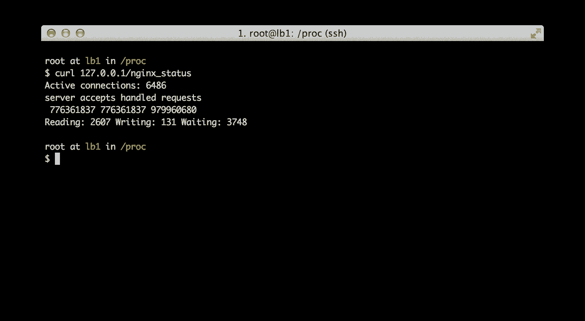

An example of a server with over 6000 active connections

#### PHP 5.5 / PHP-FPM

有多种方式来提供 `PHP` 应用：`mod_php`、`cgi`、`lighttpd fastcgi`^?。这些方案均不及 `PHP-FPM`（FastCGI Process Manager）出色，它是 `nginx` 团队编写的 FastCGI 进程管理器，自 `PHP 5.3` 起已随 `PHP` 一起发布。`PHP-FPM` 的优势在于：它稳健、高度可定制，并能实时提供统计信息和记录慢请求，帮助你分析和优化代码库的慢部分。

#### MySQL

大多数从 LAMP 堆栈迁来的人都对 `MySQL` 很熟悉，我会在书中进行深入讲解。例如，在第 5 章中，你将学习如何从 `MySQL` 获得 NoSQL 性能。需要注意的是，本书对数据库是无偏见的，大部分技巧同样适用于其他数据库。有许多优秀的数据库可供选择：`Postgres`、`MongoDB`、`Cassandra`、`Riak` 等。选择适合你用例的数据库超出本书范围。

#### Redis

[`Redis`](http://redis.io/) 可以作为独立数据库使用，但其主要优势在于作为数据类型存储系统。把它看作 `memcache` 的升级版。我们仍在使用 `memcache`，但 `Redis` 的性能在大多数场景下与 `memcache` 相当或更好。它支持持久化到磁盘（因此在服务器宕机时不会丢失缓存，这在你的基础设施无法处理 100% 缓存缺失时可能是灾难性的），并且由一位极具才华、直言不讳且富有远见的开发者 @antirez 频繁更新。

#### Resque

在后台执行工作是扩展的核心概念之一。[`Resque`](https://github.com/defunkt/resque) 是目前可用的优秀的工作/任务平台。它使用 `Redis` 作为后端，因此天然快速且可扩展，拥有美观的前端界面，能让你全面查看任务队列，并设计为优雅失败。后续我们将讨论如何使用 `PHP-Resque` 以及我提供的补丁，构建优雅的后台工作进程。

#### 是否应该在 AWS 上运行？

`AWS` 很棒。`Twitpic` 是 `AWS` 的大客户——我们的 1PB 图片存储在 `Amazon S3` 上，并通过 `CloudFront` 提供服务。在我们自己搭建这种基础设施将非常昂贵，且需要雇佣一整套团队来管理。

我曾经认为全天候在 `EC2` 上运行是个坏主意——就像用你昂贵的 `iPhone` 敲钉子，虽然能完成任务，但代价远高于使用锤子。


-   [我并不认为这已是现状。使用 AWS 确实有溢价，但它比以前便宜得多，服务也更完善（`200GB+` 内存、SSD、预留 IOPS）。如果我要创办一家新公司，我会毫不犹豫地选择 AWS。

1.  使用保留实例，你的月度成本可降至类似于独立服务器托管（尽管仍贵 10-20%），但能在几分钟内瞬时启动大规模服务器集群，或在加州在 5 分钟内快速启动测试集群，这非常强大。

对于规模更大、更成熟的初创公司，我会在 SoftLayer 或 Rackspace 维护一批独立服务器，并使用 EC2 处理超额容量、突发情况和按需扩缩容。只需一点点网络技巧和 Amazon VPC，即可无缝实现。突发流量？直接启动 EC2 实例并轻松应对峰值。通过 Amazon VPC，你的 EC2 实例可以与裸金属服务器通信，而无需暴露在公共互联网上。

## DNS: Why you need to care

第一层我们要拆解的是 DNS。DNS？什么！？我以为这本是 PHP 书籍吧！DNS 是我们平时不怎么在意的事物，直到它出问题才会惨遭灾难——因为一旦失败，后果最严重。

不信我？2009 年 Twitter 的 DNS 被劫持，用户被重定向到黑客网站长达一小时。同年，SoftLayer 的 DNS 系统遭受巨大 DDoS 攻击，导致其 DNS 服务器宕机超过六小时。作为大 SoftLayer 客户，我们亲身经历了这件事（当时我们也在使用他们的 DNS 服务器）。

DNS 宕机的问题在于它提供了最差的用户体验——用户只会看到通用错误、页面超时，且无法联系到你。仿佛你已经不存在，而且大多数用户既不理解也根本不关心原因。

截至 2012 年 9 月，GoDaddy 的 DNS 服务器遭到攻击，不可达长达 24 小时之久。更糟的是，他们的网站也全面瘫痪，导致你无法在网站恢复前迁移 DNS 服务器（24 小时后才恢复）。

太多公司使用其域名注册商或托管提供商的 DNS 配置——这是**错误**的！想知道前 1000 个网站中有多少使用 GoDaddy 的 DNS？一个都没有。

#### 那么，我是否应该自己运行 DNS 服务器？

这确实是个选项，但我不推荐。正确托管 DNS 需要多台地理分布的服务器以及 Anycast 网络。DDoS 攻击 DNS 非常容易发起，若半途而废，你的 DNS 服务器将成为基础设施的阿喀琉斯之踵。即便你拥有全球最好的 NoSQL 数据库，若无法解析域名，也毫无用处。

**几乎所有最大网站都使用外部 DNS 提供商**。这在我看来已经说明了一切——最容易学会的事，就是效仿成功者。

-   Reddit: [Akamai](http://www.akamai.com/html/solutions/enhanced_dns.html)

-   Twitter: [Dynect](http://dyn.com)

-   Amazon: [UltraDNS](http://ultradns.com) 和 Dynect

-   LinkedIn: UltraDNS

你应该计划购买知名、可靠的 DNS SaaS。在 Twitpic，我们使用 [Dynect Managed DNS](http://dyn.com/dns/)。它已物超所值——自从切换后，我们再也没有因 DNS 宕机而出现 downtime。确保选择在你目标用户群体附近有存在感的 DNS 提供商，尤其是面向大型国际用户群时。

下面是你在 DNS 提供商中应寻找的要点：

-   地理分布的服务器

-   Anycast 网络

-   大 IP 地址空间（以应对网络故障）

|  || 

#### 什么是 Anycast？

Anycast 是一种网络技术，允许多台路由器广告相同的 IP 前缀——它会将客户端路由到“最近”且“最佳”的服务器。可以把它看作网络层的负载均衡。 |

| --- | --- |

除了上述提供商，[Amazon Route53](http://aws.amazon.com/route53/) 也是一个流行选项，费用极低，提供 100% SLA，且拥有非常友好的网页界面。由于采用按使用付费模式，你可以轻松入门，并根据实际增长进行精准调配。

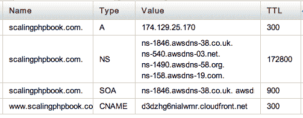

### DNS 负载分布

除了扩缩 DNS，我们还可以借助 DNS 来实现规模扩展。HAProxy 负载均衡器是我们可扩展架构的核心——但当它失去网络连接、过载或直接崩溃时会怎样？它会成为单点故障，导致 downtime——何时何地会发生，只是时间问题。

传统的 DNS 负载均衡方式是为单个主机创建多条 A 记录，让 DNS 返回所有 IP，由客户端自行选择使用哪个地址。示例如下：

```
 1 > dig A example.com       
 2 ; <<>> DiG 9.7.3-P3 <<>> A example.com
 3 
 4 ;; QUESTION SECTION:
 5 ;example.com.			IN	A
 6 
 7 ;; ANSWER SECTION:
 8 example.com.		287	IN	A	208.0.113.36
 9 example.com.		287	IN	A	208.0.113.34
10 example.com.		287	IN	A	208.0.113.38
11 example.com.		287	IN	A	208.0.113.37
12 example.com.		287	IN	A	208.0.113.35
```

然而，这一方法存在几个缺点。首先，不够智能的 DNS 客户端会始终使用第一个返回的 IP，不管实际情况如何。部分 DNS 提供商（如 Dynect 和 Route53）通过轮询（round‑robin）策略改变返回 IP 的顺序，从而在一定程度上实现更均匀的负载分布。

另一个缺点是，轮询无法防止服务器故障，它仅能缓解故障影响。若一台服务器宕机，其 IP 仍会出现在 DNS 响应中，导致使用该 IP 的用户仍会遇到不可达。解决此问题的两个配套方案：

1.  使用能够进行健康检查的智能 DNS 提供商。Dynect 支持此功能，Route53 也可以通过其 API 实现自定义健康检查；当负载均衡器不响应或状态不健康时，会从 IP 池中移除，并在恢复后重新加入。

2.  即使将服务器 IP 从 DNS 池中移除，已缓存该 IP 的用户仍会在 TTL 过期前继续受影响。推荐的 TTL 为 60-300 秒，虽可接受但远非理想。我们将在第 4 章讨论如何通过 `keepalived` 让服务器“窃取”其他节点的 IP，从而降低此类问题的发生。

Dynect 提供直观的负载均衡与健康检查界面：

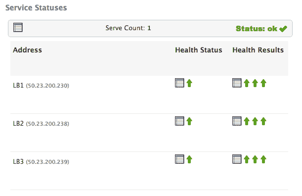

### DNS 解析

最后，也是常被忽视的部分是内部域名解析。例如 PHP 应用在调用外部 API 时需要解析该 API 的域名。假设应用使用 Twitter API，每次发布推文时，PHP 必须查找 `api.twitter.com` 的 IP。

PHP 通过系统调用 `gethostbyname()` 实现域名解析，该函数使用 `/etc/resolv.conf` 中配置的名称服务器进行查询，通常指向公共 DNS 解析器（如 `8.8.8.8`）或数据中心本地解析器。

那么，这种设置有什么问题？

1.  它依赖于你不受控制的服务器。若该服务器宕机、变慢或被阻止，会导致解析延迟。`/etc/resolv.conf` 中最小超时时间为 1 秒（默认甚至为 5 秒），对于高流量网站而言过于缓慢，可能引发连锁故障。

2.  大多数 Linux 发行版默认不提供 DNS 缓存，导致每一次应用程序的 DNS 查询都需要额外的网络往返，增加了整体延迟。


解决方案是运行一个 DNS 缓存守阅像 `nscd`、`dnsmasq` 或 `bind`。我不会讨论 BIND，因为单纯作为缓存运行它是过度设计，但我会讲解 `nscd` 和 `dnsmasq`，它们的工作方式略有不同。

#### nscd

`nscd` (nameserver cache daemon) 是在内部设置自己的 DNS 缓存的最简单解决方案。它是否默认安装取决于你的 Linux 发行版（在 Ubuntu 或 Debian 中默认不安装）。它易于安装且无需配置。`nscd` 与 `dnsmasq` 的主要区别在于 `nscd` 在每个系统上本地运行，而 `dnsmasq` 以网络服务形式提供，可为多台服务器提供共享的 DNS 缓存。

```
1 > apt-get install nscd
2 > service nscd start
```

##### Pros

*   极其易于设置

*   无需配置

##### Cons

*   仅在本地运行，每个服务器都需要自行安装

#### dnsmasq

`dnsmasq` 是一个轻量级 DNS 缓存服务器，功能几乎与 `nscd` 相同，但它是网络服务。

你在服务器（例如 `198.51.100.10`）上设置 `dnsmasq`，并将 `198.51.100.10` 设为其他服务器的 nameserver。`dnsmasq` 仍会在首次查询时通过互联网查找 DNS，但会将结果缓存到内存中，供后续请求使用，从而加速 DNS 解析，并在查询失败时提供更优雅的处理方式。

此外，你还可以使用 `dnsmasq` 作为轻量级内部 DNS 服务器，通过 `addn-hosts` 配置选项，让你可以使用本地主机名而无需在代码中硬编码 IP 地址（例如 `$memcache->connect('cache01.example')` 而不是 `$memcache->connect('198.51.100.15')`）。

假设如下表格所示的网络配置，这里是如何在 `dnsmasq` 服务器上设置并指向它的服务器：

| Hosts || IP |
| --- | --- |
| dnsmasq server || 192.51.100.10 |
| --- | --- |
| server01.example || 192.51.100.16 |
| server02.example || 192.51.100.17 |

在你的 `dnsmasq` 服务器上：

```
 1 > apt-get install dnsmasq
 2 > vi /etc/dnsmasq.conf
 3 
 4 cache-size=1000
 5 listen-address=198.51.100.10
 6 local-ttl=60
 7 no-dhcp-interface=eth0
 8 no-dhcp-interface=eth1
 9 addn-hosts=/etc/dnsmasq.hosts
10 
11 > vi /etc/dnsmasq.hosts
12 
13 198.51.100.16 server01.example
14 198.51.100.17 server02.example
15 
16 > service dnsmasq restart
```

`local-ttl` 设置在 `/etc/hosts` 或 `/etc/dnsmasq.hosts` 中定义的主机的生存时间。

`cache-size` 定义 DNS 缓存的大小。

`no-dhcp-interface` 禁用除 DNS 之外的所有 dnsmasq 服务。如果不加此设置，dnsmasq 还会提供 DHCP 和 TFTP 服务，这在大多数情况下是不需要的。

在 EC2 上重启 `dnsmasq` 后，可能需要在 `/etc/hosts` 中添加以下行：

```
1 127.0.0.1 ip-10-x-x-x
```

然后在其他主机上：

```
1 > vi /etc/resolv.conf
2 
3 nameserver 198.51.100.10
4 options rotate timeout:1
```

`rotate` 选项让 Linux 在多个 nameserver 时轮询使用，这对于分布负载很有用。

`timeout:1` 选项告诉 Linux 在等待响应超过 1 秒后尝试下一个 nameserver。可以将其设置为 1 到 30 之间的整数。默认是 5 秒，最大为 30 秒。遗憾的是，最小值只能是 1 秒，以毫秒设置 timeout 会更有益。

#### 什么时候需要它？

几乎没有负面影响会在早期实现缓存 nameserver，但它会增加另一个需要监控的服务——不是完全免费的优化。基本上，如果你的任何页面需要 DNS 解析，就应该考虑尽早实现缓存 DNS。

想知道服务器当前发送了多少未缓存的 DNS 请求吗？使用 `tcpdump` 可以查看所有通过网络发出的 DNS 请求。

```
1 > apt-get install tcpdump
2 > tcpdump -nnp dst port 53
3 
4 09:52 IP 198.51.100.16 > 198.51.100.10.53: A? graph.facebook.com.
5 09:52 IP 198.51.100.16 > 198.51.100.10.53: AAAA? graph.facebook.com.
6 09:52 IP 198.51.100.16 > 198.51.100.10.53: A? api.twitter.com.
7 09:52 IP 198.51.100.16 > 198.51.100.10.53: AAAA? api.twitter.com.
```

`-nn` 选项确保 tcpdump 本身不将 IP 地址或协议解析为名称。

`-p` 选项禁用混杂模式，以最大程度减少对运行服务的不良影响。

`dst port 53` 仅显示发送的 DNS 请求（为了简洁），如果想查看应用程序可能阻塞等待响应的时间（即请求与响应一起），则需要排除 'dst' 部分。

上面的示例显示，单个 HTTP GET 请求可能会向你使用的第三方 API 发送四次 DNS 请求。使用 `dnsmasq` 或 `nscd` 等缓存 DNS 解析器可以减少阻塞时间并防止级联故障。

## 使用 HAProxy 进行负载均衡

负载均衡器是你的应用的神经系统，它接收所有的 incoming 请求并将其公平地分发到应用服务器，在那里执行你的 PHP 代码。我们讨论的配置是一个 **反向代理**。它很常见，但我将展示一些你可能以前没见过的技巧。

在开始之前，请记住所有 *incoming* 和 *outgoing* 数据都会经过负载均衡器。应用服务器永远不会直接与用户通信，它们只会响应负载均衡器，然后负载均衡器再响应用户。

有许多负载均衡选项，包括软件和硬件。我不推荐硬件负载均衡器，原因有几个：1) 它们极其昂贵（轻松超过 40,000 美元——对于初创公司来说并不友好，尤其是你可以使用开源软件并将这笔钱用于雇佣另一名工程师）；2) 硬件负载均衡器往往是“黑盒”，它们提供的可视性不如开源软件。记住——拥有你的栈！

拥有多个负载均衡器是明智的，因为单个负载均衡器会创建单点故障。你需要准备足够的备用以在单个负载均衡器失败时处理所有流量。例如，如果你的流量需要两个负载均衡器，你需要准备一个热备，随时待命；否则，如果其中一个主负载均衡器失败，剩下的负载均衡器将无法单独处理所有流量。别担心，我们也会在本章中介绍如何通过 DNS 记录将流量在多个负载均衡器之间进行分割。

### HAProxy

[HAProxy](http://haproxy.1wt.eu/) 是一个优秀的软件负载均衡解决方案。它使用 C 编写，基于事件，专为作为反向代理而设计，因此极快且轻量。HAProxy 的内存和 CPU 占用很小，能够在低功耗硬件上处理大量流量。HAProxy 官网展示的 2009 年基准测试显示，他们能够每秒处理 108,000 个 HTTP 请求并完全饱和 10GbE 网络，这非常惊人。

此外，HAProxy 自 2002 年以来一直保持“无显著错误”的记录。下面的引用来自其官网：

> 在单进程程序中，你没有权利失败：最小的错误会导致程序崩溃、疯狂运行或冻结。过去 10 年中，在代码和生产环境中都没有发现任何此类错误。

#### 相对于 Nginx 的优势

[Nginx](http://nginx.org/) 毫无疑问是一个了不起的软件，甚至包括自己的反向代理模块，使其能够作为负载均衡器工作。尽管 Nginx 作为负载均衡器已经相当不错，但 HAProxy 仍是更佳选择，原因如下。


HAProxy 是一个非常裸机的软件。它只做一件事，并且做得极其出色，这在负载均衡需求时既是显著的优势，也可能是巨大的短板。对于大多数栈来说，HAProxy 会是一个非常合适的选择，但如果你需要更灵活，就不应该犹豫使用 nginx。虽然它作为负载均衡器的表现不如 HAProxy，但可以在牺牲略高的 CPU 和内存占用的代价下接近其性能。

### Layer 4 vs Layer 7

HAProxy 可以在两种模式下运行：TCP（Layer 4）和 HTTP（Layer 7）。在 TCP 模式下，HAProxy 仅将客户端的原始 TCP 包转发到应用服务器。这种方式的 CPU 使用量比 HTTP（Layer 7）模式低约 50%，因为 HTTP（Layer 7）模式在转发前需要解析 HTTP 头部。由于 nginx 主要是一个 Web 服务器，它只支持 HTTP（Layer 7）负载均衡。

你肯定会看到很多观点说“它不重要”——Layer 7、双重 HTTP 解析是一个微小的开销，除非你是巨型流量，否则可以接受。这说得有点道理，但正如我之前说的，让我们保持简单。

TCP 负载均衡的一个缺点是可能丢失客户端的 IP 地址。考虑以下场景：客户端 `192.168.25.19` 访问你的负载均衡器（IP 为 `10.0.9.1`）。负载均衡器将请求转发到你的 nginx 服务器，但当你的 PHP 代码检查 `$_SERVER['REMOTE_ADDR']` 时，它看到的是 `10.0.9.1`，而不是 `192.168.25.19`。

没问题，你会想，大多数负载均衡器会把客户端的“真实 IP”放入其他头部，比如 `$_SERVER['X-Forwarded-For']`，所以你会去检查它。但结果是“什么都没有”。怎么回事？因为 TCP 包从负载均衡器重新发送时，显然会采用负载均衡器的 IP 地址。由于我们在讨论 Layer 4 负载均衡，它永远不会解析和重构 HTTP 头部，这意味着它永远无法在 HTTP 请求中注入诸如 `X-Forwarded-For` 这样的头部。

糟糕！我们没选项了吗？不！幸运的是，HAProxy 的开发者们创造了一个非常优雅的解决方案——他们开发了自己的 \[PROXY Protocol\]，可以在 TCP 层附加一些代理信息（如 `REMOTE_ADDR`）。

PROXY Protocol 仅与明确包含对其支持的软件配合使用。幸运的是，nginx 正好支持它。事实上，它非常简单——只需在 nginx 配置中添加 `real_ip_header proxy_protocol`（将在下一章讨论），你就搞定了。搞定。

### SSL 终止

TCP（Layer 4）负载均衡的另一个好处是将 SSL 终止委托给应用服务器。也就是说，HTTPS 请求的 SSL 协商和解密过程在你的应用服务器上进行，也就是在你的 Web 服务器内部，因为原始 TCP 包仅仅被转发。

对于像 nginx 这样的 HTTP（Layer 7）负载均衡器，它无法在解析 HTTP 头部之前处理 SSL，这迫使所有的 SSL 协商都在负载均衡器上进行。其缺点是 SSL 在 CPU 上消耗很高——最好将其分布在整个应用集群中，而不是集中在一个或两个负载均衡器上。

### 更好的健康检查和分发算法

当 nginx 被配置为负载均衡器时，对后端服务器进行健康检查的唯一方法是使用超时。如果应用服务器超时，它会从池中移除；否则，即使它输出的是乱码、PHP 代码或 500 错误，也会被认为是健康的。HAProxy 提供了多种更好的健康检查方法，我们将在下文中讨论。

此外，nginx 仅支持一种简单的轮询算法（round-robin）来选择后端服务器。HAProxy 支持多种均衡算法，包括一种能将新连接分配给现有连接数最少的服务器的算法。我们将在下文中讨论可用的不同算法。

#### 安装

``` 
 1 > apt-get install haproxy
 2 > vi /etc/haproxy/haproxy.cfg
 3 
 4     global
 5     maxconn 50000
 6     user haproxy
 7     group haproxy
 8     stats socket /tmp/haproxy
 9     node lb1
10     nbproc 1
11     daemon
12 
13     defaults
14     log     global
15     retries 3
16     option  dontlog-normal
17     option  splice-auto
18     timeout connect 5000ms
19     timeout client  5000ms
20     timeout server  5000ms
21     maxconn 50000
22 
23     backend application_servers
24     mode    tcp
25     balance roundrobin
26     option httpchk HEAD / HTTP/1.1\r\nHost:\ example.com
27     option ssl-hello-chk
28     server web02 198.51.100.17:80 check
29     server web03 198.51.100.18:80 check
30 
31     frontend example.com
32     bind *:80
33     bind *:443
34     mode tcp
35     default_backend application_servers
36 
37     listen stats *:1936
38     mode http
39     stats enable
40     stats uri /
41     stats hide-version
42     stats auth Username:Password
```

HAProxy 会在你启用 init.d 脚本后才运行，我们现在就来做这件事。

``` 
1 > vi /etc/default/haproxy
2     # 如果你想让 init 脚本启动 haproxy，请将 ENABLED 设置为 1。
3     ENABLED=1
4 
5 > service haproxy start
```

#### 配置选项

`haproxy.cfg` 中的大部分配置选项都很直观，但让我们重点介绍几个最重要的。

`maxconn` - HAProxy 在给定时间内能接受的最大连接数。在大多数情况下，这个值应该尽可能高。每个 HAProxy 保持的连接大约使用 33KB 的内存，因此确保你有足够的内存来支持所使用的值很重要（例如，在 4GB 系统上，大约可以支持 127,000 个连接）。

`timeout connect/client/server` - 设置在毫秒单位的不同连接阶段的超时时间，包括连接建立、客户端超时和服务器超时。

`options dontlognormal` - 仅记录错误、超时和其他问题。用于在高流量 Web 应用中过滤掉噪音。当然，你仍然可以在应用服务器的 nginx 访问日志中记录正常请求。

`options httpchk` - 将 `example.com` 替换为你的域名。该选项用于检查应用服务器是否返回 200 状态码，以判断服务器是否不仅处于“上线”状态，而且真正“健康”。

`option splice-auto` - 启用 TCP splicing（如果认为这能提升性能）。TCP splicing 是 Linux 内核的一个性能增强功能，可加速包处理，当作为反向代理时效果显著。**重要**：你必须使用内核版本 >= `2.6.29` 才能使用此功能。

### 均衡算法

HAProxy 提供多种均衡算法供选择，这些算法决定了如何从后端应用服务器中选择一个来处理 incoming request。

`roundrobin` - 最简单的算法。对于每个新连接，它使用列表中的下一个后端服务器。当列表到底部时，会回到顶部。它能够公平分布请求，但不考虑负载或连接数。

`leastconn` - 新连接会分配给现有连接数最少的服务器。适用于当平均请求时间/负载差异较大，或存在长轮询连接的场景。

`source` - 也称为 **粘性会话**。通过客户端 IP 地址的哈希值决定后端服务器。例如，来自 `203.0.113.100` 的请求总是路由到 `appserver01`，而来自 `203.0.113.200` 的请求则始终去 `appserver02`。这对于 A/B 测试（在每个 appserver 上运行不同版本的应用）或用户分片非常有用；然而，`source` 算法通常是长期策略的糟糕选择，往往暗示了 scaling 策略有问题。


-   `uri` - 与 `source` 算法类似，但不基于客户端的 IP 地址进行哈希，而是基于请求的 URL。这对于运行 HTTP 代理非常有用，因为 `example.com/picture01.jpg` 总是会路由到 `backend01`，而 `example.com/picture02.jpg` 总是会路由到 `backend02`，从而最大化每个后端服务器的文件系统和内存缓存。通常应用于提供静态资源（图片、CSS、JS）。

|  || **粘性会话**（通过 `source` 算法）乍一看似乎是个好主意，但长期来看几乎总是个糟糕的选择。将用户始终路由到相同的应用服务器会导致活跃用户的热点和冷点，具体取决于当前活跃的用户。在我的经验中，粘性会话是因为另一个未扩展的领域——例如，会话存储在文件系统上，将每个用户绑定到特定的应用服务器。换句话说，它能工作但很粗糙！请避免这种诱惑，正确扩展，长期来看会有回报。 |

| --- | --- |

#### Web-UI

HAProxy 附带一个有用的 Web-UI，能够提供对负载均衡器的洞察，并使一般统计信息可用。它是快速查看关键信息（如连接数、哪些应用服务器处于上线或离线状态、错误数等）的快捷方式。

使用上面提供的 `haproxy.cfg` 配置，Web-UI 监听端口 `1936`，并通过用户名 “`Username`” 和密码 “`Password`” 进行密码保护。毫无疑问，你很可能会想要修改它（由以下行定义：`stats auth Username:Password`）。

访问 `your-load-balancer.com:1936`，你将看到类似下图的 Web-UI。值得注意的是，如果在 URL 末尾追加 `;csv`，数据将以逗号分隔格式返回，便于将数据程序化地集成到监控系统中。

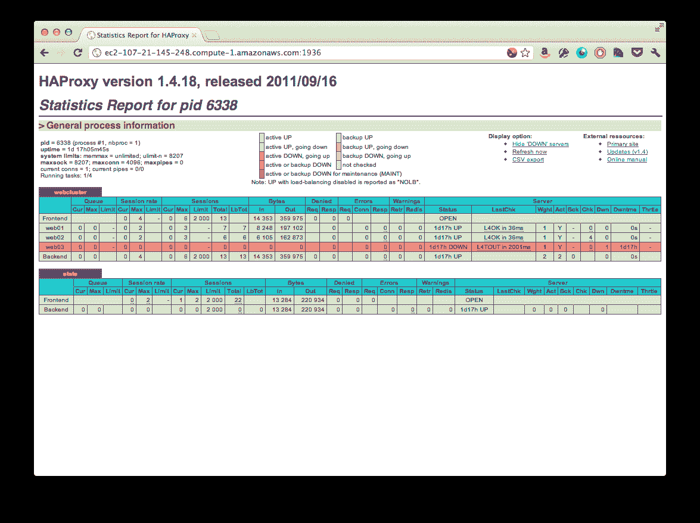

#### CLI 访问 `hatop`

此外，还有一个 CLI 监控工具 `hatop`。它提供与 Web 界面相同的数据，并能够从池中移除和添加服务器。

```
1 > apt-get install hatop
2 > hatop -s /tmp/haproxy
```

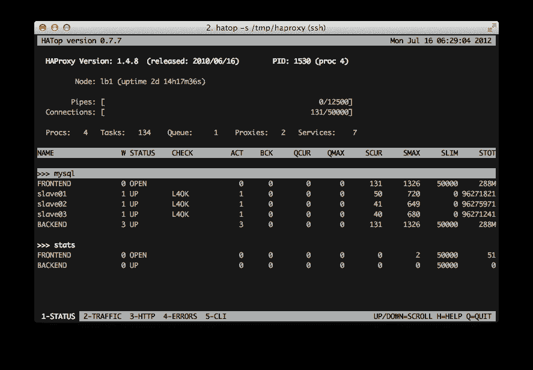

### 选择最佳硬件

在高频率、现代 CPU 以及适度内存的硬件上，你将获得最大的收益。 tempting 选择一个更老的 CPU 但拥有更高 GHz，但较新的、时钟较低的 Intel 架构在实际性能上更强大。例如，我们的标准构建使用单个四核 SandyBridge Xeon CPU，其性能比使用双处理器、四核但架构较旧的构建表现提升 2-3 倍。

如果有疑问，请参考 [Passmark CPU Benchmark](http://www.cpubenchmark.net/)，GHz 与核心数在没有 CPU 架构上下文的情况下毫无意义。

HAProxy 通常以单进程模式运行（配置项：`nbproc 1`），这意味着它只能使用单个 CPU 核心。这意味着更快的 CPU（而非更多核心）会直接影响负载均衡器的速度。

|  || 别让“单进程”吓到你。由于 HAProxy 是基于事件的，它非常适合 I/O 受限（网络）的工作负载，并且可以轻松处理每秒 20,000-30,000 个连接。除非你真正需要容量，否则不建议通过增加 `nbproc` 运行多个核心，因为这会增加复杂度。

| --- | --- |

我们的标准负载均衡器构建如下（供参考）：

Intel Xeon 1270（SandyBridge）3.4GHz，四核 8GB ECC DDR3 内存 500GB 硬盘 2× 1gbps 以太网

### 自动故障转移 `keepalived`

`keepalived` 是用于高可用部署的守护进程，用于监控另一台服务器并在其停止响应网络请求时窃取其 IP 地址。配置好后，它几乎感觉神奇，因为它工作得非常无缝。

我们使用 `keepalived` 为负载均衡器提供容错能力，并通过保留热备服务器来防止单点故障，当需要时，热备服务器可以接管。

| Hosts || IP |
| --- | --- |
| virtual ip || 192.51.100.40 |
| --- | --- |
| lb.example || 192.51.100.20 |
| lbspare.example || 192.51.100.30 |

在此配置中，我们有两台负载均衡器，各自拥有独立的 IP 地址，以及一个虚拟 IP（vip）在 `lb.example` 和 `lbspare.example` 之间浮动。两台负载均衡器都应已配置好 HAProxy。

首先，需要在两台服务器上修改 Linux 内核的一个不太常见的选项 `net.ipv4.ip_nonlocal_bind`，该选项告诉内核允许服务绑定到不存在的 IP 地址。因为 `lbspare.example` 上的 HAProxy 会监听 `192.51.100.40`，即使该 IP 未绑定到服务器上。

```
1 > sysctl -w net.ipv4.ip_nonlocal_bind=1
2 > vi /etc/sysctl.d/keepalive.conf
3     net.ipv4.ip_nonlocal_bind=1
```

接下来，在两台服务器上安装 keepalived。

```
1 > apt-get install keepalived
```

在 `lb.example` 上配置 `keepalived.conf` 文件：

```
 1 > vi /etc/keepalived/keepalived.conf
 2     vrrp_instance VI_1 {
 3       interface eth0
 4       state MASTER
 5       virtual_router_id 51
 6       priority 101
 7       virtual_ipaddress {
 8         192.51.100.40
 9       }
10   > service keepalived start
```

在 `lbspare.example` 上配置 `keepalived.conf` 文件：

```
 1 > vi /etc/keepalived/keepalived.conf
 2     vrrp_instance VI_1 {
 3       interface eth0
 4       state MASTER
 5       virtual_router_id 51
 6       priority 100
 7       virtual_ipaddress {
 8         192.51.100.40
 9       }
10   > service keepalived start
```

注意两者的主要区别在于 `lbspare.example` 的 priority 较低。通过 priority 设置，你不止可以有一个热备服务器，还可以构建多级的备用链。

接下来，验证可以 ping 虚拟 IP（`192.51.100.40`）并确认其路由到 `lb.example`。

此时，你可以在两台负载均衡器上修改 `haproxy.conf` 文件，使其监听虚拟 IP。HAProxy 可以通过在 `bind` 选项中提供逗号分隔的 IP 列表来绑定多个 IP 地址，因此可以使用 `bind 192.51.100.20:80, 192.51.100.40:80` 的配置实现同时监听服务器 IP 和虚拟 IP。

#### 它是如何工作的？

`keepalived` 在 `lbspare.example` 上会监控网络并确认 `lb.example` 是否持续在网络上广播自身。如果 `lb.example` 停止广播（重启、崩溃等），`lbspare.example` 会向网络发送 gratuitous ARP 消息，告知所有主机 `lbspare.example` 现在拥有虚拟 IP。主机会更新路由表，服务几乎不受影响地持续工作。

当 `lb.example` 重新上线时，它会向网络广播自身，重新获得虚拟 IP 的控制权。整个过程自动完成，无需任何人工干预。

### 调整 Linux 以应对网络密集型负载

#### `net.core.somaxconn`

`somaxconn` 定义内核为接受新连接而维护的队列大小。默认通常只有 `128`，这意味着最多只能同时服务 128 个用户。需要将其调高。

```
1 > sysctl -w net.core.somaxconn=100000
2 > vi /etc/sysctl.d/haproxy-tuning.conf
3     net.core.somaxconn=100000
```

#### `net.ipv4.ip_local_port_range`


`ip_local_port_range` 定义系统上可用端口的范围。在我的 Ubuntu 标准安装中，它的值设置为 `32768-61000`。增大范围以允许更多连接。可用端口的数量限制了同时打开的连接数。记住，即使连接已关闭，它仍然会在 `TIME_WAIT` 状态中占用端口（不过我们可以通过下面的设置来缓解）。

```
1 > sysctl -w net.ipv4.ip_local_port_range="10000 65535"
2 > vi /etc/sysctl.d/haproxy-tuning.conf
3     net.ipv4.ip_local_port_range=10000 65535
```

#### `net.ipv4.tcp_tw_reuse`

TCP 协议的一部分是 `TIME_WAIT` 状态，它会在连接关闭后保持 socket 打开最多 4 分钟。在繁忙服务器上，这可能导致端口/套接字耗尽。`net.ipv4.tcp_tw_reuse` 告诉内核在确认安全的情况下，可以在不等待完整超时的情况下重用 TCP 套接字。此外，`net.ipv4.tcp_recycle` 和 `net.ipv4.tcp_fin_timeout` 也可以调整，但请谨慎操作这两项。

```
1 > sysctl -w net.ipv4.tcp_tw_reuse=1
2 > sysctl -w net.ipv4.netfilter.ip_conntrack_tcp_timeout_time_wait=1
3 > vi /etc/sysctl.d/haproxy-tuning.conf
4     net.ipv4.tcp_tw_reuse=1
5     net.ipv4.netfilter.ip_conntrack_tcp_timeout_time_wait=1
```

#### `ulimit -n 999999`

在标准 Linux 配置中，每个进程允许打开的最大文件数（即套接字）设置得很低（1024）。因为套接字在 Linux 系统中被视为文件，这个限制也直接决定了并发连接数。记住，负载均衡器的每个连接需要两个套接字——一个用于客户端的入站连接，另一个用于到后端的出站连接，因此初始上限最多只能有 512 个并发连接。幸运的是，修改这个设置很简单。

```
1 > vi /etc/security/limits.conf
2     * soft  nofile  999999
3     * hard  nofile  999999
4 > ulimit -n 999999
```

> 注意：可能需要重启 HAProxy 使该设置生效。

### 扩展问题

调试负载均衡器问题时，尤其是在高负载环境下，会感到沮丧。如果负载均衡器变慢或无响应，请关注以下几个常见问题。

#### 饱和网络

这似乎不言自明，但我曾为此困扰过。记得曾花费超过一小时才弄清为什么我们的 Twitpic 负载均衡器运行像蜗牛一样且持续丢失连接。原因是网卡被配置为 100 Mbps，而我们试图通过它推送 150 Mbps。使用 `vnstat` 可以查看网卡当前的带宽使用情况。请务必检查**公网**和**私网**两个网络，因为负载均衡器通常会同时使用这两者。

```
1 > vnstat -i eth1 -l
```

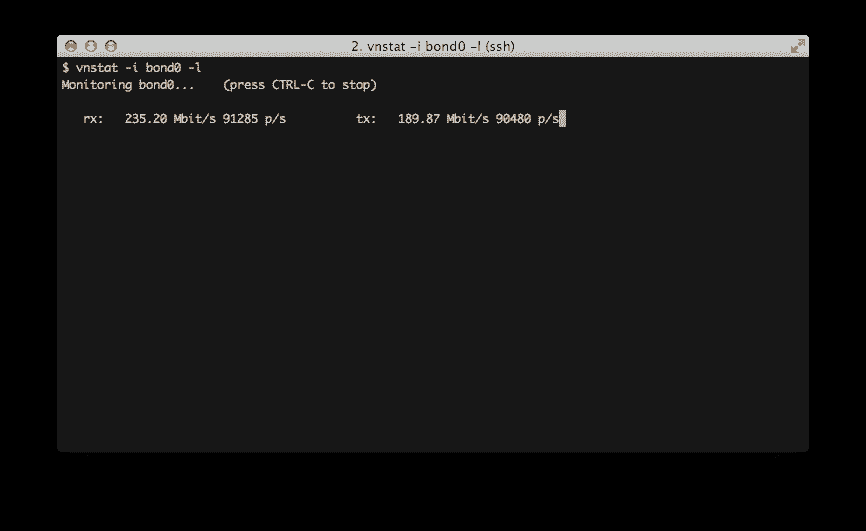

#### 运行出内存

尽管 HAProxy 的内存占用很低，但在大量入站连接且后端服务器慢或过载的情况下，仍可能耗尽内存。使用 `free` 命令检查内存使用情况。

#### 大量 `TIME_WAIT` 连接

如前所述，大量处于 `TIME_WAIT` 状态的连接会导致服务器资源耗尽。可以通过前文提到的配置选项进行缓解。使用 `netstat -n | grep TIME_WAIT | wc -l` 可以查看当前处于 `TIME_WAIT` 状态的套接字数量。

## 应用服务器：使用 Nginx 和 PHP-FPM 实现水平扩展

应用服务器集群是应用的核心，负责运行 PHP 代码并提供图片、CSS、JavaScript 等静态资源。幸运的是，应用服务器通常是栈中最容易扩展的部分，因为前文提到的负载均衡器配置中，只需将新的应用服务器加入池中即可水平扩展，提高容量。即使服务器失败（它们会失败），HAProxy 也会自动将其从池中移除，无需报警，也无需在夜间被叫醒——它们能够轻松扩展。

### 选择正确的 PHP 版本

PHP 社区在更新方面表现得非常保守，甚至可以说是“年岁如旧”。因此，务必确保运行的是最新的 PHP 版本，即 **PHP 5.4.4**（截至撰写时）。

> 2014 年更新——使用 PHP 5.5！这里的所有描述依然适用，只是 Dotdeb 仓库的路径改为 `deb http://packages.dotdeb.org wheezy-php55 all` 和 `deb-src http://packages.dotdeb.org wheezy-php55 all`。

PHP 的主版本每次迭代都在速度和内存使用上得到提升，因此运行最新版本可以最大化硬件性能。5.4 相比 5.3 在功能和速度上显著更好，同样 5.3 也优于 5.2。

在 Debian 或 Ubuntu 系统上，可以使用 **Dotdeb** 仓库来获取几乎即时、无痛的 PHP 更新，同时也能获得 Ubuntu 官方仓库中滞后的软件（如 Redis 与 Nginx）。这省去了等待发行版维护者更新的时间，往往需要数周甚至更久。

如果你使用的是 Ubuntu Quantal（12.10），PHP 5.4 已经在 apt 仓库中，无需额外添加 Dotdeb 的 php54 行。

设置 Dotdeb 与添加另一个 apt 源同等简单：

```
 1 > vi /etc/apt/sources.list.d/dotdeb.list
 2 
 3 deb http://packages.dotdeb.org squeeze all
 4 deb-src http://packages.dotdeb.org squeeze all
 5 
 6 # 仅在使用 Ubuntu 12.04（Precise）时包含以下行
 7 deb http://packages.dotdeb.org squeeze-php54 all
 8 deb-src http://packages.dotdeb.org squeeze-php54 all
 9 
10 > wget http://www.dotdeb.org/dotdeb.gpg
11 > cat dotdeb.gpg | sudo apt-key add -
12 > apt-get update
```

#### 基准测试：PHP 5.3 与 PHP 5.4

在所有可测试的场景中，PHP 5.4 在每秒请求数（RPS）和内存占用方面均优于 PHP 5.3。下面的图表展示了我的测试结果，供您参考：

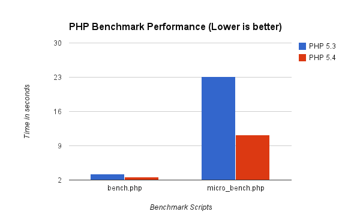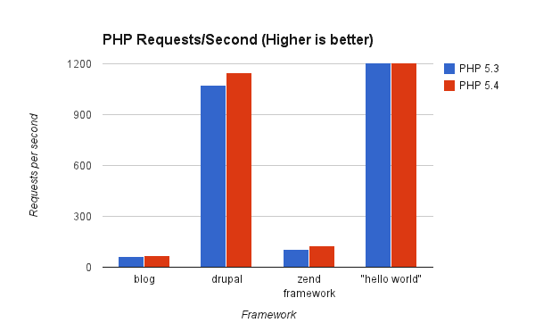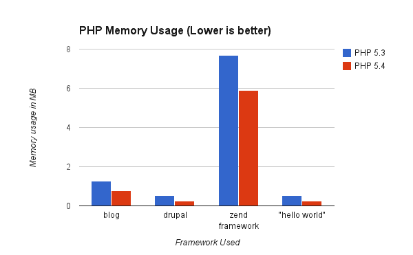

### Nginx 与 PHP-FPM

正如第 2 章所讨论，我们将用 **nginx + PHP-FPM** 替代传统的 Apache + mod_php 组合。虽然可以保留 Apache 并通过 HAProxy 水平扩展，但 nginx + PHP-FPM 的组合更为优雅。Trust me，摒弃 Apache，改用 nginx。

我们在 2010 年将 Twitpic 迁移到此架构，当时我对 nginx 并不熟悉，担心配置会很复杂。结果发现，nginx 的配置文件简洁易读，管理起来比 Apache 更轻松。而且 nginx 官方 Wiki（[`wiki.nginx.org/Main`](http://wiki.nginx.org/Main)）提供了完整的每项配置选项文档。

同样，PHP-FPM 也是可靠的软件，和使用 mod_php 一样可靠。PHP 5.3 之前它是以补丁形式开发，由与 nginx 同一团队维护，而自 PHP 5.3 起已被整合进 PHP 官方发行版，得到整个 PHP 社区的全力支持，经过充分测试，完全可靠。

假设您的 PHP 应用位于 `/u/apps/my_app`，入口脚本为 `/u/apps/my_app/www/index.php`。大多数框架（如 Zend、Kohana、Cake）都兼容此配置。

下面是我们的部署步骤：


1 > apt-get install nginx
2 > vi /etc/nginx/nginx.conf
3 
4 user www-data;
5 worker_processes 4;
6 pid /var/run/nginx.pid;
7 
8 events {
9   worker_connections 768;
10   multi_accept on;
11 }
12 
13 http {
14 
15   sendfile on;
16   tcp_nopush on;
17   keepalive_timeout 65;
18   server_tokens off;
19 
20   include /etc/nginx/mime.types;
21   default_type application/octet-stream;
22 
23   access_log /var/log/nginx/access.log;
24   error_log /var/log/nginx/error.log;
25 
26   gzip on;
27   gzip_disable "MSIE [1-6]\\.";
28 
29   include /etc/nginx/conf.d/*.conf;
30   include /etc/nginx/sites-enabled/*;
31 }
32 
33 
34 > vi /etc/nginx/sites-available/my_app.conf
35 upstream backend {
36   server unix:/u/apps/my_app/tmp/php.sock;
37 }
38 
39 server {
40 
41   listen 80 default;
42   root /u/apps/my_app/www;
43   index index.php;
44 
45   access_log /u/apps/my_app/logs/access.log;
46   error_log /u/apps/my_app/logs/error.log;
47 
48   location / {
49     try_files $uri $uri/ /index.php;
50   }
51 
52   # This location block matches anything ending in .php and sends it to
53   # our PHP-FPM socket, defined in the upstream block above.
54   location ~ \\.php$ {
55     try_files $uri =404;
56     fastcgi_pass backend;
57     fastcgi_index index.php;
58     fastcgi_param SCRIPT_FILENAME /u/apps/my_app/www$fastcgi_script_name;
59     include fastcgi_params;
60   }
61 
62   # This location block is used to view PHP-FPM stats
63   location ~ ^/(php_status|php_ping)$ {
64     fastcgi_pass backend;
65     fastcgi_param SCRIPT_FILENAME $fastcgi_script_name;
66     include fastcgi_params;
67     allow 127.0.0.1;
68     deny all;
69   }
70 
71   # This location block is used to view nginx stats
72   location /nginx_status {
73     stub_status on;
74     access_log off;
75     allow 127.0.0.1;
76     deny all;
77   }
78 }
```

```
1 > mkdir -p  /u/apps/my_app/{logs,tmp,www}
2 > ln -s /etc/nginx/sites-available/my_app.conf \
3         /etc/nginx/sites-enabled/my_app.conf
4 > service nginx start
```

Alright. Nginx is up and running now, but nginx doesn’t know how to run PHP. Unlike Apache with mod_php, PHP-FPM runs outside of the webserver in it’s own process- nginx just forwards requests to it using FastCGI. We need to install PHP-FPM and configure it.

```
 1 > apt-get install php5-fpm
 2 
 3 > vi /etc/php5/fpm/pool.d/my_app.conf
 4 

5 [my_app]
6 listen = /u/apps/my_app/tmp/php.sock
7 user = www-data
8 group = www-data
9 pm = dynamic
10 pm.max_children = 100
11 pm.start_servers = 10
12 pm.min_spare_servers = 5
13 pm.max_spare_servers = 15
14 pm.max_requests = 1000
15 pm.status_path = /php_status
16 

17 request_terminate_timeout = 0
18 request_slowlog_timeout = 0<unk><unk><unk><unk><unk><unk><unk><unk><unk><unk><unk><unk><unk><unk><unk><unk><unk><unk><unk><unk><unk><unk><unk><unk><unk><unk><unk><unk><unk><unk><unk><unk><unk><unk><unk><unk><unk><unk><unk><unk><unk><unk><unk><unk><unk><unk><unk><unk><unk><unk><unk><unk><unk><unk><unk><unk><unk><unk><unk><unk><unk><unk><unk><unk><unk><unk><unk><unk><unk><unk><unk><unk><unk><unk><unk><unk><unk><unk><unk><unk><unk><unk><unk><unk><unk><unk><unk><unk><unk><unk><unk><unk><unk><unk><unk><unk><unk><unk><unk><unk><unk><unk><unk><unk><unk><unk><unk><unk><unk><unk><unk><unk><unk><unk><unk><unk><unk><unk><unk><unk><unk><unk><unk><unk><unk><unk><unk><unk><unk><unk><unk><unk><unk><unk><unk><unk><unk><unk><unk><unk><unk><unk><unk><unk><unk><unk><unk><unk><unk><unk><unk><unk><unk><unk><unk><unk><unk><unk><unk><unk><unk><unk><unk><unk><unk><unk><unk><unk><unk><unk><unk><unk><unk><unk><unk><unk><unk><unk><unk><unk><unk><unk><unk><unk><unk><unk><unk><unk><unk><unk><unk><unk><unk><unk><unk><unk><unk><unk><unk><unk><unk><unk><unk><unk><unk><unk><unk><unk><unk><unk><unk><unk><unk><unk><unk><unk><unk><unk><unk><unk><unk><unk><unk><unk><unk><unk><unk><unk><unk><unk><unk><unk><unk><unk><unk><unk><unk><unk><unk><unk><unk><unk><unk><unk><unk><unk><unk><unk><unk><unk><unk><unk><unk><unk><unk><unk><unk><unk><unk><unk><unk><unk><unk><unk><unk><unk><unk><unk><unk><unk><unk><unk><unk><unk><unk><unk><unk><unk><unk><unk><unk><unk><unk><unk><unk><unk><unk><unk><unk><unk><unk><unk><unk><unk><unk><unk><unk><unk><unk><unk><unk><unk><unk><unk><unk><unk><unk><unk><unk><unk><unk><unk><unk><unk><unk><unk><unk><unk><unk><unk><unk><unk><unk><unk><unk><unk><unk><unk><unk><unk><unk><unk><unk><unk><unk><unk><unk><unk><unk><unk><unk><unk><unk><unk><unk><unk><unk><unk><unk><unk><unk><unk><unk><unk><unk><unk><unk><unk><unk><unk><unk><unk><unk><unk><unk><unk><unk><unk><unk><unk><unk><unk><unk><unk><unk><unk><unk><unk><unk><unk><unk><unk><unk><unk><unk><unk><unk><unk><unk><unk><unk><unk><unk><unk><unk><unk><unk><unk><unk><unk><unk><unk><unk><unk><unk><unk><unk><unk><unk><unk><unk><unk><unk><unk><unk><unk><unk><unk><unk><unk><unk><unk><unk><unk><unk><unk><unk><unk><unk><unk><unk><unk><unk><unk><unk><unk><unk><unk><unk><unk><unk><unk><unk><unk><unk><unk><unk><unk><unk><unk><unk><unk><unk><unk><unk><unk><unk><unk><unk><unk><unk><unk><unk><unk><unk><unk><unk><unk><unk><unk><unk><unk><unk><unk><unk><unk><unk><unk><unk><unk><unk><unk><unk><unk><unk><unk><unk><unk><unk><unk><unk><unk><unk><unk><unk><unk><unk><unk><unk><unk><unk><unk><unk><unk><unk><unk><unk><unk><unk><unk><unk><unk><unk><unk><unk><unk><unk><unk><unk><unk><unk><unk><unk><unk><unk><unk><unk><unk><unk><unk><unk><unk><unk><unk><unk><unk><unk><unk><unk><unk><unk><unk><unk><unk><unk><unk><unk><unk><unk><unk><unk><unk><unk><unk><unk><unk><unk><unk><unk><unk><unk><unk><unk><unk><unk><unk><unk><unk><unk><unk><unk><unk><unk><unk><unk><unk><unk><unk><unk><unk><unk><unk><unk><unk><unk><unk><unk><unk><unk><unk><unk><unk><unk><unk><unk><unk><unk><unk><unk><unk><unk><unk><unk><unk><unk><unk><unk><unk><unk><unk><unk><unk><unk><unk><unk><unk> %HAM users -capego to be [ the.
[


`pm.max_requests` 是单个子进程在被杀死并重新生成之前可以服务的请求数量。它用于防止内存泄漏，因为 PHP 的垃圾回收器并不设计用于长时间运行。PHP 5.3 为内存管理带来了一些改进，因此可以将其设置得相当高。我建议将其至少设为 1000，具体取决于你的代码以及是否使用 PHP 扩展，因为不同扩展的泄漏情况各不相同。

### 选择适合你应用服务器的硬件

**快速 CPU，大量内存**

预计每个 PHP‑FPM 进程会使用多达 20 MB 的内存，假设 `pm.maxchildren` 设为 100，你至少需要 2 GB 的内存来支撑服务器。

相反，Nginx 记忆消耗极低——即使是负载重的应用服务器，Nginx 的总内存占用也仅 60‑80 MB。

你需要最快的 CPU 以及尽可能多的核心。虽然 PHP 是单线程的，只要 PHP‑FPM 进程的数量多于 CPU 核心数，就能充分利用每个核心。

截至撰写时，Intel Xeon SandyBridge 26xx 系列是性价比最高的选择。它们支持双 CPU 配置，每个 CPU 最多 8 核，启用 Hyper‑Threading 后可提供 32 个可用核心供应用服务器使用。

### 使用 PHP 字节码缓存

PHP 是解释型语言。每次运行 PHP 应用时，解释器需要读取源码、将其转换为内部字节码程序，然后执行这些字节码。可以把字节码程序看作解释器能更好理解的中间语言——实际上是一个虚拟机。

将 PHP 源码翻译成字节码需要非平凡的开销，通过缓存这种 PHP → 字节码的转换结果并重复使用，可以大幅节省开销。那么我们该如何实现呢？使用字节码缓存扩展。如果你目前还没有使用，只需安装一个即可实现 200‑300 % 的 CPU 使用率下降。这真是易如反掌！

自 PHP 5.5 起，Zend OpCache 已随 PHP  bundled。要启用它，只需在 `php.ini` 中加入 `opcache.enable=1`。超级简单。唯一的缺点是，APC 的用户空间 memcache 组件不再包含在 Zend OpCache 中。如果你依赖这个共享缓存，可以安装类似 [APCu](http://pecl.php.net/package/APCu) 的扩展，它在 PHP 5.5 中恢复了 APC 的用户空间缓存功能。我在《CakePHP 缓存文件案例研究》中详细描述了从 APC 迁移到 Zend OpCache 所遇到的心酸史。

如果你使用的是 PHP 5.4 或更低版本，还有其他字节码缓存方案可供选择，下面会逐一说明。

有没有使用字节码缓存的缺点？在大多数配置中，答案是 **没有**。唯一的 *注意点* 是：如果你使用了 PHP 编码/混淆器（如 [ionCube](http://www.ioncube.com/) 或 [Zend Guard](http://www.zend.com/en/products/guard/）），则无法使用字节码缓存。这只会影响少数运行闭源、授权 PHP 代码的用户。

#### 调优 Zend OpCache（仅 PHP 5.5）

常见痛点：“我想使用 Zend Optimizer，但完全不知道怎么设置。”

你有没有发现，花几小时阅读文档却仍然对设置一无所知？

你懂 `opcache.memory_consumption` 的含义，但到底该设多少？32 够不够？太少又如何？Google 搜不到答案，只能凭感觉。

如果直觉错了，你是否愿意把服务器可用性押在猜测上？

不，我不会。

我有个习惯，研究得像疯狂的科学家，结果花三小时去查一些奇怪的设置，然后翻到 PHP 源码。

与其让这些知识白白浪费，我决定与你共享。我从一款每日处理 117 百万 HTTP 请求的应用的 `php.ini` 中提取出最佳 **实战** 设置，并解释每个参数的作用和重要性，帮助你为自己的环境进行调优。

**opcache.revalidate_freq** – 控制字节码缓存多久失效一次（以秒为单位）。0 表示每个请求都检查代码是否改动，这会产生大量的 `stat` 系统调用。在开发环境建议设为 0。生产环境可不必太在意，因为下一设置会起作用。

**opcache.validate_timestamps** – 开启后，PHP 会在每次 `opcache.revalidate_freq` 间隔内检查文件的时间戳。

关闭后，`opcache.validate_timestamps` 被忽略，PHP 永远不会检查代码更新。如果你修改代码，改动直到重启或发送 `SIGUSR2` 信号让 PHP 重新加载才会生效。虽然这很烦人，但强烈建议使用它。因为在更新或部署代码时，新文件可能与旧文件混在一起，导致不可预测的结果，风险极高。

**opcache.max_accelerated_files** – 限制一次性可以驻留在内存中的 PHP 文件最大数量。确保你的项目文件数量小于该值。我的代码库有 6000 个文件，我使用质数 7963 作为 `max_accelerated_files`。

你可以运行 `find . -type f -print | grep php | wc -l` 快速统计代码库中 PHP 文件的数量。

**opcache.memory_consumption** – 默认 64 MB，我将其设为 192 MB，因为代码量很大。可以使用 `opcache_get_status()` 查看 OpCache 当前占用的内存，并在需要时调增（下周再详细说明）。

**opcache.interned_strings_buffer** – 一个文档较少的好设置。PHP 采用字符串内部化技术：如有 1000 个 “foobar” 字符串，内部会创建一个不可变变量并为其余 999 次使用提供指针。这个设置把内部字符串池从每个 php‑fpm 进程独立提升为所有进程共享，从而节省内存并提升大型应用的性能。

取值单位是 MB，建议设为 “16” 表示 16 MB。默认仅 4 MB。

**opcache.fast_shutdown** – 另一个文档不明的设置。“允许更快的关闭”。听起来不太有用。实际上，它提供了更快的调用代码在请求结束时的析构函数的机制，加速响应并让 PHP 工作进程更快就绪，以便处理下一个请求。将其设为 1 并开启。

**TL;DR‑在 `php.ini` 中的推荐配置**

```
1 opcache.revalidate_freq=0
2 opcache.validate_timestamps=0   (在开发环境请注释掉)
3 opcache.max_accelerated_files=7963
4 opcache.memory_consumption=192
5 opcache.interned_strings_buffer=16
6 opcache.fast_shutdown=1
```

#### APC（仅 PHP 5.4 及以下版本）

APC 是成熟的字节码缓存，未来可能会被整合进 PHP。它通常是首选。APC 以 PHP 扩展形式发布，使用 PECL 安装非常简便：

```
1 > pecl install apc
2 > service php5-fpm restart
```

真的很简单。在繁忙服务器上，你会立即看到 CPU 使用率急剧下降，甚至直线式掉下来。


|  || 有一个需要注意的地方（gotcha）关于 APC。如果你使用 git、svn、capistrano 或 rsync 部署代码，请确保在 `php.ini` 中设置配置值 `apc.stat_ctime=1`。否则，每次向应用服务器推送新代码时可能会出现错误或旧代码。 **为什么？** 因为在大多数部署设置中——尤其是使用 capistrano 时，当新代码部署时，只有文件元数据被更新。这导致只有 `ctime` 被更新，而 `mtime` 没有被更新。默认情况下，APC 只通过比较 `mtime` 来检测代码变化，因此即使你部署了新代码，APC 仍会查看 `mtime` 并认为它与缓存中的相同。通过使用 `apc.stat_ctime`，告诉 APC 也检查 `ctime`，从而完全解决这个问题。 |

| --- | --- |

#### XCache

APC 的替代方案是 XCache，它在功能上基本上提供相同的功能，尽管它是由独立开发者编写的，并不随 PHP 一起捆绑。不过，它会频繁发布新版本——例如，在 APC 稳定版仍未支持 PHP 5.4 时，就已经发布了兼容 PHP 5.4 的稳定版。

我提到它的原因是因为我们在 Twitpic 使用它，具体原因在本章末尾的案例研究中解释。

```
1 > apt-get install php5-xcache
2 > service php5-fpm restart
```

#### 替代方案

未来可能会看到更多使用长期运行的 PHP 应用服务器的趋势，即 PHP 应用只启动一次并进入循环等待新的 HTTP 请求（这类似于 Ruby 的 `unicorn` 或 Python 的 `gunicorn`）。这种方式不需要 opcode 缓存，因为 PHP 进程不会为每个请求重启，所以代码只需解释一次。

我还没有尝试过 [Photon](http://www.photon-project.com/)，但它是一个非常有前景的 PHP 应用服务器示例，看起来很有意思。

### 调优 Linux 为 PHP

默认情况下，Linux 可以在不进行太多调优的情况下处理大量 PHP 请求。不过，我们可以进行一些微调，以改善 nginx 与 PHP-FPM 之间的通信，以及在 PHP 需要访问磁盘时提升 I/O 性能。

我也会讨论一些反模式（anti-patterns），即看似能提升性能的做法，但实际上会产生负面影响或收益微乎其微。

#### 最大打开文件数

类似于我们的负载均衡器，每个进程允许的最大打开文件数设置得非常低（1024）。由于 nginx 通过 Unix socket 与 PHP-FPM 通信，而 Unix socket 在 Linux 系统中被视为文件，这实际上限制了 nginx 可以同时与 PHP-FPM 通信的连接数量。

```
1 > vi /etc/security/limits.conf
2     * soft  nofile  100000
3     * hard  nofile  100000
4 > ulimit -n 100000
```

#### 关闭文件访问时间

默认情况下，大多数 Linux 发行版会跟踪文件何时被访问或读取。这在大多数情况下并不有用，并且在每次读取文件（例如 PHP 解释器读取源代码）时都会产生一次 I/O 操作。我们可以通过修改存放 PHP 文件的分区来禁用此行为。打开 `/etc/fstab` 并查找你的主分区。我的示例如下：

```
1 /dev/sdb1   /   ext4    errors=remount-ro 0 1
```

将其修改为：

```
1 /dev/sdb1   /   ext4    noatime,nodiratime,errors=remount-ro 0 1
```

`noatime` 告诉文件系统在读取文件时不跟踪文件的访问时间，`nodiratime` 则告诉文件系统在读取目录时不跟踪目录的访问时间。

你可以在不重启的情况下重新挂载文件系统（无需重启！）使用命令 `mount -o remount /dev/sdb1`（将 `/dev/sdb1` 替换为你在 `/etc/fstab` 中需要修改的分区）。

#### 使用 `tmpfs` 存储临时文件

如果你的应用程序处理大量用户上传，可以通过使用 `tmpfs`（内存文件系统）为 `/tmp` 目录来减少 I/O 开销。`/tmp` 是 PHP 和 nginx 用于缓冲上传文件的目录，直到它们被应用程序处理。

使用内存文件系统存储临时文件是个好主意，因为它允许文件上传在内存中缓冲，而无需写入磁盘。这对于处理小图片上传（如头像或照片）非常合适，但对于用户上传非常大的文件（如视频）则不适用。

在 `/etc/fstab` 文件中添加以下行：

```
1 tmpfs /tmp tmpfs defaults,nosuid,noatime 0 0
```

然后使用 `mount /tmp` 挂载新文件系统。如果运行 `df -h`，你会在输出中看到新的 `tmpfs` 文件系统：

```
1 tmpfs   2.0G  4.0K  2.0G   1% /tmp
```

#### 调优 php.ini 以提高性能

默认的 `php.ini` 文件非常大，包含了几乎所有已知的 PHP 配置选项。直接删除它！你不需要所有这些默认设置。

```
 1 > vi /etc/php5/fpm/php.ini
 2     [PHP]
 3     engine = On
 4     expose_php = Off
 5 
 6     max_execution_time = 5
 7     memory_limit = -1
 8     error_reporting = E_ALL & ~E_DEPRECATED
 9     display_errors = Off
10     display_startup_errors = Off
11     html_errors = Off
12     default_socket_timeout = 5
13 
14     file_uploads = On
15     upload_tmp_dir = /tmp/php
16     upload_max_filesize = 50M
17     post_max_size = 50M
18     max_file_uploads = 20
19 
20     date.timezone = 'UTC'
21 
22     cgi.fix_pathinfo = 0
```

我们将 `max_execution_time` 设置为合理的 5 秒，因为对于快速的 Web 应用来说，长时间运行的请求通常意味着出错。我们的目标是让页面响应时间在 300-500ms 以内！

#### 反模式：在 Ramdisk 上存储代码

逻辑推理：如果我的代码存储在磁盘上，而 PHP 解释器为每个请求从磁盘读取源代码，我可以通过将代码存储在 Ramdisk（即直接映射到文件系统的内存区域）来加速过程。这听起来很合理，而且我在 StackOverflow 上看到过不少这类提问。

之所以它是反模式，原因很简单。**Linux 已经为你完成了这件事！** Linux 内核会在第一次从文件系统读取文件后，自动使用几乎所有空闲内存来缓存文件。这是完全透明的，并且在内存压力大时，内核会自动释放缓存，而使用 Ramdisk 则无法做到这一点。

更甚的是，它不会带来额外的复杂性，并且在内存压力下，内核会释放缓存，而使用 Ramdisk 则不会。

#### 反模式：关闭访问日志和错误日志

nginx 的访问日志和错误日志非常有价值。它们不仅有助于调试生产环境中的问题，还用于聚合流量统计、追踪滥用者（如 DDoS）以及确保一切正常运行。

尽管如此，在繁忙服务器上，禁用这些日志以“提升性能”是很诱人的。写入磁盘每个请求似乎不合理，对吧？错！实时日志的好处远大于可能节省的微小性能收益。

1.  即使是旋转非 SSD 的硬盘，也能很好地处理顺序写入，速度可达 100MB/s 以上。

2.  在最繁忙的服务器（每秒 20,000+ 连接）上，nginx 仅产生 1-2MB 的日志数据/秒，这占 I/O 利用率的不到 1%。

3.  Nginx 是事件驱动的，因此不会因为写日志而阻塞。此外，nginx 会缓冲日志写入以提高效率。


-   [在负载均衡章节中，我们完全禁用了日志文件，因为信号噪声比远远过高。但，在应用服务器上，每个服务器只处理一部分流量，日志在实时中变得更加有价值和有用。]

### 缩放会话处理

会话是每个 Web 应用的重要组成部分——它们允许你在请求之间保持状态并记住用户。PHP 的默认会话配置是将会话数据存储在应用服务器的文件系统中。每个用户会话都会被分配一个唯一的令牌，该令牌存储在浏览器的 Cookie 中，随后该令牌用作在文件系统中存储会话数据的文件名。

#### 基于文件系统的会话无法缩放，原因有两个。

第一个原因是它会产生不必要的 I/O 开销。对于每个请求，PHP 需要访问文件系统来读取会话数据，并在 web 请求结束时重新写入文件，以保存在此期间新增或修改的会话数据。

第二个原因是它将你锁定在单个服务器上。由于会话数据文件是单独存储在单个应用服务器上的，会话数据对集群中的其他服务器不可见。例如，如果用户在 `app01` 上登录，刷新页面后 HAProxy 将其路由到 `app02`，由于 `app02` 上不存在有效的会话数据文件，用户将被带回登录页面。

绕过这些限制的方法包括使用网络文件系统或在负载均衡器上启用“粘性会话”，但这些都是不太理想的选择——它们更像是一种临时 workaround 而非长期解决方案。网络文件系统非常慢，而“粘性会话”会在应用集群中产生热点和冷点。

另一个经常在论坛和 StackOverflow 等站点上被推荐的糟糕建议是将会话数据存储在关系数据库中，例如 MySQL。数据库-backed 会话可以稍微扩展规模，但会为本不应存储在数据库中的数据（因为每个 web 请求都需要从数据库读取和写入）创建巨大的 I/O 压力。**会话是临时的、有限时的数据片段——不是关系数据。**

幸运的是，PHP 提供了插件式的会话接口，可以通过 `session.save_handler` 的 ini 设置进行配置。该接口允许 PHP 扩展提供插件，这些插件的行为和功能类似于原生 PHP 会话，从而让我们能够以可扩展的方式使用 `$_SESSION` 变量。

下面将介绍三种可插拔的后端，并随后逐一说明。

#### Memcached

绕过文件系统限制最简便的方法是部署一个或多个 memcache 服务器，并使用 [`memcached`](http://pecl.php.net/package/memcached) 扩展提供的会话处理器。

**重要提示**：我说的是 [`memcached`](http://pecl.php.net/package/memcached) 扩展，而不是 `memcache`。这两个扩展是不同的，`memcached` 扩展在诸多方面都更优越，主要是因为它基于 `libmemcached`，后续章节将详细说明。

最近，有人批评在 memcache 中存储会话数据，因为它是基于内存的、非文件系统的存储方式。如果 memcache 崩溃或重启，你将失去所有会话数据，导致所有用户被迫退出，并删除会话中存储的任何内容。这对存储重要数据（如购物车信息等）而言是一个巨大的缺点。

这里的权衡在于速度。memcache 极其快速且易于设置——我们在 Twitpic 使用它来存储会话，单台服务器即可为成千上万的并发用户提供会话后端。由于它是中央资源，所有应用服务器都能访问相同的会话数据，从而能够水平扩展，不再受文件系统限制！

在使用 memcache 存储会话之前，我们首先需要安装 [PECL Memcached](http://pecl.php.net/package/memcached) 扩展。幸运的是，这很容易：

```
1 > apt-get install php5-memcached
```

会话保存处理器可以在 `php.ini` 中注册，但更建议在应用代码中设置。如果在 `php.ini` 中设置，它将全局影响所有运行的 PHP 代码，包括其他应用，这可能导致不期望的行为。

```
1 ini_set('session.save_handler', 'memcached');
2 ini_set('session.save_path', '192.0.2.25:11211,192.0.2.26:11211');
3 
4 # 会话令牌会像常规一样存储在用户的浏览器 Cookie 中，
5 # 但会话数据不会存储在文件系统上，而是会自动保存在 memcache 中。
6 session_start();
7 $_SESSION['foo'] = 'bar';
```

#### Redis

如果你的会话数据很重要，且因服务器崩溃而丢失所有数据是不可接受的，你应该考虑使用 Redis 作为会话数据的后端。Redis 是一种数据结构服务器（第 7 章有详细说明），它与 memcache 类似，因为工作数据保存在内存中，但可以通过 `save` 和 `appendfsync` 配置选项将数据持久化到磁盘。

你需要 [`phpredis`](https://github.com/nicolasff/phpredis) 扩展。

```
1 ini_set('session.save_handler', 'redis');
2 ini_set('session.save_path',
3     'tcp://192.0.2.5:6379?timeout=0.5,tcp://192.0.2.6:6379?timeout=0.5');
4 
5 # 会话令牌会像常规一样存储在用户的浏览器 Cookie 中，
6 # 但会话数据会自动存储在 Redis 中，而非文件系统。
7 session_start();
8 $_SESSION['foo'] = 'bar';
```

#### Cookies

另一种存储会话数据的方法是使用自定义会话处理器，将所有会话数据存储在用户浏览器的 Cookie 中。只要会话数据量不大，这种方式是可扩展的——因为 Cookie 在每次 HTTP 请求中都会被发送回服务器，因此最好只用于存储少于 1KB 的会话数据。此外，大多数浏览器对单个 Cookie 的大小限制约为 4KB，这限制了会话数据的存储量。

关于 Cookie 的一个担忧是私密性——会话数据（而不仅仅是令牌）会存储在用户的浏览器中，可通过像 [Firebug](http://getfirebug.com/) 这样的工具查看，因此不建议存储不想让用户看到的敏感信息。除非使用 SSL，否则 Cookie 数据在传输过程中也会被明文暴露。

但如果用户修改 Cookie 数据呢？如果操作正确，则不能。我们使用一种称为 HMAC（基于哈希的消息验证码）的技术对 Cookie 数据进行签名，这样在从用户处接收会话数据时，我们可以 100% 确定其未被篡改。

基于 Cookie 的会话处理不是 PHP 内置功能，但使用 PHP 5.4 的 [SessionHandlerInterface](http://www.php.net/manual/en/class.sessionhandlerinterface.php) 可以轻松集成。SessionHandlerInterface 的行为可以通过 `session_set_save_handler()` 向后兼容到较旧的 PHP 版本，但这对读者是一个练习。

下面我提供了一个工作示例类，演示如何实现我们自己的 `SessionHandlerInterface`。此外，我已将这段代码开源并在 [GitHub](https://github.com/stevecorona/SessionHandlerCookie)（因为我热爱分享和回馈），并在 [Packagist](http://packagist.org/packages/session-handler-cookie/session-handler-cookie) 上发布，以便轻松安装。


-   [确保此技术安全的关键在于在部署代码之前，你必须将 `HASH_SECRET` 更改为一个 128 个字符以上的随机字符串]

```
 1 <?php
 2 
 3 class SessionHandlerCookie implements SessionHandlerInterface {
 4 
 5   private $data      = array();
 6   private $save_path = null;
 7 
 8   const HASH_LEN    = 128;
 9   const HASH_ALGO   = 'sha512';
10   const HASH_SECRET = "YOUR_SECRET_STRING";
11 
12   public function open($save_path, $name) {
13     $this->save_path = $save_path;
14     return true;
15   }
16 
17   public function read($id) {
18 
19     // Check for the existance of a cookie with the name of the session id
20     // Return an empty string if it's invalid.
21     if (! isset($_COOKIE[$id])) return '';
22 
23     // We expect our cookie to be base64 format, so decode it.
24     $raw = base64_decode($_COOKIE[$id]);
25     if (strlen($raw) < self::HASH_LEN) return '';
26 
27     // The cookie data contains the actual data w/ the hash concatonated
28     // to the end, since the hash is a fixed length, we can extract the
29     // last HMAC_LENGTH chars to get the hash.
30     $hash = substr($raw, strlen($raw)-self::HASH_LEN, self::HASH_LEN);
31     $data = substr($raw, 0, -(self::HASH_LEN));
32 
33     // Calculate what the hash should be, based on the data. If the data
34     // has not been tampered with, $hash and $calculated
35     // will be the same
36     $calculated = hash_hmac(self::HASH_ALGO, $data, self::HASH_SECRET);
37 
38     // If we calculate a different hash, we can't trust the data.
39     // Return an empty string.
40     if ($calculated !== $hash) return '';
41 
42     // Return the data, now that it's been verified.
43     return (string)$data;
44 
45   }
46 
47   public function write($id, $data) {
48 
49     // Calculate a hash for the data and append it to the end of the
50     // data string
51     $hash = hash_hmac(self::HASH_ALGO, $data, self::HASH_SECRET);
52     $data .= $hash;
53 
54     // Set a cookie with the data
55     setcookie($id, base64_encode($data), time()+3600);
56   }
57 
58   public function destroy($id) {
59     setcookie($id, '', time());
60   }
61 
62   public function gc($maxlifetime) {}
63   public function close() {}
65 }
66 
67 $handler = new SessionHandlerCookie;
68 session_set_save_handler($handler, true);
69 session_start();
```

## Database Server: Ultimate MySQL Tuning Guide

数据库是应用的核心和灵魂。它安全存储你的数据，并将数据传输到所有的应用服务器。在与和采访了数百位读者后，大多数人都告诉我，他们的数据库是堆栈中最难扩展的部分。

尽管 MySQL 无疑是最流行的数据库之一，但关于如何从最初的“基本”配置扩展数据库的有用信息却非常有限。在线搜索往往得不到满意结果，即使找到了，也往往是直接复制粘贴别人的 100 行 `my.cnf` 文件（显而易见没有解释为什么它有效），或者是一些自诩高手的“圣者”——建议你雇佣 DBA。雇佣 DBA 固然很好，但如果你是一个只有 5-10 名程序员的小公司，甚至只是两个在公寓里工作的家伙，那你就无法合理为雇佣 DBA 找到理由了。

让我告诉你一个秘密。数据库的优化和配置并不是某种只有完成了 10 个神圣任务才能学会的神秘手艺。事实上，它可以分解为几条简单的规则。

本章我们将专注于 MySQL，因为大多数人已经使用它，而且切换到其他数据库并不容易。不过，大多数数据库（包括 NoSQL 数据库）都遵循相同的扩展原则。虽然设置名称可能不同，但本章的内容对其他数据库同样适用。

### 从 NoSQL 获得 MySQL 的性能提升

MySQL 经常受到批评，说它不是最快的。但这里有个秘密：通过正确的调优，MySQL 完全可以与 NoSQL 媲美。NoSQL 在水平扩展和集群管理方面表现出色，例如 Cassandra 可以自动启动数百个新节点并自动加载数据，无需任何手动配置。相比之下，为 MySQL 添加新的从库或分片需要手动配置并迁移数据，可能需要数小时。

不过，你完全可以在单台服务器上通过只读从库来获得不错的性能。Twitter 和 Facebook 仍在使用 MySQL，这足以说明问题。37Signals 经常提到他们利用摩尔定律（Moore’s Law）进行水平扩展，而无需复杂的分片方案。虽然水平扩展和迁移到 NoSQL 数据库是不错的选择，但它代价巨大：需要重新组织和导入数据，并重写代码。我是 NoSQL 的大支持者，但我也坚信要用对工具做对工作，对于大多数场景，**MySQL 是正确的选择**。

获得 MySQL 的最佳性能需要对配置进行调整，我会涵盖所有最重要的设置。然而，MySQL 有数千个可配置的选项，我无法逐一说明。这里我提供“精华版”，帮助你快速获得最大收益。

如果你想了解每一个配置选项的具体作用以及 MySQL 的深层工作原理，建议参考权威的 MySQL 书籍《High Performance MySQL: Optimization, Backups, Replication, and More》。这是一本 700 页的权威著作，涵盖了高级 MySQL 调优的所有内容。

|  || **What is a slave?**In MySQL, we can scale out using a “Master/Slave” setup. That is to say, we designate a single server as the authoritative owner. All data from that server, or *master*, is replicated to *slave* servers, which provides fault-tolerance and more database capacity. Since the data flows in **one direction** only (from the master to the slaves), the slaves are read-only replicas and **all writes must go through the master**. If you write data to a slave server directly, it will not be replicated and will cause data fragmentation and inconsistency. |

| --- | --- |

#### 选择正确的 MySQL 版本

你应该始终使用当前可用的最新主要版本的 MySQL。Oracle 每隔几个月就会发布新版本，保持更新至关重要，因为每个版本通常包含显著的性能提升。当时出版时，5.5 是最新的主要版本，但 5.6 即将发布。相同查询在 5.1 和 5.5 上的运行速度差异可能惊人，因此升级到最新版本始终是明智之举。

此外，基准测试显示，在 SSD 驱动器上，5.5 版本比 5.1 的 I/O 性能提升约 20%。

好了，选择最新版本 MySQL 很简单。但等等，还有另一个值得探索的选项——[Percona 的 MySQL 分支](http://www.percona.com/)。

##### 为什么使用 Percona 的 MySQL 分支？

Percona 是一家著名的 MySQL 咨询公司，其 [MySQL Performance Blog](http://www.mysqlperformanceblog.com) 以专业著称。他们还撰写了《High Performance MySQL: Optimization, Backups, Replication, and More》这本书（前文已提及）。因此，当我说他们在 MySQL 领域是专家时，我是真心实意的。


Anyways，“Percona Server”是 MySQL 服务器的 100%免费的即插即用替代品，并且不断基于最新的 MySQL 代码进行基线更新，因此始终与最新的 MySQL 发行版保持同步。你的现有代码和数据库无需任何修改即可在 Percona Server 上运行，并且使用更少的资源、更快。

* 它的运行速度比标准 MySQL 服务器快 40%。

* 提供比 MySQL 服务器更一致的性能。

* 包含 XtraDB（InnoDB 的分支），提供更好的可调度性和更高效的内存使用。

* 更多的调优选项，赋予你更大的控制权和更多功能。你可以 [查看功能对比这里](http://www.percona.com/doc/percona-server/5.5/feature_comparison.html)。

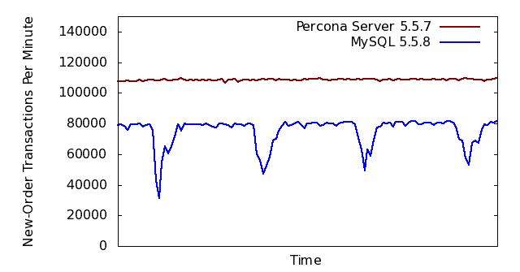

此外，还需提及的是，Percona Server 非常稳健。我们在 Twitpic 的生产环境中已使用超过一年，未出现任何崩溃、数据丢失或问题。而且，其他大型平台如 Flickr、Tumblr、Etsy、Engineyard 和 37Signals 也在生产环境中使用 Percona Server。

###### 安装 Percona Server

```
1 > gpg --keyserver  hkp://keys.gnupg.net --recv-keys 1C4CBDCDCD2EFD2A
2 > gpg -a --export CD2EFD2A | sudo apt-key add -
3 > vi /etc/apt/sources.list.d/percona.repo.list
4 	deb http://repo.percona.com/apt precise main
5 	deb-src http://repo.percona.com/apt precise main
6 > apt-get update
7 > apt-get install percona-server-server-5.5 percona-server-client-5.5
```

#### 是否需要对数据进行分片？

大概不需要！当然，如果不了解你的数据，很难下定论，但在大多数情况下，使用 MySQL 进行分片是使用了错误的工具来完成错误的工作。当你分片数据时，你失去了 MySQL 擅长的所有优势，却获得了 MySQL 擅长的所有缺点（尤其是集群管理）。由于你需要重写大部分现有代码才能实现分片，通常更明智的做法是转向支持原生分片的数据库，例如 [MongoDB](http://www.mongodb.org/) 或 [Apache Cassandra](http://cassandra.apache.org/)。

|  || **What is Sharding?**Sharding 是将数据分布在多台服务器上，使得单台服务器不再保存全部数据。分片能够在单台服务器无法满足高负载需求时更有效地扩展数据库。虽然许多 NoSQL 数据库内置分片支持，但 MySQL 不提供。使用 MySQL 进行分片会导致无法在整个数据集上运行查询，并且通常需要编写自定义代码来交互数据库。 |

| --- | --- |

### 处理 libmysql 无法设置超时的问题

让我们稍微聊一下 PHP 如何与 MySQL 通信。无论你使用`mysql`、`mysqli`还是`PDO`，内部 PHP 都是通过 `libmysql` 或 `mysqlnd` 与 MySQL 服务器建立连接并进行通信。

当 PHP 5.3 发布时，新增了 `mysqlnd`（MySQL Native Driver）这一功能。`mysqlnd` 是 PHP 团队自行编写的定制 C 语言库，专门用于处理 MySQL 连接。在此之前，PHP 使用 `libmysql`，这是 MySQL 自带的标准 C 库。

由于 `mysqlnd` 是 PHP 专属的实现，它更贴合 PHP，能够更好地与 PHP 集成。例如，你可以用纯 PHP 代码子类化 `mysqlnd`，从而注入或修改 PHP 与 MySQL 的交互方式。开发者利用这一特性实现了查询日志、[负载均衡](http://www.php.net/manual/en/book.mysqlnd-ms.php)以及甚至基于 PHP 的[查询缓存](http://www.php.net/manual/en/book.mysqlnd-uh.php)。

但 `libmysql` 与 `mysqlnd` 都有一个主要缺陷：它们都不能以小于 1 秒的精度设置连接超时，也都不支持设置查询超时。这意味着，如果 MySQL 服务器不可达，你能做的最短等待时间就是 1 秒——在高负载环境中显然远远不够。

##### 使用 PDO 设置连接超时

```
1 <?php
2 $pdo = new PDO("mysql:host=localhost;dbname=test", "username", "password");
3 $pdo->setAttribute(PDO::ATTR_TIMEOUT, 1);
```

##### 使用 mysqli 设置连接超时

与 `mysqli` 的做法类似，但要注意代码中的注释。不能像往常一样使用构造函数（`$mysqli = new mysqli('localhost')`）来创建对象，必须先使用 `mysqli_init()` 创建对象。

```
1 <?php
2 // 注意：在使用 mysqli 设置连接超时时，
3 // 必须使用 mysql_init()（返回 mysqli 对象）来创建对象，不能直接使用构造函数。
4 $mysqli = mysqli_init();
5 $mysqli->options(MYSQLI_OPT_CONNECT_TIMEOUT, 1);
6 $mysqli->real_connect("localhost", "username", "password", "test");
```

#### 查询超时

如果没有查询超时机制，一个异常的查询可能会阻塞 PHP-FPM 进程长达 `max_execution_time`（在 `php.ini` 中设置，本章节我们将其设为 5 秒）的时间。但这仍然太长了！在理想情况下，所有查询的执行时间都可预测，但现实并非理想。同一查询在不同的 `WHERE` 条件下可能生成截然不同的执行计划。例如，下面两条查询：

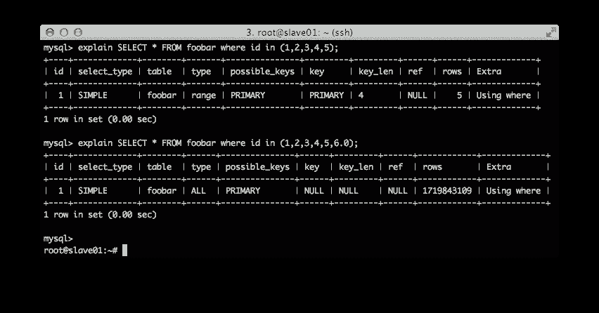

在包含 17 亿行数据的表（即 17 亿，英文 **B**）上运行同一查询。MySQL 完全可以通过本章节的调优轻松应对千万甚至上亿级别的数据；唯一的区别在于第一条查询的 `IN` 语句全是整数，而第二条查询多了一个非整数参数。第一条查询会利用 `PRIMARY` 索引生成执行计划，几乎瞬间返回；第二条查询则会进行全表扫描，遍历全部 `1,719,843,109` 行，极有可能需要数小时才能完成。

即使 PHP 的 `max_execution_time` 终止 PHP-FPM 进程，查询仍会在 MySQL 服务器上继续运行，持续占用 CPU 并严重影响性能。这确实是一个大缺陷！

实际上，解决方案并不简单。PHP 本身没有提供查询超时的直接机制，MySQL 也没有一个可以直接设置的服务器级别超时选项。这在我看来是一个相当大的疏忽。

有两种可行的办法：

##### 借助 HAProxy 的超时功能

在后文“使用 HAProxy 为 MySQL 进行负载均衡”章节中，我介绍了如何使用 HAProxy 为 MySQL 从库提供负载均衡。HAProxy 还支持 TCP 超时设置，这实际上可以将 MySQL 的连接超时和查询超时精确到毫秒级。相关配置位于 `/etc/haproxy/haproxy.cfg`：

```
1 timeout connect 500ms
2 timeout client  1000ms
3 timeout server  1000ms
```

##### 使用 Percona Toolkit 的 `pt-kill`

Percona Toolkit 包含一个名为 `pt-kill` 的工具，能够监控 MySQL 并杀死运行时间过长的查询。当然，有些长时间运行的查询是合法的（如后台任务或 OLAP 系统），因此我通常会为应用创建专用的 MySQL 用户，并使用 `--match-user` 选项仅针对该用户的长时间查询进行杀戮，从而避免影响其他合法查询。

```
1 > pt-kill --daemonize --kill --busy-time 60s --match-user webuser
```

在使用 `pt-kill` 前，需要先安装 `percona-toolkit` 包。如果你遵循上面“安装 Percona Server”部分的步骤，只需执行以下命令即可安装：

```
1 > apt-get install percona-toolkit


The [full documentation for `pt-kill` is available here](http://www.percona.com/doc/percona-toolkit/2.1/pt-kill.html).

#### 你应该使用持久 MySQL 连接吗？

关于 MySQL 持久连接在 PHP 中的大量不良信息，很难对它们及其陷阱有一个稳固的理解。大多数人说，绝对不要使用持久连接，但我认为部分原因是这个话题被误解了。

快速的 Google 搜索显示很多类似的帖子- “Well, you probably don’t **need** persistent connections, so don’t use them!” 或者 “Well, they are really complex so don’t use them!” 早期优化之类的。但有时你确实有数千个 MySQL 连接，持久连接是值得探索的选项。

在讨论利弊之前，我在 PHP 5.4 上做了一些基准测试，发现持久连接比普通非持久连接快约 20-25%。这相当于每个请求快 20ms，虽然不算多，但在单个请求或每秒数千个请求的场景下，这会累积起来。

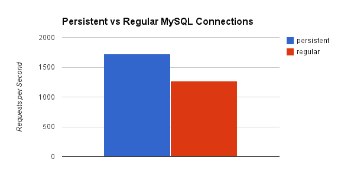

#### 好处

*   你移除了为每个新的 HTTP 请求创建新 MySQL 连接的开销。

#### 缺点

*   没有机制可以“重置”连接，如果你在持久连接中保持一个不一致的状态（比如未提交的事务），它仍舍仍可能被另一个复用的 PHP-FPM 工作进程提交。`mysqli` 通过在每次复用持久连接时调用 `mysql_change_user()` 来缓解这一问题，这会重置大部分连接状态。

*   在连接上使用 `SET` 命令设置的任何 MySQL 变量仍然会在连接被复用时保留。

*   你的 MySQL `max_connections` 设置需要足够大，以容纳 PHP-FPM 子进程中的每一个连接。例如，如果在 PHP-FPM 池中设置 `pm.max_children` 为 100，且有 10 个应用服务器，那么 MySQL 的 `max_connections` 至少需要是 1000。

持久连接在某些场景下 *是合理的*，例如：如果你为大多数 HTTP 请求创建新的 MySQL 连接，不做特殊的 `SET` 操作，并且在事务上很严谨。

### 调整 MySQL 配置

MySQL 通过 `my.cnf` 文件提供大量的调优选项，在 Ubuntu 系统中该文件位于 `/etc/mysql/my.cnf`。下面列出了最重要的设置，并附有“无废话”的注释，说明它们的工作方式及对系统的影响。我没有涵盖任何 `MyISAM` 设置，因为它很糟糕，几乎不应该在高流量环境中使用。

```
 1 [mysqld]
 2 
 3 # 在不考虑 MyISAM 缓冲区的前提下，每个连接大约使用 192KB 的内存。你需要确保-
 4 # (max_connections * 192KB) + innodb_buffer_pool_size 小于系统的总内存，否则 MySQL 可能会开始交换。默认值是 100 连接。
 5 # 2000 连接将使用约 400MB 的内存。
 6 max_connections=2000
7 
8 # 这应该设置为平均连接数 * 你最常访问的表数量。例如，如果平均有 50 个连接且有 5 个常用表，
9 # 则将其设置为 250。默认值较低（64）
10 table_cache=250
11 
12 # 禁用查询缓存。这两个参数必须设为 0，因为 MySQL 存在一个 bug。查询缓存会产生全局锁并
13 # 在写入负载不 trivial 时表现不佳。
14 query_cache_size=0
15 query_cache_type=0
16 
17 # 与单个大的 InnoDB 文件不同，按表分割文件。
18 # 这对性能没有直接影响，提供了对单个表更好的管理功能，并能更好地洞察系统。它只影响新表，
19 # 不会影响老的“单一文件” style InnoDB 表。
20 innodb_file_per_table
21 
22 # InnoDB 有两个版本：Antelope（较旧）和 Barracuda（最新）。告诉 InnoDB 我们总希望使用 Barracuda。
23 innodb_file_format=barracuda
24 
25 # 告诉操作系统 MySQL 会自行缓存，skip 文件系统缓存。
26 # 防止数据被双重缓存（一次在 MySQL 内部，一次在操作系统层面）。
27 innodb_flush_method=O_DIRECT
28 
29 # 将此设为 1 在主服务器上，以确保最安全、ACID 兼容的操作（每次事务提交后 sync）。
30 
31 # 将此设为 2 在从属服务器上，可能在操作系统崩溃后导致最多 1 秒的数据丢失，但可以减少 I/O，因为它只在每秒一次
47 # 将此设为 1 在主服务器上
48 sync_binlog=1
49 
50 # 更大的日志文件大小 = 更少的磁盘写入 I/O，故障恢复时的时间更长
51 innodb_log_file_size=128M
52 
53 # 将此设为 ~90% 的内存。这可能是你需要调整的最重要的 MySQL 值。
54 # 64GB -> 57GB
55 # 32GB -> 28GB
56 # 16GB -> 14GB
57 # 8GB  -> 7GB
58 innodb_buffer_pool_size=57000M
59 
60 # InnoDB 使用后台线程预取并缓存数据。默认是 4 个线程，但
61 # 应该是 4 * CPU 核心数
62 innodb_read_io_threads=32
63 innodb_write_io_threads=32
64 
65 # 这应该设置为系统的最大 IOPS。它会限制 InnoDB 可使用的 I/O 上限。
66 innodb_io_capacity = 5000
67 
68 # 这限制了 InnoDB 在同一时间可以执行的线程数量。设为 0 表示无限，是 Percona 5.5 的好值。
69 # 非 Percona 环境应将其设为 CPU 核心数的 1 倍。
70 innodb_thread_concurrency=0
```

##### innodb\_buffer\_pool\_size

这可能是调优 MySQL/InnoDB 时最重要的配置项。MySQL 会将磁盘上的表数据缓存到内存中以加快访问速度，`innodb_buffer_pool_size` 决定了它应该使用多少内存。在读取密集的工作负载（即 MySQL 从属服务器）上，你希望尽可能大地设置此值，同时避免交换。

一个良好的值是服务器内存的 90%。在读取密集的场景下，如果你使用 `iostat` 并观察到非常高的利用率或服务时间，通常可以通过增加内存（并相应增大 `innodb_buffer_pool_size`）来提升性能。

| Server Memory || Value |
| --- | --- |
| 64GB || 57GB |
| --- | --- |
| 32GB || 28GB |
| 16GB || 14GB |
| 8GB || 7GB |

在写入密集的工作负载（即 MySQL 主服务器）上，此设置的重要性较低。我曾经拥有 128MB 缓冲池的主库，复制到拥有 64GB 缓冲池的从属服务器。此外，如果你为备份目的设置一个 MySQL 从属服务器，可以将此值调低，以节省内存。

##### innodb\_flush\_log\_at\_trx\_commit

该设置可以在稍牺牲数据持久性的前提下提升性能。我在 **仅限从属服务器** 上使用它，因为在主库上设置为 0 可能导致崩溃或 ungraceful shutdown（例如拔掉电源）时出现最多 1 秒的数据丢失。

**在主数据库上，你始终应该将 `innodb_flush_log_at_trx_commit=1`。** 否则是不负责任的，可能导致数据丢失。

我喜欢在从属数据库上“活在边缘”。它们可以修复，所以我把它们视为一次性的，愿意为了性能提升在数据持久性上稍作冒险。


-   [当 `innodb_flush_log_at_trx_commit` 设置为 `1` 时，MySQL 会将数据库变更写入 InnoDB 日志文件，并立即通过 `fsync` 将其写入磁盘。`fsync` 系统调用指示 Linux 立即将数据写入磁盘，而非缓存并稍后写入。这保证了数据在 `fsync` 调用返回后安全存储在硬盘上，即使拔掉电源也能确保数据安全。但这种持久性会牺牲速度，因为每个事务都需要写入磁盘，消耗宝贵的 IOPS，在主服务器上是必要的。]

|  || **What are IOPS?**IOPS 是每秒 I/O 操作次数，指磁盘驱动的读写操作次数。磁盘每读写一次数据即消耗一次 I/O 操作，驱动每秒能执行的 I/O 次数有限。传统旋转磁盘（HDD）的 IOPS 较低（约 200 IOPS），可通过 RAID 提升 IOPS 但仍较慢。磁盘转速（如 7200RPM vs 15000RPM）越高，IOPS 越多；而 SSD 驱动在高端可达 5000 IOPS 甚至超过 100 万 IOPS。]

| --- | --- |

然而，在从属服务器上，可以将 `innodb_flush_log_at_trx_commit` 设置为 `2`。此时，MySQL 会立即将数据库变更写入 InnoDB 日志文件，但不会立即调用 `fsync`，而是让操作系统缓存写入内存，由后台线程约每秒调用一次 `fsync`。这意味着若服务器崩溃，可能丢失最多 1 秒的数据。其优势在于从属服务器的磁盘 IOPS 可显著减少用于 MySQL Replication 写入的开销，从而更高效地利用 IOPS 进行数据库读取的扩展。

`innodb_flush_log_at_trx_commit` 解决的问题是 `fsync` 调用在性能上通常非常昂贵。但若使用带电池备份的 RAID 控制器，其缓存可显著提升 `fsync` 速度，甚至使该设置变得不必要。

##### innodb_flush_method

InnoDB 的刷新方法支持多种值，但唯一重要的仅是 `O_DIRECT`。将该值设为 `O_DIRECT` 可指示操作系统不对数据库数据使用文件系统缓冲，因为 MySQL 会自行使用 `innodb_buffer_pool_size` 管理缓存。若未设置为 `O_DIRECT`，则会出现双缓存现象——MySQL 与 Linux 同时缓存相同数据，导致内存浪费。

##### sync_binlog

二进制日志用于记录所有非 SELECT SQL 语句，是 MySQL Replication 的关键组件。与 `innodb_flush_log_at_trx_commit` 类似，主服务器的 `sync_binlog` 值应设为 `1`，这会让 MySQL 实时 `fsync` 二进制日志中的 SQL 语句，确保崩溃时数据不丢失，复制链路不中断。

从属服务器除非通过 `log_slave_updates` 开启二进制日志，否则不保留二进制日志，因此可以在从属服务器上移除 `sync_binlog` 或将其设为 `0`。

##### innodb_log_file_size

关于 `innodb_log_file_size` 变量，建议通过计算而非盲目设置数值。其工作原理如下：

想象设计数据库时，数据以高效但需计算和随机 I/O 的格式存储。为避免随机 I/O 导致性能下降，可在客户端查询后先计算并缓存数据，延迟将其写入复杂文件格式。若服务器崩溃，未持久化的数据将丢失。

为解决此问题，可将数据先写入日志文件——日志采用顺序写入，性能优异，即使是廉价硬盘也擅长顺序 I/O。数据写入日志后，可按需逐步转换为复杂格式，甚至重新排序和分组数据。若服务器崩溃，只需重放日志即可恢复所有变更。

InnoDB 日志文件有两个，且大小固定。需足够大以容纳写入量，同时允许 InnoDB 慢慢将数据写入复杂文件。设置过小会导致 I/O 频繁且无法高效组织写入；设置过大则崩溃恢复时需重放更多日志，耗时更长。

**如何确定最佳 `innodb_log_file_size`？**  
应计算每分钟写入日志的 MB 数，并设置为可容纳一小时写入量的大小，且需在峰值期执行此计算。

```
 1 > show global status where variable_name like "%Innodb_os_log_written%";
 2   select sleep(60); 
 3   show global status where variable_name like "%Innodb_os_log_written%";
 4        
 5 *************************** 1. row ***************************
 6 Variable_name: Innodb_os_log_written
 7         Value: 234825649664
 8 1 row in set (0.01 sec)
 9 
10 +-----------+
11 | sleep(60) |
12 +-----------+
13 |         0 |
14 +-----------+
15 1 row in set (1 min 0.00 sec)
16 
17 *************************** 1. row ***************************
18 Variable_name: Innodb_os_log_written
19         Value: 234828058624
20 1 row in set (0.00 sec)
```

```
1 234828058624-234825649664 = 2408960 bytes
```

`2408960` 字节为每分钟写入日志的字节数。[Google 2408960 bytes to megabytes](https://www.google.com/?q=2408960+bytes+to+megabytes#hl=en&safe=off&output=search&sclient=psy-ab&q=2408960+bytes+to+megabytes&gs_l=hp.12...0.0.0.1163.0.0.0.0.0.0.0.0..0.0.0.0.0.0.0.0.0.0.0.0.0.0.0..0.0.0..0.0.0...0.0.les%3B..0.0.0.1c.ONtw7scylt0&pbx=1&bav=on.2,or.r_gc.r_pw.r_cp.r_qf.&fp=19fc9cab2f77850f&bpcl=35440803&biw=1129&bih=999)，显示 MySQL 每分钟向日志写入 2.29MB 数据。

Multiply the megabytes per minute times 60 minutes to determine how much data would be written out in one hour.

```
1 2.29MB * 60 minutes = 137.4MB
```

Since InnoDB keeps two individual log files, divide 137.4MB by 2 and we get about 69MB, so `innodb_log_file_size` should be around 70MB in this scenario. We can go higher, even up to 100MB or 200MB, but as you can see, for most cases, setting it very high is unnecessary.

(*Calculation method adopted from the [MySQL Performance Blog](http://www.mysqlperformanceblog.com/2008/11/21/how-to-calculate-a-good-innodb-log-file-size)*)


在现有 MySQL 数据库上生效的改动，需要干净地关闭 MySQL，删除 InnoDB 日志文件，然后重新启动 MySQL。如果不这样做，MySQL 会报错说现有的日志文件大小与 `innodb_log_file_size` 的值不匹配。

需要删除的文件位于 MySQL 数据目录，文件名为 `ib_logfile0` 和 `ib_logfile1`。请记住，这些文件仅在崩溃时才必要，因此在使用 `mysqladmin shutdown` 干净关闭 MySQL 后，你可以自由删除它们。MySQL 启动后会根据新指定的大小重新创建这些文件。

**注意**：如果不使用 `innodb_file_per_table`，请不要删除 `ibdata1` 文件，因为它包含所有 InnoDB 数据。使用 `rm -rf ib*` 这类命令时很容易误删此文件。

### max_connections

`max_connections` 需要设置为应用程序可能出现的理论最大连接数。由于每个 PHP-FPM 进程通常只使用一个连接，你应使用 PHP-FPM 配置文件中的 `pm.max_children` 设置来进行计算。

**设置 `max_connections` 的公式：**

```
1 max_connections = pm.max_children * number of application servers
```

默认值 100 连接远远不足，务必将其调高。还需确保有足够的内存来处理理论最大连接数。MySQL 是多线程服务器，为每个连接创建一个线程，每个线程约需要 192KB 内存。例如，192KB * 2000 连接 ≈ 400MB，因此在扣除 `innodb_buffer_pool_size` 后，确保系统有足够的空闲内存来容纳这些连接。

### innodb_io_capacity

`innodb_io_capacity` 设置告诉 InnoDB 你的系统能提供多少 IOPS，从而设定上限，防止磁盘被饱和。因此，需要根据 MySQL 系统中磁盘的性能来设置该值。默认值 100 在当今硬件中远远不足，必须进行调优。以下为一些推荐的起始值：

| 驱动类型 || 值 |
| --- | --- |
| Enterprise SSD || 50,000 |
| Single Consumer SSD || 10,000 |
| 4 Drives in a RAID-10 || 5000 |
| Single 7200RPM Drive || 200 |

在我们的从服务器上，我们使用 Enterprise-Level Micron SSD 驱动器并配置 RAID-0，能够将其设置为 `150,000`。

不确定系统性能如何？可以使用 `fio` 快速测试系统的随机 IOPS 能力。假设你想测试挂载为 `/mysql` 的磁盘 `/dev/sdb1`。

首先需要安装 `fio` 并创建作业文件。我们定义的作业会测试 128MB 文件上的随机读写性能。如果系统拥有更快的驱动器，建议将文件大小至少调整到 5GB，因为测试会几乎瞬间完成。在单个 7200RPM 驱动器系统上，测试约需 30 秒。

```
1 > apt-get instal fio
2 > cd /mysql
3 > mkdir /mysql/fio
4 > vi random-rw.fio
5     [random_rw]
6     rw=randrw
7     size=128M
8     directory=/mysql/fio
```

运行刚才创建的作业文件：

```
1 > fio random-rw.fio
```

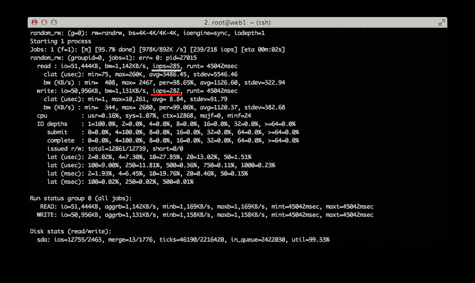

作业运行结束后，你会看到类似上述输出。黄色下划线标示的数值是平均随机读 IOPS（此例为 285），红色下划线标示的数值是平均写入 IOPS（282）。这来自一个单个 7200RPM 驱动器系统。

`fio` 支持多种配置选项和测试类型。通过修改 `rw=randrw` 变量，可更改基准测试类型。可用的测试类型如下：

| 名称 || 测试类型 |
| --- | --- |
| read || 仅测试顺序读取 |
| write || 仅测试顺序写入 |
| randread || 仅测试随机读取 |
| randwrite || 仅测试随机写入 |
| rw || 测试顺序读取+写入 |
| randrw || 测试随机读取+写入 |

随机 I/O 是最差情况且最慢的场景，因此使用 `randrw` 测试的值作为 `innodb_io_capacity` 的保守起点是合理的，但它能让你了解系统性能。你可以尝试使用 `rw=rw` 运行作业，观察系统在 100% 顺序、最佳情况下的表现。

|  || **MySQL 使用哪些不同类型的 I/O？** |
| --- | --- |
| 写入 InnoDB 日志文件使用顺序 I/O。 |
| 写入 InnoDB 数据文件主要使用随机 I/O。 |
| 从 InnoDB 数据文件读取主要使用随机 I/O。 |

### innodb_read_io_threads & innodb_write_io_threads

InnoDB 使用后台线程管理读写任务。默认值为 4，对于现代系统而言过低。应将其设置为 CPU 核心数的 4 倍。

### query_cache_size

MySQL 查询缓存乍看之下似乎是个好主意。它会将每条查询的结果缓存到内存中，当再次发送相同查询时，可直接返回结果，无需再次解析。对于读取密集型表，它能显著加速查询响应，甚至可以替代 Memcached 等独立缓存层。

但在写入操作上存在问题。由于查询缓存设计为始终提供最新数据，需要智能地更新缓存。然而，它并未如此处理。相反，每次发生数据写入时，查询缓存会**完全清空并重置整个表的缓存**。**每一次写入（INSERT、UPDATE、DELETE）都会导致缓存被清除**。想象一下，如果每秒有 100 条写入操作，查询缓存需要每秒刷新 100 次，几乎完全失去作用。

不仅如此，它还会损害性能。缓存越大，清空所需时间越长，导致每条 INSERT 查询变慢。此外，查询缓存使用全局锁，同一时间只能被单个线程访问——这意味着其他线程在等待清空缓存时会被阻塞。

**结论**：**如果工作负载包含显著的写入量，请彻底禁用查询缓存**。因为 InnoDB 已拥有其内部缓存，查询仍能保持高速。 **如果你有读取密集且极少写入的表，查询缓存是合理的**，它可以让你免于额外实现缓存层，简化应用复杂度。

由于 MySQL 存在一个 bug，需要同时将 `query_cache_size` 和 `query_cache_type` 设置为 0。

但如果我的应用既有读取密集型表，也有写入密集型表呢？由于查询缓存是全局设置而非按表设置，你应该**禁用查询缓存**，因为它通常弊大于利。你可以开启**按需缓存**，如果正确使用，它仍能提供一定收益。

为此，首先需要将配置值设置为开启按需缓存：

```
1 query_cache_type=2
2 query_cache_size=16M
```

16MB 是查询缓存的良好起点。请记住，缓存需要在每次写入时被清除，因此应保持尽可能小。它只存储查询语句和结果，通常每条只有几 KB。


-   默认情况下，查询会跳过查询缓存。如果你想让特定查询使用缓存，需要将 `SELECT` 改为 `SELECT SQL_CACHE`。例如-

``` 
1 mysql> SELECT SQL_CACHE FROM foobar WHERE id = 123456
```

然而，按需查询缓存仍然受全局写入的影响，因此它并不是完美的解决方案。

##### XtraDB/InnoDB vs MyISAM

你会发现我在这一章没有提及任何 MyISAM 相关的性能设置。原因是你在生产环境中绝对不应该使用 MyISAM。为什么不能使用 MyISAM？

**它不支持行级锁**

这意味着每次向 MyISAM 表中插入数据时，整个表都会被锁定，其他并发连接在查询完成前无法从该表读取或写入。这是一个巨大的限制。InnoDB 支持行级锁，只有参与插入或更新的行在修改时才会被锁定。

如果你在低负载环境下使用，这可能影响不大，但 MyISAM 绝对不适合高负载工作负载，且在扩展时没有位置。将所有表切换到 InnoDB，然后不要回头。

###### 如何判断表是 MyISAM 还是 InnoDB？

```
1 mysql> SHOW TABLE STATUS WHERE 'Name' = 'foobar'\G
2 *************************** 1. row ***************************
3            Name: foobar
4          Engine: InnoDB
5         Version: 10
6      Row_format: Compact
```

###### 如何将表从 MyISAM 切换到 InnoDB？

```
1 mysql> ALTER TABLE foobar ENGINE = INNODB;
```

警告：`ALTER TABLE` 操作可能耗时较长，并会对表加写锁，从而阻止数据写入。

###### 关于搜索呢？

确实，InnoDB 不支持像 MyISAM 那样的全文搜索。事实上，搜索方面有更好的替代方案。请查看：

*   [ElasticSearch](http://www.elasticsearch.org/)

*   [Sphinx](http://sphinxsearch.com/)

*   [Solr](http://lucene.apache.org/solr/)

据说 MySQL 5.6 将为 InnoDB 添加全文搜索功能。我尚未测试，无法评估性能，但它可能会取代或至少大幅减少对独立搜索服务的需求。

### 调优 Linux 以应对高强度数据库

Linux 和 MySQL 是天作之合。默认情况下，MySQL 在 Linux 系统上运行得相当不错，但通过调整一些设置并做出正确的初始决策，我们可以在 I/O 方面（作为性能弱点）提升 30-40% 的性能。

#### 更改 I/O 调度器

Linux 内核默认包含三种 I/O 调度器：`cfq`、`deadline` 和 `noop`。可以通过以下命令查看当前使用的调度器（这里 `sda` 是磁盘设备 ID）：

```
1 cat /sys/block/sda/queue/scheduler
2 noop deadline [cfq]
```

大多数发行版默认使用 `cfq`，它旨在在整个系统间公平分配 I/O 资源，非常适合桌面环境中多个程序争夺 I/O 的场景。但对于单一数据库服务器，你希望数据库拥有**所有** I/O 资源。

选择哪个调度器并不重要，`deadline` 和 `noop` 都表现良好，关键是**不要选择 `cfq`**。`cfq` 速度极慢，切换到 `deadline` 或 `noop` 能带来巨大收益。`noop` 适合 SSD 和硬件 RAID，但在我测试中，`deadline` 和 `noop` 的表现相似。

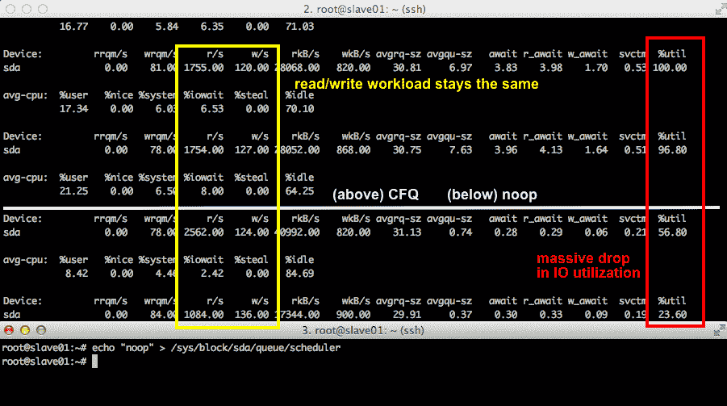

如上图所示，上方窗口运行 `iostat -x 1` 命令，显示每秒 I/O 使用情况。在白色横线上方，使用的是 `cfq` 调度器，可以看到红色列标记的 I/O 使用率约为 100%。2 秒后切换到 `noop` 调度器，**I/O 利用率立即减半**，稳定在 20% 左右。

黄色方框标记的部分表明，读/写操作速率在整个测试过程中保持不变，因此 I/O 利用率的下降是由于调度器切换导致的。

切换 I/O 调度器非常简单，是提升数据库写入性能的低挂果实，只需几秒钟。

> 我的数据库所在磁盘是 `/dev/sda`，示例中针对该磁盘修改 I/O 调度器。如果你的磁盘标识不同，请将 `sda` 替换为对应的标识。`sda` 是大多数人的正确选择。

```
1 > echo noop > /sys/block/sda/queue/scheduler
2 > vi /etc/rc.local
3   # 在 rc.local 文件中添加此行，因为系统重启后 I/O 调度器会恢复默认
4   echo "noop" > /sys/block/sda/queue/scheduler
```

#### 调整 swappiness

交换通常会导致 MySQL 服务器崩溃。由于 MySQL 有自己的内部缓存，它依赖内存缓冲池始终保持快速。当 Linux 将缓冲池的部分数据交换到磁盘时，会让 MySQL 突然失去支撑，甚至在内存不足时导致服务器崩溃。因此，必须配置 MySQL 以最大化内存使用，同时避免过高导致系统交换。

我们可以通过配置 `vm.swappiness` 让内核更倾向于保留内存中的非活动数据，而不将其写入磁盘。但需注意，如果完全禁用交换，当系统内存不足时，服务器会因无法使用磁盘交换空间而直接崩溃。

```
1 > sysctl -w vm.swappiness=0
2 > vi /etc/sysctl.conf
3   vm.swappiness=0
```

#### 增加打开文件数

如前 Load Balancer 章节所述，标准 Linux 配置下，进程最大打开文件数设置得很低（1024）。MySQL 需要增加打开文件数的原因有两点：第一，`max_connections` 设置需要为每个连接分配文件描述符；第二，每个打开的表也需要一个文件描述符。例如，10 个表和 100 个连接，至少需要 1000 个打开文件，因为每个连接线程维护自己的文件句柄。

修改方法很简单：

```
1 > vi /etc/security/limits.conf
2     * soft  nofile  999999
3     * hard  nofile  999999
4 > ulimit -<unk><unk><unk><unk><unk><unk><unk><unk><unk><unk><unk><unk><unk><unk><unk><unk><unk><unk><unk><unk><unk><unk><unk><unk><unk><unk><unk><unk><unk><unk><unk><unk><unk><unk><unk><unk><unk><unk><unk><unk><unk><unk><unk><unk><unk><unk><unk><unk><unk><unk><unk><unk><unk><unk><unk><unk><unk><unk><unk><unk><unk><unk><unk><unk><unk><unk><unk><unk><unk><unk><unk><unk><unk><unk><unk><unk><unk><unk><unk><unk><unk><unk><unk><unk><unk><unk><unk><unk><unk><unk><unk><unk><unk><unk><unk><unk><unk><unk><unk><unk><unk><unk><unk><unk><unk><unk><unk><unk><unk><unk><unk><unk><unk><unk><unk><unk><unk><unk><unk><unk><unk><unk><unk><unk><unk><unk><unk><unk><unk><unk><unk><unk><unk><unk><unk><unk><unk><unk><unk><unk><unk><unk><unk><unk><unk><unk><unk><unk><unk><unk><unk><unk><unk><unk><unk><unk><unk><unk><unk><unk><unk><unk><unk><unk><unk><unk><unk><unk><unk><unk><unk><unk><unk><unk><unk><unk><unk><unk><unk><unk><unk><unk><unk><unk><unk><unk><unk><unk><unk><unk><unk><unk><unk><unk><unk><unk><unk><unk><unk><unk><unk><unk><unk><unk><unk><unk><unk><unk><unk><unk><unk><unk><unk><unk><unk><unk><unk><unk><unk><unk><unk><unk><unk><unk><unk><unk><unk><unk><unk><unk><unk><unk><unk><unk><unk><unk><unk><unk><unk><unk><unk><unk><unk><unk><unk><unk><unk><unk><unk><unk><unk><unk><unk><unk><unk><unk><unk><unk><unk><unk><unk><unk><unk><unk><unk><unk><unk><unk><unk><unk><unk><unk><unk><unk><unk><unk><unk><unk><unk><unk><unk><unk><unk><unk><unk><unk><unk><unk><unk><unk><unk><unk><unk><unk><unk><unk><unk><unk><unk><unk><unk><unk><unk><unk><unk><unk><unk><unk><unk><unk><unk><unk><unk><unk><unk><unk><unk><unk><unk><unk><unk><unk><unk><unk><unk><unk><unk><unk><unk><unk><unk><unk><unk><unk><unk><unk><unk><unk><unk><unk><unk><unk><unk><unk><unk><unk><unk><unk><unk><unk><unk><unk><unk><unk><unk><unk><unk><unk><unk><unk><unk><unk><unk><unk><unk><unk><unk><unk><unk><unk><unk><unk><unk><unk><unk><unk><unk><unk><unk><unk><unk><unk><unk><unk><unk><unk><unk><unk><unk><unk><unk><unk><unk><unk><unk><unk><unk><unk><unk><unk><unk><unk><unk><unk><unk><unk><unk><unk><unk><unk><unk><unk><unk><unk><unk><unk><unk><unk><unk><unk><unk><unk><unk><unk><unk><unk><unk><unk><unk><unk><unk><unk><unk><unk><unk><unk><unk><unk><unk><unk><unk><unk><unk><unk><unk><unk><unk><unk><unk><unk><unk><unk><unk><unk><unk><unk><unk><unk><unk><unk><unk><unk><unk><unk><unk><unk><unk><unk><unk><unk><unk><unk><unk><unk><unk><unk><unk><unk><unk><unk><unk><unk><unk><unk><unk><unk><unk><unk><unk><unk><unk><unk><unk><unk><unk><unk><unk><unk><unk><unk><unk><unk><unk><unk><unk><unk><unk><unk><unk><unk><unk><unk><unk><unk><unk><unk><unk><unk><unk><unk><unk><unk><unk><unk><unk><unk><unk><unk><unk><unk><unk><unk><unk><unk><unk><unk><unk><unk><unk><unk><unk><unk><unk><unk><unk><unk><unk><unk><unk><unk><unk><unk><unk><unk><unk><unk><unk><unk><unk><unk><unk><unk><unk><unk><unk><unk><unk><unk><unk><unk><unk><unk><unk><unk><unk><unk><unk><unk><unk><unk><unk><unk><unk><unk><unk><unk><unk><unk><unk><unk><unk><unk><unk><unk><unk><unk><unk><unk><unk><unk><unk><unk><unk><unk><unk><unk><unk><unk><unk><unk><unk><unk><unk><unk><unk><unk><unk><unk><unk><unk><unk><unk><unk><unk><unk><unk><unk><unk><unk><unk><unk><unk><unk><unk><unk><unk><unk><unk><unk><unk><unk><unk><unk><unk><unk><unk><unk><unk><unk><unk><unk><unk><unk><unk><unk><unk><unk><unk><unk><unk><unk><unk><unk><unk><unk><unk><unk><unk><unk><unk><unk><unk><unk><unk><unk><unk><unk><unk><unk><unk><unk><unk><unk><unk><unk><unk><unk><unk><unk><unk><unk><unk><unk><unk><unk><unk><unk><unk><unk><unk><unk><unk><unk><unk><unk><unk><unk><unk><unk><unk><unk><unk><unk><unk><unk><unk><unk><unk><unk><unk><unk><unk><unk><unk><unk><unk><unk><unk><unk><unk><unk><unk><unk><unk><unk><unk><unk><unk><unk><unk><unk><unk><unk><unk><unk><unk><unk><unk><unk><unk><unk><unk><unk><unk><unk><unk><unk><unk><unk><unk><unk><unk><unk><unk><unk><unk><unk><unk><unk><unk><unk><unk><unk><unk><unk><unk><unk><unk><unk><unk><unk><unk><unk><unk><unk><unk><unk><unk><unk><unk><unk><unk><unk><unk><unk><unk><unk><unk><unk><unk><unk><unk><unk><unk><unk><unk><unk><unk><unk><unk><unk><unk><unk>


啊…数据库文件系统之争。互联网上有大量选项和千奇百怪的看法。让我们谈谈硬性数据——我已经比较并基准测试了两种最推荐的 MySQL 文件系统，`ext4` 和 `XFS`。我们在 Twitpic 上使用 ext4，根据我做的研究，我本以为它的性能和 XFS 一样好——更不用说，如今大多数 Linux 发行版的默认文件系统都是 ext4。

不过，我使用 `sysbench`（本章末尾会介绍）在 XFS 和 ext4 之间进行了读写 MySQL 基准测试，结果让我惊讶。我在一台 16 核机器上运行了测试，以确保基准测试不会因 CPU 成为瓶颈而扭曲结果。它创建了一个表，大小略大于 `innodb_buffer_pool_size`，因此并非所有数据都能装入内存，导致某些读取必须访问磁盘。

对比 ext4 和 XFS，发现 XFS 在 100,000 个读 **和** 写查询的基准测试中表现极其出色。

| XFS || ext4 |
| --- | --- |
| 21,755 qps || 16,560 qps |

顺便说一下，在 Ubuntu 上安装 XFS 只需安装 `xfsprogs` 并对想格式化的设备运行 `mkfs.xfs`。

```
1 > apt-get install xfsprogs
2 > mkfs.xfs /dev/sdf1
```

*测试是在专用磁盘上进行的，用于存放 MySQL 数据文件，因此没有其他系统进程的 I/O 竞争。*

##### Raw Device Mode（原始设备模式）

你甚至可以让 InnoDB 使用所谓的 **Raw Device Mode**，它直接将数据写入未格式化的磁盘或分区，而不通过任何文件系统。虽然它略快，但我强烈建议不要使用它，因为它会让数据管理变成一场噩梦。你将失去在使用普通文件系统时对数据库文件的全部可视性。此外，基准测试显示 `ext4` 和 `XFS` 仅比使用原始设备慢极其微乎其微。

好奇心的你可以通过修改 `innodb_data_file_path` 设置来启用原始设备模式：

```
1 innodb_data_home_dir=
2 innodb_data_file_path=/dev/sda1:500Gnewraw
```

重启 MySQL，它会创建数据文件，然后再次修改 `innodb_data_file_path`：

```
1 innodb_data_file_path=/dev/sda1:500Graw
```

##### 文件系统的未来

简要提及 [`ZFS`](http://en.wikipedia.org/wiki/ZFS) 和 [`btrfs`](http://en.wikipedia.org/wiki/Btrfs)。它们都很酷，很可能是文件系统的未来，因为它们支持现代功能，如 copy‑on‑write、SSD 缓存和去重，但 `ZFS` 在 Linux 上的支持尚不理想，而 `Btrfs` 仍过于实验，不适合生产环境。

### MySQL 从属实例的负载均衡

拥有多个只读的 MySQL 从属实例很棒，但你需要在代码中负载均衡它们。默认情况下，PHP 完全不负责此类负载均衡，你需要自行编码实现。下面我将展示几种做法。

#### 数据库类

最简便的方式是在代码中直接实现：随机选择一个从属实例并返回对应的数据库连接。

```
 1 <?php
 2 class Database {
 3   static function connect() {
 4   	// 假设从属主机来自配置文件，但为简化，这里直接定义它们。
 5     $slaves = array('192.51.100.1', '192.51.100.2', '192.51.100.3');
 6     $slave  = $slaves[array_rand($slaves)];
 7     
 8     return new mysqli($slave, 'user', 'password');
10   }
11 }
12 
13 $slave = Database::connect();
```

这种方式的缺点是，如果从属实例崩溃，代码在等待连接超时时不会优雅处理。当然，你可以手动从配置文件中删除该从属实例，但这需要人工操作，而且我不喜欢在半夜被叫醒去手动编辑配置文件。

#### 扩展 PDO

与上面的 Database 类似，如果你使用 PDO，也可以更优雅地实现负载均衡，但同样存在上述缺点（对 downed 从属实例的处理不佳）。

```
 1 <?php
 2 class SlavePDO extends PDO {
 3 
 4   public function __construct($dsn, $user=null, $pw=null, $options) {
 5   	// 假设从属主机来自配置文件，但为简化，这里直接定义它们。
 6     $slaves = array('192.51.100.1', '192.51.100.2', '192.51.100.3');
 7     $slave = $slaves[array_rand($slaves)];
 8     
10     $dsn .= ";host={$slave}";
11     parent::__construct($dsn, $user, $pw);
12 }
13 }
14 
15 $slave = new SlavePDO('mysql:dbname=test', 'user', 'password');
```

#### 使用 mysqlnd_ms 插件

*MySQL Native Driver* 是 PHP 团队编写的替代 MySQL 驱动，最早在 PHP 5.3 中加入，目的是消除对 `libmysql` 的依赖并更深度地将 MySQL 集成到 PHP 核心。MySQLND 还支持开发 PHP 与 C 插件以扩展其功能。由于 MySQLND 在内部被 PDO、MySQLi 以及已被弃用的旧 MySQL 扩展所调用，MySQLND 插件可以与任何 MySQL 交互界面配合使用。

首先，你需要安装 `mysqlnd_ms` PECL 插件。

```
1 > pecl install mysqlnd_ms
```

随后，在应用中添加一个配置文件，例如 `./config/db.conf`：

```
 1 > vi ./config/db.conf
 2   { "app" : {
 3     "master": [ { "host": "192.51.100.10" } ],
 4     "slave": [
 5       { "host": "192.51.100.1" },
 6       { "host": "192.51.100.2" },
 7       { "host": "192.51.100.3" }]
 8     },
 9     "failover": { "strategy": "loop_before_master" }
10   }
```

然后在应用中启用 `mysqlnd_ms`：

```
1 <?php
2 ini_set("mysqlnd_ms.enable", 1);
3 int_set("mysqlnd_ms.config_file", "./config/db.conf");
```

现在，只要在创建 MySQL 连接时传入 `app` 作为主机，插件就会自动在从属实例之间轮询，并在需要时将写入请求发送到主库。其容错机制尚可，但仍不如理想：它在每次请求时都会等待从属实例超时，不过比直接失败要好。

插件允许在配置中设置容错策略。示例中使用了 `loop_before_master`，这意味着在从属实例失败后，它会先尝试其他从属，最后再尝试主库。虽然它不会记住失败的从属，导致每次请求都要等待超时，但相比于直接失败，这已经是一种改进。

#### 使用 HAProxy

处理从属实例负载均衡的最佳方式是使用像 HAProxy 这样的软件负载均衡器。正如第 4 章所讨论的，HAProxy 可以在第 4 层（原始 TCP）进行负载均衡，虽然大多数人用它来均衡 HTTP，但它同样可以用于内部 MySQL 连接的负载均衡。

为什么 HAProxy 是最佳解决方案？有两个原因：

1. 当 HAProxy 检测到数据库从属实例不可响应（崩溃、下线等）时，它会立即从负载均衡池中移除该实例，停止使用它。检测速度快，完全透明，无需改动配置、无需停机、无需等待连接超时，并且**最关键的是，不必半夜醒来处理配置文件**。

2. HAProxy 让你可以设置极其细粒度的超时时间，甚至到毫秒级。这可以绕过 PHP 弱劣的 MySQL 超时管理（PHP 的超时默认最小为 1 秒），让你设置更合理的超时值。

安装和配置过程与我们设置 HTTP 负载均衡的方式类似。


1 > apt-get install haproxy  
2 > vi /etc/haproxy/haproxy.cfg  

4 global  
5 maxconn 50000  
6 user haproxy  
7 group haproxy  
8 stats socket /tmp/haproxy  
9 node lb1  
10 nbproc 1  
11 daemon  

13 defaults  
14 log     global  
15 retries 3  
16 option  dontlog-normal  
17 option  splice-auto  
18 timeout connect 200ms  
19 timeout client  2s  
20 timeout server  2s  
21 maxconn 50000  

24 listen mysql 192.51.100.100:3306  
25 mode tcp  
26 balance leastconn  

28 server slave01 192.51.100.1:3306 check  
29 server slave02 192.51.100.2:3306 check  
30 server slave03 192.51.100.3:3306 check  

32 listen stats *:1936  
33 mode http  
34 stats enable  
35 stats uri /  
36 stats hide-version  
37 stats auth Username:Password  

HAProxy won’t run until you enable the init.d script, so let’s do that now.  

1 > vi /etc/default/haproxy  
2     # Set ENABLED to 1 if you want the init script to start haproxy.  
3     ENABLED=1  

5 > service haproxy start  

With this configuration, we set up three database slaves, each defined with a `server` line. Now, all we have to do is modify our code to connect to HAProxy’s IP Address instead of the slave IP Address. (The HAProxy IP is defined in the configuration file in the `listen` setting. In this example, it’s `192.51.100.100`.)  

1 <?php  
2 $mysqli = new mysqli("192.51.100.100", "username", "password");  

Now, every time you make a MySQL connection, you will connect to HAProxy instead of directly to the MySQL slave. HAProxy will choose the slave with the least amount of connections and connect you to that slave. You can also use `balance roundrobin` as your balancing strategy if you want HAProxy to use less intelligence when picking slaves.  

Since we set `timeout connect` as `200ms`, if a connection to a slave fails to happen in in less than 200 milliseconds, HAProxy will try another slave instead. Failed or overloaded MySQL slaves are now a non-issue.  

With `timeout client` and `timeout server` both set at `2s`, it means that a long-running client or hung query will get disconnected after 2 seconds. Having a very low query timeout threshold makes sense for a web application, but obviously not for any kind of analytics or background processes, so you’ll want to connect directly to the slaves or set up a secondary HAProxy `listen` block with different timeouts for those scenarios.  

The best feature, in my opinion, is that failed slaves are automatically removed from the pool and re-added once they come back up. Until we ran this setup in production on Twitpic, I’d have to wake up in the middle of the night to manually remove broken slaves from our configuration files. It was a real pain-point for us as we grew to more and more slaves.  

You also get a really nice web interface for viewing the status of your MySQL slaves.  

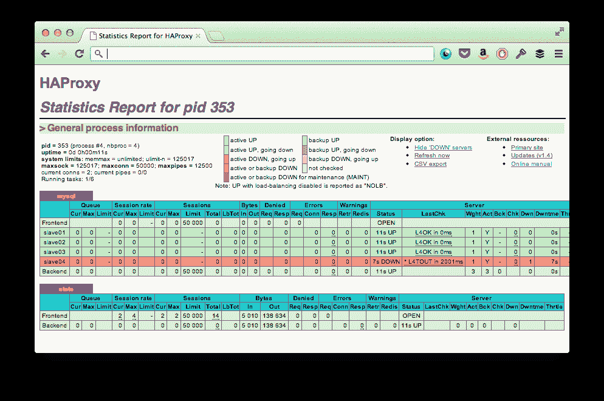  

### Accepting the Master as a SPOF  

When you choose to use MySQL, you need to learn to accept and understand that your master server is always going to be a single point of failure. Of course, there are solutions and workarounds like [DRBd](http://dev.mysql.com/doc/refman/5.0/en/ha-drbd.html), [Percona XtraDB Cluster](http://www.percona.com/software/percona-xtradb-cluster), and MySQL Master-Master Replication. The downside, though, is that they are often slow and extremely complex.  

The alternative is to accept and deal with the fact that your master database server is going to be a single point of failure. You can work around the problem by scripting the failover process and dealing with the situation with as little downtime as possible. Check out [JetPants](http://tumblr.com) by Tumblr as a starting point for a MySQL master failover/slave promotion toolkit.  

#### What really happens when your master fails?  

I used to be worried that if our master database crashed, we would lose data and be faced with an enormous amount of downtime. When I thought about it, though I realized a few things-  

**The site won’t go down**  

Since we only write data to the master, and never read from it, it’s really just a glorified coordinator of data. If it crashes, our site just goes into a read-only state, but it’s still up and functioning.  

**We won’t lose data**  

Because we make daily, off-site backups, even in the event of a catastrophic failure, losing just the master is even less of a big deal because data is replicated and stored safely on all of the slaves.  

Using [semi-synchronous replication](http://dev.mysql.com/doc/refman/5.5/en/replication-semisync-installation.html) in MySQL 5.5 is needed to guarantee that we don’t lose *anything* in the event of a master crash. With the default asynchronous replication, it’s possible to lose data that has been written to the master but not yet replicated to the slaves during a crash. Semi-synchronous replication, instead, guarantees that new data is replicated to at least one slave.  

#### Promoting a slave as the master  

Okay, so your master database has failed. What is next? Well, we need to promote a slave to be the new master to get it up and running as quickly as possible.  

Let’s quickly go through a high level overview of the slave to master promotion process.  

**Assumptions**  

*   Your master server is named `master01`, and you have five slaves, `slave01-05`.  

*   You want to promote `slave01` to be the new master.  

*   `master01` is still up-and-running.  

*   Your code writes to the MySQL using the database user `app_user`.  

If `master01` is still up-and-running, it’s important to disable writes to it before failing over to the new master so your data doesn’t get out of sync. On `master01`, first delete the user that your application uses (`app_user`), so it won’t be able to establish any new connections. Next, put the database in read-only mode:  

1 > DROP USER `app_user`  
2 > SET GLOBAL read_only=1;  
3 > FLUSH TABLES WITH READ LOCK;  

At this point, your database cluster is in a total read-only mode. If `master01` has crashed or become unavailable, this step is unnecessary because your cluster is already effectively in a read-only state.  

Next, we need to pick a slave to be the new master. In this scenario, we’ve decided to promote `slave01`. On `slave01`, you’ll want to copy over your `my.cnf` from `master01`, particularly the `log-bin` setting, and restart MySQL. It’s helpful to have a backup master server already configured for this purpose.  

On `slave01`, you’ll want to run `SHOW MASTER STATUS` to determine the binlog position.  

1 mysql> show master status \G  
2 *************************** 1. row ***************************  
3 File: master-bin.000001  
4 Position: 98  

Now that you know the position of the binlog, you can connect to the rest of your slaves and reconfigure them to use `slave01` as the new master server with the `CHANGE MASTER TO` command.  

1 mysql@slave02> STOP SLAVE;  
2 mysql@slave02> CHANGE MASTER TO	MASTER_HOST="slave01",  
3 MASTER_LOG_FILE="master-bin.000001", MASTER_LOG_POS=98;  
4 mysql@slave02> START SLAVE;  

Lastly, update your application configuration to write to `slave01` instead of `master01`.  

Doing it manually isn’t the best scenario, and a good portion of this can be scripted. Instead of scripting it yourself, though, it’s worth checking out [mysql-master-ha](http://code.google.com/p/mysql-master-ha/) which can handle automatic master failover by scripting the solution described above.  

#### Further research and reading  

The topic of MySQL Master Failover is huge and could easily take up its own book, so it’s impossible for me to cover all of the possible solutions here. For most people, taking it into a read-only state and manually promoting a new master is the simplest and best approach. Unfortunately, it’s not a solution that works for everyone, so here are some further places to look for more information on some more robust (and more complex) solutions for handling master failure.  

*   [Automated Master Failover (Slides)](http://www.slideshare.net/matsunobu/automated-master-failover)  


-   [如何评估哪种 MySQL 高可用性方案最适合您](http://www.percona.com/live/mysql-conference-2012/sessions/how-evaluate-which-mysql-high-availability-solution-best-suits-you)

-   [MySQL ZFS Replication](http://dev.mysql.com/doc/refman/5.0/en/ha-zfs-replication.html)

-   [MySQL DRBd Replication](http://dev.mysql.com/doc/refman/5.0/en/ha-drbd.html)

-   [Percona XtraDB Cluster](http://www.percona.com/software/percona-xtradb-cluster)

-   [Percona Replication Manager](https://github.com/jayjanssen/Percona-Pacemaker-Resource-Agents/blob/master/doc/PRM-setup-guide.rst)

-   [Tungsten Replicator](http://code.google.com/p/tungsten-replicator/)

### 理解 NUMA 相关问题

**TL;DR** - NUMA（[Non-Uniform Memory Access](http://en.wikipedia.org/wiki/Non-Uniform_Memory_Access)）是一个相当复杂的话题，只涉及到部分 MySQL 实现：运行**多个** Intel Nehalem 或更高版本 CPU、内存容量巨大（即超过 64GB）且 `innodb_buffer_pool_size` 设置得很大的服务器。其结果是 MySQL 会在系统内存充足的情况下，将大量内存交换到磁盘，导致性能显著下降。

虽然 NUMA 架构的问题尚未完全解决，但通过**修补 `/usr/bin/mysqld_safe`**、**使用 Percona Server 5.5** 以及将 `zone_reclaim_mode` 设置为 `0`，可以解决大多数问题。

#### 什么是 NUMA？

在 Nehalem CPU 之前，大多数多 CPU 系统采用 SMP（对称多处理）架构，给予所有 CPU 相同访问系统内存的权限。

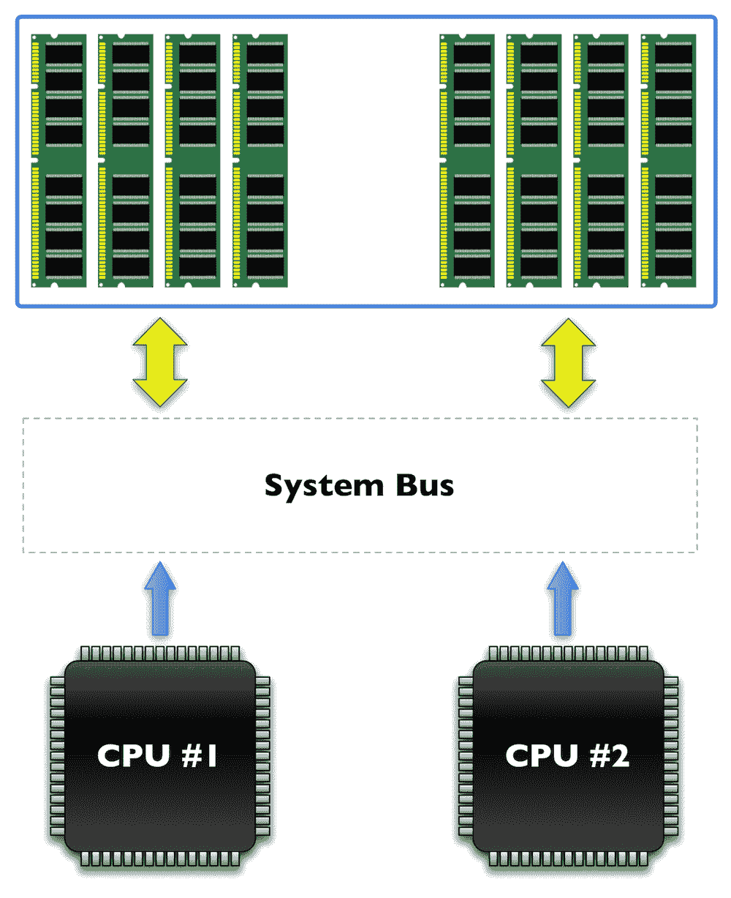

System architecture with SMP

从 Intel 的 Nehalem 架构开始，Nehalem 及更新的处理器（包括 Sandy Bridge 和 Ivy Bridge）采用了新的多 CPU 系统内存访问方式。**这仅在拥有多个物理 CPU 的系统中才重要，单 CPU 系统（尽管有多核）不受影响。**

简单来说，在 NUMA 架构下，每个 CPU 直接访问部分本地内存，而非通过中央路径访问全部内存。这使得内存条与特定 CPU 绑定，导致访问非本地内存时速度变慢且过程更复杂。

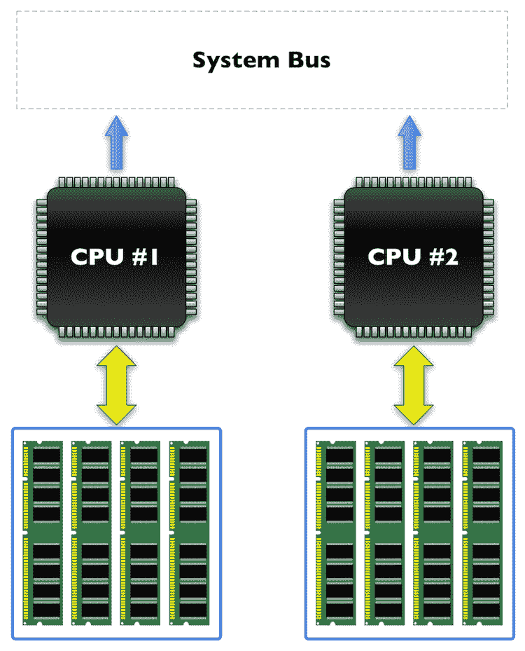

System architecture under NUMA

#### NUMA 如何影响 MySQL？

想象一个拥有 2 个物理 CPU 和 64GB 内存的巨型 MySQL 系统。为了充分利用 64GB 内存，您将 `innodb_buffer_pool_size` 设置为 57GB。在重载环境下，即使系统有大量空闲内存，MySQL 仍因频繁交换内存到磁盘而性能极差。

原因是 Linux 不允许每个 CPU 直接访问全部 64GB 内存——每个 CPU 只能使用其“本地”内存池（在此例中为 32GB）。当某个 CPU 需要访问的内存超过其本地可用池的大小时，Linux 会启动交换到磁盘，即使其他 CPU 的本地池中有空闲内存。

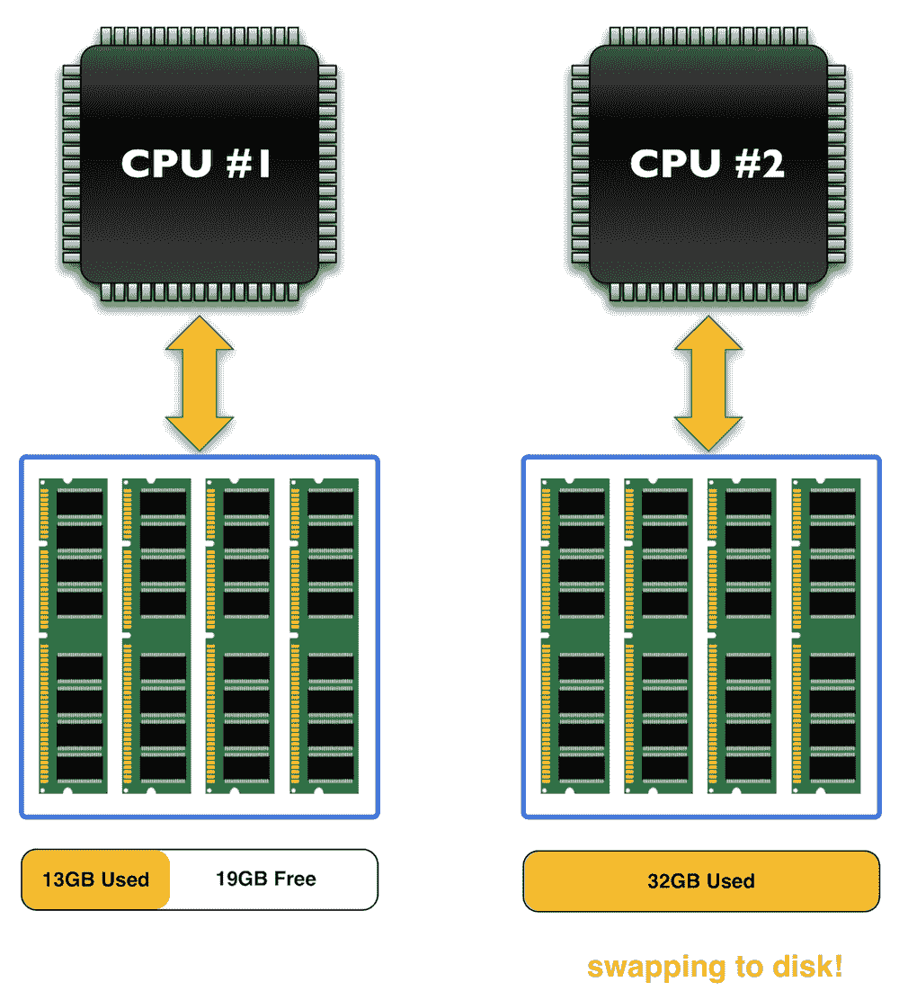

What happens when a CPU needs to address more than 32GB

#### 如何解决这个问题？

有几种方法可以克服这一限制：

1. 将 `innodb_buffer_pool_size` 设置为 32GB。

2. 仅使用单个物理 CPU 的 MySQL 服务器。

这两种方案都不理想。更好的办法是：

- 使用 **Percona Server 5.5** 替代 Oracle 官方 MySQL Server。Percona 版本包含大量增强和补丁，使 MySQL 在 NUMA 系统上更为稳健。

- 调整 Linux 以开启 CPU 跨核内存交互（memory interleaving），消除每个 CPU 32GB 的限制，让它们共同使用全部 64GB 内存。

为此，需要安装 `numactl`：

```
1 > apt-get install numactl
```

接下来，需修补 MySQL 启动脚本 `mysqld_safe` 以使用 `numactl`：

```
1 > vi /usr/bin/mysqld_safe
```

打开文件后，找到第 735 行（以我的系统为例）：

```
1 cmd="`mysqld_ld_preload_text`$NOHUP_NICENESS"
```

将其替换为：

```
1 cmd="/usr/bin/numactl --interleave all $NOHUP_NICENESS"
```

#### 进一步阅读

一篇关于 NUMA 与 MySQL 的优秀文章是 [The MySQL “Swap Insanity” Problem and the Effects of the NUMA Architecture](http://blog.jcole.us/2010/09/28/mysql-swap-insanity-and-the-numa-architecture) ——作者 Jeremy Cole。文章较长，但如果想深入理解问题与解决方案，值得一读。

### 选择最佳硬件

如果您打算在硬件上花费资金，将其投入 MySQL 集群几乎总能带来最大的性能提升。

#### CPU 速度（影响单个查询）

MySQL 为每个查询使用单个线程，不会自动并行化查询，因此单个查询只能利用一个 CPU 核心。在纯 CPU 受限的环境中，更高的 GHz 总是优于更多核心。但请注意，除非所有数据能完全装入内存，MySQL 很少受 CPU 限制。

#### CPU 核心数（影响并发）

虽然 MySQL 不能将单个查询拆分到多个核心，但它可以并发执行多个查询。更多核心意味着更高的并发能力。在高流量环境中，核心数更为关键。

当前市场上性能最佳的 CPU 是 **Intel Xeon SandyBridge 26xx 系列**。每个 CPU 可支持最多 8 核，一台机器可装配两颗 CPU，通过 Hyper Threading 可实现最高 32 个并发线程。主频最高可达 3.5GHz/核。

#### 内存

此项很简单：尽可能多地在服务器上装填内存。只要数据量大于内存，没有任何理由（除成本外）不最大化内存容量。更大的内存可让您将 `innodb_buffer_pool_size` 设置得更大。

我们的 slave 服务器配备 64GB 内存，但 128GB、256GB 甚至 512GB 的配置在当今已不再罕见。当时的 16GB ECC/Registered DDR3 内存条约需 $175，因此 512GB 仅需约 $5500。

若使用 Intel Xeon 26xx CPU，SuperMicro 甚至生产支持 768GB 内存的主板——当今时代确有其奇。

#### 存储

合理选择存储对 MySQL 集群性能至关重要。并非所有存储都一样，主从架构意味着主库和从库的存储需求截然不同。主库的最佳方案未必适用于从库，反之亦然。

##### 硬盘

我强烈推荐在主数据库上使用高端服务器硬盘。选用 10,000 或 15,000 RPM 的硬盘并配置 RAID 阵列（见下文）。

为何不在主库使用 SSD？回顾我们之前讨论的 `innodb_log_file_size` 设置——对写入操作而言，MySQL 可通过合理 sized log file 利用顺序 I/O。顺序 I/O 在旋转磁盘上同样快速，因此对写入导向的主库而言，使用 SSD 并非必须。

###### 将主服务器磁盘放入 RAID！

切勿冒险。磁盘会故障，通常在最不恰当的时候，导致停机。

###### 避免使用 RAID-5！

RAID-5 的性价比看似有利，但其写入性能在高流量数据库服务器上过于缓慢。若预算有限，可采用 RAID-1。

###### 使用 RAID-10


RAID-10 是 RAID-1 和 RAID-0 的组合。RAID-0 本身性能最佳，但有风险：丢失单个磁盘会导致停机。在 RAID-10 中，两个 RAID-0 被镜像化为 RAID-1。丢失磁盘不会导致任何停机。

RAID-10 的缺点是成本/GB 比例差。例如，四个 600GB 驱动器在 RAID-10（原始空间 2.4TB）中只能形成 1.2TB 的 RAID 阵列。

###### 使用硬件 RAID 控制器

不要使用软件 RAID。这不值得。为主服务器投资硬件 RAID 是正确的选择，从速度和耐用性两方面来看。为什么要使用硬件 RAID？

*   硬件 RAID 卡具有内部内存（通常约 512MB），用于在写入磁盘前缓存数据。这使得 `fsync`（随后的磁盘写入）变得非常快。

*   优质 RAID 卡提供电池或电容备份，确保在断电后内部内存中的数据会写入磁盘。

我真的很喜欢 [Adaptec 5405Z RAID 卡](http://www.amazon.com/dp/B002DYAUTC?tag=stevecorona-20)。它是 PCI-Express 的，拥有 512MB 写缓存 + 4GB 闪存缓存，可以连接最多 256 个驱动器，并且与 Linux 兼容性很好。

##### 固态硬盘

对于从属 MySQL 服务器，SSD 是首选。从属服务器将处理持续的随机读取工作，而机械硬盘在这方面表现很差。相反，SSD 在随机 I/O 上比机械硬盘快数个数量级。SSD 经常能达到 30,000 个随机 IOPS，而普通硬盘在这种工作负载下仅能达到约 200 IOPS。

SSD 的缺点是价格昂贵。虽然消费市场价格在下降，但每 GB 的价格仍然很高。

在选择 SSD 时，一个重要考虑因素是不同品牌和产品之间的性能差异可能**巨大**。你不能只比较 GB 数，还需要关注原始 IOPS 性能。有些公司生产 256GB SSD 且 IOPS 为 5,000，而其他公司则达到 500,000 IOPS。

###### 闪存磨损

由于 SSD 的底层技术，频繁的大量写入可能导致其磨损。关于磨损耐久性的讨论很有争议。根据制造商和所用的闪存类型，很难确定确切答案。

我的结论：*我不担心它*。我们的从属服务器是可替换的，配合 HAProxy 负载均衡设置，即使从属服务器崩溃也不会导致停机。

如果你担心磨损，可以通过将 InnoDB 日志文件和二进制日志写入非 SSD 驱动器来降低风险。你可以使用 `innodb_log_group_home_dir` 设置修改日志文件位置，同样，二进制日志位置可通过 `log_bin` 设置改变。因为二进制日志存储临时数据且仅依赖顺序写入，非 SSD 驱动器同样可以提供足够性能，而不会加速闪存磨损。

如果你真的担心闪存磨损，最简单的解决方案是选择最耐用的闪存驱动器。最大的区别在于存储单元类型——`SLC`（单层单元）、`MLC`（多层单元）和（较少见的）`TLC`（三层单元）。

SLC 闪存存储每个单元仅存储一位，而 MLC 存储两位，TLC 可存储三位。MLC 和 TLC 的优势在于容量更大，因为单元存储更多数据，从而提高存储密度并降低成本。

不过，MLC 和 TLC 的缺点是，随着单元中“状态”数量增加，需要更精确的读写。我们常用“水杯”类比来说明：

想象一个 flash 存储单元是一个水杯。如果是 SLC 单元，只需存储一位数据，操作简单：空杯表示 `0`，满杯表示 `1`。即使杯子不准确（剩余少量水），仍可认为是空（`0`）。

如果是 MLC 单元，需要在一个杯中表示两位数据。例如：空杯为 `00`，1/4 满为 `01`，1/2 满为 `10`，满杯为 `11`。虽然可行，但精度要求更高——杯子稍微有点水，可能导致误判是空（`00`）还是 1/4 满（`01`）。

若使用 TLC（三位），需在一个单元中表示三位数据，精度需求更高。

因此，如果闪存磨损对你很重要，SLC 是首选。但要注意，它可能比其他类型贵 5 倍，且容量上限通常较低。

| Cell Type || Lifespan per Cell (number of erase cycles) |
| --- | --- |
| SLC || 100,000 |
| --- | --- |
| MLC || 10,000 |
| TLC || 5,000 |

###### RAID

在从属服务器上使用 RAID 并非必需（因为我们不需要驱动器容错，只需更换并重建从属），但可以用于扩展磁盘空间或提升性能。

通常更划算的是购买 2 个较小的高端 SSD 而不是 1 个更大的高端 SSD。例如，若需要 400GB SSD 存储，可以选择单个 400GB 驱动器，或 2 个 200GB 驱动器并配置 RAID-0。

这种方式还能提升 SSD 的 IOPS。两个 SSD 在 RAID-0 中几乎能提供单个驱动器 2 倍的 IOPS。

#### 网络卡

等等，真的吗？快速网络卡对 MySQL 服务器重要吗？是的！我们的 MySQL 从属服务器在高峰期很容易超过 100mbps 的流量，因此必须使用网络支持的最快网卡（在我们的情况下是 1000mbps）。此外，我建议将网卡进行 bonding（捆绑）以应对网络故障并提升吞吐量。

即使你的 MySQL 流量不多，我也建议使用网络支持的最快网卡。当你需要恢复一个 500GB 的 MySQL 备份时，你会感谢自己的选择：在千兆网络上约需 1 小时，而标准 100mbps 网络则需 12 小时。

### 在线架构变更

MySQL 的一个主要弱点是，当表非常大时，修改架构（添加/删除列或索引）非常困难。

原因有两点：首先，MySQL 在添加新列时需要扫描并修改每一行数据，并通过复制数据到临时表实现，这会导致高 I/O 使用并耗时很长（数百万行表可能需要数小时甚至数天，占用数百 GB 磁盘空间）。其次，在数据复制期间，MySQL 对表加写锁，导致在该过程中无法插入或修改新数据。

这一限制之一促使企业转向 MongoDB 和 Cassandra 等无架构数据库，因为它们可以随意添加列，无需繁琐的 schema 迁移。

[Reddit 讨论了如何绕过此问题的方法](http://highscalability.com/blog/2010/5/17/7-lessons-learned-while-building-reddit-to-270-million-page.html)。我对此方案非常不屑，但他们本质上是将 MySQL 转换为键值存储。

想象你有一个规范化的数据库结构：

| id || username || name || location |
| --- | --- | --- | --- |
| 1 || steve || Steve Corona || Charleston, SC |
| 2 || rob || Robert Johnson || New York, NY |

使用 Reddit 的结构，它会变成去规范化：

| id || key || value |
| --- | --- | --- |
| 1 || username || steve |


| --- | --- | --- |
| 1 || name || Steve Corona |
| 1 || location || Charleston, SC |
| 2 || username || rob |
| 2 || name || Robert Johnson |
| 2 || location || New York, NY |

The advantage is simple: You can create a new column by simply using it. You don’t have to modify your MySQL table at all.

There are a bunch of things *wrong* with this design- The data is denormalized, so it’s going to use way more disk space because you have to store the key text for every “row”, and you can’t enforce database constraints like foreign keys, default values, or types. I’m sure if you spent more time thinking about it you could probably find 10 other reasons why this is *wrong*.

**But none of that matters**. The real reason why storing your data this way is a bad design is because you’re **using the wrong tool for the job**. If you want to use a key-value store or a schema-less database, *USE A KEY-VALUE STORE OR SCHEMA-LESS DATABASE*. We don’t use hammers to put screws into the wall, and likewise, we shouldn’t use MySQL for something it’s not designed to be. Use the right tool.

#### The least frustrating way to make schema changes

If you’re stuck with MySQL, what’s the easiest way to make schema changes without locking up your entire database cluster and subsequently taking down your entire website? I’m going to outline the best approach below.

Pretend you have a table, `foobar`, and you want to add a new column to it, `username`. Our database cluster has five MySQL slaves and a single master.

The SQL for making the changes to `foobar` is `ALTER TABLE foobar ADD COLUMN username VARCHAR(25)`.

We want to add the username column to `foobar` completely seemlessly, without causing any downtime for our users. If we were to run the `ALTER TABLE` statement on the master server, it would get replicated to the slaves immediately, completely locking the `foobar` table. To make matters worse, MySQL Replication is single-threaded, so the slaves would start to lag behind while they were waiting for the `ALTER TABLE` to finish. Obviously, this is not acceptable given our constraints.

The best way to handle the schema change is to take each slave, one-by-one, and cut off all traffic to it by removing it from our HAProxy pool. Once a slave is removed from service, we turn off MySQL replication, run the `ALTER TABLE` on it individually, wait for it to finish, restart replication, and put it back into the pool. It’s a time-consuming process, but prevents any website downtime.

But there’s still the little matter of making the change to the master server. The process here is similar, though. We manually promote one of the database slaves to be the master, demote the master to a slave, and run the `ALTER TABLE` command. When it’s done, the old master is promoted again and your entire database cluster now has the new schema without any downtime.

This process is extremely painstaking and time consuming, but it’s really the only way to make the schema changes without locking the table in production. It also gives you good practice for getting comfortable with master/slave promotion and demotion outside of a crisis.

If you’re locked into MySQL but absolutely need instant schema changes, there’s a commercial storage engine for MySQL called [TokuDB](http://tokutek.com) that can add new columns and indexes without locking your table and degredating performance. TokuDB can also compress your data up to 25x and reduce I/O usage- in my tests a billion row 160GB InnoDB table only weighed in at 30GB in TokuDB, with better performance. Downsides? It costs $2500/server/year (but is free to try) and doesn’t work with Percona.

### Further Topics

Writing this chapter was like going down a rabbit hole. As I was writing and researching topics, I’d constantly run into other sections that I wanted to talk about. In order to prevent myself from going on a thousand tangents and actually *finish* the damn thing, I had to limit the amount of topics that I covered.

Here’s a list of the other topics that I wanted to cover. I might add a section for some in future edits or revisions of the book, so if you’re particularly interested in one, send me an email to cast your vote.

**mysqlproxy**

Proxy server for MySQL that lets you write scripts in Lua to inject behavior. It can be used for MySQL R/W splitting, slave load balancing, etc. [More information here](http://dev.mysql.com/doc/refman/5.1/en/mysql-proxy.html).

**Optimizing Queries with `explain`**

**MySQL Connection Pooling w/ `mysqlnd_mux`**

**Asynchronous MySQL Queries**

**How to quickly bootstrap a MySQL Slave**

**Tumblr JetPants**

**Benchmarking MySQL with sysbench**

## Cache Server: Using Redis

A common way to improve the performance of your PHP application is to use an in-memory object cache to speed-up expensive to calculate by calculating it once and persisting the result between HTTP requests. The data can come from any slow source- 3rd Party APIs and Filesystems just to name some, but more often than not, the data is coming from your database.

In an ideal world, the database’s query cache would handle this sort of thing for us. However, if you recall from Chapter 6, we talked about how MySQL’s query cache is all but useless. The reason is that it completely erases the query cache after every `INSERT` or `UPDATE`, making it all but useless for tables with even a moderate amount of database writes.

Another advantage of using a separate object cache layer is that with simple key hashing, you can distribute the cached objects across multiple servers, allowing you to use memory from every machine in your Memcached or Redis cluster. MySQLs cache, on the other hand, can only take advantage of the resources of a single machine. That’s not to say that tuning MySQL isn’t important, it’s just that having an object caching system complements MySQL with improved performance.

### Choosing between Redis, Memcached, and APC

We have a couple of options available to us when looking for an in-memory object cache. Each one is useful and excels for different needs, so let’s talk about each of them.

#### APC

In the Application Server chapter, we discussed using the [PECL APC Extension](http://pecl.php.net/package/APC) as a mechanism for speeding up your application by caching the compiled bytecode of your source. On top of that, [APC also has an interface for storing and retrieving](http://php.net/manual/en/book.apc.php) data between PHP requests using shared memory, which can be used as an object cache.

Here’s an example of how we can use APC. Imagine that in one script, you have this code, which you run.

```
1 <?php
2 $array = array("foo1", "foo2", "foo3");
3 apc_add("foobar", $array);
```

And in separate script, that runs independently from the code above:

```
1 <?php
2 // $array will contain array("foo1", "foo2", "foo3") after
3 // fetching it from APC.
4 $array = apc_fetch("foobar");
```

Using `apc_add` and `apc_fetch`, you’re able to store and retrieve data lasts longer than the lifecycle of a normal PHP request. Of course, there are no guarantees and data can come and go, so it should only be used for re-calculatable cache data.

APC offers atomic counters and expiration times, too, which gives it a similar feature set as Memcached.

The biggest pro of using APC is that it’s extremely fast. In fact, it’s faster (at a micro level) than Redis or Memcached. Why? It uses shared memory within the PHP process, so it doesn’t need to go out on the network or communicate with a separate server. It’s biggest asset, however, is also it’s biggest weakness. Because the shared memory is tied to a parent PHP-FPM process, each server has to maintain it’s own separate cache data, effectively making it non-distributed since all cache data needs to be re-calculated and re-stored for each server.


Furthermore, because APC relies on shared memory, it only works with `PHP-FPM` or `mod_php`. A PHP script running on the command line or in a cronjob won’t be able to see the shared memory because it doesn’t share the same parent process as your `PHP-FPM` workers.

Does this make APC useless? Not at all. It’s highly useful for caching small pieces of data that don’t take too long to compute. For example, I’ve used it with some success for caching configuration files. Without APC, the configuration files (stored in [YAML format](http://www.yaml.org/)) would have to be re-read and parsed on every request. Instead, since the files don’t change that often, I was able to parse the YAML files once and store the result in APC. The code looked something like this:

```
 1 <?php
 2 function load_config() {
 3   $config = apc_fetch("config");
 4   
 5   if ($config === false) {
 6 	$config = yaml_parse_file("app/config/config.yml");
 7 	// Store the parsed file in APC for the next access.
 8 	// The 3rd parameter is an automatic expiration time.
 9 	apc_add("config", $config, 86400);
10   }
11   
12   return $config;
13 }
```

It’s worth noting that the APC cache is *never persisted to disk*. That means if `PHP-FPM` crashes or gets restarted, the cache will be wiped clean.

#### Memcached

Memcached is the ol’reliable object cache software. It seems like all of the big guys use it- Twitter, Facebook, and 37Signals to just name a few. Memcached really pioneered the idea of a separate, distributed cache layer for your application and was really the only option a few years ago.

Memcached is similar to APC in a lot of ways, except that it runs as a threaded C server, so you need to go over the network to communicate with it. Compared to APC, communicating over the network is obviously slower but still ends up being extremely performant to the tune of 500,000+ operations per second. The major advantage is that with some simple hashing, multiple Memcached servers can effectively be grouped together to distribute your cached data and provide you with the resources of all of the servers combined. That is to say, if you had 10 Memcached servers, each with 4GB of memory, you’d effectively have a 40GB in-memory cache available to you.

Memcached provides all of the same features as APC, including CAS (check-and-set) tokens which allow you to avoid race-conditions by only allowing new values to be the written if they key hasn’t been modified.

That being said, I’m not going to cover Memcached in this chapter because Redis, which was released a couple of years ago, has far outpaced Memcached in terms of features and reliability while offering similar performance (aka, damn fast).

##### Stuck on Memcached?

If you like Memcached, or you’re already using it and stuck with it, I’ve included a short bonus chapter on Memcached. But you should seriously consider switching to Redis. It’s a drop in replacement.

#### Redis

Redis is where it’s at. If you’ve never used it before, you’re in for a treat- it’s got enough coolness to make your inner geek excited. Just like Memcached and APC, it can do key/value caching with `GET` and `SET` primitives, but it also adds other data types like lists, hashes, and sorted sets. There are literally hundreds of commands, and I won’t be able to cover them all here, so [check out the Redis documentation](http://redis.io/commands) to play with the commands. There’s even an in-line console that let’s you play with each command right on the website.

**Remember, the entire dataset stored in Redis MUST fit into memory. While Redis does persist your data to disk, it only reads from disk during startup so you must always have more memory than data.**

#### Why is Redis better?

*   Memcached/APC data is never saved to disk, meaning that if a server crashes or gets restarted, you start with a blank slate. Redis, on the other hand, can be configured to sync to disk, allowing you to always have a warm cache on-hand. When you’re site becomes **dependent** on having a fast cache, there are serious performance implications to blowing away your entire cache because of a restart. (While you can configure Redis to sync after *every* write, when you’re using it as a cache it’s better to allow for some data-loss in order to keep it fast.)

*   Memcached/APC only offer key/value primitives, `GET` and `SET`, and atomic counters. While you can hack extra data types, they are often unsafe and full of race conditions. Redis, on the other hand, includes lists, sets, sorted sets, hashes, master/slave replication, transactions, and even lua scripting. Since I won’t go over every single Redis command, you can check out the [full documentation here.](http://redis.io/commands)

*   Lastly, Depending on which version of `libmemcached` you’re using (mainly older versions that were bundled with Ubuntu 10.04), there are some serious bugs with the way that timeouts are handled. As in, they are completely broken. This bit us *hard*, a single instance of Memcached going down would block all of our PHP-FPM processes and take down the site. The C [hiredis](http://github.com/redis/hiredis) library that most Redis client use, on the other hand, has been reliability solid because it’s written by [antirez](http://twitter.com/antirez), the creator of Redis.

### Redis Commands

Redis offers way more than just the typical `set` and `get` operations that we’ve seen with Memcached and APC. I’ll briefly cover them here with some examples and common use-cases. The [full command list is available here](http://redis.io/commands).

#### Simple Operations

The most basic features give us exactly what APC and Memcached have- simple `GET` and `SET` operations.

```
 1 <?php
 2 
 3 $r = new Redis;
 4 $r->connect("127.0.0.1");
 5 
 6 $r->set('key', 'foobar');
 7 $r->get('key'); // returns foobar
 8 
 9 $r->setex('key', 100, 'foobar');  // set with 100 second expiration
10 $r->psetex('key', 100, 'foobar'); // set with a 100ms expiration
11 
12 $r->setnx('key', 'foobar'); // set only if key doesn't exist
13 $r->delete('key');
```

We have atomic counters, too!

```
1 $r->incr('views');       // 1
2 $r->incr('views');       // 2
3 $r->incrby('views', 10); // 12
4 $r->decr('views');       // 11
```

Other single key commands worth exploring- `ttl`, `expire`, `exists`, `expireat`, `rename`, `type`, and `persist`.

GET and SET commands are great for storing singular data. The increment and decrement commands are atomic (meaning, you don’t have to worry about race conditions.)

#### Hashes

Redis can store hashes, which are pretty much like a PHP associative array, and can be used to group information together by key.

```
 1 <?php
 2 
 3 $r->hset('user:1', 'name', 'Steve');
 4 $r->hset('user:1', 'username', 'scorona');
 5 
 6 $r->hset('user:2', 'name', 'John');
 7 $r->hset('user:2', 'username', 'jdoe123');
 8 
 9 $r->hget('user:2', 'name'); // returns John
10 $r->hlen('user:2'); // returns number of keys (2)
```

Other hash commands worth exploring- `hgetall`, `hexists`, `hvals`, `hkeys`, `hincrby`, `hmset`, `hmget`, `hdel`, and `hsetnx`.

Hashes can be used just like SET and GET, but are great (and more efficient+convenient) for storing data that can be grouped together by a common key. For example, if we were storing user data in Redis, it makes sense to use a hash because the data can be grouped together by the user id.

#### Lists

A Redis List is like a numerically indexed array in PHP.

```
1 <?php
2 
3 $r->lpush('key', 'foo'); // returns 1
4 $r->lpush('key', 'bar'); // returns 2
5 $r->rpush('key', 'test'); // returns 3
6 $r->lsize('key'); // returns 3
7 $r->lindex('key', 0); // returns bar
8 $r->lset('key', 1, 'testiest');
```

Other list commands- `lpushx`, `lpop`, `lsize`, `ltrim`, `lrange`, `lrem`, and more.


-   列表非常适合存储、添加、删除、推入和弹出数据项，可以原子化地对列表进行操作。我喜欢使用列表来存储按时间顺序的数据，因为使用 `lpush` 时，列表会自然按插入时间排序。

-   一个很好的使用场景是通知推送，每个用户有一个列表，新通知会推送到列表的头部。

-   列表也是我们的排队系统 Resque 所使用的基础数据结构。

#### 集合和有序集合

-   集合与列表相似，你可以在一个键中存储大量数据。主要区别在于集合完全无序且不允许出现重复数据。与列表相比，集合提供了更强大的功能，例如检查值是否在集合中、集合的并集、交集、差集等操作，这里蕴含了大量的能力。

```
1 <?php
2 
3 $r->sadd("names", "steve", "john", "alice");
4 $r->scard("names"); // 返回 3
5 $r->sismember("names", "steve"); // 返回 true
```

-   在集合之上，我们还有**有序集合**，它们虽然较慢，但可以对集合进行排序，而普通集合本身是完全无序的。

-   集合的一个用例是存储需要保证唯一的数据列表，例如用户名、分类名称或标题。你可以使用 `sismember` 快速判断一个值是否属于该集合。

#### 事务

-   你可以将多条命令组合成事务。事务可以通过一次网络往返完成多条命令，效率更高。

```
1 <?php
2 
3 $r->multi()
4   ->set("key", "value")
5   ->set("foo", "bar");
6   ->hset("user:2", "name", "Steve")
7   ->exec();
```

-   事务会作为原子单元执行，但可以通过传入 `Redis::PIPELINE` 来禁用原子性，这样命令会以块的形式发送到服务器，但不保证执行时原子。

#### 发布/订阅

-   Redis 提供了一个非常酷的发布/订阅功能，适合用于跨进程的异步通信。

-   假设我们有两个脚本，一个是订阅者：

```
1 <?php
2 
3 $r->subscribe(array('updates'), function($r, $channel, $data) {
4   echo "Received {$data}\n";
5 });
```

-   另一个是发布者：

```
1 <?php
2 
3 $r->publish('updates', "Some new data");
```

-   订阅者会从发布者那里接收到消息，如魔法般。多个订阅者可以监听同一个频道，也可以有多个频道，这非常强大，可用于后台脚本通信、实现聊天室，以及通过 WebSocket 进行流媒体服务。

### 原子操作的重要性

-   Redis 的所有命令都是原子的，这意味着每条命令都是独立的，不会影响其他命令的状态。

-   以下是一个非原子计数的示例：

```
1 $v = $r->get("key")  // $v 为 1
2 $r->set("key", $v+1) // 现在 "key" 为 2
```

-   这会出错，因为如果在 `get` 与 `set` 之间另一个进程把 `key` 的值改为 2，我们在 `set` 时会再次把它设为 2，导致计数丢失。

-   通过使用原子计数器可以解决此问题：

```
1 $v = $r->incr("key") // 返回 "key" 的新值
```

-   `watch()` 命令可以实现检查-设置操作，虽然 `incr()` 更推荐，但可以用下面的方式修复第一个示例：

```
1 $ret = false;
2 while ($ret == false) {
3   $r->watch("key");
4   $v = $r->get("key");
5   
6   // 如果在 watch() 与 exec() 之间有其他客户端修改了 "key"，则返回 false
7   $ret =  $r->multi()->set("key", $v+1)->exec();
8 }
```

### Redis 性能限制

-   与多线程的 Memcached 相比，Redis 是单线程的事件驱动模型，这意味着每个 Redis 服务器只能利用单个 CPU 核心。通常这不是问题，因为大多数 Redis 命令的复杂度是 `O(1)` 或 `O(n)`，CPU 消耗不高。

-   若需要扩展 Redis 的 CPU 使用，可在同一台机器上启动多个 Redis 实例，使用不同端口。

-   64 位系统比 32 位系统在相同数据量下使用更多内存，因为指针在 64 位系统中为 8 字节，而在 32 位系统中为 4 字节。每个 Redis 项至少占用一个指针（列表 3 个，sorted set 8+ 个），因此在大量小键的情况下，内存差异会很显著。

-   绕过此限制的方法是运行 32 位带 PAE（Physical Address Extension）的系统，这可以让内核能够寻址 36 位地址空间（64GB 内存）。即使有 PAE，每个进程仍只能看到 4GB 内存，需要启动 16 个 Redis 实例才能使用全部内存。

-   实际意义不大，直接使用 64 位系统并增加内存即可。PAE 是一种笨拙的内核黑客手段。

### 从 Dotdeb 安装 Redis

-   Ubuntu 自带的 Redis 版本较旧，官方只提供源码，因此我们需要从 [Dotdeb](http://dotdeb.com) 安装。

-   如果已经使用 Dotdeb 安装过 PHP 5.4，则可以跳过添加源的步骤。

```
1 > vi /etc/apt/sources.list.d/dotdeb.list
2 
3 deb http://packages.dotdeb.org squeeze all
4 deb-src http://packages.dotdeb.org squeeze all
5 
6 > wget http://www.dotdeb.org/dotdeb.gpg
7 > cat dotdeb.gpg | sudo apt-key add -
8 > apt-get update
```

-   安装 Redis 只需运行 `apt-get`：

```
1 > apt-get install redis-server
2 > service redis-server start
```

-   当时 Redis 2.6 刚刚发布，建议始终使用最新版本，因为每个版本之间都会加入新特性和优化。

### 安装 `phpredis` C 扩展

-   有一些纯 PHP 的 Redis 库，如 [Predis](https://github.com/nrk/predis) 和 [Redisent](https://github.com/jdp/redisent)，它们不需要 C 代码，但性能会慢 3-4 倍。

-   对于 PHP 与 Redis 的连接，最佳的 C 扩展是 [phpredis](https://github.com/nicolasff/phpredis)，它更新频繁且使用非常稳定。目前它还未整合 `hiredis`，但仍然工作良好。

-   注意：PHPRedis 不在 PECL 仓库中，可以直接使用 `pecl install redis` 跳过下面的编译步骤。

-   安装过程稍微复杂，因为它不在官方 PECL 仓库：

```
 1 # 可能不需要这些依赖
 2 > apt-get install git build-essential
 3 
 4 # 先安装 igbinary
 5 > pecl install igbinary
 6 
 7 > git clone git://github.com/nicolasff/phpredis.git
 8 > cd phpredis
 9 > phpize
10 > ./configure --enable-redis-igbinary
11 > make && make install
12 > vi /etc/php5/conf.d/phpredis.ini
13   extension=redis.so
```

-   安装完成后，需要重启 PHP-FPM。

|  || **What’s igbinary?**Igbinary 是用于替代 PHP 默认的序列化扩展。默认的 PHP 序列化是基于字符串的 ASCII 格式，既慢又占用较大空间，尤其是在存储 PHP 对象（如数组、数据库结果、模型）时影响显著。Igbinary 用二进制格式替代，提高效率和空间使用率。 |


Redis 的配置文件位于 `/etc/redis.conf`，文档非常完善，因此这里无需逐一说明每个选项。您只需阅读该配置文件（完整版本可在 [此处](https://raw.github.com/antirez/redis/2.6/redis.conf) 查看）。我将重点介绍最重要的设置，但幸好选项并不多。

### Redis 持久化

Redis 的持久化方式与传统数据库（如 MySQL）非常不同。它实际上提供了两种持久化方法，可以单独使用或同时使用（推荐组合）。由于 Redis 始终将整个数据集加载到内存中，并以独特方式将数据写入磁盘，因此其对磁盘速度的依赖比传统数据库更小。

#### RDB

RDB 持久化方法会对 Redis 中存储的整个数据集进行快照并写入磁盘。快照保存为新文件，旧的 RDB 文件被删除。也就是说，RDB 文件永不更新；新快照仅使用非常快的顺序 I/O。由于新快照需要将整个数据集复制到磁盘，数据量可能达到数 GB，因此必须在后台执行。如果仅使用 RDB 作为持久化方法，且 Redis 在最新快照写入磁盘之前重启，则可能丢失数据。

Redis 可通过 `save` 或 `bgsave` 命令手动创建 RDB 快照，也会在安全关闭时（`shutdown` 命令）自动生成快照。同样，可以在 `redis.conf` 中通过 `save` 设置开启自动快照。默认配置如下：

```
1 save 900 1
2 save 300 10
3 save 60 10000
```

`save` 设置包含两个参数：秒数和变更次数。根据上述设置，Redis 会在以下情况创建快照：
- 900 秒内至少有 1 个键变更；
- 300 秒内至少有 10 个键变更；
- 60 秒内至少有 10,000 个键变更。

RDB 的优点是速度快、空间高效，适合备份用途。备份只需复制 `dump.rdb` 文件即可。其缺点是可能丢失数据——最多 15 分钟（取决于默认设置）。

#### AOF

AOF（Append-Only File）持久化类似于 MySQL 的 InnoDB 日志文件。所有写入命令（如 `set`、`hset`、`lpush` 等）都会写入日志文件，并在崩溃时可重放。Redis 通过 `appendfsync` 设置控制如何调用 `fsync`。它可以始终 `fsync`（最安全但性能最差，因为 `fsync` 是昂贵的系统调用），或设置为 `always`（确保不会丢失任何数据），亦或设置为 `everysec`（约每秒执行一次 `fsync`，在可接受丢失 1 秒数据的前提下），或设置为 `no`（依赖 Linux 在适当时机将 AOF 刷入磁盘）。通常 `everysec` 是最佳选择，因为在崩溃时可接受少量数据丢失。

在 Redis 2.4 之前，AOF 会无限增长，必须手动让 Redis 重写它。现在 Redis 会自动处理此类情况。如果同时使用 AOF 和 RDB，在 AOF 重写时，Redis 会将 AOF 的起始点截断到最后一次 RDB 快照，从而保持文件体积小。

### 调整 Linux

我们可以像调整 MySQL 一样调整 Linux 以优化 Redis，但这里不重复，因为配置完全相同。

1. 关闭文件访问时间戳（Filesystem Access Times）
2. 使用 XFS 文件系统
3. 增加打开文件数（Open Files）
4. 调整 `vm.swappiness`
5. 将 I/O 调度器改为除 CFQ 之外的其他值

### 重要的 redis.conf 设置

#### `maxclients`

表示 Redis 可同时连接的客户端最大数量。默认值为 10,000，通常足够。如果服务器非常繁忙，可适当提高此值。

#### `maxmemory`

设置 Redis 使用的最大内存上限。建议将其设为服务器内存的 95%-97% 以确保有足够的系统内存用于其他进程。

#### `maxmemory-policy`

当 Redis 达到 `maxmemory` 限制时的处理策略。`volatile-lru` 是几乎最常用的设置，它会删除带有过期时间的、使用频率最低的键，但不会删除永不过期的键。因此，建议为可重新生成的数据始终设置过期时间，即使过期时间很长。

| `maxmemory-policy` | 行为 |
| --- | --- |
| volatile-lru | 仅删除带有过期时间的、最不常用的键 |
| allkeys-lru | 删除所有键，按使用频率从高到低 |
| volatile-random | 仅删除带有过期时间的、随机选取的键 |
| allkeys-random | 删除所有键，随机选取 |
| volatile-ttl | 仅删除带有过期时间的、即将过期的键 |
| noeviction | 不删除任何数据，写入操作会返回错误 |

#### `appendonly`

默认设置为 `no`，但通常建议同时启用 RDB 和 AOF，因此将其设置为 `yes` 更安全可靠。

### 选择合适的硬件

Redis 的性能很大程度上取决于以下硬件选择：

- **内存**：这是最关键的因素，因为所有数据必须能够完全装入内存中。
- **CPU**：建议选择现代、高频的 CPU。由于 Redis 是单进程应用，核心数对性能影响不大，因此更倾向于选择更高的主频而非更多的核心。
- **持久化**：如果启用了持久化功能（建议开启），则需要考虑磁盘性能。SSD 通常优于 HDD，尤其是在进行大量写入操作时。


在你的从属节点上，确保 `slave-read-only` 设置为 `yes`，以避免意外向从属节点直接写入数据。

### 分片

分片是一种常用的技术，通过使用一致性哈希算法将数据分布到多个服务器上，以确定特定数据在集群中的存储位置。通过分片，你可以将数据分布到多个服务器上并实现水平扩展。由于每个分片只处理整个数据集的子集，随着机器的增加，集群可用的服务器资源也会相应增长。例如，如果你将数据分片到两个 Redis 服务器上，每个服务器内存为 16GB，那么你实际上可以在 Redis 中存储多达 32GB 的数据。

分片是基于键的。你用来存储数据的每个键会被哈希，哈希值用于决定将数据发送到哪个服务器。同样，当你使用键检索数据时，键会被哈希，哈希值用于决定从哪个服务器获取数据。因此，即使是一个集合或列表键，也始终会存储在单个服务器上。即使列表包含一百万个值，也只有一个键对应一个服务器。键被分割，而不是数据。

#### 一致性哈希工作原理

快速插播，以防你不熟悉一致性哈希。假设你有 5 台服务器，想要将数据分布在这些服务器上。我们如何存储数据并在需要时从中检索，而无需知道数据的具体位置？当然，我们可以随机选择一台服务器，然后向所有服务器请求数据，但这在效率上很差，且不易扩展到数千台服务器。

我们可以使用一种哈希算法，该算法利用键来确定数据的存储位置。简单的算法可能使用键的首字母来决定将数据存储到哪个服务器。例如，如果键以 `a-e` 开头，则将数据发送到 `server01`，以 `f-j` 开头则发送到 `server02`，以 `k-o` 开头则发送到 `server03`，以此类推。检索数据时，你会对键执行相同的算法，从而确定数据所在的服务器。显然，实际中的哈希算法更为复杂，但概念相同。

#### 使用 `phpredis` 进行分片

在 Redis 中，分片是由使用的库在客户端端完成的。`phpredis` 通过 `RedisArray` 类支持分片。使用方法很简单，只需将主机数组传给构造函数：

```
1 <?php
2 $r = new RedisArray(array("192.51.100.11",
3                           "192.51.100.12",
4                           "192.51.100.13"));
5 
6 $r->set("foobar", "some_value");
7 $r->get("foobar");
8 
9 $r->lpush("list", "some_data");
```

你可以对 `RedisArray` 使用所有常规 Redis 命令，键会被哈希，命令会自动发送到正确的服务器。

##### 事务在单个主机上执行

当键分布在多个服务器上时，你不再能使用跨多个键的事务。使用 `multi()` 时，需要通过 `_target()` 函数传入 Redis 主机：

```
 1 <?php
 2 $r = new RedisArray(array("192.51.100.11",
 3                           "192.51.100.12",
 4                           "192.51.100.13"));
 5 $host = $r->_target("foobar")
 6 
 7 $r->multi($host)
 8   ->get("foobar")
 9   ->set("foobar", "123")
10   ->set("another_key", "123")
11   ->exec();
```

我们通过 `_target()` 查找 `foobar` 键的主机，然后所有事务操作都在该主机上执行，即使 `set("another_key", "123")` 通常不会映射到 `$host` 所对应的键。

### “The Dogpile”


Creative Commons Image, from http://www.flickr.com/photos/85622685@N08/7934519880/

当你使用 Redis 缓存需要计算的数据时，需要避免一个常见的“陷阱”，即“狗堆”（dogpile）。我们来设置一个场景。

想象你有一个繁忙的站点，首页显示最受欢迎用户的最新照片。随着用户和照片数量增长，查询最受欢迎照片的请求变得越来越慢，因为查询处理的数据量增长到数百万甚至数千万条记录。查询时间超过 10 秒，不仅显著减慢首页的加载速度（因为首页被阻塞等待查询），还给数据库服务器带来了巨大压力。

最初，你可能会采取简单的办法：缓存结果。你的解决方案可能如下：

```
 1 <?php
 2 
 3 $r = new Redis;
 4 $r->connect("127.0.0.1");
 5 
 6 $popular_photos = $r->get("popular_photos");
 7 
 8 if ($popular_photos === false) {
 9   // 从 MySQL 计算热门照片
10   $popular_photos = expensive_database_call();
11   
12   // 设置 10 分钟过期时间
13   $r->setex("popular_photos", 600, $popular_photos);
14 }
```

如果只有单个人访问站点时，这个方案效果很好。第一次请求后，热门照片会被缓存 10 分钟。过期后，`if` 语句会重新生成数据。但查询耗时 10 秒，在 `expensive_database_call()` 运行期间，每个进入站点的请求都会触发该函数，导致“狗堆”现象。

最简单的解决办法是直接删除 `if` 语句，并通过 cron 定时任务定期刷新数据，从而彻底消除狗堆问题。

但有时无法使用 cron 任务，此时可以使用 Redis 锁（`setnx`）来确保只有一个客户端执行 `expensive_database_call()`。

```
 1 <?php
 2 
 3 $r = new Redis;
 4 $r->connect("127.0.0.1");
 5 
 6 $expiration        = 600;
 7 $recalculate_at    = 100;
 8 $lock_length       = 20;
 9 
10 $value = $r->get("popular_photos");
11 $ttl   = $r->ttl("popular_photos");
12 
13 if ($recalculate_at >= $ttl && $r->setnx("lock:popular_photos", true)) {
14   $r->expire("lock:key", $lock_length);
15 	
16   $value = expensive_database_call();
17 	
18   $r->setex("popular_photos", $expiration, $value);
19 }
```

工作原理如下：

1. 我们正常读取 `popular_photos`，同时获取其 TTL，即 key 还剩多少秒才过期。

2. `popular_photos` 的过期时间设为 600 秒，但当 key 年仅剩 100 秒时（即 $recalculate_at >= $ttl），我们触发数据刷新。

3. `$r->setnx("lock:popular_photos", true)` 尝试创建锁，只有第一个获取到 `true` 的客户端会进入 `if` 语句。

4. 我们用 `expire` 为锁设置 20 秒的过期时间，防止因 PHP 崩溃或超时导致锁长期占用，其他进程有机会重新生成数据。

5. 执行 `expensive_database_call()` 并将刷新后的数据写回 `popular_photos`。

由此可见，相比简单的方案，这种做法需要更多工作，但能彻底消除狗堆问题，尤其适用于那些耗时较长的查询缓存场景。

### Russian Doll Caching


Creative Commons Image: http://www.flickr.com/photos/7604548@N07/2577737283/


-   [使用缓存的初始阶段，Memcached 仍然很新，是我所能使用的唯一选项。当时 Redis 还不存在，所以我没有使用它的特权。我的解决方案是尽可能缓存数据库查询，从而让 MySQL 专注于更复杂的查询。]

-   [我以一种天真的方式处理这个问题——假设我在 ORM 中有一个 `User` 模型。ORM 负责所有查询并返回一个漂亮的对象。代码大致如下：]

``` 
1 <?php
2 
3 $id   = $_GET['id'];
4 $user = $r->get("user:{$id}");
5 
6 if ($user === false) {
7   $user = User::find($id); // 这条语句会发出 SQL
8   $r->setex("user:{$user->id}", 86400, $user);
9 }
```

-   [这种缓存方式称为“读取时缓存”。它依赖于过期机制来清除过期数据，直接向数据库写入会导致缓存中出现过时（甚至无效）的数据。]

-   [我们可以通过在更新记录时删除 `user:{$user->id}` 关键字，或直接对其进行更新来解决过期数据的问题。]

**删除记录**

``` 
1 <?php
2 
3 $username = $_GET['username'];
4 $user     = User::find_by_username($username);
5 
6 $user->city = "New York";
7 $user->save();
8 
9 $r->delete("user:{$user->id}");
```

**更新记录**

``` 
1 <?php
2 
3 $username = $_GET['username'];
4 $user     = User::find_by_username($username);
5 
6 $user->city = "New York";
7 $user->save();
8 
9 $r->setex("user:{$user->id}", 86400, $user);
```

-   [这种做法只适用于最简单的情况，因为其他缓存的查询仍然可能包含过时的 `User` 数据。例如，如果有一个显示所有用户的页面，使用 `SELECT * FROM users` 的查询并缓存了结果，修改单个用户后，缓存仍会返回旧数据。]

-   [可以通过在保存 `User` 模型时手动清除所有相关缓存键来规避此问题，但这非常繁琐，需要记录并跟踪 `User` 模型可能被缓存的所有位置。]

**关键时间戳失效**

[Russian Doll Caching（37signals 在博客中称为“键时间戳失效”）是一种通过在数据变动时更新关键的时间戳来失效一组相关缓存键的技术。我们在键名中嵌入时间戳，这样每次相关数据变动时，键名会变化，从而强制重新获取数据，避免使用陈旧数据。]

``` 
1 <?php
2 
3 $id   = $_GET['id'];
4 $slug = $r->get("slug:user:{$id};
5 $user = $r->get("{$slug}:user:{$id}");
6 
7 if ($user === false) {
8   $user = User::find($id); // 这条语句会发出 SQL
9   $r->setex("{$slug}:user:{$id}", 86400, $user);
10 }
```

-   [上例中我们额外查询 `slug:user:{$id}` 以获取记录最后修改的时间戳，并将其作为主键 `{$slug}:user:{$id}` 的一部分。每次记录更新时，键名变化，从而避免使用陈旧数据并触发重新从数据库读取。]

-   [更新数据库时，只需更新 `slug:user:{$user->id}` 的时间戳，而无需手动删除缓存中的任何数据。]

``` 
1 <?php
2 
3 $username = $_GET['username'];
4 $user = User::find_by_username($username);
5 
6 $user->city = "New York";
7 $user->save();
8 
9 $r->set("slug:user:{$user->id}", time());
```

-   [键时间戳失效的优势在于无需手动管理键，只要在数据变动时更新相应的键名，系统就会自动失效并重新加载数据。该技术同样适用于 Memcached 和 Redis。]

**利用 Redis 进一步提升**

[可以利用 Redis 的散列（hash）数据类型实现“俄罗斯套娃缓存”，无需像键时间戳失效那样处理复杂的键管理。]

[示例中有三条与 `$user_id` 相关的查询：]

1. `SELECT * FROM images WHERE id = {$image_id} AND user_id = {$user_id}`
2. `SELECT * FROM images WHERE location_id = {$location_id} AND user_id = {$user_id}`
3. `SELECT * FROM images WHERE user_id = {$user_id}`

[使用散 _hash 缓存的示例：]

``` 
1 <?php
2 
3 // 位于某位置的图片
4 
5 $loc_id   = $_GET['location_id'];
6 $user_id  = $_GET['user_id']
7 
8 $image = $r->hget("user:{$user_id}", "location_id:{$location_id}");
9 $query = "SELECT * FROM images WHERE location_id = {$loc_id} AND user_id = {$user_id}";
10 
11 if ($image === false) {
12   $image = Image::where($query);
13   $r->hset("user:{$user_id}", "location_id:{$location_id}");
14   $r->expire("user:{$user_id}", 86400);
15 }
```

-   [注意：使用 `hset` 时需要手动调用 `expire`，因为该命令不支持在同一步骤中设置过期时间。]

-   [在更新 `Image` 模型时，只需删除 `user:{$image->user_id}` 的散 _hash，即可清除该用户相关的所有缓存，从而避免使用单独的键管理。]

``` 
1 <?php
2 $id    = $_GET['id'];
3 $image = Image::find($id);
4 
5 $image->title = $_GET['title'];
6 $image->save();
7 
8 $r->del("user:{$image->user_id}");
```

[Redis 比特数组]

[Redis 的比特数组（Bitmap）功能可以通过 `setbit` 和 `getbit` 命令单独操作字符串中的位，常用于统计类场景。]

[典型应用是使用比特数组记录每日用户登录情况，例如键 `logins:2012-Nov-04` 用于追踪当天的登录次数。]

``` 
1 <?php
2 
3 function login() {
4   // 完成用户认证
5   $user = User::authenticate($_POST['username'], $_POST['password']);
6   
7   if ($user->invalid()) {
8     return false;
9   }
10   
11   $key = "logins:" . date("Y-M-d", strtotime("today"));
12   
13   $r = new Redis;
14   $r->setbit($key, $user->id, 1);
15 }
```


# 这段代码的作用是将用户登录时 offset `$user->id` 位改为 1（默认是 0），这成为一种非常高效的存储 true/false 值的方式，即使有数百万用户，`logins:2012-Nov-04` 的大小也小于 1MB。


用户 ID 映射到位置，操作非常快速。在上图中，我们可以看到 User #10、User #6、User #5、User #4 和 User #2 在 2012 年 11 月 4 日登录。

你可能会说，这很好，但相比直接存储哈希或计数器，这有什么优势？优势在于可以对位进行位运算。

## Population Count（人口计数）

使用 `bitcount` 可以进行人口计数，即统计被设置为 1 的位的数量，从而快速统计在特定日期登录的用户数量。

```
1 <?php
2 
3 $r->bitcount("logins:2012-Nov-04"); // 返回 5
```

## 位运算

在位图上执行位运算是真正的强项。你可以对两个不同的位图执行任何位运算，例如，如果你想知道在特定日期登录过桌面端和移动端应用的用户有哪些？

数据如下：

```
1 web:logins:2012-Nov-04    => 001001001
2 mobile:logins:2012-Nov-04 => 101110001
```

对应的代码如下：

```
1 <?php
2 
3 $r->bitop("and", "both:logins:2012-Nov-04",
4                  "web:logins:2012-Nov-04",
5                  "mobile:logins:2012-Nov-04");
6                  
7 $r->bitcount("both:logins:2012-Nov-04"); // 返回 2
```

此外，你还可以使用 `or`、`xor` 和 `not` 进行操作，从而快速创建各种聚合，且数据量消耗极低。

### Redis 通知队列

Redis 另一个流行的用途是创建通知队列。与数据库相比，Redis 更适合处理通知，因为通知通常是写入密集的一次性数据——用户查看后即可删除，且本质上是列表。Redis 完美契合这一场景。

想象你想在有人点赞用户写的评论时通知该用户，可以这样实现：

```
1 <?php
2 
3 function notify_of_like($comment, $current_user) {
4   $r = new Redis;
5   $r->lpush("notifications:{$comment->user->id}", "{$current_user->username} l\
6 ikes your comment.");
7 }
```


使用 `lpush` 可以快速在通知列表头部预 pending 新通知，从而形成 LIFO（后进先出）队列，按创建时间排序。

要获取某用户最近 20 条通知，只需调用 `lrange(notifications:user_id, 0, 20)`。如果想查看通知总数，只需 `llen(notifications:user_id)`。通知查看后，可使用 `ltrim(notifications:user_id, 0, 20)` 删除已处理的通知。

## Worker Server：异步 Resque 工作进程

所有网站的终极目标是尽可能快速地渲染页面给用户。事实证明，更快的网站意味着更幸福的用户、更高的收入和更多的页面浏览量。速度是重要因素，快速的应用会直接影响你的底线。

Amazon 曾提到，速度每提升 100ms，收入可增长 1% [5]。2011 年，Amazon  revenue 达到 500 亿美元，速度提升 100ms 为其底线带来 5000 万美元的增益。

这很了不起。我们之前讨论了通过优化数据库性能、缓存慢查询、以及使用更可扩展的软件组件来提升速度的方法。但当存在固定成本时，即无论怎么优化，某些代码仍需秒级完成（如计算密集型查询或第三方 API 调用），如何让这些 workload 不影响页面响应速度？

答案是：将工作放到背景中！所谓“在背景中”，即在独立进程中执行，脱离 web 请求。这样 web 请求可以尽快渲染页面给用户，而耗时的任务则被推迟执行。

### 为什么使用队列？

存在很多不佳的方式来推送工作，但这里不再赘述。


最棒的是？由于 Resque 仅仅是一个库，我们无需再设置另一个软件服务。它直接基于我们的 Redis 安装，无需安装其他软件！Woo-hoo。

当然，Resque 还提供了一个漂亮的 Web UI，能让你轻松查看系统状态、监控失败并手动重试失败的任务。我建议使用该 UI，但不是强制要求。

#### 安装 Resque 和 php-resque

如果不需要 Web UI，则无需安装任何内容。你只需将 [php-resque](https://github.com/chrisboulton/php-resque) 库集成到你的代码中即可。该库托管于 GitHub，你可以按需将其纳入应用，但我强烈推荐使用 [Composer](http://getcomposer.org/) 进行安装。

**在 `composer.json` 文件中添加 php-resque**

```
```php
1 {
2   "require": {
3     "chrisboulton/php-resque": ">=1.2"
4   }
5 }
```

然后安装该包：

```
```bash
1 > php composer.phar install
```

（可选）如果想查看更详细的 Resque 进程状态，可以安装 PECL `proctitle` 扩展：


Process `9597` is processing the `twitter_replies` queue

```
```bash
1 > pecl install -f proctitle
2 > vi /etc/php5/conf.d/proctitle.ini
3     extension=proctitle.so
```

如果需要 Web UI，则需安装 Resque RubyGem：

```
```bash
1 > apt-get install rubygems
2 > gem install resque
```

#### 设置 Worker

目前为止，你可以将后台任务加入队列，但没有进程来执行它们。后面章节会详细说明如何创建新任务，但仍需要一个后台进程来处理任务。长期来看，我推荐使用 `god` 或 `monit` 来监控后台任务，但可以从命令行手动启动进程。（事实上，`php-resque` 项目自带基础的 monit 配置文件供你参考）。

```
```bash
1 > VERBOSE QUEUE=* COUNT=2 APP_INCLUDE="../index.php" php resque.php
```

此命令会启动最多 2 个工作进程，检查所有队列，并加载 `../index.php` 中的应用初始化/自动加载代码。下面解释各个参数的含义。

###### `COUNT`

`COUNT` 用于设定并发工作进程的最大数量。根据任务性质（CPU 密集型还是 I/O 密集型），应至少设置为机器 CPU 核心数。如果任务是数据库或 I/O 密集型，可以将其设得更高。

###### `QUEUES`

通过 `QUEUES` 变量，可以指定 Worker 需要处理的队列。这样可以更精准地控制资源分配和优先级。每个队列按字母顺序被检查，因此名字以 `a` 开头的队列会在名字以 `z` 开头的队列之前被处理。通过手动指定队列名称，可以控制处理顺序。若设为 `*`，则处理所有队列。

**示例值**：`QUEUES=high,medium,low,post:facebook`

###### `APP_INCLUDE`

最后（且最重要）的是，需要告诉 `php-resque` 如何加载你的代码。默认情况下它不知道要运行的代码位置，因此必须指向一个负责自动加载和初始化的文件。大多数框架中，这通常是 `index.php` 文件。

#### Resque Web-UI

Resque 自带一个轻量级的 Web UI，基于 Sinatra 服务器实现。启动方式很简单，只需运行 `resque-web`，它会在后台以 5678 端口运行。`resque-web` 默认连接本地 Redis（6379 端口），如需指向其他 Redis 服务器，可通过 CLI 参数指定，例如：`resque-web -r 192.150.0.10:6379`。

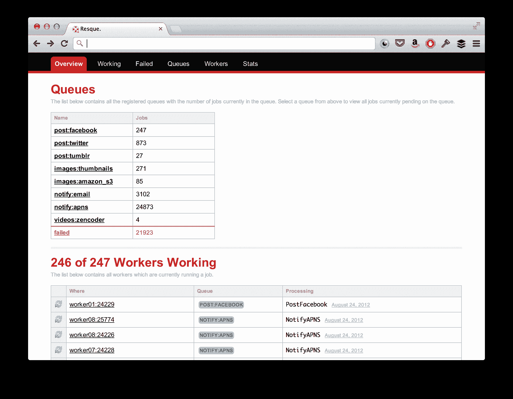

An example of the Resque UI

Resque 在处理失败方面表现出色。它设计时就考虑了任务失败的情况——任务会失败，且需要完整的系统可视化。它通过跟踪失败任务并提供相关信息（任务内容、失败原因、手动重试功能）来实现这一点。

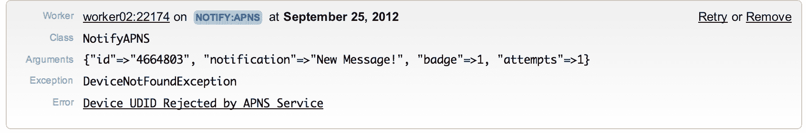

An example failed Resque Job

#### Resque 进程模型

Resque 采用有趣的进程模型来处理内存泄漏和失败，确保长时间运行时的可靠性。启动 Resque 时，会创建一个父进程（主进程）。主进程轮询 Redis，获取新加入队列的任务。当检测到新任务时，主进程会 fork 出子进程，子进程执行任务代码。任务完成后，子进程退出。

##### 为什么这样设计？

在 PHP 中没有线程，通过 fork 出子进程是处理并发任务的最佳方式。此外，该模型还能很好地处理失败：每个任务运行在独立子进程中，若子进程崩溃、抛异常或泄漏内存，不会影响其他任务或主进程。鉴于 PHP 不适合长时间运行的进程，这种隔离机制能有效防止内存泄漏累积。

该模型的缺点是每个新任务都需要 fork 出子进程，存在固定开销。fork 操作是昂贵的系统调用，会限制每秒能并发启动的任务数量，对大量短命任务时尤为严重。Ruby 界通过 [Sidekiq](https://github.com/mperham/sidekiq)（基于线程的 Resque 衍生版）解决了此问题。遗憾的是 PHP 不支持线程，但未来可能出现混合模式：使用子进程处理多个任务并在一段时间后回收，从而兼顾两者优势。

#### 我的补丁

最初，`php-resque` 推出时我使用了自家分支在生产环境中。该库的一个设计决策是自带 Redis 库。遗憾的是，它使用的 `Redisent` 库未使用命名空间，也未考虑其他 Redis 库（如 `phpredis`）的命名规范。导致 `RedisException` 类冲突，两个库都试图定义同名类，导致 PHP 报错。

最初，我修改了 `php-resque` 以使用 C 语言的 `phpredis` 扩展，后来该项目将 C 扩展的使用作为长期目标。目前仍自带 `Redisent`，但好在合并了一个补丁：仅在 `RedisException` 不存在时才定义它，从而让两个库能共存。

他们合并的新代码如下，简直解决了太多麻烦：

```
```php
1 <?php
2 
3 if (! class_exists("Redis")) {
4   class RedisException extends Exception { }
5 }
```

我最初修改的 `php-resque` 代码托管于 [GitHub](https://github.com/stevecorona/php-resque)。除非你真的需要 C Redis 扩展的性能优势，否则我不建议使用它。


让我们逐步了解如何编写一个 Resque 作业。假设我们有一个应用，它会在 Twitter 上发布状态。传统的、非 Resque 的写法可能像下面这样：

```
```php
class Comments_Controller extends Controller {
  public function create() {
    $user = $this->session->user;
    
    $twitter = new Services_Twitter($user->username, $user->password);
    $twitter->statuses->update($_GET['comment']);
    
    return new View("Your comment has been posted to Twitter");
  }
}
```

这段代码虽然能运行，但存在一些问题。首先，它运行缓慢，因为向 Twitter 的 API 请求至少需要 1 秒钟。其次，它容易出错——如果 Twitter 宕机或出现间歇性错误，状态就无法发布。此外，它也是一个容易遭受拒绝服务（DoS）攻击的端点。如果我想让你的应用崩溃，我可以简单地把我的机器人指向这个端点，消耗掉所有的 PHP-FPM 工作进程，因为 API 调用会阻塞很长时间。这在 Twitpic 之前就已经发生过——这里有一个案例研究。

下面我们来对它进行 refactor，转为 Resque 作业，并解决这些问题。

#### 入队操作

首先，我们需要修改 `create` 方法内部的前端代码。我们不再在 Web 请求中直接向 Twitter 发送请求，而是创建一个作业，稍后再执行。

```
```
class Comments_Controller extends Controller {
  public function create() {
    
    $args = array("user" => $this->session->user->id,
                  "comment" => $_GET['comment']);
    
    Resque::enqueue("post:twitter", "PostTwitter", $args);
    return new View("Your comment has been posted to Twitter");
  }
}
```

这很容易。`Resque::enqueue` 为我们完成了所有繁重的工作。它接受三个参数：第一个是 `post:twitter`，即作业要进入的队列名称；第二个是 `PostTwitter`，即我们需要定义的类，其中包含作业要执行的代码；第三个是 `$args`，一个数组，里面的数据会在 Redis 中序列化并传递给 `PostTwitter` 类。

切换到这段代码后，立即获得的好处是它运行得更快。将数据入队到 Redis/Resque 的时间是发起 API 调用所需时间的几个数量级。

|  || **A note about `$args`**Keep in mind that anything inside of `$args` will be serialized inside of Redis when you create the job. It’s much better to pass in simple values here instead of full-blown objects. Notice how we pass in `$this->session->user->id` instead of the entire `user` object. Using the `id`, we can rebuild the `user` object from the database inside of `PostTwitter`. |

| --- | --- |

#### 运行作业

现在我们已经完成了前端代码的 refactor，接下来需要编写一个名为 `PostTwitter` 的新类，`php-resque` 会在作业被处理时实例化该类。`php-resque` 要求作业类实现 `perform()` 方法，这里面放置发布到 Twitter 的代码。

**注意：从前端传入的 `$args` 数组会在 `PostTwitter` 类中作为 `$this->args` 可用。**

```
```
class PostTwitter {
  public function perform() {
    
    $user    = User::find($this->args['user']);
    $comment = $this->args['comment'];
     	
    $twitter = new Services_Twitter($user->username, $user->password);
    $twitter->statuses->update($comment);
     	    
  }
}
```

下面我们来谈谈优势。

1.  应用始终提供持续、快速的性能，因为它永远不会等待第三方服务。

2.  消除了易受 DoS 攻击的端点。

3.  如果 Twitter 未响应或超时，`Services_Twitter` 会抛出 `Services_Twitter_Exception`，作业会优雅失败（之后可以重试）。

##### 处理失败

在 Resque 中妥善处理失败至关重要。如果作业中抛出未捕获的异常，`php-resque` 会认为作业失败并从队列中移除。正如上文所述，使用 Resque Web UI 可以清楚地看到失败的作业，并提供诊断和重试所需的信息，这对于偶尔且仅在出现错误或边缘情况时失败的作业非常有帮助。

然而，有时我们希望作业能预测性地失败并自动重试。例如，`PostTwitter` 类中，如果 Twitter 超时或暂时不可用，我们不想立即将作业标记为失败。可以通过添加一些额外的代码来实现自动重试。

```
```
class PostTwitter {
  const MAX_ATTEMPTS = 5;
  
  public function setUp() {
    Resque_Event::listen("onFailure", function($ex, $job) {
      
      // 检查 $args 数组中是否存在 attempts 变量，用于跟踪已尝试的次数。
      if (! isset($job->payload['args']['attempts'])) {
        $job->payload['args']['attempts'] = 0;
      }
      
      // 增加尝试次数
      $job->payload['args']['attempts']++;
      
      // 如果未达到 MAX_ATTEMPTS，则重新创建作业让另一个 worker 执行。
      if (self::MAX_ATTEMPTS >= $job->payload['args']['attempts']) {
        $job->recreate();
      }
      
    });
  }
  
  public function perform() {
    
    $user    = User::find($this->args['user']);
    $comment = $this->args['comment'];
     
    $twitter = new Services_Twitter($user->username, $user->password);
    $twitter->statuses->update($comment);
     	    
  }
}
```

如上所示，我们并未修改 `perform` 方法，而是添加<unk><unk><unk><unk><unk><unk><unk><unk><unk><unk><unk><unk><unk><unk><unk><unk><unk><unk><unk><unk><unk><unk><unk><unk><unk><unk><unk><unk><unk><unk><unk><unk><unk><unk><unk><unk><unk><unk><unk><unk><unk><unk><unk><unk><unk><unk><unk><unk><unk><unk><unk><unk><unk><unk><unk><unk><unk><unk><unk><unk><unk><unk><unk><unk><unk><unk><unk><unk><unk><unk><unk><unk><unk><unk><unk><unk><unk><unk><unk><unk><unk><unk><unk><unk><unk><unk><unk><unk><unk><unk><unk><unk><unk><unk><unk><unk><unk><unk><unk><unk><unk><unk><unk><unk><unk><unk><unk><unk><unk><unk><unk><unk><unk><unk><unk><unk><unk><unk><unk><unk><unk><unk><unk><unk><unk><unk><unk><unk><unk><unk><unk><unk><unk><unk><unk><unk><unk><unk><unk><unk><unk><unk><unk><unk><unk><unk><unk><unk><unk><unk><unk><unk><unk><unk><unk><unk><unk><unk><unk><unk><unk><unk><unk><unk><unk><unk><unk><unk><unk><unk><unk><unk><unk><unk><unk><unk><unk><unk><unk><unk><unk><unk><unk><unk><unk><unk><unk><unk><unk><unk><unk><unk><unk><unk><unk><unk><unk><unk><unk><unk><unk><unk><unk><unk><unk><unk><unk><unk><unk><unk><unk><unk><unk><unk><unk><unk><unk><unk><unk><unk><unk><unk><unk><unk><unk><unk><unk><unk><unk><unk><unk><unk><unk><unk><unk><unk><unk><unk><unk><unk><unk><unk><unk><unk><unk><unk><unk><unk><unk><unk><unk><unk><unk><unk><unk><unk><unk><unk><unk><unk><unk><unk><unk><unk><unk><unk><unk><unk><unk><unk><unk><unk><unk><unk><unk><unk><unk><unk><unk><unk><unk><unk><unk><unk><unk><unk><unk><unk><unk><unk><unk><unk><unk><unk><unk><unk><unk><unk><unk><unk><unk><unk><unk><unk><unk><unk><unk><unk><unk><unk><unk><unk><unk><unk><unk><unk><unk><unk><unk><unk><unk><unk><unk><unk><unk><unk><unk><unk><unk><unk><unk><unk><unk><unk><unk><unk><unk><unk><unk><unk><unk><unk><unk><unk><unk><unk><unk><unk><unk><unk><unk><unk><unk><unk><unk><unk><unk><unk><unk><unk><unk><unk><unk><unk><unk><unk><unk><unk><unk><unk><unk><unk><unk><unk><unk><unk><unk><unk><unk><unk><unk><unk><unk><unk><unk><unk><unk><unk><unk><unk><unk><unk><unk><unk><unk><unk><unk><unk><unk><unk><unk><unk><unk><unk><unk><unk><unk><unk><unk><unk><unk><unk><unk><unk><unk><unk><unk><unk><unk><unk><unk><unk><unk><unk><unk><unk><unk><unk><unk><unk><unk><unk><unk><unk><unk><unk><unk><unk><unk><unk><unk><unk><unk><unk><unk><unk><unk><unk><unk><unk><unk><unk><unk><unk><unk><unk><unk><unk><unk><unk><unk><unk><unk><unk><unk><unk><unk><unk><unk><unk><unk><unk><unk><unk><unk><unk><unk><unk><unk><unk><unk><unk><unk><unk><unk><unk><unk><unk><unk><unk><unk><unk><unk><unk><unk><unk><unk><unk><unk><unk><unk><unk><unk><unk><unk><unk><unk><unk><unk><unk><unk><unk><unk><unk><unk><unk><unk><unk><unk><unk><unk><unk><unk><unk><unk><unk><unk>


2. 使用 Redis RDB 和 AOF，队列持久化到磁盘-崩溃时不会丢失任何数据。

3. 该库经过充分测试且使用广泛，因此无需担心错误。

4. 系统具有高度可视性。

5. 你几乎不需要扩展 Redis 服务器，但如果必须扩展，可以利用常规的扩展方法-分片和主从复制。

6. 总体而言，它是`简单`的。整个系统的复杂度很低。

#### Kestrel

[Kestrel](https://github.com/robey/kestrel) 是由 Twitter 用 Scala 编写的排队系统。由于使用 Scala，它运行在 JVM 上且性能相当出色。事实上，在 Resque 尚未出现时，它是 Twitpic 的首选，因为它最早出现。

**优点**

* 运行在 JVM 上，因此可靠且快速。

* 使用 Memcached API，因此可以使用 Memcached 客户端与之交互。

* *Fan-out* 队列。核心思想是将作业插入一个队列，它会自动分发到多个其他队列。非常适合将同一作业插入多个队列的场景。

**缺点**

* 内存占用大，JVM 垃圾回收暂停会导致响应时间不稳定。

* 库比 Resque 更低级，需要自行实现功能。

* Twitter 团队更新不频繁。

#### Gearman

[Gearman](http://www.gearman.org) 是 PHP 扩展和守护进程，用于排队，因此与 PHP 有紧密集成。它被 Flickr 和 Digg 使用。

使用 Gearman 并没有任何优势优于 Resque。它使用自有的服务器，所以我要问-在你很可能已经在使用 Redis 进行缓存或会话的情况下，为什么还要增加更多层？

#### Beanstalkd

[Beanstalkd](http://kr.github.com/beanstalkd/)，是用 C 编写的另一个排队服务器。它拥有少量 PHP 客户端。与 Resque 类似，但其 API 更为复杂，包括更好的优先级控制、暂停作业和作业调度。

如果你*需要*这些功能，值得考虑，但文档比 Resque 少。

#### RabbitMQ

RabbitMQ 是最快（甚至是最快）的消息队列之一。它使用 Erlang 编写，甚至有人曾用它传输视频流。它每 CPU 核心每秒可推送 10 万条消息。

它也是最强大的消息队列之一，功能几乎涵盖所有。缺点是它*复杂*。设置、配置和集成到代码中都是大工程。甚至还有*书籍*专门介绍 RabbitMQ。这应该能说明问题。

如果你需要处理 10 万以上的后台作业/秒，请使用 RabbitMQ。否则，不要。即使是像 Twitter 和 Twitpic 这类大站，也能在 Kestrel 和 Resque 上运行。在这里选择更简单的方案。

有奇怪的使用场景吗？当然，如果看起来合适就使用 RabbitMQ，但要做好投入工程和学习时间的准备。与此同时，你可以在 5 分钟内让 Resque 运行起来。

### 你应该放入队列的内容

以下是一些常见的应该放入队列的内容。

* 将用户上传的文件存储到 S3？请在队列中处理。

* 图片缩放。

* **ANY** 第三方 API 调用- Twitter、Facebook、Tumblr。始终如此。

* PDF 生成。

* 发送邮件- SMTP 服务器可能超时。

* 重型数据库插入（类 Twitter 的社交网络会预计算时间线。例如，如果你有 500 个追随者，发布新微博时 Twitter 会执行 500 次数据库插入。）


# 使用框架还是不使用框架？

决定是否使用框架是显而易见的。我从未听说过因为选择使用框架而导致网站失败。如果你看看其他网络语言- Python、Ruby、Java- 这些语言的开发者都在使用像 Django、Rails 和 Play 这样的 MVC 框架。

不过 PHP 社区的态度似乎不同。人们说框架很慢，或者臃肿，或者过于复杂。虽然这些说法可能有些事实依据，但它们并不代表现代 PHP 框架。我认为这种“仇恨”只是不理解或不“get” MVC 的人的一种防御机制。

你可以使用那些已经存在很久的“传统” PHP 框架，比如 `Zend`、`Kohana`、`Symfony` 或 `CakePHP`，或者尝试一些较新的框架，它们通常更现代、更轻量。

*   [`Laravel`](http://laravel.com/)

*   [`FuelPHP`](http://fuelphp.com/)

*   [`Fluf PHP`](http://nijikokun.github.com/fluf/)

*   [`Slim`](http://www.slimframework.com/)

### 如何关于 DIY 框架？

如果你想为你的产品构建一个 DIY 框架，请不要这么做- 从我的错误中学习！

管理自己的框架就像构建两个产品而不是一个。你不仅要负责编写你的应用程序，还需要负责编写框架本身的所有底层代码。这可能是失败和成功之间的区别。

说实话，我在 Twitpic 的第二个版本中陷入了这个陷阱。我们自己构建了框架。这很困难- 不是因为编写 MVC 框架本身很难，而是因为处理所有边界情况、优雅地失败以及覆盖我们需要的所有功能需要大量代码。

这使得开发变得痛苦。想要向应用添加新功能吗？让我来写代码… 等等，我们缺少框架中的一个函数来执行这个操作，所以在能够向应用添加新功能之前，我需要先补全缺失的框架代码。这会减慢你的进度。

如果你想构建一个框架来更好地理解它们的工作原理，那很好。但绝对不要在生产环境中使用它。从我的错误中学习- 你以后会后悔的。

### ORMs 并非邪恶

与框架相关，让我们谈谈 ORMs- 通常是你应用程序的“模型”部分。简单来说，它们非常有用- ORMs 简化了你的代码，让你可以直接调用方法，而无需编写 SQL。

不过.. 但.. 如果我无法编写 SQL，那么它将会低效！在我经验中，大多数成熟的 ORMs 生成的 SQL 几乎和我手写的完全一致。当然，某些关于 `JOIN`s 的边界情况可能会带来问题，但大多数 ORMs 允许你直接传入自己的 SQL 来处理这些情况。

在 Twitpic，我们使用一个 ORM 库，我绝不会考虑放弃它。它的好处远大于轻微的性能开销- 而且关于 ORMs 的“争议”大多来自过早的优化者，往往是错误的。我们的 ORM 允许我们直接写原生 SQL 处理复杂查询，但如果我再来一次，我会把这个功能去掉- 因为随着我们的架构扩展，我们已经对大多数生产 `JOIN`s 进行了优化，任何现成的 ORM 都足以应付。

我不是说永远不要写 SQL。例如，ORMs 通常处理批量更新或删除对象效果不佳（也称为 N+1 查询）。考虑以下示例-

```php
<?php
// 我想删除用户添加的所有“笔记”。

$notes = Note::find_by_user_id($user_id);

// 遍历每个笔记并删除它，这会生成
// DELETE FROM notes WHERE id = $note_id
foreach($notes as $note) {
	$note->delete();
}
```

上述示例会为每个笔记生成并执行一个 SQL 语句。如果你使用自己的 SQL，你可以直接执行 `DELETE FROM notes WHERE user_id = $user_id`，在单个查询中完成整个删除。这通常不是大问题，但如果你要删除（或更新）比如 5000 条记录，它可能会产生显著影响。幸运的是，这种设计在大多数 Web 应用中并不常见，但这是一个我会直接编写 SQL 而非依赖 ORM 的情况。

虽然大多数框架都包含自己的 ORM，如果你不使用框架或使用自己的内部框架，也有几个开源的独立 ORM 包可以使用。与反对 DIY 框架类似，我也不推荐 DIY ORMs，因为它们异常复杂，需要考虑许多边界情况。以下是一些现代选项-

*   [`PHP ActiveRecord`](http://www.phpactiverecord.org/)

*   [`Propel`](http://propelorm.org/)

*   [`Doctrine`](http://www.doctrine-project.org/)

### Capistrano 用于代码部署

希望你不是还在通过拖放 FTP 部署代码，或者更糟糕- 在生产机器上直接编辑文件！如果是这样，你需要安装 [Capistrano](https://github.com/capistrano/capistrano)。它不仅低效且易失败，而且手动部署无法很好地扩展到多台服务器。Capistrano 解决了这个问题。你在电脑上运行一个命令 (`cap deploy`)，它负责将新代码推送到所有服务器。

它也很容易设置，你可以在 10 分钟内上手。

你需要在你的电脑上安装 Ruby。Capistrano 与语言无关，但它本身是用 Ruby 编写的。

**你是在你部署的电脑上安装 Capistrano，即你的开发机器，而不是应用服务器。**

```
gem install capistrano
```

现在，进入你的项目并创建一个名为 `Capfile` 的新文件。

```
load 'deploy' if respond_to?(:namespace)
load 'app/config/deploy' # 你的 deploy.rb 文件的路径
```

你的 `Capfile` 由 Capistrano 读取，用来找到 `deploy.rb`，即你的部署配置文件。在我的情况下，我的 `deploy.rb` 位于 `./app/config/deploy.rb`，但你可以根据需要修改 `Capfile` 的第二行来放置 `deploy.rb` 文件的位置。

接下来，我们需要创建 `deploy.rb` 文件。我的位于 `app/config/`，但你可以将其放在任何位置，只要修改 `Capfile` 的第二行即可。

你可以使用 Capistrano 做很多事情。最基本的用例是-

1.  在你的电脑上运行 `cap deploy`。

2.  Capistrano 通过 SSH 登录到你的应用服务器(s)。

3.  Capistrano 克隆 `trunk/master` 分支的最新版本（支持 SVN 和 Git）。

4.  重新加载 PHP-FPM 以获取最新代码。

这是基本用例，我们的基础 `deploy.rb` 文件也只做这些事（我们会去除一些默认的 Rails 选项）。但这里有一些你可以使用的其他想法-

*   对 JavaScript、LESS、Coffeescript、SASS 进行压缩/编译

*   执行数据库变更，例如添加新列或新索引

*   所有服务器的日志文件实时查看

*   部署到多个环境（生产、开发、 staging）

**示例 `deploy.rb` 文件**

```
set :application, "My Application"
set :repository,  "git@github.com:MyApp/app.git"
set :branch, "master"

set :deploy_to, "/u/apps/myapp/"
set :deploy_via, :remote_cache
set :scm, :git

# SSH User to Deploy As
set :user, 'deployer'
set :password, '123456'

set :use_sudo, false
set :keep_releases, 5

ssh_options[:forward_agent] = true

# Hostnames of your App Servers
role :app, ['app01', 'app02', 'app03']

namespace :deploy do

   task :finalize_update do
     # 这会删除
```


如果你对 Capistrano 为你的开发流程带来的易用性还不满意，考虑以下内容。

Capistrano 部署是原子化的。这意味着在部署代码的同时，它不会影响任何正在运行的代码。

想一想：如果你手动部署网站，通过 FTP 上传文件或手动运行 `git pull` 时，在将新代码传输到远程服务器的过程中，旧文件和新文件会混在一起。比如，你同时修改了 `foo.php` 和 `bar.php`，由于文件是依次传输的，在一段时间内，旧的 `foo.php` 和新的 `bar.php` 会同时在服务器上运行。

这会导致各种糟糕的情况——崩溃、异常和数据丢失，因为你同时运行的是旧代码和新代码的混合体，结果会如何无法预知。文件越多，情况越糟糕。

Capistrano 的工作方式不同。

1. PHP-FPM 被配置从一个符号链接（例如 `/u/apps/my_app/current`）读取代码。

2. 使用 Capistrano 部署新代码时，它会在 `/u/apps/my_app/releases`（即 `/u/apps/my_appl/releases/749847589`）创建一个新目录并下载你的代码。

3. 当所有代码传输完成后，它会将 `/u/apps/my_app/current` 的符号链接移动到新创建的目录 `/u/apps/my_appl/releases/749847589`。

4. 跳起来跳下去！Capistrano 原子化部署了你的代码。所有东西在同一时刻变化，所有新代码一起工作。

这种方式还能让回滚糟糕的部署变得容易。假设你部署了一段包含隐藏缺陷的代码，导致网站崩溃（这在现实中从未发生……对吧！？）。如果你使用传统的手动部署方式，你需要找回旧文件并将其转移回来，这会增加停机时间。

相反，由于 Capistrano 为每个部署创建独立目录，它可以通过将 `/u/apps/my_app/current` 重新指向旧发布版本来快速回滚，只需一条命令！

```
1 > cap deploy:rollback
```

轻松极了。我可以写一本关于 Capistrano 的专著，但这仅仅触及表面——但要做！它是一个非常棒的工具，也是“最佳实践”。查看更多文档，请参阅 [Capistrano wiki](https://github.com/capistrano/capistrano/wiki)。

### 使用 strace 进行 PHP 实时调试

我要坦白：`strace` 是我调试时最爱的工具，它救过我无数次，如果你学会使用它，它也会救你。

`strace` 是一个 Unix 工具，可以附加到正在运行的进程并监控该进程发出的系统调用，从而让你了解程序如何与操作系统交互。`strace` 可以用于多种用途，但在生产环境中调试奇怪问题时，它是救命稻草。

假设你有一段 PHP 代码使用了 Memcached，而 Memcached 服务器宕机。理想情况下，你应该有监控或日志系统能提醒你这个问题，但如果没有，你将一无所知——你的网站会崩溃，很可能因超时而失败，尤其是如果没有为 Memcached 设置合适的超时时间。

该怎么办？你可以手动检查每个 Memcached 服务器，但这在有多个 Memcached 服务器时会非常不方便——你需要登录每个服务器，判断哪个出问题并导致超时。

首先，我们需要找到一个正在运行的 `php-fpm` 进程来附加到它。

```
1 > ps ax | grep php-fpm
2 
3 11662 ?    S      0:03 php-fpm: pool www
4 11663 ?    Sl     0:06 php-fpm: pool www
5 11698 ?    S      0:04 php-fpm: pool www
6 11721 ?    S      0:04 php-fpm: pool www
7 11745 ?    Sl     0:11 php-fpm: pool www
```

我们有多个 `php-fpm` 进程在运行，让我们跟踪 `11662`。

```
 1 > strace -r -p 11662
 2 
 3  0.000000 restart_syscall(<... resuming interrupted call ...>) = 0
 4  4.720248 socket(PF_INET6, SOCK_DGRAM, IPPROTO_IP) = 3
 5  0.000110 close(3)                  = 0
 6  0.000145 gettimeofday({1361146314, 442683}, NULL) = 0
 7  0.000115 socket(PF_INET, SOCK_STREAM, IPPROTO_IP) = 3
 8  0.000086 fcntl(3, F_GETFL)         = 0x2 (flags O_RDWR)
 9  0.000097 fcntl(3, F_SETFL, O_RDWR|O_NONBLOCK) = 0
10  30000.000079 connect(3, {sa_family=AF_INET, sin_port=htons(11211), sin_addr=i\
11 net_addr("192.150.0.10")}, 16) = -1 EINPROGRESS (Operation now in progress)
```

很快，我们就能在最后一行看到，它正在尝试连接到 `192.150.0.10` 的 11211 端口，这正是我们 10 个 Memcached 服务器中的一个。现在我们可以立即进入该服务器进行修复，因为我们已经锁定了罪魁祸首。

另一个使用 `strace` 进行实时调试的场景是当你使用第三方 API 时，它导致你的代码变慢——你可以用 `strace` 查看连接耗时。这可能是我最常用的“oh-shit-the-site-is-down”应对方法。

在 CakePHP 缓存文件案例研究中，我展示了 `strace` 如何帮助我精准定位代码中的错误。

#### 真实 strace 场景

上周，我正在沙发上刷 NetFlix 的新剧集。

*Ding* … *Ding*

短信？这么晚？不可能是好事。

 reluctantly，我暂停 NetFlix 几秒钟（“How it’s made” 太上瘾了）去查看信息……

“PagerDuty：你的 API 宕机！”

 fuck！这条消息让我一惊。我正试图学怎么做剪指甲，该死。赶紧回到电脑。

我坐下，尝试打开 api.myjob.com，什么都没响应，Chrome 只显示那个循环的小蓝色圆圈，永远转不完。

我的网站 DOWN 了，而且非常严重。请求超时。

你会用什么策略？好的答案可能包括：

* 检查自动化警报，比如 Nagios 发送的警报

* 查看你的警报/可视化系统，如 Copperegg 或 Graphite

* 验证“常见罪魁祸首”，如 Memcache 或 MySQL 是否健康

但我没做这些。猜猜我做了什么？

我登录到 PHP 服务器，抓取一个 PHP-FPM 工作进程的 PID，然后运行 `strace -p`。

如果你平时不常用 `strace`，你正在对自己做极大的不服务。它是快速脏捷 debugging 的完美工具。当然，理想情况下，你会收到精确的警报，明确指出哪个服务宕机了，但我是现实主义者，我知道这并非总是如此。

当你的网站宕机时，希望拥有更好的警报系统不是答案。你需要立刻让 API 重新上线。其他一切都可以排在后面。

所以，我通过 SSH 登录到我的 web 服务器，运行 `ps` 抓取一个随机的 PHP-FPM 进程 ID，比如：

```
1 	$ ps aux | grep php-fpm
2 	myapp 128131 2.9 0.0 324132 57396 ? R 10:54 11:50 php-fpm: pool www
```

看 128131？这是我可以通过 `strace` 窥探的进程 ID。

接下来，我附加 `strace` 到该进程，看看发生了什么……

```
1 	$ sudo strace -p 128131
2 	gettimeofday({1399247077, 563898}, NULL) = 0
3 	sendto(17, "\372\0\0\0\3SELECT * FROM users WHERE id ="..., 254, MSG_DONTWAIT\
4 , NULL, 0) = 254`
```

我看到最后一行显示它等待了几秒，正在通过 `sendto` 发送 SQL 查询到数据库服务器，并在等待响应。看来我的数据库服务器又出问题了！于是，我立刻知道如何快速诊断并解决问题，修复数据库服务器，然后回到看“How It’s Made”。

**一位好朋友是规模化专家……**

他是那种既能写代码，又能长时间讨论深度 Linux 内部机制的人。我问他— *“如果你只能教大家其中一件关于扩展的事，你会教什么？”* 


他的回应？`strace`。`1000`次`strace`。没有其他命令能在单个命令中提供这么多关于堆栈的洞察和信息。你可以拥有世界上所有的监控，而`strace`依然会为你的应用程序提供新的洞察。

## Parting Advice

我希望你在阅读完这本书时，已经掌握了一些可以立即实施并用于改进和优化你的堆栈的实用信息。扩展和`peformance`优化是一个“终身”过程，你需要不断工作和改进——今天有效的方法明天可能不再是最佳方案，因为你的流量会变化，硬件会变得更快更便宜，新工具也会不断出现。

我希望你学到的是，扩展可能复杂，但并非不可能，而且更多是关于拥有你的堆栈，熟悉其中的所有移动部件，而不是写“更快的代码”。去吧，用你新获得的知识去构建一些巨大的成功网站；

如果你购买了 Solo Founder 或 Startup 版本的书，接下来的约 70 页充满了我为扩展 Twitpic 时遇到的真实案例。这些案例包含你无法在互联网上找到的宝贵信息——远非普通的 PHP 教程。

1.  水平扩展用户上传

2.  DNS 导致 Twitpic 宕机 4 小时

3.  纵向扩展 MySQL（10 台到 3 台 MySQL 服务器）

4.  使用 Percona 进行热 MySQL 备份

5.  使用 Kestrel 进行异步发布，救了我的命

6.  Memcached 的缺失指南

7.  HTTP 缓存和 Nginx Fastcgi Cache

8.  CakePHP 框架缓存：调试的一课

9.  优化 PHP 中的图像处理

10. Web 服务的基准测试和负载测试

### 想升级？

如果你只是后悔只购买了 PDF，别担心！你可以升级并获取案例研究，只需支付差价。整个过程完全自动化，你可以立即下载并阅读这 10 个精彩的案例研究。

[Upgrade to PDF + Case Studies](https://gumroad.com/l/vmyM)

直链是 https://gumroad.com/l/vmyM

**Scaling is an art, not a science**

### 发送反馈和推荐语

如果你喜欢这本书，我很乐意听到你的反馈。推荐语会被采用并附带你网站的回链。请直接向我发送问题、反馈和推荐语，我会尽快回复。

hello@scalingphpbook.com

### 太深入了？需要立即帮助？

我知道那种被困在困境中的感觉——网站不断崩溃，面对巨大的扩展问题，你需要解决这些问题已经好几周了。如果你太忙无法自己实施这些改变，或者需要深入的评估和代码审查，我可以提供远程和现场咨询。请在邮件中将主题设为“HELP!”，我可以在不到一小时内开始深入分析你的代码。我通常能在大约 4 小时内诊断核心问题，提供热修复，并制定长期的成长/扩展计划。这很有力且快速。

### 更新？

关于更新呢？我害怕这本书会变得过时。虽然我不能保证进行重大修订（也许我会，但我本来想加入很多内容但被迫删除了，以免写成一本 400 页的催眠术），但我会尽力保持书籍合理更新，并应对 PHP 的重大 breaking changes。例如，我最初在这本书出版时 PHP 5.4 刚发布，后来更新了 PHP 5.5。

### 关于作者

Steve Corona 是 Twitpic 的 CTO，Twitpic 是互联网上最大的网站之一，也是 Twitter 照片分享的最大应用。Steve 于 2008 年辍学，将 Twitpic 发展到每月 6000 万访客和 200 亿次 HTTP 请求，尽管没有正式培训或知识。

## 案例研究：水平扩展用户上传

类似于 Cookie 处理，当你扩展应用服务器时，另一个常见问题是处理用户上传。关于用户上传，我有以下要求：

##### 1\. 上传文件需要立即可用

在大多数情况下，用户期望他们的上传文件立即可用。显示损坏的图片或不可用的文件通常是不可接受的（视频除外，因为涉及处理时间）。如果我们在系统中移动上传文件，它必须对用户完全透明且无缝。

##### 2\. 上传文件需在后台推送到长期存储

在应用服务器上存储上传数据超过几分钟是危险且不负责任的。我们设计应用服务器以水平扩展，以**在不丢失数据的情况下失败**，因此在应用服务器上进行长期存储违背了这些原则。硬盘会损坏，在应用服务器上配置 RAID-10 也不具成本效益。

有很多*轻松*的长期存储解决方案，可以根据你的具体需求选择。我们将宠物字节的数据存储在[Amazon S3](http://aws.amazon.com/s3/)，但其他选项包括[Rackspace Cloud Files](http://www.rackspace.com/cloud/public/files/)和[Edgecast Storage](http://www.edgecast.com/services/storage/)。

如果你的数据量到使 IaaS 解决方案过于昂贵（或者你不想或不能使用 IaaS），还有“自己动手”的解决方案，如[MogileFS](https://github.com/mogilefs)和[GridFS](http://www.mongodb.org/display/DOCS/GridFS)值得探索。

记住，扩展的一个主要原则是** decouple your systems!**（解耦你的系统！）——应用服务器应负责运行你的应用，而不是存储数据。

**P.S. 千万不要把上传的文件存储在数据库中。** 使用正确的工具做正确的事。

##### 3\. 不存在单点故障或中心化（孩子们，说不！NFS！）

上传系统中不应该存在单点故障。故障会发生，需要优雅处理。上传应立即处理，而不是由集中化系统处理。我像躲避鼠疫一样避免 NFS，因为它通常非常慢，并且创建一个灾难性的单点故障——当它不可用时，我们将失去处理**所有**上传的能力。如果上传是你业务的核心，你就知道这有多大的问题。Facebook 有一篇（虽然略显过时）[文章](https://www.facebook.com/note.php?note_id=76191543919)介绍了他们如何从 NFS 迁移到他们自研的 Haystack 系统。这篇文章值得阅读，如果只是为了获得灵感。

#### 直接将文件上传到 S3（或任何长期存储）是错误的做法

很多人通过在 Web 请求的上下文中直接将用户文件上传到 Amazon S3 来处理文件上传，也就是说，他们在文件最初上传的同一请求中将文件上传到长期存储。伪码如下：

```
1 <?php
2 if ($_FILES['upload']) {
3   upload_to_amazon_s3($_FILE['upload']);
4 }
```

虽然这种方式简单且适用于较小的服务，但有两个主要问题。

1. 如果 Amazon S3 宕机或运行缓慢，且没有重试机制，我们将丢失用户的上传文件。

2. 这显著增加了 HTTP 请求的时间，占用一个 PHP-FPM 进程更长时间。少一个 PHP-FPM 进程意味着应用服务器处理的并发连接减少，用户需要等待的时间不仅包括从他们的电脑上传到你的服务器，还包括从你的服务器上传到 Amazon S3（尽管可以通过`fastcgi_finish_request()`或使用专用 PHP-FPM 池来缓解这个问题）。

#### 正确处理用户上传的方法


-   [处理用户上传是 Twitpic 核心业务的一部分，我长时间思考如何最佳地解决这个问题。我们的方案能够水平扩展，足够强大以处理失败，同时避免任何单点故障，并能够处理重试。以下是实现方式：]

# 1\. 用户上传文件并立即保存到磁盘

很明显，对吧。:) 文件上传到我们的应用集群并被 PHP 接收。你应该知道，nginx 会在收到客户端全部数据之前，将文件上传缓冲到磁盘。这意味着 PHP 的上传进度功能将不起作用，因为 PHP 并未实时接收上传数据。

我们为文件创建数据库记录，并立即在应用服务器的数据目录中将文件保存到磁盘。我们使用数据库记录的 `id` 列作为文件名。我们在数据库中有一列名为 `location`，用于存储文件最初上传的服务器的主机名。

最后，在文件保存到磁盘后，我们会在 Resque 队列中创建一个新任务，最终将此上传推送到长期存储。

我们保存文件的数据目录是可通过 Web 访问的。这意味着，如果文件上传到 `app01`，并且获得数据库 `id` 为 `123456`，它可以通过 `http://app01/data/123456` 从 Web 上访问。

这种方法使我们能够立即显示文件，而无需等待它上传到 Amazon S3，因为可以直接链接到处理上传的应用服务器。需要注意的是，在此之前需要通过数据库查找文件位置，然后才能生成链接。例如，运行在 `app04` 的 PHP 代码若要显示图片 `123456`，需要在数据库中查找 `123456`，检查文件的 `location`，然后使用该 `location` 生成链接 `http://app01/data/123456`。

在下面的示例中，我们假设处理的是图片上传，并为图片模型添加一个 `url()` 方法来处理 URL 逻辑。

```
 1 <?php
 2 if ($_FILE['upload']) {
 3   $image = new Image;
 4   $image->location = php_uname('n'); // 返回主机名
 5   $image->save();
 6   move_uploaded_file($_FILES['upload']['tmp_name'], "/u/apps/data/{$image->id}\
 7 ");
 8   Resque::enqueue("uploads", "Upload_Job", array("id" => $image->id));
 9   echo "url()}'>";
10 }
```

`url()` 方法的实现大致如下：

```
 1 <?php
 2 class Image extends Model {
 3   public function url() {
 4     if ($this->location == "s3") {
 5       return "http://s3.amazonaws.com/my_bucket/{$this->id}";
 6     } else {
 7       return "http://{$this->location}.mysite.com/data/{$this->id}";
 8     }
 9   }
10 }
```

# 2\. 将文件推送到长期存储

在第一步中，我们处理了用户的上传，将其暂时保存在单个应用服务器上，并使其立即可在 Web 上访问。这很好，但我们也需要尽快将其推送到长期存储，因为如果 `app01` 崩溃或不可用，我们将失去对该用户内容的访问。不可接受！

我们在上传时就已经在 Resque 队列中排入了任务，现在来谈谈任务工作者（Resque 在第 7 章中有深入说明）应如何实现。

任务的第一步是将文件发送到 Amazon S3。但我们从哪里获取文件呢？我们无法直接访问应用服务器文件系统中的数据目录，因为 Resque 任务不会在应用服务器上运行。当然，你可以将特定任务绑定到特定服务器，并在应用服务器上运行 Resque 工作进程，但这整体上是一种糟糕的设计。任务应能在任意位置运行。等等！我们只需使用前面示例中讨论的 `url()` 方法，并发起 HTTP 请求下载图片，这样 Resque 任务就可以在任意位置运行。

我们的 Resque 任务示例如下：

```
 1 <?php
 2 class Upload_Job {
 3   public function perform() {
 4     $image_id = $this->args['id'];
 5     $image    = Image::find($image_id);
 6     
 7     $data   = file_get_contents($image->url());
 8     $status = upload_file_to_s3($data, $image->id);
 9     
10     if ($data == false || $status == false) {
11       throw new Exception("Couldn't upload to S3, retry");
12     }
13     
14     $image->location = "s3";
15     $image->save();
16   }
17 }
```

**我们甚至处理了失败！** 当 Resque 任务抛出异常时，它会被重新排入队列并重试。如果长期存储或应用服务器 momentarily 不可用或超时，任务会再次尝试，不会丢失数据。

在我们实际使用这个设置时，Resque 任务运行非常快——几乎即时，因此图片在上传后约 1 秒内即被移动到长期存储。这意味着，如果应用服务器崩溃，我们最多会丢失约 1 秒钟的用户上传内容。并不算差。

# 3\. 清理

最后需要考虑的是清理——在文件已成功推送到长期存储后，从应用服务器中删除已上传的数据。否则，这些旧数据会无限增长，最终填满应用服务器的磁盘。

你可以使用诸如 [nginx HttpDavModule](http://wiki.nginx.org/HttpDavModule) 之类的复杂方案，创建一个私有/内部的 WebDAV 端点，让 Resque 任务通过 HTTP 在成功将文件存储到长期存储后删除应用服务器上的文件。

但我更倾向于更简单的方案 :) - 一个简单的 cron 任务扫描每个应用服务器的数据目录，并删除超过 X 天的上传文件。你可以编写脚本，但使用一个 UNIX 一行命令也能完成，该命令会删除 `/data` 目录中 older than 7 天的文件。

```
1 0 4 * * * find /data -type f -ctime +7d -exec rm -f {} \;
```

## 我曾经错误地处理此问题的方式

将上传推送到长期存储是队列的绝佳适用场景。我们之前使用的 Twitpic 系统（惊人的仅 3 年前）非常糟糕且不可靠（我几乎太尴尬了，不敢在此写出来）。我们跳过了队列，直接使用数据库。也就是说，我们编写了一个 cronjob，执行了一条类似 `SELECT * FROM images WHERE location != "s3" LIMIT 100` 的查询，然后遍历结果，将每个文件上传到 Amazon S3。

这个设计有两个主要缺陷：

1. 它完全不扩展。多次执行查询会返回相同的结果（除非你添加 `ORDER BY RAND`，这对于性能极其糟糕），因此扩展到多台服务器会导致大量重复的图片上传到 Amazon S3，浪费系统资源并产致昂贵的 AWS 带宽费用。

2. 我们没有为 `location` 列建立索引（对我们其他查询而言这并不合理），因此执行 `SELECT * FROM images WHERE location != "s3"` 会导致全表扫描。全表扫描意味着数据库需要遍历 ALL 的数据。如果你有 1000 万行数据，它需要扫描所有行。每一行。每一行。讨厌！

## 案例研究：DNS 导致 Twitpic 在 2010 年停机 4 小时

相信它或不，DNS 解析实际上在 2010 年导致 Twitpic 遭受了 4 小时的重大停机时间。

当时，我们没有使用自己的 DNS 服务器，而是依赖数据中心的 DNS 服务器处理 DNS 解析。那一天早上，我推送了一段代码，用于将我们的会话从单个 memcache 服务器迁移到多个 memcache 服务器。会话保存路径的配置行看起来像这样：

```
1 $SESSION_SAVE_PATH="192.0.2.5:11211,192.0.2.6:11211,\n\r192.0.2.7:11211";
```


注意在第二个主机后有一个换行符。在我的文本编辑器中，它只是换行了，所以我在部署前没注意到。

我部署了代码，网站宕机了。我发现多出来的换行符，推测它导致了问题，回滚了更改，一切恢复正常。太好了。

几分钟后，我们的应用程序进程开始挂起。这引发了巨大的多米诺效应，导致整个网站宕机。是什么出了问题？我已经回滚了那个坏的更改…

原来，由于 memcache 库的一个 bug，当它在 `$SESSION_SAVE_PATH` 中看到主机 `\n\r192.0.2.7` 时，它将其解析为域名而不是 IP 地址。为了解析域名 `\n\r192.0.2.7`，它对我们的托管提供商的 DNS 解析器发出了数百万次无效的域名查询。

他们真的不喜欢这件事——这是一个共享服务，我们实际上正在对他们进行大量无效请求的 DOS 攻击，所以他们迅速将我们的服务器从其 DNS 解析器中拉黑，即使更改已被回滚。由于被阻止 DNS，且默认系统设置，每次我们尝试进行 DNS 查找时都会出现 5 秒的超时，而我们的代码经常进行 DNS 查找，因为它使用了多个第三方 API，包括 Twitter、Amazon S3、ZenCoder 等。5 秒的阻塞消耗了我们的 PHP-FPM 守护进程的可用时间，最终导致一切停摆。

这真是一个奇怪、意外且相当荒谬的问题，调试并确定根本原因花费了数小时。随后，我们花费了一小时匆忙搭建内部 DNS 解决方案。因此，如果你的应用程序进行任何第三方 API 调用，你需要在问题来临之前就掌控好 DNS 状况。

显然，使用像 `nscd` 或 `dnsmasq` 这样的缓存解析器，并将 `/etc/resolv.conf` 中的超时时间设置得较低，就能完全避免此问题。

## 案例研究：垂直扩展 MySQL（从 10 台 MySQL 服务器到 3 台带 SSD）

如果水平扩展现在很流行，那为什么你还要垂直扩展呢？这些天硬件变得更快更便宜，垂直扩展（即在现有硬件上添加更快的 CPU、更多内存等）的成本也降低到一定程度。

**水平扩展** 是通过在集群中添加更多服务器来实现扩展。

**垂直扩展** 是通过在现有硬件上添加更快的硬件（CPU、RAM 等）来实现扩展。

两者之间存在微妙的平衡，这是一门艺术。目标是最大化成本/性能比，而不是固守单一思路。如果只水平扩展而不进行垂直扩展，会增加系统复杂度；如果只垂直扩展而不进行水平扩展，则会导致硬件成本高昂且存在单点故障，所有鸡蛋都放在同一个篮子里。

这些天，构建大型系统的成本比两年前更低。例如，Basecamp 在 1 月份购买了 864GB 的内存。总成本：$12,000。

即使是 Amazon EC2 现在也提供配备超快 SSD 驱动器和 240GB 内存的服务器。

**我不是说你应该总是垂直扩展**，但权衡“再添置一个低效的服务器”的成本与投资更好硬件的收益是值得的。

今年早些时候，我们在 Twitpic 也面临了这个问题。我们的一个读取密集型数据库集群多年来从最初的几台 MySQL 服务器增长到 10 台。每台服务器都配备了昂贵的 RAID-10，配备 $1000 的 Adaptec 硬件 RAID 卡、多个 15,000 RPM SAS 硬盘，以及少量内存。由于 RAID 卡和硬盘的关系，这些服务器非常昂贵。

我们在达到所有 10 台服务器的容量峰值时发现，在高峰时段它们的 I/O 容量已达 100%，导致响应时间变慢且查询速度不可预测。我预测至少还需要 5 台服务器才能保持性能在可接受的健康范围内。

我们被“水平扩展总是更好”的错误困扰，甚至没有考虑使用更好硬件的性能优势或成本——我们总是直接购买与其他 MySQL 服务器相同的硬件。

### 另一种思路

必须再购买 5 台服务器，我知道我很快就会回到这条道路上，继续购买更多服务器，这不可持续。

我决定退一步，重新评估我们的硬件决策以及原因。

#### 撤销 RAID-10

我的第一个想法是撤销 RAID-10。它需要双倍的硬盘容量，而我们的 MySQL 从属服务器对数据完整性要求不高。我们已经使用备份和通过 HAProxy 负载均衡来扩展 MySQL 从属服务器，所以在硬盘故障时可以重新构建从属服务器。

事实上，我们可以通过使用 RAID-0（通常不安全）来获得更好的性能，因为我们的主服务器已经使用 RAID-10，并且我们会频繁进行备份，在这种情况下完全安全。

#### 增加内存！

我们的 MySQL 服务器配置只有 16GB 内存，这是过去的遗留配置，当时我们的规模小得多。现在却没有考虑过增加内存，这很荒谬。如今，内存价格低廉，向单台服务器添加 64GB、128GB，甚至 512GB 内存既便宜又在普通服务器硬件上司空见惯。

#### SSDs 来了

最后我评估了 SSD。我没想到，昂贵的 4 盘 RAID-10 与便宜的 Intel SSD 之间的性能差距会如此惊人。进一步测试和基准测试显示，约 $2000 的 RAID-10 配置与约 $2000 的企业级 SSD 在 2011 年时性能差距约为 30 倍。今天这个差距更大、更荒谬。

旧的 RAID-10 设置最高只能达到约 5,000 IOPS，而 SSD 则能突破 150,000 IOPS。简直难以置信。

### 最终结果

在评估硬件后，我们决定既垂直扩展又水平扩展，结果不仅大幅节省了服务器费用，还提升了基础设施性能，并通过减少服务器总数来降低整体复杂度。

事实上，我们从 10 台服务器降到了仅 3 台，大幅降低了基础设施成本。仅凭这 3 台服务器，我们就只使用了整体容量的 50%。而原来的 10 台服务器则一直在满负荷（100%）运行。

 fewer servers to monitor, administer, and host equals less complexity in your infrastructure and is a big win for everyone.

## 案例研究：使用 Percona 实现热 MySQL 备份

能够自动将 MySQL 备份到远程位置是构建冗余、防止故障的重要且常被忽视的部分。大多数人忽视备份的原因是，当数据库规模变大时，备份变得非常困难——比如备份 1GB 数据很容易，但当数据量达到数百 GB 或甚至数 TB 时，就变得十分困难。

备份的两大重要原因：

1.  在数据库损坏或意外丢失数据（如 `DELETE FROM foobar`、`DROP TABLE foobar` 等）时，可以恢复数据库。

2. 能够快速启动新的从属服务器。与其先删除现有从属服务器再克隆它，你可以直接从备份恢复，让从属服务器快速赶上当前的复制进度。

此外，MySQL 自带的备份方案大多不太好！让我们来看看一些不太理想的选项。

##### mysqldump


`mysqldump` 是一种随 MySQL 一起提供的工具，用于备份数据库。运行 `mysqldump` 会生成一个文本文件形式的数据库备份，内容为 `CREATE TABLE` 和 `INSERT` 语句。它是最基础的备份方式，适合数据量较少的用户。

**缺点：** 它运行速度极慢，备份文件体积远大于实际数据，且恢复时也极其缓慢，因为所有的 SQL 语句都需要解析以重建底层数据文件。`mysqldump` 还需要加写锁才能确保备份一致性。一个 100GB 的备份可能需要数小时甚至数天。

##### mysqlhotcopy

`mysqlhotcopy` 是 MySQL 自带的另一款工具，能在服务器运行时对原始数据文件进行热复制。**但它不支持 InnoDB，因此对大多数人来说几乎不可用。**

##### MySQL Enterprise InnoDB Hot Backup

Oracle 提供的 InnoDB 备份方案与 `mysqlhotcopy` 功能相似，但每台服务器费用为 5000 美元，对大多数初创公司而言过于昂贵。

##### 备份从属服务器

一些人认为 MySQL 从属服务器是“足够好”的备份方案。不过，依赖 MySQL 复制并不明智，因为它虽能防止数据损坏，却无法防止恶意查询。例如，若仅依赖复制作为备份，执行 `DROP TABLE foobar` 将同时破坏工作数据集和备份，因为所有语句都会被复制。

尽管如此，**专门为备份设置的从属服务器是个好主意**。将专用从属服务器与**正确的备份方案**结合使用后，备份过程不会影响生产系统的 I/O 性能。

##### 直接复制 MySQL/InnoDB 数据文件

一种低技术的办法是直接复制 MySQL 数据目录中的 InnoDB 数据文件。该方法能以磁盘转速速度备份数据，并支持快速恢复。

**缺点：** 在复制过程中必须关闭 MySQL 数据库或加写锁；否则备份会损坏。

###### 进一步使用 LVM

可以通过 LVM 创建数据快照来进一步简化操作，这种方法虽不算复杂（但需谨慎），因为 LVM 在 Linux 文件系统上加入了 copy‑on‑write 层，使得备份几乎瞬间完成。其缺点是必须确保 MySQL 已关闭或已加写锁，否则同样会导致备份损坏。

[More on LVM Backups here.](http://www.lullabot.com/articles/mysql-backups-using-lvm-snapshots) (but don’t bother, the best solution is next)

##### The BEST (and free) Solution: Percona XtraBackup

[Percona XtraBackup](http://www.percona.com/software/percona-xtrabackup) 是一种免费且开源的热备份方案，支持 InnoDB 与 MyISAM 两种引擎。无需使用 Percona Server，即可使用它。Percona XtraBackup 能在数据库运行时进行备份，无需锁定表或阻塞写入。

除此之外，它极其快速（速度相当于磁盘转速），支持并行备份多个表，使用简便。

```
1 $ apt-get install xtrabackup
2 $ innobackupex /backup/
3 $ innobackupex --apply-log /backup
4 $ tar -zcf backup.tar.gz -C /backup
```

**XtraBackup 用了什么魔法？** 运行 `innobackupex` 时，它会直接复制原始 InnoDB 文件。此操作仅是文件系统拷贝，速度极快，且为顺序写入。

但你可能会问：“数据会不会损坏？需要关闭 MySQL 或加锁吗？” 答案是：**数据会损坏**，但这没关系，真正的魔法在下一步。

第二步 `innobackupex --apply-log` **必须执行以修复备份**。该命令会启动一个第二个 MySQL 实例，指向备份数据；MySQL 发现 InnoDB 文件损坏，利用 InnoDB 前滚日志（write‑ahead log）修复文件，使其进入一致状态。如此，备份即完成。若需进一步压缩，可使用 `tar` + `gzip/lzop`，在本案例中可实现约 100% 的空间节约（后文将详细讨论 `lzop`）。

### 从 `mysqldump` 迁移到 Percona XtraBackup

在发现 Percona 及其强大的 XtraBackup 之前，我们使用 `mysqldump` 进行备份。那时的慢速让人难以接受——为数 terabytes 的 MySQL 数据使用 `mysqldump` 备份，简直是煎熬。

在拥有专用从属服务器进行备份之前，我们会在生产从属服务器上执行备份，导致备份过程长达 24 小时以上，严重影响从属服务器的性能。此外，`mysqldump` 需要加写锁，这在生产环境中不可接受，导致备份不一致且无法实现真正的“点‑时间”恢复，整体情况堪忧。

备份耗时超过 24 小时已是不可接受的局面，因此我决定采用更 robust 的方案。

在新的备份系统中，我设定了以下“完美”目标：

1. 不影响生产系统的速度。  
2. 备份速度快，理想情况下在 1 小时内完成，以便一天内多次备份。  
3. 本地保留最近的备份，所有备份需同步至远程存储。  
4. 系统需简洁易用，复杂度越低越易验证备份流程是否正常。

#### 专用备份服务器

第一步是部署专用备份服务器。硬件无需特别高端：大容量 RAID‑1 用于存储本地备份，快速磁盘用于运行 MySQL 实例。内存需求也不高，因为只读服务器不需要大的 InnoDB 缓冲池。

#### Percona XtraBackup

我使用改装自 Owen Carter 脚本（[原始脚本链接](https://gist.github.com/931358)）并通过 Cron 定时执行，以实现数据库备份。该脚本能确保备份一致、支持点‑时间恢复，且不会阻塞或减慢复制进程。多个备份甚至可以同时进行。

强烈建议在脚本的 `USEROPTIONS` 变量中加入 `slave-info` 选项，这样备份时会包含 `Master_Log_Pos` 与 `Master_Log_File`，便于使用备份数据重新搭建从属服务器。

[更多 XtraBackup 配置选项请参考](http://www.percona.com/doc/percona-xtrabackup/innobackupex/innobackupex_option_reference.html)

#### 数据保留与长期存储

我决定保留 7 天的本地备份，而将长期归档放在 Amazon S3 上，期限无限。7 天的本地备份足以用于快速搭建新从属服务器。

由于不想在本地存储数 terabytes 的 MySQL 备份，我们使用 Amazon S3 保留一部分数据库备份。借助 [boto](https://github.com/chapmanb/cloudbiolinux/blob/master/utils/s3_multipart_upload.py) 脚本，脚本内的备份 cron 可轻松实现多段上传。注意：当文件超过 5GB 时必须使用多段上传 API。


-   我们以压缩形式存储数据，在压缩 MySQL 备份时实现了超过 100% 的存储空间节省。你可以使用 `gzip` 获得最大的存储空间节省，但它非常慢。相反，对于大型备份，我建议使用 `lzop`（http://www.lzop.org/）。`lzop` 是一个文件压缩工具，运行速度显著更快，但压缩效率稍低。此外，`lzop` 支持并行压缩，从而进一步提升速度。

#### 通知

最后，我想让备份系统非常显眼。由于我们使用 [Campfire](http://campfirenow.com/) 进行团队沟通，我能够通过 API 在备份脚本运行时每次都在 Campfire 中发送消息。每天早上醒来，看到“MySQL Backup Finished”在 Campfire 中发布，真是令人安心。

这很简单，只需在备份脚本中加入类似下面的内容：

```
1 SIZE=`ls -sh $THISBACKUP.tar.gz | cut -f 1 -d " "`
2 curl -i -u $KEY:X -H 'Content-Type: application/json' -d "{\"message\":{\"body\
3 :\"MySQL Backup Finished (size: $SIZE)\"}}" $CAMPFIRE_URL
```

## 案例研究：Async APIs w/ Kestrel 救了我的命

对于网站的扩展来说，后台任务是一个相当新的技术。3 到 4 年前，社交 API 并不常见，将网页请求的部分在后台执行几乎是未闻名的，只有最大的网站才涉及。

Twitpic 依赖 Twitter API 实现许多站点功能。当你上传新图片时，可以选择将其发布到 Twitter 或 Facebook。当你对照片评论时，我们也会将该评论推送到你的 Twitter 流中。

最初，代码是采用笨拙的方式编写的。为什么？我们根本不知道更好的做法。我们是草根、自筹的程序员，在远超想象的规模下工作。你可以想象我们的代码大致像这样：

```
 1 <?php
 2 class Image_Controller extends Controller {
 3 
 4   // 当有人上传新图片时...
 5   public function create() {
 6   	
 7     $image = new Image();
 8     $image->process_image_upload();
 9     $image->save();
10     
11     // 生成要发送到 Twitter 的推文文本...
 12     // 即，“Check out this cool pic. http://twitpic.com/abc123”
13     $tweet = $image->tweet();
14     
15 	 // 通过 API 向 Twitter 发送推文。
16     Twitter::post_tweet($image->user, $tweet);
17   
18   }
19 }
```

从程序角度来看，这很合理。但这是处理第三方 API 时的*错误*做法，无论规模大小都如此。即使你仍然很小，情况也很糟糕。因为即使是最佳情况，PHP 会阻塞等待 I/O，API 请求处理需要 1-2 秒，无可避免。每次用户上传图片时，我们都会额外花费 1 到 2 秒来向 Twitter 发送推文。

你可以说这不算大问题，因为用户正在上传文件，不会注意到几秒的延迟。但对于评论呢？我们想在用户评论时立即发布推文，而这种本应快速的操作因 API 交互而变慢。

而且，这并非针对 Twitter。**所有** HTTP API 都慢。当你通过网络跨国访问 API 时，这本就是常态，会产生延迟。

#### 最坏的情况

别提用户体验了，这种做法还会带来严重问题。你的网站会**依赖**于其他服务。记得 Twitter 曾经每周都会崩溃吗？如果你像我们一样使用 Twitter API，Twitter 的宕机就会直接导致你的网站崩溃！.fail whale 无处不在。

我之前说每个棘手的 API 调用需要 1-2 秒，因为 PHP 会阻塞等待响应。那么，如果 API 请求耗时很长（5 秒以上）会发生什么？PHP 会一直等待响应，无法处理新的 HTTP 请求。当 Twitter 宕机时，这些“阻塞”的 PHP 进程会一直等待响应或超时。

在繁忙的网站上，这会**迅速**耗尽所有可用的 PHP 进程。例如，当每秒上传 100 多张图片并发送到 Twitter 时，若 Twitter 宕机，每秒就会有 100 多个 PHP 进程被阻塞，无法服务任何其他请求。

这会引发连锁反应，最终导致整个网站瘫痪，因为没有可用的（非阻塞）PHP 进程。

当 Twitter 严重宕机时，我们也彻底倒霉。情况很糟糕。

#### 转向 Kestrel 的道路

 fed up with 将我们的可用性依赖于其他公司的可用性，我决定绳之以系，开始研究解决方案。

我的第一个念头是使用数据库（*不要这样做*）。我建了一个表，将推文写入，并启动一个后台进程来发送它们。正如第 8 章讨论的，如果有多个后台工人，除非使用 MySQL 锁定，否则会出现竞争条件。MySQL 锁定虽可行，但它会在队列上产生全局锁，是一个不适合并行和并发的方案。**数据库不是队列**。

因此，我的首次尝试在后台中进行推文发送导致了重复推文和各种失败。我坦白说，我当时并不清楚自己在做什么。

我开始研究其他方案。找到了一些关于 [Starling](https://github.com/starling/starling)（Twitter 的第一个排队守护进程，用 Ruby 编写）的文章。不幸的是，Ruby（或 PHP）并不是构建高并发、高可用排队系统的最佳选择，这引发了大量负面评论。于是，我找到了它的开源后继——Kestrel。

Kestrel 用 Scala 编写，运行在 JVM 上，并使用 memcached 协议，因此无需额外客户端，只需将 Memcached 客户端指向它即可！当时 Resque 还未出现，Kestrel 是最佳（也最简洁）的解决方案。最终，我们迁移到了 Resque，但无论使用哪种队列服务，概念都是一样的。

于是，我设置了 Kestrel，并将 Twitter API 调用推入队列。不再在 web 请求期间执行这些调用，而是将它们移到后台“ eventualy” 处理。

#### 赢

使用 Kestrel 是巨大的胜利，解决了早期的宕机问题。与其在 Twitter 宕机时直接崩溃，我们的网站现在运行 **快速**——我们只会看到 Kestrel 队列中积压大量任务。一旦 Twitter 恢复，所有任务都会被处理！不再有宕机，不再有数据丢失。

这已经是巨大的收获。但也提升了用户体验。记得我之前说，最佳情况下向 Twitter 发送推文需要 1 到 2 秒？这意味着发布新图片或评论需要额外 1-2 秒。有了后台工作者后，新评论**立即**通过，图片上传速度提升了 25%。

## 案例研究：Memcached 的缺失指南

Memcached 很酷。它是早期扩展领域的“坏男孩”之一，也是许多最大网站的核心基础。为什么？它简单、快速且便捷。Memcached 可以轻松安装在几乎所有平台，配置也很简单。

 tempting 考虑市面上各种 Memcached 替代品。我看到一些“现代版本”使用相同协议但实现于 Golang 或 Scala。我建议避免在严肃环境中使用用垃圾回收语言实现的 Memcached 服务器——你不希望你的站点瓶颈因 Memcached 服务器的 **stop-the-world** 垃圾回收而出现。

原生的 C 语言 memcached 仍是绝佳选择——它简单、稳定且可靠。

### 为何选择 Memcached 而非 Redis？


-   [什么时候应该使用 Memcached 而不是 Redis？](https://wiki.example.org/memcached_vs_redis) 对于 `MOST` 的目的，我更倾向于使用 Redis。Redis 非常快速，拥有 Memcached 所没有的多种便捷数据类型（如 Sets 和 Lists），并且会将数据存储到磁盘。Redis 非常适合在重启后保持缓存数据持久化。例如，重启 Memcached 后，缓存为空（cache 是 cold）会导致站点变慢，MySQL 因缺乏缓存而受到大量压力。使用 Redis 可以完全避免这个问题，因为缓存会立即变热（尽管在重启后，Redis 可能需要 60 秒或更长时间将数据读取到内存中）。

对于大多数部署，我建议只使用 Redis。在基础设施中添加一个新的组件并不值得，因为 Redis 可以完成 Memcached 的所有功能（甚至更多）。然而，Memcached 具有以下两个关键优势：

1.  它是多线程的。Redis 是事件驱动的，在同一时刻只能处理一个连接。即使没有线程，Redis 也极其快速，但多线程的 Memcached 可以接受并处理更多连接，并充分利用所有可用的 CPU 核心（Redis 只能使用一个核心）。

2.  它使用更少的内存。Redis 为每个存储的项保存多个指针。Memcached 通过 slab 分配内存，完全避免 `malloc`，并能降低管理开销。虽然可以通过在 Redis 中使用 Hashes 来缓解此问题（提示：这很丑陋），但从项到项来看，Memcached 使用的内存更少。在小规模数据量下差异不明显，但在数百万甚至数亿个键的规模下，这可能会节省大量昂贵的内存。

### 安装 Memcached

在 Ubuntu 上安装 Memcached 非常简单，能让你获得一个非常新的版本。

```
1 $ apt-get install memcached
```

编辑配置文件 `/etc/memcached.conf` 并修改最大内存（`-m`）、最大连接数（`-c`）和最大线程数（`-t`）。我通常以 CPU 核心数量为初始线程数。同时，还需要提高打开文件的限制，并通过 sys.exit 等方式调整系统网络参数（如前面章节所述）。请记住，内存限制（`-m`）是硬性上限——当 memcached 达到此限制时，会开始驱逐旧数据。

配置文件调整后，应类似以下内容：

```
 1 	# 以守护进程方式运行 memcached。此命令是隐含的，不需要在本配置中指定。
 2 	# 守护进程运行。请参阅随包含的 README.Debian 获取更多信息。
 3 	-d
 4 	 
 5 	# 将 memcached 的输出记录到 /var/log/memcached
 8 	logfile /var/log/memcached.log
 9 	 
10 	# 设置更详细的日志级别
11 	# -v
12 	 
13 	# 设置更详细的日志级别（打印客户端命令）
14 	# -vv
15 	 
16 	# 默认使用 64 兆字节的内存。这是合理的，守护进程默认不会立即占用这么多内存
21 	-m 24000
22 	 
24 	# 默认连接端口是 11211
25 	-p 11211
26 	 
27 	# 默认以 root 运行。如果配置文件中未指定 -u 参数，启动脚本会默认以 root 运行
28 	-u memcached
29 	 
30 	# 指定监听的 IP 地址。默认监听所有地址。该参数是 memcached 仅有的安全措施，确保其仅在防火墙接口上监听。
33 	-l 10.0.1.10
34 	 
35 	# 限制同时接受的连接数。默认值为 1024
37 	-c 4096
38 	 
39 	# 锁定所有分页内存。在执行前请参阅 README 和官网文档
41 	# -k
42 	 
43 	# 当内存耗尽时返回错误（而不是删除数据）
44 	# -M
45 	 
46 	# 最大化核心文件限制
47 	# -r
```

|  || **当 Memcached 运行出错时会发生什么？** Memcached 使用 LRU（最近最少使用）算法跟踪键的请求次数。当 Memcached 耗尽空间且没有过期键可删除时，它会开始驱逐使用次数最少的键。你可以在 stats 中查看 `evictions` 关键字来监控 churn 率。通常，高 eviction 数量表明需要更多缓存空间。

| --- | --- |

### 将 PHP 与 Memcached 连接

如果查看 PHP 的 PECL 扩展，你会发现两种 Memcached 扩展可供选择。它们的区别很细微，但可能产生影响——有 [`memcache`](http://pecl.php.net/package/memcache) 扩展和 [`memcached`](http://pecl.php.net/package/memcached) 扩展（注意 **d**）。

*`memcache`* 扩展是较旧的版本，功能较少，并使用自研库来连接和交互 Memcached。虽然可以通过指定 `state=beta` 来安装新的 beta 版本，但最新的稳定版本已经多年未更新。**我建议避免使用此扩展**。

更新颖、更优的选择是 `memcached` PECL 扩展。它使用 `libmemcached` 与 Memcached 通信，因此拥有良好的支持和测试的连接机制。此外，`memcached` 扩展提供了旧版 `memcache` 扩展所不具备的众多新特性。

安装方法如下：

```
1 $ pecl install memcached
```

### 协议

客户端连接到 Memcached 服务器时有两种通信方式——ASCII 协议和二进制协议。默认使用 ASCII 协议，它便于调试（因为可以直接阅读通信内容），但在生产环境中并非必要，且会增加网络开销。建议改为二进制协议：

```
1 $m = new Memcached;
2 $m->setOption(Memcached::OPT_BINARY_PROTOCOL, true);
```

顺便提一下，ASCII 协议非常简单，我会在本章末尾展示如何通过 telnet 调试 Memcached。

下面是 ASCII 协议的示例：

```
1 $ telnet localhost 11211
2 > GET hello        # 获取名为 'hello' 的键
3 < VALUE world 0 5  # 服务器返回值 'world'
```

### 压缩与序列化

使用 Memcached 的常见场景是存储更复杂的值，如 PHP 数组或对象。通常，如果可能，最好完全避免这种做法。序列化对象会占用大量空间，且对象越大，消耗的内存越多。如果你发现自己经常需要存储复杂对象或数组，建议考虑 Redis，因为它提供更适合此类工作的更复杂数据类型。

尽管如此，如果你必须在 Memcached 中存储数组或对象，这很简单。只需将它们传递给 `set` 函数。Memcached 客户端的默认行为是使用 PHP 内置的 `serialize` 函数对对象进行序列化，从而可以利用 PHP 魔术方法 `__serialize()` 来自定义序列化逻辑，例如处理嵌套对象或仅返回子集值。

多年前，我遇到一位同事坚持通过 `explode` 将数组用逗号分隔后存储在 Memcached 中，并在获取时通过 `implode` 重新组合。不要做这种事。PHP 已经为你处理了序列化。如果你经常需要更高级的数据类型，那你需要 Redis。


PHP 内置的序列化可能相当沉重。由于它是基于 ASCII 的序列化，因此占用的字节数并不理想。有一个名为 `igbinary` 的可选扩展可以让你使用一种更复杂但占用空间更小的二进制序列化方式。安装该模块后，它可以“无缝”地工作。如果你打算在 Memcached 中存储大量序列化数据，`igbinary` 是必备的。

``` 
1 $ pecl install igbinary 
```

然后在 Memcached 扩展中启用它：

```
1 <?php
2 $m = new Memcached;
3 $m->setOption(Memcached::OPT_SERIALIZER, Memcached::SERIALIZER_IGBINARY);
```

|  || 使用序列化和压缩的一个缺点是，通常你无法用除 PHP 以外的任何语言读取 Memcached 中的值。如果在构建面向服务的架构，使用多种后端语言时，这可能是一个致命问题。此时你可以考虑使用 `Memcached::SERIALIZER_JSON` 进行此类工作。 |

| --- | --- |

同样，PHP 的 Memcached 扩展也可以使用标准 gzip 对你的条目值进行压缩。这很方便，因为它可以让你在存储更大的对象时使用更少的内存。启用方法如下：

```
1 $m = new Memcached;
2 $m->setOption(Memcached::OPT_COMPRESSION, true);
```

关于压缩，它只会在较大的值上启用（小值会跳过压缩），且基准测试通常显示启用压缩后整体性能有所提升。

### 服务器池

通常希望将 Memcached 的使用分布在多台服务器上，以增加内存使用并避免单点故障。

|  || 注：默认情况下，Memcached 不提供基于复制的功能。正如你所知，Memcached 中的数据被视为临时的，因此丢失是“可接受”的。有一些替代的 Memcached 服务器和插件提供复制选项。 |

| --- | --- |

我们使用“服务器池”概念来启用多个 Memcached 服务器。在代码中，它的实现方式如下：

```
 1 <?php
 2 $m = new Memcached;
 3 $m->setOption(Memcached::OPT_LIBKETAMA_COMPATIBLE, true);
 4 $m->addServers(
 5   array(
 6     array('192.168.0.1'),
 7     array('192.168.0.2'),
 8     array('192.168.0.3')
 9   )
10 );
```

请记住，数据在各服务器之间进行 **分片**，而不是 **复制**。我们在多台服务器上分担数据，单个服务器不保存所有数据。可用的内存是累加的——如果池中三台服务器各有 32GB 的可用内存，那么你实际上拥有 96GB 的可用缓存空间。

#### 一致性哈希

如果你在想，Memcached 如何知道从哪个服务器获取特定键，既然池中三台服务器只能各存 1/3 的总键，这可是个好问题！

如果你也在想，为什么在前面的例子中我们设置了 `Memcached::OPT_LIBKETAMA_COMPATIBLE`，这也是个好问题！

PHP Memcached 客户端负责处理所有路由。也就是说，如果 `KEY1` 位于 `192.168.0.1`，而你向 `192.168.0.2` 请求 `KEY1`，它会告诉你该键不存在。服务器之间不通信，彼此都只知道本地存储的键。Memcached 服务器之间不存在跨通信。

当你向 PHP Memcached 客户端请求 `KEY1` 时，它必须确定连接到哪个服务器，否则无法返回正确结果（如果它必须检查所有服务器，规模扩展会非常不利，比如有 50 台服务器）。由于键可以存放在池中任何服务器上，我们需要一种方法来确定哪个服务器“拥有”某个键。它通过对键进行哈希来实现——即运行一个函数，该函数始终返回一致的输出。在 Memcached 中，输入是键字符串，输出是池中的服务器。

下面是一个非常简化的 Memcached 键哈希函数，使用 `strlen` 和取模运算：

```
1 <?php
2 $servers = array("192.168.0.1", "192.168.0.2", "192.168.0.3");
3 
4 function memcache_hash($key) {
5 	$key_length    = strlen($key);
6 	$no_of_servers = count($servers);
7 	
8 	return $servers[$key_length % $no_of_servers];
9 }
```

显然，这个哈希算法很差，因为大多数键都很短，无法在 Memcached 中均匀分布，但你能明白它的原理——相同的键始终会映射到同一台服务器。因此，我们在设置和获取键时可以直接确定该键所属的服务器，而无需遍历所有服务器。

一致性哈希通过不同的技术（预定义的桶、令牌环等）解决了这个问题，当服务器数量变化时，只有小部分键会被重新映射，从而可以在不实际清空整个 Memcached 集群的情况下添加或移除服务器。

理解底层算法并不至关重要。重要的是，在使用多台 Memcached 服务器时，需要设置以下选项以启用一致性哈希。默认情况下，PHP 使用基于模组的键分布，添加或移除服务器时会重新映射所有键。

```
1 $m->setOption(Memcached::OPT_LIBKETAMA_COMPATIBLE, true);
```

启用此选项会做几件事——它开启一致性哈希，并将键哈希算法设置为 `MD5`。Libketama 是一种适用于 Memcache 的通用哈希算法，在大多数现代编程语言中都可用，因此使用 Libketama 可以让你的哈希系统几乎在所有语言中都易于访问。

#### 加权

Memcached 客户端在添加服务器时提供了指定 **权重** 的选项。权重允许你影响映射到特定服务器的键的比例。这在服务器资源（如内存）不同的场景中很有用。

```
 1 <?php
 2 $m = new Memcached;
 3 $m->setOption(Memcached::OPT_LIBKETAMA_COMPATIBLE, true);
 4 $m->addServers(
 5   array(
 6     array('192.168.0.1', 11211, 25),
 7     array('192.168.0.2', 11211, 25),
 8     array('192.168.0.3', 11211, 50)
 9   )
10 );
```

在上述示例中，第三台服务器 `192.168.0.3` 的权重为 50，而其他两台为 25，因此它会获得大约两倍的键分配。这对于例如第三台服务器拥有双倍内存的情况很理想。

#### 持久连接

与其在每个 PHP 请求中新建 Memcached 连接，我们可以使用持久连接并重复使用同一个连接来处理多个请求。每个 PHP-FPM 工作进程拥有自己持久连接，因此如果有 50 个工作进程，就会有 50 个与 Memcached 的静态连接。

持久连接通常更受青睐，因为它们略快，可减少每请求的连接/断开开销，并且保持与 Memcached 的连接数固定。当你有多个 Memcached 服务器在池中时，持久连接尤其有帮助。


持久连接的定义方式在 memcached 扩展中略显混乱，让我来解释它的工作原理。

首先，你需要通过向构造函数传入字符串来定义一个持久连接池的名称，例如：

``` 
1 <?php
2 $m = new Memcached("my_pool");
```

与没有持久连接的情况类似，下一步是向池中添加服务器，但有一点例外。当我们向 `Memcached` 构造函数传入池名称时，它会尝试获取已存在的持久连接池 `my_pool`，如果该池已存在则返回该池，否则返回一个空池。这与我们习惯的 PHP 编程范式不同，因为该池跨越多个请求存在。

因此，在调用 `addServers` 之前，需要检查 `Memcached` 构造函数是否已经返回了已配置好的持久连接池，还是一个空池。如果已经配置，则无需操作；如果是空池，则需要调用 `addServers` 以及任何 `setOption`。

代码如下：

``` 
1 <?php
2 $m = new Memcached("my_pool");
3 
4 if (empty($m->getServerList())) {
5   $m->addServers(array(
6     array("192.168.0.1"),
7     array("192.168.0.2")
8   ));
9 }
```

>  It’s extremely important to do this check when using persistent connections. If you just call `addServers` on every request, it will re-add the same servers to the connection pool over and over. It doesn’t do any duplication checking, so you can potentially add thousands of the same server to a single connection pool.

| --- | --- |

### 原子计数器

Memcached 是计数的一个很好的使用场景——计数页面浏览量、图片浏览量、活跃用户等。原因有两点。第一，如果你目前正在使用 MySQL 来计数且更新频繁，将计数器从数据库移到缓存可以大幅节省资源。每次向 MySQL 数据库写入时，你都会破坏整个查询缓存。即使查询缓存仍启用且几乎没有写入操作，移除经常更新的计数列到 MySQL 可以让查询缓存发挥作用，同时减少对 MySQL 的写入次数，从而降低整体负载。第二，Memcached 提供原子计数，即在代码层面是无锁的。

你可能会尝试这样写计数代码：

```
1 <?php
2 $memcached = new Memcached;
3 $count = $memcached->get("counter:{$page->id}");
4 $count += 1
5 $memcached->set("counter:{$page->id}", $count);
```

这会导致竞争条件。如果这段代码在两个独立请求同时执行，其中一个请求可能会覆盖另一个的增量。可以通过使用 CAS 令牌（稍后解释）或更简单地使用 Memcached 的原子计数器来修复此问题。例如：

```
1 <?php
2 $memcached = new Memcached;
3 $count = $memcached->incr("counter:{$page->id}");
```

同样，Memcached 还提供递减命令：

```
1 <?php
2 $memcached = new Memcached;
3 $count = $memcached->decr("counter:{$page->id}");
```

你可以通过在第二个参数中传入数值来一次性递增或递减多个步骤：

```
1 <?php
2 $memcached->decr("counter:{$page->id}", 4);
```

值得注意的是，`incr` 和 `decr` 返回最新的计数值，从而减少了之前因 GET/SET 模式而产生的多余轮询。

### 避免竞争：CAS 令牌

CAS 令牌（Check-And-Set Token），也称为检查并设置令牌，允许你在 Memcached 中实现更高级的用例，同时避免潜在的竞争条件。使用 CAS 令牌需要 Memcache 1.4 或更高版本。工作原理如下：

1. 在进行任何修改前，调用 `getCas` 获取计划修改的键的 CAS 令牌。

2. 计算你希望为该键设置的新值。

3. 将新值和 CAS 令牌一起发送给 Memcached。CAS 令牌相当于键上最后修改的时间戳。Memcached 会将你发送的 CAS 令牌与其自身的令牌进行比对。如果两者一致，说明自你获取令牌以来没有任何变化，安全可进行修改；如果不一致，则说明在获取令牌后已有其他修改，此时不安全直接修改。

4. 如果操作返回 `false`（CAS 令牌不匹配），则重试该操作。

例如，我们可以实现一个简单的计数器（尽管在实际中建议直接使用递增/递减）：

```
 1 <?php
 2 $m = new Memcached;
 3 
 4 $tries = 0;
 5 while ($tries < 10) {
 6   $token = $m->getCas("counter:1");
 7   $value = $m->get("counter:1");
 8 
 9   $value += 1;
10 
11   if ($m->setWithCas("counter:1", $value, $token)) {
12     break;
13   }
14 
15   $tries++;
16 }
```

需要注意的两点：第一，我们用 `while` 循环包裹算法，因为如果该键频繁更新，操作可能会连续失败多次；第二，我们设置了 `tries` 上限，以防循环无限执行耗时过长。更优的做法是使用时间戳截止而非简单计数器。

下面是一个基于时间戳的 CAS 算法实现，设定 20ms 截止期限：

```
 1 <?php
 2 $m = new Memcached;
 3 
 4 $begin    = microtime();
 5 $deadline = 20;
 6 while ($begin - microtime() < $deadline) {
 7   $token = $m->getCas("counter:1");
 8   $value = $m->get("counter:1");
 9 
10   $value += 1;
11 
12   if ($m->setWithCas("counter:1", $value, $token)) {
13     break;
14   }
15 }
```

为方便起见，通常将此类功能封装为辅助函数，而非每次都重新编写代码：

```
 1 <?php
 2 function cas_deadline($deadline, $block) {
 3 
 4   $begin = microtime();
 5 
 6   while ($begin - microtime() < $deadline) {
 7     if ($block()) {
 8       break;
 9     }
10   }
11 }
12 
13 // Used as so
14 
15 $m = new Memcached;
16 cas_deadline(20, function() use ($m) {
17   $token = $m->getCas("counter:1");
18   $value = $m->get("counter:1");
19 
20   $value += 1;
21 
22   return $m->setWithCas("counter:1", $value, $token);
23 });
```

### 注意超时问题

我的最爱话题——超时！幸运的是，`memcached` PECL 扩展提供了精确到毫秒级的超时支持。完美。在旧版 `libmemcached` 版本中，超时存在一些 bug，但现已修复，我们可以放心使用高精度超时（只要确保系统安装了较新的 `libmemcached`）。

```
1 <?php
2 $m = new Memcached;
3 $m->setOption(Memcached::OPT_CONNECT_TIMEOUT, 50);
4 $m->setOption(Memcached::OPT_RETRY_TIMEOUT,   50);
5 $m->setOption(Memcached::OPT_SEND_TIMEOUT,    50);
6 $m->setOption(Memcached::OPT_RECV_TIMEOUT,    50);
7 $m->setOption(Memcached::OPT_POLL_TIMEOUT,    50);
```

这些选项的默认值要么是 1000（1 秒）或 0（永不超时），这在生产环境中并不理想。根据你的部署环境，你可以将超时设置为 50ms，但我发现 Memcached 在本地以太网中通常响应时间在毫秒级，因此保持 50ms 能提供足够的余量而不影响性能。请注意，如果 PHP-FPM 因 Memcached 连接而阻塞，将耗尽 PHP-FPM 工作进程，导致应用崩溃。

### 使用 Memcached 进行会话管理


-   [Memcached 扩展有一个会话处理器，它允许你使用 PHP 内置的会话处理功能，只是会话存储在 Memcached 中而不是文件系统上。这对于水平扩展你的应用服务器是必要的。网上一些糟糕的指南会建议你使用 NFS 或 MySQL，别这么做。使用 Memcached 管理会话非常简单，只需添加一些 php.ini 值。]

``` 
 1 <?php
 2 ini_set('session.save_handler', 'memcached');
 3 ini_set('session.save_path', '192.168.0.1:11211:50,192.168.0.2:11211:50');
 4 
 5 ini_set('memcached.sess_consistent_hash', 1);
 6 ini_set('memcached.sess_binary', 1);
 7 ini_set('memcached.sess_prefix', 'app_session.');
 8 ini_set('memcached.sess_remove_failed', 1);
 9 ini_set('memcached.sess_number_of_replicas', 1);
10 ini_set('memcached.sess_connect_timeout', 50);
```

我喜欢使用 `ini_set` 来设置这类 per-app 的值，而不是在 `php.ini` 中定义，但如果你想，也可以把它们放在 `php.ini` 中。

注意 `session.save_path` 可以包含多个服务器、端口号和权重。这使你能够在多个服务器之间分布会话存储，以实现故障转移和扩展。

其余的值都很直观，我快速说明一下。

*   `memcached.sess_consistent_hash`: 开启使用 libketama 的 consistent hashing。在有多个 memcache 服务器时是必须的。

*   `memcached.sess_binary`: 使用二进制协议来建立会话连接。

*   `memcached.sess_prefix`: 为这些会话键设置一个唯一的前缀。如果多个 PHP 应用共享同一个 Memcached 池，这是必要的，否则会出现会话冲突。

*   `memcached.sess_remove_failed`: 当 Memcached 服务器变得不可用时，自动将其从池中移除。

*   `memcached.sess_number_of_replicas`: PECL Memcached 扩展的一个酷功能是可以将会话数据复制到多个 memcached 服务器，这样即使一个服务器死亡，数据也不会丢失。设置为你想要的复制品数量。

*   `memcached.sess_connect_timeout`: 在服务器标记为不可用并跳过之前的连接超时时间。默认是 1000（1 秒），这太高了。在本地以太网上，连接时间应该不超过几毫秒。将其设置为 50ms，给自己留足活力，同时不会因为服务器宕机而拖慢你的应用。

总之，设置会话处理器为 `memcached` 后，你可以像往常一样使用 PHP 会话。

```
 1 <?php
 2 session_start();
 3 $_SESSION["foo"] = "bar";
```

### 通过 Telnet 调试 Memcached

即使你使用二进制协议从 PHP 访问 Memcached，也可以使用 ASCII 协议通过 Telnet 进行测试！这让你很容易通过 Telnet 来调试 Memcached。

```
 1 telnet 127.0.0.1 11211
 2 >
```

从这里，你可以运行任何命令，如 `GET`、`SET`、`STATS` 和 `FLUSH`。

|  || 如果你不清楚 `flush` 的作用，请小心！它会在没有警告或确认的情况下清空整个缓存。你已被警告。 |

| --- | --- |

最有用的调试命令是 `STATS`。它会给你提供大量有用信息，如已使用的连接数、项数、命中/不命中比率等。

```
 1 telnet 127.0.0.1 11211
 2 > STATS
 3 STAT pid 4061
 4 STAT uptime 9
 5 STAT time 1390339143
 6 STAT version 1.4.14
 7 STAT pointer_size 64
 8 STAT rusage_user 0.000000
 9 STAT rusage_system 0.004994
10 STAT curr_connections 5
11 STAT total_connections 6
12 STAT connection_structures 6
13 STAT reserved_fds 20
14 ....
15 STAT threads 4
16 STAT conn_yields 0
17 STAT hash_power_level 16
18 STAT hash_bytes 524288
19 STAT hash_is_expanding 0
20 STAT expired_unfetched 0
21 STAT evicted_unfetched 0
22 STAT bytes 0
23 STAT curr_items 0
24 STAT total_items 0
25 STAT evictions 0
26 STAT reclaimed 0
27 END
```

你也可以通过命令行轻松地获取和设置值，以便调试。

```
 1 telnet 127.0.0.1 11211
 2 > set foo 0 100 4
 3 > data
 4 < STORED
```

这里是一个快速的 ASCII 协议简介。`set` 是命令，`foo` 是键名，`0` 是一个任意的 16 位无符号整数标记，Memcache 允许我们设置（它是 PHP 标记键为压缩的方式，以便稍后解压缩值，例如），`4` 是该键对应的值的字节数。最后，`data` 是我们想要为键 `foo` 存储的值。

获取项也很简单。

```
 1 telnet 127.0.0.1 11211
 2 > get foo
 3 < VALUE foo 0 4
```

和 `set` 命令类似，我们只需传入键名到 `get`，它会返回键的值、标记以及数据的字节大小。轻松。

### 我的 Memcached 配置

如果没有一些真实案例，案例研究就不完整。以下是我们当前 Memcached 服务器配置的方式。

#### 硬件

*   双 Xeon 2620（12 个 2.0GHz 核心）

*   128GB 内存

*   1Gbps 以太网

我们有若干这些服务器—— 因为 Memcached 是多线程的，而且我们需要大量的内存来缓存大量数据。

#### 为什么要单独运行 Memcached 服务器？

一个常见的误解是，你可以在任何有空闲内存的地方运行一个 Memcached 守护进程。让我告诉你，这并不总是个好主意——我以前也这么做过。我曾在所有应用服务器上运行 memcached，之后经历了很多麻烦，最终才转到专用的 Memcached 服务器。

我的动机是利用所有可用的资源。我注意到应用服务器有相当多的空闲内存，而 25 台左右的服务器加起来有额外的 250GB 内存可以用于 memcached。这真是太棒了！

但这导致了问题。而且是最糟糕的那种问题，它们很隐蔽，几乎花了我一年时间才找到根源。

假设有 5 台服务器，IP 地址分别为 192.168.0.11 到 192.168.0.15。这些服务器同时运行 Memcache 和 PHP-FPM，提供 web 请求。我们将 memcache 负载在所有 5 台服务器之间进行分片，如下：

```
 1 <?php
 2 $m = new Memcached;
 3 $m->setOption(Memcached::OPT_LIBKETAMA_COMPATIBLE, true);
 4 $m->setOption(Memcached::OPT_CONNECT_TIMEOUT, 100);
 5 
 6 $m->addServers(
 7   array(
 8     array('192.168.0.11', 11211, 20),
 9     array('192.168.0.12', 11211, 20),
10     array('192.168.0.13', 11211, 20),
11     array('192.168.0.14', 11211, 20),
12     array('192.168.0.15', 11211, 20),
13       )
14 );
```

一切都很好，超时设置正确，分片运行顺利 


# 推荐选项

以下是我推荐用于最佳性能和未来扩展选项（例如添加和移除服务器）的所有 PHP Memcached 客户端选项。

``` 
 1 <?php
 2 // 使用持久连接
 3 $m = new Memcached("pool");
 4 
 5 if (empty($m->getServerList())) {
 6   // 将超时时间设置为 50ms
 7   $m->setOption(Memcached::OPT_CONNECT_TIMEOUT, 50);
 8   $m->setOption(Memcached::OPT_RETRY_TIMEOUT,   50);
 9   $m->setOption(Memcached::OPT_SEND_TIMEOUT,    50);
10   $m->setOption(Memcached::OPT_RECV_TIMEOUT,    50);
11   $m->setOption(Memcached::OPT_POLL_TIMEOUT,    50);
 12 
 13   // 开启一致哈希
 14   $m->setOption(Memcached::OPT_LIBKETAMA_COMPATIBLE, true);
 15 
 16   // 开启压缩
 17   $m->setOption(Memcached::OPT_COMPRESSION, true);
 18 
 19   // 开启二进制协议和 igbinary 序列化
 20   $m->setOption(Memcached::OPT_BINARY_PROTOCOL, true);
 21   $m->setOption(Memcached::OPT_SERIALIZER, Memcached::SERIALIZER_IGBINARY);
 22   
 23   $m->addServers(array(
 24     array("192.168.0.1"),
 25     array("192.168.0.2")
 26   ));
 27 }
```

### 进一步阅读和工具

##### twmemproxy

Twitter 开源工具 `twmemproxy` 作为 memcached 的代理服务器。它可以自动分片数据、管理持久连接、提供统计信息，并在你有大量 web 工作进程时降低后端 memcached 守护进程的连接数。

[Link to GitHub](https://github.com/twitter/twemproxy)

##### peep

`peep` 是一个工具，用于将 live memcached 服务器的内存内容导出以查看它正在存储的值。如果你想确切了解 memcached 的使用情况，这将很有用。

[Link to GitHub](https://github.com/evan/peep)

##### PHP igbinary / compression / memcached benchmarks

基准测试展示了不同组合的序列化、压缩和 memcached 扩展的效果（提示：igbinary + 二进制协议 + 压缩 + memcached 扩展胜出）。

[Link to GitHub](https://github.com/carlosbuenosvinos/memcache-memcached-benchmarks)

##### twemperf

Twitter 开源工具 `twemperf` 用于基准测试 memcached 服务器性能。

[Link to GitHub](https://github.com/twitter/twemperf)

## 案例研究：HTTP 缓存和 Nginx Fastcgi 缓存

整本书大部分内容都致力于扩展我们的后端服务——通过提升服务器性能、数据库缓存以及尽快将结果返回客户端来加快前端。通常这是一个好的策略，但我们完全跳过了另一种缓存方式：HTTP 缓存。如果我们能让客户端（浏览器或 API 客户端）缓存我们的输出，直接跳过服务器请求，那将是最棒的。

HTTP 缓存提供了定义未来何时让客户端检查新版本的机制。

|  || 在下面的示例中，`>` 表示 **客户端请求** 的开始，而 `<` 表示 **服务器响应** 的开始。 |

| --- | --- |

在最简单的版本中，HTTP 缓存通过返回 `Expires` 头来告知浏览器该响应在指定时间戳前有效。

```
 1 > GET /some_page.html
 2 
 3 < HTTP/1.1 200 OK
 4 Expires: Thu, 1 Jun 2015 01:00:00 GMT
 5 Cache-Control: max-age=29557199
```

|  || 等等，`Cache-Control` 是什么？它是更新的头。使用 `Expires` 和 `Cache-Control` 与 `max-age` 一起即可。它们在功能上本质相同，能覆盖所有浏览器。`Cache-Control: max-age` 会在更新的浏览器中覆盖 `Expires`。把它们当作同义词处理。 |

| --- | --- |

这对于静态资源（图片、样式表等）非常理想，因为我们可以预知其长期有效期。但有时我们并不知道内容何时过期——例如新闻网站的首页会频繁更新，我们无法预测何时会有新故事。猜测 `Expires` 的时间戳会导致用户缓存了首页可能错过突发新闻。我们需要更可靠的方案。

为了实现更复杂的缓存，我们使用 `ETag` 头：

1.  在第一次 `GET` 请求时，服务器为 `ETag` 生成一个唯一字符串。在新闻首页示例中，可以是 `md5($latest_article->created_at)` 之类的简单值。

2. 在后续请求时，浏览器会先发送 `HEAD` 请求，并在 HTTP 头中加入 `If-None-Match: {$ETag}`。服务器取出该值，与 `md5($latest_article->created_at)` 比较，若相同则返回 HTTP 状态 `304 Not Modified`，不返回任何体。这指示浏览器使用已缓存的页面，从而 **跳过完整页面生成**（返回空体的 `200 OK` 会让浏览器重新下载）。

示例如下：

```
 1 # 发起第一次（未缓存）的 HTTP 请求
 2 > GET /some_page.html
 3 
 4 < HTTP/1.1 200 OK
 5   ETag: "098f6bcd4621d373cade4e832627b4f6"
 6   Cache-Control: public, max-age=86400
 7 
 8 # 以后某次访问页面时，浏览器会先检查是否有新版本
10 > HEAD /some_page.html
11   If-None-Match: "098f6bcd4621d373cade4e832627b4f6"
12 
13 < HTTP/1.1 304 Not Modified
```

顺便提醒，`Cache-Control` 头用于添加更多缓存指令。`public` 表示内容可缓存（可被中间节点缓存），`private` 则表示内容为私有（不可缓存）。例如，你可能不希望缓存包含私人或个人化内容的页面（如 Twitter 的 `/timeline` 或 Facebook 的 `/account`），这时会将其设为 `private`。`max-age` 部分告诉浏览器在多少秒后失效并重新请求。

### 缓存静态资源

对于简单文件（图片、样式表、字体），可以让 Nginx 自动处理缓存头，只需在服务器配置中加入一个 `location` 块。

```
 1 location ~* \.(js|css|png|jpg|jpeg|gif|ico)$ {
 2   expires max;
 3 }
```

这很容易。但当你修改了这些资源，它们已在浏览器和外部被缓存，如何让浏览器下载最新版本？

浏览器根据完整 URL（包括查询字符串）缓存资源。只需在资源的查询字符串末尾添加“缓存失效”参数（cache buster）即可强制浏览器进行冷加载。在部署时递增版本号是最简单的做法（许多框架，如 Rails，会自动完成）。

最简方案例如 `<link rel="stylesheet" type="text/css" href="main.css?v=5">`，每次更新样式表并想立即让浏览器刷新缓存时，只需修改 `?v=5`。

好了，我们已经掌握了静态资源缓存，接下来该如何在 PHP 控制器中处理缓存呢？下面是一个 HTTP 缓存的伪代码示例。


<?php
class UsersController {
    public function show($id) {
        $user = $memcache->get("user:{$id}");
        $type = $_SERVER["HTTP_METHOD"];
        if ($type == "HEAD") {
            $theirs = trim($_SERVER["HTTP_IF_NONE_MATCH"], '"');
            $mine = md5($user["updated_at"]);
            if ($theirs == $mine) {
                return header("Status: 304 Not Modified");
            } else {
                return header("Status: 200 Ok");
            }
        }
        // ... Do normal action stuff
        $user->expensiveDatabaseCall();
        $view->render("users/show");
    }
}
```
Notice how we are able to quickly compare the Etag with some data from memcached and potentially skip our expensive database calls? Also worth pointing out that you should wrap `$_SERVER['HTTP_IF_NONE_MATCH']` in a call to `trim()` to remove double quotes from the ETag value— some browsers send them, some do not.

We can also set the expires header here, just as easily, with `header("Expires: $timestamp")` if you know that the action will not expire for a long time (maybe a contact page or terms of service).

|  || A quick note about Nginx and ETags— there is currently a bug with Nginx where if you have `gzip on` set, Nginx will eat your ETags and never send them to the client. Annoying! |

| --- | --- |

### Caching Proxy

Ok, now that we’ve got client caching down, in practice we’ll find that it’s incredibly frustrating to not be in control of the end client. Browsers don’t always obey caching rules, each implements the rules slightly different, and they don’t always do what you expect them to. While caching is fantastic and can greatly reduce the load on yours server, it’s annoying to leave your server load up to the mercy of Internet Explorer.

Enter the caching proxy— our own middle-man that acts as a middle-layer HTTP page cache between your backend php-fpm workers and the browser. It’s even built into Nginx! Basically, we’ll Nginx looks out for cache headers being set from PHP, and when it sees them, it stores a static copy of that data for the future. When a future web request is made, if it has a cached version it will skip PHP entirely and send the static copy to the client. All while respecting `Expires`, and `Cache-Control`. Wahla! For the right use cases, it’s like magic.

I really like using Nginx for this sort of job— it’s already part of our stack on our app servers, we know how to configure it, and it’s fast as hell. You might hear people talk about Varnish, which is also decent, albeit much more complex to configure for a tiny bit of a extra functionality while being equally as fast. Stick with Nginx unless you have a specific need that Varnish can solve better.

#### Which pages can I use my caching proxy for?

A caching proxy really works best for public, global pages. Remember, the cache is shared for all users, without any custom logic. Think, user profiles, unique generates content, etc. Anything with a public, globally accessible URL. This limitation can be tricky for some scenarios that I’ve outlined below.

##### Logged in / logged out navigation bars

It’s pretty common to have a navigation bar on every page that changes depending on if the user is logged in or not. If we cache the logged out version of the page, for instance, a logged in user that gets the same page from the proxy cache (instead of from PHP-FPM), will see the navigation bar in the logged out state. This is actually easily solvable— toggle the state in javascript by looking at some type of session cookie instead of doing it in the PHP view.

##### Authenticated views (private messages, etc)

Another concern is authenticated views with unique URLs. An example might be private messages— `/messages/123456` is unique but we only want authenticated users (like, sender and receiver) to be able to view the page. Unfortunately, we have to skip the cache for this scenario. We’ll have to send it from PHP with the header `Cache-Control: private; no-cache; no-store`, which tells the caching proxy to skip caching the page.

##### Highly Dynamic Content

One more common scenario is handling content that’s highly dynamic, like a view counter that is increased on every page load. We don’t want something small like this hindering is from seeing the huge benefits of HTTP caching. The answer? Simple— move this type of dynamic content to AJAX and load it from the browser with a seperate request.

#### Configuring Nginx to be a Cache for PHP-FPM

We can easily enable HTTP caching on our app server by using the built-in nginx fastcgi cache. It’s pretty simple to do, just add the following to your nginx server configuration.

```
 1 # Set the path where the cache is stored; Set the zone name (my_app), 
 2 # total size (100m), and max lifetime (60m)
 3 fastcgi_cache_path /tmp/cache levels=1:2 keys_zone=my_app:100m inactive=60m;
 4 
 5 # Set the cache key used, in this case: httpsGETtest.com/somepage.html
 6 fastcgi_cache_key "$scheme$request_method$host$request_uri";
 7 
 8 server {
 9   listen 80;
10   root /u/apps/my_app;
11 
12   location ~ \.php$ {
13     fastcgi_pass http://127.0.0.1:8080;
14 
15     # Use the zone name we defined on line 1
16     fastcgi_cache my_app;
17 
18     # Only cache HTTP 200 responses (no error pages)
19     fastcgi_cache_valid 200 60m;
20 
21     # Only enable for GET and HEAD requests (no POSTs)
22     fastcgi_cache_methods GET HEAD;
23 
24     # Bypass the cache if the request contains HTTP Authorization
25     fastcgi_cache_bypass $http_authorization; 
26 
27     # Bypass the cache if the response contains HTTP Authorization
28     fastcgi_no_cache $http_authorization;
29 
30     # Add a debugging header to show if the page came from cache
31     add_header X-Fastcgi-Cache $upstream_cache_status;
32   }
33 }
```

This configuration sets up a fastcgi cache infront of our PHP-FPM server. We define the location of the cached files with `fastcgi_cache_path`, setting a 100MB cache limit, with an automatic 60 minute purge for inactive items.

The cache key is defined with `fastcgi_cache_key`— this can be changed depending on your use-case. For instance, notice how `$scheme` is included in the cache key? The `$scheme` variable holds the HTTP scheme (i.e, http or https), which by default will cache the pages differently depending on if they are accessed over SSL. This may not be what you want. An example cache key would look something like `httpsGETmy_app.com/index.php?foo=bar`.

Next up, we define what types of HTTP responses are valid with `fastcgi_cache_valid`— just 200 responses. We don’t want to cache error pages. Likewise, with `fastcgi_cache_methods`, we limit caching to only `GET` and `HEAD` requests. Generally, it doesn’t make sense to cache the response of a `POST`, which is more often than not going to have dynamically generated content.

Lastly, we put in some definitions for `fastcgi_cache_bypass` and `fastcgi_no_cache`. These two settings allow you to either bypass checking the cache or skip storing something in the cache, depending on the presence of an aribitrary cookie, header, or nginx variable. In this case, we are skipping the cache if the HTTP Header `Authorization` is present.

Remember, though— nginx will respect and obey your `Expires` and `Cache-Control` headers. If a page is sent from PHP-FPM with the `Cache-Control: private; no-store` header set, it will not be stored in the nginx Cache.

|  || Notice we also added a dynamic header, `X-Fastcgi-Cache`, which is really helpful for debugging. This header will display `HIT` if the file was served from the cache and `MISS` if it was not and was served from PHP. You can log this in your `access_log` and use it to calculate cache hit ratios. |

| --- | --- |

##### PHP-FPM with and without a proxy cache


-   我快速在一个 i2.8xlarge EC2 服务器上进行了基准测试，过程非常简单——我创建了一个空的 Laravel 应用（没有数据库），其中一页（/public）始终返回 `Cache-Control: public`，另一页（/private）则始终返回 `Cache-Control: private`。我运行了 `ab`（Apache Benchmark）并进行了 100,000 个请求的基准测试——以下是每秒请求数：

```
1 /public  - 24690 requests per second, 4ms per request
2 /private - 3253  requests per second, 30ms per request
```

这里的关键是——如果可能的话，跳过 PHP 并直接从 HTTP 缓存中提供文件要快得多。即使是最基础的 PHP 脚本，结果也已经非常明显，如果 PHP 代码执行更复杂的操作（比如多次访问数据库），差距会更大。不过，有时候如果数据太动态，根本无法实现。但对于那些适合这样做的页面——这可是巨大的收益。

| ![question || \*\*How is the fastcgi cache stored on disk?The cached responses that the nginx fastcgi cache saves are stored on disk and can be easily manipulated. The output of the response from PHP-FPM is captured and stored in `fastcgi_cache_path` (`/tmp/cache` in our example). The filename is predictable and derived from the derived cache key of the request. For instance, for a `GET` request to `https://domain.com/index.html`, the derived cache key is `httpsGETdomain.com/index.html`. The response body will be stored in a file that is named `md5(httpsGETdomain.com/index.html)`, or `d5c94ba8b944742f64c115fa8c8e65ea`.The cache files aren’t just stored at the base of `/tmp/cache`, though. Nginx uses a two level folder structure to avoid having millions of files in a single directory which is bad for performance. The last three characters of the filename are used to build the folder structure, so for the example request above, the response body will be stored in `/tmp/cache/a/5e/d5c94ba8b944742f64c115fa8c8e65ea`. Why is this useful? If you delete this file, it will remove it from the fastcgi cache and force nginx to re-pull the page next time it’s requested. |

| --- | --- |

## Case Study: CakePHP Framework Caching

This is going to be a really awesome case study— I’m really pumped about it because it’s an interesting problem that not only took an incredible amount of blood, sweat, and tears to solve, but is also extremely applicable to the theme of this book because it’s something that could *only* be replicated at scale.

So first things first, I’ll set the stage with the some background and context and walk you through how I debugged, found the core issue, failed at solving it several times, and finally found the perfect solution.

### CakePHP, you devilish dessert

One of our several backend applications that I work on at [Life360](http://www.life360.com) is written in CakePHP. While I don’t think CakePHP is awesome, it gets the job done well enough and is fairly easy to work with.

CakePHP is a *large* framework. It handles everything from autoloading your PHP files for you, to introspecting your database models and learning about the different columns, to providing a faux query cache to cut down on the number of `SELECT` queries you make to MySQL. Typical framework stuff.

Without some type of cache to remember all of this information about your code between requests, Cake would have to regenerate it for each pageload, adding a significant amount of overhead. In order to remember the data, Cake provides a pluggable system cache which can store this data using APC, flat files, Memcache, or MySQL.

While the exact mechanics are specific to CakePHP, the problem itself is generic— almost every substantial PHP and non-PHP framework does something similar, persisting framework and system cache data somewhere.

#### APC gets removed from PHP 5.4 (aka, “the core problem”)

Our CakePHP framework cache was configured to use PHP’s APC cache. APC works great for this type of workload because it’s extremely fast and the data doesn’t need to be shared between multiple servers. Sadly, APC has been removed in PHP 5.5 in favor of supporting the much more advanced (and now, open-source) Zend OpCache.

Remember that APC provides two different functions to PHP— it provides a userland cache, similar to Memcache, which is how our CakePHP framework cache is using it, but its primary function is to cache compiled PHP bytecode, allowing our code *execute* faster. The faux-memcache functionality is a secondary feature to its primary role as a bytecode cache.

Zend OpCache is better than APC— it benchmarks faster and is all around more modern. Hands down, it makes a ton of sense and it’s why it has become the standard for PHP 5.5. Zend OpCache does one thing and does it well— it **only** does bytecode caching and doesn’t offer a comparable userland cache like APC.

The reason I mention this is because when upgrading from PHP 5.4 to 5.5, we could no longer use APC for our CakePHP system cache. At first glance, it doesn’t seem like it’s that much data and it’s not like it changes very much, so we just modified our configuration and told CakePHP to store its system cache data in flat files instead of APC— easy enough, right?

This worked seemingly well. No problems, it worked well at scale (400 million requests per day), everything was seemingly great. Little did I know, this small change would cause me to pull my hair out for months.

### The life and death of a CakePHP request

Let’s briefly run through how a PHP request is dispatched in CakePHP (or really, any MVC framework), and where the framework caching happens.

1.  Web request is sent from the browser to Nginx, Nginx sends the request to PHP-FPM

2.  PHP-FPM loads the bootstrap file of the framework, `index.php`

3.  Bootstrap file loads framework configuration, **reads the framework cache data from the filesystem (if it doesn’t exist, it has to regenerate it)**, and eventually invokes your controller.

4.  Your controller code runs and generates a response for the client.

5.  The framework **saves the newest system cache data to the filesystem** and sends your response upstream to nginx and eventually the browser.

There are two points at which the framework needs the cache data— at the beginning and end of the request. If the data doesn’t exist, it has to regenerate it (figure out which classes map to which files, figure out which columns are in which tables, etc). Simple enough.

### If it smells like a race condition…

So, with a fair understanding of how the cache works, what it accomplishes, and when it runs, let’s move on to discussing where things started to fall apart.

It’s typical Wednesday afternoon. We have some new code that we want to merge from our `development` branch to `master` and subsequently deploy to production. No big deal. Luckily, this is pretty automated and as soon as `master` gets updated, [`chef`](http://www.getchef.com/) kicks off, updates the production servers with the latest code and reloads PHP-FPM.

But here’s the weird part— when new code is deployed, we start seeing PHP-FPM processes pile up, quickly hit 100% CPU usage and spike server load to 80. We run out of free PHP-FPM children in no time, exceed the PHP-FPM backlog, and nginx starts throwing `502 Bad Gateway` HTTP responses. Bad news! And as quickly as it came, the problem would silently retreat and go away, never to be seen again until the next deploy.

It sort of became a ritual. Deploy new code, see a jump in errors, watch it mysteriously go away. It plagued me for months— no one wanted to deploy code, worried about causing brief downtime. We had a list of assumptions why this was happening (none of them were true), and it didn’t go away until I sat down for 4 days straight and tested each one.


-   [Still with me? Great. 我想要向你详细说明这个问题，就像我们在一起合作完成项目一样。我认为**process** 才是关键所在——答案本身并不那么重要，所以我选择从头到尾一步步带你完成整个问题的解决过程，而不是直接给出答案。]

-   [我的初始假设是 `502 Bad Gateway` 错误的增加是由以下原因之一导致的。]

-   [1. 由于重新加载 PHP，Memcached 的连接数过多]

-   [2. 重新加载 PHP-FPM（`kill -USR2`）没有按预期工作]

-   [3. Zend OpCache 需要时间进行预热，导致大量 PHP 请求在未编译字节码的情况下运行，进而引起 CPU 使用率飙升]

-   [### Busting the assumptions]

-   [第一步是能够测试这三个假设，需要能够复制问题。不幸的是，在没有大量真实流量的开发服务器上几乎无法复制此问题，因为没有流量，代码会直接部署成功。于是我隔离了一个正在提供流量的生产服务器，并反复强制将其部署到该服务器上。Bingo— CPU 飙升，502 错误，一切如预期。]

-   [我可以一遍又一遍复制此问题。现在我已准备好逐个测试我的假设。]

-   [#### 过多的 Memcached 连接来自 PHP 重新加载]

-   [我的第一个假设是：在 PHP 的优雅重载过程中，旧工作进程可能仍然保留着对 Memcached 的旧连接，而新工作进程正在启动。Memcached 有连接上限，如果超过该上限，memcached 客户端会开始抛出异常，这些异常可能正是我们所遇到的问题的根源。]

-   [Easy to test— 如果我们在测试机上强制部署 256 个 PHP-FPM 工作进程，Memcached 服务器上的连接数应该正好增加 256。我们可以使用 `telnet` 来监控此情况：]

-   ```
- 1 telnet memcache_server.ip 11211
- 2 > STATS
- 3 < STAT curr_connections 3840
- 4 ...
- ```

- [OK, 我们的 memcache 服务器上有 3840 个连接，如果在测试机上强制部署，我们应该看到连接数瞬间上升到 4096。]

- [Deploy.. wait… and.. Nope. 部署后连接数保持在 3840 不变。假设被推翻。]

-   [#### 重新加载 PHP-FPM（`kill -USR2`）效果不如预期]

-   [在部署代码时，我们会优雅重载 PHP-FPM。为什么要优雅重载 PHP-FPM？我们在 `php.ini` 中将 `opcache.validate_timestamps=0` 与 `opcache.revalidate_freq=0` 设置在一起。这些设置的作用是：一旦 Zend OpCache 为某个 PHP 文件编译完成字节码，就永远不会再检查该文件是否有更新。也就是说，如果文件被手动修改或通过部署更新，PHP 将不会读取最新内容，直到 PHP-FPM 被重启或重载。]

- | ![question || What does graceful reloading do? When you send the PHP-FPM master process the `USR2` signal, it waits for each child process to finish the current request and then replaces the old process with a new one. This allows PHP to gracefully restart without dropping any requests. |]

- [| --- | --- |]

- [这一步很容易测试。与其强制部署 PHP，我只需在测试机上手动执行 `kill -USR2` 并检查错误是否有轻微上升。于是我运行：]

- ```
- 1 $ kill -USR2 `cat /var/run/php-fpm5.pid`
- ```

- [And what do I see! A small jump in `502 Bad Request` errors. Is this it? Did we figure out our culprit? No, but it led me to discovering a small contributer. After reading the PHP-FPM source, I discovered that I needed to set `process_control_timeout` in my `fpm.conf` file, otherwise PHP-FPM will stall and wait forever for all of the children to finish their request. Setting `process_control_timeout=10s` made gracefully reloading PHP much smoother. But the main issue still persisted— a deploy, even with this change, still causes high CPU and 502 errors. Onwards.]

-   [#### Zend OpCache 正在花费大量时间预热]

-   [假设是 Zend OpCache 需要一段时间预热，而没有编译的字节码会导致 PHP 代码运行变慢，从而消耗大量 CPU。]

- [I was writing a bunch of logic in Chef to pre-warm the cache before deploying, I decided I should spend a few minutes testing this assumption before investing a ton of time trying to fix it.]

- [I proved this assumption wrong in two ways:]

- [The first (and easiest) way— I disabled Zend OpCache completely with `opcache.enable=0` in `php.ini` and reloaded PHP. While I saw that load was certainly higher, the server was not throwing `502 Bad Gateway` errors nor was the CPU at 100%. Busted.]

- [The other way I tested was restarting PHP and after the first request printing the contents of `opcache_get_status()`. This function shows all of the files currently cached by Zend OpCache. It turns out that even with a very heavy framework like CakePHP, almost 75% of the code was compiled to bytecode after the first request.]

- [Bummer! 我们已经没有任何假设可以测试了，回到原点。]

-   [### Now what? I’m out of ideas]

-   [All of the assumptions that I had went down the tube as I systematically debunked each one. I was SURE that I knew what the problem was, but as it turns out, I was completely wrong. I’m out of ideas and what do I besides give up and pull out my hair?]

-   [`strace` to the rescue!]

-   [When you need a partner to help you debug, `strace` has got your back. It’s one of my favorite tools on Linux and while you can spend an entire semester learning about all of the features it has, the simplest use-case can often be all that you need.]

-   [`strace` gives you the ability to attach to a running, live process (while marginally impacting performance— okay for our use, but don’t `strace` a production MySQL server, for instance) and view what system calls it is making. Sure, you can’t see the exact code that’s executing, but you can see external network requests, filesystem calls, and other low-level stuff.]

-   [So, I deploy once again, and find myself a PHP-FPM worker to attach to:]

-   ```
- 1 $ ps aux | grep php-fpm
- 2 
- 3 myapp 128131  2.9  0.0 324132 57396 ?        R    10:54  11:50 php-fpm: pool w\
- 4 ww
- 5 ...
- ```

- [Perfect, quickly I attach to this process `128131` and start `strace`‘ing it, to see what it’s up to. Lo and behold, I see something interesting right away. The output flies by at mach-1, but sure enough it keeps pausing for several seconds after this block of system calls… it’s stalling here!]

-   ```
- 1 open("/tmp/cake_core_file_map", O_RDWR|O_CREAT, 0666) = 10
- 2 fstat(10, {st_mode=S_IFREG|0666, st_size=29199, ...}) = 0
- 3 lseek(10, 0, SEEK_CUR)                  = 0
- 4 close(15)                               = 0
- 5 flock(10, LOCK_EX)                      = 0
- ```

- [So what the hell is this? Well, PHP is stalling at the last call to `flock`. What’s `flock`? It’s a system call to obtain a lock on the file, so no other programs can write to it. Why, it’s waiting to get an exclusive file lock and blocking until it can get one. What file is it trying to obtain an exclusive lock on? OUR CAKEPHP SYSTEM CACHE FILES! Somewhere in the internal CakePHP code, it’s locking the files before writing to them!]

- [And that’s the core problem. We found it. When we deploy a new code release, we’re wiping out our `/tmp` directory— we WANT the CakePHP cache files to be refreshed after a deploy because a database table or model may change. But what’s happening is that a stampede of 256 PHP-FPM workers are trying to update the cache simultaneously, each requesting an exclusive file lock to do so. And that’s where it’s blocking— because of the competition over obtaining a file lock. The blocking causes requests to pile up, which causes our socket backlog to fill up, and forces Nginx to start throwing 502 Bad Gateway errors. That’s it!]

-   [### The solution(s)]


-   [既然我们已经知道这个问题，解决起来就简单多了。我们需要加快 `flock`（或者完全避免它），这样在部署时，就不会出现 256 个 PHP-FPM 工作进程同时竞争更新同一组文件。解决这个问题有几种不同的方法，我会简要说明我使用了哪种方法以及哪些方法失败了。]

#### 抛开文件，使用 Memcache！

我的第一反应是直接使用 Memcache。正如我们之前讨论的，CakePHP 系统缓存拥有可插拔的后端，其中一个就是 Memcache，所以干脆就用它吧。我修改了配置，填入了我的 Memcache 服务器信息，一切看起来都正常工作。但好奇心驱使我去思考，使用 Memcache 会为 Memcached 服务器带来多少额外的流量。

于是我撤销了改动，使用 `ifstat` 获取本应用服务器的网络流量基线……

```
1 $ ifstat -i eth0
2 KB/s in  KB/s out
3 3154.15  2660.01
4 3003.02  2561.97
```

大约 3 MB/s 的上下行流量。随后，我重新启用了 CakePHP 的 memcached 后端并再次检查：

```
1 $ ifstat -i eth0
2 KB/s in  KB/s out
3 41931.34 33154.11
4 39129.12 31929.23
```

哇，仅仅启用 memcached 缓存后，流量就增加了约 40 MB/s！这对单台服务器来说已经非常不稳定。即使是只有几千字节的缓存数据，也需要在每次请求时完整读取并写回完整内容。这很麻烦，memcached 显然不适合此用途。

#### APCu，PHP 5.5 的用户空间缓存

接下来我找到了 [APCu](http://pecl.php.net/package/APCu)，它是 APC 的用户空间实现，专为 PHP 5.5 设计。我进行了测试，它确实能工作，但对我来说它显得很“脏”。这是一个处于 beta 阶段的扩展，历史和测试较少，且不确定它是否会持续得到更新以支持 PHP 5.6、5.7 等后续版本。与其在老旧模块上 hack 功能，不如直接切换到更干净的方案。话说回来，在所有可选方案中，APCu 可能是最简洁、最直接的选择。它在 PHP 5.3 与 5.4 上表现很好。

#### 为每个 PHP‑FPM 工作进程提供独立缓存

我凌晨 4:45 起床、刷牙的同时，忽然有个念头：与其让所有 256 个 PHP‑FPM 工作进程共享全局的 CakePHP 系统缓存，不如为每个进程提供独立的文件缓存。这样就能消除文件锁竞争，因为每个工作进程是单线程的，一次只能处理一个请求。

这方案还很简单——只需要一次修改：

```
1 <?php
2 // 旧配置
3 Cache::config('_cake_core_', array('prefix' => 'cake_core'));
4 
5 // 新配置
6 Cache::config('_cake_core_', array('prefix' => getmypid() . 'cake_core'));
```

我们只需在 CakePHP 框架缓存的文件名前加入 `getmypid()`，因为每个 PHP‑FPM 工作进程拥有自己独立的进程 ID，这样每个进程都会拥有唯一的缓存文件。

最好的创意往往出现在刷牙时。

我兴奋地登陆西海岸，验证了我的假设。登陆后几分钟内就测试成功，理论上可行。但检查文件系统使用情况时发现一个小问题：`iostat` 显示磁盘已经被完全饱和！256 个独立的 PHP‑FPM 缓存产生了过大的磁盘负载。

```
1 $ iostat /dev/xvdb -x 1
2 Device:         rrqm/s   wrqm/s     r/s     w/s      svctm  %util
3 xvdb          1273.00  893.00    1263.00 893.00    1.21  100.00
```

磁盘 I/O 已经达到 100% 利用率，显然单靠 256 个独立缓存已经不堪重负。缓存文件本身很小（不到 50 KB），即使有 256 个独立缓存，总大小也仅约 15 MB，但每秒被读取和写入数千次，磁盘压力随之增大。

为了解决这个问题，我创建了一个基于内存的文件系统 `tmpfs` 并将其挂载到缓存目录所在的路径，让 CakePHP 误以为在使用文件系统，实际上缓存实际存储在内存中。这样所有问题都迎刃而解，最终成为我的实际解决方案。

```
1 $ mount -t tmpfs -o size=1000M,mode=0755 tmpfs /tmp/cache
```

这段经历让我深刻体会到实战调试的艰辛、刷牙时思考的奇妙，以及在大规模环境下，即使看似显而易见的解决方案也可能出现意外情况。

### 案例研究：PHP 中优化图像处理

正如你所想象的，图像缩放是我们系统在 Twitpic 业务中花费大量时间的主要工作。iPhone 5（8 MP）甚至部分新款 Android 手机（13 MP）都能拍摄并上传超过 10 MB 的图片，移动用户同样能上传大容量图片。

几乎每当用户在 Web 应用中上传图片时，都需要进行缩放和后处理，原因包括：

1. 降低文件体积，直接传输 10 MB 的图片到浏览器并非最佳实践。  
2. 统一尺寸尺寸。对 Twitpic 而言，宽度 600 px 是标准。  
3. 统一图像格式（通常为 JPEG）。  
4. 生成多种图片版本（多个缩略图、Retina 版）。  
5. 根据拍摄时的方向旋转图片，使其与相机取景方向对齐。  
6. 移除 EXIF、相机型号、GPS 坐标等敏感信息。

处理图像的过程往往 CPU 密集且伴随大量磁盘 I/O 与网络带宽消耗。

#### naïve “PHP Tutorial” 方式

如果你在搜索基本的 PHP 图像处理方法，几乎总会看到推荐使用 [ImageMagick](http://www.imagemagick.org/script/index.php)——这很合理！ImageMagick 是功能强大、支持度高的命令行库，能够转换、缩放、修改几乎所有图片格式，堪比命令行版的 Adobe Photoshop™。

下面的代码展示了“笨拙、未优化”的图像上传与缩放实现：先把上传的文件暂存到 `$tmp`，使用 ImageMagick 将其缩放为 600 px 的 JPEG，再生成 150 × 150 的缩略图。

```
 1 <?php
 2 
 3 class Image_Controller extends Controller {
 4 
 5   // 图像上传到此方法
 6   public function create() {
 7   
 8     if (isset($_FILES["upload"])) {
 9     
10     	$tmp = $_FILES["upload"]["tmp_file"];
11     
12         // 创建 600x400 大小的缩放图
13         exec("convert -resize 600x400 {$tmp} /u/scaled.jpg");
14         
15         // 创建 150x150 缩略图
16         exec("convert -thumbnail x300 -resize 150x< -resize 50% 
17                       -gravity center -crop 150x150+0+0 +repage
18                       {$tmp} /u/thumbnail.jpg");
19                       
20         // 删除临时文件  
21         @unlink($tmp);
22     }
23   }
24 }
```

这段代码的问题主要有以下几点（不论是否能猜到）：

1. 图像缩放是 CPU 密集且耗时的操作，尤其在大图上更为显著。理想情况下应将缩放和后处理交给 Resque（背景工作）来异步执行。但在本例中，用户期望即时看到处理后的图片，因而不使用背景 worker。  


2. ImageMagick 没有一个非常活跃更新的 PECL 扩展，因此使用 C 语言库不可行——我们必须使用 `exec()` 来 fork 一个新进程并在命令行中执行它。调用 `exec()` 是一个非常缓慢的操作，在 EC2（或任何基于 Xen 的虚拟化环境）上，仅 `fork()` 这一步就可能需要 1 到 2 秒！不仅它很慢，还可能成为 DOS 攻击你服务器的向量。

3. 在制作多个图片版本时，最好使用已有的最小尺寸图片，而不是多次对原始图片进行缩放。与其每次都处理 10 MB、4096×2048 像素的原始图片来生成 150×150 的缩略图，不如先生成 600×400 的中间图片，再从中创建 150×150 的缩略图，这样要快得多。

#### 这不全是代码——通过栈追踪文件上传

修复前面提到的三个问题肯定会提升图片处理性能，但 LHNMPRR 栈中还存在一个不太明显的问题。

假设用户上传了一个 10 MB 的图片，如果按照本书描述的设计方式，它在栈中流转的过程如下：

##### 拆解文件上传

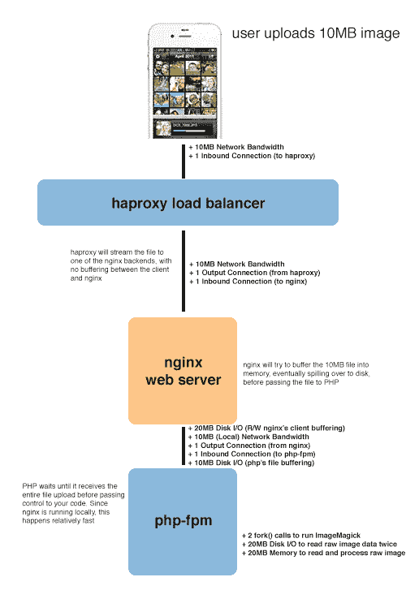

在 LNHMPRR 栈中移动 10 MB 图片的过程

1. 用户通过浏览器或移动端发送 HTTP POST，上传文件（**+10 MB 网络带宽**）。HAProxy 负载均衡器立即接收该文件并将其流式传输到一台 nginx 应用服务器（**+10 MB 网络带宽**）。HAProxy 不会在内存或磁盘中缓冲任何数据，而是直接通过。

2. Nginx 开始从 HAProxy 接收文件并将其缓冲到内存中。取决于 `client_body_buffer_size` 的大小（默认 8 KB），Nginx 会在数据量超过该阈值时转写到磁盘，停止在内存中缓冲，直到整个文件传输完毕。（**+10 MB 磁盘写入 I/O**）

3. 文件上传完全从 HAProxy 传输到 Nginx 后，Nginx 开始读取文件（**+10 MB 磁盘读取 I/O**），并通过 FastCGI 将其传递给 PHP‑FPM（**+10 MB 本地网络带宽**）。由于 PHP‑FPM 本地运行且（希望）使用 Unix Socket，这一步很快完成。

4. PHP‑FPM 发现文件上传后，会把它再次写入磁盘（**+10 MB 磁盘写入 I/O**）。该 PHP‑FPM 工作进程会一直处于“忙碌”状态，PHP 代码在整个文件接收完毕之前不会开始执行。

5. 文件最终进入 PHP，代码开始运行，ImageMagick 进行缩放，读取文件进入内存两次进行处理。（**+20 MB 磁盘读取 I/O，+20 MB 内存**）。

结果是，虽然原始文件只有 10 MB，实际消耗的资源高达 50 MB 磁盘 I/O、30 MB 网络带宽和 20 MB 内存——这太浪费了！如果是视频文件，情况会更糟。

| 资源 | 数量 |
| --- | --- |
| 网络带宽 | 30 MB |
| 磁盘 I/O | 50 MB |
| 内存 | 20 MB |

这套低效流程只是在不同系统之间不断搬运相同的数据。我们可以通过避免磁盘 I/O、尽可能保持数据在内存中来进行优化。

文件在内存之间传递的两个关键点是：一是 Nginx 的缓冲过程，二是 PHP 接收文件时的读取。我们分别对这两点进行优化。

**在 Nginx 侧**，我们可以将 `client_body_buffer_size` 调整为比默认的 8 KB 大得多的值，这样更多的数据会保持在内存中，减少写入磁盘的次数。

另一种做法是保持 `client_body_buffer_size` 不变，并在系统中配置 `tmpfs`（见第 5 章）。配置 `tmpfs` 后，可将 `client_body_temp_path` 改为 `/tmp` 目录，这样在保持 Nginx 内存占用低的同时，可省去磁盘 I/O 开销。

**在 PHP 侧**，只需修改 `php.ini`，将 `upload_tmp_dir` 改为 `/tmp` 目录。这样文件在从 Nginx 传递到 PHP 时会直接写回内存，避免了多次在磁盘之间来回搬运，虽然仍不是最理想的做法，但比三次磁盘写入要好得多。

 || 与 HAProxy 不同，使用 Nginx（配合 HTTP Proxy 模块或 FastCGI）时，整个客户端请求会在 Nginx 中缓冲，不会实时流传；这可以防止 [Slowloris 攻击](http://en.wikipedia.org/wiki/Slowloris)，但会破坏 PHP 的文件上传进度条。Nginx 提供了 [Upload Progress Module](http://wiki.nginx.org/HttpUploadProgressModule) 来实现上传进度显示。

| --- | --- |
|  || 我在 Ubuntu 12.04 上遇到安装 `nginx-extras` 的问题（因 `perlapi` 错误），但在 Debian Squeeze 上可以顺利安装。如果你使用 Ubuntu，可能需要从源码编译 Nginx 以获得 HTTP Upload 模块。 |

| --- | --- |

在此之前，请确保该模块已配置为拦截文件上传。打开 `my_app.conf`（第 5 章），在其中添加如下 `location` 块：

```
 1 > vi /etc/nginx/sites-available/my_app.conf
 2 
 3 location /upload {
 4 	upload_pass /index.php;
 5 	upload_store /tmp/nginx/upload 1;
 6 	upload_set_form_field $upload_field_name.name "$upload_file_name";
 7 	upload_set_form_field $upload_field_name.content_type "$upload_content_type";
 8 	upload_set_form_field $upload_field_name.path "$upload_tmp_path";
 9 	
10 	# 如果 PHP 返回以下任意错误，删除文件
11 	upload_cleanup 400 404 499 500-505;
12 }
```

配置完成后，重新加载 Nginx 并创建所需的临时目录：

```
1 > service nginx reload
2 > mkdir -p /tmp/nginx/upload/{1,2,3,4,5,6,7,8,9,0}
```

最后，代码只需将 `$_FILES["upload"]["tmp_file"]` 替换为 `$_POST["file_path"]` 即可。 


class Image_Controller extends Controller {
    // Image upload is posted to this method
    public function create() {
        
        if (isset($_POST["file_path"])) {
            
            $tmp = $_POST["file_path"];
            
            // Create the Scaled 600x400 Size
            exec("convert -resize 600x400 {$tmp} /u/scaled.jpg");
            
            // Create the 150x150 Thumbnail
            exec("convert -thumbnail x300 -resize 150x< -resize 50% 
                         -gravity center -crop 150x150+0+0 +repage
                         {$tmp} /u/thumbnail.jpg");
            
            // Delete the temporary file  
            @unlink($tmp);
        }
    }
}
```

We also need to change our form to POST the file to `/upload` instead of the normal `index.php` endpoint (specified by the `location` block that we added to `my_app.conf`).

#### Benchmarking the file upload process

I have something embarrassing to admit. I wrote this entire chapter based on theory alone. I’ve implemented all of these techniques at Twitpic, because on paper— IN THEORY, it makes complete sense. These changes will cut our the cruft, reduce useless data shuffling, and optimize the whole process. Right? Right!?

Well, when I went to benchmark each individual change, it turns out… not so much. In fact, each optimization described (`tmpfs`, `client_body_buffer_size`, and `HTTP Upload Module`) only added, at best, a 5% performance improvement over the “default” setup. Oops. And Ouch. It’s a lesson in premature optimization, for sure, and why you should benchmark everything! Regardless, I’ve kept this case study for two reasons:

1. It’s really important to understand *EXACTLY* how data finds its way to your PHP code. Following the code path is a journey that everyone should make. This knowledge will help you debug in the future.

2. To drive home the whole premature optimization thing and that even if an optimization looks correct on paper, it might not actually pan out in the real world.

The only thing that seemed to make a large, measurable impact was the difference between ImageMagick and GraphicsMagick, which I talk about in the next section.

I benchmarked the different settings, one by one, using `ab` (Apache Benchmark), with 1000 uploads and a concurrency of 20— that is, 1000 independent uploads with 20 happening at the same time. I used a 10MB JPEG as the test upload. The server, a EC2 m3.xlarge, was running Debian Squeeze 6.0.6, nginx 1.2.7, and PHP 5.4.13 for the benchmark.

These are the different tests, explained one-by-one.

##### tmpfs

I enabled `tmpfs` and changed `client_body_temp_path` in nginx and `upload_tmp_dir` in php to use it. Little to no difference between the stock setup. Same number of requests/second, same time per request.

Here’s why:

1.  Nginx doesn’t `fsync` the temporary data to disk, and the writes are mostly are mostly sequential, so writing the upload data to disk doesn’t have a huge impact on IO usage.

2.  When PHP reads the data back from disk, it’s reading the entire file sequentially, most of which is already in-memory via the operating system’s disk buffer.

##### Increasing `client_body_buffer_size`

I increased the `client_body_buffer_size` variable in nginx to 20MB, so nginx would be able to buffer the entire 10MB file upload in memory and never have to hit disk. Again, no performance improvement (due to the reasons above), except it increased the memory usage of my nginx worker processes to 200-300MB each, instead of the typical 25MB. Fail! There seems to be almost no reason to increase `client_body_buffer_size` from the default `8KB`.

##### HTTP Upload Module

My last hope— I knew this *had* to improve performance. Not only does it save the file from being copied, but it saves PHP from having to parse the 10MB of POST data. I saw a small 5% improvement in performance here, mostly in reduction of CPU usage by PHP, as it’s less data PHP needs to chug through before it can run your code. Not worth it.

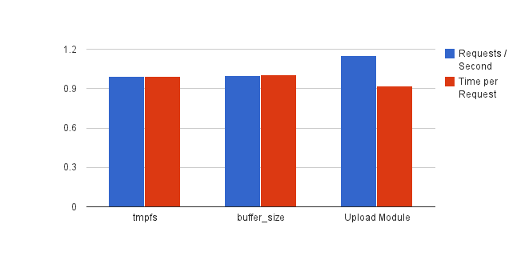

Benchmarks of various changes

##### Benchmarking file uploads with `ab` (Apache Benchmark)

I figured I would make a quick note about how you can test this yourself— it took me a long time to figure out a way to easily benchmark/test file uploads from the command line. There are plenty of tutorials on `ab`, but none really mention how to use it to upload files.

You can only upload raw multipart/form-data with `ab`, it won’t do any magic for you, so you actually need to assembly the raw multipart/form-data to upload an image with `ab`. Something about “manual” and “multipart/form-data” just sounds awful.

I used this PHP script to generate it for me, you just need to edit the form field name, file path, and file name. It’ll take care of everything else. I used a PHP script because I had a hell of a time getting all of the `\r\n` line breaks to be perfect doing it manually— if the format isn’t perfect, your uploads will get ignored by nginx and php.

```
 1 <?php
 2 
 3 $boundary       = "1234567890";
 4 $field_name     = "upload";
 5 $file_path      = "./";
 6 $file_name      = "test.jpg";
 7 
 8 echo "--{$boundary}\r\n";
 9 echo "Content-Disposition: form-data; name=\"{$field_name}\";";
10 echo " filename=\"{$file_name}\"" . "\r\n";
11 echo "Content-Type: image/jpg\r\n";
12 echo "\r\n";
13 
14 echo file_get_contents($file_path . $file_name);
15 
16 echo "\r\n";
17 echo "--{$boundary}--\r\n";
```

Put the script above into a file called `generate.php` and create a `post.txt` file holding the multipart/form-data with the following command:

```
1 > php generate.php > post.txt
```

Now, you can use `post.txt` with `ab` to start benchmarking your own file uploads.

```
1 > ab -n 50 -c 10 -p post.txt -T "multipart/form-data; boundary=1234567890" htt\
2 p://localhost/upload.php
```

### ImageMagick vs GraphicsMagick

There’s a lesser known image library called [GraphicsMagick](http://www.graphicsmagick.org/)— a leaner and faster fork of the ImageMagick code. That’s a win in itself (given the same source image and settings, GraphicsMagick will often produce a smaller output image in less time), but it also has a regularly updated PHP C Extension. Having a Native PECL extension is a huge win, because it us allows to remove the two `exec()` calls from the code and subsequently the two poorly performing `fork()`s.

The installation is pretty painless, too.

```
1 > sudo apt-get install php5-dev php-pear build-essential libgraphicsmagick-dev
2 > sudo pecl install --force gmagick
3 > echo "echo "extension=gmagick.so" > /etc/php5/conf.d/gmagick.ini" | sudo sh
```

You can grab the docs for [PECL GMagick](http://pecl.php.net/package/gmagick) here, but it uses very similar options as ImageMagick, except with an object oriented interface instead of command-line arguments.

```
 1 <?php
 2 
 3 class Image_Controller extends Controller {
 4 
 5   // Image upload is posted to this method
 6   public function create() {
 7     if (isset($_FILES["upload"])) {
 8         // Create the Scaled 640x800 Size
 9         $gm = new GMagick();
10         $gm->readImage($_FILES["upload"]["tmp_file"]);
11         $gm->setCompressionQuality(90);
12         $gm->scaleimage(640,800);
13         $gm->write("./f/scaled.jpg");
14 
15         // Create the 150x150 Thumbnail
16         $gm->cropthumbnailimage(150,150);
17         $gm->write("./f/thumbnail.jpg");
18 
19         unlink($_FILES["upload"]["tmp_file"]);
20     }
21   }
22 }
```

Hooray! No more nasty `exec()` calls, and since we can share the GMagick object for multiple resizes, we only have to read the raw image data into memory once opposed to twice with ImageMagick. *This will only work if you’re downsizing every step.*


|  || Newer versions of GraphicsMagick and ImageMagick are built with OpenMP, a framework for parallelizing image processing across multiple cores. In theory, sounds great— but I ran into a number of issues with random seg faults and crashes. I prefer to either recompile `libgraphicsmagick` with `--disable-openmp` or set `putenv(MAGICK_THREAD_LIMIT=1);` in PHP to disable OpenMP. |

| --- | --- |

#### Benchmarking ImageMagick vs GraphicsMagick

In a fairly straightforward benchmark, I found that GraphicsMagick was nearly twice as fast as ImageMagick in terms of requests per second— jumping to more than 3x faster if you’re able to re-use the same GraphicsMagick when doing multiple resizes. That’s an incredible payoff, with little effort, especially if you’re working with an upload-heavy application or have to do the image resizing inside of the web request.

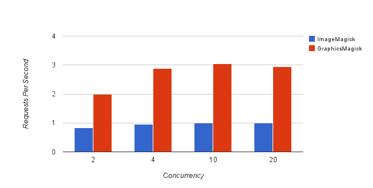

ImageMagick vs GraphicsMagick

### Allowing Large File Uploads

Setting up your stack to handle large file uploads can feel like a pain because there are a few different settings you need to change in `php.ini` and `nginx` to allow big files to pass through.

#### nginx.conf

**client_max_body_size**

Set this to the same as `upload_max_filesize` in `php.ini`. `128M` is a good starting point.

#### php.ini

**upload_max_filesize**

The maximum size of the actual file upload itself. Should be set the same as `client_max_body_size` in `nginx.conf`

**post_max_size**

The maximum size of the entire HTTP POST body, including the multipart file upload. Should be set slightly higher than `upload_max_filesize` to take into account any extra POST parameters and metadata. I usually set it as 1MB more than `upload_max_filesize`.

**memory_limit**

PHP says that it needs enough memory to read the entire file into memory. I typically just disable `memory_limit`, but if you’re not doing that, than you need to set it atleast the size of `post_max_size`, preferable a little higher.

**max_file_uploads**

The maximum number of files that can be in a single POST body, used to provide a sane limit and prevent circumventing `upload_max_filesize` with lots of small files. Worth pointing out— PHP does count empty file upload fields in a form against this limit.

### Stripping EXIF Metadata

When a user uploads a JPG, they are not only sending a picture, but also a wealth of metadata that’s hidden inside of the image. This EXIF metadata can be used for interesting data projects— things like the timestamp, camera type, aperture, shutter speed, and flash brightness are stored within the EXIF data. Cool!

```
 1 print_r(exif_read_data("file.jpg");
 2 
 3 => Array(
 4   [FileName] => IMG_1043.jpg
 5   [FileSize] => 2464042
 6   [Make] => Apple
 7   [Model] => iPhone 4S
 8   [Software] => QuickTime 7.7.1
 9   [DateTime] => 2013:04:01 09:28:30
10   [HostComputer] => Mac OS X 10.8.3
11   [ExposureTime] => 1/20
12   [ISOSpeedRatings] => 200
13   [ShutterSpeedValue] => 2779/643
14   [GPSLatitude] => Array
15     [0] => 32/1
16     [1] => 5126/100
18   ...
```

But there’s also a scary amount of private data that gets tagged inside of the image metadata too, including GPS data. On a picture taken with my iPhone 4S, the Lat/Long EXIF data is accurate within 5 feet of my apartment.


Some information contained in the EXIF metadata

If you’re handling user uploads and displaying them publicly, it’s your responsibility to strip out the EXIF tags from the files that your users upload. Luckily, it’s pretty easy with GraphicsMagick and a call to the `stripimage()` function.

```
 1 <?php
 2 $g = new GMagick("file.jpg");
 3 $g->stripimage();
 4 $g->write("without_exif.jpg");
```

When you *resize* an image with GraphicsMagick, it will not preserve the EXIF data. However, many sites offer a “raw” or “view original” function, where it is absolutely necessary to strip the EXIF data from the image.

### Autorotation

Another common issue that people run into with image uploads in PHP is handling orientation and rotation. When you take a picture with a modern camera, the orientation in which the picture was taken is not how it’s saved.

For example, if you take a picture with your iPhone camera upside down, when you open it on your computer or view it in your browser, the picture is going to be upside down. Similarly, if you take a picture in landscape mode, when you view it on your computer or in your browser, it will be displayed vertically instead of as a landscape.

We can fix this by checking the `Orientation` value inside of the EXIF metadata (before stripping it) and rotating the image accordingly. There are 8 different EXIF `Orientation` values, each one representing a different state of rotation.

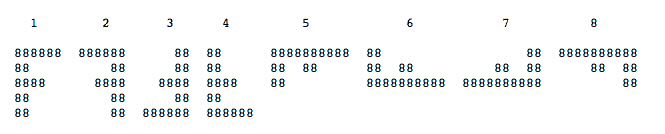

Orientation Value Diagram

When the EXIF `Orientation` is 1, nothing needs to be done! The image is already correctly rotated. For all of the other values, we need to adjust accordingly. Older PHP tutorials recommend using `exec()` with the command line tool `jpegtran` and `jhead` to accomplish the rotation. You already know the drill. Using `exec()` during a web request is bad form, extra dependencies, potential security hole, DDoS vector, etc.

Instead, we can adjust the orientation with nothing besides GraphicsMagick.

```
 1 <?php
 2 
 3 $g = new GMagick("file.jpg");
 4 
 5 // Read the Orientation from the EXIF data
 6 $exif     = exif_read_data("file.jpg");
 7 $position = $exif['Orientation'];
 8 	
 9 switch($position) {
10   case 2:
11     $g->flopimage();
12     break;
 
13   case 3:
14     $g->rotateimage("#ffffff", 180);
15     break;
 
16   case 4:
17     $g->rotateimage("#ffffff", 180);
18     $g->flopimage();
19     break;
 
20   case 5:
21     $g->rotateimage("#ffffff", 90);
22     $g->flopimage();
23     break;
 
24   case 6:
25     $g->rotateimage("#ffffff", 90);
26     break;
 
27   case 7:
28     $g->rotateimage("#ffffff", -90);
29     $g->flopimage();
30     break;
 
31   case 8:
32     $g->rotateimage("#ffffff", -90);
33     break;
34 }
 
35 // Thumbnail resizing or whatever you need
36 // to do.
 
37 $g->write("oriented.jpg");
```

|  || **In the example above, what’s the `#ffffff` argument in the `rotateimage()` method?** GMagick requires you to pass a fill color in case it needs to do a non-right angle rotation, in which case it will need to fill in the blank areas with a color. Since we’re only doing right-angle rotations, the fill color will never be used. |

| --- | --- |

## Case Study: Benchmarking and Load Testing Web Services

Benchmarking and load-testing is ultimitely one of the most important parts of Scaling. Why? It’s where the rubber meets the road. Where you can see how the changes you make in your architecture or code improve your overall performance. A way to figure out where the weak parts of your application are, and what’s likely to crumble first under heavy load.

|  || If you don’t want to mess around with setting up a benchmarking environment, you can get started really quickly with a service like [Blitz](http://blitz.io) or [LoadImpact](http://loadimpact.com). These services allow you to send anywhere from 100 - 1,000,000 computer-generated visitors to your site to browse around and generate load. |


### 设置测试环境

如果你已经启动了，重要的是你在单独的服务器上进行基准测试和负载测试，而不是在生产环境中——我们将会破坏一些东西，极限测试应用，直接在生产环境中做是不好的想法。

这里有一点我强烈推荐使用按小时计费的云托管服务。通过 [Amazon EC2](http://aws.amazon.com)，[Rackspace Cloud](http://rackspacecloud.com)，[DigitalOcean](http://digitalocean.com) 或 [SoftLayer Cloud](http://softlayer.com)，你可以为几美元创建一个几乎与生产服务器完全相同的复制环境。无需硬件投资，无需那些大部分时间闲置的“测试”服务器。

### 著名的 `ab`（Apache Benchmark）

最常用的高级基准测试工具肯定是随 Apache 一起安装的 `ab` 工具。它是一个相当不错的工具，非常适合初学者，因为它使用非常简单。

`ab` 的基本思想是：给定一个 HTTP URL、并发访问数和总请求数，它会向你的 Web 服务器发送大量请求。

当然，连续不断请求同一页面几乎不代表真实的流量，但它是一个很好的起点，尤其是当你能让它同时访问到堆栈的各个部分时。**把它看作 brute-force 基准测试**。显然，如果你只用它来测试静态页面或不涉及数据库的页面，结果会非常不现实。

|  || 注意：如果你在 Mac OS X 使用包装版的 `ab`，它会经常出现错误 `apr_socket_recv: Connection reset by peer (54)`（大约 9 次出现 10 次），但有时可以工作，尤其是在并发量较低时。可以通过 `homebrew` 修复该 bug：`brew install https://raw.github.com/Homebrew/homebrew-dupes/master/ab.rb`。

| --- | --- |

在 Ubuntu 上安装 `ab` 很简单——`apt-get install apache2-utils`。

下面我们运行一个非常小的测试，使用 10 个并发连接和 100 个请求。`-c` 参数用于并发请求数（即同时发出的请求数），`-n` 参数用于总请求数。

```
 1 > ab -c 10 -n 100 "http://192.51.100.100"
 2 
 3 This is ApacheBench, Version 2.3 <$Revision: 655654 $>
 4 Copyright 1996 Adam Twiss, Zeus Technology Ltd, http://www.zeustech.net/
 5 Licensed to The Apache Software Foundation, http://www.apache.org/
 6 
 7 Benchmarking 127.0.0.1 (be patient).....done
 8 
 9 
10 Server Software:        WEBrick/1.3.1
11 Server Hostname:        127.0.0.1
12 Server Port:            9292
13 
14 Document Path:          /
15 Document Length:        16571 bytes
16 
17 Concurrency Level:      10
18 Time taken for tests:   4.768 seconds
19 Complete requests:      100
20 Failed requests:        70
21    (Connect: 0, Receive: 0, Length: 70, Exceptions: 0)
22 Write errors:           0
23 Keep-Alive requests:    100
24 Total transferred:      1678245 bytes
25 HTML transferred:       1657029 bytes
26 Requests per second:    20.97 [#/sec] (mean)
27 Time per request:       476.843 [ms] (mean)
28 Time per request:       47.684 [ms] (mean, across all concurrent requests)
29 Transfer rate:          343.70 [Kbytes/sec] received
30 
31 Connection Times (ms)
32               min  mean[+/-sd] median   max
33 Connect:        0   20  99.0      0     503
34 Processing:    87  422 156.2    416    1014
35 Waiting:       68  370 143.7    367     830
36 Total:         87  442 207.6    416    1517
37 
38 Percentage of the requests served within a certain time (ms)
39   50%    416
40   66%    491
41   75%    526
42   80%    555
43   90%    669
44   95%    747
45   98%   1106
46   99%   1517
47  100%   1517 (longest request)
```

我们来关注结果中的关键部分：

```
1 `Requests per second:    20.97 [#/sec] (mean)`
2 `Time per request:       47.684 [ms] (mean, across all concurrent requests)`
3 `Transfer rate:          343.70 [Kbytes/sec] received`
```

我们可以看到每秒请求数、平均每个请求的时间以及传输速率（Kbytes/sec）。这些是随着你改进堆栈和代码时需要跟踪和衡量的良好指标——请求数越多，平均每个请求的时间越短，表现越好。

|  || `ab` 除了 `-c` 和 `-r` 外，还有不少设置。一个有用但容易被忽略的设置是 `-k`，它开启 KeepAlive 请求。我喜欢同时运行两个 `ab` 实例，一个带 `-k`，另一个不带，用来测试负载均衡器的网络设置（如 Chapter 4 讨论的，有多少连接保持在 `TIME_WAIT` 状态）。

| --- | --- |

### `siege`，一个更现代的 `ab`

我觉得 Apache Benchmark 有点局限且过时。一个更现代、更强大的替代工具是 `siege`。你可以在 Ubuntu 上通过 `apt-get install siege` 安装它。其命令行参数与 `ab` 类似，`-c` 设置并发用户数，`-t` 设置测试运行的秒数。

```
 1 siege -c50 -t10s http://127.0.0.1
 2 ** SIEGE 3.0.1
 3 ** Preparing 50 concurrent users for battle.
 4 The server is now under siege...
 5 Lifting the server siege...      done.
 6 
 7 Transactions:            992 hits
 8 Availability:            100.00 %
 9 Elapsed time:            9.56 secs
10 Data transferred:        0.36 MB
11 Response time:           0.00 secs
12 Transaction rate:        103.77 trans/sec
13 Throughput:              0.04 MB/sec
14 Concurrency:             0.06
15 Successful transactions: 992
16 Failed transactions:     0
17 Longest transaction:     0.01
18 Shortest transaction:    0.00
```

轻松搞定 50 个并发连接，持续 10 秒。我更喜欢 `siege` 的输出和格式。你可以清晰地看到 `Transaction rate`（每秒请求数）以及其他有价值的指标。

另一个酷炫的功能是，它可以在单个测试中同时访问多个 URL，以模拟真实流量。只需创建一个文件并填入大量 URL，`siege` 就会依次访问它们。这是轻松模拟真实世界流量的方法。

```
1 $ vim urls.txt
2   http://127.0.0.1/index.php
3   http://127.0.0.1/search.php
4   http://127.0.0.1/contact.php
5 
6 $ siege -c50 -t10s -i -f urls.txt
```

### Bees with machine guns

有时你需要进行极其大规模的测试，单个 `siege` 进程根本不够。[Bees with machine guns](https://github.com/newsapps/beeswithmachineguns) 会启动一个微型 EC2 集群，用尽可能多的客户端来敲击你的服务器！安装过程稍微复杂一些：

```
 1 $ apt-get install python-dev python-pip
 2 $ pip install beeswithmachineguns
 3 
 4 $ export AWS_ACCESS_KEY_ID="YOUR AWS ACCESS KEY"
 5 $ export AWS_SECREY_ACCESS_KEY="YOUR AWS SECRET KEY"
 6 
 7 # 你需要将你用于 Amazon EC2 的私有 SSH Key 放入此文件，文件名必须与上传到 Amazon EC2 的密钥相同。
 8 # 例如：$ vim ~/.ssh/key_name.pem
```

接下来，你需要在 EC2 管理控制台中创建一个安全组（如果你还没有），该安全组必须允许端口 22 的 SSH 连接。我创建了一个名为 `public` 的安全组，你需要将其传递给 `-g` 参数。

配置好安全组后，`bees` 就准备好启动你的测试集群了。下面我将启动一个包含 4 个实例的攻击集群。默认实例类型是微实例（`t1.micro`），费用极低（$0.020/小时）。你可以使用 `-t` 参数更改实例类型。

```
 1 $ bees up -s 4 -g public -k key_name -z us-east-1b
 2   
 3   Connecting to the hive.
 4   Attempting to call up 4 bees.
 5   Waiting for bees to load their machine guns...
 6   Bee i-c941cfe8 is ready for the attack.
 7   Bee i-c841cfe9 is ready for the attack.
 8   Bee i-0b5ed02a is ready for the attack.
 9   Bee i-0a5ed02b is ready for the attack.
10   The swarm has assembled 4 bees.
```


-   [我们准备好进攻了！我们将以 250 个并发客户端发送 100,000 个 HTTP 请求。](https://example.org)

```
 1 $ bees attack -n 100000 -c 250 -u http://ec2-54-204-61-43.compute-1.amazonaws.\
 2 com/
 3   
 4   从蜂群名单中读取 4 只蜜蜂。
 5   正在连接蜂巢。
 6   正在组装蜜蜂。
 7   每只 4 只蜜蜂将发射 25000 轮，每 62 轮一次。
 8   使 URL 产生刺痛效果，以便缓存攻击目标。
 9   组织蜂群。
10   蜜蜂 0 正在加入蜂群。
11   蜜蜂 1 正在加入蜂群。
12   蜜蜂 2 正在加入蜂群。
13   蜜蜂 3 正在加入蜂群。
14   蜜蜂 2 正在用机关枪射击。Bang bang!
15   蜜蜂 3 正在用机关枪射击。Bang bang!
16   蜜蜂 0 正在用机关枪射击。Bang bang!
17   蜜蜂 1 正在用机关枪射击。Bang bang!
18   蜜蜂 3 失去目标视线（连接超时）。
19   蜜蜂 1 用完弹药。
20   蜜蜂 0 用完弹药。
21   蜜蜂 2 用完弹药。
22   进攻完成。
23        目标在未完全响应 1 只蜜蜂的情况下超时。
24        完成请求：         75000
25        每秒请求数：       616.110000 [#/sec] (mean)
26        每个请求时间：     302.431333 [ms] (mean)
27        50% 响应时间：     2.000000 [ms] (mean)
28        90% 响应时间：     6.333333 [ms] (mean)
29   任务评估：目标蜂群进攻已被击败。
30   蜂群正在等待新命令。
```

就像 `ab` 和 `siege` 一样，我们可以看到我们能够提供的请求每秒数以及平均每个请求的时间。

你会注意到我丢失了一只蜜蜂——默认实例 `t1.micro` 非常弱，其 CPU 会被 Amazon 限制。为了进行真实测试，我建议使用更大的实例类型。当我们完成测试后，只需运行 `bees down` 即可关闭实例。

### Sysbench

我将介绍的最后一个基准测试工具是 `sysbench`。它非常适合测试原始硬件（cpu、memory、disk），并且内置了一个非常棒的 mysql 基准套件，使得在更改设置并测试不同硬件配置时，很容易对 mysql 配置进行基准测试。

```
1 $ apt-get install sysbench
```

接下来，我们需要准备测试：

```
1 $ sysbench --test=oltp --oltp-table-size=1000 --mysql-user=root --mysql-host=l\
2 ocalhost \ 
3   --mysql-password= prepare
```

你应该会看到关于创建表和记录的输出。最后，我们运行测试。

```
 1 $ sysbench --test=oltp --oltp-table-size=1000 --mysql-user=root --mysql-host=l\
 2 ocalhost \ 
 3   --mysql-password= run
 4 
 5   正在进行 OLTP 测试。
 6   正在运行混合 OLTP 测试
 7   使用特殊分布（12 次迭代，  1 pct 的值在  75 pct 案例中返回）
 8   使用 "BEGIN" 开始事务
10   使用 id 列的自动递增
11   OLTP 测试的最大请求数限制为 10000
12   已启动线程！
13   完成。
14 
15   OLTP 测试统计：
16       执行的查询：
17           读取：                            140000
18           写入：                           50000
19           其他：                           20000
20           总计：                           210000
21       事务：                           10000  (110.61 per sec.)
22       死锁：                           0      (0.00 per sec.)
23       读/写请求：                       190000 (2101.54 per sec.)
24       其他操作：                       20000  (221.21 per sec.)
25 
26   测试执行摘要：
27       总时间：                          90.4101s
28       总事件数：                        10000
29       事件执行总耗时：                  90.3572
30       每请求统计：
31            最小：                                  4.88ms
32            平均：                                  9.04ms
33            最大：                                532.42ms
34            约  95 百分位：                      13.68ms
35 
36   线程公平性：
37       事件 (avg/stddev)：           10000.0000/0.00
38       执行时间 (avg/stddev)：   90.3572/0.00
```

这份输出显示了 MySQL 读取查询、写入查询以及事务数量的性能信息。你可以调整一些设置并重新运行基准测试，观察更改如何影响整体查询速度和 MySQL 的整体性能。

`sysbench` 附带的其他测试套件包括 `fileio`、`cpu`、`memory`、`threads` 和 `mutex`。我发现 `fileio` 测试非常适合对不同类型的驱动器进行基准测试。

你也可以查看令人惊叹的 [Phoronix Test Suite](http://www.phoronix.com/) 以获得更全面的服务器基准套件。

### 赞助商

我于 2012 年启动了《Scaling PHP Applications》作为实验，人们可以在书完成前预<unk><unk><unk><unk><unk><unk><unk><unk><unk><unk><unk><unk><unk><unk><unk><unk><unk><unk><unk><unk><unk><unk><unk><unk><unk><unk><unk><unk><unk><unk><unk><unk><unk><unk><unk><unk><unk><unk><unk><unk><unk><unk><unk><unk><unk><unk><unk><unk><unk><unk><unk><unk><unk><unk><unk><unk><unk><unk><unk><unk><unk><unk><unk><unk><unk><unk><unk><unk><unk><unk><unk><unk><unk><unk><unk><unk><unk><unk><unk><unk>


| `Darius Aliabadi` || `Jake Fournier` || `Ronald Male` |

| `Mark Myers` || `Thi Nguyen` || `Harry Grillo` |

| `Yvonne Adams` || `Peter Holberton` || `Web Monkey Oy` |

| `Scott Mansfield` || `Hans Ahrens` || `Chris Schuld` |

| `Ole Markus With` || `Scott Warren` || `Johnny Green` |

| `Vamsi Krishna B` || `Yuji Yokoo` || `Carlos Buenosvinos` |

| `Raul Fraile Beneyto` || `Komang Arthayasa` || `Sean Hickey` |

| `Javier Montes Martinez` || `Devon Ostendorf` || `Mark Limburg` |

| `Gavin Staniforth` || `Jani Elo` || `Jonathan Kiddy` |

| `Gregory H Salmon` || `Chris Szymansky` || `Tabare Caorsi` |

| `Ben Shakal` || `Reinder de Vries` || `Fredrik Nordell` |

| `Sampsa Saarela` || `David Burrows` || `Terry Appleby` |

| `Martin Naumann` || `Andrew Elster` || `Philip Daly` |

| `Scott Moss` || `David Gieger` || `Michael Orr` |

| `Angus G Nelson` || `Au-Yeung Kok Chue` || `Rohit Modi` |

| `Alexandru Barbulescu` || `Dan Fisher` || `Michal Marczyk` |

1. `Apache` is great, too. It’s extremely popular and well supported, but `Apache + mod_php` is not the best tool for the job when you’re dealing with high volume PHP apps. It’s memory intensive and doesn’t offer full tuning capabilities.↩
