# 搜索引擎优化（SEO）秘籍：实现你从未想象过的 SEO 目标


- 关于技术编辑
- 请先阅读这部分
- 本书的读者
- 为什么这本书比其他 SEO 书籍更好
- 我是如何学习书中分享的秘诀
- 支持本书的网站
- 书中使用的特性和图标

# 第 1 章：理解搜索引擎优化
- 受欢迎的秘诀
- 相关性的秘诀
- 本章总结

# 第 2 章：重新审视你看待网页的方式
- 1000 英尺视角——理解区域环境
- 100 英尺视角——网站
- 10 英尺视角——网页
- 1 英尺视角——单个内容单元
- 本章总结

# 第 3 章：选择正确的 SEO 工具
- 查看源代码
- 实用的搜索引擎查询
- 搜索引擎提供的工具
- Google 站长工具
- 相关性判定工具
- SEO 栏
- HTTP 头部分析器
- Firefox 用户切换器
- Firefox 渲染
- 本章总结

# 第 4 章：发现 SEO 问题
- 15 分钟 SEO 审计
- 5 分钟品牌审计
- 识别搜索引擎惩罚
- 本章总结

## 第 5 章：解决 SEO 问题
- 要优先
- 修复受欢迎问题
- 修复相关性问题
- 修复惩罚
- 链接建设
- 本章总结

# 第 6 章：SEO 最佳实践
- 页面级信息
- 域名级信息
- URL
- 标题标签
- Meta 描述
- HTML 标题 (H1 – H6)
- 图片
- Nofollow
- Rel Canonical 元素
- Meta 关键词
- JavaScript 和 Flash
- 301 重定向
- 屏蔽搜索引擎页面
- 流量与排名
- 参数驱动 URL
- 页脚链接
- 本章总结

# 第 7 章：SEO 咨询流程
- 回答客户的问题问题
- 准备首次会议
- 文件工作：设定预期
- 交付物
- 确定定价
- 哪些可以免费提供
- 后续会议
- 本章总结

# 第 8 章：全面网站审计（信息类网站)
- 如何阅读本章
- 示例网站
- 示例报告
- 完成报告
- 本章总结

# 第 9 章：全面网站审计（电子商务网站)
- 如何阅读本章
- 示例网站
- 示例报告
- 本章总结

# 第 10 章：了解行业
- SEO 简史
- 网络营销人员是谁？他们在哪里？
- SEO 金字塔与多重身份
- SEO 领领
- Google 和 Bing 背后的人与技术
- SEO 的长期视角
- 本章总结

# 第 11 章：搜索引擎垂直领域
- 通用搜索
- 本地搜索
- 图片搜索
- 视频搜索
- 即时搜索
- 本章总结

# 第 12 章：针对替代搜索引擎进行优化
- Amazon
- YouTube
- Facebook
- Delicious
- Flickr
- Twitter
- 本章总结

# 第 13 章：测试、测试、测试
- 搭建测试平台
- 运行测试
- 记录结果
- 分享知识的重要性
- 本章总结

# 第 14 章：SEO 资源
- SEO 速查表部分一：页内优化
- SEO 速查表部分二：规范化错误
- SEO 速查表部分三：Meta 机器人和 Robots.txt
- SEO 速查表部分四：站点地图
- SEO 速查表部分五：用户代理
- 域名切换清单
- SEO 快速上手列表
- 本章总结

# 附录：参加 SEO 大会
- 选择正确的大会
- 预期什么
- 准备出发


# 携带物品

# 活动事项

# 会后

## 总结

# 索引

# 广告


## 关于作者

Danny Dover 是一位热情的 SEO 专家和富有影响力的作家。在 `SEOmoz.org` 担任首席 SEO 期间，他曾为全球许多最流行的公司（包括 Facebook、Microsoft 和 Comcast）提供 SEO 咨询。他的专业知识被 `Time`、`PCWorld`、`Smashing Magazine` 和 `Seattle Post-Intelligencer` 引用，并翻译成日语、法语、西班牙语、意大利语、中文、德语和匈牙利语。

Danny 曾在多个 SEO 大会上演讲（跨越三大大陆），他的文章阅读量超过百万次，并在许多国家在线访问。

Erik Dafforn 是 `Intrapote, LLC` 的执行总裁兼有机 SEO 总监，这是一家位于克利夫兰搜索营销公司。在 `Intrapote` 的博客和 `ClickZ.com` 上，他撰写了 200 多关于 SEO 策略和技术的文章，其中许多关注架构对爬取和索引过程的影响。Erik 与妻子和孩子住在印第安波利。

## 关于技术编辑

Tim Buck 曾在一家小型软件开发公司担任 15 年 IT 经理。作为那里唯一的 IT 支持来源，他负责服务器管理、桌面支持、网页开发和软件测试，并兼任许多其他角色。因此，他学习了各方面的基础知识，包括如何让公司网站出现在 `Google` 搜索引擎结果中的基础知识。

现在 Tim 在州政府担任 Web 应用开发人员；在这个职位上，他继续学习各领域的基础知识，支持遗留应用程序并开发新应用程序。

## 致谢

我要感谢 Kevin Kent（项目编辑）、Mary James（策划编辑）、Carol Long（执行编辑）以及 Jenny Watson（最初找到我并写这本书的人）为这一庞大且有趣的项目付出的巨大努力。你们的指导和领导使我能够完成这本书，我诚心感谢你们的耐心和支持。

我也想感谢整个 SEO 社区，他们创造了使本书成为可能的活力环境。无论我是面对面、在线上还是从未见过你们，你们都是我的驱动动力，是提供无条件鼓励和重要建设性意见的来源。

谢谢！

—Danny Dover

我想感谢几位为我本书的贡献提供帮助和鼓励的人。

感谢 Danny Dover，他构思了一系列在 SEO 书中通常见的优秀内容，参与这个项目既是荣幸也是挑战。


特别感谢 Intrapromote, LLC 的联合创始人 John Lustina 和 Doug Ausbury，感谢他们在写作阶段提供的鼓励；还要感谢 James Gunn，他很久以前就帮助我理解了基础的 SEO 概念，直到今天仍然是我卓越见解和知识的源泉。

最后，我想对 Wiley 购、编辑和制作人员的专业知识和职业精神表示感谢，包括 Kevin Kent、Mary Beth Wakefield 和 Mary James 这样优秀的编辑。他们是一支优秀的团队。

—Erik Dafforn

# 先读这部分

为什么像我这样的人想要把我的 SEO 秘密公开给世界阅读呢？这难道不会破坏我的竞争优势吗？我难道不会破产流落街头吗？我的朋友不会嘲笑我、我的家人不会和我断关系吗？

出于两个原因，答案可能不是。

- 第一个原因是市场规模。互联网极其庞大，并正以惊人的速度增长。`SEO` 市场也遵循类似的路径。我绝对不可能为所有需要 `SEO` 咨询的网站工作。因此，我乐意将这些工作交给他人，并教他们如何成功。这并不会让我损失自己的钱，而且让我觉得正在为更大的利益做贡献。我关于 `SEO` 的大部分知识都是从他人学到的，因此觉得有义务传播这些知识。
- 第二个原因与我曾经工作的公司 `SEOmoz` 有关。`SEOmoz` 提供工具帮助 `SEOs` 完成工作。因此，推广和培训其他 `SEOs` 对我有利。就像 `Google` 受益于更多人上线一样，我从教教他人如何做 `SEO` 中获益。你可以选择使用 `SEOmoz` 竞争对手的服务，也可以不使用。这完全取决于你，我会尽力向你展示所有的可用选项。

# 这本书适合谁读

这本书是写给已经了解 `SEO` 基础并希望将这些知识提升到新水平以赚更多钱的 `SEO`。在 `SEO` 行业中，我发现最好的方法是做 `SEO` 咨询。

这本书作为成为 `SEO` 顾问的指南，或者供那些想要使用专业 `SEO` 顾问策略的人编写的。它清晰地列出了我在 `SEOmoz` 为互联网上一些最知名网站提供咨询时所使用的流程和视角。它适用于那些热爱互联网并努力影响其运作方式的人。

# 为什么这本书比其他 SEO 书籍更好

现代 `SEO` 是复杂的、快速变化的且充满误解的。这使得学习变得极其困难。当我开始为这本书做研究时，我读了所有现有的主流 `SEO` 书籍。我很快发现它们充满了理论，却缺乏真正帮助读者精通该主题的可操作步骤。

我写这本书的目标是建立起理论与行动之间的桥梁，通过将我找到的所有最佳信息来源汇集，并将它们放在一种易于理解的格式中，更重要的是，让人像专业人士一样做 `SEO`。这种对行动的强调遵循我最初学习 `SEO` 时使用的步骤。我相信，这种先关注流程、后进行解释的重点在市场上的 `SEO` 书籍中是独一二二的，我相信它将成为让你能够超越竞争对手的关键。

# 我是如何学习书中分享的秘密的

残酷的实实是，我并不在 `Google` 或 `Microsoft` 工作，我从未读过哪怕一行驱动搜索引擎算法的代码。令人惊讶的是，作为一名 `SEO` 专业人士，我并不独特。

那么，是什么给了我写一本关于 `SEO` 书的权威？答案很简单。我能出结果。我投入了生命中的几年研究搜索引擎，并学会了如何影响搜索引擎结果页面。我几乎每天都使用我的技能帮助人们提高排名并为网站带来流量。对我来说，没有比帮助人们实现他们的在线梦想更好的感觉了。

这本书是我的下一步。与其以一对一的方式帮助他人，这本书将使我能够以一种对多的方式帮助他人。这正是你们上场的地方。我希望在读完这本书后，你们会选择使用你们的技能来帮助他人（但务必先照顾自己）。无论如何，我都会支持你们。


使用以下功能和图标帮助你关注书中一些重要或实用的信息，以及一些最有价值的提示、见解和建议。

注意像这样的边注注释，它们突出了某些关键信息，或讨论了某些有价值的技术或方法。

侧边栏

像这样的侧边栏包含有关与附近文本相关主题的额外信息。

TIP `Tip` 图标表示一个有用的技巧或技术。

NOTE `Note` 图标指出或扩展了重要或感兴趣的项目。

CROSSREF `Cross-Reference` 图标指向可以找到额外信息的章节。

WARNING `Warning` 图标警告你在做出更改之前应该注意的可能产生的负面副作用或应该采取的预防措施。

话不多说，现在是开始的时候了。谢谢，并祝你的互联网事业好运。

# 第 1 章：理解搜索引擎优化

## 本章

- 学习搜索引擎如何查看网站
- 观察 SEO 中的流行性
- 考虑相关性在 SEO 中的作用

在 `Google`，工程师们讨论“八二二法则”问题。他们描述的是最后 20% 的问题占据了 80% 的工作量。学习 `SEO` 就是其中之一。`SEO` 需要的 80% 知识可以在网上免费获得。遗憾的是，剩下的 20% 消耗了大部分的精力。我写这本书的目标是让这 20% 变得像前 80% 一样容易获取。尽管我认为我无法涵盖所有的 20%（部分来自于多年的实践），但我将尽可能写出可操作的高级材料。

## 流行性的秘密

从以前以前，`Stanford` 有两个呆客正在读博士学位。（现在想起来，`Stanford` 的呆客可能不止于两个。）两个 `Stanford` 的呆客对目前的在线搜索选项不满意，因此尝试开发一种更好的方法。


作为长期学术学者，他们决定采取学术论文的组织方式，并将其应用于网页。判断学术论文质量的一种快速且相当客观的方法，是看它被其他学术论文引用的次数。这个概念在网上很容易复制，因为互联网的初衷是在大学之间共享学术资源。这些引用一旦上线，就表现为超链接。其中一个“极客”想出了一种在全球范围内计算这些值的算法，于是他们就此过上了幸福的生活。

当然，这两个极客就是 Google 的创始人拉里·佩奇（Larry Page）和谢尔盖·布林（Sergey Brin），而拉里在那天发明的算法最终演变成了 `PageRank`。简而言之，Google 最终成了一大巨头，现在这两位创始人从美国航空航天局租了一条跑道，以便他们有地方停放私人飞机。（觉得我在开玩笑吗？看这里 [`searchengineland.com/your-guide-to-the-google-jet-12161`](http://searchengineland.com/your-guide-to-the-google-jet-12161)。）

## 相关性、速度与可扩展性

假设性地，最相关的搜索引擎应该拥有一个涵盖全球每个学科的专家团队——该团队规模大到可以阅读、研究和评估在网络上发布的每一份文档，以便为用户提交的每个查询返回最准确的结果。

另一方面，最快的搜索引擎会在新的 `URL` 发布的一瞬间就对其进行爬取，并立即将其引入通用索引，使其在上线后几秒钟内就能出现在查询结果中。

Google 以及所有其他引擎面临的挑战在于，在这两种场景之间找到平衡：将快速爬取和索引与一种可以立即应用于新内容的相关性算法结合起来。换句话说，他们正试图构建“可扩展的相关性”。在极少数情况下，Google 对手动删除（或手动提权）特定内容并不感兴趣。相反，它的模型是围绕识别网页内容中的特征构建的，这些特征表明内容特别相关或不相关，这样整个网络上具有相同特征的内容就可以类似地被提升或降权。

本书经常讨论为用户着量而创建内容的益处。对于一些硬核 SEO 专家来说，Google “为用户而思考”的格言是老套的；他们更愿意知道某行可以绕过创建引人入内容意图的秘密代码或服务器技术。

虽然这可能很老套，但 Google 对创建相关且以用户为中心内容的关注真的是其可扩展相关性算法的关键。Google 不断尝试奖励那些真正回答了用户问题的内容，并减少或过滤掉为了内容而存在的内容。虽然本书讨论了让你的内容对引擎可见且可访问的技术，但请记住，这意味着是在讨论为用户考虑构建的内容，这些内容旨在具有创新性、帮助性，并服务人类用户的查询意图。这可能很老套，但非常有效。

在那命运的一天，Google 兄弟俩利用了链接的神秘力量。虽然网站管理员可以很容易地操纵自己网站上的一切（词汇选择、关键词放置、内部链接等），但要影响入链（inbound links）要困难得多。这种自然的链接配置是识别合法流行页面的极佳指标。

**注意**：Google 的 `PageRank` 实际上是以其创建者拉里·佩奇命名的。最初，该算法由于强调反向链接被命名为 `BackRub`。后来，因为它与拉里·佩奇的姓氏以及该算法对页面进行排名的能力，名称被更改为 `PageRank`。

拉里·佩奇关于 `PageRank` 的原始论文《大规模超文本网络搜索引擎的构造》仍然可以在网上找到。如果你感兴趣阅读，可以在斯坦福大学网站上找到：[`infolab.stanford.edu/~backrub/google.html`](http://infolab.stanford.edu/~backrub/google.html)。它具有很强的技术性，我曾多次将其用作助眠。值得注意的是，这篇论文中描述的原始 `PageRank` 只是 Google 现代搜索算法的一极小部分。

现在等一下——这不应该是一本给高级 SEO 专家准备的书吗？那么为什么我还要向你解释链接的价值呢？放松，我的疯狂是有章可循。在我能够解释更高级的秘密之前，我需要确保我们处于同一个频道上。

随着现代搜索引擎的演进，它们开始考虑特定页面及其所在域名的链接配置。他们发现，这两个指标之间的关系本身就是一种非常有用的网页排名指标。

## 域名和页面流行度

有数百个因素可以帮助引擎决定如何对页面进行排名。通常，这数百个因素可以分为两类——相关性和流行度（或“权威性”）。为了这次演示，你需要完全忽略一下相关性（就像 Ask.com 这种搜索引擎一样）。此外，在流行度类别中，有两种主要类型——域名流行度和页面流行度。现代搜索引擎通过结合这两种流行度指标对页面进行排名。这些指标是对链接配置的衡量。若要在某个特定查询中排名第一，你需要在互联网上拥有最高的总流行度。（再次，请配合我，我们在这一部分将忽略相关性。）

如果你开始在搜索结果页中寻找模式，这一点就非常清晰。你是否注意到，像 [Wikipedia.org](http://Wikipedia.org) 这样的热门域名往往在任何搜索下都能排名？这是因为它们拥有巨大的域名流行度。但那些使用几乎未知的域名、在特定术语上排名比我高的竞争者呢？这种情况发生在他们拥有高页面流行度时。


* [`del.icio.us/post`](http://del.icio.us/post)

来源：SEOmoz 的 Linkscape——万维网索引

在我总结之前，我想先结束关于 `PageRank` 的讨论。Google 通过浏览器工具栏发布其 `PageRank` 指标。这并不是你想要的那个机器人。那个绿条仅代表了整个搜索算法中极小的一部分。

不仅如此，在任何给定时刻，你看到的 `TbPR`（工具栏 PageRank）值可能旧了 `60–90` 天甚至更久，而且它只是一个可能非常长的小数值的单数字表示。

仅仅因为一个页面的 `PageRank` 为 `5`，并不意味着它会超过所有 `PageRank` 为 `4` 的页面。请记住，主流搜索引擎并不希望你对它们的算法进行逆向工程。因此，从业务角度来看，公开发布排名指标是愚蠢的。如果说 Google 有什么是绝对不是的，那就是愚蠢。

Google 让抓取（自动请求和分配）其 `PageRank` 指标变得困难。为了绕过这些限制，你需要编写一个程序向 Google 请求该指标，并将自己标识为 Google 工具栏。

在我看来，在衡量网页排名时，链接是最重要的因素。这是因为它们很难被操纵。现代搜索引擎从许多不同的角度查看链接概，并利用这些关系来确定排名。对你的启示是：在获取链接上花费的时间是值得的。正如潮涨船高，热门域名会提升所有页面。同样，热门页面也会提升给定域名的指标。

在下一节中，我想让你看看本章中那个令人恼手的缺失拼图碎片：相关性。我将讨论它如何与流行度相互作用，我可能会告诉你、也可能不会告诉你另一个童话故事。

# 相关性的秘密

在上一节中，我讨论了热门页面（通过链接判断）如何排名更高。根据这个逻辑，你可能认为互联网上流行的页面会在任何搜索中排名第一。在某种程度上，它们确实如此（想想 `Wikipedia`），但它们之所以没有统治每一个搜索结果页的排名，是因为搜索引擎非常强调对相关性的判定。

## 文字是互联网的货币

相关性是衡量两个对应项目在关系方面的理论距离的指标。对于 Google 和微软来说，现代计算机非常擅长计算文本的这种测量值。

据我估计，Google 拥有并运行着超过百万台服务器。为这些服务器供电可能是 Google 最大的运营支出之一。这种能源限制通过将文本分析置于搜索的前沿，帮助形成了现代搜索引擎。简单来说，在程序上，确定文本查询与文本文档之间的相关性，比确定文本查询与图像或视频文件之间的相关性所需的计算能力更少且简单得多。这就是为什么文本结果在搜索中比视频和图像得得得多。

截至本文写作，Google 最近一次公布其索引规模是在 `2006` 年。那时，它发布了如表 1-1 所示的数字。

### [表 1-1：]Google 索引大小

| 数据 | 太字节（TB）大小 |
| --- | --- |
| 爬取索引 | `800` |
| Google Analytics | `200` |
| Google Base | `2` |
| Google Earth | `70` |
| Orkut | `9` |
| 个性化搜索 | `4` |

那么，对文本内容的强调对 SEO 专家意味着什么？对我来说，这表明我的时间花在优化文本比优化图像或视频更好。随着计算机变得更强大、更高效，这种策略在未来可能需要改变，但目前文本应该是每个 SEO 专家的关注重点。

在 Google 找到更好的解释和评估非文本媒体之前，情况尤其如此。

## 但为什么是内容？

一个功能性网站可以的最基本的结构就是一个带有 `URL` 的空白页面。为了演示目的，假设你的空白页面位于虚拟域名 [www.WhatIsJessicaSimpsonThinking.com](http://www.WhatIsJessicaSimpsonThinking.com)。（明白吗？它是一个空白页面。）遗憾对于搜索引擎来说，顶级域名（`.com`、`.org`）、`WHOIS` 记录、代码验证和版权日期等线索是非常糟糕的信号。

搜索引擎必须将内容分析作为其主要依据。对于 SEO 专家来说，获取内容是至关重要的。在 `AltaVista` 的旧时代，搜索引擎只需要页面上有内容就能排名。这种被称为`关键词密度`的指标很快被操纵，直到变得失效。类似的稀释也发生在`关键词元标记`、内部链接和 `H1 标签` 上。

尽管搜索引擎更加复杂，但它们的工作原理与过去一样——通过分析内容。嘿，本·斯汀（Ben Stein），感谢你的历史课，但但这如何应用于现代搜索引擎呢？有趣的地方在于，现代搜索引擎的工作方式与过去一样。巨大的区别在于它们现在更复杂了。它们不再简单地计算单词或短语在网页上出现的次数，而是使用自然语言处理算法和其他信号来确定相关性。例如，如果一段内容提到了相关的短语 `Nick Lachey`（她的前夫）、`Ashlee Simpson`（她的姐姐）和 `Chicken of the Sea`（她因为认为这个金枪鱼品牌是鸡肉做的而闻名），对于搜索引擎来说确定这段内容是关于 `Jessica Simpson` 的已经非常简单了。引擎可以用多种语言做到这一点，并具有惊人的准确性。

不信？尝试现在去 Google 搜索 `www.jessicasimpson.com`。如果你的结果和我的一样，你将看到关于她的电影、歌曲和姐姐的网站。计算机是神奇的东西。


在我虚想的在线阅读之旅中，我发现了一篇关于马克笔颜色选择的心理影响的文章。我非常兴奋，回到自己的网站为这篇文章写了博客，这样我的两个朋友都能读到它。现在是关键的要点：当我写博客文章并链接到该文章时，我可以选择锚点文本。我可以选择像“点击这里”之类的词，但更有可能选择一个与文章相关的词。在这种情况下，我选择了“马克笔颜色选择的心理影响”。其他人链接到该文章可能会使用“马克笔颜色选择对大脑的影响”作为链接锚点文本。

人们倾向于使用域名或页面标题作为锚点文本来链接到内容。利用这一点来获得优势，即在这两个元素中包含你想要获得排名的关键词。

这种人类产生的信息对于现代搜索引擎来说至关重要。这些描述是相对中立的，并且是由真实的人产生的。这项指标结合复杂的自然语言处理，构成了在线相关性指标的主体部分。

其他重要的相关性指标还有链接来源和信息层级。例如，搜索引擎还可以利用“我从一个关于白板马克笔的博客链接到了关于颜色选择的文章”这一事实，来补充它们对相关性的理解。同样，它们可以利用原始文章位于 URL `www.example.com/vision/color/` 这一事实，来确定内容的高级定位和相关性。当你之后在书中读到时（特别是第 2 章），这些秘密对于 SEO 人员完成工作至关重要。

除了特定的锚点文本，邻近文本——链接本身前后特定数量的字符——也具有某些价值。逻辑上合理但令人恼的是，人们使用动词作为锚点文本，例如“弗兰克说……”或“珍妮弗写道……”，使用“说”或“写道”作为指向贴文的锚点文本。在这种情况下，搜索引擎已经学会了如何将周围复制的上下文应用到链接上。

## 将流行度与相关性结合起来

到本章为止，我已经讨论了流行度和相关性。这两个概念构成了搜索引擎优化理论的主体。它们从搜索引擎诞生之初一直存在，而且在未来无疑仍然重要。它们被决定以及它们之间的关系会发生，但它们对于确定搜索结果来说都是基础性的。

流行度和相关性是构成搜索引擎优化理论主体的两个概念。

这一事实对 SEO 人员来说至关重要。我们对主要搜索引擎的运行方式几乎没有控制权，但不知为何我们似乎必须保住工作。幸运的是，流行度和相关性的这些不变规律主宰着搜索引擎并为我们提供了职业安全感。

## 总结

在本章中，我解释了与现代搜索引擎相关的流行度和相关性概念。这些信息，结合你之前的 SEO 经验，将成为你在整本书其余部分中学到的所有 SEO 秘密和知识的基础。你无疑会有一些问题。我将在下一章开始回答你的许多问题，但你很可能会产生更多。欢迎来到专业 SEO 的思维方式。准备好在余生中不断地提问并 Google 搜索吧。

# 第 2 章：重新学习你如何看待网页

### 本章内容

* 分析网站如何契合其“网络邻里社区”
* 像 SEO 人员一样审视网站
* 从 SEO 视角评估良好的网站架构和网页
* 像 SEO 人员一样评估网站内容

当人们浏览互联网时，他们通常将每个域名视为一个独立的信息岛屿。这对于普通冲浪者来说运行得很好，但对于初学者 SEO 人员来说是一个巨大的错误。网站无论它们是否情意，都是相互关联的。这是一个理解 SEO 至关重要的关键视角转变。

以 Facebook 为例。它最初是一个“围墙花园”，所有的内容都隐藏在登录之后。它曾认为自己可以与众不同并保持完全独立。这确实运作了一段时间，Facebook 赢得了巨大的人气。最终，一位 Google 前员工和他的朋友厌倦了这种封闭，创建了名为 Twitter 的开放网站。Twitter 的发展速度甚至超过了 Facebook，并成为了媒体宠儿。


注意搜索结果成熟度（质量）的差异。在第二组结果（图 2-2）中，你再次看到了一些大牌网站（例如，Wikipedia 在两次搜索中出现了），但这次它们与一些看起来像垃圾信息的网站（`iab.net`、`freewebdirectory.us`）混在一起了。

在客户会议期间，当我查看 `advertising` 等竞争性词汇的搜索结果页时，我并不是在寻找要访问的网站，而是试图对该互联网区域的成熟度有一个大致的概念。我在这样做时说话很大，并且会大声质疑：“那个网站是怎么出现在那里的？”有几次，客户瞬间误以为我在谈论他的网站，并感到一阵恐慌。实际上，我是在评论我看到的一个搜索结果中升起的垃圾网站。

要关闭此功能，请在 Google URL 的末尾添加 `&pws=0`。

此外，请注意，无论你是否登录了 Google 账号，搜索引擎都会根据你点击次数最多的链接自动定制你的搜索结果。这可能会产生误导，因为它会让你喜欢的网站对你来说的排名比对其他大多数人更高。

Figure 2-2: “Internet advertising”的 Google 搜索结果

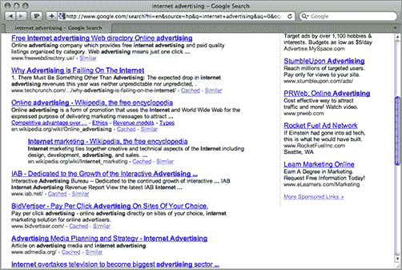

除了查看结果本身，我还会查看页面上存在的其他数据。搜索结果中的广告数量可以大致判断竞争激烈程度。例如，搜索 `buy viagra` 会返回满整页高度的广告，而搜索 `women that look like Drew Carey` 可能不会返回任何广告。这是因为搜索“蓝色药丸”的人多于搜索“戴着宅眼镜的光秃大女性”的人。

除了广告，我还会寻找时间算法（temporal algorithms）的迹象。时间算法是在考虑相关性时考虑时间元素的排名方程。这些算法往往表现为新闻结果和博客文章。

### 利用时间算法

你可以利用时间算法来让自己有利。我曾无意中这样做并取得了巨大的成功。在迈克尔·杰克逊去世一天后，我写了一篇关于他去世及其对搜索引擎影响的博客文章。由于时间算法的作用，在他去世后的一段时间内，我的文章在查询 `Michael Jackson` 时排在了前 10 名。因为这个高排名，有数万人阅读了我的文章。我本以为是因为我太厉害了，但在深入研究我的分析数据后，我意识到是因为无意中使用了时间算法。如果你是一个博主，这种快速撰写新闻事件的策略可以成为巨大的流量助器。

在扫描了针对特定网站领域的搜索结果页后，我通常会对该互联网区域有一个大致的感受。重要的要点是对竞争水平有一个大致了解，而不是弄清楚特定网站排名的细节。那是以后才考虑。

### 在 Firefox 和 Chrome 中进行简单的去个性化处理

大多数 SEO 人员每天会进行几十甚至上百次搜索，当你这样做时，显示去个性化的结果非常重要，因为这样你看到的就是“典型”搜索者会看到的内容，而不是受你自己的搜索历史影响的搜索结果。

Firefox 因为很多原因对 SEO 人员来说是一个极佳的浏览器，但它最有用的功能之一可以直接从浏览器的地址栏进行搜索，即浏览器顶部你通常看到当前网页 URL 的区域。更好的是，通过少量的自定义，你可以轻松执行去个性化的 Google 搜索（尽管不是去地理定位的）。

1. 从 `Bookmarks | Organize Bookmarks…` 菜单中，选择左格格中的任何书签文件夹。（不要只选择 `All Bookmarks` 文件夹，因为那不起作用。）
2. 右键点击该文件夹并选择 `New Bookmark…`
3. 在字段中添加以下值：
   - Name（名称）：`Google de-personalized search`
   - Location（位置）：`http://www.google.com/search?&q=%s&pws=0`
   - Tags（标签）：`(可选。添加任何你想要的标签。）`
   - Keyword（关键词）：`g`
   - Description（描述）：`(可选。用此来描述搜索。）`
4. 点击 `Add`。

就是这样。现在，回到 Firefox 的地址栏（你在浏览器顶部看到 URL 的地方），输入类似的内容：

`g hdmi cables`

这告诉 Google (`g`) 去搜索 `hdmi cables`。更重要的是，由于你的 `Location` 字段包含了 `&pws=0`，该 URL 参数将带入你的搜索结果中。从现在起，如果你想执行去个性化的 Google 搜索，只需输入 `g`（不带引号）和来自 URL 字段的查询词。

使用此过程创建你喜欢的任意自定义搜索，但请记住这些重要因素：

1. `Location` 字段必须包含搜索结果的准确 URL，%s` 变量除外，它会被自动替换为你的查询词。
2. `Keyword` 字段是在你搜索查询之前输入的地方，用于告诉 Firefox 你将运行哪一个自定义查询。要简短准确。我使用 `b` 代表 Bing，使用 `tc` 代表文本缓存等术语。

此功能也适用于 Google 的 Chrome 浏览器，因为 Chrome 可以从你使用的任何其他浏览器导入书签。如果你是 Chrome 用户，只需从 `Chrome | Import Bookmarks` 菜单导入书签，你就可以从地址栏进行搜索了。


这正是人们产生困惑的地方。他们看到这样的网站，就认为域名并不重要。他们注册了一些难以发音（`SEOmoz`）或难以拼写（`Picnik`）的域名，并认为自己不需要担心。问题在于，他们没有意识到热门网站之所以之所以流行，并不是因为它们的域名，而是恰恰尽管有这些域名。`Google` 就是这样一个优秀的产品，其计划执行得如此完美，以至于即使被命名为 `BackRub` 依然会成功。（注：它最初叫 `BackRub`。我只是在自自乐。）

作为一名 SEO，如果你发现自己处于需要更改或选择域名的境地，你需要做出一个艰难的决定。你对客户的想法有多大信心？这是一个服务于全球的想法吗，还是只对几千人有用？如果一个网站是能够改变世界的，它实际上可能会从一个胡说乱语的名字中获益。如果一个名字是乱的且非常成功，人们自然会开始将该名称与其服务联系起来。例如，`Google` 现在已经是“搜索”的同义词。然而，如果一个想法最终没有改变世界（绝大多数网站都不是如此），一个胡说乱语的域名可能会损害网站。普通大众有多大概率会输入 `spoke.com`（一个真实的网站）来寻找个人资料呢？

一个毫无意义的域名会损害网站，让人们（以及搜索引擎）更难找到该网站，并与该网站关注的概念建立联系。

对于绝大多数网站来说，“搜索友好”的域名是最好的。搜索引擎始终会受到这样一个事实的限制：许多人在想要访问网站时会搜索精确的 URL。当然，对于查询 `myspace.com`，最相关且最流行的结果将会是 `www.myspace.com`。你可以利用这一点来获得优势。

假设你的客户在西雅图有一家酒店。对于他们来说，最好的域名应该是 `www.seattlehotel.com`，这样他们就可以针对“Seattle Hotel”这一查询词获得排名。他们不需要担心变成一个动词，因为对他们的服务需求还不够高，而且精确匹配域名的收益超过了他们的网站改变世界的可能性。需要更多证明吗？域名 `porn.com` 和 `sex.com` 分别卖了 950 万美元和 1200 万美元。

注：有一段时间，，`Yahoo!` 和 `MSN` 上搜索次数最多的词是 `Google`。人们会在 `Yahoo!` 和 `MSN` 中搜索这个搜索领导者，点击进入 `google.com`，然后输入他们的查询内容。这让 `Yahoo!` 非常恼恼，以至于最终在 `Google` 的搜索结果中放置了一个 `Yahoo!` 搜索栏。

但如果一个顶级域名不可用怎么办？你并不孤单。截至写作时，所有三个字符或更少字符的 `.com` 域名组合已全部被。如果你无法获得 `seattlehotel.com`，你只需要更有创意一点。为了限制你因“过度创意”而损害自己，我建议你在注册域名时注意以下几点：

*   避免连字符：在域名中，连字符会损害信誉，并被视为垃圾信息的指示器。
*   避免通用的、不常见的顶级域名（TLDs）：像连字符一样，`.info`、`.cc`、`.ws` 和 `.name` 等顶级域名都是垃圾信息的指标。
*   避免超过 15 个字符的域名：人是懒的；不要试图让他们为了访问你的网站而写出一篇小说。
*   注意排列组合：`ExpertsExchange.com` 的所有者在建立起巨大的品牌之前，才意识到他们的域名可能被误解为 `ExpertSexChange.com`。

这些关于域名的建议大多适用于从零开始的人，或者购买更好的域名是他们选项的人。如果你是一名 SEO，你可能会有客户由于品牌或财务限制而受限于他们现有的域名。如果你是其中之一，永远不要害怕。虽然明智的、富关键词的域名通常是理想情况，但有很多网站在没有域名的情况下也取得了成功。例如，我怀疑 `Amazon.com` 是否在寻找更基于书籍或电子产品的域名。

## 不要自欺欺人，外观很重要

我曾与一位网站主交谈，他的主页跳出率为 80%，而他认为很正常。你能想象吗，如果 80% 看到你的人立刻向相反方向逃跑？这可不正常。网页设计是 SEO 的一个元素，许多业余 SEO 都忽略了它。如果点击进入后没有搜索者留在指定的网页上，那么你获得高排名也没有用。

SEO 友好的网页设计非常像找舞会伴侣；外观很重要。人们在页面加载的瞬间就会对网站的信誉做出判断。就像人一样，可靠的网站有非常特定的外观和感觉。它们通常在左上角有一个清晰的 logo，导航栏水平位于页面顶部或垂直位于左侧。它们的布局中颜色少于五种（不包括图片），并且有清晰、易读的文本。

你会觉得把孩子留给一个穿着亮橙色囚服的人会感到舒服吗？当然不！同样地，如果网站访问者面对的是弹窗、响亮的音乐和五颜六色的 logo，他们不会感到舒服的。

当然，这些都是极端例子。我看到的常见错误倾向于：

*   缺乏焦点
*   文本拥挤
*   加载速度慢
*   自动播放音乐
*   导航不清晰

## 重复与规范化（Canonicalization）

在分析了网站的域名和整体设计后，我的同事和我会检查互联网上最常见的 SEO 错误之一：规范化（canonicalization）。对于 SEO 专人员来说，规范化指的是可以从多个 URL 加载的单个网页。

注：在本文讨论中，“规范化”简单指选择一个 URL 的权威版本并传播其使用，而不是使用该 URL 的其他变体。另一方面，书中在多处讨论了特定的规范 link 元素，包括第 5 章。

记得我在第 1 章中讨论过流行性吗？（得吧，没过去多久。）你认为当旨在指向同一页面的链接分散在多个 URL 中时会发生什么？你猜对了：页面的权重被分散了。对于 Web 开发来说，这种情况发生得太了，因为 Web 服务器的默认设置创建了这个问题。以下列表显示了在两个常用的 Web 服务器上使用默认设置的负面 SEO 影响：

Apache 服务器：
```
http://www.example.com/
http://www.example.com/index.html
http://example.com/
http://example.com/index.html
```

Microsoft Internet 服务 (IIS):
```
http://www.example.com/
http://www.example.com/default.asp (取决于版本可能是 .aspx)
http://example.com/
http://example.com/default.asp (取决于版本可能是 .aspx)
```


注意：你不认为这不会发生在你身上吗？访问 [`www.mattcutts.com`](http://www.mattcutts.com) 并等待页面加载。现在，访问 [`mattcutts.com`](http://mattcutts.com) 并观察发生了什么。看，这就是规范化（canonicalization）问题。这个例子有什么意义？Matt Cutts 是 Google 网页垃圾信息团队的负责人，并编写了许多我们 SEO 人员研究的算法。如果他都犯了这种错误，那么你那些了解不多的客户可能也在这样做。

对于 SEO 人员来说，网页开发者开发了重定向方法，以便 URL 可以被更改和合并。主要存在两种类型的服务器重定向——`301` 重定向和 `302` 重定向：

*   `301` 表示 HTTP 状态码为“永久移动”（Moved Permanently）。

*   `302` 表示状态码为“临时移动”（Temporarily Moved）。

还存在其他重定向方法，例如元刷新（meta refresh）和各种 JavaScript 定位命令。避免使用这些方法。它们不仅不会从源向向目标传递任何权重，而且搜索引擎在遵循重定向路径方面也是不可的。

提示：你可以在 [`www.w3.org/Protocols/rfc2616/rfc2616-sec10.html`](http://www.w3.org/Protocols/rfc2616/rfc2616-sec10.html) 阅读所有的 HTTP 状态码。

尽管 `301` 和 `302` 重定向之间的区别似乎仅仅是语义上的，但实际结果是巨大的。Google 很久以前就决定不在普通链接和服务器重定向之间平均地传递链接权重（排名权重）。在 SEOmoz，我针对这个主题进行了大量的测试，并得出结论：`301` 重定向传递了 90% 到 99% 的价值，而 `302` 重定向几乎不传递任何价值。正因如此，我和同事们总是观察非规范化页面是如何被重定向的。

这不仅仅是语义问题。页面如何重定向（无论是通过 `301` 还是 `302` 重定向）至关重要。

警告：旧版本的 IIS 默认使用 `302` 重定向。噢！务必注意这一点。你可以在像 [microsoft.com](http://microsoft.com) 和 [myspace.com](http://myspace.com) 这样流行的 IIS 驱动网站到处看到毫无价值的重定向。这些重定向的价值因为一个值的差异而被完全抵消了！

规范化不仅限于字母的包含。它还规定了 URL 中的正斜杠。尝试访问 [`www.google.com`](http://www.google.com)，发现你会被自动重定向到 [`www.google.com/`](http://www.google.com/)（注意末尾的正斜杠）。发生这种情况的原因是因为从技术上讲，这是 URL 的正确格式。虽然这个问题在很大程度上已经被搜索引擎解决了（它们知道 [www.google.com](http://www.google.com) 的含义等同于 [www.google.com/](http://www.google.com/)），但它仍然值得注意，因为许多服务器会自动从不带末尾斜杠的版本 `301` 重定向到正确的版本。这样做会导致链接指向错误的版本。


在你开始从这一层级检查网站之前，让我先解释一下良好的网站架构的重要性。

在写此书期间，我正在与一家大客户合作，他们对自己糟糕的排名感到非常困惑。（注：该客户让我签署了一份看起来很严厉的保密协议，因此我无法透露它的名字。）该公司的首页字字面上是整个互联网上链接次数最多的页面之一，并且曾一度获得过难以企及的 `PageRank` 10。他们目前的策略之一是利用其首页的链接流行度，来增强一组针对超竞争性关键词优化的页面。他们希望通过这些优化的页面进行大撒网，并将大量来自搜索引擎的引流量引向其产品页面。

这是一个非常棒的主意，但按照目前的执行方式，它完全没有成功的机会。

问题在于该网站缺乏任何传统的网站架构。从成千上万链接到该公司首页的域名传来的链接权重（排名力量）无法传递到该域名下的其他网页。所有的链接权重本质上都被堵在了大门外。

其内容分布在至少 20 个不同的域名上，而且没有全局导航来引导用户或搜索引擎从首页引导到分类页面。该公司的在线形象更像是一千个岛，而不是它本可以成为超级大陆。这是对资源的极大浪费，并正真实地影响着公司的底线。

在向客户解释网站架构时，我先让他们将网站想象成一个蚁穴。所有的空室就像网页，隧道就像内部链接。然后我让他们想象一个小男孩向蚁穴里倒水。他从主入口倒水，并希望水能填满所有的空室。（顺带提一下，科学家们确实用水泥做过这种实验，以研究蚁穴城市的结构。在某个案例中，他们必须向一个蚁穴灌入 10 吨液水泥才能填满所有的空室。）在这个类比中，水代表流向网页的链接权重。正如之前讨论过的，这种链接权重（流行度）对于排名至关重要。

网站（或者如果你非要的话，蚁穴）的最优结构看起来类似于金字塔（图 2-3）。

这种结构允许通过最少的链接，让尽可能多的权重到达网站的所有页面。这意味着网站上的每一个页面都能从首页获得一些排名收益。

图 2-3： 优网站结构


网站的金字塔结构允许通过最少的链接，让尽可能多的链接权重到达网站的所有页面。

注意：首页几乎总是某个域名上链接次数最多的页面。这是因为在在线引用该网站时，首页是最方便（路径最短）的 URL。

## 评估首页

现在我们在网站架构上达成了共识，可以继续下下了。当我进入这一分析层级时，我开始真正观察网站架构。显然，这从首页开始。

理想情况下，首页应该链接到网站上每一个类别的页面。通常，这是通过全局导航菜单实现的（全局意味着它出现在域名上的每个网页上）。这对于小型网站来说很容易，因为如果它们的页面少于 150 个，首页可以直接链接到所有页面。（注：只有当首页有足够的链接指向它并使其值得这样做时，这才是一个好主意。记住那个小男孩和蚁穴；链接流行度等同于小男孩拥有的水量。如果他的水不够，就无法填满每一个空室。）以下是关于此的一些正反面示例。

#### 全局导航的正面示例

图 2-4 和 2-5 展示了两个良好的——即有效的——首页全局导航示例。在这两种情况下，所有高层类别在首页上都有链接。这最大化了链接价值，并将价值广泛地分散到整个域名。

图 2-4： 亚马逊导航


图 2-5： 烂番茄（Rotten Tomatoes）导航


#### 全局导航的反面示例

图 2-6 和 2-7 展示了两个糟糕或无效的全局导航示例。在这些情况下，囤积权重是一种糟糕的策略，因为它阻止了子分类和低级页面从首页的权重中受益。没有了权重，这些页面通常无法被收入搜索引擎索引，也无法引导流量。那么，为什么 Twitter 和 Facebook 的页面会有索引呢？由于网站架构的原因，亚马逊和烂番茄能够让绝大多数产品页面在主要搜索引擎中被索引。与此同时，Twitter 和 Facebook 面临无法让所有内容被索引的问题，搜索引擎被迫采取通融方案来解决这个问题。

图 2-6： Twitter 导航


图 2-7： Facebook 导航


### 评估分类页面

如果网站页面超过 150 个，它应该将其内容分为分类，并从首页链接到这些分类。这正是我在 SEOmoz 的前同事们在中等规模网站上寻找的。理想情况下，这些页面既应该作为搜索者的落地页，又应该作为搜索引擎的链接权重路由器。许多网站管理员错误地只关注其中一个方面，而忽略了另一个。作为 SEO 人员，你的工作之一就是确保这两类访客都能得到妥善对待。

超过 150 页的网站应该将其内容分为对人类和搜索引擎都有用的分类。

图 2-8 显示了一个 Netflix 分类页面，这是分类页的良好示例。该页面链接到子分类页面，这些子页面对于人类来说易于理解（流派），对于搜索引擎来说也有帮助（少于 150 个链接）。


注意，该页面有吸引人的图片可以点击，并且对于初次访问者非常直观。通过这种方式，它是引导用户点击进入更底层页面的理想选择。同时，通过限制页面上的链接总量并链接到所有相关的子分类，它对搜索引擎进行了优化。

内容的多条路径


架构良好的网站可以通过多条路径引导到达特定页面。例如，像 Netflix 或 [IMDb.com](http://IMDb.com) 网站就是交叉链接效率的典范。在“演员（Actors）”中进行垂直搜索，你会找到周·迪斯奈（Zooey Deschanel）的页面，该页面会链接到约瑟夫·戈登·列维特（Joseph Gordon-Levitt）和《恋爱情五十 0》的页面。同样，搜索浪漫喜剧也会带你来到《恋爱情五十 0》，而从该页面到两位演员的页面仅需点击一下。以此类推。

一个优秀的网站能通过逻辑路径以最少的点击让你进入深层 URL。一个卓越的网站能让你通过多个逻辑路径中的任何一个进入深层 URL，且路径在整个浏览过程中频繁交叉。“优秀”与“卓越”的区别意味着更快速、更彻底的索引；更合理的页面权重和权威性分布；以及更高质量的流量。

图 2-9 番茄番（Rotten Tomatoes）分类页
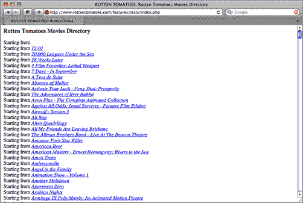

这是一个网站针对引擎优化但未针对人类访问者优化的示例。这种做法存在两个问题：

* 第一，如果用户遇到这个页面，他们将很难进行导航，并可能会返回上一个页面。这对于导航系统来说是适得其反的。
* 第二，搜索引擎工程师提倡为人类构建网站，而不是为搜索引擎构建网站。这是理解搜索引擎长期策略的线索。这个示例似乎并不是为人类构建的，因此不是一种良好的 SEO 长期策略。

需要注意的是，这并不是番茄番的主要电影分类页，但它仍然说明了在推荐长期 SEO 策略时应该避免的绝佳案例。该页面的建立是为了作为拙劣网站架构的“临时补救措施”。但它远非理想状态。

一个良好的分类页应该具备以下所有特征：

* 对用户有用
* 向所有相关的子分类页面直接传递链接权重（link juice）
* 拥有足够的独特内容以供搜索引擎索引

### 评估子分类页面

如果一个网站非常大，就需要将其分类划分为子分类，并从分类页面链接到这些子分类。子分类页的设置应与分类页完全相同。唯一的区别是，它们不再链接到更多子分类页，而是直接链接到内容页面。请记住，它们传递的链接权重比分类页面少（因为它们距离首页更远），所以子分类页面应该包含尽可能少的链接。这是因为一个链接所传递的权重取决于该页面的流行程度以及它包含的链接数量。与分类页类似，子分类页也应该执行以下操作：

* 对用户有用
* 向所有相关的内容页面直接传递链接权重
* 拥有足够的独特内容以供搜索引擎索引

### 多个内容页的分页解决方案

如果你的子分类内部有 100 个不同的产品怎么办？链接架构应该是什么样的？“信息层级（Information Hierarchy）”——配置页面以使产品和内容页面被大量有效地抓取的过程——是 SEO 架构工作中最具挑战性的方面之一，它需要在抓取能力和易用性之间取得微妙的平衡。

例如，在一个子分类中拥有 100 个产品可能是一个挑战，有几种技术可以单独或结合使用，以帮助此类内容的抓取和索引过程。

首先，你可以假设在子分类页面显示所有 100 个产品会产生负面的用户体验，而你倾向的每页产品数量更接近 10 个。如果是这样，请考虑以下选项：

* 跳出你偏好的舒适区。出于某种原因，产品页面通常默认显示非常少的结果（或产品），我认为这是由于很久以前带宽限制。如果链接到产品页面的链接不是特别多图片，可以考虑返回 20、30 甚至 50 个产品。如果页面加载快，用户并不介意垂直滚动。
* 创建子子分类。创建五个子子分类并从子分类页面链接到所有分类，这与链接到五个独立的内结果页并没有区别。这会有帮助，特别是当子子分类中的术语有明显的关键词需求时。
* 链接到多个显示有限内容链接的页面，但对“查看全部”版本进行规范化（canonicalize）。你是否见过一个子分类页面通过点击页面底部的“下一页”链接到几十或数百个不同的内容页面？这种“链式”导航是让数百个内容页面被索引效率最低的方案。相反，为用户和引擎提供一个“查看全部”的链接，它指向一个显示所有产品（从而链接到所有内容页面）的页面。你的导航仍然可以链接到较少产品链接的小页面，但这些较小页面都应该在规范上指向“查看全部”版本。

### 评估内容页面

内容页面是网站的核心。它们是访问者来到网站的原因，就像一顿好的早餐，这些页面应该让访问者感到充实，并闻到诱人的培根味。（后半部分是我胡造的，但如果一个网站真的闻起来有培根味，我一定会链接到它。）页面应该非常针对特定主题（通常是产品或对象）并具有高度的相关性。

作为 SEO，你应该检查页面的目的是否在以下所有区域中直接说明：

* 标题标签
* URL
* 页面内容
* 图片

**注意** 良好的内容页面是链接的磁石。它们比子分类和分类页面更容易获得链接。聪明的 SEO 专家利用这一优势，让内容页面链接回相关的分类和子分类页面。这会增加流入网站所有内容页面的权重，并使它们的排名更好。

### 内容页的示例

图 2-10 展示了一个布局良好且对搜索引擎的内容示例。

图中的内容页面之所以良好，是因为几个原因。首先，内容本身在互联网上是独特的（这使得搜索引擎对其进行良好排名是值得的），并且深度涵盖了独特内容。如果你有关于超级马里奥世界（Super Mario World）的问题，这个页面很有可能能够回答你的问题。

除了内容之外，该页面的布局也非常良好。正如你在图 2-10 中所示，页面的主题在标题标签中已说明（Super Mario World – Wikipedia, the free encyclopedia）、URL 中（`http://en.wikipedia.org/wiki/Super_Mario_World`）、页面内容（注意页面标题“Super Mario World”）以及再次出现在页面图片的 alt 文本中。


想象一下，你是某主流搜索引擎的一名工程师。你的任务是组织 Web 上的信息，并使其能够在全球范围内访问。问题在于，互联网上的信息并没有以任何特定的格式化。这使得编写能够读取互联网上所有信息的代码极其困难，更不用说组织它们了。现在，想象你来到像图 2-10 所示的页面。该页面使用了多个元素来描述其主题。这些线索是不可或缺的。通过依赖这些线索，你会发现编写理解页面内容的代码要容易得多。结合该页面是 Web 上一个受信任且良好的良好的资源这一事实，很容易看出为什么搜索引擎工程师会编写代码让这个示例在相关查询中排名靠前了。

图 2-10: 关于《超级马里奥世界》的 Wikipedia 页面


## 内容页面的反面示例

相比之下，图 2-11 展示了一个效果较差的内容页面示例。注意它与第一个示例有何不同。

这张图展示了一个针对“超级马里奥世界”这一术语的、对搜索引擎不够友的内容页面示例。虽然页面的主题出现在网页的一些重要元素中（标题标签和图像），但其内容的丰富性不如 Wikipedia 示例那样稳健，且页面上的相关文案对读者的帮助也较小。

注意，对游戏的描述与营销部门编写的文案异常地相似：“马里奥正在开启他有史以来最伟大的冒险，这次他带上了一个朋友。”这并不是搜索者查询时使用的语言，也不是可能回答搜索者查询的类型信息。将其与 Wikipedia 示例的第一句进行对比：“超级马里奥世界》是由任天堂开发并发行的平台游戏，作为超级任天堂娱乐系统（Super Nintendo Entertainment System）的附带发售主游戏。”在 GameFAQs 的示例中，第一句确定的仅仅是：名叫马里奥的人或某物正在进行一场比他或她之前更大的冒险（你如何量化这一点呢？而且他或她伴随有一个未名的朋友。另一方面，Wikipedia 的句子告诉读者，《超级马里奥世界》是由任天堂为超级任天堂娱乐系统开发并发行的游戏。

图 2-11: 关于《超级马里奥世界》的 GameFAQs 页面


如果你是一个搜索引擎工程师，你希望哪个示例在与此游戏相关的查询中排名更高？搜索结果显示，Bing 和 Google 的工程师认为 Wikipedia 示例的排名应该更好。

## 理想的内容页面

理想的内容页面应该具备以下所有特征：

*   与特定主题（通常是产品或单一对象）极度相关
*   在标题标签中包含主题
*   在 URL 中包含主题
*   在图像 alt 文本中包含主题
*   在正文内容多次指定主题
*   关于给定主题提供独特内容
*   链接回其分类页面
*   链接回其子分类页面
*   链接回主页（通常通过页面左上显示网站 Logo 的图像链接实现）

## 评估 URL 结构

除了智能内部链接外，SEO 专家还应该确保分类层次结构反映在 URL 中。

看看下面这个 URL 结构的良好示例：

`http://www.dmoz.org/Games/Video_Games/History/`

**注意**：在考虑 URL 结构时，请考虑大小写。不同平台对术语的大小写方式不同。记住，任何大小写样式（小写、混合写等）都是的，但无论你选择哪种方法，都必须坚持下去并留意意外索引的变体。两个具有相同字符但大小写不同的 URL 被搜索引擎视为两个不同的 URL。

这个 `URL` 是有效的，因为它清晰地显示了页面信息的层级结构（在游戏的大的大背景下，关于视频游戏的历史）。这些信息被搜索引擎用于确定给定网页的相关性。通过这种层级结构，引擎可以推断出页面可能并非关于泛泛的历史，而是关于视频游戏的历史。这使其成为视频游戏历史相关搜索结果的理想候选。引擎甚至不需要处理页面上的内容就可以对所有这些信息进行推测。

有效的 `URL structure` 可以帮助搜索引擎理解给定网页有多么用或多相关。

现在看看下面这个 URL 结构的示例：

`http://www.imdb.com/title/tt0468569/`

与第一个示例不同，这个 `URL` 没有反映网站的层级结构。你可以看到该页面指向标题，但无法判断其具体内容。`tt0468569` 并没有直接暗示任何搜索者可能搜索的内容。这意味着 `URL` 提供的信息价值较低。

如果你是一个搜索引擎工程师，你会希望哪个页面出现在搜索结果的顶部？答案显然取决于页面的内容和链接概况，但 `URL` 在补充这些信息方面毫无贡献。

**注意**：IMDB 的示例非常有趣，尽管其 `URL structure` 是这样，排名依然很好。该网站具有权威性的之一是其特定的页面在电影发布之前就开始积累链接，这种领先优势可以克服 `URL` 本身等语义信号。

尽管如此，真正的优化需要检查所有改进途径并权衡其益处。如果简化 `URL`，IMDB 页面是否会比电影自身的微站排名更高？语义更整洁的 `URL` 对点击率会有什么影响？绝无负面影响。

`URL structure` 是重要的，因为它有助于搜索引擎理解给定网页的重要性，并为给定页面增加了有用的相关性指标。对于链接也有帮助，因为如果 `URL` 中包含了关键词，人们更有可能会链接。

## 行清单

当你从 10 英尺视角查看网站时，请确保检查并记录以下所有项：

*   主页链接到网站的所有分类页面
*   分类页面有助于用户和搜索引擎
*   分类页面指向所有适用子分类的链接（如果给定的页面权重足够支撑）
*   子分类页面有助于用户和搜索引擎
*   子分类页面指向所有适用内容页的链接
*   内容页与给定主题的相关性
*   `URL structure` 匹配分类层次结构并补充相关性的能力


# 一英尺视角——单个内容单元

内容是网站上唯一最重要的元素。

你做到了！你现在的高度已经足够低，可以看到页面上的实际内容了。感到兴奋吗？你应该感到兴奋。这正是网站访问者想要看到的内容。

## 什么是好内容？

为了恰当地查看内容，你需要知道自己在寻找什么。那么，什么是好内容？这个问题如此显而易见，问得似乎很傻。不幸的是，它太宽泛了，直接给出答案将毫无用处。相反，我将像大多数面对困难问题的大天才那样来回答它：我会直接改变问题。对于 SEO 来说，什么是好内容？这是一个更容易回答的问题。

我针对这个问题思考了很久，并且我相信对于 SEO 来说，所有好内容都具备两个属性。好内容必须满足需求并且可以链接。

*   **好内容满足需求**：就像世界市场一样，信息受供需影响。最好的内容是那些能满足最大需求的内容。它可能以 `XKCD` 漫画的形式出现，为一大想要大笑的技术人士提供极客幽默。它也可能是一篇 `Wikipedia` 文章，向世界解释 `Web 2.0` 的定义。它可以是视频、图像、声音或文本，但它必须满足某种需求才能被视为好内容。
*   **好内容是可以链接的**：从 SEO 的角度来看，如果内容不可链接，那么网络上最好和最差的内容没有区别。如果人们无法链接到它，搜索引擎极可能不会为其排名，内容也不会为指定的网站带来流量。不幸的是，这种情况发生的频率比你想象的要高得多。你是否曾在浏览一个基于图像的幻灯片时，看到一张让你屏息的图片，却发现由于实现方式的原因，你无法分享那张特定的图片？（这种情况在 `CNN.com` 上经常发生。）你是否曾在网上听过一首歌想分享给朋友，但因为版权保护软件而无法分享？这是一种令人沮丧的体验，它会将潜在的好内容变成坏内容。

所以，如果那是好内容，那么什么是坏内容呢？坏内容就是好内容的相反。（我买这本书花了多少钱？）它不满足需求和/或不可链接。它们在互联网上泛处可见，是对时间和和其他宝贵资源的浪费。

## 披着糟糕发外壳的好内容

偶尔我会遇到一些看起来很坏的好内容。大多数情况下，这是因为我立即将其视为广告。SEO 戴着强力的广告盲罩观察互联网。如果某东西看起来像广告，它通常会被直接忽略。图 2-12 显示了让许多 SEO 难以看到的好内容。

图 2-12： Bing Toolbox 特写


注意此 `Bing Toolbox` 上的关键行动号召部分（此处原文存在大量重复文本，已按要求保留格式并翻译）


查看源代码（Viewing source）是每个主流浏览器浏览器都包含的一项功能，它允许你在查看网站时，读取由请求的网站服务器返回的原始代码。这非常重要，因为这种原始视图就是搜索引擎在爬取互联网时所看到的内容。通常，当我想执行操作时会使用“查看源代码”：

*   查看网站的元数据（meta data）优化程度如何
*   检查网页格式的潜在问题
*   分析全局导航

图 3-1 Firefox 中查看源代码的图像


# 查看源代码时的关键数据点 

当你查看网页的源代码时，你需要仔细观察几个关键数据点，以了解搜索引擎是如何看待该页面的。下方的关键数据点是搜索引擎关心的页面中最重要的元数据。

*   **元描述（Meta description）**：如果你真的读过第 1 章中提到的[搜索引擎优化入门指南](http://www.seomoz.org/article/beginners-guide-to-search-engine-optimization)，你已经知道什么是元描述以及它为什么重要了。如果你没读过，简单的定义是：元描述是网站管理员可以编写的网页文本描述，搜索引擎将其包含在搜索结果中。因此，这部分内容很重要，因为它为目标网站充当了免费广告。在源代码中，元描述的编写方式如下：

```
<meta name="description" content="Description Goes Here" />
```

最好的元描述是具有吸引力的，并且针对该页面的特定主题编写的。（例如，关于成人尿布你所需的所有信息。）

## 针对人优化，而不仅仅是针对搜索引擎

记住，并不是所有的优化都应该针对搜索引擎算法。为了获得成功，你需要针对那些将阅读你优化后的搜索结果的人进行优化。元描述和标题标签（title tags）就是实现这一点的地方。

对于人来说，元描述实际上很容易编写，因为搜索引擎并不直接将其用于排名。相反，它们用于吸引人们点击特定的搜索结果。它们应该由营销人员（如 SEO 专家）审核，并针对人而非引擎进行优化。

**提示** 元描述是面向人的，而不一定面向搜索引擎的。我发现以下文本补充对于提高搜索引擎结果的点击率非常有用：

*   免费送运
*   低价保证
*   评价、图片、样品
*   采访
*   官方网站

在审核元描述时，我发现可以在搜索引擎中调出搜索结果并将元描述与竞争对手进行对比非常有用。我会问自己，与其他结果相比，我会点击这个结果吗？如果没有，我会找出原因，并利用这些信息改进描述。

*   **元机器人（Meta robots）**：Meta robots 是控制搜索引擎爬虫的页面特定指令。这对于将特定页面排除在搜索引擎索引之外，同时将其链接值传递给其他页面最有用。

*   在源代码中，meta robots 如下：

```
<meta name="robots" content="VALUES" />
```

技术上，`robots` 是名为 `name` 的属性的值。因为这个词很绕口，SEO 专家倾向于将其称为 `meta robots`。无论你如何称呼它，它比 `robots.txt` 更能将页面排除在搜索引擎索引之外，因为它甚至不允许引擎列出该 URL。

图 3-2 显示了使用 `robots.txt` 阻止带有入站链接页面的结果。在搜索结果页面页（SERPs）中看到被 robots 排除的文件并不常见，但并非没有过（如图 3-2 显示被 robots.txt 阻止页面的 Google 结果


看到 URL 仍然存在于索引中了吗？这是因为它被 `robots.txt` 阻止，但仍然有指向它的链接。这些链接现在指向搜索引擎无法访问的页面（SEO 专家将其称为黑洞或“未爬取的引用”），并且结果的格式不太可能被搜索者点击。这种情况的发生是因为搜索引擎在后台通过链接发现了此 URL，但由于它被 `robots.txt` 阻止而无法爬取。更糟糕的是，由于搜索引擎无法爬取这些页面，它们无法通过页面上的链接传递页面的链接值，因此产生了黑洞关联。这意味着不仅目标页面没有获得其绑定链接的权重，它还无法将此值传递给其他未阻塞的页面。

另一种方法是，`meta robots`甚至可以将 URL 都排除在索引之外。

*   **框架（Frames）**：框架是种将一个 URL 嵌入另一个 URL 的 HTML 技术。从 SEO 的角度来看，你应该完全避免框架。

## 避免黑洞

为了避免与 `robots.txt` 相关的黑洞，`meta robots` 几乎总是设置为 `index, follow`。（这些是默认值；没有元标签等同于有 `index, follow`）。例外包括 `noindex, follow`，它适用于重复页面。

在源代码中，框架通过类似下面的代码识别：

```
<frameset rows="70%" cols="50%">
  <frame src="left-frame.html">
  <frame src="right-frame.html">
  <noframes>
    <p>这是显示给没有框架的用户以及在某些情况下显示给搜索引擎的内容。</p>
  </noframes>
</frameset>
```

或者简单地：

```
<iframe src ="example.html" width="100px" height="300px">
  <p>这段文字会被引擎读取，但启用框架的用户看不到</p>
</iframe>
```

*   **Flash 和 Shockwave**：虽然搜索引擎在解析 Flash 和 Shockwave 方面变得更好，但对于网站来说仍然不是 SEO 友好的选项。不仅大部分内容被隐藏，而且链接变得困难，因为用 Flash 开发的网站缺乏任何站点架构（从 URL 角度来看）。Flash 和 Shockwave 通常在源代码中通过类似内容识别：

```
<object classid="clsid:D27CDB6E-AE6D-11cf-96B8-444553540000" codebase="http://active.macromedia.com/flash2/cabs/swflash.cab#version=4,0,0,0" id=inrozxa width=100% height=100%">
  <param name=movie value="welcomew6.swf">
  <param name=quality value=high>
  <param name=bgcolor value=#FFFFFF>
  <embed src="inrozxa.swf" quality=high bgcolor=#FFFFFF width=100% height=100% type="application/x-shockwave-flash" pluginspage=
</object>
```


```html
<object>
  <embed src="http://www.macromedia.com/shockwave/download/index.cgi?P1_Prod_Version=ShockwaveFlash">
</embed>
</object>
```

根据版本的不同，你看到的代码可能会有所，但主要的特征是 `<embed>` 或 `<object>` 标签，其中一个属性指向 `macromedia.com` 或 `adobe.com`（Flash 的制作者）。

## Flash 的问题

Flash 的问题在于搜索引擎很难解析它并理解它包含什么内容。当你看到 Flash 内部包含有价值的内容时，最好建议客户将这些内容添加到 HTML 页面中，以便搜索引擎可以进行解析，或者使用 Flash 的替代方案。

Flash 最理想的潜在替代方案可能是 HTML5。在写作此时，HTML5 尚处于婴儿阶段，只有少数几个主要网站包含了它。HTML5 具有 Flash 的一些优点（动画），但像普通 HTML 一样容易解析。

*   **JavaScript 链接**：在写作此时，JavaScript 链接是危险的，因为它们传递权重（juice）的能力并不明确。它们可以用许多不同的方式编写，而且 Bing 和 Google 都没有说它们支持哪些类型的 JavaScript 链接。我们知道它们正在被爬取，被引擎用于“发现” URL，并且正在传递一些链接权重，但相对数量尚未知。这意味着 JavaScript 链接不能作为 HTML 链接的替代方案。它们在 JavaScript 中通过 `location` 对象实现：

```javascript
window.location.replace('http://www.example.com');
```

这通常后面跟着 `.href` 或 `.replace`，取决于实现方式。当你在客户的网站上遇到基于 JavaScript 的链接时，最好尝试将它们替换为标准的 HTML 链接。

*   **页面标题**：尽管你可以在大多数浏览器窗口的顶部看到页面标题，但从源代码内部查看标题标签（title tag）会非常有帮助。页面标题是否出现在 `<head>` 部分区域且在任何 `<script>` 标签之外？页面是否只有一个标题？（你会感到惊讶的吗？）

注意，许多人对 Java 和 JavaScript 之间的关系感到困惑。我最喜欢的解释是“Java 之于 JavaScript 就像汽车之于地毯。”除了两者都是计算机语言外，它们之间没有关系。（甚至这都很牵强，因为 JavaScript 仅仅是一种脚本语言。）名称上的相似是因为它们的各自创造者非常喜欢咖啡（Java）。就是如此。霍华德·舒尔茨会感到自豪的。

## 元关键词（Meta Keywords）已经过时

元关键词呢？元关键词指的是曾经被搜索引擎使用的特定元标签。这种元数据不再是一个重要的指标了。Bing 和 Google 都不再使用它。不要浪费时间写它。

## 查看源代码可以回答的常见问题

现在你已经知道了在查看源代码时要寻找的一些关键数据点，是时候考虑查看源代码可以帮助你回答的一些问题了。

### 页面是否由于页面错误未被收录？

这是一个相当常见的情况。尝试诊断此类问题时需要查看的关键点是：

*   误用 `meta robots`
*   使用 Flash
*   使用框架（frames）
*   `robots.txt`（不在同一页面上）

随着 HTML 的成熟，Flash 的页面内提示（声音和动画）将变得不再明显。查看发生什么的最可靠方法是查看源代码。在尝试回答这个问题时，你只需要寻找一个 `<embed>` 标签或 `<object>` 标签，其属性指向 `adobe.com` 或 `macromedia.com`。如果你发现了这些，那么基于 Flash 的内容被搜索引擎解析的程度就不像用 HTML 编写那样容易。

### 那段内容是否在框架中？

这是非常需要避免的且容易诊断的。只需在页面的源代码中搜索 `<frameset>`、`<frame>` 或 `<iframe>` 标签即可。框架在某些情况下是有用的（例如 Gmail 和结算流程），但对于依赖搜索引擎引用流量的页面来说，它们几乎从不是良好的实现。

### 这些导航链接正在传递权重吗？

正如第 2 章讨论，网站架构从首页开始。我发现自己经常查看源代码以观察全局导航是如何实现的。从 SEO 的角度来看，导航的最佳实现是使用 HTML 列表和层级样式表（CSS）。如果做得好，看起来像这样：

```html
<ul>
  <li><a href="http://www.example.com">example 1</a></li>
  <li><a href="http://www.example.com">example 2</a></li>
  <li><a href="http://www.example.com">example 3</a></li>
  <li><a href="http://www.example.com">example 4</a></li>
  <li><a href="http://www.example.com">example 5</a></li>
  <li><a href="http://www.example.com">example 6</a></li>
</ul>
```

## 有用的搜索引擎查询命令

搜索引擎非常慷慨地给了我们一些特殊的命令来帮助理解。我发现最有用的命令是：

*   `cache:`
*   `site:`
*   `inurl:`
*   `intitle:`
*   `+`
*   `-`
*   `|`

这些命令在组合使用时是强大的，有时证明对 SEO 可能是至关重要的。对于创建这些命令的搜索引擎工程师，我表示最诚挚的感谢。你们让我的工作变得简单得多。（应该注意，我特意遗漏了我使用的搜索命令。由于这个决定，我建议不要将此视为完整列表。它只包含了我认为必要的命令。）

这些命令对于过滤搜索结果以只显示包含特定页面非常有用。这意味着如果你发现某个网页有如标题标签拼写错误的问题，你可以使用搜索引擎找到网站上的所有出现处并借此解决问题。

另一个例子是检查关键词定位的有效性。SEO 的一个常见问题是多个页面针对同一个关键词。这是一个问题，因为这样这些页面必须相互竞争排名，而不是像最佳实践那样将这些页面合并并让另一个页面竞争排名。图 3-3 显示了如何通过限制搜索仅限 `Google.com` 且标题标签中包含 `lol` 字样的页面来找到这些页面。

图 3-3：Google 中组合搜索引擎命令查询的图像

当我想要时会使用这些搜索引擎查询：

*   搜索重复内容
*   获取网站收录情况的总体概念

## 搜索引擎命令可以生成的关键数据点

你可以通过以下方式查询搜索引擎以产生一些实用的数据点：

*   **普通搜索**：查看搜索引擎如何运作的最佳方法是什么？运行普通搜索。根据我的网络历史，我每天使用 Google 大 17 次。这不包括我在 Google 属性（如 Gmail 和 YouTube）上的内部搜索，以及我在手机上的搜索。我发现更好地理解 Google 的方法就是不断地使用它。


# Google 搜索指令

*   **引号 (Quotes)**：正如你可能已经意识到的，将搜索查询放入引号中会将结果限制在精确匹配上。当你想要检查某个随机页面是否在 Google 索引中时，这非常有帮助。只需在内容中找到一个随机句子，用引号将其括起来并搜索。如果句子足够长，它很可能在互联网上只被写过一次，并且应该只返回一个结果。如果它没有出现，说明它没有被索引。如果它出现了多次，意味着你的客户存在重复内容问题。

*   **缓存 (cache)**：缓存是 `Googlebot` 在访问网站时下载的文件副本。作为一名 SEO 人员，这些信息至关重要，因为它能准确向你展示 Google 看到的内容。这对于确定爬取率和诊断潜在的地理位置问题特别有用。

在查看网站的缓存版本时，尝试点击标记为“纯文本版本（Text-only version）”的链接。这能更好地展示 Google 看到的内容。我已经数不来通过这个技巧发现了多少隐藏链接了。

关于使用缓存的重要性，我最喜欢的例子之一是我在 SEOmoz 的前同事与一家餐厅评论网站 `yelp.com` 合作时。Yelp 正在实施一套基于 IP 地址和 Cookie 的复杂地理定位系统，自动将用户重定向到相应的 `yelp.com` 城市版本。由于某种原因，Yelp 在 Google 搜索结果遇到了问题。检查缓存后，我的同事发现，每当 `Googlebot` 爬取 Yelp 时，Yelp 都会被自动重定向到加利福尼亚州 Mountain View（Google 总部所在地）版本的站点。哎呀！在我的同事指出这一点后，该问题很快得到解决，Yelp 的流量随之增长。

*   **站点 (site)**：`site` 指令用于将搜索查询限制在特定站点。这对于诊断索引问题非常有帮助。我通常开始单独使用 `site` 指令（`site:techmeme.com`）。这个简单的查询可以告诉你两个重要的点：

    *   首先，它让你对网站的主要板块有一个大致的了解。它还让你了解 Google 索引了多少个页面。如果你知道某个站点只有 100 个页面，而此查询返回了 100,000 个结果，你就知道自己存在重复内容问题。

    *   此外，它让你意识到该站点上的一些子域名。这对于理解 Google 如何认为一个站点是如何组织的非常有帮助。

*   **URL 中包含 (inurl)**：该指令将搜索结果限制为查询词出现在 URL 中的结果。这在与 `site` 指令结合使用时最有用（`site:www.seomoz.org inurl:"Rand Fishkin"`）。大多数 SEO 专业人士发现这种技术对于识别由 URL 参数引起的重复内容最有用（`site:www.example.com inurl:"sessionid"`）。当我在识别出一个有问题的参数后，我会使用它来找到该参数出现的所有地方。

*   **标题中包含 (intitle)**：与 `inurl` 指令类似，`intitle` 指令将结果限制为查询词出现在标题标签（title tag）中的结果。这对于许多事情都有帮助，包括盗版（`intitle:"index of mp3"`）、虚荣搜索（`intitle:"danny dover"`）以及与 SEO 相关的内容，如重复标题标签检测（`intitle:"my company: Best product ever page"`）。

*   **+**：加号直接放在术语之前，告诉 Google 搜索精确的术语，而不是同义词。例如，搜索 `ghw bush` 将返回假设你指的是“George Herbert Walker Bush”的结果。然而，搜索 `+ghw bush` 将返回假设你想要在结果中特定引用“GHW”的结果。

*   **-**：减号是过滤查询的极大助手，它可以与特定的查询词连用（`cubs -chicago -baseball` 将向你显示不包含 Chicago 或 baseball 的“cubs”结果），或与本节讨论的特定运算符结合使用。搜索 `"danny sullivan" -site:searchengineland.com` 将返回关于 Danny Sullivan 的结果，这些结果出现在 `SearchEngineLand.com` 之外的任何地方。该运算符的作用与过滤标题内容（`music -intitle:mp2`）和 URL 内容类似（`site:nytimes.com –inurl:pagemode=print` 显示来自 `nytimes.com` 的所有不是“打印友好”版本的已索引页面）。

*   **|**：管道符号代表“或（OR）”搜索，可以与普通查询词或本节列出的指令一起使用，特别是当你要在给定数据集中寻找多个项目时。例如，`site:example.com inurl:sessionid|jsessionid` 将在 `example.com` 的索引 URL 中找到包含“sessionid”或“jsessionid”的 URL。同样，`site:seomoz.org danny|rand` 将返回 `SEOmoz.org` 中正文中包含“danny”或“rand”的页面（该运算符也会包含同时包含“danny”和“rand”的页面，因此它是一个真正的“和/或”运算符，而不是“异或”运算符）。

Google 中的搜索引擎指令必须以小写字母开头，否则它们无法正常工作。

这些查询可以回答的常见问题

正如我之前提到的，你可以使用这些查询快速回答一些关键问题。

### 此页面是否被索引？

要回答这个问题，你只需要搜索带有 `inurl` 指令的 URL 即可。例如，查询 `inurl:"digg.com/users/jayadelson"` 会检查 Digg CEO 的个人资料是否被索引。提示：是的。

### 此页面是否存在重复内容问题？

如果你不得不问这个问题，答案很可能是肯定的。为了确定，你可以使用之前讨论过的任何搜索引擎指令进行检查。或者，你可以使用我首选的方法，使用 `site` 指令搜索页面上的完整句子。例如，查询 `site:google.com "Gmail stores, processes and maintains your messages, contact lists and other data related to your account in order to provide"` 显示 Google 将其隐私政策发布在两个 URL 上。啧，啧。

### 忽略的结果 (Omitted Results)

有时 Google 会在搜索时掩盖相似的结果。当它这样做时，它会通过一个显示“省略的结果（omitted results）”的链接来提供指示。在这种情况下，点击此链接以查看 Google 认为重复的页面是非常重要的。

### 关于此域名上有多少页面被索引

这个问题可能是危险的，因为返回的数字并不总是准确的。主要的搜索引擎在世界各地设有数据中心，这些中心包含不同 URL 数量的不同索引版本。这意味着如果你检查一个站点的索引页面数量，它可能会取决于你当时访问的是哪个数据中心。（注意：你正在访问的数据中心在搜索结果页面并不公布。）如果客户向你索索引数量，你可以通过搜索 `site:example.com` 并使用结果数量来生成粗略估计。

## 搜索引擎提供的工具

正如我已经暗示过的，你可以使用这些查询来快速回答一些关键问题。

随着 SEO 变得流行并成为一个行业，搜索引擎开始提供更多关于其数据的信息。它从前节列出的查询开始，最终变成了为了让我们 SEO 人员工作工作的工具。Bing 提供了一套名为 Webmaster Tools 的工具，但它远没有 Google 的 Webmaster Central 有用。两个最流行且预计长期存在的搜索引擎提供的工具是 Google Webmaster Central 和 Google AdWords Keyword Tool。（Bing，请赶上来。我们需要你的帮助。）


注意：另外，我应该指出，曾经存在过名为 Yahoo! Site Explorer 的工具，但由于微软收购了雅虎搜索，加上该工具的前景不确定，我将不再本书的这一版中介绍该工具。

*   `Google AdWords Keyword Tool`：该工具可以在 [`adwords.google.com/select/KeywordToolExternal`](https://adwords.google.com/select/KeywordToolExternal) 访问，并在图 3-4 中显示。

通过 `Google AdWords Keyword Tool`，你可以看到 Google 关于特定术语每月搜索次数的特定信息。这对于进行关键词研究以及决定特定页面应该针对哪个词非常有帮助。

注意：如果你没有 AdWords 账户（完全访问该工具的数据需要该账户），`Google Insights for Search` 是另一个极佳的工具，它可以让你识别关键词趋势并同时比较多五个短语的相对流行程度：`www.google.com/insights/search/`。

图 3-4： Google AdWords Keyword Tool

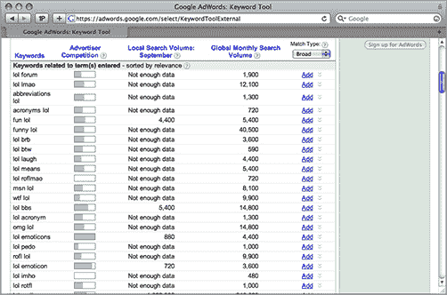

*   `Google Webmaster Central`：该工具可以在 `www.google.com/webmasters/` 访问，并在图 3-5 中显示，下一节将讨论特定的 Web 站长工具报告。

图 3-5： Google Webmaster Central

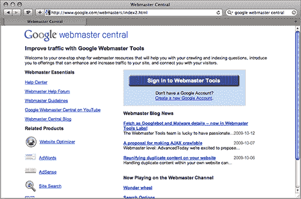

`Google Webmaster Central` 允许你为网站设置特定设置，并查看 Google 如何看待你网站的特定指标。这些指标包括链接概况详情和爬取统计数据。

我会在以下情况下使用这些工具：

*   查看关键词的相对竞争力（`Google AdWords Keyword Tool`）
*   检查 Google 是否已经识别出客户网站的任何问题（`Google Webmaster Central`）
*   更改网站的 Google 特定设置（`Google Webmaster Central`）

## 关键数据点

在使用这些工具时，以下是你需要密切关注的关键数据点：

*   `Google AdWords Keyword Tool`：`Global Monthly Search Volume`（全球每月搜索量）：此指标显示了给定单词或短语的全球搜索近似次数。目前还不清楚该指标的准确性如何，但经验证据表明所有数据都接近真实。遗憾的是，这是我们目前所能做的。SEO 专家使用这些数据来帮助确定关键词的选择。

### 检查单词的变体

使用此工具比较同一个单词的不同变体之间的相对价值非常有益。例如，在写作时，查询“music video”（音乐视频）在全球的搜索次数比“music videos”多出 11,100,000 次。在这种情况下，以及许多其他情况下，增加一个“s”就会产生巨大的差异。

*   `Google AdWords Keyword Tool`：`Advertiser Competition`（广告商竞争）：对我们来说的是，这个指标比上一个更不准确。它被描为一个绿色条，而不是人工四舍五入的数字。拜托，Google！这些信息对于广告商竞争力的粗略估算有用。这仅适用于对 Google 关键词竞价的广告商，并且仅与自然搜索结果的竞争力相关。专业的 SEO 专家将其与全球搜索量结合使用，寻找高流量、低竞争的关键词。这不是一门精确的科学，但再次强调，这是我们目前拥有的。

### 这些工具可以回答的常见问题

这两个 Google 工具可以帮助你回答两个重要问题。

#### 编写特定关键词的最佳方法是什么？

回答这个问题的最佳方法是使用 `Google AdWords Keyword Tool`，同时提交关键词的多个变体并勾选 `Use Synonyms`（使用同义词）复选框。正如我在本节早前的音乐视频示例中提到的，一个字母就能对流量产生巨大的影响。

### Google 站长工具 (Google Webmaster Tools)

Google 站长工具集 (`GWT`) 是收集有关你网站性能的 Google 特定数据以及发现 Google 正确查看网站的潜在障碍的极佳方法。某些报告包含不特别具有操作性的数据，而另一些报告显示了你可以立即修复并获得即时收益的错误。接下来的章节将从高层次讨论 `GWT`，然后逐条报告 `GWT` 讨论的问题——以及你应该寻找什么（如果有的话）。

## 关键数据点

*   `Google Webmaster Central`：对于所有站长来说，这是一个极其重要的资源。它本质上是 Google 索引中网站的控制面板。在写作时，此界面提供了迁移域名、设置位置偏好、检查常见 SEO 问题、分析链接概况和导出重要 SEO 工具。我强烈建议每位 SEO 专家都注册此工具并验证他们客户的网站。通过这样做，他们可能会对自己的网站以及 Google 如何解读这些网站获得新的见解。

#### 站长工具可以回答的常见问题

这些工具可以帮助你回答以下问题。

#### Google 如何看待我的网站？

这是一个大问题，本章中随后的各个报告结合在一起，提供了关于 Google 如何解读你网站内容的相当全面视角。

#### 如果我被惩罚了，如何请求 Google 重新收录？

Google 认为其索引和服务是私有的，并保留出于任何理由排除任何人的权利。当 Google 搜索质量人员发现某个网站违反了 Google 站长指南 时，他们可以降低相关链接权重、手动惩罚网站的排名能力或从 Google 索引中完全删除网站。导致惩罚的常见示例包括买卖链接、欺骗（向搜索引擎显示一种内容向普通访问者显示另一种内容）、关键词填充和操纵重定向。幸运的是，如果你认为你的网站受到了不公正的，你可以请求 Google 重新收录。

注意：要请求重新收录进 Google 索引，请访问 `www.google.com/webmasters/tools/reconsideration`。确保导致你惩罚的问题已经修复，并准备好解释它是发生的。这份道歉表单可能回答起来并不舒服，但它通常是让被封禁网站返回 Google 索引的唯一方法。

据报道 Google 会手动阅读收到的每份重新收录请求。从提交到采取（假设 Google 确实采取行动）大约三个月。在提交重新收录请求之前，最好检查相关网站是否有任何违反 Google 站长指南的迹象。一旦你确定客户网站对搜索引擎友好并遵守 Google 站长指南，你就可以在 Webmaster Central 仪表板中提交重新收录请求。这样做之后，敲敲木头，往肩膀后撒撒盐，并跳七天以求好运。你需要能得到的所有运气。

交叉引用 你可以在第 5 章中找到重新收录请求示例。


以下是对 Google Webmaster Tools（网站管理员工具）报告的深入探讨。书中的章节标题与 Webmaster Tools 左侧栏中的特定章节名称对应。虽然某些报告对你网站的解释相当是二元化的（例如，`XML` 站点地图要么有效要么无效），但许多数据是技术性的，不会被简单地标记为“好”或“坏”，也不会提供具体的建议。相反，在大多数情况下，Google 只是向你展示数据，而由你来进行解读并采取行动。后续章节目的是帮助你决定哪些报告是需要关注的，以及在改进网站各个方面时应该采取行动的阈值。

## Dashboard（仪表板）

`GWT` 仪表板提供了网站性能的快速快照，显示以下问题的顶层数据：

*   热门搜索查询
*   爬取错误类型及其计数
*   指向你网站的链接
*   关键词
*   站点地图

每个报告快照都有指向其完整报告的链接，将在后续章节中讨论。

仪表板最适合快速发现异常情况，例如搜索查询激增或爬取错误，以及发现 `XML` 站点地图无效的迹象。

## Messages（消息）

此页面列出了 Google 发给你的消息，专门关于你的网站的消息。消息包括新验证的所有者通知、`Sitelinks`（站点链接）的变化，以及如果你的网站含有恶意软件或可能违反 Google 质量准则的重要通知。每个客户的网站每周至少检查一次此区域。

`GWT` 左侧导航中的 `Message center`（消息中心）显示特定域的消息。如果你在 `GWT` 中验证了多个网站，最好在 `GWT` 的主页 `www.google.com/webmasters/tools/home` 查看所有消息。此页面汇总了你 `GWT` 组合中所有域的所有消息。

## Site Configuration（站点设置）

`Site Configuration` 报告显示了 Google 如何与你的网站交互。以下章节讨论了网站和 Google 之间发送的优化用户体验的特定信号。

### Sitemaps（站点地图）

`Sitemaps` 报告显示你（或任何已验证网站的其他人）提交的每个站点地图，以及最近的抓取日期、状态（有效或无效）和类型（通用、移动端等）。

它还显示了索引的 URL 数量，并与 `XML` 文件中的 URL 数量进行对比。这是查看站点地图 URL 有多少比例实际进入 Google 索引的有效方法。

最后，你也可以从此报告提交站点地图，前提是实际文件位于你的域名服务器上。（也就是说，你不能从计算机上传站点地图文件。）

### Crawler Access（爬虫访问）

此多功能报告允许你对网站执行并诊断各种与机器人相关的爬取规则：

*   测试你的 `robots.txt` 文件：此面板显示你当前 `robots.txt` 文件的 `HTTP` 状态码和最后下载时间。如果出现 `Parse results`（解析结果）部分将逐行检查你的文件，识别你在文件中声明任何站点地图位置，解释你添加的任何 `disallow` 或 `user agent` 行，并识别任何编码错误。要测试对 `robots.txt` 文件的假设性更改，请更改 `Text of http://www.example.com/robots.txt` 字段的内容，向 `URLs` 字段添加特定 URL，并选择特定的 `user agent`。

### Robots.txt Errors（robots.txt 错误）

`robots.txt` 有几点需要注意：

*   `robots.txt` 报告显示 `XML` 错误：首先，`robots.txt` 显示 `XML` 错误。
*   `robots.txt` 报告显示 `XML` 错误：`robots.txt` 显示 `XML` 错误。
*   `robots.txt` 报告显示 `XML` 错误：`robots.txt` 将它们从索引中移除。
*   生成自定义 `robots.txt` 文件：此工具帮助你根据需要创建自定义 `robots.txt` 文件。
*   移除 URL：如果你有某些 URL 出现，请使用此工具。


## 参数处理

此标签页允许从你的网站选择动态 URL 变量，并告诉 Google 在爬取时忽略这些参数。例如，如果你的网站有 URL `/authors.php` 和 `/authors.php?sortby=lastname`，你可以告诉 Google 忽略 `sortby` 参数，这将有助于将任何包含该参数的 URL 规范为 `/authors.php`。Google 还列出了它怀疑可能足够意义、以至于会在你的网站上创建重复内容的动态 URL 参数，但坦率地说，Google 在这方面的做得并不完美，往往会建议某些创建了独特内容的重要参数。

## 网站上的你的网站

“网站上的网站”报告显示了 Google 对用户和其他网站如何与你的网站关联及交互的解读，包括查询数据和链接数据等指标。以下是这些报告以及如何充分利用它们的方法。

### 搜索查询

此报告显示了你的网站出现在搜索结果中的查询词，以及关于你获得点击次数（`CTR`，或点击率）的估值。它还显示了你页面的“平均排名”，即你的网站针对特定查询的平均排名。虽然展示次数和点击次数看起来是四舍五入后的估值，但它们可以很好地洞察在哪些领域投入多一点额外关注就能带来额外的流量。

例如，对于一个高需求的查询词，你的点击率可能非常低，而该页面的平均排名为 8。这是合理的，因为排名第 8 的任何内容从查询获得的点击百分比自然很低。但通过努力，你可以提高该页面针对该查询的排名，并获取更多点击。此报告帮助你确定高回报关键词，即在哪里投入精力将获得最大的回报。

### 指向你网站的链接

此报告提供了关于经常链接到你的外部网站的价值情报，以及你的网站上接收到最多链接的页面。和很多 Google 链接数据一样，你永远无法完全确定它是否显示了引擎所知的全部信息，因此你可能无法获得像 Open Site Explorer 这类工具那样的精确度。

### 关键词

此报告在概念上非常简单。它是 Google 在爬取你的网站时发现的词汇列表，并按频率排序。因此，你的顶部词应该是你的网站所关注的术语，无论是类别还是特定的产品或服务，以及一些以品牌为中心的短语。

点击一个术语，你将看到包含该术语数量最多的页面列表，这有助于注意到可能引用某个特定术语过多或过不足的页面。

### 内部链接

此报告按照指向你网站的内部链接（即来自你自己域名的链接）数量列出你网站的 URL。这些数据对于帮助你确保你的关键内容链接次数比非关键内容更多，这有助于帮助你管理网站内 `PageRank` 和权威性的流向。

此外，此工具是识别重复内容的有用方法，因为如果你有两个重复的 URL（例如，仅在大小写风格上有所区别），它们可能都会出现在报告中，并帮助你找到链接到错误版本的页面。

### 订阅者统计数据

通过这些信息你做不了什么。它列出了使用基于 Google 的 RSS 阅读器（如 `Google Reader` 或 `iGoogle`）订阅了你网站馈送的 Google 用户数量。如果你在 `Feedburner` 上运行馈送，你的订阅者不会反映在这里，因为此工具仅反映了你自己的域名下馈送的订阅者，而不是 `Feedburner.com`。

## 诊断

诊断报告专门指出错误和改进建议，以及帮助你识别服务器问题的原始爬取数据。

### 恶意软件

只有当 Google 检测到你的网站被恶意软件感染时，此部分才有内容。如果是这样，请按照显示的指令清理你的网站，然后通知 Google 重新检查。即使你确定网站是干净的，也要每周检查一次此报告。

### 爬取错误

爬取错误报告是最有帮助之一。对于网页和移动内容，Google 会向你显示以下类型的错误：

- HTTP：通常是 400 或 403 错误。
- 在站点地图中：显示 XML 站点地图中的多种错误类型。
- 未遵循：显示 Google 选择不跟踪的链接，通常是因为过度重定向或无限循环。
- 受 robots.txt 限制：显示被 `robots.txt` 的 URL。
- 未找到：显示 404 错误。
- 软 404：显示返回 200 OK 状态但实际上未找到的页面。
- 超时：通常由于服务器忙碌。
- 无法访问：通常由于服务器错误。

修复这些错误为什么重要？首先，你的用户可能会看到与 Google 相同的错误。其次，404 错误会让你的网站无法获得应有的权重。

### 爬取统计

此报告显示了三个图表：

- 每天爬取的页面：Google 每天爬取的 URL 数量。
- 每天下载的字节：与每天爬取的页面类似，此图表经常与上方相似。
- 下载页面的时间（毫秒）：此报告反映了加载时间，数字越小越好。

### HTML 建议

此部分强调了 Google 检测到你的网站元内容可能存在“问题”的页面，包括：

- 元描述：突出重复以及过长或过短的描述。
- 标题标签：突出缺失、重复、过长、过短且未提供信息的 URL。
- 不可索引内容：突出 Google 无法正确读取或解释的内容。

以批判性眼光审视这一部分是值得的，只有当 Google 认为这些问题给用户带来了糟糕的体验时才会指出，而它的算法核心就是丰富用户体验。如果五个 URL 共享相同的标题，在你的网站可能是完全合理的，但此报告几乎总是突出几个需要改进的领域。

## 实验室

网站管理员工具的 Labs 部分是 Google 在认为某些报告结构准备好发布之前进行测试的地方。但并不意味着它们的数据没有用。事实上，某些 Labs 报告在诊断网站问题方面与 GWT 其他领域的报告一样有帮助。

### 以 Googlebot 抓取

这是 Google 版本的“头部检查器”，它与 SEO 长期喜爱的工具 Rex Swain 的 `HTTP Viewer` 非常相似。


插入您网站的 URL，并选择您希望让 Google 的主爬虫（“Web”）或其移动端爬虫（“XHTML”或“cHTML”）进行检查。一两分钟后回来，如果 Google 已经抓取了页面，将会出现一个名为“Success”的链接，点击它可以查看 Google 抓取的代码。

此工具对于确保您的页面显示正确的 HTTP Header 代码（`200`、`302`、`301` 等）非常有帮助，对于测试您网站的移动设备检测和重定向特别有用。例如，模拟 Google 的移动端爬虫来测试您的桌面站点，可以帮助您了解移动设备是否被正确重定向到移动端内容。

# 网站性能
网站性能报告显示了您的网站过去几个月来随机页面加载时间的图表。Google 任意地将“慢”定义为网上最慢的 80% 网站，将“快”定义为最快的 20% 网站。这意味着您的网站性能可能处于前 22%，但根据 Google 的标准仍仍被视为“慢”。因此，我建议不要过度关注这些标签。相反，请关注与页面加载变慢相关的峰值，并尝试确定缩短加载时间是否可行。

此外，报告还提供了关于如何缩短页面加载时间的建议，包括对启用压缩、合并和外部化 JavaScript 和 CSS 文件以及最小化 DNS 查找如何影响页面大小的特定预测。

### 视频站点地图
此报告与 GWT 中“网站配置”部分中的站点地图报告类似，但其目的是诊断和报告在 XML 站点地图中发现的视频内容。目前，这些报告除了列出所有现有的 XML 馈外外显示的信息非常少。

# 相关性确定工具
如第 1 节所述，相关性构成了搜索引擎算法的很大一部分。因此，SEO 公司开发了各种工具来帮助确定相关性变得更加容易。我最常用的三个工具是 Dave Naylor 的 Keyword Density Tool、SEOmoz 的 Term Target Tool 以及 Ranks.nl 的 Keyword Density & Prominence Analyzer。

**注意**：这些工具的名称其实是一个名不副实。关键词密度指标本身对搜索引擎实际上并不重要。不要让这让你产生困惑；这些工具对于从搜索引擎算法的角度判断一个网页与给定关键词的相关性实际上非常有帮助。

*   **Dave Naylor’s Keyword Density Tool**：该工具位于 `[http://tools.davidnaylor.co.uk/keyworddensity/]`，并在 图 3-6 中显示。
    图 3-6： Dave Naylor 的 Keyword Density Tool
    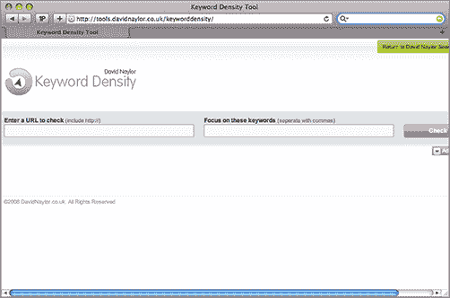
    通过 Dave Naylor 的 Keyword Density Tool，你可以看到有关特定网站的内容和技术信息指标。这对于发现潜在的垃圾信息信号（特定关键词在页面上使用了 300 次，而类似页面上的关键词通常只使用 10 次）以及技术问题（页面返回了 `404` HTTP 状态码）非常有帮助。

*   **SEOmoz’s Term Target Tool**：该工具位于 `[www.seomoz.org/term-target](http://www.seomoz.org/term-target)`，并在 图 3-7 中显示。
    图 3-7： SEOmoz’s Term Target Tool
    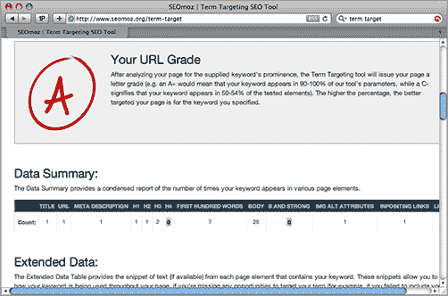
    SEOmoz 的 Term Target Tool 通过分析各种与搜索引擎相关的因素，帮助判断特定页面对于指定关键词的针对性如何。

*   **Ranks.nl Keyword Density & Prominence Analyzer**：该工具位于 `[www.ranks.nl/tools/spider.html](http://www.ranks.nl/tools/spider.html)`，并在 图 3-8 中显示。
    图 3-8： Ranks.nl Keyword Density and Prominence Analyzer
    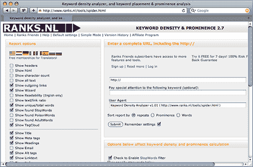
    Ranks.nl Keyword Density & Prominence Analyzer 是一个强大的工具，可以为特定页面输出大量的搜索引擎指标。它比本节中列出的其他工具显示更多的原始数据，因此非常适合数据痴迷的 SEO 人员。
    **注意**：Ranks.nl Keyword Density & Prominence Analyzer 显示比本节列出的其他工具更多的原始数据。

当我需要以下操作时会使用这些工具：
*   查看页面与特定关键词的相关性
*   在制作客户报告时节省时间（我会在报告中使用这些工具的数据）
*   从搜索引擎爬虫的角度查看网页

## 关键数据点
你可以使用这些工具中的每一个来关注不同的重要数据点：

*   **Dave Naylor’s Keyword Density Tool**：该工具并没有提供一个最最重要的特定数据点。相反，它提供了许多在作为大局一部分时非常有用的数据点。我关注的一些关键部分如下：
    *   Keyword Analysis（关键词分析）：确保关键词出现在适当的位置
    *   Geolocation（地理位置）：查看服务器所在地
    *   External Follow Links（外部链接）：获取网站愿意向外发送什么类型的链接的想法
    当我想要了解搜索引擎如何看待特定页面时，我会使用这个工具。尽管如此，该工具没有提供足够的锚文本数据，所以尽管它显示了目前最好的相关性视图，但仍然遗漏了一个主要部分。

*   **SEOmoz’s Term Target Tool**：该工具提供的 `Your URL Grade` 功能非常适合向客户展示页面相关性的直观视图。它非常直白，即使是最愚笨的 CEO 也能看懂结果。这在美国特别有效，因为那里的教育系统使用 `A`、`B`、`C`、`D` 和 `F` 给学生评分。由于该工具也使用这个标准，不熟悉 SEO 的人能够利用先前的知识判断工具报告的是好分还是坏分。

*   **Ranks.nl Keyword Density & Prominence Analyzer**：该工具有一个 `Ranks Wizard` 指标，对于识别页面上的非主要关键词非常有帮助。当你在为客户进行长尾关键词分析时非常有用。当我试图利用客户域名上的热门页面来吸引新的搜索流量，但不想更改页面的主要关键词时，我会使用这个工具。

# 相关性工具可以回答的常见问题
这些工具可以帮助你自己回答（并向客户解释）以下问题。

给定页面与给定关键词有多相关？
这是一个需要大量数据才能回答的大问题。如果我时间有限（许多专业 SEO 都是如此）并且与客户开会，我会直接使用 Dave Naylor 的 Keyword Density Tool 或 SEOmoz 的 Term Target 工具。关键词工具提供了几乎我需要的所有数据且加载速度非常快，所以当我需要它作为更大谈话的插话时会使用它。

从指标的角度来看，给定页面是什么样的？


这与第一个问题相似，只是视角稍有不同。这个问题主要出现在我为客户撰写报告时。我结合使用 Naylor 的关键词密度工具和 `Keyword Density & Prominence Analyzer` 来尽可能收集数据，然后根据我的发现做出判断。

## SEO 工具栏

还记得在章节开头时，我用讽刺的语气将“功能腰带”与 SEO 工具栏进行了类比吗？以下是工具栏之所以比传统的 SEO 工具更快（它们在每个页面加载时都会运行），并且能够在狭小的空间内挤入惊人的信息量。我正在运行的两个工具栏（尽管并非同时运行）是 SEO for Firefox 和 `mozBar`。这两个工具栏为我提供了进行页面级审计所需的大部分信息。注意，我需要说明，作为前 SEOmoz 员工，我天生对 `mozBar` 有偏见。尽管如此，SEOmoz 构建该工具栏的原因是我以前的同事对替代方案并不满意。与其过度强调我的偏见，我将直接告诉你们我的真实感受，并把做出判断的责任留给你们。

*   Firefox 的 SEO 工具栏可以在 `http://tools.seobook.com/firefox/seo-for-firefox.html`(`http://tools.seobook.com/firefox/seo-for-firefox.html`) 获得，并在图 3-9 中显示。
*   SEOmoz 的 `mozBar` 可以在 www.seomoz.org/mozbar 获得，并在图 3-10 中显示。

在我在以下情况下会使用这些工具：

*   快速查看网页的 SEO 相关属性
*   获取某个域名下网页的背景信息
*   获取互联网上某个域名的背景信息

图 3-9: SEO for Firefox


图 3-10: SEOmoz 的 `mozBar`


## 关键数据点

这些工具栏提供了对以下数据点的访问：

*   SEO for Firefox: PageRank：虽然 Google 的 `PageRank` 只是整体搜索算法的一小部分，但它确实为页面相对价值提供了很好的洞察，并且可以判断页面是否被索引的快速指标。我将其作为客户报告中的基准，但并不作为重要决策的依据。`PageRank` 为 0 表示页面正受到惩罚。这是一个开始寻找页面上操纵行为的线索。其中一个重要的例外是当成熟页面的 `PageRank` 为 0 时。在这种情况下，页面受到了惩罚，我将其作为一个信号，提醒我去寻找操纵行为。我还会将此指标作为向客户解释操纵行为负面影响的证据。这变得很复杂，但不要将“无可用的 PageRank 信息”或纯白条误认为是 `PageRank` 为 0。深度抓取或最近才抓取的页面可能还没有 `PageRank` 信息，但这并不意味着它们受到了惩罚或无法出现在搜索结果中。

## PageRank 的量级

`PageRank` 是基于对数量级的。粗略来说，这意味着 `PageRank` 8 的强度是 `PageRank` 7 的十倍。结论是，从 `PageRank` 1 升到 2 很容易，但从 7 到 8 极其困难。在这两种情况下，提高此得分的方法都是从成熟网站获取更多的入链。区别在于，客户网站的 `PageRank` 越高，要在流行度指标上产生影响就越困难。

*   `mozBar`: 根域名链接（页面级）：自从这一指标发布以来，它与实际排名之间的高度相关性给我留下了深刻的印象。我强烈建议你在浏览熟悉的网站时观察这一指标，以便对它的范围有一个直观的认识。内部链接的价值（从编辑投票的角度来看）没有普通的外部链接那么高。需要注意的是，如果你看到大量页面链接到某个网页，但该网页只有一个根域名在链接，这意味着由于所有这些链接都是内部链接，其价值（从编辑投票的角度来看）并不如普通的外部链接那么高。
*   `mozBar`: 根域名链接（域名级）：就像页面级指标一样，该指标显示了链接到给定域名的唯一域名数量。这对于确定一个域名在排名中的强度至关重要。正如第一章讨论的，域名流行度对于提高弱页面的权重非常有用。即使指向某个页面的链接数量很少，如果这个指标很大，它仍然可以获得高排名。我们在 Wikipedia 上经常看到这种情况。注意，目前的垃圾邮件者利用了强域名的优势。

*   `mozBar`: 分析页面：这不是单一的数据点，而是一个访问点。这些工具栏共同为我提供了页面级审计所需的大信息。注意，我需要说明，作为前 SEOmoz 员工，我天生对 `mozBar` 有偏见。尽管如此，SEOmoz 构建该工具栏的原因是我以前的同事对替代方案并不满意。与其过度强调我的偏见，我将直接告诉你们我的真实感受，并把做出判断的责任留给你们。

*   Firefox 的 SEO 工具栏可以在 `http://tools.seobook.com/firefox/seo-for-firefox.html`(`http://tools.seobook.com/firefox/seo-for-firefox.html`) 获得，并在图 3-9 中显示。
*   SEOmoz 的 `mozBar` 可以在 www.seomoz.org/mozbar 获得，并在图 3-10 中显示。

图 3-9: SEO for Firefox


图 3-10: SEOmoz 的 `mozBar`


* **HTTP 状态码**：这是 SEO 人员必须了解的关键信息。它表示服务器对浏览器的响应码。这对于识别“软” 404 页面（返回 302 或 200 HTTP 状态码的 404 页面）以及重定向非常有帮助。正如书中前面讨论过的，存在两种不同的重定向：301 和 302。虽然数值上只差一个，但在 SEO 上的差异是巨大的。302 重定向不传递任何链接值，而 301 重定向可以传递 90% 到 99% 的链接值。该工具是准确定义特定情况下存在何种重定向的最佳选择。更好的是，该工具运行极快。

* **从页面下载的所有文件**：Live HTTP Headers 可以显示网页上下载的每个文件的浏览器请求和服务器响应。这有助于准确识别页面上发生了什么，并指出任何占用宝贵带宽和用户精确时间的非必要请求。我和同事使用这一点来获取对页面所有元素的最全面的视角。

虽然查看源代码对于这类分析很有用，但它会遗漏一些在外部文件中发生的加载。该工具有助于弥补查看源代码的缺陷。

图 3-12： Live HTTP Headers

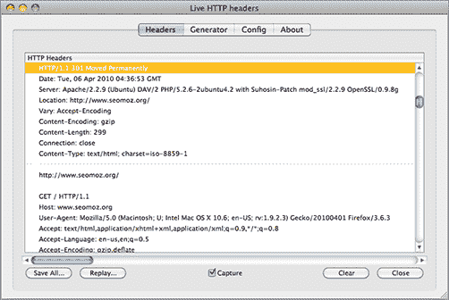

## HTTP Header 分析器可以回答的常见问题

我已经提到了这类工具可以回答的两个常见问题：

### 这个重定向是 301 还是 302？

正如我多次提到的，这是一个非常重要的区别。要找到这个答案，你可以在 Firefox 中加载此工具，在 `Headers` 标签页中点击 `Capture`，然后像你往常在浏览器中那样加载页面。你一这样做，该工具就会记录服务器和浏览器之间后台传输的所有 `HTTP headers`。页面加载后，你可以检查这些打印内容并查看任何可能发生的重定向。这些重定向将标记在响应块的顶部，显示 `HTTP/1.x` `301 Moved Permanently` 或 `HTTP/1.x` `302 Found`。

**注意记住——301 重定向：**

* 重定向 URL 的推荐 SEO 实践
* 传递 90% 到 99% 的链接权重
* 永久重定向

**302 重定向：**

* Web 开发人员常的 SEO 错误
* 传递 0% 的链接权重
* 临时重定向

### 为什么这个页面加载这么长时间？

这个问题的答案考虑了许多因素，包括服务器相对于用户计算机的位置、延迟、吞吐量、下载的文件数量、下载文件的大小等。虽然该工具无法识别所有这些因素，但它可以告诉你正在下载的文件数量。这非常有帮助，因为浏览器对从特定服务器上同时下载的文件数量是有限制的。这意味着不仅文件大小很重要，需要提供的文件数量同样重要。

获取更多页面优化建议，请参阅 Yahoo 的指南：[`developer.yahoo.com/performance/rules.html`](http://developer.yahoo.com/performance/rules.html)。

## Firefox 用户代理切换器 (User Agent Switcher)

当你浏览互联网时，你的浏览器会向连接的每个服务器发送信息。其中一个信息片段就是它的用户代理（user-agent）字符串。我的浏览器（Safari）发送给服务器的代理代理字符串是 `Mozilla/5.0 (Macintosh; U; Intel Mac OS X 10_5_8; en-us) AppleWebKit/531.9 (KHTML, like Gecko) Version/4.0.3 Safari/531.9`。这让服务器知道我正在基于 Intel 的 Mac 上使用 Mac OS X，并且使用的是版本 4.0.3 的 Safari。根据这些信息，某些网站选择发送特定版本的的内容。有时这种决定是有用的，例如提供与用户操作系统兼容的软件版本。其他时候，这被用于“障蔽”（Cloaking）。障蔽是指向搜索引擎发送网站的一个版本，而向用户发送另一个版本。作为 SEO，检测这种现象的一种方法是切换你的用户代理，使你看起来像搜索引擎的爬虫之一。

### 通过 IP 地址针对爬虫

聪明的网站站管理员会通过 IP 地址而不是用户代理来针对爬虫，因为前者更难伪造。如果你想这样做，你需要找到一个维护更新搜索引擎 IP 地址记录的在线资源。你可以在其中主流搜索引擎中搜索[搜索引擎 IP 地址](http://Search%20engine%20IP%20addresses) 来实现。

Firefox 用户代理切换器可在 [`addons.mozilla.org/en-US/firefox/addon/59`](https://addons.mozilla.org/en-US/firefox/addon/59) 获取，并如图 3-13 所示。

图 3-13： Firefox Agent Switcher

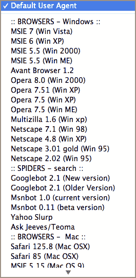

我在以下情况下会使用它：
* 根据用户代理搜索障蔽的证据
* 访问过滤掉标准内容的网站

## 关键数据点

以下列出了对 SEO 最重要的两个用户代理：
* Googlebot 的用户代理：`Mozilla/5.0 (compatible; Googlebot/2.1 (+http://google.com/bot)`
* MSNbot 的用户代理：`msnbot/1.0 (+http://msn.com)`

检查 [www.user-agents.org](http://www.user-agents.org) 以获取最新的用户代理字符串。

## 用户代理切换器可以回答的常见问题

该工具有助于以下问题：

这个网站是否正在进行障蔽？

我发现这个问题经常出现。测试这种现象最好的方法是用你的普通用户代理访问该页面，然后切换到其中一个搜索引擎代理并强制刷新页面。如果结果不同，那么是的，它们在进行障蔽。

### 基于 IP 的障蔽

例外情况是他们可能在使用基于 IP 的障蔽。除非你有被针对的 IP 地址，否则这很难检测。如果是这种情况，找一个代理服务器并尝试通过它访问该页面。如果你怀疑网页正针对搜索引擎持有的 IP 地址，请检查网站的缓存版本。

这个 这个网站是否根据我的用户代理向我发送定制化结果？

如果你怀疑某个网站向你发送特定于浏览器或操作系统的结果，你可以更改用户代理。操作后，强制刷新并查看网页是否发生了变化。

## Firefox 渲染修正 (Rendering Modifier)

现代网站包含图像、声音、动画和视频。这些使得网站变得有趣且对人类更有吸引力。与此同时，搜索引擎爬虫的水平仅足以理解这些信息中的极小部分。作为 SEO，你会发现有时从更接近搜索引擎的视角来查看网站是有帮助的。你会发现，如果你从搜索引擎有限的信息视角来看待，会更容易理解为什么搜索引擎会对页面进行那样的排名。这样做最简单的方法是禁用浏览器中所有通常让 Web 浏览变得如此愉快的功能。

你可以使用 Firefox Web 开发者工具栏修改你的网站视角。该工具让你能够启用和禁用浏览器渲染无法被搜索引擎解析的对象。

Firefox Web 开发者工具栏扩展可在 [`addons.mozilla.org/firefox/addon/60`](https://addons.mozilla.org/firefox/addon/60) 获取，并如图 3-14 所示。


# 图 3-14： Firefox 开发者工具栏


基本上，当我想要模拟搜索引擎爬虫的行为时，我就会使用这个工具。

## 关键数据点

当你使用此工具时，处理的关键数据并不是你想要看到的，而是你想要禁用的数据：

*   **禁用 JavaScript**：脚本是一种运行时脚本语言，有助于创建更具交互性的网站。遗憾的是，目前的搜索引擎在解析这种语言方面存在困难，截至写作时的标准，从 SEO 的角度来看，它是不可靠的。Web Developer 插件有一个禁用 JavaScript 的选项，这有助于你更好地理解搜索引擎是如何查看网站的。此外，由于 Flash 通常是由 JavaScript 指令启动的，禁用 JavaScript 通常会显示一个没有运行 Flash 元素的网页，这是一种更准确的来查看引擎看到页面的方式。
*   **禁用元重定向 (Meta Redirect)**：许多垃圾邮件发送者使用的一种技巧是即时元重定向（例如“meta 刷新”）。这些用于将用户从他们想要看到的页面重定向到对网站管理员更有利的页面。因为这些重定向并不总是显而易见的，禁用它们可能会有所帮助，让你的浏览器行为接近搜索引擎爬虫。搜索引擎爬虫会检测何时存在元重定向，如果你的浏览器自动跟随重定向，这可能很难被发现。
*   **禁用 Cookies**：Cookies 是在你访问特定网站后存储在计算机上的小文件。这些文件对于存储登录凭据等信息非常有用，这样你就不需要每次访问该网站时都登录。遗憾的是，这项技术在搜索引擎爬虫上的效果并不好。通过此插件禁用 Cookies 是另一种更准确模拟搜索引擎爬虫的良好方法。

我看到的与 Cookie 相关的常见的 SEO 问题是网站在用户从启动页（splash page）选择语言版本后存储了网站的语言版本。（启动页是用户看到的请求他们执行简单操作的页面。例如选择他们偏好的语言、验证他们是否年满 18 岁或以上或选择颜色主题。通常在用户选择一次此选项后，它会被存储在 Cookie 中，他们再也不会看到此页面。）由于搜索引擎不在启用 Cookie 的情况下进行爬取，它们永远无法跳过启动页，所有指向主页的链接都会被归功于启动页。由于启动页通常没有足够的内容来获得良好排名，这破坏了网站获得良好排名的机会。
*   **禁用 CSS**：插件的最后一个关键选项是禁用 CSS。CSS 用于格式化网站的视觉组件。这包括布局、颜色、定位和某些行为。你可以想象，CSS 可以通过许多方式被操纵以欺骗搜索引擎，例如将内容隐藏在其他内容层之下、将文本定位在屏幕可见区域之外以及使文本不可。因此，在像主要爬虫一样浏览时，最好禁用它。

我看到的利用 CSS 操纵搜索引擎的最常见例子是隐藏链接。这可以通过手动将链接定位在屏幕可视部分之外，或简单地隐藏整个 `div`（网站的一个区域）来实现。禁用 CSS 允许你看到在没有这些操纵的情况下页面的样子，并让你更容易找到页面为何被惩罚。

禁用 CSS 是你从爬虫角度查看页面外观的另一种方法，这可以让你寻找页面为何被惩罚的工作变得更容易。

## Firefox 开发者可以回答的常见问题

实际上，这个工具有助于回答一个关键问题：

### 搜索引擎会如何看待这个功能？

这个问题在网站审计期间经常出现。最好的方法是禁用此部分中的所有选项并亲眼观察。这既简单又方便，因为除了禁用的 CSS 之外，在你不同页面之间导航时，这些功能会保持禁用状态。如果你想额外确定，并且网站已经被爬取，你可以查看搜索引擎对网站的缓存版本并选择“纯文本”选项。

这很重要，因为可以帮助你理解为什么搜索引擎会那样运行。它揭示的一个常见问题是使用复杂的 JavaScript 编写的全局导航，因此搜索引擎无法对其解析。当这种情况发生时，你将会在页面的纯文本缓存版本中看不到导航链接，你就知道搜索引擎无法将这些页面直接连接到你正在查看的页面。这会损害域名下所有页面的流行度指标。

## 总结

本章回顾了我和同事最经常使用的所有工具，这些工具在随后的章节中会被引用。熟悉这些工具的最佳方法是在浏览器中将它们标记为书签，并每周使用几次。

下一章将讨论如何使用这些工具以及你在第 1 章中获得的知识来寻找 SEO 问题。这是专业 SEO 人员日常工作的大部分，因此接下来的章节非常有价值。到目前为止做得很好；现在是时候将你学到的知识找出如何应用它了。

# 第 4 章

## 寻找 SEO 问题

### 本章内容

*   执行 15 分钟 SEO 审计
*   执行 5 分钟品牌声誉审计
*   识别搜索引擎惩罚

现在你已经知道要寻找什么，并且已经了开始工作的工具，是时候大显身手了。本章讨论了如何识别 SEO 问题。你可以利用这些技能来给潜在客户留下深刻印象。这一章极其重要，所以不要跳过页面！话说了，让我们开始吧。

## 15 分钟 SEO 审计

SEO 问题的基础识别可以在 15 分钟内完成。在你完成此审计时，我建议根据每个部分列出的操作记录笔记。这些简单的笔记可以帮助你对网站进行深入研究。审计不是全面的，但它可以快速识别主要问题，让你能够说服客户你的服务是值得的，并帮助他们给你深入研究的机会。

## 准备你的浏览器

在开始审计之前，你需要准备你的浏览器使其更像搜索引擎爬虫。此操作有助于你识别简单的爬取错误。为了做到这一点，你需要执行以下操作：

*   禁用 Cookies
*   将用户代理切换为 `Googlebot`
*   禁用 JavaScript

### 禁用浏览器 Cookies

当搜索引擎爬取互联网时，它们不接受 Cookies。这是你客户网站应该预期的行为，因为某些用户和某些浏览器也不接受 Cookies。通过禁用它们，你可以发现与你在页面上做的偏好相关的问题。


关闭 Cookie 可能会帮助发现问题的一个佳例子是：某些网站要求用户在进入主站之前选择他们的首选语言。（这种页面也被称为**启动页**，*splash page*）。当搜索引擎（它们不存储 Cookie）访问这类页面时，它们会进入网站的不同语言差异版本。这几乎总是会导致重复内容和地理定位问题。从 SEO 的角度来看，拥有这样一张页面是极其不利的，因为这意味着指向你主 URL 的每一个链接都会被稀释，因为它们必须经过这个启动页。这种情况是一个大问题，正如第 1 章中提到的，主 URL（即 `www.example.com/`）通常是网站上被链接次数最多的页面。

在大多数浏览器中，你可以通过进入设置或偏好设置、查找隐私标签并选择“清除 Cookie”来禁用 Cookie。

**提示**：如果你安装了免费的 Web Developer 工具栏（见第 3 章），你就可以直接从工具栏快速方便地禁用、删除或清除 Cookie。这可以节省你的时间，并让你在需要时不删除它们的情况下禁用 Cookie（`图 4-1`）。禁用 Cookie 而不是删除是有用的，因为这可以避免你在重新启用 Cookie 后重新输入所有的凭据。

图 4-1： 在 Web Developer 工具栏中禁用 Cookie

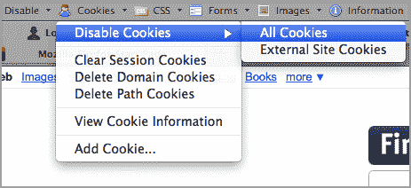

## 将你的用户代理切换为 Googlebot

出于类似的原因，你应该更改你的用户代理。将你的用户代理设置为 `Googlebot` 可以增加你看到 Google 的所看到内容的概率。这也有助于识别欺骗（*cloaking*）问题。（欺骗向搜索引擎展示一种内容而向用户展示另一种内容的做法。这就是讽刺的 Google 员工所谓的“惩罚诱饵”，*penaltybait*）。要做好这一点，你应该使用正常的用户代理对网站进行第二次扫描，以识别你看到的两者之间的任何差异。尽管如此，对于本次快速浏览给定网站，深入此并不是首要目标。

正如我在第 3 章中讨论过的，Firefox 有一个非常棒 User Agent Switcher（用户代理切换器）插件，可以让这种切换变得轻而易举。

## 禁用 JavaScript

禁用浏览器执行 JavaScript 的能力对于帮助你以引擎的视角查看网站非常重要。网站通常使用 JavaScript 来生成 Flash 实例或页面内内容，或者创建特殊的导航方案。通过查看禁用 JavaScript 后的页面，你可以清楚地看到那些元素是否仍然可见。如果你在启用 JavaScript 的页面上能看到某个元素，但在禁用 JavaScript 时它消失了，那么很有可能引擎将看不到该元素，或者它们看到并处理它的方式与你预期的不同。

**注意**：Google 在解析和遵循 JavaScript 代码方面正变得越来越好，但它完全无法比拟传统的 HTML。Google 在查看 JavaScript 代码以“发现”URL 方面做得不错，但 JavaScript 环境在传递有关这些 URL 的信号（例如接近性和锚点文本）方面表现并不好。

## 评估首页

接下来，访问网站的主 URL，特别注意你对页面的第一印象。尽量尽可能真实地反映你的观点，不要过度思考。你应该从普通浏览者的角度来看（这会变得更容易，因为到此时你可能还没有收到任何报酬，而且当你没有被客户锁定时，保持随性会容易得多）。接着，对最基础的 SEO 指标进行快速检查。完成这一步，你需要执行以下操作：

*   记录你的第一印象以及对该页面产生的感受和信任度。

此列表上的第一个行动项帮助你与潜在的网站用户保持一致。它是你整个审计的基础，也是你在此基础上构建的框架。你可以整天看数字，但如果你不能像用户一样看待网站，你作为 SEO 就会失败。在执行此操作时，我会尝试问自己：我是否会将这个网站视为一个可靠的来源？我会给他们我的信用卡号吗？我会把他们作为一个来源推荐给朋友吗？

*   对比启用和禁用 JavaScript 显示的内容。

仔细查看禁用 JavaScript 后的页面，然后重新启用 JavaScript 并刷新。虽然元素的布局可能不同，但你希望尽可能多的元素在启用和禁用 JavaScript 的情况下都是可见的。

### 标题标签和内容管理系统

如果你的客户使用一个难以操作的内容管理系统（CMS），那么更改标题标签可能并不容易；如果是如此，那么我祝你好运！当我遇到这种困难时，我会挑选该域名上最重要的 25 个页面，并手动编写标题标签。

*   查看 URL 是否发生了变化（例如，你被从 `example.com/` 重定向到了 `example.com/lame-keyword-in-URL-trick.html`）。

接下来，你需要引导到该 URL。首先，确保没有重定向。这很重要，因为重定向会稀释到达页面链接的权重。

有时由于特定的流程，从根页面进行重定向是不可避免的。在这种少数情况下，302 是 SEO 友好的重定向。

*   检查 URL 是否规范化（canonical）。

最后一个行动项是对规范化进行快速检查。URL 格式的完整列表见第 2 章。与检查标题标签一样，这很容易检查且具有很高的投入回报率。

检查并改进标题标签以及检查 URL 是否规范，是两种通过少量工作就能对网站排名产生巨大影响的快速方法。

## 在“折屏之上”放置什么

易用性专家通常一致认为，在内容页面和首页上，将尽可能多的内容放在“折屏之上”（即用户首次到达页面无需向下滚动即可可见的内容）的旧做法已不再必要。虽然主要的行动号召（*CTA*）应该在折屏之上，但没有必要包含所有内容。对这一点进行了许多测试，证据压倒性地表明用户是向下滚动的。因此，不需要过度担心“折屏之上”的空谈。

## 检查网站的全局导航

在检查了首页的基础内容后，你应该将注意力转向全局导航。它是权重传递的主通道系统。具体来说，你可能需要执行以下操作：

*   临时禁用 JavaScript（如果尚未禁用）并重新加载页面。

禁用 JavaScript 有多种用途。之前我们用它检查内容。现在我们用它检查链接。

*   确保导航系统正常工作且所有链接都是 HTML 链接。

*   记录全局导航中链接的所有章节。

*   启用 JavaScript。


正如第 2 章所述，网站架构对于高度优化的网站至关重要。全局导航是其中的核心。想象一下你正在访问的网站是传奇高架桥和运河系统刚刚完建后的古罗马。这些水道恰恰就像全局导航，它们在网站周围流淌着“链接权重（link juice）”。想象一下一个巨大的堵塞会对这两个系统产生多大的影响。这次审查就是你寻找这些堵塞的时候。

在本节中，你的第一个操作项是禁用 `JavaScript`。这很有帮助，因为这强迫你从非常基础用户的视角来看待网站。这与搜索引擎的视角也相似。

禁用 `JavaScript` 后，刷新页面并查看全局导航是否仍然可用。很多情况下它并不起作用，而这个简单的步骤揭示了该客户出现索引问题的主要原因之一。

接下来，查看源代码，看看所有的导航链接是否都是真实的 HTML 链接。理想情况下，它们应该是，因为 `SEOmoz` 和其他 SEO 专家进行的搜索引擎测试已经表明，HTML 链接是唯一能够传递完整链接价值的类型。（这与基于 `JavaScript` 的链接和服务器端重定向不同。）

最符合 SEO 友好的全局导航根本不使用 `JavaScript`。相反，它们用 HTML 和 CSS 编写，并利用 `<a` `href` 伪类和描述性的锚点文本。

你的下一步是记下全局导航中链接了哪些部分。理想情况下，所有主要部分都会在全局导航中链接。问题是，在审计更深层次之前，你并不知道所有的主要部分是什么。现在只需做好记录，并在浏览网站时脑中保持一个检查清单。

最后，重新启用 `JavaScript`。虽然以这种浏览方式并不完全符合搜索引擎的视角，但它能确保 `AJAX` 和其他基于 `JavaScript` 的导航对你来说有效。记住，在这次快速审计中，你并不是试图识别网站的每一个细节问题；你只是在寻找那些大问题。

## 检查优化的分类页面和子分类页面

在完成首页检查后，你需要开始深入研究网站。在水道的类比中，分类页面和子分类页面（如果适用于目标网站）是网站路径的叉路口。正如我在书中之前提到的，这些页面是网站链接权重的的主流路径。它们有助于确保如果一个页面（通常是首页）获得了大量链接，网站上的其他页面也能获得一些收益。你可以通过以下操作来确保它们已优化：

分类和子分类页面在针对高竞争性词汇排名方面，实际上比它们更常见的子内容页面更有机会。

*   确保这些页面上有足够的内容，以便单独作为搜索结果时是有用的。

第一个操作点要求你对该页面作为搜索结果是否有用做出判断。这符合我的哲学：网站上的每个页面都应该至少有一点点链接价值。（换句话说，它应该支付自己的房租）。因为每个页面都具有收集链接的内在能力，网站管理员应该至少投入最少的努力来让每个页面都值得链接。人们（从搜索结果或其他第三方网站）通过分类或子分类页面进入网站，这没有任何问题。事实上，这可以为他们节省一次点击并降低你的跳出率。要完成这一步，请识别该页面本身对于具有相关查询的用户是否有用：

*   页面上是否有有帮助的内容来提供背景信息？（具体来说，页面上是否有内容值得一个真实的搜索查询？该页面是否提供了信息需求？）
*   是否有一个设计元素打破了大量链接列表的单调性？（页面是否美观且易于解析？）

对这两个问题的答案做好记录。

*   找到并记录页面上的多余链接（链接不应超过 150 个）。

下一个操作项是识别页面上的多余链接。记住，第 2 章讨论过，给定链接可以传递的链接价值取决于页面上的链接数量。为了这些这些收益的最大化，移除任何多余链接是重要的。回到我的水道类比，这些类型的链接等于“通往无处的运河”。

*   记录如何改进用于子分类/内容页面的锚点文本。

要完成本节的最后一个操作项，你需要记录如何更好地优化页面链接的锚点文本。理想情况下，它们应该尽可能具体。例如，如果指定的分类页面是关于狗的，而子分类页面是关于英国斯宾林格猎犬的，那么这些部分的锚点文本应该是“Dogs”和“English Springer Spaniels”。这有助于搜索引擎和用户识别目标页的内容。

## 分类和子分类页面的重要性

很多人并没有意识到，分类和子分类页面在针对高竞争性词汇排名方面，实际上比它们更常见的子内容页面更有机会。

如果做得好，这些页面将拥有来自所有子内容页面的链接（流行度）、网站首页的链接（流行度），并提供关于特定主题的大量信息（相关性）。结合每个指向其中一个子内容页的链接也有助于该页面这一事实，你就拥有了一个排名成功的金字塔结构（参见图 4-2）。

Figure 4-2: 分类和子分类页面与网站其他部分链接配置的关系图


## 审计内容页面

现在你已经分析了首页和导航页面，是时候审计网站的核心——内容页面了。要做到这一点，你需要完成以下操作：

*   检查并记录标题标签（title tags）的格式。

第一个操作项是检查给定页面的标题标签。这很重要，因为它既有助于排名，又构成了搜索引擎中使用的锚点文本。你不会从这些链接中获得链接价值，但它们确实是吸引人们访问你网站的激励措施。

### 标题标签格式

`SEOmoz` 最近完成了它的第一轮密集的搜索引擎排名因素测试。结果相对清晰。如果你正尝试针对一个非常有竞争性的词汇进行排名，最好将关键词放在标题标签的开头。如果你在竞争一个竞争性较小的词汇，且品牌可以帮助提高点击率产生差异，那么最好将品牌名称放在前面。对于特殊字符，我们出于审美考虑偏好使用管道符（|），但连字符（-）、n 破折号、m 破折号和减号都可以。因此，标题标签的最佳实践格式是以下之一：

主要关键词 – 次要关键词 | 品牌名称

品牌名称 | 主要关键词和次要关键词

真实示例包括：

网络营销 – 搜索引擎优化 | SEOmoz

Amazon | Apple iPod

当你查看上述两个示例时，对你来说重要的是客观评估你的品牌知名度，并决定将品牌名称置于目标词汇之前是否值得或有利。像 Amazon 这样的网站对于“Apple iPod”查询可能表现很好，仅仅因为网站的权威性超过了目标词汇后置的劣势，而且在标签前方看到“Amazon”带给用户信任可能会提高点击率。你的网站可能没有那么知名，所以要非常仔细地评估每种方法的优缺点。


你可以在 [www.seomoz.org/knowledge/title-tag/](http://www.seomoz.org/knowledge/title-tag/) 查看 SEOmoz 关于标题标签（title tags）的最新研究。

*   检查并记录元描述（meta description）的格式。
    与第一个操作项类似，第二个项目与搜索引擎直接有用的指标有关，而不是人类（只有在被搜索引擎显示后，它们对人类才具有间接用）。通过查看源代码或使用 `mozBar` 检查元描述，并确保它具有吸引力且至少包含两次相关关键词。包含关键词并不是为了排名，而是因为在搜索结果中，匹配的词汇会被加粗。

*   检查并记录 URL 的格式。
    下一个操作项是检查 URL 是否符合最佳实践优化。就像丹尼·德维托（Danny Devito）一样，URL 应该是短小的、相关的、且易于记忆的。

*   检查内容是否可被索引。
    下一步是确保内容是可索引的。为了确保这一点，请确保文本没有包含在图像、Flash 或框架（frame）中。为了确保它被索引，从页面上复制一句话，并在搜索引擎中使用引号进行搜索。

    注意：如果你搜索的句子被索引了，那太棒了。但当你搜索那个句子时，还有什么也被索引了？如果这段完全相同的文本字符串出现在十几个其他网站上，要么是它们在使用你的拷贝，要么是你在使用他们的。也许这像使用制造商目录的文案来描述产品那样无害，但底是你的内容必须从其他网站中脱颖而出，才能获得有助于排名的链接。

*   检查并记录图像 alt 文本属性（alt text attribute 的格式。
    如果页面上有任何图像（出于用户考虑，应该会有），你应该确保图像具有相关的 alt 文本。在 SEOmoz 的一些测试中，我们发现相关的 alt 文本与高排名高度相关。

*   像你自己正在搜索它一样阅读内容。
    最后，可能更重要的是，你应该花时间阅读页面上的内容。从一个刚通过搜索引擎进入该页的用户视角来阅读。这很重要，因为页面上的内容是页面存在的主要目的。作为一名 SEO，在进行快速审计时很容易对内容产生盲点。记住，内容是用户来到该页面的主要原因。内容要么是有用的，否则用户就会离开。当我这样做时，我会问自己以下几个问题：

    *   这些内容是否回答了相关的搜索查询问题？
    *   我会向朋友推荐这些内容吗？
    *   我还会回到这个域名吗？

## 分析链接 (Analyzing the Links)

现在你已经对网站是如何组织的有了了解，是时候看看世界上其他地方对它怎么看了。正如你在第一章中读到的，链接在搜索引擎算法中至关重要。因此，如果不分析链接，你就无法获得网站的视图。要分析这些链接，你需要执行以下操作：

*   查看页面上的链接总数（外部和内部）以及链接到给定域名的根域名数量。
    第一个操作项要求你获取关于指向给定域名入站链接的两个不同指标。单独来看，这些指标可能会因为内部链接而极具误导性。它们结合提供了一个更完整的画面，使得考虑内部链接成为可能，从而更加准确。在写作时，获取这些数据的最佳工具是通过 SEOmoz 的 Open Site Explorer ([www.opensiteexplorer.org](http://www.opensiteexplorer.org))。

*   查看入站链接的锚点文本（anchor text）分布。
    第二个操作项要求你分析链接的相关性。这很重要，因为它是搜索引擎算法的大大部分。这在第一章中讨论过，并且现在证明这一事实与你之前读到时一样真实。你有两种方法获取这些数据：可以使用 Google 的 Webmaster Central 或 SEOmoz 的 Open Site Explorer。

*   查看网站竞争对手的内部和外部链接数据以及锚点文本分布。
    如果你了解客户网站的链接配置（link profile）且没有出现任何“红旗”，如果你没有任何可以比较的数字，那么帮助可能微乎其微。检查你为客户检查的相同链接数据，但要针对客户的前三或四位竞争对手进行。结果将不会是该网站所有排名问题的全面答案，但它将为你提供有帮助的背景，以便你讨论客户为了在市场中取得成功可能需要做的工作。

## 检查网站的搜索引擎收录 (Checking a Website’s Search Engine Inclusion)

现在你已经收集了关于关于给定网站在互联网上存在的所有数据，是时候看看搜索引擎对这些信息做了什么了。作为 SEO，如果搜索引擎不对此做出反应，你所有的工作都是徒劳无功。对于网站管理员来说，这在某种程度上也是如此。这些操作项可以帮助你识别搜索引擎对给定网站的反应。选择你喜欢的搜索引擎（你可能需要用 Google）并执行以下操作：

*   搜索域名以确保它没有被惩罚。
    第一个操作项非常简单，但可能产生严重影响。只需进入搜索引擎并搜索你的域名（例如 Example.com）。假设它不是新的，它应该是第一个结果。如果不是，说明它存在严重问题并可能被移出了搜索引擎索引。如果是这种情况，你需要尽早识别出这一点。

*   查看大约有多少页面被索引。
    第二个操作项也很容易做到。进入任何一个主流搜索引擎并使用 `site:` 命令（在第三章中定义）来查找该域名索引的所有页面。例如，这看起来像 `site:www.example.com`。这项操作很重要，因为返回数量与网站实际存在的页面数量之间的差异反映了域名的健康状况。如果你发现索引中的页面比实际页面多，你就面临着重复内容问题。如果你发现实际网站上的页面比索引中的多，你就面临着索引问题。两者都是坏的。

*   搜索该域名可能排名的三个竞争激烈的关键词。
    下一个操作项是一个快速检查给定网站优化程度的练习。为了获得这种想法，只需搜索三个你认为该域名可能合理排名的最具竞争性的词。你可以使用可用的第三方排名跟踪工具来加速这一过程。


多年前，品牌化仅仅是在牲畜上标记唯一的标识符，以便对其进行快速分类并防止被盗窃。随着大型企业的出现和营销的成熟，品牌化已演变成远比这得多。如今，像 `Pepsi Cola` 这样的公司每年投入数以亿美元用于其品牌建设和营销活动。随着搜索引擎普及率的提高，`SEO` 和按点击付费（`PPC`）开始在这些预算中占据一席之地。以下是关于如何进行在线品牌声誉审计的指南，这对于衡量这些日益增长的资源是必要的。

# 使用品牌搜索引擎搜索结果页

每当我看到热门搜索查询列表时，我总是会对人们如此频繁地搜索精确的域名或品牌感到惊讶。正因如此，品牌搜索引擎搜索结果页（`SERP`）才显得如此有用。以下操作可以帮助你识别品牌词汇搜索结果页可能需要哪些改进。

### 在主流搜索引擎中搜索品牌名称

要完成第一个行动项目，你只需要搜索给定公司的品牌名称。这会带出一个包含约 10 个结果和一些广告的结果页面。这是关于该公司最重要的页面之一，许多原本很精明的公司高管并没有关注。对于许多搜索者来说，这将是获取公司信息的大门。`Google` 知晓这一事实并设计了算法来利用这一点。在分析知名品牌名称的 `SERP` 时，你可能会注意到一些看似不常的结果。这是因为 `Google` 针对品牌的算法刻意显示了比普通搜索更多样化的结果。这些结果往往包含持有相反观点的评论和网站。

为了给你一些背景信息，理想的品牌搜索结果页应包含所有内容：理想的品牌搜索结果页意味着无论搜索者点击哪个链接，他们最终都会进入公司批准的页面。

*   主域名将具有 `Sitelinks`（站点链接），这是一组由 `Google` 选择的、指向搜索引擎搜索结果中给定网站主要部分的链接（见图 4-3）。

Figure 4-3: `Google Sitelinks`

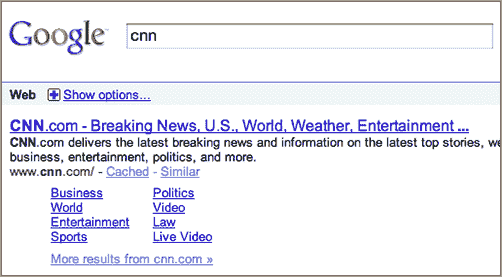

*   前 10 个自然结果归给定公司所有，如图 4-4 所示。

Figure 4-4: `Pepsi` 的 `Google Search` 结果

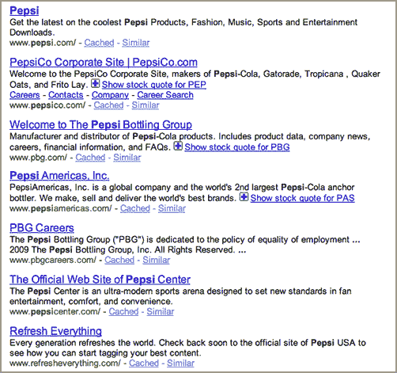

*   页面将包含至少一条正面评论（见图 4-5）。

Figure 4-5: 在 `Google Search` 结果中显示的正面评论

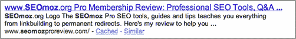

*   给定公司将拥有该查询的所有 `PPC` 广告（见图 4-6）。

Figure 4-6: 由一家公司分发的 `Google ads`

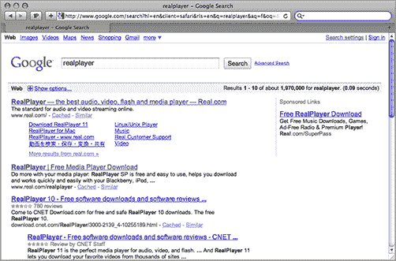

此类结果页的最终结果是，无论搜索者点击哪个链接，他们最终都会进入公司批准的页面。虽然这对用户来说不一定是最好的体验，但它是最好的商业策略。

### 搜索以下所有并识别潜在问题（这不是一个完整的列表）：

*   `Brand Name Sucks`（品牌名很烂）
*   `Brand Name Scam`（品牌名诈骗）
*   `Brand Name Cult`（品牌邪教）
*   `Brand Name Problems`（品牌问题）
*   `Brand Name Issues`（品牌争议）
*   `Brand Name Support`（品牌支持）
*   `Brand Name Broken`（品牌故障/损坏）
*   `Brand Name Error`（品牌错误）
*   `Brand Name Review`（品牌评论）

此列表中的第二个和最后一个行动项目要求你运行……

# 在社交媒体中进行品牌搜索

每当我看到热门搜索查询列表时，我总是会对人们如此频繁地搜索精确的域名或品牌感到惊讶。正因如此，品牌搜索引擎搜索结果页（`SERP`）才显得如此有用。以下操作可以帮助你识别品牌词汇搜索结果页可能需要哪些改进。

以下列表将帮助你获取这些工具提供的某些益处：

### 在 Twitter 上搜索品牌提及

第一个行动步骤是在 `Twitter` 上搜索品牌提及。这一步是搜索 `Twitter` 上的实时（或近实时）提及。要执行此操作，访问 `http://twitter.com`get 搜索框中输入品牌名称。由于我在投诉后联系了他们公司，我可以说他们不仅解决了问题，还给了我应有的信用。

### 在 Google Blog Search 中搜索提及

下一个项目要求你在 `Google Blog Search` 中搜索提及。正如名称所示，它只搜索博客圈。该工具位于 `http://blogsearch.google.com`。为了获得最佳结果，通过点击时间过滤器来缩小范围。这一操作很重要，因为它允许你快速查看影响力人物和新手博主对品牌的看法。博主的意见可以传播到很多人手中并对整体品牌产生巨大影响，你通常会在故事在 `Twitter` 和其他社交媒体上病毒式传播之前在 `Google Blog Search` 上看到提及。

### 在 Google 24 小时搜索中搜索提及

此行动点涉及在 `Google` 中搜索过去 24 小时内的提及。你可以通过在 `Google` 中搜索、点击结果页面上的“显示选项”并点击“过去 24 小时”来完成。这会搜索 `Google` 网络索引中过去 24 小时内的提及。采取这一步骤很重要，因为它让你有机会在被广泛阅读之前追踪它们。尽管如此，在互联网上，24 小时是很长的时间，如果你在发生很久后才发现，可能已经太晚了。

### 在 Google Realtime Search 中搜索实时提及

`Google Realtime Search`（`www.google.com/realtime`）是 `Google` 的一个较新界面，允许你搜索在几秒钟内进入结果页的文章、帖子和推文。你可以根据地理位置和时间过滤你的搜索结果。目前，大多数搜索结果来自社交媒体网站（由于其数量巨大），例如 `Twitter` 和 `Facebook`，但预计很快就会看到更多来源的代表。


Facebook 的独特之处在于它能够避免看起来像一家公司（带有负面含义），即使它在本质上确实是如此。这在很大程度上归因于网上有很多真实朋友在交流。因此，下一个行动步骤是让你在 Facebook 上搜索虚假用户账户和品牌相关的粉丝页。要做到这一点，只需登录 `www.facebook.com/` 并在搜索框中输入品牌名称，就像搜索某个人一样。然后，你就可以联系或浏览该个人或页面提供的任何信息。

*   在 Myspace 上搜索品牌名称的提及。

与上一步类似，你也应该在 `www.myspace.com/` 上搜索品牌提及。这个社交网络网站比 Facebook 小，但涵盖了许多不经常使用 Facebook 的人。要做到这一点，登录 Myspace 并像搜索朋友或用户名一样搜索品牌名称。这可以帮助你看到那些精通网络的人群是如何讨论该品牌的，而这群人与 Facebook 成员有很大不同。

*   在 YouTube 上搜索品牌名称的提及。

你也应该在 YouTube 上搜索品牌名称的提及。虽然这并不全面（它无法检测视频中说出的单词），但它是目前最好的视频搜索工具。要做到这一点，只需访问 `www.youtube.com` 并搜索给定的品牌名称。这一步之所以重要，是因为网络视频的固有属性。它易于消费也易于分享，因此传播潜力是巨大的。我最喜欢的这种反噬品牌的例子是一个词曲手，他喜爱的吉他被美国航空的员工毁了。他联系了航空公司几次来解决这一问题，但他们拒绝赔偿他损坏的财产。他对他们缺乏诚信的行为感到愤怒，于是写首歌并发布在 YouTube 上。当我写这些文字时，该视频的观看次数已经超过了 550 万次。航空公司试图回应他，但损害已经造成了（对他的吉他以及美国航空品牌而言）。

*   在 Digg 上搜索带有品牌名称的提交故事。

此项涉及在 Digg 上搜索带有给定的品牌名称的提交故事。要做到这一点，访问 `www.digg.com` 并在搜索框中搜索品牌名称。这里的技巧在于，你并不一定在寻找已经流行的故事（因为它们很可能已经出现了）；相反，你正在寻找证据，证明有人正试图通过在 Digg 上发布负面品牌故事来发起某些行动。尽早发现这些人尤为重要，这样你就可以在投诉演变成重大问题之前处理它们。

*   在论坛中搜索品牌名称的提及。

第八个行动点比之前的稍微复杂一点。它要求你出去寻找与行业相关的论坛，然后在论坛中搜索品牌名称的提及。找到它们最简单的方法是搜索“行业名称论坛”或行业名称 `inurl:forum*`。（这里的星号表示搜索的是带有“s”的“forums”或不带“s”的“forum”，即单复数。）这很重要，因为论坛成员往往是早期采用者，且技术水平更高。这使得他们成为非常值得留下良好印象的人。

*   在 Craigslist 上搜索品牌名称的提及。

此操作最适用于销售产品的公司。它要求访问 `www.craigslist.org` 并搜索品牌名称的提及。这有助于识别售后市场销售和销售机会。它也是寻找盗版或假货的好方法，这很重要，因为这会直接影响底线。如果你这样做，请务必检查所有相关的地区，因为这些是 Craigslist 上重要的过滤器。如果产品是全球性的，你可以只检查主要城市。这应该让你对问题的泛及程度心中有个数。

*   在 Torrent 站点上搜索品牌名称的提及。

最后一项行动任务让你在 BitTorrent 站点搜索品牌名称的提及。BitTorrent 是一种用于在互联网上快速发送大文件的协议。这使其成为一种非常好的文件共享协议。查看特定品牌产品是否通过 torrent 共享的最简单方法是搜索品牌名称。这可以帮助识别哪些产品正在被非授权共享。


*   **域名不再按名称排名**：有时，一个域名会停止按其名称排名，但继续对其其他关键词进行排名。我只见过一次这种情况，但需要注意的是，修复它非常困难。
*   **整个域名在所有关键词上停止排名**：这非常糟糕——非常，非常糟糕。这意味着整个域名已经从搜索引擎索引中删除了。我见过其中一个案例，该网站花费了一多年的时间才恢复排名。

## 不要恐慌

如果你看到客户的网站出现这种症状（所有或几乎所有来自搜索引擎的流量突然停止），在恐慌之前，务必检查常见的爬虫错误。有时这仅仅是因为有人通过 `robots.txt` 或 IP 地址范围屏蔽了所有搜索引擎机器人，或者如果你的服务器最近有长时间宕机，Google 可能会挂起你的排名。

这些解决方案将在下一章中讨论。

## 与遭受惩罚的客户面

当我第一次遇到处于任何此类情况的客户时，我会将会议作为一个信息收集环节。会议的目标是找到“冒烟枪”（即惩罚产生）。我会弄清楚他们在惩罚开始之前和之后知道的所有变化。这包括实施新的导航结构、更改 URL 结构、更新安全性或任何链接建设活动等。

我还会利用此机会让他们知道，尽管我已经帮助了这种情况下的绝大多数客户，但这些决定的最终决定权在 Google 手中而不是我，他们可能需要考虑其他替代方案。（如果整个域名已从索引中删除，情况尤为如此。）

此外，我会检查可能导致看似像惩罚结果的常见错误。具体来说，我会检查 `robots.txt` 以确保客户没有意外屏蔽相关页面，并检查所给页面上的 `meta robots` 标签，以查看页面是否在页面级别屏蔽了机器人。我还会通过使用 `Googlebot` 用户代理浏览指定的网站，并将其与我作为普通浏览器用户代理浏览网站时看到的内容进行对比，以此寻找隐藏内容（cloaking）的证据。

## 总结

恭喜你，在提高 SEO 技能方面已经迈出了一步。这一章教了你如何识别 SEO 问题。我在第 8 章和第 9 章中将在此基础上进一步讨论全面的 SEO 审计。

你现在应该知道在与潜在客户见面之前应该做的所有工作。我通常会进行本章提到的快速审计，并在与他们第一次或第二次会面时告诉他们我看到了什么。这是向他们展示你完全了解他们的网站并且你非常专业的极佳方法。第 5 章将更上一层楼，讨论如何修复你识别出的 SEO 问题。如果说无知无福，那么到这种程度你应该应该没那么开心了。继续努力吧（Wax on, Wax off）。

## 第 5 章：解决 SEO 问题

### 本章内容

*   让未索引页面被索引
*   修复惩罚
*   在帮助客户的同时节省自己的时间

现在你已经知道如何识别 SEO 问题，准备好开始解决它们了。你准备好学习 SEO 的大秘密了吗？到目前为止你已经涵盖了大量材料，这可能是书中涵盖的最重要的概念。好了，它就在这里：大多数 SEO 问题都是由于缺乏链接导致的。你要知道，超链接是 SEO 的瑞士军刀。在满足其他一些条件的情况下，链接可以修复几乎任何问题。搜索引擎需要索引并排名人们自然链接的内容。在排除这个剧透之后，本章将介绍如何修复 SEO 问题和获取更多链接。

### 当务之急

当我开始修复 SEO 问题的实际工作时，第一件事是检查以下常见领域。我在浪费了太多时间深入挖掘 SEO 问题之后，出于需要开发了这张清单。就像软件领域一样，有时最好的 SEO 解决方案往往是最简单的。

*   **识别链接概况**：SEOmoz 的 SEO 专家和科学家认为，Google 现代算法中约 70% 与链接指标有关。这是基于大规模的相关性测试和第一手 SEO 经验。搜索引擎如此关注链接，是因为它们揭示了大量关于网站的信息。这就是为什么当我开始分析一个网站时，链接概况是我检查的第一项。
*   **规范化 (Canonicalization)**：规范化错误非常常见，对网站的排名能力可能极具危险。我在处理网站时检查的第二件事是其首页是否经过了规范化。
*   **Robots.txt**：我检查的下一个 SEO 元素是网站的 `robots.txt` 文件（位于路径 `www.example.com/robots.txt`）。具体来说，我是在确保他们没有屏蔽任何不该被屏蔽的内容。你可能认为这显而易见，但很多时候它会遗漏，一个错位的按键就可能完全摧毁网站的索引能力。当我与当时排名前 10 的网站之一核对这张清单时（抱歉，他们与我签了保密协议），我发现他们意外屏蔽了所有搜索引擎机器人访问他们最重要的内容。这个简单的错误可能让他们损失了巨额金钱。
*   **Meta Robots**：由于检查 `robots.txt` 相同的原因，我会检查我从事 SEO 工作的网站首页和内容页面上的 `meta robots` 标签。此标签的参数可能非常困惑，如果处理不当，会导致很多问题。具体来说，我正在查看重要页面是否被错误地标记为 `"noindex"` 或 `"nofollow"`。

> 注意：仔细阅读 `<head>` 部分中的 `meta` 标签。`"noindex"` 或 `"nofollow"` 属性可能没有分配给通 `"robots"` 属性；相反，它们可能指向特定的引擎属性，如 `"googlebot"` 或 `"msnbot"`。

*   **Google 中的 site 命令**：在检查了重要的站内因素后，我会从搜索引擎的角度进行检查。我首先在 Google 中运行 site 命令（例如，`site:www.example.com`）。这可以让你大致了解网站有多少页面被索引。注意是否有异常高的数字（重复内容）或异常低的数字（爬虫陷阱）。范围取决于网站的大小。一个很好的指标是询问站长他认为网站上有多少页面，并据此做出判断。
*   **首页的纯文本缓存版本**：列表上的最后一项可能是最重要的。在主要搜索引擎中搜索首页的精确 URL。如果该页面不是第一个结果，说明网站可能遭受了惩罚，你面临大问题。如果是第一个结果，点击链接查看页面缓存版本。这是搜索引擎拥有的页面副本。在 Google 中，我总是确保点击 `"纯文本版本"` 链接，因为这过滤掉了基于 JavaScript 的页面元素、CSS 和 Flash，并更准确地指示 Google 在查看你的页面时看到的内容。

提示：每当我被要求为网站提供免费 SEO 建议时（例如为了朋友或熟人），我都会运行“当务之急”清单上的项目。这既快速又，通常有助于他们提高排名。

## 修复权重问题


以下与流行度相关的问题几乎都是由于缺乏链接导致的。页面问题通常很容易识别，但修复它们需要大量工作。

## 页面未被索引

### 症状
特定页面在特定搜索引擎的搜索结果中没有出现。

### 解决方案
1. 首先，使用 `site` 或 `info` 命令结合精确的 URL 来验证该网页是否确实未被索引：

`site:www.example.com/products/bacon.html`

或者

`info:www.example.com/products/bacon.html`

如果没有返回任何结果，说明该页面确实未被索引。

2. 接下来，检查搜索引擎爬虫是否被阻止在该页面之外。请务必同时检查给定页面上的 `robots.txt` 和 `meta robots` 标签。（我曾见过这种情况发生很多次。）

`robots.txt` 位于 `[www.example.com/robots.txt](http://www.example.com/robots.txt)`。

Meta robot 位于文档的 `<head>` 部分，格式如下：

```html
<meta name="robots" content="follow,index">
```

你需要避免出现 `noindex` 作为参数。

如果页面被阻止了，只需删除相关的代码行并等待搜索引擎重新爬取该页面即可。

你可以使用第 3 章提到的 Firefox User Agent Switcher 模拟搜索引擎蜘蛛来访问网站。

3. 如果页面看起来没有被阻止但仍然未被索引，请尝试在伪造主流搜索引擎用户代理标识（User Agent）的情况下访问该页面。有时，刻意或无意的斗篷法（cloaking）可能会防止页面被爬取。

注意：伪造用户代理在大多数情况下是模拟搜索引擎的有效方法。然而，有时服务器会对 IP 地址或其他因素做出反应，而不是用户代理。查看你的服务器日志是查看服务器如何响应搜索引擎访问的最有效方法。

4. 如果页面未被索引且机器人未被阻止，问题几乎总是由于域名没有足够的链接来使其所有页面被索引。解决此问题最简单的方法是确保网站具有适当的信息层级。你的目标是让域名首页与未索引页面之间的点击次数（通过导航链接）尽可能少。

5. 在你的页面上找到一段随机的复制文本，并在 Google 中对该字符串进行带引号搜索。你可能会发现来自你网站（或其他网站）的 URL 重复版本，该版本被认为比你的 URL 更具权威性，并导致了你的页面未被索引。

6. 如果无法改进网站的信息层级，你可以尝试为网站添加站点地图（sitemap），如果它还没有的话。有时这被证明是搜索引擎完全导航网站所需的工具。

站点地图有两种不同的不同的类型——HTML（传统类型，具有普通网站页面的外观和视觉体验）和 XML（你网站所有 URL 的长列表，用户不可见）。同时拥有两者可以提高索引率。

7. 最后的解决方案也是最有效的。让页面被索引的最佳方法是让它获得更多链接。内部链接（来自同一域名的链接）是好的，外部链接更好，但两者的结合是最好的。假设页面和域名未受惩罚影响，且页面上有可爬取的内容，建立更多的外部链接（来自其他域名的链接）几乎肯定会让页面被索引。你可以通过本章后部分“链接建设技术”部分中列出的策略来实现这一点。

## 页面已索引但排名不佳

### 症状
给定页面确实对某些词有排名，但在结果中的排名低得异常。

### 解决方案
1. 如果你遇到这种情况，我建议你首先检查竞争对手。检查他们的链接概况（流行度）和页面构成（相关性），并弄清楚为什么他们排在你的客户之上。

很多时候，你可以使用他们使用的相同策略来提升你的排名，并将其与自己的技巧相结合以超越他们。

为了做到这一点，我建议使用 SEO Book 的 `HubFinder`（一个帮助你在在线利基领域寻找相关网站的工具）或 SEOmoz 的 `PRO` 工具（一组工具，可以向你展示你在互联网上的特定领域排名如何，并提供关于如何提高排名的具体建议）来识别他们的链接概况。我还建议使用 SEO Browser 或 SEOmoz 的 `mozBar` 分析竞争对手页面的相关性因素。

2. 如果你没有看到竞争排名高于给定页面的任何明显原因，请检查该页面是否受到了惩罚。（有关搜索引擎惩罚的讨论请参阅第 4 章）。如果页面看起来受到了惩罚，请按照本章后后部分“修复惩罚”章节中的步骤操作。

3. 如果竞争对手没有明显的优势且页面未受惩罚，解决方案可能是改进域名的信息层级，使页面在内部链接到更突目的位置。记住，最好的层级是那些在点击次数（通过导航链接）尽可能少的层级。

4. 如果之前的解决方案没有帮助，我建议提高页面与术语的相关性。确保术语出现在所有重要位置。（更多信息请参见相关章节。）

5. 如果其他方法都失败了，你需要为该网页获取更多外部链接。事实上，这个解决方案被证明比列表上的任何其他方法都有效。链接就是权重。

## 页面已索引且排名良好
虽然这不完全是一个问题，但它不一定是最终目标。比排名第一更好的是？排名前十名。

### 症状
给定页面针对某个词有排名，但对另一个词的排名非常好。

### 解决方案
1. 为了在搜索结果中获得更多给定页面的提及，尝试链接到提及该 URL 的相关文章。许多这会将链接的 URL 添加到搜索结果中并有效地让你的 URL 主导搜索结果。

例如，如果你正在塑造新产品的搜索结果，尝试链接到评价该产品的正面外部文章并指向产品页面。我通常将其放在标记为“媒体提及”的部分下。

谨慎使用时，子域名对 SEO 有益（国际化就是一个很好的例子）。

如果给定网站有足够的权重，可以在给定域名上让多个不同的子域名针对给定词排名。实现此点的最佳方法是创建一个相关的子域名并尽可能向它建立链接。

警告：过度使用这种技术会导致惩罚。为了捕获精确匹配查询而创建子域名是一种过时的垃圾策略，如今权重已被稀释。

如果你有一个特定产品的 URL，将其作为子域名创建一个细微变体是有帮助的。例如，`[www.example.com/Product](http://www.example.com/Product)` 可能是产品的落地页，而 `[`download.example.com/Product`](http://download.example.com/Product)` 可能是实际下载的地方。（再次，谨慎使用这种技术，因为它只对谨慎使用的非常强大的域名有效。）

3. 获得特定搜索词所有结果的另一种解决方案是创建一个所谓的微站（microsite）。微站是一个独立的域名（通常包含与给定查询完全匹配的域名），它拥有针对非常特定主题的内容。这种技术对于控制搜索结果中的多个结果很有帮助。


其中一个例子是 Open Site Explorer。这个工具由 SEOmoz 创建，位于 [www.opensiteexplorer.org](http://www.opensiteexplorer.org) 而不是 [www.seomoz.org](http://www.seomoz.org)。选择这个 URL 是为了不寄生于 `seomoz.org` 的域名权重，而是让该工具在自己的域名上获得链接，从而让 SEOmoz 能够控制两个强域名。这对排名很有帮助，因为当出现合适的搜索查询时，主要的搜索引擎引擎会同时显示这两个结果（`SEOmoz.org` 和 `OpenSiteExplorer.org`）。

 4. 即使你拥有了某个页面上的所有结果，你仍然可以占据更多的屏幕空间。从搜索引擎中购买广告是获取相关点击的一种极其有效的策略。如果你还没有尝试过付费搜索引擎广告，你应该尝试一下看看它在你的细分领域效果如何。

## 购买竞争对手的网站

如果你赢不过他们，就买下他们。事实上，即使你能赢过他们，购买竞争对手的网站有时也是值得的。记住，搜索结果页面页（SERP）上大约 90% 的点击流向前三个结果。根据你的细分领域，从竞争对手手中购买网站在财务上可能是划算的。

尽管此书中经常讨论如何正确地重定向，但这是一个你不应该进行重定向的情况。如果你仅仅为了将一个域名合并到另一个域名而购买它并无法获得更多的 SERP 空间。（这样做会让你的域名变得更强大，但你会失去让你的更多域名出现在结果中的机会。）

## 修复相关性问题

现在你已经知道如何修复最常见的权重问题，可以准备学习如何修复一些相关性问题了。你可以放心，大部分这类问题都更容易解决。

## 修复重复内容

重复内容是互联网上最广泛的 SEO 问题之一。这个问题非常严重，以至于搜索引擎创建了一个工具（`rel="canonical"`）来帮助处理这个问题。

### 症状

内容出现在同一域名或不同域名的多个 URL 上。

### 解决方案

1. 首先，你需要找到所有违规的重复内容。在给定页面上选择一个随机文本字符串。在引号中使用搜索引擎中搜索该短语：

```
site:www.example.com "this is text from the page"
```

或者，你可以使用 `site` 命令搜索精确的 URL，或者使用 `intitle` 命令并在引号中搜索精确的标题标签：

```
site:www.example.com/exact/URL/of/suspected/page.html
intitle:"This is the exact text from the title tag of a suspicious page"
```

图 5-1 显示了你可能看到的示例。注意这些 Facebook 域名的搜索结果是如何显示出相同内容的多个版本的。所有这些 URL 都包含重复内容。

`site` 和 `intitle` 技术可以用于寻找不同 URL 的重复版本，这通常通过文件名后包含动态参数来体现。然而，在某些情况下，重复内容会位于不同的基础 URL 上，并且无法通过在 `site` 命令后列出完整 URL 来捕获。为了无论 URL 如何捕获你网站上所有可疑的重复内容，通常有效的方法是在 `site` 命令后直接显示主页的 URL，如下：

```
site:www.example.com/ intitle:"This is the exact text from the title tag of a suspicious page"
```

图 5-1： 显示带有重复内容的 Facebook Google SERP

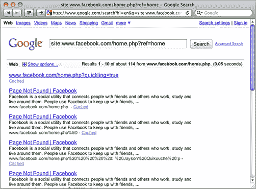

2. 解决重复内容的最佳方法是使用 `rel="canonical"` 标签：

```html
<link rel="canonical" href="http://www.example.com/awesome.php?item=bacon" />
```

此标签充当对搜索引擎的强有力的提示，帮助它们理解重复内容。将此代码插入违规页面的 `<head>` 中，这个问题将会在很大程度上得到解决。

**注意** 请仔细检查你的 `canonical` 代码，否则将承担后果。你可能会使用自动化系统来添加一个剥离多余参数的 `canonical` URL。在写入你代码的 `<head>` 部分之前，请确保它确实剥离了那些参数。如果 `HREF` 值仍然是你想要避免被索引的带有参数的长版本，那么添加 `canonical` URL 代码行是无于事事的。

**提示** 当搜索引擎齐力对诸如重复内容等问题时，值得关注。这是它们承认自己的算法并不完美并需要外部协助的证明。通常情况下，在帮助你的内容符合搜索引擎的要求以及帮助它们克服自身缺陷方面花的努力，将为你的网站创造机会。

3. 有时，你可能会遇到无法实施 `rel="canonical"` 标签的情况。我在旧版内容管理系统中经常看到这种情况，这些系统在构建时通常没有考虑 SEO。如果发生这种情况，最好是在违规页面上添加带有 `"noindex, follow"` 的 `robots` 元标记标签（这很难做到，因为可能会无意中将页面的规范版本设置为无索引），或者在 `.htaccess` 文件（Apache）中实现 `301` 重定向，如图 5-2 所示。

```html
<meta name="robots" content="noindex, follow">
```

图 5-2 一个重定向的 .htaccess 文件


4. 如果重复内容是由会话 ID 或跟踪代码引起的，你可以向 Google 提供忽略这些模式（例如 `?tracking=123`）。这是通过 Google Master Tools 实现的。当你在搜索引擎工具中选择设置时，该更改仅影响搜索引擎如何查看你的页面。这与你对实际网站所做的更改不同。

**注意** Yahoo 比 Google 早早推出了参数处理工具。遗憾的是，在 Google 之前这个概念并没有得到很多关注。

5. 我看到的另一种常见情况是重复内容位于第三方网站上。在这种情况下，你可以通过礼貌邮件请求对方删除内容。

6. 或者，你可以要求对方站长直接链接到你的文章。这有助于搜索引擎理解原始副本的位置，并在某些情况下可以提高你的权重指标。

7. 如果礼貌邮件无效且两个网站都在美国，你可以发送一份 DMCA 终止通知（数字千年版权法）。我曾在两个场合看到过这种方法有效。

## 修复排名错误关键词的页面

有时，一个页面会针对错误的关键词排名。虽然这并不是真正的问题（“噢不！我排了太多多的词！”），但这是一个可以改进的情况。

### 症状

页面没有排在你想要的关键词上。这与页面排在主关键词以及许多其他变体（长尾词）上的常见情况不同。

### 解决方案

1. 当这种情况发生时，几乎总是由入链（来自强大的外部域名）使用违规词作为锚文本引起的。你的最佳选择是通过在 URL、标题和文中包含目标关键词，使页面与其真实的关键词更具相关性。然后你需要使用正确的锚文本建立链接。

2. 如果该解决方案不起，你应该考虑更改页面的 URL。这会抵消所有的违规入链（通常是一个非常糟糕的主意），但给了你一个重新开始的机会。

## 修复惩罚

搜索引擎惩罚是成功的网站管理员噩梦的来源。前一天你还在竞争激烈的 SERP 顶端，第二天就被完全从所有列表中移除。幸运的是，你还有事情可以做的。


## 遭受惩罚的页面

根据我的经验，这是潜在客户报告得最多的 SEO 问题。

### 症状

一个页面要么完全从搜索引擎索引中消失，要么对于某个它曾经排名很高的词，其排名低得可疑。

不要将“被惩罚”与仅仅在你的重要关键词或词组上排名不佳混淆。这两者之间是有区别的。

### 解决方案

1.与其他 SEO 问题不同，识别问题并不是寻找解决方案的第一步。当你怀疑一个页面被惩罚时，要做的的事情是弄清楚发生了什么。很多时候，这只是网站上简单的代码更改。根据我的经验，这些更改包括修改页脚链接和修改全局导航。在其他情况下，原因是来自不良来源的新组入站链接。

在最坏的情况下，这是搜索引擎黑盒内部的算法更新。

**警告** 引起惩罚的常见策略示例包括：

*   向搜索引擎发送特定的全局导航，而向用户发送不同的导航（障眼法）
*   仅为了提高相关性指标而使用的晦涩难懂的文本
*   购买链接
*   在页脚添加无关链接
*   关键词堆砌
*   自动链接建设
*   误导性重定向
*   误导性 URL
*   误导性标题标签

2. 消除惩罚的下一步是修复给定网站上每一个易于识别的 SEO 问题。扭转惩罚最好的办法是停止任何可能导致惩罚的行为。

这可能包括障眼法、垃圾内容、隐藏内容（放置在可见页面之外、分在图形下方或以与背景颜色相同或非常接近的颜色显示）、隐藏链接、付费链接、链接农场、误导性重定向和误导性 URL。简单来说，如果你不觉得可以向某家主流搜索引擎的工程师介绍某项策略，那就停止这样做。

如果你采取了修复这些问题的路线（你应该这样做），请务必记录下你更改的内容。我见过有人花费大量的时间和金钱试图寻找一个并不存在的“冒烟枪”。

3. 在清理你的网站后，你需要制定一个备用计划。相关页面可能永远无法恢复到之前的排名。（这种情况发生在搜索引擎算法本身发生变化时，而不是给定网站上发生了变化。）你应该警告自己或你的客户，页面可能无法回到之前的排名水平。

4. 在你实施了所有清理给定网站的更改后，你可以向 Google 提交重新包含请求。在请求中尽可能开放和诚实。SEO 专家不知道 Google 有什么工具来调查惩罚，但我们知道它的某些资源：

*   搜索引擎拥有你网站的副本，以及所有指向该网站的列表以及该列表随时间变化的情况。
*   他们拥有关于网站托管地和域名所有者的信息。
*   他们拥有有关给定网站竞争对手和盟友的信息。
*   他们至少有一份网站以前的快照。

获得重新包含的最佳机会是诚实并修复你所能的一切。

重新包含请求的处理需要三周到三个月不等。Google 很少回复这些请求，而且没有办法（据我所知）可以插队。不要提交多个请求。很多人都会这样做，这会让审核员感到沮丧。将自己放在阅读所有重新包含请求的人的立场。在写你的请求时，就像在和一个真人对话一样，而不是一家巨型公司。

5. 另一种方法是尝试联系搜索引擎发言人。他们会在搜索引擎会议上出现，有时能够解决问题。这种选择比重新包含请求更有成功的机会，但也非常不方便。Google 员工经常活跃在站长帮助论坛（`[www.google.com/support/forum/]`）。在内部，站长中心论坛有一个名为“爬取、索引与排名”的特定分类，人们可以在那里寻求帮助诊断惩罚。

## 重新包含请求示例

在向 Google 提交请求时，不要逐字复制此封重新包含请求。对你的信息进行个性化并仅将此信作为灵感是非常重要的。某些搜索引擎员工很可能会读这本书和/或意识到这个模板。

亲爱的 Google 员工：

感谢您抽空阅读。我是 `EXAMPLE.COM` 的 `JOB TITLE`，一家位于 `CITY`, `STATE` 的 `INDUSTRY-TYPE` 初创公司，提供 `VALUE PROPOSITION`。

上周，我们的网站 `WWW.EXAMPLE.COM` 失去了所有来自 Google 的引荐流量。我们之前在 Webmaster Central 注册过，但没有收到任何关于发生这种情况的通知。直率地说，我的同事和我正处于恐慌之中。我们努力做一个诚实的团队，并且据我所知，我们一直都在 `Google 准则` 内行动。

在过去的一周里，我们与一名 SEO 顾问合作，帮助弄清楚我们为什么被惩罚。以下是我们根据他们的建议所做的更改：

列出实际更改。示例可能：
*   我们曾实施了一套 IP 定向系统，为 `Googlebot` 创建了特殊处理情况。从后我们删除了该功能，转而采用更开放的做法。
*   我们的页脚中有 50 个链接，这些可能被视为垃圾信息。我们在不了解 SEO 最佳实践的情况下添加了它们。从后我们删除了它们。
*   我们的核心页面上关键术比例很高。这些可能被解释为关键词堆砌。从后我们删除了多余的提及。

我不知道这些是否是导致我们排名下降的问题，但以防万一，我们已经停止了它们。我们有良好的意图，只想回来。

感谢您抽空阅读此信。

顺颂商祺，

`NAME`

*   在提交重新包含请求之前，修复每一个可能的问题。不要修复一个项目、请求重新包含、等待结果，并通过修复另一个项目来重复这一过程。
6. 我建议的最后策略是在热门公共网站或博客上投诉这个问题。虽然这缺乏技巧，但我见过这种策略奏效。有时 Google 会犯错，如果你的情况属于其中，Google 会在压力下修复它。

## 遭受惩罚的域名

偶尔，主流搜索引擎会惩罚整个域名。这是最坏的情况。

### 症状

域名上的所有页面排名都远低于以前，或者它们完全从搜索引擎索引中消失。

### 解决方案

1. 如果你不幸地遇到了了这种情况，该域名可能做了某些在搜索引擎看来非常糟糕的事情。遵循“遭受惩罚的页面”下列的步骤。
2. 一个被踢出索引的域名可能需要几个月到几年的时间才能回到索引。如果是这样，启动一个新域名几乎比花费时间尝试恢复旧域名要明智。

## 毒链接

获取“毒链接”——来自明显垃圾信息来源的链接（例如，来自 `[http://cheap-drugs-for-sale.blogspot.com]` 且锚文本为 `buy prescription drugs online for free` 的链接）是一种老策略，虽然现在没有以前那么有效，但仍可能对不幸的目标产生负面影响。

### 症状

一组来自“不良社区”（色情、处、赌场、黑客等）网站的链接指向一个页面并导致其排名下降。


### 解决方案

1. 如果你遇到这种情况，你的首要目标应该是尝试联系链接来源的网站，并要求他们删除这些链接。由于毒性链接背后的固有因素，这种方法很少奏效。尽管如此，值得一试。

2. 如果你无法让链接删除，你应该尝试让这些链接失去信誉。通过收录请求（reinclusion request）向 `Google` 反馈这些链接。同样，要诚实、礼貌且开放。搜索引擎实际上从这种策略中获益，因为这有助于它们识别垃圾来源。这会让它们更愿意帮助你。

3. 如果其他方法都失败了，你可能需要更改被链接页面的 URL。这将导致该页面丢失所有的入链链接，但可能有助于拯救域名。

## 惩罚 vs 过滤器

我接触过的许多 SEO 专家和网站管理员将惩罚和过滤器归为一类。尽管这些反垃圾邮件方法的效果相似，但它们在本质上是完全不同的。

*   `Penalties`（惩罚） 往往非常严重。其中许多是在搜索引擎代表进行人工审核后实施的。它们很难扭转，并且通常会影响网站上的许多页面。
*   `Filters`（过滤器）则不同。它们通常由算法检测触发，程度比惩罚轻。。很多时候，它们可以通过标准的排名下降（例如，下降 50 位）来识别出来。

最核心的结论是，过滤器和惩罚都存在，当遇到时应该认真对待。不要简单地假设在你不采取任何修复工作的情况下它们就会消失。

## 链建设技术

获取额外的入链链接是解决大多数 SEO 专家面临的问题的通用方案。为了让这项艰巨的任务变得简单一些，我整理了一份我最喜欢的链建设技术列表。并不是所有技术都适用于所有人，但这个列表足够长，你几乎肯定能找到适合你情况的技术。

SEO 专家面临的大多数问题都可以通过添加入链来解决。

### 低风险链建设技术

*   开一个博客：你的生活就是一个故事。建立博客非常容易，如果你能够找到差异化自己的方法，你将拥有无限的链接机会。找一些你认为其他人（不仅仅是你自己）会感兴趣的内容，并将其分享给世界。（如果你是大型组织的一部分，创建一个业务博客同样有帮助。获得内容的批准会增加一些官主义的烦恼，但如果你坚持下去，它是值得的。关于公司内部的诚实、富有见见的博客是稀有的，并会获得高质量链接。）
*   帮助博主：博主是极好的链接供应商。这是他们工作的自然部分。你可以通过帮助他们找到所需的信息来利用这一点。最简单的方法是找到博主犯错误的近期文章，并发送一封礼貌的邮件进行纠正。很多时候，博主会出于感激选择链接回你的页面。
*   注册 `HARO` (Help A Reporter Out)：同样地，你可以帮助在线记者完成他们的工作。这项服务将记者、内容制作人员与可以回答他们问题的人联系起来。你可以成为他们寻找的受访谈专家。
*   联系业务合作伙伴：如果你在经营业务，无疑会有业务合作伙伴。这些伙伴可能拥有链接。考虑在与伙伴完成简单任务时接受链接而不是报酬。

（注：由于原文中存在大量重复的列表项，译文已按要求去重并保留了核心内容。）


*   编写一个风趣或有趣的测试验：人们喜欢参加测试并展示结果。例如包括：你是哪位电力龙战士？你最像哪种小道具？你在荒荒岛上能生存多久？你的大脑值多少钱？这类测试很容易构建，而且是极佳的链接构建器。（只需确保它们与你的内容相关，否则你可能会遇到惩罚。）

*   制作一个在线游戏：我见过的最好的“链接磁铁”案例之一是 `TravelPod.com` 的 `Traveler IQ Challenge`。这个简单的基于 Flash 的游戏为他们赢得了数万个链接。

*   在重要博客的评论区中互动：这是一种间接的链接获取技术。除非链接高度相关且真正有趣，否则不要在评论中发布你自己的链接。相反，要与作者以及社区中的其他人建立起你的个人声誉。

*   参加行业活动：链接建设者往往倾向于链接到他们认识的人。参加行业活动不仅能让你出现在正确的人面前，还能帮助你建立个人品牌。事实上，我个人网站的至少有一半的链接来自讨论行业活动经历的博客文章文中对我的提及。

## 风险较高的链接建设技术

虽然我不建议以上任何技术，但我将它们包含在内是因为我见过它们是有效的。我坚信这些不是良好的长期策略，因为它们很容易被发现并导致信誉受损。尽管如此，我见过许多网站使用这些技术获得了高排名（至少在短期内）。

*   从目录（Directories）购买链接：如果你选择这条路线，请务必只从那些既能传递权重（juice）又排名很高的页面购买目录链接。（我建议 `mozRank` 达到 `5.00` 或更高）。你希望你的链接距离首页点击次数越少，并且看起来尽可能合法。记住要衡量实际包含你链接的页面权威性，而不是该网站首页的权威性，也不是你链接所属的顶级分类页面的权威性。如果该分类已经有 12 页链接，你将处于靠后的位置，该页面不太可能具有权威性且不被频繁抓取。

*   从链接经纪人处购买链接：链接经纪人出售或租赁高流量且被大量链接的网站空间。这意味着他们对对 SEO 和驱动流量都可能有帮助。

*   寻求社交媒体影响者的帮助：这是我所有“不推荐”的链接建设实践中最喜欢的。社交媒体网站上的大部分热门内容由少数较少的内容提交者控制。这些强大的人通常可以被收买，虽然不能保证能在热门网站的首页获得内容，但很有可能。

*   购买自然链接：你是否与某个重要网站的人有联系？如果是，你可能可以从他们那里购买链接。我不建议这样做，但如果保持低调，它很可能对你有帮助。

## 让每一页页面都值得链接

十或十五年前，最优秀的 Web 程序员是那些能够平衡视觉效果和代码效率的人。换句话说，除非某行代码的结果对网站有益，否则没有理由编写它。有限的带宽为快速加载的页面创造了价值。对于例如 `56 Kbps` 这种有限带宽的用户来说，每一秒都是宝贵的，任何多余的代码都是在浪费时间。

同样，“值得链接的页面”背后的哲学是：如果一个页面由于某种原因完全没有机会被某个网站或其他网站链接，那么就没有理由创建它。因为链接权重（link juice）和权威性都是有限且宝贵的（就像上一个例子中的时间和带宽一样），创建那些只会消耗网站权威性而永远无法赚取自身权威性的页面是没有益的。

这并不意味着所有页面都是平等的，并且应该在你的架构中获得同等对待。相反，这意味着在你决定内容时，也应该同样决定授予每个页面什么程度的权威性。虽然你可能被迫设置一个“条款与条件”页面，但你也可以决定它不会从你的导航中获得任何链接权威性（这与说它不会获得任何内部链接是完全不同的）。

为了内容而内容是对资源的浪费，也是对用户的干扰。从 SEO 策略和用户体验方面来看，拥有 12 页真正的干货远比拥有 100 页幻影和尘埃好得多。如果你正准备创建一个页面，但无法想象谁会链接它或为什么要链接，那么你就应该重新考虑创建它。

## 总结

恭喜你！你现在应该知道如何识别和修复最常见的 SEO 问题了。这让你在大多数竞争对手中占了先机。你只需要记得遵循“首要任务（First Things First）”一节中列出的步骤，验证问题是否存在，使用搜索引擎提供的工具（如 `rel="canonical"`），与搜索引擎进行，，如果一切都失败，就建立更多链接。

在下一章中，你将学习我和同事使用的 SEO 咨询流程。正如你将发现的，知道答案是不够的；你还需要知道如何实现它们。

# 第 6 章：SEO 最佳实践

### 本章内容

*   信息设计最大化
*   避免内容创作陷阱
*   理解专家建议

如何构建一个完美优化的页面？作为一名 SEO，你可能会经常听到这个问题。遗憾的是，并没有一个现成的答案，但你可以从一组最佳实践中汲取以接近目标。在本章中，我将教你关于实现页面内关键词定位“完美”（或至少是接近完美）的首要建议。其中一些建议得到了数据点、相关性研究和广泛测试的支持。另一些则是基于我经验的秘密。由于这种形式我无法容易更新，因此你有责任采取这些建议并进行自己的研究，以查看它们是否仍然是最佳实践。为了方便起，我尝试关注宏观思想并跳过不重要的细节。（尽管如此，你可以在 `www.seomoz.org/learn-seo/` 查看当前的最佳实践。）

## 页面级信息层次结构

等一下，我是页面级信息层次结构

第一章讨论了相关性和流行性的重要性。正如你现在所知的，搜索引擎用于页面排名的大量相关性指标来自于页面内元素。本节展示了这些指标的最佳格式。

### 最佳实践

图 `6-1` 显示了使用单个关键词或短语优化 URL 的最佳实践。注意相关短语位于所有的 SEO 页面元素中。

```
图 6-1：格式化页面示意图
f0601.tif
图片来源：Rand Fishkin
```

### 原理

此页面在所有适当的地方都包含了给定的关键词短语，使其尽可能具有相关性。它通过在语义上有帮助的地方提及关键词而不过度使用，避免了垃圾信息式的堆砌。我的意思是，该页面看起来和读起来就像是为人类编写的，而不是为了搜索引擎。

这听起来可能非常模糊，但使用关键词的唯一“坏”地方是：它的出现暗示了这样做是为了算法利益而不是为了可用性。这可以发生在任何地方，包括标题、标题、正文、图注、alt 文本或任何其他可以放置文本的地方。

在某些位置上，无论你使用多少次，关键词都对你毫无作用——代码中的行内注释、meta keywords 标签，以及图形图像中的关键词（例如文本的截图）等等。


你将在本章节后面的部分找到更多详细信息。

## 领域级信息层次结构 (Domain-Level Information Hierarchy)

领域级的相关性指标提供了上下文。它们比页面级指标更复杂，因此通常是一个 SEO 问题。本节描述了如何设置这种层次结构以实现搜索引擎效益的最大化。

### 最佳实践

在从首页到每个内容页面之间，尽可能减少点击次数（导航链接）。你可以在图 6-2 中看到使用这种理念的优化网站结构示例。

图 6-2： 链接金字塔

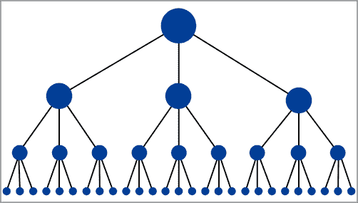

在执行此操作时，应确保 `mozRank` 为 4.00 或低的页面每页链接数低于 50 个，`mozRank` 为 6.99 或低的页面每页 100 个链接，`mozRank` 为 7 及以上的页面每页 150 个链接。

你可以通过简单地不包含额外链接（我最常用的解决方案）或将额外链接嵌入混淆的 JavaScript 中以使搜索引擎无法解析它们来实现。

### 推理

搜索引擎爬虫访问网站的深度取决于给定域名的链接流行程度。更多信息请参阅第 2 章中标题为“1100 英尺视角——网站”的章节。

## URL

页面的 URL 对于搜索引擎爬虫和人类来说都是重要的。URL 应该尽可能使用少字符（以便人类记忆和链接），并准确地描述给定页面的内容。

## 使用层次结构分配权重

这似乎是一个悖论，不是吗？最小化点击路径和限制页面链接数量的理念，从定义上来说是冲突且矛盾的。然而，作为 SEO 人员，这正是你的挑战。

对于一个拥有 5000 页的网站，你可以简单地从首页链接到所有 5000 个 URL 来完全最小化点击路径，你将拥有一个真正的“最小”点击路径：所有 URL 距离根目录只需点击一次。

或者，为了完全减少页面上的链接数量，你可以只需从每个页面链接一个 URL。每个目标页面都将获得链接页面权重的全部收益，但到达网站的最终页面将需要 5000 次点击。

显然，这两种方法都不是最优的，因此诀窍在于两者之间找到正确的平衡。仅仅建议你创建一个金字塔型的网站结构可能够的，因此考虑采取这些额外步骤：

*   对你的内容进行分段（无论是文章、产品、分类页面还是所有这些），并识别出最有潜力的内容（通过需求、产品盈利能力等衡量），并赋予其有利的层次状态。有利的层次状态可能意味着放置在首页的显著位置、在对内容进行分页之前处于顶部排序位置（例如，如果你的产品多于一个分类页面能容纳的数量），并且仅从深层页面链接到低潜力页面（隐私政策、条款和条件等），而不是从每个页面链接。

（注：原文中存在大量重复内容，已根据要求去重处理。）


如果你正尝试针对竞争非常激烈的词进行排名，将关键词放在标题标签（title tag）的开头最好。如果你竞争的是竞争性较小的词，且品牌化有助于提高点击率，那么最好将品牌名称放在前面。对于特殊字符，我倾向于使用竖线（|）以顾美观，但连字符、n-破折号、m-破折号和减号都可以。

与许多 SEO 策略一样，标题标签具有双重目的：

* 向用户展示该页面的内容
* 向搜索引擎展示页面的内容

虽然有证据表明搜索引擎会读取 80 个或更多字符（更重要的是，将其纳入排名因素），但搜索引擎通常会在第 65 个字符左右截断标题标签。这意味着超过 65 个字符的字符（如果单词跨越该字符，则更早）将变成省略号，甚至不会出现在大多数搜索结果页面页面（SERP）上。（长尾查询的标题标签有时会超过 65 个字符。）

此外，针对搜索结果的眼动追踪研究表明，即使标题标签字符出现在 SERP 中，你的网站排名越靠后，用户阅读的字符就越少。换句话说，如果你的网站列在自然搜索的第一位，用户可能会阅读其整个可见标题。但如果你排在第二、第三或页面更靠后的位置，他们在继续向下浏览页面之前，可能只阅读标题标签的三之二、二分之一甚至三分之一。

所有这些事实表明，标题标签代表了非常宝贵的版地，而在这块版地上，路边的位置（标签的前端）比地块后方的树线要重要得多。

如果可能，对于竞争非常激烈的词，请精心设计你的标题，使其在达到第 35 或 40 个字符时，页面的信息已经清晰。

我将标题标签和元描述（meta description，将在下一节讨论）视为你 URL “电梯演讲”中的组合拳一一二。你只有几秒钟时间（最多）来来说服用户，点击你的页面将满足他们的查询意图。用户将使用标题和描述来决定点击你的结果还是他人的结果，因此它们必须富含关键词，并提供快速且令人记忆的信息。

## 元描述 (Meta Description)

元描述是网站管理员在他们的搜索结果出现在 SERP 时可以包含的免费广告。它们应该像传统广告一样经过优化和测试。

### 最佳实践

搜索引擎并不直接使用元描述来建立排名。这意味着，当元描述写得像广告以吸引点击时，对网站管理员来说最有帮助，而不是为了帮助搜索引擎进行排名。

大客户通常把这种描述写得很糟糕。注意图 6-3 中，《纽约时报》对“United Nations（联合国）”一词有一个非常引人入目的元描述，而联合国的官方网站做得很糟糕（图 6-4）。

图 6-3: 《纽约时报》关于“United Nations”的搜索结果，具有良好的元描述

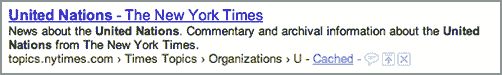

图 6-4: 英语查询“United Nations”的联合国官方搜索结果。这是一个糟糕的例子，因为元描述使用的是外语，且不符合 SEO 最佳实践。

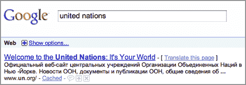

元描述的其他常见错误还包括关键词堆砌（以不合理的次数包含给定关键词）、拼写错误、语法错误和奇怪的大小写。

### 逻辑推理

尽管任何主要的搜索引擎都没有将元描述用于排名，但由于在搜索结果的视觉摘要中会出现加粗显示，它们是使用关键词的重要地方。事实也证明，使用它们有助于提高点击率，从而增加来自任何排名位置的流量。你付出了巨大的精力来优化网站结构、URL、页面内内容和标题，所以不要因为创建一个糟糕的描述而丢掉所有工作，因为这会导致用户在在 SERP 上看到你的页面时选择离开。

## HTML 标题 (H1 – H6)

当 HTML 最初设计成一种用于在线展示信息的标记语言时，标题对于信息层级至关重要。随着 Web 的演变，它们的影响已经削弱，因为 HTML 被用于了其最初并非设计的方式。

### 最佳实践

虽然 HTML 标题对人类读者仍然有用（例如博客标题），但它们不再是搜索引擎的强力信号了。

尽管它们不是“强力”信号，但它们仍然是信号。优化意味着利用每一个机会向引擎传达你的内容目标，所以如果创建一个 `Hx` 结构并不比组织你的页面内内容更困难，就请使用它们。

Google 的 Matt Cutts 曾警告过，在过度使用 H1 段落时不要“用力过猛”（[www.youtube.com/watch?v=GIn5qJKU8VM](http://www.youtube.com/watch?v=GIn5qJKU8VM)）。

## 元描述与相关性

很难相信，但作为 SEO 人员，SERP 上并不是所有内容都与你有关。元描述就是一个很好的例子。它对你的排名没有任何帮助；相反，它完全是为了用户设计的。然而，尽管描述对排名没有影响，你仍然必须细致地编写它。

虽然搜索引擎通常会抓取元描述作为 SERP 的“摘要”，但它们并没有义务这样做。有几个原因导致 Google 可能不使用元描述作为摘要：

* 页面没有元描述。如果是这种情况，解决方案很简单：写一个。
* 页面有元描述，但它没有包含查询词中的任何词。因为其目标是展示用户的查询与排名 URL 之间的关联，Google 希望使用摘要来展示用户。通常，如果元描述没有包含任何内容，Google 会从页面的各个位置提取小片段，如标题、导航和正文。这通常会导致摘要非常破碎，因此在元描述中包含你的目标词至关重要。
* 为了描述你的首页，Google 历史上使用了其他地方的描述数据，例如介绍段落或 DMOZ.org 或 Yahoo 的描述。你无法告诉搜索引擎必须使用哪些文本作为摘要，但你可以采取次优方案——告诉它们哪些文本可以使用。为了告诉引擎不要使用来自 DMOZ.org（开放目录项目 ODP）或 Yahoo 目录（YDIR）的描述性，请在首页的 `<head>` 部分插入以下代码行：

```html
<meta name="robots" content="noodp,noydir"/>
```

在网站的每个页面放置这段代码没有害，但 DMOZ 和 Yahoo 目录很少会有针对深层页面的条目，因此通常只有首页 URL 受影响。

### 逻辑推理

我在 SEOmoz 参加的相关性测试显示，HTML 标题并不具有我们最初假设的那种排名权重。我和我的同事认为，它们对于建立信息层级和帮助算法确定的语义非常重要，但对于搜索引擎优化来说，它们似乎没那么重要。我们建议在所有页面上使用它们作为对用户的帮助，当有其他 SEO 改进机会时，不要强调其重要性。

## 图片

图像是现代 Web 的基础工具。尽管在写作此时，计算机科学家在视觉语义方面取得了巨大进展，但要在范围内理解图像仍然需要人类的帮助。


我建议在所有公共访问页面的图片 HTML 代码中都包含 `alt` 文本属性。该属性声明了当用户无法查看给定图像时，应该显示什么文本。出于这个原因，我通常建议在针对竞争性排名的页面中添加具有描述性且以关键词为核心的 `alt` 文本。此外，我建议在图片之前或之后包含相关文本。这有助于为搜索引擎提供更多上下文。

理想情况下，这意味着在图像紧邻的前后一个段落中，如果你的设计允许，也可以在图片说明（caption）中。

当你拥有一个“热门”图像（即链接到另一个页面的图像）时，`alt` 文本特别有用，在向引擎描述目标页面内容时，它是仅次于锚文本（anchor text）的最佳选择。例如，如果你使用图像链接到你的“水管用品”页面，那么务必使用 `alt` 文本来描述用户（以及引擎）点击图像后会发现的内容。使用图像链接到页面不如使用纯文本理想，但如果没有其他方法，请像编写锚文本一样编写你的 `alt` 文本。

## 理由说明

对于这些建议，我有两个理由。首先，我相信无论是否有局限，所有用户都应该能够使用互联网。这包括残障人士，以及试图通过语义化使信息更有用的计算机。其次，SEOmoz 的相关数据显示，`alt` 属性是获得高排名的一个异常重要的指标。虽然相关性不代表因果关系，但忽视这些数据似乎是不明智的，我和同事建议对于寻求竞争性查询的页面使用具有良好 `alt` 文本的优质图像。

## Nofollow

Nofollow 是互联网上最早被广泛接受的针对搜索引擎的属性之一（Meta keywords 是第一个）。自诞生以来，它的有效性引发了广泛争议，并最终很大程度上被主要搜索引擎的代表所否定。

最初，`rel="nofollow"` 属性的说明目的是防止给定链接传递权重。换句话说，如果一个典型的链接是一个页面在为另一个页面“投票”，那么 `"nofollow"` 属性就简单地移除了“投票”因素。但当时并没有立刻明确，该标签在单个链接层面的作用与 meta robots `"nofollow"` 属性相同，它会告诉引擎不要去爬取该链接。Google 随后的信息也表达了这一观点。

### 最佳实践

`"nofollow"` 属性的正确语法应插入到 `<a>` 标签中，并与其引用的 `href` 并列：

```html
<a href="/url-here.html" rel="nofollow">这里是锚文本</a>
```

我建议使用 `rel="nofollow"` 来阻止潜在的用户生成内容垃圾邮件发送者。我还建议将其作为创建活跃用户的激励（在用户获得 100 个 `mozPoints` 之后，SEOmoz 会移除个人资料链接的 `nofollow`）。

尽管如此，我不建议使用 `nofollow` 进行 PageRank 权重雕刻（sculpting），因为搜索引擎工程师声称这是在浪费时间，且 SEO 专家尚未对这种方法进行决定性的测试。在此语境下，“雕刻”指的是将内部页面的权重引向低潜力内容、防止 PageRank “囤积”，或在所有外部链接上使用 `"nofollow"`——即使是你认为的具有权威性的链接。


注意：规范标签（Canonical tagging）非常适用于你希望 URL 能被分析工具访问，且这些 URL 有很大机会获取外部链接的情况。如果你有合作伙伴将流量引向你的网站——每条链接为了跟踪目的都在 URL 末尾附加了合作伙伴 ID——那么规范标签就是完美的。使用 `301 redirect` 可能会导致合作伙伴的流量无法在你的分析程序中被正确统计，而通过 `robots.txt` 或 robots meta 标签排除合作伙伴的 URL，则会抵消它们可能积累的大部分链接权重。

## Meta 关键词 (Meta Keywords)

Meta 关键词是第一个针对搜索引擎的 HTML 属性。它曾是操纵搜索结果的一个非常强大的工具。由于这个原因，搜索引擎现在不再使用它。

### 最佳实践
我不建议使用此工具进行 SEO。

### 警告
然而，请注意，某些内部搜索引擎（驱动你站内搜索功能的算法）使用 meta 关键词来帮助返回网站内部的搜索结果。例如，Google 搜索设备可以配置为在其算法中使用 meta 关键词。因此，在删除网站上所有的关键词标签（或建议不再编写新标签）之前，请确保它们没有被用于其他用途。

### 理由
这种网站站长资源在互联网早期被滥用，现在已不再有用。Yahoo! 曾将其作为一种非常微小的排名指标，但 Google 和 Bing 过去及现在完全忽略它。如果包含它，为竞争对手提供了自动化竞争分析的简单方法。

## JavaScript 和 Flash

对于搜索引擎来说，JavaScript 和 Flash 比 HTML 更难解析。我们知道，虽然搜索引擎在解释 Flash 文件和 JavaScript 环境中的数据方面变得越来越强大，但它们在一致性地执行此操作，或利用这些信息像传统 HTML 那样分配权重方面还不非常出色。

### 最佳实践
我不建议在任何对搜索引擎至重要的网站部分使用 `JavaScript` 或 `Flash`，除非 `Flash` 或 `JavaScript` 内容有底层技术的支持，该技术以一种搜索引擎可以更可靠解释的方式向其展示内容。

`SWFObject` (`[code.google.com/p/swfobject](http://code.google.com/p/swfobject)) 是这种技术的示例，它允许基于 Flash 的网站向引擎（以及未启用 Flash 或 JavaScript 的用户）显示传统的 HTML 内容。

### 理由
尽管搜索引擎可以爬取 `JavaScript` 和 `Flash`，但我选择不增加“希望它们能正确解析代码结构”的风险。它们分析这些语言的能力低于它们理解 HTML 的能力，选择用这些语言编写代码可能会导致较低的搜索引擎排名。

## 301 重定向 (301 Redirects)

301 重定向是 SEO 人人员重定向 URL 的优先方法。

### 最佳实践
我推荐 `301 redirects` 作为重定向 URL 的最佳方式，但警告它们确实有缺点。主要的缺点是，只有 90% 到 99% 的链接权重通过这些重定向进行传递。相比之下，`302 redirects` 传递的权重为 0%。

### 理由
我们的测试以及搜索引擎工程师的公开声明使我和同事们有理由地确定，`301 redirects` 会耗尽 1% 到 10% 的链接 Link 水（排名权重）。如果在必须让一个 URL 指向另一个 URL 且没有其他可用选项的情况下，这种损耗是可以接受的。它也比其他替代方案（`JavaScript` 和 `302 redirects`）好得多，后者传递的权重非常少甚至完全不传递。在我们的测试中，Meta 刷新似乎的功能与 `301s`（从权重/排名传递能力来看）类似。然而，由于搜索引擎工程师推荐使用 `301 redirects` 而非替代方案，我们也这样做。

注意：在几乎所有的 SEO 情况下，`301 redirects` 都优于 `302 redirects`。然而，`302` 的明智的一种情况是从主页重定向。虽然不从主页进行重定向总是最好的，但某些网站需要从 `/` 重定向到类似 `/default.asp` 的页面，以便某个过程能够正确初始化。在这种情况下，`302` 是正确的重定向，因为你不希望你网站的根地址从索引中消失。最终，如果该重定向可以移除，那么早先使用 `302` 要好得多，这样你就不需要将权重重新移回根域名。实际上，它从未真正离开过。

## 从搜索引擎中屏蔽页面 (Blocking Pages from Search Engines)

有很多方法可以阻止搜索引擎访问页面，包括机器人排除协议 (`robots.txt`)、IP 屏蔽和 meta robots。虽然前两种在大多数情况下有效，但 meta robots 通常是最佳选择，因为它在保持页面不进入搜索引擎索引的同时，允许它们的链接向其他页面传递价值。

### 最佳实践
Meta robots (`noindex, follow`) 通常比 `robots.txt` 是更好的选择，因为它能让指定的 URL 不出现在搜索引擎结果中 (`noindex`)，并允许页面上的所有链接传递链接权重 (`follow`)。`robots.txt` 文件很有用，但应该节节使用，仅在 meta robots 标签不可用时才使用。

### 理由
`robots.txt` 文件阻止搜索引擎爬虫访问网页，但它们不能阻止页面被索引。图 6-6 显示了一个“未被爬取的引用”的示例——一个通过 `robots.txt` 屏蔽但仍然出现在搜索结果结果页 (SERP) 中的页面。注意 URL 是如何列在搜索引擎搜索结果中的，但没有任何内容（如标题标签或 meta 描述）显示。


尽管流量和排名之间存在相关性（访问者较多的网站通常排名较高），但它们之间并非因果关系。仅仅是因为更受欢迎的网站会获得更多链接，而更多的链接又会导致更高的排名。我听过搜索工程师的说法，，“页面停留时间”曾被短期用作一种排名指标，但事实证明它是一个糟糕的信号。相反，现代搜索引擎更倾向于将搜索结果页面上的“无点击”作为检测其结果是否需要升级的更佳指标。

# “独立访问者”指标的问题

我认为网络分析软件中使用的“独立访问者”（与总访问者相比）这一指标从根本上说是有缺陷的。它依赖于访问者启用了 Cookie，并且仅通过某台电脑上的一个浏览器访问特定网页。在实践中，我认为人们从多个浏览器和计算机访问同一个网站（例如 Facebook）的频率足够，足以削弱这一指标的价值。

就像 `Alexa.com` 的流量估计一样，它很少准确，但经常被提及。我的建议是，在比较来自不同来源的访站流量或比较月度流量增长时，对独立访问者数量的信任应远低于原始访问量。请参阅 `www.seomoz.org/article/search-blog-stats` 查看证明此类指标不准确性的数据。

## 参数驱动型 URL

SEO 专家经常会遇到被迫使用参数驱动 URL 的情况（例如类似 `www.example.com/product?param=1&param=2` 的 URL）。当这种情况发生时，最好遵循本节中的建议，以确保搜索引擎能够准确抓取目标网站。

### 最佳实践

我不建议使用这种 URL 结构。如果绝对必要（由于某些已建立的 CMS 配置），我建议参数不要超过两个。

## 理论依据

搜索引擎对此得非常明确。它们的爬虫可以解析并抓取参数驱动的 URL，但这样做更为困难，且往往会导致重复内容问题。这得到了 SEOmoz 相关性数据的支持，该数据显示静态 URL 的页面往往排名更高。

**注意**：与 10 年前不同，基于参数的 URL 本并不一定是问题。问题在于经常随之出现的问题——基于 URL 内参数顺序的重复、大小写风格等。如果你已经投入了基于参数的 URL 结构，并不意味着现在要投降，但对你的网站进行定期且彻底的审计是非常明智的，以确保它没有为网站上的每块内容生成多个 URL。

## 页脚链接

页脚链接是包含在网页底部的超链接。它们通常是 SEO 社区的热题，并且经常成为垃圾邮件的目标，因为它们对用户体验的重要性不如页面上其他更显眼的链接。我对这个问题的建议非常明确，并且在过去没有发生太大变化。

### 最佳实践

节制使用页脚链接。我建议不要超过 25 个相关的内部（在某些情况下是外部）导航链接。这个数字不是一个硬性限制，在选择关键词时，考虑到意图性至关重要。例如，请注意 `Gawker.com` 的页脚链接到 Gawker Media“家族”内的所有网站。这是在页脚中进行交叉链接的完全合法用法。它遵循“如果你喜欢 X，可能也喜欢 Y”的逻辑。

然而，当页脚中的链接数量显著增加，且锚文本开始看起来过于“优化”（例如“发薪贷款”和“西雅图律师”），并指向与其所在网站完全无关的站点时，可能是时候重新评估页脚链接的使用方式了。

## 理论依据

我见过许多直接与滥用页脚链接相关的 Google 惩罚案例（这些惩罚在移除填充了关键词的页脚链接后神奇地消失了）。页脚中的操控性链接很容易被算法检测到，并且似乎 Google 对其应用了自动惩罚。

## 总结

本章讨论了基于领域经验、测试和客户结果的 SEO 最佳实践。你可以在 `www.seomoz.org/learn-seo/` 查看该领域的最新研究。

尽管如此，本章中的一些核心观点在很长一段时间内可能不会改变。这些包括：

*   页面 SEO 的关键在于让页面尽可能与特定查询相关。
*   确保没有障碍阻碍搜索引擎以预期的方式看到你的内容。
*   从长期来看，SEO 专家应该避免使用他们分享的策略。
*   建立相关且强大的链接是你能做的最重要的事情。

如果你遵循这些规则，在未来几年里你将一直是一名 SEO 专家。

# 第 7 章：SEO 咨询流程

本章内容

*   向客户销售你的
*   建立价格点
*   查看交付物

作为 SEO 顾问，你的面对面沟通将只占你的一小部分时间，但它将是决定业务成败的因素。本章概述了 SEO 流程，这是我在 SEOmoz 和私营业务中使用过的流程。本章的格式像一个框架，以便你根据需求进行自定义。

## 回答客户的棘手问题

在开始活动之前，你首先需要赢得业务。这通常意味着你必须通过回答一些棘手的问题为你（或你的组织）、你的行业以及特定的方法论提供强有力的论据。在进入细节之前，你需要了解如何回答。客户通常会问类似的问题。本节涵盖了这些问题以及通常有效的答案。

## 回到客户身上

回答任何困难咨询问题的技巧是将其引回客户身上。没有什么比客户没有意识到自己已经知道的答案更好的了。你通常可以通过根据他们的业务目标来回答。例如，如果一个潜在客户说“我已经在第一页排名了，我为什么还需要你的帮助？”我回答：“你的有多少客户来自你的网站？”如果潜在客户回答“50%”，我可能会回答：“平均而言，特定搜索的前三个结果占据了 90% 的点击。想象一下，如果我通过增加人数让你的网站进入那 90% 的范围，你的底线会受到怎样的影响。”

## 我为什么要关注 SEO？

我通常通过这种方式回答这个问题，试图让潜在客户意识到搜索对他们的客户群有多重要。如果他们在线销售咖啡杯，我可能会询问他们的客户如何在网上找到他们。

然后，我调出 Google AdWords 关键词工具（见第 3 章），并运行他们的一些主要关键词（咖啡杯、咖啡马克杯、咖啡礼物、星巴克杯、杯具等）。他们通常会对这些数字之高感到惊讶。

接着，我对列表中搜索量最高的术语进行搜索，并识别潜在客户在搜索引擎结果页面（`SERP`）上的排名。

除了这些关注对潜在客户认为重要的关键词的示例外，还有许多更广泛的理由说明了为什么对于在互联网上营销产品或服务的人来说，SEO 应该是重要的：


## 以搜索作为起点

约四之三的互联网用户在寻找产品或服务时，是从搜索引擎开始搜索的。此外，一个拥有稳健且全面的搜索策略的网站，其 50 到 80% 的网页流量可能源于自然搜索。如果你能让客户接受这些数字，就很难反对实施稳健的搜索策略了。

这种情况在不同行业之间会有巨大差异。拥有大量电视和印刷预算的网站会获得大量的直接输入流量。这可能导致搜索流量的百分比看起来很小，但搜索的绝对数值仍然相当高。

## SEO 是“拉取型”流量的典型。

搜索不是广告牌，不是打断晚餐的电话，也不是分割你喜爱的节目的商业广告。你不需要主动寻找搜索者；是他们主动来找你，并且愿意学习，往往已经准备好购买。这使得搜索流量比大多数其他来源的流量质量高得多。

## 自然搜索是一项合划算的交易。

在我们为医疗信息行业的一个特定客户进行的一项研究中，我们发现通过自然搜索活动获得的相同流量，如果按点击付费（PPC）购买，其成本将是我们服务费的十四倍。

与 PPC、横幅广告和联盟营销不同，自然搜索是一种剩余的、长期价值，因为它在 SEO 活动结束后仍会持续产生价值。

## 你的竞争对手已经在用它。

正如本章一直讨论的那样，很容易找到竞争对手在各种长尾词汇变体中排名高于几乎任何网站的案例（在某些情况下，甚至包括了搜索曲线顶部的词汇）。

这种演示几乎总是让潜在客户相信 SEO 的重要。然而，在完成这种演示后，你还需要另外几个论点来来说服他们选择你来做他们的 SEO。首先，你需要说服潜在客户 SEO 不应该由公司内部处理。其次，一旦他们决定外包，你希望他们决定外包给的对象恰好是你的公司。

## 将 SEO 外包给顾问的优势是什么？

当你努力赢得 SEO 业务时，你不仅是在与其他 SEO 公司或顾问竞争。你通常还在与客户“从一开始就不愿意聘佣 SEO 公司的情绪”竞争。搜索策略在许多公司预算中仍然不是独立的项目，当它与更广泛的营销和广告预算归在一起时，要说服客户它在预算中需要拥有自己的位置仍然非常有挑战性。

因此，你不仅要为自己辩护，还要为整个这门学科辩护。幸的是，如果你准备好讨论以下概念，这并不困难。

### 严格聚焦于 SEO

内部 SEO 工作人员最大的抱怨之一是他们的精力被分散得太薄，没有被允许花他们认为必要的大量时间在真正的自然 SEO 上。相反，他们变成了“网络营销人员”或“社交媒体专员”，并被迫承担诸如 PPC 管理、社交媒体策略、网站开发或管理联盟关系等角色。

这对于非常小的网站可能行得通，但中大型网站需要一个全职负责 SEO 的人员，或者至少是一个团队。要做好 SEO，涉及的工作和时间实在太多了，以至于无法将其与 IT 或营销的其他部分归在一起。

作为 SEO 顾问，你和你的公司获得报酬是为了保持 SEO 的高度聚焦，客户将从中受益，因为你不会被其他活动带走或分心。你无疑会与这些部门合作，但是为了促进 SEO 项目的成功。

### 保持行业趋势的更新

除了处理全面的 SEO 策略所需的时间外，工作人员还需要时间跟上搜索领域的快速变化。

为了证明保持时效性的价值，在参加会议时，要对 SEO 行业在过去一周、一天、甚至过去几个小时内发生的变化有坚定的理解。了解这些变化会影响哪些类型的网站，并了解潜在客户的网站处于何种情境。你不知道潜在客户会问什么，但你可以尝试准备一些针对性的答案来充自己。

如果你观察得足够仔细，过去几天内一定会有某些可能影响客户的事情，无论是 `XML` 站点地图协议的更新、图像或视频搜索、本地和地图搜索，还是数据分析。带着关于你将如何处理该客户策略的准确信息进入会议——特别是如果他们还没听说过的话——将会有帮助。

## 如果我已经排名第一了，为什么我还需要 SEO？

这是一个非常好的问题，通常可以用两种方式回答。首先，运行搜索查看列表中的竞争对手。很多时候，在次要结果或长尾词方面仍然存在机会。例如，如果他们排名第 `#1`，你可以使用备用域名帮助他们排在 `2` 到 `10`。如果这不可行，你可以通过构建页面、内容和链接来通过长尾词来扩大他们的影响力。

## 我的侄子/表兄弟/托管提供商已经在做 SEO 了，我为什么不直接用他们呢？

这是一个特别困难的问题，因为它说明潜在客户并不看重你的技能组合。如果是这样，你就需要证明你为什么比竞争对手更好。

这可以通过解释你的价值主张来实现。我发现最好的方法是解释 SEO 是一个变化极快的行业，你的大部分价值来自于你能够让你保持信息同步的人脉。这可能包括行业内的知名朋友，或者你对行业会议等活动的参与。

然后将讨论更得进一步。如果潜在客户的表兄弟已经在做 SEO，那么该网站反映出这一点了吗？你能给现有策略挑出多少个漏洞？那个表兄弟是否读过某些基于迷信的文章，并实施了最终会损害网站的策略？

解释说，就像大多数其他服务行业一样，SEO 也是一分钱一分分货。即使客户正在免费获得糟糕的建议，当那个表兄弟忙得无法继续提供这些糟糕建议时，会发生什么？解释说通过你的公司，除了你带来的专业知识外，客户还在购买责任制和准入权，这意味着对问题的快速响应、观点性研究，以及一个工作取决于其能够完全跟上行业趋势的团队。


你需要推销 SEO，就像律师推销法律一样。SEO 是一项重要的服务，你的工作很大一部分就是将其作为服务推销出去。你有能力为你的潜在客户的网站带来大量的流量。你需要让他们意识到这具有潜在的资金影响。

## 谷歌和 Bing 怎么看待 SEO？

回答这个问题最简单的方法是让主要的搜索引擎来为你回答。谷歌已经在网上发布了其对 SEO 的立场：[`www.google.com/support/webmasters/bin/answer.py?hl=en&answer=35291`](http://www.google.com/support/webmasters/bin/answer.py?hl=en&answer=35291)。

谷歌和 Bing 从遵循其搜索引擎指南的 SEO 人员中获益良多。例如，谷歌的任务是“组织世界的信息，使其全球可用并有用”。为了实现这一目标，它需要尽可能的帮助。SEO 的主要工作之一就是让网站尽可能对搜索引擎变得有用且易于索引。这是一个双赢的局面，因为它有助于搜索者找到相关信息，同时也帮助搜索引擎提供这些结果。

此外，所有主要的搜索引擎都聘雇了 SEO 团队。他们的工作是确保同事产生的内容尽可能符合 SEO 标准。搜索引擎有很多才华横溢的拷贝人员和工程师，但他们仍然需要 SEO 人员的帮助，让他们的内容和产品在网上易于找到。

## 如果你是这么优秀的 SEO，为什么你的“SEO”一词的排名不是第一？

噢！我讨厌讨厌这个问题。回答这个问题最好的方法是诚实。例如，SEOmoz 在 SEO 一词上的排名之所以不是第一，很大程度上是因为 SEOmoz 这个词无法拆分为两个真实的英语单词。因此，`seobook.com` 的排名在我们之上，因为当它的创始人 Aaron Wall 接收到锚文本为“seobook”的链接时，谷歌知道这个词可以被拆分为“seo”和“book”。这与 SEOmoz 这样的名字不同，因为“moz”并不是一个单词，所以链接指向 SEOmoz，而不是“SEO”和“moz”。

另一个原因是，这种搜索结果页面页（SERP）是由大品牌域名主导的，而不一定是资质最高的域名。这很像，尽管 Nordstrom 和 `Zappos.com` 可能在零售领域提供最好的客户服务，它们在“customer service retail”一词上的排名并不高（参见图 7-1）。同样，尽管 NASA 是地球上（以及之外？）关于飞天器最专业的实体，它在“spaceships”一词上的排名也没有进入前十。

Figure 7-1: “customer service retail”的谷歌搜索结果

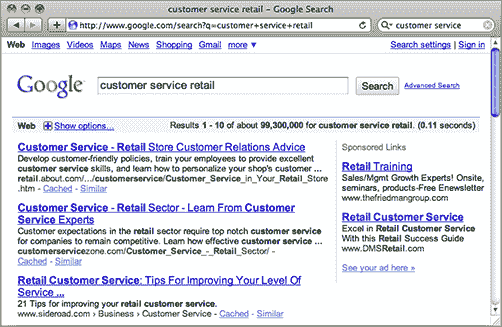

最后，绝大多数优秀的 SEO 在 SEO 相关术语上的排名之所以不是特别好，是因为由于他们太忙于为客户工作，以至于几乎没有资源分配到运营自己的网站上。

与其让潜在客户质疑你所在公司的排名，不如说服潜在客户去询问你现有的客户，阅读你的案例研究和文章，并感受一下做你的客户是什么体验。对于你潜在客户的结果来说，这些比你公司在 SEO 上的排名要准确得多的预测。

确保你的宣传材料是最新的，你的推荐人是赞誉有加的（并且准备好为你背书），并且你拥有与潜在客户的一般业务类型匹配的案例研究和推荐，例如“B2B 制造业”。

## 什么是谷歌算法？

与之前的问题一样，回答这个问题最好的方法是诚实。提醒潜在客户，你并不为谷歌工作，所以你不知道它使用了哪些算法。然而，你可以根据自己的经验做出明智的推测。

注意：你也可以向客户介绍 SEOmoz 的年度行业调查报告，称为“谷歌搜索引擎排名因素”，目前位于此处：[www.seomoz.org/article/search-ranking-factors](http://www.seomoz.org/article/search-ranking-factors)。在写作时，该调查报告显示，行业专家认为大约 70% 的排名指标都围绕链接。

## 如何提高我的 PageRank？

提到 PageRank 也是明智的，因为 PageRank 是谷歌整体排名算法中 200 多个不同因素之一，将大量精力集中在 PageRank 本身上是非常低效的时间利用。

我总是尝试通过解释 PageRank 的劣势来回答这个问题。PageRank 是一个糟糕的指标，因为它缺乏必要的精确性，并且在不可预测的时间更新频率很低。它是基于对数刻的，因此 PageRank 为 `8` 大约是 PageRank 为 `7` 的十倍。这意味着小数点后的数字（未显示的部分）对于较高的数字非常重要。

在我解释这些之后，我告诉潜在客户，为了提高他们的排名，他们需要获得更多链接，最好来自受信任且链接良好的来源。

## 为什么我不直接去买链接？

这是大预算客户的常见问题。我的观点是，以任何传统方式购买链接都是糟糕的长期策略。我提醒他们，谷歌聘佣了世界上最聪明的人来为之工作，检测付费链接（从而减少其索引中的垃圾信息）对他们自己有利。

然后我告诉他们购买链接的危险。在大多数情况下，被搜索引擎识别为付费的链接仅仅会被降权重。在其他情况下（虽然频率较少），付费链接可能会导致惩罚，这些惩罚会损害目标网站。

## 链接真的那么重要吗？

简短的回答是肯定的。当被问到这个问题时，我总是引用 SEOmoz 的“谷歌搜索引擎排名因素”调查。这项调查显示，行业领袖们认为大约 70% 的排名指标与链接有关。这通过我的 SEO 经验得到了证实。

## 你们提供保证吗？

这个问题在本章的稍后部分会有更多讨论，但通常来说，提供保证是不明智的。简单来说，你对 SEO 游戏中变量的控制还不够，不足以可靠地保证显著的结果。你无法控制搜索引擎更改算法的倾向，无法控制用户搜索什么，也无法控制你客户的竞争对手积极优化他们自己网站的程度。

SEO 行业的保证传统上是由推销员提供的，他们保证能为客户展示特定数量的顶级排名。问题在于，这些排名通常针对的是很少或没有搜索需求的查询词。换句话说，SEO 公司证明了他们让你的网站在无人搜索的词上获得排名的能力。

尽管如此，如果你知道做出此类保证的风险，你的保证针对的是既有搜索需求又有客户网站上转化可能的词汇，并且你不怕将所有内容写在纸，那么祝你好运。

## 我的流量将如何提高？

潜在客户经常问这个问题，回答这是一个极其令人沮丧的问题。涉及的变量使其变得如此复杂，以至于几乎没有任何方程可以准确预测结果。

这不是潜在客户的错。人们想要获得投资回报，预测投入在如 SEO 等营销活动中的每一美元能换回多少流量（理想情况下是收入）他们的职责。

如果被完全迫给出流量提高的预测，你可以根据活动的具体情况从几个方向来解决这个问题。例如，一个过去进行过少量且良好的 SEO 工作的网站，从新活动中获得的益处将远大于一个被忽视的、几乎无法抓取的网站。


尝试预测 SEO 活动的结果是一项很好的练习，因为它还能帮助你制定关键词策略的基础。寻找潜在客户引流关键词集中的空白。换句话说，该网站本应该在哪些关键词上排名，但实际上并没有？将客户未排名的词汇的需求与其已排名的词汇的需求进行比较，并尝试预测如果该词集中的几个词进入前 5 名将带来的流量增长。

例如，检查品牌词与非品牌词引流关键词的比例。如果潜在客户网站目前严重依赖品牌流量，那么在非品牌词组上很可能存在着巨大的流量潜力（反之亦然）。

不要将你的合同与客户特定的、明确的自然流量增长目标挂钩。你无法控制足够多的变量来做出准确的预测。

当你认为自己已经创建了一个尽可能准确的预测模型时，请给自己留出一些余地。如果你的活动最终增加了 30% 的流量，你更希望你的预测值是 20% 还是 40% 呢？正如我们在其他地方描述的那样，**低承诺，高交付**是成功管理客户预期的关键。

## 切换参数驱动的 URL 很难；这真的值得花这么多精力吗？

在这种情况下（像大多数情况下），客户是正确的。从参数驱动的 URL（`www.example.com/product?food=banana-pizza`）切换到标准 URL（`www.example.com/product/food/banana-pizza/`）可能是一个困难的技术问题。这不仅需要重写旧代码，还需要编写新代码来处理必要的 `301` 重定向。

当被问到这个问题时，我会向潜在客户讲述亚马逊从参数驱动的 URL 切换到现在使用的语义更清晰的 URL 的故事。（注意：它仍然使用参数进行跟踪）。当亚马逊进行这一转换时，它的流量增加了一倍，并在历史上首次实现了盈利。虽然这可能只是相关性而非因果关系，但这个轶事帮助我说服了许多客户迈向 SEO 友好型 URL。

## 你谈论了这么多 Google，那 Bing 呢？

当被问到这个问题时，我会让他们知道 Bing 在某些市场非常重要，并且拥有一些更好的技术（图像搜索、机票预测等），但 Google 在美国的市场份额仍至少占 90%。

此外，在第 6 章列出的绝大多数 SEO 最佳实践在 Google 和 Bing 上都适用。最好不要忽略 Bing，但将重点放在从 Google 引导流量上回报更高。

## XYZ 公司是 Google 的杀手吗？

我总是以同样的方式回答这个问题。我并不知道“Google 杀手”会是什么样子，但我想象它绝不会像 Google 目前的技术。百科全书被 wiki 超越，这是像《大英百科全书》这样的公司完全无法预料到的。

同样，任何最终超越这家搜索巨头的公司，其运作方式也不会像 Google，而且只有在 Google 未能进化的情况下，它们才可能领先。

Google 不仅仅是一个优秀的产品。它还是拥有庞大忠实追随者的优秀产品。一个网站要超越 Google，需要兼顾这两个因素。考虑一下马拉松的比喻：假设一位伟大的跑步者开始比赛。假设另一位实力相当（甚至略好）的跑步者在 2 小时后开始同一场比赛。尽管后者跑步者实力相当或更好，但由于领先优势，他无法追上第一位跑步者。第二位跑步者只有在能够发明一种新的比赛，并说服人们第一场比赛不再值得看时，才能成功。

## 准备第一次会议

在与潜在客户的第一次会议中，你需要涵盖三个主要领域。你希望：

*   了解他们
*   向他们展示关于你的关键信息
*   传达你能为他们做什么

### 了解客户

当我第一次与客户会面（无论是面对面、电话还是视频会议）时，我的首要任务是尽可能了解客户。为了制定出最好的 SEO 计划，我需要了解潜在客户想要实现的总体目标。此时，你应该和他们一起审查网站，并指出你之前研究中发现的改进领域。

你在会面之前审查了潜在客户的网站对吧？正如所提到的，对潜在客户进行审计可以产生价值的信息。由于这些发现，你总是希望涵盖以下要点：

*   **贵公司是做什么的？** 这非常重要，因为它可能揭示公司与其自身呈现方式之间的脱节。这有助于识别公司的优先级，并让你了解驱动客户的因素。
*   **你们希望通过搜索实现什么？** 我对问题的答案总是感到惊讶。显然，每个客户都想要更多流量，但这只是手段。问题的目的是识别最终目标。他们想要销售更多产品，还是影响更多的人？这些信息在之后进行关键词研究时非常重要。
*   **你们的团队是如何组织的？** 这在后勤方面很有帮助。它有助于识别修改网站的路径。你不想通过向文案人员解释技术细节，或向不关心的开发人员解释营销策略来浪费你（以及客户）的时间。这个问题通过提供如何与潜在客户更好地沟通的提示，帮助你更高效地工作。

你为客户创造价值的能力与客户团队实施你建议的速度和效率直接相关，因此不要忽视这一点。

*   **在你们网站上实施建议更改的流程是什么？** 除了了解涉及的人员，你还需要了解流程。有些客户可以在通话时直接进行更改，而另一些客户必须创建开发工单，你可能需要等待一个月或更久才能实施更改。大多数处于两者之间。


### 你们网站的 SEO 历史怎样的？
哪些做法是有效的，哪些是无效的？这个问题可以让你洞察近年来组织内部对“SEO”这一术是如何是如何的。了解你是否是客户使用的第一家供应商，或者该公司是否正处于与另一家公司的恶劣关系之后至关重要。如果是后者，随着客户重新对该行业产生信任，你的策略和建议可能会面临更严格的审查。你还需要了解客户过去使用过的任何投机策略，因为你可能有一部分时间要花在清理这些烂摊子上。如果可能的话，请阅读之前的 SEO 审计和报告。

### 你们的公司有什么特别之处？
你们为客户提供了哪些竞争对手不具备独特价值？这个问题的答案非常重要，不仅是为了让客户对组织充满信心。一个聪明的链接建设计划会利用这种独特价值来产生引发链接的兴趣。无论这种价值是更大的库存、更优的价格、更周到的客户服务，还是完全不同的东西，客户都需要知道，如果他们不能脱颖而出，SEO 任务将变得困难得多。

### 你们网站上有哪些板块？
这是我提出的最重要的问题之一。当客户向你介绍他们网站的板块时，他们几乎总是揭示了根据他们的优先级，信息层级应该是怎样的。当你试图从他们的视角高层次地查看他们的网站时，这极其重要。例如，如果你的客户拥有一个关于小部件的网站，而他花费所有时间在讨论不同格式的小部件，那么他们的网站很应该按格式对小部件进行分类。

### 哪些页面是你们最大的盈利点？
这有助于你将优先级与客户的优先级保持一致。你的工作应该是实现投资回报率（ROI）最大化。客户在你身上花钱，反之你应该尽力将尽可能的流量引向网站上能为潜在客户赚取最多资金的页面。

### 你们有哪些在线资源（其他域名）可以利用？
很多时候，客户掌握着强大的资源，但他们自己并不知道。我曾与一家媒体集团合作过，他们完全不知道在其不同的子公司网站之间建立链接将使其受益。这些网站恰好是互联网上链接最广泛的一些域名，而它们之间的关系正在被浪费。

### 我可以访问你们的分析数据吗？
这种访问权限至关重要，因为它在两个重要方面对你有帮助。在获取分析访问权限方面，不要接受“不”。你必须需要，没有其他理由。

*   首先，它可以帮助你获得关于流量如何到达并在给定网站内移动的高级视图。它允许你看到哪些页面已经在驱动流量，然后你可以利用这一点作为优势。
*   其次，它为你的努力提供了一个衡量标准。它为你提供了所需的工具，以证明你为潜在客户提供了价值。

### 你们的网站是否已在 Google Search Console（原 Webmaster Central）注册并验证？
如果答案否，你应该注册它以看看是否能识别出任何大问题。如果答案是，请获取访问权限以确保所有设置都配置正确。具体来说，你将查看首页的规范化（canonicalization）设置和站点链接的过滤。如果组织尚未通过 `Google Webmaster Tools` 验证网站，那么筛选 `GWT` 的诊断数据可以是你为他们提供的首批价值服务之一。

### 你认为你的域名有多少页面？
虽然这个问题的答案通常只是粗略估计（“哦，大约有一百万或两个页面”），但当你开始看到域名索引情况如何时，这有助于为你提供背景。如果客户认为他们有一百万个页面，而搜索引擎索引的页面数量完全不同，那么你要么发现了重复内容问题（搜索引擎索引的页面比客户认为的要），要么是索引问题（搜索引擎无法索引所有页面）。

#### 页面数量估计
很多时候，在线营销人员根本不知道网站上有多少页面，但这并不意味着他们缺乏技术专长或对计划缺乏投入。现代的 `CMSs` 和大型公司网站仅仅让这个答案变得难以寻找，而且并不是对时间特别明智的利用。

同时记住，如果他们的页面数量估计与索引页面数量匹配，这并不总是一件好事。许多网站通过对深度内容的抓取不力以及浅层内容的重复[显示了问题]。

### 你们的域名上有哪些子域名？
这有助于你识别域名的范围。一个非常有用的查询语句是 `site:domain.com -inurl:www.`。

### 你们网站哪些区域是禁止的？
这有助于你更高效地使用时间。我遇到过这种情况：网站的整个板块都是被禁止的，因为运行它们的开发人员位于不同的部门。

### 向客户展示自己
你的首要任务应该是判断潜在客户是否值得合作。在你确定这一点时，客户可能对你也有同样的想法。

#### 关于你和你们公司的背景
这可能是所有谈话点中最容易的一个。除了努力建立个人联系外，我加入这一点是因为很多时候潜在客户很有兴趣知道你是如何进入 SEO 这样一个奇怪的利基市场的。如果你像我遇到的大多数 SEO 人员一样，你可能有一个关于你如何进入这个职业的幽默或有趣的故事。

#### 你的流程
这是开始主导项目的好方法。在了解他们的优先级后，我尝试通过这种方式让潜在客户放心，让他们知道我们可以通过我的流程让他们的优先级成为现实。我建议诚实且灵活。

#### 你对他们潜力的印象
这一点尤为重要，因为它设定了整个职业关系的背景。如果客户没有机会在他们想要的关键词上排名第一，请告诉他们。


*   你对他们优先事项的理解：这在两个方面都有帮助。首先，它向客户展示了你在倾听，并且认真对待他们所说的。其次，它让你能够确保你与潜在客户达成共识。在开始进行任何 SEO 工作之前，明确这些观点是绝对必要的。这能为你和客户节省时间和金钱。

*   你作为你与客户相关的优先事项：最后一点可能是最重要的一点。回顾之前讨论过的优先事项，并确定你想要实现它们的原因。是因为这会提升你的职业生涯吗？还是因为你想要获得一个好的评价？不要表现得过度戏剧，但要确保潜在客户理解，帮助他们实现目标对你有什么益处。

## 如何向客户传达你能做什么

建立客户关系的最后一步是用清晰的语言向客户解释你能为他们做什么。这是你推销专业知识和服务的场合。

*   不要保证任何特定的结果，但要保证特定的策略：不要承诺任何你无法绝对保证的内容。虽然承诺 `#1` 排名可能很有诱惑力，但不要掉进这个陷阱。此时，你还没有完成所有的调研，而且很可能存在一个你不知道的竞争对手。可以放地承诺特定的策略，但不要过度承诺。再次，做到“少承诺，多交付”。

*   让客户了解 SEO 在多大程度上对他们有帮助：这涉及到设定预期。在充分了解他们正在寻找什么以及他们提供什么资源之后，给客户提供关于你的工作预计能如何帮助他们的背景。我不建议提到任何具体的数字，但我建议给他们一个模糊的概念，即如果他们遵循你的建议，可能会取得什么样的效果。（关于预测结果的更深入讨论，请参阅本章前面的“我的流量将提高多少？”）

*   让他们了解你的初始计划是什么样的：在与潜在客户结束对话之前，让他们知道如果他们选择雇佣你，下一步将是什么。不要问他们是否会雇你，而是像他们已经雇了你一样继续向前。告诉他们你将发送文件以及你的初步步骤是什么。不要咄咄逼人，但要让执行你的计划比拒绝你的服务更容易。

## 向客户解释 SEO 概念

客户通常分为两种类型：有些人想知道你为他们做的每件事的在哪里、为什么以及怎么做，甚至是连字符与下划线在算法上的影响。另一些人则满足于了解你所做事情的基础知识及其原因，他们更关注结果的预测和记录。

这两类客户都有其优缺点。秘诀在于利用每位客户的投入程度来获得完成工作所需的认同，从而让结果能够自己说明问题。

*   想要了解一切的客户：这些客户非常注重流程，与他们进行有效沟通的关键是确保他们参与到你工作的几乎每一个方面。确保他们知道你读过最近的[研究报告。

*   对基础知识满意的客户：这些客户满足于仅仅了解你所做事情的基础知识及其原因，他们更关注结果的预测和记录。

在任何情况下，当你的客户参与其中时，请感到高兴。最糟糕的客户类型是“不露面”——难以联系、回复缓慢，并且精力过于分散，无法意识到你带来的价值。

## 文档工作：设定预期

这一部分涵盖了我建议作为 SEO 顾问时使用的标准文档。

警告：本部分不提供法律建议。我没有接受过正式培训。因此，我建议你在接受客户之前寻找律师并获得一些建议。本部分仅为你提供基础知识；如果发生问题，它无法保护你。

## 主服务协议

主服务协议概述了服务的所有元素（包括保密协议和工作说明书），并定义了整个文档使用的任何语言。其目标是定义在双方同意合作期间发生任何给定情况时应采取的步骤。（你可以想象到，这份文档通常很长。）

通常情况下，主服务协议包含以下内容（注意：此列表不是详尽的）：

*   协议双方：这一部分定义了同意合作的两个法律实体。

*   工作说明书：这一部分定义了工作说明书中规定的角色和法律义务。

*   报酬和报销条款：这定义了在业务关系完成或中断的情况下，双方在补偿和报销方面的法律义务。

*   保密协议：这一部分定义了保密协议在主协议中的作用。

*   双方关系：这一部分定义了双方建立的法律关系类型。很多情况下，这将是独立承包关系。

*   服务终止：这一部分定义了协议何时结束以及在何种条件下可以终止。

*   免责声明：这一部分定义了给定方在保修方面承担或不承担的所有法律义务。

*   赔偿与责任限制：这一部分定义了对客户的赔偿以及其责任的限制。

*   商标的使用：这一部分定义了每一方如何使用对方的商标。这包括用于自我推和和评价中的使用。


**争议**：本节定义了在发生争议时将使用哪些协议。

**律师费和诉讼费用**：本节描述了在发生法律纠纷时，由哪一方支付法院费用和律师费。

**完整协议**：本节定义了本文档及其附件（下文描述）为该法律协议的全部内容。

**豁免**：本节定义了客户在协议未遵守的情况下豁免责任的权利。

**可执行性**：本节定义了本协议在何处以及如何如何具有法律执行力。

## 保密协议

保密协议（`NDA`）是一份法律文件，用于识别并规定哪些信息允许向相关方披露或不予披露，并定义了这些行为发生的条款。它对于与客户建立信任关系至关重要，因为它为维护双方的隐私奠定了基础。它还让相关代表能够自由地公开讨论敏感信息，这些信息可能帮助你们双方完成工作。

在实践中，我从未需要对任何人使用过这些条款，但我发现它有助于与客户的关系正式化。我发现，在客户审阅并签署这份协议后，他们对我过去影响其排名能力的行为（例如，购买链接、遮罩、关键词堆砌等）会更加坦诚。这对于帮助客户向前发展至关重要。这使得这种好处与出现问题时该协议为你提供的潜在保护一样有用。

通常情况下，`NDA` 包含以下内容（注意：此列表并不涵盖所有内容）：

*   **协议目的**：本节定义了保密协议的目的。它也可以定义整个文档使用的任何宽泛定义。
*   **机密信息的定义**：本节精确定义了协议范围内哪些属于机密信息。
*   **协议期限**：本节定义了保密协议的期限。
*   **机密信息的处理**：本节定义了必须如何处理机密信息。这包括普通机密信息以及存储传输时使用的安全预防措施。此外，还可以讨论在关系结束后必须如何处理这些信息（如果是纸质形式），例如销毁或归。
*   **与关联公司和代表共享机密信息**：这定义了双方可以向谁披露机密信息以及在什么情况下披露。它还可以定义他们如何披露这些信息。
*   **法律要求时披露机密信息**：本节描述了如果法律要求披露机密信息，双方必须承担的义务和协议。
*   **一般权利和义务**：本节定义了如果违反保密协议，双方均同意的内容。

**提示**：如果你正在与知名客户合作，他们与你的业务关系可能帮助你承担更多业务，你可能会发现在 `NDA` 中添加特定条款，专门允许你在营销材料中使用他们的品牌和标志是非常有用的。如果你能列出你合作过的一些知名品牌，潜在客户会更容易签署合同。

## 工作说明书

工作说明书概述了为特定项目将完成的所有工作。确保其既详尽又具体至关重要，这样双方都能准确知道协议中的预期内容。

对于咨询顾问来说，这是最重要的文档。清晰的预期能带来更满意的客户，从而带来更多业务。

对于想要更多工作或更多小时数的客户，你只需通过参考此文档就可以解决许多潜在的问题。如果你需要，可以增加工时或交付物，但这份文档非常清楚地说明，这些任务是在他们已经同意的合同和价格之外的额外工作。

通常，工作说明书包含以下内容（注意：这并不涵盖所有内容）：

*   **服务协议时间表**：本节定义了项目的时间线。很多时候它只是引用了主服务协议。
*   **项目管理**：本节定义了双方团队中具体由谁负责项目管理。它还提供了职位和联系信息。
*   **项目目标**：本节根据双方的优先事项定义了咨询服务的目标。
*   **合作大纲**：该大纲通常是文档中最长的部分，详细描述了每个预期的交付物。它通常包含许多示例和。
*   **报酬**：本节定义了谁负责发送和收取报酬。所有相关人员应包括联系方式和职位。本节还定义了报酬何时到期以及金额是多少。
*   **交付物时间表**：本节定义了上述交付物的到期时间。

## 交付物

本节描述了我通常为客户提供的不同交付物。虽然我总是优先为客户提供其范围内的任何需求，但我发现拥有一个标准的短列表是有帮助的，正如下一节所解释。你的交付物列表可能不同，但重要的是它们的内容、截止日期和目标应该完全阐明，以避免对其产生误解。

### 快速清单

这份快速清单识别了客户网站上最容易进行且提供最高 SEO 价值的更改。它按优先级排序，通常长二到五页。

客户通常发现这份文档非常有帮助，因此考虑将其包含在所有客户的方案中。他们通常将其作为检查清单发送给他们的开发团队。这些更改通常会产生快速的结果，让开发人员和高层管理都更开心。这让客户在同事面前很有面子，并有助于获得回头客。

此列表根据客户的需求而异。我看到的常见的快速清单项目列在这里：

*   **修复全局导航**：很多时候我遇到这种情况：网站的全局导航阻止了搜索引擎爬虫正确爬取网站。大多数情况下，这是由难以解析的 `JavaScript` 或闪存导航引起的。
*   **实现符合 SEO 的信息架构**：当网站在尽管其 `Content Management System` 设计已就绪的情况下被迫扩大规模时，我经常看到这个问题。解决办法是创建一个导航系统，优化首页与网站上每个内容页面之间的链接路径。
*   **添加站点地图**：在编写此策略时，它对于流量的短期提升很有用。它允许搜索引擎索引网站上更多的页面，而如果被强制爬取困难的信息架构，索引量可能没那么多。
*   **实现更好的内部链接**：对于提供大量利基领域信息的网站，我建议构建针对该领域内重要页面的页面，并创建增强此策略的内部链接。这非常像维基百科对其他文章进行内部链接。
*   **重定向重复内容**：创建重复内容是一个非常常见的错误。使用第 4 章中的策略找到重复内容，并使用第 5 章中的策略进行重定向或删除它们。
*   **实施链接建设技术**：互联网上的大多数网站都可以从更多链接中获益。我提供这项建议，并根据客户的垂直领域定制我具体的推荐策略。

## 综合网站审计


# 网站审计

我在 SEOmoz 经历过的最有实用的培训工具就是内部网站审计。（这些与全面的网站审计报告不同）。这些审计是针对 SEO 服务感兴趣的公司进行的。在这些情况下，一家公司会主动上门，然后由我们的一位顾问带领，SEOmoz 的所有其他顾问共同进行网站审计。这帮助了房间里的每一个人学习这门行业，并与来访的公司建立了联系。SEOmoz 并不会向这些公司收费，而他们非常乐意向他们的朋友和人脉推荐我们。这些网站审计对所有参与者来说都是一次双赢的体验。

# 什么应该免费提供

我职业生涯中大多数高效且有帮助的会议并没有直接为我带来收入。相反，它们为我建立了人脉，或者帮助传播了我的个人品牌。虽然 SEO 专家的时间非常宝贵，但不应该是应该被锁起来的。你可能会发现，当你没有直接赚钱时，你的时间花得更有价值。

## 午餐会议


我与许多对 SEO 感兴趣的人进行过无数次午餐会议。在用餐期间，我们会讨论搜索引擎的现状，我很乐意提供我认为有用的 SEO 建议和策略。这些会议对于建立人脉以及帮助那些原本可能不会使用我服务的人非常有帮助。

从个人角度角度来说，通过这种方式，我遇到了许多本没有机会见到的人。我仍然觉得这些午餐会议在个人和职业层面都让我感到充实，并且非常乐意免费提供这些服务。

## 访谈

我曾就 SEO 的不同主题接受过相当多的采访。我很乐意免费提供这些采访（但坦率说，我怀疑是否真的有人为我的采访付钱），因为这有助于传播我的个人和公司品牌，并让我能够帮助那些我原本可能没有资源去帮助的人。

## 通用建议

我随时都在提供免费的 SEO 建议。这大约占了我每天邮件的 30% 以及与行业相关对话的 70%。我这样做并不是为了从中获得任何回报；而是因为我真心地喜欢讨论 SEO，并帮助网站管理员通过网络实现他们的梦想。

我强烈建议你投入更多精力，免费提供你的建议和一些时间。这不仅是一次个人成就感很体验，而且持续正确回答问题所需的研究能让你保持非常敏锐，并锻炼执行顶尖 SEO 所需的批判性思维能力。

## 后续会议

在与客户建立业务关系的有效期内，你会有很多会议。有时很难确定哪些是业务会议，哪些更适合免费提供。以下是我在一些常见困惑情况下的所采取做法的示例。

### 电子邮件

我几乎从不对邮件时间收费。这是因为我训练了自己，以极快的速度回复邮件。我建议你练习回复邮件，要求每封邮件花费的时间不超过两分钟。这为我节省了大量时间，让我有更多资源来完成其他工作。

对于需要超过两分钟的邮件，我会计划在每天的特定时间完成它们。如果这些邮件是给客户的且耗时超过 10 分钟，我会将其计入该客户的小时费用。

### 电话会议

与客户的电话对我通常至少需要半小时。这是因为我接触的客户和我一样忙，当我们安排时间通话时，我们通常都有很多要说。这也是因为电话对话比邮件更具个人化，因此需要更长时间才能做好。在这些情况下，我会按通话的小时收费。

### 总结会议

在向客户交付最终成果一天左右后，我总是会安排一次总结会议，以确保所有预期都得到满足，并让客户确切知道如何处理他们获得的内容。

这对客户和对我来说都有帮助，因为它让我们保持步调一致，并让每个人都觉得从业务关系中获得了公平的回报。

### 跟进会议

我强烈建议你安排这些会议，因为它们有助于增加好感，并让你学到很多关于策略和技巧有效性的知识。

在某些情况下，我会与客户安排跟进会议，看看我的建议对他们效果如何。这既是为了确保客户对我的工作满意，也是为了确保我的理论正如我预期的的那样有效。

## 总结

本章讨论了耗时大量的 SEO 咨询过程。它建立了一个可以与客户进行成功咨询的框架。这应该是你的一个良好起点。

下一章涵盖了 SEO 最佳实践。这些将帮助你填补在本章中学习的框架中的许多空白。

## 第 8 章

## 综合网站审计（信息类网站）

### 本章内容

- 学习一种专业 SEO 审计的示例格式
- 学习为何包含每个章节
- 学习如何自己编写 SEO 报告

本章包含一份专业 SEO 网站审计的注释版本。这份报告非常紧密参考了当我之前的雇主 `SEOmoz` 仍在提供咨询时，我为世界 500 强公司编写的报告。这些都是我们过去收取 10,000 美元甚至更多的同样的报告。我将其作为一个示例提供给你，你可以在此基础上构建自己的咨询报告。

### 如何阅读本章

本章的结构与之前的章节不同。它以一份全面的 SEO 审计报告为中心，该报告完整地附在章末尾，针对一个名为 `MusicArtistDatabase.com` 的虚拟网站。本章旨在作为你编写自己报告的指南。我是从一家名为 `Placeholder Consulting` 的虚构公司的角度编写的（我把所有的创造力都留给了报告内容，而不是公司名称）。它包含了报告的布局、类似报告的撰写的示例，以及对可能提出的常见 SEO 场景和建议的解释。简单来说，本章侧重于你可以作为 SEO 产出赚钱的交付物。

像任何受人尊敬的作者一样（一个偏执的作者）我想提供一份免责声明。你正在阅读的这本书并不是唯一的流通版本，因此我不建议逐字复制此报告。（这样做会让你的工作看起来很廉价。）这份报告旨在被作为一个框架使用。

### 网站审计与酒店房间

另一种思考网站审计的方式是，它就像酒店房钥匙。那把钥匙非常有效，但只针对一个房间，且针对一个固定的时期。同样，网站审计是针对单一网站在特定生命周期内的定制文档。

担心复杂的审计落入竞争对手手中是正常的，但如果没有理解如何适当应用特定原则的经验和视角，报告对他们来说并无意义。这些章节的目标不仅是让你发现什么以及如何呈现，而是提供判断在什么情况下有效——无效所需的视角。

将本章和下一章想象成硬核菜谱。使用本章的最佳方法是阅读一遍及其附带报告，然后在编写报告时作为参考。

### 示例网站

对于这份报告，我虚了一个名为 `MusicArtistDatabase.com` 的网站。这个虚拟网站是竞争激烈的名人信息领域的领导者。它涵盖了艺术家的传记、照片和八卦，以及专辑详情和排行榜。它每天有 1000 万访问者，并在主流搜索引擎的大多数音乐人姓名搜索中都排名前十。

### 信息类网站

`MusicArtistDatabase.com` 大约根据我过去做过 SEO 咨询的一些内容型网站构建的。这类网站通常通过广告和/或联盟营销销售盈利。这类信息网站的真实示例包括：

- `www.imdb.com`
- `www.enclyopedia.com`
- `www.wikipedia.org`
- `www.census.gov`
- `www.about.com`
- `www.digg.com`


*   [www.nytimes.com](http://www.nytimes.com)

我希望通过将此报告作为模范，你能够为你合作的网站编写报告，这些网站属于非常热门的网站类别。

## SEO 评分表

这份报告基于一份 SEO 评分表。在提供咨询服务时，我和同事发现，这种格式对于那些更倾向于行动导向的大客户特别有效，而那些希望通过更详细的分析自己得出结论的小客户则不然。

当我使用这种格式时，通常会以本章包含的评分表为基础，并根据发现的更多问题添加更多章节。在花费几个小时深入研究该网站并试图识别哪些方面损害了其 SEO 指标后，我就知道该添加哪些章节。（有关如何进行此操作说明，请参见 `Chapter 4`。）

## 示例报告

以下是一份全面的 SEO 审计的带注释演示。它应该有助于回答你的客户可能提出的大多数问题。

## 撰写报告前的步骤

在开始格式化报告之前，你将对要编写分析的网站有一个良好的了解。为了获得这种了解，我采取了以下步骤：

1. 我通常会运行 `Chapter 4` 中描述的 15 分钟 SEO 审计。这有助于我熟悉给定网站的状态。
2. 在对网站进行初步浏览后，我会检查 `Chapter 6` 中列出的 SEO 最佳实践的实施情况（或缺失）。这通常需要我大约 2 小时。
3. 随后我会调查通过 15 分钟审计发现的任何问题。最后，我登录客户的分析程序和 `Google Webmaster Tools` 以获取网站的外部视角。这通常需要我大约 2 小时。
4. 此时，我已经花费了大约 4 小时研究该网站，并准备好填写 SEO 评分表，然后我将其用作为报告的基础（关于评分表的更多信息，请参见本章后面的 `SEO Scorecard` 章节）。通常，我编写最终报告需要 `1 to 2 周`，包含了其他 SEO 专家评审我工作花费的时间。

如果可能，请让其他 SEO 专家评审你的工作。你的同事可以发现你没有看到的问题，并对你可能做的假设提出批评。我发现同行评审让我的报告更完整、考虑更周全。

**NOTE** 本章的其余部分由 SEO 审计各个章节的描述组成。章节文本之后是 `MusicArtistDatabase.com` 的完整审计示例，包含了本章讨论的所有页面的示例。这样，你既可以阅读审计的特定章节可能包含的内容，也可以查看它们在实际审计中可能是什么样子。

## 封面

报告封面对于建立信誉至关重要。它需要明确说明报告的主题、撰写者，以及如果客户有问题应该联系谁。

像任何报告封面一样，此页面应该包含：

*   报告标题（包括网站名称或 `URL`）
*   报告作者
*   SEO 顾问公司名称
*   SEO 顾问公司地址
*   SEO 顾问公司电话

**TIP** 根据你与客户签署的合同，你可能想或不想包含电子邮件地址。如果你提供持续的咨询服务，你将希望包含它。

## 目录

大多数 SEO 程序会自动生成目录。

**TIP** 不知道如何制作目录？大多数 SEO 程序将使用 `h1`、`h2`、`h3`、`h4`、`h5` 和 `h6` 自动生成目录。

**NOTE** 大多数 SEO 程序将使用 `h1`、`h2`、`h3`、`h4`、`h5` 和 `h6` 自动生成目录。

## SEO 评分表

SEO 评分表是分析的精简版本。它分为对应各个章节的列。

**NOTE** 你可以在 [www.dannydover.com/search-engine-secrets](http://www.dannydover.com/search-engine-secrets) 找到审计示例模板。

## 最紧迫且最有价值的更改

客户一次又一次告诉我，这一部分是报告最重要的部分。

## SEO 审计优化

页面内和内容优化是针对人类和搜索引擎的搜索引擎排名因素的优化实践。

 页面内/内容优化

页面内和内容优化是针对人类和搜索引擎的搜索引擎排名因素的优化实践。

### 为什么这一章节是必要的？

这一章节涵盖了内容优化和页面内关键词目标优化。这极其重要，因为这是用户导航到给定网页时想要看到的内容。

### 你如何对这一章节进行分析？

对于这些章节每一个，我会将给定因素的实施情况与当时的 SEO 最佳实践进行比较。你可以在 `Chapter 2` 中阅读更多关于如何识别客户实施给定因素的内容，并将他们的实施情况与 `Chapter 6` 中列出的 SEO 最佳实践进行比较。


这些主题中的每一个在第 2 章中都有充分介绍，但通常我会有以下建议。

## 关键词定位

关键词定位的错误通常分为两类。

*   第一类是定位了错误的关键词。寻找正确的关键词是一个困难且往往不符合直觉的过程。与其根据作者的狭隘视角来选择关键词，不如使用关键词研究工具查看真实用户在 Google 上使用哪些单词或短语。做到此点的最佳方法是使用我在第 3 章中讨论的 Google `AdWords` 工具。请记住，如果你针对某个查询拥有了最优化的页面，但如果没有人在搜索它，那也是毫无意义的。

*   人们犯的另一个常见错误是根本没有定位任何关键词。这发生在许多内容页面上，作者在编写时没有考虑呈现效果和信息层级。

那些页面没有考虑呈现效果或信息层级的客户，其页面通常没有定位任何关键词。

## 标题标签 (Title Tags)

与关键词定位类似，标题标签的常见问题也分为两类。

*   第一类是缺乏对正确关键词的定位。通常是因为标题标签只是简单陈出网站名称，或者被写成了销售文案。解决此问题的方法是将相关的关键词尽可能地放在标题标签的开头。

*   我看到客户在标题标签上犯的另一个常见错误与长度有关。标题标签的长度应该接近但不要超过 `70` 个字符。短标题标签几乎从不能吸引到与长标题标签相同数量的链接。同样，过长的标题标签会被搜索引擎截断，并浪费宝贵的搜索引擎搜索结果页（`SERP`）资源。

## 元描述 (Meta Descriptions)

我看到的关于元描述最常见的错误是它们没有被写成广告文案。因为它们对排名没有直接帮助，所以这是客户纯粹为了引导点击而编写文案的机会。我通常会包含来自特定网站的良好和糟糕元描述示例，为客户提供关于他们如何利用这一空间的一些背景信息。

## H1 标签

我通常会在这些报告中包含一个关于 `H1s` 的章节，因为我发现客户很在意它们。根据我写作时所获得的研究，`H1s` 对排名并没有特别有用。尽管如此，它们对用户很有帮助，因此我建议制作清晰的标题，帮助急躁的读者快速了解他们正在查看的页面是关于什么的。

提示：`H1s` 对客户来说可能是一个难以理解的因素（主要是由于它们视觉格式化的多种方式），所以我尝试包含一张他们网站上 `H1` 的图片，以便让他们看到我在说的是哪个元素。

## 正文关键词 (Body Text Keywords)

正文关键词指的是在页面主要内容中使用关键词。这通常是客户最容易理解的相关性概念之一，因此我特意指出他们表现得如何。

如果你担心关键词堆砌（keyword stuffing），请让常识——或者更好，让客观的第三方作为你的指南。如果一个朋友阅读了一个页面并注意到由于你的短语在各个地方出现次数过多而显得生硬，请削减一下。

我在这一领域看到的最常见的错误是关键词堆砌。缺乏经验的 SEO 人员经常试图通过增加那种神话般的搜索引擎因素——关键词密度，来徒劳地尝试提高排名。我会指出这种常见的垃圾邮件过滤器，并如果他们的网站上存在这种做法，我会向他们展示相关示例。

## 实质性与独特内容 (Substantive & Unique Content)

页面缺乏实质性和独特内容是我网上看到的常见 SEO 错误之一。通常问题在于该页面是许多共享共同模板的页面之一，且内容不足以支撑一个全新的新页面。有时人们会尝试通过添加更多照片来补充这些页面。我通常建议不要这样做，因为搜索引擎很难分析照片，而且客户无法获得如果包含更多独特文本内容时能获得的相关性益处。

在独特性方面，提取一些随机文本字符串（`8-10` 个单词）并在 Google 上搜索该字符串（带引号）。如果你在客户的网站或其他网站上发现该字符串的多次出现，那么很可能很大一部分文案不是原创的，或者至少被其他网站搬运了。

## 图像 Alt 属性 (Image Alt Attribute)

你会发现许多客户网站并没有利用使用图像 alt 属性。在写作时，包含 alt 属性是最有用且实施率最低的排名因素之一。出于这个原因，我总是建议为图像添加相关的（且简洁的）alt 属性。

包含 alt 属性是最有帮助且实施率最低的排名因素之一。

## URL 规范 (URL Conventions)

当有人开发网站时，在 URL 中使用 ID 来表示内容是常见做法，以确保网站上的每个页面都有唯一的 URL。这是必要的，因为 Web 服务器需要从数据库查询特定内容，它需要知道请求哪些行。因此，从程序员的角度来看使用 ID 有意义，但它让人们和搜索引擎在解析页面之前难以理解内容。

### 为什么这个章节是必要的？

我在报告中包含这个章节，是因为我发现 URL 修复是我推荐的最强大的 SEO 修复方法之一。与内容修复相比，它们的实施通常更困难（因为更改 URL 后通常需要重定向），但它们的扩展性更好，且通常只需要更新一次。

### 你是如何分析这个章节的？

我对这个章节做了两种分析：

*   首先，我关注浏览该网站时 URL 的变化。我在寻找参数使用的迹象（`/example.com?parameter=value`）以及不可理解的 ID 使用（`/example.com/article/4853045/`）。
*   其次，我查看搜索引擎结果以了解它们是如何索引该网站 URL 的。（你可以在第 2 章和第 3 章中阅读更多内容。）它们是否显示出规范化问题？URL 是否过长？

### 你在这个章节中提出的常见建议有哪些？

关于 URL 最常见的 SEO 错误是网站生成的让用户或搜索引擎难以理解的 URL。

#### 关键词包含

我看到的关于关键词包含的最常见的错误是缺乏包含。令人惊讶的是，URL 经常不包含目标页面想要定位的关键词。我总是建议在目标 URL 中包含一次关键词，且绝不超过两次。这是为了提高相关性指标并避免垃圾邮件指示。

#### URL 长度

我发现大多数 URL 的长度都是可以的。技术上讲，它们必须短于 `2083` 个字符才能被 Internet Explorer 解析（我从未见过长这个长度的自然 URL），但这个排名因素不是高优先级。


我在这一部分的常规建议是，确保关键 URL 短于 74 个字符，这样它们在搜索结果结果页（SERPs）中就不会被截断。这对排名可能没有重大影响，但对于那些向他人分享 URL 的人以及提高 SERP 的点击率非常有帮助。

与页面标题不同，URL 在 SERP 上被截断的位置没有一个可预测的点。保持它们简短，你就不必担心了。

## URL 参数

正如我在书中多次提到的那样，URL 参数并不是一种推荐的 SEO 友好策略。只要尽可能，我建议使用语义化 URL 结构（`[www.example.com/animals/dogs/springer-spaniels/](http://www.example.com/animals/dogs/springer-spaniels/)`）而不是 URL 参数（`[www.example.com/?animal=dogs&kind=springer-spaniel](http://www.example.com/?animal=dogs&kind=springer-spaniel)`）。

你希望你的客户使用语义化 URL 结构，而不是 URL 参数。

## 信息架构

网站的信息架构和内部链接结构有助于为用户和搜索引擎组织、识别并优先考虑网站的内容。

### 为什么这一部分是必要的？

网站的信息架构很少从一开始就规划得很好。因此，随着网站的增长，其信息之间的关系会变得越来越模糊。这对于用户和搜索引擎都是不利的。

由于大型网站具有这种自然倾向，包含这一部分至关重要，以便在这些问题成为网站管理员和用户共同更严重的问题之前得到解决。

### 你如何对这一部分进行分析？

理解信息层级最好的方法是分析全局导航、URL 结构和内部链接的使用。进行此类分析的步骤描述在第 2 章中。

### 你在这一部分提出的常见建议是什么？

我在信息层级中看到的常见错误与信息的组织方式以及用于链接到内部页面的锚文本（anchor text）有关。幸运的是，这些通常比由其他网站运营者控制的常见外部 SEO 因素更容易修复。

### 内容层级/组织

我合作过的大多数客户在开发网站时，对内容层级的考虑很少。出于这个原因，我通常建议回答一些非常基础的信息层级问题，以让他们进入建立语义信息关系的正确道路上。这些问题通常如下：

1. 是否有定义明确的内容分组？
2. 内容是否有逻辑的页面流和组织结构？
3. 每个页面是处于同一层级，还是处于适当的层级之中？
4. 内容结构是否确保了从首页到深度内容（“点击路径”）之间的点击次数最少？

### 内部锚文本

内部链接锚文本的词汇选择对于建立信息关系非常重要，但很少能做到优化。维基百科是一个例外。我几乎总是在这一部分使用维基百科作为示例，向客户展示内部锚文本的使用如何提高排名。

客户通常对此理解得非常透，以至于我发现当他们极端地使用这种策略时，我需要警告他们不要走向堆砌链接（link stuffing）的极端情况。

换句话说，锚文本的一致性是好的，但完全缺乏变化可能会过头。

## 机器人控制协议

网站管理员可以通过多种方式控制爬取其网站的机器人。做到此唯一 SEO 友好的方法是使用元指令（meta directives）和站点地图（sitemaps）。

### 为什么这一部分是必要的？

`robots.txt` 和元指令中的错误可能对排名产生严重后果，从而影响在线业务的底线。因此，在进行 SEO 审计时，分析这两个领域是至关重要的。

### 你如何对这一部分进行分析？

在对这一部分进行分析时需要检查三项：

* 第一项是最困难的，因为它遍布整个网站。元机器人标签（如第 3 章和第 5 章所述）对于网站的每个页面都是唯一的。它们是搜索引擎创建的在页面级别引导爬虫的机制。除非页面不应被索引或其上的链接需要 nofollow，否则页面不需要包含此元标签。关于此复杂性的更多信息请参见第 3 章和第 5 章。
* 第二个需要检查的项目包括网站不同子域上的 `robots.txt` 文件。它们位于子域的根目录下（`[www.example.com/robots.txt](http://www.example.com/robots.txt)`）。
* 第三个需要检查的项目也是最不重要的。站点地图为搜索引擎提供了关于哪些页面索引的提示。默认情况下，搜索引擎在子域根目录下查找站点地图（`[www.example.com/sitemap](http://www.example.com/sitemap)`）。你可以在第 2 章阅读更多关于站点地图的知识。

### 你在这一部分提出的常见建议是什么？

我在这一部分看到的最常见错误是人们在站点地图或 `robots.txt` 文件中列出了他们并不打算列出的页面。一个导致索引过度，另一个导致索引不足。

## 元指令

元指令（也称为元机器人）是阻止搜索引擎爬虫访问特定页面的最佳方式。我发现自己在每个 SEO 报告中都会推荐这些各种用途。有关此的完整解释，请参见第 6 章中“阻止搜索引擎访问页面”章节。

## Robots.txt

我看到客户犯的最常见错误是使用 `robots.txt` 来阻止页面，而不是使用更符合 SEO 的元指令。你可以在第 6 章阅读相关内容。

## XML 站点地图

我对 XML 站点地图最常见的建议是添加一个。我一直看到实施此策略后，网站的搜索引擎流量将会上升并保持在较高水平。你可以使用免费或廉价的插件自动生成这些。SEOmoz 每周重新生成站点地图，并使用 [`www.xml-sitemaps.com/`](http://www.xml-sitemaps.com/) 提供的可安装生成器。

## 技术问题

正如名称所示，这通常是我 SEO 报告中技术性最强的部分。该部分涵盖我和搜索引擎在访问给定网站时遇到的所有服务器和爬取错误。

### 为什么这一部分是必要的？

这一部分很重要，因为它提供了一个易于实施的技术修复列表。开发者很容易解读并执行这些操作，而且通常会对排名产生实质性的影响。

### 你如何对这一部分进行分析？

这一部分实际上是 l 容易分析的部分之一。这是因为报告该部分所需的所有信息都可以在 Google 站长工具（Webmaster Tools）或 Open Site Explorer 中找到。搜索工具万岁！你可以在第 3 章阅读如何进行此类分析。

### 你在这一部分提出的常见建议是什么？

我在这一部分几乎所有的建议都涉及使用 `301` 重定向将损坏页面指向运行正常的页面。

### 服务器响应码

这一部分涵盖了不同类型状态码错误的含义。我没有在这一部分提出任何建议。

404 文件未找到


本节详细列出了一些存在链接但在服务器上未找到的高价值页面列表。这些是资源的浪费，我建议如果页面只是无法显示，应首先尝试修复页面，或者将该问题的 URL 重定向到可以正常渲染的页面，这样该损坏页面获得的链接就不会被浪费。

## 404 页面

我看到的关于 404 页面最常见的错误是：页面显示为 404 但返回了 `200` HTTP 状态码。虽然这个问题在很大程度上已经由搜索引擎解决，但它会产生搜索引擎无法修复的次要影响。基于此，我建议确保所有 404 页面在 HTTP 标头中返回实际的 `404` HTTP 状态码。

在很大程度上是如此，但并非完全如此。修复这些搜索引擎工程师所谓的“软 404”是非常值得的。否则，你将面临垃圾页面严重过度索引的风险。

我看到的另一个常见错误是 404 页面无法帮助用户找到他们想要的内容。这可以通过简单添加导航和/或搜索框来轻松修复，以便用户可以找到其他有用内容。

## 302 临时移动

请求的资源临时移动到了另一个位置，但与 `301` 不同，浏览器在未来尝试查找资源时应继续请求原始 URL。`302` 重定向极少是出于 SEO 目的而使用的正确 300 系列重定向。

## 500 服务器错误

与 `503`（服务不可用）代码相比，`500` 响应码更加通用模糊，意味着由于某些原因（页面未找到和服务不可用之外），服务器无法满足浏览器的请求。例如，可能是由于服务器不确定如何处理特定的浏览器请求。反复向 Google 显示 `500` 响应码的页面通常不会获得任何排名。

## 爬取问题

爬取问题可能由许多原因引起。通常我看到的错误与 `robots.txt` 中的错误、由于临时服务器问题导致无法使用的页面，或搜索引擎难以理解的导航和链接有关。

对于 `robots.txt` 错误我建议使用 meta robots；对于服务器问题，我几乎总是发现当下次检查 URL 时问题已经修复。如果是这种情况下，我会记录过去出现过问题，且不再做进一步建议。

## 搜索指南与垃圾邮件协议

偶尔，搜索引擎代表会发布新信息，希望向网络社区清晰传达这些信息。本节涵盖了这些信息。

### 为什么这一节是必要的？

我们直接从搜索引擎获得的大部分信息描述宽泛且难以解释。因此，当他们发布具有明确含义的强有力新信息时，值得关注。本节包含了这些信息，并展示了它们如何影响目标网站。

### 如何对这一节进行分析？

这一节最难进行分析，因为它依赖于搜索引擎代表发布的最新动态。保持更新的最佳方法是经常阅读关注搜索引擎的主要来源。请参考第 10 章关于 SEO 领者的讨论，以了解应该听谁的。

### 在这一节中提出的常见建议是什么？

我提出的最常见建议集中在确保目标网站符合搜索引擎指南。

## 规范化的网站版本

在本节中，我记录了网站各种可能 URL 的实现情况。具体而言，我检查了 `www` 版本与非 `www` 版本之间常见的规范化错误。

当我发现规范化问题时（即 `www.example.com` 和 `http://example.com` 均可渲染），我会计算哪个版本拥有最有价值的链接（通过 `mozRank`），并建议将另一个版本 `301` 重定向到较强的版本。

## 规范化的重复内容

在本节中，我检查由非规范化 URL 导致的重复内容。这通常发生在网站的 `www` 和非 `www` 版本均渲染且 URL 对大小敏感时。由于我通常在上一节中关注 `www` 问题，因此我利用这一节来讨论哪些内容应该包含由搜索引擎工程师创建的 `rel canonical` 标签。（这是一个示例如）

### 排除“搜索结果”页面

搜索引擎明确表示不想索引看起来像搜索结果的页面。对于这些页面，最好添加带有值为 `noindex,follow` 的 meta robots。

## 链接获取实践

本节仅对尚未完成的链链建设有用。当然，对你的网站有付费链接仍然是可以的；它们只是需要被标记为此类链接，通常通过 `rel=nofollow`，以便搜索引擎知道避免在算法收益中考虑它们。

## 入站链接

入站链接涵盖了决定排名的最重要的指标。理解这些链接配置的第一步是获取链接列表。


正如我在本书书中多次提到的那样，与链接相关的指标构成了搜索引擎算法排名因素的大部分。因此，评估一个特定网站的内容在自然吸引链接方面表现如何至关重要。本节将通过将“链接价值”划分为几个类别来实现这一点。

## 分析

### 你如何对本节进行分析？
本节的分析是整个报告中定性最强的部分。它依赖于许多人为因素，由作者根据主观判断进行评分并提出建议。在编写这一节时，我发现不断问自己“我会链接到这个页面吗？”很有帮助。

### 你在本节中提出的常见建议有哪些？
我发现通过这一节的最佳方法是将“链接价值”这一宽泛的概念拆分为几个更小的类别。这些类别列在以下子节中。

#### 设计质量
我发现，许多人在获得良好排名时低估了网页设计的重要性。事实上，实际的图形设计并没有被搜索引擎算法直接量化，但它的次要影响对排名来说确实很重要。

设计会影响人们是否会信任某些内容。当人们决定是否想要为某特定内容排名时，信任是一个主要因素。因此，我通常会对我认为某个页面的设计优劣包含一些注释。

#### 用户体验
用户体验是非常复杂的。在本节中，我通常通过创建一些基于明显用户体验问题的项目符号操作条目来简化它。

这些项目通常包括提高文本的可读性（间距和颜色）、引导用户在浏览网站时的流向，以及为首次用户创建定制化体验。

#### 内容价值
如果信息对任何人都没有价值，那么无论设计和呈现得有多好都无意义。在本节中，我会建议如何获取我在给定网站上发现的有价值信息，并将其以更易于消费且对普通读者更有价值的方式呈现出来。

通常，我会提出建议，基于成熟的杂志文章风格（如十大列表、信息图等）来创作内容。我还会尝试包含一些可以添加到网站上的相关内容示例，以增加其价值。

#### 可分享性/可访问性
在最后这一节中，我针对客户如何利用其现有的信息使其更容易被他人分享和访问提供建议。做到这一点最简单的方法是包含分享小组件，或者简单邀请用户在他们认识可能喜欢该内容的人时分享这些内容。

目前存在许多优秀的分享小组件，例如 `AddThis`、`ShareThis` 和 `AddToAny`。这些第三方应用允许你将内容分享到几乎所有可用社交平台。此外，大多数大型社交网络（如 `Facebook` 和 `Twitter`）提供自己的可定制小组件和插件，允许你的用户在这些网络上分享和评论数据。

#### 指标
搜索引擎使用链接流行度数据来帮助判断网站应该以及何时针对特定的搜索查询进行排名。反链的质量比纯数量更重要，但跟踪所有的链接价值也很重要。由于这些数字通常根据计算该指标的工具而异，所以使用多个来源是好的。尽管入站链接的数量可能因工具而异，但它们揭示的关系极其重要。

## 指标分析（等等，重新对齐结构）

### 为什么这一节是必要的？
包含这一节非常重要，因为它展示了搜索引擎用于网站排名的某些原始数据点。（在这些指标公开的情况下，将提供基于 `SEOmoz` 指标的估值。）

### 你如何对本节进行分析？
为了对本节进行分析，我使用 `SEOmoz` 的 `Open Site Explorer`。此报告显示了指向你网站的顶部 `URLs`、它们指向你网站的内部页面、使用的锚点文本（或图像 alt ，如果适用）以及链接你网站的站点页面权重和域名权重。你可以配置 `Open Site Explorer` 报告仅显示内部、仅显示外部或所有链接。此外，你可以显示指向整个顶级域名所有页面的链接、仅指向特定子域的链接或仅指向特定 `URLs` 的链接。

### 你在本节中提出的常见建议有哪些？
在这些章节中，我对原始指标进行分析，并就如何改进它们或在网站的其他地方利用它们给出建议。

#### 链接景观 (Linkscape Links)
在本节中，我列出了指向网站每个主要部分的链接数量，并对哪些部分表现良好以及如何利用它们来提升网站其他部分的表现提出了建议。

#### Google PageRank
在本节中，我非常明确地指出 `PageRank` 本身并不是一个准确的排名因素。它仅仅是 `Google` 用于网页排名的数百种方法之一。

如果他们的网站在 `PageRank` 上存在任何异常值（例如，在一个主要部分平均分为 5 的网站上，某个主要部分的 `PageRank` 为 0 或 1），我会提到受到惩罚的可能性。

注意：你可以在第 5 章中阅读更多关于修复惩罚的知识。

#### mozRank
`mozRank` 在衡量内容以及与排名的相关性方面与 `PageRank` 类似，因此我通常会像上一节中提到的那样建议。`mozRank` 相比 `PageRank` 的优势在于它更精确、更新更频繁，并且与 `PageRank` 相比，它可以发现特定的 `Google` 惩罚。

#### mozTrust
`mozTrust` 与 `mozRank` 类似，但它衡量的是链接网站的信任度，而不是链接配置的权重。这也是主要的搜索引擎排名指标之一，可用于判断垃圾链接的存在。垃圾链接通过低 `mozTrust` 和中等或高 `mozRank` 来指示。

## 结论
结论顾如其义——它是报告的总结。它用几句话总结了发现，并作为建议与客户自身实施之间恰当且热情的过渡。

### 为什么这一节是必要的？
专业性要求每份报告都必须包含结尾。这样做最直接的方法是包含一个结论部分来结束报告。

### 你在本节中提出的常见建议有哪些？
在本节中，我重申了客户可以对其网站进行的一些主要改进，并提醒他们某些优势领域。

## 附录
在每份报告中，我都会包含几个更多详细信息的附录，以帮助客户理解他们的网站。

### 为什么这一节是必要的？
这一节对于为客户提供清晰的操作项以及向他们展示报告依据的数据非常重要。

### 你通常包含哪些附录？
我在所有的报告中都会包含以下四个附录：
- 给定网站上 404 的页面列表。
- 给定网站无法无法（由于服务器错误）的页面列表。
- 被 `robots.txt` 阻止但带有链接的页面列表。
- 给定网站上 `nofollow` 的链接列表。

## 完成报告后
在你写完报告后，你需要进行一些额外工作，以确保能够为客户提供最大的价值。

### 报告格式化


当你完成报告后，以合适的格式交付最终产品是非常重要的。我建议向客户发送一份纸质版（打印版）以及一份报告的 `PDF` 版本。纸质版是为了为了可读性和专业性，而 `PDF` 版本则是为了在客户公司内部进行分发以及便于搜索。

为客户提供报告的 `PDF` 版本，以便于分发和搜索。

**警告：永远不要发送 .doc 文件。** 你应该始终向客户发送报告的 `PDF` 或纸质版，而不是 Microsoft Word 文件。这是因为 Word 文件通常包含你并不一定想提供给客户的元数据（最明显的是，这包括修订记录）。这并不是为了隐藏任何内容，而是为了尽可能表现专业。

## 最终客户会议

在向客户提交报告后，我会至少花一小时时间与所有相关的利益相关者一起审阅完成的报告。这通常通过电话进行，但我也进行过几次面谈。

这次最终会议是为了客户的利益，让他们有机会获得他们所有问题的答复。仅仅写出报告是不够的；你还需要确保客户理解了报告，并知道应该采取哪些行动以及为什么要这样做。

无论你的报告有多清晰，他们都会问一大堆问题。但要高兴吧，因为问题意味着他们参与了进来，并且更有可能认真考虑你的建议。

## 总结

本章对一个信息类网站进行了全面的 SEO 审计。它涵盖了报告的布局以及其格式背后的原因。你学习了如何让书中之前提到的信息变得有用且具有操作性。

下一章将完成类似的任务，但针对电子商务网站进行了定制。我建议使用你在本章中学到的知识，并将其与下一章的内容进行比较。这些报告旨在作为框架，我包含了两种不同类型的报告，以便你可以挑选每份报告中你喜欢的部分，并创建属于你自己的东西。

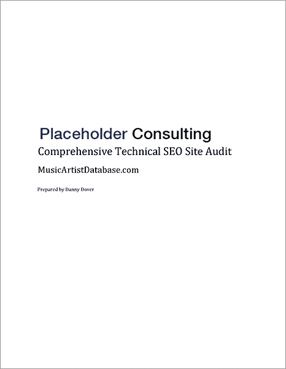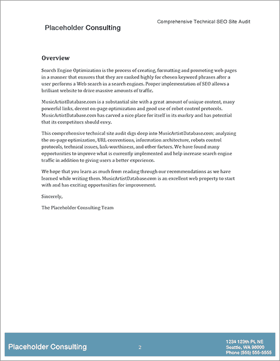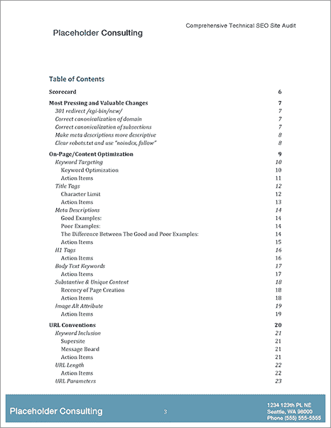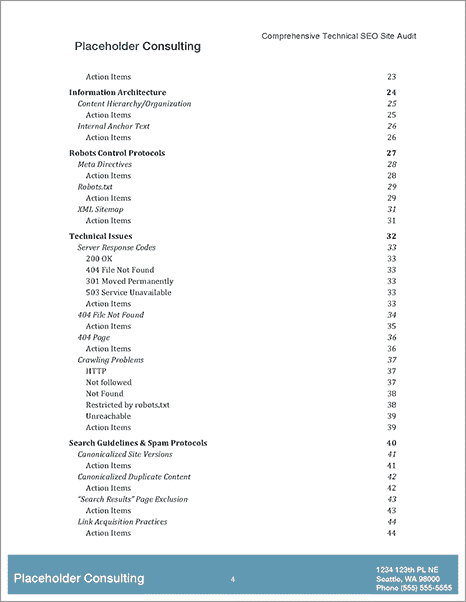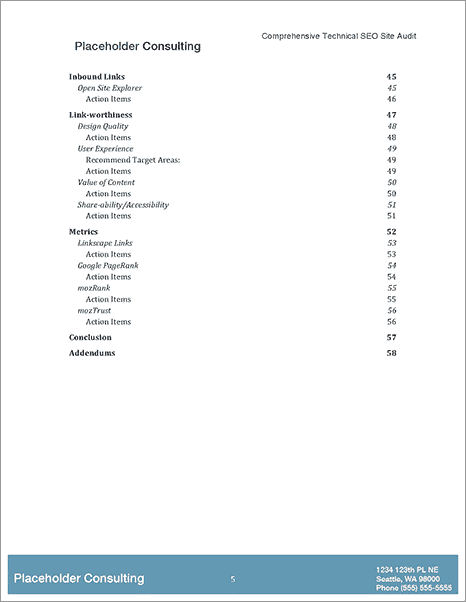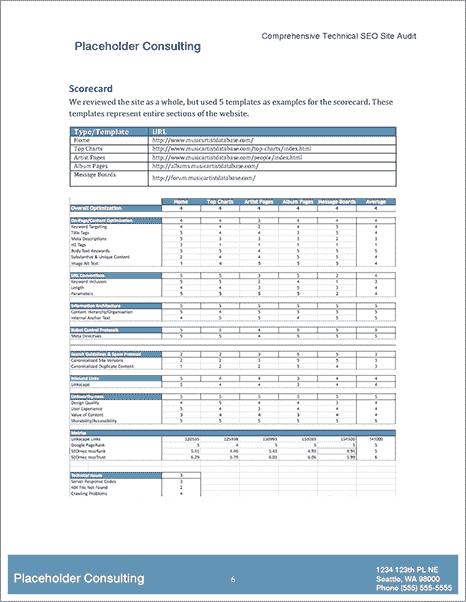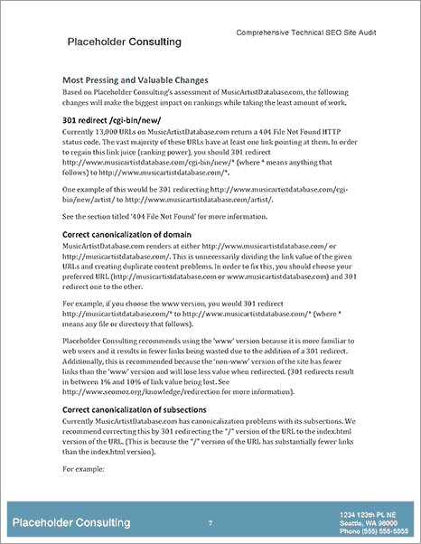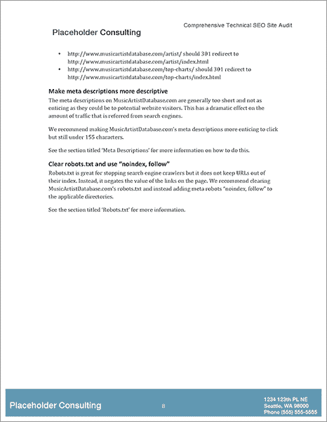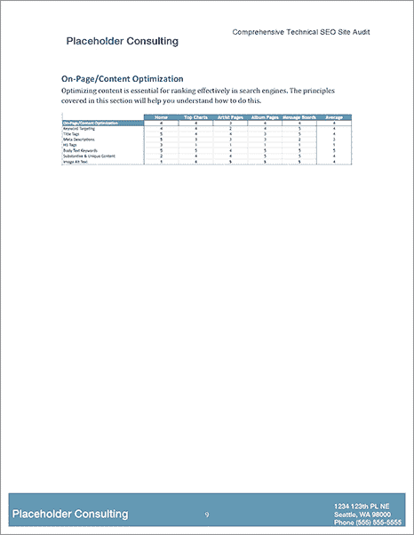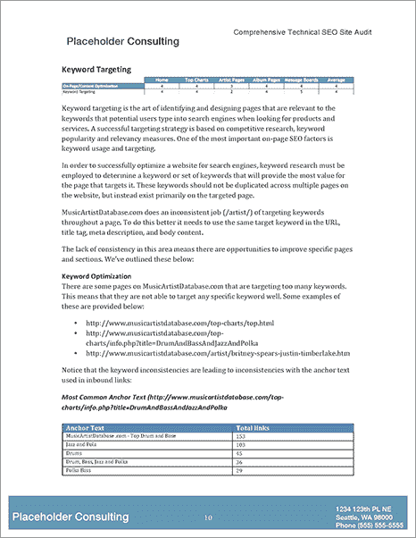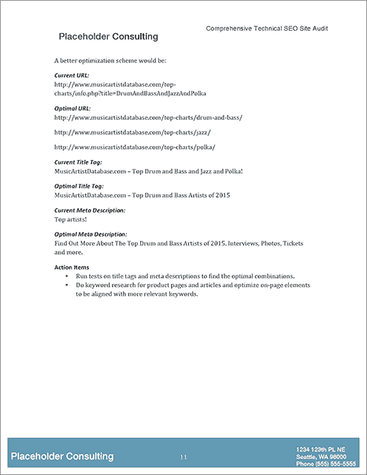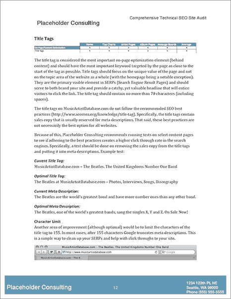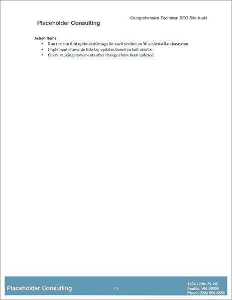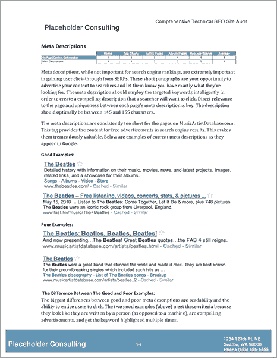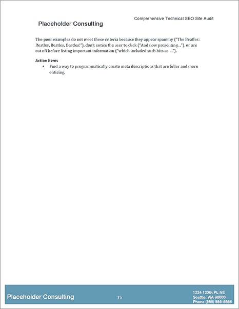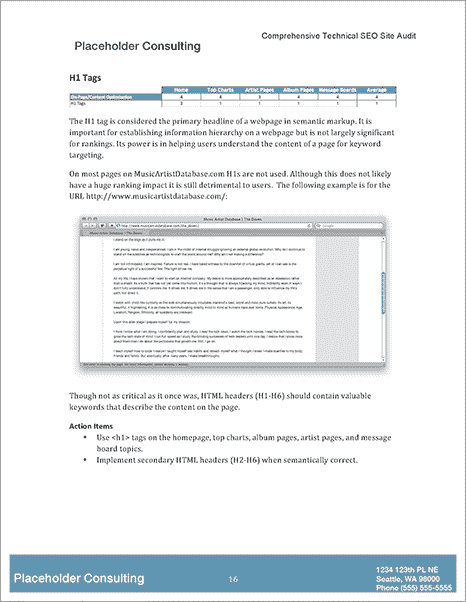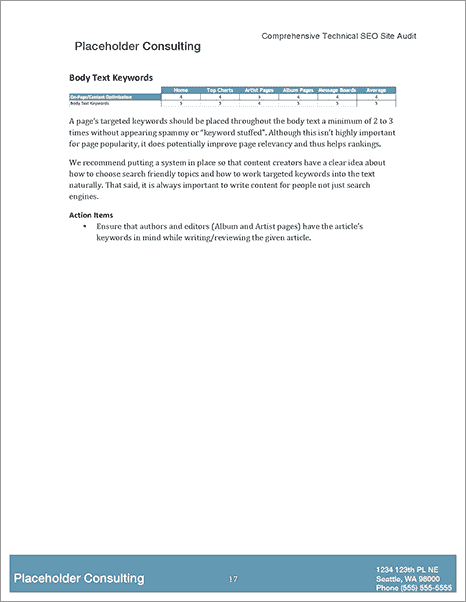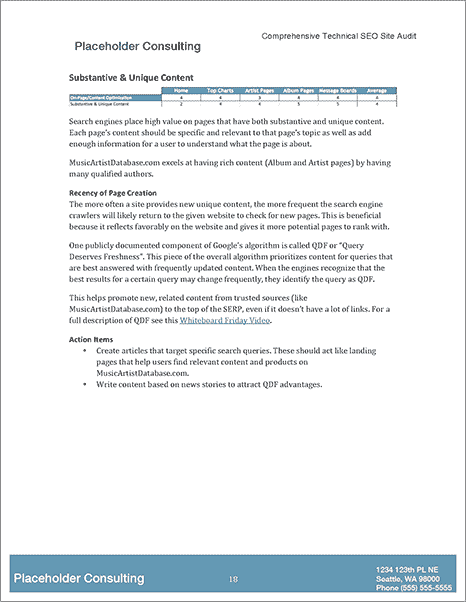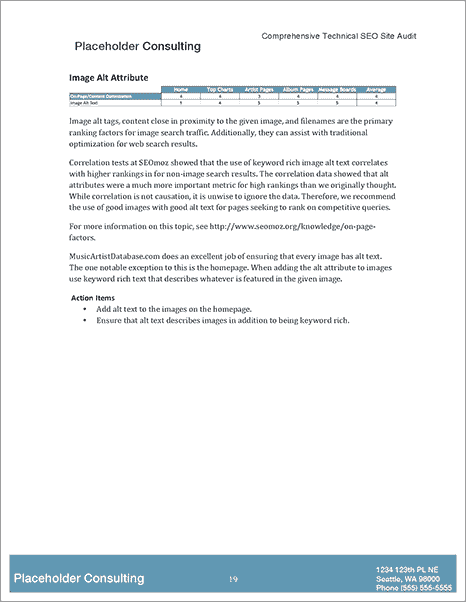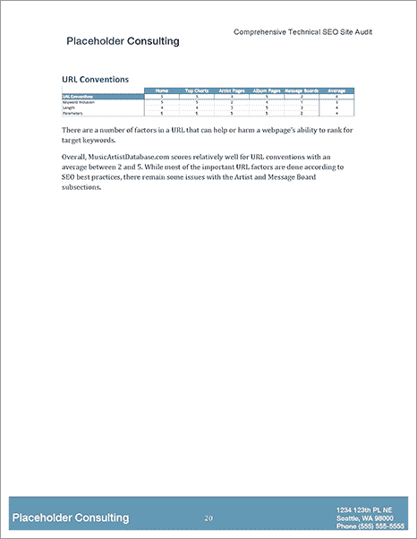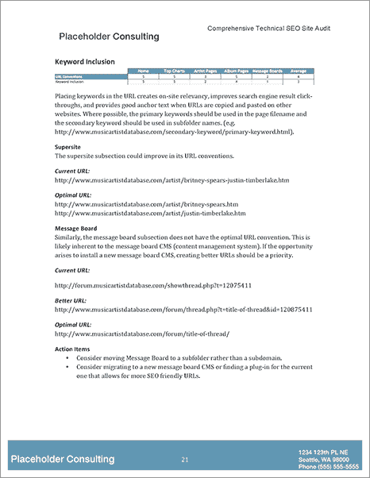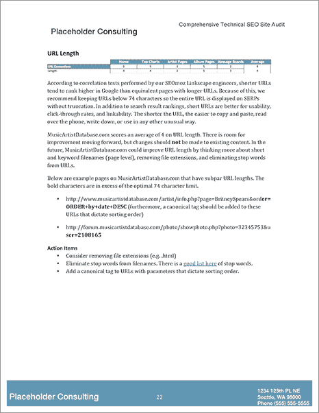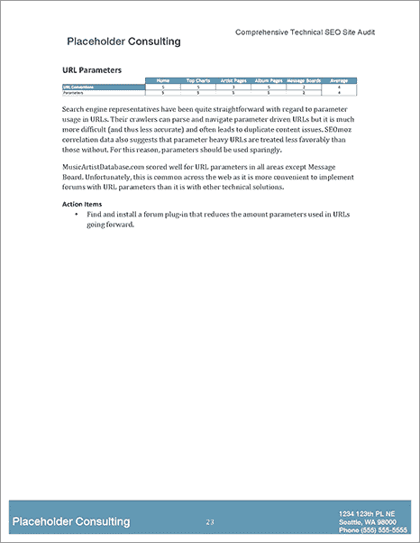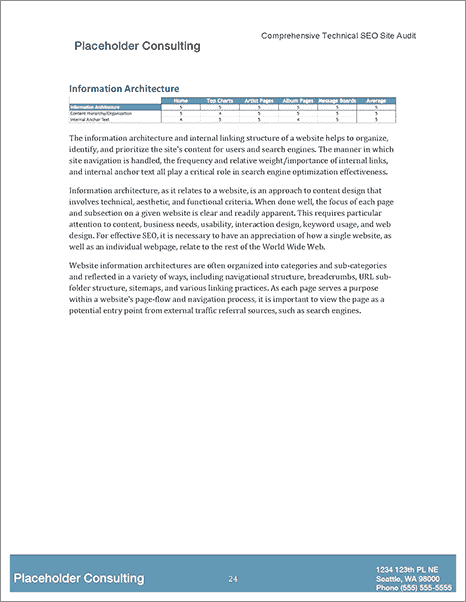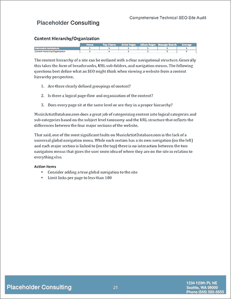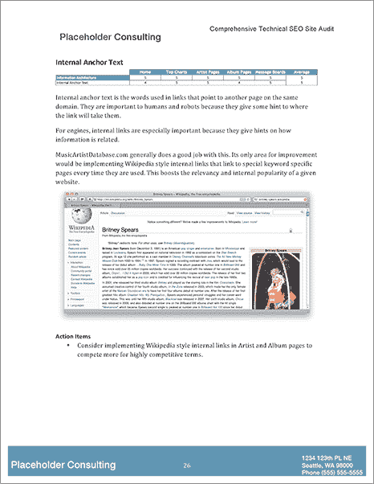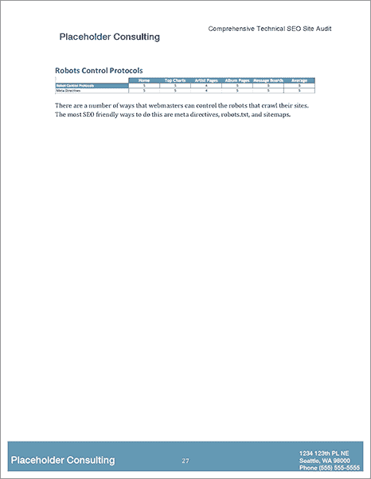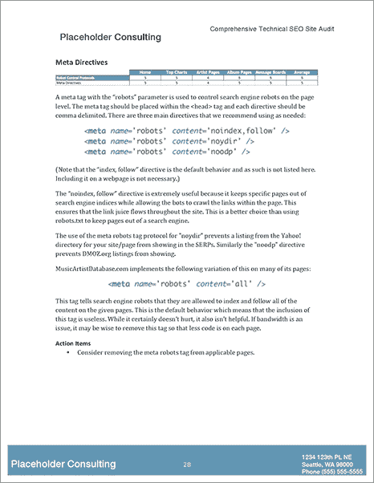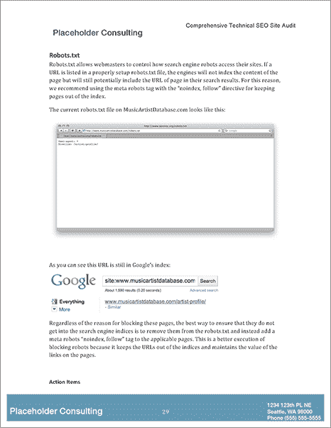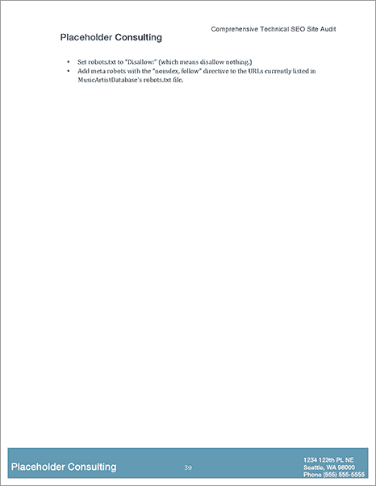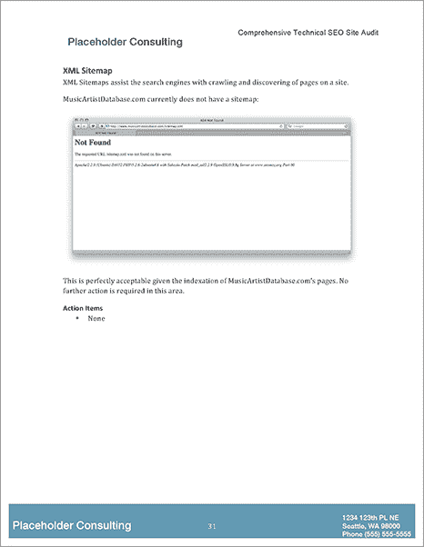


注意：本章的其余部分包含了 SEO 审计各个章节的描述。章节正文之后是 `SellTheWidget.com` 的完整审计示例，其中包含了本章讨论的所有页面的示例。这样，你既可以了解审计的特定章节可能包含的内容，又去查看它们在实际审计中看起来是什么样。

## 封面

报告的封面需要传达专业感和价值。我倾向于使用带有大量留白的简约设计。我这样做是为了向客户展示这份报告既是严谨的，又是易于阅读的。正如之前的报告一样，我建议在报告封面上包含以下所有内容：

* 报告标题
* 报告作者
* SEO 顾问公司名称
* SEO 顾问公司地址
* SEO 顾问公司电话号码

注意：也请考虑在封面上添加你的电子邮箱的优缺点。在交付审计报告后，电子邮箱可能会收到客户的大量联系（或者是他们可能会给他们看报告的朋友）。如果你的价格中包含了交付后的咨询，那么添加它是合逻辑的。如果没有，那么你可能不想因包含它而冒着大量免费交付后咨询请求的风险。

尽管如此，在最初谈判交易时，你可能已经与客户有了大量的邮件接触，你的电子邮箱地址并不是秘密。

## 目录

目录应该是直观且易于阅读的。为了方便起见，最好的办法是让文字处理软件生成它。请查看第 8 章中对应章节的技巧，使该章节既更便于创建，也更便于客户导航。

如果不是为了查看该报告所讨论的各种问题，也请浏览此目录。

## 最紧迫且最有价值的更改

本节列出了五个对排名影响最大的最简单的 SEO 更改。

### 你在这一章节中提出的常见建议有哪些？

对于这一章节，我优先考虑我在早期的分析中发现的 SEO 问题。通常，我在这里提到的问题与我在第 14 章描述的“SEO 快速命中列表”中提到的常见 SEO 问题是相同的。

对于每项建议的更改，在报告的 PDF 版本中，你可以包含一个指向报告中描述该问题及如何修复它的章节链接。

## 搜索引擎与第三方统计数据

本节提供了搜索引擎用于计算排名的部分原始数据。

### 为什么这个章节是必要的？

这个章节是必要的，因为它提供了客户喜欢传递给开发团队的快速行动点。这很有帮助，因为它允许客户进行快速更改，从而立即对他们的排名产生某些影响。

注意：正如报告提到的，这些服务提供的原始数字远不准确。然而，两个或多个网站之间的数据关系有时相当接近。换句话说，如果第三方网站说你的网站在某个月有 100,000 次访问，不要相信那个数字（相反，相信你的分析数据！）。但如果该网站说你的网站在某月的访问量是另一个网站的两倍，那么测量可能比较准确。

同样的建议也适用于随时间的数据趋势。像 `Compete` 这样的网站通常非常擅长显示流量的总体趋势（上升或下降），而原始数字只是估计值。换句话说，“信任曲线，但不要信任数字。”

报告的其余部分关注于可能需要更长时间才能实施并在搜索引擎索引中产生效果的建议。如果本节中列出的快速建议对客户的排名产生了积极影响，那么这些长期建议通常会得到实施。

### 你是如何对这一章节进行分析的？

这一章节是在撰写此报告之前，花费 4 小时（或更长时间）分析客户网站的结果。我使用这一章节来记录我发现的最紧迫的问题。然后，我参考报告中相关的深度章节。

### 你对这一章节的建议是什么？

这一章节是根据我看到的情况得出的建议。我最常见的建议是基于搜索引擎报告的得分。这一章节包含了问题的概述；后续章节将包含更详细的解释和解决方案。

## 搜索引擎索引数据

本节展示了主要搜索引擎收录页面的估值。这包含了这些原始数据。我在这里看到的常见问题是数字异常高或低。

* 如果这些数字异常高（根据客户认为在他们网站上的页面数量），那么他们可能存在重复内容问题。这通常是由不必要的 URL 参数引起的。
* 我看到的另一个问题是页面数量异常低。这通常是由爬取问题（爬虫无法访问网站）或入链链接太少（导致搜索引擎认为不值得索引）。

## 权重数据

本节包含了指向该网站的入链链接。我在这里看到的常见问题是 Bing 看到的很多，而 Google 看到的少得多。

这通常是由重复页面（低价值）或来自链接农场的链接引起的。无论何种情况，这些链接都无法帮助排名，并且在未来可能会被 Google 忽略。

## 链接景观指标

链接景观指标提供了 Web 如何链接到特定 URL 的原始见。我通常看到两种指标组合：高 `mozRank` 低 `mozTrust`，或者低 `mozRank` 高 `mozTrust`。

如果你在你的客户身上看到任何一种情况，他们可能拥有垃圾链接配置，并且正在影响排名。

交叉引用查看第 3 章中的“SEO 工具栏”章节获取更多信息。

## 搜索引擎中的品牌与域名提及

在章节中，我包含了 Google 报告的域名指标和图表。我在这里看到的常见问题是有很多很多，但品牌提及很少。这表明 Web 上有很多自动提及，但很少有真人（以及潜在客户）在讨论该品牌。

当这种情况发生时，我建议客户和我开会，讨论如何建立社区并与社交 Web 互动。这种讨论和计划通常需要几个月才能实施。

## 第三方流量指标（每月）

展示这些数据是为了向客户说明这些第三方来源与其内部分析相比有多不准确。我包含这些仅作为基准，以便他们更准确地理解竞争对手和潜在投资者是如何看待他们的网站的。

这些数字不准确并不意味着它们不重要。许多非常有权力和影响力的人使用这些数字做出决策。

# 技术页面内/站点问题

本章节涵盖了（根据搜索引擎报告）负面影响该网站的因素。

### 为什么这个章节是必要的？

这个章节是重要的，因为它涵盖了对排名影响最大的常见 SEO 错误。这虽然基础，但它非常清楚地说明了哪些因素阻碍了网站获得潜在排名。

### 你是如何对这一章节进行分析的？


本章节的分析需要访问多种工具，并具备在何处寻找潜在问题的知识。幸运的是，如果你一直在跟进学习，你应该已经了解了这些工具以及该去哪里寻找这些问题。（如果你忘记了，请检查第 3 章和第 4 章）。15 分钟 SEO 审计（见第 4 章）通常足够编写报告的这一部分。

## 你在这一章节中会提供哪些建议？

我发现最常见的 SEO 建议也是影响最大的。本章节涵盖了这些内容，并就如何处理常见情况提供了建议。

### 搜索引擎注册

我合作过的绝大多数客户都没有在搜索引擎中验证他们的网站，因此无法访问其特定的网站数据。这是一个问题，因为这些网站站长工具对于理解搜索引擎如何查看特定网站，以及指示搜索引擎如何处理该网站非常有帮助。

在本章节中，我总是会引导客户了解通过这些资源可以使用哪些选项，并告诉他们最佳设置应该是什么。

### Robots.txt 审查

在本章节中，我建议客户使用 `meta robots` 替代 `robots.txt`，并对该文本文件的每个条目提供建议。关于此点的更多信息，请参阅第 6 章中的“阻止搜索引擎抓取页面”章节。

### 服务器响应码

我接触过的多数客户都不理解各种 HTTP 状态码。我利用这一章节来定义常见的问题状态码，并就如何修复它们提供建议。

具体来说，我建议将 `302` 重定向转换为 `301` 重定向，并对返回 `404` 响应码的页面进行重定向，或者将它们改进为帮助用户寻找所需内容的更好工具。

### 网站规范化（Site Canonicalization）

网站规范化是一个非常常见的问题，会导致同一域名下的网页产生不必要的内部相互竞争。该主题在第 6 章的“Rel Canonical 链接元素”和“301 重定向”章节中有详细介绍。

### 站点地图文件（Sitemap）的使用

我在大型网站客户中看到的最常见情况是，他们已经有了 `XML sitemaps` 并每周更新一次。如果尚未实施，这是推荐的最佳实践；我建议遵循这一做法。

当客户没有站点地图时，我建议他们添加一个。他们可能会看到搜索引擎引流的最初增长，随后的流量水平将低于初始增长的峰值，但高于站点地图之前的流量水平。

### 重复内容问题

我看到的大多数重复内容问题是由规范化问题引起的。由于这些问题通常比其他类型的重复内容问题（被盗用的内容、`URL parameters`、框架等）更容易修复，我专注于这些问题，并在适当的情况下建议 `301 重定向` 和 `rel canonical`。

### 抓取问题

抓取问题通常分为五类：插件、表单、图像、JavaScript 导航和机器人阻止。在本章节中，我在适用的情况下会涵盖每种情况并提供替代方案。

## 独立章节审查

本章节对给定网站的主要部分进行深度分析。

### 重复、抓取障碍和索引计数错误

重复内容与抓取障碍的结合会导致搜索引擎显示的索引数量与你网站真实页面数量接近到具有误导性。我最近审查了一个库存密集的汽车配件网站，其存在严重的分页抓取障碍，但被索引的每个 `SKU` 页面都有二到四个重复项。

这两个“问题”结合在一起，导致搜索引擎索引的页面数量与客户认为的真实页面数接近得可疑。因此，请注意那些看起来正确的数字，直到你有机会深入研究哪些内容被收录、哪些未被收录。

### 为什么这一章节是必要的？

这一章节很重要，因为它直接涵盖了给定网站最重要的部分。它就如何更好地优化这些页面的页面因素提出了具体的建议。这既具有可操作性又具有影响力。

### 你如何对这一章节进行分析？

在编写这一章节时，我依靠开始编写报告前做的分析，并深入研究每个主要章节。在撰写章节分析时，我会花时间浏览指定的章节并寻找 SEO 问题。我将大部分精力放在页面因素上，因为在进行此类分析时这些因素最容易发现。

交叉引用：请查看第 2 章中的“10 英尺视角”和“1 英尺视角”章节，了解编写本章节时需要寻找的信息。

## 你在这一章节中会提供哪些建议？

在本章节中，我审查了给定网站每个主要部分的 `title tag`（标题标签）、`meta description`元描述）、`meta keywords URL` 以及关键词使用。

#### 首页

在很多方面，首页是网站的锚点。它们几乎总是链接最多的页面，因此从信息层级和链接权重（link juice）的角度来看，它们是最。

我对首页最常见的建议与关键词定位有关。首页的所有主要页面因素都应该直接针对网站的主关键词。

#### 分类页

分类页页是网页导航的分叉点。它们应该有明确的重点（特定的类别而非宽泛的概念），并在所有最重要的页面 SEO 因素中定位该关键词。

我在分类页上看到的最常见问题是，它们没有从父页面（例如首页）和子页面（取决于分类系统的深度，可能是产品页面或子分类页面）链接。这是一个问题，因为它阻碍了链接权重的流动，并让用户导航网站变得更加困难。

#### 产品页面

产品页面是电子商务网站的核心灵魂。它们是网站的销售员，应该经过优化和测试以获得最佳结果。

我在产品页面上看到的最常见问题是缺乏独特内容。电子商务网站通常有许多产品页面，为所有页面生成独特文本是困难的。不幸的是，这是为了获得高索引率必须解决的问题。我见过的成功策略包括用户生成的评论、额外的产品图片和编辑评论。

这是一个挑战，但为了获得高索引率，电子商务网站需要更多地关注每个产品页面具有特定性的文本。

## 关键词定位

关键词定位是指将选定的关键词出现在对 SEO 重要的页面区域中。

### 为什么这一章节是必要的？

这一章节很重要，因为它提供了影响产品在搜索结果中排名的具体建议。

### 你如何对这一章节进行分析？

为了查看关键词在页面上的定位情况，我使用 SEOmoz 的 `mozBar`（见第 3 章）并使用 `Analyze Page` 功能。这向我展示了所有的关键页面页面指标以及是如何配置的。

### 你在这一章节中会提供哪些建议？

在本章节中，我根据页面因素提出建议。

### 目标关键词

我在关键词定位上看到的最常见问题是客户针对了太多关键词，或者针对一个过于宽泛的关键词。在这种情况下，页面对其关键词排名的可能性很小，页面应该专注于定位一个特定的词，使其与页面拥有的链接权重匹配。

### 访问与搜索分析

本章节分析客户的内部数据，以查看哪些关键词对他们有效。

### 为什么这一章节是必要的？


# 有什么比过去和现在的成功更能预示未来的成功的指标呢？这一部分确定了哪些策略行之有效，并展示了如何监控它们的进展。

不要忽略记录网站做得好的地方。过去和现在的成功可以让你看到哪些做法对网站来说是有效的。

### 你如何对这一部分进行分析？

要对这一部分进行分析，你需要访问客户的分析程序。常见的程序包括 `Omniture`、`Yahoo! IndexTools` 和 `Google Analytics`。

## 你在这一部分提出的常见建议有哪些？

分析是任何电子商务网站成功的衡量尺。这一部分包含了了一些应该监控的衡量指标。

### 每日跟踪的重要指标

有很多重要的指标需要跟踪。这些指标根据网站而异。大多数电子商务网站应该每日跟踪的常见指标包括：

*   每日独立访客
*   引荐域名 (Referring Domains)
*   自然搜索关键词
*   付费搜索关键词

### 引导转化的术语和短语

许多客户会跟踪哪些自然关键词和付费关键词带来了流量，但未能更进一步去查看哪些关键词驱动了实际转化。

这种额外的洞察力至关重要，因为它展示了哪些关键词实际上在产生收入，从而在优化时间上提供了最高的投资回报率。

### 高搜索价值术语和短语

这些术语价值最高（从其引流的搜索流量而言）。我将它们作为衡量搜索引擎竞争力的标尺，并建议它们作为尝试争夺的关键词类型的基准。

### 品牌与非品牌词的平衡

当你查看一个网站的顶级引荐和转化关键词列表时，似乎一次又一次，未经优化的网站找到我们时，比例大约为 `85:15`。换句话说，大约 85% 的短语以某种方式包含了网站名称。

品牌查询当然不坏，因为当有人搜索你的网站时，你当然希望他们能找到它。（如果他们正在搜索你的品牌，而你没有出现在 `SERP` 上，那么你就有了严重的问题。）但它也说明了引入非品牌查询的真实机会。在品牌：非品牌的比例上，没有对错之分，但我目标是将非品牌比例提高到 40% 甚至 50%。

当你在优化之后品牌百分比下降时，不要担心。这可能并不意味着你正在失去品牌查询。相反，它通常意味着你开始引入更多的非品牌查询，整体比例平衡开始向更均衡的状态转变。这是一件好事。

## 信息架构与内部链接结构

信息架构和内部链接结构对于搜索引擎如何索引特定网站至关重要。这一部分涵盖了我在这两个领域向客户提出的常见建议。

### 为什么这一部分是必要的？

这一部分对于帮助客户理解规划扩展性网站的影响很重要。它向他们展示了糟糕的信息层次是什么样的，以及它是如何影响他们的排名的。

### 你如何对这一部分进行分析？

这一部分的分析发生在开始报告之前浏览网站的时间。关于此点的更深入讨论，请参见第 2 章。

### 你在这一部分提出的常见建议有哪些？

我在这一部分提出的最常见建议都与页面内因素有关，因此在客户的控制范围内。这是一个好消息，因为这意味着这些建议可以在客户公司内部实施，而不是像需要入链链接的建议那样，那需要他人的配合。

### 信息层次

信息层次问题通常属于两大类之一：内部链接和 `URLs`。

*   在内部链接的情况下，我最常用的建议是使用针对特定关键词的锚点文本指向针对相同关键词的页面。这看起来像是常识，但在实践中很少这样做。网站应该内部链接到带有其目标关键词作为锚点文本的页面，而不是其他恰好符合的文本。
*   第二种情况是 `URLs`。这些地址应该使用它们想要排名的关键词，以帮助搜索引擎理解页面应该排名什么。

## 内容分析

这一部分涵盖了独特内容的价值。

### 为什么这一部分是必要的？

如果你有机会参加一次 SEO 会议（参见附录 A），你会反复听到“内容为王”这句话。这种现象是因为 SEO 专家知道独特内容的价值。

### 你如何对这一部分进行分析？

这一部分的分析是报告中最具定性的部分。它依赖于作者判断的许多人为因素。在编写这一部分时，我发现自己经常问：“我会链接到这个吗？”

### 你在这一部分提出的常见建议有哪些？

信息就像世界经济市场一样，遵循供应（唯一性）和需求（用户需求）的规律。

### 独特内容

我经常看到内容是独特的但没有满足用户需求。独特内容最常见的问题是相同的内容被用在网站的多个部分。这导致内容必须相互竞争，并降低了其相关性。

理想情况下，每个产品页面应该包含至少三段独特的文字和一张产品的独特图片。这既受到那些想要信息的喜爱，也受到那些索引搜索者想要信息的搜索引擎喜爱。

### 满足用户需求

很多我看到内容独特但没有满足用户需求。当这种情况发生时，我会帮助识别哪些相关信息可以满足需求（记住，很多人想知道很多不同的事情），并向客户建议这些。

### 产品文案的独特内容

销售自己不制造的产品的往往会陷入陷阱，使用制造商为特定产品提供的完全相同的目录文案。这导致几十（甚至数百）个目录网站使用完全相同的页面内文案来营销特定产品。

你可以做得更好。如果你想获得更多搜索引擎的关注，你必须这样做。


易用性和用户体验对网页成功的重要性与搜索引擎排名一样重要。

### 为什么这一章节是必要的？
这一章节之所以重要，因为它涵盖了 SEO 中许多客户容易忽略的人性化方面。用户在网站上的体验是决定用户是否会购买产品的主要特征。因此，本报告中的这一章节是必要的。

### 你如何对这一章节进行分析？
该章节的分析基于我在浏览网站时的经验。详细内容将在第 2 章中介绍。

## 你在这一章节中通常会哪些建议？
我对报告这一部分的大部分建议都是基于我在加载相关网页后的初次反应。这短短的几秒钟是用户决定是继续访问该网站，还是点击“返回”并查看其他搜索结果的关键时刻。

#### 设计质量
我发现，在涉及到排名时，许多人低估了网页设计的重要性。事实上，实际的图形设计可能无法被搜索引擎算法直接量化，但它的间接影响对排名非常重要。

设计会影响人们是否会信任内容。当人们决定是否要为某个特定内容排名时，信任是一个主要因素。因此，我通常会包含一些关于我认为某个页面设计程度的注释。

#### 用户体验
用户体验极其复杂。对于这一章节，我通常通过列出一些基于显性用户体验问题的项目列表（action items）来简化它。

这些项目通常包括提高文本的可读性（间距和颜色）、引导用户在浏览网站时的流向，以及为首次用户创建定制化体验。

## 链接建设机会
在章节中，我涵盖了客户如何根据其现有内容建立链接的方法。

### 为什么这一章节是必要的？
这一章节之所以重要，因为它向客户展示了如何利用现有资产来建立更多链接，从而获得更高的搜索引擎排名并最终售出更多产品。

我听过很多 SEO 专业人员抱怨链链建设是 SEO 中最困难的部分。虽然我认为这可能是事实，但我认为并不一定非如此。当你已经拥有了值得链接的内容时，你只需要将它呈给正确类型的人，就能轻松地获得链接。这一章节将帮助解释如何创作内容来实现这一点。

### 你如何对这一章节进行分析？
为了对这一章节进行分析，我使用了 `SEOmoz’s Open Site Explorer`。这个工具为我提供了客户网站及其竞争对手所需的所有链接信息。

### 你在这一章节中通常会哪些建议？
这一章节分为两类，旨在帮助客户理解自己的链接配置。

#### 当前的入站链接类型
我在这一章节中提出的最常见建议是改进入站锚文本（anchor text）。网站最常见的锚文本几乎总是其域名和品牌名称。这有助于其在这些词汇上排名，但对于提高转化率的词汇没有帮助。

竞争网站需要通过多样化链接配置（多个关键词）来利用其链接建设能力，并将精力集中在有助于其获得高转化率关键词排名的锚文本上。

#### 目前吸引链接的内容
这一章节涵盖了目前从 SEO 角度来看表现良好的内容。我最常见的建议是弄清楚为什么这些内容有效，并将这些成功的属性推广到其他内容中。大多数情况下，这些章节之所以有效，是因为它们提供了网络搜索者青睐的内容，并且格式易于阅读。

## 垂直搜索机会与包含
这一章节涵盖了针对搜索细分领域（如图片搜索和博客搜索）的建议。

### 为什么这一章节是必要的？
这一章节对于网站链接配置的多样化很重要。虽然标准搜索结果最重要的，但垂直搜索有助于扩大特定网站网页的触达范围。

### 你如何对这一章节进行分析？
为了对这一章节进行分析，我会检查目标网站在各种垂直搜索中的包含情况，并检查客户的分析数据中来自垂直领域的引荐（referrers）。

### 你在这一章节中通常会哪些建议？
对于电子商务网站，我通常只针对图片和博客搜索提出垂直搜索建议。我发现其他垂直搜索（本地、实时等）的常见建议并不适用于电子商务网站。

## 图片搜索
我对图片搜索最常见的建议是禁止它。来自图片搜索结果的引荐对于电子商务网站转化率极低。

对于电子商务网站，图片搜索的缺点（通常是图片被盗用）往往大于优点。

#### 博客/订阅搜索
虽然搜索引擎自动发现热门博客非常擅长，但发现较小的公司博客并不行。如果客户属于这种情况，我建议将博客提交给搜索引擎以便其开始索引。

## 术语表
这一章节包含了一个术语表，对熟悉 SEO 术语的客户很有帮助。

### 为什么这一章节是必要的？
报告的术语表包含了报告使用的 SEO 术语的简单定义。没有这些解释，客户很难理解并最终实施报告中的建议。

### 你在这一章节中通常会哪些建议？
术语表包含了我发现客户最难理解的以下 SEO 语：

Cloaking（劫持）
Indexing-Crawling（索引-爬取）
Link Juice（权重）
Long Tail（长尾）

## 总结
现在看起来没那么难了，对吧？你现在应该知道如何格式化一份以电子商务为中心的 SEO 审计报告了。注意看这 50 多页内容中包含了多少价值。如果你已经读了目前的所有章节，那么你已经在提升 SEO 技能新水平的道路上了。

书的其余部分将致力于扩展你目前所学的技能，并辅以一些更宏观的 SEO 概念。在下一章中，你将了解 SEO 行业以及是谁产生了你现在学到的所有想法。


# 第 10 章

## 理解 SEO 行业

### 本章内容
* 学习应该认识谁
* 学习应该避开谁
* 发现是谁在塑造这个行业
* 从大局审视 SEO

与技术领域的许多细分领域一样，SEO 起源于卑微的根基。本章描述了这些根源，并讨论了 SEO 行业的现状。它是对一个非常复杂的行业的简要概述，但在与 SEO 同行讨论该行业时，它提供了你应该了解的所有基础信息。

## SEO 简史
要理解 SEO 行业的现状，了解它是如何发展的至关重要。

### 早期
SEO 一直都是关于影响搜索引擎的搜索结果。在现代搜索引擎出现之前，有各种搜索引擎帮助组织 Web 上的信息。

最早的一些搜索引擎出现于 20 世纪 90 年代初。这些包括 `Yahoo!` 的第一个版本（当时更像是一个目录而不是人们现在认为的搜索引擎）、`ALIWEB` 和 `Infoseek`。就像黄页的影响力者一样，早期的 SEO 人士利用字母顺序来获得排名首页。这包括列出名称如“AAA”、“1ForU” 以及类似标题的页面。此外，早期的 SEO 人士利用字母顺序来占据排名顶端（关键词密度：页面上特定单词或短语出现的次数）。随着时间的推移，各大搜索引擎开始使用算法（`AltaVista`）来对网站进行排名。尽管这种 SEO 人士与搜索引擎之间的猫鼠游戏一直在进行。

随着算法的发展，搜索引擎开始使用算法（`AOL`、`Inktomi`）来排名。在 90 年代末，SEO 的讨论在邮件列表和论坛中进行。SEO 在 1997 年由 Danny Sullivan（见“Search Engine Watch”）首次创造。关于这一术语在 1997 年 5 月被发现时，他承认无法找到任何证据。

随着搜索引擎的成功，SEO 开始变成一项更具利润的业务。

### 成熟
随着网页搜索进入主流，SEO 也成为了一项成熟行业。它拥有大型会议和众多专业组织。SEO 会议包括 `Search Marketing Expo (SMX)` 和 `Search Engine Strategies (SES)`，现在在全球举行。

2009 年，搜索引擎营销专业组织 (`SEMPO`) 估计每年在 SEO 上的支出将超过 20 亿美元。同一年，《福布》进行了一项名为“2009 广告效果调查”的调查，显示 53% 的高级高管计划在 SEO 上花费超过 100 万美元。大型企业已经注意到了这一点，现在 500 强公司招聘全职 SEO 团队已成为常态。在写作期间，在流行的招聘网站 `Monster.com` 上搜索“SEO”返回了数百个美国公司的招聘结果。

## 什么是网络营销人员？我哪里可以找到他们？
当你深入了解 SEO 行业时，你不可避免发现网络营销是一个非常广泛的术语，适用于很多人。本节描述了人们如何使用“网络营销人员”这一称号，以及你如何与社区中的其他营销人员建立联系。记住，关于互联网你总有许多不知道的地方。

### 理解 SEO 的不同观点
在工作头衔的语境下，“网络营销人员”可以有很多意思。就像老师可以专攻许多学科（历史、数学、科学等）的一种一样，网络营销人员也可以专攻在线营销的特定领域（SEO、PPC、联盟营销、数据分析等）一样。在实践中，这个宽泛的头衔适用于任何试图为特定网站引流的人士。

### 黑帽与白帽
就像线下行业一样，网络营销也有自己独特的准则。我们用一个刻度来描述它，从黑帽（使用明显违反搜索引擎指南的策略的狡诈营销人员）到白帽（字字遵守搜索引擎指南的营销人员）。该行业的大多数人处于这两个极端之间，这个领域被人们称为灰帽。


要在网络竞争最激烈的词汇（色情、处方药和赌博相关）中获得高排名，使用黑帽方法几乎是必不可。这些通常包括操纵性的链接建设技巧，例如寄生托管（在未经网站所有者许可的情况下在其网站上托管内容）、`link farms`（仅为建立链接而构建的网站网络）、`content cloaking`（向访问者显示一套内容，向搜索引擎显示另一套内容）以及其他狡猾的策略。这些营销人员通常参与社区活动较少，部分是因为他们必须保持其所行为的秘密。由于他们所在的细分行业竞争异常激烈，他们往往是利润最高的营销人员之一。他们通常与搜索引擎的逻辑背道而行，专注于寻找漏洞并利用技巧来智胜搜索引擎。

白帽营销人员则通过遵循指南和实施长期策略来顺应搜索引擎的逻辑进行工作。根据我的经验，我从未遇到过 100% 遵守搜索引擎指南的互联网营销人员。因此，行业中被识别为白帽的人是那些在绝大多数时候都遵守指南的人。根据我的经验，这些营销人员违反的指南通常与购买链接和抓取搜索引擎结果页面有关。这些营销人员通常活跃在行业细分社区中，许多时候通过为寻求长期在线营销策略的大型公司提供咨询，财务上非常成功。

**提示**：提醒一下，你可以在 `www.google.com/support/webmasters/bin/answer.py?hl=en&answer=35769` 查看 Google 的搜索引擎指南。

# 将垃圾邮件发送者与 SEO 专家区分来

许多自称是专业 SEO 的人更像是垃圾邮件发送者，而不是传统的 SEO。在行业内，他们被称为“蛇油推销员”，这个词指的是过去那些声称蛇油具有医疗功效的骗子推销员。如今，这些骗子提供不合法的“SEO 服务”，让许多人花费了大量的时间和金。在与 `SEOs` 互动时，我建议留意以下迹象，避开不想合作的人。同样，我建议你不要宣传以下服务，因为它们会损害你作为 SEO 的信誉：

1. 任何声称能保证在搜索引擎中获得首页的人。
2. 任何声称将把客户网站提交到大量搜索引擎的人。（记住第 2 章，对世界上大多数互联网用户来说，重要的搜索引擎只有 `Google` 和 `Bing`。）
3. 任何声称他们进行大规模目录提交的人。

做这些事情的人仅占 SEO 行业的一小部分。该行业的其他大部分都是富有道德的人，他们乐于分享想法，并为了朋友和同事的共同利益努力。

遗憾的是，“外部世界”往往从那些被这少数人欺骗的客户那里获得对 SEO 的认知。

# 加入其中

初看起来，SEO 是一个紧密的社区，许多充满明智和丰富人士的细分领域。这会让进入者感到非常畏惧。幸运的是，该社区对新人非常开放，并不断举办社交活动让参与变得更容易。

在写作期间，SEO 社区存在于世界上大多数城市。旧金山、西雅图、温哥华、多伦多、纽约、迈阿密、伦敦、慕尼黑、斯德哥尔摩和悉尼拥有特别活跃的社区。在这些城市中都有将 `SEOs` 聚集在一起的俱乐部和组织。这些组织大多在线运营，除少数例外对外公众开放。

参与这些社区并结识人们最简单的方法是在线与他们互动。我建议开始阅读并评论 SEO 博客。写作期间最流行的 SEO 博客包括：

*   Search Engine Land: `http://searchengineland.com/`
*   SEOmoz: `www.seomoz.org/blog/`
*   SEO Book: `www.seobook.com/blog/`
*   Search Engine Roundtable: `www.seroundtable.com/`
*   Search Engine Journal: `www.searchenginejournal.com/`
*   Marketing Pilgrim: `www.marketingpilgrim.com/`
*   Matt Cutts: `www.mattcutts.com/blog/`
*   Search Engine Watch: `http://blog.searchenginewatch.com/`
*   SEO Chat: `www.seochat.com/`
*   SEO by the Sea: `www.seobythesea.com/`

如果那不是你的风格，你可以尝试参加当地活动。要在你的城市寻找 SEO 活动，请尝试在 Google 中查询：

*   `SEO Events <City>`
*   `SEO Meet up <City>`
*   `SEO Club <City>`
*   `Social Media <City>`
*   `Social Media Meet up <City>`
*   `Internet Marketing Event <City>`
*   `Online Marketing Event <City>`
*   `SEM networking <City>`

如果这些查询都没有发现任何活动，那么你恰恰发现了一个绝佳的机会。举办 SEO 活动很容易，选择一个地点并通过博客和 Facebook 发送邀请即可。

## 也要关注通用营销活动

也考虑在更通用的营销活动上演讲——不仅仅是针对 SEO 的会议。例如，美国营销协会在大多数美国城市都有分会，由于该小组服务于该学科所有分支的营销人员，在线营销——特别是 SEO 技术——通常是成员们了解较少的话题。这使得你的内容对观众更有价值（你的反响非常好），而且通常竞争演讲名额的人较少。

我关于加入 SEO 社区的最后一个建议有点让人畏惧，但最有效。在会议和研讨会上演讲比听起来要容易，并且会产生巨大影响。如果你有新知识可以带给社区，可以通过在行业活动上演讲来分享。你可以在以下 URL 申请参加主要的 SEO 会议：

*   SMX: `http://searchmarketingexpo.com/speaking`
*   SES: `www.searchenginestrategies.com/forms/ses_speakers.php`

在演讲之前，我建议你稍微了解一下社区。本章后面的“SEO 领袖”部分将帮助你理解谁在会议上演讲获得成功，并让你对可能与谁一起参加小组讨论心中有个底。

# 在 SEO 会议上获得演讲机会

SEO 会议的演讲位置属于那种“事事循环”的情况，即以前演讲过的人通常是那些受邀演讲的人。这让新手很难获得邀请。以下是我见过的对演讲新手有效的的策略：

*   创建你自己的细分领域：我见过这种方法在几个不同的人身上生效。例如，Cindy Krum 是一位非常聪明的 SEO，她通过第一个关注移动端 SEO 细分领域脱颖而出。通过这种方式，她让自己成为了权威，并受邀在世界许多会议上演讲。


*   建立人脉并利用它连接他人，同时突出已有的技能组合：这是进入演讲圈最流行的方式。我曾见过许多起点技能水平各异的人通过这种方式成功进入。诀窍在于连接那些可以互相帮助的人，并在适当的时候利用你自己的技能和智力来帮助你能够帮助的人。营销界同行 `Joanna Lord` 是一位分析和 `PPC` 专家，她利用自己的人脉连接他人，并赢得了声誉，这为她带来了许多演讲机会。

*   在知名公司工作：这种策略更难实现，但效果出奇地好。我见过一些以前从未在会议上演讲过的人，通过利用自己的雇主背景和技能组合来打响名气，从而进入演讲圈。这也是我获得第一个演讲机会时使用的策略。

*   利用以前习得的知识并推销自己的主题：你很可能了解与 `Internet Marketing` 相关的知识。`Jen Lopez` 是一位 `SEO`，曾是一名开发者，她利用自己的开发技能从开发者的视角来介绍 `SEO` 概念。这帮助她在开发者大会和 `SEO` 会议上的提案获得了录纳。

*   利用可以补充 `SEO` 策略的优势：如果你不太熟悉 `SEO`，但非常了解 `Internet Marketing` 的其他方面，你完全可以尝试在 `SEO` 会议上推销你熟悉的主题。`Scott Willoughby` 是一位电子邮件营销专家，他通过在会议上解释复杂的电子邮件营销策略，在 `SEO` 领域和电子邮件营销领域都取得了良好的成绩。

*   揭秘一个曾带来巨大成功且可以复制的秘密：这种策略虽然并不频繁，但一旦使用，通常会广受欢迎。`Dennis Yu` 是一位社交媒体战略师，他利用在 `Facebook` 上的成功经验走遍世界，教授人们如何使用他的方法获得成功。

*   结合 `SEO` 之外的专业知识并解释其关联：`SEO` 演讲者的问题之一是，他们往往只精通一个主题。你可以利用这一点，采取一项大多数 `SEOs` 技能范围之外的技能，并解释它如何帮助他们完成工作。来自西雅图的律师 `Sarah Bird` 在这方面做得非常好，她向 `SEOs` 教授法律如何与他们的工作相关。

*   在当地推销：如果其他方法都失败了，你总可以尝试利用你的家乡。我见过有人之所以能在会议上演讲，仅仅是因为他们是会议举办地当地成功的 `SEO`。

## SEO 金字塔与多重身份

除了通过“帽子”对伦理进行分类外，`Internet marketers` 还会将不同的能力视为不同的“帽子”。一个自称为 `SEO` 的人可能兼任 Web 开发者、付费搜索营销人员或社交媒体营销人员的身份。

许多 `SEOs` 根据名副其实的 `SEO 金字塔` 来看待自己的职责。（请参见图 10-1 的图表版本。）尽管这张图表说明了传统 `SEO` 的职责，但 `Internet marketers` 拥有不同细分领域的重叠技能（被称为“戴多重帽子”）是常有的。这些领域互辅相成，是全方位在线营销人员的基石。以下职业名称是 `Internet marketing` 行业人士最常见的细分领域（帽子）。虽然对 `Internet marketing` 中许多细分领域的详细解释超出了本书的范围，但我建议尽可能多地学习以下每个领域，以便你能执行 `SEO` 流程。

## 搜索引擎优化师 (SEO)

`SEO` 是 `Search Engine Optimization`（搜索引擎优化）的缩写。拥有这一头衔的人通常关注自然结果。他们可以是白帽、黑帽或处于灰色地带。尽管他们的最终目标是吸引尽可能的人，但许多人关注 `SEO 金字塔` 的底部。一个 `SEO` 的典型优势包括页面优化。

## 付费搜索营销人员（称为 PPC）

`PPC` 是 `pay per click`（点击付费）的缩写。这指的是搜索引擎广告，广告主仅为那些点击的广告付费。这种营销人员与 `SEOs` 的区别在于，他们关注的是付费结果而非自然结果。

## 搜索引擎营销 (SEM)

注意：许多 `SEO` 老兵对 `SEM` 的正确用法持有不同意见。虽然大家都同意它代表 `Search Engine Marketing`（搜索引擎营销），但它有时被当作所有搜索营销（包括自然、点击付费和横幅）的总分类，或简单作为 `PPC` 的同义词。后者的观点在大型广告公司和大品牌中尤为流行。

## 社交媒体营销人员 (SMM)

`social media marketer` 是一个相对新的职位。这一头衔指的是为了网站利益而管理社交媒体的人。他们构成了新形成的 `SEO 金字塔` 顶端，负责与在线社区互动并驱动流量。

## 转化率优化师 (CRO)

`conversion rate optimizer`（转化率优化师）专注于提高访问网站的人数与最终在网站上执行特定操作（通常是购买）的人数之间的比例。他们的职责处于 `SEO 金字塔` 范围之外，但对于盈利至关重要。


联盟营销人员是指通过担任中间人在线上销售商品（产品或服务）的人。他们通过为销售的每件商品赚佣金来盈利。就像转化率优化者一样，他们的角色处于 SEO 金字塔之外，但对于实现网站盈利至关重要。联盟营销人员的在线营销人员或销售人员通常比他们所销售的产品或服务的制造商或提供者。

他们的优势包括销售技巧、网页开发、设计和转化率优化。

### SEO 领袖

营销行业的一个固有的副作用是，无论在哪个细分领域，最优秀的营销人员都会获得像明星一样的地位。SEO 也不例外。以下是 SEO 行业一些知名人物的名单。这份名单希望能帮助你熟悉一些你肯定会听到的名字。

这些名字的出现与其说是为了满足他们的自尊心，不如说是为了让你科普。这些人在行业中扮演着重要角色，并为深入了解他们的人开启许多机会。他们是个人品牌营销表现卓越的典范。你可以参考以下简介，了解他们的职业生涯中哪些方法是有效的，并将其作为你自己可能有效方案的参考。

#### Danny Sullivan (Search Engine Land)

Danny Sullivan 从 1995 年底开始关注搜索引擎，当时他开展了一项关于搜索引擎如何索引网页的研究。研究结果以《网站站长搜索引擎指南》的形式在网上发布，这是为了解答网站设计者和互联网公关人员对搜索引擎提出的许多问题的开创性尝试。

营销人员和普通搜索引擎用户的积极反响使 Danny 将指南扩展为网站 Search Engine Watch，他在该网站担任主编直到 2006 年 11 月。现在，他担任主编执于 Search Engine Land 的工作，并带领其进入下一代搜索报道领域。Danny 还担任 Third Door Media（该公司是大型 SEO 活动背后的公司）的首席内容官。

#### Matt Cutts (Google)

Matt Cutts 是 Google 网络垃圾邮件团队的负责人，也是 Google SEO 政策的发言人。他在 SEO 社区中因执行 `Google Webmaster Guidelines` 和打击链接垃圾邮件而闻名大噪。Matt 还向公众提供关于如何在 Google 中获得更高网站可见度的建议。

#### Rand Fishkin (SEOmoz)

免责声明：我曾在 SEOmoz 与 Rand 共事过，所以我不得不承认我有主观偏见。尽管如此，在为本章节进行研究时，Rand 出现在我看到的每一个 SEO 领袖名单中。

Rand Fishkin 是 `SEOmoz` 的首席执行官兼创始人，该公司是搜索引擎优化工具、资源和社区领域的领导者。2009 年，他被《商业周》评为“30 岁以下 30 位最佳最佳科技创业者之一”。

Rand 是互联网营销会议的频繁演讲者，并在全球各地的搜索会议上发表主旨演讲。他特别热爱 `SEOmoz` 博客，每天有数以万计的搜索专业人士阅读。

#### Vanessa Fox (Nine By Blue)

Vanessa Fox 是一位搜索引擎优化专家、作家和顾问，因其创建 `Google Webmaster Central` 以及作为 Google 发言人的工作而闻名。此外，她还是 Ignition Partners 的驻驻创业者以及 Nine By Blue 的创始人，这是一家强调搜索的营销咨询公司。

#### Aaron Wall (SEOBook.com)

Aaron Wall 是 `SEO Book` 的作者，这是一个动态网站，提供营销技巧、搜索领域报道、免费的 SEO 视频和免费的 SEO 工具。他经常在会议上做演讲，是 `Clientside SEM` 的合作伙伴，并出版了数十个独立网站。

#### Barry Schwartz (Search Engine Roundtable)

Barry Schwartz 是一位 SEO 顾问、`SearchEngineLand` 的贡献者和 iPhone App 开发者，但在 SEO 行业因他在自己的网站 Search Engine Roundtable (`SERoundtable.com`) 上的卓越工作而最闻名。Barry 是该行业中最敏锐、最客观的人之一，他密切关注搜索引擎新闻、冷门博客以及 SEO 新闻往往源头的论坛。他非常小心地将推测与事实分离开，他是许多大品牌 SEO 人士每天的首要关注站。

#### Todd Friesen (“Oilman”)

Todd Friesen 目前担任 `Performics`（一家 Google 曾拥有但最终卖掉的公司）的 SEO 总监，他曾与世界 100 强企业合作过项目，曾担任 `WebmasterWorld.com` 的管理员，担任 `Search Engine Watch` 的主持人，并是 `WebmasterRadio.fm` 上 SEO Rockstars 的联合主持人。你可以在几乎任何搜索引擎会议上找到 Todd 正在演讲或与其他 SEO 人士进行交流。

#### Michael Gray (Atlas Web Service)

Michael Gray 是 `Atlas Web Service` 的所有者兼总裁；这是一家位于纽约的互联网咨询公司。他自 1998 年以来一直从事网页开发和网站管理。Michael 参与联盟营销活动多年，并在 SEO、社交媒体和博客管理等各种主题上提供咨询服务。

#### Bruce Clay (Bruce Clay, Inc.)

Bruce 曾在几家高科技企业担任高管，他拥有在硅谷领先公司担任技术高管的长期经历，自 1996 年以来一直处于互联网业务咨询领域。

他还出现在许多播客节目和 `WebmasterRadio` 节目中，并出现在了 NHK 的一小时电视特别节目《Google 的深远影响》。他亲自撰写了许多高级搜索引擎优化工具，这些工具可以在公司网站上获得。

### Google 和 Bing 背后的人与技术

虽然领导 SEO 行业的人士很重要，但了解创建搜索引擎本身的人可能更为重要。这些公司内部人员的决定对我们这些互联网营销行业的人有深远影响。本节将介绍 Google 和 Bing 背后的人与技术。

对许多人来说，Google 代表了一种全新的软件范式。这家公司由两名斯坦福大学博士辍辍创立，其运营方式就像顶级大学的计算机科学课程一样。这与微软和 IBM 等老牌软件公司的官僚机构和封闭墙结构形成了直接对比。Google 是一家以开放协议、极客幽默、简洁设计以及为员工提供优质福利而闻名的公司。然而，比所有这些更重要的是，Google 以改变世界和将互联网推向主流而闻名。


Google 的文化与之前的任何主要业务文化都不同。这家公司的创始人从很早开始就把让员工在工作时尽可能快乐作为首要任务。他们相信，通过这种方式，员工会投入更多时间工作，并产出更好的成果。历史证明，这个计划是有效的。

Google 员工享受着美食（如果午餐既美味又免费，为什么要离开办公室呢？）、洗衣设施，以及数不完的玩具和小配件。我接触过的一位员工开玩笑地提到“新生 15”（freshman 15），指的不是大一新生重了 15 磅，而是 Google 的新员工因为食物和零食的选择而重了 15 磅。

走进 Google 办公室就像走进幼儿园的教室。大堂、走廊和会议区摆满了玩具、鲜艳的色彩和画有愚蠢涂鸦（以及复杂的算法）的白板。这是公司整体文化的反映。Google 的员工在工作时往往很爱玩，同时又非常努力且极其聪明。大多数软件工程师在小组中工作并共享办公室。公司有管理层级，但比其他公司并不那么明显。与大多数领先的软件公司一样，Google 的工作标准非常高。让 Google 文化独特之处在于，这种高标准还辅以高标准的娱乐。

### 聪明且永无止境

从一开始开始，Google 就建立了一个围绕不断改进产品且不愿称任何版本为“最终”版的环境。2002 年，我们参加了在圣何塞搜索引擎策略会议期间，由当时崭露头头的 Google 举办的“Google 舞会”（Google Dance）派对。在那里，我们遇到了一个在人群边缘徘徊的安静年轻人。

我们介绍了自己，并问他在 Google 负责做什么工作。“你知道吗，当你输入错单词时，Google 会问：‘你是想说这个吗？’”

“当然了，”我们回答道，因为 Google 的纠错建议界面在前一年刚添加（并且在此过程中对“拼写错误垃圾邮件发送者”造成了打击）。

“是我做的，”他谦虚地说。

那个特定的界面功能一直保留下来并在多年后不断演变，它提醒着人们，虽然大家把“Google”视为一个单一的力量，但它是由许多个不同领域的专家团队组成的。Google 任务及其界面的极简背后其实出奇地复杂。

### 人

### 的员工是让公司成为今日形象的力量。这很大程度上归于 Google 吸引科技行业顶尖人才的能力（这包括 Vinton G. Cerf，他共同发明了互联网运行的协议 `HTTP`）。在写本文时，Google 有约 20,000 名全职员工。他们在分布在世界各地的 70 多个 Google 办公室工作。Google 的员工往往很年轻（许多人刚从研究生或本科毕业）、有才华、善于分析且高成就的。

我见过的 Googler 都非常友好且谦虚。我曾通过一位崇拜者的介绍认识了一位 Googler。他的朋友开玩笑地把这位 Google 员工介绍为上帝。那位 Google 员工脸红地否认了。我接着夸奖他创造了地球，并感谢他让我住在这里。他很困惑地说：“不客气？”我后来发现他正是 `Google Earth`（谷歌地球）的发者。事实是他确实创造了地球！这次对话很好地代表了 Google 员工的声誉。他们的声誉是聪明、成就高且谦逊。

### 技术

尽管员工福利和公司文化经常受到媒体报道，但技术真正让 Google 成为世界的格局改变者。Google 运营着全球最大的网络之一。它利用性能相对较低的计算机并行工作，创建一个分布式超级计算机。Google 不仅发明了了自己的系统、协议和架构，还发明了自己的操作系统（`Linux` 的修改版本）和文件系统（`GFS`）。

该公司在世界各地拥有数据中心以及连接这些数据中心的全球基础设施。当其他公司发现传输大量数据时，物理运送硬盘更方便时，Google 利用其在互联网泡沫后购买的光纤电缆来连接部分数据中心。公司的运营规模是互联网上任何其他公司都无法比拟的。

同时，Google 的技术效率令人难以置信。员工透露，他们的服务器计算时使用的能量仅为行业标准的一半。美国环保局曾曾表示这种水平几乎是不可能的。当 Google 的单个搜索查询可以在不到 0.2 秒内使用 1,000 台机器时，这简直不可思议。

### 微软

微软是原始软件巨头之一。狡猾的商业策略、聪明员工和突破性的软件使其成为世界上知名度最高、影响最远的公司之一。微软总部位于华盛顿州雷蒙德，最初由比尔·盖斯和保罗·艾伦创立。这家公司最初在新墨西哥州阿尔伯克基只有两名员工，现在雇佣了近 100,000 人。微软凭借其操作系统（`Windows`）、生产力应用（`Office`）和网络服务器软件（`IIS` 和 `.NET Framework`）主导软件行业。它在 PC 软件领域的统治地位通过转向在线化取得了巨大进展。

### 公司文化

微软的文化不同部门之间差异很大。根据我接触过的员工介绍，像微软研究院（Microsoft Research）和微软游戏工作室（Microsoft Game Studios）这样的部门被描述为类似于一个有趣、资金的初创公司，而其他部门的员工则要参加为了规划未来会议的会议。

许多部门是非常自上而下的管理驱动型，通过 `e-mail` 通信被推向极端。尽管管理严格，微软也是职业成长的绝佳场所。公司经常从内部提拔，大多数人的薪水都很丰厚。我听过同时在微软和 Google 工作过的人描述前者是一个压力较小的工作场所，流程更正式，晋升也更容易。我也从曾在微软及其他主要科技公司工作的员工那里听到过这些观点。

这家公司拥有的大多数公司无法想象的资金和技术资源，公司生产的软件帮助驱动着世界上大多数的计算机。微软被我描述为“一种刺激”、“一个头疼的问题”，以及一家与众不同、回报丰厚的公司。”

### 人

通常情况下，微软人（Microsofties）极其聪明且精通技术。他们涵盖了从高中毕业生到著名的博士博士。许多员工发明了今天运行在科技领域标准的标准。我最喜欢的例子是前微软员工 Vincent Connare，他负责过 `Arial`、`Web Dings` 以及臭名昭著的 `Comic Sans` 字体。

微软员工通常在团队内部关系紧密，但在部门之间是孤立的。我的一位老教授曾讲过他在微软担任通信咨询期间的故事。他提到了一次与比尔·盖斯的交流，当时这家公司的创始在会议上脱口而出：“为什么 Windows 的人就不能直接和 Office 的人交流呢？”我的教授睁大眼睛回答道：“你是比尔·盖斯！你不能让他们这样做吗？”对于像微软这样拥有超过 10 万人且层级森严的全球性公司来说，这个问题比人们想象的要困难得多。


微软拥有世界领先的技术基础设施。在本文写作时，它刚刚完成了全球最大的数据中心建设。在业务的 Web 端，它进行了许多创新，例如将服务器存储并运行在集装箱内，以实现易于搬运。在软件方面，它开发了一支精密的病毒响应团队，许多人将其比作 S.W.A.T.。在公司硬件方面，它在红外领域取得了创新，使其能够制造出 `Microsoft Surface` 等产品。

该公司主导了许多利润丰厚的软件市场。其 `Windows` 产品占了全球操作系统市场的 92.2%（2010 年），其 `Office` 和 `Internet Explorer` 产品在各自的市场也保持着同样高的高份额。

# IAYF

早在 20 世纪 90 年代，比尔·盖斯就推崇“信息触手可及”的信条，通常缩写为“IAYF”。这总结了他对微软应该生产的产品的目标——能够在全球范围内快速检索和传播信息的工具。事实上，这一哲学与近 10 年后 Google 的使命非常相似：“组织世界上的信息，使其对所有人都可以访问并有用。”

在过去的 20 年里，微软一直因在几个关键领域——浏览器、搜索和云计算等——进入迟缓而受到批评。微软网络（`MSN`）起始于封闭系统的互联网服务提供商和在线网络的结合（类似于 AOL、Prodigy 或 CompuServe 的根源）。随后它缓慢演变为作为一个搜索引擎的 `MSN`，最初将其搜索结果处理外包给 `Inktomi` 的技术，后来又交给 `Yahoo!` 的算法。使用自研的搜索技术直到 2005 年才开始，这使其目前在市场上的地位更加令人印象深刻。

所以，现在还不要排除 `Bing`。`Bing` 的技术自首次发布以来有了巨大的改进，而且最近与 `Yahoo!` 合并，其搜索技术的受众比以往任何时候都多。虽然使用 Google 的人多于使用 `Bing` 的人，但几乎三分之一的网页运行在微软软件上——这是 Google 绝无法声称的。

而且目前，微软知道着一件极少数人记得的重要事情：你不必成为第一也能盈利。

微软对内部技术的保密性比许多知名科技公司更严，但其权力和规模通过公司为全球计算机服务的能力暗示出来。它的 `Windows Update` 系统保护着全球数百万台计算机。即使在其软件崩溃时，微软的系统也在努力工作。你是否曾在程序崩溃后向微软发送过错误报告？我曾与一位员工交谈过，他的工作是构建系统来批量存储这些报告，并创建算法查看哪些问题影响了最多的人，以及在什么情况下发生。微软的全球系统规模惊人，并随着云计算的出现以及传闻中完全在线运行的 `Windows` 版本的可能性呈指数级增长。

微软在线主地位前沿的是其搜索引擎 `Bing`。在 Google 推出近十年后发布，它在追赶并在某些情况下超越其主要竞争对手方面取得了相对成功。`Bing` 团队与微软的许多团队一样，对其硬件和软件闭口如瓶。可以推测它的系统运行在微软专有系统（`.NET` 和微软硬件）的修改版本上。我听过的关于这个黑箱搜索引擎设置的唯一线索是，数据存储请求（来自工程师）起步至少是 50 TB。这让人对该系统的巨大规模有了初步了解。

# SEO 的长期视角

当你阅读上一节中专家的新闻和观点时，你会发现很少有夸张、浮夸的说法，称某些新政策或算法变化将彻底颠覆 SEO，或以某种方式剧烈改变我们在行业内的经营模式。

在 SEO 的历史中，战术经常变化，但策略很少变化。换句话之，你实施的具体技术会演变，但目标始终是——而且可能永远是——增加访问你网站的合格访客数量。这里是一些额外的例子：

* 战术可能从目录提交转变为链接诱饵（linkbait），但策略仍然聚焦于获取新链接。
* 战术可能从重复提交网站转变为生成 `XML sitemap`（地图）和 `RSS` 提交（pings），但策略仍然是让你的网站变化尽可能快被抓取。

**注意**：当你读到某个将从根本上改变（或者更好是杀死）SEO 的惊天巨地的变化时，很可能是专栏作家或博主正赶截止日期，并且有字数配额要填。请谨慎阅读。当你读到一个关于政策或算法变化的故事，且清晰、冷静地说明了它将如何（或是否）影响你以及你应该如何调整时，请继续阅读。

在过去的几年里，发生了许多本应扰乱 SEO 布局的改变，但从未发生。取决于你观察这个领域有多久，以下列表要么让你大笑，要么让你困惑地摇头。要么你记得这些事件，要么你无法想象它们曾发生过。

* Google 在结果页右侧边栏增加了付费广告。这威胁了我们所熟知的 `SERP`（搜索结果页面），许多人为此敲响 SEO 的丧钟，因为一旦你可以花钱进入结果，谁还需要自然搜索呢？
* Google 在自然结果上方增加了优质付费广告。更糟！现在在同一列中付费和自然结果的混合将稀释算法的声誉，Google 将失去所有信誉。对吧？错了。
* Google 在付费和自然结果之间添加了 `Froogle`（购物）结果。“Froogle?” 你是认真的吗？这是 Google 给它的购物引擎起的名字（现在简单地称为“Google 产品”），当 Google 首次添加购物结果（甚至带有图片）时，Google 因放弃了其极简的设计而被（再次）被宣告了死亡。
* `Yahoo!` 使用 Google 来补充其自然结果。意识到搜索需求大于其处理所有查询的能力，`Yahoo!` 曾将部分 `SERP` 处理外包给 Google。
* `Yahoo!` 停止使用 Google 补充其自然结果。最终 `Yahoo!` 在购买 `Inktomi` 后停止了这样做，并开始显示其“自己的”结果。
* Google 从每月的 `Google Dance` 变为 `Everflux` 模型。在很久以前，Google 每月重新校准索引，`SERPs` 在下个月变化前一直保持相对静态。
* Google 添加了各种口味的本地结果和单框结果。任何让自然结果向页面下方移动的行为都会引起骚动。在本地和“单框”结果的情况下，聪明的 SEO 专家将变化视为扩张存在的机会。
* Google 在自然结果中间插入“相关搜索”结果。Google 怎么敢引导用户离开我辛苦努力排名的查询？大多数 SEO 专家并不理解，数学平衡预测当“相关搜索”整合到 `SERPs` 中时，你增加的流量与失去的流量大致相等。


只要搜索引擎存在，SEO 就会存在。只要人们还在寻找信息，搜索引擎（尽管可能不再是现在的形式）就会一直存在。正如之前讨论的，战术会发生，但策略将保持不变：创建你的内容，让其被爬取并索引，鼓励点击，并完成销售。

## 总结

希望在读完这一章后，你已经准备好成为充满活力的 SEO 行业的一部分。你现在应该对我们的起源有了了解，并开始思考我们将走向何方。你还应该知道目前行业的领军者是谁以及他们做了什么。SEO 行业相对年轻且发展迅速，这意味着仍然有大量机会产生影响。

下一章包含关于搜索引擎垂直领域的信息。该章节的编写目的是让你洞察 SEO 行业中存在的细分市场。

# 第 11 章：搜索引擎垂直领域

### 本章内容
* 针对本地企业的 SEO
* 图像搜索
* 视频排名因素

在线搜索随着互联网的发展而演变，早已超越了纯文本文档。图像和视频已变得普通，并进入了搜索结果页面页（SERPs）。因此，搜索引擎开始寻求人类因素作为排名指标。这些包括位置以及各种力求理解意图的指标。本章描述了此类新型搜索结果的几个示例，被称为“搜索垂直领域”。

## 通用搜索

通用搜索或“混合”搜索是搜索引擎使用的一个术语，用于描述将图像、本地结果或地图、新闻、购物和/或视频与普通的蓝色和绿色文本结果混合在一起的搜索结果。

`Google` 在这里并不是明显的赢者。`Ask.com` 也开创了通用搜索，`Bing` 也有非常高质量的通用呈现。

多年来，搜索引擎允许用户搜索除简单的 HTML 内容之外的所有类型媒体。通过点击几次，用户就可以查看专门针对新闻、图像、购物、本地结果、视频和其他垂直领域内容“孤岛”而精细过的结果。2007 年和 2008 年，所有主要的搜索引擎都迈出了向前的一步，发布了通用搜索版本。这些呈现格式得到了大部分积极的反馈，搜索引擎继续不断对其进行精炼。

两个重要因素影响了搜索引擎创建相关混合搜索结果的能力：

* 很少有用户费力进行“高级”搜索或在不同的内容孤岛之间搜索，即使执行这种操作只需点击标准导航中的一个筛选链接。
* 搜索引擎极大地提高了根据所执行的查询类型预测搜索“意图”的能力。

通用搜索对于某些搜索查询非常有意义，并对 SEO 产生了巨大影响，简单来说因为它增加了营销人员需要关注的内容孤岛数量。例如，在 `Google` 中搜索“flowers（花）”。`Flowers`是一个宽泛的搜索查询。尚不清楚用户是寻找某种特定花卉、当地本地花店，还是花的图像。由于这种模糊性，`Google` 显示了许多不同类型的结果（搜索垂直领域），以最好地满足用户的搜索意图。你可以在图 11-1 中看到这个例子。

通用搜索对 SEO 人员具有巨大的影响，原因有两个。首先，宽泛搜索（也称为短尾搜索和头部搜索）极其常见并驱动了大量流量。其次，通用搜索的引入意味着 SEO 人员可以在几个不同的场上竞争以获得搜索者的点击。这把这些竞争性词汇并将结果引导到不同的垂直领域。对于 SEO 来说，这意味着在 SERP 中潜在有更多可以出现的区域，但每个特定区域的可用位置更少。大干场！

**注意**：随着更多类型的内容出现在 SERPs 中，`Google` 借此机会在它们旁边测试不同类型的广告，包括带有图像或附加链接的 `AdWords`，以及 `Google Places` 中增强的商家列表（这些会显示在地图结果中）。

图 11-1： Google 搜索“flowers”的搜索结果


## 本地搜索

本地搜索涵盖了在线上进行的搜索，其结果根据搜索者的位置而异。从搜索引擎的角度来看，这比典型的基于网络的搜索是一个困难得的技术问题。不是简单地运行标准算法来根据相关性和流行程度决定哪个结果应该排名，而是被迫首先确定搜索者的位置，然后根据这些信息过滤结果。正如你可以想象的，这使得过程变得困难得多。

此外，搜索引擎必须在几乎没有帮助信息的情况下尽力确定查询的意图。这就是为什么搜索引擎继续尝试在宽泛搜索（例如“plumber（水工）”）中显示不同层次的本地和通用信息，这种搜索的意图并不容易识别。

### 确定本地性

正如本节所述，搜索引擎通过多种方式确定搜索者的位置。

### 搜索引擎 TLD

搜索引擎顶层域名（TLD）是最简单的解决方案。如果用户在 [www.google.co.uk](http://www.google.co.uk) 而不是 [www.google.com](http://www.google.com) 上搜索内容，他们可能在英国而不是美国。（还要考虑当从英国的 IP 地址访问时，`google.com` 会自动重定向到 `google.uk`）。虽然这在广义上很有帮助，但不够具体——他们在英国，但在伦敦还是格林尼治？

### IP 地址

当计算机连接到互联网时，需要分配一个 IP 地址以便向外部服务器发送请求。这个过程实际上相当复杂，但简化版本是 IP 地址最终来自计算机试图用于连接互联网的 `ISP`（互联网服务提供商）。由于两台电脑不能具有相同的 IP 地址，这一点很重要，`ISPs` 需要一套分配唯一地址的系统。

两台电脑具有相同的 IP 地址是一个问题，因为当给定计算机请求信息时，它需要指定该信息发送到哪里。如果此地址被两台电脑共享，就会发生信息和连接冲突。

`ISPs` 为分配唯一地址提出的解决方案是向某些区域分配范围，并让其他系统（路由器）在这些范围内分配 IP 地址。这意味着连接到西雅图本地 `ISP` 的计算机将与西雅图向同一 `ISP` 请求 IP 地址的其他计算机共享唯一的 IP 地址范围。

搜索引擎可以将这些范围存储在它们自己的数据库中，并将它们与地球上的物理位置关联。通过这种方式，搜索引擎可以将位置确定到城市级（有时甚至更近）。

### 用户提供的信息

尽管 IP 地址比 TLD 是更好的位置指示，但它们并不完美。这些地址可以被伪造，随着 IP 范围的变化，IP 地址到物理位置的数据库也会过期。

例如，某些蜂窝移动宽带设备可能有一个“区域”IP 池可以调用，但结果是拥有与远程城市相关的 IP 地址。当我使用 Verizon MiFi 移动热点时，我的 IP 地址经常指向距离我实际位置达 200 英里的城市。

图 11-2： Google 邮政编码文本框


这意味着搜索引擎必须寻找其他信息来补充 IP 地址数据。做到此最简单的方法是直接询问用户他们从哪里进行搜索。这些信息可以通过 cookie 保存，或与他们的账户关联并在以后使用。你可以从图 11-2 中看到 Google 询问搜索者位置的示例。

搜索引擎使用的另一类位置数据来源是过去的搜索记录。这可以简单到如：记住一个已登录用户是否搜索过类似“西雅图酒吧（Seattle bars）”的词。它也可以稍微复杂一些，比如记住一个登录用户是否搜索过驾路线，并将起始位置与该用户的账户关联。那些搜索工程师可真是狡猾的恶鬼，他们不是吗？

## 无线路由器与 GPS

尽管上述策略非常棒，但搜索引擎还可以做得更好。如果搜索者使用无线网络访问互联网，引擎有时可以使用这些信息将个人位置锁定在百英尺范围内（这是典型无线路由器的范围）。搜索引擎通过雇佣人员在城市中穿梭，将他们在公共 WiFi 热点遇到的 MAC 地址（媒体访问控制地址）记录并映射到 GPS 坐标来实现。在正常情况下，MAC 地址不会改变。这个系统可以相当准确，但需要大量的维护。

### MAC 地址

MAC 地址是硬件制造商分配给网络适配器或网络接口卡的唯一数字。这些数字通常不会改变，因为它们被构建在硬件中（尽管技术上可以伪造这些数字）。这对于映射到物理位置特别有用。

确定用户位置的最佳方法是通过 GPS。如果用户通过支持 GPS 的设备访问互联网，他们可以自愿决定将此类信息发送给搜索引擎。通过 GPS 坐标，搜索引擎确定用户位置的精度可以几英尺甚至更小。

### 排名因素

一旦搜索引擎识别了用户所在的位置，它们就需要以有效的方式对本地结果进行排名。本地 SEO 专家 `David Mihm` 每年发布一份报告，说明他和其他其他研究本地搜索的人员认为最重要的排名指标。你可以在 `www.davidmihm.com/local-search-ranking-factors.shtml` 找到完整列表。本章该节是该报告的摘要。

### 搜索城市内的本地企业列表地址

搜索引擎开始将企业列表的责任从自身转移给企业所有者。

在编写时，本地搜索最重要的排名因素是搜索者与搜索引擎本地企业中心提供的相关地址之间的接近性。

### 来自主要数据提供者的引文

由于本地企业网站通常不像更典型的网站那样吸引链接，搜索引擎依赖于来自信任数据提供者的引用。这些提供者包括本地资源 `Yelp.com` 和 `CitySearch.com`，在某些情况下，引用甚至可能包括描述本地企业的文章末尾来自用户的原始评论。这等同于第 1 章中讨论的“流行度”概念。

**注意**：在编写时，每个城市的 `Google Local` 算法都是相同的，但似乎不同业务类型的算法会有所不同。因此，通过进行相关搜索，查看你所在地区针对你业务类型的企业引用了哪些主要数据提供者是非常重要的。在完成操作后，向这些来源提交你的企业列表。

### 将本地企业列表与正确类别关联

在本地企业列表中，企业所有者可以从数百个类别中选择与他们的业务相关的类别。虽然你可以将业务提交到五个类别中，但 `Google` 有时会根据从其他网站获取的信号自动将你归入额外的类别。搜索引擎随后在排名本地搜索结果时会考虑这些信息。

在 `Google` 中，如果你的业务不符合给定的类别，你可以将业务与自定义字段关联。在编写时，这种策略对于提高利基类别的排名非常有帮助。

这些由人工分配的类别被用作本地列表的相关性信号，并被搜索引擎高度依赖。

### 认领本地企业列表的通用性

引擎倾向于将系统中已认领的本地结果排名高于未认领的结果。其部分原因是，为了认领一个企业列表，企业所有者必须验证业务的物理邮寄地址或电话号码。这使得企业列表在搜索引擎眼中更加合法。你可以通过 `www.google.com` 认领企业列表。

### 企业列表标题中的产品/服务关键词

就像精确匹配域名一样，搜索引擎在确定排名时必须考虑业务名称。如果用户搜索 `西雅图的希尔顿酒店（Hilton hotels Seattle）`，搜索引擎将在返回万豪（Marriott）结果之前返回希尔顿酒店结果。

### 页面外/列表外标准的通用重要性

一旦搜索引擎开始将位置映射到特定地点关联，它们就可以开始将虚拟社区的信息作为链接指标。例如，在本地搜索的情况下，来自本地商会网站的链接对你排名的帮助将大于与不同城市相关的相同网站。

### 与你的企业列表关联的客户评论数量

这一指标非常容易被滥用。

搜索引擎还可以使用客户意见指标来对本地搜索结果进行排名。客户可以在他们的在线企业列表中对企业发表评论。这些信息随后可以用于对企业进行排名。

此外，搜索引擎可以使用评论的数量和情感分析作为本地业务是否应该在特定查询中获得良好排名的信号。这是一个非常有用的指标，因为被评论过四次的业务与评论过五次的业务的本质，与一个从未被评论过的业务是完全不同的。

### 页面内标准的通用重要性

与普通搜索类似，页面内标准（相关性）对本地搜索同样重要。在适当的 SEO 位置（标题标签、`URL`、内容、链接）具有相关信息的页面，其排名通常高于没有相关信息的页面。（这当然假设忽略了本节中所有其他指标的影响。）

### 在网站联系页面上包含完整邮寄地址

尽管这容易被滥用，但搜索引擎会寻找特定网站联系页面上列出的物理地址。这有助于证明其合法性以及它与搜索者的接近性。本节中列出的所有指标都有助于搜索引擎确定企业网站应该对哪个地区具有相关性。让搜索引擎更容易做出判断，可以增加你的企业网站包含在相关结果中的机会。

## 图片搜索

在编写时，图片搜索仍处于婴儿阶段。问题在于，从计算机科学家的角度来看，图像文件与文本文档非常不同。在所有文本语库中搜索相关文本的技术问题已很大程度上得到了解决。


由于两个主要原因，图像的情况完全是另一回事。首先，图像文件的平均尺寸比文本文件大得多。在二进制层面，一个文本文档可能由成千上万个 0 和 1 ，而相同尺寸的图像可能由数亿个二进制字符组成。这意味着仅凭计算能力就可能成为解决图像搜索问题的瓶颈。

其次，在算法上确定图像文件的含义和内容比确定文本文件要困难得多。一个单词可能只有几个含义，且包含的内容极少，而一张图像可能有数百万种含义并包含许多物体。想象一下“crowd”（人群）这个词和人群图像之间的区别。虽然这个词对应的是“一大群人”的概念，但这些细节并没有被表现出来。对于一张人群图像来说，情况就不同，因为人群中每个人的细节都是可见的。

这当然是对图像搜索问题的一种过度简化描述，但它有助于说明其复杂性。由于这两个因素（尺寸和意义/内容）的复杂性，搜索引擎一直依赖基于文本的指标对图像进行排名。

更糟糕的是，这些技术问题未能解决图像搜索的社会影响。大多数搜索查询的意图是获取信息，但那些图像作为最佳结果的查询往往会帮助人们盗用图像。从 SEO 的角度来看，这引出了一个问题：图像搜索带来的引流流量是否有用。

## 图像搜索流量有用吗？

这是我在与客户讨论图像搜索时得到的最常见问题。他们是对的，许多图像搜索导致用户简单地盗用图像，而没有给所有者或来源网站署名。

我对这个问题的初步回答是两两方面的：

1. 我从未见过任何一个案例显示图像搜索引流提供的价值足以让进行图像优化变得值得。
2. 同时，我认为每个人，无论是否有身体限制或残障，都应该能够使用互联网。这包括人类也包括计算机。

为了实现这一点，需要一种方法为视障人士以及无法理解图像的系统（包括搜索引擎）表现出图像。目前最好的方法是像 SEO 人员优化整个网站那样来优化图像。

## 现在如何针对图像搜索进行优化

我的最终答案是，虽然图像搜索流量现在并没那么用，但对复杂的图像搜索的需求可能会导致它在未来变得有用，因此现在进行优化是值得的。我不认为这是一个高优先级任务，但这是一个良好的长期策略。

尽管如此，我建议在图像的 `alt` 属性和文件名中添加相关的关键词组。（参见本章节后面的“排名因素”部分）。此外，你应该在图像周围的文本中包含这些短语，包括图像之前的文案，如果可能的话还有说明。这些策略让视障人士和搜索引擎更容易理解图像显示的内容，并证明可以提高嵌入图像页面的相关性指标。

## Bing 正在赢得比赛

我是黑马的忠实粉丝。在撰写本文时，Google 主导着在线搜索和广告。因此，当我看到强大的竞争对手时，我会感到兴奋。

Bing 虽然没有 Google 流行，但它正在赢得构建最佳图像搜索引擎的竞赛。它在更易导航的界面中提供了更相关的结果。例如，Bing 图像搜索展示了一个 AJAX 驱动的结果集，使用滚动而非分页来查看更多图像（参见[`#9781118078310c11.xhtml#figure11-3]`）。这防止了不必要的页面加载，并使其更容易使用（这也是 Google 最近创建非常类似的图像结果界面的原因之一）。

这是一个越来越多的人正在意识的事实。我一直将其作为我的首选图像搜索引擎，它的人气正在增长。

图 11-3： “seomoz danny dover”的 Bing 图像搜索结果


Bing 图像搜索和 Bing 地的许多技术来自微软研究院（Microsoft Research）。这个智库型部门在过去几年中图像技术方面取得了惊人的进步。作为一名 SEO，你应该意识到这一趋势，不要在它对未来的搜索产生影响时措手不及。

### 排名因素

虽然与其他垂直领域相比，对图像搜索的研究非常多，但大多数专家认为图像指标与本节中的指标有关。

### Alt 属性（Alt 文本）

在 HTML 中包含图像的代码采用以下格式：

```html

```

`alt` 属性在图像无法显示时显示。这在通过屏幕阅读器等软件访问时最常见。这段文字也是一个非常好的排名因素。

### 周围文本

很多时候，网页文档中图像周围的文本描述了图像。这可以表现为图像的说明或介绍。这些信息对于图像搜索非常有用。

### 文件名

从理论上讲，文件名应该始终描述其内容。遗憾的是，图像文件通常并非常如此。很多时候它们是由计算机而不是人类命名的。这使得它成为一个较差的排名指标，尽管包含描述性词汇是有帮助的。

## 图像的传统页面内 SEO 因素

需要注意的是，搜索引擎仍然对图像使用普通的排名指标（相关性和流行度）。这通常在图像所在的页面上完成。（注意，这与图像的 URL 不同。）

这意味着，通过以普通方式优化页面，你也在优化它的图像。这是一个双赢的局面。

## 视频搜索

在撰写本文时，视频搜索由 YouTube 主导，利基市场视频竞争者填补了巨大视频市场的空白。由 Google 拥有的 YouTube 由前 PayPal 员工创立，结合了卓越的视频压缩技术（基于 Flash）和卓越的时机控制来击败竞争对手。它目前的竞争对手通过专注于视频利基市场来生存，例如高清视频和专业视频（Vimeo）以及带幻灯片的演示文稿（Omnisio）。YouTube 正在通过在音乐视频（Vevo.com）等利基视频领域建立战略合作伙伴关系，继续扩大其市场领先地位。

从技术角度来看，视频搜索与图像搜索非常相似，但尺寸更大。（注意，存储不是瓶颈，而是分析图像和视频所需的计算周期。）它非常受欢迎，但在搜索方面仍处于婴儿阶段，因为搜索工程师正在研究如何最好地确定图像和视频的相关性和流行度。

## 如果不是 YouTube，谁会在意？

我经常从客户那里得到这个问题。YouTube 主导着在线视频市场。它也由主导在线搜索市场的公司所有。那么，为什么 SEO 应该关注非 YouTube 视频的搜索呢？


过去，他们并不需要这样做。当同一个视频出现在两个网站上时，YouTube 的排名总是超过其所有竞争对手。他们可以追求长尾流量，但在视频搜索中，这很少转化成视频播放量以外的任何形式。

在编写此时，视频搜索的平衡正在发生变化。YouTube 以外的视频网站在通用搜索的视频结果中排名很高，而带有文章链接的博客在普通搜索结果中排名。你可以在图 11-4 中看到这种情况的示例。

图 11-4： “2009 auto tune”的 Google 搜索结果


这意味着，现在为视频网站工作的 SEO 专家已经有能力在搜索结果页面页（SERPs）中开始竞争，而无需将他们的内容交给 YouTube。

### 排名因素

根据视频 SEO 专家（VSEOs）的说法，视频的排名指标非常直接，但它们开始像整个搜索算法一样，包含更多的社交媒体和互动属性。

### 标题

就像网站的域名一样，视频标题在链接到或描述视频时通常会被包含在内。这使其成为一个强大的排名指标，因为人们倾向于使用与他们听到视频描述时相同的单词或短语进行搜索。

### 描述

出于与标题相同的原因，视频描述是一个很好的排名指标。它具有标题的大部分优点，但又具有更长、更具描述性的额外优势。

### 互动

越来越多基于互动的指标开始出现并影响视频搜索结果。互动指标包括诸如下操作：

* 评分
* 评论
* 用户收藏

虽然这对于搜索引擎来说无疑是一个新颖领域，但它与出现在 SERPs 中的其他互动指标非常契合（例如，Yelp 结果偶尔会显示星级评分）。显而易见，这些指标比观看次数等经典指标更难操纵。

### 入链链接

入链链接的重要性与它们对普通 SEO 的重要性相同。链接是受欢迎程度极佳指标。指向视频页的入链链接处理方式与第 1 章中描述的标准链接非常相似。

### 视频站点地图

在编写此时，我发现通过在网站上除标准站点地图外还包含视频站点地图取得了巨大的成功。目前最新的视频站点地图协议包含了包含视频嵌入页面 URL 的选项。我发现这既有助于视频在视频搜索中排名，也有助于嵌入视频的页面在通用搜索中排名。

## 即时搜索 (Instant Search)

2010 年 9 月，Google 引入了 Google 即时搜索（Google Instant Search），为搜索结果增加了一个水平维度。

Google Instant 真正扩展了较旧现有技术——Google Suggest 的作用，Google Suggest 是 Google 的“预测性搜索”引擎。预测性搜索通过使用查询框中输入的前几个字符或单词来预测整个查询的内容。Google 使用许多不同的数据类型来预测你的完整查询，包括你的地理位置、搜索历史，以及其整个用户群搜索历史。

在即时搜索中，Google 会根据其预测你正在进行的查询预先填充 SERP 结果。当以及当你向 Google 显示你的查询并不是它所预测的那个时，它会自动创建第二个查询预测并重新填充搜索结果。它会继续重新填充搜索结果，直到你停止输入、按下回车（或点击搜索按钮），或者它无法再根据你不完整的查询做出合理的预测。

## SERP 优化与搜索引擎创新者

正如前面提到的其他 SERP 优化功能一样，Google 并不总是新结果功能的先驱，即使在它是时候，它也不总是最好的。

Yahoo! 在 2007 年发布了它的预测搜索功能 Yahoo! Search Assist（雅虎搜索助手），它迅速被誉为可用最佳预测搜索功能之一。Yahoo! Search Assist 如此优秀的原因之一是，它在显示搜索建议时，会将你的特定查询词置于整个建议的查询中——开头、中间和结尾。相比之下，大多数 Google Suggest 查询建议将你的搜索词显示在查询的最前面。

因此，Yahoo! Search Assist 可能会获取你的查询词“Windows 7”，并建议如“如何重新安装 Windows 7”之类的术语，而其他更前置的预测搜索建议界面则不会这样做。

例如，考虑长尾查询“如何找保姆”（how to find a nanny）。当用户输入前两个单词时（如图 11-5 所示），Google 会自动填充搜索结果，仿佛“how to”就是最终查询一样。

图 11-5： 查询 “how to”的预测搜索结果。


当用户继续输入查询时，Google Suggest 开始介入，并如图 11-6 所示，预填充查询框“how to find a job”（如何找工作），但实际上，用户只输入了“how to find a”。根据用户数据，Google 确定“how to find a job”是用户查询最可能的结果。

在 Google Instant 查询框中，黑色的字体是用户输入的，而较浅的灰色字体是 Google Suggest 的预测。该预测的查询决定了当前搜索结果的配置。

图 11-6： “how to find a job”的预测搜索结果。


在搜索建议列表的下方，你可以看到 Google 认为查询可能还关注于寻找歌曲、百分比或个人。

## 排名因素（续）

目前，你最好的选择可能是使用 Google Instant 进行关键词研究，以获取关于人们搜索什么以及如何搜索的进一步洞察。

完全为 Google Instant 优化你的排名描述起来很容易，但做起来几乎不可能。例如，要针对查询“how to find a nanny”进行完全优化，需要你在“how”、“how to”、“how to find”、“how to find a”以及当然还有“how to find a nanny”上获得良好排名。然后还有沿着通往“how to find a nanny”路径出现的“错误”预测，例如“how to tie a tie”（如何打领带）和“how to get rid of fruit flies”（如何消灭果蝇）。

总结

本章讨论了三个最流行的搜索领域。你学习了关于它们的常见问题的解答，并了解了每个领域最重要的排名因素。

在下一章中，你将学习更多关于传统搜索的利基和替代方案。具体来说，你将了解存在哪些搜索引擎以及如何利用它们来获得优势。


Google 和 Bing 目前主导着世界上大多数国家的搜索引擎市场份额。（两个值得注意的例外是中国的百度 Baidu 和韩国的 Naver.）正因如此，它们通常是典型 SEO 实施的目标。但当你想要针对一个更有可能通过不同渠道发现的利基产品进行优化时，会发生什么？答案是针对替代搜索引擎进行优化。

## Amazon

Amazon 是全球最大的在线零售商。（如果你没听过它，你应该停止阅读这里，把自己关在房间里对着电脑字字直到你的打字手指酸疼为止。）它为世界各地的人组织并销售数百万种产品。

因此，它是一个非常有影响力的搜索引擎，因为其转化率（购买率）往往远高于标准搜索引擎。

### 它对哪些利基领域有帮助？

对于任何想要在线销售产品的 SEO 或网站站管理员来说，Amazon 都非常有用。它的大部分产品是实体产品，尽管最近它开始更加关注数字产品，以支持其 `Kindle Empire`。

如果你是一个想要销售货物的网站站管理员或网站站管理员的工作人员，Amazon 是你的极佳选择。它经过高度优化（我读过的每一本可用性书籍都提到了 Amazon），并且拥有庞大的客户群。

### 排名因素

虽然 Amazon 搜索引擎的所有排名因素并不完全对公开，但以下项目涵盖了最实用的已知因素。

#### 产品名称

Amazon 的搜索引擎似乎主要根据相关性指标运行（而非流行度指标）。这意味着，对于特定的搜索词或短语，产品名称对于在 Amazon 上获得高排名至关重要。

产品名称似乎是最重要的排名指标。（参见图 12-1）。最好使用用户友好的语言（例如使用“椅子”而不是“放松辅助设备”）。为了帮助这一点，你可以在传统的搜索引擎工具中或通过 Amazon 的预测搜索引擎进行关键词研究。例如，当你开始在 Amazon 搜索框中输入查询内容时，下拉框会开始预测你尝试输入的内容。这些搜索是基于流行度的，尽管 Amazon 并不愿意透露相对流行度数值、测量的时间段等。

产品名称和描述只能由产品卖家修改，因此在将其发送到 Amazon 之前对其进行优化是最好的。这种优化应该基于关键词研究进行。

图 12-1: 本书 Amazon 产品标题


客户有权请求更新列表，但在写作时，该过程并不可靠。

#### 标签

当用户在 Amazon 上为产品标记标签（在产品描述页面上）时，它有助于 Amazon 判断产品的相关性。（参见图 12-2 查看标签界面的样子）。这是一个很容易影响的指标，应该使用但不应滥用。每个 Amazon 账户只能对一个标签投票一次。我不建议创建虚拟 Amazon 账号来绕过这个限制，因为垃圾信息检测器一定已经到位。

图 12-2: Amazon 标签系统


### 这个替代引擎如何影响主要搜索引擎？

Amazon 是互联网上最强大的域名之一。因此，它的页面在大量的搜索查询中都有排名。结合这些页面针对销售进行了高度优化的事实，你就可以看到它们惊人的价值。

如果这对你或你客户的业务模式有意义，那么将相关链接指向给定的 Amazon 产品页面是一个好主意，这有助于增强强大的域名权威性，使该页面排名超过你的竞争对手。

你可能还希望利用 Amazon 平台来销售你或你客户的产品，而不是创建你自己的网站。虽然这可能会侵蚀利润（Amazon 会从每笔销售中抽成比例），但在某些情况下证明是值得的。（例如，这对于图书出版商和大多数小摆设备制造商来说是合理的。）

此外，Amazon 可以帮助某些公司解决声誉管理问题。如果你的公司或产品深受出现在产品类搜索结果页面（SERPs）中的负面网站的困扰，那么一个强大的 Amazon 页面（属于你或你的附属会员）将成为那些贬低你产品页面的有力竞争对手。

## YouTube

YouTube 是目前上最受欢迎的视频网站。它每天从全球获得 10 亿页面访问，是数百万次搜索的结果。它由 Google 所有，因此集成在带有图像缩略图的 Google 搜索结果中。Bing 没有这种幸运（服务！），只能返回带有标准文本结果的 YouTube 结果。它在互联网上的重要性不应被低估；在未来几年的搜索中，它可能会扮演更大的角色。

### 它对哪些利基领域有帮助？

如果你正在优化视频或是一个视频内容制作者，你需要考虑 YouTube 及其主导地位。它通常是人们联系在线视频的第一个地方，包含了来自网络数百万制作者的内容。

YouTube 视频中的推广和广告可以引导流量到其他网站，但到目前还不是路由流量的主要机制。

### 排名因素

YouTube 的主要排名因素是：

*   视频标题
*   视频描述
*   视频互动（通过“观看次数”、“收藏”和“评论”衡量）
*   指向视频页的反向链接

请参见第 11 章中的“视频搜索”部分获取更多信息。

### 这个替代引擎如何影响主要搜索引擎？

YouTube 视频缩略图出现在许多 Google 搜索结果页面上。这些图片的平均点击率比传统的文本结果高。由于这个原因，它们驱动了巨大的流量。

结合大量直接进入 `YouTube.com` 观看视频的直接流量，很容易看到热门视频可以在几天内获得数百万次的观看。

注意：Google 在互联网泡沫破裂后购买了数千英里的光纤缆，以便能以远低于正常成本的价格在数据中心之间传输数据。因此，YouTube 及其数百万视频的数据传输率比该视频网站由其他公司所有要低得多。这有助于解释 Google 为 YouTube 支付的惊人 16.5 亿美元。他们预付了巨额资金，但运行成本相对较低。

## Facebook

作为世界上最受欢迎的社交网络，Facebook 不仅影响了人们互动的方式，对搜索引擎算法产生了直接影响。虽然人们使用 Facebook 搜索不像使用 Google 搜索那样（目前如此），但搜索次数正在增加，作为一个搜索引擎，Facebook 在根据社交网络匹配用户和意图方面潜力巨大。

### 它对哪些利基领域有帮助？

拥有 5 亿并不断增加的用户，几乎没有 Facebook 无法帮助的利基领域。从动物爱好者到美食家，从高科技产品到极分化的政治，Facebook 拥有对各种可能兴趣感兴趣的成员。

### 排名因素

Facebook 有两种不同的搜索结果：外部页面（位于 Facebook 拥有域名之外的页面）和内部页面（用户个人资料、Facebook 页面、群组等）。外部页面由 Bing 索引和排名。它们通常显示在内部页面列表下方并标记为 Bing 结果。相反，内部页面是 Facebook 上进行搜索的主要结果类型，依赖于 Facebook 内部搜索引擎的技术。


Facebook 内部搜索的核心在于不同层级的连接。因此，“点赞”过某个页面的人数数量与该页面在 Facebook 搜索中的排名有很强的相关性。这是一种强相关性，但并不意味着是直接关系。因此，如果你（甚至是你建立联系的人）点赞了某个页面，这将提升该页面在你的搜索中的排名能力，使其超过那些仅仅在普通用户中点赞数较多的结果。

意料之中，让你的 Facebook 内容出现在 Facebook 搜索结果中最高效的方法是做以下几点：

*   开放你的内容，让人们无需先“点赞”或与你建立联系即可看到它。
*   鼓励人们在 Facebook 内部点赞、分享并通过其他方式传播你的内容。
*   与你的社区互动，这会增加页面内容并鼓励他人回应，最终导致通向你内容的链接出现在其他用户的时间线中。

## 这种替代引擎如何影响主流搜索引擎？

活跃的 Facebook 个人主页在 Google 搜索中针对品牌、基于主题和基于个人名称的查询具有巨大的排名潜力。

`Bing`/`Facebook` 的合作代表了社交图谱数据整合到主流搜索结果中的一种演变；尽管这不是最后一步。预计还会有更多此类协议织入主流搜索引擎的结果页中。

然而，在 `Bing` 上，`Facebook` 扮演着更大的角色。2010 年 10 月，`Bing` 和 `Facebook` 宣布建立合作伙伴关系，`Bing` 将在其搜索结果页面页（SERPs）上显示个性化结果。这种个性化不像典型的个性化结果那样基于你过去的 `Bing` 搜索历史。相反，`Bing` 算法会考虑你联系人的赞，以确定电影、餐厅和其他主题查询的理想结果。

## Delicious

2003 年，Joshua Schachter 改变了人们在网上组织信息的方式。他发布了 `[`del.icio.us`](http://del.icio.us)`（历史上最讨厌的流行 URL），并向世界引入了社交书签。（该 URL 此后已更改为 `[`delicious.com`](http://delicious.com)`。）

Delicious 是用户想要“保存”文章的仓库。因为网页浏览器的“收藏”或“书签”功能的有效性取决于用户是否始终使用同一台电脑和浏览器，因此 Delicious 是一种只要你有互联网连接，就能在任何地方访问你保存的所有文章、博客帖子和参考资料的方法。

当你在 `Delicious` 上为文章“打标签”时，就像把它保存在一个以该标签命名的文件夹中。换句话说，一篇关于如何在 `ASPX` 站点上执行 `301` 重定向的文章可能会保存在 `301`、`redirect`、`IIS`、`ASPX`、`SEO` 以及其他标签（如作者名、网站或博客名称等）下。随后，当用户在 `Delicious` 上进行搜索时，其他人用于分类 URL 的标签是决定 `Delicious` 在其搜索结果中返回哪些页面的主要因素。

### 它对哪些利基领域有帮助？

尽管它不再像以前那样的人气，但对于那些编写正确内容的人来说，Delicious 是一个极佳的流量生成工具。Delicious 的用户群体倾向于网页开发和网页设计相关的内容。该受众会很快书签操作类指南和 Top 10 列表。

这类内容相对容易出现在该网站的首页，而首页有很多具有链接能力的人查看。这反过来有助于搜索排名并带来持续的流量。

### 排名因素

Delicious 的系统对于……（此处原文似乎不完整，按意译为：）


在 Flickr 上被发现的最佳方法是使用完全匹配的图片标题。这要求关键词搜索必须完全匹配，或者如果查询词是一个短语，则需要部分匹配（一个单词）。在上传图像时，这很容易进行自定义，并且应该手动完成，而不是简单地使用数码相机提供的文件名。你可以在图 12-4 中看到优化图片标题的良好示例。

## 照片标签

图 12-5： 一张 Flickr 图片标签


Flickr 为用户提供了为照片标记标签以便使其更容易被找到。这对于搜索者和希望自己的内容被发现的人来说都有帮助。就像标题关键词一样，Flickr 在标签中寻找完全匹配项。你可以在图 12-5 中看到此点的良好示例。注意图像是如何标记了许多描述性词汇，这些词描述了关于图像内容及其拍摄方式的多个方面。

## 照片描述

虽然不太可能是主要因素，但 Flickr 使用照片描述来确定相关性。这与通过帮助用户来帮助搜索引擎的这种做法非常契合。你可以在图 12-6 中看到图像有用描述的示例。注意它如何包含了关于照片的信息、在哪里学习更多信息以及如何通过精确的 URL 重现图像的细节。

图 12-6： 一张 Flickr 图片描述


## 这种替代引擎如何影响主要搜索引擎？

当 Flickr 结果显示在主要搜索结果中时，它们是根据主要搜索引擎所使用的指标进入的，而不是根据 Flickr 内部搜索。这些结果集中在 Yahoo!（通过 Bing）中，可以是快速启动专注于照片的网站图像 SEO 工作的极佳方式。在 Flickr 上优化图像比在特定网站上优化图像更容易，并且在不进行传统图像 SEO 的情况下就能提供很多价值。

**警告**：作为一名 SEO，你很可能想在你的博客文章和演示文稿中使用 Flickr 图片。请记住，仅仅因为一张照片在 Flickr 上带有知识共享（Creative Commons）许可，并不意味着它是图像所有者以这种方式进行许可的。如果是如此，所有者在技术上可以要求索赔。

如有疑问，请联系图像所有者。

## Twitter

Twitter 席卷了互联网。它正在为流行的 Twitter 使用者带来大量流量，并被集成到每个主要的社交媒体网站中。它正成为实时搜索这一重要领域的主参与者，并正被集成到主要的搜索引擎算法中。

### 它对哪些领域有帮助？

Twitter 是一个微博客平台，人们可以在 140 个字符或更少的情况下讨论任何主题。Twitter 最初被设计为一种“状态更新”工具（首页最初问的是“你现在正在做什么？”），从那时 Twitter 主要用于传播随机的想法，或者更频繁地分享用户认为有用的内容链接。这些短字符串被称为“推文”。这使其适用于几乎所有的领域（如果你是医生，我不会让你尝试通过 Twitter 诊断患者）。

获益最大的领域是那些技术精通的话题。随着时间的推移，这涵盖了越来越多的领域。目前，Twitter 的潜力是无上限限的。

### 排名因素

就像它的服务一样，Twitter 的搜索算法简单得令人令人发指。

#### 相关性

Twitter 的搜索结果完全基于相关性指标（以及时间）。它寻找推文与搜索者查询之间的完全匹配项。通过 Twitter 搜索被发现的最佳方法是在人们搜索某个内容时，发布关于他们正在搜索的内容的推文。这些主题可以通过查看 Twitter 的“趋势话题”（Trending Topics）部分或在未登录时查看主页来确定。

Twitter 的“关注”系统非常有效地监管垃圾信息，因为通常你的推文只会被关注你的人看到。如果你发布了太多垃圾信息，你可以预料会失去粉丝。但当用户在 Twitter 中执行搜索时，结果包含了所有用户的推文。在推文中插入话题标签（`#`）是将与其他关注特定主题的推文分组的一种方法。例如，在你关于某场比赛的推文末尾添加 `#nfl` 将导致你的推文出现在任何对 `#nfl` 的搜索中。

发布关于趋势话题的相关材料（并包含该话题的话题标签）是为你的内容吸引流量的极佳方法，但请记住，趋势话题之所以成为趋势是因为这么多人在讨论它们。单凭一条推文，你可能会消失在人潮中。

#### 时间

Twitter 的核心是实时通信。推文在被 Twitter 服务器接收后立即在线可用。Twitter 搜索引擎找到所有与给定查询相关的推文，并根据它们发布的时间的近程度进行优先排序。目前，它只搜索小于 3 天的推文。

### 这种替代引擎如何影响主要搜索引擎？

很多时候，创建一个 Twitter 资料、定期发布原创内容的推文（或转发对你重要的材料），并不断建立你的粉丝群，是获取品牌词的简单方法。

Twitter 结果对主要搜索结果有重大影响。在编写时，Google 和 Bing 都可以访问 Twitter 的完整 API（称为 `Firehose`）并立即抓取系统上的所有推文。这些结果随后被用于对实时数据有帮助的查询，例如突发新闻和其他趋势话题。

由于 Twitter 的域名权重，其个人页在相关搜索中也排名很高。

## 那 Digg.com 呢？

在编写时，进入 Digg 首页的唯一现实方法是向顶级提交者付费或成为顶级提交者。该网站并不是它看起来那样的民主化。虽然偶尔会有例外，但你的内容有机进入 Digg 的概率微乎其微，因此不值得专门针对它进行优化。

## 总结

替代搜索引擎对于各个领域和预测搜索未来都很重要。像亚马逊这样的网站主导了产品搜索，这意味着在执行专业 SEO 服务时不能忽略它们。这是一个让专家 SEO 比缺乏经验的 SEO 更成功的领域。

学习替代搜索引擎的复杂细节很困难，但在相关领域工作时，这种时间投入是非常值得的。

在下一章中，你将更上一楼，学习如何测试搜索引擎，以便在竞争对手之前感知算法的变化。


测试搜索引擎的运行方式是搜索引擎优化师（SEO）能做的最重要的事情。事实上，我们作为 SEO 人员对搜索引擎算法的所有了解，都是测试的结果。测试是一个持续的过程，其发生的频率必须高于搜索引擎算法的更新频率。本章将教你执行专业级自测所需的所需的技能，以便你能够更准确地预测需要哪些类型的技术来提高网站的排名。虽然以下内容设计用于在独立的微型网站上执行，但同样的原理也适用于在你自己的网站上进行测试。记住，SEO 人员始终可以做得更好并为更多关键词获得排名。

# 设置测试平台

为了对主流搜索引擎的特定方面进行逆向工程，你需要构建一个测试平台。（注意：如果你仅满足于遵循行业领导者的建议而不进行自己的测试，则可以直接跳到“运行测试”部分，并在你的主网站上进行测试。）测试平台相比于手动构建的网页，其优势在于平台将允许你大幅缩短设置测试所需的时间，并将专注于结果的解读。这是因为有了平台，当你执行一个已经完成过的任务时，不需要重写代码。

在构建测试平台时，实现一个既易于自定义又高度可扩展的系统至关重要。你可能会同时进行许多不同的测试，并发现有必要以你预先可能无法想到的方式自定义你的测试页面。因此，平台更像是一个松散的框架，而不是传统的、紧密控制的内容管理系统（`CMS`）。

## 选择 Web 服务器

基础的搜索引擎测试平台需要的服务器资源较少。找一个便宜的（每月不到 25 美元）共享托管提供商是完全可以的。我推荐一个名为 `Siteground`（[www.siteground.com](http://www.siteground.com)）的供应商，而我尊重的其他 SEO 人员推荐更主流的供应商 `Slicehost`（[www.slicehost.com](http://www.slicehost.com)）和 `Media Temple`（[www.mediatemple.net](http://www.mediatemple.net)）。无论你选择哪个提供商，确保它以合理的价格提供近 100% 的可用性。

**提示** 某些共享托管服务声称提供免费托管。他们能够这样做是因为他们在你的网站上投放广告，你对广告没有控制权。这使得运行变量驱动的测试变得不可能。就像互联网上的所有事情一样，如果听起来好得不可信，那么它可能就是如此。

## 域名

为测试平台上的网站选择最佳域名并不像你想象的要那么重要。记住，你构建这些网站不是为了流量；相反，你构建它们的目的是为了与互联网的其他部分融合。避免使用过多的连字符或可能被搜索引擎算法检测到的不当词汇。同样，避免使用充斥垃圾信息的顶级域名（例如，`.info`）。我推荐使用真实或合理的英语短语的域名。例如，你可以对 `browncarrot.com`、`implodeddesk.com` 或 `transordo.com` 等域名运行测试。

我使用一个名为 [domize.com](http://domize.com) 的网站来快速搜索可用的域名。它是免费的、快速的，并且提供了非常有用的替代建议。

最后进行购买时需要记住的重要点是，避免看起来像垃圾信息的域名。搜索引擎花费了大量精力编写算法，这些算法根据域名等因素快速识别垃圾信息。根据经验法则，找一个你觉得乐于放在名片上的名字。

**提示** 大多数主流域名注册商全年都会提供限时促销域名折扣。一个大型在线社区围绕这个省钱机会形成，其成员会公开发布任何时间的所有可用促销代码。你可以通过搜索注册商名称和促销代码来找到它们，例如 `GoDaddy promo codes`。我通常可以节省大约这些钱。


如果你使用了我提供的下载的那样的系统，你应该能够填充配置文件和几个特定关键词的页面。按照你在规划阶段设定的规范设置你的网站，并努力让你的网站被收录。实现此点的最简单方法是从另一个至少每周被索引和抓取一次的网站链接到你的网站。

**提示**：如果你没有链接到测试页面的选项，可以将其提交到诸如 `Digg.com` 等热门社交媒体网站。这些页面往往会吸引大量链接，而搜索引擎会不断抓取这些网站，以便在内容在互联网上流行之前对其进行索引。利用这一点来获得优势。

主流搜索引擎收录一个全新域名的主页通常需要不到一周的时间。在你完成测试配置后，等待它被收录。你可以通过在任何搜索引擎中搜索测试网站首页唯一的标题标签（title tag）来检查其状态；例如，“这是我的标题标签”。

一旦域名进入索引，请准确记录它在搜索引擎中显示的样子。（请参见本章稍后的“记录结果”部分。）我建议同时也进行截图，并将其归入你的测试报告中。

## 修改一个变量

现在终于是进行测试的时间了。确保你已经记录了初始设置中的所有内容，然后开始更改一个变量。这个变量可能是非常简单的东西，比如关键词的位置或链接在网页上的位置。准确记录你更改了什么，并再次等待搜索引擎注意到差异。

在此时，我建议你创建一个某种提醒，以便在一周后重新检查网站在搜索引擎中的列表情况。我更倾向于在日历上添加提醒并手动进行更改，但也可以自动化这个过程。

## 冗余

如果可能，最好同时运行多个版本的相同测试。这种额外增加的冗余层有助于最大限度地减少未知变量的影响，并防止发生意外情况时导致整个测试失败。

我通过惨痛的教训学到了这一点，当时我虚构的一个关键词——“Aardvarkist”被一个热门网站用作奖项名称。那个热门网页在搜索引擎中的排名迅速超过了我的测试网站，导致我三个月的测试全部付诸东流。

为了防止测试失败，我尝试同时运行三个版本的相同测试（仅更改关键词）。我惊喜地发现，我所有版本的测试报告显示的结果都是一致的。这在与同事分享测试结果时，还具有增加测试可信度的额外益处。

### 冗余的重要性

所有主流搜索引擎在世界各地都设有数据中心。每个数据中心都包含互联网的一个略有不同的副本。因此，当你在一个地方运行 `Google search` 时，结果可能与在完全不同的地方运行的结果不同。出于相同的原因，我在一台电脑上运行了搜索，在三英尺外的另一台电脑上运行相同的搜索，却得到了不同的结果。

不同用户获得不同结果也可能是因为搜索引擎提供了“个性化”结果（即使该电脑上没有人登录 `Google account`），或者自动定位用户的地理位置以使其搜索结果更相关联。例如，在西雅图搜索“Lawyer（律师）”将自动返回西雅图律师的结果，即使用户没有输入“西雅图”这个词。

为了补偿这些不规则性，最好在不同地理位置的服务器上运行给定测试的多版本。最好所有测试都在同一个国家运行，但彼此之间的距离尽可能远。

## 记录结果

如果你不花时间妥善记录你的结果，那么你所有的测试工作将是徒劳的。当我被客户问及六个月前运行过的某个特定测试时，我学到了这个惨痛的教训。我翻了手写笔记，却无法想起测试的配置或结果是什么。我最终不得不重新运行整个测试，并重做我已经完成过的所有工作。

虽然你可以收集任何想要的数据点，但我建议至少包含以下列表中所有的点：

*   **标题（Title）**：测试的标题，能够清晰简洁地标识测试。例如，“301 重定向与 302 重定向的价值比较”。
*   **状态（Status）**：在文档顶部包含测试状态也会很有帮助。我还建议突出显示状态，以便读者可以快速识别哪些测试已完成，哪些仍在待处理。例如，“2012/12/21 已完成”。
*   **域名（Domain）**：最好也包含相关测试的域名，以便读者可以快速导航到这些地方并亲眼查看测试。
*   **关键词（Keyword）**：与包含域名类似，包含测试中使用的关键词很重要，这样读者就可以轻松在网上找到该测试并查看结果。
*   **开始日期（Start Date）**：实验开始的日期。
*   **结束日期（End Date）**：实验结束的日期。
*   **问题（Question）**：试图回答的问题。例如，“哪种类型的服务器重定向传递的链接价值更多，301 还是 302？”
*   **设置（Setup）**：包含一段文字解释实验构建的高层视图会有帮助。这很有用，因为这增加了测试的可信度，并帮助读者识别测试者可能没有想到的问题。
*   **空结果（Null Result）**：如果更改的变量没有影响，则将会产生的结果。
*   **备选结果（Alt Result）**：如果更改的变量产生了影响，将会产生的结果。通常，这里不止一个选项。
*   **假设（Hypothesis）**：根据科学方法，包含一个假设有助于建立目标并识别可能破坏测试结果的偏见（偏差）。我发现，当同事注意到我的假设导致我创建了一个从本质上让结果倾向于某个方向的测试时，这是非常有用的。示例假设：“我预测这个测试将显示 301 重定向比 302 重定向传递更多的链接价值。”
*   **结果（Outcome）**：这是在变量更改后发生的实际变化。由于结果对于那些快速浏览报告的人很有帮助，如果结果已知，通常将其直接包含在测试标题之后会很有用。例如，“301 重定向比 302 传递更多的链接权重”。
*   **结论（Conclusion）**：在测试完成后写结论是一个好主意。这里也是包含任何所做的假设以及任何可能影响结果的冲突的地方。

图 13-2 显示了一个完成的搜索引擎测试报告示例。注意其中包含的所有数据点，以及理解报告格式是多么简单。

图 13-2: 搜索引擎测试报告示例。

## 分享知识的重要性

将你的测试结果分享给可能与你竞争的 SEO 似乎违背直觉。这在某些情况下确实如此，但事实证明，可优化的关键词数量远多于 SEO 的数量。这意味着与 SEO 同行分享知识是非常常的，而永远不会与他们产生直接竞争。这意味着分享知识的优点大于缺点。


分享数据、测试结果以及最终的建议，非常就像给某一把钥匙。这把钥匙是定制的，为了适应某扇门上的特定锁。如果一家竞争性的 SEO 公司足够愚蠢，认为这把钥匙可以原封不动地打开他们客户的门，那么由于其客户那里存在的各种额外变量，他们将面临看起来很愚蠢的风险。挑战 SEO 人员的这种复杂性，在发布信息时往往可以成为资产。

## 建立声誉

在搜索营销行业，声誉比我工作过的任何行业都更重要。这仍然是一个年轻行业，口碑营销仍然是获得工作最有效的方式。每个人都在同一个互联网上工作，但最成功的 SEO 人员（从人气和声望而言）并不是那些优化页面最多的人，而是那些最擅推销自己的人。

恰巧的是，我发现 SEO 行业推销自己最有效的方法是使用 Google 多年来一直使用的技巧。秘诀在于努力工作，并将你的产品或知识免费提供。Google 通过 `Gmail`、`YouTube` 和 `Google Search` 等服务做到这一点。SEO 人员则通过博客文章和论坛评论做到这一点。

在我看来，分享通过努力工作获得的信息，是在搜索营销行业中建立声誉和获取客户的最佳方式。

**注意**：`Google` 将其主要产品免费提供从而吸引用户并建立强大声誉的政策非常成功，以至于该公司在正式 IPO 之前不需要进行任何主流广告，直到那时它在《纽约时报》上刊登了整整页的广告。

## 让搜索引擎承担责任

我花了很长时间才意识到，主要的搜索引擎所犯的错误与其他公司一样多。它们是有瑕疵的，而且考虑到它们巨大的力量，需要对自己的行为和技术负责。通过不断测试搜索引擎，SEO 人员实现了这种问责制。

我交谈过的搜索工程师讨论过，如何在搜索结果中删除垃圾信息的同时，不意外删除有用网站的困难。他们被迫对自己是否成功做出判断，但没有足够的人力来完全检查他们的工作。这些判断可能会导致错误，对在线业务产生巨大的财务影响。

其中一个例子是，`Google` 的搜索工程师发现以`.0`结尾的 URL 几乎都是垃圾信息。他们决定从搜索结果中删除所有符合此标准的页面，但没有意识到这对博客圈（blogosphere）的影响。`Google` 并不知道，许多人写了标题以`.0`结尾的有用博客文章。这包括许多关于 `Web 2.0` 的文章。它包括一个流行的 `Web 2.0` 奖项网站，该网站正好由我的公司运营。

在这种情况下，SEO 人员很快注意到了变化并写了博客文章谴责这个问题。`Google` 注意到了它的错误并更新了算法以重新纳入这些页面。

很少有人理解 SEO 人员与主要搜索引擎之间的关系。很多人认为这就像主客关系。

## 总结

和其他一样，这并不是详尽的列表。你可能会超出这些指南仍然获得良好的排名，但这些数字代表了一些最佳实践建议。

# SEO 备忘表 第一部分：页内优化

第一个备忘表涵盖了页内优化的基础。这至关重要。

### 重要的 SEO 标签

| 元素 | 代码 |
| :--- | :--- |
| 标题标签 (Title Tag) | `<head><title>Keyword Phrase, Secondary Phrases</title></head>` |
| HTML 标题（SEO 价值有限） | `<h1>Most Important</h1><h2>Second Important</h2><h3>Third Most Important</h3>` |
| 粗体、强项（SEO 价值相同） | `<b>Keyword</b> <strong>Keyword</strong>` |
| 图片 (XHTML) | `` |
| 超链接 | `<a href="http://www.example.com/webpage.html" title="keyword">Keyword in Anchor Text</a>` |
| Nofollow 超链接（Nofollow 超链接不传递链接值） | `<a href="http://www.example.com/webpage.` |
| 规范链接元素 (Canonical Link Element) | `<head><link rel="canonical" href="http://www.domain.com/canonical-url"/></head>` |

### 搜索引擎索引限制

| 元素 | 限制 |
| :--- | :--- |
| 页面文件大小 | 不超过 150 KB（图片、CSS 和其他外部资源之前） |
| 出站链接数量 | 每个页面最多 150 个唯一链接 |
| 标题标签 | 不超过 70 个字符 |
| 元描述 (Meta Description) | 大约不超过 155 个字符 |
| URL 中的参数 | 不超过 2 个 `http://www.example.com/brands.php?nike` |
| URL 深度 | 不超过 4 层 `http://www.example.com/category/keyword` |

# SEO 备忘表 第二部分：规范化错误 (Canonicalization Errors)

本备忘表的这一部分展示了常见的规范化错误。这是我在浏览网站时寻找的问题之一。规范化不错误的网站将遭受重复内容问题，因此其相关性会被稀释。

## 常见的规范化错误

| 类型 | URL |
| :--- | :--- |


| 错误 || [`www.example.com`](http://www.example.com) [`example.com`](http://example.com)[`www.example.com/index.html`](http://www.example.com/index.html%C2%A0)[`example.com/index.html`](http://example.com/index.html)[`www.example.com/INDEX.html`](http://www.example.com/INDEX.html)[`www.example.com/index.html`](https://www.example.com/index.html) |
| 良好 || [`www.example.com/`](http://www.example.com/) |

注意：上面的表格只是一个概括。实际上，一个“良好”的 URL 可以是你决定的任何形式，只要它对人类和搜索引擎都易于理解。因此，“错误”的 URL 是其他所有情况。如果你需要 `https` 或不想使用 `www` 子域名，那是没问题的。只需确保你选择了一种系统，并在规范化技术（canonicalization techniques）中保持一致即可。

将各种默认主页 URL 合并为一个主页，请使用 `301 redirects`（参见下表名为“Apache 中的 301 Redirect”）来纠正错误的导入链接，并使所有内部链接使用 `http://www.example.com/` 语法指向你的域名。文件夹务必包含结尾斜杠 `/`。

下表显示了在 Apache 中实现 `301 redirects` 所需的代码。这对于将一个 URL 重定向到另一个以及修正规范化错误非常有用。

### Apache 中的 301 Redirect

| 命令 || 描述 |
| --- | --- |
| `Redirect 301 /oldpage.html http://www.newdomain.com/newpage.html` | 将单个文件或目录重定向到另一个域名的新文件或目录。 |
| `RewriteEngine on RewriteCond %{HTTP_HOST} ^mysite\.com [NC]RewriteRule (.**) http://www.mysite.com/$1 [L,R=301]` | 将 `http://example.com` 重定向到 `http://www.example.com`。影响整个域名。 |
| `Redirect 301 / http://www.newdomain.com/` | 通过 `301 redirect` 将整个域名重定向到新域名。 |

要在 Apache 中实现此代码，请创建一个名为 `.htaccess` 的文件，并将其包含在公共服务器的根目录或你有访问权的任何文件夹中。该文件仅以扩展名命名。隐藏文件必须在操作系统中是可见的，并且必须启用 `mod_rewrite`。

### SEO 速查表 Part 3：Meta Robots 和 Robots.txt

速查表的第 3 部分显示了你可以包含的用于引导搜索引擎爬虫的不同值。这些工具 `meta robots` 和 `robots.txt` 是强大的工具，你可以用它们控制搜索引擎允许爬取哪些页面以及允许它们如何爬取这些页面。

`robots` meta 标签（更通称为“meta robots”）是一种用于控制机器的页面特定工具。它仅适用于给定页的内容，并可用于控制页面是否可以被索引以及其内容如何被使用。

`robots` meta 标签的语法为：

```html
<meta name="ROBOT NAME(S)" content="ARGUMENT(S)" />
```

参数可以在一个标签内组合并用逗号分隔，这意味着 `content="noindex, noarchive"` 是一个有效值。机器人名称可以是“robots”（如果你想让命令适用于所有符合规范的用户代理），也可以是特定的机器人，如“googlebot”（如果并非所有引擎都遵循该指令，或者你不希望所有引擎都遵循）。下表列出了相应的参数。

#### Robots Meta Tag

| 参数 || 机器人名称 || 效果 |
| --- | --- | --- |
| `noindex` | robots, googlebot, bingbot | 不索引该页面 |
| `nofollow` | robots, googlebot, bingbot | 不跟踪页面上的任何链接 |
| `noarchive` | robots, googlebot, bingbot | 不显示页面的缓存版本 |
| `noodp` | robots, googlebot, bingbot | 不使用 DMOZ 数据生成元描述或标题标签（仅限主页） |
| `nosnippet` | robots, googlebot | 不在搜索结果页（SERP）上创建摘要 |
| `nopreview` | robots, bingbot | 不在搜索结果页上创建预览 |

`robots.txt` 是一个子域名特定的文本文件，用于控制搜索引擎允许爬取该子域名。需要注意的是，这并不是阻止搜索引擎爬虫的首选方法。

交叉引用：请参第 6 章获取关于阻止搜索引擎爬虫的首选方法的更多信息。

#### Robots.txt 语法

| 语法 || 描述 |
| --- | --- |
| `User-agent: *` | 所有机器人 |
| `User-agent: Googlebot` | 仅 Googlebot
| `Disallow: /private-folder/` | 禁止爬取特定文件夹及其所有子文件夹和文件 |
| `Disallow: /private-file.html` | 禁止爬取特定文件 |
| `Disallow: /private-folder/ Allow: /private-folder/policy.html` | “Allow”为“禁止”指令提供了例外 |
| `Disallow: /default.aspx?sid=* Disallow: /months/j*/posts/` | `*` 和 `*` 是通配符 |
| `Disallow: /default.aspx?sid=* Disallow: /months/j*/posts/` | `*` 和 `*` 是通配符 |
| `Sitemap: http://www.example.com/` | 指定站点地图的位置。 |


本速查表的第 5 部分展示了主要搜索引擎爬虫的用户代理字符串（user agent string）。这对于识别搜索引擎如何以及何时爬取你的网站，以及当你需要以它们的用户代理身份查看网站时非常有用。

交叉引用：参阅第 3 章以获取更多便于操作用户代理的工具列表。

## 重要用户代理

| 身份/对象 | 用户代理字符串 |
| --- | --- |
| Google 搜索 | `Googlebot/2.1 ([`www.google.com/bot.html`](http://www.google.com/bot.html))` |
| Google 搜索 | `Googlebot/2.1 ([`www.googlebot.com/bot.html`](http://www.googlebot.com/bot.html))` |
| Google 移动搜索 | `(compatible; Googlebot-Mobile/2.1; +[`www.google.com/bot.html`](http://www.google.com/bot.html))` |
| Google 图片搜索 | `Googlebot-Image/1.0` |
| Google 图片搜索 | `Googlebot-Image/1.0 ([`www.googlebot.com/bot.html`](http://www.googlebot.com/bot.html))` |
| Google 新闻 | `Googlebot-News` |
| Bing 搜索 | `msnbot/x.xx ([`search.msn.com/msnbot.htm`](http://search.msn.com/msnbot.htm))` |
| Bing 搜索 | `MSNBOT/0.xx ([`search.msn.com/msnbot.htm`](http://search.msn.com/msnbot.htm))` |
| Bing 移动 | `MSNBOT_Mobile MSMOBOT Mozilla/2.0 (compatible; MSIE 4.02; Windows CE; Default)` |
| Alexa/ 档案馆 | `ia_archiver` |
| Alexa/ 档案馆 | `ia_archiver-web.archive.org` |
| Alexa/ 档案馆 | `ia_archiver/1.6` |
| Ask/Teoma 搜索 | `Mozilla/2.0 (compatible; Ask Jeeves)` |
| Ask/Teoma 搜索 | `Mozilla/2.0 (compatible; Ask Jeeves/Teoma)` |
| Ask/Teoma 搜索 | `Mozilla/2.0 (compatible; Ask Jeeves/Teoma; http://about.ask.com/en/docs/about/webmasters.shtml)` |

访问 `[`www.user-agents.org/`](http://www.user-agents.org/)` 获取更新。

以上就是我作为 SEO 使用的最实用的速查表列表。接下来的章节包含了我在需要执行 SEO 流程（而非简单任务）时使用的清单。这些资源在结合使用时几乎是不可或缺的。

## 域名切换清单

迁移域名会对搜索引擎排名产生极大的负面影响。这是因为主要搜索引擎同时使用域名层面和页面层面的指标来确定排名。当网站站管理员决定切换到一个全新的域名时，无论他们是否知情，都在将他们的域名指标重置为零。幸运的是，你可以采取以下步骤来最大限度地减少并在许多情况下完全消除域名迁移的影响：

* 为你的旧域名创建一个 `XML sitemap`（站点地图）。
* 为新域名创建内容（联系信息、公司描述、未来计划说明）以及值得链接的内容。
* 为你的旧域名创建一个 `XML sitemap`（站点地图）。
* 为新域名创建内容（联系信息、公司描述、未来计划说明）以及值得链接的内容。

以上就是我作为 SEO 使用的最实用的速查表列表。接下来的章节包含了我在需要执行 SEO 流程（而非简单任务）时使用的清单。这些资源在结合使用时几乎是不可或缺的。


SES（搜索引擎策略大会）是由 `SearchEngineWatch.com` 背后团队举办的一场会议和展会。它对于初级到中等水平的互联网营销人员非常有用。它吸引的参与者通常比其他会议多，因此吸引了许多著名的 SEO 专家和公司。

在写作时，`SES` 的门票价格从 `$900`（单日票）到 `$1000`（三日票）不等。活动在`芝加哥`、`伦敦`、`圣地亚哥`、`纽约`、旧金山和柏林举行。

### 优点
- 吸引知名和公司
- 在多个地点有大量的发布

### 缺点
- 价格昂贵
- 课程对 SEO 专家并不一定有帮助

## 总结
`SES` 与 `SMX` 非常相似。它对初学者和中级用户有用。与 `SMX` 一样，课程内容通常冗余，但对高级 SEO 专家有所帮助。这是体验行业的绝佳方式。

***

## Pubcon

`Pubcon` 是由 `Webmaster.com` 背后团队举办的一场会议和展会。它对于初级到中等水平的互联网营销人员非常有用。它吸引的参与者通常比其他会议多，因此吸引了许多著名的 SEO 专家和公司。

`Pubcon` 的门票价格从 `$400`（单日票）到 `$600`（三日票）不等。活动在`拉斯维加斯`举行。

### 优点
- 便宜
- 观众氛围好
- 有趣

### 缺点
- 课程对 SEO 专家并不一定有帮助

## 总结
`Pubcon`是一场互联网营销会议。它对初学者和中级用户有用。课程通常冗余，但对高级 SEO 专家没有帮助。这是体验行业的绝佳方式。

***

## SWSW

`SWSW`（西南之节）是由行业内人士举办的一场会议和展会。它对于初级到中等水平的互联网营销人员非常有用。它吸引的参与者通常比其他会议多，因此吸引了许多著名的 SEO 专家和公司。

`SWSW` 在德克萨斯州的`奥斯汀`举行。它专注于电影、音乐、游戏和技术。

### 优点
- 互动性强
- 有用的课程

### 缺点
- 课程冗余
- 信息量过大

## 总结
`SWSW`是一场互联网营销会议。它对初学者和中级用户有用。课程通常冗余，但对高级 SEO 专家没有帮助。这是体验行业的绝佳方式。

***

## 其他会议

其他搜索引擎会议是由行业内人士举办的活动和展会。它们对于初级到中等水平的互联网营销人员非常有用。它们吸引的参与者通常比其他会议多，因此吸引了许多著名的 SEO 专家和公司。

这些会议在世界各地点举行，如`伦敦`、`纽约`和旧金山。

### 优点
- 有用的课程
- 极佳的人脉机会

### 缺点
- 不一定对 SEO 专家有帮助

## 总结
其他搜索引擎会议是相关的活动。它们对初学者和中级用户有用。课程通常冗余，但对高级 SEO 专家没有帮助。这是体验行业的绝佳方式。


## 讲座

* 讲座 (Lectures)：在这种语境下，讲座通常由个人进行。它们通常有一个他们试图通过音频/视觉演示传达的主题。讲座的质量差异很大，但它们是学习用于完成任务的行动方案计划的最佳类型。
* 小组讨论会 (Panels)：小组会议通常由一组专家组成，他们都会对特定话题发表意见。在搜索引擎会议上，这些小组会议通常由搜索引擎代表或知名的 SEO 专家组成。它们通常有一个主题（网络视频、社交媒体、站点地图等），而且观众的参与度几乎高于讲座或主题演讲。

## 后派对 (The After Parties)

搜索引擎会议的餐后派对是社交活动，通常在热门酒吧、俱乐部或餐厅举行。其形式从简单（一群营销人员围坐在桌子旁交谈）到极其奢华不等。（当微软推出 `Bing` 时，它在西雅图太空针附近的公园举办了一场派对。派对进行到一半时，他们用巨大的灯光将太空针染成了 `Bing` 的颜色。）这些是结识他人和建立人脉的绝佳场所。对我来说，这些派对是会议最有价值的部分，因为我此后可以遇到并与这些人建立联系。SEO 是一项需要掌握比任何单个人所能掌握的信息更多的工作。这意味着，结识那些在 SEO 领域深耕的人很快变得至关重要，这样当你遇到不熟悉的情况时，可以使用他们的专业知识。

注意：我多次证明了这一点是值得的。例如，在为一家大型音乐网站客户服务时，我发现他们可以从 `Google News` 中获益，但我并不熟悉新闻网站提交过程的细节。幸运的是，我刚参加完一个会议回来，在那里我遇到了《芝加哥论坛报》的 SEO 专家 `Brent Payne`，并通过电子邮件获得了可靠的答案。在我需要文章素材、投稿故事或寻找机会人脉时，也发生过类似的情况。

## 准备出发

在参加会议之前，你应该尽一切努力为即将到来的活动做好准备。你的休息时间可能很少，所以你应该离开家之前安排好后勤。

* 获取一个 `Twitter` 账号：在搜索会议上，演讲背后总会有对话在进行。通过搜索相关的标签（例如 `#conference-name`）来参与并掌握最新动态。
* 了解大咖：在到达会议之前，你需要知道谁是业内的大人物。他们会在会议上被频繁提到，如果你了解了背景，一切都会变得更有意义。
* 寻找附近的餐厅：知道去哪里吃饭始终是帮助你建立人脉的好方法。不熟悉该地区的人会寻找懂行的人。
* 自备备用互联网接入源：如果你有资源，带上一个外部互联网源（例如 `PC card`）。这样在 `Wi-Fi` 掉线时/时你可以保持连接。此外，这会让你成为一个值得结交的人。

## 要带什么

这一部分包含了我的会议行囊清单。你可以以此为基础，并随着参加更多会议时不断扩充。

### 衣物
* 舒适的鞋子：你将整天站立和行走。功能性优于时尚。
* 品牌服装：成为一个自助的广告牌，大声且自豪地穿上你们公司的 Logo。
* 至少两套正装：许多餐后派对可能会在有着装要求的地方举行。确保你穿得体面，你就会获得成功。（最后那句话写得真乱，但我跑题了……）

### 资源
* 名片：我第一次参加会议时没有带名片。这既不专业又尴尬。不要犯我那样的错误。不需要准备什么特别的东西；递名片的人比名片本身的质量更重要。除非你有多余的设计资源，否则我不建议在名片上花费大量时间或金（不要超过 `$20.00 USD`）。
* 笔记本电脑/笔记本：方便你做笔记。你将获得大量信息，几乎不可能记住所有内容。带上记录笔记的工具并充分利用它。
* 水瓶（我们在西雅图的做法是用 `Nalgene` 水瓶配 `Carabiner` 钩）：你将被周围数百名其他产生热量的参会者包围。确保随身有水，以便保持水分充足和健康。

## 要做什么

一旦到达会议现场，优化利用时间至关重要。这一部分涵盖了 SEO 会议的最佳实践。

### 展现时间 (Show Time)
一旦到达会议，就是开始结识并讨论业务的时候。记住，你来这里是为了学习 SEO 和结识新朋友，而不是为了不安而畏缩。

* 早到或晚到（不要太晚！）以避开注册长队：会议上的每一个人都需要在会议开始时注册进入。确保你不要排在队伍末尾。
* 穿上你的品牌服装：你带过来了，现在穿上它吧！
* 社交、社交、还是社交：你在会议上建立的关系比你在课程中学学到的信息更具潜力。因为搜索会议上的几乎每一个人都是为了社交而来的，所以结识他人是很容易的。
* 跳过一个课程环节：会议上的大咖之所以能取得今天的成就，是因为他们课程中讨论的大部分内容。这意味着他们不太可能参加很多课程。选择你认为最不重要的课程并跳过它们。利用这段时间去结识行业大咖。他们受到的骚扰会少得多，也更有可能真正了解你。
* 去热门展位：热门展位会有影响力人物，并为你与不认识的人提供开启话题。
* 午餐时间不要和朋友坐在一起：这很难，因为很多人把午餐视为休息时间。但对所有人来说并不如此。社交、社交、还是社交。
* 多喝水：保持水分充足让你精力充沛、功能正常。
* 使用你的笔记本或电脑：多做笔记。我建议每个课程至少记一页/文件。
* 将你所有的灵感放在一起：这可以是单独的文本文档，也可以是笔记本的最后一页。这在你之后寻找会议后动力时非常有帮助。
* 收集酷的周边物品：免费的东西很棒。尽可能多收集一些并带给家人。

### 派对
很多人犯了一个错误，即像和朋友聚会那样浪费行业相关的派对时间。虽然小剂量这样做是可以的，但你在行业派对上的主要目标应该是提升自我和声誉。警告过你了。

* 走场：通过参加尽可能多的派对场所，最大化社交机会并从经验丰富的参会者那里学习。
* 避免无用对话：留下你的影响力，但保持对话简明扼要。如果对话中断，可以提到以下话题：
* 有什么是你做得不够的？
* 你观察过 `Viagra SERPS` 来研究黑帽技术吗？（提示：`Buy Viagra` 比简单的 `Viagra` 有意思得多。）
* 如果一切失败，记住初创公司的人喜欢谈论他们的公司。

## 睡觉前
在晚上的某个时刻，你会回到酒店房间（希望如此！）。如果你可以，现在是花 10 分钟回顾当天活动的好时机。这花费精力少，但对记忆影响很大。

* 回顾名片：回顾收到的名片将帮助你记住遇到的所有人。


*   回顾笔记：这可能帮助你优先安排工作任务。
*   创建待办事项列表：会议结束后，你的积极性通常会很高。利用这个机会定义未来的任务和目标。

# 会议之后

当你从会议回到家后，仍然有更多工作要做。不要让你刚刚投入了大量精力建立的人脉因此消失。这是重新建立联系的最佳时机。

*   撰写相关博客：这不仅能帮助你记录活动，还为巩固与他人的关系提供了途径。
*   在线联系：找到你在现实生活中遇到的人并在网上与他们联系。具体来说，我建议在 `Twitter`、`Facebook` 和 `LinkedIn` 上寻找这些人。

# 有影响力的营销人员与 Google Alerts

大多数成功的互联网营销人员都会为自己的名字设置 `Google Alerts`（谷歌告报）。这意味着每当 `Google` 遇到提到设置了告报的博客、推文或文章时，他们都会收到一封邮件指向提及他们的文本。

你可以利用这一点，将有影响力的注意力引到你的网站。请谨慎使用这个秘诀，因为有影响力的互联网营销人员非常擅长检测垃圾信息和不诚的提及。

## 总结

希望在阅读完本附录后，你对互联网营销会议有了更充分的准备。如果你还没有参加过，现在应该知道会有什么预期以及关注什么。如果你以前参加过会议，希望你已经学到了一些技巧。

会议的课程效果参差不齐，但人脉拓展始终是有有用的。信息可能会过时，但如果维护得当，关系可以一直提供资源。

# 索引

### 符号
*   `-`（减号）
*   `|`（管道符）
*   `+`（加号）。参见搜索引擎查询

### A
*   a la carte SEO 咨询服务
*   “折叠以上” (above the fold)
*   绝对 URL
*   可访问性/共享性、链接价值以及
*   问责制、搜索引擎以及
*   行动清单、网站分析
*   1 英尺视角 (1-foot view)
*   10 英尺视角 (10-foot view)
*   100 英尺视角 (100-foot view)
*   1000 英尺视角 (1000-foot view)
*   附录章节、综合信息网站审计
*   高级 SEO 顾问
*   广告商竞争、`Google Adwords Keyword Tool`
*   建议、SEO 咨询
*   联盟营销营销人员
*   会后派对、SEO 会议
*   AJAX
*   算法惩罚，参见惩罚
*   算法。参见 `PageRank`
*   `Google`
*   时间性的 (temporal)
*   ALIWEB
*   艾伦，保罗
*   alt 属性。参见 alt 文本属性；图像 alt 属性
*   alt 文本属性
*   最佳实践
*   检查
*   图片搜索排名因素
*   AltaVista
*   替代搜索引擎优化，参见 `Bing`；`Google`；`SEO`;特定的搜索引擎
*   Amazon
*   Delicious
*   `Facebook`
*   Flickr
*   `Twitter`
*   `YouTube`
*   Amazon
*   “购买过此产品的客户还购买……”
*   首页全局导航
*   针对...优化
*   参数驱动 URL 和
*   排名指标
*   声誉管理和
*   Web 服务
*   美国营销协会
*   分析页面功能、`mozBar`
*   “大型超文本网络搜索引擎的剖析”（页面）
*   锚点文本
*   改进
*   内部
*   回答客户问题、SEO 咨询流程
*   蚁穴结构
*   `Apache`
*   `API`、`Twitter`
*   架构。参见信息架构；网站架构
*   Ask.com
*   Atlas Web Service
*   审计。参见综合网站审计
*   5 分钟品牌声誉审计
*   15 分钟 SEO 审计
*   内部网站审计
*   权威性、层级和

### B
*   `BackRub`。参见 `PageRank`
*   蝙蝠侠工具带。参见 SEO 工具栏
*   初级 SEO 顾问
*   《搜索引擎优化入门》
*   最佳实践、SEO
*   alt 文本属性
*   屏蔽搜索引擎页面
*   域名级层级
*   Flash
*   页脚链接
*   HTML 标题
*   图像
*   实施、综合网站审计以及
*   `JavaScript`
*   meta 描述
*   meta 关键词
*   meta 机器人
*   nofollow 属性
*   页面级层级
*   参数驱动 URL
*   排名和流量
*   `rel="canonical"` 标签
*   SEO 会议
*   301 重定向
*   标题 标签
*   流量和排名
*   URL
*   带关键词
*   结构
*   `Bing`
*   统治
*   `Google v.`
*   图片搜索
*   `JavaScript` 链接
*   微软和
*   对 SEO 的意见
*   西雅图针和
*   工具箱
*   通用搜索
*   Bird，莎拉
*   `Bit.ly`
*   `BitTorrent`、品牌搜索
*   黑帽互联网营销人员
*   黑洞
*   混合搜索
*   屏蔽。参见 `meta robots`；`robots.txt`
*   `IP`
*   来自搜索引擎的页面
*   博客
*   关于 SEO 会议
*   `Google Blog Search`
*   搜索、综合信息网站审计
*   `SEO`
*   正文关键词
*   `BOM`（品牌标记）
*   品牌查询
*   品牌化
*   搜索引擎中的品牌和域名提及
*   品牌搜索引擎结果页
*   社交媒体中的品牌搜索
*   5 分钟品牌声誉审计
*   面包屑
*   Brin，塞尔盖
*   返回给客户
*   宽泛搜索
*   浏览器准备、15 分钟 SEO 审计
*   “查看所有”版本
*   规范化后的重复内容
*   规范化的网站版本
*   层样式表。参见 `CSS`
*   案例
*   搜索引擎命令
*   URL 结构
*   分类页面
*   综合电子商务网站审计
*   有效的
*   评估
*   15 分钟 SEO 审计
*   重要性
*   Netflix
*   Rotten Tomatoes
*   子分类页面 v.
*   名人、SEO
*   Cerf，文顿 G.
*   地址更改工具、`GWT`
*   更改。参见最紧迫且重要的更改
*   技巧表
*   规范化错误
*   meta 机器人
*   页面内优化
*   `robots.txt`
*   站点地图
*   用户代理
*   Chrome 个性化 Google 搜索
*   Clay，布鲁斯
*   客户。参见综合电子商务审计；综合信息网站审计；SEO 咨询流程
*   回答客户问题
*   返回客户
*   最终会议、综合信息网站审计
*   首次会议、综合信息网站审计
*   SEO 咨询流程
*   为客户可以做什么
*   了解客户
*   向客户展示自己
*   向客户解释 SEO 概念
*   伪装
*   `Googlebot` 用户代理
*   基于 IP 的
*   用户代理切换器
*   CMS。参见内容管理系统
*   社区、SEO
*   公司文化
*   `Google`
*   微软
*   购买竞争网站
*   《必备术语完整词表》(LaFerney)
*   综合电子商务审计 (SellTheWidget.com)
*   内容分析
*   独特内容
*   用户需求满足
*   封面
*   词汇表
*   各章节回顾
*   分类页面
*   首页
*   产品页面
*   信息架构和内部链接结构
*   信息层级
*   内部链接
*   URL
*   关键词目标
*   链接建设机会
*   目前吸引链接的内容
*   入链链接类型
*   最紧迫且重要的更改
*   报告编写步骤
*   ...的定价
*   搜索引擎和第三方统计
*   搜索引擎中的品牌和域名提及
*   链接流行度数据
*   Linkscape 指标
*   搜索引擎包含数据
*   第三方流量指标（每月）
*   目录
*   技术性页面/站内问题
*   爬取问题
*   重复内容问题
*   搜索引擎注册
*   `robots.txt` 审查
*   服务器响应代码
*   网站规范化
*   站点地图使用
*   用户体验
*   设计质量
*   垂直搜索机会和包含
*   博客/馈搜索
*   图片搜索
*   访问者和搜索分析
*   高搜索价值词汇和短语
*   每日跟踪指标
*   导致转化的术语和短语
*   综合信息网站审计 (MusicArtistDatabase.com)
*   附录章节
*   结论章节


# SEO 元素与策略

## 核心组件
- `H1 标签`
- `image alt 属性`
- `关键词定位`
- `meta 描述`
- `实质且独特的内容`
- `title 标签`
- `同行评审`
- `报告前编写步骤`
- `...的定价`
- `robots 控制协议`
- `meta 指令`
- `robots.txt`
- `XML 站点地图`
- `搜索指南与垃圾邮件协议`
- `规范化的重复内容`
- `规范化的网站版本`
- `链接获取实践`
- 对“搜索结果”页面的排除
- `章节描述`
- `SEO 评分卡`
- `目录`

## 技术问题
- `技术问题章节`
- `爬取问题`
- `服务器响应代码`
- `URL 规范`
- `关键词包含`
- `URL 长度`
- `URL 参数`

## 审计与实践
- `全面的网站审计`
- `最佳实践实施与`
- `电子商务`
- `酒店房间 v.`
- `信息型`
- `内部网站审计 v.`
- `定价`
- `作为 SEO 咨询交付物`
- `结论章节，全面的信息型网站审计`
- `会议。查看 SEO 会议`
- `Connare, Vincent`
- `咨询。查看 SEO 咨询流程`
- `内容。另见重复内容`
- `坏的`
- `Bing 工具箱`
- `全面的电子商务网站审计`
- `目前吸引链接的内容`
- `独特内容`
- `满足用户需求`
- `15 分钟 SEO 审计`
- `好的`
- `层级`
- `可链接的`
- `多条路径到`
- `1 英寸视角`
- `文本的`
- `“考虑用户`
- `价值、链接价值和`
- `内容遮骗。查看遮骗技术`
- `内容管理系统 (CMSs)`
- `内容优化。查看页面内优化`
- `内容页面`
- `评估`
- `示例`
- `坏`
- `好`
- `15 分钟 SEO 审计`
- `理想的`
- `链接磁石`
- `转化率优化器 (CRO)`
- `cookies`
- `已定义`
- `禁用`
- `首页`
- `全面的电子商务网站审计`
- `全面的信息型网站审计`
- `Craigslist 上的品牌搜索`
- `GWT 爬取错误报告`
- `HTTP 错误`
- `未跟随错误`
- `未找到错误`
- `被 robots.txt 限制`
- `站点地图错误`
- `软 404`
- `超时错误`
- `不可达的`

## 爬取与报告
- `爬取速率，GWT 设置区域`
- `GWT 爬取统计报告`
- `每日下载千字节`
- `每日爬取页面数`
- `下载页面花费的时间`
- `GWT 爬虫访问报告`
- `移除 URL`
- `robots.txt 文件`
- `自定义`
- `测试`
- `多条爬取路径`
- `爬取问题`
- `全面的电子商务网站审计`
- `全面的信息型网站审计`
- `CRO (转化率优化器)`
- `交叉链接`
- `“购买过此商品的顾客...”功能`
- `IMDb`
- `Netflix`
- `CSS (层叠样式表)`
- `禁用`
- `导航链接与`
- `文化`
- `Google`
- `Microsoft`
- `“购买过此商品的顾客...”功能`
- `Cutts, Matt`
- `D`
- `每日唯一访问者`
- `GWT 仪表板`
- `Dave Naylor 关键词密度工具`
- `Delicious`
- `交付物，SEO 咨询流程`
- `全面的网站审计`
- `快速命中列表`
- `去个性化的 Google 搜索`
- `视频描述`
- `设计质量。查看网页设计`
- `GWT 诊断报告`
- `Digg.com`
- `数字千年版权法案 (DMCA) 删稿通知`
- `目录，从某处购买链接`
- `禁用`
- `cookies`
- `CSS`
- `JavaScript`
- `meta 重定向`
- `DMCA (数字千年版权法案) 删稿通知`
- `DMOZ`
- `域名`
- `选择`
- `...中的连字符`
- `重要性`
- `长的`
- `无意义的`
- `排列`
- `“搜索友好`
- `测试平台与`
- `域级信息层级`
- `域名`
- `搜索引擎中的品牌和域名提及`
- `带有惩罚的`
- `人气度`
- `根域名链接`
- `切换切换清单`
- `前十列表`
- `顶层`
- `domize.com`
- `重复内容。另见规范化`
- `规范化与`
- `已规范化的`
- `全面的电子商务网站审计`
- `全面的信息型网站审计`
- `15 分钟 SEO 审计`
- `修复`
- `GWT 与`
- `E`
- `电子商务网站。另见全面的电子商务网站审计`
- `问题`
- `精英 SEO 顾问`
- `邮件，SEO 咨询与`
- `参与度指标`
- `活动，SEO`
- `无扩展 URL`
- `额外链接`
- `F`
- `Facebook`
- `...中的品牌搜索`
- `首页全局导航`
- `针对优化`
- `排名指标`
- `Twitter.`
- `“围墙花园`
- `Yu 与`
- `Facebook Connect`
- `异常计数`
- `有利的状况`
- `信息/博客搜索，全面的信息型网站审计`
- `Feedburner.com`
- `GWT 作为 Googlebot 获取`
- `15 分钟 SEO 审计`
- `浏览器准备`
- `禁用 cookies`
- `禁用 JavaScript`
- `将用户代理切换为 Googlebot`
- `分类页面`
- `内容页面`
- `全局导航`
- `首页评估`
- `链接分析`
- `子分类页面`
- `网站搜索引擎包含`
- `文件扩展`
- `另见惩罚`
- `最终会议`
- `Firefox`
- `去个性化的 Google 搜索`
- `Live HTTP 工具`
- `SEO 工具`
- `用户代理切换器`
- `查看源码`
- `Web 开发者工具`
- `Firehose`
- `“要事项”列表`
- `Fishkin, Rand.另见 SEOmoz`
- `5 分钟声誉审计`
- `503 服务器不可用`
- `505 服务器错误`
- `修复。另见 SEO 问题`
- `Flash`
- `最佳实践`
- `HTML5.`
- `源代码`
- `Flickr`
- `后续会议，SEO 咨询`
- `页脚链接`
- `格式化全面的信息型网站审计`
- `...品牌搜索`
- `正斜杠`
- `404 文件未找到`
- `404 页面`
- `全面的信息型网站审计`
- `软 404`
- `爬取错误报告`
- `修复`
- `Live HTTP 工具`
- `Fox, Vanessa`
- `框架`
- `避免`
- `源代码`
- `使用`
- `框架，全面的信息型网站审计`
- `免费知识/产品`
- `Google`
- `SEO 咨询服务`
- `共享知识`
- `Friesen, Todd`
- `G`
- `GameFAQs Mario 世界页面`
- `Gates, Bill`
- `通用建议，SEO 咨询与`
- `通用营销活动`
- `GWT 通用设置`
- `通用顶级域名`
- `地理目标，GWT 设置区域`
- `乱码域名`
- `全球搜索量，Google Adwords 关键词工具`
- `全局导航`
- `坏示例`
- `15 分钟 SEO 审计`
- `好示例`
- `SEO 术语/短语词表`
- `GoDaddy`
- `Google，另见 YouTube`
- `...算法`
- `BackRub`
- `Bing.`
- `文化`
- `Cutts 与`
- `主导地位`
- `创始人`
- `免费产品/知识`
- `索引大小`
- `JavaScript 链接`
- `对 SEO 的观点`
- `源自`
- `超越`
- `...处的人`
- `搜索引擎指南`
- `垃圾邮件团队`
- `技术`
- `“考虑用户`
- `24 小时搜索`
- `YouTube 与`
- `Google Adwords 关键词工具`
- `广告商竞争`
- `全球搜索量`
- `Google 提醒`
- `Google 博客搜索`
- `Google Chrome 去个性化的 Google 搜索`
- `Google 搜索分析`
- `Google 即时搜索`
- `Google Killer`
- `Google Places`
- `Google 实时搜索`
- `“Google 搜索引擎因素”调查`
- `Google Suggest`
- `Google Webmaster Central`
- `Google Webmaster 论坛`
- `Google Webmaster 指南`
- `Google Webmaster 工具集 (GWT)`
- `地址更改工具`
- `爬取错误报告`
- `爬取统计报告`
- `爬虫访问报告`
- `仪表板`
- `诊断报告`
- `重复内容与`
- `作为 Googlebot 获取`
- `通用设置标签`
- `HTML 建议报告`
- `内部链接报告`
- `关键数据点`
- `关键词报告`
- `Labs 报告`
- `指向你网站的链接`
- `恶意软件报告`
- `消息页面`
- `参数处理标签`
- `由...回答的问题`
- `搜索查询报告`
- `设置区域`
- `网站配置报告`
- `网站性能报告`
- `站点链接报告`
- `站点地图报告`
- `订阅者统计报告`
- `视频站点地图报告`
- `“网络上的你的网站”报告`
- `Googlebot`
- `作为 Googlebot 获取`
- `将用户代理切换为 Googlebot`
- `用户代理`
- `Gray, Michael`
- `灰帽互联网营销人员`
- `保证，SEO 咨询与`
- `指南，全面的信息型网站审计`
- `GWT。另见 Google Webmaster 工具集`

## H 部分
- `H`
- `H1 标签`
- `头部搜索`
- `“头部检查`
- `有利的状况`
- `层级。另见信息层级；金字塔`
- `权威性与`
- `内容层级`
- `高搜索价值术语/短语`
- `首页。另见全局导航`
- `规范化错误`
- `全面的电子商务网站审计`
- `评估`
- `15 分钟 SEO 审计`
- `全局导航`
- `纯文本缓存版本`
- `酒店房间，网站审计 v..另见全面的网站审计`
- `HTML 标题`
- `最佳实践`
- `H1 标签`
- `目录 v.`
- `GWT HTML 建议报告`
- `meta 描述`
- `不可索引内容`
- `title 标签`


# Flickr
文本内容 v.
图片 alt 属性
图片搜索

# Bing
全面的电子商务网站审计和
全面的信息网站审计
图片盗用
问题
排名因素
视频搜索 v.

# IMDb
交叉链接
URL 结构示例
入站链接。另参见链接
全面的电子商务网站审计
全面的信息网站审计
视频搜索
包含
数据，全面的电子商务网站审计
关键词包含
重新包含请求
搜索引擎包含
垂直搜索机会与包含章节
“index, follow 
“index, nofollow. 另参见 `meta robots`
索引计数，错误的
单个章节审查，全面的电子商务网站审计
分类页面
首页
产品页面
信息架构
全面的电子商务网站审计
全面的信息网站审计
内容层级/组织
内部锚点文本（锚链文本）
搜索引擎测试平台
触手可及的信息 (IAYF)
信息层级
反面示例
面包屑导航
全面的电子商务网站审计
内部链接
URLs
已定义
域级
正面示例
页面级
相关性和
子分类页面和
信息网站。另参见全面的信息网站审计

# InfoSeek
内部网站审计。另参见全面的网站审计
Instant Search, Google
互联网站
中级 SEO 顾问
内部锚点文本
内部链接
全面的电子商务网站审计
`GWT Internal Links report`
Internet Information Services. 参见 `IIS`
搜索引擎营销，另参见 SEO 大议；SEO 行业
黑帽
Google 提醒
灰帽
SEO 金字塔
白帽
访谈，SEO 咨询和
`intitle` 命令
`inurl` 命令
与 SEO 社区的参与
IP 拦截
基于 IP 的伪装
ISAPI Rewrite

# J
SEO 术语
`Java`
`JavaScript`
最佳实践
禁用
`Java` v.
链接
重定向命令
```
disable
Java v.
links
relocation commands
```

# K
SEO 大议主旨演讲
关键词
meta
研究，定价用于
填充
URL 优化
关键词密度
关键词密度与权重分析器 (Keyword Density & Prominence Analyzer), Ranks.nl
Keyword Density Tool, Dave Naylor’s
关键词包含
关键词定位
全面的电子商务网站审计
全面的信息网站审计
搜索引擎命令和
`Keywords report, GWT`
每天下载千字节，`Crawl Stats report`
Krum, Cindy

# L
`Labs reports, GWT`
Laferney, David
SEO 领导者
SEO 大议讲座
链接（超链接）。另参见入站链接
Brin 和
购买
多余
15 分 SEO 审计
页脚
“谷歌搜索引擎排名因素”调查
基于 HTML 的
重要性
`JavaScript`
操纵
自然的
导航性的
页面和
付费
毒链
排名指标和
相关性
根域名链接
SEO 问题和
来源
子分类页面和
链接获取实践
链接买家
链接建设
全面的电子商务网站审计
当前吸引链接的内容
入站链接类型
低风险技术
定价用于
风险技术
链接农场
权重（排名权重）
canonical 标签（规范标签）
分类页面
首页
`JavaScript` 链接
meta robots
MusicArtistDatabase.com
`robots.txt`
SellTheWidget.com
网站架构
子分类页面
301 重定向
302 重定向
网站金字塔结构
链接磁石
链接流行度
全面的电子商务网站审计
域名流行度
链接分析和
页面流行度
相关性和
问题的解决方案
前十列表
链接分析。另参见入站链接
识别
流行度和
链接金字塔
可链接内容
`Links To Your Site report, GWT`
Linkscape 链接
Linkscape 指标
链接价值
全面的信息网站审计
内容价值
设计质量
可共享性/访问性
用户体验
页面
`Live HTTP Headers tool`
本地 SEO
本地搜索
确定局部性
排名因素
长域名
长 URL
Lopez, Jen
Lord, Joanna
低风险链接建设技术
午餐会议，SEO 咨询和

# M
`Malware report, GWT`
人工审查惩罚，另参见惩罚
营销活动，常规
Marketing Pilgrim
批量目录提交
主服务协议
Matt Cutts 博客。另参见 Cutts, Matt
Media Temple
`Messages page, GWT`
meta 描述
最佳实践
已定义
有效的
15 分 SEO 审计
`HTML Suggestions report`
页面内/内容优化
针对人们的
相关性和
针对的文本添加
meta 指令。另参见 meta robots
meta 关键词
meta 重定向
meta 刷新
meta robots (meta 指令)
最佳实践
备忘清单
已定义
“优先事项”列表
“index, follow
“index, nofollow
“noindex, follow
“noindex, nofollow
`robots.txt` v.
指标。另参见排名指标
全面的电子商务网站审计
`Linkscape metrics`
每日跟踪的指标
第三方流量指标（每月）
全面的信息网站审计
Linkscape 链接
`mozRank`
`mozTrust`
PageRank
微型站点
微软 (Microsoft)，另参见 Bing; Google
公司文化
IAYF
这里的人员
技术
Microsoft Internet Information Services. 参见 `IIS`
Mihm, David
减号 (-). 另参见搜索引擎查询
`mod_rewrite`
最紧迫且最有价值的变化
全面的电子商务网站审计
全面的信息网站审计
域名迁移清单
`mozBar`
Analyze Page 功能
在线信息
由……回答的问题
使用的原因
根域名链接，域级
根域名链接，页面级
`mozRank`
`mozTrust`
`MSNbot user agent`
多条爬取路径
多条路径，到内容
音乐视频 v.
MusicArtistDatabase.com 另参见全面的信息网站审计
MySpace

# N
自然语言解释器
自然语言处理
自然链接
导航链接
Naylor, Dave. 另参见 Davelor’s Keyword Density Tool
NDA (保密协议)
负评
Netflix
分类页面
交叉链接
营销活动，SEO 大议
细分领域会议，另参见 SEO 大议
Nine By Blue
nofollow 属性，另参见 meta robots
“noindex, follow
“noindex, nofollow.”
非品牌查询
保密协议 (NDA)
不可索引内容，`HTML Suggestions report`
无意义的域名
noodp
普通搜索
未跟随错误，`Crawl report`
未找到错误，`Crawl report`
初级 SEO 顾问

# O
ODP (开放目录项目)
遗漏结果
Omnisio
Omniture. 另参见电子商务网站审计
网站 1 英尺视图
网站 100 英尺视图
行动清单
规范化问题
域名名称
`robots.txt`
站点地图
网页设计
网站 1000 英尺视图
页面内优化
备忘清单
全面的信息网站审计
正文关键词
H1 标签
图片 alt 属性
关键词定位
meta 描述
实质性和独特的内容
title 标签
已定义
页面内/站内问题。另参见技术章节
开放目录项目 (ODP)
Open Site Explorer
针对替代搜索引擎进行优化

# P
Page, Larry
页面标题 (page title)。另参见 title 标签
页面级信息层级
PageRank
算法
“The Anatomy of a Large-Scale Hypertextual Web Search Engine
BackRub
起源
……的缺点
页面。参见网页
付费链接
付费搜索营销人员
小组，SEO 大议
文件，SEO 咨询流程
主服务协议
保密协议
工作范围书
参数处理标签，GWT
参数驱动的 URL
参数处理工具。另参见 Google Webmaster Toolset
参数，URL
寄生托管
派对，SEO 大议
按点击付费营销人员 (PPCer)
Payne, Brent
同行评审
惩罚
算法的
带有……的过滤器 v.
修复
识别
人工审查
带有……的页面
导致惩罚的策略
毒链
域名的变体
电话会议，SEO 咨询和
短语/术语
SEO 词汇
访问者和搜索分析
高搜索价值术语和短语
导致转化的术语和短语


# SEO 索引

`管道符号` (`|`)。另参见搜索引擎查询。

`Placeholder Consulting`。另参见全面的电子商务网站审计；全面的信息网站审计。

`加号` (`+`)。另参见搜索引擎查询。

`毒链`

`流行度`。另参见链接 `popularity`。

`PPCer` (按点击付费营销人员)

`预测性搜索`

`首选域名`, `GWT Settings` 区域

`报告前编写步骤`

`全面的电子商务网站审计`

`全面的信息网站审计`

`紧急更改`。另参见最紧迫和最有值的更改。

`定价`, `SEO 咨询`

`单点点`

`全面的电子商务网站审计`

`全面的信息网站审计`

`关键词研究`

`链接建设`

`杂项任务`

`声誉管理`

`技能等级与声誉修正系数`

`社交媒体管理`

`私人注册`

`PRO Training`, `SEOmoz`

`问题`。另参见 `惩罚`；`SEO 问题`。

`黑洞`

`爬取问题`

`全面的电子商务网站审计`

`全面的信息网站审计`

`” 5`

`产品页面`

`全面的电子商务网站审计`

`针对...的多页解决方案`

`...中的问题`

`近端文本`

`Pubcon`

`金字塔`

`金字塔网站结构`

`SEO 金字塔`

`Q`

`资质`, `SEO 排名` v.

`查询`, 品牌/非品牌。另参见搜索引擎查询。

`客户问题`, `SEO 咨询流程`。

`快速命中列表`, `SEO`

`引用`

`R`

`Rank Tracker`, `SEOmoz’s`

`排名指标`。另参见链接 `popularity`；`metrics`；`相关性`。

`Amazon`

`Facebook`

`Flickr`

`Google Instant Search`

`图片搜索`

`链接与`

`本地搜索`

`Twitter`

`视频搜索`

`YouTube`

`排名权重`。另参见链接 `juice`。

`排名`

`资质` v.

`SEO 咨询流程与`

`流量与`

`Ranks Wizard 指标`

`Ranks.nl 关键词密度与显著性分析`

`Realtime Search, Google`

`在 SEO 会议后重新连接`

`重定向方法`。另参见 `301 重定向`；`302 重定向`。

`冗余`

`注册`

`私有的`

`与搜索引擎`

`重新包含请求`

`相对 URL`

`rel=”canonical” 标签`

`相关性`

`信息层级与`

`链接`

`链接相关性`

`元描述与`

`流行度与`

`可扩展的`

`问题的解决方案`

`工具`

`Twitter`

`相关性判定工具`

`Dave Naylor’s 关键词密度工具`

`关键数据点`

`由...回答的问题`

`Ranks.nl 关键词密度与显著性分析`

`使用...的原因`

`SEOmoz’s Term Target Tool`

`Remove URLs 工具`

`声誉`

`管理`

`SEO 行业与`

`技能等级倍数与`

`资源`。另参见 `SEO 资源`。

`受 robots.txt 限制`, `Crawl Errors 报告`。

`推文`

`评价, 负面的`

`重写 URL`

`高风险链接建设技术`

`robots 控制协议, 全面的信息网站审计`

`元指令`

`robots.txt`

`XML 站点地图`

`Robots Exclusion Protocol`。另参见 `robots.txt`。

`robots.txt`。另参见 `meta robots`。

`Bit.ly 与`

`黑洞`

`备忘页`

`全面的电子商务网站审计`

`Crawl Errors 报告`

`Crawler Access 报告`

`自定义的`

`“First Things First” 列表`

`meta robots` v.

`网站的 100 英尺视角`

`在线信息`

`测试`

`”未爬取的引用`

`ROFLcon`

`根域名链接`

`Rotten Tomatoes`

`分类页面`

`首页全局导航`

`S`

`Safari`

`可扩展的相关性`

`Schachter, Joshua`

`Schwartz, Barry`

`评分卡`。另参见 `SEO scorecard`。

`搜索分析`。另参见 `visitor and search analytics`。

`Search Assist`。另参见 `search analytics`。

`可扩展的相关性`

`Schachter, Joshua`

`Schwartz, Barry`

`评分卡`。另参见 `SEO scorecard`。

`搜索分析`。另参见 `visitor and search analytics`。

`Search Assist`。另参见 `search analytics`。

`可扩展的相关性`

`Schachter, Joshua`

`Schwartz, Barry`

`评分卡`。另参见 `SEO scorecard`。

`搜索分析`。另参见 `visitor and search analytics`。

`Search Assist`。另参见 `search analytics`。

`可扩展的相关性`

`Schachter, Joshua`

`Schwartz, Barry`

`评分卡`。另参见 `SEO scorecard`。

`搜索分析`。另参见 `visitor and search analytics`。

`Search Assist`。另参见 `search analytics`。

`可扩展的相关性`

`Schachter, Joshua`

`Schwartz, Barry`

`评分卡`。另参见 `SEO scorecard`。

`搜索分析`。另参见 `。 and search analytics`。

`。 Assist`。另参见 `search analytics`。

`可

,性`

`Sch

, Joshua`

`Schwartz,``

`。 ``。另参见 `SEO scorecard`。

`搜索分析`。另参见 `visitor and search analytics`。

`Search Assist`。另参见 `search analytics`。

`可扩展的相关性`

`Schachter, Joshua`

`Schwartz, Barry`

`评分卡`。另参见 `SEO scorecard`。

`搜索分析`。另参见 `visitor and search analytics`。

`Search Assist`。另参见 `search analytics`。

`可扩展的相关性`

`Schachter, Joshua`

`Schwartz, Barry`

`评分卡`。另参见 `SEO scorecard`。

`搜索分析`。另参见 `visitor and search analytics`。

`Search Assist`。另参见 `search analytics`。

`可扩展的相关性`

`Schachter, Joshua`

`Schwartz, Barry`

`评分卡`。另参见 `SEO scorecard`。

`搜索分析`。另参见 `visitor and search analytics`。

`Search Assist`。另参见 `search analytics`。

`可扩展的相关性`

`Schachter, Joshua`

`Schwartz, Barry`

`评分卡`。另参见 `SEO scorecard`。

`搜索分析`。另参见 `visitor and search analytics`。

`Search Assist`。另参见 `search analytics`。


`SEOmoz’s Term Target Tool`

`Remove URLs 工具`

`声誉`

`管理`

`SEO 行业与`

`技能等级倍数与`

`资源`。另参见 `SEO 资源`。

`受 robots.txt 限制`, `Crawl Errors 报告`。

`retweeting`

`评价, 负面的`

`重写 URL`

`高风险链接建设技术`

`robots 控制协议, 全面的信息网站审计`

`元指令`

`robots.txt`

`XML 站点地图`

`Robots Exclusion Protocol`。另参见 `robots.txt`。

`robots.txt`。另参见 `meta robots`。

`Bit.ly 与`

`黑洞`

`备忘页`

`全面的电子商务网站审计`

`Crawl Errors 报告`

`Crawler Access 报告`

`自定义的`

`“First Things First” 列表`

`meta robots` v.

`网站的 100 英尺视角`

`在线信息`

`测试`

`”未爬取的引用`

`ROFLcon`

`根域名链接`

`Rotten Tomatoes`

`分类页面`

`首页全局导航`

`S`

`Safari`

`可扩展的相关性`

`Schachter, Joshua`

`Schwartz, Barry`

`评分卡`。另参见 `SEO scorecard`。

`搜索分析`。另参见 `visitor and search analytics`。

`Search Assist`。另参见 `search analytics`。

`可扩展的相关性`

`Schachter, Joshua`

`Schwartz, Barry`

`评分卡`。另参见 `SEO scorecard`。

`搜索分析`。另参见 `visitor and search analytics`。

`Search Assist`。另参见 `search analytics`。

`可扩展的相关性`

`Schachter, Joshua`

`Schwartz, Barry`

`评分卡`。另参见 `SEO scorecard`。

`搜索分析`。另参见 `visitor and search analytics`。

`Search Assist`。另参见 `search analytics`。

`可扩展的相关性`

`Schachter, Joshua`

`Schwartz, Barry`

`评分卡`。另参见 `SEO scorecard`。

`搜索分析`。另参见 `visitor and search analytics`。

。。

由于文本中存在大量重复，以下是优化后的标准排版版本：

[content]
# SEO 关键词和术语

`管道符号` (`|`)。另参见搜索引擎查询。

`Placeholder Consulting`。另参见全面的电子商务网站审计；全面的信息网站审计。

`加号` (`+`)。另参见搜索引擎查询。

`毒链`

`流行度`。另参见链接 `popularity`。

`PPCer` (按点击付费营销人员)

`预测性搜索`

`首选域名`, `GWT Settings` 区域。

`报告前编写步骤`

`全面的电子商务网站审计`

`全面的信息网站审计`

`紧急更改`。另参见最紧迫和最有值的更改。

`定价`, `SEO 咨询`

`单点点`

`全面的电子商务网站审计`

`全面的信息网站审计`

`关键词研究`

`链接建设`

`杂项任务`

`声誉管理`

`技能等级与声誉修正系数`

`社交媒体管理`

`私人注册`

`PRO Training`, `SEOmoz`。

`问题`。另参见 `惩罚`；`SEO 问题`。

`黑洞`

`爬取问题`

`全面的电子商务网站审计`

`全面的信息网站审计`

`” 5`

`产品页面`

`全面的电子商务网站审计`

`针对...的多页解决方案`

`...中的问题`

`近端文本`

`Pubcon`

`金字塔`

`金字塔网站结构`

`SEO 金字塔`

`Q`

`资质`, `SEO 排名` v.

`查询`, 品牌/非品牌。另参见搜索引擎查询。

`客户问题`, `SEO 咨询流程`。

`快速命中列表`, `SEO`。

`引用`

`R`

`Rank Tracker`, `SEOmoz’s`。

`排名指标`。另参见链接 `popularity`；`metrics`；`相关性`。

`Amazon`

`Facebook`

`Flickr`

`Google Instant Search`

`图片搜索`

`链接与`

`本地搜索`

`Twitter`

`视频搜索`

`YouTube`

`排名权重`。另参见链接 `juice`。

`排名`

`资质` v.

`SEO 咨询流程与`

`流量与`

`Ranks Wizard 指标`

`Ranks.nl 关键词密度与显著性分析`

`Realtime Search, Google`

`在 SEO 会议后重新连接`

`重定向方法`。另参见 `301 重定向`；`302 重定向`。

`冗余`

`注册`

`私有的`

`与搜索引擎`

`重新包含请求`

`相对 URL`

`rel=”canonical” 标签`

`相关性`

`信息层级与`

`链接`

`链接相关性`

`元描述与`

`流行度与`

`可扩展的`

`问题的解决方案`

`工具`

`Twitter`

`相关性判定工具`

`Dave Naylor’s 关键词密度工具`

`关键数据点`

`由...回答的问题`

`Ranks.nl 关键词密度与显著性分析`

`使用...的原因`

`SEOmoz’s Term Target Tool`

`Remove URLs 工具`

`声誉`

`管理`

`SEO 行业与`

`技能等级倍数与`

`资源`。另参见 `SEO 资源`。

`受 robots.txt 限制`, `Crawl Errors 报告`。

`推文`

`评价, 负面的`

`重写 URL`

`高风险链接建设技术`

`robots 控制协议, 全面的信息网站审计`

`元指令`

`robots.txt`

`XML 站点地图`

`Robots Exclusion Protocol`。另参见 `robots.txt`。

`robots.txt`。另参见 `meta robots`。

`Bit.ly 与`

`黑洞`

`备忘页`

`全面的电子商务网站审计`

`Crawl Errors 报告`

`Crawler Access 报告`

`自定义的`

`“First Things First” 列表`

`meta robots` v.

`网站的 100 英尺视角`

`在线信息`

`测试`

`”未爬取的引用`

`ROFLcon`

`根域名链接`

`Rotten Tomatoes`

`分类页面`

`首页全局导航`

`S`

`Safari`

`可扩展的相关性`

`Schachter, Joshua`

`Schwartz, Barry`

`评分卡`。另参见 `SEO scorecard`。

`搜索分析`。另参见 `visitor and search analytics`。

`Search Assist`。另参见 `search analytics`。

`可扩展的相关性`

`Schachter, Joshua`

`Schwartz, Barry`

`评分卡`。另参见 `SEO scorecard`。

`搜索分析`。另参见 `visitor and search analytics`。

`Search Assist`。另参见 `search analytics`。

`可扩展的相关性`

`Schachter, Joshua`

`Schwartz, Barry`

`评分卡`。另参见 `SEO scorecard`。

`搜索分析`。另参见 `visitor and search analytics`。

`Search Assist`。另参见 `search analytics`。

`可扩展的相关性`

`Schachter, Joshua`

`Schwartz, Barry`

`评分卡`。另参见 `SEO scorecard`。

`搜索分析`。

参见 `。 and search analytics`。

`Search Assist`。。参见 `search

`。

`

。,

`

```,,`

```,``

````。`` `SEO ``。

`。``。`` ` ` and````

`。

`。

` ````。

``````

```,``

````````。``````。

`SEO``。

参见 `。 and`。```````````` ` ` ```。

`

`,性`

`Schachter, Joshua`

`Schwartz, Barry`

`评分卡`。

参见 `SEO scorecard`。

`search 分析`。`参见 `visitor and search analytics`。

`Search Assist`。另参见 `search analytics`。

`可扩展的相关性`

`Schachter, Joshua`

`Schwartz, Barry`

`评分卡`。另参见 `SEO scorecard`。

`搜索分析`。另参见 `visitor and search analytics`。

`Search Assist`。另参见 `search analytics`。

`可扩展的相关性`

`Schachter, Joshua`

`Schwartz, Barry`

`评分卡`。另参见 `SEO scorecard`。

`搜索分析`。


# SEOmoz mozBar

## 页面分析功能

### 在线信息
- 回答的问题
- 使用原因
- 根域名链接（域名级）
- 根域名链接（页面级）
- 服务器响应代码。另参见 `301 重定向`；`302 重定向`

### 综合信息类网站审计
- `200 OK`
- `301 永久移动`
- `302 临时移动`
- `404 文件未找到`
- `404 页面`
- `503 服务器不可用`
- `505 服务器错误`

### SES (搜索引擎策略)
- 会话，SEO 大议

### 设置区域，GWT
- 可共享/访问性、链接价值以及
- 共享知识
- Shockwave
- 短尾搜索
- 短 URL
- 站点。参见网站
- 站点审计。另参见综合站点审计

### 站点命令
- 站点配置报告，GWT
- 站点探索，Yahoo!
- 站点性能报告，GWT
- Siteground
- 站点链接报告，GWT
- 站点地图

### 备忘清单
- 综合电子商务网站审计
- 错误，爬取错误报告
- 网站的 100 英视角
- 站点地图报告，GWT
- 视频
- XML
- 技能水平和声誉倍数
- SMM (社交媒体营销人员)
- SMX (搜索引擎营销博览会)
- “油推大师”
- 社交媒体。另参见 `Facebook`；`Twitter`
- 在...品牌搜索
- 影响者，购买帮助
- 管理，定价
- 社交媒体营销人员 (SMM)
- 软 404

### 爬取错误报告
- 修复
- 实时 HTTP Header 工具
- 解决问题。参见 SEO 问题
- 源代码。参见查看源代码
- 垃圾邮件协议。参见搜索指南和垃圾邮件协议
- Google 垃圾邮件团队。另参见 Matt Cutts
- 充斥垃圾信息的 TLD
- 在 SEO 大会上演讲
- Y Combinator 的创业学校
- 工作说明书
- 状态码错误。另参见服务器响应代码
- 盗用图片
- 子分类页面
- 分类页面对比
- 有效的
- 评估
- 15 分钟 SEO 审计
- 重要性
- 信息层级和
- 链接以及
- 子子分类
- 子域名，SEO 和
- 订阅者统计报告，GWT
- 页面/内容优化中的实质性和独特内容
- 子子分类
- Google 建议
- Danny Sullivan
- 超级马力世界
- GameFAQs 页面
- Wikipedia 页面
- Rex Swain
- SWFObject
- 域名切换检查列表
- SXSW Interactive

## T
## 目录
- 综合电子商务网站审计
- 综合信息类网站审计
- 目标关键词。参见关键词定位

### 技术问题章节
- 综合电子商务网站审计
- 爬取问题
- 重复问题
- 搜索引擎注册
- `robots.txt` 审查
- 服务器响应代码
- 站点规范化
- 站点地图使用
- 综合信息类网站审计
- 爬取问题
- 服务器响应代码
- 时间算法
- 网站的 10 英视角
- 行动检查列表
- 分类页面
- 内容页面
- 首页
- 子分类页面
- URL 结构
- 网站架构
- SEOmoz 的 Term Target Tool
- 术语/短语
- SEO 词汇表
- 访问和搜索分析
- 高搜索价值术语和短语
- 导致转化的术语和短语
- 测试 `robots.txt`
- 测试搜索引擎
- 改变一个变量
- 测试计划
- 记录结果
- 冗余
- 报告
- 设置测试
- 分享结果
- 测试平台
- 代码
- 域名
- 信息架构
- 私有注册
- Web 服务器
- 文本。参见锚点文本
- 首页的纯文本缓存版本
- 文本内容
- “考虑用户”
- 第三方流量指标，综合电子商务网站审计。另参见搜索引擎和第三方统计章节
- `301 永久移动`
- `301 重定向`
- 最佳实践
- 定义
- 链接权重
- 实时 HTTP Header 工具
- `302 重定向 v.`
- `302 临时移动`
- `302 重定向`
- 定义
- 链接权重
- 实时 HTTP Header 工具
- `301 重定向 v.`
- 下载页面花费的时间，爬取统计报告
- 超时错误，爬取错误报告
- 标题，视频
- 标题标签
- 最佳实践
- 内容管理系统和
- 内容页面评估
- 格式化
- HTML 建议报告
- 改进
- 页面/内容优化
- SEOmoz 的研究
- 查看源代码
- TLD。参见顶级域名
- 工具。参见 SEO 工具；特定工具
- 排名领先，SEO 和
- 域名排十列表
- 顶级域名 (TLDs)
- 种子种子网站，在上面进行品牌搜索
- 流量，排名和
- 推文
- Google 24 小时搜索
- Twitter
- API
- Bit.ly 和
- 在...品牌搜索
- Facebook v.
- 首页全局导航
- 针对...优化
- `200 OK`

## U
- 不常见的 TLD
- “未爬取的引用”
- 独特内容，综合电子商务网站审计
- 唯一访问者
- 日唯一访问者指标
- 唯一访问者指标
- 通用搜索
- 无法访问，爬取错误报告
- URLs
- 绝对的
- 规范的
- 综合电子商务网站审计
- 综合信息类网站审计
- 关键词包含
- URL 长度
- URL 参数
- 无扩展
- 15 分钟 SEO 审计
- 长度
- 关键词优化和
- 参数驱动
- 参数
- 相对的
- 移除 URL 工具
- 重写
- 短的
- 结构
- 最佳实践
- 评估
- 用户代理
- 备忘清单
- Firefox User Agent Switcher
- Googlebot
- MSNbot
- 用户体验
- 综合电子商务网站审计
- 综合信息类网站审计
- 链接价值以及
- 用户需求满足，综合电子商务网站审计

## V
- 有价值的变化。参见最紧迫和有价值的变化
- 词变体
- 垂直搜索机会和包含，另参见垂直搜索
- Vevo.com
- 视频搜索
- 图像搜索 v.
- 排名因素
- 视频站点地图报告，GWT
- 查看源代码
- Flash
- 框架
- 关键数据点
- 导航链接和
- 回答的问题
- Shockwave
- 标题标签
- 实用
- Vimeo
- 访问和搜索分析，另参见综合电子商务网站审计
- 高搜索价值术语和短语
- 每日跟踪指标
- 导致转化的术语和短语

## W
- Aaron Wall
- “围墙花园”
- 水道类比
- Web 设计
- 综合电子商务网站审计
- 综合信息类网站审计
- 错误
- Firefox Web Developer Toolbar
- Amazon Web Services
- Webmaster Central。参见 Webmaster Central
- Webmaster 论坛
- WebmasterWorld.com
- 网页
- 链接价值
- 优化建议
- 页面索引且排名良好
- 页面索引但排名不好
- 页面未索引
- 页面热度
- 排名错误的错误的页面
- 每日爬取页面数，爬取统计报告
- 搜索引擎惩罚
- 查看源代码
- 网站架构
- 蚂蚁结构
- 评估
- 分类页面
- 内容页面
- 首页
- 子分类页面
- URL 结构
- 链接金字塔
- 网站
- 分析
- 1 英视角
- 10 英视角
- 100 英视角
- 1000 英视角
- 购买
- 相互连接
- 搜索引擎包含，15 分钟 SEO 审计
- 白帽互联网营销人员
- WHOIS 数据库
- Wikipedia
- 流行
- 超级马力世界页面
- Scott Willoughby
- 口口碑营销
- 词变体
- 工作说明书
- 总结会议，SEO 咨询

## X
- XML 站点地图。另参见站点地图

## Y–Z
- Y Combinator 的创业学校
- Yahoo!
- 目录
- 早期版本
- Flickr
- 页面优化建议
- 参数处理工具
- 流行
- Search Assist
- Site Explorer
- Yelp
- “您的网站上的网站”报告，GWT
- 您的 URL Grade 功能，SEOmoz 的 Term Target Tool
- YouTube
- 在...品牌搜索
- Google 和
- 针对...优化
- 流行
- 排名指标
- 视频搜索
- Dennis Yu


