# 寻找信任：虚假信息时代的区块链技术

《寻找信任》探讨了在机构和认知信任不信任感加剧的时代，信任、虚假信息与区块链技术之间的交汇。本书采用了一个独特的档案理论视角，深入探讨了计算信息处理如何逐渐取代传统的记录工作，这使得一项拥有百年历史的“记录道德防御”传统面临风险，并取而代之的是一种占据主导地位的信息处理效率信条。作者认为，关注信息处理效率而非防御记录免受操纵和腐败（这是记录管理者的古老任务），导致了信息可信度的下降和虚假信息的增加，并伴随着社会认知信任网络的动荡。读者被要求思考区块链作为“记录道德防御”的技术体现的潜力与局限性，以及作为在虚假信息时代恢复社会信任的手段的局限性。

`Victoria L. Lemieux` 是不列颠哥伦比亚大学信息学院的档案学副教授，也是 `Blockchain@UBC`（不列颠哥伦比亚大学区块链研究教育集群）的创始人。她的研究兴趣包括可信记录的可用性风险，以及这些风险如何影响网络安全、透明度、金融稳定、公共问责和人权。她在档案学、记录管理和网络安全领域的贡献获得了众多奖项，包括 2015 年世界银行大数据创新奖、2020 年区块链生态系统领导力奖，以及被 IT World 评为 2020 年加拿大网络安全领域二十强女性之一。

献给 Sasha

未来的理论属于历史

—(Novalis (1772–1801),《浪漫百科全书笔记》)

# 前言

写这本书的动力源于 2015 年 5 月 15 日。那天早上，当我坐公交车上班时，正好在读新闻。路透社消息的一篇文章引起了我的注意：“洪都拉斯将利用比特币技术建立土地产权登记处”（`Chavez-Dreyfuss, 2015`, `REFe-r-098`）。从那时起，我陷入了区块链和分布式账本技术的领域。这篇文章向我传递的信息是，区块链正在进入记录工作的主流。作为一名档案科学家——研究记录工作理论、应用以及记录长期保存的人——这似乎是我应该调查的发展。我确实进行了调查，并在 2016 年初发表了一篇关于洪都拉斯应用区块链技术计划的文章（`Lemieux, 2016c`, `REFe-r-381`）。尽管我对这些计划持怀疑态度，但也意识到区块链技术具有潜力，能够找回在我们当今虚假信息时代、记录被大规模“数据化”的过程中许多人一直在寻找的遗失物：认知信任。

写这本书的另一个动力来自于我观察到的现象：在那些旨在设计和运行提供可信记录和记录工作的区块链及分布式账本系统的人中，档案学知识竟然令人缺失。我观察到一场又一场关于区块链和分布式账本的跨学科会议，这些会议要求计算机科学家、工程师、经济学家和社会科学家提供建议，但从没有一次这样的会议要求过档案科学家的投入。我只能推测这种疏忽是因为对档案学缺乏了解，考虑到该学科与其他这些学科相比，其学术“足迹”较小，这也许是可以理解的。因此，在本书中，我的目标是初步尝试为关于区块链和分布式账本技术的持续话语贡献档案学视角，并说明对区块链和分布式账本系统进行档案理论分析，在考虑实现认知信任目标的系统设计时，如何提供一个实用的视角。

尽管我开始写这本书时是抱着这种务实且具有工具性的目标，但在写作过程中我发现，在虚假信息时代，档案科学对理解区块链和分布式账本系统（或者更准确地说是生态系统）所做出的更大贡献，源于该学科一个持久的假设：即所有类型的记录（包括分布式账本）都深度参与了我们社会世界的构建，并因此为我们进入并理解那些记录创建者和维护者的“生活世界”提供了手段。从这个档案学的视角来看，对区块链和分布式账本的研究——其中“认知信任”是一个核心问题——可以提供一个观察我们自身生活世界的微观视角，从中我们可以学习到关于解决当代社会认识论挑战的起源和可能性。

鉴于这些目标，我选择将本书分为五个部分。第一部分包含一个引言章节，讨论了区块链技术是什么，以及分布式账本的“不可篡改性”是如何通过社会参与者与技术组件的相互作用而形成的。第二部分深入探讨信任的概念，讨论了认知信任与社会信任之间存在的紧密耦合。第三部分随后转向社会和认知的不信任是如何成为虚假信息时代的定义性特征的。在第四部分中，我重点关注区块链和分布式账本系统作为解决认知不信任问题的方案。最后，在第五部分中，我探索了区块链和分布式账本作为微观世界的观点，它们为我们在虚假信息时代自身的社会认识论挑战提供了窗口。

虽然本书主要面向那些不熟悉档案科学理论、原则和实践的哲学家以及区块链和分布式账本技术设计师，但也希望本书能为档案理论学家和专业人士提供新的见解。具体来说，我希望提供一种关于档案思想的视角，说明这些思想如何影响对新型区块链和分布式账本技术的思考。很多时候，思想的流动是从其他话语领域进入档案科学的，而非相反。正如我希望本书能证明的那样，档案科学对其他领域的丰富作用，正如它被其他领域丰富的那样。

对于那些研究虚假信息的社会和认识论问题的人，我希望本书能够强调深入探索记录和记录管理系统（如分布式账本）的重要性，将其作为支持真理主张的证据来源；以及利用档案科学理论、原则和实践来审视此类来源是如何产生的、如何可能被认证、保护和保存，以及它们揭示了关于我们当代挑战的什么，这些都具有潜在价值。

# 致谢

写书在很大程度上是一项孤独的工程，但没有他人就无法完成。首先，我要感谢所有档案理论学家，他们的思想启发了我在书中呈现的（尽管并不完美的）理论体系，特别是参与了 `InterPARES` 项目的人员，多年来我从他们那里汲取了许多灵感。我也感谢组成 `Blockchain@UBC` 社区的许多教职员工、博士后研究员和学生。过去几年我们共同创造的知识对本书做出了巨大贡献。特别，我要衷心感谢不列颠哥伦比亚大学电子与计算机工程系客座教授 `Zhua Wang`、博士后研究员 `Chang Lu`、博士生 `Zac Zabawa`，以及最后但同样重要的，不列颠哥伦比亚大学 `W. Maurice Young 创业与风险投资中心` 的主任 `Marc-David Seidel`。

# 第一部分 引言

## 1 区块链到底有什么用处？

我办公室的电话响了。那是 2017 年的夏末。我接起电话，电话那头传来我计算机系一位同事的声音：“区块链真的是一回事吗？”从那以后，我被问过这个问题无数次，尽管每次的形式都略有不同。哈佛大学计算机科学家 `James Mickens` 在 2018 年制作了一部名为 `Blockchains Are a Bad Idea` 的视频，这也是同一个主题的一个变体。在视频中，Mickens 指出区块链的许多功能可以由现有技术提供。对许多人来说，区块链技术似乎没有提供任何新东西，因为从总体上来说，它是已有理论、算法和数学的集合（正如我将在 `Section 1.3` 中讨论的那样），而且在计算上还是低效的（参见，例如 `Truby, 2018`; `Li et al., 2019`）！¹

从纯粹计算或技术（信息和通信技术意义上的）角度来看，很难理解区块链为何引起如此大的轰动，也不明白人们对其会有如此浓厚的兴趣。正如 Mickens 在他的视频中所述，像 `Bitcoin` 这样的区块链系统具有现有系统可以提供的特性和能力：防篡改性可以通过数字签名提供（在第 1.3 节中讨论），无论是否有区块链均如此；证明某项主张或实现交易不可否认性也可以如此（ISO, 2018a，第 3.48 页）；消息排序可以通过使用哈希指针（在第 1.3 节中讨论）来实现，而无需诉诸区块链；高可用存储需求则可以通过商业云存储来处理（Mickens, 2018）。然而，作为一名档案科学家——即研究记录管理理论和真实记录长期保存的人员——区块链对我来说是有意义的。即使我怀疑听到的关于它的某些主张，我也将其视为对虚假信息时代和社会信任紊乱背景下，社会“事实基础设施”遭受感知侵蚀的一种回应。我将在本书中探讨针对区块链技术的这种观点。

### 1.1 区块链毫无意义

我的同事关于区块链的问题出现并非毫无理由，当时正处于所谓的区块链“首次代币发行（ICO）热潮”的巅峰，这股热潮在 2017 年底至 2018 年初达到了高潮。当时，许多人将区块链（以及他们自己的首次代币发行，加密货币社区等同于首次公募的 IPO）视为解决世界上所有问题的方案。为了说明当时的时代精神，技术作家亚历克斯·赫恩（Alex Hern (2016)）在 2016 年为《卫报》写了一篇带有讽刺意味的文章，标题为《区块链：生命、宇宙和万物的答案？》，该文章恰恰地以这样的话开头：“你听说了好消息吗？区块链来了——它将拯救一切。”

唐（Don）和亚历克斯·塔普斯科特（Alex Tapscott）的 2016 年著作（`REFe-r-317`）在 2018 年初为《The Verge》杂志写作时，描述了一个每个人都在谈论的区块链巴别塔。

### 热潮与愿景

为什么区块链对某些人来说毫无意义，而另一些人却看到了它们转型世界的潜力？“盲人摸象”的古寓言暗示，在这个故事中，一群人遇到了一种他们从未见过的生物：大象。每个人都抓住了它的不同部分，并根据自己的感知进行描述。这些人中没有人有知识能从整体上理解它。

### 整体性方法的必要性

正因如此，我们不能从单一视角来看待区块链，而要从整体上来看。在书中，我将借鉴莱纽克斯和冯（Lenieux and Feng）（2021）的“三层模型”，该模型将区块链构想为社会-信息-技术的。该模型的诞生是为了为区块链开发一个合适的框架，在这个框架中，问题本身是“棘手的”且多维的（Palmer et al., 2021，第 591-592 页）。众所周知，从单一视角设计的系统往往会存在盲点，这会导致它们失效甚至危险。鉴于此，我们的目标是设计一个鼓励共同语言的框架，并以共享的本体论为基础（Palmer et al., 2021，第 592 页）。

### 区块链模型的演变

原始模型比较简单，承认区块链具有社会、信息（更准确地说，我将在第 6 章中讨论）和技术维度。2019 年，一群区块链学者聚集在一起讨论原始的三层模型，特别是层之间的交互。随着这些讨论产生了进一步的理论完善，模型的最新版本将区块链表示为复杂的动态系统，具有四个子系统——原始的三层（社会、信息和技术）以及一个治理子系统——它们共同工作以实现社会参与者之间的信任（Lenieux and Feng, 2021）。

技术子系统已经得到了相当好的理解，尽管仍有新的技术挑战等待克服，即实现区块链和分布式账本系统的技术组件。社会子系统包含了这些工具和平台的社会、政治和经济影响——尽管被认为理解较少，但至少被认为是区块链系统的一个重要方面。事实上，常用区块链“生态系统”而非“系统”一词，引起人们关注这样一个事实：区块链包含了充满争议且非同质化的社区，其中不可预测的代理人可能会破坏生态系统参与的计划流程，因此需要治理（Palmer et al., 2021，第 591 页）。

探讨区块链和分布式账本不可篡改性问题的学者指出，“区块链记录的‘不可篡改性’是一个有争议的问题，因为区块链领域的一些知名事件表明，区块链记录可以由区块链系统的管理人员随意更改，而且目前尚不清楚区块链技术的哪种变体能够创建接近不可篡改的记录”（`Walch, 2017`）。这一观察强调了一个重要的洞察，这种洞察只有从区块链和分布式账本技术的视角才能获得——这种视角同等地考虑了该技术的社会、信息（或证据）和技术维度。从这个视角来看，区块链的不可篡改性最好不被视为基于区块链的账本的属性，而应被视为一群个人所持的一种持续承诺，因为他们认为这种属性是理想的，甚至是必要的。在本章的剩余部分，我将深入探讨这一观点。

### 1.2 意义的社会构建

意识到如果没有对该术语有稳定的定义，就很难推进关于区块链技术的科学讨论，2017 年，全球区块链专家参与了一个国际项目，在国际标准化组织（`ISO`）区块链和分布式账本技术委员会（`TC307`）的支持下，制定一套标准的区块链和分布式账本词汇。这项工作历时近三年，吸收了来自 50 个国家的 300 多个国际专家的意见，并产生了第一个关于区块链和分布式账本的 ISO 标准——`ISO 22739:2020 Blockchain and Distributed Ledger Technologies`（`ISO, 2020`）。开发词汇的工作组达成了一组相互关联的定义，这些定义捕捉了对区块链是什么以及同样重要的它不是什么的共同理解。经过几个月的审议，ISO 专家得出区块链的定义为“使用密码学链接组织在仅添加链中、已确认区块的分布式账本”（`ISO, 2020`），而分布式账本被定义为“跨越一组分布式账本技术（`DLT`）节点进行共享并使用共识机制在节点之间同步的账本”（`ISO, 2020`）。因此，在本书中，当我使用分布式账本这一术语时，它包含了区块链的概念，因为区块链是分布式账本的一种。ISO 将账本定义为“存储旨在作为最终且不可篡改的记录的信息存储器”（`ISO, 2020`）。

区块链是分布式账本的一种这一观点在 ISO 专家之间并非没有争议，因为有些人认为，区块链的链式数据结构和共识机制的独特特征使得区块链在类别上不同于账本。尽管 ISO 社区对区块链的意义达成了共识，但正如我之前观察到的，事实仍然是：“不同的认知社区对区块链是什么形成了自己的见解，其中一些观点在开源、共享和自主性方面具有很强的政治和社会色彩”（引自 `Jeffries, 2018`）。同样，对区块链技术的法律定义也在不断增多也是事实（例如，参见 `Walch, 2017`）。因此，每个人是否都会接受并采用 ISO 的定义仍然令人怀疑。尽管如此，这些定义至少可以为本书对区块链和分布式账本的讨论提供一个稳定的基础，即使它们无法结束关于区块链及相关概念意义的争论。

具有意义的是，ISO 专家并没有严格地从技术组件来定义区块链，例如为了实现区块链而相互通信和交互的网络化数据库。`ISO 22739` 而是将这些技术组件称为区块链或分布式账本系统的实例化（`ISO, 2020`）。专家们明白，试图纯粹从计算技术的角度来理解区块链，由于关注了错误的抽象层（使用了计算中的概念），将是偏离了目标。在软件工程和计算中，抽象涉及从不同的粒度或细节水平来思考和表示一个事物（例如一个系统）。抽象就像模型一样，是帮助简化复杂世界并将注意力集中在重要细节上的表征（`Butterfield et al., 2016`）。

与在定义区块链术语时关注技术系统视角相反，`ISO TC307` 选择关注更高级层次的抽象。在 `ISO 22739` 中，通过将区块链识别为一种分布式类型的账本，ISO 专家将区块链与悠久的记录管理传统联系起来。这反过来又将区块链与档案学的理论、原则和方法联系起来，而档案学是记录管理的科学基础。正如 `Thomassen (2015)` 所解释的那样：

> 是一门学术和应用学科，涉及对受过程限制的信息进行科学研究，这些信息在各种语境下，既是人类思想、情感和活动的产物，也是主体。其研究领域涵盖了个人文件、社区、政府机构和其他正式组织的记录和档案，以及一般的档案材料，无论这些是由档案机构、单位还是计划保留的。它涵盖了记录本身及其创建、管理和使用的语境，以及它们的社会文化背景。其核心问题是人类为什么、如何以及在什么情况下创建、保留、更改、保护或销毁记录，以及他们个人或共同为记录以及记录管理和档案操作赋予了记录什么意义。

`Thomassen (2015)` 进一步解释道，档案学不仅关注记录或档案文件，而是为了在语境中思考记录或档案文件，即“记录中数据的语境以及创建、管理和使用的语境，以及这些语境背后的社会政治、文化和经济背景”。尽管档案学作为一个实践领域已经存在了几个世纪，但作为一门学术学科，档案学被认为是较新的，即使它的学科先驱可以追溯到几个世纪以前（`Duranti, 1989`; `Thomassen, 2015`）。为什么将区块链识别为记录系统并与档案概念联系起来如此重要？首先，以这种方式定义区块链使得将它们视为一个类别成为可能。无论世界上现在或未来会有多少种类型的区块链和分布式账本，它们都将有一个共同点——账本。

另一个原因是，记录管理和档案理论、原则、方法、实践以及专业人员，长期以来一直与“组织为了履行法律义务或在开展业务过程中创建、接收并作为证据和资产进行维护的信息”的保护相关联，即与记录（ISO, 2020b, s.3.2.10）相关联。这里的“证据”不仅限于该术语的法律意义，而是“可以单独使用或与其他信息结合，以建立关于某一事件或行为的证明的信息[强调]”（ISO, 2020b, s. 3.2.6）。为了对某一事件或行为提供证明，必须证明证据是不可篡改且完整的（ISO, 2020b, s. 3.26）。因此，记录为了提供证据，必须（除其他外）具备真实性（确实是其所声称的内容）³、以及完整性（完整且未被更改）（ISO, 2016, s. 5.2.2）。由此可见，如果我们想设计能够创建、捕获和保存证据源的区块链分布式账本系统，那么记录管理和档案理论、原则、方法、实践以及专业人员可以提供有价值的指导知识和经验。

能够产生不可篡改且完整的证据——或者正如区块链和分布式账本术语国际标准中对账本的定义，即被设计为产生最终的、决定性和不可更改的记录（ISO, 2020a, s. 3.43）——正是区块链（和其他分布式账本）与其他类型的信息系统的区别之处，例如常用的交易处理系统、管理信息系统或办公自动化系统。

事实上，在一个数据化的世界，像区块链设计那样产生和保护不可篡改证据的能力是稀有的。随着纸质记录和记录管理逐渐退出舞台并被数字记录和数字记录管理取代，人们将更大的价值放在了确保组织在开展业务过程中创建的信息可以被重新组合成新的信息资产上，这些资产可能会被挖掘以推进组织战略（通常是利润驱动的），或为了类似的目的出售给其他组织。正如现在广为人知的俗言所说，“数据是新的石油。”⁵。基于利用信息作为资产的新业务模式已经兴起。为了实现这些新的业务模式，曾经以固定形式创建的记录现在以一种易塑且可操作的形式被创建和保存。数据化以及海量信息的创建和存储催生了所谓的大数据时代以及一个全新的领域——数据科学的艺术。

### 1.3 区块链的起源

区块链的起源故事像所有好故事一样，仍然带有一种某种神秘色彩。2008 年 10 月，中本聪（Satoshi Nakamoto）——一个至今仍未知的某人或某些人的代称⁶——在一份只有九页的《比特币：点对点电子现金》（Nakamoto, 2008a）中，提出了一种组合数字资产比特币（当我提到加密货币比特币时，将使用小写“b”的 bitcoin，当我提到比特币网络时，将使用大写“B”的 Bitcoin）以及点对点支付系统。在全球金融危机的背景下，比特币网络的创世区块于 2009 年 1 月 3 日被挖出，随后的第一个区块于 2009 年 1 月 8 日被创建。⁷中本聪（`Nakamoto, 2009b`）在第一个区块被挖出的第二天宣布以开源形式发布比特币协议软件。


在本文中，化名发表的中本聪将比特币旨在解决的问题描述为信任问题：

互联网上的商业几乎完全依赖于作为受信任第三方的金融机构来处理电子支付。虽然该系统对于大多数交易来说运行良好，但它仍然受到基于信任模型的固有缺陷的影响。完全不可逆转的交易是不可能的，因为金融机构无法避免调解纠纷。调解成本增加了交易成本，限制了最小实际交易规模，并切断了小额临时交易的可能性，而且在失去提供不可逆服务的能力方面存在更广泛的成本。随着可逆转性的，信任的需求蔓延。商户必须警惕客户，向他们索要比通常需要的信息。一定比例的欺诈被接受为不可避免的。这些成本和支付不确定性在面对面使用实体货币时可以避免，但在通信信道上不存在在没有第三方的情况下进行支付的机制。

比特币通过引入一种让金融交易在计算上变得不可逆转的机制解决了信任问题，即通过解决“双重花费问题”，这一点在下文中进一步讨论。它通过“使用点对点分布式时间戳服务器来生成交易时间顺序的计算证明”来实现这一点——即区块链，只要诚实节点集体控制的 CPU 算超过任何协作的攻击者节点，它就是安全的 (Nakamoto, 2008a, p.1)。

密码学是一门数世纪的学科，“体现了数据转换的原则、手段和方法，以隐藏其语义内容、防止未经授权的使用或防止其未被察觉的修改” (ISO, 2020a, s. 3.17)。⁸](#book-part2.xhtml#FN-fn-8)

比特币赖的公钥加密是密码学的一种类型，其中包含一个公钥——顾其实名，它是公开的——以及一个必须始终保密的相应私钥。对于加密，公钥用于加密而私钥用于解密；对于数字签名，密钥的角色则反过来 (ISO, 2020a, s. 3.62 和 3.65)。数字签名依赖于公钥加密，它是指数据被添加到数字对象（如文档）中时，允许他人验证其真实性和完整性。(ISO, 2020a, s. 3.21)。在中本论文中，比特币——这种加密货币——被描述为数字签名的链 (Nakamoto, 2008a, p. 2)。

这一切本可能非常普通，不同之处大多数数字签名方案依赖于第三方信任锚点——证书颁发机构（`CA`）——它颁发数字证书来证明公钥的所有者。这使得信任方可以依赖签名或关于私钥的断言。然而在比特币中，公钥和私钥对的创建并不依赖于外部 `CA` (Narayanan et al., 2016)。⁹](#book-part2.xhtml#FN-fn-9) 因此，使用区块链技术不需要依赖传统的 `CAs` 来生成密钥对，这甚至可以作为对恶意的 `CAs` 的防御。

## 数字签名的使用

数字签名的使用是比特币网络运作的一个重要方面。为了防止数字签名内容被伪造，输入消息会被转换为 `hash`（哈希），它由一个 256 位字符串组成，通过对输入消息应用 `hash function`（哈希函数）产生。输入消息可以是任何大小。例如，理论上你可以获取整个博德莱图书馆或国会图书馆（如果它们被完全数字化），并将它们还原为 256 位的 `hash`。对于每笔比特币交易，`hash` 由由以下字段串联后的 `hash value`（哈希值）组成：版本号、交易输入、交易输出和锁定时间。为了提高比特币的健壮性，2017 年 8 月 24 日在第 481 个区块中引入了名为 `SegWit` 的比特币协议更新。它包含了另外名为 flag（标记）和 witnesses（见证）的字段（更多关于 `SegWit` 更新的信息请参见第 8 章）。一旦输入消息经过哈希处理，几乎不可能从 `hash output`（哈希输出）中重新生成它。换句话说，你无法反转 `hash function` 来根据其 `hash` 还原出博德莱图书馆、国会图书馆或某笔比特币交易，至少目前在计算上是不可能的。因此，哈希是一个单向函数，而不是像加密（及其对应的解密）那样的双向函数。

从 `hash` 易于猜测或复制原始输入消息的内容这一事实对于维护完整性很有帮助，因为 `hash` 有助于检测输入消息的任何更改。输入消息的变化会产生不同的 `hash output`，信号表明原始消息可能被篡改过。

然而正如中本人在论文中所出的，仅对交易进行数字签名并不能防止人双花费硬币或第二次传输它。为了在不依赖信任第三方的情况下解决这个问题，需要在系统中设计额外的功能。比特币通过建立一个网络上所有参与者都可见的透明账本实现了这一点：“交易必须公开宣布”，并有“一套让参与者对接收顺序的单一历史达成一致的系统” (Nakamoto, 2008a, p. 2)。

## 共享账本流程

建立共享账本的过程始于比特币分布式网络上的每个参与者对交易进行数字签名，这些交易以“类传播的方式”传播到网络上的其他参与者处 (Narayanan et al., 2016; Greenspan, 2017)。比特币网络是一个规模不确的网络 (Narayanan et al., 2016, p. 69)，¹10](#book-part2.xhtml#FN-fn-10) 运行在传输控制协议（`TCP`）网络协议上，并具有随机拓扑结构，这意味着每个参与节点与其他参与节点随机通信。参与节点之间没有层级；每个节点都可以随所欲地加入或离开网络，无需任何许可 (Narayanan et al., 2016, p. 66)。这就是为什么比特币被称为“无许可”分布式账本。

每个参与者都会验证收到的每笔新交易是否符合比特币规则，并检查验证交易，包括检查与之前交易的冲突 (Narayanan et al., 2016)。¹11](#book-part2.xhtml#FN-fn-11) 一旦交易通过验证，就会进入参与者的待确认交易列表（内存池），并转发给网络上的其他参与者。验证失败的交易进入参与者的“孤儿池”。

此时，临时待确认交易仍需被确认。确认始于临时待确认交易集的哈希树的“Merkle root”（梅克尔根）被组合成区块（请参见图 1.1）。每个区块的大小限制为 1 字节（约 100 万字节）。如果每笔交易约为 250 字节，那么每个区块最多可以包含 4000 笔交易 (Narayanan et al., 2016, p. 72)。然而，由于交易大小差异很大，这只能被视为非常粗略的估计。每个区块还有一个头部，其中包含了区块交易数据的哈希（即梅克尔根，或要合并到特定区块的所有之前的交易哈希的哈希，如图图 1.1 所示）、时间戳以及指向前一个区块的哈希链接，从而形成一个追加的、顺序的链，形成区块链 (Nakamoto, 2008a, p. 2)。这确保了交易的正确顺序记录在账本中且在不被发现的情况下无法更改。

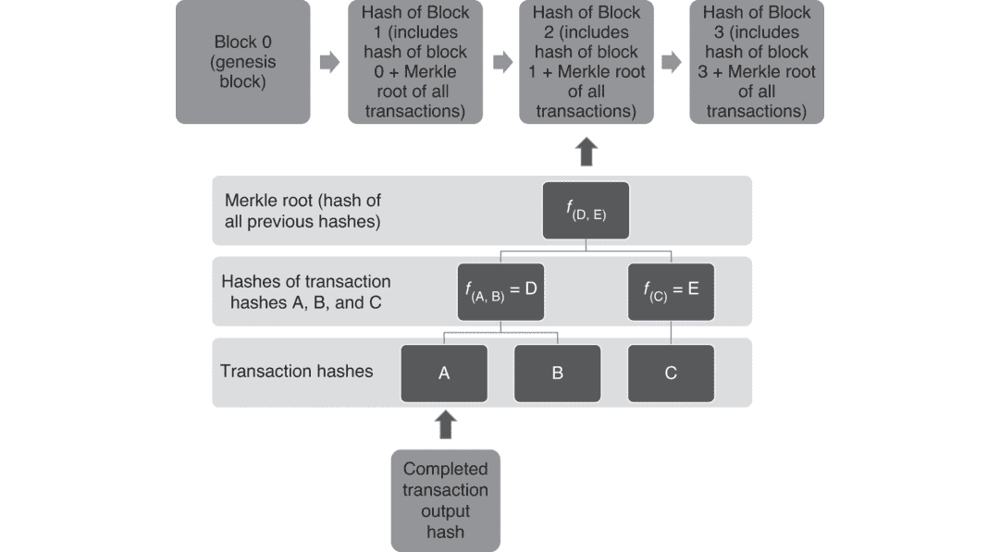 图 1.1

作为哈希链的比特币

要创建一个透明且共享的账本，使所有参与者都能达成共识而无需依赖第三方真实仲裁者，需要比特币网络的另一项新特性：一种让网络参与者对区块有效性达成共识的机制。为了实现共识，比特币网络参与者可以选择解决一种名为`Proof-of-Work`（`PoW`）的计算谜题，该谜题产生一个低于特定难度目标的区块哈希输出，这通常表示为在加上`nonce`（随机或伪随机数）后哈希开头具有正确数量的零（写作时为 19 个）(Nakamoto, 2008a, p. 3; Narayanan et al., 2016, pp. 64–66)。解题者被称为矿工，他们使用中央处理器（`CPU`）功率来寻找未知值。解决该谜题在计算上非常困难，因此矿工将获得一定数量的新币（区块奖励）作为其努力的回报，以激励他们投入昂贵的`CPU`功率来维护网络。区块奖励也有助于保持矿工的诚实，前提是他们认为诚实地维护网络所花费的`CPU`能量比破坏其收入来源和财富基础更有利 (Nakamoto, 2008a, p. 4)。

挖出的区块随后会传播到网络中的其他参与者。每个参与者运行的客户端软件程序设计为首先验证收到的区块。一旦验证完成，参与者就会更新其账本副本，此时新区块内的交易被认为已被该参与者确认 (Narayanan et al., 2016, p. 68)。^12)一旦确认，参与者内存池或孤儿池中与新区块内交易冲突的任何交易将被丢弃。确认过程持续持续到网络中的每个参与者都完成为止。在理想配置下，每个网络参与者都受独立控制，并独立确认区块的有效性。这种创建让所有参与者都能达成共识的透明共享账本的方法被称为“中本共识” (ISO, 2021)。

中本共识解决了分布式计算中一个广为人知且长期存在的问题：“拜占将军问题”。这个问题最早由数学家 Leslie Lamport、Robert Shostak 和 Marshall Pease 提出的理论。在他们的论文(Lamport et al., 1982)中，他们解释了在开放的分布式网络中，当不知道哪些同等者可以信任时，在同等者之间实现共识的问题。为了说明这个问题，他们使用了在围城期间即将进攻敌方城市的拜占将军这一比喻。将领位于城市周围的不同区域，只能通过信使进行通信以协调攻击。然而，信使中极有可能（甚至肯定）存在叛徒，或者诚实信使的消息可能被篡改。确认过程持续持续到网络中的每个参与者都完成为止。在理想配置下，每个网络参与者都受独立控制，并独立确认区块的有效性。这种创建让所有参与者都能达成共识的透明共享账本的方法被称为“中本共识” (ISO, 2021)。

## 1.4 比特币的前身

比特币将密码学、分布式网络和中本共识结合，旨在提供一种实现“无须信任”的方法 [Werbach, 2019]（即无需中间人）。例如，当我们用现金购买买杯咖啡时，没有人要求我们签名，尽管供应商或其代表可能会记录这笔交易。另一方面，当我们用银行卡支付时，我们通常需要通过输入 PIN 码对交易进行数字签名。在这种情况下，交易极易被追踪，被银行或第三方处理器记录，并可以追溯到我们身上。结果，我们交出了大量关于我们消费习惯的个人信息。比特币的设计目的是剔除这些第三方中间人，旨在为数字世界提供与传统非数字现金相同的隐私。为了做到这一点，比特币保持了公钥的伪匿名性；^13)也就是说，交易双方仅通过其`bitcoin address`标识，而不是通过姓名，并且可以在每次连续交易中更改其`address`（事实上，这被认为是一种做法），因此很难将`address`链接到特定个人。在这种意义上，比特币成功结合了透明性和隐私这两个看似对立的属性。然而，请注意，比特币背景下的隐私涉及发起比特币交易的个人身份，而不是记录在区块链上的交易记录。这些记录对所有人可见，包括嵌入交易的任何数据，除非这些数据被故意加密以保护机密性。

比特币交易的伪匿名具有保护个人财务隐私的优点。同时，它可以保护那些出于非法目的的人不受检测。这使得比特币加密货币受到黑客、洗钱者和逃税者的欢迎，并给比特币带来了一些坏名。追踪和追踪比特币交易以及识别其源者的新方法层出不穷。这些方法也被替代加密货币采用的新型隐私保护技术所应对（例如`Monero)¹⁴ 或加密货币服务（例如“混币器”或“翻滚器”，如`Wasabi wallet`））。¹⁵](#book-part2.xhtml#FN-fn-15)。

虽然比特币看起来像是“从宙斯的脑中凭空产出的”，但事实并非如此。正如 Clark (2016), p. ix) 所写，实际上存在一条“通往比特币的漫路”。根据 Clark 的说法，这条路上的早期步骤之一是一家名为 `CyberCash` 的公司，它实现了一种名为 `SET` 的协议，旨在避免电子商务客户需要将支付详情发送给商户，或向中间支付处理商注册。遗憾的是，`CyberCash` 并没有生存下来，这在很大程度上是因为用户体验问题（Clark, 2016, p. xiii））。比特币的另一个前驱来自大卫·查姆（David Chaum）的 `DigiCash` 公司，其基于他的电子货币提案，涉及“盲签名”，旨在防止人们重复花费数字货币（即“双花费”问题）（Clark, 2016, p. xiv–xv）。Clark 认为，查姆在其发明上获得的专利促使其他人发明了自己的开源电子货币版本，例如 `MagicMoney` 和 `Lucre`（Clark, 2016, p. xvii）。

“Netcash”首次提出了通过解决密码学谜题来铸造数字货币的想法，利用类似于比特币挖掘的加密哈希函数。该想法最早于 1992 年由密码学家 Cynthia Dwark 和 Moni Naor 提出，作为减少垃圾邮件的潜在方法；根据 Clark 的说法，类似的想法于 1997 年由 Adam Back 独立发现，他将其称为 `Hashcash`（Nakamoto [2008a, p. 3)）。1991 年，Stuart Haber 和 Scott Stornetta 首次提出了文档安全时间戳的想法，即客户端向时间戳服务发送文档，由服务结合时间戳和 `hashpointer` 对文档进行签名（Clark, 2016, pp. xx–xxi）。`B-money` 和 `Bitgold`（由 Nick Szabo 在 1998 年提出，尽管直到 2005 年才发表）都被认为是早期的解决方案，它们将计算谜题与时间戳相结合以保护账本记录（Clark, 2016, pp. xxii–xxiii）。

## 1.5 区块链与不可篡改性

从 Nakamoto 的原始论文及其前驱书中，出现了区块链复杂而微妙的平衡特征：去中心化的账本、其条目是防篡改的、所有参与者达成一致的、透明的以及匿名的。这些特征共同产生了被认为最重要且最具争议的属性——不可篡改性。在区块链和分布式账本技术的背景下，不可篡改性可以理解为“账本记录一旦添加就无法修改或删除”（ISO, 2020a, s. 24）。

然而，不可篡改性更好地被描述为区块链和其他分布式账本的涌现属性。C. D. Broad (1925)（引自 O’Connor, 2020](#ref-list.xhtml#REFe-r-497)）解释了涌现性为：

整体 R(A, B, C) 的特征（其中 R 标记了结构安排）在理论上无法通过对 A、B 和 C 的孤立知识或非 R(A, B, C)的形式推断出来。

也就是说，区块链不可篡改性的结构属性无法通过区块链的任何单一属性（例如防篡改性、去中心化、透明性或匿名性）来预测。这些属性中的每一个必须存在并协同工作才能产生账本的不可篡改性。

为了解释这一点，如果没有透明的账本（这使得可能发生的更改变得可见），实现防篡改性是不可能的。同样地，如果账本由单一利益方维护，那么如果该利益方想要修改账本记录，将没有任何阻止措施，即使交易记录和区块的数字签名会让更改变得可见。然而，一旦账本控制权去中心化，没有任何单一利益方可以单方面更改它，因为大多数参与者必须先对更改达成一致。在比特币网络中，只有当集体控制超过 50% 确认算力的参与者同意更改账本时，这种情况才可能。

网络中的参与者越去中心化（不受彼此权力和控制的影响），账本的抗审查性越强，也就是说，参与者持有的不完整或更改过的账本副本被拒绝的可能性越大。这一特征也有助于不可篡改性，因为它防止了单一利益方或利益联盟通过控制账本来重写账本历史。更改或删除账本上的记录需要网络上所有参与者的同意（这很难实现，Daian, 2016)），或者破坏网络上所有参与者的硬盘（如果参与者是真正的去中心化，这几乎是不可能的）。正是这种操作的难度贡献了区块链系统的不可篡改性。最后，匿名性在保护隐私的同时也防止了网络参与者之间的共谋，因为参与者无法识别彼此，他们很难形成卡特或受他人控制。

如果这些底层属性缺失缺失或被更改，账本的不可篡改性可能会受到影响。例如，所谓的“51% 攻击”（当比特币网络参与者或一组参与者获得了网络超过 50% 的算力以形成控制方）可能会导致账本发生更改。在这种情况下，拥有控制方的人将足够的能量通过重新计算所有区块的 `PoW` 来追赶并超过诚实节点的工作，从而修改过去的区块（Eyal and Sirer, 2014）。从本质上说，这给了控制方回滚历史的力量。

51% 攻击并非不可能，考虑到矿池的形成（矿工组成的联盟，以降低参与矿工的奖励方差）造成了网络中 CPU 算力集中的风险。Narayanan et al. (2016), p. 128) 注意到截至 2015 年，几乎所有的矿工都通过矿池进行挖掘，而 2014 年 6 月，其中一个矿池 `GHash.IO` 实际上获得了网络超过 50% 的 CPU 算力；这导致了对该矿池的反弹。虽然矿工社区通常同意避免变得过大，但一些人推测，算力的真实集中可能是不可见的，因为矿工可以同时参与多个矿池，这往往会掩盖他们的真实规模（Narayanan, 2016, p. 130）。事实上，许多矿池仍占据了网络大量的 CPU 算力（参见图 1.2）。

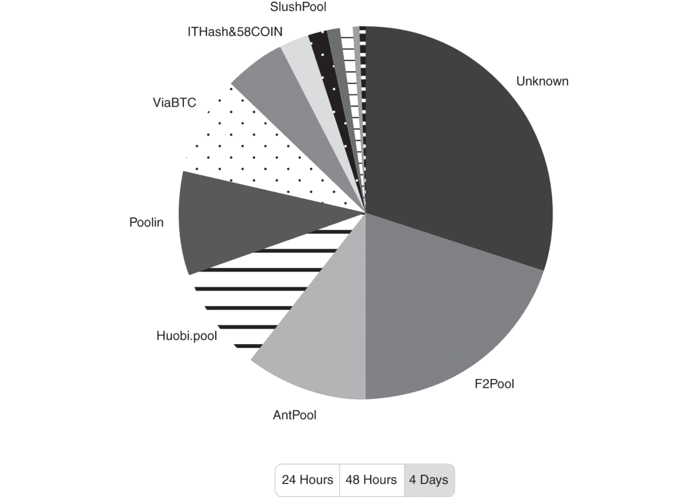 图 1.2

截至 2020 年 12 月 27 日最大的矿池算力分布估算

注：图 1.2 的来源（[www.blockchain.com/pools](http://www.blockchain.com/pools)）包含以下警告：“此图表显示了最流行的比特币挖矿池的市场份额。它仅应作为粗略估计，且由于各种原因，它不会 100%准确。大部分区块被归类为‘未知’类别。这并不意味着对网络进行了攻击，仅仅意味着尚无法确定其来源。”

（来源：[www.blockchain.com/pools](http://www.blockchain.com/pools)，© 2021 Blockchain Luxembourg S.A. 版权所有）

此外，量子计算已被确定为区块链不可篡改性的生存威胁，因为它使得破解区块链不可篡改性部分依赖的加密成为可能（Fernández-Caramès and Fraga-Lamas, 2020）。具备量子能力的新型计算机威胁着数字签名加密和用于保护区块链的哈希函数。这引发了近期旨在重新设计区块链的努力，以创建各种被称为后量子、量子证明、量子安全或量子抗性的加密系统（Fernández-Caramès and Fraga-Lamas, 2020; Mashatan and Turetken, 2020; Mashatan and Heinztman, 2021）。

在 2017 年的一篇论文中，法律学者 Angela Walch 对美国亚利桑那州（美国）法律的一项新规定¹⁶发表评论，该法律将通过区块链保护的签名认定为“不可篡改且可审计，并提供未经审查的真相”，这引起了人们对区块链中不可篡改性概念之问题性的关注（Walch, 2017a）。Walch 提到的广受关注的事件之一是 2016 年的 DAO 漏洞事件，该事件涉及以太坊区块链。


# 以太坊、区块链不可篡改性及信任问题

## 1. 以太坊与 DAO 漏洞事件

程序员 Vitalik Buterin 于 2013 年最初构思了以太坊。开发于 2014 年通过众筹，网络于 2015 年 7 月 30 日上线¹⁷。在原始形式下，以太坊与比特币有许多相似之处，但关键区别在于它集成了一个可以执行图灵完备脚本并运行去中心化程序（称为智能合约）的虚拟机。

DAO 漏洞——DAO 代表去中心化自治组织——涉及一个智能合约，该合约编码了 DAO 运行的规则，但其中写着一个致命缺陷：它允许一个编写不当的函数重复提取 DAO 资金，而不是合约作者据称意图的单次取款。攻击者能够利用这一漏洞提取价值估计 5000 万至 7000 万美元的 Ether（以太坊的原生加密货币）（Daian, 2016; Tapscott and Tapscott, 2016; Butijn et al., 2020）。对于区块链的不可篡改性而言，这一切本没有问题，但对于那些资金被误导到攻击者账户的人来说，这显然是不可接受的。

## 2. 社区辩论与硬分叉

如何处理这种显然非预期的状况引发了以太坊社区的激烈辩论。包括 Buterin 在内的一些人提议对以太坊进行更新，以解决这一问题（Daian, 2016; Butijn et al., 2020）。那些坚持不可篡改性的人坚决反对这一观点。最终，大多数参与者投票支持通过硬叉（Hard Fork）来实施的解决方案（ISO, 2020）。这种方法在某些包含个人信息的区块链中，当法律规定需要删除数据时，是可行的。

## 3. 不可篡改性的法律挑战

在 2017 年的一篇论文中，法律学者 Angela Walch 对美国亚利桑那州（美国）法律的一项新规定¹⁶发表评论，该法律将通过区块链保护的签名认定为“不可篡改且可审计，并提供未经审查的真相”，这引起了人们对区块链中不可篡改性概念之问题性的关注（Walch, 2017a）。Walch 提到的广受关注的事件之一是 2016 年的 DAO 漏洞事件，该事件涉及以太坊区块链。

Walch（2017a, 39）关于“被遗忘权”的说明揭示了不可篡改性是条件性的，并非绝对的。

## 4. 不可篡改性的现实视角

Gideon Greenspan (2017) 指出，不可篡改性的支持者为他们的不可篡改性承诺付出了代价。在 DAO 漏洞事件中，篡改涉及了整个社区的辩论，并最终导致了分歧。在区块链背景下看待不可篡改性的现实方式是 Greenspan 所表达的：“不存在完美的不可篡改性。真正的问题是：在什么条件下特定的区块链可以和不能被更改？”(Greenspan, 2017)

对不可篡改性的威胁可能被认为是可能的（甚至日益增加），但在正常操作之外。然而，即使是正常的区块链操作也可以交付非不可篡改的账本；事实上，这被认为是理想的。围绕欧盟数据保护条例（GDPR）和“被遗忘权”（在某些条件下要求删除存储的个人信息）的辩论最好说明了这一点¹⁸。GDPR 将数据保护视为所有欧盟公民的基本权利（Finck, 2018; Hofman et al., 2019）。GDPR 第 17 条为“被遗忘权”或删除权提供了规定，规定：

```
数据主体有权在不延迟的情况下删除涉及其个人数据，在适用法律依据时，控制者有义务在不延迟的情况下删除数据。
```

（欧洲议会和欧盟理事会，2016, 第 17 条，第 1 节）

删除权不是绝对的；事实上，只有在条例中规定的若干原则之一适用时才需要。例如，如果存在法律理由保留数据，数据控制者可以拒绝删除请求，或者如果保留数据有“存档目的”，例如为了满足公共利益、科学或历史研究目的。

## 5. 可编辑区块链的提议

为了规避区块链不可篡改性与删除权之间明显的不兼容性，已经提出了许多解决方案（Hofman et al., 2019），其中包括臭名昭著且备受嘲笑的“可编辑”区块链。这是 Accenture 在 2016 年提出的想法。在 Coindesk 的一篇关于该主题的文章中，David Treat 认为不可篡改的区块链将阻碍该技术的采用。

对于那些只相信区块链解决方案的无许可模式的人来说，没有必要讨论替代方案。但随着行业开始探索加密货币和无许可系统之外区块链的新用途，将会出现这种不可篡改性可能阻碍技术进步的情况（Treat, 2016）。

Treat 指的是私有和许可级分布式账本的兴起，或者说这些账本仅供少数参与者访问，并且参与或执行特定活动需要授权（ISO, 2020a, s. 3.57–3.61）。此类分布式账本变体的出现，是因为政府和私营组织希望保留对其技术和平台的控制权，而大型的无许可区块链和分布式账本——例如 `Bitcoin` 和 `Ethereum`——是不允许的，在这些系统中，参与者是独立运行的（即使在理论上是如此），且不需要特殊授权。

遵守监管要求（如 `GDPR`）的需求是组织倾向于许可级区块链而非无许可区块链的驱动因素之一。在无许可区块链的背景下，Treat 指出了若干问题，这些问题可能通过引入编辑区块链的能力来解决。例如，如果记录只能向链中添加，那么账本的大小和存储成本将不断增长。支持区块链可编辑性的人还认为，应该能够删除非法内容（如儿童色情），或纠正由人为错误或意图造成的错误（例如 `DAO`）。最后，为了遵守删除或掩盖数据的监管要求，编辑区块链变得必要。这些问题导致 Treat 所工作的埃森哲（Accenture）得出以下结论：

> 辩论的一方认为，不可篡改性恰恰是使区块链成为如此重大创新的原因。另一方则是务实主义者，他们越来越多地发现在企业环境中，由于人为错误、恶意破坏和隐私法，不可篡改性可能会阻碍技术的采用（Accenture, 2016, p. 3）。

埃森哲的解决方案是引入新的“变色龙”哈希变体以启用区块链编辑，允许创建一个连接两个区块的“虚拟锁”。删除或更改区块将涉及使用私钥（称为“陷门”）解锁，这会解除区块的链，并允许插入新的或修改的区块以替换旧区块，而不破坏整个区块链的完整性（Accenture, 2016, p. 7）。

Accenture (2016, p. 7) 承认该解决方案是针对许可系统设计的，在系统中有指定的管理员负责管理系统，并且预定义了规则、程序和角色，与 `Bitcoin` 不同。埃森哲进一步指出，掩盖应仅在特殊情况下可用，例如纠正拼写错误和事实错误，或使数据符合变更法律的要求。

该方法的反对者立即指出了财务欺诈的可能（Kelly, 2016）。正如 Kelly (2016) 在一篇批判性的 `Coindesk` 评论中所道：“当你允许人们更改记录的那一刻，你就开始侵蚀信任。虽然这种更改可能是出于最善良的原因，如人为错误，但它不可避免地为欺诈打开了大门。”在评论金融市场时，Kelly (2016) 继续观察到，“更改永久记录的能力正是让马多夫（Madoff）能够实施史上最大欺诈的原因——这是区块链的核心灵魂——它是一个特性，而非缺陷”（Kelly, 2016）。

## 6. 量子计算的威胁

此外，量子计算已被确定为区块链不可篡改性的生存威胁，因为它使得破解区块链不可篡改性部分依赖的加密成为可能（Fernández-Caramès and Fraga-Lamas, 2020）。具备量子能力的新型计算机威胁着数字签名加密和用于保护区块链的哈希函数。这引发了近期旨在重新设计区块链的努力，以创建各种被称为后量子、量子证明、量子安全或量子抗性的加密系统（Fernández-Caramès and Fraga-Lamas, 2020; Mashatan and Turetken, 2020; Mashatan and Heinztman, 2021）。

## 7. 能源消耗问题

根据 `Bitcoin Energy Index`（Digiconomist, 2021），单笔比特币交易消耗的碳足迹相当于 21.63 天内 664,375 次 Visa 交易。De Vries (2018) 指出，“估计比特币网络目前至少消耗 2.55 吉瓦电力，未来可能达到 7.67 吉瓦”，根据 2018 年的数据，其在能源消耗上与爱尔兰和奥地利等国家相当。关于这一点，参见 Das and Dutta (2020)。由于开采比特币和冷却矿设备需要大量的能量，矿工倾向于将业务转移到电力相对廉价且更容易保持设备冷却的地方（Bjarnason, 2019; Baydakova, 2021）。据报道，一些不良的矿工还会偷窃他们所需的电力（Nadeau, 2020）。

## 8. 结语思考

鉴于不可篡改性的条件性（无论是否刻意），不建议将其视为固定不变的条款。相反，不可篡改性在很大程度上是社会构建的，正如其在技术上实现的一样。全球区块链和分布式账本开发的专家已证实了这一点（ISO, 2020a）。为什么会有这么多个人认为不可篡改性这一属性是理想的呢？中本聪的原始论文提供了答案：信任。我们在下一章中将转向信任问题。

## 注释

[⁴] `ISO 15489:2016`, `s. 5.2.2` 将可靠记录定义为“其内容可以被信赖为所证明的交易、活动或事实的完整且准确的表示”，并且“在随后的交易或活动过程中可以被信赖”。该标准进一步指出，可靠记录通常是在“与其相关的事件发生时，或通过常规用于执行交易的系统”创建的（`ISO, 2016`）。在其他文本中，这一概念被类似的包含在“在业务常规和普通过程中产生”这一短语中。

[⁵] Clive Humby 被认为创造了“数据是新石油”这一短语，但该短语在 2017 年《经济学人》的一篇文章之后才广为人知（`Economist, 2017`）。

[⁶] 关于中本聪（Satoshi Nakamoto）的真实身份存在许多理论（例如，见 `O’Neal, 2019`）。有人认为中本聪是美国计算机科学家、法律学者以及智能合约概念的发明者尼·萨博（Nick Szabo）；其他人认为中本聪是已故的哈·芬尼（Hal Finney），他是密码朋克和比特币代码库的早期贡献者之一；还有人假设中本聪是英国密码学家、`Blockstream` 的首席执行官 Adam Back。另一种可能是克雷格·莱特（Craig Wright）——他实际上声称自己是中本聪——是一位英澳计算机科学家兼商人。有趣的是，莱特获得了原始比特币白皮书和代码的美国版权注册，且他目前仍持有这些权利（`Bitcoin SV, 2019`）。

[⁷] `Block 0` 的原始区块哈希值为 `000000000019d6689c085ae165831e934ff763ae46a2a6c172b3f1b60a8ce26f`，`Block 1` 的哈希值为 `00000000b873e79784647a6c82962c70d228557d24a747ea4d1b8bbe878e1206`。由于比特币是一个共享且透明的账本，读者可以在 [www.blockchain.com/btc/block/000](http://www.blockchain.com/btc/block/000) 亲自看到这一点。

[⁸] 关于密码学历史，请见 `Dooley (2018)`。

[⁹] 比特币使用 `Elliptic Curve Digital Signature Algorithm` 来实现这一点（见 `Narayanan et al., 2016`，第 17–19 页）。

[(10)] `Narayanan et al. (2016)`，第 69 页）提到“很难衡量[比特币]网络有多大，因为它是动态的且没有中央权威。”

[(11)] `Narayanan et al. (2016)`，第 68 页）解释道，“节点为每个被兑现的先前输出运行脚本，并确保脚本返回 `true`。第二，它们检查被兑现的输出尚未被花费。第三，它们不会中继已经过的交易……第四，默认情况下，节点只接受基于……”

[(12)] `Narayanan et al. (2016)`，第 68 页）解释道，“验证区块比验证交易更复杂。除了验证区块头并确保哈希值在接受范围内外，节点只有在基于最长链时才会转发区块中的每个交易。”

[(13)] `Nakamoto (2008a)`，第 6 页）该论文实际上使用了“匿名”一词；然而，该论文也承认多输入交易的链接是不可避免的，观察发现，“风险在于，如果所有者被泄露，链接可能会揭示属于同一所有者的交易。”

# 第二部分 信任

## 2.1 信任问题

2008 年 10 月 31 日，中本聪（Satoshi Nakamoto）向 `Cryptography Mailing List` 发送了一封简洁的帖子：“我一直在开发一种全新的点对点现金系统。”到那时，他已经为该项目工作了一年半（`Nakamoto, 2008`）。在接下来的几个月里，中本聪在 `Cryptography Mailing List` 上以及私人邮件进行交流。信任问题及其不满情绪在持续金融危机的背景下传播，这场危机引发了 99%（绝大多数人类）对 1%（富裕精英）的广泛不信任。在 2009 年 1 月 3 日比特币创世区块创建后，一封在 `P2P Forum` 的帖子体现了这一主题，随后中本聪于 2009 年 1 月 9 日在 `Cryptography Mailing List` 上宣布比特币的推出（`Nakamoto, 2009`）。日期为 2009 年 2 月 11 日的帖子如下：

> 我开发了一种名为比特币的新开源点对点现金系统。它是完全去中心化的，没有中央服务器或可信第三方，因为一切都基于加密证明而非信任。传统货币的根本问题是使其运行所需的所有信任。必须信任中央银行不会导致货币贬值，但法定货币的历史充满了对这种信任的违背。必须信任银行会持有我们的资金并进行电子传输，但它们在信用泡沫中发放贷款，而储备微乎其微。我们必须把隐私交付给它们，信任它们不会让身份窃取者掏空我们的账户。
>
> 一个时代以前，多用户分时计算机系统面临类似的问题……后来强加密变得大众可用，不再需要信任。数据可以以安全的方式保护起来，使他人物理上无法访问，无论出于什么原因，无论借口多么充分，无论如何。
>
> 是时候让我们的钱也拥有同样的东西了。有了基于加密证明的电子货币，无需信任第三方中间人，钱可以变得安全，交易也可以变得轻松。

（`Nakamoto, 2009`）

## 2.2 信任有什么用？

Nakamoto 在 P2P 论坛上的帖子以及他的比特币原始论文（Nakamoto, 2008a）指出了他归于功能不佳的中介信任机制的某些成本：针对不可逆服务的可逆转支付；解决纠纷的成本；对信任扩散的需求；信息的过度收集；以及不可避免的欺诈（Nakamoto, 2008a，第 1 页）。在 20 世纪 70 年代，诺贝尔奖得主经济学家肯·阿罗（Kenneth Arrow）也曾有过类似的观察。Arrow (1972) 认为，缺乏互信代表了经济系统的独特损失，而集体事业的成功需要这种信任。他写道：“几乎每一项商业交易内部都包含信任元素，特别是任何跨越一段时间进行的交易都是如此。可以合理地论证，世界上大部分的经济落后可以归因于缺乏互信”（Arrow, 1972，第 357 页）。感知信誉度——阿罗认为这是信任的基础——可以降低监控和交易成本。缺乏信任的情况下，金融交易无法轻易发生：合同监控可能无效，对违约行为的制裁可能很困难，交易成本可能会增加，所有这些都削弱了金融交换和生产的基础。

## 附录：图表来源说明

注：图 1.2 的来源（[www.blockchain.com/pools](http://www.blockchain.com/pools)）包含以下警告：“此图表显示了最流行的比特币挖矿池的市场份额。它仅应作为粗略估计，且由于各种原因，它不会 100% 准确。大部分区块被归类为‘未知’类别。这并不意味着对网络进行了攻击，仅仅意味着尚无法确定其来源。”

（来源：[www.blockchain.com/pools](http://www.blockchain.com/pools)，© 2021 Blockchain Luxembourg S.A. 版权所有）


除了金融系统外，对政府的信任被认为是政治制度合法性和可持续性的重要基础，并且对于社会凝聚力和福祉至关重要，因为它影响了政府的治理能力，并使其能够在不诉诸强制的情况下行动（OECD, 2013，第 21 页）。Fukuyama (1995，第 7 页) 写道：“一个国家的福祉以及其竞争能力取决于一个单一且无处不在的文化特征：社会固有的信任水平。”Putnam (2000) 将信任描述为“社会资本”，认为它的存在为社会凝聚创造了条件；同样地，Pettit (1995) 认为信任是繁荣公民社会的必要条件。更广泛地说，Locke (1689（在 Laslett, 1988，第 359 页中引用））认为，信任的存在是形成社会最根本的要求。信任使集体事业成为可能，因为如果没有信任，个人将不确定如果采取了有利于别人的行动，其行动是否会得到回报——换句话说，信任使合作行为成为可能(Gambetta, 1988）。Hardin (2002，第 173 页) 写道，“信任使我们能够为了共同互利而合作。”

德国社会理论家 Niklas Luhmann (1979) 认为，信任是一种使复杂性变得可机制。卢曼认为，通过这种方式，信任使得在没有它的情况下无法实现、或至少极不可能可能的协调合作行动成为可能(Luhmann, 1979)）。其他人则指出它在促进自适应组织形式（如网络关系）以及快速组建临时工作小组方面的价值（Meyerson et al., 1996）。

对于信任对社会而言普遍是一件“好事”这一观点，人们可以提出异议，也确实有人提出过（见见 Hardin, 2002，第 81–84 页）。毕竟，历史充满了这样的例子，表明对缺乏信任的政治领袖信任会导致悲剧。尽管如此，许多作者认为某种程度的信任是必不可少的。

## 2.3 信任危机

如果信任对于社会协调是必要的，那么我们目前似乎正处于危机之中。尽管一些学者对这些说法持怀疑态度（例如，Hardin, 2002; Henderson and 2019; O’Neill, 2020)），但相关文献正在不断增加。一个经常引用的指标是爱德曼“信任 barometer”（Edelman Trust Barometer）年度全球研究，它衡量了过去 20 年的信任情况。

2016 年，爱德曼的一项调查发现，在 28 个国家中的三分之二，对政府、企业和 NGO 等机构平均信任水平处于低位（Edelman, 2016，第 2 页）。2017 年，爱德曼观察到“信任的崩塌”，报告称在 43 个国家中，首席执行官的信誉度处于最低点；对媒体的信任下降，并在 17 个国家处于历史新低；对政府的信任在 14 个国家下降（Edelman, 2017）。在其 2020 调查的概述中，爱德曼报告说，如今的信任基于两个属性：能力（履行承诺）和道德行为（做正确的事并改善社会）。今年的信任 barometer 显示，这四类机构（政府、企业、NGO 和媒体）中没有哪一个被认为是既有能力又符合道德的。企业在能力方面排名最高，领先政府 54 个百分点（64% 对 10%）。NGO 在道德行为方面领先于政府（差距为 31 个百分点）和企业（差距为 25 个百分点）。政府和媒体被认为既能力也不符合道德（Edelman, 2020）。

自由民主国家投票率的下降也被认为是信任日益下降的证据——美国、英国和法国在过去 50 年的投票参与率下降了约 30 个百分点（Harsin, 2019）——此外还有表达对主流自由民主政策疏离感的政党的激增和兴起，包括法国的国民联盟、英国独立党、德国选择选择党（AFD），以及美国伯尼·桑德斯（Bernie Sanders）发起的激进民主社会主义挑战（Harsin, 2019）和“特朗普主义”。社会政治运动如西班牙的愤怒者（les Indignados）、美国的占领者（Occupy）和法国的夜晚运动（Nuit Debout）（Harsin, 2019）——以及最近的 QAnon——也被认为是对政府及其政策信任水平下降的指标。

文献确定了导致政府信任度下降的多种解释和影响因素，包括媒体和技术的影响、经济状况以及社会政治原因。Edwards (2015) 发现，对政府信任信任度的下降往往源于政府无法控制的因素。他提供了几个减少公众信任的外部事件示例，包括全球金融危机（这也是 `bitcoin` 崛起的背景）。另一方面，新政府的选举可以增加公众信任：在印度 2014 年选举之后，信任度上升了 30 个百分点（Edelman, 2015, p. 4; Edwards, 2015）。更长期的经济和社会政治因素也可能影响公众信任，包括诸如对权威的服从度下降或社会资本萎缩等趋势（Van de Walle et al., 2008, pp. 8–9)）。全球化以及相关的技术、政治和经济变化也改变了国家与社会的关系；例如，个人主义的兴起可能使政府难以满足每个公民的需求（Heintzman, 2007, p. 2; Sullivan, 2015）。公民对政府及其政治代表的期望变化也可能影响信任水平（Warren, 2006, p. 7; Blind, 2007）。新技术的快速实施可能会抑制信任感，并引发对变化速度的担忧（Edelman, 2015）。这种观点可能与将媒体视为不信任感增长的驱动力的关注有关（例如，启动效应 [[[Hetherington and Rudolph, 2008]）。根据 Edwards (2015)，政治信任下降的性质和原因可能会随国家和文化背景而产生显著差异，对于这些原因的相对强度、不同因素在不同背景下的重要性、它们如何相互关联，以及这些关系是因果关系还是仅仅是相关，仍存在许多不确定性。

许多研究人员强调经济因素是公众信任下降的原因。Mansbridge (1997) 和 Newton and Norris (2000) 将经济表现不佳时期以及公民认为政府无法应对当前财政和财务挑战的感知与较低信任水平联系起来。政治经济文献指出，富裕地区的信任水平较高，相反，贫穷地区的信任水平较低（Leigh, 2006），但 Edelman 2020 年 对信任的调查得出了相反结论。Fiorina (1978) 和 MacKuen et al. (1992) 认为，人们更信任那些能够带来增长、创造就业、提供教育机会并以简单透明的方式服务的服务的。Nye (1997) 认为，在全球化时代，公民对国家经济的负面评价以及对政府应对经济挑战能力的负面感知产生了更多的不信任。根据 [Alesina (2000)]，全球化的竞争压力和经济动荡、日益加剧的经济不平等，以及发达和发展中国家中日益增加边缘化人口，与经济观点不同，一些关注信任的文献强调了社会政治原因。文献还区分了与绩效（或其成就）相关的因素与与执行方式更相关的因素（Arizti et al., 2010; Cheema (2010); Bannister and Connolly (2011); OECD, 2013; Edwards, 2015）。例如，世界银行的一份出版物区分了政府做什么以及如何做，识别出影响信任的两个公共杠杆：绩效和问责。根据世界银行的说法，对于 OECD 国家，问责对信任比绩效更重要，但在拉丁美洲，绩效的影响可能（[Arizti et al., 2010], p. 203）。该出版物还指出，某些服务的绩效改进比其他服务更重要（[Arizti et al., 2010], p. 203）。[Cheema (2010)] 发现，在发展中国家，脆弱的民主治理体系以及服务和经济机会的往往会侵蚀信任，而在发达国家，公民拥有更多信息，因此要求更高（参见例如 [Arizti et al., 2010], p. 208; [OECD, 2013], p. 34; Edwards, 2015）。与世界银行的发现相似，OECD 在关注政府可以影响的方面发现，不仅公共政策的“内容”重要，“如何做”、“为谁以及与谁同样重要（[OECD, 2013], p. 28）。因此，不仅政策的最终结果，而且实现这些结果的过程对于公民和企业信任政府都很重要（[OECD, 2013], p. 28）。

[Blind (2007)], pp. 11–12 强调了腐败对信任下降的重要影响，[Espinal et al. (2006)] 则认为在发展中国家，安全和腐败对政府信任的影响比工业国家大得多。然而，在安全和腐败问题上的政治表现与信任的增加相关（[Lipset and Schneider, 1983]; [Turner and Martz, 1997]; [Mishler and Rose, 2001]）。[Job (2005)] 发现，如果个人感知到政治腐败，那么他们对地方机构的信任就会受到不利影响。由于对地方政府机构的信任是对远程政治机构（如国会和/或总统或类似的领导职位）信任的最强预测指标，因此腐败成为整体政治信任的一个重要间接因素。

另一个影响信任的因素是政治和公共服务领域领导力的质量(Blind, 2007; Popovski, 2010; OECD, 2013)）。一些研究人员进行的研究显示，较低层级的政府更受信任（例如，Berman, 1997）。同样，公民与政府官员的接触越多，信任水平就越高（例如，当地卫生工作人员可能比国家政治家更受信任）（参见，例如 AARTI et al., 2010; OECD, 2013; Edwards, 2015）。Theiss-Morse and Hibbing (2005) 认为，当公民认为政治家对自身利益的关注超过对公民利益的关注时，他们就会产生不信任。

有这么多与信任相关的问题——如上述对政府信任文献的综述所示——而且存在如此之高水平的不信任，社会没有已经崩溃这真是一个奇迹。关于“社会需要高水平的信任才能运作”的说法显然是错误的，因为即使信任水平据称在下降且处于低水平，自由民主社会仍在继续维持运转。这可能仅仅是因为除了依赖信任之外，还有其他方法可以实现社会所需的协作与协调。例如，社会准则和制度（如法律）的存在在很大程度上是为了弥补信任的缺失(Hardin, 2002, p. 173)。通过这种方式，它们可以提供比特币所称的“无赖的信任”(Werbach, 2019)。

很难准确确定导致信任下降的单一或一组固定因素，这表明信任深深植根并交织于我们所处的社会-信息-技术生态系统的构成和运行之中——例如，如果不理解社交媒体平台的兴起，就很难理解传统媒体信任度的下降，以及它们如何重构我们对世界的认知取向以及我们的社会“现实”（关于这一点将在第 4 章中进行详细阐述）。然而，要完全理解这一点并为后续章节奠定基础，需要对信任的含义进行更深入的探究。

## 2.4 什么是信任？

我们每天都依赖信任，而且显然，当信任消失时，我们会感到如失了所宝。但我们真的理解它意味着什么吗？社会学家 Diego Gambetta (1988) 将信任称为一个难以捉摸的概念，Edwards (2015), p. 2) 则指出信任的概念是“模糊的、流动的、主观的、多维且复杂的”。文献综述揭示了原因：概念化取决于涉及的参与者、关系的性质、预期的行为类型以及情境背景。此外，在实证工作中，信任的概念可能作为独立变量（因）、因变量（果）或调节变量（因果关系）出现(Rousseau et al., 1998)。

学者和研究人员对信任的本质缺乏共识：信任是静态的二元对还是更具动态性的；某人或某物是否可以同时被信任和不信任；信任是否涉及行动和情感；信任是否仅仅是依赖；我们是否可以有意识地决定信任；以及信任是否具有道德维度(Rousseau et al., 1998, pp. 395–396)。

### 不同观点之间的信任。

在讨论中，我打算不仅关注人们在个人层面日常互动中体验的信任，还关注人们对机构和法律的信任，如图 2.1 所示。这种双重视角（我将其称为“社会信任”）是必要的，因为这是信任在区块链系统中的体现方式（正如我在第 3 章中讨论的那样）。²(#book-part4.xhtml#FN-fn-20)

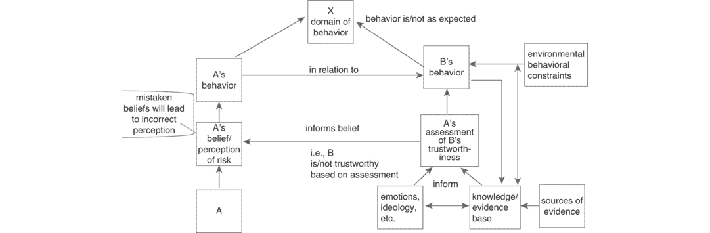

#### 一种被广泛依赖的信任理解是 Hardin (2002) 将信任视为“封装的利益”的概念。因此，它为深入探索关于信任含义的各种辩论提供了一个起点，包括我在本书中关注的社会信任概念。Hardin 信任概念化的一个关键特征是它是关系性的。尽管对信任有多种概念化，学者们倾向于同意一点：信任涉及产生信任的人（信任方，或委托人）与被信任的人或物（被信任方，或受托人）之间的关系(Castaldo et al., 2010)。

许多关于信任关系性的描述将其认为一种二部分关系，即委托人与受托人之间的关系。然而，Hardin (2002) 的立场是信任是一种三部分关系，当委托人针对特定的活动领域信任受托人时就会存在（即 A 在 X 方面信任 B）。³(#book-part4.xhtml#FN-fn-21)因此，他对缺乏背景基础的泛化信任概念持批评态度，认为这些概念仅仅建立在表述不当的实证问题之上(Hardin, 2002, p. 61)。然而，泛化信任或信任倾向确实在社会信任的讨论和实证研究中占重要地位（例如，McKnight et al., 2011），因此在考虑本书中的社会信任概念时需要考虑到这一点，这一点将在下文中提到。

在哈丁（Hardin）关于信任的封装利益观点中，只有当信任方受到一种信念的驱动，即自己的利益包含在受托者的“效用函数”（或受托者重视的事物）之中时，信任才处于运作。这意味着受托者重视信任者的需求，是因为受托者希望与信任方维持良好关系，或者希望在信任者与受托者关系所嵌入的关系网络中维护其信赖信誉。关于信任主题的其他学者也认为受信任方的动机是信任概念的核心，但将这种动机归因于不同的因素：受信任者的道德正直（McLeod, 2002）；要求受信任者履行道德义务（Nickel, 2007）；或者承认信任者依赖受托者作为其行为的理由（Jones, 1996; Faulkner, 2007a）。因此对哈丁来说，如果不存在持续关系的动机，那么就没有信任在运作（Hardin, 2002, p. 3）。这种持续关系的动机源于受信任方的信念：他们认为自己有利益——即封装利益——去履行受托者所赋予的信任，以在某个特定活动领域内维持并继续这种关系。换句话说，哈丁表示：“我信任你，是因为我认为在相关事项上认真考虑我的利益符合你的利益，这具体表现为：你看重我们关系的延续，因此在考虑我的利益时你也有你自己的利益”（Hardin, 2002, p. 1）。这种激励机制在性质上可能是正面的（例如从持续关系中获得的益处），也可能是负面的（表现为制裁形式，例如结束一段受信任方获益的关系，或更间接地，某种形式的社会谴责或声誉受损）（Hardin, 2002, p. 14）。

为了说明这一点，我可能会认为一位我个人认识的公共卫生官员在流行病期间命令我留在家时，是考虑到我的利益的。这不仅是因为我对该官员良好品格或诚实声誉的判断（尽管这确实影响了我的信念的形成），还因为该公共卫生官员的利益植根于科学和政府机构，而我也同样信任这些机构。这说明人们可能对“机构”和“系统”作为复杂的关系网络来予以信任，这是一个我将在下文中进一步讨论的话题，并在我在下一章](ref-list.xhtml#REFe-r-504) 所言，是由感知者（信任方）、感知对象（受托方）和社会背景共同构建的一种社会属性。

上述对信任的构化——即外部调节因素确保受托者的利益与信任者的利益一致——似乎留下了一种可能性，即信任方知道受托方仅仅因为没有其他选择才会维护其利益。这真的能被视为一种信任关系吗？哈丁认为，由于受托方只关心自己的利益而非信任方的利益，这种情况仅仅是顺从。要被视为封装利益意义上的信任，受托方必须有理由认为以符合信任方利益的方式是符合其利益的。当受托方无法确定信任方的利益时，这可能是可能的，例如在集体信任的情况下（见下文讨论）。尽管如此，人们仍然可能相信受托方正在考虑信任方的利益以及其与其自身利益的契合程度，即使在枪口指头使其按信任方利益的极端情况下。

这种场景可能没有达到信任水平的一个更有说力的理由是：信任方在受托方的行为方面没有承担任何风险或脆弱性。Hinchman (2005), p. 578) 认为，“信任是一种自愿的依赖，这种依赖是在对受托方不值得信赖证据的反事实敏感性的适当指导下进行的。”在枪口指受托方头部的情况下，信任方可以几乎确定地知道受托方不太可能冒生命危险去做出违背信任方利益的行为（关于这一点，参见 Nissenbaum, 2001; De Filippi et al., 2020）。这使得“无赖的信任”这一概念成为可能，这种信任被认为是区块链的特征，我在下一章（book-part5.xhtml#CN-bp-3）中详细讨论了这一点，其意义在于系统创造了认为消除了信任方风险和脆弱性的条件。目前尚可以称之为这类的“准信任”，因为由于某种支配受托方行为的约束因素，信任方并不完全信任受托方；如果信任方仍然存在某些剩余的脆弱性或风险，那么关系中也不可能完全不存在信任。

上述解释指向了哈丁（Hardin）信任概念的另一个关键维度，即信任本质上是认知性的。哈丁认为信任具有认知意义，这意味着它基于对证据的考量，这使得它与认识论相关的概念（如知识）联系起来。基于证据的信任基础形成了信任赖者的预期或信念，即相信被信任方将符合信任赖者的利益（`Hardin, 2002`, p. 7）。

对这种“信念论”（doxastic）信任观的批评者——即那些像哈丁那样引入了信念概念的信任观点——通常指出，人无法决定去相信某事——人们要么相信，要么不相信——但人可以决定对某人或某事产生信任。因此，如果信任涉及信念，那么人也不应该能够决定去信任。

哈丁同意选择信任是不可能的；信任的基础在信任赖者眼中要么存在，要么不存在。他阐述道：“我们可以选择让自己处于了解某事的地位，但我们不能在看到证据后决定‘去知道’（`Hardin, 2002`, p. 58）。一旦信任赖者有充分理由得出被受托人是可信的并因此可以信任的结论，选择就进入了信任事务，因为信任赖者可能会根据情况需要选择基于这种信任采取行动。然而，完全可能在信任另一方但不基于这种信任采取行动。因此，选择的不再是是否信任，而是在是否基于这种信任采取行动。

另一方面，如果我们接受哈丁的命题，即信任是一个涉及 A 在活动领域 X 上对 B 信任的三部分关系，那么可以说，当应用于受托人时，信任涉及采取行动。因此，将信任关系中受托人的一方描述为行为性的，而非与行动相关，会更准确；尽管如此，信任赖者对受托人不去做某事的信任，可能与其说是信任他们采取行动相似（例如，“我信任你不会酒驾”）。


一旦信任者决定以与其信任一致的方式行为——即依赖受托人按预期方式表现——他们就让自己暴露在风险之中（`Luhmann, 2000`）。风险是另一个相当棘手且复杂的概念，在文献中有多种定义，但为了本书的目的，我将其定义为对预期结果的偏离，会对信任者产生负面或正面影响的概率（`ISO, 2018b`）。事实上，`Williamson (1993)` 观察到信任和风险这两个术语经常被混用。

如果没有风险的可能性，就没有信任关系，只有单纯预期（`Hardin, 2002`, p. 7）。

### 引言

信任是一种将信息转化为信念的偏向机制：它像一个过滤器，从信任者的注意力中隐藏了某些信息，它暗示了某些有利的解释策略，并引导大脑将新信息整合进对与受信伙伴互动的的一贯积极观点中。同样的考量也解释了为什么信任一旦被破坏，就如此难以恢复。

虽然信任似乎与认知心理学中的“理性选择”信任理念背道而驰，但“信任可能是非审慎的、甚至是无意识和情感性的”这一观点，实际上与它完全并不冲突。丹尼尔·卡尼曼（Daniel Kahneman）在他 2011 年的著作《思考，快与慢》中解释道，风险评估并非完全理性的过程。相反，它涉及到“系统 1 思维”（我们进化过去的遗产，速度快速、自动且易受无意识偏见的影响）与“系统 2 思维”（缓慢、审慎且深思熟虑）之间的相互作用。`System 1 thinking`节省了时间和认知资源。与之类似，Nguyen 认为，一种默认的不质疑态度——即信任——节省了信任者有限的认知能力（Nguyen, in press）。任何信念的形成都涉及这两种思维，这解释了在信任运作中为何会出现非理性、情感性和无意识思维的引入，正如图 2.1 所示的互动以及第 4 章中进一步讨论的那样。

因此，信任是好的、合理的或安全的信念，是基于信任者对自己在某事中的利益的评估（不一定是有意识的计算）、受信者相对于信任者的利益及可能的行为（即两者的利益是否一致）、受信者的可信赖度（即信任者是否认为受信者可能按预期方式行为，即符合信任者的利益），以及信任者对受信者未按预期行为时可能产生影响的感知（参见图 2.1 所示的“信任模型”）。

### 影响信任的因素

如所述，评估受信者按照信任者利益行为的可能性可以由几个因素决定，例如信任者对受信者过去行为的了解或对受信者声誉的了解（Dasgupta, 1988）。此外，信念的形成可能涉及信任者所拥有的关于受信者在不诚信时可能承担成本的知识。例如，如果信任者观察到受信者如果违背信任者的利益将面临严厉惩罚，那么信任者可能更容易形成受信者是可以信赖的信念（Williamson, 1993；Morgan and Hunt, 1994）。信任者利用这些知识来判断对受信者产生信任是否安全。这再次解释了为什么某些理论家将信任视为认识论概念，因为它涉及到信任者关于受信者的知识，以及这些知识是如何形成信念的。

信任背景下的信念形成不仅涉及信任者对受信者的了解，还取决于信任者自身的心理状态。这种状态可能受到信任者潜在信任倾向的影响（McKnight et al., 2011）、一般的社会或组织文化如何影响信任者的信任偏好的影响（Williamson, 1993）、决策问题的困难程度、信任者大脑的认知局限、做出决策的时间（即有限理性）、人类认知偏见、信任者的情绪、信任者的政治意识形态,⁶以及信任者的价值观（这解释了许多人观察到的信任的道德维度）⁷；Baumgaertner et al., 2018；Van der Linden, 2020）。因此，在信任者形成信任是好的、安全的或合理的（或反之是不信任）的信念过程中，关于受信者的信息必须经过许多过滤器。一旦做出了信任或不信任的决定，进一步的主动信息收集往往就会停止，信任者采取不质疑的态度，将受信的人或物整合进自己的认知和行为“信任”边界内（Nguyen, in press）。这一过程可能解释了为什么信任信念有时会对反事实信息产生抵抗（Baker, 1987），因为这样做需要重新开始主动提问的努力，并将受信方从信任者的认知和功能“领域”中疏离出来（Nguyen, in press）。

### 信任 vs 可信赖度

人际信任主题的最后一个重要点是信任与可信赖度之间的区别，这两个术语经常被混淆。信任通常被认为是信任者持有的一种态度，而可信赖度被信任者认为存在于信任对象中的某种品质（Nickel et al., 2010）。Hardin 认为，尽管信任和可信赖度是不同的，但“我信任你”和“我相信你是可信赖的”在某种意义上是等价的，因为当信任者相信受信者可信赖时，信任就产生了（Hardin, 2002）。事实上，Hardin 认为，在没有确定可信赖度的情况下基于信任行为是愚蠢的，并可能导致坏的结果。因此，考虑受信者的可信赖度是任何信任关系的非常重要的方面。

尽管两者之间存在联系，但并不是决定性的或因果性的。信任最好被视为受信赖度的一种可能结果，但不是唯一结果，因为完全可信赖的方可能仍不被信任。此外，一个方的可信赖可能不是因为信任者的利益包含在受信者的利益中（如 Hardin 的信任概念所示），而是因为某些其他激励，例如遵守法律的要求（Hardin, 2002，p.29），甚至是信任者的普遍倾向。此外，完全不可信赖的方也可能被信任（任何曾被背叛过信任的人都知道）。因此，信任并不等同于可信赖度，也不由可信赖度产生，可信赖度同样不等同于或由信任产生。

### 对政府“系统”的信任

在上面关于公共卫生官员的例子中，我注意到我对该官员的信任也取决于我对科学和政府“制度”所投的信任。在这里，我指的是社会学意义上的制度，即作为一种组织标准化社会行为模式的系统（Parsons, 1954）。⁸当前对政府和公权力信任的担忧（如上所述）——即所谓的政治信任——要求对这一概念进行一些探索。

在政治哲学中，信任通常被描述为向治理者自愿移交权力，“这种权力转移不能仅仅通过胁迫或理性论证来证明其合理性”(Origgi, 2004, p. 2)。Blind (2007) 根据信任或不信任的对象，将政治信任分为：（1）宏观层面（或组织层面）的信任，以及（2）微观层面（或个人层面）的信任。

Blind 指出，微观层面或个人层面的政治信任（2007, p. 4)）是在信任指向特定的个人政治领导人时发生的。个人政治信任涉及一种以人为中心的视角，即公民“因为对某些政治领导人的认同或反对”而对政府产生信任或不信任。另一方面，宏观层面或组织面的信任是指一种以问题为导向的视角，即公民“因为他们对政策替代方案感到满意或不满”而对政府产生信任或不信任(Blind, 2007, p. 4)。

宏观层面信任中的核心组织可以是国家或地方政府、特定机构，或政府的部门，如司法机关、警察、议会、政党或公共服务部门(Edwards, 2015)。Blind 进一步将组织信任分为弥散（或基于系统的）信任和基于制度的信任：“弥散性政治信任是指对对政治体系和政权表现的评估。而特定的政治信任则指向某些政治机构，例如国会或地方警察力量”(Blind, 2007, p. 4)。这种形式的信任与人际信任类型不同，它反映了复杂社会中盛行的更加非人格化或制度化的形式(Lahno, 2001)。

Hardin (2002, p. 151) 认为，制度信任并不同于个人之间的信任概念，除非允许当选官员与其选民之间的相互信任，以及其他互动发生在个人层面的情况，而这似乎排除了 Blind 的宏观层面政治信任概念。Hardin (2002, p. 153) 指出，尽管作为封装利益的信任概念在原则上可以推广到机构中，但在实践中可能难以应用，因为必须首先满足两个条件。

首先，在信任的封装利益模型中，信任是通过连续的迭代互动发展起来的，这种互动可能并发生在公民与其政府之间。然而，Hardin (2002, p. 153) 承认公民有可能从可用信息中对政府或公共权威的可靠性做出推断，而且可以说，这正是我们在大多数关于被信任方信息匮乏的情况下所做的。

其次，公民需要确定受托人的利益、以及受托人需要确定公民利益的这些知识可能无法轻易获得。促进政府开放和政府行为信息自由流动的机制——例如信息公开法、开放政府和自由新闻——有助于解决这一根本性的认识论问题(Lemieux and Trapnell, 2016)。然而，正如我将在后续章节中讨论的那样，这些方法可能会引入与信息可靠性相关的自身问题，从而阻碍基于信任关系的正常运作。

即使能够为封装利益制度模型的这两个基本挑战找到解决方案，Hardin (2002, p. 155) 也质疑了公民对政府信任是否有必要，因为报告的信任水平的政府显然仍能运作。根据 Hardin 认为，更重要的是制度的可信赖度。“无论公民的信任对政府运作有多么重要，政府是否值得信赖比被信任无疑更重要，”Hardin (2002, p. 152) 写道。

在没有对定义政治信任的文献进行全面综述的情况下，有几个强调对政府可信赖度评估的示例，尽管它们在公民可能使用哪些特征来确定政府是否值得信赖的问题上存在显著差异。Hetherington (2005) 提供了一个侧重于政府产生的结果与公民预期结果一致程度的定义，而 Blind (2007, p. 4) 则认为政治信任“发生在公民将政府及其机构、整体政策制定和/或个人政治领导人评价为守信、高效、公平和诚实时”。相比之下，世界银行提供的一个定义认为，政治信任涉及公民对政府执行其决策、法律和法规的权利，以及政府履行义务的概率(Arizti et al., 2010, p. 52)。联合国提供的另一个定义引入了合法性和公共利益的概念：“公共信任源于公民对政府行动合法性的感知，例如，官员有效管理公共资源的能力，以及更广泛地为了公共利益行动的能力”(Prasajo, 2015, p. 3)。Miller and Listhaug (1984) 推测，对公民来说重要的不仅是可信赖度的“是什么”，还有“如何做”，将政治信任定义为“公民对系统和现任政治官员具有回应性的判断，并且即使在缺乏持续监督的情况下也会做正确的事。”最后，Edwards (2015, p. 161) 写道，在与公民互动的公共部门背景下，信任被推断源于人际和组织间的行为，在这些行为中，各方的预期是明确的，并且相信承诺的事将得到实现。因此，对可信赖度的认识论评估是政治信任概念以及人际信任的关键方面，而在没有对政府可信赖度进行评估（即所谓的“盲目信任”）的情况下信任政府可能会导致失望或更糟的结果（关于这一点，请参阅 O’Neill, 2020）。

对于我在本书中所探讨的问题而言，政府或公共机构的信誉度是导致信任还是仅仅导致服从这一点至关重要，因为这可能会影响交易个体之间的信任关系。如上所述，政府经常制定游戏的制度性规则，以激励或约束个体之间的互动。前者的例子是政府制定了限制个人自由以确保公共健康的法规，正如它们在 COVID-19 疫情期间许多国家所做的那样。这种调节关系的机制可以鼓励受托人更加可靠，并往往有助于加强合作和降低信任他人相关的风险（Barber, 1983, p. 170; Coleman, 1990, p. 114; Hardin, 2002, p. 46)）。如果政府或公共机构不被认为是可信的（例如，当公职人员被认为自己没有遵守规则，或者制定的政策虽然声称旨在保护健康，但似乎仅仅是为了扩大政府权力时），信任的基础就会削弱，甚至对政府忠实履行其使命的依赖也会随之减少。在这种情况下，个人可能会对政府或公共机构制定或执行的制度性规则表示抗议（`voice`），或者他们可能完全拒绝政府的游戏制度规则（`exit`），10)，这可能会导致颠覆性政治运动的形成。

在其他时候，信任是具有传递性的。政府可以作为信任中介，为个体之间的互动提供信誉保证。一个例子是政府向餐厅颁发许可证，以表明该餐厅用餐是安全的。如果发放许可证的政府机构被视为不可信的，那么公民也不会信任或相信该餐厅是安全的。

因此，政府和公共机构在社会内部的信任关系中发挥着重要功能，而政府感知的信誉程度——无论被视为一个整体，还是相对于特定的某个机构、政府部门或个人公职人员——都具有至关重要的意义。

## 2.5 结论

在本章中，我们考虑了人际形式和制度（集体）形式的信任问题及其本质，并认为信任涉及信任者、受托人以及某些行为领域之间的三方关系，在这些领域中，受托人的行为被认为涵盖了信任方的利益。我们还理解信任在本质上是认知性的，因为它涉及到信任者对受托人知识的获取，以及形成一个合理的真信念，作为决定是否基于信任采取行动的基础。此外，我们提到信任总是涉及信任方方面的某种程度的风险。

在具备了对其人际和制度形式的信任更清晰的概念后，现在可以考虑信任与区块链之间的关系。鉴于本章所讨论的信任的诸多不满，完全可以理解为什么中本聪（Satoshi Nakamoto）寻求消除第三方信任中介的中间环节——这种方法被称为“无信任的信任（trustless trust）”。我们将在下一章讨论一个对于许多人此前所属的分布式、无监管的“密码朋克”（Cypherpunks）列表的“继任者”列表。早期比特币开发者与密码朋克运动之间的联系已有充分报道（参见 Golumbia, 2016; Popper, 2016a; Bandyopadhyay, 2018; Brunton, 2019; Dupont, 2019)），因此本书中不再重复，但读者可能会发现这些出版物既丰富又有趣。

2 我对社会信任的概念化与 McDowell (2002, p. 52) 的“社会信任”概念不同，并可以与之比较，后者将其定义为“一种道德和社会类的信任而非认知类的信任”。因此，McDowell 在社会信任和认知信任之间做了严格的区别，而我认为信任在本质上总是认知性的，即使它制约了社会行为者之间的关系。

3 根据 Nickel et al. (2010)，这种信任的三方表述可以追溯到哲学家 H. J. N. Horsburgh 的工作（例如，参见 Horsburgh, 1961）。

4 许多哲学家和社会理论学家考虑了信任在多大程度上涉及认知审慎或行为，包括 Arrow (1974, p. 26); Luhmann (1979); Held (1984), p. 45); Baier (1986), p. 244); Dunn (1988), p. 73); Becker (1996); Origgi (2004); 以及 Nguyen (in press)。

5 关于信任是否涉及信念的问题，请看 Hieronymi (2008) 和 Keren (2014)。

6 Baumgaertner et al. (2018) 进行的一项研究基于 Rabinowitz et al. (2016) 的之前工作，探讨了个人是否可能选择接种。研究人员发现意识形态对疫苗态度有直接影响，并且它可以预测一个捕捉对政府和医学专家信任的指标，这有助于解释疫苗态度上的个体水平差异。也就是说，参加 COVID-19 抗议的人员（其中许多人是“反疫苗者”）倾向于对卫生官员的信任程度较低，而这反过来受到保守意识形态倾向的影响。尽管这些研究人员的工作重点在美国，但对加拿大抗议者的类似评论证实了这些结果（Van der Linden, 2020）。

7 也就是说，受托人的行为是根据信任者的道德标准判断的。如果发现受托人的行为不符合预期（这取决于情感等因素），信任者不仅认为受托人不可信，还可能对这种行为感到道德愤慨。

为了阐述制度作为系统的这一观点，“社会结构的本质在于一套模式化的预期系统，它定义了扮演特定角色的人的适当行为，这种行为既由任者自身顺从的积极动机所强化，也受到他人制裁的约束。这种模式化的预期系统，从其在整个社会系统中的地位来看，并且在行动中建立得足够充分以至于被视为理所当然的合法，可以方便地称为‘制度’。那么，社会系统的基础且结构稳定的元素——根据本文论点，这在理论分析中必须起着至关重要的作用——就是定义其组成活动者角色的制度模式结构” ([Parsons 1954], p. 231)。

Fukuyama (1995) 与这些定义的不同在于，他对政治信任的概念化包含了一个道德元素——一种对政治和社会共同道德共同体的体感，以及对社会应当追求的价值观的共同。

我在此指的是 Hirschman (1978) 所阐述的退出、发声与忠诚理论。该理论描述了消费者在遇到商品质量下降时面临的选择：要么`exit`（离开市场），要么`voice`（抗议/投诉）。Hirschman 的观点已应用于广泛领域，包括政治科学。

# 3 从“无信任的信任”到“确定性的伟大链条”

在数字时代，技术已成为与信任相关的另一个重要考量。从*2001 太空漫游*到*机械姬*，科幻电影说明了人类对计算机技术的信任问题是如何进入我们的社会意识的。例如，在 2014 年的科幻电影*机械姬*中，计算机程序员 Caleb 赢得了一场比赛，可以在公司 CEO 的私人庄园度过一周，这位 CEO 是一项新技术的发明者。Caleb 在庄园的经历发生了阴暗的转折，他发现自己是一个图灵测试参与者，该测试旨在揭示 CEO 最新发明品的能力——一个名为 `Ava` 的人形机器人。事实证明，`Ava` 比想象中更聪明、也更具操纵性（剧透警告），她很快背叛了她的创造者和 Caleb 的信任。

虽然 Hardin (2002) 封装利益的信任模型（我在第 2 章中探讨过）似乎确实适用于 Caleb 与 `Ava` 的关系，但它能否为更广泛地思考信任、区块链和分布式账本技术提供一个基础呢？Hardin 并没有专门解决技术信任问题。事实上，Hardin 的工作以及关于信任的大多数文献关注的是人与人或机构之间的信任，而不是对技术的信任。某些人甚至质疑是否可能信任技术或说它是可信的，至少在我们在谈论社会关系时使用信任和可信度这一概念的相同意义上是不可能的。然而，毫无疑问，技术在人类信任关系中正起着日益重要的作用。探索技术信任的本质，并引入对区块链和其他分布式账本信任的讨论，是我们接下来的重点。

## 3.1 信任与技术


密切关注技术信任问题的领域之一是管理系统（MIS）。许多关于信任的 MIS 文献特定背景涉及用户与电子商务系统的交互，例如无处不在的 `Amazon` 或 `eBay`。Beatty 等人 (2011, p. 2) 在关于信任和信息系统的文献综述中指出，电子商务环境中客户与零售商之间的关系涉及信任，因为用户“必须将个人信息托付给他们仅通过电脑屏幕显示的图像所认识组织”。对于 MIS 领域的大多数研究，电子商务情景下的信任被构想为电子商务网站提供者（如 `Amazon`）与用户之间的关系，而不是特定平台中介交易的卖方与买方之间的关系（如 `bitcoin` 的），或者是平台与用户之间的关系 (McKnight et al., 2002; Beatty et al., 2011)。这种表述规避了信任和可信度是否可以应用于此类技术产物本身的概念的问题，而这对于回答围绕区块链和分布式账本技术信任的问题可能可能是必要的。

一些哲学家 (Nickel et al., 2010; Ess, 2020) 反对技术系统（也许机器人 `Ava` 除外）可以履行寄托在其上的信任的观点，因为缺乏对自我（区别于他人的自我）以及对自身情感状态的意识，而这两者对于能够反思信任者的利益以及受托者关于如何根据信任者的预期进行行为的选择都是必要的。Hardin 封装利益的信任概念化要求受托者拥有自己的利益，而技术产物可能无法像人类那样拥有这些利益。“由于所有这些特质通常仅由人类拥有，”Nickel 等人 (2010, p. 432) 写道，“得出这样一个结论是有意义的：技术永远可能是真正可靠的；它只能可能是可靠的。”也就是说，计算机系统只能被认为是在“特定时间内或循环次数的给定使用条件下”按照其预期功能运行 (ISO, 2017, s. 315)。

为了规避这个问题，McKnight 等人 (2011, p. 3) 关注用户与非智能技术产物之间的信任关系，主张一种更松弛的信任概念：“我们的观点是，每当一个人必须通过依赖另一个人或物体而使自己变得脆弱时，就会产生信任情况，无论信任对象的意志或意愿如何，”他们写道。同样，Nguyen（待出版）认为，信任的概念可以适用于非代理物体，正如适用于代理人一样，因为当信任者对被信任的人或物体持有不不疑的态度时，信任就体现了。然而，这种表述似乎未能为将封装利益的信任和可信度概念应用于非智能技术产物提供路径。

然而，许多学者（Winner, 1978, 1985; Latour, 1992; Latour and Venn, 2002; Nickel et al., 2010)）在社会技术系统的案例中，允许产生派生的信任与可信度概念，这些概念通过社会技术系统的概念指明了封装利益模型的应用方向。社会技术系统概念——一种在技术基础上运行的社会系统——如今已被广泛接受，并涵盖了某些研究人员描述的“社会机器”的概念（Smart and Shadbolt, 2015）。从这个角度来看，系统——一个源于 von Bertalanffy (1950, 1968) 一般系统理论的概念——由社会系统和技术系统共同构成。社会技术系统是一种思考系统的方式，它将社会科学家通常考虑的内容（即人类和社会制度）与软件工程师和计算机科学家考虑的内容（即设备和软件）整合在一起。这些不同的关注重点可以被表征为不同的抽象层——即社会抽象层和技术抽象层——它们构成了系统的整体，同时也承认了系统社会与技术维度之间的相互依赖关系。每个抽象层都可能涉及将系统的特定方面作为主要的分析对象。对于计算机科学家来说，关注重点很容易理解为构成信息系统的设备和软件；对于社会科学家来说，关注重点可能表现为系统用户，或者是人类在与系统交互时达成一致的社会化协商协议。

将系统表征为社会技术的做法还承认了系统的社会和技术维度（人类与技术）不仅是相互依赖地发挥作用，而且是共同生成（或共同创造）的。共同生成承认了人类代理（即核心开发者）创建了治理区块链系统运行方式的区块链技术协议，这反过来又影响了人类网络参与者（例如那些使用比特币作为数字货币的人）与他们交互所记录的账本之间的交互。随着时间的推移，网络参与者的集体行为导致技术协议的变化（例如比特币现金中看到的区块大小增加的需求），从而改变人类网络参与者的交互；即，某些参与者采用了修订后的协议，而另一些人则拒绝它。这反过来影响了技术系统；例如，它可能导致硬叉的产生（关于这种动态的进一步讨论，请参见第 8 章）。从这个意义上说，可以认为区块链可以被赋予代理行为，允许将源自人类参与者总体意图的动机归因化，并将其视为系统中相互依赖且共同生成的“组件”。

Nickel 等人 (2010) 警告说，这仅允许产生一种“薄层”的信任和可信度概念，正如我之前讨论过的（第 1.1 节），区块链和账本不仅仅是技术性的。

## 3.2 区块链、信任与可信度

在接下来的章节中，我旨在通过认为存在（至少）三种不同形式的信任，来增加对区块链相关信任的理解（参见图 3.1）。首先，有`用户信任`（user trust）的概念，它涵盖了区块链系统的可用性——一个日益增长的研究领域——基于用户是谁或想象中的用户以及他们如何使用它。然后，是广泛讨论的`无信任信任`（trustless trust）概念，它涉及区块链的数学，也是之前大部分研究集中的领域。最后，是我将称之为`账本信任`（ledger trust），它关注对作为证据来源的账本的信任。这种形式的区块链信任通常被包含在无信任信任的概念中，受关注较少；然而，我认为，它实际上是实现信任的核心。

```
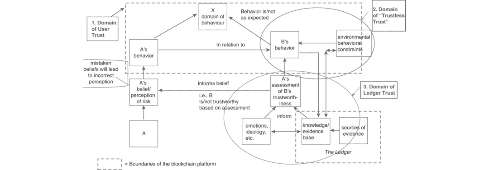 图 3.1 区块链中的三种信任类型
```

注：此图基于第 2 章中提出的信任模型，在该章中，我讨论了信任是 A（信任方）与 B（被信任方）之间关于 X（某个领域）的关系。区块链或分布式账本平台包含了证据基础——账本，A 将基于此账本对其 B 的可信度进行评估。这三种信任类型也体现在此模型中。用户信任（领域 1）涉及用户如何感知平台调解 A 和 B 之间的交互。无信任信任（领域 2）涉及 B 行为的约束和激励（区块链的激励机制），而账本信任（领域 3）则是对账本的信任，认为提供了 A 评估 B 所需的证据。A 评估 B 的可信度以判断是否合理，从而形成对 B 可以信任的信念。为了进行这种评估，A 利用了 B 过去行为的证据（在可用范围内）来推断 B 是否可能按预期行为、关于 B 利益的证据，以及对可能约束或激励 B 行为的因素（如法律或规范）的认知。此模型在之前的模型（参见图 2.1）的基础上，叠加了（公共许可的）区块链平台的边界，A 和 B 使用其进行交互。它还包含了治理 B 行为的某些约束或激励因素（即使在公共许可区块链中，某些因素仍处于系统之外）。

### 用户信任

驱动区块链及许多其他分布式账本运行的密码学、分布式网络和共识机制对于大多数人来说都是晦涩的。对于大多数用户而言，对给定分布式账本信任性的认知是通过中介实现的——如果他们拥有这些技术的直接经验，则是通过他们与账本用户界面的交互以及使用系统的体验；如果他们缺乏直接经验，则是通过从他人那里学习关于这些技术的使用（或想象的使用）¹)）。

众所周知，区块链和分布式账本系统面临着易用性挑战，易用性指的是“某物适合并能够被使用的程度”（Lexico, 2021）。例如，存在关于如何备份钱包或人们在丢失私钥时应该怎么办的问题（Swan, 2015; Voskobojnikov et al., 2020）。用户通常已经习惯了在出现问题时向第三方（例如 IT 帮助热线）寻求帮助。而在许多区块链和分布式账本系统中，并没有这种帮助，这对于缺乏足够技术知识来帮助自救的用户构成了挑战。Eskandari et al. (2015) 根据一种对多种比特币密钥管理系统的认知走查法建议，区块链系统中所使用的隐喻对于终端用户来说往往是不清晰的，导致他们做出危险的错误。即便是经验丰富的用户也报告称过他们丢失了私钥或钱包密码。² 这些发现已得到 Voskobojnikov et al. (2020, 第 13 页）的证实，他们指出“用户在涉及到加密货币的关键构建模块时，存在危险的知识漏洞和误解。一些用户不知道公钥和私钥的区别，且有人错误地认为他们在使用交易所时可以访问自己的私钥。” 此外，Shrestha and Vassileva (2019) 一项关于原型区块链接口易用性的最新技术接受研究发现，系统的质量和用户愉悦度都影响了用户采用基于区块链系统的意愿。区块链应用程序接口（APIs）通常也不对用户友好，不符合当前的易用 API 标准，其设计上仍有很大的改进空间（Swan, 2015; Gao et al., 2016; Filippova et al., 2019; Kumar and Kumar, 2020; Voskobojnikov et al., 2020）。虽然大多数关于区块链易用性的研究都是以比特币为中心的（Gao et al., 2016; Krombholz et al., 2016; Sas and Khairuddin, 2017）——且 Voskobojnikov 等人 (2020) 指出，根据用户的专业水平、应用领域和加密资产的类型存在某些差异——但毫无疑问，区块链的易用性是一个广泛且在很大程度上未解决的问题。

这些易用性问题影响了用户信任区块链和分布式账本技术的足够程度，从而采纳它们。正如管理信息系统（MIS）文献所示，信任方将部分基于对系统若干属性的认知，对给定系统的信任性形成信念（例如，良好的界面设计或用户感知系统有多大帮助参见 [McKnight et al., 2011, 第 12–17 页]），信任方还可能此此对交易另一方的信任性做出推断（McKnight et al., 2011）。Gao 等人 (2016) 发现，知识有限的人由于缺乏理解和感知用性，而放弃了使用某项系统（例如比特币网络）。当信任方缺乏对区块链和分布式账本系统的知识，或者信息具有误导性或模糊性时，信任方可能会认为交易风险过高，从而可能避免使用该类型的系统进行交易（参见 图 3.1, 领域 1）。

同样重要的是，要意识到对设计者、赞助者或用户的信任会影响对区块链作为一个类别的信任认知，反过来影响对特定实例（即特定的区块链平台或网络）的认知（C. Lu et al., 2020）。Voskobojnikov 等人 (2020) 注意，缺乏理解会扭曲用户对使用系统风险的感知，包括用户担心政府可能将加密货币交易追踪到他们身上，或者交易加密货币可能会影响其声誉。对声誉损害的担忧可能由于比特币在黑客和洗钱者中被认为受欢迎、对比特币作为投资的定期警告，以及加密货币诈骗的历史（参见例如，Phillips and Wilder, 2020 以及 Humphreys, 2021 中采访的 Alex Hern）。底线问题是，对分布式账本系统（尤其是区块链）的用户和用途的认知，以及用户对系统运行方式的普遍缺乏理解，对区块链和分布式账本系统这一类别产生的不信任影响往往大于产生信任。然而，区块链作为一个类别的信任对于技术的采用至关重要。

虽然用户信任为区块链和分布式账本信任提供了一个重要的视角，特别是在涉及此类技术的采用时，但它并没有捕捉到中本聪在开发比特币时设想的信任概念。为了理解这种信任，我们必须转向另一个概念：“无信任信任”。

### 无信任信任

在考虑“无须的信任”（trustless trust）时，我们经历了一次关键的转变：从基于易用性或用户对技术用途的感知和信念对区块链及分布式账本技术的观察者相对信任的感知，转变为关注技术的“深层结构”（Wand and Weber, 1995)³），以及区块链和分布式账本系统的创建者如何试图解决人类社会参与者之间的信任问题。在这里，重要的一点是，我们剥除了对这些社会参与者的任何道德判断；换句话说，无须的信任既适用于那些在既定社会认为的社会可接受范围内良好运行的社会参与者（例如旨在确保食品安全的供应链参与者），也适用于那些在社会规范之外运行的参与者（例如洗钱者）。也就是说，“犯罪伙伴之间的信任增加了犯罪成功的几率，而压迫性社区之间的社会团结也增强了它们的效能”这一点（Nissenbaum, 2001, p. 642），正如在按照社会习俗运行的伙伴之间的信任那样如此。

正如第 1 章中讨论的，公开的、无许可的区块链旨在以无须信任的方式解决社会信任问题——社会参与者之间的信任——即提供“无须的信任”。无须的信任（trustless trust）这一术语是一个显而易见的矛盾，是由美国企业家里德·霍夫曼（Reid Hoffman）在 2014 年的一篇文章中提出的，他在文中解释了他为什么要投资 Blockstream 公司，这是一家比特币和区块链公司⁴。在博文中，Hoffman (2014) 写道：

```
比特币在媒体中通常被描述为一种价格波动的虚拟商品，它可以比黄金、证券化的次级贷款或郁金香花更高效地优化投机。我不是这样看它的……区块链创造了“无须信任”的可能性。各方不再需要了解或信任彼此，就可以在绝对保证且没有中间人的情况下参与价值交换。因此，区块链极大地减少了对第三方支付处理者及其收取的费用的需求。它消除了信用卡欺诈的可能性。它为微支付创造了新的可能。（你可以向某人发送部分比特币，交易费用低到令人震惊[回记得他是在 2014 年写的]），以至于《华尔街日报》或《纽约时报》可以有效地为阅读单篇文章收取一分钱。AMC 可以收取四角钱来看一集无广告的《行尸走肉》最新集。）区块链让各种跨境贸易变得更容易，特别是当涉及到那些没有信用卡网络或稳健银行系统的地方时。
```

霍夫曼的表达了了根，“无须的信任”现在被广泛用于描述区块链背景下的信任（参见 Werbach, 2019），尽管这种“信任需求将消失”的暗示事实被证明是错误的。

从那些对技术有绝对信仰的人（“技术基础主义者”）的角度来看，区块链的独特特征和能力似乎消除了对信任的需求（参见 Walch, 2015，引用 Vaidhyanathan, 2012）。这一观点的例子是《纽约时报》的一句引用，归于泰勒·温克莱沃斯（Tyler Winklevoss）2013 年关于投资比特币的决定：“我们选择将我们的资金和信任投入一个不受政治和人为错误的数学框架，”他陈述道（Popper and Lattman, 2013）。而 Szabo (2017) 写道，区块链试图用“可验证的计算”取代“对私有且可任意更改计算的信任”，这体现了上述观点的观点。像 Szabo 一样，De Filippi 等人 (2020) 认为，区块链对密码学、数学和博弈论激励的使用使其成为“信任机器”，而非信任机器，因为参与者在大多数时候面临着彼此信任的风险。通过无须的信任，Antonopoulos (2014) 所言，区块链大大减少了对第三方支付处理者的需求。因此，基于法律（`lex juris`）的第三方中间人信任被基于共识算法（`lex cryptia`）的区块链信任所取代，这使得缺乏信任的参与者之间的交易变得更容易。任何具体化的风险，例如 2016 年的 DAO 漏洞，并不被解释为信任的失败，而是与系统运行相关的偶然故障或异常。

与此观点相反，许多作者评论了像比特币这样的区块链仅仅转移了风险和信任的位置，而不是完全消除它们（参见 Walch, 2015, Bratspies, 2018, De Filippi 等人，2020）。Walch (2015) 认为比特币与任何其他努力一样受到人类政治的影响；她写道：

```
看到比特币论坛上关于未来的辩论，核心开发者在决定其未来方面起的重要作用，以及核心开发者收入来源引发的潜在利益冲突。看到风险投资进入比特币生态系统的成熟利益与将比特币视为酷项目或奥地利经济学实现的早期采用之间的权力斗争。比特币不可避免是一个人类项目，而且像此类项目一样，在某些方面存在缺陷。
```


同样，Bratspies (2018) 发现基于区块链的加密货币嵌入了层层信任——风险，引用了以下事实：大多数加密货币比宣传的要集中的得多，并最终要求互动方信任单个节点；像比特币这样依赖挖矿的区块链取决于矿工的诚实（这显然是无法保证的）；区块链受到核心开发者意愿和代码错误的变幻的影响；加密货币钱包和交易所受到黑客攻击和盗窃；而首次币发行（ICO）大多涉及诈骗。De Filippi 等人 (2020) 尽管将区块链描述为信心机器，但也指出每当任何人使用比特币这样的公开、无许可区块链进行交易时，信任都是必要的：对钱包和加密货币交易所的信任，对核心开发者以及矿工和矿池的信任。从这里我们可以得出结论，作为一种可靠的投资或价值存储，区块链并不像十七世纪的郁金花球那样值得信任⁵。正是这种区块链（至少是公开无许可的区块链）提供信任但可能并不值得信任的矛盾方式，构成了“无须的信任”的概念。

尽管某些人可能坚决否认这一点，但公共、无许可区块链的这种“无信任信任”（trustless trust）形式，为交互方之间的信任创造了条件，这与政府机构建立法律法规的方式非常相似——因此它应该建立激励机制和制度化的游戏规则，以使受托人的利益与信任方的利益一致或受到约束（参见图 3.1）。回想一下我们在第 2 章中讨论过的，信任涉及信任方、受托人以及某个行为领域之间的三方关系，在该领域内，受托人的行为封装了信任方的利益。信任总是涉及对信任方造成某种程度损害的风险，但同时也请记住，规范和法律可以用于激励或约束受托人的行为以降低损害风险，例如公共卫生官员的例子。这一观点与塞利曼（Seligman）系统信任概念有关，即对一组机构的信任（Seligman, 1997）。同样，公共、无许可区块链的独特特征和运行模式降低了信任方依赖受托人的风险，因为信任方信任系统以封装信任方利益的方式来塑造受托人的行为（参见图 3.1, 领域 1）。在这种意义上，所谓的“无信任信任”与其说是无信任，不如说是一种信任的形式，它在理论上将风险降低策略从人类机构（例如政府和法律）转移到了算法与非机构参与者的结合体。同样，如果不能正确理解无信任信任机制是如何运作的，区块链和分布式账本系统的用户最终可能会承担他们甚至没有意识到自己正在接受的风险。

使得基于区块链的无信任信任与以往信任形式不同之处在于这种机制的运作方式。许多约束受托人行为的规则在系统外并不存在。例如，在公共、无许可区块链中，没有外部第三方担保人来保证交互方的可信度。⁶ 它没有政府监管机构来颁布和执行法律法规，也没有任何金融中介机构（如银行）来保证比特币的价值或保证其没有被发送者双重花费。事实上，比特币寻求消除此类外部信任中介，从而规避了传统的制度逻辑和信任（或信心）的生产、监管和控制模式——即法治——并在比特币网络中使用完全不同的逻辑和模式对其进行重构——即代码法治或`lex cryptographia`（Seligman, 1997; Swan, 2015; De Filippi and Wright, 2018; Lemieux, 2019; Yeung, 2019; Bodó, 2020)）。通过这种方式，法律治理被一种“技术编码权威”形式取代了（Aneesh, 2002, p. 1）。

在技术抽象层面上，也没有外部第三方证书机构来证明作为比特币发送和接收核心组成部分的数字签名的有效性，也不涉及比特币网络生成共享账本状态共识的运作功能。相反，比特币网络整合了内生机制来防止双重花费。主要，正如我们在第 1 章中讨论的那样，比特币通过交易哈希的加密链以及工作量证明（`PoW`）共识机制，来约束或激励网络参与者的行为，使其利益一致。在`PoW`的运行中，理论上所有参与者都有机会发现并挖掘区块以获得奖励；随着财富的积累，参与者认为继续挖掘区块比欺诈价值得多。同样，在交易尺度上，去中心化透明的账本通过使篡改显性化并丢弃与长链不一致的交易来鼓励诚实。Nakamoto (2008a), p. 1) 在原始比特币论文中写道，这实现了“基于加密证明而非信任的电子支付系统，允许任何自愿双方直接相互交易，无需信任第三方”，换句话说，这就是无信任信任。在这种情况下，尽管个人可能无法信任与其交互的匿名比特币用户（因为缺乏对对方可信度的了解），但他们可以信任区块链技术创造了必要条件，使得与不可信任对手进行互动是安全的——就像上出租车信任司机，因为你知道法律法规会约束司机的行为。

无信任信任的概念真正适用于公共无许可区块链（如比特币和以太坊），而不适用于许可链区块链或其他类型的分布式账本。许可链分布式账本的信任模型大不相同（Wüst and Gervais, 2018）。在这些类型的系统中，单一控制利益或控制利益联盟充当了信任担保人的角色：首先通过识别并授权参与方使用该系统；其次通过规定参与规则（通常在法律合同中），当交易中一方的行为被证明不可信时，为双方提供法律救济途径。因此，无信任信任无法完全封装信任在所有类型的区块链和分布式账本中的体现。为了获得更广泛的信任概念，我们必须转向所有此类系统的共同点：账本。

### 账本信任（认知信任）

区块链信任的第三形式是对账本作为事实主张的“最终、确定且不可篡改”证据来源的信任。这种信任与无信任信任一样，关注分布式账本系统的深层结构（Wand and Weber, 1995）；然而，与无信任信任不同，它适用于所有的分布式账本系统，因为根据定义，它们都包含了账本。账本信任通常与上述的其他信任形式混淆或被其包含，在文献中受到的独立关注较少。

在比特币代码库发布几年后，评论人士才开始看到比特币共享账本在数字货币和经济交换形式之外的应用还具有真实潜力，这催生了所谓的“区块链 2.0”(Bheemaiah, 2015)。然而，在比特币网络发展的早期，开发者们已经在尝试这种可能性了，这从比特币代码库前首席维护者加文·安德烈森（Gavin Andresen）据报道曾使用的通过“奇特的黑客行为”将内容嵌入比特币区块链的方法，以及关于区块膨胀的争论中证明了这一点 (Bradbury, 2013)。⁷ 彩色币（Colored Coins）旨在将比特币的使用扩展到新领域，它是这些方法之一。关于该方法的白皮书描述了多种可以使用彩色币代表物理资产的应用，例如房屋或汽车的买卖 (Rosenfeld, 2012)。

白皮书发布后不久，基于比特币的房地产交易平台 Ubitquity 试点了使用彩色币和比特币来支持巴西的土地销售 (Lemieux, 2017a)。但许多用于嵌入数据的方法增加了维护账本所需的存储量，因为数据必须输入未花费交易输出 (`UTXO`）数据集才能被记录。⁸ 为了解决日益严重的区块膨胀问题，2013 年的比特币核心协议更新引入了一种新的数据嵌入方法，该方法不需要将数据输入`UTXO`数据集；而是使用新的`OP_RETURN`交易参数。这推动了区块链 2.0 用场景的发展。以太坊在 2013-14 年兴起作为一种整合了编码智能合约能力的新区块链平台——“存储在分布式账本技术（DLT）系统上的计算机[程序]，其任何程序执行的结果都记录在分布式账本上” (ISO, 2020a, s. 3.72) —— 也增强了人们对加密货币和支付之外区块链用场景的意识和实验。随着区块链 2.0 的兴起，账本作为信任锚点的重要性变得更加凸显。

这些发展的观察者（如《经济学人》）开始关注，并意识到底层账本具有满足对“一种可靠的记录，这对于所有类型的交易都至关重要”需求的潜力 (Economist, 2015b)。在《经济学人》的一篇文章中明确区分了到目前为止被“混淆一谈”（并且可以说目前仍然如此）的三个事概念——比特币货币、底层的区块链账本以及广义的区块链，《经济学人》慷慨地表示：

> 区块链是一项甚至比比特币（作为货币时）更强大的技术……[它可以]创建廉价、防篡改的公共数据库——例如，土地登记处（洪都拉斯和希腊对此感兴趣）；或者奢侈品或艺术品的所有权登记处。通过将相关信息嵌入公共区块链可以对文件进行公证——你不再需要公证员来为你做担保。金融服务公司正在考虑将区块链作为谁拥有什么的记录，而不是使用一系列内部账本。一个受信赖的私有账本消除了与对手对每笔交易进行对账的需求，它速度快且最大限度地减少了错误……共享公共账本的概念听起来可能并不革命也不酷。复式记账法或股份公司最初也是如此。但与它们一样，区块链是一个看似平凡的过程，却具有改变人类和企业间合作方式的潜力。

(Economist, 2015b, p. 13)

在杂志的同一期内容中，《经济学人》还将区块链账本描述为“确保万无一失的大链” (Economist, 2015a)。

为了呼应并放大这一主题，Paul Vigna 和 Michael Casey 在 2018 年出版的书籍《真理机器：区块链与一切的未来》描述了区块链会计账本的变革性力量。在 2018 年《新周周刊》的一篇文章中，Casey 被引用总结道：“整个全球记录系统将经历一场 5000 年的范式转移……我们一直在追踪和检查记录，而记录是经济交换系统的基础层，它们可以直接追溯到苏美尔时代的泥板。在 5000 年里，我们一直拥有中心化的版本。现在，我们正在做一种改变游戏规则的去中心化事务。” (Piore, 2018)。

这些作者认可并强调的是，记录和记录工作为信任提供了认识论基础，这种基础在几个世纪以来使人类社会协调与合作成为可能。在他们对记录工作和人类演化的研究中，Basu 和 Waymire (2006, p. 204) 理论化地认为，系统地保存“过去交易的记忆（即记录）促进了更大的合作，因为它有助于参与者识别可信赖的伙伴”。⁹ 因此，它是一种“文化演化的制度，能够实现复杂的经济互动”。系统性的记录工作使得“集体记忆”得以形成，即存在于个人人类大脑之外的制度化社会记忆，它“是扩展经济合作出现的的必要条件” (Basu and Waymire, 2006, p. 201; 另见 Basu et al., 2009)。^(10 Basu 和 Waymire 写于 (2006, p. 202)，

现代日记分录中体现的基本记录功能处于所有会计系统的核心。内部控制和审计师的验证将交易记录转化为“硬性”信息，随后这些信息使得人们难以产生分歧” (Ijiri 1975, 36)。硬性交易记录将过去交换的记忆制度化，并允许通过第三方验证先前的事件和义务以解决事后争议。通过不可篡改、可验证的过去交换记录实现的制度化记忆，法律和其他支持交换的制度中所体现的诚实规范，是维持那种允许陌生人随时间进行复杂经济合作的信任所需要的。交换机会反过来促进了广泛的分工，以及更大、更复杂的社会，而这些社会是现代财富产生的主要原因 (Smith 1776, 第一卷第 1 和 2 章)。事实上，经济交换产生的“纸面轨迹”在现代先进经济体中无处不在。^(11

Basu、Waymire 等人通过实证证明了，社会中互惠交换数量和复杂性的增加，会导致正式记录制度的随之增长，这是因为需要弥补人类记忆在追踪多个互动方过去行为时所存在的局限性（Basu and Waymire, 2006; Basu et al., 2009）。他们还发现，在大型复杂社会中，记录制度、通信技术和法律是共同演化的，表现出双向因果关系：核心记录技术使得复杂的合作协议成为，而这些协议又催生了新形式的记录（Basu and Waymire, 2006），这种观点也得到了 Latour (1986) 和 Manoff (2004) 的支持。¹² 虽然记录制度并非集体记忆形成的唯一模态——例如，许多本土文化演化出了形式化的口述故事——但它在许多社会中仍然是一项重要的制度。

#### 账本与认识论基础

在这些社会中，账本产生于交易双方的互动，它为评估被信赖的方的信誉度提供了认识论基础（见 图 3.1，领域 3）。因此，对账本的信任运作方式与上述讨论的“无信任信任”完全不同。账本信任并不依赖于系统机制的信任（即无信任信任）——事实证明这种信任有时是盲目的——账本信任更具赋能性，因为它为信任信任的方提供了评估受托人信誉度所需的证据。虽然这种评估依赖于账本提供的证据，但账本并不假设对评估拥有控制权。评估仍然是人类评估者的范畴，他们拥有某些全自动系统尚不具备的能力。例如，他们可以进行道德判断，当公平性要求在较新的证据表明此前不可信的行动者现在已“改过”时，“遗忘”先前违规行为的证据，这种判断可能是有益的。

#### 记忆与信任

正如第 2 章 所讨论的，信任方为了对交易另一方的安全信赖程度形成一个合理的真理信念，需要可信的证据。当关于信誉的证据缺失或不完整时，就无法进行评估，信任者对受托人可信任程度的信念将是不存在或极低的。记忆对于信任的形成至关重要。正如 Hardin (2002) 所言，信任是迭代的，对被信赖方信誉的知识随着时间的推移而建立。然而，人类记忆是有限的；我们只能回想起与其个人互动的一小部分个体的过去行为。相反，大型复杂社会要求我们能够获取关于多得需要互动方的“集体记忆”。此外，复杂社会要求我们与我们一无所知的方进行互动，这排除了对对方的直接知识和我们自身有限记忆的依赖（Origgi, 2019）。

#### 作为文化制度的记录

那么，记录作为文化制度——正如 Basu and Waymire (2006) 所言——扩展了我们对记忆的局限，使我们能够获取关于远多互动方的信息。此外，复杂社会要求我们与我们一无所知的方进行互动，这排除了对对方的直接知识和我们自身有限记忆的依赖。核心记录技术使得复杂的合作协议成为可能，这种方式超越了人类记忆的局限，赋予了信任方评估可信赖程度的能力。例如，在财产交易中，我们如何知道对方是诚实的？记录提供了这种证明。在对方的交易中，我们如何证明自己拥有资金？记录提供了证明。然而，除了这种价值，记录还创造了一个将社会结合在一起的集体记忆（Berger and Luckmann, 1996; Searle, 1985; Martinez-Ávila and Zandonade, 2020）。

#### 区块链与隐私

在这里，重要的是，区块链和分布式账本在互动方之间所实现的记录总化，意味着对个人隐私构成了独特的威胁（参见第 7 章）。中本通过引入伪匿名化交易（最初被认为是匿名的）来处理这个问题；然而，追踪和链接比特币发起者的局限性已经显现（Naqvi, 2018）。在执法背景下，这可能被视为一种功能而非缺陷；但在人权和言论自由的背景下，它同样被视为相反。挑战在于，此类决策取决于判断标准，而这些标准又取决于谁的标准，我将在第 4 章中进一步讨论。

记录的卓越之处以及它们对社会运行和演化的重要性，是我们并不经常停下来思考的问题；在考虑信息及其处理时，记录作为分析对象往往是缺失或不可见的。以信息系统的概念建模为例，此类模型通常关注的是业务流程，而非记录（例如，参见 Raj and Owen, 2003；Object Management Group, 2020 ）。Latour (1986) 将记录和其他人类认知的其他表现描述为构成和构建人类社会关系的“日常技术”（everyday techne）的一部分。它们是“不可变的移动物”（Latour, 1986）——这种表现既固定又让原本无法传输的事物变得可移动，就像地图代表土地，并从比喻意义上让我们能够将土地随身携带。这种物质化表征的极度普通，或“理所当然性”（Basu and Waymire, 2006；Ling, 2012），使得它们在很大程度上是不可见的，或者不值得我们进行分析性的审视——直到它们出了问题，例如全球金融危机期间的“机器人签名”灾难、洪地拉斯对土地记录的操纵，或者正如我们将在第 6 章 中将讨论的，虚假信息运动中对证据来源的操纵。然而，忽视这种社会技术物质化的抽象证据层的倾向是危险的。它可能会让个人面临信任违背的风险，并使整个生态系统变得脆弱。依赖记录来锚定支撑复杂人类社会和经济关系的信任基础的精细评估，这要求记录本身必须是可信的。当这些证据来源不可信时，信任方可能会对另一方的可信度产生错误或错误的信念，导致“错位的信任”（即：在不值得信任时给予了信任，或者在应该给予时没有给予）。因此，将区块链和其他类型的分布式账本不仅被视为社会技术系统，而且被视为社会信息（证据）技术系统（Lemieux and Feng, 2021），在这些系统中，账本作为社会信任的认识论基础成为了一个首要分析对象，这是至关重要的。

#### 可信性的历史背景

以保护记录可信性的方式保存记录并不是新问题。即使是古代苏美尔人也面临过这个问题，正如 Basu and Waymire (2006) 第 214 页所观察到的，他们发明了解决这一问题的方法：

在公元前 3200 年之前，代币开始被封在中空的粘土球（“封球”）内，通过在信封外部盖上交易双方和见证人的“签名”（通过印章）来防止欺诈……随后，这些粘土球经过烧制，使记录永久化且难以更改。正如 Ijiri (1975) 第 36 页所定义的，粘土球是“硬”的，因为交易数据被记录下来，使得事后“人们很难产生分歧”。在接下来的 200 年里，代币也开始压在粘土球的外部，中空的粘土球被实心板取代，代币压痕首先被象形文字（原始楔形文字）取代，最后被楔形文字取代。

#### 数字时代的挑战

快进几千年，我们现在已经有了基于区块链的新型记录安全形式，通过代币化和附加签名，这与古代苏美尔人的技术具有惊人的相似性几个世纪以来，随着记录形式从粘土板演变为纸张，记录员发明了许多巧妙的方法来保护和确定记录的可信性（例如，参见 Duranti, 1998；Yeo, 2013；Lemieux, 2019），这项任务被前英国公共档案馆副馆希拉里·詹金森爵士（我将在第 6 章中对他进行更多介绍）称为档案的“道德防御”（Jenkinson, 1937）。然而，数字时代带来了新的挑战（例如，参见 Duranti and Rogers, 2012；Yeo, 2013；Stančić, 2020）。记录创建和存储的新颖形式——例如基于互联网的应用程序和云计算基础设施——在许多情况下已使得旨在保护记录可信性的系统系统记录技术过时。此外，“大数据时代”的计算机信息处理在很大程度上是为了高效地操纵数据，而不是保护记录的完整性（Saha and Srivastava, 2014）。这种对效率和可操纵性而非对记录保护（记录员的古老任务）的关注，导致了记录感知可信度的下降以及虚假信息的增加（Berti-Équille and Borge-Holthoefer, 2015；Berti-Equille and Ba, 2016），并伴随着社会信任织网的动荡。

#### 权威与信任的衰落

数字技术的兴起并不是记录感知可信度下降的唯一原因。过去，记录的可信性被认为是由创建它们的权威的可信性来的：例如，公共官员和公共记录员——档案管理员——他们保存记录并管理存放记录的机构（Duranti, 1996；Yeo, 2013；Lemieux, 2019 ）。近期对政府和各类权威（包括专业权威）信任的波动导致了对记录权威性的信任下降：记录的颁发机构还是记录员都不再获得像过去那样的信任程度（Yeo, 2013）。在过去，专业记录员（如档案管理员）以及存放记录的特殊仓库在很大程度上被认为是为了公共利益行动，是值得的（Duranti, 1996；Lemieux, 2019）。社会信任的下降使得人们质疑记录员究竟在为谁的利益服务。

根据支持者的说法，区块链账本之所以具有如此巨大的变革性，是因为它们提供了可验证的事实——即在作为信任基础时，评估交互双方可信度所需的、可赖的证据来源；而且它们的设计初衷是为了（很大程度上）内生性实现这一目标，即不依赖于外部的人类或社会信任锚点——相反，它们使用数学。区块链 2.0 项目的早期开发者意识到区块链在解决由不可靠记录以及不可靠记录保管者所产生的问题方面的潜力。Factom 项目的总裁（该项目早期预见到这一潜力，并试图在洪都拉斯的一个土地登记项目中利用这一潜力）在当时曾评论道：

“Factom 创建了日后无法更改的永久记录。在 Factom 的世界里，不再有机器人签名丑闻[指金融危机期间的美国抵押贷款赎回]。在 Factom 的世界里，没有丢失的投票记录。在 Factom 的世界里，你清楚每一美元政府资金花在了哪里。基本上，整个世界是由记录工作组成的，而作为消费者，你受制于运行这些记录的碎片化系统……许多人的梦想是将这种由数学验证的不可变账本所固有的诚实性，扩展到混沌的现实世界交互中。通过构建由区块链支持的无边界账本。”

(Higgins, 2014)

当然，诚实性并不是基于分布式账本的记录的固有属性，正如它并不是传统记录形式一样（关于这一点，请参阅 Lemieux, 2016c）。然而，随着人们对区块链“大确定性链”的独特功能的兴趣日益增加，区块链账本的各种应用开始泛滥：追踪溯源、确立血钻的真实来源和真实性、帮助流离失所的难民重建身份、赋予艺术家对其艺术创作的更大的控制权。所有这些项目都认可并寻求利用不可变区块链账本作为可信事实来源的力量。

因此，区块链 2.0 项目试图解决的问题在本质上主要是认识论意义的；也就是说，它们涉及证据来源的信任问题。在一个社会证据基础被认为正在迅速瓦解并需要拯救的世界里，“可信的证明来源”的想法过去是、现在仍然具有吸引力。问题正如我们在第 7 章中将看到的，这些项目的开发者理解的是计算机而不是记录，是计算信息处理而不是记录工作。因此，在许多情况下，他们的解决方案承诺提供可靠的记录，但设计并非为了交付这些记录。尽管如此，目标仍然是高尚的：恢复记录的可信度，而这种可信度对于社会信任关系以及这些关系所产生的复杂的、大规模社会交易是必要的。

## 3.3 结语思考

正如我在前一章中论证的那样，如果信任至少部分是一个认识论概念，需要关于被信任方可信度的证据，那么询问这些证据从何来就是合逻辑的。证据的来源之一是记录，如上所述，记录构成了一项重要的通信和集体记忆形成技术，当它与系统化和文化制度化的记录工作相结合时，它外化并具体化了人类记忆，并在时空中延伸了记忆，为信任提供了基础——当然，这前提是记录和记录工作是可信的。

一种特殊类型的记录是账本，它在记录各类人类交易（尤其是财务交易）方面有着悠久的历史。分布式账本——包括区块链——理论上通过提供一种新的记录形式，有助于信任基础的形成，这种记录形式被认为能确保作为交易双方相关证据来源的可信记录。在虚假信息横行的时代，这种可信的证据极度匮乏，我现在将转向这一主题，以加深对在认识论动荡时期区块链和分布式账本的吸引力和承诺理解。

¹ 关于同时也考虑技术想象性用途的重要性，请参阅 Müller and Tworek (2016)。

² 故事层出不穷，即使是技术精通的人也会丢失他们的私钥或比特币钱包密码（例如，Murray, 2021; Goodyear, 2021）。

³ Wand and Weber (1995, p. 206) 将技术的深层结构解释为“显现（manifest）信息系统旨在建模的现实世界的意义。因此，遵循语言传统……我们称之为信息系统的深层结构。例如，会计系统中所体现的指示如何将交易记入账本的规则反映了深层结构特征。这些规则指示了当经济体中的合同被交换和执行时，现实世界中某些组织和个人的财富是如何发生变化的。”

⁴ 参阅 [Blockstream.com](http://Blockstream.com)。

⁵ 摩根大通首席执行官 Jamie Dimon 曾被记录过对比特币表示：“这比郁金香糟得多。结果不会好。会有人死掉。” (Imbert, 2017)。Dimon 指的是 17 世纪早期中期荷兰发生的郁金香泡沫，当时投机导致郁金香的价格飙到荒唐的高度：最稀有的郁金香价格是普通人年薪的六倍。1637 年底价格开始下跌，许多贷款购买郁金香的人不得不以惨跌的价格出售。

⁶ 社会学家 Anthony Giddens 认为，这种保证是通过符号标记或专家系统实现（或中介）的。前者指的是“不考虑特定时刻处理它们的个人或群体的特征而可以‘流通’的媒介” (Giddens, 1990, p. 22，引自 Bodó, 2020)）。

⁷ 关于所使用的各种方法，请参阅 Sward et al. (2018)。

⁸ UTXO 用于高效验证新生成的交易。比特币利用 UTXO 数据集来跟踪尚未花费的输出交易，从而可以作为新交易的输入（参见 Narayanan et al., 2016）。

⁹ 根据 Cosmides and Tooby (1992)，进化的人类大脑允许了更好的通信和信任评估。

正如 Basu and Waymire (2006), p. 204) 所解释的，“随着交换交易规模和复杂性的增长，在某个时刻，即使是最发达的大脑也会变得力不从心。会计记录是过去交换和合作努力的抽象物理表现，它们是参与大规模复杂交换的经济主体的备份和/或主记忆。通过将记忆容量扩展到远超人类大脑的生物限制，会计记录大大扩展了人类合作的规模和范围。与语言、法律和其他支持协调的制度相结合，硬性的交易记录帮助了人类文明的出现。”

Basu and Waymire (2006), p. 209) 继续说道，“在大型社会网络中，维持最初完全陌生的人之间复杂的合作关系，需要新的制度来存储和传播有关每个人的过去合作行为的信息。我们假设，可验证的记录制度是较不紧密群体中出现大规模人类合作的必要（但非充分）的制度。我们认为，其重要性无论如何强调都不为过——如果没有存储和传播关于个人诚实和信誉可靠信息的制度，广泛的市场交换和复杂的分工将无法演变。”

制度经济学家 North and Thomas (1973);另见 North, 1990) 提供了关于经济制度如何演变以获取贸易和分工收益的分析，在其中会计记录制度发挥了重要作用。De Soto (2000) 也认为，一个运行良好的产权体系要求，在有人投入资源开发或改进资产时记录所有权，而且通过记录制度证明法律所有权的能力使许多人能够积累资本来增加财富。Basu and Waymire (2006), p. 212) 认为，“记录制度和会计是随着交换规模、分工的复杂性，以及维持合作的法律和其他经济制度的变化而共同进化的。经济学家早已明白，市场和法律制度在长时间的演变中自发共同进化，即使在缺乏明确规划的情况下。”

关于档案道德辩护的更多信息，请参见 Jenkinson (1922) 和 MacNeil (2013)。此外，这一论点建立在我最初在世界银行世界发展报告背景文件中提出的观点之上（Lemieux, 2016a）。

# 第三部分 虚假信息

## 4 不信任与虚假信息的兴起

2014 年至 2016 年间，我住在华盛顿特区一个名为北克利夫兰公园（North Cleveland Park）的社区。周末时，我经常会骑自行车或步行穿这个优美的区域到达附近的罗克溪公园（Rock Creek Park）。在那些日子里，我经常路过一个名为 Comet Ping Pong 的地方，那是康涅狄格大道上受欢迎的披萨店，就在我最喜欢的午餐点（Little Red Fox）和书店（Politics and Prose）旁边。在这个繁华的华盛顿特区社区中，Comet Ping Pong 是一个可以想象的最看似无害的地方。

然而，在某些人看来并非如此。2016 年 12 月 4 日——本是一个平静的周日下午——来自北卡罗来纳州萨尔斯利的 28 岁男子埃加·麦迪森·韦尔奇（Edgar Maddison Welch）进入 Comet Ping Pong，并在餐厅内用 AR-15 式的步枪发射了三枪（Hsu, 2017）。是什么促使这个人采取这种极端措施？根据韦尔奇的说法，他被迫“亲自调查”关于一个儿童性贩卖团的传言，他认为这个团伙与希拉里·克林顿有某种联系，并据称在餐厅下的隧道（事实证明是不存在的）中运营。对于居住在该社区并经常出入 Comet Ping Pong 及周边商店的人来说，韦尔奇的指控和他的行为一样令人困惑，且同样令人不安。

更诡异的是，韦尔奇并不是唯一一个认为儿童性贩卖团在 Comet Ping Pong 并不存在的地下室运营的人。在辩诉书中，韦尔奇承认他被他在网上读到的关于那个所谓性团伙的报道和视频所困扰了（Hsu, 2017。“披萨门（Pizzagate）”这一阴谋论由此得名，在互联网的`4Chan`、`8Chan`和`Reddit`等在线论坛上流传，而且显然除了埃加·麦迪森·韦尔奇之外还有许多人相信它（Wendling, 2016）。

根据一些人的说法，“披萨门”触发于 2016 年 10 月，就在 2016 年美国总统选举前不久，当时 FBI 局长詹姆斯·B·科米（James B. Comey）重启了对总统候选人希拉里·克林顿在担任国务期间使用私人电子邮件服务器的调查。科米的决定取决于发现了属于前纽约州议员安东尼·维纳（Anthony Weiner）的新邮件，他是克林顿高级助手胡马·阿贝丁（Huma Abedin）的分居丈夫（Fisher et al., 2016）。2020 年 10 月 30 日，有人使用`@DavidGoldbergNY`账号推特引用了传言，称新邮件“指向一个恋童团，且`@HillaryClinton`处于中心”。该传言被转推了 6000 多次次（Wendling, 2016; Zhang and Clark, 2018）。所谓的克林顿性团与 Comet Ping Pong 之间的联系显然出现在 11 月初，当时维基泄露（WikiLeaks）发布了克林顿竞选主席约翰·波德斯塔（John Podesta）的邮件，其中 Comet Ping Pong 的所有者詹姆斯·阿莱凡蒂斯与民主党筹款者有关联（Wendling, 2016）。2016 年 11 月 4 日，一个极右脱口秀的主持人在其流行的 YouTube 节目`InfoWars`上暗示希拉里·克林顿涉及了一个儿童性团伙，且波德斯塔沉溺于撒魔仪式。到 12 月 6 日，该视频观看量超过了 427,000 次（Wendling, 2016）。当“披萨门”故事与土耳其儿童虐待丑闻联系起来时，在互联网上变得更加活跃，并使用了英语标签`#Pizzagate`来建立这种联系（Sozeri, 2020）。

正如 Fisher 等人 (2016) 所言，“韦尔奇在康涅狄格特大道西北区的骚乱中并没有射击任何人，但他传达了一个关于在动荡时期信任崩溃的令人不安的信息。”遗憾的是，“披萨门门”（Pizzagate）只是虚假信息破坏社会信任的众多方式之一，它既这种破坏的象征，也是其推动者。由于信任具有认识论维度，我们在评估可能需要信赖的社会参与者之信誉时，所需信息的能力（此处，我遵循 [McKnight 等人 [2011]](#ref-list.xhtml#REFe-r-444) 的说法，在更宽泛的意义使用该术语），对于建立信任关系至关重要，正如我在第 2 章中所证的那样。在没有可靠信息的情况下，我们如何就对信任谁或信任什么建立合理的真信念呢？这无疑非常困难，并可能导致许多社会动乱：公共健康可能受到影响，因为个人不知道是否可以信任科学家的建议；当个人不知道报告是真是假时，灾害通信可能会失败；而当有关选举过程完整性的信息受到质疑时，自由民主国家可能会面临威胁。虚假信息造成的破坏案例比处可见，从它对英国“脱欧”公投的影响（Pogue, 2017）到它在动荡的 2016 年和 2020 年美国总统大选中的作用（Silverman, 2016; Pennycook and Rand, 2021），或者它如何煽动了公众对 COVID-19 疫苗的不信任（Enders 等人，2020）。根据 Lazer 等人 (2017，第 5 页)所述，“此类情况可以使歧视性和煽动性的观点进入公共话语并被视为事实。一旦这些观点植根，反过来就可以被用来制造替罪羊、使偏见正常化、强化‘我们对抗他们’的心理，甚至在极端情况下催化并正当暴力。”在虚假信息时代，社会代价极高。

 图 4.1

彗星披乓球馆（如图所示）是一场虚假信息活动的中心，该活动将其与虚构的儿童性集团联系在一起

（“华盛顿特区西北部的彗星披乓球馆”来自 Farragutful，根据 CC-BY-SA-4.0 许可使用）

为什么我们生活在一个“信息丰富”的时代，但对周围信息的信任却越来越少；或者，当我们信任它时，却经常沮丧地发现我们信错了地方，这些信息完全不可信？在评价我们现状时，出生于苏联的英国记者、作者兼电视制作人彼特·Pomerantsev (2019) 写道：

更多的信息本应意味着更多对抗权者的自由，但也赋予了权势者镇压和沉默异见的新手段。更多的信息本应意味着更有根据的辩论，但我们的审议能力似乎比以往任何时候都要弱。更多的信息本应意味着跨国界的相互理解，但它也让新的、更微妙的颠覆形式成为可能。我们生活在一个操纵手段已经扩散并倍增的世界，一个充满了暗黑广告、心理战、黑客攻击、机器人、软性事实（soft facts）、深度伪造（deep fakes）、虚假新闻、普京、网络喷军和特朗普的世界。

Pomerantsev 所描述的——以及我及许多人所特征的“虚假信息时代”（参见，例如，Rubbi, 2018；Froehlich, 2020）——显现了许多交织的认识论问题。这些问题的本质是本章及后续章节的主题。

## 4.2 虚假信息的多种面貌

尽管我在书中使用了“虚假信息”（disinformation）一词，但对于这类及类似的此类通信还有许多其他标签：“虚假新闻”（fake news）、“误导性信息”（misinformation）、“黄色新闻”、“垃圾新闻”（junk news）、“错误信息”（false information）、“假新闻”（false news）、“伪新闻”（pseudo-news）、“骗局新闻”（hoax news）、“宣传”（propaganda）、“软文”（advertorial）、“恶意信息”（malinformation）、“替代事实”（alternative fact）以及“后真相”（post-truth）——甚至是 2016 年《牛津英语词典》年度词（Oxford University Press, 2016）——这只是其一。

在最近对虚假新闻及相关概念的调查中，Wang (2020) 指出，虚假新闻的含义仍然模糊，虚假新闻定义与其他相关概念之间的边界是模糊的（参见表 4.1）。正如 Kapantai 等人 (2020)，第 6 页所观察到的，“每个研究都引入了专门的定义，导致了冲突，对于应该给出什么标签也没有共识。例如，Dershan 和 Wardle (2017)，第 13 页指出，“每个研究都引入了专门的定义，导致了冲突，对于应该给出什么标签也没有共识。”表 4.1 常见类型的定义 Images/8347tbl_1.png 注：改编自 Wang, 2020，第 15 页。

这种状况阻碍了用科学方法来回答诸如“虚假信息（disinformation）有多常见？”等问题，根据 Lazer 等人 (2018)，关于“信息紊乱”的研究正在激增。在 2000 年至 2019 年期间发表的包含虚假新闻标题的 390 篇论文中，有 379 篇（97.2%）是在 2017 年、2018 年和 2019 年发表的。在 2000 年至 2019 年期间发表的 170 篇标题包含虚假新闻的论文中，有 166 篇（97.6%）是在 2017 年、2018 年和 2019 年发表的。因此，可以得出“虚假新闻”是一个 2017 年之后的新术语。

Wang 的观察得到了 Google Trends 的支持²(book-part7.xhtml#FN-43)，该趋势表明，“虚假信息”（disinformation）和“误导性信息”（misinformation）在 2004 年至 2021 年 1 月期间在全球流行范围内大致相似（参见图 4.2](#book-part2.xhtml#FIGm-fig-2)）。然而，“虚假新闻”在 2016 年剧增，现在已成为该类别的领导者（参见图 4.3](#book-part7.xhtml#FIGm-fig-7)）。

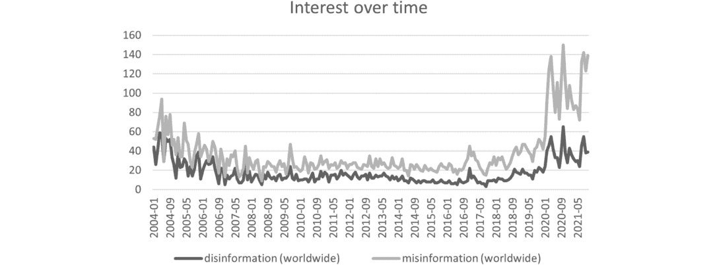 图 4.2

“虚假信息”（disinformation）和“误导性信息”（misinformation）在 2004 年至 2021 年 1 月期间的 Google 搜索使用率大致跟踪。

注意 2004 年和近期的峰值（数据来源：Google Trends [www.google.com/trends](http://www.google.com/trends)) 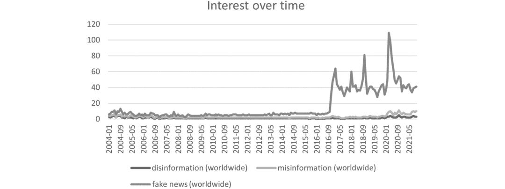 图 4.3

自 2015 年以来，“虚假新闻”一词在 Google 搜索使用率已超过了“虚假信息”（disinformation）和“误导性信息”（misinformation）。

（数据来源：Google Trends，2021 年 1 月，[www.google.com/trends](http://www.google.com/trends））

“虚假新闻”（fake news）一词最早出现在美国，与公关公司制作的视频新闻稿有关，这些稿件随后被电视新闻假装成由记者制作的内容一样进行播放（Rampton, 2005，引自 Harsin, 2018b）。然而，“虚假新闻”一词在近期具有了更广泛的含义，涵盖了“包含核心虚假陈述（未发生过、甚至不存在的事物，因此有时被错误地称为谎言”）的内容（Harsin, 2018b）。Lazer 等人 (2018, p. 1094) 选择将“虚假新闻”定义为“在形式上模仿新闻媒体内容，但在组织流程或意图上并无相似的伪造信息”，部分是因为该术语的政治化有助于引起人们对一个值得更多科学研究的重要主题的关注。

Wang (2020 注意，“误导信息”（misinformation）是过去 20 中最频繁使用的术语，但在此期间的大多数论文并未与虚假新闻的概念产生共现；而 Lazer 等人 (2018, p. 1094) 指出虚假新闻”的兴起标志着“互联网时代对抗误导信息的长期制度性堡垒的倒塌”。

另一方面，“虚假信息”（disinformation）被 Wang (2020, p. 161) 指为一个日益增加使用的术语，尽管其使用频率仍少于“误导信息”。联合国教科文组织《新闻、虚假新闻与虚假信息手册》（Directorate-General for Communication Networks, Content and Technology, 2018, p. 5)）将虚假信息定义为“所有为了故意造成公众伤害或为了利而设计、呈现和推广的所有形式的虚假、不准确或误导性信息”。在这种背景下，公众伤害是指试图混淆或操纵人们、点燃情绪以产生负面影响、利用极化现象、对合法报道和其他公共利益信息产生怀疑，并借此获利。因此，虚假信息有许多形式，其特征都是通过传播虚假或不准确的信息来误导他人的刻意意图。

这种术语上的混乱意味着一个日益复杂的信息生态系统，其特点是具有“无序”的认识论动态（Wardle and Derakhshan, 2017; Lazer et al., 2018; Wardle, 2018）。正如传播、媒体和文化学者 Jayson Harsin (2018b, p. 2 所写：


后信任时代信息生态系统的特点是对对于不诚实（尤其是撒谎）的持续话语痴迷和指责，以及它所产生的公众焦虑和不信任。它体现在不断增加的用于生产和试图揭穿或澄清不准确或欺骗性陈述的劳动的频率和规模上；体现在“事实核查”以及谣言或骗局辟谣组织（通常是个人企业或新闻机构的分支）的扩散；也体现在它们的市场上（Graves & Cherubini, 2016）。它体现在许多衡量不信任（对多个机构和参与者的信任）的国际调查中。它体现在充满虚伪和宣传主义的文化中。它体现在虚假或故意误导性主张的物质影响以及它们产生的情绪化舆论中——从要求并发布总统的完整出生证明，到关于华盛顿某披萨店内有候选人儿童性奴隶环的谣言并导致了武装冲突。它还体现在围绕人工智能（机器人）欺骗建立的政治和商业记录中，这些军队展示了人气或支持者的幻象，并用令人反感的品牌和虚幻的缺陷攻击他们的目标。它还体现在政治咨询行业（现在深受认知科学和大数据分析的影响，对应于情感定位的、人口统计学微定位的影响策略和实践）。

在虚假信息时代，没有什么是确定的，除非一条巨大的确定链——区块链——前来救援，正如我们第 6 章中讨论的那样。

## 4.3 虚假信息历史简述

对当代公平而言，故意误导的信息并不是新事物。事实上，它有着悠久而丰富的历史，从战争宣传到广告和公关（Harsin, 2018b）。Posetti and Matthews (2018, p. 1) 将利用虚假信息传播无知的行为追溯到古罗马，事实上：

```
奥克塔维发起了一场针对安东尼的宣传活动，旨在毁掉他的声誉。其形式是“以古老的推文风格写在硬币上的简短、有力的口号。”（引用 Kaminska, 2017）这些口号将安东尼描绘为一个色鬼和酒鬼，暗示他被克莉奥帕拉操纵了。奥克塔维成为了罗马皇帝，“虚假新闻让奥克塔维一次性击败了共和制度。”再次引用 Kaminska, 2017）
```

在六世纪，拜占庭历史学家普罗科皮厄斯的《秘密史》旨在通过真实故事摧毁他的皇帝君士丁（Korte, 2005）。

在独立战争期间，本杰明·富兰克林通过报报副刊试图引导英国公众支持他的赔偿主张（Liberman, 2017）。1890 年，《纽约日报报》和《纽约世界日报》将古巴岸外麦因恩号的爆炸描述为西班牙的蓄意攻击，以增加发行量。英国军队在波尔战争期间也利用宣传普及“波尔人”的刻板印象，以引导英国公众支持这场不受欢迎的冲突（Posetti and Matthews, 2018，引用 Kent, 2013）。同样，宣传在第一次世界大战期间招兵并“污名化”德国士兵，也有记载显示纳粹政权利用宣传煽动对犹太人的暴力和仇恨，并为种族灭绝辩护（Posetti and Matthews, 2018）。记者 Ian Cobain (2016) (p. 109) 讲述了英国情报部门利用虚假信息的数十年行动。

与之相关，欺骗和虚假陈述至少从“蛇油”药被推崇为万能药的时代起，就是广告中常用的策略，更近期的例子包括烟草广告（Witkowski, 1991）。正如 Proctor and Schiebinger (2008, p. 18) 所述：

```
烟草行业很早就意识到健康问题是市场的阻碍，这就是为什么 L & M 过滤器被推崇为“医生的处方”，骆驼烟被说有“更多医生在抽”，以此类推。20 世纪 50 年代，行业被禁止做出此类陈述，转而采用更微妙的诱导，将吸烟与年轻、活力和美丽联系在一起，后来与自由、冒险和反叛联系在一起。20 世纪 80 年代的一段时间，当健康侵害集中在二手烟时，我们被告诉吸烟是一种言论自由的形式。
```

政治讽刺与宣传不同，它更多地被权力之外的人士使用，通常用于批评和推动变革。例子包括英国讽刺性木偶剧《Spitting Image》（ITV News, 2014）以及美国电视节目《每日节目秀》（它自称为“虚假新闻领域最受信赖的名字” \[Williams, 2018\]）和《周六夜现场秀！》（Posetti and Matthews, 2018）。《每日节目秀》在乔治·W·布什于 2004 年再次当选后在美国声名鹊起——这解释了为什么 2004 年使用`disinformation`、`misinformation`（误导信息）和`fake news`（虚假新闻）关键词的搜索量激增（见上述图 4.2）。在同一时期，讽刺性杂志和在线新闻网站《洋葱报》也受到了乔治·W·布什总统时期批评者的青睐（Williams, 2018）。重要的是，正如 Williams (2018)所指出的，“这是互联网和社交媒体分裂美国新闻消费习惯之前的最后一个时代，这意味着仍然存在一种可以被模仿且有意义的机构化新闻声音，”而且还可以补充一点，即一种可的美国社会认知共识。

## 4.4 有何新信息？虚信息的成因

现在有何不同，以至于当前时代应该被界定为虚信息时代？要回答这个问题，借鉴社会认识论会有帮助，社会认识论是“研究社会机制和社会制度对知识生产、传播和合法化产生影响的学科”（(Origgi, 2019，p. 78；另见 Fallis, 2006；Hardwig, 1991）。

我们现在对世界的大部分知识并非直接通过经验获得的。相反，它是通过他人的证言³——无论这种证言是通过口头接收的（例如我们正在听的讲座），还是通过文字记录（例如社交媒体帖子）。此外，他们的证言可能也基于他人的证言，因此我们获得的任何知识都会通过一个在复杂的知识生产生态系统中运行的扩展知识传递链。证言知识的形成涉及发送者通过某种手段向接收者传递某些知识。说话者使用陈述句提供证言，推进一个听者必须决定是否相信的命题（#van Elswyk, 2019）。社会认识论广泛支持这样一个观点：为了使知识得以传播，被传播的知识必须具有充分性和必要性。

充分性是指，当一个人相信他人对某个事实的证言（例如，外面在下雨）时，如果发送者知道该事实，那么接收者也就会得知并接受它。相关的，必要性是指，如果一个人相信他人对某个事实的证言，但发送者起初并不知道该事实，那么接收者无法通过相信发送者来得知该事实。取决于具体情况——假设发送者和接收者都是理性的——如果证言对接收者来说是可以理解的，那么接收者就有理由相信证言提供者在提供该证言时是专业且诚实的，并且它与接收者的其他信念一致（即没有怀疑证言的理由）——或者至少没有理由怀疑证言提供者是在以专业且诚实的方式表达他们自己合理的真理信念——那么这种相信就具有充分且必要的理由。到目前为止良好——信息已收到。

如果我们现在这个时代的知识传递真那么简单就好了。遗憾的是，有各种情况会干扰知识的传递，导致接收者在某事并非真实的情况下拥有相信它的合理理由，反之亦然。在认识论中，许多此类情况被归类为“盖提尔问题（Gettier problems）”⁴。当这与过去几年来知识处理过程中发生的制度、技术和政治变化相结合时，我们就构成了界定当前虚信息时代的认识论功能障碍范围和规模（见图 4.4）⁵。

 图 4.4 我们的认知生态系统往往形成“并不积极”的反馈循环

首先，我们知道在虚信息时代，存在无数“坏分子”，他们旨在传播未经证实或显而虚假的观点。然而，我们并不一定知道特定行为者的意图。换句话说，区分“好”分子和“坏”分子是一项关键挑战。坏分子的动机通常是政治或经济利益，或二者兼之。虚信息的传播通常始于坏分子创建一个造成危害的信息，例如指控希拉里·克林顿从事儿童性贩卖的在线“比萨门门”信息（Wardle and Derakhshan, 2017）。接下来，该坏分子会将信息推给可能感兴趣的社区，通常使用“社交机器人”——伪装人类的自动化账户（Wardle and Derakhshan, 2017）。Varol et al. (2017)报告说，9%到 15%的活跃 Twitter 账户是机器人⁶。在这里，我们面临第一个也是最明显的问题——我们的知识形成传递链被坏信息淹没了。

这些信息中许多旨在“接线”人类认知。哥伦比亚法学院教授 Wu (2017)在他的书中《注意力商人：进入我们大脑的史诗级竞争》（The Attention Merchants: The Epic Scramble to Get Inside Our Heads）中写道，一个行业的商业模式围绕着出售他们获取的注意力——我们的注意力——来换取他们产生的“免费”内容。关于移民、气候变化、宗教以及最近的戴口罩和疫苗等争议性问题的信息会引发强烈反应，并产生更多盈利的点击和分享（Mourão and Robertson, 2019）。此外，社交媒体平台的表演性质鼓励个人向其粉丝分享帖子，即使是包含虚假要求的帖子，以产生互动并吸引新粉丝（Carter, 2016）。

然而，在社交媒体平台上发布恶意信息的恶性行为者或同谋者并非当前认识论功能失调的唯一原因。社会认识论承认这样一种情况：证词提供者——即信息的发送者——可能持有错误的背景信念，这可能很容易导致他们传输他们认为是真实的虚假信息。⁷ 这个例子恰恰了我们目前在虚假信息传播中经常看到的这类场景。传播虚假信息的人并不一定是坏人分子；他们可能只是持有错误的或出于自身利益的背景信念，这阻碍了他们可靠地传递信息，而这些信息本可以被接收者作为形成有理的真信念的依据（即`knowledge`）。这引出了问题：这些错误的背景信念从何而来？答案是：其中大部分源于坏人分子故意传播的误导性信息 (Rosling, 2018; Ghanem et al., 2020; Kapantai et al., 2020)。⁸

此外，认识论生态系统的特征也可能导致知识形成的失败 (Graham and Bachman, 2019)。一个经典的例子是戈德曼的温度计盒，鲍布伸进一个除了一个外全是坏掉的温度计盒 (Goldman, 1986, p. 45)。鲍布使用那个温度计测量体温，读数是正确的。然而，由于鲍布只是偶然选中了那个工作的温度计，他无法可靠地得知自己的体温——读数完全可能是错误的。移除其他坏掉的温度计就能让知识可靠传递。我们目前混乱的信息生态系统就像鲍布那个坏的温度计盒：它已经变得不可靠了。漂浮着大量的误导性信息和虚假信息——那些坏掉的温度计——无论我们读到的新闻是否真实，我们无法真正知道是否可以依赖它。

### 为什么我们的信息生态系统变得如此不可靠？

有几个相互关联的因素需要考虑。来自不同领域的学者注意到，我们的知识传递生态系统中发生了重要的制度性转变，这些转变为误导信息的滋生创造了条件。过去，主流媒体会过滤我们的新闻。他们是我们可以信赖的信息的权威守门人，正如 Lazer et al. (2018), p. 1094) 所言，他们提供了抵御误导信息的“制度性堡垒”。然而，根据年度爱德曼信任调查，许多国家对主流媒体的信任度正处于历史低点（参见第 2 章）。对传统主流媒体的不信任往往受到那些从操纵新闻中获益的政治家和政府官员的助长。一些政治家正在“武器化”对“假新闻”的指控 (Liberman, 2017)，将他们不喜欢的新闻报道贬低为虚假。⁹ 将记者的报道非法化为假新闻的尝试，还伴随着在网上发布关于他们令人尴尬或有害的个人信息的威胁。这种通过毁名誉和恐吓感知对手的策略——被称为“人肉搜索”（doxxing）——经常被用于女记者，她们被认为更容易受到这种类型的攻击 ([Occeñola, 2018; Posetti, 2018)。

曾经被视为主流媒体提供的“负责任的新闻”，正面临政治和财务的双重压力，这些压力来自新进入者——社交媒体平台 (Lazer et al., 2018)。布鲁金斯学院 2017 年的一报告 (West, 2017) 指出了以下内容：

* 自 2017 年以来，93%的美国人表示他们在线上获取新闻。
* 在如今庞大的在线内容创作和传播渠道中，许多人现在将社交媒体作为主要新闻来源。例如，在 2012-13 年的美国，有 27%的人依赖社交媒体，而这一比例是 51%。
* 相比之下，依赖纸质新闻的美国人比例从 38%下降到 22%。
* 社交媒体网站在发展中国家非常流行。86%的中东互联网用户依赖社交网络，而拉丁美洲为 82%，非洲为 76%，美国为 71%，亚太平洋地区为 66%，欧洲为 65%。

社交媒体既碎片化了媒体格局，又为坏人分子提供了强大的新工具，让他们能够创建并传播自己的信息 (Blumler, 2016)。虽然煽动主义（或称“黄色新闻”）在过去曾被广泛用于售卖报纸，但它现在正被用于生成社交媒体的点击党内容 (Ireton and Posetti, 2018)。这类传播最终为社交媒体和合法新闻网站带来了更多的广告收入，因此即使人们意识到这最终会损害信息的真实性，它们的算法仍向人们推送此类内容 (Wardle and Derakhshan, 2017; Wardle, 2019)。事实证明，误导性信息非常有吸引力，而吸引人的信息可以赚钱 (Weeks, 2015)。这种商业模式对社交媒体平台来说运作非常成功，以至于 2021 年初加拿大的主流媒体机构被促使印刷空白首页，以引起人们对这些平台“利用垄断地位掠夺 80%在线广告收入”的担忧 (Boynton, 2021)。在收入和全球影响力的支撑下，这些平台变得更加胆大：针对澳大利亚拟议的一项要求谷歌和其他科技公司为媒体新闻付费的新法，谷歌的反应是威胁要在该国撤出其搜索引擎 (BBC, 2021)¹⁰。

### 引言

如果一项证言与接收者的其他信念一致，且接收者没有明显的理由不相信证言提供者，那么接收者更有可能相信它。当证言源自朋友时，情况往往如此。为什么呢？因为我们信任自己的朋友，并将他们——以及他们提供的证据——视为可靠的。信任是认知某事的一个不可复制的方面，也是我们视为可靠证据的要素（Hardwig, 1991; Hinchman, 2005; Faulkner, 2007b; Nickel, 2012)）。

#### 社会网络在信息信任中的作用

正如哈灵顿传播与媒体学院传播学教授瑞尼··霍布斯（Renee Hobbs）所观察到的，随着社交媒体的兴起，“我们拥有了一池不再受大众媒体控制的内容。它由一个朋友网络控制，并使用他们社交网络的标准”（引用自 Liberman, 2017）。通过我们的社交网络传递的信息，特别是来自我们直接熟悉的人的信息，是一种强大的“信任灵药”。

在我们被海量信息轰炸、并需要快速评估应该相信哪些信息源的世界里——而我们对这些信息的产生过程或来源知之甚少——我们需要一种快速的启发式方法来做决定。这通常通过信任信息来源（如果该来源是我们所知的）或者在不直接了解来源的情况下信任该来源的声誉来完成（Origgi, 2019）。然而，这种启发式方法——一种“快速思考”的形式——可能会引发认知偏差（Kahneman, 2011）。

#### 认知偏差与媒体消费

此外，当新闻以“碎片化片段”的形式消费时——这在许多社交媒体平台上都是如此——我们就不可能对新闻内容进行批判性思考，并提出媒体素养方面的问题，例如，“作者是谁？目的是什么？”（Liberman, 2017）。相反，类似于“连带责任罪”一样，我们对来自我们已经信任的来源（如朋友）的信息赋予更高的可信度（Kahneman, 2011; Origgi, 2019）。

正如 Nguyen (出版中) 所说，我们采取了“不加质疑的态度”。意料之中，通过我们自己的社交群体接收的新闻反映并强化了先前的信念——即 Nickerson (1998) 所说的“确认偏差”。

#### 回声室与制造的共识

这些认知过程被一个自我强化的过程放大了，在这个过程中，集体记忆围绕着“回声室”形成（Jamieson and Cappella, 2008; Dutton et al., 2017; Woolley and Guilbeault, 2017）。这里的危险在于“谎言说一遍仍然是谎言，但谎言说一千遍就变成了真相”（Hasher et al., 1977）。

心理学领域关于集体记忆形成的研究支持了 Wardle 的观察（Spinney, 2017）。一旦信息被信任并生根，保守偏差以及个人拒绝不符合其既有信念的事物的事实，可能意味着它很难被动摇（Baker, 1987; Basu, 1997）。

#### 叙事洗白与国家宣传

当虚假信息在社交媒体上流传时，它们可能会被主流媒体错误地采纳并作为事实放大。Wardle（引用自 Matthews and Posetti, 2020）将其描述为“彩蛋”。根据斯坦福互联网观察报告（DiResta, 2019），这是俄罗斯总局（GRU）喜欢的战术：

```
GRU 在全球范围内进行叙事洗白操作，创建媒体前、虚假智库以及在真实的独立媒体上发表文章的虚假记者——这一切都是为了合法化或掩盖国家资助宣传的起源。
```


这种叙事洗白也被用于制造各种虚假来源，从虚假的学术简介到完全虚假的出版物。在所有上述情况下，知识形成的过程必须是可靠的，否则知识就无法传递。这被称为可靠主义（`Goldman and Beddor, 2016`）。虽然这是认识论中一个广泛接受的原则，但它并非没有反对者，其中包括一些人认为必须有某种方法来识别哪些过程是可靠的，并隐含地存在一个可以判断它们是否可靠的标准。这并不简单，因为这需要某个合法的权威来设定判定真理的标准和规则，并且该权威对真理问题的判断将受到所有人的。

当一个被视为信赖并推之具有合法性的权威不再被视为真理的仲裁者时，往往会产生竞争性的真理规范。我们时代并非这一现象首次出现。1633 年，伽略利与教皇乌尔八世首席审判员文森佐·马库拉尼·迪菲伦祖奥拉（`Vincenzo Maculani da Firenzuola`）之间的争议提供了一个更早的例子。伽略利被命令自首受审，理由是他持有地球绕太阳运行的观点，这被天主教教会视为异教信仰。在当时，教会是真理的最终权威和仲裁者。在这里，我们看到了两种知识体系，或者两种不同的建立真理规范的冲突。一方面，教会根据经文建立其合理的信念，而伽略利则认为这一标准是不可靠的，并根据使用望远镜的科学观察来建立其合理的信念。他们的参考框架相差太大，以至于双方无法合理地相信或获取对方的知识。那么，这个问题是如何解决的呢？历史学习者知道教会行使了权力：伽略利被判在监狱中度过余生。因此，尽管可能存在一种不诉诸权力的情况下解决此类认识论争议的方法（例如认识论多元主义），但在这些情况下经常发生的是——至少在短期内——是更有权的权威行使权力并压制另一方的真理主张，正如伽略利的案例或如今对记者的肉肉搜索（`doxxing`）一样。

承认真理可能取决于某些权威，存在多种意义形成系统，并且真理在某些情况下可能由力量或一方对另一方的相对权力来决定，这可能意味着不存在所谓的普遍真理。我并不想断这一点。然而，我想强调的是，解决矛盾真理主张的哲学解决方案在社会认识论中仍存有争议，而且在竞争性真理主张得到解决之前，我们经常在人类历史中看到权力和武力被用来解决争议。立场理论处理了位置和权力对认识论问题的影响。正如 `Skarpelis` 引用 `Hill Collins` 工作出的，“不同的认识论是局部的、部分的且情境化的知识形式，而且……某些认识论在历史上曾胜过其他：认识论绝非非政治的真理研究，它指出了权力关系如何塑造了谁被相信以及为什么”（`[Skarpelis, 2019], p. 1`，引用 `[Hill Collins, 2015], p. 252`）。正因如此，我更倾向于将真理主张视为具有权威性的，而非必然是客观真实的，因为从一个知识体系的内部很难确定给定真理主张的范围或永恒的普遍性——即使是与自然界相关的，正如我们从伽略利的例子中学到的那样。

## 4.5 反击虚假信息

针对虚假信息及相关信息混乱在全球范围内产生的显著影响，正努力理解并打击这一现象。打击虚假信息的倡议采取了各种形式（见`[表 4.2]`）。方法的多样性反映出虚假信息这一有害问题正如欧洲委员会虚假新闻和在线虚假信息高级专家小组报告所提到的，是一个“多方面且不断发展的问题，没有单一根源”（`[European Commission, 2018], p. 3`）。在本节中，我们回顾了用于应对虚假的一些关键策略。每种方法都有优缺点，且没有任何一种方法被证明能够完全应对虚假信息的挑战。

表 4.2 主要反虚假信息策略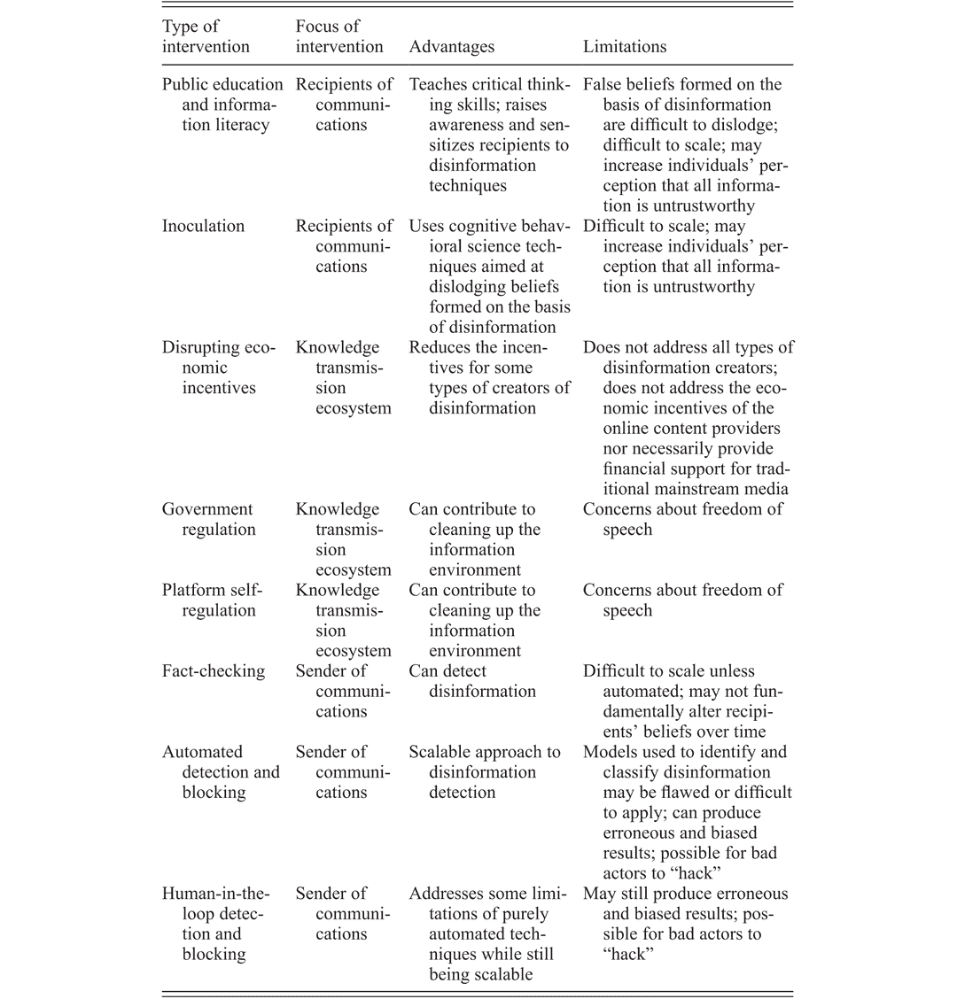

一些倡议针对传输信息的接收者，认为他们是社会虚假信息混乱的诱因，甚至是根源。这些由非营利组织和政府领导的倡议旨在提高新闻消费者的数字媒体素养。作为这一策略的例子，欧洲委员会虚假新闻和在线虚假信息高级小组的报告（`European Commission, 2018], p. 5`）建议将媒体和信息素养作为应对虚假信息的多维度策略中的多种方法之一。

此类倡议的基础是：新闻消费者的易感性导致了在线虚假信息和错误信息的问题，因此，虚假信息可以通过增加新闻消费者的能力来解决：

- 获取和识别告知决策和行为所需的信息；
- 评估各种形式和媒介呈现的作者、来源和信息的可靠性和信誉；
- 评估创建信息产品所使用的过程（例如，是否应用了严谨的新闻标准？是否采用了严谨的研究流程？）；
- 以及综合来自多个来源的信息。

（`[Huguet et al., 2021], p. 8`）

支持者认为，数字媒体素养倡议可以保护新闻消费者免受虚假信息的影响，帮助他们在对事实的分歧日益加大的背景下判断可以信任哪些来源；通过教育消费者对发布的内容更具反思性，减少虚假信息的传播；通过教育人们他们在生产信息产品时使用的严谨过程，恢复对传统新闻媒体或科学来源的尊重和权威性；通过教育人们信息的来源和传输，强调潜在的偏见来源；并揭穿一旦形成的错误信念（`[Huguet et al., 2021]`）。然而，`Huguetet` 等人（`2021`）指出数字媒体素养领域缺乏因果性和评估性的研究来孤立干预的效果。结果不不齐：有些研究表明，数字素养干预可能会增加个人对所有新闻（而非虚假新闻）的不信任，这引发了担忧，即关注批判性媒体素养的干预可能会产生损害可靠来源信任的愤世嫉（`[Lazer et al., 2018]; [Guess et al., 2020]`）。该研究也没有消除主流媒体中出现的虚假信息会被相信的可能性，这表明对来源信誉的感知可能在个人评估信息方面起着主导作用。即使在今天，正如 `Harsin (2018a)` 所观察到的，读者很难区分《洋葱》（`The Onion`）呈现的讽刺新闻和合法的新闻报道，因为《洋葱》具有官方外观的格式。从人类认知角度来看，这些倡议是否具有可扩展性也值得怀疑。如上所述，在面对海量异构信息时，人类认知日益依赖启发式法来提高信息处理速度。这不利于媒体素养支持者所要求的更具审慎性和批判性的认知（`[Kahneman, 2011]; [Huguet et al., 2021]`）。因此，政府和其他利益相关者正在探索识别和应对虚假信息传播的其他途径。

`[Lewandowsky and van der Linden (2021)]` 强调了旨在接种（或有时被称为“预防性防御”，`prebunking`）的倡议。研究表明，虚假信息只有在伴随事实的替代性因果解释，或者对信息的原始来源产生怀疑时，才能被纠正。因此，根据 `[Cook et al. (2017), p. 4)]`，针对虚假信息或误导信息的接种必须包括“(1)对即将到来的威胁的明确警告，以及(2)对预期论点的反驳，以揭示出[即将发生的谬误。”在该方法的一个示例中，研究人员创建了一个游戏，通过要求玩家在线使用情感化语言、极化、阴谋论推理、网络攻击、诋毁他人以及冒充专家来生成虚假新闻内容，让玩家接触典型的误导信息技术。`[Basol et al. (2020)]` 报告说，玩该游戏显著提高了玩家对虚假信息的抵抗力，并增强了他们识别信息的能力，从而对虚假信息和误导信息提供了有效的接种。

### 传播生态系统与经济激励

针对虚假信息接收者的倡议其作用有限。传播生态系统中的问题也会导致误导信息的产生；因此，还需要“修复损坏的温度计”或针对传播生态系统的方法。传播生态系统中的关键转变之一是驱动虚假信息产生的经济激励。破坏这些激励机制被认为是阻碍网络无序信息生产者的一种方法。

例如，`Facebook` 在 2018 年宣布，它正针对“通过伪装成合法新闻发布者来赚钱……发布虚假信息吸引人们访问其网站（这些网站通常全是广告）的垃圾邮件发送者”，其手段是“通过严格执行政策，让发布虚假新闻的人购买广告变得尽可能困难”来实现的（`[Mosseri, 2017]`）。同时，如上所述，`Facebook` 等在线平台削弱了传统新闻媒体的商业模式，削弱了传统媒体在维护其历史以来在核实新闻报道事实以及对新闻内容进行编辑监督方面所投入的能力。虽然在线平台和主流媒体似乎愿意阻止垃圾邮件者通过生成点击党内容获利，但两者似乎都不愿意或无法放弃自身这种利润丰厚的做法。

### 政府监管倡议

鉴于平台自我监管的困难，政府已开始干预以修复我们损坏的知识传播生态系统。2017 年，德国通过了《网络执行法》，该法于 2017 年 10 月 1 日生效，旨在打击社交网络中的仇恨言论和假新闻（`[德意志联邦共和国, 2017]`）。德国法律要求用户超过两百万的社交媒体公司必须在 24 小时内删除非法、种族主义或诽谤性的评论和帖子。对于未删除的内容——如纳粹符号、否认大屠杀或被归类为仇恨言论的语言——公司被处以高达 570 万美元的罚款（`[Tworek and Leerssen, 2019]`）。

其他政府采取了类似的行动：

- 2017 年，印度尼西亚建立了一个政府机构来“监控在线新闻”并“应对假新闻”（`[Straits Times, 2017]`，引自 `[West, 2017]`）；
- 2018 年，马来西亚政府颁布了反假新闻立法；
- 2019 年，菲律宾政府试图引入反假新闻立法，以“保护公众免受在线虚假和欺骗内容的有害影响”（`[Johnson, 2019]`）。

### 批评与公民自由

尽管这些政府监管倡议旨在解决假新闻和误导信息问题，但批评人士指出，由于可能限制言论自由，药可能比病更毒。法律法规中“社交媒体平台”、“假新闻”和“仇恨言论”等术语的定义通常非常广泛，涵盖了通常被认为是积极传播形式的内容——例如调查性新闻内容；相反，又窄到为需要监管的社交媒体平台留下了漏洞。

这些担忧促使联合国言论和表达自由特别报告员、欧洲安全合作组织（`OSCE`）、美洲国家组织和非洲人权权利委员会在 2017 年发表了一份声明，声明强调“传播信息和观点的人权不仅限于‘正确’的陈述，该权利也保护令人震惊、反感和不安的信息和观点”（`[OSCE, 2017]`）。许多人担心，针对误导信息和假新闻的法律可能会开启危险先例，为威权政权继续或扩大审查提供许可（`[West, 2017]`）。尽管如此，考虑到对误导信息的持续关注，一些人认为看到更多政府监管是“何时发生而非是否发生”（`[Rochefort, 2020]`）。

### 预防性自我监管

感觉到更多的政府监管可能到来，社交媒体平台已采取预防性措施进行自我监管，通过在隐私保护、言论自由和维护选举制度等民主机构等问题上提供“极简的公共治理”（`[Gorwa, 2019]; [Rochefort, 2020]`）。例如，`Nunziato (2020), p. 2)` 观察到：

```
Twitter 从一个不干预的“言论自由党的言论自由派分支”转变为设计并运营一项巨大的言论监管行动——其典型代表是近期删除并标记了总统唐纳德·特朗普（以及唐纳德·特朗普三 Jr.）的误导性推文。

Facebook 方面则从 2016 年选举期间臭名昭彰的假新闻避风港，转变为建立一个广泛的独立事实核查网络，以删除和标记其平台上的数百万帖子——包括删除了特朗普竞选账户的一条帖子，并在 2020 年 3 月和 4 月标记了 9000 万涉及疫情背景下虚假或误导性医疗信息的帖子。

Google 方面也放弃了对其搜索算法结果的不干预方法，承诺删除 2020 年选举背景下的虚假政治内容，并针对其平台上的 COVID-19 相关搜索提供来自权威卫生机构的重要信息。
```


### 平台自律与内容审核

平台自律通常表现为内容审核。根据 Riedl et al. (2021, p. 2) 的说法，这种审核可以分为“事前”或“事后（Klonick, 2017）”进行，后者可以通过审核团队浏览论坛来完成，也可以通过响应用户标记的内容来完成（Naab et al., 2018）。此外，计算手段进一步使审核成为可能，例如通过机器学习和过滤（Myers West, 2018）。正如政府对在线内容的监管一样，平台自律也引发了人们对抑制言论自由的担忧。例如，皮尤研究中心 2020 年的一份报告显示，约 70% 的美国人认为社交媒体平台审查了政治观点 (Vogels et al., 2020)。此外，阻止垃圾邮件发送者的努力经常导致记录人权侵犯行为的人也被封锁 (Deutch, 2020)。与此同时，平台往往被认为没有移除恐怖主义宣传、儿童色情或仇恨言论等内容 (Elghawaby, 2018)^17。其他人质疑，关于此类复杂公共政策问题的决策是否应该由私营部门平台处理 (Elghawaby, 2018)。

### 事实核查方法

事实核查是另一种旨在根除在线虚假信息传播的流行方法。事实核查最初是为传统的主流新闻开发的，该过程“旨在通过将从待核实的新闻内容（例如其主张或声明）中提取的知识与已知事实进行比较，来评估新闻的真实性” (Zhou and Zafarani, 2020)。它可以由专家或众包手动进行，也可以由在传统新闻媒体、在线平台和独立事实核查网站环境下运行的机器进行。著名的事实核查网站包括 `Classify.news`、`FactCheck.org`、`Factnata.com`、`Fiskkit`、`GossipCop`、`Hoaxy.iuni.iu.edu`、`Hoax-Slayer.com`、`PolitiFact.com`、`Snopes.com`、`TruthorFiction.com` 以及华盛顿邮报的 Fact Checker (Zhang and Ghorbani, 2020; Zhou and Zafarani, 2020)。事实核查网站可以分为：揭穿谎言和网络谣言的（例如 `Snopes.com`）；专注于验证政治和公共主张的（例如 `Politifact.com`）；以及专注于特定争议和话题的（例如 `Climate Feedback.org`）。这种实践还包括对传统新闻媒体的新报道进行评估，例如华盛顿邮报（美国）和 `JTBC`（韩国） (Lazer et al., 2018; Choi and Haigh, 2019)。

#### 专家核查 vs. 众包核查

专家事实核查由领域专家执行，准确性很高，但扩展性不佳 (Zhou and Zafarani, 2020)。众包是一种依赖大量人口（通常是在线用户）来验证真理的方法，可以帮助扩大事实核查过程的规模，但可能难以管理、准确性较低且容易受到偏差的影响 (Zhou and Zafarani, 2020)。这些困难通常要求众包事实核查经过专家的过滤和审查，从而削弱了解决方案的扩展性。尽管如此，主要的在线平台——`Google`、`Facebook` 和 `新微博` 都在尝试这种方法 (Gingras, 2016; Mosser, 2016; Xiao and Chen, 2020; Lyons, 2021)。

### 自动化挑战

虽然众包有助于解决如何扩大事实核查规模的问题，但仍然无法应对我们高度数字化生态系统中信息流的规模和速度。正如俗语所，“谎言传遍半个世界，真理还没有机会穿上鞋。”^(18](#book-part7.xhtml#FN-59) 因此，许多人呼吁自动化，以确保平台能够对虚假信息做出快速响应。Zhou and Zafarani, 2020 概述了多种不同的事实核查方法。这些解决方案都依赖于一个可以验证事实的可靠知识库；Zhou and Zafarani, 2020 例如，建议使用 `Open Web`；然而，考虑到来源的偏差，依赖 Web 可能会产生错误的结果 (Newman et al., 2018)。这种方法依赖于对内容“真实性”（定义为内容对事实的依赖程度 (and et al., 2018; Newman et al., 2018)）的推断。正如 Zhang and Ghor, 2020 在其在线新闻调查中指出的，在线通信是复杂的。

### 局限性与未来方向

事实真实性的推断受到文化、制度和政治偏差的影响，这就是为什么依赖知识库来提供真理可能是问题的。此外，此类方法倾向于将来源中提取的信息视为“原始事实”，Uscinski and Butler, 2013 认为事实无法脱离背景被理解。Uscinski and Butler, 2013^(19](#book-part7.xhtml#FN-60) 也认为，事实核查可能依赖于“朴素认识论”，无法处理各种断言的复杂性。某些事实核查网站的党派性以及即使是事实核查中固有的偏差也损害了事实核查作为反虚假信息策略的可信度（参见 Brandtzaeg and Følstad, 2017; Ceci and Williams, 2020）。缺乏透明度是另一个问题，促使 Brandtzaeg and Følstad, 2017 要求审核人员增加其检查事实过程的透明度，并跨党派界以网络化的方式协作，遵循 Hermida, 2013 的建议。内容真实性倡议（Content Authenticity Initiative）围绕内容归属和验证的标准制定是解决这一空白的近期尝试 (Rosenthol, 2020)。即使是标准化且更加透明，事实核查可能仍然无法防止个人对虚假信息的相信，因为个人和集体认知倾向使得错误信念一旦植根就很难根除 (Lazer et al., 2018; Lewandowsky, 2020)。正如 Walter et al. (2020, p. 367) 在他们对事实核查有效性的研究中发现的，“对信念的影响非常小，而且研究设计越接近现实世界中接触事实核查的情景，影响就越微小。”因此，尽管事实核查（无论是手动还是自动）可能有助于识别伪造新闻和虚假信息，但它像许多其他策略一样，是不完美的。尽管有这些担忧，在我们认识论面临挑战的时代，事实核查在打击虚假信息的努力中可能仍然重要。

除了事实核查之外，自动化技术也被用于尝试识别并剔除虚假信息的传播者。通常，这些技术使用数据挖掘、自然语言处理以及机器学习或深度学习来分析大规模通信数据集（例如社交媒体帖子），以寻找数据中的某些特征——例如发送者的身份或语法错误——这些特征可以被用来将其识别为某种形式虚假信息 (Zhang and Ghorbani, 2020; Zhou and Zafarani, 2020)。它们有时也可能使用基于图的网络分析，来揭示发送者与接收者之间的通信模式，这些模式预示着虚假信息（例如，Ferrara et al., 2016; Ma et al., 2016; Karataş and Şahin, 2017; Vosoughi et al., 2018）。

此类技术依赖于对通信发送者意图的推断 (Kapantai et al., 2020)，例如，基于对通信来源、通信传播模式或通信风格等特征的推断 (Zhou and Zafarani, 2020)。在虚假信息的背景下，这可能是一种徒劳无功。首先，在我们当前高度中介的信息格局中，要辨别特定信息传播者的意图是非常困难的；事实上，如果该传播者刻意隐藏其身份并旨在进行欺骗，这可能是不可能的。这一困境指向了许多虚假信息分类法以及相关“问题性”通信形式的内在缺陷：一旦我们确定了通信创者的身份和意图，这些分类方法对于标记这些不同形式的通信可能是令人满意的；但如果我们希望用它们来识别或预测特定通信的发送者是否心怀不轨，它们就存在无法弥补的缺陷。

此外，此类技术通常依赖于映射一组与信息发送者意图相关的特征（潜在[派生的]或非潜在的；参见例如，Pérez-Rosas et al., 2018; Zhou et al., 2019），例如映射与欺骗性通信发送者相关的特征。我们可以通过对虚假信息传播者的通信模式进行详细的定性研究，或者通过从大规模不良通信语料推断特征的无监督机器学习或深度学习来了解这些特征 (LeCun et al., 2015; Ma et al., 2016; Ruchansky et al., 2017; Zhang and Ghorbani, 2020)。Zhang and Ghorbani (2020) 在对虚假新闻检测方法的调查中建议了四种主要策略：用户画像分析、时间和发布行为分析、信誉相关分析以及基于情感的分析。每种映射可能依赖于对虚假信息的不同底层概念化和其因果理论；例如，高频率的回复和提及行为可能表明某个社交账户具有高度嫌疑 (Zhang and Ghorbani, 2020, p. 3)。用户画像可能针对源自特定地理位置的通信，假设这些地点更容易与虚假新闻有关。情感分析的使用依赖于一种假设，即虚假新闻的传播者使用极化的语言，且极化语言与极化情感相关。Zhang and Ghorbani (2020) 的分析（例如）产生了一个包含三类特征的虚假新闻模型——基于用户的特征、基于内容的特征和基于社会背景的特征。除了某些底层假设可能是错误的之外，问题在于，一旦传播者意识到某个特定特征正被用于检测，这些解决方案就可以被他们逆向破解。

为了解决这些缺点，Zhang and Ghorbani (2020), p. 1) 呼吁人类与技术之间的协作，有时被称为“人类回路”或“混合动力”方法，这指的是依赖于人类（用户或专家）的参与来支持人工智能（AI）算法工作的策略，例如通过创建训练数据或手动验证所做出的决策。即使是自动化的努力也需要进一步开发。

## 4.6 寻找虚假信息的根源

Zhou and Zafarani (2020), 109, p. 7) 识别了虚假新闻周期的三个阶段：虚假新闻的创建、虚假新闻在线发布以及通过社交媒体传播。他们在对事实核查过程的描述中，进一步阐述了围绕虚假新闻生产的复杂信息生态系统。Zhou 和 Zafarani 的模型很好地捕捉了这样观点：我们依赖的大部分信息（无论这些信息是否可靠）都是通过一条长而衰减的知识形成链传递给我们的。然而，他们的模型捕捉得较少的是“原始来源作为证据基础”这一观点。

详细来说，在大型、复杂的社会中，由于对人们和事件的直接认知是不可能的，我们必须主要依赖来自间接——或次级——知识来源的信息，形式为他人提供的新闻报告和分析。间接来源包含了对事件和行为真实性主张的证词（或至少是证明），而其作者并不对这些具有直接知识。然而，在这个长长的知识生产链的开头，我们理想上应该找到一个对事件和行为具有直接知识并能证明其主张真实性的原始来源（例如，目击者），或者一个记录，正如第 3 章所讨论的那样，作为关于事件和行为事实的社会制度化参与者和见证者。

记录作为主要的证据文献来源，频繁支撑着脆弱的知识形成链，直到最近在关于虚假信息的论述中，它们受到的关注相对较少（例如参见 Deutch, 2020）——尽管这一领域一直由新闻学、媒体研究、计算机科学和工程学主导。记录的世界、即档案文件以及记录工作，并不是这些领域的个人通常会考虑的内容。然而，这正是档案学家所思考的世界。

最近的一个例子是档案学者劳拉·米拉尔（Laura Millar）的工作。在她 2019 年的新书《事实的问题：信息时代的证据价值》（*A Matter of Facts: The Value of Evidence in an Information Age*）中，为了吸引档案学家和档案学者以外的读者，Millar (2019), p. xix) 认为，避免堕入“后真理、后事实世界的毒性”的唯一补救措施，是通过保护和尊重记录的证据来为真理而战并打击谎言。与 Yeo (2013) 对“网络空间”时代记录信任的讨论中的某些主题相似，Millar (2019) 讨论了数字信息的本质，并描述了我们轻易产生大量信息的能力，结合我们无法对其进行妥善认证的，如何损害了我们区分真假的能力。她还将“后真理”时代归因于后现代主义思想，她认为，这些思想导致了一个包括客观真理的存在性在内的一切事物都可以被质疑的世界（Millar, 2019, p. 4）。

档案理论家卢西亚娜·杜兰蒂（Luciana Duranti）（2018) 在一个主要面向档案领域读者的章节中，也指出了后真理毒性与记录创建、管理和保存过程之间的联系，这些过程已被政治经济利益和复杂的技术基础设施所复杂化。我们必须问问，Duranti (2018), p. 24)，当记录和决策行动没有被生成时，我们对知识形成过程还能投入多少信任；如果创建的记录在进入此类系统之前就作为临时记录被迅速销毁，以规避信息自由；如果制作或接收并妥善维护的记录内容被选择性地脱离背景提取并使用；如果主张、新闻和收集的剪辑既无法追溯也无法追踪到权威文献来源；以及如果广播和社交媒体传播的数据和信息用户不知道如何验证其来源，从而失去了对这方面的兴趣？

通常只有当对立的认识论观点之间存在深度分歧时，我们才会寻求验证记录的可信度。档案学家传统上通过记录记录创建和保存的背景来支持这一点，以提供与记录所涉及的事实建立记录可靠性相关的信息，并保护记录的真实性。

除了米拉尔和杜兰蒂的工作（这些工作直接联系到记录信任度所受的威胁）之外，还有数十位档案学者几十年来一直在编写这些问题，大多数从技术变化以及文化和政治变化的视角进行探索。在很大程度上，解决记录信任度的不确定性问题，是早期区块链 2.0 支持者试图做的，也是许多——如我们下一章中将讨论的——区块链项目持续的：一种在虚假信息时代创建并保持可信赖证据的方法。

## 4.7 结语

信任——复杂社会依赖信任来实现能够产生经济和社会价值的各种集体和协调活动——这反过来又依赖于对被信赖的人或事物的可能可信度的认知。因此，与我们对其他参与者的信任度进行评估的基础——这些信息的可信度相关的问题（即与虚假信息时代相关的各种信息混乱），可能会对社会信任产生深远的负面影响。我们在过去几年里一次又一次地看到了这一点，无论这些后果是与争议性的选举结果有关并煽动社会动荡；是对社会抗议的压制或剥夺合法性的努力；煽动公众情绪反对公共卫生措施；还是否认与气候变化相关的科学事实。所有这些对人类都具有危险的后果。因此，寻找虚假新闻和其他形式的虚假信息的解决方案引起极大关注并不奇怪。然而，对解决方案的寻找往往止步于没有到达认识论根源；即承认这种必要性。在下一章中，我将仔细研究这些原始来源，因为除非它们是可靠的，否则它们无法提供可靠的认识论基础。

¹ 该视频已从 YouTube 上删除。

² Google Trends (`www.google.com/trends`) 是一种搜索趋势功能，它使用 Google 数据的归一化样本，提供关于给定术语在给定时间内相对于该网站总搜索量的输入频率的见解（更多信息请参见 `https://support.google.com/trends`）。

³ 我将 `testimony`（证词）定义为“支持事实或陈述的个人或文献证明”（`Oxford University Press, 2021`）。

⁴ “Gettier 问题”标签源于美国哲学家埃德蒙·盖蒂尔（Edmund Gettier）的作品，他挑战了长期存在的证真信念（JTB）模型。JTB 模型认为知识等同于证真信念；如果一个主张满足了这三个条件（辩护、真实和信念），那么我们就拥有该主张的知识。盖蒂尔通过反例说明了个人如何对某个主张拥有证真信念，但仍然不知道它，因为信念的原因虽然经过辩护，但证明是错误的（参见 `Gettier, 1963; Hazlett, 2015`）。

⁵ 我说当前的虚假信息时代，因为这不是人类经历的第一个虚假信息时代（参见第 7 章），而且可能不是最后一个。

⁶ 遗憾的是，正如 Lazer 等人 (2018), p. 1095 所言，“机器人检测将始终是一场猫鼠游戏，其中大量未知的类人机器人可能不会被检测到。反之，检测的成功将激励机器人生产者采取反制措施。因此，识别机器人将是一项主要的长期研究挑战。”

Dretske (1982) 给出的用于说明这一观点的例子：饮酒者艾莉（Alice），她知道梅多（Medocs）是波尔多红的一种，但错误地认为基安蒂（Chiantis）也来自波尔多地区。在参加完一个晚会并喝了梅多后，她告诉朋友鲍勃（Bob）她喝了波尔多红。艾莉的证词是真的，但她同样可能意味着她喝的是基安蒂（这使得她的陈述为假），这就是为什么有些人认为（例如，Dretske, 1982），无法从艾莉的证词中获得知识。在这一主题的另一个变体——“几乎是谎言者”变体(Lackey, 2006, 2008) 中，艾莉会做出真实的陈述（例如，外面在下雨），但如果符合她的利益，她也很容易做出虚假的陈述（例如，外面阳光晴朗），或者她可能会告诉鲍勃正在下雨（一个真实的陈述），即使她缺乏直接知识（例如，通过向窗外看），而仅仅依靠《农民农历》或其他人的证词，而这些人可能仅仅因为知道那是艾莉想听的话就告诉她外面是晴的。在所有这些情况下，艾莉的证词都是不可靠的，使得人们无法从她那里学习，因此知识无法传递。

许多研究人员探索了虚假信息如何引发强烈的情绪，误导人们相信虚假信息 (Rosling, 2018; Ghanem et al., 2020; Kapantai et al., 2020)。正如 Wardle (2019) 第 88 页所写：“在历史最糟糕时刻的背景下进行技术测试，可能揭示了社会科学家和宣传者长期以来知道的：人类天生就会对情绪触发做出反应，并且如果虚假信息能强化现有的信念和偏见，他们就会分享它。”

其中最主要的代表是美国美国总统唐纳德·特朗普，他在 2016 年选举后频繁地使用“虚假新闻”一词 (Derakhshan and Wardle, 2017)。

此外，这些平台还在资助新闻学院和项目，进一步扩大了它们对新闻媒体格局的影响（参见 Rashidian, 2020）。

Koenig and McMyler (2019) 第 104 页写道：“心理学和哲学领域的许多人将证词视为证据的一种类型，将证词的接受和拒绝视为基于证据的决策，并将提供证词的说话者仅仅视为传输的工具……虽然我们不否认确实可以对听过的话采取证据立场，对信息源采取工具立场，但我们认为，证据观点未能捕捉到事实：当说话者向他人提供证词并隐含地承诺或担保它时，他们为学习者提供了一种独特的理由，某种不再仅仅是归纳证据的东西。”这种理由，可以认为，是基于信任的。

另见 Leibenstein (1950) 中讨论的从众效应、Deutsch and Gerard (1955) 讨论的规范影响理论、社会认同理论（Ashforth and Mael, 1989](ref-list.xhtml#REFe-r-352) 讨论的可用性级联。

这句名言归于约瑟夫·戈培尔斯（Joseph Goebbels）。

我的主张基于两个互补的本体论理论——班格关于具有内在属性的实质性“事物”的本体论，以及希尔关于具有社会构建属性的主观实体的社会本体论——即与社会机构（作为主观实体）相关的陈述之真性将反映社会现实。关于这些观点的更详细讨论，请参见 Lemieux and Limonad (2011)。

Skarpelis (2019) 第 1 页也观察到，“两种视角与档案的人类学和后殖民参与相交叉，这些参与要求我们将国家行为者视为事实生产的文化代理，并提醒学者以民族志而非榨取的方式与档案互动（关于这一点，请参见 Stoler, 2002, 2010)。”

你可以亲自在 `www.getbadnews.com/` 上玩这个游戏。

Elghaby (2018) 指出：“一个名为 onlinecensorship.org 的网站——由电子前线基金会视觉影响组织运营——记录了这些例子。该网站邀请用户报告其内容被下架的情况，以‘揭示’社交媒体公司的决策及其对言论自由的影响。例如，它强调了 2017 年 77 个社会和种族公正组织致信 Facebook，关于其对用户的审查以及对讨论种族主义图片的下架。”

这段话被归于多个著名的名人，从乔纳森·斯威特到马克·吐温再到温斯顿·丘尔。关于这一点，参见 `quoteinvestigator.com/2014/07/13/truth`。

参见 Amazeen (2015) 对 Uscinski and Butler (2013) 论点的批判，并另见 Uscinski' (2015) 的反驳。

常用的机器学习算法包括 `Decision Tree`、`Random Forest`、`Support Vector Machine`、`Logistic Regression` 和 `K-nearest Neighbour`，而常用的深度学习算法包括 `CNN`、`LTSM`、`bi-directional LTSM`、`Gated Recurrent Unit` 和 `Recurrent Neural Network` (Zhang and Ghorbani, 2020)。

这种规范的例外可能是公民记者产生的素材，但即使在这种情况下，内容的归属也不容易 (Rosenthol, 2020)。

在本章中，我们将转向一个话题，正如前章所讨论的，该话题在关于虚假信息成因的论述中受关注相对较少，但日益引起关注——即对社会知识形成证据基础的伪造或操纵。这个问题远不止于关于在判定真理时应依赖哪些“事实”或关于如何界定既定事实的争论。相反，它涉及到我倾向于称之为“证据性”（evidentials）的侵蚀，即命题的证据基础——这是我们赖以锚定自身信念的核心依据。

在日常生活中，我们倾向于不加批判地将证据性视为原子化的、自然发生的现象。正如我们消费的新闻生产一样，真理主张的证据基础是如何创建和保存的很大程度上是被掩盖的，我们除了有时利用证据来支持命题中的主张外，很少对这一过程给予关注。然而，证据性与新闻一样，是社会技术的共同产物。我们对形成信念的证据基础之生产的日常“技艺”（techne）视而不见，导致在虚假信息时代，我们的“事实基础设施”——包括支持社会公认的真理主张证据来源的生产、固定以及在时空上保持持久的手段——可以被大规模地操纵，这对于社会信任的正常运作所需的认识论基础产生了严重的后果。

## 5.1 眼见为实（已不再如此）

虚假信息时代的标志是伪造或操纵内容的增加，而没有比“深度伪造”（deepfakes）更能说明问题的例子了。这个词源于“深度学习”（deep learning——用于创建深度伪造视频的计算技术）和“伪造”（fakes——这种技术的结果）的结合。准确地说，深度伪造涉及利用深度学习人工智能（AI）过程来训练视觉操纵算法（Kietzmann et al., 2020）。深度伪造经常将视频中真人的脸替换为另一个人的脸，创建出看似真实实则虚假的欺骗性视频内容。2017 年，当 AI 操纵的色情视频被上传到讨论网站 Reddit 时，该词风靡全球（Maddocks, 2020）。尽管生成此类虚假视频的能力在娱乐行业已存在一段时间，但 2017 年标志着这种先进技术能力进入了大众视野。在该条 Reddit 帖子发布一个月内，有成千上万的人分享他们的在线“深度伪造”色情视频（Maddocks, 2020; Mirsky and Lee, 2021）。

深度伪造色情与虚假信息之间的纠葛通过调查记者 Rana Ayyub 的案例得到了很好的说明。当她反对那些被指控在印度卡图图阿（Kathua）强奸一名八岁女孩的凶犯的支持者后，她成了这种伪造证据的受害者（Ayyub, 2018）。Ayyub 回忆道，她正坐在咖啡馆里，收到一条消息，告诉她一段她的色情视频正在 WhatsApp 上流传，并最终传遍了印度（Ayyub, 2018）。这段视频对 Ayyub 的影响是毁灭性的。用她的话说：


从视频发布的那天起，我就不再是原来的那个人了。我以前很有主见，现在对在网上发布的内容谨慎得多。出于需要，我进行了大量的自我审查。

现在我不在 Facebook 上发布任何东西。我不断在想，万一有人再次对我做什么怎么办。我是一个非常直率的人，从那种状态变成现在这样是一个巨大的变化。

…… [深度伪造]是一个非常、非常危险的工具，我不知道它带我们走向何方。

```
(Ayyub, 2018)
```

图像——特别是尤其是视频图像——为信念的形成提供了有力的证据。“我亲眼所见”是那些主张某事具有不可反驳真理的人经常引用的表达。当我们观看某事发生的视频时，仿佛我们直接身临现场（Witten and Knudsen, 2005; Sundar, 2008; Frend et al., 2013; Greenbaum, 2020）。我们忘记了视频只是一种证言（Nguyen, in press）。即使我们可能倾向于质疑图像，但由于大多数此类证据形成的方式都被笼罩在一层隐形面纱，意味着在虚假信息时代，我们需要审慎思考。

## 5.2 证据性的隐形性

我们大多数人倾向于假设命题的可靠性和真实性，而不是仔细检查其特征；换句话说，我们是从信任的角度出发的（Hinchman, 2005; Nguyen, in press）。¹ 我们对证据性的语言处理揭示了这一点，因为（Mead, 1934; Dasgupta, 2014; van Elswyk, 2019），136）。任何我们在我们语言中没有词汇或语法来表达的内容，通常不会形成认知现实的一部分，因为我们无法就此类概念进行相互交流。因此，世界上只有 25% 的语言具有强制性的语言证据性，即一种将“证据性”作为一个类别的特殊语法（van Elswyk, 2019）。

证据性通常通过动词变位表示，指示命题是否存在争议、来源的证据强度、证言者是基于直接知识还是间接获得的知识（例如道听，或从他人获取的知识），以及证言者认为证据有多可信。例如，在切罗基语中，`É-némene-sėtse Sandy` 意思是“Sandy 在唱歌，我听说的”，其中动词形式 `sėtse`——语法证据性——指示说话者仅对 Sandy 唱歌这一命题拥有道证据（van Elswyk, 2019,136）。

通常，证据性是在后台运行的；也就是说，我们可能会对“是 Sandy 在唱歌”这一命题提出异议，但不会对“说话者间接听到这一消息”这一命题提出异议（van Elswyk, 2019,136）。因此，正如 Korotkova (2016) 所发现的，在语言形态学中，证据性的贡献通常是一个不可质疑的命题。例如，在英语中，“在下雨，但我并不相信它在下雨”这句话被认为是悖论的。²

在某些语言中，存在通过语言手段来表达对某一命题支持程度强弱的方法；也就是说，说话者可能会使用某种语法形式，表示有关该命题的证据是间接而非直接获取的，而直接证据是更可靠的来源。其他语言则允许基于间接证据对某一命题表示怀疑，例如库斯科克丘亚语（参见 van Elswyk, 2019, p. 138，引用 Faller, 2002, p. 192)），短语“Para sha ni si, ichaqua manic rei-ni-chu”的意思是“下雨了（我听说的），但我不相信。”在这些证据作为语言结构特征的文化之外，当命题的证据可能存在争议时，必须对说话者的证词进行询问，以获取与命题相关的证据（例如是直接还是间接\[传言\]）以及关于其证据权重的信息，正如我们在法律案件中看到的那样。³

在西方文化中，除了物理证据或口头证词外，我们高度依赖文献证据。与处理口头证词一样，作为证据的文件通常不会产生争议，无论是在法律案件还是其他语境下。通常情况下，我们认为这些来源是“既定的”。例如，在西方普通法体系中，一种被称为“传言规则的商业记录例外”的法律原则规定，商业记录可以免于以下规则的限制：即并非由被传唤的证人（即可以接受交叉质询的人）提交的口头或书面证言不能被用于确定某件事的真实性（The Law Dictionary, n.d）。商业记录之所以之所以被区别对待，是因为它们通常是在履行常规业务职责的过程中创建的，因此被认为是可靠且真实的（Force, 2010; Baycara, 2014）。⁴ 这种假设基于某些文件创建时的周围情况，如果这些情况符合特定标准，则允许商业记录作为其所证明事实的初步证据（prima facie）。可采商业记录最显著的特征是它们源于一项原始行动——一项业务活动或过程——它们既是该过程的副产品，也是为了代表该过程而创建的。这就是为什么 Thomassen (2015), p. 84) 将记录的研究称为对“过程限制信息”的研究。记录创建的本质上使其成为事件和行动的直接参与者和证人，尽管无法像对人类证人那样对其进行交叉质询。记录提供了通往过去的窗口，通过这个窗口，我们可以比任何其他可用手段都更近地接触它们所证明的历史时刻；尽管如此，我们始终需要记住通过窗户凝视过去并不等同于经历“其实真实发生过的历史”（wie es eigentlich gewesen）（von Ranke, 1824, pp. 13–14）。

立法通常用于确认：在业务的通常和日常过程中产生的、且通常被信赖其准确性的记录应当被接纳，而无需要求文件的作者或创建者出庭作证其可靠性或对其进行认证；判例法进一步支持并阐述了这一原则。事实上，随着区块链和分布式账本技术现在被用于越来越多的业务交易，某些管辖区已试图将使用这些技术生成的智能合同视为初步证据，使其与传言规则商业记录例外原则下涵盖的其他类型文件具有同等。⁵ 这些法律制度化了规范和标准，我们通过这些标准判断此类记录是否为形成合理的真理信念提供了关于命题的可靠证据来源。

Baycara (2014) 注意到，商业记录要不可质疑必须满足的特定标准（即符合传言规则的商业记录例外条件）通常包括记录必须：

- 是定期、常规且系统地制作的
- 涉及某项行为、交易、发生情况或事件
- 在行为、交易、发生情况或事件发生时，或在之后的合理时间内制作
- 不表达意见、诊断、印象、历史、总结或建议
- 是在业务的通常和日常过程中制作的
- 是在制作此类记录属于该业务的通常和日常过程中创建的
- 是根据业务职责制作的
- 在记录创建者和信息提供者均按照业务的通常和日常过程的情况下的情况下（在记录包含传言（间接证言）的情况下）。

在普通法法律体系中，由对立方提出动议质疑作为证据引入的记录的准确性、可靠性或真实性，并提供证明这些记录不符合标准（即：它们不是在业务的通常和日常过程中制作的，不是由声称创建它们的人创建的，或者在创建后被更改了）。与处理口头证据的方式类似，当某个特定记录存在某些需要解决的问题（例如其创建周围的情况）时，影响的是该记录作为证据的权重，而非其可采性（Baycara, 2014）。

## 5.3 审查证据

尽管我们通常假设支持真理主张的提供的证据是值得信赖的，但当信任方将其信念建立在错误的证据上时，可能会许多后果，其中一些是极度负面的。正如我们在第 3 章中讨论过的，记录和其他证据锚定了我们对支撑复杂人类经济和社会关系的信任基础的评估。这些记录和其他证据通常是我们判断一个应当被信赖的方是否（不）值得信赖依据。当用于形成此类评估的证据是不可信的时，信任方可能会对对方的可信度产生错误或缺陷的信念，导致“错位的信任”（即：在不值得信任时给予了信任，或者在值得信任时没有给予，如 Ayyub 深度伪造案所示）。为了避免此类负面后果，我们比习惯性做法更严密、更具批判性地审查证据似乎是明智的。事实上，Origgi 建议：

> 一个数字时代的成熟公民应该具备的能力不是识别和确认新闻的真实性。相反，她应该擅长重建相关信息的声誉路径，评估传播它的人的意图，并弄清赋予其信誉的权威的议程。
>
> (Warburton, 2018)

例如，历史学家已经开发出精细入微的技术——历史方法——用于对历史证据进行批判性审查。尽管关于历史方法的各种观点以及随时间演变的实践变化存在许多争论——这在任何活跃的学术领域都是预料之中的——但总来说，专业历史学家通过对历史来源的阅读和解读（即批判）来获取关于过去的知识。这是更广泛的历史方法的一部分，涉及相关来源的定位、对来源的时空起源（又称出处）及其真实性进行批判，并结合历史问题进行解读（Lorenz, 2001; MacNeil, 2013）。

在论述定性社会学中档案文献的使用时，Skarpelis (2020) 认为，这种做法往往依赖于对文献证据的非批判性阅读，或者“从遗迹中进行推断”（Goldthorpe, 1991, p. 213，引自 Skarpelis, 2020, p. 388），这促使她对她所谓的“档案中的生活”（life on file）进行深入审问，并提供了一种实现此的方法论。Skarpelis (2020, p. 388) 例如，建议定性社会学家追求一种档案的现象学⁶，这包括：

1. 从文件中恢复生活——无论是人物、过程还是事件——在文件中，生活从纸张中脱离，人物和过程被复活……；
2. 从社会生活中创造文献证据，即将生活转化为记录；
3. 对这些文献证据进行档案化，这遵循了文件在机构、物理和智力空间中移动的生命周期。

Skarpelis 所描述的是档案工作者理解的“档案方法”。与历史方法一样，档案方法涉及文本批判以及历史甚至法证研究，但它并不是一种针对特定历史问题或真理主张来审查证据的方法。相反，该方法寻求理解 Skarpelis 所描述的“档案中的生活”，目的是理解记录与其它们被创建以实现和纪念的过去行动之间的关系（Duranti and Michetti, 2016; MacNeil, 2016; Lustig, 2020）。因此，档案方法使用一种特殊形式的批判，旨在“重构……记录内部和外部元素之间的关系、其结构及其背景”，并利用源自语言学学科的工具，如文献语言学、古文字学、年代学、古印章学、纹章学、法典学、地名学、铭文学、文本批判以及外交文献书学（Duranti and Michetti, 2016, p. 90）。与 Skarpelis 提出的方法类似，档案方法的目标是更好地理解记录创建的背景以及随后的保存，这些都与记录的目的、影响以及作为对其所证明的行动之可信赖依据的性质联系起来。

虽然这些方法实现了批判性地审查证据的可信度的目标，但对“档案中的生活”进行详细分析是否适合普通人的日常实践呢？虽然我们应该对作为我们信念基础的证据依据采取更具批判性的态度，但在日常活动中质疑每条记录并严密检查“档案中的生活”，在认知和社会层面上都是极其费能的。在认知上，考虑到通信和交易处理的速度，我们的“带宽”是有限的（Simon, 2013）。如果我们停停下来检查每条记录的可信度，即使我们拥有这样做的知识和技能，交易的成本也会飙升，交易处理的速度也会变慢并可能陷入停滞。我们依赖于每天都能对记录的证据性质置予信赖，以便在合理的时间和合理的精力内完成各种交易。

此外，即使我们可以检查每一个证据来源以确定其作为支持声称传达某事真理的命题的信誉度，我们是否能够准确判断自己是否可以信赖这些来源呢？依靠个人进行某种形式的文本批判作为防止钓鱼攻击的手段，其有效性表明答案是否定的。钓鱼是一种社会工程技术，攻击者伪装成受害者可能开展业务的合法实体，以诱受受害者暴露某些机信息——通常是身份验证凭据——攻击者随后可以使用这些信息获取未经授权的机密（Mitre Corporation, 2020）。⁷。从字面上说，攻击者是在钓取信息。为了发起这类攻击，会制作电子邮件、即时消息或短信伪装成真实的身份，以欺骗受害者采取某些泄露所需机密的行动。通常受害者会被诱导点击链接，将他们重定向到一个虚假但真实的网站（冒充金融机构或商业服务提供者的网站），他们在那里会被提供登录信息。如果受害者被骗并输入了信息，攻击者就成功获得了访问权限，此时可能会造成进一步的损害。根据美国联邦调查局（FBI）犯罪投诉中心的数据，2019 年美国个人在钓鱼攻击中损失了 5700 万美元（FBI, 2019）。

对抗钓鱼攻击的预防策略通常要求个人进行某种形式的文本批判，类似于检查“档案中的生活”——对钓鱼邮件的文本变体进行详细分析，并对其语言和特殊符号及其来源进行批判性评估——以防止攻击者欺骗接收者并获取机密的授权访问权限（见图 5.1](#book-part8.xhtml#FIGm-fig-9)）。钓鱼攻击持续如此成功的事实表明了这种策略的局限性。大多数人并不擅长评估收到的数字记录的可信度所需的文本批判。要确定数字记录的可靠性和真实性，人们需要理解创建和传输这些记录的复杂过程；他们可能缺乏所需的知识和技能。同样，他们可能没有足够的时间和精力来有效这样做，或者由于某种倾向，对电子邮件、短信等采取了不质疑的态度。

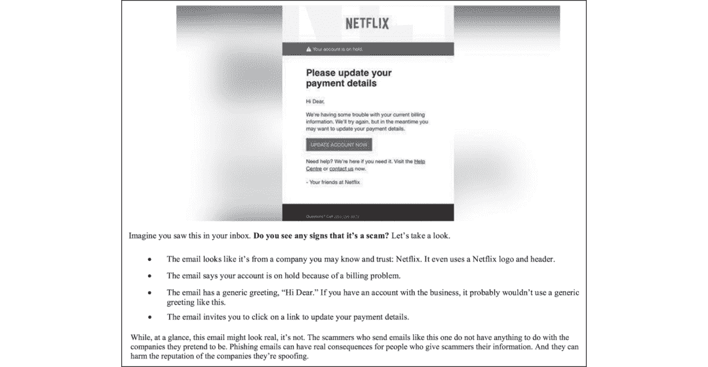

仿佛网络钓鱼邮件还不够糟糕似的，越来越多的图像和视频正被刻意伪造或篡改。伪造或操纵策略可能针对视频的任何组件或不同组件的组合。对视觉图像以确定其可靠性和真实性对我们来说更具挑战性，因为视觉图像直接传输到我们的视觉皮层，触发“快思考”，并绕过大脑中可能进行更有批判性评估的区域（Treisman, 1985; Witten and Knudsen, 2005; Stenberg, 2006)）。换句话说，人类“天生”就会相信图像。

在虚假信息时代常见的视觉伪造和操纵可以分为大类：`shallowfakes`（浅伪造）和 `deepfakes`（深度伪造，前文讨论过）。表 5.1 根据其生成方式概述了每类的不同“类型”，并配以真实世界的示例进行说明。

#### 表 5.1 视频伪造和操纵的类型与示例

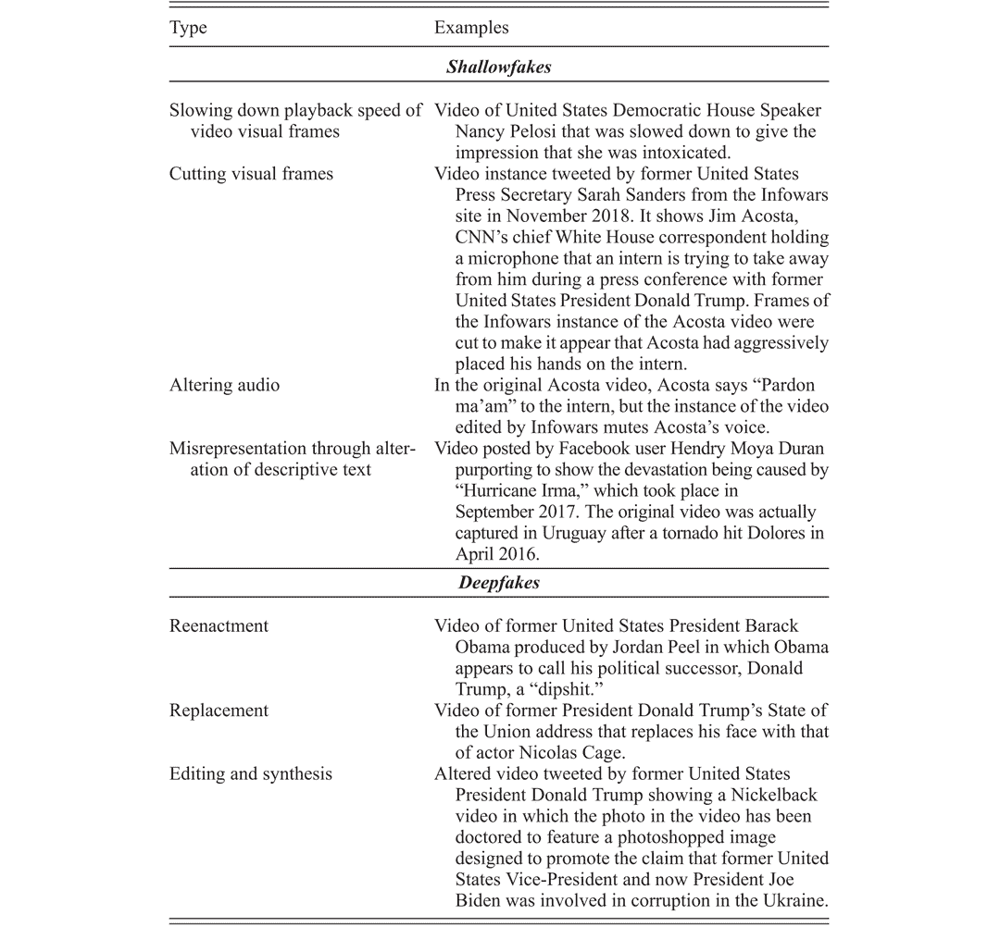

**注：** 读者可以在此处播放原始和被操纵的示例视频：[`youtu.be/3u3SDzi8rFA`](https://youtu.be/3u3SDzi8rFA)。这组操纵视频样本集由 Hoda Hamouda 准备，她在写作期间是我的博士生之一，用于 Hamouda et al. (2019) 中描述的工作。看看你是否能分辨真伪。《华盛顿邮报》还制作了一份关于操纵视频的指南（Ajaka et al., 2019）。

### 浅伪造 (Shallowfakes)

`shallowfakes`（Schick, 2020）的生成可能涉及一系列技术来操纵视频的视觉、音频或文本组件，如表 5.1 所示。这些包括通过将一个视频的短剪辑连接到不相关的第二个视频中来更改视频的视觉帧、从视频中删除短片段，或者减慢或加速视觉帧的播放速度。视频的音频可以通过从一个视频中剪取声音片段并重新附加到另一个视频、静音部分音频，或减慢或加速音频播放来操纵。用于描述视频的数据（元数据）——如视频的标题（或字幕）、其位置或日期，或主播的介绍——可以被伪造或更改，从而误导对视频视觉或音频组件的判断。

### 深度伪造 (Deepfakes)

如前所述，`Deepfakes` 作为视觉伪造或操纵的第二个大类，正变得日益严重。Mirsky and Lee (2021) 识别了深度伪造的四个主要类别：重演、替换、编辑和合成（见表 5.1).涉及重演的虚假信息产生于恶意攻击者控制视频中另一个人的表情、口型、眼神、姿势或身体。面部重演侧重于改变面部动作的特征，而不是源的身份（Nirkin et al., 2019）。正如 Mirsky and Lee (2021), p. 4) 所解释的：

```
重演深度伪造赋予了攻击者冒充身份的能力，控制其说什么或做什么。这使得攻击者能够实施诽谤、导致信誉受损、传播虚假信息并篡改证据。
```


替换发生在使用新内容替换原视频中的内容时，且这种方式保留了替换视频中可识别个体的身份。这可以通过迁移（如面部迁移）或交换（例如常用于生成迷因或讽刺内容的换脸交换）来实现（Mirsky and Lee, 2021）。当被恶意使用时，其目的是让目标看起来像是在做他们并没有做过的事，例如在 Ayyub 深度伪造色情视频中（Dale et al., 2011）。编辑和合成涉及向修改过的视频添加属性，例如改变人的衣服、胡须、年龄、体重、种族、语调等（例如，Zhou et al., 2019）。正如 Mirsky and Lee (2021) 所解释的，使用这种深度伪造可以让病态领看起来健康，或者创建虚假的在线人格。

早期的假视频，即在 2017 年和 2018 年左右产生的视频，几乎没有表现出非真实的“破绽”——例如，故障、闪烁、糟糕的图像融合、不真实的眼睛和嘴部动作、糟糕的口型同步、缺乏眨眼和卡顿——这些特征让人类有可能检测出它们是假的。随着深度伪造技术通过新技术的——例如使用生成对抗网络 `GANs`⁸ (Mirsky and Lee, 2021)——以及更专业的制作（例如通过情报机构、国家甚至恐怖组织），它们变得越来越难以察觉。

## 存储记录的操纵 (Manipulation of Stored Records)

虽然与深度伪造相关的风险在当前环境下引起了大量关注，但其他不那么明显但同样有害的存储记录的操纵形式也存在，并与传播虚假信息的其他形式密切相连。这绝不是新现象（我们将在下一章节中讨论），但在我们的许多信息都存储在集中式服务器或云端的时代，我们对它变得非常脆弱（例如，Kandukuri et al., 2009; Singh and Chatterjee, 2017）。这些复杂记录存储设施的漏洞为非法访问大量敏感和机密信息提供了机会。虽然还没有关于此类攻击的详细系统研究，但来自各种来源的轶事证据表明，存储证据的伪造和操纵可能正在增加。当用于分析的基础数据被伪造或损坏时会发生什么？

鉴于专门为大规模操纵数据设计的工具和技术的兴起，可靠的记录已无法保证。作为此类“内容欺骗”的示例（Mitre Corporation, 2020），⁹），2020 年 12 月，欧洲药品管理局（EMA）遭受了新冠-19 疫苗数据的泄露，这些数据涉及从 Moderna、辉瑞和其他第三方获取的记录（EMA, 2021）。受影响的记录包括与新冠-19 疫苗评估过程相关的机内部电子邮件通信。虽然非法访问这些数据已经足够严重，但这并不是执行攻击的黑客的最终目标。相反，他们的目标是发布记录的操纵版本，以引发公众对公司疫苗临床试验结果的不信任（EMA, 2021）。最终，在不确定的氛围下，攻击者的目标是煽动对证据的不信任——这种不信任可能导致社会不满并付出政治代价，但也可能造成生命代价。

另一个类似的受关注的案例涉及 2016 年对世界反兴奋剂机构（WADA）治疗用途豁免（TUE）流程记录的入侵和操纵（WADA, 2016）。操纵的目的是破坏 TUE 流程，以便在 2016 年奥运会之前对 WADA 产生怀疑，当时被发现违药的俄罗斯运动员已被排除在境外。意不意外的是，这次攻击最终归因于俄罗斯黑客组织“Fancy Bear”（Carmen, 2016; Thielman, 2016）。该小组还与 2016 年美国总统竞选期间针对美国民主党国家委员会（DNC）的黑客攻击有关，在那次攻击中，约 2 万封邮件从 DNC 计算机中被盗，目的是获取能够引发不信任并破坏总统候选人希拉里·克林顿竞选的信息（Carmen, 2016; Thielman, 2016）。

除了直接播种不确定性和不信任之外，记录的操纵还可能通过机器学习对证据底层信任度的依赖，产生间接的危害。AI 技术依赖于数据来形成训练模型。当机器学习系统在用户提供的记录上进行训练时，如果这些记录中注入了虚假的训练数据，其目的是为了腐败所习得的模型，就会发生“数据投毒”（Charikar et al., 2017）。从本质上说，在这种类攻击中，AI 算法对输入数据的非批判性读取反映了我们人类的盲点，只不过是规模更大。

随着 AI 决策在电子商务推荐系统、股市预测到自动驾驶汽车和医疗保健等各个领域的应用日益增加，这些 AI 算法所赖的底层记录中发生的任何恶意更改，或算法本身的任何恶意更改，都会影响分析的最终结果，并可能导致严重后果（Duddu, 2018; Pitropakis et al., 2019; X. Wang et al., 2019）。像 OpenAI 的 GP3 等工具的公开，它使用 AI 技术产生“生成式写作的下一个前沿”（DiResta, 2020）——换句话说，就是虚假的（非人类编写的）文本——为大规模投毒攻击创造了更大的潜力。

存储在集中记忆机构的海量学术和文化记录也可能面临风险。正如网络信息联盟（Coalition for Networked Information）的 Clifford Lynch (2018, p.1) 所写：

> 这个新的集中世界很少提供检查、触发器或其他机制来防止攻击者在中央服务器被攻破后重写学术或文化记录（包括法律或政府记录）。我想在这里明确指出，静静重写记录的行为，与享受被接受为事实的重写结果，以及通过制造妥协、混乱和模糊性来故意破坏公众（包括学术界）的信任（以暗示记录不可信）是有区别的。两种行为都非常危险且具有破坏性，但它们服务的目的是不同。

一项关于 15 位档案管理员、图书管理员、主管和技术人员如何检测恶意行为、保护其藏品免受物理损坏和病毒、或其他其他方式保护其数字藏品的完整性、机密性和可用性的探索性调查表明，收藏专业人员并不确定他们的藏品是否遭受了 Lynch 所描述的那种攻击（Donaldson and Bell, 2019）。

Lynch 指出，即使是对学术和文化记录的微操，也可能产生不信任，这一点非常重要。参与档案文件保护的记忆机构传统上享有特殊的公众信任（Duranti, 1996; Lemieux, 2019）。当公共档案馆未能按照其所承担的更高信任预期来运行时，产生的公众背叛感会导致广泛的愤慨，正如 2020 年发生的那样，当时美国国家档案馆修改了一张 2017 年女性权利游行的图片，模糊了图片中出现的对前美国总统唐纳德·特朗普的批判性标语（Cramer, 2020; Helm, 2020）。档案管理员敏锐地意识到他们作为受信保管人的特殊地位。但他们也意识到，他们现在拥有的信任可能比以前少（Yeo, 2013; Plutchak, 2018），并且他们处在一个数字内容可以越来越容易被伪造或操纵的世界中工作。Green et al. (2018, p.1) 一篇论文通过以下问题承认了这一点：

> 档案之所以受到信任，是因为其人和实践，还是因为修改数公物理记录在操作上是不可能的？数字世界的等价物是什么？围绕信任的新挑战在公共档案馆记录的争议性方面尤为相关；虚假新闻”和“后真相”等术语在国家和国际政治背景下经常被听到。我们如何确保研究人员继续信任记录没有被篡改，或者文件可以验证与原件一致？

虚假信息时代，认识论格局使得记忆机构容易受到对其托管信誉和历史记录完整性的攻击。新的私营运营的文化托管机构（如互联网档案馆 book-part8.xhtml#FN-72）可能没有公共档案馆那样的真实性认证，但历史研究人员、法律诉讼方和公众成员同样依赖此类托管机构来保存“真实的记录”。例如，Cohen (2015) 详细描述了某个取决于互联网档案馆 Wayback Machine 证据的法律案件，该工具可用于“搜索互联网上超过 5500 亿网页的历史”（Internet Archive, n.d）。Cohen (2015), p.13) 详述了依赖此类记录作为证据的一些问题方面，包括此类数字记录是多容易被更改的：

> 在数字世界中，更改可能是无意或有意的发生，Wayback Machine 的保护机制并不透明，且该机器及其机制的充分性尚未通过严谨的科学过程建立。

我们现在信赖以保存证据的许多类似的私营和非正式托管机构（假设它们保留的证据是值得信任的），也容易受到更改。如何应对大规模证据伪造或操纵的挑战是一个开放且活跃的难题。

## 数据操纵

针对数据操纵问题（无论是图像还是文本文件），已经出现了一系列解决方案，其中包括（但不限于）那些旨在“以彼还彼”的方案，即通过采用新颖的 AI 辅助技术来增强人类识别伪造或被操纵的证据的能力。例如，Konstantinov and Lampert (2019) 讨论了对抗性机器学习技术的发展，这种技术允许算法抑制无关或被损坏的数据，从而防御内容欺骗或数据投毒。在深度伪造（deepfakes）检测与预防的研究中，某些基于 AI 的检测算法利用主体（如政治家）独特的头部和面部动作作为一种真实性“指纹”。深度伪造并不总是能完美地复制这些独特动作，即使伪造的渲染在人眼看来几乎完美无缺，也无法做到这一点，因此，将 AI 工具集中在这些细节上可以帮助识别虚假媒体。另一种检测机制使用了一种基于浏览器的插件，向用户发出合成媒体的警告（Vincent, 2018）。通过自动检测器，浏览器会扫描屏幕内容，并在发现被更改的数据时警告用户。社交媒体科技巨头也正联手开发自动检测深度伪造的工具。Facebook、谷歌、微软、亚马逊等其他组织已赞助了深度伪造检测挑战，为开发出最佳深度伪造检测工具的外部研究人员提供奖励（Wiggers, 2019）。然而，与检测虚假信息的挑战一样，这些方法往往面临着识别深度伪造创建者真实意图的艰难挑战，特别是当内容属于政治讽刺时，这引发了涉及言论自由和审查的问题。

即便暂撇开这些复杂问题不谈，一些人认为机器已经无法跟上检测和预防虚假证据的挑战了。研究人员可能处于“火力不均”的境地：一旦某项技术被识别出可以检测到深度伪造中的某个微小缺陷并将其标记为伪造，深度伪造的制造者就会发明新方法来创建更真实的内容（Harwell, 2019）。在 AI 应对大规模记录操纵方面的局限性案例中，以色列研究人员证明，生成深度伪造的算法（3D 条件 GAN）可用于操纵存储的患者 CT 扫描，使其看起来患者患有癌症（Mirsky et al., 2019）。在对人类专家和 AI 方法检测此类操纵的对比测试中，研究人员发现即使是 AI 检测工具也被欺骗了。这类攻击的乌托邦式可能性深令人担忧（Mirsky et al., 2019）。

即便证据操纵的“军备竞赛”能够赢得，仅仅个体知道支持事实主张的记录和图像可能被操纵，这一事实本身就会引发怀疑，并导致对证据的质疑（Lynch, 2018; Vaccari and Chadwick, 2020）。正如 Pomerantsev (2015) 在描述俄罗斯虚假信息行动时观察到的，更改记录的目的是“摧毁信息空间，让受众在混乱中放弃寻找任何真相”。这种动态过程的一个完美例子是 2019 年加隆发生的一次尝试政变，作为一个与其非洲邻国相比相对稳定的国家，这次政变并非由一张虚假图像引起的，而是由一张被怀疑为假但实际上真实的图像引起的。这个故事的背景是 2018 年 10 月出现的关于该国总统阿里·邦戈·翁迪姆巴（Ali Bongo Ondimba）在沙特利雅参加会议期间健康状况不良的传言。正如《华盛顿邮报》报道（Cahlan, 2020）所示：

> 计划开始后不久，即 2018 年 10 月 25 日，沙特国家媒体发布了一份报告，称邦戈（Bongo）已住院。在接下来的几个月里，由于政府提供的[信息]很少且健康报告不断变化，关于邦戈健康状况的问题日益增多。10 月，总统发言人表示邦戈遭受了“严重疲劳”。11 月中旬，情况变成了“出血”。一个月后，副总统说是中风。这些声明以及相关声明的缺失——政当局只发布了几张邦戈的照片和一段无声的视频——助长了主要来自反对派的传言，即邦戈已死或被替身者取代。

在沉默几个月后，邦戈终于在 2018 年 12 月 31 日发布了一个视频。然而，一些人发现该视频可疑，因为邦戈看起来化了重妆，且脸部双侧都没有动作。视频的怪异导致加隆反抗委员会发言人埃尔文·贝琳达·安杰姆·埃托戈（Elvine Belinda Andjembe Etogho）对其真实性产生怀疑，并形成了总统被周围的人支撑以维持政权的信念。尽管视频随后被证明是真实的，但认为它是那些丧失机能的人制造的深度伪造的这种信念直接导致了 1 月初的尝试政变（Cahlan, 2020）。在虚假信息时代，对社会信任关系认识论基础最大的威胁可能是开启对真相基础的质疑。从长远来看，这些影响可以波及到公民文化，可能使人们在低信任环境下变得愿合作（Balliet and Van Lange, 2013; Vaccari and Chadwick, 2020）。

## 5.4 结语

正如本章讨论的，对我们主张的证据基础（我们认知某事的手段）的伪造和操纵正在增加，这主要源于新颖的 AI 技术，并结合了上一章讨论的因素（book-2.xhtml#CN-bp-1），例如社交媒体作为许多主要新闻来源的主导地位，以及信息为了经济或政治利益而日益“武器化”。我们并不总是意识到证据正被破坏的方式，因为我们在社会上已经习惯了——对于视觉图像而言，在认知上也是如此设定的——将证据视为不可质疑的（即信任它们），除非出现特殊情况，或对证据的批判性审查是我们职业目的和方法的一部分，正如档案管理员那样。这让我们面临形成错误信念的风险，或者，如果我们意识到我们命题的证据支撑在多大程度上可能不可信，就会对我们依赖的“事实”基础感到不确定。在虚假信息时代，不确定性的增加可能是对社会信任关系认识论基础最大的威胁。在下一章（book-10.xhtml#CN-bp-6）中，我们将探讨我们为何处于这种困境，以及区块链技术如何可能提供让我们能够采取行动的新能力。

Hinchman (2005) 认为证言是“对信任的邀请”，其意思是信任的依据不需要基于对支持某一主张的证据的权衡或证言人的品格。相反，当有人对某项主张发表证言时，他们邀请证言指向的对象获得相信该主张的权利。如果证言的来源通常是可靠的真理来源，那么听者就没有理由不相信。

这是一个“摩尔悖论”（Moorean paradox），它捕捉了断言这类第一人称现在时句子时显而出的荒谬性，例如“正在下雨，但我认为没有在下雨”或“正在下雨，但我认为没有下雨”。第一个指出这种明显荒谬性的作者是 G. E. Moore。这些现在广为人知的摩尔句子（Moorean sentences）之所以是悖论，是因为尽管它们看起来很荒谬，但它们仍然可能是真实的，在（逻辑上）是一致的，并且不是（显而见的）矛盾。

Van Elswyk (2019), p. 136) 描述了这种语言差异的社会后果：“证词对语法实践的意义因此是直接。在具有强制性证词的语言中，说话者无法在不披露信息来源的情况下通过使用陈述句来提供证言。仅仅陈述事实的状况在语法上是不可能的。……说话者的可靠性可以根据其是否准确使用证词来衡量。结果是，语言中具有强制性证词的说话者往往不信任其他说话者在另一种不具有强制性证词的语言中所说的话。例如，Aikhenvald (2004), p. 343) 报告说，‘瓦乌佩地区的印第人抱怨，当非印第人说葡萄牙语时，他们说得不够明确，而且经常“撒谎”。’”

法院不需要对文件进行身份验证。法律允许商业文件在按照常规和标准的业务过程中创建，并符合例如 Baycara (2014) 中提到的原则时，可以在具有真实性推真的的情况下被纳入诉讼程序。

例如，2016 年在佛蒙特州 (2016) 通通过的一项法律（一项涉及杂项经济发展的法案）规定，在 `blockchain` 中电子注册的数字记录应被视为真实的。同样，亚利桑那州 (2017) 通通过的一项法律承认智能合约，赋予其电子记录的地位，并规定与交易相关的合同不能仅仅因为该合同包含 `smart contract` 条款而否定其法律效力、有效性或可执行性。

Skarpelis (2020), p. 388) 断言道，这种现象借鉴了来自不同学科的方法，她引用的这些学科包括历史学、人类学、科学史、文献学、考古学以及图书馆和信息科学。鉴于 Skarpelis 正在讨论档案和档案研究，她没有引用档案学，这确实是相当令人惊讶的。

Phillips and Wilder (2020) 讨论了其中许多攻击是如何针对个人加密货币账户的，并注意到许多攻击运行在恶意社交媒体账户宣传的互联虚假网站上，这些账户通过伪造公共区块活动，以营造出其诈骗是真实的假象。钓鱼通信看起来很真实，欺骗了受害者点击链接或打开附件，从而启动恶意软件并窃取登录凭据或信用卡号等数据。目标对象提供其登录凭据，然后收到其账户已解锁且一切无好的通知。

正如 Knight (2018) 所解释的，“一个 GAN 由两个部分组成。第一个部分被称为‘生成器’（actor），试图学习数据集（如图像或视频集）中的统计模式，然后生成具有说服力的合成数据。第二个部分被称为‘判别器’（critic），试图区分真实和伪示例。来自判别器的反馈使生成器能够产生越来越真实的示例。由于 GAN 的设计就是为了胜过现有的 AI 系统，因此不清楚任何自动化系统是否能发现它们。”

内容伪造（Content spoofing）涉及此类场景：“攻击者修改内容，使其包含原始内容制作者意图之外的内容，同时保持内容的表观来源不变。内容伪造一词最常用于描述对目标托管的网页进行修改，以显示攻击者的内容而非所有者的内容。然而，任何内容都可以被伪造，包括电子邮件消息、文件传输或其他网络通信协议的内容。内容可以在源头进行修改（例如修改网页的源文件），也可以在传输过程中修改（例如拦截并修改发送者和接收者之间的消息）。通常，攻击者会试图隐藏内容已被修改的事实，但在某些情况下（例如网站篡改），这并不是必须的。内容伪造可能导致恶意软件暴露、财务欺诈（如果内容涉及财务交易）、隐私侵入和其他不想要的结果”（Mitre Corporation, 2020）。

# 第四部分 区块链与分布式账本技术

## 6 档案的道德辩护

在我们当今发生的证词伪造和操纵并非新现象，尽管人们可以认为，由于新技术的能力和可用性，这种现象正以前所未有的规模发生。人类历史上曾经历过这样的时刻。例如，第二次世界大战期间世界许多地区存在过类似的认知气候。在谴责这一时期盛行的虚假信息时，20 世纪英国档案理论家和实践者希拉里·詹金森（Sir Hilary Jenkinson, 1882–1961）认为，档案员的职责是保护档案的“物理和道德防线”，以支持“真理”。对于詹金森来说，这不仅意味着物理上保护记录，还要保护记录的知识产权及其相互之间的关系(Jenkinson, 1937, p. 83)。在二战期间在英国写的一篇文章中，詹金森反思道：

> 在所有为真理事业服务的人士中，优秀的档案保管员是最绝对、最完备、最无私的奉献者。他的职责和荣幸不仅在于尽可能让自己保持诚实，更在于为了他利益守护各种类型的真理——这些真理既有他个人感兴趣的，也有他不感兴趣的；是的，甚至还有他自己都未察觉其存在的真理。如果理解正确，他整个职业劳动都指向这这一个目标。
>
> 在这个时代，重要人物被允许出版重要的书籍，精细地描述并区分谎言的各种用途；这个时代掩盖了各种类型的谎言，从`suppressio`（隐瞒）到`imititatio veri`（模仿真实），从更微妙的歪曲到直截了当的谎言，所有不同量级和道德恶劣程度的谎言，都披着“宣传”、“公关”和“新闻价值”等好听的名字；这个时代自足地目睹了记者和其他人每天歪曲每一个描述重要性、数量或价值的词汇；这个时代不仅允许糟糕且缺乏见解的教学，还允许蓄意误导儿童和幼稚的人；在这个时代承认替代品的存在……；在这个时代，歪曲事实的手段已动用了科学的一切资源——在这样一个时代，深思熟虑的档案保管员不禁反思，他的职业视角似乎让他与绝大多数人口迥然区别开来。
>
> 他可能在慷慨的时刻甚至建议说，如果他关于证据神圣性的学说（四个字，即档案保管员的信条`[respect pour les fonds]`）被世界上广泛接受，那么世界现在就不会处于战争之中。他甚至可能想知道，那个每个人都在寻找的迷失的理想，那个似乎难以界定的良好生活行为的标准，归结底是否仅仅是指导着他自己职业的不完美努力的准则的普遍应用——即纯粹真理的理想，那种不是偶然作为手段追求，而是作为目标一如既往追求的诚实标准。
>
> (Jenkinson, 1944，重印于 Daniels and Walch, 1984，第 21 页)

当然，从我们现在的视角回看，我们可以看到档案保管员并非在保存“真理”本身（据我所，他们无法无法阻止战争）。² 他们所做的是保存记录——那些个人、团体、组织和政府在日常活动中创建并保留的文档，由于这些保存，这些文档提供了为关于何为“真实”的主张提供支持性证据的可能性，即使这些相同的证据被用来支持那些持有竞争性“真理”版本的人所提出的主张。

### 6.1 证据（Evidentials）：名称的含义是什么？

在几个世纪和不同的文化中，这些固定的证据有着许多不同的名称。在欧洲的启蒙运动期间，这种固定的物质化表征被称为“文件（documents）”。“document”一词源于拉丁语`docere`（教导）和`documentum`（教训、证明、实例或样本）(Oxford University Press, 2021c）。在早期，“document”一词的使用并不一定限于书面文本，也可以扩展到物体，如戒指、刀具和收集的文物 (Clanchy, 2012; Lund and Skare, 2017)）。随着时间的推移，该词演变为指“书写的、刻的等，能够为任何主题提供证据或信息的某物，如手稿、所有权证书、墓碑、硬币、图片等”，或“对所断言的任何事实给出的证明”(Oxford University Press, 2021c))。法国文献学理论家苏珊·布里埃（Suzanne Briet, 1894–1989）借鉴符号学概念，将文件定义为“任何具体的或符号的索引符号`[indice]`，为了代表、重构或证明某一物理或智力现象而保存或记录的[强调内容]”(Briet, [1951] 2006，第 10 页)。因此，“document”一词与证明自己的权利和权益联系起来，并在科学中与证明科学主张的真实性相关(Lund and Skare, 2017，第 1374 页)。

贴密切术语是“记录（record）”，它源于法语单词`record`，在诺曼征服英国以及随后法国法引入英国法庭后进入英语普通法。在英语普通法中，record 指代“证词、法律记录、记录法庭的权威（全为 13 世纪或更早的盎格-诺曼语）、证人（13 世纪）、官方记录、文件（14 世纪或更早的 盎格-诺曼语）、意见（1349 年）”(Oxford University Press, 2021d)。该词的现代法律用法逐渐演变为涵盖所有在惯例和普通业务过程中创建并保留的所有书面文件，正如上一章 中讨论的那样。记录的概念在国际标准组织（ISO）对记录的定义中得到了反映，即“组织为了履行法律义务或在经营过程中创建或接收并作为资产的信息”[ISO, 2020b, 3.2.10]，也体现在关于记录的档案理论中（参见，例如 Yeo, 2007, 2008)）。

另一个具有相似含义的术语是“档案（archives）”。Yeo (2015) 在第 315 页指出，“在 20 世纪中期的英国，records 和 archives（后者据认为从欧洲大陆引入的）被认为是基本同义词。”然而，随着二战后公共记录数量的增加，这两个词的含义开始分离，“records”开始指各种组织在执行日常活动过程中创建并保留的文档，而“archives”则（特别是在德国和英语国家北美）开始指代通过档案评价、挑选和收购过程，被认为在其创建相关的工具性目的之外具有历史证据价值的记录子集(Brenneke, 1953; Schellenberg, 1956; Yeo, 2015)）。在英语中，这种区分在两个术语的使用之间产生了鸿沟 (Lemieux, 1993)：“record”一词通常用于那些对于创建者仍处于当前或半使用状态的文档，而“archives”则倾向于指转移到档案机构的单一创建者的记录主体。同样的划分在其他语言和文化中并不一定存在（例如法语）。

无论使用什么名称，这些术语都代表了一种共同的现象。从现代开始，随着西欧识字率的提高，它们代表了人类活动固定为一种物质和智力形式，这种形式能够证明其所组成的事件和行动，并跨越时传递关于这些事件的知识。因此，这些术语被用于描述特定的书面文本——文件、记录、档案——它们作为证明真实性主张的依据，即作为证物（evidentials）（这不应与证据本身或过去行为的完美呈现混淆，我将在第 7 章; Dwyer, 2017)——或者 Woodall and Ringel (2020), p. 2208) 所称的“档案想象”——似乎也反映了詹金森对档案管理员的情感。通过调查有关区块链和分布式账本技术的文献，Woodall and Ringel (2020), pp. 2205–2206) 发现“完整性、真实性或可靠性被组合使用了 360 次”，并且“对证据的信任[被用来证明]了区块链……[并]利用了在数字记录中建立固定性的复杂性[原文强调处]”。因此，可以认为，区块链和分布式账本技术，或至少是关于它的修辞，其动力与詹金森典型的二十世纪档案管理员相同的理想主义精神——对档案进行道德和物理上的防御——唯一的区别在于，通过区块链和分布式账本，这种乌托邦状态的实现是通过技术而非人手完成的。每个区块链解决方案都试图以自己的方式，从道德（读：智力上）和物理上防御记录免受伪造和操纵。表 6.1 展示了一组说明性的解决方案，这些方案源于两个主要数据库（即美国计算机协会的[`ACM`]数字图书馆和电气电子工程师学会的 IEEE Xplore 数据库）对区块链技术研究的系统性检索，该检索产了数百篇论文，说明了应用区块链能力来保护数据和信息免受在虚假信息时代日益常见的操纵的各种广泛用例。

**表 6.1 依赖账本信任来解决虚假信息时代问题的区块链解决方案示例**

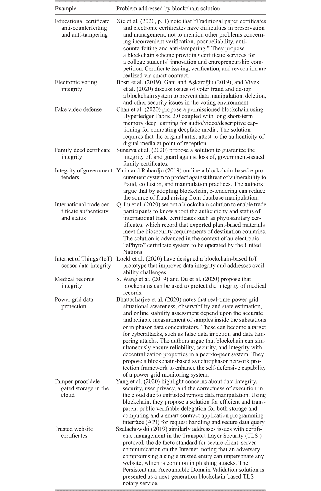

注：表 6.1 中的示例代表了作者在 2021 年 3 月通过以下搜索术语检索 ACM 数字图书馆和 IEEE Xplore 数据库汇编的知识库案例：`blockchain+phishing; blockchain+deepfakes; blockchain+fake+videos; blockchain+records+manipulation`。选择这些术语是为了代表上一章中讨论的关注问题。考虑到检索策略的局限性（例如，没有使用“分布式账本”术语，可能许多其他搜索术语，如 Woodall and Ringel [2020] 构建语料库时使用的术语[即完整性、真实性和可靠性]，可能还有其他数据库）以及作者并非随机选择示例的事实，因此不对所选示例得出任何概括，或对解决方案的效力做出推断；相反，选择这些示例是基于与本章讨论主题的相关性，仅为了产生印象性的概述并用于说明。

每个解决方案都表达了将信息的证词性质考量重新插入其中的愿望和需求 (MacNeil, 1992; Jo and Gebru, 2020)。然而，这些策略并非完美，仍然容易受到滥用，这表明在考虑对档案道德防御的普遍“良性”时，需要谨慎和谦卑 (Poole, 2020)。

### 引言

为什么我们现在会认为需要一种形式区块链和分布式账本的新型“算法档案员”？二战后时期从纸质证据到数字证据的转变无疑发挥了作用。在二战后时期，计算作为一种主要的新的领域脱颖而出，这源于对数值计算速度、准确性和可靠性的渴望（并作为缓慢且往往不准确的人工计算的替代）（Hevner and Berndt, 2000; Dasgupta, 2014, p. 71）。⁴ 新型“机器即计算机”范式的关键有两个进展：克劳德·香农（Claude Shannon，1916–2001）设计的计算数学理论，该理论将比特（bit）确定为信息和计算的基本单位（Computer History Museum, 2021)；以及约翰·冯·诺依曼（John von Neumann，1903–57）制定的“存储程序”理论，该理论将程序引入为存储计算机内存中的指令集，使计算机能够在没有人工干预的情况下执行各种任务（Dasgupta, 2014, pp. 138, 241; Lynch, 2017）。⁵到 20 世纪 40 年代后期，英国和美国的工程师已经建造了存储程序计算机——例如英国的曼彻斯特 Mark I 和美国的 EDVAC 计算机（Dasgupta, 2014, p. 126）。

早期计算机被用于生成死亡率表和天文表，并作为会计和其他业务相关报表的制表机（Dasgupta, 2014, p. 68）。在整个 20 世纪 50 年代和 60 年代，计算机的使用扩展到包括日常活动的自动化，例如业务数据的排序、搜索和组织（Hevner and Berndt, 2000）。1965 年至 1974 年期间见证了业务计算的成熟，此时“对基础业务流程的简单自动化让位于了大型机构中心关键业务职能的全计算机化”（Hevner and Berndt, 2000, p. 10）。随着所有类型的业务活动记录开始使用 Wordstar、Microsoft Word 和 VisiCalc 等软件程序进行创建（Computer History Museum, 2003），纸质业务记录逐渐被数字记录所取代。20 世纪 90 年代，计算在公共部门背景下的使用激增，例如引入了旨在提高政府效率、服务交付和问责的新型信息系统（参见，Heintze and Bretschneider, 2000; Lee and Perry, 2002; Grönlund and Horan, 2005; Heeks, 2006）。

随着业务计算的到来，记录以往固定的物质性——在二战后纸质文件爆炸后越来越被视为一种负担——被释放了。记录变得“流体”了（Smit et al., 2017）。Brown 和 Duguid 捕捉了时代精神但对旧时代的消逝感到遗憾，Brown and Duguid (1996, p. 9) 写道：

> 仅仅谴责固定性并拥抱瞬态性是极度简化的做法，仿佛我们只能拥有其一。即便如此，我们并不处于从固定性向不可逆转的过渡的中间，但现在似乎不可避免的不同在于，两者——瞬态的和不可变的——在物质上已不再互为互斥。现在，在曾经只有固定性的地方可以拥有可变性——例如，在数字文档中。

尽管 Brown 和 Duguid 呼吁拥抱固定性和瞬态性，但提供日常业务活动证明和证据的平凡固定文档，却让位了人们对可变性和计算性的新喜爱。

随着数字化和原生数字格式记录的创建，记录变得“数据化”了（Mayer-Schönberger and Cukier, 2013）；也就是说，它们的文本组件现在可以被提取、拆分和重新配置，使其变得“可计算”。Mortimer Taube 的工作体现了这种重点的转变及其伴随的方法。正如 Saracevic (2017, p. 222) 所解释的：

> 在 20 世纪 50 年代初，另一位信息检索先驱和企业家 Taube（1910–1965）创立了一家名为 Documentation Inc. 的公司，致力于开发和运行科学技术信息组织和检索的系统。Taube 通过开发主题词（Uniterms）和协调索引（coordinate indexing），脱离了当时标准的主题词和分类方法。主题词是从文档中提取的关键词；协调索引是对文档进行索引。尽管当时该算法没有被正式命名为布尔代数，但该操作实际上是布尔算法的首次应用。主题词和协调索引曾引起过争议，但很快人们就意识到这种技术非常适合使用。

数据化最终开启了“信息时代”，以及随后的“大数据时代”（Castells, 2009; Mayer-Schönberger and Cukier, 2013）。这些历史时刻的特征是，能够从曾经固定的来源（如记录）中提取数据的过程，使得这些数据成为“瞬态”的，从而可以独立地接受计算分析。“数据是新石油”成为那个时代的格言，既意味着数据化的提取性本质，也意味着被提取出的物质——即数据——被认可的新价值（Arthur, 2013; Hirsch, 2013）。

### 6.4 记录的数据化

记录的数据化改变了它们的证据质量。在数字时代之前，一份关于在业务常规和普通过程中发生的行为的书面“证词”——记录是记录在物质基底上的，这种基底“固定”了它所参与和代表的活动的“事实”——本质上，这使得记录是“不可变”的。在稳定的物质基底上固定活动状态，有助于保护记录作为这些活动事实证明的完整性（或至少让任何改动变得更加易见）。取决于所使用的物质基底类型，记录的智力内容可以在很长一段时间内保持固定。例如，记录在亚麻基纸上的内容可以持续几个世纪，而质量较差的报纸可能在几十年后就会崩溃（Library of Congress, n.d）。无论基底的耐用性如何，这些活动的固定表示的物质性提供了我们赖以以保护和检测其证据完整性的很大部分——即完整且未篡改的质量（ISO, 2020b, s. 3.2.8）。

尽管数字记录缺乏固定性，但它们并非完全不具有物质性。根据 Dasgupta (2016) 的观点，数字记录可以被描述为包含三类计算产物：物质性的、抽象的和界限性的。

- **物质产物 (Material artifacts)**：例如计算机硬件，这些是“遵循物理定律”的 (Dasgupta, 2016, p. 23)。
- **抽象产物 (Abstract artifacts)**：第二类计算产物是抽象的：这些是计算的算法、图灵机和软件语言。Dasgupta 认为，它们是缺乏任何物理特性的“符号结构”（尽管可以通过例如将它们打印在纸上来使其变得物理化）。
- **界限产物 (Liminal artifacts)**：最后是界限产物，Dasgupta 将其描述为既是抽象的物质的：它们本身是像抽象产物一样的符号结构，但其操作会导致物理世界的改变，且其行为依赖于底层的物质代理。界限产物可以包括用户界面、微处理器和软件程序。

所有这些类的产物在数字记录的产生中协作工作。作为界限产物本身，数字记录的产生是一个相互作用的已实现的计算产物层级的动态输出，这些产物具有物质性，同时也具有符号意义，例如在代表和体现法律主张的情况下。换句话说，数字记录可以被理解为动态的虚拟表演：“对于文字处理器而言]，有人必须设计并实现了一种计算产物，该产物在激活时执行为 `TEXT` 的操作，隐藏了实现 `TEXT` 的机制细节” (Dasgupta, 2016, p. 15; 另见 Duranti and Thibodeau, 2006)。

虽然也可以这样理解纸质记录——即将它们视为由笔、墨水和纸的组合所呈现的表现——但大多数配置记录为数字对象的产物具有抽象（即非物理）性质，这使得此类记录区别于其纸质对应物的物质性。笔、墨水和纸都与物理世界有联系，而生成数字记录的软件语言和程序以纯抽象或混合产物的形式存在。这使得那些希望将记录作为证据和知识来源的人能够根据意愿以任意序列排列记录，而不是像在数字时代之前必须做的那样，将它们固定在文件夹和箱子里 (Weinberger, 2007; Yeo, 2012)。因此，与模拟记录不同，数字记录在本质上是时空连续的，而非空间离散的。⁶

此外，在数字形式下，记录具有许多相互关联的依赖关系，其中大多数被隐藏（或抽象化）了，或者往往根本没有显现或实例化。在我们眼中看似可见的单一“实体”——一段文本，实际上是一个复杂的相互依赖网络，随着计算层级越深入越深，这个网络对人类而言的可视性就越低（从人与人或人机交互层面，通过编程、二进制代码，最终到达解析为硅和金属、粒子和场的电路板）。随着这个相互依赖网络在人类视觉中变得越来越不可见，其作为记录创建者意图要传达的语义意义也随之减少 (Hui, 2012)。所有这些复杂性都被隐藏在抽象的面纱之后，提供了一种稳定且单一的数字文本出现在我们眼前的幻象——这是一个典型的计算示例，正如 Latour 的 (1987) “黑盒”，其中构建产物的关系变得如此嵌入而变得不可。

然而，记录的意义源于这些相互关联的依赖关系。我们意识到，脱离语境的言论会改变意义：事实上，这是那些传播虚假信息的一种常用策略。同样的原则也适用于证据记录。它们的意义源于创建它们的人及其目的，以及它们作为该活动的产物所处的关系。

#### 数字挑战

系统设计人员往往未能提供实例化记录上下文的能力（例如通过应用上下文元数据或关于记录的元数据）。即使上下文以实例化的形式呈现，它也经常通过后续的数据化过程被剥离，从而改变记录所传达的意义。此外，记录的语法——或其知识组件的配置——现在可以被修改，赋予了记录一种便利但可能微妙改变其意义的可塑性。此外，与纸质记录不同（其知识组件都在一个对象中），数字记录的知识组件可以分散在多个相互依赖的动态计算组件中。例如，标准格式合同现在由隐藏的超链接组成，这些链接可以随时更改，可能会改变合同的意义 (Cornelius, 2018, p. 8)。

因此，透视黑盒，数字记录绝非单一、固定且不可变的。相反，它们是脆弱的、偶然的、条件的。Lynch (2001), p. 13) 观察到：

> 分布式环境中的数字文档行为可能并不一致；因为它们同时呈现给想要查看它们的人和想要通过程序索引它们的软件系统，它们对于每次演示都可能发生剧烈变化。每次演示都可以为特定的接收者定制。此外，人类通过 Web 浏览器等媒介软件从文档演示中获取的信息，与索引程序从相同的源文档中提取的信息可能非常不同，除非索引程序在设计时考虑了文档对人类的影响。

这就像类比数字时代，每当我们想要查看数字记录时，笔、墨水和纸必须聚集在一起重新编写一份记录的副本，以便我们能够看到并从生成的产物中获取意义。如果没有笔（或类似的书写工具）可用来进行写作，记录既无法编写也无法读取；同样，每当需要重新编写或查看记录时，必须提供所需的墨水和纸。

由于存在如此复杂的依赖，数字记录往往无法持久存在也并不奇怪。有许多问题需要处理：数字记录容易被破坏、丢失、损坏和篡改。如果不加保护并刻意使其持久化，它们可能会变得无法访问。其内容、结构和形式与其向应用程序用户的呈现之间并非不可分割的，也不是作为一个整体与其呈现分离存储的（Duranti and Rogers, 2019, p. 1）。我们所能做的就是保存使我们能够重现这些记录的组合性产物，并捕捉有关记录及其创建背景和后续监管的足够信息，以便在缺乏物质固定性的情况下，实现描述性（或智力上的）固定性，使得那些可能需要依赖这些证据性材料的人能够评估关于其所代表的活动之证据的可信度（Duranti and Rogers, 2019, p. 1; Duranti and Thibodeau, 2006）。

数字记录高度可塑和易变的特性也引发了一个问题：“我们如何能信任它们？”是否可能确定像数字记录这样变幻莫测的对象的信度？早期的计算机科学家并不担心这个问题。他们的世界是一个数据和信息的世界，事实性在那里被认为是自言易见的（Yeo, 2018, p. 118）。

### 6.5 从记录到信息和数据

当数字化取代纸质世界时，与记录的前身物质性以及将文档或记录视为证明的观点相关的理论，其影响力已不如关于信息和数据的观点，至少在英语国家是如此的（Lund and Skare, 2017）。例如，文献学理论让位于信息科学，这是一门跨学科领域，主要关注知识源信息内容的关联性——通常被构建为“关于性”、相关性或主题相关性（Saracevic, 2017, p. 2216）。在世界各地的大学里，图书馆学专业转变为关注信息科学的专业（Lund and Skare, 2017）。对“档案中的生活”进行批判性反思的任务属于图书馆学和信息科学之外的学者，例如米歇尔·福柯（Michel Foucault, 1926–84）、哈罗德·加芬科（Harold Garfinkel, 1917–2011）和多萝西·E·史密斯（Dorothy E. Smith, 1926–）（Foucault, 1980; Smith, 1990; Garfinkel, [1986] 2017; Lund and Skare, 2017）。随着信息科学的演进，它更多地关于信息资源的需求、使用和检索，而非文献学范式，其驱动力源于战后信息爆炸这一核心问题，以及信息通信技术如何作为解决方案被使用（Saracevic, 2017, p. 2217）。⁷ 随着时间的推移，信息科学形成了两个关键分支：一个分支侧侧重于信息检索（IR），另一个分支则广泛关注信息检索的人性维度，即作为知识源的寻求者和用户的人类（Saracevic, 2017）。

信息检索演变为关注信息系统以及用于检索知识源的新型算法开发，因此与计算机科学有紧密的联系（Saracevic, 2017）。信息科学的 IR 分支与计算机科学之间存在的紧密耦合，在杰拉德·萨尔顿（Gerard Salton, 1927–95）对该领域的贡献中体现得淋漓尽致，他是一位计算机科学家和学者，从 20 世纪 60 年代中期直到 1995 年去世，他一直在运行 IR 实验，并开发了许多新型 IR 算法和方法，这些方法至今仍是 IR 领域的基础（Saracevic, 2017）。

与具有文献传统的信息科学不同，计算机科学——在 20 世纪 70 年代随着许多西方大学引入计算机科学课程而结晶——并没有这样的传统。从起源开始，计算机科学就是一个关注信息和数据的领域（Dasgupta, 2014）。值得注意的是，“data”（数据）一词的词源表明与证明或证据的概念没有概念联系，这与“documents”（文档）、“records”（记录）和“archives”（档案）等术语不同。“Data”借自拉丁语 data（Oxford University Press, 2021b），既可用可数名词（例如“根据三种情况的多样性，垂直角”），也可用不可数名词（Oxford University Press, 2021b），表示“通常用于参考、分析或计算的（数值）信息”（Oxford University Press, 2021b）。在计算机领域，该术语专门演变为指“计算机执行的数值、字符或符号”（Oxford University Press, 2021b），但计算领域的不同学者对数据及其与信息的关系的概念化完全不同，数据和信息往往被互换（Borgman, 2016, p. 28; Dasgupta, 2016, p. 5）。

对于某些人来说，数据具有信息不具备的物质性（Hey, 2004; Wempen, 2014; Laudon and Laudon, 2015）；数据占用空间——我们通常需要的比特、字节以及现在的 z 字节⁸, p. 5）。同样，对于人工智能研究人员杰弗里·施拉格和帕特·兰利，数据是被观察和选择性记录的内容；信息并不其中（Dasgupta, 2016, p. 9）。另一方面，罗塞尔·阿科夫将数据概念化为先于信息的物体和事件表示（Dasgupta, 2016, p. 5）。对于某些人来说，数据本身没有意义（例如 Ratzan, 2004; Wilson et al., 2013）。例如，卢恰亚诺·弗洛里迪（Luciano Floridi）认为，数据仅表示差异的存在，而信息是结合两个或多个数据元素产生意义的东西（Dasgupta, 2016, p. 9）。

在计算机科学和数据科学语境下，数据通常被视为“原始事实”，这表明人们认为它代表了某种不可争议的客观性或真理（Yeo, 2018, p. 118）。数据所代表的事态状态的真值——即所谓的“历史真理”——与作为这些事实表现的数据本身的真值——即所谓的“文献真理”之间没有被区分（Duranti, 1998, p. 82）。这就好像，类比前一章）。

无论“数据”一词的含义及其代表的内容多么模糊，数据已经成为我们时代的新货币。正如 Cukier and Mayer-Schoenberger (2013, p. 35) 所说，“一旦我们对事物进行数据化，就可以改变它们的目的，并将信息转化为新的价值形式。”这种能力标志着大数据时代的到来，在这个时代，数据已成为创造新产品的区块（Arthur, 2013; O’Neil and Schutt, 2013）。在此背景下，一门新学科形成了——数据科学。数据科学通常被描述为一种数据驱动的过程，由线性进行的常规分析步骤组成。例如，Ward et al. (2010) 将视觉分析——在最基础的层，它涉及数据科学方法与可视化技术的结合——描述为一种“流水线”⁹，由原始数据获取、数据/流转换、视觉映射和视觉变换组成，其最终目标是支持某些用户任务；Keim et al. (2010) 识别出三个阶段——数据管理、数据建模和数据可视化；而 Kandel et al. (2012) 则识别出五个阶段——发现、整理、分析、建模和报告。

随着数据科学的兴起，对信息和数据的操纵——以及延伸到人类行为者——已成为一个全新的专业领域，但与计算机科学和现代信息科学一样，它与根植于文献传统的学科具有截然不同的知识架构。作为该领域与根植于文献传统的学科进行概念分离的证据，Bussel (2017, p. 19) 指出“媒介即信息”。

可重复研究的新要求也提升了人们对数据信誉度的兴趣（Peng, 2011）。研究人员需要证明其数据没有为了迎合特定利益集团而被操纵，或者没有在分析中犯错导致虚假结论。这些变化引发了对数据真实性的极大关注，这种关注进入了大数据分析的话题，背景是数据越来越多地来自未经验证的来源、不完整或不一致，且准确性水平通常较低或未知（Laney, 2001; Liu and Özsu, 2009; Shankaranarayanan et al., 2012）。

在信息系统领域，数据可信度（believability）的概念——即数据被接受或被视为真实、现实且可靠的程度——被加入了数据质量模型中，这些概念源于对组织间数据交换和决策支持的讨论（Shankaranarayanan and Blake, 2017）。

可信度这一概念也与组织数据交换、数据挖掘和分析文献中对数据溯源（data provenance）和来源信誉的关注密切相关（例如，参见 Prat and Madnick, 2008）。第一场数据溯源研讨会于 2006 年举行，在计算机及相关领域内建立了一个社区，这些成员致力于研究如何将溯源作为确保和确定数据信誉的手段（Ludäscher, 2016）。¹⁰

### 6.6 结性思考

尽管对各种形式数据溯源日益增长的兴趣与对来源准确性和信誉度（或可信度）日益增加的担忧和问题有关，但这一学者群体的新兴理论至少在形成的早期，与档案科学、历史学、知识社会学或法律等学科保持孤立。这些学科传统上也关注文献信誉问题，并演化出了对这些问题进行批判性审查的概念、术语、原则和实践，这些方法在某些情况下比计算机科学及相关领域正在考虑的方法要早了几个世纪（Lemieux, 2016b）。

自二战后以来，计算信息处理的兴逐渐取代了以物理记录为中心的传统记录和记录工作。虽然这带来了许多新且有益的能力，但传统记录知识的消亡削弱了关注记录物理和道德防御的实践，并取而代之的是源于数据化（datafication）主导理念的实践。这种对数据可塑性的关注，而非对信息免受操纵和腐败的防御（记录保管者的古老任务），导致了当前社会证据信誉度的衰减。因此，我们看到社会“事实基础设施”的证据基础发生了巨大的瓦解。在计算机及相关领域，这个问题直到最近才被注意到，人们已开始关注数字取证、数据可信度和溯源问题，以及对数据质量和知识来源信誉的研究。

然而，尽管根源于计算机，但区块链和分布式账本技术代表了某种不同。通过创建并依赖不可篡改的账本，区块链和分布式账本系统承诺停止导致记录广泛操纵的数据化过程。相反，区块链和分布式账本技术可以通过加密方式固定记录，将其链在一起，使得任何篡改都极其困难且立而易见。因此，区块链和分布式账本技术的设计和精神（至少在理论上）回到了前数字时代的过去，那时纸质记录的物质性能能更容易固定交易事实，并保护其完整性免受操纵。描述区块链技术的词汇（即“分布式账本”和“账本记录” \[ISO, 2020b, s. 3.22 and 3.44\]）表明了该技术的双面性：一面脸面向计算，另一面脸面向记录工作（或证据的保存）。区块链记录能力的应用可以清楚地体现在虚假证据原因和防止数据操纵的解决方案中。因此，区块链为社会承诺了一个算法档案员和一个计算托管空间，在该空间内可以从物理和智上防御档案文件，它们也代表了稳定社会信任关系认识论基础的可能手段。在下一章中，我们将讨论区块链和分布式账本系统实际上在多大实现了这一承诺。

[¹]: Hilary Jenkinson 爵士于 1947 年到 1954 年间担任公共档案局（现为英国国家档案馆的一部分）的副馆长。
[²]: 档案员作为人，当然是会出错的记录者，而负责保护文献遗产的机构也是会出错的机构。档案员或档案机构都无法脱他们所处的社会、文化和政治环境。
[³]: Yeo 效仿哲学中该术语的用法，将这些统称为“发生项”（occurrents）（参见 Yeo, 2018,第 130–132 页）。
[⁴]: 读者可能还记得 2016 年电影《隐藏的数字》中对人类计算的流行描绘，关于在计算机引入之前为美国航空航天局工作的女性数学家。
[⁵]: 存储程序体系的发明引发了对计算机编程和编程语言的关注（Dasgupta, 2014）。在 20 世纪 50 年代，围绕两种语言出现了不同的计算“文化”。一方面是以 FORTRAN 为代表的科学计算和计算机科学语言，另一方面是 COBOL（通用业务语言），业务计算和数据处理的语言（Dasgupta, 2014），第 202–204 页）。
[⁶]: 与离散数据类似，离散对象只能有一种表示形式且仅位于固定位置，而连续对象在一定范围内可以有许多表示形式和位置。关于这一点，参见 Weinberger (2007)。
[⁷]: Bates (1999) 识别了信息科学的三个“大问题”：1. 物理问题：新系统设计中的特征和法律考量是什么？2. 社会问题：人们如何与信息联系、寻求、检索和使用信息？3. 设计问题：如何让对记录信息的访问最快速、最有效？
[⁸]: 一个 ZB 等于 1024 EB；一个 EB 等于 1024 PB；一个 PB 是 1024 TB；一个 TB 是 1024 GB；一个 GB 等于 1024 MB；一个 MB 是 1024 KB；而一个 KB 是 1024 字节。

[⁹] 尽管可视化分析最初被构想为一个人类几乎不干预的中立过程，但近期借鉴科学技术研究洞察的工作对这一观点提出了质疑。正如 `Muller et al. (2019)` 第 1–2 页所观察到的，“人类专业知识干预在原始数据和分析之间，至关键地塑造了数据、分析的选择，以及在某些情况下与分析相关的真理主张。”

自从数据溯源（data provenance）首次在计算领域引起关注以来，该术语有了不同的定义和表述。`Buneman and Tan (2007)` 在数据库背景下工作，将数据溯源——他们注意到这有时也被称为“谱系”（pedigree）或“血缘”（lineage）——定义为数据起源及其进入数据库过程的描述。`Simmhan et al. (2005)` 将数据溯源定义为有助于确定数据产品推导历史的信息，从其原始来源开始；而 `Prat and Madnick (2007)` 则根据数据的起源和后续处理历史对其进行定义，并提出了一种基于溯源元数据分析的、可信度计算模型。`Moreau (2010)` 将溯源区分为：(1) 作为过程的溯源，即导致某条数据的过程；(2) 作为注释的溯源，旨在为资源提供结构和语义的注释（例如，通过添加有关作者、创建日期和版本的元数据）；以及 (3) 面向事件的溯源，根据这种观点，溯源是一条链，定义为按时间排序的溯源记录序列，捕捉了影响文档的事件。`Ram and Liu (2006)` 提出了 W7 模型，从七个维度对溯源进行概念化：“什么”（发生在数据上的事件）、“何时”（时间）、“哪里”（空间）、“如何”（动作）、“谁”（执行者）、“哪个”（设备）以及“为什么”（事件的原因，包括目标）。在网络链接开放数据的背景下，溯源的含义被 W3C PROV 字典编码为“一种描述参与生产、影响或交付某条数据或事物的人员、机构、实体和活动的记录”（`Missier et al., 2013` 第 1 页）。

## 7 从“档案想象”到“档案现实”

正如前一章所讨论的，并不是我们的第一个信息虚假时代。在过去，我们已经走过好几次老路：例如，在中世纪的欧洲（公元 500–1500 年）。在整个中世纪和晚中世纪，文件伪造和操纵非常普遍（`Tout, 1919`；`Clanchy, 1980`）。甚至赋予教廷对整个西罗马帝国统治权的《君士丁献书》也是在 9 世纪被伪造的。据说 11 世纪和 12 世纪的僧侣们一直在伪造赋予他们财产和管辖权的特许状。文件伪造和操纵是一件理所当然的事，以至于坎特伯的副主教在 1238 年写给教皇格列利九世：“神圣的父，坎特伯教会没有哪一种伪造是未曾实施的”（`Clanchy, 1980` 第 123 页），而博兰登斯特派¹（1628–1714）后来被促写道，所有在古代字字集³ 第 219 页）。`Tout (1919)` 为中世纪普遍的文件伪造行为提供了几种解释，包括对家族和家族的过度自豪，以及用虚假新闻扰乱敌人的愿望。

虽然我们可能从这些信息中得出结论，中世纪居住着最高级别的流氓，他们为了个人和政治利益随手伪造文件，但也有一个与我们时代非常相关的解释。在从口头文化（许多交易通过惯例、交换戒指、刀或剑等代币来完成）向书面文化的过渡过程中，大庄园领主们希望通过带有大印章的特许状或土地契约在书面上确认他们的土地所有（`Tout, 1919` 第 215 页）。事实上，随着书面文件取代了习惯法（即通过常识证据持有的土地），他们越来越多地需要提供此类其所有权的书面证据（`Tout, 1919` 第 215 页；`Clanchy, 1980` 第 215–216 页）。在没有此类原始所有权的情况下，领主们简单通过伪造所需文件来解决他们的问题。伪造者自然试图让伪造品看起来真实，但正如 `Tout (1919)` 第 216 页所解释的那样：

> 他[伪造者]无法理解每个时代都有特定的形式和技术细节。他最了解的是自己时代的特征，并想象他所熟悉的文件中属于所有时代。他也是一个改革者，希望他的契约跟上时代。因此，他倾向于复制自己时代流行的形式。而纯真者由于缺乏历史感而采用的方法，欺诈者也可能由于完全不知道古代是如何操作的而挪用之。

在思考过去几十年从纸质到数字的转型时，可以看到类似的历史感缺失。纸质文件经常被复制（即数字化）或重新制作，而对其技术细节缺乏历史感——事实上，它们被认为是非技术性的——导致建立其证据地位的元素没有被数字化。新的记录形式往往缺乏作为证据所需的质量。对于区块链和分布式账本或其他形式的数字记录也是如此，我将在本章中讨论。

回到丹尼尔·冯·帕佩布罗赫，他曾贬所有 11 世纪的文件为伪造品。1675 年，他证明了一份据称 646 年由墨洛王朝国王哥达特授予本笃会的某些特权的契约是伪造的。正如我们可以想象的，本笃会会对帕佩布罗赫的发现并不愉快，他们开始证明他是错的。他们教团中最优秀、最聪明的之一是让·马比隆修士（1632–1707）（`Knowles, 1959`）。马比隆花了几年时间制定了一套系统的方法来测试中世纪文件的真实性，以证明帕佩布罗赫是错误的（但他并不是）。然而，在此过程中，马比隆撰写了《文献学》——完成于 1681 年（`Reynolds and Wilson, 1991` 第 189 页）——并发明了一门名为“文献学”（diplomatic）的新学科，现在北美通常被称为“diplomatics”（`Yeo, 2017` 第 95 页）。

古文献学（Diplomatics）借鉴了在中世纪时期开始系统化的理论和原则——根据 Duranti (1995) 的说法，这些理论源于 1158 年在博洛尼亚大学开设的第一门公证学课程。古文献学指的是“一种对文件和记录的科学或研究，包括它们的形式、语言、字体和含义。它涉及对特定类型文件的既定表述和程序、对手写文字的破译以及文件分析与鉴定等方面的知识”（Beal, 2011, p. 121）。其目的是确立文件的真实性。

到 19 世纪，古文献学已从确定赋予法律权利的文件的真实性，演变为历史学家用作分析历史来源真实性的工具（MacNeil et al., 2001, p. 3））。根据 Williams (2005, p. 2) 引用 Brooke, 1970, p. 1) 的观点，曾任利物浦大学研究生档案项目古文献学教师、后任伦敦大学历史教授的克里斯托弗·布鲁克将古文献称为“赋予文件科学的野蛮名称”，认为它有着“令人敬畏且阴森的科学的声誉……少数学者（大多数是中世纪学者）玩的游戏，只要它不主导或掩盖历史研究，就是无害的”。

正如 Williams (2005, p. 2) 进一步提到的，古文献学在近年来经历了某种文艺复兴，作为档案科学这一更广泛学科伞下的一个子专业兴起。人们开始考虑它如何应用于当前的记录管理理论和新型数字记录形式，最著名的是 InterPARES 项目的工作，该项目对数字记录真实性的长期保护问题已进行了超过 20 年的研究（Duranti and Preston, 2008; Duranti and Rogers, 2019）。通过这项工作，古文献学的应用——结合源自档案科学、法律和计算机的概念——扩展到了对记录系统设计的考虑，特别是如何发展档案古文献学以支持记录的可靠性质量⁴，即档案科学除了对历史文献来源进行追溯性分析外，其前瞻性的应用也（Duranti, 1999, p. 165; MacNeil et al., 2001; Williams, 2005, p. 3）。⁵。截至目前，InterPARES 已探索了档案古文献理论在各种数字背景下的应用，最近的是云技术（Duranti and Rogers, 2019）。

### 传统与数字古文献学

传统古文献学区分了文件中的“事实元素”（即描述文件所参与行为的元素）和“形式元素”（即与文件的物理和智力构建相关的元素）（Williams, 2005, p. 16）。将这些元素映射到数字记录的工作被证明是极具挑战性的，因为虽然中世纪文献在一个统一客体中包含了识别这些元素的所有必要信息，但正如我们已经讨论过的，数字记录是动态的，并且具有复杂的系统间依赖性。因此，许多需要确定或保证记录真实性的元素在检索时可能缺失，或者根本从未被创建过（Duranti and Thibodeau, 2006）。这种挑战使得古文献理论必须进行创新，其中最重要之一就是除了单个文件外，还要考虑系统的特性（Williams, 2005）。正如前一章 中讨论，由于数字记录如此脆弱且具有偶然性，这一任务变得更加紧迫。

### 古文献学理论的演变

“古文献学的文艺复兴”以及证明古文献学持续效用（尽管是以现代化的形式）的研究表明，它提供了一个实用的框架，用于评估区块链和账本如何实现其经常提到的“永久真理之源”的目标（Roon, 2016; Dwyer, 2017），并指导未来的记录系统设计。

档案古文献学并不是评估记录可靠性的唯一框架。例如，雷·唐纳森（Ray Donaldson）提出了“档案中的信任——档案内容的信任”（TIA–TDAC）框架，这是他基于对用户对数字内容信任的文献综述得出的（Donaldson, 2019, p. 60）。档案古文献学与唐纳森框架之间的关键区别（见 Meijer, 2003; Pattenden-Fail, 2008; Conway, 2010）在于，除了档案古文献学具有更久的理论传统外，唐纳森的方法依赖于用户对数字内容和存储库可靠性的感知（Wand and Weber, 1995）。换句话说，TIA–TDAC 框架是一种观察者相关的且追溯性的可靠性观点，类似于第三章 中讨论的用户信任。

然而，通过与记录管理人员合作，大型机构中的记录创建者（特别是那些受高度监管的机构）通常能够并且确实采取前瞻性步骤，设计数字系统以在记录中实例化他们认为这些属性能够为记录的可靠性提供易于处理且可获取的信号，无论这些属性后来是否或如何被后续的记录用户或读者所感知。通常，这些属性是由广泛的社会文化决定的，尽管也会存在特定的组织差异。因此，我认为，记录的可靠性不能严格还原为特定用户或用户群体是否以及如何事后感知记录中的这些属性。

数字取证学这一较新的学科提供了另一个与档案文献学（archival diplomatics）紧密接轨的框架。文献学和取证学都是为了追溯调查现有物质证据而开发的实践，并且都具有扩展到信息系统前瞻性设计的可能性（Duranti, 2009）。同样，与文献学一样，数字取证学也参考了其所在的法律体系和地缘政治背景（Duranti, 2009, p. 64）。然而，与文献学不同，数字取证学研究的是数字系统中提供证据的对象、载体和痕迹。在她 2009 年的一篇对数字文献学和数字取证学进行详细比较的文章中，档案理论家 Luciana Duranti 讨论了几个概念（例如，计算机存储的、计算机生成的和混合类型的计算机记录），她认为这些概念对于所有履行受信记录保管者或托管职责的人都是有用的。她最终认为，将档案学和文献学的理论、原则和实践与数字取证学相结合具有价值，并建议将其称为“数字记录取证”（Digital Records Forensics）”（Duranti, 2009, pp. 52, 64）。Lee（参见，例如 Lee and Woods, 2014）也呼吁将数字取证工具和技术应用于档案材料及相关的保护功能。因此，数字取证学提供了一个可能补充档案文献学的视角、方法和工具。

## 7.1 记录的可靠信度：档案文献学视角

档案文献学以一种非常独特且精确的方式定义了“记录”的概念，这正如一个旨在提出推广到多个案例的理论基础原则的学科所预期的那样。因此，记录是“在实际活动过程中制作或接收的文档，作为此类活动的工具或副产物，并为了行动或参考而留存”（Pearce-Moses, 2018）。有些人可能对“所有记录都是文档”这一观点持怀疑态度。例如，分类账记录初看之下可能并不符合我们通常认为的文档的定义（例如，一封信）。然而，档案文献学中“文档”一词的定义涵盖的内容比我们在考虑证据文档时立即想到的要多。根据 InterPARES 术语，文档是“一个以稳定的语法方式附着在介质（记录）上的信息所构成的、不可分割的信息单元。文档具有固定的形式和稳定的内容”（InterPARES 2 Project, 2021a）。重要的是，通过将“文档”一词纳入其记录的定义中，InterPARES 对该术的定义与传统上与“文档”一词相关的证明和证据概念建立了一种连续性。事实上，在档案文献学中，“档案文档”被视为记录的同义词。

虽然本书的目的不是为了深于档案理论争论，但值得注意的是，档案理论家 Geoffrey Yeo 在定义记录时并没有使用“文档”（documents）一词。相反，他认为它们是“活动或其他发生事件的持续表示，由这些事件的参与者、观察者或其代理人创建”（Yeo, 2008, p. 136）。在 Lemieux (2014) 中，我在 Lemieux and Limon (2011) 的基础上扩展了我的观点，即记录是信息系统的一种，作为由交互的参与者或观察者或其代理人创建的某些类别、角色和关系的持续表示；或者是一组表示集合。”虽然这一断言似乎与我“信息”和“记录”并不具有共同根源的论点相悖，当我将记录视为信息系统类型时，我并不是说记录本身就是信息；相反，我特指信息系统的表征特性（参见，例如 Gregor, 2006, Straub, 2012, Recker et al., 2019）。

为了解释，在信息系统理论中，信息系统被定义为属于三个模型的人制品：表征、状态跟踪和良好分解。这三个模型都依赖于前提，即信息系统是具体的或构想的（即在某人脑海中的）现实世界系统（即语域）在某人或某群体视角下的象性表示。在记录理论的传统方法中，它们被视为存在于背景中的对象或人工制品。也就是说，它们构成了其所处背景的一部分。从这一观点来看，记录可以被视为在背景（例如加拿大金融系统）中发生的某些交易（例如金融交易）的结果、副产物或执行机制。然而，我们可以借鉴表征理论，将档案理论中的记录观点与关于信息系统的类似理论相结合。

这种理论视角与我在 Lemieux and Feng (2021) 中提出的并在本书中依赖的分布式账本作为社会-信息-技术系统的扩展观点是一致的，其意义在于分布式账本像所有记录一样，被设计用来忠实地表示其创建者意图所要表示的某些现实世界现象。在嵌入这些系统的同时，它们也作为存在并运行于这些内部的对象或人工制品。

这种观点似乎与档案文献学（archival diplomatics）将记录视为活动工具或副产物的观点不一致。然而，因为记录为了履行其作为与实际活动相关的工具或副产物（即：*实现现实*）的功能，表征（representation）是必不可少的，因此我认为两者之间并不矛盾。对于实现（enactment）而言，表征仍然至关重要（Recker et al., 2019)。一个简单的例子是，合同方的签字是该方拟进入并同意合同条款意图的表征。这个例子也说明，与叶（Yeo）的观点相反，尽管记录是在实际活动过程中产生或接收的，但它们的创建是为了代表比某个行动或事件（或这些事件的集合）多得的内容。它们的创建是为了表征意图、制度化的角色（例如签名区块中签署人的正式头衔）、时间（例如签署日期）以及许多其他。事实上，取决于制作的优劣，它们可以捕捉大量关于激发其产生的源头活动周围的背景信息。正因如此，我们通过对记录的检查，可以获得超出其最初创建目的的过去方面的知识；它们的创建环境意味着它们嵌入了一个“生活世界”（Husserl, [1954] 1970），无论这种形式多么碎片化，它都与其相关的源头活动相连。如果记录仅代表其源头活动，那么它们将非常难以履行实现目的（例如授予权利或权益），因为它们将缺少其所属的法律系统中为实现这些目的所要求的元素（例如签名）。同样，如果无法获取背景化元素的表征（例如时间、法律或机构权威、行动意图等），要解释其含义（或确定其可信度）也将是困难的。

上述观察指向了关于记录的另一个重要观察，即它们不是证据（尽管它们提供了证据），而是人类交互的工具或副产物。这些记录被认为“捕捉”了它们参与的交互情境，在空间和时间上扩展了对这些交互情况的表征，并能够根据这些记录产生随后的信念和行动。因此，记录也为其所属及所指的活动提供了证明来源或证据。^[9]此外，由于它们作为这些活动的一部分或其副产物而被创建，它们是这些活动的见证并对其进行证明——因此，正如我在[第 5 章]中讨论的，它们属于被称为“言证”（evidentials）的语言类别（Aikhenvald, 2004)。事实上，正是它们与过去行动的接近性，使得记录超越了传闻，成为能够提供证据依据以支持某事之“真相”的言证。

在古典档案文献学中，可信的记录（1） 准确地捕捉事实，(2) 作为这些事实的“陈述”是可靠的（即：能够表征其所属行动的事实），并且（3) 是真实性的（即：它们所声称的是真实的）。然而，必须强调，实现可信度不能简化为一个本质主义的列表。档案文献学的批评者经常指出其本质主义和还原论倾向是其主要弱点之一（参见 Bussel, 2017, Yeo, 2017）。档案文献学中阐述的记录属性（参见 Roeder et al., 2008）。

与档案文献学的定义不同，国际标准组织（ISO）在其对记录的定义中，用现代术语“信息”替换了对文件的“传统”引用。虽然它仍将该术语与传统的传统关联联系起来，但也将其与记录通过数据化过程演变成的内容联系起来——一种经济价值来源，一种“资产”（即`组织或个人为了履行法律义务或进行业务交易而作为证据和资产创建、接收和维护的信息`）[ISO, 2020b, 3.2.10]。对于我对区块链和分布式账本记录的分析，我紧遵循档案文献学对记录的定义，因为我高度依赖通过连续 InterPARES 项目所理解的档案文献学分析原则。10

#### 准确性

准确性（Accuracy）涉及记录的历史真实性，并分解为“精确性（precision）”、“正确性（correctness）”、“相关性（pertinence）”和“真实性（truthfulness）”。精确性是指“内容和形式的每一个细节都严格符合既定指南或惯例的记录质量”，而正确性是指“记录的内容和形式符合创建者和法律体系的要求，使记录能够达到预期的后果或产生其意图的效果”。相关性是指“记录的内容与其创建和/或使用的目的相关的质量”。最后，真实性是指“记录的内容与其所指称的实际情况相符的质量”。

#### 可靠性（Reliability）

在`IP2 Ontology`中，可靠性分解为“完整性（completeness）”和“创建程序（creation procedure）”。

完整性是“记录的一种特征，指其包含了创建者和法律体系认为能够产生后果所需的所有元素”。这些元素包括：为了使某项行动生效所需的主管机关原始签名，以及证明该记录是原件而非草案或副本的日期。

记录创建程序的（与正式程序的一）一致性（Consistency）是指“管理记录形成和/或参与行为的程序[书面和非书面规则体]”。

在这两个元素的基础上，图 7.1 中的信任分类法增加了第三点：客观性/公正性（objectivity/impartiality，即自然性）。它抓取了这样一个观点：记录的可信度根本上取决于它们是作为与其所涉及的行动同时（或几乎同时，例如会议纪要）的工具和副产品而创建的。因此，它们可以作为此类行动的见证。记录被认为是自然的，是因为它们与其所组成和参考的行动具有连续性，这并不意味着记录对历史行动或事件呈现了公正或客观的视角；相反，当记录是在通常和正常的事务处理过程中制作时，它们在为记录作者和保存者无法预料的未来真实性主张提供依据方面，是公正且客观的。以会议纪要为例：记录员可能会对会议议程带入自己的偏见（例如，通过他们所记录的详细程度），但假设他们没有动机不准确地记录议程——例如所有参会者的姓名——会议纪要就可以作为证明某位参会者在会议发生同时不在另一个犯罪案现场的依据。虽然这种“自然性”通常被认为是所有记录的特征，但它同时也是一种赋予记录可信度的属性，因此被列为图 7.1 信任分类法中的附加元素。作为记录创建的基本规则之一（即它们倾向于在通常和正常的业务过程中制作），自然性本可以被作为创建程序属性的子属性；然而，创建程序通常关注对记录创建过程的控制，而不是记录创建的时间维度。因此，自然性认为应该在架构中拥有一个自己的显著位置。

#### 真实性（Authenticity）

真实性是第三大主要类别。在`IP2 Ontology`中，这一属性由“完整性（integrity）”和“身份性（identity）”组成。完整性是指在记录创建后，“在所有本质方面保持完整且未被更改的质量”。身份性是指“唯一标识文档或记录并将其与其他任何文档或记录区分开来的特征总和”，这是能够记录真实性的必要前提条件。

信任分类法进一步将身份性分解为作者身份和档案纽带（archival bond），突出了建立其真实性所需的记录身份中最重要的两个（尽管不是全部）特征。在作者身份方面，真实记录的作者将确实实地如他们所声称的那样。

档案纽带是“参与同一活动的记录之间及记录与记录之间原始的、必要的且确定的关系”(Cencetti, 1939)。它体现了档案学中的认可：记录的身份和意义并未完全体现在文档的“文本”中，实际上始终是“文本之外（extra-textual）”，因为文档索引并代表了一个外部行动，而该行动反过来嵌入并受组织、法律以及更广泛的社会文化背景的塑造。在某些情况下，档案纽带术语被简单地描述为“链接”（例如，ISO [2016，5.2.2.4 节，该节规定“应当维护记录相关业务交易的记录之间的关联”）。作为完成特定行动的一部分而创建的所有文档在程序上都是结合在一起的；也就是说，它们对特定行动以及对参与同一行动的其他记录都共享一个档案纽带。因此，记录与其原始行动以及涉及同一行动的其他记录之间的关系网络，构成了赋予记录其独特身份的意义。由于记录在确定其真实性之前必须具有独特的身份，档案纽带也为建立真实性提供了基础。与自然性属性类似，档案纽带被描述为记录的特征，但在信任分类法中被赋予显著地位，是因为它是可信记录的一个本质特征，而这种特征在数字记录系统中经常缺失。

#### 记录可信度标识的上下文依赖性

这些记录可信度标志的特定实现取决于上下文，或者正如我所主张的，它们是社会技术构建的。这些属性（在特定观察者的目光之前）是由社会公认且制度化的实践和技术定义并决定的，这些实践和技术用于制作和保存记录，并使其作为其所涉及行为的工具和证据。只要记录对此类行为的“证词”在物理和智力上是“固定”的，这种固定性在空间和时间上得以维持，并且提供了关于记录创建和保存环境的充分上下文信息，那么记录的具有可信度标志的属性就会持续存在，并且在理论上是可感知的。

理想情况下，观察者随后可以使用这些感知到的属性来批判性地评估记录的可信度——以检查“档案生命”（life on file）的方式——作为对记录所指的行为的特定真性主张形成合理的真理信念的证据基础（甚至是对于那些可能与产生记录的原始行为无关的行为，如上文关于会议记录的示例所示）。因此，档案文献学（archival diplomatics）提供了一个更接近第 3 章中讨论的独立于观察者的账本信任概念的视角。它还提供了一套几个世纪以来一直被用于确定不同记录语境下档案文件的真实性，这套理论既可以扩展到批判性地评估区块链和分布式账本建立“事实证明”的能力（即这种技术的“档案想象”），并指导区块链和分布式账本系统的前瞻性设计，以便它们产生和保存的记录具有能够评估记录可信度的属性。¹¹

## 7.2 评估区块链记录的可信度：档案理论视角

在评估不同类型的区块链和分布式账本记录的可信度时，首要挑战显然是识别给定的区块链或分布式账本系统是否包含记录，如果是，它们是哪种记录，以及可以在哪里找到这些记录。这在区块链和分布式账本系统中具有挑战性，原因有以下几点。

首先，此类系统的设计者和用户意图作为记录的大部分数据（根据他们依赖账本作为证明或证据来源的显式意图来判断）并不符合档案文献学的正式规范。档案文献学认为，记录必须具备实例化其证据质量所需的几个元素。这些元素是：

- 介质，即消息的物理载体；
- 物理和智力形式，即允许记录证据内容通信的表示规则；
- 内容本身，即记录意图传达的信息；
- 行为，即产生记录的行动或事件，作为记录作者意志的行使；
- 人员，即通过记录行动的实体（例如作者、撰写者和接收者）；
- 档案纽带（archival bond），即将每条记录与其原始行为以及与同一行为相关的记录连接起来的关系；
- 以及上下文，即传统意义上的，记录被创建的法律、行政、程序、文件和技术语境（Duranti, 1999，第 152 页；Duranti and Preston, 2008）。

在区块链和分布式账本系统中生成和保留的账本记录及相关文档中，缺少了这些元素中的许多。表 7.1 提供了与此类系统通常相关的不同类型记录和文档的概述，并承认表中被描述为“记录”的实体可能无法通过档案文献学角度的“记录性”测试，因此它们将不具备作为命题的可信证明或证据所需的特征。

**表 7.1 区块链记录类型、示例和位置**

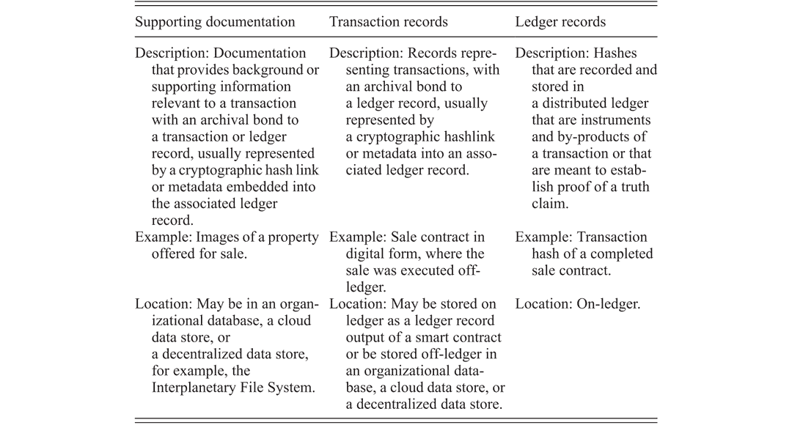

来源：更新自 Lemieux et al., 2019，表 1。

如第 1 章所述，第一个区块链比特币包含了一个账本——区块链——用于跟踪涉及比特币数字货币转移的交易。账本是一种非常特殊且受限的记录类型，是一种包含借方、贷和其他金融交易条目的文档，通常组织成独立的账户（Poovey, 1998；Pearce-Moses, 2005）。

账本中的每个条目本身也是一条记录。像所有账本一样，区块链账本的设计是为了生成简单的记录；它们最初的设计并不是捕捉除从一个账户到另一个账户价值转移之外的行为相关的记录。大多数区块链和分布式账本可以合理地存储与价值转移简单记录。正如讨论过的，记录加密货币交易的记录是以哈希的形式生成并存储在分布式账本中的。为了清晰起见，这类记录被称为`账本记录`（ledger records）¹² (ISO, 2020，节 3.44)，以将其与区块链和分布式账本运行与其他类型的记录区分开，例如那些活动发生在账本外的记录¹³。尽管如此，此类账本记录并没有告诉我们关于加密货币转移的原因——是为了买咖啡、支付账单、进行勒索软件攻击，还是出于其他目的？

随着第 3 章中讨论的区块链 2.0 的兴起，各种活动开始记录在区块链系统中（例如土地交易、供应链交易和医疗交易）。因此，账本记录开始代表一个更加多样化和复杂的活动组合，并与更多的交易记录和支持性文件相关，处于更广泛的程序和文件语境中。这些区块链 2.0 系统服务于多种目的，并以特定的方式利用分布式账本的能力。图 7.2 从记录视角提供了区块链 2.0 类型系统的分类法。后续章节讨论了这些不同类型的区块链和分布式账本系统在创建和保存可信记录目标方面的特征，并且表 7.2 概述了与这些系统在建立其生成和保存记录的真实性相关的主要的（并非全部）障碍。

**图 7.2 从记录视角看区块链 2.0 系统的分类法**


图 7.2（更新自 Lemieux, 2017b，图 2）

注：该分类法基于 2015 年 10 月至 2017 年 10 月期间的研究。该模型假设系统类型从与当前记录实践最接近的（左侧）向最具创新性或新颖的（与当前记录实践差异最大的，右侧）进行转变。每项创新都建立在现有的区块链记录方法的基础上，并且在任何特定的区块链或分布式账系统中，通常可以观察到这些实践的结合使用。

**表 7.2 区块链和分布式账系统中记录真实性的主要障碍，按系统分类**

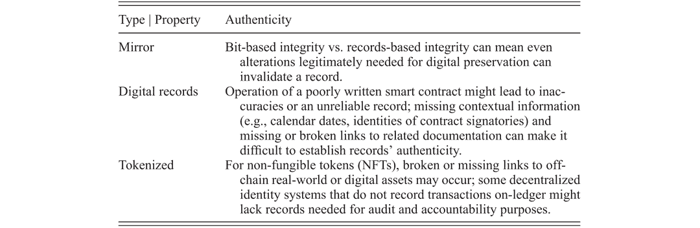

#### 镜像系统 (Mirror Systems)

最早的区块链 2.0 系统用于将链外创建的记录（无论是物理还是数字形式）的哈希值嵌入 Ledger 记录中，以便将这些记录“固定”在稳定的（即不可变的）形式中。我将其称为“镜像”区块链记录系统，因为这些哈希仅仅是对预先存在的（链外）记录系统中的记录进行镜像（或指纹化），并以账本记录的形式将其锚定到区块链中。这种类型的系统可能用于防止第 5 章中讨论的数据操纵。镜像系统使用分布式账本技术作为验证链外交易记录完整性的手段，其最终目的是保护这些记录免受伪造和操纵。这种设计模式可以使用公共区块链、许可区块链或分布式账本来实现¹⁴。这种类型的早期示例包括巴西的一个原型区块链土地转让系统，该系统对该国一个市政土地登记机构保存的土地交易记录进行哈希处理，并将其输入区块链账本；以及使用类似的分布式区块链类账本来保护爱沙尼亚电子健康记录的完整性（参见 Martinovic et al., 2017; Flores et al., 2018）。这种方法还支持了 Factom 提出的管理洪都拉斯政府土地所有权记录的解决方案(Lemieux, 2016c)。

使用区块链和分布式账本保护交易记录完整性的一个关键局限是数据完整性与记录完整性之间的差异。数据完整性是位级完整性；也就是说，如果构成该记录的每个数据位都保持不变，则认为该给定的交易记录具有完整性。相比之下，记录完整性允许交易记录的位结构发生改变，并且如果该记录继续为其所证明的行为的事实提供可靠的证据，则认为该记录具有完整性。事实上，数字记录位结构的的某些更改是数字保护过程中不可避免的方面（Collomosse et al., 2018; Owens, 2018, p. 125）。图 7.3 直观地说明了这一点。如果该记录是数字的，它将被认为没有完整性，因为部分内容缺失了。相反，如果剩余足够的信息使得该记录仍然能够提供其所证明的事实证据（假设微小的变换不会改变预期含义），那么它将具有记录完整性。


图 7.3 中国甲骨，约公元前 1200 年（由 BabelStone 提供的“商代刻甲骨”，根据 CC-BY-SA-3.0 许可）

ARCHANGEL 项目——由英国国家档案馆、萨里大学大学和开放数据研究所之间的合作——试图通过人工智能（AI）结合区块链技术的应用，解决保护记录完整性而非数据完整性的需求（Bui et al., 2019, 2020）。15)在该项目中，多个档案馆维护一个权威证明（Proof of Authority）区块链，在其中存储了可以验证视频记录（例如法庭审判视频）完整性的哈希。唯一标识连接了链内外数据，链上存储了两种哈希数据：（1）时间内容哈希（TCHs），用于保护视听内容免受篡改，这些哈希通过将视频序列通过深度神经网络（DNN）模型产生短二进制 PQ 代码（作为视频的开始和结束标记）生成；（2）DNN 和 PQ 编码器的二进制哈希，用于防止 TCH 计算被篡改。用于 TCH 计算的 DNN 模型经过训练，以区分影响位完整性的自然格式变化和信号篡改的不自然格式变化。这种能力将数据完整性转换为记录完整性，因为数字保护过程中产生的微小变换是被允许的。对 DNN 模型进行哈希也保护了用于 TCH 计算的模型免受篡改。通过这种方式，ARCHANGEL 项目开发了一种方法。瑞典土地登记的原型区块链系统代表了这种类型(Lemieux, 2017a)。

#### 数字记录系统

区块链和分布式账本技术的后续创新导致了“原生”链上交易的出现。在这些系统中，形成账本记录活动发生在链上，通常由智能合约促进。

智能合约通常用于数字记录类区块链和分布式系统，它们是“计算机程序……其中程序任何执行产生的结果都记录在分布式账本上”(ISO, 2020a, s. 3.72)。智能合约的概念并非新颖，也没有被统一地认同。这一概念由尼克·萨博（Nick Szabo）于 1994 年提出，他将智能合约定义为“一种执行合同条款的计算机化交易协议”(Szabo, 1994)。后来他将其定义为“一组以数字形式指定的承诺，包括各方在其中履行这些承诺的协议”(Szabo, 1997)。智能合约最初的目的是将合同条款嵌入硬件和软件中，以使违约成本变得高昂(Szabo, 1997)，同时也为了“最大限度地减少交易双方之间对信任中介的需求，以及恶意或意外异常的发生”(Christidis and Devetsikiotis, 2016, p. 2296))。智能合约使用编程语言实现，例如 `Solidity`，它是以太坊智能合约使用的原始语言。在以太坊区块链上，当合约被创建时，它会设定其数据库的初始状态。创建后，合约会“等待”区块链系统用户或另一个合约的启动。合约一旦启动，每一步都会“在网络上的每个节点上独立执行，并产生相同的结果”(Greenspan, 2015)。智能合约的执行结果将产生以账本记录形式表示的输出。

智能合约以及相关的账本记录经常与更大的程序和文件语境相相连；例如，土地交易可能涉及创建土地的地籍图的过程，或者为购买土地提供资金而办理抵押。因此，在数字记录类系统中，越来越常见的是看到在链上记录和存储的账本记录包含了关于其他活动、相关交易记录或支持性文件的元数据或哈希引用（参见表 7.1），账本记录将这些内容“固定”在区块链上，作为该账本记录所属交易的文件语境的一部分。元数据或哈希链接所引用的交易记录存储在链下，有时在传统的中心化存储中（例如组织数据库或云数据存储），在其他时候则使用去中心化存储（例如星际文件系统 IPFS）。¹⁶ 由于记录包含个人身份信息的交易记录（即使经过加密或存储为哈希值）时受到遵守隐私法规（如欧盟的《通用数据保护条例》(Hofman et al., 2019)）的担忧驱动，在账本记录中使用索引链下存储的哈希链接已变得越来越常见。¹⁷

当智能合约依赖外部数据源（例如“预言机”）¹⁸时，由于其可能包含错误或虚假信息，或者当错误地引用外部资产时（例如错误地声称某艺术品由某人创作），智能合约生成的账本记录的准确性可能会受到影响。如果智能合约逻辑存在错误，智能合约生成的账本记录的准确性也可能受到损害。这可能导致加密货币价值计算错误，或在错误的日期转账加密货币。

记录的可靠性也可能受到智能合约编程的影响。特别是，智能合约依赖的计算机代码可能由于逻辑错误、“有漏洞”的代码或复杂系统依赖的意外后果而并不总是按预期执行。系统性能问题可以且经常会导致数据问题，从而影响记录的证据质量(Delmolino et al., 2016; Rouhani and Deters, 2019)。智能合约的可靠性是区块链和分布式账本技术新兴领域的一个备关注问题，因为已经发生了多起涉及智能合约的高知名漏洞事件，导致了数百万美元的损失(Morisander, 2018; Nikolić et al., 2018)。

与智能合约可靠性相关的第一个重大事件涉及一个“DAO”——一个去中心化自治组织——它使用长期智能合约在以太坊区块链上为新创业项目筹资(Buterin, 2013)。2016 年臭名昭彰的“DAO 攻击”源于一个计算机编程缺陷——一个“递归调用漏洞”，未知攻击者利用该漏洞从 DAO 中抽走了数百万美元(Siegel, 2016)。¹⁹ 另一起重大智能合约漏洞是 2017 年 11 月发生的 Parity 钱包攻击。Parity Technologies 为运行在以太坊区块链上的智能合约发布了多签名（multisig）钱包软件（允许多个私钥）。该软件由两个不同的合约组成：一个名为“lightweight”，用于创建钱包；另一个包含大部分逻辑的“library”（Lazarenko and Avdoshin, 2018).所有 Parity 多签名用户都依赖该库，但由于合约创建者没有初始化它，导致合约没有所有者。黑客利用这一漏洞接管了该库的所有权，然后使用另一个函数将其破坏。结果是所有链接该库的钱包都被冻结。这次攻击的损失估计超过 1.5 亿美元。最终，这类错误（通常由于缺乏经验的合约开发者或复制带有逻辑错误的智能合约“配方”的做法）会导致智能合约生成的账本记录作为业务交易、权利和权益的证据变得不可靠。

### 区块链账本记录截图的复制

如果没有“档案纽带”（archival bond）的实例化，交易的意义并不明确——也就是说，在理解其创建的程序性和文献背景之前，我们无法得知这一点。

（来源：作者）

在数字系统中，档案纽带在记录与其程序和文献背景之间建立了极其所需的连接。档案纽带通常通过插入关于记录程序背景的元数据来显式化，这些元数据随后将记录与所有具有相同元数据的其他记录连接起来，从而建立其文献背景。例如，如果智能合约代码包含了揭示账本记录创建目的的业务逻辑，则可以将一个将账本记录与其生成性智能合约关联的代码插入到账本记录的对象属性中，作为实例化档案纽带的手段。只有当我们能够显式地将记录与其原始操作（即特定代化数字图像的所有权转移）以及该操作的背景连接起来时，记录才传达意义并实现作者的意图。

为了说明这一点，图 7.4 展示了基于区块链的数字资产管理系统中的账本记录。该系统包含一个指向存储在链外数据存储中的数字资产的哈希链接。一个预编程的智能合约生成了图中看到的账本记录。该账本记录代表了资产的转移，在本例中是一个数字艺术品。连接的数据存储中的资产图像并不是记录；相反，它是一份支持文件（其本身也是一种资产），构成了账本记录文献背景的重要部分。这些重要的背景化元素没有一个是在账本本身中找到的。

#### “断链”问题

账本记录与存储在链外的支持文件或交易记录之间的依赖关系导致了“断链”问题。这种问题发生在实例化账本记录与其原始操作以及任何其他关联文档和记录之间的档案纽带的哈希链接断裂时。虽然断开指向个人身份信息的账本记录的链接（即断开档案纽带）可能是旨在符合隐私法规的分布式账本的一项理想特性，但在其他情况下这绝不是一项理想特性，例如在那些将艺术品作为“非同质化代币”（NFTs）进行营销的系统中。在这些系统中，断链问题是一个令人担忧的问题：

> 最终，你购买的是一组定义你所拥有物的元数据。
>
> 但系统中确保 NFT 保持完整存在一个巨大的缺口：NFT 使用链接将你引导至另一个地方，艺术品及其任何细节都存储在那里。正如任何以前浏览过互联网的人应该知道的，链接会且确实会失效。那么，如果你的 NFT 损坏并指向虚无，会发生什么？
>
> (Kastrenakes, 2021)

尽管断链问题最近在 NFT 相关中被发现，但这种漏洞实际上在更早就被确定为对区块链和分布式账本记录的可信性的潜在风险，并涵盖了所有具有外部依赖的分布式账本记录形式 (Lemieux, 2017a)。该问题的早期示例之一可以在处理巴西土地转让的试点区块链解决方案案例中，观察到指向外部文档的断开链接 (Lemieux, 2017a)。

#### 智能合约与法律地位

另一个但相关的问题是智能合约作为法律合同的地位 (Bartoletti and Pompianu, 2017; Werbach, 2018)。Cornelius (2018，第 7–8 页；另见 Cornelius, 2020) 观察到，标准格式的消费者合同通常包含指向合同条款的超链接，这些条款可以在消费者不知情的情况下随时更改，这在分布式账本智能合约中开启了类似的可能性，即嵌入了索引动态且可变外部合同条款的链接，即使合约执行的账本记录是“不可变的”。20)

另一个挑战在于如何将基于账本的合同这种陌生形式，与基于经典模拟合同文件的文献学形式形式（diplomatics formalisms）以及非常不同的数字记录类型（例如，行政数据库，请参见 Duranti and Thibodeau, 2006; Roeder et al., 2008)）调和。

#### 数字记录中的日期

为了说明这一点，日期一直是合同执行的重要元素，提供了对于确定合同真实性和有效性至关重要的信息。与模拟记录不同，如 Duranti (1999)，第 153 页所解释，数字记录可能有多个日期，包括：

- 作者赋予文档的日期，证明了作者与内容之间的关系；
- 传输给外部或内部接收者的日期和时间，代表记录开始产生影响的时刻；
- 传输到记录所属档案或类别的日期和时间，揭示了事情的发展；
- 每次检索的日期和时间，显示了每一次查看行为。

这些日期中的每一个可能对于证明合同的有效性或其随时间变化的真实性都是必要的。日期在账本记录中的呈现与非数字和其他类型的数字记录完全不同。在区块链和分布式账本系统中，合同的定日期通常通过交易记录中嵌入的时间戳实现（参见 图 7.4）。在某些情况下，交易哈希可能会发布在报纸或社交媒体等外部来源上，将系统生成的时间戳与关于交易时间的外部证明来源链接 (Anduck, 2018)。许多区块链系统（例如比特币）在交易组合成区块时也会创建一个时间戳，这形成了生成区块哈希并通过加密方式将区块与其后续区块连接的源输入的一部分。这些不同的日期对于适用于考虑账本合同有效性的适性规范和法律都具有影响。最后，可能存在一个账本记录被认为不可否认的日期，但这取决于在有多少个节点更新其账本副本后交易才被认为确认，这反过来又取决于区块链的设计，例如使用的共识机制类型以及谁运行了参与验证和确认的节点 (Bitcoin Wiki, 2018; Lemieux, 2019)。

同样，签名——用于确定合同是否完整并生效，以及对其进行身份验证——在账本记录的背景下也大不相同。在 20 世纪的模拟合同文件中，签名通常出现在文档的底部（用外交学术语称为“结语部分”，参见 Storch, 1998），例如，位于构成合同条款和条件的条款正文下方；而在账本记录中，“签名”通常是在记录者使用其 `private cryptographic key` 签名时执行的。这一行为标志着记录是在签署者的意愿和授权下创建的。然而，传统记录与账本记录之间的一个重要区别是，许多区块链和分布式账本系统并未将 `private key` 与持有者的法律或自然身份相 link。在这些系统中，交易双方以匿名身份进行交互。因此，许多区块链和分布式账本系统缺乏档案外交学原则对真实性所需的身份属性，这意味着在这些情况下，可能很难确定账本记录的真实性。

`private key` 仅是执行区块链交易时生成的加密密钥对中的两个密钥之一，另一个是 `public key`。公钥的功能类似于模拟记录保存中的印章，正如当文件用蜡封封上以防止其篡改（以防止伪造和操纵），并作为声明文件与其声称一致的手段（参见 Ferguson, 1960–1，pp. 755–756，引自 MacNeil, 1998，p. 9）。此外，尽管数字签名封存了账本记录的内容——随后随后还可能通过将交易记录（或一组此类交易的 `hash root`）插入区块数据结构来再次封存——但它可能不包含实际的合同条款和条件。这些可能存在于实际账本记录之外，以编码进 `smart contract` 的逻辑形式，该合约在网络存储（即 `Ethereum Virtual Machine`）中拥有自己的 `address`（Marino and Juels, 2016; Ethereum, 2021b），并可能产生 Cornelius (2018) 所指出的上述问题。当记录被纳入账本后，我们可能将其视为“交付”了（实际上是对账本的更新）给交易另一方的 `public address`。通过这种方式，账本记录是以类似于“签署、封存并交付”的方式完成的，这与前数字时代的合同文件相似，但采用的是一种新颖的方式，并受限于上述关于生效日期的规定。

#### 代币化系统

我在 2015-2017 年的研究中识别的最后一种类型的系统是“代币化”类型。在这种系统中，不仅账本记录被记录在链上，而且资产被转换为加密表示，通常是通过将它们与底层的 `cryptocurrency` 关联来实现；即它们被“代币化”了。自从我最初的分类引入以来（Lemieux, 2017b），代币化类型的区块链记录保存解决方案发生了巨大的创新。

2017 年，我们看到了第一种代币化解决方案，我们可以将其描述为“可传输”代币。在这种系统中，资产（即有价值的物品）在链上表示为 `cryptocurrency` “token”（代币）。现在可以区分出此类系统的两个子类型：代表现实世界资产的系统和代表数字资产的系统。当这类系统首次出现时，代币代表的是有价值的物理资产——例如土地、名酒、食物、钻石或在链外创建的艺术品——通常由同质性代币（即可以拆分为更小交换单位的代币）代表。随着时间的推移，代币开始代表有价值的数字资产，例如可交易的收藏品，如“CryptoKitties”，21)，甚至是在链上原生创建的“无名债券”（参见 Batista et al., 2021）。这些资产许多由“非同质性”代币（NFTs）代表，它们唯一地识别资产且不能被拆分为更小的交换单位。这些代币的首个标准是 `ERC721` 代币标准（Ethereum, 2021b）。22)。NFT 的所有权是可以传输的，所有权的转移通过以账本记录形式记录在链上的交易来实现生效。

这些区块链和分布式账本系统对代币的使用可以追溯到中世纪早期，当时欧洲教会以外的社会成员尚未依赖书面文本作为证据（Lemieux, 2017b）。正如历史学家 M. T. Clanchy (1980) 所述，在从依赖常识的文化向基于书面文本文化的过渡过程中，象征物——如刀、剑、戒指和杯子——在证明主张方面发挥了关键作用。在中世纪早期，例如许多土地赠与是通过 `nude verbo`（口头）授予的，并附带一个象征性物品（即代币），而没有书面契约或地契。作为一个例子，


那把“古老且生锈的剑”，据说是华伦爵向爱德华一世的法官展示作为所有权的证据：“看，爵士们，这就是我的证明！”


另一个不为人知但更好的例子（因为它仍然存在）是保存在达勒大教堂档案馆中的破碎刀。它的角质手柄上附着一张羊皮纸标签，记录了这把刀所象征的赠与细节（发生于 12 世纪中期）。同样，手柄上刻有 `signum de capella de Iowic`（Lowick 教堂的标记）。由于羊皮标签对赠与细节的记录比刀更清晰，产生了一个有趣的问题：为什么要保留这把刀？最好的解释是，对于当时的人来说，这把刀是和标签同样重要的记录，甚至更为。

(Clanchy, 1980，p. 1117)

正如今天区块链和分布式账本系统中的 NFT 一样，这些中世纪代币除了索引人类经济交易之外，其本身就是有价值的符号对象。作为有价值资产的体现和交易的证据，这些记录承担着双重角色。在数据化时代，记录确实具有价值，这种价值在于它们包含了可以从中提取或“挖掘”的信息，用以创造新的见解或收入来源。然而，通过区块链和分布式账本系统，价值并非源于数据的提取，而是源于其无法被提取这一事实本身。账本的不可篡改性使得确定何时发生了此类更改变得可能（即篡改变得显而易见）。这在解决“数据双重花费问题”的同时，也解决了数字现金双重花费问题（参见第 1 章），恢复了将记录作为符号对象或资产以及证据的所有能力，就像人们拥有一个数字货币、戒指或另一个物理“代币”一样（Sanitt, 2021）。当数据化创造了剥夺记录和数据所有权的条件时，基于区块链的代币化提供了再次使人们在记录和数据中主张所有权的能力（Sanitt, 2021）。事实上，此类权利已经在许多法律判决中得到了维护（Sanitt, 2021）。²³并非所有人都认为这种能力将产生社会益处，但其他人对这一发展持乐观态度，特别是在收回个人数据的所有权和控制权或创意作品的持续权利时。²⁴

与可传输代币并行，代币化系统出现了第二种子类型，我们可以称之为“基于凭证的”。此类系统也被称为去中心化身份系统，其中主权身份（SSI）系统是此类中一种新型且不断增长的变体（参见 Mühle et al., 2018）。在基于 SSI 凭证的代币化系统中，资产（例如大学证明、营业执照、健康证书）被转换为加密代币，这些代币可以根据代币交换身份声明或“证明”。与 NFT 的情况不同，这些代币一旦发行，被设计为不可可传输的（从用于转让法律所有权的意义上说）；因此，它们目前的设计是为了确保所有权是不可传输的。其不可传输性的性是因为它们代表了识别并在某种程度上体现了人类的特征，特别是在健康凭证的情况下。因此，此类代币的设计为不可传输是合理的，即使在获得持有代币的个人同意的情况下，也可以共享基于凭证的信息。可以争论的是，这这也是最符合伦理的设计选择，因为如果人们接受可验证凭证识别并体现了个人，那么出售此类代币就太接近于人口贩卖了。尽管如此，但使用不可传输的身份代币（即始终与个人不可分割的代币）引发了用户画像分析的阴影。对隐私保护的审慎考虑始终是必要的。

基于这些可验证凭证的证明交换并未以账本记录的形式记录在链上。相反，分布式账本仅被用作一种手段，证明个人使用凭证作为证据所做的声明（即声明、证明）是准确的、具有完整性的，并且可以通过加密方式验证其是基于真实的凭证，从而被假设为真实。例如，在 `Hyperledger Indy/Aries` 框架中，区块链仅仅记录并保留公开的去中心化标识符、数据架构、凭证定义和撤销注册表（Tobin and Reed, 2016）。在这些系统中，如果凭证的发行者是可靠的，那么发行者提供的事实（例如某人是否拥有大学学位）就可以被认为是真实的。随后，获得该可验证凭证的人可以做出可证明的声明（例如，他们拥有大学学位）。简而言之，可验证凭证是声明的证据基础。密码学，如零知识证明（Goldwasser et al., 1989），通常用作“证明”声明的手段，而不泄露可验证凭证中包含的详细信息，从而保护了凭证持有者的隐私（Yang and Li, 2020）。例如，一个人可能证明他们在大学期间的平均分在某个特定的分点以上，而无需泄露他们获得的实际成绩。

与传统的区块链（如 `Bitcoin` 或 `Ethereum`）不同，某些（并非所有）SSI 系统为了保护隐私，不会捕获交互端点之间的交易数据交换。相反，此类系统仅使用账本来注册凭证架构、定义和凭证撤销——所有内容都为使用账本验证声明奠定了基础，尽管这些声明没有被记录，也没有在账本上被捕获。虽然这些类型的 SSI 系统可能具有符合如《欧盟通用数据保护条例》等隐私法规的优势，但它们的缺点是没有捕获交互端点之间的交换记录。然而，为了审计和问责目的，可能需要记录记录，例如当数据交换涉及参与健康相关研究（如临床试验）（Charles et al., 2019）。因此，在某些情况下，可能需要开发保护隐私、可验证且安全的记录交易的手段。为了说明如何实现这种能力的一个例子，可以建立一个“证明注册表”，用于捕获参与临床试验的同意记录，而不泄露个人身份，同时通过加密方式验证该同意来自声明的真实来源（即同意参加临床试验的个人）（Lemieux et al., 2021）。

## 7.3 设计账本信任

上述示例揭示了，在数字环境中记录的创建和保存几乎从不是基于长期维护信赖记录的考量（Eppard, 2008, p. 2），这对于账本记录的创建也是如此——从档案外交学（archival diplomatics）的角度来看，这些记录可能被视为“准记录”（quasi-records），即使此类系统声称其创建的对象与记录具有相同目的。

使用账本的目的可能是为了“保留”账本记录所引用的交易记录——例如在区块链或分布式账本系统之外创建的记录，这些记录通过哈希处理并“固定”在账本上，以便验证镜像记录管理系统中持有的记录的完整性；或者为了自动执行一系列程序，从而生成一个经过算法保护且不可篡改的新交易记录——例如使用区块链系统上的智能合约将土地所有权从一个人转让给另一个人。账本记录还可能包含指向真实世界数字资产（如艺术品或音乐）的加密哈希链接，或用于创建新的代币化数字资产（如数字收藏品）。所有解决方案的共同点是，它们依赖于对账本及其包含记录的信任。

然而，每种区块链系统在根据档案外交学关于记录信赖性的标准进行衡量时，仍然存在局限性。该标准要求记录具有准确性、可靠性和真实性——这些概念在档案外交学中是以非常特定的技术方式被理解的。例如，区块链系统可能缺乏对外部数据如何整合到账本记录中的控制，从而降低了记录的准确性；它们可能缺乏识别账本记录程序和文档背景所需的特定元数据，导致无法唯一地识别记录并阐释其含义；它们可能保留了账本记录的位结构，但同时在面对技术过时时，却无法保存账本记录的含义。这些以及无数其他问题，可能导致基于区块链和分布式账本的记录无法在信赖意义上被认为是准确、可靠且真实的，更不用说它们代表了不可反驳的真相这一广泛主张了。

随着技术的演进，针对本章提出的某些问题的解决方案正在开发中。然而，设计能够创建和保存日后观察者可能认为信赖记录的区块链和分布式账本系统，需要意识到记录作为证据（evidentials），在根本上与信息和数据不同。这还需要相关知识（包括一种概念架构），即如何设计能够产生具有特定属性的系统，使得后续记录读者能够恢复过去行为的证据。通常，参与区块链和分布式账本系统设计与开发的人并没有这种意识或知识。对区块链和分布式账本系统的设计者和开发者进行档案科学培训，以及对档案学家进行区块链和分布式账本技术培训，可能有助于预测和防止这些系统中大量的档案问题，例如上述提到的断链问题或 SSI（主权身份）系统中缺乏对等交易记录的问题。提高意识和填补知识差距可以通过一种新的多学科、甚至是跨学科的方法来解决，这种方法将以下各领域的理论、原则和实践整合进一个整体框架中（Duranti, 2009; Marciano, Lemieux et al., 2018; Lemieux and Feng, 2021)）：计算机科学（区块链和分布式账本系统设计者和开发者的常规背景）与档案科学（档案学家接受训练的领域），其至少目标是确定如何设计数字系统，“以‘创建和维护可以被视为事实和行为物质证据的[或准确地说，可以提供]的信赖数字记录’”（Duranti, 2009, p. 65）。

## 7.4 结语

在虚假信息时代，从本章讨论的局限性中，我们可以从区块链和分布式账本中学到什么教训？无疑，关注针对证据的设计——例如通过前瞻性地应用档案科学的原则和实践——可能会对知识的认识论需求²⁵产生积极影响，正如 Goldman (1999) 和 McDowell (2002, p. 52) 中讨论的。在《社会世界中的知识》（1999）中，Goldman 指出，社会实践可能对知识获取有益或有害。他认为社会认识论的目标是：识别对社会知识产生影响的实践，评估这些影响是正面还是负面，并推荐在认识论上更优的实践。实践在促进或阻碍诸如知识以及避免错误和无知等具有基本认识论价值的状态的获取方面，具有工具价值，而且可以说还具有道德价值（Goldman, 1999, p. 87）。鉴于由于真理主张的可靠性受益于证据提供的命题支持，提高作为证据的记录信赖性的实践可以改进并保护社会中的知识形成，并帮助防止第 5 章中讨论的那种操纵。如果根据承认其证据性质的原则进行设计，区块链和分布式账本可以帮助确保知识和物质的固定性，使信赖方可以将分布式账本记录作为信念的认识论基础。然而，这与宣称区块链提供了永久的真理来源、或是真理的终极记录，或是它们可以解决我们在虚假信息时代面临的复杂认识论问题仍有很大差距，我们将在下一章中进一步探讨。

¹ 波兰派（The Bollandists）是一个由学者、语言学家和历史学家组成的协会（最初全部是耶稣会，现在包括非耶稣会），自 17 世纪初以来一直在研究基督教的圣传和圣人崇拜（Hayes, 2011）。

² 有时拼为 von Papenbroeck。

³ 牛津英语词典将“抄本”（cartulary）定义为“一个存放文件或记录的地方（Johnson）；因此产生的整个记录集（属于修道院等）；或者记录这些记录的书籍；一个登记。”（Oxford University Press, 2021a）。

⁴ 在外交学中加入“档案”二反映了 InterPARES 框架中档案视角与外交视角的融合。外交学主要关注单个记录，而档案科学倾向于强调记录集合（例如案卷、系列和全宗）（MacNeil et al., 2001, p. 24）。

随着数字时代的到来，档案工作人员意识到，由于数字记录保存面临的挑战，需要对记录的产生给予更多关注。这种观点在 InterPARES 项目对数字记录真实性长期保存的研究中有所体现，但这种观点在传统的档案理论中并未得到反映。例如，荷兰《档案文件编排手册》指出：“因此，管理全档（[fonds]）的组成、编排和形成的规则，不能由档案工作人员预先确定；他们只能研究该有机体并确定其形成时遵循的规则。因此，每一个档案收藏体都有其自身的个性和独特性，档案工作人员在对其进行编排之前必须对其了如。” ([Muller et al., [1920] 2007))。

Yeo (2017) 错误地认为，我在 2014 年对记录的定义中对“信念（beliefs）”的引用是指记录所包含的信息或“言说”；相反，我指的是一个社会群体对于如何对对感知现实进行良好表征的信念，以及因此什么会被视为在特定“话语领域”内形成有辩护的真信念的可靠来源。

尽管如此，我认为所有记录都以某种方式传达了信念，即使是根据 Yeo 所采用的 Searle 分类法 ([Searle, 1999], p. 150），那些表达性（表达情感或态度）、指令性（提问或试图让某人做某事）、承诺性（使作者承诺做某事）或陈述性（“改变世界”）记录也是如此。即使记录是作为情感、命令或承诺的表达而产生的，读者也能获得某些信息。根据广泛接受的认识论原则，由于信息的接收者无法从一个不知道某事的信息的发送者那里获得某事（即持有有辩护的真信念），因此我们可以假设记录传递了信念。如果对此持异议似乎很奇怪，因为我们确实通过记录了解了过去的心理状态、宣战或做出的承诺。

正如 Recker 等人 (2019, p. 766) 所解释的：“根据[表征理论]，[信息系统（IS）]的本质在于它提供了其他现实世界现象（焦点现实世界现象）的表征。信息系统对焦点现实世界现象提供的表征越忠实，它们就被认为越有用……人类就可以利用它们来获取有关现实世界现象的知识，而无需直接观察这些现象，”例如利用它们来获取关于过去的知识，由于过去的现象已无法直接观察，这些知识原本是无法获得的。

这并不是说记录总是完美忠实地表征现实，或者记录创建者从不为了特定角度呈现现实或推进自己的观点而创建记录。这一点在本章关于区块链和基于分布式账本记录的讨论中将显而易见。然而，这一事实并没有否定记录创建者在创建这些记录时意图表征某些事物的观点。

档案理论者倾向于争论记录必须刻意“留存（set aside）”才能成为记录，这通常被解释为“捕获”到记录管理系统中（例如，见 Yeo 2018 关于此点的观点）。我倾向于采取更宽松的观点，基于社会文化实践存在差异这一事实，将“留存”解释为包括更多非正式实践，例如将文档保存到计算机驱动器的文件夹中，以及在记录系统中更正式的捕获和注册过程。对我而言，关键点在于指涉社会群体中随后依赖该记录进行行动或参考的社会参与者是否认为它是具有权威性的。我将在第 8 章详细讨论这一点。

这并不意味着档案文献学对记录的概念没有局限性：它倾向于假设记录可以还原一组定义良好的元素，而这些元素很难映射到新的数字对象 ([Rogers, 2015], pp. 40–41)。在古典文献学术语中可能构成记录的元素，在新的数字环境中是复杂的、相互关联的数字系统组件，随着技术的不断发展，它们变得更加相互依赖 ([MacNeil, 2004], p. 219; [Duranti, 2009], pp. 42–43; [Rogers, 2015], pp. 182–183)。

因此，在 2016 年后的许多工作中，我在推进计算档案学研究 ([Marciano, Lemieux et al., 2018]）的背景下，借鉴了 InterPARES 项目的工作。这项工作主要在“链中记录”项目框架下进行，该项目于 2016 年至 2018 年间在不列颠哥比亚大学运行，涉及开展一系列案例研究，从档案文献学定义的信誉角度分析区块链记录系统。更多感兴趣的读者，请参阅 `https://blogs.ubc.ca/recordsinthechain`。

ISO (2020a))22739 将账本记录定义为“包含交易记录、交易记录的哈希值或对记录在分布式账本上的交易记录引用的记录”。链下（或离链）交易是指那些“与 DLT [分布式账本技术] 系统相关，但位于、执行或运行在该 DLT 系统之外的交易” ([ISO, 2020a], s. 3.53)。

公共分布式账本（区块链是分布式账本的一种）是公众可以访问使用的账本 ([ISO, 2020a], s. 3.64)；许可分布式账本是需要授权才能执行特定活动或活动的账本 ([ISO, 2020a], s. 3.57)。

应当注意的是，这一理念的核心早于分布式账本和 ARCHANGEL 项目；具体而言，它可以在该项目之前的几十年的数字保存工作找到找到。例如，由斯坦福图书馆开发的 LOCKSS 项目使用了“事后”共识机制和 Merkle 树，使位级更改对文档保管者可见 ([Maniatis et al., 2005))。

请参阅 [`ipfs.io`](https://ipfs.io)。需要注意的是，该系统作为记录存储器存在重要的局限性。特别是存在隐私问题：运营者必须在系统中充当对等节点，因此需要允许其运行可寻服务器的承载关系，并且他们必须代表他人承担流量，这导致该系统不激励兼容。这个问题可能可以通过某些方式解决，例如使用 `Tor` 洋葱服务，并用廉价的加密虚拟专用服务器份额来解决存储问题（G. Goodell, 个人通信，2021 年 6 月 28 日）。还存在持久性问题：内容必须传播到对等节点，且这些对等节点必须保持可访问状态以便检索内容（关于这一点，请参阅 Lemieux, 2017a）。

采用这种方法，个人数据保护和隐私可能是一个问题，因为涉及个人数据的交易仍记录在账本上，因此是可发现的，即使仅限于少数系统用户。这些交易还可能包含个人不愿透露的个人信息，例如个人可能访问过某位医生或参与了与某种疾病有关的研究。

ISO (2020a, s. 3.28) 定义分布式账本技术预言机为“使用来自 DLT 系统外部的数据更新分布式账本的服务”。

DAO 的目标是使规则和决策工具代码化，消除在新的区块链企业治理中对人员或物理文档的需求，即去中心化控制的治理，使用不需要外部实体或管辖区解释的独立协议（Siegel, 2016）。2016 年 6 月针对 DAO 的著名攻击（该组织由一家德国创业公司于 2016 年 4 月创建）从其账户中取走了 6000 万美元，而这些资金由一次意外成功的代币发行提供了缓冲，该 ICO 筹集了超过 1.5 亿亿美元。

在智能合约中建立灵活性仍然是一个待解决的挑战，一些人认为可以通过人工智能的应用来解决（例如，参见 Dixit and Norta, 2018; Liu et al., 2019）。

[www.cryptokitties.co](http://www.cryptokitties.co)。

ERC 代表以太坊请求评论（Ethereum Request for Comment）。

案例法，请参见新加坡的 `B2C2 v Quoine [2020] SGCA(I) 02`；新西兰的 `Moore v Cryptopia [2020] NZHC 728`；以及英国的 `AA v Persons Unknown [2019] EWHC 3556 (Comm)`、`Robertson v Persons Unknown, Case No. CL-2019–000444`（2019 年 7 月 15 日）和 `Vorotyntseva v Money-4`。报告请参见，例如，关于加密资产和智能合约的法律声明（LawTech Delivery Panel，2019 年 11 月），以及虚拟货币背景下引发的法律不确定性问题（Financial Markets Law Committee，2016 年 7 月，引自 Sanitt, 2021）。

最近 Twitter 上的一场交易对 NFT 创建的“伪稀缺性”持批评态度（Ridge et al., 2021）。Twitter 的讨论聚焦于艺术和博物馆领域，但即使在那个领域，也有人认为 NFT 赋予了艺术家从其创作作品中获得持续价值的能力（Casey, 2021）。

McDowell (2002, p. 53) 就认识论价值提出了一个非常重要的观点，认为它并不会优于所有其他价值：“在某种结果主义框架下评估实践，并不意味着不能在另一个框架下对其进行评估。一个在认识论上理想的实践可能出于道德、美学、实用或其他原因是不理想的。当这种情况发生时，人们需要确定哪种价值更重要。如果考虑到所有因素，另一个价值超过了认识论价值，从而推翻了认识论评估关于哪种实践更优的决定，那么另一个价值就‘胜过’了认识论价值。”

# 第五部分 未来的理论

## 8 账本上的“生活世界”

### 8.1 从档案现实到社会认识论现实

虽然在事先加强区块链和基于分布式账本的系统以增强其在生成和保护可信证据方面的预设能力方面，可以做很多工作，但仅凭这些还不足以让信任者信任分布式账本记录作为“真理”的来源。证据只能见证它们参与过的或专门为了记录而创建的过去行动。正如 Stoler (2002, p. 87, 引自 van Bussel, 2017, p. 25) 所观察到的，“使用后结构主义论点：‘档案转向’意味着将档案更多地看作过去的认识论实验，而非历史来源；视为争议性知识的交汇点、刻有权力关系的透明体，以及统治技术。”因此，尽管记录可以被概念化为类型的证据，但这等同于将它们理解为证据（Yeo, 2007, 2008）或真理。

档案学家用于发现和描述档案生活的方法始终包括研究记录产生的方式（Duranti and Michetti, 2016）。传统上，档案学家通过应用“整体尊重原则”（respect des fonds），包括尊重原始顺序，将档案方法应用于档案文件体（即档案全宗）的编排和描述。档案方法源于一种实践，旨在让档案学家和记录的后续读者能够通过对记录创建者及后续记录保管者“亲历经验”的深度理解，来评估记录的意义和可信度——换句话说，从其“生活世界”内部进行（[Husserl, [1954] 1970](#ref-list.xhtml#REFe-r-294)）。对记录可信度的评估必须考虑后续读者与记录生活世界的关系——例如，读者相对于记录创建者和保管者关系网络的位置——因为这也会影响读者对作为证据的记录所投入的信任。档案方法所依据的史学基础源于浪漫主义时期，当时许多学者相信有可能直接接触到过去的现实。这种信念植根于许多相互关联的假设中：幸存的过去遗迹可以代表已经消失的部分；这些遗迹在某种意义上是记录创建者的人格化身；并且通过这些文献遗迹，进入该创建者的意识和过去本身是可能的。（MacNeil, 2016, p. 184）

这一观点在荷兰的《档案编排与描述手册》中得到了体现，该书首版于 1898 年，并于 1920 年出版了第二版。它将源自同一创建者的档案文件视为一个“有机整体”，它“作为行政机构活动的结果而产生……[且]始终是该机构功能的反映”([Muller et al., [1920] 2003](ref-list.xhtml#REFe-r-467), 第 19 页)。在最初的表述中，档案方法认为记录提供了通往过去的直接途径。而今天，广泛接受的观点是，记录是了解过去的窗口，而非以某种方式成为过去本身(Lustig, 2020)）。因此，我们接受记录为我们提供了了解过去行动，以及导致记录形成的个人、组织和社会制度结构的手段。

档案学的认识论与 18 世纪末、19 世纪和 20 世纪初的几位哲学家和社会理论家的著作具有共同的根源，其中许多人受过文献学训练。MacNeil 指出：

文献学将学术关注放在通过文本的语言、形式和历史背景恢复过去，根据唐纳德·凯利（Donald Kelley）的说法，“它在一种假设基础上建立了一种新的逻辑，即语言复制了（如果并非创造了）现实的构型。”

(Kelley, 2012 援自 MacNeil, 2016, 第 163 页)

这一思想在 20 世纪中叶人文科和社会科学的“语言转向”中充分绽放，它指的是一种根本性的话语转变，这种转变认为语言是人类行为和社会制度的生成性([Lévi-Strauss, [1963] 1985](ref-list.xhtml#REFe-r-390); Austin, 1962, 1975; Berger and Luckmann, 1966; Rorty, 1992; Foucault, 1973; Habermas et al., 1984; Searle, 1985; Derrida, 1996)。随着语言转向，曾经的文本理论（文献学）转变为社会行为和形成的理论。

图书馆科学家和文献理论家杰西·谢拉（Jesse Shera）的工作——他在 20 世纪 60 年代与同事 Margaret Egan 合作，首次提出了“社会认识论”的思想——例证了这种对社会认识论现实的语言学理解。谢拉认为文本形成了“个体在文化中实现统一的 Basic 纽带”，并主张“[一种]文化几乎按照定义会产生一种‘副本’，一种以多或少永久的形式存在的记录，这种记录可以代代相传”(Shera, 1961, 第 169 页; 1968, 第 8–9 页; 1972, 第 112 页 – 以上援自 Martinez-Ávila and Zandonade, 2020)。从这个意义上说，社会和文化是一个围绕记录形成并反过来由记录形成的生态系统。此外，尽管谢拉没有触及这一点，但遵循 Hardwig (1991)，我们可以假设，参与记录形成的社会参与者之间的信任是这一社会认识论形成过程中不可或缺的一部分。

虽然我们可能不同意社会中的每一个行动都会被转录或产生文本，甚至认为它应该这样做——特别是当我们考虑到 第 6 章 中描述对个人隐私的影响——事实上，许多档案学家已呼吁“逆纹理”地阅读档案并解释档案中的“沉默”（例如，Carter, 2006; Cook, 2009)——但哲学家约翰·兰斯肖·奥斯汀（John Langshaw Austin, 1911–60）和约翰·塞尔（John Searle, 1932–）的“言语行为”理论认为，对言语（包括以文本形式捕捉的言语）的理解不仅是传递信息，还能执行召唤社会存在的宣告行为(Austin, 1975; Searle, 1985; 另见 Yeo, 2018)。通过连续的言语行为，一种文化主体性地构建并复制了其生活世界(Berger and Luckmann, 1996)。

从这个角度来看，所有社会都是社会-信息-技术的生态系统，由社会参与者、交流以及认知和通信技术构成，这些要素使得社会群体在时空中得以持续。因此，通过档案进行研究和学习，就是在研究和学习社会本身。

可以将区块链和分布式账本系统理解为社会认识论生态系统的独特微观世界或简化形式，这些生态系统同时在配置记录（即账本）并配置生活世界。通过采用档案方法研究这些记录的起源及其创建和保存的背景，我们可以理解与之相关的独特认知和社会社区。由于区块链和基于分布式账本的生态系统的运作方式独特（即社会认识论共识的形成），这种策略为解决虚信息时代社会面临的问题提供了可能的见解。这特别是由于所有这些社区都拥有某种的乌托邦愿景——无论是像比特币一样体现了 Taylor (2004) 所理论化的那种宏大“社会想象”，还是（如挪威海鲜供应链联盟那样）旨在在现有的新自由主义社会政治、经济和法律框架内对社会经济状况进行更温和的改进。

分布式账本以及围绕其形成的生活世界，产生于一种社会认识论共识（socio-epistemic consensus）的形成，即通过克服可能的同伴分歧，就同伴们准确、可靠且真实记录的事务状态达成共识。这种状态体现于所形成的区块链，或更广泛地说，分布式账本之中。在社会认识论中，同伴分歧涉及“一个代理在得知其同伴对特定命题持有相反立场时，其[应当]调整其对[该]命题初始信念的问题及问题”（(Goldman and O’Connor, 2021)）。社会认识论者讨论了同伴（即认识论上的对等者）可能用于解决分歧的几种策略。例如，他们可能会实践“调和主义”（conciliationism）（Feldman, 2006, 2007; Christensen, 2007, 2009; Elga, 2007)——也就是说，如果他们和另一方同伴都有充分理由同时但分别地相信某个命题为真或不相信其真，他们可能会暂停判决。在这种观点下，当只能持有一个真信念时，唯一的出路是保留对谁的信念是合理的真实的终极判决。⁵ 另一种选择是通过话语方式考虑每个同伴的推理质量，并采纳推理最好的同伴的信念，这被 Kelly (2010)称为“全证据观点（Total Evidence View）”。当然，采用多元主义也是可能的，接受存在许多版本的“真理”，这被视为后现代主义的象征。

这些方法中都没有描述同伴在区块链和其他分布式账本背景下用于解决分歧的策略。⁶此类系统的特定运作模式要求通过算法得出的单一真信念，因此排除了信念悬置、证据权衡或不同参与者持有多个不同的“真”信念。为了进一步解释这一点，让我们首先回顾同伴是如何达成共识的。在正常情况下，同伴之间关于交易排序以及账本应包含内容的共识，是由共识机制通过计算方式决定的——即实现共识的算法规则和程序。⁷共识机制解决了这样一个问题：当跨越分布式账本技术（DLT）网络的同伴竞争添加记录时，系统内广泛分布的同伴如何就账本上的交易状态形成单一的、共享的合理的真信念。共识被定义为“DLT 节点之间[并扩展地，对于控制这些同伴的人]达成一致：1) 交易已通过验证；2) 分布式账本包含一组一致且经过排序的已验证交易”（(ISO, 2020a, s. 3.11）。一旦达成共识，它反映了账本的接受状态；也就是说，所有参与的同伴对账本的状态共享相同的规范性、可复制的信念，并对其包含的记录达成一致。正如之前讨论的，共识机制为交易双方提供了认识论上的基础（即账本），使其能够对交易另一方——受托人——的信誉度形成合理的真信念，使他们能够（如果他们愿意的话）以极高的信心（理论上）行动，确定他们拥有一定数量的加密货币、拥有特定资产，或某种状态持续存在。通过为产生信任提供制度化基础，账本为社会和经济的协调、合作以及共享意义提供了基础，而这些对于社会认识论世界的形成是必要的，即使对于彼此之间几乎一无所知的社会参与者也是如此。

有几种不同的共识机制可以将经过验证的交易包含在账本中。每种机制在确定交易的包含和排序以及解决同伴间分歧方面都略有不同。这些不同的机制为“个人、交互和组织级认知、情感和行动的局部片段提供了‘设置、材料和基础设施’”（(Steele et al., 2020, p. 3）。

其中最广为人知的是由于在比特币区块链中的应用而的工作量证明（PoW）共识机制。正如第 1 章 所讨论，PoW 共识机制要求同伴（“矿工”）竞争通过求解一个计算困难的谜题来率先向账本中添加包含一组新交易的区块。该谜题涉及寻找一个随机数（即 `nonce`），该随机数与指定的输入数据结合时，将产生一个比当前某些接受的难度目标更小的哈希值，该目标通常表示为一长串零字符串。

有时会有两个矿工同时解开谜题，导致同伴分歧。比特币同伴通过始终信任长链来解决这种分歧——换句话说，随时间推移的总计算能力代表了真信念。如果两个区块同时被挖出，被接受的区块是大多数（即 51% 的矿工）决定遵循的那个。被拒绝的区块通常被称为“孤块（orphan block）”或“过期区块（stale block）”，因为它不再是最长链的一部分（Orphan block, 2019）。换句话说，那种信念被丢弃了，持有该信念的人会遭受损失。在比特币中，没有机制可以将这些孤块带回账本的认识范畴。因此，这有时会导致账本分裂，我将在下文中进一步讨论。

相比之下，以太坊 GHOST（Greediest Heaviest Object Subtree）协议是 Po 协议的一种变体，它引入了财务激励（“叔叔块”或“ommer 块”奖励），以鼓励矿工挖出孤块并将其带回规范账本的范畴内（Ethereum, 2021a)——这是一种计算上的认识包容性。这项创新被认为是必要的，因为以太坊的区块生成更快（约每 13 秒，而比特币为每 10 分钟一次[Kenton, 2020]），如果没有将孤块引入主链的激励，这自然会导致产生得多的孤块。

另一种流行的共识机制被称为权益证明（PoS）（King and Nadal, 2012）。PoS 基于“硬币年龄”（coin age）的概念，该年龄是通过所持有的加密货币数量加上持有时间组合计算得出的（King and Nadal, 2012）。这种方法之所以获得支持，是因为与工作证明（PoW）共识机制相比，它减少了确认区块所需的能量，而且它被视为一种使参与者的利益与网络正确运行保持一致的方法，因为违反规则最终会降低参与者经济权益的价值。此外，在网络正常运行的情况下，质押持有时间越长，其价值随时间增加得越多，从而激励参与者继续维持网络上的关系，以提供更大的网络稳定性。这种方法与哈丁（Hardin）关于信任的“封装利益”概念高度契合，该概念预设信任方有动力以可信的方式行为，因为他们有意愿维持从中获益的关系（在第 2 章中讨论）。

### 以太坊中 PoS 的实现

在为以太坊区块链未来版本提出的 PoS 版本中，参与者必须质押持有的以太坊加密货币 `ETH` 来成为网络上的验证者——这相当于 PoW 背景下的矿工。验证者通过伪随机选择，负责对交易进行排序并创建新区块（Ethos.dev, 2020）。质押被用于激励良好的验证者行为：“例如，用户可能会因为离线（未能进行验证）等原因丢失部分质押，或者因为蓄意勾结而失去全部质押”（Ethereum, 2020）。在 PoS 中，对点间共识形成和潜在分歧的处理方式与 PoW 共识有显著不同。

例如，在提议的以太坊 PoS 版本中，有两种账本（或链）：一个拥有 64 个实例的“分片链”（shard chain）和一个充当控制器链的“信标链”（beacon chain）。对于每个分片链，验证者通过算法选出并负责向区块中添加新交易。未被选中添加区块的验证者则被要求对另一个验证者的区块进行见证——以确认其符合协议——他们必须在指定的“时隙”（slot）内完成此操作。每个时隙仅创建一个有效区块。至少需要 128 个验证者（组成一个“委员会”）对每个分片区块进行见证。一旦获得足够数量的见证，该见证就会记录在信标链中，并通过指向分片区块的“交叉链接”（crosslink）确认该区块已包含在共享账本的状态中。在完成 32 轮区块见证（称为“周期”，epoch）后，将形成由不同的随机参与者组成的新验证委员会，以防止勾结（Ethos.dev, 2020）。以太坊建议使用 `Casper` 协议来确定交易和区块的终性。这涉及让验证者在特定的周期检查区块状态，如果三分之二的验证者同意，则该区块被认为已最终化（Ethereum, 2020）。

### 法律体系与治理

如上述讨论所示，即使在分布式账本系统中使用同一类别的共识机制，其为达成共识状态而运行的规则和程序也可能非常不同，这会在点间达成达成的方式、分歧最终解决的方式以及账本如何形成方面产生截然不同的结果。鉴于此，考虑这些规则和程序的来源以及它们如何被执行至关重要——换句话说，即它们所所属的法律体系。在档案文献学（archival diplomatics）中，法律体系是“一个基于规则体系组织的社会群体，包含三个组成部分：社会群体、该社会群体的组织原则，以及该社会群体认可的约束性规则系统”（InterPARES 2 Project, 2021c）。法律体系的概念与制度社会学文献中的“宏观基础”（macrofoundations）概念构有某些相似之处（Steele et al., 2020）。正如该文献所指，制度宏观基础与微观基础（即局部且特定的社会互动）共同构成组织，“并被刻入人们体验世界和自我的符号框架、躯体、情感基调和感官装置中”（Steele et al., 2020, p. 3）。

共识的法律背景是一个宽泛的话题，在关于区块链和分布式账本生态系统治理的讨论中会被考虑，这通常涵盖了如何达成和维护共享账本状态协议的非技术和技术方面，也出现在讨论特定共识机制的专门技术文献中。有趣的是，这些文献中很少关注对分歧的解决，尽管从研究分歧中可以学习到很多教训。因此，治理涉及知识生成规则和程序的形成——换句话说，即关于交易的合理真理信念在何种条件下被认为在认识论上是可靠的——而特定的共识机制则在事前和正常条件下执行了这些规则和程序。

### 案例研究：比特币

例如，在比特币中，对验证机制的初始和持续接受被写在比特币协议的规则中（作为非正式法），这些规则由负责系统设计和持续治理的社会参与者群体建立。这些规则以比特币改进提案（`BIPs`）的形式存在，这是一种设计文档，为平台软件代码新特征的属性和原理提供技术规范（BIPs, 2021）。这些 BIP 最终实例化于代码中，要么作为测试新规则的协议实验版本，要么在获得集体共识后以当前协议版本的形式存在。理论上，如果我们把比特币与自由民主国家进行比较，负责 BIP 的社会参与者（通常是核心开发者）充当了比特币用户的委托（尽管并非选举产生的）代表，以及立法者和管理人员（Walch, 2015）。这显然与自由民主国家不同，在后者，治理的立法、行政和司法方面通常是分离的。

核心开发者之所以代表比特币用户拥有立法者和管理者的合法性，主要得益于社区对他们专业知识的信任，这使得比特币成为了一种精英治国体制——一种倾向于将认知权威与社会权力及权威紧密结合的组织原则。比特币核心开发者通过他们对比特币代码库的“提交（commits）”数量来展示其作为软件开发者的技能。代码库的维护一直仅是少数“核心（且相当中心化的开发者）”的范畴，其中大多数人被其他同行认为并信任他们具备能力和“美德”——即认知权威——来设定决定账本上知识形成的规则。最初，核心开发者的合法性也源于他们与账本原始开发者、匿名的萨希·中本（Satoshi Nakamoto）之间的社会亲近程度。因此，在比特币的案例中，像 Gavin Andresen 这样与中本进行过直接通信的开发者，就具有近源的认知权威。此外，核心开发者的合法性源于他们对一组核心价值观的承诺；例如，对开源软件开发价值的信念以及对企业激励的脱离。

因此，比特币核心开发者这一紧密社区最初通过相互信任联系在一起，这种信任基于一种理解：每个人的利益都包含了他人的利益；一种与项目创始人相关的软件开发能力的共同尊重基础；以及共享的规范、操作原则和实践，这些因素通过思想和行动的独立性促进了感知的可信度。这种方式非常让人想起 Shapin (1994) 对英国皇家学会“绅士哲学家”的记述，早期的比特币核心开发者彼此信任，并根据非正式的规范和价值观运行，这些标准决定了比特币运行的总体规则和程序，包括如何实现账本共识以及如何解决分歧。

然而，比特币社区并不总是通过 Shapin 所描述的、作为英国皇家学会绅士哲学家特征的种种文雅的学术辩论来解决分歧的。相反，Andresen 被描述为曾表示：“作为‘首席维护者’，他总是寻求共识，但在少数几次发生不可调和的分歧时，他会做出最终决定，充当某种‘仁慈的独裁者’”（[Popper, 2016b]），这是一种相当具有公司主义的方法。这一表述恰恰地说明了游戏的认知规则——及其运行产生的记录——与社会权力和权威之间深刻的相互关系。记录的产生（即使并非所有都是证据）通过社会认知过程与此类事务紧密相关，这些过程决定了产生证据的规则和程序，以及其中捕捉的状态将如何被判定为可靠——因此是可靠且公正真实的。

在比特币中，同行们可以随心所欲地离开，但一旦参与并维护平台状态，他们必须服从平台软件代码中实现的规则。争议解决——或者类比自由民主国家的司法功能——在正常运行条件下通过计算处理。通过继续按照旧版本的比特币软件协议运行来抗议规则，或者采用新代码（如果与当前接受实现新规则的客户端版本不兼容），会导致所谓的“硬叉（hard fork）”或账本状态的分，这本质上创建了两个竞争的账本（因此可能产生两个版本的被接受真相）。一旦账本发生硬叉，同行们必须选择在哪个分叉上继续交易，即他们希望遵循的真理版本。

硬叉通常反映了参与分布式账本系统设计和持续治理的人员之间未解决的认知分歧（例如，[Hearn, 2020]）。这种动态的典型例子是 2016-17 年发生在比特币 Core 并导致比特币现金（Bitcoin Cash）产生的臭名昭彰的硬叉。在这次硬叉中，比特币社区不同派系之间的分歧在于如何扩展网络，这需要对配置账本的规则进行更改。问题的出现是因为，随着比特币网络上交易数量的增加，随着账本的使用超出了加密货币交换（即第三章讨论的区块链 2.0 用例），每笔交易的复杂性不断增加，由于每个区块的大小以及新区块形成的速率保持不变，网络的交易吞吐量变得越来越慢。到 2016 年，网络速度已从 2011 年的每秒约七笔交易慢到每秒约三笔。这已经明显慢于 Visa（速度为每秒约 1,700 笔），一些比特币社区成员将其视为合理的基准（[Hearn, 2016]）。

到 2017 年，情况已变得不可维持，某些交易需要 14 小时才能被挖矿并传播到网络。交易费用也迅速上升，并且对网络（及账本）可靠性的担忧随之增加（[Hearn, 2016]）。比特币社区的许多人主张增加区块大小以促进快速交易；然而，其他社区成员抵制了这一想法。[Popper (2016a)] 在《纽约时报》上写道，这场辩论已经“暴露了关于比特币项目基本目标以及在线社区应如何治理的根本差异”。内部人士将这种分歧描述为一场“内战”（[Hearn, 2016]），其中“比特币已从一个透明开放的社区变成一个由猖獗的审查和其他比特币者对比特币持有者的攻击所主导的社区”（[Hearn, 2016]，引自 [Popper, 2016b]）。Popper (2016b) 的文章描述了当时争端变得多么激烈：“这种分裂在过去的六个月里导致了针对比特币开发者的死亡威胁以及导致互联网提供商宕机的黑客攻击。双方都产生了强烈的背叛感。”“背叛”一词的使用意味深长：由于这场分歧，信任被破坏了。

这些认知问题至少部分源于比特币核心开发者社区成员之间分化的经济利益，这导致参与规则形成的社会活动者之间产生了不信任感。一方面是像 Hearn 这样的人，他们认为比特币的未来以及他们对系统自身的经济利益，可以通过增加区块大小到 Visa 级的交易速度来增强。另一方是那些正在开发一种扩展网络的“二层”方法，称为闪电网络（Lightning Network），他们的经济利益通过保留现有的 1MB 区块大小来实现。闪电网络旨在创建一个替代性的区块链——或侧链——它可以处理更多的交易，但仍然锚定在比特币主链上（例如，[Poon and Dryja, 2016]）。

更使问题复杂化的是，系统一直在演变，导致节点之间不再拥有平等的哈算力。矿工和矿池的兴起意味着，某些节点（或节点联盟）比其他节点拥有大得多的权力来影响规则变更提案的结果。此外，这些节点在经济上有动力维持现有的网络运行规则，因为改变最终可能导致其权力、收益以及对特种比特币挖矿设备（例如，专用集成电路 [ASICs]）的投资价值的下降。不容忽视的是，在分歧发生时，许多强大的矿工来自中国，而许多核心开发者成员是北美人或欧洲人，这为使一个曾经内部凝聚且互信的比特币社会-认识论社区的分裂增添了文化差异的隔阂（Hearn, 2016）。

### 解决分歧的方法

解决日益激化的分歧的方法各不相同。作为比特币代码的主维护者，安德烈森（Andresen）采取的“仁慈独裁者”方法可能会让他介入并仲裁纠纷，但当时已接替安德烈森成为主维护者的荷兰程序员瓦拉基米尔·范·兰（Wladimir J. van der Laan）不想这样做，他表示：“我不能成为网络级问题的决策者”，并进一步说道：“没有人‘拥有’比特币。没有人可以像对待公司一样来决定比特币”（Popper, 2016b）。在安德烈森辞去比特币 Core 维护者职位后，他与迈克·希恩（Mike Hearn）提出了一个新的 BIP——`BIP 101`（Bitcoin, 2015a）——“解决几个缺乏在 Bitcoin Core 中实施所需的共识的争议性观点”（Hearn, 2016；Bitcoin XT, 2020）。`BIP 101` 以 `Bitcoin XT` 的形式实施并于 2015 年 8 月 15 日发布（Bitcoin, 2015b；Hearn, 2015a, 2015b, 2016）。如果大多数节点通过了 `Bitcoin XT`，它将被接受为一种新规则，区块大小将会增加；然而，其他社区成员认为，引入这种他们认为是先发性且具有分裂性的硬叉是对社区价值及其对达成认识论共识承诺的背叛（Popper, 2016b）。`BIP 101` 最终在 2016 年 1 月撤回，但在此之前，任何关于 `Bitcoin XT` 的讨论已被比特币论坛禁止，并且针对运行新协议的节点发起了网络攻击（Hearn, 2016；Popper, 2016b；Bitcoin XT, 2020）。

面对僵局，一些比特币社区成员认为，建立一个工作研讨会（比特币扩展，Scaling Bitcoin）作为一个论坛来“辅助技术共识的构建过程……提交提案，并以学术纪律和分析评估技术材料和数据，充分考虑去中心化、实用性、安全性与运营现实之间复杂的权衡”，是解决纠纷的最佳方法——一种类似于英国皇家比特币学院（Scaling Bitcoin, n.d.¹²)）。其他人则认为这是在浪费时间（例如，Hearn, 2016）。

### 分隔见证与扩展性冲突

另一个被称为隔离见证（`SegWit`）的提案最早在 2012 年就被提出（van Wirdum, 2017），它在经历了比特币核心开发者和矿工之间如歌剧般的博弈和多次高层峰会后，也获得了支持并最终获得批准（van Wirdum, 2017）。`SegWit` 的核心思想是在不增加区块大小的情况下增加区块容量，通过从交易输入中移除检查交易有效性所需的数字签名（“见证”）¹³)，转而将其移动到交易的末尾。这的额外益处是能够实现新的开发，例如闪电网络和各种基于比特币基础框架的“山寨币”（Altcoins）。虽然 `SegWit` 在一定程度上解决了扩展性问题，但仍有许多社区成员对这种方法持有异议。他们倾向于直接将区块大小从 1MB 增加到 8MB，认为增加对于网络的生存是必要的。此外，一些大型矿工出于“政治原因”阻止了 `SegWit` 的实施，但格雷高里·马克斯韦当时将其归因于矿工正在使用“专利 AsicBoost 技术”，该技术与提议的 `SegWit` 更改不兼容（Maxwell, 2017；van Wirdum, 2017）。通过利用 `BIP 9` 软叉激活机制¹⁴) 的缺陷（该机制规定了新版本如何被社区接受），矿工们成功阻止了升级（Segregated Witness, 2020）。

由于是经济多数而非矿工控制共识，僵局在 2017 年 8 月通过创建一个用户激活的软叉 `BIP 148` 得到了解决，其中经济多数绕过了阻碍的矿工并自行激活了 `SegWit`（Segregated Witness, 2020）。一旦 `SegWit` 实施，支持增加区块大小的比特币社区部分拒绝更新其客户端以采用新协议，导致账本发生硬叉，并产生了两个版本的比特币：原始版本和另一个区块更大的版本，后者演变成了比特币现金（Bitcoin Cash）¹⁵]。

### 治理与替代规则

比特币扩展性争议产生了许多用于比特币网络治理的替代规则。其中包含了支撑新区块链生态系统 Decred 形成的规则。根据 Decred 网站提供的历史，“[Bitcointalk] 用户 tacotime（也是加密货币门罗/Monero 的创始人）……、*ingsoc*（另一位 Bitcointalk 用户）以及 Jake Yocom-Piatt”在 2016 年启动了 Decred，这是一种基于比特币区块链的加密货币，但它根据 `Memcoin2` 协议提案结合了工作量证明（PoW）和权益证明（PoS）共识机制（Decred, n.d；Mackenzie, 2014）。Decred 的设计初衷是为了允许社区更新其协议，而不会导致像比特币在扩展性争论上发生那种敌对，以及最终的社区和账本分裂；换言之，它旨在鼓励并维护社区共识（Yocom-Piatt, 2015）。它还试图为开发实现一种可持续的资金模式，这是许多开源项目所面临的难题。

为了实现其目标，Decred 实现了一种结合了 `PoW` 和 `PoS` 共识方法的治理模型，其基于持票者投票原则，既用于区块验证，也用于共识规则变更的投票。为了购买投票票，用户需要对其代币进行时间锁定。区块确认的过程与比特币类似，始于使用 `PoW` 机制挖掘区块；然而，与比特币不同的是，矿工仅获得区块奖励的 60%，且只有在经通过抽签过程选出的 20 名持票者（称为利益相关者）投票批准或拒绝该区块后，该区块才会被确认进入账本。这些利益相关者在投票时可获得区块奖励的 30%。剩余的 10% 由国库留存并用于开发项目。如果大多数利益相关者投票拒绝之前的区块，产生该区块的矿工将失去其区块奖励，该区块的交易将返回内存池。这一程序旨在防止恶意的 `PoW` 矿工行为，例如挖掘空区块和激烈的分叉。针对“高层问题”的投票——例如如何支出国库留存的资金或修订 Decred 宪法等重大政策决策——通过一个名为 `Politia` 的特殊设计网络平台在链外进行，并遵循 Decred “宪法”概述的规则和程序 (Decred, 2020; Decred, 2021)。

回顾当时比特币社区内部围绕用于社区转录的表示规则而爆发的争议，Popper (2016b) 指出：“然而，当前的争议提醒我们，比特币软件——就像所有计算机代码一样——是人类思想的演进产物，其部署容易受到人类弱点和分歧理想的影响，”而且我认为，它也是社会群体信任、权力、权威、规则、规范和价值观的产物。如今的 `Bitcoin Core`，以及中本聪的原始比特币项目之后随后的每一个分叉或区块链变体——例如 `Bitcoin Cash` 或 `Decred`——都代表了个人思想与社会机构在塑造记录（并同时塑造社会群体共享的认知和社会现实）过程中，在有时极具争议的互动产生的结果。

这并不意味着社会群体内的所有社会参与者都持有相同的正当真理，即使他们已经采纳了社会群体游戏的共同制度规则。正如讨论孤立区块时所提到的，不同的社会参与者可能会暂时或永久地与主流的社会认可的“真理”不同步。大多数情况下，这导致他们不得不采纳群体的主流真理（如 `Ethereum` 的孤立区块）。在区块链之外，社会参与者可能作为大群体的一个认知子群体存在；然而，在不接受认知多元论或其他解决同行争端手段的区块链生态系统中，认知放逐（例如孤立区块或账本分裂）通常是唯一的选择。随着时间的推移，这种认知放逐可能导致社会退出，正如我们在 `Bitcoin Cash` 和 `Decred` 案例中观察到的。此外，某些社会参与者可能通过社会力量或计算力拥有比更高的认知权威，从而能够推行他们的真理版本。随着时间的增长，这可能转化为更大的社会经济权力，并递归地加强这些社会参与者认知权力的来源。我们在 `Bitcoin miners` 的认知强度中看到了这一点，他们由于其卓越的计算能力，获得了得多的区块奖励。

到目前为止我们讨论了公共的、无许可的区块链，但私有的、许可的区块链和分布式账本又是怎样的呢？它们的运行规则主要实例化于人为法律中，而非计算“法律”中。通常情况下，此类生态系统的参与者将经过审查以确认其身份，并确保他们签署了社区运营原则，从而维护信任和安全 (IBM, n.d)。尽管如此，私有许可型区块链的安全性取决于验证交易实体的诚实性。与依赖 `PoW` 或 `PoS` 等机制的公共无许可区块链不同，私有许可型区块链的交易不可逆性没有数学上的保证。尽管如此，私有许可型区块链和分布式账本仍然使用密码学来维护账本记录的完整性和共识机制，例如用于管理交互节点节点之间一致性的 `Practical Byzantine Fault Tolerance` 共识机制。一旦规则通过合同设定，账本的创建将根据所选共识机制进行，如果任何社会参与者试图操纵账本或违违约，则将事后追究法律¹⁶。

`Hyperledger Fabric` 是许可型账本的一个示例，由 `Hyperledger` 开发，该社区被描述为“由 `The Linux Foundation` 托管的协作全球开源软件社区，旨在推进业务区块链技术” (Hyperledger, 2019)。`Linux Foundation` 是一个 2000 年根据美国法律成立的 501(c)(6) 非营利技术财团，由 `Open Source Development Labs` 和 `Free Standards Group` 合并而成 (Hyperledger, 2019)希望加入 `Hyperledger` 社区的人必须签署协议，规定各种成员条件，包括对品牌和知识产权的遵守。社区成员维护在 `GitHub` 上的各种开源项目。提议并批准的新规则以意见征求（`RFC`）的形式列出，为生态系统提供标准，涵盖架构更改、组件接口的重大变更、新核心功能、向后兼容变更以及影响通信或管理的变更 (Hyperledger / fabric-rfcs, 2021)。批准新 `RFC` 或修订和撤销现有 `RFC` 的过程涉及评审流程，在此期间，“维护者（一个负责维护项目及其文档的核心技术专家小组）¹⁷)。然而，`Hyperledger Fabric` 社区与 `Bitcoin` 或 `Ethereum` 社区的主要区别之一是，`Hyperledger Fabric` 社区成员通常实现不同版本的私有许可分布式账本。这意味着如果他们愿意，可以在创建自己的（不一定兼容的）账本时偏离协议标准，这不像 `Bitcoin` 或 `Ethereum`，后者同行参与一个统一的账本，如果交易与共享账本的规范版本兼容，则将被拒绝。

社会参与者群体（通常以由领先行业伙伴组成的商业联盟的形式存在）可以使用 `Hyperledger Fabric` 开源软件代码库开发定制的、特定场景的应用，这些应用通常运行在特定场景的私有许可制分布式账本上。挪威的一个基于区块链的供应链项目就是了例，该项目涉及挪威海鲜协会（Sjømatbedriftene），并由挪威 IT 基础设施提供商 Atea 和 IBM 领导（Bankole, 2019）。该项目被描述为在挪威海鲜供应链平台上创建可追溯性，从“峡湾”到“餐桌”全方位覆盖（Askew, 2020）。

该项目的动力让我们回到了防止伪造文件和欺诈索赔这一主题（参见第 5 章），这一主题激励了许多区块链 2.0 项目，这种能力被认为赋予了区块链和分布式账本作为打击虚假信息工具的地位（Hannam, 2017; van Ruth et al., 2018; Saberi et al., 2019; Bumblauskas et al., 2020）。这种能力，了高效且结构化消息传递的可能性，吸引了许多企业使用区块链进行供应链管理（Kshetri, 2018）。

挪威项目使用了基于 IBM `Hyperledger Fabric` 的 `Food Trust` 区块链平台¹⁸，该项目的支持者认为该平台能够交付一个更“透明且受监管的供应链”，以“确保挪威海鲜行业的所有参与方都采取相应的行动”（Wolfson, 2020）。为了挪威项目的目的，`Food Trust` 区块链经过定制，为挪威海鲜行业联盟提供了他们自己的治理模型，包括成员管理规则、文档共享、在账本上创建物理和数字资产的历史记录，以及账本透明度（Wolfson, 2020）。挪威的项目位于更大的 `Food Trust` 网络之中，该网络由 IBM 和一个由全球企业代表组成的顾问委员会领导。根据 IBM (2019（第 12 页）的说法，顾问委员会“有助于制定参与规则，并领导在遵守区块链社区治理协议方面的问责，确保解决方案使所有人受益。委员会正式审查并确保政策满足跨细分领域、规模、地理位置等多个方面的全球 `Food Trust` 社区的需求和价值观”，同时指出治理模型会“根据解决方案的扩展、成员需求、技术创新和监管变化”不断更新（IBM, 2019，第 12 页）。通过这种手段，构成了 `IBM Food Trust` 的独特社会-信息-技术生态系统的规则、原则、实践、规范和价值观，以及作为子生态系统运行的挪威海鲜供应链网络随之产生，并构成了一种新的认识真理和社会现实。

然而，这种真理并非普适的。认识论权威仅限于负责创建转录或账本的生态系统的制度权力。面对两个不同账本中关于某一状态的两种替代的、经过辩证且真实的信念（且这两者都是根据各自的司法系统可靠地获得的），我们面临的是生态系统之间认识论互操作性的问题，这可能也表现为技术、信息和社会的互操作性问题。在分布式账本的数量和多样性日益增加，但仍然保持孤立状态的时期，在这些系统之间达成共识仍然是一个开放挑战，并且是一个日益增长的研究兴趣领域，其方式非常类似于我们在当今虚假信息时代，社会更广泛的不同社会经济和政治群体之间缺乏认识论凝聚力的现象（Koens and Poll, 2019）。例如，`ledger A` 可能指示某人持有 `X` 的代币余额。如果该人还想在 `ledger B` 上交易，则该账本也必须识别并信任该人持有 `X` 的代币余额。

关于区块链和分布式账本互操作性的大部分研究集中在技术层面的互操作上，即如何让根据不同共识机制运行或具有不同数据结构的技术系统在不使用受信任中间人的情况下，能够识别对方对某一状态的陈述（例如，Wood, 2016; Herlihy, 2018; Borkowski et al., 2019; Yang, et al., 2019）。Koens and Poll (2019) 概述了三种常见的策略，例如：(1) 公证方案，其中“当 `ledger B` 上发生特定事件时，一组方共同在 `ledger A` 上执行操作”；(2) 继方案，其中“账本上的智能合约可以读取、验证并处理来自另一个账本的状态或事件”；以及(3) 哈锁，其中在 `ledger A` 上生成的加密证明会触发 `ledger B` 上的事件（即原子交换）。Lafourcade and Lombard-Platet (2020) 另一方面认为，根据区块链的经典定义，区块链互操作是不可能的；它始终需要一个包含两个账本的“二合一”区块链才能工作。也就是说，账本（及其各自的社区）必须涵盖彼此的技术和认识现实。

即便技术上的互操作性可以通过各种（尽管仍不完善）手段实现，社会性的互操作性则是另一回事。一对夫妻可以在区块链解决方案上注册他们的婚姻——例如 `Bitnation Pangea`，该方案为其采用者提供了创建他们自己的“去中心化无国界自愿国家……选择[他们自己的]法典和决策机制，编写宪法并为公民提供治理服务”的能力（Bitnation, 2019））而这对夫妇的“生活经验”可能是他们已经结婚了。他们婚礼仪式的宾客甚至可能共享这种认知现实，并合理地相信这对夫妇已婚。然而，当这对夫妇将账本记录作为其婚姻证明提交给雇主或国家以获取福利时，他们可能会发现自己的婚姻状态遭到了质疑。这是因为该账本记录与这对夫妇所交互的司法系统制度结构相比并不具备任何法律权威性。换言之，对于他们试图做出的认知主张（及其相关的社会世界后果）而言，他们的婚姻记录没有合法的法律权威（或者如果我们倾向于使用塞尔的表述，则为“道义权力”，`[Searle, 2010]`），因此作为支持该主张的依据是不可信的。这对夫妇对真实的理解是基于他们自己的社会认知生态系统，而提供社会福利的人员对真理的理解则是基于另一个系统，这类似于伽利略对可靠辩证的正真信念的理解与教会理解之间的差异（如在第 4 章中讨论）。为了让这对夫妇合法地主张权利，他们必须提交由他们所交互的司法系统内受认可的司法权威（即政府机构）颁发的婚姻证明。因此，由于特定社会现实的塑造，账本记录只能具有社会认知的权威和后果，无论它们制作得多么完备、保存得多么良好，除非这些记录的创建者和维护者（即源账本）被真理主张的验证者承认是该真理主张以及该证明可能授予任何权利和权益的权威且合法的来源。考虑到不同的社会群体可能持有不同的认知信念，这与许多区块链和分布式账本生态系统的运作不同，`Starling Framework`（南加州大学 Shoah Foundation 与斯坦福工程学院的联合计划）旨在配置一个分布式账本生态系统，在对抗虚假信息的努力中允许认知多元化（Dotan, 2021），但这种配置中可能会出现哪些紧张和冲突以及将如何解决，仍有待观察。

## 8.3 结语思考

对区块链和分布式账本生态系统中共识形成的规则与现状，以及对同行共识和分歧的处理的研究，对于账本记录的可信性和社会信任关系告诉了我们什么？它表明，账本产生的手段是由社会行动者构成的，这些行动者信任（或变得不信任）彼此拥有制度权力和权威，因此产生的记录反映了他们的世界观和社会构建的“真理”版本。

在账本成型的规则和实践体现在正式的社会、认知和技术机制中的这种范围内，产生的账本表达并构成了一个社会构建的社会认知现实。然而，个体同伴可能持有异议，不同意或愿愿纳账本所表达的社会认知现实，也不愿纳该社会现实成型的规则，特别是当他们不再信任规则的制定者时。当同伴的利益未能通过这些规则良好维护时，情况通常如此；例如，采纳这些规则可能会他们在经济或政治上遭受损失。鉴于此，虽然账本在保护和提供关于某事状态的约定的同行共识完整性的确定性方面非常有用，但它们表达并被接受为“证明”、“真理”和证据的程度是社会构建且受局限的，在某些情况下可能会引起相当大的社会分歧。

详细而言，认同产生这些记录的社会游戏规则（宏观基础）的社会行动者很可能接受它们作为证据和支持真理主张的依据——无论是关于产生记录的行动，还是关于它们可能充当证据的其他其他类型的真理主张——因为他们信任并认为创建这些规则的社会行动者是合法的。相比之下，当信任破裂时，一些社会行动者将不同意游戏规则，更有可能拒绝或怀疑账本记录的证据作用，并可能导致他们被迫或自愿退出该社会群体。鉴于此，Nissenbaum (2001, p. 663) 告诫要“更多关注受许可的内部人士所造成的伤害”，因为“恶性黑客不是在线信任的唯一障碍，也不是最重要的障碍”，这是一个重要的提醒，提醒我们需要在关于账本运行规则的形成过程中，使并关注系统性权力不平衡的问题，因为这些不平衡将反映在账本的运行中。

这对于其他类型的记录来说并不比账本记录更不真实，这也是为什么提供文献证据和支持特定真理主张依据的记录可能被拒绝作为个人或群体形成合理信念的依据的原因之一，无论它们被认为多么完美准确、可靠和真实。如果对于记录产生或保存的司法和制度机制存在社会分歧和缺乏信任，那么将永远存在“事实”、“替代性事实”和认知分歧的空间。

类似于我们在某些分布式账本社区中看到的认知和社会分裂的产生，我们当下的认知分歧和虚假信息表达了深层次的社会分裂和社会凝聚力的缺失，并具有递归效应：社会凝聚力需要信任关系的形成，而信任关系的形成需要关于受托人的可靠证据，作为可靠形成关于受托人是否可以信任之信念的基础，这反过来又要求社会行动者信任塑造证据来源的司法和制度宏观基础。当这些证据由于包含了信任者不信任的社会权力和权威而被视为不可信时，受托者可能会拒绝证据并无法可靠地形成支持信任的信念，正如第 5 章中讨论的“损坏的温度计”例子。或者，受托者可能会产生关于受托人不可信任的错误信念，而实际上受托人是可靠的。即使对“档案生活”进行批判性阅读并对证据进行仔细检查（这在认知和社会上都是高成本），如果认知环境被或充满噪声，受托者仍然可能无法形成可靠信念。是否有方法跳出这种糟糕的递归循环？

矛盾的是，我们可能会向区块链和分布式账本寻求答案，因为它们是我们社会中信任的本质及其认识论基础的表达，并可以作为关于这些问题的话语场所。区块链和分布式账本系统设计者为了达成点对共识、解决纠纷甚至产生可持续的社会-信息-技术生态系统而制定的各种策略，揭示了某些洞见——即如果我们更广泛地部署类似的策略来解决当前的虚假信息和社会碎片化问题，我们可能会预期的影响（包括认识论和社会层面的）。

因此，区块链和分布式账本系统提供了实验的机会，即使实验失败了，我们也可以从中学习。例如，`Ethereum` 如何设计其 `PoW` 激励机制，通过提供“合并奖励”（ommer rewards）将异见者重新纳入认识论范畴，这可能包含教训。我们可以从 `PoS` 共识机制等案例中，对生态系统中具有长期利益的成员赋予更大权重的影响中学习。同样，我们可能可能从要求所有社会参与者必须对一个标准的认识论状态达成一致或离开社会体的社会和其他后果中获得洞见（即：这种认识论立场在社会上是“好”的吗？）。

如果我们去探索并寻求更好地理解我们自身认识论异见者的动机，以理解什么可能鼓励他们重新回到认识论范畴，会怎样？如果我们去探索对生态系统运行规则的规则需要多大的信任才能实现生态系统的凝聚力，会怎样？我们可能还会探索共识形成规则预示了哪些档案式的沉默；换句话说，谁的交易被丢弃或拒绝了，这对于共同的生命世界有何影响？当我们更多的生活世界存在于“账本上”时，我们可能会考虑其后果。如果个人在如何通过账本记录来使我们自己和生活可见化方面的选择减少了，会产生什么影响？我们可能会考虑哪些应该保持不可见，哪些应该保持沉默。我们还可以询问如何建立连接生态系统的认识论桥梁（即互操作性）。换句话说，在区块链和分布式账本“微观世界”的背景下，对记录形成的进行实验（[Latour and Woolgar, 1979）是否能为我们实验自身社会-认识论世界的形成提供机会？

有人可能会认为，对于区块链和分布式账本在理解和解决当前社会-认识论困境方面的贡献而言，这是一种相当乌托式的视角。乌托邦主义，尤其是技术乌托邦主义，在最近声誉不佳。当乌托邦式的想象被证明只是痴人说梦，或者更糟的是意想不到后果的反乌托邦噩梦时，技术乌托邦主义很容易产生技术愤俗主义。区块链和分布式账本引发了对这类技术幻想可能产生的负面结果的担忧和批判性反思（#Husain et al., 2020），从对权力集中在核心开发者手中的担忧到去中心化、缺乏监管审查、过度个人主义以及社会经济不平等加剧的风险（#Atzori, 2015; Coeckelbergh and Reijers, 2016; Walch, 2018; Lemieux, 2019; #Husain et al., 2020; #Humphreys, 2021）。

然而，尽管乌托邦主义有阴暗面，但它可以提供一种方式，即使未能帮助我们达到理想的未来状态，也可以通过对不同类型的想象社区进行实验（#Anderson, 1991），来探索用于引导方向的不同标准（#Taylor, 2004，第 23–24 页）。正如所有乌托邦式的想象一样，区块链的乌托邦想象以“愿望”的形式出现：

> 这种愿望是组织原则，它甚至塑造了我们体验时间的方式。事件排序的形式以及个人在自发观察事件时强加于时间流之上的无意识强调节奏，在乌托邦中表现为一种直接感知的图像，或至少是一组直接可理解的意义。
>
> ([#Mannheim, [1929] 1954](#ref-list.xhtml#REFe-r-429)，第 188 页，引自 #Turner, 2019，第 37 页）

#Husain et al. (2020)，第 380 页）进一步推测，“区块链项目在设计上拟人化了‘预设性政治’——这种观点认为它们的技术和组织形式在很大程度上体现了它们希望在社会中实现的政治想象和权力结构。”因此，区块链和分布式账本可以被视为替代性社会、认识论和技术形式的构成性实验。

然而正如 #Turner (2019)（第 37 页）所观察到的，即使我们在思考乌托邦愿望的共同生成性质这一想法，“我们仍然面临着愿望从何而来的问题。”这引发了我们是否可能用带我们走到这一点的相同认识论系统来逃避我们时代的认识论问题的问题。可能不能，但通过想象力，我们可能超越这种思考。我认为，超越始于一种诠释学、现象学和档案式的方法，对多样的区块链和分布式账本想象以及可能的未来社会-认识论现实进行比较研究。

回到本书卷第一章的标题——“区块链有什么用处？”，我的答案是，它正如我们所希望的那样好。就像所有愿望一样，最初的区块链项目 `Bitcoin` 以及此后出现的公共、无许可和私有、许可的区块链和分布式账本，都嵌入并表达了对回归认识论和社会完整性及信任的集体希望和渴望。这并不是说这些项目成功实现了此类乌托邦愿景；事实上，它们在很大程度上并没有。但从所有项目中是可以学到东西的。区块链和分布式账本技术的乌托邦真的只是痴人说梦吗？也许吧。但让我们不要忘记曼海姆的话（[#Mannheim, [1929] 1954](#ref-list.xhtml#REFe-r-429)，第 188 页，引自 #Turner, 2019，第 37 页）：

> 乌托邦元素——即主导愿望的性质——决定了主导体验的顺序、秩序和评价。

根据 `MacNeil (2009)`, p. 90，“假设个人记录的真实性建立在确定其身份和证明其完整性的基础之上；也就是说，该记录是否是由声称编写它的人编写的？自首次编写以来，它是否发生过任何根本性的改动？档案编排原则允许将这种假设扩展到记录集合上——通常指一个全档案宗（fonds）。将一个创建者的记录与他人的记录分开，是为了保护该集合的独特身份，而将记录按照其创建者维护的顺序保留，旨在保护其各部分之间及内部关系的完整性。通过解释记录的编排方式及其创建和保存的背景，档案描述传达了与用户理解记录身份和完整性相关的信息。”

档案整体性（Respect des fonds）被定义为“一项原则：个人、家庭或法人实体的记录必须按照其原始顺序保存（如果该顺序存在或已得到维护），且不能与其他个人或法人实体的记录混合或合并”（`Bureau of Canadian Archivists, 2008`）。这一看似简单的定义，掩盖了围绕该概念的复杂性和学术争论。

档案理论家海瑟·麦克尼尔（Heather MacNeil）对原始顺序原则写过大量著作。她对这一原则的传统观点和应用总结如下：“原始顺序原则特别设立建立在记录与其创建者之间假设的亲缘性之上，在这种关系下，记录的编排充当了产生它们的实体的某种镜像或人格化体现。例如，意大利档案理论家乔治·琴切蒂（Giorgio Cencetti）认为，一个档案宗‘就是创建者本身，其意义在于档案的原始顺序——即创建者赋予档案的顺序——是行政结构、历史以及在某种程度上记录创建者“本质”的体现。’这种假设的亲缘性暗示了与最终作者意图的内含性联系。如果我们认为意图等同于创建者的目的、目标或设计，那么该创建者的记录就成了其意图的实体遗存，而记录的原始顺序则是这些遗存的最终形状。因此，保护这种最终形状就是保护创建者最终意图的手段”（`MacNeil, 2016`），p. 175。

一个很好的例子是 Marciano 及其同事对日本战俘索引卡片的研究，这些卡片由美国集中留营的管理人员创建，并由美国国家档案馆和记录管理局保存。这些卡片索引报告在许多情况下描述了日本战俘的“不当行为”。这些报告不能被视为关于日本战俘行为的客观“事实”，而应被视为营地官员如何感知和报告其俘虏的行为（参见 `Marciano, Underwood et al., 2018`）。

`Goldman and O’Connor (2021)` 简明地观察到，“人们可能会担心，一个告诉你不相信其自身真实性的原则可能存在某种问题。（进一步讨论，请参阅 `Christensen, 2013`）。”

一个可能的例外是斯塔林框架（Starling Framework），它承认不同的同伴群体（或“信任圈”）可能对事态状态以及证据来源的真实性持有不同的、合理的真信念，因此它试图通过允许代表不同版本“真理”的账本之间的互操作性来解决这一问题（参见 `Dotan, 2021`）。

在技术上，`ISO 22739 (2020a, s. 3.12)` 将共识机制定义为“达成共识的规则和程序”。

“提交”（Commits）指的是 `GitHub` 上文件（或一组文件）的修订或单项更改。

Bitcoin 维护并发布了一份名单（按每个人在 `Bitcoin Core` 的 `git repository` 中签署的提交次数排序），他们将其称为“Bitcoin Core 贡献者”（`Bitcoin, 2021`）。在撰写此时，该名单由 `Wladimir van der Laan` 领导，他是 `GitHub` 上 Bitcoin 仓库的现任首席维护者（继 Gavin Andresen），并获得 MIT 媒体实验室数字货币倡议（`DCI`）的支持。`DCI` 成立于于 2015 年，旨在资助比特币 开发者，目的是“允许我们继续改进软件，而不必担心受到侵入性指令或意识形态的影响”（`Digital Currency Initiative, n.d`）。列表中其他提交超过 1000 次的人员包括 `Marko Falke`、`Pieter Wu` 和 `Gavin Andresen`（2011 年 2 月 23 日至 2014 年 4 月 7 日的首席维护者）（`Lopp, 2018`）。

Hearn 将阻力归因于中国矿工，其中两人控制了超过 50% 的算力。Hearn 在其 2016 年的文章中写道：“在最近的一次会议上，95% 的算力由少数个人控制。”Hearn 随后指责矿工不允许链进行增长，因为他们知道如果网络增加，中国糟糕的网络连接将无法跟上（`Hearn, 2016`）。

例如，与 `Adam Back` 创立的 `Blockstream` 公司相关的开发者。

为此，作者于 2017 年受邀提交一份提案，由英属哥比亚大学（`UBC`）托管 Scaling Bitcoin，因为学术机构被（至少被某些人）信任可以提供公正的论坛。对不同扩展方案的影响的研究在当时也开始进行，包括 `UBC` 研究人员与 `Bitcoin Unlimited` 相关研究人员合作开展的工作（参见 `www.bitcoinulimited.info`），以探索区块大小从 `1MB` 增加到 `1GB` 的影响（参见 `Suisani et al., 2017`）。这篇论文在 2017 年的 Scaling Bitcoin 上发表。`UBC` 研究人员还参与了 `BSafe Network`，该网络旨在实证测试比特币网络不同规则变更提案的影响，作为生成可能辅助规则变更决策信息的另一个论坛。

`Van Wirdum (2017)` 如下解释“见证”（witness）的概念：“比特币交易由两个主要部分组成。一部分是 `base transaction data.`。它涵盖了哪些比特币正在移动以及移动到哪里，以及其他一些数据。第二部分被称为 `witness.`。它包含了一些带有加密签名数据的代码，证明了比特币所有者确实想要花费该比特币。”

根据 GitHub 比特币媒体 wiki 仓库，`BIP 34` 作为一种现有的规则变更机制，仅支持“一次部署单一变更，这需要提案之间进行协调，并且[不会]允许永久性拒绝：只要有一个软叉没有完全部署，就无法安排任何未来的分叉”（`BIP-0009`, 2020）。`BIP 9` 通过允许同时发布多个软分叉（soft fork）释放，改变了这一规则变更协议（`BIP-0009`, 2020）。

更多信息请参见 [`bitcoincash.org`](https://bitcoincash.org)。

对于此类系统，正如哈佛大学计算机科学家 James `Mickens (2018`, 06:24) 在`第 1 章`中提到的，“这些许多用例的参与者在现实生活中拥有带外关系……这意味着，例如拥有税收识别号的实体之间的现实生活关系……这将降低恶意行为发生的概率，因为我始终可以在现实法律系统中起诉你。”

维护者由其他维护者根据三个标准定期选出：“证明了的[拉取请求]评审记录（包括评审质量和数量）；在项目中证明了思想领导力；[以及]证明了对项目工作和贡献者的护航能力”（`Hyperledger`, 2020）。

Food Trust 区块链由 `IBM` 领导，沃尔玛、雀巢瑞士、联合利华（荷兰）以及其他全球公司共同参与（`IBM`, n.d.）。

# 参考文献

（注：提供的文本是一份学术参考文献列表。根据您的指令，我已对文本进行了处理。由于输入内容完全由文献引用组成，而非带有特定变量、函数或路径的散文，格式处理的重点在于清理结构并确保任何技术标识符或 URL 得到妥善处理。）

# 参考文献

- **安勤 (Accenture).** (2016). *编辑不可更改的区块链：为什么分布式账本技术必须适应不完美的世界。* [www.accenture.com/t00010101T000000_\__w\_\_/es-es/\_acnmedia/PDF-33/Accenture-Editing-Uneditable-Blockchain.pdf](http://www.accenture.com/t00010101T000000%5F%5Fw%5F%5F/es-es/%5Facnmedia/PDF-33/Accenture-Editing-Uneditable-Blockchain.pdf)
- **Aikhenvald, A. Y.** (2004). *证据性 (Evidentiality)。* 牛津大学出版社。
- **Ajaka, N., Kessler, G., & Samuels, E.** (2019). *眼见不一定实：事实查员的操纵视频指南。* 华盛顿邮报。[www.washingtonpost.com/graphics/2019/politics/fact-checker/manipulated-video-guide](http://www.washingtonpost.com/graphics/2019/politics/fact-checker/manipulated-video-guide)
- **Alesina, A., & Wacziarg, R.** (2000). *公民信任的经济学。* 收录于 S. J. Pharr & R. D. Putnam (编辑)，《不满的民主：什么在困扰这三个边国家？》(pp. 149–170)。普林斯顿大学出版社。
- **Amazeen, M. A.** (2015). *重新审视事实查的认识论。* 批判评论 (Critical Review), 27(1), 1–22. [`doi.org/10.1080/08913811.2014.993890`](https://doi.org/10.1080/08913811.2014.993890)
- **Anderson, B.** (1991). *想象的共同体：对民族主义起源与传播的反思。* 范西出版社 (Verso)。
- **Anduck.** (2018). *语言中的区块链。* [`bitcoinstrings.com`](https://bitcoinstrings.com)
- **Aneesh, A.** (2002). *技术编码的权威：后工业时代官僚层级制度的衰落[会议论文]。* 第四届技术技术研究国际夏季学院：“技术与公众”，奥地利德兰茨贝格，2002 年 7 月 7 日至 13 日。[www.researchgate.net/publication/254843955\_Technologically\_Coded\_Authority\_The\_Post-Industrial\_Decline\_in\_Bureaucratic\_Hierarchies](http://www.researchgate.net/publication/254843955%5FTechnologically%5FCoded%5FAuthority%5FThe%5FPost-Industrial%5FDecline%5Fin%5FBureaucratic%5FHierarchies)
- **Antonopoulos, A.** (2014,2 月 20 日). *比特币安全模型：计算的信任。从信任人转向信任数学的转变。* 雷达 (Radar)。http://radar.oreilly.com/2014/02/bitcoin-security-model-trust-by-computation.html](http://radar.oreilly.com/2014/02/bitcoin-security-model-trust-by-computation.html)
- **Arendt, H.** (1978,10 月 26 日). *汉娜·阿伦特：访谈。* 纽约书评论。[www.nybooks.com/articles/1978/10/26/hannah-arendt-from-an-interview](http://www.nybooks.com/articles/1978/10/26/hannah-arendt-from-an-interview)
- **Arizti, P., Brumby, J., Manning, N., Senderowitsch, R., & Thomas, T. (编辑)** (2010). *政府的结果、绩效预算与信任。* 世界银行。[`dl.handle.net/10986/27895`](http://dl.handle.net/10986/27895)
- **Arrow, K.** (1972). *礼物与交换。* 哲学与公共事务 (Philosophy & Public Affairs), 1(4), 343–362。[www.jstor.org/stable/22657](http://www.jstor.org/stable/22607)
- **Arrow, K.** (1974). *组织的限制。* 诺顿公司 (W. Norton & Company)。
- **Arthur, C.** (2013,8 月 23 日). *科技巨头可能巨大，但数据并不匹配。* 卫报 (Guardian)。www.theguardian.com/technology/2013/aug/23/tech-giants-data](http://www.theguardian.com/technology/2013/aug/23/tech-giants-data)
- **Ashforth, B., & Mael, F.** (1989). *社会身份理论。* 管理学会评论 (Academy of Management Review), 14(1), 20–39。[`doi.org/10.2307/25819`](https://doi.org/10.2307/25819)
- **Askew, K.** (2020,7 月 1 日). *从峡湾到分叉：挪威合作利用区块链实现“更安全、更好”。* 食品航海员 (Food Navigator)。www.foodnavigator.com/Article/2020/07/Norwegian-collaboration-for-seafood](https://www.foodnavigator.com/Article/2020/07/Norwegian-collaboration-for-seafood)
- **Atzori, M.** (2015). *区块链技术与去中心化治理：国家是必要的吗？* [dx.doi.org/10.2139/ssrn.27013](http://dx.doi.org/10.2139/ssrn.27013)
- **Austin, J. L.** (1962). *意义与感知 (Sense and Sensibia)* (G. Warnock, 编辑)。克拉伦出版社 (Clarendon Press)。
- **Austin, J. L.** (1975). *如何言行 (How to do things with words)(第 2 版)。牛津大学出版社。
- **Ayub, R.** (2018,11 月 21 日). *我是旨在沉默的深度伪造色情的受害者。* 赫夫博客 (HuffPost)。www.huffingtonpost.com/entry/deepfake-porn-uk-bf2c12e4b0fbd2f](https://www.huffingtonpost.com/entry/deepfake-porn-uk-bf2c12e4b0fbd2f)
- **Baier, A.** (1986). *信任与反垄断。* 伦理 (Ethics), 96(2), 231–260。[`doi.org/10.1086/292745`](https://doi.org/10.1086/292745)
- **Baker, J.** (1987). *信任与理性。* 太平洋季 (Pacific Quarterly), 68(1), 1–13。[`doi.org/10.1111/j.1468-0114.1987.tb0028`](https://doi.org/10.1111/j.1468-0114.1987.tb0028)
- **Balliet, D., & Van Lange, P. A.** (2013). *信任、冲突与合作：元分析。* 心理学公告 (Psychological Bulletin), 139(5), 1090–1112。[`doi.org/10.1037/a03099`](https://doi.org/10.1037/a03099)
- **Bandyopadhyay, P.** (2018,12 月 3 日). *区块链的起源——从密码客到中本再到 IBM。* Medium。[`medium.com/datadriveninvest/cypherpunks-to-satoshi-to-ibm-819ebcfdd674`](https://medium.com/datadriveninvestor/cypherpunks-to-satoshi-to-ibm-819ebcfdd674)
- **Bankole, K.** (2019,4 月 2 日). *代码模式：部署区块链网络以监管供应链沿的食品运输。* IBM。[`developer.ibm.com/technologies/blockchain/patterns/monitor-food-shipments-using-blockchain/`](https://developer.ibm.com/technologies/blockchain/patterns/monitor-food-shipments-using-blockchain/)
- **Bannister, F., & Connolly, R.** (2011). *信任与转型型政府：一个研究框架。* 政府信息季刊 (Government Information Quarterly), 28(2), 137–147.[`doi.org/10.1016/j.giq.2010.0610`](https://doi.org/10.1016/j.giq.2010.0610)
- **Barber, B.** (1983). *信任的逻辑。* 罗格大学出版社 (Rutgers University Press)。
- **Bartoletti, M., & Pompianu, L.** (2017). *合约的实证分析：平台、应用与模式。* 收录于 *金融加密与数据安全 (Financial Cryptography and Data Security, FC 2017)*。施林格出版社 (注：https://doi.org/10.1007/978-3-319-70278_31](https://doi.org/10.1007/978-3-319-70278_31))
- **Basol, M., Roozenbeek, J., & van der Linden, S.** (2020). *关于坏消息的好消息：游戏化接种对虚假新闻的免疫。* 认知期刊 (Journal of Cognition), 3(1), 2.[`doi.org/10.5334/joc.91`](http://doi.org/10.5334/joc.91)
- **Basu, S.** (1997). *保守原则与收益的及时性。* 会计经济杂志 (Journal of Accounting and Economics), 24(1), 19–37.
- **Basu, S., & Waymire, G.** (2006). *记录与人类演化。* 会计视界 (Accounting Horizons), 20(3), 1–229.
- **Basu, S., Kirk, M., & Waymire, G.** (2009). *记忆、交易记录与“国富”。* 会计社会 (Accounting and Society), 34(8), 895–917.
- **Bates, M. J.** (1999). *信息的隐基质。* 美国信息科学协会期刊 (Journal of the American Society for Information Science), 50(12), 1043–1050.
- **Batista, D., Kim, H., Lemieux, V., Stancic, H., & Unnith, C.** (2021). *区块链与溯源：追踪起源、所有权和真实性的技术系统。*
- **Baumertner, B., Carlisle, J. E., & Justwan, F.** (2018). *政治意识形态对疫苗的影响。* PLoS ONE, 13.
- **Baycara, Y.** (2014,12 月 2 日). *安大略省法中的“业务记录”例外。* 加拿大法律信息协会 (CanLII)。
- **Baydakova, A.** (2021,1 月 28 日). *伊朗对比特币的猛袭。* 链货币 (Coindesk).
- **BBC.** (2021,1 月 22 日). *谷歌威胁从澳大利亚退出搜索引擎。* BBC 新闻 (BBC News).
- **Beal, P.** (2011). *外交。英语术语字典。*
- **Beatty, P., Reay, I., Dick, S., & Miller, J.** (2011). *电子商务网站的消费者信任：元研究。* ACM 计算调查 (ACM Computing Surveys), 43(3), 1–46.
- **Becker, L. C.** (1996). *关于动机的非认知信任。* 伦理 (Ethics), 107(1), 43–61.
- **Berger, P. L., & Luckmann, T.** (1966). *现实的社会构建：知识社会学论著。* 锚点出版社 (Anchor Books)。
- **Berman, E. M.** (1997). *应对愤世嫉俗的公民。* 公共行政评论 (Public Administration Review), 57(2), 105–112.
- **Berti-Equille, L., & Ba, M. L.** (2016). *大数据的真实性：跨模态真相发现的挑战。* 数据信息质量期刊 (Journal of Data and Information Quality), 7(3), 1–3.
- **Berti-Équille, L., & Borge-Holthoefer, J.** (2015). *数据的真实性：从真相发现计算算法到虚假信息动态模型。* 数据管理合成讲义 (Synthesis Lectures on Data Management), 7(3), 1–155.
- **Bhattacharjee, A., Badsha, S., Shahid, A. R., Livani, H., & Sengupta, S.** (2020). *区块相位：增强同步安全性的去中心化区块链框架。
- **Bheemaiah, K.** (2015). *为什么商学院需要教授区块链。*
- **Bumblauskas, D., Mann, A., Dugan, B., & Rittmer, J.** (2020). *食品配送中的区块链用例：你知道你的食物去过哪里吗？* 国际信息管理杂志 (International Journal of Information Management), 52.
- **Buneman, P., & Tan, W. C.** (2007). *数据库中的溯源。*
- **加拿大档案馆局 (Bureau of Canadian Archivists).** (2008). *档案描述规则：附录 D.*
- **Buterin, V.** (2013). *以太坊白皮书。*
- **Butner, J.** (2020). *在大规模多样化的人权数据集中解码事件的挑战。*

# 索引

51% 攻击，19，另见 矿工 算法，86, 99, 116，另见 人工智能;共识机制;数据污染 算法治理，55–60 Andresen, Gavin, 61, 188, 190，另见 Bitcoin XT 档案债券，155–156, 157, 165，另见数字系统中的记录真实性，166 档案文献学，145, 146, 147, 152, 156，另见 档案科学;档案文献学;Duranti, Luciana;记录准确性;记录真实性;记录可靠性;记录可信度 应用于区块链和分布式账本设计，146 区块链和分布式账本信誉评估，173 文档，148 实例化记录证据质量的必要元素，157 记录可信度的属性，152 记录，148 档案想象，6, 156 档案方法，109–110, 179–181, 182，另见 历史方法;档案中的生命;文本批判学 档案科学，8, 138, 155，另见 档案文献学;记录;记录可信度 计算计算档案科学，156 前瞻档案科学，174–175 档案，117, 125–126 档案学家，68, 101, 123, 124，另见 档案科学;文化记忆 守护者（源文本中的错误），记录者 社会信任下降，68 人工智能，99, 116, 162，另见 算法;数据污染 针对伪造或操纵证据的，118 真实性。记录真实性 恶意行为，83–85，另见 虚假信息 信仰，40, 41, 65，另见 认知偏差;可证明的信仰;信任;可信度 图像作为形成的证据，104–105, 112–115 可信依据，43, 64 大数据，10, 67, 129, 137 比特币信任，29–30 比特（区块链），13, 57, 61, 62, 157, 184，另见 区块链和分布式账本;共识机制;硬分叉;账本记录;无许可分布式账本;无信任信任 作为哈链，14 作为无许可分布式账本，13 作为信任问题的解决方案，11 创世纪，10–16, 29 治理，189 中本聪共识，15 伪匿名性及其局限性，65 分歧，189–190, 192 比特（加密货币），17, 29, 55, 61, 62 比特现金，189, 192 比特核心，189, 190 比特开发者，187, 188, 190 比特改进提案 (BIPs),187, 190 比特无限，191 比特 XT，191 比特金，18 Bitnation Pangea，197 区块，61 区块链 2.0，61, 68, 69, 101, 159，另见 区块链 2.0 系统类型（记录视角）;数字记录系统;镜像系统;令牌化系统 设计缺陷，161, 166, 172, 173 证据来源信任的解决，69 区块链 2.0 系统类型（记录视角），160 区块链编辑，24，另见 不可变性 区块链创世纪，10–16 区块链记录，157, 158，另见 账本记录;记录 区块链和分布式账本，6–7, 62，另见 区块链 2.0;区块链记录;账本记录;记录 的算法性质，66 档案债券，166–167 作为证书机构，12 作为记录管理系统，7, 173 作为社会-信息-技术系统，5, 67, 150 作为真理来源，126–129 记录可信度的障碍，159, 174 为记录可信度设计的挑战，126–130 设计目标，146 四层模型，5–6 确定性链，69, 80 哈希链，14 首次代币，4, 58 账本信任，173–175 网络完整性，15 社会-认识论共识，182 供应链管理，196 技术过时，173 区块链和分布式账本，信任于。见 账本信任;无信任信任;用户信任 B-money，18 英国退出，75，另见 虚假信息 Buterin, Vitalik。见 Ethereum 拜占庭将问题。见 Nakamoto 共识 Casper 协议。见 Ethereum 审查。见 言论自由 证书机构，12, 59 克林顿, Hillary，73–74, 116 认知偏差，87–88 集体记忆，63, 64, 65, 88 彩色币，61 打击虚假信息，90–99 自动化技术，99 区块链和分布式账本解决方案，126–130 反虚假信息策略，91 干扰传输，93 政府干预，93（重复），94 计算机科学，136, 17 保密性，14, 17, 21, 14, 183–187, 188, 189, 194, 200，另见 硬分叉;矿工;权益证明 (PoS);工作量证明 (PoW);社会认识论 保守偏差。见 认知偏差 内容审核，95 内容伪造，115, 118 COVID-19，75, 115–116，另见 内容伪造;虚假信息 众包。见 事实核查 加密货币，17–18, 54, 58, 169，另见 比特币（加密货币） 加密链接，59 加密术，11, 16, 21, 172, 194 文化记忆守护者，116–118，另见 档案员;记录者 CyberCash，17 DAO 攻击，21, 57, 165，另见 Ethereum 数据，136–137，另见 数据化 证据，139 可信度，140 数据完整性，139, 161 数据污染，116, 118 数据溯源，10, 137 数据科学，10, 137, 134, 137 去中心化，19, 60 账本抗，19 Decred，192–193 治理模型，193 深度伪造，103–104, 113–115，另见 人工智能;虚假信息 检测，118–119 DigiCash，17 数字取证，139, 147 数字记录，130–131，另见 固定性;InterPARES;记录 抽象，133 证据管理的挑战，139 计算人工制品，132–133 数字保存挑战，173 记录真实性的必要元素，146 脆弱性，134–135 创建上下文的实例化，134 真实性的长期保存，145 可变性，134 质性，132–133 持久性，135 依赖关系表示，133–134 数字记录取证，148，另见 档案科学;数字取证;档案文献学;Duranti, Luciana 数字记录保存。在数字记录 数字记录系统下 162–169，另见 区块链 2.0 系统类型（记录视角） 数字签名，11, 12, 13, 21, 59, 67, 168, 169，另见 证书机构 档案文献学，145, 146, 167，另见 档案文献学;档案科学;Duranti, Luciana 档案文献学，InterPARES 记录真实性的元素，151, 145 与档案科学的关系，145 虚假信息，68, 76–101, 103–104, 111–115, 199，另见 打击虚假信息;COVID-19;Pizzagate;美国大选 原因，90 对社会混乱的贡献，75 定义挑战，76, 79, 94 检测，95–99 反馈循环，83 历史，81 广告和宣传中，80, 81 通过社交和主流媒体的传输，88 社会信任的破坏，75–76 虚假信息时代，75, 76, 83, 103 争议。见 共识机制 分布式网络，16 文档，124–125，另见 记录 Donaldson, Devan。见 `档案中的信任-数字档案内容信任 (TIA-TDAC)` 双重花费问题，11, 12, 59, 171 人肉搜索，86 Duranti, Luciana, 101, 147，另见 档案文献学;档案文献学;InterPARES 回声室。见 认知偏差 Egan, Margaret。见 社会认识论 涌现论，18 认识权威，194, 196, 186, 189, 198，另见 硬分叉;记录可信度;可信度 认识互操作性，196 认识信任。见 账本信任 认识论争议，89, 101 认识论功能障碍，83 （等待，源文本错误）……见 虚假信息时代 认识论，39, 83, 88, 181，另见 社会认识论 以太坊，21–22, 61, 163, 170, 185, 186, 193, 200，另见 共识机制;DAO 攻击;工作量证明 (PoW) GHOST 协议，185 证据，9, 151, 200 传闻规则的业务记录例外，106, 107–108 原始资源，100，另见 记录 证据质量的质，157, 145 对文件形式的依赖，106 可信度，67, 146 证据元素，103, 119 溯源，10, 137 数据科学，10, 137, 134, 137 去中心化，19, 60 账本抗，19 Decred，192–193 治理模型，193 深度伪造，103–104, 113–115，另见 人工智能;虚假信息 检测，118–119 DigiCash，17 数字取证，139, 147 数字记录，130–131，另见 固定性;InterPARES;记录 抽象，133 证据管理的挑战，139 计算人工制品，132–133 数字保存挑战，173 记录真实性的必要元素，146 脆弱性，134–135 创建上下文的实例化，134 真实性的长期保存，145 可变性，134 质性，132–133 持久性，135 依赖关系表示，133–134 数字记录取证，148，另见 档案科学;数字取证;档案文献学;Duranti, Luciana 数字记录保存。在数字记录 数字记录系统下 162–169，另见 区块链 2.0 系统类型（记录视角） 数字签名，11, 12, 13, 21, 59, 67, 168, 169，另见 证书机构 档案文献学，145, 146, 167，另见 档案文献学;档案科学;Duranti, Luciana 档案文献学，InterPARES 记录真实性的元素，151, 145 与档案科学的关系，145 虚假信息，68, 76–101, 103–104, 111–115, 199，另见 打击虚假信息;COVID-19;Pizzagate;美国大选 原因，90 对社会混乱的贡献，75 定义挑战，76, 79, 94 检测，95–99 反馈循环，83 历史，81 广告和宣传中，80, 81 通过社交和主流媒体的传输，88 社会信任的破坏，75–76 虚假信息时代，75, 76, 83, 103 争议。见 共识机制 分布式网络，16 文档，124–125，另见 记录 Donaldson, Devan。见 `档案中的信任-数字档案内容信任 (TIA-TDAC)` 双重花费问题，11, 12, 59, 171 人肉搜索，86 Duranti, Luciana, 101, 147，另见 档案文献学;档案文献学;InterPARES 回声室。见 认知偏差 Egan, Margaret。见 社会认识论 涌现论，18 认识权威，194, 196, 186, 189, 198，另见 硬分叉;记录可信度;可信度 认识互操作性，196 认识信任。见 账本信任 认识论争议，89, 101 认识论功能障碍，83 （等待，源文本错误）……见 虚假信息时代 认识论，39, 83, 88, 181，另见 社会认识论 以太坊，21–22, 61, 163, 170, 185, 186, 193, 200，另见 共识机制;DAO 攻击;工作量证明 (PoW) GHOST 协议，185 证据，9, 151, 200 传闻规则的业务记录例外，106, 107–108 原始资源，100，另见 记录 证据质量的质，157, 145 对文件形式的依赖，106 可信度，67, 146 证据元素，103, 119 溯源，10, 137 数据科学，10, 137, 134, 137 去中心化，19, 60 账本抗，19 Decred，192–193 治理模型，193 深度伪造，103–104, 113–115，另见 人工智能;虚假信息 检测，118–119 DigiCash，17 数字取证，139, 147 数字记录，130–131，另见 固定性;InterPARES;记录 抽象，133 证据管理的挑战，139 计算人工制品，132–133 数字保存挑战，173 记录真实性的必要元素，146 脆弱性，134–135 创建上下文的实例化，134 真实性的长期保存，145 可变性，134 质性，132–133 持久性，135 依赖关系表示，133–134 数字记录取证，148，另见 档案科学;数字取证;档案文献学;Duranti, Luciana 数字记录保存。在数字记录 数字记录系统下 162–169，另见 区块链 2.0 系统类型（记录视角） 数字签名，11, 12, 13, 21, 59, 67, 168, 169，另见 证书机构 档案文献学，145, 146, 167，另见 档案文献学;档案科学;Duranti, Luciana 档案文献学，InterPARES 记录真实性的元素，151, 145 与档案科学的关系，145 虚假信息，68, 76–101, 103–104, 111–115, 199，另见 打击虚假信息;COVID-19;Pizzagate;美国大选 原因，90 对社会混乱的贡献，75 定义挑战，76, 79, 94 检测，95–99 反馈循环，83 历史，81 广告和宣传中，80, 81 通过社交和主流媒体的传输，88 社会信任的破坏，75–76 虚假信息时代，75, 76, 83, 103 争议。见 共识机制 分布式网络，16 文档，124–125，另见 记录 Donaldson, Devan。见 `档案中的信任-数字档案内容信任 (TIA-TDAC)` 双重花费问题，11, 12, 59, 171 人肉搜索，86 Duranti, Luciana, 101, 147，另见 档案文献学;档案文献学;InterPARES 回声室。见 认知偏差 Egan, Margaret。见 社会认识论 涌现论，18 认识权威，194, 196, 186, 189, 198，另见 硬分叉;记录可信度;可信度 认识互操作性，196 认识信任。见 账本信任 认识论争议，89, 101 认识论功能障碍，83 （等待，源文本错误）……见 虚假信息时代 认识论，39, 83, 88, 181，另见 社会认识论 以太坊，21–22, 61, 163, 170, 185, 186, 193, 200，
