# 秘史：密码学的故事（Chapman & Hall/CRC 密码学与网络安全系列）


## 致读者

本书特意采用非正式、轻松愉快的风格撰写。对于任何有兴趣进一步了解密码学历史或数学的读者，都可以将其作为休闲读物。如果你觉得某些内容令人困惑，大可跳过。仅就历史部分而言，本身就足以成书，并且可以独立阅读。其他读者，尤其是数学、历史和计算机科学等领域的高中教师和大学教授，会发现这本书作为参考书非常有用，其中提供了许多引人入胜的课堂主题。尽管本书假定读者不具备密码学方面的任何预备知识，但其创作需要利用大量资料，包括其他书籍、研究论文、报纸文章、信件、原始访谈以及此前未被查阅过的档案材料。因此，即使是专家也可能会发现许多新内容。

本书的目标是在保持可读性的前提下，尽可能在一卷中呈现完整的密码学图景。书中包含了最重要的历史和数学主题。一个主要目标是让读者像我一样爱上这门学科，并进一步寻找更多密码学读物。每一章末尾的“参考文献与延伸阅读”部分使这一目标变得容易得多。

我曾在两门完全不同的课程中使用这本书。一门是100级别的公共选修课，名为“密码与暗号的历史”，选修该课程的学生专业背景广泛，且没有先修要求。另一门是300级别的数学与计算机科学选修课，先修要求为微积分I。这一先修要求仅为确保学生具备一定的数学经验；我实际上并不会用到微积分。在100级别课程中，大量的数学内容会被略过；但对于高级别课程，最低限度的先修要求保证了所有材料都在学生可及的范围之内。

任何其他希望将本书用作密码学课程教材的人，也可以利用 https://www.routledge.com/9781138061231 上提供的补充材料。这些材料包括数百道练习，任何读者都可以将其视为挑战。许多练习提供了真实的历史密码，供读者检验自己的技能。这些密码最初由各种群体创作，如间谍、革命者、恋人和罪犯。甚至还有沃尔夫冈·阿马德乌斯·莫扎特创作的一个密码。其他一些练习则展示了在小说和短篇故事中扮演重要角色的密码。部分练习较为基础，而另一些则非常困难。在某些情况下，预期读者会编写计算机程序来解决问题或使用其他技术；然而，绝大多数问题无需了解编程语言即可解决。对于那些并非历史密码的问题，其明文经过精心挑选或创作，为破译者提供一些娱乐价值，作为对其付出努力的回报。并非所有练习都涉及破解密码。对于有这方面兴趣的读者，书中还有大量练习测试读者对数学概念（这些概念是所涵盖各系统的关键组成部分）的掌握程度。书中还提供了不同级别课程的示例教学大纲和建议阅读路径。该网站还将提供一份（希望是简短的！）勘误表。如果你希望与作者通信，可以通过 cryptoauthor@gmail.com 联系他。


## 引言

这篇简短的引言定义了必要的术语，并提供了本书的概述。读者可以随意翻回此材料，或利用详细的索引，来查找在阅读本书过程中可能需要重温的术语首次出现的位置。

*代码*是日常生活的一部分，从无处不在的通用价格代码（UPC）到邮政邮政编码（Zip Code）皆是如此。它们未必旨在保密。它们通常使用字母组（有时是可发音的代码*词*）或数字来表示其他词或短语。通常没有数学规则将某个条目与其代码表示形式配对。用于保密的代码通常频繁更改。与此相反，非保密代码（如邮政编码）几十年保持不变并无害处。事实上，这样反而更方便。

电报的发明以及人们希望缩短以这种方式发送的信息长度以降低费用（它们可不像电子邮件那样免费！），导致了非保密*商业代码*的出现，其中短语被替换为小组字母（见图1.1）。这些提供了数据压缩的早期范例，这一主题将在1.17节再次出现。

当然，战争中也使用了各种代码，其数量多到无法在此一一列举，而且在历史上的无数阴谋诡计中同样如此，它们至今仍伴随着我们。目前，我们只再考虑一个例子。许多复印机和打印机制造商在它们产生的每一页上都会生成一个代码，用于识别所使用的机器。很少有用户意识到它的存在，因为你需要蓝光、放大镜或显微镜才能辨认出隐藏信息的点①。尽管这并非他身份被确认的方式，但这样的代码似乎是追捕连环杀手BTK（丹尼斯·拉德）时所用证据的一部分——他曾在威奇塔州立大学使用一台复印机打印了一封向警方挑衅的信。

复印机和打印机代码也是*隐写术*的一个例子，其目的是隐藏信息本身的存在。隐写术的其他形式包括隐形墨水和微点。

本书中多处出现了代码和隐写术的例子，但它们并非主要焦点。焦点在于*密码*，它通常通过对单个字母、比特或这些元素的分组进行替换、换位（重新排序）或两者结合来工作。与现代密码不同，现代密码通常以数学规则和运算来定义。然而，在早期并非如此。事实上，查尔斯·巴比奇（1791—1871）——计算机科学的伟大先驱——通常被认为是最早使用数学来建模密码的人。这并不正确；此前已有过一些尝试，但并未流行起来②。无论如何，直到二十世纪密码学才真正变得数学化。再多几个定义将使后面的内容更容易理解。

*密码编码学*是创建密码系统的科学。这个词来源于希腊语κρυπτός，意为“隐藏的”，以及γραφίᾱ，意为“写作”。*密码分析学*是研究破解密码系统的科学与艺术

① 电子前沿基金会（EFF）有一个关于此主题的很好的网页，其中包含许多相关链接。参见 http://www.eff.org/issues/printers。

② Buck, Friederich Johann, *Mathematischer Beweis: daß die Algebra zur Entdeckung einiger verborgener Schriften bequem angewendet werden könne*, Königsberg, 1772，在线获取：https://web.archive.org/web/20070611153102/http://www-math.uni-paderborn.de/~aggathen/Publications/buc72.pdf。这是已知最早的代数学密码学著作。


## 右侧的信号字母表示第一部分的通用信号。

| 代码 | 短语/注释 | 信号 | 代码 | 短语/注释 | 信号 |
|---|---|---|---|---|---|
|  | 证书——续 |  | CQWT | ______的收成。 |  |
|  | 你（或所指的人）是否有必要的证书或执照？ | NWB |  | ______的好收成。庄稼看起来很好。 | NSM |
|  | 信用。赊账。 | PJD |  | 庄稼尚未受到太大损害。 | NSP |
|  | 你能得到信贷吗？ | PJF |  | 庄稼遭受严重损失。 | NSQ |
|  | 你在______上有信用吗？ | PJG |  | ______收成不好。 | NSR |
| CQWV | 我将把______记入你的账户。 | PJM |  | 交叉；横越。 |  |
|  | 信用证。 |  | CQWV | 横帆桁。 | JLS |
| CQVW |  |  | CRBD | 桅顶横桁。 |  |
|  | 债权人。 | PJR |  | 十字头。 | KHP |
| CQWB | 小溪。 |  | CRBF | 交叉路。 |  |
| CQWD | 爬行。爬藤植物。 |  | CRBG | 维多利亚十字勋章。 |  |
|  | 船员。（参见 HANDS。） | DHN | CRBH | 乌鸦。撬棍。 |  |
|  | 艇员。 | JBP | CRBJ | 人群；拥挤。 |  |
|  | 由船员操作。 | DHW |  | 一群人。 | WRL |
|  | 全员船员。人手足够。 | DJN | CRBK | 王冠；加冕。小冠冕。 |  |
|  | 船员（数量待标明）已离船。 | DJP | CRBL | 残忍；残酷行为。 |  |
|  | 并非所有船员都上船了。 | DJQ | CRBM | 在______附近巡航。 |  |
| CQWF | 本地船员。 |  |  | 巡洋舰。 | CHQ |
| CQWG | 外籍船员。 |  |  | 巡洋舰十分警惕。 |  |
|  | 所有船员都上船了吗？ | DJV | CRBP | 敌方巡洋舰。 |  |
|  | 船员杳无音信。 | DKC | CRBQ | 压倒；压碎。 |  |
|  | 部分船员（请标明人数______）。 | DKF | CRBS | 拐杖；支架。 |  |
|  | 船员不会通过。 | DKG | CRBT | 水晶；结晶。 |  |
|  | 按目前情况与这些船员继续航行不安全。 | DKH |  | 立方容量。 | VNK |
|  | 船员不愿离船。 | DKJ |  | 立方英尺。 | VNL |
|  | 船员生病。 | DKL | CRBV | 船尾舱室。 |  |
|  | 船员健康。 | DKM |  | 船尾乘客。 | NQT |
|  | 船员不满，不肯工作。 | DKN | CRBW | 有罪的；应受谴责的。 |  |
|  | 船员逃跑。 | DKP | CRDB | 耕作；培养。 |  |
| CQWH | 船员已向当局申诉。 |  | CRDF | 操舵指挥；驾驶。 |  |
| CQWJ | 船员在岸上发生争吵或斗殴。 |  | CRDG | 狡猾地；狡猾。 |  |
|  | 船员被监禁。 | DKQ | CRDH | 杯子。 |  |
| CQWK | 犯罪；有罪。 |  |  | 圆顶船。 | SCP |
| CQWL | 招募海员的人（拉夫）。 |  | CRDJ | 治愈；可治愈的。 |  |
| CQWM | 深红色。 |  | CRDK | 好奇地；好奇心。 |  |
| CQWN | 索环。 |  | CRDL | 抑制；约束。 |  |
| CQWP | 使跛足；伤残。 |  | CRDM | 卷曲；卷发。 |  |
|  | 危机。 | PCH | CRDN | 醋栗；葡萄干。 |  |
|  | 尚未到危机时刻。 | PCJ | CRDP | 水流；电流；当前。 |  |
|  | 危机已经过去。 | PCK |  | 你预计海流（速度和方向）如何？ | MJN |
| CQWR | 批判地；关键地。 |  | CRDQ | 我们能感觉到海流吗？海流如何？ |  |
|  | 陶器。 | NPC | CRDS | 测量海流。 |  |
| CQWS | 弯曲地；弯曲。 |  |  | 海流将非常强劲（如有必要，请标明每小时英里数）。 | MKL |
|  | 庄稼；收成。 | NSK |  |  |  |
|  | 对庄稼的评价如何？ | NSL |  |  |  |

图 I.1 来自1875年密码本的一页，包含常用短语的短代码组，如“船员在岸上发生争吵或斗殴。船员被监禁。”（摘自 B. F. Greene 主编的《The International Code of Signals for All Nations》，美国版，经海军部长授权由导航局出版，美国政府印刷局，华盛顿特区，1875年，第49页。承蒙美国国家密码博物馆惠允。）

关于破解密码（无需密钥的解密）。密码学（Cryptology）是最通用的术语，涵盖密码术（cryptography）和密码分析学（cryptanalysis）。大多数关于密码的书籍都属于密码学，因为不尝试破解就无法确定一个密码的安全性；必须了解一种系统的弱点，才能领会另一种系统的优点。也就是说，不研究密码分析学而研究密码术毫无意义。尽管如此，“cryptography”一词更为常用，并被当作“cryptology”（密码学）的同义词。

Encipher（加密）和 encrypt（加密）都是指使用某种密码算法将消息转换为伪装形式（即密文）的过程。Decipher（解密）和 decrypt（解密）是指揭示原始消息或明文（有时称为明码文本）的逆向过程。国际标准化组织（ISO³）是一个提供超过22,800项技术和商业自愿性标准的组织，甚至有一项关于这些术语的标准（7498-2）；应当使用 encipher 和 decipher，因为 encrypt 和 decrypt 在某些文化中被认为冒犯，因为它们与尸体有关。⁴

现代对加密通信的期望不仅包括窃听者无法恢复原始消息，还包括更多。例如，人们期望消息在传输过程中所做的任何更改都能被检测到。这被称为数据完整性。假设发送了一条加密指令，以特定价格购买某股票500股。有人可以截获密文，并将其某一部分替换为其他字符。即使无法解密消息，也可以做到这一点，只需知道消息中哪些位置对应股票、股数和价格。改动任何一个都会导致不同的订单生效。如果能检测到对消息的未授权更改，这种恶作剧就不会是什么大问题。另一个重要属性是身份验证，即确定消息是否确实来自所指定的人的能力。当真实性和数据完整性的期望得不到满足时，可能会损失数十亿美元。

加密既保护个人隐私，也保护工业机密。从你自己的ATM取款、在线信用卡购物，到国际银行业中的资金转账和跨国公司的重大交易，所有这些金融交易都可能被截获，因此需要保护。加密如今保护的数据比以往任何时候都多。

在当今世界，密码系统是一组试图解决上述问题的算法集合。其中一个算法负责实际加密，但许多其他算法在系统的安全性中也起着重要作用。在接下来的篇幅中，我有时会把极其简单的密码也称为密码系统。此时，我只是想将它们与其他密码区分开来，而不是暗示它们具有现代特征。

想必读到此书的人无需别人说服就会研究这个主题，但如果你想要更多学习密码学的理由：

- 1. “在俄罗斯，不允许私人加密，至少在没有‘老大哥’颁发的许可证的情况下是不允许的。”⁵
- 2. “在法国，密码学被视为武器，需要特殊许可证。”⁶（本书撰写历经多年——我保留这段引文是因为它有趣且曾经属实，但在1998年和1999年，法国废除了其反密码法规。⁷ 总体而言，欧盟成员国对密码学的限制少于其他国家。）
- 3. 《迦摩经》将秘密书写列为女性应当了解和实践的64种艺术之一。⁸（即第45种。）
- 4. “任何人的隐私、家庭、住宅或通信不得受到任意干涉，其荣誉和名誉不得受到攻击。人人有权享受法律保护，免受这种干涉或攻击。”（联合国《世界人权宣言》第十二条，G.A. res. 217A (III), U.N. Doc A/810 at 71, 1948）。⁹

## 本书导读

以第二次世界大战为代表的历史时期是密码学史上的重大转折点，因为它标志着计算机的出现。事实上，计算机的发明正是为了破解密码。当然，它们很快就有了其他用途，比如求解黎曼ζ函数的零点以及玩电子游戏。二战之前引入的系统构成了古典密码学。其中许多系统仍被业余爱好者使用，但大部分已被利用计算机的方法（现代密码学）所取代。我认为二战时期的密码属于古典密码，因为尽管它们使加密和解密过程机械化，所用算法却是先前时代的直接延续。另一方面，现代密码学中的密码是计算机时代的真正产物，几乎总是在比特或比特块上操作。

因此，本书所呈现的内容分为两部分。第一部分考察古典密码学，包括二战时的密码系统；第二部分考察现代密码学。呈现顺序是在严格时间顺序与概念发展所暗示的逻辑顺序之间折中而定的。例如，一次一密本的概念很自然地从滚动密钥密码中衍生出来，因此紧接在滚动密钥密码之后介绍，尽管在两者之间出现了许多其他密码。

## 第一部分

第一章首先详细介绍了古希腊人和维京人使用的一些系统，以及隐写术在古希腊历史中的影响。接着深入考察了单字母替代密码（MASC），包括其历史用途，以及埃德加·爱伦·坡、阿瑟·柯南·道尔爵士（夏洛克·福尔摩斯的创造者）、J.R.R. 托尔金等人创作的虚构作品中的出现。本章首次提出了诸如模运算等重要概念，并包含了对MASC的复杂现代攻击方法，以及关于数据压缩、nomenclators（同时使用密码和代码的系统）和书本代码的章节。第二章，如前所述，展示了从维吉尼亚密码（使用多个替代字母表）到滚动密钥密码，再到不可破译的...


一次性密码本。历史用例来自美国内战（用于维吉尼亚密码）和第二次世界大战（用于一次性密码本）。[第 3 章](#)转换视角，考察换位密码，其中字母或单词被重新排列，而不是被其他字符替换。大多数现代系统都结合了替代和换位，因此这为后续章节（如第 5、13 和 20 章）奠定了基础。在[第 4 章](#)中，我们考察了一种隐写系统，据称它能揭示弗朗西斯·培根才是威廉·莎士比亚剧作的真正作者。虽然我希望说服读者相信这种论点并不成立，但该系统已被用于其他地方。本章还考察了托马斯·杰斐逊的密码轮，它在第二次世界大战期间仍在使用，并探讨了约翰·F·肯尼迪的生命在那场战争中如何悬于一线，取决于 19 世纪普莱费尔密码的安全性。同样，本章还考察了现代对这些旧系统的攻击。稍稍回溯，[第 5 章](#)探讨了密码学对第一次世界大战的巨大影响，并深入研究了迷人的密码学人物赫伯特·O·亚德利，他可以被准确地描述为“密码学界的汉·索罗”。本章还简要介绍了审查制度，重点是对涉及密码学的著作的审查。线性代数在[第 6 章](#)中显示出其重要性，该章考察了矩阵加密。本章提出了两种针对该系统的攻击，这两种攻击在本著作第一版之前从未以书籍形式出现过。电动机械在[第 7 章](#)登场，当时德国人试图用恩尼格玛机保护其二战时期的秘密。本章详细介绍了波兰人如何借助自己的机器破解这些密码。波兰被入侵后，场景转移到英国的布莱切利园，并转向计算机科学伟大先驱艾伦·图灵的工作。本章还简要考察了纳粹的洛伦兹密码以及英国人用来破解它们的计算机。[第 8 章](#)将视角转向第二次世界大战的太平洋战场，深入研究了日本的外交密码和海军密码，以及破译它们对战争的影响。纳瓦霍密码通讯员在确保盟军胜利方面所发挥的作用为本章画上句号。在了解了密码分析者如何利用密码机设计中的弱点之后，[第 9 章](#)详细介绍了 SIGABA——一种美国使用的二战时期机器，从未被破解。[第 10 章](#)则脱离文本，考察了二战前及二战期间用于加密语音的系统。

## 第二部分

[第 11 章](#)开启了第二部分，探讨了克劳德·香农的思想如何帮助塑造信息时代以及现代密码学。本章解释了他衡量消息信息内容的方法（使用术语*熵*和*冗余*），提供了计算这些值的简单方法，并阐述了这些概念在其他领域的影响。[第 12 章](#)介绍了国家安全局的历史。其中包含对电磁辐射如何导致原本安全的系统遭到破坏的讨论。TEMPEST 技术旨在保护系统免受此类漏洞的影响。本章还较为详细地探讨了该机构的一次背叛，并涵盖了新的 Crypto AG 泄密事件。在关于 NSA 的章节之后，[第 13 章](#)深入考察了一种该机构参与设计的密码（DES）。本章全面介绍了围绕 DES 的密钥长度及其保密设计标准的争议，以及电子前沿基金会对该系统的攻击。公钥密码学这一革命性概念，使得从未见过面、也未曾商定密钥的人们，即使有窃听者在场，也能安全通信（！），在[第 14 章](#)中通过 Diffie-Hellman 密钥交换和 RSA 引入。本章给出了数学背景、历史背景，并介绍了关键人物的多彩个性。美国政府试图控制密码学研究的努力以及学术界的反应得到了彻底的

## 致谢

感谢 Chris Christensen 和 Robert Lewand 阅读了第一版的全部手稿并提供了宝贵的反馈；感谢 Brian J. Winkel 对几个章节的评论、多年来的大量帮助和出色建议，以及极其慷慨的密码学赠品；感谢 René Stein 在国家密码博物馆为我研究了众多问题；感谢 Robert Simpson，国家密码博物馆的新任图书管理员，他有了一个精彩的开端；感谢 David Kahn 给我的灵感和慷慨；感谢国家安全局密码历史中心的每一个人（最好的工作场所！），让我度过了 2011–2012 年度驻馆学者这一美好的一年；感谢《Cryptologia》编辑委员会分享他们的专业知识；还要感谢 Jay Anderson，是他最初让我迷上了这个课题。

还要感谢美国密码协会（American Cryptogram Association）、Steven M. Bellovin、Paolo Bonavoglia、Gilles Brassard、Jay Browne、Stephen Budiansky、Jan Bury、Kieran Crowley、John W. Dawson, Jr.、John Dixon、Sarah Fortener、Benjamin Gatti、Josh Gross、Sam Hallas、Robert E. Hartwig、Martin Hellman、Regan Kladstrup、Neal Koblitz、George Lasry、Susan Landau、Harvey S. Leff、Robert Lord、Andrea Meyer、Victor S. Miller、Adam Reifsneider、Karen Rice-Young、Barbara Ringle、Kenneth Rosen、Neelu Sahu、Klaus Schmeh、富兰克林与马歇尔学院图书馆的 Mary Shelly、William Stallings、Bob Stern、Ernie Stitzinger、Dave Tompkins、Dermot Turing 爵士、Patrick Weadon、Bob Weiss、Avi Wigderson、Betsy Wollheim（DAW Books 总裁）、John Young 和 Philip Zimmermann。

感谢大家！

## 古典
密码学
I


## Taylor & Francis

Taylor & Francis 集团

http://taylorandfrancis.com

## 第 1 章

### 单表替代密码，或 MASC：消息的伪装

> 秘密是酷的根源。
> 
> — 威廉·吉布森，*幽灵国度*

单表替代密码（MASC）是一种系统，其中给定的字母始终被同一个密文字母替换。虽然这些例子可以追溯到古代，但还有一些不属于此类型的古代系统，本章也会对其进行详细说明，并且本章以一些已知最古老的技术开篇。

### 1.1 穴居人密码术

古典希腊之前的各种文化记录有时会被作为密码学的例子写入文本中，但这个术语必须宽泛使用，因为这些方法极其原始。密码学起源追溯多远，取决于你愿意将定义延伸多远。大多数作者都会同意，亨利·E·兰根（Henry E. Langen）在他的*密码分析学——密码学课程*中追溯得有点过头了：

> 早期穴居人可能已经发展出一套秘密的口头咕噜声或模仿性符号系统，用以相互传递信息。

我们将满足于从古代苏美尔的一个“原始密码学”例子开始。苏美尔人认识到许多神，但只有 12 位属于“大神圈”。其中六位是男性，六位是女性。

| 男神 | 女神 |
|---|---|
| 60 – Anu | 55 – Antu |
| 50 – Enlil | 45 – Ninlil |
| 40 – Ea/Enki | 35 – Ninki |
| 30 – Nanna/Sin | 25 – Ningal |
| 20 – Utu/Shamash | 15 – Inanna/Ishtar |
| 10 – Ishkur/Adad | 5 – Ninhursag |

与神名配对的数字有时被用来代替名字¹；于是，我们就有了一种替代密码。不过，正如引言中所解释的，一般来说，当整个单词或名称被换成数字或字母时，我们称之为*码*，而不是*密码*。

似乎每一种发展出文字的文化（如果几乎所有人都是文盲，文字本身就能提供一定的保密性）都会很快发展出密码术。虽然还可以举出更多例子，但我们现在转向古希腊人对密码术的使用。

### 1.2 古希腊的密码术

#### 1.2.1 斯库塔拉密码

*斯库塔莱*（发音与“Italy”押韵），如图 1.1 所示，由斯巴达人在公元前 404 年使用。发送给吕山德的消息警告说，波斯的法尔纳巴佐斯计划发动袭击。² 这一警告为吕山德提供了充足的时间来准备一次成功的防御。

尽管这个历史例子已被许多作者复述，但希腊历史教授托马斯·凯利提出了不同观点。³ 凯利考察了现存的“skytale”一词最早的出现实例，并得出结论：它仅仅表示“要么是明文消息，要么是保存记录的工具”。他声称，后来将其指为加密装置的用法是一种误读，斯库塔莱从未有过这种用途。

无论如何，其原理是将一条纸⁴缠绕在权杖上，然后沿着与权杖对齐的行写出消息。当纸从权杖上取下时，字母的顺序就改变了。这是一种*换位密码*（字母没有改变——只是顺序改变了，与*替代密码*相对）。任何拥有直径与原权杖相同权杖的人都能恢复消息。这个简单装置的另一种拼写是“scytale”。考虑到这个词源于希腊语，这些变体是自然的。原词是 σκυτάλη。

美国密码协会（American Cryptogram Association）在其标识中使用了斯库塔莱（图 1.2）。有人推测，斯库塔莱标志着指挥官权杖的起源，这种权杖后来变成了纯粹的象征。

¹ Röllig, Werner, “Götterzahlen,” in Ebeling, Erich and Bruno Meissner, editors, *Reallexikon der Assyriologie und Vorderasiatischen Archäologie*, Vol. 3, Walter de Gruyter & Co., Berlin, Germany, 1971, pp. 499–500.
² Singh, Simon, *The Code Book*, Doubleday, New York, 1999, p. 9.
³ Kelly, Thomas, “The Myth of the Skytale,” *Cryptologia*, Vol. 22, No. 3, July 1998, pp. 244–260.
⁴ 据报道，希腊人使用一条皮革带，有时伪装成腰带。


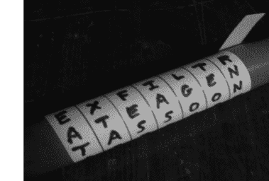

图1.1 一根斯库塔莱（skytale）密码棒揭示了一条消息。


图1.2 美国密文协会标志（www.cryptogram.org/）。

#### 1.2.2 波利比奥斯密码

希腊密码学的另一个例子是波利比奥斯密码。这种密码的缺点在于会使消息长度加倍。

|   | 1 | 2 | 3 | 4 | 5 |
|---|---|---|---|---|---|
| 1 | A | B | C | D | E |
| 2 | F | G | H | I/J | K |
| 3 | L | M | N | O | P |
| 4 | Q | R | S | T | U |
| 5 | V | W | X | Y | Z |

在波利比奥斯密码中，每个字母用其在方格中的位置代替，先取行号，再取列号。例如：

```
T H I S I S E A S Y T O B R E A K
44 23 24 43 24 43 15 11 43 54 44 34 12 42 15 11 25
```

这套系统最初是为远距离信号通信而设计的。要发送第一个字母 T，需要右手举4支火把、左手举4支火把。要发送下一个字母 H，则右手举2支火把、左手举3支火把。我们将在本章后面看到如何破解这种密码。它是本章开头提到的一类普通密码——单表替换密码——的特例，即某个字母无论出现在哪里，都总是会被替换成同一个符号。

五乘五的方格迫使我们把 I 和 J 合并为 24。希腊人使用的字母表较小，没有这种不便。不过对我们来说，解译结果并不唯一，但上下文应当能表明哪个选择是正确的。当然，我们也可以使用六乘六方格，这样就能容纳26个字母和10个数字。或者，数字也可以拼写出来。对于用西里尔字母书写的语言，六乘六方格是适用的。而夏威夷字母表只有12个字母：5个元音（a、e、i、o、u）和7个辅音（h、k、l、m、n、p、w）。因此，对夏威夷字母表来说，四乘四方格就足够了。

波利比奥斯方格有时被称为*波利比奥斯棋盘*。字母可以按任意顺序放入方格中；例如，可以用关键字 DERANGEMENT 来重排字母，如下所示：

|   | 1 | 2 | 3 | 4 | 5 |
|---|---|---|---|---|---|
| 1 | D | E | R | A | N |
| 2 | G | M | T | B | C |
| 3 | F | H | I/J | K | L |
| 4 | O | P | Q | S | U |
| 5 | V | W | X | Y | Z |

注意，关键字中重复出现的字母会被省略。关键字用完后，字母表中剩余的字母依次填入方格。

术语“错排”（derangement）有一个专门含义，指没有任何对象处于其原始位置的重新排列。因此，上面给出的这种重排并不是错排，因为字母 U、V、W、X、Y、Z 仍留在原来的位置。

> ⁵ 波利比奥斯大约在公元前170年于其历史著作第十卷第46章中记述了这套系统。

### 1.3 维京密码学

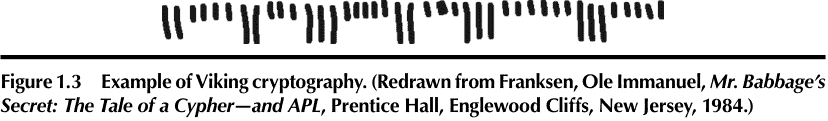

瑞典罗特布伦纳石（Rotbrunna stone）上的标记，如图1.3所示，可能看起来毫无意义，但它们实际上是维京密码学的一个例子。

如果我们记下每组中长笔画和短笔画的数量，就会得到数字 2, 4, 2, 3, 3, 5, 2, 3, 3, 6, 3, 5。将这些数字两两配对，得到 24, 23, 35, 23, 36, 35。现在看图1.4。

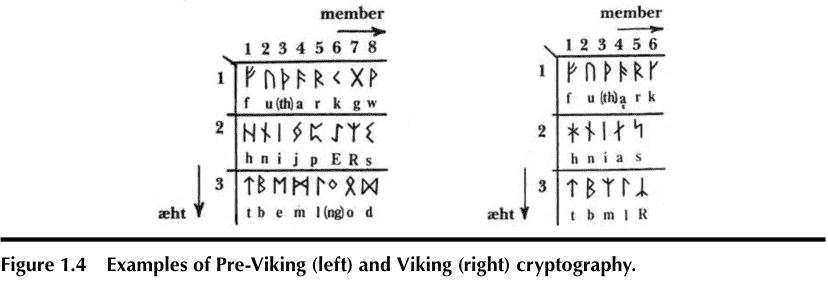

维京人用这样的图表将数字转换为如尼字母；例如，24 表示第二行第四列。在左侧图表中，这对应代表 J 的如尼字母。因此，这种维京加密系统本质上是一种波利比奥斯密码。这只是维京人的系统之一；还有其他系统。保密对这些民族来说从一开始就必定十分重要，因为 rune 一词在盎格鲁-撒克逊语中的意思就是“秘密”。

### 1.4 早期隐写术

希腊人也使用过隐写术。公元前480年，他们提前得到了波斯国王薛西斯将发动进攻的警告。希罗多德解释了这是如何做到的。⁶

> 由于被发现的风险很大，他只有一种办法能将消息送出：刮掉一对木制折叠书写板上的蜡，在下面的木头上写下薛西斯打算做什么，然后再用蜡把消息覆盖住。这样一来，书写板看起来是空白的，沿途的守卫便不会找麻烦。当消息到达目的地时，没有人能猜出这个秘密，直到——据我所知——克里昂米尼的女儿、列奥尼达的妻子戈尔戈发现了它，并告诉其他人，如果刮掉蜡，就会看到下面木头上写着字。他们照做了，消息得以显现并被读了出来，随后传给了其他希腊人。

> ⁶ 希罗多德，*《历史》*，第七卷：*波吕谟尼亚*，第239节。

这一警告，再加上300名斯巴达人抵挡了波斯人三天，为准备成功防御赢得了时间。列奥尼达也是为了争取时间让希腊人建立更强大防御而牺牲的人之一。如果没有这一次提前警告（或之前提到过的后来一次进攻中的警告，那一次是用斯库塔莱密码棒传达的），可以想见，缺乏准备可能会导致波斯获胜，那样就不会有“西方文明的摇篮”了。

另一个隐写术的把戏由希斯提埃乌斯实施。公元前499年，他让人剃光一名奴隶的头，以便把消息纹在头皮上，鼓动米利都的阿里斯塔戈拉斯反抗波斯国王。当奴隶的头发重新长出、遮住消息后，便把他派了出去，并叮嘱他让预定的收信人剃头。不过，如果时间紧迫，或者消息很长而奴隶的头又小，这可算不上好办法！⁷

> ⁷ 希罗多德，*《历史》*，第五卷：*忒耳普西科瑞*，第35节。

### 1.5 凯撒密码

单表替换密码（MASC）已经使用了数千年。要把本章中所有不同的示例都收录进来是不可能的。希望深入学习的读者可以在随书附带的在线练习中找到许多来自历史和文学的例子。不过，尤利乌斯·凯撒使用过的一种 MASC 值得在此详述。

凯撒密码⁸曾被苏埃托尼乌斯在凯撒传记中描述过，凯撒本人也提到过。⁹ 每个字母被替换成字母表中排在它之后的第三个字母。到达密文字母表的末尾后，我们就把尚未用到的 A、B、C 补上。

| 明文 | A | B | C | D | E | F | G | H | I | J | K | L | M | N | O | P | Q | R | S | T | U | V | W | X | Y | Z |
| 密文 | D | E | F | G | H | I | J | K | L | M | N | O | P | Q | R | S | T | U | V | W | X | Y | Z | A | B | C |

例如：

```
ET TU BRUTE? message
HW WX EUXWH? ciphertext
```

（注意：这些话并不是凯撒真实的临终遗言。它们是莎士比亚戏剧中凯撒的最后台词，而该剧并不完全符合史实。）

我们不必只移动三位。也可以移动其他整数值 K。如果把数字0到25看作对应字母A到Z，那么加密过程在数学上可表示为 C = M + K (mod 26)，其中 C 是密文字母，M 是明文字母，K 是密钥。“mod 26”（即“modulo 26”的简称）只是表示：如果 M + K 大于或等于 26，就从该数中减去 26 得到结果。密钥空间（定义为 K 的所有可能取值的集合）有25个元素，因为恒等变换 K=0 使消息保持不变，K=26 也是如此。只有严格介于0和26之间的值才能产生不同的加密结果。上过一学期抽象代数课程的读者会明白，我们现在是在处理群 Z26 中的元素。正如布鲁图斯帮助杀死了凯撒，暴力攻击（尝试所有可能的密钥）也会迅速摧毁他的密码。强密码系统的一个要求就是密钥空间要大。

> ⁸ 实际上，这只是凯撒使用的密码之一。在另一种密码中，罗马字母被希腊字母替换。这发生在高卢战争期间。“他送出的信是用希腊字母写成的，以免敌人截获后得知我们的计划。”（凯撒，《高卢战记》，第五卷）凯撒的其他一些密码体系显然已在历史中失传。

> ⁹ 卡恩，戴维，*《破译者》*，第二版，斯克里布纳出版社，纽约，1996年，第83页。

也许是为了表示对更新式密码的叛逆，美国内战期间，为南方邦联而战的艾伯特·S. 约翰斯顿将军与他的副手皮埃尔·博雷加德将军约定使用凯撒移位密码！

### 1.6 其他 MASC 系统

MASC 所做的替换不一定要通过移位来获得。随机替换的例子出现在许多报纸的漫画旁边，尽管其密钥空间有 26! 个元素，却非常容易破解。因此，尽管大的密钥空间是安全性的必要条件，却并非充分条件。

注意：n! 读作“n 的阶乘”，表示从1到n的所有整数的乘积；例如，4! = 1 · 2 · 3 · 4 = 24。克里斯蒂安·克兰普在1808年引入了 `!` 这种记号，因为 n! 在 n 值很小时就增长得惊人地快。这并不像喜剧演员史蒂文·赖特所说，是为了让数学看起来令人兴奋。任意一个 MASC 可以用26个可能的字母中的任何一个来表示 A，用剩余25个字母中的任何一个来表示 B，依此类推，直到只剩1个选择来表示 Z，因此密钥空间的大小为 26! = 403,291,461,126,605,635,584,000,000。不妨用你的计算器再核对一下！或者，把 26! 输入 Mathematica、Maple 或其他计算机代数系统。你得到所有数字了吗？

斯特林公式为较大的 n 提供了 n! 的简便近似：

n! ~ (√(2πn))(nⁿ)(e⁻ⁿ)


其中 π ≈ 3.1415 且 e ≈ 2.71828。~ 读作“渐近趋近于”，其含义为

lim n→∞ n! / ( √(2πn) (n^n) (e^{-n}) ) = 1

因此，我们有一个简洁紧凑的公式，将阶乘的概念与数学中最重要的常数联系起来！

在古典密码学中，常常希望密钥可以被记忆，因为如果密钥被写下来，就容易被缴获。记住 A 对应 H、B 对应 Q、C 对应 R 等等全部 26 个字母会非常耗时。这就引出了关键词密码。13 例如，使用关键词 PRIVACY，我们有

A B C D E F G H I J K L M N O P Q R S T U V W X Y Z 明文
P R I V A C Y B D E F G H J K L M N O Q S T U W X Z 密文

未在关键词中使用的字母在写出密文字母表时按字母顺序跟在其后。因此，我们得到了一种优于凯撒移位的密码，但密文字母表中仍保留了一些顺序，使得密码仍然被削弱。此类密码还可通过将关键词置于字母表开头以外的位置而变得更加复杂。例如，我们可以使用双部分密钥（PRIVACY，H）进行加密：

A B C D E F G H I J K L M N O P Q R S T U V W X Y Z 明文
Q S T U W X Z P R I V A C Y B D E F G H J K L M N O 密文

此外，还可以使用长密钥短语来确定替换的顺序。如果某个字母重复出现，在写出密文字母表时只需在它再次出现时忽略它，14。密钥短语可以选为包含字母表中所有字母的短语。例如，

The quick brown fox jumps over a lazy dog.（33 个字母）

A B C D E F G H I J K L M N O P Q R S T U V W X Y Z 明文
T H E Q U I C K B R O W N F X J M P S V A L Z Y D G 密文

Richard Lederer 提供了几个使用全部 26 个字母的更短短语：15

- Pack my box with five dozen liquor jugs.（32 个字母）
- Jackdaws love my big sphinx of quartz.（31 个字母）
- How quickly daft jumping zebras vex.（30 个字母）
- Quick wafting zephyrs vex bold Jim.（29 个字母）
- Waltz, nymph, for quick jigs vex Bud.（28 个字母）
- Bawds jog, flick quartz, vex nymphs.（27 个字母）
- Mr. Jock, TV quiz Ph.D., bags few lynx.（26 个字母，最少）

13 Argentis 是第一个以这种方式使用关键词的人（1580 年代末）。参见 Kahn, David, The Codebreakers, second edition, Scribner, New York, 1996, p. 113.

14 发送给 Edgar Allan Poe 的一封加密信息因为发送者没有这样做而变得更难破解（稍后会详细介绍）。

15 Lederer, Richard, Crazy English, Pocket Books, New York, 1989, pp. 159–160.

为便于明文与密文之间的转换，已发明了一些装置。现在我们来看其中两种。

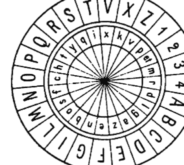

图 1.5 Leon Battista Alberti 的密码盘。（Courtesy of the David Kahn Collection, National Cryptologic Museum, Fort Meade, Maryland.）

Leon Battista Alberti 的密码盘（图 1.5）如何用于加密和解密应该显而易见，无需解释。内层字母表位于一个单独的圆盘上，该圆盘可以相对于较大的圆盘旋转以形成其他替换。Alberti（1404–1472）于 1466 年或 1467 年发明了该圆盘。16

另一种装置是 St.-Cyr 滑尺（图 1.6）。17 这里同样，一个字母表（图中写了两次的那个）可以相对于另一个移动。该装置仅适用于使用如图所示的直线字母表并保持滑尺固定位置时执行凯撒类型移位。

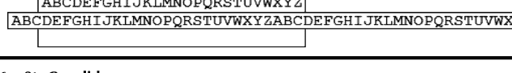

图 1.6 St.-Cyr 滑尺。

然而，即使使用完全混合的字母表，打破此类密码也是微不足道的事。MASCs 常常在小说中使用。故事的主角通常在其密码分析尝试中取得成功并解释他是如何做到的。18 其中最好的故事之一由 Edgar Allan Poe 撰写。他的密码学联系接下来将被审视。下一节将审视 Sherlock Holmes 与密码的遭遇，然后我们将以 Poe 或 Arthur Conan Doyle 的著名侦探所不知道的解决方案技术来结束对 MASCs 的论述。

16 Kahn, David, The Codebreakers, second edition, Scribner, New York, 1996, pp. 126–128.

17 该装置以法国国家军事学院命名。

18 有关小说中密码和密文的概述，请参阅 John F. Dooley 在 2005 年 10 月 Cryptologia 第 29 卷第 4 期发表的 Codes and Ciphers in Fiction: An Overview，页 290–328。该论文包含 132 条注释书目。如需更新列表，请访问 https://www.johnfdooley.com/ 并点击链接 “Crypto Fiction”。截至 2020 年 10 月 7 日，该列表包含 420 个示例。

多音密码是 Poe 在 *Graham's* 中解决的系统之一。在这些系统中，一个字符可能对应多个字母的加密。这使得密码分析员以及预期接收者解密变得更加困难。下面给出一个例子。

Ofoiioiiaso ortsiii sov eodisoioe afduios tfoi ft iftvi
si tri oistoiv oiniafetsorit ifeov rsri inotiiiiiv ridi iot,
irio rivvio covit atro tfetsoria aioriti iitri tf oiotovin
tri aetifei ioreitit sov usttoi oioittstifo dfti afdooitior
trso iteov tri dfit oftfeov softriedi ft oistoiv
oriofiforiti suitteii viireiitifo i ft tri iarfoisiti, iiti
trir uet otiiotiiv uiftfi rid io tri eovii eci iiv rfasueostr
tf rii dft rit ftoe ei.

乍一看，我们可以断定此密文并非通过一对一替换每个字母获得；例如，第二行倒数第二个词 inotiiiiiv 中有四个相同的字母连续出现，但在英语中却没有这样的词！尽管如此，Poe 破解了此密码。他确定密钥短语（拉丁语）为 *Suaviter in modo, fortiter in re*。因此，替换被确定如下。

```
A B C D E F G H I J K L M N O P Q R S T U V W X Y Z plaintext
S U A V I T E R I N M O D O F O R T I T E R I N R E ciphertext
```

密文中的字母 i 可能代表 E、I、S 或 W。其他字母也提供多种可能性。故意与否，加密者通过拼写错误或错字使事情变得更加困难。此外，他并没有使用简单的词汇。Poe 将解决方案表述为

> 毫无意义的短语和无意义的词语组合，正如博学的词典编纂者所承认的那样，当隐藏在密码学密码之下时，会使好奇的探究者感到困惑，并比最深刻的哲学家的最深奥的格言更完全地阻碍渗透。经院学者的深奥讨论，如果只是以其母语的未加掩饰的词汇呈现给他。

在两份期刊中，Poe 都提出了一个他后来在短篇小说《金甲虫》（1843）中重复的主张。措辞有所不同。这里以故事中出现的形式陈述。

> 然而可以断然断言，人类智慧无法构思出人类智慧无法解决的密码。

这是 Poe 关于密码学的最著名引言。它是错误的，正如我们稍后会看到的那样；存在理论上不可破解的密码。

在《金甲虫》中，Poe 终于给了读者他们渴望的东西。他揭示了他的方法。这成为他最受欢迎的短篇小说。我认为人们倾向于比非小说更被动地阅读小说。也许这是愿意搁置怀疑的结果。在大多数对《金甲虫》的引用中，一个明显的密码分析错误没有被提及。故事的主人公 Legrand 在对信息进行密码分析时注意到密文中没有词分隔，但其中一个符号可能代表空格。该符号的频率会最大——大于 e。好吧，没什么大不了的，但当 Legrand 说，

> 现在，在英语中，出现频率最高的字母是 e。随后，顺序如下：a o i d h n r s t u y c f g l m w b k p q x z。E 如此显著地占优势，以至于任何长度的句子很少见不到它成为主导字符。

我们就有一个更严重的错误。你看出来了吗？如果没有，请在继续阅读前再看一次。

在一本精彩的计算机科学教材中。²¹ William Bennett 指出了 Poe 犯的错误。²² 他将这一节命名为“Gold Bug or Humbug?”并将上述频率表的来源称为“整个短篇小说中最根本的谜团”。字母 t 应该是第二频繁的。为什么 Poe 将其放在第十位？这不是印刷错误，因为 Legrand 的破译与错误的频率表一致。根据该表，将第二频繁的密文符号（代表 t）识别为 a 会导致死胡同。因此，Legrand 放弃了该表并使用了 the 是最常见词这一事实。

Bennett 对此谜团的解决方案是，该故事最初写成西班牙语密码，在出版商要求下改为英语时，频率表被保留未改。然而，在着手寻找故事的早期手稿以证实 Bennett 的猜想之前，对密码学文献的检索揭示了一个更好的解决方案。

尽管 Bennett 并不知道，几十年前他的著作出现之前，这个谜团就已被解开。Raymond T. Bond 以编辑的身份汇编了一系列涉及密码和密文的短篇小说，并为每篇撰写了导言。²³ 在对 Poe 故事的导言中，他描述了 Abraham Rees 的 Cyclopædia or, Universal Dictionary of Arts, Sciences, and Literature（1819）中一篇关于密码的文章。该文章由 William Blair 撰写，讨论了字母频率，但将辅音和元音分开处理。Blair 根据频率将辅音分为四组，并没有尝试在每组内对字母进行排名，而是按字母顺序排列每组：

```
d h n r s t   c f g l m w   b k p   q x z
```

在描述元音时，Blair 指出 e 是最频繁的，其次是 o、a 和 i，然后指出某些辅音，如 s 和 t，比 u 和 y 更频繁。相对较新的字母 v 和 j 未被包含在内！

阅读后，Poe 在上述顺序中将 u 和 y 放在 s 和 t 之后，然后将其他元音置于开头，不小心交换了 o 和 a 的顺序，得出

```
e a o i d h n r s t u y c f g l m w b k p q x z
```


因为他开创了侦探小说这一类型，我想爱伦·坡会喜欢解决“字母频率错误之谜”所付出的努力。

戴维·卡恩指出《金甲虫》中还有若干与密码学无关的其他错误。24 通读整篇故事，看看你能找到多少。

其他作者在解释密码分析时也犯过错误。当我以为自己在读与密码学毫不相关的内容时，我偶然发现了一个有趣的例子。如果你懂一点德语，请查阅海因里希·沃尔夫（Heinrich Wolff）著的《Das Geheimnis im Elbtunnel》（National Textbook Company，1988）。熟悉元音识别算法（参见第 1.12 节）会显示，这个故事里的侦探也不比波的男主角好多少。

在奥诺雷·德·巴尔扎克的《婚姻生理学》（1829 年作为其《人间喜剧》的一部分出版）中，作者加入了四页胡言乱语。25 这由字母的无意义组合、倒置的字母和标点符号组成。自首次出版以来，它从未被破译过，密码分析学家普遍认为巴尔扎克可能只是在故弄玄虚。事实上，这些胡言乱语的页面在不同版本之间有所变化。

这种吹毛求疵并不是要贬低波的伟大。几代密码学家都追溯到童年时阅读《金甲虫》才对这一主题产生兴趣，我将在第 2 章中更多地谈论波的密码挑战。现在，请注意波在下面的十四行诗中放置了一条隐藏信息。你能找到它吗？答案在本章末尾给出。

### 一个谜题（1848）

爱伦·坡 著

> “‘很少能找到’，”所罗门·唐·邓斯说，
> “最深奥的十四行诗中也只有半个想法。
> 我们一下子就能看穿所有轻浮的东西
> 就像看穿那顶那不勒斯帽子一样——
> 一切垃圾中的垃圾！——女士怎么能戴它？
> 然而比你的彼特拉克式作品还要沉重得多——
> 像猫头鹰绒那样的胡言乱语，最轻微的一阵风
> 就在你读它时把它卷成纸箱纸。”
> 而且，确实，索尔说得够对。
> 一般的塔克曼式作品全是荒谬的
> 气泡——短暂而如此透明——
> 但这首诗，现在——你可以信赖它——
> 稳定、不透明、不朽——全靠
> 他藏在其中的那些亲爱的名字的功劳。

### 1.8 阿瑟·柯南·道尔

在密码学家中，最为人熟知的夏洛克·福尔摩斯故事是《跳舞的人的冒险》（1903）。26 在这个故事中，福尔摩斯试图破解的密文信息中的字母被跳舞的人所取代；因此得名。密文重现于图 1.8。

24 卡恩，戴维，《密码破译者》，第二版，斯克里布纳，纽约，1996 年，第 790–791 页。

25 卡恩，戴维，《密码破译者》，第二版，斯克里布纳，纽约，1996 年，第 781 页。

26 可在线获取 http://sherlock-holm.es/stories/pdf/a4/1-sided/danc.pdf。

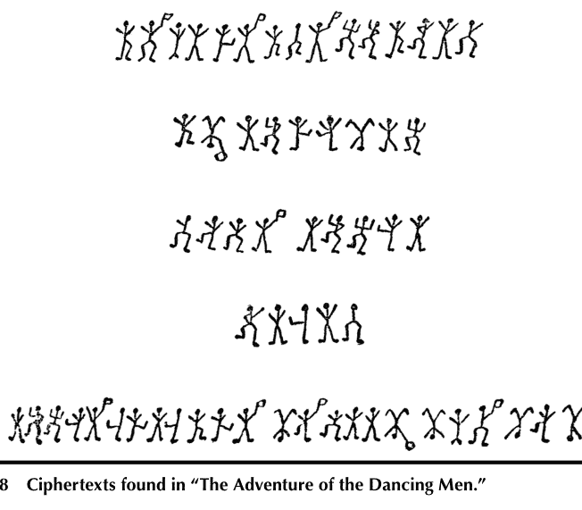

### 图 1.8 《跳舞的人的冒险》中发现的密文。

我们将在本章后面介绍破解此类密码的技术，但现在让我们做一些简单的观察。首先，注意到要么信息由非常长的单词组成，要么单词间距被伪装了。假设是后者，要么间距完全被消除，要么某个特殊字符代表空格。如果某个特殊符号表示空格，它应该具有非常高的频率，但密文中频率最高的符号有时会出现在信息的末尾。如果它真的代表空格，这将毫无意义。

最后，我们想到旗帜代表空格。这使我们的任务容易得多，因为现在我们有了词的划分。然而，仍有一些复杂因素。信息很短，事实证明其中包含专有名词和地点（不仅仅是字典里能找到的词），而且至少有一个错别字！错别字的数量因版本而异，但所有版本至少有一个！

福尔摩斯从未提到过错别字，因此可以认为它们是道尔和/或印刷商造成的错误，并非有意使事情更困难。任何试图破译信息的人都必须能够处理错别字。这些在现实世界的信息中经常出现。它们可能是由粗心的加密者造成的，也可能是传输过程中出现的问题。“Morse mutilation”有时用来描述因传输过程产生的错误而收到的摩尔斯电码信息。

里奥·马克思在第二次世界大战期间负责特别行动执行局（SOE）密码和密文小组，27 经常不得不应对因占领欧洲的特工加密不当而产生的“无法破译”信息。他于 1942 年开始工作时，约 25% 的 incoming 消息因某种原因无法破译。当时只有 3% 被恢复，但马克思向他的团队讲授了恢复技术并开发了新方法。该

27 特别行动执行局大致相当于美国战略服务办公室（OSS）的英国对应机构。他们在敌后进行危险行动。

解决方案的数量迅速上升到 92% 的峰值，最终稳定在平均 80%。一则单独的信息平均需要 2,000 次破译尝试，马克思的团队才会找到真正的错误。[^28] 付出努力是值得的，因为唯一的替代方案是让特工重新发送信息，这是一项危险的活动，纳粹不断利用测向设备监视发送无线电信息的特工。第二次传输尝试很容易导致特工被捕并受刑。

最近，一名绰号为 Zodiac II 的模仿杀手向 *纽约邮报* 发送了一条加密信息。为了得到正确的破译，密码分析员必须应对杀手犯的一些错别字。参见本密码的在线练习。

当然，夏洛克·福尔摩斯完全破解了跳舞人密码，并用它撰写了自己的信息（[图 1.9](#figure-1-9)）。

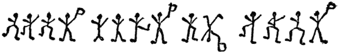

**图 1.9**  夏洛克·福尔摩斯的跳舞人密文。

这个故事中福尔摩斯的对手并不知道信息来自福尔摩斯，而这种欺骗导致了他被捕。因此，这个故事提出了一个我们将在本书中再次讨论的问题。也就是说，我们如何确定信息确实来自我们认为的那个人？福尔摩斯能够冒充他人，因为他学会了密码的秘密，但在理想的系统中这是不可能的。

在第二次世界大战期间，许多特工被捕并被冒充。在一个例子中，当怀疑某位 SOE 特工已被渗透，纳粹在进行无线电对话的另一端时，设计了一项测试来查明真相。那个可疑的英国无线电操作员用 HH 作为他给特工的信息的结束语，HH 是 Heil Hitler 的缩写。这是纳粹之间标准的“再见”方式，而海外操作员自动用 HH 回应，自露马脚。[^29]

道尔用跳舞的人代表字母的使用是否像看起来那样富有创造性？事实证明，这些家伙在道尔写故事之前很久就一直在保护信息。当面对之前的用法时，他将其归咎于巧合。[^30] 道尔的跳舞人也让人想起一种失传文字中的一些人物，称为 Rongorongo，它被复活节岛人民使用，奇怪的是，它与目前同样无法破译的印度河谷文字相似（[图 1.10](#figure-1-10)）。这两个文字之间存在联系的想法并未得到主要专家的支持，因为这两种文化在距离和时间上都相距甚远。

尽管这里只是顺带提及此类话题，但破译失传文字吸引了相当数量的密码学家的兴趣。请参阅本章末尾的参考文献和进一步阅读部分，了解 *Cryptologia* 发表的有关 Rongorongo 文字的研究论文。

《跳舞的人的冒险》并不是道尔的侦探遇到密码学的唯一故事。另一篇故事在[第 1.21 节](#section-1-21)中讨论。


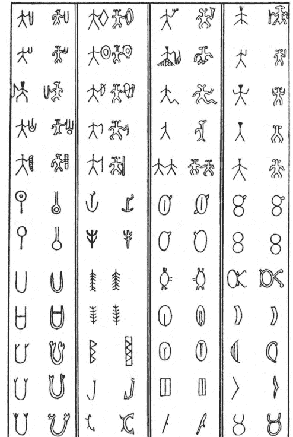

图1.10 朗戈朗戈文（每列右侧）与印度河文字（每列左侧）的对比。（改编自 Imbelloni, Sr., J.，“复活节岛文字与印度河中期的印章”，《波利尼西亚学会杂志》，第48卷，第1期，总第189期，1939年3月，第60-69页，此处引用第68页。）

### 1.9 频率分析

单表替换密码（MASCs）很容易破解，因为每个字母再次出现时总是以同样的方式被加密。消息所用语言的统计特性很快就会揭示出明文。事实上，在许多情况下，如果最初不知道所使用的语言，我们也可以利用这些统计特性来识别。通常无需任何解密就能确定正确的语言。表1.1给出了英语的一些统计抽样。

这些只是样本统计，你的结果可能会有所不同。例如，E 通常显得比其他任何字母都频繁得多，然而却有一整本小说（E.V. 赖特的《Gadsby》，1939年出版）在写作时不使用这个字母。为了让你乐一乐，下面是《Gadsby》的第一段。

## 表1.1 英语样本统计

| 字母 | 相对频率（%） | 字母 | 相对频率（%） |
|---|---|---|---|
| A | 8.2 | N | 6.7 |
| B | 1.5 | O | 7.5 |
| C | 2.8 | P | 1.9 |
| D | 4.3 | Q | 0.1 |
| E | 12.7 | R | 6.0 |
| F | 2.2 | S | 6.3 |
| G | 2.0 | T | 9.0 |
| H | 6.1 | U | 2.8 |
| I | 7.0 | V | 1.0 |
| J | 0.2 | W | 2.4 |
| K | 0.8 | X | 0.2 |
| L | 4.0 | Y | 2.0 |
| M | 2.4 | Z | 0.1 |

如果整个历史上，青春曾有一位捍卫者站出来为它说话；向一个怀疑的世界证明孩子也能思考；并且，或许还能实际做到；那么你今天就不会经常遇到那些声称“小孩子什么也不懂”的人了。孩子的大脑从出生那一刻起就开始运作；在它的许多婴儿脑回中，蕴藏着成千上万个沉睡的原子，上帝在其中放入了一种神秘的可能性，使它能够注意到成人的行为，并推想出其意图。

面对这一挑战，赖特并非孤例。法国作家乔治·佩雷克（Georges Perec）在完全没有使用一个 E 的情况下完成了《La Disparition》（1969年）。频率表因语言而异，但 E 通常都相当高频。佩雷克的成色或许更令人印象深刻，因为 E 在法语中的出现频率（17.5%）比在英语中还要高。吉尔伯特·阿代尔（Gilbert Adair）翻译了这部作品，且没有引入一个 E。他将书名定为《A Void》，开头如下：

今天，通过广播，还有巨大的广告牌上，一位拉比、一位以与共济会关系密切而臭名昭著的海军上将、三位枢机主教，另有同样三位无关紧要的政客（由一个富有而腐败的英加银行公司收买并供养），告知我们所有人：我们的国家如今正面临饿死的危险。谣言——这就是我关掉收音机时的最初想法——谣言，或者可能是骗局。宣传，我焦虑地喃喃自语——仿佛只要这样说，我就能减轻疑虑——典型的政客宣传。但舆论逐渐把它当作事实吸收了。人们开始拿着粗棍招摇过市。“食物，美味的食物！”是常见的口号（偶尔配上巴特的音乐唱出），普通辛苦劳作的人骚扰地方和国家官员，咒骂资本家和工业巨头。警察不敢上夜班。在马孔，一伙暴徒冲击市政大楼。在罗卡达穆尔，暴徒抢劫了一个装满食品的仓库，掠夺了成吨的金枪鱼、牛奶和可可，还有大量玉米——可惜，全都完全不适合人类食用。没有吵吵嚷嚷，也自然没有任何审判，一群愤怒的人在南锡法院前一个匆忙搭起的绞刑架上绞死了26名律师（这个南锡是一座城镇，不是女人），并洗劫了一家当地报纸，一份站在他们对立面的、令人作呕的右翼烂报。在我们这片国土上，抢劫已使码头、商店和农场几乎陷入停顿。

尽管这段话写作时没有使用字母 E，但离开它却无法阅读！通过将 26 写成数字而不是字母，阿代尔避开了那个特定的 E。

用于密码分析目的的频率计数最早出现在阿拉伯语著作中。这种兴趣显然是研究《古兰经》的副产品。作为对该著作进行深入研究的一部分，人们编纂了关于《古兰经》中字母和词汇的各种统计资料。最终，有人迈出了下一步，将这些数据应用于加密消息。

### 1.10 《圣经》中的密码术

太初有道，道已被加密。

尽管基督教世界在密码分析方面落后于伊斯兰世界，但《圣经》中确实有一些密码内容。有一种称为 Atbash 的系统，通过将字母表的第一个和最后一个字母互换、第二个和倒数第二个互换，以此类推，来加密希伯来文。用我们的字母表来表示，就像这样：

```
A B C D E F G H I J K L M N O P Q R S T U V W X Y Z  plaintext
Z Y X W V U T S R Q P O N M L K J I H G F E D C B A  ciphertext
```

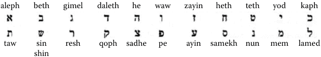

**图1.11**  Atbash 替换。

这个系统被用于《耶利米书》25:26 和《耶利米书》51:41，其中示沙克（Sheshach）作为巴别（Babel）的加密形式出现。在意识到这里使用了加密之前，研究《圣经》的学者们花了很多时间苦苦思索示沙克到底在哪里！在第 [1.5节](#section-1-5) 中，我们考察了凯撒密码。这个系统有一个变体，称为 *反向凯撒密码*，其密文字母表在移位之前先被反向书写。如果怀疑使用了这种变体，只需先按 Atbash 方式变换密文，然后像破解普通凯撒密码一样破解它即可。不幸的是，大量媒体关注集中在一种并不存在的“圣经密码”上，这种密码据称通过等距序列揭示从圣经时代到现在乃至未来的事件信息。这里就不浪费篇幅了，我只想引用一篇驳斥这种胡言乱语的论文，并指出这种“信息”在任何足够长的书中都能找到。[^31]

[^31]: Nichols, Randall，“《圣经密码》”，*密码学*，第22卷，第2期，1998年4月，第121–133页。

### 1.11 更多频率与模式词

我们已经见过字母频率表，但若关注特定位置，这些频率会发生变化；例如，E 作为单词最后一个字母的出现频率远高于作为第一个字母。尽管 E 总体上是出现最多的字母，但英语中最可能用作词首的字母不是 E，而是 T。这要归功于单词 THE 的极高使用率（见表1.2）。

表1.2 字母在词首和词尾位置的频率

| 字母 | 词首位置 | 词尾位置 | 字母 | 词首位置 | 词尾位置 |
|---|---|---|---|---|---|
| A | 123.6 | 24.7 | N | 21.6 | 67.6 |
| B | 42.4 | 0.9 | O | 70.8 | 41.4 |
| C | 47 | 3.7 | P | 40.9 | 6.4 |
| D | 20.6 | 111 | Q | 2.2 | - |
| E | 27.7 | 222.9 | R | 31.2 | 47.5 |
| F | 41.9 | 49.3 | S | 69.1 | 137 |
| G | 12.3 | 25.1 | T | 181.3 | 98.1 |
| H | 47.5 | 34.2 | U | 14.1 | 2.3 |
| I | 59 | 0.9 | V | 4.1 | - |
| J | 7 | - | W | 63.3 | 3.7 |
| K | 1.8 | 8.7 | X | 0.4 | 1.4 |
| L | 22.4 | 24.7 | Y | 7.5 | 66.2 |
| M | 39.2 | 20.1 | Z | 0.4 | - |

来源：Pratt, Fletcher，*秘密与紧急*，Bobbs-Merrill，纽约，1939年，第158页。

*注：* 上表数字表示每1000个单词中的出现频率。V、Q、J 和 Z 作为词尾出现极其罕见，因此其频率无法在此表中表示。

最常被双写的字母见表1.3。所有两字母组合（称为 *二合字母*）的频率表可以在许多书籍和在线资源中找到。图1.12就提供了这样一个例子。通常，TH 是最常见的二合字母，但在用于弗里德曼（Friedman）表格的政府电报中，EN 最为常见，TH 排在第五位。

模式词表对于无密钥解密也很有价值。可以像查字典一样查找单词中字母的模式。例如，考虑模式 ABCADEAE。这表示第一、第四和第七个字母都相同。此外，第六和第八个字母相同。不能存在其他匹配，因为 B、C 和 D 表示各不相同的字母。符合这种形式的词很少。在此引用的参考文献中，ARKANSAS、EXPENDED 和 EXPENSES 是仅有的可能。³²

³² Carlisle, Sheila，*长度为三至八个字母的模式词*，Aegean Park Press，加利福尼亚州拉古纳希尔斯，1986年，第65页。还有更完整的列表，包含其他可能性。


## 表 6-A——基于50,000个政府明码电报字母的双字母组频数分布；折算为5,000个双字母组

双字母组频率分布。行代表**第一个字母**（A–Z），列代表**第二个字母**（A–Z），另有**总计**和**空白**列以及相应的总计行。

**图 1.12**  双字母组合频率表。（摘自Friedman, William F. 和 Lambros D. Callimahos，《军事密码分析，第一部分》，美国国家安全局，华盛顿特区，1956年，第257页。）

## 步骤4

E看起来像元音，因为它的行总和最高。然后我们调整行总和。

## 步骤5

|   | C | E | G | I | L | N | O | R | S | V | W | Z | Sum | 辅音/元音 |
|---|---:|---:|---:|---:|---:|---:|---:|---:|---:|---:|---:|---:|---:|---|
| C | 0 | 1 | 0 | 0 | 0 | 0 | 1 | 0 | 0 | 0 | 0 | 0 | 0 | 辅 |
| E | 1 | 0 | 0 | 0 | 1 | 0 | 0 | 3 | 0 | 0 | 2 | 0 | 7 | 元 |
| G | 0 | 0 | 0 | 0 | 0 | 2 | 1 | 0 | 0 | 0 | 0 | 0 | 3 | 辅 |
| I | 0 | 0 | 0 | 0 | 0 | 2 | 0 | 0 | 0 | 0 | 0 | 2 | 4 | 辅 |
| L | 0 | 1 | 0 | 0 | 0 | 0 | 0 | 0 | 1 | 0 | 0 | 0 | 0 | 辅 |
| N | 0 | 0 | 2 | 2 | 0 | 0 | 1 | 0 | 0 | 0 | 0 | 0 | 5 | 辅 |
| O | 1 | 0 | 1 | 0 | 0 | 1 | 0 | 0 | 0 | 1 | 2 | 0 | 6 | 元 |
| R | 0 | 3 | 0 | 0 | 0 | 0 | 0 | 0 | 0 | 0 | 0 | 0 | -3 | 辅 |
| S | 0 | 0 | 0 | 0 | 1 | 0 | 0 | 0 | 0 | 0 | 0 | 0 | 1 | 辅 |
| V | 0 | 0 | 0 | 0 | 0 | 0 | 1 | 0 | 0 | 0 | 0 | 0 | 1 | 辅 |
| W | 0 | 2 | 0 | 0 | 0 | 0 | 2 | 0 | 0 | 0 | 0 | 0 | 0 | 辅 |
| Z | 0 | 0 | 0 | 2 | 0 | 0 | 0 | 0 | 0 | 0 | 0 | 0 | 2 | 辅 |

## 回到步骤4

现在O看起来像元音。我们再次调整行总和（步骤5）：

|   | C | E | G | I | L | N | O | R | S | V | W | Z | Sum | 辅音/元音 |
|---|---:|---:|---:|---:|---:|---:|---:|---:|---:|---:|---:|---:|---:|---|
| C | 0 | 1 | 0 | 0 | 0 | 0 | 1 | 0 | 0 | 0 | 0 | 0 | -2 | 辅 |
| E | 1 | 0 | 0 | 0 | 1 | 0 | 0 | 3 | 0 | 0 | 2 | 0 | 7 | 元 |
| G | 0 | 0 | 0 | 0 | 0 | 2 | 1 | 0 | 0 | 0 | 0 | 0 | 1 | 辅 |
| I | 0 | 0 | 0 | 0 | 0 | 2 | 0 | 0 | 0 | 0 | 0 | 2 | 4 | 辅 |
| L | 0 | 1 | 0 | 0 | 0 | 0 | 0 | 0 | 1 | 0 | 0 | 0 | 0 | 辅 |
| N | 0 | 0 | 2 | 2 | 0 | 0 | 1 | 0 | 0 | 0 | 0 | 0 | 3 | 辅 |
| O | 1 | 0 | 1 | 0 | 0 | 1 | 0 | 0 | 0 | 1 | 2 | 0 | 6 | 元 |
| R | 0 | 3 | 0 | 0 | 0 | 0 | 0 | 0 | 0 | 0 | 0 | 0 | -3 | 辅 |
| S | 0 | 0 | 0 | 0 | 1 | 0 | 0 | 0 | 0 | 0 | 0 | 0 | 1 | 辅 |
| V | 0 | 0 | 0 | 0 | 0 | 0 | 1 | 0 | 0 | 0 | 0 | 0 | -1 | 辅 |
| W | 0 | 2 | 0 | 0 | 0 | 0 | 2 | 0 | 0 | 0 | 0 | 0 | -4 | 辅 |
| Z | 0 | 0 | 0 | 2 | 0 | 0 | 0 | 0 | 0 | 0 | 0 | 0 | 2 | 辅 |

调整O之后，下一个元音似乎是I：

|   | C | E | G | I | L | N | O | R | S | V | W | Z | Sum | 辅音/元音 |
|---|---:|---:|---:|---:|---:|---:|---:|---:|---:|---:|---:|---:|---:|---|
| C | 0 | 1 | 0 | 0 | 0 | 0 | 1 | 0 | 0 | 0 | 0 | 0 | -2 | 辅 |
| E | 1 | 0 | 0 | 0 | 1 | 0 | 0 | 3 | 0 | 0 | 2 | 0 | 7 | 元 |
| G | 0 | 0 | 0 | 0 | 0 | 2 | 1 | 0 | 0 | 0 | 0 | 0 | 1 | 辅 |
| I | 0 | 0 | 0 | 0 | 0 | 2 | 0 | 0 | 0 | 0 | 0 | 2 | 4 | 元 |
| L | 0 | 1 | 0 | 0 | 0 | 0 | 0 | 0 | 1 | 0 | 0 | 0 | 0 | 辅 |
| N | 0 | 0 | 2 | 2 | 0 | 0 | 1 | 0 | 0 | 0 | 0 | 0 | -1 | 辅 |
| O | 1 | 0 | 1 | 0 | 0 | 1 | 0 | 0 | 0 | 1 | 2 | 0 | 6 | 元 |
| R | 0 | 3 | 0 | 0 | 0 | 0 | 0 | 0 | 0 | 0 | 0 | 0 | -3 | 辅 |
| S | 0 | 0 | 0 | 0 | 1 | 0 | 0 | 0 | 0 | 0 | 0 | 0 | 1 | 辅 |
| V | 0 | 0 | 0 | 0 | 0 | 0 | 1 | 0 | 0 | 0 | 0 | 0 | -1 | 辅 |
| W | 0 | 2 | 0 | 0 | 0 | 0 | 2 | 0 | 0 | 0 | 0 | 0 | -4 | 辅 |
| Z | 0 | 0 | 0 | 2 | 0 | 0 | 0 | 0 | 0 | 0 | 0 | 0 | -2 | 辅 |

继续这个过程，G和S被宣布为元音！这种技术并不完美，但在处理更长的文本时效果要好得多。这个过程非常适合在计算机上实现，因此我们通常可以快速地将密文中的元音与辅音分开。最频繁的字符通常是E和T，借助这种技术帮助我们区分它们，我们就离破解答案不远了。

### 1.13 更多MASC

许多受欢迎的作家都在其作品中加入了密码。除了之前讨论过的之外，还有儒勒·凡尔纳、多萝西·塞耶斯、查尔斯·道奇森（更广为人知的是他的笔名刘易斯·卡罗尔），以及你在后续章节中会遇到的其他作者。图1.13展示了J.R.R.托尔金《指环王》三部曲第一本书众多版本之一的护封。托尔金创造了一种如尼字母，经常被用来在封面上隐藏秘密信息。你能用本章讨论的统计和技术破解它吗？

奥兹·奥斯本的《魔鬼之语》专辑在封面和封底使用了托尔金的如尼字母。

对于那些更倾向于古典音乐的人，图1.14提供了沃尔夫冈·阿马德乌斯·莫扎特“创作”的一个密码。每个音符简单地代表一个字母。

> 密码学*就是*数学，正如音乐*就是*数学。——H.加里·奈特³⁶

儿童有时使用的一种常见MASC仅包含非字母符号，然而它很容易记忆。它的工作原理如图1.15所示。所绘制的符号只是字母所在区域的表示。破译图1.16所示的信息，以确保你掌握了它。

这个系统被称为猪圈密码，因为字母像猪一样被分隔在猪圈里。它也被称为共济会密码，因为共济会使用过它。它曾在17世纪英格兰内战中使用，甚至在美国内战期间被囚犯用来给朋友发送信息。³⁷

图1.17所示墓碑上的密码使用了猪圈密码的一种变体。注意，没有任何密文字母看起来像大于号和小于号，无论任何旋转方向，有无圆点。另一方面，有些符号内部有两个点。这块墓碑可以在纽约市的三一教堂墓地看到。它标记着詹姆斯·利森的坟墓，他是一位共济会分会的官员，死于1794年。³⁸

同样的信息出现在几街区外的圣保罗教堂墓地的一块扁平石板上，标记着詹姆斯·莱西上尉（卒于1796年）的坟墓；然而，这个使用了不同的密钥。³⁹

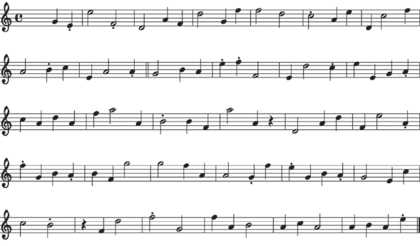

图1.14 沃尔夫冈·阿马德乌斯·莫扎特创作的密码——并非为了演奏！（由Nicholas Lyman从McCormick, Donald，《Love in Code》重新打字，Eyre Methuen Ltd.，伦敦，英国，1980年，第49页。）

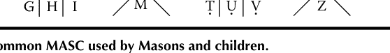

图1.15 共济会成员和儿童常用的一种MASC。

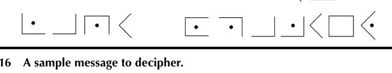

图1.16 一条待破译的示例信息。

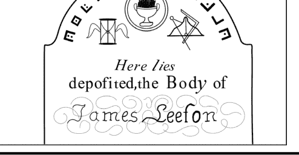

图1.17 来自密码（学家）的故事？（图片由Josh Gross创建。）

### 1.14 对MASC的密码分析

既然我们到处都能看到密码，现在是时候举例说明它们如何被破解了。假设我们截获了以下密文。

```
JDS CGWMUJNCQV NSIBVMJCBG QGW CJU ZBGUSHMSGZSU DQIS ASSG Q
WCUQUJSN XBN JDS DMTQG NQZS.
```

我们可以通过为密文字母构建频率表（表1.4）来开始我们的攻击。

**表1.4 示例密文字母频率表**

| 字母 | 频率 | 字母 | 频率 |
|---|---:|---:|---|
| A | 1 | N | 5 |
| B | 4 | O | 0 |
| C | 5 | P | 0 |
| D | 4 | Q | 7 |
| E | 0 | R | 0 |
| F | 0 | S | 11 |
| G | 7 | T | 1 |
| H | 1 | U | 6 |
| I | 2 | V | 2 |
| J | 6 | W | 3 |
| K | 0 | X | 1 |
| L | 0 | Y | 0 |
| M | 4 | Z | 3 |

字母S因频率最高而显得突出；因此，它很可能代表明文字母E。三字母密文单词JDS出现了两次。最常见的三字母组合（也是最常见的三字母单词）是THE。这与我们认为S代表E的猜测一致。J可能代表T吗？T在英语中非常常见，而密文字母J出现了6次，所以这似乎合理。我们将猜测写在相应密文字母上方，得到：

```
THE         T    E    T         T    E  E E H E  EE
JDS CGWMUJNCQV NSIBVMJCBG QGW CJU ZBGUSHMSGZSU DQIS ASSG Q

       TE        THE H          E.
WCUQUJSN XBN JDS DMTQG NQZS.
```


从这里开始有许多可能的进展方式。我们有一个12个字母的词，ZBGUSHMSGZSU，所以让我们考虑它的模式。它具有形式 ABCDEFGECAED。在前面提到的其中一个网站上，你可以输入这个模式，你会看到只有一个词符合，即 CONSEQUENCES。现在已揭示的字母全部代入后得到

```
THE  N UST     E  UT ON  N  TS CONSEQUENCES H E  EEN
JDS CGWMUJNCQV NSIBVMJC BG QGW CJU ZBGUSHMSGZSU DQIS ASSG Q
  S STE  O  THE HU  N  CE .
WCUQUJSN XBN JDS DMTQG NQZS .
```

第五个词不可能是其他，只能是 ITS。将 I 放在每个 C 上方很快就会得到更多字母，信息被揭示为：

```
THE INDUSTRIAL REVOLUTION AND ITS CONSEQUENCES HAVE BEEN A
DISASTER FOR THE HUMAN RACE .
```

这是前数学家 Theodore Kaczynski 的一句引语。用于加密它的替换如下。

A B C D E F G H I J K L M N O P Q R S T U V W X Y Z 明文
Q A Z W S X E D C R F V T G B Y H N U J M I K O L P 密文

现在替换完全揭示后，你能看出其中的模式吗？40 本章给出的统计数据有所帮助，但它们与我们的信息并不完全匹配。T 在我们的表中是第二频繁的字母，但在示例密文中它并列第四。尽管如此，其频率足够高，看起来像是合理的替换。一般来说，在尝试破解密码时，我们可能会做出一些错误的猜测。当这种情况发生时，只需回溯并尝试其他猜测！

现在我们已经在破解 MASCs 方面取得了一些技巧，是时候嘲笑那些不够了解的人了；愿他们永远沉溺于自己的无知！一位名字已失传于历史的人，无意中展示了他的无知，当他自豪地解释他是如何破译我们一直在研究的这类信息时。41

> 从那张纸条落入我手中那一刻起，我从未停止时不时地研究它所承载的符号……大约过了15年左右，直到上帝（荣耀归于他！）恩准我得以理解这些符号的那一刻，尽管无人教导过我……

更严肃地说，罗昂 Chevalier 的死亡直接源于他无法破译此类信息。42 原始信息是用法语写的，密文如下

```
mg dulhxcc lgu ghj yxuj lm ct ulgc alj
```

### 1.15 由杀手和作曲家制作的密码

上面的一段以严肃的语气结束，但更*严肃*地说，确实存在连环杀手使用密码的案例。在某些情况下，目的是隐藏罪证，例如在日记中记录的谋杀细节（例如 Unabomber 和 Joseph Edward Duncan），有时只是为了戏弄警察和公众（例如 Zodiac、Scorpion 和 B.T.K.）。其中一些密码至今仍未被破解，杀手本人也尚未被确认。

占星术杀手发送的第一组三个密码被提供给了国家安全局（NSA）、中央情报局（CIA）和联邦调查局（FBI），但最终破解它们的是两个业余爱好者。高中历史和经济学教师 Donald Harden 开始研究这些密码，后来他的妻子 Bettye Harden 加入了进来，她之前没有任何密码学经验。尽管如此，她提出了可能单词搜索的想法，他们一起恢复了信息。这对夫妇花了20小时。复杂性包括存在五个错误。该密码的第一部分如图1.18所示。你如何判断它比 MASC 更复杂？

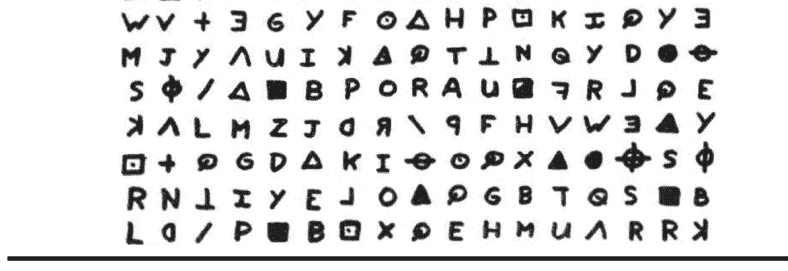

图1.18 占星术杀手密码。

这一部分的破译结果是：

我喜欢杀人，因为这很有趣，比在森林里猎杀野生动物更有趣，因为人类是所有动物中最危险的，要杀掉某物 gi

我最终有很多话要说关于占星术杀手创建的另一个密码。它在图1.19中再现，但我在这里不会给出任何剧透。如果你想了解更多，我鼓励你查阅本章末尾的参考文献。

现在似乎是时候再次轻松一下了。“Pomp and Circumstance”，在几乎每场毕业典礼上都会演奏，是由 Edward Elgar 创作的（图1.20）。尽管这无疑是他最著名的作品，他还在1897年创作了一条至今无人能破解的密码信息。它显示在图1.21中。

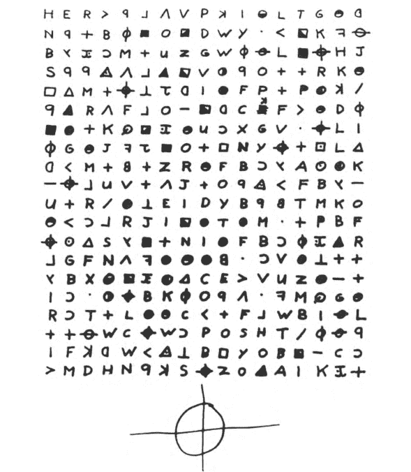

图1.19 另一个占星术杀手密码。

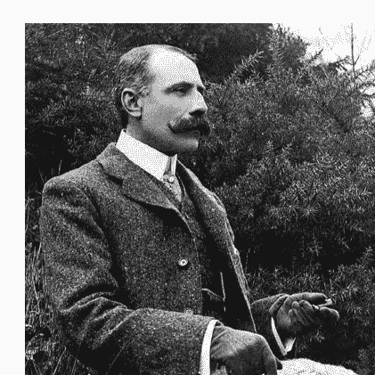

图1.20 Edward Elgar (https://en.wikipedia.org/wiki/Edward_Elgar)。

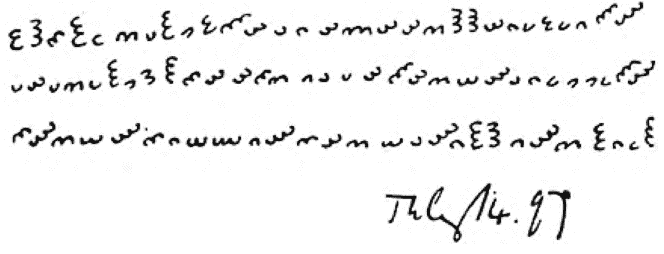

**图1.21** 一个开放问题——它说什么？ ([https://en.wikipedia.org/wiki/File:Dorabella-cipher-image.gif](https://en.wikipedia.org/wiki/File:Dorabella-cipher-image.gif))。

### 1.16 仿射密码

当我们介绍混合字母表时，通过模运算加密的数学视角似乎消失了！它再次出现在另一边，即密码分析中，我们一直在使用一些简单的统计数据。回到凯撒密码，我们可以将其推广以再次将数学视角带回加密。凯撒使用 $C=M+3\pmod{26}$。我们使密钥任意，给出 $C=M+K\pmod{26}$。但为什么不进一步推广呢？我们通过引入乘数 $a$ 来做到这一点。

考虑 $C=aM+b\pmod{26}$。这里我们的密钥是 $K=(a,b)$，一个有序对。使用 $K=(0,b)$ 是不允许的，因为每个字母都会被发送到 $b$，信息将无法破译——只能知道其长度。$K=(1,3)$ 给出凯撒位移。其他值呢？我们只有在 $a$ 与 26 的最大公约数为 1 时才能在明文字母和密文字母之间得到 1:1 映射。也就是说，$a$ 和 26 必须是互质的（也称为 *coprime*）。

$a$ 的各种值可以单独研究。1到25之间（含）的所有奇数值都有效，13 除外。欧拉的 totient 函数 $\varphi(n)$ 给出小于 $n$ 且与 $n$ 互质的正整数个数。所以我们可以写 $\varphi(26)=12$。该函数在公钥密码学中非常有用，如将在 [第14.3节](#) 中看到的那样。现在，$b$ 可以取 0 到 25 范围内的任意值，因此该密码的密钥空间为 $(12)(26)=312$。破译通过方程 $M=a^{-1}(C-b)$ 完成，其中 $a^{-1}$ 是 $a$ 的乘法逆元，即乘以 $a\pmod{26}$ 得到 1 的数。

仿射密码的密钥空间太小，无法抵御暴力攻击。虽然我们在这里使用了数学，但可能密钥的集合只是一般 MASC 的一个很小的子集。回想一下，这里的密钥空间为 $26!=403,291,461,126,605,635,584,000,000$。模26乘法表（[表1.5](#)）为方便你使用仿射密码而提供。

让我们使用密钥 $(11, 8)$ 对一条短消息进行加密，以熟悉这个系统：

```
HOW ARE YOU? I’M AFFINE.
```

我们将消息转换为数字（忽略标点）得到：

```
7, 14, 22, 0, 17, 4, 24, 14, 20, 8, 12, 0, 5, 5, 8, 13, 4
```

### 表1.5 Mod 26 乘法表

| |25|24|23|22|21|20|19|18|17|16|15|14|13|12|11|10|9|8|7|6|5|4|3|2|1|
|---|---|---|---|---|---|---|---|---|---|---|---|---|---|---|---|---|---|---|---|---|---|---|---|---|---|
|1|25|24|23|22|21|20|19|18|17|16|15|14|13|12|11|10|9|8|7|6|5|4|3|2|1|
|2|24|22|20|18|16|14|12|10|8|6|4|2|0|24|22|20|18|16|14|12|10|8|6|4|2|
|3|23|20|17|14|11|8|5|2|25|22|19|16|13|10|7|4|1|24|21|18|15|12|9|6|3|
|4|22|18|14|10|6|2|24|20|16|12|8|4|0|22|18|14|10|6|2|24|20|16|12|8|4|
|5|21|16|11|6|1|22|17|12|7|2|23|18|13|8|3|24|19|14|9|4|25|20|15|10|5|
|6|20|14|8|2|22|16|10|4|24|18|12|6|0|20|14|8|2|22|16|10|4|24|18|12|6|
|7|19|12|5|24|17|10|3|22|15|8|1|20|13|6|25|18|11|4|23|16|9|2|21|14|7|
|8|18|10|2|20|12|4|22|14|6|24|16|8|0|18|10|2|20|12|4|22|14|6|24|16|8|
|9|17|8|25|16|7|24|15|6|23|14|5|22|13|4|21|12|3|20|11|2|19|10|1|18|9|
|10|16|6|22|12|2|18|8|24|14|4|20|10|0|16|6|22|12|2|18|8|24|14|4|20|10|
|11|15|4|19|8|23|12|1|16|5|20|9|24|13|2|17|6|21|10|25|14|3|18|7|22|11|
|12|14|2|16|4|18|6|20|8|22|10|24|12|0|14|2|16|4|18|6|20|8|22|10|24|12|
|13|13|0|13|0|13|0|13|0|13|0|13|0|13|0|13|0|13|0|13|0|13|0|13|0|13|
|14|12|24|10|22|8|20|6|18|4|16|2|14|0|12|24|10|22|8|20|6|18|4|16|2|14|
|15|11|22|7|18|3|14|25|10|21|6|17|2|13|24|9|20|5|16|1|12|23|8|19|4|15|
|16|10|20|4|14|24|8|18|2|12|22|6|16|0|10|20|4|14|24|8|18|2|12|22|6|16|
|17|9|18|1|10|19|2|11|20|3|12|21|4|13|22|5|14|23|6|15|24|7|16|25|8|17|
|18|8|16|24|6|14|22|4|12|20|2|10|18|0|8|16|24|6|14|22|4|12|20|2|10|18|
|19|7|14|21|2|9|16|23|4|11|18|25|6|13|20|1|8|15|22|3|10|17|24|5|12|19|
|20|6|12|18|24|4|10|16|22|2|8|14|20|0|6|12|18|24|4|10|16|22|2|8|14|20|
|21|5|10|15|20|25|4|9|14|19|24|3|8|13|18|23|2|7|12|17|22|1|6|11|16|21|
|22|4|8|12|16|20|24|2|6|10|14|18|22|0|4|8|12|16|20|24|2|6|10|14|18|22|
|23|3|6|9|12|15|18|21|24|1|4|7|10|13|16|19|22|25|2|5|8|11|14|17|20|23|
|24|2|4|6|8|10|12|14|16|18|20|22|24|0|2|4|6|8|10|12|14|16|18|20|22|24|
|25|1|2|3|4|5|6|7|8|9|10|11|12|13|14|15|16|17|18|19|20|21|22|23|24|25|


然后，每个密文字母通过计算 11M + 8（模26）得到，其中 M 是明文字母。务必使用模26乘法表以节省时间。

```
11(7) + 8 = 7    11(14) + 8 = 6    11(22) + 8 = 16    11(0) + 8 = 8    11(17) + 8 = 13
11(4) + 8 = 0    11(24) + 8 = 12   11(14) + 8 = 6    11(20) + 8 = 20   11(8) + 8 = 18
11(12) + 8 = 10  11(0) + 8 = 8    11(5) + 8 = 11    11(5) + 8 = 11    11(8) + 8 = 18
11(13) + 8 = 21  11(4) + 8 = 0
```

因此，我们的数字密文是 7, 6, 16, 8, 13, 0, 12, 6, 20, 18, 10, 8, 11, 11, 18, 21, 0。转换回字母并替换标点（这对安全性不利！），我们得到

HGQ INA MGU? S'K ILLSVA.

要解密，我们需要转换回数字并应用方程 M = a^{-1}(C - b)。我们选择的 a 是11，模26乘法表显示 (11)(19) = 1，所以 a^{-1} 是19。如果你还有疑问，请对每个密文字母应用 M = 19(C - 8) 来恢复原始消息。你可以先做减法，再做乘法，或者像这样转换公式：

M = 19(C - 8) = 19C - 19(8) = 19C - 22 = 19C + 4

然后用公式 M = 19C + 4，以我们原来加密的同样方式来解密。

虽然仿射密码的密钥空间非常小，我们不需要寻找比暴力破解更复杂的方法就能迅速攻破它，但我还要指出另一个弱点。如果我们能得到一对不同的明文字母及其对应的密文字母（例如，通过猜测消息可能如何开始或结束），我们通常可以通过数学方法恢复密钥。

### 示例1

假设我们截获了一条消息，并猜测它以 DEAR.... 开头。如果前两个密文字母是 RA，我们可以将它们与 D 和 E 配对，得到

R = D a + b,    A = E a + b

将字母替换为其数值等价形式，得到

17 = 3a + b,      0 = 4a + b

我们有几种方法可以用于求解这个方程组：

- 1. 线性代数提供了多种技巧。
- 2. 我们可以从其中一个方程解出 b，然后将其代入另一个方程，得到一个只有一个未知数 a 的方程。
- 3. 我们可以将一个方程减去另一个方程，以消去未知数 b。

我们采用方法3。

```
17 = 3a + b
- (0 = 4a + b)
17 = -a
```

由于我们在模26下运算，解变为 a = -17 = 9。将 a = 9 代入 0 = 4a + b，我们得到 36 + b = 0，即 b = -36 = 16。我们现在已完全恢复了密钥。它是 (9, 16)。

### 示例2

假设我们截获了一条由 Cy Deavours 发送的消息，并猜测最后两个密文字母来自他的签名：CY。如果密文以 LD 结尾，那么我们就有

L = a C + b,    D = a Y + b

将字母替换为其数值等价形式，得到

11 = 2a + b,    3 = 24a + b

我们再次采用方法3来求解这个方程组：

```
3 = 24a + b
- (11 = 2a + b)
-8 = 22a
```

由于我们在模26下运算，这个结果变成 18 = 22a。查看模26乘法表，我们看到 a 有两个可能的值：2 和 15。让我们看看当把 a = 2 代入每个方程时会得到什么。

```
3 = 24a + b →    3 = 22 + b →    -19 = b →    b = 7
11 = 2a + b →    11 = 4 + b →    7 = b
```

现在尝试将 a = 15 代入每个方程：

```
3 = 24a + b →    3 = 22 + b →    -19 = b →    b = 7
11 = 2a + b →    11 = 4 + b →    7 = b
```

所以，b 肯定是 7，但我们无法确定 a 是 2 还是 15。在这种情况下，我们需要另一对明文/密文对来决定。当然，因为我们知道 a 必是二者之一，我们可以尝试在消息上使用两个密钥对 (2, 7) 和 (15, 7)，看看哪个能产生有意义的文本。

那么为什么这个例子没有像第一个例子那样顺利呢？为什么我们没有得到唯一解？问题始于 18 = 22a 给了我们两个 a 的可能值。要触及问题的核心，让我们回到上一步：

```
3 = 24a + b
- (11 = 2a + b)
-8 = 22a
```

现在让我们用 C₁ 和 C₂ 表示密文值，M₁ 和 M₂ 表示明文值，使其更一般化：

```
C₂ = M₂ a + b
- (C₁ = M₁ a + b)
C₂ - C₁ = (M₂ - M₁) a
```

因此，只要方程 \(C_2 - C_1 = (M_2 - M_1)a\) 没有唯一解，我们就不会得到唯一解。如果 \(M_2 - M_1\) 在模26下有逆元（即存在某个数与之相乘得到1模26），那么 \(a\) 就会有唯一解，即 \(a = (M_2 - M_1)^{-1}(C_2 - C_1)\)，其中 \((M_2 - M_1)^{-1}\) 表示 \(M_2 - M_1\) 的逆元。

在示例1中，\(M_2 - M_1\) 是1，它在模26下是可逆的。然而，对于示例2，\(M_2 - M_1\) 是22，它在模26下不可逆（模26表中没有数可以与22相乘得到1）。

在进入下一节之前，有一个挑战。你能在图 **1.22** 所示的书封面上找到隐藏信息吗？如果找不到，读完接下来几页后再试一试。

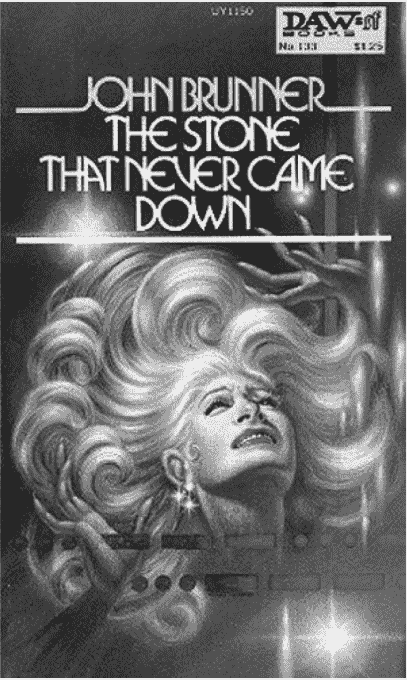

**图 1.22**  神秘的科幻封面艺术。（由 DAW Books 提供，[www.dawbooks.com](http://www.dawbooks.com)。）

### 1.17 摩尔斯码与哈夫曼编码

另一种系统中，每个字母都被一致地替换为相同的表示形式，那就是我们熟悉的摩尔斯码。实际上有两个版本：美国版和国际版。国际版如**表 1.6**所示。

**表 1.6 国际摩尔斯码**

| 字母 | 代码 | 字母 | 代码 |
|---|---|---|---|
| A | .- | N | -. |
| B | -... | O | --- |
| C | -.-. | P | .--. |
| D | -.. | Q | --.- |
| E | . | R | .-. |
| F | ..-. | S | ... |
| G | --. | T | - |
| H | .... | U | ..- |
| I | .. | V | ...- |
| J | .--- | W | .-- |
| K | -.- | X | -..- |
| L | .-.. | Y | -.-- |
| M | -- | Z | --.. |

尽管它看起来像一种替换密码，但如果你把这个系统称为摩尔斯密码，人们会一脸困惑地看着你。注意，最常见的字母具有最短的表示，而最罕见的字母具有最长的表示。这是有意为之，以便消息可以更快地传递。

还有表示数字0到9的点划组合，但由于这些数字可以拼写出来，它们并非严格必需。注意，最常见的字母E和T有单字符表示，而V用四个字符表示。V很容易记住，因为它是贝多芬第五交响曲的开头。二战期间，盟军使用V代表胜利，并将贝多芬第五交响曲用于宣传目的。

仔细观察图1.23所示硬币的背面。注意外围的一串点和划，拼出了摩尔斯码消息。从硬币底部的“CENTS”中“N”的左侧开始顺时针读，就会显现出消息“WE WIN WHEN WE WORK WILLINGLY”。摩尔斯码还有更令人不安的用途；例如：

> [Jeremiah] Denton 最为人所知的是1966年他在北越电视采访中被强迫作为囚犯出镜，在那次采访中，他机智地利用这个机会向美国情报部门传递信息。采访期间，Denton 用摩尔斯码眨眼，拼出单词“T-O-R-T-U-R-E”，以传达他的看押者正在折磨他和他的战俘同伴。

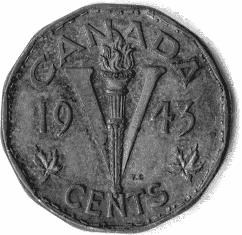

**图 1.23** 一枚带有隐藏信息的加拿大硬币（感谢 Lance Snyder 为此图片提供帮助。）

作为一段历史注记，1909年，国际遇险信号（SOS），即摩尔斯码中的`... --- ...`，由杰克·宾斯首次通过无线电发出，当时他的船*S.S. Republic*与*S.S. Florida*相撞。摩尔斯码不提供保密性，因为没有秘密密钥。所做的替换对所有人都是公开的。事实上，广播消息如此容易被截获，还不如直接发给敌人。相比之下，获得由信使传递的消息则困难得多。因此，电报（和无线电）使密码学变得更加重要。如果敌人将获得你消息的副本，那么这些消息最好得到充分保护。电报和无线电通信的便利性，加上人们通常对所使用的任何加密手段的过度自信，使这种方法非常具有吸引力。电报首次用于军事目的是在克里米亚战争（1853–1856）中，然后在美国内战中得到更广泛的应用。

可能看起来摩尔斯码只需要两个符号：点和划，但实际上还有第三个——空格。如果所有点和划连在一起，我们就无法分辨一个字母在哪里结束、下一个在哪里开始；例如，⁴⁶

```
... --- ..-. .. .-        decodes to "Sofia"
. ..- --. . -. .. .-      decodes to "Eugenia"
```

还有另一种更现代的编码系统可以避免这个问题，并且真正只需要两个字符。这归功于 David A. Huffman（图1.24），他在麻省理工学院攻读计算机科学博士学位时提出了这个想法。⁴⁷

⁴⁶ [http://rubyquiz.com/quiz121.html](http://rubyquiz.com/quiz121.html)。

⁴⁷ Huffman, David A., “A Method for the Construction of Minimum-Redundancy Codes,” *Proceedings of the Institute of Radio Engineers*, Vol. 40, No. 9, September 1952, pp. 1098–1101。


图 1.24 David A. Huffman (1925–1999)。(由 Don Harris, University of California, Santa Cruz 提供。)

哈夫曼编码使用了与摩尔斯电码相同的思想。与计算机标准做法不同，每个字符不再用八位表示，常见字符被分配较短的表示，而较少出现的字符则使用较长的表示（参见表 1.7）。压缩后的数据随后连同使用过的替换密钥一起存储。这是一个简单的例子，说明了一个重要领域，即 *数据压缩*。高压缩率允许信息更快地发送，并在存储时占用更少的空间。Zip 文件就是一个例子。如果不压缩，文件的下载时间会更长。哈夫曼编码也用于压缩 JPEG 等图像。

使用表 1.7 所示的编码，MATH 会表示为 1101001000011001。你现在可以随意拆分这些 0 和 1，但唯一能得到的字母只有 MATH。要了解原因，请查看图 1.25 中的二进制图。

要阅读此图，从顶部开始，沿着标记为 0 和 1 的路径跟进，直到到达一个字母。你所走的路径就是该字母在我们哈夫曼编码中的比特串。在摩尔斯电码中，字母 N（– .）可以拆分为 – 和 . 得到 TE，但在图 1.25 所示图中表示的字母中这种情况不会发生，因为通向一个字母的特定比特串在途中不会经过其他任何字母。我们只在路径的末端标注了字母。该树可以向右进一步延伸以包含整个字母表，但已显示的内容足以阐明基本思想。

哈夫曼编码的下一层级是用比特串替换字符串。常见单词可能被压缩到比单个字符通常所需的空间更小，而较少出现的单词

## 表 1.7 哈夫曼编码

| 字母 | 哈夫曼编码 | 字母 | 哈夫曼编码 |
|---|---|---|---|
| E | 000 | M | 11010 |
| T | 001 | W | 11011 |
| A | 0100 | F | 11100 |
| O | 0101 | G | 111010 |
| I | 0110 | Y | 111011 |
| N | 0111 | P | 111100 |
| S | 1000 | H | 1001 |
| H | 1001 | V | 111110 |
| R | 1010 | K | 1111110 |
| D | 10110 | J | 11111110 |
| L | 10111 | X | 111111110 |
| C | 11000 | Q | 1111111110 |
| U | 11001 | Z | 1111111111 |

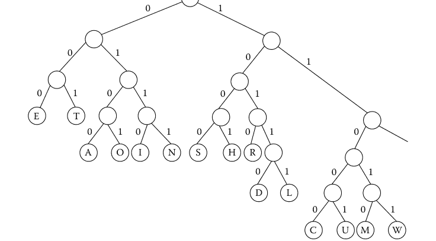

图 1.25 哈夫曼编码图。

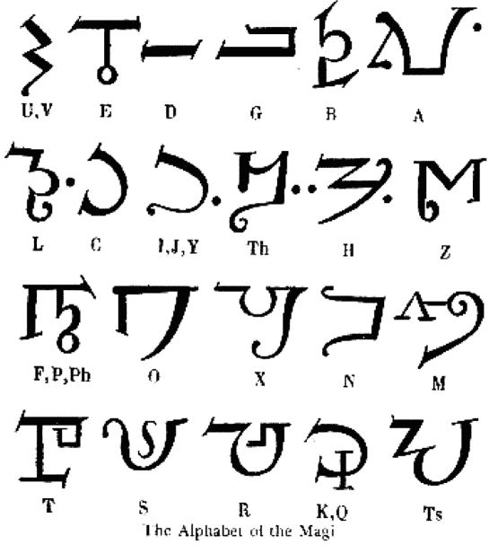

**图 1.26**  **魔术师字母表。**(摘自 Christian, Paul (Jean Baptiste Pitois 的笔名)。(摘自 *Histoire de la Magie, du Monde Surnaturel et de la Fatalité à travers les Temps et les peuples*, 1870, 第 177 页。)

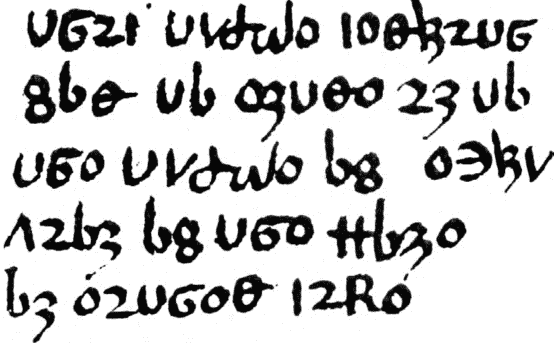

**图 1.27**  **乔叟密码。**(由 David Kahn Collection, National Cryptologic Museum, Fort Meade, Maryland 提供。)

玛丽回应，支持这次阴谋，前提是她的获释时间在暗杀之前或同时，因为她担心如果暗杀先发生，她的生命会受到威胁。与之前的消息一样，这条消息也被 Phelippes 阅读并转交给 Walsingham。巴宾顿和玛丽女王现在都被判处死刑，但其他阴谋者仍未具名。为了诱捕其余人员，Walsingham 要求 Phelippes 在玛丽的回信中以玛丽自己的笔迹风格添加更多加密文本（[图 1.29](#)）。

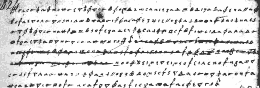

**图 1.29**  伪造的密文。(由 David Kahn Collection, National Cryptologic Museum, Fort Meade, Maryland 提供。)

解密后的信息如下：

> 我很乐意知道要执行此计划的六位绅士的名字和身份；因为在了解各方之后，我也许能够给你一些进一步的必要建议，以便在此事中遵循，也能随时详细告知你们的进展：并且尽快为了同样的目的，谁已经参与其中，以及每个人知晓到何种程度。

然而，情况是巴宾顿即将离开该国以准备推翻伊丽莎白女王（他得到西班牙菲利普二世的支持），因此有必要逮捕他。审判后，玛丽于 1587 年被斩首。[^52] 如果玛丽使用更强的密码，阴谋是否会成功？关于欧洲使用的名词表可以讲述更多故事，但我们现在跳到美国革命。

乔治·华盛顿将军在间谍活动上吸取了一些惨痛的教训（例如 Nathan Hale 的死亡），随后他很好地保护了代号为 Culper Senior 和 Culper Junior 的间谍的身份，以至于直到 1930 年才成为历史学家之谜！Morton Pennypacker 最终揭开了 Culper 的真实姓名，当他在 Robert Townsend 的信件中发现其笔迹与间谍 Culper Junior 完全匹配时。[^53] Townsend 是一名贵格会成员，不希望人们注意到他为国家所做的工作。直到二十世纪，间谍活动才摆脱了耻辱并变得浪漫化。在美国革命时期，它被认为是不光彩的。

在占领中的纽约活动的 Culper 间谍组织使用的名词表的一页复制品见于 [图 1.30](#)。

Culper 的名词表并不总是被最好地使用。一封信中包含部分加密的短语“David Mathews, Mayor of 10.”[^54] 如果这条信息被截获，你认为英国密码分析员需要多长时间才能确定 10 = New York？

[^52]: Mary 的故事在 Simon Singh 的 *The Code Book* 中生动地讲述，Doubleday, New York, 1999, 第 1–3、32–44 页，本文内容即改编自此。

[^53]: Pennypacker, Morton, *The Two Spies, Nathan Hale and Robert Townsend*, Houghton Mifflin Company, Boston, Massachusetts, 1930.

[^54]: Pennypacker, Morton, *General Washington’s Spies*, Long Island Historical Society, Brooklyn, New York, 1939, facing p. 50.

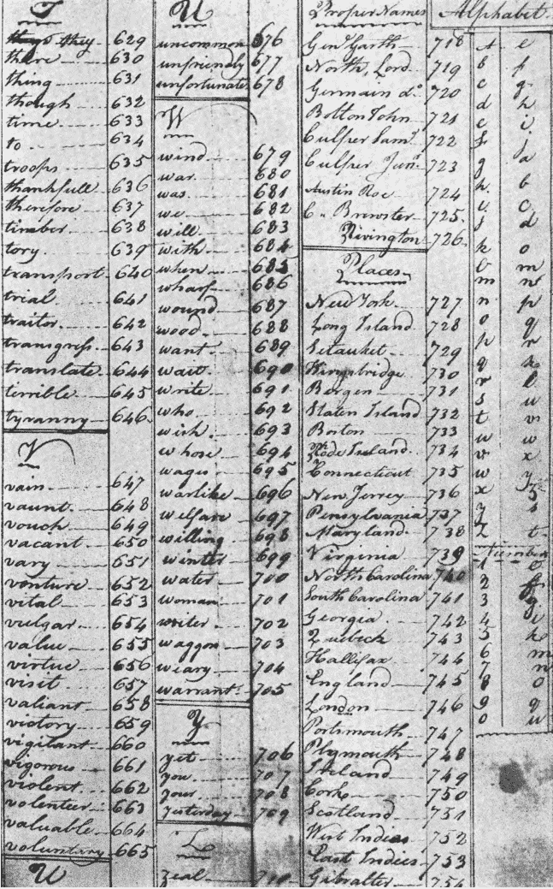

**图 1.30** 美国革命中使用的一种名词表。(摘自 *George Washington Papers at the Library of Congress, 1741–1799: Series 4. General Correspondence. 1697–1799*, Talmadge, 1783, Codes。)

尽管 Culper Junior 的身份最终被揭露，我们对其外貌仍然知之甚少。Pennypacker 将一幅剪影（[图 1.31，左](#)）鉴定为 Robert Townsend，但它实际上是 Townsend 的兄弟。目前被公认为 Robert 的唯一描绘（[图 1.31，右](#)）是由其侄子 Peter Townsend 绘制的。

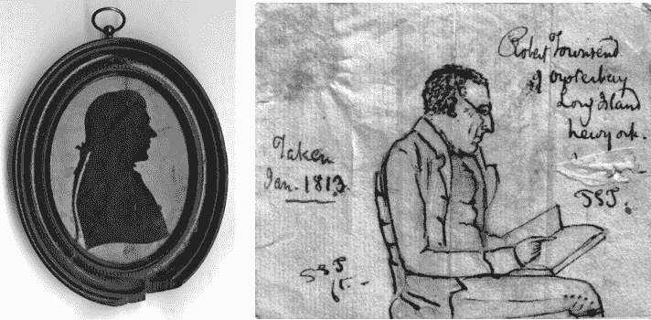

**图 1.31**  Pennypacker 误认为 Robert Townsend 的剪影（左）。(由 Friends of Raynham Hall Museum 提供。) Robert Townsend 由其侄子 Peter Townsend 绘制的画像（右）。(由 Friends of Raynham Hall Museum 提供。)

在革命战争期间，华盛顿将军仅在间谍活动上花费了 $17,617，并且他用自己的口袋支付了这些费用！他后来向国会开具了账单，但这种预算与今天的情况形成鲜明对比。参见 [第12章](#)。

### 1.20 名词表的密码分析

现在我们已经看到了一些例子，让我们考虑如何破解一个名词表——一个比上述例子更大、更具挑战性的名词表！好的名词表有数万个代码组；然而，代码部分可能有一个明显的缺点，即代码词按字母顺序排列，而对应的代码数字按数值顺序排列。<sup>55</sup> 如果是这种情况，一个在许多概率文本中出现的漂亮公式允许我们估计代码的大小。<sup>56</sup>

$$\mathrm{Size} \approx \frac{n+1}{n}Max - 1$$

其中 *n* 是观察到的代码组数量，*Max* 是观察到的代码组中的最大值。

<sup>55</sup> 避免此陷阱的双部分代码在第 4.2 节中讨论。

<sup>56</sup> 有关推导请参见 Ghahramani, Saeed, *Fundamentals of Probability*, Prentice-Hall, Upper Saddle River, New Jersey, 1996, 第 146–148 页。这并不是该结果首次出现或被证明的地方。


例如，如果一份被截获的消息包含 22 个编码组，且其中最大值为 31,672，那么密码本中的条目数大致为

$$\frac{n+1}{n} Max -1 = \frac{22+1}{22}(31,672)-1 \approx 33,111$$

减去 1 在这里并无实际区别，但为了数学上的正确性而加入了。上述公式还有其他用途。在我为推导所引用的概率文本中，它被用来根据观察到的坦克数量和看到的最高编号来估计敌方坦克的数量。

一旦我们知道了密码的大小，就可以查阅大小相似的词典。因为它不太可能是密钥，我们不能指望简单地把单词填入代码编号的位置；然而，该单词的首字母，甚至可能是第二字母，正确的可能性很大。因此，我们可以为每个单词的前两个字母写下假设。这与上下文结合起来，可能让我们猜出一些明文短语。

表 1.8 显示了在 60,000–65,000 个词的词典中以给定字母开头的单词的结束位置。

### 1.21 书本密码

具有大量代码部分的命名法很可能使用密码本列出它们，但这不应与书本密码混淆。我将用波洛克在《恐惧谷》中发给夏洛克·福尔摩斯的一个例子来说明书本密码的想法，他有信心福尔摩斯无需密钥就能读懂。

```
534 C2 13 127 36 31 4 17 21 41
DOUGLAS 109 293 5 37 BIRLSTONE
26 BIRLSTONE 9 47 171
```

福尔摩斯认为 534 表示某本书的第 534 页，C2 表示第二栏。数字随后代表单词，而一些名字被拼写出来，因为它们不在给定页上。威廉·弗里德曼曾在未找到所用书籍的情况下破解过此类密码，但福尔摩斯采取了更直接的路线。由于书籍的最小尺寸为 534 页，且为便于使用需要福尔摩斯能够获得副本，他考虑符合约束条件的卷册。圣经是华生提出的可能性，但福尔摩斯评论说他“几乎无法想到任何一卷书会比莫里亚蒂的同伙肘边更不可能出现的”。福尔摩斯最终转向当前的年鉴。它产生的是无意义的内容，但前一年的年鉴奏效，故事就此展开。

其他使用书本密码的恶棍包括本尼迪克特·阿诺德，他试图向英国人出卖西点，以及小说《沉默的羔羊》中的汉尼拔·莱克特。阿诺德的书是一本词典，而莱克特的是《烹饪之乐》。

图 1.32 显示了威廉·弗里德曼在没有附带书籍帮助的情况下破解的书本密码，该书后来才被找到。请注意，这种特定密码不是选择单词，而是选择单个字母来形成密文。

### 表 1.8 代码词典

| 前缀 | 计数 | 前缀 | 计数 | 前缀 | 计数 | 前缀 | 计数 | 前缀 | 计数 | 前缀 | 计数 |
| --- | --- | --- | --- | --- | --- | --- | --- | --- | --- | --- | --- |
| AA | 5 | DA | 11,646 | GL | 21,300 | LO | 30,690 | PE | 38,121 | TE | 55,336 |
| AB | 207 | DE | 12,850 | GN | 21,344 | LU | 30,850 | PH | 38,385 | TH | 55,778 |
| AC | 467 | DI | 13,935 | GO | 21,592 | LY | 30,890 | PI | 38,828 | TI | 56,036 |
| AD | 695 | DO | 14,210 | GR | 22,267 | MA | 31,730 | PL | 39,245 | TO | 56,466 |
| AE | 741 | DR | 14,620 | GU | 22,530 | ME | 32,362 | PO | 39,970 | TR | 57,232 |
| AF | 845 | DU | 14,840 | GY | 22,588 | MI | 32,903 | PR | 41,260 | TU | 57,432 |
| AG | 942 | DW | 14,855 | HA | 23,320 | MO | 33,525 | PS | 41,320 | TW | 57,498 |
| AI | 1,018 | DY | 14,900 | HE | 23,942 | MU | 33,826 | PU | 41,740 | TY | 57,556 |
| AL | 1,325 | EA | 15,000 | HI | 24,180 | MY | 33,885 | PY | 41,815 | UB | 57,571 |
| AM | 1,415 | EC | 15,075 | HO | 24,764 | NA | 34,075 | QUA | 41,984 | UG | 57,589 |
| AN | 1,957 | ED | 15,126 | HU | 24,989 | NE | 34,387 | QUE | 42,036 | UL | 57,638 |
| AP | 2,081 | EF | 15,187 | HY | 25,190 | NI | 34,529 | QUI | 42,159 | UM | 57,685 |
| AR | 2,514 | EG | 15,225 | IC | 25,270 | NO | 34,815 | QUO | 42,181 | UN | 59,885 |
| AS | 2,737 | EI | 15,235 | ID | 25,347 | NU | 34,928 | RA | 42,573 | UP | 59,957 |
| AT | 2,860 | EL | 15,436 | IG | 25,370 | NY | 34,946 | RE | 44,346 | UR | 60,014 |
| AU | 3,014 | EM | 15,630 | IL | 25,469 | OA | 34,970 | RH | 44,422 | US | 60,050 |
| AV | 3,073 | EN | 16,030 | IM | 25,892 | OB | 35,140 | RI | 44,712 | UT | 60,080 |
| AW | 3,100 | EP | 16,145 | IN | 27,635 | OC | 35,230 | RO | 45,207 | VA | 60,363 |
| AZ | 3,135 | EQ | 16,210 | IR | 27,822 | OD | 35,270 | RU | 45,441 | VE | 60,692 |
| BA | 3,802 | ER | 16,290 | IS | 27,868 | OF | 35,343 | SA | 46,192 | VI | 61,113 |
| BE | 4,250 | ES | 16,387 | IT | 27,910 | OG | 35,356 | SC | 46,879 | VO | 61,277 |
| BI | 4,470 | ET | 16,460 | JA | 28,046 | OI | 35,390 | SE | 47,945 | VU | 61,307 |
| BL | 4,760 | EU | 16,505 | JE | 28,135 | OL | 35,450 | SH | 48,580 | WA | 61,830 |
| BO | 5,180 | EV | 16,610 | JI | 28,168 | OM | 35,496 | SI | 49,024 | WE | 62,133 |
| BR | 5,590 | EX | 17,165 | JO | 28,290 | ON | 35,555 | SK | 49,152 | WH | 62,472 |
| BU | 5,930 | EY | 17,190 | JU | 28,434 | OO | 35,575 | SL | 49,453 | WI | 62,800 |
| BY | 5,954 | FA | 17,625 | KA | 28,500 | OP | 35,727 | SM | 49,600 | WO | 63,079 |
| CA | 6,920 | FE | 17,930 | KE | 28,583 | OR | 35,926 | SN | 49,788 | WR | 63,175 |
| CE | 7,110 | FI | 18,390 | KI | 28,752 | OS | 35,993 | SO | 50,266 | X | 63,225 |
| CH | 7,788 | FL | 18,964 | KN | 28,857 | OT | 36,018 | SP | 51,132 | YA | 63,282 |
| CI | 7,970 | FO | 19,610 | KO | 28,878 | OU | 36,159 | SQ | 51,259 | YE | 63,345 |
| CL | 8,220 | FR | 20,030 | KR | 28,893 | OV | 36,348 | ST | 52,678 | YO | 63,397 |
| CO | 10,550 | FU | 20,265 | KU | 28,910 | OW | 36,361 | SU | 53,701 | YU | 63,409 |
| CR | 11,030 | GA | 20,700 | LA | 29,457 | OX | 36,395 | SW | 53,977 | ZE | 63,452 |
| CU | 11,300 | GE | 20,950 | LE | 29,787 | OY | 36,410 | SY | 54,206 | ZI | 63,485 |
| CY | 11,380 | GI | 21,088 | LI | 30,283 | PA | 37,226 | TA | 54,783 | ZO | 63,542 |
|  |  |  |  |  |  |  |  |  |  | ZY | 63,561 |

*来源:* Mansfield, L.C.S., *The Solution of Codes and Ciphers*, Alexander Maclehose, London, UK, 1936, pp. 154–157.

### 不谨慎的

德国和美国在政治上的差异，我们在计算中绝不能忽略。德国公民所拥有的这种宪法和这种权利是他们的统治者授予他们的。普鲁士或巴伐利亚或符腾堡的人民并没有给予某些权力，也没有设置某些限-

### 失败

### 德国和德国人

如果在德国有人一时认为社会主义者能够真正掌权，他们的选票和他们在帝国议会中的代表人数将在一次选举中就急剧减少。普通的德国人不是领导者，不是紧急情况的爱好者，也不是社会或政治的殖民者，而且

### 开始

### 弗里德里希致俾斯麦

尤其致命，但正如我们所注意到的，现在远不相等。这个众议院有三百九十七名成员，其中两百三十五名来自普鲁士。它任期五年，但可由联邦委员会解散，

### 革命在

### 德国和德国人

联邦委员会，或联邦委员会，或帝国的上议院，由各州统治者任命并代表其利益的代表组成。共有 58 名成员。普鲁士有 17 名，巴伐利亚 6 名，萨克森 4 名，符腾堡 4 名，巴登 3 名，

### 孟加拉

- (8)
- 如果我们
- 119-1-3
- 119-2-3
- 119-1-2
- 118-2-9
- 118-2-3
- 118-3-3

- 118-1-4
- 118-2-5

- 118-2-4
- 118-1-4
- 118-3-3-1
- 118-1-7
- 118-1-4

- 118-3-1

- 83-1-2
- 83-1-11
- 83-1-25
- 83-1-1
- 83-1-8
- 83-1-13
- 83-1-18
- 83-1-3
- 83-1-1
- 83-1-6

- 83-1-3
- 83-1-6

- 82-2-5
- 82-2-6
- 82-3-4
- 83-1-4
- 82-2-3
- 82-1-10

- 如你所问
- 它一直是为
- 最好的。如果我们
- 119-1-3
- 119-2-3
- 119-1-2
- 118-2-9
- 118-2-3
- 118-3-3


## 参考文献与进一步阅读

### 关于古代密码及一些一般性参考资料

Balliett, Blue, *Chasing Vermeer*, Scholastic Press, New York, 2004. 这是一部青少年/儿童小说，融入了波利比乌斯密码，该密码通过以下（非正方形）矩形将字母和数字混合进行加密

|  | 1 | 2 | 3 |
|---|---|---|---|
| **F** | A | M | Y |
| **I** | B | N | Z |
| **L** | C | O |  |
| **N** | D | P |  |
| **P** | E | Q |  |
| **T** | F | R |  |
| **U** | G | S |  |
| **V** | H | T |  |
| **W** | I | U |  |
| **X** | J | V |  |
| **Y** | K | W |  |
| **Z** | L | X |  |

因此，HELLO 将变成 V1 P1 Z1 Z1 L2。该书提倡自由思考和探索，体现了查尔斯·福特的精神，他在书中多处被引用。

Bauer, Craig P., *Discrete Encounters*, CRC/Chapman & Hall, Boca Raton, Florida, 2020. 如果你喜欢 *Secret History: The Story of Cryptology* 的风格，你可能会喜欢这本书。它将历史与离散数学的介绍相结合，而离散数学几乎全部在密码学中有应用。

Bellovin, Steven, M., *Compression, Correction, Confidentiality, and Comprehension: A Modern Look at Commercial Telegraph Codes*, Department of Computer Science, Columbia University, New York, 2009, 可在线获取于 [http://www.usenix.org/events/sec09/tech/slides/bellovin.pdf](http://www.usenix.org/events/sec09/tech/slides/bellovin.pdf)。这份关于商业密码本的 PowerPoint 演示提供了许多有趣的例子，例如摘自 *The Theatrical Cipher Code*（1905 年）的这段内容：

| 代码 | 含义 |
|---|---|
| Filacer | 一个歌剧公司 |
| Filament | 他们是否愿意穿紧身裤登台 |
| Filander | 你是否愿意穿紧身裤登台 |
| Filar | 芭蕾舞女演员 |
| Filaria | 滑稽歌剧 |
| Filature | 滑稽歌剧公司 |
| File | 滑稽表演者 |
| Filefish | 合唱女演员 |
| Filial | 合唱女演员们 |
| Filially | 合唱女演员们是 |
| Filiation | 身材姣好且容貌出众的合唱女演员 |
| Filibuster | 身材姣好、容貌出众且会唱歌的合唱女演员 |
| Filicoid | 会唱歌的合唱女演员 |
| Filiform | 合唱男演员 |
| Filigree | 合唱男演员们 |
| Filing | 会唱歌的合唱男演员 |
| Fillet | 合唱人员 |
| Fillip | 会唱歌的合唱人员 |
| Filly | 喜歌剧 |
| Film | 喜歌剧公司 |
| Filter | 喜歌剧人员 |
| Filtering | 令人垂涎的合唱女演员 |

| 术语 | 定义 |
|---|---|
| Filially | 合唱女演员们是 |
| Filiation | 身材姣好且容貌出众的合唱女演员 |
| Filibuster | 身材姣好、容貌出众且会唱歌的合唱女演员 |
| Filicoid | 会唱歌的合唱女演员 |
| Filiform | 合唱男演员 |
| Filigree | 合唱男演员们 |
| Filing | 会唱歌的合唱男演员 |
| Fillet | 合唱人员 |
| Fillip | 会唱歌的合唱人员 |
| Filly | 喜歌剧 |
| Film | 喜歌剧公司 |
| Filter | 喜歌剧人员 |
| Filtering | 令人垂涎的合唱女演员 |

Hunt, Arthur S., “A Greek Cryptogram,” *Proceedings of the British Academy*, Vol. 15, 1929, pp. 127–134. 这篇易于阅读的论文介绍了一段希腊密文，其中字母被翻转一半或以其他微小方式修改以掩饰书写。无需了解希腊语即可理解本文，因为提供了密文的英文译文。不幸的是，所考察的密文（密歇根密码纸草）的近似日期未给出。

Kahn, David, *The Codebreakers*, Second Edition, Scribner, New York, 1996. Kahn 在其经典历史的第 2 章回顾了整个古代世界的密码学。

以下三个参考文献涉及有争议的破译。我只是提供标题；是否正确由你自行判断。

Landsverk, Ole G., *Ancient Norse Messages on American Stones*, Norseman Press, Glendale, California, 1969.

Landsverk, Ole G., “Cryptography in Runic Inscriptions,” *Cryptologia*, Vol. 8, No. 4, October 1984, pp. 302–319.

Mongé, Alf and Ole G. Landsverk, *Norse Medieval Cryptography in Runic Carvings*, Norseman Press, Glendale, California, 1967.

Reeds, Jim, *Commercial Code Book Database*, Mar. 23, 2001, 已归档于 [https://web.archive.org/web/201403080413/http://www.dtc.umn.edu:80/~reedsj/codebooks.txt](https://web.archive.org/web/201403080413/http://www.dtc.umn.edu:80/~reedsj/codebooks.txt)。该在线资源提供了 1,745 本商业密码书的书目详情。这里是收藏家们的清单！

### 关于 Poe

Brigham, Clarence S., “Edgar Allan Poe’s Contributions to *Alexander’s Weekly Messenger,*” *Proceedings of the American Antiquarian Society*, Vol. 52, No. 1, April 1942, pp. 45–125. 本文标志着 Poe 关于密码学的谜题的重新发现。

Friedman, William F., “Edgar Allan Poe, Cryptographer,” *American Literature*, Vol. 8, No. 3, November 1936, pp. 266–280.

Friedman, William F., “Edgar Allan Poe, Cryptographer,” *Signal Corps Bulletin*, No. 97, July–September 1937, pp. 41–53; Friedman, William F., “Edgar Allan Poe, Cryptographer (Addendum),” *Signal Corps Bulletin*, No. 98, October–December 1937, pp. 54–75. 这些文章在 Friedman, William F., editor, *Cryptography and Cryptanalysis Articles*, Vol. 2, Aegean Park Press, Laguna Hills, California, 1976 中重印。

Pirie, David, *The Patient’s Eyes: The Dark Beginnings of Sherlock Holmes*, St. Martin’s Minotaur, New York, 2002. 这是一部涉及密码分析的小说。有趣的是，作者复现了 Poe 的频率排序，并通过省略字母 x 引入了另一个错误。

Silverman, Kenneth, *Edgar A. Poe: Mournful and Never-ending Remembrance*, HarperCollins, New York, 1991.

Wimsatt, Jr., William K., “What Poe Knew about Cryptography,” *Publications of the Modern Language Association*, Vol. 58, No. 3, September 1943, pp. 754–779.

### 不感兴趣

Rosenheim, Shawn James, *The Cryptographic Imagination: Secret Writing from Edgar Poe to the Internet*, Parallax: Re-Visions of Culture and Society, The Johns Hopkins University Press, Baltimore, Maryland, 1997.

有关详情，请参阅滑铁卢大学计算机科学教授的以下书评：

Shallit, Jeffrey, “Book review of Menezes, van Oorschot, and Vanstone, *Handbook of Applied Cryptography*, and Rosenheim, *The Cryptographic Imagination: Secret Writings from Edgar Poe to the Internet*,” *American Mathematical Monthly*, Vol. 106, No. 1, January 1999, pp. 85–88.

### 关于夏洛克·福尔摩斯与密码学

下面给出的许多参考文献提出了舞蹈人作为密码的来源。道尔声称它们是独立创作，任何与之前密码的相似性都是巧合。奇怪的是，一些粉丝，他们 presumably 认为他的故事是原创和富有想象力的（否则他们就不会是粉丝），无法承认他自己想出了这个点子！

Bond, Raymond T., editor, *Famous Stories of Code and Cipher*, Rinehart and Company, New York, 1947. 平装本版 Collier Books, New York, 1965 的内容与精装本仅相差一个故事，但“跳舞人的冒险”同时存在于两者中，作者对该故事的有趣导言性评论也同时存在。有关这些评论，请参阅精装本第 136–137 页或平装本第 171–172 页。

Donegall, Lord, *Baker Street and Beyond: Essays on Sherlock Holmes*, Sherlock Holmes Society of London, London, UK, 1993. 这本书收录了 Donegall 为 *The New Strand* 杂志撰写的文章。如果你宁愿看原文，相关文章是“Baker Street and Beyond (9): A Treaty for Breakfast,” Vol. 1, No. 9, August 1962, pp. 1048–1050 和“Baker Street and Beyond (15): Too Hot to Mollies?—Those Phoney Ciphers—Blank for Blank,” Vol. 2, No. 2, February 1963, pp. 1717–1720。

Hearn, Otis, “Some Further Speculations upon the Dancing Men,” *The Baker Street Journal*, (New Series), Vol. 19, December 1969, pp. 196–202. Hearn 是 Walter N. Trenerry 的笔名。

Kahn, David, *The Codebreakers*, The Macmillan Company, New York, 1967, p. 794–798. 我在这里引用的是第一版，以便你可以看到 Kahn 何时对该问题发表看法。

McCormick, Donald, *Love in Code*, Eyre Methuen, London, UK, 1980, p. 5.

Orr, Lyndon, “A Case of Coincidence Relating to Sir A. Conan Doyle,” *The Bookman*, Vol. 31, No. 2, April 1910, pp. 178–180, 可在线获取于 https://archive.org/details/bookman20unkngoog/page/n190/mode/2up。该文章在 *The Baker Street Journal*, (New Series), Vol. 19, No. 4, December 1969, pp. 203–205 中重印。

Pattrick, Robert H., “A Study in Crypto-Choreography,” *The Baker Street Journal*, (New Series), Vol. 5, No. 4, October 1955, pp. 205–209.

Pratt, Fletcher, “The Secret Message of the Dancing Men,” in Smith, Edgar W., editor, *Profile by Gaslight: An Irregular Reader about the Private Life of Sherlock Holmes*, Simon and Schuster, New York, 1944, pp. 274–282.


Schenk，Remsen Ten Eyck，《福尔摩斯、密码分析与跳舞小人》，《贝克街杂志》（新辑），第5卷第2期，1955年4月，第80–91页。
Schornin，Howard R.，《正典中的密码学》，《贝克街杂志》（新辑），第13卷，1963年12月，第214–216页。
Shulman，David，《夏洛克·福尔摩斯：密码分析者》，《贝克街杂志》（旧辑），第3卷，1948年，第233–237页。
Shulman，David，《跳舞小人的起源》，《贝克街杂志》（新辑），第23卷第1期，1973年3月，第19–21页。
Trappe，Wade 和 Lawrence C. Washington，《密码学与编码理论导论》，普伦蒂斯·霍尔出版社，新泽西州上鞍河，2002年，第26–29页。这些作者概括了故事（一种克利夫笔记式的版本）并讨论了各个版本中的印刷错误。
若要了解更多小说中使用的代码和密码示例，约翰·杜利（John Dooley）是值得请教的人：
Dooley，John F.，《小说中的代码与密码：概述》，《Cryptologia》，第29卷第4期，2005年10月，第290–328页。如需最新列表，请访问 https://www.johnfdooley.com/ 并点击“密码小说”链接。截至2020年10月7日，该列表包含420个示例。

## 关于朗戈朗戈文字

如果你想了解更多，这些朗戈朗戈参考文献本身又引用了更多的书籍和论文。
Fischer，Steven Roger，《符号破译者》，哥白尼出版社，纽约，1997年。
Melka，Tomi S.，《关于朗戈朗戈文字板“凯蒂”的结构观察》，《Cryptologia》，第32卷第2期，2008年1月，第155–179页。
Melka，Tomi S.，《鉴于对“圣地亚哥权杖”的统计分析，对Kohau Rongorongo文字的一些考量》，《Cryptologia》，第33卷第1期，2009年1月，第24–73页。
Melka，Tomi S.，和 Robert M. Schoch，《探索复活节岛的神秘文字板：朗戈朗戈研究中的真实性与可证伪性问题》，《Cryptologia》，第44卷第6期，2020年11月，第482–544页。
Wieczorek，Rafal，《朗戈朗戈文字中的推定重复字形》，《Cryptologia》，第41卷第1期，2017年1月，第55–72页。

## 关于阿拉伯密码学

Al-Kadi，Ibrahim A.，《密码学的起源：阿拉伯人的贡献》，《Cryptologia》，第16卷第2期，1992年4月，第97–126页。
Mrayati，M.，Y. Meer Alam 和 M.H. at-Tayyan，丛书主编，《阿拉伯密码学起源丛书》，第1卷：《肯迪的密码分析论》，KFCRIS（费萨尔国王研究与伊斯兰研究中心）与KACST（阿卜杜勒阿齐兹国王科技城），利雅得，2003年。
Mrayati，M.，Y. Meer Alam 和 M.H. at-Tayyan，丛书主编，《阿拉伯密码学起源丛书》，第2卷：《伊本·阿德兰的论著〈al-mu’allaf lil-malik al-‘Aṣraf〉》，KFCRIS（费萨尔国王研究与伊斯兰研究中心）与KACST（阿卜杜勒阿齐兹国王科技城），利雅得，2003年。
Mrayati，M.，Y. Meer Alam 和 M.H. at-Tayyan，丛书主编，《阿拉伯密码学起源丛书》，第3卷：《伊本·阿德·杜里亚比姆的密码分析论》，KFCRIS（费萨尔国王研究与伊斯兰研究中心）与KACST（阿卜杜勒阿齐兹国王科技城），利雅得，2004年。
Mrayati，M.，Y. Meer Alam 和 M.H. at-Tayyan，丛书主编，《阿拉伯密码学起源丛书》，第4卷：《伊本·杜奈尼尔的著作：密码分析解说章》，KFCRIS（费萨尔国王研究与伊斯兰研究中心）与KACST（阿卜杜勒阿齐兹国王科技城），利雅得，2005年。
Mrayati，M.，Y. Meer Alam 和 M.H. at-Tayyan，丛书主编，《阿拉伯密码学起源丛书》，第5卷：《三篇关于诗歌密码分析的论文》，KFCRIS（费萨尔国王研究与伊斯兰研究中心）与KACST（阿卜杜勒阿齐兹国王科技城），利雅得，2006年。
Schwartz，Kathryn A.，《描绘阿拉伯密码学的演进》，*Cryptologia*，第33卷第4期，2009年10月，第297–305页。

## 关于密码分析

Barker，Wayne G.，《使用非模式词表对有词分隔的简单替换密码进行密码分析》，爱琴海公园出版社，加利福尼亚州拉古纳希尔斯，1975年。该著作还讨论了区分元音与辅音的技术。
Edwards，D. J.《OCAS——在线密码分析辅助系统》，MIT Project MAC，TR-27，1966年5月。布鲁斯·沙茨写道：“报道了一种专门为密码分析设计的类SNOBOL编程语言。”
Gaines，Helen F.，《密码分析：密码及其解法研究》，根据先前印次修订并增加解法，多佛出版社，纽约，1956年，第74页及以后，第88–92页；初版于1939年，书名为《基础密码分析》。
Girsdansky，M. B.，《密码学、计算机与数据隐私》，*计算机与自动化*，第21卷第4期，1972年4月，第12–19页。这是一篇关于自动化密码分析的综述，由此可知，这方面已公开研究相当一段时间。
Guy，Jaques B. M.，《元音识别：一个古老但有效的算法》，*Cryptologia*，第15卷第3期，1991年7月，第258–262页。
Mellen，Greg E.，《密码学、计算机与常识》，载于*AFIPS '73：国家计算机会议与展览会论文集*，第42卷，1973年6月4–8日，AFIPS出版社，新泽西州蒙特维尔，第569–579页。这是一篇自动化密码分析综述。AFIPS代表美国信息处理学会联合会。
Moler，Cleve 和 Donald Morrison，《密码文的奇异值分析》，*美国数学月刊*，第90卷第2期，1983年2月，第78–87页。该论文使用奇异值分解进行元音识别。
Olson，Edwin，《短简单替换密码的鲁棒字典攻击》，*Cryptologia*，第31卷第4期，2007年10月，第332–342页。
Schatz，Bruce R.，《密码文的自动化分析》，*Cryptologia*，第1卷第2期，1977年4月，第116–142页。
Silver，R.，《解密器》，载于*MIT林肯实验室季度进展报告，第5部门（信息处理）*，1959年12月，第57–60页。
Sutton，William G.，《改进的Sukhotin手工方法》，摘自*The Cryptogram*杂志计算机专栏，第58卷第5期，1992年9–10月，第12–14页。
Vobbilisetty，Rohit，Fabio Di Troia，Richard M. Low，Corrado Aaron Visaggio 和 Mark Stamp，《使用隐马尔可夫模型的经典密码分析》，*Cryptologia*，第41卷第1期，2017年1月，第1–28页。

## 模式词书

如今，你最好使用一个允许你搜索模式词文件的网站。第1.11节中提到了其中两个。我列出一些书籍，以展示在计算机普及之前，人们花费了多少时间来打造这一强大的密码分析工具。
Andree，Richard V.，《2至6字母的模式与非模式词》，拉贾出版社，俄克拉何马州诺曼，1977年。该书被描述为作者及其学生在俄克拉何马大学进行研究的副产品。它以韦氏《第七新大学词典》为基础，通过添加后缀扩展至152,296个词。单词长度最长到35，但没有长度32或34的条目。这些数字是所有卷的总和。该书是使用计算机编制的。
Andree，Richard V.，《7和8字母的模式与非模式词》，拉贾出版社，俄克拉何马州诺曼，1980年。
Andree，Richard V.，《9和10字母的模式与非模式词》，拉贾出版社，俄克拉何马州诺曼，1981年。
Carlisle，Sheila，《三字母至八字母长度的模式词》，爱琴海公园出版社，加利福尼亚州拉古纳希尔斯，1986年。该作品包含约60,000个词。作者写道：“没有计算机，这次汇编是不可能完成的。”哎呀，希拉，你还不认识杰克（莱文）吧！
58. Raja是美国密码图卡协会（ACA）对作者及其妻子约瑟芬的笔名。
Goddard，Eldridge 和 Thelma Eldridge，《Cryptodyct》，Wagners出版社，艾奥瓦州达文波特，1976年。看到这个书名，我以为它一定是用某种我不熟悉的外语写的；然而，它是英文，只是一本272页的模式词词典，收录长度为14及以下的单词。这项工作耗时两年，似乎是私人印刷。
Goddard，Eldridge 和 Thelma Eldridge，《Kryptokyt I：非模式九字母词表》，Wagners出版社，艾奥瓦州达文波特，1977年，28页。
Goddard，Eldridge & Thelma，《Cryptokyt II：非模式五字母词表》，Wagners出版社，艾奥瓦州达文波特，1977年，64页。
Hempfner，Philip 和 Tania Hempfner，《有分隔与无分隔密码文的模式词表》，自费出版，1984年。这本100页的书中使用电子词典生成了30,000多个条目，其中包含长达21个字母的单词 electroencephalograph。
Levine，Jack，《长度为二至九的模式词表》，自费出版，1971年，384页。
Levine，Jack，《长度为十至十二的模式词表》，自费出版，1972年，360页。
Levine，Jack，《长度为十三至十六的模式词表》，自费出版，1973年，270页。
Lynch，Frederick D.，上校，美国空军退役，《模式词表，第1卷，收录长度不超过10个字母的词》，爱琴海公园出版社，加利福尼亚州拉古纳希尔斯，1977年，152页。“林奇上校的许多工作仍属机密，”但这部著作是“作者历时多年手工编纂”的，使用公开资料（《韦氏新国际词典》第三版）。仅单个字母重复一次的单词未收录。

## 关于十二宫杀手

Bauer，Craig P.，《未解之谜！从古埃及到网络秘密社会的世界最伟大密码的历史与谜团》，普林斯顿大学出版社，新泽西州普林斯顿，2017年。参见第4章。
Crowley，Kieran，《睡吧，我的小死者：十二宫杀手的真实故事》，圣马丁平装本，纽约，1997年。这本书讲的是纽约的一名模仿犯，而不是最初的十二宫杀手。作者在我的书上的签名是“致克雷格——你是什么星座？”这让我不寒而栗——谢谢！
Graysmith，Robert，《ZODIAC》，圣马丁/马雷克出版社，纽约，1986年。这是关于十二宫杀手的最佳书籍。它令人毛骨悚然，并在2007年被拍成同名电影，同样令人毛骨悚然。不要把它与一部极低预算的电影《Zodiac Killer》混淆，该片于2005年上映，那一年还上映了《The Zodiac》。
Graysmith，Robert，《十二宫杀手真面目：美国最难捉摸的连环杀手身份揭秘》，伯克利图书，纽约，2002年。
《追捕十二宫杀手》。这是一部5集的电视系列片，于2017年在History频道首播。我建议在观看前先阅读本节第一个参考资料的第四章。
Oranchak，David，《让我们破解十二宫密码——第5集——340密码已破解！》2020年12月11日，https://www.youtube.com/watch?v=-1oQLPRE2l0&feature=youtu.be。该视频是在本书排版校对阶段发布的。

## 关于MASCs

Bamford，James，《秘密之体》，双日出版社，纽约，2001年。尽管这本书是关于国家安全局的，但每一章都以密码文开头——你能找到正确的破解吗？
Fronczak，Maria，《基督教东方地区的Atbah类密码与基督教替换密码构造中的数值规则》，*Cryptologia*，第37卷第4期，2013年10月，第338–344页。
Huffman，David A.，《一种构造最小冗余码的方法》，*无线电工程师学会会刊*，第40卷第9期，1952年9月，第1098–1101页。
Kruh，Louis，《教堂庭院密码》，*Cryptologia*，第1卷第4期，1977年10月，第372–375页。


吉姆·里兹，《破解特里特米乌斯〈隐写术〉第三卷中的密码》，*《密码学》*，第22卷，第4期，1998年10月，第291–317页。这篇论文涉及特里特米乌斯的一种古老而隐秘的密码，它在他死后数百年才被识别和破译。特里特米乌斯的生平及其密码学工作将在第2.2节讨论，但此处引用的论文现在即可阅读。

## 论密语本及其使用时代

斯蒂芬·巴迪安斯基，《女王陛下的间谍大师：伊丽莎白一世、弗朗西斯·沃尔辛厄姆爵士与现代间谍活动的诞生》，维京出版社，纽约，2005年。

约翰·杜利，《密码学虚构作品评论》，*《密码学》*，第34卷，第1期，2010年1月，第96–100页。杜利在本期评论的书籍中，有一本是芭芭拉·迪伊的 *《解开佐伊》*（玛格丽特·K·麦克尔德里出版社，2007年）。该书收录了苏格兰女王玛丽的密语本中的字母替换部分。杜利指出，其中的密码符号与弗雷德·里克森在 *《代码与密码》* 中列出的相符，但与西蒙·辛格在 *《密码故事》* 中给出的不一致。显然辛格的版本是正确的，因为它与一封现存信件（在本书中复制）相符。杜利在结尾写道：“这引出了一个疑问：里克森的密码字母究竟来自何处？”我非常欣赏这种有理有据、锋芒毕露的评论。

科里·福特，《一项特殊任务》，利特尔与布朗出版社，马萨诸塞州波士顿，1965年。这是对美国独立战争期间间谍活动的纪实小说化改编。当然，对话部分是虚构的，但作者细致地指出了少数几处必须用推测替代既定事实的地方。最终读起来趣味盎然，很好地传达了那个时代、地点和人物的氛围。

琳恩·格罗，《库尔珀间谍网》，威斯敏斯特出版社，宾夕法尼亚州费城，1969年。这本书被宣传为一本童书，但除了篇幅较短之外，我不明白它为何被归为童书。

查尔斯·尼科尔，《清算：克里斯托弗·马洛谋杀案》，哈考特·布雷斯出版社，纽约，1992年。

莫顿·彭尼帕克，《两名间谍：内森·黑尔与罗伯特·汤森》，霍顿·米夫林出版社，马萨诸塞州波士顿，1930年。这部作品首次揭示了库尔珀间谍的身份。

莫顿·彭尼帕克，《华盛顿将军的间谍》，长岛历史学会，纽约布鲁克林，1939年。这本书可以视作彭尼帕克1930年那本书的再版，但由于新增内容太多，他决定取一个新书名。书中大部分内容是信件，具有很高的史料价值，但读起来并不引人入胜。

莱斯利·西尔伯特，《情报员》，阿特里娅出版社，纽约，2004年。这部小说提到了许多密文，但并未给出原文。此处提及它是因为故事发生在伊丽莎白一世统治时期，且托马斯·菲利普斯作为人物出现在书中。

西蒙·辛格，《密码故事》，道布尔戴出版社，纽约，1999年。这部作品面向普通读者，以生动的方式叙述了密码创造者与密码破译者之间的历史。辛格在标题中使用的“code”一词，含义比通常更宽泛，意在将各种密码也涵盖在内。第一章对苏格兰女王玛丽的讲述，比我在这里所能介绍的详尽得多。

*《逆转奇兵》。* 这部电视剧从2014年到2017年共播出四季。其历史准确性逐年下降。更多信息见 https://www.imdb.com/title/tt2543328/ 。

*坡的十四行诗谜底：* 如果沿着对角线（第一行/第一个字母，第二行/第二个字母，依此类推）阅读，就会拼出这首诗所写女性的名字。

*关于卡钦斯基示例中密码字母表规律的提示：* 看看键盘。

## 第2章：通往不可破译密码的简单演进

本章描述了一个简单的密码体制，并逐步修补以抵御各种攻击，直至最终实现理论上的不可破译密码。

### 2.1 维吉尼亚密码

在第一章中，我们看到埃德加·爱伦·坡是如何挑战读者，让他们把待破译的单字母替换密码寄给他。对于图2.1中再现的那封来函，坡未能给出解答；然而，他能够证明发送者没有遵守他的规则。也就是说，该密码并非单字母替换密码。坡（错误地）总结道，那是“一串毫无意义的随机字符的胡言乱语”。¹

```
Ge Jeagsdxv,

Zij gl mw, Lcam, xzy zmlwhfzek ejlvdxw
kwke tx lbr atgh lbmx aanu bai Vsmukkss pwn
vlwk agh gnumk wdlnzwejnbxvv oaeg enwb
zwmgy mo mlw wnbx mw al pnfdfcphk wzkex
hssf xkiayhul. Mk num vexdm wbxy sbc hv
wyx Phwkgnameuk?
```

**图2.1** 一段坡无法破译的密文。（引自布赖恩·J·温克尔，*《密码学》*，第1卷，第1期，1977年1月，第95页；该密文最初出现在埃德加·爱伦·坡的 *《亚历山大周报》*，1840年2月26日。）

¹ 坡在其文章《更多谜题》中证明该密码毫无意义，该文章发表于 *《亚历山大周报》*，第4卷，第9期，1840年2月26日，第2版，第4栏；并在一年多后（回顾性地）引用上述语句于其文章《关于秘密写作的几句话》，该文发表于 *《格雷厄姆杂志》* 1841年7月号，第19卷，第1期，第33–38页。讽刺的是，坡的《关于秘密写作的几句话》是他关于密码学文章中最长的一篇。

字母表1用于加密消息的第一个字母，字母表2用于加密第二个字母，依此类推。当我们到达第六个字母时，又回到字母表1。下面是一个示例加密。

```
THANK YOU, THANK YOU VERY MUCH Plaintext
ELVIS ELV ISELV ISE LVIS ELVI Key
XSVVC CZP, BZEYF GGY GZZQ QFXP Ciphertext
```

单词“THANK YOU”根据相对于密钥字母表的位置，以两种不同的方式加密。此外，密文中出现了双字母 VV 和 ZZ，而明文中没有双字母。当这一体制首次出现时，还没有什么密码分析技术比直接猜测密钥更有效。一般来说，密钥越长越好。如果密钥只有一个字符，该体制就退化为凯撒密码。

### 2.2 维吉尼亚密码的历史

那么，这个密码体制到底该以谁的名字来命名呢？事实上，有数人为构建这一密码贡献了各自的部分。第一位是莱昂·巴蒂斯塔·阿尔贝蒂（1404–1472）（图2.3）。还记得图1.1中的密码盘吗？它会转动！阿尔贝蒂建议每三四个词就转动一次，以防止攻击者积累足够的统计基础来破解任何特定的替换字母表。他在1466年或1467年取得了向多表替换体制的这一突破；然而，他从未建议使用关键字或每加密一个字母就切换字母表。

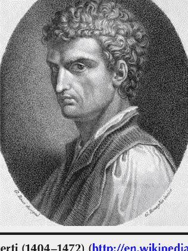

**图2.3** 莱昂·巴蒂斯塔·阿尔贝蒂（1404–1472）（http://en.wikipedia.org/wiki/File:Leon_Battista_Alberti2.jpg。）

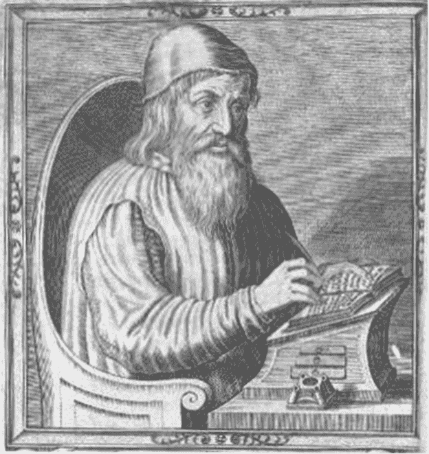

**图2.4** 约翰内斯·特里特米乌斯，第一位出版密码学著作的作者。（承蒙马里兰州米德堡国家密码学博物馆提供。）

下一步由约翰内斯·特里特米乌斯（1462–1516）（图2.4）完成，他是第一部印刷版密码学著作 *《多种书写法》*（图2.5）的作者。该书写于1508年，但直到他去世后的1518年才首次印刷。这实际上是他的第三部密码学著作，但他的第一部著作 *《隐写术》* 直到1606年才出版成书。*《隐写术》* 以手稿形式流传了很长时间，甚至引起了罗马天主教会的注意，并因此被列入《禁书目录》。现在可在 [http://www.esotericarchives.com/esoteric.htm#tritem](http://www.esotericarchives.com/esoteric.htm#tritem) 在线获取。特里特米乌斯时代的大多数密码学家也是一些炼金术士和魔法师。事实上，特里特米乌斯认识现实中的浮士德博士（他认为此人是个江湖骗子），据说他还是帕拉塞尔苏斯和科尔内留斯·阿格里帕的导师。<sup>2</sup> 根据传说，特里特米乌斯本人曾让皇帝马克西米利安一世的妻子起死回生。<sup>3</sup>

<sup>2</sup> 大卫·卡恩，《破译者》，第二版，斯克里布纳出版社，纽约，1996年，第131页。

<sup>3</sup> 尼古拉斯·古德里克-克拉克，《西方秘传传统：历史导论》，牛津大学出版社，纽约，2008年，第52页。


关于早期密码学家参与炼金术和魔法一事，谨此说明 *Traicté des Chiffres* 中包含一份炼制黄金的配方。

维热纳密码在当时是最好的密码之一，尤其是在使用混合字母表时；尽管如此，仍有多种案例显示它被破解。一个有趣的轶事涉及这种密码被卡萨诺瓦（图 2.7）破解，他随后将其作为诱惑的手段。⁶ 他写道：

五六周后，她问我是否已破译了包含转化的手稿。我告诉她我已破译。

> > “没有密钥，先生，请原谅我认为这是不可能的。”
> > “您是否希望我告诉您您的密钥，夫人？”
> > “如果您愿意。”

我随后告诉她那个词，它不属于任何语言，我看到了她的惊讶。她告诉我这是不可能的，因为她认为自己是那个词的唯一拥有者，她把它保存在记忆中，从未写下来。

我本可以告诉她真相——即同样的计算使我能够破译手稿，也使我得知了那个词——但一时兴起，我告诉她是精灵向我揭示了它。这种虚假的披露使德尔费夫人被我束缚。那天我成了她灵魂的主人，我滥用了我的权力。每当我想到它时，我都感到痛苦和羞愧，我现在在写回忆录时立下义务说真话来赎罪。[我告辞]带着她的灵魂、她的心、她的才智以及她所剩下的全部理智离开。

遗憾的是，卡萨诺瓦没有透露他的密码分析方法。

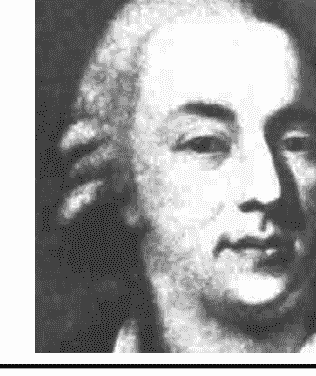

图 2.7 卡萨诺瓦，潇洒的代码破解者。

### 2.3 维吉尼亚密码的密码分析

那么，我们如何像卡萨诺瓦一样破解维热纳密码呢？知道密钥的长度通常使破解该系统变得容易。例如，如果密钥长度为 2，则第一、第三、第五等字母都将使用相同的字母表加密，第二、第四、第六等字母也是如此，只是使用不同的字母表。将这些字母分组并查看频率，通常有一个字母会突出，即 E。可能会出现一个困难；如果消息很短，特定组中最频繁的字母并不总是 E。即将到来的示例将解决这个问题问题。现在，让我们假设我们可以识别出 E。因为使用了直线字母表，所以其他所有字母也都会被知晓。因此，消息很容易被破解。如果使用混合字母表，破译会慢一些，但仍有可能通过耐心和频率表完成。使密钥变长需要将密文分成更多组。例如，如果密钥长度为 5，我们将字母分组如下：

| | |
|---|---|
|1, 6, 11, 16, ...|alphabet 1|
|2, 7, 12, 17, ...|alphabet 2|
|3, 8, 13, 18, ...|alphabet 3|
|4, 9, 14, 19, ...|alphabet 4|
|5, 10, 15, 20, ...|alphabet 5|

请注意，每个组都将是模 5 的等价类的一部分。

那么我们如何确定密钥的长度呢？有几种方法可用。最简单的方法是假设消息的某些明文部分以与密钥相同的对齐方式重复出现。例如，如果两位计算机科学教授在通信，单词 COMPUTER 可能会在消息中反复出现。如果密钥是 ORANGE，我们可能会有各种对齐方式：

```
COMPUTER      COMPUTER      COMPUTER
ORANGEOR      RANGEORA      ANGEORAN

COMPUTER      COMPUTER      COMPUTER
NGEORANG      GEORANGE      EORANGEO
```

很容易计算出单词 COMPUTER 出现不同次数时其中一种对齐方式会重复的概率。当然，如果 COMPUTER 在消息中出现七次或更多次，则重复对齐是保证的。这导致八个密文字母被重复。这些重复的首字母之间的距离必须是密钥长度的倍数。许多其他单词也可能以与关键词相同的对齐方式重复，例如常见的单词 THE 和 AND。取例如三个字母或更长的重复，并查看它们之间的距离，将提示一个密钥长度，所有这些距离都应该是其倍数。可能存在由不同单词与关键词的不同对齐方式结合而产生的一些重复，但这通常会表现为背景噪声，真正的密钥长度会很清晰。这种过程被称为卡西斯基检验。7 （它可能被称为巴贝奇检验，因为查尔斯·巴贝奇在卡西斯基之前就发现了它，但正如巴贝奇的典型做法一样，他没有跟进。他从未发表过这一特定结果。）8 卡西斯基检验将很快演示，但在首先检查另一种确定密钥长度的方法。

7 Friedrich W. Kasiski (1805–1881) was a retired Prussian infantry major, who published his method in Die Geheimschriften und die Dechiffrir-kunst in 1863.

8 For a bit more on this see Singh, Simon, The Code Book, Doubleday, New York, 1999, p. 78. For a tremendous amount more see Franksen, Ole Immanuel, Mr. Babbage’s Secret, The Tale of a Cypher and APL, Prentice-Hall, Englewood Cliffs, New Jersey, 1984.

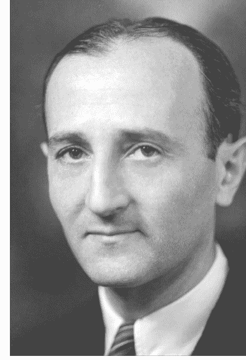

图 2.8 威廉·弗里德曼（1891–1969）。（摘自国家密码学博物馆，马里兰州梅德堡。）

一种精彩的攻击，由威廉·弗里德曼（图 2.8）² 于 1920 年发表，源于一个称为重合指数（IC）的计算。简单地说，这是从长度为 N 的文本中随机选择两个字母相同概率。

对于两者都是 A，我们取

$P(\text{first letter is A}) \cdot P(\text{second letter is A}) = \frac{F_A}{N} \cdot \frac{F_A - 1}{N - 1}$

其中 $F_A$ 表示 A 的频率。

因为两个字母都可能是 B，或者两个字母都可能是 C 等等，我们必须对字母表中每个字母求和这些概率，然后得到

$\text{IC} = \frac{\sum_{i=A}^{Z} F_i(F_i - 1)}{N(N - 1)}$

密码中使用多个替换字母表会使字母的频率分布变得平坦，因此随机选择的两个密文字母相同的机会减少，与原始明文消息中字母的机会相比。因此，重合指数的值可以说衡量了频率分布的平坦度，或者换句话说，估计了使用的字母表数量。

⁹ Friedman, William F., The Index of Coincidence and Its Applications in Cryptography, Publication No. 22, Riverbank Laboratories, Geneva, Illinois, 1920.

由于正常明文中字母频率的变化，使用给定长度的关键词时，我们每次都不会从 IC 得到完全相同的值；然而，可以为每种大小的关键词计算预期值。它在下表中提供。值部分取决于文本的长度。可以为各种消息长度构建单独的表。下表给出了长消息的值。

| Number of Alphabets (Keyword Length) | Expected Value for Index of Coincidence |
|---|---|
| 1 | 0.0660 |
| 2 | 0.0520 |
| 3 | 0.0473 |
| 4 | 0.0449 |
| 5 | 0.0435 |
| 6 | 0.0426 |
| 7 | 0.0419 |
| 8 | 0.0414 |
| 9 | 0.0410 |
| 10 | 0.0407 |

随着 N 变大，我们接近大约 0.0388 的极限值。这是我们对纯随机文本所得到的值——即所有字母频率相等且概率为 1/26 的文本。

请注意，当使用的字母表数量较小时，预期值之间的差异最大。我们可以轻松地区分一个字母表（单字母替换密码）和两个字母表，但区分九个和十个字母表是困难的。

假设重合指数为 0.04085，表明使用了九个或十个字母表。我们可以通过假设正确的密钥长度为 9 并将密文分成九组字母来进一步调查，如果我们的假设正确，每组字母都将由相同的字母表加密。第一组将包含位置 1、10、19、28、… 的字母，因为长度为 9 的密钥迫使我们在位置 10 开始使用第一个字母表，并在位置 19、28 等再次开始。第二组将包含所有使用第二个字母表加密的字母，位置 2、11、20、29 等。现在将 IC 应用于第一组应该表明（通过得到接近 0.066 的值）这些字母是否确实源自使用相同字母表的加密。如果 IC 的值更接近 0.038，我们对密钥长度为 9 的信心就会降低。但第一组并不是我们唯一应该考虑的组。该组的 IC 值可能是一个误导性的巧合！单独测试所有九组字母会提供一个更坚实的统计基础来决定密钥长度为 9 是否正确。如果九个 IC 值作为一个整体来看是


令人沮丧时，我们可以重新开始并假设密钥长度为10。将密文字母分成十组并计算每组的IC值，可以显示这一假设是否更好或不。进行这些计算的较小的密文字母组，即使它们不完全是十个，也被称为 *抽样字母表*。

几个例子将表明卡西斯基检验和IC检验的可靠性如何。第一个在下面给出，其他的留作练习。*注意：* 有些书籍编造出此类检验完美生效的例子，造成这种方法总是如此的错误印象。

IC方程可以反过来求出密钥的长度（*L*），当密文中的字符数（*N*）和密文重合指数（*IC*）已知时：

$$L \approx \frac{0.028N}{(IC)(N-1)-0.038N+0.066}$$

虽然你不需要理解上述公式的推导过程就能使用它，但很容易证明。假设我们有一个由 *N* 个字母组成的密文，并且加密密钥的长度为 *L*。如果我们随机挑选两个字母，它们相同的概率是多少（作为 *密文*——它们所代表的明文字母不必匹配）？如果两个字母都用同一个字母表加密，那么这两个字母匹配的概率会高得多，因此我们考虑两种不同的情况并将其合并以得到最终答案。

## 案例 1：两个字母来自同一个密码字母表

哪个字母先选并不重要，但第二个字母必须来自同一个字母表，因此它必须是这种类型剩余的 (*N/L*) − 1 个字母之一（*L* 个字母表大致会将文本的 *N* 个字母分成大小为 *N/L* 的组，每个组加密方式不同）。因此，在总共剩余的 *N* − 1 个字母中，有 (*N/L*) − 1 个选择。所以概率是

$$\frac{\left(\frac{N}{L}\right)-1}{N-1}.$$

但我们也希望两个字母相同。因为我们已经在同一个字母表内，这个概率 simply 为 0.066，即一个字母表的 IC 值。我们将这两个值相乘得到

$$\frac{\left(\frac{N}{L}-1\right)(0.066)}{N-1}.$$

## 案例 2：两个字母来自不同的密码字母表

与案例1一样，哪个字母先选并不重要，但现在第二个字母必须来自不同的字母表。因为我们已经找到了第二个字母来自同一字母表的概率，所以我们可以取补集来得到它来自不同字母表的概率。我们有

$1-\left(\frac{\frac{N}{L}-1}{N-1}\right).$

现在我们有两个来自不同字母表的字母，需要乘以它们匹配的概率。这仅仅是随机文本（或等价地，大量字母表）的 IC 值，即 0.038。因此，我们案例2的概率为

$\left(1-\frac{\frac{N}{L}-1}{N-1}\right)(0.038).$

合并两种情况，我们有

$IC \approx \frac{\left(\frac{N}{L}-1\right)(0.066)}{N-1}+\left(1-\frac{\frac{N}{L}-1}{N-1}\right)(0.038).$

现在只需做代数运算求解 $L$（参见练习 23）即可得到结果。

$L \approx \frac{0.028N}{(IC)(N-1)-0.038N+0.066}$

使用这个方程，你不需要像上面给出的那样查表；然而，这个版本的方程仅适用于明文为英语的密码。对于其他语言，常数可能会有所不同。

卡西斯基检验和重合指数乍听起来可能很复杂，但它们非常容易使用。看看下面的例子，了解它们如何使维吉尼亚密码分析任务变得简单。

## 示例

```
IZPHY XLZZP SCULA TLNQV FEDEP QYOEB SMMOA AVTSZ VQATL LTZSZ
AKXHO OIZPS MBLLV PZCNE EDBTQ DLMFZ ZFTVZ LHLVP MBUMA VMMXG
FHFEP QFFVX OQTUR SRGDP IFMBU EIGMR AFVOE CBTQF VYOCM FTSCH
ROOAP GVGTS QYRCI MHQZA YHY XG LZPQB FYEOM ZFCKB LWB TQ UIHUY
LRDCD PHPVO QVVPA DBMWS ELOSM PDCMX OFBFT SDTNL VPTSG EANMP
MHKAE PIEFC WMHPO MDRVG OMPQ BTAEC CNUAJ TNOIR XODBN RAIAF
UPHTK TFIIG EOMHQ FPPAJ BAWSV ITSMI MMFYT SMFDS VHF WQ RQ
```

几个字符组重复出现。我们需要记录它们的位置以利用卡西斯基检验。

| 字符分组 | 起始位置 | 起始位置之间的差值 |
|---------------------|---------------------|----------------------------------------|
| IZP | 1 and 57 | 56 |
| HYX | 4 and 172 | 168 |
| EPQ | 24 and 104 | 80 |
| MBU | 91 and 123 | 32 |
| TSM | 327 and 335 | 8 |

考虑上表最后一列。所有值都是8的倍数。这表明密钥长度为8。密钥长度可能是4（或2），但如果是这样，很可能差值列中的一个数字是4（或2）的倍数但不是8的倍数。

计算重合指数需要更多工作。我们首先为密文字母构造一个频率表（表2.1）。

该示例的重合指数的分子然后由下式给出

## 表2.1 用于计算重合指数的频率表

| 字母 | 频率 | 字母 | 频率 |
|---|---|---|---|
| A | 18 | N | 7 |
| B | 14 | O | 18 |
| C | 12 | P | 22 |
| D | 12 | Q | 17 |
| E | 15 | R | 10 |
| F | 22 | S | 16 |
| G | 9 | T | 20 |
| H | 14 | U | 8 |
| I | 13 | V | 18 |
| J | 2 | W | 5 |
| K | 4 | X | 7 |
| L | 15 | Y | 9 |
| M | 26 | Z | 14 |

∑_{i=A}^{Z} F_i(F_i - 1) = (18)(17) + (14)(13) + (12)(11) + (12)(11) + (15)(14) + (22)(21) + (9)(8) + (14)(13) + (13)(12) + (2)(1) + (4)(3) + (15)(14) + (26)(25) + (7)(6) + (18)(17) + (22)(21) + (17)(16) + (10)(9) + (16)(15) + (20)(19) + (8)(7) + (18)(17) + (5)(4) + (7)(6) + (9)(8) + (14)(13) = 5178

重合指数为

IC = Σ_{i=A}^{Z} F_i(F_i − 1) / N(N − 1) = 5178 / (347)(346) ≈ 0.0431.

该值虽然与预期值不完全匹配，但表明使用了五或六个字母表。我们可以假设密钥长度为5，将密文字母分成本应使用同一字母表加密的组，并对每组进行IC计算。我们得到的值为0.046、0.050、0.041、0.038和0.046。这些值远低于0.066，因此它们不太可能真正来自同一字母表。我们假设密钥长度为5是错误的。基于密钥长度为6重复这些计算，得到的值为0.050、0.041、0.035、0.048、0.038和0.037。同样，似乎密钥不能是这个长度。

我们可以在IC建议的值进一步远离之前先尝试四个字母表然后七个字母表，但卡西斯基检验建议为八，所以让我们直接跳到这个值。将密文分成八个单独的组并计算每组的IC值，得到0.105、0.087、0.075、0.087、0.056、0.069、0.065和0.046。这些值是迄今为止最大的，因此我们有另一个检验支持卡西斯基检验的结果。IC计算支持卡西斯基检验结果的另一种方式在练习22中描述。

现在我们将密文重写为长度为8的块，以便同一列中的字符代表由同一字母表加密的字母。我们可以为每列构造一个频率表（表2.2）。必须这样做才能得到上面段落中给出的IC值，但我省略了工作过程，直到可以看出它会导向积极的结论。请花点时间查看表2.2及其 accompanying 文本，然后再返回此处。

对于每一列，代表E的字母有26种可能的选择。在第1列，E、A和T频率之和的最大值为21，当M代表E时得到。现在对于第2列，假设P代表E得到的和只有9。最大和为11，当Q代表E时得到。对于第3列，最大和也当Q代表E时得到。这次和为17。对于第4到第8列，这种技术表明E分别由S、V、X、E和P表示。我们看到，如果这些替换是正确的，E仅在第1、3、4和5列是最频繁的字符，而在第7列并列第一。鼓励你在练习14中研究确定每个字母表偏移量的其他技术。上述替换意味着关键字（每个字母表中代表A的字母按顺序串联起来）是IMMORTAL。由于这是一个真实的词，我们对解决方案更有信心。应用此关键字对密文进行模26减法得到：

```
IZPHY XLZZP SCULA TLNQV FEDEP QYOEB SMMOA AVTSZ VQATL LTZSZ
IMMOR TALIM MORTA LIMMO RTALI MMORT ALIMM ORTAL IMMOR TALIM
ANDTH ELORD GODSA IDBEH OLDTH EMANI SBECO NEASO NEOFU STOKN
AKXHO OIZPS MBLLV PZCNE EDBTQ DLMFZ ZFTVZ LHLVP MBUMA VMMXG
MORTA LIMMO RTALI MMORT ALIMM ORTAL IMMOR TALIM MORTA LIMMO
OWGOO DANDE VILAN DNOWL ESTHE PUTFO RTHHI SHAND ANDTA KEALS
FHFEP QFFVX OQTUR SRGDP IFMBU EIGMR AFVOE CBTQF VYOCM FTSCH
RTALI MMORT ALIMM ORTAL IMMOR TALIM MORTA LIMMO RTALI MMORT
OOFTH ETREE OFLIF EANDE ATAND LIVEF OREVE RTHER EFORE THELO
ROOAP GVGTS QYRCI MHQZA YHY XG LZPQB FYEOM ZFCKB LWB TQ UIHUY
ALIMM ORTAL IMMOR TALIM MORTA LIMMO RTALI MMORT ALIMM ORTAL
RDGOD SENTH IMF OR THFRO M THEG ARDEN OFEDE NTOTI LLTHE GROUN
LRDCD PHPVO QVVPA DBMWS ELOSM PDCMX OFBFT SDTNL VPTSG EANMP
```


IMMOR TALIM MORTA LIMMO RTALI MMORT ALIMM ORTAL IMMOR TALIM MORTA LIMMO RTALI MMORT ALIMM ORTAL IMMOR TALIM
从他被带走之处，所以他赶出了那人，并且安置
MHKAE PIEFC WMHPO MDRVG QMPQ BTAEC CNUAJ TNOIR XODBN RAIAF
MORTA LIMMO RTALI MMORT ALIMM ORTAL IMMOR TALIM MORTA LIMMO
在伊甸园东边，有基路伯和火焰的剑
UPHTK TFIIG EOMHQ FPPAJ BAWSV ITSMI MMFYT SMFDS VHF WQ RQ
RTALI MMORT ALIMM ORTAL IMMOR TALIM MORTA LIMMO RTALI MM
它转向各方，以守护通往生命树之路

## 表 2.2 各列的频数表及计数

| 字母 | 1 | 2 | 3 | 4 | 5 | 6 | 7 | 8 |
|---|---|---|---|---|---|---|---|---|
| A | 1 | 3 | 5 | 2 | 0 | 2 | 5 | 0 |
| B | 6 | 0 | 0 | 4 | 0 | 4 | 0 | 0 |
| C | 1 | 0 | 0 | 7 | 2 | 0 | 0 | 3 |
| D | 0 | 0 | 4 | 1 | 2 | 0 | 2 | 2 |
| E | 0 | 1 | 0 | 0 | 2 | 4 | 6 | 2 |
| F | 0 | 5 | 4 | 5 | 4 | 0 | 3 | 1 |
| G | 0 | 0 | 0 | 2 | 1 | 4 | 1 | 1 |
| H | 1 | 1 | 0 | 3 | 0 | 5 | 5 | 0 |
| I | 4 | 2 | 0 | 1 | 3 | 1 | 1 | 0 |
| J | 0 | 0 | 0 | 0 | 1 | 0 | 0 | 1 |
| K | 1 | 0 | 0 | 1 | 2 | 0 | 0 | 0 |
| L | 2 | 0 | 0 | 0 | 2 | 4 | 3 | 4 |
| M | 11 | 3 | 4 | 1 | 2 | 4 | 0 | 1 |
| N | 0 | 2 | 0 | 0 | 1 | 0 | 3 | 1 |
| O | 2 | 2 | 0 | 2 | 0 | 1 | 6 | 5 |
| P | 2 | 8 | 3 | 0 | 1 | 4 | 0 | 4 |
| Q | 2 | 3 | 9 | 0 | 0 | 0 | 0 | 3 |
| R | 0 | 4 | 2 | 1 | 1 | 0 | 1 | 1 |
| S | 1 | 0 | 1 | 8 | 0 | 0 | 2 | 4 |
| T | 1 | 4 | 4 | 1 | 1 | 3 | 3 | 2 |
| U | 0 | 1 | 1 | 1 | 4 | 0 | 1 | 0 |
| V | 5 | 0 | 0 | 3 | 9 | 0 | 0 | 1 |
| W | 0 | 0 | 2 | 0 | 1 | 0 | 0 | 2 |
| X | 0 | 0 | 2 | 0 | 1 | 4 | 0 | 0 |
| Y | 0 | 1 | 2 | 0 | 2 | 3 | 0 | 1 |
| Z | 4 | 4 | 1 | 0 | 1 | 0 | 0 | 4 |

考虑第 1 列。M 是出现频率最高的字母，因此我们假设 M 代表 E。这意味着 B 代表 T，I 代表 A。B 和 I 的频率很高，所以这看起来像是很好的匹配。对于小样本，E 不总是出现频率最高的字母。例如，在第 2 列中，出现频率最高的字符是 P，但这意味着 E（频率为 1）是 T，而 L（频率为 0）是 A，这些值似乎不太可能。更好的策略是寻找使 E、A 和 T 三个最频繁明文字母的频率之和最大化的移位。

明文最终证明是《圣经》中关于获得不朽的一段经文。¹⁰

重合指数给出的字母表数量值过低，这在使用的两个或多个“不同”字母表实际上相同的情况下经常会发生。在本例中，密钥 IMMORTAL 中重复的 M 字母表是罪魁祸首。

Kasiski 攻击在本例中效果更好，但总体而言，Friedman 的重合指数是更强大的技术。即使 Friedman 没有做其他任何事情，通过这项工作他也会获得不朽。它可以应用于许多不同的上下文中，在某些情况下甚至可用于区分语言。¹¹

| 语言 | IC |
|---|---|
| 英语 | 0.0667 |
| 法语 | 0.0778 |
| 德语 | 0.0762 |
| 意大利语 | 0.0738 |
| 俄语 | 0.0529 (30-letter Cyrillic alphabet) |
| 西班牙语 | 0.0775 |

在单字母替换密码中，有许多其他方法可以在不破译的情况下区分语言。其中一种度量是文本的熵（本书后面会更详细讨论），甚至可以用来大致确定文本产生的时代。

语言的熵似乎随时间增加，遵循热力学第二定律！¹²

维吉尼亚密码在数百年的时间里被广泛使用。它在内战期间被南方邦联使用，并且长期以来一直认为他们只使用过三个密钥：MANCHESTER BLUFF、COMPLETE VICTORY，以及（在李将军投降后）COME RETRIBUTION。然而在 2006 年，Kent Boklan 在试图破解一条旧的邦联信息时，发现了第四个密钥。¹³ 密钥数量的稀少无疑帮助了联邦密码破译者！Kasiski 的攻击发表于这场战争期间，但似乎被邦联忽视了。

数学家查尔斯·道奇森（1832–1898），以笔名刘易斯·卡罗尔撰写了《爱丽丝漫游奇境记》和《镜中奇遇》，独立发现了我们所称的维吉尼亚密码。他写道：“对于任何一个 [sic] 不了解关键词的人来说，即使有表格的帮助，也‘不可能’破译这条信息。”¹⁴

直到 1917 年，仍不是每个人都知道该系统已被破解。那一年，*科学美国人*转载了《费城工程师俱乐部会刊》上的一篇文章，该文宣称该系统是新的 (!) 并且“不可能被翻译”。¹⁵ 文章还指出，“密钥可以轻松更改，这也是那些希望在没有任何危险的情况下传输重要信息而不被政治或商业对手阅读的人采用此密码的另一个优点。” 然而，这个错误最终被认识到，而 1921 年《*科学美国人月刊*》的一期刊登了 Otto Holstein 的文章，题为“Porta 和 Vigenère 的密码，原始不可破译密码及其破译方法”。¹⁶

### 2.4 克里普托斯

维吉尼亚密码的一个更近期的例子是以一件引人入胜的雕塑 *克里普托斯* 的形式出现的（图 2.9）。该作品由 James “Jim” Sanborn 于 1990 年创作，位于中央情报局（CIA）内的户外区域。虽然该地点不对外开放，但它吸引了大量公众关注，甚至在丹·布朗的小说《*达·芬奇密码*》的封套上通过其纬度和经度被提及。

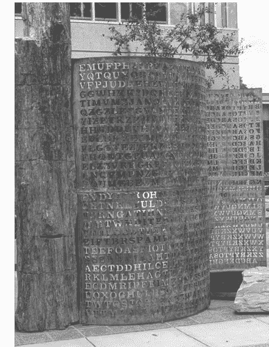

图 2.9 Sanborn 的雕塑 *克里普托斯*。（美国国家密码学博物馆，Fort Meade，马里兰州提供。）

¹⁵ “一种新密码代码”，*《科学美国人》增刊*，第 83 卷，第 2143 期，1917 年 1 月 27 日，第 61 页。

¹⁶ Holstein, Otto, “Porta 和 Vigenère 的密码，原始不可破译密码及其破译方法”，*《科学美国人月刊》*，第 4 卷，第 4 期，1921 年 10 月，第 332–334 页。

雕塑的左半部分是密文，可分为两个面板。它们被称为面板 1（左侧上半部分）和面板 2（左侧下半部分）。这两个面板在图 2.10 和 2.11 中重现，如 CIA 网站所示。每个面板包含两种不同的密码。在此图示中这些密码有区分，但在原始雕塑中没有。

```
E M U F P H Z L R F A X Y U S D J K Z L D K R N S H G N F I V J
Y Q T Q U X Q B Q V Y U V L L T R E V J Y Q T M K Y R D M F D
V F P J U D E E H Z W E T Z Y V G W H K K Q E T G F Q J N C E
G G W H K K ? D Q M C P F Q Z D Q M M I A G P F X H Q R L G
T I M V M Z J A N Q L V K Q E D A G D V F R P J U N G E U N A
Q Z G Z L E C G Y U X U E E N J T B J L B Q C R T B J D F H R R
Y I Z E T K Z E M V D U F K S J H K F W H K U W Q L S Z F T I
H H D D U V H ? D W K B F U F P W N T D F I Y C U Q Z E R E
E V L D K F E Z M O Q Q J L T T U G S Y Q P F E U N L A V I D X
F L G G T E Z ? F K Z B S F D Q V G O G I P U F X H H D R K F
F H Q N T G P U A E C N U V P D J M Q C L Q U M U N E D F Q
E L Z Z V R R G K F F V O E E X B D M V P N F Q X E Z L G R E
D N Q F M P N Z G L F L P M R J Q Y A L M G N U V P D X V K P
D Q U M E B E D M H D A F M J G Z N U P L G E W J L L A E T G
```

图 2.10 *克里普托斯* 的面板 1；添加了一条水平线以将密码 1 与密码 2 分开。（改编自 https://www.cia.gov/about-cia/headquarters-tour/kryptos/KryptosPrint.pdf。）

```
E N D Y A H R O H N L S R H E O C P T E O I B I D Y S H N A I A
C H T N R E Y U L D S L L S L L N O H S N O S M R W X M N E
T P R N G A T I H N R A R P E S L N N E L E B L P I I A C A E
W M T W N D I T E E N R A H C T E N E U D R E T N H A E O E
T F O L S E D T I W E N H A E I O Y T E Y Q H E E N C T A Y C R
E I F T B R S P A M H N E W E N A T A M A T E G Y E E R L B
T E E F O A S F I O T U E T U A E O T O A R M A E E R T N R T I
B S E D D N I A A H T T M S T E W P I E R O A G R I E W F E B
A E C T D D H I L C E I H S I T E G O E A O S D D R Y D L O R I T
R K L M L E H A G T D H A R D P N E O H M G F M F E U H E
E C D M R I P F E I M E H N L S S T T R T V D O H W ? O B K R
U O X O G H U L B S O L I F B B W F L R V Q Q P R N G K S S O
T W T Q S J Q S S E K Z Z W A T J K L U D I A W I N F B N Y P
V T T M Z F P K W G D K Z X T J C D I G K U H U A U E K C A R
```

图 2.11 *克里普托斯* 的面板 2；添加了一条（ mostly ）水平线以将密码 3 与密码 4 分开。（改编自 https://www.cia.gov/about-cia/headquarters-tour/kryptos/KryptosPrint.pdf。）

*克里普托斯* 的右侧（面板 3 和 4）提供了关于左侧所使用加密方法的线索。这些面板在图 2.12 和 2.13 中重现，如 CIA 网站所示。


在它的下方，密钥 GAUSS 垂直写在左侧，提供五个密码字母表的首字母。这些密码字母表中的每一个都从其首字母开始，按照与初始混合字母表相同的顺序延续。现在进行加密时，五个字母表按顺序使用，视需要重复，直到消息结束。我们得到：

```
MATHEMATICS IS THE QUEEN OF THE SCIENCES plaintext
GAUSSGAUSSG AU SSG AUSSG AU SSG AUSSG AUS key
OHZQLOHZUIN VR DQX RJLLS FA DQX GTULSJSF ciphertext
```

这种密码被美国密码协会（ACA）成员（如 James J. Gillogly）称为 Quagmire III。Kryptos 的完整明文尚未被恢复，但 Gillogly 使用自己设计的计算机程序，在 1999 年破译了其中的大部分。有几个因素使他的工作更加困难：

- 1. 没有明显迹象表明左侧包含四个密码而不是只有一个。
- 2. 字母表的混合使用了关键字，但不是右侧线索中的 KRYPTOS。
- 3. Sanborn 故意在密码中引入了一些错误。
- 4. 只有前两个密码是 Quagmire III。密码 3 和 4 源自其他系统。

确定正确的密钥并恢复前两条消息的任务留给读者作为挑战。解决方案很容易在网上找到。你能运用本章详述的技术来迎接这一挑战吗？第二部分应该比第一部分容易，因为有更多密文可供使用。

第三个密码使用了换位（见第 3 章），也由 Gillogly 破解。只剩下三行多一点密文时，Gillogly 卡住了。他无法破解第四个也是最后一个密码。

在 Gillogly 取得成功后，中央情报局（CIA）透露，其一名员工 David Stein 早在 1998 年就已破译了 Gillogly 恢复的那些部分。Stein 的结果出现在一份机密出版物中，James 无缘看到。为了不被 CIA 超越，国家安全局（NSA）透露他们的一些员工在 1992 年已解决此问题，但起初 NSA 不愿提供他们的名字！2005 年，有信息公布说这实际上是 NSA 的一个团队（Ken Miller、Dennis McDaniels，以及另外两名身份至今仍未公开的人）。17 尽管备受关注，但 Kryptos 的最后一部分仍然无法破译，至少就公众所知是这样！“人们称我为撒旦的代理人，”艺术家 Sanborn 说，“因为我不愿透露我的秘密。”18

至少，Sanborn（图 2.14）透露了有价值的线索。2010 年 11 月 20 日，他表示未破译部分第 64 位开始的字母，即 NYPVTT，破译为 BERLIN。19 令人惊讶的是，这没有帮助！没有解决方案出现！整整四年后的 2014 年 11 月 20 日，Sanborn 发布了另一条线索。它是对先前线索的扩展。他说 NYPVTTMZFPK 破译为 BERLIN CLOCK。仍然没有解决方案出现，

17 http://cn.wikipedia.org/wiki/Kryptos.
18 Levy, Steven, “Mission Impossible: The Code Even the CIA Can’t Crack,” Wired, Vol. 17, No. 5, April 20, 2009.
19 Scryer, “Kryptos Clue,” The Cryptogram, Vol. 77, No. 1, January–February 2011, p. 11. Scryer 是 James J. Gillogly 使用的美国密码协会（ACA）笔名。


**图 2.14**  James Sanborn（1945–）（[http://www.pbs.org/wgbh/nova/sciencenow/3411/images/ate-bio-03.jpg](http://www.pbs.org/wgbh/nova/sciencenow/3411/images/ate-bio-03.jpg)）

现在我们又遇到了一个小谜团——为什么两条线索都在 11 月 20 日发布？这个日期对 Sanborn 或 *Kryptos* 有某种特殊意义吗？2020 年，Sanborn 提供了第三条线索：第 26 到 34 位的字母破译为 NORTHEAST。这条线索打破了以往日期的规律，是在 1 月 29 日给出的。[^20]

尽管矩阵加密要到[第 6 章]才介绍，但我现在应该指出，一些研究人员认为，*Kryptos* 仍未破解的部分使用了某种矩阵加密形式。Greg Link、Dante Molle 和我研究了这种可能性，但无法提供任何一方面的确切证据。[^21] 矩阵可用于加密文本的方式有很多，我们只能利用 Sanborn 的线索排除一些较简单的方法。

### 2.5 自动密钥

现在我们已经考察了基本维吉尼亚密码的密码学、密码分析学以及历史用途，接下来让我们看看布莱斯·德·维吉尼亚（Blaise de Vigenère）对这个已存在的系统所做的真正贡献，正如我们回忆的那样，这个系统已经存在。

[^20] Schwartz, John, and Jonathan Corum, “This Sculpture Holds a Decades-Old Mystery. And Now, Another Clue,” *The New York Times*, January 29, 2020, available online at [https://www.nytimes.com/interactive/2020/01/29/climate/kryptos-sculpture-final-clue.html](https://www.nytimes.com/interactive/2020/01/29/climate/kryptos-sculpture-final-clue.html).

[^21] Our investigation appeared as Bauer, Craig, Gregory Link, and Dante Molle, “James Sanborn’s *Kryptos* and the Matrix Encryption Conjecture,” *Cryptologia*, Vol. 40, No. 6, 2016, pp. 541–552. The results were later summarized in a broader survey of *Kryptos* as part of chapter 9 (pp. 386–407) of Bauer, Craig P., *Unsolved! The History and Mystery of the World’s Greatest Ciphers from Ancient Egypt to Online Secret Societies*, Princeton University Press, Princeton, New Jersey, 2017.

回忆一下，维吉尼亚的自动密钥只使用给定的密钥（如下例中的 COMET）一次。在那一次使用之后，原始消息（或生成的密文）用作消息其余部分的密钥。

```
S E N D S U P P L I E S ...    message
C O M E T S E N D S U P ...    key
U S Z H L M T C O A Y H ...    ciphertext
```

使用密文作为“密钥”：

```
S E N D S U P P L I E S ...    message
C O M E T U S Z H L O H ...    key
U S Z H L O H O S T S Z ...    ciphertext
```

这个具体例子由克劳德·香农在其经典论文《保密系统的通信理论》中提出。22

由于每个字母的加密依赖于先前的消息或密文字母，我们在这里使用了一种链式结构。这一思想在矩阵加密被发现时再次得到应用，并且至今仍用于现代分组密码。本书第 14.6 节将更详细地讨论它，该节涵盖各种加密模式。使用密文作为密钥，虽然听起来复杂，却产生了一种容易被攻破的密码！

各种自动密钥方法的一个风险是，单个位置的错误可能会传播到密文的其余部分。观察我们之前的例子，如果第三个字符被错误地加密为 N 而不是 Z，会发生什么。下面重现一个无错误的加密以作比较。

```
S E N D S U P P L I E S ...    message
C O M E T U S N H L O H ...    key
U S N H L O H C S T S Z ...    ciphertext obtained
U S Z H L O H O S T S Z ...    ciphertext desired
```

继续下去我们会发现，在最初错误之后的每个第五个密文字符也是错误的。

本章介绍了维吉尼亚密码，然后攻破了它，我们接下来将对其进行修补，创建一个更强的系统。然而，应该指出，维吉尼亚密码在现实世界中并没有这么快被淘汰。它曾有过极为成功的运行。我们可能再也见不到一个能在被发现有效攻击之前幸存数百年的系统了。

### 2.6 滚动密钥密码及其密码分析

由于维吉尼亚密码的主要弱点在于密钥按固定间隔重复，使上述攻击成为可能，一个自然的改进是以类似方式加密，但使用不重复的密钥。一种方法是用一本书的文本作为密钥。这种方法通常称为滚动密钥（维吉尼亚）密码。下面给出一个例子。

```
BEGIN THE ATTACK AT DAWN    plaintext
IT WAS THE BEST OF TIMES I    key
JXCIF MOI BXKTQP TB PEOV    ciphertext
```


这里，消息使用查尔斯·狄更斯的《双城记》作为密钥进行加密。卡西斯基攻击对这种维吉尼亚密码的升级版不会奏效，因为密钥从不重复，而弗里德曼重合指数也只能表明使用了大量密码字母表。然而，这并不意味着弗里德曼被滚动密钥密码难倒了。在介绍其论文《解决滚动密钥密码的方法》的附函中，他写道：

> 关于破解一条或一系列用滚动密钥加密的消息的可能性，直到三个月前，人们还说“做不到”或“很值得怀疑”。您大概知道，美国陆军密码盘与滚动密钥结合，多年来一直被用作野战密码；就我们所知，至今仍在使用。我认为，它之所以能长期使用，并且人们对其作为野战密码的安全性抱有信心，很可能是因为从来没有人费心去验证是否“能够做到”。敌方长期备战，极不可能不研究我们的野战密码；我们倾向于认为，敌方掌握的知识不亚于我们，甚至可能超过我们。我们已经证明，由美国陆军密码盘或任何类似装置加密的单条短消息，不仅能够被轻松快速地破解，而且以同一密钥发出的一系列消息，其破解速度甚至可能超过加密速度！23

弗里德曼的新破解方法基于一些非常简单的数学原理，下面就来考察这种方法。为便于参考，表2.3再次列出了英文字母的概率。

## 表2.3 英文字母概率

| 字母 | 概率 | 字母 | 概率 |
|---|---|---|---|
| A = 0 | 0.08167 | N = 13 | 0.06749 |
| B = 1 | 0.01492 | O = 14 | 0.07507 |
| C = 2 | 0.02782 | P = 15 | 0.01929 |
| D = 3 | 0.04253 | Q = 16 | 0.00095 |
| E = 4 | 0.12702 | R = 17 | 0.05987 |
| F = 5 | 0.02228 | S = 18 | 0.06327 |
| G = 6 | 0.02015 | T = 19 | 0.09056 |
| H = 7 | 0.06094 | U = 20 | 0.02758 |
| I = 8 | 0.06966 | V = 21 | 0.00978 |
| J = 9 | 0.00153 | W = 22 | 0.02360 |
| K = 10 | 0.00772 | X = 23 | 0.00150 |
| L = 11 | 0.04025 | Y = 24 | 0.01974 |
| M = 12 | 0.02406 | Z = 25 | 0.00074 |

资料来源：Beutelspacher, Albrecht, Cryptology, Mathematical Association of America, Washington DC, 1994, p. 10.

现在假设我们在由某种滚动密钥生成的密文中看到了字母 A。它可能是由消息中的 A 与密钥中的另一个 A 组合而成，也可能是由消息中的 B 与密钥中的 Z 组合而成。你认为哪种更可能？字母 A 比 B 或 Z 常见得多，所以第一种可能性更大。还有其他可能的组合也能在密文中产生 A。表2.4列出了所有明文/密钥组合及其概率（根据表2.3得出）。

注意，当密钥字母和消息字母不同时，我们必须将概率加倍。例如，B 和 Z 这对字母组合后得到 A；可能是消息中为 B、密钥中为 Z，也可能是消息中为 Z、密钥中为 B。因此，这对字母产生 A 有两种概率相等的方式。然而，字母 A 和 A 组合产生 A 的方式只有一种。类似地，N 和 N 组合产生 A 也只有一种方式。因此，如果两个相同的字母组合产生某个密文字母，我们就不对概率加倍。

表2.4中的排名显示，密文 A 最有可能由 H 和 T 组合产生。不过，其他配对有时也是正确的。考虑前五种可能性，往往就足以在足够多的情况下得到正确配对，剩下的解答可以像修正拼写错误那样寻找。字母表中各字母的配对排名见表2.5：24

## 表2.4 明文/密钥组合及概率

| 组合 | 概率 | = | 排名 |
|---|---|---|---|
| AA | 0.0066699889 | = 0.0066699889 | 3 |
| BZ | 0.0000110408 × 2 | = 0.0000220816 | 13 |
| CY | 0.0005491668 × 2 | = 0.0010983336 | 9 |
| DX | 0.0000637950 × 2 | = 0.0001275900 | 12 |
| EW | 0.0029976720 × 2 | = 0.0059953440 | 4 |
| FV | 0.0002178984 × 2 | = 0.0004357968 | 10 |
| GU | 0.0005557370 × 2 | = 0.0011114740 | 8 |
| HT | 0.0055187264 × 2 | = 0.0110374528 | 1 |
| IS | 0.0044073882 × 2 | = 0.0088147764 | 2 |
| JR | 0.0000916011 × 2 | = 0.0001832022 | 11 |
| KQ | 0.0000073340 × 2 | = 0.0000146680 | 14 |
| LP | 0.0007764225 × 2 | = 0.0015528450 | 7 |
| MO | 0.0018061842 × 2 | = 0.0036123684 | 6 |
| NN | 0.0045549001 | = 0.0045549001 | 5 |

24 感谢 Adam Reifsneider 编写计算机程序计算这些排名。

## 表2.5 字母表中每个字母的配对排名

| A | B | C | D |
|---|---|---|---|
| HT 0.0110374528 | IT 0.012616819 | OO 0.0056355049 | AD 0.0069468502 |
| IS 0.0088147764 | NO 0.0101329486 | EY 0.0050147496 | LS 0.0050932350 |
| AA 0.0066699889 | HU 0.0033614504 | LR 0.0048195350 | OP 0.0028962006 |
| EW 0.0059953440 | AB 0.0024370328 | AC 0.0045441188 | MR 0.0028809444 |
| NN 0.0045549001 | DY 0.0016790844 | IU 0.0038424456 | HW 0.0028763680 |
| MO 0.0036123684 | FW 0.0010516160 | NP 0.0026037642 | KT 0.0013982464 |
| LP 0.0015528450 | MP 0.0009282348 | HV 0.0011919864 | IV 0.0013625496 |
| GU 0.0011114740 | KR 0.0009243928 | KS 0.0009768888 | FY 0.0008796144 |
| CY 0.0010983336 | GV 0.0003941340 | GW 0.0009510800 | BC 0.0008301488 |
| FV 0.0004357968 | EX 0.0003810600 | JT 0.0002771136 | EZ 0.0001879896 |
| JR 0.0001832022 | JS 0.0001936062 | BB 0.0002226064 | NQ 0.0001282310 |
| DX 0.0001275900 | LQ 0.0000764750 | FX 0.0000668400 | JU 0.0000843948 |
| BZ 0.0000220816 | CZ 0.0000411736 | DZ 0.0000629444 | GX 0.0000604500 |
| KQ 0.0000146680 |  | MQ 0.0000457140 |  |

| E | F | G | H |
|---|---|---|---|
| AE 0.0207474468 | OR 0.0089888818 | NT 0.0122237888 | OT 0.0135966784 |
| NR 0.0080812526 | NS 0.0085401846 | OS 0.0094993578 | DE 0.0108043212 |
| LT 0.0072900800 | MT 0.0043577472 | CE 0.0070673928 | AH 0.0099539396 |
| IW 0.0032879520 | BE 0.0037902768 | AG 0.0032913010 | NU 0.0037227484 |
| MS 0.0030445524 | AF 0.0036392152 | IY 0.0027501768 | PS 0.0024409566 |
| BD 0.0012690952 | HY 0.0024059112 | PR 0.0023097846 | LW 0.0018998000 |
| GY 0.0007955220 | CD 0.0023663692 | DD 0.0018088009 | CF 0.0012396592 |
| CC 0.0007739524 | LU 0.0022201900 | MU 0.0013271496 | BG 0.0006012760 |
| KU 0.0004258352 | IX 0.0002089800 | LV 0.0007872900 | MV 0.0004706136 |
| PP 0.0003721041 | KV 0.0001510032 | BF 0.0006648352 | QR 0.0001137530 |
| HX 0.0001828200 | JW 0.0000722160 | KW 0.0003643840 | IZ 0.0001030968 |
| OQ 0.0001426330 | PQ 0.0000366510 | HZ 0.0000901912 | JY 0.0000604044 |
| FZ 0.0000329744 | GZ 0.0000298220 | JX 0.0000045900 | KX 0.0000231600 |
| JV 0.0000299268 |  | QQ 0.0000009025 |  |

## 表2.5（续）字母表中每个字母的配对排名

| I | J | K | L |
|---|---|---|---|
| EE 0.0161340804 | RS 0.0075759498 | RT 0.0108436544 | EH 0.0154811976 |
| AI 0.0113782644 | EF 0.0056600112 | DH 0.0051835564 | ST 0.0114594624 |
| OU 0.0041408612 | CH 0.0033907016 | EG 0.0051189060 | AL 0.0065744350 |
| RR 0.0035844169 | NW 0.0031855280 | SS 0.0040030929 | DI 0.0059252796 |
| PT 0.0034938048 | BI 0.0020786544 | CI 0.0038758824 | RU 0.0033024292 |
| DF 0.0018951368 | DG 0.0017139590 | OW 0.0035433040 | NY 0.0026645052 |
| BH 0.0018184496 | LY 0.0015890700 | AK 0.0012609848 | PW 0.0009104880 |
| NV 0.0013201044 | OV 0.0014683692 | MY 0.0009498888 | FG 0.0008978840 |
| MW 0.0011356320 | PU 0.0010640364 | FF 0.0004963984 | BK 0.0002303648 |
| CG 0.0011211460 | AJ 0.0002499102 | PV 0.0003773124 | OX 0.0002252100 |
| KY 0.0003047856 | QT 0.0001720640 | NX 0.0002024700 | CJ 0.0000851292 |
| LX 0.0001207500 | MX 0.0000721800 | LZ 0.0000595700 | MZ 0.0000356088 |
| QS 0.0001202130 | KZ 0.0000114256 | QU 0.0000524020 | QV 0.0000185820 |
| JZ 0.0000022644 |  | BJ 0.0000456552 |  |

| M | N | O | P |
|---|---|---|---|
| EI 0.0176964264 | AN 0.0110238166 | AO 0.0122619338 | EI 0.0102251100 |
| TT 0.0082011136 | TU 0.0049952896 | HH 0.0037136836 | HI 0.0084901608 |
| AM 0.0039299604 | FI 0.0031040496 | DL 0.0034236650 | TW 0.0042744320 |
| SU 0.0034899732 | RW 0.0028258640 | SW 0.0029863440 | CN 0.0037551436 |
| OY 0.0029637636 | GH 0.0024558820 | GI 0.0028072980 | AP 0.0031508286 |
| FH 0.0027154864 | CI 0.0022395100 | BN 0.0020139016 | RY 0.0023636676 |
| BL 0.0012010600 | SV 0.0012375612 | EK 0.0019611888 | BO 0.0022400888 |
| RV 0.0011710572 | PY 0.0007615692 | TV 0.0017713536 | DM 0.0020465436 |
| CK 0.0004295408 | BM 0.0007179504 | CM 0.0013386984 | UV 0.0005394648 |
| GG 0.0004060225 | DK 0.0006566632 | UU 0.0007606564 | FK 0.0003440032 |
| DJ 0.0001301418 | EJ 0.0003886812 | RX 0.0001796100 | SX 0.0001898100 |
| NZ 0.0000998852 | OZ 0.0001111036 | FJ 0.0000681768 | GJ 0.0000616590 |
| PX 0.0000578700 | QX 0.0000028500 | QY 0.0000375060 | QZ 0.0000014060 |
| QW 0.0000448400 |  | PZ 0.0000285492 |  |


## 表 2.5（续）字母表中每个字母的排名配对

| Q | R | S | T |
|---|---|---|---|
| EM 0.0061122024 | EN 0.0171451596 | EO 0.0190707828 | AT 0.0147920704 |
| DN 0.0057406994 | AR 0.0097791658 | AS 0.0103345218 | IL 0.0056076300 |
| II 0.0048525156 | DO 0.0063854542 | HL 0.0049056700 | EP 0.0049004316 |
| CO 0.0041768948 | TY 0.0035753088 | FN 0.0030073544 | FO 0.0033451192 |
| SY 0.0024978996 | GL 0.0016220750 | BR 0.0017865208 | CR 0.0033311668 |
| FL 0.0017935400 | CP 0.0010732956 | DP 0.0016408074 | HM 0.0029324328 |
| UW 0.0013017760 | FM 0.0010721136 | UY 0.0010888584 | GN 0.0027198470 |
| BP 0.0005756136 | HK 0.0009409136 | IK 0.0010755504 | BS 0.0018879768 |
| GK 0.0003111160 | VW 0.0004616160 | GM 0.0009696180 | VY 0.0003861144 |
| TX 0.0002716800 | IJ 0.0002131596 | WW 0.0005569600 | DQ 0.0000808070 |
| HJ 0.0001864764 | SZ 0.0000936396 | TZ 0.0001340288 | WX 0.0000708000 |
| AQ 0.0001551730 | UX 0.0000827400 | CQ 0.0000528580 | UZ 0.0000408184 |
| VV 0.0000956484 | BQ 0.0000283480 | VX 0.0000293400 | JK 0.0000236232 |
| RZ 0.0000886076 |  | JJ 0.0000023409 |  |

| U | V | W | X |
|---|---|---|---|
| HN 0.0082256812 | ER 0.0152093748 | ES 0.0160731108 | ET 0.0230058624 |
| DR 0.0050925422 | IN 0.0094027068 | IO 0.0104587524 | FS 0.0028193112 |
| AU 0.0045049172 | HO 0.0091495316 | DT 0.0077030336 | IP 0.0026874828 |
| CS 0.0035203428 | DS 0.0053817462 | AW 0.0038548240 | GR 0.0024127610 |
| IM 0.0033520392 | CT 0.0050387584 | FR 0.0026678072 | DU 0.0023459548 |
| GO 0.0030253210 | AV 0.0015974652 | HP 0.0023510652 | LM 0.0019368300 |
| BT 0.0027023104 | BU 0.0008229872 | LL 0.0016200625 | KN 0.0010420456 |
| WY 0.0009317280 | GP 0.0007773870 | CU 0.0015345512 | BW 0.0007042240 |
| FP 0.0008595624 | KL 0.0006214600 | YY 0.0003896676 | CV 0.0005441592 |
| EQ 0.0002413380 | JM 0.0000736236 | KM 0.0003714864 | AX 0.0002450100 |
| JL 0.0001231650 | XY 0.0000592200 | BV 0.0002918352 | JO 0.0002297142 |
| KK 0.0000595984 | FQ 0.0000423320 | JN 0.0002065194 | HQ 0.0001157860 |
| VZ 0.0000144744 | WZ 0.0000349280 | GQ 0.0000382850 | YZ 0.0000292152 |
| XX 0.0000022500 |  | XZ 0.0000022200 |  |

## 表 2.5（续）字母表中每个字母的排名配对

| Y | Z |
|---|---|
| HR 0.0072969556 | IR 0.0083410884 |
| EU 0.0070064232 | HS 0.0077113476 |
| LN 0.0054329450 | LO 0.0060431350 |
| FT 0.0040353536 | GT 0.0036495680 |
| AY 0.0032243316 | MN 0.0032476188 |
| GS 0.0025497810 | EV 0.0024845112 |
| CW 0.0013131040 | DW 0.0020074160 |
| KO 0.0011590808 | FU 0.0012289648 |
| DV 0.0008318868 | BY 0.0005890416 |
| MM 0.0005788836 | KP 0.0002978376 |
| IQ 0.0001323540 | AZ 0.0001208716 |
| JP 0.0000590274 | CX 0.0000834600 |
| BX 0.0000447600 | JQ 0.0000029070 |
| ZZ 0.0000005476 |  |

我们现在来看一个运行密钥密文，以了解弗里德曼如何使用上面给出的类似排名来读取原始信息和密钥——例如，

L A E K A H B W A G W I P T U K V S G B

密文开头的 L 很可能源自 E + H、S + T、A + L、D + I 或 R + U，因为这些是产生 L 的前五种配对。我们将这些字母写在 L 下方形成一列纵向长列，然后在每个配对中反转顺序再写一遍。我们对密文中其他每个字母的前五种配对也做同样的处理。这就得到了表 2.6。

## 表 2.6 示例运行密钥密文

| L | A | E | K | A | H | B | W | A | G | W | I | P | T | U | K | V | S | G | B |
|---|---|---|---|---|---|---|---|---|---|---|---|---|---|---|---|---|---|---|---|
| E | H | A | R | H | O | I | E | H | N | E | E | E | A | H | R | E | E | N | I |
| H | T | E | T | T | T | S | T | T | S | E | L | T | N | T | R | O | T | T |
| S | I | N | D | I | D | N | I | I | O | I | A | H | I | D | D | I | A | O | N |
| T | S | R | H | S | E | O | O | S | S | O | I | I | L | R | H | N | S | S | O |
| A | A | L | E | A | A | H | D | A | C | D | O | T | E | A | E | H | H | C | H |
| L | A | T | G | A | H | U | T | A | E | T | U | W | P | U | G | O | L | E | U |
| D | E | I | S | E | N | A | A | E | A | A | R | C | F | C | S | D | F | A | A |
| I | W | W | S | W | U | B | W | W | G | W | R | N | O | S | S | S | N | G | B |
| R | N | M | C | N | P | D | F | N | I | F | P | A | C | I | C | C | B | I | D |
| U | N | S | I | N | S | Y | R | N | Y | R | T | P | R | M | I | T | T | R | Y | Y |

将第二块中的字母对顺序反转可以得到很好的对应关系。如果 ⊥ 下面的第三个字母实际上在消息或密钥中被用来生成 ⊥，那么文本底部块中第三个字母向下就是它所配对的字母。你很快就会看到这对密码分析有何帮助。字母自身配对以得到所需的密文字母时，会在我们的表中出现两次。这有点冗余，但美观；它保持了所有列的长度相同。

我们现在关注第一块文本，即密文正下方十行字母。我们尝试从每一列中选择一个字母，使得它们横向阅读时形成有意义的信息。可能有很多种选择，但我们慢慢进行，可以很容易判断是否走在正确的轨道上。我们通过考虑在底部文本块中占据与我们试图形成的消息中字母相同位置的字母来实现这一点。如果底部块中的字母也形成单词，我们对解决方案的信心就会增强。随着示例的继续，这一点会变得更清晰。

THE 是英语中最常见的词，所以我们不妨从那里开始。我们选择顶部文本块中拼写出 THE 的字母，并查看底部文本块中这些位置得到什么（见表 2.7）。

## 表 2.7 在第一块中寻找 THE，在第二块中寻找 STA

| L | A | E | K | A | H | B | W | A | G | W | I | P | T | U | K | V | S | G | B |
|---|---|---|---|---|---|---|---|---|---|---|---|---|---|---|---|---|---|---|---|
| E | H | A | R | H | O | I | E | H | N | E | E | E | A | H | R | E | E | N | I |
| H | T | E | T | T | T | T | S | T | T | S | E | L | T | N | T | R | O | T | T |
| S | T | N | D | I | D | N | I | T | O | I | A | H | I | D | D | A | O | N |
| T | S | R | H | S | E | O | O | S | S | O | I | I | L | R | H | N | S | S | O |
| A | A | L | E | A | A | H | D | A | C | D | O | T | E | A | E | H | H | C | H |
| L | A | T | G | A | H | U | T | A | E | T | U | W | P | U | G | O | L | E | U |
| D | E | I | S | E | N | A | A | E | A | A | R | C | F | C | S | D | F | A | A |
| I | W | W | S | W | U | B | W | W | G | W | R | N | O | S | S | S | N | G | B |
| R | N | M | C | N | P | D | F | N | I | F | P | A | C | I | C | C | B | I | D |
| U | N | S | I | N | S | Y | R | N | Y | R | T | P | R | M | T | T | R | Y | Y |

| H | T | E | T | T | T | T | S | T | T | S | E | L | T | N | T | R | O | T | T |
| E | H | A | R | H | O | I | E | H | N | E | E | E | A | H | R | E | E | N | I |
| T | S | R | H | S | E | O | O | S | S | O | I | I | L | R | H | N | S | S | O |
| S | I | N | D | I | D | N | I | T | O | I | A | H | I | D | D | A | O | N |
| L | A | T | G | A | H | U | T | A | E | T | U | W | P | U | G | O | L | E | U |
| A | A | L | E | A | A | H | D | A | C | D | O | T | E | A | E | H | H | C | H |
| I | W | W | S | W | U | B | W | W | G | W | R | N | O | S | S | S | N | G | B |
| D | E | I | S | E | N | A | A | E | A | A | R | C | F | C | S | D | F | A | A |
| U | N | S | I | N | S | Y | R | N | Y | R | T | P | R | M | T | T | R | Y | Y |
| R | N | M | C | N | P | D | F | N | I | F | P | A | C | I | C | C | B | I | D |

我们得到 STA，这听起来很有希望。它可以继续为 STAY、STATION、STAB、STATISTICIAN、STALINGRAD、STALACTITE、STAPHYLOCOCCUS……——我们有很多可能性！然而，每个矩形的顶部行包含最有可能用于后续内容的字母。最好先在那里寻找可能性。STAY 中的 Y（首先想到的词）甚至没有出现在底部矩形相应列中。STAY 可能是正确的，但不是最强的可能性。在继续阅读之前，请花点时间自己检查一下底部矩形。你认为形成了什么词？


### 表 2.9 在第二个方块中查找 **STAGE**

```text
L A E K A H B W A G W I P T U K V S G B
E H A R H O I E H N E E E A H R E E N I
H T E T T T S T T S E L T N T R O T T
S I N D I D N I I O I A H I D D I A O N
T S R H S E O O S S O I I L R H N S S O
A A L E A A H D A C D O T E A E H H C H
L A T G A H U T A E T U W P U G O L E U
D E I S E N A A E A A R C F C S D F A A
I W W S W U B W W G W R N O S S S N G B
R N M C N P D F N I F P A C I C C B I D
U N S I N S Y R N Y R T P R M I T R Y Y

H T E T T T S T T S E L T N T R O T T
E H A R H O I E H N E E E A H R E E N I
T S R H S E O O S S O I I L R H N S S O
S I N D I D N I I O I A H I D D I A O N
L A T G A H U T A E T U W P U G O L E U
A A L E A A H D A C D O T E A E H H C H
I W W S W U B W W G W R N O S S S N G B
D E I S E N A A E A A R C F C S D F A A
U N S I N S Y R N Y R T P R M I T R Y Y
R N M C N P D F N I F P A C I C C B I D
```

### 表 2.10 从第一个方块中的 **THE TH** 和第二个方块中的 **START** 开始

```text
L A E K A H B W A G W I P T U K V S G B
E H A R H O I E H N E E E A H R E E N I
H T E T T T S T T S E L T N T R O T T
S I N D I D N I I O I A H I D D I A O N
T S R H S E O O S S O I I L R H N S S O
A A L E A A H D A C D O T E A E H H C H
L A T G A H U T A E T U W P U G O L E U
D E I S E N A A E A A R C F C S D F A A
I W W S W U B W W G W R N O S S S N G B
R N M C N P D F N I F P A C I C C B I D
U N S I N S Y R N Y R T P R M I T R Y Y

H T E T T T S T T S E L T N T R O T T
E H A R H O I E H N E E E A H R E E N I
T S R H S E O O S S O I I L R H N S S O
S I N D I D N I I O I A H I D D I A O N
L A T G A H U T A E T U W P U G O L E U
A A L E A A H D A C D O T E A E H H C H
I W W S W U B W W G W R N O S S S N G B
D E I S E N A A E A A R C F C S D F A A
U N S I N S Y R N Y R T P R M I T R Y Y
R N M C N P D F N I F P A C I C C B I D
```

其中（在顶部矩形中）必须与 Y 组合以产生密文字母 T（表 2.11）。我们总是可以这样添加字母，但除非我们相当确信它们是正确的，或者没有其他合理选择，否则真的不应该这样做。

### 表 2.11 按需添加 Y 和 K

两个矩形字母网格，带有下划线字母 Y 和 K，标明用于密码分析的位置。

我们的两段文本现在分别读作 START THE ATTACK 和 THE THOUSAND INJ... 请再次花点时间，在继续阅读之前，在上方矩形中寻找 INJ 的延续（看看这并不难）。

当然，也可以尝试扩展 START THE ATTACK，从而沿着不同的方向进行。但一般来说，补全部分单词比寻找新单词更容易，除非前面的单词是一个著名短语的开头。说到这个，很可能已经有读者认出这里使用的密钥来源了。稍后再谈。

好了，你是否已将上方文本扩展为 THE THOUSAND INJURIES？这使得下方文本读作 START THE ATTACK AT NOO。最后再看一次下方文本，我们再多扩展一个字母，然后在顶部矩形中做同样的操作。

我们现在有了消息和密钥：

```text
THE THOUSAND INJURIES O    key
START THE ATTACK AT NOON    message
```

顺便说一下，密钥是埃德加·爱伦·坡的短篇小说《阿蒙蒂拉多酒桶》的开头。

上面选择用来说明这种攻击的示例比平常稍微容易一些。二十次中有九次（45%），最有可能产生特定密文字母的字母对确实产生了该字母。实验表明，平均而言这种情况发生的概率不到三分之一。此外，该示例中只有一个密文字母（占密文的 5%）不是来自五种最可能的配对之一。这个百分比低于通常水平。

尽管如此，这是一个很棒的攻击方法。弗里德曼通过剪下各列使攻击变得更快。这允许他上下移动单个列。当他在顶部矩形的字母间看到一个单词或短语时，他可以向下瞥一眼底部矩形，并直接横着读出那里对应的字母。我使用了粗体和下划线，因为在书中这样呈现更容易，但滑动纸条在课堂演示中效果更好。

尽管弗里德曼没有进一步研究，但他的攻击方法可以扩展。可以考虑按组处理，而不是一次一个地取出密文字符。例如，假设密文以 MOI 开头。我们的表格表明：

- M 最可能是 E + I。
- O 最可能是 A + O。
- I 最可能是 E + E。

但这些表格没有考虑上下文。为 O 建议的顶部配对没有考虑密文中在其之前或之后出现的字母。将字母 MOI 作为一个组，并使用三字母组频率对可能性进行排序，我们看到它最有可能来自 THE + THE。

当时还是本科生的克里斯蒂安·N.S. 泰特和我研究了这种新攻击。我们将密文分成字符组，并使用该组大小的字母组合频率对我们的配对进行排序。例如，如果密文是 HYDSPLTGQ，并且我们使用三个字符一组来发起攻击，我们会将密文拆分为 HYD SPL TGQ，并用最有可能产生每个三字母组的配对替换它。

这个想法需要验证，而最简单的验证方式是编写计算机程序进行计算并分析结果。我们测试了单字符分析（如弗里德曼所做）、双字母组、三字母组、四字母组、五字母组和六字母组。

我原本以为，结果出来后，我可以将新攻击与弗里德曼的攻击进行比较，并说：“我所做的是件好得多得多的事。”然而，事实并非如此。结果只是略有改善！我们试图在报告中尽可能以最佳方式呈现结果。考虑到即使对弗里德曼的工作有最微小的改进也值得发表，我们提交了论文。一位好心的编辑在稍作修改后接受了它。

幸运的是，北卡罗来纳州立大学生物信息学博士项目的学生亚历山大·格里芬看到了这篇论文，并将这种攻击变成了真正成功的方法。他这样做不仅仅是将密文字符块一个接一个地取出来，而是在计算最可能的解时还考虑它们的重叠部分。25 因此，在考虑密文 HYDSPLTGQ 时，格里芬的方法不仅仅关注 HYD、SPL 和 TGQ 如何产生，而是关注 HYD、YDS、DSP、SPL、PLT、LTG 和 TGQ。他的论文中复制的图如图 2.15 所示。它表明，对于所考虑的每一种大小的字母组，他的方法都比泰特和我提出的方法更好，并且在使用五字母组和六字母组时效果显著更好。

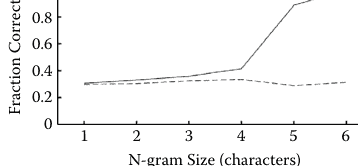

图 2.15 格里芬的结果（实线）与其他人早期尝试（虚线）的比较。

利用本章讨论的技术，任何长度的滚动密钥密码都可以被破解；然而，极短的消息不太可能有唯一解。图 2.16 中的图显示了潜在解的数量如何随消息长度的变化而变化。超过八个字符，我们预计只有一个解。

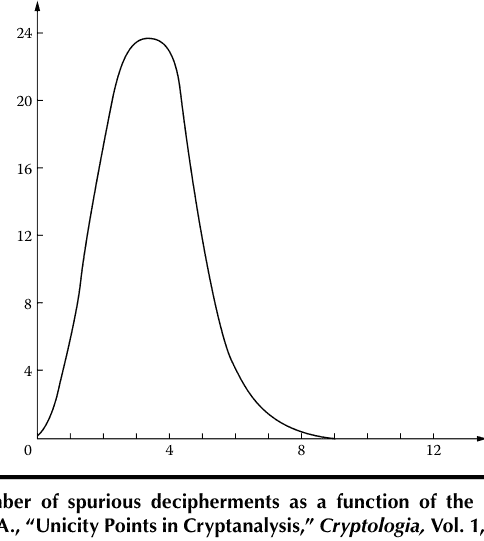

图 2.16 虚假解译数量与消息大小的函数关系。（引自 Deavours, Cipher A., “Unicity Points in Cryptanalysis,” Cryptologia, Vol. 1, No. 1, January 1977, pp. 46-68, 此处引用第 62 页。）

### 2.7 一次性密码本或弗纳姆密码

众所周知，维吉尼亚密码很容易被破解，因为关键词重复造成了弱点。修改该系统使密钥永不重复，就得到滚动密钥密码。虽然针对维吉尼亚密码成功的攻击无法击败新系统，但正如我们所见，还有其他有效的攻击。这次的弱点是密钥和消息都由有意义的单词组成。因此，对于那些寻求使密码安全的人来说，下一步似乎显而易见——使用由随机选择的字母组成的滚动密钥。这样的系统能够抵抗

前面已描述的攻击，以及所有其他攻击。只要正确使用，它就是不可破解的！事实上，这是理论上唯一不可破解的密码。26 爱德加·爱伦·坡在写下“人类智慧无法构思出人类智慧无法破解的密码”时并不知道它。我们可以原谅他，因为这种方法尚未被发现。尽管不可破解系统似乎自然地从“修补”运行密钥密码演化而来，历史学家长期以来一直认为27 它直到1917年至1918年才出现，当时由吉尔伯特·维尔纳姆（图2.17）和约瑟夫·莫博格上校（图2.18）在AT&T开发。其当时的形式与本文介绍的不同，但功能等价。我们稍后会回到维尔纳姆和莫博格如何描述其系统的问题。

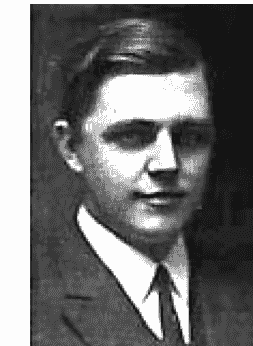

图2.17 吉尔伯特·维尔纳姆（1890–1960）。(http://en.wikipedia.org/wiki/File:Gilbert_Vernam.jpg).

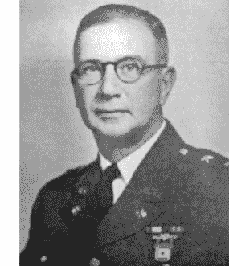

图2.18 约瑟夫·莫博格（1881–1971）(From The Signal Corps Bulletin, October-December, 1937.)

26 Shannon, Claude, “Communication Theory of Secrecy Systems,” The Bell System Technical Journal, Vol. 28, No. 4, October 1949, pp. 656–715. Shannon指出，“本文的材料最初出现在1945年9月1日的机密报告‘A Mathematical Theory of Cryptography’中，现已解密。”

27 如果你知道弗兰克·米勒的事，请耐心等待。我将在本章末尾讨论他的工作。

维尔纳姆和莫博格描述了他们的系统。有时它被称为维尔纳姆密码，但名称*一次性密码本*更好一些，因为它强调了密钥的正确使用——仅使用一次！如果随机密钥被用于多个消息，它就不再不可破解，正如我们将看到的那样。

一次性密码本本可以早数百年就被发现，因为它与维热纳密码或运行密钥密码的工作方式非常相似，只是密钥是随机的并且必须与消息一样长。例如，假设一次性密码本以 U SNHQ LCIYU 开始，而鲍勃想要发送消息：I LOVE ALICE。使用密码本作为密钥并对字母（使用其数值等价）进行模26相加，我们得到

|  |  |
|---|---|
| I LOVE ALICE | 明文 |
| U SNHQ LCIYU | 密钥 |
| C DBCU LNQAY | 密文 |

如果伊芙截获消息并正确猜出密钥，她就能恢复消息。然而，她没有理由猜这个特定密钥。如果她改为猜 U WBJQ LCIYU，那么消息解密为 I HATE ALICE。或者假设她尝试密钥 U SNHQ TTYAL。在这种情况下，消息变为 I LOVE SUSAN。任何十个字符长度的消息都可由某个密钥产生。由于伊芙没有理由偏爱一个密钥胜过另一个，她获得的信息仅限于消息的长度。事实上，密文的长度只提供了消息长度的上限。可能已添加填充以使非常简短的消息看起来更长。

在开发出不可破解的密码之后，我们或许会期望它很快被所有人采用，而所有其他加密方法都会消失。这并非如此！事实上，直到1920年代初期，这一美国发现才被广泛使用，而且使用者是德国人。28 他们将其作为外交密码的额外步骤。即，消息被转换为数值码组后，一次性密码本以随机数字0到9的列表形式，用于偏移每个密文值。每当采取这种额外步骤时，无论密钥是否随机，我们都将该系统称为加密密码本。一次性密码本也由战略服务办公室（OSS）29 使用，OSS是第二次世界大战期间的美国组织，后来演变为中央情报局和绿色贝雷帽，并被苏联自1930年起29 重用于外交消息。30

1957年在纽约市被联邦调查局（FBI）以一次性密码本抓获的一名著名俄罗斯间谍是鲁道夫·阿贝尔。31 他被捕五年后被交换给弗朗西斯·加里·鲍尔斯，后者在驾驶U-2侦察机飞越苏联上空时被击落。交换发生在连接东西柏林的格利尼克大桥上。

图2.19是1961年日本一名共产党间谍使用的一次性密码本的页面。32 一面可能用于加密，另一面用于解密。

尽管早已有人谈论过，但直到1962年古巴导弹危机之后，才在华盛顿特区和莫斯科之间建立了“热线”（图2.20）。

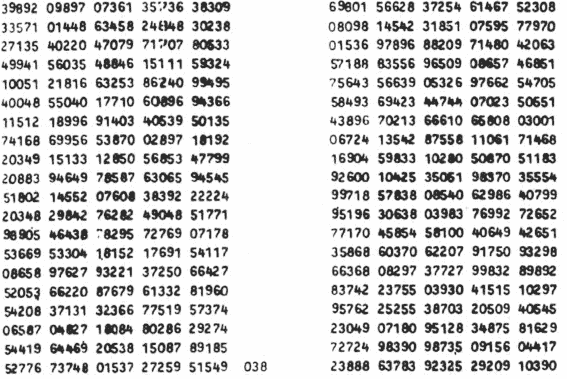

**图2.19** 1961年日本一名共产党间谍使用的一次性密码本页。（由大卫·卡恩收藏，国家密码学博物馆，马里兰州福特米德提供。）

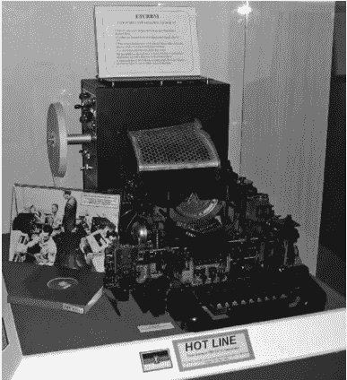

**图2.20** 在这张华盛顿特区与莫斯科之间热线的照片中，一次性磁带在左侧可见。（由国家密码学博物馆，马里兰州福特米德提供。）

实际上，有两条热线（备用总是好主意），两者都用一次性密码本保护。使用了商用、由磁带密钥的系统。³³

1967年切·格瓦拉在玻利维亚被杀时，被发现携带一次性密码本。³⁴ 切几个月前发给菲德尔·卡斯特罗的一条消息，使用波利比乌斯密码将文本转换为数字，然后再应用数值一次性密码本，后来由芭芭拉·哈里斯和大卫·卡恩利用切的计算表解码。35

³³ Kahn, David, *The Codebreakers*, second edition, Scribner, New York, 1996, pp. 715–716.

³⁴ Polmar, Norman, and Thomas B. Allen, *Spy Book: The Encyclopedia of Espionage*, Random House, New York, 1997, p. 413.

### 2.8 破解不可破解

尽管一次性密码本的其他历史用途已被记录，其使用远非普遍。原因在于它在密钥分发方面存在严重问题。如果在战争期间要发送数百万条加密消息，则需要数百万页密钥。生成真正随机的序列很困难，而且在保持大量此类材料保密的同时将其送达需要的人手中也很困难。如果你认为这些问题并不那么棘手，请考虑下面描述的系统的一些失败实现。

第二次世界大战期间，德国外交部对其最重要的消息使用一次性密码本，但密码本由机器生成，而机器无法创建真正随机的序列。1944-1945年冬季，美国陆军信号安全局能够破解这些消息。36

系统失败的另一种方式是重复使用同一密钥。要了解如何破解，设 M₁ 和 M₂ 表示用同一页密钥 K 发送的两个不同消息。我们的两个密文将为

C₁ = M₁ + K and C₂ = M₂ + K

任何截获两个密文的人都可以计算其差值：

C₁ − C₂ = (M₁ + K) − (M₂ + K) = M₁ + K − M₂ − K = M₁ − M₂

因此窃听者可以创建一个是两个有意义消息之差的文本。令人惊讶的是，有意义的消息是用减法而不是加法组合起来的，这并无重要区别。可以采用与运行密钥密码类似的方式，使用类似于表2.5的表来破解它。然而在构造表时必须小心，因为在此实例中我们需要对差值而非和产生所需字母的字母对进行排序。表制作完成后，可采用第3.6节中使用的方法来恢复消息。因此，两次使用一次性密码本等同于使用运行密钥。而这种情况有时确实会发生。

第二次世界大战期间，苏联外交密码系统之一是加密密码本。消息转换为码组后，会加上来自一次性密码本的随机数字，以便重复的码组看起来不同。这是一个很棒的系统。然而1942年初对苏联来说是非常艰难的时期（德国于1941年6月入侵俄罗斯），几个月内他们将超过35,000页一次性密码本打印了两次。我们已经看到使用两次的页面如何被破解，但美国密码分析员并不那么容易！页面装订成不同顺序的书籍，因此相同的页面可能在相隔甚远的时间、甚至相隔数年、由不同的人使用。大多数重复页面在1942年至1944年间使用，但有些晚至1948年。37

如果密码严格是一次性密码本，没有底层密码，则使用相同密钥的密文可使用弗里德曼的吻合指数配对。为此，只需取一对密文 C₁ 和 C₂ 并考虑 C₁ − C₂。如果它们使用了相同的密钥，这将是差值

有意义的消息。在这种差异中，我们期望相同的字母对约 6.6% 的时间对齐（以英语为例）。因此，差异中约有 6.6% 应为 A = 0。如果 C₁ 和 C₂ 并非源自同一一次性密码本密钥，则 C₁ − C₂ 的差值本质上是随机的，对于此类文本，A = 0 的期望概率仅约为 3.8%。但在苏联密码的情况下，底层代码使配对和破译过程变得更加困难。尽管有这一额外障碍，仍最终破译了超过 2,900 条消息的部分内容。³⁸ 1953 年底，经过多年的努力，人们发现一份于 1945 年 4 月发现的部分烧毁的代码本副本³⁹ 已用于 1942 年和 1943 年大部分时间的信息。⁴⁰ 然而，到那时，主要的突破已经以艰难的方式取得。⁴¹

从这些材料中获得的情报最初代号为 Jade，后来改为 Bride、Drug，最后为 Venona，这是历史学家今天所称的名称。许多破译结果直到 1960 年代和 1970 年代才被发现。⁴² 包含这些消息明文的解密文件于 1995 年 7 月开始发布。

因为所有的安全性都在于保持密钥保密，所以它必须易于隐藏，并且在特工被渗透时易于销毁；否则，我们就有了系统失效的另一种方式。

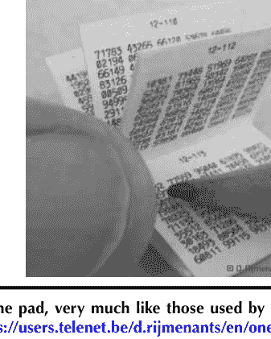

图 2.21 一个一次性密码本，非常类似于冷战间谍所使用的那种。（版权 Dirk Rijmenants，2009；https://users.telenet.be/d.rijmenants/en/onetimepad.htm。）

如图 2.21 所示的一个一次性密码本，被在 1961 年于英国被捕的苏联间谍 Helen 和 Peter Kroger 持有。两人都是美国人，其真实姓名为 Morris 和 Lona Cohen。他们曾在美国从事间谍工作，但在 Julius Rosenberg 被捕后逃离了该国。被捕后，他们被判处 20 年监禁，但 8 年后被交换给苏联。一家苏联报纸称，“多亏了 Cohen，苏联原子弹的设计者直接从洛斯阿拉莫斯的秘密实验室获得了成堆的技术文件。”43

³⁸ Benson, Robert Louis 和 Michael Warner 编辑，《Venona: Soviet Espionage and the American Response, 1939-1957》，NSA/CIA，华盛顿特区，1996 年，第 viii 页。

³⁹ 它最初由芬兰部队发现，他们在 1941 年占领了芬兰的苏联领事馆。德国人随后从芬兰人手中获得了该书，最后在 1945 年 5 月，美国人在德国萨克森州的一处德国信号情报档案馆中发现了一份副本。参见 Haynes, John Earl 和 Harvey Klehr，《Venona: Decoding Soviet Espionage in America》，Yale University Press，康涅狄格州纽黑文，1999 年，第 33 页。

⁴⁰ Haynes, John Earl 和 Harvey Klehr，《Venona: Decoding Soviet Espionage in America》，Yale University Press，康涅狄格州纽黑文，1999 年，第 33 页。

⁴¹ Benson, Robert L.，《The Venona Story》，Center for Cryptologic History，National Security Agency，马里兰州 Fort George G. Meade，2001 年，可在线获取 https://www.nsa.gov/Portals/70/documents/about/cryptologic-heritage/historical-figures-publications/publications/coldwar/venona_story.pdf。

⁴² Benson, Robert Louis 和 Michael Warner 编辑，《Venona: Soviet Espionage and the American Response, 1939-1957》，NSA/CIA，华盛顿特区，1996 年，第 xxx 页。

我们最初的例子使用字母作为密钥，但上面描绘的密码本使用的是数字。假设我们使用随机数生成器得到一个值串，每个值介于 0 和 9 之间。然后我们一次一个地用数字偏移消息的每个字母。以下是一个例子：

```
IS THIS SECURE?      message
74 9201 658937        key
PW CUIT YJKDUL        ciphertext
```

消息提出的问题的答案是否定的！如果每个字母只有十种可能的偏移量，那么每个密文字符只有十种可能的破译。例如，初始密文字母 P 不可能代表明文 A，因为这需要密钥的第一个数字为 15。

为了安全地实现数值一次性密码本，消息必须首先转换为数字。使用俄罗斯间谍所做的那种数值代码是可以的，就像先应用 Polybius 密码一样，比如 Ché Guevara。

即使该领域随着机器加密不断进步，这类密码在冷战期间仍在间谍中流行。有很多原因。其中主要的是它们可以用铅笔和纸创建；间谍不必携带密码机，这往往会招致怀疑！

### 2.9 伪造随机性

随机性对一次性密码本至关重要，但生成随机性相当困难，因此除了生成所需大量密钥的困难外，我们还有生成其中任何一部分的困难！太阳辐射和其他自然现象已被用于生成密钥，另外还有人工来源；然而，人工来源不能真正随机。我们称它们为伪随机数生成器。如果我们使用其中一种，通常更方便，我们就有了所谓的流密码。这些系统在第 19 章中讨论。

如前所述，这里介绍的一次性密码本的实现方式并不是 Vernam 的实现方式。他的故事始于 1917 年，当时他设计了一台利用磁带进行加密的机器。他机械解决方案的后一个版本如图 2.22 所示。

Vernam 的实现用于通过有线或无线电报发送的消息，因此它不作用于我们的 26 个字母表或数字，而是涉及将消息字符逐个打孔到长纸带上。这使用现有的五单元印刷电报码完成（图 2.23），其中每个符号由打孔在纸上的孔的排列表示。

每个符号最多有五个孔，可以表示 2^5 = 32 个不同的字符。其中只有 26 个可能性用于字母。剩下的六个表示空格、回车、换行、图形转换、字母转换和空白或空闲信号。

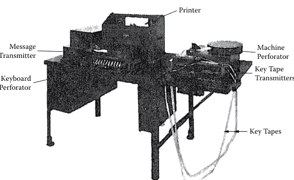

图 2.22 密码印刷电报机。（摘自 Vernam, Gilbert S.，“Cipher printing telegraph systems: For secret wire and radio telegraphic communications”，《Journal of the American Institute of Electrical Engineers》，第 45 卷，第 2 期，1926 年 2 月，第 109-115 页，第 109 页，此处引用。）

密钥带看起来像消息带，只是所代表的字符序列是随机的。Vernam 建议提前通过“随机操作键盘”生成。机器通过将每对消息和密钥字符组合来产生密文字符。这使用类似于 Vigenère 表的方法，但使用 32 个移位字母表，而不是 26 个。在接收端，密文带与密钥带的副本组合以恢复原始消息，然后自动以字母形式打印出来。

Vernam  intended  磁带以环形使用，但这种重复使其等同于 Vigenère 密码。一位工程师 Lyman F. Morehouse 提出了使用两卷磁带的想法，其中一卷比另一卷长一个字符。由每卷磁带字符对组合产生的字符将用作密钥。虽然他知道这样的序列不能真正随机，但他获得的密钥段比单独使用每卷磁带时要长得多（两卷长度的乘积），而不是两卷长度之和。44

Mauborgne 的贡献是在 1918 年，随着 Vernam 密码的演变，他认识到如果密钥是随机的且永不重复，系统将完全不可破译。多年后，Vernam 在一篇论文中通过描述手动实现这种不可破译密码的不切实际性来推广他的设备：45

如果手动执行，该方法缓慢、费力且容易出错。如果出现错误，例如遗漏一个或多个字母，接收者就难以破译消息。准备、复制和保护长随机密钥也会涉及某些困难。该系统的困难足以使其不适合一般使用，除非使用机械方法。

44 他还建议两个长度可以相差其他数量，只要该数量不是任一磁带长度的因子。如果这听起来不太对，你做得很好！如果我们想要获得较长的周期，有一种更好的方法来限制两卷磁带的长度。

45 Vernam, Gilbert S.，“Cipher Printing Telegraph Systems: For Secret Wire and Radio Telegraphic Communications”，《Journal of the American Institute of Electrical Engineers》，第 45 卷，第 2 期，1926 年 2 月，第 109–115 页，第 113 页，此处引用。


弗纳姆还在该文中指出：“这种密码于1920年10月在国际通信预备会议的代表们面前进行了演示。”[^46] 在今天的世界里，政府雇员是不会在国际会议上演示最新的加密技术，也不会在公开期刊上发表的！

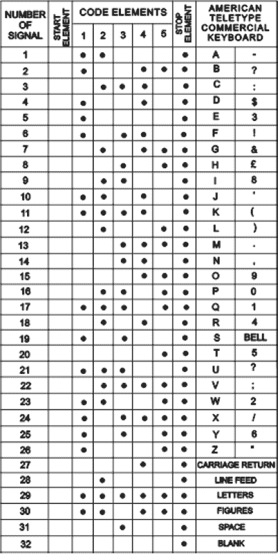

**图2.23** 五单位打印电报码。这种编码有时被称为*博多码*，以其法国发明者J.M.E. 博多命名，后者也是术语*波特*的来源。（图片由萨姆·哈拉斯绘制并提供。）

[^46] Vernam, Gilbert S.，“密码打印电报系统：用于秘密有线和无线电报通信”，*《美国电气工程师学会杂志》*，第45卷，第2期，1926年2月，第109–115页，此处引用第115页。

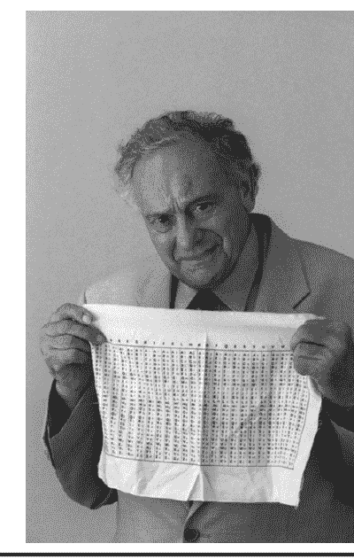

（图2.24 利奥·马克斯手持一块丝绸一次性密码本，图片来自萨拉·克鲁维奇/《纽约时报》/Redux图片社，已获许可。）

### 2.12 历史改写！

在关于一次性密码本的讨论开始时，我曾写道：“历史学家长期以来一直认为，它直到1917至1918年间才出现，由AT&T的吉尔伯特·弗纳姆和约瑟夫·莫博恩少校开发。”2011年，历史被史蒂文·M. 贝洛文改写了。他是一位计算机科学教授，也是一位码本收藏家。贝洛文的业余爱好此前就曾与他的职业生活相交，当时他在美国国家安全局密码历史中心主办的2009年密码历史研讨会上，发表了一场题为“压缩、校正、保密与理解：商业电报码的现代审视”的趣味演讲。但他在国会图书馆利用闲暇时光（同时沉浸于自己的爱好）检视那里保存的一些码本时，不费吹灰之力就找到了金矿。其中一本写于1882年、由弗兰克·米勒编写的书，包含了对一次性密码本的描述！

⁵⁰ 本次演讲的幻灯片可在 http://www.usenix.org/events/sec09/tech/slides/bellovin.pdf 在线获取。

⁵¹ Miller, Frank，《确保电报传输隐私和秘密的电报码》，Charles M. Cornwell，纽约，1882年。

就在那一刻，贝洛文有了一个可发表的结果。这可能是他写过的最容易的论文。事实上，我看到网上有评论批评这种“偶然碰见一本码本就当作学术研究”的做法。Adacrypt 写道：“把旧链接‘转置’到已失效的密码学上，很难称得上是研究。”^52^ 戴维·伊瑟回应道：“正如你所说，这确实没什么……所以奇怪的是，你自己为什么不去做呢。”^53^ 我提到这段交锋，是为了强调一个观点：偶然的发现通常由那些在寻找的人做出，而不是由那些忙于批评别人的人做出。华盛顿特区有很多事情可做。贝洛文并不是非得花时间在国会图书馆翻阅码本。然而，正因为他在寻找，他才更有可能做出这样的发现。而且，在做出发现之后，他将全部研究能力都投入其中。没有人能做到这一点。事实上，贝洛文写出了一篇长达20页、包含78篇参考文献的论文！它给*《密码学》*的编辑留下了深刻印象，足以使其成为2011年7月号的首篇文章。*《纽约时报》*也对此进行了报道。^54^ 像贝洛文这样的发现，有时是一生热衷研究所获得的回报。两位退休的NSA历史学家撰写了一篇论文，详细介绍了另外两个这种回报的例子，并就如何增加此类发现的几率给出了建议，即 Robert J. Hanyok 和 Betsy Rohaly Smoot，《来源与方法：偶然性在密码史记录研究中的作用——讨论及对未来研究的一些启示》，载于*《密码学》*，第44卷，第6期，2020年11月。

## 参考资料与进一步阅读

### 关于维吉尼亚密码

- Barr, Thomas H. 和 Andrew J. Simoson，“从维吉尼亚密码中扭动密钥长度”，*《密码学》*，第39卷，第4期，2015年10月，第335–341页。
- Bauer, Craig P.，*《未解：从古埃及到在线秘密社团的世界最伟大密码的历史与谜团》*，普林斯顿大学出版社，新泽西州普林斯顿，2017年。关于*Kryptos*的更详细探讨，超出此处所能呈现的范围，见[第9章](pp. 386–407)。
- Berntsen, Matthew C.，*《简单密码破解的自动化》*，提交给巴克内尔大学教师以部分满足计算机科学荣誉理学学士学位要求的论文，宾夕法尼亚州刘易斯堡，巴克内尔大学，2005年4月19日，可在线获取：http://mattberntsen.net/code/thesis/MatthewBerntsenBUThesis.pdf。
- Boklan, Kent D.，“我如何破解了南方邦联密码（迟了137年）”，*《密码学》*，第30卷，第4期，2006年10月，第340–345页。
- Boklan, Kent D.，“我如何破译了一封罗伯特·E·李的信——兼论上下文在短多表密码中的威力”，*《密码学》*，第40卷，第5期，2016年9月，第406–410页。
- Bowers, William Maxwell，“卡萨诺瓦密码文件的破译”，*《卡萨诺瓦拾遗》*，第14卷，1971年，第11–16页。
- Brawley, J. V. 和 Jack Levine，“维吉尼亚系统的等价性”，*《密码学》*，第1卷，第4期，1977年10月，第338–361页。该文利用抽象代数的符号和术语对维吉尼亚系统进行了修饰，并推广了这一密码系统。

^52^ sci.crypt，弗兰克·米勒于1882年发明了一次性密码本，https://groups.google.com/forum/#!topic/sci.crypt/RJATDXgg6BQ，2011年12月1日。

^53^ sci.crypt，弗兰克·米勒于1882年发明了一次性密码本，https://groups.google.com/forum/#!topic/sci.crypt/RJATDXgg6BQ，2011年12月1日。

^54^ Markoff, John，“密码本显示一种加密形式可追溯至电报”，*《纽约时报》*，2011年7月25日，可在线获取：http://www.nytimes.com/2011/07/26/science/26code.html。

Dunin, Elonka，Elonka 的*Kryptos 页面*，[http://elonka.com/kryptos/](http://elonka.com/kryptos/)。这个页面专注于*Kryptos*，对于任何想了解更多关于这座神秘雕塑及其创作者的人来说，都是一个极好的资源。

Friedman, William F.，“雅克·卡萨诺瓦·德·塞恩加尔特，密码学家”，*《卡萨诺瓦拾遗》*，第4卷，1961年，第1–12页。

Gardner, Martin，“数学游戏，一种需要数百万年才能破解的新型密码”，*《科学美国人》*，第237卷，第2期，1977年8月，第120–124页。这篇重要论文将在第15.4节再次讨论。就目前而言，相关部分位于该文第124页的插入框中，涉及对寄给爱伦·坡的维吉尼亚密码的解密。

Grošek, Otokar, Eugen Antal, and Tomáš Fábisč，“关于破解维吉尼亚自动密钥密码的评论”，*《密码学》*，第43卷，第6期，2019年11月，第486–496页。

Hamilton, Michael 和 Bill Yankosky，“使用TI-83的维吉尼亚密码”，*《数学与计算机教育》*，第38卷，第1期，2004年冬季。本文写作时，Hamilton 是北卡罗来纳州卫斯理学院的一名本科生。

Kaeding, Thomas，“用于周期多字母替换密码仅密文密码分析的滑动爬山技术”，*《密码学》*，第44卷，第3期，2020年5月，第205–222页。

Levy, Steven，“不可能的任务：连中央情报局都无法破解的密码”，*《连线》*，第17卷，第5期，2009年4月20日，[http://www.wired.com/science/discoveries/magazine/17-05/ff_kryptos](http://www.wired.com/science/discoveries/magazine/17-05/ff_kryptos)。

Lipson, Stanley H. 和 Francine Abeles，“查尔斯·L·道奇森的元音密钥密码”，*《密码学》*，第15卷，第1期，1991年1月，第18–24页。该文描述了《爱丽丝梦游仙境》的著名作者（以笔名刘易斯·卡罗尔写作）发明的一种密码，结果证明它属于维吉尼亚类型，并系统地插入了空值。

McCloy, Helen，*《恐慌》*，William Morrow，纽约，1944年。这是一部小说。作者认为她为“拥有充分混合的字母表和难以猜测的密钥，且无需使用者写下任何内容”这一问题找到了一个不错的解决方案；也就是说，密钥和字母表在需要时很容易生成。这部作品对密码学家没有价值，但可能会引起文学爱好者的兴趣。这种密码似乎是这部小说的创作动机。

Park, Seongmin, Juneyeun Kim, Kookrae Cho, and Dae Hyun Yum，“寻找维吉尼亚密码的密钥长度：如何改进扭曲算法”，*《密码学》*，第44卷，第3期，2020年5月，第197–204页。

Schwartz, John 和 Jonathan Corum，“这座雕塑藏着一个数十年之久的谜团。而现在，又有了新的线索”，*《纽约时报》*，2020年1月29日，可在线获取：[https://www.nytimes.com/interactive/2020/01/29/climate/kryptos-sculpture-final-clue.html](https://www.nytimes.com/interactive/2020/01/29/climate/kryptos-sculpture-final-clue.html)。

Scryer，“Kryptos雕塑密文：部分解答”，*《密码图》*，第65卷，第5期，1999年9–10月，第1–7页。Scryer 是 James J. Gillogly 使用的美国密码协会（ACA）笔名。

Scryer，“Kryptos线索”，*《密码图》*，第77卷，第1期，2011年1–2月，第11页。Scryer 是 James J. Gillogly 使用的美国密码协会（ACA）笔名。

Tuckerman, Bryant，*《维吉尼亚-弗纳姆单环与多环加密系统研究》*，IBM研究报告RC-2879，T. J. Watson研究中心，纽约约克敦海茨，1970年5月14日。这份115页的报告表明此类系统是不安全的。

de Vigenère, Blaise，*《论密码，或秘密书写方式》*，Abel l’Angelier，巴黎，1586年。

Vigenère，*《Cryptool – 在线》*，[https://www.cryptool.org/en/cto/ciphers/vigenere](https://www.cryptool.org/en/cto/ciphers/vigenere)。该网站允许用户使用维吉尼亚密码进行加密和解密。它是一个更大（且仍在扩展）的网站的一部分，该网站涵盖许多密码，并包含在线密码分析程序。

Winkel, Brian J.，“卡萨诺瓦与博福特密码”，*《密码学》*，第2卷，第2期，1978年4月，第161–163页。

### 关于滚动密钥密码

Bauer, Craig 和 Christian N. S. Tate，“对滚动密钥密码的统计分析”，*《密码学》*，第26卷，第4期，2002年10月，第274–282页。

Bauer, Craig 和 Elliot Goettloeb，“对滚动密钥密码自动攻击的结果”，*《密码学》*，第29卷，第3期，2005年7月，第248–254页。该文描述了一种对滚动密钥密码的计算机攻击，它使用大型英语单词文件来查找消息和密钥中所有能产生密文的单词组合。这些解没有按概率排序，也没有检查语法正确性。由于后一种遗漏，产生了大量可能的解。


弗里德曼，威廉·F.，《滚动密钥密码解法》，第16号出版物，河岸实验室，伊利诺伊州日内瓦，1918年。弗里德曼在这篇论文中证明了美国陆军的野战密码即使对于短消息也不安全。该文与其他弗里德曼论文一起重印于弗里德曼，威廉·F.《河岸出版物》第1卷，爱琴海公园出版社，加利福尼亚州拉古纳希尔斯，1979年。由于原版仅印行400册，建议寻找重印本。

格里芬，亚历山大，“用维特比算法求解XOR明文串”，《密码学》，第30卷，第3期，2006年7月，第257–265页。本文攻击了消息和密钥中保留单词间距的滚动密钥密码。

格里芬，亚历山大，“用维特比算法求解滚动密钥密码”，《密码学》，第30卷，第4期，2006年10月，第361–367页。本文大幅改进了鲍尔和泰特以及鲍尔和戈特利布的研究成果，甚至可以说这些论文应该被烧掉。

## 关于一次性密码本

注意：关于生成一次性密码本的论文与关于随机数生成器的论文之间存在一些重叠。属于重叠范围内的论文仅在本书[第19章](#)中被引用，该章节讨论流密码。流密码是一次性密码本的近似实现，但没有真正一次性密码本所伴随的问题。

佚名，“自动代码消息”，《科学》杂志“科学新闻”栏目，新系列，第63卷，第1625期，1926年2月19日，第x、xii页。

佚名，“一种秘密代码消息机”，《文学文摘》，第89卷，第3期，总第1878期，1926年4月17日，第22页。这篇文章在介绍性段落之后，转载了《科学服务每日新闻公报》的文字：“这台新机器由美国电话电报公司工程师G. S. 弗纳姆描述，他表示该机器是在战争期间为美国陆军通信兵部队开发使用的，但直到最近一直保密。”保密？为什么？通信兵部队又不是真的在用它……

贝洛温，史蒂文·M.，“弗兰克·米勒：一次性密码本的发明者”，《密码学》，第35卷，第3期，2011年7月，第203–222页。

本森，罗伯特·L.，《维诺纳故事》，密码学历史中心，国家安全局，马里兰州米德堡堡，2001年，在线获取：https://www.nsa.gov/Portals/70/documents/about/cryptologic-heritage/historical-figures-publications/coldwar/venona_story.pdf。

本森，罗伯特·路易斯和迈克尔·华纳，编辑，《维诺纳：苏联间谍活动与美国的回应，1939–1957》，NSA/CIA，华盛顿特区，1996年。本书主体是以前机密文件的复制件。前言不错，但其余部分枯燥乏味。尽管复制件对历史学家有价值，但普通读者会更喜欢下面引用的约翰·厄尔·海恩斯和哈维·克莱尔的著作。

布里，扬，“破解不可破解的密码：阿森·格奥尔基耶夫间谍案”，《密码学》，第33卷，第1期，2009年，第74–88页。

布里，弗兰，“从档案中：破解OTP密码”，《密码学》，第35卷，第2期，2011年4月，第176–188页。

菲尔比，P. 威廉，“佛罗拉多拉与一次性密码本密码的独特破译”，《情报与国家安全》，第10卷，第3期，1995年7月，第408–422页。

福斯特，卡克斯顿·C.，“一次性密码本的缺点”，《密码学》，第21卷，第4期，1997年10月，第350–352页。本文简要讨论了确定用作密钥的随机序列的问题。如果它不是真正随机的，那么密码就不再是不可破解的。在传统计算机上运行的算法从来都不是真正随机的。要获得真正的随机数，需要量子计算机。

海恩斯，约翰·厄尔和哈维·克莱尔，《维诺纳：解码苏联在美国的间谍活动》，耶鲁大学出版社，康涅狄格州纽黑文，1999年。尽管侧重于历史，但这本书有一章（“破解密码”）比其他著作提供了更多关于密码学的细节。

马克斯，利奥，《丝绸与氰化物之间：密码制造者的战争，1941–1945》，自由出版社，纽约，1998年。马克斯是特别行动执行处（SOE）的密码学家，他以非常有趣的方式叙述了自己的经历。（战后但在此书出版前，他曾是一名编剧，所以他的文笔很好！）封底印有大卫·卡恩和马丁·斯科塞斯的推荐语。

莫博涅，本·P.，《军事弃儿》，多兰斯公司，宾夕法尼亚州费城，1974年。这部小说虚实混合，我们对它感兴趣主要因为其献词：

> 谨以此书纪念我杰出、才华横溢且多才多艺的父亲——约瑟夫·O. 莫博涅少将，美国陆军通信兵主任（1937–1941）；科学家、发明家、密码学家、肖像画家、蚀刻师、精美小提琴制作者和作家。

军事历史记载：他是第一个在地面与飞行中的飞机之间建立双向无线通信的人；他发明了一种不可破解的密码；他“直接负责”了历史上最伟大的密码分析壮举之一——破译日本PURPLE密码——而这发生在珍珠港偷袭一年多之前。

米勒，弗兰克，《确保电报传输隐私和秘密的电报代码》，查尔斯·M. 康威尔，纽约，1882年。

菲利普斯，塞西尔，“美国破解德国一次性密码本密码系统”，《密码学》，第24卷，第4期，2000年10月，第324–332页。

已删节，“一次性密码本的新方法”，《NSA技术杂志》，第19卷，第3期，1974年夏季。本文标题由国家安全局发布，是该杂志一份大量删节索引的一部分。事实上，作者姓名也被删去了。但我们确实知道它排在古林，雅各布和雅各布斯，沃尔特之间。有人猜猜吗？

鲁宾，弗兰克，“一次性密码本密码学”，《密码学》，第20卷，第4期，1996年10月，第359–364页。本文试图使一次性密码本更加实用。

香农，克劳德，“保密系统的通信理论”，《贝尔系统技术杂志》，第28卷，第4期，1949年10月，第656–715页。香农证明了一次性密码本是不可破解的，任何不可破解的东西必然是一次性密码本。尽管他在70多年前就发现了这一结果，但人们仍然不难找到其他号称不可破解的密码系统。

弗纳姆，吉尔伯特·S.，“密码打印电报系统：用于秘密有线及无线电电报通信”，《美国电气工程师学会杂志》，第45卷，1926年2月，第109–115页。

文奇，弗诺，《深渊上的火》，圣马丁出版社，纽约，1993年。这部科幻小说中使用了一次性密码本，但它必须先由三位星舰船长拼凑起来。

亚德利，赫伯特·O.，“我们是否在泄露国家机密？”，《自由》，第8卷，1931年12月19日，第8–13页。亚德利主张美国应该使用一次性密码本。

## 第3章

### 换位密码

> 21世纪将见证换位密码重新获得其真正的重要性。
>
> ——弗里德里希·L. 鲍尔

### 3.1 简单重排与纵列换位

换位密码代表了一类与我们一直在研究的替代密码不同的密码。

想象拿一本小说，先写下所有A，然后是所有B，依此类推。没有一个字母会被改变；只有它们的位置会发生变化。尽管如此，这将是一种非常难以破解的密码。它不太实用，因为解密结果不唯一。重新排列字母即使只有少量字母也常常会产生几种可能的短语。例如，EILV。它可以是VEIL、EVIL、VILE或LIVE。这类密码很容易识别，因为各个字母的频率并未因加密而改变。不同换位密码之间的区别在于打乱和恢复字母的系统性方法。我们从几个非常简单的例子开始。

#### 3.1.1 栅栏式换位

### 例1

> 任何看我们眼神不对两次的人必死无疑。

我们只需将文本以锯齿形方式从顶行到底行来回书写：

```
A Y N W O O K A U T E R N W Y W C W L S R L D E
N O E H L O S T S H W O G A T I E I L U E Y I
```

然后先从顶行读起，得到密文：

```
AYNWO OKAUT ERNWY WCWLS RLDEN OEHLO STSHW OGATI EILUE YI
```


“栅栏”不必局限于两层。我们可以按如下方式对同一消息进行加密。

```
A       W       K       T       N       W       L       L
  N   E H   O S   S H   O G   T I   I L   E Y
    Y N   O O   A U   E R   W Y   C W   S R   D E
      O      L      T      W      A      E      U      I
```

得到密文

```
AWKTN WLLNE HOSSH OGTII LEYNO OOAUE RWYCW SRDEO LTWAE UI
```

#### 3.1.2 矩形换位

我们也可以以特定方式将文本写成矩形，然后以另一种方式读出。

### 示例 2

```
ATTACK DAMASCUS AT DAWN.
```

我们将消息写成矩形的形式（可以使用任何尺寸），按从上到下逐行填充，但我们通过从左到右按列提取文本来得到密文

```
ATTACK
DAMASC   →   ADUWT ASN TM AKAAT ECSDT KCAW
USATDA
WNKETW
```

*注意：* 消息中最后四个字母只是为了完成矩形而存在的。常见做法是使用字母 X 来实现此目的，但最好使用更频繁的字母，使密码分析员的工作更困难。

矩形可以有任意尺寸。如果密码分析员怀疑这种加密方式，则需要考虑的可能情况数量取决于密文长度的因子数。例如，考虑以下截获内容：

```
YLAOH TEROO YNNEO WLNUW FGSLH ERCHO UTIIS DAIRN AKPMH
NPSTR ECAWO AOITT HNCNM LLSHA SU
```

密文共有 72 个字母，加密矩形可以是 2 × 36、3 × 24、4 × 18、6 × 12、8 × 9、9 × 8、12 × 6、18 × 4、24 × 3 或 36 × 2。如果被迫逐一查看这些可能性，最好从最接近正方形的尺寸开始，然后向外扩展，但我们有一个很好的技巧可以消除这种繁琐。

可能的单词搜索通常效果很好，因为每条消息都有某种上下文可以猜测字谜，所以这是公平的。假设我们可以猜测消息中出现了单词 WHIP。重新呈现密文并对适当字母进行下划线和粗体标注会揭示出一种模式。（我们只需要考虑第一个 W 和最后一个 P 之间的字符。）

```
YLAOH TEROO YNNEO WLNUW FGSLH ERCHO UTIIS DAIRN
AKPMH NPSTR ECAWO AOITT HNCNM LLSHA SU
```

查看这些字母各自的位置以及它们之间的距离：

```
W₁ 16
W₂ 20

H₁ 25      H₁ - W₁ = 9      H₁ - W₂ = 5
H₂ 29      H₂ - W₁ = 13     H₂ - W₂ = 9

I₁ 33      I₁ - H₁ = 8      I₁ - H₂ = 4
I₂ 34      I₂ - H₁ = 9      I₂ - H₂ = 5
I₃ 38      I₃ - H₁ = 13     I₃ - H₂ = 9

P₁ 43      P₁ - I₁ = 10     P₁ - I₂ = 9      P₁ - I₃ = 5
P₂ 47      P₂ - I₁ = 14     P₂ - I₂ = 13     P₂ - I₃ = 9
```

在 WHIP 中每对字母之间出现的唯一距离数字是 9。看起来 13 也可行，但要通过可能的单词串联字母是不可能的，因为我们不得不使用两个不同的 H。为了方便起见，我们重新呈现表格并对 9 进行粗体标注：

```
W₁ 16
W₂ 20

H₁ 25      **H₁ - W₁ = 9**      H₁ - W₂ = 5
H₂ 29      H₂ - W₁ = 13     **H₂ - W₂ = 9**

I₁ 33      I₁ - H₁ = 8      I₁ - H₂ = 4
I₂ 34      **I₂ - H₁ = 9**      I₂ - H₂ = 5
I₃ 38      I₃ - H₁ = 13     **I₃ - H₂ = 9**

P₁ 43      P₁ - I₁ = 10     **P₁ - I₂ = 9**      P₁ - I₃ = 5
P₂ 47      P₂ - I₁ = 14     P₂ - I₂ = 13     **P₂ - I₃ = 9**
```

如果我们从 W₁ 开始形成 WHIP，那么我们必须使用 H₁，因为它是距离 W₁ 9 个单位的唯一 H。这消除了 I 部分的不确定性。由于我们必须使用 H₁，因此我们也必须使用 I₂，进而使用 P₁。因此，我们得到一个一致的解。9 表示使用了九行。

类似地，如果我们从 W₂ 开始形成 WHIP，那么我们必须使用 H₂，因为它是距离 W₂ 9 个单位的唯一 H。这消除了 I 部分的不确定性。由于我们必须使用 H₂，因此我们也必须使用 I₃，进而使用 P₂。因此，我们得到另一个一致的解。显然单词 WHIP 在此消息中出现了两次。同样，9 表示使用了九行。为了解密，我们将密文写成列并按行读出消息。

```
Y O U C A N O N
L Y W H I P A M
A N F O R S O L
O N G U N T I L
H E S T A R T S
T O L I K E T H
E W H I P C H A
R L E S M A N S
O N R D H W C U
```

消息：YOU CAN ONLY WHIP A MAN FOR SO LONG UNTIL HE STARTS TO LIKE THE WHIP - CHARLES MANSON

使用了一些随机字母来填满块。此方法在可能的单词出现在加密块的单行上时有效。

#### 3.1.3 更多换位路径

路径很多。我们不必按行填充矩形并按列读出以进行加密。可以沿对角线读取，或向内或向外螺旋，或任何最终能得到每个字母的模式。³ 为了解密，只需按取出的顺序将字母填入矩形，然后按写入的顺序读取。一般来说，作用于大小为 n 的块的换位密码数量由 n! 给出。因此，对于较大的 n，密钥空间非常大。实际上，其中很少有可以用容易记忆的路线表示。大多数会随意跳跃。一种非常常见的文本块混淆技术被称为纵列换位。

### 示例 3

数 e 所代表的数字可以用作加密消息的密钥

```
THIS CONSTANT WAS THE COMBINATION TO THE
SAFES AT LOS ALAMOS DURING WORLD WAR II⁴
```

我们将消息按长度为 10 的行写出，然后用 e 所代表的数字标记列（去掉重复的数字）。因为 e ≈ 2.71828182845904523536...，我们有

2 7 1 8 4 5 9 0 3 6
T H I S C O N S T A
N T W A S T H E C O
M B I N A T I O N T
O T H E S A F E S A
T L O S A L A M O S
D U R I N G W O R L
D W A R I I T A N R

按密钥指示的顺序读出列，我们得到密文

```
IWIHORA TNMOTDD TCN SORN CSASANI OTTALGI
AOTASLR HTBTLUW SANESIR NHIFAWT SEOEMOA
```

密钥不必以数字形式给出。它可以是一个单词，例如 VALIDATE。

### 示例 4

使用关键词 VALIDATE 对 SECRECY IS THE BEGINNING OF TYRANNY 进行加密，我们有

V A L I D A T E
S E C R E C Y I
S T H E B E G I
N N I N G O F T
Y R A N N Y E T

³ 在丹·布朗 otherwise 糟糕的小说《失落的象征》中，魔方被用于换位。有关该书的评论请见 Dooley, John，“Reviews of Cryptologic Fiction”，Cryptologia，第 34 卷，第 2 期，2010 年 4 月，第 180–185 页。所指评论在第 183–185 页。

⁴ Feynman, Richard，“Surely You’re Joking Mr. Feynman!” W. W. Norton & Company，纽约，1985 年。可以猜到的密钥或密码是不好的选择。参见本书第 16.5 节中有关 poorly chosen passwords 的示例。

我们希望按列移除文本，按字母顺序而非数字顺序取值，但有两个 A。没问题。从第一个 A 开始，然后转到第二个 A，然后按字母顺序取其余列。我们的密文是

```
ETNR CEOY EBGN IITT RENN CHIA YGFE SSNY.
```

在上面的示例中，明智的做法是以五字母一组（标准做法）表达最终密文，以免泄露文本矩形中的行数。

### 3.2 纵列换位密码分析

那么，纵列换位密码如何被破解？用高科技的方格纸和剪刀！一个例子会使这一点变得清晰。假设我们怀疑以下截获的密文使用了纵列换位。

```
HAESE UTIER KHKHT ERIPB SADPA IREVH HUIOU TELTO RTHFR TTSTV
RETLO AGHRY STASE UUEUT SYPEI AEIRU CEDNY ABETH LOBVT ALBDO
HTTYT BOLOE EAEFN TTMAT TOTOT I
```

快速计数显示有 126 个字符。该数字可分解为 2 × 3 × 3 × 7，因此加密矩形的尺寸有几种可能性：

```
2 × 63, 3 × 42, 6 × 21, 7 × 18, 9 × 14, 14 × 9, 18 × 7, 21 × 6, 42 × 3, 63 × 2
```

猜错尺寸并不是世界末日。如果你曾经在测验或作业中遇到过“证明或反驳”问题，你就知道是怎么回事。先尝试证明一段时间，如果不行就寻找反例。或者，如果你一开始就寻找反例而找不到，那么考虑它可能是真的并尝试证明。因此，我们选择一个起点，如果无法解密就简单尝试另一组尺寸。如果一个团队正在处理截获内容，每个成员可以负责不同的情况。因此，尝试 9 行 14 列，我们按列读出密文得到

H R P E E T O S P E L O O M
A K B V L T A E E D O H E A
E H S H T S G U I N B T E T
S K A H O T H U A Y V T A T
E H D U R V R E E A T Y E O
U T P I T R Y U I B A T F T
T E A O H E S T R E L B N O
I R I U F T T S U T B O T T
E I R T R L A Y C H D L T I

当然，我们还无法读取消息，因为列不是按正确顺序书写的。如果我们对矩形尺寸的猜测是正确的，重新排列列的正确方式将得到消息。然而，尝试所有可能的重新排列会让我们忙碌，因为对于 14 列，我们有 14! = 87,178,291,200 种可能性。

与其使用暴力破解，更好的方法是尝试在一行中形成一个常见单词，看看是否能为其他行产生合理的结果。例如，因为第一行有 T、H 和 E，我们可以将这些字母组合起来得到英语中最常见的单词。我们实际上在第一行有三个 E，所以我们先将第一个与 T 和 H 组合看看得到什么。然后尝试第二个 E，最后尝试第三个 E。比较结果，我们有


|   |   |   |
|---|---|---|
| THE | THE | THE |
| TAV | TAL | TAD |
| SEH | SET | SEN |
| TSH | TSO | TSY |
| VEU | VER | VEA |
| RUI | RUT | RUB |
| ETO | ETH | ETE |
| TIU | TIF | TIT |
| LET | LER | LEH |

仔细观察并在继续阅读之前决定哪种选项看起来最好。我们可以很容易地通过对每种情况下产生的三字母组的频率求和来对可能性进行排名，看看哪个得分最高——也就是说，这个过程很容易自动化。

不检查频率的话，我会选择中间的选项。第一个选项的倒数第二行有 TIU，这看起来不太可能（尽管我能想到一种可能性：anTIUnion）。对于第三个选项，第二位有 TAD，这并没有暗示出很多可能性，除了 stADium 和 amisTAD。现在我们尝试通过一次加入一列到左侧或右侧来扩展我们的矩形。

|   |   |   |   |   |   |   |   |   |   |   |
|---|---|---|---|---|---|---|---|---|---|---|
| THER | THEP | THEE | THEO | THES | THEP | THEE | THEL | THEO | THEO | THEM |
| TALK | TALB | TALV | TALA | TALE | TALE | TALD | TALO | TALH | TALE | TALA |
| SETH | SETS | SETH | SETG | SETU | SETI | SETN | SETB | SETT | SETE | SETT |
| TSOK | TSOA | TSOH | TSOH | TSOU | TSOA | TSOY | TSOV | TSOT | TSOA | TSOT |
| VERH | VERD | VERU | VERR | VERE | VERE | VERA | VERT | VERY | VERE | VERO |
| RUTT | RUTP | RUTI | RUTY | RUTU | RUTI | RUTB | RUTA | RUTT | RUTF | RUTT |
| ETHE | ETHA | ETHO | ETHS | ETHI | ETHR | ETHE | ETHL | ETHB | ETHN | ETHO |
| TIFR | TIFD | TIFU | TIFT | TIFS | TIFU | TIFT | TIFB | TIFO | TIFT | TIFT |
| LERI | LERR | LERT | LERA | LERY | LERC | LERH | LERD | LERL | LERT | LERI |

上面 11 种可能性中哪一种看起来最好？在继续之前请先决定。另外，需要注意的是，可能是以上都不对！也许第一行以 THE 结尾。在这种情况下，其他列都必须连接到我们在上一步中重建的矩形部分的左侧。

你喜欢上面的第一个选项吗？如果是的话，你可能已经想到了一个词或一对词来完成其中一行呈现的片段。请随意复制列并尝试在我们已有的四列之前和之后重新排列它们，看看你脑海中的词是否在其他地方形成不可能的组合，或是否会让其他词浮现出来从而快速破译。我的解法如下，但你自己尝试会收获更多。

取上面选项中的第一个，TIFR 让我有点不安。ANTIFRENCH？ANTIFRUGAL？但 TSOK 看起来很可能是 IT’S OKAY 或 THAT’S OKAY，而其他解法选项在该位置似乎没什么可提供。有三列在继续 OKAY 所需的位置上有 A。下面会分别考虑它们，随后是唯一在需要 OKAY 的位置上有 Y 的列。

|   |   |   |
|---|---|---|
| THERPE | THERPE | THERCE |
| TALKBD | TALKED | TALKED |
| SETHSN | SETHIN | SETHEN |
| TSOKAY | TSOKAY | TSOKAY |
| VERHDA | VERHEA | VERHEA |
| RUTTPB | RUTTIB | RUTTFB |
| ETHEAE | ETHERE | ETHENR |
| TIFRIT | TIFRUT | TIFRTT |
| LERIRH | LERICH | LERITH |

哪种可能性看起来最好？第一个选项几乎可以肯定会被淘汰，因为第二行有 TALKBD，而第三个选项由于第九行有 TIFRTT 似乎不太可能。采用第二个可能性，并在左侧工作，我们发现没有 I 可用在形成 IT’S OKAY 所需的位置上，但我们确实有两列在形成 THAT’S OKAY 所需的位置上有 A。我们分别尝试。

|   |   |
|---|---|
| OTHERPE | PTHERPE |
| ETALKED | BTALKED |
| ESETHIN | SSETHIN |
| ATSOKAY | ATSOKAY |
| EVERHEA | DVERHEA |
| FRUTTIB | PRUTTIB |
| NETHERE | AETHERE |
| TTIFRUT | ITIFRUT |
| TLERICH | RLERICH |

考虑第五行。EVERHEA 还是 DVERHEA 看起来更好？似乎第一个可能性是更好的选择。其他行也支持这一选择。为了继续形成 THAT’S OKAY，我们在所需位置上有 T 的列有两个选择，在所需位置上有 H 的列也有两个选择。因此，总共有四种可能性。我们在下面进行比较。

|   |   |   |   |
|---|---|---|---|
| OOOTHERPE | OEOTHERPE | MOOTHERPE | MEOTHERPE |
| HAETALKED | HVETALKED | AAETALKED | AVETALKED |
| TGESETHIN | THESETHIN | TGESETHIN | THESETHIN |
| THATSOKAY | THATSOKAY | THATSOKAY | THATSOKAY |
| YREVERHEA | YUEVERHEA | OREVERHEA | OUEVERHEA |
| TYFRUTTIB | TIFRUTTIB | TYFRUTTIB | TIFRUTTIB |
| BSNETHERE | BONETHERE | OSNETHERE | OONETHERE |
| OTTTIFRUT | OUTTIFRUT | TTTTIFRUT | TUTTIFRUT |
| LATLERICH | LTTLERICH | IATLERICH | ITTLERICH |

第一个选项在第一行有三个连续的 O，很滑稽。第二种也不好，第三种只有在消息是由一头牛撰写时才有意义。因此，我们选择第四个。

```
MEOTHERPE
AVETALKED
THESETHIN
THATSOKAY
OUEVERHEA
TIFRUTTIB
OONETHERE
TUTTIFRUT
ITTLERICH
```

破译现在应该进展更快了。你能猜出 AVETALKED 或 OUEVERHEA 或 ITTLERICH 前面应该是什么字母吗？最奇怪的行现在也开始有意义了。TIFRUTTIB 和 TUTTIFRUT 单独看可能很奇怪，但合在一起，任何熟悉早期摇滚乐的人都应该能认出来。

此外，随着未使用的列减少，放置变得更容易，因为可能性更少。因此，在这一点上，你应该毫不费力地完成矩形得到

```
SOMEOTHERPEOPL
EHAVETALKEDABO
UTTHESETHINGSB
UTTHATSOKAYHAV
EYOUEVERHEARDT
UTTIFRUTTIBYPA
TBOONETHERESAL
SOTUTTIFRUTTIB
YLITTLE RICHARD
```

插入标点后的最终信息是

```
Some other people have talked about these things, but that’s okay. Have you heard Tutti Frutti by Pat Boone? There’s also Tutti Frutti by Little Richard.
```

尽管密文是通过使用关键词的纵向换位得到的，但我们在不知道关键词的情况下恢复了信息。它实际上是一个名字：Joseph A. Gallian。这段引文也是他的，并在他一次受欢迎的演讲开始时发表。

上面展示的攻击可以很容易地转换为计算机程序。从任意一列开始，然后为放置在其左侧或右侧的每一行生成一个分数（基于双字母组频率）。得分最高的保留下来，并用剩余列重复该过程，直到没有列剩下且信息可以阅读。

### 3.3 历史用途

纵向换位已被广泛使用。下面给出几个例子，并不打算提供接近全面的列表。

在 1920 年代，爱尔兰共和军使用了换位密码。Tom Mahon 在档案中发现了一些这些密码，他寻找能够破解它们的人最终导致了 *Kryptos* 著名的 James J. Gillogly（图 3.1）。James 的密码分析故事在 *Decoding the IRA* 中以透彻且有趣的方式传达。

图 3.2 中的 IRA 消息于 1927 年发送，但日期为 1924 年 2 月 24 日，以防警察拿到时混淆视听。请考虑中间的密文（其他作为练习留下）：

```
96: UEIMS NRFCO OBISE IOMRO POTNE NANRT HLYME PPROM TERSI HEELI NBOFO LUMDT TWOAO ENUUE RMDIO SRLIA BSYHP PRSGI IOSIT B
```

96 告诉我们密文中共有这么多字母。它作为一个有用的检查，确保没有意外遗漏或重复。为了破译，我们需要一个尺寸为⁵ 的矩形

⁵ Mahon, Tom and James J. Gillogly, *Decoding the IRA*, Mercier Press, Cork, Ireland, 2008.


图 3.1 James J. Gillogly。（照片摄于埃及，鸣谢 Gillogly。）

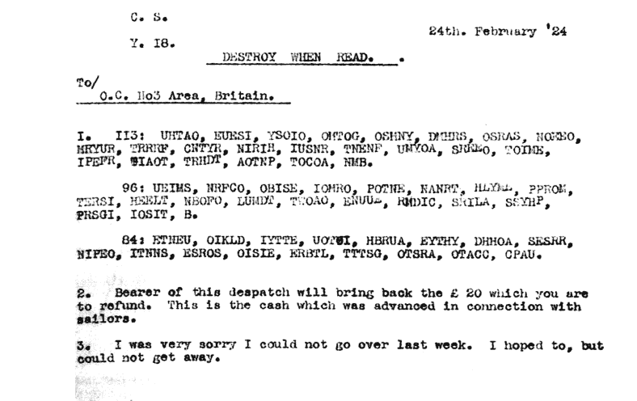

图 3.2 1927 年的 IRA 密文。（摘自 Mahon, Thomas and James J. Gillogly, Decoding the IRA, Mercier Press, Cork, Ireland, 2008, p. 11. With permission）

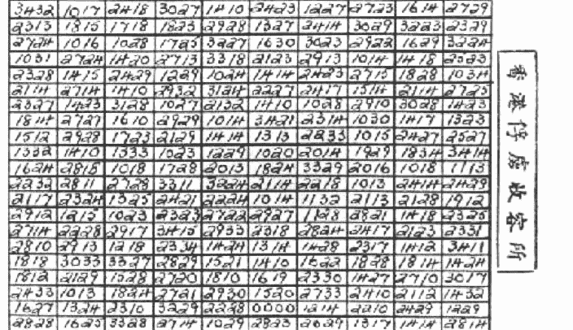

图 3.3 战俘 Donald Hill 加密日记的一页。（感谢破解日记的数学家 Phillip Aston 提供此图像。）

### 3.4 字母重排

如果换位密钥相对于消息长度非常长且随机（不是由有效单词产生），则该系统可能难以破解。特别是，如果换位密钥的长度等于消息的长度，密码分析者本质上是在用大量字母牌玩 Scrabble，并且可能形成几个有意义的解，而没有统计学上的理由偏爱其中一个。字母的重排也称为字母重排。⁹ 伽利略和牛顿都通过字母重排隐藏了发现；然而，他们并没有以系统的方式打乱信息，因此不能像上面的例子那样容易恢复。William Friedman 也使用字母重排来表达他对 Voynich 手稿的看法。

### Example 5

### Galileo Galilei

```
Haec immature a me iam frustra leguntur O. Y.
```

Giuliano de Medici 收到了伽利略发现的消息，采用上面给出的字母重排形式。如你所见，伽利略构造他的字母重排使得另一句话形成。然而，他的新句子并没有使用原文的所有字母。他剩下 O 和 Y，简单地放在末尾。翻译是“这些未成熟的东西现在被我徒劳地阅读。”它旨在掩饰

```
cynthia e figures aemulatur mater amorum
```

翻译为“爱的母亲 [金星] 模仿 Cynthia [月亮] 的相位。”这由伽利略于 1611 年 1 月 1 日揭示。

> ⁹ 有些人将此术语保留用于将一个词的字母重新排列成另一个词的情况。我更广泛地使用它来表示任何重新排列。


## 示例6
### 克里斯蒂安·惠更斯

```
a⁷c⁵d¹e⁵g¹h¹i⁷l⁴m²n⁹o⁴p²q¹r²s¹t⁵u⁵
```

在这个按字母顺序排列的换位密码中，指数表示原始消息中每个字母出现的次数。解密结果是

```
annulo cingitur tenui plano, nusquam cohaerente, ad
eclipticam inclinato
```

其译文为：“[土星]被一个薄而平的环环绕，环的任何地方都不与土星接触，并且相对于黄道面倾斜。”

## 示例7
### 艾萨克·牛顿

```
a⁷c²d²e¹⁴f²i⁷l³m¹n⁸o⁴q³r²s⁴t⁸v¹²x¹
```

出于确立优先权的考虑，牛顿在1677年给莱布尼茨的第二封信中附上了这个按字母顺序排列的换位。它解密为

```
Data aequatione quodcumque fluentes quantitates involvente,
fluxiones invenire et vice versa.
```

其译文为：“给定一个包含任意数量流量的方程，求其流数，反之亦然。”

## 示例8
### 威廉·F·弗里德曼

```
I put no trust in anagrammatic acrostic ciphers, for they are
of little real value-a waste-and may prove nothing-Finis.
```

在谈到伏尼契手稿（一份加密手稿，篇幅远超200页，迄今无人能够破解）时，弗里德曼写道，他“多年来一直有一个新理论来解释其奥秘。但由于尚未完全准备好用平实的语言阐述这一理论，并且遵循三位更杰出前辈的先例，他希望简要记录其理论的实质。”他的理论以字谜形式给出（见上文），这种重新排列与伽利略的一样，是有意义的；然而，他比伽利略更胜一筹，因为他没有留下任何多余的字母。其他人曾为这个字谜找到三种（不正确的）解法。

```
William F. Friedman in a feature article arranges to use
cryptanalysis to prove he got at that Voynich Manuscript. No?
This is a trap, not a trot. Actually I can see no apt way
of unraveling the rare Voynich Manuscript. For me, defeat
is grim.

To arrive at a solution of the Voynich Manuscript, try
these general tactics: a song, a punt, a prayer. William F.
Friedman.
```

再换位一次得到

```
UBULO UDERI TPARS SSDNM ECMIE LEBOD RAAIN IRYHB LOLSR WIETM
LOSTD GUHIU EETAO HNDNI MNOIH HTLCI DSACE IEETR TLSAA NEURT
UDEYN LOHAR LATGS NSHEC EGWWN EGDYE YHINV NTUES NTLK
```

19世纪下半叶，沙皇的无政府主义敌人使用了另一种双重换位密码。这种虚无主义者密码并不是进行两次列换位，而是分别对列和行进行换位。其他基于替换的虚无主义者密码也在使用中。

威廉·弗里德曼称双重换位是一种“非常出色”的方法；12不过，他也提到了它可能失效的特殊情况。最令人担心的是，粗心的加密者会忘记进行第二次换位。在这种情况下，截获的消息很容易被读出，并进而为其他正确进行了两次换位的消息提供密钥。其他可获得解法的特殊情况包括：

- 1. 截获两条长度相同的消息。
- 2. 使用一个也呈方形的矩形加密的单条消息。
- 3. 一个完全填满的非正方形矩形。

弗里德曼在1923年写下这段话，当时高速计算机攻击尚不可行。如今，对关键词进行字典攻击就能得出解法，即使消息不满足他提到的三个特殊条件中的任何一个。

然而，我们不必等到数字时代，因为一种通用攻击方法已于1934年（秘密）发表。13作者是所罗门·库尔贝克，你在第8章还会听到更多关于他的内容。

若要使字典攻击需要检查的密钥数量变为平方级，一种方法是使用两个不同的词：一个用于第一次换位，另一个用于第二次换位。虽然两次换位的复合仍是一种换位，但“复合词”不太可能出现在字典中。库尔贝克的论文中还提出了一种针对这一改进版本的攻击方法。

几年后，英国特别行动处（SOE）在被占领的欧洲与其特工一起使用单次和双重换位密码。利奥·马克斯试图用一次性密码本取代这一系统，但结果是两种方法后来都被使用了，尽管不是用于相同的消息！而在大洋彼岸（同时也是战争的另一方），拉丁美洲的德国特工一直使用列换位密码，直到1941年春。14

### 3.6 单词换位

虽然换位最常用于字母（或计算机加密中的比特），但它也可以在单词层面上进行。美国内战期间，联邦军队用这种方式加密了大量通信。作为示例密文，请看亚伯拉罕·林肯1863年6月1日发出的以下急件。¹⁵

```
GUARD ADAM THEM THEY AT WAYLAND BROWN FOR KISSING VENUS
CORRESPONDENTS AT NEPTUNE ARE OFF NELLY TURNING UP CAN GET
WHY DETAINED TRIBUNE AND TIMES RICHARDSON THE ARE ASCERTAIN
AND YOU FILLS BELLY THIS IF DETAINED PLEASE ODOR OF LUDLOW
COMMISSIONER
```

GUARD 表示矩形的尺寸以及换位应遵循的路径。在这种情况下，解密时，单词应按如下方向填入：沿第一列向上、第二列向下、第五列向上、第四列向下、第三列向上。在 GUARD 之后，每第8个词是一个废词，因此忽略。¹⁶于是我们得到

| FOR | VENUS | LUDLOW | RICHARDSON | AND |
|---|---|---|---|---|
| BROWN | CORRESPONDENTS | OF | THE | TRIBUNE |
| WAYLAND | AT | ODOR | ARE | DETAINED |
| AT | NEPTUNE | PLEASE | ASCERTAIN | WHY |
| THEY | ARE | DETAINED | AND | GET |
| THEM | OFF | IF | YOU | CAN |
| ADAM | NELLY | THIS | FILLS | UP |

如果换位是唯一的保护措施，我们现在就能读懂这个消息；然而，联邦还使用了额外的保护层——代码词：

- VENUS = 上校
- WAYLAND = 被俘
- ODOR = 维克斯堡
- NEPTUNE = 里士满
- ADAM = 美国总统
- NELLY = 下午4:30

应用这些代码词（并删除最后的 THIS FILLS UP，这些词是用于填满上面方块的更多废词）即可得到原始消息：

```
For Colonel Ludlow,

Richardson and Brown, correspondents of the Tribune, captured
at Vicksburg, are detained at Richmond. Please ascertain why
they are detained and get them off if you can.
                    The President, 4:30 pm
```

这一系统让邦联完全无从下手。密码学文献中经常有人声称，邦联甚至曾在南方报纸上刊登一些截获的密文，并附上求助启事！尽管这一说法被反复提及，但我寻找这些真正求助启事的所有尝试，都只是让我遇到其他也在寻找同样东西的人！最后，在2012年4月，我找到了一篇文章，我相信它解开了那些缺失的邦联广告之谜。这是通信兵团的阿尔伯特·J·迈尔所写的一篇文章，标题为《通信兵团的密码》。文章刊登在1865年10月7日的《陆军与海军杂志》上，第99页。我知道这家刊物属于内战中的另一方，而且是在战后，但请继续读下去！下面是这篇文章的转载。

## 通信兵团的密码

一篇刊登在西部报纸上的文章，因其作者曾在战争部任职，并且文中多有轻率言论，而引起了一些关注。在这些言论中有一条是：通信兵团的主要用途一直是截获并阅读叛军通信军官的消息，正如他们截获并阅读了我们的消息一样，“因为应当明白，我们的信号与他们的信号实质上是相同的，而且迄今尚未发明出任何一位专家无法破译的可视信号系统。”

下面这条消息是用通信兵团的简易设备加密的：

```
CLBHBQHBAG      &YFSINGYBINGS      AMPCT-KTION
MZYPXOTSXB.     INGU&PSDZSYN       VTELYTI...ONTQJY
WKINGLQPM&      OEINGHFOY          FILOUSPN
ISGTIONEAHCS    RSAVJOS...         QJAG
```

这里的主张是：第一，任何不属于通信兵团、现在或在战争期间曾在战争部或美国任何一支部队任职的专家，都完全无法解读这条消息；第二，美国国内任何不属于通信兵团的专家，解读它所需的时间不会少于三天。

为了酬谢任何认真的尝试，《陆军与海军杂志》的编辑将向第一位成功的解读人支付五十美元，由他本人判定。

这种密码可以在二十秒内、挥一下旗帜的工夫就完全改变。它还可以变得更难。它在书面上比在信号中更清楚明白。第二条消息不必与这条相似。知道解读这条消息的规则将有利于本军种，而且没有人会比作者本人更乐于确认它是可以解读的。

A.J.M.

由于上面引用的文章出现在内战结束后不久，多年后有人回忆它时，很容易把日期稍稍记混，以为它发表于战争期间。此外，由于记得它曾要求读者破解一种联邦密码，回忆这则广告的人很可能会认为它一定刊登在南方报纸上。在多年之后记忆的迷雾中，这一切都会显得非常合理。我认为，这就是南方叛军报纸广告这一传说的由来。

#### 3.6.1 内战重演者

2010年，肯特·博克兰和阿里·阿萨尔普尔发现了一种联邦密码，它类似于上面详述的换位示例，却没有现存解法。他们随后将其破解，这使第一作者在战绩上得到了平衡，因为他之前曾破解过邦联方面一个此前无人能解的密码（见第2.3节）。

### 3.7 换位设备

在第1.2节中，我们考察了斯库塔拉（skytale）——一种用于进行换位加密的古希腊装置。另一种称为卡尔达诺格栅（Cardano grille）的装置也可用于此目的。在详细说明其用法之前，我们简要回顾一下吉罗拉莫·卡尔达诺的生平（图3.4）。

17 Boklan, Kent D. 和 Ali Assarpour，“我们如何破译了联邦密码（迟到148年）”，Cryptologia，第34卷，第3期，2010年7月，第200–210页。


最初，卡尔达诺的格栅式掩蔽法（Cardano grille）被用于隐写术——即隐藏消息的存在。它由一张纸（通常较厚，以经久耐用）构成，纸上的不同位置刻有矩形孔。加密者将此格栅置于纸上，在孔中写下消息。孔的大小可以容纳整个单词，也可以只容纳单个字母。移除格栅后，他会尝试在真实消息的周围填入其他词语，以营造一段封面文本，希望以此欺骗任何截获者，使其误以为这就是真正的消息。最后这一步可能很棘手，容易产生生硬的措辞和不自然的笔迹，从而让截获者察觉使用了格栅。尽管如此，格栅仍被使用。美国独立战争期间曾使用过一种具有单个沙漏形大孔的格栅。

到目前为止所描述的都还不是换位方案。单词或字母仍保持原有顺序。然而，稍作改动即可将其变为一种换位装置，称为旋转格栅（turning grille）。为了理解其原理，请看图 3.5 所示的密文。

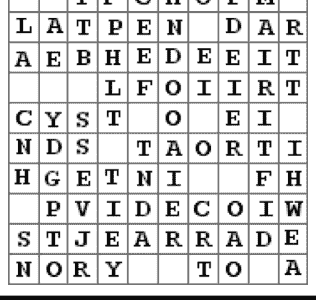

图 3.5 原始密文。

单独来看，上面的内容看起来像一个出了问题的填字游戏，或者一个单词搜索谜题。但当我们把图 3.6 中的格栅覆盖上去时，看看会发生什么。

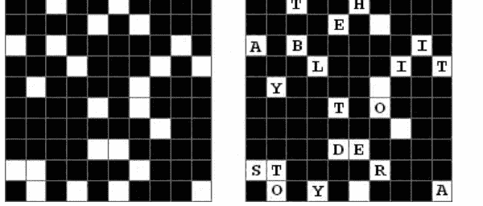

图 3.6 摧毁一颗行星的能力

消息开始成形，单词间距得以保留（“摧毁一颗行星的能力”），但似乎还不完整。我们将格栅顺时针旋转 90°（从你的视角，而不是时钟的视角！），再次放下，以观察更多消息（图 3.7）。

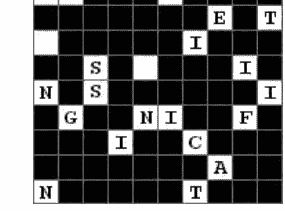

图 3.7 行星微不足道

消息继续呈现（“行星微不足道”），虽然已有意义，但仍不太说得通。我们将格栅再顺时针旋转 90°（图 3.8），以获取更多消息（“与原力的力量相”）。

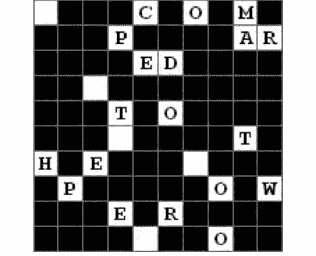

图 3.8 与原力的力量相

我们再将格栅顺时针旋转 90°（最后一次——图 3.9），得到消息的最后部分（“比，达斯·维德”）。

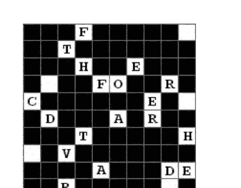

图 3.9 比，达斯·维德

现在，完整消息被揭示为来自西斯黑暗尊主的一句名言：

> 能摧毁一颗行星的能力微不足道  
> 与原力的力量相比——达斯·维德

仔细查看原始密文会发现有四个字母未被使用。如果我们需要，在格栅上再打一个孔就可以利用这四个多余的位置。但实际上，这些位置被填入了空字符（null）。实际上，所用的四个字母可以重新排列，以延续消息的主题。

旋转格栅直到第一次世界大战时仍被德国人使用，尽管只用了四个月。法国密码分析员学会了破解这些格栅，于是德国人转向了一种更好的系统，这将在[第 5.2 节](#)中讨论。

大多数现代密码同时使用替换和换位。其中一些将在本书后半部分详述。

## 参考文献与延伸阅读

-   安德森，珍妮，“卡钦斯基的密码”，*密码学*，第 39 卷，第 3 期，2015 年 7 月，第 203–209 页。
-   巴克，韦恩，*双重换位密码的密码分析*，Aegean Park Press，加利福尼亚州拉古纳希尔斯，1996 年。
-   比恩，理查德·W.，乔治·拉斯里和弗罗德·韦鲁德，“窃听比夫拉-里斯本链路——破解比夫拉战争中的历史密码”，*密码学*，即将出版。该论文展示了对一种实际使用的列换位变体的成功攻击。
-   布拉策尔，约翰·F.，和小莱斯利·B.·鲁特，“德国军事情报局在拉丁美洲的密码”，*密码学*，第 7 卷，第 2 期，1983 年 4 月，第 132–144 页。该论文详细叙述了二战期间德国特工在拉丁美洲使用的密码。
-   卡罗尔，约翰·M.，和林达·E.·罗宾斯，“乘积密码的计算机密码分析”，*密码学*，第 13 卷，第 4 期，1989 年 10 月，第 303–326 页。这里的“乘积密码”是指将两种技术（如替换和换位）组合起来的密码。我们将在第 5.2 节中进一步了解这类系统。
-   迪莫夫斯基，亚历山大，和达尼洛·格利戈罗斯基，“使用优化启发式算法攻击换位密码”，载于*第 38 届信息、通信与能源系统和技术国际科学会议论文集（ICEST 2003）*，于保加利亚索非亚举行，Heron Press，英国伯明翰，2003 年，第 322–324 页，可在 http://www.icestconf.org/wp-content/uploads/2016/proceedings/icest_2003.pdf 在线获取。

摘要如下：

> 本文提出了三种可用于攻击换位密码的优化启发式算法：模拟退火、遗传算法和禁忌搜索。我们将证明，这些启发式算法中的每一种都为密文的密码分析提供了有效的自动化技术。使这种密码易受攻击的特性在于，它不够复杂，无法隐藏明文的固有属性或统计特征。

-   埃罗，夏尔，*现代密码学概要*，Editions Raoul Tari，巴黎，1953 年。此处介绍了一种对双重换位的攻击。
-   弗里德曼，威廉·F.，*几何换位密码求解公式*，Riverbank Laboratories 出版物第 19 号，伊利诺伊州日内瓦，1918 年。
-   弗里德曼，威廉·F.，和伊丽莎白·S.·弗里德曼，“离合诗、回文构词法与乔叟”，*语文学季刊*，第 38 卷，第 1 期，1959 年 1 月，第 1–20 页。

## 第 4 章

## 莎士比亚、杰斐逊与肯尼迪

在本章中，我们将探讨一桩涉及威廉·莎士比亚作品、托马斯·杰斐逊的贡献以及约翰·F.·肯尼迪生命中的一个关键时刻的争议。

### 4.1 莎士比亚与培根

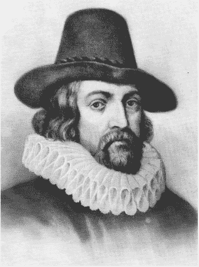

**图 4.1**  弗朗西斯·培根爵士（1561–1626）。（http://en.wikipedia.org/wiki/File:Francis_Bacon_2.jpg）

弗朗西斯·培根爵士（[图 4.1](#)）最广为人知的身份是哲学家，也是应用科学和科学方法的倡导者，他称之为*新工具*。他去世后，其观点变得更具影响力。特别是，他启发了皇家学会的创始成员。培根之所以在本书中占有一席之地，是因为他还发明了一种二进制密码——即只需两种不同的符号就能传递信息的密码。下面是他双字母密码的一个更新示例。

|  |  |  |  |
|---|---|---|---|
| A | = aaaaa | N | = abbab |
| B | = aaaab | O | = abbba |
| C | = aaaba | P | = abbbb |
| D | = aaabb | Q | = baaaa |
| E | = aabaa | R | = baaab |
| F | = aabab | S | = baaba |
| G | = aabba | T | = baabb |
| H | = aabbb | U | = babaa |
| I | = abaaa | V | = babab |
| J | = abaab | W | = babba |
| K | = ababa | X | = babbb |
| L | = ababb | Y | = bbaaa |
| M | = abbaa | Z | = bbaab |

人们可以用它来加密一条消息，发送 25 个字符的字符串 **aabbb aabaa ababb ababb abbba** 来表示 “hello”，但这是执行单表替换的一种特别低效的方式！这种密码的优势在于其隐蔽性。让 a 代表普通文本字符，b 代表粗体字符。现在观察隐藏在下面文本背后的消息。

```
Joe **will help** in the heist. He’s **a good** man
and he knows a lot about **bank** security.

Joewi llhel pintch eheis t. He’sa goodm anand hekno wsalo
aaabb abbba abbab baabb b baa bb baaab babaa baaba baabb
D     O     N     T     T     R     U     S     T

tabou tbank secur ity.
abaab abbba aabaa
J     O     E
```

还可以采用不那么明显的区分 a 和 b 的方法。例如，可以使用两种差别极小的字体。只要能够通过某种方式区分它们，就能恢复隐藏的消息。这个简单的系统后来被用来支持一种说法，即莎士比亚的戏剧其实是由培根所写，但这种说法早在所谓的密码学证据出现之前就已存在。

据弗莱彻·普拉特所说，培根才是莎士比亚戏剧真正作者这一观点，最初由霍勒斯·沃波尔在*《历史疑团》*中提出。普拉特还称，沃波尔曾宣称尤利乌斯·凯撒从未存在过。那些去查阅*《历史疑团》*的持不同意见者将会失望，因为这两种说法实际上都不存在于书中。我们很想知道普拉特是如何犯下这个错误的。

伊格内修斯·唐纳利（*图 4.2*），一位来自明尼苏达州的政客，在他的著作*《大密码：弗朗西斯·培根在所谓莎士比亚戏剧中的密码》*（1888 年出版）中，用了 998 页来探讨这一作者身份争议。他还写过一本关于亚特兰蒂斯的书。他对培根的证据

¹ 普拉特，弗莱彻，*《秘密与紧急》*，Bobbs Merrill 出版社，纽约，1939 年，第 85 页。


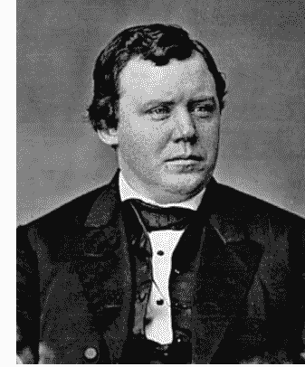

**图 4.2** Ignatius Donnelly (1831–1901) (http://nla.gov.au/pub/nlanews/apr01/donelly.html).

作者身份涉及一种复杂的数值方案，具有很大的灵活性。 这种灵活性在确定明文时导致大多数人持极大怀疑态度。 事实上，在唐纳利的书出版的同一年，约瑟夫·吉尔平·派尔撰写了一篇讽刺作品 *The Little Cryptogram*，仅用29页就运用了唐纳利的技术生成了他自己的信息，这些信息不可能由培根所意图。 尽管派尔的方法并不能提供唐纳利错误的严格证明，但它非常令人满意。

总的来说，我们可以根据我们愿意接受的证据类型得出各种各样的结论。 例如，让我们来看一下诗篇46篇。 诗篇中的词语已从开头和结尾编号到第46个位置。

> 1 2 3 4 5 6
> 上帝是我们的避难所和力量，
>
> 7 8 9 10 11 12
> 在患难中非常实际的帮助。
>
> 13 14 15 16 17
> 因此我们不惧怕，
>
> 18 19 20 21 22 23
> 虽然大地被挪移，
>
> 24 25 26 27 28
> 虽然群山被搬移
>
> 29 30 31 32 33 34
> 到海中；
>
> 35 36 37 38 39
> 虽然其水澎湃
> 40 41 42 43 44
> 汹涌，虽然
> 45 46
> 群山**震动**随着
> 翻腾。细拉。
>
> 有一条河，其支流使神的城欢喜，就是至高者帐幕的圣所。
> 神在她中间，她必不动摇；神必帮助她，清晨就帮助她。
> 外邦人发怒，列国动摇；他发声，大地便消化。
> 万军之耶和华与我们同在；雅各的神是我们的避难所。细拉。
> 来啊，你们要观看耶和华的作为，看他怎样在地上施行破坏。
> 他使争战止息，直到地极；他折断弓，砍断枪，把战车焚烧在火中。
> 46 45 44
> 并砍断**矛**；
> 43 42 41 40 39 38 37
> 他使战车焚烧在火中。
> 36 35 34 33 32 31 30 29
> 你们要休息，要知道我是神：
> 28 27 26 25 24 23 22
> 我必在列国中被尊崇，在全地上被尊崇。
> 21 20 19 18 17 16 15
> 我必在全地上被尊崇。
> 14 13 12 11 10 9 8
> 万军之耶和华与我们同在；
> 7 6 5 4 3 2 1
> 雅各的神是我们的避难所。细拉。

我们最后得到的词是 **震动** 和 **矛**！ 由此，我们可以得出莎士比亚是作者的结论！ 或者，更不夸张地说，我们可以得出结论说，在

戏剧实际上是由爱德华·德·维尔写的，虽然还有其他几个名字被提及。 今天为德·维尔所做的论证与前辈们的论证大同小异，并未被专业密码学家所认真对待。

好的一面是，对莎士比亚本人的研究仍在取得进展。 2009年，首次公开了一幅莎士比亚的当代肖像。 它创作于1610年，并在图4.3中再现。 世世代代，它通过科贝家族在都柏林郊外的一所房子中流传下来，没有人意识到这幅画描绘的是谁。 最后，有人注意到了相似之处，一些顶尖专家一致认为它实际上是威廉·莎士比亚。

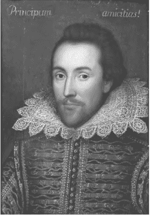

**图 4.3** 莎士比亚的一幅当代肖像。 (http://en.wikipedia.org/wiki/File:Cobbe_portrait_of_Shakespeare.jpg).

### 4.2 托马斯·杰斐逊：总统，密码学家

托马斯·杰斐逊（图4.4）的密码学工作包括一种他（重新）创建的密码，该密码此前由弗朗西斯·培根爵士描述过。 该系统被反复重新发明，并在第二次世界大战中期之前仍在使用。 但是，在研究它之前，先详细介绍了杰斐逊的其他一些密码学工作。


**图 4.4** Thomas Jefferson.

在刘易斯和克拉克探险队期间，杰斐逊指示刘易斯“不时地向我们传达你日志、笔记和观察的副本，各种各样的，都要加密，以免泄露后造成伤害。” 杰斐逊想的是维热纳密码，但它从未被使用。⁷ 似乎可以合理地假设杰斐逊选择该系统是因为他意识到了更简单系统的弱点。

杰斐逊于1785年创建的一个命名法也展示了一些密码分析知识。 该命名法代码部分的一部分在图4.5中再现。


**图 4.5** 托马斯·杰斐逊的双部分密码。 (Courtesy of the David Kahn Collection, National Cryptologic Museum, Fort Meade, Maryland.)

请注意，杰斐逊没有连续编号单词。 他意识到以这种方式构建的代码会受到攻击（参见第1.16节），并确保自己的代码不会被它们攻破。 我们现在来到了他最著名的发现（图4.6）。 右图所示的较旧的轮密码将在下面描述。⁸

这种加密和解密设备在20世纪80年代初由美国国家安全局从西弗吉尼亚州获得。 最初人们认为它可能是“杰斐逊密码轮”的模型，因为托马斯·杰斐逊在他的著作中描述了类似的设备。 我们相信它是世界上现存最古老的设备，但与杰斐逊的联系尚未得到证实。 已知此类设备曾被作家描述为美国陆军1922年的野战密码。 以这种形式，它被称为M-94，并一直使用到第二次世界大战中期。¹² 海军于1928年采用了该设备，命名为CSP 488，而海岸警卫队到1939年已在CSP 493名称下使用它。¹³ 美国海军仍有一个版本


**图 4.7** 一种等同于轮密码的设备。 (Courtesy of the National Cryptologic Museum, Fort Meade, Maryland.)

确定新密钥。 可能的排列有25！种，因此我们需要比暴力破解更复杂的方法。 美国海军轮密码的字母表如下。¹⁵

| 轮 | 字母表 |
|---|---|
| 1 | BCEJIVDTGFZRHALWKXPQYUNSMO |
| 2 | CADEHIZFJKTMOPUQXWBLVYSRGN |
| 3 | DGZKPYESNUOAJXMHRTCVBWLPQI |
| 4 | EIBCDGJLFHMKRWQTVUANOPYZXS |
| 5 | FRYOMNACTBDWZPQIUHLJKXEGSV |
| 6 | GJIYTKPWXSVUEDCOFNQARMBLZH |
| 7 | HNFUZMSXKEPCQIGVTOYWLRAJDB |
| 8 | IWVXRZTPHOCQGSBJEYUDMFKANL |
| 9 | JXRSFHYGVDQPBLIMOAKZNTCWUE |
| 10 | KDAFLJHCOGEBTMNRSQVPZYIWU |
| 11 | LEGIJBKUZARTSOHNPFXMQDVCY |
| 12 | MYUVWLCQSTXHNFAZGDRBJEOIPK |
| 13 | NMJHAEXBLIGDKCRFYPWSZQUVT |
| 14 | OLTWGANZUVJEFYDKHSMXQIPBRC |
| 15 | PVXRNQUIYZSJATWBDLGCEHFOKM |
| 16 | QTSEOPIDMNFXWUKYJVHGBLZCAR |
| 17 | RKWPUTQEBXLNYVFCIMZHSAGDOJ |
| 18 | SONMQUVAWRYGCEZLBKDFIJXHTP |
| 19 | TSMZKXWVRYUFIJDABEOPCHNLQ |
| 20 | UPKGSCFJOWAYDHVELZNRTBMQIX |
| 21 | VFLQYSORPMHZUKXACGJIDNTEBW |
| 22 | WHOLBDMKEQNIXRTUZJFYCSVPAG |
| 23 | XZPTVOBMQCSLJYGNEIUFDRKHA |
| 24 | YQHACRLNDPBOVZSXWITEGKUMJF |
| 25 | ZUQNXWRYALIVPBESMCOKHGJTFD |

如果允许使用现代技术，打破它的一种可能方法是使用可能的单词搜索。 假设我们认为单词MONEY出现在消息中。 有25P5 = (25)(24)(23)(22)(21) = 6,375,600种可能性，关于哪五个轮子用于加密这个词。 计算机可以对每种可能性检查可能产生的各种密文。 如果其中之一与已截获的密文的一部分匹配，我们可能就知道五个轮子的顺序（也可能巧合，因为单词MONEY可能不在消息中）。 这种攻击假设我们知道每个轮子上字母的顺序，而只有轮子在轴上的顺序未知。 一旦我们知道其中几个轮子的顺序，确定其余轮子的计算就会变得不那么耗时。 各种轮子可以在包含密码本的轮子末端尝试，使密文在适当的行上继续，同时查看明文行是否继续有意义。 如果有一个长度为25或更大的给定密文，我们知道或可以猜测其明文，我们就可以仅用铅笔和纸恢复轮子的顺序。

### 示例 1

也许一个常见的发送消息是NOTHING TO REPORT AT THIS TIME。 如果我们怀疑密文YTWML GHWGO PVRPE SDKTA QDVJO代表此消息，我们将两者配对并检查每个明文/密文字母对之间的距离，针对25个磁盘中的每一个。 表4.1显示了结果。

⁸ http://www.nsa.gov/museum/wheel.html

¹² Mellen, Greg 和 Lloyd Greenwood, “多路复用系统的密码学”，《Cryptologia》，第1卷第1期，1977年1月，第4-16页，第13页在此引用。

¹³ Gaddy, David W., “圆柱密码”，《Cryptologia》，第19卷第4期，1995年10月，第385-391页，第386页在此引用。请注意，不同作者给出的各军种采用日期各不相同！例如，在 Weller, Robert, “Rear Admiral Joseph N. Wenger USN (Ret) and the Naval Cryptologic Museum”，《Cryptologia》，第8卷第3期，1984年7月，第208-234页，这些轮密码于1926年12月交付海军，海岸警卫队的使用始于“约1935年”。第214页在此引用。


## 表 4.2 在表格中定位所有的 12

表 4.2 在表格中定位所有的 12

N O T H I N G T O R E P O R T A T T H I S T I M E
Y T W M L G H W G O P V R P E S D K T A Q D V J O
1 24 08 08 12 10 12 04 08 09 14 16 13 12 07 21 10 25 09 21 09 22 25 01 05 23
2 22 24 07 07 14 25 06 07 12 15 10 07 11 16 19 21 18 25 06 22 19 18 15 23 09
3 23 07 04 25 23 19 14 04 17 20 24 15 06 14 15 22 09 12 02 12 17 08 20 24 04
4 03 21 24 01 06 12 04 24 11 08 21 21 18 09 11 07 15 22 06 17 15 15 20 22 20
5 23 05 03 13 03 18 20 03 20 02 17 12 24 12 14 18 02 12 17 17 16 02 10 15 07
6 12 15 03 22 21 09 25 03 11 21 20 04 05 12 08 16 09 01 05 17 09 09 08 06 03
7 17 25 03 05 07 13 12 03 23 22 01 05 04 15 19 10 08 18 16 09 06 08 02 18 08
8 19 23 21 12 25 14 22 21 03 05 17 21 21 03 10 10 16 13 16 24 23 24 13 02 21 19
9 12 05 02 10 25 13 24 02 09 14 12 23 12 09 04 12 14 23 16 03 07 14 20 11 17
10 09 05 12 07 08 21 23 12 02 18 09 25 08 04 24 14 15 14 06 06 01 15 22 18 23
11 10 24 09 05 23 13 12 09 15 03 15 07 23 06 16 03 11 21 23 06 09 11 20 11 12
12 15 13 21 15 08 04 21 21 20 04 03 05 22 06 12 20 08 16 24 17 25 08 06 20 01
13 16 04 19 24 25 10 19 19 15 07 12 07 19 03 06 15 12 13 22 21 03 12 15 01 16
14 07 02 08 02 06 24 12 08 04 02 11 13 24 24 09 12 12 13 22 21 03 12 14 18 15
15 04 16 01 04 10 14 03 01 21 20 06 01 06 23 07 24 03 11 18 05 21 03 20 12 03
16 06 23 11 16 15 10 25 11 15 05 02 12 21 06 02 04 06 13 09 18 24 06 11 08 01
17 01 07 23 24 20 11 23 23 24 22 10 02 03 02 25 18 22 12 05 12 18 23 08 17
18 08 23 10 06 21 09 12 10 10 18 12 07 08 16 15 19 20 19 01 13 04 20 12 18 14
19 12 07 06 06 12 16 09 06 20 11 02 13 15 12 18 11 15 04 04 04 02 15 21 12 01
20 19 12 15 09 18 11 10 15 21 15 12 13 11 08 21 20 18 08 07 12 19 18 16 11 19
21 09 16 03 25 09 22 19 03 11 25 11 18 01 01 16 16 24 17 12 22 24 24 07 09 09
22 09 12 12 05 18 15 02 12 23 15 15 25 11 10 20 24 17 19 13 13 14 17 11 11 01
23 24 24 07 09 20 25 09 07 10 09 11 02 17 06 14 12 18 20 05 07 23 18 12 06 14
24 19 07 24 21 15 13 08 24 09 06 16 03 20 04 01 11 16 03 16 12 13 16 21 01 18
25 04 05 08 22 25 18 25 08 03 12 24 25 14 06 17 07 02 22 03 24 13 02 01 06 04

## 表 4.3 从表格中取下轮子

表 4.3 从表格中取下轮子

N O T H I N G T O R E P O R T A T T H I S T I M E
Y T W M L G H W G O P V R P E S D K T A Q D V J O
1 24 08 08 12 10 12 04 08 09 14 16 13 12 07 21 10 25 09 21 09 22 25 01 05 23
[第 2 行已屏蔽]
3 23 07 04 25 23 19 14 04 17 20 24 15 06 14 15 22 09 12 02 12 17 08 20 24 04
4 03 21 24 01 06 12 04 24 11 08 21 21 18 09 11 07 15 22 06 17 15 15 15 22 20
5 23 05 03 13 03 18 20 03 20 02 17 12 24 12 14 18 02 12 17 17 16 02 10 15 07
6 12 15 03 22 21 09 25 03 11 21 20 04 05 12 08 16 09 01 05 17 09 09 08 06 03
7 17 25 03 05 07 13 12 03 23 22 01 05 04 15 19 10 08 18 16 09 06 08 02 18 08
8 19 23 21 12 25 14 22 21 03 05 17 21 21 03 10 10 16 13 16 24 23 24 13 02 21 19
9 12 05 02 10 25 13 24 02 09 14 12 23 12 09 04 12 14 23 16 03 07 14 20 11 17
10 09 05 12 07 08 21 23 12 02 18 09 25 08 04 24 14 15 14 06 06 01 15 22 18 23
[第 11-12 行已屏蔽]
13 16 04 19 24 25 10 19 19 15 07 12 07 19 03 06 15 12 13 22 21 03 12 15 01 16
14 07 02 08 02 06 24 12 08 04 02 11 13 24 24 09 12 12 13 12 10 03 12 14 18 15
15 04 16 01 04 10 14 03 01 21 20 06 01 06 23 07 24 03 11 18 05 21 03 20 12 03
16 06 23 11 16 15 10 25 11 15 05 02 12 21 06 02 04 06 13 09 18 24 06 11 08 01
[第 17 行已屏蔽]
18 08 23 10 06 21 09 12 10 10 18 12 07 08 16 15 19 20 19 01 13 04 20 12 18 14
[第 19 行已屏蔽]
20 19 12 15 09 18 11 10 15 21 15 12 13 11 08 21 20 18 08 07 12 19 18 16 11 19
21 09 16 03 25 09 22 19 03 11 25 11 18 01 01 16 24 17 12 22 24 24 07 09 09
22 09 12 12 05 18 15 02 12 23 15 15 25 11 10 20 24 17 19 13 13 14 17 11 11 01
23 24 24 07 09 20 25 09 07 10 09 11 02 17 06 14 12 18 20 05 07 23 18 12 06 14
24 19 07 24 21 15 13 08 24 09 06 16 03 20 04 01 11 16 03 16 12 13 16 21 01 18
[底部行已屏蔽]

请注意，轮子 4 仅将消息的一个字符移动到相应的密文字符——即第 6 个位置的字母。虽然有其他轮子可以将第 6 个位置的字母移动到所需位置，但实际执行这一操作的必须是轮子 4。这是因为轮子 4 必须在某处使用，而它在其他地方不起作用。因此我们可以将轮子 4 从表格中取下，并去掉指示第 6 个位置其他可能轮子的下划线和粗体。我们对轮子 7、8、15、16、21 和 24 也做同样的处理（遵循相同的推理）。这反映在下面的更新密钥中以及表 4.4 中。

8  19  4  7      2  25      16          12              21  24  17          15  11  
N  O  T  H  I  N  G  T  O  R  E  P  O  R  T  A  T  T  H  I  S  T  I  M  E  
Y  T  W  M  L  G  H  W  G  O  P  V  R  P  E  S  D  K  T  A  Q  D  V  J  O  

| 位置 | 值 |
|---|---|
| 1 | 24 08 08 12 10 12 04 08 09 14 16 13 12 07 21 10 25 09 21 09 22 25 01 05 23 |
| 3 | 23 07 04 25 23 19 14 04 17 20 24 15 06 14 15 22 09 12 02 12 17 08 20 24 04 |
| 5 | 23 05 03 13 03 18 20 03 20 02 17 12 24 12 14 18 02 12 17 17 16 02 10 15 07 |
| 6 | 12 15 03 22 21 09 25 03 11 21 20 04 05 12 08 16 09 01 05 17 09 09 08 06 03 |
| 9 | 12 05 02 10 25 13 24 02 09 14 12 23 12 09 04 12 14 23 16 03 07 14 20 11 01 |
| 10 | 09 05 12 07 08 21 23 12 02 18 09 25 08 04 24 14 15 14 06 06 01 15 22 18 23 |
| 13 | 16 04 19 24 25 10 19 19 15 07 12 07 19 03 06 15 12 13 22 21 03 12 15 01 16 |
| 14 | 07 02 08 02 06 24 12 08 04 02 11 13 24 24 09 12 12 13 12 10 03 12 14 18 15 |
| 18 | 08 23 10 06 21 09 12 10 10 18 12 07 08 16 15 19 20 19 01 13 04 20 12 18 14 |
| 20 | 19 12 15 09 18 11 10 15 21 15 12 13 11 08 21 20 18 08 07 12 19 18 16 11 19 |
| 22 | 09 12 12 15 18 12 02 12 23 15 25 11 20 11 02 24 17 19 13 13 14 17 11 01 |
| 23 | 24 07 09 20 25 09 07 10 09 11 02 17 06 14 12 18 20 05 07 23 18 12 06 14 |

在上一步中去掉了一些下划线和粗体后，我们可以看到可以再次应用同样的论证。轮子 1 和 3 必须分别位于位置 13 和 18。我们现在更新我们的密钥和表格（表 4.5）。

8  19  4  7      2  25      16  1      12              3  21  24  17          15  11  
N  O  T  H  I  N  G  T  O  R  E  P  O  R  T  A  T  T  H  I  S  T  I  M  E  
Y  T  W  M  L  G  H  W  G  O  P  V  R  P  E  S  D  K  T  A  Q  D  V  J  O

由于上一步的结果，又去掉了部分下划线和粗体，显示轮子 5 必须位于位置 14。我们再次更新，得到以下密钥和表 4.6。

8  19  4  7      2  25      16  1  5  12              3  21  24  17          15  11  
N  O  T  H  I  N  G  T  O  R  E  P  O  R  T  A  T  T  H  I  S  T  I  M  E  
Y  T  W  M  L  G  H  W  G  O  P  V  R  P  E  S  D  K  T  A  Q  D  V  J  O

## 表 4.5 更新后的表格

N O T H I N G T O R E P O R T A T T H I S T I M E
Y T W M L G H W G O P V R P E S D K T A Q D V J O

5 23 05 03 13 03 18 20 03 20 02 17 12 24 12 14 18 02 12 17 17 16 02 10 15 07
6 12 15 03 22 21 09 25 03 11 21 20 04 05 12 08 16 09 01 05 17 09 09 08 06 03
9 12 05 02 10 25 13 24 02 09 14 12 23 12 09 04 12 14 23 16 03 07 14 20 11 17
10 09 05 12 07 08 21 23 12 02 18 09 25 08 04 24 14 15 14 06 06 01 15 22 18 23
13 16 04 19 24 25 10 19 19 15 07 12 07 19 03 06 15 12 13 22 21 03 12 15 01 16
14 07 02 08 02 06 24 12 08 04 02 11 13 24 24 09 12 12 13 12 10 03 12 14 18 15
18 08 23 10 06 21 09 12 10 10 18 12 07 08 16 15 19 20 19 01 13 04 20 12 18 14
20 19 12 15 09 18 11 10 15 21 15 12 13 11 08 21 20 18 08 07 12 19 18 16 11 19
22 09 12 12 05 18 15 02 12 23 15 15 25 11 10 20 24 17 19 13 13 14 17 11 11 01
23 24 24 07 09 20 25 09 07 10 09 11 02 17 06 14 12 18 20 05 07 23 18 12 06 14

## 表 4.6 更新后的表格

N O T H I N G T O R E P O R T A T T H I S T I M E
Y T W M L G H W G O P V R P E S D K T A Q D V J O

6 12 15 03 22 21 09 25 03 11 21 20 04 05 12 08 16 09 01 05 17 09 09 08 06 03
9 12 05 02 10 25 13 24 02 09 14 12 23 12 09 04 12 14 23 16 03 07 14 20 11 17
10 09 05 12 07 08 21 23 12 02 18 09 25 08 04 24 14 15 14 06 06 01 15 22 18 23
13 16 04 19 24 25 10 19 19 15 07 12 07 19 03 06 15 12 13 22 21 03 12 15 01 16
14 07 02 08 02 06 24 12 08 04 02 11 13 24 24 09 12 12 13 12 10 03 12 14 18 15
18 08 23 10 06 21 09 12 10 10 18 12 07 08 16 15 19 20 19 01 13 04 20 12 18 14
20 19 12 15 09 18 11 10 15 21 15 12 13 11 08 21 20 18 08 07 12 19 18 16 11 19
22 09 12 12 05 18 15 02 12 23 15 15 25 11 10 20 24 17 19 13 13 14 17 11 11 01
23 24 24 07 09 20 25 09 07 10 09 11 02 17 06 14 12 18 20 05 07 23 18 12 06 14

这表明转轮 6 必须位于位置 1。我们再次更新，得到如下密钥和表 4.7。

```text
6       8  19  4  7       2  25      16  1  5  12             3  21  24  17          15  11
N  O  T  H  I  N  G  T  O  R  E  P  O  R  T  A  T  T  H  I  S  T  I  M  E
Y  T  W  M  L  G  H  W  G  O  P  V  R  P  E  S  D  K  T  A  Q  D  V  J  O
```

**表 4.7 更新后的表**

| 内容 |
|---|
| N O T H I N G T O R E P O R T A T T H I S T I M E<br>Y T W M L G H W G O P V R P E S D K T A Q D V J O |
| 9 12 05 02 10 25 13 24 02 09 14 **12** 23 12 09 04 **12** 14 23 16 03 07 14 20 11 17<br>10 09 05 **12** 07 08 21 23 **12** 02 18 09 25 08 04 24 **14** 15 14 06 06 01 15 22 18 23 |
| 13 16 04 19 24 25 10 19 19 15 07 **12** 07 19 03 06 15 **12** 13 22 21 03 **12** 15 01 16<br>14 07 02 08 02 06 24 12 08 04 02 11 13 24 24 09 **12** **12** 13 12 10 03 **12** 14 18 15 |
| 18 08 23 10 06 21 09 12 10 10 18 **12** 07 08 16 15 19 20 19 01 13 04 20 **12** 18 14 |
| 20 19 **12** 15 09 18 11 10 15 21 15 **12** 13 11 08 21 20 18 08 07 12 19 18 16 11 19 |
| 22 09 **12** **12** 05 18 15 02 **12** 23 15 15 25 11 10 20 24 17 19 13 13 14 17 11 11 01<br>23 24 24 07 09 20 25 09 07 10 09 11 02 17 06 14 **12** 18 20 05 07 23 18 **12** 06 14 |

位置 17 和 22 一定是转轮 13 和 14（两者顺序不定），因此这些转轮的其他带下划线和加粗的选项不再需要考虑（表 4.8）。

**表 4.8 更新后的表**

| 内容 |
|---|
| N O T H I N G T O R E P O R T A T T H I S T I M E<br>Y T W M L G H W G O P V R P E S D K T A Q D V J O |
| 9 12 05 02 10 25 13 24 02 09 14 12 23 12 09 04 12 14 23 16 03 07 14 20 11 17<br>10 09 05 12 07 08 21 23 12 02 18 09 25 08 04 24 14 15 14 06 06 01 15 22 18 23 |
| 13 16 04 19 24 25 10 19 19 15 07 12 07 19 03 06 15 12 13 22 21 03 12 15 01 16<br>14 07 02 08 02 06 24 12 08 04 02 11 13 24 24 09 12 12 13 12 10 03 12 14 18 15 |
| 18 08 23 10 06 21 09 12 10 10 18 12 07 08 16 15 19 20 19 01 13 04 20 12 18 14 |
| 20 19 12 15 09 18 11 10 15 21 15 12 13 11 08 21 20 18 08 07 12 19 18 16 11 19 |
| 22 09 12 12 05 18 15 02 12 23 15 15 25 11 10 20 24 17 19 13 13 14 17 11 11 01<br>23 24 24 07 09 20 25 09 07 10 09 11 02 17 06 14 12 18 20 05 07 23 18 12 06 14 |

同样地，位置 3 和 8 一定是转轮 10 和 22（两者顺序不定），因此转轮 22 的另一个带下划线和加粗的选项不再需要考虑（表 4.9）。

**表 4.9 更新后的表**

| 内容 |
|---|
| N O T H I N G T O R E P O R T A T T H I S T I M E<br>Y T W M L G H W G O P V R P E S D K T A Q D V J O |
| 9 12 05 02 10 25 13 24 02 09 14 12 23 12 09 04 12 14 23 16 03 07 14 20 11 17<br>10 09 05 12 07 08 21 23 12 02 18 09 25 08 04 24 14 15 14 06 06 01 15 22 18 23 |
| 13 16 04 19 24 25 10 19 19 15 07 12 07 19 03 06 15 12 13 22 21 03 12 15 01 16<br>14 07 02 08 02 06 24 12 08 04 02 11 13 24 24 09 12 12 13 12 10 03 12 14 18 15 |
| 18 08 23 10 06 21 09 12 10 10 18 12 07 08 16 15 19 20 19 01 13 04 20 12 18 14 |
| 20 19 12 15 09 18 11 10 15 21 15 12 13 11 08 21 20 18 08 07 12 19 18 16 11 19 |
| 22 09 12 12 05 18 15 02 12 23 15 15 25 11 10 20 24 17 19 13 13 14 17 11 11 01<br>23 24 24 07 09 20 25 09 07 10 09 11 02 17 06 14 12 18 20 05 07 23 18 12 06 14 |

更新后的表现在显示位置 2 一定是转轮 20。我们再次更新密钥（见下文）和表（第 146 页的表 4.10）。

```text
6  20       8  19  4  7       2  25      16  1  5  12             3  21  24  17          15  11
N  O  T  H  I  N  G  T  O  R  E  P  O  R  T  A  T  T  H  I  S  T  I  M  E
Y  T  W  M  L  G  H  W  G  O  P  V  R  P  E  S  D  K  T  A  Q  D  V  J  O
```

**表 4.10 更新后的表**

| 内容 |
|---|
| N O T H I N G T O R E P O R T A T T H I S T I M E<br>Y T W M L G H W G O P V R P E S D K T A Q D V J O |
| 9 12 05 02 10 25 13 24 02 09 14 12 23 12 09 04 12 14 23 16 03 07 14 20 11 17<br>10 09 05 12 07 08 21 23 12 02 18 09 25 08 04 24 14 15 14 06 06 01 15 22 18 23 |
| 13 16 04 19 24 25 10 19 19 15 07 12 07 19 03 06 15 12 13 22 21 03 12 15 01 16<br>14 07 02 08 02 06 24 12 08 04 02 11 13 24 24 09 12 12 13 12 10 03 12 14 18 15 |
| 18 08 23 10 06 21 09 12 10 10 18 12 07 08 16 15 19 20 19 01 13 04 20 12 18 14 |
| 22 09 12 12 05 18 15 02 12 23 15 15 25 11 10 20 24 17 19 13 13 14 17 11 11 01<br>23 24 24 07 09 20 25 09 07 10 09 11 02 17 06 14 12 18 20 05 07 23 18 12 06 14 |

请注意，表 4.10 对尚未确定的剩余可能性使用了三种深浅不同的高亮以及下划线/方框标记。这是因为我们无法再像之前那样继续下去了。在现阶段，要暴力破解一个解，似乎需要尝试转轮密码的 128 种配置（七个未知数各有两种可能性）。稍加推理可以减少这一数量，但我们无法根据现有信息将范围缩小到唯一的可能性。如果我们有更多的明文和密文配对，或许就能做到，但我们并没有。

考虑四个浅色阴影的值。位置 3 和 8 由转轮 10 和 22 占据，顺序不定。这代表两种可能性，而不是乍一看可能以为的四种，因为一个特定的转轮不可能同时出现在两个位置。类似地，四个带下划线/方框的值总共给出两种可能性。对于六个深色阴影的值，将转轮 9 分配到任一位置都会迫使转轮 18 和 23 处于特定位置。因此，这三个转轮只有两种分配方式。各种阴影值以及下划线/方框值的分配都是相互独立的。

因此，剩下需要检查的可能性总数为 (2)(2)(2) = 8（而且必须手工检查）。这些可能性都能将给定消息转换为给定密文，但其中只有一种可能正确解密接下来收到的消息。

这里给出的攻击依赖于知道一些明文和对应的密文，以及每个转轮上字母表的顺序。只有密钥未知。还有更复杂的攻击不需要如此多的前提信息。如果你想了解更多这类攻击，请参阅“参考文献与延伸阅读”部分中 Greg Mellen 和 Lloyd Greenwood 合著的论文《The Cryptology of Multiplex Systems, Part 2: Simulation and Cryptanalysis》。

这种密码的另一个弱点是：一个字母永远不可能被加密成它自身。如果我们相信某个短语出现在消息中，这个弱点有时可以帮助我们判断其位置。

尽管托马斯·杰斐逊（1743–1826）主要以“发明”转轮密码而闻名，但有趣的是，他还起草了《独立宣言》，担任过美国第三任总统，并创办了弗吉尼亚大学。人们可能会认为，像杰斐逊这样重要的人物已经被研究得如此透彻，以至于没有留下任何原创研究的空间；但事实并非如此。2007 年冬天，数学家劳伦·史密斯莱恩从一位邻居那里得知，这位邻居当时正在做一个收集和出版杰斐逊全部书信和文件的项目，其中有几封是用代码或密码写成的。6 月，这位邻居提到，其中一封由罗伯特·帕特森写给杰斐逊的信包含一段无法阅读的密码或代码部分。这封信讨论了密码学，而那段无法阅读的内容正是帕特森认为无法破译的示例密文。劳伦拿到这封信的副本，信上的日期是 1801 年 12 月 19 日，然后开始工作。这是一个带空值的列转置密码，劳伦成功解出了它。结果表明，明文是《独立宣言》的序言。¹⁶ 我们可以从中得到两点启示。第一，不要仅仅因为某个主题古老或已被大量研究，就认为没有新东西可以发现。第二，要善于社交。因为劳伦与邻居交谈，双方都受益。你可能会惊讶地发现，让别人知道你的兴趣所在，会带来多少好处。

在数学中，我们从一些无法证明的少量假设出发，然后尝试用这些假设来证明其他一切。我们称这些假设为公理或公设，理想情况下它们看起来“显然为真”，尽管无法给出证明。杰斐逊在开始写下他最伟大的作品时，一定处于数学思维模式，开头是“我们认为这些真理是不言而喻的……”

### 4.4 普莱费尔密码

在 19 世纪的伦敦，情人或准情人们将自己的私人通信加密，并付费刊登在《泰晤士报》上，并不罕见。这些便条统称为“痛苦专栏”，最常使用的密码是单表替换密码。如此简单的密码为莱昂·普莱费尔男爵和查尔斯·惠斯通提供了不少乐趣。¹⁷

> 每逢周日，我们通常一起散步，并以破译《泰晤士报》上的密码广告为乐。一位在珀斯参加读书会的牛津学生对自己的密码十分自信，一直与伦敦的一位年轻女子通信。我们能毫不费力地读懂这些通信。最后，他提议私奔。惠斯通在《泰晤士报》上刊登了一则广告，用同一种密码对那位年轻女子进行规劝，最后一句话是：“亲爱的查尔斯，别再给我写信了，我们的密码被发现了。”
>
> ——莱昂·普莱费尔

以普莱费尔命名的密码系统（尽管他并非其创造者）比通常出现在报纸上的密码系统更加复杂。它是双字母替换密码的一个例子，简而言之就是每次对两个字母进行替换。

在普莱费尔密码之前，双字母密码要求使用者保留写好的密钥副本，因为这些密码笨拙且不易记忆，波塔的例子（被认为是第一个）在图 4.9 中展示了这一点。

我们将使用此表来加密 REVOLT。首先，我们把消息分成两字母一组：RE VO LT。要加密第一组 RE，我们在表格顶部横排的字母表中找到 R，然后沿该列向下移动，直到到达右侧标有 E 的那一行。

¹⁶ 参见 Smithline, Lawren M., “A Cipher to Thomas Jefferson: A Collection of Decryption Techniques and the Analysis of Various Texts Combined in the Breaking of a 200-year-old Code,” *American Scientist*，第 97 卷，第 2 期，2009 年 3—4 月，第 142–149 页。

¹⁷ McCormick, Donald, *Love in Code*，英国伦敦：Eyre Methuen Ltd.，1980 年，第 84 页。


图 4.9 Porta 设计的双字母密码。（摘自 David Kahn 收藏，Fort Meade 马里兰州国家密码博物馆。）

侧面。该位置的符号 Ψ 取代 RE。同理，VO 变为 [symbol]，LT 变为 [symbol]。因此，我们的完整密文是 Ψ [symbol] [symbol]。

像上图所示的随机双字母替换密码，其唯一性点为 1,460.61。¹⁸ 也就是说，我们大约需要 1,461 个密文字段才能期望得到唯一解。

Playfair 密码由 Charles Wheatstone 发明（图 4.10），他在 1854 年描述了它。¹⁹ 由于 Wheatstone 和 Playfair 都是英国人（而且是朋友），这并没有像牛顿-莱布尼茨关于微积分发现的争吵那样引发巨大争议。Wheatstone 还在 Samuel Morse 之前发明了一种电报系统，因此他至少失去了两次命名机会！对 Wheatstone 来说有利的是，Wadsworth 发明了一种后来被称为 Wheatstone 密码的密码。²⁰ 我们现在来研究 Playfair 密码的工作原理。

18 Deavours, Cipher A., “Unicity Points in Cryptanalysis,” Cryptologia, Vol. 1, No. 1, January 1977, pp. 46–68. 19 Kahn, David, The Codebreakers, second edition, Scribner, New York, 1996, p. 198.


图 4.10 Charles Wheatstone（1802–1875）。（http://en.wikipedia.org/wiki/File:Wheatstone_Charles_drawing_1868.jpg）。

### 示例 2

开始时，我们用字母表填充一个矩形。I 和 J 再次（见 Polybius）等同：

A B C D E
F G H I&J K
L M N O P
Q R S T U
V W X Y Z

给定密文

```
LIFE IS SHORT AND HARD - LIKE A BODYBUILDING ELF.²¹
```

我们开始将其拆分为对：

```
LI FE IS SH OR TA ND HA RD LI KE AB OD YB UI LD IN GD WA RF
```

要加密第一对 LI，我们在上面的方格中找到这些字母。然后我们可以找到另外两个字母 F 和 O，以得到矩形的四个角。

A B C D E
F G H I&J K
L M N O P
Q R S T U
V W X Y Z

我们将这两个新角作为密文对。但应按 FO 还是 OF 的顺序取？任意决定密文对中先出现的字母应与明文字母的第一字母在同一行。记录这次首次加密并以同样方式继续，我们得到

```
LI → OF
FE → KA
IS → HT
SH → ??
```

这里出现了一个问题。S 和 H 出现在同一列，因此我们无法像之前对那样通过找到另外两个字母来“构成矩形”。我们需要为这种特殊情况制定新规则：如果两个字母都出现在同一列，则用正下方出现的字母对其加密。然后我们得到

```
SH → XN
```

如果其中一个字母在最后一行，我们将回到该列顶部以找到其加密。现在我们继续处理其他对。

```
OR → MT
TA → QD
ND → OC
HA → FC
RD → TB
LI → OF
KE → PK
AB → ??
```

另一个问题！A 和 B 出现在同一行。同样，我们无法构成矩形。在这种情况下，我们只需取明文字母右侧的字母即可。我们得到

```
AB → BC
```

如果其中一个字母在最后一列，我们将回到该行开头以找到其加密。现在我们的规则允许我们完成加密：

```
OD → TI
YB → WD
UI → TK
LD → OA
IN → HO
GD → IB
WA → VB
RF → QG
```

因此，我们的密文是

```
OFKAH TXNMT QDOCF CTBOF PKBCT IWDTK OAHOI BVBQG.
```

尽管在此消息中并未出现，但存在一种模糊情况。当明文对由两个相同字母组成时怎么办？是向下移动（因为它们在同一列）还是向右移动（因为它们在同一行）？解决方法是避免这种情况！在加密前要在重复字母之间插入一个 X 以将其拆开。由于 X 是一个罕见字母，不会引起混淆。解密后如果收件人看到两个 L 或两个 O 之间有一个 X，例如，只需删除该 X 即可。上面的示例仅用于教学目的。

网格中的字母表通常会被打乱（也许使用一个易于记忆的关键词）。

²⁰ Clark, Ronald, The Man Who Broke Purple, Little, Brown and Company, Boston, Massachusetts, 1977, pp. 57–58.

²¹ From “Lift Your Head Up High (And Blow Your Brains Out),” by Bloodhound Gang.

Playfair 密码的首次记录解法由 Joseph O. Mauborgne 于 1914 年完成。此时，Playfair 是英国的野战密码。有报道称该密码在布尔战争（1899–1902）²² 中使用，但下面的示例更近。想象一下，作为一名澳大利亚海岸观察员，你是以下 Playfair 密码的预期收件人，该密码于 1943 年 8 月 2 日在太平洋战争期间发送（图 4.11）。


图 4.11 太平洋战区第二次世界大战期间发送的 Playfair 消息。（摘自 David Kahn 收藏，Fort Meade 马里兰州国家密码博物馆。）

密文通常以五字母一组发送，已经被拆分为大小为二的组。在第二行的中间左右你注意到一个重复字母 TT。你担心消息已损坏，或者也许根本不是 Playfair 密码。

无论如何，密钥是 ROYAL NEW ZEALAND NAVY，因此你形成以下方格：

R O Y A L
N E W Z D
V B C F G
H I K M P
Q S T U X

你开始解密。（注意此处 I 和 J 不区分）

KX → PT   JE → BO   YU → AT   RE → ON   BE → EO
ZW → WE   EH → NI   EW → NE   RY → LO   TU → ST
HE → IN   YF → AC   SK → TI   RE → ON   HE → IN
GO → BL   YF → AC   IW → KE   TT → ??   TU → ST
OL → RA   KS → IT   YC → TW   AJ → OM   PO → IL
BO → ES   TE → SW   IZ → ME   ON → RE   TX → SU
BY → CO   BW → CE   TG → XC   ON → RE   EY → WO
CU → FT   ZW → WE   RG → LV   DS → EX   ON → RE
SX → QU   BO → ES   UY → TA   WR → NY   HE → IN
BA → FO   AH → MR   YU → AT   SE → IO   DQ → NX

全部合起来，你得到

```
PTBOATONEOWENINELOSTINACTIONINBLACK E??STRAITTWOMILESSW
MERESUCOCEXCREW OFTWEL VEXREQUESTANYINFOMRATIONX
```

神秘的密文对 TT，暂时解密为 ??，在明文 BLACKE??STRAIT 的上下文中很容易确定。这必须是 BLACKETT STRAIT。TT 保持原样，甚至未被加密！²³ 插入词间距后得到

```
PT BOAT ONE OWE NINE LOST IN ACTION IN BLACKETT STRAIT TWO MILES
SW MERESU COCE X CREW OF TWEL VEXREQUESTANYINFOMRATIONX
```

22 Kahn, David, The Codebreakers, second edition, Scribner, New York, 1996, p. 202.

23 Although an obvious weakness, the Playfair cipher was actually sometimes used this way, as the present example shows!

有错误，但再次，上下文使其易于修复。你得出最终消息。

```
PT BOAT ONE ONE NINE LOST IN ACTION IN BLACKETT STRAIT TWO MILES
SW MERESU COVE X CREW OF TWELVE X REQUEST ANY INFORMATION X
```

该消息描述了 John F. Kennedy 的巡逻鱼雷艇，该艇被一艘撞击它的日本驱逐舰切成两半。后续还会有更多消息，最终使已游上岸的船员得以从隐藏的敌线中获救。也许多年后你会回忆起日本未能破译此（及其他）消息如何可能拯救了一位未来美国总统的生命。

> 在将未知替换分为每组两个字母后，检查各组，看看是否有任何一组由相同字母重复组成，如 SS。如果是这样，该密码就不是 Playfair。
> 
> —J. O. Mauborgne²⁴

尽管 Mauborgne 是唯一不可破解密码的（重新）发现者之一，但他上面的建议这次并不正确。密码经常被处于高度压力情况的个人使用不当。此外，由于摩尔斯电码的损坏，字母也可能意外重复。

### 4.5 Playfair 密码分析

Playfair 密码的唯一性点为 22.69 个字母，因此长于此的消息应具有唯一解。²⁵ Sir George Aston 发出了以下 30 字母的 Playfair 作为挑战。²⁶

```
BUFDA GNPOX IHOQY TKVQM PMBYD AAEQZ
```

Alf Mongé 手工解决了它，方法如下。²⁷ 将密文拆分为对并为便于参考对各对编号，我们有：

| 1 | 2 | 3 | 4 | 5 | 6 | 7 | 8 | 9 | 10 | 11 | 12 | 13 | 14 | 15 |
|---|---|---|---|---|---|---|---|---|---|---|---|---|---|---|
| BU | FD | AG | NP | OX | IH | OQ | YT | KV | QM | PM | BY | DA | AE | QZ |

指出第 7 位和第 10 位的对 OQ 和 QM，Mongé 指出在直字母表中 O 和 Q 相近，Q 和 M 也是如此。寻找另外两个高频双字母组，其字母在字母表中相近且在两对之间有共同字母，Mongé 得出了 NO 和 OU。（他没有说他首先尝试了多少其他可能性！）所提出的密文/明文配对将源自以下方格。

²⁴ Mauborgne, Joseph O., *密码学中的一个高级问题及其解法*, second edition, Army Service Schools Press, Fort Leavenworth, Kansas, 1918.

²⁵ Deavours, Cipher A., “密码分析中的唯一性点,” *Cryptologia*, Vol. 1, No. 1, January 1977, pp. 46–68.

²⁶ Aston, George, *秘密服务*, Faber & Faber, London, England, 1933.

²⁷ Mongé, Alf, “Solution of a Playfair Cipher,” *Signal Corps Bulletin*, No. 93, November–December 1936, reprinted in Friedman, William F., *Cryptography and Cryptanalysis Articles*, Vol. 1, Aegean Park Press, Laguna Hills, California, 1976 and in Winkel, Brian J., “A Tribute to Alf Mongé,” *Cryptologia*, Vol. 2, No. 2, April 1978, pp. 178–185.


```
1   2   3   4   5
6   7   8   9   10
11  12  13  14  15
M   N   O   Q   U
V   W   X   Y   Z
```

因此，蒙热已经确定了方阵的40%！回到密文，他尽可能多地填入了内容，在存在多种可能性且数量不多的地方标明了多种可能性。

```
1   2   3   4   5   6   7   8   9   10  11  12  13  14  15
BU  FD  AG  NP  OX  IH  OQ  YT  KV  QM  PM  BY  DA  AE  QZ
--  --  --  --  -O  --  NO  --  --  OU  --  --  --  --  UY
M           M                       V   W           N   Q
N           O                       W   X           O   V
O           Q                       X   Y           Q   W
Q           U                       Z   Z           U   X
                                    Q   M               Z
```

你认为哪些字母最适合作为第8和第9位的选择？在阅读下面的答案之前先思考一分钟！

蒙热选择了W和Y来形成单词NOW和YOU，但第8和第9位代表字母对，因此明文中必须有一个连接NOW和YOU的双字母词。进行这些部分替换后，T必须出现在加密方阵的第2、7或12位，而K必须在第4、9或14位。蒙热假设K不在密钥中，这迫使它位于第14位。然后他有了以下部分恢复的方阵可供使用：

```
1   T?  3   4   5
6   T?  8   9   10
11  T?  13  K   15
M   N   O   Q   U
V   W   X   Y   Z
```

第15位必须是L，因此方阵很快变为：

```
1   T?  3   4   5
6   T?  8   9   10
11  T?  13  K   L
M   N   O   Q   U
V   W   X   Y   Z
```

再次回到密文/明文则得到：

```
1   2   3   4   5   6   7   8   9   10  11  12  13  14  15
BU  FD  AG  NP  OX  IH  OQ  YT  KV  QM  PM  BY  DA  AE  QZ
--  --  --  --  -O  --  NO  W-  -Y  OU  --  --  --  --  UY
M           M                                   N   Q
N           O                                   O   V
O           Q                                   Q   W
Q           U                                   U   X
L           T                                       Z
```

蒙热随后关注了密文组8和9中的字母T和K。如果T位于方阵的第12位，则关键词至少有12个字母长，并由A、B、C、D、E、F、G、IJ、P、R、S和T组成。蒙热认为这种情况不太可能，因此T位于方阵的第2位或第7位。

如果关键词少于11个字母长，则字母A、B、C、D、E、F、G、H和IJ中的三个必须出现在方阵的第11、12和13位。

蒙热注意到H和IJ不能出现在方阵的第11位，因为它们与K之间没有足够的字母来填入第12和第13位。因此，第11位必须是A、B、C、D、E、F或G。蒙热简单地尝试了每种可能性，发现只有一种可行。例如，将A放在第11位，会导致密文块9解密为AY，在上下文中得到明文NOW -A YOU。没有字母可以放在明文A前面使其有意义。同样，其余所有可能性都失败了。

将F放在方阵11中会使密文块9解密为FY，因此明文包含短语NOW -F YOU，这听起来可能粗俗，直到回忆起“-”代表未知字母为止。然后很容易看出明文必须是NOW IF YOU。因此也揭示出I必须位于方阵的第4位或第9位。一旦F被放在第11位且I被迫位于部分恢复方阵的第4位或第9位，第12和第13位只能是G和H。我们现在有

```
    1  T?  3  I?  5
    6  T?  8  I? 10
    F  G  H  K  L
    M  N  O  Q  U
    V  W  X  Y  Z
```

继续在方阵和密文之间往返工作，蒙热写道

```
1  2  3  4  5  6  7  8  9 10 11 12 13 14 15
BU FD AG NP OX IH OQ YT KV QM PM BY DA AE QZ
-- -- -- -- HO -K NO W- -Y OU -- -- -- -- UY
```

并看到短语NOW IF YOU实际上是KNOW IF YOU。

如果攻击者能恢复关键词，解就立即得到。迄今为止蒙热的工作表明IJ、P、R、S和T必须是密钥的一部分。他期望密钥中不止一个元音，因此假设A或E或两者都是密钥的一部分。这样就剩下B、C和D，可能不属于密钥。因此蒙热将它们放在方阵中如下

```
    1  T?  3  I  5
    6  T?  B  C  D
    F  G  H  K  L
    M  N  O  Q  U
    V  W  X  Y  Z
```

这还有一个额外的好处（如果正确的话），即消除了关于I位置的不确定性。这一猜想可以按如下方式用密文进行检验：

```
1  2  3  4  5  6  7  8  9 10 11 12 13 14 15
BU FD AG NP OX IH OQ YT KV QM PM BY DA AE QZ
DO L- -- -- HO -K NO W- -Y OU -- CX -- -- UY
```

将第12组解密为CX起初可能令人沮丧，但我们回忆起如果要一起加密，双写明文字母会用X分隔。由于C可以在英语单词中双写，我们继续下去，现在追踪代表C-的第13组。这一假设表明A属于方阵的第7位。

```
1  T  3  I  5
6  A  B  C  D
F  G  H  K  L
M  N  O  Q  U
V  W  X  Y  Z
```

这一分配也消除了关于T在方阵中位置的不确定性。

蒙热随后能够确定关键词，它由字母S、T、R、I、P组成，但在他的解释中继续通过再次查看密文进行分析！在阅读蒙热解释的其余部分之前，请随意花点时间确定密钥！密文/明文配对现在变为^28^

```
1  2  3  4  5  6  7  8  9 10 11 12 13 14 15
BU FD AG NP OX IH OQ YT KV QM PM BY DA AE QZ
DO LE TA UT HO RK NO WI FY OU -- CX C- -- UY
   LP   MA   PK               CP
   LR   MT   RK               CR
   LS   OT   SK               CS
   LE   UT   EK               CE
```

第2组必须是LE，这随后迫使E占据方阵中的第6位，进而使密文组13和14分别变为CE和ED。因此，消息以--CXCEEDUY结尾。回忆起X仅在明文中用于分隔CC对，消息的结尾应读作--CCEEDUY。此时，攻击者要么可以猜测SUCCEED后面跟着两个无意义的字母，以便密文可以均匀分成五字符组，要么可以再次查看已恢复的方阵，该方阵现在几乎完整，测试剩余的极少数字母以获得有意义的明文。无论采用哪种技术，方阵和消息都很快被揭示为

```
S  T  R  I  P
E  A  B  C  D
F  G  H  K  L
M  N  O  Q  U
V  W  X  Y  Z
```

和

```
BU FD AG NP OX IH OQ YT KV QM PM BY DA AE QZ
DO LE TA UT HO RK NO WI FY OU SU CX CE ED UY

DO LET AUTHOR KNOW IF YOU SUCCEED
```

上述解法中有几个地方做出了猜测或假设。它们都证明是正确的，但如果其中一个或多个是错误的也不会造成灾难。我们只需生成一些不可能的明文，然后回溯尝试另一个猜测。这与尝试手工解决单字母替换密码时通常需要的回溯没有区别。

- K5. 装置应便携。
- K6. 使用该系统不应需要冗长的规则清单或精神负担。

项目K6在多年后被克劳德·香农在其论文“Communication Theory of Secrecy Systems”中重申，并附有理由：“Enciphering and deciphering should, of course, be as simple as possible. If they are done manually, complexity leads to loss of time, errors, etc. If done mechanically, complexity leads to large expensive machines.” 香农还将K2简化为“the enemy knows the system,” which is sometimes referred to as Shannon’s maxim。

揭示系统的细节实际上是确保其安全的好方法。如果世界上最好的密码分析员无法破解它，你就拥有金钱买不到的广告活动。尽管如此，一些现代密码系统的提供者仍试图保密其算法。在第19.5节中将更详细地研究的例子是RC4，由RSA Data Security, Inc.销售。尽管努力保持保密，该算法还是出现在cypherpunks邮件列表上。

## 参考文献和进一步阅读

### 关于培根双字母密码（以及它启发的某些糟糕想法）

Bacon, Francis, Of the Proficience and Advancement of Learning, Divine and Humane, Henrie Tomes, London, 1605. Bacon的双边密码在此仅被提及。

Bacon, Francis, De Dignitate et Augmentis Scientiarum, 1623. Bacon在此详细描述了他的密码。英文译本首次于1640年出版。

Donnelly, Ignatius, The Great Cryptogram, R. S. Peale and Company, Chicago, Illinois, 1888.

Donnelly, Ignatius, The Cipher in the Plays and on the Tombstone, Verulam Publishing, Minneapolis, Minnesota, 1899. Donnelly没有放弃！

Friedman, William F., “Shakespeare, Secret Intelligence, and Statecraft,” Proceedings of the American Philosophical Society, Vol. 106, No. 5, October 11, 1962, pp. 401–411.

Friedman, William F. and Friedman, Elizabeth S., The Shakespearean Ciphers Examined, Cambridge University Press, Cambridge, UK, 1957.

Friedman, William, and Elizabeth S. Friedman, “Afterpiece,” Philological Quarterly, Vol. 41, No. 1, January 1962, pp. 359–361.

Gallup, Elizabeth Wells, The Bi-literal Cypher of Francis Bacon, Howard Publishing Company, Detroit, Michigan, 1899.

Hedges, S. Blair, “A Method for Dating Early Books and Prints Using Image Analysis,” Proceedings of the Royal Society A: Mathematical, Physical, and Engineering Sciences, Vol. 462, No. 2076, December 8, 2006, pp. 3555–3573. 本文在Marino (2007)中以通俗易懂的术语进行了描述。

Howe, Norma, Blue Avenger Cracks the Code, Henry Holt and Company, New York, 2000. 这是一部青少年小说，通过给出解释并用它来传递信息，将培根的密码融入文本中。我很喜欢它，即使我不同意它为将戏剧的作者归于爱德华·德·维尔而提出的论点（显然是 contrarians 目前最喜欢的人）。鼓励年轻人独立思考而不害怕与众不同作为一个很好的主题，我认为作者问题并没有起到令人讨厌的大作用。尽管这本书是续集，但它本身也非常出色。

Jenkins, Sally, “Waiting for William,” The Washington Post Magazine, August 30, 2009, pp. 8–15, 25–28. 本文报道了新发现的莎士比亚肖像。我假设它是真实的，但专家们并不一致接受它。

32 Shannon, Claude, “Communication Theory of Secrecy Systems,” The Bell System Technical Journal, Vol. 28, No. 4, October 1949, pp. 656–715. Shannon noted, “The material in this paper appeared in a confidential report, ‘A Mathematical Theory of Cryptography,’ dated Sept. 1, 1945, which has now been declassified.”

33 有关cypherpunks的更多信息，请参见 http://www.cypherpunks.to/


马里诺，吉吉，“作为文献侦探的生物学家”，*宾夕法尼亚州立大学研究*，第27卷，第1期，2007年秋季，第13–15页。

派尔，约瑟夫·吉尔平，*小密码本*，先锋出版社公司，明尼苏达州圣保罗，1888年，29页。这是唐纳利的98页著作 *大密码本* 的戏仿。

施梅，克劳斯，“密码学的病理学——现状综述”，*密码学*，第36卷，第1期，2012年1月，第14–45页。施梅建议采用派尔对 alleged 隐藏信息调查的方法：如果该技术在随机选取的类似物品中产生信息，或从原始来源产生不同的信息，那么它很可能是一种无效的技术。

斯托克，布拉姆，*海之谜*，道布尔戴公司，纽约，1902年。斯托克在该小说中大量使用了双向密码——不是为了在其文本中隐藏信息，而是为了让小说中的两个角色相互通信。密码所需的两个符号以多种方式体现，不限于印刷。

沃波尔，贺拉斯，*关于理查三世生平与统治的历史性怀疑*，J. Dodsley，伦敦，英国，1768年，由罗曼与利特尔菲尔德，托托瓦，新泽西，1974年再版。普拉特说沃波尔提出的那些主张在这里找不到！

齐曼斯基，柯特·A.，“编者注：威廉·F·弗里德曼与《羊皮书》”，*语文学季刊*，第49卷，第2期，1970年10月，第433–443页。最后两页复制了通过培根双向密码隐藏信息的文本。该论文被重印于布鲁姆鲍，罗伯特·S.，编辑，*最神秘的手稿*，南伊利诺伊大学出版社，卡本代尔和爱德华兹维尔，伊利诺伊州，1978年，第99–108页，注释见第158–159页。

## 关于轮式密码

巴泽里，埃蒂安，*揭秘的秘密数字*，夏尔彭捷-法斯凯尔，巴黎，法国，1901年。

贝迪尼，西尔维奥·A.，*托马斯·杰斐逊：科学政治家*，麦克米伦，纽约，1990年。虽然这本传记只包含几段关于密码学的文字，但它确实聚焦于杰斐逊的科学兴趣和成就。

德·维亚里斯，盖坦，*秘密电报的加密与解密艺术*，戈捷-维拉尔，巴黎，法国，1893年。德·维亚里斯描述的攻击与本章中的示例做出了相同的假设。

弗里德曼，威廉·F.，*若干机器密码及其破解方法*，出版物第20号，河岸实验室，日内瓦，伊利诺伊州，1918年。弗里德曼在本论文第三部分展示了对轮式密码的攻击。该论文与弗里德曼的其他论文一起重印于弗里德曼，威廉·F.，*河岸出版物*，第2卷，爱琴海公园出版社，拉古纳山，California，1979年。由于原版印刷仅有400册，我建议寻找重印版。

加迪，大卫·W.，“圆柱密码”，*密码学*，第19卷，第4期，1995年10月，第385–391页。加迪认为轮式密码很可能不是杰斐逊的独立发明，而是他从已有的轮式或描述中获得了灵感。

克鲁，路易斯，“三次发明的密码装置”，*退休军官*，1971年4月，第20–21页。

克鲁，路易斯，“三次发明的密码装置”，*安·科桑托尔：爱尔兰国防期刊*，第32卷，第1–4期，1972年1月–4月，第21–24页。这是克鲁在*退休军官*上文章的重印。

克鲁，路易斯，“通信安全设备的演变”，*陆军通讯员*，第5卷，第1期，1980年冬季，第48–54页。

克鲁，路易斯，“杰斐逊/巴泽里密码装置的起源”，*密码学*，第5卷，第4期，1981年10月，第193–208页。

梅伦，格雷格和劳埃德·格林伍德，“复用系统的密码学”，*密码学*，第1卷，第1期，1977年1月，第4–16页。这是轮式密码/条带密码系统的有趣介绍和概述。密码分析在下面引用的续篇中完成。

梅伦，格雷格和劳埃德·格林伍德，“复用系统的密码学。第2部分：模拟与密码分析”，*密码学*，第1卷，第2期，1977年4月，第150–165页。描述了一个用FORTRAN V模拟M-94的程序。对三种情况进行了密码分析：（1）已知字母表和已知明文；（2）未知字母表和已知明文（“理想的明文为1000–1500个字符。可以使用数百个字母的较短明文，但会延长工作时间。”）；和（3）未知字母表和未知明文。作者指出，“此情况的一般方法由德·维亚里斯侯爵于1893年[15]创立，并由弗里德曼[16]加以完善。”在本文末尾的参考文献部分，我们看到[15]指的是大卫·卡恩的*密码破译者*，第247–249页，但[16]后面是空白。也许弗里德曼的这项工作当时被列为机密而无法引用！

罗尔巴赫，汉斯，“德国外交部对美国条带密码O-2的破译报告（马尔堡1945）”，*密码学*，第3卷，第1期，1979年1月。罗尔巴赫是二战期间破解该密码的德国密码破译员之一。在一篇序言之后，他1945年关于破译过程的报告被重印。

史密斯莱恩，劳伦·M.，“致托马斯·杰斐逊的密码：解密技术的集合与各种文本的分析相结合破解一个200年历史的代码”，*美国科学家*，第97卷，第2期，2009年3月–4月，第142–149页。

斯穆特，贝齐·罗哈利，“帕克·希特的第一个圆柱装置及美国陆军圆柱和条带装置的起源”，*密码学*，第39卷，第4期，2015年10月，第315–321页。

在29年（116期）的时间里，《密码学》几乎从未重复过封面。当决定采用单一封面，仅每次更改日期时，获胜的图像是轮式密码（图4.13）。这很合适，因为轮式密码封面标志着该期刊的首次亮相。


**图4.13**《密码学》的新外观。

## 第5章：第一次世界大战与赫伯特·O·亚德利

在第一次世界大战中，本书前面讨论过的所有密码都得到了使用，甚至是最弱的那些！我们在这里重点关注最好的系统，ADFGX和ADFGVX。赫伯特·O·亚德利的迷人生活也涵盖在内，但首先我们来看一个对战争产生巨大影响的加密电报。

### 5.1 齐默尔曼电报

人们普遍误以为*卢西塔尼亚号*的沉没使美国卷入第一次世界大战。简单核对日期就对这一想法提出了严重质疑。德国人在1915年5月7日击沉了*卢西塔尼亚号*，而美国直到1917年4月6日才宣战。现在将后一个日期与后来被称为齐默尔曼电报的揭露进行比较，该电报于1917年3月1日（应威尔逊总统要求）交给媒体。

著名的齐默尔曼电报在*图5.1*中展示。它由阿瑟·齐默尔曼（德国外交部主任）发给驻墨西哥的德国大使费利克斯·冯·埃克哈特。它是用密码而非密文书写的；也就是说，替换的基本单位是单词。例如，alliance 写成 12137，Japan 写成 52262。德国人通常会额外进行一步，即对数字进行加密（即加密密码），但此次消息跳过了该过程。解码并翻译后，电报内容如下：

> 我们打算从二月一日起开始无限制的潜艇战。尽管如此，我们仍将努力使美利坚合众国保持中立。如果此举不成功，我们向墨西哥提出或结盟建议，条件如下：共同作战，共同媾和，慷慨的财政支持，以及我们理解墨西哥应重新征服在德克萨斯、新墨西哥和亚利桑那失去的领土。细节安排由你决定。你应在与美利坚合众国开战已成定局后，最为秘密地将上述内容告知总统，并建议他应主动邀请日本立即加入，同时在日本与我们之间进行调停。请提醒总统注意，我们潜艇的无情使用现在提供了在几个月内迫使英国议和的前景。
>
> ——署名，齐默尔曼。


**图5.1** 齐默尔曼电报。 ([http://www.nara.gov/education/teaching/zimmermann/bernstorj.jpg](http://www.nara.gov/education/teaching/zimmermann/bernstorj.jpg))


墨西哥今天几乎不被视为美国的军事威胁，但1917年仅是美国军队对墨西哥惩罚性远征之后的一年。考虑到这一点，有助于我们理解墨西哥为何可能对德国的示好做出积极反应。赫伯特·O·亚德利指出，“墨西哥公开亲德。我们派往墨西哥的间谍报告说，在宣战后逃过边境的数百名德国预备役人员正在招募和训练墨西哥军队。”`[^2]`

英国人截获了电报的副本并破译了密码。该信息连同 *Laconia* 号的沉没（在 *Lusitania* 号沉没两年后）促使美国加入战争站在英国一边。如果美国没有参战，德国也许会获胜。英国人在破译电报后面临一个棘手的问题。他们如何与美国分享它，并且（1）不让德国人察觉到他们的密码已被破译，以及（2）说服威尔逊总统电报是真实的？问题2最终由齐默尔曼本人解决，当他在3月3日承认电报是真实的时，粉碎了这是英国为获得急需的美国军事力量而炮制的理论的说法。[^3]

电报并不是像电子邮件那样到达。它经过华盛顿，在那里被破译并改用一种旧密码，因为最终目的地没有原始发送时使用的密码本。英国人能够获得在墨西哥收到的电报的第二个版本。正是这个版本在破译后被他们与威尔逊总统分享。它与原件略有不同。德国人注意到了这些差异，并且没有意识到密码被破译，反而假设墨西哥一定有叛徒，或安全协议存在缺陷。

尽管这通常是密码学书籍中提到的唯一齐默尔曼电报，但另一条有趣的加密信息早在1915年1月26日就已发出。[^4]

> 致军事武官：你可从以下人员处获得在美国和加拿大从事破坏活动合适人选的详细情况：一、约瑟夫·麦加里蒂，费城；二、约翰·P·基廷，芝加哥密歇根大道；三、杰里迈亚·奥利里，纽约公园街16号。一和二是绝对可靠且谨慎的。第三号可靠但不总是谨慎。这些人员由罗杰·卡斯门爵士指认。在美国，任何供应军需品的工厂都可进行破坏。铁路路基和桥梁不得触动。使馆在任何情况下都不得受损。关于爱尔兰亲德宣传也必须采取类似的预防措施。
>
> —**签署，齐默尔曼。**

此时应简述一下英国密码学家。首先，他们领先于德国人，德国人在战争头两年甚至在西线没有密码分析员！[^5]但与今天庞大的密码机构相比，他们的人数非常少。

大约50名密码分析员在旧海军部大楼的40号房间工作，在1914年10月至1919年2月期间，他们破获了约15,000条编码或加密信息。[^6]想象一下你在一个教室里与50名同龄人一起。你们小组能破解多少条信息？尽管被招募的密码分析员都是经过精心挑选、智力极高的人，而且许多人精通外语，但他们起初对密码分析的了解还不如读到这里的任何人。所以，这个比较是公平的，幸好40号房间的人学习很快。

这些密码分析员在少数几次情况下得到了帮助，即缴获的德国密码本。其中一本来自俄罗斯的赠送。1914年8月26日，德国轻巡洋舰 *Magdeburg* 在波罗的海的奥登斯霍尔姆（现奥斯穆萨尔）浅水中搁浅。这是俄罗斯领土，其部队在德国试图销毁一切的情况下仍能从残骸中回收德国海军的主要密码本。俄罗斯随后将其交给英国，英国是更强大的海军力量，可以极大地利用它。事实上，德国人多年仍在使用这种特定密码！[^7]

第一次世界大战因化学战发挥了主要作用而被称为“化学家之战”，第二次世界大战因原子弹而被称为“物理学家之战”。有人声称，如果发生，第三次世界大战将是“数学家之战”（如果还有人能谈论它的话）。只需想象一次网络攻击使所有敌方计算机系统失效并切断所有敌方通信。

### 5.2 ADFGX：一种新型密码

尽管化学家在第一次世界大战中发挥了主导作用，但也出现了新的密码学发展。德国后来被称为ADFGX和ADFGVX的系统就是一个例子；然而，这些即将描述的新密码并不是德国人使用的唯一密码。在战争期间，他们使用了各种各样的密码，甚至包括单字母替换！[^8]

在重大攻势前不久引入新密码总是明智的，德国人就是这么做的。在陆军元帅鲁登道夫（图5.2）发动1918年3月21日的进攻前两周多一点，ADFGX就出现在电线和无线电波中，而到6月1日，该系统被修改为ADFGVX。[^9]密码得名于这些是密文中出现的唯一字母。它们是特意挑选的，以便在摩尔斯电码传输时易于区分。投入这些密码的设计和测试花费了大量心思。设计者弗里茨·内贝尔在系统部署前让60名密码分析员尝试破解该系统。[^10]


**图5.2** 埃里希·鲁登道夫将军在一种新颖且看似安全的密码系统的保护下指挥了德国的春季攻势。([http://en.wikipedia.org/wiki/Erich_Ludendorff](http://en.wikipedia.org/wiki/Erich_Ludendorff).)

内贝尔的新系统虽然听起来很奇特，但实际上只是我们已经见过的两种密码的组合，即波利比乌斯密码（第1.2节）和纵列换位（第3.1节）。[^11]当两种加密算法组合在一起时，我们称之为*超级加密*。下面是一个曾被使用的波利比乌斯方阵。[^12]

|   | A | D | F | G | V | X |
|---|---|---|---|---|---|---|
| A | C | O | 8 | X | F | 4 |
| D | M | K | 3 | A | Z | 9 |
| F | N | W | 1 | 0 | J | D |
| G | 5 | S | I | Y | H | U |
| V | P | L | V | B | 6 | R |
| X | E | Q | 7 | T | 2 | G |

如果我们的信息是GOTT MIT UNS，[^13]我们的第一步是将其转换为

```text
XX AD XG XG DA GF XG GX FA GD
```

接下来我们使用密钥的第二部分，即一个决定在换位加密部分按什么顺序读出各列的单词：

| 3 | 2 | 4 | 1 |
|---|---|---|---|
| X | X | A | D |
| X | G | X | G |
| D | A | G | F |
| X | G | G | X |
| F | A | G | D |

密文随后读出为DGFXD XGAGA XXDXF AXGGG。实际使用中，信息通常要长得多，换位密钥也是如此。虽然密钥长度各不相同，但它

[^2]: Yardley, Herbert O., *美国黑室*, 间谍/情报图书馆, Ballantine Books, 纽约, 1981, 第90页.

[^3]: Kippenhahn, Rudolf, *密码破译：历史与探索*, The Overlook Press, 纽约, 1999, 第65页.

[^4]: Sayers, Michael and Albert E. Kahn, *破坏！针对美国的秘密战争*, Harper & Brothers Publishers, 纽约, 1942, 第8页。第9页提供了两张图片。

[^5]: Kahn, David, *密码破译者*, 第二版, Scribner, 纽约, 1996, 第313页.

[^6]: Kahn, David, *密码破译者*, 第二版, Scribner, 纽约, 1996, 第275页和第273页.

[^7]: Rislakki, Jukka, “寻找密码学的伟大残骸,” *Cryptologia*, 第31卷, 第3期, 2007年7月, 第263–267页.

[^8]: Kahn, David, *密码破译者*, 第二版, Scribner, 纽约, 1996, 第307页.

[^9]: Kahn, David, *密码破译者*, 第二版, Scribner, 纽约, 1996, 第344页.

[^10]: Norman, Bruce, “ADFGVX 人物,” *The Sunday Times Magazine*, 1974年8月11日, 第8–15页, 此处引用第11页.

[^11]: 这不是第一次将替换和换位结合起来。本章末尾的参考文献和延伸阅读列表中指出了一些更早的实例。

[^12]: Kahn, David, *密码破译者*, 第二版, Scribner, 纽约, 1996, 第345页.

[^13]: 这翻译为“上帝与我们同在”，并出现在第一次世界大战和第二次世界大战中一些德国士兵的腰带扣上。如果属实，看起来上帝在世界大战中是0胜2负。


常见的情况是拥有 20 个值。这是 *分段密码* 的一个例子，之所以如此称呼，是因为原始消息字母被替换为在换位步骤中会被拆分的配对。

### 5.3 ADFGX 的密码分析

法军得益于乔治·潘文（图 5.3）的拯救，他在近三个月里付出了巨大的努力，首先破解了使用 5×5 波利比乌斯方阵的 ADFGX，然后破解 ADFGVX，期间体重减轻了 33 磅（15 公斤），但最终获得了揭示下一次攻击将发生地点的解。¹⁴ 前美国外交官 J. Rives Childs 观察到，¹⁵

> 他对德国密码的精湛破解使他被称为“胜利的工匠”，如果不是潘文获知德国的意图——他们将在何处发动攻击，巴黎本可能陷落。


图 5.3 法国密码分析员乔治·潘文。（摘自国家密码博物馆大卫·卡恩收藏。）

¹⁴ Kahn, David, *密码破译者*, 第二版, Scribner, 纽约, 1996, 第 347 页。
¹⁵ Childs, J. Rives, “我对 G.2 A.6 的回忆”，*Cryptologia*, 第 2 卷, 第 3 期, 1978 年 7 月, 第 201–214 页, 第 206 页 引自此处。

潘文的解法并不能读取所有 ADFGVX 密码，但确实破解了一些特殊情况。通用的解法只是在战争结束后才找到。我们下面考察一个特殊情况，但其中的一些评论可以更广泛地应用。如果以下段落过于抽象，请随意跳到示例。

要攻击 ADFGVX 密码，我们唯一需要担心的是如何解开换位部分。一旦完成，我们剩下的是一个非常容易破解的波利比乌斯密码。解开换位部分的第一个步骤是确定使用了多少列。我们假设截获的消息没有“短列”。也就是说，消息形成一个完美的矩形。这会使事情变得稍微容易一些。作为第一步，我们确定列数是偶数还是奇数。这可以通过比较两组频率来完成。为此，请考虑下面的通用示例。

将代表每个消息字母的密文字母对表示为 BE（B 代表“开头”，E 代表“结尾”），在换位之前，我们的矩形将根据列数是偶数还是奇数而采取两种形式之一。

```
Even # of Columns                         Odd # of Columns
B E B E B E ... B E                    B E B E B E ... B E B
B E B E B E ... B E                    E B E B E B ... E B E
B E B E B E ... B E                    B E B E B E ... B E B
B E B E B E ... B E                    E B E B E B ... E B E
:                                  :       : :
B E B E B E ... B E                    (form of last row depends on number of rows)
```

对于偶数情况，换位列后，每列仍将全部是 B 或全部是 E。对于奇数情况，换位列后，每列仍将交替出现 B 和 E。

除非在波利比乌斯方阵中字母的放置经过精心安排以避免这种情况，否则密文字母对中作为开头字符和结尾字符的单个字母 A、D、F、G、V 和 X 的频率会有所不同。这使得密码分析员能够利用上述模式确定列数是偶数还是奇数。其具体做法现说明如下。

给定一个包含 _n_ 个字符的消息，我们将其除以我们认为的列数上限 _c_。结果 _n/c_ 将是行数的下界。例如，假设 _n/c_ 为 18，那么密文中的前 18 个字母都来自同一列。它可能是一列全是 Bs、全是 Es，或一半一半。取奇数位置的字符并构建频率分布。这些字符 **必须** 全部是同一类型（全部是 Bs 或全部是 Es），无论列数是偶数还是奇数。现在取偶数位置的字符并构建频率分布。

同样，这些字符 **必须** 全部是同一类型，B 或 E。现在比较两个频率分布。如果它们看起来相似，那么该列中的所有字符都是同一类型，因此列数必须是偶数。如果它们看起来不相似，则必须使用了奇数列。

如果我们确定频率分布匹配，则列数是偶数。然后我们可以将密文填入代表每种可能列数的矩形中，2、4、6、…22、24、26、28、…（两端不太可能）。对于每种情况，我们可以计算每列的频率分布。对于正确的情况，分布应分为两个不同的组，每组包含相同数量的列。当已知列数为奇数时，采用类似的方法来确定列数（见练习 7）。

一旦列数已知，密文可以写在适当大小的矩形中。为了撤销换位，我们首先使用不同的频率分布将每列标记为 B 或 E（在奇数情况下，此标签仅表示该列开始的字符类型）。此时无法知道哪个是哪个，但这不是问题！我们只需将任意一列标记为 B，然后将具有相似频率分布的其他列标记为 Bs，最后将剩余列标记为 Es。

如果我们标记的第一列标记正确，一切都好。如果它实际上是 E 列也没关系，因为唯一的变化是按列和行而不是按行和列来索引波利比乌斯方阵中的条目。

然后我们可以将 B 列与 E 列配对，使得 resulting 密文字母的频率分布类似于疑似明文字段。一旦通过将 Bs 与 Es 连接重新创建字母，我们应该能够挑出一些高频明文字母，如 E 和 T。这将有助于我们正确排序配对的列，特别是如果我们有一个 crib 或可以找到常见单词如 THE 和 AND 的出现。当所有列都正确排序后，其余部分就很简单——只是一个没有词间距的单字母替换密码。下面的示例应使这种攻击更加清晰。

### 示例 1

我们将攻击一条使用原始版本 ADFGX 加密的消息，这样在解开换位后我们就不必担心各种数字的频率。我们假设消息为英文，并且 I 和 J 由同一对加密，因为 5×5 网格只能容纳 25 个明文字母。我们的密文是

```
AXDXD XDDDX DXXDD DXXDD DXXDG DXGXX XDFGA AGGAF FGGFA AAFFA
ADGGF GFFAD FAFAD FGGAF DFDXD XDFFX AXDXG FGFGX DXGXX DXFAD
XGFDA AFADF FFGGA DFGDF FADFA GAAFF GAAGG XFFDF GGDFG FDFFF
GAFDA FAF AF FGAGA FAF AF? GAF? DDDGX DFFF GXD? XDFXX DXX? 
FDXFX FGADD GGDDA AXXXX FFGXX FDXDD FXFGD DFFFD DXDDA DXDDD
GXAFD DXXXX DGGDF XXXXF XXDDD AGGDA FAAGF GGGFA GFGAG FFXAG
FFFGF FXXFX AFXDG DXXXD XXXXD XAADF FXDDF GXGDX XFXXX AGGXD
AFFAA FGFA X? XXXAD FDFDF DFDXD XFFXX XDXDA GDGFX XGDFA FGXFG
DDXXX XXGFX FFXFX A?G?X? A?X?G? XFD?D? AX?DD X?X?D X?G?A
GAAAA FGAGA AGAAA FDGAF DAGAA GGDFF FGGGG GGAGG AF GAA GFFFG
FG AFF DFAFA GGAGA FGAAD AGGGF GFGFG FFAGA GGAAF AAAGD GGXGF
GGAFF AGAFG AAAAF GDAAG D GFGF FGGXX DDXFD FXXXG GAXXX GGDDG
FFGXD XGDGX FFXGA AGAFG ADAGG FXFGG GAAGA FFGFD DAAAA DGAFF
AFGDA ADFGD FAAGG AFAAG FGGGG FFGDG
```

我们有 680 个字符，我们假设使用的列数不超过 30，因此每列至少有 22 个字符（680/30 = 22.67）。我们取前 22 个字符，AXDXD XDDDX DXXDD DXXDD DX，并找到奇数位置字符的频率分布：

- A = 1, D = 8, F = 0, G = 0, X = 2

和在偶数位置：

- A = 0, D = 4, F = 0, G = 0, X = 7

经验有助于我们判断这两个分布是相似还是不相似。X 频率的明显差异可能使我们倾向于后者，但 F 和 G 的频率相同，且 A 尽可能接近而不相同。五种字母中有三种如此接近，我们得出结论分布是相同的。


在假设矩形完全填满的情况下，我们还可以检查最后 22 个字符 GD FAAGG AFAAG FGGGG FFGDG，以查看我们的结论是否得到加强。对于奇数位置的字符，我们有：

A = 2, D = 1, F = 4, G = 4, X = 0

而在偶数位置：

A = 3, D = 1, F = 1, G = 6, X = 0

D 和 X 的值完全匹配，A 的值仅相差一个，G 的值相差两个，因此我们的结论得到进一步支持。此外，请注意这两种分布（没有 X！）与前 22 个字符相比明显不同。似乎代表这些字母的列不能都是同一类型（B 或 E）。

因此，我们有偶数列，且该数字必须能整除 680。我们的选择是 2、4、8、10、20、34、68、170、340 或 680。我们已经假设使用的列数不超过 30，因此列表很快缩小为 2、4、8、10、20。较小的值似乎不太可能，因此我们测试 10 和 20。

### 10 列

| 列 | 范围 | A | D | F | G | X | 列 | 范围 | A | D | F | G | X |
|---:|:---:|---:|---:|---:|---:|---:|---:|:---:|---:|---:|---:|---:|---:|
| 1 | 1-68 | 12 | 18 | 12 | 12 | 14 | 6 | 341-408 | 7 | 13 | 15 | 9 | 24 |
| 2 | 69-136 | 13 | 13 | 18 | 12 | 12 | 7 | 409-476 | 21 | 11 | 12 | 12 | 12 |
| 3 | 137-204 | 11 | 12 | 27 | 8 | 10 | 8 | 477-544 | 19 | 3 | 19 | 27 | 0 |
| 4 | 205-272 | 5 | 20 | 12 | 8 | 23 | 9 | 545-612 | 10 | 10 | 13 | 21 | 14 |
| 5 | 273-340 | 10 | 12 | 16 | 14 | 16 | 10 | 613-680 | 21 | 8 | 15 | 22 | 2 |

第 8 列和第 10 列因 X 很少而突出，但我们需要将列分成两组 B 和 E，因此每组必须包含五列。还有哪三列与这些相似？X 的下一个最低频率为 10、12 和 12——差距相当大！

### 20 列

| 列 | 范围 | A | D | F | G | X | 列 | 范围 | A | D | F | G | X |
|---:|:---:|---:|---:|---:|---:|---:|---:|:---:|---:|---:|---:|---:|---:|
| 1 | 1-34 | 1 | 15 | 1 | 3 | 14 | 11 | 341-374 | 5 | 6 | 9 | 3 | 11 |
| 2 | 35-68 | 11 | 3 | 11 | 9 | 0 | 12 | 375-408 | 2 | 7 | 6 | 6 | 13 |
| 3 | 69-102 | 3 | 8 | 7 | 5 | 11 | 13 | 409-442 | 3 | 9 | 8 | 2 | 12 |
| 4 | 103-136 | 10 | 5 | 11 | 7 | 1 | 14 | 443-476 | 18 | 2 | 4 | 10 | 0 |
| 5 | 137-170 | 8 | 4 | 16 | 5 | 1 | 15 | 477-510 | 7 | 2 | 12 | 13 | 0 |
| 6 | 171-204 | 3 | 8 | 11 | 3 | 9 | 16 | 511-544 | 12 | 1 | 7 | 14 | 0 |
| 7 | 205-238 | 3 | 8 | 8 | 5 | 10 | 17 | 545-578 | 9 | 3 | 8 | 13 | 1 |
| 8 | 239-272 | 2 | 12 | 4 | 3 | 13 | 18 | 579-612 | 1 | 7 | 5 | 8 | 13 |
| 9 | 273-306 | 7 | 4 | 11 | 11 | 1 | 19 | 613-646 | 12 | 4 | 6 | 10 | 2 |
| 10 | 307-340 | 3 | 8 | 5 | 3 | 15 | 20 | 647-680 | 9 | 4 | 9 | 12 | 0 |

从这张表来看，很容易将列分成两组，具有不同的频率分布。仅 X 的频率就足以明显区分它们。因此，我们得出结论使用了 20 列。我们两个不同的组是

组 1：列 1、3、6、7、8、10、11、12、13、18。
组 2：列 2、4、5、9、14、15、16、17、19、20。

我们现在必须将它们配对以表示明文字母。迄今为止的工作未能表明组 1 的列是配对的开头还是结尾。幸运的是，这并不重要。如前例所述，反转由波利比乌斯密码产生的配对顺序，只相当于有人误用了表格——先写列标题，然后写行标题，而不是相反。只要所有配对都被交换，交换就无关紧要。因此，我们假设高频 X 组提供开头。为了确定哪个组 2 列完成每个组 1 的开头，Painvin 以及在随后几年研究该问题的美国密码分析员，只是查看了各种可能性下的频率分布，并选择了最像消息语言的那些。我们更希望采用更客观的方法，但明显的方法效果并不好。下面检查两种方法。

尽管直到第一次世界大战之后才被发现，重合指数似乎应该是一个很好的衡量标准。如果列的潜在配对产生接近 0.066 的值，我们更倾向于它而不是产生其他值的配对。完整结果如下所示，正确的配对已加下划线并加粗。

| 起始列 | 结束列 | 2 | 4 | 5 | 9 | 14 | 15 | 16 | 17 | 19 | 20 |
|---|---|---|---|---|---|---|---|---|---|---|---|
| 1 |  | 0.0909 | 0.0802 | 0.1087 | 0.0891 | 0.1462 | 0.1052 | **0.1034** | 0.0856 | 0.0963 | 0.0873 |
| 3 |  | 0.0517 | 0.0481 | 0.0749 | **0.0624** | 0.0731 | 0.0517 | 0.0784 | 0.0481 | 0.0481 | 0.0446 |
| 6 |  | 0.0535 | 0.0463 | **0.0766** | 0.0553 | 0.0766 | 0.0713 | 0.0731 | 0.0517 | 0.0446 | 0.0588 |
| 7 |  | 0.0570 | **0.0446** | 0.0606 | 0.0606 | 0.0660 | 0.0642 | 0.0677 | 0.0535 | 0.0517 | 0.0535 |
| 8 |  | **0.0731** | 0.0553 | 0.0856 | 0.0695 | 0.0998 | 0.0820 | 0.0784 | 0.0677 | 0.0980 | 0.0624 |
| 10 |  | 0.0713 | 0.0606 | 0.0749 | 0.0588 | 0.1248 | **0.0802** | 0.1230 | 0.0570 | 0.0588 | 0.0695 |
| 11 |  | 0.0624 | 0.0535 | 0.0517 | 0.0446 | 0.0873 | 0.0695 | 0.0802 | **0.0463** | 0.0624 | 0.0677 |
| 12 |  | 0.0606 | 0.0713 | 0.0677 | 0.0660 | 0.0731 | 0.0695 | 0.0731 | 0.0624 | 0.0570 | **0.0695** |
| 13 |  | 0.0570 | 0.0535 | 0.0660 | 0.0606 | 0.0873 | 0.0624 | 0.1141 | 0.0588 | **0.0535** | 0.0570 |
| 18 |  | 0.0713 | 0.0624 | 0.0570 | 0.0499 | **0.1016** | 0.0713 | 0.0677 | 0.0606 | 0.0660 | 0.0749 |

正确的值范围从 0.0446 到 0.1034；因此，该测试不如我们预期的那么有用。另一种明显的方法是，对每种可能的配对，检查频率表并查看其与正常英语的比较。为此，我们对每种配对的频率和常规字母表进行排序，然后比较每组中最频繁的、每组中第二频繁的，依此类推。为了给它赋予一个数值，我们将差异的平方相加

如果我们更喜欢坚持第一次世界大战时代的技术，我们可以使用所有配对的频率分布来猜测一些字母并通过组成单词拼凑列。我们有

| 对 | 频率 | 对 | 频率 | 对 | 频率 | 对 | 频率 | 对 | 频率 |
|---|---:|---|---:|---|---:|---|---:|---|---:|---:|
| AA | 6 | DA | 27 | FA | 19 | GA | 15 | XA | 36 |
| AD | 3 | DD | 7 | FD | 8 | GD | 6 | XD | 8 |
| AF | 12 | DF | 22 | FF | 23 | GF | 7 | XF | 31 |
| AG | 5 | DG | 31 | FG | 12 | GG | 13 | XG | 43 |
| AX | 0 | DX | 1 | FX | 2 | GX | 0 | XX | 3 |

根据这些频率，我们推测 XG = E 且 XA = T。将这些值代入出现的地方，我们有

| 1↔16 | 3↔9 | 6↔5 | 7↔4 | 8↔2 | 10↔15 | 11↔17 | 12↔20 | 13↔19 | 18↔14 |
|---|---|---|---|---|---|---|---|---|---|
| AG | AD | DF | XF | FA | E | XD | DG | XX | E |
| E | FD | XF | FD | DA | XF | FG | T | FG | E |
| DA | DD | FD | GA | DG | FD | E | FF | T | DA |
| E | FA | XF | AA | E | XF | XX | FF | FA | DA |
| DA | DG | FG | DF | DA | AF | E | T | E | T |
| XF | E | GG | DA | DF | FG | AF | XF | T | FA |
| DG | DD | DD | GD | AF | E | GG | E | FF | DG |
| DA | T | DF | GF | DG | DG | GG | DD | AG | FF |
| DA | DF | GG | DF | DG | GG | T | T | T | E |
| XD | FA | XF | DF | XF | DG | DF | DA | GD | T |
| DA | FA | DD | AG | DA | E | AF | AD | T | T |
| E | E | FF | AG | DA | T | FA | GF | FG | GA |
| E | AF | FF | T | GA | E | FG | DG | DG | GA |
| DG | E | FF | XD | XF | DG | AA | GD | XF | AF |
| DF | DG | GG | XF | AF | T | XF | FF | DX | E |
| DG | E | T | E | FA | XF | FG | T | DF | T |
| XF | GF | DF | FD | DA | E | GA | T | DG | E |
| E | FA | FD | FF | DD | T | FA | GG | AG | GA |
| DF | GG | T | GF | E | DA | AA | DG | E | GA |
| DG | FF | XF | T | E | E | T | FA | DA | DG |
| DF | GG | T | XD | XF | AF | XF | AF | DA | DA |
| XF | T | DF | FF | E | AF | E | FA | DG | GA |
| T | DG | FA | DA | DF | DF | XD | GA | T | FA |
| DG | XF | FF | E | GF | FG | AA | E | FF | FF |
| GA | GF | E | T | GA | FF | DA | FF | XF | GD |
| DG | XX | AA | DA | DD | E | FG | GG | FG | E |
| E | T | DF | FF | FF | DA | FD | DG | DF | DA |
| GA | DG | AA | XF | T | DF | DG | DG | XD | XF |
| T | XF | FA | FG | XF | FF | FF | E | AD | GD |
| XF | FF | AF | GA | T | GD | DG | XF | FA | DA |
| T | AF | FA | DA | XD | XF | DF | XF | DA | GG |
| DA | DG | DF | DG | FF | GA | FF | E | GA | T |
| FA | XF | XF | FG | E | DF | DG | XD | T | FA |
| GG | GF | FX | FX | E | T | E | GG | FD | E |


我们将利用三字母组合 THE 的高频出现来为各列排序。我们从列1↔16开始。查看位置12和18时，会发现 E 与列10↔15中 T 的位置相匹配。我们预期在这两列之间会出现一列，其位置12和18上是明文 H。我们寻找一列，使位置12和18的字母对相匹配，于是得到两种可能：11↔17 和 18↔14。可以对它们分别进行考虑。

| 情况1 |  |  | 情况2 |  |  |
|---|---|---|---|---|---|
| 10↔15 | 11↔17 | 1↔16 | 10↔15 | 18↔14 | 1↔16 |
| <u>E</u> | XD | AG | <u>E</u> | <u>E</u> | AG |
| XF | FG | <u>E</u> | XF | <u>E</u> | <u>E</u> |
| FD | <u>E</u> | DA | FD | DA | DA |
| XF | XX | <u>E</u> | XF | DA | <u>E</u> |
| AF | <u>E</u> | DA | AF | <u>T</u> | DA |
| FG | AF | XF | FG | FA | XF |
| <u>E</u> | GG | DG | <u>E</u> | DG | DG |
| DG | GG | DA | DG | FF | DA |
| GG | <u>T</u> | DA | GG | <u>E</u> | DA |
| DG | DF | XD | DG | <u>T</u> | XD |
| <u>E</u> | AF | DA | <u>E</u> | <u>T</u> | DA |
| <u>T</u> | FA | <u>E</u> | <u>T</u> | GA | <u>E</u> |
| <u>E</u> | FG | <u>E</u> | <u>E</u> | GA | <u>E</u> |
| DG | AA | DG | DG | AF | DG |
| <u>T</u> | XF | DF | <u>T</u> | <u>E</u> | DF |
| XF | FG | DG | XF | <u>T</u> | DG |
| <u>E</u> | GA | XF | <u>E</u> | <u>E</u> | XF |
| <u>T</u> | FA | <u>E</u> | <u>T</u> | GA | <u>E</u> |
| DA | AA | DF | DA | GA | DF |
| <u>E</u> | <u>T</u> | DG | <u>E</u> | DG | DG |
| AF | XF | DF | AF | DA | DF |
| AF | <u>E</u> | XF | AF | GA | XF |
| DF | XD | <u>T</u> | DF | FA | <u>T</u> |
| FG | AA | DG | FG | FF | DG |
| FF | DA | GA | FF | GD | GA |
| <u>E</u> | FG | DG | <u>E</u> | <u>E</u> | DG |
| DA | FD | <u>E</u> | DA | DA | <u>E</u> |
| DF | DG | GA | DF | XF | GA |
| FF | FF | <u>T</u> | FF | GD | <u>T</u> |
| GD | DG | XF | GD | DA | XF |
| XF | DF | <u>T</u> | XF | GG | <u>T</u> |
| GA | FF | DA | GA | <u>T</u> | DA |
| DF | DG | FA | DF | FA | FA |
| <u>T</u> | <u>E</u> | GG | <u>T</u> | <u>E</u> | GG |
| 如果情况1正确，则 FA = H。 |  |  | 如果情况2正确，则 GA = H。 |  |  |

目前，我们还没有足够的信息来判断哪一种是正确的，因此我们开始进一步探究每一种可能。在情况1中，我们寻找一列放在我们正在构建的链条开头，使得某个 T 能与列10↔15中的 E 相连。共有四个列可以做到这一点：7↔4、12↔20、13↔19 和 18↔14。起初，7↔4看起来最好，因为它给出两对 T-E，而其他列只给出一对 T-E。然而，没有哪一列能放在7↔4和10↔15之间，从而在每对 T-E 之间放入 H。请注意，在情况1中，H 被认定为 FA。因此，仅找到一列在这两个位置具有相同字母对是不够的；我们还要求这对字母是 FA。（12↔20在其中一个位置提供了 FA，但这样一来，另一对 T-E 中间就会是别的字母，这也是可能的……）现在假设12↔20接续到情况1。那么我们会希望某个其他列在位置17处有一个 FA（用于填入 H），但我们任何地方都找不到。接着看13↔19，我们会希望位置11处有 FA。列3↔9提供了这一点。最后一种情况也是如此：对于18↔14，我们希望位置11处有 FA，列3↔9也提供了这一点。因此，共有三种合理的可能，其中后两种略占优势，因为它们不需要在任何 T 和 E 之间出现非 H 字母。我们将这最后两种可能作为情况1的子情况来考察。

| 情况1a | | | | | 情况1b | | | | |
|---|---|---|---|---|---|---|---|---|---|
| 13↔19 | 3↔9 | 10↔15 | 11↔17 | 1↔16 | 18↔14 | 3↔9 | 10↔15 | 11↔17 | 1↔16 |
| XX | AD | E | XD | AG | E | AD | E | XD | AG |
| FG | FD | XF | FG | E | E | FD | XF | FG | E |
| T | DD | FD | E | DA | DA | DD | FD | E | DA |
| FA | FA | XF | XX | E | DA | FA | XF | XX | E |
| E | DG | AF | E | DA | T | DG | AF | E | DA |
| T | E | FG | AF | XF | FA | E | FG | AF | XF |
| FF | DD | E | GG | DG | DG | DD | E | GG | DG |
| AG | T | DG | GG | DA | FF | T | DG | GG | DA |
| T | DF | GG | T | DA | E | DF | GG | T | DA |
| GD | FA | DG | DF | XD | T | FA | DG | DF | XD |
| T | FA | E | AF | DA | T | FA | E | AF | DA |
| FG | E | T | FA | E | GA | E | T | FA | E |
| DG | AF | E | FG | E | GA | AF | E | FG | E |
| XF | E | DG | AA | DG | AF | E | DG | AA | DG |
| DX | DG | T | XF | DF | E | DG | T | XF | DF |
| DF | E | XF | FG | DG | T | E | XF | FG | DG |
| DG | GF | E | GA | XF | E | GF | E | GA | XF |
| AG | FA | T | FA | E | GA | FA | T | FA | E |
| E | GG | DA | AA | DF | GA | GG | DA | AA | DF |
| DA | FF | E | T | DG | DG | FF | E | T | DG |
| DA | GG | AF | XF | DF | DA | GG | AF | XF | DF |
| DG | T | AF | E | XF | GA | T | AF | E | XF |
| T | DG | DF | XD | T | FA | DG | DF | XD | T |
| FF | XF | FG | AA | DG | FF | XF | FG | AA | DG |
| XF | GF | FF | DA | GA | GD | GF | FF | DA | GA |
| FG | XX | E | FG | DG | E | XX | E | FG | DG |
| DF | T | DA | FD | E | DA | T | DA | FD | E |
| XD | DG | DF | DG | GA | XF | DG | DF | DG | GA |
| AD | XF | FF | FF | T | GD | XF | FF | FF | T |
| FA | FF | GD | DG | XF | DA | FF | GD | DG | XF |
| DA | AF | XF | DF | T | GG | AF | XF | DF | T |
| GA | DG | GA | FF | DA | T | DG | GA | FF | DA |
| T | XF | DF | DG | FA | FA | XF | DF | DG | FA |
| FD | GF | T | E | GG | E | GF | T | E | GG |

| 13↔19 | 18↔14 | 3↔9 | 10↔15 | 11↔17 | 1↔16 | 6↔5 |
|---|---|---|---|---|---|---|
| XX | E | AD | E | XD | AG | DF |
| FG | E | FD | XF | FG | E | XF |
| T | DA | DD | FD | E | DA | FD |
| FA | DA | FA | XF | XX | E | XF |
| E | T | DG | AF | E | DA | FG |
| T | FA | E | FG | AF | XF | GG |
| FF | DG | DD | E | GG | DG | DD |
| AG | FF | T | DG | GG | DA | DF |
| T | E | DF | GG | T | DA | GG |
| GD | T | FA | DG | DF | XD | XF |
| T | T | FA | E | AF | DA | DD |
| FG | GA | E | T | FA | E | FF |
| DG | GA | AF | E | FG | E | FF |
| XF | AF | E | DG | AA | DG | FF |
| DX | E | DG | T | XF | DF | GG |
| DF | T | E | XF | FG | DG | T |
| DG | E | GF | E | GA | XF | DF |
| AG | GA | FA | T | FA | E | FD |
| E | GA | GG | DA | AA | DF | T |
| DA | DG | FF | E | T | DG | XF |
| DA | DA | GG | AF | XF | DF | T |
| DG | GA | T | AF | E | XF | DF |
| T | FA | DG | DF | XD | T | FA |
| FF | FF | XF | FG | AA | DG | FF |
| XF | GD | GF | FF | DA | GA | E |
| FG | E | XX | E | FG | DG | AA |
| DF | DA | T | DA | FD | E | DF |
| XD | XF | DG | DF | DG | GA | AA |
| AD | GD | XF | FF | FF | T | FA |
| FA | DA | FF | GD | DG | XF | AF |
| DA | GG | AF | XF | DF | T | FA |
| GA | T | DG | GA | FF | DA | DF |
| T | FA | XF | DF | DG | FA | XF |
| FD | E | GF | T | E | GG | FX |

我们本可以继续尝试把剩下的三列放入已部分恢复的密钥中，但在现阶段没有很强的理由再做一次放置，因此我们把这些剩余列作为一个整体来考虑。三个对象共有六种排列顺序，我们很快注意到，其中两种排列，即12↔20 8↔2 7↔4和7↔4 8↔2 12↔20，会使THE出现（分别位于位置16和20）。见下表。

| 12↔20 | 8↔2 | 7↔4 | *对比* | 7↔4 | 8↔2 | 12↔20 |
|---|---|---|---|---|---|---|
| DG | FA | XF |  | XF | DG | FA |
| <u>T</u> | DA | FD |  | FD | <u>T</u> | DA |
| FF | DG | GA |  | GA | FF | DG |
| FF | <u>E</u> | AA |  | AA | FF | <u>E</u> |
| <u>T</u> | DA | DF |  | DF | <u>T</u> | DA |
| XF | DF | DA |  | DA | XF | DF |
| <u>E</u> | AF | GD |  | GD | <u>E</u> | AF |
| DD | DG | GF |  | GF | DD | DG |
| <u>T</u> | DG | DF |  | DF | <u>T</u> | DG |
| DA | XF | DF |  | DF | DA | XF |
| AD | DA | AG |  | AG | AD | DA |
| GF | DA | AG |  | AG | GF | DA |
| DG | GA | <u>T</u> |  | <u>T</u> | DG | GA |
| GD | XF | XD |  | XD | GD | XF |
| FF | AF | XF |  | XF | FF | AF |
| <u>T</u> | FA | <u>E</u> |  | <u>E</u> | <u>T</u> | FA |
| <u>T</u> | DA | FD |  | FD | <u>T</u> | DA |
| GG | DD | FF |  | FF | GG | DD |
| DG | <u>E</u> | GF |  | GF | DG | <u>E</u> |
| FA | <u>E</u> | <u>T</u> |  | <u>T</u> | FA | <u>E</u> |
| AF | XF | XD |  | XD | AF | XF |
| FA | <u>E</u> | FF |  | FF | FA | <u>E</u> |
| GA | DF | DA |  | DA | GA | DF |
| <u>E</u> | GF | <u>E</u> |  | <u>E</u> | <u>E</u> | GF |
| FF | GA | <u>T</u> |  | <u>T</u> | FF | GA |
| GG | DD | DA |  | DA | GG | DD |
| DG | FF | FF |  | FF | DG | FF |
| DG | <u>T</u> | XF |  | XF | DG | <u>T</u> |
| <u>E</u> | XF | FG |  | FG | <u>E</u> | XF |
| XF | <u>T</u> | GA |  | GA | XF | <u>T</u> |
| XF | XD | DA |  | DA | XF | XD |
| <u>E</u> | FF | DG |  | DG | <u>E</u> | FF |
| XD | <u>E</u> | FG |  | FG | XD | <u>E</u> |
| GG | <u>E</u> | FX |  | FX | GG | <u>E</u> |

我们可以单独更仔细地考察这两种可能，但也可以看看它们如何适配到已部分组装的密钥上；例如，把12↔20 8↔2 7↔4放在部分密钥的开头，会得到一些不错的结果。


| 12↔20 | 8↔2 | 7↔4 | 13↔19 | 18↔14 | 3↔9 | 10↔15 | 11↔17 | 1↔16 | 6↔5 |
|---|---|---|---|---|---|---|---|---|---|
| DG | FA | XF | XX | E | AD | E | XD | AG | DF |
| T | DA | FD | FG | E | FD | XF | FG | E | XF |
| FF | DG | GA | T | DA | DD | FD | E | DA | FD |
| FF | E | AA | FA | DA | FA | XF | XX | E | XF |
| T | DA | DF | E | T | DG | AF | E | DA | FG |
| XF | DF | DA | T | FA | E | FG | AF | XF | GG |
| E | AF | GD | FF | DG | DD | E | GG | DG | DD |
| DD | DG | GF | AG | FF | T | DG | GG | DA | DF |
| T | DG | DF | T | E | DF | GG | T | DA | GG |
| DA | XF | DF | GD | T | FA | DG | DF | XD | XF |
| AD | DA | AG | T | T | FA | E | AF | DA | DD |
| GF | DA | AG | FG | GA | E | T | FA | E | FF |
| DG | GA | T | DG | GA | AF | E | FG | E | FF |
| GD | XF | XD | XF | AF | E | DG | AA | DG | FF |
| FF | AF | XF | DX | E | DG | T | XF | DF | GG |
| T | FA | E | DF | T | E | XF | FG | DG | T |
| T | DA | FD | DG | E | GF | E | GA | XF | DF |
| GG | DD | FF | AG | GA | FA | T | FA | E | FD |
| DG | E | GF | E | GA | GG | DA | AA | DF | T |
| FA | E | T | DA | DG | FF | E | T | DG | XF |
| AF | XF | XD | DA | DA | GG | AF | XF | DF | T |
| FA | E | FF | DG | GA | T | AF | E | XF | DF |
| GA | DF | DA | T | FA | DG | DF | XD | T | FA |
| E | GF | E | FF | FF | XF | FG | AA | DG | FF |
| FF | GA | T | XF | GD | GF | FF | DA | GA | E |
| GG | DD | DA | FG | E | XX | E | FG | DG | AA |
| DG | FF | FF | DF | DA | T | DA | FD | E | DF |
| DG | T | XF | XD | XF | DG | DF | DG | GA | AA |
| E | XF | FG | AD | GD | XF | FF | FF | T | FA |
| XF | T | GA | FA | DA | FF | GD | DG | XF | AF |
| XF | XD | DA | DA | GG | AF | XF | DF | T | FA |
| E | FF | DG | GA | T | DG | GA | FF | DA | DF |
| XD | E | FG | T | FA | XF | DF | DG | FA | XF |
| GG | E | FX | FD | E | GF | T | E | GG | FX |

最后一列在第 19 位有一个 T。 当从这个矩形中读出明文时，该行的末尾会延续到第 20 行的开头，在那里我们有 HE。 这表明剩余三个列的放置很理想。

如果把 12↔20 8↔2 7↔4 放在末尾则不会得到如此理想的结果，把 7↔4 8↔2 12↔20 放在任一端也一样。 因此，我们假设现在已经得到了列的正确顺序，并且我们正确地识别出了 T、H 和 E。 请记住，这一切都是案例 1b 的一部分。 如果我们遇到僵局，我们就会回溯考虑案例 1a 甚至案例 2，但由于事情似乎进展顺利，所以没有必要。

我们填入全部 19 个 H 以得到下面的部分明文：

DG H XF XX E AD E XD AG DE
T DA FD FG E FD XF FG E XF
FF DG GA T DA DD FD E DA FD
FF E AA H DA H XF XX E XF
T DA DF E T DG AF E DA FG
XF DF DA T H E FG AF XF GG
E AF GD FF DG DD E GG DG DD
DD DG GF AG FF T DG GG DA DF
T DG DF T E DF GG T DA GG
DA XF DF GD T H DG DF XD XF
AD DA AG T T H E AF DA DD
GF DA AG FG GA E H E FF
DG GA T DG GA AF E FG E FF
GD XF XD XF AF E DG AA DG FF
FF AF XF DX E DG T XF DF GG
T H E DF T E XF GG DG T
T DA FD DG E GF E GA XF DF
GG DD FF AG GA H T H E FD
DG E GF E GA GG DA AA DF T
H E T DA DG FF E T DG XF
AF XF XD DA DA GG AF XF DF T
H E FF DG GA T AF E XF DF
GA DF DA T H DG DF XD T H
E GF E FF FF XF FG AA DG FF
FF GA T XF GD GF FF DA GA E
GG DD DA FG E XX E FG DG AA
DG FF FF DF DA T DA FD E DF
DG T XF XD XF DG DF DG GA AA
E XF FG AD GD XF FF FF T H
XF T GA H DA FF GD DG XF AF
XF XD DA DA GG AF XF DF T H
E FF DG GA T DG GA FF DA DF
XD E FG T H XF DF DG H XF
GG E FX FD E GF T E GG FX

从这里开始解密有许多种方法。 问题已简化为没有词间隔的波利比乌斯密码。 可以应用元音识别算法（如第 1.11 节所示），也许在几次猜测后，所有的 A、O 和 I 都可以填入。 从那里开始，应该很容易猜出几个词。 解密过程随后会迅速加速。 其他方法也是可能的。 最终，这取决于你，因为最后的步骤被留作练习。

如果矩形没有完全填满，本例中使用的方法就不会如此理想地奏效（尽管可以修补）。 然而，如果换位密钥的长度为 20，则 5% 的消息碰巧会完成一个矩形。 在不知道密钥长度的情况下，可以对每条消息尝试这种攻击，一旦找到密钥，其他消息可能很容易被破解。 考虑到每场战争中流动的大量消息，5% 将为密码分析员提供大量工作。

直到 1966 年，ADFGVX 的创造者 Fritz Nebel 才得知他的系统已被破解。 他评论道：^16

> 我个人更希望第二阶段采用双重换位而不是单次换位，但在与无线电报和破译主管的讨论中，这一想法被否决了。 结果是技术和战术考虑之间的妥协。 双重换位会更安全，但实践中太慢也太困难。

Nebel 于 1968 年会见了 Painvin。 他将其描述为“昨日的敌人作为今日的朋友相会”。 在这次会议上，Painvin 回忆道，“我告诉他，如果他得逞并且他们使用了双重换位，我就永远无法取得突破。”^17

在之前的战争之后，美国的间谍和密码破译员回到了服役前所过的生活，但美国现在正进入一个设立永久机构来处理此类活动的时代。 在这方面，美国落后于欧洲人，道路上仍会有一些坎坷，但该国正在建立情报帝国的道路上。

William Friedman 在他从 Riverbank Laboratories 的工作过渡到政府时将发挥重要作用。 我们很快会再谈到他，但现在我们先来看看 Herbert O. Yardley 的贡献和争议。


**Figure 5.4**  **Herbert O. Yardley（1889–1958）。** (http://www.nsa.gov/about/_images/pg_hi_res/yardley.jpg.)

### 5.4 Herbert O. Yardley

我们现在来到密码学世界中也许最具色彩的人物。 Herbert O. Yardley（图 5.4）可以被称为密码学的 Han Solo。 他常被描述为赌徒、酒鬼和花花公子，关于他对美国的忠诚度的争论仍在继续。 虽然两人对美国都有重要的密码分析工作，但 Yardley 和 Friedman 在几乎每个方面都形成鲜明对比。 Friedman 非常整洁，甚至可以说是衣冠楚楚。 Yardley 常常邋遢，有时会穿着内裤浇花。 他去世时甚至没有一条领带；
一条被给了他的遗孀，让 Yardley 穿着下葬。<sup>18</sup> Yardley 是反犹太的，而 Friedman 是犹太人。<sup>19</sup> Friedman 有一段长久、看似幸福的婚姻，但给人的印象是他与女性相处并不很有自信。 另一方面，Yardley 完全不害羞。 他甚至吹嘘自己懂得在中国妓院中游走，并在中国期间为来访的记者和外交官举办群交派对。<sup>20</sup> 虽然这通常不是一个好的指标，但即使他们的笔迹也体现了他们截然不同的个性（图 5.5 和 5.6）。


**Figure 5.5** Friedman 家族精确的笔迹。 *(摘自作者收藏。)*


**Figure 5.6** Yardley 粗糙的潦草字迹。 *(摘自作者收藏。)*

Yardley 在国务院起步时担任非密码职位； 他只是电报员和密码文员，但由于能够接触到加密消息，包括发给威尔逊总统的消息，他尝试破解它们。 他最终为他的上司制作了一份报告“Solution of American Diplomatic Codes”。 他的成功有力地证明了需要改进美国密码局，或黑室的需求，而他的自我推销技巧使他在 1917 年被提拔为战争部下属这个新组织的负责人，正式称为密码局。 黑室在欧洲历史上发挥过重要作用，但在美国此类密码分析单位是新的。 在 18 个月内，Yardley 的团队（军事情报第 8 部分，或 MI-8）阅读了 579 种密码系统中近 11,000 条消息。 这甚至更令人惊讶

<sup>18</sup> Kahn, David, *绅士邮件的阅读者*, 耶鲁大学出版社, New Haven, Connecticut, 2004, p. 288.<br><sup>19</sup> Kahn, David, *绅士邮件的阅读者*, 耶鲁大学出版社, New Haven, Connecticut, 2004, pp. 88 and 146.<br><sup>20</sup> Kahn, David, *绅士邮件的阅读者*, 耶鲁大学出版社, New Haven, Connecticut, 2004, p. 196.

^16 Norman, Bruce, “ADFGVX 的人,” *星期日泰晤士报杂志*, August 11, 1974, pp. 8–15, p. 11 此处引用。
^17 Norman, Bruce, “ADFGVX 的人,” *星期日泰晤士报杂志*, August 11, 1974, pp. 8–15, p. 15 此处引用。


该机构在第一次世界大战结束后本可能被解散，但耶德利说服了他的上级将其保留下来。这对美国来说是一次巨大的转变。这是美国密码破译人员在战争结束后首次没有回到他们之前的生活中。耶德利解释说：“既然所有大国都维持着这样的密码局，美国出于自卫也必须如此。”[^26]

### 5.5 和平时期胜利与一本揭露内幕的书

耶德利的和平时期密码局搬迁到了纽约。[^27] 他的首个任务是破解日本人的密码，尽管他不懂日语。尽管存在这一障碍，任务仍取得了成功。耶德利将他在1919年破解的第一个日本密码标记为 Ja。J 代表日本，而 a 起到了下标的作用。随着新的日本密码出现并被破解，耶德利将它们命名为 Jb、Jc 等。

1921年11月1日，华盛顿裁军会议开始，旨在解决远东的争端。其中一个问题是美国、英国和日本海军的吨位比例。美国主张美国、英国和日本的比例分别为10:10:6。也就是说，美英可以拥有相等的吨位，但日本海军不得超过该数值的60%。日本主张10:10:7的比例。谈判人员与其上司之间的信息使用耶德利所称的 Jp 进行编码。下面重现了该系统中发送的最重要信息，正如耶德利的团队所破译的那样。[^28]

> 来自东京
> 发往华盛顿。
>
> 会议第13号。1921年11月28日。
>
> 秘密。
>
> 关于你的会议电报第74号，我们认为*有必要避免在军备限制问题上与大不列颠和美国，特别是美国发生任何冲突。* 你将尽最大努力保持中间立场，并加倍努力执行我们的政策。*在不可避免的必要情况下，你将努力确立你第二个10比6的提案。如果尽管你尽了最大努力，鉴于形势和出于总体政策的利益，有必要退回到你的第3号提案，你将努力通过保证减少或至少维持太平洋防御现状来限制太平洋的集中和机动能力*并做出适当的保留，以明确[这是]我们同意10比6比例的意图。
>
> *第4号应尽可能避免。*

了解日本在军舰吨位比例问题上能被逼到何种程度，使得美国能够充满信心地这样做，只是等待日本让步。日本最终于1921年12月10日接受了10:10:6的比例。

这是密码局在和平时期取得的最大成功，但他们确实攻击了许多其他系统，并最终破解了20个不同国家的密码。[^29] 然而，随着赫伯特·胡佛于1928年当选，破译的政治发生了变化。胡佛的国务卿亨利·L·史汀生在收到解密文件时实际上感到冒犯。他后来用著名的名言总结了自己的感受：“绅士不读彼此的邮件。” 史汀生撤回了密码局的资金，该局于1929年10月31日正式关闭。[^30]

当然，这样的组织无论是否受人欢迎都有办法存续下去。通常它们只是改名。在这种情况下，威廉·弗里德曼接管了耶德利的文件和记录，工作在信号情报局（SIS）[^31]下继续进行，该局是陆军信号兵团的一部分。显然史汀生并不知晓这个团体！耶德利被提供了一个在 SIS 的职位，但薪水很低，人们预计他会拒绝，正如他所做的那样。

失业后，在股市崩盘的余波中，资金拮据，耶德利决定写下他在密码破译方面的冒险经历。1931年6月1日，耶德利的著作，*美国黑室*，出版。他在前言中写道：“现在黑室已被摧毁，没有任何正当理由隐瞒其秘密。”[^32] 该书售出17,931册，这在当时是一个惊人的数字。[^33] 一本未经授权的日文版甚至更受欢迎。美国官员否认密码局的存在，但私下寻求以叛国罪起诉耶德利。那些密码已被破解的国家现在已意识到这一事实，预计会更换系统。人们常说，由于耶德利的披露，日本人改变了他们的密码，并最终开始使用一种他们称为“乙型密码机”的坚固机器密码。美国人称之为 Purple，这就是珍珠港袭击时使用的系统。然而，大卫·卡恩为耶德利的揭露未造成任何伤害提供了有力的论证！日本密码和密码（以及一般外国密码）的密码分析解决方案数量的图表显示，在*美国黑室*出版后没有出现下降（图5.8）。

**1930年至1933年大不列颠对日本截获的破译**


**1926年至1933年德国对外国截获的破译**


图5.8 图表显示密码分析成功的趋势表明耶德利的著作并未导致下降。（摘自大卫·卡恩收藏，位于马里兰州梅德堡的国家密码学博物馆。）

### 5.6 被查封手稿一案

尽管他险些被控叛国罪，耶德利仍准备了另一份手稿，*日本外交机密*。当时美国检察官办公室的助理托马斯·E·杜威做出了查封它的决定。[^35] 美国政府于1933年2月确实这样做了。这份1000多页的文本直到1979年3月2日才解密。[^36] 后来它被作为 Aegean Park Press 出版的 CD 上的 pdf 出售。历史学家们因终于能够阅读这部作品而产生的兴奋很快消退，因为

[^26]: 耶德利，赫伯特·O.，*美国黑室*，间谍/情报图书馆，Ballantine Books，纽约，1981年，第133页。

[^27]: 来自国务院的资金不能在华盛顿特区使用；因此需要搬迁。参见耶德利，赫伯特·O.，*美国黑室*，间谍/情报图书馆，Ballantine Books，纽约，1981年，第156页。

[^28]: 耶德利，赫伯特·O.，*美国黑室*，间谍/情报图书馆，Ballantine Books，纽约，1981年，第208页。

[^29]: 摘自耶德利，赫伯特·O.，*美国黑室*，间谍/情报图书馆，Ballantine Books，纽约，1981年，前言（第xi页）。本书第222页，耶德利列出国家为“阿根廷、巴西、智利、中国、哥斯达黎加、古巴、英格兰、法国、德国、日本、利比里亚、墨西哥、尼加拉瓜、巴拿马、秘鲁、俄罗斯、圣萨尔瓦多、多米尼加共和国、苏联和西班牙。”

[^30]: 摘自耶德利，赫伯特·O.，*美国黑室*，间谍/情报图书馆，Ballantine Books，纽约，1981年，前言（第xii页）。多年后，1944年，国务卿爱德华·P·斯蒂蒂纽斯采取了类似行动，要求战略服务办公室（OSS）将苏联密码文件（1944年OSS从芬兰密码破译者处购得）归还苏联大使馆！参见本森，罗伯特·路易斯和迈克尔·华纳，编辑，《维诺纳：苏联间谍活动与美国回应，1939-1957》，NSA/CIA，华盛顿特区，1996年，第xviii页和第59页。

[^31]: SIS在不同时期的规模载于福尔斯特，赫伯特·N.，*秘密科学：美国科学与技术的联邦控制*，Praeger，康涅狄格州韦斯特波特，1993年，第103页。

[^32]: 耶德利，赫伯特·O.，*美国黑室*，间谍/情报图书馆，Ballantine Books，纽约，1981年，第xvii页。

[^33]: 摘自耶德利，赫伯特·O.，*美国黑室*，间谍/情报图书馆，Ballantine Books，纽约，1981年，前言（第xiii页）。

[^34]: 卡恩，大卫，*绅士邮件的阅读者*，耶鲁大学出版社，康涅狄格州纽黑文，2004年，第136页。

[^35]: 福尔斯特，赫伯特·N.，*秘密科学：美国科学与技术的联邦控制*，Praeger，康涅狄格州韦斯特波特，1993年，第101页。

[^36]: 福尔斯特，赫伯特·N.，*秘密科学：美国科学与技术的联邦控制*，Praeger，康涅狄格州韦斯特波特，1993年，第101页。


他们实际上开始阅读了。卡恩将其描述为“令人窒息地枯燥。”`[^37]` 耶德利之前的书籍以生动激动人心的风格写成，但这本卷册甚至看不出是同一个人写的。事实上，确实不是。耶德利不喜欢写作，并且在大部分作品中使用了代笔作者。*《日本外交机密》* 也是如此。[^38] 虽然任何人现在都可以购买这本书，但与之相关的新谜团出现了。戴维·卡恩解释道：

> 我多年前在国家档案馆见过那份传说中的手稿，并将其用于我的耶德利著作中。但当我最近再次调阅时，原本装着其970页的半打左右的马尼拉信封全部空了。档案中没有借阅单。我不知道手稿可能在哪里。[^39]

### 5.7 再次获利

1933年6月，作为对耶德利试图通过写作（借助代笔作者）增加收入的反应，美国通过了一项法律，禁止出版任何曾经以任何官方外交密码编制过的材料。[^40] 这阻止了《美国黑室》的再版，尽管它最终还是合法地再次出版了。与此同时，第一版印刷和盗版继续流通。所有这些都未能阻止耶德利继续利用自己作为密码破译专家的专长谋取更多利益。


**图5.9** 一则宣传耶德利小说《金发伯爵夫人》的广告。（摘自 Hannah, T. M., “The many lives of Herbert O. Yardley,” *《密码学光谱》*, Vol. 11, No. 4, 1981, p. 14.）

政府对《美国黑室》的攻击所产生的宣传被耶德利的出版商用于促销目的。刊登在[图5.9]中的广告顶部的细小印刷指示“确保你的议员在华盛顿——*然后把这张纸浸入水中。*”这样做会显现出隐藏的信息：

> 唯一曾被国会法案噤声的作者在关于《美国黑室》的小说中转向虚构。 “《金发伯爵夫人》”，作者为 Major Herbert O. Yardley，由 Longmans, Green and Company 出版，纽约第五大道114号。

耶德利写了另外几本书，包括虚构的间谍/冒险小说《金发伯爵夫人》、《日本的红太阳》（[图5.10]），和《到处都是黑乌鸦》。这些书不如他前两本那样具争议性。耶德利的最后一本书售出超过10万册。书名为《扑克玩家的教育》。[^41]


**图5.10** *耶德利的小说之一。*（封面由 *Paul Bartlett Taylor* 设计。）

其他试图利用他名声获利的尝试包括1935年播出的广播节目“黑室故事”，以及两部电影：《预约》（Metro-Goldwyn-Mayer, 1935）是耶德利小说《金发伯爵夫人》的改编作品，随后在1938年上映了《密码局》（见图5.11）。


**图5.11** 好莱坞能让频率统计变得激动人心吗？（感谢前国家密码学博物馆图书管理员 René Stein 为我找到这张海报，以及 Nicholas Altland 为我拍摄它。）

除了通过关于密码学的书籍赚钱外，耶德利还想继续从事密码学工作。从1938年9月到1940年7月，他为中国人攻击日本密码和密文。耶德利去世多年后，James Bamford 拜访了他的遗孀，并欣喜地得知耶德利在中国的密码分析工作手稿一直在衣柜里积灰。Bamford 撰写了前言并让这部作品以《中国黑室》出版。[^42]

从1941年6月到1941年11月，耶德利在加拿大担任密码破译员，在那里他破解了德国间谍在南美洲使用的换位密码。[^43] 有传言（你甚至可以说有证据）称耶德利在加拿大时期之后再次获得了美国情报机构的职位，但就像与耶德利有关的许多事情一样，我们没有确凿的证据。最大的耶德利之谜详述如下。

### 5.8 Herbert O. Yardley——叛徒？

耶德利一直在寻找补充收入的方式。1967年，Ladislas Farago 指控他在1928年将叛国作为收入来源。Farago 书中相关段落如下。[^44]

> 在康涅狄格大道旁的1661 Crescent Place，一座优雅的小灰石房子里，他[Yardley]被日本大使馆参赞 Setsuzo Sawada 接见。耶德利立刻切入正题。他自称是美国政府的高级密码学家，简要介绍了自己的背景，然后告诉 Sawada 他准备以$10,000现金的价格出售他国家最机密的秘密。
>
> 这个提议大得惊人，以至于引起了 Sawada 的怀疑。根据他向东京提交的第一份报告，其中描述了这次奇怪的会面，他曾对耶德利说：“但你在工作中赚了很多钱！你为什么愿意出卖你的国家？”
>
> “很简单，先生，”耶德利据 Sawada 说回答道。“只是碰巧我需要更多的钱。”
>
> 这是一个前所未有的机会，Sawada 迅速行动以最大化利用它。当他的报告到达东京时，日本密码学领域最重要的两位官员在外交护照上使用化名被派往华盛顿，以审查耶德利的提议并向 Sawada 提供建议。其中一人是帝国海军的 Captain Kingo Inouye，被借调到外交部在电报部门内组建一个 Code Research Group。另一人是外交部的首席密码学家 Naoshi Ozeki。
>
> 达成了一项交易，但并非没有讨价还价。与普遍认为日本为此类交易拥有无限资金的说法相反，外交部从秘密资金中运作的预算非常紧张。Sawada 以先提供$3000，然后$5000来对抗耶德利的要求。一段时间里耶德利拒绝降低价格，但最终还是达成了协议。耶德利收到了$7000，并约定如果他决定继续为日本工作，将会获得更多报酬。
>
> 无论价格如何，这都是一个惊人的交易。作为回报，日本人获得了“黑室”的所有秘密——耶德利破解其密码的方法、他工作表的复印件，以及他对其他密码的破解结果，包括他们特别渴望获得的英国外交部密码。此外，耶德利同意减少对日本电文的工作。

提供了令人信服的细节量；然而，我们必须小心不要将好的写作与好的历史混为一谈。

John F. Dooley 回到了 Farago 引用的原始资料，并进行了其他方面的调查。最终，他得出结论耶德利在此项罪名上是无辜的。Farago 的作品总体上不可靠。他不是一个细心的研究者。事实上，Dooley 发现上面引用的段落中的一些细节不可能为真[^45]，而其他细节则没有 Farago 引用的材料支持。读者被鼓励查阅文献，尤其是 Dooley 的论文，并得出自己的结论。虽然我在这方面站在 Dooley 一边，但我确信辩论会继续下去。正如英语教授们总会有哈姆雷特的理智或疯狂可供思考，我们将继续争论耶德利的罪或无罪。

[^37]: 摘自 Yardley, Herbert O., *《美国黑室》*，间谍/情报图书馆，Ballantine Books，纽约，1981 年，前言（第 xiv 页）。
[^38]: 真正的作者是 Marie Stuart Klooz；更多信息请参阅 https://web.archive.org/web/20111130025234/http://www.intelligence-history.org/jih/reviews-1-2.html。
[^39]: Kahn, David，2010年7月13日致作者的电子邮件。注：手稿连同附录超过1,000页。Kahn 的970页数字指的是正文部分。
[^40]: 摘自 Yardley, Herbert O., *《美国黑室》*，间谍/情报图书馆，Ballantine Books，纽约，1981 年，前言（第 xiv 页）。
[^41]: Lewand, Robert Edward, *《密码学数学》*。MAA，华盛顿特区，2000 年，第44页。
[^42]: Yardley, Herbert O., *《中国黑室：间谍冒险》*，Houghton Mifflin，波士顿，1983 年。
[^43]: Kahn, David, *《绅士邮件的阅读者》*，耶鲁大学出版社，新 Haven，康涅狄格州，2004 年，第206页。
[^44]: Farago, Ladislas, *《破碎的封印：“魔法行动”与珍珠港灾难的故事》*，Random House，纽约，1967 年，第57–58页。
[^45]: Dooley 写道，“Farago 说‘1661 Crescent Place，康涅狄格大道旁的一座优雅的小灰石房子’但这样的房子目前并不存在。最接近该地址的现有建筑是 1661 Crescent Place NW，这是一栋位于西北16街和17街之间、距离康涅狄格大道约5到6个街区高的六层公寓楼。”


你可能认为仅凭耶德利的著作就会让他永远被列入某种“国家敌人”名单，但他之前的作品最终因被列入国家安全局荣誉殿堂而得到认可。他也在阿灵顿国家公墓中以军礼安葬。⁴⁶

经常在寻找某样东西时，会意外发现其他有趣的东西。杜利对耶德利的研究就是这种情况。他将以下电报翻译出来，并在他的论文中首次发表。

## 电报部分

### 机密 #48

- *日期:* 1925年3月10日
- *来自:* 驻美国代理大使吉田伊三郎
- *收件人:* 外务大臣币原喜重郎
- *主题:* 电报密码

康奈尔大学的美国人 W. 弗里德曼先生似乎非常擅长破译密码；因为他在欧洲战争（即第一次世界大战）期间从事过破译密码的工作，现在他为美国陆军工作。他最近来见我时提到，美国陆军破译密码毫不费力。为了防止这种情况，我们别无选择，只能非常频繁地更换密码。我将此说明发送给您以供参考。

因此，即使杜利解决了耶德利涉嫌叛国的问题，另一个谜团也出现了：弗里德曼到底在做什么？

### 5.9审查

*日本外交机密*曾被称作美国政府没收的唯一手稿。这是不正确的。参与第二次世界大战期间海军密码活动的约瑟夫·罗切福特上尉的口述历史被国家安全局（NSA）扣押。⁴⁷ 在另一案例中，美国政府购买了一份手稿以阻止其出版。威廉·F·弗利克的*以太的战争秘密*描述了德国在1919年至1945年间对信息的截获和密码分析，并包括罗斯福和丘吉尔之间的电话通话是如何被破译的。该书从陆军安全局转交至国家安全局，并被列为“机密”。⁴⁸

国家安全局曾考虑使用“购买并隐藏”方法阻止大卫·卡恩的*密码破译者*出版。他们甚至考虑对卡恩采取“秘密服务行动”，这听起来当然很险恶。詹姆斯·班福德将此解释为可能意味着“从人身监视到黑袋行动[盗窃]的一切”。曾考虑对卡恩家进行的“秘密潜入”就留下了更少的解释空间。最终，国家安全局只好让卡恩删除三段文字；然而，一条得以保留的尾注使任何愿意追溯来源的人都能看到大部分被删除的内容。被删除的材料多年后在詹姆斯·班福德的*谜宫*中以卡恩的原话形式出现。⁴⁹

到1942年，关闭过密码局的史汀生对绅士的行为方式有了不同的看法。他现在非常赞成阅读他人的邮件。50 作为战争部长，史汀生致信美国图书馆协会（ALA）：51

> 已引起战争部的注意，美国图书馆协会的成员图书馆收到了大量关于爆炸物、秘密墨水和密码的书籍请求。

> 要求将这些书籍撤出流通，并指示这些图书馆向联邦调查局当地办公室提供提出此类请求的人员姓名。

史汀生的信以以下段落结尾：

> 本文件包含影响美利坚合众国国防的信息，其含义符合间谍法，美国法典第50章；31条和32条。以任何方式向未经授权的人员传输或泄露其内容均属违法。

由于书店里有大量关于密码学的流行书籍，认为史汀生行为毫无价值的图书管理员无法公开讨论此事。这种做法在近年以联邦调查局的国家安全信函形式被使用。

尽管有禁言令，消息还是传了出来，正如安东尼·布彻题为“QL69.C9”的短篇小说所证明的那样。这个故事版权为1943年，描述了图书馆员与联邦调查局合作的此类计划，尽管它只是背景的一部分，并非故事的重点。

值得庆幸的是，史汀生的审查在战后几个月就结束了：

> 由于敌对行动已经停止，大家同意限制此类书籍的流通和使用的必要性已不复存在，参与该计划的图书馆应被通知此事。52

看起来联邦调查局没有抓到任何怀有恶意企图借阅密码学书籍的人，但这种官方审查并非新鲜事。53

1918年，美国战争部要求美国图书馆协会从军营图书馆中撤下多本和平主义和“令人不安”的书籍，包括安布罗斯·比尔斯的*这样的事会发生吗？*，该指令也被认为适用于国内前线。

比尔斯此时已去世，但如果在世者选择公开反对征兵，就会冒风险。

在第一次世界大战期间，美国政府监禁了分发此类反征兵传单的人。54 传单的出版者申克被定罪，其定罪在1919年被最高法院维持。（这一判决是著名的“剧院纵火”引用的来源。）55

几个世纪以来。例如哈丽特和托马斯·鲍德勒（1807年和1818年）编辑的*家庭莎士比亚*，删除了粗俗、性内容和暴力。这导致英语中增加了一个新动词。“bowdlerize”基本上意味着通过删除粗俗、性内容和暴力来毁掉一部文学作品。

今天的许多经典作品都出现在旧的审查作品名单中，以至于人们可以合理地期望通过查看当前被禁止的内容来预测未来的课程。

## 参考文献和延伸阅读

### 关于第一次世界大战的密码和密文

- 佚名，“世界大战期间的通信战略使用”，*密码学*，第16卷，第4期，1992年10月，第320–326页。

- 比斯利，帕特里克，*第40室：1914–18年英国海军情报*，哈米什·哈密尔顿，英国伦敦，1982年。

- 布伦斯维克，贝诺瓦，*秘密电报通信词典*，前附详细说明，后附1865年5月17日在巴黎签署的国际电报公约，Vve Berger-Levrault et fils，法国巴黎，1867年。该著作提出对代码（替换）进行超加密，然后对四位代码组进行洗牌（换位）。感谢 Paolo Bonavoglia 提醒我这一参考文献。

- 查尔兹，J. 里夫斯，*德国军事密码的历史与原理，1914-1918*，法国巴黎，1919年。

- 查尔兹，J. 里夫斯，*ADFGVX密码系统的通用解法*，战争部，参谋长办公室，美国政府印刷局，华盛顿特区，1934年。该卷于1999年由加利福尼亚州拉古纳希尔斯的爱琴海公园出版社重印，同时收录了孔海姆的论文和实际的第一次世界大战截获信息。

- 查尔兹，J. 里夫斯，*1918年2月至11月的德国军事密码*，战争部，参谋长办公室，美国政府印刷局，华盛顿特区，1935年。

- 尤因，阿尔弗雷德·W.，*第40室的人：阿尔弗雷德·尤因爵士的一生*，赫钦森，英国伦敦，1939年。这是其子撰写的阿尔弗雷德·尤因爵士的传记。尤因领导了后来被称为第40室的机构。

- 费里斯，约翰，编辑，*第一次世界大战期间的英国陆军与信号情报*，陆军记录学会出版物，第8卷，阿兰·萨顿，新罕布什尔州沃尔夫伯罗福尔斯，1992年。

- 弗里曼，彼得，“重访齐默尔曼电报：原始资料的调和”，*密码学*，第30卷，第2期，2006年4月，第98–150页。弗里曼是GCHQ（英国密码机构）的历史学家。

- 弗里德曼，威廉·F.，*军事密码分析*，第4卷，美国政府印刷局，华盛顿特区，第97–143页。讨论了ADFGVX的通用解法。

- 弗里德曼，威廉·F. 和 查尔斯·门德尔松，*1917年1月16日的齐默尔曼电报及其密码背景*，爱琴海公园出版社，加利福尼亚州拉古纳希尔斯，1976年。

- 弗里德曼，威廉·F.，*破解第一次世界大战中的德国密码*，爱琴海公园出版社，加利福尼亚州拉古纳希尔斯，1976年。

- 欣里奇斯，欧内斯特·H.，*窃听：第一次世界大战中的战壕通信截获*，怀特·梅恩图书，宾夕法尼亚州希普森斯堡，1996年。

- 希特，帕克，*军事密码解法手册*，陆军服务学校出版社，堪萨斯州利文沃思堡，1916年，第二版1918年，由爱琴海公园出版社于1976年在加利福尼亚州拉古纳希尔斯重印，可在线获取，但格式不佳，网址为 https://archive.org/details/manualforthesolu48871gut。这是美国出版的第一本密码学书籍，尽管此前已有文章和传单。在其中，希特讨论了替换和换位被共同使用，早于内贝尔发明ADFGX和ADFGVX。以下转载了第一版中的一对相关段落。

  > 显然，一条消息可以用任何换位方法加密，其结果再用任何替换方法加密，或反之亦然。但这需要时间并导致工作中的错误，因此，如果采用这种过程，所使用的替换和换位密码可能非常简单，可以相当快速地操作。


很少能找到同时使用复杂置换和替换方法组合的情况。如果其中一种很复杂，另一种通常会非常简单；通常两者都很简单，发件人依赖于两者的组合来实现不可破译性。这一想法的徒劳程度显而易见。

Hoy, Hugh Cleland, *40 B. 或战争是如何赢得的*, Hutchinson & Co., London, UK, 1932. “How the War Was Won” 类书籍通常解释作者是如何赢得战争的。但本例并非如此！Hoy 从未在 Room 40。标题中的 *O.B.* 表示 Room 40 位于 *Old Buildings*（海军部的旧楼）。

James, Admiral Sir William, *Room 40 的密码破译者：英国反情报天才海军上将威廉·霍尔的故事*, St. Martin’s Press, New York, 1956.

Kelly, Saul, “Room 47：齐默尔曼电报的波斯序曲,” *Cryptologia*, Vol. 37, No. 1, January 2013, pp. 11–50.

Knight, H. Gary, “Cryptanalysts’ Corner,” *Cryptologia*, Vol. 4, No. 4, October 1980, pp. 208–212. Knight 描述了一种与 ADFGVX 相似的密码，该密码在 Christopher New 1979 年的小说 *Goodbye Chairman Mao* 中使用，并为读者提供了解决的系统中的若干自有密文。这些密码比 ADFGVX 容易得多，因为在置换阶段，Polybius 方格对并未被拆分。

Konheim, Alan, “ADFGVX 加密系统的密码分析,” in Blakley, George Robert “Bob” and David Chaum, editors, *密码学进展：CRYPTO 84 会议论文集*, Lecture Notes in Computer Science, Vol. 196, Springer, Berlin, Germany, 1985, pp. 339–341. 这是“扩展摘要”而非完整论文。Konheim 关于该主题的全文论文作为附录 A 出现在 Childs, J. Rives, *ADFGVX 密码系统的通用解* 中，该书于 1999 年由 Aegean Park Press 在 Laguna Hills, California 再版。

Langie, Andre, *我如何在第一次世界大战期间破解俄语和德语密码*, Imprimerie T. Geneux, Lausanne, 1944, translated from German into English by Bradford Hardie, El Paso, Texas, 1964.

Lasry, George, Ingo Niebel, Nils Kopal, and Arno Wacker, “从第一次世界大战东线破译 ADFGVX 消息,” *Cryptologia*, Vol. 41, No. 2, March 2017, pp. 101–136.

Lerville, Edmond, “胜利的无线电报 (La Radiogramme de la Victoire),” *La Liaison des Transmissions*, April 1969, pp. 16–23, translated from French to English by Steven M. Taylor.

Lerville, Edmond, “密码：50 年后的面对面交锋,” *L’Armée*, May 1969, pp. 36–53, translated from the French “Le Chiffre «face à face» cinquante ans après” to English by Steven M. Taylor.

Mendelsohn, Charles, *第一次世界大战期间使用的德国外交密码研究*, War Department, Office of the Chief Signal Officer, United States Government Printing Office, Washington, DC, 1937.

Mendelsohn, Charles, *德国外交密码 7500 的加密*, War Department, Office of the Chief Signal Officer, United States Government Printing Office, Washington, 1938. 这是上面所列项目的补充。

Norman, Bruce, “ADFGVX 人们,” *The Sunday Times Magazine*, August 11, 1974, pp. 8–15. 为这篇文章，Norman 采访了 ADFGVX 密码的德国创造者 Fritz Nebel 以及破解它的法国人 Georges Painvin。

Ollier, Alexandre, *1914 年战争前的军事密码学*, Lavauzelle, Panazol, 2002.

Partenio, Pietro, 未出版小册子, 1606. 这本小册子仅供 Partenio 密码学课程的学生使用。副本保存在威尼斯国家档案馆。Partenio 通过使用双字母命名法（每个组用两个字母加密）并根据记忆中的短语对配对进行洗牌，将替换和置换结合起来。他的示例短语是 “*Lex tua meditatio mea voluntas tua …*”。感谢 Paolo Bonavoglia 指出这一参考资料。他计划出版它。截至本文撰写时，转录仍在进行中。

Pergent, Jacques, “1914 年至 1918 年法国密码的非凡人物：Georges Painvin 上尉,” *Armée et Défense*, Vol. 47, No. 4, April 1968, pp. 4–8.

Rislakki, Jukka, “寻找密码学的伟大残骸,” *Cryptologia*, Vol. 31, No. 3, July 2007, pp. 263–267. 本文总结了俄罗斯从 *Magdeburg* 号残骸中缴获德国海军主要密码本的情况，以及 David Kahn 92 年后对该遗址的探访。这就是密码学史学家在度假时所做的事情！

Samuels, Martin, “Ludwig Föppi：西线的一名巴伐利亚密码分析员,” *Cryptologia*, Vol. 40, No. 4, July 2016, pp. 355–373.

Tuchman, Barbara W., *齐默尔曼电报*, The Macmillan Company, New York, 1970. 这本书已经出版过多个版本，这不是第一个。

von zur Gathen, Joachim, “齐默尔曼电报：原始草案,” *Cryptologia*, Vol. 31, No. 1, January 2007, pp. 2–37.

## Yardley（和/或其代笔者）的书籍和文章

Yardley, Herbert O., *通用贸易密码*, Code Compiling Co., New York, 1921. 这本读起来并不令人兴奋！Yardley 的第一本书是一本商业密码本。

Yardley, Herbert O., “秘密墨水,” *Saturday Evening Post*, April 4, 1931, pp. 3–5, 140–142, 145.

Yardley, Herbert O., “密码,” *Saturday Evening Post*, April 18, 1931, pp. 16–17, 141–142.

Yardley, Herbert O., “密码,” *Saturday Evening Post*, May 9, 1931, pp. 35, 144–146, 148–149.

Yardley, Herbert O., *美国黑室*, Bobbs-Merrill, Indianapolis, Indiana, 1931. 未经授权的译本已在日语和中文中制作。

Yardley, Herbert O., “他们是如何捕获德国间谍玛丽亚·德·维克托里卡夫人的，最后讲述,” *Every Week Magazine*, July 12, 1931.

Yardley, Herbert O., “美国黑室的秘密,” *Every Week Magazine*, July 26, 1931.

Yardley, Herbert O., “双重欺骗美国：发生在山姆大叔背后国际阴谋的一瞥,” *Liberty*, October 10, 1931, pp. 38–42.

Yardley, Herbert O., “密码及其解法,” *Saturday Evening Post*, November 21, 1931, pp. 21, 63–65.

Yardley, Herbert O., “我们是否在泄露国家机密？” *Liberty*, December 19, 1931, pp. 8–13.

Yardley, Herbert O., *Yardleygrams*, The Bobbs-Merrill Company, Indianapolis, Indiana, 1932. 这是由 Clem Koukol 代笔的。

Yardley, Herbert O., *Ciphergrams*, Hutchinson & Co., London, 1932. 这是 Yardleygrams 的英国版本，标题已更改，但仍由 Clem Koukol 代笔。

Yardley, Herbert O., “美丽的秘密特工,” *Liberty*, December 30, 1933, pp. 30–35.

Yardley, Herbert O., “我们大门内的间谍,” *Sunday [Washington] Star Magazine*, April 8, 1934, pp. 1–2.

Yardley, Herbert O., “我们大门内的间谍,” *New York Herald Tribune Magazine*, April 8, 1934. 这篇文章与上面的一样。

Yardley, Herbert O., “H-27，安特卫普的金发女人,” *Liberty*, April 21, 1934, pp. 22–29.

Yardley, Herbert O., *金发伯爵夫人*, Longmans, Green and Co., New York, 1934. 这部小说主要由 Carl Grabo 撰写，已改编成电影 *Rendezvous*，1935 年由 Metro-Goldwyn-Mayer 发行。

Yardley, Herbert O., *日本的红太阳*, Longmans, Green and Co., New York, 1934. Carl Grabo 是主要作者。

Yardley, Herbert O. with Carl Grabo, *乌鸦到处都是黑的*, G. P. Putnam’s Sons, New York, 1945. 再次，Carl Grabo 在幕后参与了这部作品。

Yardley, Herbert O., *扑克玩家的教育*, Simon and Schuster, New York, 1957.

Yardley, Herbert O., *中国黑室 间谍冒险*, Houghton Mifflin, Boston, Massachusetts, 1983. 书衣上写着：“由于国务院的不批准，这份手稿已被隐藏了四十二年。”

Yardley, Herbert O., “来自档案：第一次世界大战期间密码局（MI-8）的成就,” *Cryptologia*, Vol. 8, No. 1, January 1984, pp. 62–74.

## 关于 Yardley

Anonymous, “Yardley 向日本人出售文件,” *Surveillant*, Vol. 2, No. 4, January/February 1992, p. 99

Denniston, Robin, “Yardley 的外交机密,” *Cryptologia*, Vol. 18, No. 2, April 1994, pp. 81–127.


Dooley, John F., “赫伯特·O·亚德利是一个叛徒吗？” *Cryptologia*, 第35卷，第1期，2011年1月，第1–15页。

Farago, Ladislas, *《破碎的封印：‘魔术行动’与珍珠港灾难的故事》*, Random House, New York, 1967, 第56–58页。

Hannah, Theodore M., “赫伯特·O·亚德利的众多人生,” *Cryptologic Spectrum*, 第11卷，第4期，1981年秋季，第5–29页，可在线获取 http://www.nsa.gov/public_info/files/cryptologic_spectrum/many_lives.pdf。

Kahn, David, “档案中的珍宝：亚德利再次尝试,” *Cryptologia*, 第2卷，第2期，1978年4月，第139–143页。

Kahn, David, *《绅士邮件的阅读者》*, Yale University Press, New Haven, Connecticut, 2004。

Nedved, Gregory J., “重访赫伯特·O·亚德利：新证据说明了什么？” *Cryptologia*, 即将发表。

Turchen, Lesta VanDerWert, “赫伯特·奥斯本·亚德利与美国密码学,” 硕士论文, University of South Dakota, Vermillion, South Dakota, 1969年5月。Turchen 对 Farago 的书作了如下评论：“显然对亚德利先生有偏见，《破碎的封印》本可以得到更清晰的记录，并在结论上更加审慎。”（第95页）。

## Addendum

在与第一次世界大战对手弗里茨·内贝尔会面之前很久，Painvin 就遇到了他的美国对应人物赫伯特·亚德利。他们会面时的一个图像（[图5.12](#)）是位于马里兰州梅德堡附近的国家密码学博物馆保存的众多珍宝之一。


**图5.12**  Georges Painvin and Herbert O. Yardley. （由国家密码学博物馆，Fort Meade, Maryland 提供。）

## Chapter 6

### Matrix Encryption

多字母替换密码是成组替换字符，而不是一次一个。在第4.4节中，我们研究了 Playfair 密码，它属于此类，因为字符是成对替换的。现在我们转向一个在数学上更复杂的例子，即矩阵加密。

### 6.1 Levine and Hill

Lester Hill（图6.1）几乎总是被认为是矩阵加密的发现者，但正如 David Kahn 在该主题的权威历史中指出的那样，Jack Levine 在这一领域的工作早于 Hill。Levine（图6.2）在1958年的一篇论文中也指出了这一点。¹ 然而，矩阵加密通常被称为 Hill 密码。Levine 解释了这是如何发生的：²

> 有一次在1923-1924年间，当我还是高中学生时，我设法构造了一种密码系统，可以加密两条完全独立的消息，使得一条消息可以被解密而不会透露第二条消息仍然隐藏（我也做了三条消息的情况）。不久之后（1924年底）Flynn’s Weekly 杂志开设了一个由 M. E. Ohaver（A.C.A. 的 Sanyam）主持的密码专栏，每隔几周出现一次，非常优秀的系列。读者被鼓励提交他们的系统，然后 Ohaver 会在后续期数中解释。所以我把上面提到的我的系统寄给了他，它出现在1926年10月22日的期数中，其解释出现在1926年11月13日的期数中。Ohaver 给出了非常好的解释和一些其他有趣的评论 [...] 1929年 Hill 的第一篇文章出现在 Math. Association Monthly Journal 上，认识到他有一个非常通用的系统，可以非常容易地加密任意长度的明文单元，但基本原理与我的2条消息系统相同

(or 3-message). I had some correspondence with Hill and I think told him of my youthful efforts. All this to explain why I believe my system was the precursor to his very general mathematical formulation (I also used equations).

¹ Levine, Jack, “代数密码学中的可变矩阵替换,” American Mathematical Monthly, 第65卷，第3期，1958年3月，第170–179页。

² The Jack Levine Papers, 1716--994, North Carolina State University, MC 308.1.7, Correspondence 1981–1991, Various, Levine, Jack, letter to Louis Kruh, July 24, 1989.


**图6.1**  **Lester Hill (1890–1961).** （由 David Kahn Collection, National Cryptologic Museum, Fort Meade, Maryland 提供。）


**图6.2**  **Jack Levine (1907–2005).** （由 Jack Levine Archive at North Carolina State University 提供。）

*Flynn’s Weekly* 是一本主要由侦探小说组成的通俗杂志。阿加莎·克里斯蒂的一篇短篇小说就刊登在 Levine 的系统被解释的1926年11月13日同一期上。

这并不是发表数学思想的最佳场所，但当时 Levine 仍是十几岁的少年。

Hill 的描述晚了三年，但它发表在 *American Mathematical Monthly* 上，所以系统以 Hill 命名也就不足为奇了。³ *American Mathematical Monthly* 的论文完整地解释了矩阵加密并附有示例，而 Levine 的信件实际上并没有透露他的方法，尽管可以推断出来。而且，虽然 Levine 使用了代数，但他并没有完全做与 Hill 相同的事情，至少在公开场合不是这样。

Levine 后来在普林斯顿大学获得了数学博士学位，以密码学身份为国家服务（在军队），并撰写了许多关于密码学的论文，其中一些将在后面的章节中描述。Hill 另一方面，只发表了两篇直接涉及密码学的论文。Hill 在第一次世界大战期间服役于海军，但并非以密码学身份。在后来的几十年里，他确实为海军做过一些密码学工作，但似乎是自愿的且未被认为有价值。⁴ 无论如何，Levine 和 Hill 的军事工作都不为学术界所知。

³ Hill, Lester S., “代数字母表中的密码学,” *American Mathematical Monthly*, 第36卷，第6期，1929年6–7月，第306–312页。

⁴ 详情参见 Christensen, Chris, “重访 Lester Hill,” *Cryptologia* 第38卷，第4期，2014年10月，第293–332页。

### 6.2 How Matrix Encryption Works

矩阵加密最容易通过示例来解释。考虑奥斯卡·王尔德的名言“THE BEST WAY TO DEAL WITH TEMPTATION IS TO YIELD TO IT.” 我们首先将每个字母替换为其数值等价物：

| A | B | C | D | E | F | G | H | I | J | K | L | M | N | O | P | Q | R | S | T | U | V | W | X | Y | Z |
|---|---|---|---|---|---|---|---|---|---|---|---|---|---|---|---|---|---|---|---|---|---|---|---|---|---|
| 0 | 1 | 2 | 3 | 4 | 5 | 6 | 7 | 8 | 9 | 10 | 11 | 12 | 13 | 14 | 15 | 16 | 17 | 18 | 19 | 20 | 21 | 22 | 23 | 24 | 25 |

这给出

19 7 4 1 4 18 19 22 0 24 19 14 3 4 0 11 22 8 19 7 19 4 12 15
19 0 19 8 14 13 8 18 19 14 24 8 4 11 3 19 14 8 19.

我们在此系统中选择的关键是一个可逆矩阵（模26），例如 \(\begin{pmatrix}6 & 11 \\ 3 & 5\end{pmatrix}\)。要加密，我们只需将此矩阵与明文的数值版本按长度为二的块相乘，并将结果模26化约；例如，

\[\begin{pmatrix}6 & 11 \\ 3 & 5\end{pmatrix}\begin{pmatrix}19 \\ 7\end{pmatrix}=\begin{pmatrix}6\cdot19+11\cdot7 \\ 3\cdot19+5\cdot7\end{pmatrix}=\begin{pmatrix}191 \\ 92\end{pmatrix}=\begin{pmatrix}9 \\ 14\end{pmatrix}\pmod{26}\]

给出前两个密文值分别为 9 和 14 或，以字母形式为 J O。继续以这种方式我们有

\[
\begin{aligned}
\begin{pmatrix}6&11\\3&5\end{pmatrix}\begin{pmatrix}4\\1\end{pmatrix}&=\begin{pmatrix}9\\17\end{pmatrix} &
\begin{pmatrix}6&11\\3&5\end{pmatrix}\begin{pmatrix}4\\18\end{pmatrix}&=\begin{pmatrix}14\\24\end{pmatrix} &
\begin{pmatrix}6&11\\3&5\end{pmatrix}\begin{pmatrix}19\\22\end{pmatrix}&=\begin{pmatrix}18\\11\end{pmatrix}\\
\begin{pmatrix}6&11\\3&5\end{pmatrix}\begin{pmatrix}0\\24\end{pmatrix}&=\begin{pmatrix}4\\16\end{pmatrix} &
\begin{pmatrix}6&11\\3&5\end{pmatrix}\begin{pmatrix}19\\14\end{pmatrix}&=\begin{pmatrix}8\\23\end{pmatrix} &
\begin{pmatrix}6&11\\3&5\end{pmatrix}\begin{pmatrix}3\\4\end{pmatrix}&=\begin{pmatrix}10\\3\end{pmatrix}\\
\begin{pmatrix}6&11\\3&5\end{pmatrix}\begin{pmatrix}0\\11\end{pmatrix}&=\begin{pmatrix}17\\3\end{pmatrix} &
\begin{pmatrix}6&11\\3&5\end{pmatrix}\begin{pmatrix}22\\8\end{pmatrix}&=\begin{pmatrix}12\\2\end{pmatrix} &
\begin{pmatrix}6&11\\3&5\end{pmatrix}\begin{pmatrix}19\\7\end{pmatrix}&=\begin{pmatrix}9\\14\end{pmatrix}\\
\begin{pmatrix}6&11\\3&5\end{pmatrix}\begin{pmatrix}19\\4\end{pmatrix}&=\begin{pmatrix}2\\25\end{pmatrix} &
\begin{pmatrix}6&11\\3&5\end{pmatrix}\begin{pmatrix}12\\15\end{pmatrix}&=\begin{pmatrix}3\\7\end{pmatrix} &
\begin{pmatrix}6&11\\3&5\end{pmatrix}\begin{pmatrix}19\\0\end{pmatrix}&=\begin{pmatrix}10\\5\end{pmatrix}\\
\begin{pmatrix}6&11\\3&5\end{pmatrix}\begin{pmatrix}19\\8\end{pmatrix}&=\begin{pmatrix}20\\19\end{pmatrix} &
\begin{pmatrix}6&11\\3&5\end{pmatrix}\begin{pmatrix}14\\13\end{pmatrix}&=\begin{pmatrix}19\\3\end{pmatrix} &
\begin{pmatrix}6&11\\3&5\end{pmatrix}\begin{pmatrix}8\\18\end{pmatrix}&=\begin{pmatrix}12\\10\end{pmatrix}\\
\begin{pmatrix}6&11\\3&5\end{pmatrix}\begin{pmatrix}19\\14\end{pmatrix}&=\begin{pmatrix}8\\23\end{pmatrix} &
\begin{pmatrix}6&11\\3&5\end{pmatrix}\begin{pmatrix}24\\8\end{pmatrix}&=\begin{pmatrix}24\\8\end{pmatrix} &
\begin{pmatrix}6&11\\3&5\end{pmatrix}\begin{pmatrix}4\\11\end{pmatrix}&=\begin{pmatrix}15\\15\end{pmatrix}\\
\begin{pmatrix}6&11\\3&5\end{pmatrix}\begin{pmatrix}3\\19\end{pmatrix}&=\begin{pmatrix}19\\0\end{pmatrix} &
\begin{pmatrix}6&11\\3&5\end{pmatrix}\begin{pmatrix}14\\8\end{pmatrix}&=\begin{pmatrix}16\\4\end{pmatrix} &
\begin{pmatrix}6&11\\3&5\end{pmatrix}\begin{pmatrix}19\\23\end{pmatrix}&=\begin{pmatrix}3\\16\end{pmatrix}
\end{aligned}
\]

如果你读得很仔细，你会注意到最后一次矩阵乘法中使用的 23 并不是原始消息的一部分。消息的字符数为奇数，因此有必要添加一个额外的字符以便加密全部内容。我添加了一个 X，其数值值为 23。

密文是

```
9 14 9 17 14 24 18 11 4 16 8 23 10 3 17 3 12 2 9 14 2 25 3 7
10 5 20 19 19 3 12 10 8 23 24 8 15 15 19 0 16 4 3 16
```

它可以转换回字母得到

```
JOJ ROYS LEQ IX KDRD MCJO CZDHKFUTTD MK IX YIPPT AQ ED Q
```

解密以相同的方式进行，只是我们需要使用原始矩阵的逆矩阵。有时加密矩阵被选为自逆的。在这种情况下，解密与加密相同。然而，这种便利付出了沉重的代价，因为将自己限制在这种密钥上会大大减少密钥空间。在我们的例子中，解密矩阵由 \(\begin{pmatrix}7&21\\1&24\end{pmatrix}\) 给出。将此矩阵应用于密文以恢复原始消息留给读者作为练习。你可能希望在系统中使用第1.16节中的模26乘法表。

明文和密文的比较显示了该系统的优点。

```
THE BEST WAY TO DEAL WITH TEMPTATION IS TO YIELD TO IT X
JOJ ROYS LEQ IX KDRD MCJO CZDHKFUTTD MK IX YIPPT AQ ED Q
```

第一次出现 TO 时，它被加密为 IX。第二次出现 TO 时发生了相同的加密，但第三次出现时它被加密为 AQ。这是因为 TO 第一次和第二次出现时是使用矩阵加密的，但第三次 T 和 O 被分开，ST 和 OI 是要加密的明文对。因此，同一个词可能以两种不同的方式加密，具体取决于消息被拆分为字母对的方式。Playfair 密码也有此特性。


下面将详细介绍如何测试矩阵是否可逆，以及如果是如何计算其逆矩阵，以便你为矩阵加密创建自己的密钥。自然的起点是以下定义。

2 × 2 矩阵 $M = \begin{pmatrix} a & b \\ c & d \end{pmatrix}$ 的 **行列式** 由 $ad - bc$ 给出。它通常记为 $\det(M)$。

行列式提供了一种快速测试来判断矩阵是否可逆。

### 定理

矩阵 M 可逆当且仅当其行列式可逆。

如果矩阵的条目是实数，则矩阵可逆当且仅当其行列式不为零。这是因为每个非零实数都是可逆的。然而，对于矩阵加密，矩阵的条目不是实数。它们是模 $n$ 的整数。在我上面提供的示例中，$n = 26$。这意味着我们只能使用数字 0、1、2、3、4、5、6、7、8、9、10、11、12、13、14、15、16、17、18、19、20、21、22、23、24 和 25。这些数字中哪些是可逆的？

### 定理

数 $a$ 模 $n$ 可逆当且仅当 $\gcd(a, n) = 1$。

也就是说，数 $a$ 模 $n$ 可逆当且仅当 $a$ 与 $n$ 的最大公约数为 1。另一种说法 $\gcd(a, n) = 1$ 是“$a$ 和 $n$ 互质”。第 1.16 节给出了模 26 乘法表。你可以用它来确认在 $n = 26$ 的情况下，可逆值是 1、3、5、7、9、11、15、17、19、21、23 和 25。这只是所有奇数值中除去 13。你可以在表中快速找到这些数字中的每一个的逆元。只需查找你要乘以给定数字以得到 1 的数字即可。

### 示例

如果 $M = \begin{pmatrix} 6 & 11 \\ 3 & 5 \end{pmatrix}$，则 $\det(M) = 6\cdot5 - 11\cdot3 = 30 - 33 = -3 = 23 \pmod{26}$。

因为 23 是可逆的（mod 26），所以矩阵 M 是可逆的。

### 定理

如果 $M = \begin{pmatrix} a & b \\ c & d \end{pmatrix}$ 是可逆矩阵，则 $M^{-1} = (\det(M))^{-1} \begin{pmatrix} d & -b \\ -c & a \end{pmatrix}$。

你可以看到，如果 M 的行列式不可逆，该公式将不起作用，因为公式以行列式的逆开头。将此公式应用于本节开头加密示例中使用的矩阵，我们有

$M^{-1} = (23)^{-1} \begin{pmatrix} 5 & -11 \\ -3 & 6 \end{pmatrix} = 17 \begin{pmatrix} 5 & 15 \\ 23 & 6 \end{pmatrix} = \begin{pmatrix} 17\cdot5 & 17\cdot15 \\ 17\cdot23 & 17\cdot6 \end{pmatrix} = \begin{pmatrix} 7 & 21 \\ 1 & 24 \end{pmatrix}$。

所以，如果我们使用 $M = \begin{pmatrix} 6 & 11 \\ 3 & 5 \end{pmatrix}$ 来加密，那么我们可以使用 $M^{-1} = \begin{pmatrix} 7 & 21 \\ 1 & 24 \end{pmatrix}$ 来解密，正如所声称的那样。

还可以使用其他方法来计算矩阵的逆。你可以在线性代数教科书中找到它们的详细说明。其中一些可以很容易地推广到更大的矩阵，这很好，因为任何维度的方阵（可逆）都可用于加密。5 × 5 矩阵将允许我们将字符以五为一组加密，并且一个特定的词可以根据其在消息中的位置以多达五种不同的方式加密。使用更大矩阵还有其他优点，例如更大的密钥空间。

### 6.3 莱文的攻击

对 2 × 2 矩阵加密的暴力攻击将迅速得到明文，因为只有 157,248 个可能的密钥。事实上，莱文在 1961 年就采用了这种方法，针对使用对合（自逆）矩阵的特殊情况。⁵ 其中有 736 个特别方便的密钥，即使是原始的 1961 年计算机技术也能胜任，尽管需要人工查看结果并确定哪个提供了有意义的消息。⁶

密钥空间随着矩阵大小的增长而迅速增长。对于 3 × 3 矩阵加密，有 1,634,038,189,056 个可能的密钥，对于 4 × 4 情况，我们有 12,303,585,972,327,392,870,400 个可逆矩阵（模 26）需要考虑。本章末尾的参考文献包括一篇展示如何计算这些值的论文。当使用更大的矩阵时，如果密码分析员希望恢复消息，则需要比暴力攻击好得多的攻击。

如果我们能够猜出消息的开头（或任何其他部分），已知明文和密文的组合使得恢复矩阵并破解其余密码变得容易。⁷ 这被称为已知明文攻击。然而，我们经常有一个我们相信出现在消息中的单词或短语，尽管我们不知道其位置。这种疑似明文称为 cribs。

在另一篇 1961 年的论文中，莱文演示了如何应用 cribs 来破解矩阵加密。⁸ 理解此攻击所需的数学知识包括两个非常基本事实：

- 1. 两个整数的乘积为奇数当且仅当这两个整数都为奇数。
- 2. 两个整数之和为奇数当且仅当恰好一个整数为奇数。

为了了解这些事实如何变得有用，假设我们使用形式为 $\begin{pmatrix} even & odd \\ odd & even \end{pmatrix}$ 的矩阵进行加密。每次加密的明文对的形式有四种不同的可能性，即
$\left(\begin{array}{c} even \\ even \end{array}\right), \left(\begin{array}{c} even \\ odd \end{array}\right), \left(\begin{array}{c} odd \\ even \end{array}\right), \left(\begin{array}{c} odd \\ odd \end{array}\right)$

将这四种形式标记为 0、1、2 和 3，我们看到（通过在矩阵乘法的上下文中应用上述事实）加密矩阵将形式 0 发送到另一个具有形式 0 的字母对。对于形式 1，加密产生一对具有形式 2 的字母。存在一种很好的对称性，因为形式为 2 的明文对将被发送到形式为 1 的密文对。最后，形式为 3 的明文对将被发送到形式为 3 的密文对。

这些配对可以简洁地表示为

0 ↔ 0, 1 ↔ 2, 3 ↔ 3

如果加密矩阵的形式不是 ( even odd / odd even )，这些配对可能会有所不同，但对于给定的矩阵，配对始终是恒定的，我们始终有 0 ↔ 0。如果矩阵是自逆的，配对将是相互的，否则某些箭头可能是单向的。

现在考虑以下密文，它是通过使用未知形式的 2×2 自逆矩阵加密得到的：

```
CRSFS HLTWB WCSBG RKBCI PMQEM FOUSC
PESHS GPDVF RTWCX FJDPJ MISHE W
```

如果这条消息是从一位数学家发送给另一位数学家，我们可能会猜测单词 MATHEMATICS 出现在明文中某处。密文中未保留单词间距，因此我们无法立即确定单词的位置。然而，相对于加密矩阵，该单词只能以两种根本不同的位置出现。我们有以下两种情况之一：

- 1. MA TH EM AT IC Sx
- 或
- 2. xM AT HE MA TI CS

我们忽略其中包含 x（代表未知明文字母）的对。剩余的对的形式分别为 (0, 3, 0, 1, 0) 和 (1, 2, 0, 2, 0)。找到密文对的形式得到：

```
1 1 1 3 1 0 1 1 1 0 2 0 1 0 0 2 1 0 3 3 3
CR SF SH LT WB WC SB GR KB CI PM QE MF OU SC PE SH SG PD VF RT

0 3 3 3 0 1 0
WC XF JD PJ MI SH EW
```

假设 MATHEMATICS 与加密矩阵以列出的第一个可能性 (0, 3, 0, 1, 0) 的方式对齐。消息是否可能以此单词开头？如果确实如此，这将意味着明文/密文配对 0 ↔ 1，而我们知道对于所有矩阵 0 ↔ 0。因此，如果 MATHEMATICS 出现在消息中，它不可能在最开头。与密文中的第一个零对齐得到：

```
0 3 0 1 0
1 1 1 3 1 0 1 1 1 0 2 0 1 0 0 2 1 0 3 3 3 0 3 3 3 0 1 0
```

这是不可能的，因为中间的配对是 0 ↔ 1。此外，如果 3 ↔ 1，我们必须有 1 ↔ 3，但上述对齐有 1 ↔ 1。我们现在将我们提出的明文中的第一个 0 与密文中的第二个零对齐。


```
0  3  0  1  0
1  1  1  3  1  0  1  1  1  0  2  0  1  0  0  2  1  0  3  3  3  0  3  3  3  0  1  0
```

此对齐方式给出的配对是一致的。事实上，当 MATHEMATICS 被拆分为 MA TH EM AT IC Sx 并进行加密时，这是唯一一致的对齐方式。然而，如前所述，MATHEMATICS 也可以被拆分为 xM AT HE MA TI CS 然后加密。在这种情况下，形式模式为 (1, 2, 0, 2, 0)。由于该模式有两个零由一个值分隔，我们检查密文也具有此形式的对齐位置：

```
1  2  0  2  0
1  1  1  3  1  0  1  1  1  0  2  0  1  0  0  2  1  0  3  3  3  0  3  3  3  0  1  0
```

此对齐方式不可能是正确的，因为它将第一个 2 映射到 1，而第二个 2 映射到 2，这是不一致的。

```
1  2  0  2  0
1  1  1  3  1  0  1  1  1  0  2  0  1  0  0  2  1  0  3  3  3  0  3  3  3  0  1  0
```

此对齐方式被拒绝，因为它将 1 映射到 0。

```
1  2  0  2  0
1  1  1  3  1  0  1  1  1  0  2  0  1  0  0  2  1  0  3  3  3  0  3  3  3  0  1  0
```

此对齐方式也不可能，因为如果 2 也与 3 配对，则 1 不能与 3 配对。有时会存在几个一致的对齐方式。密文较短这一事实使得上述示例中这种情况不太可能发生。通常密文越多，密码就越容易被破解，但对于这种攻击，它会产生更多的工作量！我们唯一一致的对齐方式

```
0  3  0  1  0
1  1  1  3  1  0  1  1  1  0  2  0  1  0  0  2  1  0  3  3  3  0  3  3  3  0  1  0
```

告诉我们 MA TH EM AT IC Sx 被加密为 CI PM QE MF OU。

将我们未知的加密矩阵表示为 (a b; c d)，我们得到以下方程：

MA → CI  ⇒  (a b; c d)(12; 0) = (2; 8)  ⇒  12a = 2  且  12c = 8

TH → PM  ⇒  (a b; c d)(19; 7) = (15; 12)  ⇒  19a + 7b = 15  且  19c + 7d = 12

EM → QE  ⇒  (a b; c d)(4; 12) = (16; 4)  ⇒  4a + 12b = 16  且  4c + 12d = 4

AT → MF  ⇒  (a b; c d)(0; 19) = (12; 5)  ⇒  19b = 12  且  19d = 5

IC → OU  ⇒  (a b; c d)(8; 2) = (14; 20)  ⇒  8a + 2b = 14  且  8c + 2d = 20

Sx → SC 相对不太有用，因为我们不知道 x 是什么。

如果你翻回第 1.16 节中的模 26 乘法表，你会看到 12a = 2 有两个解（因为 12 在模 26 下不可逆）。因此，a 要么等于 11，要么等于 24。类似地，12c = 8 蕴含 c = 5 或 c = 18。第四组明文/密文配对中的方程更简洁。因为 19 在模 26 下有逆元，我们对每个方程都有唯一解。我们得到 b = 2 且 d = 3。将这些值代入第二组方程得到 19a + 14 = 15 且 19c + 21 = 12。这些方程有唯一解 a = 11 且 c = 5。因此用于加密的矩阵为 (11 2; 5 3)。该矩阵的逆为 (25 18; 19 5)。将该矩阵应用于每对密文字母，揭示的消息为

STUDENTS WHO MAJOR IN MATHEMATICS OFTEN MINOR IN COMPUTER SCIENCE

如果先计算解密矩阵——即找到将已知密文发送到已知明文的矩阵——可以节省一点时间。步骤与上面相同；只是数字会改变。还应注意，crib 生成的方程可以通过将其放入矩阵并进行行化简来求解，而不是像上面详细描述的那样进行研究。对于具有更多未知数需要求解的大型矩阵，行化简的更系统的方法将被优先采用。

一个好的密码必须抵抗 crib 攻击。被截获的消息总是有一些上下文，允许攻击者猜测 cribs。如果某个特定的 crib 导致不了解，攻击者可以用另一个 crib 重新开始。现代密码甚至被期望抵抗选择明文攻击，在这种攻击中，攻击者可以挑选自己喜欢的任何明文并接收相应的密文。对于使用 2 × 2 矩阵的矩阵加密系统，选择明文对 BA 和 AB 将是极好的选择。由此产生的密文，在转换回数值后，将分别是矩阵第 1 行和第 2 行的条目。可以将这些对组合成有意义的消息，如下所示：

ABBA RELEASED THEIR FIRST ALBUM IN NINETEEN SEVENTY-THREE.

对于 3 × 3 矩阵，理想的选择明文三元组将是 BAA、ABA 和 AAB。随意地将这些嵌入到听起来无害的消息中会困难一些。

### 6.4 Bauer 和 Millward 的攻击

2007 年，本书作者（图 6.3）和数学专业本科生 Katherine Millward 发表了一篇论文，详细描述了一种不需要 crib 的矩阵加密攻击。⁹该攻击由一个简单的观察结果实现：给定密文，我们可以单独恢复解密矩阵的行，而不必搜索完整的矩阵。为了说明这一点，考虑由 2 × 2 矩阵生成的密文 C₁C₂C₃C₄C₅C₆C₇C₈，…。如果我们将未知解密矩阵表示为 $\begin{pmatrix} a & b \\ c & d \end{pmatrix}$ 并猜测 a = 7 且 b = 3，应用这一行将给出位置 1、3、5、7、… 的明文等价物。我们无法一眼看出我们的猜测是否正确，就像如果我们对两行都做出猜测并拥有完整的潜在解密那样，但我们可以统计地分析我们得到的字母，看看它们是否合理。我们通过比较恢复的字母的频率（完整明文的每隔一个字母）与正常英语中字符的频率来进行此操作。使匹配度最佳的 a 和 b 的选择提供了矩阵第一行的最可能值。

⁹ Craig Bauer 和 Katherine Millward, “Cracking Matrix Encryption Row by Row,” Cryptologia, Vol. 31, No. 1, January 2007, pp. 76–83. The following pages are adapted from this paper and updated with material from sequels by other authors.


图 6.3 Craig P. Bauer. (Photograph by Mike Adams and used with permission.)

基本上，如果我们对解密矩阵第 1 行的猜测产生常见的字母如 E、T 和 A，则认为这是一个好的猜测；然而，如果我们得到像 Z 和 Q 这样罕见的字母，则是一个坏猜测。我们需要做的就是根据生成的字母为每个猜测分配分数，以便该过程可以自动化。

对第二行重复此过程将建议最可能的值。为了使矩阵可逆，行必须不同，因此我们需要考虑行的几个最可能的解，并以不同的顺序尝试它们以恢复矩阵。例如，如果与正常英语字母频率最佳匹配的行是 (4 13) 和 (9 6)，则解密矩阵可能是 $\begin{pmatrix} 4 & 13 \\ 9 & 6 \end{pmatrix}$ 或 $\begin{pmatrix} 9 & 6 \\ 4 & 13 \end{pmatrix}$。将这些矩阵中的每一个应用于密文将迅速揭示哪个是正确的。然而，对于某些密文，看似最可能的两个行并不是正确的！在这些情况下，我们必须考虑更多潜在的行，再次以各种顺序在矩阵中尝试，直到最终恢复有意义的消息。

那么我们如何为每个潜在行评分以确定哪些最有可能正确呢？对它们进行排名的一种自然方法是为每个行授予一个点值，该点值等于将其应用于密文时生成的字母概率之和。然而，这种评分方法并不像我们希望的那样成功，我们实际上使用一种不太精细的方法取得了更好的结果！

我们确定了以下为潜在行授予分数的方案：

- 每个 A、E、T、N、O 得 2 分
- 每个 H、I、L、R、S 得 1 分
- 每个 F、G、P 得 1/2 分
- 每个 M、B、C、D、U、V、W、Y 得 0 分
- −1 分 for each Q、J、K、X、Z

为了测试这种攻击，我们需要一组密文。为了创建这些，我们取了一本书单，即 *Modern Library's 100 Best English-Language Novels of the Twentieth Century*，¹⁰ 并任意取了前 25 部小说的每部的前 100 个字母作为我们的明文消息。然后我们使用计算机程序生成可逆矩阵，用它们来加密这些消息。单独的程序检查了针对 2 × 2、3 × 3 和 4 × 4 矩阵的攻击。在编写程序时，我们发现我们针对 3 × 3 矩阵特殊情况的攻击此前已由 Crypto Forum 的 Mark Wutka 在网上独立提出。¹¹我们通过电子邮件联系了他，并被鼓励继续我们的调查。

我们的第一个程序研究了使用 2 × 2 矩阵的情况。考虑了所有可能的行，并发现得分最高的行通常是不可能的！例如，行 (13 0) 将第一个字母为偶数的每对密文字母发送到 0 = A，因为我们对所有运算都进行模 26。字母 A 在正常英语中非常频繁，在我们的评分方案中价值 2 分，因此该行得分非常高。然而，包含该行的任何矩阵的行列式都是 13 的倍数，因此在模 26 下不可逆。因此，该行不可能作为解密矩阵的一部分出现。类似地，(0 13) 和 (13 13) 不能是可逆矩阵中的行。此外，形式为 *even even* 的所有行也不可能，因为这样的行会使行列式为偶数，因此在模 26 下不可逆。在编码方面，使用嵌套循环研究行 (*a b*) 的可能性最容易，其中 *a* 和 *b* 各自从 0 运行到 25。上面描述的不可能的行被赋予了分数，但在显示结果时被忽略了。

结果（可能的矩阵行及其分数）然后按分数排序。得分最高的行应首先尝试；它们的某种组合很可能产生正确的解密矩阵。

我们对 2 × 2 情况的调查结果在图 6.4 中以图形方式总结。该图显示，随着我们深入按其产生的分数排序的可能矩阵行列表，正确解密的密文数量不断增加。

详细检查一些特定结果将使图表更清晰。对于我们攻击的第四个密文，得分最高的行是 (7 25)，得分为 62，以及 (14 21)，得分为 57.5。正确的解密矩阵为 $\begin{pmatrix}7 & 25\\14 & 21\end{pmatrix}$，因此我们的攻击效果极佳。

对于第七个密文，得分最高的行是 (19 16)，得分为 63，以及 (22 19)，得分为 59.5。在这种情况下，正确的解密矩阵为 $\begin{pmatrix}22 & 19\\19 & 16\end{pmatrix}$，因此行的顺序不同，但我们仍然将正确的行作为前两个可能性。我们发现，对于


## 图 6.4 在 2 × 2 情形下，密钥恢复率随所考虑的高分行数的变化

在我们攻击的 64% 的密文中，如前所述，可以利用两个最可能的行来获得正确的解密矩阵。因此，在图 6.4 中，我们有数据点 (2, 64)。

对于我们攻击的第二个密文，两个最可能的行（得分最高的行）并没有产生正确的解密矩阵。得分最高的行列表以 (13 22)、(0 9)、(13 9)、(0 7)、(13 7)、(4 15)、…… 开头。正确的解密矩阵是 $\begin{pmatrix}4 & 15\\13 & 22\end{pmatrix}$，它使用了我们有序列表中的第 1 行和第 6 行。所以，虽然正确的行通常作为两个最可能的行出现，但我们有时不得不继续向列表下方查找。当考虑六个得分最高的行时，我们发现对于解密矩阵而言正确的两行在 92% 的情况下就在其中。因此，图 6.4 中的图形包含了数据点 (6, 92)。

按照我们的排序方案，考虑前七行时，100% 的情况下都能捕获正确的两行。从七个最可能行中选出两行构成矩阵，共有 $^7P_2 = 42$ 种可能性。在这个计算中必须使用排列，因为行的顺序很重要。在这一最坏情形下得到的 42 个不同矩阵（我们通常能在更小的集合中找到答案）与全部 157,248 个可逆 2 × 2 矩阵相比，仍然可以被更快地找到并检查。即便考虑计算 $26^2 = 676$ 行得分的开销，我们仍然获得了巨大的节省。

我们继续将攻击应用于同一组用 3 × 3 矩阵加密的消息。我们的行排名列表再次极大地减少了需要考虑的矩阵数量。我们的攻击在超过一半的情况下，在得分排名前 17 的行中找到了正确的三行。这比 2 × 2 情形留下了更多需要考察的可能性，但测试 $^{17}P_3 = 4,080$ 个矩阵再次意味着相对于对所有 1,634,038,189,056 个可能性的暴力攻击而言，这是巨大的节省。在这种情况下，开销包括计算 $26^3 = 17,576$ 行的得分。在 88% 的试验中，正确的行位于前 76 名中，但我们必须考察排名前 394 的得分行，才能正确识别出全部 25 个矩阵。即便如此，$^{394}P_3 = 60,698,064$ 也仅占完整暴力搜索的约 0.0037%。

我们研究的最后一种情况是使用 4 × 4 矩阵来生成密文。结果延续了较小情形所确立的趋势。在考虑排名中相对较少的行数（即 1,469）时，我们在 52% 的情况下取得了成功；继续增加到前 7,372 行时，成功率提高到 88%；然后必须一直扩展到前 24,541 行，才能让 100% 的测试消息被正确解密。因此，趋势是随着矩阵维数的增大，必须考虑越来越多的行，但相对于总密钥空间（对于 4 × 4 情形，总密钥空间为 12,303,585,972,327,392,870,400）的百分比来看，我们的攻击在效率上相对于暴力破解在不断提升。还应注意，由于消息长度固定为 100 个字符，当加密矩阵从 2 × 2 增长到 4 × 4 时，用于确定行排名的字符数从 50 减少到 25。如果样本密文更长，结果可能会更好。

我们使用的评分方案从未被声称是最优的。事实上，在 2009 年，一对韩国研究者 Dae Hyun Yum 和 Pil Joong Lee 找到了更好的评分方法，提高了攻击的效率。¹² 他们将这种评分方案称为“简化多项分布”（simplified multinomial），简称 SM，并在表 6.1 中直接将其与我们（Bauer-Millward，简称 BM）的评分方案进行了比较。

## 表 6.1 Bauer-Millward 与简化多项分布评分方案的对比

| 所考虑的 2×2 候选行数 | 2×2 BM | 2×2 SM | 所考虑的 3×3 候选行数 | 3×3 BM | 3×3 SM | 所考虑的 4×4 候选行数 | 4×4 BM | 4×4 SM |
|---|---|---|---|---|---|---|---|---|
| 2 | 72 | 90 | 2 | 4 | 18 | 4 | 0 | 0 |
| 4 | 92 | 100 | 4 | 35 | 60 | 16 | 10 | 6 |
| 8 | 99 | 100 | 8 | 58 | 76 | 64 | 24 | 22 |
| 10 | 100 | 100 | 16 | 73 | 90 | 128 | 41 | 32 |
|  |  |  | 32 | 85 | 98 | 512 | 58 | 68 |
|  |  |  | 50 | 90 | 100 | 2048 | 77 | 84 |
|  |  |  | 100 | 98 | 100 | 8192 | 94 | 97 |
|  |  |  | 234 | 100 | 100 | 16702 | 96 | 100 |
|  |  |  |  |  |  | 42832 | 100 | 100 |

Yum 和 Lee 还将这一攻击推广到适用于字母数值表示不简单地遵循字母表顺序的希尔密码。

伊丽莎白镇学院教授 Tom Leap（计算机科学）和 Tim McDevitt（数学）与两位应用数学专业本科生 Kayla Novak 和 Nicolette Siermine 合作，做出了进一步改进。他们首先利用重合指数进行初步评分，从而改进了评分方案。他们提出的一个重要观察是：如果某行在重合指数上的得分较低，那么不仅可以安全地拒绝该行，还可以拒绝它的所有倍数，其中乘数与模数互素，因为这些倍数会给出相同的 IC 值。这会带来因子为 φ(L) 的节省，其中 L 是所使用的字母表的大小。[^13] 在对得分最高的行完成这一计算之后，他们又像 Yum 和 Lee 一样，用拟合优度统计量进行检验。针对其中最好的可能性，他们使用明文字母双字母组统计来确定正确的解密矩阵。[^14]

伊丽莎白镇学院团队证实，他们的攻击适用于直到 8 × 8 的矩阵；对于 8 × 8 矩阵，在一台普通的四核台式计算机上，攻击耗时 4.8 小时。此实例中的密文长度为 1,416 个字符，来自一条使用 27 个字母的字母表的消息，该字母表包括分隔单词所需的空格。对于较小的矩阵，攻击是在较短的密文上进行的。该团队指出：“对于短文本和小矩阵，Yum 和 Lee 的多项分布方法可能是最好的，但对于更大的矩阵或更长的文本，我们的方法似乎是一个显著的改进。”[^15]

两年后，Tim McDevitt 与两位新的合著者 Jessica Lehr（精算学专业）和 Ting Gu（计算机科学教授）合作，提出了一个更好的攻击。这一次，该团队能够在数秒内破解使用 29 个字符字母表的 8 × 8 矩阵加密。这种攻击使他们一路攻到 14 × 14 的情形，平均运行时间略低于四小时。[^16]

2020 年，罗马尼亚数学家和计算机科学家 George Țeșeleanu 将这种攻击扩展到其他矩阵加密模式。[^17] 这些模式将在[第 13.6 节](#)中介绍。

希尔密码之所以重要，是因为它在代数和密码学之间建立了明确的联系。目前并不知道它在实际使用中很重要。事实上，Jack Levine 喜欢研究它，因为他不用担心涉及保密工作。这并不是说它在第二次世界大战期间没有使用过。事实上，在那场战争中，美国军方曾用它来加密无线电呼号，[^18] 并且在朝鲜战争中也使用了。[^19] 还有传言说它在越南被使用过，那里的丛林条件有时会妨碍更安全的机器系统成功部署。

### 6.5 更多待讲述的故事

在本章结尾，我们引用一段话，表明历史学家尚未对 Levine 的贡献写下最终定论。最终，解密工作将至少再揭示一个故事。

[^13] 函数 φ 之前已在本书第 1.16 节中见过，后文还将再次出现。

[^14] Leap, Tom, Tim McDevitt, Kayla Novak, and Nicolette Siermine，“对希尔密码上 Bauer-Millward 攻击的进一步改进”，*《密码学》*，第 40 卷，第 5 期，2016 年 9 月，第 452–468 页。

[^15] Leap, Tom, Tim McDevitt, Kayla Novak, and Nicolette Siermine，“对希尔密码上 Bauer-Millward 攻击的进一步改进”，*《密码学》*，第 40 卷，第 5 期，2016 年 9 月，第 452–468 页。

[^16] McDevitt, Tim, Jessica Lehr, and Ting Gu，“对希尔密码的并行时间-内存折衷攻击”，*《密码学》*，第 42 卷，第 5 期，2018 年 9 月，第 408–426 页。作者指出，这些结果“是在一台 Supermicro 828-14 服务器上生成的，该服务器配备 4× AMD Opteron 6376 十六核 2.30 GHz 处理器，拥有十六根 8 GB DIMM 内存和一块 120 GB SSD 硬盘，编程使用 Java 完成。”

[^17] Țeșeleanu, George，“使用拟合优度统计破解矩阵工作模式”，载于 Megyesi, Beáta 主编，*《第三届国际历史密码学会议论文集，HistoCrypt 2020》*，第 135–145 页。

[^18] 参见 Kahn, David, *《破译者》*，第二版，Scribner，纽约，1996 年，第 408 页；以及 Bauer, Friedrich L., *《解密的秘密：密码学的方法与准则》*，第二版，Springer，柏林，德国，2007 年，第 85 页。

[^19] Burke, Colin B.，“并非全是魔法：1930 年代至 1960 年代密码分析自动化的早期努力”，美国密码学史，特别系列，第 6 卷，密码学史中心，国家安全局，马里兰州米德堡，2002 年，第 254 页，可在线获取：http://cryptome.org/2013/06/NSA-WasntAllMagic_-_2002.pdf 和 https://fas.org/irp/nsa/automate.pdf。


> 实际上，我在战争初期是作为文职人员在美国陆军信号情报处工作的，但后来在战争期间加入了陆军，做着完全相同的工作，薪水却更少。我的军衔升至技术军士长。我在那里所做的工作大多至今仍属机密。顺便说一句，这件事我从未告诉过任何人，我曾因工作成绩被授予功绩勋章。嘉奖令没有说明原因——同样是出于机密材料。²⁰
> 
> ——**杰克·莱文**

## 参考文献与扩展阅读

- Bauer, Craig and Millward, Katherine, “Cracking Matrix Encryption Row by Row,” *Cryptologia*, Vol. 31, No. 1, January 2007, pp. 76–83.
- Bauer, Craig, Gregory Link, and Dante Molle, “James Sanborn’s *Kryptos* and the Matrix Encryption Conjecture,” *Cryptologia*, Vol. 40, No. 6, November 2016, pp. 541–552.
- Brawley, Joel V., “In Memory of Jack Levine (1907-2005),” *Cryptologia*, Vol. 30, No. 2, April 2006, pp. 83–97.
- Brawley, Joel V. and Jack Levine, “Equivalence Classes of Linear Mappings with Applications to Algebraic Cryptography, I,” *Duke Mathematical Journal*, Vol. 39, No. 1, 1972, pp. 121–142.
- Brawley, Joel V. and Jack Levine, “Equivalence Classes of Involutory Mappings,” *Duke Mathematical Journal*, Vol. 39, No. 2, 1972, pp. 211–217.
- Buck, Friedrich Johann, *Mathematischer Beweis, daß die Algebra zur Entdeckung einiger verborgener Schriften bequem angewendet werden könne*, Königsberg, 1772. 这是已知最早的关于代数密码学的著作，日后随着矩阵加密而发展繁荣。它早于查尔斯·巴贝奇的工作，而巴贝奇通常被认为是第一个用方程对加密进行建模的人。
- Christensen, Chris, David Joyner, and Jenna Torres, “Lester Hill’s Error-Detecting Code,” *Cryptologia*, Vol. 36, No. 2, April 2012, pp. 88–103.
- Christensen, Chris, “Lester Hill Revisited,” *Cryptologia*, Vol. 38, No. 4, October 2014, pp. 293–332.
- Flannery, Sarah (with David Flannery), *In Code: A Mathematical Journey*, Profile Books, London, UK, 2000. 这是一本非常有趣的传记体故事，讲述了一个少女对数学的兴趣，以及她利用矩阵成功开发出一种新型公钥密码的故事。合著者是萨拉的父母和一位数学教授。
- Greenfield, Gary R., “Yet another Matrix Cryptosystem,” *Cryptologia* Vol. 18, No. 1, January 1994, pp. 41–51. 标题说明了一切！这一领域已有大量工作。
- Hill, *Cryptool—Online*, https://www.cryptool.org/en/cto/ciphers/hill. 该网站允许用户使用 2 × 2 或 3 × 3 矩阵加密进行加密和解密。它是一个更大（且仍在扩展）的网站的一部分，涵盖众多密码并包含在线密码分析程序。
- Hill, Lester, S., “Cryptography in an Algebraic Alphabet,” *American Mathematical Monthly*, Vol. 36, No. 6, June–July 1929, pp. 306–312.
- Hill, Lester, S., “Concerning Certain Linear Transformations Apparatus of Cryptography,” *American Mathematical Monthly*, Vol. 38, No. 3, March 1931, pp. 135–154.
- Leap, Tom, Tim McDevitt, Kayla Novak, and Nicolette Siermine, “Further improvements to the Bauer-Millward attack on the Hill cipher,” *Cryptologia*, Vol. 40, No. 5, September 2016, pp. 452–468.
- Levine, Jack, “Variable Matrix Substitution in Algebraic Cryptography,” *American Mathematical Monthly*, Vol. 65, No. 3, March 1958, pp. 170–179.

²⁰ *北卡罗来纳州立大学数学系历史：杰克·莱文*，1986年12月31日，访谈，https://web.archive.org/web/201609301101613/~/http://www4.ncsu.edu/~njrose/Special/Bios/Levine.html.

- Levine, Jack, “Some Further Methods in Algebraic Cryptography,” Journal of the Elisha Mitchell Scientific Society, Vol. 74, 1958, pp. 110–113.
- Levine, Jack, “Some Elementary Cryptanalysis of Algebraic Cryptography,” American Mathematical Monthly, Vol. 68, No. 5, May 1961, pp. 411–418.
- Levine, Jack, “Some Applications of High-Speed Computers to the Case n = 2 of Algebraic Cryptography,” Mathematics of Computation, Vol. 15, No. 75, July 1961, pp. 254–260.
- Levine, Jack, “Cryptographic Slide Rules,” Mathematics Magazine, Vol. 34, No. 6, September-October 1961, pp. 322–328. 莱文在这篇论文中提出了一种执行矩阵加密的装置。另见图6.5和图6.6。
- Levine, Jack, “On the Construction of Involutory Matrices,” American Mathematical Monthly, Vol. 69, No. 4, April, 1962, pp. 267–272. 莱文在这篇论文中提供了一种生成自逆矩阵的技术。

如下四篇论文表明，不可逆矩阵也可用于加密。

- Levine, Jack and Robert E. Hartwig, “Applications of the Drazin Inverse to the Hill Cryptographic System Part I,” Cryptologia, Vol. 4, No. 2, April 1980, pp. 71–85.
- Levine, Jack and Robert E. Hartwig, “Applications of the Drazin Inverse to the Hill Cryptographic System Part II,” Cryptologia, Vol. 4, No. 3, July 1980, pp. 150–168.
- Levine, Jack and Robert E. Hartwig, “Applications of the Drazin Inverse to the Hill Cryptographic System Part III,” Cryptologia, Vol. 5, No. 2, April 1981, pp. 67–77.
- Levine, Jack and Robert E. Hartwig, “Applications of the Drazin Inverse to the Hill Cryptographic System Part IV,” Cryptologia, Vol. 5, No. 4, October 1981, pp. 213–228.
- Levine, Jack and Richard Chandler, “The Hill Cryptographic System with Unknown Cipher Alphabet but Known Plaintext,” Cryptologia, Vol. 13, No. 1, January 1989, pp. 1–28.
- McDevitt, Tim, Jessica Lehr, and Ting Gu, “A Parallel Time-Memory Tradeoff Attack on the Hill Cipher,” Cryptologia, Vol. 42, No. 5, September 2018, pp. 408–426.
- Ohaver, M. E., “Solving Cipher Secrets,” Flynn’s Weekly, October 22, 1926, p. 798. M. E. Ohaver 是肯德尔·福斯特·克罗森（1910–1981）使用的笔名之一。这篇论文第798页的第6题正是由杰克·莱文提出的。
- Ohaver, M. E., “Solving Cipher Secrets,” Flynn’s Weekly, November 13, 1926, pp. 794–800. 这是解释莱文系统（出自1926年10月22日刊）的专栏，见第799–800页。莱文认为它为矩阵加密奠定了基础。
- Overbey, Jeffrey, William Traves, and Jerzy Wojdylo, “On the Keyspace of the Hill Cipher,” Cryptologia, Vol. 29, No. 1, January 2005, pp. 59–72, available online at https://web.archive.org/web/20050910055747/http://jeff.actilon.com/keyspace-final.pdf 这篇论文给出了任意维数和模数下矩阵加密密钥空间大小的公式。其中部分内容也可（更简略地）参见弗里德里希·L·鲍尔的《破译的秘密》，第1版，施普林格出版社，柏林，德国，1997年，第81页。该书的第2、3、4版随后也已出版。
- Teşeleanu, George, “Cracking Matrix Modes of Operation with Goodness-of-Fit Statistics,” in Megyesi, Beáta, editor, Proceedings of the 3rd International Conference on Historical Cryptology, HistoCrypt 2020, pp. 135–145.
- Thilaka, B. and K. Rajalakshni, “An Extension of Hill Cipher Using Generalized Inverses and m^th Residue Modulo m,” Cryptologia, Vol. 29, No. 4, October 2005, pp. 367–376.
- Wutka, Mark, The Crypto Forum, http://s13.invisionfree.com/Crypto/index.php?showtopic=80. 这个链接现在已经失效，页面也没有被Wayback Machine存档，但我还是要把它列出来，因为我希望继续指出伍特卡在所谓的“鲍尔-米尔沃德攻击”上的优先权。

## 代数加密

C₁=7R₁+8R₂+16R₃
C₂=6R₁+9R₂+3R₃
C₃=20R₁+18R₂+11R₃
C=AP
P=AC


图6.6 一组用于执行矩阵加密的密码轮。（摘自杰克·莱文文件，1716–1994，北卡罗来纳州立大学，MC 308.5.1，通用密码学，代数加密轮。）

## 第7章

## 第二次世界大战：德国的恩尼格玛机

> > 三个人可以保守一个秘密，如果其中两个已经死了。
> >
> > ——本·富兰克林

上面的引言常被用来驳斥阴谋论，但正如本章将展示的，本完全错了。成千上万的人能够而且确实保守秘密长达数十年。

### 7.1 机器的兴起

第一次世界大战即将结束时，一种用于加密消息的新设备问世——转子。它在1917年至1923年间由四个国家的四个人独立发明。

*图7.1*中的转子每侧有26个电气触点。每个触点代表一个字母，转子内部的26根导线在字母从转子一侧穿过导线到达另一侧的不同位置时执行替换。因此，过去用手完成的工作现在可以用机器完成。此外，正如我们将看到的，转子可以很容易地组合起来，提供比以前更强的加密。

爱德华·休·赫本于1917年绘制了第一个转子系统的草图，并于1918年制成原型机。1921年，赫本电子密码公司成为美国第一家注册成立销售密码机的公司。尽管他向美国海军出售了一些机器，但业务并不顺利。¹ 雨果·亚历山大·科赫在荷兰于1919年产生了这个想法，但除了申请专利外，他没有采取任何行动。1927年，他将专利权转让给了阿瑟·谢尔比乌斯。²

谢尔比乌斯最初只使用转子加密数字0到9，但后来增加触点和导线的数量以处理26个字母。正是通过谢尔比乌斯，第一台恩尼格玛机于1923年进入市场。但与赫本一样，生意并不好。³

- 1. 卡恩，戴维，《破译者》，第二版，斯克里布纳出版社，纽约，1996年，第415–420页。
- 2. 卡恩，戴维，《破译者》，第二版，斯克里布纳出版社，纽约，1996年，第420页。
- 3. 卡恩，戴维，《破译者》，第二版，斯克里布纳出版社，纽约，1996年，第420–422页。


## 图 7.1 Enigma 转轮的两面。

最终，随着希特勒上台和德国重新武装，Enigma 机器被大量生产。谢尔比乌斯可能此时已去世，目前尚不清楚是否有人从这些销售中获利。无论如何，纳粹并未国有化该企业。⁴ 本章大部分内容集中于 Enigma，但在继续之前应提及第四位转轮发明家。

阿维德·格哈德·达姆在瑞典为一种仅使用转轮的密码机申请了专利，申请时间仅比科赫晚几天。达姆去世时，他开始推广密码机的公司正起步。鲍里斯·哈格林接手，并在 1940 年来到美国，最终得以向美国陆军销售机器。⁵ 由哈格林制造并被美国使用的 M-209 如图 7.2 和 7.3 所示。它并不是二战期间美国使用过的最安全的机器，但它轻便易用。

哈格林赚了数百万美元，并在 1944 年返回瑞典。冷战为制造数百万台机器铺平了道路，哈格林将业务迁至瑞士，以便瑞典政府不能以国家防卫的名义接管。在瑞士，公司更名为 Crypto Aktiengesellschaft，简称 Crypto AG。⁶ 瑞士中立的声誉对哈格林有利，因为许多国家都觉得从他们那里购买密码机很安全。这对美国也有利。哈格林的故事将在第 12.7 节继续，但现在我们回到谢尔比乌斯的 Enigma。

Enigma 机器最初以商业版本存在。它在小方面进行了修改以供军事使用，于约 1926 年被德国海军采用，并于 1928 年 7 月 15 日被德国陆军采用。⁷ 空军也开始使用它。总共，纳粹在二战期间使用了约 40,000 台这些机器。⁸ 以下是对军用版本的描述，仅在必要时参考商业版本。

⁴ 作者于 2010 年 11 月 22 日收到 Frode Weierud 的电子邮件。

⁵ 卡恩，戴维，《密码破译者》，第二版，斯克里布纳，纽约，1996 年，第 422–427 页。

⁶ 卡恩，戴维，《密码破译者》，第二版，斯克里布纳，纽约，1996 年，第 432 页。

⁷ 卡恩，戴维，“The Significance of Codebreaking and Intelligence in Allied Strategy and Tactics”，《Cryptologia》，第 1 卷，第 3 期，1977 年 7 月，第 209–222 页，第 211 页引自此处。

⁸ Erskine，Ralph，“Enigma’s Security: What the Germans Really Knew”，收录于 Erskine，Ralph 和 Michael Smith 编辑的《Action this Day》，Bantam Press，伦敦，英国，2001 年，第 370–385 页，第 370 页引自此处。


图 7.2 前国家密码学博物馆馆长 Patrick Weadon 与一台 M-209B。M-209B 是 M-209 的后期版本，但两者之间的差异非常小。


图 7.3 M-209B 的近景。（该机器收藏于国家密码学博物馆，由作者拍摄。）

### 7.2 Enigma 的工作原理


图 7.4 一台 Enigma 机器。

当在 Enigma 机器（图 7.4）上按下某个键时，键上方其中一个灯会亮起。这代表密文字母。正如将要看到的，一个字母永远不可能被加密成它自己。这是一个弱点。另一个弱点是，在给定设置下，如果按下 X 会点亮 Y，那么按下 Y 会点亮 X。这种互逆性允许用于加密消息的相同设置用于解密。它类似于为希尔密码使用对合（自逆）矩阵，尽管这台机器的操作方式完全不同。我们现在将检查连接被按下键到点亮的密文字母的电气路径。每个键都连接到 Steckerbrett（字面意思是“插板”或“插线板”）⁹ 中的一对孔，如图 7.5 所示。电缆可以成对连接这些孔，进行第一次替换。最初使用了六根电缆。

⁹ 插线板在早期的（商业）Enigma 版本中并不存在。它于 1928 年引入。


图 7.5 Enigma 插线板，电缆连接 F 和 M。

后来，使用电缆的数量可在 0 到 13 之间，包括两端。因为字母是成对连接的，13 是 26 个字母字母表的极限。德语字母表有几个额外的字母，即 ä、ö、ü 和 ß，在这台机器上分别表示为 ae、oe、ue 和 ss。

在插线板替换之后，我们可以根据图 7.6 提供的示意图追踪路径到最右边的转轮。机器内部有 26 根电线连接插线板到转轮系统。这提供了另一个混淆的机会（稍后会详细介绍）。转轮各自进行另一次替换。

图 7.7 显示了一个拆卸的转轮。每侧有 26 个电触点，每个代表一个字母。内部的电线连接这些触点，从而产生替换。

最初，只能使用三种不同的转轮，尽管它们可以以任意顺序放置在机器中。它们的内部布线与 Enigma 商业版本的不同，并被保密。它们如下：

转轮 I
输入：ABCDEFGHIJKLMNOPQRSTUVWXYZ
输出：EKMFLGDQVZNTOWYHXUSPAIBRCJ

转轮 II
输入：ABCDEFGHIJKLMNOPQRSTUVWXYZ
输出：AJDKSIRUXBLHWTMCQGZNPYFVOE

转轮 III
输入：ABCDEFGHIJKLMNOPQRSTUVWXYZ
输出：BDFHJLCPRTXVZNYEIWGAKMUSQO

以上似乎是转轮作用的最简洁记法，但事实并非如此！这种置换（数学家通常称之为）可以写得更简洁。考虑转轮 I。它将 A 发送到 E，E 发送到 L，L 发送到 T，T 发送到 P，P 发送到 H，H 发送到 Q，Q 发送到 X，X 发送到 R，R 发送到 U，U 发送到 A，这就是我开始这个链的位置。我们可以写成 (AELTPHQXRU)，省略最后的 A，理解为到达末尾时回环到起点。现在，这非常好，但它不包括所有字母。因此，我们挑选一个被遗漏的字母并重复该过程得到 (BKNW)。把这些组合起来得到 (AELTPHQXRU)(BKNW)，仍然不包括全部 26 个字母，所以再次从一个被遗漏的字母开始形成另一个循环，因为这些字母组被称为循环。最终我们得到

```
Rotor I = (AELTPHQXRU) (BKNW) (CMOY) (DFG) (IV) (JZ) (S)
```

重复此过程得到其他转轮

转轮 II = (A) (BJ) (CDKLIHUP) (ESZ) (FIXVYOMW) (GR) (NT) (Q)

转轮 III = (ABDHPETJ) (CFLVMZOYQIRWUKXSG) (N)

在美国大学获得数学博士学位的最热门单一领域是抽象代数。抽象代数的重要组成部分是群论，我们稍后会看到更多内容。现在，我要指出的是，每一个被研究过（或将来可能被研究）的群都等价于某种置换集合。因此，正如你可能想象的那样，这些置换受到了深入的研究。事实上，确实有一些定理等待被密码分析者利用，而对纳粹极为不利。


**图 7.8 反射器 B 和转轮组件。**

在 [图 7.8] 中，我们看到三台转轮并排放置。每个转轮执行一次替换。经过全部三个转轮后，电脉冲传递到反射器，如 [图 7.3] 中近距离所示。反射器进行另一次替换。

在我们的循环置换记法中，德国军方首先使用的反射器，称为 *反射器 A*，为 (AE)(BJ)(CM)(DZ)(FL)(GY)(HX)(IV)(KW)(NR)(OQ)(PU)(ST)。后来引入了布线不同的 *反射器 B*。请注意，反射器 A 的置换中所有循环都是成对的（2-循环），并且没有两个 2-循环有共同的字母。当循环彼此没有共同点时，它们被称为 *不相交*。

经过反射器后，电脉冲会再次通过三个转轮（沿着与第一次不同的路径），通过连接到插线板的电线，通过插线板本身，最后到达键盘上方的一个灯。

单字母替换的复合是单字母替换，因此，如果 Enigma 正如上面所述那样工作，它不会产生强大的加密。使这台机器特别的是，第一次按下键时第一个转轮就会移动一个位置，从而改变将要执行的替换。前两个转轮有缺口，导致每当它们自身转动 26 次时，下一个转轮就会移动一个位置。

因此，它 *似乎* 在每个三个转轮都转完一圈后——也就是说，在输入了 (26)(26)(26) = 17,576 个字母后——机器会回到原始的转轮设置。以这种方式，Enigma 就像一个具有 17,576 个独立混合的维吉尼亚密码


## 图 7.9 取下转子后的反射器视图

字母。实际上，尽管许多作者都犯了这个错误，¹⁰ 周期并不是 17,576，而是稍小一些。Stephen Budiansky 是少数做对的作者之一。在他关于第二次世界大战密码分析的优秀历史著作 *Battle of Wits* 中，他解释道。¹¹

三个转子设置的不同可能组合有 26 × 26 × 26，即 17,576 种。然而，在 Enigma 的实际操作中，翻转机构会导致中间转子出现“双步进”：每当中间转子前进到会触发左转子翻转的位置时，它随后会立即再次前进（与左转子一起），当下一个字母被输入时。如果例如中间转子的翻转发生在 E 和 F 之间，而右转子发生在 V 和 W 之间，那么实际的转子序列如下：

```
ADU
ADV
AEW
BFX
BFY
BFZ
BFA
```

因此，普通 Enigma 的密钥长度实际上是 26 × 25 × 26，即 16,900。当后来引入具有多个翻转缺口的转子时，密钥长度被进一步缩短。

¹⁰ 甚至 Gordon Welchman，这位在 Bletchley Park 工作、参与破解 Enigma 的数学家，在数十年后撰写自己的工作时也犯了这个错误！参见 Welchman, Gordon, *The Hut Six Story*, McGraw-Hill Book Company, New York, 第 45 页脚注。

¹¹ Budiansky Stephen, *Battle of Wits: The Complete Story of Codebreaking in World War II*, The Free Press, New York, 第 370–371 页。

### 7.3 计算密钥空间

正如我们在前几章中所见，大密钥空间是密码安全的必要条件，但不是充分条件。Enigma 的密钥空间是多少？文献中提供了许多不同的数值。根据我们是看机器如何使用还是如何可能使用，答案会有不同；然而，一些之前的计算中出现了错误。这里通过从键盘到灯泡的加密路径来解决这个问题。我们从第一个替换开始计数，即由插线板执行。

如果使用 \(p\) 条电缆，则有 \(\binom{26}{2p}\) 种方法来选择要连接的字母。这些字母如何连接仍有待研究。将一根电缆插入其中一个字母会为另一端提供 \((2p-1)\) 种选择。现在两个孔已被堵住，插入另一根电缆会为其另一端留下 \((2p-3)\) 种选择，依此类推。一旦确定了要涉及的字母，可能的连接总数为

$$(2p-1)(2p-3)(2p-5)\ldots(1)$$

因此，插线板可以布线的[content]


## 图 7.9 取下转子后的反射器视图

字母。实际上，尽管许多作者都犯了这个错误，¹⁰ 周期并不是 17,576，而是稍小一些。Stephen Budiansky 是少数做对的作者之一。在他关于第二次世界大战密码分析的优秀历史著作 *Battle of Wits* 中，他解释道。¹¹

三个转子设置的不同可能组合有 26 × 26 × 26，即 17,576 种。然而，在 Enigma 的实际操作中，翻转机构会导致中间转子出现“双步进”：每当中间转子前进到会触发左转子翻转的位置时，它随后会立即再次前进（与左转子一起），当下一个字母被输入时。如果例如中间转子的翻转发生在 E 和 F 之间，而右转子发生在 V 和 W 之间，那么实际的转子序列如下：

```
ADU
ADV
AEW
BFX
BFY
BFZ
BFA
```

因此，普通 Enigma 的密钥长度实际上是 26 × 25 × 26，即 16,900。当后来引入具有多个翻转缺口的转子时，密钥长度被进一步缩短。

¹⁰ 甚至 Gordon Welchman，这位在 Bletchley Park 工作、参与破解 Enigma 的数学家，在数十年后撰写自己的工作时也犯了这个错误！参见 Welchman, Gordon, *The Hut Six Story*, McGraw-Hill Book Company, New York, 第 45 页脚注。

¹¹ Budiansky Stephen, *Battle of Wits: The Complete Story of Codebreaking in World War II*, The Free Press, New York, 第 370–371 页。

### 7.3 计算密钥空间

正如我们在前几章中所见，大密钥空间是密码安全的必要条件，但不是充分条件。Enigma 的密钥空间是多少？文献中提供了许多不同的数值。根据我们是看机器如何使用还是如何可能使用，答案会有不同；然而，一些之前的计算中出现了错误。这里通过从键盘到灯泡的加密路径来解决这个问题。我们从第一个替换开始计数，即由插线板执行。

如果使用 \(p\) 条电缆，则有 \(\binom{26}{2p}\) 种方法来选择要连接的字母。这些字母如何连接仍有待研究。将一根电缆插入其中一个字母会为另一端提供 \((2p-1)\) 种选择。现在两个孔已被堵住，插入另一根电缆会为其另一端留下 \((2p-3)\) 种选择，依此类推。一旦确定了要涉及的字母，可能的连接总数为

$$(2p-1)(2p-3)(2p-5)\ldots(1)$$

因此，插线板可以布线的方式数为

$$\binom{26}{2p}(2p-1)(2p-3)(2p-5)\ldots(1)=\left(\frac{26!}{(26-2p)!(2p)!}\right)\left(\frac{(2p)!}{p!(2^p)}\right)$$

$$=\frac{26!}{(26-2p)!\,p!\,2^p}$$

但上述结果仅适用于使用 \(p\) 条电缆的情况。因为 \(p\) 是介于 0 到 13  inclusive 之间的变量，可能的插线板设置总数为

$$\sum_{p=0}^{13}\frac{26!}{(26-2p)!\,p!\,2^p}=532,985,208,200,576$$

最初，恰好使用了六条电缆。因此，在计算密钥空间时，一些作者使用六条电缆的数值，而不是上面给出的更大的求和值。后来，使用电缆的数量有所变化。

下一个因素是内部接线如何将插线板连接到转子组件。有 26! 种方法可以做到这一点。我们现在来到第一个转子。转子的布线有 26! 种方式。我们假设用户希望能够重新排列机器中的转子以获得不同的加密。因此，转子布线不同是有意义的。如果它们布线完全相同，重新排序将没有效果。所以，如果每个转子布线都不同，则布线可能性为 \((26!)(26!-1)(26!-2)\)。

这就引出了一些常见的错误。在这一点上，很诱人插入其他因素，涉及三个转子的可能排序以及每个转子可以旋转到的 26 个位置，但这些已经在之前被考虑到了。为了说明这一点，想象将一个转子就位然后将其旋转一个位置。这与插入另一个以这种方式布线的转子没有什么不同，而我们已经计算了第一个转子可以布线的全部 26! 种方式。

同样，在考虑了每个转子的可能布线之后，重新排列它们只是再次计算这些可能性。我们不希望这种重复。为了做一个简单的类比，考虑并排排列的三个邮箱。如果我们有五封信，并且每个盒子只能放一封，那么第一个盒子有五种选择，第二个盒子有四种选择，第三个盒子有三种选择。我们得到总共 5 × 4 × 3 = 60 种可能性。我们不会再考虑信件在盒子中的顺序。对于 Enigma，不同布线的转子在这个例子中取代了信件的位置，我们有 26! 个而不是只有五个，但反对计数重新排列的论点保持不变。

两个最快的转子（右和中）的缺口位置（环设置）决定了下一个轮子何时转动，因此它们必须作为密钥的一部分来考虑。这给我们带来了另一个因子 (26)(26) = 676。反射器的接触点成对布线，因此可能的布线数与使用 13 条电缆的插线板相同，即 7,905,853,580,625。总结如下，我们有以下枚举：

| 项目 | 值 |
|------|-------|
| 插线板设置： | 532,985,208,200,576 |
| 从插线板到转子的接线 | 403,291,461,126,605,635,584,000,000 |
| 转子的接线： | 65,592,937,459,144,468,297,405,473,480,371,753,615,896,841,298,988,710,328,553,805,190,043,271,168,000,000 |
| 转子的缺口位置： | 676 |
| 反射器接线： | 7,905,853,580,625 |

密钥空间是通过将上述所有数字相乘得到的，结果为 753,506,019,827,465,601,628,054,269,182,006,024,455,361,232,867,996,259,038,139,284,671,620,842,209,198,855,035,390,656,499,576,744,406,240,169,347,894,791,372,800,000,000,000,000。

这比防止暴力攻击所需的要大得离谱。

### 7.4 密码分析 第 1 部分：恢复转子接线

大密钥空间是安全性的必要条件，但不是充分条件。本章的其余大部分内容都致力于 Enigma 是如何被破解的。

图 7.10 中所示的波兰数学家是第一个破解 Enigma 的人。波兰人也是数十年后第一个公开透露秘密的人，也是第一个发行纪念该工作的邮票的人（图 7.11）。我们将从历史角度看他们是如何做到的，并讨论法国、英国、美国甚至德国人做出的贡献。

第一次世界大战后因试图推翻政府而入狱时，阿道夫·希特勒撰写了《我的奋斗》，其中包括他对德国在东部需要更多 Lebensraum（“生存空间”）的主张。1933 年 1 月，总统保罗·冯·兴登堡任命希特勒为德国总理时，波兰人已经充分意识到危险。幸运的是，他们之前已经获得了一台商用 Enigma 机器，并在战争开始前成功破解了 Enigma 消息。然而，这项任务极其复杂。军用 Enigma 与商用版本在一些微小但重要的方面有所不同，例如


图 7.10 Marian Rejewski（约 1932 年）、Jerzy Różycki 和 Henryk Zygalski。（Rejewski 照片 Creative Commons Attribution-Share Alike 2.5 Generic 许可，获得 Marian Rejewski 女儿的许可并在 commons 上以 CC-BY-SA 发布。）


图 7.11 纪念密码破译工作的第一枚邮票的首日封。

转子的接线。波兰人从 1928 年 7 月 15 日开始截获 Enigma 消息（当时他们开始接收军队消息），但在最初几年取得的唯一进展是创建了机器的数学模型。后来作者继续使用波兰人的记号，具体如下：

- S = 插线板置换（S 代表 Steckerbrett，德语意为“插线板”）
- N = 最右侧转子置换（这是快速转动的转子）
- M = 中间转子置换
- L = 最左侧转子置换
- R = 反射器置换
- H = 表示从插线板到转子组入口点内部接线的置换

对于商用 Enigma，H = (AJPRDLZFMYSKQ) (BW) (CUGNXTE) (HOI) (V)，看起来像是随机选择的。但是，如果我们换回老式的记法，就能清楚地看到规律！

| | 输入 | 输出 |
| --- | --- | --- |
| H | ABCDEFGHIJKLMNOPQRSTUVWXYZ | JWULCMNOHPQZYXIRADKEGVBTSF |
| H⁻¹ | ABCDEFGHIJKLMNOPQRSTUVWXYZ | QWERTZUIOPASDFGHJKLYXCVBNM |

现在看起来更熟悉了吗？H⁻¹几乎与我们美式 QWERTY 键盘相符。事实上，它完全匹配 Enigma 键盘。当然，二战时期的密码分析员不需要查看不同的记法就能看出这一规律。波兰人拥有一台商用 Enigma，可以完全不使用任何记法就直接观察到，键位按顺序连接到转子系统输入端。我选择这样呈现，是为了说明记法需要适合具体情况，我们不能简单地说某种形式始终更优。

反射器（现称为 R）以及三个转子 N、M 和 L 的取值已在本章前面给出。当然，转子可以按任意顺序使用，所以我们不能简单地说 N = 转子 I，例如。波兰人起初并不了解这些置换。他们必须通过数学方法推导出来。因此，以上所有字母最初都代表未知量。

我们还需要一个置换来表示每次快转子前进一个位置时发生的改变。幸运的是，这个置换是已知的，给出为

P = (ABCDEFGHIJKLMNOPQRSTUVWXYZ).

为了加密一条消息，用户将机器设置为“日密钥”，例如 HLD，通过转动转子使这三个字母位于顶部。¹² 然后他选择另一个“会话密钥”（如果他遵守命令，则随机选择），例如 EBW。输入两次会话密钥可能会得到密文 GDOMEH。这将在消息开头发送。知道日密钥并已将 Enigma 设置为该密钥的预期接收者，输入 GDOMEH 后会得到 EBWEBW。现在回到加密者。输入两次会话密钥后，他将 Enigma 重置为会话密钥并输入消息。预期接收者在利用日密钥设置恢复会话密钥后，也将机器重置为会话密钥并输入剩余密文以恢复原始消息。显然，会话密钥不必输入两次。这种冗余是故意引入的，以确保会话密钥被正确接收。在这方面它起到了作用，但也证明是一个弱点。

一个例子将说明 Marian Rejewski 如何利用重复的会话密钥。¹³ 考虑以下使用各种会话密钥但在同一天发送的密文开头（因此前六个字母使用相同的日密钥）：¹⁴

| | | | | |
|---|---|---|---|---|
| AUQ AMN | IND JHU | PVJ FEG | SJM SPO | WTM RAO |
| BNH CHL | JWF MIC | QGA LYB | SJM SPO | WTM RAO |
| BCT CGJ | JWF MIC | QGA LYB | SJM SPO | WTM RAO |
| CIK BZT | KHB XJV | RJL WPX | SUG SMF | WKI RKK |
| DDB VDV | KHB XJV | RJL WPX | SUG SMF | XRS GNM |
| EJP IPS | LDR HDE | RJL WPX | TMN EBY | XRS GNM |
| FBR KLE | LDR HDE | RJL WPX | TMN EBY | XOI GUK |
| GPB ZSV | MAW UXP | RFC WQQ | TAA EXB | XYW GCP |
| HNO THD | MAW UXP | SYX SCW | USE NWH | YPC OSQ |
| HNO THD | NXD QTU | SYX SCW | VII PZK | YPC OSQ |
| HXV TTI | NXD QTU | SYX SCW | VII PZK | ZZY YRA |
| IKG JKF | NLU QFZ | SYX SCW | VQZ PVR | ZEF YOC |
| IKG JKF | OBU DLZ | SYX SCW | VQZ PVR | ZSJ YWG |

为了方便，我们令 A、B、C、D、E 和 F 表示产生这些消息的 Enigma 设置对所输入的第一、第二、第三、第四、第五和第六个字母施加的置换。

第一个加密的会话密钥是 AUQ AMN。现在查看第一个和第四个密文字母（它们由加密同一个明文字母得到），我们看到置换 A 和 D 都将会话密钥的第一个字母映射到密文字母 A。会话密钥的第一个字母是未知的，但我们可以用 α 表示它。我们有 A(α) = A 且 D(α) = A。因为 Enigma 是自逆的，所以我们也有 A(A) = α 且 D(A) = α。因此，如果我们形成置换的复合 AD（从左到右读——即先执行 A 再执行 D），我们看到这个新置换会将字母 A 映射到 A。

因此，置换 AD 以 (A) 开始。继续用第二个和第四个加密会话密钥 BNH CHL 和 CIK BZT 进行同样的论证，我们看到置换 AD 将 B 映射到 C，也将 C 映射到 B，因此现在我们有 AD = (A) (BC)...

检查更多会话密钥后，我们接下来得到更长的循环，(DVPFKXGZYO) 和 (EIJMUNQLHT)。最后，我们用 (RW) 和 (S) 结束该置换。把它们全部放在一起，按循环长度递减的顺序排列，我们有

```
AD = (DVPFKXGZYO) (EIJMUNQLHT) (BC) (RW) (A) (S)
```

对第二和第五个字母重复此方法，然后对第三和第六个字母再重复一次，我们得到另外两个置换。

```
BE = (BLFQVEOUM) (HJPSWIZRN) (AXT) (CGY) (D) (K)
CF = (ABVIKTJGFCQNY) (DUZREHLXWPSMO)
```

注意构成 AD 的循环长度为 10、10、2、2、1 和 1。对于 BE，循环长度为 9、9、3、3、1 和 1。而对于 CF，我们有 13 和 13。循环长度的确切结果取决于日密钥，但如果出现某一长度的循环，则同等长度的另一个循环也会出现。15 Rejewski 将循环长度的模式称为特征结构，或更简称为给定日的特征。

相比上述乘积，更有用的是知道 A、B、C、D、E 和 F，但我们无法轻易得到它们。事实上，我们需要通过分解更容易获得的乘积置换 AD、BE 和 CF 来确定 A、B、C、D、E 和 F。幸运的是，有一个很好的公式可以做到这一点。也就是说，知道乘积 AD 我们就能快速找到 A 和 D，BE 和 CF 也是如此。然而，与把整数分解为素数乘积不同，这里的分解不会是唯一的。这种分解的非唯一性给密码分析员带来了额外的工作！例如，如果 XY = (AB)(CD)，则分解为

```
X = (AD)(BC) and Y = (BD)(AC)
```

and

```
X = (AC)(BD) and Y = (BC)(AD).
```

对于更大的循环对，可能的分解更多。一般来说，16 如果 XY = (x1 x3 x5… x2n-1) (y2n… y6 y4 y2)，则我们可以将其分解为

```
X = (x1 y2)(x3 y4)(x5 y6)…(x2n-1 y2n) and Y = (y2 x3)(y4 x5)(y6 x7)…(y2n x1).
```

将循环 (x1 x3 x5… x2n-1) 表示为 (x3 x5… x2n-1 x1) 并遵循同一规则会得到不同的分解。因为长度为 n 的循环可以用 n 种不同方式表示，我们会得到 n 个不同的分解。我们可以独立分解长度相同的互不相交循环对，然后将所有这些结果拼凑起来得到“整体”分解。这将在下面进行。当 Rejewski 解释他的工作时，他通过写下以下内容跳过了以下大部分内容

> 我们假设凭借对换乘积定理，加上对加密者习惯的了解，我们分别知道置换 A 到 F。

希望与 Rejewski 的解释相比，以下页面在简洁性上的损失能以清晰度得到弥补。

我们从分解 AD = (DVPFKXGZYO) (EIJMUNQLHT) (BC) (RW) (A) (S) 开始，通过对每个等长循环对反复使用我们的分解规则，并以示例为指导。

AD 包含 1-循环 (A) 和 (S) ⇒

```
(AS) is part of A and (SA) is part of D.
```

AD 包含 2-循环 (BC) 和 (RW) ⇒

```
(BR)(CW) is part of A and (RC)(WB) is part of D
or
(BW)(CR) is part of A and (WC)(RB) is part of D.
```

AD 包含 10-循环 (DVPFKXGZYO) 和 (EIJMUNQLHT) ⇒

```
(DT)(VH)(PL)(FQ)(KN)(XU)(GM)(ZJ)(YI)(OE) is part of A and
(TV)(HP)(LF)(QK)(NX)(UG)(MZ)(JY)(IO)(ED) is part of D
or
(DE)(VT)(PH)(FL)(KQ)(XN)(GU)(ZM)(YJ)(OI) is part of A and
(EV)(TP)(HF)(LK)(QX)(NG)(UZ)(MY)(JO)(ID) is part of D.
```

15. 这是 Enigma 自逆的后果。因此置换 A、B、C、D、E 和 F 都必须是自逆的，因而由互不相交的 2-循环组成。由互不相交的 2-循环组成的置换的任意乘积，其循环结构中所有长度都成对出现。

16. 应当指出，本章中使用的该结果和其他抽象代数定理在密码分析需要它们之前就已存在。波兰人不需要发明或发现数学；他们只需要知道它并加以应用。


BE 包含 3-循环 (AXT) 和 (CGY) ⇒

(AY)(XG)(TC) 是 B 的一部分，而 (GT)(YX)(CA) 是 E 的一部分

或

(AG)(XC)(TY) 是 B 的一部分，而 (CT)(GX)(YA) 是 E 的一部分

或

(AC)(XY)(TG) 是 B 的一部分，而 (YT)(CX)(GA) 是 E 的一部分

BE 包含 9-循环 (BLFQVEOUM)(HJPSWIZRN) ⇒

(BN)(LR)(FZ)(QI)(VW)(ES)(OP)(UJ)(MH) 是 B 的一部分，而
(NL)(RF)(ZQ)(IV)(WE)(SO)(PU)(JM)(HB) 是 E 的一部分

或

(BH)(LN)(FR)(QZ)(VI)(EW)(OS)(UP)(MJ) 是 B 的一部分，而
(HL)(NF)(RQ)(ZV)(IE)(WO)(SU)(PM)(JB) 是 E 的一部分

或

(BJ)(LH)(FN)(QR)(VZ)(EI)(OW)(US)(MP) 是 B 的一部分，而
(JL)(HF)(NQ)(RV)(ZE)(IO)(WU)(SM)(PB) 是 E 的一部分

或

(BP)(LJ)(FH)(QN)(VR)(EZ)(OI)(UW)(MS) 是 B 的一部分，而
(PL)(JF)(HQ)(NV)(RE)(ZO)(IU)(WM)(SB) 是 E 的一部分

或

(BR)(LZ)(FI)(QW)(VS)(EP)(OJ)(UH)(MN) 是 B 的一部分，而  
(RL)(ZF)(IQ)(WV)(SE)(PO)(JU)(HM)(NB) 是 E 的一部分

将我们在 9-循环和 3-循环分解上的选择与我们在 1-循环上的唯一选项进行混合搭配，会得到 BE 的 27 种可能分解。

我们还有 CF = (ABYI)(TQ?ECQNY)(DUZR?ELXWPSMO)。CF 仅包含 13-循环，因此我们有以下之一：

C = (AO)(BM)(VS)(IP)(KW)(TX)(IL)(GH)(FE)(CR)(QZ)(NU)(YD)  
F = (OB)(MV)(SI)(PK)(WT)(XJ)(LG)(HF)(EC)(RQ)(ZN)(UY)(DA)

或

C = (AD)(BO)(VM)(IS)(KP)(TW)(JX)(GL)(FH)(CE)(QR)(NZ)(YU)  
F = (DB)(OV)(MI)(SK)(PT)(WJ)(XG)(LF)(HC)(EQ)(RN)(ZY)(UA)

或

C = (AU)(BD)(VO)(IM)(KS)(TP)(JW)(GX)(FL)(CH)(OE)(NR)(YZ)  
F = (UB)(DV)(OI)(MK)(ST)(PJ)(WG)(XF)(LC)(HQ)(EN)(RY)(ZA)

或

C = (AZ)(BU)(VD)(IO)(KM)(TS)(JP)(GW)(FX)(CL)(QH)(NE)(YR)  
F = (ZB)(UV)(DI)(OK)(MT)(SJ)(PG)(WF)(XC)(LQ)(HN)(EY)(RA)

或

C = (AR)(BZ)(VU)(ID)(KO)(TM)(JS)(GP)(FW)(CX)(QL)(NH)(YE)  
F = (RB)(ZV)(UI)(DK)(OT)(MJ)(SG)(PF)(WC)(XQ)(LN)(HY)(EA)

或

C = (AE)(BR)(VZ)(IU)(KD)(TO)(JM)(GS)(FP)(CW)(QX)(NL)(YH)  
F = (EB)(RV)(ZI)(UK)(DT)(OJ)(MG)(SF)(PC)(WQ)(XN)(LY)(HA)

或

C = (AH)(BE)(VR)(IZ)(KU)(TD)(JO)(GM)(FS)(CP)(QW)(NX)(YL)  
F = (HB)(EV)(RI)(ZK)(UT)(DJ)(OG)(MF)(SC)(PQ)(WN)(XY)(LA)

或

C = (AL)(BH)(VE)(IR)(KZ)(TU)(JD)(GO)(FM)(CS)(QP)(NW)(YX)  
F = (LB)(HV)(EI)(RK)(ZT)(UJ)(DG)(OF)(MC)(SQ)(PN)(WY)(XA)

或
C = (AX)(BL)(VH)(IE)(KR)(TZ)(JU)(GD)(FO)(CM)(QS)(NP)(YW)
F = (XB)(LV)(HI)(EK)(RT)(ZJ)(UG)(DF)(OC)(MQ)(SN)(PY)(WA)

或
C = (AW)(BX)(VL)(IH)(KE)(TR)(JZ)(GU)(FD)(CO)(QM)(NS)(YP)
F = (WB)(XV)(LI)(HK)(ET)(RJ)(ZG)(UF)(DC)(OQ)(MN)(SY)(PA)

或
C = (AP)(BW)(VX)(IL)(KH)(TE)(JR)(GZ)(FU)(CD)(QO)(NM)(YS)
F = (PB)(WV)(XI)(LK)(HT)(EJ)(RG)(ZF)(UC)(DQ)(ON)(MY)(SA)

或
C = (AS)(BP)(VW)(IX)(KL)(TH)(JE)(GR)(FZ)(CU)(QD)(NO)(YM)
F = (SB)(PV)(WI)(XK)(LT)(HJ)(EG)(RF)(ZC)(UQ)(DN)(OY)(MA)

或
C = (AM)(BS)(VP)(IW)(KX)(TL)(JH)(GE)(FR)(CZ)(QU)(ND)(YO)
F = (MB)(SV)(PI)(WK)(XT)(LJ)(HG)(EF)(RC)(ZQ)(UN)(DY)(OA)

也就是说，CF 有 13 种可能的分解。

对于 A 和 D，我们有 20 种选择；对于 B 和 E，有 27 种选择；对于 C 和 F，有 13 种选择。因此，我们总共有 (20)(27)(13) = 7,020 种这些六个排列的可能。我们如何判断哪一种是正确的呢？回想一下 Rejewski 说得多么简单。他写道：

> 我们假设，得益于对换乘积定理，再加上对编码员习惯的了解，我们可以分别知道排列 A 到 F。

我想你可以自己明白这是什么意思。为了帮助你做到这一点，我会稍微简化一下。我不把 7,020 种不同分解所产生的 7,020 组会话密钥都展示给你，而是只展示其中两组。一组是正确的，一组是错误的。仔细观察它们，试着判断哪一组会话密钥是实际使用的。以下是需要考虑的第一种分解（选项 1）：

```
A = (AS)(BR)(CW)(DT)(VH)(PL)(FQ)(KN)(XU)(GM)(ZJ)(YI)(OE)
B = (DK)(AY)(XG)(TC)(BN)(LR)(FZ)(QI)(VW)(ES)(OP)(UJ)(MH)
C = (AO)(BM)(VS)(IP)(KW)(TX)(JL)(GH)(FE)(CR)(QZ)(NU)(YD)
D = (SA)(RC)(WB)(TV)(HP)(LF)(QK)(NX)(UG)(MZ)(JY)(IO)(ED)
E = (KD)(GT)(YX)(CA)(NL)(RF)(ZQ)(IV)(WE)(SO)(PU)(JM)(HB)
F = (OB)(MV)(SI)(PK)(WT)(XJ)(LG)(HF)(EC)(RQ)(ZN)(UY)(DA)
```

我们将用这些信息来解密所有的会话密钥。D、E 和 F 所执行的替换是冗余的，因此并不需要，但它们确实可以用来检查我们之前的工作是否正确。为了方便起见，加密后的会话密钥在下面重新列出。

```
```text
AUQ AMN IND JHU PVJ FEG SJM SPO WTM RAO
BNH CHL JWF MIC QGA LYB SJM SPO WTM RAO
BCT CGT JWF MIC QGA LYB SJM SPO WTM RAO
CIK BZT KHB XJV RJL WPX SUG SMF WKI RKK
DDB VDV KHB XJV RJL WPX SUG SMF XRS GNM
EJP IPS LDR HDE RJL WPX TMN EBY XRS GNM
FBR KLE LDR HDE RJL WPX TMN EBY XOI GUK
GPB ZSV MAW UXP RFC WQQ TAA EXB XYW GCP
HNO THD MAW UXP SYX SCW USE NWH YPC OSQ
HNO THD NXD QTU SYX SCW VII PZK YPC OSQ
HXV TTI NXD QTU SYX SCW VII PZK ZZY YRA
IKG JKF NLU QFZ SYX SCW VQZ PVR ZEF YOC
IKG JKF OBU DLZ SYX SCW VQZ PVR ZSJ YWG
```
```

为了恢复第一个加密的会话密钥 AUQ AMN，我们从第一个字符 A 开始。因为它位于第一个位置，所以它是由排列 A 加密的。排列 A 包含对换 (AS)，因此密文字母 A 变成明文字母 S。第二个密文字母是 U，所以我们在排列 B 中查找 U，并找到对换 (UJ)。因此，U 解密为 J。最后，我们在排列 C 中查找 Q。我们找到对换 (QZ)，于是密文 Q 解密为 Z。现在我们恢复了会话密钥 SJZ。剩下的三个密文字母 AMN 用于检验我们的结果。我们分别在排列 D、E 和 F 中查找 A、M 和 N，这些对换再次给出 SJZ。因此，如果这些排列是正确的，我们有信心第一个会话密钥就是 SJZ。

用我们提出的排列 A 到 F 解密整个会话密钥列表，得到

```
```text
SJZ SJZ YBY YBY LWL LWL AUB AUB CCB CCB
RBG RBG ZVE ZVE FXO FXO AUB AUB CCB CCB
RTX RTX ZVE ZVE FXO FXO AUB AUB CCB CCB
WQW WQW NMM NMM BUJ BUJ AJH AJH CDP CDP
TKM TKM NMM NMM BUJ BUJ AJH AJH ULV ULV
OUI OUI PKC PKC BUJ BUJ DHU DHU ULV ULV
QNC QNC PKC PKC BUJ BUJ DHU DHU UPP UPP
MOM MOM GYK GYK BZR BZR DYO DYO UAK UAK
VBA VBA GYK GYK AAT AAT XEF XEF IOR IOR
VBA VBA KGY KGY AAT AAT HQP HQP IOR IOR
VGS VGS KGY KGY AAT AAT HQP HQP JFD JFD
YDH YDH KRN KRN AAT AAT HIQ HIQ JSE JSE
YDH YDH ENN ENN AAT AAT HIQ HIQ JEL JEL
```
```

这是请你考虑的两个潜在解决方案中的第一个。

现在，考虑另一种可能的分解（选项 2）：

```
```text
A = (AS)(BR)(CW)(DI)(VE)(PT)(FH)(KL)(XQ)(GN)(ZU)(YM)(OJ)
B = (DK)(AY)(XG)(TC)(BJ)(LH)(FN)(QR)(VZ)(EI)(OW)(US)(MP)
C = (AX)(BL)(YH)(IH)(KR)(TZ)(JJ)(GD)(FO)(CM)(QS)(NP)(YW)
D = (SA)(RC)(WB)(IV)(EP)(TF)(HK)(LX)(QG)(NZ)(UY)(MO)(JD)
E = (KD)(GT)(YX)(CA)(JL)(HF)(NQ)(RV)(ZE)(IO)(WU)(SM)(PB)
F = (XB)(LV)(HI)(EK)(RT)(ZJ)(UG)(DF)(OC)(MQ)(SN)(PY)(WA)
```
```

通过这些选择，会话密钥解密为

```
```text
SSS SSS   DFG DFG   TZU TZU   ABC ABC   CCC CCC
RFV RFV   OOO OOO   XXX XXX   ABC ABC   CCC CCC
RTZ RTZ   OOO OOO   XXX XXX   ABC ABC   CCC CCC
WER WER   LLL LLL   BBB BBB   ASD ASD   CDE CDE
IKL IKL   LLL LLL   BBB BBB   ASD ASD   QQQ QQQ
VBN VBN   KKK KKK   BBB BBB   PPP PPP   QQQ QQQ
HJK HJK   KKK KKK   BBB BBB   PPP PPP   QWE QWE
NML NML   YYY YYY   BNM BNM   PYX PYX   QAY QAY
FFF FFF   YYY YYY   AAA AAA   ZUI ZUI   MVM MVM
FFF FFF   GGG GGG   AAA AAA   EEE EEE   MMM MMM
FGH FGH   GGG GGG   AAA AAA   EEE EEE   UVW UVW
DDD DDD   GHJ GHJ   AAA AAA   ERT ERT   UIO UIO
DDD DDD   JJJ JJJ   AAA AAA   ERT ERT   UUU UUU
```
```

在你继续阅读之前，停下来思考一下由分解选项 1 和选项 2 产生的会话密钥列表。纳粹在使用这些机器时更有可能选择哪一组？答案如下。

回想一下，操作这些机器的纳粹被要求随机选择他们的会话密钥。然而，尽管一些战犯在纽伦堡审判中声称如此，纳粹并不总是服从命令。第二组会话密钥是正确的，而且这些密钥远非随机。例如，有许多三元组，如 AAA 和 KKK。

查看 Enigma 键盘的布局，可以发现其他密钥的灵感来源。


在 65 个密钥中，39 个使用三元组，18 个沿键盘的一行读取，3 个沿键盘的对角线向下读取（RFV、IKL、QAY），5 个使用三个连续字母（其中 CDE 恰好也沿键盘的对角线向上）。每一个会话密钥都有某种模式！相比之下，在选项 1 中我们找不到任何这些模式。

这就是 Rejewski 所说的“对编码员习惯的了解”的含义。他寻找的模式不一定非得是上面所示的类型。Enigma 操作员有时会使用某人的姓名首字母、与女友名字相关的字母，或一些其他可以被猜中的东西。利用这种人类倾向于非随机的特性，通常被称为使用心理方法。

使用这种方法，来自正确分解的会话密钥会从一大组可能性中脱颖而出，就像从上面展示的一对中脱颖而出一样清晰。需要考虑 7,020 种可能性听起来可能很痛苦，但平均而言，在尝试 3,510 次（总数的一半）后就能找到正确答案，而且这个问题非常适合并行处理。当然，在第二次世界大战期间，这意味着许多人同时处理不同的可能性。这就是为什么密码分析小组通常有大量文员！如果有 100 人处理这个问题，平均每人只需检查 35 种可能性。此外，为了加快速度，如果前五个会话密钥都不符合任何预期形式，就可以转向下一种可能性。但由于安全方面的考虑，波兰人没有采用并行处理的方法。应该指出的是，分解可能性的数量取决于

因为这里有六个方程而只有四个未知数（S、H、N 和 Q），我们应当能够找到一个解。


图 7.12 汉斯·提洛·施密特。（来源：戴维·卡恩收藏，美国国家密码博物馆，马里兰州米德堡。）

S（插线板设置）的识别并非通过密码分析手段获得的。德国人汉斯·提洛·施密特（图 7.12）于 1931 年 11 月 8 日将它连同其他恩尼格玛密码机的信息卖给了法国人。次年 12 月，法国人古斯塔夫·贝特朗上尉（后来成为将军）将施密特的情报转交给了波兰人。[^19]

H 被推测为与商用恩尼格玛密码机相同，而 A、B、C、D、E 和 F 已经在上文确定。因此，为了简化，我们将每个方程的两边都左乘 $H^{-1}S^{-1}$、右乘 $SH$，得到

$$
\begin{aligned}
H^{-1}S^{-1}ASH &= PNP^{-1}QPN^{-1}P^{-1}\\
H^{-1}S^{-1}BSH &= P^{2}NP^{-2}QP^{2}N^{-1}P^{-2}\\
H^{-1}S^{-1}CSH &= P^{3}NP^{-3}QP^{3}N^{-1}P^{-3}\\
H^{-1}S^{-1}DSH &= P^{4}NP^{-4}QP^{4}N^{-1}P^{-4}\\
H^{-1}S^{-1}ESH &= P^{5}NP^{-5}QP^{5}N^{-1}P^{-5}\\
H^{-1}S^{-1}FSH &= P^{6}NP^{-6}QP^{6}N^{-1}P^{-6}
\end{aligned}
$$

上述等式左侧的所有置换都被认为是已知的。

快速定义一个概念：如果我们从一个置换 A 出发，用另一个置换 P 构成乘积 $P^{-1}AP$，我们就说 A 被 P 的作用所变换。

现在取上述六个方程，并分别用 $P$、$P^{2}$、$P^{3}$、$P^{4}$、$P^{5}$ 和 $P^{6}$ 的作用变换两边。为了方便，我们用新的字母标记结果：

$$
\begin{array}{ll}
U = P^{-1}H^{-1}S^{-1}ASHP & U = NP^{-1}QPN^{-1}\\
V = P^{-2}H^{-1}S^{-1}BSHP^{2} & V = NP^{-2}QP^{2}N^{-1}\\
W = P^{-3}H^{-1}S^{-1}CSHP^{3} & W = NP^{-3}QP^{3}N^{-1}\\
X = P^{-4}H^{-1}S^{-1}DSHP^{4} & X = NP^{-4}QP^{4}N^{-1}\\
Y = P^{-5}H^{-1}S^{-1}ESHP^{5} & Y = NP^{-5}QP^{5}N^{-1}\\
Z = P^{-6}H^{-1}S^{-1}FSHP^{6} & Z = NP^{-6}QP^{6}N^{-1}
\end{array}
$$

*注：左侧是已知的。*

现在我们使用第二列方程来求某些乘积。

$$
\begin{aligned}
UV &= (NP^{-1}QPN^{-1})(NP^{-2}QP^{2}N^{-1})\\
VW &= (NP^{-2}QP^{2}N^{-1})(NP^{-3}QP^{3}N^{-1})\\
WX &= (NP^{-3}QP^{3}N^{-1})(NP^{-4}QP^{4}N^{-1})\\
XY &= (NP^{-4}QP^{4}N^{-1})(NP^{-5}QP^{5}N^{-1})\\
YZ &= (NP^{-5}QP^{5}N^{-1})(NP^{-6}QP^{6}N^{-1})
\end{aligned}
$$

去掉括号后，每个方程中间的 $N^{-1}N$ 相互抵消。然后我们合并相邻出现的 P 的幂，并插入一对新的括号（以强调所有方程共有的部分），得到如下结果。

$$
\begin{aligned}
UV &= NP^{-1}(QP^{-1}QP)PN^{-1}\\
VW &= NP^{-2}(QP^{-1}QP)P^{2}N^{-1}\\
WX &= NP^{-3}(QP^{-1}QP)P^{3}N^{-1}\\
XY &= NP^{-4}(QP^{-1}QP)P^{4}N^{-1}\\
YZ &= NP^{-5}(QP^{-1}QP)P^{5}N^{-1}
\end{aligned}
$$

现在取上述前四个方程，并用 $NPN^{-1}$ 的作用变换每个方程的两边：

$$
\begin{aligned}
NP^{-1}N^{-1}(UV)NPN^{-1} &= NP^{-1}N^{-1}NP^{-1}(QP^{-1}QP)PN^{-1}NPN^{-1}\\
NP^{-1}N^{-1}(VW)NPN^{-1} &= NP^{-1}N^{-1}NP^{-2}(QP^{-1}QP)P^{2}N^{-1}NPN^{-1}\\
NP^{-1}N^{-1}(WX)NPN^{-1} &= NP^{-1}N^{-1}NP^{-3}(QP^{-1}QP)P^{3}N^{-1}NPN^{-1}\\
NP^{-1}N^{-1}(XY)NPN^{-1} &= NP^{-1}N^{-1}NP^{-4}(QP^{-1}QP)P^{4}N^{-1}NPN^{-1}
\end{aligned}
$$

化简右边，得到

$$
\begin{aligned}
NP^{-1}N^{-1}(UV)NPN^{-1} &= NP^{-2}(QP^{-1}QP)P^{2}N^{-1}\\
NP^{-1}N^{-1}(VW)NPN^{-1} &= NP^{-3}(QP^{-1}QP)P^{3}N^{-1}\\
NP^{-1}N^{-1}(WX)NPN^{-1} &= NP^{-4}(QP^{-1}QP)P^{4}N^{-1}\\
NP^{-1}N^{-1}(XY)NPN^{-1} &= NP^{-5}(QP^{-1}QP)P^{5}N^{-1}
\end{aligned}
$$

识别出右边之后，我们得到

$$
\begin{aligned}
NP^{-1}N^{-1}(UV)NPN^{-1} &= VW\\
NP^{-1}N^{-1}(VW)NPN^{-1} &= WX\\
NP^{-1}N^{-1}(WX)NPN^{-1} &= XY\\
NP^{-1}N^{-1}(XY)NPN^{-1} &= YZ
\end{aligned}
$$

现在我们有了四个方程，唯一的未知量是 N（记住，P 代表快转子的转动）。

注意 $NP^{-1}N^{-1}$ 是置换 $NPN^{-1}$ 的逆。因此，上面第一个方程具有 $T^{-1}(UV)T = VW$ 的形式，其余方程也类似。当我们遇到这种情况时，称 UV 和 VW 为*共轭置换*，并且要找到一个将 UV 变换为 VW 的置换 T 是非常容易的。

为此，我们只需把 VW 写在 UV 下面，并假装上一行是明文、下一行是密文。然后用不相交循环记号表示这个“加密”。例如，

$$
\begin{aligned}
UV &= (AEPFTYBSNIKOD)\ (RHCGZMUVQWLJX)\\
VW &= (AKJCEVZYDLWNU)\ (SMTFHQIBXOPGR)
\end{aligned}
$$

给出

$$T = (A)(EKWONDUILPJGFCT)(YVBZHMQXRS)$$

唯一的问题是，UV 也可以交换两个 13-循环的顺序写成

$$UV = (RHCGZMUVQWLJX)\ (AEPFTYBSNIKOD)$$

而这会给出不同的结果。也就是说，寻找满足 $T^{-1}(UV)T = VW$ 的置换 T 的问题，其解并不唯一。事实上，从组成 UV 的某个 13-循环的不同字母开始书写，也会改变解。

因此，第一个方程会给出几十种 $NPN^{-1}$ 的可能性（回想一下，在上面的讨论中，T 取代了 $NPN^{-1}$ 的位置）。究竟存在多少个解，取决于 UV 的循环结构。

无论如何，下面的每个方程都会为 $NPN^{-1}$ 提供各种可能性。

$$
\begin{aligned}
NP^{-1}N^{-1}(UV)NPN^{-1} &= VW\\
NP^{-1}N^{-1}(VW)NPN^{-1} &= WX\\
NP^{-1}N^{-1}(WX)NPN^{-1} &= XY\\
NP^{-1}N^{-1}(XY)NPN^{-1} &= YZ
\end{aligned}
$$

然而，只会有一种可能性被反复提出——这就是我们采用的那一个。我们甚至不需要全部四个方程。我们只需找出上面前两个方程给出的所有解，然后取出现两次的那个。

继续我们的例子，我们有

UV = (AEPFTYBSNIKOD) (RHCGZMUVQWLJX)  
VW = (AKJCEVZYDLWNU) (SMTFHQIBXOPGR)  
WX = (AQVLOIKGNWBMC) (PUZFTJRYEHXDS)

于是我们以所有可能的方式把 VW 写在 UV 下面（一共有 13 × 13 × 2 = 338 种！）[^20]，看看它们给出哪些置换；同时我们也将 WX 以所有可能的方式写在 VW 下面，然后寻找匹配。例如，

VW = (AKJCEVZYDLWNU) (SMTFHQIBXOPGR)  
WX = (AQVLOIKGNWBMC) (PUZFTJRYEHXDS)

给出

$$(A)(KQJVIRSPXEOHTZ)(CLWBYGDNMU)(F)$$

唯一的匹配告诉我们，$NPN^{-1} = (AYURICXQMGOVSKEDZPLFWTNJHB)$。

现在，我们可以利用这个新方程来求出 N。这与我们前面处理的是同一类问题。因为 $P = (ABCDEFGHIJKLMNOPQRSTUVWXYZ)$，我们可以简单地把字母表放在 $NPN^{-1}$ 下面，假装它是一次加密，然后写出它的不相交循环形式。由于我们可以用 26 个字母中的任何一个作为 P 的开头，因此会产生 26 个不同的解。

或者，如果我们对上面的置换进行重排使其按字母顺序排列，并对下面的置换应用同样的重排，我们会得到同样的结果，但形式不同。

```
AYURICXQMGOVSKEDZPLFWTNJHB  ⇒  ABCDEFGHIJKLMNOPQRSTUVWXYZ
ABCDEFGHIJKLMNOPQRSTUVWXYZ  AZFPOTYEXNSIWKRHDMVCLUGBP

AYURICXQMGOVSKEDZPLFWTNJHB  ⇒  ABCDEFGHIJKLMNOPQRSTUVWXYZ
BCDEFGHIJKLMNOPQRSTUVWXYZA  BAGQPUKZFYOTJXLSIENWDMVHCR

AYURICXQMGOVSKEDZPLFWTNJHB  ⇒  ABCDEFGHIJKLMNOPQRSTUVWXYZ
CDEFGHIJKLMNOPQRSTUVWXYZAB  CBHRQVLAGZPUKYMTJFOXENWIDS
                                      ⋮
AYURICXQMGOVSKEDZPLFWTNJHB  ⇒  ABCDEFGHIJKLMNOPQRSTUVWXYZ
ZABCDEFGHIJKLMNOPQRSTUVWXY  ZYEONSIXDWMRHVJQGCLUBKTFAP
```

在上面指出的 26 种可能性中，有一种就是 N，即快转子的内部连线。

上述攻击基于雷耶夫斯基的描述。他没有使用真实数据，因此，尽管这种方法可行，我们最终得到的转子可能性与任何实际使用过的都不相符。

无论如何，我们刚刚完成的工作只提供了一个转子——最右边也是最快的转子——的内部连线。然而，德国人每三个月就会把转子以不同的顺序放入机器中，这是密钥的一部分，而施密特提供的情报横跨了两个季度。幸运的是，在这两个季度中，有两个不同的转子落在最右边的位置，并且都通过上述方法被恢复出来。

还有一些后续工作，因为第三个转子和反射器的内部连线仍有待恢复。但上述内容已经展现了这项工作的精髓。还应当指出，我们不能单独地缩小每个转子的可能性范围，而必须把它们作为一个整体来考察，以判断哪些是正确的。[^21]

当一切都确定之后，波兰人期待着能够读取消息，然而出现的却是乱码！一定有什么地方出了问题。最后，雷耶夫斯基转而关注从插线板到转子入口点的内部连线。也许它与波兰人获得的商用恩尼格玛密码机并不相同。那么，雷耶夫斯基对这个问题又应用了什么样复杂的数学工具呢？没有——他进行了猜测。也许 H 仅仅就是

```
Input:   ABCDEFGHIJKLMNOPQRSTUVWXYZ
Output:  ABCDEFGHIJKLMNOPQRSTUVWXYZ
```

他试了一下，居然成功了；恩尼格玛密码机被破译了。

关于波兰人是如何获知恩尼格玛密码机全部细节的，有一个简单得多的解释。只需引述那个不可靠的来源，*《无畏的人》*：

> 新的恩尼格玛密码机正在交付给前线部队，1939 年初，一辆载有其中一部的军用卡车遭到了伏击。波兰特工制造了一场事故，大火焚毁了证据。德国调查人员认定，一些烧焦的线圈、弹簧和转子碎片就是真正的恩尼格玛密码机的残骸。[^22]

作者确实提到了本章的主角，算是吧；他称其为“玛丽安·雷耶夫斯基小姐”。理查德·A·沃伊塔克赞赏史蒂文森“以极其简洁的表达方式，成功地把雷耶夫斯基的性别和婚姻状况双双弄错了”。

这比绞尽脑汁理解那些数学要容易得多，不是吗？大家都知道，你不能相信在网上读到的一切，但我实在看不出这与纸质出版物有什么不同。

就这样，波兰人拿到了每日密钥，从而得以重建恩尼格玛密码机。最终密钥过期了，波兰人不得不面对相反的问题：既然已经拥有了机器，又该如何恢复每日密钥呢？[^23]

[^19]: 雷耶夫斯基，马里安，“恩尼格玛密码的数学解，”*《密码学》*，第 6 卷，第 1 期，1982 年 1 月，第 1–18 页，此处引用第 8 页。

[^20]: 因数 13 来自这样一个事实：两个 13-循环中的任意一个都可以从其 13 个字母中的任意一个开始书写。因数 2 来自我们选择先写两个 13-循环中的哪一个。

[^21]: 雷耶夫斯基，马里安，克里斯托弗·卡斯帕雷克译，“恩尼格玛密码的数学解，”*《密码学》*，第 6 卷，第 1 期，第 1–18 页，第 11 页指出：“但这些细节只有在完成所有转子内部连接的基本重建之后才能确定。”

[^22]: 史蒂文森，威廉，*《无畏的人》*，哈考特·布雷斯·约万诺维奇出版社，纽约，1976 年，第 49 页。或见平装版，巴兰坦图书公司，纽约，1977 年，第 53 页。

[^23]: 雷耶夫斯基，马里安，“对 F·H·欣斯利《第二次世界大战中的英国情报》附录 1 的评论，”*《密码学》*，第 6 卷，第 1 期，1982 年 1 月，第 75–83 页。此文由克里斯托弗·卡斯帕雷克译成英文，并附有理查德·A·沃伊塔克撰写的序言注释。


插线板，由 S 表示，通过共轭作用于恩尼格玛加密的其余部分。我们可以通过再次查看波兰人建立的恩尼格玛数学模型来看到这一点。在表示由非插线板组件引起的置换的字母周围包含了一组括号。

```
A = S(H P N P^{-1} M L R L^{-1} M^{-1} P N^{-1} P^{-1} H^{-1}) S^{-1}
B = S(H P^{2} N P^{-2} M L R L^{-1} M^{-1} P^{2} N^{-1} P^{-2} H^{-1}) S^{-1}
C = S(H P^{3} N P^{-3} M L R L^{-1} M^{-1} P^{3} N^{-1} P^{-3} H^{-1}) S^{-1}
D = S(H P^{4} N P^{-4} M L R L^{-1} M^{-1} P^{4} N^{-1} P^{-4} H^{-1}) S^{-1}
E = S(H P^{5} N P^{-5} M L R L^{-1} M^{-1} P^{5} N^{-1} P^{-5} H^{-1}) S^{-1}
F = S(H P^{6} N P^{-6} M L R L^{-1} M^{-1} P^{6} N^{-1} P^{-6} H^{-1}) S^{-1}
```

我们在一侧有 S，另一侧有 S^{-1}。[^25] 因此，无论如何布线，插线板都不会改变循环结构。它会改变每个循环中涉及的字母，但不会改变循环的长度。因此，在构建目录时可以忽略插线板！目录只需要包含对应于三个转子顺序和初始位置的 105,456 个条目。

要创建目录，波兰人本可以将其新的仿制军用恩尼格玛设置为特定密钥并两次加密会话密钥，记录结果，然后重置密钥并再次两次加密另一个会话密钥，依此类推。在获得数十个这些加密的会话密钥后，Rejewski 在第 7.4 节中描述的方法可以应用于得出置换 AD、BE 和 CF，从而确定其循环结构；然而，这样做 105,456 次将非常耗时。

相反，为了创建所需的目录，波兰人制造了一种称为循环计的机器，如图 7.13 所示。


图 7.13 波兰循环计。(插图由 Dan Meredith 绘制，摘自 Christensen, Chris, *Mathematics Magazine*，第 80 卷，第 4 期，2007 年，第 260 页。)

这种节省时间的装置由两套转子（带反射器）组成。正如你可能已经猜到的那样，一套代表 A，另一套代表 D（或 B 和 E，C 和 F，具体取决于正在调查的置换）。可以在任意字母上施加电荷，电流将流经代表置换 A 的转子组，然后流经代表置换 D 的转子；出来的字母将被点亮，但这还不是结束。电荷会再次通过 A 和 D 并且如果循环尚未完成可能会点亮另一个字母。循环计前面左侧的手柄用于控制电流的量。[^26] 如果用于点亮大循环中所有字母的灯泡所需的电流用于非常短的循环，则可能会烧毁灯丝。因此，操作员应从低电流开始，只有在看起来有足够灯泡点亮以避免损坏时才增加电流。

自然地，制造循环计需要一些时间，但它使得目录的构建比应用第 7.4 节中描述的方法快得多。原始目录已不复存在，但当时在北肯塔基大学就读的本科生 Alex Kuhl 重建了它。[^27] 自然地，他使用个人计算机而不是用循环计手工完成。虽然循环计方法比数学分析更快，但波兰人完成目录仍花了超过一年。我觉得令人惊讶的是，没有分配更多人员来完成这项极其重要的工作以加快其完成。它是一项极其适合我们现在所称并行处理的工作。两倍的工作人员可以在一半时间内完成工作，以此类推，三倍、四倍等工作人员。循环计制作完成后，任何人都可以接受培训来处理目录的一部分。它不需要除注意细节之外的任何技能。事实上，这项工作一定非常单调乏味。但是，即使它极其重要，波兰人也没有全职从事目录工作；他们每天还通过另一种方法重建恩尼格玛密钥。Kozaczuk 描述了循环计工作进行时的情况：[^28]

> 这是一项枯燥、耗时的任务，而且由于工作的保密性，数学家们无法将其委托给密码局的技术人员。在匆忙中，男人们会把手指刮得血肉模糊。

完成后，目录没有提供一一对应关系，因为转子的排序和位置有 105,456 种方式，但只有 21,230 种不同的不相交循环结构。恢复的不相交循环结构平均会导致转子的 5 种可能性。然而，平均值可能具有误导性。平均而言，人类每人有一个睾丸和一个卵巢。也许 5 个转子设置的平均值也不代表典型的结果。目录到底是什么样子的？Kuhl 的重建揭示了 105,456 个转子设置如何映射到 21,230 种不同的不相交循环结构。他的一些结果如下所示。[^29]

- 好消息是，11,466 个不相交循环结构具有唯一的转子设置导致它们。因此，超过一半的时间，循环结构在目录中检查时将立即得出转子设置。超过 92% 的不相交循环结构对应于 10 个或更少的可能转子设置。
- 坏消息是，有些不相交循环结构会产生更多可能性（参见 [表 7.1](#)）。

人们不知道波兰人在最糟糕的日子里做了什么，但这样的日子很少见，恢复每日密钥通常只需要 10 到 20 分钟。

尽管如此，波兰人的工作并未结束！Rejewski 抱怨道：

> 不幸的是，1937 年 11 月 2 日，当卡片目录准备好时，德国人更换了他们一直使用的反转鼓[^30]，他们将其指定为字母 A，换成了另一个 B 鼓，因此，我们不得不重新做全部工作，当然在重建鼓 B 的连接之后。[ ^31]

尽管如此，一份包含 105,456 个条目的目录可以用手生成，甚至两次。

应该指出的是，目录并不会揭示插线板的布线方式。目录只有助于找到转子的顺序和位置。一旦确定正确的转子设置，如果没有使用插线板电缆，我们仍然不会得到完美的明文。使用的电缆越多，我们的结果就越差；然而，除非使用了 13 根电缆，否则一些正确的明文字母将被揭示。回想一下，最初使用了恰好六根电缆。这，再加上使用明文猜测，以及没有任何字母可以加密为其自身这一事实，使得可以重建插线板。

### 7.6 破译之后

恩尼格玛被破解的故事此时远未结束。正如波兰人在引入新的反射器后面临挫折一样，随后还会有许多其他变化。1938 年 9 月 15 日，会话密钥的发送方式发生了变化。波兰人以新的技术反击：Zygalski 表格，以及 bomba，后者源于循环计。

1938 年 12 月 15 日，德国人引入了两个新的转子。上面详细说明的方法使 Rejewski 能够恢复它们的布线，但每日密钥的恢复变得十倍困难（60 种可能的转子排序代替了 6 种）。1939 年 7 月 24 日，波兰人将其恩尼格玛成果与法国和英国分享。[^32]

纳粹于 1939 年 9 月 1 日入侵波兰，密码分析员逃往法国。不久法国也被入侵。波兰人留在未被占领的法国（在它仍然存在的时候），但在整个法国被占领后逃往英国。整个时间里，他们一直在发送恢复

[^25]: 注：S 在左侧而 S^{-1} 在右侧，或 S^{-1} 在左侧而 S 在右侧并不重要。重要的是我们两侧的置换互为逆置换。标记是任意的。

[^26]: 这种控制的技术术语是 *rheostat*。

[^27]: Kuhl, Alex, “Rejewski’s Catalog,” *Cryptologia*，第 31 卷，第 4 期，2007 年 10 月，第 326–332 页。

[^28]: Kozaczuk, Wladyslaw, *Enigma: How the German Machine Cipher Was Broken, and How It Was Read by the Allies in World War Two*，由 Christopher Kasparek 编辑并从 1979 年原始波兰语版本翻译，University Publications of America, Inc., Frederick, Maryland, 1984, 第 29 页。

[^29]: Kuhl, Alex, “Rejewski’s Catalog,” *Cryptologia*，第 31 卷，第 4 期，2007 年 10 月，第 326–332 页，第 329–330 页在此引用。

[^30]: 我一直将其称为反射器。

[^31]: Rejewski, Marian, “How the Polish Mathematicians Broke Enigma,” 附录 D，载于 Kozaczuk, Wladyslaw, *Enigma: How the German Machine Cipher Was Broken, and How It Was Read by the Allies in World War Two*，Arms & Armour Press, London, UK, 1984, 第 246–271 页，第 264 页在此引用。

[^32]: 根据 Kahn 的编年史。相比之下，7 月 25 日的日期见于 Welchman, Gordon, *The Hut Six Story*，McGraw-Hill, New York, 1982, 第 16 页，以及 Rejewski, Marian, “Mathematical Solution of the Enigma Cipher,” *Cryptologia*，第 6 卷，第 1 期，1982 年 1 月，第 1–18 页，第 17 页在此引用。


## 表7.1 最常见的循环结构

| 不相交循环结构 (AD)(BE)(CF) | 出现次数 |
|---|---:|
| (13 13)(13 13)(13 13) | 1771 |
| (12 12 1 1)(13 13)(13 13) | 898 |
| (13 13)(13 13)(12 12 1 1) | 866 |
| (13 13)(12 12 1 1)(13 13) | 854 |
| (11 11 2 2)(13 13)(13 13) | 509 |
| (13 13)(12 12 1 1)(12 12 1 1) | 494 |
| (13 13)(13 13)(11 11 2 2) | 480 |
| (12 12 1 1)(13 13)(12 12 1 1) | 479 |
| (13 13)(11 11 2 2)(13 13) | 469 |
| (12 12 1 1)(12 12 1 1)(13 13) | 466 |
| (13 13)(10 10 3 3)(13 13) | 370 |
| (13 13)(13 13)(10 10 3 3) | 360 |
| (10 10 3 3)(13 13)(13 13) | 358 |
| (13 13)(13 13)(9 9 4 4) | 315 |
| (9 9 4 4)(13 13)(13 13) | 307 |

*来源：* Kuhl, Alex，Rejewski 的目录，*Cryptologia*，第31卷，第4期，2007年10月，第329页。经许可使用。

恩尼格玛密钥运往英格兰。然而，正如戴维·卡恩（David Kahn）所说，他们一到那里，“英国人便以将其排除在一切后续密码破译工作之外的方式表达了感激之情。”

### 7.7 艾伦·图灵与布莱切利庄园

二战期间，英国的密码分析工作主要集中在布莱切利庄园，该地位于牛津和剑桥之间。在讨论那里的工作之前，我们先来了解一下英国最著名的密码破译者艾伦·图灵（图7.14）的早年生活。

1926年，也就是大罢工那一年，图灵进入舍伯恩学校（Sherborne School）。他得骑行60英里才能到达那里。他最终成为了一名几乎达到奥林匹克级别的运动员。然而，他发现在学校里很难融入。传统教育并不适合最具原创性的思想家。图灵的校长写道：

> 如果他要留在公学，就必须以接受教育为目标。如果他想成为一名纯粹的科学家专家，那么他在公学就是在浪费时间。

33 卡恩，戴维，“密码破译与情报在盟军战略和战术中的意义，” *Cryptologia*，第1卷，第3期，1977年7月，第209–222页。  
34 http://www-groups.dcs.st-and.ac.uk/~history/Mathematicians/Turing.html.  
35 霍奇斯，安德鲁，*艾伦·图灵：谜*，西蒙与舒斯特出版社，纽约，1983年，第26页。


**图7.14 艾伦·图灵（1912–1954）。**

与其说这揭示了图灵的缺点，不如说它更多地揭示了公学的不足。校长似乎认为教育意味着“熟悉权威与服从的观念，合作与忠诚的观念，把学院和学校置于个人愿望之上。”<sup>36</sup> 他后来抱怨图灵不接受这一套：“他应该更有团队精神。”<sup>37</sup> 舍伯恩的氛围或许可以用图灵1927年秋季的级任导师的话来概括：“这间屋子充满了数学味！出去拿消毒喷雾来！”图灵后来评论道：<sup>38</sup>

> 公学教育的好处在于，此后的经历无论多么痛苦，你都知道不会再比那更糟了。

图灵通过阅读爱因斯坦关于相对论的论文和爱丁顿的《物理世界的本质》来自学。在毕业并于1931年进入剑桥大学国王学院之前，他似乎遇到了一位不错的老师。这位老师写道：³⁹

> 我能说的是，我刻意采取让他自行其是、必要时才出手相助的策略，这使得他自然而然的数学天赋得以不受阻碍地发展。

1933年，图灵加入了反战委员会，他在给母亲的信中写道：“该委员会的计划主要是当政府准备开战时，在军火和化学工人中组织罢工，并设立保证基金来支持罢工工人。”⁴⁰ 该组织还抗议像《我们的战斗海军》这样的电影，图灵称之为“赤裸裸的军国主义宣传。”⁴¹

图灵于1934年从国王学院毕业。1935年，他选修了一门课程，该课程涉及奥地利逻辑学家库尔特·哥德尔的一个结果和一个可追溯到德国数学家大卫·希尔伯特的开放问题。哥德尔在1931年证明，在任何足以进行算术的公理系统中，总存在既不能被证明也不能被证伪的命题。也就是说，这些命题独立于公理。这非常令人失望，被称为哥德尔不完备定理，因为它表明数学在某种意义上将永远不完备。可判定性问题问的是是否存在一种方法——最好是一种有效的方法——来识别哪些命题属于这个不幸的类别。也就是说，我们能否判定一个给定命题（在所考虑的系统内）是否可证明？这被称为判定问题，不过更常用其德文名称 *Entscheidungsproblem* 来称呼。它是对希尔伯特第10问题的推广，希尔伯特在1900年的一次著名演讲中提出了该问题，并描述了未来一个世纪数学中最重要的那些问题。

图灵此时开始研究 *Entscheidungsproblem*，但他的学位论文却着于另一个主题：为什么如此多的现象遵循高斯分布。他证明了中心极限定理（概率论中每一门大学课程都会讲到），但后来得知他的证明并非最早。虽然另一个证明发表得稍早一些，但图灵是独立发现的。

随后，图灵在其具有里程碑意义的论文《论可计算数及其在 *Entscheidungsproblem* 上的应用》中着手解决判定问题。该论文于1936年提交，1937年发表。与哥德尔不完备定理一样，答案是令人失望的。图灵证明了不存在一种通用过程来确定给定命题是否可证明。而且，图灵的证明同样不是最早的。阿隆佐·丘奇（Alonzo Church）在他之前不久用不同的证明方法确立了这一结果。⁴²

然而，事情还有一线希望。图灵的证明与丘奇的证明不同。它包含了对现在所称 *图灵机* 的描述。这种理论机器从一条纸带上读取符号，还可以在纸带上删除或写入符号。可计算数被定义为一种实数，其十进制展开可由一台从空白纸带开始的图灵机产生。由于可计算实数只有可数多个，而实数有不可数多个，因此存在不可计算的实数。这一论证得以成立要归功于格奥尔格·康托尔（Georg Cantor）关于超限数的研究。图灵描述了一个不可计算的数，并评论说这看起来像是一个悖论，因为他显然用有限的术语描述了一个无法用有限术语描述的数。答案是，不可能用另一台图灵机来判断一台带有给定指令表的图灵机是否会输出无限的数字序列。⁴³ 图灵机为现代计算机提供了理论基础。因此，它是通向信息时代的关键步骤之一。

图灵还在他1936年的论文中讨论了一种通用机器。它是一种机器：⁴⁴

> ... 只要插入一条带有适当“指令”的纸带，它就能完成任何专用机器的工作，即执行任何计算。

图灵随后开始在普林斯顿学习。《基于序数的逻辑系统》（1939）是这项工作的主要成果。


图7.15 布莱切利庄园的大厦。（知识共享署名-相同方式共享4.0国际许可，作者：维基百科用户DeFacto，https://en.wikipedia.org/wiki/File:Bletchley_Park_Mansion.jpg）

1939年战争爆发后，图灵迁往位于布莱切利庄园（图7.15）的政府密码与加密⁴⁵学校（GCCS）。⁴⁶ 布莱切利最终发展到雇佣约10,000人。其中绝大多数是女性。⁴⁷ 他在那里破译一些德国密码的工作，

⁴³ http://www-groups.dcs.st-and.ac.uk/~history/Mathematicians/Turing.html.  
⁴⁴ 纽曼，马克斯韦尔·赫尔曼·亚历山大，“艾伦·马西森·图灵，1912-1954，”《伦敦皇家学会会士传记回忆录》，第1卷，1955年11月，第253–263页，此处引用的段落见第257–258页，在线获取 https://royalsocietypublishing.org/doi/pdf/10.1098/rsbm.1955.0019.  
⁴⁵ 这是英国人对 Cipher 的拼法。  
⁴⁶ 也称为X站，因为它是军情六处为战时行动获取的第十个地点。  
⁴⁷ 史密斯·迈克尔，《皇帝的密码：破解日本秘密密码》，企鹅图书，纽约，2002年，第2页。


为盟军提供了拯救许多生命的情报。据估计，这使战争缩短了大约两年。^48 而且这也非常有趣。图灵评论道：^49

战前，我的工作是逻辑学，我的爱好是密码分析；而现在正好相反。

在得知波兰数学家的成功之前，布莱切利园的密码分析员们一直在致力于破解恩尼格玛。他们被从接线板到转子组件的布线难倒了，从未想到它只是将每个字母映射到自身。尽管图灵之前有令人印象深刻的学术工作，但即使是他也未曾考虑过这种可能性。他的同事兼数学家同行戈登·韦尔奇曼在得知答案如此简单后勃然大怒。

图灵重新设计了波兰的bomba，随后韦尔奇曼做了进一步改进。这台机器现在被称为*bombe*。这似乎只是对波兰名称的修改，但没人知道波兰人当初为何选择这个名字。根据众多说法之一，是因为它在运行时发出滴答声，就像定时炸弹一样。^50 当潜在解决方案出现时，滴答声会停止。

布莱切利流传着图灵的怪癖轶事；例如，每年六月开始，他骑自行车时会戴防毒面具。这是为了阻挡花粉；他患有花粉症。这辆自行车也很不寻常。一根弯曲的辐条会周期性地碰到某个链节，必须采取措施防止链条脱落。图灵会记录自行车轮子转了多少圈，并在链条脱落之前停下自行车重新复位链条。^51

尽管如此，图灵和布莱切利的其他怪才们都非常擅长他们的工作。到1942年，每月破译的电报约有50,000条；^52 然而，1942年2月，德国海军开始使用四转子恩尼格玛。这导致破译工作立即陷入停顿，后果是血腥的。

卡恩通过比较1941年下半年（此时恩尼格玛电报正在被破译）与1942年下半年（此时电报无法破译）盟军船只的沉没情况，令人信服地说明了恩尼格玛破译在大西洋海战中的重要性。沉没吨位的相应数字分别为60万吨和260万吨。^53 卡恩还为这些数字赋予了人性化的面貌。^54

在那六个月中沉没的近500艘船中的每一艘，都意味着海洋中更多的人被冻死，更多的寡妇，更多的失去父亲的孩子，某个幼儿更少的食物，某个士兵更少的弹药，某架飞机更少的燃料——以及延长这些苦难的前景。

破译恩尼格玛电报还使盟军能够击沉更多轴心国船队。隆美尔在北非因这些击沉而缺少急需的汽油，行动大受阻碍。有一次，他给凯塞林元帅发了一封讽刺性的感谢电文，感谢对方从护航队残骸中被冲上岸的几桶汽油。^55

48 迈克尔·史密斯，《皇帝的密码：破译日本的秘密密码》，企鹅图书，纽约，2002年，第3页。
49 安德鲁·霍奇斯，《艾伦·图灵：谜》，西蒙与舒斯特出版社，纽约，1983年，第214–215页。
50 关于为什么这些机器被称为bombes，有几种不同的说法。对于哪种说法正确，没有共识。
51 安德鲁·霍奇斯，《艾伦·图灵：谜》，西蒙与舒斯特出版社，纽约，1983年，第209页。
52 安德鲁·霍奇斯，《艾伦·图灵：谜》，西蒙与舒斯特出版社，纽约，1983年，第237页。
53 戴维·卡恩，《夺取恩尼格玛》，霍顿·米夫林公司，马萨诸塞州波士顿，1991年，第216–217页。
54 戴维·卡恩，《夺取恩尼格玛》，霍顿·米夫林公司，马萨诸塞州波士顿，1991年，第217页。

### 7.8 洛伦茨密码与巨人计算机

恩尼格玛并不是德国唯一的密码机。其他被称为洛伦茨SZ 40和SZ 42的机器于1943年投入使用（图7.16和图7.17）。^56 这些机器传递的电文级别甚至高于恩尼格玛通信。按照使用鱼类名称来指代各种密码的惯例，英国人将洛伦茨机器及其密文都称为“Tunny”（金枪鱼）。在美国，这种特别的鱼被称为“tuna”（金枪鱼）。


图7.16 前国家密码博物馆馆长帕特里克·韦登与一台洛伦茨机器。这台机器使M-209相形见绌，也比恩尼格玛大得多。

关于洛伦茨SZ机器的运作方式以及英国密码分析员如何破译它们的描述，读者可参阅本章的参考文献和进一步阅读部分。鉴于其重大历史意义，我要指出，这些密码的破译标志着计算机科学史上的一个关键时刻。

如图7.18所示，巨人计算机由电报工程师汤米·弗劳尔斯制造，用于破解洛伦茨密码。它在1944年6月6日诺曼底登陆日投入使用，现在被认为是第一台可编程电子计算机。长期以来人们一直认为ENIAC是第一台，因为巨人计算机的存在直到1970年代才解密！此后，由托尼·塞尔带领的团队重建了一台巨人计算机，并在布莱切利园展出。^57

55 弗雷德里克·威廉·温特博瑟姆，《超级机密》，哈珀与罗出版社，纽约，1974年，第82页（平装版第122页）。
56 名称中的“SZ”是Schlüsselzusatz的缩写，意为“密码附加装置”。这些机器连接到洛伦茨电传打字机上。
57 更多信息参见 http://www.codesandciphers.org.uk/lorenz/rebuild.htm


**图7.17** 洛伦茨SZ 42密码机。（[http://en.wikipedia.org/wiki/File:Lorenz-SZ42-2.jpg](http://en.wikipedia.org/wiki/File:Lorenz-SZ42-2.jpg)）


**图7.18** 第一台可编程计算机“巨人”正在破解纳粹密码。（[https://en.wikipedia.org/wiki/Colossus_computer#/media/File:Colossus.jpg](https://en.wikipedia.org/wiki/Colossus_computer#/media/File:Colossus.jpg)）

布莱切利还有一台由约翰·哈珀带领的团队重建的bombe。同样，英国至今没有任何原机存世。一台在俄亥俄州代顿制造的美国海军bombe被保存下来，现在在国家密码博物馆展出。

### 7.9 如果恩尼格玛从未被破译会怎样？

那么，盟军的密码破译到底产生了多大的影响？

> > 我觉得情报是盟军胜利的一个关键因素——我认为如果没有它，我们最终可能就不会获胜。
> >
> > ——**哈罗德·多伊奇**<sup>58</sup>

<sup>58</sup> 戴维·卡恩，《密码破译与情报在盟军战略和战术中的意义》，《密码学》，第1卷，第3期，1977年7月，第209–222页，此处引自第221页。

还有其他专家同意多伊奇的观点。在那些认为即使没有密码分析员我们也能获胜的专家中，共识是胜利至少会晚一年到来，也许晚两年。当然，密码分析员的工作拯救了无数生命。

这些密码破译英雄不得不默默等待数十年，他们的贡献才得以公开。最终，一些荣誉降临到他们身上。我们在本章前面看到了波兰的邮票。其他国家后来也发行了特别邮票。除了在波兰的一座纪念碑（图7.19），英国和美国也有密码博物馆。这很好。我们应该以这种方式表达敬意，但这不是密码分析员的回报。下次当你在体育赛事或购物中心看到一群人时，请仔细看看，并要知道，如果战争持续一两年，他们中的许多人将永远不会存在。我们的父母、祖父母和曾祖父母中有多少人从战争中生还，但如果战争延长，他们就不会生还？我们中有多少人的先辈因为年纪稍小而没有应征入伍？还会有多少医院床位被重伤者占满？还会多出多少大屠杀受害者？密码分析员的回报是，他们知道自己的工作对周围人的生活产生了难以置信的影响，并为此感到自豪。


图7.19 波兰波兹南的纪念碑，纪念雷耶夫斯基、罗日茨基和齐加尔斯基。（引自马雷克·格拉耶克，《纪念马里安·雷耶夫斯基、耶日·罗日茨基和亨里克·齐加尔斯基的纪念碑在波兹南揭幕》，《密码学》，第32卷，第2期，2008年4月，第101-103页，此处引自第103页。）


### 7.10 结局与新的开端

在第二次世界大战结束时，盟军希望能够俘获德国的密码设备以及密码编制者和破译者本人。结果比他们预想的还要好。这些人此前担心被苏军俘虏，曾将一些设备埋了起来；然而，当他们看到盟军先到达后，便迅速指出了设备的位置并开始挖掘。这确实是埋藏的宝藏。德国人证明，这些回收的设备可以用来破解苏联的密码。于是，美国以巨大的密码学优势开启了冷战。这个故事保密的时间甚至比破解恩尼格玛还要长。直到1986年，托马斯·帕里什的*《超级美国人》*才最终将其揭露。[^59]

恩尼格玛被破译的事实被称为“超级机密”，并且在战后保密了大约30年。在纳粹被击败后很长一段时间内仍然保密的一个原因是，为了维持机器密码无法被破译的假象。所使用的技术可以继续应用于那些相同的机器，而这些机器如今掌握在较小的国家手中。此外，一些用于破解恩尼格玛的密码分析技术还可以推广到其他机器。这些机器曾经被大量制造，如今却是珍贵的收藏品。在原有的40,000台恩尼格玛机中，已知仅存400多台。[^60] 在国家密码博物馆可以看到（并且可以使用！）其中的几台。[^61]

本章开头引用了本·富兰克林的话。本章本身就是我手中的最佳反例。超过一万人参与了关于破解恩尼格玛的沉默密约，而且他们保持沉默长达数十年。人们对阴谋论的常见反应是：“他们不可能把这样的事保密。”是的，他们确实能。

战后，图灵有更多时间投入锻炼。他是沃尔顿竞技俱乐部的成员，并以创纪录的时间赢得了该俱乐部的三英里和十英里冠军。[^62] 他因伤未能参加奥运队的选拔。那一年的马拉松冠军是一位阿根廷人，其成绩比图灵能跑出的时间快17分钟。[^63] 他是怎么学会跑得这么快的？嗯，在小学时：[^64]

> ……他讨厌并害怕体育课和下午的比赛。男孩子们冬天打曲棍球，艾伦后来声称，正是为了避免球击中他，才教会了他跑得快。

1950年，图灵的论文《计算机器与智能》发表在*《心灵》*上。这篇论文提出了机器是否可以被视为智能的问题。

图灵测试被提出，该测试中提出问题，由考官判断回答他的是人还是机器。<sup>65</sup> 图灵写道<sup>66</sup>

> ……我相信，到本世纪末，词语的使用和普通受过教育的人的观点将会发生如此大的改变，以至于人们将能谈论机器思维而不必担心被反驳。

在1950年，这些想法在许多人看来一定很荒谬，因为当时“计算机用户在90°F高温下汗流浃背，用锤子敲打机架以检测松动的阀门，这种情况并非不常见。”<sup>67</sup>

1952年，图灵试图逃避敲诈，向警方提供了他的一段同性恋关系的细节。他因违反英国同性恋法规而被控“严重猥亵”。在律师的建议下，他决定不进行辩护并认罪。他很可能为自己作过辩护，认为自己的行为没有错，但没有向法官提出这一辩护。图灵被判有罪，并被给予选择入狱或接受一年雌激素治疗（作为皮下植入物）的机会。他选择了雌激素治疗。此后，有人推测图灵被视为安全风险。他的安全许可被撤销，他的外国同事也受到调查。霍奇斯所著的图灵传记表明，图灵对自己的性取向相当公开，尽管图灵的侄子德莫特·图灵爵士表示，艾伦只在他认为安全的人群中，即那些与他非常亲近的人面前才公开此事。艾伦的哥哥约翰在40年里毫不知情。<sup>68</sup> 有可能某些当权者知道图灵是同性恋，但选择无视这一事实，因为他在战时的工作中非常有用。

图灵于1954年死于氰化钾中毒。他一直在进行电解实验，在他身旁的一个咬了一半的苹果上发现了氰化物。官方判定为自杀，但图灵的母亲坚持认为这是一场意外。<sup>69</sup>

2009年9月，英国首相戈登·布朗向图灵正式道歉。虽然这让许多人感到欣慰，但数学教授史蒂夫·肯尼迪却有不同反应。<sup>70</sup>

> 我并不感到兴奋，我甚至怀疑自己是不是有什么问题。哦，当然，我承认这是良好而必要的一步，但我还是忍不住觉得这不成比例。英国政府以英国人民的名义，折磨了这个善良正派的人（以及其他数千人），因为他们不赞同他的性习惯。现在，半个世纪之后，他们只说了几句悔恨的话。也许，如果戈登·布朗发誓在英国同性婚姻合法之前决不罢休，我会感觉好一些。当然，如今同性恋者在英国的法律地位比美国好一千倍，所以也许布朗可以致力于教育美国？不如对从那些仍通过禁止同性婚姻来歧视同性恋者的国家（如美国）进口到英国的所有计算硬件和软件征收一项重税——“图灵关税”？关税收入可以以艾伦·麦席森·图灵的名义捐赠给出口国的主要同性恋权利组织。

肯尼迪知道他的建议不会被采纳，但他的观点表达得很好。行动胜于言语。

我想用一个轶事来缓和一下气氛，以此结束本章。这个轶事和其他几个幽默事件都记录在尼尔·斯蒂芬森的《密码宝典》中。虽然这是一部虚构作品，但书中融入了许多真实事件。艾伦·图灵是书中的人物之一，显然斯蒂芬森读过霍奇斯所著的图灵传记，而且这部传记对小说的部分内容产生了很大影响。

战争期间有一次，图灵报名参加了本土自卫队的步兵分队。他必须填写表格才能这样做。其中一个问题是：“你是否理解，加入本土自卫队后，你就得接受军法管辖？”图灵认为写“是”没有任何好处，所以他写了“否”。当然，从来没有人仔细看过这份表格。他学习了射击，并且变得非常擅长，之后他觉得本土自卫队已没有用处，便转而去做其他事情。他最终被传唤去解释缺席的原因。图灵解释说，他加入只是为了学习射击，对其他任何事情都不感兴趣。例如，他不想参加阅兵。对话如下：

> “但是否参加阅兵不是由你决定的。当你被通知参加阅兵时，作为士兵，参加是你的义务。”
> “但我不是士兵。”
> “你说你不是士兵是什么意思！你受军法管辖！”
> “你知道，我早就料到可能会出现这种情况。我不知道我受军法管辖。如果你看看我的表格，就会明白我已经针对这种情况保护了自己。”

他说得对，但对此也无可奈何。

[^59]: 托马斯·帕里什，《超级美国人》，斯坦与戴出版社，纽约布里尔克利夫庄园，1986年。本书于1991年由密歇根州切尔西的斯卡伯勒书屋出版的商业平装版，书名改为《美国密码破译者》。

[^60]: 现存恩尼格玛机的最佳清单可在 http://enigmamuseum.com/dhlist.xls 在线查看。

[^61]: 关于国家密码博物馆的更多信息，可访问 http://www.nsa.gov/about/cryptologic_heritage/museum/。

[^62]: http://www-groups.dcs.st-and.ac.uk/~history/Mathematicians/Turing.html。

[^63]: 安德鲁·霍奇斯，《艾伦·图灵：谜》，西蒙与舒斯特出版社，纽约，1983年，第386页。

[^64]: 安德鲁·霍奇斯，《艾伦·图灵：谜》，西蒙与舒斯特出版社，纽约，1983年，第11页。

## 参考文献与扩展阅读

注意：《Cryptologia》已发表了数百篇关于恩尼格玛的文章。以下仅列出其中几篇。

- 古斯塔夫·贝特朗，《恩尼格玛》，普隆出版社，巴黎，1973年。这是在温特博瑟姆之前揭露盟军在第二次世界大战中破译纳粹密码的著作。该书用法语写成，从法国视角出发。
- 安东尼·凯夫·布朗，《谎言的保镖》，哈珀与罗出版社，纽约，1975年。
- 斯蒂芬·布迪安斯基，《智斗：第二次世界大战密码破译全史》，自由出版社，纽约，2000年。
- 克里斯·克里斯滕森，《波兰数学家发现恩尼格玛情报中的模式》，《数学杂志》，第80卷，第4期，2007年10月，第247–273页。该论文于2008年获得卡尔·B·阿伦多费尔奖。
- 迈克·克莱顿，《同字母键控产生的恩尼格玛密文中的字母重复》，《Cryptologia》，第43卷，第5期，2019年9月，第438–457页。
- B·杰克·科普兰 编，《图灵精要》，克拉伦登出版社，牛津，2004年。
- 唐纳德·W·戴维斯，《洛伦兹密码机SZ42》，《Cryptologia》，第19卷，第1期，1995年1月，第39–61页；重印于Cipher A. Deavours、戴维·卡恩、路易斯·克鲁、格雷格·梅伦和布赖恩·J·温克尔编，《Cryptologia选集：历史、人物与技术》，阿特克出版社，马萨诸塞州波士顿，1998年，第517–539页。
- N·E·埃文斯，《空中情报与考文垂空袭》，《皇家联合军种研究所杂志》（RUSI杂志），第121卷，第3期，1976年，第66–74页。
- 丹尼尔·J·吉拉德，《破解“提尔皮茨”：日德联合海军密码的密码分析》，《Cryptologia》，第40卷，第5期，2016年9月，第428–451页。
- 马雷克·格拉耶克，《马里安·雷耶夫斯基、杰尔齐·罗日茨基和亨利克·齐加尔斯基纪念碑在波兹南揭幕》，《Cryptologia》，第32卷，第2期，2008年4月，第101–103页。


- Grey, Christopher, “来自档案：布特勒上校对布莱奇利公园的讽刺,” *Cryptologia*, Vol. 38, No. 3, July 2014, pp. 266–275.
- Hinsley, Francis Harry and Alan Stripp, editors, *密码破译者：布莱奇利公园内幕*, Oxford University Press, Oxford, 1993.
- Hodges, Andrew, *艾伦·图灵：谜团*, Simon and Schuster, New York, 1983. Hodges 在许多层面都能与图灵产生共鸣，是理想的传记作者。与图灵一样，Hodges 是一名数学家、同性恋者、无神论者，且是英国人。这本传记提供的数学细节比非数学家所写的任何作品所能合理期望的还要多。如果你想了解更多关于图灵生平和工作的内容，就从这里开始。2014 年电影 *模仿游戏*⁷¹ 改编自本书，但它引入了许多 Hodges 绝不会犯的错误。
- Kahn, David, *夺取谜团*, Houghton Mifflin Company, Boston, 1991.
- Kahn, David, “恩尼格玛年表,” *Cryptologia*, Vol. 17, No. 3, July 1993, pp. 237–246. 这是对任何希望在撰写或谈论恩尼格玛时保持日期和细节准确的人来说非常方便的参考资料。
- Kenyon, David and Frode Weierud, “恩尼格玛 G：反恩尼格玛,” *Cryptologia*, Vol. 44, No. 5, September 2020, pp. 385–420.
- Körner, Thomas William, *计数的乐趣*, Cambridge University Press, Cambridge, UK, 1996. 本书第四部分探讨了恩尼格玛密码分析。
- Kuhl, Alex, “雷耶夫斯基的目录,” *Cryptologia*, Vol. 31, No. 4, October 2007, pp. 326–331. 该论文获得了 *Cryptologia* 本科论文竞赛之一的奖项。
- Lasry, George, Nils Kopal, and Arno Wacker, “仅密文密码分析：Hagelin M-209 的销钉和凸耳,” *Cryptologia*, Vol. 40, No. 2, March 2016, pp. 141–176.
- Lasry, George, Nils Kopal, and Arno Wacker, “短 Hagelin M-209 消息的自动化已知明文密码分析,” *Cryptologia*, Vol. 40, No. 1, pp. 49–69.
- Lasry, George, Nils Kopal, and Arno Wacker, “短 Hagelin M-209 密文的仅密文密码分析,” *Cryptologia*, Vol. 42, No. 6, November 2018, pp. 485–513.
- Lasry, George, Nils Kopal, and Arno Wacker, “使用爬山法对恩尼格玛双重指示符的密码分析,” *Cryptologia*, Vol. 43, No. 4, July 2019, pp. 267–292.
- List, David and John Gallehawk, “为 Cilli 的启示,” *Cryptologia*, Vol. 38, No. 3, July 2014, pp. 248–265.
- Marks, Philip, “恩尼格玛布线数据：解读二战盟军惯例,” *Cryptologia*, Vol. 39, No. 1, January 2015, pp. 25–65.
- Marks, Philip, “特温先生的炸弹机,” *Cryptologia*, Vol. 42, No. 1, January 2018, pp. 1–80.
- Miller, Ray, *恩尼格玛的密码学数学*, revised edition, Center for Cryptologic History, National Security Agency, Fort George G. Meade, Maryland, 2019. 这在国家密码学博物馆可免费获取印刷版，同时在线上也可通过 https://tinyurl.com/y635qumc 获取。
- Muggeridge, Malcolm, *浪费时间的编年史。第二编年史：地狱林地*, Collins, London, 1973. 这是温特伯瑟姆之前披露的盟军在二战期间破解了纳粹密码的事实。
- Ostwald, Olaf and Frode Weierud, “恩尼格玛可插拔反射器的历史与现代密码分析,” *Cryptologia*, Vol. 40, No. 1, January 2016, pp. 70–91.
- Ostwald, Olaf and Frode Weierud, “恩尼格玛密文的现代破解,” *Cryptologia*, Vol. 41, No. 5, September 2017, pp. 395–421.
- Parrish, Thomas, *超級美国人*, Stein and Day, Briarcliff Manor, New York, 1986. 该书由 Scarborough House 于 1991 年在密歇根州切尔西出版的平装贸易版书名为 *美国密码破译者*。
- Randell, Brian, *巨人*, Technical Report Series No. 90, Computing Laboratory, University of Newcastle upon Tyne, 1976.
- Randell, Brian, “巨人：计算机的教父,” *New Scientist*, Vol. 73, No. 1038, February 10, 1977, pp. 346–348.
- Rejewski, Marian, “波兰数学家如何破译恩尼格玛,” *Annals of the History of Computing*, Vol. 3, No. 3, July 1981, pp. 213–234.
- Rejewski, Marian, “恩尼格玛密码的数学解法,” *Cryptologia*, Vol. 6, No. 1, January 1982, pp. 1–18.
- Rejewski, Marian, *我在总参谋部第二处密码局 1930–1945 年工作的回忆*, Adam Mickiewicz University, Poznań, Poland, 2011.
- Sebag-Montefiore, Hugh, *恩尼格玛：密码之战*, The Folio Society, London, UK, 2005. 本书最初由 Weidenfeld & Nicolson 于 2000 年在英国伦敦出版。
- Stevenson, William, *一个叫英特里皮德的人*, Harcourt Brace Jovanovich, New York, 1976. 平装版由 Ballantine Books 于 1977 年在纽约出版。
- Sullivan, Geoff, Geoff’s Crypto page, http://www.hut-six.co.uk/. 该页面提供了各种密码机的模拟器链接，包括几种版本的恩尼格玛。
- Teuscher, Christof, editor, *艾伦·图灵：伟大思想家的人生与遗产*, Springer, New York, 2004.
- Thimbleby, Harold, “人为因素与对恩尼格玛设计弱点的错失解决方案,” *Cryptologia*, Vol. 40, No. 2, March 2016, pp. 177–202.
- Turing, Sara, *艾伦·M·图灵*, W. Heffer & Sons, Ltd., Cambridge, UK, 1959.
- Turing, Sara, *艾伦·M·图灵：百年纪念版*, Cambridge University Press, Cambridge, UK, 2012. 上述已绝版已久的书名的这一特别版纪念了艾伦·图灵本应在 2012 年的 100 岁生日。它包括 Martin Davis 的新序言以及艾伦的哥哥 John F. Turing 从未发表过的回忆录。
- Vázquez, Manuel and Paz Jiménez-Seral, “使用置换恢复军用恩尼格玛——填补雷耶夫斯基解法的细节,” *Cryptologia*, Vol. 42, No. 2, March 2018, pp. 106–134.
- Weierud, Frode and Sandy Zabell, “二战中的德国数学家与密码学,” *Cryptologia*, Vol. 44, No. 2, March 2020, pp. 97–171.
- Welchman, Gordon, *六号小屋的故事*, McGraw-Hill, New York, 1982.
- Wik, Anders, “恩尼格玛 Z30 被找回,” *Cryptologia*, Vol. 40, No. 3, May 2016, pp. 215–220.
- Winterbotham, Frederick William, *超級机密*, Harper & Row, New York, 1974.

尽管你可能在其他地方读到，这并不是盟军在二战期间破解纳粹密码的首次公开披露。温特伯瑟姆声称 Ultra 透露德国人将轰炸考文垂，但丘吉尔拒绝了撤离命令，担心德国人会将其视为英国人拥有内部信息的迹象，或许来自被泄露的密码！如果德国人更换恩尼格玛或以某种方式修改它，使密码破译者无法破解，损失将远远超过在考文垂牺牲的生命和物资造成的损害。这一说法得到了 Anthony Cave Brown（*谎言的保镖*）和 William Stevenson（*一个叫英特里皮德的人*）的支持，但经不起其他历史学家的审视。⁷² Brown 知道恩尼格玛在温特伯瑟姆披露之前就已被破解，但他自己的书直到 *超級机密* 之后才出版。⁷³

- Wright, John, “雷耶夫斯基的测试信息作为密码本,” *Cryptologia*, Vol. 40, No. 1, January 2016, pp. 92–106.
- Wright, John, “图灵 H-M 因子的递归解法,” *Cryptologia*, Vol. 40, No. 4, July 2016, pp. 327–347.
- Wright, John, “图灵炸弹机 *胜利* 与首次海军恩尼格玛解密,” *Cryptologia*, Vol. 41, No. 4, July 2017, pp. 295–328.
- Wright, John, “雷耶夫斯基的方程：求解入口置换,” *Cryptologia*, Vol. 42, No. 3, May 2018, pp. 222–226.

## Video

有很多视频面向普通观众，描述二战密码破译。其中只有一个在此被特别指出，因为它包含了关于在俄亥俄州代顿建造炸弹（[图7.20](#)）的信息，这是一个在本书记仅简要提及的重要话题。该视频的重点是

⁷² 参见 Evans, N. E., “空中情报与考文垂袭击,” *皇家联合服务机构期刊*, September 1976, pp. 66–73 for an early refutation.

⁷³ 参见 Parrish, Thomas, *超級美国人*, Stein and Day, Briarcliff Manor, New York, 1986, p. 287.


图7.20 前美国国家密码学博物馆图书管理员雷内·斯坦站在博物馆收藏的一台美国制造的炸弹机前。

乔·德什对代顿的许多成功负有责任。数十年后，在完成战时工作后，德什被纳入国家安全局荣誉殿堂。

《代顿密码破译者》，代顿密码破译者项目，2006年，56分钟。有关更多信息，请参阅由德什的女儿黛比·安德森维护的网站 http://www.daytoncodebreakers.org/。DVD的订购说明可在 https://daytoncodebreakers.org/video/dvds/ 找到。

## 设备

一台采用现代技术制造的恩尼格玛机（图7.21）以数字方式显示模拟转子的位置。这些机器以套件形式出售——需要自行组装！


图7.21 采用现代技术制造的恩尼格玛机。（Simons, Marc 和 Paul Reuvers, Crypto Museum, http://www.cryptomuseum.com/kits/）。

## 第8章

### 反对日本的密码战

本章探讨了美国密码分析员在第二次世界大战期间如何破译日本外交密码，而美国部分自身通信则通过使用纳瓦霍人的自然语言进行“加密”而得到保护，这种语言由印第安人自己使用，并混入了一些密码词。但在进入这些主题之前，我们先来看一个潜在的隐写术案例。

### 8.1 珍珠港的预兆？

1941年11月22日出版的《纽约客》刊登了一则奇怪的广告，反复出现（共14个不同页面！）。它在*图8.1*中再现。请仔细观察。你注意到什么有趣之处吗？


**图8.1** 1941年11月22日刊登在《纽约客》上的广告。

翻到杂志第86页，我们找到了该广告的其余部分（图8.2）。


**图8.2** 刊登在《纽约客》1941年11月22日上的广告的续篇。

在这第二幅图片下方是以下文字和图片（另见图8.3）。

我们希望你永远不必在防空洞里度过一个漫长的冬季之夜，但我们只是想……未雨绸缪是常识。如果你现在到圣诞节之间不算太忙，不妨坐下来列出你想要备用的东西清单……当然有罐头食品、蜡烛、Sterno、瓶装水、糖、咖啡或茶、白兰地，以及大量的香烟、毛衣和毯子、书籍或杂志、维生素胶囊……虽然现在真的不是考虑时尚的时候，我们敢打赌你大多数朋友会记得包括那些引人注目的骰子和骰盅，它们构成了芝加哥最喜欢的游戏。


**图8.3** 刊登在《纽约客》1941年11月22日上的广告下方出现的图片。

你注意到骰子显示的是12-07（12月7日）吗？它是否 intended 作为警告？也许是针对生活在美国的日本人？联邦调查局特工罗伯特·L·希弗斯也提出了同样的疑问，并在1942年1月2日向FBI局长J. Edgar Hoover发送了一份电报提出这个问题。随后，政府雇员以及私人公民也提出了其他询问。随后的调查显示，这只是一个巧合。¹

### 8.2 弗里德曼的团队组建

有时在不存在的地方很容易看到隐藏信息，但在珍珠港事件前的几年里，美英两国的密码分析员一直在努力破解日本现在使用的新机器产生的真正密码。这些机器以及击败它们的美国团队的故事始于1930年。

当年4月1日，数学家弗兰克·罗韦特前往华盛顿特区，开始担任“初级密码分析员”的第一天工作，尽管他根本不知道密码分析员是什么。他是威廉·弗里德曼为陆军信号兵团信号情报部门聘请的第一位该职位人员。弗里德曼让他阅读德语和法语的密码学书籍，并借助词典，同时等待另外两位新聘人员亚伯拉罕·辛科夫和所罗门·库尔巴克在当月晚些时候到来。这份工作继续与众不同，罗韦特发现自己在三楼的保险库里学习密码学，几乎一半空间被他不被允许打开的文件柜填满（克劳福德上校告诉他，“如果我抓到你靠近那些文件柜，明天日出时我就让你被枪毙。”）。后来弗里德曼又给了罗韦特一些英语材料阅读，包括河岸出版物。三位数学家之间对德语、法语和西班牙语有一些了解，但找不到精通日语的数学家。弗里德曼最终聘用了约翰·B·赫特，他不是数学家，但对日语有令人印象深刻的掌握，尽管他从未去过那里。

6月下旬的一个早晨，弗里德曼带领三位数学家来到二楼一间房间，房间有一扇像他们工作保险库一样的钢门，由密码锁保护。打开后，弗里德曼掏出钥匙打开了后面另一扇门。最后他点燃了一根火柴，以便找到天花板灯的拉绳，随后显露出一个无窗房间，大约25英尺见方，几乎完全被文件柜填满。弗里德曼随后戏剧性地说：“欢迎，先生们来到美国黑室的秘密档案馆。”三位数学家完全不知道他在说什么。³ 这个房间标志着赫伯特·亚德利已不复存在的密码局的新址。亨利·斯蒂姆森以为他关闭了它，但它实际上只是换了管理。亚德利对日本密码和密码的工作现在可供陆军密码分析员使用。

¹ Kruh, Louis, “致命的双重广告——珍珠港警告还是巧合？” Cryptologia, 第3卷，第3期，1979年7月，第166–171页。

² Rowlett, Frank B., 《魔法的故事：美国密码学先驱的回忆录》, Aegean Park Press, Laguna Hills, California, 1989, 第17页。

³ Rowlett, Frank B., 《魔法的故事：美国密码学先驱的回忆录》, Aegean Park Press, Laguna Hills, California, 1989, 第6–35页。

### 8.3 对“红”——一种日本外交密码的密码分析

罗韦特、辛科夫、库尔巴克和赫特开始为弗里德曼工作时，日本外务省启用了*Angooki Taipu A*（A型密码机）。美国密码破译者称之为“红”。其他日本密码也获得了颜色代号。与其解释其工作原理，我们不如扮演一位在该新系统中收到截获信息的密码分析员。为了让事情稍微容易一些，底层信息将使用英语——我们的例子实际上是英国在第二次世界大战期间使用的一项训练练习。

Ciphertext:

```
EBJHE VAWRA UPVXO VVIHB AGEWK IKDYU CJEKB POEKY GRYLU
PPOPS YWATC CEQAL CULMY CERTY NETMB IXOCY TYYPR QYGHA
HZCAZ GTISI YMENA RYRSI ZEMFY NOMAW AHRY QYVAB YMYZQ
YUIIX PDYMI FLOTA VAINI AQTYX RODVU HACET EBQEH AGZPD
UPLTY OKKYG OFUTL NOLLI WQAVE MZIZS HAVDA VCUME XKEHN
PODMA EFIMA ZCERV KYXAV DCAQY RLUAK ORYDT YJIMA CUGOF
GUMYC SHUUR AEBUN WIGKX YATEQ CEVOX DPEMT SUCDA RPRYP
PEBTU ZIQDE DWLBY RIVEM VUSKK EZGAD OGNNQ FEIHK ITVYU
CYBTE LWIBC IROQX XIZIU GUHOA VPAIK LIZVU ZBUWY ZHWIL
YHETG IANWZ YXFST ZIDXN CUCSH EFAHR OWUNA JKOLO QAZRO
QKBPY GIKEB EGWWO LRYPI RZZIB YUHEF IHICE TOPRY ZYDAU
BIDSU GYNOI NQKYX EFOGT EOSZI PDUQG UZUZU LVUUI YLZEN
OWAAG WLIDP UYXHK OHZYI BKYFN
```

在此密文中，A、E、I、O、U 和 Y 占总量的39%，并且它们在密文中的分布与明文中元音的分布相似。因此，看起来加密过程将元音映射到元音，辅音映射到辅音，但单个字母的频率和重合指数都表明它不仅仅是单字母替换密码。经过进一步研究，我们发现了似乎是同构体（相同的明文被不同地加密）：

```
VXO VVIHBAGEWKIKD    SKKEZGADOGNN    BYRIVEM    QXXIZIUG
LNOLLIWQAVEMZIZS     GWWOLRYPIRZZ    PYGIKEB    RZZIBYUH
PRYPP EBTUZIQDED
```


我们列出辅音字母，因为它们似乎是和元音字母组分开加密的：

BCDFGHJKLMNPQRSTVWXZ（20个辅音字母）

查看最长的三组同构体时，我们得到了一些有趣的观察。

1.  

```text
LNOLLIWQAVEMZIZS
PRYPPEBTUZI QDEDW
```

从顶行任一辅音字母到其正下方的字母，在我们辅音字母表中的距离都是3。这不太可能是巧合！

2.  

```text
VXOVVIHBAGEWIKD
LNOLLIWQAVEMZIZS
```

对于这一对，距离总是12。例如，我们从V开始，向前移动经过辅音W、X和Z，然后回到字母表开头继续前进，直到到达L。同样，这不太可能是巧合！

这种攻击方式应该会让你想起卡西斯基对维吉尼亚密码的攻击（但这里使用的是同构体，而不是相同的密文段），表明基本的辅音替换字母表只是进行了移位，以产生各种加密可能性。因此，我们的替换表应大致如下：

| 类型 | 序列 |
| --- | --- |
| 明文 | BCDFGHJKLMNPQRSTVWXZ |
| 密文字母表 1 | BCDFGHJKLMNPQRSTVWXZ |
| 密文字母表 2 | CDFGHJKLMNPQRSTVWXZB |
| 密文字母表 3 | DFGHJKLMNPQRSTVWXZBC |
| 密文字母表 4 | FGHJKLMNPQRSTVWXZBCD |
| 密文字母表 5 | GHJKLMNPQRSTVWXZBCDF |
| 密文字母表 6 | HJKLMNPQRSTVWXZBCDFG |
| 密文字母表 7 | JKLMNPQRSTVWXZBCDFGH |
| 密文字母表 8 | KLMNPQRSTVWXZBCDFGHJ |
| 密文字母表 9 | LMNPQRSTVWXZBCDFGHJK |
| 密文字母表 10 | MNPQRSTVWXZBCDFGHJKL |
| 密文字母表 11 | NPQRSTVWXZBCDFGHJKLM |
| 密文字母表 12 | PQRSTVWXZBCDFGHJKLMN |
| 密文字母表 13 | QRSTVWXZBCDFGHJKLMNP |
| 密文字母表 14 | RSTVWXZBCDFGHJKLMNPQ |
| 密文字母表 15 | STVWXZBCDFGHJKLMNPQR |
| 密文字母表 16 | TVWXZBCDFGHJKLMNPQRS |
| 密文字母表 17 | VWXZBCDFGHJKLMNPQRST |
| 密文字母表 18 | WXZBCDFGHJKLMNPQRSTV |
| 密文字母表 19 | XZBCDFGHJKLMNPQRSTVW |
| 密文字母表 20 | ZBCDFGHJKLMNPQRSTVWX |

然而，我们上面的结果并未指定要从标记为“密文字母表1”的字母表开始。我们可以从该表的任意位置开始。我们可以简单地尝试第一行的20种可能的起始位置，就像用暴力方法破解凯撒移位密码一样。我们删除每五个一组的附加空格以节省空间，并在每个文本字母处逐一推进我们的20个密文字母表。

### 起始密码

```text
EBJHEVAWRAUPVXOVVIHBAGEWKIKDYUCJEK BPOEKYGRYLU
1 -ZGD-P-NH--BGH-CB-KC-F-SF-CT--PT-SJV--M-GQ-H-
2 -XFC-N-MG--ZFG-BZ-JB-D-RD-BS--NS-RHT--L-FP-G-
3 -WDB-M-LF--XDF-ZX-HZ-C-QC-ZR--MR-QGS--K-DN-F-
4 -VCZ-L-KD--WCD-XW-GX-B-PB-XQ--LQ-PFR--J-CM-D-
5 -TBX-K-JC--VBC-WV-FW-Z-NZ-WP--KP-NDQ--H-BL-C-
6 -SZW-J-HB--TZB-VT-DV-X-MX-VN--JN-MCP--G-ZK-B-
7 -RXV-H-GZ--SXZ-TS-CT-W-LW-TM--HM-LBN--F-XJ-Z-
8 -QWT-G-FX--RWX-SR-BS-V-KV-SL--GL-KZM--D-WH-X-
9 -PVS-F-DW--QVW-RQ-ZR-T-JT-RK--FK-JXL--C-VG-W-
10 -NTR-D-CV--PTV-QP-XQ-S-HS-QJ--DJ-HWK--B-TF-V-
11 -MSQ-C-BT--NST-PN-WP-R-GR-PH--CH-GVJ--Z-SD-T-
12 -LRP-B-ZS--MRS-NM-VN-Q-FQ-NG--BG-FTH--X-RC-S-
13 -KQN-Z-XR--LQR-ML-TM-P-DP-MF--ZF-DSG--W-QB-R-
14 -JPM-X-WQ--KPQ-LK-SL-N-CN-LD--XD-CRF--V-PZ-Q-
15 -HNL-W-VP--JNP-KJ-RK-M-BM-KC--WC-BQD--T-NX-P-
16 -GMK-V-TN--HMN-JH-QJ-L-ZL-JB--VB-ZPC--S-MW-N-
17 -FLJ-T-SM--GLM-HG-PH-K-XK-HZ--TZ-XNB--R-LV-M-
18 -DKH-S-RL--FKL-GF-NG-J-WJ-GX--SX-WMZ--Q-KT-L-
19 -CJG-R-QK--DJK-FD-MF-H-VH-FW--RW-VLX--P-JS-K-
20 -BHF-Q-PJ--CHJ-DC-LD-G-TG-DV--QV-TKW--N-HR-J-
```

现在有一个小惊喜——我们不能简单地从任意一行中读出来，如果其中一行是只缺少元音的明文，我们通常可以这样读！仔细检查后发现没有错误。第10行一开始很有希望，但随后就中断了。仔细查看第10行及附近的行，会发现单词“INTRODUCTION”（“引言”）似乎从第10行开始，但中断后在第11行继续。

```text
7 -RXV-H-GZ--SXZ-TS-CT-W-LW-TM--HM-LBN--F-XJ-Z-
8 -QWT-G-FX--RWX-SR-BS-V-KV-SL--GL-KZM--D-WH-X-
9 -PVS-F-DW--QVW-RQ-ZR-T-JT-RK--FK-JXL--C-VG-W-
10 -NTR-D-CV--PTV-QP-XQ-S-HS-QJ--DJ-HWK--B-TF-V-
11 -MSQ-C-BT--NST-PN-WP-R-GR-PH--CH-GVJ--Z-SD-T-
12 -LRP-B-ZS--MRS-NM-VN-Q-FQ-NG--BG-FTH--X-RC-S-
13 -KQN-Z-XR--LQR-ML-TM-P-DP-MF--ZF-DSG--W-QB-R-
```

稍后在从第11行到第12行又发生了另一次移位。这些移位被称为“步进动作”。稍后将详细说明的红色密码的机械结构，使这一过程更加清晰。

现在填入元音和单词分隔就很容易了：

```text
INTRODUCTION STOP NEW PARAGRAPH EACH OF THE EXERCISE(S)...
```

单词“STOP”表明该消息是电报报文风格。我们甚至能够补全最后一个单词，它比所提供的密文多需要一个字母。现在可以回头看到，元音替换是使用混合顺序字母表AOEUYI进行的，并采用了各种移位，与辅音字母表类似。

将元音加密为元音、辅音加密为辅音显然是一个劣势。日本人这样做的动机显然纯粹是经济上的，因为电报服务对可发音文本的传输收费较低。

日语中表示“和”的词是“oyobi”，它具有不寻常的元音、元音、元音、辅音、元音模式；因此，在元音加密为元音、辅音加密为辅音的情况下，密码分析员可以很容易地在密文中定位这个单词，然后注意它揭示了加密过程的哪些信息。

英国人于1934年11月破解了红色密码，并于1935年8月制造了一台模拟它的机器。美国陆军密码分析员在1936年底破解了它，又花了两年时间制造了属于他们自己的模拟器。⁸ 美国人的关键洞察来自弗兰克·罗利特（Frank Rowlett），他与所罗门·库尔巴克（Solomon Kullback）合作。

在上面的示例中，我们使用了熟悉的26个字母的字母表。尽管实际的截获情报是日语的，但那些密文也是如此。由于日语的传统书写方式不适合电子传输，这些单词首先使用拉丁字母写出，⁹ 然后加密，最后发送。

要破解此类消息，人们无需知道机器实际上是如何完成加密的。事实上，用电机械方式实现红色密码加密不止一种可能方法。日本人使用两个半转子，由齿轮驱动。通常，转子单元每处理一个字母就前进一个位置，从而在字母表中推进，但有些插针可以被移除，导致转子单元在该点多前进一个位置。这就是我们在上面示例中观察到的步进动作的机制。可以移除两个相邻的插针，以造成前进三个位置。美国版的红色密码机用于恢复截获消息的明文，它使用两个转子完成此操作。¹⁰

上面分析的示例密文通过忽略红色密码的另一个组件——插线板——而被简化了。这相当于在我们的维吉尼亚表格中对明文和密文字母表都进行了单字母替换。插线板的连接每天更换。这个后来被称为“每日序列”的东西必须作为密码分析过程的一部分来恢复。与恩尼格玛密码机一样，这台机器及其使用方式在其服役期间也发生了多次更改。以上内容仅旨在传达大致概念。

#### 8.3.1 橙色（Orange）

美国人使用代号“橙色（Orange）”来指代红色密码的一种变体，该变体被用作日本海军武官密码机。这台机器加密的是假名音节，而不是罗马字字母。美国人的首次破解出现在1936年2月。¹¹ 美国海军中尉杰克·S·霍尔特威克（Jack S. Holtwick, Jr.）制造了一台破解这一海军变体的机器。¹² 英国人也攻击了这个系统，而且更早取得了成果。休·福斯（Hugh Foss）和奥利弗·斯特雷奇（Oliver Strachey）于1934年11月为英国人破解了它。¹³ 该

⁸ Smith, Michael,《The Emperor's Codes: The Breaking of Japan's Secret Ciphers》（《天皇的密码：破解日本秘密密码》），Penguin Books，纽约，2002年，第46–47页。  
⁹ 日本人称之为“罗马字”（romaji）。至今仍在使用。  
¹⁰ Deavours, Cipher 和 Louis Kruh,《Machine Cryptography and Modern Cryptanalysis》（《机器密码学与现代密码分析》），Artech House, Inc.，马萨诸塞州戴德姆，1985年，美国红色密码机图片见第216–217页。  
¹¹ Smith, Michael,《The Emperor's Codes: The Breaking of Japan's Secret Ciphers》（《天皇的密码：破解日本秘密密码》），Penguin Books，纽约，2002年，第35页。  
¹² Kahn, David,《The Codebreakers》（《破译者》），第二版，Scribner，纽约，第20页和第437页。另见Deavours, Cipher 和 Louis Kruh,《Machine Cryptography and Modern Cryptanalysis》（《机器密码学与现代密码分析》），Artech House, Inc.，马萨诸塞州戴德姆，1985年，第11页。  
¹³ Smith, Michael,《The Emperor's Codes: The Breaking of Japan's Secret Ciphers》（《天皇的密码：破解日本秘密密码》），Penguin Books，纽约，2002年，第34–35页。


成功只是暂时的。然而，日本人最终会改用更安全的机器，*Angooki Taipu B*（类型 B 密码机）。[^14]

### 8.4 紫色——其工作原理

美国密码分析员继续使用颜色作为各种密码机的代号，但到日本引入 *Angooki Taipu B* 时，彩虹的七种颜色（Red, Orange, Yellow, Green, Blue, Indigo, Violet）[^15] 全部已被使用。新的机器密码被称为 Purple，这在当时似乎是最合适的选择，但很快就需要更多颜色。日本的 Purple 密码是一台机器，因此在这种意义上它与 Red 和 Enigma 相似。然而，Purple 的内部工作原理与两者完全不同，正如你将看到的。那么，Purple 究竟是如何工作的？图 8.4 将有助于阐明下面的描述。


图 8.4 Purple 示意图。

输入的字符立即由插线板置换，然后将其分成两个不等大小的组——sixes[^16] 和 twenties。如果字母属于 sixes，它将通过 S 中的 25 条路径之一，每条路径都是一种置换（在这六个字母之间）。这些路径按顺序循环（由电话步进开关控制，*不是转子*，如 Red 和 Enigma 中那样）。结果随后送入另一个插线板以得到输出。

如果输入的字母不属于 sixes，它将通过 R、M 和 L 的路径，然后返回到示意图左侧的插线板。R、M 和 L 各包含字母表的 25 种置换，但这些置换并非简单地按顺序循环；相反，一个步进机构决定旋转。步进机构以 S 为依据。细节如下，但我们首先注意到 R、M 和 L 的区别在于一个切换缓慢，一个切换快速，第三个处于中间（中等）值。这是指循环完全部 25 种置换所需的时间，而不是单个开关的速度，后者对所有开关都相同。开关的速度是密钥的一部分。

如果我们将 S、R、M 和 L 的置换标记为 0 到 24，则有：

- 如果 S 处于位置 23 且 M 处于位置 24，则慢速开关前进。
- 如果 S 处于位置 24，则中速开关前进。
- 在所有其他情况下，快速开关前进。

Purple 的周期比 Enigma 稍短，后者循环 16,900 次置换后才会返回到第一个。Purple 循环 25³ = 15,625 次。当然，Purple 的 sixes 有一个更短的周期为 25。

与 Enigma 一样，插线板设置是预先确定的，并且在特定日期对所有用户都相同；然而，日本人将自己限制在 1,000 种不同的连接（在可能的 26！种中；连接不必像 Enigma 那样相互对应）。[^17] 与 Enigma 一样，任何给定消息的 Purple 密钥的一部分是随机确定的，并作为标题连同密文一起发送。这是一个五位数，最初从 120 个列表中选择（后来列表提供 240 种选择），它代表每个开关和步进开关的初始位置。五位数与其代表的设置之间没有数学关系。它只是一个代码编号。例如，13579 表示六字母开关从位置 3 开始，二十字母开关从位置 24、8 和 25 开始，而 20 开关运动（将慢、中、快速度分配给特定开关）为 3-2-1。[^18] 在 120 个五位数代码中，一半仅由奇数组成，一半仅由偶数组成。日本人人为地将自己限制在这一极小部分的初始设置中是一个巨大的错误。每个二十字母组和六字母组有 25 种可能设置，我们有 25⁴ = 390,625 种可能性。

日本人在 Purple 的使用方式上确实做出了一些明智的选择。第一个是用加法加密五位数密钥。因此，使用相同密钥的消息不会带有相同的指示符。另一个好决定是在通过 Purple 处理之前对消息进行编码，但他们使用的是商业上可获得的 Phillips Code——不是最佳选择！[^19]

由于大密钥空间对安全性至关重要，我们应该讨论 Purple 的整体密钥空间。可以给出多种数值，具体取决于我们如何进行计算。确定 Purple 的密钥空间需要做出几个主观选择；例如，是否应将所有可能的插线板配置作为因素使用，还是限制为实际使用的 1,000 种？是否应考虑开关的所有可能初始位置，还是仅考虑日本人允许的 120 个（后来为 240 个）？是否应计算所有可能的内部布线？密码分析员必须确定这些，但日本人在机器组装后就无法更改它们，所以可以说它们不是密钥的一部分。因此，在文献中可以找到密钥空间的各种数值并不奇怪。Stephen J. Kelley 给出的数字为 1.8 × 10¹³⁸，这比三转子 Enigma 大得多。[^20] Mark Stamp 在分配各种因素的值时更为保守，得出 2¹⁹⁸ ≈ 4 × 10⁵⁹ 作为密钥空间。[^21] 相差甚远！然而，即使这个较低的值也足以避免暴力攻击。所以，密钥空间绝对足够大。这并不是 Purple 最终证明不安全的原因。

### 8.5 Purple 密码分析

与许多古典密码一样，对 Purple 密文进行频率分析可以提供有用的信息来开始密码分析。被分离出来的六个字母各自的频率大约等于该组的平均值，因为在 25 次替换过程中，每个字母几乎同样可能被六字母组中的任何字母替换。以同样的方式，二十字母组中的每个字母在平均情况下会被二十字母组中的每个字母以大致相同的频率替换。因此，该组中的每个字母在密文中也将具有大致相同的频率。

作为一个实验，我将每个字母的 Scrabble 瓷砖放入一个容器中，摇晃后选择了六个。按字母顺序排列的六个是 A、E、J、L、V 和 Z；因此，该集合恰好包含最频繁和最罕见的英语字母。根据第 1.9 节的频率表，该组字母的平均频率为 4.3666。对于剩下的 20 个字母，平均频率为 3.7，相差 0.666。

这就是我们区分 sixes 和 twenties 的方法。计算频率后，我们将六个最频繁或六个最不频繁的字母分离出来作为 sixes（无论哪组从其他频率中脱颖而出），并假设这些确实是 sixes。剩下的字母应该是 twenties。

Rowlett 的团队在攻击 Purple 之前已经破解了 Red，因此 6-20 分割是熟悉的。sixes 更容易，周期只有 25，被首先恢复。twenties 更困难，但有一系列因素有利于密码分析员。

日本人从 Red 转向 Purple 是个好主意，但他们以最糟糕的方式进行了转变——缓慢！理想情况下会有一次 abrupt 变化，例如在特定日期午夜时分，所有人同时转向新密码。日本人花费数月缓慢进行的更改意味着许多用 Purple 发送的消息也用 Red 发送给尚未完成过渡的地点。由于 Red 已经破解，这使得密码分析员能够将那些明文与 Purple 系统中的相应密文进行比较。换句话说，他们有充足的 crib！未同时以 Red 发送的消息则使用日本人使用的刻板短语和消息编号进行 crib。最后，日本人有时会发送美国国务院通讯的加密副本，而密码分析员毫不费力地获得了这些明文。[^22]

麻省理工学院（MIT）的电气工程专业学生、密码分析团队成员 Leo Rosen 在 1939 年 9 月做出了重要发现。在查看电气供应目录时，他认识到电话步进开关可以用来实现这些替换。没有商用密码机以这种方式工作，所以这不是一个明显的解决方案！

即使有 Rosen 的见解和日本人无意中提供的帮助，恢复具有大周期 25³ = 15,625 的 twenties 也会很困难；然而，Genevieve Grotjan 认识到在仅 25 个字母的较短间隔内存在关系。一些重建的替换字母表的插图使她的发现更清晰。

[^14]: 也被称为 97-*shiki-obun In-ji-ki*，意为“字母打字机 97”。97 指的是其首次开发的年份，按日本纪年为 2597 年，对美国人来说是 1937 年。
[^15]: 当然，将彩虹分为七种颜色是任意的。这一特定数值是由艾萨克·牛顿选择的，以与七音音乐音阶（A, B, C, D, E, F, G）形成良好的对称。
[^16]: 与 Red 不同，Purple 中的 sixes 不一定是元音；它们可以是任意六个字母，并且每天都会改变。实际上，这一创新是在 Red 使用后期灭亡前所做的更改之一。
[^17]: Smith, Michael, The Emperor's Codes: The Breaking of Japan's Secret Ciphers, Penguin Books, New York, 2002, p. 68.
[^18]: Freeman, Wes, Geoff Sullivan, and Frode Weierud, “Purple Revealed: Simulation and Computer-Aided Cryptanalysis of Angooki Taipu B,” Cryptologia, Vol. 27, No. 1, January 2003, pp. 1–43, p. 38 cited here.
[^19]: Smith, Michael, The Emperor's Codes: The Breaking of Japan's Secret Ciphers, Penguin Books, New York, 2002, p. 68.
[^20]: Kelley, Stephen J., Big Machines, Aegean Park Press, Laguna Hills, California, 2001, p. 178.
[^21]: Stamp, Mark and Richard M. Low, Applied Cryptanalysis: Breaking Ciphers in the Real World, John Wiley & Sons, Hoboken, New Jersey, 2007, pp. 44–45.
[^22]: Smith, Michael, *The Emperor’s Codes: The Breaking of Japan’s Secret Ciphers*, Penguin Books, New York, 2002, pp. 70–71.


### 第一轮


### 第二轮


图8.5 紫色密码中的一种模式。（摘自Stephen Budiansky，《智斗：二战密码破译全史》，Free Press，纽约，2000年，第354页。经许可使用。）

图8.5中的示例展示了紫色密码中的一种模式。假设第一套字母表将A加密为U，那么当我们来到第26套字母表（即第二轮的第1套字母表）时，A被加密为H。于是，在第2至第25套字母表中被加密为U的任何字母，在第二轮的第2至第25套字母表中都将被加密为H。其他所有字母也是如此。因此，只要知道第一轮的第1至第25套字母表以及第二轮的第1套字母表，就能推出第二轮剩余的24套字母表。在实际的密码分析中，这一过程不会如此井然有序。各个循环会像拼图一样被逐步填充，每个循环中从“crib”（已知明文推测）得来的某些值，可用来填充其他循环中的对应值。

Grotjan识别出的另一种模式（图8.6）更容易理解，也更便于密码分析利用。第二轮替换表的列与第一轮完全相同，但顺序被重新排列了。某条特定消息呈现哪种模式，取决于加密该消息时慢开关的位置。Grotjan于1940年9月20日首次发现了一种模式，而紫色密码在1940年9月27日被完全破译。长达18个月的紧张工作就此结束。Rowlett、Rosen和Grotjan的照片见图8.7。

在此壮举之后，Friedman因精神崩溃需要休养数月，Leo Rosen则领导建造了一台“紫色模拟机”来模拟日本密码机（图8.8）。

后来的一个美国版本如图8.9所示。这些仿制品实际上比原机更好！它们的一些接触点使用了黄铜，而日本原版中使用的是铜，铜会因使用而磨损，进而容易产生乱码文本。23

23 Lewin, Ronald，《美国魔法：密码、暗号与击败日本》，Farrar Straus Giroux，纽约，第40页脚注。

**第一轮**

| 密钥位置 | a | b | c | d | e | f | g | h | i | j | k | l | m | n | o | p | q | r | s | t | u |
|---|---|---|---|---|---|---|---|---|---|---|---|---|---|---|---|---|---|---|---|---|---|
| 1 | U | A | E | T | P | B | F | Q | R | L | O | C | M | D | G | K | S | H | N | J | I |
| 2 | B | E | D | T | I | L | P | A | C | U | S | K | N | F | H | R | G | J | M | O | Q |
| 3 | A | I | K | P | O | U | T | R | E | Q | S | D | F | G | B | H | N | J | M | C | L |
| ⋮ | ⋮ | ⋮ | ⋮ | ⋮ | ⋮ | ⋮ | ⋮ | ⋮ | ⋮ | ⋮ | ⋮ | ⋮ | ⋮ | ⋮ | ⋮ | ⋮ | ⋮ | ⋮ | ⋮ | ⋮ | ⋮ |
| 25 | M | N | B | C | L | H | D | P | I | T | E | R | Q | A | F | O | G | K | U | S | J |

**第二轮**

| 密钥位置 | a | b | c | d | e | f | g | h | i | j | k | l | m | n | o | p | q | r | s | t | u |
|---|---|---|---|---|---|---|---|---|---|---|---|---|---|---|---|---|---|---|---|---|---|
| 1 | A | P | R | I | J | E | L | D | F | U | T | S | O | Q | M | K | B | N | G | C | H |
| 2 | E | I | C | O | O | D | U | F | P | B | T | G | S | A | N | R | L | M | H | K | J |
| 3 | I | O | E | L | C | K | Q | G | T | A | P | N | S | R | F | H | U | M | B | D | J |
| ⋮ | ⋮ | ⋮ | ⋮ | ⋮ | ⋮ | ⋮ | ⋮ | ⋮ | ⋮ | ⋮ | ⋮ | ⋮ | ⋮ | ⋮ | ⋮ | ⋮ | ⋮ | ⋮ | ⋮ | ⋮ | ⋮ |
| 25 | N | L | I | J | S | B | T | A | D | M | C | G | E | P | Q | O | H | U | F | R | K |

**图8.6** 紫色密码中的另一种模式。（摘自Stephen Budiansky,*《智斗：二战密码破译全史》*, Free Press，纽约，2000年，第355页。经许可使用。）


**图8.7** Frank Rowlett（[http://www.fas.org/irp/agency/inscom/journal/98-oct-dec/article6_1.jpg](http://www.fas.org/irp/agency/inscom/journal/98-oct-dec/article6_1.jpg)）；Leo Rosen（经René Stein提供，前国家密码博物馆馆员）；Genevieve Grotjan（[http://www.nsa.gov/about/cryptologic_heritage/women/honorees/feinstein.shtml](http://www.nsa.gov/about/cryptologic_heritage/women/honorees/feinstein.shtml)）。


**图8.8** 1940年建造的紫色模拟机，未见过原机。（经美国国家安全局许可，https://web.archive.org/web/20160325223400/http://www.nsa.gov/about/images/pg_hi_res/purple_analog.jpg。）


**图8.9** René Stein，前国家密码博物馆馆员，站在1944年紫色模拟机的背面。

### 8.6 实用魔法

破译后的日本情报截获文件集被命名为“魔术”。魔术在山本大将的部队袭击珍珠港之前就已投入运作。一个长期争论的问题是，这类破译情报是否本应让我们提前获得袭击警告。共识是它们并未提供详细警告。没有紫色密码电文明确提到珍珠港将遭到袭击，甚至没有提到袭击迫在眉睫。尽管如此，结合当时背景解读这些截获情报，就足以产生一个包含珍珠港在内的总体警告。回想一下，紫色密码是外交密码，而非军事密码。如果能完美破译日本海军密码，本可及时发出警告，但那种特定密码JN-25在当时只是被部分破译。David Kahn在*《破译者》*的第一章中非常详细地探讨了珍珠港问题，读者可参阅该书获取更多信息。在珍珠港事件后的数年里，密码分析情报被证明极具价值。下文按时间顺序详述了几个关键事件。

关于英美在伊比利亚半岛登陆随后跨越比利牛斯山的可能性并未完全排除，这一地区并未修建特殊防御工事。相反，机动部队作为预备队驻扎在纳博讷和其他战略要点，准备在紧急情况下扼守比利牛斯山的山口。

海岸防御师的分布如下：

- a. 荷兰国防军（覆盖荷兰至莱茵河口）——4个师。
- b. 第15集团军（覆盖从莱茵河口至勒阿弗尔以西的地区）——9个师。
- c. 第7集团军（由此延伸至卢瓦尔河南岸）——8个师。
- d. 第1集团军（由此延伸至西班牙边境）——4个师。
- e. 第19集团军（覆盖法国地中海沿岸）——6个师。

有了包含这些细节的电文，博史（Hiroshi）在不知不觉中成了盟军的伟大朋友！需要再次强调的是，美国的密码分析人员在整个二战期间从未见过日本密码机的任何部件，直到战后才看到。由于这纯粹是一项数学分析，许多人认为这项工作比恩尼格玛的密码分析更为出色。

[图8.10](#figure-8.10)所示是紫色密码机现存三块残件中最大的一块。它于1945年在柏林被摧毁的日本大使馆中被发现。现在可以在马里兰州米德堡附近的国家


**图8.10** 日本紫色密码机的一部分。（经美国国家安全局许可，  
[http://www.nsa.gov/about/_images/pg_hi_res/purple_switch.jpg](http://www.nsa.gov/about/_images/pg_hi_res/purple_switch.jpg)）。

密码博物馆看到它。在紫色密码机残件背后的照片中，可以看到博史正在与希特勒握手。

杜鲁门总统授予威廉·弗里德曼功绩勋章，这是总统授予文职人员的最高奖项。弗里德曼于1955年退休，1969年11月12日去世，安葬在阿灵顿国家公墓。^30^ Frank Rowlett获得了约翰逊总统颁发的国家安全勋章。

> > 据估计，密码分析使太平洋战争缩短了一年。
> >
> > ——**大卫·卡恩**^31^

正如恩尼格玛一章所述，密码分析的故事远不止于此。日本人还有一台“绿色密码机”，它“是一种结构颇为奇特的商用恩尼格玛密码机变体”，^32^ 以及紫色密码的变体，代号为“珊瑚”和“碧玉”。

美国和英国的密码分析工作存在重叠，但基本的分工格局是：英国负责破解德国的密码和暗号，美国则专注于日本的密码和暗号。两国在情报机构之间最初并不轻松的关系中分享了各自的成果。这一点将在**第12.10节**中更详细地讨论。

### 8.7 密码会话者

> > 如果没有纳瓦霍人，海军陆战队永远攻不下硫磺岛！
> >
> > ——**霍华德·M·康纳少校**^33^

有人声称，如果不是因为美国人，日本人将是世界上最差的外语学习者。因此，美国人反复使用外语作为密码，并以此在对日作战中取得了最著名的成功，这或许并不令人意外。这类密码的故事可以追溯到美国内战时期，当时北方使用匈牙利人来迷惑南方。

在第一次世界大战的最后一个月，美洲原住民开始担任“密码会话者”，但与内战时期一样，这种语言密码并未发挥主要作用。最初只有八名乔克托人被用作无线电操作员。他们隶属于法国北部的E. W.霍纳上尉指挥的第141步兵团D连。^34^ 在第一次世界大战结束前，乔克托密码会话者的人数增加到十五人。^35^ 他们能够用自己的语言公开通信，不用担心敌人听懂。这一努力取得了成功。正如第142步兵团的上校A. W.布洛尔所说：“弗里茨能翻译这些方言的机会几乎只有百万分之一。”^36^

^30^ http://www.sans.org/infosecFAQ/history/friedman.htm。

^31^ Kahn, David, *The Codebreakers*, 第二版, Scribner, 纽约, 1996年, 第xi页。

^32^ Deavours, Cipher and Louis Kruh, *Machine Cryptography and Modern Cryptanalysis*, Artech House, Inc., Dedham, 马萨诸塞州, 1985年, 第212页。

^33^ Paul, Doris A., *The Navajo Code Talkers*, Dorrance Publishing Co., Inc., 匹兹堡, 宾夕法尼亚州, 1973年, 第73页。

^34^ Singh, Simon, *The Code Book*, Doubleday, 纽约, 1999年, 第194–195页。

^35^ Meadows, William C., *The Comanche Code Talkers of World War II*, University of Texas Press, 奥斯汀, 得克萨斯州, 2002年, 第18页。

^36^ Meadows, William C., *The Comanche Code Talkers of World War II*, University of Texas Press, 奥斯汀, 得克萨斯州, 2002年, 第20页。


其他以母语为第一次世界大战中的密码战做出贡献的美洲原住民部落还包括科曼奇族和苏族。37

这种语言缺乏必要的军事术语，由此产生了一些问题。少数印第安词汇被用于这些术语，但数量很少，无法涵盖所有需求。海军陆战队技术军士菲利普·约翰斯顿为第二次世界大战及时找到了解决这一难题的方法。38 针对印第安语中没有的术语，采用代号词汇，并对出现的、不在密码中的其他必要词语、姓名或地点进行拼写，使密码通讯员能够取得更大的成功。约翰斯顿是一位传教士的儿子，从4岁起在纳瓦霍保留地生活了22年；因此，他学会了这门语言，并认识到它非常难学。

约翰斯顿建议使用纳瓦霍人并非仅仅出于个人经历。他指出，尽管与其他部落相比，纳瓦霍人的识字率较低，但纳瓦霍民族人口众多，接近5万人（是当时其他任何部落的两倍多），这使得招募所需人数更容易。克莱顿·B·沃格尔少将也表达了使用纳瓦霍语的另一个优势。

> 约翰斯顿先生表示，纳瓦霍族是美国过去二十年间唯一没有被德国学生渗透的部落。这些德国人伪装成艺术学生、人类学家等，研究各部落方言，无疑已经对所有部落方言（除纳瓦霍语外）获得了良好的实用知识。因此，纳瓦霍族是唯一能够为所考虑的工作提供完全安全性的部落。39

但这个想法会奏效吗？德国人并不是在两次世界大战之间唯一试图研究印第安语言的敌人。一些日本人曾被印第安事务局雇佣。为什么纳瓦霍人，面对白人给他们带来的无数苦难，包括种族灭绝的企图，还愿意提供帮助？这是一个明显的问题，许多现代作家试图回答。我要让纳瓦霍人自己回答。以下是纳瓦霍部落委员会于1940年6月3日在窗岩一致通过的一项决议：

> 鉴于，纳瓦霍部落委员会及我们所代表的5万人民，不能无视当前世界正面临外来入侵的威胁，以及我们保留地所享有的伟大自由与权益遭到破坏的危机，且
> 鉴于，在第一代美国人中，不存在比我们更纯粹的美国精神，且
> 鉴于，通过在我们这样的少数群体中播下背叛的种子来试图摧毁国家已成为常见做法，且
> 鉴于，我们特此声明，任何我们人民中的非美国运动都将受到抵制和严厉处置，且
> 因此，我们决议：纳瓦霍印第安人像1918年那样随时准备援助和保卫我们的政府及其制度，抵御一切颠覆活动和武装冲突，并宣誓效忠于承认少数族群权利、使我们跻身于我们种族最伟大民族之列的制度。40

37 梅多斯，威廉·C.，《第二次世界大战的科曼奇密码通讯员》，德克萨斯大学出版社，德克萨斯州奥斯汀，2002年，第29页。
38 约翰斯顿是在1941年12月下旬（珍珠港事件之后）提出他的想法的。
39 保罗，多丽丝·A.，《纳瓦霍密码通讯员》，多兰斯出版公司，宾夕法尼亚州匹兹堡，1973年，第157页。
40 保罗，多丽丝·A.，《纳瓦霍密码通讯员》，多兰斯出版公司，宾夕法尼亚州匹兹堡，1973年，第2-3页。

最终，有540名纳瓦霍人作为海军陆战队员服役，其中420人是密码通讯员。[^41]

由于缺乏纳瓦霍语中需要的军事术语，通过创建易于记忆的代号词来弥补。坦克被称为“龟”（TORTOISE），这是一个容易记住的代号，因为乌龟有坚硬的外壳。飞机变成了“鸟”（BIRDS），等等。基本思路来自约翰斯顿，但实际的代号词是纳瓦霍人自己想出来的。

不属于代码的词，如专有名词和地名，或任何其他可能出现的词，都可以拼写出来。最初，字母表由每个字母对应一个纳瓦霍词组成，但当敌方可能通过拼写像GUADALCANAL这样容易识别的字母模式而察觉时，很快引入了常用字母的替代表示。[^42] 扩展后的字母表在表8.1中连同411个代号词中的一小部分一起再现。完整的代号词表可以在关于纳瓦霍密码通讯员的各种书籍中找到，也可以在线访问 https://web.archive.org/web/20130329065820/http://www.history.navy.mil/faqs/faq61-4.htm，这里使用的就是该来源。

即使使用初始代码（在扩展之前），测试表明，不熟悉代码词的纳瓦霍人也无法破译这些信息。[^43] 使用自然语言的一个重要特点是速度提高。无需经过漫长的查找代码组来恢复原始消息的过程。时间上的显著节省（几分钟而不是几小时）为美军带来了战斗优势。扩展后的代码速度更快，因为减少了因拼写纳瓦霍语或代码中没有的单词而造成的延迟。此外，原始代码和扩展代码都比传统代码产生的错误更少。不过，它确实给不知情的盟军带来了一些困惑。当纳瓦霍人第一次在瓜达尔卡纳尔岛的作战电波中出现时，一些其他美军士兵以为是日本人在广播。

关于纳瓦霍人在硫磺岛（图8.11）中的作用，康纳少校是这样说的：[^44]

> 整个行动都是由纳瓦霍密码指挥的。我们的军指挥所设在战列舰上，命令从那里传送到滩头的三个师指挥所，再下达到下级单位。我是第五师的通信官。在最初的四十八小时里，我们登陆并巩固岸上阵地期间，我有六个纳瓦霍无线电网络昼夜不停地工作。仅在那段时间里，他们就收发了一千多条信息，无一差错。

上面引文中“无一差错”这一点在二战时期的密码传输中并不是理所当然的。当利奥·马克斯于1942年开始为英国特别行动处（SOE）从事密码工作时，他们从特工那里收到的信息中约有25%因各种原因无法读取。

[^41]: 保罗，多丽丝·A.，*《纳瓦霍密码通讯员》*，多兰斯出版公司，宾夕法尼亚州匹兹堡，1973年，第117页。

[^42]: 这个想法出自一位密码学家斯蒂尔韦尔上尉。参见保罗，多丽丝·A.，*《纳瓦霍密码通讯员》*，多兰斯出版公司，宾夕法尼亚州匹兹堡，1973年，第38页。

[^43]: 保罗，多丽丝·A.，*《纳瓦霍密码通讯员》*，多兰斯出版公司，宾夕法尼亚州匹兹堡，1973年，第30页。

[^44]: 保罗，多丽丝·A.，*《纳瓦霍密码通讯员》*，多兰斯出版公司，宾夕法尼亚州匹兹堡，1973年，第73页。

## 表8.1 纳瓦霍密码通讯员字典（1945年6月15日修订，根据国防部指令5200.9解密）

| 字母 | 纳瓦霍词 | 中文释义 | 字母 | 纳瓦霍词 | 中文释义 |
|---|---|---|---|---|---|
| A | WOL-LA-CHEE | 蚂蚁 | K | KLIZZIE-YAZZIE | 小山羊 |
| A | BE-LA-SANA | 苹果 | L | DIBEH-YAZZIE | 羊羔 |
| A | TSE-NILL | 斧头 | L | AH-JAD | 腿 |
| B | NA-HASH-CHID | 獾 | L | NASH-DOIE-TSO | 狮子 |
| B | SHUSH | 熊 | M | TSIN-TLITI | 火柴 |
| B | TOISH-JEH | 桶 | M | BE-TAS-TNI | 镜子 |
| C | MOASI | 猫 | M | NA-AS-TSO-SI | 老鼠 |
| C | TLA-GIN | 煤 | N | TSAH | 针 |
| C | BA-GOSHI | 奶牛 | N | A-CHIN | 鼻子 |
| D | BE | 鹿 | O | A-KHA | 油 |
| D | CHINDI | 魔鬼 | O | TLO-CHIN | 洋葱 |
| D | LHA-CHA-EH | 狗 | O | NE-AHS-JAH | 猫头鹰 |
| E | AH-JAH | 耳朵 | P | CLA-GI-AIH | 短裤 |
| E | DZEH | 麋鹿 | P | BI-SO-DIH | 猪 |
| E | AH-NAH | 眼睛 | P | NE-ZHONI | 漂亮 |
| F | CHUO | 冷杉 | Q | CA-YEILTH | 箭袋 |
| F | TSA-E-DONIN-EE | 苍蝇 | R | GAH | 兔子 |
| F | MA-E | 狐狸 | R | DAH-NES-TSA | 公羊 |
| G | AH-TAD | 女孩 | R | AH-LOSZ | 大米 |
| G | KLIZZIE | 山羊 | S | DIBEH | 绵羊 |
| G | JEHA | 口香糖 | S | KLESH | 蛇 |
| H | TSE-GAH | 头发 | T | D-AH | 茶 |
| H | CHA | 帽子 | T | A-WOH | 牙齿 |
| H | LIN | 马 | T | THAN-ZIE | 火鸡 |
| I | TKIN | 冰 | U | SHI-DA | 叔叔 |
| I | YEH-HES | 痒 | U | NO-DA-IH | 犹特人 |
| I | A-CHI | 肠 | V | A-KEH-DI-GLINI | 胜利者 |
| J | TKELE-CHO-G | 公驴 | W | GLOE-IH | 黄鼠狼 |
| J | AH-YA-TSINNE | 颌 | X | AL-NA-AS-DZOH | 十字架 |
| J | YIL-DOI | 傻瓜 | Y | TSAH-AS-ZIH | 丝兰 |
| K | JAD-HO-LONI | 水壶 | Z | BESH-DO-TLIZ | 锌 |
| K | BA-AH-NE-DI-TININ | 钥匙 |  |  |  |


## 表 8.1（续）纳瓦霍密码译员词典。（1945 年 6 月 15 日修订，并根据国防部指令 5200.9 解密）

| 国家 | 纳瓦霍语词汇 | 翻译 |
|---|---|---|
| 非洲 | ZHIN-NI | 黑人 |
| 阿拉斯加¹ | BEH-HGA | 冬季 |
| 美国 | NE-HE-MAH | 我们的母亲 |
| 澳大利亚 | CHA-YES-DESI | 卷起的帽子 |
| 英国 | TOH-TA | 两水之间 |
| 中国 | CEH-YEHS-BESI | 编辫的头发 |
| 法国 | DA-GHA-HI | 胡须 |
| 德国 | BESH-BE-CHA-HE | 铁帽 |
| 冰岛 | TKIN-KE-YAH | 冰地 |
| 印度 | AH-LE-GAI | 白衣 |
| 意大利 | DOH-HA-CHI-YALI-TCHI | 口吃² |
| 日本 | BEH-NA-ALI-TSOSIE | 斜眼 |
| 菲律宾 | KE-YAH-DA-NA-LHE | 浮岛 |
| 俄罗斯 | SILA-GOL-CHI-IH | 红军 |
| 南美洲 | SHA-DE-AH-NE-HI-MAH | 南方我们的母亲 |
| 西班牙 | DEBA-DE-NIH | 羊痛 |

| 飞机 | 纳瓦霍语词汇 | 翻译 |
|---|---|---|
| 飞机 | WO-TAH-DE-NE-IH | 空军 |
| 俯冲轰炸机 | GINI | 鸡鹰 |
| 鱼雷机 | TAS-CHIZZIE | 燕子 |
| 观察机 | NE-AS-JAH | 猫头鹰 |
| 战斗机 | DA-HE-TIH-HI | 蜂鸟 |
| 轰炸机 | JAY-SHO | 秃鹫 |
| 巡逻机 | GA-GIH | 乌鸦 |
| 运输机 | ATSAH | 鹰 |

（续）

1 我知道。这就是代码中将其归类的类别。别怪我。

2 纳瓦霍人无法想到一个合适的、容易记住的意大利代码词。最后，有人提到他认识一个口吃的意大利人....

## 表 8.1（续）纳瓦霍密码译员词典。（1945 年 6 月 15 日修订，并根据国防部指令 5200.9 解密）

| 船舶 | 纳瓦霍语词汇 | 翻译 |
|---|---|---|
| 船舶 | TOH-DINEH-IH | 海军 |
| 战列舰 | LO-TSO | 鲸鱼 |
| 航空母舰 | TSIDI-MOFFA-YE-HI | 鸟载体 |
| 潜艇 | BESH-LO | 铁鱼 |
| 扫雷舰 | CHA | 海狸 |
| 驱逐舰 | CA-LO | 鲨鱼 |
| 运输舰 | DINEH-NAY-YE-HI | 人载体 |
| 巡洋舰 | LO-TSO-YAZZIE | 小鲸鱼 |
| 蚊艇 | TSE-E | 蚊子 |


图 8.11 硫磺岛美军海军陆战队墓地显示了胜利的代价，如果没有纳瓦霍人，这一代价本会更高；著名的升旗地点苏里巴奇山在背景中（https://web.archive.org/web/20130306120012/http://history.navy.mil/library/online/battleiwojima.htm）。

关于纳瓦霍人作为密码译员的使用，其保密情况非常糟糕。战争结束前，媒体上出现了几则报道。然而，没有这些泄密，项目可能永远不会存在！约翰斯顿解释了他是如何想到这个想法的：

> [O]一天，一篇报纸故事引起了我的注意。路易斯安那州一次演习中，一支装甲师尝试了一种用于秘密通信的独特想法。Among the enlisted personnel were several Indians from one tribe. 他们的语言可能为军事行动中最古老的问题提供了解决方案——发送敌人不可能理解的信息。⁴⁵

William C. Meadows 暂时将这篇“报纸故事”确定为 1941 年 11 月《The Masterkey for Indian Lore and History》中的一篇文章，其中相关段落如下所述。⁴⁶

> 使用印第安人说自己的语言作为“密码”传输员的第一次世界大战经典技巧，又在军队中被使用，这次是在南方的大演习期间，据 Science Service 报道。 第 32 师的三个单位都有来自威斯康星州和密歇根州部落的小组印第安人，他们用英语接收指令，用只有他们聆听的同部落人能理解的语言播出，然后在接收端再将其翻译回英语。

> 印第安人自己也必须克服某些语言困难，因为在他们原始的语言中，缺少许多必要的军事术语的词汇。在其中一个小组中，巧妙地利用了步兵、骑兵和炮兵分别佩戴蓝色、黄色和红色帽穗和其他徽章的事实。印第安人对“蓝色”的词因此来指步兵，“黄色”指骑兵，“红色”指炮兵。印第安人对“乌龟”的词表示坦克。

文章继续指出，有 17 名 [Comanche] 印第安人接受过训练。

请记住，约翰斯顿部分偏爱纳瓦霍人，因为它没有被德国人研究过。然而，尽管德国人研究了其他方言，美国陆军在诺曼底 D 日登陆及之后使用的科曼奇密码译员发送和接收的信息，德国人未能破解。⁴⁷ 科曼奇人在纳瓦霍人之前约 16 个月被招募担任密码译员，但由于人数远少，受到的关注要少得多。虽然训练了 17 人，但只有 14 人实际在欧洲服役。⁴⁸ 就像纳瓦霍人后来做的那样，科曼奇人创造了自己的代码词（近 250 个），结果是非密码谈话的科曼奇人无法理解这些信息。与纳瓦霍人不同，并没有试图保密科曼奇密码译员，这很讽刺，考虑到与纳瓦霍人相比，目前知道他们的人很少！⁴⁹

尽管保密工作很差（参见战争期间出现的参考部分中的项目！），第二次世界大战的密码译员非常成功。虽然由于许多其他变量因素，很难衡量战争中任何一个组成部分的影响，但至少有一个统计数据支持其影响是实质性的。在纳瓦霍密码译员引入之前，美国飞行员的死亡率为 53%，此后下降到不到 7%。⁵⁰

在两次世界大战中，美国军方使用了至少来自 19 个不同部落的原住民，他们使用自己的自然语言，有时加上代码词。51 其中，霍皮人也值得特别指出，他们像纳瓦霍人、科曼奇人和乔克托人一样，在自然语言中混合使用代码词。据信大多数部落没有迈出这一步。霍皮人首次在马绍尔群岛上空出现，然后是新喀里多尼亚和莱特。52 他们只有 11 人。据所知，纳瓦霍人之后最大的密码谈话群体只有 19 人强，并且没有使用代码词。对于大多数群体，很少有人知道，但纳瓦霍人以相对较大的数量出现，有助于确保他们的故事被讲述。尽管在 1968 年官方解密了这个并不那么秘密的项目后，各种密码译员获得了荣誉，53 这些老兵并不总是受到公平对待。1946 年 6 月 6 日，一名密码译员在一封写给菲利普·约翰斯顿的信中抱怨道：

> 纳瓦霍地区的局势非常糟糕，我们作为第二次世界大战的老兵正在尽一切努力帮助我们贫穷的人民。我们经历了地狱般的折磨是为了什么？为了美国的那些人告诉我们我们不能投票！！不能做这个！不能做那个！，因为你不纳税并且不是公民！！我们志愿为残酷而狡诈的敌人——日本人和德国人——服务时，并没有说我们不是公民！为什么？54

亚利桑那州和新墨西哥州的印第安人直到 1948 年才被允许投票。

### 8.8 好莱坞的密码译员

密码译员抓住了好莱坞的想象力。例如，《X档案》第二季第 25 集（1995 年 5 月 19 日）的开场字幕中 featuring 一名纳瓦霍密码译员，纳瓦霍语“EL ’AANIGOO ’AHOOT’E”取代了通常的“The Truth is Out There。”55 在《Highlander: The Raven》第一季第 2 集（1998 年 10 月 3 日）中，Nick 和 Amanda 因一名纳瓦霍密码译员被谋杀而再次被迫走到一起。

在 2002 年电影《Windtalkers》中，纳瓦霍密码译员被给予“保镖”，他们实际上奉命在被俘可能性较大时射杀密码译员。这是为了防止敌人通过酷刑从俘虏那里强迫获得密码的秘密。密码学历史学家 David Hatch 声称从未下达过此类命令，并且该任务是保护密码译员免受可能从未见过纳瓦霍人并可能将其误认为敌人的同袍士兵的伤害。这是一个严重的问题；几名密码译员被自己的部队“俘虏”，其中一人两次！56 另一名 Harry Tsosie 被友军火力杀死，尽管这似乎更多与他在战壕中移动有关，而指令是让每个人保持不动，而不是与他的外貌有关。57 真假与否，《Windtalkers》中的说法

51 Meadows, William C., 《第二次世界大战的科曼奇密码译员》, 德克萨斯大学出版社, 奥斯汀, 德克萨斯州, 2002, 第 xv 页。
52 Meadows, William C., 《第二次世界大战的科曼奇密码译员》, 德克萨斯大学出版社, 奥斯汀, 德克萨斯州, 2002, 第 68 页。
53 纳瓦霍和其他密码译员在朝鲜战争和越南战争中服役，因此尽管泄露很多，它仍然是官方机密。
54 Paul, Doris A., 《纳瓦霍密码译员》, Dorrance Publishing Co., Inc., 匹兹堡, 宾夕法尼亚州, 1973, 第 111 页。
55 该集名为“Anasazi”。
56 Paul, Doris A., 《纳瓦霍密码译员》, Dorrance Publishing Co., Inc., 匹兹堡, 宾夕法尼亚州, 1973, 第 85 页。
57 McClain, Sally, 《纳瓦霍武器：纳瓦霍密码译员》, Rio Nuevo Publishers, 图森, 亚利桑那州, 2001, 第 104 页。第二次世界大战中还有另外十名纳瓦霍密码译员死亡。


出现在电影制作之前，并不仅仅是编剧的创作。它在 Deanne Durrett 的 *第二次世界大战无名英雄：纳瓦霍密码通话者故事* 中有所呈现。[^58]

在一次身份误认的案例中，未受纳瓦霍语训练的海军陆战队员，他们已推进到此前由日军占领的地点，正遭到自己同僚的炮火轰炸，当他们试图叫停攻击时，攻击仍在继续！日本人曾在无线电波上多次模仿美国人，以至于这些真正的美国人被认为是假冒者。最后总部问道：“你们有纳瓦霍人吗？”日本人无法模仿纳瓦霍语，当有人回应时，齐射便停止了。[^59]

Joe Kieyoomia 是一名并非密码通话者的纳瓦霍人，战争早期被日本人俘虏。起初，尽管他否认，日本人仍认为他是日裔美国人。最终，当他们意识到一种印第安语言被用作密码时，他们开始相信他确实是纳瓦霍人，但他们不相信他无法理解被加密的消息。Joe 早已幸存巴丹死亡行军，如今又面临更多酷刑，但他无可奉告。总计，他在战后获释前作为战俘被关押了 1,240 天。[^60]


图 8.12 一款密码通话者动作人偶。（由 Chris Christensen 提供。）

图 8.12 所示的动作人偶，其配音由真正的纳瓦霍密码通话者 Sam Billison 提供，于 1999 年首次发行，并由一位经销商描述如下：[^61]

## G.I. Joe 纳瓦霍密码通话者

> “请求空中支援！” “用机枪攻击！” 这款动态会说话的 G.I. Joe 能说出七种不同的短语——既有纳瓦霍语也有英语！完整的装备清单包括迷彩头盔、腰带、手持电话装置、背包电台、衬衫、裤子、靴子和 M-1 步枪。还包括在本豪华版（在任何商店或目录中均不可用）中，一块精美的 3” 刺绣熨贴补丁，上面 featuring 海军陆战队员在硫磺岛升旗的著名剪影，并自豪地将你标识为“初级纳瓦霍密码通话者”。为了帮助你掌握密码，我们还包括了一份坚固的、过塑的清单，列出超过 200 条真实的密码词（盖有“绝密—机密”印章），这些词实际由最初的纳瓦霍密码通话者使用，包括英语单词、纳瓦霍语对应词以及纳瓦霍语的字面翻译！你知道“坦克歼击车”的字面翻译是“龟杀手”吗？现在你可以用纳瓦霍密码给朋友写秘密信息了！（G.I. Joe 11” 高）

> 价格：$39.00

### 8.9 语言作为口头密码的使用

本章的讨论主要集中在美国使用密码通话者上，但加拿大也在第一次世界大战中使用了密码通话者，英国在布尔战争期间为此目的使用了拉丁语。[^62] 拉丁语也被棒球运动员/间谍 Moe Berg 用作在普林斯顿大学打球时，在棒球场上与二垒手之间传递信息的秘密语言。[^63] 很可能还有许多其他语言被用作口头密码的例子。参见图 8.13，了解这一主题的密码学幽默。


图 8.13 密码学幽默 (http://xkcd.com/257/)。

## 参考文献和进一步阅读

### 关于日本密码和密码机

- Boyd, Carl, *希特勒的日本亲信：大岛浩将军与魔法情报，1941–1945*, University Press of Kansas, Lawrence, Kansas, 1993.

- Budiansky, Stephen, *智力之战：第二次世界大战密码破译的完整故事*, The Free Press, New York, 2000.

- Carlson, Elliot, *乔·罗切福特的战争：在中途岛智胜山本的密码破译者的奥德赛*, Naval Institute Press, Annapolis, Maryland, 2011.

- Clark, Ronald, *破解紫色密码的人：解密二战日本密码的威廉·F·弗里德曼上校的一生*, Little, Brown and Company, Boston, Massachusetts, 1977. Rowlett 和其他人完全有理由对这本书的标题感到愤怒。这绝不是一个人的表演。现在看来，Rowlett 实际上应得的功劳比 Friedman 更多；然而，Rowlett 还是发表了一些宽宏大量的评论：

  > Clark 对 Friedman 的传记并未做到公正。他值得更好的对待。这本书本应由某位在信号情报局成立后了解更多情况的人来撰写。Friedman 职业生涯早期的部分被出色地刻画了，但传记在 1930 年之后时期的内容非常薄弱。<sup>64</sup>
  >
  > 关于美国密码学工作的错误信息已被大量撰写，不幸的是，后来的作家如 Clark 采纳了这类不正确的材料，导致错误被延续并最终被接受为事实。<sup>65</sup>

- Clarke, Brigadier General Carter W., with introductory material from the editors of *Cryptologia*, “档案中：乔治·C·马歇尔将军请求托马斯·E·杜威州长的记录,” *Cryptologia*, Vol. 7, No. 2, April 1983, pp. 119–128. 紫色密码成功破译的保密性并没有像 Ultra 秘密那样得到很好的维护。杜威是罗斯福的政治对手，本可以利用他对这次成功的了解来声称罗斯福本应预见到珍珠港袭击；然而，马歇尔将军设法说服杜威为了更大的利益牺牲他最有力的政治武器——保守一个将继续拯救生命并缩短战争的秘密。

- Currier, Prescott, “我1941年前往英国的‘紫色’之旅,” *Cryptologia*, Vol. 20, No. 3, July 1996, pp. 193–201.

- Deavours, Cipher and Louis Kruh, *机器密码学与现代密码分析*, Artech House, Inc., Dedham, Massachusetts, 1985.

- Freeman, Wes, Geoff Sullivan, and Frode Weierud, “紫色揭秘：*Angooki Taipu B* 的仿真与计算机辅助密码分析,” *Cryptologia*, Vol. 27, No. 1, January 2003, pp. 1–43. 在本文中，作者提供了足以实现紫色系统以及现代攻击的详细程度。

- Jacobsen, Philip H., “珍珠港突击部队无线电静默再次得到证实：秘密消息序列号（SMS）的传奇,” *Cryptologia*, Vol. 31, No. 3, July 2007, pp. 223–232.

- Kahn, David, *密码破译者*, second edition, Scribner, 1996. 第一章涉及珍珠港，关于日本在第二次世界大战期间使用的各种密码和密码机的更多信息可在本书其他地方找到。

- Kahn, David, “珍珠港与密码分析的不足,” *Cryptologia*, Vol. 15, No. 4, October 1991, pp. 273–294. 第 293–294 页专门介绍 Kahn 曾采访过的 Genevieve Grotjan。

- Kelley, Stephen J., *大型机器*, Aegean Park Press, Laguna Hills, California, 2001. 本书重点关注 Enigma、紫色（及其前身）以及 SIGABA，后者是第二次世界大战期间美国顶级机器，从未被破解（参见本书第 9 章）。

- Kruh, Louis, “致命的双重广告——珍珠港警告还是巧合？,” *Cryptologia*, Vol. 3, No. 3, July 1979, pp. 166–171.

- Kruh, Louis, “一位大师级密码学家的回忆,” *Cryptologia*, Vol. 4, No. 1, January 1980, pp. 45–50. 以下是对 Frank Rowlett 的一些引语，摘自本文：

  > 日本紫色系统的成功破译是由一支陆军密码分析团队完成的。起初，这是陆海军联合项目，但几个月后，海军撤回了其密码分析资源以应用于日本海军系统。然而，海军仍继续提供一些外交通信的截获覆盖。
  >
  > 信号总长约瑟夫·O·莫博格将军对紫色工作个人感兴趣，并尽最大可能全力支持我们的工作。他喜欢称我们为他的魔术师，并将我们制作的消息译文称为“魔法”。
  >
  > Friedman 在人员选拔和分配中发挥了重要作用，并在兼职基础上参与了分析工作。

- Lewin, Ronald, *美国魔法：密码、密码机与日本的战败*, Farrar Straus Giroux, New York, 1982.

- Parker, Frederick D., “珍珠港未解的消息,” *Cryptologia*, Vol. 15, No. 4, October 1991, pp. 295–313.

- Rowlett, Frank B., *魔法故事：一位美国密码学先驱的回忆录*, Aegean Park Press, Laguna Hills, California, 1989. Rowlett 不仅在场，而且写得很好。这本书最能捕捉到美国第二次世界大战密码破译的氛围。

- Smith, Michael, *皇帝的密码：日本秘密密码机的破解*, Penguin Books, New York, 2002. Smith 描述了英国对日本密码和密码机的成功，指出他们是第一个破解日本外交密码机（橙色，参见第 34–35 页）和 JN-25（参见第 5、59–60 页）的人。

- Stamp, Mark and Richard M. Low, *应用密码分析：在现实世界中破解密码*, John Wiley & Sons, Hoboken, New Jersey, 2007.

- Tucker, Dundas P., ed. and annotated by Greg Mellen, “紫色狂想曲：珍珠港新史——第一部分,” *Cryptologia*, Vol. 6, No. 3, July 1982, pp. 193–228.

- Weierud, Frode, The PURPLE Machine *97-shiki-obun In-ji-ki Angooki Taipu B*, http://cryptocellar.org/simula/purple/index.html. 在此网站上可以找到一个在线紫色模拟器。

### 关于密码通话者

- Aaseng, Nathan, *纳瓦霍密码通话者*, Thomas Allen & Son, Markham, Ontario, Canada, 1992. 这是一本青少年读物。

- Anon., “科曼奇人再次被征召为军队密码服务,” *New York Times*, December 13, 1940, p. 16.

- Anon., “国防部赞扬印第安密码通话者,” *Sea Services Weekly*, November 27, 1992, pp. 9–10.

- Anon., “五角大楼表彰纳瓦霍人，无人能破的密码,” *Arizona Republic*, September 18, 1992, p. A9.

- Anon., “戏弄了匈奴人,” *The American Indian Magazine*, Vol. 7, No. 2, 1919, p. 101. 本文揭示了苏族在第一次世界大战中使用其本土语言的角色。它被引用在 Meadows, William C., *第二次世界大战的科曼奇密码通话者*, University of Texas Press, Austin, Texas, 2002, p. 30.

- Bianchi, Chuck, *密码通话者*, Pinnacle Books, New York, 1990. 这是一部小说。

- Bixler, Margaret, *自由之风：第二次世界大战纳瓦霍密码通话者的故事*, Two Bytes Publishing Company, Darien, Connecticut, June 1992.

- Bruchac, Joseph, *密码通话者：关于二战纳瓦霍海军陆战队员的小说*, Dial Books, New York, 2005.

- Davis, Goode, Jr., “海军陆战队纳瓦霍密码通话者的骄傲传统：他们以文字作战——日本人无法理解的文字,” *Marine Corps League*, Vol. 46, No. 1, Spring 1990, pp. 16–26.

- Donovan, Bill, “纳瓦霍密码通话者在不知情的情况下创造了历史,” *Arizona Republic*, August 14, 1992, p. B6.

[^58]: Durrett, Deanne, *第二次世界大战无名英雄：纳瓦霍密码通话者故事*, Facts On File, New York, 1998, p. 77. 感谢 Katie Montgomery 向我介绍这一来源。

[^59]: Paul, Doris A., *纳瓦霍密码通话者*, Dorrance Publishing Co., Inc., Pittsburgh, Pennsylvania, 1973, p. 66.

[^60]: McClain, Sally, *纳瓦霍武器：纳瓦霍密码通话者*, Rio Nuevo Publishers, Tucson, Arizona, 2001, pp. 119–121.

[^61]: http://www.southernwestindian.com/prod/G-I-Joe-Navajo-Code-Talker.cfm. 该链接现已失效，且未被 Internet Archive Wayback Machine 归档。

[^62]: Meadows, William C., *第二次世界大战的科曼奇密码通话者*, University of Texas Press, Austin, Texas, 2002, p. 5.

[^63]: Dawidoff, Nicholas, *接球手是间谍：Moe Berg 的神秘生活*, Pantheon Books, New York, 1994, p. 34.


## 参考书目

一个包含未出版（档案）资料的参考书目可在 https://web.archive.org/web/20130306115918/http://www.history.navy.mil/faqs/faq12-1.htm 找到。

- Durrett, Deanne, 《第二次世界大战的无名英雄：纳瓦霍密码谈话员的故事》, Facts On File, 纽约, 1998
- Gyi, Maung, “第二次世界大战太平洋战区中不可破解的语言密码,” ETC: A Review of General Semantics, 第 39 卷, 第 1 期, 1982 年春季, 第 8–15 页。
- Hafford, William E., 《纳瓦霍密码谈话员》, Arizona Highways 第 65 卷, 第 2 期, 1989 年 2 月, 第 36–45 页。
- Huffman, Stephen, “纳瓦霍密码谈话员：密码学和语言学视角,” Cryptologia, 第 24 卷, 第 4 期, 2000 年 10 月, 第 289–320 页。
- Johnston, Philip, “印第安行话赢得了我们的战役,” The Masterkey for Indian Lore and History, 第 38 卷, 第 4 期, 1964 年 10 月–12 月, 第 130–137 页。
- Kahn, David, “来自档案：不想要密码谈话员,” Cryptologia, 第 29 卷, 第 1 期, 2005 年 1 月, 第 76–87 页。
- Kawano, Kenji, 《战士：纳瓦霍密码谈话员》, Northland Pub. Co., 亚利桑那州弗拉格斯塔夫, 1990 年。
- King, Jodi A., “国防部为密码谈话员展览揭幕,” Pentagram, 1992 年 9 月 24 日, 第 A3 页。
- Langille, Vernon, “印第安战争呼喊,” Leatherneck, 第 31 卷, 第 3 期, 1948 年 3 月, 第 37–40 页。
- Levine, Captain Lincoln A., “令人惊叹的密码机在战争中安全地向美国军队发送信息却令专家困惑：让德国人困惑的战争技巧,” New York American, 1921 年 11 月 13 日。第一次世界大战中美国使用乔克托密码谈话员的情况在本文中有所描述，该文被引用在 Meadows, William C., 《第二次世界大战的科曼奇密码谈话员》, University of Texas Press, 德克萨斯州奥斯汀, 2002 年, 第 23–24 页。
- Marder, Murrey, “纳瓦霍密码谈话员,” Marine Corps Gazette, 1945 年 9 月, 第 10–11 页。
- McClain, Sally, 《纳瓦霍武器》, Books Beyond Borders, Inc., 科罗拉多州博尔德, 1994 年。
- McCoy, Ron, “第二次世界大战的纳瓦霍密码谈话员：令敌人困惑的印第安海军陆战队员,” American West, 第 18 卷, 第 6 期, 1981 年 11 月/12 月, 第 67–73、75 页。
- Meadows, William C., 《第二次世界大战的科曼奇密码谈话员》, University of Texas Press, 德克萨斯州奥斯汀, 2002 年。此项详尽而学术性的记述还包含非常有用的附录，其中包含迄今已确定的所有在第一次世界大战或第二次世界大战中担任密码谈话员的北美原住民部落的数据。
- Paul, Doris A., 《纳瓦霍密码谈话员》, Dorrance Publishing Co., Inc., 宾夕法尼亚州匹兹堡, 1973 年。
- Price, Willson H., “我在第二次世界大战期间是一名绝密人类,” National Enquirer, 1973 年 2 月 4 日。一般而言，National Enquirer 并不是可靠的来源！
- Shepherdson, Nancy, “美国的秘密武器,” Boy’s Life, 1997 年 11 月, 第 45 页。
- Stewart, James, “战争中的纳瓦霍人,” Arizona Highways, 1943 年 6 月, 第 22–23 页。这篇文章（在战争仍在进行时发表！）包含了以下段落：

  > [T]he U.S. Marine Corps has organized a special Navajo signal unit for combat communications service... Its members were trained in signal work using the Navajo language as a code, adapting a scheme tried with considerable success during World War I.

  是否日本人在战争结束前看到了这一点尚不得而知。无论如何，他们确实意识到他们无法理解的一些对话是用纳瓦霍语进行的。
- Thomas, Robert McG., Jr., “密码谈话员第二次世界大战中的卡尔·戈尔曼去世，享年 90 岁,” The New York Times, 1998 年 2 月 1 日, 第 27 页。
- United States Congress, “密码谈话员表彰：不仅仅是纳瓦霍人,” Cryptologia, 第 26 卷, 第 4 期, 2002 年 10 月, 第 241–256 页。本文提供了《密码谈话员表彰法》的文本。
- U.S. Marine Corps, 《纳瓦霍词典》, 1945 年 6 月 15 日。
- Watson, Bruce, “纳瓦霍密码谈话员：少数好人,” Smithsonian, 第 24 卷, 第 5 期, 1993 年 8 月, 第 34–40、42–43 页。
- Wilson, William, “密码谈话员,” American History, 1997 年 2 月, 第 16–20、66–67 页。

## 视听资料

- Chibitty, Charles, Bob Craig, and Brad Agnew, *美国印第安密码谈话员* [VHS], Center for Tribal Studies, College of Social and Behavioral Sciences, Northeastern Oklahoma State University, 俄克拉荷马州塔勒克瓦, 1998 年。
- Chibitty, Charles, Dwayne Noble, Eric Noble, and Jeff Eskew, *查尔斯·奇比特回忆录——最后的科曼奇密码谈话员* [VHS], Hidden Path Productions, 俄克拉荷马州曼福德, 42 分钟, 2000 年。
- Hayer, Brandi, Hinz, Cory, and Matt Wandzel, Dine College, and Winona State University, *塞缪尔·特索：密码谈话员，第 5 海军陆战师* [DVD], Dine College, 亚利桑那州蔡尔, 和 Winona State University, 明尼苏达州威诺纳, 2009 年。
- Meadows, William C., *第二次世界大战的科曼奇密码谈话员* [VHS], 1995 年 8 月 4 日。这是与科曼奇密码谈话员 Roderick Red Elk 和 Charles Chibitty 的录像访谈。Meadows 既是主持人也是制作人。副本可在俄克拉荷马大学西部历史收藏中找到。
- NAPBC, *寻找历史：纳瓦霍密码谈话员* [VHS], History Channel and Native American Public Broadcasting Consortium, 内布拉斯加州林肯, 50 分钟, 2006 年（最初于 1998 年播出）。
- Red-Horse, Valerie, 导演, *真正的低语，纳瓦霍密码谈话员的故事* [DVD], PBS Home Video, 约 60 分钟, 2007 年（最初于 2002 年播出）。
- Sam, David, Patty Talahongva, and Craig Baumann, *文字的力量：作为战争武器的原住民语言* [DVD], National Museum of the American Indian, Smithsonian Institution, 华盛顿特区, 2006 年。
- Tully, Brendan W., 导演, *纳瓦霍密码谈话员：史诗故事* [VHS], Tully Entertainment, 55 分钟, 1994 年。
- Wright, Mike, *密码谈话员授勋仪式，俄克拉荷马州议会大厦，1989 年 11 月 3 日* [VHS], 口述历史收藏, 俄克拉荷马历史学会, 俄克拉荷马州俄克拉荷马城, 1989 年。

## 第 9 章

## SIGABA：第二次世界大战防御

> 似乎大多数作者都关心破解其他国家的密码。让自己的系统免受外国密码分析员的破解难道不更重要，甚至更具成就感吗？
>
> —**弗兰克·罗韦莱特**¹


**图 9.1** 弗兰克·罗韦莱特。（美国国家密码博物馆，弗吉尼亚州梅德堡 提供。）

### 9.1 发明的母亲

机器密码是脆弱的。弗兰克·罗韦莱特（图 9.1）和他的同事们知道这一点，但罗韦莱特并没有被要求发明更优秀的机器；威廉·弗里德曼认为他已经创造了这样一台机器，即 M-134。1934 年，弗里德曼指派罗韦莱特的任务仅仅是创建需要送入弗里德曼设备中的纸带密钥（图 9.2）。² 密钥上的磁带将控制每一步中哪个转子转动，从而避免了其他机器如 Enigma 中转动的规律性。幸运的是，创建密钥磁带是一项可怕的工作，对罗韦莱特来说更糟糕的是，弗里德曼告诉他要花一半的时间在上面，而另一半则要用于他更喜欢的继续培训。³


**图 9.2** M-134 纸质密钥磁带。（美国国家密码博物馆，弗吉尼亚州梅德堡 提供。）

弗里德曼向罗韦莱特展示了如何操作制作磁带的设备并观察他进行一次测试运行。然后他建议罗韦莱特再进行几次测试运行并离开了房间。罗韦莱特讲述了接下来发生的事情：

在他离开后，我继续按他建议的方式进行。我决定复制我在他监督下进行的测试运行，以查看在两次单独运行中准备的密钥是否相同，如应有的那样。当我完成第二次运行并比较两个密钥时，我发现有几个不一致的地方。我决定再尝试一次复制第一次运行。当完成并将其与之前两次运行进行比较时，我发现三者都不同。当我再尝试两次复制运行时，我发现每次结果都不同。此时我决定最好咨询弗里德曼。

当我向弗里德曼展示我得到的结果时，他跟我一起去了设备室。当他试图复制我进行的测试运行时，他也得到了不同的结果。我们一直忙到午餐时间试图获得令人满意的结果，但成功有限。

我第一天的设备使用经验只是随后几天的预演。设备运行不稳定，我经常不得不拆卸一件部件以便找到问题所在。在进行一段时间后，我终于能够进行几次结果相同运行。到第一个月结束时，我只完成了分配给我的编译任务的一小部分。

² Mucklow, Timothy J., SIGABA/ECM II: A Beautiful Idea, Center for Cryptologic History, National Security Agency, Fort George G. Meade, Maryland, 2015, p. 7.

³ Rowlett, Frank B., The Story of Magic: Memoirs of an American Cryptologic Pioneer, Aegean Park Press, Laguna Hills, California, 1999, p. 92.


弗里德曼似乎对我的进展感到失望。他花了好几个小时与我在一起，试图找出为什么我得到的结果如此不令人满意。起初他似乎认为问题出在我身上，但在亲自操作设备多次之后，他勉强承认设备运行不可靠。最后，在绝望中，他让我继续准备密钥材料，而他自己则去采购更可靠的设备。

到这时，我已经对这个任务感到彻底厌烦。无论我多么努力，设备总是运行不稳，我不得不拒绝已准备好的超过四分之三的密钥。看不到任何解脱的迹象，我很快开始觉得，我将要在一个最没有回报的任务上花费至少几个月时间。⁴

罗莱特总结了他的沮丧，写道：“我的士气从未如此低落。[…] 我深陷于一个我认为不可能完成的任务中，分配给我的设备和支持不足，而我的主管[弗里德曼]似乎一点也不体谅。”⁵ 他自然觉得一定会有更好的办法！最终，他想到了一种不同种类的密码机，这种机器保留了纸带引起的转子看似随机的转动，但实际却不需要纸质带密钥。

罗莱特将他关于更完善密码机的想法告诉弗里德曼，但基本上被叫去忘掉这个想法，回去工作。尽管如此，他坚持了下来，经过许多次尝试，大约6到10个月，期间最终包括以辞职相威胁，以及以越级上报此事相威胁，罗莱特才让弗里德曼认真考虑他的想法。⁶ 这个想法被分享给了海军，海军制作了一个原型，并加入了一些自己的修改（用另一组十针转子替换了插线板）。⁷ 最终机器的完整描述将在本章后面给出，但与此同时，让我们思考两个历史性的“假如会怎样？”

- 1. 假如弗里德曼指派一个智力不如罗莱特的人去制作纸带密钥呢？那种新的、改进的无带密码机会在第二次世界大战前及时发明出来吗？至少在这个例子中，分派一个对他来说大材小用的枯燥任务似乎得到了回报？
- 2. 假如罗莱特没有坚持他的想法呢？如果弗里德曼的机器带着纸带密钥投入使用，需要花费多少工时来制作纸带？这项任务由谁来完成？他或她将因此从什么工作中抽身？这会对第二次世界大战产生什么影响？还有，纸带能在所有情况下都成功分发并正常工作吗？如果不能，哪些消息将无法传送，会有什么影响？

⁴ Rowlett, Frank B., *The Story of Magic: Memoirs of an American Cryptologic Pioneer*, Aegean Park Press, Laguna Hills, California, 1999, pp. 92–93.
⁵ Rowlett, Frank B., *The Story of Magic: Memoirs of an American Cryptologic Pioneer*, Aegean Park Press, Laguna Hills, California, 1999, p. 94.
⁶ Mucklow, Timothy J., *SIGABA/ECM II: A Beautiful Idea*, Center for Cryptologic History, National Security Agency, Fort George G. Meade, Maryland, 2015, p. 9，其中引用了 Frank B. Rowlett 的1974年口述历史访谈，OH-1974-01, Part B, 45c, 美国国家安全局密码历史中心，马里兰州米德堡。另见 Rowlett, Frank B. 的《The Story of Magic: Memoirs of an American Cryptologic Pioneer》, Aegean Park Press, Laguna Hills, California, 1999, p. 96.
⁷ Mucklow, Timothy J., *SIGABA/ECM II: A Beautiful Idea*, Center for Cryptologic History, National Security Agency, Fort George G. Meade, Maryland, 2015, p. 15.

这种新的、改进过的密码机被陆军命名为SIGABA，而海军则称其为ECM（电子密码机）II或CSP-888/889。海军的一个改进版本被称为CSP-2900。这些机器于1941年6月首次投入使用，在第二次世界大战结束数年后被另一种设备取代之前，有精确记录的10,060台机器得到了使用。⁸ 这些SIGABA加密最重要的消息，而次要的秘密则通过如M-209这样较弱的机器传输。德军常常能够利用M-209操作员的操作失误，例如使用同一密钥发送多条消息（即“深度”发送），从而恢复消息。然而，这个过程通常需要七到十天，到那时情报很可能已经一文不值。综合这类密码分析以及缴获的密钥，约10%的M-209通信被破解。⁹ 相比之下，SIGABA从未被破解。

### 9.2 制造转子

罗莱特并不是这一章中唯一的英雄。必须有人想出SIGABA的想法，但这还不够。那10,060台机器必须真正制造出来。由于SIGABA是一种基于转子的机器，每台机器中一个极其重要的细节就是转子的布线。只要有一根电线焊接错误，那台机器就会变得无用，在战场上可能造成灾难性的后果。因此，在详细说明SIGABA到底如何工作之前，值得仔细看看转子及其制造方式。*图9.3*展示了一个SIGABA转子在焊接导线以连接其相对两侧字母之前的样子。

最初，男性船厂电工承担了所有的焊接工作。这些人的平均生产速度是每天七个转子。¹⁰ 后来，女性获得了尝试这项任务的机会（*图9.4*）。在海军方面，她们是WAVES（志愿紧急服务妇女预备队），而在陆军方面则是WACs（女子陆军队）。¹¹ 她们的工作速度远比男性快：

1943年，普通WAVE成员每天能焊接十四个转子的连接。有一位妇女一个班次竟组装了创纪录的二十二个转子。¹²

这一速度是在不牺牲准确性的情况下达到的：

战争中期，仅海军妇女就为超过150,000个转子完成了布线。值得注意的是，没有出现一个配置错误，只有一次转子被贴错标签！¹³

⁸ Mucklow, Timothy J., *SIGABA/ECM II: A Beautiful Idea*, Center for Cryptologic History, National Security Agency, Fort George G. Meade, Maryland, 2015, pp. 19–20.
⁹ Simons, Marc 和 Paul Reuvers, “M-209,” *Crypto Museum*, https://www.cryptomuseum.com/crypto/hagelin/m209/index.htm.
¹⁰ Mucklow, Timothy J., *SIGABA/ECM II: A Beautiful Idea*, Center for Cryptologic History, National Security Agency, Fort George G. Meade, Maryland, 2015, p. 20.
¹¹ 同上，第20页。
¹² 同上，第20页。
¹³ Mucklow, Timothy J., *SIGABA/ECM II: A Beautiful Idea*, Center for Cryptologic History, National Security Agency, Fort George G. Meade, Maryland, 2015, p. 20，其中引用了 Ratcliff, Rebecca Ann 的《Delusions of Intelligence: Enigma, Ultra, and the End of Secure Ciphers》（剑桥大学出版社，纽约，2006年，第81页）以及 Safford 上尉 Laurance 的《History of Invention and Development of the Mark II ECM》, SRH-36-60, 美国海军 OP-20-S-5, 海军作战部长办公室，华盛顿特区，1943年10月30日，第52页。这份历史资料可在 NARA（美国国家档案与记录管理局）RG 457, Box 1124, College Park, Maryland 查阅。注意：SRH 代表 Special Research Histories。


图9.3 一个SIGABA转子在布线之前的样子。（图片由美国国家密码学博物馆提供，马里兰州米德堡。）


图9.4 两名妇女正在操作SIGABA转子。（图片由美国国家密码学博物馆提供，马里兰州米德堡。）


总共制造了超过 45 万个转轮。[ ^14]


**图 9.5**   一个完全接线的 SIGABA 转轮。（美国国家密码学博物馆，弗特·米德，马里兰州提供。）

*图 9.5* 中展示了一个完全接线的 SIGABA 转轮，并配有一枚镍币以示比例。看着这些电线让我想起针织。有人推测，女性在转轮接线任务中表现优于男性，部分原因在于她们在针织、钩针编织、缝纫、刺绣、十字绣等活动方面拥有更丰富的先前经验，且这些技能得以迁移。女性通常较小的手部也可能有利于进行这种精细的小规模工作。也有人提出，女性表现出更大的耐心，比男性更不容易感到沮丧。

在美国参战及女性参与之前，海军通信主管、海军少将利·诺耶斯预见了她们可能做出的贡献。他给哈佛大学女子学院拉德克利夫学院院长阿达·康斯托克写了一封信，请她考虑为部分高年级学生提供海军密码分析工作的课外培训的可能性。他写道：“在全面战争的情况下，…这项工作需要女性，她们可能比男性做得更好。”[^15] 至少在制造转轮这件事上，他是对的！女性还在许多其他方面做出了贡献。她们的工作在莉莎·芒迪的优秀著作 *Code Girls* 中有详细记载。[ ^16] 在这本书出版后，芒迪接受了担任国家安全局密码学历史中心第 11 任驻校学者（Scholar-in-Residence）的机会。这保证了 *Code Girls* 会有续集，因为这是芒迪在 SiR 职位合同义务的一部分。我对此十分期待！


**图 9.6** SIGABA 的 15 转轮核心。（美国国家密码学博物馆，弗特·米德，马里兰州提供。）

纳粹使用的恩尼格玛机同时使用 3 个，后来为 4 个转轮，而 SIGABA 使用了 15 个，分成三个各 5 个转轮的组。它们在图 9.6 中可见。左侧的五个较小的转轮称为索引转轮。中间的五个转轮称为步进控制转轮，或简称为控制转轮。最右侧的转轮称为字母转轮或密码转轮。SIGABA 工作原理的解释将在下一节中从这一批转轮开始。

### 9.3 成功解剖

图 9.7 显示了 SIGABA 的密码转轮如何加密一个字母。与恩尼格玛转轮一样，每侧有 26 个触点。明文字母从左侧开始穿过这些转轮的旅程。五个转轮各自进行一次替换，如每个转轮内部的连线所示，加密后的字母从右侧输出。与恩尼格玛不同，没有插线板也没有反射器。待加密的字母仅通过密码转轮一次。当加密消息被预期接收者收到时，他将转轮设置在相同位置，但以相反方向运行密文字母，从右侧开始并在左侧得到明文字母。缺少反射器的设计要求用户根据消息是加密还是解密仔细选择正确的方向。这可以通过机器上的开关转动来完成。


**图 9.7** 密码转轮。

密码转轮是行动发生的核心，但另外两组转轮才是使 SIGABA 安全的原因。这些转轮负责使密码转轮以非常不规则的方式转动。请记住，恩尼格玛转轮转动的可预测方式是其主要弱点之一。为了了解不规则性是如何引入的，我们逐一检查最后两组转轮，首先是控制转轮（图 9.8）。


**图 9.8**  控制转轮。

虽然密码转轮每次只有一个电线通过电流，由待加密的字母决定，但控制转轮在每一步都有四根带电电线。这些在图 9.8 左上角用箭头标示。请注意，无论加密哪个字母，始终是这些特定的电线带电。经过全部五个控制转轮后，部分带电电线可能会在右侧汇合。如图 9.8 所示，经过第五个控制转轮后的许多输出电线被捆绑在一起。在所示的具体实例中，进入该转轮组的四根带电电线仅以三根带电电线形式退出，右侧箭头所示。根据五个控制转轮的位置及其接线，四根带电电线最终可能变为 1 到 4 根电线。为了实现这些变化的结果，随着用户在键盘上输入明文消息，其中三个转轮的位置可以改变。这在图 9.9 中有所说明。

在图 9.9 中，标记为“Fast”的转轮每输入一个消息字母就前进一个位置。Medium 转轮在 Fast 转轮每完成一次完整旋转后前进一个位置，而 Slow 转轮在 Medium 转轮每完成一次完整旋转后前进一个位置。因此这些转轮的总周期为 26³ = 17,576。SIGABA 没有恩尼格玛中出现的双步进现象（参见第 7.2 节末尾）。两端极端的两个转轮不转动。这些控制转轮不进行任何加密。它们的唯一目的是产生一些（伪）随机性以决定哪些密码转轮会转动，但在做出此决定之前，图 9.10 所示的索引转轮提供了一些帮助。

控制转轮输出的带电电线蜿蜒进入索引转轮。这些转轮较小（每个十个触点）且固定不动。也就是说，它们永远不会转动。根据从控制转轮出来带电的电线数量，第一个索引转轮左侧触点的 1 到 4 个可能有输入。如果带电电线多于一根，在经过全部五个索引转轮后的捆绑过程中，带电电线数量可能更少。总体而言，最终结果将在一到四根带电电线之间，尽管它永远不会超过进入索引转轮组的带电电线数量。也就是说，带电电线数量可能会减少，但永远不会增加。另外，最终至少会有一根带电电线。图 9.11 将上述内容整合在一起，并显示密码转轮如何被驱动转动。


图 9.11 显示了四根带电电线进入控制转轮组（在图表中间）。三根带电电线从该转轮组退出并蜿蜒进入索引转轮。两根带电电线从索引转轮组退出并将电流传递给一对密码转轮 C₁ 和 C₃，使它们各转动一个位置。每当在 SIGABA 键盘上输入一个字母时，一个控制转轮会转动，从控制转轮开始的电流会通过这些转轮和索引转轮走不同的路径，从而选择一到四个密码转轮进行转动。因此，密码转轮的转动方式非常难以预测！

让 Rowlett 如此沮丧的纸带不再需要。然而，在确定每个字母的密文等价物后，它会被打印在窄纸带上。这是 SIGABA 与恩尼格玛之间的又一区别。对于恩尼格玛，会点亮一个灯泡来指示加密后的字母。通过自动打印字母，SIGABA 允许加密更快地进行。SIGABA 实际上可以以每分钟 60 个词的速度加密，如果操作员打字足够快！[^17] 然而，SIGABA 用户手册 *Crypto-Operating Instructions for Converter M-134-C，*

[^14]: Mucklow, Timothy J., *SIGABA/ECM II: A Beautiful Idea*，国家安全局密码学历史中心，Fort George G. Meade，马里兰州，2015 年，第 20 页。

[^15]: Bauer, Craig，“The Cryptologic Contributions of Dr. Donald Menzel”，*Cryptologia*，第 30 卷，第 4 期，2006 年，第 306–339 页，此处引用第 306 页。原始文件为：Leigh Noyes 致 Ada Comstock 的信，1941 年 9 月 25 日，Comstock 院长文件，Radcliffe 档案馆，Radcliffe 高级研究学院，哈佛大学。

[^16]: Mundy, Liza，*Code Girls: the untold story of the American women code breakers of World War II*，Hachette Books，纽约，2017 年。

[^17]: Mucklow, Timothy J., *SIGABA/ECM II: A Beautiful Idea*，国家安全局密码学历史中心，Fort George G. Meade，马里兰州，2015 年，第 16 页。


## 图 9.11 整个加密过程。

警告称该设备“应以每分钟 45 至 50 个词的最大速度操作……如果超过此速度，字符可能无法打印。”18

对于这个时代的许多密码机，预期的接收者必须弄清楚在哪里插入词间空格才能使恢复的消息可读。与此类机器不同，SIGABA 的实现方式是在传递消息的同时传递间距。因为每个密码转子只有 26 根导线，似乎这是不可能的，但第 27 个符号其实并不需要。保留空格的方法如下：

- 在加密之前，SIGABA 将每个 Z 转换为 X。真正的 X 保持不变。基本上，Z 和 X 合并为一个用 X 表示的字符。
- 空格被转换为（现在可用的！）Z。

18 Mucklow, Timothy J., SIGABA/ECM II: A Beautiful Idea, Center for Cryptologic History, National Security Agency, Fort George G. Meade, Maryland, 2015, p. 33.

## 示例¹⁹

ZERO ONE TWO THREE FOUR FIVE SIX

被 SIGABA 转换为

```
XEROZONEZTWOZTHREEZFOURZFIVEZSIX
```

使用特定密钥，其加密为

```
IEQDEMOKGJEYGOKWBXAIPKRHWARZODWG
```

然后解密为

```
XERO ONE TWO THREE FOUR FIVE SIX
```

解密者需要自行识别第一个 X 应被视为 Z，而最后一个 X 是 X。因为 Z 是英语字母表中出现最少的字母，所以需要改为 Z 的 X 不会很多。无论如何，上下文应能让它们很容易被识别。

### 9.4 SIGABA 生产

虽然发现女性比男性更高效地生产 SIGABA 转子，但机器的生产涉及男女双方。图 9.12 显示了一些正在工作的男性，以及一名女性（最左边）。


图 9.12 SIGABA 工厂的一部分。（由国家密码学博物馆提供，马里兰州 Fort Meade。）

> 19 引自 Stamp, Mark 和 Wing On Chan，“SIGABA: Cryptanalysis of the Full Keyspace”，Cryptologia，第 31 卷，第 3 期，2007 年 7 月，第 201–222 页。


图 9.13 SIGABA。（来自 CryptoMuseum，cryptomuseum.com，许可号 CM500576。）

一台完工的机器，重约 100 磅，显示在图 9.13 中。

SIGABA 并非简单地 24-7 放在办公桌上。它们必须安全存放。由于安全柜（即保险箱）重达 800 磅，被保护的机器必须通过“战术通信车辆”运输。作为进一步的预防措施，热剂紧急销毁装置通常会随行。这些装置可在仅 97 秒内将 SIGABA 的绝密部件还原为熔融金属。由于可能引发比预期更大的火灾，这种保护在船上被放弃了。²⁰

密码学的历史跨越数千年，因此在一卷书中涵盖它意味着许多故事无法像我所希望的那样详细讲述。就 SIGABA 而言，更仔细的观察显示，在 Rowlett 的伟大初始洞见与帮助赢得第二次世界大战的机器之间存在许多版本。一系列原型机从 1936 年底制造到 1941 年 1 月，逐渐变得更小、更轻、更快，并且更不易因热量、湿度、振动而失效。²¹

### 9.5 密钥空间与现代密码分析

关于任何密码，一个重要问题是“密钥空间是什么？”与 Enigma 一样，针对 SIGABA 也可以提出几种答案来回应这个问题。

²⁰ 参见 Mucklow, Timothy J., SIGABA/ECM II: A Beautiful Idea, Center for Cryptologic History, National Security Agency, Fort George G. Meade, Maryland, 2015, p. 39, 其中引用了 Safford, Captain Laurance, History of Invention and Development of the Mark II ECM, SRH-360, United States Navy OP-20-S-5, Office of the Chief of Naval Operations, Washington, DC, October 30, 1943, p. 61。 该历史可查阅 NARA（国家档案和记录管理局）RG 457, Box 1124, College Park, Maryland。 注：SRH 代表 Special Research Histories。

²¹ Mucklow, Timothy J., SIGABA/ECM II: A Beautiful Idea, Center for Cryptologic History, National Security Agency, Fort George G. Meade, Maryland, 2015, p. 16。

如果敌人不知道 SIGABA 转子的任何内部接线方式，则每个 10 个大型转子有 26! 种选择，每个较小的索引转子有 10! 种选择。因此，似乎总共有约 (26!)^10(10!)^5 ≈ 7.2 × 10^298 种可能性。对于现代加密算法，密钥大小通常以位为单位表示。因为 7.2 × 10^298 ≈ 2^992.8，我们看到密钥空间约为 993 位。我写“约”是因为很容易挑剔这个数字，指出系统不太可能使用两个具有完全相同接线的转子或接线为恒等式的转子（尽管军事 Enigma 的插线板到转子组件的内部接线是恒等式！）。更严重的挑剔在于索引转子是静止的。因此，5 个转子的集合等同于某种不同接线的单个转子。因此，应将上述计算中的因子 (10!)^5 替换为 10!。^22 这将密钥空间减少到 ≈ 4.13 × 10^272 ≈ 2^905.6

如果敌人能够通过间谍、双重间谍、勒索、秘密潜入等手段了解 SIGABA 所有转子的接线方式，那么需要考虑的可能密钥就少得多，但数量仍然巨大。为计算它，我们首先注意到 10 个大型转子可以以 10! 种不同顺序放置在机器中。然而，每个转子都可以正放或倒放放置在给定位置！这些方向被称为“正向”或“反向”。因此，我们还有一个 2^10 的因子。一旦每个转子以某种方向放置在机器中，有 26 种选择来决定其旋转的起始位置。当考虑全部 10 个大型转子时，这给出另一个 26^10 的因子。因此，大型转子可以以 (10!)(2^10)(26^10) 种方式设置。同样，5 个小型索引转子可以以 5! 种方式排序，以正常或反向位置插入^23（一个 2^5 的因子）并各自设置为 10 个初始位置中的任意一个（一个 10^5 的因子）。总计为 (10!)(2^10)(26^10)(5!)(2^5)(10^5) ≈ 2.0 × 10^32。这大约是 2^107.3，所以如果已知所有转子的接线，SIGABA 可以说具有约 107 位的密钥。

上述计算显示了在仅受可用转子接线限制的情况下的潜在密钥数量。然而，实际使用机器的程序也施加了其他限制。例如，SIGABA 手册指示将控制转子的设置以明文（！）形式作为消息指示符发送，并随加密消息一起发送。这显然减少了知道消息指示符含义的敌人所面对的密钥空间。另一方面，罗斯福与丘吉尔之间的通信并非以这种方式进行。对于所有用户，索引转子输出的捆绑效应使得索引转子的不同排序可能产生相同的结果，从而降低了有效密钥空间。^24

Mark Stamp 和 Wing On Chan 计算出罗斯福和丘吉尔可用的密钥空间约为 2^95.6，而按照手册关于消息指示符的做法所达到的约为 2^48.4。他们指出，虽然在他们撰写时（2007 年）这个较小的密钥空间可以被暴力破解，但“在 1940 年代的技术下，如果没有捷径攻击，是不可攻破的。”他们攻击了更令人印象深刻的 2^95.6 密钥空间，假设有 100 个字符的已知明文，发现他们有 82% 的成功率，总工作量仅为 2^84.5。虽然他们承认这“远非实用”，但任何优于暴力破解的方法都是

22 这在 Stamp, Mark 和 Wing On Chan，“SIGABA: Cryptanalysis of the Full Keyspace”，Cryptologia，第 31 卷，第 3 期，2007 年 7 月，第 201–222 页中指出。

23 尽管索引转子可以使用反向位置，但在第二次世界大战期间实际上从未使用过（参见 Mucklow, Timothy J., SIGABA/ECM II: A Beautiful Idea, Center for Cryptologic History, National Security Agency, Fort George G. Meade, Maryland, 2015, p. 29），因此在计算密钥空间时合理地消除 2^2 的因子。

24 Stamp, Mark 和 Wing On Chan，“SIGABA: Cryptanalysis of the Full Keyspace”，Cryptologia，第 31 卷，第 3 期，2007 年 7 月，第 201–222 页。


被视为一次攻击，因为它表明该密码的强度低于其表面强度。他们还评论道，“这里提出的攻击显然是可以改进的。”^25^

下一次发表的攻击来自 George Lasry 于 2019 年。它也需要部分已知明文，但仅需 2^60.2 步。^26^

### 9.6 缺失或被俘的机器？

1944 年深秋，一份关于日本人缴获 SIGABA 的情报报告震惊并令读者沮丧，直到他们得知所指的“SIGABA”其实是新几内亚的一个村庄。^27^

战争后期又出现了一次 SIGABA 恐慌。1945 年 2 月 3 日，两名驻扎在法国科尔马的美国陆军中士在进入妓院时，将装有 SIGABA 的卡车未加看守地遗弃。当他们返回时，卡车不见了。反情报部门展开了疯狂的搜查，但只找到了曾挂在卡车后面的拖车。SIGABA 仍下落不明。艾森豪威尔将军将寻找该机器列为极高优先事项，但数周过去毫无线索。美国和法国反情报人员组成联合小组试图寻找 SIGABA，General Fay B. Prickett 介入，瑞士间谍也被询问，甚至连将军 Charles de Gaulle 也被咨询，以确认法国是否可能取走该设备以学习如何加强自身的密码学工作。^28^

最终，来自法国某方面的线索指向了两只保险箱，它们躺在泥中，似乎是从上游桥梁被丢弃到 Giessen 河后漂下来的。这是巨大的进展，但还有第三只保险箱。它在哪里？人们搜查河岸，潜水员在水下徒劳检查。在走投无路的情况下，河流被筑坝，一台推土机疏浚河底。因此，数日过去，人们仍无法确定努力会得到回报。最后，在 3 月 20 日，阳光的反射揭示了最后一只保险箱正淤埋在泥中，位置此前一直在水下。^29^

回收后，法国人解释说，他们的一名军用司机弄丢了卡车，于是“借用”了装有 SIGABA 的那辆作为替代。他把保险箱丢弃了（把它们从桥上推入 Giessen 河），因为他不想被指控偷窃。^30^ 在回收并得到这一解释之前，艾森豪威尔无法知道 SIGABA 是否已落入敌手。与此同时，高层通信必须继续进行。为安全起见，艾森豪威尔下令为全部 10,060 台 SIGABA 生产一套全新、接线不同的 15 个转子。^31^

### 9.7 SIGABA 的终结

SIGABA 在朝鲜战争期间在高层单位被广泛使用，但没有东西能永恒存在（图 9.14）。^32^

SIGABA 及其临时继任者 SIGROD 在 1950 年代逐渐被 TSEC/KL-7（ADONIS/POLLUX）取代。新型密码机是电子机械混合体，采用可编程密码转子/刻度盘组件（八个转子/三十六个销钉）、凸轮和真空管技术，以及一种新颖的反射原理。它在 1980 年代初被淘汰出美国军队的库存。^33^


图 9.14 一台不再需要的 SIGABA 静置在上锁的箱中。（美国国家密码博物馆，Fort Meade，马里兰州 提供。）

密码学史学家长期认为 SIGABA 停用的原因是它不再足够快。然而，这并不完全正确。真正的原因是该机器在当时是不可破解的，人们担心如果继续使用，苏联可能会掌握其基本运行原理并制造自己的版本。^34^ 因此，决定将 SIGABA 封存。如果冷战转热，它会迅速重新启用，并有信心其仍具安全性。幸运的是，核弹尚未开始飞行（截至本文撰写时），与此同时，SIGABA 确实变得太慢了。因此，被取出封存的机器仅用于陈列在博物馆（图 9.15）。其中一台陈列在国家密码博物馆，其他几台（由该博物馆借出）可在赖特-帕特森空军基地的美国空军国家博物馆、联合基地圣安东尼奥的 Dr. Dennis F. Casey 遗产中心以及澳大利亚国家档案馆找到。^35^


图 9.15 Frank Rowlett 向海军上将 Bobby Ray Inman（NSA 主任）和 Ann Caracristi（NSA 首位女性副主任）展示 SIGABA。（美国国家密码博物馆，Fort Meade，马里兰州 提供。）^36^

2001 年 1 月 16 日，SIGABA 最终获得了专利（美国专利 6,175,625 B1），申请日期为 1944 年 12 月 15 日。^37^

^25^ Stamp, Mark and Wing On Chan, “SIGABA: Cryptanalysis of the Full Keyspace,” *Cryptologia*, Vol. 31, No. 3, July 2007, pp. 201–222.

^26^ Lasry, George, “A Practical Meet-in-the-Middle Attack on SIGABA,” in Schmeh, Klaus and Eugen Antal, editors, *Proceedings of the 2nd International Conference on Historical Cryptology, HistoCrypt 2019*, Mons, Belgium, June 23–26, 2019, Linköping University Electronic Press, Linköping, Sweden, pp. 41–49, available online at http://www.ep.liu.se/ecp/158/005/ecp1958005.pdf.

^27^ *ULTRA and the Army Air Forces in World War II: An Interview with Associate Justice of the U.S. Supreme Court Lewis F. Powell, Jr.*, edited with an introduction and essay by Diane T. Putney, Office of Air Force History, United States Air Force, Washington DC, 1987, p. 96, available online at https://tinyurl.com/ycdcw78b.

^28^ Kahn, David, *The Codebreakers*, second edition Scribner, New York, 1996, pp. 510–512.

^29^ Kahn, David, *The Codebreakers*, second edition Scribner, New York, 1996, pp. 510–512.

^30^ Kahn, David, *The Codebreakers*, second edition Scribner, New York, 1996, pp. 510–512.

^31^ Mucklow, Timothy J., SIGABA/ECM II: A Beautiful Idea, Center for Cryptologic History, National Security Agency, Fort George G. Meade, Maryland, 2015, p. 30.

^32^ Mucklow, Timothy J., SIGABA/ECM II: A Beautiful Idea, Center for Cryptologic History, National Security Agency, Fort George G. Meade, Maryland, 2015, p. 26.

^33^ Mucklow, Timothy J., SIGABA/ECM II: A Beautiful Idea, Center for Cryptologic History, National Security Agency, Fort George G. Meade, Maryland, 2015, p. 41.

^34^ Mucklow, Timothy J., SIGABA/ECM II: A Beautiful Idea, Center for Cryptologic History, National Security Agency, Fort George G. Meade, Maryland, 2015, pp. 26 and 41.

^35^ Thanks to Robert Simpson, National Cryptologic Museum librarian, for providing this list.

^36^ A similar image at https://www.nsa.gov/Resources/Everyone/Digital-Media-Center/Image-Galleries/Historical/NSA-60th-1970s/igphoto/2002138805/About-Us/EEO-Diversity/Employee-Resource-Groups/, identifies the people named here, but not the third man.

^37^ Safford, Laurence F. and Donald W. Seller, Control Circuits for Electric Coding Machines, Patent No. 6,175,625 B1, United States Patent and Trademark Office, January 16, 2001, available online at https://tinyurl.com/ybmehc3h.

## 参考文献与延伸阅读

- Army Security Agency, *History of Converter M-134-C*, Vol. 1, SRH-359, Army Security Agency, Washington, DC, no date, available online at [https://tinyurl.com/yd6xy3w9](https://tinyurl.com/yd6xy3w9). Note: SRH stands for Special Research Histories.
- Bauer, Craig, “The Cryptologic Contributions of Dr. Donald Menzel,” *Cryptologia*, Vol. 30, No. 4, 2006, pp. 306–339.
- Budiansky, Stephen. *Battle of Wits: The Complete Story of Codebreaking in World War II*, The Free Press, New York, 2000.
- Chan, Wing On, *Cryptanalysis of SIGABA*, master’s thesis, San Jose State University, San Jose, California, May 2007, available online at [https://web.archive.org/web/20161005080518/http://cs.sjsu.edu/faculty/stamp/students/Sigaba298report.pdf](https://web.archive.org/web/20161005080518/http://cs.sjsu.edu/faculty/stamp/students/Sigaba298report.pdf).
- Johnson, Thomas M., “Search for the Stolen Sigaba,” *Army*, Vol. 12, February 1962, pp. 50–55.
- Kahn, David, *The Codebreakers*, second edition, Scribner, New York, 1996.
- Kelley, Stephen J., *Big Machines: Cipher Machines of World War II*, Aegean Park Press, Laguna Hills, California, 2001.
- Kwong, Heather Ellie, *Cryptanalysis of the Sigaba Cipher*, master’s thesis, San Jose State University, San Jose, California, December 2008, available online at [https://scholarworks.sjsu.edu/cgi/viewcontent.cgi?referer=https://www.google.com/&httpsredir=1&article=4626&context=etd_theses](https://scholarworks.sjsu.edu/cgi/viewcontent.cgi?referer=https://www.google.com/&httpsredir=1&article=4626&context=etd_theses).
- Lasry, George, “A Practical Meet-in-the-Middle Attack on SIGABA,” in Schmeh, Klaus and Eugen Antal, editors, *Proceedings of the 2nd International Conference on Historical Cryptology, HistoCrypt 2019*, Mons, Belgium, June 23–26, 2019, Linköping University Electronic Press, Linköping, Sweden, pp. 41–49, available online at [http://www.ep.liu.se/ecp/158/005/ecp1958005.pdf](http://www.ep.liu.se/ecp/158/005/ecp1958005.pdf).
- Lee, Michael, *Cryptanalysis of the Sigaba*, master’s thesis, University of California, Santa Barbara, June 2003, available online at [http://ucsb.curby.net/broadcast/thesis/thesis.pdf](http://ucsb.curby.net/broadcast/thesis/thesis.pdf).
- Mucklow, Timothy and LeeAnn Tallman. “SIGABA/ECM II: A Beautiful Idea.” *Cryptologic Quarterly* (CQ), Vol. 30, 2011, pp. 3–25.
- Mucklow, Timothy J., *SIGABA/ECM II: A Beautiful Idea*, Center for Cryptologic History, National Security Agency, Fort George G. Meade, MD, 2015, available online at [https://tinyurl.com/yaqc29en](https://tinyurl.com/yaqc29en).
- Mundy, Liza, *Code Girls: The Untold Story of the American Women Code Breakers of World War II*, Hachette Books, New York, 2017.
- Pekelney, Rich, “Electronic Cipher Machine (ECM) Mark II,” *San Francisco Maritime National Park Association*, [http://www.maritime.org/ecm2.htm](http://www.maritime.org/ecm2.htm), 2010.
- Rowlett, Frank B., *The Story of Magic: Memoirs of an American Cryptologic Pioneer*, Aegean Park Press, Laguna Hills, California, 1999.
- Safford, Captain Laurence. *History of Invention and Development of the Mark II ECM*, SRH-360, United States Navy OP-20-S-5, Office of the Chief of Naval Operations, Washington, DC, October 30, 1943. This history is available at NARA (National Archives and Records Administration) RG 457, Box 1124, College Park, Maryland. Note: SRH stands for Special Research Histories.
- Safford, Laurence F. and Donald W. Seller, *Control Circuits for Electric Coding Machines*, Patent No. 6,175,625 B1, United States Patent and Trademark Office, January 16, 2001, available online at [https://tinyurl.com/ybmehc3h](https://tinyurl.com/ybmehc3h). This is the SIGABA patent.
- Savard, John J. G. and Richard S. Pekelney, “The ECM Mark II: Design, History and Cryptology,” *Cryptologia*, Vol. 23, No. 3, July 1999, pp. 211–228.
- Stamp, Mark and Wing On Chan, “SIGABA: Cryptanalysis of the Full Keyspace,” *Cryptologia*, Vol. 31, No. 3, July 2007, pp. 201–222.
- Stamp, Mark and Richard M. Low, *Applied Cryptanalysis*, Wiley, Hoboken, New Jersey, 2007.
- Sullivan, Geoff, “The ECM Mark II: Some Observations on the Rotor Stepping,” *Cryptologia*, Vol. 26, No. 2, April 2002, pp. 97–100.
- Wilcox, Jennifer. *Sharing the Burden: Women in Cryptology during World War II*, Center for Cryptologic History, National Security Agency Ft. George G. Meade, Maryland, 1998.


## 第10章 语音加密¹

数学思想似乎不可避免地会找到当初被提出时做梦也想不到的应用。本章详细讲述了模运算和对数如何帮助盟军赢得第二次世界大战。

### 10.1 早期的语音加密

语音加密又称 ciphony，其历史可追溯到20世纪20年代，当时 AT&T 启用了一套模拟系统。在那十年间，倒频器将高音与低音互换，反之亦然。用更数学化的方式表述，就是每个分量的频率 p 被替换为 s − p，其中 s 是载波频率。这个方程揭示了这种加密方式的一个重大弱点：靠近中间的频率几乎不会改变。所以，你记忆里那位并不太讨人喜欢的乏味教授，如果他说话时的音调恰好在中间附近，那么即使用倒频器，他也无法进行安全通话（图10.1）。


图10.1 某些教授的音调随时间变化的关系。

事实上，没有人能用倒频器进行安全通话。这套系统只能防止随意窃听，而执着的业余爱好者也能轻松将其倒频还原。它没有真正意义上的密钥，而且倒频器也不难制造。有些情况下，甚至不需要这些设备。只要稍加练习，即使说话的不是你那位老教授，被倒频的语音也能听懂大半。

1937年，AT&T 和 RCA 推出了一种稍复杂一些的方案。这套系统被称为 A-3扰频器，它将语音分成五个信道（又称子带），每个子带都可以倒频，并在传输前将它们重新排序。然而，它依然很弱，而且实现方式尤其薄弱。由于5个子带的重排方式只有5! = 120种，决定哪些子带（如果有的话）被倒频的方式只有2⁵ = 32种，因此总共只有(120)(32) = 3,840种对语音进行加扰的方式。所以，密钥空间实在太小。如果攻击者知道系统的工作原理，他或她只需尝试所有可能性即可。更糟糕的是，这些密钥中有许多都无法将语音充分扰乱，以至于部分内容仍然可以听懂。最糟糕的是，在11个被认为适合使用的密钥中，实际只用了6个！它们按36步的周期使用，每步持续20秒，整个周期为12分钟。²

因此，与20世纪20年代的倒频器一样，人们认为 A-3扰频器只能提供“隐私，而非安全”。一个很好的类比是住宅内门上的隐私锁。如果有人走到一间正在使用的浴室门前，锁使门把手无法转动，他就会想：“哦，里面有人。”然后走开。隐私受到了保护。然而，这并没有真正的安全性。一个执意要进那间浴室的人，不会被这把锁挡住。同样，扰频器可以保护使用同线电话的人³，但不能指望它能保护国家机密不被外国对手获取。

富兰克林·D·罗斯福总统和温斯顿·丘吉尔首相在电话中交谈时，需要的是真正的安全，而不仅仅是隐私，但他们最初使用的却是 A-3扰频器！德国人仅仅工作了几个月，到1941年9月就将其破译了。⁴ 正如以下引文所示，大西洋两岸的盟国都意识到了这个问题。

> 至今尚未发明出任何保密设备，能够抵御敌方雇来记录每一次谈话中每一个字的熟练工程师。——英国外交部备忘录，1942年6月⁵

> 此外，这种设备只能提供非常低的安全性，而且我们明确知道，敌方几乎不费吹灰之力就能破译该系统。——陆军总参谋部秘书弗兰克·麦卡锡上校，1943年10月⁶

既然美国人和英国人都知道他们用于语音加密的系统毫无安全性可言，人们自然会问：他们为什么不用更好的方案？答案是：用加密保护语音比加密文本困难得多。造成这种情况的原因有好几个，但其中一个最重要的是冗余度。语音中的冗余使我们即使在音乐、背景噪声、连接不佳、含糊嘟囔、旁人说话等情况下，仍然能理解其内容。文本至少有50%的冗余度（换句话说，从给定段落中删掉一半字母，通常并不妨碍其被重构——详见第11.3节），但语音的冗余度要高得多，正因如此，它很难被掩饰。

以 A-3扰频器的方式加扰的语音，可以使用声谱仪重建；这只需将各音调绘制出来，然后像拼图一样重新拼合。因此，虽然把语音分成更多信道会增加可能的密钥数量，但攻击者只需重新拼合一幅拼图块更多的拼图即可。一个成功的语音加密系统，其工作方式必须与倒频和重排有根本不同。

### 10.2 不安全的代价

缺乏安全的语音系统，代价极为高昂。就在日本偷袭珍珠港前不久，美国密码分析人员破译了一条使用日本外交密码 Purple（紫色密码）发送的电文。电文显示，日本将与美国断绝外交关系。结合当时的情势，这意味着战争。马歇尔将军知道，他需要提醒珍珠港的部队为可能到来的袭击做好准备，但由于不信任 A-3扰频器，他拒绝使用电话。如果日本人在监听，他们就会得知自己的外交密码已被破译，并很可能会更换密码。这样一来，美国就会失去这些电文所提供的情报价值。结果，这份电文通过较慢的方式发送，直到袭击发生之后才送达。

### 10.3 SIGSALY——将过去的解决方案应用于语音

幸运的是，较简单的文本加密问题已经被解决——人们找到了一种完美的系统，即一次性密码本（见第2.7节）——并且有可能为语音创造出它的类似物。这种新设备会将随机值叠加到声波上。这是一种与倒频和子带重排完全不同的方法。这就是 SIGSALY 的故事。

以下名称是等价的：

1. SIGSALY
2. RC-220-T-1
3. 绿色大黄蜂
4. X-61753计划
5. X计划（原子弹是Y计划）
6. X射线
7. 特殊客户

证明——参见文献。

如上所述，SIGSALY——这个将取代罗斯福、丘吉尔（以及其他要员）所用 A-3扰频器的语音加密系统——有许多不同的名称。这表明了它的重要性。第六个名称可见于该系统一份原属机密的目录的封面（图10.2）。封面确实十分吸引眼球，但内容相比之下相当枯燥。


**图10.2** 我们难道应该这样推销教材吗？

在深入介绍 SIGSALY 的工作原理之前，先看一张照片（图10.3）。第一次看到这张图片时，我问：“那么 SIGSALY 在房间里的哪个位置？”我不确定该看哪个东西。答案是：“整个房间就是它！”对安全语音通信的探寻最终造就了一个重达55吨、占地2,500平方英尺的系统。事实上，这张图片只展示了 SIGSALY 的一部分。它真的能塞满一栋房子。稍加思考，就能明白为什么这个项目最终没有造出更紧凑的设备。

需要是发明之母，因此，正是那种要让语音通信不被纳粹密码分析人员破译的需求，最终推动了安全系统的设计，这一点并不令人意外。但这种推动也意味着不能浪费时间。设计者没有奢侈到可以花十年时间打造一个极致优雅的系统。相反，他们基于容易获得的早期技术来设计，从而节省了大量时间。系统的核心是*声码器*（vocoder），这个词是*语音编码器*（voice coder）的合成词。这类设备的初衷是将语音数字化，使其能够以更少的带宽通过海底电话电缆传输，从而降低成本。如前所述，人类语音的冗余度很高，人们发现可以将语音压缩到原来的10%，同时仍能恢复其原始含义。⁸ 对 SIGSALY 来说，压缩是额外的好处。重要的是将语音数字化，以便

⁸ Tompkins, Dave. *How to Wreck a Nice Beach*. Stop Smiling Books, Chicago, Illinois, 2010, p. 23.

¹ 本章最初以略有不同的形式发表，出处为：Bauer, Craig, “How Modular Arithmetic Helped Win World War II,”《密码学季刊》（Cryptologic Quarterly, CQ），2015年第1期，第34卷，第1期，第43-57页，美国国家安全局密码历史中心，马里兰州米德堡。


图 10.3 SIGSALY 的视图。 (来自 http://www.cryptologicfoundation.org/content/A-Museum-Like-No-Other/COMSEC.shtml.)

随机数字密钥可以像一次性密码本那样添加到其中。现成的语音编码器技术占用了大量空间！

对感兴趣的人来说，关于早期语音编码器如何转换语音的录音，一段 1936 年贝尔实验室语音编码器的录音可在 http://www.complex.com/music/2010/08/the-50-greatest-vocoder-songs/bell-telephone-laboratory 听到。

中年读者可能会发现这种声音让他们想起原版《太空堡垒》电视剧 1970 年代版中的赛隆人。的确，这种音效是用语音编码器制作的。⁹ 数十年前，陆军部长亨利·斯蒂姆森曾评论语音编码器说：“它发出一种奇特的机器人声音。”¹⁰

这引出了一个有趣的观点。语音编码器听起来很酷。因此，许多音乐家都使用过它们。嘻哈记者戴夫·汤普金斯，意识到语音编码器在语音加密和音乐中的使用，写了一本非常有趣的书，探讨了这两种应用。这本书的封面出现在图 10.4 中。汤普金斯书名的由来是语音编码器的测试方式。各种短语会被送入语音编码器，而听者不知道自己应该听到什么，会尝试判断信息。在一个实例中，“How to recognize speech”这句话被误听为“How to wreck a nice beach”。显然这种语音编码器不适合军事应用，因为一点误解都可能造成灾难性后果。

⁹ 来自 1977 年《星际战将》一集的赛隆人可在 http://www.youtube.com/watch?v=0ccKPSVQcFk&feature=endscreen&NR=1 听到。

¹⁰ Tompkins, Dave, How to Wreck a Nice Beach, StopSmiling Books, Chicago, Illinois, 2010, p. 63.


**图 10.4** 对于一本具有密码学内容的书来说，汤普金斯的作品包含创纪录数量的粗话。 (由 Dave Tompkins 提供)。

汤普金斯书中详细描述的语音编码器的多样化应用由图 10.5 和 10.6 表示。


**图 10.5** 这些人对音乐家未来使用语音编码器一无所知。 (由国家密码学博物馆，Fort Meade，马里兰州提供)。


**图 10.6** 音乐家，由此处的 Michael Jonzun（和一台 Roland SVC 语音编码器）代表，对军事使用语音编码器一无所知。 (由 Dave Tompkins 和 Michael Jonzun 提供)。

在我们进入本故事的数学明星——模算术之前，我们先考察对数如何有助于赢得战争。在离散化声音时，用线性标度表示振幅似乎是合理的，但人耳并不这样工作。相反，人耳在较低振幅时区分振幅更为精细。因此，如果我们希望使人耳更容易从压缩形式重建声音，用对数标度测量振幅是更明智的选择。这允许在较低振幅时获得更大的辨别力。因此，在我们的六进制标度中，用 0 和 1 表示的信号之间的振幅差异远小于用 4 和 5 表示的信号之间的振幅差异。该技术在技术上被称为 *logarithmic companding*，其中 *companding* 本身就是 *compressing* 和 *expanding* 的压缩。[ ^12] 上述概念对所有读者来说应该已经很熟悉了。谁没听说过用于测量声强的（对数）分贝标度？

在离散化语音之后，我们准备添加随机密钥。语音和密钥的值都在 0 到 5 之间，求和结果始终在 0 到 10 之间。然而 SIGSALY 执行的是模 6 加法，因此最终结果保持在 0 到 5 之间，如图 10.7 所示。


**图 10.7** 密钥的模 6 加法被 SIGSALY 的创造者称为“reentry”。 *(摘自 Boone, James V. and Peterson, R. R., *The Start of the Digital Revolution: SIGSALY Secure Digital Voice Communications in World War II*, Center for Cryptologic History, National Security Agency, Fort Meade, Maryland, July 2000, p. 19.)*

[^12]: 然而，音高通道并未进行 companding。

### 10.4 计划 B

一旦 SIGSALY 安装就位，通信所需的只是每个地点拥有相同的记录。最初制作了备用件，但随着信心的增强，每个记录只制作了两份拷贝。尽管如此，仍有一个计划 B。

图 10.10 看起来像一个更衣室，但它只是 SIGSALY 的备用密钥，代号为 SIGBUSE。如果由于某种原因记录不能用于密钥目的，SIGBUSE 可以机械地生成伪随机密钥。


图 10.10 SIGSALY 的备用密钥 SIGBUSE。 (由国家密码学博物馆，Fort Meade，马里兰州提供。)

由于 SIGSALY 将连接罗斯福和丘吉尔，美英双方都需要确信其安全。英国的额外担忧是操作团队将由美国人组成，即使在伦敦也是如此，他们会听到一切。因此，1943 年 1 月，英国派遣其顶尖密码分析员艾伦·图灵前往美国评估该系统。在经过大量辩论后，可能已达到总统罗斯福，¹⁶ 图灵被允许接触这一严密保密项目的细节。

图灵通过建议改进 SIGBUSE 密钥提供了帮助，并向英国报告说：“如果设备仅由美国人员操作，就不可能阻止他们在愿意时窃听。” 实际上，美国人往往过于专注于工作，对实际说的内容一无所知。

¹⁶ 我们没有证据，但 Mehl, Donald E., The Green Hornet, self-published, 1997, p. 69; Hodges, Andrew. Alan Turing: The Enigma. Simon & Schuster, New York, 1983, p. 245; 和 Tompkins, Dave, How to Wreck a Nice Beach, StopSmiling Books, Chicago, Illinois, 2010, p. 59, 都认为此事已达到罗斯福。无论如何，陆军部长斯蒂姆森解决了这个问题。

图灵对 SIGSALY 的审查启发他创建了自己的（完全不同）系统 Delilah。图灵关于 Delilah 的报告首次公开出现在 2012 年 10 月的《Cryptologia》期刊上。¹⁷

最终，SIGBUSE 证明是浪费空间。记录从未失效，因此备用密钥从未使用。SIGSALY 更关键的部分是空调系统。它显示在图 10.11 中。一个填满整栋房子的语音加密系统需要同等规模的冷却系统！


图 10.11 SIGSALY 的空调系统。唐纳德·梅尔在这张照片的右侧出现。 (由国家密码学博物馆，Fort Meade，马里兰州提供。)

### 10.5 SIGSALY 投入使用

1942 年 11 月，一个实验站安装在纽约，1943 年 7 月，一个最终版本投入使用，连接华盛顿特区和伦敦。这标志着数字语音的首次传输和首次实用的“脉冲编码调制”。¹⁸ 尽管本章前面描述的带宽压缩语音编码器是预先存在的技术（确实如此），但它尚未实用到足以使用。最终，SIGSALY 安装扩展到了阿尔及尔、柏林、布里斯班、法兰克福、关岛、夏威夷、马尼拉、奥克兰、OL-31（在一艘驳船上）、巴黎和东京。¹⁹

¹⁷ Turing, Alan M. and Donald Bayley, “Report on speech secrecy system DELILAH, a Technical Description Compiled by A. M. Turing and Lieutenant D. Bayley REME, 1945–1946,” Cryptologia, Vol. 36, No. 4, October 2012, pp. 295–340.

¹⁸ 这指的是数字化过程。

¹⁹ Mehl, Donald E., The Green Hornet, self-published, 1997, p. 86.


**图 10.12**  SIGSALY 的另一视角。（摘自 David Kahn 收藏，National Cryptologic Museum，马里兰州 Fort Meade。）

[图 10.12](#) 提供了一个 SIGSALY 安装的另一个视角。在这个图中，电话清晰可见，但这并不是呼叫者会使用的电话。你看到的电话是由操作团队成员用来确保同步得以维持。

另有一个单独的房间，供用户(s) 在更舒适的条件下交谈（[图 10.13](#)）。


**图 10.13**  SIGSALY 用户——与德国人和日本人作战……并且乐在其中！（摘自 National Cryptologic Museum，马里兰州 Fort Meade。）<sup>20</sup>

<sup>20</sup> 该图片的另一种说明是“SIGSALY: Your digital pal who’s fun to be with!”

### 10.6 SIGSALY 退役

SIGSALY 退役荣誉出列，从未被破解。德国人甚至没有将其识别为加密语音。他们认为这只是噪音或也许是电传打字机信号。他们听到的声音类似于那个时代 *Green Hornet* 广播节目开场时的嗡嗡声。虽然他们可能不熟悉该节目，但美国人当然熟悉，这就是为什么该系统有时被称为 Green Hornet。

虽然我们现在将 SIGSALY 视为完全成功，但在第二次世界大战期间，Douglas MacArthur 将军并不信任它！幸运的是，其他人信任它，它所提供的即时通信所带来的回报也得到了收获。鉴于其成功，自然会问为什么它没有被更长时间地使用。有几个原因：

- 1. 它重 55 吨，运输重量为七十吨。
- 2. 它占地 2,500 平方英尺。
- 3. 每个安装费用为 $250,000–$1,000,000+。
- 4. 它将 30 千瓦的功率转换为 1 毫瓦的低质量语音。²¹
- 5. 解密后的语音听起来像 Donald Duck。²²

随后的数十年间，技术发展迅速减少了安全语音加密所需的空间。尽管如此，JFK 的系统（[图 10.14](#figure-10-14)）看起来明显不那么酷。


**图 10.14** 肯尼迪总统的语音加密系统（摘自 David Kahn 收藏，National Cryptologic Museum，马里兰州 Fort Meade。）

[图 10.14](#figure-10-14) 中的系统看起来像是电视系列剧 *Get Smart* 中的 Maxwell Smart 可能使用过的东西。下一步会是什么，三部电话？

²¹ Hodges, Andrew, *Alan Turing: The Enigma*, Simon & Schuster, New York, 1983, p. 247.

²² 埃森豪威尔将军抱怨说它让他的妻子听起来像个老妇人。该系统针对男性声音进行了优化，因此解密后的女性声音听起来更糟。

早已退役，SIGSALY 最终于 1976 年解密。这使得数十年前申请的专利终于得以授予。三位获奖者，也早已从 Bell Telephone Laboratories Inc. 退休，是工程师 Robert C. Nathes、Ralph K. Potter 和 P. W. Blye。23

SIGSALY 的一部分模型（Figure 10.15）今天可在毗邻马里兰州 Ft. Meade 的 National Cryptologic Museum 看到。该博物馆还拥有一个优秀的图书馆，其中包括 David Kahn 收藏。24 Kahn 被广泛认为是密码学的最伟大历史学家，在他捐赠之前，他的收藏是私人手中最大的收藏。


图 10.15 国家密码学博物馆的 SIGSALY 模型，自此照片拍摄以来已缩小。

在第 10.2 节中，我们看到了当一个国家没有安全语音加密系统时可能面临的后果。我们以提醒当一个国家拥有此类系统时所获得的优势作为结束。

### 10.7 Voice vs. Text

文本系统加密和解密所需的时间比语音系统长。在第二次世界大战前的计算机时代，情况更糟。那时，一条加密消息可能需要一个小时才能变成可读形式。有时等待太久了！语音加密允许的即时通信在速度至关重要时可以产生巨大差异。在第 8.7 节中，另一语音系统 Navajo code talkers 提供的解决方案已详细说明。这些人实现的快速通信使得部队能够同样快速地协调移动，以应对不断变化的情况。这是日本人所不具备的优势。但 code talkers 不能永远使用，而数字语音加密则不断改进至今。

23 Jones, Stacy V., “From WWII era ‘Green Hornet’ Patent Awarded,” The New York Times, July 3, 1976, p. 27, found at the National Cryptologic Museum, David Kahn Collection, Folder 12-7.

24 Hamer, David, “The David Kahn Collection at NSA’s National Cryptologic Museum,” Cryptologia, Vol. 35, No. 2, April 2011, pp. 110-113.

## References and Further Reading

Bauer, Craig, “Alan Turing and Voice Encryption: A Play in Three Acts,” in Cooper, S. Barry and Jan van Leeuwen, editors, *Alan Turing: His Work and Impact*, Elsevier, 2013.

Bauer, Craig, “How Modular Arithmetic Helped Win World War II,” *Cryptologic Quarterly (CQ)*, 2015-01, Vol. 34, No. 1, pp. 43–57, Center for Cryptologic History, National Security Agency, Fort George G. Meade, Maryland. The current chapter is a slight modification of this paper.

Bauer, Craig, “The Early History of Voice Encryption,” in Floyd, Juliet and Alisa Bokulich, editors, *Philosophical Explorations of the Legacy of Alan Turing, Turing 100*, Boston Studies in the Philosophy and History of Science, Vol. 324, Springer, Cham, Switzerland, 2017, pp. 159–187.

Boone, James V. and R. R. Peterson. *The Start of the Digital Revolution: SIGSALY Secure Digital Voice Communications in World War II*, Center for Cryptologic History, National Security Agency, Fort George G. Meade, Maryland, July 2000, available online at https://www.nsa.gov/Portals/70/documents/about/cryptologic-heritage/historical-figures-publications/publications/wwii/sigsaly.pdf.

Hodges, Andrew. *Alan Turing: The Enigma*, Simon & Schuster, New York, 1983.

Kahn, David. *The Codebreakers*, second edition, Scribner, New York, 1996.

Mehl, Donald E. *The Green Hornet*, self-published, 1997.

Paul, Jon D., “Re-creating the Sigsaly Quantizer: This 1943 analog-to-digital converter gave the allies an unbreakable scrambler,” *IEEE Spectrum*, Vol. 56, No. 2, February 2019, pp. 16–17, available online at https://ieeexplore.ieee.org/stamp/stamp.jsp?arnumber=8655806.

Tompkins, Dave, *How to Wreck a Nice Beach*, Stop smiling Books, Chicago, Illinois, 2010.

Triantafyllopoulos, Christos, “Intercepted Conversations - Bell Labs A-3 Speech Scrambler and German Codebreakers,” *Christos military and intelligence corner*, February 2, 2012, https://chris-intel-corner.blogspot.com/2012/02/intercepted-conversations-bell-labs-3.html.

Turing, Alan M. and Donald Bayley, “Report on Speech Secrecy System DELILAH, A Technical Description Compiled by A. M. Turing and Lieutenant D. Bayley REME, 1945–1946,” *Cryptologia*, Vol. 36, No. 4, October 2012, pp. 295–340.

Weadon Patrick D., *Sigsaly Story*, National Security Agency, Fort George G. Meade, Maryland, 2009, available online at https://www.nsa.gov/about/cryptologic-heritage/historical-figures-publications/publications/wwii/sigsaly-story/.

## MODERN CRYPTOLOGY

> 世界上有两种密码学：一种能阻止你小妹妹阅读你的文件，另一种能阻止主要政府阅读你的文件。这本书讲的是后者。
> 
> — Bruce Schneier¹


## Taylor & Francis

Taylor & Francis Group

http://taylorandfrancis.com

## Chapter 11

## Claude Shannon

在 [第 7.7 节](#) 中，我们简要回顾了 Alan Turing 的生平，他被许多人认为是计算机科学之父。如果有人可以被认为是 Turing 的美国版本，那就是 Claude Shannon，他被称为“信息论之父”。

### 11.1 About Claude Shannon

除了在计算机科学这一新兴领域的工作外，Alan Turing 和 Claude Shannon（[图 11.1](#)）也共同拥有无神论和古怪的性格（Shannon 有时会骑着独轮车在 Bell Labs 的走廊里边骑边抛接物体，虽然据报道他从未戴着防毒面具骑自行车¹）。Shannon 在 1940-1941 学年于普林斯顿高等研究院学习；Turing 于 1938 年在普林斯顿大学获得数学博士学位。他们在第二次世界大战期间相识，当时 Turing 来到华盛顿特区与美国人分享密码分析技术。当时 Shannon 在 Bell Labs 工作，Turing 会在食堂与他会面。两人都在 SIGSALY 上工作过，这是一种最终用于罗斯福总统和丘吉尔首相战时通信的语音加密系统（参见 [第 10 章](#)）。

我们已经在前几章中使用了一些 Shannon 的成果。回想一下，正是 Shannon 首先证明了在正确使用时一次性密码本是不可破解的。此外，他还提出了一种计算唯一性距离的方法，即我们期望得到唯一解的密文长度。为了更充分地理解这一概念，我们必须首先研究 Shannon 如何找到衡量消息信息含量的方法。

### 11.2 Measuring Information

一条给定消息包含多少信息？如果消息证实了我们所期望的内容，可以认为信息量小于表明意外情况的情况。

¹ Golomb, Solomon W., Elwyn Berlekamp, Thomas M. Cover, Robert G. Gallagher, James L. Massey, and Andrew J. Viterbi, “Claude Elwood Shannon (1916-2001),” *Notices of the American Mathematical Society*, Vol. 49, No. 1, January 2002, pp. 8–16, p. 10 cited here.


图11.1 克劳德·香农（1916–2001）。（署名 2.0 通用（CC BY 2.0），Tekniska museet，https://www.flickr.com/photos/tekniskamuseet/6832884236/sizes/o/.）

例如，假设消息是一份天气预报，各种可能的情况及其概率如下：

| 消息 | 概率 |
|---|---|
| $M_1$ = 晴天 | 0.05 |
| $M_2$ = 多云 | 0.15 |
| $M_3$ = 局部多云 | 0.70 |
| $M_4$ = 下雨 | 0.10 |

“晴天”的报告比“局部多云”的报告更令人意外，因此可以说它传达了更多的信息。

设衡量一条消息所传达信息量的函数为 $I(M)$，其中 $M$ 是消息。一般来说，如果 $M_i$ 的概率大于 $M_j$ 的概率，那么就应有 $I(M_i) < I(M_j)$。此外，如果我们收到两份天气预报（针对不同日期），所接收到的信息总量，无论我们如何衡量，都应当是每份报告所提供信息之和；即 $I(M_i M_j) = I(M_i) + I(M_j)$。

函数 $I$ 的输入看似是消息，但 $I$ 实际上应当只是消息概率的函数；也就是说，如果两条消息的概率相同，它们应当被认为包含相同的信息量。我们还希望函数 $I$ 随这个概率连续变化。非正式地说，消息概率的微小变化不应导致 $I$ 的图形产生“跳跃”（不连续）。

你能想到满足上述所有条件的函数吗？

这正是克劳德·香农处理这个问题的方式。他没有去猜测一个公式，而是像上面那样先制定规则，然后寻找符合这些规则的函数。² 作为关于该函数可能形式的额外线索，考虑这样一个事实：如果消息 M 的概率为 1，则没有传达任何真正的信息；也就是说，在这种情况下 I(M) = 0。

香农发现，本质上只有一个函数满足他的条件，那就是对数的负值。³ 因此，消息 M 所含的信息量由下式给出：

$-K \sum_{i} \log_{2}(M_{i})$

其中求和是对消息的各个分量进行的，以每个分量的概率作为 M 的值。如果消息由七份天气预报组成，我们将七个项相加，得到总信息量。K 可以取任意正常数，这具有一定灵活性，但由于这仅仅相当于选择单位，香农将问题简化，令 K 为 1。

香农以加权平均的形式给出了他的结果。⁴ 使用他下面的公式，可以计算从一组由概率 p_i 给出的可能性中选出的消息所传达的平均信息量。

$-K \sum_{i} p_{i} \log_{2}(p_{i})$

例如，从上述四种可能性中按概率选择一份天气预报，其平均信息含量为

$-[(0.05)\log_{2}(0.05)+(0.15)\log_{2}(0.15)+(0.70)\log_{2}(0.70)+(0.10)\log_{2}(0.10)] \approx 1.319$

然而，一份具体的报告所包含的信息可能多于或少于这个平均值，这取决于它发生的可能性有多大。在概率论中，这种计算被称为期望值。这种度量的单位稍后讨论。公式很简单，但要给它起个名字却很棘手。

回顾往事，香农在 1961 年的一次采访中说：

> 我最担心的是如何给它命名。我想过叫它“信息”，但这个词语已经被用得太多，所以我决定叫它“不确定性”。当我与约翰·冯·诺依曼讨论时，他有一个更好的主意。冯·诺依曼告诉我：“你应该叫它熵，理由有二。第一，你的不确定性函数在统计力学中已经以这个名字被使用，所以它已经有名字了。第二，也是更重要的一点，没有人真正知道熵是什么，所以在辩论中你将永远占据优势。”⁵

² 克劳德·E. 香农，“通信的数学理论”，经校正重印自《贝尔系统技术杂志》第27卷，第379–423页、623–656页，1948年7月、10月，第10页。

³ 奈奎斯特和哈特利在香农之前都在信息论研究中使用了对数。这个想法似乎是应运而生的。

⁴ 克劳德·香农，“通信的数学理论”，经校正重印自《贝尔系统技术杂志》第27卷，第379–423页、623–656页，1948年7月、10月。结果出现在修订版论文的第11页，但证明在附录II中，该附录位于分拆论文的第二部分。

⁵ 迈伦·特赖巴斯（Myron Tribus）与爱德华·C. 麦克伊文（Edward C. McIrvin），“能量与信息”，《科学美国人》，第225卷，第3期，1971年9月，第179–184、186、188页，此处引自第180页。感谢哈维·S. 莱夫（Harvey S. Leff）提供这一参考文献！

在物理学中，这个神秘的量用 S 表示。虽然公式相同，但香农用 H 表示他的熵。“熵”这个名字沿用了下来，但有时被称为“信息熵”或“香农熵”，以区别于物理学中的概念。香农最初的命名之所以有问题，另一个原因是他的公式所得出的结果并不总是符合我们原本对信息或不确定性的认知。

如果你想在计算器上或用计算机程序计算香农熵，很快就会遇到计算以 2 为底的对数的问题。让我们快速看看如何解决这个困难。

$y = \log_2 x \leftrightarrow 2^y = x \text{ （根据定义）}$

现在对两边取 $\log_b$。你可以使用 $b = 10$（常用对数）或 $b = e$（自然对数），或任何其他底数 $b > 0$。底数 10 和 $e$ 是计算器上通常有专属按键（分别是 log 和 ln）的两种。我将使用底数 $b = e$，并用记号 ln。

$\ln(2^y) = \ln(x)$

利用对数的一条性质，我们可以把真数的指数移到前面。

$y \ln(2) = \ln(x)$

两边同时除以 $\ln(2)$，得到

$y = \frac{\ln(x)}{\ln(2)}$

这样，我们就用底数为 $e$ 的对数重写了以 2 为底的对数。顺便说一句，我们刚刚推导了对数的换底公式。

此外，由于我们可以把最后一个方程改写成 $y = \log_2 x$ 的形式，即 $y = \frac{1}{\ln(2)} \ln(x)$，因此可以看到，不同底数的对数函数只相差一个常数倍数。回想香农对熵的表述只是在相差一个常数倍数的意义下唯一，我们发现这种灵活性等同于可以为对数选择任意底数。在考虑数字数据时，以 2 为底尤其方便；因此选择 2 作为底数。

无论数据采用什么形式，只要使用以 2 为底的对数，熵的单位就是“比特/消息”或“比特/字符”，如果我们想要信息传输的平均速率的话。英语的平均熵 $H$ 可以用下列公式，利用 26 个字母各自的概率来计算：$H = -\sum p_i \log_2(p_i)$。但这实际上只是一个估计，因为字母组合的效应尚未考虑进去。诸如 Q（几乎总是）后面跟 U，以及“I 在 E 之前，除非在 C 之后”这样的规则表明，英语在二字符和三字符组合的尺度上存在有序性。基于单字母频率的熵近似通常记为 $H_1$。更好的估计由 $H_2$ 和 $H_3$ 给出，其中使用的概率分别针对双字母组和三字母组。随着 $N$ 增大，$H_N/N$ 单调收敛到一个极限（见表 11.1）。

### 表11.1 各种语言的一阶、二阶和三阶熵

| 语言 | $H_1$ | $H_2$ | $H_3$ |
|---|---:|---:|---:|
| 英语 |  |  |  |
|   当代 | 4.03 | 3.32 | 3.1 |
|   爱伦·坡 | 4.100 | 3.337 | 2.62 |
|   莎士比亚 | 4.106 | 3.308 | 2.55 |
|   乔叟 | 4.00 | 3.07 | 2.12 |
| 德语 | 4.08 | 3.18 | – |
| 法语 | 4.00 | 3.14 | – |
| 意大利语 | 3.98 | 3.03 | – |
| 西班牙语 | 3.98 | 3.01 | – |
| 葡萄牙语 | 3.91 | 3.11 | – |
| 拉丁语 | 4.05 | 3.27 | 2.38 |
| 希腊语 | 4.00 | 3.05 | 2.19 |
| 日语 | 4.809 | 3.633 | – |
| 夏威夷语 | 3.20 | 2.454 | 1.98 |
| 伏尼契手稿 | 3.66 | 2.22 | 1.86 |

*来源：* 小威廉·拉尔夫·贝内特（Bennett, Jr., William Ralph），*《用计算机解决科学与工程问题》*（Scientific and Engineering Problem-solving with the Computer），Prentice Hall，新泽西州恩格尔伍德克利夫斯，1976年，第140页。

正如冯·诺依曼所指出的，在克劳德·香农将其应用于文本之前，熵的概念已经存在于物理学中。要理解物理学中的熵，首先必须明白系统中的不平衡提供了可用的能量。举个例子，考虑房间里的一杯热咖啡。它具有可以利用的能量——人们可以在它上面暖手，或者用它来融化一块冰块。如果不去管它，它的能量会慢慢消散，除了稍微温暖一下房间外没有其他效果。当咖啡和房间达到平衡温度时，房间将包含同样多的总能量，但不再有任何可用的能量。可以说，熵或“不可用能量”的量增加了。

科学家们有足够信心称之为“定律”的少数理论之一，是热力学第二定律。该定律指出，在封闭系统中熵必然增加；也就是说，如果没有能量被添加到系统中（即系统是封闭的），那么系统中无法使用的能量必然随时间增加。换句话说，可用能量的量


系统中的熵必须减少。为了进一步简化，一切都会逐渐衰减。如果上一段描述的咖啡杯里装有一个加热线圈，并且它插在连接外部电源的插座上，那么咖啡就不会冷却，房间的熵也不会增加。然而，这并不违反第二定律，因为房间不再能被视为封闭系统。它从外部接收能量。

Shannon 的“文本熵”遵循热力学第二定律，如表 11.1 所示。几个世纪以来，特定语言的熵会增加，就像一种语言从另一种语言中产生时一样。这是一个经验结果；换句话说，实验（测量各种文本的熵）表明它是正确的，但我们没有证明。这是有道理的，因为随着语言的演变，其规则的例外越来越多，并且从外语中引入了更多的单词。因此，字符组的频率分布趋于更加均匀，从而增加了熵。这种现象可用于大致确定著作的年代；然而，特定世代甚至世纪内的并非所有作者的文本熵都相同。例如，埃德加·爱伦·坡的著作的熵高于其同辈。[ ^6] 这是由于他掌握的词汇量异常庞大。

H₁ 的最大可能值出现在所有概率相等时（1/26）。这给我们

H₁ = −∑ (1/26) log₂(1/26) = −∑ (1/26) ln(1/26)/ln(2)
= −ln(1/26)/ln(2)   （因为我们是对 26 个字母求和）
≈ 4.7

熵的概念也大致揭示了我们期望长度为 N 的有意义字符串的数量。答案由 2^{HN} 给出。这可用于例如估计特定语言中给定长度的运行密钥密码的密钥空间。

熵的概念在几十年里也在不同程度上影响了艺术（尤其是文学）。我所遇到的最佳例子是艾萨克·阿西莫夫的短篇小说“最后的问题”。[^7]流行文化中熵的更近期的例子由 nerdcore 嘻哈艺术家 MC Hawking 的歌曲“Entropy”提供。[^8]这首歌在娱乐的同时也进行教育！

### 11.3 再一次…

与熵密切相关的是 Shannon 的冗余概念，这里记为 D_N。基本上，高熵（无序）对应于低冗余，低熵对应于高冗余。数学上，两者关系如下

D_N = log₂(26^N) − H_N 是长度为 N 的消息的冗余度（使用 26 个字母的字母表）。[^9]

正如 H_N/N 随着 N 的增大收敛到一个极限值，D_N/N 随着 N 的增大也增加到一个极限值。

Shannon 发现英语的冗余度为 *D* ≈ 0.7 十进制（基数 10）每字母。将此值除以 log(26)，我们得到英语的相对冗余度，大约为 50%。在对数中使用 26 这个值，是因为 Shannon 选择省略单词间距并仅为其计算使用 26 个字母的字母表。[^10] 他解释了英语冗余度的数值含义以及如何获得它。

普通英语的冗余度，不考虑约八个字母以上距离的统计结构，大约为 50%。这意味着当我们写英语时，我们写的内容有一半由语言的结构决定，另一半是自由选择的。50% 这一数值是通过几种独立方法得出的，结果都在这一邻域内。其一是通过计算对英语的近似值的熵。第二种方法是删除英语文本样本中的一定比例的字母，然后让某人尝试恢复它们。如果在删除 50% 时仍能恢复，则冗余度必须大于 50%。第三种方法依赖于密码学中的某些已知结果。[^11]

Cipher Deavours 对 *D* 的近似值为 1.11，换算为 78%。[^12] 虽然他没有解释自己为何得出这个更大的值，但一种可能性是他将空白作为字母表的字符包含在内。由于空格很少改变句子的含义，其存在增加了冗余度。在从古希腊到中世纪的许多早期书写例子中，都没有单词间距。而单词间距并不是历史上常见的唯一省略。旧约的希伯来原文是无元音书写的。这种语言的冗余度使其仍然可以阅读。

我决定做自己的实验。我请学生 Josh Gross 发送给我随机消息，其中删除了不同百分比的字母，但保留了单词间距。他最困难的挑战（删除字母最多的那些）如下：

### 65% 已移除

```text
_n  _h_s  _i___e  _i_e  _t  _s  ___a___t  ___t  _h_  i___e  _f  _i_t_
__s  _e__  ___n___r___  f___  t_e  _o___r  _f  _h_  __d___d___  t_
t_e  _k_

_h  i___e  _a_h  ___b_e_d___  d_r__  h_q_e_t___  d_t_o___  f
_h_  s___h._t_  s__p___e_h___r__o___d___i___a_a_i_t_
___t_m  _f  _x___i___e
```

我把我的解答发给他，然后要求他发送删除更多字母的消息。Josh 发送了这些：

### 70% 已移除

```text
___s  ____  w__k  t____u__  h___n___t___l  ___n_  __u  ___e  _o_r___f
___a___i___s_f_i___e___c_  _u___b___k_n___y_m___

_h_t___n__e__y___o__te__s___s_u_s___e__f
_l___e___c___y___l_d___a_i__f___l_a___o_
c_____y_u_

_t_l_h___a_e____n___i___n_t___p_r_t___i_d___
e_t___i_h___r_w_p___o_l___l___d___s_s___
_c__l_k___n_w___a_
```

答案在本章末尾、参考文献和进一步阅读列表之后给出，但我鼓励你先自己尝试解决。你可以使用模式单词程序使工作更轻松。确定缺失字母所需的时间长短或使用何种资源并不重要。如果字母可以恢复，它们就是冗余的！

Shannon 并非仅专注于解决“重要问题”，他还将冗余的概念应用于密码爱好者的一种流行消遣。[^13]

语言的冗余度与填字游戏的存在有关。如果冗余度为零，任何字母序列都是该语言的合理文本，任何二维字母阵列都构成填字游戏。如果冗余度过高，语言会施加太多限制，使得大型填字游戏成为不可能。更详细的分析表明，如果我们假设语言施加的约束具有相当混乱和随机的性质，那么当冗余度为 50% 时，大型填字游戏才刚刚成为可能。如果冗余度为 33%，三维填字游戏就应该成为可能，等等。

熵的概念对数据压缩也有重要的应用。[^14]

源的熵与其在仍受限于相同符号时的最大可能值之比将被称作其 *相对熵*。这是当我们编码到同一字母表时可能的最大压缩。

说到压缩，应该指出的是，Shannon 的工作在本章中已被大大压缩。鼓励读者查阅参考文献以获得更全面的论述。

[^6]: Bennett, Jr., William Ralph, *用计算机进行科学和工程问题求解*, Prentice Hall, Englewood Cliffs, New Jersey, 1976, p. 140.

[^7]: 该故事首次发表于 *Science Fiction Quarterly*，1956年11月。有关此故事的更多内容，请参阅本章末尾的参考文献和进一步阅读部分。

[^8]: http://www.mchawking.com/ 是该音乐家的主页。Entropy 的歌词可以在 http://www.mchawking.com/includes/lyrics/entropy_lyrics.php 找到。

[^9]: Shannon, Claude E., “保密系统通信理论,” *贝尔系统技术期刊*, Vol. 28, No. 4, October 1949, pp. 656–715, p. 689 此处引用。

[^10]: Shannon, Claude E., “保密系统通信理论,” *贝尔系统技术期刊*, Vol. 28, No. 4, October 1949, pp. 656–715, p. 700 此处引用。

[^11]: Shannon, Claude, “通信的数学理论,” reprinted with corrections from *贝尔系统技术期刊*, Vol. 27, pp. 379–423, 623–656, July, October, 1948, pp. 14–15.

[^12]: Deavours, Cipher, “密码分析中的唯一性点,” *Cryptologia*, Vol. 1, No. 1, January 1977, pp. 46–68, p. 46 此处引用。另见 Shannon, Claude E., “保密系统通信理论,” *贝尔系统技术期刊*, Vol. 28, No. 4, October 1949, pp. 656–715, p. 660。

[^13]: Shannon, Claude, “通信的数学理论,” reprinted with corrections from *贝尔系统技术期刊*, Vol. 27, pp. 379–423, 623–656, July, October, 1948. 该结果出现在修订论文的第 15 页。

[^14]: Shannon, Claude, “通信的数学理论,” reprinted with corrections from *贝尔系统技术期刊*, Vol. 27, pp. 379–423, 623–656, July, October, 1948. 该结果出现在修订论文的第 14 页。


香农也为纠错码提供了理论背景。¹⁵ 这类编码与我们感兴趣的编码正好相反。它们通过引入额外的冗余来使消息更易于读取。如此一来，即使消息受损，仍有可能被恢复。密码设计者则力求将冗余降到最低。模式是密码分析者最好的朋友，因此好的密码应掩盖其存在！

### 11.4 唯一解点

在第3.4节、第4.4节和第4.5节中，我们给出了各种密码的唯一解点（即可以预期密文具有唯一解的长度）。香农提出了一种计算这些数值的通用方法。唯一解点 U 由 U = log₂(K)/D 给出，其中 K 是可能密钥的数量，D 是消息中每个字母的冗余度。如果在加密之前对消息进行压缩，D 的值会减小，从而提高 U 的值。因此，采取这一额外步骤，可使一些原本具有唯一解的消息变得具有歧义。如上所述，D 的值是通过经验确定的。与熵一样，它甚至因作者而异。

### 11.5 迷茫与混乱

香农提出的另一对在现代密码学中起重要作用的概念是*扩散*和*混淆*。扩散是指将每个明文字母的影响分散到多个密文字母上。例如，如果使用 5 × 5 矩阵进行矩阵加密，那么每个明文字母会影响五个密文字母。今天的密码学家希望这种效果同时体现在明文字母和密码密钥的单个比特上。他们已经把这一思想发挥到了极致：希望单个消息字母（或密钥中的单个比特）的改变能改变整个密文，或者，如果消息以比特形式存在，则改变大约一半的比特。这正是所谓的*雪崩效应*，是一个绝妙的类比。这使得密码分析变得困难得多，因为密文不能再分成小片来攻击，而必须作为一个整体来对待。继续上面的 5 × 5 矩阵加密例子：由于每个明文字母影响五个密文字母，我们不能像在单表替换密码中那样简单地挑出字母 E，而必须一次处理包含五个字母的分组。扩散程度越高，密码分析就越可能变成一种“要么全有、要么全无”的事情。

混淆则意味着使明文与密文之间的关系复杂化。现代密码最能说明这一点：即使知道大量明文及对应的密文，并且掌握加密算法，密码分析者也无法确定密钥。在现代系统中，混淆通过替换实现，扩散通过换位实现。虽然较旧的系统，例如第一次世界大战期间德国的 ADFGX 和 ADFGVX 密码，已经同时采用了替换和换位，但直到计算机时代，这才成为标准的加密方法。

¹⁵ 不过，在这一方面我们需要谨慎，不要把太多功劳归于香农，因为他确实利用了理查德·汉明先前的工作。这一点可见于香农修订版论文的第28页（引文见第27页）（Shannon, Claude, “A Mathematical Theory of Communication,” 转载自《贝尔系统技术杂志》第27卷，第379–423页和第623–656页，1948年7月、10月，并附有更正）。一种非常简单的通过增加冗余来构造纠错码的方法，是在有规律的间隔处插入额外比特，用作奇偶校验（使某些比特组的和成为偶数）。

香农指出，具有高混淆和高扩散的密码存在一个缺点。¹⁶

虽然基于这一原理构造的系统会非常安全，但它们有一个严重的缺点：如果混合得很好，错误传播就很糟糕。传输中单个字母的错误，在解密时会影响多个字母。

我们将在第13.1节和第20.3节中看到，现代系统如何结合替换与换位来满足香农的条件。

除了上述重要工作，香农还抽出时间从事其他更具娱乐性质的项目。例如：火箭动力飞盘、机动弹簧单高跷、会下国际象棋和解魔方的机器、喷火小号，以及一个带开关的神秘盒子。当有人看到这个盒子放在他桌上并拨动开关时，盒子会打开，一只机械手会伸出来把开关拨回原位。随后，机械手缩回盒内，盖子合上，使系统恢复到原来的状态。¹⁷

美国国家安全局并未因这些轻微的怪癖而感到困扰，邀请香农加入其科学顾问委员会。

或许正是因为那项信息论研究，有人建议他[香农]应当加入我们的顾问委员会[国家安全局科学顾问委员会]——他确实获得了任命。他到那里之后，对所见的一切产生了极大的兴趣。在那之后，他在某种程度上否定了自己那本关于保密通信的著作。他说，如果当时知道后来所了解到的情况，他绝不会写下那本书。¹⁸

那么，香农加入国家安全局科学顾问委员会时看到了什么？尽管这个问题仍将没有答案，但国家安全局是下一章的焦点。本章以关于宗教和文学中的熵的简短小节作结。

### 11.6 宗教中的熵

> 热力学第一定律和第二定律曾被利用、肯定、否定、操纵、滥用和批评，既为了促进宗教，也为了谴责宗教。

– 欧文·N·希伯特¹⁹

阿瑟·爱丁顿爵士评论道：“我认为，熵总是增加的定律——即热力学第二定律——在自然定律中占据着至高无上的地位。”²⁰ 因此，它被用来为人们先前持有的各种信念提供合理化辩护，也就不足为奇了，尽管这些信念有时彼此矛盾！

¹⁶ Shannon, Claude E., “Communication Theory of Secrecy Systems,” The Bell System Technical Journal, 第28卷，第4期，1949年10月，第656–715页，此处引用第713页。
¹⁷ http://en.wikipedia.org/wiki/Claude_Shannon.
¹⁸ Campaigne, Howard H, AFIPS Oral History Interview, 1974, p. 10.
¹⁹ Hiebert, Erwin N., “The Uses and Abuses of Thermodynamics in Religion,” Daedalus, 第95卷，第4期，1966年秋，第1046–1080页，此处引文出自第1049页。
²⁰ Eddington, Sir Arthur, The Nature of the Physical World, Cambridge University Press, Cambridge, UK, 1928, p. 74.

一个例子是教皇庇护十二世在1951年对该定律的应用，他声称热力学第二定律证实了上帝存在的传统证明。²¹ 按照他的推理，如果一切最终都会衰退，那么宇宙就不可能无限古老，否则它早就完全衰退了。因此，宇宙必定有一个开端、一个创造过程，因此也就有一位创造者。许多科学家支持的大爆炸理论同样为宇宙的开端给出了一个时间，但这些科学家倾向于将其视为一个不需要上帝的创造过程。

另一方面，一些科学家认为，永恒来世的想法违反了第二定律。也就是说，如果存在天堂或地狱，它不可能永远持续下去。朋克摇滚乐队 Bad Religion 录制了一首名为《Cease》的歌曲，以某种隐晦的方式表达了这一观点。这首歌并没有明确提到第二定律，但可以推断出来。

神创论者有时会辩称，地球上的生命随时间推移变得越来越复杂，而这一表面违反第二定律的现象之所以可能，唯一途径就是上帝导致了它。科学对此的反驳是，第二定律只适用于封闭系统。地球并不是一个封闭系统，因为太阳不断向地球传输大量能量。归根结底，正是这种能量使进化成为可能。

关于这个话题还可以谈很多，但现在我们转向熵的一个争议较少的应用。

### 11.7 文学中的熵

熵在文学中的呈现方式多种多样。其中之一是让某个角色或更大的群体在故事发展过程中经历某种衰败或衰落。波兰华沙大学美国文学系主任兹比格涅夫·莱维茨基指出：“并非所有关于绝望和灾难的文学都必然是熵的。”²² 有些作者的作品似乎很适合归入熵文学这一类别，但他们实际上从未听说过熵的概念，更不用说第二定律了。埃德加·爱伦·坡的短篇小说《厄舍府的倒塌》就是一个很好的例子。该小说发表于1839年，早于鲁道夫·克劳修斯在1850年首次提出第二定律。

当然，其他一些作者对这些主题有着很深的了解。例如，托马斯·品钦在大学期间学习了物理、信息论和文学。²³ 1960年，他创作了一篇题为《熵》的短篇小说。他的小说《拍卖第49批》则以一种远不那么明显的方式使用了这一概念。莱维茨基解释说：

> 因此，《拍卖第49批》中的熵既可以被视为其主要组织原则，也可以被视为品钦的基本哲学假设……即使那里描述的世界是熵的，但似乎正是通过写作和阅读这一行为，某种

²¹ Freese, Peter, From Apocalypse to Entropy and Beyond: The Second Law of Thermodynamics in Post-War American Fiction, Die Blaue Eule, Essen, Germany, 1997, p. 126. 威廉·拉尔夫·英奇在20世纪30年代也提出过同样的论点。参见 Hiebert, Erwin N., “The Uses and Abuses of Thermodynamics in Religion,” Daedalus, 第95卷，第4期，1966年秋，第1046–1080页，第1069页。
²² Lewicki, Zbigniew, The Bang and the Whimper: Apocalypse and Entropy in American Literature, Greenwood Press, Westport, Connecticut, 1984, p. 115.
²³ Shaw, Deborah and Davis, Charles H., “The Concept of Entropy in the Arts and Humanities,” Journal of Library and Information Science, 第9.2期，1983年，第135–148页，此处引用第137页。


信息量被传递，这至少会在局部引起熵减。但——这似乎就是品钦的终极绝招——《拍卖第49批》实际上并没有传递这样的信息。我们所了解到的关于角色的信息无一不是含糊不清的。[^24]

许多小说利用谜团来吸引读者，让他们不断翻页，但到结尾时，一个圆满的解决方案已经呈现，一切都讲得通了。相比之下，在后现代主义类型的小说结尾，事物比开头更难以理解。《拍卖第49批》就做到了这一点，提供了另一种风格的熵文学。结尾处的秩序更少。然而，后现代主义并不局限于文本。电视领域的一个例子是剧集《迷失》（2004–2010）。《疯狂》杂志曾暗示这个片名指的是剧本。

有些作者曾试图逆转熵。甚至有一份专门为此目的而设的期刊，即《外熵：超人类技术、思想与文化》，创刊于1989年。其中刊登了《蒂莫西·利里的热寂》等文章，文章中已故的利里被批评，因为他允许自己被火化，而不是通过冷冻保存来对抗熵（1996）。[^25] 这是一篇非虚构作品。那么虚构作品能对抗熵吗？莱维奇讲述了某些作者尝试这样做的方式：

> 由此可以推断，最不可能的消息，即那些由随意拼凑的词语组成的消息，最能有效地对抗熵，并提供最大的信息量。这样的文学作品确实已经被创作出来，但常识告诉我们，它们既没有降低熵的水平，也没有提供多少信息。[^26]

回想一下，香农认为概率低的消息包含最多的信息。阿尔伯塔大学罗曼语系教授安东尼·珀迪也谈到了这种尝试。

> 因此，那种简单化还原（且自相矛盾）的信念认为，既然熵是对概率的度量，那么一部文学作品越不可预测、越“实验性”，它在“对抗熵的斗争”中就越有效。[^27]

然而，他指出，“信息与意义之间没有必然的关联。”[^28] 虽然根据香农的计算，信息含量可能很高，但这并不符合我们通常所认为的信息。珀迪举例说明了一些尝试是如何失败的：

> ……诸如马克·萨波尔塔的《作品第一号》或雷蒙·格诺的《十万亿首诗》这类文学作品，依赖于类似于洗牌的随机化原则，其高信息含量并不会产生相应的意义增长。事实上，如果有什么作用的话，来源的高熵往往会减少任何单次阅读中所传递的信息量……[^29]

这份致力于外熵事业的期刊于1996年向熵屈服，并停刊了。

正如第11.2节所解释的，语言遵循热力学第二定律。也就是说，语言的（信息）熵会随着时间推移而增加。一些以未来为背景的小说并没有反映这一点，其中的角色说话方式与作者同时代的人一样。一个显著的例外是安东尼·伯吉斯的《发条橙》。这部小说的开头是：

> 我们的口袋里装满了钞票，所以实在没必要为了再去偷更多的钱，而在小巷里揍某个老家伙一顿，看着他在血泊中游泳，而我们则数着战利品，四人平分；也没必要在商店里对一个瑟瑟发抖、头发灰白的老妇施以超级暴力，然后带着收银机里的钱跑掉。但正如他们所说，钱不是万能的。

至少有一个版本在书末附有一本小词典，帮助读者理解伯吉斯引入的未来俚语。其中许多源自俄语。在美国，许多西班牙语词汇已成为日常用语的一部分，无论说话者的母语是不是西班牙语。当某人被描述为“macho”，或当仇恨煽动者称一群人为“bad hombres”时，我们都明白其含义。

尽管有大量小说让熵扮演重要角色，但我最喜欢的还是艾萨克·阿西莫夫的一个短篇故事，他横跨文学与科学两个世界（拥有化学博士学位）。这个故事题为《最后的问题》，以非常有趣的方式将熵与宗教联系起来。在此我不做概述，而是鼓励你去寻找并欣赏原文。它经常被重印，详细信息见下文参考文献和延伸阅读列表中的“论文学中的熵”部分。

## 参考文献与延伸阅读

### 信息论相关文献

- 阿恩特，克里斯托夫，《信息度量：信息及其在科学与工程中的描述》，施普林格出版社，德国柏林，2001年。

- 贝内特（小），威廉·拉尔夫，《用计算机解决科学与工程问题》，普伦蒂斯·霍尔出版社，新泽西州恩格尔伍德克利夫斯，1976年。

- 迪沃斯，赛弗，《密码分析中的唯一解点》，*《密码学》*，第1卷，第1期，1977年1月，第46–68页。

- 伊莱亚斯，彼得，《两篇著名论文》，*《IRE信息论汇刊》*，第4卷，第3期，1958年9月，第99页。在这篇幽默文章中，该期刊的编辑伊莱亚斯抱怨了两类他希望人们不要再写的论文。一类详细描述了利用信息论思想革新各个领域的过早尝试。伊莱亚斯用《信息论、光合作用与宗教》（标题由D. A. 哈夫曼提供）来代表这类论文。

- 格莱克，詹姆斯，《信息：一部历史、一种理论、一股洪流》，文塔奇图书，纽约，2011年。

- 戈洛姆，所罗门·W.，埃尔温·伯利坎普，托马斯·M. 科弗，罗伯特·G. 加拉格，詹姆斯·L. 马西，安德鲁·J. 维特比，《克劳德·埃尔伍德·香农（1916–2001）》，*《美国数学学会通告》*，第49卷，第1期，2002年1月，第8–16页。

- 赫尔曼，马丁，《香农理论方法在密码学中的扩展》，*《IEEE信息论汇刊》*，第23卷，第3期，1977年5月，第289–294页。

- 莱夫，哈维·S.，《麦克斯韦妖、熵、信息、计算》，普林斯顿大学出版社，新泽西州普林斯顿，2014年。

- 皮尔斯，约翰·罗宾逊，《符号、信号与噪声：通信的本质与过程》，哈珀与罗出版社，纽约，1961年。这是一本更长、数学性较弱、面向更广泛读者介绍香农思想的著作。

- 里兹，詹姆斯，《熵计算与特定的密码分析方法》，*《密码学》*，第1卷，第3期，1977年7月，第235–254页。作者指出，在解决长度仅略超过唯一解点的密码时遇到的困难。他展示了如何近似计算长度*L*，使其在实践中能够求解，而不仅仅是在理论上。他的计算依赖于使用一个*D*值，该值表示语言中实际被所用密码分析方法利用的冗余量。

- 罗赫，阿克塞尔，《密码学数学化中的生物政治与直觉代数？——对香农1945年《通信的数学理论》的回顾》，*《密码学》*，第23卷，第3期，1999年7月，第261–266页。

- 香农，克劳德·E.，《通信的数学理论》，经更正后转载自 *《贝尔系统技术杂志》*：第27卷，第379–423、623–656页，1948年7月、10月。

- 香农，克劳德·E.，《保密系统的通信理论》，*《贝尔系统技术杂志》*，第28卷，第4期，1949年10月，第656–715页。香农指出：“本文中的内容曾出现在1946年9月1日的保密报告《密码学的数学理论》中，该报告现已解密。”在香农去世后，孔杰钧写道：“最近，我震惊地发现，这篇论文在广袤的互联网上竟然没有排版版本，人们只能获得一组从影印件扫描出来的模糊难辨的JPEG图片（见[http://www3.edgenet.net/dcowley/docs.html](http://www3.edgenet.net/dcowley/docs.html)）。因此，这里是我对这位伟人的纪念。我花了大量时间输入并校对了这篇60页论文的全部内容。在排版过程中，我确信他的天才值得我们付出这些时间和精力！”他的作品可在[http://netlab.cs.ucla.edu/wiki/files/shannon1949.pdf](http://netlab.cs.ucla.edu/wiki/files/shannon1949.pdf)找到。谢谢你，杰钧！

- 香农，克劳德·E.，《书面英语的预测与熵》，*《贝尔系统技术杂志》*，第30卷，第1期，1951年1月，第50–64页。

- 香农，克劳德·E.，《赶时髦》，*《IRE信息论汇刊》*，第2卷，第1期，1956年3月，第3页。在这篇文章中，香农写道：

  > 我个人相信，信息论的许多概念将在其他领域被证明是有用的……但建立这样的应用并不是将词汇翻译到一个新领域那么简单，而是一个缓慢而乏味的假设与实验验证过程。

- 香农，克劳德·E.，沃伦·韦弗，《通信的数学理论》，伊利诺伊大学，厄巴纳，1949年。这本书重印了香农1948年的论文以及韦弗对其的通俗介绍。

- 斯隆，尼尔·J. A.，亚伦·D. 怀纳（编），《克劳德·埃尔伍德·香农：论文集》，IEEE出版社，纽约，1993年。

- 索尼，吉米，罗布·古德曼，《玩耍的大脑：克劳德·香农如何发明了信息时代》，西蒙与舒斯特出版社，纽约，2017年。这是克劳德·香农的传记。

[^24]: 莱维奇，兹比格涅夫，《砰的一声与呜咽：美国文学中的启示录与熵》，格林伍德出版社，康涅狄格州韦斯特波特，1984年，第92–93页。

[^25]: 莫尔，马克斯，《蒂莫西·利里的热寂》，*《外熵：超人类技术、思想与文化》*，第17期，1996年8月。本期完整目录可见于 http://extropians.weidai.com/extropians.96/0133.html 。我第一次看到这篇文章被引用是在弗里泽，彼得，《从启示录到熵及其他：战后美国小说中的热力学第二定律》，蓝猫头鹰出版社，德国埃森，1997年，第98–99页。

[^26]: 莱维奇，兹比格涅夫，《砰的一声与呜咽：美国文学中的启示录与熵》，格林伍德出版社，康涅狄格州韦斯特波特，1984年，第73页。

[^27]: 布鲁斯，唐纳德，安东尼·珀迪（编），《文学与科学》，罗多比出版社，荷兰阿姆斯特丹，1994年，第9页。

[^28]: 布鲁斯，唐纳德，安东尼·珀迪（编），《文学与科学》，罗多比出版社，荷兰阿姆斯特丹，1994年，第11页。

[^29]: 

Tribus, Myron and Edward C. McIrvine, “Energy and Information,” *Scientific American*, Vol. 225, No. 3, September 1971, pp. 179–184, 186, 188.

“Variations of the 2nd Law of Thermodynamics,” *Institute of Human Thermodynamics*, http://www.humanthermodynamics.com/2nd-Law-Variations.html. 此页面是更大网站的一部分，列出了该著名定律的118种表述。

Weaver, Warren, “The Mathematics of Communication,” *Scientific American*, Vol. 181, No. 1, January 1949, pp. 11–15. 这是香农信息论工作的早期普及。

## 关于熵与宗教

Hiebert, Erwin N., “The Uses and Abuses of Thermodynamics in Religion,” *Daedalus*, Vol. 95, No. 4, Fall 1966, pp. 1046–1080.

## 关于文学中的熵

Asimov, Isaac, “The Last Question,” *Science Fiction Quarterly*, November 1956. 这篇短篇小说已被多次重印。收录它的阿西莫夫作品集有 *Nine Tomorrows*（1959）、*Opus 100*（1969）、*The Best of Isaac Asimov*（1973）、*Robot Dreams*（1986）、*Isaac Asimov: The Complete Stories*, Vol. 1（1990）。甚至还有由伦纳德·尼莫伊朗读的有声版本。参见 http://bestsciencefictionbooks.com/forums/threads/the-last-question-by-asimov.398/.

Bruce, Donald and Anthony Purdy, editors, *Literature and Science*, *Rodopi*, Amsterdam, Netherlands, 1994.

Burgess, Anthony, *A Clockwork Orange*, Ballantine Books, New York, 1965. 这个后来的平装本包含了一个七页的词汇表，首版中没有，以帮助读者翻译小说中使用的俚语。

Di Filippo, Paul, *Ciphers: A Post-Shannon Rock-n-Roll Mystery*, Cambrian Publications, Campbell, California, 1997. 本小说第00000001章的第一句话让读者对即将面对的内容有所了解：

> > 这段充满哲思、随机性、香农风格的时代——它就像大多数可以历史辨识的时期一样，像一个紧张的新手演员，明显错过了自己的出场时机，恰好在1948年7月到来，无视传统的历法和预期，而这些历法和预期当然规定 *Zeitgeist* 只能与十年同步改变——这个时代竟然能以一张广泛传播的照片作为其最显著的视觉形象之一，照片上一个刚过青春期的女演员与一条十英尺长、钢灰色并带橄榄色斑点的、粗如摔跤手二头的蟒蛇进行干式性交——这对任何摔跤手来说都是多么残酷的研究，无论是去 fuck 还是制服这头奢华的对手——这一事实并没有让西里尔·普罗瑟罗——毕竟他也是这个同一时代的产物——感到困扰，远不如它——这个时代——似乎——他学得越多，涌入他掌握中的邪恶而变态的信息越多——显得精妙地悬置、颤抖，仅仅等待着一点点推动，就在终结的边缘。

我预计读者要么会爱上这部小说，要么会讨厌它，而所有落入第一——较小——群体的人都会意识到1948年7月的重要性。

Freese, Peter, *From Apocalypse to Entropy and Beyond: The Second Law of Thermodynamics in Post-War American Fiction*, Die Blaue Eule, Essen, Germany, 1997.

Lewicki, Zbigniew, *The Bang and the Whimper: Apocalypse and Entropy in American Literature*, Greenwood Press, Westport, Connecticut, 1984.

Poe, Edgar Allan, “The Fall of the House of Usher,” *Burton’s Gentleman’s Magazine*, September 1839. 你不会难以找到这个故事的重印本。

Pynchon, Thomas, “Entropy,” *Kenyon Review*, Vol. 22, No. 2, Spring 1960, pp. 27–92. 尽管他进行了研究，品钦承认：

> > 自从我写了这个故事以来，我一直在努力理解熵，但我读得越多，我的理解就越不确定。我能够跟上《牛津英语词典》的定义，以及艾萨克·阿西莫夫解释它的方式，甚至一些数学。但这些品质和数量无法在我脑中形成一个统一的概念。[ ^30]

Pynchon, *The Crying of Lot 49*, J.B. Lippincott, Philadelphia, Pennsylvania, 1966.

Shaw, Deborah and Charles H. Davis, “The Concept of Entropy in the Arts and Humanities,” *Journal of Library and Information Science*, Vol. 9, No. 2, 1983, pp. 135–148, 可在线获取于 [https://jlis.glis.ntu.edu.tw/ojs/index.php/jlis/article/viewFile/141/141](https://jlis.glis.ntu.edu.tw/ojs/index.php/jlis/article/viewFile/141/141).

Wells, H. G., *The Time Machine*, Henry Holt and Company, New York, 1895. 在此形式出现之前，它曾于一月至五月刊于 *The New Review*。小说接近结尾时，主人公前往更遥远的未来，并见证了熵的后果。

## 唱片目录

有两首涉及熵的歌曲：

- “Cease,” from Bad Religion’s 1996 album *The Gray Race*.
- “Entropy,” from MC Hawking’s 2004 album *A Brief History of Rhyme: MC Hawking’s Greatest Hits.*

## 影像目录

*Claude Shannon: Father of the Information Age*, [http://www.ucsd.tv/search-details.aspx?showID=6090](http://www.ucsd.tv/search-details.aspx?showID=6090). 这部影片首次于2002年1月30日在圣地亚哥的UCTV播出。

## 缺失字母挑战的答案

对于缺失65%字母的挑战，我想出了以下内容：

在这简单的人生中，显而易见的是，诞生的意象已从个体的母亲转移到了天空。

这个问题可能已从古兰经的伟大传统中被争论过。然而它却与一种鲜明的萨满式经验体系相对立。

Josh 实际上是这样开始的：

在这简单的仪式中，显而易见的是，诞生的意象已从个体的母亲转移到了天空。

这个意象可能源自南方伟大传统。然而它却被应用于一种鲜明的萨满式经验体系。

对于缺失70%字母的挑战，我只为第一个想出了一个有意义的解决方案：

当你走过工业城镇时，你会迷失在被烟熏黑的小型连片房屋的迷宫中。

[^30]: Pynchon, Thomas, Introduction to “Entropy,” *Slow Learner: Early Stories*, Little, Brown, Boston, Massachusetts, 1984, p. 14.

我注意到“little”也可以是“simple”，而“tract”可以是“ranch”或“shack”。我考虑过其他替代方案，但这些是我最好的猜测。Josh 实际上是这样开始的：

> As you walk through the industrial towns you lose yourself in labyrinths of little brick houses blackened by smoke.

所以，我只差了一个词。我曾考虑过“brick”作为一种可能性，但我习惯于认为砖房更昂贵，这似乎不符合上下文。

在每个例子中，我至少有一个词错了。你呢？

至于另外两个缺失70%字母的挑战，我拼凑了一些有意义的词语，但我无法让整句话保持在同一个主题上！它们看起来像是拼接在一起的不同句子。我的无意义“解决方案”是：

> The Texan made me bury Timothy the newsgroup sargent of blog metal cutaways filed metal into flat deadly havoc of cavalry gun.

> Italy harbor are giant ships and the cooperating children exactly fish where raw open bed of leveled mud exists, and such lakes join two seas.

Josh 实际上是这样开始的：

> The train bore me away, through the monstrous scenery of slag heaps, chimneys, piled scrap iron, foul canals, paths of cindery mud…

> Still houses are being built, and the Corporation building estates, with their row upon row of little red houses, all much liker than two peas.

可能你做得比我好！我应该指出，我抵制了在怀疑出现的短语上使用 Google 以期找到引用的诱惑。为了公平测试，只使用访问单词列表而非文本的程序。

## 第12章

### 国家安全局

密码学文献中存在一个很大的空白。在克劳德·香农发表“通信的数学理论”（1948年）和“保密系统通信理论”（1949年）之后，直到1967年大卫·卡恩的历史著作《密码破译者》出版之前，几乎没有什么新内容。有些例外，比如杰克·莱文的论文，虽然原创，但并未沿着香农工作所指的方向前进。大量新研究正在进行，但公众并不知情，因为国家安全局（NSA）的原因。


图12.1 通过安全提供和保护重要信息。（http://www.nsa.gov.）

正如图12.1所示，NSA并不代表No Such Agency。然而，在该机构的大部分历史中，这个名字是合适的，因为该组织深陷于保密之中。

现存的为数不多的历史记录都高度保密并带有多个密级，几乎没有人能够访问它们。

> —James Bamford¹

¹ Bamford, James, Body of Secrets: Anatomy of the Ultra-Secret National Security Agency from the Cold War through the Dawn of a New Century, Doubleday, New York, 2001.


自巴姆福德发表这番评论以来，情况已有所变化。国家安全局（NSA）已公布了该机构的四卷本历史，但其中大量材料被删减。尽管如此，这仍然代表着对传统的巨大突破；该机构实际上是在秘密中诞生的。

### 12.1 国家安全局的起源

我们现在知道，国家安全局是1952年由杜鲁门总统在未告知国会的情况下设立的，当时他发布了绝密指令“通信情报活动”。这一指令在30年后仍属机密。<sup>2</sup>然而，国家安全局并非凭空产生；它植根于二战期间武装部队的代码与密码小组，其中最突出的是弗里德曼的陆军小组“信号情报处”，后来成为陆军安全局，<sup>3</sup>以及海军的OP-20-G。二战结束后，空军从陆军中分离，成为独立军种，也出现了空军安全局。在国家安全局成立之前，武装部队安全局（AFSA）的创建标志着走向集中化的趋势。因此，存在连续性，使得国家安全局的诞生更像是一次更名。国家安全局存在了数年之后，才迁至现址——马里兰州米德堡（图12.2）。多年来，尽管趋势是集中化，军种密码局（SCAs）仍然存在。


**图 12.2** 国家安全局位于乔治·G·米德堡的总部。（图片由国家安全局提供，[https://web.archive.org/web/20160325220758/http://www.nsa.gov/about/_images/pg_hi_res/nsa_aerial.jpg](https://web.archive.org/web/20160325220758/http://www.nsa.gov/about/_images/pg_hi_res/nsa_aerial.jpg)）。

<sup>2</sup> 巴姆福德，詹姆斯，*拼图宫殿*，霍顿·米夫林公司，纽约，1982年，第16页。

<sup>3</sup> 两者均隶属于通信兵部队，多年来该小组还使用过许多其他名称。由于弗里德曼获得了亚德利的材料，我们可以从密码局开始，随后依次是信号情报处、信号安全处、信号安全科、信号安全局、信号安全署，最后是陆军安全局。而这全部发生在30年间（1917–1947年）！

与规模小得多的中央情报局（CIA）不同，国家安全局隶属于国防部长，并且根据杜鲁门最初的命令，其任务是服务于整个政府。如今，国家安全局的主要部门是信息保障局（IAD）和信号情报局（SID）。虽然信号情报局（密码分析）更具吸引力，但信息保障局可能更为重要。如果你只能在一方投入资金，你会选择进攻还是防守？你可以在阅读接下来的历史时思考这个问题。

### 12.2 TEMPEST

国家安全局的前身武装部队安全局未能预测朝鲜战争的爆发，但美国的密码学家后来在那场冲突中确实取得了一些密码分析的成功。[^4] 在冷战初期，针对苏联也曾取得过成功。[^5] 而在密码战斗的另一面，正如一份曾经机密的档案所述，保护美国自身通信从一开始就存在严重问题。

此时，新成立的国家安全局决定测试其所有设备。结果是——所有设备都在辐射。无论是混频器、键控设备、密码设备、EAM设备，还是打字机，都在发出信号……[半行文字已删减]……明文正通过……[半行文字已删减]……电磁环境中充满了这些信号。[^6]

人们采取了各种对策，以尽量缩短可测量辐射并从中获取信息的距离。这些对策被称为TEMPEST（瞬态电磁脉冲辐射标准）。[^7] 该术语既指设备规范，也指防止可用辐射的过程。如果你深入研究这一主题，会看到关于TEMPEST攻击的提法，但这在技术上并不正确。尽管作者的意思很清楚，但TEMPEST技术纯粹是防御性的。

*范埃克窃听*是一个术语，可恰当地用于描述通过测量电磁辐射来攻击系统，但仅限于意图还原显示器内容的特殊情形。这种攻击可以在惊人的距离外进行，也可以就在隔壁的酒店房间内进行。此类攻击以荷兰人维姆·范埃克（Wim van Eck）的名字命名，他在1985年发表了论文《视频显示单元的电磁辐射：一种窃听风险？》，在文中演示了对CRT显示器的攻击。[^8] 2004年，另一位研究者揭示了LCD系统也容易受到此类攻击，并以不到2000美元的成本搭建了实施攻击所需的设备。⁹

电磁辐射带来的攻击并不仅限于显示器。1956年，一部被窃听的电话让英国人听到了埃及人在伦敦使用的一台哈格林密码机。仅凭机器的声音，英国密码分析人员就确定了其设置并恢复了信息。¹⁰ 一般来说，机电式密码机容易受到此类声学攻击。这里仅举此一例以代表众多事件。

1960年10月，在国家安全局的一次简报之后，美国通信安全委员会（UCSB）成立了泄密辐射小组委员会（SCOCE）来研究这个问题。该委员会发现，Flexowriter打字机是辐射最严重的设备，装备齐全的观察者可以从3200英尺外读取明文。¹¹

非电子/电动的加密方式并不提供安全替代方案。麦克风曾被隐藏在打字机中，以便录下正在键入的敏感信息。键击纸张的声音可以被区分，从而揭示各个字母。这也可以通过将微型麦克风放在计算机键盘的按键之间来实现。¹² 如果敌人能通过其他方式获取信息，那么一个国家的密码无论多么优秀也无济于事！许多（可能）安全的加密方法都以不安全的方式实施。

### 12.3 规模与预算

国家安全局的预算和雇员人数均属机密，这催生了一个“小产业”，即寻找巧妙的方法来估算这些数字。这种游戏吸引了调查记者、历史学家以及好奇的数学家和计算机科学家的注意。一个简单的方法是统计卫星照片中停车场里的汽车数量。其他对雇员人数的估算则基于工作空间的平方英尺数和加入信用合作社的雇员人数。当然，并非所有机构雇员都在米德堡工作。实际上，大多数人都在别处工作。一些早期数据现已解密（[表 12.1](#table-12.1)）。

与任何大型组织一样，密码机构需要许多支持人员，即不直接参与编制密码或破译密码的人员。在密码分析人员中，最大的群体专注于苏联密码，但其他国家，包括许多对美国友好的国家，也未被忽视。到1961年，国家安全局已破译了40多个国家的密码系统。¹³ 第三世界国家是更容易得手的目标，而随着它们成为冷战的战场，这些情报的价值也随之增加。

到肯尼迪入主白宫时，密码学已成为情报界难以忽视的巨大存在。麦乔治·邦迪（McGeorge Bundy）发现，在101,900……

⁹ 库恩，马库斯·G.，“平板显示器的电磁窃听风险”，载于马丁·D. 和 A. 谢尔扬托夫编，*隐私增强技术（PET 2004）*，计算机科学讲稿，第3424卷，施普林格出版社，德国柏林，2004年，第23–25页。

¹⁰ http://cryptome.org/tempest-time.htm.

¹¹ 约翰逊，托马斯·R.，*冷战期间的美国密码学，1945–1989，第二卷：集中化获胜，1960–1972*，密码历史中心，国家安全局，乔治·G·米德堡，马里兰州，1995年，第381页。

¹² 基夫，帕特里克·拉登，*絮语：全球窃听秘密世界来讯*，兰登书屋，纽约，2005年，第71页。

¹³ 巴姆福德，詹姆斯，《秘密之躯：从冷战到新世纪黎明期间绝密国家安全局的解剖》，双日出版社，纽约，2001年，第147页。


## 表12.1 美国政府密码学的发展（1949–1960）

| 日期 | 武装部队安全局（AFSA） | 国家安全局（NSA） | 总计，包括军种密码机构（SCAs） |
| 1949年12月 | 4,139 | – | 10,745 |
| 1952年12月 | – | 8,760 | 33,010 |
| 1956年11月 | – | 10,380 | 50,550 |
| 1960年11月 | – | 12,120 | 72,560 |

来源：托马斯·R·约翰逊，《冷战期间的美国密码学，1945–1989，第一册：中央集权的斗争，1945–1960》，密码历史中心，国家安全局，马里兰州米德堡，1995年，第64页。

在从事情报工作的美国人中，有59,000人是某种类型的密码专家（占58%）。其中约一半在美国本土工作，另一半则在海外的收集和处理站点从事他们的行当。NSA有10,200名编制人员（占总数的17%），但只有300个海外职位。<sup>14</sup>

到1967年，美国情报界跨越了两个里程碑：信号情报预算超过10亿美元，覆盖超过100,000名雇员。<sup>15</sup> 在1960年代末，NSA的计算机占据了5.5英亩的面积。<sup>16</sup> 1985年至1988年担任NSA局长（DIRNSA）的威廉·E·奥多姆中将指出：<sup>17</sup>

> 例如，现代数字计算手段——计算机——的发展几乎完全源于国家安全局在1950年代末的研发努力。IBM和CDC在现代计算机领域的起步实质上依赖国家安全局的资助；没有这笔资助，我们在计算机领域可能会比今天落后二十年。

### 12.4 “自由号”与“普韦布洛号”

在1960年代末，美国的预算限制和第三世界日益高涨的民族主义迫使NSA关闭了一些截听站。作为替代性的收集方式，信号情报船得到了更多使用。它们会被部署在距离目标国家足够近的位置以截获信号，同时通过停留在国际水域来避免危险。人们期望这些船只会像美国无视苏联信号情报船那样，被监视对象所忽视。<sup>18</sup> 但这一期望并未实现。

在1967年6月的六日战争期间，以色列攻击了间谍船美国海军“*自由号*”。34人死亡，更多人受伤。尽管“*自由号*”悬挂着美国国旗，以色列政府至今仍声称他们在袭击前并不知道该船属于美国。这一说法是否属实，研究人员之间存在严重分歧。本章末尾参考书目中关于“*自由号*”的部分提供了反映双方观点的多卷著作。与亚德利是否向日本人出售机密的问题一样，这场争论可能会持续多年。

1968年1月，紧跟着“*自由号*”遇袭之后，另一艘信号情报船美国海军“*普韦布洛号*”连同其船员被朝鲜俘获。事件发生得如此之快，船上只有一小部分机密材料能被销毁。一份已解密的史料这样描述该事件：“这是所有人的最可怕的噩梦，造成的损失超过了密码学界曾经发生的任何事件。”<sup>19</sup>

然而，通过遵循克尔克霍夫定律，NSA避免了一场更大的灾难。NSA的所有密码设备都被设计为，即使敌人以某种方式获得了设计的全部细节（正如这次事件那样），也能保持安全。安全性真正存在于密钥之中，而被缴获的密钥不会再次使用；因此，只有1967年末至1968年初的信息受到波及。<sup>20</sup>

尽管“*普韦布洛号*”被俘造成的生命损失（一人死亡）少于“*自由号*”遇袭，但朝鲜人将幸存的82名船员关押为囚犯，而他们被证明是残暴的看守。殴打是在私下进行的，而朝鲜人则提供供公众消费的照片，意在表明美国人受到了良好待遇。“*普韦布洛号*”的船员通过摆出手势来传递一种朝鲜人无法识别的编码信号，从而将这些照片的宣传价值降到最低。当被问及时，美国人解释说这是“夏威夷好运手势”。参见[图12.3](#)。

朝鲜人是如何得知这一手势的真正含义并非“好运”的，后文将很快讲述。但现在要知道，他们是在这些照片传遍全世界之后才得知的！得知这一消息后，朝鲜人以更严重的肉体虐待进行报复。总的来说，船员们被囚禁了11个月，直到美国签署了一份并非真心诚意的道歉，才使他们获释。

一张与[图12.4](#)相似的聚会合影被用作2008年秋季号《*密码学*》（第29卷，第4期）的封面，这是美国海军密码退伍军人协会（NCVA）的刊物。看到这张封面后，我给杰伊·布朗发了一封电子邮件，告诉他这让我忍俊不禁。他部分回复如下：

> 这张封面照片有点“争议”。我告诉鲍勃·佩恩（我们的编辑），要做好迎接大风大浪的准备。事实上，在我们印刷的约4000份中，我们总共只收到了2条负面评论！收到第一条后，我为

18. 间谍飞机则是另一回事。苏联人曾试图击落这些飞机，而且常常得手，最著名的事件是由弗朗西斯·加里·鲍尔斯驾驶的U-2侦察机。

19. 托马斯·R·约翰逊，*《冷战期间的美国密码学，1945–1989，第二册：中央集权获胜，1960–1972》*，密码历史中心，国家安全局，马里兰州米德堡，1995年，第439页。

20. 托马斯·R·约翰逊，*《冷战期间的美国密码学，1945–1989，第二册：中央集权获胜，1960–1972》*，密码历史中心，国家安全局，马里兰州米德堡，1995年，第452页。


**图12.3** *普韦布洛号船员发送编码信息。*


**图12.4** *普韦布洛号*船员40周年聚会合影。（凯伦·派克摄影提供。）

冬季那期的社论——附上。鲍勃选择完全无视这个问题，事后看来他可能是对的。

这份未发表的社论在这本书的第一版中首次付印，本新版本再次收录。[^21]

### 社论

《*密码学*》就秋季号的封面照片收到了几条“意见”。一些读者可能对展示普韦布洛号船员合影和所谓的“夏威夷好运”手势感到不适，但《*密码学*》认为其中涉及一个更大的故事。

[^21]: 感谢杰伊·布朗分享此文。

要理解这一历史背景，读者必须回到美国军舰普韦布洛号被俘的事件——这是自1880年代以来首次发生此类被俘事件——以及其幸存船员所遭受的待遇。该舰已故指挥官劳埃德·M·布赫中校在他的书中写道：“我和我的军官们被带到‘光荣将军’面前，他突然再次出现在现场，爆发了一场他标志性的雷霆之怒，那景象既可笑又令人恐惧。他让我们查看一页《*时代*》杂志[1968年10月18日刊]，上面有我们臭名昭著的13号房间小组的合影。图片说明充分解释了‘夏威夷好运手势’的含义……我也知道我们将为他们严重丢脸而付出代价。我还没有挨打，但‘光荣将军’在屏退其他军官后把我留下，在持续数小时的痛斥中，他用迅速处决来威胁我，并称审判现在绝对不可避免。他说得相当令人信服，我被带回牢房时，感觉自己活下来的机会已降为零。”

> “第二天，仍有人被挑出来挨打。辛格尔顿和斯卡伯勒遭到了残暴的殴打。通信兵海斯的下巴被打断。军官们也开始遭殃。”<sup>22</sup>

一个表情、一个手势的代价如此之大——我们的同胞在俘获者手中遭受了巨大苦难。其他报纸和杂志也刊登了这张“冒犯性”照片，但解释其含义的是《*时代*》。

尽管封面照片可能冒犯了一些读者，但即使在约40年后的今天，朝鲜人的虐待行径以及《*时代*》杂志对我们人员的冷酷漠视，依然令《*密码学*》感到愤慨。

这张封面照片向两者传递了强烈信息——敬你们，朝鲜，还有《*时代*》！

上述损失宣告了使用慢速船只搜集情报的终结。

### 12.5 教会委员会调查

上文提供了一些关于1950年代和1960年代美国密码界预算和规模的数字，但这些数字在当时，甚至在1970年代都并不为人所知。因此，猜谜游戏仍在继续。1975年，为《*阁楼*》撰稿的泰德·舒尔茨估计，这两个数字分别为每年100亿美元和120,000人。<sup>23</sup> 他的预算计算包括了国家侦察办公室（NRO）、<sup>24</sup> 陆军、海军和空军情报部门的预算。这些机构之间的紧密联系，是他从预算角度将它们视为单一单位的理由。<sup>25</sup> 雇员人数是全球范围的。舒尔茨估计，其中约有10,000人会

22. 劳埃德·M·布赫，与马克·拉斯科维奇合著，*《布赫：我的故事》*，道布尔戴出版社，纽约加登城，1970年。

23. 泰德·舒尔茨，“NSA——美国100亿美元的弗兰肯斯坦”，*《阁楼》*，1975年11月，第54–56、70、72、184、186、188、191–192、194–195页，此处引用第194页。

24. 国家侦察办公室（NRO）曾一度对超过20亿美元的资金失去追踪！参见蒂姆·韦纳，“官员称秘密机构的秘密预算导致数十亿美元失踪”，*《纽约时报》*，1996年1月30日，第5A页。

25. 事实上，有些预算是合并在一起的，但并不像舒尔茨设想的那样。从1959财政年度开始，统一密码项目（CCP）将所有密码预算（包括三个军种、NSA，以及较小程度上的CIA）集中由NSA局长（DIRNSA）管理。参见托马斯·R·约翰逊，*《冷战期间的美国密码学，1945–1989，第一册：中央集权的斗争，1945–1960》*，密码历史中心，国家安全局，马里兰州米德堡，1995年，第260页。


他们在福特·米德总部工作，每年预算约为十亿美元。为了不甘落后，*花花公子*在次月发表了大卫·卡恩的文章，他估计NSA雇用了10万人，预算每年达数十亿美元。²⁶ 一份来自该机构解密历史的图表揭示了实际受NSA控制的员工数量（图12.5）。


图12.5 1973年至1993年NSA的雇员人数。（引自Johnson, Thomas R., *冷战期间的美国密码学，1945–1989. 第三卷. 精简与改革，1972–1980*，密码学历史中心，国家安全局，马里兰州福特·米德，1995年，第23页。）

但为什么*花花公子*和*阁楼*会在一个月内相继试图揭露NSA的规模和预算？除了它们通常对掩盖行为的反感之外，还有一个可以搭便车的风潮。美国情报机构正因涉嫌犯罪而受到国会委员会的调查，几乎每本杂志和报纸都有话要说。该国会委员会由弗兰克·丘奇参议员领导，因此常被称为丘奇委员会。它审查了机构非法监视和破坏美国公民活动的手段。似乎任何不符合现状的团体都被针对。战争抗议者、民权活动人士、女权主义者和美洲原住民活动人士都在政府资助的COINTELPRO（反情报计划）下受到骚扰。许多受害者，如马丁·路德·金，现在普遍被认为帮助国家朝正确方向发展。²⁷ 其他隐私被侵犯的知名人士包括女演员简·方达、小儿科医生兼畅销书作者本杰明·斯波克博士，以及民谣歌手琼·拜亚。

丘奇委员会调查揭露的项目引起了公众的极大愤慨。中央情报局和联邦调查局受到最严格的审查。NSA本可能更难过关，但似乎委员会甚至不想调查该机构！以下引自约翰逊关于NSA历史的段落表明了这一点（这次没有任何删节）。

> 首先NSA甚至不在目标名单上。但在初步调查过程中，两名参议院工作人员在国家档案馆的文件中发现了一些涉及国内窃听的国防部文件，其中提到NSA是请求来源。委员会并不打算利用这些材料，但这两名工作人员将文件泄露给了纽约的贝拉·阿布兹议员，她

²⁶ 卡恩，大卫，“密码之战”，*花花公子*，1975年12月，第132–136、224–228页。
²⁷ 有关对金恩骚扰的细节请参阅 http://www.icdc.com/~paulwolf/cointelpro/churchfinalreportIIIB.htm 以及更一般的信息请参阅 http://www.icdc.com/~paulwolf/cointelpro/cointel.htm。

正在开展自己的调查。丘奇解雇了这两名工作人员，但损害已经造成，委员会有些不情愿地将调查范围扩大到包括国家安全局。28

NSA的项目包括SHAMROCK，该项目涉及拦截美国与某些外国国家之间的私人电报，29 以及MINARET，该项目涉及检查所有至少有一端在美国境外的电子信息，以查找其他机构提供的观察名单上的姓名。30 根据NSA局长刘·艾伦少将的说法，在1967年至1973年间，该机构就观察名单上的约1,680名美国人提供了约3,900份报告。31 对于1962年至1973年这一更长的时间段的另一项估计，包括约75,000名美国人和组织在被监视的群体中。32

请注意，在这两种情况下，通信链路的至少一端都在美国境外，即使在许多情况下，双方都是美国人。没有证据表明NSA在美国境内监视美国人之间的配对。有人指出，加拿大可以合法监视美国人，并且NSA与加拿大和其他国家有着一种亲密的互惠情报协议，33 但NSA坚持说它不会要求盟友做任何它自己被禁止做的事情。

一些网页经常发生变化。曾经，以下内容是NSA官方网络存在的一部分。

> 调查显示，该机构曾在没有适当法院授权的情况下监视美国人的国内通话。它受到了谴责并被禁止窃听此类通信，国会成立了一个特别法院来授予国家安全窃听许可。

这就是当联邦政府的某个部门被抓到违法时通常会发生的情况。进行调查，没有人受到惩罚，并通过立法重新禁止该罪行。在另一个没有惩罚的犯罪例子中，前中央情报局局长理查德·赫姆斯作伪证，只被处以2,000美元的罚款。34

为授予国家安全窃听而设立的特别法院随着1978年的《外国情报监视法》而成立。因此，窃听许可被称为FISA授权，由外国情报监视法院授予。该法院批准了如此多的请求，以至于一位批评者拒绝将其描述为橡皮图章，指出即使是橡皮图章有时也会用完墨水！另一方面，项目的支持者认为授权几乎从未被拒绝，因为申请在几乎每种情况下都有充分的理由

在首次实施FISA时，NSA决定不会有任何接近的情况。申请只能基于确凿证据提出。此外，统计数据因早期较弱的申请有时会被退回而未被正式拒绝而产生偏差。它们随后可以用更多信息加强并再次提交，或简单地被遗忘。这样，一些可能的拒绝从未成为我们今天看到的统计数据的一部分。

在他的四卷本NSA历史中，托马斯·R·约翰逊坚持认为该机构并未不当行为。例如，他反复指出，1968年的“《反有组织犯罪控制和安全街道法》”推翻了1934年《联邦通信法》第605条，该条款禁止窃听。35 即使在法律条文上这是正确的，它明显违反了宪法的精神。创始人肯定不会对这种借口感到高兴。

20世纪70年代下半年也标志着NSA与美国教授之间辩论的开始，主要是数学家、计算机科学家和工程师，他们开始做出重要的密码学发现。此前NSA在这些领域的研究拥有垄断地位，他们不想看到它结束。他们担心该领域公开追求所带来的控制力丧失。NSA为阻止学术界所做的各种尝试，连同相关的数学，在本书的后续章节中进行了讨论。尽管在20世纪70年代花费了大量时间与国会委员会和学术界斗争，NSA还是在1977年与长期敌人中央情报局签署了一项条约。36

细节缺乏，但据报道1979年成功破译了俄罗斯的加密语音传输。37 随着维诺纳的成功在1996年被披露，我们也许可以在不久的将来期待有关语音解密如何影响20世纪80年代冷战政治的 revelations。

### 12.6 冷战后精简

据报道，20世纪90年代预算和员工人数削减了三分之一。38 这是有道理的，因为冷战已经结束。NSA 1995–1999年的总体预算仍超过175亿美元。进入千禧年时，约有38,000名员工，不包括遍布世界各地的监听站的25,000名工作人员。39 大卫·卡恩在预算问题上做出了出色的透视：40

> 然而，真正的问题是，是否值得花费数十亿美元。答案取决于这笔钱本可以用于何处。如果政府要

28 约翰逊，托马斯，R.，*冷战期间的美国密码学，1945–1989，第三卷：精简与改革，1972–1980*，密码学历史中心，国家安全局，马里兰州福特乔治·G·米德，1995年，第92–93页。

29 该项目早于NSA，其始于二战后由ASA开始。

30 哈珀林，莫顿·H.，杰里·J·伯曼，罗伯特·L·博罗萨奇，和克里斯汀·M·马威克，《无法无天的国家，美国情报机构的罪行》，企鹅图书，纽约，1976年，第173页。

31 弗斯特尔，赫伯特·N.，《秘密科学：联邦对美国科学与技术控制》，普雷格，康涅狄格州韦斯特波特，1993年，第111页。

32 费特萨纳基斯，约瑟夫，“国家安全局：隐瞒的历史学”，载于德·利乌，卡尔，和扬·贝尔格斯特拉，编辑，《信息安全史. 综合手册》，爱思唯尔，阿姆斯特丹，荷兰，2007年，第523–563页，第545–546页引自此处。

33 康斯坦斯，保罗，“吉姆·班福德如何调查NSA”，《密码学》，第21卷，第1期，1997年1月，第71–74页。

34 詹姆斯·班福德，《秘密机构：从冷战到新世纪黎明的超秘密国家安全局解剖》，道布尔戴，纽约，2001年，第62页。

35 约翰逊，托马斯，R.，*冷战期间的美国密码学，1945–1989，第一卷：中央集权的斗争，1945–1960*，密码学历史中心，国家安全局，马里兰州福特乔治·G·米德，1995年，第274页 和 约翰逊，托马斯，R.，*冷战期间的美国密码学，1945–1989，第二卷：中央集权获胜，1960–1972*，密码学历史中心，国家安全局，马里兰州福特乔治·G·米德，1995年，第474页。

36 约翰逊，托马斯，R.，*冷战期间的美国密码学，1945–1989，第三卷：精简与改革，1972–1980*，密码学历史中心，国家安全局，马里兰州福特乔治·G·米德，1995年，第197页。

37 班福德，詹姆斯，《秘密机构：从冷战到新世纪黎明的超秘密国家安全局解剖》，道布尔戴，纽约，2001年，第370页。

38 班福德，詹姆斯，《战争的借口：9/11、伊拉克和美国情报机构的滥用》，道布尔戴，纽约，2004年，第112页和356页。

39 班福德，詹姆斯，《秘密机构：从冷战到新世纪黎明的超秘密国家安全局解剖》，道布尔戴，纽约，2001年，第481–482页。

40 卡恩，大卫，“密码之战”，*花花公子*，1975年12月，第132–136、224–228页。


罗纳德·W. 克拉克。[^43] NSA 闻到了风声，并对这份手稿表现出极大兴趣——手稿似乎证实了这件事背后*确实*有些名堂。克拉克并没有被 NSA 吓住，但他对那次行程确实所知不多。他的传记只是在这个话题上打开了一扇门。

按照故事的说法，这笔交易并非一次行程就谈成。弗里德曼不得不再去一趟，1958年，哈格林同意了。Crypto AG 的机器最终被120个国家采用，但这些机器似乎不可能全部都被做了手脚。根据一些说法，所提供的安全级别取决于机器将要被用于哪个国家。无论如何，直到1983年，似乎都没有人对机器被做手脚产生过怀疑。[^44] 将如此大规模的项目保密二十五年，是很长的时间。这四分之一世纪恰逢从机电式机器向计算机化数字加密的转变，而人们相信，后门在这次转变中始终存在。

关于这些据称被动过手脚的机器的秘密是如何泄露出去的，有种种说法。其中一种说法如下：间谍乔纳森·波拉德向以色列出卖了大量情报，其中显然包括 Crypto AG 机器后门的细节。1983年，这些情报又被交给苏联人，以换取苏联允许更多犹太人离开苏联前往以色列。[^45]

无论消息是如何走漏的，据称它后来传到了伊朗。故事的下一个环节有十分翔实的记录，那就是1992年3月 Crypto AG 销售员汉斯·比勒被捕一事。伊朗人指控他为德意志联邦共和国和美国从事间谍活动，并监禁了他九个月。直到 Crypto AG 支付了100万美元保释金，他才获释。几周后，公司开除了比勒，并要求他偿还这笔费用！正如他在自己的书 *《加密》*[^46] 中所讲述的那样，比勒最初根本不知道自己为什么被捕。他用与弗朗茨·卡夫卡的 *《审判》*（*The Trial*）相同的手法讲述自己的故事；在这部小说中，主人公在故事开头就被捕，却始终不知道自己受到什么指控。被捕之前，比勒并不知道自己所销售的机器被动过手脚；但在与 Crypto AG 几名前雇员交谈后，他最终得出结论：机器确实被动过手脚，而他是在为别人的两面派行为付出代价。

你肯定已经注意到，我没有讲述后门究竟是如何运作的任何细节。完整细节并未公开。例如韦恩·马德森所说的“克格勃和格鲁发现了‘种子密钥’——NSA 将其用作‘主密钥’，以解开 Crypto AG 机器传输的加密通信”，这类说法也只是暗示了后门可能如何运作。[^47]

从强烈否认转变为“无论过去发生过什么，今天肯定没有再发生”，以及“已经建立了机制，以防止未来再次发生。”[^55]

2020年2月11日，一个更为完整的故事被披露出来，这令美国情报界大为沮丧。这一次并不是有计划的发布。调查团队由《华盛顿邮报》的格雷格·米勒以及德国和瑞士电视台的记者组成。[^56] Crypto AG 被渗透的程度比此前人们所怀疑的更为彻底。尽管 NSA 深度参与，但最终成为加密设备市场“维克托·基姆”的却是中央情报局。老一代读者会记得基姆为雷明顿拍的那些广告，他在广告中热情地说：“我太喜欢这款剃须刀了，所以我买下了这家公司！”CIA 所做的正是这件事。1970年6月12日，CIA 与西德联邦情报局（Bundesnachrichtendienst，简称 BND）联手，秘密买下了 Crypto AG。除美国和西德外，还有四个国家——以色列、瑞典、瑞士和英国——知道这次行动，或获得了从中获取的情报。[^57] 这个团体成功将 Crypto AG 新东家的身份对公众保密了50年。这不禁让人想知道，还有哪些长期秘密一直被保守着。[^58]

调查团队的大部分报道基于 CIA 和 BND 编写的历史记录，不过他们没有说明是如何获得这些记录的。[^59] 他们还采访了情报界现任和前任成员以及 Crypto AG 的雇员。CIA 的历史记录写道，Crypto AG 的情报“占 NSA 机器破译总量的40%以上，被视为不可替代的资源”。[^60]

在成为秘密所有者之前，CIA 曾向哈格林支付费用。其中一笔是1960年支付的85.5万美元，用于续签他与弗里德曼达成的“许可协议”。此外还有每年7万美元的付款，以及用于营销 Crypto AG 产品的1万美元注资。后者有助于确保公司继续主导世界市场。[^61] 在取得所有权之前，CIA 需要这家公司保持成功！当 CIA 和 BND 成为共同所有者后，利润就成了可观的额外收入，随后被投入其他行动。这是多么绝妙的赚钱方式！CIA 的历史记录写道：

> 外国政府向美国和西德支付大笔金钱，以换取让至少两个（可能多达五六个）外国阅读它们最机密通信的特权。[^62]

[^43]: 克拉克，罗纳德，《破译紫色密码的人》，利特尔·布朗公司，马萨诸塞州波士顿，1977年。正如我们在第8.5节所见，克拉克的书名并不十分准确。这位作者之前的传记包括非常受欢迎的《爱因斯坦：生平与时代》（1971年），以及另一本关于伯特兰·罗素的传记。

[^44]: 马德森，韦恩，“Crypto AG：NSA的特洛伊木马？”《隐蔽行动季刊》，第63期，1998年冬季，可在线查阅：http://mediafilter.org/caq/cryptogate/ 和 https://web.archive.org/web/20000815214548/http://caq.com:80/CAQ/caq63/caq63madsen.html。

[^45]: 至少根据马德森的说法：韦恩·马德森，《全球通信安全的消亡：新保守派不受限制地接触美国机密》，《在线杂志》，2005年9月21日，http://67.225.133.110/~gbpprg/obama/nytimes_ww2/09-21-05_Madsen.pdf。马德森在该文中还提供了另一种不涉及波拉德的解释，说明苏联人是如何得知秘密的：“前中情局特工报告说，前克格勃的俄罗斯情报继任者实际上是被中情局间谍奥尔德里奇·埃姆斯泄露了 Crypto AG 项目。”有两种不同的说法，可见整个故事确实充满猜测。

[^46]: 比勒，汉斯，《加密》，Werd出版社，瑞士苏黎世，1994年。该书为德文，目前尚无译本。

[^47]: 马德森，韦恩，《全球通信安全的消亡：新保守派不受限制地接触美国机密》，《在线杂志》，2005年9月21日，http://67.225.133.110/~gbpprg/obama/nytimes_ww2/09-21-05_Madsen.pdf。

[^55]: 《加密协议》，BBC广播四台，2015年7月28日，可在线查阅：https://www.bbc.co.uk/programmes/b0639w3v。

[^56]: 西蒙斯，马克和保罗·鲁维斯，“RUBICON/THESAURUS行动：BND与CIA秘密购买Crypto AG”，Crypto Museum，https://www.cryptomuseum.com/intel/cia/rubicon.htm，创建于2019年12月12日，最后修改于2020年5月10日。

[^57]: 米勒，格雷格，“世纪情报行动”，《华盛顿邮报》，2020年2月11日，可在线查阅：https://tinyurl.com/yck5xur2。

[^58]: 提示：https://tinyurl.com/y5oy4v78。

[^59]: 米勒指出：“第一份[历史]是中央情报局内部历史机构‘情报研究中心’于2004年完成的一份96页行动记述。第二份是德国情报官员于2008年编纂的口述历史。”

[^60]: 米勒，格雷格，“世纪情报行动”，《华盛顿邮报》，2020年2月11日，可在线查阅：https://tinyurl.com/yck5xur2。

[^61]: 米勒，格雷格，“世纪情报行动”，《华盛顿邮报》，2020年2月11日，可在线查阅：https://tinyurl.com/yck5xur2。

[^62]: 米勒，格雷格，“世纪情报行动”，《华盛顿邮报》，2020年2月11日，可在线查阅：https://tinyurl.com/yck5xur2。


此次行动最初代号为“Thesaurus”，后改为“Rubicon”。技术细节将在未来几年被揭露，但似乎后门的概念并不完全正确。相反，会为机器制作两个版本：一个供友好国家使用的良好版本，另一个看似良好但实际上安全性低得多，供其他国家使用。制造安全系统的假象很棘手，有时外国密码专家会产生怀疑。尽管如此，它在机电机器时代以及随后的几十年中更先进的设备上都奏效了。NSA的Peter Jenks认识到，可以设计一种基于电路的系统，使其看起来像是在生成随机字符流，而实际上其周期足够短，可以被拥有强大计算机的NSA密码分析员破解。[^63]

接收较弱系统的国家名单不断增长，西德人对美国间谍活动的广泛程度感到不安。接收较弱机器的国家甚至包括北约成员国。担心一旦曝光会引发后果，德国人允许中情局于1994年将其买下并成为唯一所有者。但到2018年，曾被视为（20世纪）世纪情报大捷的行动可能已被超越，因为当年中情局出售了Crypto AG的资产。[^64]

Crypto-AG的联系极其重要，但它并不是与NSA相关的唯一新闻价值项目。下一节将介绍该机构过去20年中的一些其他发展。

### 12.8 2000年及以后

虽然NSA确实取得了成功，正如上一节所述，2000年开局不佳，一月份发生了一次计算机崩溃，导致整个信息处理系统停运三天。似乎没有人能免受计算机问题的困扰。James Bamford估计，在9/11时，NSA及其周边设施有16,000名员工。[^65]他引用当时NSA局长迈克尔·海登中将的话，称之为“该机构的全部38,000名员工”。[^66]海外监听站还有约25,000名员工，可以假设自9/11以来人数有所增加。据海登称，到2004年，新招募人数已跃升至每年1,500人。[^67]其中数学家相对较少。最常见的职位分类为（1）保安，（2）测谎员，（3）语言学家。第4位，我们终于到了分析员。[^68]

[^63] Miller, Greg, “The Intelligence Coup of the Century,” *《华盛顿邮报》*, 2020年2月11日，可在线获取 https://tinyurl.com/yck5xur2. 阅读第19章后这会更清楚。或者，你可以阅读 Simons, Marc and Paul Reuvers, “Operation RUBICON/THESAURUS, The secret purchase of Crypto AG by BND and CIA,” Crypto Museum, https://www.cryptomuseum.com/intel/cia/rubicon.htm, created: December 12, 2019, last changed: May 10, 2020.

[^64] Miller, Greg, “The Intelligence Coup of the Century,” *《华盛顿邮报》*, 2020年2月11日，可在线获取 https://tinyurl.com/yck5xur2.

[^65] Bamford, James, *A Pretext for War: 9/11, Iraq, and the Abuse of America’s Intelligence Agencies*, Doubleday, New York, 2004, 第53页.

[^66] Bamford, James, *A Pretext for War: 9/11, Iraq, and the Abuse of America’s Intelligence Agencies*, Doubleday, New York, 2004, 第113页.

[^67] Bamford, James, *A Pretext for War: 9/11, Iraq, and the Abuse of America’s Intelligence Agencies*, Doubleday, New York, 2004, 第356页.

[^68] Keefe, Patrick Radden, *CHATTER: Dispatches from the secret world of Global Eavesdropping*, Random House, New York, 2005, 第236页.

9/11之后，预算和员工人数都大幅增加，但这并非立即发生。首先进行了一些重组削减，通过鼓励退休来实现。特别是，NSA不再需要那么多苏联语言学家或高频专家。⁶⁹ Bamford提供了NSA（截至2004年）的物理描述：

> 昵称为Crypto City，它由五十多座建筑组成，面积超过七百万平方英尺。仅停车场就覆盖超过325英亩，[sic]可容纳17,000辆汽车。⁷⁰

虽然这些数据令人印象深刻，但该机构还有更多内容，前NSA副局长Chris Inglis在2014年任期结束前对情况进行了说明：

> 但如果你想真正了解NSA的核心是什么，那就是它的智囊团。是它的人才。没错？我们雇佣了一些，你知道，人数包括1,000名博士，涵盖我们所运用的多样化学科。⁷¹

很可能，大量收集到的信息（由所有现代国家收集）是通过除对21世纪成熟密码系统进行直接数学攻击以外的手段获得的。后门、电磁辐射的利用以及黑客攻击可能是大量情报的来源。一个执行此类工作并保护美国系统免受此类攻击的新网络司令部（Cybercom）已成立，位于NSA。NSA局长现在身兼两职，同时负责Cybercom。让重要系统离线实在太不方便，而不采取强有力的保护措施就让它们在线则太危险。

近年来，媒体对NSA涉嫌国内间谍活动给予了大量关注。提出此类指控的大多数记者可能出于善意，只是试图准确报道；然而，似乎他们在某些情况下将单纯的拦截与实际阅读信息或监听对话混淆了。NSA被允许意外拦截国内通话，必须理解技术环境是这样的，在许多情况下，不可能单独拦截目标而不同时收集非目标项目。电子邮件不会像明信片一样传输。相反，它们被拆分为数据包，这些数据包可能在到达预期目的地之前走过各种路径再重新组装。电话通话被组合成大组，并对其应用数据压缩算法。因此，为了收集NSA合法需要执行其工作而进行的拦截，它也必须无意中获取其他数据。这些非预期的拦截随后会被过滤掉。

当然，滥用的可能性是存在的。美国人倾向于害怕庞大的政府和保密。而NSA是一个非常庞大的政府机构，也必须非常保密！NSA员工宣誓保护宪法，我相信他们比最近的总统更认真地对待这一誓言。当然，该机构认真对待誓言。一位NSA员工告诉我，那里工作的人在许多情况下可以犯错并保留工作，但如果他们监视美国人，他们当天就可以被解雇。他说他亲眼见过这种情况发生。

我在NSA所见所闻的一切都让我确信，对宪法的尊重是那里文化的一个关键组成部分。我与一位NSA员工的随意交谈有助于说明这一点。我抱怨Mitt Romney对一名抗议者说“Corporations are people, my friend”⁷²，她回应说类似“我知道，这对我们来说是个巨大的痛苦，因为如果它们是美国公司，我们就不能监视它们，即使它们有45%由一个真正控制它们的外国国家拥有并且在搞坏事。”因此，美国公司享有与美国公民相同的宪法权利，NSA尊重这些权利。

另一位NSA员工描述了美国总统要求NSA做一些局长认为被禁止的事情。局长坚持立场并拒绝合作。总统和国会推动的许多立法并未被该机构要求，甚至不被其所希望。

⁶⁹ Bamford, James, A Pretext for War: 9/11, Iraq, and the Abuse of America’s Intelligence Agencies, Doubleday, New York, 2004, 第356页.

⁷⁰ Bamford, James, A Pretext for War: 9/11, Iraq, and the Abuse of America’s Intelligence Agencies, Doubleday, New York, 2004, 第52页.

⁷¹ “Transcript: NSA Deputy Director John Inglis,” npr, https://www.npr.org/2014/01/10/261282601/transcript-nsa-deputy-director-john-inglis, 2014年1月10日。注：Inglis使用他的中间名Chris，尽管在这篇文章中他是以此名字命名的。

### 12.9 面试NSA

NSA是世界上最大的数学家雇主，面试过程保证会很有趣。⁷³如果你通过了初步筛选，你将被邀请到Fort Meade进行更近距离的观察。你最喜欢的过程部分可能不会是测谎测试。⁷⁴NSA测谎测试的目的基本上是验证两件事：

- 1. 申请人在其背景中没有可能使其成为勒索对象的事情。
- 2. 申请人不是间谍。

第1项正当化了提出许多可能令人尴尬的问题。我的一个熟人被问到他是否曾对妻子不忠。如果是这样，知道此事的人可以勒索他泄露机密信息以换取沉默。我假设他确实忠诚，因为他被录用了；然而，测谎测试对他来说仍然很艰难。起初他非常紧张，一切都显示为谎言。最后，他们问他是否曾杀过人。他说“没有”，这也显示为谎言！休息之后，他设法冷静下来，情况变得更顺利。

奇怪的是，有申请人在测谎测试中承认了谋杀、强奸和大量贩卖非法毒品等罪行。⁷⁵事实上，在1974年至1979年间，20,511名申请人中，有695人（3.4%）承认犯有重罪，其中几乎全部

此前未被发现。<sup>76</sup> Bamford 描述了这些测试在 1950 年代和 1960 年代初期因大量使用 EPQ（令人尴尬的个人问题）而声名狼藉的情况。

这些问题几乎不可避免地针对个人性生活的私密方面，与个人的诚实或爱国主义关系不大。在国会调查和内部整顿之后，个人问题现在有所收敛。例如，“你是否曾有过成年同性恋经历？”就是今天的标准问题之一。<sup>77</sup>

这段引文出自 1982 年。NSA 现在更为宽容。尽管仍在使用 EPQ，但同性恋不一定被视为问题。甚至还有一个名为 GLOBE 的社交俱乐部，供 Gay、Lesbian 或 Bisexual 员工使用。<sup>78</sup> 当然，无论如何申请人无需担心。这些问题的答案被保密。

例如，不会透露 Bernon F. Mitchell 向他的审讯者讲述了他 12 至 19 岁期间对狗和鸡进行的某些“性实验”。<sup>79</sup> 好吧，也许这不是最好的例子。尽管 Mitchell 有着奇怪的历史，他还是与 William H. Martin 一起被聘用。Johnson 用“在测谎仪和背景调查中出现了有关他们心理健康的某些问题，但这些问题不被视为就业的严重障碍”来总结了对这两人的面试过程。<sup>80</sup>

1960 年，这些人背叛了机构向俄罗斯人，导致对同性恋者的清洗。总共 26 名 NSA 员工因其性行为而被解雇。<sup>81</sup> 这种歧视甚至扩展到了其他政府职位。艾森豪威尔总统下令对联邦政府内的同性恋者进行秘密黑名单。J. Edgar Hoover 在此事上提供了帮助，他维护着一份同性恋者名单。<sup>82</sup>

76. Bamford, James, *机密之躯：从冷战到新世纪黎明超秘密国家安全局的解剖*, Doubleday, New York, 2001, p. 540. 一对 NSA 历史学家对这种统计数据是否曾被编纂表示怀疑。

77. Bamford, James, *谜宫*, Houghton, Mifflin and Company, New York, 1982, p. 162.

78. Bamford, James, *机密之躯：从冷战到新世纪黎明超秘密国家安全局的解剖*, Doubleday, New York, 2001, p. 485.

79. Bamford, James, *谜宫*, Houghton, Mifflin and Company, New York, 1982, p. 180.

80. Johnson, Thomas R., *冷战期间美国密码学 1945–1989，第一卷：为中央集权而斗争，1945–1960*, Center for Cryptologic History, National Security Agency, Fort George G. Meade, Maryland, 1995, p. 182. 我讲述这个故事的部分目的是缓解潜在 NSA 申请人的担忧。你不必 100% 毫无瑕疵才能被录用。你在面试中的表现很可能会比 Mitchell 好，而他们录用了他！

81. Johnson, Thomas R., *冷战期间美国密码学 1945–1989，第一卷：为中央集权而斗争，1945–1960*, Center for Cryptologic History, National Security Agency, Fort George G. Meade, Maryland, 1995, p. 284.

82. Bamford, James, *机密之躯：从冷战到新世纪黎明超秘密国家安全局的解剖*, Doubleday, New York, 2001, pp. 543–544.

还有其他背叛 NSA 及附属机构的人包括：<sup>83</sup>

- 1. *William Weisband*—他的背叛发生在 NSA 成立之前，据一些人认为他要为“黑色星期五”负责，即所有华约加密系统在 1948 年 10 月 29 日更改的这一天，排除了密码分析员。
- 2. *Joseph Sydney Petersen, Jr.*—1953 年被捕，他因向荷兰人泄露秘密而被起诉，给 NSA 带来了不必要的宣传。
- 3. *Roy A. Rhoads*—他向苏联提供了密码信息，并根据 1957 年叛逃的一名 NKVD 上校提供的信息被捕。
- 4. *Robert Lee Johnson*—活跃于 1950 年代和 1960 年代初期，他向苏联提供了密码机的密钥清单和其他有价值的材料。
- 5. *Jack Dunlap*—作为 1959 年至 1963 年苏联的间谍，他把文件藏在衬衫下偷走。他在被调查时自杀。
- 6. *Victor Norris Hamilton*—这位前 NSA 密码分析员于 1963 年 7 月叛逃到苏联。
- 7. *Robert S. Lipka*—他在 1964 年至 1967 年在那里工作期间成功地背叛了 NSA 向苏联，但在 1993 年他的前妻举报了他。
- 8. *Christopher Boyce* 和 *Daulton Lee*—这些叛徒的故事在 Robert Lindsey 的 *《猎鹰与雪人》*（Simon and Schuster, New York, 1979）中讲述。1984 年，该书被改编成同名优秀电影，由 Timothy Hutton 和 Sean Penn 主演。
- 9. *William Kampiles*—这位 CIA 雇员于 1978 年向苏联出售了 Big Bird 卫星手册。该系统提供了信号情报和照片监视。
- 10. *John Anthony Walker, Jr.*—他于 1967 年开始为苏联从事间谍活动，在 1984 年被捕前，已成功招募了另外三名海军人员，形成了后来被称为 Walker 间谍网。
- 11. *Jonathan Jay Pollard*—关于他向以色列透露的信息的推测已在本章前面提供。
- 12. *Ronald William Pelton*—他于 1986 年因间谍罪被定罪，因向苏联提供了有关美国电子间谍能力的详细资料。
- 13. *David Sheldon Boone*—这位 NSA 密码分析员向俄罗斯人出售了秘密，并在 1998 年被判处 24 年徒刑。

83. 示例取自 Fitsanakis, Joseph，“国家安全局：隐瞒的历史编纂”，载于 de Leeuw, Karl 和 Jan Bergstra 编辑，*信息安全史，综合手册*，Elsevier，Amsterdam，2007，pp. 523–563，pp. 535, 538, 543–544 引自此处；Johnson, Thomas R., *冷战期间美国密码学 1945–1989，第一卷：为中央集权而斗争，1945–1960*, Center for Cryptologic History, National Security Agency, Fort George G. Meade, Maryland, 1995, pp. 277–279；Johnson, Thomas R., *冷战期间美国密码学 1945–1989，第二卷：中央集权获胜，1960–1972*, Center for Cryptologic History, National Security Agency, Fort George G. Meade, Maryland, 1995, pp. 470–471；Polmar, Norman 和 Thomas B. Allen, *间谍书*, Random House, New York, 1997.

### 12.10 另一次背叛

在本书第一版付印后，又有一位人物加入了臭名昭著的名单，即 Edward Snowden。在 2013 年 5 月，他离开了他在夏威夷 NSA 的承包商工作前往香港，第二个月与他窃取的机密材料有关的报纸文章开始出现。他很快前往俄罗斯，在此写作时仍在那里。一些人认为 Snowden 是爱国告密者。NSA 前副局长 Chris Inglis 解释了为什么这种称呼是不合适的。

我觉得很奇怪，Snowden 现在处于俄罗斯的某种保护怀抱中，而他曾经也享受过中国的保护怀抱，却对那些大多数独立观察者认为肆意践踏公民自由、人权的相关法律制度只字不提。我觉得很奇怪他对此不会说一句话。但这实际上与他在美国时所说的话是一致的。什么都没有。他在国家安全局工作期间，对他现在观察到的、在他看来是对美国公民隐私的违反，整整一个字都没有抱怨过，在 CIA 工作期间也没有一个字。当 Jim Bamford 在大约两年前，即 2014 年春天问他这个问题时，他说他曾经向一名 NSA 律师提出过一个问题。我们回头查看后发现，他提出的问题是“在保护美国公民隐私、美国宪法方面，我在一堂课上被阐述的优先事项，法律和行政命令之间是否与政策、法规等同等优先？”律师当天就回复了 Snowden 先生，说“不，不是完全正确。事实证明，法律、法规优先于行政命令。它们在优先事项表中处于同一行，是因为在没有法律的情况下，行政命令才起作用。如果这是对美国美国公民隐私保护的抱怨，我很难看出它。我很难理解它。在他在美国期间从未就此问题提出过一个问题，我的假设是 Snowden 在可能因挺身捍卫这些信念而被个人追究责任时，并没有他信念的勇气。这不是官方立场，但这是我的感受。<sup>84</sup>

他 [Snowden] 说他担心美国公民隐私被侵犯。他发布的大多数信息与此无关。他说他可以证明美国违反了超出法律范围、超出既定宪法规范的美国公民隐私。没有证据证明这一点。现在我们作为政策问题可能会决定我们对收集电话元数据感到不舒服。这并不使其非法。糟糕的政策或对政策的不同选择并不使其非法或违宪。<sup>85</sup>

Inglis 还解释说 Snowden 声称的许多内容是不准确的。一个例子有助于说明这一点。

我们必须区分 Snowden 所说的话和事实。他的指控与揭露并不相同。他从信息中推断出的许多内容坦率地说是不真实的。他说，起初，任何 NSA 分析员坐在自己的办公桌前都可以针对美国总统的通信、通信内容。原话如此。明显不真实。这不是

84. Irari Report，“Edward Snowden：前副局长 NSA 视角”，https://www.youtube.com/watch?v=G5evenZOFU0, 2016 年 3 月 30 日。

85. Irari Report，“Edward Snowden：前副局长 NSA 视角”，https://www.youtube.com/watch?v=G5evenZOFU0, 2016 年 3 月 30 日。


为了试图减轻斯诺登造成的损害。这些资金本可以更好地用于在日益危险的世界中打击美国的对手。

### 其次，斯诺登并不是吹哨人。
根据法律，公开泄露机密信息并不使某人成为吹哨人。然而，向适当的执法或监督人员——包括国会——披露显示欺诈、浪费、滥用或其他非法活动的机密信息，才会使某人成为吹哨人，并给予其关键保护。与他公开声称已通知众多 NSA 官员有关其认为的非法情报收集的做法相反，委员会未发现任何证据表明斯诺登曾通过任何正式努力向美国政府内部的任何监督官员表达对美国情报活动——无论是法律、道德还是其他方面的——的关切，尽管他有众多途径可以这样做。斯诺登知晓这些途径。他唯一一次尝试联系 NSA 律师是围绕行政命令的法律优先性提出疑问，而他与中央情报局（CIA）监察长（IG）的唯一联系则围绕他与管理层关于信息技术专家培训和保留方面的分歧。

尽管斯诺登后来公开声称如果他对情报活动提出关切就会遭到报复，委员会发现斯诺登行动时生效的法律和法规为他提供了保护。委员会根据《1998年情报界吹哨人保护法》（IC WPA）定期收到来自 IC 承包商的披露。如果斯诺登担心因对 NSA 活动提出关切而遭到可能的报复，他本可以向委员会作出披露。他没有这样做。斯诺登也没有留在美国面对其行为的法律后果，这与他声称要拥抱的公民不服从传统相悖。相反，他逃往中国和俄罗斯，这两个国家的政府对其公民的隐私或公民自由重视甚微——其情报机构积极收集有关美国及其本国公民的信息。

为了收集他在离开国家前往香港时带走的文件，斯诺登侵犯了数千名政府雇员和承包商的隐私。他通过误导手段获取同事的安全凭证，滥用其作为系统管理员的权限搜索同事的个人硬盘，并删除了数千名 IC 雇员和承包商的个人身份信息。从香港他前往俄罗斯，在那里他至今仍是克里姆林宫的客人。

斯诺登是否理解规范 IC 活动的众多隐私保护措施也不明确。他未能通过 NSA 员工关于《外国情报监视法》（FISA）第702条的基础年度培训，并抱怨该培训被设计得过于困难。该培训包括对斯诺登日后泄露的 PRISM 项目相关隐私保护的解释。

### 第三，斯诺登开始大规模下载机密文件前两周，他因参与工作场所争执而受到训斥

你曾引用吉姆·克拉珀对罗恩·怀登关于 NSA 监控的回应作为你行动的动机。那是2013年3月，但你从2012年12月开始向格林沃尔德提供文件，并在2013年1月向劳拉·波伊特拉斯提供文件。你难道不是已经下定决心了吗？

当你在香港抗争引渡时，你告诉媒体 NSA 正在入侵中国计算机。表面上看起来你是在试图换取安全通行。你是这样做的吗？

你逃离香港前一周，伦敦《卫报》（基于你的文件）声称美国在俄罗斯总统梅德韦杰夫在英国出席二十国集团峰会期间拦截了他的卫星电话。那里有什么公民自由问题，还是这只是再次用秘密换取通行？

你说你在体制内提出了你的关切，并被告知不要惹事。NSA 找不到任何证据。你带走了数十万份文件。其中有*任何*一份显示你曾提出关切吗？也许是一封电子邮件？

你听起来相当权威，但最初的 PRISM 报道是错误的，声称 NSA 可以自由访问 Google、Hotmail、Yahoo! 等的服务器农场。《华盛顿邮报》后来收回了这一说法。你也误读了幻灯片吗？

《世界报》和《国家报》基于你的文件声称 NSA 每月收集数千万条法国和西班牙公民的元数据事件。事实证明，这些事件是由法国和西班牙在战区收集的，并提供给 NSA 以帮助军事力量保护。你在这方面也弄错了吗？

海登将斯诺登的背叛描述为“共和国历史上合法美国秘密的最大流失”。他还指出，“斯诺登的揭露不断出现，往往在最大尴尬时发布，并为最大影响而设计。”^89 至于他本人，海登评论道，“我认为斯诺登是一个极其天真、毫无希望地自恋、令人难以忍受的自以为是的叛逃者。”^90

### 12.11 NSA 与媒体

作为斯诺登“揭露”可能具有误导性的例子，某篇报纸文章被详细审视。2013年8月15日，《华盛顿邮报》刊登了巴顿·格尔曼撰写的题为“NSA 年度数千次违反隐私规则，审计发现”的文章。^91 它基于斯诺登泄露的内部（机密）NSA 研究，听起来令人震惊。我们应该深切关心我们的隐私权，但我们在得出结论前也应仔细查看细节。幸运的是，2014年1月，NSA 副局长克里斯·英利斯在退休前，花时间在接受 NPR 的史蒂夫·因斯基普采访时解释了发生了什么。相关部分如下所示。^92

> **INSKEEP：** 我想问关于错误、失误、隐私侵犯的问题。你去年年底在宾夕法尼亚大学发表了一场引人入胜的演讲，其中你提到

采访后期，英利斯讨论了一些其他年份的事件，其中 NSA 员工违反了规则。[^93]

> 值得注意的是——你没有问我，但我会提一下。你知道，有——讨论已经进行，事实上确实存在一些对 NSA 拥有的 SIGINT 能力的蓄意滥用。在过去大约10年里，有12起个人滥用 SIGINT 系统的案例。他们本质上试图收集12次他们无权收集的通信。
> 
> 其中绝大多数事实上是在海外。对吧？他们是在外国地点工作的 NSA 人员，试图收集熟人的通信，以便更好地了解该熟人在做什么，但这些熟人都是外国人。我们的能力必须以一种基本满足我所承担的要求的方式应用，以便我们保护外国人的隐私如同保护美国人的隐私一样。

采访中并未说明，但所有这些人都被解雇了。

说话更简洁的迈克尔·海登将军总结如下：[^94]

> 所有事件都是无意的；没有人声称任何规则被故意违反。所有事件都是由 NSA 本身发现、报告并纠正的。
> 
> 全部事件的三分之二由“漫游者”组成——合法被监视的外国人，他们暂时在美国境内（因此暂时受第四修正案保护）。

他还指出，115起查询输入错误（打字错误或搜索标准过于宽泛）的事件是在6100万次查询中发生的。海登随后建议，《华盛顿邮报》文章“NSA 年度数千次违反隐私规则，审计发现”的标题本应改为“NSA 几乎完美”。[^95]

### 12.12 BRUSA、UKUSA 和 Echelon

在[第12.7节](#)中看到美国如何与西德合作进行世纪情报行动后，你不应该对英语国家之间存在密切合作感到惊讶。本节解释了这是如何发生的。

在第二次世界大战期间，英国和美国密码组织之间形成了一种不稳定的关系。特别是，英国担心美国无法保守他们可能获得的信息秘密，但信息交换是有意义的：英国在破解德国密码方面取得更大成功（很大程度上归功于波兰人），而美国尽管英国起初领先，后来在破解日本系统方面取得更大成功。双方确实都有有价值的东西可以提供给对方。

1941年2月，由陆军（亚伯拉罕·辛科夫和利奥·罗森）和海军（罗伯特·H·威克斯和普雷斯科特·库里尔）密码学家各半组成的美国团队前往

伦敦向英国人提供紫色机的仿制品。陆军与海军之间的这种平衡很重要，因为这些军种之间的不信任比国家之间的不信任更甚，是萌芽中的情报共享关系面临的更大障碍！

第二次世界大战后，情报共享继续进行，并在1946年3月，BRUSA协定使其正式化。该协定于1948年更名为UKUSA。Project BOURBON是美国和英国针对新的共同敌人苏联开展工作的代号。^96^ 美国与其他国家以不同程度参与。美国与加拿大的合作早在1940年就已开始。^97^ 澳大利亚和新西兰也将成为伙伴。尽管NSA与GCHQ之间的协议几十年前就已成为公众所知，但解密文件直到2010年6月才公布。^98^

欧洲人对“五眼”伙伴——联合王国、美国、加拿大、澳大利亚和新西兰^99^——在侵犯个人和企业隐私方面走得多远表示担忧。特别令人担忧的是一个代号为ECHELON的项目，该项目允许机构通过使用关键词在全球监控网络中搜索所需信息。下面提供了两个监视非军事目标的例子：

1990年，德国杂志*明镜*透露，NSA截获了关于印度尼西亚与日本卫星制造商NEC公司之间即将达成的2亿美元交易的消息。布什总统代表美国制造商介入谈判后，合同被NEC和AT&T分摊。^100^

1993年9月，克林顿总统要求中央情报局监视正在设计零排放汽车的日本汽车制造商，并将这些信息转发给美国三大汽车制造商：福特、通用汽车和克莱斯勒。^101^

然而认为世界其他国家在“公平竞争”就太天真了。巴拉克·奥巴马总统说：“一些在公开场合最受冒犯的人，我们知道他们私下里也对我们进行同样的活动。”^102^ 另一个例子显示了NSA有时能够抵消他人的背叛。

从一颗商业通信卫星上，NSA截获了欧洲财团空中客车、沙特国家航空公司与沙特政府之间的所有传真和电话通话。该机构发现空中客车代理人正向沙特官员行贿。它将信息传递给推动波音公司和麦克唐纳·道格拉斯公司竞标的美国官员，后者在1994年的600亿美元竞争中胜出。^103^

无论如何，私人情报机构正在兴起。如果一家大公司得不到政府的帮助，它可以转向其中一家。


**Figure 12.6** 一面列出为国家安全局服役而牺牲者的姓名的墙。（由国家安全局提供，https://web.archive.org/web/20160325230227/http://www.nsa.gov/about/images/pg_hi_res/memorial_wall.jpg）

我们已经看过一些背叛NSA的人，但他们当然是罕见的例外。公开已知的人可能还不止这些，但我怀疑他们的人数超过了另一个极端的人，即通过该机构为美国服务而献出生命的人。NSA内部有一面墙纪念这些男性和女性（图12.6）。遗憾的是，在我担任NSA密码历史中心的工作期间，我看到这份名单在增长。最右边的栏目现在延伸到底部，并在上面的三角形空间中添加了新名字。虽然NSA员工经常被指控侵犯美国人的隐私，但数字显示，如今他们更有可能在执行任务中死亡，而不是故意违反隐私法。

^96^ Johnson, Thomas, R.，*冷战期间的美国密码学，1945–1989，第一卷：为集中化而斗争，1945–1960*，密码历史中心，国家安全局，马里兰州乔治·梅德堡，1995年，第159页。

^97^ Johnson, Thomas, R.，*冷战期间的美国密码学，1945–1989，第一卷：为集中化而斗争，1945–1960*，密码历史中心，国家安全局，马里兰州乔治·梅德堡，1995年，第17页。

^98^ NSA，*解密的 UKUSA 信号情报协议文件* [新闻稿]，国家安全局，马里兰州乔治·梅德堡，2010年6月24日，可在网上获取 http://www.nsa.gov/public_info/press-room/2010/ukusa.shtml。

^99^ 还有次要或初级合作伙伴，会与之共享部分信息。以色列不在其中，尽管在其他方面以色列与美国的关系非常密切。

^100^ Poole, Patrick S.，*ECHELON，第二部分：国家安全局的全球间谍网络*，http://www.bibliotecapleyades.net/ciencia/echelon/echelon_2.htm。

^101^ Poole, Patrick S.，*ECHELON，第二部分：国家安全局的全球间谍网络*，http://www.bibliotecapleyades.net/ciencia/echelon/echelon_2.htm。

^102^ Hayden, Michael V.，*将牌打到边缘：恐怖时代的美国情报*，企鹅出版社，纽约，2016年，第413页。

^103^ Shane, Scott and Tom Bowman，*没有这样的机构，美国的间谍堡垒*，《巴尔的摩太阳报》1995年12月3日至15日刊载的六部分系列文章的再版，第2页。

## 参考文献和进一步阅读

### 关于 NSA

- Aid, Matthew，*秘密哨兵：国家安全局不为人知的历史*，Bloomsbury Press，纽约，2009年。
- Bamford, James，*谜宫*，Houghton Mifflin Company，波士顿，马萨诸塞州，1982年。
- Bamford, James，“我如何获得国家安全局文件……里根如何试图取回它们”，*《国家》*，第235卷，1982年11月6日，第466–468页。
- Bamford, James，*秘密之体：从冷战到新世纪黎明，超秘密国家安全局的解剖*，Doubleday，纽约，2001年。
- Bamford, James，*阴影工厂：从9/11到监听美国的超秘密NSA*，Anchor Books，纽约，2008年。
- Barker, Wayne G. and Coffman, Rodney E.，*两个叛徒的解剖，Bernon F. Mitchell和William H. Martin的叛逃*，Aegean Park Press，拉古纳希尔斯，加利福尼亚州，1981年。
- Boak, David G.，*美国通信安全史，David G. Boak讲座*，国家安全局，马里兰州乔治·梅德堡，1973年7月修订，2008年12月解密，可在网上获取 https://www.nsa.gov/Portals/70/documents/news-features/declassified-documents/cryptologic-histories/history_comsec.pdf。
- Boak, David G.，*美国通信安全史，David G. Boak讲座*，第II卷，国家安全局，马里兰州乔治·梅德堡，1981年7月，2008年12月解密，可在网上获取 https://www.archives.gov/files/declassification/iscap/pdf/2009-049-doc2.pdf。
- Breedan II, John，“前NSA副主任对《斯诺登》电影的看法”，*Nextgov*，https://www.nextgov.com/ideas/2016/09/former-nsa-deputy-director-calls-out-snowden-movie-grossly-inaccurate/131911/，2016年9月28日。
- Briscoe, Sage and Aaron Magid，“NSA主任暑期项目”，*Math Horizons*，第13卷，第4期，2006年4月，第24页。
- Brownell, George A.，*国家安全局的起源和发展*，Aegean Park Press，拉古纳希尔斯，加利福尼亚州，1981年。这是一本98页的书。
- Buehler, Hans，*Verschlüsselt*，Werd，苏黎世，1994年。这本书是德文的，目前没有翻译。
- Churchill, Ward, and Jim Vander Wall，*COINTELPRO文件*，South End Press，波士顿，马萨诸塞州，1990年。NSA在这本书中几乎没有被提及，这里仅引用它是为了其中关于COINTELPRO的信息。有关NSA作用的更多信息可在 http://www.icdc.com/~paulwolf/cointelpro/churchfinalreportIIIj.htm 找到。
- Central Intelligence Agency，*家庭珠宝*，1973年，可在网上获取 https://www.cia.gov/library/readingroom/collection/family-jewels，于2007年6月25日在Michael V. Hayden担任中央情报局局长期间发布。这份近700页的文件由中央情报局员工根据时任中央情报局局长詹姆斯·施莱辛格的要求创建，详细说明了该机构实施的非法活动。
- Constance, Paul，“Jim Bamford如何调查NSA”，*Cryptologia*，第21卷，第1期，1997年1月，第71–74页。
- de Leeuw, Karl, and Jan Bergstra, editors，*信息安全史，综合手册*，Elsevier，阿姆斯特丹，2007年。本书第18章（第523–563页）题为国家安全局：隐瞒的历史学。作者是Joseph Fitsanakis，他抱怨这一主题缺乏研究，然后提供了一份291条参考文献的清单。
- Halperin, Morton H., Jerry J. Berman, Robert L. Borosage, and Christine M. Marwick，*无法无天的国家，美国情报机构的罪行*，Penguin Books，纽约，1976年。
- Hayden, Michael V.，“超越斯诺登：NSA现实检验”，*World Affairs*，第176卷，第5期，2014年1月/2月，第13–23页。
- Hayden, Michael V.，*将牌打到边缘：恐怖时代的美国情报*，Penguin Press，纽约，2016年。Hayden将军于1999年至2005年担任国家安全局局长，并于2006年至2009年担任中央情报局局长。
- Johnson, Thomas, R.，*冷战期间的美国密码学，1945–1989，第一卷：为集中化而斗争，1945–1960*，密码历史中心，国家安全局，马里兰州乔治·梅德堡，1995年，可在网上获取 https://www.nsa.gov/Portals/70/documents/news-features/declassified-documents/cryptologic-histories/cold_war_i.pdf。本书以及接下来的三个参考文献从2008年开始解密（有大量删节）。
- Johnson, Thomas, R.，*冷战期间的美国密码学，1945–1989，第二卷：集中化获胜，1960–1972*，密码历史中心，国家安全局，马里兰州乔治·梅德堡，1995年，可在网上获取 https://www.nsa.gov/Portals/70/documents/news-features/declassified-documents/cryptologic-histories/cold_war_ii.pdf。


Johnson, Thomas, R., *冷战期间的美国密码学，1945–1989，第三卷：收缩与改革，1972–1980*，Center for Cryptologic History, National Security Agency, Fort George G. Meade, Maryland, 1998, 可在线获取 https://www.nsa.gov/Portals/70/documents/news-features/declassified-documents/cryptologic-histories/cold_war_iii.pdf.

Johnson, Thomas, R., *冷战期间的美国密码学，1945–1989，第四卷：密码学重生，1981–1989*，Center for Cryptologic History, National Security Agency, Fort George G. Meade, Maryland, 1999, 可在线获取 https://www.nsa.gov/Portals/70/documents/news-features/declassified-documents/cryptologic-histories/cold_war_iv.pdf.

Kahn, David, *密码破译者*，Macmillan, New York, 1967. （1996年出版了第二版，增加了几页更新。）NSA 并不高兴 Kahn 在其书中专门用一章介绍他们，并考虑了各种压制手段。参见第 5.9 节。

Keefe, Patrick Radden, *CHATTER：全球窃听秘密世界的报道*，Random House, 2005. 在第 97 页，Keefe 将 NSA 的预算定为每年 60 亿美元，员工 60,000 人。

Langmeyer, Navah and Amy M. Grimes, “国家安全局的数学生活，” *Math Horizons*，Vol. 8, No. 3, February 2001, pp. 30–31.

Madsen, Wayne, “Crypto AG：NSA 的‘特洛伊妓女’？” *Covert Action Quarterly*，Issue 63, Winter 1998, 可在线获取 http://medialifterm.org/caq/cryptogate/ and https://web.archive.org/web/20000821545/http://caq.com:80/CAQ/caq63/madsen.html.

Miller, Greg, “本世纪的情报政变，” *The Washington Post*，February 11, 2020, 可在线获取 https://tinyurl.com/yck5xur2.

National Security Agency, Website, http://www.nsa.gov/.

National Security Agency, *NSA 员工安全手册*。该手册（1994 年泄露）可在网上找到 http://theory.stanford.edu/~robert/NSA.doc.html.

Odom, General William E., *为更安全的美国修复情报*，second edition, Yale University Press, New Haven, Connecticut, 2004. General Odom served as Director of the National Security Agency from 1985 to 1988.

Ransom, Harry Howe, *中央情报与国家安全*，Harvard University Press, 1958; third printing, 1965. Pages 116 to 118 discuss NSA.

Shane, Scott and Tom Bowman, *没有这样的机构，美国间谍堡垒*，Reprint of a six-part series that appeared in *The Baltimore Sun*，December 3–15, 1995.

Shane, Scott and Tom Bowman, “美国秘密机构取得世界政变：NSA 篡改机器用于窃听，” *The Baltimore Sun*，January 3, 1996, p. 1A.

Sherman, David, “国家安全局与威廉·F·弗里德曼收藏，” *Cryptologia*，Vol. 41, No. 3, May 2017, pp. 195–238.

Simons, Marc and Paul Reuvers, “行动 RUBICON/THESAURUS，BND 和 CIA 秘密收购 Crypto AG，” Crypto Museum, https://www.cryptomuseum.com/intel/cia/rubicon.htm, created: December 12, 2019, last changed: May 10, 2020.

Simons, Marc and Paul Reuvers, “绅士协议，NSA 与 Hagelin 之间的秘密交易，1939–1969，” *Crypto Museum*，https://www.cryptomuseum.com/manuf/crypto/friedman.htm, created: July 30, 2015, last changed: May 10, 2020.

Smoot, Betsy Rohaly, “NSA 发布和转移与威廉·F·弗里德曼相关的记录，” *Cryptologia*，Vol. 39, No. 1, January 2015, pp. 1–2.

Smoot, Betsy Rohaly, “国家安全局发布涵盖 1945–1963 年的陆军安全局历史，” *Cryptologia*，Vol. 41, No. 5, September 2017, pp. 476–478.

Tully, Andrew, *超级间谍*，William Morrow, New York, September 1969.

Wagner, Michelle, “组织概况：NSA 数学内部消息，” *Math Horizons*，Vol. 13, No. 4, April 2006, pp. 20–23.

Weiner, Tim, *空白支票：五角大楼的黑预算*，Warner Books, New York, 1990. This book makes a study of undisclosed budgets.

Willemain, Thomas Reed, *在月亮的黑暗面工作：国家安全局内部生活*，Mill City Press, Maitland, Florida, 2017.

## 关于 *Liberty*

Borne, John E., *USS 自由号：异议历史与官方历史*，Reconsideration Press, New York, 1995. This doctoral dissertation was submitted in partial fulfillment of the requirements for the degree of Doctor of Philosophy, Department of History, New York University, September 1993.

Cristol, A. Jay, *自由号事件：1967 年以色列袭击美国海军间谍船*，Brassey’s, Inc., Washington DC, 2002. Cristol served for many years in the U.S. Navy, and argues that the Israelis didn’t know they were attacking an American ship.

Ennes, Jr., James M., *袭击自由号*，Random House, New York, 1979. Ennes, a lieutenant who was on the *Liberty*, thinks the Israelis knew they were attacking an American ship.

Scott, James, *袭击自由号*，Simon & Schuster, New York, 2009. Scott, the son of a *Liberty* survivor, thinks the Israelis knew they were attacking an American ship.

Other works that include material on the *Liberty* were listed in the “On NSA” section of the references above; for example, James Bamford’s *Body of Secrets* argues that the attack was known at the time to have been on an American ship, whereas Book II of Thomas R. Johnson’s history presents the view that it was not.

## 关于 *Pueblo*

Armbrister, Trevor, *问责问题，普韦布洛事件的真实故事*，Coward-McCann, Inc., New York, 1970.

Brandt, Ed, *USS 普韦布洛的最后航行*，W.W. Norton & Co., New York, 1969.

Bucher, Lloyd M. and Mark Raskovich, *Bucher：我的故事*，Doubleday, Garden City, New York, 1970.

Crawford, Don, *普韦布洛阴谋*，Tyndale House Publishing, Wheaton, Illinois, 1969.

Gallery, Daniel V., *普韦布洛事件*，Doubleday, Garden City, New York, 1970.

Harris, Stephen R. and James C. Hefley, *我的锚稳固*，Fleming H. Revell Company, Old Tappan, New Jersey, 1970. Harris was the intelligence officer aboard the *Pueblo* at the time of capture.

Lerner, Mitchell B., *普韦布洛事件*，University Press of Kansas, Lawrence, Kansas, 2002.

Liston, Robert A., *普韦布洛投降*，M. Evans and Company, Inc., New York, 1988. This book actually argues that it was intended that the *Pueblo* be captured!

## 另请参阅

Bamford, James, *战争借口：9/11、伊拉克和美国情报机构的滥用*，Doubleday, New York, 2004. Bamford examines the following questions: Did Saddam Hussein have weapons of mass destruction, as George W. Bush claimed? Was there a connection between Hussein and Al Qaeda? The results of a poll showed that most Americans believed the answer to both question is yes. Bamford clearly shows that the correct answer was no in both cases and details the abuse of the intelligence agencies that led to the public’s misinformed beliefs concerning these issues.

## 不感兴趣

Brown, Dan, *数字要塞*，St. Martin’s Press, New York, 1998. Dan Brown’s breakthrough novel was *The Da Vinci Code*, but his first novel, *Digital Fortress*, dealt with the NSA. It can be read for entertainment, but doesn’t offer any insight into NSA.

## 录像

*美国最秘密的机构*，The History Channel, January 8, 2001. Although supposedly on NSA, this program features material on World War II, as well. As NSA was born in 1952, this can only be background. It turns out that there was more footage shot on NSA, but the agency got cold feet and asked for it to be cut; hence, the filler—stock footage from World War II.

## 第 13 章

### 数据加密标准

We now turn to a cipher far more advanced than anything previously discussed in this book. The only reason it isn’t a good choice for use today is because increased computing power allows brute-force solutions.

### 13.1 DES 如何工作

The cipher that would eventually become the Data Encryption Standard, or DES for short,¹ is no longer considered secure, but it is important to us for several reasons.

- 1. It was the standard for decades.
- 2. It made use of techniques not previously seen in a non-classified environment and set the bar high for all of the ciphers that followed it.
- 3. It arose from an unprecedented secret collaboration between IBM and the National Security Agency (NSA) for a publicly available cipher. There had been prior interaction between NSA and industry, but not on anything that would go public.

DES also served to inspire Martin E. Hellman, who would go on to be one of the most important cryptographers of the 20th century. He wrote, “I trace my interest in cryptography to three main sources.”² One was David Kahn’s book, *The Codebreakers*. Another was Claude Shannon’s 1949 paper.³ His description of the third follows.⁴

> From 1968-1969 I worked at IBM’s Watson Research Center in Yorktown Heights, NY. One of my colleagues was Horst Feistel, who had been brought in from classified government work to seed IBM’s research in cryptography. IBM’s work culminated in the Data Encryption Standard (DES) in 1975. While my work at IBM was not in cryptography, I had a number of discussions with Feistel that opened my eyes to previously unforeseen possibilities. The fact that IBM was investing in the development of cryptography for commercial applications also indicated the need and value of such work.

¹ You may pronounce DES like a word (it rhymes with Pez) or pronounce each letter individually. There is no standard for this!

² Hellman, Martin E., “Work on Cryptography,” http://www-ee.stanford.edu/~hellman/crypto.html.

³ Shannon, Claude E., “Communication Theory of Secrecy Systems,” *The Bell System Technical Journal*, Vol. 28, No. 4, October 1949, pp. 656–715.

⁴ Hellman, Martin E., “Work on Cryptography,” http://www-ee.stanford.edu/~hellman/crypto.html.


**图 13.1  Horst Feistel (1915–1990).** ([http://crypto-dox.com/History_of_Cryptography](http://crypto-dox.com/History_of_Cryptography)).

Horst Feistel (图 13.1)，一位出生于德国的 IBM 员工，被认为是 DES 的创造者（尽管还有其他人参与——稍后会详细介绍）。他希望将该系统命名为 Datasal，但 IBM 使用了 Demoncipher 一词，后被缩短为 Demon。最终，名称被改为 Lucifer，既保持了 Feistel 所称 Demon 的“邪恶氛围”，也保留了“cifer”（cipher）。⁵ DSD-1 是内部用于该密码的另一个名称。⁶ Lucifer 在 1970 年代初期被伦敦的 Lloyds Bank 用于现金 dispensing 系统。⁷

国家标准局 (NBS)⁸ 举办了一场竞赛，以满足民用需求的密码系统。该系统将被命名为数据加密标准或 DES。征集算法的通知于 1973 年 5 月 15 日在 *联邦公报* 上发布（第 38 卷，第 93 期，第 12763 页）并于 1974 年 8 月 27 日再次发布（第 39 卷，第 167 期，第 30961 页）。Lucifer 是 NBS 及其 NSA 顾问认为唯一可接受的算法。

该算法于 1975 年 3 月 17 日出现在 *联邦公报* 上，并在 1975 年 8 月 1 日再次出现，同时征求读者意见。⁹ 因此，Lucifer 于 1977 年 7 月 15 日被采纳为标准，并最终更名为 DES。IBM 同意将相关专利置于公共领域，因此任何有意者都可以自由使用该算法；然而，这并没有阻止其他制造实现该算法芯片的公司从该系统获利。¹⁰

⁵ Kahn, David, *《密码破译者》*, 第二版, Scribner, New York, 1996, p. 980.

⁶ Levy, Steven, *Crypto: 代码叛逆者如何击败政府，在数字时代拯救隐私*, Viking, New York, 2001.

⁷ Kinnucan, Paul, “数据加密大师：Tuchman 和 Meyer,” *Cryptologia*, 第 2 卷, 第 4 期, 1978 年 10 月, 第 371–381 页.

⁸ NBS 成立于 1901 年，但在 1903 年更名为 Bureau of Standards。它于 1934 年再次成为 NBS，然后最终于 1988 年更名为国家标准与技术研究所 (NIST) ([http://www100.nist.gov/directors.htm](http://www100.nist.gov/directors.htm)).

⁹ Roberts, Richard W., National Bureau of Standards, “计算机数据保护加密算法：征求意见,” *联邦公报*, 第 40 卷, 第 52 期, 1975 年 3 月 17 日, 第 12134–12139 页 and Hoffman, John D., National Bureau of Standards, “联邦信息处理数据加密拟议标准,” *联邦公报*, 第 40 卷, 第 149 期, 1975 年 8 月 1 日, 第 32395–32414 页.

¹⁰ Morris, Robert, Neil J. A. Sloane, and Aaron D. Wyner, “对国家标准局拟议的联邦数据加密标准的评估,” *Cryptologia*, 第 1 卷, 第 3 期, 1977 年 7 月, 第 281–291 页, 第 284 页在此引用。另见 Winkel, Brian J., “There and there a department,” *Cryptologia*, 第 1 卷, 第 4 期, 1977 年, 第 396–397 页.

DES 一次性整体查看时可能令人望而生畏，但构成它的各个部分非常简单。算法所作用的基本单元（称为 *块*）长度为 64 位（8 个字符）。DES 中使用的一种操作是将 64 位消息块分成两半并交换两侧，如 **图 13.2** 中的图表所示。


**图 13.2**  _L₁_，新的左侧，仅仅是 _R₀_，旧的右侧；_R₁_，新的右侧，是 _L₀_，旧的左侧。 (http://csrc.nist.gov/publications/fips/fips46-3/fips46-3.pdf.)

该操作显然是它自己的逆运算。

另一个自逆操作是按模 2 加位。这也称为 XOR（异或），通常用 ⊕ 表示。**图 13.3** 显示了一个函数 _f_，它以 _K₁_（由 56 位密钥 _K_ 派生）和 _R₀_ 为输入，并输出一个值，然后该值与 _L₀_ 进行 XOR 以得到 _R₁_。


**图 13.3**  函数 _f_。 (http://csrc.nist.gov/publications/fips/fips46-3/fips46-3.pdf.)

这种由两个自逆操作组合而成的操作被称为 _轮_。DES 要经过 16 个这样的轮次。轮密钥如何从 _K_ 派生将在后面详细说明，但首先我们来研究函数 _f_。一般来说，我们将使用上述形式轮次（交换两侧并对其中一半应用函数）的密码称为 Feistel 系统，或 Feistel 密码。

将 _Rᵢ_ 和 _Kᵢ_ 结合起来最自然的方式是进行 XOR，但 _Rᵢ_ 长 32 位，而每个轮密钥长 48 位。为了平衡，_R_ 会通过重复某些位（其顺序也会改变）来扩展。这在 **图 13.4** 中有所说明，并被称为 _E_（表示扩展）。_E_ 由以下内容给出：

| 32 | 1 | 2 | 3 | 4 | 5 |
|---:|---:|---:|---:|---:|---:|
| 4 | 5 | 6 | 7 | 8 | 9 |
| 8 | 9 | 10 | 11 | 12 | 13 |
| 12 | 13 | 14 | 15 | 16 | 17 |
| 16 | 17 | 18 | 19 | 20 | 21 |
| 20 | 21 | 22 | 23 | 24 | 25 |
| 24 | 25 | 26 | 27 | 28 | 29 |
| 28 | 29 | 30 | 31 | 32 | 1 |


**图 13.4** DES 的核心。 ([http://csrc.nist.gov/publications/fips/fips46-3/fips46-3.pdf](http://csrc.nist.gov/publications/fips/fips46-3/fips46-3.pdf))

一旦扩展后的右侧和轮密钥完成 XOR，结果会被拆分为八个各六位的片段，每个片段都输入到一个替换盒（*S*-box）中，后者仅返回四位。最后，对输出执行置换 *P*，轮次即完成。有关这些步骤的描述，请参阅 [图 13.4](#)。置换 *P* 由以下内容给出：

| 16 | 7 | 20 | 21 |
|---:|---:|---:|---:|
| 29 | 12 | 28 | 17 |
| 1 | 15 | 23 | 26 |
| 5 | 18 | 31 | 10 |
| 2 | 8 | 24 | 14 |
| 32 | 27 | 3 | 9 |
| 19 | 13 | 30 | 6 |
| 22 | 11 | 4 | 25 |

算法的非线性核心是 *S*-boxes。每个盒子将一个 6 位数字，*b*₁*b*₂*b*₃*b*₄*b*₅*b*₆，转换为 4 位数字，首先将其拆分为 *b*₁*b*₆ 和 *b*₂*b*₃*b*₄*b*₅。也就是说，我们现在有一个 2 位数和一个 4 位数。将它们各自转换为十进制，第一个数在 0 到 3 之间，第二个数在 0 到 15 之间。因此，引用了 *S*-box 的一行和一列。该位置的值即为我们的 4 位结果。全部八个 *S*-boxes 均在 [表 13.1](#) 中提供。

## 表 13.1  S-Boxes

### S₁

| 行号 \ 列号 | 0 | 1 | 2 | 3 | 4 | 5 | 6 | 7 | 8 | 9 | 10 | 11 | 12 | 13 | 14 | 15 |
|---|---:|---:|---:|---:|---:|---:|---:|---:|---:|---:|---:|---:|---:|---:|---:|---:|
| 0 | 14 | 4 | 13 | 1 | 2 | 15 | 11 | 8 | 3 | 10 | 6 | 12 | 5 | 9 | 0 | 7 |
| 1 | 0 | 15 | 7 | 4 | 14 | 2 | 13 | 1 | 10 | 6 | 12 | 11 | 9 | 5 | 3 | 8 |
| 2 | 4 | 1 | 14 | 8 | 13 | 6 | 2 | 11 | 15 | 12 | 9 | 7 | 3 | 10 | 5 | 0 |
| 3 | 15 | 12 | 8 | 2 | 4 | 9 | 1 | 7 | 5 | 11 | 3 | 14 | 10 | 0 | 6 | 13 |

### S₂

| 行号 \ 列号 | 0 | 1 | 2 | 3 | 4 | 5 | 6 | 7 | 8 | 9 | 10 | 11 | 12 | 13 | 14 | 15 |
|---|---:|---:|---:|---:|---:|---:|---:|---:|---:|---:|---:|---:|---:|---:|---:|---:|
| 0 | 15 | 1 | 8 | 14 | 6 | 11 | 3 | 4 | 9 | 7 | 2 | 13 | 12 | 0 | 5 | 10 |
| 1 | 3 | 13 | 4 | 7 | 15 | 2 | 8 | 14 | 12 | 0 | 1 | 10 | 6 | 9 | 11 | 5 |
| 2 | 0 | 14 | 7 | 11 | 10 | 4 | 13 | 1 | 5 | 8 | 12 | 6 | 9 | 3 | 2 | 15 |
| 3 | 13 | 8 | 10 | 1 | 3 | 15 | 4 | 2 | 11 | 6 | 7 | 12 | 0 | 5 | 14 | 9 |

### S₃

| 行号 \ 列号 | 0 | 1 | 2 | 3 | 4 | 5 | 6 | 7 | 8 | 9 | 10 | 11 | 12 | 13 | 14 | 15 |
|---|---:|---:|---:|---:|---:|---:|---:|---:|---:|---:|---:|---:|---:|---:|---:|---:|
| 0 | 10 | 0 | 9 | 14 | 6 | 3 | 15 | 5 | 1 | 13 | 12 | 7 | 11 | 4 | 2 | 8 |
| 1 | 13 | 7 | 0 | 9 | 3 | 4 | 6 | 10 | 2 | 8 | 5 | 14 | 12 | 11 | 15 | 1 |
| 2 | 13 | 6 | 4 | 9 | 8 | 15 | 3 | 0 | 11 | 1 | 2 | 12 | 5 | 10 | 14 | 7 |
| 3 | 1 | 10 | 13 | 0 | 6 | 9 | 8 | 7 | 4 | 15 | 14 | 3 | 11 | 5 | 2 | 12 |

### S₄

| 行号 \ 列号 | 0 | 1 | 2 | 3 | 4 | 5 | 6 | 7 | 8 | 9 | 10 | 11 | 12 | 13 | 14 | 15 |
|---|---:|---:|---:|---:|---:|---:|---:|---:|---:|---:|---:|---:|---:|---:|---:|---:|
| 0 | 7 | 13 | 14 | 3 | 0 | 6 | 9 | 10 | 1 | 2 | 8 | 5 | 11 | 12 | 4 | 15 |
| 1 | 13 | 8 | 11 | 5 | 6 | 15 | 0 | 3 | 4 | 7 | 2 | 12 | 1 | 10 | 14 | 9 |
| 2 | 10 | 6 | 9 | 0 | 12 | 11 | 7 | 13 | 15 | 1 | 3 | 14 | 5 | 2 | 8 | 4 |
| 3 | 3 | 15 | 0 | 6 | 10 | 1 | 13 | 8 | 9 | 4 | 5 | 11 | 12 | 7 | 2 | 14 |


## 表 13.1（续）— *S*-盒

**S₅** — *列号*

| 行号 | 0 | 1 | 2 | 3 | 4 | 5 | 6 | 7 | 8 | 9 | 10 | 11 | 12 | 13 | 14 | 15 |
|---:|---:|---:|---:|---:|---:|---:|---:|---:|---:|---:|---:|---:|---:|---:|---:|
| 0 | 2 | 12 | 4 | 1 | 7 | 10 | 11 | 6 | 8 | 5 | 3 | 15 | 13 | 0 | 14 | 9 |
| 1 | 14 | 11 | 2 | 12 | 4 | 7 | 13 | 1 | 5 | 0 | 15 | 10 | 3 | 9 | 8 | 6 |
| 2 | 4 | 2 | 1 | 11 | 10 | 13 | 7 | 8 | 15 | 9 | 12 | 5 | 6 | 3 | 0 | 14 |
| 3 | 11 | 8 | 12 | 7 | 1 | 14 | 2 | 13 | 6 | 15 | 0 | 9 | 10 | 4 | 5 | 3 |

**S₆** — *列号*

| 行号 | 0 | 1 | 2 | 3 | 4 | 5 | 6 | 7 | 8 | 9 | 10 | 11 | 12 | 13 | 14 | 15 |
|---:|---:|---:|---:|---:|---:|---:|---:|---:|---:|---:|---:|---:|---:|---:|---:|
| 0 | 12 | 1 | 10 | 15 | 9 | 2 | 6 | 8 | 0 | 13 | 3 | 4 | 14 | 7 | 5 | 11 |
| 1 | 10 | 15 | 4 | 2 | 7 | 12 | 9 | 5 | 6 | 1 | 13 | 14 | 0 | 11 | 3 | 8 |
| 2 | 9 | 14 | 15 | 5 | 2 | 8 | 12 | 3 | 7 | 0 | 4 | 10 | 1 | 13 | 11 | 6 |
| 3 | 4 | 3 | 2 | 12 | 9 | 5 | 15 | 10 | 11 | 14 | 1 | 7 | 6 | 0 | 8 | 13 |

**S₇** — *列号*

| 行号 | 0 | 1 | 2 | 3 | 4 | 5 | 6 | 7 | 8 | 9 | 10 | 11 | 12 | 13 | 14 | 15 |
|---:|---:|---:|---:|---:|---:|---:|---:|---:|---:|---:|---:|---:|---:|---:|---:|
| 0 | 4 | 11 | 2 | 14 | 15 | 0 | 8 | 13 | 3 | 12 | 9 | 7 | 5 | 10 | 6 | 1 |
| 1 | 13 | 0 | 11 | 7 | 4 | 9 | 1 | 10 | 14 | 3 | 5 | 12 | 2 | 15 | 8 | 6 |
| 2 | 1 | 4 | 11 | 13 | 12 | 3 | 7 | 14 | 10 | 15 | 6 | 8 | 0 | 5 | 9 | 2 |
| 3 | 6 | 11 | 13 | 8 | 1 | 4 | 10 | 7 | 9 | 5 | 0 | 15 | 14 | 2 | 3 | 12 |

**S₈** — *列号*

| 行号 | 0 | 1 | 2 | 3 | 4 | 5 | 6 | 7 | 8 | 9 | 10 | 11 | 12 | 13 | 14 | 15 |
|---:|---:|---:|---:|---:|---:|---:|---:|---:|---:|---:|---:|---:|---:|---:|---:|
| 0 | 13 | 2 | 8 | 4 | 6 | 15 | 11 | 1 | 10 | 9 | 3 | 14 | 5 | 0 | 12 | 7 |
| 1 | 1 | 15 | 13 | 8 | 10 | 3 | 7 | 4 | 12 | 5 | 6 | 11 | 0 | 14 | 9 | 2 |
| 2 | 7 | 11 | 4 | 1 | 9 | 12 | 14 | 2 | 0 | 6 | 10 | 13 | 15 | 3 | 5 | 8 |
| 3 | 2 | 1 | 14 | 7 | 4 | 10 | 8 | 13 | 15 | 12 | 9 | 0 | 3 | 5 | 6 | 11 |

例如，假设在进入 *S*-盒之前，你有以下 48 位字符串：

```
010100000110101100111010001101100110000111101010
```

前六位，\(b_1b_2b_3b_4b_5b_6 = 010100\)，将使用第一个 *S*-盒 \(S_1\) 进行替换。我们有 \(b_1b_6 = 00\) 且 \(b_2b_3b_4b_5 = 1010\)。将其转换为十进制，得到 0 和 10，因此我们在 \(S_1\) 的第 0 行第 10 列查找，找到 6。将 6 转换为二进制得到 0110。因此，上述 48 位字符串的前 6 位被 0110 替换。

我们然后继续处理原始 48 位字符串的下一个 6 位，000110。如果我们现在将其标记为 \(b_1b_2b_3b_4b_5b_6\)，则有 \(b_1b_6 = 00\) 且 \(b_2b_3b_4b_5 = 0011\)。将其转换为十进制，得到 0 和 3，因此我们在 \(S_2\) 的第 0 行第 3 列查找，找到 14。将 14 转换为二进制得到 1110。因此，上述 48 位字符串的第二组 6 位被 1110 替换。我们以这种方式继续，每次 6 位，直到所有 48 位都使用 8 个 *S*-盒按顺序替换完毕。最终结果是一个 32 位字符串。

看起来填充替换盒的特定值并不重要。一个替换和另一个替换一样好，对吧？错！DES 的官方描述指出，“原始函数 *KS*、\(S_1,\ldots,S_8\) 和 *P* 的选择对算法产生的加密强度至关重要。”

本章将对这些 *S*-盒做更多说明，但现在，我们继续讨论 DES 的工作原理。我们现在准备查看整体情况。

*图 13.5* 说明了上面讨论的 16 轮。注意最后一次轮后没有交换左右两侧。这样加密和解密遵循相同的步骤，唯一的区别是解密时轮密钥必须按相反顺序使用。需要注意的是，轮的组合不是一轮；也就是说，通常两个使用不同密钥的轮不能通过某个第三个密钥的单轮实现。如果是这种情况，16 轮也不会比一轮更好；它们只会更慢！

这里唯一的新元素是初始置换，以及最后的逆初始置换。

初始置换如下所示：

|   |   |   |   |   |   |   |   |
|---:|---:|---:|---:|---:|---:|---:|---:|
| 58 | 50 | 42 | 34 | 26 | 18 | 10 | 2 |
| 60 | 52 | 44 | 36 | 28 | 20 | 12 | 4 |
| 62 | 54 | 46 | 38 | 30 | 22 | 14 | 6 |
| 64 | 56 | 48 | 40 | 32 | 24 | 16 | 8 |
| 57 | 49 | 41 | 33 | 25 | 17 | 9 | 1 |
| 59 | 51 | 43 | 35 | 27 | 19 | 11 | 3 |
| 61 | 53 | 45 | 37 | 29 | 21 | 13 | 5 |
| 63 | 55 | 47 | 39 | 31 | 23 | 15 | 7 |

没人似乎知道设计者为什么要重新排列明文的位——它没有任何密码学效果——但这就是 DES 的定义。

—布鲁斯·施奈尔


**图 13.5** 全貌。 (http://csrc.nist.gov/publications/fips/fips46-3/fips46-3.pdf.)

显然，在 1970 年代，当 DES 加密由硬件而非软件执行时，此置换使加载芯片变得更容易。DES 的硬件实现效果非常好，但软件实现效率不高，因为软件不善于处理位的置换。另一方面，置换字节可以更高效地完成。这种方法在 AES 的部分中使用，该算法在第 20.3 节中讨论。

初始置换的逆置换为：

|   |   |   |   |   |   |   |   |
|---:|---:|---:|---:|---:|---:|---:|---:|
| 40 | 8 | 48 | 16 | 56 | 24 | 64 | 32 |
| 39 | 7 | 47 | 15 | 55 | 23 | 63 | 31 |
| 38 | 6 | 46 | 14 | 54 | 22 | 62 | 30 |
| 37 | 5 | 45 | 13 | 53 | 21 | 61 | 29 |
| 36 | 4 | 44 | 12 | 52 | 20 | 60 | 28 |
| 35 | 3 | 43 | 11 | 51 | 19 | 59 | 27 |
| 34 | 2 | 42 | 10 | 50 | 18 | 58 | 26 |
| 33 | 1 | 41 | 9 | 49 | 17 | 57 | 25 |

这些置换始终如上。它们不是密钥的一部分，对 DES 的安全性也没有任何贡献。密码在没有它们的情况下会一样强（或弱），但它就不是 DES 了。

现在，为了完成对 DES 的描述，我们需要检查轮密钥是如何从 K 获得的。将密钥 K 称为 56 位是准确的，但额外使用了 8 位用于错误检测。这些校验位插入到位置 8、16、24、32、40、48、56 和 64，以使每个字节的奇偶性为偶数。因此，在从此 64 位字符串中选择密钥位作为轮密钥使用时，应忽略保存校验数字的位置。相关的 56 位按如下方式选择并置换。

## PC-1（置换选择 1）

|   |   |   |   |   |   |   |
|---:|---:|---:|---:|---:|---:|---:|
| 57 | 49 | 41 | 33 | 25 | 17 | 9 |
| 1 | 58 | 50 | 42 | 34 | 26 | 18 |
| 10 | 2 | 59 | 51 | 43 | 35 | 27 |
| 19 | 11 | 3 | 60 | 52 | 44 | 36 |

|   |   |   |   |   |   |   |
|---:|---:|---:|---:|---:|---:|---:|
| 63 | 55 | 47 | 39 | 31 | 23 | 15 |
| 7 | 62 | 54 | 46 | 38 | 30 | 22 |
| 14 | 6 | 61 | 53 | 45 | 37 | 29 |
| 21 | 13 | 5 | 28 | 20 | 12 | 4 |

在获得轮密钥之前还有更多工作要做。在 56 位中间放置了一条空白线，以表示它被分成两半，就像消息块一样。为了避免与 L 和 R 的混淆，我们将这两半标记为 C 和 D。

在对特定轮所需的左移次数执行后，两半重新组合，并根据以下表选择（并置换）48 位。

## PC-2（置换选择 2）

|   |   |   |   |   |   |
|---:|---:|---:|---:|---:|---:|
| 14 | 17 | 11 | 24 | 1 | 5 |
| 3 | 28 | 15 | 6 | 21 | 10 |
| 23 | 19 | 12 | 4 | 26 | 8 |
| 16 | 7 | 27 | 20 | 13 | 2 |
| 41 | 52 | 31 | 37 | 47 | 55 |
| 30 | 40 | 51 | 45 | 33 | 48 |
| 44 | 49 | 39 | 56 | 34 | 53 |
| 46 | 42 | 50 | 36 | 29 | 32 |

最后一个必要的细节是每轮左移的位数。它通常（但不总是！）为两个单位（见表 13.2）。

**表 13.2  左移调度**

| 迭代次数 | 左移位数 | 迭代次数 | 左移位数 |
|---:|---:|---:|---:|
| 1 | 1 | 9 | 1 |
| 2 | 1 | 10 | 2 |
| 3 | 2 | 11 | 2 |
| 4 | 2 | 12 | 2 |
| 5 | 2 | 13 | 2 |
| 6 | 2 | 14 | 2 |
| 7 | 2 | 15 | 2 |
| 8 | 2 | 16 | 1 |

注意，移位次数加起来为 28，是密钥长度的一半。

你现在拥有足够的信息，可以用你选择的编程语言实现 DES。虽然有很多细节需要我们关注，但每一部分都非常简单易于解释，也易于编码。然而，当 Lucifer 正式成为 DES 时，S 盒为何采用这种形式远非明朗。很快就会有更多内容。

现在，我们注意到克劳德·香农会喜欢 DES 的设计。S 盒在 16 轮中进行的置换和替换的结合提供了他所期望的扩散和混淆。假设我们用密钥 K 用 DES 加密某个消息 M

获取密文 *C*。然后，我们改变 *M* 或 *K* 的单个比特并再次加密，以获得第二个密文 *C′*。比较 *C* 和 *C′*，我们通常会发现它们大约在半数位置上不同。
请参阅 [图 13.7](#) 以了解另一则密码学幽默。


**图 13.7** **面向密码学知情者的另一幅漫画（xkcd.com/153）。** 如果你用鼠标悬停在漫画上，会得到替代文本，“If you got a big key space, let me search it。”

### 13.2 对 DES 的反应和密码分析

DES 从一开始就存在两个主要反对意见。

#### 13.2.1 反对意见 1：密钥大小很重要

DES 的公开描述听起来像是使用了 64 位密钥，但正如我们上面所见，它实际上只有 56 位，因为 8 位用作错误检查。

Diffie、Hellman 及其他人反对认为，56 位密钥可能不足以抵御使用约 2000 万美元的专用计算机进行的暴力攻击。其他人估计是十倍之多。无论哪个数字正确，56 位密钥的安全裕度都很小。[ ^15 ]

[^15]: Morris, Robert, Neil J. A. Sloane, and Aaron D. Wyner, “Assessment of the National Bureau of Standards Proposed Federal Data Encryption Standard,” *Cryptologia*, Vol. 1, No. 3, July 1977, pp. 281–291, p. 281 cited here. References for their objection are: Diffie, Whitfield, *Preliminary Remarks on the National Bureau of Standards Proposed Standard Encryption Algorithm for Computer Data Protection*, unpublished report, Stanford University, May 1975; Diffie, Whitfield and Martin E. Hellman, “A Critique of the Proposed Data Encryption Standard,” *Communications of the ACM*, Vol. 19, No. 3, March 1976, pp. 164–165; Diffie, Whitfield and Martin E. Hellman, “Exhaustive Cryptanalysis of the NBS Data Encryption Standard,” *Computer*, Vol. 10, No. 6, June 1977, pp. 74–84.

Diffie 和 Hellman 假设的机器将有 1,000,000 个芯片，并且在给定单个明文/密文对的情况下，大约在 12 小时内就能破解 DES。^16 获取明文/密文对并不困难。事实上，NBS 同意这种类型的攻击是合理的。^17

IBM 设计团队成员 Walter Tuchman 认为该机器将花费 2 亿美元，并进一步表示，通过贿赂或敲诈获取信息比建造该机器更便宜、更容易。然而，他也说，“我们判断，56 位密钥长度对于可预见的未来，即 5 到 10 年来说已经足够。”^18 为什么不向前看得更远一些？机器花费 2000 万美元还是 2 亿美元只是一个微不足道的细节。对于拥有数十亿美元军事情报预算的政府来说，这样的成本微不足道。

如果 56 位太小，应该使用多大尺寸的密钥？Hellman 指出，军方通常使用的密钥大小几乎是 DES 的 20 倍。^19 他认为 NSA 试图将公开可用的加密密钥限制在他们能够破解的大小。因为他们通常允许密钥短于 64 位的系统出口，但不允许密钥更长的系统，所以 56 位密钥必须容易受到他们的攻击。对 56 位密钥提出反对的其他人包括以下：

Yasaki, E. K., “Encryption Algorithm: Key Size is the Thing,” *Datamation*, Vol. 22, No. 3, March 1976, pp. 164–166.
Kahn, David, “Tapping Computers,” *The New York Times*, April 3, 1976, p. 27.
Guillien, M., “Automated Cryptography,” *Science News*, Vol. 110, No. 12, September 18, 1976, pp. 188–190.

NBS 通过举办两次研讨会对这些投诉做出了回应：

- 1. 1976 Workshop on Estimation of Significant Advances in Computer Technology, NBS, August 30-31, 1976. “This was a device-oriented workshop, whose purpose was to examine the feasibility of building the special purpose computer described by Diffie and Hellman.” 大多数参与者认为在当前技术下不可行，但后来一位未出席的 IBM 代表表示可以用约 2 亿美元完成，并在一天内恢复明文。Diffie 和 Hellman 坚持他们的 2000 万美元估计，并用论文“Exhaustive Cryptanalysis of the NBS Data Encryption Standard.”^21 回应了怀疑者。
- 2. Workshop on Cryptography in Support of Computer Security, NBS, September 21-22, 1976. Morris、Sloane 和 Wyner 参加了此次研讨会，他们的反应发表在 1977 年 7 月的 *Cryptologia* 期刊上。

^16 Diffie, Whitfield and Martin E. Hellman, “Exhaustive Cryptanalysis of the NBS Data Encryption Standard,” *Computer*, Vol. 10, No. 6, June 1977, pp. 74–84.
^17 Morris, Robert, Neil J. A. Sloane, and Aaron D. Wyner, “Assessment of the National Bureau of Standards Proposed Federal Data Encryption Standard,” *Cryptologia*, Vol. 1, No. 3, July 1977, pp. 281–291, p. 286 cited here.
^18 Kinnucan, Paul, “Data Encryption Gurus: Tuchman and Meyer,” *Cryptologia*, Vol. 2, No. 4, pp. 371–381, October 1978.
^19 Kolata, Gina Bari, “Computer Encryption and the National Security Agency Connection,” *Science*, Vol. 197, No. 4302, July 29, 1977, pp. 438–440.
^20 Hellman, Martin, *Statement to participants at NBS workshop on cryptography in support of computer security*, unpublished memorandum, September 21, 1976.
^21 Diffie, Whitfield and Martin E. Hellman, “Exhaustive Cryptanalysis of the NBS Data Encryption Standard,” *Computer*, Vol. 10, No. 6, June 1977, pp. 74–84.

Morris、Sloane 和 Wyner 得出结论，认为“在 1980 年代某个时候，对于拥有大量资源的人来说，例如政府和非常大的公司，通过穷举密钥搜索解密[拟议的标准]‘非常可能变得可行’。”<sup>22</sup> 他们确实承认，他们不知道解密的任何密码分析捷径；也就是说，暴力攻击是他们能找到的最佳攻击。

还观察到，如果 56 位密钥是从 8 个输入字符获得的，而不是 56 个随机位，那么“秘密解密的成本降低了约 200 倍”并建议用户被警告这一点，同时建议通过使用两个不同密钥加密两次来提高安全性。<sup>23</sup> 这一最后的说法似乎为时过早（尽管它最终被证明是正确的，幅度很小）。直到 1993 年，DES 密钥才被证明不构成群。因此，直到 1993 年，人们无法确定双重加密是否更好。<sup>24</sup>

Morris、Sloane 和 Wyner 建议将密钥长度增加到 64 位甚至 128 位。<sup>25</sup> 在早期版本中，该算法实际上确实使用了 128 位密钥。<sup>26</sup> 他们还希望至少有 32 次迭代，而不是仅 16 次。

针对 DES 可能由 NSA 合作者植入后门的担忧，Tuchman 说，“我们完全在 IBM 内部使用 IBM 员工开发了 DES 算法。NSA 没有规定任何一根导线。”<sup>27</sup> 现在已知 IBM 确实收到了 NSA 的帮助。在收到 IBM 的工作后，NBS 将其发送给 NSA，在那里进行了更改，最终结果就是这里描述的算法。<sup>28</sup>

甚至还有当代的报道承认 NSA 的参与：

> > Aaron Wyner of Bell Laboratories in Murray Hill, New Jersey, says ‘IBM makes no bones about the fact that NSA got into the act before the key size was chosen.’ [Alan] Konheim [of IBM at Yorktown Heights, New York] admits that ‘IBM was involved with the NSA on an ongoing basis. They [NSA employees] came up every couple of months to find out what IBM was doing.’ But, Konheim says, ‘The 56-bit key was chosen by IBM because it was a convenient size to implement on a chip.’<sup>29</sup>

更不方便的是无法为密钥更大的版本获得出口许可证！

<sup>22</sup> Morris, Robert, Neil J. A. Sloane, and Aaron D. Wyner, “Assessment of the National Bureau of Standards Proposed Federal Data Encryption Standard,” *Cryptologia*, Vol. 1, No. 3, July 1977, pp. 281–291, p. 281 cited here.

<sup>23</sup> Morris, Robert, Neil J. A. Sloane, and Aaron D. Wyner, “Assessment of the National Bureau of Standards Proposed Federal Data Encryption Standard,” *Cryptologia*, Vol. 1, No. 3, July 1977, pp. 281–282, 286.

<sup>24</sup> Although the claim should not have been stated as a fact, it wasn’t based on nothing. For the evidence, see Grossman, Edna, *Group Theoretic Remarks on Cryptographic Systems Based on Two Types of Additions*, Research Report RC-4742, Thomas J. Watson Research Center, IBM, Yorktown Heights, New York, February 26, 1974.

<sup>25</sup> Morris, Robert, Neil J. A. Sloane, and Aaron D. Wyner, “Assessment of the National Bureau of Standards Proposed Federal Data Encryption Standard,” *Cryptologia*, Vol. 1, No. 3, July 1977, pp. 281–291, p. 282 cited here.

<sup>26</sup> Girdansky, M. B., *Data Privacy: Cryptology and the Computer at IBM Research*, IBM Research Reports, Vol. 7, No. 4, 1971, 12 pages; Meyer, Carl H., “Design Considerations for Cryptography,” *AFIPS ’73 Conference Proceedings*, Vol. 42, AFIPS Press, Montvale, New Jersey, 1973, pp. 603–606 (see Figure 3 on p. 606).

<sup>27</sup> Kinnucan, Paul, “Data Encryption Gurus: Tuchman and Meyer,” *Cryptologia*, Vol. 2, No. 4, October 1978, pp. 371–381.

<sup>28</sup> Trappe, Wade and Lawrence C. Washington, *Introduction to Cryptography with Coding Theory*, Prentice Hall, Upper Saddle River, New Jersey, 2002, p. 97.

<sup>29</sup> Kolata, Gina Bari, “Computer Encryption and the National Security Agency Connection,” *Science*, Vol. 197, No. 4302, July 29, 1977, pp. 438–440.


根据一份解密的 NSA 历史记录，我们有以下内容。^30^

1973 年，NBS 向私营企业征求数据加密标准（DES）。最初的方案令人失望，因此 NSA 开始自行研究算法。随后，研究与工程副主管 Howard Rosenblum 发现 IBM 的 Walter Tuchman 正在对 Lucifer 进行通用用途的修改。NSA 为 Tuchman 提供了许可，并让他与该机构共同参与 Lucifer 的修改工作。^31^

NSA 与 IBM 密切合作，以加强算法对除暴力攻击外的所有攻击的抵抗能力，并加强称为 *S*-boxes 的替换表。相反，NSA 试图说服 IBM 将密钥长度从 64 位减少到 48 位。最终，他们在 56 位密钥上达成妥协。^32^

尽管其出口受到限制，但已知其在美国境外被广泛使用。据 1994 年 3 月的一项研究显示，有 1,952 种产品在三十三个国家开发和分发。^33^

#### 13.2.2 反对意见 2：*S*-Box 保密性

密码学家也对 *S*-boxes 设计的保密方式表示担忧，并建议应 either 公开此事或以公开方式创建新的 *S*-boxes。^34^ 在第二次 NBS 研讨会上，一位 IBM 代表表示 S-boxes 的构建是为了 *increase* 安全性。Morris、Sloane 和 Wyner 评论道：“虽然没有特别的理由怀疑这一点，但仍存有一些疑虑。”^35^ Lexar 公司的一份报告中描述了一些 S-box 结构中的规律性。^36^

Morris 等人指出，DES 已被提议用作单向函数来验证计算机登录以及在不安全通道上传送密钥，他们继续说道：“很明显，一旦 DES 被批准为标准，它将在通信、数据处理和银行业各部门找到应用，由警察以及医疗和法律专业人士使用，同时也将被其正式设计的联邦机构广泛使用。”他们是对的：

DES 迅速占据了加密市场，成为 99% 销售设备的公司提供的代码。^37^

甚至总部位于莫斯科的 Askri 公司也提供名为 Cryptos 的软件加密包，售价 100 美元。该软件包基于数据加密标准，即美国自己的国家标准。^38^

对更长密钥的呼吁未被采纳，S-box 构造的细节也没有被披露。尽管 DES 的采用十分广泛，但这些问题阻止了它获得普遍认可。

新泽西州 Murray Hill 的贝尔实验室的 Robert Morris 表示，贝尔电话公司的官员已决定 DES 太不安全，无法在贝尔系统中使用。^39^

1985 年，当银行家使用 DES 对电子资金转账进行加密时，NSA 副主任 Walter Deeley 表示他“不会押上一个塞满的镍币来赌苏联破解不了它。”^40^ 然而，DES 直到 2002 年仍对所有联邦机构强制使用，以保护需要加密的敏感非密信息。

自 DES 出现以来，多年来一个常见的问题是 NSA 是否能够破解它。上面的引文似乎表明到 1985 年答案是肯定的，但下面引用的 Matt Blaze 的引文则从另一个角度来看待这个问题。^41^

一位受雇于 NSA 的熟人被问及政府是否能够破解 DES 流量时开玩笑说，真实系统本身如此不安全，以至于他们根本不需要费心。

Blaze 随后列出了“真实系统中安全威胁的十大问题”。任何关心实际安全而不仅仅是该主题的数学方面的人都应该研究这份清单。^42^

#### 13.2.3 S-Boxes 被揭露！

1990 年，Eli Biham 和 Adi Shamir 将他们开发的一种新攻击——称为 *differential cryptanalysis* 差分密码分析——应用于 DES。事实证明，这种方法只有在轮数不超过 15 轮时才比暴力破解更好，而 DES 有 16 轮。也许这就是原因！事实上，差分密码分析是 DES 设计者所知晓的。他们称之为“T 攻击”。神秘的 S-boxes 是在生成和测试后才找到符合特定标准的那些；它们需要能够抵抗 T 攻击和线性密码分析。当时这两种攻击都未公开。NSA 知道差分密码分析，但不希望信息被分享；因此，S-boxes 的生成必须保持秘密。Susan Landau 等人认为 NSA 并未预见到线性密码分析。^43^ 无论如何，这两种攻击都在开放社区中被重新发现，现在任何人都可以获得。

DES 有一些“弱”密钥。该术语用于表示其产生的全部轮密钥都相同的密钥。明显的例子是全由 56 个零组成的密钥和全由 56 个一组成的密钥，但还有另外两个。还有六对半弱密钥应避免使用。与生成 16 个不同的轮密钥不同，这些密钥只产生两个，每个密钥随后用于 8 轮。其结果是，每对半弱密钥中的一个密钥可以解密用另一个密钥加密的消息。^44^ 每多一个可用的密钥，都会使暴力攻击的平均运行时间减少一半。

### 13.3 EFF 对抗 DES

电子前沿基金会（EFF），一个公民自由团体，最终埋葬了 DES。他们通过设计和建造 DES 破解器来实现这一点，这是一种专门的硬件设备，能够在合理的时间内击败该系统（参见图 13.8–13.10）。它通过每秒测试超过 900 亿个密钥来实现。需要注意的是，DES 破解器可以并行运行；因此，拥有十台此类机器的人可以比仅拥有一台的人快十倍地破解 DES。


**Figure 13.8** EFF DES 破解器位于主要设计师 Paul Kocher 身后，他手持 29 块电路板之一，每块板包含 64 个定制微芯片。（摘自 [http://www.cryptography.com/technology/applied-research/research-efforts/des-key-search/des-key-search-photos.html](http://www.cryptography.com/technology/applied-research/research-efforts/des-key-search/des-key-search-photos.html) 并经 Paul Kocher 许可使用。）

---

^30^ 尽管这些段落不在原始解密版本中，但后来由于 John Young 提交的《信息自由法》申请而被发布。

^31^ Johnson, Thomas, R., *冷战期间的美国密码学，1945–1989，第三卷：紧缩与改革，1972–1980*，密码历史中心，国家安全局，马里兰州 Fort George G. Meade，1995 年，第 232 页。

^32^ Johnson, Thomas, R., *冷战期间的美国密码学，1945–1989，第三卷：紧缩与改革，1972–1980*，密码历史中心，国家安全局，马里兰州 Fort George G. Meade，1995 年，第 232 页。另一来源的说法不同：Foerstel, Herbert N., *秘密科学：联邦对美国科学和技术的控制*，Praeger，康涅狄格州 Westport，1993 年，第 129 页称密钥从 128 位（Lucifer 中使用）削减到 56 位，并且 NSA 真正想要的是 32 位密钥！

^33^ Johnson, Thomas, R., *冷战期间的美国密码学，1945–1989，第三卷：紧缩与改革，1972–1980*，密码历史中心，国家安全局，马里兰州 Fort George G. Meade，1995 年，第 239 页。

^34^ Morris, Robert, Neil J. A. Sloane, and Aaron D. Wyner，“国家标准局拟议联邦数据加密标准的评估”，*Cryptologia*，第 1 卷，第 3 期，1977 年 7 月，第 281–291 页，第 282 页，本文引用。

^35^ 关于作者的怀疑主张和引文，参见 Morris, Robert, Neil J. A. Sloane, and Aaron D. Wyner，“国家标准局拟议联邦数据加密标准的评估”，*Cryptologia*，第 1 卷，第 3 期，1977 年 7 月，第 281–291 页，第 287 页，本文引用。

^36^ Lexar Corporation，*对 NBS 数据加密标准的评估*，未出版报告，Lexar Corporation，加利福尼亚州洛杉矶 San Vicente Boulevard 11611，1976 年。

^37^ Foerstel, Herbert N., *秘密科学：联邦对美国科学和技术的控制*，Praeger，康涅狄格州 Westport，1993 年，第 129 页。

^38^ Foerstel, Herbert N., *秘密科学：联邦对美国科学和技术的控制*，Praeger，康涅狄格州 Westport，1993 年，第 138 页。

^39^ Kolata, Gina Bari，“计算机加密与国家安全局的联系”，*Science*，第 197 卷，第 4302 期，1977 年 7 月 29 日，第 438–440 页。

^40^ Foerstel, Herbert N., *秘密科学：联邦对美国科学和技术的控制*，Praeger，康涅狄格州 Westport，1993 年，第 129 页。

^41^ Schneier, Bruce，*应用密码学*，第二版，John Wiley & Sons, Inc.，纽约，1996 年，第 619 页，摘自 Matt Blaze 的后记。

^42^ Schneier, Bruce，*应用密码学*，第二版，John Wiley & Sons, Inc.，纽约，1996 年，第 620–621 页，摘自 Matt Blaze 的后记。

^43^ 无论如何，它首次公开出现于 Matsui, Mitsuru，“DES 密码的线性密码分析方法”，载于 Helleseth, Tor 编辑，*密码学进展 – EUROCRYPT ’93 会议论文集*，计算机科学讲义，第 765 卷，Springer，德国柏林，1994 年，第 386–397 页。

^44^ 有关此主题的更多内容请参见 Moore, Judy H. 和 Gustavus Simmons，“具有弱密钥和半弱密钥的 DES 的循环结构”，载于 Odlyzko, Andrew M. 编辑，*密码学进展 – CRYPTO ’86 会议论文集*，计算机科学讲义，第 263 卷，Springer，德国柏林，1987 年，第 9–32 页。


**图 13.9**  DES 破解机其中一块电路板的特写。（图片来自 http://www.cryptography.com/technology/applied-research/research-efforts/des-key-search/des-key-search-photos.html ，经 Paul Kocher 许可使用。）


**图 13.10**  “Deep Crack”定制微芯片之一的特写。（图片来自 http://www.cryptography.com/technology/applied-research/research-efforts/des-key-search/des-key-search-photos.html ，经 Paul Kocher 许可使用。）

为了证明 DES 的不安全性，EFF 制造了第一台用于破解 DES 加密消息的非机密硬件。1998 年 7 月 17 日星期三，耗资不到 25 万美元打造的 EFF DES 破解机轻松赢得了 RSA 实验室的 DES 挑战 II 竞赛，并获得 1 万美元现金奖金。这台机器完成挑战只用了不到 3 天，打破了此前由数万台计算机组成的庞大网络所创造的 39 天纪录。[^45]

六个月后，即 1999 年 1 月 19 日星期二，由计算机爱好者组成的全球联盟 Distributed.Net 与 EFF 的 DES 破解机以及互联网上将近 10 万台 PC 组成的全球网络合作，以破纪录的 22 小时 15 分钟赢得了 RSA Data Security 的 DES 挑战 III。这个全球计算团队使用普遍可用的技术，破译了一条用美国政府数据加密标准（DES）算法加密的秘密消息。在加州圣何塞举行的重大数据安全与密码学会议——RSA Data Security 会议暨博览会的现场，当密钥被找到时，EFF 的 DES 破解机和 Distributed.Net 的计算机每秒正在测试 2450 亿个密钥。[^46]

尽管如此，这个已被攻破的系统在 1999 年仍被重申为标准！不过这一说法需要加以限定——被重申为标准的是三重 DES 实现。2002 年，一个新的标准终于被确定下来：高级加密标准。它将在 20.3 节中描述。

目前，最廉价 DES 破解机的纪录由德国波鸿大学和基尔大学的团队成员共同保持。他们研制的设备名为 COPACOBANA（Cost-Optimized Parallel Code Breaker，成本优化并行密码破解器），造价 1 万美元，于 2006 年在 9 天内破译了一条 DES 消息。此后的改进提升了 COPACOBANA 的效率，如今它在不到一天的时间内就能还原出明文。

### 13.4 第二次机会

提高 DES 安全性的一种可能方法是使用不同密钥将 DES 与自身复合。但使用两个不同的 DES 密钥进行两次加密并没有多大帮助！Merkle 和 Hellman 发现，中途相遇攻击可将暴力攻击的密钥空间从预期的 \((2^{56})(2^{56}) = 2^{112}\) 降至 \(2^{57}\)，仅为单次 DES 的两倍。[^47] 中途相遇攻击在概念上并不比暴力攻击困难多少，但它确实需要一对明文/密文对。如果双重加密表示为

$$C = E_{key2}(E_{key1}(M))$$

我们只需构造两列部分解密结果。

第 1 列 = \(E_k(M)\)，对于所有可能的密钥值 \(k\)。

第 2 列 = \(D_k(C)\)，对于所有可能的密钥值 \(k\)。

我们可以使用两个密钥对给定消息 *M* 进行双重加密：\(E_1E_0(M)\)。然后，这个双重加密可以应用于密文：\(E_1E_0(E_1E_0(M))\)。为方便起见，我们将其记为 \((E_1E_0)^2(M)\)。我们感兴趣的是，存在某些 \(M\) 的选择，使得 \((E_1E_0)^n(M)=M\)，其中 \(n\) 约为 \(2^{32}\)。这个幂次足够小，密码分析者可以在无需等待长得离谱的时间的情况下估算并确定 \(n\) 的精确值。能够还原出原始消息的最小 \(n\) 值被称为 \(M\) 的 *循环长度*。对所有消息都有效的最小 \(n\) 值就是 \(E_1E_0\) 的阶。任何特定消息 \(M\) 的循环长度必须整除 \(E_1E_0\) 的阶，而 \(E_1E_0\) 的阶又整除 DES 密钥所构成的群（如果它确实是一个群的话）的阶。因此，要证明 DES 不是一个群，只需计算不同 \(n\) 选择下的循环长度，并观察它们的最小公倍数，该最小公倍数给出了 \(E_1E_0\)（从而也是 DES 密钥本身）的阶的一个下界。

Don Coppersmith 率先这样做了。^52^ 他研究的 33 条消息的循环长度表明 \(E_1E_0\) 的阶至少为 \(10^{27}\)。Keith W. Campbell 和 Michael J. Wiener 在此基础上进一步分析了 295 条消息，表明由 DES 置换生成的子群的下界为 \(1.94 \times 10^{2499}\)。Campbell 和 Wiener 指出，早在 1986 年，Moore 和 Simmons^53^ 发表的循环长度，结合上述论证，就足以证明 DES 不是一个群；然而，这一点当时被忽略了，这个问题多年来一直悬而未决！

DES 并不是 NSA 参与设计的最后一款供外部使用的密码。1993 年，用 Clipper 芯片进行的尝试则不那么成功。^54^ 它与 DES 的不同之处在于算法是保密的；用户得到的只是一个防篡改芯片。更糟的是，该提案还带有“密钥托管”的想法，即每个芯片的内置密钥都会存档，以便获得授权令的执法人员访问。美国政府过去未经授权进行窃听的历史让人们对这一提案缺乏信心。经过激烈辩论后，Clipper 消失了。密钥托管的尝试在欧盟更不受欢迎，因为欧盟总体上拥有更多保护隐私的法律。

### 13.5 一个有趣的特性

有一学期，我与学生 Austen Duffy 合作，尝试对 DES 进行一种没有任何成功理由的攻击。毫不奇怪，它没有成功。然而，它确实揭示了一些有趣的东西。我们的想法是，如果存在一条消息，其密文的位和（又称汉明重量）与密钥的位和相关，那么就可以在大幅缩减的密钥空间上发起暴力攻击。基本上，这条特殊消息会被加密，而其位和可以以 90% 的概率指示密钥的位和位于 25 到 26 之间。

^52^ Don Coppersmith，《为 DES 辩护》，致《DES 不是一个群》作者的个人通信，1992 年 7 月。该工作也在 1992 年 5 月 18 日 *Usenet News* 的 sci.crypt 帖子中简要描述。

^53^ Judy H. Moore 和 Gustavus Simmons，“带弱密钥和半弱密钥的 DES 的循环结构”，载于 Andrew M. Odlyzko 主编《密码学进展——CRYPTO '86 论文集》，计算机科学讲义第 263 卷，Springer，德国柏林，1987 年，第 9–32 页。

^54^ 关于 Clipper 芯片的非技术历史，参见 Steven Levy 所著《密码：代码反叛者如何击败政府，在数字时代拯救隐私》，Viking，纽约，2001 年，第 226–268 页。对 Clipper 所用算法（最终已公开）的分析见 Jongsung Kim 和 Raphaël C.–W. Phan 的“NSA Skipjack 分组密码的高级差分式密码分析”，*Cryptologia*，第 33 卷第 3 期，2009 年 7 月，第 246–270 页。


**图 13.12**  使用更多随机密钥集重试“最佳”消息的结果。

因此，一条纯粹出于探究、没有任何理论支撑的思路，将我们引向 DES 一个我们未曾预料到的有趣特性。虽然这个结果并不是新的，但我认为它很好地说明了研究可能的走向。即使是失败也可能被证明是有趣而有用的。

为了应对各种攻击，人们提出了多种 DES 变体。最著名（也最简单）的是三重 DES，此外还有带独立子密钥的 DES、DESX、CRYPT(3)、广义 DES（GDES）、带备选 *S* 盒的 DES、RDES、*n*DES（多个变体，*n* 取值为 2、3、4 和 5）、带与密钥相关的 *S* 盒的 DES 以及 NEWDES。[56]

#### 13.5.1 密码学幽默

在 *Journal of Cryptology* 第 0 卷第 0 期上，论文《密码学、IT 安全与风险分析学科中使用的术语》给出了如下定义：

> **DES.** *名.* *缩写* 一种密码算法，其密钥长度经过选择，使得安全机构能够轻松解密。

电子前沿基金会在他们关于 EFF DES 破解机的书中包含了如下说法：

> 如果一个公民自由组织能以 20 万美元造出一台 DES 破解机，那么政府很可能以不到 100 万美元就能做到同样的事。[57]

[56] 关于这些变体的一些细节（以及需要更多细节者的进一步参考资料），参见 Bruce Schneier 所著《应用密码学》，第二版，John Wiley & Sons 公司，纽约，1996 年，第 294–300 页和第 306–308 页。

[57] 电子前沿基金会，《破解 DES：加密研究、窃听政治与芯片设计的秘密》，O'Reilly，加利福尼亚州塞瓦斯托波尔，1998 年，第 1–16 页。


所以，密文以0 14 3 0 4 14开头，用字母表示就是AODAEO。这足以清楚地说明莱文的矩阵加密模式。

莱文还提出了一种利用先前密文来改变加密方式的版本：

$$C_i = AP_i + BC_{i-1}$$

莱文用来改变代换的另一种方法此处只打算略微提及，因为它没有朝着现代加密模式的方向发展。它的形式是 $C_i = A_iP_i$。也就是说，矩阵 $A$ 在每次加密时都会改变。唯一需要注意的一点是，$A_i$ 的生成方式必须确保每个矩阵都可逆；否则，密文将无法唯一解密。

## 13.6.2 现代模式

这些思想在20世纪70年代随着DES等现代分组密码的出现而再次浮现。以下将详细介绍目前使用的几种加密模式。

### 13.6.2.1 电子密码本模式

如果使用DES（或任何其他分组密码）一次加密一个分组，并且在加密过程中不考虑任何其他输入，则该密码称为以电子密码本（ECB）模式实现。在该模式下，重复的分组将被完全相同地加密。因此，对于较长的消息，甚至对于开头具有固定模式的短消息，都可能很容易获得已知明文片段（cribs），在这种情况下，密码必须能够抵抗已知明文攻击（这正是Diffie设想的2000万美元DES破解机所要应对的那种攻击）。这种模式有其用途（见[第18章](#)），但不推荐用于加密超过单个分组长度的消息。对于这些消息，最好采用以下模式之一。接下来的每种模式各有优缺点。对于错误传播方式并非显而易见的模式，我们将讨论其传播方式。对于ECB，错误只会影响其所在的分组。

### 13.6.2.2 密码分组链接模式

在密码分组链接（CBC）模式中，我们首先选择一个初始化向量（IV），它作为第一个密文分组。后续密文分组是通过在加密之前将消息的每个分组与前一个密文分组进行异或而生成的。用符号表示即 $C_0 = IV$，且对于 $i \ge 1$，$C_i = E(C_{i-1} \oplus M_i)$。解密时，我们计算 $E^{-1}(C_i) \oplus C_{i-1}$。由于 $E^{-1}(C_i) \oplus C_{i-1} = (C_{i-1} \oplus M_i) \oplus C_{i-1}$，且 $\oplus$ 满足交换律，因此 $C_{i-1}$ 项相互抵消，从而恢复出原始消息分组。加密依赖于前一个密文分组，因此消息中的重复分组很可能会被不同地加密。与ECB不同，拦截者无法在不被察觉的情况下改变加密分组的顺序。

CBC模式的错误传播仅比ECB模式稍差。如果某个密文分组中存在错误（由传输引起，而非加密者造成的错误），该分组以及紧随其后的分组都会解密错误。然而，再下一个密文分组将被正确恢复，因为其明文只依赖于自身和前一个密文分组。前一个明文分组是否损坏无关紧要。两个损坏分组中的错误位数相同，且位置也相同。该模式由IBM的研究人员于1976年发明。两年后他们获得了专利。[^60]

### 13.6.2.3 密码反馈模式

密码反馈（CFB）模式允许将任何分组密码用作流密码。流密码通常用于必须对数据进行即时加密（或通常所说的实时加密）的情形。安全语音通信或任何类型的流数据就是例子。[第19章](#)将更详细地研究流密码。流密码通常以比分组密码更小的数据单元作用于明文。CFB允许我们以比密码正常处理的分组大小更短的组来生成密文。例如，我们一次加密8位。

我们首先选择一个与分组密码所用大小相同的初始化向量（IV）。然后计算E(IV)，并将其最左边的8位与消息的前8位进行异或。这样就得到了密文的前8位，随后可以将其发送。现在，通过将这8位密文附加到右侧并丢弃最左边的8位来改变IV。然后重复该过程来加密消息的下一个8位。图13.13应有助于更清楚地说明这一过程。


**图13.13** 密码反馈（CFB）模式。

两个 $C_i$ 路径向外指，表示密文既发送给预期接收者，也返回到移位寄存器的右侧。当这8位密文进入移位寄存器时，会将寄存器左侧的8位推出；也就是说，寄存器中的所有位向左移动8个位置，最左边的8位会从边缘掉落（被丢弃）。

如果某个明文分组中存在错误，它将会改变之后的所有密文分组，但这并不像听起来那么糟糕。该错误在解密时会自行消除，直到到达原始有缺陷的明文分组。另一方面，如果错误潜入某个密文分组，相应的明文分组中就会出现错误，然后该错误会潜入移位寄存器，并引发更多错误，直到它被完全移出寄存器。

### 13.6.2.4 *输出反馈模式*

输出反馈（OFB）模式的操作方式与其最初定义时相比略有变化。下面先介绍早期版本，然后再给出更新版本。OFB与上面的CFB一样，允许将分组密码用作流密码。事实上，OFB与CFB几乎相同。我们可以用它来以比加密算法分组大小更短的组进行加密。示例中同样使用8位。下面的说明与CFB完全相同，唯一的变化以**粗体**标出。

我们首先选择一个与分组密码所用大小相同的初始化向量（IV）。然后计算E(IV)，并将其最左边的8位与消息的前8位进行异或。这样就得到了密文的前8位，随后可以将其发送。现在，通过将**加密后IV的8位**附加到右侧并丢弃最左边的8位来改变IV。然后重复该过程来加密消息的下一个8位。这个小小的改动使得可以预先生成所有将要与消息进行异或的字节。


**图13.14** 输出反馈（OFB）模式。

[图13.13](#figure-13-13)和[图13.14](#figure-13-14)之间的唯一区别是，在当前模式下，推进移位寄存器的位直接来自加密步骤，而不是在异或之后。在此模式下，错误一旦潜入某个密文分组，只会影响对应的明文分组。

在加州大学圣巴巴拉分校举行的Crypto ’82会议上，有两场报告讨论了使用OFB以每次小于64位的组生成密钥时存在的弱点，如上文所示。该会议论文集上发表的一篇摘要直言不讳地总结道：

得出的广泛结论是，*m* = 64的OFB相当安全，而任何其他 *m* 值的OFB安全性都大大降低。[^61]

[^60]: Ehrsam, William F., Carl H. W. Meyer, John L. Smith 和 Walter L. Tuchman, *通过分组链接进行消息验证和传输错误检测*, 美国专利4,074,066, 1978年2月14日, https://patents.google.com/patent/US4074066A/en.

[^61]: Davies, Donald W. 和 Graeme I. P. Parkin，“输出反馈加密中密钥流的平均周期大小（摘要）”，载于Chaum, David、Ronald L. Rivest 和 Alan T. Sherman（编），*Advances in Cryptology, Proceedings of Crypto 82*, Plenum Press, New York, 1983年, 第97–98页.


还有一些关于 OCB 的方面需要详细说明。首先涉及对最后一个消息块的加密，该块可能比其余块短。必须按如下方式计算一个新值：

$$X = \operatorname{len}(M_m) \oplus (L \cdot 2^{-1}) \oplus Z_m$$

其中 $\operatorname{len}(M_m)$ 表示最后一个消息块的长度，表示为 $n$ 位数。

在这个步骤中，奇怪的多项式乘法发挥了作用。这次，我们不是乘以 $2 = 10 = x$，而是乘以 $2^{-1}$，即 $x^{-1}$，它是模 $m(x) = x^{128} + x^7 + x^2 + 1$ 下 $x$ 的乘法逆元。也就是说，我们必须乘以这样一个多项式：它与 $x$ 相乘后除以 $m(x)$ 的余数为 1。但我们如何找到这个多项式？更一般地，如何找到一个多项式模另一个多项式的乘法逆元？使用扩展欧几里得算法寻找一个数模另一个数的乘法逆元的更简单情况的步骤在第 14.3 节中展示。要解决这个问题听起来更令人生畏的问题，除了使用多项式代替整数外，没有任何区别。虽然按 $x^{-1}$ 最终会是什么样子来进行乘法似乎非常繁琐，但可以采取很好的捷径，而且在计算机上实现它（或放在芯片上）并不难。

66 快捷方法在 Stallings, William，《用于认证加密的偏移码本（OCB）分组密码工作模式》，*Cryptologia*，第 42 卷，第 2 期，2018 年 3 月，第 135–145 页的附录中详细说明。

确定 $X$ 后，会计算另一个新值：

$$Y = E(X)$$

$Y$ 可能比 $M_m$ 长，但会从 $Y$ 的右侧删除适当数量的位，使结果与 $M_m$ 长度相同。也就是说，会删除 $Y$ 的一些最低有效位。截断后的 $Y$，$\operatorname{trunc}(Y)$ 然后与 $M_m$ 进行 XOR 得到最后一个密文块。也就是说：

$$C_m = \operatorname{trunc}(Y) \oplus M_m$$

因此，最终的密文块与最终的消息块长度相同。

尽管整个消息现在已被加密，但仍会执行一些额外的计算以赋予该模式一种特殊属性。首先是称为校验和的计算，计算方式为

$$\mathrm{checksum} = M_1 \oplus M_2 \oplus \cdots \oplus M_{m-1} \oplus Y \oplus C_m0^*$$

$C_m0^*$ 只是 $C_m$ 在末尾（作为最低有效位）附加 0 以使该块与其它块长度相同。添加 0 的过程称为 *填充*。在某些其它系统中，填充位遵循某种模式，例如交替的 1 和 0。

接下来，必须按如下方式计算认证标签

$$\mathrm{tag} = \text{first } \tau \text{ bits of } E(\mathrm{checksum} \oplus Z_m)$$

保留用于标签的最显著位的数量 $\tau$ 因应用而异。

校验和是一个中间计算，不包含在发送给预期接收者的内容中。传输的所有内容只是密文和标签。

那么，为确定标签而进行额外计算的优势是什么？标签为接收者提供了一种确认消息真实性的方法。消息完全解密后，接收者可以计算校验和，然后计算标签。如果这样计算的标签与收到的标签匹配，则接收者可以断定消息是真实的。也就是说，它来自声称发送它的人，且未被篡改。

密码通常不具有此属性。例如，如果 DES 以电子密码本（ECB）模式实现，能够控制通信信道的人可能会重新排列加密块，使得解密后的消息具有不同的含义。也许该消息是购买 1,000 股股票 X 和 50,000 股股票 Y 的订单。重新排列的块可能解密为 1,000 股股票 Y 和 50,000 股股票 X。如果对多个消息使用相同的密钥，攻击者可以将一个消息的块插入到另一个消息中作为添加或替换。OCB 阻止了这两种恶作剧。在 ECB 中可能未被检测到的更改将在 OCB 中被揭示，当接收者计算的标签与密文一起发送的标签不匹配时。如果标签匹配，则消息必须来自声称发送它的人。这就是所谓的真实性。消息无法在不被检测到的情况下被篡改这一事实称为消息完整性。通常，完整性是真实性的结果。当然，在这种情况下，真实性真正意味着消息来自拥有密钥的人。如果密钥被盗用，即使是 OCB 也无法区分真实和非真实的消息。

除了真实性这一伟大特性外，OCB 速度非常快，实现所需能量很少。因此，它在这些问题重要的设备中很受欢迎。准确地说，这里详细说明的是 OCB1。还有 OCB3，它效率稍高，允许纳入必须经过认证但不需要加密的数据。^67^ 为回答一个明显的问题，确实存在 OCB2，但在 2018 年被证明是不安全的。^68^

## 参考文献和进一步阅读

### 关于 DES

Babinkostova, Liljana, Alyssa M. Bowden, Andrew M. Kimball, and Kameryn J. Williams, “DES 相关密码的简化与广义处理”，*Cryptologia*，第 39 卷，第 1 期，2015 年 1 月，第 3–24 页。

Biham, Eli and Adi Shamir, “DES 类密码系统的差分密码分析（特邀报告）”，载于 Menezes, Alfred J., and Scott A. Vanstone, 编辑，*Advances in Cryptology – CRYPTO ’90 Proceedings*，Lecture Notes in Computer Science，第 537 卷，Springer，柏林，德国，1991 年，第 2–21 页。这篇后来会增长的文章在此阶段被标记为“扩展摘要”。

Biham, Eli and Adi Shamir, “DES 类密码系统的差分密码分析”，*Journal of Cryptology*，第 4 卷，第 1 期，1991 年 1 月，第 3–72 页。这标志着完整论文的出现。

Biham, Eli and Adi Shamir, *数据加密标准的数据加密标准差分密码分析*，Springer，纽约 1993 年。这是一本整本书，专门用于最初作为“扩展摘要”开始的内容。

Campbell, Keith W. and Michael J. Wiener, “Des 不是一个群”，载于 Brickell, Ernest F., 编辑，*Advances in Cryptology – CRYPTO ’92 Proceedings*，Lecture Notes in Computer Science，第 740 卷，Springer，柏林，德国，1993 年，第 512–520 页。

67 Stallings, William, “用于认证加密的偏移码本（OCB）分组密码工作模式”，*Cryptologia*，第 42 卷，第 2 期，2018 年 3 月，第 135–145 页，详细说明了 OCB1 和 OCB3。

68 见 Inoue, Akiko and Kazuhiko Minematsu, “OCB2 的密码分析”，https://eprint.iacr.org/2018/1040；Poettering, Bertram, “破坏 OCB2 的保密性”，https://eprint.iacr.org/2018/1087；Iwata, Tetsu, “OCB2 的明文恢复攻击”，https://eprint.iacr.org/2018/1090；以及 Inoue, Akiko, Tetsu Iwata, Kazuhiko Minematsu, and Bertram Poettering, “OCB2 的密码分析：对真实性和保密性的攻击”，https://eprint.iacr.org/2019/311。

请注意 Lovell 将 & 包含在其字母表中作为其中一个字符。

我们消息的第一个字母是 I，所以我们在以 W 为标题的列（我们的第一个字母表）中查找 I。它在位置 14 找到，因此我们的密文以 14 开始。我们下一个明文字母是 H。我们在以 T 为标题的列（我们的第二个字母表）中查找 H，并在位置 27 找到它。因此，27 是我们下一个密文数字。然后我们来到明文字母 A。在我们的第三个字母表中查找 A，发现它在位置 15。到目前为止，我们的密文是 14 27 15。我们现在已经用完了全部三个字母表，所以对于第四个明文字母，我们从第一个字母表重新开始，就像字母表在维吉尼亚密码中重复一样。完整的密文是 14 27 15 27 24 1 20 12 12 10 12 16 10 26 8 19 12 2 11 1 21 13 12。

Lovell 向 John Adams 和 Ben Franklin 解释了这一系统，并尝试使用它与他们通信。他通过在密文前加上密钥的线索来避免提前商定密钥，例如“你从查尔斯顿那个家族的名字的前 3 个字母开始你的字母表，你的侄子曾与你同行从这个城市到波士顿。”² 因此，对于 Lovell 使用该方案发送的每条消息，如果密钥未提前商定，他必须想出一些他和接收者共享的知识，可以在不允许拦截者确定答案的情况下暗示。这可能通常比加密花费更长的时间！此外，Lovell 的密码似乎对 Adams 和 Franklin 来说太复杂了，即使没有密钥恢复的问题，因为两人都没有读懂 Lovell 发送的消息。阿比盖尔·亚当斯甚至在 1780 年写信给 Lovell 说，“我讨厌任何形式的密码。”³

## 14.2 Diffie–Hellman 密钥交换

为了找到密钥交换问题的令人满意的解决方案，我们必须从美国革命跳到美国的双 centennial。⁴ 解决该问题的早期（失败）尝试首先提出，以更好地欣赏最终发现的解决方案的优雅。

1976 年，Whitfield Diffie（图 14.1）和 Martin Hellman（图 14.2）在题为“密码学的新方向”的论文中提出了他们的解决方案。⁵ 我们稍后会在本书中遇到的 Neal Koblitz 将 Diffie 描述为“一位才华横溢、古怪且不可预测的自由意志主义者”，并将下面详细说明结果的论文描述为“密码学历史上最著名的论文”。⁶

Hellman 的主页⁷ 告知读者“他喜欢人、滑翔、速度滑冰和徒步旅行”。继续链接还揭示了持续的热情（并且理由充分！）的努力，持续了超过

² Weber, Ralph E., “美国革命期间 James Lovell 和秘密密码”，*Cryptologia*，第 2 卷，第 1 期，1978 年 1 月，第 75–88 页，第 83 页在此引用。

³ Weber, Ralph E., “美国革命期间 James Lovell 和秘密密码”，*Cryptologia*，第 2 卷，第 1 期，1978 年 1 月，第 75–88 页。

⁴ *公钥密码学的思想* 在 Diffie 和 Hellman 撰写的题为“多用户密码技术”的早期论文中提出。在该出版物发表时，实际方法尚未准备就绪。作者写道“目前，我们既没有公钥系统存在的证明，也没有演示系统。” Ralph Merkle，伯克利的本科生在 1974 年发现了一个系统，但它缺乏优雅。它具有很高的历史价值，但从未被使用。它连同 Merkle 开发的第二种方法（背包）在第 16 章中描述。

⁵ Diffie, Whitfield and Hellman, Martin, “密码学的新方向”，*IEEE Transactions on Information Theory*，第 IT-22 卷，第 6 期，1976 年 11 月，第 644–654 页。

⁶ Koblitz, Neal, *Random Curves: Journeys of a Mathematician*，Springer，纽约，2007 年，第 301–302 页。

⁷ http://www-ee.stanford.edu/~hellman/.


**图 14.1**   **Whitfield Diffie (1944–).** (由 Whitfield Diffie 提供。)


**图 14.2**   **Martin Hellman (1945–).** (照片由 Martin Hellman 提供，他将其日期定为 1976 年左右。)

赫尔曼在四分之一世纪里反对战争和核毁灭的威胁。他追溯其对密码学的兴趣源于三个主要来源，其中之一是 David Kahn 的 *The Codebreakers.* 的出现。⁸ 正如这本书也是对 Diffie（以及许多其他人！）的影响一样，其在该领域的重要性难以高估。Diffie 和 Hellman 发展的方案如下。

Alice 和 Bob 必须首先就一个素数 (*p*) 和模 *p* 的乘法单位群的生成元 (*g*) 达成一致。如果你还没有上过抽象代数课程，那么概念的

⁸ Hellman, Martin E., *Work on Cryptography*, http://www-ee.stanford.edu/~hellman/crypto.html.

生成元可能对你来说是新的。它只是一个数，当将其连续幂次提升（mod \(p\)）时，会生成整个群。这就是为什么它被称为 *generator* 并通常用字母 \(g\) 表示的原因。如果有人在线路上窃听并获得了值 \(p\) 和 \(g\)，那也没关系！在 Alice 和 Bob 就这些数字达成一致后，每个人（除了窃听者！）都选择另一个数字。假设 Alice 选择 \(x\) 而 Bob 选择 \(y\)。他们将 *这些值* 保持秘密。Alice 计算 \(g^x\pmod p\) 而 Bob 计算 \(g^y\pmod p\)。他们随后交换这些新值。Alice 从 \(g^y\) 中计算出 \(y\) 会非常困难。同样，Bob 也很难确定 Alice 的 \(x\)。然而，两者都可以形成 \(g^{xy}\)。Alice 只需将 Bob 发送给她的数字提升到 \(x\) 次幂，Bob 将 Alice 发送给他的数字提升到 \(y\) 次幂。窃听者无法做到这一点，因为她既不知道 \(x\) 也不知道 \(y\)。她可能截获了 \(p\)、\(g\)、\(g^x\) 和 \(g^y\)，但这并不能帮助她找到 \(g^{xy}\)。因此，Alice 和 Bob 现在共享一个秘密数字。这将作为他们未来通信的密钥，使用他们选择的任何系统。

当 \(g\)、\(p\) 和 \(g^x\pmod p\) 已知，但 \(x\) 未知时，确定 \(x\) 被称为 *离散对数问题*。Diffie–Hellman 密钥交换的安全性听起来应该等同于此问题，但这尚未得到证明。为了回顾，两个问题是：

- 1. 离散对数：给定 \(g^x\)，求 \(x\)。
- 2. Diffie–Hellman：给定 \(g^x\) 和 \(g^y\)，求 \(g^{xy}\)。

有可能有人找到一种方法来击败密钥交换（问题 2）而不解决离散对数问题（问题 1）。这是一个非常大的开放问题。关于离散对数问题的难度将在 *第 16.8 节* 中进一步讨论，该节在讨论复杂性理论之后。无论如何，我们有一个美妙的系统，它建立在比指数定律和余数算术思想更不复杂的概念之上！

Malcolm Williamson 在以其命名的个人之前就发现了 Diffie–Hellman 密钥交换，但当时他受雇于 GCHQ，其工作被列为机密。它直到 1997 年才解密。

如上所述实现，密钥交换需要发送多条消息。如果我们愿意这样做，即使是本教材前面讨论的一些密码系统也可以用来安全地向未进行密钥交换的人发送消息。一个类比将使过程清晰，随后将更数学地描述。

Alice 可以将一条消息放在一把挂锁中并用一把挂锁固定。Bob 不会尝试打开它，因为他没有钥匙。相反，他只是加上自己的挂锁并寄回给 Alice。此时任何想查看消息的人都必须能够移除两把挂锁。Alice 只能移除自己的，她这样做了。然后她寄回给 Bob，Bob 移除他的挂锁并阅读消息。

现在是上述物理过程的数学版本：

- 设 \(E_A\)、\(E_B\)、\(D_A\) 和 \(D_B\) 表示 Alice 和 Bob 使用的加密和解密算法（连同密钥 \(A\) 和 \(B\)）。
- Alice 向 Bob 发送 \(E_A(M)\)。
- Bob 向 Alice 发送 \(E_B(E_A(M))\)。
- Alice 向 Bob 发送 \(D_A(E_B(E_A(M)))\)。

*Note:* 如果 \(D_A\) 和 \(E_B\) 可交换，则 \(D_A\) 和 \(E_A\) 将相互抵消，Alice 的最终消息将相当于 \(E_B(M)\)

- Bob 然后对 Alice 的最后一条消息应用 \(D_B\) 并读取明文。

可交换性在这里很重要！没有它，这个过程就不会起作用。

Diffie 和 Hellman 显然意识到了他们论文的巨大重要性（因此标题⁹），但他们也意识到这远非该主题的最后结论；论文中包含了这句话“我们提出了一些开发公钥密码系统的技术，但问题在很大程度上仍然开放。”¹⁰

我们到目前为止所看到的所有系统都是 *对称算法* 的例子；也就是说，解密密钥与加密密钥相同或可以从加密密钥轻松计算出来（如矩阵加密）。在经典密码学中，两把密钥通常是相同的。上面详细说明的 Diffie–Hellman 方案会生成这样的密钥，即使它是公开进行的。能够做到这一点是革命性的，并激励其他人寻找更多此类技术。虽然有几种“公钥”算法，但本章只会描述其中一种；其他将在后面看到。¹¹ 它们共同之处是 *非对称密钥*。也就是说，加密和解密密钥不同，并且无法从一个计算出另一个。

## 14.3 RSA：来自 MIT 的解决方案


**图 14.3**  *Adi Shamir (1952–), Ron Rivest (1947–), and Len Adleman (1945–).* 在 Rivest 和 Adleman 的颈部之间，黑板上显示 ∴P = NP。 (由 Len Adleman 提供，[https://web.archive.org/web/20160305203545/http://www.usc.edu/dept/molecular-science/RSApics.htm](https://web.archive.org/web/20160305203545/http://www.usc.edu/dept/molecular-science/RSApics.htm)。)

三位 MIT 教授 Ron Rivest、Adi Shamir 和 Len Adleman（图 14.3）开发了现在被称为 RSA（取自他们的首字母）的（非对称）公钥密码系统。它不需要在预期密文之前发送任何消息。使用 RSA，任何接收者的加密密钥

⁹ Levy, Steven, *Crypto: How the Code Rebels Beat the Government, Saving Privacy in the Digital Age*, Viking, New York, 2001, p. 88. Levy 指出论文的标题让人想起 New Directions 出版社的“令人脑洞大开的平装书”，该出版社出版了 *Waiting for Godot, Siddhartha,* 和 *In the American Grain*。

¹⁰ Diffie, Whitfield and Hellman, Martin, *New Directions in Cryptography*, *IEEE Transactions on Information Theory*, Vol. IT-22, No. 6, November 1976, pp. 644–654, p. 644 cited here.

¹¹ 背包系统在第 16 章中讨论。

可以公开，而他的解密密钥无法从中获得，除非进行极其耗时的计算。

RSA 的创造者在攻击该问题时并未立即取得成功。事实上，他们自己就破解了最初的 32 次尝试。^12^ 最后，在开始三年后，找到了一种可行的方案。也许有更早的突破，因为研究人员在一次滑雪旅行中提出的以下轶事就表明了这一点。

> 以色列人 [Shamir] 第一次滑雪的第二天，他觉得自己破解了这个问题。“我下坡时突然有了最惊人的新方案，”他后来回忆道。“我兴奋得在下坡时把滑雪板丢在了后面。然后我把杆子也丢了。突然…… *我记不起方案是什么了。*”至今他也不知道在 Killington 是否放弃了一个辉煌的、尚未被发现的密码系统。^13^

RSA 的细节很快就会展开，但在那之前，我们必须回顾一些（旧的！）数论结果。

### 14.3.1 费马小定理 (1640)

$$\text{If } p \text{ is a prime and } a \text{ is not a multiple of } p, \text{ then } a^{p-1} \equiv 1 \pmod p.$$

费马以不同形式陈述了该定理并且没有给出证明。它在这里以一种将证明有用的方式呈现，但首先需要稍微推广一下。这是由 Leonhard Euler（并附有证明！）在 1760 年完成的。^14^ Euler 的推广可以简洁地表述为

$$(m,n)=1 \Longrightarrow m^{\varphi(n)} \equiv 1 \pmod n$$

记号 $(m, n) = 1$ 表示 $m$ 和 $n$ 互质；也就是说，它们的最大公约数为 1。它有时用更具描述性的记号 $\gcd(m, n) = 1$ 书写。指数 $\varphi(n)$ 被称为“Euler $\varphi$ 函数”，其中 $\varphi$ 发音为 *fee* 而非 *figh*。它有时也被称为 Euler 的 totient 函数。^15^ 无论你如何阅读它，$\varphi(n)$ 定义为小于 $n$ 且与 $n$ 互质的正整数的个数。例如，$\varphi(8)=4$，因为 1、3、5 和 7 是小于 8 且除 1 外与 8 没有正公因子的唯一正整数。很容易看出如果 $p$ 是素数，则 $\varphi(p)=p-1$。因此，费马小定理只是 Euler 定理的特例。

^12^ Levy, Steven, *Crypto: How the Code Rebels Beat the Government, Saving Privacy in the Digital Age*, Viking, New York, 2001, p. 97.

^13^ Levy, Steven, *Crypto: How the Code Rebels Beat the Government, Saving Privacy in the Digital Age*, Viking, New York, 2001, p. 96. 这是否促使 Hughes-Hallett 等人在他们的微积分书封面上放了一名滑雪者？试图唤起 Shamir 的记忆？他们甚至使用了第一人称视角，仿佛试图在伟大想法穿过他脑海的那一刻重现 Shamir 的视野！

^14^ Sandifer, C. Edward, *The Early Mathematics of Leonhard Euler*, Mathematical Association of America, Washington, DC, 2007, p. 203. Euler 的 phi 函数在当时就被使用了，但直到三年后才被命名（见下一脚注）。Carl Friedrich Gauss 在 1801 年引入了“mod $n$”记号、同余符号和 $\varphi$。

^15^ *Totient* 源自拉丁语，意思是“计数”。Euler 在 Euler, Leonhard, “Theoremata Arithmetica Nova Methodo Demonstrata,” *Novi Commentarii academiae scientiarum Petropolitanae*, Vol. 8, 1763, pp. 74–104, reprinted in *Opera Omnia*, Series 1, Vol. 2, B. G. Teubner, Leipzig, 1915, pp. 531–555 中命名了此函数。


## 证明

观察到模 \(n\) 的乘法群的阶为 \(\varphi(n)\)，并回顾群元素的阶必须整除群的阶，我们看到 \(m^{\varphi(n)} = 1 \pmod n\)。要求 \((m,n)=1\) 是必要的，以保证 \(m\) 在模 \(n\) 下可逆，或者换句话说，确保 \(m\) 是模 \(n\) 单位群的元素。

尽管费马和欧拉并未意识到这一点，他们的工作将在密码学中找到应用，使得 RSA 成为可能。纯数学的最终应用通常是无法预测的。为了了解 RSA 的工作原理，我们首先将欧拉方程的两边乘以 \(m\) 得到：

$$m^{\varphi(n)+1}=m \pmod n.$$

任何消息都可以很容易地转换为数字块。例如，我们可以将每个字母替换为其数值 \(A=01\)、\(B=02\)、...、\(Z=26\)，其中前导零消除了将值连在一起时的歧义。或者，我们可以用每个字符的 ASCII 表示形式以二进制数的形式表示（可以转换为十进制）。因此，设 \(m\) 表示某种数值形式下的文本块。选择一个正整数 \(e\)，使得 \((e,\varphi(n))=1\)。然后我们可以计算 \(d\)，即 \(e\pmod{\varphi(n)}\) 的乘法逆元。也就是说，乘积 \(ed\) 将是 \(\varphi(n)\) 的倍数加一。结果为 \(m^{ed}=m\pmod n\)。

如果我想能够接收某人的加密消息，我们不必秘密会面交换密钥。我只需公开我的 \(e\) 和 \(n\) 值。任何想给我发送消息 \(m\) 的人都可以计算并发送 \(m^e\pmod n\)。我所要做的就是将该值提升到 \(d\) 次幂并再次取模：\((m^e)^d=m^{ed}=m\pmod n\)。我就能恢复原始消息。思路是，我可以告诉所有人 \(e\) 和 \(n\)，让他们发送消息，但他们很难计算出 \(d\)；因此，只有我才能阅读消息。

我们现在来看一个玩具示例。模数不够大，无法提供任何安全性，但有助于说明关键步骤。

Alice 如果要接收 RSA 加密消息，必须做的第一件事是生成密钥。她首先选择两个素数，\(p=937\) 和 \(q=1,069\)。因此，她的模数为 \(n=pq=1,001,653\)。接下来，Alice 需要确定一个加密指数 \(e\) 和一个解密指数 \(d\)。\(e\) 并不是任意值都可。如果 \(e\) 在模 \(\varphi(n)\) 下没有逆元，她将无法唯一地解密收到的消息！要使 \(e\) 在模 \(\varphi(n)\) 下可逆，它必须与 \(\varphi(n)\) 互质。因为 \(n=pq\)，其中 \(p\) 和 \(q\) 是不同的素数，我们有 \(\varphi(n)=(p-1)(q-1)=(936)(1,068)=999,648\)。Alice 尝试 \(e=125\)。为了确保 125 和 999,648 没有大于 1 的公约数，我们可以应用欧几里得算法。这是一种用于计算最大公约数的简单程序。它事实上可以追溯到欧几里得（约公元前 371–285 年）。

### 14.3.2 欧几里得算法

我们首先将较小的数除以较大的数，记录商和余数：

$$999,648 = 125(7,997) + 23$$

¹⁶ 证明当 \(n\) 是两个不同素数 \(p\) 和 \(q\) 的乘积时 \(\varphi(n)=(p-1)(q-1)\) 留作练习（附有提示）。请参阅在线练习。所有练习仅在线提供。

¹⁷ 日期依据维基百科；然而，http://www.gap-system.org/~history/Biographies/Euclid.html 给出（约公元前 325–265 年），但两者均被指出为估计！

我们然后用 125 和 23 替换 999,648 和 125 重复该过程：

$125 = 23(5) + 10$

重复该过程得到：

$23 = 10(2) + 3$

再次：

$10 = 3(3) + 1$

再一次迭代得到余数为 0：

$3 = 1(3) + 0$

该算法对于另一对数可能需要更多或更少的迭代，但无论研究什么值，算法总是以余数为 0 结束，最后一个非零余数是最大公约数。我们得到 1 表明这两个数互质，所以 125 是加密密钥的一个不错选择。它在模 999,648 下可逆。

现在 Alice 已经有了她的加密指数（她 *公钥* 的一部分），她如何计算她的解密指数（她的 *私钥*）？

重写我们从欧几里得算法得到的方程使我们能够将最大公约数表示为产生它的两个数的线性组合。我们重写方程为：

$1 = 10 - (3)(3)$ \hfill (14.1)

$3 = 23 - (10)(2)$ \hfill (14.2)

$10 = 125 - (23)(5)$ \hfill (14.3)

$23 = 999,648 - (125)(7,997)$ \hfill (14.4)

用方程 14.2 给出的值替换方程 14.1 中的 3 得到：

$1 = 10 - (23 - (10)(2))(3) = 10 - (23)(3) + (10)(6)$

我们现在使用上面的方程 14.3 替换 10（两次）得到：

$1 = 10 - (23)(3) + (10)(6) = 125 - (23)(5) - (23)(3) + [(125) - (23)(5)](6)$

收集所有 125 和 23 的倍数得到：

$1 = 125(7) - 23(38)$

最后我们用方程 14.4 替换 23 并收集 125 和 999,648 的倍数：

$1 = 125(7) - 23(38) = 125(7) - [999,648 - (125)(7,997)](38)$

$1 = 125(303,893) - 999,648(38)$

因此，$999,648(-38) + 125(303,893) = 1$。

上面详细描述的程序被称为 *扩展欧几里得算法*。这可能看起来像是另一个 digression，但事实并非如此！如果我们现在两边同时模 999,648，我们得到

0 + 125(303,893) = 1；也就是说，125(303,893) = 1（模 999,648），所以 303,893 就是我们要找的逆元。

Alice 现在可以在她的网站上发布 *e* = 125，*n* = 1,001,653 的配对并等待 Bob 发送消息。她将她的解密指数 *d* = 303,893 保持秘密。

一旦 Bob 看到 Alice 的公钥，他就可以开始解密他的消息。对于明文，他使用了 Martin Hellman 的一句引语。^18

> 核战争不是战争。它是自杀和种族灭绝的结合。

忽略大小写，他使用以下方案将字符转换为数字。

| A | B | C | D | E | F | G | H | I | J | K | L | M | N | O | P | Q | R | S | T | U | V | W | X | Y | Z |
|---|---|---|---|---|---|---|---|---|---|---|---|---|---|---|---|---|---|---|---|---|---|---|---|---|---|
| 01 | 02 | 03 | 04 | 05 | 06 | 07 | 08 | 09 | 10 | 11 | 12 | 13 | 14 | 15 | 16 | 17 | 18 | 19 | 20 | 21 | 22 | 23 | 24 | 25 | 26 |

他得到

```
14210312050118230118091914152023011809200919192109030904050114
04070514150309040518151212050409142015151405
```

由于模数只有一百万出头，文本必须分成小于一百万的块；否则加密可能无法一一对应。也就是说，给定的密文块可能有多个可能的解密。六个数字一组即可；因此，我们有

```
142103 120501 182301 180919 141520
230118 092009 191921 090309 040501
140407 051415 030904 051815 121205
040914 201515 1405
```

最后一个数字只有四位并不重要，第七组和其他数字组中的前导零也不重要。

要得到最终的密文，Bob 只需将每个数字提升到加密指数 125 的幂并将答案模 1,001,653。他得到

```
753502 318690 768006 788338 100328
180627 202068 566203 925899 520764
026563 950434 546436 025305 256706
218585 831923 414714
```

应该注意的是，并不保证所有密文块都是漂亮的六位数（在必要时加上前导零）。对 1,001,653 取模可能会产生大于 999,999 的余数，这时就需要 7 位数字。如果密文连在一起时偶尔出现长度为 7 的块，解密就会变得模棱两可。Alice 不会知道在哪里插入断点（即何时取六位数字、何时取七位数字）。问题可以通过使用七位数字书写所有密文数字来解决。对于上面的示例（因为我们从未得到超过 999,999 的数字），所有密文块都将以前导零开头。

^18 明文取自 Martin E. Hellman 的文章 *《纳粹内部》*，该文章可在网上找到，网址为 http://www-ee.stanford.edu/~hellman/opinion/birthurg.html


如果有人能分解模数，RSA加密就很容易被破解，但RSA的安全性并不已知等价于分解问题。可能存在其他方式破解RSA而无需揭示\(n\)的因子分解。这是一个重要的开放问题。因此，与Diffie–Hellman密钥交换一样，其安全性即便不等价于、也基于攻击者无法解决某个数学问题（对RSA是分解问题，对Diffie–Hellman是离散对数问题）。其他公钥系统则建立在其他公认的困难问题之上。后续章节还会进一步讨论。有可能明天就有人找到这些问题中某一个（或全部）的快速解法，或者已经有人找到了而我们尚不知晓！

RSA算法有一个重要的实际缺陷——它很慢。我们将快速了解一种计算幂的好方法，但与其他加密算法中使用的极快运算（如XOR）相比，它仍然十分繁琐。因此，RSA通常仅用于加密某个对称系统（如DES）的密钥。然后，加密后的密钥随同用该密钥在对称系统中加密的消息一起发送。这将在[第18章](#)中详细讨论。由于RSA仅应用于相对较短（与大多数消息相比）的密钥，延迟是可以容忍的！

即使我们只用RSA加密极少量的文本，仍然希望尽可能高效地完成。下面演示的“重复平方”技术是执行幂运算的一种好方法。以\(385^{1563} \pmod{391}\)为例。显然这个模数太小了，但相同的方法同样适用于其他数值，而较小的数字能更清晰地说明问题。自然，我们不愿重复乘以385并在过程中取模多达1,563次。相反，我们计算以下各平方：

$$385^2 = 148,225 = 36 \pmod{391}$$

对上述等式两边平方并化简得：

$$(385^2)^2 = 36^2 = 1,296 = 123 \pmod{391}$$

因此，\(385^4 = 123 \pmod{391}\)。

我们再次对两边平方得到：

$$385^8 = 123^2 = 15,129 = 271 \pmod{391}$$

继续如前，我们得到：

$$385^{16} = 271^2 = 73,441 = 324 \pmod{391}$$

$$385^{32} = 324^2 = 104,976 = 188 \pmod{391}$$

$$385^{64} = 188^2 = 35,344 = 154 \pmod{391}$$

$$385^{128} = 154^2 = 23,716 = 256 \pmod{391}$$

$$385^{256} = 256^2 = 65,536 = 239 \pmod{391}$$

$$385^{512} = 239^2 = 57,121 = 35 \pmod{391}$$

$$385^{1024} = 35^2 = 1,225 = 52 \pmod{391}$$

我们可以在此停止。我们只需计算到不超过所需幂（本例中为1,563）且最接近它的2次幂即可。

现在，为了计算\(385^{1563}\)，我们注意到1,563 = 1024 + 512 + 16 + 8 + 2 + 1，因此可以写成：

\[385^{1563}=(385^{1024})(385^{512})(385^{16})(385^8)(385^2)(385)\pmod{391}\]

代入上面得到的值：

\[385^{1563}=(52)(35)(324)(271)(36)(385)=2,214,873,460,800=63\pmod{391}\]

因此，我们的答案是63。

## 14.4 政府对密码学研究的控制

马丁·加德纳（Martin Gardner），一位多产的数学普及者，在1977年8月号的《科学美国人》的“数学游戏”专栏中描述了RSA方案。Rivest、Shamir和Adleman的正式论文原本要到1977年深秋才会在《ACM通讯》上发表；然而，加德纳专栏的读者们不必等那么久就能获得完整细节。加德纳写道：“他们的工作得到了国家科学基金会和海军研究办公室的资助，发表于‘论数字签名与公钥密码系统’（技术备忘录82，1977年4月），由麻省理工学院计算机科学实验室发布，地址为马萨诸塞州剑桥市科技广场545号，邮编02139。任何向上述地址的Rivest写信并附上一个贴有35美分邮资、9×12英寸的封口信封的人，都可免费获得该备忘录。”¹⁹

Rivest迅速收到了4,000份论文索取请求，²⁰最终Shamir的办公室里堆积了7,000份请求。²¹论文终于在1977年12月寄出。与此同时，Gus Simmons和Mike Norris在1977年10月号的《密码学》杂志上发表了一篇论文，对该系统进行了改进。²²RSA团队为何花了这么长时间才寄出论文（并使其在期刊上发表），并不只是由于请求数量众多。

1977年8月在密码学政治史上还因电气与电子工程师协会（IEEE）信息论小组收到的一封信而留下印记。该信声称，与密码学相关的出版物可能违反1954年《军火管制法》、《武器出口管制法》和《国际武器贸易条例》（ITAR）。换言之，密码学研究受到与核武器工作相同方式的限制！事实上，这封信中明确写道：“原子武器和密码学也受特别保密法约束。”^23^

写信者的挑衅似乎针对IEEE原定于1977年10月10日在纽约州伊萨卡康奈尔大学会议上举办的密码学研讨会。Hellman、Rivest等人被安排为演讲者。该信被《科学》、《纽约时报》及其他媒体广泛报道，为会议带来了大量宣传。^24^

其基本主张是，此类出版物和讲座应首先获得国家安全局（NSA）的批准。如果能实现这种自愿审查，就不必涉及合宪性问题。全文见[图14.4]。^25^

最终，一位NSA发言人透露，该信是由NSA雇员约瑟夫·A·迈耶（Joseph A. Meyer）[图14.5]（非官方地）撰写的。^26^

这并非迈耶第一次激怒公民自由支持者。保罗·迪克森（Paul Dickson）的《电子战场》（1976年）概述了迈耶1971年1月发表在《IEEE航空航天与电子系统汇刊》上的文章“犯罪威慑应答器系统”。^27^

> > 这篇由国家安全局雇佣工程师约瑟夫·迈耶撰写的文章，建议一种系统，将微型电子追踪装置（应答器）附着在那些曾触犯法律的2000万美国人身上——事实上，佩戴其中一个装置将是假释的条件。应答器通过无线电连接到一台计算机，该计算机会监控佩戴者（或用迈耶的话说，“订阅者”）的位置，并在当事人即将违反其区域或宵禁限制时发出哔声警告。此外，这些小盒子将被以某种方式附着在人身上，使得计算机不注意到该行为就无法将其移除。在迈耶的设想中，取下或篡改你的应答器将构成重罪。作为一位优秀的工程师，迈耶还想到了这些便携装置的其他一些应用，包括监控外国人和政治少数群体。作家罗伯特·巴坎（Robert Barkan）率先通过文章将迈耶的提议及其他类似想法带给更广泛的读者，他在《卫报》上对应答器系统这样评论：“‘1984’仍是虚构，但不再是*科幻*。警察国家的技术已经就绪。剩下的只是政府付诸实施。”

马丁·加德纳专栏引发的大量RSA论文索取请求来自美国境外。鉴于迈耶的信，Rivest评论道：“如果我更多疑一些，我会觉得自己被人设计了。”^28^

¹⁹ Gardner, Martin, “Mathematical Games, A New Kind of Cipher that Would Take Millions of Years to Break,” *Scientific American*, Vol. 237, No. 2, August 1977, pp. 120–124.

²⁰ Deavours, Cipher, “A Special Status Report The Ithaca Connection: Computer Cryptography in the Making,” *Cryptologia*, Vol. 1, No. 4, October 1977, pp. 312–317, p. 312 cited here.

²¹ Levy, Steven, *Crypto: How the Code Rebels Beat the Government, Saving Privacy in the Digital Age*, Viking, New York, 2001, p. 114.

²² Simmons, Gustave J. and Michael J. Norris, “Preliminary Comments on the M.I.T. Public-Key Cryptosystem,” *Cryptologia*, Vol. 1, No. 4, October 1977, pp. 406–414. The improvement consisted of showing how poor choices for the key can allow message recovery without factoring. Over the years a number of special cases that need to be avoided have been recognized. These are detailed in Section 15.1.

^23^ Levy, Steven, *Crypto: How the Code Rebels Beat the Government, Saving Privacy in the Digital Age*, Viking, New York, 2001, p. 109.

^24^ Shapley, Deborah and Gina Bari Kolata, “Cryptology: Scientists Puzzle Over Threat to Open Research, Publication,” *Science*, Vol. 197, No. 4311, September 30, 1977, pp. 1345–1349; Browne, Malcolm W., “Harassment Alleged over Code Research,” *The New York Times*, October 19, 1977, available online at https://www.nytimes.com/1977/10/19/archives/harassment-alleged-over-code-research-computer-scientists-say-us.html.

^25^ My attempt to find the full letter led to John Young, who runs www.cryptome.org. He was able to obtain it from Martin Hellman and posted it on his website in January 2010.

^26^ Foerstel, Herbert N., *Secret Science: Federal Control of American Science and Technology*, Praeger, Westport, Connecticut, 1993, p. 114.

^27^ Dickson, Paul, *The Electronic Battlefield*, Indiana University Press, Bloomington, Indiana, 1976, p. 141.

^28^ Shapley, Deborah and Gina Bari Kolata, “Cryptology: Scientists Puzzle Over Threat to Open Research, Publication,” *Science*, Vol. 197, No. 4311, September 30, 1977, pp. 1345–1349.


E. K. Gannet 先生  
IEEE 出版委员会行政秘书  
IEEE 总部  
345 E. 47th Street  
纽约州纽约市 10017

尊敬的加内特先生：

在过去几个月里，我注意到多个 IEEE 专业组织一直在出版和输出关于**加密与密码学**的技术文章——这一技术领域受联邦法规（即 ITAR（《国际武器贸易条例》，22 CFR 121–128））的约束。我认为 IEEE 的这些组织对 ITAR 并不熟悉，而该条例适用于未公开和已公开技术数据的出版与出口，因此我想提请您注意。随信附上 ITAR 中相关的几页。

ITAR 的要点是，**未公开的技术数据也属于管辖范围**（22 CFR 125.01）。所有形式的出口，包括出版物和专题研讨会，都在管辖之内（22 CFR 125.03）。除非材料获得豁免，否则需要许可证（22 CFR 125.04）。在美国境内出版之前，需要获得主管政府机构的事先批准（22 CFR 125.11，脚注3）。加密、密码学及相关系统受 ITAR 管辖（类别 XI(c)、XIII(b)）。这些法规依据法律发布，因此具有法律效力（1954年《共同安全法》第414条，即 22 USC 1934）。

尽管 ITAR 涵盖范围极广的武器技术，但原子武器和密码学还受专门保密法（42 USC 2274–77 和 18 USC 798）的约束，这表明了这些技术的重要性。

1977年6月的《信息论专业组通讯》载有1976年10月19日一次会议的纪要，会上提议信息论专业组成为国家标准局（NBS）在密码保密与安全方面的顾问，这促成了为1977年伊萨卡国际研讨会征集加密论文。给出的理由是，NBS 只有一家联邦机构可以咨询密码学建议。然而，第11905号行政命令将这种整合确立为政府政策。信息论专业组似乎积极参与密码学，并在1976年11月和1977年5月的 *Transactions—IT* 上发表了数篇论文。1977年6月的 *Computer* 杂志也刊登了一篇相同技术领域的文章。其中一篇论文在瑞典龙纳比举行的 IEEE 专题研讨会上宣读。ICC-77 上宣读了数篇加密论文。今年春天，在奥兰多举行的 VIG 会议上宣读了一篇关于语音加扰器的论文。另一篇关于语音加扰器的论文计划于9月在华盛顿特区的控制论会议上发表。1977年10月在伊萨卡举行的国际信息论研讨会将有加密论文。IEEE-苏联信息论交流项目协调人埃弗雷米德斯教授在（随附的）1977年6月《IT 通讯》第7页上声明，他将按照 IEEE-苏联协议直接把新作品的抽印本寄往苏联。如果有任何关于加密或密码学的技术论文在发表前就寄往苏联，就可能会产生麻烦，因为根据 ITAR，需要出口许可证（22 CFR 125.04）。显然，在瑞典龙纳比，这道手续被忽略了。

表面上看，少数作者提供了大部分论文和大部分动力。他们可能并未意识到政府管控的全部负担。其中一些主题，例如 DES 算法，是为美国政府活动而设计的，因此可能同时受到 18 USC 798 和 ITAR 的管辖。除非从国务院获得许可或出口许可证，或者存在某些特殊豁免，IEEE 可能会发现自己技术上违反了 ITAR（22 USC 1934(c)）。作为 IEEE 会员，我建议 IEEE 或许应当重新审视这一情况，因为这些现代武器技术若不加控制地传播，其影响可能不仅限于学术层面。

谨上，

J. A. Meyer

## 图14.4 — IEEE 信息论专业组收到的信函。


## 图14.6 对迈耶信函的回应。（续）

IEEE 作为组织，其反应是否与上文讨论的个体反应相似？要了解官方反应，请参见本页及接下来两页的图14.6。³¹ 第一封是对引发这一切的迈耶信函的回复。

密码学家的勇敢立场，加之迈耶的主张实际上并未得到 ITAR 的支持（ITAR 包含对已发布材料的豁免），使得公开进行的密码学研究方式没有发生真正改变。事实上，这封信引发的公开性反而*激发*了公众的兴趣！然而，这些威胁确实推迟了 RSA 团队分发其论文。如前所述，在技术报告寄给 *Scientific American* 的读者或发表在期刊上之前，西蒙斯和诺里斯已经在 *Cryptologia* 的页面上对其进行了描述。具有讽刺意味的是，在此之前，管理桑迪亚实验室应用数学系的西蒙斯曾试图聘请里维斯特，

³¹ 这些信函，如同迈耶的原始信函一样，是通过约翰·扬从马丁·赫尔曼处获得的。


## 图14.6（续）对迈耶信函的回应。（续）

但里维斯特婉拒了，因为他认为自己在麻省理工学院会有更多自由！迈耶的信远非控制公开密码学研究的最后一次尝试。³²

惠特菲尔德·迪菲讲述：³³

更严重的一次尝试发生在1980年，当时国家安全局资助美国教育委员会研究这个问题，以期说服国会赋予其对密码学领域出版物的法律控制权。结果远远达不到

³² 这也不是第一次！早在1975年，国家安全局就试图恐吓其他组织，如国家科学基金会（NSF），使其不再为密码学研究提供资金（详情参见 Steven Levy 所著 *Crypto: How the Code Rebels Beat the Government, Saving Privacy in the Digital Age*，Viking，纽约，2001年，第107页）。如果政府或重要的密码工作只能通过国家安全局获得，那么审查就会以更微妙（但仍显而易见）的方式实现。

³³ 摘自 Bruce Schneier 所著 *Applied Cryptography* 第二版（Wiley，纽约，1996年）中 Whitfield Diffie 撰写的前言第 xvii 页。


## 图14.6（续）对迈耶信函的回应。

NSA 的期望，并导致了一个自愿审查密码论文的项目；研究者被要求在发表之前征询 NSA 的意见，以确定结果的公开是否会损害国家利益。

除了这种恐吓之外，另一次政府控制密码学研究的尝试通过1980年的一件事得到说明。那年8月14日，伦纳德·阿德曼接到了国家科学基金会（NSF）布鲁斯·巴恩斯的电话。巴恩斯解释说，由于“机构间事务”，NSF 无法资助其拨款提案的部分内容。一天后，阿德曼接到了国家安全局局长、海军中将博比·雷·英曼的电话。英曼提出由 NSA 为该提案提供资金，但阿德曼对此感到不安，于是拒绝了。他说：“这是机构之间非常可怕的勾结。”

许多研究人员对政府控制其工作的企图感到不满。双方的言辞都变得激烈起来。英曼在美国科学促进会的一次会议上说：“潮流正朝着立法解决方案发展，而且速度很快，实际上这些方案很可能会比自愿[审查制度]更具限制性，而不是更少限制。”

尽管 NSA 做出了所有这些努力来控制公开学术界的密码学研究，但没有一个奏效，而这或许对它们有利！著名密码学史学家大卫·卡恩指出，公开进行的密码学研究能够提高国家在该领域的整体技能；推动通信、数学和计算机科学的进步；并为全国各地的数据库提供安全保障。“出于所有这些原因，”他总结道，“我认为不应给密码学研究设置任何限制。除了所有

34 科拉塔，吉娜·巴里，《密码学：自由与国家安全的新冲突》，《科学》，第209卷，第4460期，1980年8月29日，第995–996页。

35 班福德，詹姆斯，《谜之宫殿》，霍顿·米夫林公司，波士顿，1982年，第363页。


基于这些原因，在我看来，最终总会有某种更根本的东西阻止任何限制。它被称为《第一修正案》。[^36]

## 14.5 RSA获得专利；Alice和Bob生而自由

如前所述，Diffie和Hellman似乎已经意识到他们里程碑式论文的重要性，但作者们的情况并不总是如此。

> > 我曾以为这篇论文将是我名字出现过的所有论文中最不重要的一篇。
> >
> > ——Len Adleman[^37]

阿德尔曼实际上曾主张不应将自己列为作者，声称自己贡献甚微——主要是推翻了此前的尝试。其他人坚持，他只好同意，条件是把自己的名字放在最后。作者的名字按照贡献大小排序似乎是合乎逻辑的，但在数学领域却很少如此。惯例是按字母顺序排列作者。因此，如果阿德尔曼没有要求把自己放在最后，RSA很可能就会变成ARS。

与我们研究过的许多系统不同，RSA于1983年获得专利[^38]，因此并非免版税；然而，它在2000年被置于公有领域，早于其专利原定于2003年到期。你很可能使用过RSA，无论你是否意识到这一点。提供信用卡号的互联网交易通常以这种方式加密。虽然这一切发生在幕后，但你的计算机会使用商家的公钥来保护你发送的信息。

RSA的创造者们都在密码学上做出了其他贡献，这些贡献以及RSA如何用于消息签名都将在后续章节中讨论。现在值得一提的是，Rivest发明了Alice和Bob[^39]，这两个角色通常用来阐述密码学协议。[^40] 此前，消息是从A方发送到B方。Alice和Bob的创造使协议更加人性化。多年以来，越来越多其他角色加入了这个大家庭。这些角色使用起来非常方便，因此我在解释早期系统时也选择使用它们，尽管原始描述中并没有这些角色。

[^36]: 引自 Foerstel, Herbert N.，《秘密科学：联邦对美国科学技术的控制》，Praeger出版社，康涅狄格州西港，1993年，第125页；该处引用了《政府对私人思想的分类》，美国众议院政府运作委员会小组委员会听证会，第96届国会第二次会议，1980年2月28日、3月20日、8月21日，美国政府印刷局，华盛顿特区，1981年，第410页。

[^37]: Levy, Steven，《密码：代码反叛者如何击败政府，在数字时代拯救隐私》，Viking出版社，纽约，2001年，第101页。

[^38]: Rivest, Ronald L., Adi Shamir 和 Leonard M. Adleman，《密码通信系统与方法》，美国专利4,405,829，1983年9月20日，可在线获取于 https://patentimages.storage.googleapis.com/49/43/9c/b155bf231090f6/US4405829.pdf。

[^39]: 这出现在描述RSA的论文中：Rivest, Ronald L., Adi Shamir 和 Leonard Adleman，《论数字签名与公钥密码系统》（该标题很快改为《一种获取数字签名和公钥密码系统的方法》，二者日期相同），麻省理工学院计算机科学实验室报告MIT/LCS/TM-82，1977年4月，马萨诸塞州剑桥。

[^40]: Levy, Steven，《密码：代码反叛者如何击败政府，在数字时代拯救隐私》，Viking出版社，纽约，2001年，第102页。

无论他们的个人生活细节如何，Alice和Bob无疑帮助了密码学家。在Malgorzata Kupiecka的论文《凯撒密码分析》[^44]中，她正式表达了感谢，在文末写道：“我想感谢Alice和Bob。”

然而，事实是Alice和Bob并不一直是Alice和Bob。最近，Leonard Adleman与我分享了他们的起源故事。这对著名的搭档并没有出现在RSA论文的早期草稿中。Rivest曾将其中一份草稿寄给Richard Schroeppel，征求意见并了解因式分解的研究现状。Schroeppel在1977年8月1日的回复中写道：

> > 在第4页，我建议改一下记号。用p和q表示素数是很标准的做法，但你不应继续按同样的顺序给非素数分配字母。也许m可以表示pq，e可以表示你称之为s的公钥指数。另一个文字上的建议：给你的主人公起个名字，也许叫Adolf和Bertholt之类的。这样可以把单个字母留给数学量。

Adleman在与我分享这件事时评论道：“虽然Richard建议的名字有问题，但我也不喜欢Ron的选择。”

[^44]: Kupiecka, Malgorzata，《凯撒密码分析》，《密码学杂志》，第3卷，2006年11月。可在线获取于 http://www.anagram.com/~jcrap/Volume_3/caesar.pdf/。你可能还记得，在13.2节中，当差分密码分析被发现时，人们发现当时的旧系统DES已经针对它进行了优化。因此，人们得出结论，NSA多年前就意识到了这种攻击。类似地，Malgorzata证明了差分密码分析并不是一种针对凯撒移位密码的有效攻击，并由此推断罗马人一定早就意识到了这种方法，并针对它优化了自己的加密。《密码学杂志》专门发表这类幽默论文。完整电子内容见 http://www.anagram.com/~jcrap/。

[^45]: Adleman, Leonard，致作者的电子邮件，2020年1月5日。

[^46]: 《非秘密加密的故事》，http://web.archive.org/web/19980415070754/http://www.cesg.gov.uk/ellisint.htm，1997年12月17日。

[^47]: Ellis, James H.，《安全非秘密数字加密的可能性》，CESG报告3006号，1970年1月，可在线获取于 http://fgrieu.free.fr/histnse/CESG_Research_Report_No_3006_0.pdf；Ellis, James H.，《安全非秘密模拟加密的可能性》，CESG报告3007号，1970年5月，可在线获取于 http://fgrieu.free.fr/histnse/CESG_Research_Report_No_3007_1.pdf。

[^48]: Williamson, Malcolm J.，《使用有限域的非秘密加密》，CESG报告，1974年1月21日；Williamson, Malcolm J.，《关于非秘密加密章节的思考》，CESG报告，1976年8月10日。第二篇论文中提出的想法，Williamson早在此之前就有了。

[^49]: Cocks, Clifford C.，《关于“非秘密加密”的说明》，CESG报告，1973年11月20日，可在线获取于 http://fgrieu.free.fr/histnse/Cliff%20Cocks%20paper%2019731120.pdf。

## 14.6 改写的历史

1997年12月17日，英国政府通信总部（GCHQ）——相当于英国的国家安全局——透露，公钥密码学在美方学者发现之前，就已经在其绝密环境中得到发展。[^46] 英国人称之为“非秘密加密”。James H. Ellis于1970年首先证明了其可行性，[^47] 并在1976年之前的某个时候，Malcolm Williamson发现了归功于Diffie和Hellman的方法。[^48] 此时还披露，Clifford Cocks在1973年就有了“RSA”方案的一个版本。[^49]

然而，NSA的一位局长Bobby Ray Inman在国会作证时声称，NSA比学术界早10年就发现了公钥密码学。⁵⁰ 如果此言属实，那意味着NSA比GCHQ更早掌握这一技术。直到2019年，因《信息自由法》请求而解密的一份100多页、此前为绝密级的历史文件《数学密码分析五十年（1937—1987）》公布之前，没有任何公开证据支持Inman的说法。尽管公开版本经过大量删节，但下面引述的几行文字保留了下来。

> Rick Proto，[188]，在Ellis关于非秘密加密的论文之前，曾提出将指数运算方案作为一种“不可逆”变换。当时尚无公钥密码系统投入实际使用。⁵¹

引文末尾逗号之后的内容被删去，仍然是个谜，文献[188]的细节也是如此。在历史文件的参考书目中，这条参考文献被完全删去。认识到一种变换看起来不可逆，并以此构建公钥系统，是两回事；但如果Proto所做的只是前者，那么2019年该历史文件公布时，他的论文标题为何仍然保密？

早在2009年，NSA就通过将米德堡的一处设施命名为“Richard C. Proto研讨会中心”来肯定Proto的重要性。在此之前，唯一拥有命名的设施是Friedman礼堂。⁵² 下文列表中给出了关于Proto的两条参考文献，但关于他对NSA具体贡献的细节却严重缺乏。

## 参考文献与进一步阅读

- 佚名，“Richard Proto，2013年荣誉殿堂入选者”，《密码学荣誉殿堂》，国家安全局，https://www.nsa.gov/about/cryptologic-heritage/historical-figures-publications/hall-of-honor/Article/1621556/richard-proto/。
- Cocks, C. C.，《关于“非秘密加密”的说明》，CESG报告，1973年11月20日，可在线获取于 http://frgieu.free.fr/histoire/Cliff%20Cocks%20paper%2029731130.pdf。
- Diffie, Whitfield，《公钥密码学的头十年》，《IEEE会刊》，第76卷，第5期，1988年5月，第560–577页，可在线获取于 http://www.rose-hulman.edu/class/csse/csse442/201020/Homework/00004442.pdf。
- Diffie, Whitfield 和 Martin Hellman，《多用户密码技术》，载于 Hammer, Carl 主编，《AFIPS ’76：1976年6月7–10日全国计算机会议暨博览会论文集》，ACM出版社，纽约，1976年，第109–112页。顺便提一句，*Cryptologia*的创始编辑们正是在这次会议上首次相识。
- Diffie, Whitfield 和 Hellman, Martin，《密码学的新方向》，《IEEE信息论汇刊》，第IT-22卷，第6期，1976年11月，第644–654页。
- Ellis, James H.，《安全非秘密数字加密的可能性》，CESG报告3006号，1970年1月，可在线获取于 http://frgieu.free.fr/histoire/CESG_Research_Report_No_3006_0.pdf。

⁵⁰ Diffie, Whitfield 和 Susan Landau，《在线隐私：窃听与加密的政治》，麻省理工学院出版社，马萨诸塞州剑桥，1998年，第253页，第3章注释15。
⁵¹ Stahly, Glenn F.，《数学密码分析五十年（1937–1987）》，国家安全局，1988年8月，第79页，可在线获取于 https://cryptome.org/2019/10/nsa-50-years-crypto-et-al.pdf。
⁵² “向Richard Proto致敬”，《国会记录》，第155卷，第81期，2009年6月2日，补充评论，第E1269–E1270页，来自政府出版局在线的《国会记录》，可在线获取于 https://www.govinfo.gov/content/pkg/CREC-2009-06-02/html/CREC-2009-06-02-pt1-PgE1269-4.htm。


埃利斯，詹姆斯·H.，《安全非秘密模拟加密的可能性》，CESG报告3007，1970年5月，可在线获取：[http://grieu.fr/histnse/CESG_Research_Report_No_3007_1.pdf](http://grieu.fr/histnse/CESG_Research_Report_No_3007_1.pdf)。

埃利斯，詹姆斯·H.，《非秘密加密的故事》，1987年，可在线获取：[http://web.archive.org/web/20030610193721/http://jya.com/ellisdoc.htm](http://web.archive.org/web/20030610193721/http://jya.com/ellisdoc.htm)。该论文详细介绍了英国政府通信总部（GCHQ）发现非秘密加密的过程。文中提供了现已解密的技術论文的参考文献。该文后来重印为埃利斯，詹姆斯·H.，“非秘密加密的历史”，*《密码学》*，第23卷，第3期，1999年7月，第267–273页。

福斯特尔，赫伯特·N.，《秘密科学：美国科学与技术的联邦控制》，普雷格出版社，康涅狄格州韦斯特波特，1993年。这本书对该主题进行了广泛的探讨，但第4章重点讨论密码学。

加德纳，马丁，“数学游戏，一种需要数百万年才能破解的新型密码”，*《科学美国人》*，第237卷，第2期，1977年8月，第120–124页。

赫尔曼，马丁，主页，[http://www-ee.stanford.edu/~hellman/](http://www-ee.stanford.edu/~hellman/)。

卡恩，大卫，“密码学走向公开”，*《外交事务》*，第58卷，第1期，1979年秋季，第141–159页。

莱维，史蒂文，《密码：代码反叛者如何击败政府，在数字时代拯救隐私》，维京出版社，纽约，2001年。这本书面向普通读者，是截至2001年现代密码学历史的最佳单一来源。当然，对于希望更详细了解数学细节的读者，还有更多技术性综述。

赖利，拉里，“绝密名人”，*《费尔菲尔德现在》*，2009年秋季，第22–26页，可在线获取：[http://saccovanzettiexperience.com/site/wp-content/uploads/2015/05/FairfieldNow_ALifeinSecrets.pdf](http://saccovanzettiexperience.com/site/wp-content/uploads/2015/05/FairfieldNow_ALifeinSecrets.pdf)。这篇文章是关于理查德·C·普罗托的。

里维斯特，罗恩，主页，[http://theory.lcs.mit.edu/~rivest/](http://theory.lcs.mit.edu/~rivest/)。

里维斯特，罗纳德·L.，阿迪·沙米尔，伦纳德·阿德曼，《论数字签名与公钥密码系统》（不久后标题改为《一种获取数字签名和公钥密码系统的方法》。两者的日期相同。），麻省理工学院计算机科学实验室报告MIT/LCS/TR-82，1977年4月，马萨诸塞州剑桥。该报告后来以下面引用的形式发表。

里维斯特，罗纳德·L.，阿迪·沙米尔，伦纳德·阿德曼，“一种获取数字签名和公钥密码系统的方法”，*《美国计算机学会通讯》*，第21卷，第2期，1978年2月，第120–126页。

西蒙斯，古斯塔夫斯·J.，迈克尔·J·诺里斯，“关于MIT公钥密码系统的初步评论”，*《密码学》*，第1卷，第4期，1977年10月，第406–414页。

威廉森，马尔科姆·J.，《使用有限域的非秘密加密》，CESG报告，1974年1月21日。

威廉森，马尔科姆·J.，《关于更廉价非秘密加密的思考》，CESG报告，1976年8月10日。

## 突发新闻！

2020年12月15日，当本书处于校对阶段时，惠特·迪菲入选美国国家安全局（NSA）荣誉殿堂，他称这是“我一生中最意想不到的荣誉”。大卫·卡恩也在这一伟大日子入选荣誉殿堂。因此，学术界（不受NSA控制）所做的工作被认可具有重大价值。

## 第15章：攻击RSA

攻击RSA最明显、最直接也最困难的方式是对模数进行因式分解。下面的段落说明了这种方法的工作原理。本章随后详细介绍了12种非因式分解攻击，然后再回头考察各种因式分解算法。

计算$d$（给定$e$和$n$）的一种方法是先对$n$进行因式分解。我们有$n=pq$。因为$p$和$q$是不同的素数，它们互质；因此，$\varphi(n)=(p-1)(q-1)$。计算出$\varphi(n)$的值后，我们可以很容易地找到$e$模$\varphi(n)$的乘法逆元。由于这个逆元就是$d$，即解密指数，我们现在已经攻破了该系统；然而，“对$n$进行因式分解”这一步绝非易事！

### 15.1 十二种非因式分解攻击

在查看下面的12种攻击时，请注意它们几乎都很容易“修补”。其中最好也最新的一种攻击放在最后。它可能是最难修补的。

**15.1.1 攻击1：公共模数攻击**

这种攻击最早由格斯·西蒙斯（[图15.1](#)）于1983年演示。¹

设想一条公共消息被发送给两个共享相同$n$值但使用不同$e$值的人。假设伊芙截获了两个加密消息：

$$C_1=M^{e_1}\pmod n \quad\text{和}\quad C_2=M^{e_2}\pmod n.$$

如果$e_1$和$e_2$互质，她就可以使用欧几里得算法找到整数$x$和$y$，使得$xe_1+ye_2=1$。$x$和$y$中恰好有一个是负数。假设是$x$。伊芙然后计算

$$\left(C_1^{-1}\right)^{-x}C_2^y=C_1^xC_2^y=\left(M^{e_1}\right)^x\left(M^{e_2}\right)^y=M^{xe_1+ye_2}=M^1=M\pmod n.$$

因此，没有恢复$d$的伊芙也能获得$M$。

**修补方法：** 任何两个用户都不要使用相同的模数！


**图15.1** **古斯塔夫斯·西蒙斯（1930–）。** *（承蒙古斯塔夫斯·西蒙斯提供。）*

想象恶意黑客马洛里控制着爱丽丝和鲍勃的通信信道。当爱丽丝请求鲍勃的公钥时，马洛里将鲍勃试图发送给她的*e*改变一个比特。爱丽丝收到的不是(*e*, *n*)，而是(*e′*, *n*)。当爱丽丝加密她的消息时，马洛里让它原封不动地传给鲍勃，鲍勃无法阅读。经过一番混乱后，鲍勃再次向爱丽丝发送他的公钥，因为他显然没有使用正确的值。爱丽丝随后使用(*e*, *n*)再次发送消息。马洛里然后可以使用上述攻击来读取*M*。²

**修补方法：** 绝不要用两种不同方式重新加密同一条消息。如果必须重发，请先修改消息。

¹ 西蒙斯，古斯塔夫斯·J.，“使用RSA密码算法的‘弱’隐私协议”，*《密码学》*，第7卷，第2期，1983年4月，第180–182页。

² 若耶，马克，让-雅克·基斯克瓦特，“有缺陷的RSA加密”，*UCL密码组技术报告CG-1997/8*，鲁汶天主教大学，比利时新鲁汶，1997年。这种攻击首次出现在此处引用的论文中，尽管当时没有马洛里。当时假设是意外错误导致需要重发消息。

**15.1.2 攻击2：*中间人攻击***

在上述攻击中，黑客控制了通信，你可能会问，为什么不干脆扣下鲍勃的公钥，然后把马洛里自己的公钥发给爱丽丝呢？当爱丽丝加密一条消息并以为鲍勃会收到时，马洛里可以用自己的密钥读取它，然后在转发之前用鲍勃的密钥重新加密。如果她愿意，甚至可以先做修改。类似地，如果鲍勃请求爱丽丝的密钥，马洛里可以扣下它，然后把马洛里为自己制作的另一个密钥发给鲍勃。这样一来，马洛里就完全控制了通信过程。出于显而易见的原因，这被称为*中间人攻击*。研究如何防止这类攻击属于密码学中“协议”的范畴。我们在此不深入探讨，但读者可以在施奈尔³的著作中找到对这一主题的精彩论述。

³ 施奈尔，布鲁斯，《应用密码学》，第二版，约翰·威利父子出版社，纽约，1996年。

**15.1.3 攻击3：低解密指数攻击**

1990年，迈克尔·J·维纳提出了一种针对解密指数$d$较小情况的攻击。⁴ 更准确地说，该攻击适用于

$$q < p < 2q \quad\text{且}\quad d < \frac{\sqrt[4]{n}}{3}$$

在这种情况下，$d$可以被高效地计算出来。为了了解其原理，⁵ 我们从$ed = 1 \pmod{\varphi(n)}$开始，并将其改写为$ed - k\varphi(n) = 1$，其中$k$为某个整数。然后我们将两边同时除以$d\varphi(n)$，得到

$$\frac{e}{\varphi(n)} - \frac{k}{d} = \frac{1}{d\varphi(n)}$$

由于$\varphi(n) \approx n$，我们有

$$\left|\frac{e}{\varphi(n)}-\frac{k}{d}\right| \approx \left|\frac{e}{n}-\frac{k}{d}\right| = \left|\frac{ed-kn}{nd}\right| = \left|\frac{ed-k\varphi(n)-kn+k\varphi(n)}{nd}\right|$$

实际上$\varphi(n)$比$n$略小，所以我们需要在$\approx$之后加上绝对值符号，以确保该量为正。

在上面的最后一步中，我们以$-k\varphi(n) + k\varphi(n)$的形式在分子中加上了0。因为$ed-k\varphi(n)=1$，分子得以简化，我们得到上述结果

$$=\left|\frac{1-kn+k\varphi(n)}{nd}\right|=\left|\frac{1-k(n-\varphi(n))}{nd}\right|$$

前面已经提到$\varphi(n) \approx n$，但这个近似有多好呢？差值$n-\varphi(n)$现在出现在我们的分子中，所以我们想为它找到一个界限。我们有

$$n-\varphi(n)=n-(n-p-q+1)=p+q-1$$

但对于这种攻击，我们要求$q<p<2q$。这个双重不等式的后半部分给出

$$p+q-1<3q-1$$

而双重不等式的前半部分告诉我们$q$是较小的因子，因此

$$q<\sqrt{n}$$

因此，

$$3q-1<3\sqrt{n}-1<3\sqrt{n}$$

最后几步由此确立了

$$n-\varphi(n)<3\sqrt{n}$$

⁴ 维纳，迈克尔·J.，“短RSA秘密指数的密码分析”，*《IEEE信息论汇刊》*，第36卷，第3期，1990年，第553–558页。

⁵ 改编自博内，丹，“对RSA密码系统的二十年攻击”，*《美国数学学会通告》*，第46卷，第2期，1999年2月，第203–213页，第206页。


将其代入前面的方程，得到

$\left|\frac{1-k(n-\varphi(n))}{nd}\right|\leq\left|\frac{3k\sqrt{n}}{nd}\right|=\frac{3k}{d\sqrt{n}}$

现在回想一下，我们有 $ed-k\varphi(n)=1$。它可以改写为 $k\varphi(n)=ed-1$，而它小于 $ed$；也就是说，$k\varphi(n)<ed$。因为 $e<\varphi(n)$，所以最后一个不等式要求 $k<d$。我们曾假定

$d<\frac{\sqrt[4]{n}}{3}$

把这些不等式串在一起，得到

$k<\frac{\sqrt[4]{n}}{3}$

由此及上面的推导，我们有

$\left|\frac{e}{n}-\frac{k}{d}\right|\leq\frac{3k}{d\sqrt{n}}<\frac{3\left(\frac{\sqrt[4]{n}}{3}\right)}{d\sqrt{n}}=\frac{1}{d\sqrt[4]{n}}$

再次利用

$d<\frac{\sqrt[4]{n}}{3}$

可看出

$\frac{1}{d}>\frac{3}{\sqrt[4]{n}}$

从而得到

$\frac{1}{3d}>\frac{1}{\sqrt[4]{n}}$

将这个代入上面的不等式，可得

$\left|\frac{e}{n}-\frac{k}{d}\right|<\frac{1}{3d^2}$

而这又

$<\frac{1}{2d^2}$。

之所以指出这个较弱的界，是因为它允许我们应用一个关于满足该不等式的解 \(k/d\) 的个数的定理。也就是说，

$\left|\frac{e}{n}-\frac{k}{d}\right|<\frac{1}{2d^2}$

意味着近似 \(e/n\) 到如此程度的分数 \(k/d\) 少于 \(\log_2(n)\) 个。有一种技巧可以高效地检查这些可能性，直到找到正确的 \(d\)。

**补丁1：** 使用较小的 \(d\) 可以加快解密，但不要这样做！

**补丁2：** 使用较小的 \(d\)，但将 \(e\) 增大到上述攻击无法奏效的程度。我们可以按 \(\varphi(n)\) 的倍数增大 \(e\)，除了增加加密所需的时间外不会有任何其他影响。令 \(e > n^{1.5}\) 即可阻止上述攻击。

## 15.1.4 攻击4：部分知晓 \(p\) 或 \(q\)

如果 \(n\) 有 \(m\) 位，并且我们能够以某种方式确定 \(p\) 或 \(q\) 的前 \(m/4\) 位或后 \(m/4\) 位，那么我们就能高效地分解 \(n\)。我们究竟怎么可能知道其中一个因子的这么多位呢？好吧，如果生成 RSA 所需素数的方法使得 \(p\) 或 \(q\) 的很大一部分是可预测或可猜测的，那么这件事就能做到。

**补丁：** 明智地生成 \(p\) 和 \(q\)！

## 15.1.5 攻击5：部分知晓 \(d\)

假设模数有 \(m\) 位。如果我们能够确定 \(d\) 的后 \(m/4\) 位，那么我们也许就能高效地找到 \(d\)。这里的“也许”取决于 \(e\) 的值。如果 \(e\) 很小，这种攻击非常有效；但如果 \(e\) 的大小接近 \(n\)，那么这种攻击并不比试错式地寻找 \(d\) 好多少。当然，\(e\) 是公开的，因此密码分析者在开始之前就知道这种攻击是否值得费这番周折。

**补丁：** 首先，你为什么要让任何人看到 \(d\) 的任何一部分？如果你打算这样粗心大意，就需要使用较大的 \(e\) 值。

## 15.1.6 攻击6：低加密指数攻击

如果 \(e\)（消息被乘方的指数）非常小，消息本身也很小，那么我们可能有 \(M^e < n\)（这里的 \(n\) 是模数）。如果发生这种情况，攻击者只需对密文取 \(e\) 次根（在整数范围内）就能得到 \(M\)。因此，离散对数问题根本不会出现。

**补丁：** 让 \(e\) 或 \(d\) 较小以便更快地加密或解密，这确实很诱人，但为了速度而牺牲安全毫无意义。

## 15.1.7 攻击7：共用加密指数攻击

这种攻击利用了每个初等数论教材中都会出现的定理。它最早已知的出现是在孙子（约 400–460 年）的著作中。在考察它在密码分析中的应用之前，我们先来看一看这个定理。

### 15.1.7.1 中国剩余定理

给定 *k* 个同余式

\[
\begin{aligned}
x &= a_1 \pmod{n_1}\\
x &= a_2 \pmod{n_2}\\
x &= a_3 \pmod{n_3}\\
&\vdots\\
x &= a_k \pmod{n_k}
\end{aligned}
\]

其中 \(n_i\) 是正整数且两两互素，\(a_i\) 是整数，则存在满足所有同余式的 \(x\) 值。如果一个解由 \(x'\) 给出，那么所有解由 \(x=x'+yn\) 给出，其中 \(y\) 取遍所有整数值，且 \(n=n_1n_2n_3\ldots n_k\)。

高斯将解表示为

\[
x=\sum_{i=1}^{k}a_iN_iM_i\pmod{n}
\]

其中 \(N_i=n/n_i\)，\(M_i=N_i^{-1}\pmod{n_i}\)。了解如何获得解的最简单方法是通过一个例子。

### 例1

假设我们有

\[
\begin{aligned}
x &= 5\pmod{9}\\
x &= 8\pmod{11}\\
x &= 6\pmod{14}.
\end{aligned}
\]

为方便起见，我们将这些模数记为 \(n_1=9\)、\(n_2=11\)、\(n_3=14\)。我们计算模数的乘积 \(n=n_1n_2n_3=(9)(11)(14)=1,386\)。利用高斯公式，我们有

\[
x=\sum_{i=1}^{k}a_iN_iM_i\pmod{n}=a_1N_1M_1+a_2N_2M_2+a_3N_3M_3\pmod{n}
\]

问题中已经给出了 \(a_i\) 的值，而 \(N_i\) 非常容易计算。为了得到 \(M_i\)，我们可以使用[第14.3节](#)中的技巧（欧几里得算法），但对于这样小的值，心算更容易。对于大数，我们才会求助于该算法。我们有

\[
\begin{aligned}
M_1&=N_1^{-1}=(154)^{-1}=(1)^{-1}=1\pmod{9}\\
M_2&=N_2^{-1}=(126)^{-1}=(5)^{-1}=9\pmod{11}\\
M_3&=N_3^{-1}=(99)^{-1}=(1)^{-1}=1\pmod{14}
\end{aligned}
\]

因此，把这些值连同 \(n_i\) 和 \(N_i\) 一起代入，我们有

\[
\begin{aligned}
x&=(5)(154)(1)+(8)(126)(9)+(6)(99)(1)\pmod{1,386}\\
&=10,436\pmod{1,386}\\
&=734\pmod{1,386}
\end{aligned}
\]

对照原来的三个同余式检验，可以看到答案 \(x=734\) 是成立的。

现在中国剩余定理已经清楚了，我们准备考察如何用它来攻击 RSA 加密。我们已经看到了注定要接收同一消息的用户共用模数的危险。如果同一消息被发送给具有不同 $n$ 值但共用同一个 $e$ 的用户，这也是一场灾难。在这种情况下，中国剩余定理可能使消息得以恢复。这仅取决于相对于 $e$ 的值发送了多少份消息副本。如果发送了 $m$ 份副本，全部使用相同的 $e$ 和不同的模数，并且 $m \ge e$，那么消息就可以被恢复。作为一个小例子，我们取 $e=m=3$。我们截获的三份密文如下：

$$\begin{aligned} C_1 &= M^3 \pmod{n_1} \\ C_2 &= M^3 \pmod{n_2} \\ C_3 &= M^3 \pmod{n_3} \end{aligned}$$

这看起来与上面的中国剩余定理示例略有不同，但我们可以把这些方程改写为

$$\begin{aligned} M^3 &= C_1 \pmod{n_1} \\ M^3 &= C_2 \pmod{n_2} \\ M^3 &= C_3 \pmod{n_3} \end{aligned}$$

现在它们与示例一致，只是用 $M^3$ 代替了 $x$。

如果这些模数并非两两互素，那么我们可以计算其中两个的 gcd，从而得到某个模数的一个素因子。因为这样我们就能分解一个模数，并进而很容易地恢复 \(d\)，所以我们假设这些模数是互素的。在这种情况下，我们可以对上述方程应用中国剩余定理，得到一个整数 \(C'\)，使得

$$M^3 = C' \pmod{n_1n_2n_3}$$

我们有 $M<n_1$、$M<n_2$ 和 $M<n_3$，因此 $M^3<n_1n_2n_3$。于是，我们可以通过对 \(C'\) 在整数范围内取普通立方根来求解上述方程中的 \(M\)，而无需担心模运算。

Johan Håstad 发现了这种攻击的一个推广形式，他意识到消息不必相同，只要它们是线性相关的即可。⁹ Don Coppersmith 做了进一步的改进。¹⁰

**补丁：** 使用一个远大于消息副本最大可能发送数量的 $e$ 值，可以阻止这种攻击。另一种补丁是用随机比特填充消息，使任意两条消息都不相同。

## 15.1.8 攻击8：搜索消息空间

如果发送方习惯于发送少量固定模式消息中的某一条，密码分析者只需对每一条进行加密，然后看哪一条与截获的密文匹配。

**补丁：** 确保潜在消息空间足够大！或者，像攻击7的替代补丁那样，用随机比特填充消息。这样，即使通常只会发送少量消息，重复的消息也可以用不同的方式填充，从而产生太多可能性，无法按上述攻击的方式进行检验。例如，如果攻击者猜测消息可能是“无事可报”，但使用了 50 位填充，他就必须先对所有 2⁵⁰ 种不同版本的“无事可报”进行加密，然后才能判断这是否是实际消息。RSA 发布的一种填充标准是 PKCS #1。它代表 Public Key Cryptography Standard #1（公钥密码标准 #1）。由于针对早期版本发现的攻击（如自适应选择密文攻击）要求修改，该标准现在已到 2.2 版。

## 15.1.9 攻击9：自适应选择密文攻击


**图15.2**  Daniel Bleichenbacher（1964–）。*（图片由 Daniel Bleichenbacher 和 Kit August 提供。）*

选择密文攻击是这样一种攻击：攻击者可以随意创建任意密文，然后获得相应的明文。加上“自适应”这个形容词，意味着他可以反复这样做，利用先前迭代中获得的知识来调整下一次密文，以优化它所能提供的信息。Daniel Bleichenbacher（图15.2）正是对按照 PKCS #1 填充的 RSA 发动了这种攻击。实际上，他的攻击要求略低一些：他不需要相应的明文，而只需要知道这些明文是否对应于某个使用 PKCS #1 加密的数据块。在描述他的攻击时，他写道：“我们预计这种攻击大约需要 2²⁰ 个选择密文才能成功。”¹¹ 这听起来令人望而生畏，但 Bleichenbacher 指出这种攻击是可行的，因为有些服务器会接受密文并在以下情况时返回错误消息

> ¹¹ Bleichenbacher, Daniel, “Chosen Ciphertext Attacks against Protocols Based on the RSA Encryption Standard PKCS #1,” in Krawczyk, Hugo, editor, Advances in Cryptology – *CRYPTO ’98 Proceedings*, Lecture Notes in Computer Science, Vol. 1462, Springer, Berlin, Germany, 1998, pp. 1–12.


每次乘法都会花费一定时间，具体取决于执行运算的机器。这些时间随后会对应于特定的密钥。

**补丁：** 在介绍其攻击的论文中，Kocher 也站在了防御方的立场，并提出了一些补丁。他解释了如何在解密算法中插入随机延迟，以打乱计时，但从攻击方角度来看，攻击者仍然可以通过收集更多数据来攻破系统。另一个补丁被称为*盲化*。盲化此前已在其他场景中使用。在这里，它意味着在任何解密之前，将接收到的密文乘以一个随机但可逆的数 *r*，该数被提升到加密指数的值（模 *n*）。于是，需要解密的就变成 *r*<sup>e</sup>*C*。这可以按常规方式通过取 *d* 次幂来完成。我们得到 (*r*<sup>e</sup>*C*)<sup>d</sup> = *r*<sup>ed</sup>*C*<sup>d</sup> = *rM*。接收方随后必须乘以 *r* 的逆元才能恢复消息。每次使用不同的 *r* 可以防止攻击者找到原始密文块与解密所需时间之间的关联。

## 15.1.11 **攻击 11：教科书式 RSA 攻击**<sup>14</sup>

如果无法分解模数 *n*，仍有办法让分解发挥作用。只需将焦点从 *n* 转移到消息 *M* 上。因为 *C* = *M*<sup>e</sup> (mod *n*)，如果 *M* 可以分解为 *M* = *M*<sub>1</sub>*M*<sub>2</sub>，那么 *C* = (*M*<sub>1</sub>*M*<sub>2</sub>)<sup>e</sup> = *M*<sub>1</sub><sup>e</sup>*M*<sub>2</sub><sup>e</sup> (mod *n*)。因此有

$$C/M_2^e = M_1^e \pmod n$$

现在，我们先假设对于某些正整数 *m*<sub>1</sub> 和 *m*<sub>2</sub>，有 *M*<sub>1</sub> ≤ 2<sup>m<sub>1</sub></sup> 且 *M*<sub>2</sub> ≤ 2<sup>m<sub>2</sub></sup>。

现在，如果我们只有截获的密文 *C*，我们不知道 *M*，也无法直接尝试分解它，但上面的等式使我们能够确定分解。我们首先为所有 *M*<sub>1</sub> = 2, 3, …, 2<sup>m<sub>1</sub></sup> 构建一个 *M*<sub>1</sub><sup>e</sup> (mod *n*) 值的表。接下来，我们开始计算 *M*<sub>2</sub> = 2, 3, …, 2<sup>m<sub>2</sub></sup> 对应的 *C*/*M*<sub>2</sub><sup>e</sup> (mod *n*)。每计算出一个后者值，就在 *M*<sub>1</sub><sup>e</sup> (mod *n*) 表中查找它。当找到匹配时，我们就得到了满足 *C*/*M*<sub>2</sub><sup>e</sup> = *M*<sub>1</sub><sup>e</sup> (mod *n*) 的 *M*<sub>1</sub> 和 *M*<sub>2</sub> 值。将 *M*<sub>1</sub> 和 *M*<sub>2</sub> 相乘便得到消息 *M*。

这种攻击应该会让你想起在[第 13.4 节](#)中介绍的对双重 DES 的攻击。两者都是中途相遇攻击。

类似的攻击也适用于 ElGamal，该系统在[第 16.8 节和 17.2.4 节](#)中有详细介绍。

**补丁：** 在加密前随机填充消息，使 *M* 与 *n* 相比不算小。这也是针对攻击 7 和攻击 8 的补丁方法。填充非常重要！“教科书式 RSA”基本上就是指 RSA *无填充*，因为教科书中的 RSA 往往就是这样呈现的。

## 15.1.12 **攻击 12：Ron 错了，Whit 是对的**

2012 年 2 月，六位研究人员发布了一篇题为“罗恩错了，惠特是对的”的论文。<sup>15</sup> 论文的结尾写道

> > 分解一个 1024 位 RSA 模数将是历史性的。分解 12720 个这样的模数只是一个统计数据。前者对学术界来说仍然遥不可及（但

14. Boneh, Dan, Antoin Joux and Phong Q. Nguyen, “Why textbook ElGamal and RSA encryption are insecure,” in Okamoto, Tatsuaki, editor, *Advances in Cryptology – ASIACRYPT 2000 Proceedings*, Lecture Notes in Computer Science, Vol. 1976, Springer, Berlin, Germany, 2000, pp. 30–43.

15. Lenstra, Arjen K., James P. Hughes, Maxime Augier, Joppe W. Bos, Thorsten Kleinjung and Christophe Wachter, “Ron was wrong, Whit is right,” February 2012, https://anonymous-proxy-servers.net/paper/064.pdf.

## 15.2 分解挑战

本章第一部分关注的是针对 RSA 的非分解攻击。现在我们采用直接方法。文中考虑了几种分解算法，尽管没有一种快到足以攻破当前使用的大素数规模的 RSA。当一个数是两个大素数的乘积时，分解尤其困难。为了让读者确信这是个难题，请尝试分解

```
25195908475657893494027183240048398571429282126204
03202777713783604366202070759555626401852588078440
69182906412495150821892985591491761845028084891200
72844992687392807287776735971418347270261896375014
97182469116507761337985909570009733045974880842840
17974291006424586918171951187461215151726546322822
16869987549182422433637259085141865462043576798423
38718477444792073993423658482382428119816381501067
48104516603773060562016196762561338441436038339044
1495263443219011467574445417842402092461615723350
7787077498171257724679629263865367328991215483143
8167899885040453640235273819513786365643912120103
97122822120720357
```

这个数在十进制下有 617 位，但它被称为 RSA-2048，因为它在二进制下有那么多位。RSA Security 曾悬赏 200,000 美元，奖励任何能找到这两个素数因子并解释方法的人。RSA 分解挑战已过期，但他们确实为分解其他较小的乘积颁发了奖品。大小和奖金见表 15.1。

## 表 15.1 RSA 分解挑战奖金

| 挑战编号 | 奖金（美元） | 状态 | 提交日期 | 提交者 |
|---|---:|---|---|---|
| RSA-576 | $10,000 | 已分解 | 2003 年 12 月 3 日 | J. Franke 等人 |
| RSA-640 | $20,000 | 已分解 | 2005 年 11 月 2 日 | F. Bahr 等人 |
| RSA-704 | $30,000 | 未分解 |  |  |
| RSA-768 | $50,000 | 未分解 |  |  |
| RSA-896 | $75,000 | 未分解 |  |  |
| RSA-1024 | $100,000 | 未分解 |  |  |
| RSA-1536 | $150,000 | 未分解 |  |  |
| RSA-2048 | $200,000 | 未分解 |  |  |

*注：* 此表来源网站已存档于 http://web.archive.org/web/20071126084720/http://www.rsa.com:80/rsalabs/node.asp?id=2093。

RSA Security 在其网站的 FAQ 部分回答了一个显而易见的问题：

## 为什么 RSA 分解挑战不再活跃？

各种密码学挑战——包括 RSA 分解挑战——在商业密码学的早期曾用于衡量实用密码分析的发展状况，并奖励那些为社区带来新知识的研究者。如今，业界对常见对称密钥算法和公钥算法的密码分析强度已有相当深入的理解，这些挑战因此不再活跃。不过，相关记录仍在此列出，供感兴趣的密码学家参考。

我认为这项挑战也展示了公司的实力。没有多少企业会以如此直接的方式让自己的产品接受考验。即使在金钱激励消失后，分解更大数字的尝试仍在继续。RSA-768 于 2009 年被一个国际团队分解。较小的 RSA-704 则坚持到了 2012 年，被 Shi Bai、Emmanuel Thomé 和 Paul Zimmermann 分解。其余数字截至本书写作时仍未解决。

### 15.2.1 一个古老的问题

> > 区分素数与合数，并将合数分解为素因子的问题，已知是算术中最重要且最有用的课题之一……科学本身的尊严似乎要求，为了这样一个优雅而著名的问题的解决，探索一切可能的手段。
> >
> > ——卡尔·弗里德里希·高斯（1801）

在高斯时代，人们并没有实际理由想要寻找一种高效的分解算法，但尽管如此，这个问题已有悠久的历史。我们在对分解算法的简要考察中，首先要介绍一个源自古世界的方法；它经改造后延续至今，成为当今最佳非量子方法中的一环。

## 15.3 试除法和埃拉托斯特尼筛法（约公元前 284–204 年）

要分解一个数，可以简单地尝试用所有小于该数的数去除。例如，要分解 391，首先尝试以 2 为因子，不行。然后继续尝试 3、4、5、6、7、…、390，直到找到因子。我们很快就能找到改进这一方法的方式。如果 2 不是因子，那么 4、6、8 等也不会是因子。如果 3 不是因子，那么 6、9、12、15 等也不会是因子。因此，在寻找因子时，我们只需检查素数；也就是说，我们需要


只需测试 2、3、5、7、11、13、17 和 19 这几个数。你会注意到，这次我们远远没有试到 391。实际上，我们只需要检查到待分解数的平方根即可。如果一个数 *n* 是两个较小数的乘积，那么这两个数都不能超过 *n* 的平方根，否则乘积就会大于 *n*。


**图 15.4**  埃拉托斯特尼（约公元前 275—前 192 年）。([http://www.livius.org/gi-gr/greeks/scientists.html](http://www.livius.org/gi-gr/greeks/scientists.html))。

这种思路正是埃拉托斯特尼筛法（图 15.4）背后的思想，其目的是从一串连续整数中剔除合数。首先，我们写出前几个自然数：

| 1 | 2 | 3 | 4 | 5 | 6 | 7 | 8 | 9 | 10 |
|---:|---:|---:|---:|---:|---:|---:|---:|---:|---:|
| 11 | 12 | 13 | 14 | 15 | 16 | 17 | 18 | 19 | 20 |
| 21 | 22 | 23 | 24 | 25 | 26 | 27 | 28 | 29 | 30 |
| 31 | 32 | 33 | 34 | 35 | 36 | 37 | 38 | 39 | 40 |
| 41 | 42 | 43 | 44 | 45 | 46 | 47 | 48 | 49 | 50 |
| 51 | 52 | 53 | 54 | 55 | 56 | 57 | 58 | 59 | 60 |
| 61 | 62 | 63 | 64 | 65 | 66 | 67 | 68 | 69 | 70 |
| 71 | 72 | 73 | 74 | 75 | 76 | 77 | 78 | 79 | 80 |
| 81 | 82 | 83 | 84 | 85 | 86 | 87 | 88 | 89 | 90 |
| 91 | 92 | 93 | 94 | 95 | 96 | 97 | 98 | 99 | 100 |

一个数若要成为素数，必须恰好有两个不同的正整数因数。第一个自然数 1 只有一个正因数，因此它不是素数，我们把它划掉：

| ~~1~~ | 2 | 3 | 4 | 5 | 6 | 7 | 8 | 9 | 10 |
|---:|---:|---:|---:|---:|---:|---:|---:|---:|---:|
| 11 | 12 | 13 | 14 | 15 | 16 | 17 | 18 | 19 | 20 |
| 21 | 22 | 23 | 24 | 25 | 26 | 27 | 28 | 29 | 30 |
| 31 | 32 | 33 | 34 | 35 | 36 | 37 | 38 | 39 | 40 |
| 41 | 42 | 43 | 44 | 45 | 46 | 47 | 48 | 49 | 50 |
| 51 | 52 | 53 | 54 | 55 | 56 | 57 | 58 | 59 | 60 |
| 61 | 62 | 63 | 64 | 65 | 66 | 67 | 68 | 69 | 70 |
| 71 | 72 | 73 | 74 | 75 | 76 | 77 | 78 | 79 | 80 |
| 81 | 82 | 83 | 84 | 85 | 86 | 87 | 88 | 89 | 90 |
| 91 | 92 | 93 | 94 | 95 | 96 | 97 | 98 | 99 | 100 |

下一个数是 2，它是素数。现在我们划掉所有 2 的倍数（除了 2 本身）。数字 2 用粗体显示，以强调它是素数：


2 之后，下一个尚未划掉的数是 3，它是素数。现在我们划掉所有 3 的倍数：


下一个素数是 5。现在我们划掉所有 5 的倍数：


下一个素数是 7。现在我们划掉所有 7 的倍数：


下一个素数是 11。我们现在当然也可以划掉所有 11 的倍数，但这项工作已经做过了，因为这些小于 100 的数都有更小的素数因子。事实上，所有剩下的数都是素数。如果还有合数，它就必须分解成一对数，而且这两个数都大于 10。但这是不可能的，因为乘积必须小于 100。如前所述，我们只需要查到该数的平方根即可。

大诗人卡利马科斯的学生之一是*昔兰尼的埃拉托斯特尼*（约公元前 275—前 192 年）。他后来成为亚历山大科学机构——博物馆的图书馆馆长。他发明了一种计算素数的新方法，绘制了著名的世界地图，编制了数百颗恒星的目录，但尤以其对地球周长的计算而闻名。他的计算依据是：正午时分，太阳光在亚历山大城一根竖直杆上投下阴影的角度，以及同一时刻太阳光直射入埃及南部赛伊尼的一口井中。他由此推断地球周长为 45,460 公里，这与真实数值相当接近。他还撰写了关于年代学的论著和一本音乐理论著作，创作了诗歌和喜剧，并编写了两部词典和一本语法书。作为民族学家，他提出文明人与野蛮人之间的常见划分并不成立。埃拉托斯特尼的绰号是 *β*，也就是“老二”，因为尽管他几乎在每一个科学领域都出类拔萃，但在任何一个分支中他都不是最顶尖的。[^21]

## 15.4 费马因子分解法


**图 15.5  皮埃尔·德·费马（1601—1665）。** (http://en.wikipedia.org/wiki/File:Pierre_de_Fermat.png)。

现在我们快进到 17 世纪，来看看皮埃尔·德·费马（图 15.5）提出的一种因子分解方法。设 *n* 是我们试图分解的数。如果我们能找到 *n* 的一种表示为两个平方数之差（即 *n* = *x*² − *y*²），那么我们就能轻松地把 *n* 分解为 *n* = (*x* − *y*) (*x* + *y*)。这到底有多实用呢？第一个需要问的重要问题是：是否每一个合数

$n$ 都可以用这种方式表示。考虑 $n=ab$，其中 $a$ 和 $b$ 都大于 1，且两者都不必为素数。令 $x=(a+b)/2$，$y=(a-b)/2$，我们看到

$$x^2-y^2=\left(\frac{a+b}{2}\right)^2-\left(\frac{a-b}{2}\right)^2=\left(\frac{a^2+2ab+b^2}{4}\right)-\left(\frac{a^2-2ab+b^2}{4}\right)=\frac{4ab}{4}=ab$$

因此，这样的表示总是存在的。

下面这个例子可以清楚地说明如何运用这一观察。考虑 $n=391$。我们从

$$x=\lceil\sqrt{n}\rceil=20$$

$\lceil\ \rceil$ 这种记号被称为*向上取整函数*。它表示将括号内的量向上舍入到最接近的整数。在第 14.7 节中，我们还将需要一种相关函数，称为*向下取整函数*。它用 $\lfloor\ \rfloor$ 表示，意思是把括号内的量向下舍入到最接近的整数。大多数编程语言都内置了执行这些运算的命令。

使用 $x=20$，我们继续如下：

$$x^2-n=400-391=9=\text{一个完全平方数，即 }3^2$$

因此，$y=3$，我们得到 $n=20^2-3^2=(20-3)(20+3)=(17)(23)$。分解结果就此揭晓！如果 $x$ 的第一个值使 $x^2-n$ 不是完全平方数，我们就把 $x$ 加 1，再继续尝试，直到找到解为止。一般来说，现在已有更快的因子分解算法，但当素数因子彼此接近时，费马方法会更有优势。因此，在为 RSA 选取素数 $p$ 和 $q$ 时，我们需要避免 $p-q<2n^{1/4}$ 这样的取值。这个特定的界并没有什么神奇之处，它只是大致说明了费马方法在哪些素数上会实用。

## 15.5 欧拉因子分解法


**图 15.6**  莱昂哈德·欧拉（1707—1783）。([http://en.wikipedia.org/wiki/File:Leonhard_Euler.jpg](http://en.wikipedia.org/wiki/File:Leonhard_Euler.jpg))。

我告诉数学专业的学生，每门数学课程中至少应该提到一次莱昂哈德·欧拉（[图 15.6](#)）；如果没有提到，他们就应该去教务处要求退还学费，因为一定有重要的内容被遗漏了！我们已经看到，欧拉对费马小定理的推广为 RSA 加密铺平了道路。现在我们来看看欧拉提出的因子分解方法。

除了把 $n$ 看作两个平方数之差，我们常常还可以把它看作两个平方数之和（以两种不同的方式）；例如 $130 = 11^2 + 3^2 = 7^2 + 9^2$。假设对于我们要分解的数，我们能找到这样的表示。也就是说，

$$n = a^2 + b^2 = c^2 + d^2.$$
$$\Rightarrow a^2 - c^2 = d^2 - b^2$$
$$\Rightarrow (a-c)(a+c) = (d-b)(d+b)$$

设 $g$ 为 $a-c$ 和 $d-b$ 的最大公约数，则 $a-c = gx$，$d-b = gy$，其中 $x$ 和 $y$ 是互素的整数。因此，我们之前的等式（代入后）给出

$$(gx)(a+c) = (gy)(d+b)$$
$$\Rightarrow (x)(a+c) = (y)(d+b) \tag{15.1}$$

右边能被 $y$ 整除，因此左边也必须能被 $y$ 整除。然而，由于 $x$ 和 $y$ 互素，$y$ 不能整除 $x$。因此 $y$ 必定整除 $a+c$。也就是说，存在某个 $m$，使得 $ym = a+c$。将 $(a+c)$ 代入式（15.1），我们得到 $(y)(d+b) = (x)(ym)$。然后两边同时除以 $y$，可得 $d+b = xm$。

现在考虑以下乘积：

$$\left[\left(\frac{g}{2}\right)^2 + \left(\frac{m}{2}\right)^2\right] \text{ 与 } (x^2+y^2).$$

$$\left[\left(\frac{g}{2}\right)^2 + \left(\frac{m}{2}\right)^2\right](x^2+y^2) = \left[\frac{g^2}{4}+\frac{m^2}{4}\right](x^2+y^2)$$
$$= \frac{1}{4}(g^2+m^2)(x^2+y^2)$$
$$= \frac{1}{4}\left[(gx)^2+(gy)^2+(mx)^2+(my)^2\right]$$
$$= \frac{1}{4}\left[(a-c)^2+(d-b)^2+(d+b)^2+(a+c)^2\right]$$
$$= \frac{1}{4}\left[a^2-2ac+c^2+d^2-2bd+b^2+d^2+2bd+b^2+a^2+2ac+c^2\right]$$
$$= \frac{1}{4}\left[2a^2+2b^2+2c^2+2d^2\right]$$
$$= \frac{1}{4}\left[2(a^2+b^2)+2(c^2+d^2)\right]$$
$$= \frac{1}{4}(2n+2n)$$
$$= \frac{1}{4}(4n)$$
$$= n$$


所以，我们所考虑的乘积是对 \(n\) 的分解，正如所期望的那样。因此，一旦得到 \(n\) 作为两个平方数之和的两种表示，就可以通过计算 \(g\)、\(m\)、\(x\) 和 \(y\) 来得到分解。问题在于有效地找到必要的和！

现在我们把时间向前大跨一步，来到一位在世的数学家约翰·波拉德，他以自己的名字命名了几种因式分解算法。

## 15.6 波拉德的 \(p-1\) 算法

回顾费马小定理：

如果 \(p\) 是素数且 \(a\) 不是 \(p\) 的倍数，则 \(a^{p-1}\equiv 1\pmod p\)。

因此，如果 \(m\) 是 \(p-1\) 的倍数，则 \(a^m\equiv 1\pmod p\)。换句话说，\(p\) 整除 \(a^m-1\)。因此，\(\gcd(a^m-1,n)\)，其中 \(a^m-1\) 先对 \(n\) 取模，可能会揭示 \(n\) 的分解，因为 \(p\) 同时整除 \(a^m-1\) 和 \(n\)。

但我们如何找到 \(p-1\) 的一个倍数 \(m>1\) 呢？我们希望 \(p-1\) 是 \(B\)-光滑的（即 \(p-1\) 的所有素因子都小于 \(B\)），对于某个较小的 \(B\)。令 \(m\) 定义为所有小于 \(B\) 的素数 \(q\) 的乘积。正如大写 sigma 表示求和，大写 pi 表示乘积。我们有

\[
m=\prod_{q\le B}q\qquad q\text{ prime.}
\]

### 例 2

以 \(n=713\) 作为一个小的例子来说明此方法，我们可以取 \(a=2\) 且 \(B=5\)。则 \(m=(2)(3)(5)=30\)。由此可得 \(\gcd(a^m-1,n)=\gcd(2^{30}-1,713)=31\)。除法随后揭示 \(713=(31)(23)\)。

这种方法对 \(n=85\) 无论 \(B\) 取多大都不会奏效。其原因是 85 的素因子为 \(p=5\) 和 \(q=17\)，因此当我们查看 \(p-1\) 和 \(q-1\) 时，得到 4 和 16。无论我们把多少个素数相乘，都永远得不到这两个数的倍数，除非重复素因子 2。如果 \(p-1\) 和 \(q-1\) 都具有重复的素因子，我们必须修改定义 \(m\) 的方式。可能的修补方法包括

\[
m=B!\qquad\text{and}\qquad m=\prod_{q\le B}q^n
\]

其中乘积遍历所有小于 \(B\) 的素因子 \(q\)，而 \(n\) 是大于 1 的某个正整数。

我们可以在此算法上加入其他变化，但以上内容给出了一般思路。此方法所需的时间大致与 \(p-1\) 的最大素因子成正比。因此，对于 \(p-1\) 光滑的 \(p\) 而言它是高效的。为了抵御这种攻击，选择形如 \(2q+1\) 的素数，其中 \(q\) 为素数。这样 \(p-1\) 将至少有一个很大的因子。还有波拉德的 \(\rho\)（rho）[^22] 因式分解算法（1975 年），但它在被攻击的数具有较小因子时最强，而这对于 RSA 来说显然不是情况，因此这里不予详述。[^23]

## 15.7 迪克森算法[^24]


**图 15.7** 约翰·D·迪克森。（由 John D. Dixon 提供。）

约翰·D·迪克森的算法（图 15.7）源于费马的因式分解方法。与其坚持寻找满足 \(x^2-y^2=n\) 的 \(x\) 和 \(y\) 来分解 \(n\)，我们也可以满足于找到满足 \(x^2-y^2=kn\) 的 \(x\) 和 \(y\)。这也可以表示为 \(x^2\equiv y^2\pmod n\)。因此，如果我们能找到两个平方数 \(x^2\) 和 \(y^2\) 在模 \(n\) 下相等，则可能得到由 \((x-y)(x+y)\) 给出的分解。只是“可能”，因为费马方法的这种推广允许 \((x-y)=k\) 且 \((x+y)=n\) 的可能性。这个想法可以追溯到 1920 年代的莫里斯·克赖奇克。[^25]

我们可以通过不坚持 \(y\) 为完全平方数来更快地找到潜在的 \(x\) 和 \(y\) 值。

\[
20^2=3^2\pmod{391}\Rightarrow 20^2-3^2=391
\]

（来自费马例子）

但如果这不起作用，我们可以进一步调查：

\[
\begin{aligned}
21^2&=50=(2)(5)^2\pmod{391}\\
22^2&=93=(3)(31)\pmod{391}\\
23^2&=138=(2)(3)(23)\pmod{391}\\
24^2&=185=(5)(37)\pmod{391}\\
25^2&=234=(2)(117)\pmod{391}\\
26^2&=285=(5)(57)\pmod{391}\\
27^2&=338=(2)(13)^2\pmod{391}\\
28^2&=2=(2)\pmod{391}
\end{aligned}
\]

将最后两个相乘，我们有

\[
\begin{aligned}
(27)^2(28)^2 &= (2)(13)^2(2)=(2)^2(13)^2\pmod{391}\\
(27\cdot28)^2 &= (2\cdot13)^2\pmod{391}\\
(756)^2 &= (26)^2\pmod{391}\\
(365)^2 &= (26)^2\pmod{391}
\end{aligned}
\]

因此我们得到

\[
\begin{aligned}
(365-26)(365+26)&=132{,}549=kn\\
132{,}549/391&=339
\end{aligned}
\]

在这种“分解”中，我们得到一个因子等于 \(k\)，另一个等于 \(n\)——这不是我们想要的！

我们还可以通过使用负数获得更多可能的组合。

| 正平方同余 | 负平方同余 |
|---|---|
| \(21^2=50=(2)(5)^2\pmod{391}\) | \(21^2=-341=(-1)(11)(31)\pmod{391}\) |
| \(22^2=93=(3)(31)\pmod{391}\) | \(22^2=-298=(-1)(2)(149)\pmod{391}\) |
| \(23^2=138=(2)(3)(23)\pmod{391}\) | \(23^2=-253=(-1)(11)(23)\pmod{391}\) |
| \(24^2=185=(5)(37)\pmod{391}\) | \(24^2=-206=(-1)(2)(103)\pmod{391}\) |
| \(25^2=234=(2)(117)\pmod{391}\) | \(25^2=-157=(-1)(157)\pmod{391}\) |
| \(26^2=285=(5)(57)\pmod{391}\) | \(26^2=-106=(-1)(2)(53)\pmod{391}\) |
| \(27^2=338=(2)(13)^2\pmod{391}\) | \(27^2=-53=(-1)(53)\pmod{391}\) |
| \(28^2=2=(2)\pmod{391}\) | \(28^2=-389=(-1)(389)\pmod{391}\) |
| \(29^2=59=(59)\pmod{391}\) | \(29^2=-332=(-1)(2)^2(83)\pmod{391}\) |
| \(30^2=118=(2)(59)\pmod{391}\) | \(30^2=-273=(-1)(3)(7)(13)\pmod{391}\) |
| \(31^2=179=(179)\pmod{391}\) | \(31^2=-212=(-1)(2)^2(53)\pmod{391}\) |

将第一列中的 \(28^2\) 与第二列中的 \(26^2\) 和 \(31^2\) 组合起来，我们得到

\[
\begin{aligned}
(28)^2(26)^2(31)^2 &= (2)(-1)(2)(53)(-1)(2)^2(53)\pmod{391}\\
&=(-1)^2(2)^4(53)^2=\left[(2)^2(53)\right]^2\pmod{391}
\end{aligned}
\]

即

\[
\begin{aligned}
(28\cdot26\cdot31)^2&=(2^2\cdot53)^2\pmod{391}.\\
(22{,}568)^2&=(212)^2\pmod{391}\\
(281)^2&=(212)^2\pmod{391}
\end{aligned}
\]

\[
(281-212)=69
\]

\[
\gcd(391,69)=23
\]

我们找到了一个因子！但我们希望有更好的方法来挑选测试值。理想情况下，我们会先挑选“最可能”的候选者。这些是

\[
\left\lfloor\sqrt{kn}\right\rfloor\text{ and }\left\lceil\sqrt{kn}\right\rceil,\text{ for }k=1,2,3,\ldots
\]

请注意，为了生成此列表，我们使用了在第 15.4 节中介绍的 floor 和 ceiling 函数。一旦我们有了列表，我们希望有比单纯目视检查更快的方法来提取潜在解。对于一个严肃的因式分解问题，列表可能包含数千甚至数百万个条目——目视检查是不够的！

我们用线性代数来实现这一点。我们首先建立一个因子基，它由 −1 和前几个素数组成。对于上面的例子，我们的因子基可以取为 {−1, 2, 3, 5, 7, 11, 13, 17, 19, 23, 29, 31, 37, 41, 43, 47, 53}。然后我们可以用向量表示表中的每个数。如果一个因子的幂是奇数，我们在该位置的向量中放置 1。如果因子不存在或幂为偶数，我们在该位置放置 0。以下是几个例子：

| 分解 | 向量 |
|---|---|
| \(21^2=(2)(5)^2\) | \([0, 1, 0, 0, 0, 0, 0, 0, 0, 0, 0, 0, 0, 0, 0, 0, 0]\) |
| \(21^2=(-1)(11)(31)\) | \([1, 0, 0, 0, 0, 1, 0, 0, 0, 0, 0, 1, 0, 0, 0, 0, 0]\) |
| \(22^2=(3)(31)\) | \([0, 0, 1, 0, 0, 0, 0, 0, 0, 0, 0, 1, 0, 0, 0, 0, 0]\) |
| \(23^2=(2)(3)(23)\) | \([0, 1, 1, 0, 0, 0, 0, 0, 0, 1, 0, 0, 0, 0, 0, 0, 0]\) |
| \(23^2=(-1)(11)(23)\) | \([1, 0, 0, 0, 0, 1, 0, 0, 0, 1, 0, 0, 0, 0, 0, 0, 0]\) |

如果我们将因子基停止在 53，就无法包含 \(22^2\) 的第二个分解，因为它包含因子 149。如果我们使因子基更大，就能容纳它。

找到潜在解等价于选择向量之和模 2 为零向量的向量。为了有效地找到此类解，我们可以构造一个矩阵 \(M\)，其列为上述向量，然后寻找矩阵方程的解

\[
MX=0\pmod 2,
\]

其中 \(X\) 是列向量

\[
X=\begin{pmatrix}x_1\\x_2\\\vdots\\x_k\end{pmatrix}
\]

对于具有 \(k\) 个元素的因子基。

[^22]: 数学中有几个术语听起来像说唱歌手的名称：B-光滑、2-pi、立方根等。

[^23]: 参见 Pollard, John M., “A Monte Carlo Method for Factorization,” *BIT Numerical Mathematics*, Vol. 15, No. 3, September 1975, pp. 331–334.

[^24]: Dixon, John D., “Asymptotically Fast Factorization of Integers,” *Mathematics of Computation*, Vol. 36, No. 153, January 1981, pp. 255–260.

[^25]: Pomerance, Carl, “A Tale of Two Sieves,” *Notices of the American Mathematical Society*, Vol. 43, No. 12, December 1996, pp. 1473–1485, p. 1474 cited here.


现在，我们删除最右列中所有不满足 13-光滑的分解式。剩下的是：

| $k$ | $\lfloor\sqrt{kn}\rfloor$ | $\lceil\sqrt{kn}\rceil$ | 前一数值的平方 |
|---|---:|---:|---|
| 1 | 71 |  | $5{,}041=-100=(-1)(2)^2(5)^2$ |
| 1 |  | 72 | $5{,}184=40=(2)^3(5)$ |
| 2 | 101 |  | $10{,}201=-81=(-1)(3)^4$ |
| 5 | 160 |  | $25{,}600=-105=(-1)(3)(5)(7)$ |
| 5 |  | 161 | $25{,}921=216=(2)^3(3)^3$ |
| 6 |  | 176 | $30{,}976=130=(2)(5)(13)$ |
| 8 | 202 |  | $40{,}804=-324=(-1)(2)^2(3)^4$ |

现在我们构造相应的矩阵方程。

$$\begin{pmatrix}
1&0&1&1&0&0&1\\
0&1&0&0&1&1&0\\
0&0&0&1&1&0&0\\
0&1&0&1&0&1&0\\
0&0&0&1&0&0&0\\
0&0&0&0&0&0&0\\
0&0&0&0&0&1&0
\end{pmatrix}
\begin{pmatrix}x_1\\x_2\\x_3\\x_4\\x_5\\x_6\\x_7\end{pmatrix}
=
\begin{pmatrix}0\\0\\0\\0\\0\\0\\0\end{pmatrix}$$

经过简单的线性代数运算，我们得到关于 $x$ 的列向量的以下解。

$$\begin{pmatrix}1\\0\\1\\0\\0\\0\\0\end{pmatrix},\quad \begin{pmatrix}1\\0\\0\\0\\0\\0\\1\end{pmatrix},\quad \begin{pmatrix}1\\0\\1\\0\\0\\0\\1\end{pmatrix}.$$

第一个解使用的关系是

$$(71)^2=5{,}041=-100=(-1)(2)^2(5)^2\pmod{5{,}141}$$

和

$$(101)^2=10{,}201=-81=(-1)(3)^4\pmod{5{,}141}$$

将它们组合起来，我们有

$$(71\cdot101)^2=(-1)^2(2\cdot5\cdot9)^2\pmod{5{,}141}$$

$$(71 \cdot 101)^2 = (2 \cdot 5 \cdot 9)^2 \pmod{5,141}$$

$$(7,171)^2 = (90)^2 \pmod{5,141}$$

$$(2,030)^2 = (90)^2 \pmod{5,141}$$

$$2,030 - 90 = 1,940$$

$$\gcd(1940, 5141) = 97$$

然后我们可以用 5,141/97 = 53 得到完整的分解：5,141 = (97)(53)。如果最大公约数是 1，我们就会继续尝试第二个解，甚至第三个解。

虽然这里详述的方法以 Dixon 命名，但 Dixon 本人谦逊地指出：

> ……这种方法的历史比我在 1981 年发表的论文要悠久得多。引用我论文的文献有时似乎没有意识到这一点。例如，维基百科的词条似乎把这个想法归功于我。事实是，这个想法以某种形式早已存在了更长时间，但没有人能够对所使用的版本的时间复杂度给出严格的分析。我在论文中所做的是证明该方法的随机化版本可以被分析，并且（至少在定性和渐近意义上）它比其他已知方法更快（特别是，在 log $N$ 上是次指数的）。据我所知，除了改进常数之外，这一点至今仍然成立……
>
> 我并没有暗示我所描述的随机化版本在实践中能够与当时正在使用的算法相竞争（尽管其中大多数算法仍然没有严格的分析）。我认为没有人认真地尝试过用随机平方来分解一个大数。

Dixon 在 1981 年发表论文时并不了解全部历史，但他后来在一篇论文中将其包含在内。在近几十年密码学重要工作似乎呈现的一个主题中，Dixon 1981 年的论文被第一个投稿的期刊拒绝了。

### 15.7.1 二次筛法

使用 Dixon 算法时，可能会浪费大量时间来分解那些最终并非 $B$-光滑的数，这些数在矩阵步骤之前就会被丢弃。二次筛法通过使用一种经过变通的埃拉托斯特尼筛法快速丢弃那些不是 $B$-光滑的数，从而消除了这种低效性的大部分。在遍历数字时，不是在该数能被一个素数整除时将其划掉，而是用能整除该数的特定素数的最高次幂去除它。用因子基中的所有素数以这种方式筛过之后，

## 15.8 Pollard 的数域筛法^34

新方法并不总是很快被接受，即使在数学领域也是如此。有些人对 Pollard 的最新成果持怀疑态度，但当第九个费马数 $F_9 = 2^{2^9} + 1$ 在 1990 年使用数域筛法被分解时，它的价值就变得显而易见了。Carl Pomerance 总结了这一事件的意义：^35

> 这一轰动性的成就向世界宣告，Pollard 的数域筛法已经到来。

对该算法的描述需要超出本书范围的现代代数背景；然而，它与一些较简单的方法有一些共同之处。例如，筛法仍然是这种改进算法中最耗时的步骤。

2003 年，Adi Shamir（RSA 中的“S”）与 Eran Tromer 一起发表了基于数域筛法执行分解的专用硬件设计方案。^36 他们将其命名为 TWIRL，即 The Weizmann Institute Relation Locator（魏茨曼研究所关系定位器）的缩写，魏茨曼研究所正是他们的雇主。“关系定位器”指的是在矩阵中寻找分解关系，就像[第 15.7 节]中描述的那样。这两位研究者估计，价值 1000 万美元的硬件足以让这种设计的机器在不到一年的时间内完成 1,024 位 RSA 密钥的筛法步骤。

RSA 在抵御分解攻击方面的安全性与其最初创建时一样。改进的分解技术和改进的硬件只是迫使使用者使用更长的密钥。如果 TWIRL 让你担忧，只需使用 2,048 位密钥。正如在第 15.1.12 节中所看到的，你最需要担心的是确保所使用的素数尽可能以随机的方式生成！

### 15.8.1 其他方法

还有许多其他的分解算法，包括利用连分数（上面的一些方法中使用了！）和椭圆曲线的方法。也许最引人入胜的是 Peter Shor 在 1994 年提出的一种方法，该方法在拥有量子计算机运行的情况下可以在多项式时间内完成分解。^37 鼓励读者查阅参考文献以了解更多。

^34 Lenstra, Arjen K., Hendrik W. Lenstra, Jr., Mark S. Manasse, and John M. Pollard, “The Number Field Sieve,” in Lenstra, Arjen K. and Hendrik W. Lenstra, Jr., editors, *The Development of the Number Field Sieve*, Lecture Notes in Mathematics, Vol. 1554, Springer, Berlin, Germany, 1993, pp. 11–42.

^35 Pomerance, Carl, “A Tale of Two Sieves,” *Notices of the American Mathematical Society*, Vol. 43, No. 12, December 1996, pp. 1473–1485, p. 1480 cited here.

^36 Shamir, Adi and Eran Tromer, “Factoring Large Numbers with the Twirl Device,” in Boneh, Dan, editor, *Advances in Cryptology – CRYPTO 2003 Proceedings*, Lecture Notes in Computer Science, Vol. 2729, Springer, Berlin, Germany, 2003, pp. 1–27.

^37 Shor, Peter, “Algorithms for quantum computation: discrete logarithms and factoring,” in Goldwasser, Shafi, editor, *35th Annual IEEE Symposium on Foundations of Computer Science (FOCS)*, IEEE Computer Society Press, Los Alamitos, California, 1994, pp. 124–134.

### 15.8.2 密码学幽默

虽然 2 不是一个大素数，但它是唯一的偶素数。我是从一本名为《偶素数》^38 的枯燥书中学到的。当然，作为*唯一*的偶素数，使它成为所有素数中最奇特的素数。

^38 作者是《一阶群》的作者。

## 参考文献与延伸阅读

### 关于非分解型 RSA 攻击

- Açıçmez, Onur, Çetin Kaya Koç, and Jean-Pierre Seifert, “On the Power of Simple Branch Prediction Analysis,” in Deng, Robert and Pierangela Samarati, editors, *ASIACCS ’07: Proceedings of the 2nd ACM Symposium on Information, Computer and Communications Security*, ACM, New York, 2007, pp. 312–320. 这是本章未讨论的针对 RSA 的攻击之一。与计时攻击一样，它假设可以访问预期接收者的机器。
- Blakley, G. Robert, and Itshak Borosh, “Rivest-Shamir-Adleman Public Key Cryptosystems do not Always Conceal Messages,” *Computers & Mathematics with Applications*, Vol. 5, No. 3, 1979, pp. 169–178.
- Boneh, Dan, “Twenty Years of Attacks on the RSA Cryptosystem,” *Notices of the American Mathematical Society*, Vol. 46, No. 2, 1999, pp. 203–213. 这是一篇不错的综述论文。
- Boneh, Dan and Glenn Durfee, “Cryptanalysis of RSA with Private Key *d* Less than N^0.292,” in Stern, Jacques, editor, *Advances in Cryptology – EUROCRYPT ’99 Proceedings*, Lecture Notes in Computer Science, Vol. 1592, Springer, Berlin, Germany, 1999, pp. 1–11.
- Boneh, Dan, Glenn Durfee, and Yair Frankel, “An Attack on RSA Given a Small Fraction of the Private Key Bits,” in Ohta, Kazuo and Dingyi Pei, editors, *Advances in Cryptology – ASIACRYPT ’98*, Lecture Notes in Computer Science, Vol. 1514, Springer, Berlin, Germany, 1998, pp. 25–34.
- Boneh, Dan, Antoine Joux, and Phong Q. Nguyen, “Why Textbook ElGamal and RSA Encryption are Insecure,” in Okamoto, Tatsuaki, editor, *Advances in Cryptology – ASIACRYPT 2000 Proceedings*, Lecture Notes in Computer Science, Vol. 1976, Springer, Berlin, Germany, 2000, pp. 30–43.
- Coppersmith, Don, “Small Solutions to Polynomial Equations, and Low Exponent RSA Vulnerabilities,” *Journal of Cryptology*, Vol. 10, No. 4, December 1997, pp. 233–260.
- DeLaurentis, John M., “A Further Weakness in the Common Modulus Protocol for the RSA Cryptalgorithm,” *Cryptologia*, Vol. 8, No. 3, July 1984, pp. 253–259.
- Diffie, Whitfield and Hellman, Martin, “New Directions in Cryptography,” *IEEE Transactions on Information Theory*, Vol. IT-22, No. 6, November 1976, pp. 644–654.
- Hayes, Brian P., “The Magic Words Are Squeamish Ossifrage,” *American Scientist*, Vol. 82, No. 4, July–August 1994, pp. 312–316. 这篇论文讨论了分解技术并包含了一些历史。标题是为了纪念在 Martin Gardner 的《科学美国人》专栏中，RSA 挑战密文所隐藏信息的恢复。
- Johnson, Don, *ECC, Future Resiliency and High Security Systems*, Certicom Whitepaper, March 30, 1999, revised July 6, 1999, available online at http://web.archive.org/web/20040215121823/www.comms.engg.susx.ac.uk/fft/crypto/ECCFut.pdf.
- Joye, Marc and Jean-Jacques Quisquater, *Faulty RSA Encryption*, UCL Crypto Group Technical Report CG-1997/8, Université Catholique de Louvain, Louvain-La-Neuve, Belgium, 1987.
- Kaliski, Burt and Matt Robshaw, “The Secure Use of RSA,” *CryptoBytes*, Vol. 1, No. 3, Autumn 1995, pp. 7–13, available online at ftp://ftp.rsa.com/pub/cryptobytes/cryptonl3.pdf. 这篇论文总结了针对 RSA 的各种攻击。
- Kocher, Paul, “Timing Attacks on Implementations of Diffie-Hellman, RSA, DSS, and Other Systems,” in Koblitz, Neal, editor, *Advances in Cryptology – CRYPTO ’96 Proceedings*, Lecture Notes in Computer Science, Vol. 1109, Springer, Berlin, Germany, 1996, pp. 104–113.


Lenstra, Arjen K., James P. Hughes, Maxime Augier, Joppe W. Bos, Thorsten Kleinjung, and Christophe Wachter, “Ron 是错的，Whit 是对的,” 2012 年 2 月, [https://anonymous-proxy-servers.net/paper/064.pdf](https://anonymous-proxy-servers.net/paper/064.pdf).

Levy, Steven, *Crypto: 代码叛逆者如何击败政府，在数字时代拯救隐私*, Viking, New York, 2001.

Rivest, Ronald L., Adi Shamir, and Leonard Adleman, *关于数字签名和公钥密码系统* (不久标题改为 *获得数字签名和公钥密码系统的方法*。两者日期相同。), MIT 计算机科学实验室报告 MIT/LCS/TM 82, Cambridge, Massachusetts, 1977 年 4 月。 该报告后来如下面引用的那样发表。

Rivest, Ronald L., Adi Shamir, and Leonard Adleman, “获得数字签名和公钥密码系统的方法,” *《美国计算机协会通讯》*, 第 21 卷, 第 2 期, 1978 年 2 月.

Robinson, Sara, “在多年攻击后仍守护秘密，RSA 因其创始人而获赞誉,” *《SIAM 新闻》*, 第 36 卷, 第 5 期, 2003 年 6 月, 页 1–4.

Simmons, Gustavus J., “一种使用 RSA 密码算法的‘弱’隐私协议,” *《Cryptologia》*, 第 7 卷, 第 2 期, 1983 年 4 月, 页 180–182.

Wiener, Michael J., “短 RSA 秘密指数的密码分析,” *《IEEE 信息论汇刊》*, 第 36 卷, 第 3 期, 1990 年 5 月, 页 553–558.

## 关于因式分解

Bach, E. and J. Shallit, “用分圆多项式进行因式分解,” *《数学计算》*, 第 52 卷, 第 185 期, 1989 年 1 月, 页 201–209.

Dixon, John D., “整数的渐近快速因式分解,” *《数学计算》*, 第 36 卷, 第 153 期, 1981 年 1 月, 页 255–260.

Dixon, John D., “因式分解与素性检验,” *《美国数学月刊》*, 第 91 卷, 第 6 期, 1984 年 6 月–7 月, 页 333–352。 请参阅本文第 11 节以了解历史背景。

Lenstra, Jr., Hendrik W., “用椭圆曲线分解整数,” *《数学年刊》*, 第 126 卷, 第 3 期, 1987 年 11 月, 页 649–673.

Lenstra, Arjen K., Hendrik W. Lenstra, Jr., Mark S. Manasse, and John M. Pollard, “数域筛,” in Lenstra, Arjen K. and Hendrik W. Lenstra, Jr., editors, *《数域筛的发展》*, Lecture Notes in Mathematics, 第 1554 卷, Springer, 1993, 页 11–42.

Lenstra, Arjen K., “因式分解,” in Tel, Gerard and Paul Vitányi, editors, *《分布式算法，WDAG 1994》*, Lecture Notes in Computer Science, 第 857 卷, Springer, Berlin, Germany, 1994, 页 28–38.

Lenstra, Arjen K., Eran Tromer, Adi Shamir, Wil Kortsmit, Bruce Dodson, James Hughes, and Paul Leyland, “1024 位 RSA 模数的因式分解估计,” in Laih, Chi Sung, editor, *《密码学进展—ASIACRYPT 2003 会议录》*, Lecture Notes in Computer Science, 第 2894 卷, Springer, Berlin, Germany, 2003, 页 55–74。 这是上面那篇论文的后续论文。

Montgomery, Peter L. and Robert D. Silverman, “对 *P* − 1 因式分解算法的 FFT 扩展,” *《数学计算》*, 第 54 卷, 第 190 期, 1990 年 4 月, 页 839–854.

Morrison, Michael A. and John Brillhart, “一种因式分解方法及 *F*₇ 的因式分解,” *《数学计算》*, 第 29 卷, 第 129 期, 1975 年 1 月, 页 183–205。 本文描述了用连分数进行因式分解。

Pollard, John M., “关于因式分解与素性检验的定理,” *《剑桥哲学学会会刊》*, 第 76 卷, 第 3 期, 1974 年 11 月, 页 521–528.

Pollard, John M., “一种用于因式分解的蒙特卡洛方法,” *《Bit 数值数学》*, 第 15 卷, 第 3 期, 1975, 页 331–334.

Pollard, John M., 主页, [https://sites.google.com/site/jmptidcott2/](https://sites.google.com/site/jmptidcott2/).

Pomerance, Carl, and Samuel S. Wagstaff, Jr., “连分数整数因式分解算法的实现,” *《Congressus Numerantium》*, 第 37 卷, 1983, 页 99–118.

Pomerance, Carl, “二次筛因式分解算法,” in Beth, Thomas, Norbert Cot, and Ingemar Ingemarsson, editors, *《密码学进展，EUROCRYPT 84 会议录》*, Lecture Notes in Computer Science, 第 209 卷, Springer, Berlin, Germany, 1985, 页 169–182, 可在线获取于 [www.math.dartmouth.edu/~carlp/PDF/paper52.pdf](www.math.dartmouth.edu/~carlp/PDF/paper52.pdf).

Pomerance, Carl, “两个筛的故事,” *《美国数学学会通报》*, 第 43 卷, 第 12 期, 1996 年 12 月, 页 1473–1485.

Shamir, Adi and Eran Tromer, “用 Twirl 设备分解大数,” in Boneh, Dan, editor, *《密码学进展 – CRYPTO 2003 会议录》*, Lecture Notes in Computer Science, 第 2729 卷, Springer, Berlin, Germany, 2003, 页 1–27.

Shor, Peter, “量子计算算法：离散对数与因式分解,” in Goldwasser, Shafi, editor, *《第 35 届 IEEE 计算机科学基础年会（FOCS）》*, IEEE Computer Society Press, Los Alamitos, California, 1994, 页 124–134.

Williams, Hugh C. and Jeffrey O. Shallit, “计算机之前的整数因式分解,” in Gautschi, Walter, editor, *《数学计算 1943–1993：计算数学半个世纪，应用数学研讨会论文集》*, 第 48 卷, American Mathematical Society, Providence, Rhode Island, 1994, 页 481–531.

发散。 如果该级数收敛，则素数的个数可能是无限的或有限的，但发散只留下一种可能。 如果素数只有有限多个，则该级数必须收敛。 因此，不存在最大的素数。 然而，存在一个最大的*已知*素数。 **表 16.1** 列出了已知最大的 10 个素数。 表中 GIMPS、Seventeen or Bust 和 Mersenne 的含义在 **第 16.4.2 节** 中解释。

**表 16.1 — 已知最大的 10 个素数（截至 2020 年 10 月 12 日）**

| 排名 | 素数 | 位数 | 发现者 | 年份 | 参考 |
|---:|---|---:|---|---:|---|
| 1 | 2^82589933 − 1 | 24862048 | GIMPS | 2018 | Mersenne 51? |
| 2 | 2^77232917 − 1 | 23249425 | GIMPS | 2018 | Mersenne 50? |
| 3 | 2^74207281 − 1 | 22338618 | GIMPS | 2016 | Mersenne 49? |
| 4 | 2^57885161 − 1 | 17425170 | GIMPS | 2013 | Mersenne 48? |
| 5 | 2^43112609 − 1 | 12978189 | GIMPS | 2008 | Mersenne 47 |
| 6 | 2^42643801 − 1 | 12837064 | GIMPS | 2009 | Mersenne 46 |
| 7 | 2^37156667 − 1 | 11185272 | GIMPS | 2008 | Mersenne 45 |
| 8 | 2^32582657 − 1 | 9808358 | GIMPS | 2006 | Mersenne 44 |
| 9 | 10223 × 2^31172165 + 1 | 9383761 | Seventeen or Bust | 2016 | |
| 10 | 2^30402457 − 1 | 9152052 | GIMPS | 2005 | Mersenne 43 |

*来源：* http://primes.utm.edu/largest.html.

即使素数有无限多个，仍然存在任意长的整数序列（不跳过任何数）其中不包含任何素数。 如果你想要 *n* 个连续的整数，全部都是合数（非素数），这里就是！

$$(n+1)!+2,\quad (n+1)!+3,\quad (n+1)!+4,\ \ldots,\quad (n+1)!+n,\quad (n+1)!+n+1$$

第一个能被 2 整除，第二个能被 3 整除，以此类推。

包含 1,000 个合数的第一个素数间隔出现在素数 1,693,182,318,746,371 之后。 该素数后面跟着 1,131 个合数。 这一事实由瑞典核物理学家 Bertil Nyman 发现。³ 即使不考虑间隔，我们也有很多素数可供选择（请记住素数有无限多个），但随着我们想要的数字长度的增长，它们占总数的比例越来越稀少。

函数 π(n) 定义为小于或等于 *n* 的素数个数。 下表提供了一些示例值：

| *n* | π(*n*) |
|---:|---:|
| 10 | 4 |
| 100 | 25 |
| 1,000 | 168 |

³ Caldwell, Chris K. and G. L. Honaker, Jr., *Prime Curios! 素数趣闻！素数 trivia 词典*, CreateSpace, Seattle, Washington, 2009, p. 218.

因此，前 10 个整数中有 40% 是素数，但前 1,000 个中只有 16.8% 是素数。 π(n) 可以通过简单地检验小于或等于 n 的每个正整数的素性来计算。 然而，如果 n 很大，这是一种非常耗时的 方法。 如果有一个计算 π(n) 更容易的方程就好了，例如 p(n) = ⌊1.591 + 0.242n − 0.0000752n²⌋。 请记住 ⌊n⌋ 表示小于或等于 n 的最大整数。 通过代入值，我们看到 p(n) 对于 10、100 和 1,000 效果很好，但对于更高的 n 值会变得不准确，正如上面扩展的表所示。 此外，除了表中的那些值之外，对于 1,000 以下的大多数值，它的表现也不好！⁴

| *n* | π(*n*) |
|---:|---:|
| 10 | 4 |
| 100 | 25 |
| 1,000 | 168 |
| 10,000 | 1,229 |
| 100,000 | 9,592 |
| 1,000,000 | 78,498 |
| 10,000,000 | 664,579 |
| 100,000,000 | 5,761,455 |
| 1,000,000,000 | 50,847,534 |
| 10,000,000,000 | 455,052,511 |

德国数学家 Carl Friedrich Gauss（1777–1855）提出了 *素数定理*，但未能证明它。 它说：

$$\pi(n) \sim \frac{n}{\ln(n)}$$

我们之前在 *第 1.6 节* 中看到过 ~ 符号，那里介绍了 Stirling 公式。 请记住它读作“渐近趋近”，意味着在这两种情况下，π(n) 与 \(\frac{n}{\ln(n)}\) 的比值在 n 趋于无穷大时趋近于 1。

Gauss 还提出了另一个估计，即 n 的对数积分，写为 *li(n)*。 它也随着 n → ∞ 渐近趋近于 π(n)，并且在 n 很小时给出更准确的估计。

$$li(n) = \int_{2}^{n} \frac{1}{\ln(x)}\,dx$$

这些函数收敛到 π(n) 这一事实于 1896 年由 Jacques Hadamard 和 C. J. de la Vallée-Poussin 独立证明。 他们的证明使用了黎曼 zeta 函数。

⁴ 函数 *p(n)* 是通过对拉格朗日插值在被认为完美工作的值上得到的。


检验这些数值时，似乎对所有 $n$ 都有 $li(n) > π(n)$；然而，事实并非如此。虽然这个数值大得离谱，但总有一个点，$li(n)$ 会从高估转变为低估。南非数学家斯坦利·斯皮克斯（Stanley Skewes）研究了这种转变发生的位置。他无法确定一个精确值，但确实找到了一个界限。这种转变发生在 $e^{e^{e^{79}}}$ 之前的某处。这个界限假设黎曼猜想成立。⁵ 如果不做这个假设，斯皮克斯找到了更大的界限 $10^{10^{10^{963}}}$。⁶ 在斯皮克斯进行计算之前，人们就已经知道 $li(n)$ 最终会再次变回低估。事实上，它会在高估和低估之间无限次地切换！⁷ 多年来，斯皮克斯的数字一直保持着“曾用于实际用途（即在证明中使用）的最大数字”的纪录，但后来它们被其他数值所超越。它们也在另一个方面被削弱了——对于 $li(n)$ 首次转变为低估的位置，已经找到了小得多的界限。

然而问题依然存在：我们如何找到或生成大的素数？*素性检验*关注的是判定一个给定的数是否为素数。对于最快的测试来说，揭示一个数不是素数时，不会透露任何因子。它们就像非平凡真因子存在性定理。

我们首先看一些概率性检验。这些检验有时能证明一个数是合数，但它们永远无法完全证明素性。它们最多只能以任意高的概率暗示素性。

## 16.2 费马检验

回忆一下费马小定理（1640年）：

$$\text{如果 } p \text{ 是素数且 } a \text{ 不是 } p \text{ 的倍数，则 } a^{p-1} \equiv 1 \pmod{p}.$$

这提供了一个可能显示某个数为合数的检验：如果 $(a,n)=1$ 且 $a^{n-1} \ne 1 \pmod n$，那么 $n$ 不可能是素数。然而，如果结果是 1，我们也无法断定 $n$ 是素数。费马小定理并不是一个“当且仅当”定理。

和往常一样，费马并没有给出证明。第一个给出证明验证这一点的数学家是戈特弗里德·莱布尼茨。关于 $a=2$ 的特殊情况，早在公元前500年中国人就已经知道了，但他们没有费马所提供的推广形式。

要检验一个数 $n$ 的素性，我们可以使用集合 $\{2, 3, 4, \ldots, n-1\}$ 中的值作为 $a$。如果其中任何一个产生的结果不是 1，我们就知道 $n$ 是合数。使用重复平方的指数运算技术可以加快这些计算的速度。

1910年，人们将以他的名字命名这类数。前几个卡迈克尔数¹⁰ 是 561, 1105, 1729, 2465, 2821, 6601, 8911, 10585,… 


**图 16.1　罗伯特·卡迈克尔（Robert Carmichael, 1879–1967）。**（图片来自 [https://web.archive.org/web/2012003061628/http://www.maa.org/aboutmaa/carmichael.gif](https://web.archive.org/web/2012003061628/http://www.maa.org/aboutmaa/carmichael.gif)¹¹，版权归美国数学协会（Mathematical Association of America）所有，2012年。保留所有权利。）

小于 10²¹ 的卡迈克尔数仅有 20,138,200 个，约占总数的 0.000000000002%。¹² 因此，随机选取的一个数是卡迈克尔数的概率非常小。尽管如此，我们还是希望有一种不会被这些数欺骗的素性检验。

## 16.3 米勒–拉宾检验¹³

这是检验RSA加密所需的大数是否为素数的最流行的方法。为了检验 *n* 是否为素数，我们首先找出能整除 *n* − 1 的 2 的最高次幂。我们将这个次幂记为 *t*，然后定义 *d* = (*n* − 1)/(2ᵗ)。我们有 2ᵗ*d* = *n* − 1。（注意 *d*

¹⁰ “A002997, Carmichael numbers: composite numbers *n* such that a^(*n* − 1) = 1 (mod *n*) for every *a* coprime to *n*.” *The On-Line Encyclopedia of Integer Sequences®*, https://oeis.org/A002997.

¹¹ 这个网站是点击 https://web.archive.org/web/20120214210612/http://www.maa.org/aboutmaa/maapresidents.html 中的链接得到的。其他链接指向美国数学协会1916年至2010年历任主席的照片。卡迈克尔于1923年担任主席。

¹² Pinch, Richard G. E., *The Carmichael Numbers up to 10²¹*, May 15, 2007, 可在 http://s369624816.websitehome.co.uk/rgep/p82.pdf 在线获取。

¹³ Weisstein, Eric W., “Primality Test,” *MathWorld*, a Wolfram Web Resource, https://mathworld.wolfram.com/PrimalityTest.html 将其称为 Rabin–Miller 检验，Bruce Schneier 在《Applied Cryptography》第二版第259页也如此称呼。Richard A. Mollin 加了一个名字，将其称为 Miller–Rabin–Selfridge。他解释说 John Selfridge 应当获得这一认可，因为他在1974年就使用了这一检验，早于 Miller 发表。参见 Mollin, Richard A., *An Introduction to Cryptography*, Chapman & Hall / CRC, Boca Raton, Florida, 2001, p. 191. 如果你完全不想提及名字，它也被称为*强伪素数检验*。无论你选择怎么称呼它，主要参考文献是 Rabin, Michael O., “Probabilistic Algorithm for Testing Primality,” *Journal of Number Theory*, Vol. 12, No. 1, February 1980, pp. 128–138.


**图 16.2** 迈克尔·O·拉宾（Michael O. Rabin, 1931–）。拉宾与其他两人分享了100万美元的丹·大卫奖（Dan David Prize）。（来自 SEAS，Michael O. Rabin Wins Dan David Prize: Computer Science Pioneer Shares $1 Million Prize for Outstanding Achievements in the Field [新闻稿]，哈佛工程与应用科学学院，2010年2月16日。）


**图 16.3** 加里·L·米勒（Gary L. Miller）。（[http://www.cs.cmu.edu/~glmiller/](http://www.cs.cmu.edu/~glmiller/)）。

ScratchPad.<sup>14</sup> 这类实现将检验应用于一小组基。通过所有这些检验的合数是 1195068768795265792518361315725116351898245581。然而，Arnault 指出，在他找到这个例外之后，ScratchPad 得到了改进，并更名为 Axiom，采用了一种新的素性检验，不单纯是 Miller–Rabin 检验，并且能识别出上述数是合数。

<sup>14</sup> Arnault, François, “Rabin-Miller Primality Test: Composite Numbers Which Pass It,” *Mathematics of Computation*, Vol. 64, No. 209, January 1995, pp. 355–361.

一个引人入胜的可能性是，可能存在一个能捕获所有合数的混合系统。换句话说，我们可能有两个检验，每个都会漏掉某些数，但如果这些漏掉的数集之间没有交集，那么同时通过两个检验就能保证素性。

### 16.3.1 生成素数

用于RSA的大素数的实际生成通常按以下步骤进行：

- 1. 生成所需位数的随机比特串。确保第一位是 1，以保证该数具有最小大小；并确保最后一位是 1，这样该数就不是偶数（因而不是合数）。
- 2. 检验该数，确保它不能被任何小素数（例如小于一百万的素数）整除。
- 3. 应用米勒–拉宾检验足够多轮，以获得接近 1 的素性概率。

现在我们来看一些保证能给出正确答案的检验。这些被称为*确定性检验*。与概率性检验不同，它们没有不确定性。缺点是它们没有米勒–拉宾检验那么快。

## 16.4 确定性的素性检验

一个引向确定性素性检验的古老结果是威尔逊定理：

设 *n* 为正整数。那么 *n* 是素数，当且仅当 $(n−1)! \equiv −1 \pmod n$。

这个结果以英国数学家约翰·威尔逊（John Wilson, 1741–1793）的名字命名，尽管他不是第一个发现、发表或证明它的人。这些成就分别归于莱布尼茨、华林¹⁵ 和拉格朗日¹⁶。

威尔逊定理很优雅，但它并不是一种快速的素性检验方法！概率性检验虽然不那么令人满意，但在时间节省巨大的情况下更为实用。

伦纳德·阿德尔曼（Leonard Adleman）与卡尔·波梅兰斯（Carl Pomerance）和罗伯特·S·鲁梅利（Robert S. Rumely）在1983年开发了一种确定性的素性检验，在一段时间内是同类算法中最快的。它没有米勒–拉宾检验快，但确实提供了绝对的确定性。¹⁷ 阿德尔曼和黄（Huang）使用椭圆曲线提供了另一种确定性检验，但与概率性检验相比，该检验耗时过长，难以接受。

### 16.4.1 AKS素性检验（2002年）

最终在2002年，第一个确定性的多项式时间素性检验由曼indra·阿格拉瓦尔（Manindra Agrawal）教授和他的两个学生尼拉杰·卡亚尔（Neeraj Kayal）和尼廷·萨克塞纳（Nitin Saxena）（图16.4）在印度


印度理工学院坎普尔分校。¹⁸ 证明完成时学生们已经在研究生院，但大部分工作完成时他们还是本科生。¹⁹


**图 16.4** **马宁德拉·阿格拉瓦尔**（http://www.cse.iitk.ac.in/users/manindra/）、**尼拉杰·卡亚尔**（http://research.microsoft.com/en-us/people/neeraka/）和**尼廷·萨克塞纳**（http://www.math.uni-bonn.de/people/saxena/to_photos.html）。

正如里维斯特、沙米尔和阿德勒曼开发的加密方案被称为RSA一样，阿格拉瓦尔、卡亚尔和萨克塞纳的素性检验也被称为AKS（图16.5）。

- 输入：整数 $n > 1$。
- [1] 如果 $n=a^b$（其中 $a\in\mathbb{N}$，$b>1$），输出 **合数**。
- [2] 找到最小的 $r$，使得 $O_r(n)>\log^2 n$。
- [3] 如果对于某个 $a\le r$，有 $1<(a,n)<n$，输出 **合数**。
- [4] 如果 $n\le r$，输出 **素数**。
- [5] 对于 $a=1$ 到 $\lfloor\sqrt{\phi(r)}\log n\rfloor$，执行：
- &emsp;&emsp;如果 $((X+a)^n\ne X^n+a\pmod{X^r-1,n})$，输出 **合数**。
- [6] 输出 **素数**。

**图 16.5** **AKS算法**（引自Agrawal, Manindra, Neeraj Kayal和Nitin Saxena，“PRIMES Is in P”，*Annals of Mathematics*，第二系列，第160卷，第2期，2004年9月，第781–793页，此处引用第784页。经许可使用。）

算法非常简单，但需要解释一些记号。

- $O_r(n)$ 是 $n$ 模 $r$ 的阶；也就是说，使得 $n^k\equiv 1\pmod r$ 的最小值 $k$。
- $\phi$ 是欧拉phi函数，这里用 $\phi$ 表示。参见本书第14.3节。
- $\log$ 表示以2为底的对数。

5. 我们这一步的说明如下：

对于 \(a = 1\) 到 \(\left\lfloor \sqrt{\phi(r)}\log(n) \right\rfloor\)，执行

如果 \((X+a)^n \ne X^n + a \pmod{(X^r - 1, n)}\)，输出合数；

我们有 \(\phi(r) = \phi(24) = 8\)，因为小于24且与24互素的数有8个：\((1, 5, 7, 11, 13, 17, 19, 23)\)。

\(\left\lfloor \sqrt{8}\log(29) \right\rfloor \approx \left\lfloor \sqrt{8}(4.85798) \right\rfloor \approx 13\)

对于最长的步骤，我们验证对所有满足 \(1 \le a \le 13\) 的 \(a\)，都有 \((X+a)^{29} \equiv X^{29} + a \pmod{(X^{24} - 1, 29)}\)。

6. 因为我们进入了第6步，所以我们得出结论：29 是素数。

奇怪的是，对于做出如此重要贡献的人来说，阿格拉瓦尔并不承认自己对密码学有强烈的热情：

> > 我对密码学、复分析和组合数学有边缘兴趣。
> >
> > ——**马宁德拉·阿格拉瓦尔**

我希望我的边缘视力也像他那样好！

## 16.4.2 GIMPS

有些数字比其他数字更容易进行素性检验。梅森数（形式为 \(2^n - 1\)）目前是最容易的。对于像 \(n = 2\) 或 3 这样的值，它们产生素数，我们称这些数为*梅森素数*，以法国数学家马林·梅森（Marin Mersenne，1588–1648）的名字命名。这类数字易于检验，这就是为什么已知最大的8个素数都是梅森素数。这种形式的数字还有一个优势，当涉及到进入前10名榜单的机会时，任何有电脑的人都可以下载一个程序，让他或她加入检验工作。这个程序名叫“互联网梅森素数大搜索”（简称GIMPS），允许人们将个人电脑上原本空闲的时间用于检验 \(2^n - 1\) 形式的数字是否为素数。在前10名榜单中，被标记为“梅森47”的数字已知是第47个梅森素数。相比之下，被标记为“梅森48？”的数字已知是一个梅森素数，但它可能不是*第48个*这样的数字。也就是说，数学家们尚未证明在梅森47和这个数字之间没有梅森素数。

目前前10名榜单上有一个素数不是梅森素数，也不是通过GIMPS发现的。它被归功于“Seventeen or Bust”，这是另一个任何人都可以下载的程序，用来帮助搜索特殊形式的素数，在这种情况下是 \(k \cdot 2^n + 1\) 形式，其中 \(k\) 取某些特定值。

具有特殊形式的素数不应被用于密码学目的。而且，更大并不总是更好。如果你的RSA模数有578,028,320,322,400位数字，你认为攻击者需要多长时间才能找出你相乘的两个素数，而已知超过2000万位的素数又如此之少？证明极大数字是素数并非为了应用，而是出于对游戏的热爱。如果你需要从寻找破纪录的大素数中得到一些有用的东西，100,000美元怎么样？

也许有史以来发现的最有价值的素数是 \(2^{43112609} - 1\)。2008年，埃德森·史密斯发现了这颗数学瑰宝，这是有史以来第一个超过一千万位的素数，因此他赢得了100,000美元。他使用了互联网梅森素数大搜索（GIMPS）提供的软件，所以他将与GIMPS分享奖金。那他自己的份额呢？他将把这笔钱捐给加州大学洛杉矶分校（UCLA）的数学系。他用来找到这个素数的计算机正是他们的。

## 16.5 复杂度类，P vs. NP，以及概率性与确定性

算法的运行时间当然在所有领域都很重要——不仅仅是素性检验。将运行时间作为输入大小的函数来衡量的想法最早由尤里斯·哈特马尼斯和理查德·E.斯特恩斯于1965年提出。如果一个程序的运行时间无论输入大小如何总是相同的，则称其为常数时间运行。运行时间也可以是输入大小的线性、二次、三次等函数。高效程序在多项式时间（无论次数高低）内解决问题。这意味着可以用一个多项式函数来衡量作为输入大小函数的运行时间。这类问题被称为属于复杂度类 **P**（代表多项式时间）。当然，一个问题通常可以用多种方式解决，并非所有方式都高效。对于某些问题，已知的最佳解随着输入大小以指数方式增长。这些被标记为 **EXP**。我们关心的是能找到的最有效解法。在本章前面我们看到了直到2002年才找到了一种确定性的多项式时间检验方法用于因数分解。

如果一个问题的解可以在多项式时间内被检验，那么它属于复杂度类 **NP**（非确定性多项式）。这个类包含了所有 **P** 中的问题，因为对于这些问题，只需找到解并看它是否与提议的一致，即可在多项式时间内检验。然而，**NP** 中有许多问题尚不知是否属于 **P**。名称中花哨的部分——非确定性——意味着允许猜测，就像概率算法一样。这只是我所给定义的另一种表达方式。机器可以猜测解，并在多项式时间内检验每一个。如果可能解的数量随输入大小迅速增长，整个过程可能无法在多项式时间内运行。

还有许多其他问题，尚未找到多项式时间解法，但提出的解可以在多项式时间内检验。例如，你可能没有破解密文的多项式时间算法，但你可以快速检查某个特定密钥是否正确。

一个问题被称为 **NP-完全**，如果它属于 **NP**，并且找到它的多项式时间解法将意味着每个 **NP** 问题都有多项式时间解法；也就是说，一个问题的解可以被改造来解决 **NP** 中的任何问题。复杂度类 **NP-完全** 于1972年被首次提出。

直到21世纪才被置入 **P** 类，这可以看作上述观点的证据；然而，人们普遍相信 **P ≠ NP**。

证明 **P = NP** 或 **P ≠ NP** 被认为是计算机科学的圣杯。这个问题是七个千禧年大奖难题之一，因此一个通过同行评审的证明将为其作者带来克莱数学研究所的1,000,000美元奖金。^29^

会议是学习自己专业之外的一些数学知识的好地方。在2008年圣地亚哥联合数学会议上，我非常欣赏高级研究所的阿维·威格森所做的AMS乔赛亚·威拉德·吉布斯讲座。讲座题目是“随机性——计算复杂性视角”。其主要结果可能对复杂性理论专家来说是众所周知的，但对我来说是新的。它涉及下面的猜想。

**猜想1：P ≠ NP。** *也就是说，一些NP问题需要指数时间规模。* 这看起来很可能。由于现在已有数千个 **NP**-完全问题被深入研究，且迄今没有多项式时间解法，如果这些解法存在，并且适用于所有其他 **NP** 问题，那将是令人惊讶的。

**猜想2：** *有些问题可以用概率算法在多项式时间内解决，但不能用确定性算法解决。* 同样，这似乎非常合理。起初，唯一的多项式时间素性检验算法是概率性的。最终找到了一种确定性算法，但如果总能做到这一点，那将令人惊讶。较弱的概率检验在某些情况下应该更快。毕竟，它们给出的答案不那么确定，所以它们应该更快。

现在说个惊人的事——有一个定理（已被证明！）表明这两个猜想中必有一个是错的。^30^ 不幸的是，该定理没有告诉我们哪一个是错的。由于我们只能拥有上述猜想中的一个，我会押注 **P ≠ NP**。如果这是真的，从猜想2的否定中我们能得出的结论是，概率算法并不像它们看起来那么强大。

还有许多其他复杂度类。以上并非旨在对该领域进行综述，而是介绍一些与密码学特别相关的概念。

### 16.5.1 密码学幽默

我有一个在 N = 1 的特殊情况下 **P = NP** 的证明。

约翰·戈登的论文^31^《密码学、IT安全与风险分析学科中使用的术语》给出了以下定义：

**NP-困难** *d.* 非药理学的困难，*即*不仅仅是由于伟哥。

## 16.6 拉尔夫·默克尔的公钥体制

我们很快将考察拉尔夫·默克尔（[图16.6](#figure-16.6)）创造的一种加密系统，它基于一个 **NP**-完全问题，但首先我们来研究默克尔在本科阶段的密码学工作。

29. http://www.claymath.org/ 是研究所的通用页面，http://www.claymath.org/millennium/ 是奖题页面。

30. Impagliazzo, Russell 和 Avi Wigderson，“P=BPP unless E has Subexponential Circuits: Derandomizing the XOR Lemma”，载于*第29届ACM计算理论年会论文集（STOC 1997）*，ACM Press，纽约，1997，第220–229页，可在线获取：https://doi.acm.org/doi/pdf/10.1145/258533.258590。

31. Gordon John，“密码学、IT安全与风险分析学科中使用的术语”，*Journal of Cratology*，第0卷，第0期，1998年12月。参见 http://www.anagram.com/jcrap/ 获取该幽默期刊的更多信息，包括全部内容。


**Figure 16.6**  **Ralph Merkle, Martin Hellman, and Whitfield Diffie.** ([http://engineering.stanford.edu/about/images/memories/pop_timemag.jpg](http://engineering.stanford.edu/about/images/memories/pop_timemag.jpg) 版权 Chuck Painter/Stanford News Service).

默克尔于1974年秋季在加州大学伯克利分校修读 CS 244 计算机安全课程，这是他作为本科生的最后一个学期。该课程要求完成一个项目。每位学生必须提交两份提案，教授随后会利用他更广泛的经验帮助学生朝正确的方向引导。在项目1中，默克尔提出了一种公钥密码学方案，这是当时尚未实现的事情。迪菲和赫尔曼的工作在本文本中前面已有讨论，但从历史角度看它出现得更晚。默克尔是第一个。他的提案第一页转载于[图 16.7](#)。请务必阅读顶部的教授评语。<sup>32</sup>

该提案几乎延续到第六页末尾。相比之下，默克尔的第二个项目提案随后给出，但仅有22个词，不计最后那句话，“此时，我必须承认，我对参与该项目的想法并不完全兴奋，只有在被催促时才会对其进行扩展。”

在教授对他提案的负面反应后，默克尔重写了它，使其更短更简单。他把重写稿展示给教授，但仍未能说服他认可其价值。默克尔随后退掉了该课程，但并未放弃自己的想法。他把想法展示给另一位教员，对方说，“发表它，赢得名声和财富！”<sup>33</sup>

因此，1975年8月，默克尔向*Communications of the ACM*提交了一篇论文，但一位审稿人写给编辑如下：<sup>34</sup>

> > 很抱歉通知您，该论文不在当前密码学思维的主流中，我不建议将其发表在*Communications of the ACM*上。

<sup>32</sup> 完整提案可在 Merkle, Ralph C., *Publishing a New Idea*, [http://www.merkle.com/1974/](http://www.merkle.com/1974/) 查到。这是此处转载页面的来源。

<sup>33</sup> Merkle, Ralph C., *Publishing a New Idea*, [http://www.merkle.com/1974/](http://www.merkle.com/1974/)。

<sup>34</sup> Merkle, Ralph C., *Publishing a New Idea*, [http://www.merkle.com/1974/](http://www.merkle.com/1974/)。


> 项目2看起来更合理，也许因为你的描述？项目1很残酷——糟糕。今天在这里缩短一些。
> 
> — Ralph Merkle

C.S. 244
FALL 1974

## 项目提案

**主题：** 通过不安全的通信线路在独立的安全站点之间建立安全通信。

**假设：** 在两个站点之间未事先做出任何安排，并且假设在任一站点已知的任何信息都为敌方所知。然而，站点现在是安全的，任何新信息都不会泄露。

**方法 1：** 猜测。两个站点猜测关键词。这些猜测被单向加密，并传输到另一站点。如果两个站点恰好猜到相同的关键词，这一事实将在加密版本比较时被发现，并且该关键词随后将被用于建立通信链路。

**讨论：** 不，我不是在开玩笑。如果关键词空间大小为 N，则当猜测次数超过 sqrt(N) 后，两个站点猜到共同关键词的概率迅速接近于一。任何监听线路的人必须检查全部 N 种可能性。更具体地说，如果两个站点每秒可处理 1000 次猜测，并希望大约在 10 秒内建立链路，则它们可以使用大小为 N=10,000²=10⁸ 的关键词空间。如果假设敌方具有可比的技术，即 1000 次猜测/秒，则他可以在 10⁸/10³ 秒，即 10⁵ 秒内考虑全部 10⁸ 种可能性，这大约是一天。随着

C.S. 244
FALL 1974

图 16.7 默克尔提案的第一页。

编辑在致默克尔的拒信中补充说，她“特别担心的是没有文献参考。”³⁵ 不可能有文献参考，因为这是一个全新的想法！个人而言，知道审稿人有时会在阅读论文之前先查看其参考文献列表，以判断作者是否“做了功课”，然后据此做出决定，我总是确保我的论文有大量参考文献。

默克尔没有放弃。他修改了论文，最终（几乎三年后！）发表在*Communications of the ACM*上。³⁶ 到那时，默克尔并不是在公钥密码学主题上发表论文的第一人，尽管他是第一个构思它、写下它并提交它的人。我们能从中吸取什么教训？我认为有三点。

- 1. 本科生可以做出重要贡献。我们在密码学历史上反复看到这一点。
- 2. 要坚持。如果默克尔让教授、审稿人和编辑的负面反应阻止了他，他的发现永远不会被认可。
- 3. 沟通技巧很重要，即使对于数学和计算机科学学生也是如此。如果你不能最终将你的想法传达给思维较慢的人，成为某个主题上最深刻的思考者对你没有任何好处。我认为写作技巧很重要，即使我认识的本科生并不都同意。默克尔的教授最终意识到他拒绝了一个好主意。他将自己的错误归咎于“默克尔晦涩的写作风格和他自己作为数学家的不足”的结合。³⁷

在默克尔的系统中，两个希望通过不安全信道通信且事先未商定密钥的人，可以通过不安全信道达成一致。默克尔将这些人称为 X 和 Y（那时还没有出现爱丽丝和鲍勃）。人物 X 向人物 Y 发送“谜题”。这些谜题可以采用任何传统对称系统的加密消息形式。默克尔的例子是 Lucifer，这是 DES 的前身。密钥可以通过仅使用其中 30 位，例如，并固定其余部分来削弱。它应该被削弱到足以让接收方付出一定努力即可破解。假设没有比暴力破解更快的方法来解决这些谜题。

在收到 N 个这样的谜题后，人物 Y 尝试破解其中一个。Y 选择的谜题无论哪个，其明文都将是一个唯一的谜题编号和一个用于传统系统的唯一密钥。Y 然后将谜题编号发回给 X。X 保留了他发送给 Y 的谜题编号和相应密钥的列表，现在知道 Y 通过解决该特定谜题所揭示的密钥是什么。现在 X 和 Y 都已就密钥达成一致，他们可以使用它通过不安全信道安全地交谈。窃听者唯一能获得的信息是导致密钥的谜题编号，而不是密钥本身。窃听者可以解决所有谜题从而揭露密钥，但如果 N 很大，这可能不切实际。平均而言，窃听者破解一半消息后才会找到密钥。

默克尔论文已发表版本中的七个参考文献之一是“Hiding Information and Receipts in Trap Door Knapsacks” by Merkle and Hellman，该文已被接受发表于*IEEE Transactions on Information Theory*。我们现在将研究该论文中提出的思想。

³⁵ Merkle, Ralph C., *Publishing a New Idea*, http://www.merkle.com/1974/。
³⁶ 最终发表的版本有七个参考文献。
³⁷ Levy, Steven, *Crypto: How the Code Rebels Beat the Government, Saving Privacy in the Digital Age*, Viking, New York, 2001, p. 80.

$mS = \{198066, 369731, 132005, 118746, 171431, 144796, 408455, 460321, 271770, 239870, 123151, 114180, 3893, 430202, 80931, 10862\}$

我们随后随机打乱我们的背包顺序以进一步伪装它，使用密钥

10, 7, 14, 2, 8, 5, 16, 11, 9, 6, 15, 12, 1, 3, 4, 13

得到：

$mS = \{239870, 408455, 430202, 369731, 460321, 171431, 10862, 123151, 271770, 144796, 80931, 114180, 198066, 132005, 118746, 3893\}$

我们现在可以向世界揭示 $mS$ 的元素和模数 $n$ 的值，任何想要发送消息的人都可以，但要解密，我们需要 $m^{-1}$ (mod $n$)。我们可以通过使用欧几里得算法来找到它，如[Section 14.3](#)所示。我们得到 $m^{-1} = 304178$。

如果有人想发送消息 WELL DONE，他或她必须成对加密字母。第一对 WE 用 ASCII 表示为 87 和 69。以二进制表示为 01010111 和 01000101。将全部 16 位连在一起我们得到 0101011101000101。1 的位置指示我们应该取重排的 $mS$ 背包值在位置 2、4、6、7、8、10、14 和 16 并将它们相加。我们得到

$408455 + 369731 + 171431 + 10862 + 123151 + 144796 + 132005 + 3893 = 1364324$

将此对 $n = 462193$ 取模，我们得到 439938 作为最终密文，$C$。消息字母其余的对可以以相同方式加密。

一旦加密消息被接收，接收方开始解密过程，通过将密文的第一部分乘以 $m^{-1}$ (mod $n$)，其中 $n = 462193$。这是 $m^{-1}C = (304178)(439938) = 133819460964 = 259481 \pmod n$。

接收方随后转向原始背包

$S = \{5, 7, 15, 31, 72, 139, 274, 560, 1659, 3301, 6614, 13248, 26488, 53024, 106152, 225872\}$

并使用贪心算法寻找总和为 259481 的值，即寻找不超过 259481 的背包中最大的数。一旦找到，该数从 259481 中减去，并使用减小后的数重复搜索得到

$259481 = 225872 + 26488 + 6614 + 274 + 139 + 72 + 15 + 7$

回忆起对伪装背包元素顺序的打乱，接收方以相同方式打乱秘密背包：

$S = \{3301, 274, 53024, 7, 560, 72, 225872, 6614, 1659, 139, 106152, 13248, 5, 15, 31, 26488\}$

用于得到和 259481 的背包值现在位于位置 7、16、8、2、10、6、14 和 4。按顺序排列，接收方得到 2、4、6、7、8、10、14、16 并构造一个在这些位置有 1 的 16 位数。这就是 0101011101000101。拆分为字节，转换为十进制，最后转换为 ASCII 中这些数字代表的字母，接收方得到 01010111 01000101 = 87 69 = WE。

因此，我们现在有一个基于 NP-完全问题的公钥密码系统，但你不应该过于自信！正如前面提到的，一个聪明的密码分析员可能会找到一种攻击方法

that avoids the intractable problem. Indeed, such was the case here. Obviously, if the attacker multiplies the disguised knapsack by $m^{-1}$ and mods out by $n$, he’ll be able to read messages as easily as the intended recipient. That’s why $m^{-1}$ and $n$ are kept secret. However, $m^{-1}$ and $n$ aren’t the only numbers that will work. It turns out that any multiplier and modulus that yield a superincreasing set will serve to break the system. The attacker doesn’t even need any ciphertext to begin his work. He may start the attack as soon as the public key is made public! Once he recovers a superincreasing knapsack (not necessarily the one the user is keeping secret), he’s ready to read any message using the original public key.

Even if the attack described above wasn’t possible, there would still be a serious flaw. An attacker could simply encipher every 16-bit combination, recording the results, and then crack any ciphertext by doing a reverse look-up in the table thus created. This could be averted by using a larger knapsack, and thus enciphering large blocks that would block the brute-force attack on the message space. However, the attack above still stands.

The moral of this story is that a system built on a secure foundation isn’t necessarily secure! Over the years various versions of the knapsack idea have been put forth and broken. This has happened to other systems, such as matrix encryption. After several rounds of cracks and patches, most cryptographers consider a system too flawed to become workable and lose interest in further iterations.

There’s another story connected with knapsack encryption that has a more important moral. At the Crypto ’82 conference held at University of California, Santa Barbara, Leonard Adleman gave a dramatic talk. While he was describing an approach that could be used to break a variant of the Merkle-Hellman knapsack cipher, he was running a program on an Apple II personal computer to actually demonstrate the break! I’ll let Hellman offer his perspective on this talk.[^40]

> 他开始讲座时说：“先是演讲，然后是公开羞辱。”我怒不可遏！密码学更像是一门艺术而非科学，所有顶尖研究人员都至少提出过一个被攻破的系统。为什么他要说他要羞辱我？

> 后来，我意识到他说的是他自己，而不是我。他担心电脑会崩溃或其他问题会阻止他证明他的方法有效。我这段经历很好地说明了为什么 Dorothie [他的妻子] 说要给每个人一个怀疑的利益，至少在最初是这样。

As it turned out, the computer did not crash. The reactions of some of the participants at the program’s success can be seen in Figure 16.8.

Hellman’s moral to this story is “Get curious, not furious.” When you are upset by someone’s words or actions, instead of becoming angry, become curious as to the person’s motivations. Perhaps your first assumptions are wrong and the person didn’t mean any harm. The book by Hellman from which I excerpted the paragraphs above explains how simple approaches like this can improve your personal relationships, as well as international relationships. If such ideas would only catch on, they’d have a much bigger impact on the world than Hellman’s work in cryptology. Spread the word!

[^40]: Hellman, Dorothie and Martin Hellman, *A New Map for Relationships: Creating True Love at Home & Peace on the Planet*, New Map Publishing, 2016, p. 138. 网站 [https://anewmap.com/](https://anewmap.com/) 包含一个免费下载电子书版本的链接。


**图 16.8** Leonard Adleman（左）、Adi Shamir（右）和 Martin Hellman（在投影仪旁）观看背包加密被破解的过程。（由 Len Adleman 提供。）

## 16.8 ElGamal 加密


**图 16.9** Taher Elgamal（1955–）（Creative Commons Attribution 3.0 Unported license, by Wikipedia user Alexander Klink, https://commons.wikimedia.org/wiki/File:Thaher_Elgamal_it-sa_2010.jpg）。

离散对数问题求解的困难性（参见 *第 14.2 节*）被埃及出生的美国密码学家 Taher Elgamal[^41]（图 16.9）用来在 1985 年创建 Elgamal 公钥密码系统。[^42] Alice 和 Bob 将说明 Elgamal 的工作原理。

[^41]: 你会在文献中看到 Elgamal 被拼写为 El Gamal 和 ElGamal。在本文中，名字按 Elgamal 本人拼写的方式书写。

[^42]: Elgamal, Taher, “A Public Key Cryptosystem and a Signature Scheme Based on Discrete Logarithms,” *IEEE Transactions on Information Theory*, Vol. 31, No. 4, July 1985, pp. 469–472.

Alice 首先选择一个大素数 $p$ 和模 $p$ 整数乘法群的一个生成元 $g$。请回顾 [第 14.2 节](#)，连续取生成元的幂（mod $p$），直到得到 1，将会生成整个群。Alice 然后选择一个私钥 $a$ 并计算 $A=g^a \pmod p$。她公布 $g$、$p$ 和 $A$，只保留值 $a$ 为秘密。

Bob 希望发送一条消息 $M$，它必须表示为介于 2 和 $p$ 之间的数字。如果消息太长，则可以分成块。Bob 然后选择一个密钥 $k\pmod p$ 并计算 $C_1=g^k\pmod p$ 和 $C_2=MA^k\pmod p$。他然后将 $C_1$ 和 $C_2$ 都发送给 Alice。因此，该系统的缺点是密文长度是明文的两倍。

要恢复消息 $M$，Alice 计算 $x=C_1^a\pmod p$。从中，她能够使用欧几里得算法，如 [第 14.3 节](#) 所述，来计算 $x^{-1}$。

最后，Alice 计算 $x^{-1}C_2\pmod p$，从而揭示消息，因为

$$x^{-1}C_2=(C_1^a)^{-1}C_2=(g^{ak})^{-1}MA^k=(g^{ak})^{-1}M(g^a)^k=M(g^{ak})^{-1}g^{ak}=M.$$

该系统的安全性依赖于攻击者在给定 $g$、$p$ 和 $A=g^a\pmod p$ 时无法找到 $a$ 的值的能力。这就是离散对数问题。

### 示例 8

我们可以用素数 $p=2687$ 和值 $g=22$ 作为示例说明。如果 Alice 的私钥是 $a=17$，她必须计算 $A=g^a\pmod p$。这是 $22^{17}=824\pmod{2687}$。她向世界公布 $p$、$g$ 和 $A$。如果 Bob 想发送简短消息 HI，他必须先将其转换为数字。我们简单地使用方案 $A=0$、$B=1$、...、$Z=25$ 替换字母，但也可以使用 ASCII 或其他方法。我们得到 0708，或 708。对于他的密钥，Bob 随机选择 $k=28$。他计算

$$C_1=g^k\pmod p=22^{28}\pmod{2687}=55$$

and

$$C_2=MA^k\pmod p=(708)(824^{28})\pmod{2687}=1601$$

Bob 发送给 Alice 55 和 1601。为了读取消息，Alice 首先计算 $x=C_1^a\pmod p=55^{17}\pmod{2687}=841$。使用欧几里得算法，她发现 841（mod 2687）的乘法逆元是 2048。她然后计算 $x^{-1}C_2\pmod p=(2048)(1601)\pmod{2687}=708$，在我们的编码方案下，这转换为 HI。

基于“困难”问题的密码系统并不是本章的新想法。我们已经研究过基于因式分解困难性的密码，即 RSA。回想一下，RSA 基于因式分解问题，但已知它并不等同于该问题。我们也不知道因式分解是 **NP-完全** 的。它可能属于 **P**，像素性测试一样。离散对数问题也是如此。我们不知道它是否属于 **P** 或 **NP-完全**。Merkle-Hellman 系统和 McEliece 系统（简要提及）是本章中唯一基于已知为 NP-完全的问题的系统。

参见 [图 16.10](#) 以查看公钥密码学领域关键人物的照片。


**图 16.10** 人都到齐了！从左到右：Adi Shamir、Ron Rivest、Len Adleman、Ralph Merkle、Martin Hellman 和 Whit Diffie。请注意，这些密码学全明星中没有人系领带。重要的是你脑袋里的东西！（图片由 Eli Biham 提供，拍摄于 Crypto 2000 IACR 会议 8 月 21 日的演讲。右下角的 21 是日期戳的一部分，为便于复制而被大部分裁剪。）

## 参考文献和进一步阅读

### 关于素数和素性测试

- Aaronson, Scott. *The prime facts: From Euclid to AKS*, 2003, http://www.scottaaronson.com/writings/prime.pdf. 这是一篇非常不错的论文，用于提供 AKS 工作原理的背景。
- Adleman, Leonard M., Carl Pomerance, and Robert S. Rumely, “On Distinguishing Prime Numbers from Composite Numbers,” *Annals of Mathematics*, Vol. 117, No. 1, January 1983, pp. 173–206.
- Agrawal, Manindra, Neeraj Kayal, and Nitin Saxena, “PRIMES Is in P,” *Annals of Mathematics, Second Series*, Vol. 160, No. 2, September 2004, pp. 781–793.
- Bornemann, Folkmar, “PRIMES Is in P: A Breakthrough for “Everyman,”” *Notices of the AMS*, Vol. 50, No. 5, May 2003, pp. 545–552.
- Bressoud, David M., *Factorization and primality testing*, Springer, New York, 1989.
- Caldwell, Chris and G. L. Honaker, Jr., *Prime Curios! The Dictionary of Prime Number Trivia*, CreateSpace, Seattle, Washington, 2009.
- Carmichael, Robert D., “Note on a New Number Theory Function,” *Bulletin of the American Mathematical Society*, Vol. 16, No. 5, February 1910, pp. 232–238, available online at http://www.ams.org/journals/bull/1910-16-05/S0002-9904-1910-01892-9/S0002-9904-1910-01892-9.pdf.
- Grantham, Ian, “Frobenius Pseudoprimes,” *Mathematics of Computation*, Vol. 70, No. 234, 2001, pp. 873–891. 本文提供了一种比 Miller-Rabin 更慢但对随机基底漏判合数概率更低的方法。
- Granville, Andrew, “It is Easy to Determine Whether a Given Integer is Prime,” *Bulletin of the American Mathematical Society* (New Series), Vol. 42, No. 1, January 2005, pp. 3–38.
- Kranakis, Evangelos, *Primality and Cryptography*, John Wiley & Sons, Chichester (Sussex), UK, 1986. Kranakis 详细介绍了此处未提及的几种素性测试。他还讨论了伪随机生成器、RSA 和 Merkle-Hellman 背包系统。


## 关于 Elgamal

Elgamal, Taher, “基于离散对数的公钥密码系统和签名方案”，载于 Blakley, G. Robert 和 David Chaum 编，*密码学进展：CRYPTO 84 会议论文集*，Lecture Notes in Computer Science，第 196 卷，Springer，德国柏林，1985 年，第 10–18 页。

Elgamal, Taher, “基于离散对数的公钥密码系统和签名方案”，*IEEE 信息论汇刊*，第 31 卷，第 4 期，1985 年 7 月，第 469–472 页。

Niehues, Lucas Boppé, Joachim von zur Gathen, Lucas Pandolfo Perin, 和 Ana Zumalacárregui, “Sidon 集与 ElGamal 函数的统计”，*Cryptologia*，第 44 卷，第 5 期，2020 年 9 月，第 438–450 页。

## 关于改善关系

Hellman, Dorothie 和 Martin Hellman, *关系新图：在家创造真爱与地球和平*，New Map Publishing, 2016。网站 [https://anewmap.com/](https://anewmap.com/) 包含电子书版本的免费下载链接。

## 第 17 章

## 真实性

在许多情况下，我们希望确保一条消息确实是由其表面发件人所撰写和发送的。这被称为消息的真实性，这并不是一个新问题。

### 17.1 二战中的一个问题

在第二次世界大战期间，被盖世太保俘获的荷兰特别行动执行处（SOE）特工被迫继续向他们的指挥官发送消息，表示一切未变。其中一些消息要求提供更多补给，如果发送，这些补给将被纳粹使用。

幸运的是，特工发送的每条消息都应包含某些安全检查。这些由特定类型的故意错误或插入的特定数字组成，这些数字可能随日期而变化。不幸的是，未被俘获的特工有时会忘记包含这些。因此，当它们被合法省略时，总部有时会认为这是无意的疏忽。事实上，在这里讨论的案例中，补给被发送并被纳粹使用。尽管如此，这种欺骗不可能永远持续下去。当他意识到事情败露时，敌人发送了一封简短的感谢[content]
## 关于 Elgamal

Elgamal, Taher, “基于离散对数的公钥密码系统和签名方案”，载于 Blakley, G. Robert 和 David Chaum 编，*密码学进展：CRYPTO 84 会议论文集*，Lecture Notes in Computer Science，第 196 卷，Springer，德国柏林，1985 年，第 10–18 页。

Elgamal, Taher, “基于离散对数的公钥密码系统和签名方案”，*IEEE 信息论汇刊*，第 31 卷，第 4 期，1985 年 7 月，第 469–472 页。

Niehues, Lucas Boppé, Joachim von zur Gathen, Lucas Pandolfo Perin, 和 Ana Zumalacárregui, “Sidon 集与 ElGamal 函数的统计”，*Cryptologia*，第 44 卷，第 5 期，2020 年 9 月，第 438–450 页。

## 关于改善关系

Hellman, Dorothie 和 Martin Hellman, *关系新图：在家创造真爱与地球和平*，New Map Publishing, 2016。网站 [https://anewmap.com/](https://anewmap.com/) 包含电子书版本的免费下载链接。

## 第 17 章

## 真实性

在许多情况下，我们希望确保一条消息确实是由其表面发件人所撰写和发送的。这被称为消息的真实性，这并不是一个新问题。

### 17.1 二战中的一个问题

在第二次世界大战期间，被盖世太保俘获的荷兰特别行动执行处（SOE）特工被迫继续向他们的指挥官发送消息，表示一切未变。其中一些消息要求提供更多补给，如果发送，这些补给将被纳粹使用。

幸运的是，特工发送的每条消息都应包含某些安全检查。这些由特定类型的故意错误或插入的特定数字组成，这些数字可能随日期而变化。不幸的是，未被俘获的特工有时会忘记包含这些。因此，当它们被合法省略时，总部有时会认为这是无意的疏忽。事实上，在这里讨论的案例中，补给被发送并被纳粹使用。尽管如此，这种欺骗不可能永远持续下去。当他意识到事情败露时，敌人发送了一封简短的感谢[content]
## 关于 Elgamal

Elgamal, Taher, “基于离散对数的公钥密码系统和签名方案”，载于 Blakley, G. Robert 和 David Chaum 编，*密码学进展：CRYPTO 84 会议论文集*，Lecture Notes in Computer Science，第 196 卷，Springer，德国柏林，1985 年，第 10–18 页。

Elgamal, Taher, “基于离散对数的公钥密码系统和签名方案”，*IEEE 信息论汇刊*，第 31 卷，第 4 期，1985 年 7 月，第 469–472 页。

Niehues, Lucas Boppé, Joachim von zur Gathen, Lucas Pandolfo Perin, 和 Ana Zumalacárregui, “Sidon 集与 ElGamal 函数的统计”，*Cryptologia*，第 44 卷，第 5 期，2020 年 9 月，第 438–450 页。

## 关于改善关系

Hellman, Dorothie 和 Martin Hellman, *关系新图：在家创造真爱与地球和平*，New Map Publishing, 2016。网站 [https://anewmap.com/](https://anewmap.com/) 包含电子书版本的免费下载链接。

## 第 17 章

## 真实性

在许多情况下，我们希望确保一条消息确实是由其表面发件人所撰写和发送的。这被称为消息的真实性，这并不是一个新问题。

### 17.1 二战中的一个问题

在第二次世界大战期间，被盖世太保俘获的荷兰特别行动执行处（SOE）特工被迫继续向他们的指挥官发送消息，表示一切未变。其中一些消息要求提供更多补给，如果发送，这些补给将被纳粹使用。

幸运的是，特工发送的每条消息都应包含某些安全检查。这些由特定类型的故意错误或插入的特定数字组成，这些数字可能随日期而变化。不幸的是，未被俘获的特工有时会忘记包含这些。因此，当它们被合法省略时，总部有时会认为这是无意的疏忽。事实上，在这里讨论的案例中，补给被发送并被纳粹使用。尽管如此，这种欺骗不可能永远持续下去。当他意识到事情败露时，敌人发送了一封简短的感谢信。[^1]

> 我们感谢您慷慨发送给我们的大量武器和弹药的交付。我们也感谢您提供的许多关于您计划和意图的提示，我们已仔细记录。如果您担心您派给我们的一些访客的健康，请放心，他们将得到应有的体谅。

除了上述安全检查外，还有其他验证用户身份的方法。就像你可以在电话中认出朋友的声音一样，电报操作员也有一种可以被其他操作员识别的风格。这被称为发送者的 *手法*，并且可以用图形表示（*图 17.1 和 17.2*）。

> [^1]: Marks, Leo, *丝绸与氰化物之间：密码制造者的战争，1941-1945*。The Free Press，纽约，1998 年，第 522 页。


**图 17.1** 每条线代表一个不同的“手法”发送相同的字母和数字。*（摘自 David Kahn 收藏，国家密码学博物馆，马里兰州 Fort Meade。）*


**图 17.2** 该特工手法变化的结果是他征求了另一名操作员的帮助。*（摘自 David Kahn 收藏，国家密码学博物馆，马里兰州 Fort Meade。）*

这为纳粹和英国所知。就像熟练的冒名顶替者可能利用他的声音让你以为他是别人一样，一名电报员可以模仿另一人的手法。纳粹在这一领域取得了成功，但手法被用来对抗他们，通过追踪每位无线电操作员的可识别风格来追踪 U 型潜艇。在当今世界，即使在和平时期，对发送者身份确定性的需求仍然非常重要。我们现在将看看解决这一问题的一些现代尝试。

### 17.2 数字签名（以及一些攻击）

在第 14.3 节我们看到 RSA 加密如何用于允许未曾会面以交换密钥的个人之间进行安全通信。RSA 也可用于验证身份。假设 Alice 希望确保 Bob 能辨认出她将发送给他的消息确实来自她。为了更有说服力，她可以用她的私钥而不是公钥对其进行加密。然后她将对她的 n 取模。在收到消息 C = M^d (mod n) 后，Bob 将应用 Alice 的公钥并恢复消息，如下：C^e = (M^d)^e = M^{ed} = M (mod n)。

唯一能构造出应用 Alice 公钥后被撤销的消息方式是使用 Alice 的私钥。因此，如果 Alice 保持她的私钥保密，就没有人能发送此消息。缺点是，任何知道 Alice 公钥的人都可以阅读它；例如，窃听者 Eve 恢复消息将毫不困难。

这可以绕过此困难。因为 Bob 有自己的 RSA 密钥集，Alice 可以再用 Bob 的公钥加密一次。为清晰起见，我们用下标 a 和 b 为 Alice 和 Bob 的密钥标记。Alice 然后发送以下内容

(M^{d_a} (mod n_a))^{e_b} (mod n_b)

现在 Bob 恢复消息的工作量翻倍，但只有他能做到，并且只有 Alice 才能发送它。Bob 首先应用他的私钥，然后应用 Alice 的公钥，最后读取消息。

Atari® 使用 RSA “作为其视频游戏卡带保护方案的基础。只有由公司公钥签名的卡带才能在公司的视频游戏机上工作。”² RSA 的签名能力使其更加有用，但它确实允许第 15 章中未讨论的攻击。

### 17.2.1 攻击 13. 选密文攻击

如果密文 C = M^e (mod n) 被截获，并且截获者能够获知所选密文 C' = C r^e (mod n) 的对应明文，其中 r 是随机值，那么他可以按如下方式求解 M。他从 C' 的明文开始：

(C')^d = (C r^e)^d = (M^e r^e)^d = ((M r)^e)^d = (M r)^{ed} = (M r)^1 = M r

看到它是 r 的倍数，即他随机选择的值，他可以乘以 r 的逆元得到 M。

但攻击者如何获得密文 C' 的对应明文呢？很简单——他将其发送给创建 C 的人。它看起来像任何其他合法的加密消息，因此接收者会将其提升到 d 次方以找到明文。它将是乱码，但接收者可能只是假设它在传输中被损坏。攻击者然后只需获取此“解密”消息。

第 15 章中检查的第一个 RSA 攻击是共同模攻击。现在 RSA 的签名方面已被涵盖，这可以进一步推进。John M. DeLaurentis 在 1984 年这样做了，在一篇论文中他表明内部人员比 Eve 构成更大的威胁。他可以像 Eve 一样读取 $M$，但他也可以完全破坏系统，并能够查看所有消息并用任何人的密钥签名。$^3$

### 17.2.2 攻击 14. 共同模上的内部人员分解攻击

假设 Mallet 是内部人员。我们分别用 $e_M$ 和 $d_M$ 表示他的加密和解密指数。他的模数，同时也被所有其他用户持有，用 $n$ 表示。Mallet 可以将他的两个指数相乘并减去 1，然后分解出整除该数的最高 2 的幂，得到

$(e_M)(d_M) - 1 = (2^k)(s)$

其中 $s$ 是必须为奇数的整数。

Mallet 然后可以选择一个随机整数 $a$，使得 $1 < a < n - 1$。如果 $a$ 和 $n$ 有大于 1 的公因子，则可以用欧几里得算法找到它，并且它将是用于生成 $n$ 的素数 $p$ 或 $q$ 之一。知道 $n$ 的分解因子将使他能够确定系统中任何人的私钥。因此，我们假设 $a$ 和 $n$ 互质。

如果 Mallet 能找到一个值 $x \neq \pm 1$ 使得 $x^2 = 1 \pmod n$，他可以通过写 $x^2 - 1 = 0 \pmod n$ 和 $(x - 1)(x + 1) = 0 \pmod n$ 来分解 $n$。$n$ 的素因子将由 $\gcd(x - 1, n)$ 或 $\gcd(x + 1, n)$ 提供。我们将回到这个想法，但首先，我们做一些观察。

由于 $(e_M)(d_M) = 1 \pmod{\varphi(n)}$，根据定义，我们有 $(e_M)(d_M) - 1 = 0 \pmod{\varphi(n)}$。Mallet 可以使用恒等式 $(e_M)(d_M) - 1 = (2^k)(s)$ 代入此最后一个等式，得到 $(2^k)(s) = 0 \pmod{\varphi(n)}$。换句话说 $(2^k)(s)$ 是 $\varphi(n)$ 的倍数。因此，

$a^{2^k s} = 1 \pmod n$。

可能可以用一个更小的非负整数替换 $k$，使得等式仍然成立。设 $k' > 0$ 表示这样最小的数。那么，$a^{2^{k'} s} = 1 \pmod n$。所以，$\left(a^{2^{k'-1} s}\right)^2 = 1 \pmod n$

因此，Mallet 以 $a^{2^{k'-1} s}$ 的形式获得了所需的值 $x$。他可能运气不好，使得 $a^{2^{k'-1} s} = -1 \pmod n$，在这种情况下它是 1 的平方根 $\pmod n$，但对分解 $n$ 没有用。DeLaurentis 表明这种情况最多发生一半的时间。因此，如果 Mallet 运气不好，他可以简单地随机

$^3$ DeLaurentis, John M., “RSA 密码系统共同模协议的进一步弱点”，Cryptologia，第 8 卷，第 3 期，1984 年 7 月，第 253–259 页。


选择另一个底数 $a$ 再试一次。一旦 $n$ 被分解，Mallet 就可以轻松生成所有私钥。

与 Miller–Rabin 素性检验类似，这是一种概率性攻击，但 DeLaurentis 进一步证明了若假定黎曼猜想成立，则他的攻击是确定性的。他还提出了第二种攻击，使 Mallet 无需分解 $n$ 就能读取和签署消息。

## 17.2.3 攻击15：内部人员的非分解攻击

Mallet 知道他的公钥 $e_M$ 必须与 $\varphi(n)$ 互素，这样才能找到满足 $e_M d_M = 1 \pmod{\varphi(n)}$ 的私钥。后一个等式等价于

$e_M d_M - 1 = k\varphi(n)$，其中 $k$ 是某个正整数

现在，$e_M d_M - 1$ 不必与 Alice 的公钥 $e_A$ 互素。

设 $f$ 是 $e_M d_M - 1$ 与 $e_A$ 的最大公约数。使用欧几里得算法可以快速求出 $f$ 的值。我们定义 $r = (e_M d_M - 1)/f = (k\varphi(n))/f$，并注意到 $r$ 与 $e_A$ 互素。因为 $f$ 是 $e_A$ 的因子，而 $e_A$ 与 $\varphi(n)$ 互素，所以 $f$ 也必定与 $\varphi(n)$ 互素。现在我们有两个非常有用的结论：

- 1. $f$ 是 $k\varphi(n)$ 的一个因子。
- 2. $f$ 与 $\varphi(n)$ 互素。

由此我们可以得出结论：$f$ 是 $k$ 的一个因子。换句话说，$r$ 是 $\varphi(n)$ 的倍数。即 $r = (k/f)(\varphi(n))$。

因为 $r$ 与 $\varphi(n)$ 互素，我们可以使用扩展欧几里得算法找到整数 $x$ 和 $y$，使得 $xr + ye_A = 1$。特别地，我们能够找到一对 $x$ 和 $y$，其中 $y$ 为正。由于 $r$ 是 $\varphi(n)$ 的倍数，当我们将最后一个等式模 $\varphi(n)$ 化简时，$xr$ 项消失，剩下 $ye_A = 1 \pmod{\varphi(n)}$。

因此，$y$ 符合 $e_A \pmod{\varphi(n)}$ 的乘法逆元的定义。它可能不是 Alice 实际使用的逆元，但效果同样良好。Mallet 使用这个值所产生的加密结果和签名将与 Alice 产生的完全相同。

## 17.2.4 Elgamal 签名

与 RSA 类似，Elgamal 也可用于对消息进行签名。与 RSA 不同，用户需要额外的密钥组件来实现签名。回顾常规 Elgamal 加密，Alice 只需要一个大素数 $p$、模 $p$ 整数乘法群中的一个最大阶元素 $g$，以及一个私钥 $a$。她计算 $A = g^a \pmod p$，然后公开 $g$、$p$ 和 $A$。只有 $a$ 是保密的。

设 $s$ 表示 Alice 的第二个私钥。她必须计算 $v = g^s \pmod p$。然后为了对消息 $M$ 签名，她选择一个随机的加密密钥 $e$ 并计算

$S_1 = g^e \pmod p$ 以及 $S_2 = (M - s S_1) e^{-1} \pmod {p - 1}$。

因此，与 Bob 发给 Alice 的 Elgamal 加密消息（第16.8节）类似，Alice 的签名消息由两个值 $S_1$ 和 $S_2$ 组成。它们会随消息一起发送。

Alice 公开 v、g 和 p。通过这些，可以计算 v^{S1} S1^{S2} (mod p) 和 g^{M} (mod p) 来验证她的签名。如果签名有效，这两个值将相同。几个简单的步骤可以说明为什么这两个值必须匹配：

v^{S1} S1^{S2} = g^{S1} g^{e S2} = g^{S1 + e S2} = g^{S1 + e(M - S1) e^{-1}} = g^{S1 + (M - S1)} = g^{M}

## 17.3 哈希函数：加快速度

正如 RSA 加密整条消息很慢，因此通常只用于加密密钥，我们也不希望为了签名而对整条消息应用 RSA。解决这个问题的一种方法是设法将消息压缩成更小的内容，然后对这个原始消息的表示进行签名。压缩后的消息，即*消息摘要*，通常被称为消息的*哈希*。生成这一摘要的过程称为*哈希运算*，它应具有以下特性：

- 1. 相同的消息必须始终产生相同的哈希。也就是说，我们有一个哈希*函数*。这在基于哈希验证签名时非常重要。我们用 h(x) 表示哈希函数。
- 2. 哈希运算应该很快。毕竟，速度是使用前面所述方法的缺点。
- 3. 找到哈希到相同值的两个消息应该是困难的（计算上不可行）。也就是说，我们不应能够找到不同的 x 和 x′，使得 h(x) = h(x′)。如果发生这种情况，我们就说发现了一个*碰撞*。如果一份合法签名的文档有一部分被替换（新文本具有其他含义）并且哈希值与原始值相同，那将非常糟糕。这会使被篡改的文档看起来也像是被签名的。然而，任何碰撞都被视为严重威胁，即使它是通过两个看起来更像随机文本而非有意义消息的消息发现的。这是一个非常有趣的条件，因为没有哈希函数可以是一对一的——其全部思想就是创建更短的消息！因此，即使是最好的哈希函数，碰撞也必然存在。但找到它们应该非常困难！
- 4. 计算任何原像应该是困难的。也就是说，给定消息的哈希 h(x)，我们不应能够恢复出该消息或任何其他文本 y，使得 h(y) = h(x)。

哈希函数出现在20世纪50年代，但当时并未打算用于密码学目的。⁴ 这些函数的思想只是将数据集中的值映射为更小的值。这样，可以更容易地进行比较，并加速搜索。1974年，一些可能并不了解哈希函数的研究人员认识到，“难以求逆”的函数提供了一种检查消息是否被更改的方法。⁵ 他们将这一思想归功于 Gus Simmons，他向他们提出该思想是“出于军备限制的目的，与监测某些材料的生产有关”。⁶ 1981年，Mark N. Wegman 和 Larry Carter 正式描述了这种密码学关联，这两位研究人员在20世纪70年代末从事过哈希函数的非密码学工作。⁷

⁴ Knuth, Donald，《计算机程序设计艺术——排序与查找》，第3卷，Addison-Wesley，马萨诸塞州雷丁，1973年。参见第506-549页。

⁵ Gilbert, Edgar N., Florence J. MacWilliams 和 Neil J. A. Sloane，“Codes Which Detect Deception”，*The Bell System Technical Journal*，第53卷，第3期，1974年3月，第405-424页。

### 17.3.1 Rivest 的 MD5 与 NIST 的 SHA-1、SHA-2 和 SHA-3

消息摘要算法5（MD5）将任意长度的消息压缩为128位。⁸ 我们已经用到第5版，这并不特别令人鼓舞。⁹ 经历过多个不安全版本的密码系统，如矩阵加密和背包加密，在新版本出现时并不被看好，但 MD5 却很流行。所有 MD 哈希函数都由 Ron Rivest（RSA 中的 R）设计。第5版于1991年问世。此后，研究人员发现了越来越快的碰撞查找方法。2009年，Tao Xie 和 Dengguo Feng 将所需时间缩短至数秒，因此进一步缩短已无多大意义。¹⁰ 我们现在来看一种替代方案。

> MD5 显然被用作 SHA-1 的模型，因为两者有许多共同特征。
> 
> —Mark Stamp 和 Richard M. Low¹¹

安全哈希算法（SHA）提供了另一系列哈希函数。第一个，现在称为 SHA-0，由美国国家安全局（NSA）于1993年设计。随后是 NSA 在1995年推出的 SHA-1。两者都产生160位哈希。事实上，两者之间只有很小的差异，NSA 声称这一修改提高了安全性，但没有解释具体如何提高。

尽管此前已有大量密码分析，但直到2004年，SHA-0 才真正发现了碰撞。这相当于在超级计算机上工作13天。¹² 第二年，SHA-1 被发现存在缺陷。当美国国家安全局在2005年宣布其“NSA Suite B 密码套件”时，推荐的哈希算法是 SHA-256 和 SHA-384，这两个算法取自一个总称为 SHA-2 的六算法集合。¹³ 与其前身一样，SHA-2 算法由 NSA 设计。尽管 SHA-1 存在弱点且 NSA 也给出了建议，但本书第一版（2013年出版）仍包含以下内容：

> SHA-1 是多个广泛使用的安全应用和协议的一部分，包括 TLS 和 SSL、PGP、SSH、S/MIME 和 IPsec。这些应用也可以使用

⁶ Gilbert, Edgar N., Florence J. MacWilliams 和 Neil J. A. Sloane，“Codes Which Detect Deception”，*The Bell System Technical Journal*，第53卷，第3期，1974年3月，第405-424页，引文出自第406页。
⁷ Wegman, Mark N. 和 J. Lawrence Carter，“New Hash Functions and Their Use in Authentication and Set Equality”，*Journal of Computer and System Sciences*，第22卷，第3期，1981年6月，第265-279页。
⁸ http://en.wikipedia.org/wiki/MD5 上有对该算法的清晰（但简短）解释。更详细的解释可见 http://www.freesoft.org/CIE/RFC/1321/3.htm。
⁹ MD4 的一个有意义的碰撞见于 Dobbertin, Hans，“Cryptanalysis of MD4”，*Journal of Cryptology*，第11卷，第4期，1998年秋季，第253-271页。
¹⁰ Xie, Tao 和 Dengguo Feng, *How To Find Weak Input Differences For MD5 Collision Attacks*, 2009年5月30日。http://eprint.iacr.org/2009/223.pdf。
¹¹ Stamp, Mark 和 Richard M. Low, *Applied Cryptanalysis: Breaking Ciphers in the Real World*, Wiley-Interscience, Hoboken, New Jersey, 2007, p. 225.
¹² Biham, Eli, Rafi Chen, Antoine Joux, Patrick Carribault, William Jalby 和 Christophe Lemuet，“Collisions of SHA-0 and Reduced SHA-1”，载于 Cramer, Ronald 编辑，*Advances in Cryptology – EUROCRYPT 2005 Proceedings*, Lecture Notes in Computer Science, 第3494卷, Springer, Berlin, Germany, 2005, 第36-57页。
¹³ https://web.archive.org/web/20090117004931/http://www.nsa.gov/ia/programs/suiteb_cryptography/index.shtml.


MD5 … SHA-1 哈希也被用于分布式修订控制系统（如 Git、Mercurial 和 Monotone）中，以标识修订版本并检测数据损坏或篡改。该算法还曾被用于任天堂 Wii 游戏机启动时的签名验证，但一个重大的实现缺陷使攻击者能够绕过该安全机制。[^14]

很少有组织能够及时更新其安全措施。

自 2013 年以来，针对 SHA-1 的惊人攻击越来越多。虽然针对 SHA-2 的攻击远没有那么引人注目，但这两组算法之间的相似性足以引起密码学家的关注。因此，NIST 举办了一场竞赛，以寻找 SHA-2 的替代方案（而非接替方案）。这个替代方案被命名为 SHA-3。在经过一场有 64 个候选方案参加的漫长竞赛后，2012 年 10 月 2 日宣布的获胜者是 Keccak，这是一种由 Guido Bertoni、Joan Daemen、Michael Peeters 和 Gilles Van Assche 设计的哈希函数。[^15] 在他们题为“The Making of KECCAK”的论文摘要中，设计者写道：

它的结构和组成部分与其前辈截然不同，乍一看似乎是对过去的彻底决裂。在这篇文章中，研究人员表明，Keccak 是一个漫长学习过程的终点，这个过程涉及许多中间设计，大部分是逐渐的变化，但也有一些方向的剧烈改变。[^16]

Daemen 评论道：“就我个人而言，我认为我最重要的成果是 Keccak，而不是 Rijndael。事实上，它的设计包含了我自 1989 年开始从事密码学研究以来所进行的所有密码学研究中最好的元素。”[^17]

当数学家们努力解决安全问题的同时，世界各国政府正在飞速前进。比尔·克林顿是美国第一位使用数字签名的总统。这些数字签名最合适地应用于 1998 年 9 月与爱尔兰签订的一项电子商务条约，以及在 2000 年一项赋予数字签名与传统签名同等法律地位的法案。

你可能已经注意到，我没有提供上述任何算法的细节。这并不是因为这些细节不重要，而仅仅是因为这是密码学中少数几个我始终无法真正兴奋起来的领域之一。我认为对我来说部分问题在于，与密码系统不同，这里没有需要揭示的消息。人们通常只是在寻找碰撞。如果你感兴趣，本章末尾的参考文献和进一步阅读列表提供了几本专门讨论哈希函数主题的书籍，以及一些重要的论文。我们现在继续讨论哈希函数如何用于保护密码，这是我发现更有趣的主题。

## 17.3.2 哈希函数与密码

哈希函数的应用不仅仅在于实现更快的数字签名。密码绝不应以明文形式存储在计算机上，但需要有一种方法来判断输入的密码是否正确。这通常是通过在输入密码后对其进行哈希处理，然后与存储的值进行比较来实现的。由于对于良好的哈希函数而言，计算任何原像都应该是困难的，因此获得哈希值访问权限的人不应该能够确定密码。

在我这本书的第一版中，我写道：“以伪装形式存储密码这一重要想法似乎并不与某个人紧密相关。必定有人是第一个想到这个主意的人，但我一直没能查到是谁。”在引用了一段明显错误的维基百科关于这一创新的描述后，我写道：“任何能够提供确切首创者信息的人，欢迎与我联系！”我很快收到了 Steven Bellovin 的来信（见第 2.12 节）。他写道：

> 在访问剑桥时（我想是我 1994 年那次访问），有几个人告诉我，这个想法是 Roger Needham 发明的。我问他为什么从未公开宣称过这一点；他说这个想法是在鹰酒吧诞生的——当时是计算机实验室下班后的聚集地——而且他和在场的其他人当时都喝了不少印度淡色艾尔啤酒，以至于他不确定这个想法有多少是他的，又有多少是别人的……¹⁸

Ross Anderson 指出：“有一段时间，Roger Needham 和 Mike Guy 都互相认为是对方发明的。”¹⁹ 无论如何，Maurice Wilkes 是第一个（在 1968 年）发表该解决方案的人，并将全部功劳归于 Needham。²⁰ Needham 在酒吧的那个美好夜晚发生在 1967 年。²¹ 十年后，他以同样的方式继续他的研究。当时还是博士生的 Sape Mullender 回忆道：

> 我第一次见到 Roger 是在七十年代末，那天下午结束时，系里的一大群人，包括 Roger，去了鹰酒吧，就是 Bene't 街上的那家。在计算机实验室搬到城市边缘之前，那里几乎是每天讨论当天事件的地方。也正是这家酒吧，Crick 和 Watson 曾在那里思考 DNA，并提出了双螺旋结构。²²

又过了十年，Mullender 再次提及：

> 我在 1987/1988 年间在剑桥度过了一个学术休假，每天去鹰酒吧仍然是文化的重要组成部分。Roger 每周肯定会去好几次。在那段时间里，鹰酒吧经过翻修，失去了一些破旧的魅力，因此也会去更远的地方。The Bath 和 The Mill 成了常去的地方。我认为这些地方之所以如此具有启发性，是因为 (1) 学生们在那里很放松，这是产生灵感的必要条件；(2) 不同群体之间会有交流，这为一些问题的解决带来了新想法的机会。²³

18 Bellovin, Steven，给作者的电子邮件，2013 年 8 月 5 日。
19 Ross Anderson 给作者的电子邮件，2020 年 5 月 20 日。Anderson 在他即将出版的著作中同时归功于两人：Anderson, Ross, *Security Engineering*，第三版，Wiley，印第安纳波利斯，印第安纳州，见第 3 章，第 108 页，在线可访问 https://www.cl.cam.ac.uk/~rja14/book.html。
20 Wilkes, Maurice V., *Time-Sharing Computer Systems*, American Elsevier, New York, 1968, pp. 91–92。
21 Schofield, Jack, “Roger Needham,” *The Guardian*, 2003 年 3 月 10 日，在线可访问 https://www.theguardian.com/news/2003/mar/10/guardianobituaries.microsoft。
22 Sape Mullender 给作者的电子邮件，2020 年 5 月 20 日。
23 Sape Mullender 给作者的电子邮件，2020 年 5 月 20 日。

Cipher Deavours 或许并不知道 Needham 在这个故事中的角色，他写道：“这类函数的非保密工作可以追溯到 20 世纪 70 年代初。”[^24] 人们可以推测，政府在此之前就已经研究过这个问题。Deavours 继续引用了 Peter J. Downey 1977 年的一篇论文，该论文描述了一个 1972 年投入使用的系统。[^25] 该系统的第一步被含糊地描述为“对[密码]长度进行一些初步缩减”。但在那之后，下一步就非常清晰了。密码 *p* 被加密为

$$C = (2^{16})(p) \pmod{10^{19}-1}.$$

Downey 破解了这个系统，从加密值中恢复了密码。这只需要计算 $2^{16} \pmod{10^{19}-1}$ 的乘法逆元。真奇怪居然有人会认为这能保证安全！

以这种方式使用的哈希并不一定要减小被“哈希”数据的规模，但它们必须具有难以计算原像的性质。有时这类哈希被称为单向函数；然而，目前还没有数学证明单向函数是存在的！下面列出了一些 20 世纪 70 年代初关于密码保护的其他参考文献：

- Bartek, Douglas J., “Encryption for Data Security,” *Honeywell Computer Journal*, Vol. 8, No. 2, September 1974, pp. 86–89.
- Evans, Jr., Arthur, William Kantrowitz and Edwin Weiss, “A User Authentication Scheme not Requiring Secrecy in the Computer,” *Communications of the ACM*, Vol. 17, No. 8, August 1974, pp. 437–442.
- Purdy, George B., “A High Security Log-in Procedure,” *Communications of the ACM*, Vol. 17, No. 8, August 1974, pp. 442–445.
- Wilkes, Maurice V., *Time-Sharing Computer Systems*, American Elsevier, New York, 1972. 这是首次提出 Needham 想法的著作的第二版。

贝尔实验室的 Robert Morris 和 Ken Thompson 在 1979 年发表的一篇论文值得更详细地研究。[^26] 该论文讲述了 UNIX 分时系统上密码安全的历史。起初，密码是通过软件模拟美国在二战期间使用的一种密码机（即 M-209）来加密的（见[第 9.1 节](#)的末尾）。然而，事实证明，这台机器在这方面的表现并不比它在战争期间长期保守秘密的表现更好。

事实证明，M-209 程序是可用的，但使用给定的密钥，该程序产生的密文很容易被逆推。而要在给定明文输入和程序加密输出的情况下找到密钥，则要困难得多。因此，密码不是作为要加密的文本，而是作为密钥，使用该密钥对一个常量进行加密。加密后的结果被输入密码文件。[^27]

[^24]: Deavours, Cipher, “The Ithica Connection: Computer Cryptography in the Making, A Special Status Report,” *Cryptologia*, Vol. 1, No. 4, October 1977, pp. 312–316, 此处引用第 313 页。

[^25]: Downey, Peter J., *Multics Security Evaluation: Password and File Encryption Techniques*, ESD-TR-74-193, Vol. III, Electronic Systems Division, Hanscom Air Force Base, Massachusetts, June 1977.

[^26]: Morris, Robert and Ken Thompson, “Password Security: A Case History,” *Communications of the ACM*, Vol. 22, No. 11, November 1979, pp. 594–597.

[^27]: Morris, Robert and Ken Thompson, “Password Security: A Case History,” *Communications of the ACM*, Vol. 22, No. 11, November 1979, pp. 594–597, 引文取自在线版本 https://citeseerx.ist.psu.edu/viewdoc/summary?doi=10.1.1.128.1635。


莫里斯和汤普森发现，M-209 模拟软件有一个致命缺陷——它太快了！这不是一个常见的抱怨，但在这种情况下，它意味着可以快速运行暴力攻击，测试那些更可能被用户选择的可能密钥子集。这些包括短密钥和英语词典中出现的单词。为了应对这种攻击，一种更新式的算法被修改（变得更慢）并加以应用。

国家标准局宣布 DES 加密算法是及时而幸运的。DES 在设计上难以求逆，但同样有价值的是，它在软件实现时极其缓慢。DES 的实现和使用方式如下：用户密码的前八个字符被用作 DES 的密钥；然后该算法用于加密一个常数。虽然这个常数目前是零，但它易于访问，并且可以使其依赖于具体安装。然后 DES 算法迭代 25 次，得到的 64 位被重新打包，成为包含 11 个可打印字符的字符串。[^28]

暴力攻击现在威胁较小，但仍然采取了额外的预防措施——用户被敦促选择“更隐晦”的密码。[^29] 另一项改进是使密码成为“加盐密码”。这是一个重要特性，就像仔细选择密码一样，至今仍然适用。莫里斯和汤普森解释道：

> 密钥搜索技术在大规模密码集合上使用时，仍有可能找出少量密码，因此似乎明智的做法是让这个任务尽可能困难。为此，当密码首次输入时，口令程序获取一个 12 位随机数（通过读取实时时钟），并将其附加到用户键入的密码后面。连接后的字符串被加密，然后 12 位随机量（称为“盐”）和加密产生的 64 位结果都被写入口令文件。[^30]

> 当用户稍后登录系统时，从口令文件中取出这 12 位随机量，并附加到键入的密码后面。加密结果需要与口令文件中剩余的 64 位相同，如前所述。这种修改并不会增加从零开始查找任何单个密码的任务量，但现在针对大量加密口令测试给定字符串的工作量已被乘以 4096（2^{12}）。原因是每个密码都有 4096 个加密版本，系统大致随机地选中了其中一个。[^31]

[^28]: Morris, Robert 和 Ken Thompson，“口令安全：一个案例分析”，《ACM通讯》，第22卷，第11期，1979年11月，第594–597页，引文来自在线版本：https://citeseerx.ist.psu.edu/viewdoc/summary?doi=10.1.1.128.1635。

[^29]: Morris, Robert 和 Ken Thompson，“口令安全：一个案例分析”，《ACM通讯》，第22卷，第11期，1979年11月，第594–597页。

[^30]: Morris, Robert 和 Ken Thompson，“口令安全：一个案例分析”，《ACM通讯》，第22卷，第11期，1979年11月，第594–597页，引文来自在线版本：https://citeseerx.ist.psu.edu/viewdoc/summary?doi=10.1.1.128.1635。

[^31]: Morris, Robert 和 Ken Thompson，“口令安全：一个案例分析》，《ACM通讯》，第22卷，第11期，1979年11月，第594–597页，引文来自在线版本：https://citeseerx.ist.psu.edu/viewdoc/summary?doi=10.1.1.128.1635。

虽然 DES 在软件中很慢，但在芯片上却很快。为了防止有人通过商用 DES 芯片发起攻击，所使用的软件并不完全匹配 DES 算法。扩展表 E 不再固定，而是依赖于这个 12 位随机数。[^32]

罗伯特·莫里斯于1986年加入美国国家安全局。[^33]

我们现在转向一种明确包含哈希函数的签名方案。

## 17.4 数字签名算法

数字签名算法（Digital Signature Algorithm，简称 DSA）是 Elgamal 签名方案的一种修改版本。它于1991年由美国国家标准与技术研究院（NIST）提出，并于1994年成为数字签名标准（DSS）的一部分。[^34] 其工作方式如下：

随机生成一个至少 160 位的素数 q。然后测试 nq + 1 是否为素数，其中 n 是一个足够大的正整数，以达到所需的安全级别。如果 nq + 1 是素数，则进入下一步；否则，选择另一个素数 q 并重试。[^35]

然后我们需要模 p 的乘法群中一个阶为 q 的元素 g。这个元素可以通过计算 g = h^{(p-1)/q} (mod p) 快速找到，其中 h 是模 p 的最大阶元素（本原根）。与 Elgamal 一样，必须选择另一个秘密值 s，然后计算 v = g^s (mod p)；p、q、g 和 v 公开，但 s 保密。

签署一条消息需要计算两个值 S1 和 S2。S2 的计算需要被签名消息的哈希值和 S1 的值。另一方面，S1 的计算不依赖于消息。因此，S1 值可以在消息存在之前就预先计算好，以节省时间。不过，每个 S1 都需要我们选择一个介于 1 和 q−1 之间的随机值 k。我们得到

S1 = (g^k (mod p)) (mod q) 且 S2 = k^{-1} (hash(M) + s S1) (mod q)

S2 所需的 k 的逆元，按 (mod q) 计算。两个值 S1 和 S2 构成消息 M 的签名，并与消息一起发送。

为了验证签名是否真实，我们计算以下值

U1 = S2^{-1} hash(M) (mod q)
U2 = S1 S2^{-1} (mod q)
V = (g^{U1} v^{U2} (mod p)) (mod q)

$U_1$ 需要计算 $S_2$ 的逆元。这是在模 $q$ 下完成的。如果 $V=S_1$，则签名 $S_1S_2$ 被认为是真实的。DSA 生成签名的速度与 RSA 相同，但验证签名所需时间是后者的 10 到 40 倍。[^36] 不过它比 ElGamal 更快。

### 示例 1

作为说明 DSA 的一个小例子，我们选择素数 $q=53$。然后我们需要一个大得多的素数 $p$，使得 $p-1$ 能被 $q$ 整除。我们尝试 $10q+1=531$，但它能被 3 整除。我们也可以分解 $12q+1=637$。最后，$4q+1$ 得到素数 743。因此我们现在有两个素数 $q=53$ 和 $p=743$。我们还需要模 $p$ 的乘法群中一个阶为 $q$ 的元素 $g$。因此，我们计算 $g=h^{(p-1)/q}\pmod p$，其中 $h$ 是模 $p$ 的最大阶元素。我们很快发现 $h=5$ 合适。于是 $g=5^{(p-1)/q}\pmod p=5^{14}\pmod p=212$。我们随机设置 $s=31$。然后 $v=g^s\pmod p$，得到 $v=212^{31}=128$。$p$、$q$、$g$ 和 $v$ 公开，但 $s$ 保密。我们现在准备签署一条消息。

我们将消息设为单个字母 D，也许是某人将获得的成绩。我们用数字 3 表示它（采用我们之前的方案 A=0, B=1, … Z=25）。我们的签名需要计算两个数。这些数需要我们选择一个介于 1 和 $q-1$ 之间的随机值 $k$。我们令 $k=7$。那么

$S_1=(g^k\pmod p)\pmod q$ 且 $S_2=k^{-1}(\operatorname{hash}(M)+sS_1)\pmod q$

变为（忽略哈希步骤，直接使用完整消息）

$S_1=(212^7\pmod{743})\pmod{53}=94\pmod{53}=41$

和

$S_2=7^{-1}(3+(31)(41))\pmod{53}=38(1274)\pmod{53}=23$。

回想一下，DSA 所需计算的所有逆元都是在模 $q$（较小的素数）下完成的。这两个值构成消息 $M$ 的签名，并与消息一起发送。

为了验证签名是否真实，我们计算以下内容：

$U_1=S_2^{-1}\operatorname{hash}(M)\pmod q=23^{-1}(3)\pmod{53}=30(3)\pmod{53}=37$

$U_2=S_1S_2^{-1}\pmod q=(41)(30)\pmod{53}=11$

$V=(g^{U_1}v^{U_2}\pmod p)\pmod q=(212^{37}\cdot128^{11}\pmod{743})\pmod{53}=94\pmod{53}=41$.

因为 $V=S_1$，签名被认为是真实的。

如果消息被发送到教务办公室，而学生试图将 D 改为 C，签名将无效。教务人员随后可以联系教授，要求重新发送成绩。

最初，NIST 声称他们创造了 DSA，随后透露 NSA 提供了一些帮助。最后，他们承认 NSA 设计了它。[^37] 我想人们会更信任


政府机构，如果他们没有对我们撒谎。DSA 的专利将 David W. Kravitz 列为发明人。38 他拥有数学学士学位和电气工程博士学位。他在 NSA 工作 11 年期间创建了 DSA。39

像 NSA 参与的另一系统一样，开放社区的专家认为 DSA 的密钥太小。最初，模数设为 512 位，但由于这些投诉，它被调整为可在 512 到 1024 位之间变化，以 64 位为增量。40

## 参考文献和进一步阅读

Anderson, Ross, *Security Engineering*, 第三版, Wiley, 即将出版。截至本文撰写时，本书的大部分内容可在 https://www.cl.cam.ac.uk/~rja14/book.html 在线免费获取。这会来回变化。Anderson 解释道：

我正在撰写《Security Engineering》的第三版，希望能在 2020-1 学年书店上架前完成。第一版于 2001 年，第二版于 2008 年，我在出版时一次性免费在线发布六章，然后在出版四年后添加其余章节。对于第三版，我已与出版商协商，同意在撰写时将章节在线发布供审阅。因此，这本书将像狄更斯的小说一样分期出版。一旦手稿完成并交付印刷，除七章样章外，其余内容将在 42 个月的商业期内消失。我担心出版商坚持这一点。但此后整本书将永远免费在线。41

如果你在本书大部分离线时恰好访问上述链接，你可以向下滚动以访问早期版本。或者你也可以直接购买第三版。它真的很好。它清晰、全面、有趣，并且包含像这样不错的引言（来自第 20 章）：

> > 认为他的问题可以用密码学解决的人，既不了解自己的问题，也不了解密码学。——由 Roger Needham 和 Butler Lampson 相互归因

Biham, Eli, Rafi Chen, Antoine Joux, Patrick Carribault, William Jalby, 和 Christophe Lemuet. “SHA-0 和简化 SHA-1 的碰撞，”收录于 Cramer, Ronald 主编，*Advances in Cryptology – EUROCRYPT 2005 Proceedings*，Lecture Notes in Computer science，第 3494 卷，Springer，德国柏林，2005 年，第 36–57 页。

DeLaurentis, John M., “RSA 密码系统中共模协议的进一步弱点，”*Cryptologia*，第 8 卷，第 3 期，1984 年 7 月，第 253–259 页。

Dobbertin, Hans, “MD4 的密码分析，”*Journal of Cryptology*，第 11 卷，第 4 期，1998 年秋季，第 253–271 页。

Elgamal, Taher, “基于离散对数的公钥密码系统和签名方案，”收录于 Blakley, G. Robert 和 David Chaum 主编，*Advances in Cryptology: Proceedings of CRYPTO 84*，Lecture Notes in Computer Science，第 196 卷，Springer，德国柏林，1985 年，第 10–18 页。

Elgamal, Taher, “基于离散对数的公钥密码系统和签名方案，”*IEEE Transactions on Information Theory*，第 31 卷，第 4 期，1985 年 7 月，第 469–472 页。

Gilbert, Edgar N., Florence J. MacWilliams, 和 Neil J. A. Sloane, “检测欺骗的代码，”*The Bell System Technical Journal*，第 53 卷，第 3 期，1974 年 3 月，第 405–424 页。

本文所列作者的技术论文。其他人也为本页详述的工作做出了贡献。

Stevens, Marc, Pierre Karpman, 和 Thomas Peyrin, *The SHAppening: freestart collisions for SHA-1*，https://sites.google.com/site/itstheshappening/。

Wegman, Mark N. 和 J. Lawrence Carter, “新的哈希函数及其在认证和集合相等中的应用，”*Journal of Computer and System Sciences*，第 22 卷，第 3 期，1981 年 6 月，第 265–279 页。

Wikipedia contributors, “Password，”*Wikipedia, The Free Encyclopedia*，https://en.wikipedia.org/wiki/Password。

Wilkes, M. V., *Time-Sharing Computer Systems*，American Elsevier，纽约，1968 年。

Winternitz, Robert S., “从 DES 产生单向哈希函数，”收录于 Chaum, David 主编，*Advances in Cryptology, Proceedings of Crypto ’83*，Plenum Press，纽约，1984 年，第 203–207 页。

Xie, Tao 和 Dengguo Feng, 如何为 MD5 碰撞攻击寻找弱输入差分，2009 年 5 月 30 日，http://eprint.iacr.org/2009/223.pdf。

## 第 18 章

## Pretty Good Privacy 和糟糕的政治

整个消息可以用 RSA 加密，但它是一种慢速算法。20 世纪 70 年代末的竞争对手是数据加密标准（DES），速度快一千倍。然而对于 DES，密钥必须提前达成一致。那么，解决方案是什么？应该使用哪种系统？答案是两者兼用！Loren M. Kohnfelder 在他 1978 年的本科论文中提出了混合系统，该论文写于他在 MIT 学习电气工程期间。¹ Whitfield Diffie 十年后回忆说，这“被誉为一项独立的发现”。²

### 18.1 两全其美

RSA 和 DES 可以这样结合。

- 1. 生成一个随机的会话密钥 *K*，仅使用一次。
- 2. 使用 *K* 用 DES（或其他传统对称密码）加密消息。
- 3. 使用 RSA 加密会话密钥并连同密文一起发送。

接收方可以使用 RSA 恢复会话密钥 *K*。然后他将其应用于密文并读取原始消息。因为 RSA 只用于相对较短（与消息相比）的密钥上，其缓慢并不是很大的缺点。整个过程很快，并且不会带来任何严重的密钥管理问题。

将会话密钥连同密文一起发送并不是一个新想法。回想一下，纳粹就是这样使用 Enigma 的，尽管他们需要每日密钥来加密每个会话密钥。公钥加密消除了这一点。相同的 RSA 密钥可以使用数年。

¹ Kohnfelder, Loren M., *Toward a Practical Public Key Encryption Algorithm*，本科论文，电气工程系，麻省理工学院，剑桥，马萨诸塞州，1978 年 5 月，可在线获取 https://dspace.mit.edu/bitstream/handle/1721.1/5593/0713748.pdf?sequence=1。Kohnfelder 的论文导师是 Len Adelman。

² Diffie, Whitfield, “公钥密码学的最初十年，”*Proceedings of the IEEE*，第 76 卷，第 5 期，1988 年 5 月，第 560–577 页，此处引用第 566 页。

需要注意的是，通过结合 RSA 和 DES 实现两全其美，我们遇到了链条强度取决于最弱环节的问题。如果 DES 可以被破解，则可以忽略 RSA 部分；如果 RSA 部分使用的素数太小，或者 RSA 实现中存在其他弱点，则无需攻击 DES。例如，在对短消息（如 DES 密钥）使用 RSA 时，需要在加密前向消息添加一些填充（又称盐）（参见 [第 15.1.11 节](#)）。对一个本质上可靠的系统的安全实现是一个高度非平凡的步骤。除了正常的安全问题外，20 世纪 80 年代的程序员还不得不应对比我们今天习以为常的机器慢得多的机器。

### 18.2 PGP 的诞生

20 世纪 80 年代，Charlie Merritt 与两位朋友一起制作了一个程序，用于在 Z-80 计算机上（缓慢地）运行公钥加密，<sup>3</sup>但似乎没有需求。Merritt 的朋友们退出了，Merritt 与妻子继续进行。大多数兴趣来自希望保护其机密免受外国竞争对手侵害的企业，但国家安全局（NSA）代表不断前来警告 Merritt 不要出口任何加密软件。寻找国内买家使他找到了拥有小型公司的 Philip Zimmermann。<sup>4</sup>

Zimmermann 在 1984 年独自想出了混合系统的想法（他没有看到 Kohnfelder 的学士论文），但在实现它时遇到了许多技术问题。他很高兴听到 Merritt 的消息，Merritt 帮助他解决了这些问题。Zimmermann 拥有计算机科学学位，但他在微积分方面挣扎。他计划将他的程序命名为 PGP，代表 Pretty Good Privacy。这是对 Garrison Keillor 的 *Prairie Home Companion* 广播节目虚构赞助商 Ralph’s Pretty Good Groceries 的致敬。与此同时，由 Rivest 和 Adleman 构建的另一种混合系统即将由 RSA Data Security 作为“MailSafe？”进行营销。

在 Merritt 的帮助下，Zimmermann 掌握了必要的数学知识，以便在当时的慢速机器上尽可能高效地实现 RSA。Zimmermann 本人进展缓慢，业余时间从事该项目。最后，在 1990 年，他搁置其他事务，冒着财务破产的风险，花了六个月每天 12 小时的时间完成它。<sup>5</sup>这并不是为了致富。他计划将其作为共享软件发布。有兴趣的人可以免费获取，但如果他们决定使用它，则预计会寄给 Zimmermann 一张支票。Zimmermann 的动机并非财务上的，而是政治上的。强加密将是一种让窥探的政府远离其公民事务的方式。当 Zimmermann 在 1991 年 4 月得知时任参议员 Joseph Biden 赞助了参议院“反犯罪”法案 266 时，他的动机变得更加强烈，如果该法案通过，将要求“电子通信服务提供商和电子通信服务设备制造商

<sup>3</sup> 创建一个 256 位密钥需要 10 分钟，加密一个小文件需要 20-30 秒。参见 Garfinkel, Simson, *PGP: Pretty Good Privacy*，O’Reilly & Associates，塞巴斯托波尔，加利福尼亚，1995 年，第 88 页。

<sup>4</sup> Levy, Steven, *Crypto: How the Code Rebels Beat the Government, Saving Privacy in the Digital Age*，Viking，纽约，2001 年，第 190 页

<sup>5</sup> Levy, Steven, *Crypto: How the Code Rebels Beat the Government, Saving Privacy in the Digital Age*，Viking，纽约，2001 年，第 195 页


应确保通信系统在依法获得适当授权后，允许政府获取语音、数据及其他通信的明文内容。[^6]

对于上述法案中这一特定条款究竟由谁发起，各方并无共识。一些人认为是联邦调查局（FBI）所为，但根据电子前沿基金会（EFF）的说法，始作俑者其实是乔·拜登本人。[^7]

由于担心强大的加密技术即将被宣布为非法，齐默尔曼迅速完成了他的程序，将其重新标注为免费软件，并在朋友的帮助下，于1991年6月开始在美国的互联网网站上分发它。他本不必如此匆忙，因为拜登在对其反隐私立法提案的强烈抗议声中，将该条款从法案中撤回了。[^8] 尽管如此，齐默尔曼仍面临着法律麻烦。尽管他并非直接责任人，PGP在发布到网上的第二天便流出了美国，这违反了加密出口法律。

齐默尔曼为其第一个混合加密系统所用的密码算法，是基于梅里特曾为海军所做的工作。[^9] 在自己做出修改之后，他将其重新命名为“Bass-O-Matic”，这名字取自*《周六夜现场》*（*Saturday Night Live*）一个小品中出现的搅拌机，在那个小品里，丹·艾克罗伊德扮演的推销员用这台机器剁碎了一条鱼。[^10] Bass-O-Matic后来被证明是PGP的薄弱环节，但齐默尔曼还有其他麻烦。RSA算法已获专利，而他并未获得使用许可。

早在1986年11月，齐默尔曼曾与RSA数据安全公司总裁詹姆斯·比兹奥斯会面。那主要是比兹奥斯与梅里特之间的会面，梅里特为RSA数据安全公司做合同工，但齐默尔曼当时也在场。比兹奥斯和齐默尔曼完全不和——他们在政见上完全对立。齐默尔曼拒绝了比兹奥斯提供的合同工作，因为该公司与军方有联系。至于比兹奥斯对军方的态度，他加入了美国海军陆战队，尽管他是希腊公民。[^11]

尽管存在这些分歧，比兹奥斯还是给了齐默尔曼一份Mailsafe软件的副本。但他没有给的，是允许齐默尔曼在自己的加密程序中使用RSA算法的许可。当PGP问世时，比兹奥斯对此记忆犹新。西姆森·加芬克尔评论道：“接下来发生的事情只能被形容为比兹奥斯对PGP和齐默尔曼发起的一场低强度战争。”[^12]

齐默尔曼并非唯一侵犯RSA专利的人。以下内容摘自1992年“计算机、自由与隐私”会议上的一场问答环节。

，从1994年9月1日起，要求此前版本的PGP用户进行升级，以免专利侵权者得以继续使用旧版本而不升级。[^20] 该程序迅速出现在欧洲，违反了当时的出口法律。随后出现了PGP 2.6ui版本，这是一个“非官方国际版”，它以一种使其与2.6版本兼容的方式升级了旧版本，供私人或商业使用。

于是，在1993年和1994年间，PGP在商业版和免费版两方面都获得了合法化，但与此同时，齐默尔曼开始与美国政府产生法律纠纷。从1993年2月开始，齐默尔曼面临美国海关总署调查人员的调查。他们关注的是PGP是如何被出口的。看起来他们是想找个“小角色”来杀一儆百。依据出口法律对齐默尔曼提起诉讼，要比对付RSA数据安全公司（其RSAREF已被出口）或Netcom公司（其FTP服务器可被用来从国外下载PGP）更容易。[^21]

这并不是齐默尔曼第一次与法律发生纠葛。20世纪80年代，他曾在两次核冻结集会上被捕。不过，从未有过任何指控。[^22] 最终，这次出口违规调查也以同样的方式告终。1996年，政府结束了此案，没有提起任何指控。尽管如此，那想必是一段令人神经高度紧张的经历，因为如果被定罪，他可能面临严重的牢狱之灾。

PGP 3并非一次小升级。它使用了新的加密算法CAST-128，并用DSA或Elgamal算法作为RSA组件的替代选项。此外，该程序首次拥有了友好的用户界面。此前所有版本都是在命令行下运行的。ViaCrypt仍在生产商业版本，他们使用偶数作为版本号，而齐默尔曼则使用奇数作为免费版本的版本号。不过，商业版4.0在免费版3.0之前就准备好了，因此齐默尔曼将免费版本重新命名为PGP 5，并于1997年5月发布。[^23]

自1997年以来，PGP软件的商业生产权几经易手。最近一次是在2010年，赛门铁克公司以3亿美元收购了PGP。[^24] 如果2000年出口法律没有被修改，这家公司的价值肯定会远低于此。自此，所有版本的PGP都可以合法出口了。这是否是隐私倡导者的一场胜利？齐默尔曼写道：[^25]

> 法律之所以改变，是因为整个美国计算机行业（美国规模最大、影响力最强的行业）团结一致，支持取消出口管制。
>
> 金钱意味着政治影响力。经过多年的抗争，政府最终不得不屈服。如果白宫没有解除出口管制，国会和司法系统也正准备介入，替他们完成这件事。

有人将此事描述为公民自由意志论者的一次胜利，但他们之所以能赢，仅仅是因为他们在工业界有强大的盟友。

关于PGP，还有很多可以说的。在第1.17节中，我们曾简短地岔开话题讨论数据压缩。这与PGP相关，因为PGP在加密前会压缩文件。由于压缩减少了冗余，而冗余对于密码分析者来说价值巨大，因此这一步即使多花些时间也完全值得。还应指出，PGP不仅仅用于电子邮件。它还有一个功能，允许用户应用传统密码学（此处不涉及RSA）来压缩和加密文件以作存储之用。[^26] 用户只需想出一个随机的口令短语作为密钥即可。

## 18.3 齐默尔曼亲述

尽管与本章（以及前几章）内容有所重叠，但菲利普·齐默尔曼（[图18.1](#)）的一篇短文仍值得在此重印。以下是1991年原版*PGP用户指南*（1999年更新）的部分内容。[^27]


**图 18.1** 菲利普·齐默尔曼（1954–）。

### 我为何编写PGP

> “无论你做什么都将是微不足道的，但重要的是你必须去做。”
>
> —**圣雄甘地**

它是私人的。它是私密的。除了你之外，它不属于任何人。你可能正在筹划一场政治竞选，讨论你的税务问题，或者谈一场秘密恋爱。又或者，你正在与某个压制性国家中的政治异见人士通信。无论是什么，你都不希望自己的私人电子邮件（email）或机密文件被其他任何人阅读。维护自己的隐私并没有错。隐私就像宪法一样，是再自然不过的事情。

隐私权隐含在《权利法案》的字里行间。但在美国宪法制定之时，开国先贤们认为没有必要明确写出一项关于私人谈话的权利。那在当时会显得很愚蠢。两百年前，所有谈话都是私密的。如果你说话时旁边有人听得见，你大可以走到谷仓后面去谈。没有人能在你不知情的情况下偷听。就当时的技术而言，私人谈话的权利不仅是一种哲学意义上的自然权利，更是一种物理定律意义上的自然权利。

[^6]: 此处引文转引自史蒂文·利维所著《密码战：密码叛逆者如何战胜政府，在数字时代拯救隐私》，维京出版社，纽约，2001年，第195页。另见西姆森·加芬克尔所著《PGP： Pretty Good Privacy》，O'Reilly & Associates出版社，加利福尼亚州塞瓦斯托波尔，1995年，第97页。

[^7]: 西姆森·加芬克尔所著《PGP： Pretty Good Privacy》，O'Reilly & Associates出版社，加利福尼亚州塞瓦斯托波尔，1995年，第97页。加芬克尔引用了EFF的在线通讯*EFFector*。

[^8]: 愤怒来自两个群体——公民自由意志论者和工业界。这似乎是一个不太可能的联盟，但大企业依赖强大的加密来保护自己免受竞争对手的窥探，因此他们发现自己与隐私倡导者站在了同一边。

[^9]: 梅里特曾抗议越南战争，但他并不认为这一立场与为海军工作之间存在任何冲突。参见西姆森·加芬克尔所著《PGP： Pretty Good Privacy》，O'Reilly & Associates出版社，加利福尼亚州塞瓦斯托波尔，1995年，第91页。

[^10]: 史蒂文·利维所著《密码战：密码叛逆者如何战胜政府，在数字时代拯救隐私》，维京出版社，纽约，2001年，第194页。

[^11]: 西姆森·加芬克尔所著《PGP： Pretty Good Privacy》，O'Reilly & Associates出版社，加利福尼亚州塞瓦斯托波尔，1995年，第93页。

[^12]: 西姆森·加芬克尔所著《PGP： Pretty Good Privacy》，O'Reilly & Associates出版社，加利福尼亚州塞瓦斯托波尔，1995年，第100页。

[^20]: 西姆森·加芬克尔所著《PGP： Pretty Good Privacy》，O'Reilly & Associates出版社，加利福尼亚州塞瓦斯托波尔，1995年，第108页。

[^21]: 西姆森·加芬克尔所著《PGP： Pretty Good Privacy》，O'Reilly & Associates出版社，加利福尼亚州塞瓦斯托波尔，1995年，第112页。关于齐默尔曼为何成为目标这一点，属于我个人的看法。

[^22]: 史蒂文·利维所著《密码战：密码叛逆者如何战胜政府，在数字时代拯救隐私》，维京出版社，纽约，2001年，第190页。

[^23]: http://en.wikipedia.org/wiki/Pretty_Good_Privacy.

[^24]: 柯克，杰里米，“赛门铁克以3亿美元收购加密专家PGP，”*Computerworld*，2010年4月29日，可在 http://www.computerworld.com/s/article/9176121/Symantec_buys_encryption_specialist_PGP_for_300M 在线获取。

[^25]: http://www.philzimmermann.com/EN/faq/index.html.

[^26]: 齐默尔曼，菲利普·R.，*The Official PGP User's Guide*，麻省理工学院出版社，马萨诸塞州剑桥，1995年，第18页。

[^27]: 转载自[http://web.mit.edu/prz/](http://web.mit.edu/prz/)，即齐默尔曼的主页。


但随着信息时代的到来，从电话的发明开始，这一切都改变了。如今我们的大部分对话都以电子方式进行。这使得我们最私密的对话可能在我们不知情的情况下被暴露。手机通话可能被任何持有无线电的人监听。通过互联网发送的电子邮件并不比手机通话更安全。电子邮件正迅速取代邮政邮件，成为每个人的常态，而不是过去的新奇事物。

直到最近，如果政府想侵犯普通公民的隐私，他们必须花费一定的费用和人力来截取、拆开并阅读纸质邮件。或者，至少在自动语音识别技术出现之前，他们必须倾听并可能转录电话交谈。这种劳动密集型的监控在大规模上并不实用。只有在看似值得的重要案件中才会这么做。这就像用钩和线一次钓一条鱼。如今，电子邮件可以被大规模地、常规地、自动地扫描有趣的关键词，而且不会被察觉。这就像流网捕鱼。而计算机能力的指数增长正使得对语音通信进行同样的操作成为可能。

也许你认为你的电子邮件足够合法，无需加密。如果你真的是一个无可隐瞒的守法公民，那你为什么不总是用明信片寄送纸质邮件呢？为什么不按要求接受药物检测？为什么要求警察搜查你的房子需要搜查令？你是想隐藏什么吗？如果你把邮件藏在信封里，那是否意味着你一定是颠覆分子或毒贩，或者也许是个偏执狂？守法公民有必要加密他们的电子邮件吗？

如果每个人都认为守法公民应该用明信片寄信呢？如果有个不随大流的人试图用信封来维护自己的隐私，就会引起怀疑。也许当局会拆开他的邮件，看看他在隐瞒什么。幸运的是，我们并不生活在那样一个世界里，因为每个人大多都用信封来保护邮件。所以没有人会因为用信封维护隐私而受到怀疑。这就是人多保险的道理。类似地，如果每个人日常都对自己所有的电子邮件进行加密，无论是否无辜，这样就没有人会因用加密来维护电子邮件隐私而受到怀疑。把这看作一种团结的形式。

参议院第266号法案，一项1991年的综合反犯罪法案，其中暗藏一项令人不安的措施。如果这项不具约束力的决议成为真正的法律，它将迫使安全通信设备制造商在其产品中植入特殊的“后门”，以便政府能够读取任何人的加密消息。该法案写道：“国会的意见是，电子通信服务提供商和电子通信服务设备制造商应确保通信系统允许政府在获得法律适当授权时获取语音、数据和其他通信的明文内容。”正是这项法案促使我当年在网上免费发布PGP，而该措施在民权自由派和行业团体的强烈抗议下被否决后不久。

1994年《通信协助执法法案》（CALEA）要求电话公司在其中心局数字交换机中安装远程窃听端口，为“点击式”窃听创建新的技术基础设施，这样联邦特工就不再需要出门用鳄鱼夹夹在电话线上。现在他们可以坐在华盛顿的总部里监听你的电话。当然

但是，尽管技术基础设施可以延续数代，法律和政策却可能在一夜之间改变。一旦为监控而优化的通信基础设施根深蒂固，政治条件的转变就可能导致这种新权力的滥用。政治条件可能随着新政府的当选而转变，或者更突然地，因联邦大楼的爆炸而转变。

CALEA 通过一年后，联邦调查局（FBI）披露了计划，要求电话公司在其基础设施中构建同时窃听美国所有主要城市1%电话的能力。这将使可被窃听的电话数量比以往水平增加一千多倍。往年，美国每年联邦、州和地方各级合计只有大约一千次法院授权的窃听。很难看出政府甚至能雇佣足够的法官来签署足够的窃听令，以窃听我们所有电话的1%，更不用说雇佣足够的联邦特工实时坐着监听所有这些通信。处理如此大量通信的唯一可行方式是大规模奥威尔式地应用自动语音识别技术，从中筛选，搜索有趣的关键词或搜索特定说话者的声音。如果政府在前1%的样本中没有找到目标，窃听可以转移到另一个1%，直到找到目标，或者直到每个人的电话线路都被检查过是否有颠覆性通信。FBI 说他们需要这种能力来规划未来。这一计划激起了如此强烈的愤慨，以致在国会遭到否决。但仅仅FBI 要求这些广泛权力这一事实就暴露了他们的议程。就隐私而言，技术的进步不会允许维持现状。现状是不稳定的。如果我们什么都不做，新技术将赋予政府斯大林做梦都想不到的新型自动监控能力。在信息时代维持隐私底线的唯一方法是强加密。

你不必不信任政府才想使用加密。你的业务可能被商业竞争对手、有组织犯罪或外国政府窃听。例如，一些外国政府承认利用其信号情报针对其他国家的公司，以赋予本国企业竞争优势。讽刺的是，美国政府在20世纪90年代对加密的限制削弱了美国企业抵御外国情报和有组织犯罪的能力。

政府知道加密注定要在与人民的权力关系中扮演关键角色。1993年4月，克林顿政府推出了一项大胆的新加密政策倡议，该倡议自布什政府上台以来一直在国家安全局（NSA）内部酝酿。该倡议的核心是一个政府制造的加密设备，称为“Clipper 芯片”，内含一种新的保密NSA算法。政府试图鼓励私营企业将其设计到所有安全通信产品中，如安全电话、安全传真等。AT&T 将 Clipper 用于其安全语音产品。关键在于：在制造时，每个 Clipper 芯片都装载了自己独有的密钥，而政府保留一份副本，交由第三方托管。不过不用担心——政府承诺，他们只会“在法律适当授权时”使用这些密钥来读取你的通信。当然

## 18.4 PGP 的影响

那么输出强加密又有什么区别呢？它是否只是像那些赞成政府垄断密码学的人喜欢暗示的那样，支持了恐怖分子、毒贩和恋童癖者？发给 Zimmermann 的信件（现在张贴在他的网站上）显示，PGP 使危地马拉和巴尔干地区的人权活动人士以及科索沃和罗马尼亚的自由战士受益。²⁸ 虽然没有记录在他的网站上，但 Zimmermann 经常谈到缅甸反叛分子使用 PGP。²⁹ 因此，一些值得同情的群体从这个计划中受益。它当然也帮助了不那么值得同情的人，但没有显而易见的方法能让技术只被“好人”使用。这种取舍是否值得，由读者自行判断。Zimmermann 认为是值得的。

维基百科引用了 2003 年至 2009 年的事件，表明这些年 FBI 和英国警方都未能破解 PGP。³⁰ 然而，也有 FBI 读取 PGP 消息的实例。在这些案例中，他们是靠密码分析以外的手段做到的。凭借搜查令，FBI 可以闯入嫌疑人的家中或公司，在其计算机上安装键盘记录器。这种方法在 1999 年揭示了被指控为黑手党高利贷者的 Nicodemo S. Scarfo Jr. 的 PGP 加密消息所用的密码。³¹ 2007 年，同样的方法被用来对付涉嫌制造摇头丸且已知是 PGP 用户的 Mark Forrester 和 Dennis Alba。³² FBI 还有其他更复杂的软件可供使用。

2018 年，一个研究团队宣布发现了一个漏洞，允许恢复 2003 年至 2018 年间发送的一些 PGP 加密消息。³³ 这个问题实际上不在 PGP 本身，而是它在各种电子邮件程序中的实现方式。正如我在[第18.1节](#)中指出的，对一个原本健全的系统进行安全实现是极其不平凡的一步。

## 18.5 密码问题

接收方的私钥必须可用于解密，但不应该存储在计算机上，因为在计算机上可能被其他人访问。类似的密码存储问题已在[第17.3.2节](#)中讨论过。PGP 通过先对用户的私钥进行加密再存储到机器上来解决这个问题。然后必须输入密码来“解锁”密钥。一个函数将密码和加密后的密钥结合起来，临时显示出私钥供程序使用。当然，现在必须仔细选择该密码。

密码选择不当可以通过几个轶事来说明。本科期间，我在校内的计算机实验室工作。有一天，一个女孩进来问如何更改她的密码。

²⁸ http://www.philzimmermann.com/EN/letters/index.html.

²⁹ Levy, Steven, *Crypto: How the Code Rebels Beat the Government, Saving Privacy in the Digital Age*, Viking, New York, 2001, p. 289.

³⁰ Wikipedia contributors, “Pretty Good Privacy,” *Wikipedia, The Free Encyclopedia*, https://en.wikipedia.org/wiki/Pretty_Good_Privacy#Security_quality.

³¹ Chidi, George A., “Federal judge allows keyboard-stroke capture,” *cnn.com*, January 7, 2002, http://www.cnn.com/2002/TECH/internet/01/07/fbi.surveillance.cig/index.html.

³² McCullagh, Declan, “Feds use keylogger to thwart PGP, Hushmail,” *c|net*, July 20, 2007, https://www.cnet.com/news/feds-use-keylogger-to-thwart-pgp-hushmail/.

³³ Poddebniak, Damian, Christian Dresen, Jens Müller, Fabian Ising, Sebastian Schinzel, Simon Friedberger, Juraj Somorovsky, and Jörg Schwenk, “Efail: Breaking S/MIME and OpenPGP Email Encryption using Exfiltration Channels,” *27th USENIX Security Symposium*, Baltimore, Maryland, August 2018. See https://efail.de/ for a link to this and much more.


在我能回答之前，一位同事回应道：“为什么？你和他分手了吗？”她立刻脸红了。她的密码选择得并不好。

这种心理方法也在曼哈顿计划期间被理查德·费曼在洛斯阿拉莫斯使用过，当时原子弹的秘密需要最高级别的保护。他转向存放这些秘密的文件柜之一，并猜测将其锁住的密码锁可能被设定为一个重要的数学常数。他首先尝试了 *π*，正向、反向，每种他能想象的方式。没成功，但 *e* 成功了。密码是 27-18-28，费曼很快发现他可以用这个密码打开全部五个文件柜。[^34]

对 43,713 个被黑的 MySpace 账户密码的一项研究揭示了以下前 10 名列表，其出现频率在括号中。[^35]

- 1. password1 (99)
- 2. iloveyou1 (52)
- 3. abc123 (47)
- 4. myspace1 (39)
- 5. fuckyou1 (31)
- 6. summer07 (29)
- 7. iloveyou2 (28)
- 8. qwerty1 (26)
- 9. football1 (25)
- 10. 123abc (22)

MySpace 强制用户在密码中至少包含一个非字母字符。许多用户显然只是把 1 加到原来的选择后面。对从 RockYou.com 泄露的 3200 万个密码的一项研究给出了不同的前 10 名列表。[^36]

- 1. 123456
- 2. 12345
- 3. 123456789
- 4. Password
- 5. iloveyou
- 6. princess
- 7. rockyou
- 8. 1234567
- 9. 12345678
- 10. abc123

密码不应容易受到字典攻击，不应仅由字母组成，并且应足够长。理想情况下，它们看起来是随机的。我们记得许多看起来随机的数字（电话号码、社会安全号码等），因此记住再多一个包含数字和字母混合的密码应该很容易。但实际上并非如此！我们需要银行卡密码，以及我们希望用于在线购买的每个网站的密码，而且它们都应该是不同的！通常情况并非如此。回想一下，前面提到的原子秘密分布在五个文件柜中，所有文件柜的密码组合都是 *e*。不可避免地，在许多情况下，密码会被写下来并保存在电脑附近。

另一个可能存在实现缺陷的地方是在生成用于 RSA 部分的素数时，正如我们在第 15.1.12 节中所看到的。在 1990 年代，PGP 用户能够从低商业级、高商业级或“军用”级中选择这些素数的大小——最高超过 1,000 位。[^37] 增加速度是选择较小尺寸的唯一原因。一旦选择了大小，程序会提示用户输入一些任意文本。文本本身被忽略，但按键之间的时间间隔被用来生成随机数，然后用这些随机数生成素数。[^38]

如果想安全地实现混合系统，还有许多其他技术细节需要解决。考虑到这一点，我们就能更好地理解为什么 Zimmermann 花了这么长时间才编写出 PGP 的第一个版本。

## 18.6 历史重演

在第 18.2 节中，曾提到参议员约瑟夫·拜登共同发起参议院“反犯罪”法案 266，以及该法案的反密码学条款最终被撤回的情况。可惜的是，它并未被遗忘。2010 年，拜登在巴拉克·奥巴马手下担任副总统，这一届政府希望恢复被删除的条款。2010 年 9 月 27 日《纽约时报》的一篇文章中的一段话概括了新的提案。

本质上，官员们希望国会要求所有提供通信服务的服务——包括像 BlackBerry 这样的加密电子邮件发送器、像 Facebook 这样的社交网络网站以及像 Skype 这样允许直接“点对点”消息传递的软件——在接到窃听令时在技术上能够遵守。这一要求将包括能够拦截和解密加密消息的能力。[^39]

为了更简洁地表述对通信提供商的拟议限制，

> 他们可以承诺强大的加密。他们只需要想办法如何向我们提供明文。
> 
> —联邦调查局总法律顾问瓦莱丽·卡普罗尼，2010 年 9 月 27 日。[^40]

根据《纽约时报》的报道，政府预计该法案将在 2011 年审议。然而，他们的计划不了了之。在 2011 年 2 月 17 日的一次国会听证会上，来自佐治亚州的共和党众议员亨利·C. “汉克”·约翰逊二世与卡普罗尼之间发生了以下对话：

Mr. JOHNSON. What is it exactly that you would want Congress to do, or are you asking Congress for anything?

Ms. CAPRONI. Not yet.

Mr. JOHNSON. Or did we just simply invite you here to tell us about this?

Ms. CAPRONI. You invited me, and we came. But we don’t have a specific request yet. We are still—the Administration is considering—I am really here today to talk about the problem. And I think if everyone understands that we have a problem, that is the first step, and then figuring out how we fix it is the second step. The Administration does not yet have a proposal. It is something that is actively being discussed within the Administration, and I am optimistic that we will have a proposal in the near future.[^41]

联邦调查局在不久的将来并未提出法案。显然，他们无法弄清楚它到底会是什么。

在听证会早些时候，哈佛大学拉德克利夫高等研究院的苏珊·兰道作证，解释了国家安全局的观点。

I want to step back for a moment and talk about cryptography, a fight we had in the 1990’s in which the NSA and the FBI opposed the deployment of cryptography through the communications infrastructure. In 1999, the U.S. Government changed its policy.

国家安全局坚定地支持政策的改变，并认可了一套完整的非保密算法用于保护通信网络。国家安全局显然认为，在通信监控与通信安全之间的冲突中，我们需要通信安全。[^42]

## 18.7 一名恐怖分子和一部 iPhone

2015 年 12 月 2 日发生的一起恐怖袭击再次让这一问题被大范围提及。当天，赛义德·里兹万·法鲁克和塔什菲恩·马利克使用半自动步枪（AR-15 的变种）和半自动手枪杀害了 14 人并使另外 22 人重伤。杀手在当天晚些时候被执法人员击毙。已死亡的枪手无法接受审问，但联邦调查局还有另一个可能有用的信息来源——法鲁克使用的一部 Apple iPhone 5C。解锁手机需要一个四位数字密码，这听起来很容易

[^34]: 费曼，理查德，《费曼就爱开玩笑！》，W. W. Norton & Company，纽约，1985 年，第 147–151 页。

[^35]: “40,000 个泄露的 MySpace 密码的简要分析”，2007 年 11 月 1 日，http://www.the-interweb.com/serendipity/index.php?/archives/94-A-brief-analysis-of-40,000-leaked-MySpace-passwords.html。

[^36]: Coursey, David, “研究：黑客密码就像 123456 一样容易”，*PCWorld*。2010 年 1 月 21 日，可在线获取 http://www.pcworld.com/businesscenter/article/187354/study_hacking_passwords_easy_as_123456.html。

[^37]: Zimmermann, Philip R.,《PGP 用户官方指南》，The MIT Press，剑桥，马萨诸塞州，1995 年，第 21 页。

[^38]: Zimmermann, Philip R.,《PGP 用户官方指南》，The MIT Press，剑桥，马萨诸塞州，1995 年，第 22 页。

[^39]: Savage, Charlie, “美国试图让窃听互联网更容易”，New York Times，2010 年 9 月 27 日，第 A1 页，可在线获取 http://www.nytimes.com/2010/09/27/us/27wiretap.html 和 http://archive.nytimes.com/www.nytimes.com/2010/09/27/us/27wiretap.html。

[^40]: Savage, Charlie, “美国试图让窃听互联网更容易”，New York Times，2010 年 9 月 27 日，第 A1 页，可在线获取 http://www.nytimes.com/2010/09/27/us/27wiretap.html 和 http://archive.nytimes.com/www.nytimes.com/2010/09/27/us/27wiretap.html。

[^41]: 《陷入黑暗：面对新技术时的合法电子监控》，众议院司法委员会犯罪、恐怖主义和国土安全分委员会听证会，第一百一十二届国会，第一次会议，2011 年 2 月 17 日，第 49–50 页，可在线获取 https://www.govinfo.gov/content/pkg/CHRG-112hhrg64581/pdf/CHRG-112hhrg64581.pdf。

[^42]: 《陷入黑暗：面对新技术时的合法电子监控》，众议院司法委员会犯罪、恐怖主义和国土安全分委员会听证会，第一百一十二届国会，第一次会议，2011 年 2 月 17 日，第 24 页，可在线获取 https://www.govinfo.gov/content/pkg/CHRG-112hhrg64581/pdf/CHRG-112hhrg64581.pdf。


如果你怀疑我的资历，可以在谷歌上搜索“网络安全传奇”，看看在超过25万个结果中，前10个结果里唯一出现的名字是谁。[^51]

虽然社会工程攻击（通过操纵他人以获取访问权限或信息）通常是最简单的方法，但在iPhone的案例中却派不上用场。事实上，麦卡菲后来承认他在这里写的内容（以及在其他地方所说的话）并不完全正确。

我通过媒体向媒体和公众讲话。例如，昨晚我在RT节目中，对我如何入侵iPhone做了一个极其简化的解释。[^52] 我不可能在节目中深入讲解A7芯片上的安全区域。我是说，谁会懂那些玩意儿？没人。但你必须相信我：我懂。而且我清楚自己在做什么，否则我不会走到今天这一步。这是事实。一个不懂软件的人不可能创办一家市值数十亿美元的公司。这就是生活的事实。所以，如果我看起来像个白痴，那是因为我正在对白痴说话。[^53]

他还解释了故意发表不准确言论的目的。

这样做，我知道自己会获得海量的公众关注，事实也确实如此。那段视频在我的YouTube账户上已经有了70万次观看。我的目的是让美国公众意识到FBI正试图[愚弄]美国公众。我该怎么做呢？直接说出来吗？没人会听那种废话。所以我想出了些耸人听闻的东西。不过，我没有撒谎的是我破解iPhone的能力。我能做到。这他妈简直是小菜一碟。你大概也能做到。[^54]

科技界的许多其他人认为FBI的一些声明不够真诚。在他们看来，FBI似乎更感兴趣的是设定一个法律先例，而不是获取涉案iPhone中的内容。如果FBI真正想要的只是那部特定手机的内容，他们肯定有可以求助的人。当FBI于2016年3月28日透露，他们找到了一个无需苹果帮助就能访问该iPhone的第三方时，[^55] 许多人的反应是：“你们当然做得到。”因为FBI退让了，此案最终未作出不利于他们的裁决。如果FBI确信自己会赢，还会向那个神秘的第三方求助吗？

在评估FBI在这个问题上的诚实度时，有一个重要的细节需要考虑。FBI局长詹姆斯·科米曾表示，FBI为那次黑客攻击向第三方支付了超过130万美元。^56 如果真是这样，FBI就被严重多收费了，你很快就会明白这一点。但根据另一消息来源，费用仅为15,000美元。^57 如果后者属实，科米为什么要撒谎？

2016年9月14日，剑桥大学计算机科学家谢尔盖·斯科罗博加托夫在网上发表了一篇论文，详细说明了如何破解iPhone 5C。斯科罗博加托夫指出：“这个过程不需要任何昂贵精密的设备。所有需要的零件都很便宜，并且是从当地电子经销商处获得的。”^58 他还在YouTube上发布了演示这一过程的视频。这一研究项目的时间安排并非巧合。3月28日，科米曾表示，“NAND镜像”不会被用来破解iPhone，而且“它行不通”。^59 而斯科罗博加托夫成功采用的方法正是这种方法。约翰·格鲁伯指出：“当FBI撒谎时，那叫‘小谎’；当你对FBI撒谎时，那叫‘重罪’。”^60

截至本文写作时（2020年5月23日），麦卡菲在RT上的采访^61（不准确地解释了iPhone 5C的破解）已有1,127,246次观看，而斯科罗博加托夫的视频^62（实际演示了iPhone 5C的破解）仅有24,261次观看。看来麦卡菲毕竟还是很懂媒体的。除了技术人员之外，一些政界人士也得出了FBI在操控媒体的结论。例如，民主党参议员罗恩·怀登说：“关于[FBI]在[苹果案]上是否对公众坦诚，确实存在疑问。”^63

圣贝纳迪诺枪击案并不是FBI第一次发起此类法律挑战。更早的一起案件涉及iPhone 5S，但犯罪涉及毒品，而非恐怖主义。2016年2月29日，联邦法官驳回了FBI要求命令苹果解锁iPhone的请求，FBI输掉了这场官司。^64 还有其他几起涉及iPhone和iPad的尝试，但恐怖分子的iPhone获得了最多的关注。

[^51] 约翰·麦卡菲，“约翰·麦卡菲：我将免费解密圣贝纳迪诺手机，因此苹果无需在其产品上安装后门”，*Business Insider*，2016年2月18日，在线访问：https://www.businessinsider.com/john-mcafee-ill-decrypt-san-bernardino-phone-for-free-2016-2。

[^52] 约翰·麦卡菲，“约翰·麦卡菲在国家电视台上向FBI揭示如何破解iPhone（RT采访）”，*约翰·麦卡菲YouTube频道*，2016年2月29日，https://www.youtube.com/watch?v=MG0baAK7p9s。这次，解释不涉及社会工程。

[^53] 乔·卡迈克尔，“约翰·麦卡菲向Reddit发起挑战”，*Inverse*，2016年3月2日，https://www.inverse.com/article/12277-john-mcafee-challenges-reddit。

[^54] 威廉·特顿，*daily dot*，“约翰·麦卡菲谎称破解圣贝纳迪诺枪手iPhone是为了‘获得海量公众关注’”，2020年2月29日，https://www.dailydot.com/debug/john-mcafee-lied-iphone-apple-fbi/。

[^55] 劳丽·西格尔、何塞·帕列里和杰基·沃特尔斯，*cnn.com*，“FBI称已在没有苹果帮助的情况下破解了恐怖分子的iPhone”，2016年3月29日，https://money.cnn.com/2016/03/28/news/companies/fbi-apple-iphone-case-cracked/index.html。

[^56] 埃里克·利希特布劳和凯蒂·本纳，*《纽约时报》*，“FBI局长暗示破解iPhone的费用超过了130万美元”，2016年4月21日，https://www.nytimes.com/2016/04/22/us/politics/fbi-director-suggests-bill-for-iphone-hacking-was-1-3-million.html。

[^57] 约翰·丰塔纳，*ZDNet*，“FBI在苹果案中的策略陷入扭曲场”，2016年4月6日，https://www.zdnet.com/article/fbis-strategy-in-apple-case-caught-in-distortion-field/。

[^58] 谢尔盖·P·斯科罗博加托夫，“通往iPhone 5c NAND镜像的坎坷之路”，https://arxiv.org/abs/1609.04327。另见项目页面：https://www.cl.cam.ac.uk/~sps32/5c_proj.html。该网站包含指向YouTube视频的链接，以便观看攻击的实施过程。

[^59] 布莱恩·查芬，“FBI局长科米否认将使用‘NAND镜像’解锁恐怖分子的iPhone”，*The Mac Observer*，2016年3月24日，https://www.macobserver.com/tmo/article/fbi-director-comeydenies-nand-mirroring-will-be-used-to-unlock-terrorists；格雷格·凯泽，“FBI局长驳斥将使用NAND镜像破解恐怖分子iPhone的理论”，*Computer World*，2016年3月24日，http://www.computerworld.com/article/3048243/apple-ios/fbichief-shoots-down-theory-that-nand-mirroring-will-be-used-to-crack-terrorists-iphone.html。

[^60] 约翰·格鲁伯，“Buzzfeed：‘苹果对决失败后FBI疑云密布’”，*Daring Fireball*，2016年3月23日，https://daringfireball.net/linked/2016/03/23/buzzfeed-apple-fbi。

[^61] 约翰·麦卡菲，“约翰·麦卡菲在国家电视台上向FBI揭示如何破解iPhone（RT采访）”，*约翰·麦卡菲*YouTube频道，2016年2月29日，https://www.youtube.com/watch?v=MCGObaK7p9s。

[^62] iPhone 5c NAND镜像演示，*Presentation*YouTube频道，https://www.youtube.com/watch?v=tM66GWrwbsY。

[^63] 约翰·丰塔纳，*ZDNet*，“FBI在苹果案中的策略陷入扭曲场”，2016年4月6日，https://www.zdnet.com/article/fbis-strategy-in-apple-case-caught-in-distortion-field/。

[^64] 斯宾塞·阿克曼、萨姆·蒂尔曼和丹尼·亚德龙，“苹果案：法官驳回FBI访问毒贩iPhone的请求”，*The Guardian*，2016年2月29日，在线访问：https://www.theguardian.com/technology/2016/feb/29/apple-fbi-case-drug-dealer-iphone-jun-feng-san-bernardino。


FBI 很可能在恐怖主义案件中施加了更大压力，相信会得到公众的巨大支持。他们严重误判了。FBI 不仅遭到苹果的反对，还遭到 Access Now、Amazon.com、美国公民自由联盟、Box、民主与技术中心、Cisco Systems、Dropbox、电子前沿基金会、Evernote、Facebook、Google、Lavabit、LinkedIn、Microsoft、Mozilla、Nest Labs、Pinterest、Slack Technologies、Snapchat、Twitter、WhatsApp 和 Yahoo! 的反对^65

而且反对 FBI 的不仅仅是行业以及自由派和自由意志主义组织。联邦调查局甚至还遭到情报界巨头的抨击。曾担任国家安全局和中央情报局局长的迈克尔·海登将军说，

> 你可以从宪法角度来争论这个问题。政府是否有权利这样做？坦率地说，我认为政府确实有权利这样做。你可以平衡隐私和安全……死人没有隐私权。我不用这些视角。我的视角是安全视角，坦率地说，我认为从纯粹的安全角度来看，苹果是正确的，这是一个接近但明确的判断。^66

国家情报总监吉姆·克拉珀说过，美国面临的最大威胁是网络威胁，我认为苹果在技术上是正确的，他们说在这种情况下按 FBI 的要求做会使他们的技术、他们的加密整体上比原本会有的更弱。所以我理解 FBI 为什么想进入手机，但我们经常会做出这样的权衡，这可能是一个我们必须在执法甚至反恐方面放弃一些东西，以换取保护这一方面、我们的网络安全的情况。^67

任何立法或利用法院阻止这一广泛技术趋势的努力都不会奏效。我们正走向一个世界，极高端的加密将由地球各地的人们常规使用。就我自己的工作而言，信号情报、拦截通信，这代表着挑战，但也有可用的工具，即使你可能永远读不到内容，你仍然可以从通信中获得有意义的情报。^68

至于美国公众，CBS 的民调显示他们在支持苹果和 FBI 之间分裂。^69 这并不令人惊讶，因为这是一个需要花点时间理解的问题。真正很好理解它的人可能只占极小比例。

虽然关注度没有按 FBI 希望的方式发展，但他们确实成功地引起了大量关注。约翰·奥利弗在他的 HBO 节目 *Last Week Tonight with John Oliver* 中于 2016 年 3 月 14 日用一期节目讨论了这一话题，早于 FBI 进入 iPhone 之前。<sup>70</sup> 截至本文撰写时（2020 年 5 月 23 日），该集批评了 FBI 的立场，在 YouTube 上已获得 12,127,673 次观看。它包含了共和党参议员林赛·格雷厄姆的一些引语。以下第一个引语，比奥利弗提供的上下文更完整，来自 2015 年 12 月 15 日举行的一场共和党总统初选辩论。

> 底线是，我们正在交战。他们正试图来这里杀死我们所有人，而政府的职责是在宪法范围内保护你。任何允许恐怖分子与我们国家的人通信而我们却无法得知他们在说什么的系统都是愚蠢的。如果我是美国总统，而你加入了 ISIL，你将被杀死或被捕。而如果你是我总统，你最后听到的就不会是，你有权保持沉默。<sup>71</sup>

随后，共和党总统候选人唐纳德·特朗普建议抵制苹果，直到他们遵守 FBI 的要求。

格雷厄姆上述引语三个月后，该参议员与司法部长洛雷塔·E·林奇进行了以下交流。

**Attorney General Loretta E. Lynch:** 我认为对我们来说，问题是关于对恐怖行为的刑事调查以及获取证据的需要。

**Graham:** 但事情并没有那么简单，我就此结束。我以为事情就是这么简单。在情报界的人开始给我简报之前，我完全站在你这边，我要说我是一个被我们设定的先例的论点以及我们可能对自身国家安全造成的损害所打动的人。

奥利弗也播放了这段引语，他说格雷厄姆“遇到了细微差别的概念”是个奇迹，但他真的做到了吗？请继续阅读。

尽管 FBI 已退让，一些美国参议员仍将目光锁定在强制通信设备后门上。2016 年 4 月 7 日，一项熟悉的草案立法被泄露，随后在 13 日正式发布。与拜登于 1991 年共同发起的法案一样，这一新提案，即《2016 年法院命令合规法案》(CCOA)，将要求“任何提供产品或方法以促进通信或数据处理或存储的人”能够“遵守”法院命令交出“可理解格式的数据”，即使数据已被用户加密。参议员罗恩·怀登说，“这项有缺陷的法案将使美国人更容易受到跟踪者、身份窃贼、外国黑客和罪犯的侵害。”72 这次，该法案的作者是共和党人理查德·伯尔和民主党人黛安·费恩斯坦。73 参议员们被引述说，

> 根本目标很简单：当有法院命令要求向执法部门提供技术协助或提供解密信息时，该法院命令就会得到执行。
> 没有个人或公司凌驾于法律之上。74

最终，这项立法无疾而终，就像 2011 年的尝试一样。

<sup>70</sup> 奥利弗，约翰，《加密：与约翰·奥利弗一起的《上周今夜秀》》(HBO)，*LastWeekTonight YouTube Channel*，2016 年 3 月 14 日，https://www.youtube.com/watch?v=zsjZ2r9Ygzw.

<sup>71</sup> 沃福德，泰勒，*Newsweek*，“完整记录：CNN 共和党副牌辩论记录”，2015 年 12 月 15 日，https://www.newsweek.com/cnn-republican-undercard-debate-transcript-405767.

72 霍森鲍尔，马克 和 达斯汀·沃尔茨，路透社，“美国参议院小组发布有争议的加密法案草案”，2016 年 4 月 13 日，https://finance.yahoo.com/news/u-senate-panel-releases-draft-192224282.html 和 皮费尔科恩，里安娜，Just Security，“伯尔-费恩斯坦反加密法案做错了什么”，2016 年 4 月 15 日，https://www.justsecurity.org/30606/burr-feinstein-crypto-bill-terrible/.

73 沃尔茨，达斯汀 和 马克·霍森鲍尔，路透社，“参议院加密法案泄露引发迅速反弹”，2016 年 4 月 8 日，https://www.reuters.com/article/us-apple-encryption-legislation-idUSKCN0X52CG.

74 沃尔茨，达斯汀 和 马克·霍森鲍尔，路透社，“参议院加密法案泄露引发迅速反弹”，2016 年 4 月 8 日，https://www.reuters.com/article/us-apple-encryption-legislation-idUSKCN0X52CG.

## 18.8 另一名恐怖分子和另一部 iPhone

美国参议院和 FBI 似乎都没有从他们输掉的之前的斗争中吸取多少教训。遗憾的是，这些团体包含慢学习者的证据来自另一起恐怖袭击。这起袭击发生在 2019 年 12 月 6 日佛罗里达州彭萨科拉，穆罕默德·赛义德·阿尔沙姆拉尼用 9 毫米格洛克手枪杀害了三名男子并 wounded 八人。阿尔沙姆拉尼的 iPhone 成为问题。

12 月 10 日，美国政府攻击了科技界的代表。模仿 1991 年、2011 年和 2016 年的失败尝试，他们要求设置后门以允许在法院下令时交出明文。参议员格雷厄姆说，“你会找到办法做到这一点，否则我们会为你做到。”75 共和党参议员玛莎·布莱克本指责科技公司为罪犯创造了“安全港”，并补充说，“这就是为什么在两党基础上你会听到我们说我们已经拍过你的手足够多次了，你们都必须把自己的行为搞好，否则我们很乐意为你们把行为搞好。”76 显然这些参议员并不了解科技公司整体上比他们更有力量这一事实。

2020 年 5 月 18 日，司法部长威廉·巴尔发表了以下评论：

> 感谢 FBI 的出色工作——而没有苹果的帮助——我们能够解锁阿尔沙姆拉尼的手机。77
> 苹果的决定对公共安全和国家安全造成了危险后果，在我看来是不可接受的。苹果希望为其客户提供隐私是可以理解的，但不是不惜一切代价。……没有理由像苹果这样的公司不能设计其消费产品和应用程序以允许

75 费纳，劳伦，“参议员威胁如果科技公司不自行监管加密，他们将进行监管”，CNBC，2019 年 12 月 10 日，https://www.cnbc.com/2019/12/10/senators-threaten-encryption-regulation-for-tech-companies.html.

76 费纳，劳伦，“参议员威胁如果科技公司不自行监管加密，他们将进行监管”，CNBC，2019 年 12 月 10 日，https://www.cnbc.com/2019/12/10/senators-threaten-encryption-regulation-for-tech-companies.html.

77 韦尔奇，克里斯，《The Verge》，“FBI 成功破解了一名枪手的 iPhone，但它仍然非常愤怒于苹果”，2020 年 5 月 18 日，https://www.theverge.com/2020/5/18/21262347/attorney-general-barr-fbi-director-wray-apple-encryption-pensacola.


执法部门经法院授权的访问，同时维持极高的数据安全标准。这种平衡不应交由企业董事会会议室来决定。78

FBI局长克里斯托弗·A·雷也对苹果公司施压，称：

> 公职人员本已忙于保护美国人民的重要工作——还要在疫情中辛苦劳作，承受随之而来的所有风险与艰难——却不得不花费那么多时间，仅仅是为了获取我们几个月前就获得法院授权搜查令的证据。79

尽管如此，他们还是拿到了想要的数据。我仍然认为，他们把这件事说得比实际更难了。该案中有一部iPhone曾中弹，而FBI依然成功进入了它！80

当天，苹果公司回应道：

> 针对美国武装部队成员在佛罗里达州彭萨科拉海军航空站发动的恐怖袭击，是一起毁灭性的、令人发指的暴行。苹果在2019年12月6日袭击发生仅数小时后，就回应了FBI的首次信息请求，并在其调查期间继续支持执法部门。我们提供了所有可获取的信息，包括iCloud备份、账户信息以及多个账户的交易数据，并在随后的数月里，持续不断地为杰克逊维尔、彭萨科拉和纽约的FBI办公室提供技术和调查支持。

> 在此案以及其他成千上万起案件中，我们继续与FBI以及那些保护美国人民安全、将罪犯绳之以法的调查人员昼夜不停地合作。作为一家自豪的美国公司，我们认为支持执法部门的重要工作是我们的责任。关于我们公司的那些不实指控，不过是削弱加密和其他保护数百万用户及国家安全的安防措施的借口。

> 正是因为我们如此严肃地对待维护国家安全的责任，我们才不相信应创建后门——这种后门将使每一台设备都容易受到那些威胁我们国家安全和客户数据安全的恶意行为者的攻击。世上不存在只对好人开放的后门，而且

78 Welch, Chris, The Verge, “FBI成功破解了枪手的iPhone，但仍然对苹果非常恼怒”，2020年5月18日，https://www.theverge.com/2020/5/18/21262347/attorney-general-barr-fbi-director-wray-apple-encryption-pensacola 以及 KTVN，“司法部长巴尔：苹果的决定对公共安全造成危险后果”，https://www.ktvn.com/clip/15067612/ag-barr-apples-decision-has-dangerous-consequences-for-public-safety，可见该引语的视频片段。

79 Welch, Chris, The Verge, “FBI成功破解了枪手的iPhone，但仍然对苹果非常恼怒”，2020年5月18日，https://www.theverge.com/2020/5/18/21262347/attorney-general-barr-fbi-director-wray-apple-encryption-pensacola。

80 Pfefferkorn, Riana, TechCrunch，“FBI很恼火，因为它无需苹果帮助就不断进入锁定的iPhone”，2020年5月22日，https://techcrunch.com/2020/05/22/the-fbi-is-mad-because-it-keeps-getting-into-locked-iphones-without-apples-help/。

Pfefferkorn, Riana, *TechCrunch*，“FBI很恼火，因为它无需苹果帮助就不断进入锁定的iPhone”，https://techcrunch.com/2020/05/22/the-fbi-is-mad-because-it-keeps-getting-into-locked-iphones-without-apples-help/，2020年5月22日。

Poddebniak, Damian, Christian Dresen, Jens Müller, Fabian Ising, Sebastian Schinzel, Simon Friedberger, Juraj Somorovsky, 和 Jörg Schwenk，“电子邮件：利用渗出通道破解S/MIME和OpenPGP电子邮件加密”，在*第27届USENIX安全研讨会*上的报告，马里兰州巴尔的摩，2018年8月。参见 https://efail.de/ 获得该报告及相关资料的链接。

Savage, Charlie，“美国试图让互联网窃听变得更加容易”，*纽约时报*，2010年9月27日，第A1版，在线获取地址：http://www.nytimes.com/2010/09/27/us/27wiretap.html 和 http://archive.nytimes.com/www.nytimes.com/2010/09/27/us/27wiretap.html。

Scahill, Jeremy 和 Josh Begley，*The Intercept*，“CIA窃取苹果机密的行动”，https://theintercept.com/2015/03/10/ispy-cia-campaign-steal-apples-secrets/，2015年3月10日。

Schneier, Bruce，*电子邮件安全：如何保护你的电子邮件的私密性*，John Wiley & Sons，纽约，1995。Schneier在书中涵盖了PGP和PEM（增强私密邮件），它们使用DES或三重DES，配有两个密钥，并与RSA结合。

Shwayder, Maya，*Digital Trends*，“FBI破解了苹果的iPhone加密。这就是你为何不必恐慌”，https://www.digitaltrends.com/news/fbi-iphone-hack-encryption-pensacola-shooter-analysis/?itm_source=35&itm_content=1x7&itm_term=2498265，2020年5月18日。

Smith, Ms.，“NAND镜像概念验证表明FBI可以利用它破解iPhone”，*CSO Online*，http://www.networkworld.com/article/3048488/security/nandmirroring-proof-of-concept-show-that-fbi-could-use-it-to-crackiphone.html，2016年3月28日。

Stallings, William，*保护你的隐私：PGP用户指南*，Prentice Hall PTR，新泽西州恩格尔伍德克利夫斯，1995。

美国参议院司法委员会，“加密与合法访问：评估公共安全与隐私的收益和风险”，https://www.judiciary.senate.gov/meetings/encryption-and-lawful-access-evaluating-benefits-and-risks-to-public-safety-and-privacy，2019年12月10日。该网站有听证会视频和文字记录。

维基百科编者，“加密战争”，*维基百科，自由百科全书*，https://en.wikipedia.org/wiki/Crypto_Wars

维基百科编者，“EFAIL”，*维基百科，自由百科全书*，https://en.wikipedia.org/wiki/EFAIL。

维基百科编者，“FBI–苹果加密之争”，*维基百科，自由百科全书*，https://en.wikipedia.org/wiki/FBI–Apple_encryption_dispute。

维基百科编者，“最常见密码列表”，*维基百科，自由百科全书*，https://en.wikipedia.org/wiki/List_of_the_most_common_passwords。

Zimmermann, Philip R.，*PGP官方用户指南*，MIT出版社，马萨诸塞州剑桥，1995。这本书甚至可以免费获取（在线有ASCII版本）。Zimmermann指出，它“已跟不上当前PGP软件的发展，但在政治上仍然有趣。”

Zimmermann, Philip R.，*PGP源代码与内部结构*，MIT出版社，马萨诸塞州剑桥，1995。出口法律颇为奇特。尽管PGP作为软件不能合法出口，但源代码却可以。当然，源代码可以被扫描并通过文本编辑器转换使用；因此就有了这本书。另外，专家们知道，试图对算法保密是一个不好的信号！公开细节，如果软件确实不错，只会消除疑虑，而不会增加疑虑。

Zimmermann, Philip R.，主页，http://www.philzimmermann.com/EN/background/index.html。

Zimmermann, Philip，密码学参考文献，http://www.philzimmermann.com/EN/bibliography/index.html。

## 第19章

## 流密码

> > 任何考虑用算术方法产生随机数字的人，当然都处于罪孽之中。

> ——约翰·冯·诺伊曼（1951）¹

第2.9节中描述的磁带机可以被视为一个仍在持续进行的密码学研究领域——流密码——的开端。这类系统试图生成随机数，并将这些随机数与消息结合，以近似不可破解的一次性密码本。问题在于，机器无法生成随机数。因此，我们通常称这类数值序列为*伪随机*，而制造它们的设备为*伪随机数生成器*，或简称PRNG。

应当指出，流密码的更早起源可以追溯到16世纪的自动密钥密码，如第2.5节所述。无论如何，当我们想要实时加密和解密数据时，流密码尤为重要。安全手机通话和加密流媒体视频等应用就是例子。在这些情况下，伪随机序列由0和1组成，通常逐位或逐字节生成。我们从使用模运算的早期尝试开始。

### 19.1 同余生成器

生成伪随机序列的一种方法是使用*线性同余生成器*（LCG）：²

$X_n = (aX_{n-1} + b) \pmod m$

¹ 约翰·冯·诺伊曼曾任职于国家安全局科学顾问委员会（NSASAB）。此处引文出自 Salomon, David 所著*数据隐私与安全*，Springer，纽约，2003年，第97页。

² Lehmer, Derrick Henry，“大规模计算单元中的数学方法”，载于 Aiken, Howard H. 编，*第二届大规模数字计算研讨会论文集*，哈佛大学计算实验室纪事，第26卷，哈佛大学出版社，马萨诸塞州剑桥，1951年，第141–146页。会议于1949年9月1日举行。这可能是首次尝试用线性同余生成器生成伪随机数。


例如，如果取 *a* = 3，*b* = 5，*m* = 26，并用 *X*₀ = 2 为生成器设置种子，则得到：

$$X_0 = 2$$

$$X_1 = 3(2) + 5 = 11$$

$$X_2 = 3(11) + 5 = 12 \pmod{26}$$

$$X_3 = 3(12) + 5 = 15 \pmod{26}$$

$$X_4 = 3(15) + 5 = 24 \pmod{26}$$

$$X_5 = 3(24) + 5 = 25 \pmod{26}$$

$$X_6 = 3(25) + 5 = 2 \pmod{26}$$

此时，我们又回到了起始值。输出将像之前一样继续：11，12，15，24，25，……显然，这并不随机！我们会陷入周期为 6 的循环。不过，如果能够修改它，使之产生一个更长的周期，比我们可能想要加密的任何消息都要长，那么它似乎可以成为一种合理的方式：生成一个密钥，然后每次一个字母地与消息配对，模 26。

当然，现代方法改用比特。这不成问题，因为我们可以将这些值转换为比特，并与我们的消息（也表示为比特）进行异或。然而，效果与二进制维吉尼亚密码相同，因为用于异或的值会重复。

如果我们更仔细地选择 *a*、*b* 和 *m* 的值，就可以遍历从 0 到 *m* − 1 的所有值，但之后我们仍必须重复该循环，如上面的例子所示。如果 *m* 足够大，这看起来可能很安全；例如，*m* 可能大于消息的长度。然而，这种技术并不安全。吉姆·里兹（Jim Reeds）于 1977 年首次公开破解了这类密码。³

密码学家的下一个明显步骤是尝试更高次幂的同余生成器，例如二次生成器。请注意，每一项仍然只依赖于前一项：

$$X_n = (aX_{n-1}^{2} + bX_{n-1} + c) \pmod m$$

这些（二次）生成器与三次生成器一起被琼·B·普拉姆斯特德（Joan B. Plumstead）破解。⁴ 事实上，正如其他人所证明的，无论我们尝试多少次幂，这类系统都能被破解！⁵

丹尼尔·吉尼耶（Daniel Guinier）坚持线性方法，但建议使用多达 1,024 个 LCG（线性同余生成器），并将它们相加组合，以获得“天文数字”般长的周期！⁶ 他并不是第一个考虑使用多个生成器的人，但他确实将其发挥到了极致。唉，LCG 的组合以及其他变体（例如将前项相乘）都未能经受住时间的考验。至此，我们转向另一种生成伪随机序列的方法。

³ Jim Reeds，《破解一个随机数生成器》，*Cryptologia*，第 1 卷，第 1 期，1977 年 1 月，第 20–26 页。关于此主题的后续论文是 Joan B. Plumstead 的《推断线性同余生成的序列》，载于《第 23 届计算机科学基础年度研讨会论文集》，IEEE 计算机学会出版社，加利福尼亚州洛斯阿拉米托斯，1982 年，第 153–159 页。

⁴ Joan Boyar，《推断伪随机数生成器产生的序列》，*Journal of the ACM (JACM)*，第 36 卷，第 1 期，1989 年 1 月，第 129–141 页。Joan B. Plumstead 后来的论文以 Joan Boyar 的名字发表。

⁵ Jeffrey C. Lagarias 和 Jim Reeds，《多项式递推的唯一外推》，*SIAM Journal on Computing*，第 17 卷，第 2 期，1988 年 4 月，第 342–362 页。

⁶ Daniel Guinier，《一种快速统一的“天文”随机数生成器》，*SIGSAC Review*（ACM 安全审计与控制特别兴趣小组），第 7 卷，第 1 期，1989 年春季，第 1–13 页。

## 19.2 线性反馈移位寄存器

当我们转向同余生成器的“二次”时，我们可能将方程写为

$$X_n=(aX_{n-1}+bX_{n-2}+c)\pmod m$$

这样，每个值都依赖于前两个值（因此称为二次），并且我们可以获得更长的周期。这里没有任何平方项。当然，我们需要两个*种子*值 $X_0$ 和 $X_1$。我们生成的第一个数将是 $X_2$。这就是*线性反馈移位寄存器*（LFSR）的基本思想。当处理模 2 的比特时，它们（在硬件中）非常快。我们可以通过设置 $m=2$ 来表示模 2，但正如我们之前所见，惯例是用 ⊕ 替换 + 来表示异或，它与模 2 加法相同。LFSR 通常用图形表示，而不是代数表示（图 19.1）。


**图 19.1** 一个小型 LFSR。

用例子来解释这个图最为清楚。我们可以用比特 101 作为寄存器的种子（即各 $b$ 的值），也就是 $b_3=1$，$b_2=0$，$b_1=1$。对角线箭头表示我们通过对 $b_3$ 和 $b_1$ 取异或得到新的比特，即 $1\oplus1=0$。注意 $b_2$ 不参与此计算。被使用的比特 $b_3$ 和 $b_1$ 被称为抽头。根据抽头计算出的新比特沿最长的箭头移动，取代 $b_3$ 的位置，但 $b_3$ 并不会消失。相反，它向右移动占据 $b_2$ 的位置，$b_2$ 再向右移动取代 $b_1$。由于无处可去，$b_1$“掉出边缘”（由最短的箭头表示）并消失。然后，这些步骤都会用新的值重复进行。从种子开始，随着迭代，我们的寄存器依次持有以下值：

- 101
- 010
- 001
- 100
- 110
- 111
- 011
- 101

这使我们回到起始状态。注意，该寄存器循环经过七个不同的值集合。我们说它的周期为 7。图中描述的规则也可以用代数方式表示为

$$b_{n+3}=b_{n+2}\oplus b_n,\text{ for }n=1,2,\ldots$$

要将 LFSR 用作流密码，我们只需取在寄存器中移位的比特。上面的 LFSR 产生比特流 1010011（然后重复）。这是上面给出的寄存器值列表中的第三列。将我们的明文与一个仅含 7 比特的字符串进行异或，并重复使用，并不是一种非常安全的加密方法！我们之后会改进这一点，但如果我们循序渐进，后面要讲的内容会更清楚。

注意，存在一种对密码学目的毫无用处的“坏种子”。如果我们以 $b_3=0$，$b_2=0$，$b_1=0$ 开始，就永远不会得到任何非零值。用这个种子生成的比特流与明文消息进行异或，会使其保持不变。

一般来说，具有 $n$ 个元素的 LFSR 可能达到的最长周期是 $2^n-1$，因此我们上面的原始例子在这点上已达到最大。不同的（非零）种子只会从不同的起点循环经过相同的值。我们不能通过对不同的比特进行异或来获得更长的周期，尽管这可能导致状态以不同的顺序循环。因此，如果我们想要一个生成更长密钥的 LFSR，就必须考虑具有更多元素的 LFSR，但更多的元素并不能保证一定会产生更长的密钥。

我们可以通过研究与寄存器相关联的多项式，来考察一个 LFSR 是否能产生最大周期。例如，对于*图 19.1* 所示的 LFSR，多项式为 $p(x)=x^3+x^1+1$。其中 $x$ 的幂次对应异或中所用比特的位置，并且末尾总是附加 $+1$。这被称为*抽头多项式*或*连接多项式*。

我们首先看抽头多项式是否能在模 2 下因式分解。如果不能，则称它是不可约的。在这种情况下，若多项式次数为 $n$，则周期必须整除 $2^n-1$。我们可以通过代入 0 和 1 来检查上述多项式在模 2 下的可约性，得到

$$p(0)=0^3+0^1+1=1\pmod{2}$$

$$p(1)=1^3+1^1+1=3=1\pmod{2}$$

因为 0 和 1 都不是根，所以 $x$ 和 $x+1$ 都不可能是因子。⁷ 三次多项式如果可约，则必定有一个一次因子，所以上面的多项式必定不可约。更高次的多项式需要其他方法来检查可约性；例如，四次多项式 $f(x)=x^4+x^2+1$ 在模 2 下没有根，但它不是不可约的。我们有 $x^4+x^2+1=(x^2+x+1)(x^2+x+1)\pmod{2}$。

所以，我们那个三次多项式的例子既然不可约，其周期必定整除 $2^3-1=7$；因此周期只能是 1 或 7。种子全零时得到周期 1，其他任何种子都得到周期 7。我们将在*第 20.3 节*中看到不可约多项式的另一个重要密码学用途。

但如果 $2^n-1$ 不是素数呢？例如，对于一个寄存器包含 4 个比特且抽头多项式不可约的 LFSR，我们只能得出周期必须整除 $2^4-1$ 的结论。这并不能告诉我们周期是 15，因为 3 和 5 也是 $2^4-1$ 的因子。因此，当 $2^n-1$ 是合数时，上述结果就不太有用了。幸运的是，我们有另一种测试方法。在下面的定义中，我们令 $l$ 表示寄存器的长度。

如果不可约多项式 $p(x)$ 满足以下条件，则称其为*本原的*：

1. $p(x)$ 是 $x^{2^l-1}-1$ 的因子，且
2. 对于 $2^l-1$ 的任意正因子 $k$，$p(x)$ 都不是 $x^k-1$ 的因子。

于是我们得到如下结论：*若 LFSR 的抽头多项式是本原的，则它具有最大周期。* 作为一个具有长周期的 LFSR 的例子，我们有 $b_{n+31}=b_{n+3}\oplus b_n$，其中

⁷ 这不是笔误。在模 2 下，$x-1$ 和 $x+1$ 是相同的，因为 $-1=1\pmod{2}$。


n = 1, 2, ... 此 LFSR 需要一个 31 比特的种子，随后将生成一个周期为 $2^{31} - 1 = 2,147,483,647$ 的比特序列。

## 19.3 LFSR 攻击

如此容易地获得这么长的周期，LFSR 似乎是一个安全的系统。我们之前之所以能破译维吉尼亚密码，只是因为利用了重复密钥所建立的模式；而在这里要想出现这种可能性，则需要极长的消息。然而，我们还有其他数学手段可用来攻击这个系统。我们假设对于一部分密文，其对应的明文是已知的（也就是说，我们有一段 crib，即猜测明文）。由此，我们可以轻松获得一部分密钥。假设这段猜测得到的密钥是 10101100。我们可以看到周期大于或等于 8，因为我们恢复出的部分中没有重复。因此，LFSR 至少必须有 4 个元素。假设它恰好有 4 个元素，则 LFSR 必须是如下形式：

$b_{n+4} = a_3 b_{n+3} \oplus a_2 b_{n+2} \oplus a_1 b_{n+1} \oplus a_0 b_n$

其中每个 $a_i$ 为 0 或 1。已知密钥比特串 10101100（为方便起见标记为 $b_1 b_2 b_3 b_4 b_5 b_6 b_7 b_8$，尽管它们不一定来自消息的开头）告诉我们

$1 = a_3 0 \oplus a_2 1 \oplus a_1 0 \oplus a_0 1$  
$1 = a_3 1 \oplus a_2 0 \oplus a_1 1 \oplus a_0 0$  
$0 = a_3 1 \oplus a_2 1 \oplus a_1 0 \oplus a_0 1$  
$0 = a_3 0 \oplus a_2 1 \oplus a_1 1 \oplus a_0 0$

通过这个方程组，我们可以解出 $a_i$。这可以不借助线性代数的方法来完成；但对于更大的例子，我们确实需要使用矩阵，因此这里我们就用矩阵来解。我们有

$\begin{pmatrix}1 & 0 & 1 & 0 \\ 0 & 1 & 0 & 1 \\ 1 & 0 & 1 & 1 \\ 0 & 1 & 1 & 0\end{pmatrix} \begin{pmatrix}a_0 \\ a_1 \\ a_2 \\ a_3\end{pmatrix} = \begin{pmatrix}1 \\ 1 \\ 0 \\ 0\end{pmatrix}$

这个 4×4 矩阵有逆矩阵

$\begin{pmatrix}0 & 1 & 1 & 1 \\ 1 & 1 & 1 & 0 \\ 1 & 1 & 1 & 1 \\ 1 & 0 & 1 & 0\end{pmatrix}$

所以我们的解是

$\begin{pmatrix}a_0 \\ a_1 \\ a_2 \\ a_3\end{pmatrix} = \begin{pmatrix}0 & 1 & 1 & 1 \\ 1 & 1 & 1 & 0 \\ 1 & 1 & 1 & 1 \\ 1 & 0 & 1 & 0\end{pmatrix} \begin{pmatrix}1 \\ 1 \\ 0 \\ 0\end{pmatrix} = \begin{pmatrix}1 \\ 0 \\ 0 \\ 1\end{pmatrix}$

因此，LFSR 的方程似乎是 $b_{n+4}=b_{n+3} \oplus b_n$。如果猜测明文出现在消息开头以外的位置，这个方程便可用于生成所有后续密钥比特，也可以生成之前的密钥比特。

如果该方程在猜测明文之外无法产生有意义的文本，我们就必须考虑五元素 LFSR；如果这样也不行，就再考虑六元素 LFSR，依此类推。然而，要唯一确定 4 个元素以上的系数，我们需要更多的密钥比特。一般来说，对于一个 $n$ 元素 LFSR，我们需要 $2n$ 比特密钥。随着 $n$ 增大，$2n$ 相对于 $n$ 元素 LFSR 的最大周期 $2^n - 1$ 的百分比迅速变得微不足道。因此，虽然我们此前为了唯一解出 4 元素 LFSR 需要略多于一半的重复密钥，但由 $b_{n+31}=b_n \oplus b_{n+3}$ 定义的周期为 $2^{31} - 1 = 2,147,483,647$ 的 LFSR，仅需 62 比特密钥即可恢复——这只占全部密钥的一个极小百分比（并且不到 8 个字符，因为每个键盘字符对应 8 比特）。这并非不合理的猜测明文！如前所述，现代密码体制预计能够抵御已知明文攻击，因此上述 LFSR 并不适合用于密码学目的。不过，它们会被合并为更强系统的组成部分。

## 19.4 手机流密码 A5/1

有多种方法可以增强 LFSR。一种是去除线性约束，转而使用其他方式来组合寄存器中的元素，例如乘法。另一种方法是组合多个 LFSR，如下面这个 1987 年设计的手机密码，如图 19.2 所示。


图 19.2 A5/1 流密码。（http://en.wikipedia.org/wiki/Stream_cipher.）

图 19.2 表明 A5/1 流密码由三个线性反馈移位寄存器组成。第一个寄存器将位置 13、16、17 和 18 的比特异或，得到一个新比特，然后将这个新比特放在末尾，迫使所有比特向左移动一位。原先位于位置 18 的最后一个比特移出寄存器，并与另外两个 LFSR 的比特进行异或，最终提供与消息异或从而产生一比特密文的比特。

由于三个 LFSR 都必须被设置种子，密钥长度为 $19 + 22 + 23 = 64$ 比特。注意，我们对每个 LFSR 都计入位置 0 的比特以及其余比特。三个 LFSR 的长度两两互质。这将产生一个周期，其长度为三者之积。然而，还有另一个特征会进一步延长周期。注意，A5/1 的示意图中有标记为位置 8、10 和 10 的比特，这些比特被称为*时钟比特*。在每一周期中，会检查时钟位置上的比特。由于时钟比特的总数是奇数，因此这些位置上 1 的个数必然多于 0，或者 0 的个数多于 1。时钟位为多数比特值的寄存器前进。如果三个比特全部相同，则所有寄存器都会前进。

与柯克霍夫原则相悖，上述算法在被装入超过 1 亿部手机期间一直保密。但符合柯克霍夫原则的是，公众最终还是获知了它！它是全球移动通信系统（GSM）手机标准的一部分。各种攻击已经清楚地表明该系统并不安全。有关详情可见本章末尾“参考文献与进一步阅读”列表中的论文。

A5/2 使用了四个以不规则方式前进的 LFSR，与 A5/1 中的类似。虽然这可能让 A5/2 听起来比 A5/1 更强（4 比 3 大，对吧？），但事实并非如此。它被故意削弱，供某些国家使用，而美国人和欧洲人则使用更强的 A5/1。A5/2 于 1999 年 8 月公开，在该月结束之前，伊恩·戈德堡（Ian Goldberg）、戴维·A. 瓦格纳（David A. Wagner）和拉基·格林（Lucky Green）就破译了它。^8 有关详情，请参见本章末尾的“参考文献与进一步阅读”部分。

^8 Goldberg, Ian, David Wagner 和 Lucky Green，“The (Real-Time) Cryptanalysis of A5/2，”论文发表于 CRYPTO ’99 会议的 Rump Session，加利福尼亚州圣巴巴拉，1999 年 8 月 15–19 日。

## 19.5 RC4

RC4（Rivest Cipher 4，里维斯特密码 4）由罗恩·里维斯特（Ron Rivest）于 1987 年设计，是一种非常流行的流密码。同样，与柯克霍夫原则相悖的是，该密码的细节一直保密，只有与 RSA Data Security Inc. 签署保密协议才能获得。然而，1994 年 9 月，源代码被匿名发布到了 Cypherpunks（密码朋克）邮件列表上。^9

^9 Schneier, Bruce，*Applied Cryptography*（《应用密码学》），第二版，John Wiley & Sons，纽约，1996 年，第 397 页。

该密码首先按顺序列出所有 8 位数字。这些字节为

$S_0 = 00000000$  

$S_1 = 00000001$  

$S_2 = 00000010$  

$S_3 = 00000011$  

$S_4 = 00000100$  

$S_5 = 00000101$  

$\vdots$  

$S_{255} = 11111111.$

每个 $S_i$ 只是十进制数 $i$ 的二进制表示。

随后，这些字节被打乱，使其新顺序看起来是随机的。为此，需要使用密钥初始化另一组 256 字节。密钥可以是任意长度，最长 256 字节。在密钥较短的一端，若密钥仅为 40 比特，则存在能够破解 RC4 的攻击。

无论选择多长的密钥，我们只需将其拆分为字节，并标记为 $K_0, K_1, K_2, K_3, \ldots, K_{255}$。如果在填满 256 个字节之前就用完了密钥，我们就从头开始重复使用密钥继续填充字节。例如，如果密钥只有 64 字节长，我们就需要将其首尾相接摆放四次，才能获得足够的字节来填满 $K_0$ 到 $K_{255}$。随后通过以下循环对 $S_i$ 进行打乱：

```
j = 0
for i = 0 to 255
    j = (j + Si + Ki) mod 256
    Swap Si and Sj
next i
```

将索引变量 i 和 j 重置为 0 后，我们就可以生成用于加密的密钥流了。实际用于加密的密钥 K 接着通过反复应用以下等式逐字节生成：

```
i = (i + 1) mod 256
j = (j + Si) mod 256
Swap Si and Sj
t = (Si + Sj) mod 256
Ki = St
Ci = Mi ⊕ Ki
```

我们将上述步骤应用于消息的每个字节 $M_p$，直到所有字节都被加密。

RC4 是一种简单的密码，易于编程。它也标志着与本节所讨论的其他方法有所不同。RC4 的确切周期未知，但迄今为止的分析表明，它很可能超过 $10^{100}$。^10 这个下界是一个熟悉的数字。早在某互联网搜索引擎以拼写错误的形式借用这个名字之前，数学家们就已经把 $10^{100}$ 称为 googol（古戈尔）了。

RC4 曾被用于安全套接层（SSL）和有线等效加密（WEP），但后来发现两者都不安全。由于其弱点，WEP 有时被戏称为 White Elephant Protection（白象保护）的缩写。WEP 使用 RC4 的方式与第 7 章描述的恩尼格玛（Enigma）的使用方式相似。放在 WEP 密文开头的 24 比特初始化向量（IV）用于帮助生成会话密钥。

在需要填充密钥字节时，会首先使用 IV 的比特。随后是一个可以多次使用的密钥，因为随机生成的 IV 会产生被打乱的

每次密钥都不同。然而，只要消息深度足够（就像波兰人需要恢复 Enigma 密钥一样），这些初始化向量就会使 WEP 被破解。[^11]

其他使用 RC4 的软件包包括 Microsoft® Windows® 和 Lotus Notes®。实际上，RC4 曾是软件中最流行的流密码。今天，它不再被认为安全。描述对其攻击的几篇论文列在 本章末尾的 参考文献和进一步阅读 部分。

你可能会遇到对 RC5 和 RC6 的引用。虽然它们听起来像是上述系统的更新版本，但事实并非如此。RC5 和 RC6 都是分组密码。编号只是表示 Rivest 开发这些无关密码的顺序。这类似于贝多芬交响曲的编号方式。

尽管 RC4 已被攻破，但尚未有其他流密码被认可为新的冠军。一个正在流行并可能获得该称号的竞争者是 ChaCha20，由 Daniel J. Bernstein 于 2008 年设计。[^12] 它已被 Google 采用，作为传输层安全（TLS）中 RC4 的替代品，TLS 是安全套接层（SSL）的继任者。

**Caution!** 即使流密码在数学上是安全的，误用时也可能被攻破。例如，如果相同的初始状态（种子）被使用两次，其安全性不比二进制运行密钥密码好。流密码中绝不应重复使用密钥！

## 参考文献和进一步阅读

### 关于同余生成器

- Bellare, Mihir, Shafi Goldwasser, and Daniele Micciancio, “‘伪随机’数在密码算法中的生成：DDS 案例，”载于 Kaliski, Jr., Burton S., 编辑，*密码学进展 – Crypto ’97 会议论文集*，计算机科学讲义，第 1294 卷，Springer，纽约，1997 年，第 277–291 页。
- Boyar, Joan, “由伪随机数生成器产生的序列的推断，”*ACM 会报* (JACM)，第 36 卷，第 1 期，1989 年 1 月，第 129–141 页。
- Guinier, Daniel, “一种快速均匀的‘天文’随机数生成器，”*SIGSAC Review* (ACM 安全、审计与控制特别兴趣小组)，第 7 卷，第 1 期，1989 年春季，第 1–13 页。
- Knuth, Donald, “破解线性同余加密，”*IEEE 信息论汇刊*，第 31 卷，第 1 期，1985 年 1 月，第 49–52 页。计算机算法的绝地武士造访了密码分析！
- Krawczyk, Hugo, “如何预测同余生成器，”载于 Brassard, Gilles, 编辑，*密码学进展 — Crypto ’89 会议论文集*，计算机科学讲义，第 435 卷，Springer，德国柏林，1990 年，第 138–153 页。
- Krawczyk, Hugo, “如何预测同余生成器，”*算法学报*，第 13 卷，第 4 期，1992 年 12 月，第 527–545 页。
- Lagarias, Jeffrey C. and James Reeds, “多项式递推的唯一外推，”*SIAM 计算学报*，第 17 卷，第 2 期，1988 年 4 月，第 342–362 页。
- Marsaglia, George and Thomas Bray, “单行随机数生成器及其组合使用，”*ACM 通讯*，第 11 卷，第 11 期，1968 年 11 月，第 757–759 页。
- Park, Stephen and Keith Miller, “随机数生成器：好的很难找，”*ACM 通讯*，第 31 卷，第 10 期，1988 年 10 月，第 1192–1201 页。
- Plumstead, Joan B., “推断由线性同余生成的序列，”载于*第 23 届计算机科学基础年度研讨会论文集*，IEEE 计算机学会出版社，加利福尼亚州洛斯阿拉米托斯，1982 年，第 153–159 页。
- Reeds, James, “‘破解’随机数生成器，”*Cryptologia*，第 1 卷，第 1 期，1977 年 1 月，第 20–26 页。Reeds 展示了如何使用明文段来破解线性同余随机数生成器。
- Reeds, James, “挑战密码的解法，”*Cryptologia*，第 3 卷，第 2 期，1979 年 4 月，第 83–95 页。
- Reeds, James, “破解乘法同余加密算法，”载于 Wang, Peter C. C., Arthur L. Schoenstadt, Bert I. Russak, and Craig Comstock, 编辑，*应用数学与工业之间的信息联系*，Academic Press，纽约，1979 年，第 467–472 页。
- Vahle, Michael O. and Lawrence F. Tolendino, “破解基于伪随机数的密码算法，”*Cryptologia*，第 6 卷，第 4 期，1982 年 10 月，第 319–328 页。
- Wichmann, Brian and David Hill, “构建随机数生成器，”*Byte*，第 12 卷，第 3 期，1987 年 3 月，第 127–128 页。

### 关于 LFSR

- Barker, Wayne G., *移位寄存器生成流密码系统的密码分析*，Aegean Park Press，加利福尼亚州拉古纳山，1984 年。
- Golomb, Solomon, *移位寄存器序列*，第二版，Aegean Park Press，加利福尼亚州拉古纳山，1982 年。本版重印自 Holden-Day，1967 年，加利福尼亚州旧金山。Golomb 曾在国家安全局工作。
- Goresky, Mark and Andrew Klapper, *代数移位寄存器序列*，Cambridge University Press，英国剑桥，2012 年。
- Selmer, Ernst S., *有限域上的线性递推关系*，油印讲义，1966 年，挪威卑尔根大学数学系。Selmer 是挪威政府的首席密码学家。
- Zierler, Neal, “线性递推序列，”*工业与应用数学学会学报*，第 7 卷，第 1 期，1959 年 3 月，第 31–48 页。

### 关于 A5/1

- Barkan, Elad and Eli Biham, “条件估计器：对 A5/1 的有效攻击，”载于 Preneel, Bart, and Stafford Tavares, 编辑，*密码学选定领域 2005*，Springer，德国柏林，2006 年，第 1–19 页。
- Barkan, Elad, Eli Biham, and Nathan Keller, “GSM 加密通信的即时仅密文密码分析，”载于 Boneh, Dan, 编辑，*密码学进展 — CRYPTO 2003 会议论文集*，计算机科学讲义，第 2729 卷，Springer，德国柏林，2003 年，第 600–616 页。
- Barkan, Elad, Eli Biham, and Nathan Keller, “GSM 加密通信的即时仅密文密码分析，”*密码学学报*，第 21 卷，第 3 期，2008 年 7 月，第 392–429 页。
- Biham, Eli and Orr Dunkelman, “A5/1 GSM 流密码的密码分析，”载于 Roy, Bimal and Eiji Okamoto, 编辑，*密码学进展：INDOCRYPT 2000*，计算机科学讲义，第 2247 卷，Springer，德国柏林，2000 年，第 43–51 页。
- Biryukov, Alex, Adi Shamir, and David Wagner, “PC 上 A5/1 的实时密码分析，”载于 Schneier, Bruce, 编辑，*快速软件加密，第 7 届国际研讨会，FSE 2000*，计算机科学讲义，第 1978 卷，Springer，德国柏林，2001 年，第 1–18 页。
- Ekdahl, Patrik and Thomas Johansson, “对 A5/1 的又一次攻击，”*IEEE 信息论汇刊*，第 49 卷，第 1 期，2003 年 1 月，第 284–289 页，可在线获取 http://www.it.lth.se/patrik/papers/a5full.pdf。
- Golic, Jovan Dj, “所谓 A5 流密码的密码分析，”载于 Fumy, Walter, 编辑，*密码学进展 — EUROCRYPT ’97 会议论文集*，计算机科学讲义，第 1233 卷，Springer，德国柏林，1997 年，第 239–255 页，可在线获取 https://link.springer.com/content/pdf/10.1007/3-540-69053-0_17.pdf。
- Gueneysu, Tim, Timo Kasper, Martin Novotný, Christof Paar, and Andy Rupp, “*使用 COPACOBANA 进行密码分析*，”*IEEE 计算机汇刊*，第 57 卷，第 11 期，2008 年 11 月，第 1498–1513 页。
- Maximov, Alexander, Thomas Johansson, and Steve Babbage, “对 A5/1 的改进相关攻击，”载于 Handschuh, Helena and M. Anwar Hasan, 编辑，*密码学选定领域 2004*，计算机科学讲义，第 3357 卷，Springer，德国柏林，2004 年，第 1–18 页。
- Stamp, Mark, *信息安全：原理与实践*，Wiley-Interscience，新泽西州霍博肯，2006 年。本书详细介绍了多个 GSM 安全漏洞。

### 关于 RC4

- AlFardan, Nadhem, Daniel J. Bernstein, Kenneth G. Paterson, Bertram Poettering, and Jacob C. N. Schuldt, “关于 TLS 中 RC4 的安全性，”第 22 届 USENIX 安全研讨会，2013 年 8 月，https://www.usenix.org/conference/usenixsecurity13/technical-sessions/paper/alFardan。
- Arbaugh, William A., Narendra Shankar, C. Justin Wan, and Kian Zang, “你的 802.11 无线网络没有衣服穿，”*IEEE 无线通信*，第 9 卷，第 6 期，2002 年 12 月，第 44–51 页。该正式参考文献中给出了出版日期；论文本身的日期为 2001 年 3 月 30 日。
- Borisov, Nikita, Ian Goldberg, and David Wagner, *WEP 算法的安全性*，ISAAC，加利福尼亚大学伯克利分校计算机科学系，http://www.isaac.cs.berkeley.edu/isaac/wep-faq.html。该页面包含 Borisov、Goldberg 和 Wagner 研究结果的摘要，以及他们论文和一对演讲幻灯片的链接。
- Fluhrer, Scott, Itsik Mantin, and Adi Shamir, “RC4 密钥调度算法中的弱点，”载于 Vaudenay, Serge and Amr M. Youssef, 编辑，*密码学选定领域 2001*，计算机科学讲义，第 2259 卷，Springer，德国柏林，2002 年，第 1–24 页。
- Jindal, Poonam and Brahmjit Singh, “RC4 加密——文献综述，”*信息与通信技术国际会议 (ICICT 2014)*，*Procedia 计算机科学*，第 46 卷，2015 年，第 697–705 页。
- Kundarewich, Paul D., Steven J. E. Wilton, and Alan J. Hu, “基于 CPLD 的 RC4 破解系统，”载于 Meng, Max, 编辑，*下一个千年的工程解决方案，1999 年 IEEE 加拿大电气和计算机工程会议*，第 1 卷，IEEE，新泽西州皮斯卡塔韦，1999 年，第 397–402 页。
- Rivest, Ronald L. and Jacob Schuldt, “Spritz — 一种类似 RC4 的海绵流密码和哈希函数，”2014 年 10 月 27 日，https://people.csail.mit.edu/rivest/pubs/RS14.pdf。Rivest 在本文中确认了 RC4 的历史及其代码。
- Mantin, Itsik, “流密码 RC4 的分析，”在 Adi Shamir 指导下的硕士论文，以色列雷霍沃特魏茨曼科学研究所，2001 年 11 月 27 日，可在线获取 https://tinyurl.com/yc9upmxu。该论文有时以标题“流密码 RC4 的安全性”引用。引用的网站还包含其他关于 RC4 和 WEP 的论文。
- Mantin, Itsik and Adi Shamir, “对广播 RC4 的实用攻击，”载于 Matsui, Mitsuru, 编辑，*快速软件加密，第 8 届国际研讨会，FSE 2001*，计算机科学讲义，第 2355 卷，Springer，德国柏林，2002 年，第 152–164 页。
- Paul, Goutam and Subhamoy Maitra, “RC4 密钥调度后的置换揭示了密钥，”载于 Adams, Carlisle, Ali Miri, and Michael Wiener, 编辑，*密码学选定领域，第 14 届国际研讨会，SAC 2007*，计算机科学讲义，第 4876 卷，Springer，德国柏林，2007 年，第 360–377 页。
- Stubblefield, Adam, John Ioannidis, and Aviel D. Rubin, “使用 Fluhrer、Mantin 和 Shamir 攻击破解 WEP，”AT&T Labs 技术报告 TD-4ZCPZZ，第 2 版，2001 年 8 月 21 日，可在线获取 https://tinyurl.com/y8eunft9。
- Walker, Jesse R., *IEEE P802.11 无线局域网，在任何密钥大小下都不安全；对 WEP 封装的分析*，IEEE 文档 802.11-00/362，提交于 2000 年 10 月 27 日，可在线获取 https://tinyurl.com/y9b888yl。

[^11]: 有关此攻击的更详细说明以清晰的方式呈现，请参阅 Stamp, Mark and Richard M. Low, *应用密码分析：现实世界中的破解密码*。Wiley-Interscience，新泽西州霍博肯，2007 年，第 105–110 页。

[^12]: Bernstein, Daniel J., “ChaCha，Salsa20 的变体，”2008 年 1 月 28 日，http://cr.yp.to/chacha/chacha-20080120.pdf。


## 通用

- Bernstein, Daniel J.，*ChaCha，Salsa20 的一个变体*，2008年1月28日，[http://cryp.to/chacha/chacha-20080120.pdf](http://cryp.to/chacha/chacha-20080120.pdf)。
- Cusick, Thomas W.、Cunsheng Ding 和 Ari Renvall，*流密码与数论*，修订版，North-Holland 数学文库，第66卷，Elsevier，纽约，2004年。原版于1998年出版，为同系列第55卷。
- Pommerening, Klaus，“非线性反馈移位寄存器的密码分析”，*Cryptologia*，第40卷，第4期，2016年7月，第303–315页。
- Ritter, Terry，“密码混淆序列的高效生成”，*Cryptologia*，第15卷，第2期，1991年4月，第81–139页。该综述文章包含213条参考文献。
- Robshaw, Matt J. B.，*流密码技术报告 TR-701*，2.0版，RSA 实验室，马萨诸塞州贝德福德，1995年。
- Rubin, Frank，1978，“解密随机流密码的计算机方法”，*Cryptologia*，第2卷，第3期，1978年7月，第215–231页。
- Rueppel, Rainer A.，*流密码的分析与设计*，Springer，纽约，1986年。
- van der Lubbe, Jan，*密码学基本方法*，剑桥大学出版社，英国剑桥，1998年。

## 第20章 Suite B 全明星

2005年，美国国家安全局（NSA）公开了一份推荐密码算法和协议清单。这些算法和协议被称为“Suite B”，被认为是那个时代非机密方案中的最佳选择。本章涵盖其中两种算法。

### 20.1 椭圆曲线密码学

继 Diffie-Hellman 和 RSA 之后，1985年，Neal Koblitz（图20.1）和 Victor S. Miller（图20.2）独立发现了另一种实现公钥密码学的方法。他们的椭圆曲线密码学的一个优点在于，它表现出（尚无证明！）与使用更小密钥的 RSA 同等的安全性。例如，据估计，313位椭圆曲线密钥与4096位 RSA 密钥同样安全。[^1]

在我们详细说明这些曲线的密码学应用之前，需要先提供一些背景知识。椭圆曲线是形如 y² = x³ + ax + b 的方程的解集，再加上一个无穷远点 ∞。我们称这些方程为 Weierstrass 方程，以纪念 Karl Weierstrass（图20.3），他在19世纪研究了这些方程，远早于人们怀疑它们有任何密码学应用。[^2] 因此，与 Fermat 和 Euler 的工作一样，我们再次看到，数学成果的最终用途是无法预测的！尽管以 Weierstrass 命名，但椭圆曲线的研究历史远比 Weierstrass 的时代更早：[^3]

椭圆曲线在多个数学领域有着悠久而丰富的历史。所谓“弦与切线”法在椭圆曲线上加点，实际上可以追溯到公元三世纪的 Diophantus。

这段悠久的历史并不令人惊讶，因为正如 Koblitz 所指出的，“椭圆曲线是比圆锥曲线更复杂的最简单曲线类型。”从次数2到次数3只是一小步。[^4]


解的图像有两种基本形式，取决于椭圆曲线是有三个实根，还是只有一个实根。

我们通过避免具有多重根（重数大于1）的椭圆曲线来简化后续工作。[^5] 在考虑复数解（而非图20.4中绘制的实数解）时，其可视化形式呈现为环面（甜甜圈形状）。


**图20.3** Karl Weierstrass（1815–1897）。（http://en.wikipedia.org/wiki/File:Karl_Weierstrass.jpg。）


**图20.4** 椭圆曲线示例。

椭圆曲线并不像椭圆。其名称源于它们与椭圆积分的联系，椭圆积分出现于19世纪，当时数学家试图寻找椭圆弧长的公式。例如 $\int_c^d \frac{dx}{\sqrt{x^3+ax+b}}$ 和 $\int_c^d \frac{x\,dx}{\sqrt{x^3+ax+b}}$。

将上述任一被积函数的分母设为 $y$，就得到 $y^2=x^3+ax+b$，即一条椭圆曲线。

我们以一种奇怪的方式定义椭圆曲线上点的加法。要将点 $P_1$ 和 $P_2$ 相加，我们画一条穿过它们的直线，并观察该直线与曲线相交于第三个点 $I$。不，$I$ 不是和！$I$ 只是一个中间点。我们将点 $I$ 关于 $x$ 轴对称，得到一个新点 $P_3$。然后我们定义 $P_1+P_2=P_3$。如图 **20.5** 所示。


图20.5 椭圆曲线点的加法。

如果我们想要将某个点与自身相加，就在该点处画一条曲线的切线，然后按上述步骤继续。

还有一个需要考虑的情况。将位于一条竖直线上的两个点相加（或者将曲线在某个点处具有垂直切线的点与自身相加）不会提供与曲线相交的其他点。为了“修补”这个问题，我们引入一个额外点 ∞。这是代数几何中常见的技巧。将 ∞ 关于 x 轴对称仍然是 ∞；也就是说，我们不希望出现第二个 −∞。有了这些定义，椭圆曲线上的点（连同 ∞）构成一个交换群。单位元是 ∞，因为对于任意点 P，都有 P + ∞ = P。

该加法可以用代数方式实现，如下所示。P₁ = (x₁, y₁) 且 P₂ = (x₂, y₂) 意味着 P₁ + P₂ = (m² − x₁ − x₂, m(2x₁ − (m² − x₂)) − y₁)，其中

m = (y₂ − y₁)/(x₂ − x₁)，如果 P₁ ≠ P₂

且

m = (3x₁² + a)/2y₁，如果 P₁ = P₂

证明留作练习。

上面给出的图像展示了实数解的情况，但我们也可以考察相同的方程模 n 的情况。例如，考虑

y² = x³ + 3x + 4 (mod 7)

将 x 的值 0, 1, 2, 3, 4, 5 和 6 代入，并检查哪些是模7的完全平方数，我们就能快速得到完整的解集：

(0,4), (0,5), (1,1), (1,6), (2,2), (2,5), (5,2), (5,5), (6,0), ∞

例如，曲线上不存在 x 值为3的点，因为那将意味着对于集合 {0, 1, 2, 3, 4, 5, 6} 中的某个 y 值，有 y² = 2 (mod 7)，而这是不成立的。

注意，除了0以外，每个由代入 x 值产生的完全平方数都会给 y 带来两个值。

有趣的是，如果我们要寻找椭圆曲线上满足 x 和 y 均为有理数的点 (x, y)，解的个数可能是无限或有限的，但如果只有有限个，那也不会超过16个。另一方面，通过模一个素数工作，我们可以得到任意大但仍然有限的解集。

那么，给定一个椭圆曲线模 p，会有多少个点满足它呢？如果我们代入 0, 1, 2, …, p − 1，大约有一半的时间我们会得到一个模 p 的平方根（从而得到曲线上的一个点）。这是因为数论中的一个结果告诉我们，非零整数中有一半是模素数的完全平方数。但每个平方根（0除外）对应两个答案，所以应该大约有 p 个点。加上无穷远点 ∞，我们目前有 p + 1 个点，但这个精确值并非总能得到。设正确值为 N，我们的误差为 |N − (p + 1)|。德国数学家 Helmut Hasse 在1930年左右找到了该误差的一个界。他证明了 |N − (p + 1)| ≤ 2√p。

例如，当 p = 101 时，我们的估计建议有102个点，而 Hasse 定理保证实际数量在 102 − 2√101 和 102 + 2√101 之间。也就是说，取整后，在82到122之间。

我们现在准备展示如何使用椭圆曲线在不安全信道上协商密钥。这是 Diffie-Hellman 密钥交换的椭圆曲线密码学（ECC）版本。通常，Alice 和 Bob 会在此时出现，但 Neal Koblitz 回忆说：

> “当我写我的第一本密码学著作时，我试图将这组以盎格鲁为中心的名字改为像 Alicia 和 Beatriz 或 Aniuta 和 Busiso 这样的名字。然而，英美在密码学领域的主导地位根深蒂固——例如，几乎所有书籍和期刊都是英文的。我为在密码学写作惯例中引入一点多元文化所做的英勇尝试最终一无所获。每个人仍然说‘Alice’和 Bob。”

作为对 Koblitz 的致敬，本次密钥交换将由 Aída 和 Bernardo 来进行。具体步骤如下。

1. Aída 和 Bernardo 就某素数 p 的椭圆曲线 E (mod p) 达成一致。
2. 他们就曲线 E 上的一个点 B 达成一致。（这也是公开进行的）
3. Aída 选择一个随机的（秘密）整数 a，计算 aB，并将结果发送给 Bernardo。
4. Bernardo 选择一个随机的（秘密）整数 b，计算 bB，并将结果发送给 Aída。
5. Aída 和 Bernardo 现在都能计算出 abB，其 x 坐标可用于作为他们对称系统的秘密密钥。

[^1]: Blake, Ian, Gadiel Seroussi, and Nigel Smart, *Elliptic Curves in Cryptography*, London Mathematical Society Lecture Note Series, Vol. 265, Cambridge University Press, Cambridge, UK, 1999, p. 9.

[^2]: 其他研究过椭圆曲线的“大人物”包括 Abel、Jacobi、Gauss 和 Legendre。

[^3]: Koblitz, Neal, *Random Curves: Journeys of a Mathematician*, Springer, Berlin, Germany, 2008, p. 313.

[^4]: Koblitz, Neal, *Random Curves: Journeys of a Mathematician*, Springer, Berlin, Germany, 2008, p. 303.

[^5]: 另一个简化涉及不使用特征为2或3的域。感兴趣的读者可查阅参考文献了解这些简化的原因。这些简化仅此而已。我们也可以不依赖这些简化继续推进，只是难度更大。


给定椭圆曲线上的点 P 和 B，求一个整数 x 使得 xB = P，这就是椭圆曲线版本的离散对数问题。当数值很大时，目前还没有已知的高效方法可以求解。选择字母 B 是因为这个点在离散对数问题的这个版本中扮演底数（base）的角色。尽管窃听者在类似上述的密钥交换过程中会知道 aB 和 bB，但他无法高效地求出 a 或 b。这很好，因为这两个值中的任何一个都能让窃听者恢复出 Aïda 和 Bernardo 之间交换所生成的秘密密钥。

在计算一个点的大倍数时，我们希望避免将该点自身重复相加许多次的繁琐过程。幸运的是，我们可以借鉴用于计算一个数模某个整数 n 的大幂次的重复平方法。用例子来解释这个技巧最容易。

为了求 100P，我们将它表示为 2(2(P + 2(2(P + 2P))))。这样，我们只需要 2 次加法和 6 次倍加，而不是 99 次加法。⁷ 但是我们是怎么找到这个表示的呢？

另一个例子可以说明这个过程。假设我们要计算 86P。因为 86 能被 2 整除，我们从

2

开始。将 86 除以 2 得到 43，它不能被 2 整除，所以我们在表示式中加上一个 P，而不是另一个 2：

2(P +

这样做时，我们从正在约减的数中减去 1。现在数变成 42，我们再次将其平分，在表示式中放置一个 2。我们得到

2(P + 2

但 42 的一半是 21，它是奇数，所以我们继续用一个 P：

2(P + 2(P +

从 21 中减去 1，得到 20，它可以被平分两次，所以我们附加一对 2：

2(P + 2(P + 2(2

将 20 平分两次后，我们得到 5，它是奇数，所以再用一个 P：

2(P + 2(P + 2(2(P +

从 5 中减去 1，剩下 4，它可以被平分两次，所以我们附加一对 2：

2(P + 2(P + 2(2(P + 2(2

我们最终得到 1，所以用一个 P 结束，并关闭所有括号：

2(P + 2(P + 2(2(P + 2(2P)))))

这是该算法中最耗时的部分。2008 年，V. S. Dimitrov 等人开发出一种更快的方法，但它只适用于具有非常特殊方程的椭圆曲线，并不适用于一般的椭圆曲线。⁸ 在这种特殊情况下，所需时间现在为次线性。

要用椭圆曲线对消息进行加密，而不仅仅是协商密钥，我们必须能够将明文字符表示为曲线上的点。上面的哈塞定理表明，对于足够大的模数，会有足够多的这样的点，但还没有一种快速（多项式时间）的确定性方法将字符分配给点。⁹ 问题在于，对于给定的 *x* 值，可能存在也可能不存在点 *y* 使得 (*x*, *y*) 位于曲线上。Koblitz 描述了如下将字符与点配对的方法。

- 1. 将消息表示为一个数 *m*。
- 2. 只有当 *m* 是模 *p* 的完全平方时，曲线上才会存在点 (*m*, *y*)。
- 3. 在 *m* 后附加几个比特，使得新的数 *x* 是模 *p* 的完全平方。这可能需要尝试几次，使用不同的比特，直到找到解。你愿意附加的比特越多，成功的几率就越大，因为每次尝试大约有 50% 的机会产生一个完全平方。

一旦消息被转换为曲线上的点，我们就可以开始加密了。

## 20.1.1 Elgamal，ECC 风格

正如 Diffie-Hellman 有 ECC 版本一样，Elgamal 也是如此。一个例子将展示 Bisahalani 如何在该系统中向 Aditsan 发送加密消息。为了能够接收加密消息，Aditsan 选择椭圆曲线 \(y^2 = x^3 - 2x + 3 \pmod{29}\)，以及其上的点 \(B = (8, 21)\)。Aditsan 还选择一个随机的（秘密的）数，例如 \(s = 3\)，并计算 sB = 3(8, 21)。为了进行此计算，他首先写出 \(3B = B + 2B\)。这表示他必须先进行倍加，然后进行加法。

- 1. *倍加* — 因为将一个点乘以 2 等同于将其自身相加，我们使用公式（改编自前面给出的公式）：
-   
-      \[
-      2B = B + B = (m^2 - 2x,\ m(3x^2 - m^2) - y), \quad \text{其中 } m = \frac{3x^2 + a}{2y}
-      \]
-   
-      回顾曲线方程，我们有 \(a = -2\)。我们计算 \(m = [3(8)^2 - 2]/(2·21) = 190/42 = 16/13 \pmod{29}\)。在这里，除法意味着将分子乘以分母的逆元。13 的逆元（模 29）是 9，所以上式变为 \((16)(9) = 144 = 28 \pmod{29}\)。但 28 可以方便地表示为 −1（模 29）。然后我们将这个 \(m\) 值代入加法公式，得到 \(2B = B + B = ((−1)^2 − 2(8),\ (−1)(3(8) − (−1)^2) − 21) = (14, 14)\)。

- 2. *加法* — 我们现在必须将原始的 \(B\) 与我们新得到的倍加点相加：
-   
-      \[
-      B + 2B = (8, 21) + (14, 14) = (m^2 - x_1 - x_2,\ m(2x_1 - (m^2 - x_2)) - y_1)
-      \]

⁸ Dimitrov, Vassil S., Kimmo U. Järvinen, Michael J. Jacobson, Jr., Wai Fong Chan, and Zhun Huang, “Provably Sublinear Point Multiplication on Koblitz Curves and its Hardware Implementation,” *IEEE Transactions on Computers*, Vol. 57, No. 11, November 2008, pp. 1469–1481.

⁹ 然而，有一些概率算法可以应用，使失败的概率任意小。而且第 16.5 节的一个定理让我相信，多项式时间的确定性算法确实存在。

我们计算 m = (y₂ − y₁)/(x₂ − x₁) = (14 − 21)/(14 − 8) = −7/6 = (−7)(5) = −35 = 23 (mod 29)。然后在求 B + 2B 时利用该值：B + 2B = ((23)² − 8 − 14, 23(2(8) − ((23)² − 14))) − 21) = (507, −11498) = (14, 15)。

Aditsan 现在如下公开他的公钥。椭圆曲线 y² = x³ − 2x + 3 (mod 29) 以及点 B = (8, 21) 和 sB = (14, 15)。他对 s 保密。回想一下，对于较大的值，知道 B 和 sB 并不能让我们高效地求出 s。

看到 Aditsan 公布了他的公钥后，Bisahalani 准备他的消息。他将消息转换为一个 x 值，并在末尾添加比特，以确保 x³ − 2x + 3 是模 29 的完全平方。为了简化说明，我们假设他的消息表示为 12。他最终得到曲线上的点 M = (12, 5)。然后他选择一个随机数 k = 5 并计算

kB = 5(8, 21) = (14, 15)

以及

M + k(sB) = (12, 5) + 5(14, 15) = (12, 5) + (8, 5) = (15, 19)

因为我们已经演示了如何进行此类计算，所以这次省略具体过程。¹⁰ 收到 Bisahalani 的两部分消息后，Aditsan 计算

s(kB) = 3(14, 15) = (8, 8)

然后计算

[M + k(sB)] − s(kB) = (15, 19) − (8, 8)

现在，这是新内容。减法是如何进行的？非常简单！点 −(8, 8) 只是关于 x 轴的反射。我们有 −(8, 8) = (8, −8)。想象一下曲线可能有助于你理解这一点。所以我们有 (15, 19) − (8, 8) = (15, 19) + (8, −8) = (15, 19) + (8, 21) (mod 29)。执行这最后一步加法得到 (12, 5) = M，因此 Aditsan 现在恢复了原始消息。

Elgamal 签名也有对应的 ECC 版本。

## 20.2 ECC 背后的杰出人物

尽管他们本可以申请专利，并在余生中致力于椭圆曲线的商业事务，但 ECC 的创造者似乎并不为利润所驱动。事实上，Neal Koblitz 并没有立刻认识到椭圆曲线密码学的商业潜力。他认为这“只是一个值得研究的漂亮理论构造”。¹¹ ECC 的共同发现者 Victor Miller 确实认识到了它的实用价值，但他当时在 IBM 工作，而官僚机构当时除了 DES 之外，对推广任何密码系统都不感兴趣。¹² 因此，这项新技术的两位发现者都没有寻求专利。

Scott Vanstone（滑铁卢大学）是第一个将椭圆曲线密码学商业化的人，通过一家现在名为 Certicom 公司的企业实现。^13 1997 年 3 月，他向 Koblitz 提供每月 1,000 美元的顾问费。Koblitz 接受了，并将这笔钱捐出，起初捐给华盛顿大学，但后来发现这笔钱被滥用后，转而捐给 Kovalevskaia 基金。^14 Certicom 是一家加拿大公司，是 RSA 的竞争对手，其最大客户是美国国家安全局（NSA）：“2003 年，NSA 向 Certicom 支付了 2500 万美元的许可费，以获得与 ECC 相关的 26 项专利。”^15 正如本章开头提到的，NSA 还通过在其“Suite B”推荐列表中纳入基于 ECC 的密钥协商和签名方案，鼓励其他人使用该系统。^16 为了回答这个显而易见的问题，下面引用了 NSA 的一段话：^17

NSA 的另一套密码套件 Suite A 包含不会发布的机密算法。Suite A 将用于保护某些类别的特别敏感信息。

Suite B 的分组密码算法 AES 将在本章后面详细介绍。ECC 经受住了时间的考验和大量的同行评审，赢得了 NSA 的认可。^18

> [除]了一小部分容易避免的椭圆曲线之外，即使在现在——ECC 发明二十多年后——也没有已知算法能在少于 10^{n/2} 次操作内找到离散对数，其中 n 是椭圆曲线群大小的十进制位数。

Neal Koblitz 的政治信念也同样经受住了时间的考验。许多活动家会逐渐倦怠，而 Koblitz 的自传显示，他数十年如一日地保持着他的激进主义。他曾多次被捕，包括在哈佛任教的第一年，但他从不担心这会影响他的工作。^19

> 我读过数学史，知道在数学家中存在容忍怪癖和政治异见的悠久传统。

1997 年 6 月，Koblitz 得知 RSA 官方网站上发布了一个充满对 ECC 怀疑评论的页面。这是这家美国公司激进策略的一部分，其中包括 RSA 联合创造者 Ron Rivest 的评论。^20

> 但基于椭圆曲线的密码系统的安全性尚未被充分理解，这在很大程度上是由于椭圆曲线的晦涩难懂。很少有密码学家理解椭圆曲线，所以……试图获得对椭圆曲线密码系统安全性的评估，有点像试图获得对最近发现的迦勒底诗歌的评估。

13 Koblitz, Neal, *Random Curves: Journeys of a Mathematician*, Springer, Berlin, Germany, 2008, p. 302–303.
14 Koblitz, Neal, *Random Curves: Journeys of a Mathematician*, Springer, Berlin, Germany, 2008, p. 314.
15 Koblitz, Neal, *Random Curves: Journeys of a Mathematician*, Springer, Berlin, Germany, 2008, p. 319.
16 NSA Suite B Cryptography, National Security Agency, January 15, 2009, https://web.archive.org/web/20090117004931/http://www.nsa.gov/ia/programs/suiteb_cryptography/index.shtml.
17 NSA Suite B Cryptography, National Security Agency, January 15, 2009, https://web.archive.org/web/20090117004931/http://www.nsa.gov/ia/programs/suiteb_cryptography/index.shtml.
18 Koblitz, Neal, *Random Curves: Journeys of a Mathematician*, Springer, Berlin, Germany, 2008, p. 311.
19 Koblitz, Neal, *Random Curves: Journeys of a Mathematician*, Springer, Berlin, Germany, 2008, p. 23.
20 此处引自 Koblitz, Neal, *Random Curves: Journeys of a Mathematician*, Springer, Berlin, Germany, 2008, p. 313.


科布利茨在问过妻子迦勒底人是谁之后，²¹ 并没有发布网页抨击 RSA，而是让人制作了一批印有椭圆曲线和“我爱迦勒底诗歌”字样的衬衫。他回忆说，这些衬衫在学生中很受欢迎，只有那些希望去 RSA 实习的人例外。²²

> 确实，一个数学家如果不同时具有一点诗人的气质，就永远不会成为一个完美的数学家。
> 
> — 卡尔·魏尔斯特拉斯²³

当魏尔斯特拉斯说出上述论断时，恐怕他心里想的并不是迦勒底诗歌！他更可能指的是诗人的创造力和美感。维克托·米勒在 17 部社区剧院作品中作为演员/歌手展现了自己的艺术才华。²⁴ 他还在多个合唱团演唱，并且是 2003 年威斯敏斯特音乐学院声乐比赛的获奖者之一。

多年以来，米勒繁殖并展出纯种猫。他曾担任一个全国性品种俱乐部的主席，并于 1997 年繁殖出美国全国最佳品种的重点色短毛猫。米勒本人也是一个稀有品种：他是少数拥有培根数的数学家之一。他并不局限于社区剧院，还在《美丽心灵》中客串出演，该片由艾德·哈里斯主演，而哈里斯曾与凯文·贝肯共同主演《阿波罗13号》。因此，米勒与贝肯之间有两度连接。这种连接游戏早在贝肯之前就开始了，当时数学家们试图找到自己与保罗·埃尔德什之间的最短路径——埃尔德什是一位发表了超过 1500 篇论文、拥有超过 500 位合作者的数论学家。米勒的埃尔德什数也是 2。尽管在这些外部追求上都取得了成功，米勒在职业生涯中却曾遭遇一次不公正的拒绝。

与默克尔（以及勒内·斯霍夫）类似，我关于高效计算“韦伊配对”的论文在 1986 年的 FOCS 会议上被拒（斯霍夫关于有限域上椭圆曲线计数的论文在前一年也被拒）。这使亨德里克·伦斯特拉评论说，这或许是一种荣誉的徽章。²⁵

## 20.3 高级加密标准（AES）

我们将要考察一种最终会成为 Suite B 一部分的分组密码，但故事要从 DES 的弱点说起。正如我们所见，DES 从一开始就因密钥太短而受到批评。随着计算速度持续快速提升，问题变得愈发严重。最终，在 1997 年 1 月，美国国家标准与技术研究院（NIST）再次发起了一场竞赛。获胜者将被宣布为高级加密标准，简称 AES。与上一次不同，1997 年时全球已经有大批数学家和计算机科学家在密码学界从事密码学研究。罗恩·里维斯特不禁评论道——这多少有些显而易见——“Rijndael 很可能很快就会成为世界上使用最广泛的密码系统。”30

30 Daemen, Joan, and Vincent Rijmen, The Design of Rijndael, Springer, Berlin, Germany, 2002, p. vi. 虽然 NSA 是在幕后，但它也代表 NIST 对 AES 进行了审查。他们不希望 NIST 因开放社区无法发现某些缺陷而措手不及。

31 Daemen, Joan, and Vincent Rijmen, The Design of Rijndael, Springer, Berlin, Germany, 2002, p. 41.

32 这个替换盒通常以十六进制表示。对本书而言，我认为十进制会更清晰。在 Trappe, Wade 和 Lawrence C. Washington 所著的 Introduction to Cryptography with Coding Theory, Prentice Hall, Upper Saddle River, New Jersey, 2002 中找到了这样一个表，省去了我转换的麻烦。这是覆盖现代密码学的最清晰书籍之一。


图 20.6 Joan Daemen（1965–）和 Vincent Rijmen（1970–）。（图片由 Vincent Rijmen 提供。）

AES 提供多种密钥长度选择（128、192 或 256 位），但始终作用于 128 位（16 个字符）的数据块。轮数取决于密钥长度。不同的密钥长度通常通过 AES-128（10 轮）、AES-192（12 轮）或 AES-256（14 轮）来区分。与 DES 一样，AES 源于早期的系统。与 DES 不同的是，AES 内置了很大的安全裕量。创作者所能找到的优于暴力破解的攻击，仅适用于 6 轮或更少的轮数（对于 128 位版本）。31

为了帮助大家直观感受 2^128 有多大，我们把它的完整展开写出来：

340,282,366,920,938,463,463,374,607,431,768,211,456.

AES 基本上由四个简单而快速的操作组成，这些操作作用于一个 4 × 4 的字节数组，该数组被称为“状态”。下面详细介绍每个操作。

### 20.3.1 字节替换（SubBytes）

顾名思义，该操作使用下表对字节进行替换。它可以像 DES 的 S 盒一样图示，甚至被称为 Rijndael S 盒，但它只有一个（连同其逆），并且还有其他表示方式。下面是 Rijndael S 盒：32

| 99 | 124 | 119 | 123 | 242 | 107 | 111 | 197 | 48 | 1 | 103 | 43 | 254 | 215 | 171 | 118 |
|---:|---:|---:|---:|---:|---:|---:|---:|---:|---:|---:|---:|---:|---:|---:|---:|
| 202 | 130 | 201 | 125 | 250 | 89 | 71 | 240 | 173 | 212 | 162 | 175 | 156 | 164 | 114 | 192 |
| 183 | 253 | 147 | 38 | 54 | 63 | 247 | 204 | 52 | 165 | 229 | 241 | 113 | 216 | 49 | 21 |
| 4 | 199 | 35 | 195 | 24 | 150 | 5 | 154 | 7 | 18 | 128 | 226 | 235 | 39 | 178 | 117 |
| 9 | 131 | 44 | 26 | 27 | 110 | 90 | 160 | 82 | 59 | 214 | 179 | 41 | 227 | 47 | 132 |
| 83 | 209 | 0 | 237 | 32 | 252 | 177 | 91 | 106 | 203 | 190 | 57 | 74 | 76 | 88 | 207 |
| 208 | 239 | 170 | 251 | 67 | 77 | 51 | 133 | 69 | 249 | 2 | 127 | 80 | 60 | 159 | 168 |
| 81 | 163 | 64 | 143 | 146 | 157 | 56 | 245 | 188 | 182 | 218 | 33 | 16 | 255 | 243 | 210 |
| 205 | 12 | 19 | 236 | 95 | 151 | 68 | 23 | 196 | 167 | 126 | 61 | 100 | 93 | 25 | 115 |
| 96 | 129 | 79 | 220 | 34 | 42 | 144 | 136 | 70 | 238 | 184 | 29 | 222 | 94 | 11 | 219 |
| 224 | 50 | 58 | 10 | 73 | 6 | 36 | 92 | 194 | 211 | 172 | 98 | 145 | 149 | 228 | 121 |
| 231 | 200 | 55 | 109 | 141 | 213 | 78 | 169 | 108 | 86 | 244 | 234 | 101 | 122 | 174 | 8 |
| 186 | 120 | 37 | 46 | 28 | 166 | 180 | 198 | 232 | 221 | 116 | 31 | 75 | 189 | 139 | 138 |
| 112 | 62 | 181 | 102 | 72 | 3 | 246 | 14 | 97 | 53 | 87 | 185 | 134 | 193 | 129 | 158 |
| 225 | 248 | 152 | 17 | 105 | 217 | 142 | 148 | 155 | 30 | 135 | 233 | 206 | 85 | 40 | 223 |
| 140 | 161 | 137 | 13 | 191 | 230 | 66 | 104 | 65 | 153 | 45 | 15 | 176 | 84 | 187 | 22 |

上表应像普通英文文本一样，从左到右、从上到下阅读。因此，在十进制中，0 映射到 99，1 映射到 124，...，255 映射到 22。这些数字用十进制表示只是为了方便（和熟悉）。在二进制中，每个数是一个字节。这 8 位可以看作是一个次数至多为 7 的多项式的系数。这样来看，上表可以有更简洁的表示：它只是将每个多项式映射到其在 $x^8+x^4+x^3+x+1$ 下的逆元，然后进行仿射变换

$$\begin{pmatrix}1&1&1&1&1&0&0&0\\0&1&1&1&1&1&0&0\\0&0&1&1&1&1&1&0\\0&0&0&1&1&1&1&1\\1&0&0&0&1&1&1&1\\1&1&0&0&0&1&1&1\\1&1&1&0&0&0&1&1\\1&1&1&1&0&0&0&1\end{pmatrix}\begin{pmatrix}d_7\\d_6\\d_5\\d_4\\d_3\\d_2\\d_1\\d_0\end{pmatrix}\oplus\begin{pmatrix}0\\1\\1\\0\\0\\0\\1\\1\end{pmatrix}$$

### 示例 1

Rijndael S 盒将 53 映射到 150。我们验证上述替代方法也能得到相同结果。将 53 转换为二进制，得到 00110101，其多项式表示为

$$x^5+x^4+x^2+1.$$

它在模 $x^8+x^4+x^3+x+1$ 下被映射到其逆元，即 $x^5+x^4+x^3+1$，也就是二进制中的 00111001。该逆元可以使用扩展欧几里得算法计算，如[第 14.3 节](#)所示。这与整数情形没有任何区别，只是用多项式代替了整数。用多项式长除法可得

$$(x^8+x^4+x^3+x+1)=(x^3+x^2+x)(x^5+x^4+x^2+1)+(x^3+x^2+1)$$


并且

$$ (x^5 + x^4 + x^2 + 1) = (x^2)(x^3 + x^2 + 1) + 1 $$

最终余数为 1 表明这两个多项式互素，这是其中一个多项式在模另一个多项式下存在逆元的必要条件。

现在我们来求解上述两个等式中各自的余数：

$$ (x^3 + x^2 + 1) = (x^8 + x^4 + x^3 + x + 1) - (x^3 + x^2 + x)(x^5 + x^4 + x^2 + 1) $$ $$ 1 = (x^5 + x^4 + x^2 + 1) - (x^2)(x^3 + x^2 + 1) $$

利用第一个等式将 $(x^3 + x^2 + 1)$ 代入第二个等式，得到

$$ 1 = (x^5 + x^4 + x^2 + 1) - (x^2)[(x^8 + x^4 + x^3 + x + 1) - (x^3 + x^2 + x)(x^5 + x^4 + x^2 + 1)] $$

将 $x^2$ 分配展开，得到

$$ 1 = (x^5 + x^4 + x^2 + 1) - (x^2)(x^8 + x^4 + x^3 + x + 1) + (x^5 + x^4 + x^3)(x^5 + x^4 + x^2 + 1). $$

合并 $(x^5 + x^4 + x^2 + 1)$ 各项，得到

$$ 1 = -(x^2)(x^8 + x^4 + x^3 + x + 1) + (x^5 + x^4 + x^3 + 1)(x^5 + x^4 + x^2 + 1). $$

将上述等式模 $(x^8 + x^4 + x^3 + x + 1)$ 化简，得到

$$ 1 = (x^5 + x^4 + x^3 + 1)(x^5 + x^4 + x^2 + 1) $$

因此，我们看到 $x^5 + x^4 + x^2 + 1$ 模 $x^8 + x^4 + x^3 + x + 1$ 的逆元为 $x^5 + x^4 + x^3 + 1$，正如上文所述。我们将其写作二进制向量 00111001，并代入矩阵方程：

$$ \begin{pmatrix} 1&1&1&1&1&0&0&0 \\ 0&1&1&1&1&1&0&0 \\ 0&0&1&1&1&1&1&0 \\ 0&0&0&1&1&1&1&1 \\ 1&0&0&0&1&1&1&1 \\ 1&1&0&0&0&1&1&1 \\ 1&1&1&0&0&0&1&1 \\ 1&1&1&1&0&0&0&1 \end{pmatrix} \times \begin{pmatrix} a_7 \\ a_6 \\ a_5 \\ a_4 \\ a_3 \\ a_2 \\ a_1 \\ a_0 \end{pmatrix} \oplus \begin{pmatrix} 0 \\ 1 \\ 1 \\ 0 \\ 0 \\ 0 \\ 1 \\ 1 \end{pmatrix} $$

得到

$$ \begin{pmatrix} 1&1&1&1&1&0&0&0 \\ 0&1&1&1&1&1&0&0 \\ 0&0&1&1&1&1&1&0 \\ 0&0&0&1&1&1&1&1 \\ 1&0&0&0&1&1&1&1 \\ 1&1&0&0&0&1&1&1 \\ 1&1&1&0&0&0&1&1 \\ 1&1&1&1&0&0&0&1 \end{pmatrix} \times \begin{pmatrix} 0 \\ 0 \\ 1 \\ 1 \\ 1 \\ 0 \\ 0 \\ 1 \end{pmatrix} \oplus \begin{pmatrix} 0 \\ 1 \\ 1 \\ 0 \\ 0 \\ 0 \\ 1 \\ 1 \end{pmatrix} = \begin{pmatrix} 1 \\ 1 \\ 1 \\ 1 \\ 0 \\ 1 \\ 0 \\ 1 \end{pmatrix} \oplus \begin{pmatrix} 0 \\ 1 \\ 1 \\ 0 \\ 0 \\ 0 \\ 1 \\ 1 \end{pmatrix} = \begin{pmatrix} 1 \\ 0 \\ 0 \\ 1 \\ 0 \\ 1 \\ 1 \\ 0 \end{pmatrix} $$

将输出 10010110 转换为十进制得到 150，这与我们表格给出的结果一致。

要反转仿射变换，我们必须先执行 XOR，然后再与上述 8×8 矩阵的逆矩阵相乘。于是我们有

\begin{pmatrix}0&1&0&1&0&0&1&0\\0&0&1&0&1&0&0&1\\1&0&0&1&0&1&0&0\\0&1&0&0&1&0&1&0\\0&0&1&0&0&1&0&1\\1&0&0&1&0&0&1&0\\0&1&0&0&1&0&0&1\\1&0&1&0&0&1&0&0\end{pmatrix}\times\begin{pmatrix}a_7\\a_6\\a_5\\a_4\\a_3\\a_2\\a_1\\a_0\end{pmatrix}\oplus\begin{pmatrix}0\\1\\1\\0\\0\\0\\1\\1\end{pmatrix}

将乘法分配展开，得到

\begin{pmatrix}0&1&0&1&0&0&1&0\\0&0&1&0&1&0&0&1\\1&0&0&1&0&1&0&0\\0&1&0&0&1&0&1&0\\0&0&1&0&0&1&0&1\\1&0&0&1&0&0&1&0\\0&1&0&0&1&0&0&1\\1&0&1&0&0&1&0&0\end{pmatrix}\times\begin{pmatrix}a_7\\a_6\\a_5\\a_4\\a_3\\a_2\\a_1\\a_0\end{pmatrix}\oplus\begin{pmatrix}0\\0\\0\\0\\0\\1\\0\\1\end{pmatrix}

由于知道密码学家可能多么多疑，Rijmen 和 Daemen 解释了为什么他们选择多项式 x^8 + x^4 + x^3 + x + 1 用于此运算。

用于 GF(2^8) 中乘法的多项式 m(x)（'11B'）是 [LiNi86，第 378 页] 给出的 8 次不可约多项式列表中的第一个。

他们提供的参考文献是 [LiNi86] R. Lidl 和 H. Niederreiter，《Introduction to finite fields and their applications》，剑桥大学出版社，1986 年。

任何 8 次不可约多项式都可以使用，但通过从一本流行（至少在代数学家中）的书籍提供的列表中选择第一个，Rijmen 和 Daemen 消除了人们对该特定多项式可能具有某种特殊性（从而可能提供后门）的疑虑。同样，设计过程被保持透明。

## 20.3.2 行移位（ShiftRows）

在这一步中，第一行保持不变，但第二、第三和第四行的字节分别向左移动一、二和三个字节。所有移位都是循环的。将每个字节记为 $a_{ij}$（其中 $0 \le i, j \le 3$），我们得到表 20.1 所示的结果，该表表示 ShiftRows 运算。

33 Daemen, Joan, and Vincent Rijmen, AES Proposal: Rijndael, Document version 2, Date: 03/09/99, p. 25, 可在 https://www.cs.miami.edu/home/burt/learning/Csc688.012/rijndael/rijndael_doc_V2.pdf 在线获取。感谢 Bill Stallings 提供此参考文献！

表 20.1 行移位

| 变换前 | | 变换后 | 变化 |
|---|---|---|---|
| $a_{0,0}\ a_{0,1}\ a_{0,2}\ a_{0,3}$ | $\rightarrow$ | $a_{0,0}\ a_{0,1}\ a_{0,2}\ a_{0,3}$ | （不变） |
| $a_{1,0}\ a_{1,1}\ a_{1,2}\ a_{1,3}$ | $\rightarrow$ | $a_{1,1}\ a_{1,2}\ a_{1,3}\ a_{1,0}$ | （左移一个字节） |
| $a_{2,0}\ a_{2,1}\ a_{2,2}\ a_{2,3}$ | $\rightarrow$ | $a_{2,2}\ a_{2,3}\ a_{2,0}\ a_{2,1}$ | （左移两个字节） |
| $a_{3,0}\ a_{3,1}\ a_{3,2}\ a_{3,3}$ | $\rightarrow$ | $a_{3,3}\ a_{3,0}\ a_{3,1}\ a_{3,2}$ | （左移三个字节） |

此步骤的逆操作是按相同数量对行进行循环右移。

## 20.3.3 列混合（MixColumns）

在这一步中，状态的每一列被看作一个次数不超过 3 的多项式。例如，下面的列

$$
\begin{pmatrix}
a_0\\
a_1\\
a_2\\
a_3
\end{pmatrix}
$$

被看作 $a(x)=a_3x^3+a_2x^2+a_1x+a_0$。但是，系数 $a_3$、$a_2$、$a_1$ 和 $a_0$ 都是字节。也就是说，这些系数本身构成多项式，它们可以模 SubBytes 步骤中的不可约多项式 $x^8+x^4+x^3+x+1$ 进行加法或乘法运算。

在 MixColumns 步骤中，每一列以多项式形式表示后，与多项式 $c(x)=3x^3+x^2+x+2$ 相乘，然后模 $x^4+1$ 化简，使其仍可表示为一列（即次数小于等于 3 的多项式）。

模 $x^4+1$ 运算与模 $x^8+x^4+x^3+x+1$ 运算略有不同。首先，$x^4+1$ 是可约的！因此随机选择的 $c(x)$ 不一定可逆。出于这个原因，必须仔细选择 $c(x)$，但 $x^4+1$ 又是如何选择的呢？选择它是为了使乘积能够容易地化简。模 $x^4+1$ 等同于定义 $x^4=-1$，但 $-1=1\pmod 2$，所以我们有 $x^4=1$。这使我们能够非常容易地化简 $x$ 的幂。我们有 $x^5=x$、$x^6=x^2$、$x^7=x^3$、$x^8=x^0=1$。一般地，$x^n=x^{n\pmod 4}$。因此，

$$c(x)a(x)=(3x^3+x^2+x+2)(a_3x^3+a_2x^2+a_1x+a_0)$$
$$=3a_3x^6+3a_2x^5+3a_1x^4+3a_0x^3+ a_3x^5+a_2x^4+a_1x^3+a_0x^2+ a_3x^4+a_2x^3+a_1x^2+a_0x+2a_3x^3+2a_2x^2+2a_1x+2a_0$$

化简为

c(x)a(x) = 3a₃x² + 3a₂x + 3a₁ + 3a₀x³
+ a₃x + a₂ + a₁x³ + a₀x²
+ a₃ + a₂x³ + a₁x² + a₀x
+ 2a₃x³ + 2a₂x² + 2a₁x + 2a₀.

重新整理各项，我们得到

c(x)a(x) = 2a₀ + 3a₁ + a₂ + a₃
+ a₀x + 2a₁x + 3a₂x + a₃x
+ a₀x² + a₁x² + 2a₂x² + 3a₃x²
+ 3a₀x³ + a₁x³ + a₂x³ + 2a₃x³.

该运算随后可以表示为

⎛2 3 1 1⎞   ⎛a₀⎞
⎜1 2 3 1⎟ × ⎜a₁⎟
⎜1 1 2 3⎟   ⎜a₂⎟
⎝3 1 1 2⎠   ⎝a₃⎠

这需要应用于每一列。每对字节的乘法均在模 x⁸ + x⁴ + x³ + x + 1 下进行。

然而，由于矩阵仅包含 1、2 和 3，它们分别对应于多项式 1、x 和 x + 1，所以字节乘法尤为简单。一个字节乘以 1（模 x⁸ + x⁴ + x³ + x + 1）保持不变。乘以 x 相当于对所有位进行左移。乘以 x + 1 就是先进行针对 x 所描述的左移，再与原始值进行 XOR。不过，我们需要小心左移！如果最左边的位已经是 1，它将被移出，此时我们必须将结果与 00011011 进行 XOR 以进行补偿。这是因为 x⁷ 位被移到了 x⁸，而 x⁸ 无法用第 0 到第 7 位表示，但我们有 x⁸ = x⁴ + x³ + x + 1（模 x⁸ + x⁴ + x³ + x + 1），因此用 x⁴ + x³ + x + 1 的表示即可。

对于解密，必须使用 c(x) 模 x⁴ + 1 的逆元。其表达式为

d(x) = 11x³ + 13x² + 9x + 14.

## 20.3.4 轮密钥加（AddRoundKey）

最后，我们将密钥引入！这实际上是将状态的每个字节与该轮密钥的一个字节进行 XOR（自逆）运算。每一轮都使用一个由原始密钥派生出的不同密钥。做法如下。

首先，将原始密钥每次取 32 位，放在即将成为“扩展密钥”的数据的开头。这个扩展密钥最终将被分成大小相等的若干块，按顺序提供各轮密钥。对于 AES-128，原始密钥将用于初始化扩展密钥

RC₆ = 00100000
RC₇ = 01000000
RC₈ = 10000000
RC₉ = 00011011

RC₉ 是第一个需要模 x⁸ + x⁴ + x³ + x + 1 进行约简的常量。

## 20.3.5 综合运用：AES-128 的工作原理

我们首先将消息与第 0 轮密钥（即扩展密钥的前 128 位）进行异或。接下来是九轮完全相同的操作，只是每一轮使用的轮密钥不同。每轮都按照之前出现的顺序依次执行上述四个步骤。最后，第 10 轮比前 9 轮略短，跳过了 MixColumns 步骤。全部内容就是这样！

## 20.4 AES 攻击

2000 年 10 月，布鲁斯·施奈尔（Bruce Schneier）发表了一段令人难以置信的评论：“我不相信有人会发现一种攻击，能让人读取 Rijndael 的通信数据。”³⁴ 但到了 2003 年，他与合著者尼尔斯·弗格森（Niels Ferguson）将疑虑付诸文字：“我们对 AES 有一个批评：我们并不太信任它的安全性。”³⁵ 接着他们解释了自己不信任的原因：³⁶

关于 AES，我们最担心的是它简单的代数结构。AES 加密可以写成有限域（含 256 个元素）上的一个相对简单的闭合代数公式。这并非一种攻击，只是一种表示方式，但一旦有人能解出这些公式，AES 就会被攻破。这开辟了一条全新的攻击途径。在我们所知的其他分组密码中，没有一种具有如此简洁的代数表示。我们不知道这是否会导致攻击，但不知道本身就足以让我们对 AES 的使用持怀疑态度。

他们引用了弗格森等人撰写的一篇论文，详细描述了 AES 的简洁表示。³⁷ 尽管如此，美国国家安全局在 2005 年还是公开认可了 AES，并将其列入“Suite B”建议清单。

截至本文写作之时，还没有针对正确实现的 AES 的实用攻击。存在一些理论攻击，但这是完全不同的另一回事。如果有人找到一种方法，能以暴力破解所需时间的 2% 来攻破某种密码，那将引起密码学家的极大兴趣，但如果这 2% 仍然需要世界上最快的计算机运行数百万年，

³⁴ Schneier, Bruce，“AES 宣布”，《Crypto-Gram 通讯》，2000 年 10 月 15 日，http://www.schneier.com/crypto-gram-0010.html。
³⁵ Ferguson, Niels 与 Bruce Schneier，《实用密码学》，Wiley，印第安纳波利斯，印第安纳州，2003 年，第 56 页。
³⁶ Ferguson, Niels 与 Bruce Schneier，《实用密码学》，Wiley，印第安纳波利斯，印第安纳州，2003 年，第 57 页。
³⁷ Ferguson, Niels, Richard Schroeppel, 和 Doug Whiting，“Rijndael 的一种简单代数表示”，载于 Vaudenay, Serge 和 Amr M. Youssef 主编，《密码学中的选定领域：第 8 届年度国际研讨会 SAC 2001 论文集》，计算机科学讲义，第 2259 卷，Springer，纽约，2001 年，第 103–111 页。

那么，对于只想保持消息私密的人来说，这并不重要。关于 AES 的少数理论攻击以及针对减少轮数版本的攻击，可以在本章末尾引用的论文中找到。

## 20.5 安全大师布鲁斯·施奈尔


图 20.7 布鲁斯·施奈尔（1963–），隐喻大师。（摄影：Per Ervland；http://www.schneier.com/photo/）。

前文提到的 AES 竞赛的决赛算法之一是 Twofish，它由包括布鲁斯·施奈尔在内的一个团队设计（图 20.7）。施奈尔也是 Blowfish 的创造者。除了技术能力之外，布鲁斯的写作风格在计算机安全领域的所有从业者中也是最为引人入胜的之一。在本书第二部分的脚注中，你会看到他的作品被引用。近年来，布鲁斯专注于安全的实践问题（例如，实现问题、非密码分析攻击等）以及更广泛的议题。他的风格不拘一格，包含大量隐喻和实例。他的每月《Crypto-Gram》电子邮件通讯现在也以博客形式存在。38 那里满是涵盖安全各个方面的文章链接。施奈尔曾强烈批评乔治·W·布什在 9·11 之后实施的政策。他和合著者尼尔斯·弗格森从多年经验中得出的一个结论有点令人不安：39

> > 在我们从事这一领域的这么多年里，我们还没有见过一个完全安全的系统。
> > 没错。我们分析过的每一个系统都在某方面被攻破过。

38 Schneier, Bruce，《Schneier on Security》，一个涵盖安全与安全技术的博客，http://www.schneier.com/。这里有许多他发表的文章的链接，以及购买他签名书籍的链接。

39 Schneier, Bruce 与 Niels Ferguson，《实用密码学》，Wiley，印第安纳波利斯，印第安纳州，2003 年，第 1 页。

Koblitz, Neal, Alfred J. Menezes, 和 Scott Vanstone，“椭圆曲线密码学的现状”，《设计、编码与密码学》，第 19 卷，第 2–3 期，2000 年 3 月，第 173–193 页。

Lenstra, Jr., Hendrik W.，“用椭圆曲线分解整数”，《数学年刊》，第二辑，第 126 卷，第 3 期，1987 年 11 月，第 649–673 页。Lenstra 在 1984 年就得到了这一结果，当时椭圆曲线还没有用于任何其他密码学目的。参见 Koblitz, Neal，《随机曲线：一位数学家的旅程》，Springer，柏林，德国，2008 年，第 299 页。

Menezes, Alfred J.《椭圆曲线公钥密码系统》，Kluwer Academic Publishers，波士顿，马萨诸塞州，1993 年。这是第一本完全致力于椭圆曲线密码学的著作。

Miller, Victor S.，“椭圆曲线在密码学中的应用”，载于 Williams, Hugh C. 主编，《密码学进展——CRYPTO ’85 论文集》，计算机科学讲义，第 218 卷，Springer，柏林，德国，1986 年，第 417–426 页。

NSA/CSS，《支持椭圆曲线密码学的理由》，美国国家安全局/中央安全署，米德堡，马里兰州，2009 年 1 月 15 日，https://web.archive.org/web/20090117023500/http://www.nsa.gov/business/programs/elliptic_curve.shtml。这篇文章详细阐述了美国国家安全局认可椭圆曲线密码学背后的原因。其结论段写道：

椭圆曲线密码学比目前使用的第一代公钥技术（RSA 和 Diffie-Hellman）能提供更高的安全性和更高效的性能。当供应商寻求升级其系统时，应认真考虑椭圆曲线这一替代方案，因为它在同等安全级别下提供了计算和带宽上的优势。

Rosing, Michael，《实现椭圆曲线密码学》，Manning Publications Co.，格林尼治，康涅狄格州，1999 年。

Smart, Nigel P.，“迹为 1 的椭圆曲线上的离散对数问题”，《密码学杂志》，第 12 卷，第 3 期，1999 年夏季，第 193–196 页。这篇论文提出了一种针对非常罕见的椭圆曲线的攻击，这种曲线很容易避免。

Solinas, Jerome A.，“一类椭圆曲线上算术的改进算法”，载于 Kaliski, Jr., Burton S. 主编，《密码学进展——CRYPTO ’97 论文集》，计算机科学讲义，第 1294 卷，Springer，柏林，德国，1997 年，第 357–371 页。在 Crypto ’97 会议上，Solinas 对 Koblitz 提出的曲线上的改进算术算法进行了分析。这是美国国家安全局雇员首次在密码学会议上公开做报告。41

Washington, Lawrence C.《椭圆曲线：数论与密码学》，CRC Press，博卡拉顿，佛罗里达州，2003 年。

## 关于 AES

Biham, Eli 和 Nathan Keller，“对 Rijndael 减少轮数版本的密码分析”，第三届高级加密标准会议论文集，美国国家标准与技术研究院（NIST），华盛顿特区，2000 年，第 230–241 页。

Biryukov, Alex, Dmitry Khovratovich, 和 Ivica Nikolić，“对完整 AES-256 的区分器与相关密钥攻击”，载于 Halevi, Shai 主编，《密码学进展——CRYPTO 2009 论文集》，计算机科学讲义，第 5677 卷，Springer，柏林，德国，2009 年，第 231–249 页。其摘要包含以下内容：

最后，我们扩展了研究结果，找到了首个公开已知的对完整 14 轮 AES-256 的攻击：一个相关密钥区分器，它在每 2^35 个密钥中有一个密钥有效，数据和时间复杂度为 2^120，内存可忽略不计。该区分器进而转化为密钥恢复攻击，总时间复杂度为 2^131，内存为 2^65。


Biryukov, Alex, Orr Dunkelman, Nathan Keller, Dmitry Khovratovich, and Adi Shamir, “关于最多10轮AES-256变体的实用复杂度密钥恢复攻击，” in Gilbert, Henri, editor, *密码学进展——EUROCRYPT 2010 会议论文集*, 计算机科学讲义, Vol. 6110, Springer, 德国柏林, 2010, pp. 299–319. 本文提出对10轮AES-256的实用攻击。由于AES-256有14轮，因此该攻击对现实世界的AES并不实用。

Biryukov, Alex and Dmitry Khovratovich, “全AES-192和AES-256的相关密钥密码分析，” in Matsui, Mitsuru, editor, *密码学进展——ASIACRYPT 2009 会议论文集*, 计算机科学讲义, Vol. 5912, Springer, 德国柏林, 2009, pp. 1–18.

Bogdanov, Andrey, Dmitry Khovratovich, and Christian Rechberger, “全AES的双簇密码分析，” in Lee, Dong Hoon and Xiaoyun Wang, editors, *密码学进展——ASIACRYPT 2011 会议论文集*, 计算机科学讲义, Vol. 7073, Springer, 德国海德堡, 2011, pp. 344–371.

Courtois, Nicolas T. and Josef Pieprzyk, “具有过度定义方程系统的分组密码密码分析，” in Zheng, Yuliang, editor, *密码学进展——ASIACRYPT 2002 会议论文集*, 计算机科学讲义, Vol. 2501, Springer, 德国柏林, 2002, pp. 267–287.

Daemen, Joan and Vincent Rijmen, *Rijndael的设计：AES——高级加密标准*, Springer, 纽约, 2002. 这是一本完全公开的、由AES创造者撰写的238页书籍，详细解释了该密码是如何构造和测试的。DES本应附带类似的资料。

Ferguson, Niels, John Kelsey, Stefan Lucks, Bruce Schneier, Mike Stay, David Wagner, and Doug Whiting, “Rijndael的改进密码分析，” in Schneier, Bruce, editor, *快速软件加密，第7届国际研讨会，FSE 2000*, 计算机科学讲义, Vol. 1978, Springer, 纽约, 2000, pp. 213–230.

Ferguson, Niels, Richard Schroeppel, and Doug Whiting, “Rijndael的简单代数表示，” in Vaudenay, Serge and Amr M. Youssef, editors, *密码学选定领域，第8届年度国际研讨会，SAC 2001*, 计算机科学讲义, Vol. 2259, Springer, 纽约, 2001, pp. 103–111.

Gilbert, Henri and Thomas Peyrin, “*Super-Sbox密码分析：针对类AES置换的改进攻击*,” in Hong, Seokhie and Tetsu Iwata, editors, *快速软件加密，第17届国际研讨会，FSE2010*, Springer, 德国柏林, 2010, pp. 365–383.

Moser, Jeff, “高级加密标准（AES）的棍状人指南，” *Moserware*, http://www.moserware.com/2009/09/stick-figure-guide-to-advanced.html, 2009年9月22日.

Musa, Mohammad A, Edward F. Schaefer, and Stephen Wedig, “简化AES算法及其线性与差分密码分析，” *Cryptologia*, Vol. 27, No. 2, 2003年4月, pp. 148–177. 这在教学目的上很有用，但必须强调，对简化版本的攻击不一定“扩展”到对AES的攻击。

National Institute of Standards and Technology (NIST), *宣布高级加密标准（AES）*, 联邦信息处理标准出版物197, 2001年11月26日, 可在线获取 http://csrc.nist.gov/publications/fips/fips197/fips-197.pdf.

Phan, Raphaël C.-W., “7轮高级加密标准（AES）的不可行差分密码分析，” *信息处理快报*, Vol. 91, No. 1, 2004年7月16日, pp. 33–38.

Rijmen, Vincent, “使用选定文本关系的AES-128实用标题攻击，” 2010年1月, https://eprint.iacr.org/2010/337.pdf.

Tao, Baoshuai and Hongjun Wu, “改进AES的双簇密码分析，” in Foo, Ernest and Douglas Stebila, editors, *信息安全与隐私，ACISP 2015 会议论文集*, 计算机科学讲义, Vol. 9144, Springer, 瑞士沙夫豪森, 2015, pp. 39–56.

## 第21章
## 迈向明天

密码学的历史可以划分为几个时代，第一个是纸笔时代。最终，加密过程被机械化，我们进入了机电机器时代。为了破解这些更困难的密码，计算机被制造出来。但计算机并不仅限于密码分析；它们也被用于加密。因此，我们有了计算机时代。近年来，对量子粒子和DNA操纵能力的不断提高导致了新的密码学技术和新型计算机的出现。因此，我们进入了后量子密码学时代。本章讲述了这一时代的诞生故事（至少在公开的范围内），并推测接下来可能发生什么。

### 21.1 量子密码学：其工作原理

量子密码学提供了一种检测线路上有人窃听的能力，并且如果线路没有此类入侵，则可以安全地交换用于对称密码（如AES）的密钥。这种方法的基石是量子力学。因此，如果下面详述的方法存在缺陷，那么物理学家对量子理论的理解也存在缺陷。该过程最好通过一个例子来解释。

但在进入例子之前，我们必须先了解一点关于光的知识。光具有偏振，其方向可以是任意的。偏振镜，常用于太阳镜，充当滤光器。假设该透镜设计为允许水平偏振的光通过。那么所有此类光子都会不变地通过。在另一极端，垂直偏振的光子总是被吸收。相对于水平方向以任意角度θ偏振的光子，将以cos²(θ)的概率通过；然而，通过的光子不会保持不变。在滤光器的另一侧，光子会以水平偏振的形式出现。需要滤光器来测量偏振，但这种测量行为可能会改变偏振，如上所述。正是有了这一特性，才使得量子密码学成为可能。

我们用−和|分别表示水平和垂直偏振。类似地，两种可能的对角偏振分别用/和\表示。现在，进入我们的例子。

如果Alice希望在不亲自会面的情况下与Bob建立未来消息的密钥，她首先生成一个0和1的随机字符串以及一个+和×的随机字符串。^1 例如，这样的字符串可能以

```
0  1  1  0  1  0  1  1  1  0  0  1  0  0  1  0  1  1  0  1
+  ×  +  +  ×  ×  ×  +  ×  +  ×  +  +  ×  +  +  ×  +  ×  ×
```

她现在将光子偏振以表示每个0和1。+号表示她将这些特定光子偏振在|方向或−方向。她将用|表示1，用−表示0。如果某个比特下方有×，Alice将用\\表示1，用/表示0。在我们之前的比特和偏振方案列表中添加第三行，我们展示了Alice实际发送的内容（具有指示偏振的光子）：

```
0  1  1  0  1  0  1  1  1  0  0  1  0  0  1  0  1  1  0  1
+  ×  +  +  ×  ×  ×  +  ×  +  ×  +  +  ×  +  +  ×  +  ×  ×
−  \\  |  −  \\  /  \\  |  \\  −  /  |  −  /  |  −  \\  |  /  \\
```

在接收端，Bob为每个光子设置一个滤光器，试图确定其偏振。如果他将滤光器设置如下|，他将正确解释使用+方案发送的任何光子。|光子会通过，而−光子会因不通过而显现！同样，将滤光器设置为−将正确识别所有根据+方案发送的光子。然而，使用×方案发送的光子将以½的概率通过。通过后，它们会表现出滤光器的方向；因此，Bob猜对这些的概率只有百分之五十。

同样，如果他使用×方案中的一个滤光器，他将正确识别所有根据×方案发送的光子的偏振，但平均在剩余光子的一半上出错。记住，Bob不知道Alice对任何特定光子使用了+还是×方案；他必须猜测！

我们现在在图表中添加第四行，显示Bob对每个光子使用了何种滤光器。

```
0  1  1  0  1  0  1  1  1  0  0  1  0  0  1  0  1  1  0  1
+  ×  +  +  ×  ×  ×  +  ×  +  ×  +  +  ×  +  +  ×  +  ×  ×
−  \\  |  −  \\  /  \\  |  \\  −  /  |  −  /  |  −  \\  |  /  \\
×  +  +  ×  ×  +  ×  +  ×  −  ×  +  ×  +  ×  +  ×  +  ×  +  ×  +  \\
```

当然，Bob无法知道哪些恢复的比特是正确的，哪些不是。他打电话给Alice，告诉她他对每个光子使用了什么方案。在我们的例子中，她会告诉他他在第3、5、7、8、9、13、14、16和20个位置猜对了。在此阶段有人监听是可以的。Alice和Bob随后丢弃Bob猜错的所有位置。剩余的比特将作为他们的密钥。因此，他们的密钥以111110001开头。这些数字不应被透露；Alice只确认Bob对某些位置猜对了正确的滤光方案。既然如此，双方就知道Bob在这些位置上正确恢复了比特。他可能偶然正确恢复了其他比特，但那些被忽略了。现在假设有人，比如Eve，窃听了第一次通信，即Alice发送光子的那次。为了窃听，Eve必须设置滤光器来测量光子偏振。获取她所寻求的信息没有其他方法。但Eve的滤光器会改变她猜错方案的光子的偏振。这些变化会传递给Bob。

^1 虽然期望真正的随机性，但在实践中这些字符串可能是伪随机的。


因此，为了确保窃听者Eve没有监听，Alice和Bob会抽查某些位置。Alice可能会问：“位置7、13和16你得到的是0、1和0吗？”如果Bob肯定回答，他们就会确信没有窃听者，将已公开的比特丢弃，并把剩余部分用作密钥。

为了让上面的例子能在一行内显示，仅详细说明了发送的20个光子。在实际实现中，Alice必须发送更多光子。如果她希望建立一个128位密钥，发送256个光子是不够的。Bob可能对收到的光子中一半猜对了正确的滤波方案，但这样就不再有余地来检查窃听者了。Alice更明智的做法是发送300个比特，这样既能容纳Bob猜错的情况，也能提供足够多的随机检查值，以高度确定地判断没有人在监听。

可能出现Eve对Alice和Bob用来检查她是否在线路上的所有比特的滤波器方向都猜对的情况，但她做到这一点对于n个比特的概率只有(1/2)^n；然而，她窃听而不被发现的概率会稍高一些。她有一半时间会猜对正确的方向，但即使猜错了，她仍有半数机会碰巧得到正确的值；因此，她得出正确结论的概率为3/4。于是，通过使用n个检查比特，Alice和Bob可将Eve不被察觉的概率降低到(3/4)^n，这个概率可以小到他们希望的程度。

## 21.2 量子密码学：历史背景

上述思想由Charles H. Bennett（图21.1）和Gilles Brassard（图21.2）发现。这两位人士受到了Stephen Wiesner的启发，他此前曾利用无法在不改变的情况下测量偏振这一特性来描述一种防伪货币。Wiesner的想法超前于时代，以至于他花了多年时间才找到愿意发表其论文的人。该论文最终于1983年²发表，但写于约1970年。其发表的契机是另一篇论文的出现，即他与Bennett、Brassard和Seth Breidbart合写的论文，首次引入了量子密码学这一术语，即“量子密码学，或不可伪造的地铁代币”。³


图21.1 Charles H. Bennett（1943–）。（鸣谢 Charles H. Bennett。）


图21.2 Gilles Brassard（1955–）。（鸣谢 Gilles Brassard；http://www.iro.umontreal.ca/~brassard/photos/.）

这些论文标志着历史性的里程碑，但本章开头提出的那一想法尚未出现。要到达历史上的那个节点，我们必须先讲述另一项被拒经历。Brassard回忆道：⁴

> 起初，我们希望量子信号能够以这样的方式编码发送者的机密信息：若无窃听者存在，接收者可以解码它，但窃听者任何试图拦截信息的企图都会破坏信息而不泄露任何信息。任何这种徒劳的窃听尝试都会被合法接收者检测到，从而提醒他窃听者的存在。由于这一早期方案是单向的，它要求合法双方共享一个密钥，就像一次性密码本加密一样。我们方案的独创性在于，如果未检测到窃听，同一个一次性密码本可以安全地反复使用。因此，我们论文的标题是“量子密码学 II：如何在P = NP的情况下安全地重复使用一次性密码本”。⁵ 我们向诸如STOC（ACM理论计算机科学年会）等主要理论计算机科学会议提交了这篇论文，但未能被接受。然而，与Wiesner的“共轭编码”相反，我们的“量子密码学 II”论文永远未被发表（作者处可获得副本）。

未被拒绝所阻，Bennett和Brassard想出了一个新的做法（本章开头介绍的方案），并在1983年IEEE信息论研讨会（ISIT）上做了长篇报告，该会议在加拿大St-Jovite举行（靠近Brassard的家乡蒙特利尔）。Brassard指出，已发表的一页摘要⁶为量子密钥分发提供了官方出生证明。⁷

发表印刷品和产生影响可能是两件完全不同的事情。尽管Wiesner、Bennett和Brassard现在已经发表了他们的想法，但几乎没有人注意。好吧，即使是最优秀的研究人员也能从社交网络中受益。Brassard得到了一次助力，当时他的好朋友Vijay Bhargava邀请他在1984年12月于印度班加罗尔举行的IEEE会议上讲任何他想讲的内容（！）。Brassard接受了邀请并就量子密码学做了报告。相关的五页论文《量子密码学：公开密钥分发与抛硬币》，由Bennett和Brassard撰写⁸，截至本文撰写时（2020年10月13日）据Google Scholar统计已获得8,417次引用。

顺便说一下，当我在密码学课程中要求学生写论文时，总有人会问要多长。嗯，五页的论文是可以接受的……Crick和Watson于1953年发表的⁹首次描述DNA双螺旋结构的论文只有两页长。所以，我可以接受两页的论文……大多数学生习惯于按给定长度写作，而不是在尽可能清晰地完全覆盖主题后才停止。在我做出上述评论后，他们通常仍会继续询问。

回到Bennett和Brassard！上面提到的8,046次引用在近年明显偏多。Brassard指出，“在整个1980年代，很少有人认真对待量子密码学，大多数人只是简单地忽略了它。”¹⁰事实上，在1987年，Doug Wiedemann在*Sigact News*上发表了一篇论文，提出了与Bennett和Brassard1984年论文中完全相同的方案。他甚至称之为量子密码学！¹¹因此，有人对该主题非常感兴趣却不知道Bennett和Brassard的工作——显然，发表这一重新发明的编辑也不知道！让人不禁想知道审稿人是谁。

这两位研究人员决定需要实际演示他们的方案以引起关注。他们招募了一些帮助并（没有任何特殊预算）让他们的秘密

⁵ Bennett, Charles H., Gilles Brassard, and Seth Breidbart, “量子密码学 II：即使 P = NP 也能安全地重复使用一次性密码本,” 论文被第15届ACM理论计算研讨会拒稿，波士顿，1983年5月。历史文件日期为“1982年11月”，可向前两位作者索取。

⁶ Bennett, Charles H. and Gilles Brassard, “量子密码学及其在可证明安全密钥扩展、公钥分发和抛硬币中的应用,” 收录于 *Proceedings of IEEE International Symposium on Information Theory (abstracts)*, 加拿大魁北克省St-Jovite, IEEE, 纽约, 1983, 第91页。

⁷ Brassard, Gilles, “量子密码学的简史：个人视角,” 收录于 *Proceedings of IEEE Information Theory Workshop on Theory and Practice in Information Theoretic Security*, 日本淡路岛, 2005年10月17日, 第19–23页。更长的14页版本可在网上获取，网址为 http://arxiv.org/pdf/quant-ph/0604072v1.pdf.

⁸ Bennett, Charles H. and Gilles Brassard, “量子密码学：公钥分发与抛硬币,” 收录于 *International Conference on Computers, Systems & Signal Processing*, 第1卷, 印度班加罗尔, 第175–179页, 1984年12月, 可在线获取，网址为 https://arxiv.org/ftp/arxiv/papers/2003/2003.06557.pdf.

⁹ Watson James D. and Crick Francis H. C., “脱氧核糖核酸的结构,” *Nature*, 第171卷, 第4356期, 1953年4月25日, 第737–738页。本文实际上只有一页。致谢和参考文献使其略微溢出到第二页。

¹⁰ Brassard, Gilles, “量子密码学的简史：个人视角,” 收录于 *Proceedings of IEEE Information Theory Workshop on Theory and Practice in Information Theoretic Security*, 日本淡路岛, 2005年10月17日, 第19–23页。更长的14页版本可在网上获取，网址为 http://arxiv.org/pdf/quant-ph/0604072v1.pdf. 此处引文取自在线版本第5页。

¹¹ Wiedemann, Doug, “量子密码学,” *Sigact News*, 第18卷, 第2期, 1987年, 第48–51页。


量子传输系统，距离为32.5厘米，于1989年10月工作。布拉萨尔回忆道：^12

> 有趣的是，虽然我们的理论很严肃，但我们的原型大多是个玩笑。事实上，原型中最大的一块部件是电源，需要向用于改变光子极化的Pockels电池提供约一千伏的电压。但电源会产生噪音，而且为不同极化所需的不同电压产生的噪音也不相同。因此，我们实际上可以在光子飞行时听到它们，而零和一会发出不同的声音。因此，我们的原型对任何碰巧耳聋的窃听者来说是无条件安全的！:-)

尽管有噪音，这次演示标志着Bennett和Brassard的转折点。物理学家们现在感兴趣了。物理学家Artur K. Ekert找到了实现量子密钥分发的不同方法。他使用量子纠缠，而非极性，并将结果发表在物理期刊上，这有助于更广泛地传播量子密码学的思想。^13 迄今为止的结果甚至被大众期刊 *Scientific American* 报道。^14

今天，该领域引起了巨大的全球兴趣，传输实际量子比特的实验在距离方面不断创造新纪录。如上所述，Bennett和Brassard于1989年开始测量厘米级的距离，光子从一台机器发送到旁边另一台机器，然后逐步推进到约100公里的距离。许多专家认为这已是极限，除非使用可作为中继的“量子中继器”，但如果读取信号会改变信号，那么信号如何被重复呢？2002年，Brassard指出：^15

> 在20世纪80年代初期，人们认为不进行测量的中继器是不可能的，但此后科学家证明其在原则上是可行的。但我们离建造它的技术还差得很远。

2010年10月下旬，佐治亚理工学院的研究人员在美国光学学会（OSA）年会上展示了一项突破。该团队构建了一个量子中继器，可使量子比特传输1,000公里或更远的距离。^16

与此同时，光子开放空间传输的纪录达到144公里，密钥从加那利群岛的一个岛屿发送到另一个岛屿。该团队最初使用光子脉冲，但在2007年成功使用单光子。^17 这是一个非常重要的区别。许多实验使用一组光子，所有光子具有相同的极化，来表示单个比特。这使得系统更可靠，但破坏了理论模型的安全性。

2009年10月21日，量子密钥分发被用于在瑞士选举中安全传输选票。^18

冒着听起来像旅行日志的风险，我现在介绍一个来自日本的结果。2011年，一篇题为“Field test of quantum key distribution in the Tokyo QKD Network”的论文由46位作者发表在 *Optics Express* 上。^19 它描述了一个QKD网络，该网络实现了高达135公里距离的量子一次性密码本（One-Time Pad）加密，速率足够快以允许视频会议和移动电话通信。2010年10月进行的演示（有意地）包括一名窃听者。系统检测到窃听者的存在并重新路由以将其排除，对参与者没有明显中断（缓冲区存储了足够的密钥以覆盖重新路由完成前的通信）。作者指出，“These demonstrations suggest that practical applications of QKD in a metropolitan network may be just around the corner.” 他们还指出此类网络可能如何被破坏。

许多QKD协议，例如单向BB84协议，已被证明是无条件安全的，这意味着 *protocol*，其基于数学设备模型假设，只要物理定律仍然成立，就无法被“cracked”。另一方面，现实世界的实现不可避免地存在缺陷，因此会容易受到侧信道攻击。^20

绝不能低估侧信道攻击的威胁。它们的重要性几十年来一直在增长。

2016年，中国建立了一条连接北京和上海的2,000公里长的量子通道。这条长距离实际上沿途有32个“可信节点”来刷新信号。这些是潜在的薄弱点。^21 中国还在2016年发射了一颗卫星，目的是在轨道上建立量子密钥分发链路。到2020年，它已成功与地面上的便携式站（重量仅80公斤！）交换密钥。这不仅仅是一个概念验证。中国工商银行（ICBC）和中国人民银行使用该系统，尽管使用的是更重但更快的地面站。^22

量子粒子不仅仅用于防御；当它们在量子计算机中发挥作用时，也可用于攻击密码。

## 21.3 量子计算机与量子分布式密钥网络

传统计算机使用0或1的比特运行。在过去，这些0和1由处于关闭或开启状态的真空管表示。随着几十年的发展，存储比特所需的空间大幅减少，真空管早已消失。但最近又实现了进一步的缩小。在量子计算机中，实际上是量子粒子来表示比特。然而，存在根本差异。这不仅仅是尺寸更小的问题。量子比特，或简称为qubits（发音为“cue bits”），可以是0、1或两者兼有。量子计算机的工作原理描述已超出本书范围。相关的是，这些机器可以解决传统计算机无法解决的一些问题，并且可以更快地解决其他问题。例如，使用传统计算机进行因数分解没有已知的多项式时间算法，但量子计算机有。该算法可追溯至1994年，被称为Shor算法，以当时受雇于贝尔实验室的Peter Shor命名。^23 Shor还找到了在量子计算机上解决离散对数问题的多项式时间算法。因此，RSA、Diffie-Hellman和椭圆曲线密码学都容易受到攻击。

不仅仅是公钥系统处于风险之中。Grover算法由印度裔美国计算机科学家Lov Grover于1996年发现，^24 可用于将量子计算机上暴力破解n位密钥的对称分组密码所需的尝试次数从2ⁿ减少到2ⁿ/²。^25 量子比特能够同时为0和1的能力允许同时测试许多密钥。

2019年10月23日的 *Nature* 期刊刊登了一篇由77位作者（代表Google）撰写的论文。摘要中包含了关于具有53个量子比特的量子计算机能力的惊人总结：

> 我们的Sycamore处理器大约需要200秒对一个量子电路的一个实例进行一百万次采样——我们的基准测试目前表明，相当于最先进的经典超级计算机的任务大约需要10,000年。与所有已知经典相比，这种速度的惊人提升

^12 Brassard, Gilles，“量子密码学的简史：个人视角”，载于 *Proceedings of IEEE Information Theory Workshop on Theory and Practice in Information Theoretic Security*，日本淡路岛，2005年10月17日，第19–23页。更长的14页版本可在网上获取，网址为 http://arxiv.org/pdf/quant-ph/0604072v1.pdf。本文引文取自在线版本第6页。

^13 Ekert, Artur K.，“基于贝尔定理的量子密码学”，*Physical Review Letters*，第67卷，第6期，1991年8月5日，第661–663页。

^14 Bennett, Charles H., Gilles Brassard and Artur K. Ekert，“Quantum Cryptography”，*Scientific American*，第267卷，第4期，1992年10月，第50–57页。

^15 引自 Klarreich, Erica，“Can You Keep a Secret?” *Nature*，第418卷，第6895期，2002年7月18日，第270–272页。

^16 Anon.，“Long Distance, Top Secret Messages: Critical Component of Quantum Communication Device May Enable Cryptography”，*ScienceDaily*，2010年10月20日，http://www.sciencedaily.com/releases/2010/10/101019171803.htm。

^17 Brumfiel, Geoff，“Quantum Cryptography Goes Wireless”，*Nature*，2007年3月8日在线发表，http://www.nature.com/news/2007/070305/full/070305-12.html。

^18 “Geneva is Counting on Quantum Cryptography as it Counts its Votes”，2007年10月11日，https://cordis.europa.eu/docs/projects/cnect/3/506813/080/publishing/readmore/SECOQC-pressure_2.pdf。

^19 Sasaki, M., M. Fujiwara, H. Ishizuka, W. Klaus, K. Wakui, M. Takeoka, S. Miki, T. Yamashita, Z. Wang, A. Tanaka, K. Yoshino, Y. Nambu, S. Takahashi, A. Tajima, A. Tomita, T. Domeki, T. Hasegawa, Y. Sakai, H. Kobayashi, T. Asai, K. Shimizu, T. Tokura, T. Tsurumaru, M. Matsui, T. Honjo, K. Tamaki, H. Takesue, Y. Tokura, J. F. Dynes, A. R. Dixon, A. W. Sharpe, Z. L. Yuan, A. J. Shields, S. Uchikoga, M. Legré, S. Robyr, P. Trinkler, L. Monat, J.-B. Page, G. Ribordy, A. Poppe, A. Allacher, O. Maurhart, T. Länger, M. Peev, and A. Zeilinger，“东京QKD网络中量子密钥分发的现场测试”，*Optics Express*，第19卷，第11期，2011年，第10387–10409页。

^20 Sasaki, M., M. Fujiwara, H. Ishizuka, W. Klaus, K. Wakui, M. Takeoka, S. Miki, T. Yamashita, Z. Wang, A. Tanaka, K. Yoshino, Y. Nambu, S. Takahashi, A. Tajima, T. Tomita, T. Domeki, T. Hasegawa, Y. Sakai, H. Kobayashi, T. Asai, K. Shimizu, T. Tokura, T. Tsurumaru, M. Matsui, T. Honjo, K. Tamaki, H. Takesue, Y. Tokura, J. F. Dynes, A. R. Dixon, A. W. Sharpe, Z. L. Yuan, A. J. Shields, S. Uchikoga, M. Legré, S. Robyr, P. Trinkler, L. Monat, J.-B. Page, G. Ribordy, A. Poppe, A. Allacher, O. Maurhart, T. Länger, M. Peev, and A. Zeilinger，“东京QKD网络中量子密钥分发的现场测试”，*Optics Express*，第19卷，第11期，2011年，第10387–10409页。

^21 Courtland, Rachel，“China’s 2,000-km Quantum Link Is Almost Complete”，*IEEE Spectrum*，2016年10月26日，可在线获取 https://spectrum.ieee.org/telecom/security/chinas-2000km-quantum-link-is-almost-complete。


该算法是对量子霸权在此特定计算任务上的实验实现，预示着一种备受期待的计算范式。[^26]

IBM 作为量子计算机研发竞赛中的竞争对手，对这一说法提出异议，称在最先进的经典超级计算机上的运行时间是 2.5 天，而不是 1 万年。[^27] 截至 2020 年 5 月，IBM 拥有 18 台量子计算机，霍尼韦尔拥有 6 台，谷歌拥有 5 台。[^28]

保护通信免受此类新机器（以及尚未出现、会让这些机器相形见绌的改进版本）侵害的一种方式是建立量子密钥分发网络，正如本章前面所述。另一种方式是用人们认为能够抵御量子计算机攻击的算法取代当前算法。接下来的两个章节详细说明了 NSA 和 NIST 如何缓慢地推动人们朝这一方向发展。

## 21.4 NSA 发声

在第 20 章中，作为其“Suite B Cryptography”一部分的国家安全局推荐的一些算法已得到详细说明。鉴于量子计算机的威胁，NSA 于 2015 年 8 月 19 日推出了“Commercial National Security Algorithm Suite (CNSA Suite)”。这些算法仅 intended 作为权宜之计。该机构承诺，“IAD [Information Assurance Directorate] will initiate a transition to quantum resistant algorithms in the not too distant future.”[^29] NSA 还对那些有点落后且尚未升级到 Suite B 的人提出了建议：

> > 直到这套新的 [quantum resistant algorithms] 套件开发完成并且实现量子抗性套件的产品可用之前，我们将继续依赖当前算法。对于那些尚未过渡到 Suite B 椭圆曲线算法的合作伙伴和供应商，我们建议目前不要为此投入大量开支，而应为即将到来的量子抗性算法过渡做好准备。[^30]

CNSA Suite 并未包含任何新算法。该列表包含旧的流行方案，如 AES、椭圆曲线方案、SHA、Diffie-Hellman 和 RSA。也就是说，RSA 在 CNSA Suite 中的地位高于 Suite B，而 DSA 被删除了。保留算法的主要区别在于密钥大小要大得多。例如，对于 Diffie-Hellman 密钥交换，其为“Minimum 3072-bit modulus to protect up to TOP SECRET.”³¹

另一则值得关注的更新表述如下：

> 不幸的是，椭圆曲线使用的增长已撞上了量子计算研究持续进展的事实，这使得椭圆曲线密码学不再是许多人曾经希望的那样长期解决方案变得清晰。因此，我们被迫更新我们的策略。³²

这些话引发了大量猜测，其摘要由椭圆曲线密码学的共同发现者 Neal Koblitz 和 Alfred J. Menezes 在一篇论文中提出。³³ 在一封写给我的电子邮件中，Koblitz 指出，“It’s interesting that one of the leading contenders for “post-quantum cryptography” is based on elliptic curves, but in a totally different way from ECC. This is the “isogeny-based” approach of Jao and others.”³⁴

## 21.5 NIST 作出回应

国家标准与技术研究所（NIST）以其一贯的方式回应了量子计算机的威胁。2016 年 12 月 20 日，该组织宣布了一项竞赛。³⁵ NIST 数学家 Dustin Moody 解释道

> 我们希望用对量子计算机最脆弱的三种 NIST 密码学标准和指南来替换它们。它们涉及加密、密钥建立和数字签名，所有这些都使用公共密钥密码学的形式。³⁶

所有提交的条目符合 NIST 可接受性要求的提交者将被邀请在 2018 年初的工作坊上展示其算法。NIST 计划随后进行一个评估阶段，预计“需要三到五年”才能完成。³⁷ 截至本文撰写时，我们仍处于这一多轮评估阶段。截至 2017 年 11 月 30 日截止日期收到的原始 82 份提交中，有 26 份进入第二轮。这些半决赛选手于 2019 年 1 月 30 日公布。38 2020 年 7 月 22 日，NIST 宣布了七名第三轮决赛选手和八名替补。39 谁将获胜远非明显。鉴于此，以及随后引用的 Neal Koblitz 和 Alfred J. Menezes 的引言，我认为在此 singled out 详细说明是不合适的。

迄今为止提出的许多量子抗性系统都很复杂，其参数选择标准并不完全明确，在某些情况下（如 NTRU）对早期版本有成功的攻击历史。40

## 21.6 预测

在本文的阅读过程中，我们看到了一些非常聪明和成功的人物（如 Alan Turing、Martin Gardner、Gilles Brassard）做出的不准确预测。因为轮到我了，我也在第一版中做出了一个预测。它是“到 2040 年，量子计算机将成为现实，需要对加密进行彻底重新思考。”该预测包括一个脚注，补充说“我实际上认为它会更早发生。我选择了一个足够远的年份，以给我一个宽大的安全边际，但仍在我预计的寿命之内，这样如果我错了，我就可以当面受到批评。”

回头看，这个预测似乎并不大胆。这里是我为第二版提供的新的（更大胆的）预测：到 2050 年，一台弯曲时空的计算机将成为现实（如果它还没有在某个地方存在的话）。

与此同时，让我们考虑另一种新型计算机。

## 21.7 DNA 计算

我们现在考虑另一种可能对许多当前加密算法造成毁灭性影响的新型计算形式。这个故事始于一个熟悉的人物。

Len Adleman（图 21.3），RSA 中的“A”，还有另一项成名之举。他就是为那些令人讨厌的程序——从只用来浏览互联网的人到国家安全局的数学大师——的每个机器拥有者带来困扰的程序，提出了“计算机病毒”这个名称。他的研究生 Fred Cohen 在 1983 年在严格控制的条件下发布了第一个此类病毒。41

当 Adleman 在 1990 年代再次尝试将计算机科学和生物学混合时，我们应该感到紧张吗？他发现生物学难以抗拒，因为它现在正变得“数学化”，正如他所说。42

> 当我在 60 年代还是本科生时，我认为生物学是冰箱里闻起来很臭的东西。现在，生物学是四字母字母表上的有限字符串，以及酶对这些字符串执行的功能。

[^26] Arute, Frank, Kunal Arya, [...], and John M. Martinis “Quantum Supremacy Using a Programmable Superconducting Processor,” *Nature*, Vol. 574, No. 7779, October 24, 2019, pp. 505–510, 可在线获取 https://www.nature.com/articles/s41586-019-1666-5. 我希望我用 [...] 表示的 74 位作者能原谅我。

[^27] Pednault, Edwin, John Gunnels, Dmitri Maslov, and Jay Gambetta, “On ‘Quantum supremacy’,” *IBM Research Blog*, October 21, 2019, 可在线获取 https://www.ibm.com/blogs/research/2019/10/on-quantum-supremacy/.

[^28] Shankland, Stephen, “IBM now has 18 quantum computers in its fleet of weird machines,” *C|net*, May 6, 2020, https://www.cnet.com/news/ibm-now-has-18-quantum-computers-in-its-fleet-of-weird-machines/.

[^29] “Commercial National Security Algorithm Suite,” National Security Agency | Central Security Service, August 19, 2015, https://apps.nsa.gov/iaarchive/programs/iad-initiatives/cnsa-suite.cfm.

[^30] “Commercial National Security Algorithm Suite,” National Security Agency | Central Security Service, August 19, 2015, https://apps.nsa.gov/iaarchive/programs/iad-initiatives/cnsa-suite.cfm.

38 Alagic, Gorjan, Jacob Alperin-Sheriff, Daniel Apon, David Cooper, Quynh Dang, Carl Miller, Dustin Moody, Rene Peralta, Ray Perlner, Angela Robinson, Daniel Smith-Tone, and Yi-Kai Liu, NISTIR 8240, Status Report on the First Round of the NIST Post-Quantum Cryptography Standardization Process, NIST Information Technology Laboratory, Computer Security Resource Center, Publications, January 2019, https://csrc.nist.gov/publications/detail/nistir/8240/final.

39 PQC Standardization Process: NIST, Third Round Candidate Announcement, July 22, 2020, https://csrc.nist.gov/News/2020/pqc-third-round-candidate-announcement.

40 Cook, John D., “Between now and quantum,” John D. Cook Consulting Blog, May 23, 2019, https://www.johndcook.com/blog/2019/05/23/nsa-recommendations/, which took it from Koblitz, Neal and Alfred J. Menezes, “A Riddle Wrapped in an Enigma,” IEEE Security & Privacy, Vol. 14, No. 6, November–December 2016, pp. 34–42, 可在线获取 https://ieeexplore.ieee.org/2015/1018.pdf.

41 Bass, Thomas A., “Gene Genie,” Wired, Vol. 3, No. 8, August 1995, pp. 114–117, 164–168.

42 Bass, Thomas A., “Gene Genie,” Wired, Vol. 3, No. 8, August 1995, pp. 114–117, 164–168.


图 21.3 Len Adleman（1945–）。（由 Len Adleman 提供；http://usc.edu/dept/molecular-science/fm-adleman.htm。）

他在 1990 年代的新见解是 DNA 可以取代传统的计算手段。它非常适合通过大规模并行处理进行的计算。Adleman 通过求解一个（非密码学的）有向哈密顿路径问题的实例来展示了 DNA 计算的思想。它在图 21.4 中用他使用的图进行了说明。


图 21.4 求解有向哈密顿路径问题的一个实例。

你可以把圆圈想象成地图上的位置。它们被称为 *顶点*（或 *节点* 或 *点*）。连接它们的线可以被视为连接感兴趣点的道路。它们通常被称为 *边*。有些边是单向的，方向由箭头指示。在某些情况下，存在一条单独的边，连接相同的顶点，但方向相反，为旅行者提供简单的返回方式。挑战在于，给定起始顶点 v_in 和结束顶点 v_out，找到一条恰好经过所有其他顶点一次的路径。该路径不必使用每条边。并非每个有向图都存在这样的路径。如果存在，则称为哈密顿路径，以 William Rowan Hamilton（1805–1865）命名。花点时间找出图 21.4 中 v_in = 0 且 v_out = 6 的哈密顿路径。找到后，按你的解经过它们的顺序标记中间点 1、2、3、4、5。对于这个特定问题，解是唯一的。某些图对于给定的起点和终点有几个不同的解。

这个听起来简单的难题是 NP-完全的。我们可以通过手工解决小例子，但对于一般情况尚无已知的多项式时间解。

为了找到你发现的解，Adleman 首先随机选择碱基形成 DNA 链，标记为 O0、O1、O2、O3、O4、O5 和 O6，被称为寡核苷酸（因此我们在记号中使用 O），这些链只是我们想象 DNA 时通常描绘的 DNA“梯子”的一半。下面给出了一些示例值：

```
O₂=TATCGGATCGGTATATCCGA
O₃=GCTATTCGAGCTTAAAGCTA
O₄=GGCTAGGTACCAGCATGCTT
```

我们随后可以利用 A 的补基是 T 且 G 的补基是 C 这一事实，形成其中每一个的沃森-克里克互补链。

```
Ō₂=ATAGCCTAGCCATATAGGCT
Ō₃=CGATAAGCTCGAATTTCGAT
Ō₄=CCGATCCATGGTCGTACGAA
```

碱基的选择及其顺序没有什么特别之处。唯一重要的是我们拥有的链条数量与图中顶点的数量相同。A、C、G 和 T 的随机字符串就足够了。然而，在形成互补链（上文）或选择用于表示边（下文）的碱基方面没有灵活性。

```
O₂→₃=GTATATCC GAGCTATTCGAG
O₃→₄=CTTAAAGCTAGGCTAGGTAC
```

边 O_i→j 是通过取 O_i 的后半部分并在其后附加 O_j 的前半部分来创建的。这些边被定义为可以通过键合连接代表顶点的寡核苷酸，如下所示：

```
(edge O₂→₃ joined end to end with edge O₃→₄)
GTATATCC GAGCTATTCGAG CTTAAAGCTAGGCTAGGTAC
    CGATAAGCTCGAATTTCGAT
(held together by the vertex Ō₃)
```

因此，我们原始图的顶点由 Ō₁、Ō₂、Ō₃、Ō₄、Ō₅、Ō₆ 和 Ō₇ 表示。请注意，边 O₃→₂ 不会与边 O₂→₃ 相同。从长度为 20 的寡核苷酸开始可确保我们有足够多的不同可能性来编码全部 7 个顶点，并由此得到全部 14 条边的表示。当代表顶点和边的链条被放置得足够近以键合时，键合将代表图中的路径。

由于唯一可能的键合是在 C 和 G 之间或 A 和 T 之间，我们只有在实际存在适当路径时，才能以上面所示的方式让顶点通过边连接。以下这种更弱的键合也是可能的：

```
(edge O₂→₃)
GTATATCCGAGCTATTC GAG
CGATAAGCTCGAATTTCGAT
(vertex Ō₃)
```

这在我们研究的难题中没有任何代表意义。幸运的是，这种弱键合通常会断裂，并且不会对代表部分路径而形成的强键合造成任何干扰。

当制备含有代表图顶点和边的寡核苷酸大量拷贝的 DNA“汤”时，键合会迅速形成哈密顿路径问题的潜在解。研究人员随后可以通过选择适当长度的 DNA 段来筛选出有效的解（如果该特定问题存在解的话）。

用传统计算机编写程序来寻找大型图的此类问题的解并不需要很长时间，但程序的执行需要很长时间。DNA 计算则完全不同，设置和最终解释是耗时的部分。DNA 程序的实际运行时间极短。改进的实验室技术最终应能减少这种方法目前耗时的部分，但现在还为时过早预测这种方法可能变得多么实用。

Adleman 的小例子仅 intended 作为他计算新方法的说明。用手做这个特定问题显然更容易。即使对于这个小问题，实验室工作也需要整整一周。正如 Adleman 指出的那样，该方法的价值在于“这里描述的方法可以扩展以适应更大的图。”⁴³

对于更大的哈密顿路径问题，这种方法的一个关键优势是，用于表示图的不同的寡核苷酸数量随图的大小线性增长，尽管每个都需要大量拷贝。Adleman 在他的小例子中使用了大约 3 × 10¹³ 份代表每条边的寡核苷酸。这远多于必要的数量，很可能导致存在解的多个拷贝。Adleman 预计，每个寡核苷酸所需的拷贝数量随顶点数量呈指数增长。

Adleman 总结了这种计算方式的优势，并提出了一些合理的改进：“在此规模下，连接步骤期间每秒的操作次数将超过当前超级计算机超过一千倍。”⁴⁴ 其他优势包括效率大幅提高和存储空间减少。

需要注意的是，DNA 计算并不局限于一类特殊问题。下面参考部分中你会看到 Boneh、Lipton 和 Dunworth 的一篇论文，展示了 DNA 计算机如何破解 DES。这是通过用 DNA 编码每一种可能的密钥然后一次性全部尝试来实现的！这就是 DNA 计算所允许的并行处理程度所带来的可能性。

早在 1995 年，Lipton 估计可以用 10 万美元制造一台拥有万亿个并行处理器的 DNA 计算机。⁴⁵ 这个价格让人想起 Diffie 和 Hellman 最初为他们假设的 DES 破解机设定的高昂成本（2000 万美元）。当那台机器最终出现时，多亏了 EFF，其成本不到 25 万美元。DNA 计算机未来会便宜多少？你最终会拥有其中一台吗？

正如传统计算机最初是为解决特定问题而专门设计的机器，只有后来才成为“通用”可编程机器，DNA 计算机的历史也是如此。2002 年，以色列魏茨曼科学研究所的研究人员提出了一种可编程 DNA 计算机。46 它在速度、效率和存储容量方面比传统机器具有巨大优势，但不能做它们能做的一切。谁说你不能样样俱全？不是 Melina Kramer 等人。2008 年，他们创建了一种混合设备，结合了生物组件和传统的硅基芯片。47 在这种混合设备中，生物组件可以在它们具有优势的地方接管，而我们仍然有老式的硅技术来处理更适合它的任务。

很难预测这项技术将导致何处。我们应该惊讶于这个全新的领域是由生物学之外的人在业余时间思考创造的吗？根据 Adleman 的说法，完全不应该。随着越来越多的探究领域被简化为数学，单个人能够理解其很大一部分变得更加合理。Adleman 预测，48

> 下一代可能会产生旧意义上的科学家，一个真正的通才，能够学习物理、化学和生物学，并能够同时为这三个学科做出贡献。

一个世纪以来，似乎科学变得越来越复杂，但也许数学将起到简化作用。Andrew Wiles，这位最终证明了费马大定理的人，对数学本身也做出了类似的评论：49

> 数学有时给人一种印象，即它分布在如此大的区域，以至于即使一个数学家也无法理解另一个数学家，但如果你回顾 18 世纪的数学，大多数现代数学家都能理解它全部，而且比 18 世纪的数学家更统一的方式。我认为人们感受到的这种分散性真的只是因为我们还不够了解它，到未来 200 年，我们当前的所有方法和证明都将被简化，人们会将其视为一个整体，它会变得更容易。我的意思是，如今大多数高中生都会学习微积分。在 17 世纪这是不可想象的，但现在这是常规的，当前数学在 300 年后也会发生这种情况。

⁴³ Adleman, Leonard M., “组合问题解的分子计算”，Science，第 266 卷，第 5187 期，1994 年 11 月 11 日，第 1021–1024 页，第 1022 页 引自此处。
⁴⁴ Adleman, Leonard M., “组合问题解的分子计算”，Science，第 266 卷，第 5187 期，1994 年 11 月 11 日，第 1021–1024 页，第 1023 页 引自此处。
⁴⁵ Bass, Thomas A., “基因精灵”，Wired，第 3 卷，第 8 期，1995 年 8 月，第 114–117、164–168 页。

46 Benenson, Yaakov, Rivka Adar, Tamar Paz Elizur, Zvi Livneh, and Ehud Shapiro, “DNA 分子提供同时具有数据和燃料的计算机器”，Proceedings of the National Academy of Sciences，第 100 卷，第 5 期，2003 年 3 月 4 日（2002 年提交），第 2191–2196 页。流行介绍见 Lovgren, Stefan, “由 DNA 和酶制成的计算机”，National Geographic News，2003 年 2 月 24 日，http://news.nationalgeographic.com/news/2003/02/0224_030224_DNAcomputer.html。

47 Kramer, Melina, Marcos Pita, Jian Zhou, Maryna Ornatskaya, Arshak Poghossian, Michael Schoning, and Evgeny Katz, “生物计算系统与电子芯片的耦合：生化信息转导的电子接口”，Journal of Physical Chemistry，第 113 卷，第 6 期，2009 年 2 月 12 日，第 2573–2579 页。该工作于 2008 年完成但于 2009 年发表。

48 Bass, Thomas A., “基因精灵”，Wired，第 3 卷，第 8 期，1995 年 8 月，第 114–117、164–168 页。

49 Fermat’s Last Tango, Clay Mathematics Institute, Cambridge, Massachusetts, 2001, 附加内容 2000 年 5 月 24 日对 Andrew Wiles 的采访。这是视频。详情见 https://www.imdb.com/title/tt0278443/?ref=_fn_al_tt_1。


## 参考文献与延伸阅读

### 关于量子密码学

- Aaronson, Scott, Quantum Computing for High School Students, 2002, http://www.cs.berkeley.edu/~aaronson/highschool.html.

- Bennett, Charles H., “Quantum Cryptography: Uncertainty in the Service of Privacy,” Science, Vol. 257, No. 5071, August 7, 1992, pp. 752–753.

- Bennett, Charles H. and Gilles Brassard, “Quantum cryptography: Public key distribution and coin tossing,” in International Conference on Computers, Systems & Signal Processing, Vol. 1, Bangalore, India, pp. 175–179, December 1984, available online at https://arxiv.org/ftp/arxiv/papers/2003/2003.06557.pdf.

  这篇论文常被引为量子密码学的起源，尽管它并非 Bennett 和 Brassard 首次发表其思想的文献。参见 Bennett et al., 1983。

- Bennett, Charles H. and Gilles Brassard, “Quantum public key distribution reinvented,” SIGACT News, Vol. 18, No. 4, 1987, pp. 51–53.

  尽管 Doug Wiedemann 在重新发明他们的方案时并不知道 Bennett 和 Brassard 1984 年的论文，但 Bennett 和 Brassard 看到了他的论文。此处引用的文献便是在此背景下产生的。

- Bennett, Charles H., Gilles Brassard, Seth Breidbart and Stephen Wiesner, “Quantum Cryptography, or Unforgeable Subway Tokens,” in Chaum, David, Ronald L. Rivest, and Alan T. Sherman, editors, Advances in Cryptology, Proceedings of Crypto ’82, Plenum Press, New York, 1983, pp. 267–275.

  这是关于量子密码学的第一篇公开发表的论文。

- Bennett, Charles H., François Bessette, Gilles Brassard, Lois Salvail, and John Smolin, “Experimental Quantum Cryptography,” Journal of Cryptology, Vol. 5, No. 1, Winter, 1992, pp. 3–28.

- Bennett, Charles H., Gilles Brassard, and Artur K. Ekert, “Quantum Cryptography,” Scientific American, Vol. 267, No. 4, October 1992, pp. 50–57.

- Bennett, Charles H., Gilles Brassard, and N. David Mermin, “Quantum Cryptography Without Bell’s Theorem,” Physical Review Letters, Vol. 68, No. 5, February 3, 1992, pp. 557–559.

- Brassard, Gilles, “Brief History of Quantum Cryptography: A Personal Perspective,” Proceedings of IEEE Information Theory Workshop on Theory and Practice in Information Theoretic Security, Awaji Island, Japan, October 17, 2005, pp. 19–23. 更长的 14 页版本可在 http://arxiv.org/pdf/quant-ph/0604072v1.pdf 在线获取。

- Brassard, Gilles, A Bibliography of Quantum Cryptography, http://www.cs.mcgill.ca/~crepeau/CRYPTO/Biblio-QC.html.

  这里提供的参考书目比本书所附的要长得多。

- Brown, Julian, Minds, Machines, and the Multiverse: The Quest for the Quantum Computer, Simon & Schuster, New York, 2000. 这是一本面向普通读者的较早（就这一主题而言）的书。

- Ekert, Artur K., “Quantum Cryptography Based on Bell’s Theorem,” Physical Review Letters, Vol. 67, No. 6, August 5, 1991, pp. 661–663.

  这篇论文提出了另一种（后来的）方案，以实现 Bennett 和 Brassard 所做的工作。这一次，使用了量子纠缠。

- Ekert, Artur K., John G. Rarity, Paul R. Tapster, and G. Massimo Palma, “Practical Quantum Cryptography Based on Two-photon Interferometry,” Physical Review Letters, Vol. 69, No. 9, August 31, 1992, pp. 1293–1295.

  这篇论文提出了另一种（后来的）方案，以实现 Bennett 和 Brassard 所做的工作。

- Hughes, Richard J., Jane E. Nordholt, Derek Derkacs, and Charles G. Peterson, “Practical Free-space Quantum Key Distribution Over 10 km in Daylight and at Night,” New Journal of Physics, Vol. 4, No. 43, July 12, 2002, pp. 43.1-43.14.

  这篇论文描述了偏振光子如何通过开放空气传输并在 10 公里外被探测到。

- Johnson, George, A Shortcut Through Time: The Path to the Quantum Computer, Alfred A. Knopf, New York, 2003. 这是一本关于量子计算这一主题的非技术性入门书。

- Lydersen, Lars, Carlos Wiechers, Christoffer Wittmann, Dominique Elser, Johannes Skaar, and Vadim Makarov, “Hacking Commercial Quantum Cryptography Systems by Tailored Bright Illumination,” Nature Photonics, Vol. 4, 2010, pp. 686–689. 以下是摘要：

  量子力学的奇特性质允许两个远程方通信一个私密、秘密的密钥，该密钥受到物理学定律的保护，免受窃听。所谓的量子密钥分发（QKD）实现总是依赖探测器来测量单光子的相关量子性质。在这里，我们通过实验证明，两种商业 QKD 系统中的探测器可以被特制的明亮照明完全远程控制。这使得可以不留痕迹地获取完整的秘密密钥；我们提出了一种用现成组件构建的窃听装置。这个漏洞很可能存在于大多数使用雪崩光电二极管探测单光子的 QKD 系统中。我们相信，我们的发现对于通过识别和修补技术缺陷来加强实用 QKD 的安全性至关重要。

  作者指出，“这当然是可以修补的……只是时间问题。”50

- Shor, Peter W., “Algorithms for Quantum Computation: Discrete Logarithms and Factoring,” in Goldwasser, Shafi, editor, Proceedings of the 35th Annual Symposium on Foundations of Computer Science, IEEE Computer Society Press, Los Alamitos, California, 1994, pp. 124–134.

  这是下述参考文献的初步版本。

- Shor, Peter W., “Polynomial-time Algorithms for Prime Factorization and Discrete Logarithms on a Quantum Computer,” SIAM Journal on Computing, Vol. 26, No. 5, 1997, pp. 1484–1509.

- Wiesner, Stephen, “Conjugate Coding,” SIGACT News, Vol. 15, No. 1, Winter 1983, pp. 78–88.

  这篇论文大约写于 1970 年。Wiesner 的思想过于超前，直到 1983 年才得以发表！

### 关于迟到但实至名归的荣誉

Charles H. Bennett 和 Gilles Brassard 因发明量子密码学（以及其他贡献）而在本书第一版问世后获得了最高荣誉。

- 沃尔夫物理学奖，获奖原因：“创立并推进了量子密码学和量子隐形传态领域”，2018 年。https://wolffund.org.il/2018/12/12/gilles-brassard/

- 墨子量子奖，获奖原因：“因其对量子密钥分发、量子隐形传态和纠缠纯化的发明”，2019 年。http://miciusprize.org/index/lists/003002.

- BBVA 基金会前沿知识奖（与 Peter Shor 共同获得），获奖原因：“因其在量子计算和密码学发展中的基础性作用”，2019 年。https://www.frontiersofknowledgeawards-fbbva.es/noticias/the-bbva-foundation-recognizes-charles-h-bennett-gilles-brassard-and-peter-shor-for-their-fundamental-role-in-the-development-of-quantum-computation-and-cryptography/.

### 关于后量子密码学

研究人员并没有等到量子计算机上市才开始尝试开发能够抵御此类机器的系统。量子计算机并不能破解所有密码，这种说法是不正确的。16.5 节中简要提到的 McEliece 系统，以及一些基于格的系统，例如最近版本的 NTRU51，被认为迄今为止能够抵御此类机器。下面提供一些参考文献。

- Bernstein, Daniel J., Johannes Buchmann, and Erik Dahmen, editors, Post-Quantum Cryptography. Springer, Berlin, Germany, 2009.

- Buchmann, Johannes and Jintai Ding, editors, Post-Quantum Cryptography: Second International Workshop (PQCrypto 2008), Lecture Notes in Computer Science, Vol. 5299, Springer, Berlin, Germany, 2008.

- Ding, Jintai and Rainer Steinwandt, editors, Post-Quantum Cryptography: 10th International Workshop (PQCrypto 2019), Lecture Notes in Computer Science, Vol. 11505, Springer, Cham, Switzerland, 2019.

50. “Quantum Hacking,” NTNU [Norwegian University of Science and Technology] Department of Electronics and Telecommunications, http://web.archive.org/web/20120113024714/http://www.iet.ntnu.no/groups/optics/qcrl/.

51. Hoffstein, Jeffrey, Jill Pipher, and Joseph H. Silverman, An Introduction to Mathematical Cryptography, Springer, New York, 2008. 这本入门教材的第 6 章重点介绍基于格的密码系统，包括由作者创建的 NTRU。不过请记住，这一密码的早期版本存在攻击手段。参见 https://en.wikipedia.org/wiki/NTRUEncrypt 了解一些更新。


Boneh, Dan, Christopher Dunworth, Richard J. Lipton, and Jiri Sgall, “DNA 的计算能力”， *离散应用数学*，第 71 卷，第 1–3 期，1996 年 12 月 5 日，第 79–94 页，可在线获取 http://www.dna.caltech.edu/courses/cs191/paperscs191/bonchetal.pdf.

Boneh, Dan, Richard J. Lipton, and Christopher Dunworth, “使用分子计算机破解 DES”，载于 Lipton, Richard J. 和 Eric B. Baum 编辑，*DNA 基于计算机：DIMACS 研讨会，1995 年 4 月 4 日*，*离散数学与计算机科学 DIMACS 系列*，第 27 卷，美国数学学会，罗德岛普罗维登斯，1996 年，第 37–66 页。以下是摘要：

> 最近 Adleman 表明小型旅行商问题可以通过分子操作求解。本文展示了如何将相同原理应用于破解数据加密标准（DES）。我们的方法基于 Lipton 提出的一种编码技术。我们详细描述了一个在分子计算机上工作时有用的操作库。我们估计，给定一个任意的（明文、密文）对，可以在大约 4 个月的工作时间内恢复 DES 密钥。此外，如果给出密文，但明文仅已知为若干候选之一，则仍可在大约 4 个月的工作时间内恢复密钥。最后，在选择密文攻击下，使用一些预处理可以在一天内恢复 DES 密钥。

Devlin, Keith, “试管 DNA 计算”， *数学视野*，第 2 卷，第 4 期，1995 年 4 月，第 14–21 页。这是美国数学协会（MAA）期刊，由本科生易于阅读的文章组成。本文特别出色，并提供了比本书更详细的生物化学描述。

Ignatova, Zoja, Israel Martinez-Perez, and Karl-Heinz Zimmermann, *DNA 计算模型*，Springer，德国柏林，2008 年。

Kari, Lila, Greg Gloor, and Sheng Yu, “使用 DNA 求解有界 Post 对应问题”， *理论计算机科学*，第 231 卷，第 2 期，2000 年 1 月，第 192–203 页。

Lipton, Richard J., “DNA 求解困难计算问题”， *科学*，第 268 卷，第 5210 期，1995 年 4 月 28 日，第 542–545 页。

Lipton, Richard J., “通过分子生物学加速计算”，载于 Lipton, Richard J. 和 Eric B. Baum 编辑，*DNA 基于计算机：DIMACS 研讨会，1995 年 4 月 4 日*，*离散数学与计算机科学 DIMACS 系列*，第 27 卷，美国数学学会，罗德岛普罗维登斯，1996 年，第 67–74 页。

Lovgren, Stefan, “由 DNA 和酶制成的计算机”， *国家地理新闻*，2003 年 2 月 24 日，http://news.nationalgeographic.com/news/2003/02/0224_030224_DNAcomputer.html。这是 Benenson, Yaakov, Rivka Adar, Tamar Paz-Elizur, Zvi Livneh, 和 Ehud Shapiro, “DNA 分子提供同时具有数据和燃料的计算机器”， *美国国家科学院院刊*，第 100 卷，第 5 期，2003 年 3 月 4 日，第 2191–2196 页的通俗介绍。

Păun, Gheorghe, Grzegorz Rozenberg, and Arto Salomaa, *DNA 计算：新计算范式*，Springer，美国纽约，1998 年。

Pelletier, Olivier and André Weimerskirch, “DNA 瓦片的算法自组装及其在密码分析中的应用”，2001 年，可在线获取 https://arxiv.org/abs/cs/0110009。在本文中，作者朝着对 NTRU 的 DNA 计算机攻击迈出了步伐。他们指出，

> 假设可以发动暴力攻击来破解 2^40 的密钥安全，则所述的 DNA 中的中间相遇攻击可能破坏具有 2^80 密钥安全的系统。然而，许多假设对于近期来说非常乐观。此外我们理解，使用更高的安全级别，例如 [5] 中提出的 2^285 的密钥安全 [1998 年提出 NTRU 的论文]，会使像 NTRU 这样的公钥系统远超出 DNA 成功密码分析的范围。


## Taylor & Francis

Taylor & Francis Group

http://taylorandfrancis.com

## 索引

- A
- Abel, Rudolf, 94
- 抽象代数, 8, 103, 223, 230n. 16, 415–416
- Abzug, Bella, 353–354
- 学术界, 355, 421–423
- Access Now, 526
- 王牌飞行员, 274
- 声学攻击, 348, 574; 另见 侧信道攻击
- Adair, Gilbert, 18–19
- Adams, Abigail, 414
- Adams, John, 414
- Adams, Mike, 208
- ADFGVX, 163, 166–169, 173, 182, 335–336
  - 参考文献, 195, 196
- ADFGX, 163, 166–168, 335–336
  - 密码分析，关于, 168–182
- Aditsan and Bisahalani, 551–552
- Adleman, Len
  - DNA 计算, 579–583, 586, 587
  - 在合影中, 488
  - 与 Loren M. Kohnfelder, 509n. 1
- Mailsafe, 510
- Merkle-Hellman 背包密码, 485–486
- NSA, 429
- 素性测试, 473
- RSA, 417, 423, 430, 432
- 通才科学家, 583
- Adolf and Bertholt, 432
- ADONIS, 305
- 高级加密标准，见 AES
- "跳舞人冒险记", 14–16, 53–54
- 广告, 147, 188, 261–263
- Aegean Park Press, 187
- AES, 397, 407, 553, 554–564, 569, 577
  - AddRoundKey, 561–563
  - 攻击, 563–564, 566–567
  - 会议/竞赛, 554–555, 564
  - 历史, 554–556, 559, 563
  - 在 iPhone 中, 522
  - 不可约多项式, 559–560
  - 密钥大小选择, 556
  - MixColumns, 560–561
  - 和 NSA, 553, 556n. 30, 563, 577
  - 参考文献, 566–567
  - ShiftRows, 559–560
  - SubBytes (Rijndael S-box), 556–559, 560
  - 工作原理, 556–563
- AF, 274
- 仿射密码, 33–37
- 非洲, 251, 468
- 哀叹专栏, 147
- Agrawal, Manindra, 473–474, 476
- Agrippa, Cornelius, 62
- Aida and Bernardo, 549–550
- Airbus, 373–374
- 空军安全局, 346
- ALA，见 美国图书馆协会
- Alba, Dennis, 518
- Alberti, Leon Battista, 10, 61, 64
- Albion College, 60
- 阿留申群岛, 274
- Alexander’s Weekly Messenger, 11, 59
- 亚历山大港, 450
- 代数密码学, 21
- 阿尔及尔, 320
- Alice and Bob, 430–432, 482, 549
- Alicia and Beatriz, 549
- All-America Cable Company, 184
- Allen, Jr., Lew, 354
- 魔法师字母表, 42–43
- Alshamrani, Mohammed Saeed, 528
- Altland, Nicholas, 190
- Amazon.com, 526
- 美国科学促进协会 (AAAS), 429
- 美国黑室（又名 密码局）, 183–186, 193, 263, 346n. 3
- 美国黑室, 186–189, 197
- 美国公民自由联盟, 526
- 美国教育委员会, 428–429
- 美国密码字谜协会, xxv, 4–5, 21, 55n. 58, 78, 431n. 42
- 美国图书馆协会, 193
- 美国数学月刊（每年出版 10 次）, 201
- 美国革命, 45–47, 57, 124, 413–414
- Ames, Aldrich, 357n. 45
- 阿姆斯特丹, 512
- 字母重排, 117–119
- 无政府主义者, 120
- Anderson, Jay, xxv
- Anderson, Ross, 501, 506, 555
- 盎格鲁-撒克逊, 7
- Angooki Taipu A，见 Red
- Angooki Taipu B，见 Purple
- Aniuta and Busiso, 549
- 马里兰州安纳波利斯, 478
- 反征兵传单, 193
- 反战, 249, 415, 421, 517
- 反战委员会, 249
- 阿波罗 13 号, 554
- 苹果，有毒的, 256
- Apple 电脑, 485, 521–530
- 阿拉伯密码学, 19, 54–55
- 弧长, 547
- Argentis, 9n. 13
- 米利都的阿里斯塔戈拉斯, 7
- 亚利桑那州, 163, 283
- 阿肯色州, 274
- 阿灵顿国家公墓, 192, 276
- 武装部队安全局 (AFSA), 346, 347, 349
- 军备限制, 499
- Arnold, Benedict, 48
- 《大术》, 123
- 人工智能, 255–256
- 人工语言, 119
- ASCII, 419, 483–484, 487, 532
- Asimov, Isaac, 332, 339, 341–342
- Askri, 394
- Assarpour, Ali, 122
- 暗杀, 45, 194, 274
- Aston, Philip, 116–117
- Aston, Sir George, 152
- 非对称密钥, 417
- 渐近趋近, 8–9, 459, 467
- Atari, 495
- Atbash, 19
- 无神论者, 258, 327
- AT&T, 93, 102, 309, 310, 373, 516
- A-3 Scrambler, 310, 311, 312
- 亚特兰蒂斯, 130
- 原子弹，见 核武器/毁灭
- 奥克兰, 512
- 澳大利亚, 306, 373
- 澳大利亚海岸观察员, 151
- 真实性, 408–409, 493
- 自钥, 64, 79–80, 401, 411, 533
- 雪崩效应, 335
- 公理, 472
- 公理, 147, 249
- Aykroyd, Dan, 511
- B
- Babbage, Charles, xix, 66, 213
- Babington, Anthony, 44–45
- 巴别塔, 19
- 后门
  - AES, 559
  - 据称在 Crypto AG 机器中存在, 356–358, 360
  - DES, 392
  - 政府试图强制要求, 520, 527
  - iPhones, 522–523, 527, 528, 529–530
  - 通过侧信道, 361
- Bacon, Kevin, 554
- Bacon, Roger, 42
- Bacon, Sir Francis, 129–131, 133–134, 136, 158–159
- Bacon 数, 554
- Bacon 密码, 130, 133, 158–159
- Bad Religion, 337, 342
- Baez, Joan, 353
- Bai, Shi, 447
- 巴尔干半岛, 518
- 波罗的海, 166
- 《巴尔的摩太阳报》, 358
- Balzac, Honoré de, 14
- Bamford, James, 345–346, 360–361, 363, 365, 377
  - 由...发现 Yardley 手稿, 190
  - 政府审查, 192, 194
- 印度班加罗尔, 573
- Barkan, Robert, 424
- Barlow, John P., 512
- Barnes, Bruce, 429
- Barr, William, 528–529
- Bartek, Douglas J., 502
- 棒球, 285
- 基 2 伪素数，见 伪素数
- Bass-O-Matic, 511, 512
- 巴丹死亡行军, 284
- 智力之战, 224, 271, 272
- Battlestar Galactica, 313
- Baudot, J. M. E., 100
- Baudot 码, 98, 100
- Bauer, Craig P., 31, 79, 101n. 48, 103, 207–208, 579
- Bauer, Friedrich L., 107
- Bazeries, Major Etienne, 136
- BBVA 基金会知识前沿奖, 585
- Beauregard, General Pierre, 8
- 《美丽心灵》, 42n. 48, 554
- 啤酒, 501
- 贝多芬, 38, 541
- 北京, 575


- 比利时, 555
- Bellare, Mihir, 406
- Bellaso, Giovan Battista, 64
- Bell Labs, 313, 323, 327, 502, 576
- Bellovin, Steven M., xxv, 51, 102–103, 501
- Bennett, Charles, 571–574, 585
- Berg, Moe, 285
- 柏林, 78, 94, 274, 275, 320
- Bernstein, Daniel J., 541
- Bertoni, Guido, 500
- Bertrand, Gustav, 238
- 兽交, 363
- Béta, 450
- Bhargava, Vijay, 573
- 圣经, 19, 48, 72–74, 333
- 圣经密码学, 19
- Biden, Joseph, 510–511, 520, 527
- Bidzos, James, 511–512
- Bierce, Ambrose, 193
- Big Bird Satellite Manual, 364
- Biham, Eli, 394, 488, 512, 555
- 双边密码, 130, 133, 158–159
- Billison, Sam, 284
- Binns, Jack, 39
- 生物学, 133, 579, 583; 另见 DNA 计算
- 两党合作，罕见例子，369
- 双性恋, 363
- Black, John, 406
- 黑袋行动, 192
- BlackBerry, 520
- Blackburn, Marsha, 528
- 黑色星期五, 364
- Blair, William, 13
- Blaze, Matt, 394
- Bleichenbacher, Daniel, 442–443
- Bletchley Park, 224n. 10, 247, 250–253, 257–258
- 盲化, 444
- 分组密码，另见 AES；DES
- 《金发伯爵夫人》, 188, 189, 190
- Bloodhound Gang, 149
- Bloor, Colonel A. W., 276
- Blowfish, 564
- 蓝色, 268
- Blumenthal, Richard, 530
- Blye, P. W., 323
- BND，另见 Bundesnachrichtendienst (BND)
- Bochum University, 397
- 《秘密之躯》, 56, 194, 377
- Boeing Co., 374
- 布尔战争, 151, 285
- Boklan, Kent, 74, 122
- 玻利维亚, 95
- Bomba, 246, 251
- Bombe, 251, 253, 259–260
- Bonavoglia, Paolo, xxv, 195, 196
- Bond, Raymond T., 13, 53
- Boneh, Dan, 582, 587
- 书本密码, 48–50
- Boone, David Sheldon, 364
- Boone, Pat, 114
- 波士顿, 414
- Boucher, Anthony, 193
- BOURBON, 373
- Bowdler, Harriet and Thomas, 195
- Bowdlerize, 195
- Box, 526
- Boyce, Christopher, 364
- Boyd, Carl, 274
- 黄铜, 271
- Brassard, Gilles, xxv, 571–574, 579, 585
- Breidbart, Seth, 571
- 贿赂, 184, 373–374, 391
- 新娘，另见 Venona
- Brillhart, John, 457
- 布里斯班, 320
- 布列塔尼半岛, 274
- Brookings Institution, The, 530
- Brown, Dan, 75, 110, 377
- Brown, Gordon, 256
- Browne, Jay, xxv, 350–352
- Brunner, John, 37
- BRUSA, 276, 372–373
- BTK，连环杀手，xix
- Bucher, Commander Lloyd M., 352
- Buck, Friederich Johann, xix n. 2, 213
- 预算, 47, 56, 191, 391, 573
  - NSA 及整体情报界的, 348–349, 352–353, 355–356, 361, 376
- Budiansky, Stephen, xxv, 224, 271–272
- Buechler, Hans, 357
- Bundesnachrichtendienst (BND), 359
- Bundy, McGeorge, 348–349
- Burgess, Anthony, 339
- 缅甸叛军, 518
- Burr, Richard, 528
- Bury, Jan, xxv
- Bush, George H. W., 373, 516
- Bush, George W., 377, 564

### C
- Caesar, Julius, 7–8, 33, 130
- 恺撒密码, 7–8, 33, 61, 265
  - 实现装置, 10
  - 差分密码分析, 432
  - 使用反向字母表, 19
- 微积分, 148, 418n. 13, 510, 583
- CALEA, 515–516
- Callimachus, 450
- 《卡路里不计》, 194
- Campbell, Keith W., 399
- 加拿大, 165, 190, 285, 354, 373, 573
- 加拿大硬币, 38–39
- 加那利群岛, 574
- 《这样的事可能发生吗？》, 193
- Cantor, Georg, 250
- Caproni, Valerie, 520–521
- Caracristi, Ann, 306
- Cardano, Giambattista, 123
- Cardano, Girolamo, 122–123
- Cardano 格栅, 122–126
- Carmichael, Robert, 469–470
- Carmichael 数, 469–470
- Carroll, Lewis, 26, 74
- Carter, Larry, 499
- Casanova, 65
- Casement, Sir Roger, 165
- CAST-128, 513
- Castro, Fidel, 95–96
- 罗马天主教, 44, 62
- 纯种猫, 554
- 穴居人, 3
- CBC，另见 密文分组链接模式 (CBC)
- CBS 民调, 526
- CDC, 349
- 上取整函数, 451, 456
- 手机, 533, 538–539, 542–543
- 审查, 187–188, 192–195, 424, 428n. 32, 429; 另见 被查获的手稿
  - Cardano 的, 123
  - Trithemius 的, 62
- 密码学历史中心, iii, xxv, 102, 296, 374
- 民主与技术中心, 526
- 中央情报局, 31, 94, 105, 352n. 25, 373
  - 教会委员会对其的调查, 353
  - 与 NSA 相比, 347
  - 与 Crypto AG, 357n. 45, 359–360
  - 家族珠宝, 375
  - 与 Hayden 将军 Michael, 369, 526
  - Helms, Richard 的伪证, 354
  - Kryptos, 75–78
  - 其雇用的叛徒, 364, 365, 368
  - 与 NSA 签署的条约, 355
- 中心极限定理, 249
- Certicom Corporation, 553
- CFB，另见 密文反馈模式 (CFB)
- ChaCha20, 541
- 迦勒底诗歌, 553–554
- Chan, Wing On, 303–304
- 查尔斯顿, 414
- Chaucer, 42, 43, 331
- 国际象棋, 336
- Childs, J. Rives, 168
- Chilled, 445
- 中国, 186n. 29, 468, 523, 575–576
  - 雇佣 Yardley, 183, 190
- 中国黑室, 190, 197
- 中国剩余定理, 440–441
- Choctaw, 276, 283, 288
- 歌女, 51–52
- Christ, Jesus, 123
- Christensen, Chris, xxv, 237n. 18, 311n. 7
- Christie, Agatha, 200
- Chrysler, 373
- Church, Alonzo, 249
- 教会委员会调查, 352–355
- Church, Senator Frank, 353, 354
- Churchill, Winston, 101, 259
  - 其加密通信, 192, 303, 310, 312, 319, 327
- CIA，另见 中央情报局
- Cifra del Sig. Giovan, La, 64
- 密码
  - 定义, xix
  - 未解，另见 未解密码
  - 在小说中的使用, 54, 57, 341
    - 由 Boucher, Anthony, 193
    - 由 Brown, Dan, 75, 110n. 3, 377
    - 由 Brunner, John, 37
    - 由 Doyle, Arthur Conan, 14–16
    - 由 Poe, Edgar Allan, 12–14
    - 由 Stephenson, Neal, 257
    - 由 Tolkien, J.R.R., 26, 27
    - 由 Vinge, Vernor, 106
    - 由 Yardley, Herbert O., 189
- 密文分组链接模式 (CBC), 395–396
- 密码局 (又名美国黑室), 183–186, 193, 263, 346n. 3
- 密码局 (剧情片), 216
- 密码局 (波兰), 245
- 密码盘, 14, 71, 92
- 密文反馈模式 (CFB), 403–404
- 密码印刷电报机, 99
- 密文，定义, xxi
- 密码轮，另见 轮密码
- Ciphony，另见 语音加密
- Cisco Systems, 526
- 公民不服从, 194, 368
- 公民自由, 370, 424, 511n. 8, 513, 515, 517; 另见 电子前沿基金会 (EFF)
  - 美国公民自由联盟, 526
  - 俄罗斯、中国，365, 368
- 民权活动家, 353, 517
- 英国内战, 26
- 美国内战, 8, 26, 39, 74, 120–122, 127, 276
- Clapper, James, 369, 370, 526
- Clark, Ronald, 286, 356–357, 358
- Clausius, Rudolf, 337
- Clay Mathematics Institute, 479
- 明文，定义, xxi
- Cleomenes, 7
- Clinton, William J., 373, 500, 516–517
- Clipper 芯片, 399, 516–517
- 时钟位, 539
- 《发条橙》, 339
- CNSA Suite，另见 商业国家安全算法套件 (CNSA Suite)
- 海岸警卫队, 137
- Cobbe 家族, 134
- Cocks, Clifford, 432
- 密码；*另见* Zimmermann 电报
  - 定义, xix, 4
  - 外交, 94, 183, 188, 196
  - 两部分, 135
- 密码本
  - 商业, xix–xx, 51–52, 102–103, 197, 269
  - 德国, 166
- *《密码破译者》*
  - 历史重要性, 345, 379, 415
  - NSA 对其的担忧, 192, 376, 429–430
  - 珍珠港章节, 273, 286
- *《密码女孩》*, 296
- *《爱的密码》*, 116–117
- 密码通话者
  - Choctaw, 276, 283, 288
  - Comanche, 277, 282, 283, 288
  - 在好莱坞, 283–284
  - Hopi, 283
  - 匈牙利, 276
  - Navajo, 261, 276–285
  - Navajo 密码词典, 279–281
  - 不允许投票, 283
  - 参考文献, 286–289
  - Sioux, 277
  - 在美国内战中, 276
  - 录像, 289
  - 在一战中, 276–277, 282
  - 在二战中, 261, 276–285
- 编码理论；*另见* 纠错码
- Cohen, Fred, 579
- Cohen, Lona, 97–98
- Cohen, Morris, 97–98
- 硬币, 38–39
- COINTELPRO (反情报计划), 353, 517
- 冷战, 218, 347, 348, 353
  - 若转入热战的行动, 94–95, 306
  - 期间苏联密码的破译, 255, 355
  - 期间的审查, 194
  - 期间一次性密码本的使用, 97, 98
- 碰撞, 498, 499, 500, 506, 508
- 彩色重点短毛猫, 554
- Colossus, 252–253
- 纵向换位, 110–117, 119–120, 126, 127, 166
  - 与 Jefferson, Thomas, 147
- Comanche, 277, 282, 283, 288
- 组合数学, 476
- Comey, James, 522, 525
- 商业密码, xix–xx, 51–52, 102–103, 197, 269
- 商业国家安全算法套件 (CNSA Suite), 577
- 《执法机关通信协助法》(CALEA)，*另见* CALEA
- *《ACM 通讯》*, 423, 480, 482
- “保密系统通信理论,” 80, 158, 340, 345
- 竞争, 258, 374, 380, 500, 554, 564, 578
- 2016年遵守法院命令法案 (CCOA), 527–528
- 复分析, 476
- 复杂性理论, 477–479, 483–484, 487
- 合数, 447–448, 469, 472
- 压缩，*另见* 数据压缩
- 互质，*另见* 相对素数
- 计算机、自由与隐私会议, 511–512
- 计算机病毒, 579
- Comstock, Ada, 296
- 邦联, 8, 74, 121–122
- 混淆, 335–336, 389
- 圆锥曲线, 545
- 连接多项式, 536
- Conner, Major Howard M., 276, 278
- 美国宪法, 355, 424, 426, 514, 526, 527
  - NSA 员工宣誓保护, 361–362, 365, 372
- 连分数, 457, 461
- Cook, Tim, 522, 523
- COPACOBANA, 397
- 复印密码, xix
- 铜, 133, 271
- Coppersmith, Don, 399, 441
- Coral, 276
- Cornell University, 192, 424, 426
- 计数器模式 (CTR), 406, 411
- Counterpane, 555
- Coventry, 259
- Cowan, Michael, 156–157
- Crandall, Richard, 465
- Crawford, Major, 263
- 密码本
  - 应用于矩阵加密, 204, 207, 214
  - 应用于 RSA, 442
  - 应用于 SIGABA, 303–304
  - 应用于 Zodiac 密码, 31
  - 使用示例, 108–110, 138–139, 170, 403, 537–538
  - 用于 Kryptos, 78–79
  - 参考文献, 159–160, 258, 542
  - 在二战中的使用, 246, 270, 271
- Crick and Watson, 501, 573
- 克里米亚战争, 39
- “犯罪威慑应答系统,” 424
- 填字游戏, 334
- Crowley, Kieran, xxv, 56
- CRT, 347
- *《49号地块的哭喊》*, 337–338
- 密码分析；*另见* 因数分解算法；RSA 攻击
  - 对 ADFGX 和 ADFGVX 的, 168–182
  - 对仿射密码的, 35–37
  - 由 密码局 (在 Yardley 领导下), 183, 185–186
  - 对纵向换位的, 111–114

变体, 401, 503–504  
弱密钥, 395  
工作原理, 380–390  
研讨会, 391–392, 393, 410  
海水淡化厂, 274  
德施，乔, 259–260  
矩阵的行列式, 203, 209  
确定性检验, 471, 473–476, 477–479, 489, 497, 551  
多伊奇，哈罗德, 253–254  
杜威，托马斯·E., 187, 286  
骰子, 261–263  
迪克森，保罗, 424  
字典攻击, 55, 120, 503, 519  
差分密码分析, 394–395, 432n. 44, 512  
迪菲，惠特菲尔德, 406, 414–415, 417, 430, 432, 433, 509  
- NSA荣誉殿堂, 434
- 对DES的反对意见, 390, 391, 403, 410, 582–583
- 照片, 415, 480, 488
- 对恐吓企图的反击, 426, 428–429

迪菲–赫尔曼密钥交换, 414–417, 422, 445  
- 椭圆曲线密码学(ECC)版本, 549, 566
- 量子计算机的威胁, 576, 577, 578

扩散, 335–336, 389  
数字喷泉, 406  
数字签名算法 (DSA), 445, 504–506, 513, 577  
数字签名, 500, 553, 577  
- DSA, 445, 504–507, 513
- ElGamal, 497–498, 513, 552
- RSA, 423, 445, 495–497, 513

数字签名标准 (DSS)，参见数字签名算法 (DSA)  
双字母频率, 20, 22  
双字母替换密码, 64, 147–148；另见普莱费尔密码  
丢番图, 545  
季米特洛夫，瓦西尔·S., 550–551  
外交密码, 96, 311；另见红色密码；紫色密码  
外交代码, 94, 183, 188, 196  
离散对数问题, 416, 422, 439, 486–487, 550, 553, 576  
La Disparation, 18–19  
Disquisitiones Arithmeticae, 447  
区分语言, 74  
Distributed.Net, 397  
狄克逊，约翰·D., xxv, 454, 459  
DNA双螺旋结构, 501, 573  
DNA计算机, 569, 579–583  
- 背景, 579–580
- DES攻击, 582, 587
- 示例, 580–582
- 历史, 579–580, 582–583
- 可编程, 583
- 参考文献, 586–587

道奇森，查尔斯, 26, 74, 104  
唐纳利，伊格内修斯, 130–131  
甜甜圈, 546  
杜利，约翰·F., 10n. 18, 54, 57, 191–192  
多拉贝拉密码, 33；另见埃尔加，爱德华  
双重转置, 116, 119–120, 126, 127, 182  
唐尼，彼得·J., 502  
柯南·道尔，阿瑟, 10, 14–15, 16, 48, 53–54  
圣安东尼奥联合基地丹尼斯·F·凯西博士遗产中心, 306  
Dropbox, 526  
德鲁格（化名）, 参见维诺纳  
DSA, 445, 504–506, 513, 577  
DSD-1, 380；另见DES  
DSS，参见数字签名算法 (DSA)  
都柏林, 134  
达菲，奥斯汀, 399  
杜宁，埃隆卡, 104  
邓拉普，杰克, 364  
邓沃思，克里斯托弗, 582, 587  
德·于尔菲夫人, 65  
杜雷特，迪安妮, 284  

## E

e, 9, 110, 468, 519, 520  
EARN IT，参见《2020年消除滥用和肆意忽视互动技术法案》(EARN IT), 530  
地球周长, 450  
复活节岛, 16, 17  
ECB，参见电子密码本模式 (ECB)  
梯队, 373  
冯·埃克哈特，费利克斯, 163  
ECM（电子密码机）II，参见SIGABA  
电子商务条约, 500  
摇头丸, 518  
埃丁顿爵士，阿瑟, 249, 336  
边（图的）, 580  
《扑克玩家的教育》, 189  
EFF，参见电子前沿基金会  
埃及, 443  
埃及人, 115, 348, 450, 486  
爱因斯坦, 249  
艾森豪威尔，德怀特·D., 304–305, 322n. 22, 356, 363  
埃克特，阿图尔·K., 574  
选举, 186, 516, 575  
电子密码机，参见SIGABA  
电磁辐射，参见TEMPEST  
《电子战场》, 424  
电子密码本模式 (ECB), 403, 409  
电子前沿基金会 (EFF), xixn. 1, 410, 511, 512, 526  
- DES破解机, 395–397, 401, 443, 583

埃尔加马尔，塔赫尔, 486  
Elgamal加密, 486–487, 504–505, 513, 551–552  
- 对它的攻击, 444
- 参考文献, 491, 506
- 签名, 497–498, 513

- 埃尔加，爱德华, 31–32
- 《2020年消除滥用和肆意忽视互动技术法案》(EARN IT), 530
- 伊丽莎白一世女王, 44–45
- 伊丽莎白镇学院, 211–212
- 埃利奥特，米西, 390
- 椭圆, 547

椭圆曲线密码学 (ECC)  
- 背景, 545–549
- 其消亡与可能复兴, 578
- ECC风格迪菲–赫尔曼示例, 549–551
- ECC风格ElGamal示例, 551–552
- 背后的关键人物, 552–554
- 点加法, 547–548
- 参考文献, 565–566
- 标量乘法, 550–551

椭圆曲线分解, 461, 463, 566  
椭圆曲线, 545–549  
椭圆积分, 547  
埃利斯，詹姆斯·H., 432, 433  
埃尔维斯, 60–61  
电子邮件, 361, 371, 520, 564  
- PGP, 514, 515, 518
- 斯诺登，爱德华，与电子邮件, 369, 370

令人尴尬的个人问题 (EPQs), 363  
加密，定义, xxi  
加密代码, 94, 96, 163  
加密，定义, xxi  
加密模式；参见加密模式  
英格兰；另见布莱切利园，图灵，艾伦  
- 炸弹机在英格兰重建, 253
- BOURBON与英格兰, 373
- 英国内战, 26
- 密码学博物馆在英格兰, 254
- 向图灵正式道歉, 256
- G20峰会在英格兰, 370
- 对天主教徒的迫害, 44
- 波兰密码分析家，与英格兰, 246–247
- 在英格兰抓获的苏联间谍, 97
- 亚德利破译英格兰的密码, 186n. 29
- 齐默尔曼电报与英格兰, 164–165

ENIAC, 252  
《谜》(爱伦·坡的诗), 14, 57  
恩尼格玛密码机；另见循环计程器；排列；插线板；波兰密码分析家；转子；转子接线；施密特，汉斯·蒂洛；接线板；“赢得战争的定理”  
- 特征结构, 229, 236–237
- 密码分析I：恢复接线, 226–242
- 密码分析II：恢复密钥, 243–246
- 密码分析符号, 227
- 置换分解, 229–234
- 四转子海军恩尼格玛, 251
- 历史, 217–218, 220, 226–227, 238, 242, 246–247
- 密钥空间, 225–226
- 销售套件, 260
- 周期, 223–224
- 心理方法, 230, 234, 236
- 反射器, 222, 223–226, 227, 246
- 示意图, 222
- 工作原理, 220–224

熵, 74, 327–339  
*判定问题*, 249–250  
酶, 579  
*行星赤道仪*, 42–43  
埃拉托斯特尼, 447–448, 450  
埃尔德什, 554  
埃尔德什数, 554  
纠错码, 335, 431–432, 490  
错误传播, 80, 336, 403, 405–406, 411  
间谍法, 193  
雌激素治疗, 256  
欧几里得, 419, 465  
欧几里得算法, 408, 419–421, 484, 487, 557；另见扩展欧几里得算法  
- 用于攻击RSA, 435, 440, 496, 497
- 用于分解RSA模数, 445

欧拉，莱昂哈德, 33, 418–419, 451–452, 474, 545  
欧拉对费马小定理的推广, 418–419, 452  
欧拉φ函数（又称欧拉函数）, 33, 211, 212, 418, 474  
欧洲黑室, 44, 136  
伊芙, 94, 431, 435, 495, 496, 570–571, 575  
*偶数素数*, 462  
Evernote, 526  
异或，参见XOR  
EXP（指数时间）, 477, 478  
期望值, 68, 72, 329  
炸药, 193  
出口限制, 391, 392, 393, 423, 510, 511, 513  
- 漏洞, 410
- 放宽, 517–518

扩展欧几里得算法, 408, 420, 497, 557  
*超熵：超人类技术、思想与文化*, 338, 339  

## F

费边，乔治, 133  
Facebook, 520, 526  
阶乘, 8–9  
- 与长合数序列的联系, 466
- 与素性检验, 473
- 与旅行商问题, 478
- 用于因数分解算法, 453
- 用于计算密钥空间, 33, 110, 111, 139, 173, 225–226, 269, 303, 310

因数分解算法  
- 连分数, 457, 461, 463
- 平方差, 450–451, 454
- 迪克森算法, 454–459
- 椭圆曲线, 461
- 欧拉方法, 451–453
- 费马方法, 450–451, 454
- 波拉德数域筛法, 460, 461
- 波拉德p−1算法, 453
- 波拉德ρ算法, 453–454
- 二次筛法, 459–460
- 参考文献, 463–464
- 肖尔算法, 576
- 埃拉托斯特尼筛法, 447–450, 459
- 双平方和两种表示, 451–453
- 试除法, 447, 469, 471, 475

因数分解问题, 422, 435, 444–445, 460；另见RSA因数分解挑战  
*猎鹰与雪人*, 364  
*家庭限制*, 194  
*家庭版莎士比亚*, 195  
法拉戈，拉迪斯拉斯, 190–191, 198  
法鲁克，赛义德·里兹万, 521  
浮士德博士, 62  
FBI，参见联邦调查局  
FDA，参见食品药品监督管理局  
联邦调查局 (FBI), 31, 94, 116, 263, 353, 518  
- 滥用权力, 517
- 反加密行动, 511, 517, 520–529
- 与窃听扩展, 516
- 二战时期的审查, 193

联邦通信法, 355  
*联邦公报*, 380  
范斯坦，黛安娜, 528  
费斯泰尔，霍斯特, 379–380, 410  
费斯泰尔密码, 381  
费斯泰尔系统, 381  
女权主义者, 353  
冯登国, 499  
弗格森，尼尔斯, 555, 563, 564  
*费马最后探戈*, 583n. 49  
费马大定理, 583  
费马小定理, 418, 452, 453  
费马数, 457, 461  
德·费马，皮埃尔, 450, 545, 583  
- 他的因数分解方法, 450–451, 452, 454
- 费马数, 457, 461
- 费马小定理, 418–419, 453, 468, 469, 475
- 费马检验, 468–469

费曼，理查德, 110n. 41, 402, 519  
*数学密码分析五十年*（1937–1987）, 433  
文件柜/档案柜, 263, 519, 520  
手指磨得血肉模糊, 245  
四字母字母表上的有限字符串, 579  
芬兰, 97n. 39  
第一修正案, 429–430  
首日封, 226–227, 254  
FISA搜查令, 354  
拳头, 493–494  
五眼联盟, 373  
五单位打印电报码, 98–100  
喷火喇叭, 336  
Flexowriter, 348  
弗利克，威廉·F., 192  
取整函数, 451  
*弗林周刊*, 199–200  
FOCS会议, 554  
食品药品监督管理局, 194  
*民间医学*, 194  
方达，简, 353  
福特, 373  
外国情报监视法, 354, 368；另见FISA搜查令  
福雷斯特，马克, 518  
福特纳，莎拉, xxv  
米德堡, 346, 348, 353, 362, 433；另见国家安全局；国家密码博物馆  
福斯，休, 267  
四字母字母表, 579  
分数化密码, 168  
法国, 44, 168, 186n. 29  
- 法国管理密码学的法律, xxi–xxii
- 与第二次世界大战, 246, 274–275, 276, 304

弗朗西斯，法国王太子, 44  
法兰克福, 320  
富兰克林与马歇尔学院, xxv, 221  
富兰克林，本, 217, 255, 414  
自由斗士, 518  
弗里，路易斯, 517  
共济会, 18, 26, 28  
免费软件, 511, 513, 531  
法国海岸, 274–275  
法国反间谍与SIGABA, 304  
法国密码分析家, 42n. 51, 126, 168–169  
法国对恩尼格玛的破译工作, 238, 246  
法语  
- 美国密码分析家使用的书籍, 263
- 密文, 30
- La Disparation, 18–19
- 熵, 331
- 字母E出现的频率, 18
- 重合指数, 74

法国战争部, 136  
法国国家军事学院, 10n. 17  
法国转轮密码, 136  
频率  
- 双字母频率, 20, 22
- 双写字母频率, 20–21
- 首字母频率, 20
- 字母频率, 17–18, 81
- 密码频率, 519
- 尾字母频率, 20
- 三字母频率, 91, 112, 175, 331
- 双字母组合频率, 20, 22


## G

- 弗里德曼, 伊丽莎白, 133
- 弗里德曼, 威廉, 22, 48, 50, 138, 346, 433
  - 字母异位词, 117, 118–119
  - 其离奇评论, 192
  - 安葬于阿灵顿国家公墓, 276
  - 其设计的密码机, 291–293
  - 与耶尔德利对比, 182–183
  - Crypto AG, 356–357, 358, 359
  - 关于双重换位, 120
  - 重合指数, 67, 74, 81, 96
  - 功绩勋章获得者, 276
  - 神经崩溃, 271
  - 关于 Playfair, 156
  - 紫色, 286, 287
  - 在 Riverbank 实验室, 133
  - 关于流动密钥密码, 81, 86, 91
  - 关于莎士比亚 vs. 培根, 133
  - 其组建的团队, 263, 264
  - 沃伊尼奇手稿, 117, 118–119, 159
  - 获得耶尔德利的文件, 186
- Furtivis literarum notis, de, 64
- Gadsby, 17–18
- 伽利略, 117, 118
- 加利安, 约瑟夫 A., 114
- 高卢战记, 7n. 8
- 加洛普, 伊丽莎白, 133
- 甘地, 玛哈特玛, 514
- 加德纳, 马丁, 60, 423, 424, 460, 579
- 加芬克尔, 西姆森, 511
- 加蒂, 本杰明, xxv
- 戴高乐将军, 夏尔, 304
- 高斯, 卡尔·弗里德里希, 249, 418n. 14, 440, 447, 467, 545n. 2
- 高斯分布, 249
- Gay, 参见 同性恋
- 同性婚姻, 256
- GCD, 参见 最大公约数
- GCHQ, 194, 356, 373, 416, 432–433, 434
- GCHQ: The Negative Asset, 194
- 通用汽车, 373
- 群的生成元, 415–416, 487
- 伊利诺伊州日内瓦, 133
- 天才, 65
- 种族灭绝, 277, 421
- “绅士不阅读彼此的邮件,” 186
- 乔治, 迪基, 410
- 佐治亚理工学院, 574
- 德国外交部, 96, 160
- 德语, 14, 74, 263, 331, 357, 375
- 德国；另见 ADFGX；ADFGVX；Enigma；第一次世界大战；第二次世界大战
  - 被破解的密码, 184, 187, 192, 294, 310
  - 柱式换位, 120
  - Crypto AG, 357, 359–369, 372
  - 《明镜周刊》, 373
  - 费斯泰尔, 霍斯特, 380
  - 高斯, 卡尔·弗里德里希, 467
  - 哈塞, 赫尔穆特, 549
  - 一次性密码本, 94, 96
  - 紫色, 274–276
  - 西蒙斯, 彼得, 512n. 16
  - 对美洲原住民语言的研究, 277, 282
  - 跨大西洋电缆, 184
  - 大学, 397
  - 对比 SIGSALY, 322
  - 齐默尔曼电报, 163–166
- “保持好奇，不要愤怒。” 485–486, 491
- Get Smart, 322
- 吉布斯, 约西亚·威拉德, 479
- 吉布森, 威廉, 3
- 吉森河, 304
- 吉福德, 吉尔伯特, 44
- GI Joe, 284–285
- 吉洛格利, 詹姆斯 J., 78, 114–115
- GIMPS, 466, 476–477
- Git, 500
- 格利尼克大桥, 94
- 全球移动通信系统 (GSM), 539
- 神(们), 3–4, 18, 30, 131–132, 167, 337
- 哥德尔, 库尔特, 249
- 哥德尔不完备定理, 249
- 戈德堡, 伊恩, 539
- “金甲虫,” 12–14
- 谷歌, 343, 370, 524, 526, 541, 576, 577
- Google 学术, 573
- 谷歌数, 540
- 戈登, 约翰, 431, 479
- 戈尔戈, 7
- Götterzahlen, 4n. 1
- Gott mit uns, 167
- Gott mit uns, ADFGVX 示例, 167
- 政府密码与译码学校 (GC&CS), 94n. 28, 250
- 政府通信总部, 参见 GCHQ
- 政府对密码学研究的控制, 423–430
- 格雷厄姆, 林赛, 527, 528, 530
- 《格雷厄姆杂志》, 11–12, 59n. 1
- 大型国际梅森素数搜索, 参见 GIMPS
- 格雷斯密斯, 罗伯特, 56
- 《伟大密码：弗朗西斯·培根在所谓莎士比亚剧作中的密码》, 130
- 最大公约数, 33, 203, 418, 445, 452, 497
- 贪婪算法, 483–484
- 希腊密码学, 4–5, 7, 52, 74n. 10, 122, 333
- 希腊语, xix, xxi n. 3
  - 熵, 331
  - 词间距, 333
- 希腊隐写术, 参见 隐写术, 希腊
- Green, 268, 276
- 格林, 幸运, 539
- 绿色贝雷帽, 94
- *绿光侠, The* (书), 318, 319n. 16
- 绿光侠, The (机器), 311; 另见 SIGSALY
- 绿光侠 (广播节目), 322
- 格林沃尔德, 格伦, 370
- 格林伍德, 洛伊德, 146, 159–160
- 格里芬, 亚历山大, 91–92, 105
- Grille 124; 另见 Cardano 栅格
- 格罗让, 少校, 42
- 格罗斯, 约什, xxv, 28, 333–334, 342–343
- 格罗特扬, 热纳维耶芙, 270–272
- 格罗豪斯, 布雷特, 127
- 群论, 223
- 格罗弗, 洛夫, 576
- GRU, 357
- GSM, 539
- G20 峰会, 370
- 顾, 廷, 212
- 瓜达尔卡纳尔, 278
- 关岛, 320
- *卫报, The*, 370, 424
- 危地马拉, 518
- Guevara, 切, 95–96, 98
- 吉尼耶, 丹尼尔, 534
- 枪支, 285, 356, 521, 528
- 盖伊, 迈克, 501

## H

- 被破解的密码, 参见 密码, 被破解
- HackMiami, 523
- 阿达马, 雅克, 467
- 哈格林, 鲍里斯, 218, 356–359
- 哈格林机, 218, 264n. 5, 348; 另见 M-209
- Hale, 奈森, 45
- 半转子, 267
- 霍尔, 克里斯, 555
- 哈拉斯, 萨姆, xxv, 100
- 汉密尔顿, 维克托·诺里斯, 364
- 汉密尔顿, 威廉·罗万, 581
- 哈密顿图/路径问题, 478, 580–582
- 《哈姆雷特》, 191
- 哈明, 理查德, 335n. 15
- 哈明权重, 399
- 汉约克, 罗伯特 J., 103
- 哈登, 貝蒂, 31
- 哈登, 唐纳德, 31
- 哈丁, 沃尔特, 194
- 哈珀, 约翰, 253
- 哈里斯, 芭芭拉, 96
- 哈里斯, 埃德, 554
- 宾夕法尼亚州哈里斯堡, 478
- 哈特马尼斯, 尤里斯, 477
- 哈特维格, 罗伯特 E., xxv
- 哈佛, 296, 472, 521, 553
- 哈希函数, 498–504, 504–505
- 哈塞, 赫尔穆特, 549
- 哈塞定理, 549, 551
- 哈斯塔德, 约翰, 441
- 哈奇, 大卫, 283
- 夏威夷, 320, 364, 366
- 夏威夷语 (语言), 6, 331
- “夏威夷好运符号,” 350–352
- 海登中将, 迈克尔, 360, 369–370, 372, 375, 526
- HBO, 527
- 希伯恩, 爱德华·休, 217
- 希伯恩电码, 217
- 希伯来语, 19, 333
- 赫奇斯, S. 布莱尔, 133
- 赫尔曼, 多罗西, 485, 491
- 赫尔曼, 马丁 E., xxv, 379, 406, 410, 414–415, 417, 434
  - “保持好奇，不要愤怒,” 485–486, 491
  - 背包加密, 482, 483, 485–486, 487, 490
  - 关于核战争, 421
  - 对 DES 的反对意见, 390, 391, 397, 410, 582–583
  - 其照片, 415, 480, 486, 488
  - 对企图恐吓的反应, 424, 426
- 赫尔姆斯, 理查德, 354
- 痔疮, 123
- 赫伯恩, 詹姆斯, 44
- 希罗多德, 7
- 希伯特, 埃尔温 N., 336
- *高lander: 乌鸦*, 283
- 希尔伯特, 大卫, 249
- Hill 密码, 参见 矩阵加密
- 希尔, 唐纳德, 130–131
- 希尔, 莱斯特, 116–117
- 爬山法, 156
- 兴登堡, 保罗, 226
- 大岛 弘, 274–276
- 希斯提阿厄斯, 7
- *历史怀疑*, 130, 159
- 希特勒, 16, 218, 226, 276
- 希特上尉, 帕克, 136, 195–196
- 霍奇斯, 安德鲁, 256, 257, 258, 319n. 16
- 荷兰, 493
- 好莱坞, 190, 283
- 福尔摩斯, 夏洛克, 10, 14–15, 16, 48, 53, 54
- 大屠杀, 254
- 霍尔斯坦, 奥托, 75
- 霍尔特维克少校, 小杰克 S., 267
- 圣杯 (计算机科学), 479
- 家乡卫队, 257
- 同音词, 44
- 同性恋
  - 与艾伦·图灵, 256, 258
  - 与国家安全局, 363
- 霍尼韦尔, 577
- 香港, 116, 364, 368, 369, 370
- 霍皮, 283
- 胡佛, 赫伯特, 186
- 胡佛, J. Edgar, 263, 363
- 霍纳上尉, E. W., 276
- 热线, 华盛顿特区与莫斯科之间, 94–95
- Hotmail, 370
- 众议院常设情报特别委员会, 366–369
- 黄, 明德 A., 473
- 哈夫曼, 大卫 A., 39–40, 42
- 哈夫曼编码, 39–42
- 人权活动家, 518
- 幽默, 256n. 65, 257, 340, 401, 462, 479, 512
  - 《密码学杂志》, 401, 432n. 44
  - xkcd, 285, 390
- 匈牙利密码通话员, 276
- 亨尼卡特, 汤姆 “队长 T”, 274
- 赫特, 约翰 B., 263, 264
- 哈顿, 蒂莫西, 364
- 惠更斯, 克里斯蒂安, 118
- 混合 DNA/硅计算机, 583
- 混合系统, 305, 473, 509, 510, 511, 520

## I

- 伊比利亚半岛, 275
- IBM, 349, 379–380, 391–393, 404, 552, 555, 577
- IDEA, 512
- IEEE, 423–427, 572–573
- IEEE 信息论研讨会, 572–573
- IEEE 航空航天与电子系统汇刊, 424, 426
- IEEE 信息论汇刊, 482
- 伊利诺伊州, 133
- iloveyou, 519
- 不朽, 74
- 重合指数 (IC), 67–72, 74, 81, 96, 172, 211, 264
- 禁书目录, 62, 194
- 印度, 356, 473–474, 573, 576
- 坎普尔印度理工学院, 473–474
- 印度淡色艾尔, 501
- 靛蓝, 268
- 印度尼西亚, 373
- 归纳, 184
- 中国工商银行 (ICBC), 575–576
- 印度河谷文字, 16–17
- 无穷, 467, 545
- 信息保证局 (IAD), 347, 577
- 信息论, 327, 336, 340, 423, 425, 482, 573
  - 奈奎斯特, 哈里, 317, 329n. 3
  - 品钦, 托马斯, 337
- 英格利斯, 克里斯, 365–366, 370–372
- 初始化向量 (IV), 403, 404, 405, 407, 540–541
- 因曼, 鲍比·雷, 306, 429, 433
- 井上上尉, 金吾, 191
- 宗教裁判所, 123
- 普林斯顿高等研究院, 327, 479
- 拉德克利夫高等研究院, 521
- 电气和电子工程师学会, 参见 IEEE
- 国际数据加密算法 (IDEA), 参见 IDEA
- 国际标准化组织 (ISO), xxi
- 国际武器贸易条例, 参见 ITAR
- 互联网, 340, 367, 515, 517, 540, 579
  - 使用其进行分布式攻击, 397
  - 大型互联网梅森素数搜索 (GIMPS), 476–477
  - PGP 在其上分发, 511
  - RSA, 430
  - 与印刷媒体的相似性, 242
- 《有限域及其应用导论》, 559
- 可逆矩阵
  - 在 AES 中, 557–559, 561
  - 在矩阵加密中, 201, 203, 204, 207, 208, 209, 210
- 无形墨水, 参见 秘密墨水
- iPad, 525
- iPhone, 521–523, 527, 528, 529–530
- IPsec, 499
- IRA, 参见 爱尔兰共和军
- 伊朗, 357, 367
- 不可约多项式, 407, 536, 559, 560
- 爱尔兰, 114–116, 165, 500
- 爱尔兰共和军, 114–116
- ISO, 参见 国际标准化组织
- 等长图, 23, 55, 56
- 同构, 264–265
- 以色列, 364, 373n. 99, 378, 418, 555, 583
  - Crypto AG, 357, 359
  - 自由号, 350, 377
- 意大利语, 74, 331
- 意大利, 280n. 2, 555
- ITAR, 423, 425–427
- 纽约州伊萨卡, 424
- IV, 参见 初始化向量 (IV)
- 硫磺岛, 276, 278, 281, 285

## J

- Jade, 97, 276; 另见 Venona (Jade 被用作日本密码和苏联一次性密码本破译的代号)
- Jao, 大卫, 578
- 日本；另见 Red；Purple；第二次世界大战
  - 对香港的攻击, 116
  - 一次性密码本使用, 94–95
  - 其中的 QKD 网络, 575
- 日本汽车制造商, 373
- 日本密码, 参见 Coral；Green；Jade；Orange；Purple；Red
- 日本密码；另见 JN-25
  - 被耶尔德利破解, 185–186, 263
- 《日本外交机密》, 187–188, 192


- 日本外务省，264
- 日语，263, 267
- 贾维斯，C. D.，194
- 杰斐逊，托马斯，134–136, 146–147, 159
- 杰斐逊转轮密码，见转轮密码
- 詹克斯，彼得，360
- 《耶利米书》，19
- JN-25，273–274, 287
- 约翰逊，唐，445
- 约翰逊，亨利·C. “汉克”，521
- 约翰逊，林登，276
- 约翰逊，罗伯特·李，364
- 约翰逊，托马斯·R.，349, 353, 355, 363, 377
- 约翰斯顿，艾伯特·S.将军，8
- 约翰斯顿，菲利普技术军士，277–278, 281–283
- 联合数学会议，479
- *密码学杂志*，401, 432n. 44, 479n. 31
- 乔伊斯，詹姆斯，194
- JPEG 文件，40, 340

## K

- 卡钦斯基，西奥多（又名“炸弹客”），30, 31, 57, 116
- 卡夫卡，弗朗茨，357
- 卡恩，大卫，xxv；*另见* *破译者*
  - 简介，106
  - 切·格瓦拉密码，95–96
  - 捐赠，138, 323
  - 关于*日本外交秘密*，187–188
  - 关于莱文和希尔，199
  - 关于NSA，353, 355–356
  - 国家安全局（NSA）荣誉殿堂，434
  - 关于*金甲虫*，14
  - 关于第二次世界大战，247, 251, 258, 274, 276
  - *马格德堡号*的残骸，196
  - 关于亚德利，186–187
- 《爱经》，xxii
- 坎普尔斯，威廉，364
- 假名音节，267
- 凯恩，乔克，194
- 印度坎普尔，473–474
- 卡西斯基，弗里德里希·W.，66
- 卡西斯基测试，66, 69–72, 74, 81, 265, 350
- 卡亚尔，尼拉杰，473–474
- 基廷，约翰·P.，165
- Keccak，500
- 凯勒，加里森，510
- 凯利，斯蒂芬·J.，269, 286
- 凯尔西，约翰，555
- 肯尼迪，约翰·F.，152, 322, 348
- 肯尼迪，史蒂夫，256–257
- 克尔克霍夫斯，奥古斯特，157
- 克尔克霍夫斯原则，157–158, 350, 539
- 凯塞林，陆军元帅，252
- 密钥托管，399, 516
- 密钥纸带，95, 98–99, 291–293, 299
- 克格勃，357
- 基姆，维克托，359
- 基尔大学，397
- 基约米亚，乔，284
- 基灵顿，418
- 金，小马丁·路德，353, 517
- 剑桥大学国王学院，249
- 克拉德斯特鲁普，里根，xxv
- 克卢兹，玛丽·斯图尔特，188n. 38
- 背包加密，482, 483–486, 488（*参见最后一项*），490, 499
- 背包问题，478, 483
- 克努森，拉斯，555
- 科布利茨，尼尔，xxv, 414, 545–546, 551, 552–554, 565–566
  - 关于爱丽丝和鲍勃，549
  - 关于椭圆曲线密码学（ECC）的未来，578
  - 关于后量子密码学，579
- 科赫，雨果·亚历山大，217, 218
- 科赫尔，保罗，395–396, 443–444
- 科恩费尔德，洛伦·M.，509, 510
- 孔杰军，340
- 科恩海姆，艾伦，392
- 《古兰经》，19
- 朝鲜战争，212, 305
- 科索沃，518
- 科瓦列夫斯卡娅基金会，553
- 科瓦列夫斯卡娅，索菲娅，554n. 21
- 科扎丘克，瓦迪斯瓦夫，245
- 克赖奇克，莫里斯，454
- 克雷默，梅利娜，583
- 克兰普，克里斯蒂安，8
- 克罗格，海伦，97–98
- 克罗格，彼得，97–98
- 克罗维茨，特德，406
- Kryha，264n. 5
- 克里普托斯，75–79, 103–104, 114, 213
- 库尔，亚历克斯，245–247
- 库尔巴克，所罗门，120, 263, 264, 267
- 库皮耶茨卡，玛尔戈热塔，432

## L

- 莱西，詹姆斯上尉，26
- *拉科尼亚号*，165
- 拉格朗日，约瑟夫-路易，473
- 拉格朗日插值，467n. 4
- 兰道，苏珊，xxv, 395, 521
- 兰根，亨利·E.，3
- 拉斯里，乔治，xxv, 126, 304
- 拉斯韦尔，阿尔瓦上尉，274
- “最后的问题”，332, 339, 341
- *约翰·奥利弗上周今夜秀*，527
- 拉丁语，12, 64, 267, 285, 331, 418n. 15
- 拉丁美洲的德国特工，120
- 拉丁语密码员，285
- 基于格的密码系统，585
- 发射密码，512
- Lavabit，526
- 法律（现行及拟议）；*另见* 出口限制
  - “反犯罪”法案，266, 510–511, 515, 520
  - 反加密，xxi–xxii, 423–429；*另见* 拜登，约瑟夫
  - 《2016年遵守法院命令法案》（CCOA），527–528
  - 《2020年消除交互技术滥用与普遍忽视法案》（EARN IT），530
  - 法国，xxi–xxii
  - NSA 的立场，521
  - 支持加密，xxii, 429–430, 512–517
- 液晶显示器（LCD），347–348
- 利普，汤姆，211
- 利里，蒂莫西，338
- 生存空间，226
- 莱克特，汉尼拔，48
- 莱德勒，理查德，9
- 李，多尔顿，364
- 李，必中，211
- 利森，詹姆斯，26, 28
- 莱夫，哈维·S.，xxv
- 功绩军团勋章，213
- 勒格朗，13
- 莱尔，杰茜卡，212
- 莱布尼茨，戈特弗里德·冯，118, 148, 468, 473
- 伦斯特拉，亨德里克，554, 566
- 列奥尼达，7
- 女同性恋，363
- 莱文，杰克，199–201, 204, 212–216, 345
  - 加密模式，401–403, 411
  - 模式词表，21, 23, 55, 56
- 莱万多，罗伯特，xxv
- 莱维茨基，兹比格涅夫，337, 338
- 刘易斯与克拉克远征，134
- 莱特岛，283
- 雷克沙公司，393
- 自由意志主义者，414, 511n. 8, 513, 515, 526
- 图书馆员，xxv, 193, 450；*另见* 卡萨诺瓦；辛普森，罗伯特；斯坦，勒内
- 国会图书馆，46, 102–103
- 利德尔，鲁道夫，559
- 连接，582
- 闪电战斗机，274
- li(n)，467–468
- 林肯，亚伯拉罕，121, 194
- 林赛，罗伯特，364
- 线性代数，35, 204, 456, 457, 458, 537；*另见* 矩阵加密
- 线性同余发生器，见流密码，同余发生器
- 线性反馈移位寄存器（LFSR），见流密码，线性反馈移位寄存器（LFSR）
- 林克，格雷格，79
- LinkedIn，526
- 利普卡，罗伯特·S.，364
- 利普顿，理查德·J.，582, 587
- 熵的文学，337–339, 341；*另见* 密码，在小说中的使用；科幻封面艺术
- 小理查德，114
- *小密码文*，131, 159
- 伦敦劳埃德银行，380
- 对数积分，467–468
- 对数，309, 316, 329, 330, 467, 474
- 对数和模算术帮助赢得了第二次世界大战，309, 316–317
- 登录，393, 500–504
- 伦敦，116, 147, 348, 370, 372–373, 380
  - SIGSALY 的安装，319, 320
- 洛德，罗伯特，xxv
- *指环王*，26–27
- 洛伦兹密码机，252–253
- 洛斯阿拉莫斯，98, 110, 519
- Lotus Notes®，541
- 路易斯安那州，281
- 洛弗尔，詹姆斯，413–414
- 洛，理查德·M.，499
- 路西法，380, 389, 393, 482；*另见* DES
- 德国空军，218
- 卢西塔尼亚号，163, 165
- 林奇，洛蕾塔·E.，527
- 莱山德，4
- 利斯特，马克，60

## M

- 麦加里蒂，约瑟夫，165
- 麦基比，诺拉·L.，358
- 马德森，韦恩，357
- 黑手党，518
- 马格德堡号，166, 196
- 魔法师字母表，42–43
- 魔术（密码分析），273, 287
- 魔法/魔术师（超自然），42–43, 62, 64n. 4, 65, 460, 530
- 魔法口令，460
- 马洪，汤姆，114–115
- Mailsafe，510–511
- 马利克，塔什菲恩，521
- 马利特，431, 436, 496–497
- 马洛里，431, 436, 496–497
- *无畏者*，242, 259
- 曼哈顿计划，519
- 马尼拉，320
- 曼森，查尔斯，109
- 硫磺岛海军陆战队公墓，281
- 海军陆战队，276, 277, 278, 284, 285, 511
  - 公墓，281
  - 语言学家，274
  - 参考文献，287–289
- 马克斯，利奥，15–16, 101–102, 106, 120, 278
- MARS，555
- 马歇尔，乔治·C.将军，311
- 马绍尔群岛，283
- 马丁，威廉·H.，363
- 苏格兰女王玛丽，44–45, 57
- MASC，见单表替换密码
- 共济会密码，26, 28
- 梅西，詹姆斯，431
- *印第安传说与历史指南*，282
- *数学游戏*，423
- 数学，作为一种简化力量，583
- 数学化，340, 579, 583
- 马修斯，戴维，45
- 矩阵加密，79, 80, 199–204, 335, 398, 417
  - 对矩阵加密的密码分析，204–212
  - 行列式，203, 209
  - 设备，215–216
  - 示例，201–204
  - 历史，199–201, 212
  - 密钥空间，202, 204
  - 对其信心的丧失，485, 499
  - 模式，401–403, 411
  - 参考文献，213–215
- 莫博恩，约瑟夫·O.，93–94, 99, 102, 106, 287
  - 关于普莱费尔密码，151, 152
  - 由其创建的未解密码，101
- 最大周期LFSR，536–537, 538
- 马克西米利安一世，皇帝，62
- 麦卡菲，约翰，523–524, 525
- 麦卡锡，约瑟夫，194
- 麦克丹尼尔斯，丹尼斯，78
- 麦克德维特，蒂姆，211–212
- 麦克唐纳·道格拉斯公司，374
- 麦克利西，罗伯特，478, 487, 490, 585
- MC霍金，332, 342
- MD5，499–500, 507, 508
- 梅多斯，威廉·C.，282, 288, 289
- 功绩奖章，276
- 德·美第奇，朱利亚诺，117
- 梅德韦杰夫，德米特里，370
- 中间相遇攻击，304n. 26, 397, 444, 587
- 梅尔，唐纳德·E.，318, 319n. 16, 320
- *我的奋斗*，226
- 梅伦，格雷格，146, 159
- 梅内泽斯，阿尔弗雷德·J.，578, 579
- Mercurial，500
- 梅雷迪思，丹，244
- 默克尔，拉尔夫，414n. 4, 426, 479–486, 487, 488, 490, 554
  - 对DES的攻击，397, 410
- 梅里特，查理，510–511
- 梅森素数，466, 476–477, 565
- 消息摘要，498, 499
- 消息摘要算法5，见MD5
- 墨西哥，163–165, 186n. 29
- 迈耶，安德烈娅，xxv
- 迈耶，约瑟夫·A.，424–429
- 密歇根，52, 282
- 墨子量子奖，585
- Microsoft®，526
- Microsoft® Windows®，541
- 中指，350–352
- 中途岛，274
- MI-8，见军事情报处第8科
- 军事情报处第8科，183
- 米勒，弗兰克，93n. 27, 102–103
- 米勒，加里·L.，472
- 米勒，格雷格，359
- 米勒，肯，78
- 米勒，维克托·S.，xxv, 545–546, 552, 554, 566
- 千禧年大奖问题，479
  - 一百万美元奖金，472, 479
- 米尔沃德，凯瑟琳，207
- MINARET，354
- 心灵，255
- 麻省理工学院（MIT），39, 270, 417, 428, 460, 509
- 米切尔，伯农·F.，363
- 米切尔，约翰少校，274
- M-94，137, 138, 159–160；*另见* 密码转轮
- 加密模式，79–80, 212, 215, 401–409, 411
- 模26乘法表，34
- 模算术，11, 33–34, 201–202, 309, 316–317, 381, 418–419；*另见* SIGSALY、六进制（模6）以及异或（XOR，模2）。这不是完整列表。模算术在几乎所有现代系统中被广泛使用，因此贯穿本书第二部分。
- 模算术和对数帮助赢得了第二次世界大战，309, 316–317
- 莫勒，但丁，79
- 莫林，理查德·A.，470n. 13
- *世界报*，370
- 蒙热，阿尔夫，152–156
- 监视外国人和政治少数群体，424
- 单表替换密码（MASC），3, 5–7, 8–10, 26–29, 42–43；*另见* 坡，埃德加·爱伦；道尔，阿瑟·柯南
  - 仿射密码，33–37
  - 痛苦专栏，147
  - 圣经中的使用，19
  - 凯撒密码，7–8
  - 对单表替换密码的密码分析，17–18, 20–26, 29–30, 55–56
  - 密钥空间，8
  - 用于单表替换密码的关键词，9
  - 共济会的使用，26, 28
  - 参考文献，56–57
  - 第一次世界大战，166
- M-134，291, 292, 299
- 单调，309, 500
- 蒙特利尔，573
- 穆迪，达斯汀，578
- 穆尔，朱迪·H.，399
- 莫尔豪斯，莱曼·F.，99
- 莫里亚蒂，48
- 莫里斯，罗伯特，391–392, 393, 394, 410, 502–504
- 莫里森，迈克尔，457
- 莫尔斯，塞缪尔，148
- 摩尔斯电码，15, 37–40, 166


- 莫斯科，94–95，394
- 电动跳杆，336
- 摩托罗拉，358
- 苏里巴奇山，281
- 莫扎特，沃尔夫冈·阿马德乌斯，26，28
- 摩兹拉，526
- M-209，218–219，252，294，502–503
- 穆伦德尔，萨佩，501
- 多路复用系统，138，146，159；*另见* 轮式密码
- 曼迪，莉莎，296
- 军需品管制法，423
- 新泽西州默里山，392，394
- 音乐，18，113，268n. 15，311，450，522
  - Bad Religion，337，342
  - 汉尼卡特，汤姆“队长T”，274
  - MC霍金，332，342
  - 莫扎特，沃尔夫冈·阿马德乌斯，26，28
  - 奥斯本，奥兹，26
  - 语音编码器在其中的使用，313–315
- 迈尔，阿尔伯特·J.，121–122
- MySpace，519

## N
- NAND镜像，525
- 纳尔本，275
- 纳什，约翰，42
- 纳西斯，罗伯特·C.，323
- 澳大利亚国家档案馆，306
- 国家标准局（NBS），380，391，392，393，503。该机构后来更名为国家标准与技术研究所（NIST）。
- 国家密码学博物馆，xxv，138，190，198，219，222，252，253，255，258，260，272，273，275–276，306，323
- 国家标准与技术研究所（NIST）
  - 高级加密标准，及，554–555，556n. 30
  - 数据加密标准，及，410
  - DSA，及，445，504–506，507
  - DSA 与 RSA，及，445
  - 后量子密码学，及，577，578–579
  - 前身为NBS，380n. 8
  - SHA，及，499，500，507
- 美国空军国家博物馆，306
- 国家侦察局，352
- 国家科学基金会，423，428n. 32，429
- 国家安全局（NSA），31，42，78，135，192，345–378；*另见* 密码学历史中心；出口限制：Crypto AG；国家密码学博物馆
  - Certicom公司，及，553
  - Clipper芯片，390，516–517
  - DES参与，379，380，391–395，399
  - 国内间谍指控，361–362
  - DSA参与，445，505–506
  - 计算机崩溃，360
  - 荣誉大厅，192，259，433，434
  - 对学术界的干预，423–430
  - 面试，362–363
  - 纪念碑，“They Served in Silence,” 374
  - 起源，346–347
  - 物理描述，361
  - 参考文献，374–378
  - SHA-0，499
  - 规模和预算，348–349，352–353，355–356，361，376
  - Suite A，553
  - Suite B，499，545–567，577
  - TEMPEST，347–348
  - 背叛者，355；*另见* 斯诺登，爱德华
  - 与CIA签署的条约，355
  - 录像，377–378
- 国家安全局科学顾问委员会（NSASAB），*见* NSASAB
- 国家安全信函，193
- 美洲原住民活动家，353
- 美洲原住民，*见* 代码通话员
- 北约，360
- *自然*，576
- *《物理世界本性》*，249，336
- 纳瓦霍族，261，276–285，287–289，323；*另见* 代码通话员
- 海军密码学老兵协会（NCVA），350–352
- *《纳粹内部》*，421n. 18
- NBS，*见* 国家标准局（NBS）
- 内贝尔，弗里茨，166，182，195，198
- NEC公司，373
- 尼德姆，罗杰，501–502，506
- 极客核说唱，332，342
- Nerfherder，邋遢的，182–183
- 尼禄，123
- Nest Labs，526
- Netcom，513
- 荷兰，217，275，512n. 16
- 新喀里多尼亚，283
- “密码学的新的方向”，414，417
- 新几内亚，304
- 新泽西州，392，394
- 纽曼，鲍勃，358
- 新墨西哥州，163，283
- 牛顿，艾萨克，117，118，148，268n. 15
- 纽约市，26，28，45，94，185，555
- *《纽约客》*，261–263
- *《纽约邮报》*，16
- *《纽约时报》*，103，358n. 48，378，424，520–521
- 新西兰，151，373，512n. 16
- 尼德莱特，哈拉尔德，559
- 尼采，弗里德里希，119
- 虚无主义密码，120
- 尼姆茨海军上将，274
- 9/11，356，360，361，377，564
- *1984*，424
- 任天堂，500
- NIST，见 国家标准与技术研究所（NIST）
- 尼克松，理查德，517
- 内务人民委员部，364
- 诺贝尔奖，402
- 节点，575，580
- 名录，44–48，49，57，134–135，196
- 非密码分析攻击，347–348，361，564，574
- 矩阵加密中不可逆矩阵，214
- 非模式词，23，55，56
- 非保密加密，见 公钥密码学
- 诺曼底，274，282
- 诺里斯，迈克，423，427
- 北卡罗来纳州立大学，21，91，200，215–216
- 肯塔基北部大学，245
- 朝鲜，350–352，367
- 不感兴趣，53，110n. 3，377
- 诺瓦克，凯拉，211
- 诺伊斯海军少将利，296
- NP完全，477–479，483–484，487，489，581
- NP难，478–479
- NP（非确定性多项式时间），417，477–479，572
- NSA，见 国家安全局
- NSASAB，336，533n. 1
- NSF，见 国家科学基金会
- NTRU，579，585，587
- 核武器/毁灭，98，166，311，356，423–424，519，520
  - 抗议，415，421，513
  - RSA，及，512
- 空字符，44，104，116，121，126，147
- 尼曼，贝蒂尔，466
- 奈奎斯特，哈里，317，329n. 3

## O
- 奥克兰，320
- 奥巴马，巴拉克，373，520
- OCB，见 偏移码本模式（OCB）
- 厄登霍尔姆，166
- 奥多姆中将威廉·E.，349
- OFB，见 输出反馈模式（OFB）
- 海军研究办公室，423
- 战略服务办公室，15n. 27，94，186n. 30
- 官方保密法，194
- 偏移码本模式（OCB），406–409
- 奥哈弗，M. E.，199，214
- 俄亥俄州，253，259–260
- 俄克拉荷马城，517
- 奥利里，杰里迈亚，165
- 寡核苷酸，581–582
- 奥利弗，约翰，527
- OL-31，320
- 综合犯罪控制与安全街道法，355
- “论可计算数”，249–250
- “论数字签名和公钥密码系统”，423，434，463
- $100,000奖金，477
- 一次性密码本，92–96，101–103，116，120
  - 若误用则可破解，96–98
  - 发现，93–94，98–100，102–103
  - 格瓦拉，切，95–96
  - 德国使用，94，96
  - 日本使用，94–95
  - 19世纪发现，93n. 27，102–103
  - OSS使用，94
  - 量子，572n. 5，575
  - 参考文献，105–106
  - 苏联使用，94，96–98
  - 作为不可破解密码，92–94，327，533
  - 用于语音，311，313，318
- 单向函数，393，483，502
- 开放问题，23，192，212–213，416，422，446；*另见* 未解密码
- 美国光学学会（OSA），574
- Optics Express，575
- OP-20-G，346
- Opus 100，341
- 橙色，267–268，287
- 群交，183
- 奥威尔，乔治，424，516
- 奥斯本，奥兹，26，42
- 奥斯穆萨尔，166
- OSS，见 战略服务办公室
- Ossifrage，胆怯的，460
- OTP，见 一次性密码本
- 输出反馈模式（OFB），405–406
- Oyobi，267
- 尾关直，191

## P
- P（多项式时间），461，473，477–479，551，576，581
- P = NP，417，478–479，572
- P = NP，特殊情况的证明，479
- P ≠ NP，479
- 填充，94，408，442，444，503，510
- 潘万，乔治，168–169，172–173，182，196，198
- El País，370
- 帕拉塞尔苏斯，62
- 并行处理，236，245，580，582
- 巴黎，168，320
- 帕里什，托马斯，255
- 党线，310n. 3
- 密码
  - 被破解，519
  - 哈希函数及，500–504
  - 密钥加密，及，500–504，518
  - 选择，518–520
- 模式词，20–21，23，30，55–56，60；*另见* 非模式词
- 帕特森，罗伯特，147
- 珍珠港，106，116，186，261–263，273，286，311
- 点对点，520
- 皮特斯，米歇尔，500
- 佩尔顿，罗纳德·威廉，364
- 笔迹，弗里德曼，183
- 笔迹，亚德利，183
- 佩恩，肖恩，364
- 宾夕法尼亚州立大学，133
- 彭尼帕克，莫顿，45，47，57
- 佛罗里达州彭萨科拉，528–530
- Penthouse反对掩盖，352–353
- 中国人民银行，576
- 佩雷克，乔治，18–19
- 外周视觉，476
- 伪证，354
- 置换
  - 数据加密标准（DES），382，385，386，387，399
  - Enigma，221，223
    - 共轭，240–241，243
    - 符号，227，229
    - 从插线板到转子组件，228，242
    - 乘积和分解，229–237
    - 反射器，223
    - 转子推进，228
    - 转子，221，223
  - 矩阵加密密码分析，210
  - 紫色，268–269
- 波斯，4，7，196
- 彼得森，悉尼，364
- 佩弗科恩，里亚娜，530
- PGP
  - 历史，510–514，531，532
  - 影响，518
  - 与NSA，510，512，516
  - 参考文献，531–532
  - 使用的SHA-1，499
  - Zimmermann著“Why I Wrote PGP”，514–517
- 法纳巴祖斯，4
- 费尔普斯，托马斯，44–45，57
- φ(n)，33，211–221，418
- 西班牙国王菲利普二世，42n. 51，45
- 费利普斯密码，269
- 光子，569–571，574–575，584，585
- Pigpen密码，26，28
- π，8–9，519
- π(n)，466–468
- Pinterest，526
- PKCS #1，442–443
- Playboy支持透明度（在政府中），353
- 普莱费尔男爵莱昂，147，148
- 普莱费尔密码
  - 密码分析，152–157
  - 历史，147–149，151–152
  - 参考文献，161
  - 工作原理，149–150
- 插线板
  - Enigma，220–221，225，226，227，238，243–244，246
  - 紫色，268–269
  - 红色，267
- 普鲁姆斯特德，琼·B.，534
- 坡，埃德加·爱伦，9n. 14，10–14，90，93
  - 诗“An Enigma”，14，57
  - 著作中高熵，331，332，337
  - 参考文献，52–53
  - 与维热纳密码对比，59–60，104
- 诗人/诗歌，450，553–554
- 泊利格，史蒂夫，426
- 皮特拉斯，劳拉，370
- 波兰
  - 破译纪念，227，254
  - 密码分析员，226–227，242，244，246，251
  - 被德国入侵，246
  - 华沙大学，337
- 偏振光，569–571，574，575，584
- 警察，31，114，256，394，424，515，518
- 波兰密码分析员，226–227，246–247；*另见*
  - 赖耶夫斯基，玛丽安；鲁日茨基，耶日；齐加尔斯基，亨里克
- 波拉德，约翰，455，461
- 波拉德，乔纳森，357，364
- POLLUX，305
- 多字母替换密码，60，61
- 波利比乌斯密码，42，51
  - ADFGX和ADFGVX的使用，166–167，168，196
  - 希腊使用，5–6
  - 与格瓦拉，切，95–96，98
  - 维京人使用，6–7
- Polygraphiae，62–63
- 多字母密码，227；*另见* 双字母密码；矩阵加密
- 多项式时间，见 P
- 多音密码，12，43
- 波莫兰斯，卡尔，461，465，473
- 波洛克，48
- 波尔塔，乔瓦尼·巴蒂斯塔，64，75，147–148
- 邮票，226–227，254
- 后量子密码学，569，577–579，585–586
- 公设，147
- 氰化钾，256
- 波特，拉尔夫·K.，323
- POW，见 战俘
- 帕沃斯，弗朗西斯·加里，94，350n. 18
- 波兰波兹南，254
- Prairie Home Companion，510
- 普拉特，弗莱彻，130
- 预测
  - 由阿德尔曼，伦，583
  - 由鲍尔，克雷格·P.，79，195，530–531，579
  - 由布拉萨尔，吉尔，574
  - 由加德纳，马丁，460
  - 由图灵，艾伦，256
  - 由怀尔斯，安德鲁，583


原像计算，498, 501, 502
良好隐私（PGP），参见 PGP
素性检验
- AKS算法，473–476
- 定义，468
- 确定性，473–477
- 椭圆曲线，473, 565
- 费马检验，468–470
- 米勒–拉宾–塞尔弗里奇检验，465–473
- 米勒–拉宾检验，470–473
- 拉宾–米勒检验，470–473
- 参考文献，488–489, 565
- 强伪素性检验，470–473
质数，465–468；亦参见 因数分解算法；素性检验；RSA因数分解挑战
- 任意大的连续非质数区间，466
- 在Diffie–Hellman密钥交换中，415
- 在DSA中，504, 505
- 在ECC中，549
- 在Elgamal中，487, 497
- 在费马小定理中，418
- 生成，473
- 幽默，462
- 无穷多个（证明），465–466
- 梅森质数，466, 476–477, 565
- 在RSA中，419, 432
- 在RSA攻击中，435, 439, 441, 445, 496, 497, 520
- 参考文献，488–489
- 已知最大的10个质数，466, 476–477
质数定理，467
本原多项式，536–537
本原根（又称生成元），487, 504
普林斯顿高等研究院，327, 479
普林斯顿大学，201, 250, 285, 327
打印机代码，xix
棱镜计划（PRISM），370
战俘，38, 116–117
隐私，参见法律（现行及拟议的）
隐私锁，310
悬赏奖金，133, 397, 446, 472, 476–477, 479, 585
PRNG，参见伪随机数生成器
可能词，参见线索词
《费城工程师俱乐部会刊》，75
X计划，311；亦参见SIGSALY
X-61753计划，311；亦参见SIGSALY
宣传，失败的，350–351
Proto, Richard “Rick”，433, 434
协议，430–431, 436, 499, 545, 575
《审判》（Prozess, Der），357
诗篇第46篇，131–133
伪质数，469–470
伪随机数生成器，98, 533；亦参见流密码
心理方法，230, 234, 236, 519
鱼雷快艇（PT艇），151–152
P-38“闪电”战斗机，274

公钥密码学；亦参见 Diffie–Hellman密钥交换；Elgamal加密；椭圆曲线密码学；RSA
- 在GCHQ的机密发现，432
- 开发者合影，488
- 背包加密，482–486, 490, 499
- 背包问题，478
- 线性码，478, 487, 490, 565, 566, 585
- McEliece系统，478, 487, 490, 585
- 默克尔的最初方案，479–482, 490
- 史前史，413–414
- 谜题方案，479–482, 490
- 参考文献，433–434, 490–491
公钥密码标准#1（PKCS #1），442–443
惩罚性远征，165
Purdy, Anthony，338–339
紫色密码机，106, 186, 268–276, 286–287, 311, 372–373
- 模拟，271, 273, 372–373
- 密码分析，270–273
- 片段，275–276
- 从中获取的情报，273, 274–276
- 密钥空间，269–270
- 周期，269
- 参考文献，286–287
- 原理图，268
- 工作原理，268–270
《谜之宫殿》（The Puzzle Palace），192
约瑟夫·吉尔平·派尔（Pyle, Joseph Gilpin），131
托马斯·品钦（Pynchon, Thomas），337–338, 341–342
比利牛斯山脉，275

## Q
QL69.C9，193
QKD网络，参见量子密钥分发网络（QKD网络）
二次筛法，459–460
Quagmire III，78
贵格会教徒，45
量子计算机，105, 461, 576–579, 584–585
量子密码学
- 背景，569
- 设备，573–576
- 示例，569–571
- 历史，571–576
量子密钥分发网络（QKD网络），575–576, 577, 584–585
量子中继器，574
伊丽莎白女王，44–45
雷蒙·格诺（Queneau, Raymond），339

## R
迈克尔·O·拉宾（Rabin, Michael O.），471–472
拉德克利夫学院，296
Rader, Dennis，xix, 31
激进主义，553
RAF，参见英国皇家空军
栅栏换位，107–108
拉尔夫的精良杂货店，510
“随机性——计算复杂性视角”，479
随机数生成器，98, 105, 445, 533
RCA，310
RC4（Rivest密码4），158, 539–541, 543
RC5（Rivest密码5），541
RC6（Rivest密码6），541, 555
RC–220–T–1，311；亦参见SIGSALY
红色密码机，264–267, 268, 270
红色模拟密码机，267
《日本的红日》，189
冗余，42, 42, 228, 228, 311, 311, 312, 312, 332–335, 332–335, 342–343, 342–343, 514, 514
参考文献的重要性，482
冰箱，579
被拒的（经典）论文，459, 479–482, 554, 571–572
马里安·雷耶夫斯基（Rejewski, Marian），227, 230, 234, 236, 242, 246, 254
互质（又称互素）
- 与欧拉totient函数的联系，435
- 与费马定理和欧拉定理的联系，418, 419
- 定义，33, 203, 418
- 使用欧几里得算法证明，420
- 在AES中的应用，558
- 在攻击矩阵加密中的应用，211
- 在攻击RSA中的应用，435, 440, 441, 496, 497
- 在因数分解算法中的应用，452
- 在背包加密中的应用，483
- 在线性反馈移位寄存器中的应用，539
- 在素性检验中的应用，469, 471, 475, 476
宗教，336–337；亦参见《圣经》；《古兰经》
雷明顿，359
会合，190
重复平方，422–423, 443, 468–469, 550
共和党人，369, 517, 521, 527, 528
Reeds, Jim，52, 57, 340, 534, 542
Rees, Abraham，13
Reifsneider, Adam，xxv, 82n, 24
反射器，恩尼格玛，222, 223–224, 226, 227, 246
关系，485–486, 491
反向凯撒密码，19
Rhoades, Dustin，138
Rhodes, Roy A.，364
Rice–Young, Karen，xxv
黎曼猜想，468, 489, 497
黎曼ζ函数，xxii, 467
Rijmen, Vincent，555–556, 559, 567
Rijndael，参见AES
Ringle, Barbara，xxv
河岸实验室，133, 182
河岸出版物，105, 133, 159, 263
罗恩·里维斯特（Rivest, Ron），417–418, 423, 427–428, 434, 510, 556
- 与Alice和Bob，430, 432
- 与MD5，499
- 照片，417, 488
- 与RC4、RC5、RC6，539, 541, 543, 555
- 对试图恐吓的反应，423, 424
- 与ECC对比，553–554
詹姆斯·罗奇福特上校（Rochefort, Captain James），192, 274, 286
火箭动力飞盘，336
RockYou.com，519
Rogaway, Phillip，406
德·罗昂骑士（de Rohan, Chevalier），30
罗马字，267
罗马天主教会，44, 62
罗马密码术，7–8, 432n. 44
罗马尼亚，212, 518
罗马，555
隆美尔，251–252
米特·罗姆尼（Romney, Mitt），362
朗格朗格文字，16–17, 54
40号房间，166, 195, 196
富兰克林·德拉诺·罗斯福（Roosevelt, Franklin Delano），192, 286, 303, 310, 312, 319, 327
W·E·罗斯福（Roosevelt, W. E.），184
Rosenblum, Howard，393
Rosenberg, Julius，98
Rosenheim, Shawn，53
Rosen, Kenneth，xxv
Rosen, Leo，270–272, 372–373
Rothbrunna stone，6
转子 217–218；亦参见半转子
- 恩尼格玛，217–218, 221–225, 242, 246, 251, 260
- 红色模拟，267
- SIGABA，292, 293, 294–300, 301, 303, 305
转子接线，恩尼格玛，221, 223
路线换位，110, 120–121
Rowlett, Frank
- 被授予国家安全奖章，276
- 照片，272, 291, 306
- 与SIGABA，291–294, 299, 302
- 与日本密码的对抗，264, 267, 270, 271, 287
- 与弗里德曼的工作关系，263, 286, 287, 291–293
- 关于亚德利，187
英国皇家空军，116
皇家学会，129–130
耶日·罗日茨基（Różycki, Jerzy），226–227, 254
RSA；亦参见 因数分解算法；RSA攻击
- 背景故事，417–418
- 争议，445
- 示例，419–423
- 因数分解挑战，446–447
- 数学原理，418–419
- 专利，430
- 在PGP中，510–514, 520
- 公开出版，423–430
- 签名，430, 495
- 苏联的使用，512
RSAREF，512–513
RSA攻击；亦参见 因数分解算法
- 自适应选择密文攻击，442–443
- 选择密文攻击，442–443, 495–496
- 公共加密指数攻击，439–441
- 公共模数攻击，435–436, 495–497
- 内鬼对公共模数的因数分解攻击，495–497
- 内鬼的非因数分解攻击，497
- 低解密指数攻击，437–439
- 低加密指数攻击，439
- 中间人攻击，436
- 部分知晓d，439
- 部分知晓p或q，439
- 参考文献，462–463
- 罗恩错了，惠特是对的，444–445；亦参见520（相关）
- 搜索消息空间，442
- 教科书式RSA，444
- 计时攻击，443–444
RSA数据安全公司，158, 397, 510, 511, 512, 513, 539
RSA因数分解挑战，446–447
RSA实验室，397
RSA-129，460
RSA-2048，446
鲁比孔，360
魔方，127, 336
Rumely, Robert S.，473
卢恩符文，6–7, 26–27
行进密钥密码，80–94, 96, 104–105, 332, 401, 541
- 等同于一次性密码本使用两次，96, 541
运行时间，157, 212, 477, 555, 582
俄罗斯，xxi, 94, 98, 186n. 29, 357, 363, 523；亦参见VENONA
- 被破解的语音加密，355
- 与第一次世界大战，166, 196
- 与第二次世界大战，96
- 与爱德华·斯诺登，364–365, 366–368, 370
俄语，74, 339, 361

## S
蓄意破坏，165
保险箱/开保险箱，110, 302, 304, 305, 519, 520
Sahu, Neelu，xxv
Sale, Tony，252
盐，参见填充
圣贝纳迪诺枪击案凶手，521–528
Sanborn, James，75, 78–79
桑迪亚实验室，427
玛格丽特·桑格（Sanger, Margaret），194
圣巴巴拉，405, 485
Sanyam（笔名），参见Ohaver, M. E.
Saporta, Marc，339
撒旦的代理人，78
《周六夜现场》，511
沙特政府，373–374
沙特国家航空公司，373–374
泽田节三（Sawada, Setsuzo），191
Saxena, Nitin，473–474
Sayers, Dorothy，26, 161
S盒，参见DES, S盒
Scarfo, Jr., Nicodemo S.，518
Scherbius, Arthur，217–218
Schmeh, Klaus，xxv
Schmidt, Hans Thilo，238, 242, 243
Schneier, Bruce，325, 385, 431, 436, 555, 563, 564
Schoof, Rene，554
Schroeppel, Richard，432
《科学》，424
科幻封面艺术，37
科学服务社，105, 282
《科学美国人》，60, 75, 423, 427, 460, 462, 574
科学家，通用的，583
拼字游戏，117, 270
ScratchPad，471–472
Scytale，参见Skytale
热力学第二定律，74, 331–332, 336–337, 339
秘密档案，263
国防部长，342
秘密墨水，101, 184, 193, 197
- 危险的，184（参见图5.7中的手）
秘密恋情，514
安全哈希标准（SHA），499–500, 506–508；亦参见 SHA-0；SHA-1；SHA-2；SHA-3
安全套接层（SSL），499, 540, 541
安全检查，493
《安全工程》，506
种子/播种，357, 445, 534, 535, 536, 537, 539, 541
被没收的手稿，187–188, 192–195
Selfridge, John，470n. 13
参议院第266号法案，510–511, 515, 520
参议院司法委员会，517
2001年9月11日，356, 360, 361, 377, 564
Serpent，555
Seventeen or Bust，466, 476
性内容，被审查的，194, 195
“性实验”，363
性行为不检，517
Shallit, Jeffrey，53
莎士比亚，8, 88, 129–134, 158–159, 194–195, 331
Shamir, Adi，417, 418, 423, 474
- 设计用于因数分解的硬件，461
- 与差分密码分析，394, 409
- 照片，417, 486, 488
三叶草行动（SHAMROCK），354
Shane, Scott，358
上海，575
克劳德·香农（Shannon, Claude），80, 119, 158, 327–342, 345, 389
- 赫尔曼受其启发，379
- 证明一次性密码本不可破解性，106
- 香农的格言，158


共享软件, 510
SHA-0, 499, 506
SHA-1, 499, 500, 506, 507, 508
SHA-2, 499, 500, 507
SHA-3, 500, 507
雪莱, 玛丽, xxv
谢伯恩学校, 247–249
示沙, 19
币原喜重郎, 192
希弗斯, 罗伯特·L., 263
肖尔, 彼得, 461, 576, 585
肖尔算法, 461, 576
速记系统, 184
侧信道攻击, 347–348, 361, 574
斯蒂尔明, 妮可莱特, 211
SIGABA, 291–307
  crib应用于, 303–304
  密码分析, 303–304
  加密速率, 299–300
  工厂, 301
  与法国反间谍机构, 304
  密钥空间, 302–304
  缺失, 304–305
  专利, 306
  物理安全性, 302
  参考文献, 307
  退役, 305–306
  转子, 292, 293, 294–300, 301, 303, 305
  步进动作, 297, 298, 307
  女性的贡献, 294–296, 301
  工作原理, 297–301
Sigact News, 571n. 2, 573, 585
信号情报船, 349–352, 377
"信号情报狙击手", 274
通信兵团, 105, 121–122, 186, 263, 346n. 3
信号传输, 5
信号情报预算, 349
信号情报局（SID）, 347
信号情报科, 263
信号情报处, 186, 213, 286, 346
信号保密局, 96, 346n. 3
SIGROD, 305
SIGSALY, 311–324
  其他名称, 311
  冷却系统, 320
  成本, 322
  效率, 322
  实验站, 320
  安装地点, 320
  密钥留声机, 318
  梅尔, 唐纳德·E., 318, 319n. 16, 320
  模算术和对数帮助赢得了第二次世界大战, 309, 316–317
  专利, 323
  音素, 318
  脉冲编码调制, 320
  参考文献, 324
  六进制, 314, 316–317
  香农, 克劳德, 327
  SIGBUSE, 319–320
  SIGGRUV, 318
  简化示意图, 317
  尺寸和重量, 312, 320, 322
  图灵, 艾伦, 319–320, 327
  声码器, 312–315, 320
沉默的羔羊, 48
剪影, 47, 285
丝绸密钥, 101–102
西蒙斯, 古斯塔夫斯（格斯）J., 399, 423, 427, 435–436, 498
辛普森, 罗伯特, xxv
模拟退火, 126, 127, 156
辛科夫, 亚伯拉罕, 263, 264, 372–373
六日战争, 350
六, 268, 269, 270
斯基维斯, 斯坦利, 468
斯基维斯数, 468
滑雪, 418
斯科罗博加托夫, 谢尔盖, 525
Skype, 520
密码棒, 4–5, 7, 122
Slack技术公司, 526
奴隶, 7, 362n. 72
斯隆, 尼尔, 391–392, 393
智能手机, 参见 iPhone
S/MIME, 499
史密斯, 指挥官达德利, 101
史密斯, 埃德森, 477
史密斯莱恩, 劳伦, 146–147
斯穆特, 贝齐·罗哈利, 103
Snapchat, 526
斯诺登, 爱德华, 364–370
社会安全号码, 519
S.O.E., 参见 特别行动处
索罗, 汉, 182
SOS, 39
南非, 468
南美洲, 190
苏联外交密码, 96
苏联
  被德国破译的密码, 255
  被美国破译的密码, 186n. 29, 347, 348
  与Crypto AG的关系, 357
  联合反对, 373
  一次一密的使用, 94, 96–98, 105
  与RSA的关系, 512
  被出卖的秘密, 364
  与SIGABA的关系, 305–306
  信号情报船, 350
  与DES的对比, 394
  与间谍飞机的对比, 350n. 18
西班牙, 42n. 51, 45, 186n. 29, 275, 370, 512
西班牙语, 13, 74, 263, 331, 339
斯巴达人, 4, 7
特殊客户, 311; 另参见 SIGSALY
特别行动处（SOE）, 15–16, 101–102, 106, 116, 120, 278, 493
明镜, 373
间谍
  美国, 94, 133, 165, 182, 350, 360, 364, 373, 377–378; 另参见 伯格, 莫；卡尔珀斯（见下文）
  埃姆斯, 奥尔德里奇, 357n. 45
  冷战, 97, 98
  卡尔珀斯, 45–47, 57
  虚构的, 189
  德国, 184, 190, 277
  黑尔, 内森, 45
  波拉德, 乔纳森, 357, 364
  俄罗斯, 94, 95, 97–98
  瑞士, 304
斯波克博士, 本杰明, 353
间谍国度, 3
S.S.佛罗里达号, 39
SSH, 499
SSL, 499, 540, 541
S.S.共和国号, 39
斯大林, 约瑟夫, 445, 516
斯托林斯, 威廉, xxv, 507, 559n. 33
印章, 226–227, 254
斯坦普, 马克, 269, 303–304, 499, 507, 541n. 11, 543
斯坦福大学, 426, 443
圣西尔滑尺, 10
斯特恩斯, 理查德·E., 477
插线板, 220, 227
隐写术, 57, 62
隐写术, xix, 7, 57, 62, 124, 261–263; 另参见 密写墨水
  二字母密码, 130, 133, 158–159
  希腊, 7
  与珍珠港袭击, 261–263
斯坦, 大卫, 78
斯坦, 勒内, xxv, 190, 222, 260, 272, 273
斯蒂芬森, 尼尔, 257
步进动作
  恩尼格玛, 223–224
  紫色, 268, 269, 270
  红色, 266, 267
  SIGABA, 297, 298, 307
斯特恩, 鲍勃, xxv
史蒂文森, 威廉, 242, 259
斯图尔特, 亨利, 44
史迪威上尉, 278n. 42
史汀生, 亨利·L., 186, 193, 263, 313, 319n. 16
斯特林公式, 8–9, 467
斯廷辛格, 厄尼, xxv
圣若维特, 加拿大, 573
"黑室故事", 190
斯特拉琴, 奥利弗, 267
多佛海峡, 274
流密码, 98, 105, 404, 405, 411, 533–544; 另参见 伪随机数生成器
  A5/1, 538–539, 542–543
  A5/2, 539
  手机, 参见 流密码, A5/1和A5/2
  同余生成器, 533–534, 541–542
  线性反馈移位寄存器（LFSR）, 535–537, 538–539, 542–543
  线性反馈移位寄存器攻击, 523–525, 537–538
  RC4（Rivest密码4）, 158, 539–541, 543
  参考文献, 541–544
条带密码, 136, 159–160
圣保罗教堂庭院, 26, 28
勤奋的密码学家, 65, 135
替换盒, 参见 DES, S盒
苏埃托尼乌斯, 7
自杀, 256, 364, 421
苏霍金方法, 24–26, 55
苏美尔/苏美尔人, 3–4
太阳镜, 569
超级加密, 167, 195
瑞典, 218, 359
交换机, 电话, 参见 电话交换机
瑞士, 218, 356, 359, 575
赛伊尼, 450
赛门铁克公司, 513
舒尔茨, 塔德, 352

## T
塔勒, 赫尔曼博士, 194
抽头多项式, 536
塔尔塔利亚, 123
泰特, 克里斯蒂安·N. S., 91, 105
T攻击, 395, 参见 差分密码分析
纹身, 7, 523
电话（步进）交换机, 268, 270
TEMPEST, 347–348, 574
特谢莱亚努, 乔治, 212
俄罗斯方块, 478, 489–490
来自敌人的"感谢", 493
社区剧院, 554
铝热剂, 302
赢得战争的那个定理, 243
理论攻击, 563–564
热力学第二定律, 74, 331–332, 336–337, 339
同义词词典, 360
托梅, 伊曼纽尔, 447
汤普森, 肯, 502–504
梭罗, 亨利·戴维, 194
时代杂志, 352
泰晤士报, 147
托尔金, J. R. R., 26, 27
墓碑, 26, 28, 158, 281
汤普金斯, 戴夫, xxv, 313–314
环面, 546
酷刑, 16, 38, 256, 283, 284, 350, 352
汤森, 罗伯特, 45, 47, 57
密码学论文, 64–65, 411
训练演习, 264–267
叛徒, 363–370
跨大西洋电缆, 184
瞬态电磁脉冲辐射标准, 参见 TEMPEST
转发器, 424, 426
传输层安全（TLS）, 499, 541
换位密码, 78, 101, 122, 190, 389; 参见 字谜；卡尔达诺格栅；密码棒
  ADFGX和ADFGVX使用列换位, 166–168, 182, 335–336
  列换位, 110–117, 147
  双重换位, 116, 119–120, 126–127, 182
  栅栏密码, 107–108
  矩形换位, 108–110
  参考文献, 126–127, 195, 196
  魔方, 127
  单词换位, 120–121
旅行推销员问题, 478, 587
论星盘, 42
条约, 355, 500
三一教堂墓地, 26, 28
三重DES, 397, 398, 401, 532
特里特米乌斯, 约翰内斯, 57, 62–64
特罗默, 伊兰, 461
杜鲁门, 哈里·S., 276, 346, 347
特朗普, 唐纳德, 527
TSEC/KL-7（ADONIS/POLLUX）, 305
索西, 哈里, 283
图赫曼, 沃尔特, 391, 392, 393, 410
学费退款, 451
Tunny, 252
图灵, 艾伦, 247–251, 255–259, 319–320, 324, 327, 579
图灵, 约翰·F., 256, 259
图灵, 萨拉, 259
图灵, 德莫特爵士, xxv, 256
图灵机, 249–250
图灵测试, 256
旋转格栅, 参见 卡尔达诺格栅
Tutti Frutti, 114
二十, 268, 269, 270
TWIRL, 461
Twitter, 526
Twofish, 555, 564
200,000美元奖金, 446

## U
加州大学洛杉矶分校, 477
UKUSA, 372–373
美国的超级机密, 255
超级机密, 255, 286
超级机密, 259
尤利西斯, 194
大学炸弹客（卡钦斯基, 西奥多）, 30, 31, 57, 116
违宪, 365, 426
不可伪造的货币, 571
本科生的贡献
  AKS素性检验, 474
  第一个混合系统, 509
  第一个公钥系统, 414n. 4, 479–482
  矩阵加密攻击, 207, 211–212
  破解坡挑战, 60
  重建波兰对恩尼格玛的研究, 245, 258
  滚动密钥密码攻击, 91
  计时攻击, 443
  在TI-83上的维吉尼亚密码, 104
不可伪造的地铁代币, 571, 584
唯一解距离, 92, 119, 148, 152, 327, 335, 340
独轮车, 327
联合国, xxii
通用语言, 119
通用机, 250, 583
通用产品代码（UPC）, xix
全才科学家, 583
阿尔伯塔大学, 338
加州大学伯克利分校, 480
加州大学戴维斯分校, 406
加州大学洛杉矶分校, 477
加州大学圣迭戈分校, 406
加州大学圣巴巴拉分校, 405, 485
内华达大学, 406
弗吉尼亚大学, 146
华沙大学, 波兰, 337
华盛顿大学, 553
滑铁卢大学, 53, 553
Unix, 502
未解密码, 31, 33, 75–79, 101, 251
UPC, 参见 通用产品代码
美国海关总署, 513
美国海军"自由"号, 349–350, 377
美国海军"普韦布洛"号, 349–352, 377, 378
U-2间谍飞机, 94, 350n. 18

## V
维达, 达斯（类似于德语"Der Vater"——一个代号？）, 125–126
瓦莱-普桑, C. J., 467
恐怖谷, 48
范阿舍, 吉勒, 500
范埃克, 维姆, 347
范埃克窃听, 347; 参见 TEMPEST
范斯通, 斯科特, 507, 553
地窖, 263
维诺纳, 96–97, 105, 355
文图拉, 加利福尼亚州, 555
德维尔, 爱德华, 133–134, 158
弗纳姆, 吉尔伯特, 93–94, 98–100, 102, 105
弗纳姆密码, 参见 一次一密


## V

- 凡尔纳，儒勒，26
- Verschlüsselt（加密），357，375
- 顶点，580–582
- V代表胜利，38
- ViaCrypt PGP 2.4版，512，513
- 万艾可，479
- 韦达，弗朗索瓦，42n. 51
- 越南，38，212，283n. 53，511n. 9
- 维吉尼亚，布莱斯·德，60–65，79–80，401
- 维吉尼亚密码，59–80，92，94，99，134；另见滚动密钥密码
  - 自动密钥，64，79–80，104，401，411，503
  - 与恩尼格玛的比较，223
  - 与现代流密码的比较，534，537
  - 与红色密码的比较，265，267
  - 参考文献，103–104
  - 独立战争变体，413–414
- 维京密码术，6–7，52
- 紫罗兰色，268
- 计算机病毒，579
- 声码器，312–315，320
- 沃格尔，克莱顿·V.少将，277
- 语音加密；另见SIGSALY
  - 优点，323
  - 模拟系统，309
  - AT&T（美国电话电报公司），309，310
  - A-3加扰器，310，311，312
  - 被德国人破译，192，310
  - 手机流密码A5/1，538–539，542–543
  - 手机流密码A5/2，539
  - 与密码反馈（CFB）模式，404
  - 不安全的代价，311
  - 黛利拉，320
  - 逆变器，309–310
  - 模型，323
  - RCA公司，310
  - 参考文献，324，542–543
  - 俄罗斯系统，355
  - 肯尼迪使用，322
- 空白（A Void），18–19
- 自愿审查，424，429
- 冯·诺依曼，约翰，329，331，533
- 元音识别算法，14，23–26，55，181
- 元音单独加密，见训练练习
- 无元音，264–267，333
- 伏尼契手稿，117，118–119，127，159，331

## W

- 陆军妇女队（WACs），294–296，301
- 沃兹沃思，德修斯，149
- 瓦格纳，大卫·A.，539，555
- 小沃克，约翰·安东尼，364
- 沃克间谍网，364
- 沃波尔，霍勒斯，130，159
- 沃尔辛厄姆，弗朗西斯爵士，44–45，57
- 沃尔顿体育俱乐部，255
- 华林，爱德华，473
- 反战抗议者，353
- 《以太战争的秘密》，192
- 华盛顿，乔治将军，45，46，47，57
- 华盛顿裁军会议，185
- 《华盛顿邮报》，359，370，372
- 观察名单，354
- 水门事件，517
- 华生，约翰·H.博士，48
- 沃森-克里克互补，581
- 沃森研究中心，379
- 女子志愿紧急服务队（WAVES），294–296，301
- 威登，帕特里克，xxv，219，252
- 威克斯，罗伯特·H.，372–373
- 韦格曼，马克·N.，499
- 减肥计划，168
- 魏尔斯特拉斯，卡尔，545，547，554
- 魏尔斯特拉斯方程，545
- 韦伊配对，554
- 韦斯班德，威廉，364
- 韦斯，鲍勃，xxv
- 魏茨曼科学研究所，461，583
- 魏茨曼研究所关系定位器，见TWIRL
- 韦尔奇曼，戈登，224n. 10，251
- WEP（有线等效加密），540–541
- 威斯敏斯特音乐学院，554
- 西点军校，本尼迪克特·阿诺德与，48
- 西弗吉尼亚，135–136
- WhatsApp，526
- 惠斯通，查尔斯，147，148–149
- 转轮密码；另见M-94
  - 密码分析，138–146
  - 历史，101，135–138
  - 参考文献，159–160
  - 工作原理，136–138
- 鞭子，108–109
- 吹哨人，定义，368
- 白象保护（WEP），540
- 怀廷，道格，555
- 中国妓院，183
- 维德曼，道格，573，584
- 维纳，迈克尔·J.，399，437
- 维斯纳，斯蒂芬，571，572，573，585
- 维格森，阿维，xxv，479
- Wii，500
- 维基百科，459，501，518
- 王尔德，奥斯卡，201
- 怀尔斯，安德鲁，583
- 威尔克斯，莫里斯·V.，501
- 威廉森，马尔科姆，416，432
- 威尔逊，约翰，473
- 威尔逊，伍德罗，163，165，183
- 威尔逊定理，473
- 窗岩，277
- 风语者，283–284
- 温克尔，布莱恩·J.，xxiii，60
- 有线等效加密（WEP），540–541
- 国内电话窃听，353，354，515–517，520
- 威斯康星，282
- 沃尔夫，海因里希，14
- 沃尔夫物理学奖，585
- 沃尔海姆，贝齐，xxv
- 女子志愿紧急服务队（WAVES），294–296，301
- 陆军妇女队（WACs），294–296，301
- 单词换位，120–122
- 第一次世界大战，136，163–185，198，217，226；另见ADFGX；ADFGVX；齐默尔曼电报
  - 审查制度，193
  - 弗里德曼，威廉，与，133，192
  - 莱斯特·希尔在其中的服役，201
  - 美洲原住民密码通讯员与，276–277，282，283，285，287，288
  - 参考文献，195–198
  - 旋转格栅的使用，126
- 第二次世界大战，110，126，160，187，212，356，377；另见M-209；特别行动处（SOE）
  - 此外，第7至10章重点介绍第二次世界大战。
  - 美英合作，372–373
  - 审查制度与，192–193
  - M-94，137
  - 国家安全局的起源，342，346
  - 作为物理学家的战争，166
  - 宣传，38–39
  - 训练练习，264–267
  - 一次性密码本的使用，94，96
  - 模式词表的使用，23
  - 普莱费尔密码的使用，151–152
  - 换位密码的使用，116–117
- 第三次世界大战，166
- 沃伊塔克，理查德·A.，242
- 雷，克里斯托弗·A.，529
- 赖特，E. V.，17–18
- 赖特，史蒂文，8
- 赖特-帕特森空军基地，306
- 武特卡，马克，209，214
- 怀登，罗恩，370，525，527–528
- 怀纳，亚伦·D.，391–392，393，410

## X

- 薛西斯王，7
- 《X档案》，283
- 谢涛，499
- xkcd，285，390
- 异或，381
- X射线；另见SIGSALY，311–312

## Y

- 雅虎！，370，526
- 山本大将，273，274
- 亚德利，赫伯特·O.，106，163，165，182–192，197–198；另见《美国黑室》
  - 涉嫌叛国，186，187，190–192，350
  - 遗产，263，346n. 3
  - 与潘万，198
  - 参考文献，197–198
  - 成功，183–186
  - 为加拿大工作，190
  - 为中国工作，183，190，197
- 黄色，268
- 纽约州约克敦高地，379，392
- 吉田伊三郎，192
- 扬，约翰，xxv，347n. 8，393n. 30，424n. 25，427n. 31
- YouTube，410，524，525，527
- 严大贤，211–212

## Z

- Z-80计算机，510
- 零排放汽车，373
- 孙子，439
- 齐默尔曼，阿瑟，163
- 齐默尔曼，保罗，447
- 齐默尔曼，菲利普，xxv，510–514，518，520；另见PGP
  - 自述，514–517
  - 参考文献，531–532
- 齐默尔曼电报，163–165
- 邮政编码，xix
- ZIP文件，40
- 十二宫杀手，31，32，44，56
- 十二宫II，16，56
- 苏黎世，431
- 齐加尔斯基，亨里克，226–227，254
- 齐加尔斯基纸片，246

