# 物联网安全边缘计算：掌握安全协议、设备管理、数据加密和隐私策略


# 献词

## 纪念我最亲爱的母亲：

阿迪贾特·A·奥德辛卡

以及

我的妻子惠米纳特，我的女儿阿约博拉和我的儿子达莫拉

# 关于作者


奥卢耶米·詹姆斯·奥德辛卡作为云和数据解决方案架构师及网络安全领导者拥有十余年经验。在整个职业生涯中，他在众多云项目中发挥了关键作用，既展现出领导力，也具备实际动手的工程专业知识。他的项目交付包括为主要公司部署资源，采用基础设施即代码方法论。值得注意的是，他在美国的高知名度项目中取得了成功。

目前，奥卢耶米担任沃尔格林联盟（WBA）的高级解决方案架构师和高级经理，并担任 CloudALL Technologies 的创始人兼总裁，是一位多才多艺的专业人士。他的学术背景包括获得数据分析方向的研究生 MBA 学位，并精通敏捷方法论。他目前是美国普渡大学的博士候选人。

作为一位成就卓著的信息技术领导者，奥卢耶米在网络安全、混合云、产品管理、数据工程、数据分析、治理、物联网以及数据保护和数据管理方面积累了丰富经验。他通过全球范围内编写和主持众多云计算与网络安全培训课程，积极为该领域做出贡献。

奥卢耶米是一位备受追捧的演讲者，曾在多个会议上发表演讲，例如 2020 年和 2021 年的 IoT World、2021 年的 Edge Computing、2022 年的 Embedded Devices 以及最新的 2022 年 Infosec World。他目前担任 Sensor Converge 董事会顾问委员会成员。他的 CISSP 认证以及作为 ISC²（一家领先的 IT 安全组织）成员的身份进一步巩固了他的专业地位。在认可他对全球技术社区作出的重大贡献方面，他在 2022 年 Internet 2.0 大会上荣获杰出领导力奖。

# 致谢

我想向几位个人表达我的感谢，他们在整个本书创作过程中始终如一的支持起到了关键作用。首先，我由衷地感谢我的朋友和同事们的持续鼓励；没有他们坚定不移的支持，完成这本书将是不可能的。

我也要向我目前的公司表达诚挚的感谢，感谢其在我学习云端边缘计算的整个过程中给予支持，并强调掌握相关技术的重要性。感谢获得的所有幕后支持。我非常感谢 Orange AVA 团队在本书撰写过程中的宝贵反馈。

# 前言

本书全面深入地探讨了边缘计算安全的多维领域，强调自动化在保障边缘环境中的关键作用。通过探索边缘计算与人工智能和机器学习的交汇点，本书强调了去中心化数据处理对各行业的重要性。在阐述基本概念的同时，本书揭示了边缘计算在当今数据格局中的相关性，并强调了数据工程、监控和安全的关键作用。

通过细致考察信息技术的各个层面，本书提供了对边缘计算安全不可或缺性的细致入微的理解。本书将理论与实践见解相结合，提供了多种用例场景，包括边缘计算生态系统中物联网（IoT）的见解。此外，本书阐述了人工智能和机器学习如何从边缘计算中受益，阐述了其适用性和优势。

本书作为新手和资深学习者的宝贵资源，提供了一种学习边缘计算的结构化方法，并辅以现实世界的示例。从概述安全边缘计算的必要性，到在 10 个全面章节中详述其复杂性，本书阐明了网络安全在该领域中的至关重要作用。无论读者寻求理论知识还是实际应用，本书都是值得信赖的伴侣，提供见解、框架和最新的技术工具，以有效保障边缘计算环境的安全。

第 1 章涵盖了探索物联网和边缘计算基础、原理及应用的非凡旅程。读者将学习支撑这一技术融合的核心概念及其对全球行业和社会的深远影响。从智慧城市和医疗保健到农业和制造业，物联网和边缘计算的变革力量渗透到我们的现代生活中。本章将揭示塑造这一技术奇迹的先驱和开拓者的愿景。同时，它将展望尚未揭开的无限可能，拥抱物联网与边缘计算之间的独特协同效应。本章详细介绍了物联网生态系统、用例和物联网的优势。

第 2 章探讨了边缘计算的重要性及其通过克服集中式云计算的限制来转变应用程序的潜力。读者将了解边缘计算与云计算之间的区别，以及如何使用 ping 工具测量延迟。通过对数据中心去中心化的考察，读者将了解边缘计算的基础并熟悉边缘设备的硬件。此外，本章还将深入探讨各种适用于边缘计算的操作系统，包括边缘容器化。最后，读者将发现一系列边缘计算用例，包括涉及边缘 AI 模型的用例。

第 3 章揭示了边缘网络，涵盖边缘 LAN 和边缘 WAN。读者将在读完后全面掌握 LAN 和 WAN 场景中的汇聚类型。进一步探索，读者将了解边缘路由协议和服务质量


(QoS) 实现部署于边缘。此外，本章阐述了边缘网络安全措施。在本论述中，用户将发现边缘网络的实际应用，理解其重要性及其在边缘的关键作用。此外，他们将了解编程和编码边缘基础设施，利用 Ubuntu 等开源工具进行实现。

Chapter 4 深入探讨物联网威胁格局，探索生态系统中不安全设备的泛滥。读者将了解新兴和新出现的威胁向量，全面理解边缘上的恶意软件和勒索软件攻击及其对整个网络的重大风险。此外，他们将学习使用威胁狩猎工具，并了解 Bash 脚本在此过程中的作用。本章还探讨了各种边缘计算安全模型，包括零信任、AAA 和区块链。此外，读者将了解边缘监控工具，从而能够有效监控其边缘系统以用于业务目的。

Chapter 5 涵盖边缘数据分析，深入探讨将机器学习模型和算法直接部署到边缘设备。它将探讨在边缘进行机器学习而非在云端进行的优势。读者将了解各种适用于边缘的机器学习算法类型。此外，本章将阐释不同的机器学习类型，接着审视边缘数据分析和机器学习中固有的机遇与挑战。将展示一个特定的边缘机器学习农业用例，并在此背景下全面探讨和解释数据工程流程。

Chapter 6 涵盖边缘安全的基础方面，理解加固边缘不同接入点的复杂性。读者将探索零信任这一关键安全范式，拆解风险评估等基本原则，以及微服务和容器在边缘安全架构中的关键作用。此外，本章提供端到端加密的见解，阐明在边缘加密流量、设备和数据的流程。此外，读者将获得通过行业领先方法和工具保护边缘应用程序的专业知识，并提供边缘应用程序保护的分步说明。

Chapter 7 深入探讨边缘计算中的渗透测试，涵盖从物联网设备到边缘服务器和网关的各种设备和终端。强调渗透测试中定义范围的重要性，读者将了解如何在边缘有效地界定渗透测试活动。此外，读者将学习在边缘环境中采用的各种渗透测试方法。此外，本章详细阐述了渗透测试的交互规则，以及关于该领域伦理和法律考虑的讨论。读者将了解渗透测试计划的制定，以及专门用于边缘计算渗透测试的工具和技术。最后，本章将以边缘事件管理及其相关缓解流程的全面概述作为结论。

Chapter 8 揭示如何在边缘发现漏洞，强调理解其所带来独特威胁的重要性。因此，本章广泛探讨了网络安全挑战的复杂性。探讨边缘计算中密码学的基础知识，阐明这些概念的融合，标志着迈向保护边缘的重大进步。本章将探讨专为边缘定制的加密算法，涵盖哈希函数算法、密钥轮换以及边缘生态系统中的 PKI 密钥管理等方面。

Chapter 9 发现云计算与边缘计算之间的共生关系，理解其相互必要性和重要性。深入探讨云计算和边缘计算的基础原则，揭示其核心概念。探索云计算和边缘计算生态系统中的关键组件。了解各种云计算模式，从基础设施即服务（IaaS）到平台即服务（PaaS）再到软件即服务（SaaS）。探索云计算与边缘计算之间的动态相互作用，包括将两个领域的资源无缝集成的策略和方法。

Chapter 10 将第 1 章至 Readers 所学知识付诸实践。读者将通过分步设置和实施指南，积极参与动手实践活动。在此，您将掌握创建 Azure 虚拟网络、设置 Azure IoT 中心、安装 IoT Edge 和部署容器引擎。本书附带共享 Python 代码和详细解释，本章对每个流程进行了全面的逐步演示。

# 下载代码包和彩色图片

请按照链接或扫描二维码下载本书的代码包和图片：

https://github.com/ava-orange-education/Secure-Edge-Computing-for-IoT


本书的代码包和图片也托管于

https://rebrand.ly/3iyp3gr


如果代码有更新，将在现有的 GitHub 仓库中更新。

# 勘误

我们对 Orange Education Pvt Ltd 的工作深感自豪，并遵循最佳实践以确保内容的准确性，为订阅者提供引人入胜的阅读体验。我们的读者就是我们的镜子，我们利用他们的反馈来反思和改进在出版过程中可能发生的任何人为错误。为了帮助我们保持质量，并联系那些可能因任何不可预见的错误而遇到困难的读者，请写信至：

errata@orangeava.com

我们非常感谢您的支持、建议和反馈。

# 你知道吗

你知道吗，Orange Education Pvt Ltd 提供每本出版图书的电子书版本，提供 PDF 和 ePub 文件？您可以在 www.orangeava.com 升级到电子书版本，作为印刷书籍客户，您有权获得电子书副本的折扣。如需更多详情，请联系我们：info@orangeava.com。

在此，您还可以阅读一系列免费技术文章，订阅各种免费新闻通讯，并获取 AVA™ 图书和电子书的独家折扣和优惠。

# 盗版

如果您在互联网上以任何形式发现我们作品的非法副本，我们将不胜感激如果您能提供位置地址或网站名称。请通过 info@orangeava.com 与我们联系，并附上材料链接。

# 有兴趣与我们合作撰写吗？

如果您在某个主题上有专长，并且有兴趣撰写或参与撰写一本书，请写信给我们。我们致力于帮助开发者和技术专业人士了解当今全球发生的技术进步和创新，并建立一个相信知识最好通过分享和与他人学习来获得的社区。请与我们联系，了解我们的受众需求以及您如何成为这场教育改革的一部分。我们也欢迎技术专家的想法，并帮助他们为其领域构建学习和开发内容。

# 评论

请留下评论。读完并使用本书后，为什么不在您购买的网站上留下评论呢？这样潜在读者就可以看到并使用您公正的意见来做出购买决策。Orange Education 团队非常希望了解您对我们产品的看法，我们的作者也可以从您的反馈中学习。谢谢！

有关 Orange Education 的更多信息，请访问


# CHAPTER 1
# 第 1 章

## Introduction to IoT and Edge Computing
## 物联网与边缘计算简介

## Introduction
## 简介

In the vast landscape of technological revolution that has reshaped the world as we know it stands at the realm of the Internet of Things (IoT) and Edge Computing, revolutionizing the way we interact with our surroundings. As the boundaries between the physical and digital sphere blur, our everyday lives are infused with the transformative power of interconnected devices, intelligence, and unprecedented efficiency.

在这个重塑我们所知世界的技术革命的广阔版图中，物联网（IoT）与边缘计算领域正处于核心地位，正在改变我们与周围环境交互的方式。随着物理世界与数字世界之间的边界变得模糊，我们的日常生活充斥着互联设备、智能以及前所未有的效率所带来的变革力量。

In this chapter, we will embark on an extraordinary journey to explore the foundations, principles, and applications of IoT and Edge Computing. We will delve into the core concepts that underpin this technological convergence, and how it has reshaped industries and societies across the globe. From smart cities and healthcare to agriculture and manufacturing, the transformative power of IoT and Edge Computing is woven into the very fabric of our modern existence.

在本章中，我们将踏上一段非凡的旅程，探索物联网与边缘计算的基础、原理和应用。我们将深入探讨支撑这种技术融合的核心概念，以及它如何重塑全球各行各业和社会。从智慧城市和医疗保健到农业和制造业，物联网与边缘计算的变革力量已融入我们现代生存的方方面面。

We will also embrace the vision of pioneers and trailblazers who paved the way for this technological marvel, while simultaneously exploring the horizon of possibilities yet to be unveiled. Join us in this transformative expedition as we uncover the unique synergy between the Internet of Things and Edge Computing — a nexus that propels us into a future in which the boundaries between the digital and physical world blur, empowering us to transcend the limitations of yesteryears and embrace a new era of connectivity and intelligence.

我们还将拥抱先驱和开拓者的愿景，他们为这一技术奇迹铺平了道路，同时探索尚未揭晓的无限可能性。加入我们这次变革性的远征，一起揭开物联网与边缘计算之间独特的协同作用——这个连接点将推动我们进入一个未来，在这个未来中，数字世界与物理世界之间的边界变得模糊，使我们能够超越昨天的局限，迎接连接与智能的新时代。

## Structure
## 结构

In this chapter, we will discuss the following topics:

在本章中，我们将讨论以下主题：

- An Overview of IoT
- 物联网概述
- The History of IoT
- 物联网的历史
- The IoT Ecosystem
- 物联网生态系统
- An Overview of IoT Architecture
- 物联网架构概述
- Examples and Use Cases of IoT
- 物联网的示例与用例
- Benefits and Challenges of IoT
- 物联网的优势与挑战

## Objectives
## 目标

This chapter delves into the dynamic and transformative realm of the Internet of Things (IoT) and Edge Computing. Our objective is to uncover the intricate interplay between these cutting-edge technologies, and examine the symbiotic relationship that reshapes industries and empowers the world with unparalleled efficiency, responsiveness, and innovation.

本章深入探讨了物联网（IoT）与边缘计算这一动态且变革性的领域。我们的目标是揭示这些前沿技术之间复杂的相互作用，并审视那些重塑行业、赋予世界无与伦比的效率、响应能力和创新力的共生关系。

By the end of this chapter, readers will be able to:

读完本章后，读者将能够：

- Comprehend the foundational principles of IoT and Edge Computing, and gain a comprehensive understanding of their individual components, functionalities, and applications.
- 理解物联网与边缘计算的基础原理，并全面了解它们各自的组件、功能和应用。
- Recognize the profound significance of Edge Computing as a game-changing paradigm that overcomes challenges posed by traditional centralized cloud infrastructures.
- 认识到边缘计算作为一种改变游戏规则的范式的深远意义，它克服了传统集中式云基础设施所带来的挑战。
- Grasp the transformative potential of IoT and Edge Computing convergence, and unveil the seamless amalgamation of intelligent devices, data processing, and real-time decision-making capabilities at the edge of networks.
- 掌握物联网与边缘计算融合的变革潜力，揭示智能设备、数据处理和网络边缘实时决策能力的无缝融合。
- Explore captivating real-world use cases, in which the harmonious alliance of IoT and Edge Computing revolutionizes industries, such as healthcare, manufacturing, transportation, agriculture, and smart cities.
- 探索引人入胜的现实世界用例，其中物联网与边缘计算的和谐联盟正在彻底改变医疗保健、制造业、运输业、农业和智慧城市等行业。


揭示在实施 IoT 和边缘计算解决方案时出现的关键安全和隐私问题，并了解在该分布式环境中保护数据和设备的尖端方法。

培养前瞻性视角，了解 IoT 和边缘计算如何帮助解决全球挑战、促进可持续发展，并提升个人和社区的生活质量。

通过理论、案例研究和远见卓识的沉浸式融合，本章为进入连接智能世界铺平了道路，在该世界中，IoT 和边缘计算站在创新的前沿，开启了一个变革可能性的新时代。

## IoT 概述

物联网（IoT）已成为一种颠覆性的技术范式，以前所未有的方式连接数字世界与物理世界。IoT 指的是一个庞大的互联设备、对象和传感器网络，它们都具备自主收集、交换和处理数据的能力。这种互连性使智能设备之间能够实现无缝通信和交互，从而在各个领域带来前所未有的自动化和智能化水平。从智能家居和城市到工业应用及医疗保健，IoT 正在彻底改变我们的生活和工作方式，提升效率、便利性和可持续性。

IoT 广泛采用的关键驱动因素之一，是其增强数据驱动决策过程的能力。通过从各种来源收集实时数据，IoT 使企业和个人能够基于最新信息做出明智选择。例如，在农业中，支持 IoT 的传感器可以监测植物状况、天气模式和土壤健康，帮助农民优化灌溉计划并最大限度提高产量。同样，在医疗保健领域，可穿戴 IoT 设备可以跟踪患者的生命体征，从而帮助医生远程监测患者健康状况，以便及时应对任何异常。通过发挥数据分析的力量，IoT 将智能推至前沿，推动创新并为各个领域开辟新的机遇。

然而，这种互连性和数据交换的扩张也带来了与安全和隐私相关的重大挑战。随着连接设备数量呈指数级增长，潜在网络威胁和数据泄露的风险不断上升。IoT 设备往往缺乏强大的安全措施，使其容易受到攻击和未授权访问。解决这些问题需要制造商、开发者和政策制定者共同努力，实施严格的安全协议、加密技术和定期软件更新。在创新与保护敏感数据之间取得平衡，对于确保 IoT 解决方案的长期成功和可持续性至关重要。

随着 IoT 技术的发展，它与人工智能和边缘计算等其他尖端技术的融合变得更加明显。AI 通过提供高级数据分析和模式识别能力来补充 IoT，使智能设备能够自主决策并适应不断变化的情况。另一方面，边缘计算通过在数据源附近处理数据来减轻集中式云系统的负担，从而降低延迟。这种技术的融合有望开辟新的可能性边界，从实现自动驾驶汽车和智能交通网络到优化工业中的能源消耗和预测性维护。

因此，物联网正站在数字革命的最前沿，改变着我们与技术互动的方式，重塑现代社会的肌理。凭借在各个领域推动效率、可持续性和创新的潜力，IoT 有能力彻底改变各行各业，并提升全球数十亿人的生活质量。然而，这个充满希望的未来也伴随着需要主动解决的挑战，以确保 IoT 解决方案的安全和合规部署。随着 IoT 生态系统的不断发展，利益相关方之间的合作、审慎的监管以及对负责任创新的承诺，将是发挥这项颠覆性技术全部潜力的关键。

## IoT 的历史

物联网（IoT）是一项革命性技术，改变了我们与周围世界互动的方式。它通过将日常物体连接到互联网，赋予它们生命，实现数据交换，创造更加智能和互联的世界。IoT 的发展历程可追溯至数十年前，并受到无数进步和创新的影响。在本节中，我们将探讨推动 IoT 兴起的关键里程碑和发展。

### 早期：互联网之前的时代

IoT 的根源可追溯至 20 世纪 70 年代，当时首次引入了连接设备和系统的概念。尽管当时尚未称为 IoT，但通过 ARPANET 等项目探索了机器互联的想法，ARPANET 是互联网的前身，为未来的网络协议奠定了基础。20 世纪 80 年代，卡内基梅隆大学开展了早期的机器对机器（M2M）通信实验，当时一台可口可乐自动售货机连接到互联网，允许远程检查机器的库存和温度。这项初步实验为最终成为一场巨大的技术革命奠定了基础，这场革命为技术融入我们日常生活铺平了道路。

### RFID 和无线技术的出现

20 世纪 90 年代，射频识别（RFID）技术取得了重大进展。RFID 使得对象能够被唯一识别和追踪，从而促成了供应链管理、资产追踪和安防系统等应用。随着无线通信技术的发展，连接大量设备的潜力变得越来越明显。

### “物联网”一词的起源

20 世纪 90 年代，英国技术先驱 Kevin Ashton 在麻省理工学院工作期间创造了“物联网”一词。他设想了一个未来，届时日常物体可以嵌入传感器，通过互联网相互通信，收集数据并在无需人工干预的情况下执行操作。这一概念逐渐获得认可，随着微型化和无线通信技术的进步，IoT 在各个行业开始成型。

### IoT 的主流采用

在 2000 年代初期，无线通信、传感器技术和云计算的进步推动了 IoT 应用的发展。医疗保健、交通和农业等行业开始利用 IoT 的力量来提高效率并进行数据驱动的决策。恒温器、灯泡和安防系统等智能家居设备也广受欢迎，将 IoT 带入人们的日常生活。

### 标准与协议

标准化在 IoT 广泛采用中发挥了关键作用。互联网工程任务组（IETF）和国际电工委员会（IEC）等组织制定了协议和标准，以确保 IoT 设备和网络的互操作性和安全性。一些基本的 IoT 协议包括 MQTT、CoAP 和 Zigbee，它们使设备能够彼此无缝通信，并与云服务通信。

### 工业物联网（IIoT）的兴起

工业物联网（IIoT）成为制造业和工业领域的变革者。它涉及集成带传感器的设备、机器和工业流程，以优化生产、监测设备健康状况并提高整体效率。IIoT 应用为预测性维护等概念铺平了道路，即分析传感器数据以在设备故障发生前预测故障，从而最大限度地减少停机时间和维护成本。

直到 21 世纪初，IoT 的真正潜力才开始显现。智能手机的普及和无线网络的扩展为 IoT 设备广泛普及提供了所需的基础设施。智能家居、可穿戴设备和连接型家电进入市场，改变了人们与周围环境互动的方式。与此同时，医疗保健、农业和交通等行业开始采用 IoT 解决方案来提高效率和生产力。

随着 IoT 的不断发展，云计算和人工智能在增强其能力方面发挥了关键作用。云平台实现了 IoT 设备产生的海量数据的无缝集成和存储，而 AI 算法提供了有价值的洞察和自动化。IoT、云计算和人工智能之间这种共生关系将技术推向新高度，并开辟了曾经只存在于科幻小说中的可能性。


## IoT 生态系统

物联网（IoT）生态系统是一个庞大且互联的智能设备、传感器、软件和数据网络，它们协同工作以收集、分析和交换信息，而无需人机交互。这项革命性技术已经改变了各个行业，并继续塑造我们生活、工作以及与环境互动的方式。

## IoT 生态系统的应用

IoT 生态系统在各个行业都有应用，包括：

- 智能家居：IoT 使房主能够远程控制家电、照明、安防系统和温度，以提高便利性和能源效率。示例包括语音控制的灯光和家用电器。
- 医疗保健：可穿戴 IoT 设备监测生命体征，追踪健康指标，并向医疗专业人员提供实时数据，以改善患者护理。示例包括智能手表和心脏起搏器。
- 工业物联网（IIoT）：在制造业中，IIoT 通过数据分析优化生产流程，减少停机时间，并增强预测性维护。例如，它可以帮助识别装配线上产品的故障。
- 交通运输：IoT 通过智能车辆、交通管理和实时跟踪改善物流，正在改变交通运输，例如卡车 GPS 跟踪。
- 农业：IoT 传感器监测土壤条件、天气模式和作物健康状况，使农民能够做出基于数据的决策以提高产量，例如在土壤干燥时给作物浇水。
- 智慧城市：IoT 技术应用于高效管理资源、提升公共安全以及改善整体城市生活。示例包括使用闭路电视进行交通信号管理。

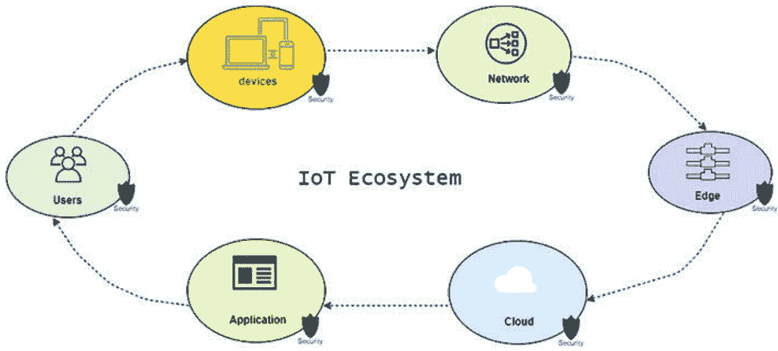

图 1.1: IoT 生态系统

## 挑战与前景

尽管 IoT 生态系统承诺带来诸多好处，但它也带来了以下挑战：

- 安全问题：IoT 设备的互联特性使其容易受到网络攻击和数据泄露。
- 互操作性：确保不同制造商的不同设备之间实现无缝通信仍然是一项挑战。
- 数据隐私：收集和利用大量个人数据引发隐私担忧，并呼吁采取强有力的数据保护措施。

尽管存在这些挑战，IoT 生态系统的未来前景依然广阔。边缘计算、5G 连接、人工智能和区块链的进步预计将解决现有挑战，并为创新和增长开辟新机遇。随着越来越多的设备连接起来，IoT 生态系统将继续革新各行各业，并提升全球人民的生活质量。

## IoT 架构概述

物联网（IoT）架构是指支撑 IoT 设备、系统和应用无缝集成和运行的基础框架。它是设计和实施 IoT 解决方案的蓝图，用于将物理对象连接到数字世界，使其能够收集、交换并处理数据。一个规划周密且有效的 IoT 架构对于构建可扩展、安全且高效的 IoT 生态系统至关重要。

### IoT 架构的关键组件：

- 设备和传感器：IoT 设备是从周围环境收集数据的物理实体。这些设备可以包括传感器、执行器、摄像头、可穿戴设备和智能家电等。传感器在检测环境变化、将其转换为数据并将其传输到 IoT 平台方面发挥着至关重要的作用。
- 连接性：连接性是指 IoT 设备彼此通信，或与中央系统通信的方式。常见的通信协议包括 Wi-Fi、Bluetooth、Zigbee、LoRaWAN、蜂窝网络等。选择合适的连接方式对于确保可靠且低延迟的数据传输至关重要。
- IoT 边缘：IoT 网关充当 IoT 设备与云端或中央数据处理系统之间的中介。它便于执行数据过滤、聚合和预处理任务。此外，网关通常提供加密和身份验证等安全功能，确保数据传输安全。
- IoT 平台：IoT 平台是收集、存储和分析来自各种设备和传感器数据的中心枢纽。它是 IoT 解决方案的支柱，管理数据流、设备管理和应用部署。该平台通常包含云服务、数据存储、分析工具以及应用程序编程接口（API）。
- 云服务：云计算在 IoT 架构中发挥着关键作用，通过提供按需访问计算资源和服务。云端能够实现可扩展的数据存储、处理能力，并可访问各种 AI 和机器学习工具用于高级数据分析。
- 数据处理与分析：从 IoT 设备收集的数据可能非常庞大且非结构化。数据处理和分析涉及清理、组织并从这些数据中提取有价值的见解。可以使用机器学习算法来识别模式、异常情况以及进行预测分析。
- 用户界面与应用程序：IoT 架构的最后一个组件是用户界面和应用程序。这是系统中允许最终用户与 IoT 解决方案交互、监控设备和控制流程的部分。它可能涉及 Web 应用程序、移动应用程序或其他自定义界面。

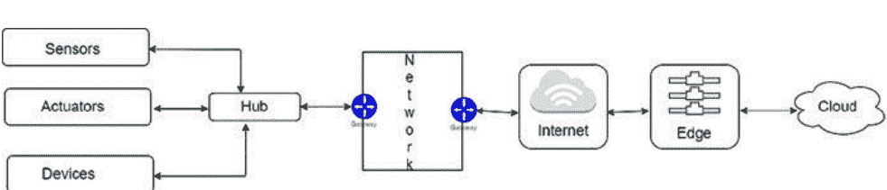

### 图 1.2: 基本 IoT 架构

### IoT 架构的优势：

- 提高效率：IoT 架构能够优化流程、资源利用和自动化，从而提升运营效率。
- 增强决策能力：实时数据分析和洞察力使企业能够做出明智且及时的决策。
- 降低成本：IoT 架构可以降低维护成本，最大限度地减少停机时间，并优化能源消耗。
- 创新与新商业模式：IoT 为创新产品和服务打开了大门，使企业能够探索新的收入来源和商业模式。

## IoT 架构中的传感器

传感器是物联网（IoT）架构的基本组成部分，在收集现实世界数据方面发挥着至关重要的作用。这些设备负责从物理环境中捕获各种类型的信息，例如温度、湿度、运动、光线等。传感器收集的数据是做出明智决策并在 IoT 应用中推动可操作洞察力的基础。

### 传感器类型：

- 温度传感器：这些传感器测量环境温度，通常用于气候控制系统、天气监测和工业应用。
- 湿度传感器：这些传感器监测环境中的湿度水平，应用于农业、室内气候控制和储存设施。
- 运动传感器：这些传感器检测运动和方向变化，应用于安防系统、家庭自动化和可穿戴设备。
- 光传感器：这些传感器测量光照强度，用于照明自动化、户外照明和摄影。
- 压力传感器：这些传感器测量压力变化，应用于天气预报、汽车系统和工业机械等领域。

### 使用传感器设计安全 IoT 解决方案的最佳实践：

- 数据加密：实施强大的加密机制，保障传感器与中央 IoT 平台之间的数据传输安全，防止未经授权的访问。
- 身份验证与授权：使用零信任等强身份验证方式验证传感器身份，并根据其角色授予访问权限。
- 固件更新：定期更新传感器固件以修补漏洞并提升性能，确保设备保持安全并已打补丁。
- 数据过滤与压缩：在传感器级别实施数据过滤，以减少冗余或无关的数据传输，从而优化网络带宽使用。
- 电源管理：优化传感器功耗以延长电池寿命或减少有线设备的能源消耗。这将带来更长的运行周期并降低维护成本。
- 边缘计算：利用边缘计算在传感器级别本地处理数据。这将减少延迟，并最大限度地降低数据暴露于云端的风险，从而增强隐私和安全性。


冗余与故障转移：采用冗余传感器和故障转移机制，以确保持续数据采集，即使传感器发生故障或暂时离线。

安全启动与设备证明：实施安全启动流程，确保只有经过身份验证的固件在传感器上运行。此外，使用设备证明在允许传感器加入网络之前验证其完整性。

物理安全：使用防篡改包装和安全安装技术，保护传感器和边缘计算设备免受物理篡改或盗窃。

可扩展数据处理：设计IoT平台以高效处理大量传感器和数据流。这使得系统能够随着部署规模增长而无缝扩展。

遵循这些最佳实践，IoT解决方案设计师可以确保基于传感器的IoT应用的稳健性、可扩展性和安全性，并为IoT生态系统的成功部署和运营奠定基础。

在下一节中，我们将深入探讨IoT架构的每个组件，并探讨设计可扩展和安全的IoT解决方案的最佳实践。

## IoT的示例和用例

IoT设备配备了传感器、执行器和通信模块，使其能够从周围环境中收集数据。收集到的数据通过互联网传输到基于云的平台或本地网关。在这里，数据被处理、分析，并转化为可操作的洞察。用户可以通过Web应用程序、移动应用程序，甚至由数据分析触发的自动化响应与IoT系统进行交互。

以下是物联网（IoT）的一些示例和用例：

### 医疗保健与远程患者监护

IoT通过实现远程患者监护，在革新医疗保健行业方面发挥着关键作用。配备传感器的可穿戴设备可以持续监测心率、血压和血糖水平等生命体征。这些数据会实时传输给医疗服务提供者，从而实现健康问题的早期检测、更好的疾病管理和及时干预。此外，基于IoT的医疗设备通过减少医院就诊和再入院率，提升了医疗服务的整体效率。这使得医疗服务提供者能够提供个性化护理，并在需要时快速干预。跌倒检测传感器和智能家居系统等IoT设备用于协助独立生活的老年人。这些设备在发生跌倒或医疗紧急情况时，可以向护理人员或紧急服务发出警报。

### 智慧城市与城市规划

IoT技术在将城市转变为智能高效实体方面发挥着关键作用。智能交通管理系统利用连接传感器的数据来优化交通流量、减少拥堵并提升公共交通。基于IoT的废弃物管理系统监测垃圾桶中的垃圾水平，优化垃圾收集时间表并降低运营成本。此外，智能路灯根据实时情况调整亮度，节约能源并提高安全性。停车位中的基于IoT的传感器可以检测车位是否被占用或空闲。然后，移动应用程序可以引导驾驶员前往可用停车位，从而减少交通拥堵，并优化停车空间的利用。

### 农业与精准农业

IoT通过精准农业技术正在重塑农业。连接的传感器收集土壤湿度、温度和养分水平的数据，使农民能够就灌溉、施肥和作物健康做出明智的决策。配备IoT设备的无人机可以监测广阔的田地并识别需要关注的区域，从而提高产量和资源效率。这项技术使农民能够践行可持续的数据驱动农业。IoT传感器部署在农田中，以监测土壤湿度水平、温度和湿度。这些数据会实时收集和分析，以优化灌溉、自动化病虫害防治并提高作物产量。

### 工业物联网(IIoT)与预测性维护

在工业领域，IoT被用于预测性维护，这减少了停机时间并优化了生产流程。连接的机器和设备可以持续监测，并可通过其性能检测异常并预测潜在故障。这种数据驱动的方法使公司能够主动安排维护，从而减少昂贵的非计划停机时间并延长工业资产的使用寿命。IoT传感器安装在工业机械中，以持续监测其健康状况和性能。这些数据用于预测潜在故障，在故障发生前安排维护，并避免昂贵的生产停机时间。

### 零售与客户体验提升

IoT通过为客户创造无缝且个性化的购物旅程来提升零售体验。商店内的智能信标可以根据购物者的位置和偏好，向其智能手机发送个性化优惠和推荐。集成IoT的库存管理系统确保货架上货物充足、产品随时可用，最大限度地减少缺货情况。此外，结账流程可以通过RFID技术等自动化系统加快。零售店中的IoT传感器跟踪客户移动和与产品的互动。这些数据可用于优化商店布局、改进产品摆放并提升整体购物体验。

### 野生动物保护

基于IoT的追踪设备被附着在濒危物种上，以监测其活动并收集有关其行为和栖息地的宝贵数据。这些信息帮助保护主义者做出明智决策以保护野生动物。

### 水质监测

河流和湖泊等水体中的IoT传感器会持续监测pH值、浑浊度和污染物等水质参数。这些信息有助于早期检测污染，并确保水资源的安全。

### 环境监测与保护

IoT设备被部署在各种环境监测应用中，以评估和保护自然资源。放置在森林、海洋和野生动物栖息地中的传感器收集温度、湿度、污染水平和动物行为方面的数据。这些信息帮助研究人员和保护主义者了解生态系统动态、追踪濒危物种并检测环境威胁。

### 家庭自动化与安全

IoT设备使家庭自动化和安防系统对房主来说触手可及。智能恒温器可以根据占用情况和外部天气状况调整室内温度，从而优化能源使用。配备IoT摄像头和运动传感器的家庭安防系统可以向房主发出潜在入侵者警报，并提供远程监控功能。

### 互联交通

IoT设备通过实现互联车辆和智能交通系统，正在彻底改变交通行业。配备IoT传感器和通信模块的车辆可以共享有关交通状况、天气和道路危险的实时数据。这些信息帮助驾驶员找到最佳路线，减少拥堵，并提升整体道路安全性。此外，IoT设备还用于车队管理，以优化燃油效率、监测车辆健康状况并增强物流。

总而言之，物联网已渗透到各行各业，重塑了我们与世界互动的方式，并为我们开辟了新的可能性。从医疗保健和农业到智慧城市和工业应用，IoT继续为我们生活的方方面面带来创新和效率。随着技术的进步和连接性的提高，IoT改变行业和提高我们生活质量的潜力几乎是无限的。


## 物联网（IoT）的好处

物联网（IoT）已彻底改变了各个行业，而医疗保健是其中经历显著变革的一个领域。医疗保健领域的物联网应用为改善患者预后、简化运营和提升整体护理质量开辟了新途径。

以下是物联网为医疗保健领域带来的一些显著好处：

- 远程患者监护：IoT设备能够在传统医疗环境之外对患者进行实时监测。可穿戴传感器、联网医疗设备和远程监控系统使医疗专业人员能够跟踪患者的生命体征和其他健康指标。这不仅提高了慢性病患者的就医便利性，还有助于早期发现健康问题并防止再次住院。

- 增强患者参与度：由IoT驱动的应用程序促进患者参与，并使个人能够积极主动地管理自己的健康。患者可以使用联网设备和移动应用程序访问健康数据、接收个性化洞察并设定健康相关目标。这种更高的参与度有助于更好地遵循治疗方案并改善健康结果。

- 高效资产管理：医院和医疗设施在管理大量医疗设备和资产方面常常面临挑战。基于IoT的资产跟踪系统可提供设备位置、使用情况和维护需求的实时数据。这简化了库存管理，减少了设备停机时间，并降低了运营成本。

- 改善药物管理：启用IoT的智能药丸分发器和药物跟踪系统帮助患者遵循处方用药计划。这些设备会向患者发送提醒，记录用药数据，并在漏服药物时通知护理人员或医疗保健提供者。这提高了用药计划的依从性，并降低了医疗并发症的风险。

- 预测性维护：IoT技术使医疗机构能够为关键医疗设备实施预测性维护策略。通过持续监测MRI机器、X射线系统和呼吸机等设备的性能，维护团队可以在问题导致故障之前识别潜在问题。这种主动方法最大限度地减少停机时间，并确保设备始终处于最佳工作状态。

- 数据驱动的决策：IoT产生海量医疗数据，可对其进行分析以获得有价值的洞察。医疗保健提供者可以利用这些数据识别模式、趋势和相关性，从而做出更明智的决策并制定个性化治疗方案。此外，医疗研究人员可以利用这些数据推动医学知识发展并创新疗法。

总之，IoT为医疗行业开启了新的可能性时代。从远程患者监护到数据驱动的决策，IoT应用有望改变医疗服务的提供方式，使其更加以患者为中心、高效和有效。

以下是IoT有益于城市环境的一些方式：

城市化的快速发展给城市管理者带来了诸多挑战，从交通拥堵和污染到资源管理。为解决这些复杂问题，世界各地的城市正将物联网作为一种变革性解决方案。通过部署IoT技术，城市中心正在利用数据驱动的洞察来改善城市生活，创造更可持续、更高效的城市。

- 智能交通：基于IoT的传感器和联网设备支持智能交通系统，优化交通流量、减少拥堵并提升公共交通服务。智能交通信号灯根据实时交通状况调整信号时长，而联网公共交通系统则向通勤者提供路线和时刻表的实时更新。

- 环境监测：IoT设备在监测空气质量、噪音水平和温度等环境参数方面发挥着至关重要的作用。通过收集和分析这些数据，城市可以采取及时措施减轻污染、识别潜在健康危害并改善整体环境质量。

- 高效废弃物管理：传统的废弃物管理实践常常面临效率低下和不规则的问题。配备传感器的IoT智能垃圾桶可以监测填充水平，优化废弃物收集路线并减少不必要的清运。这降低了运营成本，并促进更清洁、更健康的城市环境。

- 能源管理：IoT促进建筑物和公共场所的智能能源管理系统。智能恒温器、照明控制和能源监测设备有助于优化能源消耗，从而减少能源浪费，并降低居民和企业的公用事业账单。

- 公共安全与安保：启用IoT的监控摄像头、联网路灯和智能应急响应系统提升了城市地区的公共安全。这些系统可以检测异常活动、监控高风险区域并改善应急响应时间，使城市对居民和游客都更加安全。

- 公民参与与服务：IoT应用通过实现互动平台和移动应用程序来促进公民参与，这些平台和应用程序允许居民提供反馈、报告问题并参与决策过程。这种双向沟通有助于城市管理者更好地了解社区需求，并相应地定制服务。

通过利用IoT的力量，城市可以变得更加可持续、有韧性，并能更好地响应居民的需求。收集和分析实时数据的能力使城市规划者能够做出明智的决策，从而提高城市居民的生活质量，为我们的地球创造更可持续的未来。

以下是IoT通过精准农业有益于农业的一些方式：

精准农业（也称为智慧农业）是一种革命性方法，它利用物联网（IoT）的力量来转变传统农业实践。通过整合先进技术、传感器和数据分析，精准农业优化资源利用、提高生产率并减少环境影响。让我们探讨一下IoT通过精准农业如何有益于农业的一些方式。

- 实时监测与数据分析：启用IoT的传感器部署在农业景观中，以收集土壤湿度、温度、湿度和养分水平等各种参数的实时数据。这些数据被发送到集中式云平台，由高级分析算法进行处理。农民可以通过智能手机或电脑访问这些有价值的信息。这使他们能够就灌溉、施肥和作物保护做出数据驱动的决策。

- 高效水资源管理：水资源短缺是农业面临的重大挑战。借助IoT，农民可以精确测量土壤中的水分含量，并监测天气状况以确定最佳灌溉计划。通过仅在需要时和地点使用水，农民可以最大限度地减少浪费，确保高效用水，从而提高作物产量并降低水费。

- 智能病虫害管理：由IoT驱动的智慧农业采用多种方法来检测和减轻作物病虫害。配备摄像头和传感器的无人机可以飞越田地并识别虫害的早期迹象。然后，自动系统可以进行针对性治疗，减少广泛使用农药的需求。此外，通过持续监测环境条件，IoT可以对潜在的疾病爆发提供早期预警，帮助农民采取预防措施并保护他们的收获。

- 精准畜牧养殖：IoT不仅限于种植业。它也彻底改变了畜牧管理。传感器被植入动物项圈或标签中，以监测它们的健康状况、行为和位置。这些数据帮助农民识别需要关注、医疗或营养调整的个体动物。此外，启用IoT的系统可以调节畜牧设施中的气候和喂养时间表，确保最佳条件，并最大限度地提高生产力。

- 供应链优化：IoT在简化农业供应链中发挥着关键作用。从运输过程中跟踪易腐商品的位置和温度，到监测库存水平和需求模式，IoT技术改善了物流并减少了浪费。实时数据使农民能够有效地规划生产和分销，从而减少食物损失并提高盈利能力。

总之，在农业中采用IoT为精准农业铺平了道路，从而彻底改变了该行业。借助实时监测、数据驱动的决策和优化的资源利用，农民可以提高生产力、最大限度地减少环境影响并增强整体可持续性。随着技术的持续


随着发展，农业物联网（IoT）的未来在解决粮食安全和资源保护等全球挑战方面前景光明。

## 物联网中的挑战

物联网（IoT）改变了我们与技术及周围世界互动的方式。然而，随着其众多好处，物联网也在安全方面带来了重大挑战。随着数十亿设备互联互通，确保数据的安全和隐私成为首要关注的问题。以下是物联网领域面临的一些关键安全挑战：

- 设备漏洞：由于成本和资源限制，物联网设备往往缺乏强大的安全功能。因此，它们可能易受黑客攻击、恶意软件和未经授权的访问，成为网络攻击的潜在入口点。
- 数据隐私问题：物联网设备收集大量个人和敏感数据。如果这些数据落入不法分子手中，可能导致身份盗窃、敲诈勒索或其他有害后果。适当的数据加密、访问控制和数据管理实践对于保护用户隐私至关重要。
- 互操作性问题：物联网设备来自各种制造商，每个制造商都有自己的标准和协议。设备之间缺乏互操作性可能会造成安全漏洞。这使得维护统一的安全框架变得具有挑战性。
- 网络漏洞：庞大的互联设备网络为黑客创造了扩大的攻击面。薄弱的网络安全措施可能导致未经授权的访问、数据拦截和分布式拒绝服务（DDoS）攻击。
- 固件和软件更新：许多物联网设备在设计时未考虑定期软件更新。这意味着已知漏洞往往未修补，使设备暴露于潜在威胁之下。
- 供应链风险：物联网设备通常由各种供应商的组件组成，使其在制造过程或供应链分销过程中容易受到安全妥协。
- 僵尸网络和僵尸攻击：易受攻击的物联网设备可能被整合成僵尸网络，并用于发动大规模攻击，瘫痪整个网络或网站。
- 数据过载：随着数十亿物联网设备产生海量数据，管理和处理这些数据成为一项重大挑战。如果没有可扩展的数据存储和处理解决方案，数据过载可能导致延迟、瓶颈和有价值洞察的丢失。
- 网络拥塞：海量的互联设备给现有网络基础设施带来压力。随着更多设备加入网络，拥塞可能导致数据传输速度降低和延迟增加。
- 互操作性和标准：物联网涵盖来自不同制造商的各种设备，每个制造商都遵循自己的通信协议。实现设备之间的无缝互操作性对于创建统一的物联网生态系统至关重要。
- 功耗：许多物联网设备由电池供电，优化其功耗对于延长其运行寿命和减少维护负担至关重要。
- 可扩展安全措施：随着连接设备数量的增加，保护每个设备和整个物联网网络变得更加具有挑战性。实施可扩展的安全措施对于防范网络威胁至关重要。
- 云基础设施：物联网高度依赖云服务进行数据存储和处理。确保云基础设施的可扩展性和可靠性对于支持日益增长的物联网应用需求至关重要。
- 实时通信：某些物联网应用，如自动驾驶汽车和工业自动化，需要实时通信和决策。扩展系统以支持超低延迟和高响应能力是一项复杂的挑战。
- 监管和政策挑战：随着物联网在全球范围内扩展，不同地区不同的法规和政策可能会为物联网部署和运营造成障碍和复杂性。

为克服这些可扩展性挑战，利益相关方之间的协作至关重要。物联网设备制造商、网络提供商、云服务提供商和政策制定者必须共同努力，开发标准化协议、可扩展基础设施和节能解决方案。此外，边缘计算的发展——即在数据源附近处理数据——可以通过减少对集中式云系统的压力来缓解一些可扩展性问题。

总而言之，解决这些挑战需要多方面的方法。制造商必须在设计和开发阶段优先考虑安全性，实施安全身份验证、加密和定期软件更新。用户必须了解保护其物联网设备的风险和最佳实践。政府和产业应协作制定全面的标准和法规，以增强物联网安全。

通过直面这些安全挑战，我们可以确保物联网技术的潜在好处得到发挥，而不会损害个人和组织的安全和隐私。

## 结论

在结束我们进入迷人物联网（IoT）世界的旅程时，我们发现自己正站在令人叹为观止的技术革命门槛上。对物联网的介绍打开了我们的眼睛，让我们看到前方巨大的可能性，其中互联设备和智能系统为更加互联、高效和可持续的未来铺平了道路。

在本章中，我们阅读了关于传感器、执行器、连接性和数据分析的融合如何催生了我们与周围世界互动的新方式。日常物体进行通信、协作和做出明智决策的能力不仅改变了行业和企业，也深刻影响了我们的个人生活。

当我们对物联网的增长和潜力赞叹不已时，认识到伴随此类变革性创新的挑战至关重要。安全和隐私问题挥之不去，解决它们必须始终是首要任务。确保数据得到保护，物联网设备能够抵御网络攻击，对于赢得和保留公众信任至关重要。

此外，迅速扩张的互联设备生态系统需要发展强大的标准和互操作性协议。通过建立通用框架，我们可以促进更加统一和和谐的物联网格局，实现各种设备和平台之间的无缝通信。

随着物联网的不断发展，它不可避免地将渗透并颠覆更广泛的行业。从医疗保健和农业到交通和制造，物联网的影响将远远波及各处。然而，在追求进步的过程中，我们不得忘记负责任和合乎伦理的发展的重要性。确保物联网解决方案以人类和环境的最大利益为中心进行设计，是一项必须指导我们技术追求的道德责任。

此外，随着世界日益互联，弥合数字鸿沟、确保社会各阶层都能获得并受益于物联网带来的优势变得迫在眉睫。包容性和可访问性必须成为物联网发展的核心，以避免加剧现有不平等。

总而言之，物联网的介绍标志着人类进步新时代的开始，在这个时代中，我们的环境变得更智能，我们的生活更高效，我们的决策更明智。拥抱物联网的潜力，同时保持警惕应对其挑战，将是繁荣和可持续未来的基石。当我们开启这段令人兴奋的技术冒险时，让我们记住，物联网的真正力量不仅在于设备的互联互通，更在于它对世界各地人们生活可能产生的积极影响。因此，让我们带着责任感、创造力和坚定不移的承诺勇往直前，为子孙后代塑造一个更美好、更互联的世界。


在下一章中，我们将学习物联网开发平台、漏洞、攻击和安全控制。我们将学习与物联网相关的基本核心概念及其构建模块。

## 选择题

IoT 代表什么？

物联网

智能技术

电信互联网

电话内联网

以下哪项最能描述物联网？

互联的家用电器网络

连接到互联网的物理设备系统，用于收集和交换数据

用于分享照片和视频的新社交媒体平台

虚拟现实游戏平台

以下哪种通信协议常用于物联网设备的短距离通信？

蓝牙

以太网

卫星

Wi-Fi

物联网在医疗保健行业的主要好处是什么？

为患者提供娱乐

降低医院成本

改善患者护理和监测

提升医院美观度

以下哪项是关于物联网安全的潜在担忧？

物联网设备对普通消费者来说太昂贵

物联网兼容智能手机的供应有限

未经授权的访问和数据泄露

日常任务过度依赖物联网

## 答案

- a
- b
- a
- c
- c

## 问题

物联网以何种方式提高了智慧城市的效率和可持续性？

讨论物联网架构的基本原则。

评估物联网在医疗保健中的作用，特别是在远程患者监测和个性化医疗方面。

讨论物联网的关键组件。

物联网如何影响工业自动化，它对生产力和效率有何影响？

物联网（IoT）如何彻底改变了我们与日常物体和设备交互的方式？

## 关键术语

### 物联网

射频识别（RFID）技术；RFID 使物体能够被唯一地识别和跟踪。

### 互联网工程任务组

消息队列遥测传输；它是一种基于标准的消息传递协议，或一套规则，用于机器对机器通信。

受限应用协议；它是一种专门的网页传输协议，用于物联网中受限节点和受限网络。

ZigBee 是一种开放的、全球的、基于数据包的协议，旨在为安全、可靠、低功耗无线网络提供易于使用的架构。

磁共振成像（MRI）；这是一种医学成像技术，使用磁场和计算机生成的无线电波来创建身体器官和组织的详细图像。

# 第 2 章

# 边缘计算基础及用例

## 简介

在不断发展的技术格局中，创新不断重塑未来，一种新的范式应运而生，正在改变计算和连接的边界。本章将带您踏上这场变革的前沿之旅，这个领域被称为边缘计算。超越传统数据中心和云端的限制，边缘计算召唤着我们，这是一个数据不仅被处理，而且被以前所未有的即时性所利用的领域。

想象一个汽车与交通灯对话、工厂自行编排效率、增强现实与物理环境无缝融合的世界。这就是边缘计算赋能的世界，这是一个计算不仅局限于远程服务器，而且在需要的地方生生不息，就在我们网络边缘的世界。

然而，本章不仅关注“是什么”，还关注“如何”和“为什么。”边缘计算如何施展魔力？为什么它以如此强烈的态势声名鹊起？请继续阅读，我们将深入探讨允许数据在本地处理的复杂机制，将延迟降低到几乎可以忽略不计的程度，实现曾被认为不可能的实时决策。

随着我们深入探索，用例的范围也在扩大。穿越医疗领域，患者监测进入了新维度，允许即时诊断和响应。漫步到智慧城市，交通优化、废物管理和公共安全随着边缘智能的节奏起舞。窥探零售领域，个性化体验成为常态，物流超越效率成为一门艺术。进入农业领域，植物疾病被远程监测，奶牛借助物联网监测工具被健康饲养。

然而，边缘计算并非没有挑战。使其强大的那种去中心化也在安全性、可扩展性和互操作性方面带来了障碍。我们的探索将延伸到这些挑战，提供关于已经锻造出来的策略的见解，以驯制这个野性的边疆。

所以，系好安全带，我们将一起探索边缘计算的基本用例。让我们揭示这项技术如何塑造行业、放大可能性，并在数据与决策的交汇处带来新的曙光。欢迎来到边缘时代。

## 结构

在本章中，我们将讨论以下主题：

- 边缘计算简介
- 边缘计算基础
- 边缘计算技术基础
- 边缘实时数据处理
- 延迟降低和响应性提升
- 带宽优化和网络效率
- 增强隐私和数据安全
- 边缘系统的弹性和可靠性
- 边缘 AI 和机器学习
- 边缘计算的未来

## 目标

在本章中，我们将深入探讨边缘计算的基本用例，这是一种通过将计算更靠近数据源来彻底改变数据处理和分析的范式。随着我们浏览各种场景，我们将发现边缘计算在各个行业中的变革潜力。

通过穿越医疗、艺术、农业和灾害管理等多样化领域，我们旨在扩大对边缘计算如何重塑行业并赋能创新解决方案的理解。通过深入分析和案例研究，加入我们，揭示意外应用的非凡画卷，其中边缘计算成为非凡的推动者。

- 边缘实时分析：探索边缘计算如何赋能组织在网络边缘进行实时数据分析和决策，减少延迟并提高响应能力。
- 优化带宽和延迟：了解边缘计算如何最大限度地减少向远程数据中心的数据传输，降低网络拥塞，降低带宽成本，并减少关键应用程序的延迟。
- 边缘数据安全：深入了解边缘计算的安全优势，包括增强数据隐私和降低网络威胁风险，因为数据在靠近其源的地方进行处理。
- 医疗保健和远程医疗应用：探索边缘计算如何改变医疗保健，即使在偏远或资源有限地区，也能实现实时患者监测、诊断和治疗调整。
- 边缘 AI 和机器学习：考察边缘计算与 AI/ML 技术的融合，解锁设备端数据分析、预测性维护和个性化用户体验的可能性。
- 农村地区的边缘计算：探索边缘计算如何通过在远程和服务不足地区提供改进的连接性、在线服务访问和教育资源来弥合数字鸿沟。

## 边缘计算简介

边缘计算是一种将计算和数据存储更靠近数据生成源头（如传感器、设备或其他数据生成实体）的范式。与传统的云计算不同，传统云计算中数据被传输到中央数据中心进行处理，边缘计算在网络“边缘”本地处理数据。这种方法最大限度地减少延迟，减少对大量数据传输的需求，并实现实时决策。边缘计算利用设备、服务器和网关的分布式网络高效处理数据处理任务，使其成为现代去中心化计算格局中的关键组成部分。


## 边缘计算的重要性

边缘计算的重要性在于其能够通过解决集中式云计算的局限性来彻底改变应用程序。其关键优势之一是降低延迟，这对于自动驾驶汽车、工业自动化和增强现实等对时间敏感的应用至关重要。通过在数据生成地附近进行处理，边缘计算提高了响应时间和整体系统性能，从而实现更安全、更高效的运营。

此外，边缘计算提供了增强的数据隐私和安全性。本地处理意味着敏感信息可以在不传输到远程数据中心的情况下进行分析和采取行动，从而降低数据泄露的风险，并确保符合数据保护法规。这在医疗和金融等必须满足严格隐私要求的领域中尤其关键。

边缘计算还优化了网络带宽使用。它不是通过大规模数据传输来使网络不堪重负，而是仅将相关且预处理过的数据传输到中央服务器，从而减少拥塞并尽量降低运营成本。随着物联网（IoT）生态系统不断扩张，产生海量数据，若不能高效管理，这些数据会给网络带来压力，因此这一点至关重要。

此外，边缘计算赋予了离线功能。即使连接中断或丢失，设备仍可继续运行和做出决策，从而增强可靠性和用户体验。这对于偏远地区或网络覆盖不稳定的地区非常有益。

最后，边缘计算代表了我们处理和利用数据方式的一次变革性转变。其意义横跨各行各业，从在制造业中实现实时分析，到通过可穿戴设备改善医疗诊断。通过缓解延迟、安全性、带宽和离线功能方面的挑战，边缘计算为数字版图中的创新与效率新时代敞开了大门。

## 边缘计算与云计算的区别

边缘计算和云计算是计算领域中两种不同的范式，各自适用于特定的需求和场景。云计算常被称为现代IT的基础，涉及在远程服务器上对数据和应用程序进行集中式存储、处理和管理。这种方法为各种任务提供了无与伦比的可扩展性、易于管理和成本效益。另一方面，边缘计算采用去中心化方法，将计算推向更靠近数据源或用户的位置。它赋能网络“边缘”的设备（如IoT设备或传感器）进行本地处理并快速做出决策，从而降低延迟并增强实时能力。与云计算庞大的基础设施不同，边缘计算专注于优化对延迟敏感的应用的性能。

人们可以将云计算可视化为一个庞大且互联的数据大都市，数据在其中流向集中式数据中心进行处理和存储。这种模式非常适合需要大量计算、复杂算法和海量数据存储的应用。相比之下，边缘计算描绘了一种分散式智能的图景，类似于一个由智能前哨组成的网络，在数据生成地附近进行处理。这种邻近性对于自动驾驶汽车等应用至关重要，因为在其中，瞬间的决策可能意味着安全与灾难之间的区别。虽然云计算在资源整合和规模经济方面表现出色，但边缘计算在需要即时性和本地化响应的场景中大放异彩。

可以将云计算视为一个数字巨兽，凭借其丰富的资源能够轻松处理巨大的任务。这是大数据分析、人工智能和资源密集型模拟的领域。与此同时，边缘计算在处理现实世界交互的细微差别时大放异彩。想象一支无人机机队实时协调，每架无人机都基于本地传感器数据进行瞬间调整，而无需与远程数据中心通信。在这里，边缘范式大放异彩，利用分布式计算的力量将数据转化为可操作的洞察，而无需承受云处理固有的延迟。

本质上，边缘计算与云计算之间的选择取决于应用程序的需求。云计算提供集中式效率和规模经济，使其成为资源密集型和可扩展应用程序的理想选择。与此同时，边缘计算满足低延迟、本地化决策和实时响应的需求，使其成为即时性至关重要的应用中不可或缺的技术。随着技术的不断发展和多样化，这两种范式之间的协同作用将继续塑造计算版图，各自将在众多领域发挥关键作用。

## 用于延迟测试的云Ping工具。

以下链接是一个延迟测试工具，帮助你充分了解延迟如何影响实时处理：

https://cloudpingtest.com

如果你点击此链接并假设你在印度中部有患者，Azure云用于处理与患者直接交互的应用程序，那么在数据处理过程中你可以预期大约1000毫秒或更长的延迟。

## 边缘计算架构

边缘计算彻底改变了数据处理方式，为数字领域带来了智能与敏捷。与传统集中式模型不同，边缘计算将计算推向更靠近数据源的位置，降低延迟并增强实时响应能力。

以下是边缘计算架构的高级概述：

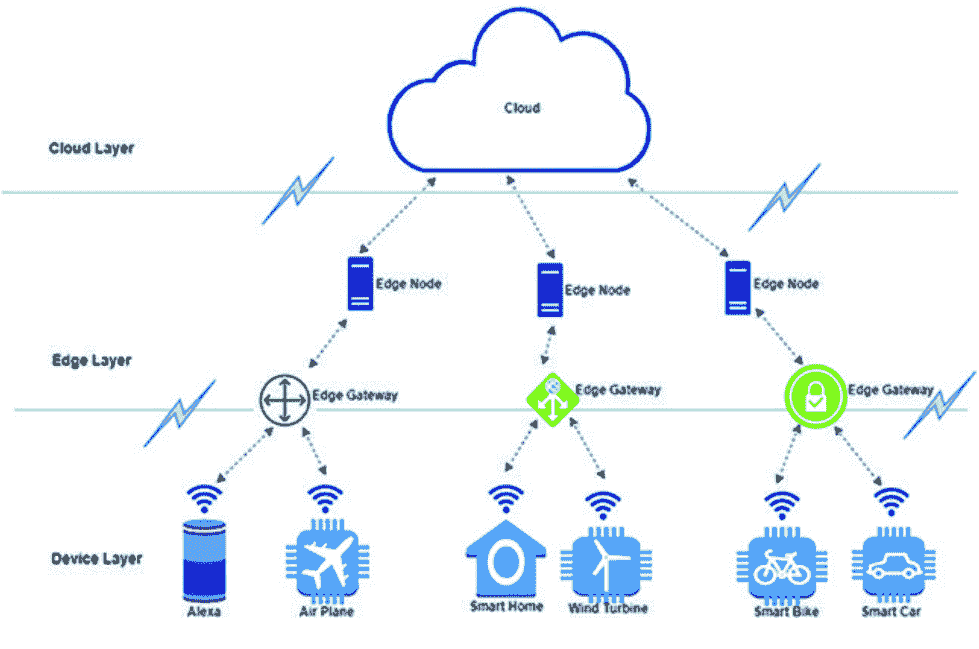

图2.1：边缘计算架构

## 边缘计算的基础

边缘计算的基础建立在数据去中心化和本地化处理这两大支柱之上。这标志着与传统云中心模型的决裂，承认并非所有数据都能承受因延迟限制或带宽限制而传输到远程数据中心。通过战略性地分布处理能力，边缘计算最大限度地减少了数据长途跋涉的需求，从而带来更快的洞察、更灵敏的应用程序和更好的隐私保护。随着这一范式的展开，一批边缘赋能的设备和服务新生态系统应运而生，推动创新并重新定义各个领域可实现的边界。

安全性和隐私构成了边缘计算基础的另一基石。通过在更靠近数据源的位置处理数据，可以更有效地保护敏感信息。与集中式云模型不同，在后者中，数据在传输过程中可能面临潜在泄露风险，而边缘计算则降低了这些风险。此外，处理的本地化特性使组织能够通过遵守法规要求并增强用户信任，对其数据拥有更大的控制权。随着越来越多的设备联网以及数据量激增，在边缘建立强大的安全措施不仅是一种必要，也是物联网（IoT）和其他数据密集型应用蓬勃发展的关键推动者。

最后，边缘计算的基础重新定义了数据处理方式，为响应能力、隐私和效率的新时代铺平了道路。通过将计算能力分散到网络边缘，这一范式转变推动各行业创新，并塑造技术的未来。本地化处理、安全性以及与云基础设施的共生关系等原则，为这种变革性方法奠定了坚实基础，使能够满足即时洞察和实时决策需求的广泛应用成为可能。随着边缘计算的不断发展，其基础将继续支撑着在数字版图中产生涟漪的突破性进步。


## 边缘计算的历史与演进

边缘计算的历史与演进呈现出一个独特而引人入胜的叙事。从其意想不到的起源到对各行业的变革性影响，边缘计算已经穿越了未知领域，以出人意料的方式塑造了数字世界。

### 去中心化的起源（20世纪末）

边缘计算的根源可以追溯到20世纪末，当时数字世界由集中式大型机和服务器主导。然而，正是在这个时代，去中心化的概念开始兴起。互联网迅速发展，但连接性和计算能力集中在少数几个中心位置。为了分布这些能力以提高性能、降低延迟并增强可靠性，边缘计算的最初雏形由此产生。

### 普适计算时代（21世纪初）

随着21世纪的到来，智能手机和可穿戴设备等个人设备的普及将计算能力带到了个人身边。普适计算的理念——即计算和数据处理无缝融入日常物体和环境——成为焦点。这一趋势为边缘计算铺平了道路，因为更多的处理在设备本身上进行，减少了与远程数据中心不断通信的需求。

### 惊人的催化剂：物联网（IoT）（2010年代中期）

边缘计算的真正突破来自于物联网的爆发。随着传感器、执行器和设备开始产生海量数据，由于延迟问题、带宽限制和隐私考量，将所有这些数据传输到集中式数据中心已被证明不切实际。边缘计算应运而生，将数据处理和分析推向更靠近数据源的位置。

### 去中心化云与雾计算（2010年代末）

大约在这个时候，雾计算的概念登场。雾计算通过在边缘设备和集中式数据中心之间引入中间节点（雾节点），扩展了边缘计算的理念。这种架构实现了更高效的数据处理和分析，比传统云计算更靠近数据源。不断演变的格局催生了去中心化云，其中多个互连的边缘设备和雾节点形成了一个动态的分布式生态系统。

### 边缘AI的黎明（2020年代初）

人工智能（AI）和机器学习（ML）与边缘设备的集成标志着另一个关键转折点。这使得实时决策和高级分析直接在边缘成为可能，从而使自动驾驶汽车、工业自动化和远程医疗监护等应用成为可能。边缘从单纯的数据处理点演变为一个动态的智能中心。

### 与5G及边缘原生应用的协同（2020年代中期）

5G网络的部署进一步催化了边缘计算的演进。5G的高速、低延迟能力与边缘计算的分布式特性相辅相成，使其成为需要实时响应性和高带宽的应用的关键推动因素。专门设计用于利用边缘计算优势的边缘原生应用，在游戏、增强现实和智慧城市等行业中变得更加普遍。

### 全面数据生态系统与伦理考量（2020年代末）

到2020年代末，边缘计算已经融入现代技术格局的方方面面。数据生态系统变得更加全面，边缘处理、雾节点和集中式云基础设施之间达到了平衡。然而，这一扩张引发了与数据隐私、安全性和所有权相关的伦理考量，从而推动了新监管框架和行业标准的发展。

### 迈向自主分布式系统（未来）

随着量子计算、边缘AI和分布式账本等技术的出现，边缘计算的演进仍在继续。边缘、雾计算和云计算之间的界限变得模糊，催生了更多自主和自适应的分布式系统。这些系统将能够在动态网络中无缝分配计算资源、分析数据并做出决策，进一步推动边缘计算向未知领域演进。

## 云计算与边缘计算比较

云计算和边缘计算如同同一枚技术硬币的两面，各自在不同情境下提供独特的优势。云计算如同一个庞大而强大的数据中心，而边缘计算则类似于一个由敏捷、本地化助手组成的网络。

云计算就像一个服务集中的广阔大都市，触手可及的资源繁多。这就像生活在一个由摩天大楼代表数据中心的城市里，你可以在一个地方访问所需的任何服务，从银行到娱乐。然而，就像高峰时段的交通堵塞一样，由于数据需要前往和返回这些中心枢纽的距离，可能会出现延迟问题。

另一方面，边缘计算就像分布在各地的智慧村庄网络。每个村庄都有自己的专业服务和资源，满足居民的即时需求。这就像拥有小型、互联的社区，它们可以在不远行的情况下快速做出决策和响应。然而，挑战可能在于确保这些分布式节点之间的一致性和统一性，就像保持不同村庄行政管理之间的和谐一样。

总而言之，云计算提供了大都市枢纽的便利性和规模，而边缘计算提供了本地化社区的敏捷性和响应性。两者之间的选择取决于你是否为特定的技术需求优先考虑集中式效率或分布式速度。

下面是一个比较云计算和边缘计算的表格：

### 表 2.1：云计算与边缘计算比较

重要的是要记住，云计算或边缘计算的适用性取决于你的应用程序的具体需求，以及你愿意在集中式效率与分布式响应性之间做出的权衡。

## 边缘计算的技术基础

边缘计算的基础植根于几种关键技术基础的融合。从本质上讲，边缘计算试图通过将计算更靠近数据源来解决传统云中心架构的局限性。这种方法利用了边缘设备的进步，这些设备变得越来越强大，能够在本地处理大量工作负载。这些设备与边缘服务器之间的技术协同使处理任务能够分布，减少延迟和网络拥塞。通过优化数据流和计算，边缘计算适应了物联网、增强现实和自动驾驶汽车等实时应用，在这些应用中，瞬间决策至关重要。

分布式计算构成了边缘计算的支柱，将互联的设备和服务器网络编排成一个连贯的生态系统。这种复杂的协调舞蹈需要复杂的算法和协议来确保无缝的数据传输和同步。边缘计算的基础涵盖了来自对等网络、网状架构和去中心化计算模型的概念。通过促进网络边缘设备之间的协作，这一范式不仅增强了数据隐私和安全性，还促进了容错性和冗余性，降低了系统级故障的风险。


数据生成和消费的指数级增长催化了数据处理范式的演变，最终促成了边缘计算的兴起。支撑性数据架构融合了流处理和事件驱动系统的概念，以高效处理动态数据。通过在数据生成时于边缘进行处理，边缘计算最大限度地减少了将数据传输到集中式云所关联的延迟。这是通过部署微服务和容器化实现的，使应用程序能够分解为可独立部署和扩展的模块化组件。因此，边缘计算不仅优化了数据处理，还在动态和分布式环境中促进了资源效率和可扩展性。

在边缘计算的宏大图景中，5G连接作为关键环节出现，编织起低延迟、高带宽通信的肌理。边缘计算与5G之间的技术协同具有变革性，因为边缘计算的本地化处理与5G网络的去中心化特性完美契合。这种融合消除了阻碍实时应用的瓶颈，并为依赖快速数据交换的创新服务铺平了道路。5G的基础，如网络切片和网络功能虚拟化，与边缘计算的目标完美契合，凸显了其重塑行业和重新定义用户体验的潜力。

## 探索边缘设备的硬件方面

深入探讨边缘设备的硬件方面，揭示了一个微型化和技术创新的迷人世界。传感器，数字时代的无名英雄，通过捕捉现实世界数据并将其转换为有意义的信号，发挥着关键作用。这些微型奇迹旨在检测各种环境因素，从温度和湿度到光线和运动。随着技术的进步，传感器变得越来越专业化，使它们能够在医疗保健、农业和工业自动化等特定环境中发挥作用。艺术在于将这些不显眼的传感器无缝集成到我们的环境中，创建一个无形的互联信息源网络，从而在边缘实现更明智的决策。

执行器是传感器的对应物，代表了边缘设备智能背后的“肌肉”。虽然传感器收集数据，但执行器将这些数据转化为具体行动。这些巧妙的设备范围从打开和关闭阀门的简单电机，到能够进行复杂运动的复杂机械臂。传感器与执行器之间的协同创建了一个闭环系统，其中实时信息驱动精确响应。执行器的领域是工程师的游乐场，他们利用力学、电子学和材料科学来设计能够以曾经被认为是科幻领域的方式与物理世界交互的设备。

物联网（IoT）设备的版图是一幅由多样化硬件组件编织而成的挂毯。这些设备是连接性的体现，旨在无缝融入我们的生活和环境。在这些微小的外形之中，隐藏着微处理器、存储模块、通信接口和电源管理系统。对这些元素的优化是一场微妙的舞蹈，能源效率至关重要，以确保在电池供电下延长运行寿命。物联网设备的硬件架构是一种微妙的平衡，仔细针对每个用例量身定制，无论是调节家庭温度的智能恒温器，还是优化制造过程的工业传感器舰队。

探索边缘设备硬件的各个方面揭示了功耗与性能之间的两难。在边缘运行复杂算法的同时节省能源的需求，迫切需要巧妙的解决方案。硬件加速，一项新兴趋势，涉及将特定任务卸载到专用芯片，例如GPU或FPGA。这种方法在保护电力资源的同时确保高效处理。此外，边缘硬件的安全维度不容低估。由于这些设备收集、处理和传输敏感数据，实施强大的基于硬件的安全措施变得势在必行。从防篡改芯片到安全启动机制，硬件堆栈的每一层都为加固边缘设备的数字堡垒做出贡献，在这个日益互联的世界中。

## 边缘网络的通信协议

在现代网络的动态领域中，数据在设备和系统之间无缝流动，边缘计算的到来开启了连接性和效率的新时代。在这个变革性版图的核心，是通信协议，它们使边缘设备能够对话和协作。如同盛大交响乐的无声指挥家，边缘网络的通信协议编排着和谐的信息交换，优化资源利用，并推动物联网（IoT）革命。

欢迎踏上一段旅程，数据在此与边缘相遇，而使这一切成为可能的协议将登上舞台中心。

- **MQTT（消息队列遥测传输）**：MQTT是一种专为边缘网络设计的轻量级高效通信协议，非常适合带宽和资源有限的场景。它基于发布-订阅模型运行，允许设备异步通信。MQTT支持服务质量（QoS）级别的能力，确保即使在不可靠的网络条件下也能可靠地传递消息。其低开销和小数据包大小减轻了边缘设备的负担，使其适用于物联网等应用，其中能源效率和实时通信至关重要。

- **CoAP（受限应用协议）**：CoAP专为边缘网络以及处理能力和内存有限的设备而定制。它体现了REST架构的原则，通过UDP实现通信以最大限度地减少开销。CoAP的简单性使其成为资源受限环境的绝佳选择。它采用类似于HTTP的请求-响应模型，但针对低功耗设备进行了优化。CoAP对多播和可观察性特性的支持，增强了其在工业自动化、智慧城市和环境监测等场景中的适用性。

- **HTTP/HTTPS（超文本传输协议/安全）**：尽管传统上与Web相关联，HTTP/HTTPS已演进以支持边缘网络通信。这些协议与现有Web基础设施兼容，并且被开发者广泛理解。尽管与MQTT和CoAP相比，HTTP/HTTPS的开销可能更高，但在与现有系统集成至关重要的场景中，它们表现出色。其安全变体HTTPS通过加密确保数据的机密性和完整性，这对于处理敏感信息的边缘网络至关重要。

- **WebSocket**：WebSocket通过单个TCP连接提供全双工通信通道，使其适合于边缘网络中的实时交互。与基于请求-响应的传统HTTP不同，WebSocket允许客户端和服务器之间持续交换数据，从而实现高效的双向通信，而无需不断轮询。WebSocket对于需要低延迟更新的应用尤其有价值，例如边缘环境中的实时监控、协作工具和交互式仪表板。

最后，这些通信协议——MQTT、CoAP、HTTP/HTTPS和WebSocket——各自为边缘网络提供独特的优势。协议的选择取决于设备约束程度、所需延迟、与现有系统的集成以及应用性质等因素。MQTT和CoAP在资源受限场景中表现出色，而HTTP/HTTPS确保与既有Web基础设施的兼容性。WebSocket提供适合交互式应用程序的实时双向通信解决方案。了解每种协议的优势和权衡，对于设计高效有效的边缘网络通信策略至关重要。


## 边缘计算专用操作系统

边缘计算操作系统是专门设计的软件平台，用于管理和优化位于网络边缘的去中心化计算设备和传感器的多样化网络。

这些操作系统实现了边缘上的无缝编排、资源分配和数据处理，允许进行实时数据分析、低延迟响应和边缘设备的高效利用，同时维持安全且有弹性的生态系统。

它们充当边缘的数字神经系统，提供连接本地设备与集中式云资源所需的智能，最终赋能组织在快速演变的技术格局中充分发挥分布式计算的全部潜力。

## WindOS：释放风车计算的力量

WindOS 是一款专为边缘计算环境量身定制的开创性操作系统。

WindOS 在设计时充分考虑资源效率，利用附近风力涡轮机产生的动能为边缘设备供电。

计算与可再生能源之间这种共生关系创造了一种环保解决方案，降低了边缘计算的碳足迹。

WindOS 通过动态负载均衡优化任务，调整其进程以适应变化的风况。

通过将风能固有的不可预测性融入其设计，WindOS 为可持续和自给自足的边缘计算系统树立了显著的先例。

## NebulaOS：探索边缘计算的宇宙视野

NebulaOS 以一种创新且富有天体意象的方法环绕边缘计算领域。

受浩瀚宇宙的启发，这个操作系统将边缘设备网络设想为一个星座，互连但各自独立。

NebulaOS 利用对等通信协议和区块链技术，确保这些设备之间安全的去中心化协调。

NebulaOS 生态系统中的每个“星”都为集体任务做出贡献，形成了分布式计算力量的和谐交响曲。

借助 NebulaOS，边缘计算超越了地球的限制，触及宇宙的无限潜力。

## SteamRise OS：在蒸汽朋克边缘计算领域开拓新疆域

SteamRise OS 将复古未来主义的魅力与尖端计算相融合。

这个操作系统拥抱维多利亚时代的美学，利用蒸汽产生的能源为边缘设备提供动力。

齿轮转动，管道嘶嘶作响，阀门释放，全部编排着计算过程的舞蹈。

精致设计与计算效率的融合催生了一种独特的用户体验，其中黄铜机制的叮当声成为生产力的交响曲。

SteamRise OS 不仅推动创新，还重新点燃了对已逝时代的怀旧情感。

## EcoMesh OS：将环保意识编织进边缘计算

EcoMesh OS 交织了可持续性和边缘计算的原则，设想了一个技术与自然无缝共存的世界。

汲取互联生态系统的灵感，这个操作系统采用网状网络架构，能动态适应环境条件的变化。

设备相互通信和协作，优化能源消耗并尽量减少电子废物。

通过模仿自然系统复杂的相互依赖性，EcoMesh OS 构建了一个效率与生态紧密交织的数字环境，为环保计算树立了榜样。

## ChronoSync OS：跨越时间领域同步边缘设备

借助 ChronoSync OS 进入时间边缘计算的领域，这是一个玩弄时间结构的操作系统。

受相对论物理学中时间膨胀概念的启发，ChronoSync OS 在光谱般的时间尺度上编排任务。

边缘设备可以选择在过去、现在或未来运行，根据历史数据、当前条件或预测分析优化计算。

这种创新的时间同步方法为前所未有的应用敞开了大门，从由未来洞察驱动的预测性维护到带有当代视角的历史数据分析。

ChronoSync OS 将时间屈从于边缘计算的意志，开启了时间意识的新时代。

## BioCircuit OS：边缘计算与生物技术的交汇点

BioCircuit OS 融合了边缘计算和生物技术的前沿，创造了一个活的操作系统。

汲取神经网络和生物系统的灵感，这个 OS 将边缘设备转化为通过生物电信号通信的“神经元”。

其结果是一个自适应且有韧性的网络，其中设备通过传统计算和生物启发处理的结合进行协作。

技术与生物的这种融合为边缘计算创造了一个新范式，其中数字与有机之间的界限变得模糊，从而产生触及生命本质的新颖解决方案。

## 边缘计算容器化与编排

随着我们的数字足迹继续超越集中式数据中心的局限，扩展到世界的遥远角落，容器技术与编排原则的这种创新融合代表了物理与虚拟交汇的动态前沿。

这是一个分布式计算的复杂性与资源约束相碰撞的领域，在边缘计算时代开启了效率、敏捷性和响应能力的新时代。

加入我们，深入探索边缘容器化与编排的核心，其中实时、感知位置和资源优化的应用的无限可能性等待探索。

借助边缘的容器化和编排，组织可以在边缘计算场景中以敏捷和高效的方式部署、管理和扩展应用程序，例如 IoT 设备、远程工业现场和边缘服务器，在这些场景中，靠近数据源和实时处理至关重要。

这种方法优化了边缘资源的利用率，增强了可靠性，并为创新的边缘计算解决方案铺平了道路。

边缘容器化：容器化已成为软件开发和部署领域的游戏规则改变者，其影响在边缘同样深远。

容器封装了应用程序及其依赖项，确保在各种环境中保持一致性。

当应用于边缘计算时，容器化允许在不同底层硬件和软件差异的各种边缘节点上无缝部署应用程序。

这促进了灵活性、可扩展性和高效的资源利用，使部署和管理边缘应用程序变得更加容易，摩擦最小。

边缘计算中的编排：编排在管理边缘计算环境的复杂性方面发挥着关键作用。

在边缘计算的背景下，编排涉及协调各种边缘节点、其资源和容器化应用程序，以确保运行顺畅高效。

像 Kubernetes 这样的编排框架已扩展其功能，以应对边缘部署带来的独特挑战。

它们实现了边缘的自动扩缩容、负载平衡、容错和应用生命周期管理。

这确保了即使设备和应用程序的数量波动，边缘计算环境仍然保持动态和响应。

挑战与创新：尽管容器化与编排与边缘计算的结合带来了众多好处，但也带来了新的挑战。

边缘设备的有限资源和间歇性连接要求采用创新方法来优化资源消耗、管理更新并优雅地处理间歇性连接。

新技术正在涌现以解决这些挑战，例如轻量级容器运行时和去中心化编排机制。

这些创新旨在平衡边缘环境的动态性与稳定高效的应用执行需求。

前景：边缘计算、容器化与编排之间的协同效应有望重塑广泛行业中应用程序的部署和管理方式。

随着 IoT 设备和边缘计算用例的不断普及，需求


对高效、可扩展且易于管理的解决方案的需求将增长。这很可能推动以边缘为中心的编排工具和策略取得进一步发展，为边缘与更广泛计算生态系统无缝集成的未来铺平道路，释放创新与效率的前所未有的可能性。

## 基本用例

### 边缘实时数据处理

传统批处理方法虽有其用武之地，但常难以应对现代数据流的动态特性。实时数据处理使组织能够即时捕获、分析并响应传入的信息。这一能力在金融、医疗保健等各个领域乃至更广泛的领域都证明是非常宝贵的。通过在模式、趋势和异常发生时及时识别它们，企业能够以更高的精度做出明智决策。实时数据处理不仅提升运营效率，还使企业能够对新兴的机遇和挑战做出主动响应。

实时数据处理与视频分析的结合彻底改变了监控系统的格局，尤其是在边缘部署时。这种尖端技术能够在数据源处直接从海量视频数据中提取有意义的洞察，最大限度地降低延迟并提升整体系统效率。通过采用先进算法和机器学习模型，这些监控系统可以在捕获的画面中即时检测、跟踪和分类感兴趣的对象或事件。这一能力对安全应用具有巨大潜力，因为它能够对潜在威胁做出即时响应，优化资源分配和决策。

边缘上实时数据处理与视频分析的结合，解决了监控领域最紧迫的挑战之一：现代高分辨率摄像头产生的海量数据。传统集中式处理方法难以应对如此巨大的数据量，导致识别关键事件出现显著延迟。相比之下，基于边缘的处理使监控系统能够进行即时分析，仅向中央枢纽传输相关信息。这不仅节省了带宽，还通过减少非必要数据的传输来增强隐私。通过更靠近数据源运行，这些系统实现了此前无法达到的响应水平。

实时数据处理和视频分析的益处不仅限于即时威胁检测。通过集成机器学习和人工智能，这些系统可以从历史数据模式中学习，预测潜在的安全漏洞，并主动建议调整安全协议。这种技术的多功能性允许自定义分析参数，以适应不同的环境和场景，无论是监控零售空间防范扒窃、检测公共交通中的异常行为，还是保护工业场所免受未经授权的访问。这种适应性确保监控系统在各种情境下始终保持有效，从而整体营造更安全的环境。

然而，在边缘整合实时数据处理和视频分析也带来了挑战。确保在不同环境条件下运行的硬件和软件组件的可靠性至关重要。此外，必须严格解决数据安全和隐私问题，以防止未经授权访问敏感信息。随着技术不断发展，在实时响应性与高效资源利用之间取得平衡将始终是研发工作的重点。在快速变化的世界中，边缘监控系统中实时数据处理与视频分析的融合，是人类智慧的见证，重塑了我们感知和确保安全的方式。

以下是在边缘为监控系统实施视频分析的流程：

- 选择合适的硬件：选择能够执行视频分析任务的摄像头或边缘设备。这些设备应具有足够的处理能力、内存和存储空间，以处理分析工作负载。
- 选择视频分析算法：决定要在边缘实施的具体视频分析算法。这些算法可能包括运动检测、目标检测、人脸识别、车牌识别、人流计数等。选择与监控目标相一致的算法。
- 数据采集：摄像头捕获视频流，然后将其发送到边缘设备。确保摄像头位置合理，能够有效覆盖所需的监控区域。
- 预处理：在运行分析之前，对视频数据进行预处理。这可能涉及调整大小、标准化、降噪以及将视频转换为适合分析的适当格式等任务。
- 边缘分析实现：在边缘设备上实现所选的视频分析算法。这可能涉及使用支持这些算法的软件库或框架。某些边缘设备可能配备专用硬件加速器（例如 GPU 或专用芯片）以提高分析性能。
- 算法配置：配置分析算法的参数以满足特定的监控需求。例如，设置运动灵敏度级别或定义要检测的对象类型。
- 实时分析：使用配置的算法实时处理视频数据。根据所选分析任务分析每个帧中的相关信息。边缘设备在本地执行这些分析，减少向中央服务器持续传输数据的需求。
- 事件检测：根据分析结果检测感兴趣的事件。例如，如果使用运动检测，则标记检测到显著运动的实例。这有助于减少误报并提高事件检测的准确性。
- 事件通知：如果检测到事件，则触发适当的操作或通知。这可能包括向安保人员发送警报、启动警报或录制视频片段以供日后审查。
- 本地存储和传输：在边缘设备上本地存储相关视频片段。这最大限度地减少了向集中式服务器持续传输数据的需求。如果需要，仅传输重要的事件数据或汇总后的分析结果到中央系统。
- 维护与更新：定期维护和更新边缘设备的软件及分析算法。这确保系统长期保持有效且安全。
- 与集中式系统集成（可选）：如有需要，将边缘设备与集中式监控系统集成。这可能涉及定期数据同步、分享分析结果以及远程管理边缘设备。
- 监控与优化：持续监控边缘上视频分析的性能。根据实际使用中获得的反馈和洞察，优化算法和配置。

遵循此流程，您可以有效地为边缘上的监控系统实施视频分析，提升实时决策能力，并减轻网络资源压力。

## 延迟降低与响应性提升

边缘计算最显著的影响在于其能够大幅降低延迟。通过将计算能力移至更靠近数据源的位置——无论该数据源是传感器、设备还是用户——边缘计算有效地最大限度地缩短了数据在集中式服务器与源点之间往返所需的时间。这种延迟降低在广泛的应用领域中都能感受到，从需要毫秒级响应的实时 IoT 设备，到哪怕是微小延迟也会损害体验的身临其境的在线游戏。借助边缘计算，


虚拟世界与物理世界无缝交织，为那些要求快速且几乎不可察觉的数据处理的创新敞开了大门。

边缘计算与延迟降低的结合，为依赖即时数据分析的行业开启了新时代。以医疗领域为例，在可穿戴设备或监测设备产生的医疗数据需要立即解读的场景中，边缘计算在数据源头提供实时分析。这种快速处理不仅确保关键洞察能够及时传达给医疗专业人员，还能帮助患者通过及时反馈主动管理自身健康。同样，在自动驾驶汽车领域，边缘计算降低延迟的能力有助于瞬时决策。通过在车内直接处理传感器数据，潜在危险能够被迅速识别和响应，从而提升道路安全，为自动驾驶汽车的未来铺平道路。

通过边缘计算降低延迟不仅是一项技术成就，更有潜力重塑社会动态。一个显著的例子是智慧城市领域。通过在城市各处分布计算能力，边缘计算实现了针对交通管理、能源优化和公共安全的实时数据分析。这意味着交通灯能够即时适应交通流量，能源消耗可根据需求动态调节，应急响应人员能够从智能基础设施接收即时警报。其结果是城市运行无缝，以史无前例的速度响应居民需求。除了城市空间，边缘计算还解决了偏远或服务不足地区的数字鸿沟问题。通过最大限度地减少对中心服务器持续高速连接的需求，边缘设备使资源有限的社区能够以最小延迟访问在线服务和应用程序，弥合技术鸿沟，促进包容性。

本质上，边缘计算对延迟降低的影响远远超出技术领域，影响着我们与信息的互动方式、关键决策的制定以及创新解决方案的创造。其最大限度减少数据生成与处理之间延迟的能力，为曾经被认为无法实现的实时体验敞开了大门。随着边缘计算不断发展并与各行业交织，迈向近乎即时的数据处理之旅，必将以我们才刚刚开始领会的方式重塑数字版图。

## 延迟降低：增强现实中的边缘计算

增强现实（AR）正在改变我们与数字世界的互动方式，将虚拟元素与真实环境融合。边缘计算通过降低延迟和提高响应能力，在增强 AR 体验方面发挥着关键作用。在 AR 应用程序中，实时交互和虚拟对象的无缝集成至关重要，边缘计算提供了更靠近用户的分布式计算基础设施。

例如，想象一场现场体育赛事，球迷们使用 AR 眼镜在球场上查看叠加的实时球员数据。通过利用边缘计算，分析球员移动和数据所需的大量处理可以在本地完成，减少将数据传输到遥远数据中心的需求。这使得延迟降至最低，球迷可以享受没有明显延迟的沉浸式实时 AR 体验。此外，边缘计算还可以通过分析本地环境因素提供上下文感知洞察，使 AR 应用程序能够实时适应并响应现实世界条件。

## 延迟降低：在线游戏中的边缘计算

在线游戏需要低延迟、高速数据传输和实时交互，以创造引人入胜且无缝的游戏体验。边缘计算通过最大限度地减少传统云解决方案相关的延迟问题，正在革新在线游戏。通过将边缘服务器部署在玩家附近，数据处理可以在网络边缘进行，显著减少数据往返中心服务器所需的时间。

在玩家来自不同地区进行竞争的多人在线游戏场景中，边缘计算允许更快的决策过程。玩家采取的行动可以快速在本地处理，从而在游戏世界中产生即时反应。这不仅提升了游戏体验，还无论玩家身处何地，都为所有参与者提供了公平竞争的环境。此外，边缘计算使游戏开发者能够将物理模拟和 AI 驱动行为等计算密集型任务卸载到本地边缘节点，从而为中心服务器腾出资源用于更高级别的编排和管理。

## 延迟降低：自动驾驶汽车中的边缘计算

自动驾驶汽车依赖一系列传感器、摄像头和处理单元来安全高效地导航。边缘计算是自动驾驶汽车开发和部署中的关键组件，使其能够实时处理大量传感器数据，同时最大限度地降低延迟。

此用例的核心概念是“雾计算”，即边缘节点在车辆和中心数据中心之间充当中间处理点。这些边缘节点可以快速分析传感器数据以做出即时驾驶决策，例如避开障碍物、调整速度或应对道路条件变化。这种本地决策不仅提高了安全性，还减少了对与远程云服务器持续通信的依赖，而后者可能会遇到延迟或网络拥塞问题。

在网络连接受限的偏远或挑战性环境中，边缘计算使自动驾驶汽车能够保持可靠的功能水平。例如，在网络覆盖较差的农村地区，自动配送车辆仍可以通过依赖本地边缘资源来处理传感器数据并执行导航算法，从而准确导航。

## 带宽优化与网络效率

在现代技术不断变化的版图中，解决边缘的带宽限制和网络拥塞问题已成为一项关键挑战。随着越来越多的设备和应用程序要求实时数据处理和通信，传统网络架构往往难以应对数据的涌入。为了解决这些问题，像边缘计算这样的创新方法日益受到重视。通过将计算推向更靠近数据源的位置，边缘计算最大限度地减少了跨网络的大规模数据传输需求，从而缓解带宽限制并减轻网络拥塞。这一转变不仅提高了数据处理的整体效率，还为需要即时响应的应用程序的无缝运行打开了大门，为更加互联和灵敏的数字生态系统奠定了基础。

## 带宽优化：内容分发边缘

边缘计算已成为一种变革力量，正在革新数据分发和消费的方式。一个引人入胜的用例在于增强现实（AR）和虚拟现实（VR）体验。通过利用战略性部署在最终用户附近的边缘服务器，与 AR/VR 内容相关的传统延迟可以大幅降低。这使得无缝沉浸成为可能，用户可以实时与数字叠加层进行交互，从而增强从游戏到远程协作和沉浸式教育等各种应用程序。

内容分发中的另一个边缘用例发生在直播活动和流媒体的背景下。重大体育赛事、音乐会和会议吸引了庞大的全球观众，往往给中心服务器带来巨大压力。在这里，部署在活动场馆附近的边缘服务器可以高效地缓存和分发内容，减轻中心数据中心的负担。这意味着观众可以获得不间断的高质量流媒体体验，增强参与度，并消除关键时刻缓冲带来的挫败感。

## 带宽优化：分布式传感器网络边缘


分布式传感器网络体现了连接性与数据采集交汇处的创新。一个独特的用例涉及偏远地区的环境监测。在生态敏感区域部署传感器节点，可以对温度、湿度和污染物水平等变量进行实时数据采集。边缘计算通过在这些节点上实现本地化数据处理发挥作用。这种处理最大限度地减少了持续数据传输的需求，节省了能源和网络带宽，同时仍为研究人员提供关于不断变化的生态系统的宝贵见解。

在医疗领域，分布式传感器网络为患者监测带来了潜在的革命。集成到衣物或配饰中的可穿戴传感器可以持续追踪心率、血压和血糖水平等生命体征。这些传感器与边缘设备通信，边缘设备可以实时分析数据，并在出现异常时及时提醒医疗专业人员。这种支持边缘的医疗方法不仅改善了患者护理，还通过仅筛选和传输相关数据，减轻了集中式医院系统的负担。

内容分发和分布式传感器网络中的这些边缘用例凸显了边缘计算的变革潜力。通过将处理能力更靠近数据和需求的来源，边缘计算优化了资源利用率，最大限度地降低了延迟，并为各个领域中此前未被开发的可能性打开了大门。

## 边缘系统中的韧性与可靠性

在当今互联的世界中，不可靠的网络已成为各个领域面临的重大挑战。这些网络以间歇性连接和不一致的数据传输为特征，对依赖无缝通信的行业产生深远影响。对于企业而言，这意味着工作流程中断、协作受阻和决策受损。挑战不仅在于识别网络不可靠的根本原因（原因可能从基础设施限制到环境因素不等），还在于制定减轻其影响的策略。无论是通过多个网络供应商实施冗余，还是开发复杂的缓存机制，应对不可靠网络带来的挑战都需要创新解决方案，在技术投资与运营连续性之间取得平衡。

教育领域同样在与不可靠网络的后果作斗争。随着学习越来越多地转向数字平台，学生和教育工作者都发现自己受制于不稳定的连接。这导致虚拟课程中断、无法完全访问教育资源以及学习体验不均。弥合数字鸿沟成为首要关切，需要采取多方面的方法，包括基础设施建设、政策干预以及即使在低带宽环境下也能无缝运行的技术辅助学习工具。分析这些挑战需要深入研究不同地区和人口群体之间网络可靠性的差异，并制定定制解决方案，以确保无论连接条件如何，都能公平地获得优质教育。

在医疗领域，不可靠的网络引入了可能影响患者护理和医学进步的复杂性。例如，远程医疗依赖稳定的网络连接来进行远程咨询、诊断和治疗建议。然而，在连接不稳定的地区，患者可能面临获取及时医疗建议的障碍。此外，医学研究和成像技术的数据密集型特性需要可靠的网络来实现研究人员之间的无缝数据传输和协作。应对这些挑战需要探索可离线运行的自适应远程医疗解决方案，并利用边缘计算在数据源附近处理关键医疗数据。通过剖析医疗环境中网络可靠性的细微差别，利益相关方可以共同努力，开发创新解决方案，保障患者福祉并促进医学进步。

在物联网（IoT）领域，不可靠网络的挑战呈现出新的维度。物联网设备依赖稳定的连接来传输实时数据并接收命令，从而使智能系统能够最优运行。然而，网络拥塞、干扰和信号衰减等因素可能会影响这些连接的可靠性。这在制造业等行业中尤其令人担忧，在制造业中，基于物联网的自动化提高了效率和精度。分析这些挑战不仅涉及优化物联网设备的设计以适应低带宽环境，还涉及探索边缘计算和分布式处理，以减少对不间断中央连接的依赖。通过解决物联网领域内不可靠网络的独特复杂性，企业可以释放智能技术的全部潜力，同时减轻与连接中断相关的风险。

最后，不可靠网络带来的挑战在各个领域产生回响，并触及现代生活的核心原则。无论是在业务运营、教育、医疗还是物联网中，不一致连接的影响都是深远且多方面的。分析这些挑战需要对根本原因进行整体理解，并致力于开发在技术进步与实用解决方案之间取得平衡的创新策略。通过这样做，我们可以应对不可靠网络的复杂性，为更可靠、更互联的未来铺平道路。

## 韧性与可靠性：边缘容错

容错成为确保不间断服务的基石。边缘容错围绕加固本地化处理与连接之间的微妙平衡。通过将计算任务分布到多样化的边缘节点，这种策略减少了单点故障带来的脆弱性。边缘容错采取主动立场，预先识别潜在中断并迅速将任务重新路由到冗余节点。这种自适应方法不仅防范硬件故障，还能应对间歇性连接的复杂性，从而保障无缝的用户体验。通过实时监控、快速故障转移机制和资源优化，边缘容错构建了一个强大的生态系统，在该生态系统中，中断被吸收而不会损害边缘网络精心编织的结构。

## 韧性与可靠性：边缘计算中的冗余策略

边缘计算冗余策略如韧性的精妙织锦般展开。这些策略将多层次的冗余编织进边缘架构的结构之中，减轻了不可预见中断的影响。冗余以多种形式存在，从硬件复制（多个组件相互镜像功能）到数据冗余（关键信息在节点间复制）。这些层级不仅仅是简单的双重备份，它们还编排了一场故障转移芭蕾舞，在主元素出现故障时无缝过渡操作。边缘计算中冗余的本质在于其能够无形地平衡任务，以优雅的技巧维持用户体验。通过深思熟虑地采用冗余，边缘生态系统协调了性能与可靠性之间的微妙平衡，在纷繁的不确定性中实现了稳定的交响乐。

## 韧性与可靠性：关键基础设施管理中的远程监控

远程监控技术的应用已成为一种变革力量，重新定义了社会保护其基本系统的方式。远程监控使专家能够从远处监督、分析并响应关键基础设施组件，减少在潜在危险环境中亲临现场的需求。
无论是监管电网、水处理厂还是交通网络，远程监控都通过提供实时洞察、预测分析和快速干预来促进无与伦比的韧性。
这项技术不仅提高了运营效率，还有助于关键系统的寿命和可靠性，最终确保现代社会在面对各种挑战时的稳定性。

野生动物保护：远程监控在保护濒危物种和保护脆弱生态系统方面发挥着至关重要的作用。通过在偏远野生动物栖息地部署传感器和摄像头，研究人员可以监测动物行为、追踪迁徙模式并检测任何潜在威胁。这些数据有助于做出明智的保护决策，例如


如调整保护区或实施缓解人兽冲突的策略。

精准农业：在现代农业中，远程监测正在改变耕作方式。通过利用传感器、无人机和卫星图像，农民可以实时监测作物健康状况、土壤湿度水平和天气状况。这使他们能够优化灌溉、施肥和病虫害防治策略，最终提高产量并实现更可持续的农业实践。

环境监测：远程监测对于跟踪环境健康状况和应对污染事件至关重要。例如，在水体中，传感器可以跟踪pH值、温度和污染物浓度等因素。这些系统可提供潜在污染的早期预警，帮助主管部门采取迅速行动，防止生态损害并保障公共健康。

能源电网监测：能源部门高度依赖电网等关键基础设施。远程监测使运营商能够跟踪变压器、输电线路和变电站的性能。通过收集电压波动、负载分布和设备健康状况的数据，运营商可以预测并防止潜在故障，确保稳定可靠的能源供应。

交通系统：管理包括高速公路、铁路和机场在内的交通网络对于确保运营顺畅和安全至关重要。远程监测技术提供有关交通流量、拥堵情况和基础设施状况的实时数据。这些数据有助于优化交通管理策略、安排维护工作，并及时应对事故或紧急情况。

电信基础设施：现代社会的顺利运行依赖于强大的电信网络。远程监测有助于管理基站、数据中心和网络节点的健康状况。通过跟踪信号强度、数据吞吐量和设备温度等因素，提供商可以主动解决问题，为用户保持无缝连接。

在远程监测和关键基础设施管理中，边缘计算正变得越来越重要。位于数据源附近的边缘设备会在将相关洞察发送到集中式系统之前，在本地处理和分析数据。这可以降低延迟、优化带宽使用并确保及时决策。随着技术的不断发展，这些边缘用例将在各个领域促进效率、安全性和可持续性的提升。

## 增强隐私和数据安全

边缘计算的出现为增强数据隐私开辟了一条充满希望的途径。与传统的集中式计算模型不同，边缘计算允许数据处理和分析在更接近数据源的位置进行，减少了将数据大规模传输到集中式服务器的需求。这种转变最大限度地减少了敏感信息在传输过程中的暴露，从而进一步加强了数据隐私。通过在本地处理数据，边缘设备可以在不传输原始数据的情况下执行必要的计算，从而降低与数据泄露和未经授权的访问相关的风险。

边缘计算对数据隐私的影响不仅限于减少数据传输。它使组织能够对其数据拥有更大的控制权，确保关键信息保持在其运营边界内。这种能力在处理严格数据法规的领域（如医疗和金融）尤其相关。医疗设备和传感器可以在边缘处理患者数据，限制潜在的脆弱点并降低未经授权数据暴露的可能性。同样，金融机构可以在边缘进行交易的实时分析，而不会危及敏感财务信息的安全性。

边缘计算架构的细微特性也有助于增强数据隐私。通过将计算资源分布在各种边缘节点上，数据可以被分解并分成较小、可管理的部分进行处理。这种分解最大限度地降低了单点故障导致全面数据泄露的可能性。此外，边缘设备可以配备高级加密机制和安全协议，为正在处理的数据增加额外的保护层。这种去中心化的方法不仅提高了数据隐私，还增强了抵御潜在网络攻击的韧性。

边缘计算在增强数据隐私方面的作用也将其益处延伸到了个人用户。随着物联网（IoT）设备的普及，个人数据经常被生成和传输。边缘设备可以在本地处理这些数据，减少将信息发送到远程服务器的依赖。这种本地化方法使用户对个人数据拥有更大的控制权，使他们能够更有效地管理和调节其使用。因此，个人可以在享受连接设备便利的同时，不牺牲自己的隐私。

## 增强隐私：边缘的数据本地化

数据本地化的概念已成为数字治理中一个关键的方面。其核心在于，数据本地化是指要求数据在特定国家或地区的地理边界内存储、处理和管理。这种做法旨在解决与数据安全、隐私和主权相关的问题。然而，随着数字环境的演变，围绕数据本地化的挑战也在不断变化。一项显著的进展是将数据合规法规集成到边缘，即在更接近数据源的位置处理数据。这种方法提供了一种微妙的解决方案，使组织能够在集中式数据管理的好处与本地数据控制的需求之间取得平衡。

## 增强隐私：在边缘导航合规法规

传统上，组织一直为遵守各种数据保护和隐私法律的复杂性而苦恼，这往往导致复杂的数据管理策略。边缘计算的兴起（即在数据生成地附近处理数据）带来了一个独特的机遇。通过利用边缘计算，组织可以增强其遵守数据本地化要求的能力，同时最大限度地减少数据延迟并确保快速洞察。这种创新方法不仅优化了数据处理，还开启了满足全球合规标准的敏捷新时代。

## 增强隐私：边缘数据合规的承诺

在优化数据治理的过程中，边缘计算的出现彻底改变了组织管理其数据生命周期的方式。通过在更接近数据源的位置处理数据，公司不仅能够从降低延迟和提升处理速度中获益，还能获得新的能力来遵守数据本地化和合规法规。这种战略转变使组织能够在不牺牲全球数据标准的前提下提取本地化洞察。随着各行业拥抱这一转型，边缘数据合规时代预示着一个新黎明，届时技术将与监管需求无缝交织，促进创新与负责任的数据管理并行发展。

## 边缘 AI 和机器学习

边缘计算与 AI/ML 的融合有望彻底改变各个行业。边缘计算具有在更接近数据源的位置处理数据的能力，结合 AI/ML 算法的强大功能，解锁了无限可能。设想自动驾驶汽车通过分析实时传感器数据做出瞬间决策，而不完全依赖云端资源。这种协同效应确保了延迟降低、决策改进和隐私增强，因为敏感数据可以在本地处理，而无需进行大规模数据传输。

设想一个智能制造设施，其中机器从实时传感器数据中的模式中学习，在故障发生前预测维护需求。边缘计算与 AI/ML 之间的这种协同效应保证了从边缘处理数据中获得的宝贵洞察得到最大化。得益于 AI/ML 的强大功能，边缘设备可以不断调整和微调其算法，从而导致


优化运营、最大限度减少停机时间，并最终提高生产力。

在医疗保健领域，这种融合发挥着挽救生命的作用。配备 AI/ML 功能的可穿戴设备可以即时分析生命体征，实时向医疗专业人员发出异常警报。边缘计算使这些设备能够即时处理这些关键信息，缩短响应时间并改善患者预后。这种协同效应还解决了隐私问题，因为敏感的患者数据保持本地化，遵循严格的数据法规。

此外，边缘计算与 AI/ML 的融合催生了更具交互性和沉浸感的体验。在增强现实和虚拟现实的世界中，现实世界环境的复杂细节可以与数字覆盖层无缝集成。边缘设备处理周围环境，而 AI/ML 算法通过识别对象和优化视觉和听觉输入来改进用户体验。这种协同效应创造了现实感和交互性的新维度，推动了我们感知和与环境互动方式的边界。

随着这种协同效应的深化，它推动了超越传统边界的创新。支持边缘的 AI/ML 解决方案在灾难响应场景中具有巨大潜力，在这些场景中，配备 AI 驱动算法的自主无人机可以实时分析数据以帮助搜索和救援行动。边缘计算与 AI/ML 之间的协作使这些无人机能够在复杂环境中导航并高效识别幸存者。

最后，边缘计算与 AI/ML 的结合是一次进入未知技术领域的旅程。通过在边缘处理数据，同时利用 AI/ML 的认知能力所产生的协同效应，开启了效率、智能和响应能力的新时代。从自主系统到医疗突破和引人入胜的体验，这种融合将重新定义我们与技术、世界以及彼此互动的方式。

## 边缘 AI 的概念：超越云端的智能赋能

边缘 AI 的出现标志着人工智能领域的一个关键转变。边缘 AI 是指将 AI 算法和处理能力直接部署在设备上，例如智能手机、传感器、摄像头和物联网设备。这种范式转变使这些设备能够做出实时决策，减少延迟并降低对持续互联网连接的依赖。从自动驾驶汽车做出瞬间决策到工业传感器优化制造流程，边缘 AI 正在推动数字领域效率、响应能力和隐私的新时代。

## 边缘 AI 的概念：通过边缘 AI 保障隐私和安全

在数据隐私和安全至关重要的时代，边缘 AI 成为一种有前景的解决方案。传统 AI 模型通常需要将敏感数据发送到远程服务器进行处理，从而引发潜在的漏洞。借助边缘 AI，数据保持本地化，显著降低了数据泄露和未经授权访问的风险。这种本地化方法不仅增强了个人隐私，还缓解了带宽压力，因为只传输相关洞察而非原始数据。通过允许设备在本地处理和分析信息，边缘 AI 创建了一个安全的生态系统，在促进创新的同时保持数据完整性。

## 边缘 AI 的概念：开创实时决策

边缘 AI 解锁的能力正在改变各行各业的实时决策。从现场诊断医疗状况的医疗设备到个性化店内体验的零售系统，边缘 AI 为设备提供了即时处理海量数据的能力。通过消除数据需要长途传输到中央服务器的需求，延迟大幅降低，从而加快响应速度并提升用户体验。这种响应能力的提升对于那些瞬间决策可能决定成败的应用至关重要，最终重塑了从交通运输到娱乐等行业的动态。

## 边缘 AI 的概念：边缘网络的集体智能

边缘 AI 的概念超越了单个设备，催生了边缘网络的概念。这些网络由相互连接的设备组成，协作共同解决复杂问题。想象一下一个城市，交通灯与车辆通信以优化交通流量；或者一个农业生态系统，传感器根据实时天气数据协作管理灌溉。这种协作智能不仅优化了资源利用，还展示了分布式 AI 系统在构建自适应和弹性基础设施方面的潜力。随着设备间协同效应的增强，边缘 AI 能够实现的边界不断扩大，重塑整个行业和社会。

## 边缘 AI 的概念：挑战与创新

尽管边缘 AI 带来了变革性的机遇，但也带来了其自身的一系列挑战。边缘设备有限的计算资源需要巧妙的策略来高效部署 AI 模型。模型压缩、联邦学习和自适应算法只是旨在克服这些限制的几项创新。此外，在本地处理与基于云的协调之间保持平衡是一项重大的架构挑战。不断发展的边缘 AI 格局要求硬件工程师、软件开发人员和数据科学家之间进行跨学科合作，以设计既有效又可扩展的解决方案。

## 本地 AI 模型推理的优势

本地 AI 模型推理（也称为设备端或边缘 AI）提供了许多引人注目的优势，正在重塑人工智能应用的格局。突出的优势之一是增强的隐私和数据安全性。通过本地推理，敏感数据保留在设备上，减少了将信息传输到远程服务器的需求。这最大限度地降低了数据泄露和未经授权访问的风险，在用户中建立了更大的信任和控制感。

此外，本地 AI 模型推理通过显著降低延迟，有助于加快决策速度。设备上的实时处理消除了数据在设备和云之间来回传输的需求，从而实现快速响应和无缝用户体验。这在对时间敏感的应用（例如自动驾驶汽车）中尤为有价值，在这些应用中，瞬间决策对安全具有深远影响。

本地 AI 模型推理因其减少了对网络带宽和服务器基础设施的需求而脱颖而出。通过在本地处理数据，减轻了中央服务器的负担，从而降低了能源消耗和运营成本。这种效率不仅环保，还为更具可扩展性和可持续性的 AI 部署铺平了道路。

本地推理还支持离线功能，使 AI 驱动的应用程序即使在没有可靠互联网连接的情况下也能运行。这在偏远或服务不足的地区尤其有益，这些地区的连接可能是断断续续的。从翻译应用到虚拟助手，这种离线功能扩大了 AI 技术的覆盖范围和可访问性，惠及更广泛的用户群。

另一个显著优势是其对监管框架的合规性。随着 GDPR 和 HIPAA 等数据保护法规的日益增多，本地 AI 模型推理帮助组织遵守严格的数据治理标准。通过在本地处理数据，组织可以最大限度地降低无意违反数据保护法律的风险，同时仍能享受 AI 技术带来的好处。

最后，本地 AI 模型推理通过减少对云资源的依赖，赋能边缘创新。这为定制化和个性化铺平了道路，因为开发人员可以针对特定用户需求定制 AI 模型，而不受集中处理的限制。这种灵活性激发了创造力，推动了各行各业（从医疗保健到农业）新应用的开发，最终推动了 AI 领域的发展。


## 边缘人工智能应用：常见用例

### 异常检测
异常检测是一门在常态海洋中揭示意外的艺术。犹如一名警惕的哨兵，它遍查数据，以发现偏离既定规范的模式。无论是在金融数据中检测欺诈交易，在工业环境中识别设备故障，还是在网络流量中发现异常模式，异常检测都充当着完整性的守护者。其算法在可预测性与奇特性之间翩翩起舞，筛选出那些罕见且往往至关重要的、否则可能隐匿的事件。在未知既可能是威胁也可能是机遇的世界中，异常检测充当着通往隐藏可能性领域的警惕守门人。

### 对象识别
世界是一幅绘满精巧物品阵列的画布，每件物品都承载着其自身的意义与故事。对象识别，这是人工智能的一项胜利，赋予了机器欣赏这场视觉交响乐的能力。犹如一名好奇的探险家，它透过数据的透镜——无论是图像还是视频——解读定义物体的轮廓、颜色和背景。仿佛机器曾对环绕我们的美景视而不见，如今已配备了虚拟的眼睛。它们识别忠实伴侣摇摆的尾巴、玫瑰鲜艳的花瓣，以及古老纪念碑肃穆的轮廓。对象识别不仅仅是关于贴标签，更是人类体验与数字领域之间的桥梁，使技术能够诠释我们世界的视觉诗篇。

### 自然语言处理
在人类交流这个繁忙的市场中，言语如河流般流淌，意义在表面起舞，自然语言处理（NLP）充当着口笔译者和谱曲者的角色。借助类似语言工匠的算法，NLP解开了人类语言的精妙织锦，理解着情感、语境和意图的细微差别。它赋予机器对话的能力，不再是二进制的断续信号，而是我们共享的句子、段落和故事这一丰富织锦。从倾听我们烦恼的聊天机器人，到弥合文化分歧的语言翻译器，NLP是连接我们心智与数字宇宙的桥梁。它解析、预测甚至生成语言，仿佛算法本身已加入了定义我们人类体验的永恒对话。

## 结论

本章首先阐释了边缘计算的基本概念，强调了其在缓解传统云中心方法局限性方面的作用。

随着数据量激增和延迟约束日益严峻，在边缘处理数据的需求已变得至关重要。

接着，本章探索了边缘计算推动创新的丰富用例图景。首先，我们穿越了自动驾驶汽车的领域，在其中，瞬时决策对安全至关重要。边缘计算本地处理传感器数据的能力，使得实时响应成为可能，从而降低风险，确保自动驾驶汽车的平稳运行。

接下来，本章探讨了智慧城市，展示了边缘计算如何改变城市景观。通过在城市基础设施中部署边缘设备，实时数据分析促进了高效的交通管理、废弃物处理和能源消耗优化。结果是可持续的城市发展和市民生活质量的提升。

本章随后转向医疗保健，在其中，边缘计算的集成赋能了远程医疗和远程患者监护。通过本地化处理医疗数据以促进快速诊断，边缘计算弥合了医疗保健获取方面的地理鸿沟，尤其是在服务不足的地区，其价值不言而喻。

工业自动化同样登上舞台，本章详细说明了边缘计算如何增强制造流程。智能工厂利用实时分析来简化运营、预测设备故障并优化生产，最终提高效率并减少停机时间。

增强现实和虚拟现实也得到了探讨，突出了边缘计算在提供沉浸式体验方面的作用。通过将计算卸载到边缘服务器，延迟被最小化，确保虚拟环境中的无缝且逼真的交互。

本章结束时，强调了边缘计算在各领域的变革性影响，推动创新并重新定义可实现的事物。从彻底改变交通运输和城市规划，到彻底改变医疗保健和制造业，边缘计算的多功能性和效率正在重塑技术格局，预示着一个未来：数据驱动的洞察将在最重要的地方——即边缘——实时可用。

在下一章中，我们将深入探索边缘网络和路由协议这个错综复杂的世界。想象自己站在数字边疆的悬崖边，传统网络的边界变得模糊并与云的无限可能性汇聚。在第三章中，我们将更深入地探究构建现代数字格局的本质——数据在路由协议这只无形之手的引导下，从边缘向核心导航其路径时所进行的错综复杂的舞蹈。我们的探索不仅会揭开边缘网络神秘层面的面纱，还会揭示路由协议在塑造连接未来方面发挥的关键作用。犹如数字领域的制图师，我们将穿越未知领域绘制航向，在每一毫秒和每个字节都至关重要的时代，创新与务实在此碰撞，重新定义我们与信息的交互方式。所以，系好安全带，准备踏上一段旅程，这段旅程将揭示边缘网络和路由协议的秘密，在其中，网络连接的过去、现在和未来将在技术与精准的交响乐中汇聚。

## 选择题

什么是边缘计算？

- 边缘计算是物联网
- 它是允许网络驻留在边缘的计算
- 它是一种在数据源附近处理数据的架构
- 它是云计算的新名称

判断题：边缘计算和雾计算是同一件事

- 正确
- 错误

边缘计算和5G之间有何关系？

- 边缘计算通过5G体现
- 5G通过云支持边缘计算
- 边缘计算和5G相互支持
- 5G和边缘计算毫无关系

### 判断题：边缘计算增强实时数据处理

- 正确
- 错误

### 为什么需要边缘计算？

- 降低延迟
- 促进数据隐私和数据安全
- 缓解网络拥塞
- 以上全部

## 答案

- c
- b
- c
- a
- d

## 问题

什么是边缘计算？

列举三个边缘计算的基本用例。

列举在边缘部署应用程序的5个好处。

列举3个边缘操作系统（OS）。

边缘计算如何缓解数据治理问题？

列举边缘计算可应用的五个行业。

## 关键术语

- 通用数据保护条例
- 健康保险可携性和责任法案
- 消息队列遥测传输；它是一种基于标准的消息传递协议或规则集，用于机器对机器通信。
- 受限应用协议；它是一种专门的Web传输协议，用于物联网中的受限节点和受限网络。
- 错误校正码。
- 独立磁盘冗余阵列。
- 非易失性内存快速通道
- 固态驱动器
- 现场可编程门阵列
- 图形处理单元

# 第 3 章

# 边缘网络和路由协议


## 简介

在我们互联互通的世界核心，在于“边缘”这一概念——一个虚无缥缈的边界，标志着本地处理与全球连接的交汇点。边缘网络作为一门前沿学科，体现了计算与通信的结合，使数据和应用能够穿越本地与云端之间模糊的阈值。

因此，引导数据穿越边缘错综复杂的迷宫，需要一系列协议与策略的交响乐，它们协调一致，以确保高效、安全的通信。边缘路由协议登场了——这场数字交响乐的作曲家。这些协议犹如技艺高超的指挥家，驾驭边缘网络的复杂性，编排信息的流动，从经典的表演者如边界网关协议（BGP），到专为超低延迟和高移动性设计的新星协议，如命名数据网络（NDN）和移动自组织网络路由协议（MANET）。每个协议为这首乐章增添独特的音符。

如同任何未开拓的前沿领域一样，挑战和谜团无处不在。边缘网络与路由协议前方的征程，呈现出一个引人入胜的传奇：优化带宽使用、保障数据隐私，并适应边缘设备与用户动态变化的起伏。我们如何在本地处理的引力与云端资源的诱惑之间取得平衡？我们如何在这个分布式宇宙中守护安全与可访问性之间微妙的平衡？

本章开启一段探索之旅，旨在解读边缘网络的晦涩语言，并深入探讨边缘路由协议的复杂性。我们将跋涉于实时分析的崎岖地形，窥探5G和物联网的星座，并与去中心化的悖论搏斗。从雾计算到网状网络，从对延迟敏感的应用到增强现实，我们将带领你完成这段引人入胜的征程。

## 本章结构

在本章中，我们将讨论以下主题：

- 边缘计算网络简介
- 边缘计算网络基础
- 边缘计算网络的挑战与要求
- 边缘网络技术
- 边缘路由协议
- 服务质量（QoS）
- 边缘网络中的安全与隐私
- 案例研究与应用
- 边缘网络与路由的未来趋势

## 本章目标

在本章中，我们将深入探讨边缘网络这一前沿领域，着重探讨其在现代网络架构中的重要性。我们旨在提供对该概念及其在高效数据处理、降低延迟和改善用户体验方面影响的全面理解。此外，我们将剖析新兴的边缘路由协议，旨在使读者了解为解决边缘环境特定挑战而量身定制的协议的动态格局。

本章的关键学习目标如下：

- 揭示边缘网络的基础知识
- 导航边缘路由协议的格局
- 深入创新的边缘路由协议
- 边缘路由的安全性与韧性

读完本章后，读者将掌握边缘网络及其在重塑现代网络架构中所起关键作用的全面知识。此外，读者将对可用的各类边缘路由协议获得细致入微的理解，从而在设计和管理基于边缘的网络时做出明智决策。

## 边缘计算网络简介

边缘网络是指一种分布式计算范式，它将计算资源更靠近数据源或最终用户，从而降低延迟并提升整体性能。在传统的基于云的架构中，数据需传输至集中式数据中心进行处理，这可能导致延迟和低效，尤其是针对实时应用。边缘网络通过将计算能力部署在网络的“边缘”（可能靠近物联网设备、移动用户或数据生成传感器）来改变这一方法。这种去中心化使得数据分析更快速、响应时间更短、效率更高，因此适用于自动驾驶汽车、工业自动化和增强现实等应用。

## 边缘计算网络基础

边缘网络通常被称为一组支持边缘位置、边缘设备和边缘计算连接的多种技术。与传统云计算不同（传统云计算将数据传输至集中式数据中心进行处理），边缘网络涉及在网络边缘（即“边缘”）部署计算资源和数据存储能力。这意味着数据处理发生在数据产生地附近，例如在物联网设备、传感器或移动设备中。

## 理解边缘局域网

边缘局域网（Edge LAN）是一种创新的网络概念，它突破了传统局域网架构的边界。与传统局域网通常将数据处理和存储集中在单一数据中心不同，Edge LAN 将这些资源分布在更靠近网络边缘（即用户和设备所在位置）的地方。

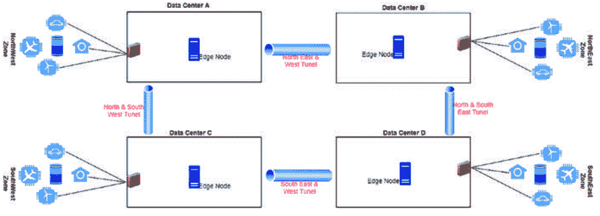

图 3.1：边缘局域网络架构

网络边缘局域网位于你的网络核心之外。它包括汇聚位置，例如区域数据中心、下一代局端（NGCOs）、固定有线接入点、无线接入基站和无线接入网络（RANs）。

网络边缘还可以包括本地位置，例如通用客户端设备（uCPE），多个工作负载（如软件定义广域网（SD-WAN）和企业应用）可以托管在单个边缘计算设备上。

### Edge LAN 的主要特性

- 靠近用户：Edge LAN 系统被战略性地部署在网络边缘，降低延迟并提升用户体验。这种靠近性对于对延迟敏感的应用（如增强现实、虚拟现实和在线游戏）至关重要。
- 分布式计算：Edge LAN 包含分布式计算资源，实现更快的数据处理和实时分析。这种方法非常适合需要即时数据洞察的应用，例如物联网设备和自动驾驶汽车。
- 弹性与冗余：Edge LAN 系统设计用于高可用性和可靠性。通过去中心化数据存储和处理，它们降低了网络故障干扰运营的风险。
- 安全性：由于敏感数据通常在更靠近数据源的位置进行处理，Edge LAN 可以通过最大限度地减少传输过程中的数据暴露来增强安全性。此外，还可以在边缘实施高级安全措施以防范威胁。
- 可扩展性：Edge LAN 架构具有高度可扩展性，因此能够容纳连接设备的指数级增长以及数据密集型应用日益增加的需求。

## 理解边缘广域网

边缘广域网（Edge WAN）是另一种开创性的网络范式，它通过将 Edge LAN 的优势从本地环境扩展到广域网的更广地理范围，从而对 Edge LAN 形成互补。

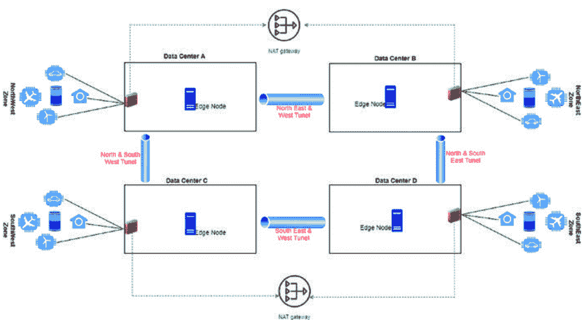

图 3.2：边缘广域网络架构

### Edge WAN 的主要特性

- 全球覆盖：Edge WAN 利用分布在多个地理位置的边缘节点网络，确保在长距离内实现高速、低延迟连接。这对于拥有全球业务的企业至关重要。
- 动态路由：Edge WAN 采用智能动态路由算法，适应不断变化的网络条件，优化数据流量并最大限度地减少瓶颈。这带来了性能的稳定性和停机时间的减少。
- 边缘云集成：通过与边缘云服务无缝集成，Edge WAN 使企业能够以最低延迟访问云资源，从而为远程办公室和用户释放云计算的全部潜力。
- 应用优先级：Edge WAN 可以对关键应用和流量进行优先级排序，确保关键任务操作获得最佳性能所需的带宽和低延迟。
- 成本效益：通过减少对集中式数据中心进行大量回传的需求，Edge WAN 可以帮助组织节省带宽成本并降低碳足迹。


## 边缘 LAN 和边缘 WAN 的融合

当这两种技术融合时，Edge LAN 和 Edge WAN 的真正威力才会显现。共同构建了一个灵活、高效且能响应当今数字环境需求的全面网络生态系统。

## 融合的优势：

- 提升用户体验：Edge LAN 的低延迟与 Edge WAN 的全球覆盖相结合，确保无论身处何地，都能提供无与伦比的用户体验。
- 可扩展性与灵活性：统一的 Edge LAN 和 Edge WAN 架构使组织能够轻松扩展网络，以适应增长和不断变化的业务需求。
- 数据驱动的洞察：通过在边缘处理和分析数据，企业可以实时了解其运营情况，从而实现数据驱动的决策。
- 安全性：融合的 Edge LAN 和 Edge WAN 解决方案提供了强大的安全框架，保护数据在传输过程中的每个阶段。

以下是最佳边缘计算公司：

- 亚马逊网络服务 https://aws.amazon.com/edge/
- 微软 https://azure.microsoft.com/en-us/products/azure-stack/edge/
- ClearBlade: https://www.clearblade.com/
- Dell https://www.dell.com/en-us/dt/solutions/edge-computing/index.htm#collapse&tab0=0&tab1=0
- https://www.edgeconnex.com/
- Section: https://www.section.io/

## 边缘网络技术

边缘网络技术在实现 IoT 就绪网络基础设施方面发挥着关键作用。物联网 (IoT) 是一个快速增长的连接设备和传感器生态系统，这些设备和传感器会产生海量数据。传统云计算网络架构难以处理 IoT 应用程序的实时处理和低延迟要求。边缘计算网络正是为此而生。

以下是一些实现 IoT 就绪网络基础设施的关键边缘计算技术：

- 多接入边缘计算 (MEC)：MEC（又称移动边缘计算）是一种旨在在无线接入网 (RAN) 内部署计算和存储资源的网络架构。MEC 的优势在于，它不仅提高了网络效率，还能向最终用户交付内容。
- 雾计算：雾计算将云延伸至更靠近边缘设备的位置（通常位于本地网络内）。它能够在网络边缘进行数据处理、分析和决策，从而降低延迟并提高整体系统效率。它还能在最合理、最高效的位置选择性地帮助存储和部署数据及计算。
- 边缘数据中心：在某些情况下，可能会在战略位置设立边缘数据中心以支持边缘计算。这些较小的本地化数据中心有助于降低延迟，并支持 IoT 应用程序的处理需求。微型数据中心是小型、模块化的机架级系统，有助于在任何环境中全球部署边缘网络计算，并用于安装和管理。由于体积较小，它们比传统数据中心更适合在多种地点使用。
- 边缘网关：边缘网关是介于边缘设备与云或数据中心之间的中间设备。它们聚合来自多个 IoT 设备的数据，进行预处理，并仅将相关信息传输到云端。边缘网关还可以在本地运行分析。
- 5G 与边缘：5G 网络的部署通过提供高速、低延迟连接，显著增强了边缘计算的能力。5G 使 IoT 设备能够进行实时数据处理和通信，这是 4G 或更旧网络以前无法实现的。
- 云让（Cloudlets）：云让是位于网络边缘的小型云数据中心，具有增强的移动性。它们代表了 IoT 或边缘设备三层层级结构中的第二层。云让通过降低附近地理范围内移动设备的延迟率，帮助优化资源密集型和交互式移动应用程序。

云让是解决广域网 (WAN) 云计算相关延迟增加问题的答案。随着 5G 网络的影响已初显，云让可以帮助支持面向增强现实、机器学习、语音识别和语言处理的资源密集型应用程序。

- 边缘安全：边缘计算需要强大的安全措施来保护数据和设备。安全启动、基于硬件的安全模块和身份管理等技术对于保障边缘基础设施安全至关重要。

## 边缘路由协议

边缘计算生态系统的基本组成部分之一是促进设备、边缘服务器与云之间通信的网络协议。在这一系列页面中，我们将探讨各种在实现边缘计算环境无缝运行方面发挥关键作用的边缘计算网络协议。

- 消息队列遥测传输：MQTT（消息队列遥测传输的缩写）是一种轻量且高效的消息传输协议，在边缘计算领域（尤其是物联网 (IoT) 生态系统）中获得了极大的普及。它以低开销著称，非常适合资源受限的边缘设备。MQTT 采用发布-订阅模型，使设备能够以可扩展且灵活的方式发送和接收消息。它非常适合需要在边缘设备与边缘服务器之间，甚至从边缘到云端以最小延迟传输数据的场景。
- HTTP/HTTPS（超文本传输协议/安全）：这通常用于边缘设备与服务器之间的基于 Web 的通信，包括 RESTful API。
- HTTP/2 和 gRPC：边缘计算不仅需要低延迟通信，还需要高性能数据传输。HTTP/2 和 gRPC（Google 远程过程调用）是两种在边缘设备与服务器之间提供高效、快速通信的协议。

HTTP/2 是传统 HTTP/1.1 的继任者，引入了多路复用、头部压缩等增强功能，显著提升了数据传输效率。它是基于 Web 的边缘应用的有力竞争者。

另一方面，gRPC 是由 Google 开发的一种高性能、与语言无关的远程过程调用 (RPC) 框架。它旨在与 HTTP/2 无缝协作，非常适合在边缘计算环境中构建高效、可靠的通信通道。

- CoAP（受限应用协议）：在边缘计算方面，并非所有设备都一样。边缘上的一些设备在处理能力和内存方面资源有限。这就是受限应用协议 (CoAP) 发挥作用的地方。CoAP 是一种专门设计用于在资源受限环境中高效工作的协议，使其成为涉及低功耗设备的边缘计算应用的首选。

CoAP 为通信提供了一种简单的请求-响应模型，使其轻量且非常适合边缘设备之间或与边缘服务器通信的场景。它在工业物联网应用中特别受欢迎，在这些应用中，能源效率至关重要。

- AMQP（高级消息队列协议）：尽管不如 MQTT 或 CoAP 轻量，但 AMQP 仍然是一种流行的消息协议，用于设备与服务之间高效、可靠且安全的通信。
- WebSockets：WebSockets 并非本质上轻量，但它们通过单个长寿命连接提供全双工、低延迟的通信通道。对于需要轻量级数据传输的实时应用程序，它们可能是一个不错的选择。
- OPC UA（统一架构）：这是一种用于工业物联网 (IIoT) 和边缘计算应用的工业通信和数据交换标准。
- DDS（数据分发服务）：DDS 是一种常用于实时和关键任务系统的协议。它在分布式应用程序之间提供高效的数据交换，并在某些配置下设计为可扩展且轻量。
- ZeroMQ：这是一个支持多种消息模式的轻量级消息库，适用于在边缘计算中构建自定义通信解决方案。
- AMT（自动组播隧道）：这是一种用于优化边缘网络中的组播流量并提高数据分发效率的协议。
- Bluetooth：这是一种无线通信协议，通常用于边缘设备之间的短距离通信，尤其在物联网和可穿戴应用中。


- **BLE (Bluetooth Low Energy)**: BLE 是蓝牙标准的轻量级版本，专为低功耗、短距离通信而设计。它通常用于物联网设备和可穿戴设备。

- **Zigbee**: 这是一种专为低功耗、低数据速率应用（如家庭自动化和传感器网络）而设计的低功耗无线通信协议。它采用网状网络拓扑，以低能耗著称。

- **LoRaWAN (Long Range Wide Area Network)**: 这是一种低功耗广域网协议，用于物联网应用中的远距离通信，尤其适用于农村或偏远地区。这是一种专为物联网应用设计的远距离、低功耗无线通信协议，非常适合低数据速率、长距离通信。

- **6LoWPAN (IPv6 over Low-Power Wireless Personal Area Networks)**: 这是一种允许在低功耗、低带宽无线网络上进行 IPv6 通信的协议，常用于物联网。

- **LwM2M (Lightweight M2M)**: LwM2M 是一种专为物联网部署中的远程设备管理和通信而设计的协议。它轻量、高效，适用于受限设备。

- **Modbus**: 这是一种用于工业设备之间通信的协议，常用于边缘计算中的工业自动化和控制应用。

- **Sigfox**: Sigfox 是另一种专为物联网和 M2M 通信而设计的低功耗广域网（LPWAN）协议。它提供长距离连接，功耗极低。

- **Thread**: 这是一种专为物联网应用（特别是家庭和建筑自动化）而设计的低功耗无线网络协议。

- **XMPP (Extensible Messaging and Presence Protocol)**: XMPP 最初用于即时通讯，已被改造用于物联网和 M2M 通信，提供轻量级、实时的消息传递功能。

- **NB-IoT (Narrowband IoT)**: 这是一种针对物联网应用优化的蜂窝网络标准，为边缘设备提供低功耗广域连接。这是一种专为物联网应用设计的蜂窝通信标准，利用现有蜂窝基础设施提供低功耗、低数据速率连接。

- **Routing Protocol for Low-Power and Lossy Networks (RPL)**: 这是一种专为低功耗和损耗网络（LLN）这一特定类网络而设计的路由协议。LLN 中的设备通常处理能力、内存和能源资源有限，且通信链路不可靠。

## 边缘的服务质量（QoS）

服务质量（QoS）是指一组技术和机制，允许网络管理员控制和优先处理网络流量。它确保关键应用和服务在网络拥塞时也能获得必要的带宽和资源，从而发挥最佳性能。QoS 对于视频流、在线游戏、VoIP 通信等应用提供一致且可靠的用户体验至关重要。

## 边缘网络与 QoS 的交汇

边缘网络与 QoS 的融合是一种自然的演进。在边缘网络中，数据处理更靠近最终用户，这意味着低延迟和高带宽至关重要。QoS 机制在实现这些目标中发挥着关键作用。

这是边缘网络与 QoS 的交汇体现：

- **超低延迟**: 边缘网络需要超低延迟来支持自动驾驶汽车、增强现实和远程机器人等实时应用。QoS 机制确保数据包被优先处理以最大限度减少延迟，从而提供更流畅、更灵敏的用户体验。

- **带宽分配**: 在边缘网络中，资源分布在庞大的分布式基础设施上。QoS 确保关键应用获得必要的带宽分配，防止网络拥塞和瓶颈。

- **服务隔离**: 边缘网络通常在同一基础设施上托管多个服务和应用。QoS 实现服务隔离，确保一个应用的流量不会不利地影响另一个应用，从而保持一致的服务质量水平。

- **可扩展性**: 边缘网络设计为根据需求动态扩展。QoS 机制可以适应这种可扩展性，按需分配资源，并确保维持质量标准。

## 挑战与注意事项

在边缘网络中实施 QoS 面临一系列挑战。具体如下：

- **网络复杂性**: 边缘网络本质上很复杂，分布在各个位置的众多边缘节点。要在这一复杂的网络架构中确保一致的 QoS 具有挑战性。

- **安全性**: 优先处理流量和分配资源可能会引入安全漏洞。仔细规划和强大的安全措施对于降低这些风险至关重要。

- **标准化**: 随着边缘网络和 QoS 的不断发展，标准化工作对于确保实现的互操作性和一致性至关重要。

## 边缘网络中的安全与隐私

在动态的边缘网络环境中，安全与隐私作为守护数字领域的哨兵，居于至高无上的地位。随着数据向设备和传感器日益增多的边缘流动，强大的安全措施变得愈发不可或缺。

同时，安全不仅仅是一个网关，而是一张从基于硬件的加密到 AI 驱动的异常检测的多层防御复杂网络。数据与其守护者之间这种复杂的互动，确保敏感信息在面对网络威胁时立场坚定，维护个人隐私的神圣性和关键系统的完整性。边缘网络重新定义了安全与隐私的战场，迫使我们不断创新和适应，开辟一条让数字边疆既坚固又值得信赖的道路。

## 了解边缘网络安全

以下是启用边缘网络安全的各种方法和最佳实践：

- **零信任架构**: 零信任是一种不断发展的安全范式，它假设无论位置如何，都不信任用户、设备或网络。采用零信任时，资源访问基于知情需要原则授予，并持续验证。实施零信任模型涉及强身份验证、严格的访问控制、持续监控和最小特权访问。

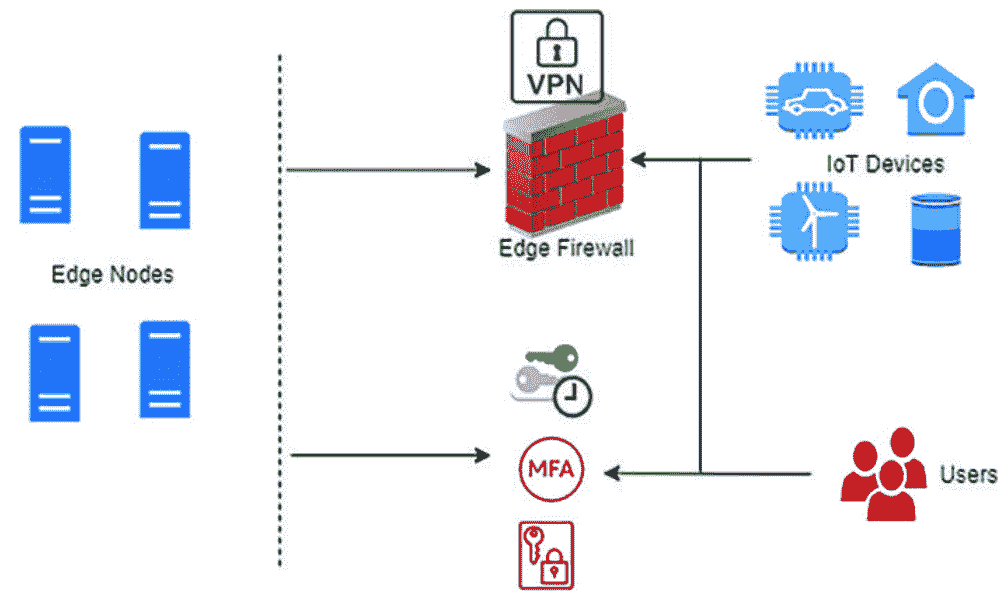

图 3.3：边缘网络安全架构

- **防火墙与入侵检测/防御系统（IDPS）**: 防火墙通过基于预定义安全规则监控和过滤入站和出站流量，充当第一道防线。入侵检测/防御系统（IDPS）通过主动监控网络流量中的恶意活动迹象并实时响应，来补充防火墙。同时部署防火墙和 IDPS 有助于加固边缘网络，防止未经授权的访问和网络威胁。

- **软件定义边界（SDP）**: SDP 是一种安全框架，为授权用户和设备动态创建隔离的网络段。这种方法减少了攻击面，使攻击者更难以利用漏洞。SDP 还对网络访问提供细粒度控制，帮助组织有效保护其边缘网络。

- **网络分段**: 根据功能或用户角色将边缘网络划分为较小的隔离区域，有助于遏制潜在的安全漏洞。即使攻击者访问了其中一个段，他们在网络内横向移动时也会遇到困难。适当的分段应辅以严格的访问控制。

- **补丁管理**: 定期更新和修补边缘设备和网络设备对于安全至关重要。软件和固件中的漏洞是攻击者的常见目标。建立强大的补丁管理流程至关重要，以确保所有设备都安装了最新的安全修复程序。


- IoT 设备安全：随着边缘 IoT 设备的普及，保护这些端点至关重要。为 IoT 设备采用强身份验证、加密和网络分段。定期更新其固件以修补已知漏洞。

- 安全意识培训：人为错误往往是安全漏洞的重要因素。确保员工和网络用户接受定期的安全意识培训。教他们识别网络钓鱼和社会工程学攻击的企图，以及遵循安全协议的重要性。

- 持续监控与事件响应：实施持续监控系统，追踪网络活动中的可疑行为。在发生安全事件时，制定明确的事件响应计划有助于最大限度地减少损失并减少停机时间。

## 理解边缘计算与隐私

以下是启用边缘网络安全的各种方法和最佳实践：

- 加密：传输中和静态数据的加密是基本的安全做法。安全套接层 (SSL) 和传输层安全 (TLS) 协议通常用于加密在边缘网络中传输的数据。此外，对边缘设备和服务器上存储的敏感数据进行加密，可提供额外的保护层，以防止数据泄露。

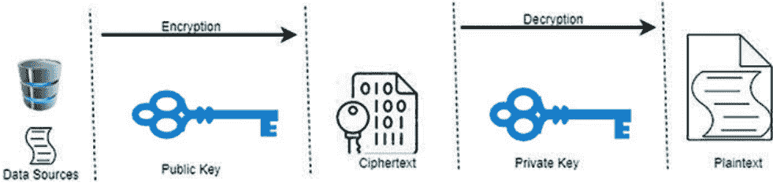

图 3.4: 加密流程架构

- 同态加密：同态加密是一种高级加密技术，允许在不先解密的情况下对加密数据进行计算。这种方法在边缘计算场景中尤其有利，因为它能够在保护隐私的同时进行数据处理。边缘设备可以对加密数据进行计算，提供结果而不暴露原始信息，然后可以在安全端点解密。

- 边缘 AI 用于匿名化：边缘 AI 技术在源头对敏感数据进行匿名化方面发挥着至关重要的作用。运行在边缘设备上的机器学习模型可以从传感器读数或图像中去除个人身份信息 (PII) 或其他敏感数据元素，然后再将其传输到中央服务器。这种方法可最大限度地减少数据暴露并降低隐私风险。

- 用于数据溯源的区块链：区块链因其在保护加密货币方面的作用而闻名，在数据隐私方面有更广泛的应用。在边缘网络中，区块链可用于建立安全且防篡改的数据交易账本。这个账本有助于追踪数据的来源和用途，确保透明度和问责制，同时防止未经授权的访问。

- 联邦学习：联邦学习是一种去中心化的机器学习方法，在多个边缘设备上训练模型，同时将数据保留在设备上。这种技术允许边缘设备协作并提高模型准确性，而无需将原始数据共享到中央服务器，从而保护隐私。

- 边缘网络分段：将边缘网络分割为具有不同安全策略的隔离区域，是隐私保护的基本策略。每个区域内的设备只能基于预定义规则进行通信，限制攻击者横向移动的潜在可能性，并减少数据暴露。

- 定期安全审计和更新：为了保持边缘网络隐私，必须进行定期安全审计，并保持所有边缘设备和软件处于最新状态。这种主动方法有助于识别漏洞，并确保安全措施与新兴威胁同步发展。

- 数据最小化：采用数据最小化理念，确保边缘网络中仅收集和处理必要数据。处理的数据越少，隐私风险越小。实施数据保留策略，并及时处置不必要的数据。

最后，保护边缘网络是一项多方面的工作，需要技术、策略和用户意识的结合。通过采用包含防火墙、零信任原则、加密和其他安全措施的综合方法，组织可以加固其边缘网络以抵御不断演变的网络威胁，并保护其关键资产和数据。持续警惕并适应新兴威胁，是在这个不断变化的数字环境中保持边缘网络安全的关键。

## 案例研究与应用

我们的用例是使用“互联牛”技术进行牛只健康追踪。这些牛位于西非、东欧和美国，我们的公司受雇使用耳标来追踪和监测牛只的健康状况。耳标用于追踪牛只的生命体征。每个地点有 200 头母牛和 100 头公牛，西非除外，那里有 250 头母牛和 50 头公牛。

技术团队位于美国德克萨斯州，美国农场也位于那里。350 个耳标 IoT 设备已运送到每个地点，并由制造商在工厂编号。西非的农场位于尼日利亚西南部，那里的互联网流量不稳定，因此制定了新的边缘解决方案来缓解互联网问题。

以下是各地点的边缘设置：

### 美国，德克萨斯州：

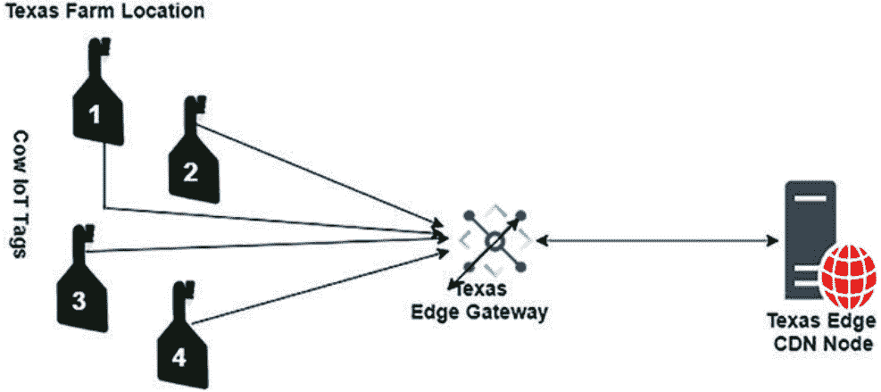

图 3.5: 德克萨斯州 CDN 边缘架构

### 东欧，波兰：

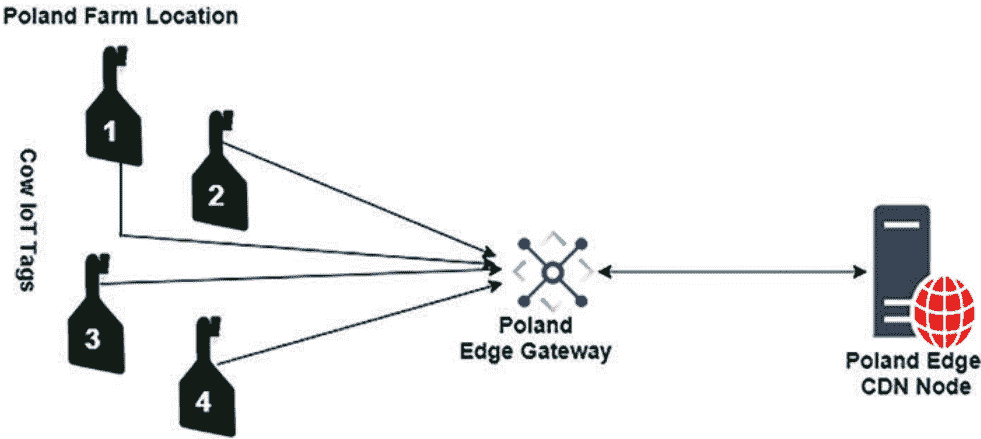

图 3.6: 波兰 CDN 边缘架构

### 西非，尼日利亚：

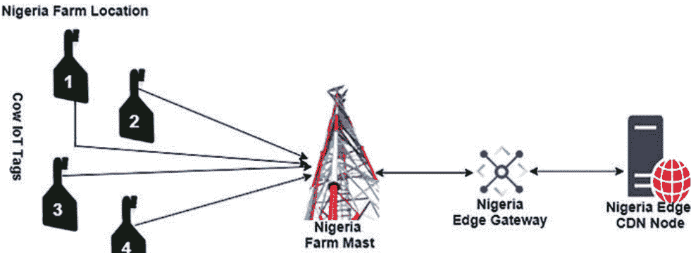

图 3.7: 尼日利亚 CDN 边缘架构

### 逐步设置各地点：

- 智能耳标：IoT 智能耳标是一种革命性技术，旨在改变农业环境中牲畜的管理和监测方式。这种创新设备是一个小型、轻便的标签，固定在牛、绵羊或山羊等动物的耳朵上。使 IoT 智能耳标真正独特的是其集成了 IoT（物联网）技术，为牲畜行业带来诸多好处。

- 实时监控：IoT 智能耳标配备了各种传感器，包括 GPS、温度、湿度和运动传感器。这些传感器收集动物位置、健康和行为的实时数据。农民可以通过智能手机或电脑上的用户友好界面访问这些信息。

- 健康管理：通过持续监测动物的生命体征和活动水平，农民可以及早发现疾病或不适的迹象。这允许及时干预，降低疾病爆发的风险并改善动物福利。

- 位置追踪：凭借内置 GPS 技术，农民可以随时追踪牲畜的位置。这对于防止盗窃、寻找走失动物以及确保动物留在指定的放牧区域内特别有价值。

- 环境监测：IoT 智能耳标还可以测量动物周围的环境条件，例如温度和湿度。这些数据帮助农民做出明智决策，决定何时何地移动牛群以优化放牧条件。

- 数据分析：该设备随时间收集大量数据，可用于分析动物行为模式、喂食习惯等。这种数据驱动的方法使农民能够做出有数据支持的决策，以提高生产力和效率。

- 远程管理：农民可以远程配置和管理 IoT 智能耳标，轻松自定义设置并接收特定事件或条件的警报。此远程控制功能在牲畜管理中节省了时间和精力。

- 可持续性与可追溯性：IoT 智能耳标可以通过优化资源使用和减少浪费来促进可持续农业实践。此外，收集的数据有助于可追溯性工作，帮助消费者了解其购买肉类的来源和条件。

- 与其他系统集成：这些智能耳标可以与其他农场管理系统集成，实现农业各方面的无缝协调，例如喂食系统、自动挤奶等。

您可以直接从以下链接购买耳标：
https://www.resy.com/product-cat-7.html?gclid=EAIaIQobChMI77Cl7-KRgQMVLufjBx33cwHLEAAAYAiAAEgKxfPD_BwE

请确保理解智能耳标技术，例如 LoRa、LoRaWAN、蜂窝、卫星、蓝牙、BLE 和 WiFi。项目成本将根据您选择的 IoT 技术而有所不同。


总之，物联网智能耳标是牲畜管理领域的一场变革。通过发挥物联网技术的力量，这些设备提供实时监测、数据驱动的洞察和效率提升，最终使农民及其照料的动物都受益。这项创新技术有潜力彻底改变我们在二十一世纪对待畜牧业和农业的方式。

### 物联网网关

物联网网关作为关键组件脱颖而出，充当物理世界与数字世界之间的桥梁。尽管它看似是一台普通设备，但其意义深远且影响深远，将独特的功能和机遇带到了我们互联世界的前沿。

### 数据编排

物联网网关编排着一场数据交响乐。它收集、处理和过滤来自大量物联网设备的数据，从混乱中梳理出头绪。这种独特能力将原始数据转化为宝贵的洞察，为明智的决策打开大门。

### 协议协调

在多样化的物联网设备生态系统中，每种设备都有自己的语言。物联网网关拥有独特的多语言能力，能够在各种协议之间翻译数据，确保设备之间无缝通信和互操作性，否则这些设备将保持孤立。

### 边缘计算

物联网网关不仅仅是数据中继，它在边缘部署了一个微型数据中心。这一独特功能使其能够进行实时处理，减少延迟和带宽需求，从而确保关键决策可以即时做出。

### 安全哨兵

物联网网关作为网络入口处的独特哨兵站岗放哨。它执行安全策略，加密数据，监控异常，保护您的物联网生态系统免受潜在威胁和漏洞的侵害。

### 可扩展性推动者

随着物联网网络的增长，物联网网关独特地实现了可扩展性。它能够适应不断增加的设备数量和数据流，确保您的基础设施保持敏捷，并能应对不断变化的需求。

### 定制中心

没有两个物联网部署是完全相同的。物联网网关作为独特的定制中心脱颖而出，允许开发人员根据特定用例定制其功能。这种适应性为物联网解决方案中的创造力和创新提供了动力。

### 能源效率

在物联网设备领域，节能至关重要。物联网网关优化数据传输和处理的独特能力将能源消耗降至最低，延长了电池供电设备的使用寿命。

### 远程管理

地理距离对物联网网关来说无关紧要。其独特的远程管理功能允许管理员跨越广泛的分布式网络监控、更新和配置设备，节省时间和资源。

### 分析加速器

数据驱动的洞察是物联网时代的货币。物联网网关通过在本地预处理数据，加速分析过程，减轻中央服务器的负担，并使关键信息能够更快地被访问。

### 交汇领域

物联网网关独特地位于物理世界与数字世界的交汇点，象征着物联网本身的承诺。它无缝融合了传感器和执行器的有形世界与数字领域的无限可能性，为创新和转型创造了新的途径。

总之，物联网网关是现代技术的奇迹，汇集了一套独特的功能，对实现物联网愿景至关重要。它作为物理世界与数字世界之间桥梁的作用不仅独特，而且不可或缺，正在塑造我们连接、沟通和理解周围世界的未来。

## 在 Ubuntu 上构建您自己的物联网网关

先决条件：物联网网关需要内核版本 4.4+

### 第 1 步：通过以下命令检查内核版本：

```
root@secure-edge-gateway:~# uname -r
5.4.0-153-generic
```

### 第 2 步：安装

```
root@secure-edge-gateway:~# snap install bluez
bluez 5.48-4 from Canonical√ installed
```

### 第 3 步：检查已安装的版本

```
root@secure-edge-gateway:~# sudo dpkg --status bluez | grep '^Version:'
Version: 5.48-4
```

### 第 4 步：安装 radvd（路由器通告守护进程）：

```
root@secure-edge-gateway:~# sudo apt-get install radvd
# (use the text editor of your choice to create the following config file)
root@linaro-developer:~# cat /etc/radvd.conf
interface bt0
{
IgnoreIfMissing on;
AdvSendAdvert on;
MinRtrAdvInterval 300;
MaxRtrAdvInterval 600;
AdvDefaultLifetime 7200;
prefix fc00::/64
{
AdvOnLink off;
AdvValidLifetime 36000;
AdvPreferredLifetime 36000;

AdvAutonomous on;
AdvRouterAddr on;
};
};
```

### 第 5 步：安装

```
root@secure-edge-gateway:~# sudo apt-get install ndppd
```

### 第 6 步：配置

```
# (use the text editor of your choice to create the following config file)
root@linaro-developer:~# cat /etc/ndppd.conf
route-ttl 30000
proxy wlan0 {
router yes
timeout 500
ttl 30000
rule fc00:0:0:0:d4e7::/80 {
static
```

### 第 7 步：安装

```
root@secure-edge-gateway:~# sudo apt-get install tinyproxy
```

### 第 8 步：配置 tinyproxy：

```
# (use the text editor of your choice to create the following config file)
root@linaro-developer:~/# cat /etc/tinyproxy.conf
User nobody
Group nogroup
Port 8080
Timeout 600

# TODO: Make this return a 30 second JSON wait response
DefaultErrorFile "/usr/share/tinyproxy/default.html"
StatFile "/usr/share/tinyproxy/stats.html"
Logfile "/var/log/tinyproxy/tinyproxy.log"
LogLevel Info
PidFile "/var/run/tinyproxy/tinyproxy.pid"
MaxClients 100
MinSpareServers 10
MaxSpareServers 30
StartServers 20
Allow fc00::/7
Allow fe80::/64
Allow ::1
ViaProxyName "tinyproxy"
ReversePath "/DEFAULT/" "http://gitci.com:8080/DEFAULT/"
ReverseOnly Yes
```

### 第 9 步：为 eth 接口设置 IP 地址：

```
# (use nano or any text editor of your choice to create the following config file)
root@secure-edge-gateway:~# cat /etc/network/interfaces.d/bt0
auto bt0
allow-hotplug bt0
iface bt0 inet6 static
address fc00:0:0:0:d4e7::1
netmask 80
```

### 第 10 步：为路由器服务设置 sysctl：

```
# (use nano or any text editor of your choice to create the following config file)
root@secure-edge-gateway:~# cat /etc/sysctl.d/gateway.conf
# don't ignore RA on wlan0
net.ipv6.conf.wlan.accept_ra=2
# enable ip forwarding
net.ipv6.conf.all.forwarding=1
# enable IPv6 neighbor proxy, in case the 6lowpan needs to
# share the same host IPv6 subnet
net.ipv6.conf.all.proxy_ndp=1
```

### 第 11 步：设置 NetworkManager 忽略 bt0 接口：

创建 /etc/NetworkManager/conf.d/nm-bt0.conf，并添加：

```
[keyfile]
unmanaged-devices+=interface-name:bt0
```

### 第 12 步：重启：

```
root@secure-edge-gateway:~# reboot -h now
```

### 第 13 步：启动物联网网关进程：

要启动物联网网关进程，请执行以下操作：

```
root@secure-edge-gateway:~# sudo service radvd start
root@secure-edge-gateway:~# sudo service ndppd start
```

您可以通过以下方式使用 AWS IoT 网关：

https://docs.aws.amazon.com/whitepapers/latest/securing-iot-with-aws/aws-iot-device-management-cloud-based-iot-device-management-service.html

## 在 Ubuntu 和 NGINX 上构建您自己的边缘 CDN

NGINX 是一款高性能、开源的 Web 服务器，以其速度、可扩展性和可靠性而闻名。它是默默无闻的英雄，确保当您在浏览器中输入 URL 时，网页能够无缝加载。然而，它不仅仅是一个服务器，它还是面向物联网或现代应用程序的内容分发网络（CDN）。

以下是 CDN 架构：

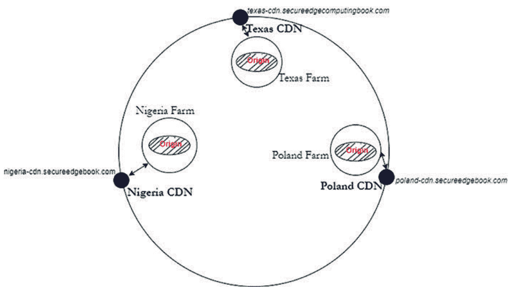

图 3.8：CDN 近缘边缘架构

以下是在 NGINX Ubuntu 服务器上构建边缘 CDN 的逐步过程：

### 第 1 步：在 Debian 机器上安装 Nginx：

```
root@texas-edge-cdn:~# sudo apt-get install nginx
```

### 第 2 步：选择 NGINX 资源文件夹所在的文件夹（/var/www/assets/）：

您需要为每个边缘位置（德克萨斯州、尼日利亚和波兰）执行此操作。

```
root@texas-edge-cdn:~# nano /etc/nginx/sites-available/texas-edge-cdn
```

添加以下设置：

```
server {
listen 443;
server_name texas-cdn.secureedgecomputing.com;

location / {
expires 90d;
root /var/www/assets/;
}
}
```

### 第 3 步：重启 NGINX 服务：

```
root@texas-edge-cdn:~# sudo service nginx start
```


注意：必须为所有 CDN 服务器配置其名称。

## 边缘网络与路由的未来趋势

边缘网络与路由的概念已成为改变游戏规则的力量。随着我们迈向未来，几项令人兴奋的趋势有望塑造边缘网络与路由的格局，提升数字生态系统的效率、安全性和可靠性。

以下是其中一些有望彻底改变我们在数字世界中连接和通信方式的趋势：

- **边缘计算扩展：** 边缘计算是边缘网络与路由革命的核心。这一趋势涉及计算能力的去中心化，将处理能力更贴近数据源和最终用户。随着我们不断向前发展，可以预期边缘计算基础设施将得到更广泛的扩展，更多的边缘数据中心、微型数据中心和分布式计算资源将被部署。这将导致延迟降低、响应时间改善以及实时处理能力增强。

- **5G 集成：** 5G 网络的部署将在边缘网络与路由的演进中发挥关键作用。5G 提供更快的数据传输速度、更低的延迟和更大的网络容量，使其成为支持广泛边缘应用的理想选择，从自动驾驶汽车到增强现实。随着 5G 的不断成熟和覆盖范围的扩大，边缘网络将利用这项技术实现新的用例并改进现有用例。

- **网络切片：** 网络切片是一种技术，允许网络运营商在单一物理基础设施上创建多个虚拟网络。该功能能够根据特定应用需求定制网络资源。在未来，我们可以预期在边缘网络中更广泛地使用网络切片，确保关键应用获得所需资源和网络性能，即使在共享环境中也是如此。

- **人工智能驱动的路由：** 人工智能（AI）正在网络和路由领域发挥作用。AI 算法可以分析网络流量模式、检测异常，并实时优化路由决策。这一趋势预计将不断增长，从而带来更具适应性和智能性的路由解决方案，能够主动解决网络拥塞、安全威胁和性能问题。

- **增强的安全措施：** 安全是边缘网络中首要关注的问题，尤其是数据越来越靠近边缘进行处理时。在未来，我们将见证更多专门为边缘环境定制的强大安全措施的发展。这包括集成高级加密协议、安全启动流程以及人工智能驱动的威胁检测系统，以保护边缘设备和数据免受新兴网络威胁的影响。

- **用于路由安全的区块链：** 区块链技术以其透明性和不可篡改性而闻名，正在进入路由安全领域。通过实现基于区块链的路由协议，我们可以增强路由信息的可信度。这对于防止路由劫持和 BGP（边界网关协议）攻击尤其有用，这些一直是网络世界中的持续关注点。

- **容器化与编排：** Docker 和 Kubernetes 等容器化技术正在改变应用程序的部署和管理方式。在边缘网络中，容器化允许在边缘高效部署服务和应用程序。编排工具帮助自动管理这些容器，确保它们在动态的边缘环境中平稳运行。

- **多云与混合部署：** 随着组织越来越多地采用多云和混合云策略，边缘网络与路由解决方案将需要与这些环境无缝集成。这一趋势将推动混合边缘网络解决方案的发展，使组织能够同时利用本地和云资源，以实现最佳性能和灵活性。

- **可持续性与绿色网络：** 随着对环境可持续性的关切日益增加，网络行业也在关注环保解决方案。未来的边缘网络与路由技术可能会融入节能硬件设计、节能算法和可再生能源，以减少数字基础设施的碳足迹。

## 结论

本章开篇带领读者进入边缘网络与路由协议的动态领域，创新与必要在此交汇，重新定义连接与数据管理的边界。本章聚焦于新兴技术，突破了网络基础设施领域的可能性边界。

我们首先探讨了边缘网络的概念，这是一种将计算能力更贴近数据来源的范式转变，彻底改变了我们处理和管理信息的方式。从物联网设备到自动驾驶汽车，本章揭示了边缘计算对延迟敏感型应用的变革性影响，这些应用能够在边缘实现实时决策。

随着深入探讨，我们遇到了一系列构成这些边缘网络骨干的路由协议。OSPF 和 BGP 等传统协议与 RPL 和 LoRaWAN 等较新的竞争者并列，突出了它们在不断演变的格局中独特的属性和适用性。这些协议与边缘环境之间的相互作用揭示了效率、可扩展性和安全性之间微妙的平衡。

本章随后转向边缘网络的挑战与复杂性，讨论了安全性、可扩展性和互操作性等主题。读者得以一窥不断演变的威胁格局，以及正在重塑边缘安全范式的创新解决方案。

在数据驱动的世界中，我们探讨了这些协议如何推动智能路由策略的发展。机器学习、人工智能驱动的路由和预测分析相结合，以优化网络性能，确保数据在复杂的边缘设备网络中无缝、高效地流动。

综上所述，探索边缘网络与路由协议的前沿，提供了一幅重塑我们数字格局的尖端技术的全景图。它表明，随着我们不断突破创新的边界，我们不仅重新定义了连接方式，也在重写网络和数据管理领域可能性的规则手册。

在下一章中，我们将开始探索安全领域错综复杂且动态的世界，具体在边缘计算安全领域，技术与现实的交汇催生了一个充满挑战与机遇的格局。加入我们，一起揭开保护我们互联未来之谜，深入探究物联网与边缘计算安全的错综网络。

## 选择题

请列出三种边缘网络协议。

- RPL, MQTT, and LoRaWAN
- Edge, MQTT, and LoRaWAN
- Edge, RPL, and LoRaWAN
- Edge, RPL, and MQTT

判断题：Edge LAN 和 Edge WAN 是同一回事。

- True
- False

判断题：QoS 在保证一致且可靠的移动用户体验方面起着关键作用。

- True
- False

以下哪种 IoT 网关必须提供？

- Hardware Security
- Central Data Storage
- Fast Installation of Protocol
- Protocol Abstraction

仅知悉于交换秘密消息的一方或多方的加密/解密密钥的名称是什么？

- E-Signature
- Digital Certificate
- Private Key
- Security Token

## 答案

- a
- b
- a
- d
- c

## 问题

- 确定用于 IoT 分析的两种首选编程语言
- 列出两种启用边缘网络安全的方法。
- 列出仅知悉于交换秘密消息的一方或多方的加密/解密密钥。
- 列出并定义 Edge LAN 的三个关键特性。
- 列出并定义 Edge WAN 的三个关键特性。
- 列出并定义五种边缘网络协议


## Key Terms

- 边界网关协议
- 命名数据网络
- 移动自组网路由协议
- 下一代中心局
- 无线接入网
- 通用客户场所设备
- 软件定义广域网
- 局域网
- 广域网
- 安全套接层
- 传输层安全协议

## 内容分发网络

# 第 4 章：物联网和边缘计算安全

## Introduction

本章将带领大家穿梭于不断演进的物联网与边缘计算安全领域，探索前沿技术与保护我们的数据、设备和数字生活之必要之间错综复杂的相互作用。互联设备网络已无缝融入我们的家庭、城市、工业乃至更广阔领域。从调节居住环境的智能恒温器，到追踪生命体征的可穿戴健康监测器，物联网为我们的日常生活带来了无与伦比的便利。然而，这种便利伴随着错综复杂的安全隐患。我们如何保护这些设备产生的海量敏感数据？当个人与监控其一举一动的智能设备交互时，我们如何确保其隐私？这些问题构成了物联网安全困境的核心，我们将深入探究其答案。

边缘计算作为云计算的灵活对应体，通过在数据源附近进行处理来补充物联网，降低延迟并增强实时决策能力。它使自动驾驶汽车能够穿梭于繁忙街道，使工厂能够优化生产，并使医疗系统能够提供即时诊断。然而，当我们将计算能力的边界推向边缘时，我们也必须直面保护分布式网络的挑战，漏洞就潜伏在不远处。

我们对物联网和边缘计算安全的探索将揭示这些挑战的多面性。我们将探索加密、身份验证和入侵检测方面的最新进展，发掘可用于保护这些复杂生态系统的工具库。我们将审视监管格局，其中政府和行业组织寻求在创新与安全之间取得平衡。我们还将深入探讨围绕监控、隐私和技术负责任使用所涉及的伦理问题。

本章将成为你穿越物联网和边缘计算安全未知领域的指南针。我们将共同导航数字疆域，规划通往更安全、更可靠未来的航向，在这个未来中，技术的无限机遇得以利用，同时不损害我们的集体福祉。所以，系好安全带，准备开始一段创新与保护相遇、可能边缘与安全边缘交汇的旅程。

## Structure

本章将讨论以下主题：

- 物联网和边缘计算中的威胁格局
- 边缘计算安全架构
- 基于硬件的安全解决方案 (TPM, HSM)
- 认证、授权和问责 (AAA)
- 保护通信协议
- 持续监控

## Objectives

本章旨在揭示交织在物联网和边缘计算图景中的错综复杂的安全挑战。通过考察这些变革性技术的融合，读者将清晰了解数据生成设备与去中心化计算资源交汇处产生的漏洞。主要目标是使读者掌握对威胁格局的细致入微的理解，使他们能够理解对个人隐私和系统稳定性所构成的潜在风险。

通过探索现实世界中的案例研究和新兴的威胁场景，本章将深入探讨该领域安全问题的动态性。阅读完本章后，读者将能够辨别保护各类物联网设备及边缘分布式计算架构的复杂性。此外，对前沿安全框架和加密协议的全面分析将赋予读者实用见解，以加固物联网和边缘计算部署，抵御网络威胁，确保数据机密性、系统弹性和用户信任。最终目标是培养有见识的安全方法，使利益相关者能够有信心地踏上物联网和边缘之旅，知道如何有效地降低风险。

## The Threat Landscape in IoT and Edge Computing

物联网 (Internet of Things) 和边缘计算安全面临的威胁格局正在迅速演变，为个人、企业和整个社会带来复杂且多面的挑战。随着互联设备的激增以及向网络边缘去中心化数据处理的转变，新的漏洞和风险已经出现。

一个重要问题是物联网生态系统中不安全设备的泛滥。这些设备通常缺乏强大的安全措施，使其成为恶意行为者的易攻目标。攻击者可以利用设备固件、软件甚至通信协议中的漏洞，获得未经授权的访问权限、窃取敏感数据，或发起诸如 DDoS (分布式拒绝服务) 之类的毁灭性攻击。

边缘计算在提供实时数据处理和降低延迟的同时，也引入了额外的安全风险。边缘节点更靠近数据源，这既是一把双刃剑。一方面，它可以通过将敏感信息保留在其源附近来增强数据隐私，但另一方面，它也引发了对物理安全的担忧。对边缘设备的未经授权的访问不仅可能危及其中存储的数据，还可能危及整个网络的完整性。

互操作性和标准化挑战也加剧了安全威胁格局。物联网设备和边缘计算平台的多样化范围通常使用不同的协议和技术进行操作。这种异质性使得在整个生态系统中实施一致的安全措施变得困难，留下了攻击者可以利用的潜在漏洞和薄弱环节。

此外，物联网设备产生的海量数据在数据隐私和安全方面构成了重大挑战。保护这些数据的机密性和完整性，尤其是在边缘传输和处理时，需要复杂的加密和访问控制机制。

为应对这些挑战，采取全面的安全方法至关重要。这包括定期安全审计、强大的加密协议、多因素身份验证、入侵检测系统以及定期更新以修补漏洞。此外，行业协作、提高意识以及实施安全设计原则对于为未来创造更安全的物联网和边缘计算环境至关重要。

以下是边缘计算中的常见威胁：

## Emerging Threat Vectors

边缘计算中的一种新兴威胁向量是物理篡改和未经授权的访问。边缘设备通常部署在偏远或安全性较低的位置，容易受到恶意行为者的物理篡改或未经授权的访问。这些个人可能会试图直接物理访问边缘设备，以操纵或破坏其处理的数据，从而导致数据完整性、机密性或可用性方面的潜在泄露。

另一个重要的新兴威胁向量是边缘设备利用和妥协。边缘设备通常计算资源有限，这使其成为攻击者试图妥协这些设备并将其用作进入更大网络的入口点的有吸引力的目标。一旦被妥协，这些设备可以作为各种网络攻击的发射平台，例如分布式拒绝服务 (DDoS) 攻击、恶意软件传播或对连接系统的未经授权的访问。

网络物理攻击和操纵构成了另一个令人担忧的威胁向量。边缘计算通常涉及与物理系统（例如工业机械或自动驾驶汽车）的集成。恶意行为者可能利用边缘基础设施中的漏洞来操纵或破坏这些物理系统，从而导致潜在的灾难性后果。例如，篡改与自动化制造流程相关的数据或命令可能导致次品，或危及工人安全。


此外，边缘到云通信拦截是一种新兴的威胁向量，专注于拦截边缘设备与云之间传输的数据。攻击者可以针对边缘设备与中央云基础设施之间的通信渠道，试图窃听敏感数据，或将恶意代码注入通信流。这种拦截可能会危及传输数据的机密性和完整性，并破坏边缘生态系统的整体运行。

最后，边缘生态系统内部的内部威胁构成重大挑战。内部威胁涉及拥有边缘基础设施授权访问权限的个人（包括员工、承包商或合作伙伴）所采取的恶意行为或无意错误。这些行为者可能滥用其特权来攻破边缘设备、泄露敏感数据或故意破坏现有的安全措施。应对内部威胁需要结合严格的访问控制、员工培训和持续监控，以检测和缓解潜在风险。

随着边缘计算不断普及并融入各个行业，防御这些新兴威胁向量对于确保整个生态系统的弹性和安全性至关重要。采用主动安全措施、定期更新和修补边缘设备，以及培养强大的网络安全文化，对于缓解这些不断发展的威胁将至关重要。

- DDoS 攻击
- 缓存投毒
- 勒索软件
- 注入攻击
- 间谍软件
- 中间人攻击
- 软件漏洞
- 侧信道攻击

图 4.1: IoT 和边缘计算中的新兴威胁

## 恶意软件和勒索软件攻击

边缘计算中的恶意软件和勒索软件攻击对分布式计算不断发展的格局构成重大威胁。边缘计算涉及在数据源附近处理数据，而不是仅仅依赖于集中式云服务器，这提供了更高的速度和效率。然而，这种去中心化的方法也开辟了恶意行为者可以利用的新漏洞。恶意软件，即旨在渗透或损坏系统的恶意软件，在边缘计算环境中可能特别具有破坏性。

在边缘计算中，设备和节点通过广泛的网络相互连接，为恶意软件提供了广泛的攻击面。恶意代码可以通过这些互连设备传播，干扰操作、窃取敏感数据，甚至在医疗保健或基础设施等关键领域造成物理损害。鉴于边缘计算的分布式特性，传统安全措施可能不足以充分防范恶意软件渗透，因此开发专门的安全协议和解决方案至关重要。

勒索软件攻击（来自特定类型的恶意软件）在边缘计算中变得越来越普遍。这些攻击涉及加密数据，并要求支付赎金以换取释放。在边缘计算场景中，勒索软件可以渗透到网络边缘的设备，加密关键数据，并可能禁用整个系统。边缘计算的去中心化特性会加剧勒索软件攻击的影响，因为隔离和控制感染变得具有挑战性，导致长时间停机和重大财务损失。

解决边缘计算中恶意软件和勒索软件的威胁需要采取多方面的方法。这包括制定针对边缘设备和网络独特特性的强大安全框架。融入基于人工智能的威胁检测、加密协议、定期安全更新和员工教育是有效防御策略的必要组成部分。此外，在组织内部培养网络安全意识文化并促进利益相关者之间的信息共享，有助于构建更安全的边缘计算生态系统，最终降低恶意软件和勒索软件攻击所带来的风险。

## 拒绝服务（DoS）和分布式拒绝服务攻击

拒绝服务（DoS）和分布式拒绝服务（DDoS）攻击是旨在破坏目标服务器、服务或网络正常运行的恶意尝试。在边缘计算的背景下，由于边缘基础设施的分布式和去中心化特性，这些攻击构成重大威胁。

在针对边缘计算的拒绝服务（DoS）攻击中，恶意行为者试图向特定边缘节点或服务发送大量流量，使其不堪重负。目标是耗尽目标边缘组件的资源，使其无法处理合法请求。攻击者可能利用边缘节点软件中的漏洞，或向连接到边缘节点的网络发送洪水流量，使真实用户无法访问那里托管的服务。

在边缘计算领域中，一种更复杂、更具破坏性的攻击形式是分布式拒绝服务（DDoS）攻击。在DDoS攻击中，多个被攻破的设备（通常构成僵尸网络）被协调起来向边缘基础设施发送压倒性的流量。这些设备可能分布在不同的地理位置，使得集中式缓解攻击变得具有挑战性。边缘计算的分布式特性加剧了这一挑战，因为在整个边缘网络上实时过滤和检测恶意流量变得更加困难。

为了缓解边缘计算中与DoS和DDoS攻击相关的风险，必须采取强大的安全措施。这包括实施入侵检测系统（IDS）、防火墙、速率限制和负载均衡机制，以有效分配流量。此外，使用机器学习算法检测网络流量中的异常模式可以增强及时识别和响应攻击的能力，确保边缘计算环境的持续功能和安全性。边缘计算社区内部的合作和信息共享对于抢先应对不断发展的攻击技术，并增强边缘网络抵御潜在中断的弹性至关重要。

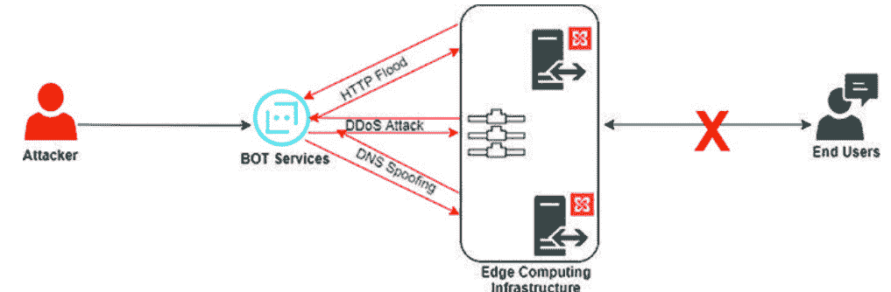

图 4.2: DDoS 攻击框架架构

## Mirai 僵尸网络攻击

Mirai 僵尸网络攻击是网络安全领域中臭名昭著的事件，凸显了边缘计算这一新兴领域中存在的漏洞。此次攻击利用了连接到边缘的物联网（IoT）设备，例如路由器、摄像头和其他智能设备。Mirai 恶意软件扫描互联网，寻找具有弱口令或默认凭据的设备，从而将它们变成僵尸机。被攻破设备的规模之大令人惊叹，形成了一个庞大的僵尸网络，能够发动前所未有的分布式拒绝服务（DDoS）攻击。该攻击表明，边缘上不安全的物联网设备如何被利用来策划大规模网络攻击，对在线服务和企业造成广泛中断。

在边缘计算的背景下，Mirai 僵尸网络攻击强调了采取强大安全措施的必要性。边缘计算涉及在数据源附近处理数据，以降低延迟并提高效率。然而，这种近距离性也暴露了更广泛的攻击面，使安全成为首要关注的问题。Mirai 攻击为采用边缘计算的组织敲响了警钟，强调了实施严格安全协议的紧迫性。它突出了定期安全更新、强大身份验证机制和加密的重要性，以保护物联网设备和边缘基础设施本身。此外，培养向用户普及最佳实践和边缘设备安全松懈后果的网络安全文化，对于增强抵御潜在未来攻击的能力至关重要。


减轻边缘计算中类似 Mirai 僵尸网络攻击的风险需要多方面的方法。首先，物联网设备制造商必须在设计中优先考虑安全性，并实施措施防止默认或易猜的凭据。这些设备的整个生命周期中应强制进行定期安全审计和更新。在运营方面，必须在边缘计算环境中强制实施网络分段和访问控制机制，以最大限度地降低被攻破设备的潜在影响。此外，在边缘利用人工智能和机器学习算法可以帮助实时威胁检测和响应，为生态系统增加额外的安全层。总体而言，Mirai 僵尸网络攻击为在不断演变的网络威胁面前加强蓬勃发展的边缘计算领域提供了关键教训。

## BlueBorne 漏洞利用

BlueBorne 是一种令人担忧的漏洞，已在边缘计算领域出现，对连接设备的安全性和完整性构成重大风险。该漏洞利用蓝牙技术攻击设备，使攻击者可能在无需任何用户交互的情况下执行恶意代码、提取敏感数据或传播恶意软件。在边缘计算中，大量设备相互互连，BlueBorne 的影响可能是广泛且毁灭性的。攻击者可以利用此漏洞渗透到智能传感器、可穿戴设备或工业控制系统等边缘设备，绕过安全措施并获得未经授权的访问。

与集中式系统相比，边缘计算环境分布式且通常安全性较低，因此特别容易受到 BlueBorne 的影响。边缘网络中设备的互联互通为 BlueBorne 漏洞的快速传播提供了理想的温床。被攻破的设备可作为边缘生态系统中进一步攻击的跳板，产生连锁反应，危及整个网络的安全态势。BlueBorne 的无缝和隐蔽特性使得边缘运营商难以有效检测和缓解潜在威胁。

要缓解边缘计算中的 BlueBorne 漏洞，采取主动安全措施至关重要。边缘设备制造商必须实施强大的安全协议，定期更新固件，并进行安全评估以识别和修补潜在漏洞。采用网络分段和访问控制还可以限制攻击者在边缘网络中的横向移动，最大限度地减少 BlueBorne 利用可能造成的损害。此外，向最终用户和运营商宣传蓝牙设备相关的风险并推广安全使用实践，在迅速发展的边缘计算环境中缓解 BlueBorne 威胁方面发挥着至关重要的作用。

## 威胁搜寻工具

市场上有许多威胁搜寻工具。以下是您可以探索的几个工具：

- BotScout: https://botscout.com/

- CyberChef: https://gchq.github.io/CyberChef/

以下 bash 脚本用于在日志文件中搜索公共 IP 地址。它适用于 Linux、MAC 和 Windows：

```
1. #!/bin/bash
2. IFS=$'\n'
3.
4. #This prints a list of IP addresses from a file, without
   duplicates.
5. #It's assumed that you have a file with the list of IP addresses
6. #This script works on both Windows, Linux, and MAC
7.
8. touch <file> #change <file> to be actual file you want to parse
9.
10. for entry in $(cut -d " " -f 1 $1); do
11.   echo $entry >> <file>
12. done
13. cat <file> | sort -h | uniq
```

## 边缘计算安全架构

边缘计算安全架构旨在保护网络边缘的敏感数据和应用程序，数据在边缘生成、处理和分析。这些架构的一个关键组件是数据加密。使用强大的加密算法可确保数据在边缘设备的传输和存储过程中保持安全。此外，还会实施访问控制机制以限制对关键数据的未经授权的访问。这包括身份验证流程、基于角色的访问控制和安全 API，确保只有授权人员才能与边缘设备和系统进行交互。

边缘计算安全架构的另一个关键方面是异常检测和入侵防御系统。这些系统会持续监控网络流量和设备行为，检测任何异常模式或潜在安全威胁。通过及时识别和缓解可疑活动，安全架构将最大限度地降低网络攻击和未经授权访问边缘基础架构的风险。此外，还会进行定期安全审计和漏洞评估，以主动识别系统中的弱点，并在其被利用之前加以解决。

将安全软件开发生命周期（SDLC）纳入架构对于确保在边缘设备上运行的应用程序和固件的安全性至关重要。这涉及遵循编码、测试和补丁管理的最佳实践，重点是在开发过程中早期识别和解决安全漏洞。此外，使用安全启动流程和代码签名可确保只有经过授权和身份验证的软件才能在边缘设备上运行，防止恶意代码执行并危害系统。

此外，边缘计算安全架构强调安全通信协议。采用提供加密、完整性检查和身份验证的协议可保证边缘设备与中央系统之间的安全通信。这保护了边缘架构各组件之间交换数据的完整性和机密性。此外，还会实施网络分段以隔离边缘网络的不同部分，减少攻击面，并限制安全漏洞的潜在影响。

总之，边缘计算安全架构采用多方面的方法，涵盖加密、访问控制、异常检测、安全软件开发、安全通信协议和网络分段。通过有效整合这些要素，组织可以构建坚实的安全基础，保护敏感数据并确保其始终安全。

以下是常见的边缘计算安全架构：

## 边缘计算安全模型

边缘计算是一种将数据处理更贴近数据源的范式，需要强大的安全模型来缓解潜在风险并保护敏感信息。边缘计算中一种突出的安全模型是零信任模型。在此模型中，无论用户或设备位于网络内部还是外部，都绝不默认信任。每个访问请求都要经过严格的身份验证、授权和持续监控，采用多因素身份验证（MFA）、加密和最小特权访问等机制。

另一个重要的安全模型是可信执行环境（TEE）方法。TEE 在设备内建立隔离且安全的安全区，确保敏感操作和数据免受恶意软件和潜在对手的侵害。TEE 支持关键进程的安全执行，并实现数据加密、完整性验证和安全密钥管理，从而增强边缘设备的整体安全态势。

此外，纵深防御安全模型对边缘计算环境至关重要。它涉及分层部署多种安全措施，包括防火墙、入侵检测系统（IDS）和访问控制，以提供全面的防御策略。每一层都充当屏障，即使其中一层被突破，后续层仍保持完好，以防止未经授权的访问和潜在的泄露。


此外，基于角色的访问控制（RBAC）模型在边缘计算中具有高度的相关性。RBAC根据用户在组织中的角色分配权限，确保个人只能访问其职责所需的资源和数据。这将最大限度地减少攻击面，并降低未经授权访问的风险，这是边缘环境中面对多样化用户和设备时的关键考量。

总之，边缘计算动态且分布式的特性要求实施多方面的安全模型。结合零信任、可信执行环境、纵深防御和基于角色的访问控制等方法，可以建立一个强大的安全框架，确保边缘计算环境中的数据完整性、机密性和可用性。

## 集中式安全模型

集中式安全模型通常被组织和企业采用，将安全措施的控制和管理集中在单一机构中。该模型类似于一座坚固的要塞，拥有明确界定的边界和受控的访问点。其核心思想围绕将安全功能、策略和监控整合在一个集中式伞下，以提高效率并简化运营。

在此模型中，专门的安全团队通常从中央指挥中心管理访问控制、身份验证机制、防火墙和入侵检测系统。其优势在于在整个组织中统一应用安全策略，确保标准化的保护水平。对安全协议的任何更新或修改都可以在网络中迅速实施，从而减少漏洞暴露和响应时间。然而，集中式安全模型并非没有挑战。将权力和权威集中在单一位置意味着，如果这一中心点被攻破或妥协，可能会产生严重后果，潜在地暴露整个组织的安全基础设施。这需要采取严格的安全措施来保护中央机构，并持续监控以检测和响应任何未经授权的访问尝试或攻击。

此外，集中式方法可能资源密集，需要在基础设施、熟练人员和持续维护方面进行大量投资。随着组织的增长，该模型的可扩展性也可能成为问题，需要仔细规划，并可能过渡到分布式或混合安全模型以适应扩张，同时保持强大的安全态势。

总之，集中式安全模型提供了效率、标准化的安全实践和集中控制。然而，它需要仔细考虑潜在风险、资源分配和适应性，以确保一个全面且具有弹性的安全框架。

## 分布式安全模型

分布式安全模型是一种在互联世界中保护数字资产和敏感信息的现代方法。与传统的集中式安全系统不同，后者将所有安全措施集中在单一位置或服务器上，分布式模型将安全组件分散在网络中，从而增强弹性并最大限度地降低单点故障的风险。在这种去中心化的范式中，身份验证、加密和访问控制等各种安全任务在多个节点或设备上处理，确保针对潜在威胁的防御更加强大和高效。

在分布式安全模型中，网络中的节点具有一定的自主权，并充当单独的防御单元，能够根据其本地观察和配置实时做出决策。这种自主权促进了适应性，使系统能够及时响应新出现的威胁或网络环境的变化。此外，该模型促进了一种协作式安全方法，即节点之间进行通信并共享潜在风险的信息，从而针对复杂的网络攻击实现集体防御机制。

分布式安全模型的一个关键优势是其可扩展性。随着网络的增长或变化，新节点可以轻松集成，而不会破坏整体安全架构。每个新节点都会为集体安全情报做出贡献，增强系统检测和缓解潜在威胁的整体能力。此外，这种可扩展性确保安全模型即使在复杂且动态的环境中（例如现代基于云的基础设施和物联网生态系统中）也能保持有效和高效。

此外，安全模型的分布式特性增强了容错能力和弹性。在节点被攻破或发生局部安全漏洞的情况下，影响是孤立和控制的，防止对整个系统造成广泛损害。安全措施的这种分隔有助于快速识别和处理安全事件，最大限度地减少潜在损失和停机时间。总的来说，分布式安全模型是当代网络安全的一个基本范式，与不断发展的技术格局以及日益复杂的网络威胁相一致。

## 基于硬件的安全解决方案（TPM, HSM）

基于硬件的安全解决方案，例如可信平台模块（TPM）和硬件安全模块（HSM），在加固数字环境方面发挥着关键作用。TPM是一种离散微控制器，通过保护加密密钥并确保系统完整性，为各种应用提供安全基础。它基于信任根原则运行，并通过自身的隔离执行创建安全环境，以抵御恶意软件和未经授权访问等攻击。TPM是安全启动过程、磁盘加密和数字版权管理中的关键环节，为全面的安全架构做出了贡献。

另一方面，硬件安全模块（HSM）是专门设计用于管理和保护加密密钥及敏感数据的设备。HSM提供高度的安全性和抗篡改性，使其成为金融交易、医疗系统和云服务中关键操作的理想选择。HSM为密钥生成、存储和使用提供安全环境，确保加密操作以受保护和隔离的方式进行。凭借支持广泛加密算法的能力，HSM在实现符合数据安全行业标准和法规方面必不可少。

TPM和HSM共同构成了针对数字领域中各种威胁的强大防御机制。TPM在系统级别建立安全基础，而HSM则加强加密操作和敏感数据处理的安全性。它们的共同努力提升了整体安全态势，并激发了依赖它们来保护数字资产和交易的个人和组织的信任与信心。随着技术的不断发展，这些基于硬件的安全解决方案将适应并进步，以应对日益复杂的威胁格局，确保更安全的数字未来。

以下是基于硬件的安全解决方案（TPM, HSM）：

## 设备妥协和数据泄露

设备妥协：设备妥协是指外部实体在设备所有者不知情或未同意的情况下，对设备进行未经授权的访问、控制或操纵。这种入侵可能通过多种方式发生，包括恶意软件、网络钓鱼攻击、软件漏洞或物理访问设备。一旦被攻破，攻击者可以利用该设备窃取敏感数据、安装恶意软件，或将设备作为网关来访问其他连接的系统或网络。

现代设备（如智能手机、计算机和物联网（IoT）设备）经常成为攻击目标，因为它们存储了大量个人和敏感信息。被攻破的设备可能导致严重后果，包括身份盗窃、经济损失、隐私入侵甚至声誉受损。为了降低设备妥协的风险，个人和组织应定期更新软件、采用强大的安全措施、教育用户了解潜在威胁，并进行安全审计以及时检测和解决漏洞。

数据泄露：数据泄露是指未经授权访问、披露或获取组织的数据库、网络或系统中的敏感或机密信息。这种泄露可能由于多种因素造成，包括网络攻击、内部威胁、意外暴露或安全措施不足。被泄露的数据可能包括个人信息、财务记录、健康数据、知识产权或其他专有业务信息。


数据泄露的影响可能非常深远，会导致财务损失、法律后果、组织声誉受损以及客户信任流失。为应对泄露事件，组织必须迅速调查事件、通知受影响的个人、实施安全改进，并致力于防止未来的泄露。预防策略包括加密敏感数据、实施访问控制、监控网络活动以及进行定期安全评估。此外，向员工普及数据安全知识并培养警惕文化，可显著降低数据泄露的风险。

## 设备级安全措施

设备级安全措施对于确保数字资产和敏感信息的保护与完整性至关重要。一项基本措施是实施强身份验证机制，例如生物识别或双重身份验证（2FA）。这些方法在密码之外增加了额外的安全层，使得未经授权的个人更难访问设备。

设备级安全的另一个关键方面是定期进行软件更新和补丁。保持操作系统、应用程序和安全软件的最新状态，对于解决网络犯罪分子可能利用的漏洞和弱点至关重要。软件供应商会经常发布包含安全修复的更新，以防范新发现的威胁和漏洞。

此外，加密在保护设备上数据方面发挥着至关重要的作用。对静态数据和传输中的数据都采用强大的加密算法，可确保即使设备落入他人之手，数据也仍然难以理解并受到保护。这对于处理敏感信息的设备（例如医疗记录、财务数据或机密业务文档）尤其至关重要。

此外，访问控制策略在设备级安全中发挥着重要作用。这些策略决定谁可以访问设备，以及他们可以执行哪些操作。将访问权限限制在授权用户，并根据角色和职责限制权限，有助于最大限度地降低未经授权的访问以及设备及其数据被潜在滥用的风险。

定期的安全审计和监控对于保持设备级安全不可或缺。定期审查访问日志、系统配置和安全设置，有助于识别异常或潜在的安全漏洞。这种主动方法允许及时检测和缓解安全威胁，从而增强设备的整体安全态势。

总而言之，设备级安全措施涵盖了一系列共同构建强大安全框架的策略和实践。从身份验证机制到加密和访问控制，采用全面的方法对于保护设备及其所持有的有价值数据免受不断演变的网络威胁至关重要。

## 安全设备身份验证与授权

设备身份验证与授权在确保数字系统和网络的安全性与完整性方面发挥着关键作用。身份验证是验证设备身份的过程，确保设备即其所声称的对象。这通常通过密码、生物识别、安全令牌或数字证书等凭据的组合来实现。强身份验证机制对于防止未经授权的访问并保护敏感数据免受恶意行为者的侵害至关重要。

另一方面，授权是基于设备的已验证身份来确定其允许访问哪些操作或资源的过程。这涉及定义和强制执行访问控制策略、权限和特权。适当的授权确保即使经过身份验证的设备，也只能执行并访问其角色或访问级别适当的操作和数据。这是维持最小特权原则并减少系统资源被滥用或误用潜在风险的关键方面。

在一个设备以复杂方式相互连接的互联世界中，强大的身份验证和授权机制至关重要。这些机制需要适应各种场景，例如物联网（IoT）生态系统、云计算和传统网络基础设施。此外，随着网络威胁的不断演变，我们的身份验证和授权方法也必须随之进步，以领先于潜在的漏洞和攻击。

技术进步催生了设备身份验证的创新方法，包括多因素身份验证（MFA）和生物识别身份验证。MFA 结合了多种身份验证因素，例如你知道的东西（如密码）、你拥有的东西（如安全令牌）以及你本人（如指纹或面部识别）。这种方法通过为潜在攻击者增加攻击复杂性，显著增强了安全性。

此外，动态授权模型正变得越来越普遍。这些模型会考虑各种上下文因素，例如设备的位置、访问时间以及用户的行为模式，以进行实时授权决策。自适应访问控制机制可以根据变化的情况自主调整权限，从而提供一种主动的安全方法。

总而言之，设备身份验证与授权是现代安全策略的基本组成部分。它们对于保护数字资产、确保数据隐私以及减轻与未经授权的访问以及设备和系统滥用相关的潜在风险不可或缺。随着技术的不断进步，保持身份验证和授权实践的领先地位，对于维护安全可信的数字生态系统至关重要。

以下是 IoT 认证架构：

- MQTT 服务器
  - 管理通道
  - 设备控制通道
  - 警报与通知通道
  - 数据通道

- 用户

- 管理

- 设备

- 用户界面层
  - 管理 UI
  - 监控 UI

- 管理层
  - IoT 管理框架
  - 设备管理
  - 数据层
    - InfluxDB
    - MongoDB
    - IoT 设备认证

- IoT 设备层
  - 数据采集系统
  - 数据发布系统
  - IoT 设备注册
  - 设备控制系统
  - 数据采集系统
  - IoT 设备协议

- 风力涡轮机
- Alexa
- 工业物联网

- 认证服务器
- IoT 设备识别

## 图 4.3：IoT 认证架构

## 身份验证、授权和问责制（AAA）

身份验证、授权和问责制是边缘计算环境中安全性和治理的基本支柱，确保网络边缘数据和资源的完整性、机密性和可用性。在边缘计算的背景下，由于涉及分布式特性和多样化端点，这些概念具有独特的维度。

边缘计算中的身份验证用于验证尝试访问资源或服务的设备、应用程序或用户的身份。鉴于边缘存在大量设备和实体，实施强大的身份验证机制对于建立信任和防止未经授权的访问至关重要。多因素身份验证（MFA）和数字证书等技术在确保只有授权实体才能访问边缘基础设施方面发挥着关键作用。

在边缘计算领域，授权涉及为经过身份验证的实体定义和强制执行权限和特权。边缘环境的分散性质要求仔细划定授权策略，以维护数据隐私和控制。基于角色的访问控制（RBAC）和基于属性的访问控制（ABAC）是常用的授权模型，允许基于角色、属性和上下文参数进行细粒度访问控制。


问责制是边缘计算的一个重要方面，确保行动和交易可追溯至责任实体。在分散的边缘生态系统中，保持活动的全面且不可更改的日志对于审计、合规和取证至关重要。利用区块链或分布式账本技术可以提供防篡改的交易和行动记录，增强边缘基础设施的整体问责制。

总之，边缘计算中的身份验证、授权和问责制是安全且管理良好的边缘生态系统的组成部分。有效实施这些概念有助于降低安全风险、保护数据并确保符合监管要求，最终增强边缘计算解决方案的信任度和可靠性。

以下是身份验证、授权和问责制（AAA）的各个方面：

## 边缘计算的零信任架构（ZTA）

边缘计算的零信任架构（ZTA）是一种前沿方法，从根本上挑战传统的安全模型。其核心在于，ZTA运行在“永不信任，始终验证”的原则上。这意味着，无论用户或设备位于何处，它们都不会在网络中获得自动信任。每个请求、交互或访问资源的尝试都要经过严格验证，无论用户位置或设备状态如何。

在边缘计算的背景下，ZTA在增强去中心化环境的安全性方面发挥着关键作用。边缘计算涉及在数据生成源附近处理数据，降低延迟并改善响应时间。然而，这种去中心化特性带来了ZTA能够有效解决的安全挑战。通过实施微分段和最小权限访问控制，ZTA确保即使在分散的边缘环境中，也只有授权的用户和设备才能访问特定资源。这种方法最大限度地减少了攻击面，并将潜在的违规行为限制在孤立的段中，加强了整体安全态势。

此外，边缘计算的零信任架构集成了机器学习和行为分析等先进技术。这些工具持续分析并适应边缘用户、设备和应用程序的变化模式。通过实时识别异常或可疑行为，ZTA能够迅速有效地减轻潜在威胁。

此外，还采用强加密协议来保护传输中和静态数据，为动态且分布式的边缘环境提供额外的保护层。

本质上，边缘计算的零信任架构代表了网络安全的一种范式转变，与现代分布式计算环境的要求完美契合。通过重新定义安全边界并不信任任何人，ZTA确保无论数据在何处处理，无论涉及何种设备或网络，安全性都能保持韧性和适应性。这种方法对于释放边缘计算的全部潜力至关重要，同时在不断发展的数字环境中保持强大的安全性。

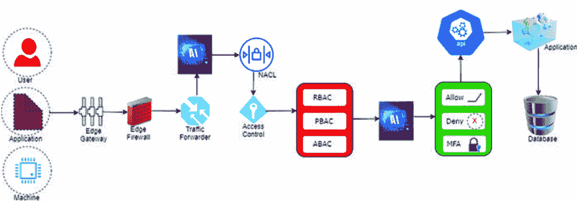

图 4.4：边缘计算零信任架构

## 身份为中心的方法

在理解个人时，身份为中心的方法涉及认识到，一个人的身份是文化、信仰、价值观、经历和社会互动等多种因素的复杂相互作用。它强调承认和尊重每个人独特身份的重要性，以及其在塑造思想、行为和关系方面的作用。这种方法鼓励拥抱多样性和包容性，重视不同的观点，并培养所有人的归属感和接受感。

当我们采用身份为中心的方法时，我们优先了解超越表面属性的人。我们深入探究其身份的核心方面，并力求理解影响他们的经历、文化、成长环境和环境。通过这样做，我们可以培养同理心，建立有意义的联系，并致力于建立一个更加包容的社会，庆祝人类身份的丰富图景。

在专业环境中，身份为中心的方法可以彻底改变组织的运作方式。认识和重视员工的独特身份可以打造一个更加积极和有动力的员工队伍。员工更有可能在一个承认其多元身份并将其融入组织文化的环境中茁壮成长。它还有助于制定对多元员工需求敏感的政策和实践，最终在职场中促进公平和公正。

在教育领域，身份为中心的方法转变了学习体验。这涉及承认学生多样化的背景、学习风格和个人身份。教育工作者可以调整教学方法以适应这些差异，确保每个学生都感到被看见、被倾听和受到支持。这种方法促进积极的学习环境，鼓励学生拥抱自身身份、分享观点并参与开放对话，最终丰富整体教育体验。

## 微分段与最小权限

微分段是一种强大的网络安全策略，涉及将网络划分为更小、隔离的段或区域，以增强安全措施并尽量减少安全漏洞的潜在影响。与专注于保护边界的传统网络安全方法不同，微分段在网络内运行，围绕特定资源、应用程序或工作负载创建单独的安全边界。每个段都根据预定义策略受到限制，限制段之间的通信和访问。这种方法通过允许组织根据每个段的独特要求和漏洞定制安全策略，增强了控制力、可见性和整体安全态势。

另一方面，最小权限原则是一项基本安全概念，强调仅向个人或系统提供执行其任务或功能所需的最低访问或权限级别。它基于“需知”和“需用”原则运行，确保用户获得完成其工作职责所需的最少权限。通过严格遵守最小权限原则，组织可以显著减少安全事件可能造成的潜在损害。它限制了关键系统和数据的暴露，最大限度地降低未经授权的访问、意外损坏或故意滥用的风险，最终加强了组织的整体安全态势。这种方法培养主动的安全文化，并有助于维护对潜在内部和外部威胁的强大防御。

## 保障通信协议安全

在边缘计算中保障通信协议安全是一项至关重要的工作，旨在确保网络边缘数据和服务的机密性、完整性和可用性。鉴于边缘计算环境的分布式和动态性质，实施强大的安全措施对于减轻潜在漏洞和攻击至关重要。

增强安全性的一种方法是使用加密协议。利用强加密算法可以打乱传输中的数据，使未经授权的实体无法读取。端到端加密（即数据在源端加密，仅在预期接收方解密）增加了一层额外保护。在通信协议中实施加密可以保护敏感信息并防止窃听，确保即使在不受信任的边缘环境中，数据仍保持机密性。

入侵检测和防御系统（IDPS）是监控和保护边缘计算中通信协议的重要工具。这些系统分析网络流量中的可疑活动和模式，从而快速发现潜在攻击。通过及时识别和减轻安全威胁，IDPS有助于保持通信协议的完整性和可用性，加强边缘计算部署的整体安全态势。


此外，定期进行安全审计和更新对于应对不断演变的威胁至关重要。定期开展安全审计有助于识别通信协议中的漏洞和弱点。及时对这些协议进行更新和打补丁，可修复已发现的漏洞，并确保边缘基础设施能够抵御新兴安全威胁。持续监控并调整安全措施，是在边缘计算不断变化的环境中有效保障通信协议安全的基础。

以下是保障边缘计算中通信协议安全的方式：

## 网络安全策略

边缘计算中的网络安全策略是保护敏感数据、确保去中心化环境中信息完整性和保密性的重要组成部分。边缘计算所带来的独特挑战（其特点是分布式设备网络和本地化数据处理）需要量身定制的安全方法。

一种创新策略是采用机器学习算法进行异常检测。可为边缘设备配备机器学习模型，持续分析网络流量和设备行为。通过识别异常模式或活动，这些模型可以主动标记潜在安全威胁，从而实现及时干预并有效降低风险。

此外，在边缘利用区块链技术可以增强安全性和数据完整性。区块链的去中心化和不可更改账本功能可用于安全地记录和验证设备之间的交易和交互。这确保了数据来源、可追溯性和防篡改记录，增强了边缘计算环境中的整体安全态势。

采用基于硬件的安全措施也是值得注意的策略。在边缘利用可信执行环境（TEE）或硬件安全模块（HSM）可以加强对敏感操作和加密密钥的保护。这些基于硬件的解决方案提供了额外的安全层，使恶意行为者更难以破坏关键安全组件。

最后，可以实施动态和自适应的安全策略框架。考虑到网络威胁不断演变的特点，拥有可根据实时威胁情报和上下文信息动态调整的安全策略，可确保对新兴风险作出更敏捷的响应。这种方法允许快速更新和修改安全措施，确保在动态的边缘计算环境中对不断演变的网络威胁提供强大保护。

## 网络分段与隔离

边缘计算中的网络分段与隔离是增强分布式计算环境中安全性、效率和性能的关键策略。在边缘计算领域（涉及在数据源附近处理数据），网络分段是指将网络划分为离散的段。这些段彼此隔离，防止未经授权的访问，并限制安全漏洞可能造成的损害。通过将网络划分为不同区域，组织可以控制访问权限并减少攻击面，从而增强整体安全态势。

此外，边缘计算中的网络分段允许优化资源分配，实现更高效的数据流。不同的段可以针对特定任务或应用进行定制，确保资源集中在最需要的地方。这种有针对性的分配提升了边缘设备和应用的整体性能和响应速度，从而加快决策速度并改善用户体验。

网络段内的隔离同样至关重要。它确保即使在某个段内发生违规，影响也会限制在该特定区域内，而不会传播到网络的其他部分。隔离通过防火墙、访问控制和加密机制实现。它提供了一道额外的防御层，使恶意行为者难以穿越网络并破坏敏感数据或系统。

总之，边缘计算中的网络分段与隔离是融合安全性和效率的基本策略。通过细分网络并实施隔离，组织可以更好地保护其资产，优化资源利用，并确保强大且响应迅速的边缘计算环境。这些实践凸显了保障现代计算范式分布式架构安全性日益重要的意义，为网络安全和数据管理的未来提供了一瞥。

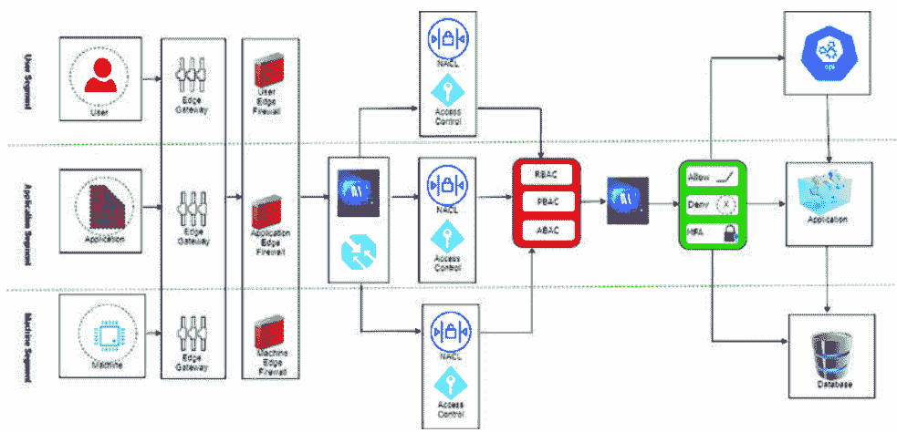

图 4.5：边缘计算网络分段

## 区块链用于信任与完整性

区块链技术已成为增强边缘计算领域信任和完整性的强大工具。从本质上讲，区块链是一种去中心化且不可更改的账本，以透明且安全的方式记录交易和信息。在边缘计算的背景下（数据处理发生在数据生成源附近），区块链在确保可信性和数据完整性方面发挥着至关重要的作用。

在边缘计算中，数据在传输到中央服务器或云之前，是在边缘设备（如传感器和物联网设备）上生成和处理的。可以利用区块链来创建边缘发生的所有交易和数据交换的分布式且防篡改记录。这确保了来自边缘设备的数据在整个传输过程中保持不变且真实，从而为各相关利益方提供了高度的信任和可靠性。

在边缘计算中使用区块链的关键优势之一是其能够在多个边缘设备之间建立共识机制。这种共识确保所有设备都拥有相同版本的真相，防止数据出现差异或遭到恶意篡改。通过智能合约，可以自动执行预定义的规则和协议，从而消除对中介的需求，降低边缘发生欺诈活动的风险，进而增强信任。

此外，区块链的加密和密码学哈希机制提供了额外的安全层和数据完整性保障。数据可以在添加到区块链之前进行加密，并存储加密数据的哈希值，从而允许对数据完整性进行实时验证。这一特性在对信任和数据准确性要求极高的敏感应用中尤为宝贵，例如医疗保健、金融或关键基础设施领域。

总之，将区块链技术与边缘计算相结合，通过创建透明、防篡改且基于共识的环境来增强信任和完整性。这不仅提高了数据可靠性，还促进了各利益方之间的信任，最终推动边缘计算在各行业中的广泛采用。

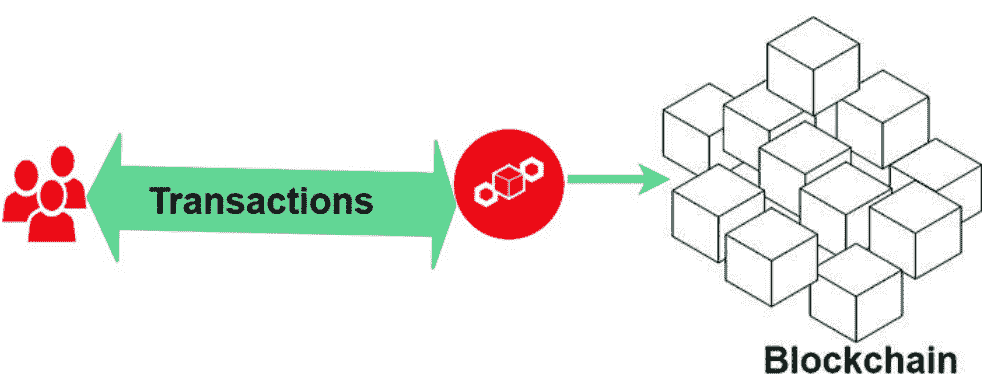

图 4.6：区块链交易架构

## 量子计算对安全性的影响

量子计算已作为一项具有革命性潜力的技术崭露头角，可能会改变包括网络安全和边缘计算在内的多个领域。从本质上讲，量子计算基于量子力学原理运行，能够同时处理和操作大量数据。在边缘计算安全领域，这既带来了机遇，也带来了挑战。

量子计算对边缘安全最重要的影响之一，是其可能破解常规加密算法。量子计算机可以高效执行复杂的数学运算，例如大数分解，而这正是包括 RSA 在内的广泛使用的加密方法所依赖的安全基础。因此，当前用于保护边缘设备上传输中或静止数据的加密协议可能会容易受到量子攻击。

为了减轻量子计算带来的安全风险，研究人员和开发者正在积极研发后量子密码学。这些加密算法旨在抵御经典计算机和量子计算机的攻击。在边缘计算设备和系统中实施后量子密码学，对于确保数据机密性和完整性至关重要，即使在后量子计算时代也是如此。

此外，量子计算有可能通过开发抗量子


算法。这些算法专门设计用于抵御量子计算机的攻击，通过利用量子力学的基本原理。通过将抗量子算法集成到边缘设备中，组织可以使其安全基础设施具备未来防护能力，以应对量子计算带来的不断变化的威胁形势。

此外，量子计算为边缘环境中的安全多方计算（SMPC）提供了机遇。SMPC允许多方在保持其输入私密的同时，共同对其输入进行函数计算。量子计算可以显著提升SMPC协议的效率和安全性，在边缘实现安全协作和数据处理，且无需向任何单一方泄露敏感信息。

总而言之，量子计算的兴起为边缘计算的安全带来了挑战与机遇。尽管量子计算威胁传统加密方法，但它也推动了抗量子算法和安全多方计算协议的发展。解决这些影响至关重要，以确保在日益互联的边缘计算世界中拥有强大且具备未来防护能力的安全性。

## 边缘计算中的持续监控

边缘计算中的持续监控处于变革性技术前沿，重新定义了我们收集、分析和利用数据的方式。这一范式的本质在于其能够不断观察和分析多样的数据流，从而实现实时决策、提升运营效率并确保最佳性能。

主要有三种可监控的边缘类型（即其所服务的终端）：

- 网络边缘
- 客户端边缘
- 数据中心边缘或云边缘

边缘计算中持续监控的核心是一个动态的边缘设备网络，这些设备战略性地部署在分布式基础设施中。这些设备充当警觉的哨兵，在源端捕获、处理和评估数据，无需集中化。这种方法最大限度地降低了延迟，增强了数据安全性，并能对关键事件做出即时响应，使企业和行业能够实现更高水平的生产力和敏捷性。

边缘计算与持续监控的结合超越了传统应用，涉及医疗保健、制造、交通和智慧城市等多个领域。例如，在医疗保健领域，配备边缘计算能力的可穿戴设备可持续监测生命体征和健康参数，从而实现及时干预并改善患者预后。

此外，边缘计算与持续监控的协同作用为预测分析时代敞开了大门。先进的算法实时分析数据，预测趋势、识别异常并触发主动措施。这种主动方法增强了系统可靠性并优化了资源利用率，最终带来显著的成本节约和竞争优势。

然而，在这场变革之旅中，挑战依然存在。解决与数据隐私、网络带宽相关的问题，并确保边缘设备的可扩展性和互操作性至关重要。开发能够在数据隐私与持续监控需求之间取得微妙平衡的强大解决方案，是一项需要持续研究和创新的关键任务。

总而言之，边缘计算中的持续监控预示着创新新纪元的到来，在此纪元中，数据不仅是宝贵的资产，更是实时可行动的资源。随着我们不断完善和演进这一范式，我们正准备释放前所未有的可能性，推动社会迈向一个以各行业更智能、更快速、更高效的运营为特征的未来。

以下是边缘计算中持续监控的方式：

## 威胁检测与事件响应

针对边缘环境量身定制的创新威胁检测技术正在涌现，以应对这些挑战。利用机器学习和人工智能的异常检测算法，在识别边缘网络内的异常模式或活动方面发挥着关键作用。旨在理解和预测设备行为的行为分析算法，通过标记与预期模式的偏差，有助于早期威胁检测。当这些技术集成到边缘系统的结构中时，可增强主动识别威胁和漏洞的能力，从而便于及时响应事件。

边缘环境中的事件响应策略必须考虑边缘生态系统的独特特征进行设计。由于边缘计算的分布式架构，传统的集中式事件响应模式可能不合适。边缘的事件响应需要去中心化的策略，以实现安全事件的快速识别、隔离和缓解。自动化也成为事件响应中的重要推动者，使能够基于预定义的响应协议立即采取行动。这种去中心化策略与自动化的结合，确保了对安全事件的快速高效响应，最大限度地减少潜在损害。

### 主动威胁检测技术

为了有效保护边缘去中心化环境，必须无缝集成主动威胁检测技术。其中一种技术是边缘AI驱动的入侵检测系统（IDS）。通过在边缘部署AI算法，这些系统可以实时分析本地网络流量，在潜在威胁渗透到更广泛的网络之前迅速识别并缓解它们。这种主动措施不仅增强了边缘设备的安全性，还通过抑制不必要的数据传输到集中式安全中心，保留了带宽并减少了延迟。

此外，边缘设备行为异常监控是一种新兴技术，专注于理解和建立边缘设备的正常行为模式。通过持续监控和机器学习，任何与这些既定模式的偏差都可以被迅速标记为潜在威胁。通过采用这种方法，组织可以主动检测和响应异常活动，最大限度地降低边缘环境中安全漏洞和未经授权访问的风险。

另一种创新技术是集成边缘威胁情报馈送。通过利用特定于边缘的威胁情报，组织可以主动预见并应对针对边缘基础设施的威胁。这些威胁馈送提供边缘环境特有的新兴威胁向量、漏洞和攻击者战术的实时更新，使组织能够相应加强防御。将此情报纳入边缘的安全态势，可增强对不断演变的威胁的整体弹性。

此外，边缘到云安全编排作为一种主动策略，用于在整个边缘到云连续体中集成安全。该技术涉及边缘安全措施与集中式云安全系统之间的自动化协调。边缘检测到的任何可疑活动都会触发编排响应，从而实现威胁的即时遏制和缓解。这种编排优化了安全工作，并最大限度地缩短了响应时间，确保在边缘和云两个层面对潜在威胁采取主动态势。

在边缘计算的动态格局中，采用这些主动威胁检测技术至关重要。通过创新的AI驱动监控、异常检测、威胁情报集成和安全编排来领先于潜在威胁，组织可以确保边缘处的强大安全性。主动的安全方法对于保护这一不断演进的计算范式中的敏感数据和操作至关重要。


## 边缘环境事件响应策略

边缘环境的事件响应策略涉及在网络边缘检测、缓解和从安全事件中恢复的专门方法，网络边缘是数据生成、处理和存储的地方。与传统的集中式IT基础架构不同，边缘环境是去中心化的且地理分散的，带来了独特的挑战，并需要定制的事件响应方法。

边缘环境中事件响应的一个关键方面是主动监控和威胁检测。实时监控工具应策略性地部署在边缘节点，以持续评估网络流量、设备活动和异常。通过利用高级分析和机器学习，这些工具可以迅速识别潜在的安全漏洞或偏离预期模式的情况，从而实现快速事件检测。

此外，边缘环境通常涉及多种多样的设备和技术。有效的事件响应策略应通过实施模块化和可扩展的方法来考虑这种多样性。模块化事件响应计划可以适应特定的边缘设备或节点，同时考虑其独特的功能、漏洞和运行环境。可扩展性确保事件响应流程能够容纳边缘网络日益增长的复杂性和规模。

协作与沟通是边缘环境中事件响应的关键组成部分。鉴于边缘部署的分散性，在利益相关者之间建立高效的沟通渠道和协作框架至关重要。这包括清晰的事件报告流程、升级路径以及明确的指挥链条，以简化决策和响应工作，特别是在关键事件期间。

将自动化融入事件响应流程是边缘环境的另一项关键策略。自动化事件分类和响应机制可以帮助快速评估事件严重性并启动预定义响应，从而缩短响应时间并尽量减少潜在损害。自动化事件剧本可以根据预定义的规则和算法指导行动和决策，确保事件解决的一致性和有效性。

最后，由于边缘环境具有动态和不断演变的特性，自适应事件响应策略至关重要。根据不断变化的威胁形势、技术进步和运营经验，持续评估和完善事件响应计划是必不可少的。定期更新事件响应程序并开展模拟现实世界边缘环境场景的演练，可以提高对安全事件的准备度和整体韧性。

## 快速事件识别与遏制

边缘计算领域的快速事件识别与遏制是现代网络安全的一个专门且至关重要的方面。边缘计算涉及在数据源附近处理数据，以减少延迟并提高效率。然而，这种去中心化模型在识别和遏制事件方面引入了独特的挑战。

在边缘计算中，快速事件识别取决于部署在边缘设备和网络上的分布式监控机制。高级分析和机器学习算法对于实时分析边缘生成的数据至关重要。异常和异常模式可以由这些算法快速检测，触发即时调查的警报。边缘计算的分布性质需要智能监控解决方案，能够无缝适应和扩展到动态的边缘环境。

边缘计算中的遏制策略需要在集中式和去中心化方法之间保持谨慎的平衡。目标是迅速隔离受影响的边缘节点或设备，以防止事件扩散，同时保持系统的整体功能。去中心化遏制机制（例如隔离的微服务或边缘集群）在快速减轻事件影响方面发挥着关键作用，同时允许网络中未受影响的部分继续运行。

协作与编排是边缘计算事件响应的基础。集中式安全运营中心（SOC）与边缘节点协调，以迅速而高效地执行遏制操作。利用自动化响应机制来强制执行安全策略并隔离受损的边缘设备，以尽量减少潜在损害。此外，边缘设备与中央SOC之间的持续通信和协调至关重要，以确保在分布式边缘环境中采取统一且有效的事件遏制策略。

专门针对边缘计算的定期测试和模拟演习对于提高事件响应准备度至关重要。这些演习模拟边缘设备和网络上的各种攻击场景，帮助完善事件识别和遏制策略。此外，利用威胁情报并及时了解不断演变的边缘特定威胁，对于调整事件响应计划和增强边缘计算环境中的整体安全态势至关重要。

## 分布式环境中的取证分析

边缘计算领域的取证分析面临着一系列独特的挑战和机遇。边缘计算涉及在数据源附近（通常是网络边缘的设备上）处理数据。取证分析师必须应对这种基础设施的分布式特性，它分布在众多互连设备上，例如传感器、智能手机和物联网设备。挑战在于在这一去中心化且多样化的环境中有效地收集、保存和分析数字证据。

在边缘计算中，取证调查人员需要考虑在各种边缘设备上生成和存储的大量数据。由于存储、处理能力和网络带宽的限制，传统的取证方法可能不够充分。因此，专门的取证技术对于提取相关数据至关重要，同时需要考虑边缘设备特有的资源受限和间歇性连接特性。这需要开发专门针对边缘环境定制的轻量级取证工具和方法。

边缘计算中取证分析的另一个关键方面是确保数据完整性和真实性。边缘设备通常暴露于物理漏洞和攻击之下，因此建立强大的数字证据保管链至关重要。密码散列和安全数据传输协议等技术被用于保持从这些分布式边缘设备收集的证据的完整性和可验证性。

此外，边缘计算环境动态且异质的特性需要实时或近实时的取证分析能力。调查过程需要适应快节奏、不断演变的边缘环境。取证分析师可以利用自动化和基于AI的工具来加速数据分析和异常检测，从而在分布式边缘环境中快速响应安全事件和违规行为。

取证专家、网络安全专业人员和边缘计算专家之间的协作对于制定分布式边缘环境的有效取证策略至关重要。共享知识、专业知识和最佳实践有助于应对新兴威胁和不断发展的技术。随着边缘计算的不断普及，采取主动的取证分析方法对于保障和维护网络边缘数据和系统的可信度至关重要。


## 异常检测与行为分析

边缘计算领域的取证分析面临一系列独特的挑战与机遇。边缘计算涉及在数据源附近（通常是网络边缘的设备上）处理数据。取证分析人员必须应对这种基础设施的分布式特性，该基础设施遍布于大量互联设备上，例如传感器、智能手机和物联网设备。挑战在于在这种去中心化且多样化的环境中，有效地收集、保存和分析数字证据。

在边缘计算中，取证调查人员需要考虑在各种边缘设备上生成和存储的海量数据。由于存储、处理能力和网络带宽的限制，传统的取证方法可能不够充分。因此，专门的取证技术对于提取相关数据至关重要，同时需考虑边缘设备的受限资源和间歇性连接等特点。这凸显了开发针对边缘环境定制的轻量级取证工具和方法的必要性。

边缘计算取证分析的另一个关键方面是确保数据的完整性和真实性。边缘设备经常暴露于物理漏洞和攻击之下，因此为数字证据建立可靠的保管链至关重要。采用加密哈希和安全数据传输协议等技术，以维持从这些分布式边缘设备收集的证据的完整性和可验证性。

此外，边缘计算环境的动态性和异构性要求具备实时或近实时的取证分析能力。调查过程需要适应快节奏、不断变化的边缘环境。取证分析人员可以利用自动化和基于AI的工具来加速数据分析和异常检测，从而快速响应这些分布式边缘环境中的安全事件和漏洞。

取证专家、网络安全专业人员和边缘计算专家之间的合作，是为分布式边缘环境制定有效取证策略的基础。分享知识、专业技能和最佳实践有助于领先于新兴威胁和不断发展的技术。

随着边缘计算的不断普及，采取主动的取证分析方法对于保障并维护网络边缘数据和系统的可信度至关重要。

## 边缘持续监控中的挑战

主要障碍之一是边缘设备和系统固有的异质性。边缘环境涵盖了各种硬件、操作系统、协议和应用程序。在此异构环境中整合和标准化监控解决方案是一项艰巨的挑战，需要仔细考虑兼容性、可扩展性和互操作性。

另一个关键挑战围绕边缘产生的数据量和速度展开。边缘设备实时产生海量数据，使得高效处理、分析并近实时采取行动变得困难。此外，由于带宽限制和延迟问题，将所有数据传输到集中式监控系统进行分析通常不切实际。在全面监控的需求与边缘网络能力的限制之间取得平衡是一场持续的斗争。

最后，管理边缘上监控应用程序和算法的生命周期是一个关键挑战。随着时间推移，更新、补丁和改进对于增强监控能力和解决漏洞是必要的。然而，在大量分布式边缘设备上更新和维护监控应用程序可能是一个物流挑战，需要深思熟虑的策略来确保监控操作的一致性、可靠性和安全性。

以下是一些用于边缘计算的监控工具：

- Zenoss -- https://docs.zenoss.io/streaming/how-to/install-collector.html
- Zabbix -- https://www.zabbix.com/download
- Datadog -- https://www.datadoghq.com/

## 结论

物联网与边缘计算的融合开启了技术创新的新时代，但也带来了重大的安全挑战。物联网是指收集和交换数据的互联设备、传感器和系统网络，而边缘计算涉及在设备或附近服务器上本地处理数据，降低延迟并增强实时决策能力。

在这个领域中，主要的安全担忧之一是数据隐私和完整性。随着物联网设备收集和传输大量敏感数据，确保其机密性并防止未经授权的访问变得至关重要。加密和访问控制机制对于保护数据在边缘设备与中央云之间传输时的安全至关重要。

行业利益相关方（包括制造商、开发者、监管机构和最终用户）之间的合作，对于制定标准化的安全协议、认证和最佳实践至关重要。集体努力将增强物联网和边缘计算系统的韧性，为蓬勃发展的技术格局提供安全可信的基础。

下一章将揭示边缘上的数据分析和机器学习的奥秘：它们曾经局限于集中式服务器和数据中心，如今已经挣脱束缚，在边缘展翅飞翔，改变了我们感知、处理和处理信息的方式。加入我们，一起探索这个全新的领域：在这里，洞察力随时随地被获取，决策瞬间做出，技术的未来以最令人兴奋的方式与现在相遇。

## 选择题

### 哪种监控协议广泛用于监控边缘主机？
- SMTP
- WPA
- SNMP
- OpManager

### 判断题：去中心化是物联网应用中区块链的一项功能，可确保交易一旦验证就无法篡改。
- 正确
- 错误

### 判断题：文件完整性监控（FIM）是一种用于保护根系统文件的技术。
- 正确
- 错误

### 哪种VPN拓扑最适合两个基于边缘的应用程序之间的连接？
- Site-to-Point
- Point-to-Point
- Point-to-Site
- Site-to-Site

### 边缘应用上的缓冲区溢出攻击可能导致……
- 拒绝服务 (DoS)
- CPU飙升
- 内存挂起
- 存储不足

## 答案

- c
- a
- a
- d
- a

## 问题

用于加密和解密的密钥是什么？

可用于检测数据未经授权更改的技术有哪些？

故障排除过程的第一步是什么？

简要描述你对量子计算的理解。

你将如何使用区块链来保障边缘计算的安全？

你对事件级别的理解是什么，例如 Critical、Verbose、Alert、Warning、Information 和 Error？

## 关键术语

- 身份验证、授权和问责
- 分布式拒绝服务
- 硬件安全模块
- 入侵检测与防御系统
- 多因素身份验证
- 基于角色的访问控制
- 软件开发生命周期
- 安全多方计算
- 安全运营中心
- 可信执行环境
- 可信平台模块
- 零信任架构

## 双因素身份验证

# 第 5 章

# 边缘上的数据分析与机器学习

## 引言

在一个以不断产生的数据和对实时洞察的无法满足的渴望为特征的时代，传统计算范式已被推至极限。应对这种对即时性和效率不懈需求的答案，在于我们网络的最外围，数据在此诞生、流动，并找到其最具力量的目的。欢迎来到一个计算边界消融、开启创新新时代的领域——边缘计算的领域。

在这个具有变革性的章节中，我们将踏入现代技术奇迹的核心：边缘上的数据分析与机器学习。在这里，传统数据处理和机器学习的原则将其触角延伸至中央服务器和云环境之外。它们渗透到散布在各处的传感器、设备和网关中，诞生了一个去中心化的智能生态系统，重新定义了可能性。

因此，加入我们，一起穿越现实环境的崎岖地形，数据在此如心跳般跳动，洞察力在创造的边缘诞生。在本章中，我们不仅探索数据分析与机器学习与边缘的融合，还庆祝一种无国界智能的诞生——一种编织进我们互联现实结构中的智能。


## 结构

在本章中，我们将讨论以下主题：

- 数据分析与机器学习基础
- 机器学习的类型
- 边缘数据分析与机器学习中的挑战与机遇
- 边缘数据分析与机器学习的架构
- 边缘的数据收集与预处理
- 机器学习模型选择与优化
- 边缘的实时推理与决策
- 联邦学习与协作边缘分析
- 边缘异常检测与预测性维护
- 边缘数据分析与机器学习的未来趋势与创新

## 实用实现与用例

## 结论：拥抱边缘，实现数据驱动的智能

## 目标

在本章中，我们的目标是深入探讨网络、设备和传感器边缘的数据分析与机器学习快速发展的格局。我们将穿梭于数据驱动决策与实时响应融合之中，解决以下关键方面：

### 了解边缘计算的影响
我们将探讨从集中式云计算到分布式边缘计算的范式转变如何彻底改变数据处理，从而降低延迟、改善隐私并增强可扩展性。

### 数据分析与边缘的融合
我们将研究数据分析技术如何无缝集成到边缘设备中，实现本地数据处理，并将原始信息转化为可操作的洞察，而无需持续连接。

### 资源受限环境中的机器学习模型
我们将探讨在资源受限的边缘设备上部署机器学习模型的创新方法，考虑模型量化、剪枝和联邦学习等技术，以在保持性能的同时尽量减少资源使用。

### 实时决策
我们将了解边缘分析和机器学习如何通过在数据源处理数据来赋予设备实时决策能力。我们还将了解其对工业自动化、医疗保健和自动驾驶汽车等行业的影响。

### 隐私与安全挑战
我们将解决边缘分析带来的固有隐私和安全挑战，包括数据保护、加密和安全模型部署，并探讨缓解这些问题的策略。

### 边缘-分析-云连续体
我们将研究边缘、分析和云计算之间的共生关系，并探讨数据在这些层之间聚合、精炼和关联以产生整体洞察的场景。

### 边缘分析生态系统
我们将深入了解支持边缘分析和机器学习部署的新兴工具、框架和平台生态系统。我们还将评估边缘特定解决方案与调整传统方法之间的权衡。

### 案例研究与应用
我们将展示现实世界中的案例研究，突出边缘分析和机器学习在零售、能源管理、农业和智慧城市等不同领域中的变革潜力。

### 伦理考量
我们将探讨与边缘分析相关的伦理影响，包括数据所有权、算法偏见和透明度。我们还将讨论负责任地部署基于边缘的机器学习系统的最佳实践。

### 未来展望
我们将展望边缘分析和机器学习的未来，考虑硬件、软件和通信技术的进步。我们还将讨论这些进步如何塑造边缘数据处理和洞察生成的演变。

读完本章后，读者将全面理解数据分析、机器学习与边缘计算之间复杂的关系，并能够利用这些技术的潜力，在各个行业推动创新并创造价值。

## 数据分析与机器学习基础

边缘数据分析是指在数据发送到集中式服务器或云端进行进一步分析之前，更靠近其源头或起点（通常是本地设备或传感器）分析数据的过程。这种方法至关重要，原因有以下几点。首先，通过实时处理数据，它降低了延迟，从而加快了决策速度。其次，它减轻了网络带宽的负担，并降低了向中央位置传输大量原始数据相关的成本。第三，通过将敏感数据保留在本地，它增强了隐私和安全性。通过利用边缘分析，组织可以从数据产生的地方提取有价值的洞察，从而实现更高效、更有效的运营。

边缘机器学习涉及将机器学习模型和算法直接部署在边缘设备（如传感器、摄像头或边缘服务器）上，以在本地处理和分析数据。这种方法至关重要，原因有以下几点。首先，它允许在不依赖集中式服务器的情况下进行实时决策，这对于低延迟至关重要的应用（如自动驾驶汽车或工业自动化）至关重要。其次，通过将敏感数据保留在本地，它增强了数据隐私，减少了将其传输到外部服务器的需求。第三，通过尽量减少需要发送到云端进行处理的数据量，它优化了带宽使用。在边缘实施机器学习使设备能够智能且自主地行动，有助于构建更高效、更灵敏的系统。

## 数据分析与机器学习概念概览

数据分析是研究大量且多样的数据集以发现有价值的洞察、模式和趋势的过程。它涉及采用各种统计和数学技术来解释数据、识别相关性并做出明智的商业决策。数据分析的关键组件包括数据清洗、数据转换、探索性数据分析和数据可视化。数据分析对于提取可操作的洞察、预测未来结果和优化业务流程起着重要作用。

机器学习是人工智能（AI）的一个子集，专注于创建可以从数据中学习和改进而无需显式编程的系统。它涉及构建模型和算法，使计算机能够根据数据输入识别模式、做出预测并采取行动。机器学习算法可分为监督学习、无监督学习、半监督学习和强化学习。监督学习涉及在标记数据上训练模型，而无监督学习处理非结构化或未标记数据。半监督学习是两者的结合，而强化学习涉及通过与环境的交互来学习以实现特定目标。机器学习具有多样的应用，从推荐系统和欺诈检测到自然语言处理和计算机视觉。机器学习的进步继续重塑各行各业，并在不同领域推动创新。

## 数据预处理与特征工程的重要性

数据预处理和特征工程是数据分析和机器学习流程中的关键步骤，在确保从数据中获得准确且有意义的洞察方面起着关键作用。数据预处理涉及清洗、转换和组织原始数据，使其成为适合分析的格式。它有助于解决缺失或错误的值、处理异常值并标准化数据，从而提高后续分析的质量和可靠性。

有效的数据预处理为成功的模型开发和验证奠定了基础。通过处理数据中的不一致性和噪声，它有助于提高机器学习模型的性能和泛化能力。此外，适当的数据预处理可以显著降低偏差结果或误导性结论的风险，确保模型在更清洁、更具代表性的数据集上进行训练。

另一方面，特征工程涉及创建新特征或修改现有特征，以增强机器学习模型的预测能力。这一过程需要领域知识和创造力，因为它旨在突出数据中最具信息量的方面。精心设计的特征可以显著影响模型的准确性，通过关注数据集中的相关模式和关系来减少过拟合并提高泛化能力。


选择合适的特征可以使复杂模型更简单、更具可解释性，并有助于理解手头问题的底层机制。此外，特征工程能够实现高效的模型训练，减少计算资源消耗，并最终带来更快、更准确的预测。本质上，数据预处理和特征工程是从数据中提取有意义洞察的关键步骤，能够促进健壮可靠的机器学习模型的开发。

## 各类任务的常用机器学习算法

由于需要在数据生成源进行实时处理和决策，边缘计算的机器学习算法已获得广泛关注。这些算法旨在资源受限设备上高效运行，因此非常适合传感器、摄像头和物联网设备等边缘设备。以下是边缘端各类任务常用机器学习算法的描述：

- 异常检测的随机森林：随机森林是一种流行的集成学习算法，常用于边缘端的异常检测。它能高效且有效地识别边缘设备生成的数据流中的异常模式或离群值。通过构建决策树集成并聚合其输出，随机森林可以实时准确地标记异常，因此对于确保基于边缘的系统的安全性和完整性非常宝贵。

- 图像分类的卷积神经网络（CNNs）：CNNs广泛用于边缘端的图像分类任务，因此对物体检测和人脸识别等应用至关重要。这些深度学习算法在高效处理视觉数据、分层提取特征并实现高分类准确率方面表现出色。它们能通过模型剪枝和量化等技术降低计算负载，这对于计算资源有限的边缘设备至关重要。

- 时间序列分析的长短期记忆网络（LSTM）：LSTM 是专为处理序列数据而设计的循环神经网络（RNN），因此非常适合边缘端的时间序列分析。它们擅长捕捉数据中的长期依赖关系，例如股票价格、传感器读数或健康监测数据。LSTM 可以预测未来值、检测异常或对时间序列数据进行分类，从而促进边缘端的实时决策。

- 分类的 K 近邻（K-NN）：K-NN 是一种简单有效的算法，适用于边缘端的分类任务，尤其是当数据集较小且定义明确时。它根据新数据点与特征空间中现有数据点的接近程度对其进行分类。K-NN 适合内存和处理能力有限的边缘设备，因此是预测性维护和活动识别等应用的高效选择。

- 二分类的支持向量机（SVM）：SVM 是一种强大的算法，常用于边缘端的二分类任务，例如检测垃圾邮件或识别欺诈交易。SVM 寻找最优超平面将数据分隔为不同类别，同时最大化间隔。它们能通过核技巧处理非线性数据，因此适用于各种基于边缘的分类任务，并能优化资源使用。

将这些机器学习算法集成到边缘设备中，能够增强其本地处理和分析数据的能力，从而减少延迟、带宽使用量和对集中式系统的依赖。针对特定边缘应用对这些算法进行定制，可以确保在各种实际场景中实现高效、有效的决策。

## 机器学习的类型

多样的机器学习类型各自代表了解决现实世界问题的独特方法，从经典的监督学习到尖端的强化学习，以及中间的所有方法。以下是最常见的机器学习类型：

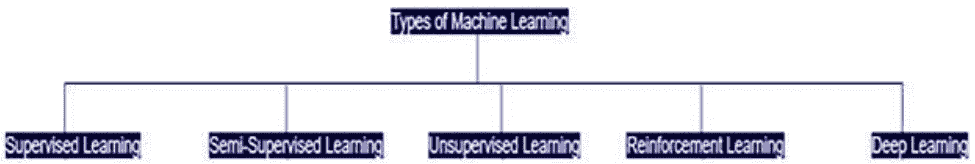

图 5.1：机器学习的类型

## 监督学习

监督学习类似于在知识渊博的导师指导下完成一项任务。在这种机器学习类型中，算法会获得一个带标签的数据集，其中每个数据点都有对应的期望输出。算法通过从带标签的数据中推广模式和关系来学习将输入映射到输出。这就像在尝试新的、未见过的问题之前，先从一组问题的答案中学习。

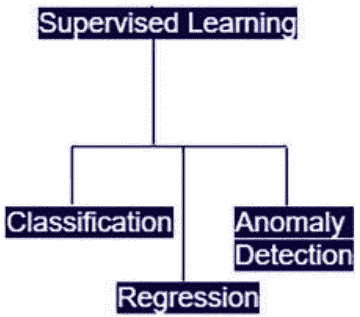

图 5.2：监督学习的类型

监督学习是机器学习中的一种基本方法，模型在带标签的数据集上进行训练，以根据输入数据进行预测或决策。监督学习有多种类型，每种都有其自身的特点和应用。

- 分类：分类是监督学习中最常见的类型之一。在这种方法中，模型被训练为给定输入数据预测离散类别或类别。例如，它可以用于将电子邮件分类为垃圾邮件或非垃圾邮件、预测客户是否会流失，或识别手写数字。

- 回归：回归是监督学习中另一种重要的类型，模型基于输入特征预测连续数值。例如，预测房价、气温预报或股票价格是典型的回归问题。其目标是生成位于连续尺度上的输出，从而帮助做出准确预测。

- 序回归：序回归是监督学习的一种专门形式，用于处理有序离散结果的预测。与分类不同，这些结果具有有意义的顺序，但它们之间不一定有恒定的差异。这可以见于评分系统，例如电影评分或客户满意度评分。

- 多标签分类：在多标签分类中，模型为单个输入实例预测多个标签或类别。当输入可以同时属于多个类别时，这很有用。例如，一篇文章可能属于多个主题，如技术、科学和商业。

- 不平衡学习：不平衡学习关注的是一个类别或标签显著超过其他类别的数据集。这在分类任务中可能是一个挑战，模型需要接受训练以处理数据的偏斜分布。过采样、欠采样或使用专门算法等技术有助于缓解这一问题。

- 异常检测：异常检测涉及训练模型以识别与数据集中大多数数据点显著偏离的异常或不典型数据点。它常用于欺诈检测、网络安全和制造领域，以识别可能预示问题的异常或离群值。

- 序列标注：序列标注是一种监督学习类型，模型为序列数据中的每个元素预测标签或标记。应用包括自然语言处理中的词性标注或命名实体识别，其中在文本中识别姓名、地点或组织等实体至关重要。

了解这些不同的监督学习类型对于根据问题性质和可用数据集选择合适的方法至关重要。这最终会带来更准确、更有效的机器学习模型。

## 无监督学习

无监督学习是在没有明确指导的情况下在数据中发现模式和结构的领域。可以将其视为在没有地图或向导的情况下探索新领域。算法能辨别数据集中的固有模式，将相似数据点分组并揭示隐藏结构。这种类型用于聚类、降维和关联挖掘，通常能揭示否则可能被忽视的洞察。

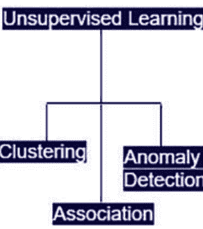

图 5.3：无监督学习的类型

无监督学习是机器学习中一个引人入胜的领域，涉及在没有任何标签监督的情况下从数据中提取模式和结构。以下是各种无监督学习类型的解释：

- 聚类：聚类是无监督学习中的一种基本技术，算法根据

基于某些特征或特性。它旨在发现数据中的自然分组，使其更易于分析和理解。常见的聚类算法包括 K-means、层次聚类和 DBSCAN。聚类的应用范围从营销中的客户细分到计算机视觉中的图像分割。

关联：关联是另一种无监督学习类型，其重点是识别数据中变量之间的关系和模式。它旨在发现描述数据集中项目共同出现的规则。关联挖掘的一个示例是 Apriori 算法，该算法常用于市场篮子分析，以了解购买行为并向客户推荐相关产品。

降维：降维技术对于通过减少特征或维度的数量来简化和可视化复杂数据至关重要，同时保留基本信息。主成分分析（PCA）和 t-SNE（t-分布随机邻域嵌入）是常用的降维方法。这些技术对于可视化高维数据和提高其他机器学习算法的效率至关重要。

生成建模：生成建模涉及学习数据的底层结构以生成新的、相似的数据点。变分自编码器（VAE）和生成对抗网络（GAN）是生成模型的示例。VAE 从数据空间到隐空间学习概率映射，从而能够生成新的数据点。GAN 由两个神经网络组成，即生成器和判别器，两者竞争以生成逼真的数据。

异常检测：异常检测（也称为离群点检测）涉及识别数据集中偏离大多数的异常或罕见实例。无监督异常检测方法旨在发现数据中的模式，并标记不符合这些模式的实例。孤立森林、单类 SVM 和自编码器等技术常用于各个领域（如欺诈检测和网络安全）中的异常检测。

每种无监督学习类型都有不同的目的，并应用于多个领域，以从数据中获取有意义的见解，而无需显式标签或监督。

## 强化学习

强化学习反映了试错学习过程。这就像训练狗一样：在环境中采取行动，算法根据这些行动获得奖励或惩罚。随着时间的推移，算法学会做出最大化奖励的决策。它是一种动态学习范式，非常适合涉及决策和策略的任务，例如游戏或自主机器人控制。

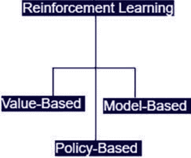

图 5.4：强化学习的类型

强化学习是人工智能中的一种基本范式，涵盖了多种类型，以适应不同的学习方法和目标。我们将深入探讨三种主要的强化学习类型：基于值、基于策略和基于模型。

### 基于值的强化学习
基于值的强化学习侧重于估计在各种状态下采取特定行动的价值或效用。Q-learning 和深度 Q 网络（DQN）等算法属于此类。智能体学习一个值函数，将状态-动作对映射到预期累积奖励，从而指导其决策。Q-learning 根据观察到的奖励和转移迭代更新 Q 值，逐渐趋向于最大化预期回报的最优策略。

### 基于策略的强化学习
基于策略的强化学习直接学习最优策略，即智能体应遵循的策略以最大化奖励。与基于值的方法不同，基于策略的方法不需要显式估计值函数。示例包括策略梯度方法，其中智能体对策略进行参数化并调整其参数以最大化预期累积奖励。这种强化学习类型在处理连续动作空间和应对随机环境方面非常有效。

### 基于模型的强化学习
基于模型的强化学习涉及构建环境动态的内部模型。智能体学习与不同状态和动作相关的转移概率和奖励的表示。通过利用这个学习到的模型，智能体可以提前规划并模拟可能的轨迹，从而做出更明智的决策。基于模型的方法结合了基于值和基于策略方法的元素，利用学习到的模型来优化策略或值函数。

每种强化学习类型都有其自身的优势，并适用于特定的问题领域。基于值的方法在处理离散动作空间和学习最优值函数方面表现出色。基于策略的方法擅长处理连续动作空间和随机环境。基于模型的方法通过融入学习到的模型来模拟和规划，从而提高效率，平衡探索与利用。强化学习的成功应用通常需要根据具体问题仔细选择和整合这些类型。

## 半监督学习

半监督学习是监督学习和无监督学习的结合，在标记数据昂贵或耗时时提供了一种实际的折中方案。在这种方法中，模型在部分标记的数据集上训练，利用标记示例以及未标记数据中存在的底层结构。算法从标记数据外推模式，以对未标记数据进行预测。

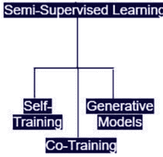

图 5.5：半监督学习的类型

半监督学习是一种机器学习范式，介于监督学习（完全标记的数据）和无监督学习（无标记数据）的两个极端之间。在这种方法中，模型在标记和未标记数据的组合上训练，这可以带来更高效、更具成本效益的学习。存在各种半监督学习技术，每种都有其独特的方法和优势。

### 自训练
自训练是一种经典的半监督学习方法，模型从一个小型标记数据集和一个较大的未标记数据池开始。最初，模型在标记数据上进行训练。然后，它利用当前知识为未标记数据预测标签，并将这些预测作为伪标签添加到训练集中。随后，模型在扩展后的数据集上重新训练。

### 协同训练
协同训练是一种涉及训练多个模型的技术，每个模型在不同的特征子集或表示上进行训练。模型从标记数据中学习，然后根据各自的优势迭代地为未标记数据打标签。模型达成一致的数据实例会被添加到标记数据集中。这种方法利用多样化的视角来提升性能。

### 多视图学习
在多视图学习中，每个数据点由多个视图或表示来表示。这些视图可以是不同的特征集、传感器，甚至是多个信息源。模型在一个视图的标记数据上学习，并将此知识应用于为其他视图中的相应未标记数据打标签。多视图学习可以通过整合不同来源的互补信息来提升性能。

### 生成模型
生成模型，例如变分自编码器（VAE）和生成对抗网络（GAN）可用于半监督学习。这些模型学习生成与观察到的数据相似的数据。通过在标记和未标记数据上进行训练，模型


learns to generate data that is representative of the underlying structure,
aiding the learning process.

Consistency Regularization: Consistency regularization is a technique that
enforces consistency in the model’s predictions on augmented versions of
the same unlabeled input. It introduces perturbations to the input, and
encourages the model to produce consistent predictions across these
perturbed versions. This helps the model learn a more robust and
generalizable representation of the data.

Semi-supervised learning techniques aim to make efficient use of
unlabeled data to enhance the performance and generalization capabilities
of machine learning models. Each type has its own advantages, and is
suited to different scenarios, ultimately contributing to the diverse toolbox
of modern learning algorithms.

## Deep Learning

Deep learning is like constructing a complex hierarchical representation of data. It involves using neural networks with multiple layers to progressively learn more abstract features from the input data. Deep learning excels in tasks such as image and speech recognition, natural language processing, and artificial intelligence, often achieving state-of-the-art performance due to its capability to model intricate patterns and relationships.

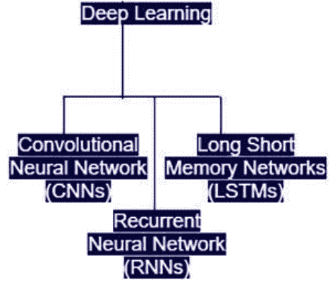

Figure 5.6: Types of Deep Learning

### Convolutional Neural Networks

(CNNs) are a type of deep learning model specifically designed for processing grid-like data, such as images and videos. They employ convolutional layers that automatically and adaptively learn spatial hierarchies of features from the input data. CNNs have revolutionized computer vision tasks by effectively capturing patterns and features at different scales, making them highly efficient for tasks such as object detection, image recognition, and image segmentation.

### Recurrent Neural Networks

(RNNs) are a type of deep learning model that excel at processing sequential and time-series data. They have loops within their architecture, allowing them to maintain a form of memory to capture information from previous inputs. RNNs are widely used in natural language processing, speech recognition, and handwriting recognition due to their ability to analyze sequences and make predictions based on context.

### Generative Adversarial Networks

(GANs) are a unique class of deep learning models that involve two neural networks, the generator and the discriminator, engaged in a competitive training process. The generator creates data samples trying to mimic a given dataset, while the discriminator aims to distinguish between real and generated data. Through this adversarial training, GANs can generate realistic data, making them valuable for tasks such as image generation, style transfer, and data augmentation.

### Long Short-Term Memory Networks

(LSTMs) are a specialized type of recurrent neural network that addresses the vanishing gradient problem. LSTMs are well-suited for capturing long-term dependencies in sequential data due to their gating mechanisms, which enable the network to remember or forget information over extended sequences. LSTMs find applications in machine translation, speech recognition, and sentiment analysis, in which understanding context over long sequences is crucial.

Autoencoders are a type of neural network used for unsupervised learning and dimensionality reduction. They consist of an encoder that compresses the input data into a lower-dimensional representation (latent space), and a decoder that reconstructs the original data from this representation. Autoencoders are employed for tasks such as denoising, anomaly detection, and feature learning, helping in feature extraction and data visualization.

Each type of deep learning architecture mentioned above possesses unique characteristics, and is tailored to address specific challenges and tasks within the field of artificial intelligence and machine learning.

## Challenges and Opportunities in Edge-Based Data Analytics and Machine Learning

Edge-based data analytics and machine learning present a unique set of challenges and opportunities that stem from the distributed nature of data processing and analysis. The edge refers to the devices or sensors located closer to the data source, enabling real-time processing and reduced latency. We will now delve into the distinct hurdles and potential benefits associated with this paradigm.

The following are some of the opportunities:

- Real-Time Decision Making: Edge analytics enables real-time data processing and decision-making. Critical applications such as autonomous vehicles, healthcare monitoring, and industrial automation can benefit from immediate insights without relying on centralized servers.

- Reduced Latency: Processing data at the edge reduces the time taken to transmit data to the cloud, and receive the analysis results. This is paramount for applications in which low latency is crucial, such as in gaming, smart grids, and robotics.

- Efficient Resource Utilization: By offloading processing tasks to edge devices, the load on centralized cloud infrastructure can be reduced. This leads to more efficient use of resources, cost savings, and improved scalability in the overall data analytics and machine learning ecosystem.

- Enhanced Privacy and Compliance: Edge analytics can provide local data processing, ensuring that sensitive information stays within a confined environment. This enhances privacy and compliance with data protection regulations, addressing some concerns related to data security and privacy.

The following are some of the challenges faced:

- Limited Computational Resources: Edge devices often have constrained computational capabilities, including processing power, memory, and storage. This limitation poses a significant challenge in executing complex machine learning models and data analytics tasks efficiently.

- Bandwidth Constraints: Transmitting large volumes of raw data from the edge to central servers for analysis is impractical due to limited bandwidth. Filtering and preprocessing at the edge are essential to reduce the data sent to the cloud, but this preprocessing must maintain data integrity and relevance.

- Privacy and Security Concerns: Edge devices may capture sensitive or personal information. Ensuring privacy and security while processing data at the edge is crucial, and this becomes a challenge due to the decentralized nature of edge analytics.

- Heterogeneous Ecosystem: Edge environments encompass a wide array of devices with varying hardware, software, and communication protocols. Integrating and harmonizing these diverse elements for efficient analytics and machine learning is a significant challenge.

In conclusion, while edge-based data analytics and machine learning present challenges, they offer immense potential for real-time, efficient, and privacy-enhanced data processing. Striking the right balance between these challenges and opportunities will be crucial for the successful integration and widespread adoption of edge-based analytics and machine learning in various domains.

## Bandwidth and Latency Constraints

Bandwidth and latency constraints are critical considerations in the realm of modern technology and data processing. Bandwidth refers to the amount of data that can be transmitted over a network in a given amount of time. Latency, on the other hand, is the delay experienced in the transmission of data. Both these factors are directly linked to the efficiency and effectiveness of data processing, especially in the context of emerging technologies such as the Internet of Things (IoT) and real-time applications.

In the age of rapid digitalization, our reliance on data-driven applications has skyrocketed. From smart homes to autonomous vehicles, these applications demand instant data processing and decision-making. However, the sheer volume and complexity of data generated by these devices often overwhelms centralized data centers, leading to bandwidth bottlenecks and increased latency. This delay can have significant consequences, particularly in scenarios in which real-time actions and decisions are critical.

Enter edge computing — a paradigm shift that addresses these challenges head-on. Edge computing involves processing data closer to the source of its generation, such as on local devices or nearby servers. By doing so, it alleviates the strain on centralized cloud data centers, reducing the need for extensive data transfers over the network. This local processing significantly minimizes latency, allowing for near-instantaneous responses to data inputs.


此外，边缘计算还能提升带宽利用率。通过在本地处理数据，仅将必要信息传输到中心服务器，优化带宽使用，并减轻网络拥堵。这不仅提高了网络的整体效率，还节省了与集中传输和存储大量数据相关的成本。

总之，边缘计算的必要性源于对低延迟、高带宽应用日益增长的需求。通过将数据处理移至更靠近数据源的位置，边缘计算克服了带宽和延迟限制带来的挑战，确保高效的实时数据处理，这对当今日益蓬勃的数字环境中众多应用的成功至关重要。

## 边缘环境中的隐私与安全问题

边缘计算是一种将计算和数据存储更靠近数据源的范式，但它引发了重大的隐私与安全顾虑。由于数据处理发生在网络边缘，通常在本地设备或边缘服务器上，因此在保护敏感信息和系统整体安全方面引入了新的风险和挑战。

首要担忧之一是数据隐私。边缘设备通常需要处理由传感器、物联网设备或用户产生的大量敏感数据。这些数据可能包括个人健康记录、财务信息或机密业务数据。未经授权访问这些数据可能导致身份盗用、金融欺诈或其他恶意活动。因此，实施强大的加密和访问控制机制对于保障边缘数据的隐私至关重要。

另一个关键问题涉及数据完整性和真实性。在边缘环境中，数据在到达中心服务器或云之前，经常在多个节点上进行处理和转换。确保数据在整个传输过程中保持未被篡改且真实至关重要。恶意行为者可能试图篡改数据以操纵决策、结果或触发误导性操作，这凸显了强大的数据完整性机制的必要性。

此外，边缘计算的分布式特性使得在所有边缘设备和系统中执行一致的安全策略变得具有挑战性。硬件能力、软件版本和网络条件的差异可能使维持统一的安全级别变得困难。在各种边缘设备上实施安全更新、补丁和监控成为一项复杂任务，可能带来漏洞和被利用的风险。

此外，边缘的数据收集和聚集可能会无意中侵犯个人的隐私权。在需要数据来改进服务与尊重个人隐私之间取得平衡是一项微妙的任务。边缘系统必须遵守隐私法规和政策，以确保数据的收集、存储和处理符合法律要求和道德标准。

总之，解决边缘环境中的隐私与安全问题需要采取多方面的方法，涉及强大的加密、访问控制、数据完整性措施以及遵守隐私法规。一种考虑边缘计算独特挑战的主动且全面的策略对于在这些不断发展的技术中建立信任至关重要。

## 边缘的可扩展性与资源限制

边缘计算中的可扩展性是指边缘基础设施高效处理日益增加的设备、应用程序和数据处理需求的能力。随着边缘设备数量和产生的数据量不断增长，边缘计算系统必须能够无缝扩展以满足这些需求。可扩展性可以通过多种方式实现，包括在边缘设备网络中分配工作负载、优化资源分配以及利用负载均衡技术。此外，采用高效的通信协议和设计灵活的架构，对于确保边缘基础设施在不牺牲性能和响应能力的前提下扩展起着重要作用。

然而，边缘计算的可扩展性受到边缘设备固有资源限制的制约。与集中式云服务器相比，边缘设备的处理能力、内存、存储和能源资源往往有限。这些限制在设计能够处理边缘日益增加的工作负载和应用复杂度的可扩展解决方案时带来了挑战。为了解决这些限制，将计算卸载到云端、为资源受限环境优化算法以及利用边缘缓存和预处理技术等策略至关重要。权衡资源使用与可扩展性之间的利弊，对于确保高效有效的边缘计算解决方案并满足各类边缘应用和服务日益增长的需求至关重要。

## 边缘创新机遇：定制硬件、联邦学习及其他

边缘的创新机遇正在蓬勃发展，呈现出一个有望带来变革性进步的蓝图。其中一项机遇在于边缘定制硬件领域。根据边缘计算的特定需求和限制定制硬件，可以显著提升性能、能效和数据处理能力。边缘定制硬件的创新可催生专为边缘任务优化的专用芯片和设备，从而加快决策速度并降低延迟。通过利用定制硬件解决方案，企业可以释放边缘实时数据处理和分析的前所未有的潜力，彻底改变医疗保健、自动驾驶汽车和智慧城市等行业。

边缘创新的另一条有前景的途径是边缘联邦学习。这种方法涉及在去中心化的边缘设备上训练机器学习模型，同时保护数据隐私和安全。联邦学习允许模型在不集中敏感数据的情况下进行更新和改进，因此在数据隐私至关重要的场景中尤其有优势。通过利用边缘联邦学习，企业可以发挥分布式边缘设备网络的集体智能，从而实现更强的个性化、自适应学习和更高的人工智能模型准确性。这种创新方法有望重塑金融、零售和个性化服务等行业，实现更智能、更高效的决策。

此外，边缘计算的进步为无缝集成5G网络、增强现实（AR）、虚拟现实（VR）和物联网（IoT）等多种技术提供了机遇。这些集成构建了一个完整的生态系统，为创新开辟了新的前沿。例如，在边缘利用5G连接可以大幅降低延迟，从而实现之前无法实现的实时交互和应用。结合AR和VR，这可能会彻底改变游戏、教育和医疗保健等行业，提供能够增强参与感和学习效果的沉浸式和交互式体验。

总之，边缘的创新机遇广泛而多维。从定制硬件到联邦学习，再到新兴技术的集成，边缘计算范式为开创性的进步提供了丰富的画布，这些进步有潜力重新定义我们与技术的交互方式，并推动各个领域的进步。利用这些机遇的能力无疑将成为下一波技术变革的催化剂。

## 边缘数据分析与机器学习架构

基于边缘的数据分析与机器学习涉及直接在设备或网络边缘上处理和分析数据，而不仅仅依赖于集中式云服务器。这种方法具有多种优势，包括降低延迟、提升隐私和提高效率。基于边缘的数据分析与机器学习的关键架构之一是联邦学习框架。


## 联邦学习架构

联邦学习是一种去中心化的学习方法，模型在多个边缘设备或服务器上进行训练，同时保持数据本地化。

中央服务器通过聚合来自边缘设备的模型更新来协调学习过程，而不实际访问原始数据。

这种架构允许协作学习，同时不会影响数据隐私。

边缘设备使用本地数据执行模型训练，只有模型更新（而非数据）会被传输到中央服务器。

中央服务器聚合这些更新以改进全局模型，然后将其重新分发到边缘设备。

这种迭代过程持续进行，最终形成一个不断改进且具有全球适用性的模型。

边缘数据分析和机器学习的另一种重要架构是边缘计算与边缘AI架构。

## 边缘计算与边缘AI架构

该架构涉及将边缘计算能力与边缘设备上的AI模型直接集成。

边缘设备（例如传感器、摄像头或移动设备）使用轻量级AI模型在本地处理和分析数据。

这些模型经过优化，可以在资源受限的设备上高效运行，从而实现实时分析，而无需与云保持持续通信。

边缘AI方法允许基于分析数据进行快速决策和行动，最大限度地降低延迟，并提高系统响应能力。

此外，该架构通过减少向集中式服务器传输敏感数据的需求，增强了数据隐私。

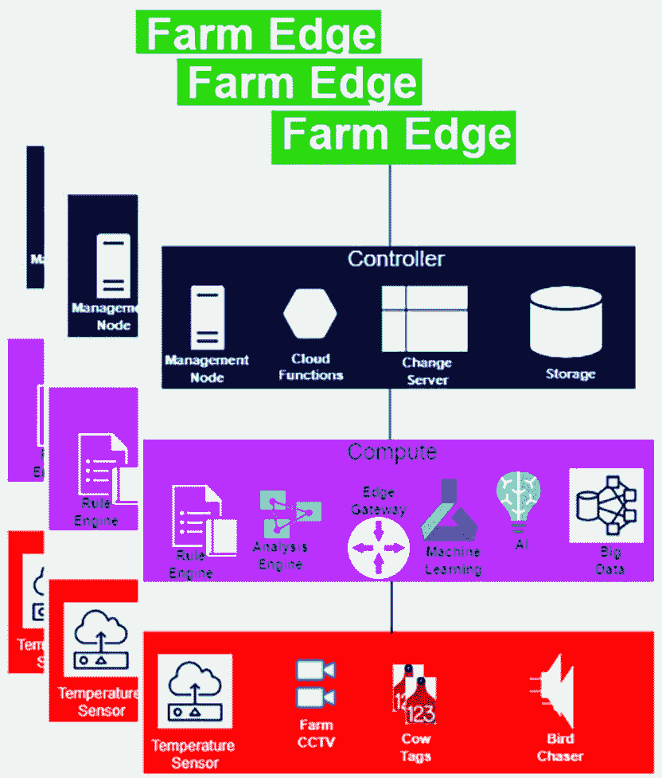

图 5.7：边缘计算人工智能与机器学习

总之，联邦学习提供了一种跨边缘设备的协作模型训练方法，确保数据隐私，同时提高模型准确性。

另一方面，边缘计算与边缘AI架构直接在边缘设备上利用AI模型，在不严重依赖集中式云服务器的情况下，实现实时分析和决策。

这两种架构都推动了边缘数据分析和机器学习的发展，适应各种用例并优化边缘计算的优势。

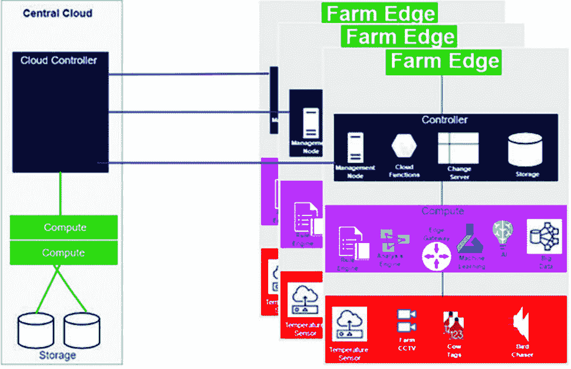

图 5.8：中心云架构

## 边缘、雾和云三位一体

边缘、雾和云计算是现代IT架构的重要组成部分，在数据处理和存储领域各自承担着独特的目的和功能。

了解何时利用每种架构对于优化系统性能、安全性和效率至关重要。

### 边缘计算

边缘计算涉及在更靠近数据源的位置处理和分析数据，通常位于生成数据的设备上或附近。

这种架构非常适合需要低延迟和实时决策的场景。

例如，在自动驾驶汽车中，边缘计算用于处理传感器数据并做出瞬间决策，以确保安全驾驶。

此外，边缘计算在制造业等行业中也很有价值，在这些行业中，立即处理传感器数据可以优化运营效率并最大限度地减少停机时间。

### 雾计算

雾计算位于边缘和云之间，将计算能力扩展到边缘设备之外，但比云更靠近数据源。

它适用于需要本地化数据处理、实时分析以及比传统云计算更快响应时间的应用。

智慧城市等应用，其中城市各处各种传感器的数据需要被分析用于城市规划或紧急响应，非常适合雾计算架构。

### 云计算

云计算涉及在服务提供商管理的集中式数据中心中存储和处理数据。

它最适合需要大量处理、分析和长期存储数据的应用。

企业资源计划系统、客户关系管理平台和大规模分析应用通常部署在云上。

云提供可扩展性、可访问性和成本效益，使其成为数据量和计算需求都很大的应用的理想选择。

总之，边缘计算用于实时处理和即时决策，雾计算用于本地化数据处理（比边缘计算具有更多计算能力，但少于云），云计算用于大规模处理、长期存储以及不需要即时响应时间的应用。

选择适当的架构取决于应用程序的具体要求以及在延迟、处理能力和可扩展性之间所期望的平衡。

## 边缘去中心化计算模型

边缘去中心化计算模型代表了我们处理和管理数据方式的范式转变。

这种方法的核心在于将计算能力和数据存储分布到更靠近数据生成源头的位置（可能是从物联网设备到传感器的任何东西）的概念。

这种接近性通过本地处理数据来最大限度地减少延迟和带宽使用，促进实时分析和更快的决策。

通过在网络边缘去中心化计算，我们减轻了集中式云服务器的负担并提高了系统效率。

在去中心化边缘计算模型中，每个边缘设备或节点都成为一个微型数据中心，能够独立执行数据处理和分析。

这些节点可以以点对点的方式协作，无缝共享信息和计算任务。

这种架构不仅提高了速度和响应能力，还提高了系统的韧性和容错能力。

即使某个节点失败，其余节点也可以继续运行，从而确保系统的健壮性和可靠性。

此外，去中心化边缘模型促进了隐私和安全性。

数据可以在本地处理和存储，最大限度地减少数据穿过网络的需求。

这本质上减少了对潜在安全威胁的暴露，并通过将敏感信息保持在更靠近其源头且受本地控制的位置来增强隐私性。

用户对其数据保留更大控制权，决定如何使用数据以及谁有权访问数据。

总之，边缘去中心化计算模型代表了一种变革性方法，利用分布式计算的力量，实现实时数据分析，增强系统韧性，并加强隐私和安全性。

未来在于拥抱这种去中心化范式，以满足数据驱动世界日益增长的需求。

## 边缘数据收集与预处理

边缘数据收集与预处理代表了在物联网时代我们处理和分析信息方式的根本性转变。

边缘是指位于更靠近数据源的位置的设备和传感器，允许实时处理和分析，而无需将数据发送回集中式服务器。

这种去中心化方法提高了效率，降低了延迟，并节省了带宽。

在边缘数据收集领域，传感器和设备从其环境中收集原始数据。

这些设备可以是从工业环境中的温度传感器到可穿戴健康监测仪的任何东西。

收集的数据性质多样，包括数值传感器读数、图像、音频甚至视频流。

这些多样化的数据为进一步分析和洞察奠定了基础。

在边缘对这些原始数据进行预处理涉及几个关键步骤。

首先，收集到的数据被清理和过滤，以去除噪声或数据传输过程中可能出现的错误读数。

这确保了后续分析基于准确可靠的数据。

清理后，数据通常会被汇总或总结，以在保留其信息价值的同时减少其大小和复杂性。

汇总可能涉及计算平均值、总和或其他统计量。


此外，边缘端的预处理可能涉及将数据标准化和转换为适合分析的标准格式。此步骤确保不同类型数据的一致性和兼容性，从而更容易应用机器学习模型或其他分析技术。此外，预处理过程中通常会应用隐私和安全措施，以确保敏感信息得到适当处理和保护。

总体而言，边缘端数据采集与预处理的集成是一种强大的范式，能够实现实时、本地化的决策和分析，彻底改变从医疗保健和交通到制造业和农业等各个行业和应用。这种方法优化了数据处理，提高了效率，并释放了物联网设备产生的海量数据的全部潜力。

实时处理和批处理是数据分析中的两种基本方法，各自在快速发展的边缘计算领域中服务于不同的目的和应用。实时处理涉及在数据生成或接收时立即进行分析和解释。这种方法对于及时洞察和快速决策至关重要的应用至关重要，例如金融交易、医疗保健监控和工业自动化。边缘端的实时处理确保数据在其源附近进行处理，最大限度地降低延迟，并提高数据分析的效率。

另一方面，批处理涉及在预定义的固定大小分块或批次中分析数据，通常在预定间隔内进行。这种方法适用于延迟不那么关键，并且可以处理大量数据的应用，例如商业智能的夜间分析、客户趋势分析或每月财务报告。边缘端的批处理允许聚合和分析特定时间段内收集的数据，为明智的决策和长期战略规划提供全面的视图。

在边缘计算的背景下，这些处理方法对于优化数据分析工作流程至关重要。实时处理对于基于边缘传感器或设备传入数据触发即时操作或警报的场景尤其有利。相反，在分析一段时间内累积的数据时，批处理可能很有价值，提供更广泛的视角以检测趋势、异常和模式，从而获得更深入的见解和预测建模。边缘端实时处理和批处理的协同作用能够实现全面的数据分析方法，增强边缘设备的能力和效率，并使组织能够根据其数据上下文做出明智和及时的决策。

## 数据清洗、转换和聚合技术

边缘端的数据清洗、转换和聚合是提升边缘计算环境中数据分析效率和准确性的关键过程。边缘计算涉及在数据源附近进行处理和分析，最大限度地降低延迟，并优化带宽使用。以下是一些在边缘端执行这些关键任务的独特技术：

### 边缘增强型数据预处理

要在边缘端清洗和转换数据，会设计定制的预处理算法，以便在资源受限的边缘设备上高效运行。这些算法专注于降噪、异常值检测和缺失值填充，确保在将数据传输到中央服务器进行进一步分析之前提高数据质量。通过利用轻量级机器学习模型，边缘设备可以自主清洗和预处理数据，减轻集中式系统的负担。

### 边缘数据融合与集成

来自多种源的数据集成是数据转换中的关键方面。在边缘端，数据融合技术结合来自多个传感器或设备的信息，以创建统一且更全面的数据集。这种融合可以采用多种方法，例如语义集成、时间同步或空间对齐，从而实现对环境的全面视图。通过在边缘端执行数据融合，可以减轻中央服务器的负载，并在更靠近数据源的地方生成实时洞察。

### 去中心化聚合与摘要

边缘端的数据聚合涉及将大量原始数据汇总为有意义的压缩表示。去中心化聚合技术将这一汇总过程分布在边缘设备上，允许每个设备根据其本地数据计算部分聚合结果。然后将这些部分聚合结果结合起来以获得最终的聚合结果。通过去中心化聚合过程，工作负载得到分布，延迟被最小化，从而能够对分析查询做出近乎即时的响应。

### 边缘分析驱动的数据丰富

边缘分析涉及直接在边缘端使用高级分析模型来丰富原始数据。该技术采用机器学习算法进行情感分析、异常检测或模式识别，为原始数据添加上下文信息和洞察。通过在边缘端丰富数据，可以在本地获得有价值的洞察，减少将大量原始数据传输到集中式服务器的需求，并优化带宽使用。

### 动态边缘处理工作流

在边缘端实施数据清洗、转换和聚合的动态工作流涉及自适应算法，这些算法会根据可用资源和数据不断变化的特性调整其处理步骤。这些工作流旨在优化边缘资源的使用，动态分配计算任务并适应不断变化的数据特征。这种方法确保高效的数据处理，并使边缘设备能够适应不同的工作负载和要求。

采用这些边缘端的数据清洗、转换和聚合技术，使边缘计算环境能够高效地生成高质量、可操作的洞察，最终有助于改善决策并提升整体系统性能。

## 简化数据以实现边缘端高效分析

在边缘端简化数据以实现高效分析，涉及在去中心化计算环境中优化数据处理和分析能力的细致过程。在边缘端，数据快速且大量地生成，通常需要立即分析以提取有价值的洞察。为了实现高效性，数据会在源端进行预处理和过滤，确保仅传输相关且有意义的信息到中央处理单元。这一初始步骤最大限度地减少了对网络带宽的负担，并显著降低了延迟，这是实时决策场景中的关键因素。

此外，边缘设备配备了专门的硬件和软件，旨在本地处理和分析预处理后的数据。这种本地化分析减少了与中央服务器持续通信的需求，缩短了响应时间，并允许及时决策。高级算法和机器学习模型部署在边缘端，能够从预处理后的数据中提取可操作的洞察。这些模型经过精心选择和优化，能够在边缘计算资源的限制内高效运行，最大限度地发挥去中心化系统的分析能力。

此外，为了高效简化数据，边缘端采用数据压缩和聚合技术。这些技术在保留关键信息的同时压缩数据，从而实现更易管理且更高效的存储和传输过程。通过聚合数据，


冗余信息被消除，从而减少了存储需求，并最大限度地降低了对通信网络的负载。这种精简的数据架构优化了整体分析工作流，确保在边缘生成的洞察既准确又易于快速访问，从而最终增强医疗、制造和自动驾驶汽车等各种应用中的决策过程。

## 边缘实时数据挑战与解决方案

实时数据处理在现代数据分析和决策领域带来了一系列独特的挑战。随着物联网设备、社交媒体和互联系统的兴起，基于即时数据的即时洞察和行动的需求呈指数级增长。然而，处理和理解这些实时数据面临着巨大的障碍。

一项挑战在于传入数据的巨大数量和速度。数据生成的速度可能会让传统数据处理系统不堪重负。实时数据流每秒可从数千个事件到数百万个事件不等，需要能够处理如此高吞吐量的强大基础设施。可扩展性变得至关重要，并需要能够水平扩展以适应不断增加的数据负载的分布式处理框架。

另一项挑战是确保实时的数据准确性和一致性。由于网络延迟、硬件故障或传感器噪声，数据质量可能会下降，导致不准确的洞察和错误的决策。在整个处理流水线中实施强大的数据验证机制并保持数据完整性，对于生成可靠的实时分析至关重要。

处理实时数据时，延迟是一个关键问题。处理和分析数据的延迟会降低其价值，尤其是在欺诈检测、医疗监测或金融交易等对时间敏感的应用中。优化算法、最小化处理时间并利用内存数据库有助于降低延迟，并能够基于实时洞察进行更快的决策。

在解决方案方面，利用流处理框架是根本。Apache Kafka、Apache Flink 或 Apache Storm 等技术提供了高效摄入、处理和分析实时数据流的手段。这些框架支持并行处理、容错和自动扩展，确保能够无缝处理大量实时数据。

此外，直接在流式数据上使用机器学习模型和 AI 算法可以实现实时预测和异常检测。将机器学习集成到数据处理流水线中，可以基于最新且最相关的信息实现自动化决策。

此外，采用边缘计算可以减轻中央处理单元的负担并降低延迟。通过在数据源（即靠近数据生成位置）执行初始数据处理和分析，仅将相关信息发送到中央系统进行进一步分析，从而最大限度地减少网络流量并提高整体处理速度。

总之，克服与实时数据处理相关的挑战需要一种全面的方法，包括优化基础设施、提高数据准确性、最大限度地降低延迟，并利用流处理框架、机器学习和边缘计算等先进技术。通过有效应对这些挑战，组织可以充分释放实时数据分析的潜力，做出明智且及时的决策。

## 机器学习模型选择与优化

边缘机器学习模型选择与优化涉及根据有限计算资源设备（如智能手机、物联网设备或边缘服务器）的特点，定制和微调机器学习模型，使其能够高效运行。目标是在最小化资源使用的同时，实现最佳性能和准确性。一种方法是仔细选择轻量级且可以高效部署到边缘设备上的模型。这需要考虑模型大小、复杂性和计算要求等因素，以确保它们能够在受限环境中平稳运行。

此外，优化技术在提升这些模型效率方面起着至关重要的作用。量化等技术通过降低模型参数和中间激活值的精度，可以显著减少内存和计算需求。此外，剪枝涉及从神经网络中移除不必要的连接或神经元，进一步减小模型大小和计算要求。这些优化在模型性能和资源利用之间取得了平衡，使模型在边缘部署成为可能。

在此过程中，选择适当的优化算法至关重要。联邦学习等算法中，模型在边缘设备上本地训练，然后聚合形成全局模型，从而减少将大量数据发送到中央服务器的需求。这不仅解决了隐私问题，还有助于最大限度地减少通信开销，非常适合边缘计算场景。迁移学习等技术，即在边缘设备上针对特定任务对预训练模型进行微调，也可以用来优化性能，同时减少边缘端大量训练的需求。

总之，成功的边缘机器学习模型选择与优化需要深思熟虑的方法，考虑边缘设备的局限性和能力。利用轻量级模型、实施优化技术和使用适当的算法是实现边缘高效有效的机器学习解决方案的关键步骤。

## 为边缘部署选择合适的机器学习模型

为边缘部署选择合适的机器学习模型是边缘计算领域的一项关键决策。边缘环境通常资源受限，需要仔细考虑模型复杂性、大小和效率。选择计算和内存需求极少的轻量级模型，是确保处理能力有限的边缘设备获得最佳性能的关键。决策树、线性回归和支持向量机（SVM）等模型由于其相对较低的复杂性和计算需求，是不错的选择。这些模型在准确性和效率之间取得了平衡，适用于边缘部署场景。

此外，可针对硬件加速进行优化的模型对边缘部署非常有利。卷积神经网络（CNN）和循环神经网络（RNN）常用于图像和序列数据处理，可以通过剪枝、量化或压缩来减小其大小和计算负载，同时保持性能。这使得它们能够在边缘设备上高效执行，提高推理速度和响应能力。

除了模型复杂性和优化之外，在为边缘部署选择合适的机器学习模型时，还必须仔细考虑数据的性质和特定的应用要求。例如，如果应用涉及实时决策，循环神经网络（RNN）或长短期记忆（LSTM）网络等模型可能更合适，因为它们可以处理序列数据并及时做出预测。相反，对于数据结构更简单或时间要求不那么严格的任务，k-最近邻（KNN）或逻辑回归等简单模型可能就足够了。

最终，边缘部署的机器学习模型选择应与模型复杂性、计算效率、数据类型和应用要求之间的权衡保持一致。进行彻底的评估和实验以确定最合适的模型至关重要，该模型应针对特定的边缘计算场景，在准确性和效率之间取得适当的平衡。


## 边缘侧量化与模型压缩技术

量化是机器学习和深度学习领域中的一项关键技术，尤其是在边缘部署模型时。它涉及降低模型参数和激活值中数值的精度。这一过程显著降低了内存和计算需求，使得在智能手机、物联网设备或嵌入式系统等资源受限设备上运行复杂模型成为可能。通过将模型权重和激活值量化为较低的比特精度（例如，8 位整数），模型大小会减小，从而实现更快的推理并降低功耗。

模型压缩技术在边缘侧涵盖了各种旨在优化和压缩深度学习模型以实现高效部署的方法。除了量化之外，剪枝等技术（即移除冗余或不重要的模型参数）发挥着至关重要的作用。这会产生更稀疏、更紧凑的模型，可以以更低的计算需求执行。另一种常见的方法是知识蒸馏，即训练一个较小、更简单的模型来模仿较大、更复杂模型的行为。这种蒸馏模型保留了关键信息，同时更加轻量且适合边缘设备。

知识蒸馏并非从较大模型生成较小模型的唯一方法。模型剪枝和权重共享等技术也可以采用。模型剪枝涉及识别和移除模型中冗余或不重要的连接或参数。权重共享旨在通过对相似权重进行分组并共享它们来减小模型大小，从而降低内存占用。这些方法通常在模型大小、准确性和推理速度之间取得平衡，因此对于在资源有限的设备上部署深度学习模型至关重要。

总之，量化和模型压缩技术是实现机器学习模型在边缘高效、有效部署的基本策略。这些技术确保模型可以在资源受限的设备上运行，而不会牺牲其性能，使其成为广泛边缘计算应用中必不可少的技术。

## 资源受限环境下的超参数调优

边缘资源受限环境中的超参数调优面临着独特的挑战，因为边缘设备通常计算资源有限且电力供应受限。在这些环境中，在模型性能和资源效率之间取得适当平衡至关重要。传统的超参数调优方法可能不适用，因为它们通常涉及大量的计算需求。

边缘环境中超参数调优的一种方法是利用贝叶斯优化，这是一种用有限次评估智能探索超参数空间的方法。贝叶斯优化同时考虑模型性能和资源约束，从而能够选择在准确性和资源利用率之间提供最佳权衡的超参数。

此外，可以采用元学习技术来加速超参数调优过程。元学习涉及训练一个模型，以学习各种任务中最优超参数的模式。然后利用学习到的元知识来指导特定边缘任务的超参数搜索，有效减小搜索空间并加速调优过程，同时考虑资源约束。

此外，边缘资源受限环境中超参数调优的一个关键方面是根据上下文和边缘应用的性质调整超参数选择策略。例如，用于图像处理的边缘设备可能需要与用于自然语言处理的设备不同的超参数集。了解边缘应用的具体要求和约束对于有效的超参数调优至关重要。

总之，边缘资源受限环境中的超参数调优需要考虑边缘设备固有有限资源和电力约束的创新策略。贝叶斯优化、元学习和定制的超参数选择策略等技术对于在具有挑战性的环境中实现最佳模型性能至关重要。

## 准确性与效率之间的权衡

边缘上准确性与效率之间的权衡是边缘计算领域的基本挑战，其中计算能力被部署得更接近数据源。实现高准确性通常需要复杂的算法和深度学习模型，导致计算和能源需求增加。然而，在电力、处理能力和内存等资源有限的边缘环境中，追求高准确性可能会影响系统的效率和及时性。

边缘上的效率对于实时决策和响应能力至关重要。简化算法和使用轻量级模型可以提高效率，从而实现更快的处理和降低能源消耗。然而，这种简化通常会以牺牲准确性为代价，因此必须取得平衡。工程师和数据科学家需要仔细分析特定应用及其要求，以确定准确性和效率之间可接受的权衡。平衡两者可确保边缘设备的最佳性能和资源利用率。

在医疗保健或自动驾驶汽车等场景中，实时准确的洞察力至关重要，因此实现高水平的准确性至关重要。然而，实现这一点可能会消耗大量资源，可能导致延迟和能源消耗问题。在这种情况下，可以采用模型剪枝、量化和压缩等优化技术来降低计算负载，同时保持合理的准确性。取得正确平衡需要了解给定用例中准确性的重要性以及对延迟的容忍度。

此外，边缘硬件的选择在管理这些权衡中起着关键作用。根据应用的特定需求定制硬件可以显著提高效率。现场可编程门阵列（FPGA）或特定应用集成电路（ASIC）等专用硬件可以比传统的 CPU 或 GPU 更高效地加速计算并支持复杂模型。然而，开发和集成此类专用硬件可能成本高昂且耗时，需要仔细考虑所涉及的权衡。

总之，边缘上准确性与效率之间的权衡是多维的，受应用性质、硬件约束和实时处理要求的影响。实现最佳权衡涉及微妙的平衡，并考虑特定用例、资源限制以及边缘上及时准确决策的紧迫性。研究人员、开发人员和从业者继续探索创新方法和技术，以有效管理这种权衡并释放边缘计算的全部潜力。

## 边缘实时推理与决策

边缘实时推理和决策代表了现代计算环境中处理和响应数据方式的范式转变。“边缘”指的是生成数据的物理位置，通常靠近数据源，例如传感器、设备或机器。实时推理涉及即时分析这些数据，提取有意义的洞察并立即做出决策，而不依赖于集中式服务器或云计算。这种方法在需要立即采取行动的场景中至关重要，例如自动驾驶汽车、工业自动化、医疗监控和智慧城市。

边缘实时推理的核心是将先进的机器学习模型和算法直接部署到边缘设备上。这些模型经过优化，可以在有限的计算资源下高效运行，使其能够在本地处理数据并实时提取可操作的信息。这不仅降低了延迟和带宽需求，而且通过最大限度地减少将敏感数据传输到集中式服务器的需求，增强了隐私和安全性。

在现实世界的应用中，例如在复杂环境中导航的自动无人机，边缘实时推理可以实现即时障碍物检测和避让。无人机上的机载传感器收集数据，机器学习模型在本地分析这些数据以识别障碍物、规划安全飞行路径，并做出瞬间决策以确保平稳安全的旅程。这种自主决策-


边缘端的决策对于在动态且不可预测的环境中实现高效率、安全性和响应性至关重要。

此外，边缘的分散特性增强了系统的健壮性和恢复力。如果与云的连接丢失，边缘设备可以继续独立运行，确保关键功能不受损害。边缘端的实时推理和决策使各行各业能够拥抱边缘智能时代，解锁新的可能性，并改变我们与网络边缘产生的海量数据交互和利用其潜力的方式。

## 边缘计算在实时决策中的作用

边缘计算在实现各行各业实时决策方面发挥着关键作用。与传统云计算不同，传统云计算将数据发送到中央服务器进行处理和分析，而边缘计算在设备或位于数据源更近处的边缘服务器上本地处理数据。这种接近性使得数据分析更快、响应更即时，使其非常适合时间敏感的决策。

在医疗保健等行业中，及时的决策可能关系到生死，边缘计算是一场变革。配备边缘计算功能的医疗设备可以在护理点处理和分析患者数据。这有助于快速诊断和治疗建议，最终改善患者预后。医生可以基于实时数据更快地做出关键决策，从而提供更高效、更个性化的医疗保健。

同样，在自动驾驶汽车中，边缘计算在导航、碰撞检测和整体车辆安全的实时决策中起着关键作用。车辆传感器产生的海量数据需要即时处理，以确保对不断变化的道路状况和潜在危险做出快速响应。边缘计算允许立即分析这些数据，使车辆能够为安全驾驶做出瞬间决策。

零售是另一个边缘计算在实时决策中发挥重要作用的领域。配备边缘计算功能的店内传感器和摄像头可以实时分析客户行为、库存水平和购买模式。零售商可以利用这些数据优化产品摆放、库存管理和营销策略，从而提升整体客户体验并促进销售。

总之，边缘计算是实时决策领域的关键组成部分，并在各行各业中提供速度、效率和效果。其在数据源处处理和分析数据的能力，能够实现更快速、更明智的决策，为及时行动能够迅速执行、从而带来更好结果和体验的未来铺平了道路。

## 边缘模型部署与推理

边缘模型部署与推理是指将机器学习模型直接部署到边缘设备（如智能手机、物联网设备或边缘服务器）上，并在这些设备上本地执行推理，而不依赖于集中式云服务器的过程。这种方法具有许多优势，包括更低的延迟、更好的隐私和安全性以及减少的带宽使用。

边缘模型部署的关键优势之一是显著降低延迟。通过在边缘设备上直接运行机器学习模型，将数据前往远程服务器并返回所需的时间最小化。这对于需要实时或近乎实时响应的应用（如自动驾驶汽车、实时监控系统或机器人技术）至关重要。更低的延迟提升了用户体验，并能够支持需要即时决策的应用。

此外，边缘部署增强了隐私和安全性。由于数据留在本地设备上，不需要通过网络传输到中央服务器，因此敏感信息被截获或泄露的风险降低。这在涉及个人或敏感数据的应用（如医疗保健或金融）中尤为重要，因为在其中保护隐私和安全至关重要。

此外，边缘模型部署非常适合连接有限或断断续续的场景。即使断开互联网连接，边缘设备仍可继续运行并做出决策，确保偏远或连接不佳地区的不间断服务。这对于环境监测、灾害响应或农村医疗保健等应用非常有利，因为在这些应用中，可靠的连接并不总是有保障。

然而，边缘部署面临与设备资源限制相关的挑战，例如计算能力、内存和电池寿命有限。优化并调整机器学习模型以在这些受限设备上高效运行，是成功边缘部署的关键方面。模型量化、剪枝和压缩等技术通常用于减小模型大小和计算需求，同时保持合理的准确率。

总之，边缘模型部署与推理为机器学习模型部署提供了一种有吸引力的方法，具有更低的延迟、更好的隐私和安全性，以及在资源受限或断开连接的环境中运行的能力。随着技术进步和模型越来越针对边缘设备进行优化，这种部署范式预计将在各行各业的各种应用中得到广泛采用。

## 处理不确定性并适应不断变化的数据流

在边缘处处理不确定性并适应不断变化的数据流，是现代数据分析和边缘计算领域的一项艰巨挑战。随着数据不断从边缘的各种来源流入，必须建立强大的机制来处理数据中的不确定性。不确定性可能源于各种因素，例如传感器噪声、间歇性连接，甚至环境中的不可预测变化。应对这种不确定性的一种方法是使用概率模型，这些模型可以提供与数据相关的置信度或不确定性度量。这些模型通过考虑不确定性并相应地调整对传入数据的信任程度，从而实现更好的决策。

在处理边缘的不断变化的数据流时，适应性是关键。边缘环境是动态的，数据特征可能会随时间演变。模型和算法需要灵活敏捷，能够根据数据流的变化调整其参数和假设。这种适应性可以通过在线学习和持续模型更新等技术实现。通过不断监控传入数据并基于最新信息优化模型，系统可以在不断演变的数据模式面前保持准确性和相关性。

此外，采用整合人类专业知识的反馈循环对于管理不确定性和适应不断变化的数据流至关重要。人类直觉和领域知识可以提供宝贵的见解，用于校准模型并优化决策过程。这种混合方法结合了机器智能和人类判断，产生协同效应，提升了边缘数据处理和解释的整体效果。最终，处理不确定性并适应不断变化的数据流的能力，使边缘系统能够实时做出明智决策，确保各种应用的最佳性能和宝贵洞察。

## 联邦学习与协作边缘分析

联邦学习和协作边缘分析等前沿方法正在革新我们利用数据智能和分布式计算的方式，使组织能够释放去中心化协作、隐私保护和实时洞察的力量。想象一个知识在不牺牲安全性的前提下无缝共享的世界，我们的网络边缘成为一个动态的集体大脑，赋予个人和组织权力。欢迎来到联邦学习和协作边缘分析的未来，其中可能性的边界正在以非凡的方式扩展。

### 联邦学习

联邦学习是一种前沿的机器学习方法，允许在多个分散设备或服务器上训练模型，同时保持数据本地化和私有。与传统的集中式方法不同，传统方法将所有数据集中在一个地方，而联邦学习使模型能够从多样化的数据源中学习，而无需集中敏感信息。每个设备或服务器在本地执行计算，仅共享模型更新，从而保护隐私和安全。这种协作方法有助于构建一个更高效、更具隐私意识的机器学习生态系统，尤其是在数据隐私至关重要的领域，例如医疗保健和金融。联邦学习在尊重个人隐私的同时，实现了广泛的模型改进，使其成为未来 AI 和数据驱动技术的一个有前途的范式。


协作边缘分析：协作边缘分析利用边缘计算的能力，实现网络边缘的去中心化数据处理和分析。在这种范式中，数据在设备或边缘服务器上本地处理，从而降低延迟，并最大限度地减少将大量数据传输到集中式数据中心的需求。通过在网络内的边缘设备之间分布式计算任务和分析，可以实时或近乎实时地获得有价值的洞察。这些边缘节点之间的协作允许汇总洞察和知识共享，从而提升决策能力和整体系统效率。协作边缘分析在物联网（IoT）、智慧城市和工业自动化等应用中至关重要，在这些应用中，及时且本地化的数据分析对于高效运营、提高资源利用率和改善用户体验至关重要。

## 面向边缘设备的联邦学习介绍

联邦学习是一种开创性的机器学习方法，将集体智能的力量带到网络边缘。与传统的集中式机器学习模型不同，联邦学习允许智能手机、物联网设备和其他终端等边缘设备协作训练和改进全局机器学习模型，而无需将原始数据共享给集中式服务器。

其核心，联邦学习分发了模型训练过程，使设备能够使用自身数据在本地计算模型更新。这些更新捕获了每个设备独有的洞察和模式，然后被汇总以创建改进的全局模型。这种去中心化的方法不仅保护了数据隐私和安全，还最大限度地减少了通信开销，使其成为带宽有限且受能源约束的边缘设备的理想选择。

联邦学习的概念促进了更具包容性和民主性的机器学习生态系统。边缘设备成为模型训练过程中的积极参与者，贡献其特定的领域知识，并将全局模型定制为更好地适应其本地环境。这种协作使各种设备能够共同提高模型的准确性、鲁棒性和适应性，从而在边缘产生更高效且相关的 AI 应用。

本质上，联邦学习代表了人工智能领域的重大范式转变，促进了集中式智能与分散式边缘设备之间的共生关系。它为未来铺平了道路，届时无论设备的计算能力或数据大小如何，都能在塑造和利用尖端机器学习模型方面发挥重要作用，推动迎合个体用户和社区独特需求的 AI 驱动解决方案。

## 去中心化环境中协作分析的优势

去中心化环境中的边缘协作分析提供了诸多优势，彻底改变了各行业处理和利用数据的方式。这种方法促进了增强的数据隐私和安全性。通过在边缘设备或节点上本地处理和分析数据，敏感信息将保留在去中心化网络内，从而降低数据泄露和未经授权访问的风险。这不仅确保了符合隐私法规，还建立了用户和利益相关者之间的信任。

边缘上的协作分析还能降低延迟并加快决策速度。由于数据在本地分析，可以快速生成实时洞察，从而对关键事件或问题做出即时响应。这在自动驾驶汽车、医疗监测和工业自动化等应用中尤其关键，因为即使是几分之一秒的决策延迟也可能产生重大影响。

此外，边缘上的分布式分析有助于优化带宽使用并减轻集中式服务器的负载。通过将计算负载分布到边缘设备，需要传输到中央服务器的数据量大幅减少。这带来了更高效的网络资源利用，并在带宽和服务器基础设施方面节省了成本。

此外，协作分析有助于构建更具韧性和容错能力的系统。在去中心化设置中，即使某些节点或边缘设备发生故障或离线，网络仍可利用其他可用节点继续运行和处理数据。这确保了关键操作可以不间断地继续，从而提升整体系统可靠性。

最后，这种方法鼓励可扩展性和灵活性。随着网络的增长或变化，可以轻松集成更多边缘设备，从而支持可扩展性。此外，协作分析的去中心化特性允许灵活适应不同行业的各种用例和不同需求，使其成为广泛应用的多功能解决方案。

## 隐私保护技术与数据共享协议

边缘上的隐私保护技术和数据共享协议已成为不断发展的数据驱动技术领域中的关键组件。随着智能手机、传感器和物联网设备等边缘设备的普及，以注重隐私的方式处理敏感数据的需求至关重要。差分隐私是一种领先的技术，它向数据注入受控噪声以模糊个人身份，同时仍能提取有价值的洞察。这种方法确保数据分析在统计上保持准确和有意义，但防止重新识别特定个人。

联邦学习是另一种隐私保护的创新方法。它涉及在多个去中心化边缘设备或服务器上训练机器学习模型，同时保持原始数据本地化。模型在每个设备上使用本地数据进行本地训练，只有模型更新而非原始数据会被共享到中央服务器。这样，敏感数据永远不会离开设备，从而增强了隐私和安全性。

在协议方面，基于区块链的框架为安全且注重隐私的数据共享提供了有前景的解决方案。利用分布式账本，区块链允许以去中心化且防篡改的方式存储数据。智能合约和许可账本可以控制对数据的访问，确保只有授权实体才能查看或使用数据。零知识证明是一种密码学技术，允许验证数据的真实性，而无需揭示实际数据，从而提供强大的隐私保护层。

融入同态加密是保护边缘数据共享隐私的另一种强大技术。这种加密方案允许直接对加密数据执行计算，而无需解密。因此，敏感信息在整个处理过程中始终保持加密状态，确保在所有阶段都维护隐私。

总结，差分隐私、联邦学习、基于区块链的协议、零知识证明和同态加密的组合，为保护边缘数据共享隐私提供了强大的工具包。这些技术使开发高级应用成为可能，这些应用利用边缘计算的优势，同时维护个人的隐私和数据安全。

## 构建联邦学习生态系统

在边缘构建联邦学习生态系统代表了一种利用分布式智能力量的前瞻性方法。其核心，联邦学习设想了一个协作网络，其中边缘设备（如智能手机、物联网设备和本地服务器）可以在不损害隐私的情况下从数据中共同学习。这种去中心化的范式允许模型在本地训练，保护敏感信息，同时培育造福整个生态系统的共享智能。边缘成为学习中心，设备贡献其独特洞察，适应本地条件，并协作改进模型以实现最佳性能。

在这个联邦学习生态系统中，设备充当自主代理，参与模型训练和改进，同时保持数据隐私。每个边缘设备使用其本地数据改进全局模型，提取与其特定上下文相关的模式和特征。来自这些多样化设备的汇总知识丰富了中央模型，提高了其准确性和适应性。这种动态交互确保模型的智能不断演变，并始终与边缘不断变化的数据环境保持相关。

此外，这种方法使个人和实体能够掌控其数据，从而解决关于数据主权和隐私的问题。用户直接影响模型的发展，这培养了对学习过程的归属感和信任。因此，联邦学习生态系统体现了一种民主化的方法


人工智能，集体智慧的力量在此放大创新与进步的潜力，同时坚守个人隐私与自主权。

要实现边缘联邦学习生态系统的全部潜力，协作伙伴关系和开放标准至关重要。包括技术公司、研究人员、政策制定者和最终用户在内的广泛利益相关方必须共同努力，定义协议、标准和框架，以促进跨设备和平台的无缝集成与互操作性。这种合作努力确保联邦学习生态系统作为一个包容和公平的倡议蓬勃发展，推动人工智能的进步，造福于整个社会。

## 边缘异常检测与预测性维护

边缘异常检测与预测性维护是利用先进技术优化工业运营并提升可靠性的前沿方法。在边缘异常检测中，数据直接在传感器和控制器等边缘设备上进行处理和分析，无需将大量数据发送到中央服务器。这使得实时监控和对异常模式或偏离常态的情况进行即时检测成为可能，这对于确保工业流程中潜在故障或异常的早期检测至关重要。

边缘异常检测的关键优势之一在于其能够降低决策延迟。通过在靠近数据生成源的边缘处理数据，可以快速获得关键洞察，从而及时响应潜在问题。这可以通过减少停机时间和防止昂贵的机器故障，带来更高效的运营和成本节约。

另一方面，预测性维护涉及利用数据分析、机器学习和人工智能来预测设备或机器可能发生故障的时间。通过分析历史数据和实时传感器信息，预测性维护算法可以预测部件的剩余使用寿命，并在最佳时机推荐维护措施。这种主动式方法可以显著降低维护成本，延长设备寿命，并提升整体生产力。

边缘异常检测与预测性维护的结合是一种强大的协同效应。边缘上的异常检测能够快速识别系统行为中的偏差，触发预测性维护模型来预测应何时进行维护。这种综合方法优化了维护计划和资源分配，确保维护活动精准地针对所需之处，从而最终提升运营效率，并最大限度地减少运营中断。

总之，边缘异常检测与预测性维护代表了一种面向工业运营的前瞻性方法。通过利用网络边缘的先进技术并运用预测模型，企业可以在运营中实现更高的效率、成本效益和可靠性，最终在当今快速发展的工业格局中获得竞争优势。

## 工业环境中异常检测的重要性

异常检测在工业环境中意义重大，充当着守护现代工业依赖的复杂机械和流程的警惕守卫。在这些精度和效率至关重要的环境中，哪怕是轻微的偏离常态也可能带来重大后果。工业数据中的异常可能预示着设备故障、即将发生的故障或潜在的安全隐患。通过采用先进的异常检测算法，可以早期识别这些不规则情况，从而及时干预，防止昂贵的停机、事故或设备损坏。

此外，异常检测在预测性维护中发挥着关键作用，而预测性维护是现代工业的重要战略。通过分析历史数据并识别预示设备即将故障的模式，企业可以主动安排维护活动。这种方法有助于优化维护计划、降低成本并延长关键机械的使用寿命。这是一种从被动维护向主动维护的范式转变，使工业能够做出数据驱动的决策，从而提升运营效率和生产力。

在网络安全领域，异常检测对于保护敏感的工业数据和系统至关重要。检测网络流量或系统行为中的异常模式或活动可能预示着潜在的网络威胁。早期发现和快速响应可以防止数据泄露、未经授权的访问或破坏企图，从而维护工业运营的完整性和机密性。异常检测系统作为一层宝贵的防御，对抗可能对工业基础设施造成毁灭性影响的不断演变的网络威胁。

此外，异常检测还可以通过识别不规则的消费模式或能源使用偏差，帮助优化工业生态系统中的资源分配。例如，工业可以微调其资源分配策略，以最大限度地减少浪费、降低能源成本，并为可持续发展目标做出贡献。这不仅能够改善财务业绩，还能使企业与日益关注的环境责任和可持续运营保持一致。

本质上，异常检测在工业环境中的重要性无论如何强调都不为过。它使工业能够以更高的效率、安全性和前瞻性运作。通过利用数据的力量和尖端算法，企业可以在追求运营卓越和可持续增长的过程中释放前所未有的潜力。

## 机械与设备的边缘预测性维护

机械与设备的边缘预测性维护是一种利用先进技术提升运营效率并最大限度减少停机时间的前沿方法。通过直接在网络边缘部署传感器和数据处理能力，该方法能够对机械健康状况进行实时监控和分析。这些传感器收集包括温度、振动、压力及其他相关参数在内的各类数据，为设备状况提供宝贵的洞察。

边缘预测性维护的优势在于其能够在现场处理和分析数据，从而立即识别潜在问题或异常。部署在边缘的机器学习算法可以解读这些数据，并在问题升级之前预测何时需要维护。这种主动式方法有助于更有效地安排维护活动，防止昂贵的故障，并优化机械的使用寿命。

此外，边缘计算的去中心化特性确保了更快的响应时间，并减轻了对中央云资源的负担。这对于实时决策至关重要的工业来说尤为关键。通过边缘设备与预测性维护的集成，企业可以实现更高的运营效率、成本节约以及整体设备效能的提升。

将边缘预测性维护融入工业版图，是迈向更加可持续和环保的未来的一步。通过减少不必要的维护、降低能耗并优化资源利用，企业可以为更绿色的足迹做出贡献。此外，提升生产力和降低成本的潜力，使边缘预测性维护成为工业在快速发展的技术格局中保持竞争力和韧性的关键工具。


## 实时监控、识别和防止异常

实时监控、识别和防止异常是维护任何系统或流程的安全性和完整性的关键方面。利用先进的监控工具和算法，我们可以持续分析传入数据，以检测偏离常态的模式。实时监控涉及持续警惕，在异常发生时迅速识别，并立即采取行动以减轻潜在风险。

在这个网络安全的动态环境中，快速识别异常的能力至关重要。通过建立基线行为模式并使用异常检测算法，可以迅速定位偏离预期的情况。利用机器学习和人工智能，这些算法变得越来越复杂，能够学习并适应不断演变的正常模式，同时标记和调查任何不寻常的情况。我们越早检测到这些异常，就越能有效地应对和减轻潜在威胁。

防止异常需要采取主动方法，将实时监控与智能响应机制相结合。当检测到异常时，会触发自动化响应和警报，从而实现立即调查和潜在遏制。此外，异常防止还需要持续的系统更新和对监控策略的定期审查，以应对新出现的威胁。这种主动方法有助于增强系统对潜在漏洞的防御能力，并保持强大的安全态势。

此外，在人员中培养网络安全意识文化在防止异常方面起着至关重要的作用。定期的培训和教育确保员工对潜在威胁保持警惕并具有相应知识，从而降低无意异常的可能性。受过教育的员工队伍构成了额外的防御层，为实时识别和防止异常的综合策略做出贡献。

## 边缘场景中的伦理与负责任的人工智能

边缘场景中的伦理与负责任的人工智能是开发和部署人工智能（AI）技术时必须考虑的关键因素。随着 AI 越来越多地嵌入智能手机、物联网设备和自主系统等边缘设备，坚持伦理原则以确保个人和社区的福祉至关重要。

在边缘场景中，AI 算法在设备上本地处理数据，隐私是首要关注点。遵循伦理准则，AI 开发者必须优先考虑数据保护和用户同意。透明的数据收集做法以及关于数据如何被使用和处理的清晰用户通知，是推动边缘负责任 AI 的基本步骤。在数据实用性和隐私之间取得适当平衡，对于建立对 AI 技术的信任至关重要。

此外，边缘场景中的负责任 AI 需要关注包容性和公平性。开发者必须确保 AI 系统不会延续偏见或歧视某些人群。这涉及严格的测试和验证，以识别和减轻可能无意中影响边缘 AI 应用程序决策过程的偏见。此外，还应采取主动措施，在 AI 开发团队中促进多样性，以带来多种观点并减少 AI 算法中的偏见。

强大的治理和监督机制在维护边缘 AI 的伦理标准方面也至关重要。政府、行业机构和学术界需要合作，建立促进负责任 AI 使用的框架和法规。对这些准则进行持续监控、审计和定期更新，以跟上快速发展的 AI 格局。

最后，推动关于边缘 AI 的影响及其潜在影响的教育和意识，是培养负责任使用的关键。教育用户、开发者和利益相关者了解与边缘场景中 AI 相关的伦理考量、风险和益处，可以促成更加明智和负责任的 AI 部署方法，最终有助于构建更加伦理和包容的 AI 生态系统。

## 实际实现与用例

从实际角度看，制造工厂可以利用边缘数据分析和机器学习来优化其运营。嵌入工厂车间机械和设备中的传感器可以持续收集设备性能和健康状况数据。部署在边缘的机器学习模型可以实时分析这些数据，预测何时需要维护，防止昂贵的停机，并确保高效的生产流程。

在医疗保健领域，边缘数据分析和机器学习可以显著影响患者护理。可穿戴健康监测设备可以持续收集患者的生命体征、活动水平和其他健康指标数据。边缘的机器学习算法可以处理这些数据，实时向医疗专业人员发出潜在健康问题的警报。这种即时反馈允许及时干预，改善患者预后并降低医疗成本。

在自动驾驶汽车领域，边缘数据分析和机器学习是安全高效运行的关键组件。车辆上的摄像头、LiDAR 和其他传感器不断产生海量数据。边缘分析可以在本地处理这些数据，检测和解释路标、行人和其他车辆。机器学习模型可以基于此分析做出瞬间决策，有助于更安全的驾驶体验。

零售是另一个边缘数据分析和机器学习提供变革性可能性的领域。零售商可以使用边缘分析实时分析店内客户行为。通过跟踪客户移动、偏好和购买模式，零售商可以优化商店布局和产品摆放，提升客户体验并增加销售。

总之，在各行各业中集成边缘数据分析和机器学习，展示了其彻底改变运营和决策的潜力。通过在数据源处理和分析数据，企业可以实时获得可操作的洞察，从而提高效率、节省成本、改善用户体验，并最终在当今数据驱动的世界中获得竞争优势。

## 设置边缘数据分析环境的逐步指南

设置边缘数据分析环境涉及建立强大的基础设施，以便在网络边缘实现高效的数据处理和分析。这种方法对于实时洞察和降低延迟至关重要，使其成为物联网设备、工业自动化和自动驾驶汽车等各种应用的理想选择。以下是详细的逐步指南，帮助您完成整个过程：

- 评估需求和目标：首先了解分析环境的具体需求和目标。识别您将处理的数据类型、所需的分析工具以及期望的结果。考虑数据量、处理速度以及与现有系统的集成等因素。

- 选择边缘设备：选择与您的需求相符的适当边缘设备。这些设备可能是物联网设备、网关或能够在本地处理和分析数据的边缘服务器。确保它们具有足够的处理能力、内存和连接选项，以应对预期的工作负载。

- 设置边缘计算基础设施：在边缘设备上安装和配置必要的软件堆栈。这通常包括操作系统、边缘计算框架（例如，AWS IoT Greengrass、Microsoft Azure IoT Edge）以及数据处理和分析所需的任何其他库或工具。


数据摄取与预处理：为边缘端各种数据源开发数据摄取协议和机制。这包括定义数据的收集、格式化以及摄取到分析环境的方式。实施预处理步骤，以清理、过滤和聚合原始数据，从而实现最佳分析。

实施边缘分析算法：开发并部署针对特定用例定制的分析算法。这些算法可能从简单的基于规则的系统到高级机器学习模型不等。针对边缘端可用的有限计算资源，优化算法以在边缘高效执行。

与集中式系统集成：在边缘分析环境与集中式系统（例如，基于云的平台）之间建立通信和同步机制。这可确保无缝的数据传输、洞察共享以及对边缘设备和数据的集中式管理。

确保安全性和合规性：实施强大的安全措施，以保护数据的完整性和隐私。利用加密、访问控制和定期安全审计来降低潜在风险。确保遵守与数据处理和分析相关的相关法规和行业标准。

监控与维护：设置监控工具和流程，以跟踪边缘分析环境的性能。监控设备健康状况、数据处理速率和算法性能。实施维护策略，以处理边缘基础设施和分析算法的更新、补丁和改进。

测试与优化：进行彻底测试，以验证边缘分析设置的功能、准确性和效率。根据测试结果、反馈和实际使用模式优化系统，以提升其性能和可靠性。

文档与培训：记录整个设置、配置和流程，以备将来参考。为相关利益相关者提供培训，确保他们清楚理解边缘分析环境，从而实现有效的操作和管理。

通过遵循本指南，您可以建立一个有效的边缘数据分析环境，该环境能够实现实时洞察，并增强网络边缘的决策能力。

## 各行业边缘机器学习应用示例

边缘机器学习（Edge ML）通过实现数据源的实时数据分析和决策，无需持续将数据传输到集中式服务器，从而彻底改变了各个行业。以下是不同行业中一些边缘机器学习应用示例：

### 医疗保健

在医疗保健行业，Edge ML被用于开发可实时监测生命体征（如心率、血压和血氧水平）的可穿戴设备。这些设备使用机器学习算法在本地分析数据，从而实现异常的早期检测，并向医疗保健提供者发出及时警报。这确保了对危重患者的快速干预，改善了患者预后，并降低了住院率。

### 制造业

在制造业中，Edge ML被用于提高运营效率并预测维护需求。通过将传感器和机器学习算法集成到机器中，制造商可以实时监控设备性能。算法可以检测潜在故障或偏离最佳运行条件的迹象，从而实现预测性维护，并最大限度地减少停机时间。这种主动方法带来了成本节约和生产力提升。

### 零售

零售店中安装的智能摄像头和传感器使用机器学习算法分析客户行为、跟踪客流量并优化产品摆放。这种数据驱动的方法帮助零售商就库存管理、店铺布局和营销策略做出明智决策，最终提高客户满意度并增加销售额。

### 农业

在农业中，Edge ML通过精准农业正在改变农业实践。配备机器学习算法的无人机和传感器实时分析土壤条件、天气模式和作物健康状况的数据。农民可以就灌溉、肥料施用和病虫害防治做出数据驱动的决策，从而实现更高效的资源利用和更高的作物产量，同时最大限度地减少对环境的影响。

### 汽车

Edge ML在汽车行业中发挥着关键作用，特别是在自动驾驶汽车和驾驶员辅助系统中。车载传感器和摄像头持续收集关于车辆周围环境的数据。边缘机器学习算法处理这些数据以检测障碍物、行人、车道标记和其他关键信息，使车辆能够在瞬间做出决策，以确保安全高效的驾驶。

### 能源

在能源领域，Edge ML被用于优化能源分配和消耗。配备机器学习算法的智能电网分析能源使用模式的实时数据，帮助公用事业公司预测需求，并更高效地管理电力分配。这将减少能源浪费、降低运营成本，并构建更可持续的能源生态系统。

这些示例展示了Edge ML应用如何正在改变行业、提高效率，并使网络边缘能够做出更智能的决策。

## 结论

在本章中，我们深入探讨了网络边缘的数据分析和机器学习这一迷人领域，其中创新与效率汇聚，重新定义了我们处理、分析和从数据中提取洞察的方式。边缘是一个动态且分布式的环境，带来了需要独创性解决方案的新挑战和机遇。

我们首先阐明了边缘计算的概念——一种将数据处理更靠近数据源的范式转变。这种方法不仅通过在边缘设备上本地执行关键计算来减少延迟，还节省了带宽。随着我们进一步深入，我们探索了边缘计算与数据分析之间的共生关系，其基础在于认识到实时决策取决于快速数据分析。

总之，本章充当指南针，引导读者探索边缘数据分析和机器学习这一未知领域。它强调，边缘不仅仅是地理边界，而是一个充满潜力的前沿领域，可以改变我们利用数据的方式并塑造技术的未来。

在下一章中，我们将探索不仅能增强网络边缘安全性，还能让我们利用数字时代无限可能性的前沿策略和技术。这是一项变革性的事业，需要我们坚定不移地承诺保护数据，同时拥抱互联世界的无限前景。

## 多项选择题

数据分析的主要目标是什么？

- 基于历史数据预测未来结果
- 高效组织和存储数据
- 为测试目的生成随机数据
- 为数据可视化设计用户界面

“过拟合”在机器学习中指什么？

- 模型在训练数据和未见数据上表现都良好
- 模型过于简单，无法捕捉数据中的基本模式
- 模型参数太少，无法从训练数据中学习
- 模型在训练数据上表现良好，但在未见数据上表现不佳

哪种机器学习算法常用于自然语言处理（NLP）任务，例如情感分析？

- 决策树
- AdaBoost
- K-Means 聚类
- 循环神经网络（RNN）

哪种机器学习算法以其处理不平衡数据集和异常检测的能力而闻名？

- K-Means 聚类
- 隔离森林
- 主成分分析（PCA）
- 线性回归

保护边缘设备免受网络威胁的常见安全措施是什么？

- 公钥加密


- 数据去中心化
- 防火墙实现
- 提升处理能力

## 答案

- a
- d
- d
- b
- c

## 问题

与基于云的方法相比，采用基于边缘的异常检测进行预测性维护的主要优势是什么？

针对特定任务选择合适的机器学习模型时，需要考虑哪些关键因素？模型的选择如何影响解决方案的整体性能和准确性？

延迟如何影响边缘端的实时数据处理？可以采用哪些策略来尽量降低延迟，确保及时的数据分析和决策？

边缘端实时数据处理涉及哪些安全和隐私问题？在保持数据完整性和机密性的同时，可以采取哪些措施来缓解这些问题？

与集中式云架构相比，边缘计算的分布式特性如何影响个人隐私？

如何在边缘环境中有效实施端到端加密，以保护设备与集中式基础设施之间的数据传输？

## 关键术语

- 人工智能
- 增强现实
- 应用特定集成电路
- 卷积神经网络
- 现场可编程门阵列
- 物联网
- K近邻
- 长短期记忆网络
- 机器学习
- 循环神经网络
- 支持向量机

## 虚拟现实

# 第 6 章

# 安全边缘设计与开发

## 简介

在连接如数字潮汐般涌动的时代，设备相互交互，数据在广阔的数字生态系统中无缝流动，边界的概念已被从根本上重新定义。欢迎来到安全边缘设计与开发这片未知领域，这里创新与加固我们虚拟壁垒的迫切需求携手共舞。

本章将开启一场进入这一变革性领域深处的智力探险。我们将深入探索安全边缘生态系统的核心——那些计算与连接汇聚的神奇交汇点，超越平凡，召唤我们走向创新的前沿。

在智能设备光鲜的表象之下，隐藏着一张颠覆常规的复杂挑战之网。当数据在云端与我们的智能家园之间穿梭时，我们如何保障数据的完整性？我们如何确保自动驾驶汽车成为安全的堡垒，免受恶意操纵？这些问题是指引我们探索的罗盘，敦促我们开发将安全与进步相结合的先锋解决方案和架构范式。

当我们翻开本章的篇章，将解码在肉眼几乎不可见的微芯片上上演的密码学故事，并见证安全协议在边缘端编排其精密舞蹈的芭蕾舞。我们将遇到明天的架构师，他们透过潜在漏洞的视角审视每一个设计决策，工程师们如同塑造功能一般娴熟地塑造安全态势。

我们将一起穿越安全边缘设计与开发的版图，审视揭示疏忽后果与勤奋回报的真实案例研究。从充满数字活力的智慧城市到低语诊断洞察的远程医疗设备，本叙述将阐明平衡连接诱惑与安全堡垒所需的艺术。

在安全边缘设计与开发的领域，创新并非孤军奋战，而是一场交响乐。它是编码人员、架构师、伦理学家和远见者之间和谐的互动，大家共同协作，以挑战逆境的代码行重写未来。所以，请做好心理准备，踏上一段超越已知、进入理念与实现相遇的圣地之旅，在那里边缘并非悬崖，而是制高点，安全并非枷锁，而是一双承载我们驶向更安全、更智能世界地平线的翅膀。

## 结构

本章将涵盖以下主题：

- 安全边缘计算简介
- 边缘安全基础
- 安全边缘架构设计
- 身份验证与身份管理
- 边缘计算中的数据安全与隐私
- 边缘设备加固与固件安全
- 边缘环境的网络安全
- 边缘应用安全
- 边缘端的安全运营管理
- 边缘端的未来安全

## 目标

在当今快速发展的数字版图中，安全边缘设计与开发的重要性不容忽视。随着企业越来越依赖边缘计算来提供实时服务和应用程序，确保边缘端数据的完整性、可用性和机密性至关重要。

为增强边缘端的数据安全，制定和实施全面的战略至关重要。这些战略应涵盖加密、访问控制和安全身份验证机制，以加固对敏感信息和事务的保护。通过关注这些方面，组织可以为保障数据完整性和机密性奠定坚实基础。

## 边缘安全基础

边缘安全专注于保护网络边缘的各种入口点和设备，确保敏感信息保持安全。这种安全方法考虑了计算资源去中心化和物联网设备激增所带来的独特挑战。

边缘安全的一个关键原则是零信任概念。在传统安全模型中，一旦进入网络，信任通常会被隐式授予。相比之下，边缘安全假设零信任，意味着每个设备和用户都必须持续进行身份验证并验证其身份和授权。这种方法对于防止攻击者横向移动至关重要，并必须被采用以保持网络安全。

边缘安全的另一个基本方面是实时威胁检测和响应的需求。随着设备和应用程序分布在分布式环境中，建立强大的监控和威胁检测机制至关重要。快速识别异常行为并立即响应，有助于缓解潜在的安全漏洞，保护边缘设备和更广泛的网络。

边缘安全也高度重视加密和数据隐私。由于数据在边缘端生成和处理，确保其保密性并维护完整性至关重要。采用加密协议和安全通信渠道对于保护敏感信息以及防止窃听或数据篡改至关重要。

总之，边缘安全的基础围绕零信任方法、实时威胁检测和响应以及强大的加密措施展开。这些原则共同帮助保护不断发展的边缘生态系统，确保敏感数据和关键应用程序在日益去中心化的数字世界中保持安全。

## 探索边缘端的安全挑战

在数字版图边缘探索安全挑战，犹如在不断扩展的技术领域中穿越崎岖的边疆。当我们将计算边界推向更接近数据生成源头的地方时，我们会遇到大量新颖的威胁和漏洞。物联网设备、传感器和自主系统所在的边缘，运行在数据传输的最前线。这是一个安全必须与设备本身一样敏捷和适应的领域，因为这里的攻击可能产生深远的影响。为集中式数据中心设计的传统安全范式，必须重新构思，以保护多样化且分布式的边缘生态系统。

在这片未驯之地，安全挑战多样且多维。可扩展性是一个首要关切，因为边缘包含无数具有不同计算能力和通信协议的设备。在这片多样化的版图上确保统一的保护水平绝非易事。此外，边缘通常资源受限，限制了强大安全机制的应用。威胁行为者可以利用这些限制渗透并妥协设备，对数据完整性和关键系统运行构成重大风险。因此，在安全与资源效率之间取得恰当平衡成为一项首要挑战。

当我们踏上通往边缘的旅程时，我们还必须直面这一环境的动态性。边缘上的设备不断移动，


改变其连接状态和交互模式。这种流动性引入了新的攻击面，因为设备在受信任网络和不受信任网络之间切换。防范中间人攻击和数据外泄等威胁，需要能够实时适应、识别不断变化的环境并主动响应的安全解决方案。

在这片未知的领域，新的网络安全时代必须到来，一个拥抱灵活性、去中心化和韧性的时代。安全解决方案必须像边缘本身一样多样且适应性强，能够保护从自动驾驶汽车到工业传感器的一切。这项工作需要创新方法，例如去中心化身份管理、零信任网络和人工智能驱动的威胁检测，以保护边缘免受不断演变的威胁环境的影响。这是一个前沿领域，其中安全的演进将与其保护的技术一样引人入胜，塑造连接系统的未来，以及我们与数字世界在其外围交互的方式。

## 边缘安全与传统网络安全对比。

边缘安全与传统网络安全代表了当今互联世界中保护数字资产的两种不同方法。传统网络安全主要关注加固核心网络基础设施，通常依赖于防火墙和入侵检测系统等边界防御。相比之下，边缘安全更加强调保护数据进入和退出网络的节点，认识到现代网络威胁不断变化的环境。虽然传统网络安全在保护集中式数据中心和内部 IT 环境方面一直很有效，但它可能难以适应基于云和去中心化网络的动态性质。另一方面，边缘安全考虑到现代计算的分散性，通过保护设备、用户和 IoT 终端连接的外部边缘来保障安全。它采用零信任安全模型、微分段和多因素身份验证等策略，从网络的最外围加强安全态势。

两者之间的一个关键区别在于其威胁检测能力。传统网络安全通常依赖于基于签名的入侵检测和预定义规则。相比之下，边缘安全利用高级分析、机器学习和行为监控来检测异常，提供了一种更主动的威胁识别方法。通过仔细检查网络边缘的流量，边缘安全可以在威胁生命周期早期定位潜在威胁，从而降低成功网络攻击的可能性。

另一个值得注意的区别是边缘安全提供的灵活性和可扩展性。随着不断扩大的数字环境，边缘安全更容易适应组织不断变化的需求，使其成为一种更具前瞻性的选择。传统网络安全系统可能需要进行大量重新配置并投资于硬件，以容纳新技术和工作负载，从而导致复杂性增加。

总结来说，边缘安全与传统网络安全的对比凸显了需要一种与数字生态系统不断演变的性质相一致的安全策略。虽然传统网络安全在保护组织基础设施的某些方面继续发挥着至关重要的作用，但边缘安全提供了一种更具适应性和主动性的方法，更适合现代时代的复杂、去中心化和动态网络。根据组织的具体要求，结合两种策略可能是实现全面安全的最有效方式。

## 边缘计算的关键安全原则

边缘计算的关键安全原则对于保护不断增长的边缘设备网络，并确保数据的完整性和机密性至关重要。

- 零信任：在边缘计算中，永远不会假设信任，并且每个设备和用户都会持续验证。这有助于防止边缘网络内的未经授权的访问和横向移动，因为每个交互都会接受真实性的审查，从而确保更强大的安全态势。

- 去中心化安全：边缘计算环境本质上是分布式的，因此安全也应该是分布式的。边缘设备不应依赖集中式安全基础设施，而应配备自己的安全机制，例如防火墙和入侵检测系统，以在源头提供保护。这种去中心化将单点故障降至最低，并增强了边缘网络的整体韧性。

- 数据加密：这在保障边缘计算安全方面起着关键作用。应采用端到端加密来保护数据在边缘传输过程中的安全，防止窃听和拦截。此外，加密不仅应用于传输中的数据，还应用于边缘设备上静态数据，确保即使设备被攻破，数据仍然保密且完整。

- 持续监控和威胁检测：边缘设备应持续监控其周围环境和行为，一旦发现任何异常或潜在安全漏洞，立即向管理员发出警报。可以使用机器学习和人工智能算法来检测可能指示安全威胁的模式，从而实现快速响应和缓解。

- 安全设备生命周期管理：这在边缘计算中至关重要。该原则涉及确保边缘设备在整个生命周期内的安全，从制造到报废。这包括安全配置、定期固件和软件更新以及安全的退役程序，以防止漏洞随时间出现或持续存在。通过遵循这些关键安全原则，组织可以加强其边缘计算环境，以应对不断发展的威胁和漏洞，在日益去中心化的计算环境中保护关键数据和服务。

## 边缘的威胁建模与风险评估

在边缘环境中进行威胁建模和风险评估，在网络安全领域呈现出独特的挑战和机遇。边缘计算以去中心化、分布式基础设施为特征，提供了一种在更靠近数据源的地方处理数据的动态且灵敏的方式。然而，正是这种去中心化引入了必须仔细考虑的新漏洞和潜在威胁向量。边缘环境中的威胁建模不仅涉及识别传统网络威胁，还涉及理解与远程且通常不受控制的边缘位置相关的物理和环境风险。

在边缘环境中，威胁建模的范围超越了软件漏洞本身。它涵盖了篡改和盗窃等物理威胁，以及极端温度或停电等环境危害。此外，由于边缘设备通常资源受限，在保持运营效率的同时缓解威胁变得至关重要。这需要一种全面的威胁建模方法，考虑到边缘生态系统的互联性，其中一个设备的漏洞可能会级联并影响整个网络。

在边缘环境中，风险评估需要更深入地了解违规或故障的潜在后果。鉴于许多边缘应用（例如自动驾驶汽车或工业控制系统）的关键性质，安全事件的影响可能是重大的。

识别和量化这些风险对于就安全措施资源分配做出明智决策至关重要。这包括不仅评估威胁发生的可能性，还要评估其可能造成的潜在损害，无论是在财务损失方面，还是对安全和运营的更广泛影响。


## 安全边缘架构设计

安全边缘架构设计是一种前沿的网络和系统安全方法，专注于加固网络与外部世界交汇处的边缘。它强调一种主动且动态的防御策略，持续适应新出现的威胁和漏洞。通过在网络边界实施安全控制，它构建了强大的防御体系，抵御未经授权的访问、数据泄露及其他网络威胁。该架构利用零信任网络、微分段和实时威胁情报等技术，确保只有授权实体才能获得访问权限，从而减少攻击面并提升整体安全性。

安全边缘架构设计的关键特性之一，是其能够对网络流量提供全面的可见性与控制能力。这使组织能够监控流量模式、检测异常，并实时响应潜在威胁。通过将先进的入侵检测与防御系统与机器学习算法相结合，它能迅速识别并缓解安全事件，降低数据外泄和系统被攻破的风险。这种可见性水平在当今迅速演变的威胁环境中至关重要，因为传统安全措施可能不足以应对。

此外，安全边缘架构设计具有适应性和可扩展性，适用于各种规模和行业的组织。它支持集成多种安全解决方案，包括防火墙、VPN和云安全服务，以构建分层防御策略。这种分层方法确保，即使某一层被攻破，仍有多重额外屏障保护敏感资产。安全边缘架构设计还支持安全访问服务边缘（SASE）概念，即安全与网络服务整合并从云端交付，简化管理并增强敏捷性。

在远程办公和云服务已成为常态的世界里，安全边缘架构设计对于保障关键业务运营不可或缺。它不仅解决当前的安全挑战，还能预见并准备应对未来威胁，是任何重视保护数字资产的组织的必备框架。凭借其在安全、实时威胁检测和适应性方面的创新方法，安全边缘架构设计处于确保现代数字基础设施安全性和完整性的前沿。

以下是我们设计开发的用例：

JO Technology是一家科技公司，已受麦当劳公司之托，负责监控美国境内的养牛场。麦当劳在各州都拥有养牛场，旨在追踪每个农场的健康状况和生产力。JO Technology为每个地区选定了一个代表州作为边缘：西北部为华盛顿州，东北部为密歇根州，西南部为德克萨斯州，东南部为佛罗里达州。以下是带有边缘中心的美国地图。

## 边缘地图


图 6.1：养牛场边缘地图

IoT传感器和采集器安装在各州的牛身上，每州约有16,000头牛。各州被分为四个区域，报告机制涉及每个州内的所有牛将数据传输到指定的边缘州，如下一张球形地图所示：

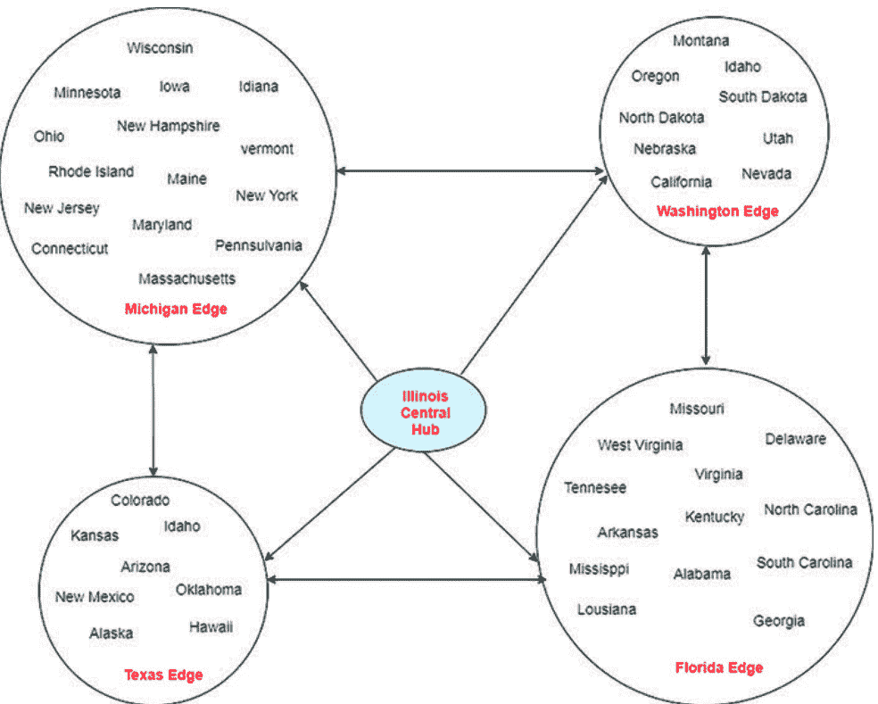

图 6.2：带IoT数据点状态的养牛场边缘地图

本章概述的端到端边缘架构的主要重点，是确保边缘安全。安全是一个复杂的领域，通常围绕保密性、完整性和可用性这三项基本原则展开。

在牛只监控使用模型的背景下，我们关注的是与各种设备管理生命周期相一致的安全方面。保障边缘安全的关键能力包括硬件信任根和TPM 2.0（可信平台模块）。随后是身份和访问管理（IAM）、安全边缘网关、保护静态数据、保障传输中数据、确保使用中数据受到保护、实施数据防泄漏，以及建立强大的监控实践。尽管这些目标范围广泛，但后续章节将深入探讨，提供更详细的见解。

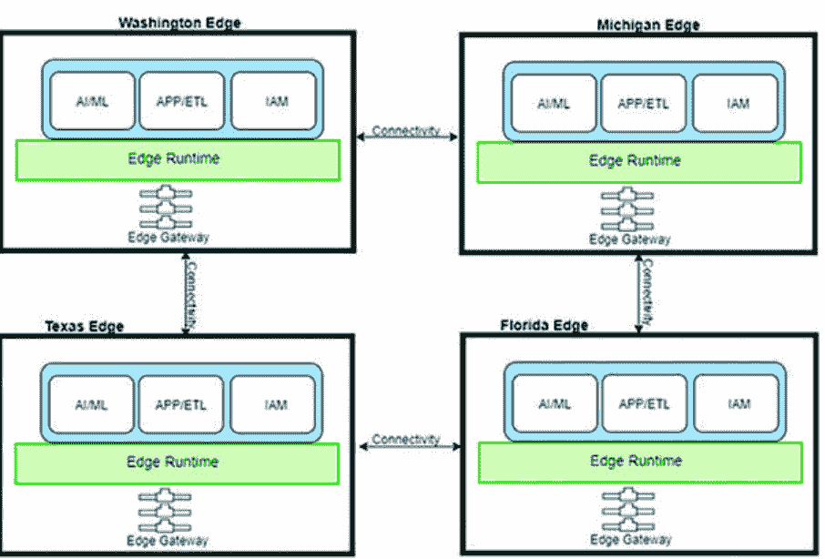

图 6.3：端到端边缘安全架构

## 微服务和容器化在边缘安全中的作用。

微服务和容器化在增强边缘安全方面发挥着关键作用，能够实现更精细的控制和可扩展性。在网络边缘，数据在那里生成并更靠近源头进行处理，安全至关重要。微服务将应用程序分解为更小的独立组件，从而实现安全功能的隔离。每个微服务都可以拥有自己的安全机制和策略，使识别和解决漏洞更加容易。容器化则更进一步，将这些微服务封装在轻量级、可移植的容器中。这确保了安全配置和补丁在边缘网络中保持一致，减少攻击面，并简化安全管理。

此外，微服务和容器化通过能够快速响应新出现的威胁来增强边缘安全。凭借根据需要扩展或缩减服务的能力，安全团队可以迅速应对威胁环境的变化。当有新的安全补丁或更新可用时，容器化的微服务可以轻松替换或打补丁，减少漏洞窗口期。这种灵活性和敏捷性在边缘至关重要，因为在那里，实时决策和快速安全调整至关重要。

此外，微服务和容器化可以帮助在边缘实现资源高效的安全。通过解耦服务，组织可以根据其特定的安全需求更有效地分配资源。这意味着关键安全功能可以优先分配更多资源，而较不重要的功能可以缩减规模，从而确保最佳的资源利用率和成本效益。这种方法有助于在不产生不必要的资源开销的情况下保持强大的安全态势，尤其是在处理资源受限的边缘设备时。以下是我们实现的边缘容器架构。

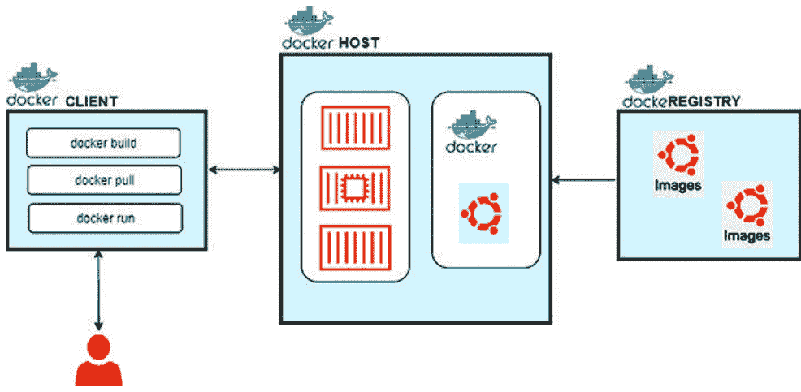

图 6.4：边缘容器安全孤岛架构

总而言之，微服务和容器化是边缘安全的重要组成部分，提供增强的控制、敏捷性和资源效率。它们允许对安全威胁进行隔离和快速响应，同时优化资源分配，最终使边缘网络在不断演变的威胁环境中更加安全且具备韧性。

## 在边缘实施零信任和最小权限原则

在网络边缘实施零信任和最小权限原则，是强化网络安全态势的关键步骤。零信任强调持续验证的重要性，绝不仅根据网络位置就假定信任。通过将此概念扩展到边缘，您可以确保访问网络的每个设备和用户都经过严格的身份验证和授权，无论其物理位置如何。这不仅能防范内部威胁，还能帮助防御试图利用易受攻击边缘设备的外部攻击者。

最小权限概念通过确保每个用户或设备仅获得执行其任务所需的最低访问级别，来补充零信任。在边缘，这一原则变得更加关键，因为暴露于不受信任网络和设备的风险更高。通过实施最小权限，您可以减少潜在攻击面，并限制被攻破设备可能造成的损害。这种方法也与微分段原则相契合，即将网络划分为更小、隔离的区域，从而进一步增强边缘安全性。

采用零信任和最小权限原则保障边缘安全，不仅涉及先进技术，还需要组织内部的文化转变。这意味着要从默认信任模型，转向持续验证和严格访问控制的模式。通过这样做，您可以适应不断演变的威胁环境，确保网络边缘始终是抵御网络攻击的坚实防线，同时为用户和设备提供高效且安全的远程工作和连接。


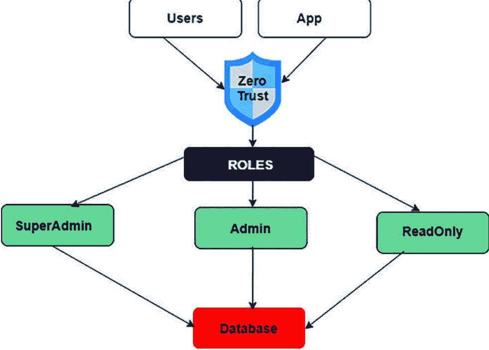

## 图 6.5：边缘零信任架构

## 安全边缘架构设计的案例研究

### 医疗机构的安全边缘架构

在医疗机构中，患者数据安全至关重要。一项关于实施安全边缘架构的案例研究揭示了一种保护敏感医疗信息的创新方法。通过利用零信任网络，该组织将其网络分割为微型边界，从而实现细粒度访问控制。这种设计不仅保护了患者数据，还使医疗专业人员能够从任何边缘设备安全地访问关键信息。强大的身份和访问管理系统的实施确保只有授权人员才能访问特定数据，而持续监控和异常检测机制则提供了实时威胁缓解。该案例研究证明了安全边缘架构在医疗环境中保护数据隐私和安全方面的有效性。

### 面向远程员工的安全边缘架构

COVID-19 大流行加速了向远程工作的转变，促使组织重新思考其网络安全。一项针对全球企业的案例研究展示了他们如何改造架构以安全地支持分散的员工。他们的解决方案涉及实施软件定义边界（SDP）模型。通过 SDP，该组织在资源周围创建了基于身份的动态边界，有效地将其从未经授权的用户中隐藏起来。安全访问基于需要知道的原则授予，减少了攻击面，并增强了整体安全性。这种方法使公司能够在保持强大网络安全的同时保持生产力，成为远程工作场景中安全边缘架构的一个有力示例。

### 工业物联网中的安全边缘架构

工业部门在保护边缘设备和系统方面面临着独特的挑战。智能制造工厂的一个案例研究说明了保护工业物联网（IIoT）的一种创新方法。该公司采用了纵深防御策略，以安全边缘架构为核心。通过将边缘设备与异常检测和预测性维护算法相结合，他们能够监控和保护关键机械。此外，边缘计算的实施允许在本地处理数据，减少了延迟，并确保即使中央网络受到破坏，运营也能保持连续性。该案例研究强调了在工业物联网格局中保护关键任务操作方面安全边缘架构的重要性。

### 牛群健康监测物联网

在农业领域，物联网（IoT）彻底改变了农民管理牲畜的方式，一个引人注目的用例是物联网牛群健康监测系统。嵌入式传感器和可穿戴设备被策略性地放置在牛身上，以收集各种健康参数的实时数据。这些设备监测体温、心率等生命体征，甚至可以检测暗示潜在健康问题的异常运动。收集的数据无线传输到邻近边缘平台，高级分析和机器学习算法对信息进行处理。这使农民能够收到关于个别牛或整个牛群健康状况的即时警报和洞察。通过利用物联网的力量，农民可以主动识别和解决健康问题，防止疾病传播，并优化育种实践。结果不仅是更健康、更高产的牛，而且是一个更可持续、更高效的畜牧管理系统，符合现代农业不断变化的需求。

## 边缘的身份验证与身份管理

边缘的身份验证和身份管理代表了我们在日益互联的世界中保护数字交互方式的关键转变。边缘（包括 IoT 设备和边缘计算节点在内的网络外围）要求一种新的身份验证方法。与集中式系统不同，边缘计算将计算能力更靠近数据生成的地方。这种接近性使身份验证更加灵敏和高效，因为身份验证可以在数据创建源处进行。这不仅减少了延迟，还通过最大限度地减少数据在传输过程中暴露于潜在威胁的风险来增强安全性。

在边缘计算的背景下，对高效且动态的身份管理的需求比以往任何时候都更加突出。传统的身份概念正在从静态用户名和密码演变为更具上下文感知能力的自适应方法。边缘上的设备和传感器必须能够评估不仅它们是什么，还包括它们在哪里、正在做什么以及为什么要这样做。这种身份的整体视图能够实现细粒度访问控制，并确保只能执行授权操作。身份管理解决方案正在发展以利用上下文信息（可以从地理位置到设备行为模式不等），使身份验证更加智能和风险感知。这种转变最终通过减少攻击面并更好地将访问与最小权限原则相一致来增强安全性。

此外，边缘上的身份验证和身份管理为隐私和用户同意带来了新的挑战和机遇。随着数据处理和身份验证更接近源头，个人对其个人信息拥有更多控制权。他们可以基于同意驱动的数据共享原则来授予或拒绝访问。这种方法使用户能够成为其数据安全和隐私的积极参与者，强化他们对数字生态系统的信任。基于边缘的身份管理系统还可以提供更强大的数据保护，因为数据可能不需要离开边缘设备，从而降低了数据泄露的风险。

总之，边缘的身份验证和身份管理代表了我们在数字时代处理安全问题的方式的变革性转变。它提供了更高的效率、安全性和用户控制权。通过采用上下文信息并将数据控制权交还给用户，边缘计算为更安全、更注重隐私的数字世界敞开了大门。

## 边缘强身份验证的重要性

当今数字环境中，网络边缘的强身份验证至关重要。边缘（即设备和终端与互联网交汇的地方）通常是网络中最脆弱的点。强大的身份验证机制作为抵御未经授权的访问和潜在安全漏洞的关键防线。通过确保只有可信用户或设备才能与网络资源交互，强身份验证有助于保护敏感数据和关键系统。它还增强了组织的整体安全态势，因为它降低了源自受损终端的攻击风险，这可能会产生深远的后果。

在日益依赖 IoT 设备的世界中，边缘强身份验证的重要性不可估量。这些设备（从智能恒温器到工业传感器）通常缺乏传统终端的计算能力和安全功能。它们可能成为恶意行为者试图渗透网络的有吸引力的入口点。强身份验证机制（如多因素身份验证（MFA）或生物识别验证）提供了一层额外的安全性，有助于防止未经授权访问这些易受攻击的边缘设备。这不仅保护了这些设备生成的数据，还确保了更广泛网络基础设施的完整性。

此外，远程工作日益增长的趋势和移动设备的使用要求强大的边缘身份验证。员工访问


各地点和设备上的企业资源带来了独特的安全挑战。强身份验证方法，例如基于移动设备的 MFA 或安全令牌身份验证，使组织能够建立对远程连接的信任，并保护敏感的公司数据。如果没有这些措施，未经授权的访问和数据泄露的风险将显著增加，可能导致财务损失和声誉受损。在当今互联的世界中，边缘处的强身份验证是全面网络安全策略的基本要素。

## 边缘计算中的数据安全与隐私

边缘计算采用去中心化的数据处理方式，为数据安全和隐私带来了挑战与机遇。在边缘，数据在更靠近其源的位置生成、处理和存储，从而降低延迟并增强实时决策能力。然而，这种靠近源的特性也引发了对数据安全和隐私的担忧。确保边缘数据的机密性和完整性至关重要，因为边缘数据往往更容易暴露于物理威胁和未经授权的访问之下。有效的加密、安全的身份验证机制和强大的访问控制策略对于保护去中心化边缘环境中的敏感数据至关重要。

边缘计算中数据安全与隐私的一个独特方面是边缘设备及其与网络连接的动态性。这些设备可能始终在移动或间歇性连接，这需要自适应安全措施。能够适应这些变化的解决方案（例如零信任安全架构和基于区块链的数据验证）在维护数据完整性的同时尊重用户隐私，发挥着至关重要的作用。此外，边缘计算通常涉及多方利益相关者之间的协作，因此建立尊重个人权利和监管要求的明确数据治理框架和数据共享协议至关重要。

边缘计算可以赋予个人对其数据的更多控制权，从而增强隐私。随着边缘设备在本地处理数据，对中心数据中心的依赖减少，降低了数据在互联网上长距离传输的需求。数据处理的这种本地化可以带来更私密、更高效的生态系统，因为个人数据更靠近其源并由个人掌控。隐私保护技术（例如联邦学习和同态加密）能够在不暴露原始数据的情况下进行数据处理，进一步保护用户隐私。然而，挑战在于确保这些增强隐私的技术在多样化的边缘计算环境中得到广泛采用并正确实施。

在边缘计算的背景下，元数据管理提出了一个独特的问题。虽然数据隐私工作通常侧重于保护数据的实际内容，但元数据（包括关于数据的信息）也可能泄露信息，并带来隐私风险。在边缘计算环境中管理和保护元数据需要特别关注。诸如差分隐私等技术（通过向数据添加噪声来保护个人身份）可以应用于元数据以保护隐私，同时仍然允许进行有意义的数据分析。在收集有用元数据以进行分析与保护用户隐私之间取得正确平衡，是不断发展的边缘计算世界中一个持续的挑战。

## 边缘处的传输中数据和静态数据安全

保护网络边缘处的传输中数据和静态数据是现代网络安全的关键要素。在边缘处，即设备和传感器连接到网络的地方，数据极易受到拦截和篡改。为了保护传输中的数据，加密协议发挥着关键作用。传输层安全协议（TLS）和安全套接字层协议（SSL）被广泛用于建立安全通信通道，确保设备与云或服务器之间传输的数据免受窃听。这些协议创建一个加密隧道，屏蔽数据免受窥视，确保即使被拦截，信息仍然保密。

谈到在边缘保护静态数据时，多层方法至关重要。边缘设备通常计算资源有限，使得实施强大的加密变得具有挑战性。一种解决方案是使用硬件安全模块（HSM）或可信平台模块（TPM）安全地存储加密密钥。这些专用硬件组件使攻击者更难以获得解密数据所需的密钥。此外，数据可以被分片并分布在多个边缘设备上，即使入侵者攻破一个设备，也更难以获得有意义的信息。

随着边缘计算在物联网（IoT）时代变得更加普遍，保护边缘处的传输中数据和静态数据将继续是一个紧迫问题。通过结合用于传输中数据的强大加密协议和用于静态数据的基于硬件的安全措施，组织可以构建强大的防御来应对潜在威胁，并确保其在去中心化计算范式中的数据完整性和机密性。

## 为边缘通信实施端到端加密

为边缘通信实施端到端加密，就像在网络的最外围建造一座安全堡垒。边缘处，即设备和传感器与数字世界交互的地方，通常是任何网络中最脆弱的节点。通过应用端到端加密，数据从离开设备那一刻起直到抵达目的地都得到保护。这种方法确保即使攻击者进入边缘，也无法解密正在传输的信息。这就像在无法破解的不可见信封中发送秘密消息。

在网络边缘纳入端到端加密要求对密钥管理采取精细的方法。每个设备都必须有自己的一组加密密钥，用于加密和解密数据。安全管理这些密钥至关重要，因为单次泄露可能会危及整个通信链。为了加强安全性，定期轮换密钥是必不可少的。这种动态方法使任何潜在威胁行为者在通信过程中立足变得极其困难。这就像每天更换门锁一样，确保即使有人获得了密钥，到第二天也会过期。

边缘通信的端到端加密不仅是一种安全措施，更是对隐私和数据完整性的承诺。用户和组织将其敏感信息托管给互联设备，而这项技术保护着这种信任。这就像在拥挤的房间里低语秘密，只有预期的接收者能听到，而其他任何人都无法窃听。随着我们继续扩展物联网并拥抱充满互联设备的世界，实施强大的端到端加密不仅是一种必要，也是我们致力于保护数字通信神圣性的象征。

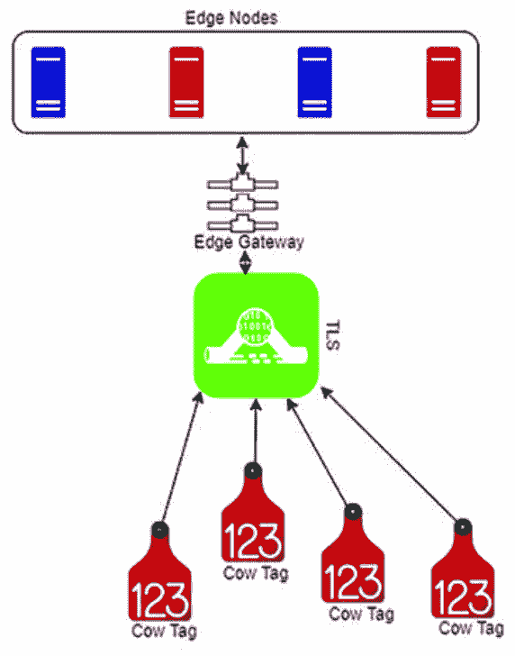

Figure 6.6: 边缘 E2E TLS 加密

## 边缘数据收集和处理的隐私保护技术

在我们日益互联的世界中，边缘数据收集和处理的隐私保护技术已成为必不可少。这些方法使个人能够保持对其敏感信息的控制，同时仍能从边缘计算的优势中受益。一种创新方法涉及差分隐私，它向收集的数据添加噪声，使恶意行为者难以识别个人用户模式。这确保个人信息保持隐藏，同时仍为边缘应用提供有价值的洞察。

同态加密是边缘数据的另一种引人注目的隐私保护技术。它允许在不先解密的情况下以加密形式处理数据。这确保敏感数据在处理过程中仍然保密。由于边缘设备通常处理来自各种来源的数据，同态加密在医疗保健等场景中可能成为改变游戏规则的技术，在该场景中，患者数据必须安全处理。

联邦学习是一种隐私保护技术，允许在去中心化边缘设备上训练机器学习模型，而无需共享原始数据。每个设备从自己的数据中学习并仅共享模型更新，确保敏感信息保持本地化。这种方法对于智能手机上的预测文本或语音识别等应用尤其有价值，在这些应用中，用户隐私至关重要。


边缘数据采集和处理的隐私保护技术对于在数字时代建立信任和确保数据安全至关重要。这些方法能够在不损害个人隐私的前提下实现边缘计算的优势，从而培育更加负责任和安全的数据生态系统。

## 遵守数据保护法规（GDPR 和 CCPA）

遵守数据保护法规（如 GDPR 和 CCPA）不仅是法律要求，也是负责任且合乎道德的商业运营的基本方面。这些法规旨在保护个人的隐私和权利，遵守这些法规的组织展示了对其客户和利益相关者尊重的承诺。通过实施强大的数据保护措施，公司可以建立信任并提升声誉，这最终可能带来更高的客户忠诚度和信心。

在当今互联的世界中，数据泄露和隐私违规事件屡见不鲜，使得遵守数据保护法规比以往任何时候都更加关键。例如，GDPR 对个人数据的收集、处理和存储方式制定了严格规则，并要求组织对其数据处理实践保持透明。这不仅保护了个人的个人信息，还促进了组织内部的透明度和问责制。遵守此类法规不仅最大限度地降低了罚款和法律后果的风险，还强化了公司内部的责任和数据管理文化。

此外，遵守数据保护法规可以成为创新和竞争力的催化剂。投资于数据保护措施的公司通常可以将其作为卖点，吸引重视隐私的客户。这也鼓励组织采用更高效的数据管理实践，从而带来更好的决策和更精简的运营。本质上，法规遵从性可以成为数据驱动商业时代组织改进和演进的强大驱动力。

在快速发展的数字环境中，数据是宝贵资产，遵守数据保护法规不仅仅是合规性勾选练习，而是战略性必要。它培育了信任、道德责任和创新的氛围，这既有利于组织，也有利于其处理数据的个人。通过拥抱这些法规，企业可以自信且正直地穿越数据保护的复杂地形，确保客户信息的隐私和安全，同时为未来构建强大且合乎道德的基础。

## 边缘设备加固与固件安全

### 边缘设备加固

边缘设备加固是确保网络边缘 IoT 和嵌入式系统安全与韧性的关键方面。通过实施强大的安全措施，例如访问控制、加密和入侵检测，边缘设备可以更好地抵御潜在威胁。这包括防篡改硬件和安全启动流程等物理安全考量，以防止未经授权访问设备。此外，定期软件更新和补丁管理对于保护边缘设备免受新兴漏洞威胁至关重要。加固边缘设备不仅保护敏感数据和关键操作，还强化了整个网络的整体安全态势。

### 固件安全

固件安全是保护控制硬件组件（从微控制器到片上系统设备）内部工作的代码和指令的基石。安全的固件对于防止未经授权的修改至关重要，因为受损的固件可能导致各种安全漏洞和系统漏洞。实施代码签名和安全启动流程可确保只有受信任和经过身份验证的固件才能在设备上运行。定期对固件代码进行审计和分析可以帮助识别和修补漏洞，降低被利用的风险。固件更新应安全地交付和安装，防止潜在攻击者在更新过程中插入恶意代码。在日益互联的世界中，固件安全对于保证嵌入式系统和 IoT 设备的完整性和可靠性至关重要。

## 保护边缘设备的最佳实践

在当今互联的世界中，保护边缘设备至关重要，物联网（IoT）正在迅速扩张。为确保这些设备的安全和可靠性，应遵循多项最佳实践。

- 零信任架构：实施零信任架构对于边缘设备安全至关重要。这种方法不假设网络内的设备是可信的，而是要求对所有设备进行严格验证和持续监控，在证明其安全之前，将每个设备视为潜在的安全风险。
- 固件更新：定期更新边缘设备上的固件至关重要。这些更新通常包含针对已知漏洞的补丁。自动更新机制可以帮助确保设备免受新兴威胁的侵害。
- 网络分段：网络分段是保护边缘设备的关键实践。根据设备的功能或关键性将设备隔离到不同的网络中，可以限制攻击者的横向移动，并最大限度地减少泄露的影响。
- 强身份验证：为访问边缘设备采用强身份验证机制。多因素身份验证（MFA）或生物识别可以在密码之外增加额外的安全层，使未经授权的用户更难获得访问权限。
- 安全设计：从一开始就将安全性纳入边缘设备的设计中。这意味着在开发过程中考虑安全功能、协议和加密方法，而不是在事后尝试将安全性修补到设备上。
- 监控与异常检测：实施实时监控和异常检测系统，以识别边缘设备上的可疑行为。这有助于早期发现安全漏洞，并确保迅速响应。
- 物理安全：不要忽视物理安全。边缘设备可能容易受到物理攻击。确保将它们放置在安全的位置，并采取措施防止篡改或盗窃。
- 数据加密：传输中数据和静态数据应加密。这对于处理敏感信息的边缘设备尤其重要。强大的加密算法可以保护数据，即使设备被攻破。
- 访问控制：实施严格的访问控制以限制谁可以与边缘设备交互。最小权限访问确保用户和进程仅拥有执行任务所需的权限，从而减少攻击面。
- 安全审计与文档：定期审计和记录边缘设备中实施的安全措施。保留固件更新、安全配置和任何安全事件的记录。这有助于事后分析和持续改进。
- 用户培训：向用户和管理员传授安全最佳实践的重要性。人为错误是攻击者常见的入口点，因此知识丰富的用户可以成为一道坚实的防线。
- 事件响应计划：制定明确的事件响应计划。在发生安全漏洞时，了解如何有效响应可以最大限度地减少损害和恢复时间。

保护边缘设备需要采取全面且主动的方法来保护现代 IoT 系统的这些关键组件。通过遵循这些最佳实践，组织可以降低风险并确保其边缘设备基础设施的韧性。


## 边缘设备身份验证与安全引导

边缘设备身份验证与安全引导是确保物联网和边缘计算生态系统完整性与安全性的关键组件。

在物联网世界中，数十亿设备相互连接，身份验证充当数字握手，用于验证每个设备的身份。

安全引导则是这些设备建立信任并交换加密密钥以加密和保护数据通信的过程。

边缘设备身份验证类似于为每个设备提供电子护照，使它们在参与网络之前能够证明其合法性。

此验证过程不仅能防范未授权设备，还能确保它们生成和接收的数据来自可信源。

无论是工业环境中的传感器，还是家庭中的智能恒温器，设备身份验证都为在庞大的连接设备网络中建立信任奠定了基础。

安全引导则类似于设备之间启动安全通信的秘密握手。

当设备首次连接到网络时，它需要与其他设备或中央机构建立信任。

安全引导涉及一系列加密交换和检查，以确保设备是真实的且未被篡改。

此过程对保护敏感数据至关重要，因为它防止恶意行为者渗透网络或拦截通信。

设备身份验证与安全引导共同为边缘计算构建了一个强大的安全框架。

通过验证设备身份并确保其初始连接安全，我们可以信任它们生成的数据和采取的行动。

在边缘对于实时决策和数据处理日益重要的世界中，这些安全措施是我们构建更可靠、更具韧性的物联网生态系统的基石。

## 边缘设备固件完整性验证与安全更新机制

边缘设备在物联网生态系统中发挥着关键作用，因此确保其固件完整性至关重要。

固件完整性验证机制旨在确认运行在这些设备上的软件未被篡改或破坏。

这对于保持从工业自动化到智能家居设备等各种应用中边缘设备的安全性和可靠性至关重要。

这些机制通常涉及数字签名和校验和等加密技术，使设备在加载固件之前能够验证其真实性和完整性。

边缘设备的安全更新机制同样至关重要，因为它们使制造商和运营商能够以安全且受控的方式向这些设备交付补丁、更新和新功能。

这些机制通常包括加密通信通道、双因素身份验证和回滚保护等功能，以防范更新过程中的潜在攻击。

这不仅有助于使设备保持最新功能和安全补丁，还确保更新过程本身不会引入漏洞。

固件完整性验证和安全更新的一种创新方法是利用区块链技术。

通过利用分布式账本，边缘设备可以存储固件版本和更新的不可更改记录。

这可以增强透明度和安全性，因为任何未经授权的更改都易于被检测到。

此外，去中心化的边缘设备网络可以共同验证固件更新的完整性，降低依赖单一中央机构进行验证的风险。

这种方法有潜力显著提升边缘设备在物联网生态系统中的可信度。

边缘设备通常部署在偏远和恶劣的环境中，这使得其固件完整性验证和安全更新变得具有挑战性。

在这种情况下，采用即使在没有持续连接的情况下也能运行的强健机制至关重要。

可以应用差分隐私和联邦学习等技术，以确保设备更新以最少的数据暴露进行。

这些方法允许边缘设备相互集体学习，而无需直接共享敏感信息，从而兼顾安全性和用户隐私。

此外，在固件完整性验证和安全更新中采用人工智能（AI）是一项新兴趋势。

AI可用于实时检测异常和潜在威胁，从而对潜在的安全漏洞做出主动响应。

AI算法还可以根据设备使用模式优化固件更新的时机和频率，进一步提升安全性，同时最大限度地减少对最终用户的干扰。

这种智能方法有助于在安全性和可用性之间取得平衡，使边缘设备在面对不断演变的威胁时更具韧性。

总之，边缘设备的固件完整性验证和安全更新机制是物联网安全的重要组成部分。

这些机制不断演变，以适应动态的威胁格局以及边缘计算带来的独特挑战。

无论是通过区块链、隐私保护技术还是AI集成，这些机制的开发都将在确保物联网生态系统中边缘设备的可靠性和安全性方面发挥关键作用。

## 应对边缘设备固件中的漏洞

应对边缘设备固件中的漏洞是维护现代物联网生态系统安全性和可靠性的关键方面。

这些设备通常分散在各种地点，容易受到广泛潜在威胁的影响。

减轻漏洞的一种主动方法是建立严格的补丁管理策略。

这涉及定期监控和更新固件，以解决已知漏洞。

及时打补丁对于防止可能危及设备功能或泄露敏感数据的潜在攻击至关重要。

除了补丁管理，组织还可以采用纵深防御策略。

通过分层安全措施，例如防火墙、入侵检测系统和访问控制，你可以创建多个屏障来阻止和检测潜在威胁。

这种多层次方法提升了边缘设备的整体韧性，使攻击者更难以攻破系统。

此外，定期的漏洞评估和渗透测试可以帮助识别固件中的弱点，使组织能够在问题被利用之前加以解决。

此外，持续监控和威胁情报集成可以显著提升边缘设备的安全性。

通过密切关注网络流量和系统行为，组织可以迅速识别异常模式或危害指标。

利用威胁情报信息源和信息共享平台可以实现对新兴威胁的实时响应。

当发现漏洞时，组织可以快速部署应对措施，减少潜在攻击者的可乘之机。

最后，在所有利益相关者中培养安全意识文化至关重要。

对人员和最终用户进行关于安全配置和维护边缘设备重要性的培训，可以显著降低无意中引入漏洞的风险。

通过建立共同的安全责任，组织可以加强对边缘设备固件威胁的整体防御。

总之，应对边缘设备固件中的漏洞需要一种多方面的方法，结合主动的补丁管理、纵深防御策略、持续监控和强大的安全意识文化。

通过实施这些措施，组织可以最大限度地降低潜在风险，并在日益互联的世界中保持其边缘设备的完整性和功能。


## 边缘环境的网络安全

边缘环境的网络安全是现代网络安全的关键方面，因为越来越多的设备和数据被推向网络边缘。在这些去中心化的、通常偏远的位置，确保敏感信息的保护和连接系统的可靠性是一项复杂挑战。边缘设备（如物联网传感器和自动驾驶汽车）通常资源受限，使得传统安全方法不太可行。解决方案需要针对边缘环境的独特需求进行定制。

边缘网络安全的关键考量之一是实时威胁检测和响应的需求。边缘设备通常负责关键操作，任何泄露或中断都可能产生即时后果。因此，在边缘实施强大的入侵检测和防御系统至关重要。这些系统应能够在边缘本身分析数据，而不依赖于将数据发送到中心服务器进行分析，因为这可能会引入延迟并增加脆弱性。

此外，边缘环境动态且分布式的特性要求关注零信任安全原则。不应基于位置或设备假设信任，必须严格执行身份和访问管理。这种方法确保即使设备被攻破，其访问权限也有限，无法攻破整个网络。访问控制和加密是有效在边缘环境中实施零信任安全的基础，有助于保护数据和设备。

除了技术层面之外，在边缘环境中，安全意识和培训至关重要。在偏远且可能无人监控的位置工作的最终用户和管理员需要了解最佳安全实践。这包括识别和报告潜在威胁，以及理解及时软件和固件更新的重要性。受过良好教育的员工可以成为保护边缘网络的第一道防线，补充技术安全措施。

## 边缘网络中的分段和隔离技术

分段和隔离技术在确保边缘网络的安全性和效率方面发挥着至关重要的作用，边缘网络在我们互联的世界中日益重要。一种创新的分段方法是动态微分段。这种技术超越了传统的网络分段，通过在实时为单个设备或工作负载创建小型隔离段。通过根据设备行为和上下文动态调整访问策略，它提供细粒度控制，并有效帮助挫败潜在的安全威胁。

隔离边缘设备的另一种引人注目的方法是网络切片的概念。随着 5G 技术的到来，网络切片使服务提供商能够创建针对边缘设备特定需求量身定制的隔离、虚拟化网络实例。这不仅优化了网络资源，还允许高效管理各种边缘应用。例如，面向自动驾驶汽车的网络切片可能具有严格的延迟和带宽要求，而面向物联网传感器的切片可能优先考虑能源效率。

在边缘网络领域，零信任安全原则作为一种分段和隔离技术已日益凸显。零信任假设默认不应信任任何设备、用户或应用程序，即使它们位于网络边界内。这种方法采用持续的身份验证和授权机制，确保资源访问基于知悉需求原则授予。零信任极大地增强了边缘环境的安全性，在那里威胁环境是动态且不断演变的，使其成为保护边缘网络最具创新性和有效性的策略之一。

## 边缘处的入侵检测和防御系统

入侵检测和防御系统（IDPS）是现代网络安全基础设施的关键组成部分，旨在检测、分析和防止对网络和系统的未授权访问。从本质上讲，这些系统监控网络流量，以查找可能表明潜在安全漏洞的可疑活动和异常。当检测到此类活动时，IDPS 可以提醒管理员（检测）或采取主动措施阻止入侵（防御）。IDPS 的主要目标是保护敏感数据并维护 IT 资源的完整性、机密性和可用性。

当在边缘部署时，IDPS 通过保护网络边界提供了额外的安全层。边缘计算涉及在数据源或最终用户设备附近处理数据，而不是仅仅依赖中央服务器，这带来了独特的安全挑战。基于边缘的 IDPS 通过确保威胁尽可能靠近其源头被识别和缓解来解决这些挑战。这种方法不仅减少了威胁响应的延迟，还将攻击对更广泛网络的潜在影响降到最低。通过结合实时监控和自动化威胁响应机制，基于边缘的 IDPS 增强了分布式网络的整体韧性。

此外，在物联网（IoT）和其他去中心化技术的背景下，在边缘集成 IDPS 尤其关键。物联网设备通常具有有限的安全功能，使其成为网络攻击的易受攻击目标。基于边缘的 IDPS 可以为这些设备提供强大的安全措施，在入侵通过网络传播之前进行检测和预防。这种本地化的安全方法对于维护数据和操作的完整性至关重要，在传统集中式安全解决方案可能不切实际或不足的环境中尤为如此。因此，边缘处的 IDPS 代表了不断发展的网络安全格局中的关键进步，为现代分布式网络提供了更有效、更高效的保护。

## 边缘部署中的网络监控和异常检测

边缘部署中的网络监控和异常检测代表了不断发展的信息技术领域中的关键前沿。随着边缘计算势头的增强，保持强大且灵活的网络的需求变得更加突出。在此背景下，网络监控涉及对网络边缘（处理和数据存储发生的地方）的设备、应用程序和数据流进行持续监控。这种级别的监控对于确保边缘设备的可靠性和性能至关重要。这里的独特挑战在于边缘端点的极大多样性和分布性，因此必须采用能够适应这种动态环境的先进工具。

边缘部署中的异常检测犹如守护广袤的数字荒野。由于边缘计算的去中心化特性，攻击面扩大，传统安全措施可能不足。检测异常（无论源于网络入侵还是设备故障）需要创新的方法。机器学习算法和人工智能驱动的系统可以分析海量数据集，筛选模式以揭示与常态的偏差。这种方法的独特之处在于其对边缘独特环境的适应性，在边缘环境中，实时决策至关重要。通过在边缘识别异常，可以迅速应对潜在的安全威胁，确保网络及其处理数据的完整性。

此外，边缘部署中的网络监控和异常检测还提供了一条利用实时分析未开发潜力的途径。通过在网络边缘收集和分析数据，组织可以获得以前无法获取的洞察。这种独特的能力允许对新兴趋势或问题做出即时响应，从而提高运营效率，并采取更敏捷的问题解决方法。例如，在制造环境中，边缘部署可以实时监控机器，异常检测可以在设备故障发生之前预测故障，最大限度地减少停机时间并降低维护成本。在医疗保健领域，在边缘监测生命体征和患者数据可以带来健康异常的早期检测和挽救生命的干预。

总之，边缘部署中的网络监控和异常检测是未来计算的关键组成部分。这些创新实践使组织能够构建强大且高效的网络，利用实时分析的力量，并保护其边缘环境免受新兴威胁。边缘计算的独特之处在于其去中心化的特性，而网络监控和异常检测是驯化这一前沿的重要工具，使其对各行各业的企业和产业更加易于访问和安全。


## 软件定义网络（SDN）用于动态边缘安全

软件定义网络（SDN）正在彻底改变我们处理动态边缘安全的方式。在不断演变的网络安全格局中，传统的静态网络边界已不再足以应对快速变化的威胁格局。SDN通过允许组织实时调整和保护其网络，引入了范式转变，确保边缘设备和服务始终免受新兴威胁的侵害。

SDN的动态边缘安全能力源于其对网络控制的集中化。通过将控制平面与数据平面分离，SDN使管理员能够根据实时流量分析和威胁情报即时调整安全策略。这种敏捷性确保边缘设备能够快速适应不断演变的安全挑战，在威胁突破网络边界之前有效地将其中和。

此外，SDN使组织能够针对单个边缘设备、应用程序和用户实施细粒度安全策略。这种精细控制允许优化安全措施，减少误报和漏报。例如，易受攻击的IoT设备可以与网络隔离并获得增强保护，而关键应用程序则享受无缝且不间断的服务。

在网络边缘不断扩展的世界中，SDN的动态边缘安全能力为应对众多威胁提供了弹性防御。无论是保护远程工作者、保障IoT设备安全，还是缓解DDoS攻击，SDN实时适应和响应的能力确保网络边缘始终是抵御网络威胁的坚固安全前沿。这项变革性技术正在重新定义我们在敏捷性和适应性至关重要的时代中的安全方法。

边缘应用安全是现代网络安全策略中至关重要的一个方面，因为它专注于保护生成、处理和访问数据的网络端点。与主要保护网络边界的传统安全措施不同，边缘应用安全旨在保障网络边缘的大量分散设备和应用程序。在IoT（物联网）时代，这种方法尤其至关重要，因为大量互联设备可能引入漏洞。通过在边缘实施强大的安全协议和监控，组织可以有效缓解威胁，并确保其数据和运营的完整性。

边缘应用安全的一个关键优势是其提供实时威胁检测和响应的能力。随着数据和应用程序在边缘处理，安全措施可以部署得更接近潜在威胁的源头，从而减少事件响应时间。这种敏捷性对于防御快速演变的网络威胁至关重要。此外，边缘安全解决方案通常结合机器学习和人工智能，使其能够适应新兴威胁，并随着时间的推移提供更有效的保护。通过不断分析边缘的流量和模式，这些系统可以识别异常并立即采取行动来降低风险。

边缘应用安全不仅限于防范外部威胁，还应对内部威胁和数据泄露。随着更多设备和应用程序在边缘运行，恶意或无意的数据泄露风险增加。边缘安全措施可以实施访问控制、加密和数据丢失防护策略，以保护敏感信息。这种全面的方法确保组织对其数据保持控制并防止未经授权的访问，无论威胁来自外部黑客还是内部人员。

在边缘计算的世界中，数据处理更靠近数据源，安全不再只是事后考虑，而是一项基本要求。边缘应用安全超越了传统的网络防御，为保护边缘分布式设备和应用程序生态系统提供了一种动态、自适应且主动的方法。通过加固边缘，组织可以享受数据安全性提高、威胁响应时间缩短以及在日益互联的数字环境中拥有更强韧的网络安全态势等好处。

## 保护边缘应用免受常见攻击

保护边缘应用免受常见攻击是当今数字环境中的一项关键任务。随着IoT设备的激增和对边缘计算的依赖增加，保护这些应用免受各种威胁至关重要。一种有效策略是在边缘实施强大的访问控制和身份验证机制。通过限制谁可以与您的边缘应用交互，并确保只有授权用户或设备可以访问它们，您可以显著缩小攻击表面并尽量降低未经授权的入侵风险。

除了访问控制之外，加密在加固边缘应用方面发挥着关键作用。采用端到端加密可确保数据在穿越不受信任的边缘网络时仍然保密并免受窃听者的侵害。使用强加密算法并定期更新密码协议可以帮助挫败数据拦截尝试，并保持边缘应用通信的完整性。

保护边缘应用时一个常被忽视的方面是持续监控和威胁检测。在边缘实施入侵检测系统可以帮助实时识别可疑活动，从而快速响应潜在威胁。通过利用机器学习和人工智能驱动的异常检测，您可以主动识别和缓解新兴攻击模式，使对手更难利用您的边缘应用中的漏洞。这种主动方法可以显著增强您边缘基础架构的安全态势。

要有效保护边缘应用，必须使其保持最新的安全补丁和更新。许多攻击针对已知漏洞，及时更新软件和固件可以消除这些弱点。定期安全评估和渗透测试也是识别和修复边缘应用特定漏洞的宝贵工具。通过在安全方面保持主动态势并进行例行评估，您可以始终领先攻击者一步，并降低成功入侵的风险。

总之，保护边缘应用免受常见攻击需要一种多方面的方法，包括访问控制、加密、持续监控和严谨的维护。边缘计算是现代技术基础设施的重要组成部分，保护其应用对于保护敏感数据并在日益互联的世界中保持运营完整性至关重要。通过实施这些策略，您可以加固边缘应用，并在不断演变的威胁面前保持韧性。

## 边缘应用的安全编码实践

安全编码实践对于边缘应用在当今数字环境中至关重要。边缘计算涉及在更靠近数据源的位置处理数据，这通常意味着与集中式数据中心相比，安全基础设施不够强大。为了降低这些风险，开发人员必须采取主动方法。

一种基本做法是输入验证，它确保来自潜在不可信源的数据得到审查和清理。通过在边缘验证和清理输入，开发人员可以防止各种漏洞，例如注入攻击。这种做法有助于保持边缘应用及其关联数据的完整性，从而降低数据泄露和未经授权访问的风险。

边缘应用安全编码的另一个关键方面是保持软件组件和库的最新状态。边缘设备可能频繁更新的能力有限，但定期修补已知漏洞以防止被利用至关重要。自动更新机制或版本控制可以帮助确保软件栈保持安全且最新，而不会对边缘生态系统造成干扰。

除了强大的身份验证和访问控制机制之外，加密在保护传输中和静态数据方面发挥着至关重要的作用。利用强加密算法和密钥管理实践


确保敏感信息保持机密，即使在边缘设备上传输或存储时也是如此。通过遵循这些原则，开发人员可以创建更具弹性和安全性的边缘计算环境，增强数据保护，并最大限度地降低网络威胁的风险。

## 边缘运行时应用自我保护 (RASP)

边缘运行时应用自我保护（RASP）是一种前沿的网络安全方法，将实时安全提升到新水平。通过在网络边缘部署RASP技术，组织可以尽可能接近来源地保护其应用程序和数据免受威胁。这种方法提供了一种主动防御机制，在应用程序运行时主动监控和保护它们，确保任何潜在漏洞或攻击都能实时检测和缓解。借助边缘RASP，安全不再局限于特定边界，而是分布在整个网络中，增强保护并减少攻击面。

边缘RASP的主要优势之一是其提供上下文感知安全的能力。通过实时检查和分析应用程序行为，它可以区分正常活动和恶意活动，并相应调整其保护措施。这种上下文感知能力使RASP能够提供定制化安全，减少误报，并确保合法用户可以无需不必要的摩擦即可访问应用程序。这是一种动态且自我学习的方法，不断演进以应对新出现的威胁和漏洞，使其成为针对不断变化的威胁环境的一种强健防御策略。

边缘RASP的概念在当今日益分布式和云原生的计算环境中尤其相关。随着应用程序和数据分布在各种地点和设备上，传统的基于边界的安全模型变得不那么有效。边缘RASP与零信任安全原则保持一致，确保无论用户和数据位于何处，安全都按应用程序和事务为基础强制执行。它提供了一种可扩展且适应性强的解决方案，可以无缝集成到现代DevOps实践中，为安全团队提供所需工具，以保护应用程序和数据，无论它们位于何处。

## 边缘应用程序的基于角色的访问控制 (RBAC)

基于角色的访问控制（RBAC）在确保边缘应用程序安全性和效率方面发挥着关键作用。在边缘计算环境中，数据更接近来源地进行处理和存储，RBAC变得更加重要。边缘设备通常资源有限，且更容易受到物理安全风险的影响，因此RBAC是管理谁可以访问和控制这些设备的重要工具。

在边缘应用程序中，RBAC允许组织为不同用户或设备定义特定角色和权限。例如，网络管理员可能有权配置和管理边缘设备，而现场技术人员只能访问和监控它们。RBAC不仅通过限制对关键系统的访问来增强安全性，还简化了管理并降低了人为错误的风险。这种对访问的细粒度控制有助于确保只有授权的个人或设备才能与边缘应用程序进行交互，使其更加可靠和具有弹性。

边缘应用程序中的RBAC还可以根据边缘计算的动态特性进行定制。设备可能频繁上下线，角色和权限应相应调整。借助RBAC，可以根据设备的功能、位置或其他标准自动分配角色。这种灵活性确保边缘应用程序保持其完整性和安全性，同时能够适应不断变化的网络条件。本质上，边缘RBAC使组织能够在安全性和敏捷性之间取得平衡，这是当今快节奏技术环境中的重要考虑因素。

## 管理边缘的安全运营

在当今的数字环境中，管理边缘的安全运营是一项多方面的挑战。边缘是数据靠近其源头生成和处理的地方，需要一种独特的安全方法。与传统的集中式数据中心不同，边缘通常分布在各个远程位置，因此制定涵盖整个网络的综合策略至关重要。

管理边缘安全运营的一个关键方面是实时威胁检测和响应的重要性。随着数据在边缘进行处理，安全团队必须配备先进的监控工具和分析能力，以便在威胁发生时检测并缓解潜在威胁。在快速决策以及在不依赖集中式安全中心的情况下隔离和中和威胁方面，这种能力在此情境中至关重要。

此外，随着边缘不断扩展，在边缘设备和网络的设计和部署中优先考虑安全性至关重要。安全性应嵌入基础层，考虑设备身份验证、数据加密和访问控制等因素。一个能够与边缘的动态特性共同演进的强健安全框架对于防御不断演变的威胁至关重要。

管理边缘安全运营还需要一种去中心化的安全管理方法。这意味着安全团队需要与边缘管理员协作，并维护一个分布式的安全策略和配置网络。确保安全措施在所有边缘节点上得到一致应用，同时保留针对本地差异的灵活性，是一项复杂但必要的平衡工作。

总之，管理边缘安全运营是一项需要动态方法的复杂任务。实时威胁检测、从基础层面开始的强健安全以及去中心化的管理策略只是保护数据和基础设施所需的几个关键要素，以应对这个快速发展的数字环境。适应边缘的挑战和机遇对于确保安全且具有弹性的网络至关重要。

## 边缘环境中的安全事件检测与响应

由于边缘环境的分布式特性，其中安全事件检测和响应面临着独特的挑战。与传统的集中式数据中心不同，边缘计算环境涉及分布在各个地点的大量设备和传感器。在这种情况下检测安全事件需要一种综合方法，结合网络监控、端点安全和高级分析。这不仅仅是关于保护数据中心，还包括保护边缘，因为关键数据在那里实时生成和处理。快速事件检测对于最大限度地减少潜在损害并确保边缘关键应用程序不间断运行至关重要。

保护边缘环境的关键因素之一是需要实时异常检测。边缘设备和传感器产生连续的数据流，因此及时识别与既定模式的偏差至关重要。高级机器学习算法和人工智能驱动的解决方案在检测这些异常方面发挥着至关重要的作用，帮助组织迅速应对潜在威胁。此外，纳入边缘原生安全工具，例如入侵检测系统（IDS）和入侵防御系统（IPS），对于提供一种分层防御机制至关重要，该机制可以在攻击进一步传播到网络之前在边缘将其挫败。

边缘环境的去中心化特性要求制定分布式事件响应策略。当检测到事件时，必须制定一个可以在边缘本身以及中央安全运营中心（SOC）执行的响应计划。边缘设备应具备本地立即采取行动以缓解威胁的能力，同时向中央SOC发出警报以便进行进一步分析和协调。这种方法确保即使与中心网络的连接受损，边缘环境也能保持弹性。此外，建立边缘与中心安全团队之间清晰的沟通和协调渠道至关重要，以便能够对网络中发生的任何位置的安全事件做出无缝响应。


## 边缘部署的安全信息和事件管理 (SIEM)

在当今互联互通的世界中，边缘部署的安全信息和事件管理 (SIEM) 面临着独特的挑战。边缘设备，例如 IoT 传感器和远程终端，通常分布在地理位置多样的各个地点，因此必须制定强大的安全策略。边缘部署的 SIEM 解决方案必须针对处理边缘产生的海量数据进行定制，同时确保对安全事件进行及时检测和响应。这需要在收集和分析相关数据之间保持微妙的平衡，而不让边缘的有限资源不堪重负。

在边缘部署的背景下，SIEM 具有了新的维度，因为它必须与边缘上运行的各种设备和系统集成，确保所有安全事件都能实时监控和关联。这些事件可能从远程传感器上的未经授权的访问尝试，到 IoT 设备的数据传输异常不等。边缘部署的 SIEM 解决方案需要轻量、高效，并能够在最少人工干预的情况下自主运行，考虑到边缘位置可能连接性有限且 IT 支持不足。

边缘部署通常处理关键数据，因此该信息的安全和隐私是首要任务。边缘环境的 SIEM 应提供端到端加密、安全数据存储和智能事件分析，以识别和响应潜在威胁。这种动态的安全管理方法有助于组织保护边缘上的敏感数据，增强其分布式网络的整体安全态势。随着物联网 (IoT) 和边缘计算的不断普及，边缘部署的 SIEM 解决方案将变得越来越重要，以保护这些分散的生态系统免受新兴威胁和漏洞的侵害。

## 管理分布式边缘安全运营的挑战

在当今互联互通的世界中，管理分布式边缘的安全运营面临着诸多挑战。首要挑战之一就是环境的极度复杂。随着组织扩大其数字足迹，涵盖云服务、远程办公室、IoT 设备，安全团队面临着保护多样且往往不标准化平台的艰巨任务。这种复杂性使得维持一致的安全态势变得困难，导致潜在漏洞暴露，使敏感数据面临风险。

此外，分布式边缘的动态特性增加了复杂性。设备和应用程序不断变化和演进，使得跟上不断变化的威胁格局变得具有挑战性。依赖静态策略和边界防御的传统安全模型在面对这些动态边缘时变得不那么有效，这要求安全团队采取更加敏捷和适应性的方法。

另一个挑战是熟练网络安全专业人员的短缺。随着对安全专业知识的需求不断增长，组织往往难以找到并留住能够有效管理分布式边缘安全的人才。这种短缺加剧了在不同环境中监控和响应安全事件的挑战，可能使组织暴露于威胁之下。

对强大可见性和监控的需求也是一个重大障碍。管理分布式边缘的安全运营需要对整个网络（从远程分支机构到云服务和 IoT 设备）具有实时可见性。实现这种程度的可见性是一项复杂的工作，因为它通常涉及集成不同的安全工具和平台，这可能既耗时又昂贵。

总之，管理分布式边缘安全运营的挑战是多方面的，从环境的复杂性和威胁的动态性，到熟练专业人员的短缺和全面可见性的需求。应对这些挑战需要一种战略性和整体性的方法，拥抱创新技术、自动化和适应性安全实践，以保护组织免受不断演变的威胁格局的侵害。

## 边缘计算中的安全任务自动化

在边缘计算中自动化安全任务是确保分布式网络和设备的完整性和韧性的关键方面。在边缘，数据在更靠近源头的位置生成和处理，安全威胁可能更具动态性和普遍性。自动化是主动识别和缓解这些威胁的关键。通过机器学习算法和 AI 驱动的工具，边缘设备可以持续监控网络流量和系统行为，即时检测异常和潜在漏洞。这种实时监控不仅增强了安全态势，还减轻了人工操作员的工作负担，使他们能够专注于更具战略性的安全措施。

在边缘计算环境中，数据处理的动态和去中心化特性要求采用不同的安全方法。自动化在将安全策略和协议适应不断变化的情况方面起着关键作用。例如，自动化安全系统可以根据实时威胁评估动态调整访问控制和加密级别。此外，这些系统可以无缝集成威胁情报馈送，确保边缘设备不断更新有关新兴漏洞和攻击模式的最新信息。这种适应性对于在不断变化的边缘计算格局中保持强大的安全框架至关重要。

边缘计算通常涉及大量功能和安全态势各异的设备。自动化安全任务是确保安全措施应用的一致性和统一性的一种方式。自动化安全策略可以集中管理并在所有边缘设备上强制执行，无论它们的异质性如何。这不仅简化了安全管理流程，还最大限度地减少了人为错误的可能性。此外，自动化可以通过触发预定义的事件响应工作流来实现对安全事件的快速响应，这些工作流可以包括隔离受攻击设备、收集取证数据和向安全人员发出警报。在这方面，边缘安全中的自动化不仅增强了防御，还简化了复杂分布式计算环境中的安全管理流程。

完整的分步代码位于：

https://github.com/ava-orange-education/Secure-Edge-Computing-for-IoT/tree/main/Chapter%20006

## 结论

在本章中，我们踏入了安全边缘设计与开发领域，探索了尖端技术与强大安全措施之间的动态相互作用。IoT 与边缘计算的融合重新定义了创新的边界，实现了变革性的解决方案，同时也为安全带来了复杂的挑战。

叙述随后转向安全边缘设计与开发中的关键策略和最佳实践。加密作为基石，保护传输中和静止的数据。此外，访问控制、身份管理和微分段成为强大的工具，用于缓解边缘网络中的未经授权访问和横向移动。

随着本章的深入，它探讨了架构在加固边缘以抵御网络攻击方面的作用。我们深入研究了零信任架构等概念，其中“永不信任，始终验证”的原则被扩展到边缘生态系统，通过持续监控和自适应策略加强安全性。

在本章的最后部分，我们展望了即将重塑安全格局的新兴技术前景。AI 与机器学习与边缘安全的融合表现为一条有前途的途径，实现了动态威胁检测、异常识别和自动化事件响应。


在下一章中，我们将学习如何在边缘进行渗透测试，以识别边缘处的漏洞和威胁。下一章还涵盖主动式网络安全策略，使组织能够加固其网络边界并防御不断演变的网络威胁。

## 多项选择题

数据分析的主要目标是什么？

- 基于历史数据预测未来结果
- 高效组织和存储数据
- 为测试目的生成随机数据
- 为数据可视化设计用户界面

在机器学习中，“过拟合”一词是指什么？

- 当模型在训练数据和未见数据上都表现良好时
- 当模型过于简单，无法捕捉数据中的底层模式时
- 当模型参数太少，无法从训练数据中学习时
- 当模型在训练数据上表现良好但在未见数据上表现不佳时

哪种机器学习算法常用于自然语言处理（NLP）任务，例如情感分析？

- 决策树
- AdaBoost
- K-Means 聚类
- 循环神经网络 (RNN)

哪种机器学习算法以其处理不平衡数据集和异常检测的能力而闻名？

- K-Means 聚类
- 隔离森林
- 主成分分析 (PCA)
- 线性回归

保护边缘设备免受网络威胁的常见安全措施是什么？

- 公钥加密
- 数据去中心化
- 防火墙实施
- 增加处理能力

## 答案

- a
- d
- d
- b
- c

## 问题

与基于云的方法相比，采用基于边缘的异常检测进行预测性维护的主要优势是什么？

为特定任务选择合适的机器学习模型时的主要考虑因素是什么，模型选择如何影响解决方案的整体性能和准确性？

延迟如何影响边缘上的实时数据处理，可以采用哪些策略来最大限度地降低延迟并确保及时的数据分析和决策？

与边缘上的实时数据处理相关的安全和隐私问题是什么，可以采取哪些措施来缓解这些问题，同时保持数据的完整性和机密性？

与集中式云架构相比，边缘计算的分布式特性如何影响个人的隐私？

如何在边缘环境中有效实施端到端加密，以保护设备与集中式基础设施之间的数据传输？

## 关键术语

- 人工智能
- 增强现实
- 特定应用集成电路
- 卷积神经网络
- 现场可编程门阵列
- 物联网
- K-最近邻
- 长短期记忆网络
- 机器学习
- 循环神经网络
- 支持向量机

## 虚拟现实

# 第 7 章

# 安全边缘渗透测试与事件管理

## 引言

在当今广阔的数字版图中，随着世界拥抱互联系统带来的益处，云计算、边缘计算和物联网（IoT）的数字化存在既成为机遇之门，也成为对手的潜在战场。

本章将开启一段关于安全边缘渗透测试与事件管理的旅程，在此过程中，组织的安全将面对不断演变的数字前沿的动态挑战。我们将深入探讨旨在加固数字生态系统边缘的关键实践和方法论，不仅探究可能潜伏在表面之下的漏洞，也探讨针对潜在泄露的主动防御策略。

请将数字版图想象成一个边境小镇，有繁忙的街道和寂静的小巷。正如警长保护小镇免受匪徒侵扰一样，网络安全专业人员保护数字领域免受恶意行为者的侵害。安全边缘渗透测试充当警惕的警长，系统地探测防御工事，在对手利用之前暴露弱点。在本章中，我们将揭示道德黑客用于揭露漏洞的工具和技术，提供一窥道德黑客艺术的幕后视角。

与此同时，没有一个边境小镇能免受偶尔的沙尘暴或突然的伏击。同样，在数字领域中，事件是不可避免的。无论是数据泄露、恶意软件爆发还是复杂的网络攻击，组织都必须做好准备，穿越混乱。本章不仅探讨事件管理的复杂性，还提供一张路线图，帮助穿越安全事件后动荡的局面。从快速检测到高效响应，我们剖析事件处理的各个层面，确保组织在面对逆境时变得更加强大。

在我们探索本章的过程中，技术与策略的相互作用变得显而易见。安全边缘渗透测试和事件管理并非孤立的努力，而是前沿工具与战略远见之间的动态互动。我们将弥合理论与实践之间的差距，指导您将安全措施融入组织的肌理之中。

系好安全带，我们将踏上一段探索、实施并掌握保障数字前沿安全之道的征程。后续章节为那些不仅寻求防御，更渴望在不断扩大的数字可能性版图中蓬勃发展的人们提供了一张路线图。欢迎来到网络安全的前沿，这里地平线无垠，挑战以韧性和创新来迎接。

## 结构

在本章中，我们将涵盖以下主题：

- 边缘计算渗透测试简介
- 边缘计算渗透测试基础
- 边缘计算渗透测试的规划与准备
- 边缘计算渗透测试的工具与技术
- 边缘计算事件管理框架
- 边缘计算渗透测试与事件管理的最佳实践
- 边缘计算渗透测试中的伦理考量

## 目标

安全边缘渗透测试的主要目标围绕识别漏洞、评估安全控制措施的有效性以及衡量组织边界防御的整体韧性展开。这种测试形式旨在模拟潜在攻击者寻求未经授权访问网络时所采用的战术、技术和程序（TTPs）。

具体目标包括发现防火墙配置中的弱点、识别外部攻击者的潜在入口点，以及评估组织检测和响应未经授权访问尝试的能力。此外，安全边缘渗透测试还旨在评估成功泄露对关键面向外部服务的影响，确保组织做好充分准备以减轻和从潜在安全事件中恢复。

总之，安全边缘渗透测试的目标是主动式网络安全策略的重要组成部分，使组织能够加固其网络边界并防御不断演变的网络威胁。通过系统且有针对性的方法，这些评估有助于安全措施的持续改进，最终增强组织数字基础设施的整体韧性。

## 边缘计算渗透测试简介

边缘计算渗透测试是网络安全内的一个专业领域，专注于评估边缘计算环境的安全性。随着组织越来越多地采用边缘计算以满足实时数据处理和低延迟应用的需求，强大的安全措施变得至关重要。边缘计算背景下的渗透测试涉及系统地探测和评估边缘设备、网络和应用程序的安全态势，以识别恶意行为者可能利用的漏洞。

在边缘计算渗透测试领域，版图以多种多样的设备和终端为特征，范围从物联网（IoT）设备到边缘服务器和网关。这些设备的互联性质创建了复杂的攻击面，需要一种彻底而细致的测试方法。该领域的渗透测试人员必须深入理解传统 IT 安全原则以及边缘计算所带来的独特挑战。他们必须考虑诸如靠近物理环境、间歇性连接以及边缘网络的动态性等因素，确保进行超越传统渗透测试方法论的全面评估。

此外，边缘计算环境的动态性要求渗透测试人员不断调整并创新他们的


methodologies. 传统的安全方法可能无法完全解决边缘设备及其分散式数据处理特性所带来的复杂性。这一不断演变的环境要求测试人员走在新兴技术前沿，了解不断变化的威胁态势，并制定创新策略，以有效评估边缘计算系统的安全性。

总之，边缘计算渗透测试是采用分散式数据处理的组织全面网络安全策略中不可或缺的组成部分。通过审查边缘设备和网络的安全性，渗透测试人员在识别和缓解漏洞方面发挥着至关重要的作用，最终有助于提升新兴边缘计算基础设施的韧性和可信度。随着技术的不断进步，边缘计算领域专业渗透测试的重要性将日益凸显，确保安全措施与分散式计算的动态态势同步发展。

## 边缘计算渗透测试的必要性

边缘计算已成为不断演变的信息技术领域中的关键范式。随着组织越来越多地采用边缘计算来满足物联网设备、智能系统和分散式应用程序的需求，强大的安全措施变得至关重要。边缘计算渗透测试在解决这些安全问题方面发挥着关键作用，通过系统地评估边缘环境中固有的漏洞。通过模拟真实世界的攻击场景，渗透测试确保边缘设备、网关和网络能够抵御网络威胁，保护敏感数据并维护关键操作的完整性。

边缘计算的动态性质带来了一系列独特的挑战，需要专门的测试方法。边缘计算的渗透测试需要一种全面的方法，评估分布式基础设施中硬件和软件组件的安全性。这包括评估边缘设备、通信协议以及边缘生态系统中各种元素之间交互的安全态势。通过识别和解决这个复杂网络中的漏洞，渗透测试帮助组织主动加强防御，以应对潜在的网络攻击，确保其边缘计算部署的可靠性和安全性。

随着边缘计算在各行业中不断获得重要地位，恶意行为者的攻击面也相应扩大。从传感器和执行器到边缘服务器，边缘设备容易受到多种网络威胁，例如数据泄露、未经授权的访问和拒绝服务攻击。渗透测试为组织提供了一种主动且预防性的策略，以走在潜在安全漏洞之前。通过在对手利用漏洞之前发现它们，边缘计算渗透测试使组织能够加强防御，降低风险，并为其边缘基础设施建立坚实的安全基础。在网络安全领域不断演变、新威胁不断涌现的背景下，定期和彻底的渗透测试对于保持边缘计算系统的韧性并确保关键流程的完整性至关重要。

## 边缘计算渗透测试的范围

边缘计算渗透测试在确保迅速发展的边缘计算领域的安全性和韧性方面发挥着关键作用。随着企业越来越多地部署边缘计算基础设施以在数据源附近处理数据，渗透测试的范围也随之扩大，以应对分布式计算环境所带来的独特挑战。与传统的集中式系统不同，边缘计算涉及大量互联的设备和节点，因此有必要评估这个分散架构中的漏洞。边缘计算背景下的渗透测试超越了传统的评估，着重于边缘设备、云和网络之间的动态交互，以识别恶意行为者可能的入口点。

边缘计算渗透测试的范围还扩展到构成边缘网络骨干的复杂物联网（Internet of Things）设备网络。由于有多种传感器、执行器和智能设备，攻击面呈指数级扩大，因此需要进行彻底的测试以发现可能危及数据完整性和机密性的漏洞。该领域的渗透测试人员需要处理边缘设备通信协议的复杂性，确保安全措施足够强大，能够抵御潜在威胁，同时不阻碍网络中数据的无缝流动。

此外，随着边缘计算应用程序与关键基础设施日益交织，渗透测试的范围也扩展到包括对运营技术（OT）潜在影响的评估。确保边缘计算解决方案的安全性不仅仅是保护数据的问题，还涉及保护可能影响现实世界流程的系统的功能性和可靠性。渗透测试人员必须评估边缘计算实施对可能中断关键服务的场景的韧性，强调全面测试的重要性，以防范网络威胁和潜在的物理风险。

总之，边缘计算渗透测试的范围广泛且动态，反映了分散式计算环境的复杂性。随着组织继续采用边缘计算，因其效率和敏捷性，渗透测试成为主动识别和解决安全漏洞不可或缺的工具，最终加固下一代计算基础设施的基础。

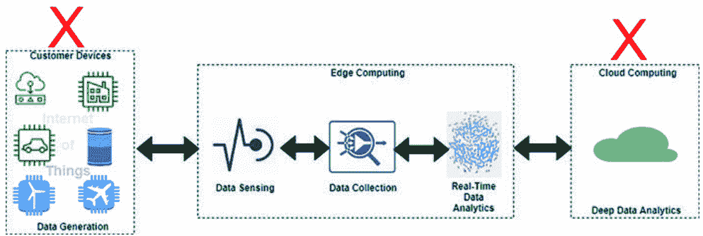

图 7.1：边缘计算渗透测试的范围

## 不断演变的边缘计算威胁态势

边缘计算的迅速发展开启了技术可能性的新时代，但也催生了动态且不断演变的威胁态势。随着计算能力延伸到网络边缘，攻击面也随之扩大，为网络对手带来了挑战和机遇。为集中式架构设计的传统安全模型现在正面临边缘计算分散特性的挑战，因为大量设备和传感器成为恶意行为者的潜在入口点。

在不断演变的边缘计算环境中，新兴威胁之一是物理篡改风险增加。边缘设备通常分布在偏远且安全性较低的环境中，容易受到未经授权的访问。攻击者可能利用这些物理可访问设备中的漏洞，危及其完整性，并可能控制关键系统。随着边缘生态系统的不断扩大，防范物理威胁成为寻求利用分布式计算优势的组织的首要关注点。

此外，互联边缘设备的激增为网络安全引入了新的复杂性维度。设备数量庞大，加上通信协议多样，为确保强大的网络安全性创造了挑战性环境。如果利用设备间通信漏洞，可能导致级联故障，并危及整个边缘网络的完整性。随着边缘设备互联变得更加复杂，先进的威胁检测和缓解策略的需求变得越来越迫切。

此外，不断演变的边缘计算威胁态势引发了隐私问题，因为敏感数据是在更靠近数据源的地方生成和处理的。边缘计算的分散性质意味着个人和敏感信息可能存储在本地设备上并进行分析，这使得执行一致的隐私政策更具挑战性。这种分散式数据处理范式增加了未经授权访问个人信息的风险，因此需要强大的加密、访问控制和隐私保护技术来减轻潜在的泄露。

总之，不断演变的边缘计算威胁态势要求网络安全策略发生范式转变。组织必须适应边缘计算分散性质所带来的挑战，解决物理安全风险、设备间通信漏洞和隐私问题。一种涵盖先进的威胁检测、加密和严格访问控制的主动且全面的边缘安全方法，对于在动态且迅速扩展的技术前沿中导航至关重要。


## 现代网络安全中安全边缘渗透测试的重要性

边缘计算渗透测试在强化现代网络安全策略方面发挥着关键作用。随着组织越来越多地采用边缘计算来在数据源附近处理数据，攻击面不断扩大，亟需采取强有力的安全措施。边缘渗透测试使网络安全专业人员能够模拟现实世界中的网络威胁，识别分布式计算环境特有的漏洞和弱点。这种主动方法使组织能够始终领先于潜在攻击者一步，降低与去中心化数据处理相关的风险。

在现代网络安全领域，该领域动态且不断演变，边缘计算渗透测试提供了对安全态势的针对性审查。通过进行全面评估，组织能够细致了解恶意行为者的潜在入口点，从而制定针对边缘计算架构细微差别而量身定制的精确对策和防护措施。

此外，边缘计算渗透测试的重要性还延伸到保护关键基础设施和敏感数据。随着边缘设备成为医疗、金融和制造等领域不可或缺的组成部分，确保信息的机密性、完整性和可用性至关重要。渗透测试可以识别安全架构中的潜在弱点，使组织能够在漏洞被利用之前主动加以解决。这不仅保护了宝贵的资产，还维护了数据保护至关重要的行业中的监管合规标准。

在物联网（IoT）普及的背景下，边缘计算渗透测试变得不可或缺。边缘处物联网设备的互联性引入了众多潜在的攻击向量。通过对这些设备及其通信协议进行严格的渗透测试，网络安全团队可以发现隐藏的风险，弥补安全漏洞，并增强整个生态系统的韧性。这种主动方法对于维持依赖物联网支持系统安全功能的最终用户和利益相关者的信任至关重要。

总之，随着组织继续采用边缘计算以利用其效率和敏捷性，边缘渗透测试的重要性怎么强调也不为过。它作为一种主动且战略性的措施，用于识别和解决去中心化计算环境特有的漏洞。通过这样做，组织可以加强其网络安全防御，保护关键资产，并确保在边缘计算在塑造技术格局中发挥关键作用的时代服务的可靠性。

## 边缘计算渗透测试的基础

边缘计算渗透测试是一项关键学科，专注于评估和强化边缘计算环境的安全性。在这种情况下，渗透测试涉及仔细审查边缘设备、网络和应用程序的安全态势，以识别漏洞和弱点。测试人员必须在错综复杂的互连边缘节点网络中导航，确保安全措施足够强大，能够抵御网络边缘的潜在威胁。

边缘计算渗透测试的一个基本方面是了解所涉及的各种边缘设备。这些设备可以包括传感器、物联网（Internet of Things）设备、网关和各种嵌入式系统。渗透测试人员必须全面了解这些设备的独特特征及其相关的潜在漏洞，因为攻破其中一台可能会对整个边缘网络产生级联影响。

除了设备多样性外，渗透测试人员还需要仔细审查边缘计算中使用的通信协议。边缘环境依赖于高效且低延迟的通信通道，这可能会带来安全挑战。测试这些协议的强健性，可确保边缘设备与中央系统之间传输的数据保持安全，不会被恶意行为者拦截或篡改。

此外，边缘计算渗透测试还深入探讨边缘到云集成的安全性。这涉及评估促进边缘设备与云服务之间通信的接口和 API（应用程序编程接口）。对身份验证机制、数据加密和授权协议进行彻底检查至关重要，以确保敏感信息在从边缘到云的整个过程中都得到充分保护。

此外，边缘计算环境的动态性引入了持续测试和监控的需求。传统的渗透测试模型可能不够充分，因为边缘环境可能会迅速发展。因此，渗透测试人员必须采用自适应且迭代的方法，及时了解变化和新兴威胁，以有效评估和增强边缘计算系统的安全态势。

最后，边缘计算渗透测试的基本方面之一在于评估边缘和云组件之间的相互作用。当数据在边缘与集中式云服务器之间无缝流动时，这一连续体中任何一点的漏洞都可能危及整个生态系统。渗透测试人员深入研究这一互联环境，检查安全握手、访问控制和数据完整性机制，以保证边缘与云之间信息的无缝且安全的流动。这种整体评估确保整个边缘计算基础设施始终能够抵御潜在的违规行为，为这一不断发展的范式提供全面的防御策略。

## 各种边缘计算渗透测试方法及其应用

边缘计算渗透测试是确保分布式计算环境安全性和韧性的关键方面。采用各种方法论来评估和强化边缘计算系统的安全性，每种方法都针对去中心化架构带来的独特挑战进行了定制。

- **威胁建模**：这涉及识别特定于边缘计算部署的潜在威胁和漏洞。通过系统地分析系统的组件、数据流和通信渠道，渗透测试人员可以获得关于潜在弱点的宝贵见解，并制定有针对性的策略来降低风险。

- **红队**：这模拟了针对边缘计算基础设施的现实世界网络攻击。通过模仿恶意行为者的策略、技术和程序，渗透测试人员可以评估现有安全措施的有效性，并找出改进的领域。这种主动方法使组织能够增强其事件响应能力，并构建针对边缘计算环境不断演变的网络威胁的强大防御。

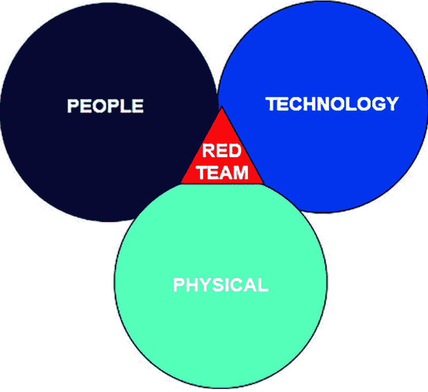

图 7.2：红队演练图

- **动态分析（模糊测试）**：这是一种专注于评估边缘应用程序对意外输入和条件的韧性的方法论。渗透测试人员会系统地将格式错误或意外的数据注入边缘设备和应用程序，以发现可能导致崩溃或未经授权访问的漏洞。这种方法在识别通过传统静态分析或代码审查可能无法察觉的弱点方面特别有效，能够全面评估系统的强健性。

- **合规性**：这在确保边缘计算部署遵守行业法规和安全标准方面发挥着至关重要的作用。渗透测试人员评估已实施的安全控制是否符合合规要求，例如 GDPR、PCI、HIPAA 或 ISO 27001 中概述的要求。这种方法论不仅帮助组织避免法律后果，还有助于建立安全基础，保护在边缘处理的敏感数据。

- **物理安全**：这正变得越来越重要。除了虚拟领域之外，渗透测试人员还会评估用于保护物理边缘设备和基础设施的安全措施。这涉及仔细检查访问控制、监控系统和环境控制，以确保边缘计算部署的物理方面得到充分保护，防止未经授权的访问和篡改。

总之，边缘计算渗透测试方法论涵盖了一系列多样化的方法，以应对去中心化架构带来的独特挑战。通过结合这些方法论，组织可以加强其边缘计算环境，并主动防御不断演变的网络威胁格局。


## 边缘计算渗透测试的道德考量与法律方面

边缘计算渗透测试带来了独特的道德考量和法律挑战，需要谨慎应对，以确保安全评估的负责任和合法执行。在道德上，渗透测试人员必须优先尊重用户隐私，以及所评估系统的完整性。与在集中式服务器上进行的传统渗透测试不同，边缘计算通常涉及分布式网络和设备，引发了对个人数据和隐私可能影响的担忧。测试人员必须获得利益相关者的明确同意，并就测试的范围和目标进行透明沟通，以避免意外后果。

从法律角度来看，边缘计算的动态特性在司法管辖和合规性方面带来了复杂性。渗透测试人员必须熟悉测试所在地区的监管环境，并必须考虑数据保护法律、行业特定法规和国际标准。未能遵守法律要求可能导致严重后果，包括法律行动和财务处罚。此外，由于边缘计算涉及各个领域的互联设备，了解不同实体之间的合同协议和服务级别协议（SLAs）对于避免任何违规或未经授权的访问至关重要。

知情同意原则在解决道德问题中发挥着关键作用。渗透测试人员应向利益相关者清楚阐述其活动的潜在风险和影响，确保各方都了解测试过程中可能暴露的潜在中断和漏洞。这种主动方法不仅符合道德标准，还能营造一个协作环境，使组织能够积极参与保护其边缘计算基础设施。

此外，边缘计算固有的分布式特性引发了与所有权和责任相关的挑战。渗透测试人员必须明确其测试活动的边界，并识别其范围内的特定资产和组件。这有助于防止无意中干扰第三方系统，并确保测试重点保持在商定的参数范围内。

总之，边缘计算渗透测试中的道德考量和法律方面要求采取全面方法，优先考虑隐私、同意和合规性。边缘技术不断发展的特性要求持续适应新出现的法规和标准，强调渗透测试人员、组织和法律专家之间协作的重要性，以负责任地应对复杂的环境。

## 边缘计算渗透测试的规划与准备

边缘计算渗透测试涉及评估去中心化计算环境相关的安全漏洞和潜在风险。规划和准备是确保边缘计算系统全面且有效的渗透测试过程的关键步骤。

在初始规划阶段，必须深入了解现有的特定边缘计算架构。这包括识别各种边缘设备、它们的互连以及整体通信流。通过了解边缘环境的复杂性，渗透测试人员可以制定针对性策略，评估潜在的薄弱点和可利用性。

边缘计算渗透测试的准备包括创建现实且具有代表性的测试环境。模拟各种边缘设备及其配置对于准确模拟现实场景至关重要。这可能涉及设置边缘设备的虚拟实例，并模拟实际部署的物理和网络特性。一个准备充分的测试环境确保渗透测试人员可以识别不同设备类型和配置中的漏洞，提供更全面的评估。

考虑到边缘计算的分布式特性，测试人员必须考虑延迟和带宽限制带来的独特挑战。规划应包括评估这些限制对安全措施影响的方法，因为受损的边缘设备可能只有有限资源来防御攻击。此外，测试人员应专注于了解边缘设备如何与中央服务器和其他组件交互，因为这些通信通道是恶意行为者的潜在入口点。

规划的另一个关键方面涉及定义渗透测试的范围和目标。这包括识别要测试的特定资产、要采用的测试方法，以及对整个边缘计算生态系统的潜在影响。明确定义的目标有助于将测试活动与组织的安全目标和监管合规要求保持一致。

总之，细致的规划和充分的准备对于边缘计算渗透测试的成功至关重要。了解边缘环境的独特特征、创建具有代表性的测试环境、考虑延迟和带宽限制以及定义明确的测试目标，都是有效策略的重要组成部分。通过采取这些步骤，组织可以更好地加固其边缘计算系统以抵御潜在的安全威胁，并确保其分布式基础设施的完整性。

## 构建全面的边缘计算渗透测试计划

构建全面的边缘计算渗透测试计划对于确保分布式系统的安全性和弹性至关重要。在边缘计算不断变化的环境中，设备和应用程序分布在各个地点，强大的渗透测试策略对于识别和缓解潜在漏洞变得至关重要。首先，渗透测试计划应涵盖以下方面：

- 侦察阶段：这涉及绘制边缘基础设施图、识别入口点以及了解设备之间的通信通道。对边缘组件及其交互进行详细清单对于有效模拟现实攻击场景至关重要。
- 漏洞评估：这包括评估边缘设备、网关和通信协议的安全态势。测试应既关注已知漏洞，也关注潜在的零日漏洞利用，特别强调边缘计算环境带来的独特挑战，例如资源有限和多样化的通信协议。
- 执行阶段：应进行模拟攻击，以评估系统对各种网络威胁的抵抗力。这可能涉及利用漏洞获得未经授权的访问、操纵数据流或发动拒绝服务攻击。目标是识别边缘基础设施中的弱点，并确定恶意行为者可能造成的潜在损害程度。

此外，渗透测试计划应通过实施社会工程演习来解决人为因素问题。这有助于评估边缘计算人员安全意识培训的有效性，并识别人员安全链中的潜在薄弱环节。

这是任何渗透测试计划的关键方面。应生成详细报告，概述发现的漏洞、成功利用的影响以及建议的修补措施。此文档不仅作为组织的参考，还有助于向利益相关者和监管机构传达安全状态。

- 持续改进：随着边缘计算环境的发展，相关的安全风险也在不断变化。定期更新和重新测试渗透测试计划，可确保其在缓解新出现的威胁方面保持相关性和有效性。

总之，全面的边缘计算渗透测试计划是保护分布式系统的主动方法。通过系统地评估漏洞、模拟现实世界攻击并解决人为因素，组织可以加强其边缘基础设施的安全性，并增强对不断演变的网络威胁的弹性。


## 边缘计算特定威胁向量的识别

边缘计算凭借其去中心化架构，引入了一组独特的威胁向量，组织必须谨慎应对。

一个关键问题是边缘设备激增导致的攻击面增大。

与传统的集中式系统不同，边缘计算将计算资源扩展到网络边缘，从而为恶意行为者提供潜在的入口点。

在本语境下，识别威胁向量涉及仔细审视边缘生态系统中互连的各种设备，从 IoT 传感器到边缘服务器，每个设备都容易受到攻击。

此外，边缘计算动态且分布式的特点，在有效监控和保护网络方面带来了挑战。

边缘应用对延迟敏感的特性要求在边缘进行快速决策，使得传统安全措施不太可行。

威胁行为者可能利用这一实时性要求，针对边缘设备的漏洞或操纵数据流以达到恶意目的。

识别这些威胁需要对边缘设备、网络和云之间复杂关系的细致理解，强调了自适应安全框架的必要性。

除了传统的网络安全问题外，在识别边缘计算特定威胁向量时，隐私成为焦点。

边缘设备通常在本地处理敏感数据，从而增加了未经授权的访问或数据泄露的风险。

在本语境下，识别威胁包括认识到边缘处数据暴露的潜在风险，并实施强大的加密和访问控制。

在分散处理与数据保护之间取得平衡变得至关重要，因为边缘计算中的隐私妥协可能对个人和组织产生连锁反应。

此外，边缘设备之间缺乏标准化的安全协议，使得威胁识别变得复杂。

边缘处多样化的硬件和软件配置，使得实施统一安全措施变得具有挑战性。

识别威胁向量需要对每个设备的规格及其相关漏洞进行细致检查。

这呼吁行业内协作努力，为边缘计算建立共同的安全标准，以便在整个生态系统中更有效地识别和缓解威胁。

总之，识别边缘计算中的威胁向量需要一种全面的方法，考虑扩大的攻击面、实时处理挑战、隐私影响以及缺乏标准化安全协议。

随着组织继续因边缘计算的效率和性能优势而采用它，解决这些独特的威胁向量对于构建安全且有弹性的边缘基础设施变得必不可少。

## 边缘计算渗透测试的工具与技术

边缘计算渗透测试涉及评估网络边缘分布式计算系统的安全性，在那里数据在靠近源头的地方生成和处理。

采用各种工具和技术，以确保边缘计算环境在面对潜在网络威胁时的稳健性。

边缘计算渗透测试的一个基本工具是 Shodan，这是一个识别并编目连接到互联网的设备的搜索引擎。

渗透测试人员可以利用 Shodan 来识别边缘设备、评估其漏洞，并了解潜在的攻击面。

通过了解连接设备的格局，测试人员可以更好地模拟现实世界场景，并增强边缘环境的安全态势。

除了 Nessus 或 OpenVAS 等传统漏洞扫描仪外，IoT Inspector 等专业工具对于边缘计算渗透测试也很有价值。

这些工具专门用于检测物联网（IoT）设备中的漏洞，而物联网设备通常是边缘计算网络的重要组成部分。

识别这些设备中的弱点对于防止未经授权的访问和敏感数据被潜在利用至关重要。

以下是可以采用的一些技术：

- 动态分析：这在边缘计算渗透测试中起着关键作用。测试人员模拟现实世界场景，对边缘设备进行攻击模拟，以评估其对各种威胁的抵抗力。通过检查设备对不同攻击向量的响应，渗透测试人员可以识别安全架构中的薄弱点，并推荐改进措施以有效降低潜在风险。

- 协议分析：这是一种专注于仔细检查边缘计算环境中使用的通信协议的技术。Wireshark 等工具允许测试人员捕获和分析网络流量，帮助他们了解设备之间的数据流。这种技术对于发现与数据传输相关的潜在漏洞，并确保边缘计算系统中信息的机密性和完整性至关重要。

总之，全面的边缘计算渗透测试策略涉及专业工具和技术的结合。Shodan 和针对 IoT 的工具有助于识别和评估连接设备中的漏洞，而动态分析和协议分析技术则提供对安全态势的全面评估。通过利用这些工具和技术，组织可以主动应对潜在威胁，并加强其边缘计算基础设施的韧性。

## 现实世界中的边缘计算威胁

在不断演变的网络安全格局中，模拟现实世界中的边缘计算威胁是一项至关重要的任务。随着边缘计算日益普及，主动识别和解决潜在漏洞的需求变得至关重要。在这些模拟环境中，安全专业人员可以精心设计反映实际威胁复杂性的场景，使组织能够测试其边缘计算基础设施的稳健性。通过模拟从恶意软件注入到未经授权的访问尝试等多种网络威胁，这些模拟提供了一个动态平台，以评估和加强边缘设备和网络的安全态势。

模拟边缘计算威胁的艺术超越了单纯的复制，深入到预测建模的领域。网络安全专家必须预见恶意行为者不断演变的策略，并模拟挑战系统有效适应和响应能力的场景。这种前瞻性方法使组织能够始终领先一步，完善防御策略，并确保边缘计算生态系统的韧性。通过这些模拟，安全专业人员获得潜在薄弱点的宝贵洞察，从而能够实施有针对性的安全措施，减轻现实世界威胁的影响。

模拟现实世界中的边缘计算威胁，同时也为安全团队提供了一个宝贵的训练场。通过让专业人员接触逼真的场景，他们可以磨练威胁检测、事件响应和恢复方面的技能。在这些模拟中获得的实践经验增强了团队在面对实际安全事件时果断行动的能力，从而缩短响应时间，最大限度地减少网络威胁造成的潜在损害。此外，这些模拟的迭代性质使团队能够从每个场景中学习，不断改进其方法，并始终关注边缘计算安全动态格局中出现的新威胁向量。

在合规和监管领域，模拟边缘计算威胁在验证对行业标准和最佳实践的遵守方面起着至关重要的作用。组织必须不仅展示其边缘安全措施的功能，还要展示其在缓解现实世界威胁方面的有效性。模拟提供了一个受控环境来评估数据保护法规的合规性，确保敏感信息得到保护，并且组织保持与法律要求的一致。这种主动方法不仅能防止潜在的泄露，还能通过展示对边缘计算领域强大网络安全实践的承诺，在利益相关者中建立信任。

以下是模拟边缘计算中威胁的分步指南：

- 定义目标和范围：明确威胁模拟的目标和模拟范围。了解您想要测试边缘计算的哪些具体方面，例如设备安全、通信协议或应用程序漏洞。


识别威胁场景：列出可能对边缘计算环境构成风险的潜在威胁场景。这可能包括未经授权的访问、数据泄露、拒绝服务攻击等。请考虑外部和内部威胁。

设置测试环境：创建一个与边缘计算设置相镜像的受控测试环境。这可能涉及使用物理边缘设备、虚拟机或两者的组合。确保环境与生产系统隔离，以防止对实际运营产生任何影响。

部署安全工具：集成可帮助模拟威胁和漏洞的安全工具。这可能包括渗透测试工具、漏洞扫描器和网络监控解决方案。确保这些工具配置为模拟现实世界场景。

执行漏洞评估：进行彻底的漏洞评估，以识别边缘计算基础设施中的弱点。这可能涉及扫描设备、应用程序和网络组件中的已知漏洞。

模拟威胁场景：执行先前识别的威胁场景。这可能涉及尝试未经授权的访问、注入恶意代码或利用漏洞。监控系统对这些模拟威胁的反应，并评估对安全性的影响。

评估响应机制：评估现有安全控制和响应机制的有效性。评估边缘计算环境检测和响应模拟威胁的效果。这包括检查入侵检测系统、防火墙和事件响应流程。

分析结果：分析威胁模拟的结果。识别改进领域、需要修补的漏洞和潜在的安全差距。记录发现，并根据其严重程度和潜在影响进行优先排序。

实施修复措施：根据分析，实施修复措施以解决已识别的漏洞和弱点。这可能涉及应用补丁、配置安全设置或增强安全策略。

重复测试：威胁态势在不断演变，因此定期重复威胁模拟过程至关重要。定期测试有助于确保边缘计算环境能够抵御新兴威胁。

文档和报告：记录整个威胁模拟过程，包括方法论、使用的工具、发现和修复措施。生成一份全面的报告，以向相关利益相关者传达结果，并支持持续的安全改进。

通过遵循这些步骤，您可以在边缘计算中系统地模拟威胁，评估安全态势，并主动增强边缘环境的整体弹性。

## 解决边缘设备预测试中的挑战

解决边缘设备预测试中的挑战是确保这些先进技术的健壮性和可靠性的关键方面。一项关键障碍在于边缘设备的多样性，从传感器和执行器到物联网设备，每种设备都有自己的规格和功能。为克服这一问题，必须制定全面的预测试策略，涵盖模拟现实世界条件的仿真环境。模拟多种场景有助于识别潜在的漏洞和兼容性问题，从而在部署前采取主动解决方案。

另一个挑战是边缘计算环境的动态性，其中设备不断交互并适应变化的条件。预测试必须包含模拟这种动态行为的场景，并考虑网络波动、不同工作负载和间歇性连接等因素。通过在预测试期间将边缘设备置于现实条件下，开发人员可以发现性能瓶颈并优化算法，从而确保设备在动态环境中的无缝运行。

互操作性是边缘设备领域的一个重要问题，考虑到大量的硬件和软件组合。预测试应优先检查不同设备和平台之间的兼容性，以确保无缝集成。采用标准化的通信协议和彻底的兼容性测试可以缓解互操作性挑战，促进更加一体化和高效的边缘生态系统。

在处理边缘设备时，安全性至关重要，因为它们通常在远程或不受控制的环境中运行。预测试应高度重视安全措施，包括加密、访问控制和入侵检测。对这些安全协议进行严格测试有助于识别漏洞和弱点，使开发人员能够加固边缘设备以抵御潜在的网络威胁。

此外，边缘设备上的资源匮乏构成了一个独特的挑战。预测试应专注于优化资源利用，例如内存和处理能力，以确保在受限环境中高效运行。这包括在资源受限条件下进行压力测试，以识别潜在的性能下降，并实施资源高效的算法。

总之，解决边缘设备预测试中的挑战需要一种全面的方法，涵盖仿真、动态场景测试、互操作性检查、安全性评估和资源优化。通过主动解决这些挑战，开发人员可以提升边缘设备的可靠性、安全性和整体性能，从而为其在各种动态环境中的成功部署铺平道路。

## 边缘计算渗透测试中的自动化

边缘计算渗透测试中的自动化代表了组织保护其分布式计算环境方式的范式转变。传统的渗透测试方法论往往难以跟上边缘计算的动态和分散性质。然而，通过利用自动化，安全专业人员可以简化跨庞大边缘设备网络的漏洞识别和修复。自动化工具可以系统地扫描和评估边缘节点的安全态势，确保手动难以实现的全面评估。这不仅提高了渗透测试的效率，还使组织能够主动解决其边缘基础设施中的潜在安全风险。

边缘计算环境带来的独特挑战，例如多样的硬件架构和有限的资源，需要量身定制的渗透测试方法。自动化便于根据边缘设备的具体特性定制测试方法论。这种适应性确保渗透测试在多样化的边缘计算部署环境中保持有效和相关。此外，自动化工具可以在边缘设备上模拟现实世界的攻击场景，为组织提供更准确地了解其在动态、边缘驱动型生态系统中的安全韧性。

在边缘计算渗透测试领域，持续测试的概念日益突出。自动化使安全团队能够实施持续的自动化测试流程，不断监控边缘设备的安全态势。这种主动方法有助于组织实时识别和解决漏洞，减少潜在攻击者的机会窗口。边缘计算的动态性要求持续测试模型，而自动化在为这些分布式系统建立强大且自适应的安全框架中发挥着关键作用。

此外，将人工智能（AI）和机器学习（ML）算法集成到自动化工具中，提高了边缘计算渗透测试的有效性。这些智能系统可以分析边缘设备生成的大量数据，识别模式，


并主动检测潜在的安全威胁。通过利用 AI 和 ML，组织不仅可以自动化测试过程，还可以在复杂的边缘计算环境中了解新兴风险和不断演变的攻击向量。

总之，边缘计算渗透测试中的自动化是一种变革性方法，可应对分布式和动态计算环境带来的独特挑战。它不仅简化了测试过程，还提高了不断演变的边缘计算环境中安全措施的准确性、适应性和主动性。随着组织继续采用边缘技术，将自动化纳入其安全策略变得至关重要，以抵御新兴威胁并确保其边缘基础设施的韧性。

## 边缘计算渗透测试中的道德考量

边缘计算渗透测试涉及评估去中心化计算环境的安全性，在该环境中，数据处理更靠近数据生成源。道德考量在这种动态环境中起着至关重要的作用，因为测试过程必须在识别漏洞与尊重敏感信息的隐私和完整性之间走好一条细线。测试人员必须优先考虑所有相关利益相关者的知情同意，承认对个人和组织可能产生的影响。关于渗透测试的目的、范围和潜在风险的透明沟通对于建立信任和维护道德标准至关重要。

设备和系统的互联互通增加了道德考量的复杂性。测试人员必须保持警惕，避免对关键服务造成中断，并必须谨慎行事以防止意外后果。边缘计算的去中心化特性也要求对管辖权和监管差异有细致入微的理解，要求遵守当地和国际法律，以确保保护用户权利并符合数据保护法规。因此，边缘计算中的道德渗透测试需要全球视角，并致力于维护超越地理边界的标准。

此外，道德考量超出了渗透测试的技术层面，还涵盖了已识别漏洞可能产生的社会影响。测试人员应评估对社区、企业和环境的更广泛影响。负责任的披露成为关键要素，强调需要与利益相关者合作，及时解决和缓解已识别的风险。这种协作方式培养了共同责任的文化，并确保道德考量不仅局限于直接的技术背景，而是融入更广泛的社会责任框架中。

总之，边缘计算渗透测试中的道德考量具有多方面性，需要采取整体方法。测试人员必须在技术严谨性与道德责任之间找到复杂的平衡，优先考虑透明度、同意和协作。随着边缘计算的不断发展，道德标准必须适应去中心化架构带来的独特挑战，强化道德基础在保障这些新兴技术的完整性和安全性方面的重要性。

## 边缘计算环境中道德黑客攻击的原则

道德黑客攻击的原则在确保去中心化系统的安全性和完整性方面起着关键作用。道德黑客，又称白帽黑客，负责主动识别边缘计算环境中的漏洞，以预防性地防范潜在的网络威胁。这种黑客攻击形式涉及对边缘网络基础设施、设备和应用程序的细致检查，强调在不断演变的数字领域中始终保持领先一步的重要性。

边缘计算中道德黑客攻击的基本原则之一，是全面了解设备与边缘网络之间复杂的相互作用。与传统的集中式系统不同，边缘计算将计算资源分布在更靠近数据源的位置，带来了独特的挑战和机遇。道德黑客必须对分布式架构有细致入微的理解，确保安全措施能够巧妙地针对边缘环境的特定细微差别进行定制。这种主动方法使组织能够加强其边缘计算生态系统以抵御潜在的违规行为，增强网络的整体韧性。

在边缘计算领域，透明度和协作是最重要的道德黑客攻击原则。由于边缘设备通常在多样化、互联的生态系统中运行，道德黑客必须与开发人员、系统管理员和其他利益相关者密切合作。这种协作方式培养了共同责任的文化，安全问题在其中得到集体解决。道德黑客在教育和赋能整个开发和运维团队方面发挥着至关重要的作用，灌输一种优先考虑安全的思维模式，使其渗透到边缘计算架构的方方面面。

此外，边缘计算中的道德黑客攻击强调了持续监控和适应的重要性。边缘环境的特点是其动态性，设备和应用程序不断相互作用和演变。道德黑客使用实时监控工具来及时检测和响应新兴威胁。这一原则强调了对安全协议进行持续评估和调整的必要性，确保边缘计算系统在面对不断演变的网络威胁时保持韧性。通过拥抱适应性，道德黑客攻击成为维护边缘计算安全态势稳健性的基石。

## 在边缘平衡安全测试与隐私问题

在技术前沿平衡安全测试与隐私问题是一场组织必须掌握的微妙舞蹈，以应对不断演变的数字创新环境。随着企业越来越多地部署边缘计算解决方案以提升性能和效率，加固这些分布式系统以抵御网络威胁的需求变得至关重要。边缘安全测试涉及仔细检查去中心化网络、边缘设备及其连接通信渠道的漏洞。它需要对潜在攻击向量进行细致审查，确保敏感数据免受寻求未经授权访问的恶意行为者的侵害。

然而，追求安全不应以牺牲隐私为代价。由于边缘设备通常实时处理数据，因此无意泄露隐私的风险更高。找到正确的平衡点涉及实施强大的安全措施，同时不侵犯个人数据保护的权利。这需要将隐私增强技术（如加密和匿名化）整合到安全测试协议中。组织必须采用隐私优先设计方法，确保其边缘基础设施的每一层都能抵御威胁，同时尊重用户隐私和监管要求。

边缘安全测试和隐私问题的格局因设备和应用的互联性质而进一步复杂化。物联网（IoT）设备的激增扩大了攻击面，使组织有必要采用全面的测试策略，涵盖传统和新兴威胁向量。这不仅包括评估单个设备的安全性，还包括评估整个边缘生态系统对因安全漏洞引发的潜在级联故障的韧性。

在驾驭这一复杂格局时，网络安全专家、隐私倡导者和监管机构之间的协作变得至关重要。组织必须保持警惕，密切关注不断演变的威胁和隐私法规，以相应调整其安全测试框架。通过培养安全测试方法持续改进和创新的文化，企业可以主动应对新兴挑战，确保边缘处安全与隐私之间微妙的平衡得以维持，并保留用户信任。


## 边缘安全中的负责任信息披露

边缘安全中的负责任信息披露是一项关键实践，强调了安全研究人员与技术供应商之间道德和透明沟通的重要性。在不断演变的数字威胁格局中，边缘安全在保护网络和敏感数据方面发挥着至关重要的作用。当安全研究人员在边缘系统中发现漏洞时，负责任的信息披露鼓励他们将这些发现报告给相关方，而不立即公开它们。这种协作方法使供应商能够主动解决和修补安全缺陷，防止潜在的恶意利用。

边缘安全负责任的信息披露充当安全社区与技术开发者之间的桥梁。通过遵循负责任的信息披露政策，研究人员展示了推动网络安全发展的承诺，而不会造成不必要的伤害。该过程通常涉及私下通知供应商，给予他们合理的时间来开发和发布补丁，然后再公开披露漏洞详情。这种透明与审慎之间的微妙平衡对于保持边缘安全解决方案的完整性至关重要，有助于在网络安全生态系统中培育信任与合作的文化。

负责任信息披露的概念不仅限于漏洞报告，更包含对社会福祉的更广泛承诺。遵循负责任信息披露原则的安全研究人员将更大的利益置于个人收益或声誉之上。这种道德立场有助于减轻对依赖边缘技术的个人、组织和关键基础设施的潜在风险。它还促进了安全专业人员与供应商之间的建设性关系，营造了一个双方合作加固数字环境以应对新兴威胁的环境。

随着技术的不断进步，负责任的信息披露在边缘安全背景下变得愈发至关重要。边缘设备的互联特性以及漏洞可能产生的连锁反应凸显了采取合作且审慎方法的必要性。拥抱负责任的信息披露不仅能够增强边缘系统的安全态势，还体现了利益相关方之间共同的责任，旨在创造一个更安全、更具韧性的数字环境。这样做，网络安全社区为边缘安全的持续演进做出贡献，确保创新不会因不可预见的漏洞而受到破坏。

## 边缘计算事件管理框架

边缘计算事件管理是确保分布式计算系统无缝运行和安全的关键方面。该框架的核心是一种主动的方法，承认边缘环境带来的独特挑战。与传统的集中式系统不同，边缘计算将计算资源更靠近数据源分发，导致复杂性增加和潜在漏洞。该框架优先考虑实时事件检测，利用专为边缘部署定制的高级分析和监控工具。通过迅速识别异常或潜在威胁，组织可以在问题升级前主动解决，最大限度地减少停机时间并保护边缘计算基础设施的完整性。

在边缘计算动态的环境中，适应性是有效事件管理的关键。该框架强调需要灵活的响应机制，以适应边缘环境的多样性。这包括考虑边缘节点特定特征（如有限资源和间歇性连接）的自动化事件响应协议。此外，该框架鼓励集成机器学习算法，这些算法可以随着时间的推移而演进和改进，从过去的事件中学习以增强边缘计算生态系统的整体韧性。这种自适应措施使组织能够领先于新兴威胁，并不断完善其事件管理策略。

协作是边缘计算事件管理框架的核心，认识到边缘生态系统通常涉及众多利益相关方。从边缘设备制造商到服务提供商和最终用户，有效的事件解决需要无缝的沟通和信息共享。该框架促进事件报告和沟通的标准化协议，确保无论涉及多么多样的组件，都能对事件作出统一的响应。协作式事件管理不仅加快了解决过程，还促进了最佳实践和经验教训的共享，为增强边缘计算系统的安全性和可靠性汇聚集体力量。

在不断演变的网络安全环境中，边缘计算事件管理框架承认持续改进的重要性。定期评估和审计是组成部分，为组织提供有关其事件管理流程有效性的见解。通过定期评估和完善事件响应策略，组织可以领先于新兴威胁，适应不断发展的技术，并增强其边缘计算基础设施的韧性。这种对持续改进的承诺反映了在边缘计算动态领域中采取主动且面向未来的事件管理方法。

## 边缘环境中的事件识别

边缘环境中的事件识别面临着一套独特的挑战和机遇，因为这些系统的去中心化特性要求采用创新方法来检测和响应异常。与传统的集中式架构不同，边缘计算将计算资源更靠近数据源分发，创建了一个动态且多样的网络。在这种情况下，事件识别成为一个微妙的过程，需要能够识别边缘数据流固有变异性中的不规则性的自适应算法。实时分析起着关键作用，能够迅速检测可能表明潜在安全漏洞或运营问题的异常。在边缘定位事件的能力不仅能提升整体安全态势，还能确保分布式系统中关键流程的效率和可靠性。

边缘环境中事件识别的格局以多种技术的融合为特征，例如物联网设备、传感器和边缘计算基础设施。这种融合为检测过程增加了复杂层次，要求能够理解数据中复杂关系和模式的精密机器学习模型。上下文意识变得至关重要，因为边缘环境中的事件可能根据特定的部署上下文以不同方式表现出来。将事件识别机制定制为边缘设置的独特特征（如有限带宽、间歇性连接和资源约束）对于实现准确和及时的响应至关重要。这种定制方法确保识别过程不仅有效而且资源高效，与边缘计算固有的约束保持一致。

此外，边缘环境中的事件识别需要在集中式监督与分布式自主权之间取得平衡。虽然集中式监控系统提供整个边缘网络的全面视图，但赋予边缘设备本地化事件检测能力可以减少对与中央枢纽持续通信的依赖。这种去中心化不仅提高了事件识别的响应速度，还通过减轻通信故障的影响增强了系统的整体韧性。集中式与分布式事件识别机制之间的相互作用创建了一个强大的框架，能够适应边缘环境带来的独特挑战，为更安全、更可靠的计算范式奠定基础。


## Edge Computing Incident Classification and Severity Assessment

边缘计算事件分类与严重性评估是确保分布式计算系统韧性和效率的关键组成部分。在边缘计算领域，数据处理更靠近数据生成源，事件范围可从连接问题和硬件故障到软件故障和安全漏洞不等。对这些事件进行分类是一项细微的工作，需要考虑边缘环境的多样性和动态性。

边缘计算事件分类涉及根据事件来源、影响和潜在原因对其进行分类。与传统的集中式系统不同，边缘计算引入了大量变量，例如设备的地理分布和不同的网络条件。因此，事件分类必须考虑边缘计算去中心化特性带来的独特挑战，以便为事件管理提供量身定制且自适应的方法。

同时，严重性评估在确定事件响应优先级方面起着关键作用。并非所有事件都同等重要，其后果可能差异显著。严重性评估涉及评估事件对系统功能、数据完整性和整体运营稳定性的潜在影响。此过程确保资源分配高效，及时处理高严重性事件，以最大限度地减少中断以及边缘生态系统中可能的级联效应。

在边缘计算的背景下，事件分类和严重性评估不仅仅涉及技术考量。它们还需要理解对业务运营、用户体验和合规要求的更广泛影响。准确分类事件并评估其严重性的能力，使组织能够主动管理边缘计算环境，提高整体可靠性，并增强其分布式基础设施的韧性。随着边缘计算环境的不断发展，完善事件分类和严重性评估方法对于保持强大且响应迅速的计算生态系统变得越来越关键。

## Establishing Incident Response Teams for Edge Computing

在技术快速发展的格局中，边缘计算正迅速获得重要地位，建立专门的事件响应团队（IRT）变得至关重要。边缘计算因其分布式特性和与最终用户的紧密距离，带来了一系列传统事件响应策略可能无法充分应对的独特挑战和漏洞。创建专注于边缘环境的专门团队，对于确保对安全事件做出迅速而有效的响应至关重要。

边缘计算事件响应团队应由多学科专家组成，他们精通网络安全和边缘架构的复杂性。这些专业人员必须深入理解去中心化计算所带来的独特挑战，即数据处理更靠近数据源。这种紧密性引入了一组不同的攻击向量，因此IRT精通识别和缓解边缘环境特有的风险至关重要。

此外，边缘计算事件响应团队的敏捷性至关重要。边缘基础设施的分布式特性要求快速响应时间，以在威胁在网络中传播之前将其遏制和中和。除了被动措施外，主动威胁狩猎和持续监控也是团队职责的组成部分，确保团队在不断发展的边缘环境中对新出现的风险保持警惕。

协作和沟通是有效事件响应团队的基本支柱。酌于边缘计算的分散性质，团队成员之间以及与其他相关利益相关者之间的协调变得更加关键。建立强大的通信协议并利用尖端协作工具，可确保团队无论地理差异如何都能无缝响应事件。

总之，随着边缘计算重塑技术范式，建立专门的事件响应团队对于保障这些去中心化环境的完整性和安全性不可或缺。通过组建一支全面了解边缘架构的专家团队，培养响应机制的敏捷性，并促进无缝协作，组织可以增强其在边缘计算领域应对不断演变的网络威胁的韧性。

## Communication Protocols in Edge Incident Management

在边缘事件管理这个动态领域，有效的通信协议在确保设备、系统和利益相关者之间快速、准确地交换信息方面起着关键作用。这些协议充当数字语言，协调传感器、执行器及其他边缘设备的协同操作，使其能够无缝通信并实时响应事件。边缘端的独特挑战在于基础设施的分布式特性，这使得强大的通信协议对于在往往是异构且地理分散的边缘环境中保持连接性和连贯性至关重要。

边缘事件管理通信协议的核心在于强调低延迟和高可靠性的数据传输。与传统的集中式系统不同，边缘计算要求协议能够优雅地应对带宽有限、连接不稳定和多样化网络架构的限制。MQTT（消息队列遥测传输）和 CoAP（受限应用协议）等协议在此类场景中表现出色，提供轻量且高效的通信，针对边缘设备资源受限的特性进行了定制。这些协议优化了事件相关数据的交换，确保关键信息送达正确目的地，同时不影响响应速度。

此外，5G技术的到来进一步提升了边缘事件管理中的通信环境。5G网络的超低延迟和高数据吞吐量能力为通信协议提供了变革性的背景，促进了事件期间边缘设备生成的大量数据的快速传输。通信协议与5G技术之间的这种协同作用不仅增强了事件管理系统的响应能力，还为创新应用（如现场响应人员的增强现实和边缘端的自主决策）打开了大门。

在不断演变的网络安全格局中，通信协议在保护事件相关数据的完整性和机密性方面也起着至关重要的作用。具有内置安全功能的协议，例如 CoAP 的数据报传输层安全协议（DTLS），有助于加固通信渠道以抵御潜在威胁，确保敏感信息在穿越互连边缘设备的复杂网络时始终受到保护。随着边缘事件管理的不断成熟，集成安全通信协议成为在去中心化生态系统中建立信任和韧性的关键。

总之，通信协议在边缘事件管理中的重要性无论如何强调都不为过。这些协议不仅充当信息交换的数字渠道，还体现了应对边缘环境复杂性所需的适应性和效率。随着技术进步和边缘计算变得更加普遍，通信协议的持续改进和创新将对塑造边缘端事件响应的有效性和可靠性至关重要。


## 边缘计算渗透测试与事件管理的最佳实践

有效的边缘渗透测试对于识别和缓解组织网络边界中的漏洞至关重要。为确保边缘安全，采用全面且主动的方法至关重要。首先定义渗透测试的范围和目标，同时考虑面向外部的应用程序和网络基础设施。模拟现实世界中的攻击场景，以评估边缘抵御潜在威胁的韧性。定期更新和微调测试方法论，以与新兴安全风险和行业趋势保持一致。与内部团队密切协作，全面了解组织的基础设施，从而实现更准确的测试和有针对性的修复工作。最后，在整个测试过程中优先考虑沟通和透明度，以便让利益相关者了解情况，并确保安全措施的无缝集成。

事件管理是强大网络安全策略的关键组成部分，在最大限度地减少安全漏洞影响方面发挥着关键作用。建立明确的事件响应计划，概述角色、职责和通信协议，以简化解决流程。定期测试和更新计划，以反映威胁态势和组织基础设施的变化。实施集中式事件跟踪系统，以便及时检测、分类和响应安全事件。通过进行彻底的事件后评审、识别经验教训并相应更新政策，培养持续改进的文化。鼓励IT、安全、法务和通信团队之间的跨职能协作，以确保协调一致的响应。此外，投资于员工培训，以增强组织的整体安全态势，并减少人为错误导致事件的可能性。

## 建立主动边缘安全文化

在当今快速发展的数字环境中，建立主动边缘安全文化不仅是一种必要，更是战略上的当务之急。传统的强调被动措施的网络安全方法，在面对复杂且持久的威胁时已不再充分。组织必须转向主动思维，预见并解决网络边缘的潜在漏洞。

主动边缘安全文化的核心在于对持续监控和评估的承诺。组织不应等待事件发生，而应采用先进的威胁检测工具和技术，主动扫描和分析网络流量。这种方法可以早期识别异常和潜在的安全漏洞，从而在造成任何重大损害之前采取迅速而果断的行动。

教育和意识在培养主动安全文化方面发挥着关键作用。员工往往是第一道防线，确保他们了解最新威胁和最佳安全实践至关重要。定期的培训计划、模拟网络钓鱼演练以及关于安全政策的清晰沟通，有助于形成一支不仅警觉而且积极参与维护组织数字边界完整性的员工队伍。

协作是主动边缘安全文化的另一基石。组织内的不同部门必须无缝协作，共享信息和见解。威胁情报平台的集成，加上有效的沟通渠道，可以全面了解潜在风险。这种协作方法可以实现更快的响应时间，并制定更全面的防御策略，考虑组织的整个攻击面。

主动边缘安全文化还意味着保持领先。这包括定期更新和修补系统、采用最新安全技术，并主动寻找潜在漏洞。通过保持主动性，组织不仅能降低当前风险，还能为适应新兴威胁做好准备，确保在不断变化的威胁态势中保持强大的安全态势。

总之，建立主动边缘安全文化是现代网络安全策略的重要组成部分。它需要结合先进技术、持续教育、协作以及保持对不断变化的威胁态势领先的承诺。通过在整个组织中培养主动思维，企业可以更好地保护其数字资产，并在数字时代的挑战面前保持强大的防御。

## 边缘计算事件响应的协作方法

边缘计算事件响应的协作方法代表了网络安全格局中的关键转变，承认了边缘环境的分布式特性。在这种动态范式中，传统的事件响应策略必须发展以拥抱集体智能和协调。团队不再孤立运行，而是形成专家网络，共享见解并整合资源。这种协作协同效应确保了对利用边缘计算架构复杂性的复杂威胁的更强大防御。

在边缘计算事件响应中，实时通信变得至关重要。协作工具和平台使地理上分散的团队之间能够无缝交换信息，培养共享的情境意识。这种迅速且同步的响应机制有助于缓解边缘计算固有的延迟挑战，确保事件得到及时处理，以尽量减少潜在影响。通过建立牢固的团队间联系，组织可以利用集体专业知识，汇集多样化的技能来有效应对边缘环境的复杂性。

此外，协作方法强调主动威胁情报共享的重要性。在一个边缘位置观察到的安全事件可以作为网络中其他节点的宝贵指标。通过统一的威胁情报框架，组织可以基于共享见解预先加强防御，为新兴威胁设立强大的屏障。这种主动姿态将事件响应从被动灭火模式转变为与边缘计算生态系统动态性质相一致的战略性、前瞻性防御策略。

协作范式超越了组织边界，涵盖了与供应商、行业同行和监管机构等外部实体的合作。共享标准和最佳实践有助于形成集体防御态势，增强边缘计算生态系统的整体韧性。协作事件响应不仅能降低个别风险，还能促进边缘计算安全整体成熟，为更安全、更互联的数字环境奠定基础。随着边缘计算的不断普及，协作事件响应方法证明了保障分布式计算未来所需的集体力量和适应性。

## 结论

当我们对安全边缘渗透测试与事件管理的探索落下帷幕时，很明显，我们的旅程绝非一场深入不断变化的网络安全格局的动态探险。本章不仅仅是技术和协议的汇编，更是一本指导我们穿越加固数字边疆的复杂迷宫的指南。

安全边缘渗透测试，作为门口的哨兵，不仅仅是探测漏洞，而是一场与潜在威胁的战略博弈，也是对韧性的持续承诺。我们的考察表明，这种主动方法不仅仅是一项任务，更是一种需要拥抱的思维。这是一种认识：边缘不是静态的边界，而是一种需要持续警惕的半透膜。

事件管理，即违规发生后的响应协调，在我们的叙述中成为无名英雄。它是迅速而周密的对策，是经验教训的体现，也是面对逆境时的希望之光。从最初的警报到最终的解决，事件管理证明了安全协议的韧性和适应性。

在下一章中，我们将探讨如何为边缘计算环境量身定制设计和实施尖端网络安全和加密解决方案。我们还将深入探讨如何确保对不断变化的威胁提供强有力的保护，最大限度地减少


## 选择题

安全边缘渗透测试的主要目标是什么？

识别组织内部网络中的漏洞

评估并加强面向外部的系统和网络的安全性

分析员工培训计划的效率

评估办公场所的物理安全性

以下哪项通常不是安全边缘渗透测试的目标？

Web 应用程序

防火墙和路由器

内部数据库

虚拟专用网络 (VPN)

在安全边缘渗透测试中，通常使用哪种技术来模拟大量恶意连接尝试，而不会实际危及安全性？

钓鱼攻击

跨站点脚本 (XSS)

拒绝服务 (DoS) 攻击

SQL 注入

事件管理的主要目标是什么？

防止所有事件

在事件发生前识别它们

最大限度地减少事件影响并快速恢复正常服务

惩罚对事件负责的个人

以下哪项是事件管理过程中的关键角色？

事件惩罚者

事件记录者

事件观察者

事件经理

## 答案

- b
- c
- c
- c
- d

## 问题

边缘计算在架构方面与传统云计算有何不同，它对渗透测试提出了哪些具体挑战？

与边缘计算环境相关的关键安全考虑因素和漏洞是什么，渗透测试人员如何有效地识别和解决这些问题？

边缘计算渗透测试中通常采用哪些工具和技术，它们与传统网络或应用程序渗透测试中使用的工具和技术有何不同？

为了确保对安全或运营事件进行及时和协调的响应，应包含哪些关键要素？

组织在事件管理中面临哪些常见挑战，可以采用哪些策略来克服这些挑战？

## 关键术语

- 战术、技术和程序
- 物联网
- 运营技术
- 应用程序编程接口
- 通用数据保护条例
- PCI 支付卡行业数据安全标准
- 健康保险可携性和责任法案
- 服务水平协议
- 人工智能
- 机器学习
- 事件响应团队
- 消息队列遥测传输
- 受限应用程序协议
- 数据报传输层安全
- 跨站点脚本
- 拒绝服务

# 第 8 章

# 边缘计算网络安全与密码学。

## 简介

本章将作为指南针，帮助你导航边缘计算网络安全与密码学这一前沿领域——这两者是数字世界不可分割的守护者。正如网络边缘代表了连接的边缘地带，它同时也是漏洞的最前沿。当我们深入探讨保障分散式计算环境的复杂性时，尖端技术与保护其安全的密码学防御之间的共生关系变得非常清晰。

当我们探索边缘计算的细微差别时，网络安全的图景逐渐展开。在网络威胁与我们所依赖的设备一样多样化的世界里，强大的安全态势是不容妥协的。本章将剖析以边缘为中心的网络安全，探讨分布式系统带来的独特挑战，并揭示加固数字边界的创新方法。

在数字的喧嚣中，密码学作为沉默的哨兵应运而生，守护着免受恶意势力的侵害。从传输中的敏感数据加密到边缘通信信道的安全保障，密码学算法构成了坚韧防御的支柱。本节探讨边缘计算的密码学基础，阐明这些数学构造如何在去中心化的环境中实现安全交易、数据完整性和机密性。

边缘计算、网络安全与密码学的汇聚，构筑了一幅挑战与机遇交织的丰富图景。本章最后将探讨这三个领域之间错综复杂的相互作用，强调采取整体安全方法的必要性。当我们站在创新与漏洞的十字路口，接下来的章节将深入探讨每个层面，揭示其复杂性，并提供加固数字边疆的见解。

系好安全带，让我们踏上穿越边缘计算网络安全与密码学走廊的探险之旅——在这个过程中，每保护好一个字节，就是迈向强韧、去中心化未来的一步。

## 结构

在本章中，我们将涵盖以下主题：

- 边缘环境中的漏洞与威胁
- 边缘环境中的网络安全挑战
- 边缘安全的密码学基础
- 边缘计算与区块链集成
- 边缘环境中的自适应安全措施
- 边缘安全中的法规合规性

## 目标

在本章中，我们将专门为边缘计算环境设计并实施尖端的网络安全与密码学解决方案，确保对不断演变的威胁提供强力防护，最大限度地降低延迟，并优化资源利用，以提升去中心化计算生态系统中的数据隐私性和完整性。

## 边缘环境中的漏洞与威胁

漏洞与威胁带来了需要谨慎应对的独特挑战。一个突出的漏洞在于边缘环境的分布式特性。由于设备散落在各个不同的地点，攻击面不断扩大，使得实施集中式安全措施更加困难。这种去中心化的结构为未授权访问、数据拦截和篡改敞开了大门，对敏感信息的完整性和机密性构成重大威胁。

此外，边缘设备固有的有限计算能力和资源约束又增添了一层漏洞。这些设备通常在受限的处理能力和内存下运行，因此容易受到资源密集型攻击的威胁。威胁行为者可以通过拒绝服务攻击等手段利用这些限制，瘫痪关键边缘应用和服务的性能。单个边缘设备的妥协可能对整个网络产生连锁反应，放大安全漏洞的潜在影响。

除了技术漏洞，人为因素也为威胁环境增添了复杂性。边缘环境通常涉及多种利益相关者，包括现场操作人员、管理员和最终用户。在这种去中心化的环境中，网络钓鱼和内部威胁等社会工程攻击屡见不鲜。这些多样化用户群体中缺乏一致的网络安全意识和培训，可能会无意中为试图利用人为漏洞的恶意行为者创造入口。

此外，边缘环境的动态特性使得维护和更新安全协议面临挑战。边缘设备通常在偏远或恶劣的环境中运行，使得定期的安全更新和补丁在物流上具有挑战性。对关键更新实施的延迟使系统暴露于已知漏洞之下，增加了攻击者利用软件或固件弱点的机会窗口。

为应对边缘环境中的这些漏洞和威胁，采取全面的方法至关重要。这包括强大的加密协议、持续监控和主动威胁检测机制的结合。设备制造商、网络运营商和最终用户等利益相关者之间的协作努力，对于建立能够适应边缘计算不断演变的环境的弹性安全态势至关重要。随着边缘在现代计算架构中继续发挥关键作用，保护这些环境免受潜在威胁始终是一项持续且至关重要的任务。


## 边缘环境中的物理安全挑战

边缘环境中的物理安全面临一系列独特的挑战，需要创新的解决方案。与传统数据中心不同，边缘环境分布在各种地点，从远程办公室到网络边缘的物联网设备。主要挑战在于这些地点的多样性，每个地点都有其独特的漏洞。保护广泛分布的资产需要一种全面的方法，以解决每个边缘站点相关的特定物理风险。

此外，边缘环境中有限的物理访问控制构成了重大障碍。建立强大的访问控制变得至关重要，需要先进的身份验证方法和安全外壳来保护设备。在维护可访问性和限制未经授权的进入之间取得平衡成为一项微妙的任务，增加了物理安全协议的复杂性。

边缘环境的动态性为物理安全增加了另一层复杂性。为静态位置设计的传统安全措施在这些场景中可能不足。边缘设备可能是移动的，部署在临时设置中，或位于不断变化的环境中，这迫使安全团队调整其策略。这需要敏捷的安全解决方案，能够动态适应边缘部署不断发展的特性。

此外，边缘设备固有的资源限制构成了独特的挑战。这些设备通常具有有限的处理能力、存储和带宽，使得实施复杂的安全措施变得具有挑战性。在强大的安全协议和资源效率之间取得平衡变得不可或缺，以确保安全措施不会影响边缘设备的性能和功能。

为有效应对这些挑战，组织需要在边缘环境中采用全面且适应性的物理安全方法。这包括利用边缘计算、人工智能和物联网等先进技术，创建能够自主响应新兴威胁的智能安全系统。此外，IT团队与物理安全团队之间的协作至关重要，以制定涵盖数字和物理两方面的综合策略，从而确保对边缘环境中不断发展的威胁进行全面防御。

## 边缘环境中的网络漏洞

边缘环境已成为现代网络架构的关键组成部分。一个突出的担忧是由于边缘计算的分布式特性而导致的攻击面增加。与传统的集中式网络不同，边缘环境拥有大量的入口点，每个入口点都可能成为恶意行为者的网关。扩大的攻击面需要强大的安全措施来保护敏感数据并确保网络的完整性。

此外，边缘环境的动态性在网络漏洞方面带来了另一层复杂性。随着设备不断加入和离开网络，保持已连接设备的全面且最新的清单成为一项艰巨的任务。这会为未经授权的访问创造机会，并增加忽略潜在安全缺口的可能性。实施有效的访问控制并定期审计网络基础设施对于缓解这些漏洞并建立安全的边缘计算环境至关重要。

边缘环境中各种技术的集成引入了额外的复杂性层，常常导致兼容性问题和安全漏洞。从物联网传感器到边缘服务器的互连设备创建了一个多样化的生态系统，网络对手可能利用该生态系统。例如，一个设备中的漏洞可能成为横向跨网移动的垫脚石。解决这些相互依赖关系需要一种全面的安全方法，涵盖硬件和软件组件。定期更新固件、应用安全补丁并进行彻底的渗透测试，是增强边缘环境以抵御技术多样性带来的潜在漏洞的关键步骤。

此外，依赖边缘计算进行实时处理和决策，提高了这些环境中可用性的重要性。损害边缘服务可用性的网络漏洞可能会产生严重后果，尤其是在自动驾驶汽车或工业控制系统等关键应用中。针对边缘基础设施的分布式拒绝服务（DDoS）攻击可能会中断运营并损害服务的可靠性。实施弹性架构、融入冗余并部署先进的DDoS缓解策略，对于增强边缘环境的可用性并减轻潜在网络漏洞的影响至关重要。

总之，边缘环境的独特特征引入了一系列网络漏洞，需要采取主动和全面的安全方法。随着组织继续因其效率和敏捷性而采用边缘计算，优先识别和缓解这些漏洞对于确保这种去中心化范式中数据的完整性、机密性和可用性至关重要。

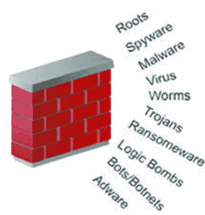

## 图 8.1：网络漏洞

## 边缘环境中的数据完整性和机密性问题

在快速发展的边缘计算领域，数据完整性和机密性问题已成为利用网络边缘分布式计算能力的组织的关键关注点。边缘环境以其靠近数据源和去中心化架构为特征，引入了众多挑战，需要警惕关注以维护数据的神圣性。

确保边缘环境中的数据完整性就像在复杂的迷宫中导航，信息在分散的网络中穿越具有多样化终端节点。随着数据通过各个节点移动，数据损坏或篡改的风险会增加，因此实施强大的验证机制至关重要。从收集实时数据的传感器到处理信息的边缘设备，网络中的每个点都需要严格的数据验证协议，以防范无意错误或恶意攻击。

边缘环境中的机密性问题放大了与数据安全相关的传统挑战。边缘计算的分散性通常意味着敏感信息存储和处理在更靠近数据源的地方，增加了未经授权访问的可能性。加密在保护传输和存储过程中的数据方面变得至关重要，可减轻潜在泄露相关的风险。随着组织将其计算能力扩展到边缘，对机密性的主动方法必须涵盖端到端加密策略，并结合持续监控和威胁检测机制。

在边缘计算的动态领域中，设备在网络边缘运行，在数据完整性和机密性之间取得微妙平衡至关重要。挑战在于构建弹性系统，不仅提供实时处理，还要维护其处理的信息的神圣性和隐私。采用全面的方法，组织必须将技术进步与严格的政策相结合，营造一种环境，在这种环境中，数据完整性和机密性不会为了追求边缘计算无与伦比的效率和敏捷性而受到损害。


## 边缘环境中的网络安全挑战

边缘设备的极大多样性是主要挑战之一，这些设备范围从物联网设备到传感器和自主系统。这种异质性创造了一个复杂的生态系统，难以统一保护，因为每台设备的安全能力可能各不相同。

此外，边缘计算的去中心化特性加剧了在分布式网络中监控和管理安全的难度。为集中式架构设计的传统安全措施难以适应边缘设备动态且常常是瞬时的特性。这种动态性带来了未经授权的访问、数据泄露以及可能利用分布式基础设施的其他网络威胁。因此，建立能够与边缘环境无缝集成的强大且自适应的安全框架，对于保护敏感数据和关键操作变得至关重要。

边缘产生的海量数据带来了另一个重大的网络安全挑战。边缘设备通常会实时处理和生成大量数据，这使其成为网络犯罪分子企图利用有价值信息的诱人目标。保护这些数据不仅需要加密和身份验证机制，还需要高效的数据治理实践。在隐私顾虑与数据可访问性需求之间取得平衡，对于降低与未经授权的数据访问或篡改相关的风险至关重要。

此外，边缘设备在计算能力和存储容量方面的限制，在实施强大安全协议时带来了独特的障碍。在轻量级安全措施与对复杂网络威胁的有效防护之间取得适当平衡是一项微妙的任务。这一挑战要求开发针对边缘设备资源限制量身定制的专门安全解决方案，确保其在不影响运营效率的情况下仍能抵御攻击。

总结而言，随着边缘计算不断重塑数字版图，应对边缘环境固有的网络安全挑战变得至关重要。解决与设备多样性、去中心化架构、数据量和资源限制相关的问题，需要采取整体且自适应的网络安全方法。随着技术的进步，安全协议和框架的演进将在增强边缘环境以抵御新兴网络威胁方面发挥关键作用，最终促进一个更安全、更具韧性的数字基础设施。

## 边缘计算中的实时威胁

随着组织越来越依赖去中心化处理能力，边缘计算中的实时威胁带来了动态挑战。一个突出的担忧是边缘设备易受物理篡改或未经授权的访问。这些设备通常部署在偏远地区，可能缺乏强大的物理安全措施，使其容易受到可能危及整个边缘网络完整性的篡改。

此外，边缘计算本身具有分布式架构，这引入了对设备之间通信通道的恶意攻击风险。当数据在互联节点间实时传输时，拦截或操纵敏感信息成为一种切实的威胁。实施强大的加密和安全通信协议对于缓解此风险至关重要，以确保边缘环境内交换数据的机密性和完整性。

除了外部威胁，边缘计算系统的设计本身也引入了与软件漏洞相关的独特挑战。边缘设备通常资源有限，使得实施全面的安全措施变得困难。这种限制为攻击者利用软件栈中的潜在弱点提供了机会，从而危及整个边缘生态系统的安全。定期软件更新、安全编码实践和持续监控对于及时解决和修复漏洞至关重要。

边缘计算中的另一种实时威胁源于边缘产生和处理的海量数据。边缘系统的去中心化特性意味着大量敏感信息分布在各种设备上，因此成为网络犯罪分子的诱人目标。未经授权访问这些数据可能导致严重后果，从隐私泄露到财务损失。随着组织采用边缘计算，建立严格的访问控制和数据治理框架对于防止未经授权的数据访问和外泄至关重要。

归根结底，边缘计算中的实时威胁凸显了采取整体且自适应网络安全方法的重要性。随着边缘在塑造计算未来方面继续发挥关键作用，一项全面的安全战略——涵盖物理安全、安全通信、软件漏洞和数据保护——对于在这个快速发展的领域中建立信任和韧性至关重要。

## 边缘计算中的动态威胁格局

网络边缘的动态威胁格局代表了一个不断演变且对网络安全专业人员充满挑战的环境。边缘通常与设备连接的网络外围相关联，由于其去中心化特性，易受各种威胁的影响。随着越来越多的设备互联（从物联网（IoT）设备到移动终端），攻击面扩大，为恶意行为者提供了众多入口点。

边缘动态威胁格局的关键特征之一是新漏洞和攻击向量出现的速度。传统安全措施通常无法快速适应这些变化。边缘的网络威胁并非静态的，而是在不断变化、适应并实时利用漏洞。这需要一种主动且敏捷的网络安全方法，超越静态防御，采纳持续监控、威胁情报和快速响应策略。

边缘计算的普及进一步增加了威胁格局的复杂性。边缘设备在更接近数据源的地方处理数据，降低了延迟，但也引入了新的安全挑战。保护这个分布式且多样的生态系统需要对边缘计算相关的独特漏洞有细致的理解。从不安全的物联网设备到传输过程中的潜在数据泄露，边缘引入了大量需要创新和自适应安全解决方案的风险。

随着组织继续采用边缘计算以获取其效率和性能优势，他们必须同时面对不断扩大的威胁格局这一现实。这需要网络安全思维的范式转变——从传统的以边界为中心的模式转向更全面、更具上下文意识的方法。通过认识到边缘威胁的动态性，并实施与新兴风险同步演进的强大安全措施，组织可以更有效地应对现代数字版图的复杂性。

## 边缘的零日漏洞

边缘的零日漏洞在不断变化的网络安全格局中代表着一项艰巨的挑战。在网络和系统外围（设备与外部环境交互的地方），这些漏洞因其未被发现的性质而构成重大威胁。与可以修补或缓解的已知漏洞不同，零日漏洞在开发人员有机会创建和分发修复程序之前就被攻击者利用。在边缘（数字生态系统边界与互联网不可预测领域交汇之处），这些漏洞可能特别难以捉摸，因为传统安全措施可能难以跟上新兴威胁的速度。

边缘计算的动态性加剧了应对零日漏洞的复杂性。在边缘环境中，计算资源分布在众多设备上，从传感器和物联网设备到边缘服务器。这种去中心化架构虽然提高了效率并降低了延迟，但也创建了难以全面监控的多样化攻击面。边缘设备的快速扩散增加了遇到新型漏洞的可能性，因此组织采用超越传统终端保护的主动安全措施至关重要。


在边缘防御零日漏洞方面，需要采取一种综合方法，结合先进的威胁情报、实时监控和自适应防御机制。机器学习和人工智能在这一防御策略中起着关键作用，使系统能够自主检测异常行为并迅速响应潜在威胁。网络安全社区内的协作努力同样至关重要，因为共享威胁情报和最佳实践可以加快对零日漏洞的识别和缓解，从而在边缘构建更具韧性的数字生态系统。随着边缘计算的不断发展，采取主动和协作的方法来应对零日漏洞对于保护互联系统的完整性和安全性变得不可或缺。

## 边缘端点安全策略

网络边缘的端点安全策略在保护组织免受不断演变的网络威胁方面发挥着至关重要的作用。随着数字环境的不断扩大，在边缘保护端点对于确保网络的整体韧性变得势在必行。一种创新策略涉及实施零信任架构，该架构假设无论位置如何，任何设备或用户都不应被固有信任。通过在边缘采用零信任方法，组织可以实施严格的访问控制，并持续对用户和设备进行身份验证，从而降低未经授权的访问和潜在违规行为的风险。

除了零信任，在边缘的另一种有效端点安全策略是集成人工智能和机器学习算法。这些技术通过实时分析模式和行为来实现主动威胁检测，使组织能够在安全事件升级之前识别并应对潜在的安全事件。通过在边缘部署高级分析，组织可以创建一种能够适应不断变化的威胁环境的动态防御机制，从而提供更具韧性的安全态势。

此外，边缘计算在端点安全中的应用正变得日益重要。边缘计算允许在数据源附近进行处理，减少延迟，并提高威胁检测和响应的速度。通过将安全措施分发到边缘，组织可以高效管理和保护其端点，特别是在实时决策至关重要的环境中。这种方法不仅提高了安全措施的整体性能，还通过将处理任务从集中式服务器卸载来优化资源利用率。

总之，边缘的端点安全策略是强大网络安全态势的关键组成部分。通过采用零信任等创新方法，利用人工智能和机器学习，并融入边缘计算，组织可以加强防御，有效保护端点免受不断演变的威胁环境的影响。随着技术的不断进步，在边缘端点安全方面保持领先地位对于维护现代网络的完整性和韧性将起到关键作用。

## 边缘设备身份与身份验证

边缘的设备身份和身份验证是不断演变的物联网（IoT）和边缘计算环境中的关键组成部分。这一概念的核心在于建立对网络边缘运行的众多设备的信任。设备身份充当数字指纹，在生态系统中唯一标识每个设备。这种身份成为安全通信和数据交换的基础元素，确保只有授权设备才能参与互联网络。

身份验证机制在加强边缘设备安全态势方面发挥着关键作用。随着设备变得越来越自主和分布式，对强大身份验证的依赖变得至关重要。通过结合使用加密密钥、生物识别和安全协议，身份验证防止未经授权的访问和篡改。这一过程不仅验证了设备的合法性，还建立了安全通信通道，降低了数据泄露和恶意活动的风险。

在动态的边缘计算领域，挑战在于在严格的安全需求与边缘设备固有的资源限制之间取得平衡。轻量且高效的身份验证协议变得至关重要，以确保无缝集成而不影响性能。实现这种平衡对于释放边缘计算的全部潜力至关重要，使设备能够在安全、可信的环境中运行，并促进物联网和边缘计算范式所承诺的变革性能力得以实现。

## 边缘安全的密码学基础

密码学基础在加强边缘计算环境的安全性方面发挥着关键作用，为保护敏感信息和通信提供了强大的框架。边缘安全的核心在于对安全通信通道的需求，以及传输层安全（TLS）和数据报传输层安全（DTLS）等加密协议，它们成为确保传输中数据机密性和完整性的坚实支撑。这些协议建立加密连接，防止在数据穿越去中心化的边缘设备网络时被窃听和未经授权的篡改。

除了保护通信通道外，公钥基础设施（PKI）等加密技术对边缘环境中的身份验证和访问控制也有显著贡献。PKI促进数字证书的签发和验证，使边缘设备能够建立信任关系并相互进行身份验证。这一基础元素对于阻止恶意实体渗透边缘网络至关重要，并确保只有授权设备才能参与数据交换，从而增强边缘基础设施的整体安全态势。

此外，在边缘实施同态加密和安全多方计算代表了数据隐私的范式转变。这些加密技术使得可以对加密数据进行计算，而无需解密，即使在处理过程中也能保持敏感信息的机密性。这在边缘场景中尤为重要，因为数据在本地处理，可以最大限度地减少原始数据对潜在威胁的暴露，同时仍能从计算中得出有意义的洞察。

由于边缘设备通常在资源受限的环境中运行，轻量级加密算法在平衡安全性和运营效率方面变得至关重要。开发针对边缘设备限制量身定制的高效加密原语和算法，确保安全措施不会过度负担计算和能源资源。这种优化对于将密码学基础成功集成到边缘安全策略中至关重要，从而在不影响边缘设备性能的情况下，实现对网络威胁的无缝防护。

总之，密码学基础构成了边缘安全的基石，解决了去中心化和资源受限环境所带来的独特挑战。通过融入安全通信协议、身份验证机制和保护隐私的加密技术，边缘计算可以建立一个具有韧性和可信度的基础设施。随着边缘计算的不断普及，密码学基础的持续演进和适应对于确保这一动态计算范式中数据的机密性、完整性和可用性将至关重要。


## 边缘计算中的密码学概述

边缘计算与密码学汇聚于现代技术格局的前沿，开启了安全高效数据处理的新时代。在边缘计算领域中，去中心化设备在本地处理数据，而不仅仅依赖于中心化云服务器，密码学在保护敏感信息方面发挥着关键作用。这一对动态组合使得计算能够更靠近数据源执行，最大限度地降低延迟并增强实时处理能力。边缘计算中的密码学确保数据保密、完整性得到维护、身份验证过程健壮，从而增强分布式网络抵御潜在网络威胁的韧性。

随着边缘设备的激增持续攀升，密码学充当去中心化生态系统的沉默守护者，保护传输信息的机密性和隐私性。加密算法是这一安全范式的基石，在源端对数据进行加密，仅允许拥有适当密钥的授权实体解密和访问信息。这不仅增强了数据隐私，还减轻了与数据泄露或未经授权访问相关的风险，为利用边缘计算技术的用户和组织增添了信心。

此外，密码学与边缘计算之间的共生关系不仅限于单纯的数据保护。它使边缘设备能够进行安全通信和协作，形成能够无缝交换信息而又不影响传输数据完整性的复杂网络。这种协作式加密框架为值得信赖的边缘计算生态系统奠定了基础，其中设备协同运作，在从智慧城市到工业自动化的各种应用中提供高效、安全且可靠的服务。

总而言之，密码学与边缘计算的融合体现了安全、去中心化数据处理的演进。这一联盟不仅解决了分布式环境中的数据安全挑战，还释放了利用边缘计算能力开展创新应用和服务的潜力，同时坚持保密性、完整性和真实性的原则。在我们应对数字格局复杂性的过程中，密码学与边缘计算的结合证明了我们致力于构建韧性强、安全的未来的承诺。

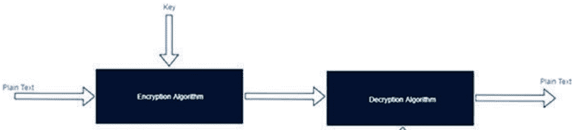

图 8.2：密码学加密图

## 边缘环境中的加密算法

在快速发展的边缘计算格局中，设备运行在中心化数据中心的边缘，加密算法在保护敏感信息方面发挥着关键作用。边缘环境涵盖了从物联网传感器到边缘服务器的各种设备，创建了一个需要高效且轻量级加密解决方案的挑战性生态系统。一种专为边缘环境定制的著名加密算法是轻量级密码学，它旨在在强大的安全性和最低资源消耗之间取得平衡。这些算法针对边缘设备中常见的有限计算能力和功率限制进行了优化，在不牺牲性能的情况下确保数据机密性。

当边缘设备相互通信并与中央云基础设施通信时，加密算法的选择至关重要。同态加密是密码学中一种新兴范式，有望在不需要解密的情况下对加密数据进行安全计算。在隐私问题至关重要的边缘环境中，同态加密允许数据在计算过程中保持机密性，为数据安全提供了一种新方法。这种创新在数据完整性和隐私不可妥协的场景中尤其重要，例如边缘生态系统中的医疗应用或智慧城市实施。

此外，边缘环境的去中心化性质要求一种能够适应不同需求的灵活加密方法。后量子密码学（PQC）正在作为一种面向未来的解决方案而日益突出，旨在抵御量子计算机可能带来的威胁。在边缘计算中，设备的寿命可能比传统 IT 基础设施更长，采用后量子加密可确保敏感数据在量子计算能力不断提升的情况下仍然保持安全。

总而言之，边缘环境中的加密算法是一个动态且不断发展的领域，回应着边缘计算分布式特性所带来的独特挑战。从解决资源约束的轻量级密码学，到在计算过程中保护数据隐私的同态加密，再到面向未来的后量子密码学，这些算法共同保护着边缘计算多样且复杂格局中的信息完整性和机密性。随着边缘技术不断成熟，支撑其安全架构的加密策略也将随之发展。

## 边缘的哈希函数和数字签名

在边缘计算领域中，数据在靠近源端的位置进行处理，而非依赖于中心化云基础设施，哈希函数在确保数据完整性和安全性方面起着关键作用。在边缘，资源通常受到限制，高效的数据验证至关重要。使用哈希函数，例如 SHA-256，来生成固定大小的哈希值，这些值唯一地表示数据内容。这些哈希值充当数字指纹，允许快速验证数据完整性，而无需传输大量信息。在实时处理至关重要的边缘环境中，哈希函数的速度和简单性使它们在维护边缘数据可靠性方面变得非常宝贵。

数字签名是边缘计算环境中信任的基石，为验证数据的真实性和来源提供了强大的机制。在边缘，去中心化设备自主交互，确保数据的完整性和来源真实性至关重要。数字签名涉及使用非对称密钥对，其中私钥用于签名数据，相应的公钥用于验证。在边缘场景中，数字签名使设备能够在不依赖中心化机构的情况下确认传入数据的合法性。这种去中心化信任模型增强了边缘计算的安全态势，为在边缘运行的各种互联设备营造了一个更具韧性和可信赖性的生态系统。

## 边缘系统中的密钥管理

在快速发展的边缘计算格局中，有效的密钥管理对于确保边缘传输和处理的数据的安全性和完整性至关重要。在这种动态环境中，挑战在于建立一个能够适应边缘系统分布式特性的健壮密钥管理框架。

边缘系统中密钥管理的一个重要方面是需要轻量级加密解决方案。边缘设备通常在资源受限的情况下运行，包括有限的处理能力和内存。因此，加密算法和密钥交换协议的设计必须优先考虑效率，同时不牺牲安全性。在轻量级密码学与强健加密之间取得适当的平衡，对于边缘系统的无缝运行至关重要。

此外，边缘计算的去中心化特性为密钥分发和撤销带来了一系列独特的挑战。传统的集中式密钥管理模型可能难以应对边缘环境动态且异构的特性。随着设备动态地加入或离开边缘网络，密钥更新、分发和撤销机制必须灵活且响应迅速。为密钥管理实施受区块链启发的去中心化解决方案可以增强边缘系统对不断变化的网络拓扑的韧性和适应性。


在边缘安全的背景下，零信任概念变得更加关键。边缘设备通常在非受信或敌对环境中运行，因此验证和认证每一次通信至关重要。密钥管理在实施零信任原则中起着关键作用，确保只有授权实体才能访问敏感数据和资源。这种方法涉及通过有效的密钥管理实践持续验证身份并建立安全通信通道。

总之，边缘系统中的密钥管理是一项多方面的挑战，需要针对分散式计算的独特特征量身定制的创新解决方案。轻量级密码学、分散式密钥分发机制和零信任安全模型是保障边缘计算动态且分布式的格局中数据完整性和机密性的关键要素。随着边缘生态系统的不断发展，先进且自适应的密钥管理策略的制定将对保障边缘计算的未来起到关键作用。

## 边缘的安全密钥交换

边缘的安全密钥交换是保障分散式计算环境中数据传输的关键组成部分。边缘以其靠近数据源和实时处理能力为特征，对密钥交换要求专门的方法。与传统集中式系统不同，边缘计算涉及分布式设备和节点，使得通信通道的安全至关重要。采用椭圆曲线 Diffie-Hellman (ECDH) 或后量子密钥交换方法等高级加密协议，以确保在这种动态且多样的环境中实现强大的加密，已成为当务之急。

在边缘计算领域，设备通常在资源受限的环境中运行，挑战在于实现安全与计算效率之间的平衡。轻量级加密算法和优化的密钥交换协议在应对这一挑战中起着关键作用。这些解决方案必须针对边缘设备的独特约束进行定制，确保密钥交换过程保持安全，同时不影响整体系统的性能。随着边缘计算的不断普及，开发创新的、针对边缘的密钥交换机制对于增强分布式网络的韧性至关重要。

边缘环境的动态性，以设备的不断添加和移除为特征，为安全密钥交换增加了额外的复杂性。自适应密钥管理策略与分散式信任模型相结合，可以增强边缘的安全态势。通过根据不断演变的网络拓扑和设备交互动态调整加密密钥，系统可以有效地挫败潜在威胁和未经授权的访问。这种动态性是边缘计算背景下的独特挑战，要求在加密技术方面持续创新，以实现安全且可扩展的密钥交换。

将机器学习和人工智能融入边缘安全密钥交换的基础之中，为主动威胁检测和缓解开辟了途径。通过利用 AI 驱动的异常检测，系统可以实时识别可疑模式或潜在的安全漏洞，从而增强边缘对新兴威胁的防御能力。这种先进技术的融合不仅增强了密钥交换机制的强健性，还使边缘计算环境能够以史无前例的敏捷性适应和响应安全挑战。在不断演变的网络安全格局中，保障边缘密钥交换需要一种全面的方法，结合加密韧性、计算效率、适应性和智能，以保护分散式生态系统中数据的完整性和机密性。

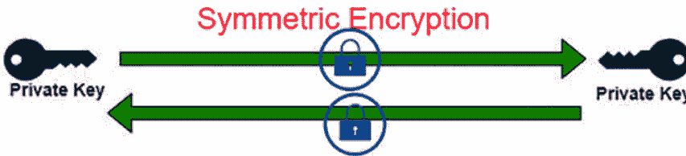


## 图 8.3：加密模型和类型

## 边缘的密钥轮换和吊销

密钥轮换和吊销在增强系统安全态势方面起着关键作用，尤其是在边缘，在那里网络与外部实体之间的边界更加脆弱。密钥轮换涉及定期更换用于加密、解密和认证过程的加密密钥。在边缘，这一做法变得更加关键，因为它确保被破坏的密钥不会成为长期存在的漏洞。在边缘定期更新密钥可以防范持续威胁，并有助于维持流经网络的敏感数据的机密性和完整性。

另一方面，密钥吊销是及时应对安全漏洞或加密密钥被破坏实例的关键机制。在边缘，设备和端点更容易受到物理篡改或未经授权的访问，吊销密钥的能力成为一种强大的工具。吊销确保即使密钥落入不法分子手中，也可以被使无效，从而防止未经授权的访问和潜在的数据泄露。这种实时响应能力在边缘尤其有价值，因为威胁检测和缓解的速度至关重要。

在边缘计算背景下，设备在分布式和动态环境中运行，密钥管理的挑战各不相同。密钥轮换和吊销必须无缝集成到边缘计算架构中，以应对这些环境的独特需求。针对边缘设备定制的自动化密钥轮换流程可以减轻管理员的操作负担，同时确保加密协议保持强健。此外，快速密钥吊销机制可以限制安全事件的影响，最大限度地减少动态边缘场景中的漏洞窗口。

总之，在边缘实施有效的密钥轮换和吊销策略对于增强分布式系统的安全性至关重要。通过实施这些做法，组织可以加强对不断演变的威胁的防御，并在边缘计算动态的格局中维护数据的机密性、完整性和可用性。随着边缘环境的不断普及，强健密钥管理机制的重要性将不断凸显，使得主动安全措施在保护敏感信息方面不可或缺。

## 边缘计算与区块链集成

边缘计算与区块链集成代表了一种变革性的协同效应，有望彻底改变分散式计算的格局。这种技术融合的前沿在于利用边缘设备（如 IoT 传感器和智能设备）的能力在本地执行区块链交易。这种集成不仅通过在数据源附近处理数据来最大限度地减少延迟，还提高了区块链网络的整体效率。随着边缘计算实现实时数据处理，它解决了传统区块链系统面临的主要挑战之一——交易确认时间延迟。这种融合促进了更精简、更灵敏的区块链生态系统，为从供应链管理到智慧城市的应用开辟了新的可能性。

边缘计算与区块链的融合也加强了分散式网络的安全性和透明性。边缘设备作为节点，参与区块链的验证和共识机制，增强了系统的整体韧性。通过这种集成，区块链的无信任特性因边缘设备的分布式和去中心化性质而得到加固。由于交易在众多分散节点上验证和记录，数据完整性得到进一步保障，从而减少了对单点故障或恶意攻击的易感性。这种融合不仅解决了与集中式系统相关的安全问题，还为开发安全且可扩展的分散式应用奠定了坚实基础。


此外，边缘计算与区块链的融合为创新商业模式和用例开辟了新领域。一个这样的例子是创建去中心化自治组织（DAOs），这些组织在边缘无缝运行。这些 DAO 利用分布式边缘节点的力量实时做出集体决策，开启去中心化治理的新时代。此外，依赖实时数据的行业，例如医疗保健和金融，将从这种整合中获益匪浅。在本地处理和认证交易的能力不仅增强了数据隐私，还确保符合监管标准，使边缘计算与区块链的整合成为各行业演进的催化剂。

总之，边缘计算与区块链的整合代表着我们概念化和实施去中心化系统方式的范式转变。这种融合不仅解决了延迟和安全等固有挑战，还为创新应用和商业模式铺平了道路，这些应用和模式利用分布式边缘设备的集体力量。随着这一技术婚姻不断发展，它有潜力重新定义去中心化计算的边界，开启效率、安全和前所未有的可能性的新时代。

## 增强边缘计算中区块链的安全性

在动态的技术领域中，区块链与边缘计算的交汇成为增强安全措施的强大力量。区块链以其去中心化和防篡改的特性而闻名，为边缘计算领域带来了新的信任层。分布式账本技术确保在边缘传输和处理的数据保持不可更改和透明，从而降低未经授权访问或恶意篡改的风险。通过去中心化控制并建立共识机制，区块链加强了边缘设备的安全态势，创建了一个强大且具有弹性的网络，其中数据完整性至关重要。

在边缘计算与网络安全之间错综复杂的互动中，区块链充当编舞家，编排一场增强安全协议的同步表演。区块链的去中心化特性不仅最大限度地减少了对单点故障的依赖，还减轻了与传统集中式系统相关的脆弱性。分布在不同位置的边缘设备受益于区块链的固有安全属性，确保任何试图破坏系统的行为都面临分布式且不可逾越的挑战。这种协同效应将边缘计算转变为更安全、更可信的生态系统，营造了一个数据机密性和完整性是不可谈判的优先事项的氛围。

此外，区块链与边缘计算的融合引入了访问控制机制的范式转变。智能合约，即区块链固有的自执行协议，使边缘设备能够自主强制执行预定义的安全策略。这不仅简化了认证过程，还最大限度地减少了安全漏洞中的人为因素。通过使用基于区块链的身份管理，边缘计算环境可以建立信任基础，使设备能够无缝且安全地相互交互。这种创新方法不仅保护敏感信息，还为更高效、更具弹性的边缘计算基础设施铺平了道路。

总之，区块链与边缘计算的融合代表了一种开创性的协同效应，将安全推至技术进步的前沿。通过利用区块链的去中心化、透明和自治特性，边缘计算环境可以加强对不断演变的网络威胁的防御。这种合作不仅增强了边缘数据的完整性，还重新定义了安全格局，为一个信任和去中心化成为具有弹性的数字生态系统基石的未来奠定了基础。

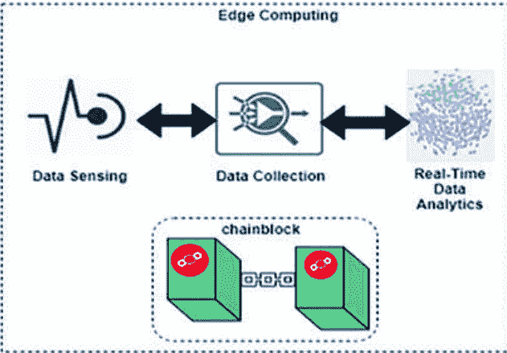

## 图 8.4：边缘上的区块链

## 边缘上的去中心化信任模型

边缘上的去中心化信任模型代表了一种管理分布式系统中信任的变革性方法。该模型利用边缘计算的固有优势，即数据在靠近源头的地方处理，从而减少延迟并提高效率。

去中心化信任模型的核心是多元实体之间的共识概念。通过将信任分布到多个节点，系统对故障和恶意攻击的抵御能力更强。网络中的每个节点都参与决策过程，创建了一个协作且自我治理的生态系统。这种方法不仅增强了安全性，还促进了透明度和问责制，因为信任不再局限于单一控制点。

边缘计算的出现为去中心化信任模型的实施提供了理想环境。边缘设备（如 IoT 传感器和智能家电）在网络边缘运行，基于本地数据做出实时决策。这种与数据源的接近性使更快、更具情境感知的决策成为可能，为能够动态适应变化条件的信任模型奠定了基础。因此，边缘上的去中心化信任范式不仅解决了可扩展性和可靠性的挑战，还促进了更具包容性和适应性的网络架构。

从实际角度来看，边缘上的去中心化信任模型对各种应用都充满希望，从智慧城市到自动驾驶汽车。例如，在智慧城市场景中，边缘设备可以协作评估环境数据、交通模式和公民行为，在不依赖中央权威的情况下做出明智决策。这不仅提高了城市系统的效率，还确保信任分布在整个网络中，从而降低了单点故障或操纵的风险。

总之，边缘上的去中心化信任模型代表了在分布式系统中建立和维护信任方式的范式转变。通过利用边缘计算的力量，并促进多元实体之间的协作，这种模型不仅增强了安全性和可靠性，还为更具适应性和弹性的数字生态系统铺平了道路。随着我们继续探索去中心化技术的潜力，信任与边缘计算的融合有望重新定义数字创新的未来格局。

## 边缘安全的智能合约

智能合约在增强边缘安全方面发挥着关键作用，开启了去中心化和防篡改系统的新时代。这项创新的前沿是智能合约自动化并保障网络边缘交易的能力。通过利用区块链技术，这些合约建立了一个无需信任的环境，减少了未经授权访问和操纵敏感数据的风险。边缘设备，例如 IoT（物联网）设备，可以受益于智能合约的自执行和自强制执行特性，确保安全协议无缝实施，而无需中介。

智能合约充当信息完整性的数字守护者。通过其不可更改和透明的特性，这些合约建立了可验证且可审计的交易记录，使恶意行为者极难破坏边缘设备的安全。区块链固有的去中心化共识机制确保智能合约能够抵御单点故障，为针对集中式系统的攻击提供强大的防御。这不仅增强了边缘网络的整体安全态势，还为边缘计算技术的部署培育了一个更具弹性和可信度的生态系统。

此外，智能合约的可编程性允许安全协议动态适应边缘不断演变的威胁。这些合约可以自主触发安全措施


例如，基于预定义条件或实时事件的访问控制和加密。这一功能使边缘设备能够主动防御新兴漏洞，构建动态且响应迅速的安全框架。智能合约的自执行特性确保安全措施得到一致执行，减轻人为错误的风险，并提供边缘计算环境中至关重要的可靠性。

总之，将智能合约集成到边缘安全中不仅增强了网络的韧性，还在安全措施的实施和执行方式上引入了范式转变。通过结合区块链的去中心化和抗篡改特性与智能合约的可编程性，边缘设备可以以安全可信的方式运行，为各行业广泛采用边缘计算技术奠定基础。

## 边缘供应链安全

边缘供应链安全是指在去中心化和分布式环境中保护供应链完整性和韧性的关键措施和协议。在工业4.0时代，边缘计算在数据生成源或附近进行数据处理方面发挥着关键作用，确保整个供应链的安全变得越来越复杂。传感器、RFID标签和自动驾驶汽车等边缘设备是组成部分，需要强大的安全框架来减轻潜在威胁。

在边缘保护供应链的关键挑战之一是设备的多样性及其连接的动态性。与集中式系统不同，边缘计算涉及分布在各种地点的大量端点。这需要采用能够动态响应不断演变的威胁的自适应安全解决方案。在边缘实施加密、身份验证和访问控制有助于构建坚固的防御，确保只有授权实体才能访问和交互供应链数据。

此外，集成区块链和安全隔区等新兴技术为边缘供应链增加了额外的保护层。区块链凭借其去中心化和不可更改的账本，提高了透明度和可追溯性，降低了供应链数据被篡改或未经授权更改的风险。另一方面，安全隔区在边缘设备内创建隔离环境，保护敏感信息和关键流程免受潜在的泄露。

在边缘供应链安全的背景下，协作和标准化至关重要。供应链各方利益相关者，包括制造商、物流提供商和技术供应商，必须协作以建立共同的安全标准。这些标准不仅应涵盖技术方面，还应包括程序指南，以确保减轻安全风险的整体和统一方法。随着边缘计算格局的不断发展，集体努力对于领先于可能危害供应链完整性的网络威胁和漏洞至关重要。

## 边缘去中心化身份管理

边缘去中心化身份管理代表了我们在数字领域保护和验证个人方式的范式转变。与依赖集中式机构的传统身份系统不同，这种创新方法利用边缘计算的力量分布式身份验证流程。在边缘，设备本身成为身份验证过程中的关键参与者，减少了对外部实体的依赖并增强了隐私。

在去中心化身份格局中，每个用户都拥有自主身份，使他们能够更好地控制个人信息。该模型确保身份数据不存储在单一的易受攻击的存储库中，最大限度地降低大规模数据泄露的风险。智能手机、可穿戴设备和物联网设备等边缘设备充当本地化身份中心，使用户能够安全无缝地与各种服务交互。

此外，边缘去中心化身份管理促进了更具包容性的数字环境。偏远或服务不足地区的个人可以从这种方法中受益，因为他们不高度依赖集中式基础设施进行身份验证。边缘使用户能够拥有和管理自己的身份，超越地理边界和传统限制。

区块链技术的集成通常在保护边缘去中心化身份方面发挥关键作用。通过利用去中心化账本，系统确保防篡改记录，并增强身份交易的整体完整性。这不仅加强了安全性，还建立了身份相关活动的透明且可审计的轨迹。

随着我们在日益互联和数字化的世界中航行，边缘去中心化身份管理作为一种优先考虑用户控制、隐私和安全性的远见解决方案应运而生。这种变革性方法不仅符合自主身份的原则，还为更具韧性和包容性的数字生态系统铺平了道路。

## 边缘环境自适应安全措施

在技术快速发展的格局中，边缘环境自适应安全措施的概念已成为应对现代网络威胁动态性质的关键策略。与依赖静态防御机制的传统安全方法不同，自适应安全利用实时情报和持续监控，动态适应网络边缘不断演变的风险。

边缘环境自适应安全措施的一个关键方面是实施感知上下文的安全策略。通过全面了解网络活动的上下文，这些措施可以辨别正常行为与异常。这种基于上下文的方法允许安全系统实时适应和响应，增强边缘对新兴威胁的防御，而不会对合法操作造成不必要的干扰。

此外，机器学习和人工智能在自适应安全范式中发挥着关键作用。这些技术使安全系统能够从历史数据中学习，识别模式，并主动预测潜在的安全漏洞。在设备和数据分散的边缘环境中，机器学习算法可以快速适应新的攻击向量，并加强整个网络的安全态势。

边缘计算的去中心化特性引入了独特的挑战，使可视性成为自适应安全的关键组成部分。边缘环境自适应安全措施优先考虑对网络活动的全面可见性，确保安全团队可以监控和响应分布式设备和端点上的威胁。这种增强的可见性使对边缘环境有更细致的理解，从而允许精确和有效的安全调整。

总之，边缘环境自适应安全措施代表了网络安全领域的范式转变，拥抱灵活性、智能性和实时适应性。通过结合感知上下文的策略、机器学习和增强可见性，组织可以创建一种有弹性的防御机制，保护边缘计算的动态和分布式特性免受不断演变的威胁格局的影响。

## 边缘机器学习异常检测

边缘机器学习（ML）异常检测是人工智能的前沿应用，将复杂的分析能力更贴近数据源。在这种范式中，边缘是指传感器、摄像头或物联网设备等分布式计算设备，数据在这些设备上实时生成。边缘异常检测涉及训练机器学习模型以识别即时环境中的模式和正常行为，从而快速识别与预期的偏差。

在边缘部署异常检测具有多种优势。它减少了将原始数据发送到集中式服务器的需求，从而最大限度地降低了延迟和带宽要求。这种本地化方法增强了实时响应能力，这对于工业自动化等应用至关重要，因为在这些应用中立即采取行动是首要的。此外，基于边缘的异常检测通过在现场处理敏感数据来增强隐私，减少了在传输到中心服务器过程中数据暴露的风险。

在边缘实施机器学习异常检测的挑战之一是适应边缘设备有限的计算资源。在不牺牲准确性的情况下优化模型效率变得至关重要。模型量化（降低模型权重的精度）以及为边缘设备定制的轻量级架构等技术在克服这些挑战方面发挥着关键作用。


边缘环境的动态性也要求具备持续学习能力的自适应模型。异常检测系统必须随模式的转变而演进，并适应新的正常行为，确保长期保持有效性。在线学习等技术——模型基于传入的数据流自行更新——有助于提升这些系统的适应性，使其在面对不断变化的场景时更具鲁棒性。

综上所述，边缘端机器学习异常检测是实时数据分析的一种变革性方法。这一创新不仅提升了效率和响应速度，还解决了与集中式处理相关的隐私问题。随着技术的进步，将智能异常检测集成到边缘端很可能成为确保各行业多样化应用可靠性和安全性的基石。

## 边缘端行为分析

边缘端行为分析是指在行为发生的时间和地点，实时研究和解释人类行为的创新方法。这种范式转变带来了诸多优势，例如降低延迟，并提高处理海量行为数据的效率。

在边缘端行为分析的前沿，是将人工智能和机器学习等先进技术集成到边缘设备中。这些设备配备了传感器和摄像头，能以极高的准确性捕捉和分析行为模式。通过利用设备端处理，这种方法不仅通过尽量减少数据传输来增强隐私，还能在从安全监控到个性化用户体验等应用中实现更快的决策。

在安全领域，边缘端行为分析证明极其宝贵。实时检测异常的能力能够对潜在威胁作出快速响应。例如，在智慧城市环境中，边缘设备可以识别异常的移动或行为模式，触发即时警报或干预。这种去中心化的安全方法最大限度地降低了系统范围故障的风险，并确保更加强大和有弹性的监控基础设施。

此外，物联网（IoT）的兴起极大地扩大了边缘端行为分析的范围和影响。从智能家居电器到可穿戴设备的联网设备，不断生成行为数据。在边缘端分析这些数据不仅提升了这些设备的性能，还为创建自适应和响应式系统开辟了新途径。例如，可穿戴设备可以监测个人的行为模式，提供及时的与健康相关的建议或干预，而无需依赖集中式服务器。

综上所述，边缘端行为分析标志着我们在各个领域理解和响应人类行为方式的范式转变。通过将分析过程更贴近数据源，这种方法不仅提升了效率和安全性，还为创建智能和自适应系统开辟了新的可能性。行为分析的未来无疑在边缘端，那里实时洞察的力量与人类与技术交互的即时性相遇。

## 边缘端入侵检测系统

在不断变化的网络安全领域，在边缘端部署入侵检测系统（IDS）已成为关键的防御线。与传统的从远处监控网络流量的集中式系统不同，基于边缘的IDS在更靠近数据源的位置运行，提供实时威胁检测和响应。这种靠近网络边缘的位置使得对入站流量的分析更快，降低延迟，并增强系统识别并及时挫败潜在安全漏洞的能力。

在边缘端实施入侵检测系统的一项关键优势在于其能够高效地在本地过滤和处理数据。这样一来，这些系统减轻了中央服务器的负担，并减少了需要跨网络传输的数据量。这不仅优化了带宽使用，还提升了网络的整体性能，使其对网络威胁更具弹性。基于边缘的IDS的分布式特性确保了更具可扩展性和适应性的安全基础设施，在IoT生态系统迅速扩张的时代尤其关键。

在物联网（IoT）的背景下，随着越来越多的设备互联，基于边缘的IDS在保护网络方面发挥着关键作用。这些系统可以分析边缘端设备的安全状态，防止潜在威胁渗透到网络中。通过融入机器学习算法，基于边缘的IDS可以适应和演进，从正常行为模式中学习并迅速检测异常。这种动态且自学习的能力在应对不断演变的网络对手策略方面至关重要。

此外，基于边缘的入侵检测系统的去中心化特性增强了网络安全基础设施的整体弹性。在发生网络中断或故障时，这些系统可以继续自主运行，确保持续的保护层。这种自主性在医疗、金融和工业控制系统等关键领域尤其有利，在这些领域中不间断运行至关重要。

综上所述，将入侵检测系统集成到边缘端代表了网络安全策略的范式转变。通过利用数据源的邻近性、优化带宽使用以及适应动态威胁环境，基于边缘的IDS为应对网络威胁提供了强大的防御机制。随着技术的不断进步，这些系统在保障我们互联的数字环境方面的作用无疑将变得更加关键。

## 边缘计算中的自愈系统

边缘计算中的自愈系统代表了分布式计算环境可靠性和效率方面的一次变革性飞跃。这些智能系统具备自主检测并解决边缘基础设施中问题的能力，确保无需持续的人工干预即可实现无缝运行。就像人体的韧性一样，边缘计算中的自愈机制使系统能够适应并从硬件故障或网络不一致等中断中恢复，从而最大限度地减少停机时间并优化性能。

在边缘计算的精妙舞蹈中，自愈系统充当编舞家，编排着实时数据分析和纠正措施的交响乐。通过利用先进算法和机器学习，这些系统可以在潜在故障发生之前预判，主动采取预防措施。这种主动方法不仅提升了系统可靠性，还有助于构建更可持续、资源利用更高效的边缘计算生态系统。本质上，自愈系统使边缘设备不仅能应对挑战，还能随着时间的推移不断进化和改进，镜像生物有机体的自适应特性。

自愈系统在边缘计算领域的美妙之处在于，它们能够在自主性与协作性之间创造和谐的平衡。随着边缘设备相互通信和协作，共享洞察和解决方案，整个系统变得更具弹性，并能够适应动态条件。这种协作智能镜像了细胞在活体有机体内部沟通的方式，共同为系统的整体健康和功能做出贡献。在此背景下，自愈系统成为自给自足、互联的边缘计算生态系统的架构师，为分布式计算的新效率与可靠性时代奠定了基础。

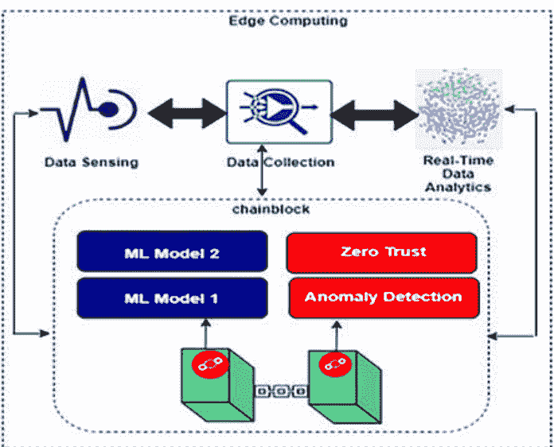

图 8.5：边缘端机器学习


## 边缘自动响应机制

在技术领域，边缘自动响应机制代表了一场开创性的范式转变。与传统集中式系统不同，边缘计算使设备能够在数据产生源附近本地处理数据。这种接近性不仅降低了延迟，还为边缘自动响应打开了大门。想象这样一个场景：嵌入制造设施的智能传感器检测到偏离正常运行条件的情况。这些传感器无需将信息中继到遥远的数据中心，而是可以自主触发立即的纠正措施，优化效率并最大限度地减少停机时间。这种边缘自动响应的去中心化方法预示着实时决策和精简运营流程的新时代。

人工智能（AI）算法与边缘设备的集成进一步增强了自动响应机制的能力。这些算法使设备能够学习并适应动态环境，增强其区分正常模式和异常模式的能力。例如，在智能城市基础设施中，配备人工智能的边缘设备可以实时分析交通模式。在发生交通瓶颈时，边缘设备可以自主重新导向车辆，优化交通流量，无需集中控制。这不仅能确保对变化条件的快速响应，还能通过本地处理信息来减轻网络带宽的负担。

安全领域是边缘自动响应机制发挥关键作用的另一个领域。在网络威胁不断演变的世界中，配备高级安全协议的边缘设备可以自主检测和缓解潜在风险。例如，具有边缘计算能力的监控摄像头网络可以立即识别未经授权访问的尝试，并触发自动响应，例如激活额外安全措施或向相关部门发出警报。这种分布式和主动的安全方法增强了整体韧性，并加强了系统对新兴威胁的防御能力。

此外，5G技术的出现进一步推动了边缘自动响应机制的有效性。5G网络提供的高带宽和低延迟使边缘设备能够无缝通信并以无与伦比的速度响应。这在自动驾驶汽车等应用中尤为明显，在这些应用中，瞬间决策至关重要。配备边缘计算能力的自动驾驶汽车可以快速分析传感器数据以识别潜在障碍物，并做出瞬间决策以确保乘客和行人的安全。5G与边缘计算的结合不仅加速了响应时间，而且还释放了自动化系统在从医疗保健到智能基础设施等众多用例中的全部潜力。

总之，边缘自动响应机制代表了技术领域的一种变革性演进。通过去中心化决策并利用人工智能的力量，这些机制使设备能够实时自主响应变化的条件。无论是优化运营效率、增强安全性，还是在关键场景中实现快速决策，边缘计算与自动化的结合正在重塑我们与技术互动并发挥其力量的方式。

## 边缘网络攻击韧性

在不断演变的技术领域，构建边缘网络攻击韧性已成为一个至关重要的问题。边缘（即设备和传感器与数字领域交汇的地方）既代表了创新的前沿，也代表了恶意行为者的易受攻击的入口点。在这种情况下，韧性不仅仅是防止攻击，还包括在发生泄露时快速适应和恢复。实施分布式账本和区块链技术等去中心化安全协议可以加固边缘，确保即使某个节点被攻破，整个网络也不会崩溃。

此外，边缘网络韧性的概念超越了传统的安全措施。它涉及培养一种动态的网络安全文化，这种文化拥抱持续学习并主动适应新兴威胁。组织必须投资于培训计划，使员工能够识别和应对潜在的网络风险。通过在员工中培养韧性思维，企业可以创建一个相互连接的警惕个体网络，他们充当抵御边缘网络威胁的第一道防线。

在技术架构领域，人工智能（AI）和机器学习（ML）的集成在增强韧性方面发挥着关键作用。这些技术可以实时分析大量数据，在异常和潜在安全漏洞升级之前将其检测出来。通过利用基于人工智能的威胁情报和自动响应机制，组织可以大大缩短识别、遏制和减轻边缘网络攻击影响所需的时间。

此外，网络安全社区内的合作对于构建抵御边缘网络威胁的韧性至关重要。信息共享、威胁情报交换以及共同努力制定开放标准，可以对抗复杂的对手形成统一战线。随着物联网（IoT）设备、互联系统和智能基础设施的普及，边缘不断扩展，集体的网络安全方法变得越来越关键。

总之，抵御边缘网络攻击需要一种多方面的策略，该策略包括去中心化安全措施、在员工中培养韧性思维、利用人工智能和机器学习的力量，以及鼓励网络安全社区内的合作。通过采纳这些方法，组织可以加固其数字边界，并以信心和适应性应对复杂的网络威胁格局。

## 边缘安全中的法规合规性

在动态的技术领域，法规合规性与边缘安全的交汇点成为一个关键前沿。随着组织采用边缘计算来提升速度和效率，强健的监管框架的需求变得至关重要。边缘安全因其去中心化特性而定义，需要超越传统数据中心的合规措施。驾驭这一领域需要对地区性和行业特定法规有细致入微的理解，以确保边缘上的数据保护、隐私和完整性。随着监管机构赶上边缘计算的快速发展，企业必须主动适应，以领先于合规要求，为分布式计算范式塑造安全且合规的环境。

在边缘安全领域，合规之旅不仅限于打勾和强制要求。它成为一项持续的承诺，旨在保护敏感数据并维护利益相关者的信任。独特的挑战在于边缘设备的分布式特性，这使得组织有必要建立涵盖整个边缘生态系统的全面合规策略。从边缘设备到网关和云接口，每个组件在合规叙事中都发挥着至关重要的作用。这需要一种整体方法，融合技术、政策和治理，以创建无缝的监管结构，解决边缘安全的复杂性，不仅确保法律遵从，还在整个去中心化基础设施中培养安全意识文化。

边缘安全与法规合规的融合不仅是一种法律必要性，而且成为创新的催化剂。那些主动将合规嵌入其边缘计算策略的组织，发现自己更有利地利用分布式架构的全部潜力。它成为一个推动者而非障碍，指导开发安全边缘解决方案，这些方案不仅满足监管标准，而且超越它们。在这种共生关系中，合规性充当指南针，指导边缘技术进步的方向，并促进创新与安全和谐共存的环境，为数字时代确保一个面向未来的基础。


## 边缘法律与合规挑战

边缘的法律与合规挑战是指在网络边缘处理数据和技术时出现的复杂问题，边缘计算和处理在此处去中心化进行。一个重大挑战在于管辖权模糊性。当数据在边缘生成和处理时，确定哪个法律管辖权管辖这些活动变得复杂。这种缺乏清晰度的状态可能导致不同监管框架之间的冲突，进而可能引发法律纠纷以及执行合规标准的困难。

另一个紧迫的问题是数据隐私与安全。随着边缘计算日益普及，敏感信息常常在网络边缘的设备上进行处理和存储。确保这些数据的保护是一项艰巨的挑战。在处理分散的数据处理点时，遵守《一般数据保护条例》(GDPR)等数据保护法律变得复杂。在边缘实施强大的安全措施对于防止数据泄露并保持监管合规至关重要。

此外，边缘环境的动态性引入了与实时合规监控和执行相关的挑战。传统的合规方法可能难以适应边缘快速变化的条件。随着设备和应用程序自主交互，实时掌握合规要求变得至关重要。这需要开发敏捷的合规框架，以适应边缘计算不断演变的性质。

互操作性是边缘的另一个法律挑战。在边缘运行的各种设备和技术通常缺乏标准化的接口和协议。这种缺乏统一性使得法律和合规工作变得复杂，因为在确保遵守法规的同时集成不同系统成为一项艰巨的任务。标准化倡议和行业合作对于缓解这些互操作性挑战并促进无缝的法律合规至关重要。

总之，解决边缘的法律与合规挑战需要一种全面的方法，考虑管辖权复杂性、数据隐私与安全、实时监控以及互操作性。随着边缘计算格局的不断发展，监管框架和合规策略必须进行适应，以在保障法律完整性的同时促进创新。

## 边缘数据隐私法规

在技术快速发展的格局中，边缘计算的出现为数据隐私法规的讨论引入了新的维度。与传统的集中式云计算不同，边缘计算在数据生成源附近处理数据，通常在本地设备或边缘服务器上。这种范式转变在保障个人隐私方面带来了一系列独特的挑战和考量。

边缘数据隐私法规的一个关键方面是数据处理的去中心化。随着计算任务分布在边缘设备上，确保数据保护的责任变得更加分散。在去中心化处理与维持严格隐私标准之间取得适当平衡，需要监管机构采取细致入微的方法。这些法规需要适应边缘计算的分布式特性，同时仍需坚持用户同意、数据最小化和透明度的基本原则。

此外，边缘计算引入了在设备级别进行实时处理的新场景，引发了关于敏感信息可能暴露的担忧。在如此分散的环境中，对数据访问、加密和用户身份验证实施更严格的控制变得至关重要。监管框架必须包含解决边缘数据流复杂性的条款，确保个人信息保持安全，并且用户在不断变化的边缘格局中仍能掌控自己的数据。

在边缘数据隐私领域，互操作性和标准化发挥着至关重要的作用。由于边缘设备和系统来自不同制造商并运行在各种协议上，因此建立统一的隐私法规方法至关重要。监管机构必须与行业利益相关方合作，建立共同框架，以促进边缘生态系统中数据保护实践的一致性。这种合作对于培育依赖边缘计算进行日常交互的用户的安全且可信赖的环境至关重要。

总之，随着边缘计算不断重新定义技术格局，制定有效的数据隐私法规变得至关重要。监管机构必须驾驭去中心化处理、实时分析和多样化设备交互的复杂性，以确保个人隐私权得到保障。在创新与隐私保护之间取得和谐平衡对于促进数字时代边缘计算的负责任演变至关重要。

## 边缘行业特定合规标准

在技术快速发展的格局中，边缘的行业特定合规标准对于确保新兴技术的无缝集成并遵守监管框架至关重要。“边缘”一词是指在数据源附近处理数据的去中心化计算基础设施，从而降低延迟并改善实时决策。在医疗保健等行业中，边缘的合规标准在保护患者数据以及确保敏感医疗信息的机密性、完整性和可用性方面发挥着关键作用。在医疗保健组织利用边缘计算增强诊断能力并提供个性化患者护理的同时，在创新与监管要求之间取得平衡至关重要。

在金融领域，边缘的行业特定合规标准解决了管理大量敏感财务数据所面临的独特挑战。随着金融机构采用边缘计算来加强欺诈检测并简化交易处理，合规成为维护行业信任与完整性的基石。遵守 GDPR、PCI DSS 等法规，确保财务数据在边缘得到安全处理，最大限度地降低数据泄露和未经授权访问的风险。

此外，在制造业中，工业4.0与边缘计算的融合要求对合规标准采取细致入微的方法。随着智能工厂利用边缘设备优化生产流程并增强预测性维护，制造商必须在复杂的法规环境中导航。确保知识产权、商业秘密和生产数据的安全与隐私至关重要。针对制造业定制的合规框架帮助组织满足要求，同时拥抱边缘技术的变革潜力。

总之，边缘的行业特定合规标准对于在推动创新的同时维护各行业的监管架构不可或缺。将边缘计算技术与合规意识无缝集成，不仅确保数据的负责任使用，还为各行业的持续增长和发展铺平了道路。

## 构建面向合规的边缘安全框架

构建面向合规的边缘安全框架对于旨在保护敏感信息的组织来说已成为当务之急。边缘涵盖网络边缘的设备和系统，为安全实施带来了独特的挑战和机遇。构建强大的框架始于全面的风险评估，识别边缘可能危及监管合规的潜在漏洞。

在构建此框架时，组织需要将其安全措施与行业特定法规和标准相对齐。无论是 GDPR、HIPAA 还是其他监管框架，面向合规的方法都能确保边缘上的数据处理和存储遵守法律要求。这需要对数据流、加密协议和访问控制进行细致映射，以确保敏感信息保持在监管机构定义的边界之内。

人工智能（AI）和机器学习（ML）技术的集成在维护面向合规的边缘安全框架方面变得至关重要。这些先进技术可以主动检测异常和潜在威胁，增强组织快速响应新出现风险的能力。通过利用实时分析和预测建模，安全协议可以动态适应不断变化的威胁格局，加强边缘以抵御潜在的合规违规行为。


此外，在边缘构建以合规为重点的安全框架需要组织内部跨部门协作。IT 团队与运营技术（OT）团队的融合在将安全措施与业务流程保持一致方面变得至关重要。这种协作方式确保安全协议不仅符合监管标准，还能与组织的日常运营无缝集成，最大限度地减少中断，同时最大限度地提升保护。

此外，由于边缘通常涉及分布式设备和终端网络，实施零信任架构（ZTA）变得至关重要。该模型假设不应自动信任任何设备或用户，需要持续验证身份和授权。通过采用零信任方法，组织可以通过减少边缘攻击面并防止未经授权访问敏感数据来增强其合规态势。

总之，在边缘构建以合规为重点的安全框架需要采取全面且适应性强的方法。通过进行彻底的风险评估、与监管标准保持一致、集成 AI 和 ML 技术、促进跨部门协作以及实施零信任架构，组织可以在边缘建立具有弹性且合规的安全基础设施。这不仅保护了敏感信息，还确保组织始终遵守不断变化的监管环境。

## 边缘系统中的审计与报告

边缘系统中的审计与报告在确保去中心化计算环境的完整性、安全性和效率方面发挥着关键作用。边缘计算凭借其分布式架构，将计算资源更贴近数据源，提供更低延迟和增强的实时处理能力。在此背景下，审计成为监控和验证边缘发生的各种交易和流程的关键机制。

边缘系统中的有效审计涉及对去中心化节点中数据流、系统活动和安全措施的持续审查。这种审查有助于识别异常、潜在漏洞和合规偏差，确保边缘基础设施在既定参数范围内运行。此外，边缘计算中的审计超越了传统的合规标准，融入了对动态网络配置和不断变化的威胁环境的适应性。

边缘系统中的报告通过将复杂数据和审计日志转化为可理解的洞察，补充了审计工作。边缘环境通常会实时生成大量数据，因此为利益相关者提炼相关信息至关重要。定制且可操作的报告使决策者能够全面了解系统性能、安全态势和合规性。这些报告不仅用作系统健康状况的文档，还使组织能够做出明智决策，以优化边缘基础设施。

审计和报告流程必须敏捷且响应迅速。持续监控和自动化报告机制对于快速检测和解决问题、确保边缘系统的可靠性和可信度至关重要。此外，通过详细报告有效传达审计结果有助于提高透明度、增强问责制，并支持边缘系统功能的持续改进。

总之，边缘系统中的审计与报告构成了弹性且安全的去中心化计算环境的支柱。精细的审计实践与富有洞察力的报告机制相结合，确保组织能够利用边缘计算的优势，同时降低风险并保持合规。随着边缘系统的不断发展，审计和报告流程的适应性和效率将对维持这些分布式计算生态系统的完整性和性能至关重要。

在下一章中，我们将探讨边缘计算动态格局下的云计算。我们将揭示这两种变革性技术之间错综复杂的相互作用。下一章将使读者深入了解云计算如何在边缘环境的背景下适应并蓬勃发展。

## 结论

网络安全在保护分布式网络方面成为关键环节，需要超越传统方法的适应性策略。虽然密码学在此动态环境中充当数字信任的哨兵，但其在保护数据、确保机密性、完整性和真实性方面的作用，随着敏感信息穿越我们网络的边缘而变得更加关键。量子计算的出现进一步凸显了密码学进步的必要性，以领先于潜在威胁。

因此，边缘计算、网络安全和密码学之间的协同作用形成了不可分割的三位一体。这是一项创新的号召，敦促开发能够适应边缘环境所带来独特挑战的弹性和敏捷安全框架。这种融合促使行业超越被动措施，采取主动、前瞻性的策略，在风险出现之前预测并降低风险。

在构建这项技术三位一体的未来时，协作成为关键。行业领导者、研究人员和决策者必须携手合作，制定标准、共享威胁情报，并培育一个将安全置于首位而又不抑制创新的生态系统。随着我们探索边缘计算、网络安全和密码学的未知领域，对安全可信数字环境的集体承诺不仅是技术上的必要，也是社会责任。

只有通过这种协同努力，我们才能释放边缘的全部潜力，同时确保为我们互联互通的世界提供燃料的数据的完整性、机密性和可用性。

在下一章中，我们将探讨云计算在边缘计算背景下的作用，并审查这两项技术在转型中所起的关键作用。本章还深入探讨了在边缘计算时代利用云计算的方法。

## 选择题

密码学在边缘计算中起什么作用？

- 管理网络流量
- 通过加密和解密保护数据
- 监控系统性能
- 检测网络安全威胁

边缘计算中通常使用哪种密码学技术来保护传输中的数据？

- 对称加密
- 非对称加密
- 哈希
- 压缩

以下哪项是边缘计算环境中潜在的安全挑战？

- 集中式数据处理
- 高网络延迟
- 有限的攻击面
- 依赖单一安全协议

零信任安全如何促进边缘计算网络安全？

- 通过信任网络中的所有设备
- 通过要求每个设备（即使是网络内的设备）进行身份验证和授权
- 通过依赖边界防御
- 通过避免加密以尽量减少延迟

数字签名在边缘计算安全中的目的是什么？

- 加密敏感数据
- 验证数据的完整性和真实性
- 保护网络连接
- 阻止恶意网站

## 答案

- b
- a
- b
- b
- b

## 问题

边缘计算如何影响网络安全策略，以及它为保护分布式和去中心化系统引入了哪些具体挑战？

边缘计算环境中增加的攻击面如何影响整体风险格局，缓解潜在安全威胁的最佳实践是什么？

边缘计算相关的潜在隐私影响是什么，以及在边缘处理敏感数据时，如何利用密码学技术来增强用户隐私？

在边缘计算的背景下，实施有效加密和密码学协议以确保数据机密性和完整性的关键考虑因素是什么？

由于边缘设备通常计算资源有限，如何优化密码学算法以平衡安全要求与边缘计算设备的性能限制？

随着边缘计算在医疗保健和金融等行业的日益普及，在网络安全和密码学实践方面会出现哪些监管考虑因素和合规性挑战，组织如何有效应对？


## 关键术语

- 人工智能
- 去中心化自治组织
- 分布式拒绝服务
- 数据报传输层安全协议
- 椭圆曲线 Diffie-Hellman
- 通用数据保护条例
- 健康保险可携性和责任法案
- 入侵检测系统
- 物联网
- 机器学习
- PCI支付卡行业数据安全标准
- 公钥基础设施
- 后量子密码学
- 射频识别
- 传输层安全
- 零信任架构

# 第 9 章

# 边缘计算背景下的云计算

## 引言

云计算与边缘计算的融合已成为一种变革力量，重塑了数字领域的可能性边界。随着组织致力于实现更大的敏捷性、响应能力和实时决策，这一融合已成为计算新时代的催化剂。

云计算曾与集中式数据处理和存储 synonymous，如今正经历一场范式转移。它不再局限于大型数据中心的遥远服务器，云正在将其触角延伸至边缘——更接近数据产生的地方和需要采取行动的地方。云与边缘之间的这种协同效应，标志着计算架构演进的关键时刻，带来了前所未有的挑战和无与伦比的机遇。

本章为我们深入探究云计算与边缘计算之间错综复杂的相互作用奠定了基础。我们将踏上一段旅程，了解这些技术如何协同工作，以释放现代应用的全部潜力，实现全球规模基础设施与本地化智能的无缝融合。共同，它们构成了一个充满活力的组合，满足从医疗保健和金融到制造业等行业的多样化需求，甚至超越这些领域。

在整个探索过程中，我们将深入探讨云计算的细微差别，考察其基础原则、可扩展性以及为企业带来的灵活性。与此同时，我们将解析边缘计算的复杂性——其分布式架构、低延迟能力，以及它在将计算能力带到网络最边缘方面所发挥的作用。

在探索这一领域的过程中，我们将遇到这种融合固有的挑战，例如数据安全性、互操作性以及跨分布式环境的资源编排。然而，挑战伴随着机遇，我们将揭示行业领导者正在开创的创新解决方案，以克服这些障碍。

接下来的章节将带我们深入云和边缘计算的领域，探讨用例、新兴技术以及对行业的变革性影响。共同，我们将描绘一个互联、智能且响应迅速的数字未来的蓝图——一个云将其怀抱延伸到网络最边缘的未来，创造一种协同效应，推动我们进入计算卓越的未知领域。

## 结构

在本章中，我们将涵盖以下主题：

- 云计算与边缘计算简介
- 云和边缘生态系统的关键组件
- 云和边缘计算中的架构模型
- 云和边缘资源的集成
- 云和边缘环境中的安全与信任

## 目标

在探索边缘计算动态格局中的云计算时，我们的主要目标是解读这两种变革性技术之间错综复杂的相互作用。我们将踏上一段旅程，阐明在云和边缘计算交汇处产生的协同效应、挑战和创新可能性。通过深入探讨分布式计算、延迟敏感型应用以及边缘数据处理不断演变的范式，本章力求让读者深刻理解云计算如何在边缘环境中适应并蓬勃发展。通过关于边缘原生服务、去中心化架构及其对可扩展、弹性系统影响的深入讨论，我们希望指导读者驾驭云端广袤天地与边缘敏捷即时性交汇的错综复杂之境。在解开这一技术融合的层层面纱之际，我们旨在赋予读者所需知识，使其能够充分发挥边缘计算时代云计算的全部潜力。

## 云计算与边缘计算简介

云计算是一种革命性范式，已改变信息技术的格局。它通过提供对服务器、存储和应用程序等共享计算资源池的按需访问，代表了对传统计算模式的背离，这一切都通过互联网实现。这一转变消除了组织大力投资物理基础设施的必要，使它们能够根据需求动态扩展资源。云计算采用按需付费模式，提升了灵活性和成本效益。无论是对企业、开发人员还是终端用户，云都提供了前所未有的敏捷性和可访问性，在数字时代推动创新和效率。

随着云计算的兴起，边缘计算作为计算系统架构的战略演进应运而生。与云的集中式性质不同，边缘计算将计算能力推向更接近数据源或终端设备的位置。这种去中心化最大限度地降低了延迟并增强了实时处理能力，使其非常适合即时响应至关重要的应用，例如物联网（IoT）设备、自动驾驶汽车和增强现实。通过在网络中分布计算能力，边缘计算优化了带宽使用，保护了数据隐私，并确保了在要求低延迟交互的场景中的强劲性能。随着数字生态系统持续多样化，边缘计算已成为我们互联世界中效率和响应能力的关键推动者。

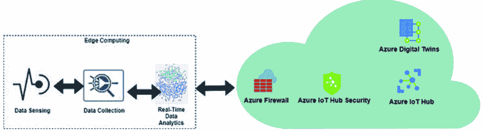

图 9.1: 边缘计算与云计算图

## 理解云计算与边缘计算的基本概念

云计算和边缘计算代表着两种正在重塑现代计算格局的强大范式。从本质上讲，云计算作为数字时代的支柱，提供了一个庞大的远程服务器网络来存储和处理数据，从而通过互联网实现对资源和服务的无处不在的访问。这种集中式方法增强了可扩展性、灵活性和成本效益，使其成为企业和个人不可或缺的工具。然而，随着对实时数据处理和低延迟应用需求的加剧，传统云基础设施的局限性变得显而易见。

进入边缘计算，这是一种革命性概念，它通过去中心化计算资源来实现，即将计算资源更接近数据源。与云计算的集中式模式不同，边缘计算将处理能力分布到网络的边缘，从而降低延迟并提升性能。这种方法在物联网（IoT）和自动驾驶汽车等应用中尤为重要，在这些应用中，瞬时决策至关重要。通过利用网络边缘设备的能力，边缘计算不仅最大限度地降低了延迟，还减轻了中心云的负担，优化了整体系统效率。

本质上，理解云计算与边缘计算的基本概念，犹如在数字领域中驾驭集中化与去中心化之间动态的相互作用。云计算为存储、处理和可访问性提供了所需的庞大基础设施，而边缘计算则通过将计算资源战略性地放置在更靠近行动的位置来微调方程式。这种共生关系正在重塑我们构思和实施计算解决方案的方式，开启了一个速度、效率和响应能力融为一体，以满足我们互联世界不断变化需求的新时代。


## 探索云计算和边缘计算技术的历史演进

云计算和边缘计算技术的历史演进是一段引人入胜的旅程，反映了数字化格局的快速发展。云计算在21世纪初作为一种范式转变而出现，彻底改变了数据的存储、处理和访问方式。可通过互联网访问的集中式数据中心概念，为企业和个人开启了可扩展性、成本效率和灵活性的新时代。随着对无缝连接和更快处理的需求不断增长，云计算成为现代 IT 基础设施的支柱，支撑从应用程序到人工智能的方方面面。

边缘计算的同时兴起为这一叙事增添了一个迷人的维度。随着物联网（IoT）的日益突出，仅依赖集中式云处理的局限性变得显而易见。边缘计算引入了一种去中心化的方法，将计算更贴近数据源。这种演进是由各行业对实时处理、降低延迟和增强安全性的需求推动的。传感器和智能设备等边缘设备，成为了能够在不依赖远程云服务器的情况下做出即时决策的微型计算中心。

云计算与边缘计算的协同作用，体现了技术进步的动态性。虽然云计算为海量数据存储和复杂计算提供了整体基础设施，但边缘计算通过满足边缘数据处理的敏捷性需求来对其进行互补。两者共同构建了一个强大的生态系统，不断塑造计算的未来，推动从医疗保健和金融到制造及娱乐等领域的创新。这些技术的历史演进强调了在日益互联的世界中，对效率和功能的不懈追求。

## 认识到边缘计算在补充传统云架构方面的必要性

在不断演变的数字技术格局中，认识到边缘计算补充传统云架构的必要性，已成为一个关键的范式转变。尽管云计算无疑改变了我们存储、处理和访问数据的方式，但在应对实时应用和蓬勃发展的物联网（IoT）的需求时，它遇到了局限性。边缘计算作为一种革命性概念，战略性地将计算能力更贴近数据源，从而最大限度地降低延迟，并提高数据处理的整体效率。

在一个毫秒至关重要的世界里，边缘计算变得不可或缺，尤其是在快速决策至关重要的场景中。可以考虑自动驾驶汽车或智能医疗设备等应用，它们依赖于瞬时响应来确保安全性和可靠性。边缘计算通过去中心化计算任务，赋予这些系统能力，使其能够在本地和实时发生，减轻集中式云服务器的负担。这不仅优化了性能，还缓解了带宽限制，使其成为连接间断或有限的环境中的可行解决方案。

此外，认识到边缘计算的必要性标志着向更可持续、资源利用更高效的数字基础设施迈进。通过将处理任务卸载到边缘，组织可以减轻大规模数据中心巨大能耗所带来的环境影响。这种转变与日益增长的对技术生态足迹的认识相一致，强化了创新可以且应当与环境责任和谐共存的理念。

本质上，边缘计算与传统云架构的集成，标志着我们在数据处理方法上的战略演进。它证明了技术具有适应能力，以满足我们互联世界不断变化的需求，不仅提供效率和速度，还为更可持续、更具响应能力的数字未来铺平了道路。

## 云与边缘生态系统的关键组件

在云计算的广阔领域中，几个关键组件无缝融合，共同构建了一个动态而强大的生态系统。其核心，云基础设施建立在强大的数据中心之上，数据中心内拥有大量服务器、存储系统和网络设备。虚拟化技术发挥着关键作用，使资源能够被高效分配，并能够创建虚拟机或容器。在此基础上，编排工具简化了这些资源的管理，确保最佳性能和可扩展性。包括基础设施即服务（IaaS）、平台即服务（PaaS）和软件即服务（SaaS）在内的云服务，构成了使企业能够将其计算需求卸载到云上的基础模块，从而推动创新、灵活性和成本效率。

在不断演变的边缘计算格局中，一组独特的关键组件登上舞台，重新定义数据的处理和利用方式。IoT 传感器和智能家电等边缘设备通过生成连续的实时数据流来构建基础。战略性地部署在这些设备附近的边缘计算节点，作为本地化处理中心，降低了延迟和带宽使用。边缘网关促进设备与中心云之间的无缝通信，确保边缘和云环境的和谐集成。边缘分析和机器学习算法直接在这些节点上运行，能够在边缘快速做出有洞察力的决策。这些组件共同创建了一个分布式生态系统，不仅提高了效率，还解锁了从医疗保健到制造等领域的变革性应用潜力。边缘生态体现了一种范式转变，推动了在互联设备和智能处理时代所能实现的边界。

## 识别云计算基础设施的基本组件

云计算基础设施由一套动态且相互连接的基本组件组成，它们协同工作以交付可扩展且灵活的计算服务。其核心，基础设施围绕虚拟化技术构建，使物理资源能够抽象为虚拟实例。虚拟机（VM）或容器充当基本构建块，允许高效分配和利用计算能力、存储和网络资源。这种抽象层促进了快速部署和可扩展性，这些关键属性定义了云计算范式。

云基础设施的核心在于数据中心，数据中心内托管着负责处理、存储和管理数据的物理硬件。这些数据中心分布在不同的地理位置，确保冗余、容错性和高可用性。包括路由器、交换机和负载均衡器在内的网络基础设施，构成了连接组织，使不同组件和服务之间能够无缝通信。内容分发网络（CDN）的集成通过减少延迟和优化数据传输，进一步提升了基于云的应用程序的性能和可靠性。

存储是云计算基础设施的关键组件，涵盖块存储、对象存储和文件存储等多种类型。云服务提供商提供可扩展且具有弹性的存储解决方案，确保用户可以根据不断变化的工作负载动态调整其存储需求。同时，由编排和自动化工具组成的管理层，简化了资源的配置、配置和扩展。应用程序编程接口（API）发挥着关键作用，充当了云生态系统中不同组件和服务之间通信和交互的桥梁。

安全性是云计算基础设施中的首要考虑因素。强大的身份和访问管理机制、加密协议以及网络安全措施保护数据和应用程序免受未经授权的访问和网络威胁。监控和分析工具提供有关基础设施性能、健康状况和使用模式的洞察，使管理员能够主动优化资源利用率并排查问题。随着云计算格局的演变，这些基本组件将继续适应和创新，塑造可扩展且具有弹性的数字生态系统的未来。


## 分析构成边缘计算环境的关键组件

边缘计算环境的特点是去中心化的分布式架构，将计算能力更贴近数据生成源。此类环境中的关键组件之一是边缘设备，包括传感器、摄像头和其他 IoT（物联网）设备。这些设备在边缘捕获和生成大量数据，构成边缘计算的基础。这些设备本地处理数据的能力降低了延迟和带宽需求，实现实时决策。

另一个关键组件是边缘计算基础设施，由边缘服务器和网关组成。边缘服务器负责在边缘处理和分析数据，而网关则促进边缘设备与中心云或数据中心之间的通信。该基础设施确保计算任务得到高效分布，优化边缘计算环境的整体性能。

边缘计算环境还依赖高级分析和机器学习算法作为关键组件。这些技术能够从边缘生成的数据中提取有意义的洞察。通过在本地执行分析，边缘计算最大限度地减少了将大量原始数据传输到中心服务器的需求，降低了网络拥塞，提高了整体系统效率。

安全是边缘计算中至关重要的组件。鉴于边缘环境的分布式特性，确保数据的机密性、完整性和可用性是一个关键问题。边缘安全机制包括加密、访问控制和安全通信协议，以保护敏感信息，防止未经授权的访问或篡改。

总之，边缘计算环境的关键组件涵盖边缘设备、基础设施、分析和安全措施。这些元素的协同作用不仅能够实现边缘的高效数据处理，还能促进可扩展、响应迅速且安全的边缘计算生态系统的发展。

## 考察分布式系统中云组件与边缘组件之间的相互作用

在分布式系统中，云组件与边缘组件之间的相互作用形成一种动态而复杂的关系，定义了系统的效率和响应能力。云充当集中式强大平台，托管大量计算资源并存储海量数据集。它如同大脑，处理复杂任务并提供系统的全局视图。另一方面，位于最终用户或设备更近处的边缘组件，带来敏捷性和实时处理能力。这种相互作用创造了一种共生平衡——云提供可扩展性、资源充足性和长期数据存储，而边缘组件则贡献低延迟处理、降低带宽使用和提升用户体验。

云组件与边缘组件之间的协调就像一场交响乐，每种乐器都扮演着关键角色。云编排高层级流程，分发工作负载，并在整个系统中管理数据。同时，边缘设备迅速执行本地化任务，确保快速响应时间并最大限度地减少与云的持续通信需求。这种协作优化了资源利用率，提升了系统的整体效率。然而，要实现这种和谐，需要仔细考虑数据分布、工作负载分配和通信协议，以在集中式和分布式处理之间取得恰当平衡。

云组件与边缘组件之间的交互并非一成不变，而是根据分布式系统不断变化的需求进行调整。在需求高峰或数据密集型任务期间，云可能将处理卸载到边缘以保持最佳性能。相反，当边缘设备面临资源限制或遇到复杂计算时，它们可以将任务委托给云。这种动态交换确保系统保持弹性和适应性，满足各种场景的需求。最终，云组件与边缘组件之间的相互作用是一种协作的舞蹈，不断调整，以在不断发展的分布式系统领域提供无缝且响应迅速的用户体验。

## 云计算与边缘计算中的架构模型

云计算的架构模型代表了管理云基础系统设计与运行的基本结构和原则。云架构围绕资源集中化展开，使按需访问共享的可配置计算能力、存储和服务池成为可能。这种模式促进可扩展性，使组织能够轻松适应不同的工作负载并优化资源利用率。云架构以虚拟化为核心，使用户能够在不受物理基础设施限制的情况下部署和管理应用，提升效率、成本效益和快速创新。

相比之下，边缘计算的架构格局引入了一种去中心化范式，将计算资源更贴近数据源或终端设备。在低延迟和实时处理至关重要的场景中，这种模式尤其适用，例如 IoT（物联网）应用。边缘计算最大限度地减少了数据需要长途传输到中心数据中心的需求，提升了性能和响应能力。它促进本地化决策，减轻网络带宽负担，并缓解通过长距离传输敏感数据所伴随的潜在安全和隐私问题。

云计算与边缘计算的协同作用催生了混合架构模型，提供一种平衡的方法，兼顾两种范式的优势。这种混合模型旨在容纳多样化的工作负载，将云服务与边缘资源无缝集成。

它解决了数据密集型应用的挑战，通过在集中式云与分布式边缘环境之间战略性地分配计算任务，确保最佳性能。这种架构在微妙的平衡中，既利用云的可扩展性和通用性，又为特定用例发挥边缘计算的即时性和高效性。

| 层 | IaaS | PaaS | SaaS |
| :--- | :--- | :--- | :--- |
| 应用程序 | 由您管理 | 由您管理 | 由云管理 |
| 数据 | 由您管理 | 由您管理 | 由云管理 |
| 运行时 | 由您管理 | 由云管理 | 由云管理 |
| 中间件 | 由您管理 | 由云管理 | 由云管理 |
| 操作系统 | 由您管理 | 由云管理 | 由云管理 |
| 虚拟化 | 由云管理 | 由云管理 | 由云管理 |
| 服务器 | 由云管理 | 由云管理 | 由云管理 |
| 存储 | 由云管理 | 由云管理 | 由云管理 |
| 网络 | 由云管理 | 由云管理 | 由云管理 |

图 9.2：云模型架构

最后，云计算和边缘计算中的架构模型勾勒出构建具有弹性和响应能力的信息技术基础设施的蓝图。云的集中式和可扩展特性与边缘计算的分布式即时性相辅相成，为满足不同应用需求提供了一系列选项。随着技术格局的不断演变，架构师必须熟练驾驭这些模型，以制定符合现代数字生态系统独特需求的解决方案。

## 比较云计算中的不同架构模型

云计算见证了各种架构模型的出现，每种模型都旨在满足特定的业务需求和技术需求。一种突出的模型是基础设施即服务（IaaS），它通过互联网提供虚拟化的计算资源。IaaS 通过允许用户租用虚拟机、存储和网络组件，提供灵活性和可扩展性。相比之下，平台即服务（PaaS）将抽象进一步提升，提供完整的开发和部署环境。PaaS 通过管理底层基础设施，简化了应用程序开发生命周期，使开发人员能够专注于编码和创新。

另一种架构模型是软件即服务（SaaS），它按订阅方式通过 Web 交付应用程序。SaaS 消除了本地安装和维护的需求，提供便利性和可访问性。相比之下，功能即服务（FaaS），也称为无服务器计算，将应用程序分解为小型、独立的函数。这些函数在响应事件时执行，无需管理服务器，提供一种高度可扩展且成本效益高的方法。

混合云架构结合了本地基础设施和云服务的元素，在控制性和灵活性之间取得平衡。组织可以将敏感数据托管在本地，而


利用云提供可扩展的计算资源。另一方面，多云架构涉及使用多个云服务提供商的服务。这种方法可以减少供应商锁定，增强冗余，并使组织能够发挥不同提供商的优势。

总而言之，对比云计算中不同架构模型揭示了一系列选择，每种模型都有其独特的优势。特定模型的选择取决于业务目标、可扩展性要求以及组织期望的控制级别等因素。无论选择 IaaS、PaaS、SaaS、FaaS、混合云还是多云，仔细考虑都至关重要，以便使架构选择与整体 IT 战略保持一致。

## 评估各种边缘计算架构和部署场景

边缘计算已成为一种变革性范式，彻底改变了我们处理和分析数据的方式。各种架构已被设计出来以满足多样化的部署场景，每种架构都有其独特的优势和注意事项。一种突出的方法是雾计算模型，该模型将云功能扩展到网络边缘。该架构通过在数据源附近处理数据来最大限度地减少延迟，使其成为适用于需要实时响应的应用（例如 IoT 设备或自动驾驶汽车）的理想选择。雾计算还促进了高效的资源利用，将计算任务分布在去中心化网络中。

另一方面，多接入边缘计算 (MEC) 架构旨在利用移动网络基站的接近性。通过在网络边缘部署计算资源，MEC 可降低延迟并提高对延迟敏感的应用程序（例如增强现实和游戏）的性能。该架构允许高效利用网络资源，并为开发创新、低延迟服务提供平台。

相比之下，去中心化边缘计算架构利用分布式设备网络，在边缘实现处理，而无需依赖集中式基础设施。这种方法在需要强健性和容错性的场景中尤其有利，因为它降低了单点故障的风险。去中心化边缘计算非常适合偏远或恶劣环境中的应用，在挑战性条件下提供弹性和适应性。

此外，无服务器边缘计算架构因其能够抽象基础设施管理的复杂性而越来越受欢迎。通过让开发人员专注于代码本身，无服务器架构简化了部署和可扩展性。该模型适用于工作负载不可预测且需求变化的场景，提供了成本效益和灵活性。然而，需要评估冷启动延迟和函数持续时间限制等因素，以实现最佳性能。

总之，评估各种边缘计算架构和部署场景需要对特定用例、性能要求和环境约束有细致入微的理解。架构的选择取决于延迟敏感性、可扩展性、容错性以及在边缘部署的应用性质等因素。随着技术的不断发展，边缘计算架构的格局可能会扩大，为现代计算环境的多样化需求提供更加量身定制的解决方案。

## 集中式和去中心化架构的优势与局限性

集中式和去中心化架构代表了组织和管理系统的两种不同方法，各有其优势和局限性。在集中式架构中，控制权和决策权集中在单个中央节点或权威机构中。该模型的主要优势之一是高效的资源分配和精简的管理。集中式架构通常表现出更好的协调和同步，从而更容易在整个系统中统一实施更改和更新。这种方法可以降低维护成本并增强安全性，因为集中式控制有助于全面监控和执行安全策略。

然而，集中式架构也有其自身的局限性。一个显著的缺点是易受单点故障的影响。如果中央节点发生故障或安全漏洞，整个系统可能会被破坏。可扩展性也可能成为一个问题，因为系统可能难以处理负载增加或扩展。此外，集中式架构在高效容纳多样化和分布式工作负载方面可能面临挑战，尤其是在现代应用程序需要灵活且动态扩展的背景下。

另一方面，去中心化架构将控制权和决策权分布在多个节点或实体中。这种方法提供了更高的弹性和容错性，因为单个节点的故障不一定会导致整个系统的故障。去中心化还支持更好的可扩展性，因为可以向网络中添加额外的节点来处理不断增长的需求。此外，去中心化架构通常与分布式和对等系统的原则相契合，促进协作，并减少对单一权威机构的依赖。

尽管存在这些优势，去中心化架构也有其局限性。协调和共识机制可能会变得复杂，导致在确保整个系统一致性方面出现挑战。节点之间的通信开销也可能引入延迟，影响整体系统性能。此外，由于决策权是分布式的，去中心化架构可能在统一强制执行全球政策或标准方面面临困难。

最后，集中式架构与去中心化架构之间的选择取决于特定系统的要求和目标。集中式架构提供高效性和精简控制，但容易受到单点故障的影响。去中心化架构提供弹性和可扩展性，但也带来了协调和一致性方面的挑战。在设计强健且高效的系统时，找到正确的平衡并考虑特定应用程序的独特需求至关重要。

## 云与边缘资源的集成

云与边缘资源的集成代表了计算领域的一个关键转变，开启了高效性和响应性的新时代。云计算长期以来一直与集中式处理和存储能力同义，为数据密集型任务提供了大量资源。然而，边缘计算的兴起引入了一种新范式，其中计算资源分布在更靠近数据源的位置，降低了延迟并增强了实时处理能力。

在这种动态集成中，云充当动力源，处理重型计算工作负载并存储庞大的数据集，而边缘设备则充当灵活的卫星，在本地处理对时间敏感的任务。这种协作方式不仅优化了资源利用，还满足了对低延迟应用程序（例如自动驾驶汽车、增强现实和物联网 (IoT) 设备）日益增长的需求。因此，云与边缘资源之间的协同作用创建了一个强大的生态系统，能够满足现代应用程序的多样化需求。

此外，云与边缘资源的集成促进了弹性和可扩展的基础设施。云充当中央编排器，管理工作负载、确保安全性，并为应用程序部署提供统一平台。同时，边缘设备提供了一个分布式网络，可以优雅地处理需求波动，并在没有稳定互联网连接的情况下继续运行。这种协作模式增强了系统的整体可靠性，


making them adaptable to a variety of scenarios, and minimizing the risk of service disruptions.

在人工智能领域，云与边缘资源的结合尤其具有变革性。机器学习模型通常需要大量计算能力，可以利用云进行训练和资源密集型任务，而推理阶段则可以无缝卸载到边缘设备上进行即时决策。这种能力的融合创建了一个人工智能生态系统，结合了云资源的深度与边缘计算的敏捷性，使应用程序能够实时做出智能决策。

最后，云与边缘资源的集成标志着计算架构的战略性演进。这种混合方法不仅优化了性能、可扩展性和可靠性，还为需要兼顾集中式与分布式计算优势的创新应用铺平了道路。随着技术不断进步，这种集成很可能在塑造各行业未来计算格局方面发挥关键作用。

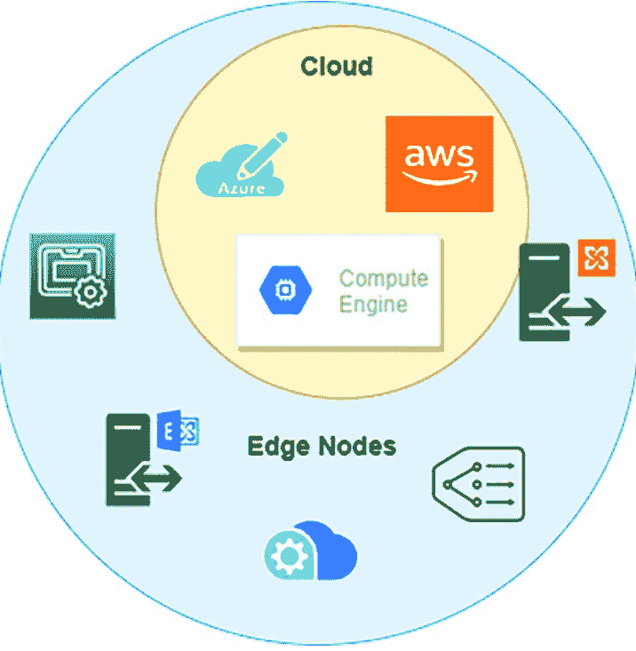

## 图 9.3：边缘与云集成

## 无缝集成云与边缘资源的方法

无缝集成云与边缘资源已成为当代计算格局中的关键挑战。一种方法是实施联邦架构，在该架构中，云与边缘资源以分布式方式协作。在这种模型中，边缘设备作为自主实体运行，能够在本地执行某些任务，同时将更资源密集型的操作无缝卸载到云端。这不仅通过减少时间敏感型任务的延迟来优化性能，还确保了云资源的高效利用。

另一种有前景的方法是将边缘计算作为云服务的补充，而非替代。在这种混合策略中，边缘设备充当云的延伸，提供一个更贴近最终用户的分布式计算资源层。云资源处理复杂计算和长期存储，而边缘设备满足实时处理需求。云与边缘之间这种共生关系促进了无缝集成，充分发挥两种范式的优势，提供更好的响应性和可扩展性。

此外，采用容器化技术在实现云与边缘资源之间的无缝集成方面起着关键作用。容器封装了应用程序及其依赖项，确保在不同环境中保持一致性。这使开发人员能够创建可以在云与边缘之间无缝迁移的应用程序，提供灵活性和可扩展性。像 Kubernetes 这样的容器编排平台通过自动化跨云和边缘环境的容器化应用部署、扩展和管理，进一步增强了这种集成。

此外，利用边缘原生云服务可以增强云与边缘资源之间的凝聚力。云服务提供商越来越多地提供专为边缘部署设计的专用服务，例如边缘分析、存储和机器学习。通过利用这些服务，组织可以开发跨越云与边缘的无缝应用程序，从而确保一个统一且高效的计算环境。这种方法不仅简化了开发，还提升了应用程序的整体性能和响应能力。

最后，实现云与边缘资源之间的无缝集成需要多方面的方法。采用联邦架构、混合策略、容器化和边缘原生云服务，共同有助于创建一个统一的计算环境，该环境能够最佳地平衡云与边缘两种范式的优势。随着对边缘计算需求的不断增长，完善和创新这些集成方法对于满足现代应用程序和服务不断变化的需求将至关重要。

## 混合云-边缘架构在优化性能中的作用

混合云-边缘架构通过无缝集成集中式云计算和分布式边缘计算的优势，在优化性能方面发挥着关键作用。在这个动态环境中，组织正在认识到需要一种能够高效处理多样工作负载的灵活基础设施。混合云-边缘模型允许将计算资源分布在各个位置，在云的可扩展性和边缘设备的低延迟响应性之间取得平衡。

混合云-边缘架构的关键优势之一是其通过尽量减少延迟来提升性能的能力。边缘计算将计算资源更靠近数据生成源，缩短了信息在设备与云之间传输所需的时间。这对于需要实时处理的应用程序尤为关键，例如物联网（IoT）设备、自动驾驶汽车和增强现实应用程序。通过在边缘战略性地部署计算资源，组织可以实现响应时间和整体系统效率的显著提升。

此外，混合云-边缘方法通过根据特定需求动态分配工作负载来优化资源利用率。需要高计算能力或大量数据处理的任务可以卸载到集中式云基础设施，而延迟敏感或带宽密集型任务可以在边缘执行。这种工作负载的动态分配确保了计算资源的高效利用，从而提升了性能和成本效益。

安全性是混合云-边缘架构在优化性能方面表现出色的另一个关键方面。通过在边缘本地处理敏感数据，组织可以降低通过网络向云传输敏感信息所带来的风险。这不仅增强了数据隐私和合规性，还确保了强大的安全态势，这是当今互联和数据驱动的商业环境中的首要考虑因素。

最后，混合云-边缘架构为寻求在快速发展的技术环境中优化性能的组织提供了战略框架。通过发挥云和边缘计算的优势，企业可以在可扩展性、低延迟响应性、高效资源利用和强大安全性之间实现和谐平衡，最终推动其各自领域的创新和竞争力。

## 实现统一云边缘生态系统的挑战与最佳实践

实现统一的云边缘生态系统面临着多方面的挑战，源于集中式云基础设施与分散式边缘设备之间的动态相互作用。一项重大障碍在于确保各种边缘设备与云之间实现无缝连接和低延迟通信。网络状况的固有差异、带宽限制以及边缘节点的地理分布都需要仔细考虑，以维持一个强大且可靠的生态系统。将此连接挑战与安全问题相平衡进一步使情况复杂化，因为与云端对应物相比，边缘设备可能更容易受到物理篡改或未经授权的访问。

除了技术挑战之外，还有组织和运营障碍需要克服。边缘设备及其相关协议的多样性可能导致互操作性问题，使得创建一个标准化且普遍兼容的生态系统变得困难。此外，在分散网络中管理边缘应用程序和更新的生命周期，在版本控制、测试和部署方面引入了复杂性。有效协调这些方面需要一个全面的治理框架，该框架与云服务提供商和边缘设备制造商的目标保持一致。

实现统一云边缘生态系统的最佳实践涉及技术创新与自适应管理的战略结合。强调边缘计算的能力，例如设备上的


处理和人工智能，可以缓解网络资源压力，并增强生态系统的整体响应能力。应优先开展标准化工作，以建立通用协议和接口，促进各类边缘设备与云平台的无缝集成。云服务提供商、边缘设备制造商和网络安全专家之间的合作伙伴关系可以推动全面安全协议的发展，确保整个生态系统中数据的机密性和完整性。

此外，生态系统管理的整体方法需要实施敏捷和自动化流程。这包括部署边缘计算编排器，以便根据需求动态分配资源，以及自动化测试和部署管道，以简化应用程序更新。持续监控和分析工具在识别性能瓶颈、安全漏洞和整体生态系统健康状况方面发挥着关键作用，从而允许主动干预和优化。

最终，紧密的云边缘生态系统的成功发展取决于技术进步、合作伙伴关系和适应性治理的结合。通过以创新解决方案应对挑战，并采用最佳实践，组织可以在云和边缘之间建立共生关系，在数字化环境中释放分布式计算的全部潜力。

## 云和边缘环境中的安全与信任

安全和信任是在快速发展的云和边缘计算环境中的首要考虑因素。在云计算领域，数据存储和处理在远程服务器上，强大的安全措施对于保护敏感信息至关重要。加密协议、多因素身份验证和严格的访问控制对于确保未经授权的实体被拦截在外至关重要。信任通过运营的透明度建立，服务提供商展示其符合行业标准和法规。随着组织将其业务迁移到云端，安全和信任的基础为数字化转型建立了弹性框架。

在动态的边缘计算领域，数据处理更靠近数据源，随之带来了新的挑战和机遇。边缘设备（从IoT传感器到边缘服务器）要求采用去中心化的安全架构。对这些分布式系统的信任是通过实施安全通信通道和边缘原生安全协议来培养的。随着设备在网络边缘不断增多，自适应威胁检测和响应的需求变得至关重要。边缘环境需要在自主性与中央监督之间取得精心平衡，通过实时监控以及针对潜在安全漏洞的快速果断行动来培养信任氛围。

云与边缘环境之间的协作为安全和信任考量引入了新的维度。这两个领域的无缝集成要求互操作性和标准化的安全框架。信任通过协调跨越整个连续体的安全策略来培养，确保对不断演变的网络威胁形成协同防御。建立安全可信的生态系统使组织能够充分发挥云和边缘计算的全部潜力，自信地拥抱创新，同时保护关键资产。

最终，安全和信任的支柱是云和边缘计算环境成功不可或缺的一部分。随着技术的不断进步，安全措施的适应性和信任框架的建立将决定数字生态系统的韧性。组织必须保持警惕，不断完善其策略以领先于新兴威胁，并培养一种文化，使安全和信任不仅仅是合规项，而是塑造计算未来的根植原则。

## 云计算的独特安全考量

云计算在数据和应用程序管理方式上带来了范式转移，需要对独特的安全考量进行彻底审查。一个关键方面是共同责任模型，云服务提供商（CSP）和客户共同负责保障基础设施安全。这种动态要求明确划分责任，以避免安全漏洞。CSP确保云基础设施的安全，而客户负责保障云中其数据和应用程序的安全。

此外，云环境的虚拟化特性带来了独特的挑战。多租户（多个客户共享相同物理资源）引发了关于数据隔离和潜在漏洞的担忧。必须实施安全措施，防止不同租户之间未经授权的访问，确保各自数据的机密性和完整性。此外，云资源的动态性（能够快速扩展或缩减）要求适应性安全控制，能够无缝适应环境的变化。

云计算对网络连接的依赖引入了另一层安全考量。客户端与云之间以及云内不同组件之间的数据传输必须加密，以防止窃听和未经授权的访问。安全通信协议和强大的加密算法对于保护传输中的敏感信息至关重要。

此外，基于云的服务不断增多以及第三方应用程序的集成加剧了安全风险。客户必须评估所选云服务的安全态势，并仔细审核第三方集成，确保其遵循严格的安全标准。云生态系统日益复杂的程度要求全面理解整个供应链，以识别和缓解潜在漏洞。

最终，分析云计算的独特安全考量需要一种整体方法，涵盖共同责任模型、虚拟化挑战、动态资源管理、网络安全和第三方集成。采用技术控制、强大政策和持续警惕相结合的方式解决这些考量，对于促进安全的云计算环境至关重要。

## 保障边缘设备和通信通道安全的挑战

在不断发展的技术环境中，保障边缘设备和通信通道安全面临多方面的挑战。一个重大障碍在于边缘设备的多样性巨大，从智能传感器和IoT设备到自动驾驶汽车。每个设备通常都有其自身独特的操作系统、固件和安全协议，使得难以实施一种通用的安全解决方案。这种多样性造成了碎片化的安全格局，一个设备中的漏洞可能不适用于其他设备，因此需要一种全面但灵活的方法来保护整个生态系统。

边缘处的通信通道引入了另一层复杂性。与传统集中式系统不同，边缘计算涉及去中心化数据处理，导致设备间通信量增加。交换数据的巨量创造了网络威胁的机会，包括窃听、中间人攻击和数据篡改。实施强大的加密和身份验证机制对于确保传输信息的完整性和机密性至关重要。然而，这些措施必须与边缘设备有限的计算资源相平衡，需要轻量但有效的安全协议。

此外，边缘环境的动态性带来了持续的挑战。边缘设备通常部署在偏远或恶劣的环境中，使得物理安全成为一个问题。未经授权的访问、设备被篡改或被盗都可能危及整个网络。此外，边缘设备可能在低功耗环境中运行，限制了持续安全更新的可行性。这需要开发高效的空中更新机制，并集成自愈能力，以在不中断关键操作的情况下解决漏洞。

此外，边缘设备和通信协议多样生态系统中缺乏标准化的安全实践，阻碍了无缝集成。建立行业范围的安全框架、协议和最佳实践标准，对于创建针对新兴威胁的统一防御至关重要。包括制造商、开发者和监管机构在内的利益相关方之间的合作，对于培育安全且有韧性的边缘计算生态系统至关重要。


最后，保障边缘设备和通信渠道的安全需要一种全面且自适应的方法，以应对设备的多样性、动态的通信环境以及边缘环境带来的独特挑战。在安全与边缘设备资源限制之间取得平衡、建立标准化实践并促进协作，是克服这些挑战并确保边缘计算系统可信性的关键。

## 在分布式云边缘系统中建立信任的策略

在分布式云边缘系统错综复杂的环境中，建立信任对于确保互连组件的无缝运行和安全至关重要。一种有效的策略是实施强大的身份验证协议。通过采用多因素身份验证和加密机制，组织可以增强系统防止未经授权访问的能力。这不仅保护了敏感数据，还在用户中培养了可靠性的感觉，增强了对分布式环境的信心。

此外，透明且全面的通信框架对建立信任有显著贡献。分布式系统中各节点之间的清晰文档和开放通信渠道促进了理解与合作。这种方法有助于解决潜在问题、及时解决问题并营造协作氛围。在此背景下，信任成为沟通顺畅且透明的生态系统的自然副产品，所有利益相关者都充分了解并积极参与。

信任建立的另一个关键方面涉及对分布式云边缘基础设施的持续监控和审计。采用先进的监控工具和异常检测系统，可以实时评估系统健康状况和安全性。定期的内部和外部审计有助于识别漏洞并遵守合规标准。这种主动方法不仅增强了系统的韧性，还展示了维护可信环境的承诺。

在分布式系统领域，培养问责文化是一种微妙而强大的建立信任的策略。通过定义和执行明确的角色和职责，组织可以降低与人为错误或恶意活动相关的风险。基于最小权限原则实施访问控制，确保用户仅拥有执行特定任务所需的权限，从而最大限度地减少安全漏洞的潜在影响。这种对问责的强调通过展示对分布式云边缘系统安全和负责任的管理承诺，奠定了信任的基础。

最终，在分布式云边缘系统中建立信任是一项涉及技术、沟通和文化策略的多方面工作。从强大的身份验证机制到透明的沟通和持续监控，组织可以培养一种环境，使信任不仅是一种期望，更是分布式生态系统的固有特质。这些策略共同增强了系统的韧性和可靠性，在用户和利益相关者中培养了信任感。

## 结论

在信息技术动态的发展格局中，云计算与边缘计算的融合标志着一种变革性的协同效应，将现代计算能力推向前所未有的高度。通过这一技术融合的历程揭示了一个关于效率提升、延迟降低以及数据处理和利用方式范式转移的叙事。

云计算凭借其集中式的能力和庞大的资源，构成了这一变革性组合的基石。它提供了处理海量数据集和复杂工作负载所必需的规模、存储和计算能力。然而，正是与边缘计算的共生关系重塑了这一叙事，将计算更贴近数据生成源。

边缘计算以其去中心化架构为特征，为计算生态系统引入了新的维度。通过在数据源或附近处理数据，它不仅将延迟降至最低，还优化了带宽使用，培养了实时决策能力。这种对数据源的空间接近性在即时性和响应性至关重要的场景中证明非常宝贵，例如在 IoT 设备、自动驾驶汽车和工业自动化中。

云计算与边缘计算的融合超越了单纯的技术集成。它代表了我们概念化和利用计算能力的范式转移。这种协同效应通过无缝融合集中式云资源的优势与边缘设备的敏捷性和响应性，赋予了从增强现实到预测分析等一系列应用能力。

在我们驾驭数字互联世界的复杂性时，这种联合成为解锁新兴技术全部潜力的关键。未来的旅程涉及应对安全、互操作性和资源优化等挑战。然而，更具响应性、高效性和智能性的计算环境的承诺推动我们走向未来，在未来，云计算和边缘计算将作为支柱，支撑创新和进步的新时代。在这个变革性的格局中，云将其触角延伸至边缘，创造出一个互连节点的图景，它不仅进行计算，还编织着数字可能性的交响曲。

在下一章中，我们将探讨使用 IoT 标签在边缘监控牧场的基本开发模式。下一章还将演示如何使用 Azure 云资源和 Python 程序创建边缘资源，以监控和利用边缘的所有资源。

## 选择题

在云计算背景下，边缘计算的主要优势是什么？

- 增加的延迟
- 降低的延迟
- 更大的带宽
- 更高的存储容量

哪个因素对边缘计算在增强云计算能力方面的成功至关重要？

- 增加的集中化
- 降低的连接性
- 可扩展性
- 降低的安全性

哪种技术常用于在网络中启用边缘计算？

- 人工智能（AI）
- 区块链
- 物联网（IoT）
- 虚拟现实（VR）

在混合模型中将边缘计算与云计算相结合的主要好处是什么？

- 增加的延迟
- 降低的可扩展性
- 增强的灵活性和效率
- 降低的安全性

以下哪项最能描述边缘计算？

- 在远程数据中心集中处理数据
- 将计算能力分布到更靠近数据源的位置
- 专用云服务
- 仅在本地设备上存储数据

## 答案

- b
- c
- c
- c
- b

## 问题

云计算与边缘计算的根本区别是什么，它们在现代计算架构中如何相互补充？

与仅依赖集中式云基础设施相比，在边缘部署应用程序的主要优势是什么？

延迟如何影响边缘的实时数据处理，可以采用哪些策略来尽量减少延迟并确保及时的数据分析和决策？

在边缘计算场景中，边缘设备如何与中央云基础设施通信，通常使用哪些协议和技术来进行高效的数据传输？

边缘计算如何通过减少能耗和优化资源利用，帮助 IT 领域实现可持续发展目标？

边缘计算如何解决传统云计算的局限性，特别是在延迟和带宽限制方面？


## 关键术语

- 物联网
- 基础设施即服务
- 平台即服务
- SaaS：软件即服务
- 函数即服务
- 虚拟机
- 内容分发网络
- 应用程序编程接口 (APIs)
- 多接入边缘计算
- 云服务提供商

# 第 10 章

# 安全边缘开发与实现

## 简介

本章将开启一段安全边缘实施领域的探索之旅，其中尖端技术与强大安全措施的融合正在重新定义我们感知、设计和保护数字生态系统的方式。随着我们深入边缘计算的逐步实施，我们将揭示为何保护边缘不再是一种奢侈，而是跨行业企业的战略性必要。

将边缘视为第一道防线、宝贵数据的守门员，以及新时代应用程序的舞台，这些应用程序不仅要求速度，还要求韧性。从庞大的物联网 (IoT) 到低延迟应用程序的需求，边缘是未来被锻造的熔炉。

我们的探索将涵盖 AWS 和 Azure 安全边缘实施，解剖边缘计算及其与安全框架集成的结构。我们将穿越开发者在构建兼顾性能与保护的解决方案时所面临的挑战迷宫。

随着我们深入探索，我们将向您介绍工具，这些工具支持开发者、安全专家和创新者的协作努力，他们正在不断拓展边缘可能性的边界。云功能、人工智能和边缘强大加密的融合正在改变我们感知和与技术互动的方式，既带来了无与伦比的机遇，也带来了前所未有的风险。

所以，系好安全带，让我们踏上安全边缘实施的探险之旅。让我们驶向创新与安全相遇、连接未来的承诺受我们今天奠定的坚实基础保护的未知水域。

## 结构

在本章中，将涵盖以下主题：

- 牛场物联网与边缘计算架构
- 牛场物联网与边缘计算实施的逐步设置

## 目标

在本章中，我们将注意力集中在利用物联网和边缘计算技术的能力来提升牛场养殖的不同方面。这涵盖了从监测牛群健康和管理资源，到促进可持续发展以及在养殖社区内促进协作。前一章制定的设计将通过在 Azure 中建立安全边缘来实施。

## 牛场物联网与边缘计算架构

牛场物联网标签为您的牲畜运营提供全面概览，使您能够监控库存、繁殖、怀孕、分娩、断奶及其他关键方面。使用牛场物联网标签，您可以使用可自定义的标准（如动物类型、年龄、牧场等）轻松将动物分组。通过在工作会话或怀孕检查后一步更新每组的记录，简化记录保存流程，节省宝贵时间。

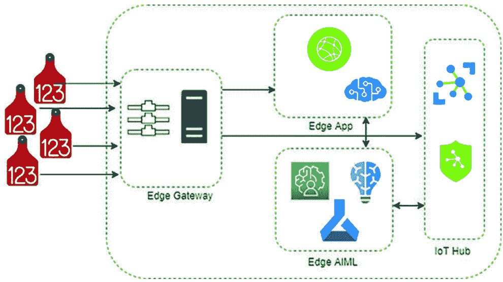

图 10.1：牛场边缘架构

### 逐步设置与实施

在深入逐步说明之前，以下是我们实施的应用流程。

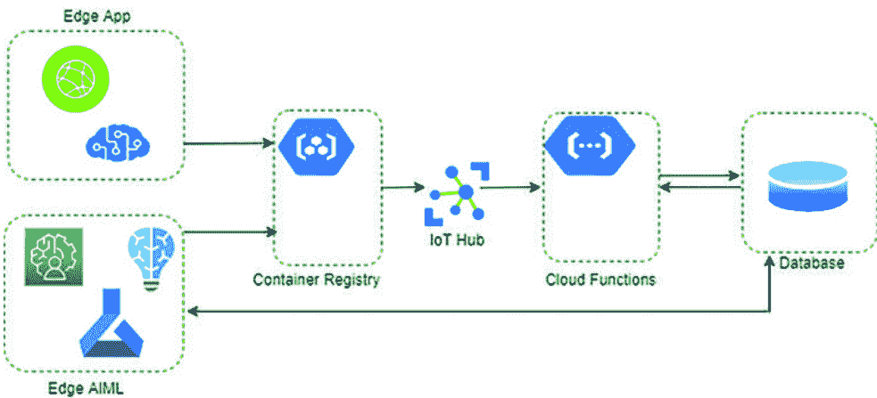

图 10.2：牛场边缘应用架构

实施过程如下。

将设备数据从运行 IoT Edge 的数据发送应用程序传输到 IoT Hub。

Azure Functions 随后从 IoT Hub 接收这些设备数据并将其注册到 MongoDB 中。

机器学习从 MongoDB 检索数据。

机器学习过程涉及将一些数据发送到 MongoDB，另一些发送到 Azure 容器注册表。

在我们全面投入边缘基础设施建设之前，让我们先了解一下市场上可用的、由 Ubuntu 支持的某些边缘操作系统 (OS)，Ubuntu 将是我们所有实施的官方 Linux 操作系统。需要注意的是，您可以使用 Windows 操作系统，但本书的实施将仅关注 Linux。

以下是可以与 Ubuntu 操作系统一起使用的各种类型的边缘操作系统表格。

| 操作系统。操作系统。 |
|---|
| 操作系统。 |
| 操作系统。 |
| 操作系统。 |
| 操作系统。 |
| 操作系统。 |
| 操作系统。 |
| 操作系统。 |

表 10.1：IoT 操作系统平台下载表

基于美国地理结构，让我们在美国拥有的 16 个牛场在三个 Azure 云数据中心设置边缘基础设施。

### Azure 逐步设置

创建 Azure 虚拟网络是构建安全可扩展云基础设施的基本步骤。无论您是设置新环境还是扩展现有环境，该过程都涉及几个关键步骤，以确保正确配置和连接。让我们逐步了解创建 Azure 虚拟网络的指南，使您能够为基于云的资源建立坚实基础。

步骤 1A：创建以下 3 个 Azure 私有虚拟网络 (VNET) 片段，用于边缘。

网络/片段 1：此网络将为 10.10.10.0/23，用于网关和面向互联网的边缘应用程序。

网络/片段 2：此网络将为 10.10.20.0/23，用于中间件和面向内部的边缘应用程序。

网络/片段 3：此网络将为 10.10.30.0/23，用于人工智能和机器学习边缘应用程序。

步骤 1B：在 https://portal.azure.com 登录 Azure

步骤 1C：单击“创建 a”


图 10.3：创建 Azure 资源图标

步骤 1D：在搜索框中搜索虚拟网络


图 10.4：Azure 虚拟网络搜索框

步骤 1E：选择“虚拟”并单击创建。

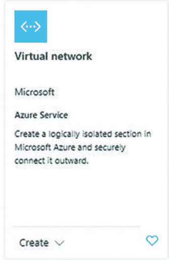

图 10.5：Azure 创建虚拟网络图标

步骤 1F：按如下填写表单。

基本：

Azure 虚拟网络 (VNet) 是 Azure 中专用网络的基本构建块。VNet 使多种类型的 Azure 资源（例如 Azure 虚拟机 (VM)）能够安全地相互通信，以及与互联网和本地网络通信。VNet 类似于您在自有数据中心中运行的传统网络，但附带了 Azure 基础设施的额外优势，例如规模、可用性和隔离性。
了解更多。

### 项目详细信息

选择用于管理已部署资源和成本的订阅。使用资源组（如文件夹）来组织和管理所有资源。

- 订阅 *：Azure 免费订阅
- 资源组 *：book127-edge1-westus-network-rg
- 创建新建

### 实例详细信息

- 虚拟网络名称 *：book127-edge1-westus-edgateway-network
- 区域 *：(US) 美国西部

### 图 10.6：Azure 创建虚拟网络基本表单

安全表单：

基础 安全 IP 地址 标签 评审 + 创建

### Azure 防火墙

Azure 防火墙是一种托管的基于云的网络安全服务，用于保护您的 Azure 虚拟网络资源。了解更多。

启用 Azure 防火墙

Azure 防火墙名称 book127-edge1-westus-edgateway-network-Firewall

子网名称 * AzureFirewallSubnet

层级 * 基础

策略 * (新建) book127-edge1-westus-edgateway-network-firewall-policy 创建新建

Azure 防火墙公共 IP 地址 * (新建) book127-edge1-westus-edgateway-network-firewall 创建公共 IP 地址

管理流量公共 IP 地址 * (新建) book127-edge1-westus-edgateway-network-traffic-management 创建公共 IP 地址

图 10.7：Azure 创建虚拟网络安全表单

### IP 地址：


## 创建虚拟网络

- 基本信息
- 安全
- IP 地址
- 标记
- 评审 + 创建

使用一个或多个 IPv4 或 IPv6 地址范围定义虚拟网络的地址空间。创建子网以将虚拟网络地址空间分段为较小的范围，供应用程序使用。当您将资源部署到子网时，Azure 会从子网分配一个 IP 地址给该资源。了解更多 >

| 子网 | IP 地址范围 | 大小 | NAT 网关 |
| :--- | :--- | :--- | :--- |
| edgateway | 10.10.8.0 - 10.10.8.255 | /24 (256 addresses) | - |
| AzureFirewallSubnet | 10.10.10.0 - 10.10.10.63 | /26 (64 addresses) | - |
| AzureFirewallManagement | 10.10.10.64 - 10.10.10.127 | /26 (64 addresses) | - |

### 图 10.8: Azure 创建虚拟网络 IP 地址表单

### 标记：

## 创建虚拟网络

- 基本信息
- 安全
- IP 地址
- 标记
- 评审 + 创建

标记是名称/值对，可让您通过将相同标记应用于多个资源和资源组来对资源进行分类并查看合并账单。了解有关标记的更多信息

请注意，如果您创建标记，然后在其他选项卡上更改资源设置，您的标记将自动更新。

| 名称 | 值 | 资源 |
| :--- | :--- | :--- |
| createdBy | James Odeyinka | All resources selected |
| dateCreated | 12/26/2023 | All resources selected |
| application | Edge Gateway VNET | All resources selected |
| EnvType | DEV | All resources selected |

### 图 10.9: Azure 创建虚拟网络标记表单

您现在已完成虚拟网络配置，可以单击评审并创建。

### 步骤 2：按以下内容创建 Azure IoT Hub。请不要忘记，您需要在不同区域部署 3 个 Hub。

在“管理”中，勾选“将我分配给 IoT Hub 数据参与者角色”。

我们为 Azure 部署选择的区域如下：

- 区域 1 (Edge 1): 美国西部 (加利福尼亚)
- 区域 2 (Edge 2): 美国中南部 (德克萨斯)
- 区域 3 (Edge 3): 美国东部 2 (弗吉尼亚)

而我们的中央云区域将是美国中北部 (伊利诺伊)。

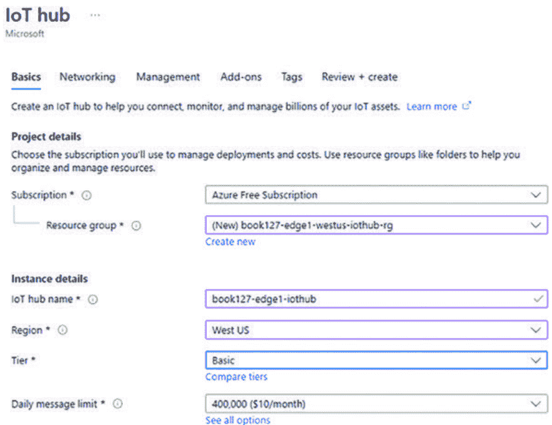

### 图 10.10: Azure IoT Hub 基本表单

## 步骤 3：在 Azure VM 上部署和安装操作系统

由于我们的边缘位于云中，我们将使用 Ubuntu Server 22.04 LTS 进行操作系统部署。该镜像可以使用此链接下载。如果您需要安装帮助，请使用 canonical 提供的说明 https://ubuntu.com/tutorials/install-ubuntu-server#1-overview

单击创建 Azure 虚拟机。选择 SSH 作为身份验证方法。您可能需要生成 SSH 密钥。

选择您之前创建的网关边缘网络。

- 基本信息
- 磁盘
- 网络
- 管理
- 监视
- 高级
- 标记
- 评审 + 创建

创建运行 Linux 或 Windows 的虚拟机。从 Azure 市场选择映像或使用您自己的自定义映像。完成“基本信息”选项卡，然后单击“评审 + 创建”以使用默认参数预配虚拟机，或查看每个选项卡以进行完全自定义。了解更多 >

此订阅可能不符合在某些区域部署某些大小 VM 的资格。

### 项目详细信息

- 订阅 *：Azure 免费订阅
- 资源组 *：book127-edge1-westus-network-rg [新建]

### 实例详细信息

- 虚拟机名称 *：book127-edge1-svr
- 区域 *：(美国) 美国西部
- 可用性选项：无需基础设施冗余
- 安全类型：受信任启动虚拟机 [配置安全功能]
- 映像 *：Ubuntu Minimal 22.04 LTS - x64 Gen2 (符合免费服务条件) [查看所有映像 | 配置 VM 代数]

### 管理员帐户

- 身份验证类型：SSH 公钥 (已选), 密码
- 用户名 *：azureuser
- SSH 公钥源：生成新密钥对
- 密钥对名称 *：book127-edge1-svr_key

### 入站端口规则

- 选择公共互联网可以访问的虚拟机网络端口。您可以在“网络”选项卡上指定更受限或更细粒度的网络访问。
- 公共入站端口 *：无，允许选定端口 (已选)
- 选择入站端口 *：SSH (22)
- 信息：默认情况下，来自互联网的所有流量都将被阻止。您将能够在 VM > 网络页面更改入站端口规则。

### 图 10.11: Azure 创建虚拟机基本表单

## 步骤 4：SSH 到 VM 并运行以下命令：

使用 -i ~/.ssh/ 登录到 admin@ip-of-the-vm

更新操作系统：

```
sudo apt update
sudo apt install git
git --version
```

克隆 Edge IoT Git：克隆 IoT Edge git 仓库，其中包含生成演示证书的脚本。

```
git clone https://github.com/Azure/iotedge.git
```

创建要用于工作的目录，并将证书脚本复制到该目录中。所有证书和密钥文件都将在此目录中创建。

```
mkdir edge1-wrkdir
cd edge1-wrkdir
cp ../iotedge/tools/CACertificates/*.cnf .
cp ../iotedge/tools/CACertificates/certGen.sh .
```

创建证书：

在 edge1-wrkdir 中创建根 CA 证书和一个中间证书

```
./certGen.sh create_root_and_intermediate
```

### 提示：

此脚本命令会创建多个证书和密钥文件，但当文档要求根 CA 证书时，请使用以下文件：

```
certs/azure-iot-test-only.root.ca.cert.pem
```

### 安装 Java 开发工具包 (jdk)

要安装 jdk，请从 VM 命令行运行以下命令：

```
sudo apt update
sudo apt install unzip default-jdk
```

### 安装 IoT Edge：

```
wget https://packages.microsoft.com/config/ubuntu/22.04/packages-microsoft-prod.deb -O packages-microsoft-prod.deb
sudo dpkg -i packages-microsoft-prod.deb
rm packages-microsoft-prod.deb
```

Azure IoT Edge 依赖于符合 OCI 标准的容器运行时。对于最佳生产场景，我们强烈建议使用 Moby 引擎，这是与 IoT Edge 官方支持的唯一容器引擎。Docker CE/EE 容器映像与 Moby 运行时兼容。

要安装 Moby 引擎，请运行以下命令：

```
sudo apt-get update
sudo apt-get install moby-engine
```

默认情况下，Moby 容器引擎不会设置容器日志大小限制。这可能导致设备随时间累积日志并耗尽磁盘空间。虽然配置本地日志是可选的，但建议这样做以防止此类问题。有关日志配置的更多信息，请参阅生产部署清单。

按照以下步骤将容器配置为使用本地日志驱动程序作为日志机制：

如果 Docker 守护进程的配置文件不存在，请创建它；如果已存在，请打开配置文件。

JSON
复制

```
{
"log-driver": "local"
}
```

重新启动容器引擎以使更改生效。

Bash
复制
sudo systemctl restart docker

## 步骤 5：将边缘设备 (VM) 添加到 IoT Hub。

在 IoT Hub 的设备管理中，单击设备。


### 图 10.12: Azure IoT Hub 概述边栏

单击设备后，您应该看到以下图像。

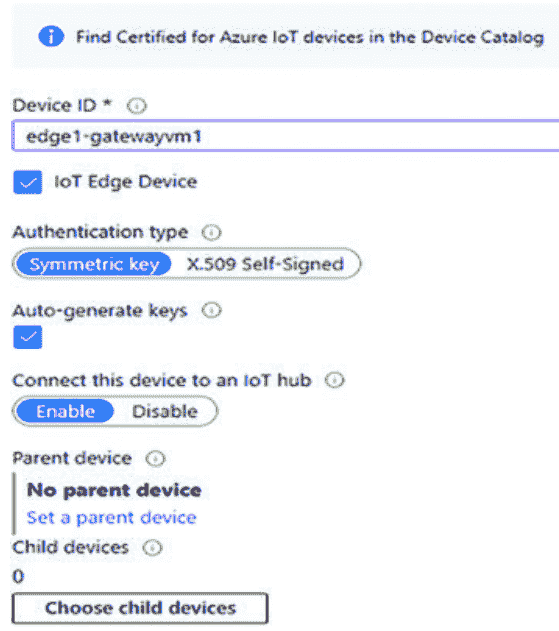

### 图 10.13: Azure IoT Hub 设备边栏

在边缘 VM 可以连接到 IoT Hub 之前，您必须如上所述正确配置边缘节点。

## 步骤 6：部署用于机器学习操作的数据科学 VM

此服务器将部署在您之前部署的 AIML 虚拟网络中。您可以使用 Windows 部署它，也可以使用 Ubuntu。

单击创建 Azure 虚拟机。选择标有“数据科学虚拟机”的映像。

### 项目详细信息

- 资源组 *：book127-edge1-westus-network-rg [新建]

### 实例详细信息

- 虚拟机名称 *：dev-aiml-app-vm1
- 区域 *：(美国) 美国东部
- 可用性选项：可用性区域
- 可用性区域 *：区域 1。您现在可以选择多个区域。选择多个区域将在每个区域创建一个 VM。了解更多
- 安全类型：受信任启动虚拟机 [配置安全功能]
- 映像 *：数据科学虚拟机 - DSVM Windows Server 2022 - x64 Gen1 查看所有映像 | 配置 VM 代数

您正处于免费试用期。此 VM 相关费用可由订阅中剩余的任何积分覆盖。了解更多

- 大小 *：Standard_DS3_v2 - 4 个 vCPU，14 GiB 内存 (每月 $213.89) 查看所有大小
- 启用休眠 (预览)：要启用休眠，您必须注册订阅。了解更多

### 管理员帐户

- 身份验证类型：SSH 公钥 / 密码
- 用户名 *：aimladmin
- SSH 公钥源：生成新密钥对
- 密钥对名称 *：为 SSH 公钥命名

Azure 现在会自动为您生成 SSH 密钥对，并允许您将其存储以供将来使用。这是一种快速、简单且安全的连接到虚拟机的方式。

### 图 10.14: Azure 创建数据科学虚拟机表单


## 步骤 6: 创建容器注册表以托管边缘基础设施的镜像和模型。

此链接提供创建注册表的分步说明：
https://learn.microsoft.com/en-us/azure/container-registry/container-registry-get-started-portal?tabs=azure-cli

## 步骤 7: 按照以下链接和步骤，为 IoT 开发准备您的笔记本电脑或云工作站。

### 安装 Docker 引擎

如果您使用的是 Windows，请按照此链接操作：
https://docs.docker.com/docker-for-windows/install/

如果您使用的是 MAC，请按照此链接操作：https://docs.docker.com/docker-for-mac/install/

### 安装 IoT Edge 开发工具

按照此链接安装 Python：https://www.python.org/downloads/

按照此链接安装 Cookiecutter：
https://github.com/audreyr/cookiecutter

注意：确保您的 bin 文件夹已添加到平台的路径中。
通常 UNIX 和 macOS 下为 ~/.local/，Windows 下为 %APPDATA%\Python。

## 步骤 8: 使用以下命令创建 Edge 项目模板。

```
$ mkdir myedgesolution
$ iotedgedev solution init –template python
```

按照所有提示并回答问题。您应该在项目文件夹中看到类似内容。

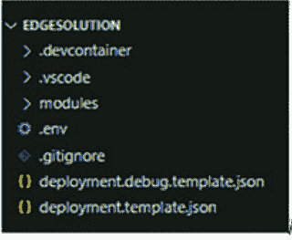

图 10.15: IDE IoT 解决方案项目结构

## 步骤 9: 构建并推送您的第一个数据发送器应用程序。在 SampleModule 目录中，打开 App.java 文件并粘贴以下文件内容。

```java
package com.edgemodule;

import com.microsoft.azure.sdk.iot.device.*;
import java.io.IOException;
import java.text.SimpleDateFormat;

public class App {
    private static EventCallback eventCallback = new EventCallback();
    protected static class EventCallback implements IotHubEventCallback {
        @Override
        public void execute(IotHubStatusCode status, Object context) {
            if (context instanceof Message) {
                System.out.println("Send message with status: " + status.name());
            } else {
                System.out.println("Invalid context passed");
            }
        }
    }
    public static void main(String[] args) throws IOException {
        System.out.println("The main function was invoked.");
        DeviceClient client = null;
        try {
            client = new DeviceClient("device connection strings here>",
                IotHubClientProtocol.HTTPS);
            client.open();
            for (int i = 0; i < 60; i++) {
                String timestampStr = new SimpleDateFormat("yyyy-MM-dd'T'HH:mm:ss'Z'").format(new java.util.Date());
                double temperature = 20 + Math.random() * 15;
                String msgStr = timestampStr + "," + String.valueOf(temperature);
                Message msg = new Message(msgStr);
                System.out.println("msg: " + msgStr);
                client.sendEventAsync(msg, eventCallback, msg);
                Thread.sleep(60000);
            }
            client.closeNow();
        } catch (Exception e) {
            e.printStackTrace();
            if (client != null) {
                client.closeNow();
            }
            System.exit(1);
        }
    }
}
```

## 步骤 10: 现在使用以下命令创建牛只项目。

```
$ mkdir cattle_iotedge_project
$ pip install azure-functions pymongo
```

## 步骤 11: 将牛只标签 IoT 数据发送到 Azure IoT 中心。创建名为 cattle_device.py 的文件。

```
$ touch cattle_device.py
# Add the following content to the file.
from azure.iot.device import IoTHubDeviceClient, Message
import json
import random
import time

# Replace with your Azure IoT Hub connection string
CONNECTION_STRING = ""

# Function to create a simulated cattle tag IoT data
def generate_farm_cattle_data():
    farm_cattle_data = {
        "tag_id": "CattleTag2024-0000001",
        "temperature": random.uniform(35.0, 40.0),
        "movement": random.uniform(10.0, 20.0, 30.0, 40.0, 50.0),
        "humidity": random.uniform(50.0, 70.0),
        "location": {
            "latitude": random.uniform(-90, 90),
            "longitude": random.uniform(-180, 180)
        }
    }
    return json.dumps(farm_cattle_data)

def iothub_client_init():
    client = IoTHubDeviceClient.create_from_connection_string(CONNECTION_STRING)
    return client

def send_message(client, message):
    print("Sending message: {}".format(message))
    client.send_message(message)
    print("Message sent successfully!")

def main():
    try:
        client = iothub_client_init()
        while True:
            farm_cattle_data = generate_farm_cattle_data()
            message = Message(farm_cattle_data)
            send_message(client, message)

            # Send data every 10 seconds (adjust as needed)
            time.sleep(10)
    except KeyboardInterrupt:
        print("IoT Hub Device Simulator stopped.")

if __name__ == "__main__":
    main()
```

注意：将您的连接字符串放在此行 "device connection strings here>" 中。连接字符串可通过在 Azure 门户的 IoT 中心下的 "IoT Edge" 中选择 IoT 注册设备来检索。

## 步骤 11: 创建 Azure 函数以将 IoT 数据发送到 MongoDB 数据库。创建名为 cattle_data_mongodb.py 的文件。

```
$ touch cattle_data_mongodb.py
# Add the following content to the file.
import os
import pymongo
import azure.functions as func

def main(msg: func.ServiceBusMessage):
    # Retrieve MongoDB connection string from Azure Functions application settings
    mongo_connection_string = os.environ["Your-MongoDB-Connection-String-Here"]
    # Parse IoT data from the Service Bus message
    iot_data = msg.get_body().decode('utf-8')
    # Connect to MongoDB
    client = pymongo.MongoClient(mongo_connection_string)
    # Choose your database and collection
    db = client["Your-Database-Name-Here"]
    collection = db["Your-Collection-Name-Here"]
    # Insert IoT data into MongoDB
    result = collection.insert_one({"data": iot_data})
    # Log the result
    if result.inserted_id:
        print(f"Data inserted into MongoDB with ID: {result.inserted_id}")
    else:
        print("Failed to insert data into MongoDB")
    # Close the MongoDB connection
    client.close()
```

## 步骤 12: 创建机器学习程序以从 MongoDB 数据库获取数据。创建名为 cattlemdl.py 的文件。

```
$ pip install pymongo scikit-learn
$ touch cattlemdl.py
# Add the following content to the file.
```

```python
# Import necessary libraries
import pymongo
import pandas as pd
from sklearn.model_selection import train_test_split
from sklearn.ensemble import RandomForestClassifier
from sklearn.metrics import accuracy_score

# Connect to MongoDB
client = pymongo.MongoClient("mongodb://:27017/")
db = client["Your-Database-Name-Here"]
collection = db["Your-Collection-Name-Here"]

# Fetch data from MongoDB
cursor = collection.find()
data = list(cursor)

# Convert data to Pandas DataFrame
df = pd.DataFrame(data)

# Preprocess the data as needed
# For example, handle missing values, encode categorical variables, etc.

# Define features and target
X = df.drop("Your-Target-Column-Name-Here", axis=1)

y = df["target_column"]

# Split the data into training and testing sets
X_train, X_test, y_train, y_test = train_test_split(X, y, test_size=0.2, random_state=42)

# Initialize a machine learning model (Random Forest Classifier in this example)
model = RandomForestClassifier()

# Train the model
model.fit(X_train, y_train)

# Make predictions on the test set
predictions = model.predict(X_test)

# Evaluate the model
accuracy = accuracy_score(y_test, predictions)
print(f"Model Accuracy: {accuracy}")
```

注意：将 " Your-MongoDB-IP-Address-Here "、" Your-Database-Name-Here "、" Your-Collection-Name-Here " 替换为您的实际数据库详细信息。

## 步骤 13: 将 IoT Explorer 安装到您的笔记本电脑或台式机上。Azure IoT Explorer 有两个版本（Windows 和 Linux）。

最新版本的 Azure IoT Explorer 可从此处下载：
https://github.com/Azure/azure-iot-explorer/releases

按照安装流程进行安装。安装完成后，使用“添加连接”菜单将现有设备添加到 IoT 中心。


## 结论

使用 Python 实现边缘计算，为日益增长的实时处理和低延迟应用需求所带来的挑战提供了一种强大的解决方案。在本章中，我们探讨了在边缘设置和实施边缘计算解决方案所涉及的关键概念和步骤。

Python 的多功能性体现在其能够与边缘设备无缝集成，并促进高效可扩展应用程序的开发。从部署边缘节点到为资源受限环境优化算法，Python 已被证明是边缘计算领域中宝贵的工具。

此外，我们还讨论了在各种用例中利用边缘计算的重要性，包括物联网（IoT）应用、边缘机器学习和实时分析。在数据源附近处理数据不仅能提升性能，还能减少带宽使用，并确保更好的隐私和安全性。

随着组织继续拥抱边缘计算的潜力，本章所获得的知识和技能为从业者和开发人员提供了坚实的基础。Python 丰富的库、框架和社区支持生态系统，使其成为构建强大高效边缘应用程序的首选。

简而言之，本章介绍的使用 Python 进行边缘计算的设置和实施标志着我们在分布式计算方法上的范式转变。随着我们迈向去中心化和智能系统的时代，在此获得的见解无疑将有助于推动各个领域的技术进步，为更加互联和响应迅速的未来铺平道路。

## 多项选择题

使用 Azure 容器注册表 (ACR) 的主要目的是什么？

- 保存镜像和模型文件
- 保存操作系统
- 保存模型密码
- 保存 Docker 文件

本书用于存储数据的数据库类型是什么？

- 网格数据库
- CouchDB 数据库
- SQL 数据库
- MongoDB 数据库

本章使用的 ML 程序中常用的机器学习算法是什么？

- 决策树
- Scikit Learn
- K-Means 聚类
- 大型语言模型 (LLM)

要使用 IoT Dev 库，可能需要安装哪个 Python SDK？

- PyPI
- CosmosDB
- PyMongo
- Batch

保护边缘设备免受网络威胁的常见安全措施是什么？

- 公钥加密
- 数据去中心化
- 防火墙实现

## 提升处理能力

## 答案

- a
- b
- b
- c
- c

## 问题

- 使用 Python 设置边缘计算环境时需要考虑的关键因素是什么？
- 开发使用 Python 的边缘计算系统时，管理和维护的最佳实践是什么？
- 是否有针对边缘计算开发推荐的特定 Python 库或框架？如果有，是哪些，为什么？
- Python 如何促进计算网络中边缘设备的集成？
- 您能概述使用 Python 实施边缘计算的基本步骤吗？
- Python 在分布式计算环境中如何提升边缘设备的效率和性能？

## 关键术语

- Azure 容器注册表
- Java 开发工具包 (JDK)
- 卷积神经网络
- 物联网
- 机器学习
- 操作系统

## A

- AAA 101
- AAA，方面
- 以身份为中心，方法 102
- 微分段 103
- 零信任架构 (ZTA) 102
- 身份验证，管理 179

## B

- 带宽优化，边缘响应
- 内容分发，边缘 43
- 网络边缘，分发 44
- 区块链集成
  - 简介 255
  - 身份，去中心化 259
  - 安全性，增强 256
  - 智能合约，分析 259
  - 供应链，实施 259
  - 信任模型，去中心化 257

## C

- 牛只物联网标签，操作
- Azure 虚拟网络
- 边缘计算 301
  - 分步实施 303
- 云计算
  - 简介 278
  - 架构，识别 280
  - 基础，概念 279
  - 历史，评估 279
- 协作边缘分析 152
- 持续监控，挑战 114
- 持续监控，方式
  - 异常，检测 113
  - 取证，分析 113
  - 事件响应，策略 111
  - 主动威胁，检测 110
  - 快速事件，识别 112
  - 威胁检测，响应 109
- 融合，优势
  - 数据驱动，洞察 62
  - 体验，增强 62
  - 灵活，可扩展性 62
  - 安全性 62
- 密码学基础
  - 简介 248
  - 算法，加密 251
  - 边缘，密码学 249
  - 哈希函数，优化 251
  - 关键方面，管理 252
  - 密钥轮换，增强 254
  - 安全密钥，交换 253

## D

- 数据分析
  - 简介 121
  - 带宽/延迟，考虑 132
  - 数据，预处理 121
  - 特征，工程 122
  - 基础设施，可扩展性 134
- 数据收集 141
- 数据收集，技术
  - 聚合，总结 142
  - 数据融合，集成 141
  - 动态边缘，工作流 142
  - 边缘分析驱动，分析 142
  - 边缘增强数据，预处理 141
- 深度学习 129
- 深度学习，能力
  - 自动编码器 131
  - CNN 130
  - GAN 130
  - LSTM 130
  - RNN 130
- 设备身份验证 187

## E

- 边缘应用程序安全
  - 简介 193
  - 攻击，利用 195
  - 代码，保护 196
  - RASP，分析 196
  - RBAC，预防 196
- 边缘架构设计，案例研究
  - 牛只健康，监控 178
  - 医疗保健，设施 178
  - 工业物联网，保护 178
  - 远程劳动力，保护 178
- 基于边缘的异常检测
  - 优势 156
  - 异常，设置 157
  - 方面，预防 159
  - 组件 156
  - 边缘，场景 160
  - 机械，维护 158
  - 模型，集成 156
  - 操作，增强 156
- 边缘计算
  - 简介 24
  - 架构 26
  - 方面，利用 33
  - 云，比较 26
  - 通信协议，保护 104
  - 概念 51
  - 连续，监控 109
  - 数据，去中心化 181
  - 部署，场景 287
  - 端到端，加密 182
  - 基础 28
  - GDPR，合规性 184
  - 历史 29
  - 模型，对比 286
  - 编排，容器化 37
  - 隐私，担忧 133
  - 隐私保护，技术 184
  - 意义 25
  - 技术，基础 32
- 边缘计算，挑战
  - 静态数据，保护 182
  - 传输中数据，保护 181
- 边缘计算，基本用例
  - 带宽，优化 42
  - 数据安全性，增强 48
  - 边缘 AI 机器，学习 49
  - 实时数据，处理 38
  - 弹性，可靠性 45
  - 响应能力，改进 41
- 边缘计算，指南步骤 221
- 边缘计算事件管理
  - 简介 227
  - 组件，确保 230
  - 边缘环境，识别 228
  - 协议，通信 232
  - 响应，建立 230
- 边缘计算操作系统，类型
  - BioCircuit OS 36
  - ChronoSync OS 36
  - EcoMesh OS 35
  - Nebula OS 35
  - SteamRise OS 35
  - Wind OS 35
- 边缘计算渗透测试
  - 简介 208
  - 最佳实践 232
  - 网络安全，分析 211
  - 边缘安全文化，建立 233
  - 伦理，考虑 215
  - 伦理，原则 225
  - 基础，方面 212
  - 重要性 208
  - 范式，组织 223
  - 隐私，担忧 226
  - 现实世界边缘，计算 219
  - 角色，确保 209
  - 结构 210
- 边缘计算渗透测试，方面
  - 阶段，执行 217
  - 侦察，阶段 216
  - 漏洞，评估 216
- 边缘计算渗透测试，挑战
  - 评估，安全 214
  - 合规性，测试 214
  - 动态，分析 213
  - 红队，测试 213
  - 威胁建模 213
- 边缘计算渗透测试，技术
  - 动态，分析 219
  - 协议，分析 219
- 边缘计算，协议
  - CoAP 33
  - HTTP/HTTPS 34
  - MQTT 33
  - WebSocket 34
- 边缘计算协议，保护方式
  - 区块链，完整性 106


- 网络安全，策略 104
- 网络段，隔离 105

### 边缘计算安全架构 94

### 边缘计算，安全模型
- 集中式安全 95
- 防御纵深安全 94
- 分布式安全 96
- 基于角色的访问控制 (RBAC) 94

### 边缘计算安全，原则
- 数据，加密 171
- 去中心化安全 171
- 生命周期，管理 172
- 威胁，检测 171
- 零信任 171

### 边缘计算，威胁
- BlueBorne 92
- DDoS，攻击 90
- DoS，攻击 90
- 恶意软件，勒索软件攻击 90
- Mirai 僵尸网络，攻击 92
- 威胁向量，新兴 88

### 边缘计算，用例
- 异常，检测 52
- 自然语言，处理 53
- 对象，识别 52

### 边缘设备加固 185

### 边缘生态系统
- 云计算，利用 282
- 环境，分析 282
- 关键组件 281

### 边缘环境
- 异常，检测 198
- 挑战，预防 200
- 网络安全，挑战 244
- 数据完整性，顾虑 243
- 端点安全，策略 247
- IDPS，利用 191
- 网络，监控 192
- 网络，漏洞 242
- 实时威胁，组织 245
- 分段，隔离 190
- SIEM，配置 199
- 零日，漏洞 246

### 边缘环境，安全措施
- 异常，检测 262
- 自动响应机制 266
- 行为，分析 263
- 合规导向，框架 271
- 网络攻击，韧性 267
- 数据隐私，监管 269
- 边缘系统，报告 272
- IDS，部署 264
- 行业特定，优化 270
- 法律，合规 268
- 监管，合规 267
- 自愈系统，去中心化 264

### 边缘局域网 60

### 边缘局域网，特性
- 分布式计算 60
- 弹性，冗余 60
- 可扩展性 60
- 安全性 60
- 用户，邻近 60

### 边缘机器学习应用，行业
- 农业 163
- 汽车 163
- 能源 163
- 医疗保健 162
- 制造业 163
- 零售 163

### 边缘网络，计算技术
- 5G 边缘 63
- 云微数据中心 63
- 数据中心 63
- 边缘，安全性 63
- 雾，计算 62
- 网关 63
- MEC 62

### 边缘网络
- 关于 59
- 最佳实践 70
- 案例研究 72
- 边缘 CDN，利用 78
- 未来趋势
- IoT 网关，构建
  - NGINX 78
- QoS (服务质量) 66
- 安全性 67

### 边缘网络，优势
- 数据分析 72
- 环境，监控 72
- 健康，管理 72
- 位置，跟踪 72
- 实时，监控 72
- 远程，管理 73
- 可持续性，可追溯性 73
- 系统，集成 73

### 边缘网络，基础
- 边缘局域网 60
- 边缘广域网 60

### 边缘网络安全，方法
- 意识，培训 69
- 防火墙 IDPS 68
- 事件响应，监控 69
- IoT 设备，安全性 69
- 网络，分段 68
- 补丁，管理 68
- SDP 68
- 零信任，架构 67

### 边缘资源
- 最佳实践 292
- 云，集成 288
- 容器化，技术 290
- 混合云边缘，优化 291

### 边缘路由，协议
- 6LoWPAN 65
- AMQP 64
- AMT 65
- BLE 65
- 蓝牙 65
- CoAP 64
- DDS 65
- HTTP/2 和 gRPC 64
- HTTP/HTTPS 64
- LoRaWAN 65
- LwM2M 65
- Modbus 65
- MQTT 63
- NB-IoT 66
- OPC UA 65
- RPL 66
- Sigfox 65
- Thread 66
- WebSockets 64
- XMPP 66
- ZeroMQ 65
- Zigbee 65

### 边缘安全
- 关于 168
- 挑战 170
- 基础，方面 169
- 关键原则 169
- 网络，比较 171

### 边缘广域网 60

### 边缘广域网，特性
- 应用程序，优先级 61
- 云，集成 61
- 成本，效率 61
- 动态，路由 61
- 全球覆盖 61

## F

### 联邦学习
- 关于 152
- 优势 154
- 概念 153
- 生态系统，构建 155
- 保护隐私，技术 154

## H

### 基于硬件的安全解决方案
- 关于 97
- 授权 99
- 数据泄露 97
- 设备，危害 97
- 设备级安全性 98

### IoT 农业，优势
- 疾病，管理 16
- 牲畜，养殖 16
- 实时，监控 15
- 供应链，优化 16
- 水，管理 15

### IoT，方法
- 加速器，分析 74
- 数据编排 73
- 边缘，计算 74
- 能源，效率 74
- 中心，定制 74
- IoT 网关 73
- 协议协调 73
- 领域，交叉 74
- 远程，管理 74
- 可扩展性，实现 74
- 安全，哨兵 74

### IoT 架构 7

### IoT 架构，优势
- 成本，节省 8
- 决策，增强 8
- 效率，改进 8
- 模型，创新 8

### IoT 架构，组件
- 应用程序，界面 8
- 云，服务 8
- 连接性 7
- 数据处理，分析 8
- 设备，传感器 7
- IoT 边缘 7
- IoT 平台 8

### IoT，挑战
- 链，风险 17
- 云，基础设施 18
- 数据，过载 17
- 设备，漏洞 16
- 固件，更新 17
- 互操作性 17
- 互操作性，问题 17
- 网络，拥塞 17
- 网络，漏洞 17
- 电源，消耗 17
- 隐私，顾虑 17
- 实时，通信 18
- 监管，政策 18
- 安全性，衡量 17
- 僵尸，攻击 17

### IoT 生态系统 5

### IoT 生态系统，优势
- 数据，隐私 7
- 互操作性 7
- 安全性，顾虑 7

### IoT 生态系统，行业
- 农业 6
- 医疗保健 6
- 工业物联网 (IIoT) 6
- 智慧城市 6
- 智慧家居 6
- 交通运输 6

### IoT 医疗保健，优势
- 资产，管理 13
- 数据驱动，决策 14
- 参与度，增强 13
- 用药，改进 13
- 患者，监控 13
- 预测性，维护 13

### IoT (物联网)
- 关于 3
- 概念 4
- 历史 4
- 协议，分析 5
- RFID，启用 4

### IoT 城市环境，优势
- 公民，服务 15
- 能源，管理 14
- 环境，监控 14
- 安全性，安全 15
- 智慧交通 14
- 废弃物，管理 14

### IoT，用例
- 环境，保护 12
- 医疗保健，监控 10
- IIoT 预测性，维护 11
- 精准，农业 11
- 零售，增强 11
- 安全性，自动化 12
- 智慧城市，规划 11
- 交通运输，连接 12
- 水质，监控 12
- 野生动物，保护 12

## L

### 延迟响应，方式
- 增强现实 41
- 在线游戏 42
- 车辆，自动驾驶 42

### 本地 AI 模型，优势 51

## M

### 机器学习 121

### 机器学习算法，任务
- 异常，检测 122
- CNNs 122
- K-最近邻 (K-NN) 123
- 支持向量机 (SVM) 123
- 时间序列，分析 123

### 机器学习，挑战
- 带宽，预处理 132
- 计算资源，执行 132
- 异构，生态系统 132
- 隐私，顾虑 132

### 机器学习模型
- 边缘环境，利用 145
- 超参数，调优 148
- 量化 146
- 资源，优化 144
- 角色，增强 144

### 机器学习，机会
- 延迟，降低 131
- 隐私/合规，增强 132
- 实时决策，制定 131
- 资源，利用 131

### 机器学习，类型
- 深度学习 129
- 强化学习 127
- 半监督学习 128
- 监督学习 124
- 无监督学习 125

### 机器学习，用例 160

### 管理安全运营
- 关于 197
- 方法，去中心化 197
- 设备，身份验证 197
- 关键方面 197
- 微分段 103
- 微服务容器化

## N

### 网络安全
- 关于 190
- 关键，考虑 190
- 资源，管理 190
- 安全性，意识 190

## Q

### QoS，挑战
- 网络，复杂性 67
- 安全性 67
- 标准化 67

### QoS (服务质量) 66

### QoS，角色
- 带宽，分配 66
- 可扩展性 67
- 服务，隔离 66
- 极低，延迟 66

### 量子计算 107

## R

### 实时数据，挑战 144

### 实时数据，工作流
- 算法，配置 39
- 集中式系统，集成 40
- 数据，收集 39
- 边缘分析，实施 39
- 事件，检测 39
- 事件，通知 40
- 帧，优化 39
- 硬件，利用 39
- 维护，更新 40
- 优化，监控 40
- 预处理 39
- 存储，传输 40
- 视频算法，分析 39

### 强化学习 127

### 强化学习，类型
- 基于模型 128
- 基于策略 127
- 基于值 127

### 弹性，复杂性
- 边缘故障容忍 45
- 环境，监控 46
- 电网，监控 47
- 基础设施，管理 46
- 精准，农业 46
- 策略，冗余 45
- 系统，传输 47


- 电信, 基础设施 47
- 野生动物, 保护 46

## S

### 安全引导 187
### 安全边缘架构设计
- 关于 172
- 特性 173
- IoT 数据点, 收集 175
- 用例 173
### 边缘设备安全, 最佳实践
- 访问, 控制 186
- 异常, 检测 186
- 身份验证 186
- 数据, 加密 186
- 设计, 安全 186
- 文档, 审计 186
- 固件, 更新 186
- 事件, 响应 186
- 网络, 分段 186
- 物理, 安全 186
- 用户, 培训 186
- 零信任, 架构 185
### 半监督学习 128
### 半监督学习, 优势
- 协同训练 129
- 生成式, 模型 129
- 多视图, 学习 129
- 正则化, 一致性 129
### 自训练 129
### 传感器 9
### 传感器, 最佳实践
- 授权, 身份验证 9
- 数据, 加密 9
- 数据过滤器, 压缩 9
- 设备证明, 安全 10
- 边缘, 计算 10
- 故障转移, 冗余 10
- 固件, 更新 9
- 物理, 安全 10
- 电源, 管理 9
- 可扩展数据, 处理 10
### 传感器, 类型
- 湿度 9
- 光照 9
- 运动 9
- 压力 9
- 温度 9
### 软件定义网络 (SDN) 193
### 监督学习 124
### 监督学习, 特性
- 异常, 检测 125
- 分类 124
- 不平衡, 学习 125
- 多标签, 分类 124
- 序回归 124
- 回归 124
- 序列, 标注 125

## T

### 威胁建模 172

## U

### 无监督学习 125
### 无监督学习, 类型
- 异常, 检测 126
- 关联 126
- 聚类 126
- 维度, 降低 126
- 生成式, 建模 126

## V

### 虚拟网络 304

