# 安全可搜索加密与数据管理

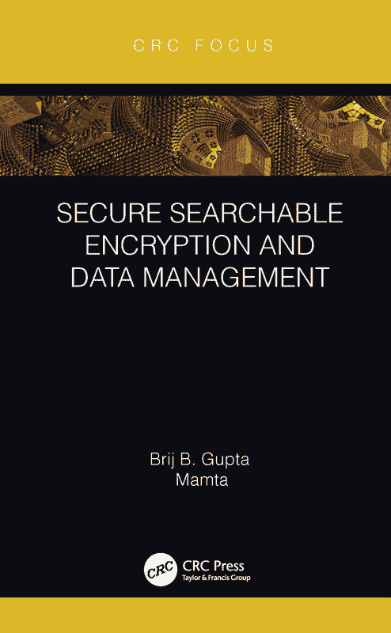

# 前言

# Overview

With the advent of the IT revolution, data generation has grown exponentially and continues to rise. This data may be rich and voluminous, but it is a valuable resource that should be managed properly. Cloud technology plays a significant role in data management. There are many benefits to storing data in the cloud rather than in local storage, but there are privacy concerns regarding storing sensitive data on third-party servers; these concerns can be addressed by storing data in encrypted form. However, while encryption solves privacy issues, it raises other serious problems, including the infeasibility of basic search operations, reduced flexibility when sharing data with other users, and so on. The concept of Searchable Encryption addresses these issues.

This book covers the origin and the necessary mathematical background required to understand and develop Searchable Encryption schemes. The book contains chapters that extensively categorize Searchable Encryption schemes in symmetric key and public key settings. These chapters describe Searchable Encryption schemes under each category based on features, security, and efficiency. Furthermore, the authors provide a comparative study of Searchable Encryption schemes in each category by computing computational and storage costs. The book also introduces different tools, libraries, and datasets used to develop Searchable Encryption schemes. Cross-domain applications of Searchable Encryption schemes are also discussed in the book. Finally, open research challenges and future research directions are elaborated to guide researchers and practitioners in advancing the field further.

# Target Audience

This book is designed for readers interested in the domain of security, specifically those who want to ensure confidentiality while performing operations on encrypted data. This includes researchers exploring the pros and cons of the technology, as well as developers and security professionals focused on developing secure Searchable Encryption schemes applicable to various domains.

# Chapter Overview

Specifically, this book comprises seven chapters, and a detailed overview of the topics covered in each chapter is summarized as follows:

## Chapter 1: Introduction to Number Theory and Abstract Algebra

This chapter introduces the fundamentals of number theory and abstract algebra required to understand any cryptographic algorithm.

## Chapter 2: Introduction to Cryptography

This chapter covers the basic concepts related to cryptography. Traditional and modern cryptography, along with the evolution from traditional to modern cryptography, are briefly discussed. Cryptographic principles and key terminology are described in detail to build a strong background.

## Chapter 3: Searchable Encryption and Data Management

This chapter formally introduces the concept of Searchable Encryption as a data management technique. The necessity of such techniques is explained, along with how the technology can be leveraged to solve the problem of confidentiality protection and efficient retrieval of desired information from encrypted data without compromising confidentiality. The chapter discusses the broad categories of Searchable Encryption based on the underlying encryption technology and explains which underlying encryption technology provides more benefits to the user in different scenarios.

## Chapter 4: Introduction to Provable Security and Its Application in Searchable Encryption

This chapter introduces the concept of provable security and its application in developing secure Searchable Encryption. Basic security definitions used in Searchable Encryption are provided, and the different security models that can be used to prove the security of Searchable Encryption schemes are explained. Furthermore, the chapter introduces the cryptographic assumptions used in provable security and lists the assumptions commonly used in Searchable Encryption.

## Chapter 5: Searchable Encryption in Public Key Settings

This chapter explains the concept of Searchable Encryption in public key settings in detail. A generic structure of Searchable Encryption schemes in asymmetric key settings is provided. Furthermore, the chapter compares existing schemes in the literature under this setting and discusses possible scope for improvement.

## Chapter 6: Design Development Tools and Cross-Domain Applications

This chapter discusses different open-source tools for the design and development of secure Searchable Encryption schemes. Additionally, cross-domain applications of Searchable Encryption are discussed, along with the significant role this technology plays in different domains.

## Chapter 7: Searchable Encryption Applications, Challenges, and Future Research Directions

This chapter highlights the open challenges associated with Searchable Encryption and provides insights into future research directions in the field.

# Acknowledgments

First, we bow our heads in gratitude to the Almighty for His continuous blessings and enthusiasm that enabled us to complete this book. Writing a book is not a one-person job but the result of continuous support from loved ones. This book is the culmination of invaluable hard work, continuous effort, and assistance from loved ones. Therefore, we express our gratitude to everyone associated with this book, whether directly or indirectly, for their wonderful cooperation and creative ideas to improve the quality of the book. We also thank the CRC Press/Taylor & Francis Group team and staff for their assistance and continuous support. Heartfelt thanks to our families for their absolute love and countless prayers. This experience has been both an internal challenge and a reward. Therefore, a special thank you once again to everyone who helped us make this happen.

# About the Authors

**Brij B. Gupta** received his Ph.D. in Information and Cyber Security from the Indian Institute of Technology Roorkee, India, in 2012. He has published more than 250 research papers in internationally reputed journals and conferences. He has visited several countries, including Canada, Japan, the USA, the UK, Malaysia, Australia, Thailand, China, Hong Kong, Italy, Spain, etc., to present his research work. His biography was selected for the 30th Edition of *Marquis Who's Who in the World* (2012). Dr. Gupta received the Young Faculty Research Fellowship from the Ministry of Electronics and Information Technology, Government of India, in 2018. He has also served as Principal Investigator for several R&D projects. He serves/served as Associate Editor for journals such as `IEEE Access`, `IEEE TII`, `FGCS`, `IJICS`, `IJCSE`, `ACM TOIT`, `ASOC`, etc. Currently, Dr. Gupta is working as an Assistant Professor in the Department of Computer Engineering at the National Institute of Technology Kurukshetra, India. His research interests include Information Security, Cyber Security, Mobile Security, Cloud Computing, Web Security, Intrusion Detection, and Phishing.

**Mamta** 目前正在印度库鲁克舍特拉国家理工学院（NIT）计算机工程系，在 Brij B. Gupta 博士的指导下攻读应用密码学博士学位。她曾在印度库鲁克舍特拉国家理工学院计算机工程系获得 M.Tech. 学位。她拥有库鲁克舍特拉大学大学工程技术学院计算机工程专业的 B.Tech. 学位。她的研究兴趣包括数论与密码学、可搜索加密、信息安全和云计算。她已在 IEEE、Springer、Wiley 和 IGI Global 等多家知名出版商发表了多篇研究文章。

# 第 1 章

# 数论与抽象代数导论

数论与抽象代数在密码系统的发展中发挥着重要作用。它们的基础知识是密码学和编码理论等领域的关键要素。因此，在本章中，我们将详细概述这些基本概念，以建立坚实的基础，然后再深入探讨可搜索加密和数据管理领域。本章分为两部分，第一部分涵盖与数论相关的概念，第二部分涵盖抽象代数的基本概念。

## 1.1 数论

数论是数学中一个有趣的侧面，其迷人的概念吸引了从专业数学家到业余爱好者的所有人。数论的概念和定理是自然的，即使外行也能理解。然而，证明它们本质上需要计算机工程研究生所具备的基础知识和深厚背景。在本节中，我们将介绍开发可搜索加密方案所需的所有必要数论概念及其详细证明 [[1]](#01chap_01.xhtml#ref1_1)。

### 1.1.1 整除性

整除性是数论的基本概念。考虑一个整数集合，`Z` = {…,−1,0,1,…}，如果 `a` = `k` ⋅ `b`，其中 `a`、`b`、`k` ∈ `Z`，我们称 `b` 整除 `a`，记作（`b`|`a`） [[2]](#01chap_01.xhtml#ref1_2)。或者也可以说 `a` 能被 `b` 整除，或 `a` 是 `b` 的倍数，或 `b` 是 `a` 的因数/约数。平凡情况包括：*i*）∀`b` ∈ `Z`，`b`|0，表示每个数都整除 0；*ii*）∀`a`∈`Z`，1|`a`，表示 1 整除每个数。

#### 1.1.1.1 整除性质

以下是整除的关键性质，可以通过整除的定义轻松验证：


*   若 `a`|`b` 且 `b`|`c`，则 `a`|`c`
*   若 `a`|`b`，则 `a`|`b``c`，∀`c` ∈ `Z`
*   若 `a`|`b` 且 `c`|`d`，则 `a``c`|`b``d`
*   若 `m`：非零整数，则 `a`|`b` 当且仅当 `m``a`|`m``b`
*   若 `a`|`x` 且 `a`|`y`，则 `a`|`c``x`+`d``y`，其中 `c`、`d` ∈ `Z`
*   若 `d`：非零整数，满足 `d`|`a` `a``n``d` `a`≠0，则 |`d`| ≤ |`a`|
*   `a`|`b` 且 `b`|`a` 当且仅当 `a` = ± `b`
*   若 `a`|`b` 且 `a`|`c`，则 `a`|`b`±`c`

若 `a`|`b`，`b` = `k`[1] ⋅ `a` 且 `b`|`c`，`c` = `k`[2] ⋅ `b` = `k`[2] ⋅ (`k`[1]⋅`a`) = `k` ⋅ `a`，其中 `k` = `k`[1] ⋅ `k`[2] ∈ `Z`。因此，根据定义，`a`|`c`。类似地，其他性质也可以利用基本代数性质和整除的定义来证明，因书籍篇幅限制，留作练习。

一个整数可能无法被另一个整数完全整除；在这种情况下会有商（`q`）和余数（`r`）。除法定理陈述了这一事实：对于任意整数 `a` 和正整数 `n`，∃ 唯一整数 `q` 和 `r`：0 ≤ `r` < `n` 且 `a` = `q` ⋅ `n` + `r`。如果一个数能被完全整除，则 `r` = 0；否则，`r` ∈ [1,`n`−1]。

### 1.1.2 素数

对于任意整数 `x` > 1，至少存在两个正约数，即 `x` 和 1，它们被称为该数的平凡约数。如果一个数不存在非平凡约数，则称该数为素数。如果至少存在一个非平凡约数，则该数称为合数 [[2]](#01chap_01.xhtml#ref1_2)。

**定理 1**：素数有无限个。

**证明**：采用反证法。假设素数只有有限个：(2,3,……,`p`[`k`]) `a``n``d` `p`[`k`] 是最大的素数。构造另一个数 `m`：所有素数的乘积 + 1。

**观察**：没有任何素数能整除 `m`（余数均为 1）。因此，`m` 只能被 1 和它本身整除，所以 `m` 必定是另一个素数。通过这种方式可以构造出无限多个素数。

#### 1.1.2.1 算术基本定理

算术基本定理指出，每个正整数都可以唯一地表示为素数的乘积，即 `n` = `p`[1]^(`e`[1]) ⋅ `p`[2]^(`e`[2]) ⋅ … ⋅ `p`[`m`]^(`e`[`m`])，其中 `p`[1] < `p`[2] < … < `p`[`m`] 且均互不相同 [[3]](#01chap_01.xhtml#ref1_3)。例如：100 = 2 ⋅ 2 ⋅ 5 ⋅ 5 = 2² ⋅ 5²；81 = 3⁴。

证明采用反证法。假设 `n` 有两种不同的素因子分解：

*   `n` = `p`[1]^(`e`[1]) ⋅ `p`[2]^(`e`[2]) ⋅ … ⋅ `p`[`m`]^(`e`[`m`])
*   `n` = `q`[1]^(`d`[1]) ⋅ `q`[2]^(`d`[2]) ⋅ … ⋅ `q`[`r`]^(`d`[`r`])

因此，`p`[1]^(`e`[1]) ⋅ `p`[2]^(`e`[2]) ⋅ … ⋅ `p`[`m`]^(`e`[`m`]) = `q`[1]^(`d`[1]) ⋅ `q`[2]^(`d`[2]) ⋅ … ⋅ `q`[`r`]^(`d`[`r`])。现在我们要证明 `p`[1] = `q`[1] 且 `e`[1] = `d`[1]（前提是 `p`[1] = `q`[1]）。

*   若 `p`[1] ≠ `q`[1]，则 `p`[1] 不能整除任何素数 `q`[1],……`q`[`r`]，即与所有 `q`[1],……`q`[`r`] 互素，`t``h``e``n` `p`[1] 不能整除 `n`（因为 `n` = `q`[1]^(`d`[1]) ⋅ `q`[2]^(`d`[2]) ⋅ … ⋅ `q`[`r`]^(`d`[`r`]))。但这不成立。因此 `p`[1] = `q`[1]
*   假设 `e`[1] < `d`[1]，则 `d`[1] = `e`[1] + `h`，`h` > 0
    *   `p`[1]^(`e`[1]) ⋅ `p`[2]^(`e`[2]) ⋅ … ⋅ `p`[`m`]^(`e`[`m`]) = `q`[1]^(`d`[1]) ⋅ `q`[2]^(`d`[2]) ⋅ … ⋅ `q`[`r`]^(`d`[`r`])
    *   `p`[1]^(`e`[1]) ⋅ `p`[2]^(`e`[2]) ⋅ … ⋅ `p`[`m`]^(`e`[`m`]) = `q`[1]^(`e`[1] + `h`) ⋅ `q`[2]^(`d`[2]) ⋅ … ⋅ `q`[`r`]^(`d`[`r`])
    *   `p`[2]^(`e`[2]) ⋅ … ⋅ `p`[`m`]^(`e`[`m`]) = `q`[1]^(`h`) ⋅ `q`[2]^(`d`[2]) ⋅ … ⋅ `q`[`r`]^(`d`[`r`])

从上式可观察到，右边能被 `q`[1] 整除，而左边不能，这是不可能的。因此 `e`[1] = `d`[1]

#### 1.1.2.2 素数性质

以下是素数的关键性质：

*   若素数 `p` 整除 `a``b`，则 `p`|`a` `o``r` `p`|`b`。
*   若 `m`|`a` `a``n``d` `n`|`a`，且 `m` 和 `n` 没有大于 1 的公共约数（即 `m` 和 `n` 互素），则 `m``n`|`a`。
*   若 `p`^α||`n`，则对某些 0 ≤ β ≤ `α`，有 `p`^β||`n`。

设 `n` = `p`[1]^(`α`[1]) ⋅ `p`[2]^(`α`[2]) ⋅ … ⋅ `p`[`r`]^(`α`[`r`])，`n` 的约数总数是每个素数幂的可能性数量的乘积，即 (`α`[1]+1)(`α`[2]+1)……(`α`[`r`]+1)

### 1.1.3 最大公约数 (GCD)

两个数 `a` 和 `b` 的最大公约数，`g``c``d`(`a`,`b`)，是同时整除 `a` 和 `b` 的最大整数 `d`。

`g``c``d`(`a`,`b`) = `m``a``x`{`d`:`d`|`a` `a``n``d` `d`|`b`}

如果我们有 `a` 和 `b` 的素因子分解，则 `g``c``d`(`a`,`b`) 可以容易地写成如下形式：

*   已知 `a` = `p`[1]^(`α`[1]) ⋅ `p`[2]^(`α`[2]) ⋅ … ⋅ `p`[`k`]^(`α`[`k`]) 和 `b` = `p`[1]^(`β`[1]) ⋅ `p`[2]^(`β`[2]) ⋅ … ⋅ `p`[`k`]^(`β`[`k`])。
*   取两个分解中都出现的所有素数，指数取两者指数的最小值。
*   `gcd(a,b) = p[1]^(min(α[1], β[1]))……p[k]^(min(α[k], β[k]))`.

*互素数*：若 `gcd(a[i],a[j]) = 1, ∀ 1 ≤ i, j ≤ k`，则整数 `a[1], a[2], ……, a[k]` 两两互素。

#### 1.1.3.1 欧几里得定理

设 `b, c > 0` 且 `c ∤ b`；利用除法定理可得以下方程组：

`b = c*q[1] + r[1]; 0 < r[1] < c`

(1.1)

`c = r[1]*q[2] + r[2]; 0 < r[2] < r[1]`

(1.2)

`r[1] = r[2]*q[3] + r[3]; 0 < r[3] < r[2]`

(1.3)

`r[j − 2] = r[j − 1]*q[j] + r[j]; 0 < r[j] < r[j − 1]`

(1.4)

`r[j − 1] = r[j]*q[j + 1] + 0`

(1.5)

则 `gcd(b,c) = r[j]`，即上述方程组中最后一个非零余数。

在上述算法中，我们看到余数不断减小直至变为 0。此外，余数不仅减小，而且减小得相当快。每两步余数的大小至少减半，即 $r_{j + 2} < \frac{1}{2}r_{j}$。

*证明*：若 $r_{j + 1} \leq \frac{1}{2}r_{j}$，则 $r_{j + 2} < r_{j + 1} \leq \frac{1}{2}r_{j}$。假设 $r_{j + 1} > \frac{1}{2}r_{j}$，则 `r[j] = 1 ⋅ r[j + 1] + r[j + 2]`。或者写作 `r[j + 2] = r[j] − r[j + 1]`。若 $r_{j + 1} > \frac{1}{2}r_{j}$，则 $r_{j + 2} < \frac{1}{2}r_{j}$。

#### 1.1.3.2 扩展欧几里得算法

设 `d = gcd(a,b)`。则存在整数 `u` 和 `v` 使得 `d = u*a + v*b`，即两数的最大公约数可表示为这两数的整数系数线性组合。

例如：`gcd(560,1547)`

首先，应用欧几里得定理求最大公约数如下：

1.  `1547 = 2 ⋅ 560 + 427`
2.  `560 = 1 ⋅ 427 + 133`
3.  `427 = 3 ⋅ 133 + 28`
4.  `133 = 4 ⋅ 28 + 21`
5.  `28 = 1 ⋅ 21 + 7`

现在，从最后一个方程回溯并递归代入数值，直到得到原始数字：

```
7 = 28 − 1 ⋅ (21)
  = 28 − 1 ⋅ (133−4⋅28)
  = 28 − 133 + 4 ⋅ (28)
  = 5 ⋅ (28) − 133
  = 5 ⋅ (427−3⋅(133)) − 133
  = 5 ⋅ 427 − 16 ⋅ 133
  = 5 ⋅ 427 − 16(560−427)
  = 21 ⋅ 427 − 16 ⋅ 560
  = 21(1547−2⋅560) − 16 ⋅ 560
  = 21 ⋅ 1547 + (−58) ⋅ 560
```

扩展欧几里得算法在求乘法逆元方面有应用。

### 1.1.4 同余

若整数 `m` 能整除差 `a − b`，则称 `a` 与 `b` 模 `m` 同余，即 `a ≡ b mod m` 当且仅当 `m|a−b` [[2]](#01chap_01.xhtml#ref1_2), [[3]](#01chap_01.xhtml#ref1_3)。

#### 1.1.4.1 同余关系性质

同余的关键性质如下：

*   若 `a ≡ b(mod m)` 且 `c ≡ d(mod m)`，则 `a ± c ≡ (b±d)mod m` 且 `a*c ≡ b*d mod m`。
*   若 `a ≡ b(mod m)` 且 `b ≡ c(mod m)`，则 `a ≡ c(mod m)`。
*   `a ≡ b(mod m)`、`b ≡ a(mod m)` 和 `a − b ≡ 0(mod m)` 等价。
*   若 `a ≡ b(mod m)` 且 `d|m, d > 0`，则 `a ≡ b(mod d)`。
*   若 `a ≡ b(mod m)`，则对 `c > 0` 有 `a*c ≡ b*c(mod m*c)`。
*   若 `a ≡ b mod m`，`a ≡ b mod n` 且 `m, n` 互素，则 `a ≡ b mod m*n`。
*   模 `n` 同余是 Z 上的等价关系。
    *   自反性：`a ≡ a mod n` ∀`a ∈ Z`
    *   对称性：若 `a ≡ b mod n` 则 `b ≡ a mod n`
    *   传递性：若 `a ≡ b mod n` 且 `b ≡ c mod n` 则 `a ≡ c mod n`

这些性质的证明可借助同余的定义和基本整数代数完成。我们将提供第一个性质的证明，其他性质也可用类似方式证明：若 `a ≡ b(mod m)`，则由同余定义和整除定理可写为：`a − b = s ⋅ m` 且 `c − d = t ⋅ m`，其中 `s, t ∈ Z`；`a + c = (s+t)m + (b+d), s + t ∈ Z`。因此，`a ± c ≡ (b±d)mod m`。同理，`a*c = (s*t)m + (b*d), s*t ∈ Z`。因此，`a*c ≡ b*d mod m`。

##### 1.1.4.1.1 模 m 的同余（剩余）类

若 `x ≡ y(mod m)`，则称 `y` 为 `x` 除以 `m` 的一个剩余。若对任意 `y ∈ Z`，存在唯一的 `x[j]` 使得 `y ≡ xj`，则集合 `x[1], x[2], ⋅⋅⋅, x[m]` 称为模 `m` 的完全剩余系。

对于固定整数 `a` 和 `m > 0`，满足 `x ≡ a(mod m)` 的所有整数 `x` 的集合构成一个等差数列 (AP)，`{……a−2m, a−m, a+m, a+2m……}`，该集合称为模 `m` 的剩余类或同余类。例如：模 4 同余下 0 和 1 的等价类为：`[0][4] = {……−8,−4, 0, 4, 8……}` 和 `[1][4] = {……−9,−5, 1, 5, 9……}`。

#### 1.1.4.2 模 m 的简化剩余系

模 `m` 的简化剩余系是一个整数集合 `r[i]`：满足 `(r[i],m) = 1`，若 `i ≠ j` 则 `≢ r[i] ≢ rj`，且每个与 `m` 互素的整数模 `m` 同余于该集合中的某个成员 `r[i]`。要从完全剩余系得到简化剩余系，需删除所有满足 `(y,m) ≠ 1` 的成员 `y`。

#### 1.1.4.3 模 m 的逆元

若 `gcd(a,m) = 1` 或 `(a,m) = 1`，则存在 `x` 使得 `a*x ≡ 1 mod m`，称 `x` 为 `a` 模 `m` 的乘法逆元。

*证明*：由扩展欧几里得算法：`gcd(a,m)=a*x+m*y=1 ⇒ m|a*x−1 ⇒ a*x≡1 mod m`。反之，若 `a*x≡1 mod m ⇒ m|a*x−1`，则存在 `y` 使得 `a*x + m*y = 1`。

因此，若 `m > 1` 且 `gcd(a,m) = 1`，则 `a` 模 `m` 的逆元存在，等于 `gcd(a,m)` 以下表示中的 `x`：`a*x + m*y = 1`。

#### 1.1.4.4 欧拉 φ 函数（托 ient 函数）

模 `m` 的简化剩余系中元素的个数记为 `φ(m)`，称为欧拉 φ 函数、托 ient 函数或指示函数。它用于计算互素数的个数。例如：有多少个小于 20 的正整数与 20 互素？答案是：1, 3, 7, 9, 11, 13, 17, 19。

求 `φ(n)` 公式：

*   列 `n = 1, 2, ……, 15` 的 `φ(n)` 表

| `n` | 1 | 2 | 3 | 4 | 5 | 6 | 7 | 8 | 9 | 10 | 11 | 12 | 13 | 14 | 15 |
| --- | --- | --- | --- | --- | --- | --- | --- | --- | --- | --- | --- | --- | --- | --- | --- |
| `φ(n)` | 1 | 1 | 2 | 2 | 4 | 2 | 6 | 4 | 6 | 4 | 10 | 4 | 12 | 6 | 8 |

*   若 `p` 为素数，查表 `φ(p)` 是多少？
    *   `φ(p) = p − 1`
*   若 `p` 为素数且 `k` 为整数
    *   小于（或等于）`p^(k)` 且不与 `p^(k)` 互素的数必定是 `p` 的倍数，即 `p, 2p, ……, p^(k−1)*p`
    *   因此在 `p^(k)` 个数中有 `p^(k−1)` 个不互素
    *   `φ(p^(k)) = p^(k) − p^(k−1)`

#### 1.1.4.5 费马定理

设 `p` 为素数。若 `p ∤ a`，则 `a^(p−1) ≡ 1 mod p`。

*证明*：若 `p∤a ⇒ (a,p)=1 ⇒ a^(φ(p))≡1 mod p`，由欧拉对费马定理的推广。`φ(p)` 表示与 `p` 互素的整数个数，即 `p − 1`。因此，`a^(p−1) ≡ 1 mod p`。

#### 1.1.4.6 欧拉对费马定理的推广

若 `(a,m) = 1`，则 `a^(φ(m)) ≡ 1 mod m`。

**证明**：设 `r[1]`、`r[2]`、…、`r[φ(m)]` 为模 `m` 的一个简化剩余系。那么 `a*r[1]`、`a*r[2]`、…、`a*r[φ(m)]` 也是模 `m` 的一个简化剩余系，因为 `(a,m) = 1` 且 `(r[i],m) = 1`，这意味着 `(a*r[i],m) = 1`。因此，对应每个 `r[i]`，有且仅有一个 `a*r[j]` 使得 `a*r[j] ≡ r[i] (mod m)`。将所有这 `φ(m)` 个关系式相乘：

```
∏(j=1 to φ(m)) a*r[j] ≡ ∏(i=1 to φ(m)) r[i] (mod m) = a^φ(m) ≡ 1 (mod m)
```

### 1.1.5 同余方程组的解

设 `m[1]`、`m[2]`、… `m[r]` 为两两互素的正整数。我们要求解以下方程组的解：`x ≡ a[1] (mod m[1])`、`x ≡ a[2] (mod m[2])`、…、`x ≡ a[r] (mod m[r])`。求解此类方程的一种方法是利用中国剩余定理 (CRT)。

中国剩余定理指出，若 `(m[i],m[j]) = 1, ∀ i ≠ j`，则该方程组的解存在。


**证明**：设 `m = m[1] ⋅ m[2] ⋅ … ⋅ m[r]`，则 `(m/m[j], m[j]) = 1`。设 `R(m[j])` 表示模 `m` 的简化剩余系，它包含所有与 `m[j]` 互素的元素集合。因此，`∀ a ∈ R(m[j]), ∃ x ∈ R(m[j]) : a*x ≡ 1 (mod m[j])`，这意味着，`∃ b[j] ∈ R(m[j]) : (m/m[j]) * b[j] ≡ 1 (mod m[j])`。设 `x[0]` 为一个解，则 `x[0] = ∑(j=1 to r) ((m/m[j]) ⋅ b[j] ⋅ a[j] mod m[j])`，因为 `((m/m[j]) ⋅ b[j] ⋅ a[j]) ≡ a[j] (mod m[j])`。

### 1.1.6 二次剩余

如果 `p` 是奇素数且 `a` 是与 `p` 互素的整数，那么 "a" 是否为模 `p` 的完全平方数？求二次剩余可以回答这个问题。如果 `m` 是正整数，我们称整数 "a" 为 `m` 的二次剩余，当且仅当 `gcd(a,m) = 1` 且同余式 `x² ≡ a (mod m)` 有解。如果 `x² ≡ a (mod m)` 无解，则称 "a" 为 `m` 的二次非剩余 [[2]](#01chap_01.xhtml#ref1_2)，[[3]](#01chap_01.xhtml#ref1_3)。

**示例**：判定哪些整数是 11 的二次剩余。

*   **步骤 1**：因为 `m = 11` 是素数，所以 `{1,2,…10}` 均与 `m` 互素。

*   **步骤 2**：计算整数 `{1,2,…10}` 的平方：`1² ≡ 10² ≡ 1 (mod 11)`，`2² ≡ 9² ≡ 4 (mod 11)`，`3² ≡ 8² ≡ 9 (mod 11)`，`4² ≡ 7² ≡ 5 (mod 11)`，`5² ≡ 6² ≡ 3 (mod 11)`。

*   **二次剩余**：1, 3, 4, 5, 9。**二次非剩余**：2, 6, 7, 8, 10。

**结论**：给定任意固定的正整数 `m`，只需列出所有小于 `m` 且与 `m` 互素的正整数，将它们平方并对 `m` 取模，即可确定二次剩余。

**引理**：如果 `p` 是奇素数且 `a` 是与 `p` 互素的整数，则同余式 `x² ≡ a (mod m)` 要么无解，要么恰好有两个模 `p` 不合同的解。

**证明**：如果 `x² ≡ a (mod p)` 有解，设为 `x = x[0]`，则我们可以很容易地证明 `x = -x[0]` 是第二个不合同解，因为 `(-x[0])² = x[0]² ≡ a (mod p)`。

**注**：`x[0] ≢ -x[0] (mod p)`（`2*x[0] ≡ 0 (mod p)`，这是不可能的，因为 `p | x[0]`）。

现在我们要证明不存在超过两个不合同的解。假设 `x = x[0]` 和 `x = x[1]` 都是 `x² ≡ a (mod p)` 的解。`x[0]² ≡ a (mod p)` 且 `x[1]² ≡ a (mod p)`，则 `x[0]² - x[1]² ≡ 0 (mod p)`。`(x[0]+x[1])(x[0]-x[1]) ≡ 0 (mod p)`，即 `p | (x[0]+x[1])` 或 `p | (x[0]-x[1])`。`x[1] ≡ -x[0] (mod p)` 或 `x[1] ≡ x[0] (mod p)`。

**定理**：如果 `p` 是奇素数，则 `p` 恰有 `(p - 1)/2` 个二次剩余和 `(p - 1)/2` 个二次非剩余。

**证明**：考虑整数 `{1,2,…p−1}` 的所有平方。我们知道 `x² ≡ (p-x)² ≡ a (mod p)`。设 `1 < b < p - 1`。`(p-b)² ≡ b² (mod p)`。

```
1², 2², …, ((p - 1)/2)² ≡ ((p + 1)/2)², …, (p - 2)², (p - 1)²
```

(1.6)

因为 `1² ≡ (p-1)² (mod p)`，同理，式 (1.6) 中的其他元素之间也存在同样的关系。因此，`1², 2², …, ((p - 1)/2)²` 互不相同。

#### 1.1.6.1 欧拉判别法

欧拉判别法精确地告诉我们整数 `a` 何时为模奇素数 `p` 的二次剩余。设 `p` 为奇素数且 `gcd(a,p) = 1`。当且仅当 `a^((p - 1)/2) ≡ 1 (mod p)` 时，`a` 是模 `p` 的二次剩余。

**证明**：设 `a` 为二次剩余，则 `x² ≡ a (mod p)`。`(x²)^((p - 1)/2) ≡ a^((p - 1)/2) (mod p)`。`x^(p - 1) ≡ a^((p - 1)/2) (mod p)`。由费马小定理，`x^(p-1) ≡ 1 (mod p)`，因此，`a^((p - 1)/2) ≡ 1 (mod p)`。

**反之**：已知 `a^((p - 1)/2) ≡ 1 (mod p)`。证明："a" 是模奇素数 `p` 的二次剩余。

**证明**：我们知道存在模 `p` 的一个原根 `g`，使得 `ℤ[p]` 中的任意整数均可表示为 `g^(i) (mod p)`，`1 ≤ i ≤ p - 1`，且 `g^(m) ≡ 1 (mod p)` 仅当 `p-1 | m`（`m=0` 或 `p-1`）时成立。对于某个 `1 ≤ i ≤ p - 1`，有 `a ≡ g^(i) (mod p)`。`g^(i((p - 1)/2)) ≡ a^((p - 1)/2) ≡ 1 (mod p)`（已知）。由原根的性质 `p - 1 | i((p - 1)/2)`；因此，`i` 必为偶数，设 `i = 2j`，这意味着 `a ≡ g^(2j) (mod p)`，`a ≡ (g^(j))² (mod p)`。因此，`a` 是模奇素数 `p` 的二次剩余。

### 1.1.7 勒让德符号

这是一个方便的符号，用于指示整数 `a` 是否为模奇素数 `p` 的二次剩余。`a (mod p)` 的勒让德符号记为 `(a/p)`。正式定义如下：

```
( a/p ) = {  1,  若 a 是模 p 的非零二次剩余
           { -1,  若 a 是模 p 的非零二次非剩余
           {  0,  若 p | a
```

(1.7)

示例：`(2/7) = 1`，`(2/5) = -1`，`(12/5) = -1`，`(101/97) = 1`，`(97/101) = 1`。

如果 `p` 除 `a` 有余数，即 `a = q*p + r`，则 `(a/p) = (r/p)`。由欧拉判别法，`a^((p - 1)/2) ≡ (a/p) (mod p)`。

#### 1.1.7.1 二次互反律

二次互反律关联了两个勒让德符号 `(p/q)` 和 `(q/p)`，其中 `p` 和 `q` 为奇素数：

```
( p/q ) ( q/p ) = (-1)^(((p - 1)/2) * ((q - 1)/2))
```

(1.8)

其中，当 $p \equiv 1 \pmod 4$ 时 $\frac{p - 1}{2}$ 为偶数，当 $p \equiv 3 \pmod 4$ 时为奇数。因此，若 $p \equiv 1 \pmod 4$ 或 $q \equiv 1 \pmod 4$，则 $\frac{p - 1}{2} \cdot \frac{q - 1}{2}$ 为偶数；而若 $p \equiv q \equiv 3 \pmod 4$，则 $\frac{p - 1}{2} \cdot \frac{q - 1}{2}$ 为奇数。因此，

$$

\left( \frac{p}{q} \right)\left( \frac{q}{p} \right) = \left\{

\begin{matrix}

1, & \text{若 } p \equiv 1 \pmod 4 \text{ 或 } q \equiv 1 \pmod 4 \text{（或两者皆满足）} \\

-1, & \text{若 } p \equiv q \equiv 3 \pmod 4

\end{matrix}

\right.

$$

(1.9)

由于 $\left( \frac{p}{q} \right)$ 和 $\left( \frac{q}{p} \right)$ 的唯一可能值为 $\pm 1$。因此，

$$

\left( \frac{p}{q} \right) = \left\{

\begin{matrix}

\left( \frac{q}{p} \right), & \text{若 } p \equiv 1 \pmod 4 \text{ 或 } q \equiv 1 \pmod 4 \text{（或两者皆满足）} \\

-\left( \frac{q}{p} \right), & \text{若 } p \equiv q \equiv 3 \pmod 4

\end{matrix}

\right.

$$

(1.10)

#### 1.1.7.2 雅可比符号

雅可比符号是勒让德符号的推广，其正式定义如下：

设 $n$ 为正整数，其质因数分解为 $n = p_1^{t_1} p_2^{t_2} \dots p_m^{t_m}$，设 $a$ 为与 $n$ 互质的正整数。则雅可比符号 $\left( \frac{a}{n} \right)$ 定义为：

$$

\left( \frac{a}{n} \right) = \left( \frac{a}{p_1^{t_1} p_2^{t_2} \dots p_m^{t_m}} \right) = \left( \frac{a}{p_1} \right)^{t_1} \left( \frac{a}{p_2} \right)^{t_2} \dots \left( \frac{a}{p_m} \right)^{t_m}

$$

(1.11)

例如：$\left( \frac{2}{45} \right) = \left( \frac{2}{3² \cdot 5} \right) = \left( \frac{2}{3} \right)² \left( \frac{2}{5} \right) = (-1)² (-1) = -1$ 和 $\left( \frac{109}{385} \right) = \left( \frac{109}{5 \cdot 7 \cdot 11} \right) = \left( \frac{109}{5} \right) \left( \frac{109}{7} \right) \left( \frac{109}{11} \right) = \left( \frac{4}{5} \right) \left( \frac{4}{7} \right) \left( \frac{10}{11} \right) = \left( \frac{2}{5} \right)² \left( \frac{2}{7} \right)² \left( \frac{-1}{11} \right) = (-1)² (1) (-1) = -1$。

上述关于数论概念的讨论是理解密码算法 [[4]](#01chap_01.xhtml#ref1_4)、[[5]](#01chap_01.xhtml#ref1_5) 的必要前提。

## 1.2 抽象代数

抽象代数 [[6]](#01chap_01.xhtml#ref1_6)、[[7]](#01chap_01.xhtml#ref1_7) 代表了一类强大的数学工具，应用于各个领域。它是经典代数的延伸，处理的是群、环、域等抽象结构，而非通常的数系。在本节中，我们将概述这些结构，这是理解密码体制核心的前提。

代数结构由以下三个组成部分刻画：

*   一个底层集合，通常称为代数结构的**载体集合**。

*   定义在底层集合元素上的运算。

*   集合中的特殊元素，称为代数结构的**常数**。

例如：$(\mathbb{Z}, +, 0)$ 是一个代数结构，其中 $\mathbb{Z}$ = 整数集，$+$ = 二元运算（从 $\mathbb{Z}² \to \mathbb{Z}$ 的映射），$\mathbb{Z}²$ 表示该运算作用于集合 $\mathbb{Z}$ 的两个元素上，且结果元素也属于集合 $\mathbb{Z}$，$0$ = $C$ 代数常数。

一般来说，算子可以取 $m$ 个元素：$S^m \to S$，此处 $m$ 称为运算的**元数**。任意两个代数结构可能具有相同的签名、相同数量且元数相同的运算以及相同数量的常数。例如，$(\mathbb{Z}, +, \cdot, -, 1, 0)$ 和 $(\mathbb{R}, +, \cdot, -, 1, 0)$，此处 $\mathbb{R}$ 为实数集。具有相同签名的两个代数未必具有相同的性质。$(\mathbb{Z}, -, 0)$ 和 $(\mathbb{Q}, +, 0)$。此处，交换律对第二个结构成立，但对第一个不成立。

**子代数结构**：设 $A = \langle S, \circ, \triangle, k \rangle$ 和 $A' = (S', \circ', \triangle', k')$ 为两个代数，则若满足 i) $S' \subseteq S$，ii) $a \circ' b = a \circ b, \forall a, b \in S'$，iii) $\triangle' a = \triangle a, \forall a \in S'$ 且 iv) $k' = k$，则 $A'$ 为 $A$ 的子代数。若 $A'$ 是 $A$ 的子代数，则 $A'$ 具有与 $A$ 相同的签名并遵守相同的公理。

**零元与一元**：设 $\circ$ 为 $S$ 上的二元运算。元素 $1 \in S$ 称为运算 $\circ$ 的**单位元**，若对每个 $x \in S$，有 $1_l \circ x = x \circ 1_r = x$。元素 $0 \in S$ 称为运算 $\circ$ 的**零元**，若对每个 $x \in S$，有 $0_l \circ x = x \circ 0_r = 0$。

考虑以下代数结构：$S = \{a, b, c\}$，运算：$\circ$，运算表：

$$

\begin{matrix}

\circ & a & b & c \\

a & a & b & b \\

b & a & b & c \\

c & a & b & c

\end{matrix}

$$

求零元和单位元。

*解*：右零元 = $a, b$，无左零元，左单位元 = $b$，无右单位元。

**定理**：设 $\circ$ 为 $S$ 上的二元运算，具有左单位元 $1_l$ 和右单位元 $1_r$。则 $1_l = 1_r$，这称为**双边单位元**。

*证明*：由左单位元得：$1_l \circ x = x$。令 $x = 1_r$。由右单位元得：$x \circ 1_r = x$。令 $x = 1_l$，得 $1_l \circ 1_r = 1_l$。因此 $1_r = 1_l$。

### 1.2.1 半群

半群是具有签名 $\langle S, \circ \rangle$ 的代数结构。半群通常由具有单个二元运算且满足封闭性和结合律的代数结构组成。例如：$\langle \mathbb{Z}, + \rangle$、$\langle \mathbb{Z}, \cdot \rangle$、$\langle \mathbb{R}, + \rangle$、$\langle \Sigma^*, \text{concatenation} \rangle$。

### 1.2.2 幺半群

幺半群是具有签名 $\langle S, \circ, 1 \rangle$ 的代数结构，其中 $\circ$ 为二元结合运算，$1$ 为运算 $\circ$ 的双边单位元。它满足封闭性、结合律和单位元公理。幂半群的例子包括：$\langle \mathbb{Z}, +, 0 \rangle$、$\langle \mathbb{Z}, \cdot, 1 \rangle$、$\langle \mathbb{R}, +, 0 \rangle$、$\langle \Sigma^*, \text{concatenation}, \lambda \rangle$。

### 1.2.3 群

群是具有签名 $\langle S, \circ, 1, - \rangle$ 的代数结构，其中 $\circ$ 为二元结合运算，常数 $1$ 为运算 $\circ$ 的双边单位元，$-$ 为定义在载体上的一元运算，使得 $\forall x \in S, \bar{x}$ 为 $x$ 关于 $\circ$ 的逆元。它满足封闭性、结合律、单位元和逆元公理。群的例子包括：$\langle \mathbb{Z}, +, 0, - \rangle$，此处 $-$ 表示一元取负运算。若 $\circ$ 运算满足交换律，则该群称为**阿贝尔群**（或交换群）。群是构造密码体制中最常用的代数结构。因此，我们将在篇幅限制内尽可能详细地介绍。

**群具有唯一逆元**：设群元素 $a$ 有两个逆元 $b$ 和 $c$，$b \circ a = e$ 且 $c \circ a = e$，这蕴含 $b \circ a = c \circ a \Rightarrow b \circ a \circ b = c \circ a \circ b$。设 $a \circ b = d$，则 $b \circ d = c \circ d$。我们知道群中每个元素都有逆元，故 $b \circ d \circ d^{-1} = c \circ d \circ d^{-1} \Rightarrow b \circ e = c \circ e$。因此，$b = c$。

由于逆元的存在，群中允许左消去和右消去。

#### 1.2.3.1 对称有限群

对称有限群定义在有限集合 *n* ∈ ℕ = {1,2,3,4,……,*n*} 上，通常表示为 *S*[*n*]。为了构造对称群，我们必须考虑 *n* 个元素的集合排列，并为每个排列指定一个名称。这些排列将成为群 *S*[*n*] 的元素，然后我们必须定义合成律。例如：

*S*[1] = {*i*} *S*[1] 的排列：


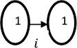

*S*[1] 的合成律：

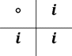

*S*[2] = {*i*,*τ*} *S*[2] 的排列：

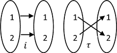

*S*[2] 的合成律：

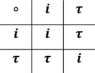

*S*[*n*] 的阶是 *S*[*n*] 中元素的个数，即用 *n* 个元素可能的排列数，为 *n*!。从 *S*[3] 开始的对称群都是非阿贝尔群。

#### 1.2.3.2 群同构

为了理解群同构的概念，请考虑以下两个群：*G* : *S*[2] = {*i*,*τ*} *G*′ = {+1,−1}

```
∘  i  τ  ×  +1  -1
i  i  τ  +1  +1  -1
τ  τ  i  -1  -1  +1
```

*G* 和 *G*′ 的合成表看起来很相似，通过重新标记符号，我们可以将 *G* 变为 *G*′，即 *i* → +1 和 *τ* → −1。我们已经看到 *G* 和 *G*′ 具有完全相同的代数结构，我们只是使用了不同的符号。同构是一个保持群结构的重标记函数（φ），φ: *G* → *G*′（双射映射——满射且单射）。阶相同的群不一定同构。将所有彼此同构的群收集在一起形成同构类。如果两个群属于同一个同构类，这意味着它们彼此同构。

*示例*：*G* = (ℝ,+)，其中 ℝ 是实数集合，*G* 是一个阿贝尔群。考虑另一个群 *G*′ = (ℝ⁺,×)，其中 ℝ⁺ 是正实数集合，*G*′ 也是一个阿贝尔群。现在，我们需要定义一个从 *G* 到 *G*′ 的双射映射，φ: *G* → *G*′ φ: *x* → *e*^(*x*)，∀*x* ∈ *G* 且 *e*[*G*] 映射到 *e*[*G*′] (0 → 1)。因此 *G* 和 *G*′ 是同构的（*G* ≈ *G*′）。

#### 1.2.3.3 子群

群 *G* 的子集 *H* ⊂ *G* 如果在合成运算下封闭，则称为 *G* 的子群，记作 *H* ≺ *G*。并非 *G* 的所有子集都能构成群，因此我们必须巧妙地选择 *H* 的元素。结合律公理显然成立。单位元必须包含在来自 *G* 的 *H* 中。*H* 中的每个元素都应有其逆元，即 ∀*h* ∈ *H*，∃*h*^(−1) ∈ *H*，使得 *h**h*^(−1) = *e* = *h*^(−1)*h*。

*子群示例*：平凡情况包括 i) *G* = 整个群 *G*，ii) *H* = {*e*}。除平凡情况外：(ℤ, +) 是已知的阿贝尔群。考虑一个包含 *a* 的整数倍的集合，*a*ℤ = {*a**z* | ∀*z* ∈ ℤ} = {0, *a*, −*a*, 2*a*, −2*a*, 3*a*, −3*a*,……}。显然，*a*ℤ ≺ ℤ。如果 *a* = 0，*a*ℤ = {0}；如果 *a* = 1，*a*ℤ = ℤ，这代表平凡子群。如果 *a* = 2，*a*ℤ = {0, 2, −2, 4, −4,……}；它代表一个真子群，仅包含偶数。事实上，*a*ℤ 是 *G* = (ℤ, +) 的唯一可能的子群。

#### 1.2.3.4 子群的交

子群的交也是子群，即如果 *H*[1], *H*[2] ≼ *G*，则 *H*[1] ⋂ *H*[2] ≼ *G*。两个子群的交总是非空的，因为它至少包含一个元素，即群的单位元。

*封闭性*：∀ *g*, *ḡ* ∈ *H*₁ ⋂ *H*₂，我们需要证明：*gḡ* ∈ *H*₁ 且 *gḡ* ∈ *H*₂。我们知道 *g*, *ḡ* ∈ *H*₁，所以它们的合成 *gḡ* ∈ *H*₁。同理，*gḡ* ∈ *H*₂。因此，*gḡ* ∈ *H*₁ ⋂ *H*₂。*结合性*：继承自父群。*单位元*：显然成立。*逆元*：∀*g* ∈ *H*₁ ⋂ *H*₂，我们需要证明：*g*^(−1) ∈ *H*₁ ⋂ *H*₂。∀*g* ∈ *H*₁ ⋂ *H*₂ → *g* ∈ *H*₁ 且 *g* ∈ *H*₂。*H*₁ 和 *H*₂ 是群，所以 *g*^(−1) ∈ *H*₁ 且 *g*^(−1) ∈ *H*₂。

#### 1.2.3.5 循环群

如果一个群中存在一个元素 *x* ∈ *G*（*x* 非单位元），称为该群的生成元，则该群称为循环群。顾名思义，生成元可以生成群的所有元素，即 ⟨*x*⟩ = {*e*, *x*¹, *x*², *x*³, …… *x*^(−1), *x*^(−2), *x*^(−3), ……}。循环群的常见例子包括 (ℕ,+) 和 (ℤ,+)。

### 1.2.4 环

到目前为止，我们已经看到了具有一个二元运算的代数结构。环是一个具有两个二元运算的代数结构 (*A*, +, ⋅)，并满足以下条件：i) (*A*, +) 是一个阿贝尔群，ii) (*A*, ⋅) 是一个半群，iii) 运算 ⋅ 对运算 + 具有分配律。示例：(*Z*[*n*], ⊕, ⨀)。

*除环*：每个非零元素都有乘法逆元，即如果 *a* ∈ *R* 且 *a* ≠ 0，则 ∃*a*^(−1) ∈ *R*： *a* ⋅ *a*^(−1) = 1 = *a*^(−1) ⋅ *a*。

*整环*：一个没有零因子的交换环，即 *a* ⋅ *b* = 0 ∀*a*, *b* ∈ *R* 当且仅当 *a* = 0 或 *b* = 0。

### 1.2.5 域

具有两个二元运算的代数结构 (*A*, +, ⋅) 如果满足以下条件，则称为域：i) (*A*, +) 是一个阿贝尔群，ii) (*A*−{0}, ⋅) 是一个阿贝尔群，iii) 运算 ⋅ 对运算 + 具有分配律。示例：(*R*, +, ⋅)，(*Z*[*p*], ⊕, ⨀)。

#### 1.2.5.1 有限域

有限域也称为伽罗瓦域，在密码学领域有广泛应用，就像群一样。有限域存在的条件是域有 *p*^(*m*) 个元素，其中 *p* 是素数，*m* 是任意正整数，即有限域的阶要么是素数，要么是素数的幂。*GF*(12) 不存在。根据 *m* 的值，有限域分为两类：i) 如果 *m* = 1，称为素数域；ii) 如果 *m* > 1，称为扩域。

#### 1.2.5.2 素数域及其运算

素数域 *GF*(*p*) 的元素是整数 {0,1,2,…,*p*−1}。对于 *a*, *b* ∈ *GF*(*p*)，我们可以执行加法：(*a*+*b*) mod *p*；减法：(*a*−*b*) mod *p*；乘法：(*a**b*) mod *p*；除法：(*a**b*^(−1)) mod *p* 和求逆：*a* ∈ *GF*(*p*) 则 *a**a*^(−1) ≡ 1 mod *p*。*a*^(−1) 可用扩展欧几里得算法计算。

#### 1.2.5.3 扩域及其运算

在密码学中，我们主要关注 *p* = 2 的扩域。*GF*(2^(*m*)) 的元素是以下类型的多项式 *A*[*X*]：

*a*[*m*−1]*x*^(*m*−1) + *a*[*m*−2]*x*^(*m*−2) + … + *a*[1]*x* + *a*[0]

(1.12)

其中 *a*[*i*] ∈ *GF*(2)（一般情况：*a*[*i*] ∈ *GF*(*p*) = {0,1,2,……,*p*−1}）。

例如：*GF*(8) = *GF*(2³)。*A*[*X*] = *a*[2]*x*² + *a*[1]*x* + *a*[0]，其中 *a*[*i*] ∈ *GF*(2)。该多项式可视为向量 (*a*[2], *a*[1], *a*[0])，可能的组合从 000 到 111。

*GF*(2³) = {0, 1, *x*, *x*+1, *x*², *x*²+1, *x*²+*x*, *x*²+*x*+1}

(1.13)

设 *A*[*X*], *B*[*X*] ∈ *GF*(2^(*m*))。加法和减法运算执行如下：

$$C[X] = A[X] + B[X] = \sum_{i=0}^{m-1} c_i x^i, \text{ where } c_i = (a_i + b_i) \mod 2$$

(1.14)

$$C\left\lbrack X \right\rbrack = A\left\lbrack X \right\rbrack - B\left\lbrack X \right\rbrack = {\sum\limits_{i = 0}^{m - 1}{c_{i}x^{i}}},\text{ 其中 }c_{i} = \left( a_{i} - b_{i} \right)\bmod 2$$

(1.15)

例如，`A[X] = x² + x + 1` 和 `B[X] = x² + 1`。`A[X] + B[X] = (2 \bmod 2)x² + x + 2 \bmod 2 = x` 且 `A[X] − B[X] = x`。

请注意，在 `GF(2^m)` 中加法和减法是同一运算。

对于乘法运算，似乎两个多项式相乘会返回正确结果，即 `C'[X] = A[X]B[X] = (x²+x+1)(x²+1) = x⁴ + x³ + x + 1 ∉ GF(2^m)`。然而，事实并非如此；结果元素不属于所考虑的域。现在回顾一下素数域：`GF(7) = {0,1,…6}`，相乘以下两个元素：`3.4 = 12 \bmod 7 = 5 ∈ GF(7)`。通过计算模运算可获得正确结果。扩展域也是同样的情况，我们必须将乘法结果除以一个多项式，即用一个表现得像素数的多项式（称为不可约多项式）来约简 `C'[X]`。寻找不可约多项式 $P\left\lbrack X \right\rbrack = {\sum_{i = 0}^{m}{p_{i}x^{i}}},\text{ 其中 }p[i] \in GF(2)$。对于 `GF(2³)`：`P[X] = x³ + x + 1`。因此，扩展域中正确的乘法方法是：`C[X] = A[X]B[X] \bmod P[X]`。对于每个域，都存在若干个不可约多项式。

对于 `GF(2^m)` 中的求逆运算，可以使用扩展欧几里得算法。例如，要找到 `(x³+x+1) \bmod (x⁵+x³+1)` 的乘法逆元，按如下方式使用扩展欧几里得算法：

*   `x⁵ + x³ + 1 = x²(x³+x+1) + (x²+1)`
*   `x³ + x + 1 = x(x²+1) + 1`
*   `x³ + x + 1 − x(x²+1) = 1`
*   `(x³+1)(x³+x+1) + x(x⁵+x³+1) = 1`
*   `(x³+x+1)^(-1) = (x³+1)`

#### 1.2.5.4 域的特征

域的特征是一个与每个域相关联的数（非负整数）。它表示为 `Ch(F)`；它是乘法单位元（1）自加以得到加法单位元（0）所需的最小次数。例如：`F[2] = {0,1}` 具有以下合成表，其 `Ch(F) = 2`（1+1=0）。

*   + 0 1 * 0 1
*   0 0 1 0 0 0
*   1 1 0 1 0 1

**定理**：域的特征要么是 0，要么是一个素数。

**证明**：采用反证法。设 `Ch(F) = n`，其中 `n` 不是素数。因此，`n = ab`，使得 `a` 和 `b` 均不为 `1` 且 `1 < a, b < n`。根据域特征的定义，`n ⋅ 1 = 0`，这意味着 `(ab) ⋅ 1 = 0`。展开点乘表示法，`(a⋅1) * (b⋅1) = 0`。在域中不存在零因子，所以 `(a⋅1)` 或 `(b⋅1)` 其中之一为 0。假设 `(a⋅1) = 0`。这与 `n` 是最小正整数的假设相矛盾。因此，`Ch(F) = 0 或 p`。

## 1.3 密码学应用

这些数论和抽象代数概念在现代密码学中有直接应用。密码系统的设计涉及单向过程，这些过程易于计算但难以逆转。这些单向过程是利用数论概念开发的。考虑分解因式的例子，这是数论中一个非常基本的概念，也是此类单向过程的一个非常著名的例子，因为将任意两个大素数相乘非常容易，但给定乘积后恢复这些素因子却极其困难。这个分解因式问题结合欧拉定理构成了最流行的 RSA 密码系统的基础。另一个此类单向过程的例子是离散对数问题，它指出：给定两个互质整数 `a` 和 `n` 以及另一个整数 `k`，求 `a^k \bmod n` 很容易，但给定 `a^k \bmod n` 后求 `k` 却极其困难。离散对数问题构成了许多密码系统的基础，Diffie-Hellman 密钥交换算法是该问题的第一个成功应用案例。最近，这些思想通过用椭圆曲线上点的更奇异运算取代模运算而得到了扩展和丰富。

## 1.4 本章小结

在本章中，我们讨论了数论和抽象代数的基础知识，它们在理解和开发密码系统中发挥着重要作用。现代密码学完全基于抽象代数和数论。因此，我们试图简要涵盖这两个先决条件的各个方面，重点关注它们在密码学中的应用。此外，考虑到篇幅限制以及概念的清晰度，我们有选择地挑选了主题，仅详细阐述了那些应用可直接体现在密码学世界中的内容。

# 参考文献

1. V. Shoup, A Computational Introduction to Number Theory and Algebra. Cambridge University Press, 2009.

2. J. J. Tattersall, Elementary Number Theory in Nine Chapters. Cambridge University Press, 2005.

3. A. Weil, Basic Number Theory, vol. 144. Springer Science & Business Media, 2013.

4. B. Gupta, D. P. Agrawal, and S. Yamaguchi, eds. Handbook of Research on Modern Cryptographic Solutions for Computer and Cyber Security. IGI Global, 2016.

5. P. Premkamal, S. Kumar, P. J. A. Kumar Pasupuleti, and Alphonse, “Efficient escrow-free CP-ABE with constant size ciphertext and secret key for big data storage in cloud.”, International Journal of Cloud Applications and Computing (IJCAC), vol. 10, no. 1, pp. 28–45, 2020.

6. C. C. Sims, “Abstract algebra: a computational approach,” No. 512.02 S5. J. Wiley, 1984.

7. D. S. Dummit, and R. M. Foote, Abstract Algebra, vol. 3. Wiley Hoboken, 2004.

# 第 2 章

# 密码学导论

密码学不仅是一个研究领域，更是当今数字世界的强制性需求。它是保护数字信息在系统内部及传输过程中安全的重要工具。如果我们仔细观察，会发现密码学无处不在，从互联网上的安全通信到用户认证，再到磁盘上的文件加密。密码学处于每一个需要安全性和隐私性的系统或网络的核心位置。密码学已存在数千年，并将继续作为开发安全机制的基础。本章涵盖与密码学相关的基本概念。它简要讨论了传统密码学和现代密码学，以及从传统密码学到现代密码学的演变历程。它详细描述了密码学原理和关键术语，以建立坚实的基础。

## 2.1 密码学导论

# 密码学

密码学 [[1]](#02chap_02.xhtml#ref2_1)–[[5]](#02chap_02.xhtml#ref2_5) 是编写秘密以向非预期接收者隐藏信息的科学。密码学的作用远不止于为不同各方之间的安全通信建立一个秘密密钥。就像现实世界中的物理签名一样，密码学在数字世界中提供了类似的数字签名。数字签名的目的与物理签名相同：它将验证你的身份。但是，与物理签名不同，我们不能像在现实世界中那样，使用同一个数字签名来签署所有文件，因为在数字世界中，任何人都可以非常轻松地剪切并粘贴数字签名到我们可能不想签署的材料上。因此，密码学帮助我们开发一种数字签名，它在验证我们身份的同时，确保没有人能够复制粘贴它。它通过使数字签名成为我们要签名的数据内容的函数来实现这一点。最近，密码学的应用出现在本世纪最流行的区块链技术中，人们可以在网络上匿名通信。密码学由来已久；大约 2078 年前，尤利乌斯·凯撒首次在其军事命令中使用了一种非常简单的替换密码，其中每个字母都被移位以使消息变得无意义。后来，这种密码以他的名字命名，称为凯撒密码。历史上密码学的另一个广泛应用是德国人在一战末期开发并在二战中大量用于安全传输消息的恩尼格玛密码机。在下一节中，我们将简要讨论并对著名的传统密码进行分类。

## 2.2 密码分类

密码是将有意义的内容转换为乱序且难以理解内容的过程的结果。我们假设读者已经了解 `ciphertext`（密文）、`plaintext`（明文）、`encryption`（加密）、`decryption`（解密）等基本术语，将直接进入密码的不同类别，并按图 2.1 所示对其进行分类讨论。

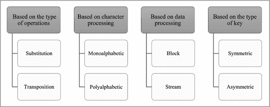

*图 2.1* 密码分类。

### 2.2.1 基于操作类型

此类别下的密码称为经典密码，在理解现代密码方面发挥着重要作用。

#### 2.2.1.1 替换密码

在替换密码中，明文中的每个字符都被替换为一个密文字符。替换可以是单表的，即每个明文字符被替换为相同的密文字符；也可以是多表的，即每个明文字符被替换为不同的密文字符。我们将讨论的替换密码示例包括凯撒密码、维吉尼亚密码和一次性密码本。

*   **凯撒密码**：这是一个位移值固定为三的移位密码示例。凯撒密码的一个更灵活的版本允许位移值为任意整数。即使允许任意位移值，对于任何给定的明文，也只有 25 种不同的移位密码可能。由于每个明文字符总是被替换为相同的密文字符，这是一个单表密码的示例。

*   **维吉尼亚密码**：这种密码基于多个基于关键字长度的交织移位密码。关键字重复直到其长度等于明文长度。它是一种多表密码。


* **一次性密码本 (OTP)**：这种密码由维尔纳姆于 1917 年设计。它是维吉尼亚密码的扩展，遵循以下规则：i) 关键字（密钥）的长度与明文长度相同，ii) 关键字是随机生成的字母字符串，iii) 关键字仅使用一次。OTP 被认为具有完美保密性，即通过查看密文，绝对无法获得关于明文的任何信息。此外，它无法通过暴力破解法攻破。我们可以通过这个简单的例子了解破解 OTP 的复杂性：考虑一个使用 OTP 加密的五字符消息。要通过暴力破解密文，我们需要尝试所有可能的密钥并进行 `26⁵` 次计算，即 11,881,376 种组合，这仅针对五字符的消息。因此，对于更长的消息，计算量随每个新字母呈指数级增长。然而，由于密钥过长，OTP 在实践中很难使用。

#### 2.2.1.2 置换密码

在置换密码中，我们不是替换明文中的不同字符，而是改变元素的位置来生成密文。各种类型的置换密码包括栅栏密码、行置换密码和列置换密码。

### 2.2.2 基于数据处理

根据加密算法获取多大数据块将明文转换为密文，密码分为两类：分组密码和流密码。分组密码通过获取固定大小的数据位生成，而流密码通过一次获取单个数据位生成。这些密码属于对称密钥加密家族。

#### 2.2.2.1 流密码

如前所述，流密码一次获取一位将明文转换为密文。它就像一次性密码本，是使 OTP 实用化的一种尝试。在流密码中，我们不使用完全随机的密钥，而是使用伪随机密钥。伪随机密钥由伪随机生成器 (`PRG`) 生成。`PRG` 是一个函数，它获取一个很小的种子（例如可能 128 位长）并将其扩展为一个非常长的输出字符串，可能长达千兆字节。现在的问题是，流密码也能像 OTP 一样拥有完美保密性吗？对于完美保密性，密钥长度应等于消息长度，但在流密码中，实际密钥长度短于消息。因此，它不能具有完美保密性。那么，如果流密码不具有完美保密性，是什么使它们安全呢？流密码的安全性取决于特定的 `PRG`。`PRG` 必须具备一种称为不可预测性的属性，这样流密码才被宣称是安全的。不可预测性可以定义为：给定前 *i* 位，不存在任何高效算法能以非微不足道的优势预测第 *i* + 1 位。最常见的流密码示例包括 RC4 和 CSS（旧式流密码），以及 eStream 和 Salsa20（现代流密码）。

#### 2.2.2.2 分组密码

加密算法获取的固定大小的数据位称为分组。流行加密算法中常用的分组大小有 64 位、128 位和 256 位。现在，如果我们要加密的明文小于算法采用的分组大小会怎样？在这种情况下，使用填充方案使明文大小等于分组大小。分组密码是通过迭代构建的。最常见的分组密码示例包括 DES、3DES 和 AES。这些算法的工作细节可以在任何标准教材中找到；此处我们只想提及这些算法的关键亮点。

### DES（数据加密标准）

DES 由 Horst Feistel 于 1970 年代初在 IBM 设计，最初名为 Lucifer。1976 年，美国国家标准局（NBS）采用了 IBM 提交的一个 Lucifer 变体作为联邦标准，称其为 DES，密钥长度为 56 位，分组长度为 64 位。1997 年，DES 被穷举搜索破解，即尝试了所有 `2⁵⁶` 种密钥组合以找到挑战密钥。DES 被破解后，专家们想到的第一件事是通过人为扩大密钥规模来增强 DES 抵抗穷举密钥搜索攻击的能力。结果，三重 DES（3DES）被发明出来。其思路是对 DES 进行几次迭代。3DES 使用三个独立的密钥，每个长度为 56 位，这使得密钥规模等于 168 位（`56×3`），但其速度比 DES 慢三倍。现在的问题是，为什么不使用双重 DES？如果使用 2DES，则存在一种称为中间相遇攻击的攻击，它可以在大约等于对 DES 进行穷举搜索攻击的极短时间内尝试 `2¹¹²`。直到 2000 年 AES 完全取代 DES 之前，DES 都是银行和商业领域广泛使用且流行的密码。

### AES（高级加密标准）

AES 是一种替换-置换网络（SPN），与 Feistel 网络中一半比特在每轮保持不变不同，在 SPN 中所有比特在每一轮都会发生改变。AES 提供三种密钥选项：128 位、192 位和 256 位，分组大小固定为 128 位。密钥规模越大，生成的密码越安全；然而，轮数会随着密钥规模的增加而增加，从而使密码变慢。但它仍然比 3DES 标准快六倍，因此完全取代了 DES，成为当今广泛使用的标准。

### 2.2.3 基于密钥类型

根据加密和解密所用密钥的类型，密码可分为对称密码和非对称密码。在对称密码中，同一个密钥既用于加密也用于解密；而在非对称密码中，加密和解密使用不同的密钥。对称密码的例子有分组密码和流密码以及所有古典密码；在非对称类别中，最著名且首要的是由 Rivest、Shamir 和 Adleman 开发的密码（RSA 算法）。我们将在讨论公钥加密技术的章节中讨论著名的非对称密码。

## 2.3 密码技术类型

在本节中，我们将讨论对称和非对称（或公钥）密码技术。然而，主要关注点将放在公钥密码技术上，因为我们稍后将讨论基于公钥密码原语的可搜索加密方案。

在一个典型的密码系统中，有三个主要组件：密钥生成算法、加密算法和解密算法。密钥生成算法的作用主要体现在公钥密码系统中。在对称密钥密码系统中，消息的发送方和接收方必须就用于加密和解密的共同秘密密钥达成一致。为此，必须存在某种密钥交换算法，其中获得广泛普及的一种是 Diffie-Hellman 密钥交换算法 [[6]](#02chap_02.xhtml#ref2_6)。为了理解该算法，让我们假设著名的 Alice 和 Bob 场景，即 Alice 想要与 Bob 安全通信。他们之间的密钥交换过程如图 2.2 所示。Alice 和 Bob 选择公共参数（`p`、`α`），这些参数为人尽皆知。

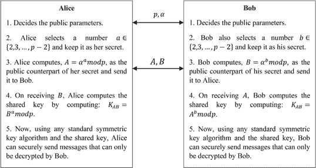

*图 2.2* Diffie-Hellman 密钥交换算法。

Alice 和 Bob 确定的公共参数是循环群 `Z[p]` 的阶 `p`，以及该群的生成元 `α`。在图 2.2 所示的第二步中，Alice 和 Bob 从循环群中随机选择一个元素并将其作为各自的秘密保存。

Diffie-Hellman 密钥交换算法遭受中间人攻击，即第三方通过计算自己的共享密钥并将该共享密钥发送给 Alice 和 Bob，拦截所有秘密消息。该攻击的细节留给读者自行查阅，因为任何标准的密码学书籍中都可以找到。描述 Diffie-Hellman 密钥交换算法的目的是展示其在公钥密码系统发展中的重要性。

对称密钥密码技术比公钥密码技术快得多。另一方面，对称密钥技术需要共享秘密密钥的过程，当大量用户想要一起通信时，这个过程变得相当复杂。以云存储为例，大量用户参与并希望在彼此间共享数据；在这种情况下，公钥密码学是更好的选择。我们将在后续章节中讨论的可搜索加密方案是为云存储和多用户环境开发的。因此，为了更好地理解，我们需要在公钥密码技术方面打下坚实的基础。

### 2.3.1 公钥密码学

公钥密码学 [[4]](#02chap_02.xhtml#ref2_4)，也称为非对称密码学，包含一组使用两个不同但相关密钥的算法，一个用于加密（称为公钥），另一个用于解密（称为私钥）。公钥密码学包含公钥加密和签名方案，但我们将主要关注加密方案。在加密方案中，任何想要与他人通信的人都可以使用接收方的公钥加密消息，接收方将使用其对应的私钥解密该消息。由于私钥仅由接收方持有，其他任何人都无法解密该消息。在签名方案中，此过程被反转：使用私钥生成签名，使用对应的公钥验证签名。签名方案用于证明消息的真实性和完整性 [[7]](#02chap_02.xhtml#ref2_7)、[[8]](#02chap_02.xhtml#ref2_8)、[[9]](#02chap_02.xhtml#ref2_9) 和 [[10]](#02chap_02.xhtml#ref2_10)。私钥用于生成消息的签名，这保证了确实是发送方发送了该消息。没有人可以篡改内容，因为他们不持有原始发送方的私钥，因此无法在不向接收方暴露的情况下重新加密修改后的消息内容。

公钥加密算法由三个算法组成：密钥生成算法 `KG`、加密算法 `E` 和解密算法 `D`。密钥生成算法接受安全参数 `λ`，生成公钥和私钥对（`pk`、`sk`）。加密算法接受消息 `m ∈ M`（消息空间），使用公钥 `pk` 对其加密以生成密文 `C`。解密算法接受密文和与公钥对应的私钥/秘密密钥 `sk`，输出消息 `m`。解密算法显然是确定性的，而密钥生成算法和加密算法是非确定性的。这些算法的正确性可以定义为：

```
∀ m ∈ M & ∀(pk, sk) ←$ KG(λ), D(sk, E(pk, m)) → m
```

#### 2.3.1.1 安全模型

为了证明密码系统的安全性，我们需要一个形式化的安全模型，该模型必须明确对手/攻击者与该密码系统合法用户交互时所遵循的交互机制。此外，它还必须规定对手必须达成何种条件才能攻破该密码系统 [[11]](#02chap_02.xhtml#ref2_11)。例如：在加密系统中，对手可能想要通过使用所谓的加密预言机来找到其所选消息的密文；这代表了对手与密码系统进行的交互。其次，为了攻破密码系统，对手必须正确识别出挑战密文（即对手此前从未查询过的密文）是对手先前所选明文消息的加密。

#### 2.3.1.2 公钥密码系统的安全目标

对于任何公钥加密方案，在设计密码系统时必须牢记以下安全目标：

* **加密/密文的不可区分性**：这也称为语义安全，它指出给定两条消息的加密或两个密文，对手不应能够区分它们。简单来说，给定一个挑战密文，对手不应能获得关于底层明文的任何信息。

* **非可延展性**：它要求给定挑战密文，对手不应能将其转换为另一个有效密文，使得这两个密文的明文以有意义的方式相关联。

#### 2.3.1.3 公钥密码系统的安全攻击

根据提供给对手的便利程度，针对公钥密码系统的攻击分为三大类：

* **选择明文攻击 (CPA)**：此处提供的便利是对手知道公钥。公钥可用于加密其选择的消息，密码学界称对手拥有访问加密预言机的权限。随后，对手选择两条自己挑选的消息（称为挑战消息），发送给挑战者。挑战者随即返回挑战密文给对手。现在，如果对手难以将挑战密文与其底层明文关联起来，则称该公钥密码系统在 CPA 下是安全的。对手的限制是：她无法为自己选择的挑战消息生成密文（即无法访问加密预言机）。在这里，我们将对手的能力限制到了最大程度。但在实践中，对手可能拥有更大的权力，因此 CPA 安全的方案在实际场景中可能不安全。

* **非自适应选择密文攻击 (CCA1)**：在此，通过在 CPA 安全提供的便利基础上额外赋予对手访问解密预言机的权限，增强了对手的能力。她可以利用它获取其选择的密文的解密结果。但是，对何时可以使用解密预言机施加了限制。在此，对手只能在挑战密文产生*之前*使用解密预言机。

* **自适应选择密文攻击 (CCA2)**：CCA1 安全的限制被完全放宽，现在对手甚至在获得挑战密文*之后*也可以访问解密预言机。但显而易见的限制依然存在：她不能针对挑战密文查询解密预言机。

在 CCA2 下具有不可区分性的公钥加密方案被认为是最安全的。原因显而易见：因为在这里对手可以全权操作，却仍然无法区分挑战密文究竟是其生成的两条挑战消息中的哪一条的加密。

从数学上讲，IND-CCA2（针对 CCA2 的不可区分性）的完整定义可以建模为挑战者 $\mathcal{C}$ 和对手 $\mathcal{A}$ 之间的一个游戏，如下所示：

* **Setup（初始化）**：$\mathcal{C}$ 运行 `KG(λ)→(pk, sk)`，保留 `sk` 并将 `pk` 给 $\mathcal{A}$。

* **Phase 1（阶段 1）**：$\mathcal{A}^{(D)}(pk, C)→m$ 并输出两条其选择的消息 `{m[0], m[1], state}`，但此前未曾针对它们查询解密预言机。$\mathcal{A}^{(D)}$ 表示对手对解密预言机的访问权限。

* **Challenge（挑战）**：$\mathcal{C}$ 选择 `{0,1}→b`，并运行加密算法以获得挑战密文，`E(pk, m[b])→C*`。

* **Phase 2（阶段 2）**：$\mathcal{A}^{(D)}(pk, C)→m$ 但 `C ≠ C*`。

* **Guess（猜测）**：$\mathcal{A}(C*, m[0], m[1], state)→b'$。

若 $b' = b$，即对手猜测正确，则对手赢得游戏。因为有两条消息，所以任何人随机猜测的概率为 $\frac{1}{2}$。因此，我们需要从正确猜测 $b$ 的总概率中减去这个概率，这被称为对手针对 IND-CCA2 的优势，记为 $Adv_{\mathcal{A}}^{IND-CCA2}$。

$$

Adv_{\mathcal{A}}^{IND-CCA2}(\lambda) = \left| Pr[b' = b] - \frac{1}{2} \right|

$$

(2.1)

如果对手赢得游戏的优势可以忽略不计，则称该密码系统能抵御 CCA2 攻击。

#### 2.3.1.4 ElGamal 密码系统

ElGamal 加密由 Taher ElGamal 于 1985 年发明 [[12]](#02chap_02.xhtml#ref2_12)，它与 Diffie-Hellman 密钥交换算法非常相似，仅步骤顺序略有调整，如 图 2.3 所示。

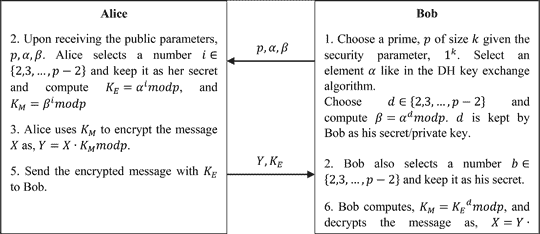

*图 2.3* ElGamal 密码系统。

此处，密钥 `K[E]` 称为临时密钥，仅存在很短的时间，即当 Alice 想要发送新消息时，此时会选择不同的 `i` 值，从而产生不同的临时密钥。密钥 `K[M]` 称为会话密钥，就像 DH 密钥交换算法中的密钥 `K[AB]` 一样。ElGamal 加密方案是一种概率加密方案，这与教科书式的 RSA 加密方案不同，这一特性源于每次调用加密算法时都选择一个随机的 `i` 值，而在 RSA 中，相同消息的加密结果始终是固定的。

**正确性证明**：Bob 计算，$Y \cdot K[M]^{-1} \mod p = X \cdot K[M] \cdot (K[E]^{(d)})^{-1} \mod p = X \cdot \beta^{(i)} \cdot (\alpha^{(i)})^{-d} \mod p = X \mod p$。

我们将在 第 4 章 中详细介绍该方案的安全性分析，届时将深入讨论可证明安全性。

## 2.4 公钥密码学中的推广

### 2.4.1 公钥加密的推广

如果我们回顾公钥加密技术类型，主要有三个核心算法：密钥生成、加密和解密。密钥生成算法接收安全参数，并生成一对公钥和私钥。该算法生成的公钥是完全随机的。1984 年，Shamir 提出了一种想法：与其将公钥作为一个复杂的随机字符串，不如使用电子邮件地址、电话号码、IP 地址等用户唯一的标识符。这种对公钥加密的推广被称为**基于身份的加密（IBE）** [[13]](#02chap_02.xhtml#ref2_13), [[14]](#02chap_02.xhtml#ref2_14), [[15]](#02chap_02.xhtml#ref2_15), [[16]](#02chap_02.xhtml#ref2_16)。因此，现在当 Bob 为 Alice 加密消息时，他将使用 Alice 的电子邮件地址作为公钥，而 Alice 可以使用私钥生成器提取与其 ID 相对应的私钥，即本例中的电子邮件地址。如同 IBE 一样，标准公钥加密（PKE）技术还有其他推广形式，如**基于属性的加密（ABE）** [[17]](#02chap_02.xhtml#ref2_17), [[18]](#02chap_02.xhtml#ref2_18), [[19]](#02chap_02.xhtml#ref2_19), [[20]](#02chap_02.xhtml#ref2_20), [[21]](#02chap_02.xhtml#ref2_21), [[22]](#02chap_02.xhtml#ref2_22)、**广播加密（BE）** [[23]](#02chap_02.xhtml#ref2_23), [[24]](#02chap_02.xhtml#ref2_24)、**同态加密（HE）** [[25]](#02chap_02.xhtml#ref2_25) 和**函数加密（FE）** [[26]](#02chap_02.xhtml#ref2_26), [[27]](#02chap_02.xhtml#ref2_27), [[28]](#02chap_02.xhtml#ref2_28), [[29]](#02chap_02.xhtml#ref2_29)，如图 2.4 所示。其中，我们将重点讨论 IBE 和 ABE，因为我们在可搜索加密方案的构建中看到了这两种技术的大量应用。

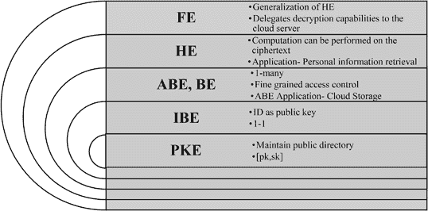

*图 2.4* PKE 的推广。

### 2.4.2 基于身份的加密（IBE）

在 IBE 中共有四个算法，其中一个额外的算法称为建立算法，记为 `S`，其余三个与标准 PKE 相同。

* `(PP, MSK) ← S(λ)`：建立算法接收安全参数，并输出公共参数 `PP` 和主密钥 `MSK`。该算法通常由受信任的第三方执行，通常称为密钥生成中心（KGC）。

* `SK[ID] ← K(MSK, ID)`：密钥生成算法接收用户的 `MSK` 和 `ID`，并生成其对应 `ID` 的私钥，即 `SK[ID]`。

* `C ← E(PP, ID, m)`：加密算法使用公钥 `ID` 和 `PP` 对消息 `m` 进行加密，并输出密文 `C`。

* `m ← D(SK[ID], C)`：解密算法使用 `SK[ID]` 对密文进行解密。

**正确性证明：** 如果对于从 `IBE_Setup(λ)` 生成的所有 `PP` 和 `SK[id]`，以下条件成立，则称该 IBE 方案是正确的：

```
D(SK[ID], E(PP, ID, m)) = m
```

(2.2)

IBE 方案的图示表示可见图 2.5。

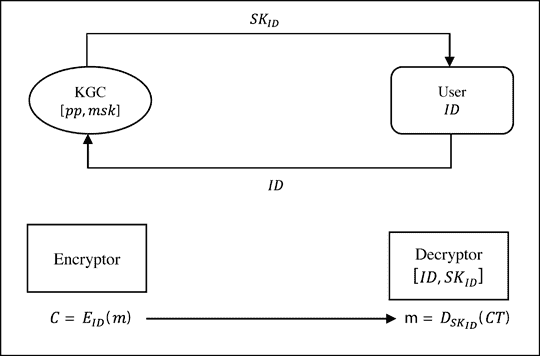


*图 2.5* 典型的 IBE 方案。

使用单一主密钥和不同的 ID，IBE 方案可以生成不同的私钥。基本上，IBE 试图将指数级数量的公钥压缩成一个简短的公共参数字符串。第一个实用的 IBE 方案由 Boneh 和 Franklin [[30]](#02chap_02.xhtml#ref2_30) 于 2001 年设计。

### 2.4.2 基于属性的加密（ABE）

IBE 是 PKE 的一种非常自然的扩展，就像 PKE 一样，使用 IBE 我们可以将消息发送给单个预期用户。ABE 的开发是为了不同的场景：假设我们有大量数据（如加密数据库），以及一组多样化的用户，他们需要访问该数据的不同片段，而决定谁能访问什么的不一定是他们的身份。相反，用户的**属性**将决定其访问能力。例如：我们可能希望根据用户的工作类型等向授权用户提供访问权限。我们随处可见此类场景。基于属性的加密正是为了处理此类场景而设计的。它是最流行的 PKE 技术之一，提供了细粒度的访问控制能力。在 ABE 出现之前，每个 PKE 方案都是一对一的，即加密消息仅面向单个用户。在 ABE 中，我们可以发送面向多个用户的相同加密消息，从而支持一对多场景。根据与用户或数据关联的属性，我们有两种变体：**密钥策略属性基加密（KP-ABE）** 和 **密文策略属性基加密（CP-ABE）**。在 KP-ABE 中，访问策略与用户的私钥关联，属性与密文关联。在 CP-ABE 中，访问策略与密文关联，属性与用户的私钥关联。为了统一表述，设 `I[K]` 表示密钥生成算法 `K` 的输入，`I[E]` 表示加密算法 `E` 的输入。在 KP-ABE 中，`I[K]` 和 `I[E]` 分别为访问策略和属性集合。在 CP-ABE 中，`I[K]` 和 `I[E]` 分别为属性集合和访问策略。与 IBE 类似，ABE 方案也由四个多项式时间算法组成：

* `(PP, MSK) ← S(λ, Att)`：建立算法除接收安全参数 `λ` 外（同 IBE 方案），还接收属性全集 `Att = {att[1], att[2], ..., att[|Att|]}`，并输出公共参数 `PP` 和主密钥 `MSK`。
* `SK[u] ← K(PP, MSK, I[K])`：密钥生成算法接收 `MSK` 和用户的凭证 `I[K]`，并生成其对应凭证的私钥，即 `SK[u]`。
* `C ← E(PP, m ∈ ℳ, I[E])`：加密算法使用 `I[E]` 和 `PP` 对消息 `m` 进行加密，并输出密文 `C`。
* `m ← D(C, SK[u])`：当且仅当 `I[K]` 和 `I[E]` 之间满足可满足性条件时，解密算法使用 `SK[u]` 对密文进行解密。

**正确性证明：** 如果 `I[K]` 和 `I[E]` 之间满足可满足性条件，则对于给定的 `PP` 和 `MSK`，必须满足以下条件：

```
D(E(m, PP, I[E]), SK[u]) = m
```

(2.3)

KP-ABE 方案的图示表示可见图 2.6。在此，用户拥有一组属性，并从 KGC 获取相应的私钥。以一个教育机构为例，计算机工程系发布了博士和硕士研究生的成绩。成绩上传至其共享存储，系里希望成绩仅能被指定考生访问。因此，他们使用访问策略 `W = CE ∧ (PhD ∨ MTech)` 对成绩进行加密，并上传至共享存储。当某学生凭借凭证 `L` 想要查看其成绩时，当且仅当 `L` 满足 `W` 时，才能解密。正如我们在图 2.6 中所见，仅用户 `U[3]` 的凭证满足 `W`，因此只有他/她能够查看成绩。

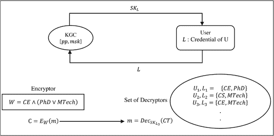

*图 2.6* 典型的 CP-ABE 方案。

ABE 方案面临共谋攻击的安全威胁。例如：一份招聘启事已根据某策略加密，只有同时拥有硕士学位**且**至少两年工作经验的用户才能解密。可能存在两个用户，他们各自仅拥有其中一个属性。因此，拥有硕士学位但无经验的用户不应能解密。同理，有经验但无学位的用户也不应能解密。我们要防止这两个用户以某种方式结合他们的密钥，并试图冒充一个拥有所有必需属性的用户。因此，ABE 方案的开发应防止用户结合他们的密钥并获知他们各自本不应获知的信息，否则 ABE 的初衷将落空。

## 2.5 章节小结

在本章中，我们涵盖了从密码学原语的历史开端到当今使用的最新技术。我们描述了标准 PKE 技术是如何被推广和放宽以获得其他公钥密码技术的。我们主要讨论了与公钥密码学相关的方面，因为在后续章节中，我们的重点是基于公钥密码学原语构建可搜索加密方案。在 PKE 技术中，详细讨论了基于身份的加密和基于属性的加密，因为它们在可搜索加密中有应用。

# 参考文献

1. A. J. Menezes, J. Katz, P. C. Van Oorschot, and S. A. Vanstone, *应用密码学手册*. CRC Press, 1996.
2. W. Stallings, *密码学与网络安全*, 4/E. Pearson Education India, 2006.
3. K. H. Rosen, “密码学导论,” ISBN-10, pp. 1–58488, 2007.
4. C. Paar, and J. Pelzl, *理解密码学：面向学生和从业者的教科书*. Springer Science & Business Media, 2009.
5. O. Goldreich, *密码学基础：第 2 卷，基本应用*. Cambridge University Press, 2009.
6. W. Diffie, and M. Hellman, “密码学新方向,” *IEEE Trans. Inf. Theory*, vol. 22, no. 6, pp. 644–654, 1976.
7. B. B. Gupta, and M. Quamara, “基于智能卡的物联网环境下分布式云计算服务的身份基访问控制和相互认证框架”, *Procedia Comput. Sci*, vol. 132, pp. 189–197, 2018.
8. A. Tewari, and B. B. Gupta, “一种面向物联网设备的基于 ECC 的轻量级认证协议”, *Int. J. High Perform. Comput. Networking*, vol. 15, no. 1–2, pp. 106–120, 2019.
9. Q. Zheng, X. Wang, M. K. Khan, W. Zhang, B. B. Gupta, and W. Guo, “一种基于混沌 SCML 的轻量级认证加密方案，用于铁路云服务”, *IEEE Access*, vol. 6, pp. 711–722, 2017.
10. B. B. Gupta, and T. Aakanksha. *物联网安全入门指南：攻击、应用、认证与基础*. CRC Press, 2020.
11. B. B. Gupta, G. M. Perez, D. P. Agrawal, and D. Gupta. *计算机网络与网络安全手册*. Springer Science and Business Media LLC, 2020.
12. T. ElGamal, “一种基于离散对数的公钥密码系统和签名方案,” *IEEE Trans. Inf. Theory*, vol. 31, no. 4, pp. 469–472, 1985.
13. D. Khader, “基于 K-弹性 IBE 的带关键字搜索公钥加密,” in *国际计算科学及其应用会议*, 2007, pp. 1086–1095.
14. D. Boneh, and X. Boyen, “无随机预言机的安全身份基加密,” in *年度国际密码学会议*, 2004, pp. 443–459.
15. D. Boneh, X. Boyen, and E.-J. Goh, “常量大小密文的分层身份基加密,” in *密码技术理论与应用年度国际会议*, 2005, pp. 440–456.
16. S. Kaushik, and C. Gandhi, “确保云环境中分层身份基数据安全,” *Int. J. Cloud Appl. Comput*, vol. 9, no. 4, pp. 21–36, 2019.
17. J. Bethencourt, A. Sahai, and B. Waters, “密文策略属性基加密,” in *2007 IEEE 安全与隐私研讨会 (SP'07)*, 2007, pp. 321–334.
18. V. Goyal, A. Jain, O. Pandey, and A. Sahai, “有界密文策略属性基加密,” in *国际自动机、语言与编程学术会议*, 2008, pp. 579–591.
19. V. Goyal, O. Pandey, A. Sahai, and B. Waters, “用于加密数据细粒度访问控制的属性基加密,” in *第 13 届 ACM 计算机与通信安全会议论文集*, 2006, pp. 89–98.
20. Y. Jiang, W. Susilo, Y. Mu, and F. Guo, “抗密钥委托滥用的雾计算密文策略属性基加密,” *Futur. Gener. Comput. Syst*, vol. 78, pp. 720–729, 2018.
21. M. Chase, and S. S. M. Chow, “改进多授权中心属性基加密中的隐私与安全,” in *第 16 届 ACM 计算机与通信安全会议论文集*, 2009, pp. 121–130.
22. P. K. Premkamal, S. K. Pasupuleti, and P. J. A. Alphonse, “用于云端大数据存储的高效无托管 CP-ABE，具有常量大小的密文和私钥,” *Int. J. Cloud Appl. Comput*, vol. 10, no. 1, pp. 28–45, 2020.
23. Z. Zhou, and D. Huang, “论高效的密文策略属性基加密和广播加密,” in *第 17 届 ACM 计算机与通信安全会议论文集*, 2010, pp. 753–755.
24. C. Delerablée, “常量大小密文和私钥的身份基广播加密,” in *密码学与信息安全理论及应用国际会议*, 2007, pp. 200–215.
25. C. Gentry, “基于理想格的全同态加密,” in *In Proc. STOC*, 2009, pp. 169–178.
26. S. Agrawal, X. Boyen, V. Vaikuntanathan, P. Voulgaris, and H. Wee, “基于格的阈值函数函数加密（或模糊 IBE）,” in *公钥密码学国际研讨会*, 2012, pp. 280–297.
27. D. Boneh, A. Raghunathan, and G. Segev, “函数隐私身份基加密：在函数加密中隐藏函数,” in *年度密码学会议*, 2013, pp. 461–478.
28. D. Boneh, A. Sahai, and B. Waters, “函数加密：定义与挑战,” in *密码理论会议*, 2011, pp. 253–273.
29. N. Attrapadung, and B. Libert, “内积函数加密：实现自适应安全的常量大小密文或支持否定,” in *公钥密码学国际研讨会*, 2010, pp. 384–402.
30. D. Boneh, and M. Franklin, “基于 Weil 配对的身份基加密,” in *年度国际密码学会议*, 2001, pp. 213–229.

# 第 3 章

# 可搜索加密与数据管理

# 可搜索加密 (SE)

可搜索加密 (SE) 是一种技术，它允许在加密域中执行搜索操作，而无需泄露任何关于搜索内容的信息。可搜索加密充当一种数据管理技术，允许数据所有者将其数据存储和管理在第三方、不可信的云服务器上，并允许数据用户将搜索功能委托给云服务器以检索该数据。因此，可搜索加密以优化成本实现了数据的安全存储和检索。可搜索加密适用于我们既需要保密性又需要可访问性的场景。除了直接用于搜索加密数据外，可搜索加密还改变了任何加密技术的工作方式。通常，加密技术要么解密完整数据，要么完全不解密，这使其不适用于仅需解密部分数据的情况。要设计这种灵活的系统，可以使用可搜索加密技术，在该技术中可以搜索加密数据的特定部分，从而实现部分解密。

## 3.1 对可搜索加密的需求

近年来，我们见证了向云存储转变的显著趋势。云存储正成为本地存储的一个极具前景的替代方案。越来越多的公司选择云范式，因为存储维护的所有开销都委托给了云服务器 [1][2]。此外，与本地存储不同，只要有互联网接入，存储在云中的数据就可以随时随地访问 [3][4]。除了云存储的这些优势外，还存在一些与云存储固有的担忧，其中隐私问题是最突出的 [5][6]。数据存储在第三方服务器上，该服务器不能被信任以保障敏感数据的安全 [7][8]。理论上，通过以加密形式存储数据，可以轻松解决数据隐私问题 [4][5]。然而，虽然加密解决了隐私问题 [9][10][11]，但也引发了其他一些严重问题，包括基本搜索操作的不可行性、与其他用户共享数据的灵活性降低等。为了解决这些问题，引入了可搜索加密的概念。可搜索加密允许第三方云服务器在加密数据上执行搜索，而无需泄露任何关于搜索内容的信息。安全可搜索加密是满足这一需求的答案 [7][12]。

## 3.2 通用模型

可搜索加密技术允许服务器代表客户端在加密数据中进行搜索，而无需泄露明文数据的信息。有少数方案通过使密文本身可搜索来实现可搜索加密 [1]；大多数方案生成一个可搜索的加密索引。可搜索加密索引可以通过从主数据文件中提取元数据项 `W = (w[1], …, w[m])` 并使用一种支持在此索引上进行搜索操作的技术对其进行加密来生成。此操作通过执行可搜索加密方案中定义的加密算法 (`E[SE]`) 来完成。在可搜索加密术语中，这些元数据项通常称为关键词。主数据文件也使用任意标准对称密钥加密 `E[Symm]` 进行加密，如图 3.1 所示。用于此目的的对称密钥可以使用我们生成索引时所用的相同加密技术进行加密。

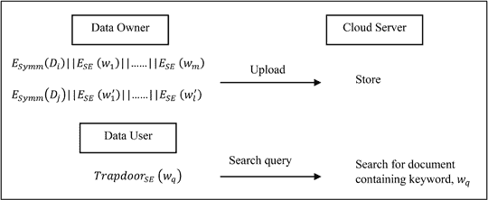

*图 3.1* 可搜索加密方案的通用模型。

然后，加密索引和加密数据文件被存储在云服务器上，该服务器通常被假定为诚实但好奇，即它可以被信任正确执行存储和查询协议，但它试图尽可能多地获取信息。整个任务由一个称为数据所有者的实体完成。现在，另一个称为数据用户的实体想要检索存储在云服务器上的加密信息。显然，他/她首先需要在数据文件中搜索以检索所需内容。数据用户通过生成一个搜索陷门（有时称为搜索令牌）来将此搜索操作委托给云服务器，该陷门/令牌针对其要查找的关键词，通过使用可搜索加密方案中定义的陷门算法 (`Trapdoor[SE]`) 生成，并将其发送给云服务器。使用搜索陷门，云服务器现在能够在加密域中执行搜索，并返回包含查询关键词的文件引用，而无需实际解密任何内容。

生成索引通常有两种方法，即正向方法和倒排方法，如图 3.2 所示。在正向方法中，索引是建立在数据文件 (`D[1], D[2], …, D[n]`) 上的，即将某些关键词与每个数据文件关联。在倒排方法中，索引是建立在关键词 (`w[1], w[2], …, w[m]`) 上的，即为每个关键词索引其所属的数据文件。

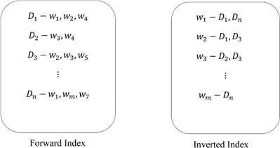

*图 3.2* 生成索引的方法。

在正向索引方法中，搜索时间随数据文件的数量线性变化。在倒排索引方法中，搜索时间随包含特定关键词的文档数量变化，如果使用哈希树方法构建索引，则可以将其降低到亚线性。开发可搜索加密技术时会遵循其中一种方法，但通常在构造中不明确展示。可搜索加密方案的唯一重点是以高效方式加密与数据文件关联的元数据（关键词）。

## 3.3 可搜索加密方案的广泛分类

可搜索加密方案可以使用对称密钥或公钥加密来开发。在云存储环境中，公钥设置是一个更优的选择，因为有多个用户可以访问共享存储，而对称密钥加密要求在这些用户之间分发密钥，这是一个非常复杂的过程，而在公钥设置中不需要这种密钥共享。因此，考虑到共享云存储环境，本书主要讨论使用公钥加密原语开发的可搜索加密方案。然而，在本章中，我们将提及对称密钥领域可搜索加密方面的一些开创性工作，并讨论公钥设置中的一些方案。

### 3.3.1 对称可搜索加密

# 对称密钥原语

对称密钥原语允许单个用户读取和写入数据，并且仅允许密钥持有者创建可搜索密文和陷门 [13]。对称可搜索加密（SSE）的直接应用可见于这样一种场景：某用户希望以加密形式将其数据存储在云存储中，随后他/她可以对其执行搜索以检索所需数据 [14]。索引方法仅在 SSE 方案中被明确提及和解决。第一个 SSE 由 Song 等人 [15] 提出。该方案支持相等查询，并被开发用于仅处理单个关键词。为了加密数据，首先将其分割成称为“词”的固定大小块，然后通过以特定格式插入哈希值，独立地加密每个词。该过程产生的密文本身即是可搜索的。云服务器通过提取哈希并查找用户指示的特定格式来执行搜索。然而，该方案有一个限制，即它需要将数据分割成固定大小的词，这与现有的加密标准不兼容。此外，他们未为该方案提供任何正式的安全定义或安全证明。后来，在 2003 年，Goh [16] 放宽了 Song 等人方案中的固定大小限制。他们采用直接索引方法，使用布隆过滤器为每个数据文件构建索引。2005 年，Chang 和 Mitzenmacher [17] 开发了一种 SSE 方案，与 Goh 方案类似，他们采用直接索引方法，基于搜索关键词字典而非布隆过滤器构建索引，因为布隆过滤器固有极高的误报率。2006 年，Curtmola 等人 [18] 首次使用倒排索引方法，实现了亚线性搜索时间。下表 表 3.1 给出了 SSE 领域这些开创性工作在计算复杂度和关键特性方面的比较分析。

## 表 3.1 SSE 领域开创性工作的比较分析

| 方案 | 加密时间 | 陷门生成时间 | 搜索时间 | 特性 |


| 方案 | 存储 | 陷门大小 | 搜索时间 | 备注 |
| --- | --- | --- | --- | --- |
| Song 等人 [15] | `D ⋅ K` | `k` | `D ⋅ K` | 顺序扫描 |
| Chang & Mitzenmacher [17] | `D(K + K″)` | `2k` | `D` | 搜索关键词字典 |
| E. J. Goh [16] | `D ⋅ K′` | `k` | `D ⋅ k` | 布隆过滤器索引 |
| Curtmola 等人 [18] | `3K″ ⋅ D + D(w)` | `2k` | `D(w)` | 亚线性搜索时间 |

**注：**

*   `D` — 文档数量
*   `K` — 每个文档的关键词数量
*   `K′` — 每个文档的不同关键词数量
*   `K″` — 数据库中的不同关键词数量
*   `k` — 每个陷门的关键词数量

我们之前提到过，我们考虑的是一种云存储环境，其中数据所有者可能希望共享其数据，而不仅仅是为自己存储。确实，对称密钥加密速度快，但在我们所考虑的场景中，由于向所有用户分发密钥，对称密钥加密变得相当复杂。因此，我们将在第 5 章中详细讨论公钥设置下的可搜索加密，并在下一节中给出概述。

### 3.3.2 公钥设置下的可搜索加密

基于身份的加密和基于属性的加密等公钥密码学原语是利用一种称为双线性映射的工具开发的，此类方案通常称为基于配对的密码学方案。公钥设置下的可搜索加密方案显然会使用该工具。因此，在开始讨论基于公钥的可搜索加密方案之前，让我们先讨论一些关于这一强大工具的有趣事实。

#### 3.3.2.1 双线性映射

双线性映射是一种函数，它将一个循环群中的元素映射到另一个循环群中的元素。双线性映射常被称为双线性配对，因为它们接受源群中一对两个元素，并将该对映射到目标群中的一个元素。

设 `G₁`、`G₂` 为素数阶 `p` 的源循环群，`G_T` 为同阶素数 `p` 的目标循环群，`g`、`h` 分别为源群 `G₁` 和 `G₂` 的生成元。设 `e` 为 `G₁` 和 `G₂` 之间的映射，`e: G₁ × G₂ → G_T`，若满足以下条件，则称其为双线性映射：

*   `∀ X = g^(u) ∈ G₁ and Y = h^(v) ∈ G₂ : e(g^(u), h^(v)) = e(g, h)^(u·v)`，其中 `u, v ∈ Z_p`。这称为双线性性质。
*   若 `g`、`h` 分别为源群 `G₁` 和 `G₂` 的生成元，则 `e(g, h)` 为目标群 `G_T` 的生成元。此性质称为非退化性。
*   `∀ X ∈ G₁ and Y ∈ G₂; e(l, m)` 可高效计算。

若 `e` 将每一对映射到 `G_T` 中的单位元，则称该双线性映射为退化的，即若仅有第一个条件，则也允许退化映射。因此，添加第二个条件以使双线性映射有效。

##### 3.3.2.1.1 `e` 中源群与目标群的关系

在所有源群和目标群之间存在同构，因为它们都是循环群且具有相同的阶。然而，它们拥有不同的元素，元素间的运算也可能不同，这使它们彼此区别。若 `G₁ = G₂`，即两个源群完全相同，则相关映射称为对称双线性映射；若两者不同，则称为非对称双线性映射。此外，源群和目标群的阶也可能是合数，而非某个素数 `p`。大多数构造考虑素数阶群，文献中也存在考虑合数阶群的例子。若源群和目标群全都相等，则相关映射称为自双线性映射。此类映射不存在，构造一个是一个开放问题。

在一些现有工作中，曾见到另一种符号，其中双线性性质表示为 `e(u·X, v·Y)` 而非 `e(X^(u), Y^(v))`，其中 `X`、`Y` 为源群元素。当群以加法形式书写时会出现这种情况，然而乘法符号更为流行。

##### 3.3.2.1.2 如何选择源群和目标群

对于源群，通常使用有限域 `F_p` 上的椭圆曲线。根据选择不同嵌入度的椭圆曲线，会产生不同类型的配对，即类型 A、A1、D、E、F 和 G [19]。而目标群通常是一个有限域。

Weil [20] 和 Tate [21, 22] 配对是已知的双线性配对的唯一例子。Weil 配对曾被 Boneh 和 Franklin [23] 实际用于构造基于身份的加密方案。

#### 3.3.2.2 公钥设置下的第一个开创性 SE 方案

Boneh 等人 [24] 开发了公钥设置下的首个可搜索加密方案，称为带关键词搜索的公钥加密，简称 `PEKS`。

在可用的公钥加密原语中，他们采用基于身份的加密（`IBE`）作为底层方案。他们利用与用户身份对应的公钥来加密数据文件及其中包含的关键词。该方案旨在实现从邮件服务器高效检索加密邮件。数据所有者，或更准确地说是发送者，希望发送一封使用接收者公钥加密的邮件，同时附带使用同一密钥加密的关键词。发送的邮件存储在接收者的邮件服务器上，接收者需要一种机制来从中高效地仅检索所需的邮件。这种高效机制即为可搜索加密技术；若无此技术，接收者首先需要下载所有邮件，然后在本地使用其私钥进行解密。但有了可搜索加密技术，接收者可根据当前需求提取邮件，仅需解密那些选定的邮件。这种完整机制适用于存在单一预期接收者的场景；然而，发送者的数量不受限制。现在，如果我们想将同一消息发送给多个接收者，能否应用上述相同机制？答案是肯定的。但这不会是一种高效机制。要向多个接收者发送同一消息，我们需要用每个接收者的公钥多次加密同一消息，这会导致系统中存在大量冗余。既然我们想要一种高效机制，就有必要探索其他加密原语，如基于属性的加密（`ABE`），它可能消除这种冗余，我们将在第 5 章讨论此类方案，该章专门讨论公钥设置下的可搜索加密。

##### 3.3.2.2.1 PEKS 洞察

考虑著名的 Alice 和 Bob 加密示例，Bob 想要发送一条邮件消息 `m ∈ ℳ`，连同若干关键词 `{w[1], w[2], …, w[l]} ∈ W` 给 Alice。这些关联关键词稍后将用于搜索对应的邮件消息。Bob 生成如下密文：`E[A[pub]](m) ∥ PEKS(A[pub], w[1]) ∥ … ∥ PEKS(A[pub], w[l])`，其中 `E[A[pub]](m)` 是任意标准公钥加密算法，它使用 Alice 的公钥 `A[pub]` 生成加密邮件消息，而 `PEKS` 是支持关键词搜索的算法。生成的密文存储在 Alice 的邮件服务器上。为执行搜索，Alice 使用其密钥/私钥为其想要搜索的特定关键词生成一个秘密值，该秘密值称为搜索陷门/令牌。邮件服务器将使用此陷门，通过搜索算法查找包含该关键词的消息。若找到匹配关键词，搜索算法返回二进制输出 1，否则返回 0。`PEKS` 方案涉及的算法详情见表 3.2。

**表 3.2** 带关键词搜索的公钥加密 (`PEKS`) [24]

```
PEKS 方案
PEKS 方案使用两个哈希函数 H[1]、H[2] 以及一个对称双线性映射 e : G[1]×G[1]→G[T]，其中 G[1] 和 G[T] 是素数阶 p 的循环群。

1. 密钥生成：随机选择 α ∈ Z[p]^(*)，并找到 G[1] 的生成元 g。计算 K[pub] = (g, h = g^(α)) 和 K[pri] = α。

2. PEKS (K[pub], w)：随机选择 r ∈ Z[p]^(*)，并计算 t = e(H1, h^(r))。输出 C = [g^(r), H[2][t]]。

3. 陷门 (K[pri], w)：输出 T[w] = H1^(α) ∈ G[1]。

4. 搜索 (C, T[w])：检验 H2)) 是否等于 H2，若是，则找到匹配并返回 1；否则返回 0。
```

如前所述，`PEKS` 基于 `IBE` 方案。现在让我们考察其原理。`K[pub]` 扮演公共参数的角色，而 `K[pri]` 的作用就像典型 `IBE` 方案中的主密钥。`IBE` 密文是使用公共参数（即 `K[pub]`）和关键词 `w` 生成的，这里 `w` 充当身份标识。在陷门算法（步骤 3）中，本质上是为 ID 生成一个秘密密钥，在当前方案中该 ID 即为 `w`。此步骤就像在 `IBE` 方案中获取 ID 的秘密密钥。搜索算法类似于 `IBE` 方案中的解密算法，它接收密文和秘密密钥（即当前方案中的陷门）。

###### PEKS 亮点

*   发送者与接收者之间无需交互。
*   支持多数据所有者（发送者）和单一数据使用者（接收者），俗称 M/S 设置 [25]。
*   应用于安全邮件检索。
*   适用于多项式大小的关键词空间。
*   `PEKS` 在随机预言机模型下，基于双线性 Diffie-Hellman (`BDH`) 假设，能抵抗自适应选择关键词攻击。
*   假设邮件服务器是诚实但好奇的，即它正确执行所有算法，但可能试图获取一些有用信息。

###### PEKS 局限

*   需要安全信道以防止窃听。
*   为支持多数据使用者，需用每个预期用户的公钥加密同一消息并发送，这会导致冗余。
*   由于关键词空间较小，`PEKS` 及所有公钥可搜索加密方案均遭受关键词猜测攻击 (`KGA`) [26] 的威胁，除非显式处理。
*   `PEKS` 设计为一次性使用。服务器可能记忆陷门并利用它获取未来邮件的信息。
*   不支持多关键词搜索。

上述要点中提到的安全相关定义将在下一章详细解释。`PEKS` 的两大主要缺陷——服务器与数据使用者之间需要安全信道以及 `KGA`——一直是 `PEKS` 后续研究的焦点，将在后续章节讨论。

##### 3.3.2.2.2 无安全信道 PEKS

构建安全信道以发送陷门成本高昂，因此人们致力于消除这一限制，使陷门足够安全以便在公共信道上发送。

**BSS2：Baek 等人 [27] 提出了首个无安全信道 PEKS 方案。**

作者解决了 `PEKS` 方案设计中的缺陷，即服务器可能利用存储的陷门自行执行搜索，而无需接收者知情。解决此问题的简单方法是限制关键词仅使用一次。然而，如果用户想要重复使用关键词，此方案并不切实际。Baek 等人 [27] 建议了一种方案，即定期刷新关键词，这是通过附加时间段信息完成的；用户在生成陷门时追加其想要的时间段。他们将此过程称为刷新关键词。例如，如果数据使用者想为关键词（如 `URGENT`）生成陷门，则在生成陷门前，用户会先按如下方式追加时间段：`URGENT||01/08/2019`。

此外，为了移除安全通道，Baek 等人 [27] 为服务器使用了一对公私钥（`PK`、`SK`）。除了 `PEKS` 算法外，`SCF_PEKS` 还拥有一个用于为服务器生成密钥对的额外算法。为了生成关键字密文，他们将使用接收者的公钥以及服务器的公钥。为了生成密文，`SCF_PEKS` 方案将像 `PEKS` 方案一样使用接收者的私钥。最后，搜索算法存在细微差别；除了关键字密文和陷门外，它还需要服务器的私钥，以确保抵御外部攻击者的安全性。

他们确保了抵御恶意服务器以及外部攻击者的安全性。恶意服务器在拥有该关键字的陷门之前，无法区分两个关键字的密文。同样，即使外部攻击者拥有所有关键字的陷门，也无法区分两个关键字的密文，因为他没有服务器的私钥。

**GZP：** Gu 等人 [28] 提出了另一种无需安全通道要求的 `PEKS` 方案。与 Baek 等人 [27] 提出的 `SCF_PEKS` 方案类似，该方案同时使用接收者的公钥和服务器的公钥来生成关键字密文，使用接收者的私钥生成陷门，并在搜索算法中也使用云服务器的私钥。作者开发了两种可搜索加密方案。在第一种方案中，生成关键字密文和陷门时不使用配对运算。在第二种方案中，生成陷门时不使用配对运算，且移除了安全通道限制，这使其在计算上更高效。

**FSG+：** Fang 等人 [29] 提出了另一种无安全通道的 `PEKS` 方案。与 `SCF_PEKS` 和 `SCF_PEKS2` 一样，该方案也为服务器生成单独的公钥和私钥。他们的方案基于 Gentry 的 `IBE` [30]，后者是在具有短公共参数的标准模型中已知的安全方案。由于底层的 Gentry `IBE` 方案，他们证明了由此产生的可搜索加密方案在标准模型下也是安全的，从而为 `SCF_PEKS` 方案增添了一个里程碑。

**RPS+：** Rhee 等人 [31] 提出的带指定测试者的 `PEKS` 方案为无安全通道的 `PEKS` 增添了另一个里程碑。在这里，作者通过考虑更强大的对手，改进了 Baek 等人 [27] 方案的安全模型。在 Baek 等人的方案中，攻击者只能访问陷门，利用这些陷门攻击者无法获得密文和陷门之间的关系。然而，实际上攻击者可能获得任意关键字的陷门，并能获得与这些陷门相关的密文（前提是该密文不是挑战密文）。其次，Baek 等人的安全模型通过限制攻击者将其私钥共享给第三方来限制攻击者的能力。Rhee 等人 [31] 在其称为 `dPEKS` 的方案中解决了上述局限性，其中只有数据所有者选定的指定服务器才能执行搜索。主要重点是通过增强对手的能力来提高安全性。对手可以发布其公钥而不泄露其私钥。

##### 3.3.2.2.3 抗 KGA 的 PEKS 安全性

使用公钥密码学设计的可搜索加密方案很可能遭受 `KGA` [32]。因为关键字空间的大小是多项式的，即通常使用一组众所周知的关键字来执行搜索，对手可以猜测对应某个有效捕获陷门的关键字，并为该关键字生成密文。然后对手将其提交给云服务器以获取搜索结果，如果搜索结果为 1，则表示猜测的关键字正确，否则重复相同过程以获取关于关键字密文的信息。在此过程中，对手获得了关键字的明文，这是不期望的。这个过程被称为离线 `KGA`，Byun 等人 [26] 对 `PEKS` [24] 方案发起了首次成功的 `KGA` 攻击。之后，Yau 等人 [33] 又做了一次尝试，他们成功地对当时基于 `PKE` 的多种可搜索加密方案发起了 `KGA`。在本节中，我们将讨论应对 `KGA` 所做的努力。

**带注册关键字搜索的公钥加密：** Tang 和 Chen [34] 提出了一种能够抵御 `KGA` 的 `PERKS` 方案。`PERKS` 要求在数据所有者为该关键字生成密文之前，数据所有者和数据用户之间进行关键字注册。为此，数据用户首先定义一组关键字，数据所有者可以为这些关键字生成密文。在关键字注册阶段，接收者（数据用户）将使用其私钥和关键字为该关键字生成预标签。现在，发送者（数据所有者）将使用此预标签为该关键字生成密文，在该方案中称为标签。预标记机制使该方案免疫于 `KGA`。它在垃圾邮件检测中有应用。它具有将任意数量的关键字密文聚合为单个密文的特性。聚合后的密文大小与单个密文相同。因此，该方案可以批量模式测试多个关键字密文。它是公钥设置中第一个要求数据所有者和数据用户之间交互的方案。然而，这不被认为是实用的，因为数据用户每次都必须与数据所有者通信以检索所需信息。此外，数据所有者不能自由选择关键字。它还要求数据用户与服务器之间、数据所有者与数据用户之间存在安全通道。

##### 3.3.2.2.4 具有 KGA 安全性的 SCF-PEKS

本节将涵盖所有那些不需要安全通道来确保陷门安全且也能免疫 `KGA` 的方案。

**RPS2+：** 带指定测试者的 `PEKS` 方案（`dPEKS`）[31] 遭受 `KGA`。Rhee 等人 [35] 重新审视了该方案，使其免疫于 `KGA`。他们发现，在之前的 `PEKS` 以及他们自己的 `dPEKS` 方案中，确保陷门隐私是不可能的。通过捕获一个有效的陷门，没有任何东西能阻止攻击者猜测关键字，并使用公共参数为该关键字生成密文，获得测试结果以检查猜测的关键字是否正确。因此，为了确保陷门隐私，有必要修改陷门的结构。在这里，陷门是使用服务器的公钥以及接收者的私钥生成的。因此，无论有没有服务器的私钥，陷门都不会泄露关于关键字的任何信息。他们推断出陷门安全性意味着抗 `KGA` 安全性。

#### FSG2+

Fang 等人 [[36]](#03chap_03.xhtml#ref3_36) 提出了一种 `PEKS` 变体，其特点是不需要安全信道，并且还提供了抗 `KGA`（关键字猜测攻击）的安全性。在早期的方案中也实现了相同的目标，但它们需要随机预言机模型来证明其方案的安全性。而该方案则在标准模型下被证明是安全的。他们使用了 Gentry 的 `IBE` 方案 [[30]](#03chap_03.xhtml#ref3_30) 作为构建的底层加密技术。

#### LLZ+

最近，Lu 等人 [[37]](#03chap_03.xhtml#ref3_37) 提出了一种基于证书密码学和签密的可搜索公钥加密，以提供抗 `KGA` 安全性，同时消除了接收者与服务器之间对安全信道的需求。该方案不需要安全信道，也提供了抗 `KGA` 安全性。所提方案也在标准模型下被证明是安全的。

上述讨论方案的存储和计算成本的比较分析见表 3.3。

### 表 3.3 PEKS 及其扩展的存储和计算成本比较分析

| 方案 | 存储成本 | 计算成本 |
| --- | --- | --- |
| **PEKS: Boneh 等人** [[24]](#03chap_03.xhtml#ref3_24) | 加密索引：`1|G| + |{0,1}^(λ)|` | `1P + 2E + 2H` |
|  | 陷门：`1|G|` | `1E + 1H` |
|  | 搜索 | `1P + 1H` |
| **无安全信道 (SCF) PEKS** |  |  |
| **Baek 等人** [[27]](#03chap_03.xhtml#ref3_27) | 加密索引：`1|G| + |{0,1}^(λ)|` | `1P + 1E + 1E[T] + 2H` |
|  | 陷门：`1|G|` | `1E + 1H` |
|  | 搜索 | `1P + 2E + 1H` |
| **Gu 等人** [[28]](#03chap_03.xhtml#ref3_28) | 加密索引：`1|G| + |{0,1}^(λ)|` | `3E + 2H` |
|  | 陷门：`1|G|` | `1E + 1H` |
|  | 搜索 | `1P + 1H` |
| **Fang 等人** [[29]](#03chap_03.xhtml#ref3_29) | 加密索引：`2|G| + 2|G[T]|` | `3P + 3E + 3E[T] + 1H` |
|  | 陷门：`1|G| + 1|Z[p]|` | `2E` |
|  | 搜索 | `2P + 2E + 2E[T] + 1H` |
| **Rhee 等人** [[31]](#03chap_03.xhtml#ref3_31) | 加密索引：`1|G| + |{0,1}^(λ)|` | `7P + 2E + 2H` |
|  | 陷门：`1|G|` | `1E + 1H` |


### 表 3.3 存储与计算成本比较

| 方案 | 算法 | 存储成本 | 计算成本 |
| :--- | :--- | :--- | :--- |
| **抗 KGA 的 PEKS** | | | |
| **Tang 和 Chen** [[34]](#03chap_03.xhtml#ref3_34) | 加密索引 | `1|G| + 1|G[T]|` | `1P + 2E` |
| | 陷门 | `1|G|` | `1E + 1H` |
| | 搜索 | - | `1P` |
| **具有 KGA 安全性的 SCF-PEKS** | | | |
| **Rhee 等人** [[35]](#03chap_03.xhtml#ref3_35) | 加密索引 | `1|G| + |{0,1}^(λ)|` | `1P + 2E + 2H` |
| | 陷门 | `2|G|` | `3E + 2H` |
| | 搜索 | - | `1P + 2E + 2H` |
| **Fang 等人** [[36]](#03chap_03.xhtml#ref3_36) | 加密索引 | `|VK| + 1|G[1]| + 2|G[2]| + 2|G[T]| + |σ|` | `3P + 8E + 1H + 1𝒮` |
| | 陷门 | `1|G[1]| + 1|Z[p]|` | `1E` |
| | 搜索 | - | `4P + 2E + 1E[T] + 1H + 1V` |
| **Lu 等人** [[37]](#03chap_03.xhtml#ref3_37) | 加密索引 | `1|G| + |{0,1}^(λ)|` | `1P + 3E + 1E[T] + 3H` |
| | 陷门 | `1|G|` | `3E + 2H` |
| | 搜索 | - | `1P + 1E[T] + 1H` |

表 3.3 中使用的符号见表 3.4。

### 表 3.4 比较分析中使用的符号及其说明

| 符号 | 说明 |
| :--- | :--- |
| `|G|`, `|G[T]|` | 对称双线性配对情况下，源群 (`G`) 和目标群 (`G[T]`) 元素的长度 |
| `|G[1]|`, `|G[2]|`, `|G[T]|` | 非对称双线性配对情况下，源群 (`G[1]`,`G[2]`) 和目标群 (`G[T]`) 元素的长度 |
| `|σ|` | 签名的长度 |
| `|VK|` | 验证密钥的长度 |
| `|{0,1}^(λ)|` | 长度为 `λ` 的二进制串，其中 `λ` 是特定方案的安全参数 |
| `|Z[p]|` | 素数阶 `p` 的整数群中元素的长度 |
| `|F[p]|` | 素数阶 `p` 的域中元素的长度 |
| `P` | 双线性配对运算 |
| `E`, `E[T]` | 源群和目标群中的指数运算 |
| `H` | 抗碰撞单向哈希函数 |
| `𝒮` | 签名运算 |
| `V` | 验证运算 |
| `Poly`, `k` | 次数为 `k` 的多项式 |

存储成本按大小和群元素数量计算。我们仅考虑加密算法和陷门算法的存储成本，因为在这些算法中我们需要存储其输出，即云服务器上的密文和用户设备上的陷门；搜索算法不计算此类成本。计算成本按算法执行的操作数量计算。搜索算法也计算在内。算法可能执行不同类型的操作，如哈希运算、指数运算、配对运算；其中配对运算开销最大。因此，我们应尽量构建配对运算次数为常数的方案。如果在搜索算法中能使配对运算次数为常数，则称该可搜索加密方案支持快速搜索。

## 3.4 章节小结

本章正式介绍了可搜索加密的概念，明确阐述了此类技术的必要性，以及如何利用该技术解决在不破坏机密性的前提下，从加密数据中实现机密性保护和期望信息的高效检索问题。我们还根据底层加密技术讨论了可搜索加密的两大类别，并探讨了这两类中的开创性工作。此外，还努力阐明在何种场景下，哪种底层加密技术能为用户提供更多益处。

# 参考文献

1. J. Wu, L. Ping, X. Ge, Y. Wang, and J. Fu, "Cloud storage as the infrastructure of cloud computing," in *2010 International Conference on Intelligent Computing and Cognitive Informatics*, 2010, pp. 380–383.

2. A. Omezzine, N. B. Ben Saoud, S. Tazi, and G. Cooperman, "Adaptive and concurrent negotiation for an efficient cloud provisioning," Int. J. High Perform. Comput. Netw, vol. 15, no. 3–4, pp. 145–157, 2019.

3. K. Ren, C. Wang, and Q. Wang, "Security challenges for the public cloud," IEEE Internet Comput, vol. 16, no. 1, pp. 69–73, 2012.

4. R.-C. Ziebell, J. Albors-Garrigos, K.-P. Schoeneberg, and M. R. P. Marin, "Adoption and success of e-HRM in a cloud computing environment: A field study," Int. J. Cloud Appl. Comput, vol. 9, no. 2, pp. 1–27, 2019.

5. H. Vahdat-Nejad, S. O. Eilaki, and S. Izadpanah, "Towards a better understanding of ubiquitous cloud computing," Int. J. Cloud Appl. Comput, vol. 8, no. 1, pp. 1–20, 2018.

6. P. Priyadarshinee, "Cloud computing adoption: Scale development, measurement and validation," Int. J. Cloud Appl. Comput, vol. 8, no. 1, pp. 97–116, 2018.

7. R. L. Krutz, and R. D. Vines, *Cloud Security: A Comprehensive Guide to Secure Cloud Computing*. Wiley Publishing, 2010.

8. O. O. Olakanmi, and A. Dada, "An efficient privacy-preserving approach for secure verifiable outsourced computing on untrusted platforms," Int. J. Cloud Appl. Comput, vol. 9, no. 2, pp. 79–98, 2019.

9. S. Kaushik, and C. Gandhi, "Ensure hierarchal identity based data security in cloud environment," Int. J. Cloud Appl. Comput, vol. 9, no. 4, pp. 21–36, 2019.

10. Mamta 和 B.B. Gupta。“面向非单调访问结构的基于属性的可搜索加密方案”，载《入侵检测系统研究手册》，第 263–283 页。IGI Global，2020 年。

11. A. Tewari 和 B. B. Gupta。“RFID 安全可证明安全框架分析”，载《计算机网络与网络安全手册》，第 635–651 页。Springer, Cham，2020 年。

12. D. Zissis 和 D. Lekkas，“解决云计算安全问题”，《未来世代计算机系统》，第 28 卷，第 3 期，第 583–592 页，2012 年。

13. M. Zhao, H. Jiang, Z. Li, Q. Xu, H. Wang 和 S. Li，“云计算范式下面向动态数据集的高效对称可搜索加密方案”，《国际高性能计算与网络期刊》，第 12 卷，第 2 期，第 179–190 页，2018 年。

14. G. Gao, L. Wu 和 Y. Yan，“混合云中带密钥更新的安全存储方案”，《国际高性能计算与网络期刊》，第 13 卷，第 2 期，第 175–183 页，2019 年。

15. D. X. Song, D. Wagner 和 A. Perrig，“加密数据搜索的实用技术”，载《2000 年 IEEE 安全与隐私研讨会论文集. S&P 2000》，2000 年，第 44–55 页。

16. E.-J. Goh 等，“安全索引”，《IACR 密码学电子打印档案》，报告 2003/216，<http://eprint.iacr.org/2003/216>。

17. Y.-C. Chang 和 M. Mitzenmacher，“远程加密数据上的隐私保护关键词搜索”，载《应用密码学与网络安全国际会议》，2005 年，第 442–455 页。

18. R. Curtmola, J. Garay, S. Kamara 和 R. Ostrovsky，“可搜索对称加密：改进的定义与高效构造”，《计算机安全期刊》，第 19 卷，第 5 期，第 895–934 页，2011 年。

19. A. De Caro 和 V. Iovino，“jPBC：基于 Java 的配对密码学”，载《2011 年 IEEE 计算机与通信研讨会 (ISCC)》，2011 年，第 850–855 页。

20. A. Weil，“常数域上代数函数论”，《巴黎科学院院刊》，第 210 卷，第 592–594 期，第 149 页，1940 年。

21. J. Tate，“P-ADIC 域上的 WC-群”，《布尔巴基研讨会》，第 156 卷，第 151–156 页，1957 年。

22. J. Tate，“数域上伽罗瓦上同调的对偶定理”，载《国际数学家大会论文集 (斯德哥尔摩, 1962)》，1962 年，第 288–295 页。

23. D. Boneh 和 M. Franklin，“基于 Weil 配对的基于身份的加密”，载《年度国际密码学会议》，2001 年，第 213–229 页。

24. D. Boneh, G. Di Crescenzo, R. Ostrovsky 和 G. Persiano，“支持关键词搜索的公钥加密”，载《密码技术理论与应用国际会议》，2004 年，第 506–522 页。

25. C. Bösch, P. Hartel, W. Jonker 和 A. Peter，“可证明安全的可搜索加密综述”，《ACM 计算调查》，第 47 卷，第 2 期，第 1–51 页，2014 年。

26. J. W. Byun, H. S. Rhee, H.-A. Park 和 D. H. Lee，“针对加密数据上近期关键词搜索方案的离线关键词猜测攻击”，载《安全数据管理研讨会》，2006 年，第 75–83 页。

27. J. Baek, R. Safavi-Naini 和 W. Susilo，“支持关键词搜索的公钥加密再探讨”，载《计算科学及其应用国际会议》，2008 年，第 1249–1259 页。

28. C. Gu, Y. Zhu 和 H. Pan，“基于配对的高效支持关键词搜索的公钥加密方案”，载《信息安全与密码学国际会议》，2007 年，第 372–383 页。

29. L. Fang, W. Susilo, C. Ge 和 J. Wang，“无随机预言机的安全信道自由支持关键词搜索的公钥加密方案”，载《密码学与网络安全国际会议》，2009 年，第 248–258 页。

30. C. Gentry，“无随机预言机的实用基于身份的加密”，载《密码技术理论与应用年度国际会议》，2006 年，第 445–464 页。

31. H. S. Rhee, J. H. Park, W. Susilo 和 D. H. Lee，“改进的指定测试者可搜索公钥加密”，载《AsiaCCS》，2009 年，第 376–379 页。

32. Z. Li, M. Zhao, H. Jiang 和 Q. Xu，“多用户可搜索加密上的关键词猜测”，《国际高性能计算与网络期刊》，第 14 卷，第 1 期，第 60–68 页，2019 年。

33. W.-C. Yau, S.-H. Heng 和 B.-M. Goi，“针对近期支持关键词搜索的公钥加密方案的离线关键词猜测攻击”，载《自主与可信计算国际会议》，2008 年，第 100–105 页。

34. Q. Tang 和 L. Chen，“注册关键词搜索的公钥加密”，载《欧洲公钥基础设施研讨会》，2009 年，第 163–178 页。

35. H. S. Rhee, J. H. Park, W. Susilo 和 D. H. Lee，“指定测试者可搜索公钥加密方案中的陷门安全性”，《系统与软件期刊》，第 83 卷，第 5 期，第 763–771 页，2010 年。

36. L. Fang, W. Susilo, C. Ge 和 J. Wang，“无随机预言机下抵抗关键词猜测攻击的支持关键词搜索的公钥加密”，《信息科学 (Ny)》，第 238 卷，第 221–241 页，2013 年。

37. Y. Lu, J. Li 和 Y. Zhang，“抵御外部和内部关键词猜测攻击的安全信道自由基于证书的可搜索加密”，《IEEE 服务计算汇刊》，2019 年。

# 第 4 章：可证明安全及其在可搜索加密中的应用简介

**可证明安全**，顾名思义，是一种可以被证明的安全性。通常，它采用数学证明，且大多数安全证明采用归约方法。加密方案中使用的归约方法与 NP-完全性归约非常相似，但更为复杂。我们将以全面的方式解释归约方法，随后给出一个示例，证明一种加密方案针对简单窃听攻击的安全性。通过示例以及对归约方法的洞察，以及我们如何推断一个方案的安全性，我们可以轻松地将所解释的方法应用于任何系统，包括可搜索加密；毕竟，可搜索加密方案也是一种加密类型。

## 4.1 安全定义

当一个加密方案除了定义密钥生成 (`Gen`)、加密 (`Enc`) 和解密 (`Dec`) 等算法外，还定义了这些算法中隐式使用的所有空间（如关键词空间、消息空间和密文空间）时，该方案被称为完整或完全定义。设以下内容表示一个对称加密方案，我们将为其定义正确性和安全定义：

```
k ← Gen(1^n); c ← Enc(k, m); m' ← Dec(k, c)
```

密钥生成算法采用一元格式接收安全参数，因为我们希望该算法能在关于 `n` 的多项式时间内运行。密钥生成算法隐式地使用密钥空间，即该算法能生成的所有密钥的集合。同样，加密和解密算法也隐式地使用密文空间和消息空间。

加密方案的正确性通过以下概率定义：

```
Pr[k ← Gen(1^n); c ← Enc(k, m); m' ← Dec(k, c): m = m'] = 1
```

(4.1)

文中指出，我们进行了一个实验：生成了一个密钥，利用该密钥正确加密了一条消息以获得其密文，随后将该密文连同同一密钥一同提供给解密算法。如果得到 `m = m'` 的概率为 1，则称我们的方案始终是正确的。现在，我们知道密钥和密文的来源，但尚未提及消息，这个 `m` 究竟来自何处？该 `m` 选自消息空间，且上述定义的概率必须对消息空间中的所有消息均成立。因此，我们称：`∀ m ∈ M`，若 `Pr[k ← Gen[1^(n)]; c ← Enc[k, m]; m' ← Dec[k, c]: m = m'] = 1`，则我们的方案始终是正确的。接下来，我们将定义加密方案安全的含义。

### 4.1.1 概率性与基于博弈的安全定义

根据赋予对手的能力类型不同，针对加密方案的安全性有多种风味 [[1]](#04chap_04.xhtml#ref4_1)-[[3]](#04chap_04.xhtml#ref4_3)。我们定义了方案针对各类攻击的安全性，如仅密文攻击、已知明文攻击 (KPA)、选择明文攻击 (CPA)、选择密文攻击 (CCA1) 和自适应选择密文攻击 (CCA2)。在仅密文攻击安全性中，对手仅持有一串密文，并试图利用该信息破解方案。在 KPA 中，对手拥有一串明文及其对应的密文。在 CPA 中，对手获得加密预言机的访问权，可将其选择的任意明文转换为密文。在 CCA1 中，除加密预言机外，对手还拥有解密预言机的访问权，可通过它获取任意选定密文的明文。在 CCA2 中，对手拥有 CCA1 中提供的所有设施，但此处对手可根据先前加密的结果修改其选择。

为清晰理解整个安全机制，我们将从仅密文攻击的安全性（也称潜在窃听者安全性）入手。本章后续所有讨论均将考虑窃听者安全性。

首先，我们将定义概率性安全定义，再将其转化为基于博弈的定义。

考虑一个实验：我们使用 `Gen` 算法（接收安全参数 `1^(n)`）生成一个密钥 `k`。接着，我们将安全参数传递给对手，而将密钥自行保管（因其为机密）。对手随后输出两条消息 `m[0], m[1]`，我们允许对手保留一个状态，以备后用。给定这些消息，我们随机选取一比特 `b ← {0,1}`，加密其中一条消息 `m[b]` 生成密文 `c`，并将其返回给对手。对手可从其离开的状态继续，现已知我们给予的密文。利用该信息，对手输出其猜测 `b'`，若 `b' = b` 则获胜。由于 `b` 仅为单比特，随机猜测正确的概率恒为 1/2，若对手真想破解方案，其表现必须优于 1/2。但我们不希望其优势超过 `neg(n)`（在安全参数 `n` 下可忽略不计），因为我们要方案安全。形式上，给定 `∀ PPT`（概率多项式时间）对手 `A`，`∃` 一个关于 `n` 的可忽略函数 `neg(n)`，使得整个实验可用以下数学等式表述：


```
Pr[Gen[1^n] → k; A[1^n] → [m_0, m_1, state]; b ← {0,1}; Enc[k, m_b] → c; A[state, c] → b': b' = b] = 1/2 + neg(n)
```

(4.2)

当今大多数加密方案的密文中未隐藏消息长度，因此对手选择的消息 `m[0], m[1]` 必须等长。否则，它们极易被区分。

此概率性安全定义亦可描述为挑战者与对手之间的博弈，如图 4.1 所示。

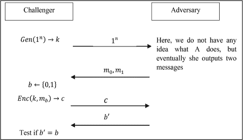

*图 4.1* 基于博弈的安全定义。

在此博弈中，若 `b' = b` 则称对手获胜；若 `∀ PPT A, ∃ neg(n): Pr[A wins the game] = 1/2 + neg(n)`，则称我们的方案安全。由此概率减去平凡分量（即 1/2），所得即为对手获胜的优势（advantage），方案安全要求该优势可忽略不计。

## 4.2 归约证明

在归约证明中，我们称：只要假设 Y 成立，方案 X 即安全，其中 Y 为已知的困难假设，不存在能在多项式时间内破解 Y 的算法。我们将此定义表述为定理，并按如下方式给出证明：

**定理**：若 Y 成立 ⇒ X 安全。

**证明**：此处采用的证明方法即普通归约证明，我们将利用逆否命题进行证明，即：若 X 不安全，则意味着假设 Y 不成立。

```
原命题：Y 成立 ⇒ X 安全，
逆否命题：X 不安全 ⇒ Y 不成立
```

这两命题等价。若能证明逆否命题，则原命题自动得证，从而完成定理证明。

*潜在推理陈述*：我们假设存在一个概率多项式时间 (PPT) 对手 `A` 能破解 X，由此可构造另一个 PPT 对手 `B` 能破解 Y。此处“破解”完全取决于方案 X 所采用的安全定义。例如：若考虑窃听者安全定义，则破解意味着对手能以非可忽略优势区分两条消息。

另一种思路是：因不存在已知的 PPT 算法 `B` 能破解 Y，这意味着不存在能破解 X 的 PPT 算法 `A`。若存在某算法 `A` 破解 X，则通过此证明（更准确说是归约），我们立即得到一个能破解 Y 的算法；然而 Y 是已知困难假设，无算法能破解它，故不可能存在能破解 X 的算法，从而可宣称方案 X 安全。

因我们在构造另一对手 `B`，将定义其交互与伪代码；故此类证明亦称构造性证明。几乎所有归约证明均按相似方式进行：我们通过编写伪代码来构造 `B`。`B` 可将 `A` 作为子程序使用，`B` 与 `A` 的交互严格按方案 X 定义。图 4.2 所示的框图有助于清晰展示交互关系。

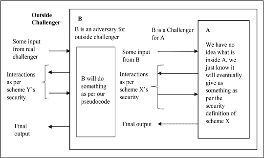

*图 4.2* 安全性证明中不同对手与挑战者间交互的框图表示。

### 归约证明中的 PPT 算法 B

PPT 算法 B 在此扮演两个关键角色。它模拟一个真实的挑战者，正如 A 在方案 X 的安全游戏中期望与真实挑战者通信那样。另一方面，B 按照方案 Y 的安全游戏，充当外部挑战者的对手。如图 4.1 中基于游戏的安全定义所示，A 从 B 接收一些输入，但我们不知道 A 是如何工作的。有趣的部分在于构建 B 并编写其伪代码，使其为 A 模拟挑战者；因此，其代码应类似于 X 安全游戏中的挑战者。编写代码时，请记住 B 不知道 A 的工作原理；B 只知道 A 按照方案 X 的安全游戏行事。如果我们考虑窃听者安全，那么 B 知道 A 输出两条消息并最终输出一个猜测比特。对于 B 来说，有一个不同的安全游戏——与方案 Y 相关的游戏。就方案 Y 而言，我们知道 B 作为对手行事，并与为方案 Y 定义的某个外部挑战者交互。该外部挑战者按照方案 Y 的安全游戏给 B 一些东西，并且像 A 一样，B 也可以向外部挑战者发送和接收东西。最后，B 也需要输出一些东西以赢得安全游戏 Y。对于方案 Y，存在一个定义良好的挑战者代码（外部挑战者）。

对于方案 X，我们只知道 A 和 B 之间的交互，必须为 B 编写代码。然而，对于方案 Y，我们既知道交互也知道代码。因此，我们的目标是为 B 编写代码，使其与外部挑战者的交互以某种方式与 B 与 A 的交互联系起来。最后，如果 A 赢得了 X 的安全游戏，我们希望 B 也能赢得 Y 的安全游戏。

### 归约方法中的三条规则

*   **我们构造的算法 (B) 必须是一个 PPT 算法。** 我们必须考虑三件事以确保 B 是 PPT 算法。首先，我们为 B 编写的伪代码必须在多项式时间 (PT) 内运行。其次，在 B 内部，A 作为子程序被调用；我们不知道 A 的工作原理，但我们知道 A 所做的一切都是在 PT 内完成的。因此，第一点和第二点结合起来也会导致 PT。第三，B 与外部挑战者的交互次数必须是多项式的。

*   **模拟。** B 为 A 模拟挑战者。就 A 而言，A 和 B 之间的交互必须是不可区分的；即，B 应该完全按照真实挑战者在 X 的安全游戏中所做的那样做。或者，B 在与 A 交互方面的行为应类似于方案 X 安全游戏中挑战者的行为。

*   **赢得安全游戏的概率。** A 以概率 `1/2 + non-negl(n)` 赢得安全游戏 X（这意味着在窃听者安全的情况下，正确区分消息从而正确猜测比特）。现在，假设 B 的获胜条件是它需要以非微不足道的优势找到某样东西。我们需要证明，如果 A 赢得了安全游戏 X，那么 B 接受 A 的输出，通过一些代码运行它，输出其响应，并且 B 也必须以非微不足道的优势赢得安全游戏 Y。

对于每一个归约证明，在为 B 编写代码时，我们都需要分析这三条规则。

#### 从逆否命题的角度进行推理

如图 4.3 所示，第三条规则的逆否命题如下：因为我们不知道存在任何具有非微不足道优势的算法 B，所以所有试图攻破 Y 的算法只有微不足道的优势，因为 Y 是一个已知的困难问题。就逆否命题而言，这意味着所有算法 A 也必须只有微不足道的优势。因此，方案 X 是安全的。

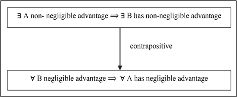

*图 4.3 将逆否命题应用于归约方法的第三条规则。*

### 4.2.1 归约证明示例

为了了解归约方法的应用，我们考虑一个基于简单伪随机生成器 (PRG) 的加密方案。这里，我们基本上是在开发一个实用的一次性密码本。正如第 2 章所述，一次性密码本 (OTP) 具有完美保密性，但不能应用于非常长的消息，因为我们必须使用与消息长度相同的密钥来加密消息。

#### 基于 PRG 的加密方案 (X)

PRG 是一个函数 `G`，它接受 `n` 位输入并产生 `n'` 位输出。它是一个确定性算法，产生的东西看起来是随机的，但它本身不是一个随机算法。如果攻击者/区分器 `D` 无法区分输出是纯随机 (R) 还是伪随机 (PR)，则称 PRG 是安全的。只要 PRG 最初接收的种子 `s` 是纯随机的，就假定 PRG 是安全的。形式上，PRG 安全性是用区分概率来定义的。

∀ PPT `D`, ∃ 安全参数 `n` 中的可忽略函数 `negl(n)`, 使得

```
Pr[s←{0,1}^n; r←G[s]: D[1^n, r]→R] − Pr[r←{0,1}^n': D[1^n, r]→R] = ± negl(n)
```

(4.3)

这表明区分器确实无法以超过微不足道的概率区分 R 和 PR。

**方案 X 包含以下算法：**

*   `k←Gen(1^n): k←{0,1}^n`
*   `c←Enc(k, m): G(k)⊕m = c`
*   `m'←Dec(k, c): G(k)⊕c = m'`

由于 `G(k)` 将 `n` 位映射到 `n'` 位，消息空间为 `{0,1}^n'`。该方案是完全正确的，因为一个值与自身异或结果为 0。该方案的安全性通过以下定理证明：

**定理：** 如果 `G` 是安全的 PRG，则方案 X 是单次消息窃听者安全下的安全加密方案。

**证明：** 如果 ∃ PPT `A` 攻破 X，那么我们将构造另一个 PPT 对手 `B` 攻破 `G`。`B` 参与 PRG 安全游戏；挑战者提供一个安全参数和某个值 `r`，它可能是随机选取的，也可能是由 `G` 从随机种子生成的。让我们绘制图 4.4 所示的框图，这有助于我们清晰地理解证明。如图 4.4 所示，在 `B` 内部我们进行加密方案 X 的安全游戏。`A` 像 `B` 一样被给予安全参数，`A` 按照窃听者安全定义给出 `m[0]`, `m[1]`。`B` 返回其中一条消息 `m[b]` 的加密，并发送 `c` 给 `A`。最后，`A` 输出 `b'` 作为其对 `b` 的猜测。

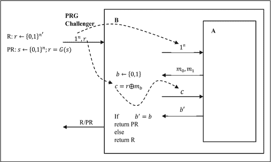

*图 4.4 方案 X 归约证明方法的框图表示。*

现在，我们需要为 `B` 编写伪代码，牢记 `B` 在 X 的安全游戏中表现得像对 A 的挑战者，而在 PRG 的安全游戏中表现得像对手。从 PRG 挑战者接收到的安全参数只是从 `B` 传递给 `A`。对于加密部分，`B` 选择一个比特 `b←{0,1}` 然后加密 `m[b]`，但它需要将其与 PRG 安全游戏中的随机或伪随机值 `r` 联系起来。因此，`B` 计算 `c = r⊕m[b]` 并将其发送给 `A`。现在，`A` 做一些事情并返回 `b'`。收到 `b'` 后，我们有两个选项：

*   如果 `b' = b`（即 A 猜测正确），则输出 **伪随机**。
*   否则，输出 **随机**。

这里的原因是，如果 `r` 是伪随机生成的，那么我们提供给 A 的正是她所期望的——一条加密消息；此时我们称 A 以非微弱优势破解了 X。如果 `r` 确实是随机的，那么给定的加密方案就是一次性密码本（OTP），我们知道它是完全安全的。

**可能的推理**：正如上述讨论所见，归约证明的第一和第二条规则显然成立。对于第三条规则，我们首先需要定义区分概率，为此必须考虑两种可能的情况：第一，B 在 `r` 确实是随机的情况下输出随机（R），即 `Pr[B→R | r is R]`；第二，B 输出随机（R），但现在给定的是伪随机（PR），即 `Pr[B→R | r is PR]`。B 破解 G 意味着这两个概率之差是非微弱的。

或者，我们可以这样思考：B 在何时输出 R？当 `b' ≠ b` 时。因此，`Pr[B→R | r is R]` 等价于 `Pr[b'≠b | r is R]`。当 `r` 是 R 时，加密完全是一个 OTP。我们知道 $Pr[b' \neq b] = Pr[b' = b] = \frac{1}{2}$。此外，`Pr[B→PR | r is PR]` 等价于 `Pr[b'≠b | r is PR]`，而 `Pr[b'≠b | r is PR]` 是 A 在安全游戏 X 中失败的概率。我们知道 A 的获胜概率是 $\frac{1}{2} + non-neg(n)$。因此，$Pr[b' \neq b | r\ is\ PR] = \frac{1}{2} - non-neg(n)$。现在区分概率可以很容易地计算为 $\frac{1}{2} - (\frac{1}{2} - non-neg(n)) = non-neg(n)$。现在，我们将回溯；我们假设 PRG 是安全的，所以这个区分概率必须是微弱的，记为 `ε(n)`。所以 A 在安全游戏 X 中获胜的概率是 $\frac{1}{2} + \varepsilon(n)$，其中 `ε(n)` 是微弱的。这证明了如果 G 是一个安全的 PRG，那么 X 必定是安全的。

在可搜索加密方案的情况下，证明方法将保持不变；变化的是安全定义和需求，我们将在下一节中说明。

## 4.3 可搜索加密中的常见安全定义

可搜索加密方案的第一个正式安全定义由 Goh [[4]](#04chap_04.xhtml#ref4_4) 提出。他们在对称密钥设置中引入了安全定义，并将可搜索索引的安全性定义为针对自适应选择关键词攻击的关键词不可区分性（IND1-CKA）。该定义指出，只要数据文件长度相等，对手就无法通过查看其索引来获取关于数据文件的任何信息。这类似于我们在通用安全定义中看到的情况，即我们假设消息必须等长；否则，它们平凡地就变得可区分了。此外，他们规定 IND1-CKA 不要求陷门是安全的，因为他们开发该方案是为了将其用作一种安全数据结构，这种结构除 SSE 之外还有许多其他应用，而大多数应用并不要求陷门安全。Chang 和 Mitzenmacher [[5]](#04chap_04.xhtml#ref4_5) 引入了一种比 IND1-CKA 更强的安全概念，体现在不再需要文档大小相等的限制，并且他们在定义中也加入了陷门安全的概念。他们假设文档大小可能不相等；然而，它们似乎包含相同数量的关键词。确实，[[5]](#04chap_04.xhtml#ref4_5) 的定义中考虑了更多因素，但他们的安全定义存在缺陷，这被 Curtmola 等人 [[6]](#04chap_04.xhtml#ref4_6) 指出：他们提到的 SSE 安全条件甚至能被一个不安全的 SSE 满足。后来 Goh 重新审视了他们的安全定义，像 [[5]](#04chap_04.xhtml#ref4_5) 一样放宽了文档等长限制，增强了 IND1-CKA，并正式称为 IND2-CKA。IND2-CKA 确实保护了文档大小，但不考虑陷门的安全性。在回顾了所有现有的安全定义后，Curtmola 等人 [[6]](#04chap_04.xhtml#ref4_6) 指出，由于陷门与索引安全性的内在关联，考虑陷门的安全性至关重要。他们为可搜索加密方案引入了两个安全定义，这成为了标准定义且沿用至今。正式地，他们称之为 IND-CKA1（针对非自适应选择关键词攻击的不可区分性）和 IND-CKA2（针对自适应选择关键词攻击的不可区分性）。这两个定义都确保了索引以及搜索陷门不泄露关于数据文件及其相关关键词的任何信息。IND-CKA1 和 IND-CKA2 的区别在于对手如何以及何时可以发起查询。IND-CKA1 确保如果所有查询都在挑战阶段之前一次性发起，则安全性成立；而 IND-CKA2 允许对手根据之前的查询和搜索结果自适应地发起查询。因此，IND-CKA2 被认为比 IND-CKA1 更强。

在公钥设置中，可搜索加密的第一个安全定理由 Boneh 等人 [[7]](#04chap_04.xhtml#ref4_7) 提出。它简称为 IND-CKA，其内容是：在对手拥有该关键词的陷门之前，无法获取关于关键词的任何信息。这个安全定义类似于窃听者安全；这里对手会选择两个她选定的关键词（`w[0]`，`w[1]`），由挑战者加密后返回给对手。通过查看关键词密文，除非对手拥有该关键词的陷门，否则无法判断它是关键词 `w[0]` 还是 `w[1]` 的加密。另一个著名的公钥设置下可搜索加密安全定理由 Canetti 等人 [[8]](#04chap_04.xhtml#ref4_8) 提出，称为针对 CKA 的选择性安全。它与 IND-CKA 相同，但这里对手必须在安全游戏开始时就承诺其打算攻击的关键词。这两个定义都被建模为挑战者和对手之间的安全游戏（基础内容见 Section 4.1.1）。安全游戏包含以下阶段，如 Figure 4.5 所示：

*   **Setup Phase（初始化阶段）**。挑战者运行 `Setup(1^n)` 算法。它输出主密钥 `MSK`，由挑战者保管，以及公共参数 `PP`，发送给对手。

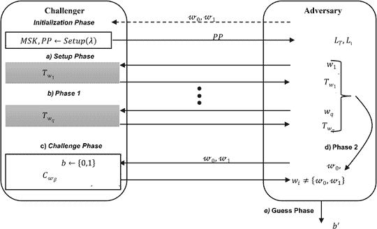

*Figure 4.5* 公钥设置下基于游戏的可搜索加密安全定义。

*   **Phase 1（阶段 1）**。在该阶段，对手可以发起密钥生成和陷门查询。挑战者利用其持有的 `MSK` 运行密钥生成算法，生成秘密密钥 `SK`。给定一个关键词 `w`，挑战者运行 `Trapdoor(SK, w)`，输出一个陷门 `T[w]`。然后挑战者将 `T[w]` 发送给对手。对手可以在该阶段发起多项式次查询。

*   **Challenge Phase（挑战阶段）**。在这里，对手选择一对 `{w[0], w[1]}` 作为其希望受到挑战的目标，并将它们发送给挑战者。给定 `{w[0], w[1]}`，挑战者选择一个二进制比特 `b←{0, 1}`，并使用生成索引算法输出 `C[β]`，将其发送给对手。

*   **Phase 2（阶段 2）**。该阶段与 Phase 1 相同，条件是 `A` 不能针对挑战关键词 `{w[0], w[1]}` 查询陷门。

*   **输出阶段/猜测阶段**。在此，对手输出比特 `b'` 作为其对 `b` 的猜测。

令 $Adv = Pr\left\lbrack {\beta = \beta^{'}} \right\rbrack - \frac{1}{2} = \varepsilon$ 为对手在博弈中获胜的优势；若 `ε` 可忽略不计，则该可搜索加密方案是安全的。

在选择性安全博弈中，除了这些阶段外，在安全博弈一开始还有一个称为初始化阶段的额外阶段。在此阶段，对手必须指定其打算攻击的挑战关键字，`{w[0], w[1]}`。这在图 4.5 中用虚线箭头表示。

## 4.4 安全性/复杂性假设与证明策略


可搜索加密方案的安全性通常通过将安全假设嵌入其构造中来证明。安全假设是密码学中众所周知的难题。通过归约方法，我们将我们的方案归约到这些难题，并基于此事实宣称方案的安全性：如果我们无法攻破这些难题，则也无法攻破我们的方案。安全假设大致可分为弱假设和强假设 [9]。弱假设确保的安全性接近离散对数（DL）假设，也称为标准假设。计算 Diffie-Hellman（CDH）假设就是弱假设的一个例子。之所以称为“弱”，是指攻破这些假设所需的时间显著高于强假设。因此，与强假设相比，弱假设更难攻破。强假设是指其安全级别低于 DL 假设的那些假设。强假设相对风险较大且不可靠 [9]。文献中开发可搜索加密方案常用的安全假设见表 4.1。

**表 4.1** 可搜索加密方案构造中常用的安全假设

| 序号 | 安全假设 | 描述 |
| --- | --- | --- |
| 1. | 离散对数 (DL) 假设 | 给定 `h ∈ G`，难以找到 `x : h = g^(x)` [10]。 |
| 2. | 计算 Diffie-Hellman (CDH) 假设 | 给定 `g^(x) ∈ G` 和 `g^(y) ∈ G`，难以找到 `g^(xy)` [11]。 |
| 3. | 判别 Diffie-Hellman (DDH) 假设 | 给定 `g^(x) ∈ G`、`g^(y) ∈ G` 和 `h ∈ G`，难以判定 `h = g^(xy)` 与否 [12]。 |
| 4. | 并行判别 Diffie-Hellman (pDDH) 假设 | 给定 `g^(x[1]), g^(x[2]), ..., g^(x[n]), h[1], h[2], ..., h[n] ∈ G`，难以判定 `h[1] = g^(x[1]x[2]), h[2] = g^(x[2]x[3]), ..., h[n−1] = g^(x[n−1]x[n]), h[n] = g^(x[n]x[1])` 与否 [12]。 |
| 5. | q-Diffie-Hellman 逆 (q-DHI) 假设 | 给定 `g^(x), g^(x²), ..., g^(x^q) ∈ G`，难以计算 $g^{\frac{1}{x}}$ [13]、[14]。 |
| 6. | q-判别 Diffie-Hellman 逆 (q-DDHI) 假设 | 给定 `g^(x), g^(x²), ..., g^(x^q), h ∈ G`，难以判定 $h = g^{\frac{1}{x}}$ [13]。 |
| 7. | 线性假设 | 给定 `g^(u), g^(v), g^(xu), g^(yv) ∈ G`；难以找到 `g^(x + y) ∈ G` [15]。 |
| 8. | q-线性假设 | 设 `g[1], g[2], ..., g[q], g[0]` 为群 `G` 的生成元。给定 `g[1], g[2], ..., g[q], g[0], g[1]^(x[1]), g[2]^(x[2]), ..., g[q]^(x[q]) ∈ G`；难以找到 `g[0]^(x[0])`，其中 $x_{0} = {\sum\limits_{i = 1}^{q}x_{i}}$ [15]。 |
| 9. | 判别线性 (DLIN) 假设 | 给定 `g^(u), g^(v), g^(xu), g^(yv), h ∈ G`；难以判定 `h = g^(x + y)`。此假设特别是在 DDH 不再是难题的双线性群中，用于替代 DDH [15]。 |
| 10. | q-判别线性 (q-DLIN) 假设 | 设 `g[1], g[2], ..., g[q], g[q+1]` 为群 `G` 的生成元。给定 `g[1], g[2], ..., g[q], g[q+1], g[1]^(x[1]), g[2]^(x[2]), ..., g[q]^(x[q]), h ∈ G`；难以判定 $h = g_{q + 1}^{\sum\limits_{i = 1}^{q}x_{i}}$ [15]。 |
| 11. | q-强 Diffie-Hellman (q-SDH) 假设 | 给定 `g^(x), g^(x²), ..., g^(x^q) ∈ G`，难以找到 `u ∈ Z[p]` 和 $g^{\frac{1}{x + u}}$ [13]。 |
| 12. | Diffie-Hellman 指数 (DHE) 假设 | 给定 `g[0], g[1], g[2], ..., g[q], g[q+2], ..., g[2q] ∈ G`，其中 `g[i] | [1 ≤ i ≤ 2q, i ≠ q+1] = g^(x^(i))`，难以找到 `g[q+1] = g^(x^(i+1))` [16]。 |
| 13. | 哈希 Diffie-Hellman (HDH) 假设 | 设 `H: {0,1}^(*) → {0,1}^(len)` 为返回长度为 `len` 的二进制字符串的哈希函数。给定 `g, g^(x), g^(y), H(g^(xy)), Z = {0,1}^(len)`；难以判定 `Z = H(g^(xy))` [17]。 |
| 14. | 对称外部 Diffie-Hellman (SXDH) 假设 | 设 `e: G[1] × G[2] → G[T]` 为 `G[1]` 和 `G[2]` 之间的非对称双线性映射。设 `j ∈ {1,2}` 且 `g[j]` 为 `G[j]` 的生成元。给定 `g[j]^(x), g[j]^(y), g[j]^(xy), h[j] ∈ G[j]`，难以判定 `h[j] = g[j]^(xy)` [18]。这意味着 DDH 在两个群中均为难题。 |
| 15. | 指数知识假设 (KEA) | 若输入 `g` 和 `g^(x)` 时 𝒜 输出 `(Z, C) : C = Z^(x)`，则存在提取器在相同输入下返回 `z : g^(z) = Z` [19]。 |
| 16. | 双线性 Diffie-Hellman (BDH) 假设 | 给定 `g, g^(x), g^(y)` 和 `g^(z) ∈ G`，难以找到 `e(g, g)^(xyz)` [20]。 |
| 17. | 判别双线性 Diffie-Hellman (DBDH) 假设 | 给定 `g, g^(x), g^(y), g^(z) ∈ G` 和 `X ∈ G[T]`，难以判定 `X = e(g, g)^(xyz)` [20]。 |
| 18. | 修正判别 Diffie-Hellman (MDDH) 假设 | 此假设基于 DBDH 假设。给定 `g, g^(x), g^(y), g^(z), g^(xyz) ∈ G` 和 `X ∈ G`，难以判定 `X = g^(xyz)` [21]。 |
| 19. | 双线性判别线性 (BDLIN) 假设 | 给定 `G, G[T], e, {g[1], g[2], g[1]^(x), g[2]^(y) ∈ G}, X ∈ G[T] : x, y, z ∈ Z[p]`，难以判定 `X = e(g[1], g[2])^(x + y)` [22]。 |
| 20. | q-双线性 Diffie-Hellman 逆 (q-BDHI) 假设 | 给定 `G, G[T], e, {g[i]^(x), g[i]^(x²), ..., g[i]^(x^q)}[i ∈ {1, 2}]`，难以找到 $e\left( {g_{1},g_{2}} \right)^{\frac{1}{x}}$ [23]。 |
| 21. | q-判别双线性 Diffie-Hellman 逆 (q-DBDHI) 假设 | 给定 `G, G[T], e, {g[i]^(x), g[i]^(x²), ..., g[i]^(x^q)}[i ∈ {1, 2}], X ∈ G[T]`，难以判定 $X = e\left( {g_{1},g_{2}} \right)^{\frac{1}{x}}$ [24]。 |

### 密码学假设表

| 编号 | 假设名称 | 描述 |
| :--- | :--- | :--- |
| 22 | `q-weak Bilinear Diffie–Hellman Inversion (q-wBDHI) Assumption` | 给定 `G`、`G[T]`、`e`、`{g[i]^(x), g[i]^(x²), …, g[i]^(x^(q)), g[j]^(y)}[i ∈ {1, 2}]`，难以求出 `e(g[1], g[2])^(x^(q+1)y)` [[24]](#04chap_04.xhtml#ref4_24)。 |
| 23 | `q-weak Bilinear Decision Diffie–Hellman Inversion (q-wDBDHI) Assumption` | 给定 `G`、`G[T]`、`e`、`{g[i]^(x), g[i]^(x²), …, g[i]^(x^(q)), g[j]^(y)}[i ∈ {1, 2}]`、`X ∈ G[T]`，难以判断 `X = e(g[1], g[2])^(x^(q+1)y)` 是否成立 [[24]](#04chap_04.xhtml#ref4_24)。 |
| 24 | `Multi-Sequence of Exponents Diffie–Hellman (MSEDH) Assumption` | 给定 `e: G[1]×G[2]→G[T]`，`g[0]`、`h[0]` 分别为群 `G[1]`、`G[2]` 的生成元，`l`、`m`、`t` 为三个整数，`f`、`g` 为阶数分别为 `l`、`m` 的两个互素多项式，以及以下幂运算：`g[0]`、`g[0]^(α)`、…、`g[0]^(α^(l+t−2))`、`g[0]^(kγf(α))`；`g[0]^(γ)`、`g[0]^(αγ)`、…、`g[0]^(γα^(l+t))`；`h[0]`、`h[0]^(α)`、…、`h[0]^(α^(m−2))`；`h[0]^(γ)`、`h[0]^(αγ)`、…、`h[0]^(γα^(2m−1))`；`h[0]^(kg(α))`、`T ∈ G[T]`。难以判断 `T = e(g[0], h[0])^(kf(α))` 是否成立 [[25]](#04chap_04.xhtml#ref4_25)。 |
| 25 | `Truncated decisional augmented Bilinear Diffie–Hellman (q-ABDHE) Assumption` | 给定 `g`、`g^(x)`、`g^(x²)`、⋯、`g^(x^(q))`、`g^(zx)`、`g^(zx^(q+2)) ∈ G` 以及 `e(g,g)^(zx^(q+1))`、`X ∈ G[T]`，其中 `x`、`z ∈ Z[p]`，难以判断 `X = e(g,g)^(zx^(q+1))` 是否成立 [[26]](#04chap_04.xhtml#ref4_26)。 |

在上表中，`G` 指阶为素数 `p` 且生成元为 `g` 的循环群；`e: G[1]×G[2]→G[T]` 指从源群 `G[1]` 和 `G[2]` 到目标群 `G[T]` 的非对称双线性映射，其中 `G[1]` 和 `G[2]` 均为阶为素数 `p` 的循环群，使得 `g[1]`、`g[2]` 分别是 `G[1]` 和 `G[2]` 的生成元，且 `e(g,g)` 是 `G[T]` 的生成元。

### 4.4.1 随机预言机模型与标准模型

大多数加密方案（包括可搜索加密）的安全性证明要么在随机预言机模型下，要么在标准模型下进行。这些模型被视为设计策略和证明策略。在标准模型中，对抗者唯一的约束是计算资源（即时间和计算能力），因此它也被称为计算模型。在标准模型中，仅使用安全性/复杂性假设来证明方案的安全性。在随机预言机模型中，除了安全性假设外，还对密码学原语做出了一项额外假设：将它们视为理想原语；例如，随机预言机模型中的密码学哈希函数被视为纯随机函数。在随机预言机模型中证明方案既高效又相对容易，但实践者更专注于使用标准模型开发方案，因为当这些理想化原语被实际原语替换时，可能无法保证方案在实际场景中的安全性。

## 4.5 章节小结

本章介绍了可证明安全性的概念及其在开发安全可搜索加密中的应用。本章提供了可搜索加密中使用的基本安全定义，并解释了可用于证明可搜索加密方案安全性的不同安全模型。此外，本章还介绍了可证明安全性中使用的密码学假设，并列举了可搜索加密中常用的假设。

# 参考文献

1.  Z. Yu, C. Z. Gao, Z. Jing, B. B. Gupta, and Q. Cai, “A practical public key encryption scheme based on learning parity with noise,” *IEEE Access*, vol. 6, pp. 31918–31923, 2018.

2.  C. Yu, J. Li, X. Li, X. Ren, and B. B. Gupta, “Four-image encryption scheme based on quaternion Fresnel transform, chaos and computer generated hologram,” *Multimedia Tools and Applications*, vol. 77, no. 4, pp. 4585–4608, 2018.

3.  X. Wang, Y. Zhang, B. B. Gupta, H. Zhu, and D. Liu, “An identity-based signcryption on lattice without trapdoor,” *J. UCS*, vol. 25, no. 3, pp. 282–293, 2019.

4.  E.-J. Goh et al., “Secure indexes,” *IACR Cryptol. ePrint Arch*, Report 2003/216, <http://eprint.iacr.org/2003/216>.

5.  Y.-C. Chang, and M. Mitzenmacher, “Privacy preserving keyword searches on remote encrypted data,” in *International Conference on Applied Cryptography and Network Security*, 2005, pp. 442–455.

6.  R. Curtmola, J. Garay, S. Kamara, and R. Ostrovsky, “Searchable symmetric encryption: Improved definitions and efficient constructions,” *J. Comput. Secur*, vol. 19, no. 5, pp. 895–934, 2011.

7.  D. Boneh, G. Di Crescenzo, R. Ostrovsky, and G. Persiano, “Public key encryption with keyword search,” in *International Conference on the Theory and Applications of Cryptographic Techniques*, 2004, pp. 506–522.

8.  R. Canetti, S. Halevi, and J. Katz, “A forward-secure public-key encryption scheme,” in *International Conference on the Theory and Applications of Cryptographic Techniques*, 2003, pp. 255–271.

9.  F. Guo, W. Susilo, and Y. Mu, *Introduction to Security Reduction*. Springer Cham, Switzerland, 2018, <https://doi.org/10.1007/978-3-319-93049-7>.

10. C.-P. Schnorr, “Efficient signature generation by smart cards,” *J. Cryptol*, vol. 4, no. 3, pp. 161–174, 1991.

11. D. Boneh, and R. J. Lipton, “Algorithms for black-box fields and their application to cryptography,” in *Annual International Cryptology Conference*, 1996, pp. 283–297.

12. D. Boneh, “The Decision Diffie-Hellman problem,” in *Buhler J.P. (eds) Algorithmic Number Theory. ANTS 1998. Lecture Notes in Computer Science*, vol 1423. Springer, Berlin, Heidelberg. <https://doi.org/10.1007/BFb0054851>, 1998.

13. D. Boneh, and X. Boyen, “Short signatures without random oracles and the SDH assumption in bilinear groups,” *J. Cryptol*, vol. 21, no. 2, pp. 149–177, 2008.

14. B. Libert, and J.-J. Quisquater, “Improved signcryption from q-Diffie-Hellman problems,” in *International Conference on Security in Communication Networks*, 2004, pp. 220–234.


## 参考文献

15. D. Boneh, X. Boyen, and H. Shacham, “Short group signatures,” in *Annual International Cryptology Conference*, 2004, pp. 41–55.

16. C. Delerablée, “Identity-based broadcast encryption with constant size ciphertexts and private keys,” in *International Conference on the Theory and Application of Cryptology and Information Security*, 2007, pp. 200–215.

17. M. Abdalla, M. Bellare, and P. Rogaway, “DHAES: An encryption scheme based on the Diffie-Hellman problem,” *Cryptology ePrint Archive*, Report 1999/007, <https://eprint.iacr.org/1999/007>.

18. J. Groth, and A. Sahai, “Efficient non-interactive proof systems for bilinear groups,” in *Annual International Conference on the Theory and Applications of Cryptographic Techniques*, 2008, pp. 415–432.

19. M. Bellare, and A. Palacio, “The knowledge-of-exponent assumptions and 3-round zero-knowledge protocols,” in *Annual International Cryptology Conference*, 2004, pp. 273–289.

20. D. Boneh, and M. Franklin, “Identity-based encryption from the Weil pairing,” in *Annual International Cryptology Conference*, 2001, pp. 213–229.

21. M. H. Ameri, M. Delavar, J. Mohajeri, and M. Salmasizadeh, “A key-policy attribute-based temporary keyword search scheme for secure cloud storage,” IEEE Trans. Cloud Comput., vol. 8, no. 3, pp. 660–671, 2020, [`doi.org/10.1109/TCC.2018.2825983`](https://doi.org/10.1109/TCC.2018.2825983).

22. M. Backes, D. Fiore, and R. M. Reischuk, “Verifiable delegation of computation on outsourced data,” in *Proceedings of the 2013 ACM SIGSAC Conference on Computer & Communications Security*, 2013, pp. 863–874.

23. D. Boneh, and X. Boyen, “Efficient selective-ID secure identity-based encryption without random oracles,” in *International Conference on the Theory and Applications of Cryptographic Techniques*, 2004, pp. 223–238.

24. D. Boneh, X. Boyen, and E.-J. Goh, “Hierarchical identity based encryption with constant size ciphertext,” in *Annual International Conference on the Theory and Applications of Cryptographic Techniques*, 2005, pp. 440–456.

25. C. Delerablée, and D. Pointcheval, “Dynamic threshold public-key encryption,” in *Annual International Cryptology Conference*, 2008, pp. 317–334.

26. C. Gentry, “Practical identity-based encryption without random oracles,” in *Annual International Conference on the Theory and Applications of Cryptographic Techniques*, 2006, pp. 445–464.

# 第 5 章 公钥设置下的可搜索加密

与对称密钥设置相比，**公钥设置下的可搜索加密**提供了灵活性，因为用户之间不需要复杂的密钥共享过程，这使其适用于多用户共享云存储环境。由于存储成本优化、数据管理便捷以及随时随地访问等特性，云存储在组织中变得非常流行，并逐渐成为一种必需品。然而，由于安全顾虑，组织在采用该平台时感到有些犹豫。如果数据以明文形式原样存储在第三方云服务器上，则可能不安全。为解决信任问题，建议以加密形式存储数据。这解决了问题；然而，数据的选择性访问变得不可行。一个简单的解决方案是先下载所有数据并在本地解密，但在这种情况下，如果一切都要手动完成，为什么还要使用云存储？用户必须能够从存储在云服务器上的加密数据中仅检索所需数据。检索所需数据的首要要求是在加密数据上执行搜索的能力。可搜索加密技术在此场景中发挥着关键作用。众所周知，可搜索加密可以使用对称密钥或公钥设置来开发。使用对称密钥设置为共享云存储环境创建可搜索加密方案，在云用户之间共享密钥方面可能会导致大量复杂性。随着用户数量的增加，内部密钥分发过程也变得困难。因此，首选公钥设置。在本章中，我们将讨论公钥设置下可搜索加密方案的各个方面。

## 5.1 系统定义与系统模型

在本节中，我们将通过引入可搜索加密方案中涉及的不同算法来正式定义可搜索加密，并利用第 4 章中给出的概率定义，为可搜索加密方案提供正确性条件。此外，我们将讨论可搜索加密系统的架构，并解释系统中各实体的角色。

### 5.1.1 系统定义

与任何加密方案一样，可搜索加密方案也由四个基本算法组成：密钥生成、索引生成、陷门生成和搜索。这些算法源自加密方案中的算法，我们将在此讨论每个算法与任何标准公钥加密（`PKE`）方案中算法的相似性和关系。

*   `[K_pub, K_pri] ← GenKey(1^n)`：此处的密钥生成算法与任何标准 `PKE` 方案中的相同。该算法也接受安全参数（一元格式）并输出公钥和私钥对，就像任何 `PKE` 方案一样。

*   `C_j ← GenIndex(K_pub, w_j)`：索引生成算法与任何 `PKE` 方案中的加密算法相同。它也接受公钥，并使用该公钥加密与数据文件关联的关键词。通常，在 `PKE` 方案中，我们使用公钥加密消息，此处消息等同于关键词。关键词密文的集合有时称为加密索引，因为云服务器默认实现直接或倒排索引方法来存储加密数据文件及其关联的加密关键词。因此，在可搜索加密的背景下，该算法称为索引生成算法；否则，它仅仅是一个加密算法。

*   `T_i ← GenTrap(K_pri, w_i)`：陷门生成算法在输入方面（即用户的私钥）与 `PKE` 方案中的解密算法相似。但在此步骤不接受密文，可搜索加密方案将其保留用于搜索步骤。通常，密钥用于解密，但这里我们希望使用该密钥将搜索能力委托给云服务器，同时不泄露它。此处，对于我们要搜索的每个关键词，我们生成一种该关键词的密钥，在密码学界，这称为搜索陷门，有时也称为搜索令牌。搜索陷门就像普通的计算机陷门一样，便于云服务器在加密数据上执行搜索。

*   `0/1 ← Search(T_i, C_j)`：搜索算法是针对 `PKE` 方案的新算法。该算法使用关键词的陷门，搜索每个密文以查找该关键词。如果找到匹配项则返回 1，否则返回 0。有时方案会明确显示返回与该关键词关联的数据文件引用；否则，隐含假设相关数据文件将提供给生成陷门的用户。

```
Pr[[K_pub, K_pri] ← GenKey[1^n]; C ← GenIndex[K_pub, w]; T ← GenTrap[K_pri, w]: 1 ← Search[T, C]] = 1
```

(5.1)

公式 5.1 表明，我们进行了一个实验：生成了一对公私钥，使用公钥适当加密一个关键词以获得其密文，并使用相应的私钥为同一关键词生成陷门。之后，将密文和搜索陷门同时提供给搜索算法。如果搜索算法以概率 1 返回二进制值 1，则称我们的方案始终正确。

### 系统定义变体

这是我们讨论过的一个综合系统定义；然而，在文献中存在该定义的一些变体，具体取决于开发可搜索加密方案所使用的方法类型和底层技术。可搜索加密方案既可以使用底层加密方案的核心进行设计（如我们上面刚讨论的），也可以使用一种将底层加密方案转换为可搜索加密的变换方法。使用变换方法开发的可搜索加密方案的系统定义如下：

*   `[PK[SE], SK[SE]] ← GenKey(1^n, W)`：该算法类似于上述的密钥生成算法。但这里还额外接受一个参数——关键词空间。关键词空间用于将其映射到身份空间（如果使用基于身份的加密（`IBE`）方案作为底层方案）或属性空间（如果使用基于属性的加密（`ABE`）方案作为底层方案）。该算法只是使用合适的映射运行底层加密方案的建立算法。底层加密方案的公共参数 `PP` 被用作可搜索加密方案的公钥 `PK[SE]`（除了底层加密方案的公共参数外，它可能还包含一些其他参数，例如用于映射目的的哈希函数），而主密钥 `MSK` 被用作可搜索加密方案中相应的私钥 `SK[SE]`。

*   `T[i] ← GenTrap(SK[SE], w[i])`：该算法内部调用底层加密方案的密钥生成算法；关键词在通过某个哈希函数映射后作为输入。例如：如果使用 `IBE` 作为底层方案，则使用哈希函数 `H`，它将每个关键词映射到身份空间中的唯一身份，`T[i] ← GenKey(MSK[IBE], H(w[i]))`。

*   `C[i] ← GenIndex(PK[SE], w[i])`：该算法内部调用底层加密方案的加密算法。以 `IBE` 方案为例，该算法调用 `Enc(PP[IBE], H(w[i]), m[i])`，该算法接受应用哈希函数后的关键词（将关键词映射到身份）并随机选择一条消息 `m[i]` 进行加密。

*   `0/1 ← Search(PK[SE], T[i], C[i])`：该算法内部调用底层方案的解密算法。以 `IBE` 方案为例，该算法调用 `Dec(PP[IBE], T[i], C[i])`，如果解密算法正确输出加密消息 `m[i]`，则输出二进制值 1；否则返回 0。

上述步骤展示了基于开发可搜索加密方案所用方法论类型的可搜索加密定义变体。接下来，我们将讨论另一种基于所用底层方案类型的变体。这里，我们将考虑使用 `ABE` 作为底层方案，并讨论关于 `ABE` 的相应可搜索加密方案的定义。为了联合表述，令 `I[K]` 表示密钥生成算法 `GenKey` 的输入，`I[E]` 表示生成索引算法 `GenIndex` 的输入。在 `KP-ABE` 中，`I[K]` 和 `I[E]` 分别是访问策略和属性集合。在 `CP-ABE` 中，`I[K]` 和 `I[E]` 分别是属性集合和访问策略。

*   `(PP, MSK) ← Setup(1^n, W, Att)`：建立算法接受属性全集 `Att = {att[1], att[2], ..., att[|Att|]}` 和关键词空间 `W = {w[1], w[2], ..., w[|W|]}`，除了安全参数 `1^n` 外，输出公共参数 `PP` 和主密钥 `MSK`。

*   `SK[u] ← GenKey(PP, MSK, I[K])`：该算法接受 `MSK` 和用户 `u` 的凭证 `I[K]`，并生成其对应凭证的私钥，即 `SK[u]`。

*   `C[i] ← GenIndex(PP, w[i] ∈ W, I[E])`：该算法使用 `I[E]` 和 `PP` 加密关键词 `w[i]`，并输出密文 `C[i]`。

*   `T[i] ← GenTrap(SK[u], w[i] ∈ W)`：该算法使用用户 `u` 的私钥 `SK[u]` 为关键词 `w[i]` 生成陷门。

*   `0/1 ← Search(PP, C[i], T[i])`：只有当 `I[K]` 和 `I[E]` 之间满足可满足性条件时，才会执行该算法。如果可满足性条件成立，该算法通过逐个搜索所有密文来查找陷门中包含的关键词，如果找到匹配则返回 1，否则返回 0。

### 5.1.2 系统模型

在可搜索加密系统中，涉及不同的实体，每个实体执行系统定义中解释的算法之一。这些实体的描述及其角色通常称为系统模型，如下图 图 5.1 所示。

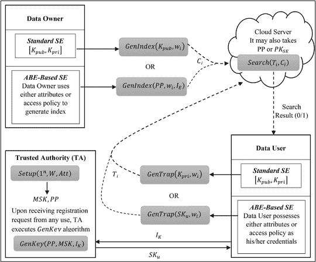

**图 5.1** PKE 设置下 SE 的通用系统模型。

如果使用标准可搜索加密方案，则假设每个云用户拥有一对公钥和私钥 `[K[pub], K[pri]]`，由密钥生成中心生成；这些可能是完全随机的密钥，与 `IBE` 或 `ABE` 基础的 `SE` 方案中的人员身份或用户凭证无关。如果使用 `IBE` 或 `ABE` 方案作为底层方案，则在密钥生成中会采集与个人身份或凭证（属性/访问策略）相关的信息来生成用户的私钥。在 图 5.1 中，我们在一个图中展示了标准 `SE` 或基于 `ABE` 的 `SE` 的系统模型，具体说明如下：

*   **可信机构**：可信机构（`TA`）是在使用 `ABE` 作为底层方案开发可搜索加密方案时发挥作用的实体。当新用户向 `TA` 注册时，`TA` 将验证其凭证并使用 `GenKey` 算法生成其私钥。该算法嵌入与该用户关联的访问策略（`KP-ABE`）或属性（`CP-ABE`）。`TA` 还通过执行 `Setup` 算法初始化系统，该算法生成公共参数 `PP` 和主密钥 `MSK`，其中 `PP` 可供每个云用户使用。

*   **数据拥有者**：数据拥有者（`DO`）是希望将其数据共享给多个用户的实体。`DO` 首先通过调用 `GenIndex` 算法加密数据和相关关键词。如果使用标准 `SE`，该算法使用 `K[pub]` 加密关键词 `w[i]`；否则，如果使用 `ABE`，该算法使用 `PP` 以及访问策略（如果使用 `CP-ABE`）或属性（如果使用 `KP-ABE`）加密关键词 `w[i]`。然后数据拥有者将加密数据上传到云服务器。

*   **数据用户**：数据用户（`DU`）是希望检索数据拥有者存储在云服务器上的数据的实体。由于数据是加密形式，且 `DU` 希望云服务器在加密数据上执行搜索，因此数据拥有者必须将其搜索功能委托给云服务器。数据拥有者通过执行 `GenTrap` 算法，使用其私钥生成搜索陷门。

*   **云服务器**：云服务器（`CS`）由第三方拥有，用于提供存储等服务。它存储加密数据，并使用 `DU` 提供的搜索陷门对这些数据执行搜索。如果使用标准 `SE`，则搜索算法仅接受密文和关键字的陷门；否则，如果使用 `ABE` 方案，可能还需要 `PP`，或者如果使用某种转换方法，则需要 `PK[SE]`。`PK[SE]` 表示转换后的可搜索加密方案的公钥。

### 5.1.3 SE 系统中各参与方之间的信息流

`IBE` 型 `SE` 系统中各参与方之间的信息流通过以下步骤进行解释，如 图 5.2 所示。

*   **i)** `DO` 使用 `GenIndex(K[pub], w[i])` 算法，在接收者的公钥 `K[pub]` 下，发送数据及其关联的关键词的加密形式。生成的加密数据及其索引存储在远程服务器上，以便与其他用户共享。

*   **ii)** `DU` 使用 `GenTrap(K[pri], w[i])` 算法生成与该特定文件关联的关键词的陷门。生成的陷门将使云服务器能够执行搜索，前提是它是由数据预期的用户生成的，即陷门是使用生成索引时所用公钥对应的同一用户的私钥生成的。

*   **iii)** `CS` 使用 `DU` 发送的搜索陷门 `T[j]`，通过 `Search(C[i], T[j])` 算法对加密数据 `C[i]` 执行搜索操作。云服务器代表 `DU` 执行搜索操作。如果找到与搜索陷门对应的关键词，则云服务器返回二进制输出 1；否则输出 0。

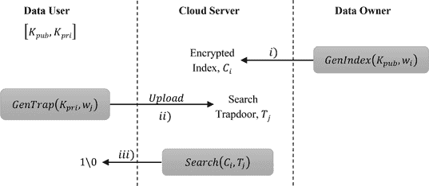

**图 5.2** 基于 IBE 的 SE 系统中的信息流。

`ABE` 型 `SE` 系统中各参与方之间的信息流通过以下步骤进行解释，如 图 5.3 所示。

*   **i)** `TA` 使用 `Setup(λ)` 算法初始化系统，该算法以安全参数 `λ` 作为输入。此外，它使用 `KeyGen(MSK)` 算法向云用户颁发必要的凭证，该算法以主密钥作为输入。

*   **ii)** 数据所有者是指希望将其数据集合连同一些关键词外包给云服务器以实现共享的一方。考虑到数据的机密性，数据以加密形式存储。为了将数据上传到云服务器，数据所有者使用 `GenIndex(PP, w[i])`，该算法以公共参数 `PP` 和与数据文件关联的元数据项 `w[i]` 作为输入，生成 `w[i]` 的密文 `C[i]`。一旦数据上传到云服务器，授权用户即可对其进行搜索。


*   **iii)** `DU` 是指想要检索数据所有者存储在云服务器上的数据的一方。如果用户已获授权，则他/她可以生成与数据文件关联的关键词的陷门，并将其交给云服务器执行搜索。假设 `DU` 想要检索包含特定关键词 `w[j]` 的数据文件。`DU` 将首先使用其秘密凭证运行 `GenTrap(SK[u], w[j])` 生成搜索陷门/令牌，然后将陷门 `T[j]` 发送给云服务器。

*   **iv)** 云服务器存储加密数据，并代表 `DU` 执行搜索操作。假设云服务器是诚实的，即它正确执行搜索算法。收到搜索陷门/令牌后，云服务器将使用 `Search(C[i], T[j])` 对其存储的加密数据执行搜索。如果搜索陷门/令牌是由拥有有效秘密凭证的授权用户生成的，则密文中的公共组件和搜索陷门/令牌中的相应秘密组件将根据加密系统的规则相互抵消。因此，如果密文中的关键词与搜索陷门/令牌中的关键词匹配，则等式条件成立。在这种情况下，称找到被搜索的关键词，因此返回二进制值 1 作为输出。否则，返回 0，表示未找到该关键词。在另一种情况下，如果搜索陷门/令牌不是由授权用户生成的，则搜索过程将终止，并向用户返回 `⊥`（空值）。这表明该用户无权在远程云服务器管理的公共存储上搜索数据所有者共享的加密数据。

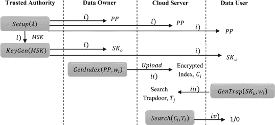

*图 5.3* 基于 ABE 的 SE 系统中的信息流。

在两种模型的整个过程中，假设云服务器是诚实的，并将正确执行所有算法，但它可能会出于好奇试图寻找一些相关信息。因此，在开发可搜索加密方案时，我们必须确保云服务器无法获得关于被搜索关键词明文的任何信息。该模型称为抗选择关键词攻击安全性（`CKA`），将在下一节正式介绍。

## 5.2 公钥设置下可搜索加密的主要类别

在本节中，我们将根据构建可搜索加密方案所用底层加密方案的类型，讨论 `SE` 方案的不同类别 [[1]](#05chap_05.xhtml#ref5_1)。在公钥设置中，有一些主要技术，如 `IBE` [2, 3][4]、`ABE` [57]、隐藏向量加密（`HVE`）等，常用于构建可搜索加密方案。其中，我们将讨论使用前两种原语（即 `IBE` 和 `ABE`）的可搜索加密方案。

### 5.2.1 基于 IBE 的 SE 方案

第一个基于 `IBE` 的可搜索加密方案由 Boneh 等人 [8] 提出；该方案及其部分变体的详细描述已在 第 3 章 中给出。在本节中，我们将讨论使用从 `IBE` 方案转换而开发的可搜索加密方案。从 `IBE` 到可搜索加密的通用转换机制如下所示，见 图 5.4。

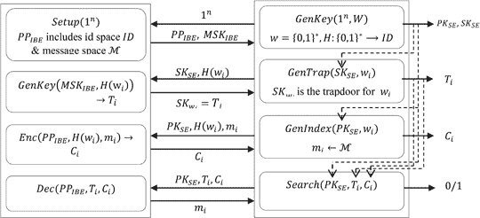

*图 5.4* 从 IBE 到可搜索加密的转换机制。

使用转换方法的第一个可搜索加密由 Khader [9] 提出。将一种转换方法应用于 k-韧性 `IBE` [2] 方案以构建 `PEKS` 方案。他们对转换机制指出了一些事实，例如：我们计划转换为 `PEKS` 的 `IBE` 方案必须是匿名的，否则会泄露关键词。另一个事实涉及生成的 `SE` 方案的一致性；他们指出，底层方案必须在适当的安全模型下是安全的，因为只有这样生成的方案才会是一致且安全的。所提方案是一致的，因为底层 `IBE` 方案能抵抗选择密文攻击。此外，他们还执行了多关键词搜索，并消除了对安全信道的需求。

#### 5.2.1.1 PEKS 重述

Abdalla 等人\[10\]给出了从匿名 IBE 到 PEKS 方案的转换机制的形式化定义。他们正式证明了生成方案的一致性。此外，他们提出了对基本思想的以下扩展：*i*）在可搜索加密转换中增加了 HIBE（匿名分层 IBE）；*ii*）增加了临时关键字搜索的概念。临时关键字搜索防止服务器在接收到陷门后了解过去和未来的关键字密文。因此，即使服务器记住了陷门，也无法找到陷门与关键字密文之间的联系。这是通过限制陷门的有效期限来实现的。

#### 5.2.1.2 PEFKS {#contents.xhtml#rsec5_2_1_2}

Xu 等人\[11\]首次给出了转换机制的实例化。为了演示目的，他们使用了 Boneh 和 Franklin\[12\]的 IBE 方案。此外，他们开发了一种使其方案免疫 KGA 的方法。在他们的方法中，他们将陷门分为模糊陷门和精确陷门，使得两个或多个关键字共享相同的模糊陷门。当接收者想要搜索某些内容时，他/她会将模糊陷门发送给云服务器。即使云服务器拥有所有关键字的模糊陷门，也无法猜测关键字，从而实现了免疫 KGA 的方案。为了构造模糊陷门，他们使用了一个模糊函数，如果关键字空间为偶数，该函数为每两个关键字返回相同的模糊值。如果关键字空间为奇数，则最后三个关键字具有相同的模糊值，其余关键字每两个具有相同的模糊值。因此，恶意云服务器仍有 1/2 或 1/3 的概率猜测与搜索陷门相关的关键字。因此，为了使方案对 KGA 更安全，需要进一步降低该概率，这通过设计一个使用模运算和同余类概念的模糊函数来实现\[13\]。他们设计的模糊函数使得 `k` 个关键字共享相同的模糊陷门，从而将关键字猜测概率降低到 1/`k`，提高了对 KGA 的安全性。

表 5.1 对比了存储和计算成本。

**表 5.1** 文献中现有方案的比较分析

| 方案 | 存储成本 | 计算成本 |
| --- | --- | --- |
| **基于*k*-韧性 IBE 的 PEKS** | | |
| Khader \[9\] | 加密索引：2\|*G*\| + \|{0,1}^(*k*)\| | (3*k*+5)*E* + 2*H* |
| | 陷门：6*`poly`* | 6*`poly`* |
| | 搜索：— | 4*E* + 1*H* |
| **使用模糊函数进行关键字搜索陷门的 PEKS** | | |
| Xu 等人 \[11\] | 加密索引：2\|*G*\| + 2\|*G*[*T*]\| | 2*P* + 2*E* + 2*E*[*T*] + 2*H* |
| | 陷门：2\|*G*\| | 2*H* + 2*E* |
| | 搜索：— | 1*P* + 1*H* |
| Mamta 等人 \[13\] | 加密索引：2\|*G*\| + 4\|*G*[*T*]\| | 4*P* + 4*E* + 4*E*[*T*] |
| | 陷门：2\|*F*[*p*]\| + 2\|*G*\| | 4*E* + 2*H* |
| | 搜索：— | 1*P* + 1*E*[*T*] |

### 5.2.2 基于 ABE 的 SE 方案 {#contents.xhtml#rsec5_2_2}

基于属性的可搜索加密（ABSE）是一种在云中对加密数据进行安全搜索的技术\[14\]。在 ABSE 方案中，借助访问策略/结构实现细粒度访问控制，该策略/结构表示用户可能拥有的各种属性之间的关系。该访问策略要么与密文关联，要么与用户的密钥关联，因此产生了两种设计框架，两者均可用作 ABE。如果访问策略嵌入在密文中，则称为密文策略 ABE（CP-ABE）\[15, 16\]；如果与密钥关联，则称为密钥策略 ABE（KP-ABE）\[6, 17\]。

在 CP-ABE 中，数据所有者完全控制其数据，因为访问策略与密文关联，数据所有者可通过它定义可访问其数据的用户。另一方面，KP-ABE 适用于数据所有者想要广播其数据的场景。在这里，只有其访问策略与广播数据中存在的属性一致的用户才能访问数据。在这两种框架中，为了提供细粒度访问控制，都需要一个称为“属性”的额外实体来决定谁访问什么。属性可以关于任何人或任何事物。例如，*计算机工程系有一名博士研究生*。这里，博士和计算机工程是该用户的属性。如果学院发布了计算机工程系的成绩，则拥有此属性的用户将能够查看其成绩。由于这些属性，密文和用户密钥中的组件数量会相应增加。因此，在存储成本和计算成本方面复杂度都会增加。因此，需要开发安全高效的 ABSE 方案，通过消除对属性的依赖，使密文和密钥等的大小保持常数。文献中已提出许多 ABSE 方案以支持多用户云存储环境\[18, 19, 20\]。ABE 与 SE 的结合确实提供了细粒度搜索能力，但这是以增加存储成本和计算成本的复杂度为代价的\[21\], \[22\]。

考虑到篇幅限制，我们将重点介绍一些基于 KP-ABE 和 CP-ABE 的可搜索加密方案。

#### 5.2.2.1 VABKS {#contents.xhtml#rsec5_2_2_1}

Zheng 等人\[21\]开发了一种同时使用 KP-ABE 和 CP-ABE 作为底层加密技术的关键字搜索方案。他们增加了搜索结果可验证性特性。因此，Zheng 等人放宽了对云服务器的诚实假设，因为现在可以验证云服务器是否正确执行了搜索算法。他们的构造基于对称双线性映射，其中源群和目标群均为素数阶 `p`。他们使用树数据结构表示的通用访问结构，并采用自顶向下的方法获取秘密值的份额。他们的方案在决策线性假设下，在选择性安全模型中对 CKA 安全。

#### 5.2.2.2 基于属性的关键字搜索 {#contents.xhtml#rsec5_2_2_2}

Sun 等人\[23\]提出了一种适用于多用户设置且具有高效用户撤销功能的基于属性的关键字搜索方案。他们使用 CP-ABE 作为底层加密方案。他们声称在搜索复杂度方面具有可扩展性，搜索复杂度不随用户数量变化。他们的构造基于对称双线性映射，其中源群和目标群均为素数阶 `p`，访问结构由 AND 门组成。他们采用了代理重加密和惰性重加密技术以实现高效的用户撤销。他们的方案支持联合关键字搜索，并在 DBDH 假设下对 CKA 具有选择性安全性。

#### 5.2.2.3 一种基于密钥策略属性的临时关键字搜索 {#contents.xhtml#rsec5_2_2_3}

Ameri 等人 [[24]](#05chap_05.xhtml#ref5_24) 提出了一种临时关键词搜索方案，以防止信息从搜索陷门泄露。他们的方案基于底层 ABE 方案的关键词策略设计框架。对于构造，他们使用了对称双线性映射，其中源群和目标群均为素数阶 `p`。该方案中使用的访问结构为树数据结构表示的一般类型，并采用自顶向下的方法获取秘密值的份额。他们的方案在修正的判定 Diffie-Hellman 假设下，在选择性安全模型中对抗 CKA 是安全的。关于降低计算成本，他们使搜索算法中的配对运算次数与搜索陷门中指定的时间单元数量无关。

#### 5.2.2.4 面向用户级撤销的基于属性的可搜索加密

Mamta 和 Gupta [[25]](#05chap_05.xhtml#ref5_25) 提出了一种具有常数大小用户密钥和陷门的 ABSE 方案。此外，搜索算法中的配对运算次数也是常数。常数项是指这些参数与方案涉及的属性数量无关。因此，该方案降低了计算和存储成本，并提供了快速搜索能力。此外，他们的方案支持访问策略的频繁变更。此处的访问结构同样为一般类型，并由树数据结构表示，其中内部节点代表 AND、OR 和阈值门，叶子节点代表属性。但与 [[24]](#05chap_05.xhtml#ref5_24) 不同，他们采用自底向上的方法获取秘密值的份额。他们的构造基于对称双线性映射，其中源群和目标群均为素数阶 `p`。他们的方案还通过将计算密集型任务委托给云服务器，高效地处理用户撤销事件。他们在判定线性假设下，在选择性安全模型中证明了对抗 CKA 的安全性。

#### 5.2.2.5 加密云数据上的多授权中心基于属性的关键词搜索

Miao 等人 [[26]](#05chap_05.xhtml#ref5_26) 提出了一种多授权中心基于属性的关键词搜索方案，其中独立的属性授权中心可以非常高效地管理来自不同域的属性。他们利用 ABE 的密文策略设计框架来构建关键词搜索方案。该构造基于对称双线性映射，其中源群和目标群均为素数阶 `p`，访问结构由单调布尔函数表示。他们使用线性秘密分享方案 (LSSS) 来获取秘密值的份额。LSSS 由一个随机元素矩阵和一个映射函数组成，该函数将矩阵的每一行映射到一个属性。他们的方案支持属性更新，并提供对恶意属性授权中心的追踪。他们的方案在 BDHE 和 DBDH 假设下是选择性安全的。

#### 5.2.2.6 面向移动医疗网络的可搜索加密

Mamta 和 Gupta [[27]](#05chap_05.xhtml#ref5_27) 为资源受限的移动医疗网络提出了一种基于 CP-ABE 的可搜索加密方案。他们使密文和用户密钥的大小均与方案涉及的属性数量无关。因此，他们的方案具有成本效益。此外，由于配对运算次数也与属性数量无关，他们的方案实现了快速搜索。他们的构造基于非对称双线性映射，其中源群和目标群均为素数阶 `p`，访问结构由 AND 门表示。他们的方案在增强多指数序列判定 Diffie-Hellman (aMSE-DDH) 假设下是选择性安全的。

#### 5.2.2.7 面向非单调访问结构的基于属性的可搜索加密

在 ABSE 方案中，会对方案支持的访问结构类型做出一种假设。几乎所有的 ABSE 方案都假设单调访问结构。“设 `P` = {`P`[1], `P`[2], …, `P`[`n`]} 为一方或属性的集合。集合 `A` ⊆ 2^({`P`[1], `P`[2], …, `P`[`n`]}) ∖ `Φ`（`P` 的非空子集）是单调的，当且仅当对于任意两个一方或属性的集合，即 `B` 和 `C`，满足以下条件：`C` ∈ `A` 当且仅当 `B` ∈ `A` 且 `B` ⊆ `C`”，即单调访问结构是 `P` 的所有非空子集的集合 `A`，使得如果子集 `B` ∈ `A`，则其所有超集也应属于 `A` [[15]](#05chap_05.xhtml#ref5_15)。例如，设 `P` = {1,2,3}，则集合 `A` = {{1,2},{2,3},{1,2,3}} 是单调的，而集合 `A`′ = {{1,2},{2,3}} 是非单调的。

为了更好地理解，让我们通过以下布尔公式的形式举一个例子：`A` ∨ (`B`∧`C`) 是单调访问结构，因为 {`A`,`B`} 及其超集 {`A`,`B`,`C`} 满足给定公式。`A` ∨ (`B`∧`C`′) 是非单调访问结构，因为 {`A`,`B`} 满足它，但其超集 {`A`,`B`,`C`} 不满足给定公式。换句话说，我们可以说如果一个集合及其所有超集都满足给定的访问结构，则称为单调访问结构，否则称为非单调。从这个例子可以得出一个重要结论：访问结构中存在 NOT 门会使其变为非单调。

对于非单调访问结构，文献中已经开发了多种 ABE 方案，但尚未为 ABSE 方案开发，也没有在 KP 设计框架中开发。因此，存在一个机会为 ABSE 方案提供非单调访问结构的支持，以便包含可以真正由布尔公式表示的复杂访问结构，从而确定搜索能力。Mamta 等人 [[28]](#05chap_05.xhtml#ref5_28) 引入了一种可以处理非单调访问结构的 CP-ABSE 方案。他们利用简化有序二元判定图来表示访问结构，并实现了非单调特性。

用于比较分析的符号见 表 5.2。

**表 5.2** 文献中类似基于 ABE 的可搜索加密方案分析所用符号的描述

| 符号 | 描述 |
| --- | --- |
| `|G|`, `|G[T]|` | 对称双线性配对中源群 (`G`) 和目标群 (`G[T]`) 元素的长度 |
| `|G[1]|`, `|G[2]|`, `|G[T]|` | 非对称双线性配对中源群 (`G[1]`,`G[2]`) 和目标群 (`G[T]`) 元素的长度 |
| `|Z[p]|` | 素数阶 `p` 的整数群中元素的长度 |
| `P` | 双线性配对运算 |
| `E`, `E[T]` | 源群和目标群中的指数运算 |
| `H` | 抗碰撞单向哈希函数 |
| `ξ` | 与用户关联的属性数量 |
| `N` | 与访问策略关联的属性数量 |
| `U` | 系统中授权用户的数量 |
| `t` | 陷门有效的时间单元数量 |
| `k` | 多关键词搜索方案中的关键词数量 |
| `T` | 有效路径的数量 |

基于 ABE 的可搜索加密方案的存储成本比较分析见 表 5.3。存储成本以每个算法输出中涉及的群元素的数量和大小（比特数）来衡量。

**表 5.3** 基于属性的可搜索加密方案的存储成本分析

| 方案 | 密钥大小 | 密文大小 | 陷门大小 |
| --- | --- | --- | --- |
| Zheng 等人 [[21]](#05chap_05.xhtml#ref5_21) | (2`N`)|`G`|(2`ξ`+1)|`G`| | (`ξ`+3)|`G`|(2`N`+3)|`G`| | (2`N`+2)|`G`|(2`ξ`+3)|`G`| |

## 计算成本比较分析

ABSE 方案的计算成本比较分析见 表 5.4。计算成本以每个算法涉及的操作数量和类型来衡量。

**表 5.4** 基于属性的可搜索加密方案的计算成本分析

| 方案 | 密钥生成 | 加密 | 陷门生成 | 搜索 |
| :--- | :--- | :--- | :--- | :--- |
| Zheng et al. [[21]](#05chap_05.xhtml#ref5_21) | `3*N*E + N*H(2*ξ+1)*G` | `(ξ+4)*E + ξ*H` | `(2*N+2)*E` | `(2*ξ+2)*P + ξ*E[T]` |
| Sun et al. [[22]](#05chap_05.xhtml#ref5_22) | `(2*ξ+2)*E` | `(3*N+2)*E + 1*H` | `(2*ξ+1)*E + 2*H` | `(N+1)*P + N*E[T]` |
| Ameri et al. [[24]](#05chap_05.xhtml#ref5_24) | `(2*N+1)*E + N*H` | `(ξ+4)*E + (ξ+2)*H` | `(2*N+t+1)*E + (t+1)*H` | `(2*ξ+2)*P + ξ*E[T] + t*E` |


| Mamta and Gupta [[25]](#05chap_05.xhtml#ref5_25) | `3*E + 1*H` | `(ξ+6)*E + (k+1)*H` | `7*E + 1*P + 1*H` | `(ξ+2)*E + 6*P` |
| Miao et al. [[26]](#05chap_05.xhtml#ref5_26) | `(3*ξ+8)*E` | `(4*N+3)*E + 2*E[T] + P` | `(2*ξ+2)*E` | `2*P` |
| Mamta and Gupta [[27]](#05chap_05.xhtml#ref5_27) | `2*E` | `(2*N+1)*E + 2*E[T] + 1*H + 1*P` | `(ξ+3)*E + 1*H` | `4*P + 1*E[T]` |
| Mamta et al. [[28]](#05chap_05.xhtml#ref5_28) | `2*E` | `(T+1)*E + 1*H + 2*E[T]` | `2*E + 1*H` | `(T+1)*P + 1*E[T]` |

根据表 5.3 和表 5.4 可观察到，与其他方案相比，方案 [[25]](#05chap_05.xhtml#ref5_25)、[[27]](#05chap_05.xhtml#ref5_27) 和 [[28]](#05chap_05.xhtml#ref5_28) 的密钥生成算法在涉及属性数量方面具有恒定的存储成本和时间复杂度。对于加密算法，除 [[27]](#05chap_05.xhtml#ref5_27) 存储成本恒定外，其余给定方案均具有可变的存储和计算成本。对于陷门生成算法，[[25]](#05chap_05.xhtml#ref5_25)、[[27]](#05chap_05.xhtml#ref5_27) 和 [[28]](#05chap_05.xhtml#ref5_28) 的存储成本恒定，而 [[25]](#05chap_05.xhtml#ref5_25) 和 [[28]](#05chap_05.xhtml#ref5_28) 使计算成本不随属性数量变化。在 `Search` 算法中，[[26]](#05chap_05.xhtml#ref5_26) 和 [[27]](#05chap_05.xhtml#ref5_27) 实现了恒定数量的配对操作，从而实现了快速搜索。

## 5.3 章节总结

在多用户云环境中，公钥设置是开发可搜索加密方案的首选，因为对称密钥方案面临着秘密密钥共享的复杂过程。本章详细解释了公钥设置下可搜索加密的概念。它提供了非对称密钥设置下可搜索加密方案的通用结构。此外，本章主要讨论了基于 IBE 和 ABE 开发的可搜索加密技术。二者之中，我们认为 ABE 是合适的选择，因为它提供了细粒度访问控制能力，使其成为能够真正以高效方式处理多用户的适当方案。此外，我们还在此设置下对文献中的现有方案进行了比较分析。

# 参考文献

1. Z. Wang, J. Ye, and J. Wang, “An efficient traceable data sharing scheme in cloud computing for mobile devices,” Int. J. High Perform. Comput. Netw, vol. 12, no. 2, pp. 156–165, 2018.
2. S.-H. Heng, and K. Kurosawa, “k-resilient identity-based encryption in the standard model,” in *Cryptographers' Track at the RSA Conference*, 2004, pp. 67–80.
3. J. Wang, and C. Wang, “Full secure identity-based encryption scheme over lattices for wireless sensor networks in the standard model,” Int. J. High Perform. Comput. Netw, vol. 12, no. 2, pp. 111–117, 2018.
4. Y. Lu, G. Wang, J. Li, and J. Shen, “Efficient designated server identity-based encryption with conjunctive keyword search,” Ann. Telecommun, vol. 72, no. 5–6, pp. 359–370, 2017.
5. Y. Miao, J. Ma, F. Wei, K. Zhang, and Z. Liu, “VKSE-DO: Verifiable keyword search over encrypted data for dynamic data-owner,” Int. J. High Perform. Comput. Netw, vol. 12, no. 1, pp. 39–48, 2018.
6. J. Zhang, and H. Gao, “A compact construction for non-monotonic key-policy attribute-based encryption,” Int. J. High Perform. Comput. Netw, vol. 13, no. 3, pp. 321–330, 2019.
7. S. Zhu, and Y. Han, “Secure data outsourcing scheme in cloud computing with attribute-based encryption,” Int. J. High Perform. Comput. Netw, vol. 12, no. 2, pp. 128–136, 2018.
8. D. Boneh, G. Di Crescenzo, R. Ostrovsky, and G. Persiano, “Public key encryption with keyword search,” in *International Conference on the Theory and Applications of Cryptographic Techniques*, 2004, pp. 506–522.
9. D. Khader, “Public key encryption with keyword search based on k-resilient IBE,” in *International Conference on Computational Science and Its Applications*, 2007, pp. 1086–1095.
10. M. Abdalla *et al.*, “Searchable encryption revisited: Consistency properties, relation to anonymous IBE, and extensions,” J. Cryptol., vol. 21, no. 3, pp. 350–391, 2008.
11. P. Xu, H. Jin, Q. Wu, and W. Wang, “Public-key encryption with fuzzy keyword search: A provably secure scheme under keyword guessing attack,” IEEE Trans. Comput, vol. 62, no. 11, pp. 2266–2277, 2012.
12. D. Boneh, and M. Franklin, “Identity-based encryption from the Weil pairing,” in *Annual International Cryptology Conference*, 2001, pp. 213–229.
13. Mamta, B. B. Gupta, and S. T. Ali, “ISEkFT: An IBE-based searchable encryption scheme with k-keyword fuzzy search trapdoor,” J. Inf. Technol. Res, vol. 12, no. 3, pp. 133–153, 2019.
14. M. Sookhak, F. R. Yu, M. K. Khan, Y. Xiang, and R. Buyya, “Attribute-based data access control in mobile cloud computing: Taxonomy and open issues,” Futur. Gener. Comput. Syst, vol. 72, pp. 273–287, 2017.
15. J. Bethencourt, A. Sahai, and B. Waters, “Ciphertext-policy attribute-based encryption,” in 2007 IEEE Symposium on Security and Privacy (SP'07), 2007, pp. 321–334.
16. X. Yang, and W. Ding, “Researches on data encryption scheme based on CP-ASBE of cloud storage,” Int. J. High Perform. Comput. Netw, vol. 14, no. 2, pp. 219–228, 2019.
17. V. Goyal, O. Pandey, A. Sahai, and B. Waters, “Attribute-based encryption for fine-grained access control of encrypted data,” in *Proceedings of the 13th ACM Conference on Computer and Communications Security*, 2006, pp. 89–98.
18. L. Ibraimi, Q. Tang, P. Hartel, and W. Jonker, “Efficient and Provable Secure Ciphertext-Policy Attribute-Based Encryption Schemes,” in *International Conference on Information Security Practice and Experience*, 2009, pp. 1–12.

# 第 6 章：设计与开发工具及跨域应用

可搜索加密方案的**设计与开发**本质上需要数学知识，但一旦开发完成并证明安全，我们就需要实现它以检验其实用性。在本章中，我们将讨论实现这些方案的语言选择、可用的库，以及可用于测试的不同数据集。此外，我们还将讨论可搜索加密在密码学以外的其他几个领域的应用。

## 6.1 语言与库选项

可搜索加密方案是一组协同工作以实现搜索加密数据这一共同目标的不同算法的集合。因此，用户熟悉的任何语言都可用于实现。在公钥设置中，需要执行配对运算，因此必须使用配对库。因此，建议使用与配对库相同的语言以获得更好的兼容性。

### 6.1.1 对称可搜索加密方案的工具包

对于对称密钥设置下的可搜索加密方案，有以下工具包可用于评估可搜索加密。

**OpenSSE 密码学工具包：** 该工具包拥有一个密码学层，提供伪随机函数、哈希函数和加密方案等特性的接口与实现，典型的可搜索加密方案依赖于这些特性。该工具包包含用 C 和 C++ 实现的单关键词搜索方案。它提供了所需的抽象层级，可轻松实现可搜索加密方案。著名的密码学库（如 `OpenSSL`）不提供可搜索加密方案构建模块的接口。然而，它仍是一个研究项目，建议**不要**用于敏感信息。

**Clusion 库：** 如果我们谈论对称可搜索加密（SSE），`Clusion` 是另一个值得一提的软件库。它不仅提供了近期 SSE 方案的模块化实现，而且在考虑最坏情况下，所有实现均具有亚线性渐近搜索复杂度。此外，它还提供支持多关键词搜索中析取、合取运算的构造，同时也支持简单的单关键词搜索。

### 6.1.2 公钥设置下可搜索加密的配对库

公钥设置下的可搜索加密方案主要利用基于身份的加密、基于属性的加密和谓词加密等进行开发，这些高级加密方案通常在其构造中使用配对概念。有多种配对库可用，其中一些流行的库描述如下：

**PBC（基于配对的密码学）库：** 这是一个用于执行配对运算的免费 C 库。它基于 `GMP` 库开发，后者执行数学运算。`PBC` 库是基于配对的密码系统的组成部分 [[1]](#06chap_06.xhtml#ref6_1)。因为它在底层使用 `GMP` 库，尽管是用 C 编写的，但配对时间非常短。因此，速度和可移植性是其主要特性。此外，椭圆曲线算术和配对计算等基本功能可轻松执行。Boneh-Lynn-Shacham 短签名 [[2]](#06chap_06.xhtml#ref6_2)、Hess 基于身份的签名 [[3]](#06chap_06.xhtml#ref6_3) 和 Paterson 基于身份的签名 [[4]](#06chap_06.xhtml#ref6_4) 是一些使用该库测试的密码系统示例。

**JPBC（Java 基于配对的密码学）库：** 顾名思义，Java 基于配对的密码学库基于 Java 语言 [[5]](#06chap_06.xhtml#ref6_5)。它是 Lynn 提供的 `PBC` 库的扩展 [[1]](#06chap_06.xhtml#ref6_1)。基于 `JPBC` 的实现支持多线程，并采用内存映射文件来优化主内存使用。`JPBC` 使用包装器将配对计算委托给 `PBC` 库。除了双线性映射，`JPBC` 还提供对多重线性映射的支持。多个函数加密方案和签名方案已成功使用 `JPBC` 库进行测试。

**Charm：** `Charm` 是一个基于 Python 的库。利用 `Charm` 框架 [[6]](#06chap_06.xhtml#ref6_6)，高级密码系统的原型可快速且无缝地创建。代码复用、可读性和简洁性是 `Charm` 的显著特点。它为各种数学设置提供支持，包括整数环/域、双线性和非双线性椭圆曲线群。它拥有一个基础加密库，包含对称加密方案、哈希函数和伪随机数生成器。

此外，`Charm` 提供标准应用程序编程接口以构建数字签名和加密方案。而且，它提供了一个“协议引擎”以简化多方协议的实现过程。`Charm` 框架还提供了一个用于交互式和非交互式零知识证明的集成编译器。因此，就其提供的功能而言，它是最全面的框架。

## 6.2 数据集

有不同的数据集可用于进行模拟并评估可搜索加密方案中所涉及算法的时间复杂度。

### Enron 电子邮件数据集

Enron 电子邮件数据集包含 Enron 组织员工生成的约 500,000 封电子邮件 [10]。联邦能源监管委员会在其对 Enron 倒闭的调查过程中获取了该数据集。该数据集是在“会学习和组织的认知助手”（CALO）项目下收集和整理的。它包含约 150 位用户的统计数据，在大多数情况下为 Enron 的高级管理人员。数据被组织到文件夹中。联邦能源监管委员会在其研究过程中将这些记录公开并发布到了互联网上。后来，该数据集被麻省理工学院的 Leslie Kaelbling 购买，她发现了一些完整性问题并进行了修正，随后将该数据集提供给研究项目使用。无效的电子邮件地址被转换为通用形式，如 `user@enron.com`（当指定了收件人时）或 `no_address@enron.com`（当未指定收件人时）。

### 互联网征求意见稿（RFC）

该数据集包含 6,870 个纯文本文件，总大小约为 349MB [11]。为了从每个 RFC 文件中提取关键词，通常使用密闭式词频计数器 [12]。

## 6.3 跨域应用

可搜索加密不仅限于密码学领域，还可以应用于不同平台并与之结合。除了在云平台上应用可搜索加密外，文献中还出现了其他应用场景。研究人员已将这一概念应用并测试于不同平台，如物联网、无线传感器网络（WSN）、雾计算及其组合 [13, 14, 15]。最近，区块链技术被用于构建更稳健的可搜索加密方案。这方面的大多数进展见于 2017 年以后。

### 云辅助无线传感器网络（CWSN）

可搜索加密应用出现的一个新领域是云辅助无线传感器网络（CWSN）。Xu [16] 为 CWSN 提出了一种轻量级可搜索加密方案，降低了生成密文和执行搜索的成本。传感器网络所有者生成公钥和私钥对，并将公共组件存储在所有传感器节点上。传感器节点收集并将加密数据存储在云服务器上。为了检索数据，数据所有者为关键词生成陷门并将其发送给云服务器以执行搜索。

### 基于云的物联网

物联网设备贡献了当今数字世界中的大部分数据，收集的数据存储在云服务器中。收集的数据可能是敏感的；因此，可搜索加密可用于基于云的物联网。Wu 等人 [17] 为此提出了一种可搜索加密方案。其系统的工作原理与公钥设置下的标准可搜索加密相同。除了基本功能外，他们专注于开发抗 KGA（关键词猜测攻击）的方案。

### 雾计算

Miao 等人 [18] 将细粒度联合关键词搜索应用于雾计算。它基本上是云计算的一种扩展，其中雾节点被放置在终端用户和云之间。他们的方案是轻量级的，因为大多数计算密集型任务被委托给雾节点。终端用户仅执行部分计算；最终密文甚至最终陷门由雾节点生成并发送给云服务器。雾节点接收云服务器返回的搜索结果并执行部分解密，以进一步减轻终端用户的负担。云服务器像往常一样扮演搜索者的角色，但它不再将搜索结果返回给终端用户，而是返回给执行所有必要计算的中间雾节点。他们还考虑了访问策略中属性更新的过程，因此支持动态策略。来自终端用户的数据由这些用户使用的物联网设备（可穿戴或移动设备）收集。

### 区块链技术


在此期间，当研究正在测试可搜索加密在上述不同场景中的适用性时，可搜索加密方案的发展历程中迎来了一个重要里程碑。这一里程碑是通过利用本世纪最具创新性的技术——区块链技术——实现的。我们已经看到这项技术在金融、医疗、投票等众多领域引发了巨大的革命。Hu 等人 [19] 为可搜索加密提出了一个全新的平台。他们利用智能合约的力量，在对称密钥设置下开发了一种安全的可搜索加密。由此产生的方案相当稳健，因为我们现在无需担心恶意云服务器或云服务器是否不诚实等情况。区块链技术的固有设计解决了这些问题。数据所有者不再使用云服务器，而是将其数据以加密形式存储在公共区块链平台以太坊上。该方案已实现并测试，以检查其在实际场景中的适用性。最近在 2020 年 6 月，Liu 等人 [17] 在公钥设置下利用区块链技术开发可搜索加密的应用已被看到。他们没有用区块链取代云服务器，而是利用区块链技术来减轻计算负担并构建更现实的 SE 方案。他们使用联盟链来初始化系统、生成最终陷门并处理用户撤销事件。云服务器像往常一样存储加密数据并代表用户执行部分解密。这里的区块链技术通过完全消除对中心化权威的需求，使 SE 方案去中心化，并减轻了数据用户的计算负担。

## 6.4 章节总结

本章讨论了用于设计和开发安全、可搜索加密方案的不同开源工具。还概述了确保可搜索加密方案安全性的一些最佳实践和指南。此外，本章还讨论了可搜索加密的不同应用领域，以及该技术如何在不同域中发挥重要作用。

# 参考文献

1. B. Lynn, “PBC library,” <https://crypto.stanford.edu/pbc/>, 2006.

2. D. Boneh, B. Lynn, and H. Shacham, “Short signatures from the Weil pairing,” in *International Conference on the Theory and Application of Cryptology and Information Security*, 2001, pp. 514–532.

3. F. Hess, “Efficient identity based signature schemes based on pairings,” in International Workshop on Selected Areas in Cryptography, 2002, pp. 310–324.

4. K. G. Paterson, “ID-based signatures from pairings on elliptic curves,” Electron. Lett, vol. 38, no. 18, pp. 1025–1026, 2002.

5. A. De Caro, and V. Iovino, “jPBC: Java pairing based cryptography,” in *2011 IEEE Symposium on Computers and Communications (ISCC)*, 2011, pp. 850–855.

6. J. A. Akinyele *et al.*, “Charm: A framework for rapidly prototyping cryptosystems,” J. Cryptogr. Eng., vol. 3, no. 2, pp. 111–128, 2013.

7. M. Scott, “MIRACL-A multiprecision integer and rational arithmetic C/C++ library,” <http://www.shamus.ie>, 2003.

8. D. F. Aranha, “RELIC is an efficient library for cryptography.” <http://code.google.com/p/relic-toolkit/>, 2013.

9. D. Boneh, X. Boyen, and H. Shacham, “Short group signatures,” in *Annual International Cryptology Conference*, 2004, pp. 41–55.

10. W. W. Cohen, “Enron email dataset webpage.” Carnegie Mellon University, <http://www.cs.cmu.edu/~enron>, 2009.

11. “RFC: Request for comments database,” <https://www.ietf.org/rfc/>.

12. “HERMETIC: Hermetic word frequency counter,” <http://www.hermetic.ch/wfc/wfc.htm>.

13. A. Tewari, and B. B. Gupta, “Cryptanalysis of a novel ultra-lightweight mutual authentication protocol for IoT devices using RFID tags,” The Journal of Supercomputing, vol. 73, no. 3, pp. 1085–1102, 2017.

14. B. B. Gupta, and D. P. Agrawal, eds. Handbook of Research on Cloud Computing and Big Data Applications in IoT. IGI Global, 2019.

15. B. B. Gupta, ed. Computer and Cyber Security: Principles, Algorithm, Applications, and Perspectives. CRC Press, 2018.

16. P. Xu, S. He, W. Wang, W. Susilo, and H. Jin, “Lightweight searchable public-key encryption for cloud-assisted wireless sensor networks,” IEEE Trans. Ind. Informatics, vol. 14, no. 8, pp. 3712–3723, 2017.

17. L. Wu, B. Chen, K.-K. R. Choo, and D. He, “Efficient and secure searchable encryption protocol for cloud-based internet of things,” J. Parallel Distrib. Comput, vol. 111, pp. 152–161, 2018.

18. Y. Miao, J. Ma, X. Liu, J. Weng, H. Li, and H. Li, “Lightweight fine-grained search over encrypted data in fog computing,” IEEE Trans. Serv. Comput., 2018.

19. S. Hu, C. Cai, Q. Wang, C. Wang, X. Luo, and K. Ren, “Searching an Encrypted Cloud Meets Blockchain: A Decentralized, Reliable and Fair Realization,” in *IEEE INFOCOM 2018-IEEE Conference on Computer Communications*, 2018, pp. 792–800.

20. S. Liu, J. Yu, Y. Xiao, Z. Wan, S. Wang, and B. Yan, “BC-SABE: Blockchain-aided searchable attribute-based encryption for Cloud-IoT,” IEEE Internet Things J., 2020.

# 第 7 章

# 可搜索加密的应用、挑战与未来研究方向

**可搜索加密应用**和**未来研究方向**是本章的主要亮点。此外，我们还将讨论在设计可搜索加密方案时遇到的关键研究挑战。

## 7.1 可搜索加密应用

基于云的存储允许多个数据所有者与多个用户共享其数据。公钥设置是支持此类场景的合适选择。因此，为了高效利用基于云的存储，我们旨在利用公钥加密原语来提供数据的机密性。此外，用户数量以及存储在基于云的存储上的数据量正在快速增加。因此，为了检索有价值的信息，有必要开发一种高效的可搜索加密方案 [[1]](#07chap_07.xhtml#ref7_1)。

**可搜索加密的通用应用：** 可搜索加密方案在我们既想要数据安全又想要数据可访问性的领域有许多应用。例如，在银行系统中，客户数据的机密性很重要，但同时银行希望指定员工能够处理数据，以便为客户提供各种服务。机密性部分可以通过应用加密来实现。然而，银行系统处理的数据量可能很大，因此需要一种加密技术，使得在不实际下载和解密数据的情况下也能执行搜索。与银行系统类似，还有一大类应用场景可搜索加密可以大显身手。此外，可搜索加密在多个领域都有应用，如网络和财务日志的安全审计、健康监测系统的隐私保护、本质上不可信的远程数据存储等。

**带关键字搜索的公钥加密（PEKS）及其扩展的应用：** 文献中已经出现了 Boneh 等人 [[2]](#07chap_07.xhtml#ref7_2) 提出的 PEKS 在安全邮件检索中的应用。后来 Tang 和 Chen [[3]](#07chap_07.xhtml#ref7_3) 提出了 PEKS 的一种扩展，可应用于垃圾邮件检测。

**基于属性的可搜索加密的应用：** 利用 ABE 开发的可搜索加密方案为用户提供了细粒度的搜索能力，并在医疗网络领域有应用。数据所有者（患者）可以将其健康数据以加密形式在线存储，以向研究人员、医生或保险代理人等不同用户提供差异化访问。由于所有用户属于完全不同的领域，单一机构无法管理如此多样的领域。因此，有必要设计一种多机构方法，使每个机构独立管理其领域的属性。

## 7.2 研究挑战

开发可搜索加密方案存在三大研究挑战：*i*) 安全性，*ii*) 效率和 *iii*) 查询表达能力 [[4]](#07chap_07.xhtml#ref7_4)。可搜索加密方案的安全性通过该方案隐藏数据文件和相关关键词的程度来衡量。假设对手越强大，方案越安全。对手的能力通过提供给他的/她的工具来衡量，例如对预言机的访问权限以及他/她可以发起的查询类型。此外，如果在可搜索加密方案的安全性证明中使用了较弱的安全假设，则认为该技术更安全。打破弱假设的时间成本远大于强假设，因此强假设相对风险较大。较弱的假设也称为标准假设。

可搜索加密方案的效率通过计算、存储和通信成本来衡量 [5, 6, 7]。计算成本通过生成密文、搜索陷门并最终执行搜索所需的操作数量和操作类型来衡量。同样，存储成本通过存储密文、搜索陷门、公共参数和密钥所需的内存空间来衡量。通信成本通过向预期接收者发送密钥、搜索陷门和搜索结果所需的时间量来衡量。如果相关成本降至最低，则认为可搜索加密方案是高效的。可搜索加密方案的查询表达能力通过该方案支持的搜索查询种类来衡量。查询的表达能力可能从最简单的相等查询变化到多维范围查询。

这三个参数之间存在权衡；更安全的方案可能效率较低，反之亦然。同样，支持更具表达力的搜索查询的方案可能安全性较低，效率也可能较低。

## 7.3 未来工作方向

从根本上说，搜索是一项非常基础的操作，我们已经见证了搜索引擎在明文数据上工作的高效性。研究界希望在共享云存储中存储的加密数据上进行搜索时，也能拥有同样的灵活性和自然体验。因此，特别是在基于公钥的可搜索加密领域，正在进行大量研究，因为公钥设置是共享云存储环境的首选。该领域的一些未来研究方向在图 7.1 中重点介绍。

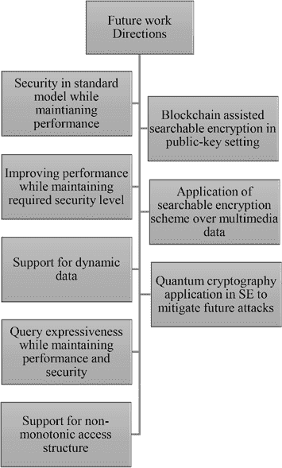

*图 7.1* 未来工作方向。

可搜索加密可应用于任何需要数据机密性且不损害数据隐私的领域。我们希望第三方以这样一种方式检索所需数据：第三方不会获得关于正在搜索什么的任何信息。现有的基于公钥的可搜索加密方案试图容纳尽可能多的功能，但仍有改进空间，因为没有一个方案在各方面都是完备的。因此，应根据应用场景决定所考虑的可搜索加密方案应具备的功能。然而，有一些有用的功能，如果添加进去，可以显著提高可搜索加密方案的可用性，具体如下：

*   为了使可搜索加密方案更自然，它应支持可由任何布尔公式表示的表达性搜索查询。

*   文献中大多数可搜索加密方案都是在随机预言机模型（`ROM`）下被证明安全的。`ROM` 虽然确实使构造变得容易，但它假设了理想化条件。因此，为了证明安全性，应考虑标准模型，这将产生一个能在现实场景中良好工作的方案。

*   应更加重视开发完全安全的可搜索加密系统。文献中大多数可搜索加密方案提供的是选择性安全。

*   在实际场景中，当某人将数据存储到云服务器并打算与他人共享时，他/她还应确保其数据始终是最新的。因此，可搜索加密方案的开发应具备支持动态数据的能力。

*   云服务器返回的搜索结果的可验证性是一项关键特性，可为可搜索加密方案增加更多安全性。文献中大多数现有方案假设云服务器是诚实的，即它正确执行搜索算法。然而，有必要放宽这一假设，以使方案更安全。

*   当前的可搜索加密方案针对陷门中给出的完整关键词执行搜索。然而，如果我们的需求是使用同一个陷门仅搜索关键词的一部分，则该领域有大量工作可做。

*   基于属性的可搜索加密（`ABSE`）方案因其细粒度搜索功能而变得流行。然而，在大多数 `ABSE` 方案中，存储和计算成本随属性线性变化。这显著降低了性能和可扩展性。因此，应努力使相关成本独立于涉及的属性数量。

*   对于 `ABSE`，通常对访问结构做一个共同假设。它们被假设为单调的，因此不支持否定属性。为了使访问结构具有表达力，我们应该能够以任何布尔公式的形式来表示它。这在可搜索加密方案中完全被忽视了，需要努力朝这个方向开展工作。

*   可搜索加密已与区块链技术等新兴技术相结合，以提供更稳健和现实的平台 [8, 9, 10]。文献中已在对称密钥设置下见证了这种结合的证据。然而，这种结合在公钥设置下尚待探索。

*   可搜索加密在公钥和对称密钥设置下的应用仅见于文本数据。然而，在当今的数字世界中，我们想要安全存储和共享的不仅仅是文本，还可以是图像、视频等任何多媒体数据。现有方案均未针对此类数据进行测试。因此，也可探索这一方向，以测试现有方案对不同种类数据的可行性。

*   最后，为了抵抗量子攻击——这对我们当前的密码算法构成潜在威胁，在开发可搜索加密方案时需要引入量子密码学，以确保未来的安全性 [11, 12]。

在明文数据搜索领域已取得巨大发展。然而，当考虑加密数据时，当前的搜索功能非常有限，无法提供我们在明文数据情况下获得的同样无缝体验。因此，在构建能够高效地对加密数据执行搜索并支持复杂搜索查询的此类方案方面，有很大的发展空间。

## 7.4 本章小结

本章重点介绍了与可搜索加密相关的开放挑战，并提供了该领域未来研究方向的见解。通过对可搜索加密技术的深入研究，可以指出可搜索加密不仅仅是一个与密码学相关的概念，它是一种商品，可在银行、医疗、审计等旨在同时确保机密性和可访问性的领域在现实生活中发挥作用。

# 参考文献

1. R. Bharathi, and R. Selvarani, “Software reliability assessment of safety critical system using computational intelligence,” *International Journal of Software Science and Computational Intelligence (IJSSCI)*, vol. 11, no. 3, p. 1–25, 2019.

2. D. Boneh, G. Di Crescenzo, R. Ostrovsky, and G. Persiano, “Public key encryption with keyword search,” in *International Conference on the Theory and Applications of Cryptographic Techniques*, 2004, pp. 506–522.

3. Q. Tang, and L. Chen, “Public-key encryption with registered keyword search,” in *European Public Key Infrastructure Workshop*, 2009, pp. 163–178.

4. C. Bösch, P. Hartel, W. Jonker, and A. Peter, “A survey of provably secure searchable encryption,” *ACM Comput. Surv*, vol. 47, no. 2, p. 1–51, 2014.

5. J. Ye, M. Miao, P. Chen, and X. Chen, “Comparable encryption scheme supporting multiple users in cloud computing,” *Int. J. High Perform. Comput. Netw*, vol. 11, no. 1, p. 24–33, 2018.

6. L. Zhang, Z. Wang, Y. Mu, and Y. Hu, “Fully secure hierarchical inner product encryption for privacy preserving keyword searching in cloud,” *Int. J. High Perform. Comput. Netw*, vol. 11, no. 1, p. 45–54, 2018.


## 参考文献

7. J. Yang, L. Wang, and J. Baek, “A privacy preserving and fine-grained access control scheme in DaaS based on efficient DSP re-encryption,” *Int. J. High Perform. Comput. Netw*, vol. 11, no. 3, p. 231–241, 2018.

8. S. Tanwar, K. Parekh, and R. Evans, “Blockchain-based electronic healthcare record system for healthcare 4.0 applications,” *J. Inf. Secur. Appl*, vol. 50, [`doi.org/10.1016/j.jisa.2019.102407`](https://doi.org/10.1016/j.jisa.2019.102407), 2020.

9. Q. Tang, “Towards blockchain-enabled searchable encryption,” in *International Conference on Information and Communications Security*, 2019, pp. 482–500.

10. S. Liu, J. Yu, Y. Xiao, Z. Wan, S. Wang, and B. Yan, “BC-SABE: Blockchain-aided searchable attribute-based encryption for Cloud-IoT,” *IEEE Internet Things J.*, [`doi.org/10.1109/JIOT.2020.2993231`](https://doi.org/10.1109/JIOT.2020.2993231), 2020.

11. A. P. Pljonkin, “Vulnerability of the synchronization process in the quantum key distribution system,” *International Journal of Cloud Applications and Computing (IJCAC)*, vol. 9, no. 1, p. 50–58, 2019.

12. A. A. Abd El-Latif, B. Abd-El-Atty, M. S. Hossain, M. A. Rahman, A. Alamri, and B. B. Gupta, “Efficient quantum information hiding for remote medical image sharing,” *IEEE Access*, vol. 6, p. 21075–21083, 2018.

## 索引

### A

- **抽象代数**，1，11，18
- **访问结构**，79，80，81，82，96
- **代数结构**，11，12，13，14，15
- **基于属性的加密**，30，31，32，34，41，43，88

### B

- **双线性映射**，41，42，44，65，66，79，80，81，88，89
- **分组密码**，23，24
- **区块链**，21，90，91
- **广播加密**，30，35

### C

- **域的特征**，17
- **选择关键字攻击**，44，61，62，76
- **密码**，22，23，24，25
- **密文策略**，32，79，81
- **同余**，5，6，7，8，78
- **同余类**，6，78
- **同余解**，7
- **密码学**，1，15，16，18，21，22，26，28，30，34，46，47，63，87，88，89，97
- **循环群**，15，41，44，66

### D

- **数据集**，89
- **Diffie-Hellman 密钥交换**，18，25，26，29
- **整除性**，1，2，6

### E

- **ElGamal 密码系统**，29
- **欧拉判别法**，9，10
- **欧拉推广定理**，7
- **欧拉φ函数**，7
- **扩展欧几里得算法**，4，6，16，17
- **扩域**，16，17，89

### F

- **费马定理**，7
- **域**，1，11，15，16，17，88，89
- **有限域**，15，16
- **函数加密**，30，88
- **算术基本定理**，2

### G

- **通用模型**，38
- **最大公约数**，3
- **群**，11，12，13，14，15，25，26，41，42，44，48，49，64，65，66，79，80，81，82，88
- **群同构**，14

### H

- **同态加密**，30

### I

- **基于身份的加密**，30，34，41，42，71，84，88
- **不可区分性**，27，29，61，62
- **子群的交**，15

### J

- **雅可比符号**，10，11

### K

- **密钥策略**，32，80
- **关键字猜测攻击**，44，78
- **关键字搜索**，42，43，44，46，50，51，77，78，79，80，81，82，87，88，90，93，97

### L

- **二次互反律**，10
- **勒让德符号**，9，10
- **库**，87，88

### M

- **中间人攻击**，26
- **幺半群**，12
- **单调**，81，82，84，96

### N

- **非单调**，81，82

### P

- **谓词加密**，88
- **素数域**，16，17
- **素数**，2，3，4，7
- **概率多项式时间**，55，56
- **可证明安全性**，30，50，53，66
- **公钥**，25，26，27，28，30，31，34，39，40，41，42，43，46，47，62，63，69，70，76，87，88，90，91，93，95
- **公钥密码学**，26，30，34，46

### Q

- **二次剩余**，8

### R

- **随机预言机模型**，44，47，66，96
- **简化剩余系**，6，7，8
- **归约证明**，56，58，59，60
- **环**，11，15

### S

- **可搜索加密**，25，26，30，34，37，38，39，40，41，42，43，44，45，46，49，53，61，62，63，64，66，69，70，71，72，73，74，76，77，78，79，80，81，82，83，87，88，89，90，91，93，95，96
- **可搜索加密应用**，93
- **公钥设置下的可搜索加密**，41，43，63
- **无安全信道**，45，46，48
- **安全假设**，63，64，66，94
- **安全攻击**，28，34
- **安全定义**，40，53，54，55，56，59，61，62，63，66
- **安全目标**，27
- **安全模型**，27，66
- **半群**，12，15
- **标准模型**，46，47，66，96
- **流密码**，23，24，25
- **子代数**，12
- **子群**，14，15
- **对称有限群**，13
- **对称密钥**，23，25，26，38，39，40，61，69，87，91
- **对称可搜索加密**，40，87，88

### T

- **临时关键字搜索**，77，80
- **工具包**，87，89
- **置换密码**，23

### Z

- **零元和单位元**，12
- **零知识**，67，89
