# 车载网络安全：侧重位置与身份隐私

车载网络由连接的车辆组成。它们最初的开发是为了确保用户的安全，并将互联网服务扩展到道路上。它们为道路用户提供各种类型的服务和应用程序，使旅程更加愉快和舒适。然而，网络活动可能导致新类型的风险，例如勒索、数据交易或画像分析。更糟糕的是，这些活动可能会影响车内用户的安全，并导致道路交通事故。这些风险源于对消息的拦截而产生的跟踪和隐私侵犯，而消息的交换对于参与网络是必不可少的。隐私和安全是车载网络在现实世界应用中需要解决的主要问题。

本书提出了保护隐私的解决方案，旨在保护用户的身份和在路上的位置，以防止跟踪的发生。我们的解决方案已经过实验和分析测试，以评估其在面对强攻击者模型时的性能。本书最初基于 Leila Benarous 作为其博士论文的一部分所开展的工作，现已成为一种有助于理解车载网络及其所用技术以及各种类型的资源。它强调了与其相关的隐私和安全问题的重要性，以及这些问题对用户安全的直接影响。此外，书中还包含了两种保护身份隐私的匿名身份验证方法，以及五种分别针对车载自组织网络（`VANETs`）和云增强车载联网（`CE-IoV`）的位置隐私保护方案。还包括了一种新型隐私感知型区块链伪名管理框架。该框架是安全、分布式且公开的，确保了撤销、不可否认、真实性和完整性，这些都是基本的安全需求。该建议被开发作为车载公钥基础设施（`VPKI`）的潜在替代方案。

要对导致该主题目前现状的研究进行完整的历史描述是不可能的。因此，某些主题的细节描述比其他主题少。这些选择部分反映了个人喜好和专业知识，也反映了对车载网络技术安全领域极具前景的研究和近期发展的偏好。

本书是一个开始，但许多问题仍未解决。我们希望它能启发新一代的研究人员和研究。如果没有以下人的努力，本书将是不可能的：Bouridane Ahmed 教授、Guizani Mohsen 教授、Kadri Benamar 教授、Belabbaci Youcef 教授、Ouinten Youcef 教授、Saadi Boudjit 博士、Bensaad Mohammed Lahcen 博士以及 Oubbati Omar Sami 博士。我们特别感谢 Djoudi Mohamed 先生以及故去的 Yamani Ahmed 博士的无尽支持。最后，我们感谢每位为此工作的成功做出贡献的人。作者希望您会喜欢这本书，并为自己的学习获得许多有用的想法和概述。

2022 年 6 月

Leila BENAROUS

Salim BITAM

Abdelhamid MELLOUK

# 缩写列表

| 缩写 | 全称 | 中文 |
| --- | --- | --- |
| AASS | Average Anonymity Set Size | 平均匿名集大小 |
| ASS | Anonymity Set Size | 匿名集大小 |
| AVISPA | Automated Validation of Internet Security Protocols and Applications | 互联网安全协议和应用程序自动验证 |
| BAN | Burrows, Abadi and Needham | Burrows, Abadi 和 Needham |
| BB | Big Brother | 老大哥 |
| BC | Blockchain | 块链 |
| BCN | Beacon | 信标 |
| CA | Certifying Authority | 认证机构 |
| CaaS | Cooperation-as-a-Service | 服务即协作 |
| CE-IoV | Cloud Enabled Internet of Vehicles | 云增强车载联网 |
| CIoV | Cognitive IoV | 认知联网 |
| CL-atSe | Constraint Logic-based Attack Searcher | 基于约束逻辑的攻击搜索器 |
| CLPPS | Cooperative-based Location Privacy-Preserving Scheme for Internet of Vehicles | 基于协作的联网位置隐私保护方案 |
| CM | Cloud Manager | 云管理器 |
| COO | Cooperation | 协作 |
| CPS | Certified Pseudonyms | 伪名 |
| CPU | Central Processing Unit | 中央处理器 |
| CRL | Certificate Revocation List | 证书吊销列表 |
| CS | Content Store | 内容存储器 |
| CSLPPS | Concerted Silence-based Location Privacy-Preserving Scheme for Internet of Vehicles | 基于协同静默的联网位置隐私保护方案 |
| CVD | Change VMID | 修改 VMID |
| CVDNN | Cloud-enabled Vehicle Data Named Networks | 云增强车辆数据命名网络 |
| DataPk | Data Packet | 数据包 |
| DC | Do the Change | 执行更改 |
| DDoS | Distributed Denial of Service | 分布式拒绝服务 |
| DoS | Denial of Service | 拒绝服务 |
| DRL | Data Reliability | 数据可靠性 |
| DSRC | Dedicated Short-Range Communications | 专用短距离通信 |
| EDGE | Enhanced Data rates for GSM Evolution | GSM 进化增强数据速率 |
| ERGS | Electronic Route Guidance System | 电子路线引导系统 |
| FCC | Federal Communications Commission | 联邦通信委员会 |
| FIB | Forwarding Information Base | 转发信息基础 |
| GPA | Global Passive Attacker | 全局被动攻击者 |
| GPRS | General Packet Radio Service | 通用分组无线服务 |
| GPS | Global Positioning System | 全球定位系统 |
| GSM | Global System for Mobile | 全球移动体系 |
| HLPSL | High-Level Protocol Specification Language | 高级协议规范语言 |
| HMI | Human–Machine Interface | 人机界面 |
| HSDPA | High-Speed Downlink Packet Access | 高速下行分组接入 |
| HVC | Hybrid Vehicular Cloud | 混合车载云 |
| IC-NoW | Information Centric Network on Wheels | 车载信息中心网络 |
| InaaS | Information-as-a-Service | 信息即服务 |
| IntPk | Interest Packet | 兴趣包 |
| IoT | Internet of Things | 物联网 |
| IoV | Internet of Vehicles | 车联网 |
| ITS | Intelligent Transport System | 智能交通系统 |
| LBS | Location-Based Service | 基于位置的服务 |
| LTCA | Long-Term Certification Authority | 长期认证机构 |
| MANET | Mobile Ad hoc Network | 移动自组织网络 |
| MITM | Man in the Middle | 中间人 |
| MSC | Message Sequence Chart | 消息序列图 |
| NaaS | Network-as-a-Service | 网络即服务 |
| NDN | Named Data Networks | 命名数据网络 |
| NoW | Network on Wheels | 车载网络 |
| NRV | New Reputation Value | 新声誉值 |
| NS | Network Simulator | 网络模拟器 |
| OBU | On-Board Unit | 车载单元 |
| OFMC | On-the-Fly Model Checker | 动态模型器 |
| ORV | Old Reputation Value | 旧声誉值 |
| PCA | Pseudonym Certification Authority | 伪名认证机构 |
| PIT | Pending Interest Table | 等待兴趣表 |
| PKI | Public Key Infrastructure | 公钥基础设施 |
| PoS | Proof of Stake | 权益证明 |
| PoW | Proof of Work | 工作量证明 |
| PRA | Pseudonym Resolution Authority | 伪名解析机构 |
| PROMETHEUS | Program for European Traffic with Highest Efficiency and Unprecedented Safety | 欧洲高效且前所未有的交通计划 |
| PSD | Pseudonym | 伪名 |
| PUF | Physically Unclonable Functions | 物理不可克隆函数 |
| QoS | Quality of Service | 服务质量 |
| RA | Regional Authority | 区域机构 |
| RCA | Root Certifying Authority | 根认证机构 |
| RCP | Resource Command Processor | 资源命令处理器 |
| RDC | Ready to Do the Change | 绪执行更改 |
| RFID | Radio Frequency Identification | 射频识别 |
| RS | Registration Server | 注册服务器 |
| RSU | Road Side Units | 路侧单元 |
| SATMC | Satisfiability-based Model Checker | 基于满足性的模型检查器 |
| SC | Service Continuity | 服务连续性 |
| SDN | Software-Defined Networks | 软件定义网络 |
| SDVN | Software-Defined Vehicular Networks | 软件定义车载网络 |
| SF | Selfishness | 自私性 |
| SIG | Signature | 签名 |
| SPAN | Security Protocol Animator | 安全协议动画器 |
| StaaS | Storage-as-a-Service | 存储即服务 |
| TA | Trusted Authority | 信任机构 |
| TA4SP | Tree Automata for Security Protocols | 安全协议的树自动机 |
| TMN | Testimony | 证明 |
| TPD | Tamper Proof Device | 防篡设备 |
| Tx | Transaction | 交易 |
| UMTS | Universal Mobile Telecommunication System | 通用移动通信系统 |
| V2H | Vehicle-to-Human | 车人交互 |
| V2I | Vehicle-to-Infrastructure | 车路交互 |
| V2N | Vehicle-to-Network | 车联网 |
| V2S | Vehicle-to-Sensors | 车感交互 |
| V2V | Vehicle-to-Vehicle | 车车 |
| V2X | Vehicle-to-Everything | 车万物 |
| VANET | Vehicular Ad hoc Network | 车载自组织网络 |
| VC | Vehicular Cloud | 车载云 |
| VCS | Vehicular Cloud Services | 车载云服务 |
| VIN | Vehicle Identification Number | 车辆识别号 |
| VM | Virtual Machine | 虚拟机 |
| VMID | Virtual Machine Identifier | 虚拟机标识符 |
| VN | Vehicular Networks | 车载网络 |
| VPKI | Vehicular Public Key Infrastructure | 车载公钥基础设施 |
| VS | Verification Server | 验证服务器 |
| VuC | Vehicle using the Cloud | 使用云的车辆 |

车载网络（`VNs`）由车辆、道路基础设施、路侧设备和传感器组成。它们最初的创建是为了保护道路用户并减少事故和伤亡人数。现在，它们正发展为提供高质量的娱乐信息服务。实时道路信息（如施工、交通状况、事故、天气和路况）的广播有助于道路用户轻松、安全地规划行程。车载网络提供了多种应用，包括自动驾驶。事实上，自动驾驶既可以由智能车辆独立实现，也可以通过车载网络实现，即通过网络交换道路数据以做出自动自适应驾驶决策。研究人员和工业界的愿景不仅限于提供道路安全相关的应用，还旨在将互联网娱乐信息扩展到路边缘。由于车载网络能够平稳地管理车辆交通，它们减少了燃料消耗以及毒素和气体的排放。因此，它们有助于保护环境。

然而，尽管车载网络开发是为了拯救用户生命并提供各种道路服务，并且尽管它们在保护环境方面具有益处，但它们导致了道路用户隐私的泄露。这是由于其特性需要广播实时的时空识别数据。这些识别数据可用于对用户进行画像分析和跟踪攻击。因此，安全和隐私是安全部署这些网络时必须保护并确保的两个基本问题。

## I. 动机

网络系统安全漏洞引发的损害在道德和财务影响以及对人类生命的影响方面是巨大的。技术新闻报道每年都有针对顶尖高科技公司的破坏性安全违规事件。车载网络将计算机和网络世界扩展到了道路。因此，道路安全和隐私违规导致的死亡人数更加巨大，因为它们直接关系到用户安全。

车辆不应通过其道路上的网络活动被跟踪。其用户的身份不应从车辆交换的消息中获知或提取。如果攻击者成功通过车辆的网络活动跟踪了车辆，他们可能会获知其驾驶员的日常活动、解析的轨迹、藏身处和经常出没的地方。攻击者可能会跟踪（追踪）车辆，通过交易用户数据来获利、出于个人兴趣，或使用收集到的秘密向车主勒索。泄露用户轨迹数据的后果可能导致严重风险，例如在经常出没的路线策划交通拥堵或事故。更糟糕的是，恶意攻击者甚至可能实施道路暗杀。为了避免这些严重后果并确保车载网络的安全使用，我们的研究集中在开发安全和隐私解决方案。这些解决方案降低了车载网络用户的跟踪风险。

## II. 目标

我们的研究旨在保护车载网络用户的隐私和安全。更准确地说，我们的兴趣在于保护身份和位置隐私，因为它们是互联的。其中一个暴露会导致另一个被违反，从而导致上述的伤亡。车载网络中隐私漏洞的原因是为了安全应用所需的周期性状态消息，这些消息以高频率以明文形式无线发送。此外，它们包含了准确的、实时的身份和时空信息。这些信息易被拦截会导致车辆轨迹跟踪。此外，车载网络还需要确保不可否认性（问责制）、认证以及对恶意节点的撤销，以维护其可靠性。事实上，这些要求与隐私需求背道而驰。因此，在开发解决方案时，应该以平衡的方式保证隐私和安全需求。现有的保护位置隐私的解决方案使用被称为伪名的临时身份。这些伪名通过旨在降低其关联性的更改策略频繁更新。更新后的伪名之间的不可关联性（uninter-linkability）也保护了位置（轨迹）隐私。此外，伪名的使用确保了匿名性。因此，大多数现有解决方案的设计目标是保护匿名性并限制关联性以防止跟踪。

如果反复用于验证车辆与基础设施、机构和服务提供商的身份，身份隐私可能会被进一步暴露。因此，我们专注于开发保护隐私的认证方案，也称为匿名认证方法。在设计这些解决方案时，我们打算让它们对针对车载网络（如女巫攻击）和认证系统的安全攻击具有弹性免疫力。

目前，车载网络是基于权威的，即车辆注册和证书颁发由权威完成。该权威通过撤销违规节点和追踪诚实节点来确保网络的正确功能。这意味着车载网络中的隐私是有条件的；只有当车辆行为不当并破坏网络功能时，隐私会免受其他车辆的侵犯，但会暴露给权威。此外，权威为车辆提供安全参数、密钥、证书和算法。基于权威的系统被称为车载公有密钥基础设施（`VPKI`）。`VPKI` 优于自生成密钥系统，因为它满足了车载网络所需的主要需求，例如防止女巫攻击、保证条件性隐私、确保不可否认和撤销等。因此，绝大多数保护车载网络隐私的现有解决方案都是构建在 `VPKI` 之上的。

在下文中，我们解释了本书的目标：

*   我们的第一个目标是理解车载网络的特征和类型，并回顾其安全问题和来源。我们的关注点是认证和隐私问题。

*   我们的第二个目标是在不违反任何身份隐私的情况下确保认证。然而，保护隐私的认证方法（也称为匿名认证方法）可能会引发其他安全违规。匿名可能导致无法追溯的网络利用。它也可能干扰网络运行。此外，它违反了不可否认和撤销要求。因此，在开发匿名认证方法时，我们首先考虑如何解决上述问题。

*   我们的第三个目标与为车载自组织网络开发独立于基础设施、人群和地图的位置隐私保护方案有关。讨论的解决方案是伪名更新策略，它们在保持网络正确功能的同时降低关联性。这些解决方案旨在保护位置隐私，即使在可能发生跟踪的低密度道路上。


我们的第四个目标是为物联网（IoV）道路用户设计位置隐私保护方案。我们的目标是减少通过匹配 IoV 位置服务查询与周期性 Beacon 安全应用产生的关联性。降低关联性反过来会减少跟踪。开发的解决方案不能对网络功能产生负面干扰或导致服务中断。

我们的最终目标是为基于中心的 VPKI 提出一个潜在的替代方案。`VPKI` 是安全的，大多数现有解决方案都从研究人员的角度讨论了其鲁棒性。然而，证书颁发极可能是一项付费服务。此外，其中心化的特征使其容易产生单点故障，并成为攻击的目标。最后，`VPKI` 覆盖并满足网络车辆所有伪名需求所需的部署成本极高。因此，我们设计了一个分布式的、免费的基于区块链的伪名管理框架，作为 `VPKI` 的潜在替代方案。该框架确保了真实性、隐私性、不可否认性、完整性和撤销的安全需求。它依赖于网络节点（车辆和基础设施）自生成伪名并将其添加到区块链中。其目标是降低 `VPKI` 的成本，提供一个安全的、分布式的伪名管理框架，并防止单点故障问题。

## I.4. 书籍结构

本书由九章组成。前四章专门用于文献综述。剩下的五章基于我们过去的一些贡献。以下是每章的简要概述。

第 1 章旨在澄清与 `VNs` 相关的基本概念：它们的演变、技术、架构、特征和挑战。它还列出了它们的标准、应用和现实世界的实现。本章还包含了关于这些网络的公众意见。最重要的是，它列出了 `VNs` 的各种类型，并强调了它们之间的关键区别。

第 2 章向读者介绍了 `VNs` 中的隐私和安全问题；特别关注身份和位置隐私，以及作为安全问题的身份验证。本章解释了隐私问题，并阐明其重要性以及违反隐私的潜在后果。它还回答了关于隐私为何受到威胁、何时、被谁以及如何受到威胁的问题。同样，也解释了身份验证问题并强调了其与隐私需求之间的矛盾。本章还对每个问题调查了主要的现有解决方案。

第 3 章解释了安全和隐私评估方法、指标和工具。我们提到了文献中使用的关键方法，然后解释了我们选择的方法以及使用它的原因。

第 4 章针对部署各种类型攻击的攻击者模型研究安全问题，以评估其对这些攻击的韧性性能。在本章中，我们解释了 `VNs` 中应该维护的安全目标和属性。我们还提到了这些网络中受研究的关键安全挑战。最后，我们解释了针对身份验证和隐私问题的攻击者模型。我们澄清了它的目标、类型、手段和攻击。

第 5 章定义了云支持的车辆数据命名网络模型，其中车辆可以在道路上相互共享资源。资源共享在身份验证成功后发生，并在确保隐私的同时进行。为了保护资源请求者和服务提供者之间的隐私，执行了基于声誉的匿名身份验证。提出的相互认证方法通过 `BAN` 逻辑证明实现了其基本目标。

第 6 章包含了保护隐私的匿名身份认证，确保了隐私和安全。该解决方案被用作请求路侧伪名/证书更新的初始阶段。这一过程是重复的，如果身份在请求中被反复使用，即使通信是安全的，也可能导致追踪。提出的身份验证方法确保了真实性、完整性、不可否认性和撤销。此外，它能够抵御中间人攻击、重放攻击、冒充、暴力破解和女灵攻击。我们使用 `BAN` 逻辑证明其正确性，并使用 `SPAN` 和 `AVISPA` 证明它是安全的，确保了认证目标并能抵御已知攻击。

第 7 章处理 `VNs` 中的位置隐私，这是一个关键问题。轨迹追踪是有风险的，且准确的关联结果会导致风险。追踪的后果可能从跟踪、勒索到暗杀。文献中存在各种解决方案，旨在降低关联性。在本章中，我们提出了两个独立于道路和基础设施的解决方案。两者旨在降低低密度道路下的追踪率。针对第 4 章定义的攻击者模型进行了分析。第一个提案将追踪率降低到了 27%。第二个提案更好，平均追踪率达到 10.4%。

第 8 章介绍了车联网，它是 `VANET` 的演变。它依赖云计算来提供更广泛、更稳定的服务。连续，隐私风险来自于通过 `IoV` 使用的位置服务。此外，安全相关的应用对于维护网络的正确功能是必要的。在本章中，我们提出了三种考虑了上述风险的隐私保护解决方案。这些解决方案针对第 4 章定义的攻击者模型进行了测试。每个解决方案都是前一个的改进。这些改进旨在降低追踪率：三个方案获得的平均比例分别为 30%、16% 和 10%。

第 9 章为车辆 PKI 提出了一个潜在的替代框架，后者存在单点故障且部署成本高。该框架基于区块链。尽管它是公开的，但它保护了隐私。它确保了认证、撤销、不可否认性和完整性。它继承了区块链的安全性，防止篡改并确保了可用性。该框架由两个公共区块链组成。第一个区块链是非许可的，包含了车辆生成的伪名。第二个区块链是许可的，包含了已撤销的伪名。我们的框架提供了 `VPKI` 提供的相同需求，同时提供了更高的安全性。

这里值得注意的是，这些章节介绍的某些工作已经在几个期刊上发表，并在许多会议上展示。

# 1. 车辆网络

## 1.1 引言

车辆网络是智能交通系统（ITS）的核心。由于需要减少道路死亡亡（这在生命、身体和心理健康、财产损失和财务损失方面导致了巨大的损失），对这些网络的兴趣日益增长。它们最初开发是为了通过提供有关交通、路况和快捷径的准确先验知识来确保道路用户的安全。它们还旨在为用户在自动驾驶车辆中提供安全舒适的旅程。

在此类网络中，车辆是主要的节点。在文献中，它们也被称为“轮上计算机”。车辆配备了各种类型的传感器，用于执行外部和内部角色，例如感知接近距离或引擎热量。它们还包含用于车辆定位的全球定位系统（GPS）、摄像头、雷达和激光雷达，用于感知周围并检测障碍物和路况。车载单元（OBU）是车辆的大脑和控制它的计算机；它确保车辆的正确运行并处理感应数据。OBU 赋予了车辆智能化的特性，这也是它们被称为“智能汽车”的理由。它们还具有用于通信的网络接口，以及用于保存感应数据、安全程序和接收消息的存储空间。

车载网络涵盖了若干种以车辆为主要节点的网络类型。它包括自动驾驶汽车、车载自组网络（VANETs）、车载数据命名网络、车载云计算、车联网（Internet of vehicles）等。这些类型的出现源于道路用户服务需求的演变以及相应的应用的发展。车载网络最早的应用是与安全相关的，旨在辅助驾驶员。随后，信息娱乐应用成为必需品。最后，互联网和云计算被扩展到路侧，以便为道路用户提供服务。

本章回顾了车载网络、其演变及其应用。它描述了因交通事故导致的年度死亡人数，以及对使用车载网络确保安全的益处评估，并对其市场价值进行了评估。它描述了作为智能交通系统和道路自动化项目一部分的车车载演变。它还解释了智能汽车的组成部分车载网络的架构。它描述了车载网络的主要特征。它列出了阻碍车载网络实际应用的问题和技术挑战。此外，它出了可能用于车载网络的无线技术。它概述了车载网络监管标准，并解释了车载网络不同的现有类型及其测试平台。最后，它回顾了公众对该技术的观点和接受程度。

## 1.2. 数据说明动机

以下统计数据强调了车载网络的重要性（Contreras-Castillo 等人，2018）：

- 每年有约 130 万人死亡；
- 超过 700 万人受伤；
- 记录了近 800 万次交通事故；
- 预计因拥堵和事故浪费的时间超过 900 亿小时；
- 车辆产生 2.2 亿吨碳；
- 预计到 2022 年，万物互联的全球市场可能达到 14.4 万亿美元（Bonomi 2013），车联网（IoV）的价值预计到 2020 年将达到 1152. 亿欧元（Contreras-Castillo 等人，2018）；
- 更重要的是，自动驾驶汽车的使用将消除 80–90% 的车辆事故和碰撞（Maglaras 等人，2016）；
- 粗略（Bai 和 Krishnamachari 2010）指出，车载网络达到 100% 市场渗透需要从初始部署之日起 14–15 年。

通过这些统计数据，车载网络的重要性显而易见。

## 1.3. 演变

自动驾驶和自动驾驶一直是研究人员和行业的梦想。第一类是自依赖（独立）车辆，仅依靠自身的智能和计算能力来处理感应数据、执行指令并做出决策。第二类是相互依赖车辆，车辆通过车对基础设施（V2I）与控制服务器交换数据和指令，或者通过车对万物（V2X）连接到其他网络节点（车辆）以交换感应数据。第二类被称为车载网络。尽管类型不同，但智能汽车的设计和组件是相似的（Glancy 2012）。

## 1.4. 架构

自动驾驶汽车也称为自动驾驶汽车，是智能的。它们有两种类型，如图 1.1 所示。第一类是自依赖（独立）车辆，仅依靠自身的智能和计算能力来处理感应数据、执行指令并做出决策。第二类是相互依赖车辆，车辆通过车对基础设施（V2I）与控制服务器交换数据和指令，或者通过车对万物（V2X）连接到其他网络节点（车辆）以交换感应数据。第二类被称为车载网络。尽管类型不同，但智能汽车的设计和组件是相似的（Glancy 2012）。

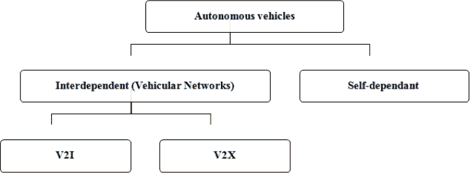

图 1.1. 自动驾驶汽车

通常情况下，车载网络是构建在 `VANETs` 基础架构上的。它们由作为移动节点的车辆（即车载单元，`OBU`）和作为静态基础设施的路侧单元（`RSU`）组成。`OBU` 通过网络接口进行存储、定位、计算和发送消息（Gerla et al. 2014）。它由一个用于存储/存取信息的读写内存、一个资源命令处理器（`RCP`）、一个用户界面以及一个使用 `IEEE 802.11p` 无电技术进行距离无线通信的网络设备组成（Al-Sultan et al. 2014）。

`RSUs` 广播广告和道路信息；它们还传播由 `OBUs` 发送的数据（Gerla et al. 2014）。它们配备了使用 `IEEE 802.11p` 无电技术的网络接口，用于专用短距离通信，以及用于与网络中其他基础设施通信的有线接口（Al-Sultan et al. 2014）。智能车辆的基本组件最初被总结为：`GPS`、`雷达`、`传感器`、车载计算机（用于处理和存储）、网络接口以及人类友好的界面。

然而，技术在不断发展，许多汽车制造商在智能汽车的实现和测试上激烈竞争。因此，这些组件变得更加复杂、精细和先进。为了说明，我们以 Google 智能汽车的组件作为当前可用设计和技术的示例。

Google 车辆使用了一套与众硬件和软件技术，我们提到其中一些（国家级）：

- 激光测距仪（`lidar`、`360°摄像头`），可以创建 200 米范围内物体的 3D 图像并计算距离；
- 用于近景的前摄像头，可以检测前方物体、行人、障碍物、交通灯、道路标志等；
- 碰撞杠式雷达，安装在车辆的前后，以避免与车辆、人和障碍物发生碰撞和碰撞；
- 车辆后部的天线，用于读取精确的地理位置；这是将从卫星接收的 `GPS` 位置与感应位置和内部地图进行匹配，以渲染更准确的位置；
- 后轮上的超声波传感器，用于跟踪轮子的运动并检测车辆后方的障碍物；
- 车辆内部的高度计、陀螺仪和速率计提供了关于位置的精确信息；
- 传感器的协同结合。车辆拥有一组用于各种目的传感器，所有感应数据都由车载单元合并并处理，以帮助实现安全自动驾驶；
- 内置程序地图、人类行为、数据处理和决策算法。

## 1.5. 特性

车载网络具有特殊的性质和特征，使其与其他网络区别来：

- 由于车辆的高速，其拓扑具有高度动态性；
- 由车辆运行的道路和路径定义的预测性模式运动；
- 频繁断开的网络导致消息延迟和潜在丢失；
- 为各种用途使用不同类型的外部和内部传感器；
- 无限的电池电量和大存储容量（Kumar et al. 2013）；
- 道路上变化的网络密度（在农村地区、城市、白天、夜晚等）（Al-Sultan et al. 2014）；
- 道路及其周围的各种障碍物，如树木和高层建筑；
- 安全和隐私威胁（Guo and Balon 2006）；
- 车辆准确实时地理位置的可用（Sivasakthi and Suresh 2013）；
- 使用位置信息的地理通信（Da Cunha et al. 2014）。

## 1.6. 技术挑战与问题

车载网络的现实世界实现面临着一些需要解决的技术问题和障碍。我们在本节中提到其中一些：

- 在稀疏网络情况下车辆间距离遥远导致的信号衰减，或者在城市地区存在多个障碍物导致的衰减；
- 带宽限制，在密集的城市区域使用大量同时运行的应用时会产生拥塞。因此，即使是带宽的公平使用也会增加密集环境中的延迟；
- 由于车辆的高移动性和网络有效直径较小导致连接波动和频繁碎片化；
- 在 `VANETs` 中平衡并满足安全和隐私需求；
- 快速变化的拓扑结构增加了旨在为 `VANETs` 设计可靠路由协议的研究人员的难度。这些协议负责在最短时间内递送数据包，即使在密集的网络中也是如此（Al-Sultan et al. 2014）；
- `VANETs` 继承了来自 `MANETs` 的暴露终端和隐藏终端问题；
- 部署路侧单元和基础设施的高昂成本、IT 管理问题和连接性是阻碍车载网络现实实现的主要原因之一（Hartenstein and Laberteaux 2010）。

## 1.7. 无线技术

可以使用各种无线技术来确保 `VANET` 组件之间的连接性，其中包括：

- **蜂窝系统**：可以作为 `VANETs` 的通信解决方案来交换消息和数据。重用的系统包括：`全球移动通信系统 (GSM)`（也称为 `2G`）、`分组数据无线服务 (GPRS)`（也称为 `2.5 G`）、`GSM 增强型数据速率 (EDGE)`（也称为 `2.75 G`）、`通用移动通信系统 (UMTS)`（也称为 `3G`）、`高速下行数据接入 (HSDPA)`、`CMDA2000`、`LTE 4G` 和 `5G`。
- **WLAN/Wi-Fi**：也可能用于提供无线访问以实现 `V2I` 或 `V2V` 通信。
- **WiMAX**：全球微波互操作性，也称为 `IEEE 802.16e`。它覆盖了的传输范围，实现了高数据速率并具有高质量的服务。
- **DSRC/WAVE**：在美国使用 `5.9 GHz`，在日本和欧洲使用 `5.8 GHz` 的 `75 MHz` 许可频谱。它可以专门用于车对车和车对通信。
- **组合无线接入技术**：结合了各种无线技术，如 `GPRS`、`GSM` 和 `3G`（Al-Sultan et al. 2014）。

## 1.8. 标准

为了规范从物理层到应用层车载网络的操作，一组协议被标准化。这些标准主要在日本、欧洲和北美开发。有两个主要的标准化小组：分别是欧洲的 `ETSI ITS-G5` 和北美的 `IEEE WAVE` 栈协议（Boualouache 2016）。

车辆通过专用短距离通信（`DSRC`）相互通信并与路侧单元（`RSU`）通信。`DSRC` 在小型通信区域提供了低通信延迟和高数据传输率。1999 年，美国联邦通信委员会（`FCC`）在 `5.9 GHz` 频段分配了 `75 MHz` 的频谱用于名为 `DSRC` 的服务。`DSRC` 是一个许可频谱，分为七个每个 10 MHz 的通道，其中一个通道用于安全通信，四个是业务通道，剩下的两个通道留作特殊用途（Boualouache 2016）。`10 MHz` 通道的数据速率在 `6`、`9`、`12`、`18`、`24` 和 `27 Mbps` 之间变化。对于 `20 MHz` 通道可能会增加到 `54 Mbps`。

### 1.8.1. IEEE WAVE 栈

`WAVE IEEE` 标准定义了每一层的标准集。它有一个安全栈和一个非安全应用的栈。图 1.2 阐了 `IEEE WAVE` 标准（Sjöberg 2011），图 1.3 显示了其简化视图。

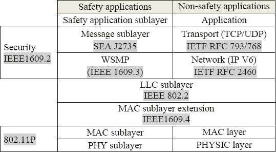

图 1.2. *IEEE WAVE 标准 (Sjöberg 2011)*

- **IEEE 802.11p**: 用于车载自机网络 (VANET) 的 `IEEE 802.11p` MAC 协议，扩展了 `802.11e`。
- **IEEE1609.1**: 定义了消息及其响应的格式。
- **IEEE.2**: 定义了安全消息的格式、处理和交换。
- **IEEE 1609.3**: 定义了传输层和路由层服务。
- **IEEE 1609.4**: 描述了多通道操作（Rawashdeh and Mahmud 2011）。

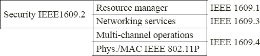

图 1.3. *简化的 WAVE 标准视图 (Rawashdeh and Mahmud 2011)*

### 1.8.2. ETSI 标准

ETSI 标准是欧洲版的美国 IEEE WAVE 车载网络和智能交通系统 (ITS) 标准。接入技术层在欧洲版本中适配了 `IEEE 802.11p` 标准，定义了其物理层和 MAC 层协议。网络层和传输层定义了基于 IP 和地理网络协议，此外还有传输层协议。设施层管理支持信息、应用和通信的服务及消息。应用层基本上定义了与交通效率和道路安全相关的应用。管理层是一个跨层，在控制所有层中起着关键作用。安全层定义了协议，确保了完整性、隐私性、身份验证和非否认性（Sjöberg 2011）。图 1.5 展示了 ETSI ITS 层。

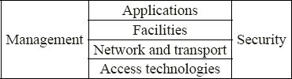

**图 1.4.** *ETSI TC ITS 协议栈 (Sjöberg 2011)*

### 1.8.3. 3GPP 标准

3GPP V2X 利用传统的蜂窝网络来增强 DSRC，使 V2V 通信的范围增加一倍。它可以在蜂窝网络覆盖内和外通过 V2V 通信运行。此外，它提供了稳健的 V2I 和车网 (V2N) 通信（Lucero 2016）。与 `IEEE 802.11p` 相比，基于蜂窝的 V2X 为移动车辆提供了更好的服务质量 (QoS)、更高的数据传输率和更大的覆盖范围。此外，V2X 是同步的，而 `IEEE 802.11p` 是异步的。尽管 V2X 服务可能与相邻信道的基于 `IEEE 802.11p` 的无线接入共存，但 V2X 在扩展性和可演进方面具有额外优势（Wang et al. 2017）。3GPP V2X 标准支持每秒高达 10 条消息的频率以及 50–300 字节的可变载荷；事件触发消息的载荷高达 1,200 字节（3GPP (2017-03)）。


## 1.9. 类型

车载网络描述了各种类型的网络，道路上的车辆是主要的节点类型。通常，人们对 VANET 的熟悉导致他们误认为所有的车载网络类型都是 VANET。虽然 VANET 确实是引入的第一种类型，但随着时间的推移，这一概念随着新目的、需求和应用的引入而不断演变。现在 VANET 被认为是更全球化、复杂且先进的车载技术和网络的构建模块。图 1.6 在一个封装插图中描述了后续章节将解释的车载网络。

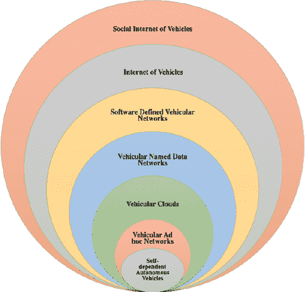

图 1.5. *车载网络。*

### 1.9.1. 自驾驶汽车（自依赖型）

独立（自依赖）自驾驶汽车完全依赖于自身的处理能力、人工智能和感知能力。配备 GPS、地图、摄像头和雷达的车辆在本地做出决策。不会从远程服务器或控制单元发送任何指令或命令。此外，在此过程中也没有使用网络（Glancy 2012）。

### 1.9.2. VANET

VANET 或车载自体系网络是指由车辆 (OBU) 和路侧单元 (RSU) 作为主要节点组成的车载网络。车辆之间的通信通过 DSRC 无线进行，被称为车对车 (V2V)。DSRC 也用于车辆与基础设施 (RSU) 之间，被称为车对路侧 (V2R)。开发 VANET 主要用于安全应用以减少道路伤亡，同时也提供信息娱乐应用。因此，车辆产生三类消息，即：安全消息（也称为周期性状态标兵）、基于事件的警报消息以及非安全消息（或服务消息），后者与信息、娱乐和舒适性应用相关（Hartenstein and Laberteaux 2010）。

### 1.9.3. 车云

车载云是传统云的边缘扩展。由于这一事实，每辆车都有一个车载单元，用于感知周围环境、存储并处理数据。Gerla (2012) 建议利用车辆容量来改进交通管理。它们利用车辆摄像头拍摄道路。

Whaiduzzaman 等人 (2014) 引用了车载云可以提供的不同应用，例如：

* – **网络即服务 (NaaS)**：具有互联网接入能力的车辆将其作为服务提供给其他道路节点。
* – **存储即服务 (StaaS)**：车辆可能将其存储容量作为服务租给其他道路用户，以提供大文件。
* – **协作即服务 (CaaS)**：车辆协作根据兴趣收集并广播数据。换句话说，数据根据其内容更快路由到感兴趣方。因此，车载云由基于内容的簇组成。
* – **计算即服务**：车辆拥有复杂的处理单元来处理计算和数据处理。遗憾的是，当车辆每天闲置数小时时，这些能力并没有被利用。因此，提出了计算即服务以解决这个问题，并受益于车载单元。
* – **摄影即服务**：配备高分辨率摄像头的车辆由于其移动性，比静态基础设施提供更好、更广的道路视野。它们可以将记录的犯罪证据交给警方，并发送道路状况的实时更新。
* – **信息即服务 (InaaS)**：车辆产生并处理各种与驾驶员安全或娱乐相关的道路信息。它们可以在道路上作为服务交换这些数据。

同样的作者将车载云 (VCs) 分分为类型：静态、动态和基于基础设施的。在静态车载云中，车辆在静态时（如在停车场内）统一其资源和容量，像传统云一样提供服务。动态车载云由道路上移动的相邻车辆形成。基于基础设施的车载云适用于道路上分布有基础设施的城市地区，这些设施可以与通过车辆形成云。基础设施或 RSU 成为云协调器，连接车载云和传统云。

Hussain 等人 (2015) 指出，车辆云更适合提供基础设施和软件即服务，而不是提供平台相关的服务；并指出在提供平台即服务的云中，用户被提供了一个开发平台，使他们能够开发远程应用程序。同样，他们认为车载自组织网络（VANET）云有三种类型，将其标记为：车辆云（VCs）、使用云的车辆（VuC）和混合车辆云（HVCs）。在 `VCs` 中，静态或动态的车辆合并其资源，形成一个提供付费服务的云。在 `VuC` 中，道路车辆使用传统的云服务；而在 `HVCs` 中，`VC` 车辆使用传统的云服务，即 `HVCs` 结合了 `VCs` 和 `VuC`。

## 1.9.4. 车联网

车联网（IoV）是物联网（IoT）的重要组成部分，也是其极具前景的实例化之一（Gerla et al. 2014; Yang et al 2014）。它是 VANET 的扩展和演进。它包含了车辆、物体、人类和环境。人类是指车内的人（乘客、驾驶员）以及周围环境中的人，如行人和骑自行车者。物体指既不是人类不是车辆的其他实体和设备，如接入点或交通标志。环境涵盖了人类、车辆和物体（Yang et al. 2014）。

车联网使用车辆云作为基础技术（Gerla et al. 2014），并可能依赖多种无线通信技术，如 `DSRC`、`WMAX`、蜂窝网络（`3G`、`4G`）和卫星网络。因此，它能够提供更稳定且全球性的实时和异步服务（Yang et al. 2014）。

车联网主要有两个技术方向。第一是车辆联网，由车载信息处理（数据交换）、VANET 和移动互联网组成。第二是车辆智能化，反映了车辆与用户的结合，以及人工智能、认知计算和深度学习的应用（Yang et al. 2014）。注意，车联网被视为一个传感器集群，用于收集道路相关数据、车辆内部状态及其周围环境。车联网还具有巨大的存储容量和复杂的处理单元（2013）。

Contreras-Castillo 等人 (2018) 阐了车联网的七层模型，以下是这些层的简要介绍：

- `user interface layer`：促进车辆与用户之间的交互。他们可以查询车载系统、接收通知；
- `data acquisition layer`：收集由车辆感知或从基础设施接收的数据；
- `filtering and pre-processing layer`：根据数据的有效性和用性对数据进行预处理和过滤；
- `communication layer`：利用不同类型的技术（如 `DSRC`、`WiFi`、`3G`、`4G` 和 `5G`）实现通信和消息广播；
- `control and management layer`：使用各种数据包检测和流量管理策略来处理接收的信息；
- `processing layer`：利用传统云结合车辆能力来存储和处理接收到的数据；
- `security management layer`：是一个横跨层，负责处理并确保所有其他层的安全属性。

由于自动驾驶车辆的智能性及其使用的深度学习算法，出现了一种新的范式，即认知车联网（CIoV），它是车联网的演进（Chen et 2018）。它将自动驾驶车辆的智能与车辆网络、蜂窝网络和云计算融合在一起。它在感知车辆交互和周围环境的能力方面更加精确。它能做出更可靠的决策，并更高效地利用资源。

C-IoV 的架构分为五层：

- `sensing layer`：负责收集数据；
- `communication layer`：包括与云相关的交互，以及车辆网络运行所需的通信；
- `cognition layer`：使用数据挖掘、机器学习、深度学习和模式识别来处理感知和收集的数据；
- `control layer`：以分布式方式做出决策，以确保车辆网络的服务质量（QoS）和更快的响应；
- `application layer`：提供各种应用和稳定的全球服务。

## 1.9.5. 社会车联网

在社交媒体网络普及后，并考虑到车辆最可能是人们在家里和办公室之后花费时间最多的第三场所，将社交网络与车辆网络结合已成为趋势。在这种情况下，乘客和驾驶员共享道路相关的实时事件，如事故、道路施工、咖啡馆和餐厅优惠、新的健身房和商店或优美的风光（Lequerica et al. 2010）。这产生了一个社交车辆网络，更准确地说，是社交车联网（IoV），它是社交物联网的一种特例。

社交车联网被描述为驾驶员与车辆之间的社交交互。它也被述为由同一区域内具有相似兴趣的驾驶员创建的网络。同样，它被定义为自动驾驶车辆与交换服务及数据之间的交互（Maglaras et al. 2016）。Alam 等人 (2015) 将社交车联网定义为“基于 WAVE 物理车辆网络的一种信息物理实体应用”，其中家庭、`RSU` 和 `OBUs` 在信息物理实体构成的社交网络上交换数据。数据交互形成了一个社交图，其中图节点代表实体，图边代表交换的数据（Alam. et. 2015）。

尽管如此，Maglaras 等人 (2016) 断言，未来社交车联网将定义为乘客、驾驶员和车辆之间的社交交互。它将允许根据一系列特征对车辆进行排名。这种排名有助于做出交互决策，并可能用于建立信任和声誉，这是车辆网络中至关重要的安全属性。

## 1.9.6. 命名数据车辆网络

以轮子载的信息为中心网络，或 `IC-NoW`，是一种车辆网络，其数据路由基于信息内容而非通常的 `IP` 寻方法。信息的范围由其时间、空间和用户兴趣的相关性来定义。它被称为车辆 `NDN`，或命名数据车辆网络（Bai and Krishnamachari 2010）。

路边单元与车辆之间交换的数据包是以信息为中心，，这意味着它们在具有相似时空范围和兴趣范围的用户之间共享。然而，这些网络仍然没有完全独立于基于 `IP` 的网络。`IC-NoW` 在通过互联网发送数据包之前，会将通过 `V2V`、`V2I` 交换的数据包封装在 `IP` 数据包中（Bai and Krishnamachari 2010）。

注意，每个 `NDN` 节点拥有三种类型的数据结构：内容存储（`CS`）、等待兴趣表（`PIT`）和转发信息基础（`FIB`）。对数据包感兴趣的车辆会发送兴趣包（`IntPk`）。如果 `CS` 拥有请求的内容，请求者将收到数据包（`DataPk`）。否则，`IntPk` 被添加到 `PIT` 中，并从 `FIB` 转发到潜在的 `CS`（Chen et al. 2014; Bouk et al. 2017）。

在软件定义车载网络（SDVN）中，集中式控制面在逻辑上控制数据通信。SDVN 与车载 NDN 的区别在于，后者侧重于基于内容的路由，而 SDVN 则将控制面和数据面分离，以便在不物理干预交换机和路由器的情况下使各种服务变得可用。需要注意的是，SDVN 中的车辆具有多个接口（Ahmed 等人 2017）。

SDVN 组成：

* – 一个 SDN 控制器，它拥有网络的全局视图。它协调各个元素来执行 NDN 操作，如智能兴趣（interest）、缓存（cashing）、数据转发等；
* – 缓存，这是转发节点执行的终极任务。转发节点的选择和缓存内容的格式对于确保即时查询/响应至关重要。内容格式包括压缩的、未压缩的和分块的，完全存储在单个或多个节点中；
* – 内容命名，这是另一个基础组件，用于标记内容及其分块。这种标记使得车辆在接收到兴趣请求时能够流畅地进行数据搜索，注意每个内容都有特定的时空有效性；
* – 智能转发：FIB（转发信息基础）维护内容通信。基于此，每当某些内容通过某个接口满足时，该接口（face）的排名就会提升。每当它不满足兴趣时，排名就会下降。如果该接口无法满足任何兴趣，它将从 FIB 中删除。如果 FIB 为空，请求将转发到控制器进行满足；
* – 基于推送的转发，不断向可能感兴趣的节点递送警告；
* – 内生数据安全：数据消息经过数字签名。SDN 控制器将内容安全策略传播到感兴趣的车辆；
* – 拥塞控制：拥塞由于某些内容的流行。因此，为了缓解拥塞，每个节点必须向每个接口发送流量状态，以便将流量均匀分布在不同的缓存点上；
* – 拓扑指示器：每辆车辆向控制管理器汇报其位置、方向和速度，以便其确定并发布转发规则；
* – 内容前缀管理器：每个节点向控制器发送其内容存储（缓存数据）及其有效性和过期时间，以帮助处理兴趣请求；
* – 车辆计算每个接口的状态信息。它发送关于请求和已满足查询的报告，以便控制器改进缓存/转发策略（Lutterotti 等人 2008）。

## 1.10. 测试床与实际实现

英国米德塞克斯大学在伦敦的亨德森校区建立了米德塞克斯 VANET 研究测试床。它有四个固定在不同建筑上的 RSU（路侧单元）。该测试床评估了开发团队对 VANET^[1] 进行的研究。

葡萄牙的波尔图生活实验室为 VANET 构建了两个独立的测试床：港口和城市，分别位于波尔图的港口和市区。在城市和港口测试床中，车辆均配备了 OBU、GPS 接收器、DSRC、蜂窝和 Wi-Fi 通信接口。车辆通过蜂窝通信或 RSU 连接互联网。DSRC 用于 V2V 和 V2I 通信。在城市测试床中，大部分部署的 RSU 安装在交通灯杆、监控摄像头杆和由波尔图大学管理的建筑上^[2]。

C-VeT 车载测试床由美国 UCLA 开发，用于评估 MAC 和网络层协议及模型。CarTel 和 Cabernet 测试床由美国 MIT 开发。美国马诸塞州阿姆斯特还开发了名为 Dome 和 DieselNet 的两个项目（Lutterotti 等人 2008）。2008 年，微软建立了名为 VanLan 的 VANET 测试床^[3]。ITS 通廊是另一个正在进行中的项目，横跨德国到达维也纳^[4]。

欧洲已完成的项目包括 SimTD (2013)^[5]、DRIVE C2X (2014)^[6] 和 Compass4D (2016)^[7]。同样，加拿大有 200 多个 ITS 相关的项目正在进行，其中两个位于阿尔伯塔大学和不列颠哥比亚大学（Lawson 等人 2015）。

## 1.11. 服务与应用

车载网络旨在保障用户安全、确保舒适驾驶、维持交通顺畅、减少燃料消耗和空气污染等。它们提供各种服务和服务应用，如（Meraihi 等人 2008；Kumar 等人 2013；Al-Sultan 等人 2014；Seuwou 等人 2014）：

* 安全应用：由于在防止事故和拯救生命的作用，具有最高优先级。示例包括：
    * 事故警报：防止已发生事故导致的道路伤亡。它加快了救援服务（救护车、警察）的响应。它有助于道路疏散并协助辅助道路和绕道规划，
    * 协作驾驶：改善交通管理并减少燃料消耗。被称为车辆编队（platooning），
    * 碰撞避免：为了避免碰撞碰撞，车辆利用内置传感器、激光雷达和雷达检测道路障碍并迅速做出。此外，车辆传播关于当前位置、方向和速度的准确实时信息，以避免碰撞，特别是在掉头、变道或急刹时，
    * 安全距离警告：车辆保持安全距离，该距离预设为几米或根据制动时间动态调整。当车辆未保持规定距离时发送警告，
    * 变道：车辆在变道时提醒其他车辆以避免碰撞和事故。这种提醒模拟了手动驾驶中的转向信号，
    * 导航和地图定位：大多数近期车辆配备了导航系统，使用内置地图修正从 GPS 获取的用户位置，以便其能够规划轨迹，
    * 交通拥堵和道路施工警报：这些基于事件的消息在网络中传播，以协助用户规划替代路线，
    * 公共安全（SOS、碰撞后警报、接近紧急车辆等），
    * 车辆诊断与维护：车辆可以进行道路诊断。如果检测到问题，会将早期报告发送到最近的维修中心，以提供更高效、及的服务。

* 舒适应用：确保用户的娱乐和舒适，例如：
    * 互联网接入、车主间聊天、视频流、网络游戏和其他高级稳定服务，
    * 天气预报和警报，
    * 关于附近的、价格合理的或排名酒店、健身房、餐厅、加油站或旅游景点的广告信息等。

* 驾驶辅助：通过提供关键警告和辅助信息协助司机。其应用示例包括：
    * 停车位预留和停车管理，
    * 自动停车，
    * 自驾驶车辆（无人驾驶汽车）：当车辆完全由系统驱动时是全自动的；如果驾驶仍需要司机干预，则是半自动的。图 1.7 展示了下文自动驾驶等级（Maglaras 等人 2016；Wang 等人 2017）：
    * 0 级：需要人类司机驾驶并监控车辆周围环境，
    * 1 级：驾驶系统辅助是在实际驾驶环境基于提供转向或加减速之一，
    * **2 级**：驾驶系统根据实际驾驶环境辅助加速/减速**以及**转向。
    * **3 级**：驾驶系统根据周围环境对动态驾驶任务进行干预，而驾驶员负责分类并响应从系统接收的干预请求。
    * **4 级**：驾驶系统根据驾驶环境对动态驾驶任务进行干预，无论是否经过驾驶员的批准。
    * **5 级**：驾驶系统执行整个动态驾驶任务，模拟人类驾驶员。

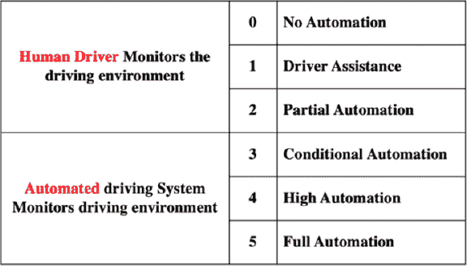

**图 1.6.** *自动驾驶等级 (Litman 2018)*

## 1.12. 公众

在 Schoettle 和 Sivak (2014) 提交的报告中，对美国、英国和澳大利亚的公众对自动驾驶和无人驾驶汽车的意见进行了调查。大多数受访者了解这项技术，或者至少承认它的存在。虽然他们大多数人对其表示了高度期待，但他们也对安全、隐私和可靠性表达了担忧，此外还对车辆的自依赖性和缺乏人工干预表示担忧，质疑其是否能够模拟人类驾驶技巧。与男性不同，女性对这项技术表达了更多担忧，也更加谨慎。最后，在调查期间，尽管受访者对此感兴趣，但大多数人仍不愿支付额外费用来获取。

加拿大隐私专员办公室进行了一项类似的调查，超过三分之一的加拿人表示，如果使用这些联网汽车，他们会对隐私表示担忧。同样，超过半的受访者宁愿保护隐私而非联网服务的优势。在最近对美国、西班牙、德国和英国进行的一项调查中（Lawson et al. 2015），受访者也对他们的隐私和个人数据表达了担忧，坚持认为车辆是他们的私人空间，并强调了保护这些空间的重要性。

## 1.13. 结论

本章解释了车载网络、其目的、底层技术以及提供的应用。此外，它阐述了车载网络的演变和类型。最后通过对公众意见的调查作为总结，说明了用户对车载网络（VN）技术的犹豫，以及对其机密性的担忧，以及从技术角度对车载网络可靠性的担忧。

事实上，隐私和安全在车载网络中同样重要，这是一个不可否的事实。同样，它们也是阻碍车载网络市场渗透的关键问题，并处于终端用户关注的首位。下一章将解释这些问题，并调查用于保护它们的现有解决方案。

## 注释

1. 参见：[`mdxminds.com/2016/01/11/the-future-of-driving-is-here/`](https://mdxminds.com/2016/01/11/the-future-of-driving-is-here/)。


2. 2 参见：[`cordis.europa.eu/result/rcn/188104_en.html`](http://cordis.europa.eu/result/rcn/188104_en.html)。

3. 3 参见：[`www.microsoft.com/enus/research/project/vanlan-investigating-connectivity-from-moving-vehicles/`](https://www.microsoft.com/enus/research/project/vanlan-investigating-connectivity-from-moving-vehicles/)。

4. 4 参见：[`c-its-korridor.de/?menuId=1&sp=en`](http://c-its-korridor.de/?menuId=1&sp=en)。

5. 5 参见：`index.html/Presse`。

6. 6 参见：`drivex.eu/project`。

7. 7 参见：`compassd.eu/`

# 2. 车载网络中的隐私与安全

## 2.1. 引言

在上一章中，我们概述了车载网络及其特征和类型。在本章中，我们关注阻碍车载网络应用的两个关键问题：安全和隐私。这两者对于确保用户安全至关重要。在车载网络中，身份和隐私是相互关联的，揭露其中一个就会导致另一个的暴露。车辆不断广播包含位置信息的非加密心跳消息，这种身份被称为`pseudonym`（伪名）。它还会发布报告事故的消息。此外，使用匿名伪名（无身份的）的目的是保护身份。如果伪名被成功关联，身份保护只是时间问题。通过社会工程技术，攻击者可以匹配他们的轨迹。例如，当车辆从 A 出发并在工作日经常访问 B 时，A 是住所而 B 是工作地，尽管 A 有很多人居住，但很可能只有一个人在 B 工作。因此，攻击者可能会社会工程推断出车辆所有者。同样，如果用户的身份在网络中发布，其使用情况是可追踪的，这将导致位置隐私泄露。在车载网络中，由于通信是无线的，这使得攻击者的入侵更容易。他们既可以被动监听通信，也可以主动发起数据包篡改、注入或丢弃攻击。我们强调，我们的研究重点是研究隐私问题，并开发在车辆被跟踪的网络水平上保护它的方案。因此，在本章的剩余部分中，我们仅引用关注这一视角的相关工作。其他违反隐私的手段如物理跟踪和道路监控摄像头的使用超出了本书的范围。这些是广知的威胁，无论用户驾驶的是普通汽车还是智能汽车，无论是否参与 VN，都会威胁到隐私。需要注意的是，在本章中，我们不详细说明攻击者的手段或执行的攻击，而是进行一般性描述。关于攻击的技术细节请见第 4 章](#c04.xhtml)。本章解释了车载网络中的隐私问题，并强调了其对于保护用户免受道德和物理威胁的重要性。它还列出了威胁类型，并回答了关于谁在威胁隐私、何时、如何以及此类威胁的后果的问题。此外，它回顾、分类并分析了现有的位置隐私保护方案，并评估了它们的优缺点。此外，它解释了车载网络中的身份验证问题，解释了认证的内容并列出了认证类型。它还强调了身份验证如何影响隐私。最后，它简要回顾了身份隐私保护认证解决方案。

## 2.2. 车载网络中的隐私问题

隐私通常至关重要。人类天性是保守的，喜欢保持生活某些部分的私密性。他们倾向于让某些事务保持保密。他们倾向于在何、何时以及与谁分享秘密方面具有选择性。他们厌恶被他人关注，不喜欢被监视。他们讨厌受到任何形式的骚扰，并强烈反对跟踪行为。这些需求被相继继承到了网络世界。本着相同的心态，网络世界的用户厌恶其网络活动被追踪，因为他们认为网络世界为他们提供了更多表达思想和发表意见的自由。无疑，用户在屏幕面前变得更加诚实；他们诚实地写评论，自由无限制地提问和发送查询，并受益于各种在线服务。尽管用户可能会自愿在他们的社交媒体个人资料上发布日常照片、更新和视频，但他们严格反对如黑客等未知第三方在他们不知情且未经其同意的情况下，从其设备中进行隐式数据检索或收集。

在车载网络中，共享数据的类型、准确性、频率和影响进一步增加了隐私保护的重要性。此外，攻击者针对道路上车辆所有主进行网络追踪，其泄露此类数据的风险也愈发凸显。

到此为止，我们写了隐私性和保护的必要性，但没有进行充分的解释。1890 年，Warren 和 Brandeis 首次将隐私定义为“不受侵扰的权利”（Warren and Brandeis 1890）。随后，在 1967 年，Alan Westin 将其定义为“控制、编辑、管理和删除关于自己的信息的权利，并决定何时、如何以及在何种程度上向他人传播信息的权利”（Eduardo Cuervo n.d.; Westin 1967）。在他的论文中，Adrienn Lukács (2016) 结合社会和技术的演进，回顾了隐私在不同时期的历史及其各种定义。在车载网络的背景下，Petit 等人（2015）将其定义为车辆用户即使在转发信息时，也能控制和选择车辆发送的信息的类型、寿命和内容的能力。

## 2.2.1. 类型

在车载网络中，隐私有三种（Lim and Chung 2012）：

- `identity privacy`（身份隐私）：通过网络活动识别车辆用户。这是通过其公钥、网络地址或真实身份实现的；

- `location privacy`（位置隐私）：由于网络安全需要共享车辆的实际道路位置，车辆的过去和当前位置会被追踪（Beresford and Stajano 2003）；

- `data privacy`（数据隐私）：涉及交换的消息内容、使用和请求的服务、共享的图像、视频和文件。它更多涉及信息娱乐服务。

Buttyán (2009) 将隐私分为三类：句法、语义和鲁棒。句法隐私要求车辆定期更新其伪名。语义隐私意味着广播信标的车辆不应导致车辆被追踪，也不应导致其轨迹被重建。鲁棒隐私则关于对内部攻击者的韧性及其对系统的影响。

由于加密保护了机密性（即数据隐私），研究人员更多地关注解决车载网络中的身份隐私和位置隐私问题。它们在影响上是交织的，都会因道路上的网络活动导致车辆追踪，并对用户安全产生直接影响。

## 2.2.2. 何时以及如何受到威胁？

身份和位置对于确保网络的正常功能至关重要。位置数据帮助其他车辆做出决策以确保安全驾驶，例如防止由突然变道、减速、刹车、掉头等引起的事故。它确保车辆间的协作以实现顺畅行驶。身份（车辆的认证公钥）用于防止外部攻击者注入虚假数据。它确认了消息的真实性，以及行为的不可否认性和可追溯性。当车辆在网络中行为不当或注入虚假数据时，车辆将被追责并被撤销。行为不当可能由硬件故障、车辆成为内部攻击者或车辆被攻击者入侵导致。撤销阻止了诚实车辆与行为不当的节点交互和信任。注意，可追溯性确保了不可否认的证据，如果恶意用户受到司法起诉，这些证据可用于他们。

位置和身份的重要性使得它们的使用不可或，消除它们是不可能的。然而，它们的使用威胁了隐私并可能导致车辆追踪，这在网络上等同于跟踪。风险来自于拦截车辆的安全消息、在身份验证期间接收网络中发送的用户身份，以及在使用基于位置的服务时。

## 2.2.3. 谁是威胁者？

我们之前已经解释了隐私*如何*以及*何时*受到威胁。现在，我们来讨论*谁*对违反和危害用户的机密性感兴趣。攻击者可能是一个组织或个人实体。他们可能针对特定的用户，或者追踪网络以寻找可能的猎物。他们可能是基于位置的服务提供商，或像警察这样的权威实体。无论攻击者的身份如何，他们都是任何可以在未经用户批准和知情的情况下隐式追踪车辆的人。追踪是通过拦截和关联无线广播的消息建立的。关于攻击者、其手段、执行攻击的更多细节将在第四章中解释。

## 2.2.4. 后果是什么？

追踪就像跟踪一样令人讨厌。它更加危险，因为是在我们在没有察觉的情况下发生的，且难以检测。攻击者追踪车辆可能是出于个人恩怨，或者是为了交易用户的私人道路数据获取利润。收集车辆轨迹可用于实现多种目的：

- 如果被警察追踪，可用于发布违章停车单或超速单；

- 如果被服务商收集，有助于根据用户的习惯和喜好发送定向广告；

- 如果被恶意攻击者收集，后果可能会变得更加残酷和危险；他们可能利用这一点：

    - 修改并引导用户规划的路线

    - 威胁、勒索和操纵用户

    - 故意延误用户或阻碍其到达目的地

    - 引发交通拥堵

    - 引发道路伤亡和事故

    - 策划道路绑架、陷阱和暗杀

这些只是车辆追踪产生潜在风险的少数例子。

## 2.2.5. 如何防护？

为了保护身份隐私，`IEEE 1609.2` 标准（Kurihara 2013）建议使用伪名，即认证临时密钥。证书确保了匿名性下的不可否认性。它们是可撤销的，保证在过期或检测到车辆行为不当后不再使用。此外，由权威机构管理和发放防止了车辆同时拥有多个有效的伪名，从而防止了女巫攻击的执行。这种机制保证了条件隐私，这意味着只要车辆行为正常，其隐私就会受到保护，否则会被暴露。

为了实现完全隐私保护而非条件性保护，某些方法建议车辆自生成密钥并对其进行签名。确实，这些提议保护了隐私免受当局的监测；然而，这也掩盖了违规车辆的踪迹并允许了女巫攻击（Sybil attacks）。此外，生成的密钥是不可撤销的，在这种情况下，车辆的行为可以被否认。另一种方法建议车辆形成组，成员具有相同的公密钥（组长密钥）以验证消息的真实性，而每辆车辆都有自己独特的私密钥来对消息进行签名。另一方面，混合方法建议每辆车辆单独生成一对临时私钥和公钥，并向组长（GL）请求其认证（Emara 2016）。

使用对称加密而非非对称加密是另一种旨在替代伪名使用的方法，其中车辆使用共享密钥对消息进行签名和验证真实性。由于伪名在使用在确保安全需求方面的作用至关重要，这种方法在文献中并不被广泛认可或使用。因此，我们继续回顾基于非对称的解决方案（Hussain et al. 2009; Boualouache 2016）。

尽管如此，安全应用中的身份信息通过使用伪名受到了保护。然而，在向当局和服务提供者进行身份验证以请求补充伪名时，身份隐私可能会被破坏。总结来说，这在道路使用中可能存在风险。此外，服务提供者并不一定可靠。他们可能会从基于位置的服务中获利的同时交易用户数据或跟踪他们。即使用户身份验证的终端是可信的（正如我们假设当局是可靠的那样），即使通过加密通信，频繁使用身份也可能导致车辆被跟踪。重复使用相同的身份加密模式允许通过模式匹配进行跟踪。思科已经开始开发相关解决方案，可以在不解密的情况下发现加密流量中发现的实时威胁（Cisco White Paper 2019）。同样，攻击者可能使用相同的技术即使在受加密保护的流量中也跟踪身份的使用。因此，基于身份的认证方法应被满足相同安全要求的匿名认证方法所取代。

虽然使用伪名代替长期公钥或真实身份可以保护身份隐私，但它并没有解决位置隐私问题或保护其免受跟踪。当伪名在不利语境下快速随机地更新时，它们提供的隐私级别可能与使用单个伪名时相同。不利语境是指攻击者能够链接同一辆车辆更新后的伪名，从而跟踪其移动和解析的轨迹；请参见图 2.1 和图 2.2 的说明。

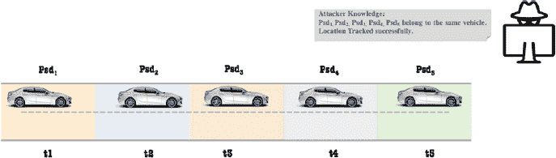

图 2.1. 即使更换伪名，车辆仍被成功跟踪。

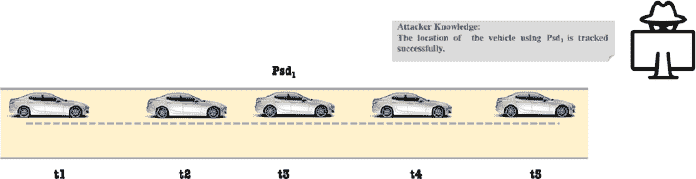

图 2.2. 在未更新伪名时，车辆被成功跟踪。

为了阻碍关联并防止跟踪，伪名的更新应该具有策略性，以迷惑攻击者并扰乱他们的踪迹。这些策略被称为伪名更换机制。文献中有很多用于此目的的不同方法。一些研究人员建议以独立的方式防止车辆关联，即每辆车辆都独立于周围环境运行其更新策略。车辆可以在更换伪名后应用静默期，以迷惑攻击者并干扰他们的预测。其他建议要求车辆同步更改其伪名；这些提议通常被称为协作群体内的更改或隐藏在人群中。此类解决方案由基于混合扇区（mix-zone）的方法和结合了多种机制以降低关联性的混合方法组成。

为了保护位置隐私，提出了另一种依赖于位置字段模糊的方法。然而，这种方法需要额外小心，因为它可能会影响依赖准确位置的位置服务和安全应用。图 2.3 给出了隐私保护方法的广泛分类。将在下一节中进行更详细的解释。

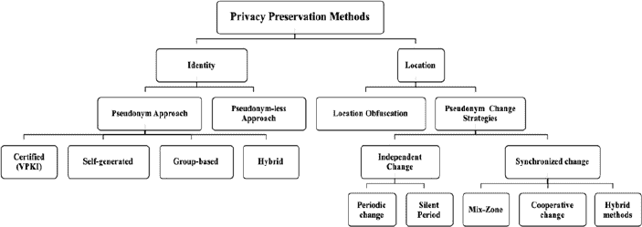

图 2.3. 使用安全应用时的隐私保护方法

## 2.3. 最先进的位置隐私保护解决方案

本节回顾了现有的伪名更换策略，这些策略通常不仅用于保护身份隐私，还保护用户的位置隐私免受跟踪。它们是 ETSI ITS 前标准技术报告 ETSI (2018-04) 的对象，该报告研究了隐私解决方案参数、隐私与安全之间的权衡，以及与伪名使用和更改相关的问题。此外，还规定了位置隐私评估指标。在此，我们将主要的现有解决方案分类为：协作（有基础设施或无基础设施）、非协作、静默和混合方法。我们在解释每种方案的原理后，讨论了每个类别中每个解决方案的优缺点。我们最后通过总结性研究评估了每个类别的整体优缺点。

### 2.3.1. 非协作更改

这些更改策略包括由车辆独立执行的解决方案。车辆在不与邻居任何协作或同步的情况下进行伪名更新。表 2.1 总结了属于此类方案的优缺点。

### 2.3.2. 静默方法

这是最早提出的打破攻击者连续跟踪的方法之一。车辆不仅在伪名过期后定期更改，而是进入静默期，然后使用新更新的伪名继续其网络活动。静默指的是车辆停止发射消息和广播。静默充当了迷惑攻击者的因素。在表 2.2 中，我们引用了建议使用静默方法的相关工作，并突出了它们的优缺点。

### 2.3.3. 基于基础设施的混合扇区方法

这种方法灵感源于`Chaum` (1981) 最初提出的网络混合。他提出通过通过一系列定义为混合器（mixes）的信任中间人中继消息来实现通信匿名化，以防止窃听者识别发送者（Danezis 2003）。在车辆背景下，各种解决方案依赖于使用混合区（mix-zones）来防止伪名在更新时产生关联性。混合区被定义为攻击者无法追踪车辆轨迹的区域（Freudiger et al. 2007, 2009）。在最初的提议中，它被认为是一个未覆盖的区域，窃听者的接收器位于该区域的末端（边界）但未进入内部。因此，他们能够获车辆进入和离开该区域的顺序和时间。在随后的提议中，混合区由基础设施（路侧单元`RSU`）创建、维护和发布。它不再依赖于攻击者拥有未覆盖区域的假设。相反，混合区正变成即使攻击者到达也无法窃听其内部通信的区域，因为车辆在区域内交换加密消息或停止广播（应用静默`apply silence`）。这种方法依赖于基础设施。这些区域的放置（Sun et al. 2015）、区域内的车辆数量以及在区域内停留的时间是实现良好不可关联性水平的关键标准。表 2.3 汇总了该方法的各种现有解决方案。

#### 表 2.1. *非协作变化策略*

| ***解决方案*** || ***年份*** || ***原理*** || ***优势*** || ***缺点*** |

| --- | --- | --- | --- | --- |

| Song et al. (2010) | 2010 | 车辆在指定的延迟内感知其邻居；它通过其广播的消息维护其近范围内车辆的实际轨迹。当车辆确定自己处于`k`辆其他车辆之中时，会在伪名过期时更改其伪名。 | 车辆保持其邻域内车辆的实际轨迹。这一步防止了由于某辆车辆离开通信范围或改变方向而导致匿名集大小小于`k`时更改伪名。 | – 处于人群中并不一定能确保不可关联性。如果车辆自行更改伪名，攻击者可能仍然喜欢这种变化，因为其他车辆没有更新它们的伪名。 <br><br– 该方案是基于触发的，触发因素是车辆的密度。 <br><br– 该方案依赖于人群且与协作无关。 |

| Kang et al. (2016) | 2016 | 作者在车联网中提出了一种位置隐私保护解决方案，其中车辆拥有一个用于信标发送的伪名，以及一个用于虚拟机标识符（`VMID`），用于满足基于位置的服务查询。该解决方案建议同步更改标识符（`VMID` 和伪名）。 | 标识符的同步更改防止了安全应用活动与基于位置的服务映射。因此，它停止了通过`VMID`和/或伪名进行的关联。 | – 尽管标识符是同步更改的，但这不足以防止关联性。车辆在执行更新过程中的不协作会导致攻击者进行追踪。 <br><br– 该方案增加了额外的开销。 |

#### 表 2.2. *基于静默的策略*

| ***解决方案*** || ***年份*** || ***原理*** || ***优势*** || ***缺点*** |

| --- | --- | --- | --- | --- |

| Huang, et al. 2005 | 2005 | 使用静默期（恒定）来阻止关联性。RSU 广播车辆数量。 | 随机静默期。 | 减少关联性。 | 非固定周期。 |

| Sampigeth et al. (2005, 2007) | 2005, 2007 | 使用静默期来阻止关联性。该解决方案是感知的，静默期是用于……该解决方案是…………其目的是为了混淆群体。 | – 该方案依赖基础设施。它也依赖于道路。静默时间太短。 <br><br– 对群体的依赖可能会产生漏洞，如果领导者是恶意的。 <br><br– 除非车辆交换会话密钥，否则与混合区外车辆的通信无法读取。 |

| Chaurasia et al. (2009) | 2009 | 使用随机静默期来阻止关联性。该解决方案是感知的，并且依赖于传输功率的变化。RSU 广播车辆数量，车辆监听广播。当邻居数量超过阈值时应用静默并更新伪名。 | 静默期是随机且未定义的。 | 该解决方案是感知的。它试图利用邻居的变化进行隐藏。 | – 使用随机静默期是一个未解决的问题。长周期对安全应用的影响是负面的。而短周期被认为是低效的。 <br><br– 作者试图通过最小和最大边界解决这个问题，如果攻击者已知，可能会导致成功的追踪。 <br><br– 仅仅处于人群中并保护隐私。只有当邻居同时变化时，攻击者才会被混淆。 |

#### 表 2.3. *基于基础设施的混合区变化策略*

| ***解决方案*** || ***年份*** || ***原理*** || ***优势*** || ***缺点*** |

| --- | --- | --- | --- | --- |


## 2.3.4. 协作方法（分布式混合区）

在这种方法中，车辆相互同步同时更改伪名，以破坏关联性并混淆攻击者的踪迹。这也被称为分布式混合区。它们不依赖基础设施通过创建和发布此类区域的存在来同步变更。车辆可以隐式地实现协作，而无需显式发送同步消息，例如当车辆在拥堵中更改伪名时。表 2.4 总结了基于分布式混合区的方案。

## 2.3.5. 混合方法

混合方法结合了上述方法中的一种或一组方法。多种可能的组合使得该领域是开放的。它甚至可以包括基于新标准的未分类解决方案。它还可能将位置混淆技术与伪名更改策略相结合，以获得一种对追踪更安全的解决方案。表 2.5 总结了该类别中的现有方案。

在表 2.6 中，我们根据类别对现有解决方案进行了全面评估，并作为一个总结性概述，阐述了每个类别的原理、优点和缺点。此类总结的目的是突出需要理解和记住的关键概念，并克服开发新解决方案时遇到的根本性缺陷。

## 表 2.5. 混合变更策略

| 解决方案 | 年份 | 原理 | 优点 | 缺点 |
| :--- | :--- | :--- | :--- | :--- |
| Freudiger et al. (2007) | 2007 | 作者建议使用`CMIX`，这是一种由 RSU 维护的位于交叉口的对称加密保护混合区。所有进入的车辆从 RSU 获取会话密钥。混合区内的通信使用该密钥加密。 | 攻击者无法追踪交换加密信标的车辆。这降低了攻击者的关联比例，因为车辆在离开`CMIX`时可能会改变速度、车道或方向。 | 该方案依赖于基础设施。它也依赖于道路，在没有交叉口或没有基础设施的直路上，变化不会在不可察觉的情况下发生。加密可能会增加额外的处理和开销，因为密钥是在检查车辆真实性后获取的。此外，由于更新和扩展过程。除非车辆交换会话密钥，否则与混合区外车辆的通信无法读取。 |
| Buttyán et al. (2007) | 2007 | 混合区（mix-zone）未被攻击者覆盖。他们了解进入和离开该区域的车辆，但无法拦截其内部通信。假设车辆频繁更改伪名，以最大化在混合区内发生变更的概率。 | 在未覆盖区域内的变更无法被攻击者进行关联。 | 混合区依赖于攻击者。用户不知道自己何时正在被跟踪。该方案依赖于攻击者在离开未覆盖区域时是较弱的假设。频繁更改伪名的车辆可能永远不会进入未覆盖区域（混合区）。因此，该车辆可能一直被攻击者跟踪。从方案设计的角度来看，该提议是标准的伪名更新策略。没有添加任何额外措施来确保车辆在混合区内更新伪名。 |
| Palanisamy et al. (2011, 2012) | 2011, 2012 | 该方案研究了车辆速度、道路限制、运动模式和统计数据在创建能够减少伪名跟踪的混合区方面产生的影响。 | 交叉路口的矩形混合区可能导致车辆伪名更新被关联，因为攻击者可能会计算在不同类型混合区内的时间，因为他们可以将车辆速度和方向与道路限制及观测结果匹配。作者继续提出各种混合区，直到他们提出了由时间窗口边界定义的非矩形混合区。它从交叉路口出口路段的中心开始，考虑了车辆的速度和进入时间。这种类型在确保不可关联性方面优于所研究的所有其他混合区类型。 | 作者没有解释混合区的创建过程或其放置位置。混合区信息对用户来说是隐性的，其形状也是如此。攻击者将接收器布在道路上。由于这种攻击者的目标是隐私，因此实现提议的形状可能并不可行。因此，他们可能会在作为混乱场所的交叉路口花费额外精力。 |
| Lu et al. (2011, 2012) Mathews et al. (2014) | 2011, 2012 2014 | 方案建议在交叉路口和交通信号灯颜色变化时更新伪名。他们将这些命名为小混合区。或者，也可能发生在停车场，也标记为热点或大混合区。 | 进入和离开该点的随机性以及在其中停留的时间有助于混淆攻击者并实现更高水平的隐私保护。 | 虽然交叉路口的车辆同时更改，但它们的位置（如它们所在的车道）可能有助于攻击者的预测和关联性。特别是，这些车辆在交叉路口停下时并没有停止发送信标。热点可能有多个进入和离开点，随机的停留时间确实会混淆攻击者。然而，如果攻击者在热点设有接收器，他们可能在更新前后定位到车辆的停车位。 |
| Liu et al. (2012) | 2012 | 作者建议使用多个混合区。他们研究了这些区域的最佳放置位置，以降低成本并实现更高水平的隐私保护。他们同时考虑了道路地图和交通密度。 | 放置在合适的密集道路交叉路口的混合区减少了关联性并增强了隐私，因为改变方向和速度的车辆流增加了攻击者的混淆度。 | 混合区依赖于基础设施和道路地图。 |
| Ying et al. (2013) | 2013 | 伪名即将到期的车辆通过最近的 RSU 向机构发送请求，通知其已准备好更新伪名，并提供旧伪名和新伪名。RSU 被命令创建一个混合区；接收到混合区公告的车辆在混合区内也更改伪名。 | 伪名更新后的加密防止了攻击者关联新旧伪名。混合区确保至少有`k`辆车辆进行变更。 | 信标的加密增加了额外的开销。方案依赖于基础设施。 |
| Boualouache et al. (2016) | 2016 | 作者建议车辆在收费站或服务点的基础设施混合区内更改伪名。每个区域有一个路由器，作为混合区的入口点；车辆到达路由器后停止广播。车辆被分配到一个车道并根据服务期留在区域内，该区域还通过聚合器，作为混合区的出口点。车辆在超过该聚合器后使用新伪名恢复广播。 | 方案使用静默防止攻击者拦截混合区内交换的消息。它使用随机服务时间确保进入和离开混合区的车辆顺序不同。这防止了攻击者利用位置预测关联新旧伪名。 | 方案依赖于基础设施。收费站和服务站可能并不一直有高密度车辆。此外，车辆可能以相同的顺序进入和离开。车辆伪名更新频率在分钟/几公里范围内。因此，车辆无法为了确保隐私进入每一个收费站和服务站。 |
| Kang et al. (2018) | 2018 | 作者为基于雾的车联网提出了一种伪名更改策略。该策略依赖于本地机构确保相邻车辆的协作（热点的同步更改）。 | 方案在协作群体内执行更新过程时减少关联性。本地加密同步消息并记录变更。 | 加密和同步过程增加了额外的开销和计算。方案依赖于基础设施和群体。 |
| Liao 等人 (2009) | 2009 | 每辆车辆都会通知其邻居自己正在更改伪名。如果该车辆有`k`个愿意更改且状态相似的阈值邻居，车辆将同步更新伪名。否则，它将等待。如果达到了伪名的`maximum lifetime`（最大寿命），则该车辆无论邻居如何都会更新其伪名。 | 该方案是不依赖基础设施的。车辆在道路上自行协作执行伪名更改。`k`越大，攻击者就越困惑。该方案不需要为了同步发送特定消息。它仅利用`beacon header`中的一个比特位来实现相同目标。 | 该方案对语法攻击具有免疫力，但对语义攻击不具备。攻击者可能会获得有关车辆分布和位置的知识。这些知识有助于他们预测车辆的未来状态。这些预测可能用于在更新后将旧新伪名连接起来。当车辆的伪名`expiry`（过期）时，如果其邻居少于`k`个，则该更新将具有关联性。车辆相互通知执行更改的就绪状态。拦截这些消息的攻击者能够得知更改即将发生。他们可能会采取额外措施来提高预测的准确性。 |
| Pan 等人 (2012, 2013, 2017) | 2012, 2013, 2017 | 车辆相互通知更新伪名的就绪状态。一旦车辆在半径`R`内收到来自另一辆车辆的`K`个确认，发起更改的车辆以及所有其他`K`辆车辆将同步更改其伪名。即使其中某些车辆没有`K`个邻居也是如此。 | 更改是不依赖基础设施的。车辆在道路上相互协作以同步其伪名更新。协作车辆的人群越大，攻击者的困惑度越高。 | 车辆即使在邻居少于`K`个的情况下也可能与其他车辆协作更改伪名。它正在牺牲自己的隐私级别来帮助其他车辆实现其预期的保护水平。仅仅处于人群中并不意味着一定能实现协作，如果车辆最近更新过伪名，它们将不会参与更改。如果车辆仅更改伪名而不改变其物理朝向，攻击者可以使用基于预测的技术来关联这种更改。 |
| Emara 等人 (2015) | 2015 | 作者建议车辆在当伪名即将过期且其注意到一个或多个邻居进入沉默状态时，调整其伪名。如果是这样，它也会保持沉默状态至少一段时间并更新其伪名。车辆会检查其当前位置是否更接近某个沉默邻居的预测轨迹。或者，在用新更新的伪名恢复活动之前，检查它是否超出了其原始轨迹的`gate`（门限）。 | 协作式沉默会困扰攻击者，特别是因为节点在打破攻击者的关联性之前，它们不会恢复活动。该方案在同步过程中不需要任何额外的消息交换。 | 沉默的邻居并不意味着它正在更改伪名。如果车辆停止引擎或在离开范围时未能接收到其消息，车辆可能会进入沉默。沉默会对安全应用产生负面影响。车辆在伪名更新后恢复活动而执行的`gating process`（门控过程）会增加额外的计算。该方案依赖于人群。如果车辆不在人群中，沉默将无法防止追踪。 |
| Ying 等人 (2015) | 2015 | 车辆通过向其设定半径内的邻居（n-hop 车辆）发送请求来创建分布的混合区（mix-zones）。在收到请求后，车辆在设计的槽位中更改伪名。 | 车辆从`location candidate list`（位置候选列表）中选择更改伪名的最佳时机。它们在伪名接近过期时间时进行更改。如果车辆收到多个加入混合区的请求，它仅在正确的区域内更改一次伪名。协作减少了关联性。 | 建立和加入混合区的同步消息和`location candidate list verification`（位置候选列表验证）增加了额外的计算和网络开销。 |
| Li 等人 (2006) | 2006 | 使用`swing protocol`（摆动协议），当车辆拥有可以接收其更新消息的邻居时，它更新伪名。它在随机沉默一段时间后改变方向。`swap protocol`建议节点之间交换伪名，而不是更新新的标识符。这不适用于车辆网络，因为伪名是一对公私钥。 | 车辆在改变方向时更改伪名，降低了攻击者的关联性。随后它随机一段时间以困扰攻击者。 | 该方案在理论上是可能的。但假设车辆每 1-5 分钟更改一次伪名，为了隐私几分钟改变一次方向会干扰用户并导致延迟。在`Swing`中，车辆仅在处于车辆组时才更新。至少有一个邻居存在。没有条件强制车辆同步更新伪名，这缩小了匿名集的大小。此外，如果不存在组，车辆将继续使用过期的伪名。最后，如果道路有诸如 X 公里内不能改变方向的限制，那么使用该方法进行更改是不可行的。`Swap`无法应用于车辆网络，因为它违反了责任追溯和数据隐私。 |
| Burmester 等人 (2008) | 2008 | 作者建议车辆仅在通过预计会有车辆的交叉口时更新伪名。在更新之前，每辆车辆都会进入随机沉默期。 | 关联性降低了，因为车辆在更改伪名时更有可能处于人群中。此外，随机沉默和交叉口可能的方向改变困扰了攻击者。 | 该方案依赖于地图。交叉路口并不总是拥挤的。沉默可能会影响安全应用。 |

## Buttyán et al. (2009) (2009)

低速静默（SLOW or Silence at Low Speed）建议，车辆在停止信标一段时间后，如果速度小于或等于 30 kmph，则应更新其伪名。这确保了一组车辆能够协作更改伪名，而不需要像在交通信号灯处或拥堵时那样进行同步。

- 协作的静默和改变阻止了关联性。车辆低速时的静默不会影响安全应用，因为在低速下发生事故或人员伤亡的概率很小。
- 车辆协作在不产生同步开销的情况下实现。
- 在拥堵时，车辆处于类似的状态。当它们停止信标时，可以减少由签名验证引起的开销并防止广播风暴。

该解决方案取决于车辆的速度。如果道路交通顺畅，车辆可能会长时间使用同一个伪名，导致其被追踪。

## Hang et al. (2009) (2009)

该方案将群组签名、混合区（mix-zone）和静默期概念整合到一个解决方案中。只要可能，车辆就应该是群组的成员。所有成员共享同一个公共群组密钥，每个成员都有自己的私钥。当车辆接近路侧单元（RSU）公布的混合区时，所有进入混合区的车辆在混合区内停止广播（进入静默期）。群组密钥和车辆个体密钥（伪名）在离开混合区时（静默结束）进行更改。

由于该方案要求车辆协作更改，攻击者的困惑度更高。此外，静默打破了攻击者的可预测性和准确性。

- 该方案依赖基础设施。由于部署成本高，基础设施的覆盖可能无法全球化。在未覆盖区域，该方案不适用。
- 该方案假设群组管理器是权威车辆。拥有可用群组意味着权威车辆必须一直巡逻道路。由于成本高昂且公众可能无法接受，这在现实中可能是不可行的。
- 混合区的设置受道路限制（在交叉路口）。在没有交叉路口的路段，该方案不适用。
- 静默期必须经过充分研究，以平衡隐私和安全需求。

## Boualouache et al. (2014) (2014)

该方案建议在交通信号灯处设置基于基础设施的混合区。当红灯时，车辆停止发送信标。然而，它们可以与管理这些区域的 RSU 交换加密消息，以管理混合区车辆之间的伪名交换协议。当绿灯亮起时，车辆使用新更新的伪名恢复广播。

- 该方案依赖非对称加密。它减少了在基于对称加密的混合区中执行密钥生成和交换协议引起的开销。
- 静默防止攻击者在混合区内追踪车辆位置。
- 伪名交换混淆了攻击者，攻击者在车辆进入和离开区域时绘制了车辆及其车道布局。与不同车道和位置的车辆交换会混淆攻击者，攻击者可能会继续追踪同一个伪名，认为他们正在追踪原来的目标车辆，而事实并非。
- RSU 广播关于车辆在每个车道分布的加密消息。这通过交付信标过程来替代了信标过程。

它减少了伪名的过度消耗并允许其重用。非对称加密的计算成本高于对称加密。因此，它的速度较慢。

- 伪名交换混淆了攻击者，攻击者在车辆进入和离开区域时绘制了车辆及其车道布局。与不同车道和位置的车辆交换会混淆攻击者，攻击者可能会继续追踪同一个伪名，认为他们正在追踪原来的目标车辆，而事实并非。
- RSU 广播关于车辆在每个车道分布的加密消息。这通过交付信标过程来替代了信标过程。

交换混淆了攻击者。然而，它并不能保证混合区的匿名集大小达到预期的水平。该解决方案是经过认证的。此外，如果发生违规行为，很难撤销该节点并对其承担责任。

## Xingjun et al. (2014) (2014)

作者建议车辆通过 RSU 转发更新消息，与其邻居车辆同步其伪名更新。当车辆拥有`k`个邻居车辆时（`k`是所需的最小阈值），该车辆会发送请求。车辆在更新伪名时可以选择协作，也可以选择不合作。

协作更改减少了关联性，因为车辆的匿名集增加了。

- 该方案并不强制邻居车辆在更新过程中协作。相反，它们可以选择不合作。这意味着如果有一辆或多辆车辆决定不参与，通过这种更改策略获得的隐私水平可能低于预期。
- 该方案依赖于基础设施。
- 它容易受到基于位置的关联攻击。

## Ying et al. (2015) (2015)

作者建议车辆每当需要更新伪名时，动态形成基础设施辅助的混合区；该区域在车辆请求时形成，且请求者周围的车辆协作同时进行更改。通过增加车辆的声誉值来鼓励其参与更改，否则该值将由权威机构（控制服务器）降低。声誉低的车辆在需要更新伪名时无法获得他人的协作，其匿名性会降低。为了克服重复参与协作导致的伪名过度消耗，限制了连续更改的次数。

- 协作更改减少了关联性。
- 混合区按需形成。
- 将声誉作为协作标准减少了自私车辆概率，从而减少了匿名性。
- 对控制服务器的依赖。
- 声誉计算、验证和更新的成本及开销。
- 尽管声誉值有助于在自私节点更改伪名时不与其协作，从而减少自私行为。然而，车辆可以控制何时自私，何时不自私。它可以在声誉低时积极协作，也可以根据自己的决定自私。协作与自私行为之间的切换仍然可能，并且并不能保证混合区的匿名集大小达到预期的水平。

## 1. Eckhoff et al (2016)

作者建议使用时隙伪匿名，如果是在车辆群中更改这些伪匿名，则可以实现与协作方法类似的保护水平。作者通过在更改后简短地包含旧伪匿名，规避了伪匿名更改对安全应用的影响。但这导致了邻近车辆对伪匿名的关联性（linkability）。作者声称，如果攻击者距离车辆足够近，就可能对其进行跟踪。无论何种情况下，隐私都会被破坏。他们还降低了安全信标频率并加入了位置噪声以混扰本地攻击者。

- 时隙伪匿名确保了车辆位于群体中时，在不增加额外同步开销的情况下实现协作。
- 噪声的添加和信标频率的变化为所研究的弱本地攻击者制造了盲点，降低了他们的跟踪能力。
- 该方案尚未针对具有全覆盖能力的全局被动攻击者进行研究。
- 旧伪匿名的添加显然会导致全局攻击者进行关联。
- 引入噪声引起的不准确性对安全应用产生负面影响，信标频率的变化也是如此。

## 2. Boualouache et al. (2017)

所提出的方案是感知交通的。车辆检测到自己处于交通拥堵（低速）中。它广播一条自己处于拥堵的消息。然后选出一辆车辆作为沉默混合区（mix-zone）创建者。该车辆停止安全信标广播，更改其伪匿名并发送定期的匿名拥堵通知。在发起者（混合区创建者）通知它们交通拥堵结束之前，所有车辆保持静默。然后，它们都使用新的伪匿名恢复活动。

- 协作群体与延长沉默的结合削弱了攻击者的预测和关联能力。如果车辆在拥堵期间变换道，攻击者会感到更加困惑。
- 混合区是动态创建的。
- 该方案依赖于拥堵情况。
- 静默对安全应用产生负面影响，特别是当车辆变换道时。
- 同步过程、选举、静默期延长和拥堵结束通知在计算和消息交换方面都增加了开销。
- 在非拥堵道路上，伪名的更新是关联的，隐私无法得到保护。

## 3. Wang et al. (2018)


作者建议一种基于路侧单元（`RSU`）的伪匿名交换策略。当车辆发现方向相同、距离小于阈值且速度相似的触发车辆时，它会检查邻居车辆。如果发现一个或多个触发车辆，车辆向 `RSU` 发送交换请求。当 `RSU` 接受车辆请求时，两辆车辆都会收到通知，并在交换由 `RSU` 记录以确保可撤销性和可追溯性。如果 `RSU` 收到针对同一触发目标的多个请求，它会随机选择一个。

- 与状态相似的车辆交换伪匿名会混扰攻击者。
- 有效的伪匿名交换允许其可追溯的重复使用并减少了过度消耗。
- 意愿车辆之间 `RSU` 辅助的伪匿名交换确保了安全机密性。
- 伪匿名交换违反了用户的隐私。所有使用这些伪匿名加密的过去消息都可以被新伪名的所有者读取。
- 伪匿名是有生命期的。它们不能在有效期之外使用。
- 允许伪匿名交换使得每个节点可能拥有多个伪匿名（旧的和新的），这些伪名可能被用于发起女巫攻击（`Sybil attacks`）。

### 4. Memon et al. (2018)

作者建议车辆与其邻居协作更改伪匿名，然后进入静默状态以避免关联性。这种协作发生在基础设施混合区内。作者研究了欺骗攻击对隐私的影响，并定义了一种检测这种攻击的机制。

- 混合区和静默的结合降低了关联性。
- 欺骗攻击由活跃的内部攻击者执行。这一假设本身是理论性的。如果攻击者能够黑入车辆，那么黑入受害车辆更符合逻辑。如果攻击者能够在所有混合区都部署他们的车辆，那么直接跟踪车辆更好，这样成本更低且更有针对性。
- 该方案依赖于基础设施和群体。
- 静默对安全应用产生负面影响。

### 5. Khacheba et al. (2017, 2018)

作者建议车辆创建分布式混合区，车辆在区内协作同步更改其伪匿名。发起车辆一旦收到来自 `k` 辆车辆的标记消息，就会进入随机静默。在伪匿名最大寿命到期之前，车辆将保持静默。作者研究了欺骗攻击对匿名性水平的影响，并提出了一种检测它的的机制。

- 混合区和静默的结合降低了关联性。
- 混合区是分布式的且独立于基础设施。
- 车辆在应用静默后可能找不到协作的邻居并独自更改伪匿名。这种更改是关联的。
- 该方案依赖于群体。
- 静默期是随机的。因此如果选择的静默期较短，其关联性更高。
- 静默对安全应用产生负面影响。
- 正我们在 `Memon` 等人（2018）中所解释的，由于成本原因，欺骗攻击并不现实。

### 6. Belal (2018)

作者建议一种基于基础设施混合区的更改策略，该区域的道道上设有接收器，模拟车辆的行为并参与虚拟伪名更改。这些区域内的所有通信都经过加密，以防止窃听。

- 该方案独立于群体。对车辆行为的虚拟化和仿真有助于降低攻击者的关联性并增加混淆性。
- 车辆在混合区中更新伪匿名时，始终与 `k` 个其他虚拟群体在一起。
- 该方案在计算和财务上都是昂贵的。
- 虚拟车辆及其广播消息增加了开销。
- 该方案依赖于基础设施。
- 在没有基础设施覆盖的区域，该方案无法应用。

### 7. Guo et al. (2018)

作者建议了独立的混合区，每个伪匿名即将到期的车辆都会检查分布式的混合区（协作群体）。如果混合区内的车辆数量少于目标阈值 `k`，则车辆将随机生成假伪名来模拟虚拟车辆以达到阈值 `k`。所有交换的消息都经过加密，以防止攻击者窃听通信。

- 独立的混合区是由车辆自行创建的。
- 更改前后随机的伪名降低了关联性并混扰攻击者。
- 该方案不依赖群体。
- 该方案是分布式的且动态创建。
- 加密防止了敏感内容的泄露。
- 虽然混合区创建消息附加在信标中，但该方案仍然增加了由加密、创建假群体、同步和伪名更改引起的额外计算成本和开销。

如果道路限制不支持这一假设，攻击者可能会检测到该车辆是发送伪造消息的车辆。例如，在一条没有路口的平直道路上，如果一直跟踪道路上 `l` 辆车辆的攻击者突然检测到 `l+s` 辆活跃车辆，那么显然额外的 `s` 条消息来自虚假身份。如果道路上只有这一个辆车辆，情况会更糟，因为这很明显它是这些伪造消息的发送者。此外，如果攻击者检测到此类情况，他们可以通过信号强度定位消息发送者，以确认他们的假设和追踪结果。

#### 表 2.6 匿名名变更策略 – 总结

| 类别 | 原理 | 优点 | 缺点 |
| --- | --- | --- | --- |
| 非协作 | 非协作变更包括由车辆独立执行且不与邻近车辆同步的方法。 | – 更新过程速度快。<br>-– 不依赖于道路、人群和基础设施。 | – 与频率无关的变更并不一定能降低可链接性。<br>-– 这些方案对句法链接缺乏抵抗力。 |
| 静默 | 基于静默的方法依赖于停止安全消息的广播（直到匿名名更新后才停止高频广播）。 | – 静默中断了车辆追踪，并防止了旧匿名名与新更新匿名名之间的链接性。<br>-– 如果应用得当且充分，静默方案更有可能抵抗语义链接（基于位置的链接）。 | 静默会对安全应用产生负面影响，而安全应用是创建车载网络的根本动力。影响安全应用意味着面临着车内用户生命安全的风险。 |
| 基于基础设施的混合区 | 在 `RSU`（基础设施）创建、维护和广告的混合区内进行变更更安全。混合区包含同时更新匿名名的协作车辆。它通常放置在路口和交叉路口，车辆在更新后改变方向。在混合区内，车辆要么保持静默，要么交换加密通信。 | 当协作群体内发生变更时，链接性会降低。随着协作车辆数量的增加，攻击者的困惑也会增加，特别是当他们在变更改变方向和速度时。 | ––这些方案依赖于道路、人群和基础设施。<br>-– 创建和维护混合区需要额外的计算和开销。<br>-– 使用静默或加密的混合区会影响安全应用的效率。 |
| 分布式无设施混合区 | 这种类型的混合区由车辆在道路上动态形成。当它们需要更新匿名名时，车辆相互同步以同时更新匿名名。 | ––协作变更策略降低了链接性。<br>-– 这种类型的混合区不依赖于基础设施和道路。 | ––车辆之间的同步以及静默和加密的使用可能会增加额外开销并影响安全应用。<br>-– 该解决方案取决于人群。<br>-– 即使车辆同步更新匿名名，道路限制也可能导致链接性。 |
| 混合 | 此类别包含各种解决方案，通过将现有方法结合起来来克服它们的短板。同时，它还结合了能够降低链接性的新语境。这是一个可能包含不同新方案的类别。 | 各种策略的结合旨在降低链接性。 | 除非仔细地进行方案组合，否则它们的缺点可能会继承到新的使用方法中。 |

## 2.4 车载网络中的身份验证问题

身份验证是安全中的一项基本属性。它能防止入侵并有助于确保可追溯性。它是识别内部用户、组织正确的访问规则以及追踪其活动的必要步骤。此外，它还能防止未注册用户访问系统或网络。

### 2.4.1 车载网络中正在验证的是什么？

在车载网络（`VN`）中，有两种身份验证：

- **用户访问 `VN` 服务的身份验证**

这种身份验证发生在车辆用户与服务器之间（服务器可以是服务提供商、机构或 `RSU`），用于获取服务、匿名名和证书。在此之前有一个注册阶段，用户在该阶段通过提供必要的必需信息向该服务器注册，并同意所提供的权利以及身份信息和参数。一旦通过验证，用户即可从授权的服务中受益，并继续与服务器进行安全查询。自然，该用户进行的所有交换、消息和操作都映射到其账户，一方面确保了可追溯性，另一方面在检测到错误行为或角色滥用时可以撤销用户权限。

- **消息的身份验证**

在这种身份验证中，对消息进行身份验证。这是车载网络中接受或拒绝消息的基本操作，特别是安全应用所需的消息。这是一项防止外部攻击者注入虚假消息的安全措施。

在继续解释这种类型的身份验证之前，我们提醒读者，每辆车辆都会使用其匿名名对其安全消息（也称为信标）进行签名。后者是一对经过认证的临时公钥和私钥。它们由机构认证，之所以是临时的，是因为它们具有短的有效时间和使用空间。此外，为了防止女巫攻击（`Sybil attacks`），每辆车在给定的时隙有一个唯一的匿名名。这些匿名名的证书是无身份的，换句话说是匿名的。这对于确保隐私和避免追踪至关重要。因此，验证的目标是检查消息是否来自真实节点而不识别其身份。只有当发生错误行为并对其追责和撤销时，才需要识别。

当车辆收到来自另一辆车辆的消息时，首先检查证书有效性，即仍然有效且未过期。然后检查该证书是否由机构密钥签名以及是否未被篡改。证书检查完成后，接收车辆检查认证匿名名是否在更新的撤销列表（`CRL`）中，即未被撤销/黑名单。匿名名验证结束后，接收车辆通过检查数字签名来验证消息的完整性。此操作不仅证明了消息没有被更改，还证明了验证的匿名名属于使用私钥对消息签名的所有者。

### 2.4.2 身份验证类型

身份验证通常分为三类，基于用户通过其所知的、所拥有的或其特征被识别的方式。我们在下面解释每种类型（`Benarous` 等人 2017）：

- *基于知识的身份验证*也称为基于用户所知的身份验证。这是最常用的方法之一。一个著名的例子是基于密码的身份验证，用户只需提供注册时分配的标识符或用户名和密码。用户名和密码也被称为凭据（`Egan and Mather 2004; Pfleeger 2006; Stolfo et al. 2008`）。

- `Possession-based authentication` 基于所有权的验证，即使用用户拥有的物品进行验证。这是场所和酒店常用的验证方法之一。用户拥有令牌、智能卡或证，，用于系统进行身份验证（`Stolfo et al. 2008`）。

- `Physiology-based authentication` 基于生理的验证，用户使用其独特特征向系统识别身份。这也被称为生物识别认证；著名的例子包括虹膜、指纹和人脸认证。它还包括行为认证方法，如字体、步态和签名分析（`Pfleeger 2006`）。

在表 2.7 中，我们比较了这些方法并强调了它们的优缺点。

**表 2.7.** 身份验证类型的优缺点

| 验证类型 | 优点 | 缺点 |
| --- | --- | --- |
| 基于知识 | – 易于实现 <br>– 被接受和使用 <br>– 可以存储在 `cookies` 中 | – 容易忘记 <br>– 受到破解和猜测攻击的威胁 |
| 基于所有权 | – 工业使用实用且方便 <br>– 不需要记忆任何内容、掌握任何技术或具有 `IT` 背景 | – 比基于知识的方法贵 <br>– 容易忘记或丢失 |
| 基于生理 | 更安全，更难模拟或破解 | – 比其他方法贵 <br>– 易受光和噪声影响 <br>– 受到受伤、烫伤和切割的影响 |

### 2.4.3 验证如何威胁隐私？

上述身份验证类型威胁隐私。需要访问系统或服务的用户必须提供所需的信息来建立验证。他们可能需要在注册阶段提供他们的身份和生物识别数据。大多数服务提供商强调他们对隐私政策尊重。然而，我们经常在新闻中听到这些数据被用来交换利润、被黑客泄露或在司法系统要求合作时提供。此外，车载网络是敏感的，因为与用户的安全有关。车辆可能会使用各种需要验证的服务。此外，它们可能频繁要求道路部门补充伪名。使用相同的凭据（数据）进行重复验证，即使通信是安全的，也导致车辆在路上被追踪。

在这里，为了强调隐私的重要性，我们列出了知名服务提供商的一些著名隐私泄露和破坏事件（`Friesland 2018`）：

- – `Facebook` 和剑桥分析公司丑闻，导致约 5000 万账户泄露（2018 年）；
- – 2016 年，`Uber` 被黑客攻击；5700 万用户受到此攻击的影响；
- – `Yahoo` 在 2013-2014 年遭受攻击，2016 年报告有 30 亿账户被破解；
- – `Ebay` 在 2014 年受到攻击，1.5 亿账户的隐私被破坏。

这些例子证明并非所有服务提供商都值得信任。尽管他们声称可靠，即使当我们想要相信他们可靠时，针对他们的攻击也可能导致我们委托给他们的私有数据暴露。分享的越多，风险越大。例如，如果用户使用指纹解锁手机并用它访问家和办公室，那么存储指纹的任何一个系统发生破解或泄露，都会导致其他使用该指纹的系统的漏洞。

然而，为了使用系统，我们需要证明我们确实是所声称的身份，并且有权使用该系统。同时，我们需要保护隐私。因此，隐私和验证之间需要一种平衡。我们需要提供最少的信息以确保验证，同时保护隐私。这导致了新一组验证机制的出现。它们被称为匿名认证、隐私保护认证，也称为挑战（零知识）验证方法。在下一节中，我们将概述这些验证方法在车载网络中的用法。

## 2.5 身份隐私保护解决方案：技术现状

我们在 2.4.1 中解释过，在车载网络中，验证被用于识别用户或检查消息的真实性。后者通常通过对伪名的验证完成，检查该伪名是否由机构认证，或者是组密钥。甚至建议使用对称密钥对进行签名（`Hussain et al. 2009; Emara 2016`）。无论使用什么方法，只要它依赖于临时密钥（伪名）而不是用户身份，就能保护隐私。研究在开发任何解决方案时都强调了这一要求。这是在 `VN` 中引入伪名的主要目标。在我们的工作中，专注于用户验证，因为它需要身份交换。此外，它是重复的，因为路上的车辆可能会定期向机构补充伪名或向服务提供商请求服务。在本节中，我们将回顾属于新型类型验证方法的现有解决方案，这些方法通过确保成功识别用户而不暴露其身份隐私来平衡隐私和安全属性。

对于车载网络中的伪名补充和或认证存在许多建议，其中包括 `Khodaei` 和 `Papadimitratos` (2016) 的工作，作者使用了由长期认证机构（`LTCA`）颁发的一次性票据向伪名认证机构（`PCA`）请求自生成伪名的认证。同样，`Alexiou` 等人（2013）也使用票据从 `PCA` 获取伪名证书，但区别是同一个有效的匿名票据可以多次请求。在两项工作中（`Alexiou et al. 2013; Khodaei and Papadimitratos 2016`）中，票据是在车辆成功对 `LTCA` 进行身份验证后获得的。`Schaub` 等人（2010）建议使用令牌请求伪名提供者认证车辆生成的临时密钥（伪名）。为了获得这些令牌，车辆使用其标识符向认证机构验证。使用相同标识符的多次令牌请求是关联的，会导致车辆在路上被追踪。`Khodaei` 等人（2014）建议使用匿名票据来请求车辆生成的伪名的认证，这些票据是在长期证书成功认证后获得的。该解决方案保护了隐私，但重复使用长期证书获取票据会导致追踪。此外，由于票据是匿名的，它们可能受到冒充攻击的影响，攻击者利用这些票据来认证他们的密钥。这进一步违反了问责属性。

`Weerasinghe` 等人 (2010) 提出了一种使用分组概念和伪匿名证书的匿名服务请求。他们建议当给车辆颁发伪匿名证书时，该证书应包含车辆注册的所有服务，换句话说，是服务提供商注册到区域机构（`RA`），而车辆通过 `RA` 注册到这些服务提供商。在注册时，注册服务的信息将通过盲签名包含在伪匿名证书中。通过这样，每个服务提供者都能验证车辆是否注册过可以使用服务。为了进一步改进该方案，他们建议车辆从组内部请求服务以避免可关联性。该方案保护了身份隐私，但要求车辆在请求伪匿名之前需要知道所有需要的服务。众所周知，伪匿名是短命的，这意味着插入注册服务的过程是重复的，这增加了 `RA` 的计算开销。此外，证书的大小将随着服务注册数量的增加而线性增长。

`Jiang` 等人 (2017) 提出了一种基于身份的随机认证。在他们的提议中，每次认证使用一个一次随机生成的身份。用户使用其真实标识符注册到注册服务器。然后，创建一个初始随机身份并发送给车辆用户和验证服务器。车辆随后可以使用它来生成自己的随机标识符。为了向服务提供者或其他车辆进行身份验证，用户在认证请求中将随机身份发送到验证服务器，然后发送给另一个交互方 `P`。`P` 向验证服务器发送请求，而服务器已经收到了车辆的认证请求。服务器确认请求并向 `P` 确认用户是所用随机身份的真实所有者。为了确保追溯性，需要验证服务器（`VS`）和注册服务器（`RS`）的协作。注意，只有 `RS` 知车辆用户的真实身份。而且，只有它保留了认证历史的记录。`VS` 只负责验证，并在新身份被证明后丢弃旧身份。最后，`RS` 和车辆都有一个时间间隔种子列表，车辆用于在每个时间间隔生成新身份。此外，它允许 `RS` 跟踪车辆的身份，而无需不断被告知每一个身份生成。该方案在确保认证的同时保护了隐私；它还能防止重放攻击和中间人攻击。然而，它依赖于服务器，认证双方最初需要通过向 `VS` 检查才能完成认证。这可能是一个缺点，对服务器可用性（单点故障）的攻击会阻碍认证。此外，随着用户数量增加和认证请求增加，服务器的响应可能会变慢。

## 2.6. 结论

在本章中，我们强调了车载网络中的隐私问题及其重要性和类型。我们还回答了关键相关问题，例如隐私违的风险是什么、谁在威胁隐私、如何以及为什么。我们还回顾了文献中提出的现有隐私保护解决方案，并进一步阐明了它们的优缺点。最后，我们通过分类比较和分析作为结束，以帮助感兴趣的开发隐私保护解决方案的读者，避免现有方案的不足。本章还关注了认证问题，并对现有的隐私保护认证方法进行了简要回顾。

在下一章中，我们将学习用于评估、分析、证明工具和方法，以研究和检查车载网络中隐私和安全解决方案的性能和健壮性。

# 3 安全与隐私评估方法论

## 3.1. 引言

在前一章中，我们解释了车载网络中的隐私和安全问题，回顾了先进的解决方案并分析了它们的优缺点。在本章中，我们引用了现有的车载网络安全和隐私评估方法及指标。如上一章所述，我们关注隐私保护认证方法这一安全问题。此外，我们重点关注道路上车载网络用户的身份和位置隐私保护策略。

在解释证明过程之前，我们在图 3.1 中说明了解决安全和/或隐私的过程。它始于理解问题及其成因。它还分析了现有解决方案缺乏的内容及其缺点。然后，头脑风暴如何克服不足以及如何超越现有解决方案，以提出一个健壮的解决方案。最后通过实现该解决方案、进行测试并证明它符合预期目标、具有抗攻击的韧性并优于现有方案。

图 3.2 展示了各种证明和分析方法。描述性讨论和分析是所使用的主要方法之一，有助于理解解决方案并突出其优缺点。遗憾的是，尽管这种方法至关重要，但仅此不足以证明给定的安全解决方案的健壮性。它通常伴随着仿真或数学（分析性）或逻辑证明。比较性研究也是如此。它们在分析和综合现有解决方案方面是基础性的，并且说服读者新方案与最先进工作相比的优势以及它是如何克服不足的。然而，它们不足以说明解决方案的健壮性。另一方面，博弈论有助于在通过仿真测试之前研究给定解决方案的可行性。


BAN 逻辑是一种基于信念的逻辑，由 Burrows、Abadi 和 Needham (Burrows et al. 1989) 引入，用于形式化编写身份验证协议并分析其安全性。该逻辑一方面用于证明协议的正确性，另一方面用于证明它实现了开发时旨在完成的既定目标。证明过程首先通过实体之间交换的消息来编写协议。然后对这些消息进行理想化。证明过程开始于使用理想化消息、一组协议假设和逻辑公理，以达到指定的目标。在本节中，我们将对逻辑理想化、符号和公理进行概述。

### 符号表示

表 3.1 总结了 BAN 逻辑中使用的符号（Burrows et al. 1989）。

要分析一个协议，图 3.3 中给出的步骤至关重要，并重申了我们已经解释的内容。

BAN 协议分析（Burrows et al. 1989）通常由：

- **消息理想化（The message idealization）**：用于对身份验证协议进行理想化，这些协议通常由参与实体之间交换的消息列表来描述。这些非正式的字符串消息使用上述符号进行重写，使其形式化，以便使用 BAN 逻辑公理进行分析。

- **假设（The assumptions）**：是对身份验证系统及其实体的假设集合，例如定义初始信念和管辖范围。

- **目标（The objectives）**：身份验证的最终目标。例如，两个身份验证实体彼此相信对方，或者相信发出的消息来自预期的源。

- **证明（The demonstration）**：使用 BAN 逻辑公理，从系统的初始假设和交换的消息推导出最终目标的过程。

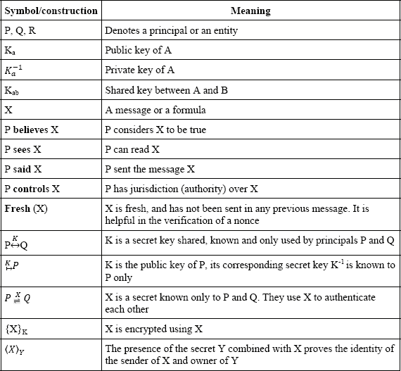

表 3.1. *BAN 逻辑符号*

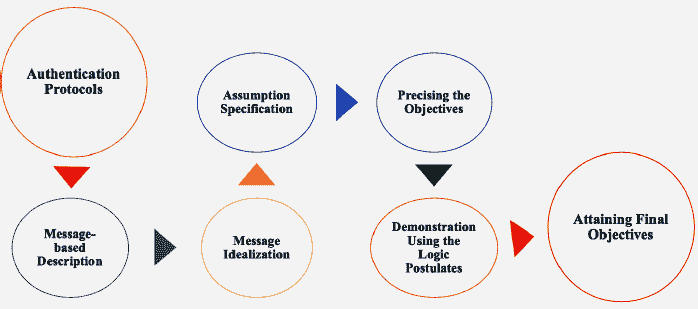

图 3.3. *使用 BAN 逻辑的协议分析过程。*

### 公理

#### 公理 1：消息的含义

“对于共享密钥，如果 P 相信密钥 K 与 Q 共享且看到 X 被用 K 加密，那么 P 相信 Q 曾经说过 X” (Burrows et al. 1989)。

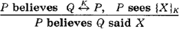

“对于公钥，如果 P 相信秘密 K 是 Q 的公钥且 X 被用 K^(-1) 加密，那么 P 相信 Q 曾经说过 X。注意 K 是公钥，而 K^(-1) 是私钥” (Burrows et al. 1989)。

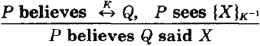

“对于共享秘密，如果 P 相信秘密 Y 与 Q 共享且看到 <X>[y]，那么 P 相信 Q 曾经说过 X” (Burrows et al. 1989)。

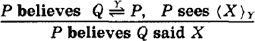

#### 公理 2：随机数（Nonce）

“对于共享密钥，如果 P 相信密钥 K 与 Q 共享且看到 X 被用 K 加密，那么 P 相信 Q 曾经说过 X” (Burrows et al. 1989)。

 (等待，源文本有重复的图像标签或内容，我将保持结构)

*修正：提供的公理 2 源文本为：*

“对于共享秘密，如果 P 相信秘密 Y 与 Q 共享且看到 <X>[y]，那么 P 相信 Q 曾经说过 X” (Burrows et al. 1989)。


#### 公理 3：管辖范围（Jurisdiction）

“对于共享密钥，如果 P 相信密钥 K 与 Q 共享且看到 X 被用 K 加密，那么 P 相信 Q 曾经说过 X” (Burrows et al. 1989)。


#### 公理 4：看到（Sees）

“对于共享密钥，如果 P 相信密钥 K 与 Q 共享且看到 X 被用 K 加密，那么 P 相信 Q 曾经说过 X” (Burrows et al. 1989)。


#### 公理 5：新鲜性（Freshness）

“对于共享密钥，如果 P 相信密钥 K 与 Q 共享且看到 X 被用 K 加密，那么 P 相信 Q 曾经说过 X” (Burrows et al. 1989)。


如果没有发现攻击，分析的输出将是攻击轨迹。此时该协议被认为是安全的。

表 3.2 提供了 HPSL 使用的摘要用户指南，其中我们列出了常量名和关键字、安全谓词、变量声明以及使用的操作符。

表 3.2. *简化用户指南 (A.2006a;2006b)*

| 类别 | 命名 / 规则 |

| :--- | :--- |

| **变量** | 以大写字母开头。可以是字母和数字的混合。 |

| **类型** | `Nat`, `set`, `text`, `symmetric_key`, `public_key`, `message`, `hash_func`, `agent`, `bool`, `channel(dy)` |

| **赋予新值** | `New()` 以小写字母开头。 |

| **常量** | `attack_state`, `attack_states`, `contains`, `crypt`, `dummy_agent`, `dummy_bool`, `dummy_chnl`, `dummy_chnl_dy`, `dummy_ota`, `dummy_hash`, `dummy_nat`, `dummy_set`, `dummy_sk`, `equal`, `initial_state`, `intruder`, `leq`, `pair`, `properties`, `property`, `step`, `types`. |

| **操作符** | `:=` (赋值), `=>` (转换：在转换内部，它表示“与”。在组合角色内部，它表示“并行执行”), `&` (消息拼接), `,` (分隔符), `;` (顺序执行), `in` (检查元素是否属于某个集合), `xor` (异或), `exp` (幂), `not` (逻辑非), `'` (指代 `X` 的最新值), `=` (等价性测试)。 |

| **指令与符号** | `accept` (表示角色的结束和下一个顺序执行的开始), `inv` (公钥的逆逆，即私钥), `delete` (从集合中删除元素), `SND()` (发送消息), `RCV()` (接收消息), `init` (位于变量初始化之前), `intruder_know edge` (定义入侵者的知识), `Def=` (开始角色的定义), `local` (局部变量区域), `played_by` (指定哪个代理正在执行基础角色), `composition` (开始组合角色的定义), `transition` (位于转换定义之前), `End role` (表示角色定义的结束), `%` (注释)。 |

| **安全属性** | `witness` (配合 `wrequest` 使用以检查身份验证), `request` (用于检查强身份验证), `wrequest` (用于检查弱身份验证), `secret` (用于检查机密性), `owns` (变量的所有权。只有所有者可以更改该值（编辑））。 |

| **保留关键字** | `accept`, `agent`, `authentication_on`, `bool`, `channel`, `composition`, `cons`, `const`, `def=`, `delete`, `dy`, `end`, `exp`, `goal`, `hash`, `hash_func`, `iknows`, `in`, `init`, `intruder_knowledge`, `inv`, `local`, `message`, `nat`, `new`, `not`, `ota`, `played_by`, `protocol_id`, `public_key`, `request`, `role`, `secrecy_of`, `secret`, `set`, `start`, `symmetric_key`, `text`, `transition`, `weak_authentication_on`, `witness`, `wrequest`, `xor`. |

### 3.2.1.3. 攻击树

攻击树 (Schneier 1999) 是一种描述安全系统的方法，根据其对攻击的韧性对其进行评估，从而进行改进。针对安全解决方案的攻击表示为树的形式，其中根节点是攻击目标，叶节点是已执行的攻击。`OR` 节点表示执行攻击的各种可能方式，而 `AND` 节点表示执行攻击所需的不同步骤。如果攻击 `A` 可以通过方法 `A1` 或 `A2` 执行，则组合节点即为 `OR`，如图 3.5(1) 所示。如果攻击 `A` 的成功需要 `A1` 和 `A2` 同时发生，则使用 `AND`，如图 3.5(2) 所示。然后，每个叶节点将根据一组标准被分配一个值或一组值。一个简单的例子是表示执行攻击可能性的布尔值，可能的为 1，不可能的为 0。然后根据叶节点的值，通过应用“AND”和“OR”的计算规则，从底向上计算节点值。这种操作递归进行，直到找到被称为安全目标的顶级节点的值。该值呈现了安全目标。

目前存在多种移动性仿真器，可以为自接网络（ad hoc networks）特别是车辆网络生成移动性模型。在这里，我们列出了几个学术界青的现有工具。它们以与广泛使用的网络仿真器兼容的格式导出交通轨迹（traffic traces）。

### Sumo

Sumo 是一个免费开源的交通仿真器，包含了道路车辆和地图。它被用于生成移动性模型，供网络仿真器仿真车辆网络。它可以从 `OpenStreetMap` 导入真实地图，并生成遵循地图上道路和交通模式的移动车辆移动性模型。用户可以指定车辆数量（低、中、高密度）以及仿真持续时间。Sumo 生成的移动性文件可以导入 `NS2`、`NS3` 和 `OMNET`。

### MobiSim

MobiSim (Mousavi 等人，2007) 是一种用于自接网络的免费移动性模型生成器；它能生成网络仿真器可移动性场景。它与 `NS2` 直接兼容，并可以将移动性轨迹导出为文本或 `xml` 文件。它是一个基于 Java 的跨平台工具，具有易于使用的图形界面和完善的文档（Javadi 2006）。

### VanetMobiSim

VanetMobiSim 是一种基于 Java 的免费移动性轨迹生成器，兼容如 `NS2` 等多种网络仿真器。它是 `MobiSim` 用于车辆网络仿真的扩展。它可以导入或生成遵循道路的地图。

### 网络仿真器

上述工具仿真车辆在道路上的移动，但并不仿真它们的行为或执行的代码。为了仿真车辆在网络上的活动，另一组工具被称为网络仿真器。这些工具获取交通轨迹并将其嵌入已执行的代码。我们在此仅列出文献中著名的几个工具。

### MATLAB

MATLAB 被科学家和工程师用于分析和设计系统。得益于其工具箱，它拥有多个应用领域。它在数学上非常丰富，并允许对数据进行图形化说明。重要的是，它更新频繁、文档齐全，并拥有庞大的社区，这有利于其使用和用户之间的专业知识交换。它可以用于仿真网络、MAC 和安全协议。Gupta (2022) 中提出的仓库是专门为 `VANET` 仿真开发的。

### NS2

`NS2` 或网络仿真器是一个用于有线和无线网络的免费离散事件仿真器。它通常用于仿真作为移动网络的自接网络 (`MANET`) 和车辆网络 (`VANET`)。它有详尽的文档并拥有庞大的社区，使其学习和使用更加容易。该工具使用 `C++` 制作并开发了协议。配置文件用 `Otcl` 编写。该工具接受由 `Sumo` 等工具生成的移动性模型。

### NS3

`NS3` 也是一个用于系统的免费离散事件仿真器，但不仅限于此。它可以被用于仿真其他类型的网络。它具有活跃的社区和现成的文档，适用于教学和研究目的。注意，`NS3` 是 `NS2` 的扩展和演进。它是一个完全独立的项目，并且与 `NS2` 文件兼容。它使用 `C++` 编写仿真程序和场景（可选使用 `Python`），并使用 `NetAnim` 进行可视化。

### OMNET

OMNET 是一个离散事件可扩展且模块化的网络仿真器。该工具使用 `C++` 语言编写节点，节点使用 `NED` 语言定义。它还使用 `ini` 配置文件。组件和模块的概念有助于在各种仿真和代码中交换和复用模块。可以通过各种库进行扩展，以便仿真不同类型的网络。当使用 `Veins` 框架扩展时，它用于仿真车辆网络，该框架将 `Sumo` 生成的交通轨迹与在并行仿真期间用 `OMNET` 编写车辆代码连接起来。该工具是免费的，拥有活跃的社区和现有文档。

#### 表 3.3 仿真工具对比研究

| 标准 | MATLAB | NS2 | NS3 | OMNET |

| :--- | :--- | :--- | :--- | :--- |

| 核心组件 | MATLAB | `C++` | `C++` | `C++`, `NED` |

| 场景 | MATLAB | `OTcl` | `C++` | `Ini` 配置 |

| 图形界面 | 工具界面 | NAM | NetAnim | IDE |

| 文档 | 订阅者可用 | 可用 | 可用 | 可用 |

| 易用性 | 对数学导向型用户容易 | 易于网络仿真 | 易于网络仿真 | 需要多种类型的文件 |

| 自...以来使用 | 1994 | 1989 | 2009 | 1997 |

| 社区 | 大 | 大 | 大 | 大 |

| 许可证 | 专有软件 | 免费软件 | 免费软件 | 免费软件 |

| 平台 | 跨平台 (Windows, Linux 和 MacOS) | Linux 和 Windows (通过 `Cygwin`) | 跨平台 (Windows, Linux 和 MacOS) | 跨平台 (Windows, Linux 和 MacOS) |

Kim 等人 (2014) 对车辆网络仿真器进行了早期的调查。在他们的论文中，考虑了 `MATLAB`、`NS2`、`NS3` 和 `OMNET` 仿真器，分析了每个工具的优缺点，并对每个工具的使用进行了统计。作者发现 `NS2` 是研究人员最青睐和使用的工具。表 3.3 汇总了我们这些工具的对比。

在我们的工作中，我们使用 `MobiSim` 生成移动性模型，并使用 `NS2` 进行车辆网络仿真。我们选择工具考虑了上述标准，以及对工具的熟悉程度、易用性、在相关工作中的广泛应用、稳定性以及教程和文档的可用性。

### 3.2.2 分析模型

Liu 等人 (2018a) 定义了五种隐私分析指标：

### 确定性

确定性指标衡量了攻击者寻找唯一答案（如位置或身份）的模糊性。它包含了隐私水平或匿名集大小和熵。我们给出每个指标的公式：

匿名集大小 (ASS) 是与主体车辆 `V[s]` 状态相似的邻居车辆数量，使得该车辆无法与其他成员区分来。让 `V[i]`，`i ∈ [1..k]` 为与 `V[s]` 状态相似的车辆，`k` 为所有与 `V[s]` 状态相似的邻居车辆数。

```
3.1 images/eq3-1.jpg
```

熵 (ETSI 2018) 表示攻击者在将新匿名身份（更改后）链接到主体车辆时的不确定性；定义如下：

```
3.2 images/eq3-2.jpg
```

其中 `P[i]` 是攻击者分配给 ASS 每个成员作为主体车辆的概率。

归一化熵 (ETSI 2018) 计算如下：

```
3.3 images/eq3-3.jpg
```

其中 `Entropy[max]` (ETSI 2018) 是当车辆分布均匀时熵达到的最大值；计算如下：

```
3.4 images/eq3-4.jpg
```

正确性指标考虑了攻击者的成功率，即攻击者成功跟踪轨迹的概率。在轨迹跟踪中，它是在连续观测时隙和区域内持续成功跟踪的概率。它还包含了位置预测中误差率的测量；这被称为基于距离的指标，它计算真实位置 `x` 与预测位置 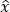 之间的距离，并乘以基于较早观测值 `o` 估计  的概率，如下：

\[3.5\]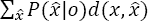 

### 信息增益与损失

这些指标考虑了攻击者拦截和收集的数据量。拦截的数据越多，攻击者的收益越大，用户的隐私越少（损失越大）。攻击者的收益越少，用户的隐私水平就越高。

### 地理不区分性（Geo-indistinguishability）

该指标评估位置隐私保护解决方案，这些方案避免发送用户的精确位置，而是发送一个附加后的位置，使得攻击者认为该区域内的所有车辆都有等可能是目标车辆（Andrés et al. 2012）。

### 时间

时间指标包括最大跟踪时间，即攻击者连续正确跟踪的最长时间。另一个指标是混淆时间，即攻击者对轨迹的正确性不确定或对其所做的预测感到困惑的时间段。

### 3.2.2.3. 对比研究

对比研究对于区分给定解决方案与其他现有方法是必要的，可以突出其优点和不足，并与相关文献进行比较。在某种程度上，它有助于理解该解决方案并说服用户其益处；另一方面，它也有助于检测其特征、优缺点。它允许最终用户选择符合其要求的正确解决方案，并对这一选择负责。这被认为是未来相关研究和改进的支柱。在概念和设计层面，比较可以采用以下指标：所比较方案的用途、方法和核心原理、额外要求和关键假设，以及所研究的攻击者模型。在性能层面，通常上需要仿真，即在相同的设置并针对相同的攻击者模型对所有比较方案进行仿真。然后比较其隐私水平。在分析层面，使用隐私评估指标来比较解决方案。一些研究人员甚至考虑比较解决方案对网络性能、实现复杂性和增加开销的影响。

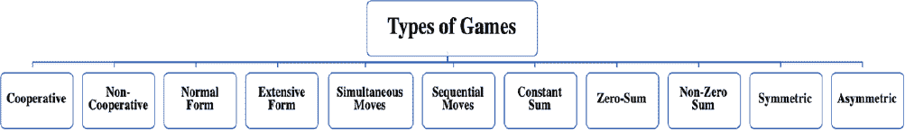

图 3.6. *博弈论中的游戏类型*

### 3.2.2.4. 博弈论

博弈论是一种基于数学的方法，用于制定、结构化和分析取决于影响演化的不同因素和决策的策略性问题。它由约翰·冯·诺曼（John Von Neumann）于 1928 年首次。1944 年他与奥斯卡·摩根斯特恩合著《博弈论与经济行为》一书，首次应用于经济领域。从那时，博弈论被用于各种策略性和预测性应用。每个问题都被呈现为一个博弈，包含一组玩家和每个玩家所采取的策略（移动），以及一个收益函数，该函数根据每个玩家所选的策略和其他玩家的策略为每个玩家分配收益（Hotz 2006）。


根据所研究问题的性质，博弈论有不同类型的游戏（图 3.6 n.d.）。

在我们的工作中，我们使用博弈论来分析所提位置隐私方案的可行性，更准确地说，分析标识更改策略。

## 3.3. 结论

本章介绍了用于研究车载网络中安全和隐私问题性能、可行性和强性的不同证明和分析方法。我们特别关注了用于评估隐私保护认证协议和位置隐私保护方案的方法。

# 4 攻击模型

## 4.1. 引言

在上一章中，我们解释了用于研究解决方案性能的各种证明、评估和分析方法。这些解决方案的性能是通过它们在面对执行不同攻击的攻击者时提供的韧性来衡量的。在本章中，我们将详细介绍攻击者模型，也称为对手模型。我们将进一步深入探讨车载网络安全问题和已知攻击。

作为计算机和网络系统在道路上的延伸并不是它们成为攻击目标的唯一原因。这也归于车载网络的性质，它们依赖无线通信，需要实时交换精确的时空数据，并根据应用需要对消息或用户进行认证。在本章中，我们解释了这些不同的需求虽然至关重要，但可能会威胁用户的安全和隐私。我们还解释了各种现有攻击以及我们攻击者模型的精确性。

## 4.2. 安全目标

在本节中，我们解释了六个基本安全目标，这些目标是开发解决方案的原因，也是攻击的主要目标。我们首先对它们进行通用定义，然后在车载网络中进行定义。我们增加了第七个属性，是因为它在车载网络中特殊特殊性。

### 可用性（Availability）

这意味着系统始终能够向其授权的请求者提供服务。对于资源而言，这意味着该资源始终可以被其授权的用户访问和使用。在车载网络中，必须保证提供证书的机构的可用性。同样，必须确保车辆、路侧单元（`RSU`）和服务提供者的可用性。我们所说的车辆和路侧单元的可用性，是指它们的网络可用性。不应强制用户必须出现在某个位置。然而，我们指的是车辆的协作以及其在重路由和转发等网络活动中的参与。针对可用性最危险的攻击是拒绝服务（`DoS`）和分布式拒绝服务（`DDoS`），它们会隔离目标并使其无法访问（Geers 2011）。

### 完整性

这确保了数据不会被未经授权的第三方篡改。在车载网络中，无论消息是在车辆之间交换，还是在车辆与路侧单元、机构或服务提供者之间交换，消息的完整性都至关重要的意义（Pfleeger et al. 2015; Benarous et al. 2017）。

### 不否认性

这确保消息的发送者无法否认其发送过该消息。这对于让发送者对其发布的消息和/或实施的行为承担法律责任并可追诉特别有用。在车载网络中，它被用于让车主对其道路网络活动负责，特别是当检测到错误行为时，例如注入虚假数据、自私、不合作或传播恶意软件（Benarous et al. 2017）。隐含地，这也意味着用户无法否认其身份、所在的所在地或参与了某项网络活动（Pfleeger et al. 2015）。

### 可问责性与可审计性

指的是可追溯性。换句话说，就是跟踪系统中发生的所有操作。在车载网络中，它是确保不否认性的结果。用户需对其道路网络活动中发起的错误行为负责。机构与其他车辆和路侧单元协作，以追踪车辆的活动，以便进行证据收集和/或撤销（Pfleeger et al. 2015; Benarous et al. 2017）。

### 身份验证与授权

身份验证是指识别系统的用户。随后是授权，它涉及授予或拒绝用户访问系统的权限以及拥有的权利。在这些操作之前，用户需要订阅系统，身份验证数据在此时被首次保存，并定义访问权限。在车载网络中，我们有两种类型的身份验证：消息身份验证和用户身份验证。第一种执行是为了检查收到的消息是否来自受信任的有效用户，而不识别其具体身份。这是通过验证用于签名消息的密钥证书完成的。如果证书有效（未过期）、未被撤销且由受信任机构生成，则会检查消息的完整性。在确认消息未被篡改后，该消息会被接受。这些消息通常是状态消息（信标）。第二类型是针对机构、服务提供者或路侧单元的用户进行身份验证和授权。这种类型类似于传统的身份验证。它需要一个订阅阶段、身份验证和授权（Pfleeger et al. 2015; Benarous et al. 2017）。

### 机密性与隐私

它主要受到数据泄露和暴露的威胁。机密性和隐私是车载网络中的两个基本需求，因为它们直接关系到用户的安全。机密性与交换的内容有关。这意味着只有预期的授权方可以访问、读取和/或修改这些内容。隐私则更多地与车主的身份、其当前位置以及过去的解析轨迹有关（Lord and Sharp 2011; Pfleeger et al. 2015; Benarous et al. 2017）。

### 撤销

撤销在车载网络中尤为重要。它通过防止错误行为的滥用来维护网络的正常功能。它还禁止其他车辆在未来与其进行交互。这通常是在检测到恶意节点时，将其公钥证书加入撤销列表来实现的。

## 4.3 安全挑战

由于上述目标，产生了各种安全挑战。这些挑战引起了研究人员的关注。因此，文献中拥有丰富的安全方案，可以分类如下：

### 身份验证

这是最重要的问题之一，用于保证网络的正常功能、服务授权车辆并让车辆对其活动负责。身份验证通常需要向实体提供身份、永久证书或凭据，实体可能是机构、车辆或服务提供者。因此，这与用户对隐私的需求相冲突。与身份验证相关的工作包括适配生物识别身份验证、隐私保护身份验证方法的设计。

### 隐私

另一个关键问题：许多研究人员专注于通过使用伪名来解决身份问题。这些伪名是临时密钥，可以被视为车辆的临时身份。为了保护位置隐私，开发了多种伪名更换策略以防止链接和追踪。另一组研究人员专注于开发混淆方法以实现相同目标。数据隐私（也称为机密性）通过使用加密算法（如椭曲线密码学）来保护。

### 撤销

研究人员正在寻找一种快速高效的撤销流程，特别是现在 `CRL` 随着每次撤销而不断增大。`CRL` 中的搜索过程在资源利用（`CPU`、存储空间）方面需要快速高效。

#### 伪名生成和/或补充

大量研究人员假设车辆内部有足够的已认证伪名。其他研究人员专注于伪名的生成和认证问题。我们发现了三类研究：那些建议伪名和/或其证书由受信任机构（车载公钥基础设施或 `VPKI`）颁发的。留下的问题是它们在池耗尽时如何请求补充。一些建议定期访问机构设施进行更新。另一些建议在道路上按需补充。第二类小组建议车辆应自行生成密钥，要么自签名，要么形成小组并由组长负责这些密钥的认证。这种方法不依赖于机构，意味着更多的隐私，但无法确保撤销和可问责性。第三类小组包括将 `VPKI` 与小组概念相结合的解决方案。组长使用认证过的密钥对车辆的密钥进行签名。它保留本地记录，以在发生错误行为时确保不否认性和撤销。

### 防火墙、反恶意软件、入侵检测与防御

安全的另一个方面是由于保护车辆车载系统免受侵入攻击和恶意软件的影响。这包括开发存储密钥和安全算法的防篡改设备，以及反病毒软件和防火墙的设计。

### 数字签名

用于车辆网络，首先确保消息的完整性，其次验证其是否来自受信任的车辆。研究人员专注于设计轻量级数字签名算法和高效基于签名的消息认证方法。

### 数据篡改与注入

可以使用数字签名技术防止数据篡改。至于注入攻击，许多研究人员正致力于早期检测机制、注入虚假数据的恶意节点的报告与撤销，并注意到，有时数据注入是由硬件故障引起的，或者是为了降低攻击者的预测准确性而故意添加的。所提出的解决方案应当能够区分这些情况。

### 信任与信誉

这是另一组解决方案，它们通过考虑车辆的行为来评估其信誉，并决定是否信任消息的发送者。车辆之间的交互不使用传统方法进行验证，而是基于信誉值。目前存在混合方法，将传统的消息认证与信誉相结合作为额外的安全层。

它依赖于过去的交互来信任或停止与车辆交互。它也可以与撤销方法结合使用，如果节点的信誉在一段时间内低于阈值，则该节点被撤销。

## 4.4. 安全攻击者

在本节中，我们解释了安全攻击者的目标、类型、手段和执行的攻击。我们还完善了所使用的攻击者模型，旨在加深对车辆网络安全问题的理解，便于理解用于评估我们所提方案（贡献）的安全模型，并阐明一些关键的安全概念。

### 4.4.1. 目标

安全攻击者在车辆网络中也被称为对手（adversary），在网络世界中则称为黑客，他们通常旨在通过第 4.4.4 节中定义的攻击手段，针对上述七个安全目标之一来破坏安全系统。请注意，攻击者可以是个人，也可以是组织。在隐私方面，攻击者甚至可能是政府（大哥，BB）。“大哥”并不一定通过针对用户来施加压力（即滥用权力），而是为了维护秩序和确保安全。

我们提到了攻击者攻击车辆网络的一些潜在目标：

- 通过消息注入重新安排车辆分布以利用道路；
- 通过选择性地转发数据包、隔离节点或控制路由数据包来破坏网络的正常功能；
- 窃听消息，违反用户隐私；
- 跟踪用户，学习他们的习惯、经常出入的地方和行踪；
- 利用获获的秘密对用户进行勒索；
- 进行加密和解密，前者是为了索钱（勒索软件）；后者是为了读取用户的加密消息并违反其机密性；
- 专业攻击者并非为了趣味或快乐而针对用户，特别是因为他们需要使用特殊设备并开发自己的黑客工具。他们这样做是为了赚取利润。因此，他们甚至可能为了钱而针对用户的安全，例如策划道路陷阱或导致车辆故障。

### 4.4.2. 类型

Raya 和 Hubaux (2007) 根据活动类型、覆盖范围和意图将攻击者分为八类。我们在下面解释了每种类型：

- **内部人员（insider）**攻击者是网络系统中经过认证的内部成员，拥有认证的公钥。在我们的案例中，它是一个经过认证的车辆，拥有有效且经过认证的长期公钥和短期公钥（伪名）。
- **外部人员（outsider）**攻击者不是系统或网络的成员，被视为外部入侵者。外部攻击者对系统的破坏性较小，因为他们可能被检测到，而且他们不知道安全系统的规范。此外，他们在访问方面通常受到限制，可能只能执行通用攻击。然而，这并不意味着他们更安全、无害或危险性更小。外部黑客可能会摧毁安全系统，并对组织造成不可否认的威胁，使他们损失巨额财富。
- **主动型（active）**攻击者产生数据包和信号。他们积极参与网络并影响其功能；他们可能会生成/更改或丢弃消息。
- **被动型（passive）**攻击者是一种隐性攻击者，他们将活动限制在窃听和截获消息或信号上。这种攻击者很难检测，因为他们不留痕迹，且不影响网络功能。他们严重威胁用户的隐私和组织机机密性。
- **本地型（local）**攻击者具有局部覆盖区域。换句话说，他们具有局部影响，破坏有限数量的实体或覆盖网络的一个小区域。在我们的案例中，如果攻击者在大范围观测区具有有限的覆盖区域，我们将其标记为本地型。
- **全局型（global）**攻击者比本地攻击者具有更广的范围。在我们的案例中，全局攻击者对观测区域具有完全覆盖。这是一个非常强大的理论假设，除非是政府，否则个人攻击者在现实世界中很难实现。我们使用这一假设来针对这种强模型对我们的隐私保护方案进行测试。
- **恶意型（malicious）**攻击者通常旨在破坏安全系统，更有可能是因为个人私怨而非为了利润。他们可能使用任何手段并针对任何组件、实体或用户。
- **理性型（rational）**攻击者是目标导向型攻击者，更具预测性，并旨在从攻击中获利。

### 4.4.3. 手段

我们对在发信（beaconing）、使用服务或提供服务时的隐私相关问题感兴趣。因此，我们关注用于违反身份和位置隐私的手段。我们集中于跟踪问题。这是车辆网络用户面临的最大威胁之一。车辆可以通过道路监控摄像头和车载摄像头被轻易跟踪。自动车牌识别器的使用进一步促进了这一点，它使得在道路上搜索车辆变得容易（Petit et al. 2015）。虽然这种方法非常有名，但除非所有道路都由摄像头覆盖、攻击者拥有所有道路摄像头的完全访问权限，并且能够黑入车载摄像头进行使用，否则攻击者很难实施。这种方法通常由警方和当局使用，车辆可能会提供摄像头访问权限以配合工作，或将其摄像头作为服务出租。这种方法的高成本和难度阻止了攻击者使用它。

攻击者还可能物理上跟踪他们的目标车辆。这也被跟踪（stalking）。我们不考虑这种威胁，尽管它在隐私方面是一个高风险。但跟踪与用户在道路上的网络活动无关。这个问题通过警察的干预由法律手段处理，超出了我们的研究范围。

攻击者可能会使用更廉价的方法通过车辆在道路上的网络活动进行追踪；我们之前解释过，车辆网络需要每辆车辆定期发送包含准确实时位置、速度、方向和身份数据的周期性消息。这些状态消息是确保网络功能和用户安全的基础。然而，以明文形式无线传输这些消息对攻击者来说具有足够的诱惑力，他们可以在路两侧安装接收器来拦截这些消息，并跟踪车辆在道路上的移动。这促使主动和被动攻击者使用这种更廉价、更高效且更准确的方法来跟踪车辆。

在书的其余部分，我们将继续考虑这种拦截通信的方法，即仅依赖无线活动追踪，而不依赖任何其他手段（如摄像头追踪）。

#### 4.4.4. 攻击

在本节中，我们列出了针对车辆网络的著名安全攻击，并重点关注与隐私相关的攻击。然后，在下一节中，我们将为提出的解决方案定义一个通用的攻击者模型。图 4.1 展示了网络安全威胁，这些威胁可能与硬件或软件相关，分别称为物理问题和逻辑问题。它根据目标对逻辑安全威胁分类：信息、网络和系统。图的右侧列出了主要使用的解决方案。该图之后是对这些安全攻击的解释。

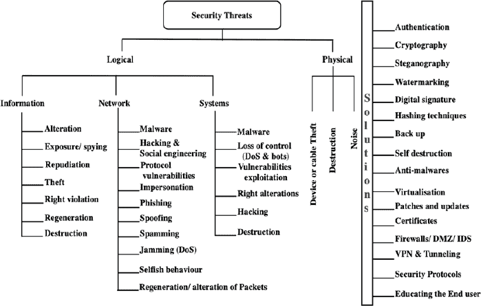

图 4.1. 网络安全威胁与解决方案 (Benarous et al. 2017)

车辆网络安全攻击有（Warren and Brandeis 1890; Benarous et al. 2017）：

- `会话劫持 (Session hijacking)`：攻击者在会话启动（认证、序列号生成）后，通过替换合法节点并继续会话来伪造不受保护的会话 (Fadlullah et al. 2010)。
- `拒绝服务 (Denial of service (DoS))`：针对可用性最危险的攻击之一。它针对网络或系统以使其无法服务。攻击者可以使用一台 (`DoS`) 或多台机器 (`DDoS`) 向受害者节点或系统产生目标流量，使其拥堵并瘫痪 (Gu and Liu 2007)。
- `空洞攻击 (Sink-hole attack)`：在此类攻击中，恶意节点吸引网络流量通过自己。然而，它并不转发所有消息，而是选择转发哪些数据包、丢弃哪些。这也被被称为选择性转发 (Raazi et al. 2011)。
- `黑洞攻击 (Black-hole attack)`：与空洞攻击不同，执行此类攻击的恶意节点不转发数据包，而是丢弃所有包 (Laurendeau and Barbeau 2006)。
- `恶意软件 (Malware)`：旨在对系统和网络造成危害的代码部分。包括病毒、广告软件、间谍软件和蠕虫等。
- `重放攻击 (Replay attack)`：攻击者记录交换的消息以备后用 (Fadlullah et al. 2010)。
- `GPS 欺骗 (GPS spoofing)`：攻击者冒充 `GPS`（全球定位系统），试图通过向车辆生成带有假位置的强信号来替换它，车辆会假设其来自合法的 `GPS` 并接受 (Mejri et al. 2014)。
- `伪装或冒充 (Masquerading or impersonation)`：攻击者假装成（扮演）合法节点以执行其他攻击，例如数据篡改或注入 (Laurendeau and Barbeau 2006)。
- `女巫攻击 (Sybil attack)`：在此类攻击中，节点同时获取并使用多个身份以获得额外优势或避免被追踪 (Sen 2010; Mejri et al. 2014)。
- `隧道或虫洞攻击 (Tunneling or worm-hole)`：在此类攻击中，恶意节点拦截来自某个位置的数据包，并选择性通过隧道传输到另一个位置。然后，从该位置将其重新传输到网络 (Hu et al. 2006)。
- `窃听 (Eavesdropping)`：是一种被动攻击，攻击者在其覆盖范围内拦截、记录并分析交换的数据包 (Sen et al. 2010)。
- `中间人攻击 (Man-in-the-middle)`：可以被视为主动窃听。攻击者首先监听流量以了解交换消息的性质。然后通过冒充端点（用户）并继续通信来中断链。合法节点通常会被隔离，以防止其恢复或重新启动通信 (Valency Networks 2008)。
- `隔离攻击 (Isolation attack)`：在此类攻击中，攻击者阻止一个节点或一组节点与网络中的其他节点交互 (Sen et al. 2010)。
- `社会工程学或人类黑客 (Social engineering, or human hacking)`：攻击者利用心理技巧和社交技能对目标进行背景研究。在车辆网络背景下，这可能发生在窃听和追踪攻击之前。例如，追踪车辆“A”的攻击者可能会关联经常出入的地方以识别目标并收集关于他们的更多信息。他们可能利用这些信息威胁并勒索受害者 (Mitnick and Simon 2011)。
- `关联与追踪攻击 (Linking and tracking attacks)`：针对隐私的攻击。它们主要关注关联使用的伪名和车辆位置以继续追踪它。
- `欺骗攻击 (Cheating attacks)`：针对隐私的攻击，旨在通过受损的车辆（内部攻击者）减少车辆匿名集的大小。这种攻击旨在即使在执行策略策略也促进伪名的关联。因此，它实现了车辆追踪。攻击者欺骗车辆，更改其伪名，而实际上车辆并没有更改 (Guo et al. 2018)。

#### 4.4.5. 我们的攻击者模型

针对认证阶段身份隐私的攻击者模型使用无线通信进行 `eatdrop` 并主动执行以下攻击：`重放攻击`、`中间人攻击`、`冒充`，这些在上面已解释。

至于针对道路位置隐私的攻击者模型是全局被动攻击者 (`GPA`)。他们将接收器遍布整个观测区域以完全覆盖，如图 4.2 所示。他们是被动的，因为他们不注入、更改或丢弃消息。这赋予了他们秘密性和隐含特征，增加了受害者车辆检测的难度。换句话说，车辆在检测到攻击者存在之前可能会被追踪很长时间。它可能在未发现自己被追踪的情况下继续被追踪，除非攻击者将收集到的数据用于其他攻击或其他目的（例如勒索）。攻击者是外部的，这意味着他们无法攻破并使用其他车辆来执行窃听，因为：


使用车辆的成本极高。攻击者需要拥有（购买并使用）大量车辆。他们需要覆盖道路，并在被观测道路上处于静态状态或始终运行。

如果攻击者无法购买车辆，那么关于内部攻击者的另一种假设是：他们要么使用自己的车辆跟踪受害者车辆（这超出了我们的研究范围），要么他们可能会黑进车辆系统并对其进行控制。这种假设不仅极其困难，而且即使黑进车辆系统是可能的，对于攻击者来说，直接黑进受害者的车辆系统是更明智的选择，而不是选择那种困难、高昂且不确定的方式去黑进所有或至少几个目标邻车。此外，车辆系统虽然由不同的制造商制造，但预计它们至少具有相同水平的安全性，且根据最新技术，这种安全性在车辆的整个寿命内必须是高强度且不可破解的。

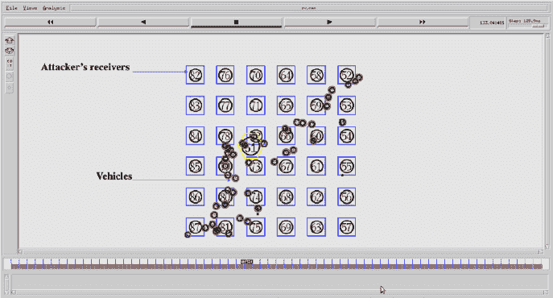

图 4.2. 攻击者接收器以覆盖观测区域的部署。

尽管在研究需要主动攻击的安全解决方案的稳健性时，内部攻击者更受青睐，但在被动跟踪的情况下，他们很少被使用，因为其成本高、难度大且易于发现。如果攻击者准备在跟踪上投入如此成本，那么直接在目标车辆上安装一个小型 GPS 跟踪器会更明智、更聪明且更经济。这种方法超出了我们的研究范围，我们的目标是减少并防止车辆通过网络活动的可追溯性。因此，在书的其余部分，我们将继续讨论执行以下一种或多类攻击的外部 GPA。

## 语义链接攻击 (Boualouache 2016)

在这种攻击中，外部 GPA 使用截获的信标构建一个关于道路、已解析车辆、其布局及其行驶速度的知识库。GPA 利用获取的知识预测车辆的未来位置。当车辆更新其标识符（也称为伪名）时，GPA 将预测位置与实际发射的位置进行匹配，从而将旧伪名与新伪名链接起来。这种链接允许它在车辆使用新更新的伪名时也能继续跟踪该车辆。图 4.3 描述了这种攻击，其中 A、B、C 和 D 是邻近车辆，分别以 `V[A]`、`V[B]`、`V[C]` 和 `V[D]` 作为它们的伪名。`P[A]`、`P[B]`、`P[C]` 和 `P[D]` 分别是它们当前的位置。每辆车辆都会发送包含其位置和伪名的信标。为了方便阅读，我们将 `P` 视为包含位置坐标、速度和方向的向量。在车辆更新伪名后，它们继续发送带有这些新伪名的信标。我们在下面列出伪名更改前后发射的信标：

- 更改之前：信标 `(V[A], P[A])`、信标 `(V[B], P[B])`、信标 `(V[C], P[C])`、信标 `(V[D], P[D])`。
- 更改之后：信标 `(V[A’], P[A’])`、信标 `(V[B’], P[B’])`、信标 `(V[C’], P[C’])`、信标 `(V[D’], P[D’])`。

GPA 通过匹配实际位置 `P[A’]`、`P[B’]`、`P[C’]` 和 `P[D’]` 将旧伪名与新伪名链接起来。（注：原文在此处存在大量重复句子，译文已按逻辑精简）。

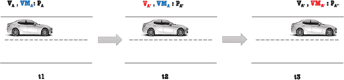

图 4.6. 链接映射攻击。

## 4.5. 结论

在本章，我们解释了车载网络中的安全目标和属性，列出了主要的安全问题，并定义了攻击者及其目标和手段。我们规定了攻击者模型并证明了该选择的合理性。我们还强调了为什么其他模型不适用于我们的研究问题，该我们的问题是通过通过网络活动减少并消除车辆追踪。如果攻击者能够首先截获车辆交换的消息（如信标，这些信标包含了其公钥（身份）以及实时位置、航向和速度），那么追踪就是可能的。如果车辆始终使用同一个公钥，它就可以被追踪，如果随后跟了社会工程学攻击，其身份最终将暴露。例如，如果车辆每天下午 6 点总是停在 A 点（一栋房屋），那么房屋的主人极有可能是车辆的所有者。研究人员建议使用被称为伪标识的临时公钥来减少追踪。然而，如果这些伪标识在过期后的更新发生在不利的上下文中，攻击者可能仍然将旧的过期伪标识与新更新的标识链接起来。因此，他们可以继续追踪车辆。因此，更改必须以消除链接攻击来减少追踪的方式进行。这催生了标识更换策略。为了研究这些方案的稳健性，我们使用了在本章定义的攻击者模型，该模型执行一个或多个之前提到的链接攻击。

在下一章中，我们将解释在主动使用车载网络服务并向权威机构、第三方服务提供或其他车辆进行车辆验证时，保护位置和身份隐私的贡献。我们还说明了我们提出的解决方案如何防止链接攻击（针对位置隐私），并对安全攻击和隐私侵入攻击具有韧性（针对身份隐私）。

# 5. 面向资源共享的云数据命名网络 (CVDNN) 中的隐私保护认证

## 5.1. 引言

车载网络被用来将云扩展到道路上。用户探索其车辆的空闲容量以形成动态本地云，并相互提供计算、存储、感知、视频流传输等服务。文献中提出了许多架构和分类，例如中心云和本地云、有基础设施云和无基础设施云、混合云、车辆即云、使用云的车辆以及带有云的车辆。云的概念依赖于虚拟化。由于车辆的移动性，虚拟机通过节点之间的实时迁移过程（Yu 等人 2013）随其移动。在本章中，我们设计了一种无基础设施车载云（`VC`）的动态形成。它完全由道路车辆创建和维护，车辆相互加入、使用和/或相互提供服务，而不必担心隐私面临风险或泄露。它还确保了发生滥用时的可追溯性和法律责任。我们将这些网络称为云数据车辆数据命名网络或 `CVDNN`。

作为车载网络的演进，`CVDNN` 继承了特性和问题。其中之一就是隐私。在过去的 15 年里，它是许多研究人员的研究课题。文献中公认使用伪标识来保护身份隐私，并使用有效策略进行更换以防止追踪和对位置隐私的违反。伪标识用于认证安全消息，并确保误行为节点的不可否认性和可撤销性，以保证网络的正确功能。它们也被用于加密消息。我们已经在第 2 章中解释了车载网络中的各种伪标识更换策略和认证技术。

在 `CVDNN` 中，隐私通过管理云的车辆与加入成员之间使用匿名证书进行相互认证来确保，在提供和/或使用通过名称和地理位置标识的服务时也是如此。我们解释了如何安全且同步地更改云成员的临时身份以保护隐私，同时结合位置混淆来保护位置隐私。发出的位置不是车辆的精确坐标，而是车辆所在的区域。

通过所提出的解决方案，避免了链接（通过位置、身份、凭据、IP 和 MAC 地址的链接）。本章的重点是认证阶段，如果不匿名，会危害车辆所有者的隐私。这种更换策略将在第 8 章中进一步解释。

本章解释了背景概念，如 `VC` 和车载命名网络。它还描述了云数据车辆命名系统。

## 5.2. 背景

在本节中，我们解释了云数据车辆命名网络背后的背景概念，从解释 `VC` 开始。然后进入系统模型的描述。

### 5.2.1. 车载云

我们已经在第 1 章中解释了 `VC` 概念，以及它是如何将云扩展到道路边缘的。在本章中，我们将深入探讨其不同类型和模型。然后，我们提出了一种结合 `VC` 与命名网络的新范式，即我们命名的车载数据网络。车载云（`VC`）是两种范式的结合，即车载自组织网络（`VANET`）和云计算。文献中提出了许多 `VC` 架构；我们将其分类如下：

- **基于 RSU 的云**：也称为基于基础设施的云。它们由连接到数据服务器的 `RSU` 组成；车辆访问并使用它们（见图 5.1）。
- **带有基础设施的车载云**：这种类型的云依赖于基础设施的使用，连接路侧单元、云服务器和云管理器。车辆可以使用或提供收集的数据，并将其资源投入云中。它还可以通过互联网连接到中心云。（见图 5.1）。
- **使用云的车辆**：这些是通过互联网移动蜂窝服务提供商访问的传统云，例如：`3G`、`4G`、`5G` 等。（见图 5.1）。
- **车辆即云**：在此，车辆通过共享和使用彼此的资源形成云，不需要基础设施。车辆可以是静态的（停放或在服务站时），也可以在道路上移动。因此，车辆可以连续地形成静态云，由于车辆是静态的且通信更稳定，这种云更稳定。它们也可以与移动车辆形成动态的道路云。车辆即云是本地云，因为共享资源和数据具有局部相关性，除非与上述云之一结合（见图 5.1）。
- **混合式车辆云**：这种类型结合了上述类型。车辆通过蜂窝网络（如 `3G`、`4G`、`5G`）或连接到互联网服务器的基础设施（`RSU`）通过互联网使用中央云。此外，当车辆在道路上静止或移动时，它可以创建或加入基于基础设施的和无基础设施的云（参见图 5.1(E)）。

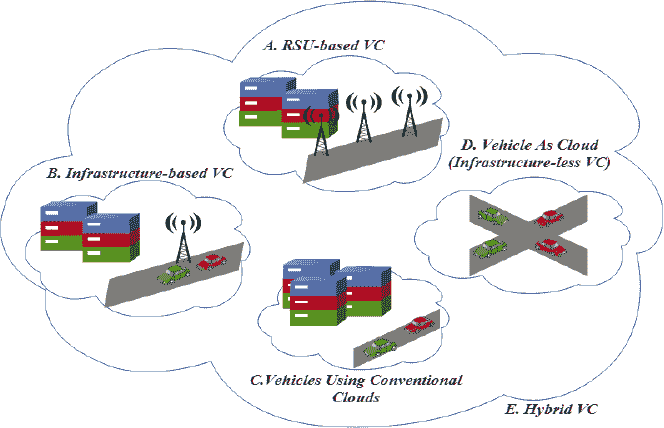

图 5.1. 车辆云类型。

### 5.2.2. 车辆数据命名网络

在此类网络中，数据包路由是与数据相关的而非基于地址的，也就是说，重点更多在于内容而非提供者。因此，节点分为两类：内容提供者和对该内容感兴趣的内容请求者。

## 5.3. 系统描述

在提议的 `CVDNN` 中，车辆在道路上统一资源，以处理复杂的计算、感知更广泛区域、存储数据或获取稳定服务。这被称为“车辆即云”。请注意，同一地理空间内的车辆可能对该区域的道路数据和服务感兴趣。因此，它们具有相似的兴趣，因为数据具有局部相关性，例如在半径 `r` 和时间跨度 `t` 内；用户更有可能对其所在地理区域相关的道路信息、提供的服务、路况等感兴趣。此外，由于服务是通过其名称或标识符已知的，因此更容易搜索，提供也更快。由于提供服务的车辆是多样的，在请求者附近找到提供服务的车辆的概率更高。因此，在 `CVDNN` 中，使用服务名称和地理位置在本地 `VC` 内路由数据包，而不是传统的 `IP` 地址，因为数据和服务很可能具有局部相关性和有效时间，并在过期后被丢弃。如果按需服务具有全局相关性，用户则不会丢弃数据。相反，他们将通过蜂窝网络（`3G`、`4G` 或 `5G`）通过互联网上传到中央云，或者在通过连接到互联网的基础设施（`RSU`）时，使用另一辆车辆的互联网作为服务。由于本地云车辆虚拟机及其状态向中央云的迁移是通过互联网完成的，因此使用的是基于 `IP` 的路由和命名而非基于内容的命名。我们强调，这种迁移是通过安全通信完成的以保护数据的机密性并保护隐私。对受信任机构或其子公司管理的中央云的身份验证是匿名进行的，如第 5.5 节所示。

## 5.4. 构建支持云的车辆数据命名网络

在本节中，我们解释了无基础设施的 `VC` 如何形成以及数据是如何路由的（参见图 5.3 和图 5.4）。隐私保护验证方法的描述将在下一节讨论。

希望参与 `VC` 的车辆（通过提供其服务或资源）等待接收现有云的 `VC` 广告。接收到 `VC` 广告后，车辆会检查真实性。如果车辆愿意加入，它会向 `VMC` 发送请求。`VMC` 验证请求者并管理 `VC`。请注意，`VMC` 在该地充当代理。如果 `VC` 存在，`VMC` 将根据需求提供服务。车辆相互检查对方的真实性。然后，它们将回复发送给 `VMC`。身份验证成功后，车辆形成云。

当车辆离开范围时，`VMC` 退出云；当云中没有活动成员时，云就会被删除。

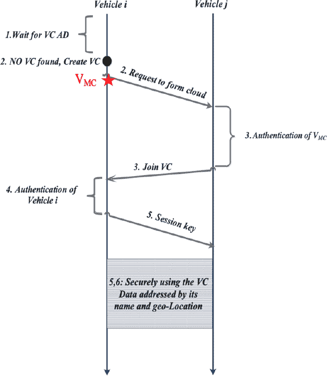

图 5.2. 创建/或加入云。

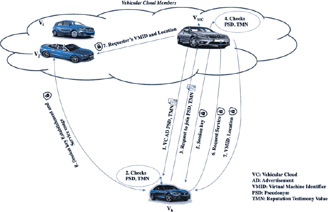

图 5.3. 支持云的数据命名网络加入和服务过程的插图。

## 5.5. 将本地云虚拟机迁移到中央云

为了将本地云虚拟机迁移到中央云，车辆用户应首先自己对中央云进行身份验证。用户可以使用其凭据登录云账户；然后车辆用本地数据更新中央云。一旦更新完成，`VM` 将被释放。请注意，根据用户的选择和需求，本地 `VM` 可以用于更新中央 `VM`、与其合并或直接导入（作为新的 `VM` 或覆盖现有的 `VM`）。

## 5.6. 使用/提供 CVDNN 服务时的隐私与身份验证

我们之前解释了车辆如何创建或加入 `VC`，其中请求者和提供者都需要隐式和间接地检查对方的真实性。身份验证是在管理云的车辆（`VMC`）与加入成员之间共同完成的。一旦 `VMC` 验证并信任加入的车辆，这种信任通过车辆之间的传递性隐式建立。事实上，身份验证是创建、维护和使用安全云的基础初始步骤之一。然而，由于它通常需要使用凭据，它威胁到了普通 `VC` 用户特别是 `CVDNN` 的隐私。这是由于两个原因：第一是凭据可能与伪名和位置关联。因此，它们的重复使用可能导致车辆被追踪。第二是身份验证之前有注册阶段，在该阶段，车辆向 `VMC` 提供其用户身份或长期认证公钥。为了在实现身份验证的同时避免隐私风险，我们建议使用由受信任机构（`TA`）签名的匿名证书。此外，还可以由 `TA` 生成并由车辆在使用道路 `VC` 时对彼此行为的证明持续更新的声誉证明。

如上所述，管理云的车辆与提供/请求服务的车辆之间应当进行双向身份验证。`V[MC]` 不会接受来自已吊销（黑名单）、声誉不佳或被标记为恶意车辆的请求。同样，车辆也不会加入由声誉不佳的恶意名单节点创建或维护的云。

注意：管理云的车辆可以是服务提供者或用户，或两者兼有。

### 5.6.1. 身份验证过程

在解释验证过程之前，我们首先明确所使用的符号及其含义。`V[MC]` 是管理云的车辆。`V[j]` 是提供或使用云服务的车辆。`M` 代表交换的消息，而 `→` 是发送操作符；左侧为源地址，右侧为目的地。身份验证阶段始于检查 `V[MC]` 公告 VC（车辆云）存在及其提供的/所需的服务和资源的真实性。`V[MC]` 首先发送如下文所示的 `M1`，其中包含服务列表、加入邀请、车辆经过认证的伪名及其声誉。最后两个字段对于匿名验证 `V[MC]` 并确保可追溯性至关重要。消息还包含车辆的位置，该位置将与服务名称一起在 CVDNN 内的数据路由中使用：

- `V[MC]` → `V[j]`；
`M1`: {广播提供的服务列表、加入邀请、伪名、位置、匿名证书（伪名的证书）和声誉证明}

当 `V[j]` 接收到 `M1` 时，它检查伪名证书的有效性。然后，它验证该伪名未被吊销，即未在最新更新的 `CRL`（证书吊销列表）中。最后，它检查声誉证明值是否高于要求的阈值。如果上述所有测试均通过，则意味着 `V[MC]` 未被吊销，其正在使用的伪名仍然有效且其声誉良好。随后，车辆 `V[j]` 的用户如果感兴趣使用/提供这些云服务，将通过向 `V[MC]` 发送消息 `M2` 请求加入；`M2` 的内容如下所示。它主要包含车辆的声誉值以及用于验证该车辆的认证伪名：

- `V[j]` → `V[MC]`；
`M2`: {加入请求、伪名、位置、匿名证书（伪名的证书）和声誉证明（由 TA 签名并用与正在使用的伪名对应的车辆私钥加密）}

当 `V[MC]` 接收到 `M2` 时，它检查伪名证书是否有效，然后检查伪名不在 `CRL` 中（未被吊销）。最后，它确认声誉值超过了最小可接受阈值。如果满足所有这些条件，则车辆加入 VC 的请求被接受。`V[MC]` 生成包含一个会话密钥的消息 `M3` 并将其发送给 `V[j]`。会话密钥由 `V[MC]` 和 `V[j]` 的位置、伪名以及一个随机值生成，以确保其唯一性。此外，`M3` 使用 `V[MC]` 的私钥和 `V[j]` 的公钥加密。

```
* `V[MC]` → `V[j]`
```

`M3`: {会话密钥}

接收到 `M3` 后，`V[j]` 使用 `V[MC]` 的公钥验证会话密钥。如果验证成功，则建立会话，`V[j]` 即可开始使用或提供由 `V[MC]` 管理的服务。

### 5.6.2. 声誉证明

在上一节中，我们提到车辆的声誉是创建和加入云的车辆进行双向身份验证的重要衡量指标。然而，我们没有提到它是如何计算的或其含义。在本节中，我们将对其进行详细说明并解释其计算方法。

车载移动网络（VANET）中基于声誉和信任的解决方案已用于补充要求安全性和针对内部攻击者韧性的加密解决方案，特别是当攻击者是注入恶意或虚假数据的不实车辆时。

在提出的 CVDNN 中，声誉是最初由信赖权威分配给车辆的值；它通过其私钥进行签名，以向其他车辆保证其完整性和真实性。该值根据车辆在使用 VC 服务期间的行为通过增加或减少来不断更新。这种行为由其他充当见证人的相邻车辆报告，它们对其他车辆的行为进行证明并对提供的服务质量进行评分。每辆车辆在通过 RSU（路侧单元）或连接互联网时，都会上传与其交互过的车辆的证明，以便为其提供或使用它们的服务。

接收到证明后，`TA` 计算出一个全新的声誉值并将其传回给相应的车辆。车辆使用新收到的、具有有效期的声誉值。

默认情况下，我们将状态车辆（警察、救护车、宪兵和军事车辆）的信誉值初始化为一。对于其他车辆，我们选择 0 和 1 之间的平均值（`0.5`）。注意，0 表示该车辆不可信且具有恶意，而 `1` 意味着由于其权威性它是完全信任的。为车辆分配平均值意味着我们没有偏见，并且对处于任何一方（好或坏）的车辆不持有任何偏见。该值随着车辆的持续反馈而变化，范围在 `0` 到 `1` 之间。如果发送了良好的证明，该值会增加，否则会减少。如果车辆的信誉达到 `0`，则会被列入名单（撤销）。信誉值的更新使用以下公式：

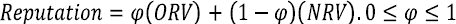

其中 `ORV` 是旧信誉值，`NRV` 是新信誉值，并且可以根据我们对旧值（历史）的重视程度进行配置。

`NRV` 根据收到的证明计算（令 `TMN` 为证明）。`NRV` 是车辆 `i` 的证明的平均值。

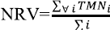

注意 `TNM[i]` 是 `vehicle[i]` 根据服务连续性 (`SC`)、数据可靠性 (`DRL`)、自私性 (`SF`)、在 VC 中的协作性 (`COO`) 以及认证伪假名的使用 (`CPS`) 计算得出的：

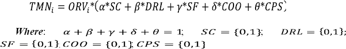 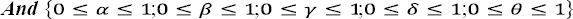

如果未来云服务收费或租赁资源，可能会添加更多参数。届时，关于支付/租赁的指标也将被添加。

## 5.7. CVDNN 中的隐私

我们的主要关注是在创建、使用和提供 CVDNN 服务时，通过提出一种匿名身份认证方案来保护身份隐私，从而确保车辆的隐私。然而，由于我们提出了了自己的 CVDNN，并将继续讨论如何避免由于长期使用同一伪名或不当更改伪名而导致的关联性。


关联性会暴露用户的位置，并允许对其路路轨迹进行追踪。如果与他们在 `CVDNN` 上的活动相联系，将更具威胁性，因为不仅他们的位置面临风险，其共享的数据也是如此。这导致了他们的偏好、喜好、习惯等的泄露。

我们已经解释了 `VC` 由协作车辆组成，且 `V[MC]` 与每个成员共享一个会话密钥。因此，`V[MC]` 能够与成员安全地同步，同时更新它们的伪名和 `VMID`。这让攻击者感到困惑，因为变化是同时发生的。收到 `V[MC]` 消息后，每辆车辆向 `V[MC]` 回复该消息，在加密消息中提供其当前和可预测的未来位置（接下来的 `T`）。`V[MC]` 向云车辆更新其 `VM` 的未来位置以及 `VMID` 标识。当 `V[MC]` 完成同步任务时，每辆车辆都会知道其对应的 `VM` 将位于何处及其新（新 `VMID`）。每辆车辆在 `T` 时间范围内停止广播信标并停止服务消息（消息缓存在每个节点中）。`T` 周期后，每辆车辆开始广播信标。如果车辆的信誉达到 0，则会被列入名单（撤销）。信誉值的更新使用以下公式：

```
if (condVar > someVal) {console.log("xxx")}
```

## 5.8. 讨论与分析

我们已经解释了 `VC` 由协作车辆组成，且 `V[MC]` 与每个成员共享一个会话密钥。因此，`V[MC]` 能够与成员安全地同步，同时更新它们的伪名和 `VMID`。这让攻击者感到困惑，因为变化是同时发生的。收到 `V[MC]` 消息后，每辆车辆向 `V[MC]` 回复该消息，在加密消息中提供其当前和可预测的未来位置（接下来的 `T`）。`V[MC]` 向云车辆更新其 `VM` 的未来位置以及 `VMID` 标识。当 `V[MC]` 完成同步任务时，每辆车辆都会知道其对应的 `VM` 将位于何处及其新（新 `VMID`）。每辆车辆在 `T` 时间范围内停止广播信标并停止服务消息（消息缓存在每个节点中）。`T` 周期后，每辆车辆开始广播信标。

关联性会暴露用户的位置，并允许对其路轨迹进行追踪。如果与他们在 `CVDNN` 上的活动相联系，将更具威胁性，因为不仅他们的位置面临风险，其共享的数据也是如此。这导致了他们的偏好、喜好、习惯等的泄露。

在 `VC` 成员组内对假名和 `VMID` 进行同步同时更新、静默期 `T` 的额外使用，以及使用扩展位置而非精确坐标，共同构建了一个无需基础设施的稳健混合区域（mix-zone）。该区域内的初始通信是加密的，随后进入静默期。这些措施的结合使得更新成功未被察觉，服务在无需重新身份验证或丢包的情况下继续进行。因此，身份隐私和位置隐私都得到了保护。

此外，`CVDNN` 继承了命名数据网络（`NDN`）的数据转发和请求策略。它依赖服务名称和地理位置来请求并获取数据包及服务。这进一步增加了隐私性，因为地理位置上的相同服务名称可能会被多个感兴趣的车辆请求，特别是当它涉及热门内容或事件时。内容的流行程度进一步混淆了攻击者，降低了服务与内容的关联性。区分和跟踪请求者或提供者也变得更加困难，因为任何拥有内容的人都可以提供它，而且除非 `VM` 通过互联网迁移到中央云端，否则我们均不使用 `IP` 和 `MAC` 地址。我们在本地云中防止了通过 `IP` 和 `MAC` 进行跟踪。

## 5.9. 结论

在本章中，我们展示了云增强型车载数据命名网络（`CVDNN`）。它们由愿意统一资源以相互提供各种服务的车辆在道路上动态形成。我们解释了用于保护隐私的基于匿名信誉的隐私保护身份验证方法，同时确保了正确的功能和可追溯性。所形成的 `VC` 是分布式且无需基础设施的，允许车辆使用超出其自身单一能力的云服务，例如：感知、计算、存储或访问互联网等，即使在基础设施覆盖可能不足且访问传统云变得困难甚至不可能的农村地区也是如此。

解决方案通过使用扩展位置而非精确坐标，保护了身份验证阶段的身份以及车辆的位置。此外，通过在应用静默后将标识符与车辆云成员进行同步同时更新，避免了在使用云服务时用标识符的关联性。攻击者无法跟踪在更新标识符时创建无设施混合区域的车辆。他们无法读取云车辆之间交换的服务消息，因为这些消息受到了会话密钥的保护。

# 6. VANET 中路侧按需假名填充的保护身份验证方案

## 6.1. 引言

在第 2 章中，我们强调了身份验证的重要性，它是区分系统或网络授权用户的根本。大多数此类身份验证系统依赖凭据、身份、认证密钥、令牌或生物识别指纹来识别用户。身份验证确保了防止外部攻击者的安全性和内部用户的可追溯性。然而，它面临着用户隐私的风险，要么是系统所有者为了利润蓄意交换个人数据，要么是系统被外部黑客攻击时的无意泄露。

隐私一直是用户和立法体系的首要考虑问题。仅网络世界每年与违反隐私相关的丑闻，就足以让公众舆论转向违规者，并迫使立法体系制定更严格的隐私法。车载网络中隐私违反的影响更为危险，因为它直接关系到驾驶员的安全。尽管如此，这些网络中的风险更高，因为车辆通过无线专用短距离通信（`DSRC`）进行车间通信（`V2V`）以及通过车基础设施（`V2I`）与基础设施通信（Bitam et al. 2015; Benaissa et al. 2017），以交换感知数据并确保安全应用（Dressler et al. 2018），为此，用户需要连续且及时地广播他们的身份、位置、速度和方向。

车载网络中的身份通常被称为假名，它们是有时限且地理限制的公私钥对。它们的使用和频繁的更新策略有两个目的：第一是保护身份隐私（匿名性），第二是保护位置隐私（不可追溯性）以防止跟踪。匿名性和不可追溯性是车载网络中最理想的两个特性。

关于假名的使用（这是保护车载网络隐私的关键要素），文献中的大多数研究工作集中在它的更换和撤销策略上。他们最初假设车辆预装了这些假名（Emara 2016）。然而，尽管如此，由于存储限制，预装的假名池早晚会耗尽并过期。这导致了在这种情况下如何填充假名的核心问题。存在两种假设：要么是车辆周期性地物理出现在管理机构的设施处以刷入新池，要么是为了节省时间、精力和重复往返的成本，在道路上按需填充假名池（Ma et al. 2008）。Eckhoff 等人（2011）提出具有相似状态的车辆应该相互交换假名。这种方法确实避免了重复填充假名及其相关的存储问题。然而，它违反了不可否认性要求，允许假名被多次使用，可能导致女巫攻击。此外，由于车辆在交换密钥时可能会读取对方的加密消息，这构成了对消息机密性的风险。

在本章中，我们介绍了一种保护隐私的路侧按需假名填充方法。为了从机构获取假名，车辆首先需要对其进行成功的身份验证。这是为了帮助机构将假名和/或证书记录到请求者处，确保可追溯性和不可否认性。与需要使用真实身份、公钥或凭据的传统身份验证不同，我们的身份验证是匿名的。在开发过程中，我们研究了现有的身份验证及其对隐私的影响。我们注意到，使用凭据/身份的请求即使经过加密，也可能被感兴趣的窃听者关联。此外，机构通常被假设是信任且能够抵抗入侵的。然而，尽管我们使用了相同的假设，我们仍希望开发一种即使在半信任机构或服务提供商的情况下也能使用的隐私保护解决方案。事实上，如果用户向区域机构提供身份，他们就跨越到了请求假名（/证书）阶段。机构员工利用这些数据跟踪用户或出于贪婪、利益或个人报复而开具罚单的情况无法完全排除。因此，为了防止机构滥用权力风险，匿名身份验证方法是一种乐观且合适的选择，强调解决方案在匿名性和不可否认性之间取得平衡，同时保持安全并抵御安全攻击。

事实上，由于公众对隐私问题及其影响的意识增强，匿名认证方法正成为一种趋势。针对不同类型的系统已经开发了各种方法。医疗保健可能是研究人员关注的列表首位，因为这是一个患者隐私必须保持保密的敏感领域。Mehmood 等人（2018）提出了一种基于环形签名概念的患者对云端医疗应用程序进行身份验证的方案。首先，患者进行注册并获得一个用于认证第一阶段的组密钥，随后是执行零知识协议。另一个例子是 Gope 等人（2018），他们利用物理不可克隆函数（`PUF`）为射频标识识别（`RFID`）系统开发了一种轻量级匿名认证协议。此外，Wang 等人（2018）和 Yue 等人（2018）分别在车载自律交通网络（`VANET`）中提出了匿名认证方案。Wang 等人（2018）使用别名代替真实的车辆身份，并且不是在认证机构（`CA`）中保存这些别名的副本，而是将它们加密并存储在证书签名的隐蔽道中。Yue 等人（2018）使用零知识协议在车辆加入组之前向跟踪管理器进行车辆身份验证。组签名概念被用于车辆之间的消息认证。Gao 和 Deng（2018）使用环形签名对交换的消息进行匿名认证，而 Liu 等人（2018b）在车载网络中提出了一种无证书短签名匿名互认认证方案。这些只是说明研究人员对不同领域和系统类型的匿名认证方案感兴趣的少数例子。

在这里，我们的目标是通过使用匿名票据以及基于匿名挑战的认证，在车载网络中实现身份验证的同时保护隐私。在本章的其余部分，我们将使用术语 `anonymous certificate` 或 `tickets` 来指代相同的概念。

本章描述了网络模型及其功能、组件和目的。它解释了所提出的匿名认证方案。它还从方案对安全属性的满足程度以及对著名攻击的抵抗能力方面进行了评估。此外，使用 `BAN logic` 检查了其逻辑正确性，并使用 `SPAN` 和 `AVISPA` 工具完成了自动化验证。

## 6.2. 网络模型与系统功能

本节介绍了网络模型并描述了系统功能。

### 6.2.1. 网络模型

在 `Chapter 1` 中我们解释了车载网络组件。添加本节是为了提醒读者并进一步阐述网络模型，该模型在 `Figure 6.1` 中所示，其中：

*   `TA` 指 `Trusted Authority`（信任机构），它在每辆 `VANET` 车辆购买时进行注册。它发布两种证书：包含用户身份及其长期公钥的永久证书，以及仅包含引用号和数字签名的 `anonymous ticket`（匿名票据）。它是保存车辆和所有者私有敏感数据的唯一权威，这些数据仅在车辆发生异常且必须与司法系统合作时才会被使用。

*   `RA` 指 `Regional Authorities`（区域机构），它们是分布在不同地区的 `TA` 附属机构。它们负责颁发临时认证的伪名和/或其证书（针对自生成的伪名）。`RA` 跟踪其区域内已使用的伪名，但不会识别其所有者。因此，当发生异常行为时，需要 `TA` 和 `RAs` 协作来撤销恶意异常的车辆。

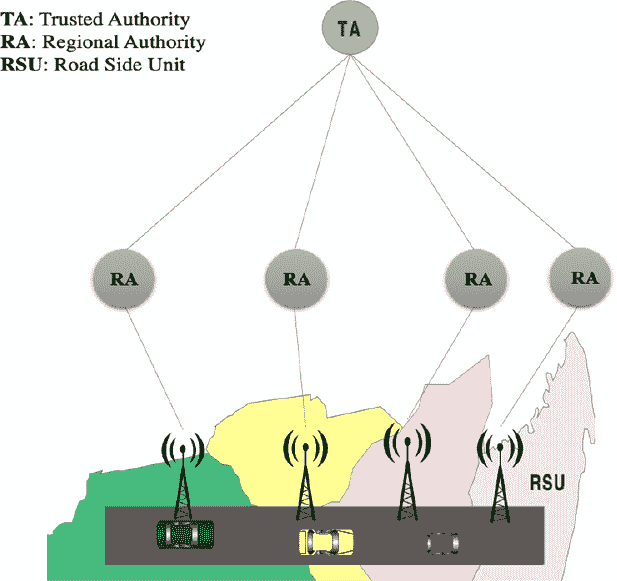

`Figure 6.1.` Network model (Benarous and Kadri 2018).

我们假设这些机构（`TA` 和 `RA`）是可以信任的，并且能够抵抗攻击。我们也假设它们之间的通信是加密的，无法被破解。

*   `RSUs` 指 `Road Side Units`（路侧单元），它们是具有广泛发送接收范围的静态基础设施。我们将其用于数据重传。

*   `OBUs` 指 `On-Board Units`（车载单元）或车辆，是带有保存密钥和设备的移动节点。

### 6.2.2. 系统功能

在定义了网络模型后，我们继续描述系统功能。当车辆向 `TA` 注册时，它获得一组独特的参数、设置和安全算法，这些存储在它的防篡设备（`TPD`）中。它还接收匿名票据以及长期公私钥。我们提醒读者，在我们的模型中，只有 `TA` 保存车辆和所有者的信息。此外，注册阶段发生在 `TA` 设施处，并需要所有权证明。关于网络的其他假设是：

*   `TA` 是信任的，并且能够防止入侵和攻击；

*   用户数据是加密并存储在抗性设备中的；

*   `tickets` 是匿名的，这意味着它只包含引用号和 `TA` 数字签名。

注册完成后，`TA` 将颁发的车辆票据引用号和唯一密钥参数安全地转发给所有者所在的 `RA`。当车辆进入该区域时，它通过提供一张票据向 `RA` 进行身份验证，以请求一组用于自生成的伪名和/或证书。注意，票据的使用随后是挑战阶段，以证明车辆是票据的真实所有者。认证阶段的细节将在下一节解释。我们强调 `RA` 与车辆之间的通信是通过加密保护的。

请求匿名名/证书填充的区域内的车辆必须先将其票据发送给 `RA`。随后，`RA` 对车辆进行质询，以检查其是否为所收票据的真实所有者。车辆通过匿名身份验证自身来响应挑战，而不暴露其身份。一旦此阶段成功完成，`RA` 将为车辆提供匿名名和/或证书。如果车辆已经自生成了私钥并为了请求这些证书而完成了身份验证，则在此阶段公钥的证书将交付给车辆。如果车辆请求了经过认证的匿名名，则在此阶段权威会将这些匿名名及其相应的私钥安全地提供给请求的车辆。

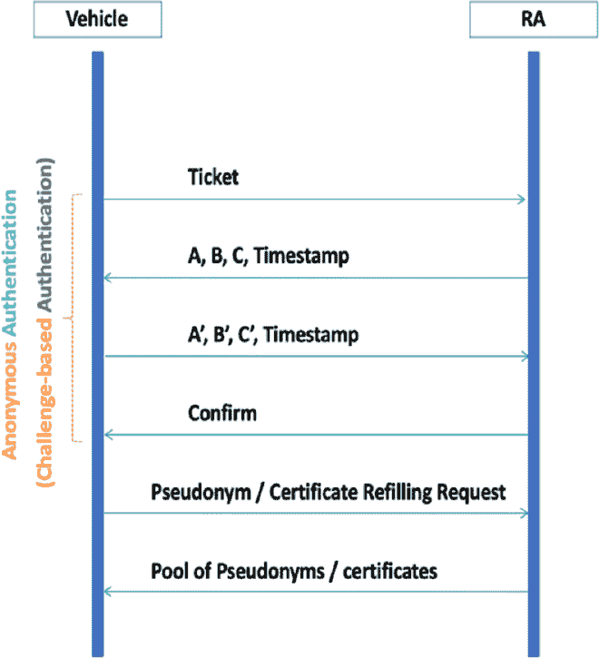

图 6.3. 匿名认证方案的消息序列图。

在图 6.3 中，我们展示了 `RA` 如何挑战车辆以证明其对用于匿名名填充请求的票据拥有所有权。我们提醒读者，每辆注册车辆在由 `TA` 刷写的防篡设备中都存储了唯一的算法和参数，而且 `RA` 拥有用于匿名认证质询阶段的参数的副本。公式 `[6.1]`（`EQ1`）代表车辆使用的挑战算法。此阶段也被称为基于零知识的认证，因为它保护了车辆和所有者的真实身份。

\[6.1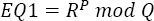

`P` 和 `Q` 是每个车辆特有的秘密参数，`R` 是一个大素数随机数。

为了挑战车辆，`RA` 首先检查票据未被撤销且仍然有效，然后它向车辆发送一条包含三个新生成的大随机素数（随机数）的加密消息。在收到此消息后，车辆需要在下划线的时间跨度内计算并发送其结果，否则身份验证将失败。结果通过对 `RA` 生成的接收数字应用 `EQ1` 中的算法计算得出。`EQ1` 为每个车辆拥有唯一的秘密参数，且所有通信都经过加密，以防止攻击者猜测或计算结果。当 `RA` 在身份验证时间跨度内收到结果时，它会检查结果的正确性，以便将车辆认证为该匿名证书的真实所有者。随后，`RA` 检查车辆在满足请求之前是否已经消耗了通过早先票据请求的所有匿名名，且没有因违规而被撤销。这是为了确保车辆滥用通过使用票据维持的匿名权，自私地在同一时段获取多个有效的匿名名。这样做是为了防止匿名名重叠和女巫攻击的发生。一旦完成，车辆可以请求 `RA` 对其匿名名进行认证，或从 `RA` 请求认证的匿名名（匿名名 + 证书）。

注意，攻击者在既不知道随机数也不知道 `P` 和 `Q` 的秘密值的情况下，在给定的短时间范围内对三个结果做出正确响应的可能性微乎其微。此外，利用今天的技术在极短的身份验证期限内从结果中提取参数是困难的（如果可能的），因为这需要解决离散对数问题。

匿名名获取方案如图 1 所示。我们首先解释所使用的符号，以便于理解算法。

*   `V → RA: m` 表示 `V` 向 `RA` 发送消息 `m`。

*   `V:` 前跟车辆执行的代码。

*   `Encrypt (m, P)` 使用公钥 `P` 加密 `m`。结果为加密消息。

*   `Decrypt (m, p)` 使用私钥 `p` 解密 `m`。

*   `Generate()` 生成大素数的函数。

*   `EQ1(X)` 在随机素数 `X` 上对公式 `EQ1` 实现。

*   `Current_Time()` 返回系统的当前时间。

*   `AUTH_SPAN` 是身份验证响应的最大阈值。

*   符号：

    -   `:=` 表示赋值；

    -   `=` 表示相等；

    -   `[ ]` 用于界定消息字段。

*   `P[RA]`, `P[V]` 分别是 `RA` 和车辆的公钥。

*   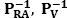 分别是 `RA` 和车辆的私钥。

*   `PSD[i]` 是经过认证的匿名名。

*   `PSD_Validity` 是匿名名的有效时间。

*   `Generate_PSD_Cert (PSD_Validity)` 通过分配比上一个生成的更高的有效时间，生成一个不重叠的匿名名和/或证书。

*   `Online (ticket)` 检查使用当前票据的车辆当前是否使用另一个票据连接，即双重同时会话。

*   `Get-PSD-Validity()` 获取最后一个认证匿名名的有效时间。

*   `A`, `B` 和 `C` 是随机大素数。

*   `A'`, `B'` 和 `C'` 是车辆使用 `EQ1` 对 `A`, `B` 和 `C` 计算出的。它们是整数类型。

*   `A"`, `B"` 和 `C"` 是 `RA` 使用 `EQ1` 对 `A`, `B` 和 `C` 计算出的。它们是整数类型。

该算法是基于角色的。因此，车辆和 `RA` 代码是分别编写的。在算法中，有三类型的事件，分别是：

*   本地处理；

*   消息发射；

*   以“接收”为开头的消息接收。


## 6.4 分析与讨论

在本节中，分析了所提方案的性能，首先说明它符合身份认证协议预期的安全隐私目标。讨论了其对主要安全攻击的韧性，然后使用 `BAN` 逻辑证明其逻辑上是正确的。最后，使用 `SPAN` 和 `AVISPA` 完成了验证。

### 6.4.1 安全分析

在本节中，从所提方案对安全和隐私属性的满足情况以及对已知攻击的韧性方面进行了分析。

#### 隐私（匿名性和不可关联性）

对于隐私，我们研究了解决方案针对全局被动攻击者（`GPA`）的健壮性，其目的是识别车辆所有者并跟踪其位置和解析的轨迹。我们已经在第 4 章中解释了这种攻击者的特征。接下来，我们论证并澄清了我们的协议如何防止 `GPA`，以及为了防止识别和关联所采取的措施。

首先，我们的方案不会泄露用户的个人信息，特别是在路上行驶时的真实身份；无论是向 `RA` 进行身份验证还是向车辆进行身份验证，因为匿名证书是不含身份的。用户仅在初始注册时向信任权威提供信息。此操作发生在他们首次购买车辆时。换句话说，当他们出现在 `TA` 服务设施时。由于这种注册不依赖无线通信，因此它不会危害用户的隐私并被认为是安全的。

其次，匿名证书（票据）被用于请求匿名名和/或证书。因此，用户的身份得到了保护。


第三，通过票据（ticket）的关联性被防止了，因为车辆有多个票据可以使用。对于每一个伪名/证书充值请求，都会以轮询的方式使用新的票据，以防止同一张票据被连续用于两个请求。因此，两个连续的请求不会被关联到同一个用户。这些预防措施是为了阻碍加密通信中模式的关联性。

最后，通过我们的身份验证方法条件地保护了隐私。这是确保网络不可否认性和功能正确性的基本要求。对于诚实用户来说，将隐私放在首位是极其重要的。然而，为了维护网络的正确性，追溯违规节点并对其追究责任也是至关重要的。我们将在讨论不可否认性和问责制时对此进行更详细的解释。

## 消息完整性

消息的完整性非常重要。但众所周知，被修改的消息会在较低层被检测并丢弃，在这种情况下需要重传。然而，包含票据、伪名和证书的明文消息完整性通过数字签名得到了进一步保护；包含随机数或其相应结果的加密消息则得到了隐含保证，因为只有目标双方才能对消息进行加密和解密并更改其内容（非对称加密）。

## 短期关联性与长期关联性

短期关联性对于网络功能是必需的，因此必须得到保证。相反，长期关联性是不受欢迎的，因为它会带来位置隐私和身份隐私的风险。在使用我们的方案时，用于伪名请求的多个匿名票据的使用防止了这种关联性的发生，因为使用两个不同匿名票据的连续请求不会通过`GPA`关联。

## 不可否认性与问责制

在我们的方案中，`RA`并不知道也不存储车辆（或其所有者）的身份。然而，`RA`在身份验证阶段将伪名/证书请求与使用的票据进行映射。这使其能够确保车辆在使用这些伪名时对其网络活动具有不可否认性。假设某辆车辆在道路上发生违规行为，破坏了网络的正常功能。一旦车辆向`RA`报告违规行为，`RA`就会确认这些报告。然后，它检索用于获取被报告车辆伪名的票据引用。该车辆有效的、未使用的伪名将被撤销，票据被列入黑名单以禁止其未来使用。如果需要，可以在与`TA`协作下解析身份。`RA`将票据发送给`TA`，`TA`检查其签发的票据以识别主体票据的所有者。`TA`还会将违规用户发的所有票据列入黑名单并通知`RAs`。`RA`向车辆更新被撤销的伪名。注意，每次撤销并不一定能解析身份；这取决于违规的严重程度以及`RA`的惩罚策略。

## 前向安全性

向前安全性意味着如果密钥或敏感加密数据泄露，过去和未来的通信将面临风险。在我们的方案中，向前安全性得到了保证，因为即使攻击者通过某种方式知道了车辆的加密密钥，或者读取了挑战阶段发送的`A’`、`B’`和`C’`，他们无法仅凭`A’`、`B’`和`C’`提取参数`P`和`Q`或随机数`A`、`B`和`C`。此外，伪名是一个短寿命公钥（临时性的）。如果相应的私钥泄露，攻击者只能读取用该密钥加密的消息，而无法读取其他旧消息或参数。因此，了向前安全性属性。注意，获取私钥是不可能的，因为它们存储在车辆的防篡改设备中，该设备受到了高度保护。

## 重放攻击

得益于使用匿名票据后跟随的挑战阶段，我们提出的身份验证方法对重放攻击具有免疫力。如果没有这一阶段，攻击者能够拦截任何票据并在稍后使用它来请求伪名，而不会与其真实身份关联。在这种情况下，攻击者将通过重放攻击进行更严重的主动攻击，如女巫攻击。假设攻击攻击者`A[tk]`要重用从之前的会话中拦截的车辆消息，该消息包含车辆`V`的票据`Ticket[V]`以及其计算出的结果`A’`、`B’`和`C’`。然后，`A[tk]`将`Ticket[V]`发送到`RA`，`RA`将通过生成三个随机数`a`、`b`、`c`并对消息加时间戳来开始挑战阶段。如果在特定时间内没有收到有效响应，`RA`将丢弃身份验证会话。`A[tk]`使用包含`A’`、`B’`和`C’`以及时间戳的拦截消息作为挑战的响应。`RA`拒绝收到的响应并关闭身份验证会话，因为接收消息的时间戳早于当前，且收到的值`A’`、`B’`和`C’`与预期结果不同。因此，重放攻击者未能成功通过验证。

## 会话劫持攻击

为了防止会话劫持，通信通过加密加密。假设攻击者可以在票据发出后进行干扰。他们必须成功解决挑战才能继续通信。这是不可能的，因为他们无法读取包含随机数的加密消息。因此，无法提供预期的结果（参见表 6.1）。如果攻击者要在身份验证阶段后进行干扰以认证伪名或请求其充值，他们需要发送用权威公钥加密的消息。作为响应，权威将使用启动此会话的车辆公钥加密请求的证书/伪名。因此，攻击者无法读取其内容，因为他们不是可能用于解密消息的（车辆）私钥的所有者。

注意，在前面的描述中，我们首先假设攻击者“能够成功干扰”。这意味着他们正确猜中了交换消息的序列号，并且在合法车辆之前更快地生成了他们的消息。在身份验证和充值的短时间内完成这是一项困难的任务。

## 中间人攻击

由于使用了经过认证的密钥，我们的解决方案也能防止中间人攻击（MITM）。让我们假设车辆`V`正在向`RA`进行身份验证，而攻击者`A[tk]`是一个拥有合法证书的内部攻击者，正在执行中间人攻击。`A[tk]`无法继续，因为他们不是权威机构，身份验证在检查证书后会失败。因此，我们的解决方案对中间人攻击具有免疫力。AVISPA 在图 6.4 和图 6.7 中获得的结论表明，协议对于此类攻击是安全的。

## 冒充攻击

同样，证书的使用防止了攻击者冒充车辆和`RA`。如果我们假设性地认为他们成功通过了证书验证，他们将在挑战阶段无法对发送的随机数提供正确响应，从而无法在冒充节点时继续执行。这种攻击是中间人攻击的一个子阶段。由于解决方案已被 AVISPA 证明对中间人攻击具有免疫力，因此它对冒充攻击也具有免疫力。

## 猜测与暴力破解攻击

在我们所提方案的挑战阶段，`RA`会新鲜生成三个供一次使用的随机数（临时随机，nonces），用其公钥对其进行加密并发送给车辆。想要在不知道车辆秘密参数的情况下破解身份验证方案的攻击者必须正确猜测`A`、`B`、`C`、`P`和`Q`来计算`A’`、`B’`和`C’`，或者使用暴力破解确定所有可能性以找到`A’`、`B’`和`C’`。他们必须在验证时间内对所有三个结果提供正确的响应。由于随机数数值很大，且模运算不可逆的，在当前技术下，攻击者成功猜测或通过暴力破解准确、快速确定结果的概率微乎其微。这意味着要解决离散对数问题（Da Cunha 等人 2014），即使用`S`和`R`找到`EQ1`中的`P`（`P=LogR`），其中`S`是结果，`R`是随机数（`S=R^P mod Q`）。

在表 6.1 中，我们通过示例说明了攻击者在不知道参数的情况下使用暴力破解找到`A’`、`B’`和`C’`值所需的时间。我们使用 (Mandylionlabs) 暴力破解器估计了在不知道任何参数的情况下尝试所有可能性以找到这些所需的时间。我们还使用了 (PrimePages n.d.) 来估计获取`A’`、`B’`和`C’`所需的组合（可能性）。注意使用的随机素数来自 (Sunshine)。此外，还使用了`decillion=10³³`和`duodecillion=10³⁹` (Benarous and Kadri 2017)。

**表 6.1.#c06.xhtml#itab6-1) 暴力破解估计执行时间与组合数量说明**

| 随机素数 | 挑战 (EQ1) 响应 | EQ1 参数 | 执行时间 | 暴力破解攻击 |
| --- | --- | --- | --- | --- |
| A, B 和 C | A’, B’ 和 C’ | P | Q | 时间估计 (Mandylionlabs) | 尝试次数 (Mandylionlabs) |
| 10 位 | 60 位 | 9 位 | 60 位 | 5 毫秒 | 2,376 Duodecillion 年 | 72 decillion 组合 |
| 20 位 | | | | 2,376 Duodecillion 年 | |
| 30 位 | | | | 950 Duodecillion 年 | |
| 40 位 | | | | 950 Duodecillion 年 | |
| 50 位 | | | | 950 Duodecillion 年 | |
| 100 位 | | | | 2,376 Duodecillion 年 | |

## 女巫攻击 (Sybil attack)

我们的方案通过禁止使用匿名票据请求相同有效期的多个伪名来防止伪名重叠。因此，这阻止了利用多个身份执行女巫攻击的行为，因为`RA`会拒绝车辆使用相同有效期的多个伪名票据请求，以确保没有两个伪名同时被使用。

假设车辆`V[a]`同时使用`Ticket[1]`和`Ticket[2]`来请求其伪名。令`p[1]`、`p[2]`和`p[3]`为使用`Ticket[1]`获取的伪名，`p[4]`、`p[5]`和`p[6]`为使用`Ticket[2]`获取的伪名。`Vl[1]`、`Vl[2]`、`Vl[3]`、`Vl[4]`、`Vl[5]`和`Vl[6]`分别是这些伪名的有效期。假设`V[a]`可以执行女巫攻击，那么它必须拥有在同一有效期内有效的多个伪名。如果我们假设它可以同时使用两个伪名，那么意味着`Vl[1]=Vl[4]`、`Vl[2]=Vl[5]`以及`Vl[3]=Vl[6]`，以便`V[a]`在其有效期内同时使用`p[1]`和`p[4]`，同时使用`p[2]`和`p[5]`，最后同时使用`p[3]`和`p[6]`。这是不会发生的，因为我们的算法禁止在每个伪名之间使用两个不同的票据。这意味着`Vl[1]<Vl[2]<Vl[3]`和`Vl[4]<Vl[5]<Vl[6]`。因此，即使以连续的方式使用这些票据请求，女巫攻击也不会发生。

## Burrows, Abadi 和 Needham (BAN) 逻辑

在研究了为了防止已知攻击而采取的措施后，我们继续使用 Burrows 等 (1989) 的逻辑来证明我们的匿名方案满足验证目标。为此，我们首先形式化地编写方案，然后使用公理。该逻辑用于证明身份验证方案的正确性，如 Iris (2006)、Hussain 等 (2015) 以及 Gao 和 Deng (2018)的工作。在开始正确性演示之前，我们首先解释符号。然后是 BAN 逻辑公理、方案消息的形式化、假设和目标。

### 符号

- 令`A`、`B`、`Q`、`P`、`RA`、`TA`和`V[J]`为实体，其中`A`、`B`、`P`和`Q`为用户；`RA`和`TA`分别为区域和中心权威机构；`V[J]`是车辆。
- `P[TA]`、`P[RA]`和`P[J]`分别是权威机构`TA`、区域机构`RA`和车辆`J`的公钥。`image14`分分别是`TA`、`RA`和车辆`J`的私钥。
- `image15`是签名函数，用私钥`image16`对消息`x`的哈希进行加密。
- `image17`对应三个大素数，也称为临时随机数 (nonces)。
- `Par`对每个车辆唯一，代表秘密参数。
- `image18`是挑战算法的结果，该算法接受随机数 (`C`) 和参数`Par`作为输入。
- `image19`符号表示只有`A`和`B`知道秘密`x`。
- `image20`是实体`A`的公钥。
- `image21`表示`A`和`B`知道秘密密钥`K`。

#### 消息（使用 BAN 逻辑的简化和形式化理想化）`f125-1`

#### 假设 `f125-2`

### 目标

- `V[J]`信任`RA`
- `RA`信任`V[J]`

### 演示

`RA`在接收`M1`时推导出以下内容：

1) `RA`看到`image22`（BAN 逻辑公理，原则 4）
2) `RA`看到`P[J*]`（BAN 逻辑公理原则 4）
3) `RA`看到`NUM`（BAN 逻辑公理）
4) `RA`相信 (`TA`说过`NUM`)（BAN 逻辑公理 1 和 4，假设 2 和 3）

当车辆`V[J]`接收`M2`时，它得出结论：

1) `V[J]`看到`image23`（BAN 逻辑公理，原则 4）
2) `V[J]`看到`C`（BAN 逻辑公理，原则 4）
3) `V[J]`看到`P[RA]`（BAN 逻辑公理，假设 1）

接收`M3`后，`RA`推导出如下：

1) `RA`看到`image24`（BAN 逻辑公理，原则 4）
2) `RA`相信`V[J]`说过`< C > Par`（BAN 逻辑公理，原则 4，假设 5 和 6）

根据上述推导（M1.4, M2.2, M3.2）、假设以及 BAN 逻辑原则 3：“管辖权”（jurisdiction）：

1) `V[J]`信任`RA`
2) `RA`信任`V[J]`

## SPAN 和 AVISPA 工具

BAN 逻辑证明了方案的逻辑正确性。然而，这种证明不是自动化的，需要额外的自动化稳健性分析。因此，我们使用 HLPSL 指定了所提的身份验证，并使用 SPAN (Security Protocol ANimator) (AVISPA 2002) 和 AVISPA (Automated Validation of Internet Security Protocols and Applications) (T.A. Team 2006) 工具进行了验证。在我们的规范中，我们将由`EQ1`定义的算法简化为更简单的算法，即异或运算。其前提是，如果方案在使用 XOR 算法时被认为是稳健的，那么对于`EQ1`给出的更复杂的算法也是稳健的。

身份验证协议的车辆和区域机构规范均在图 6.4 中。

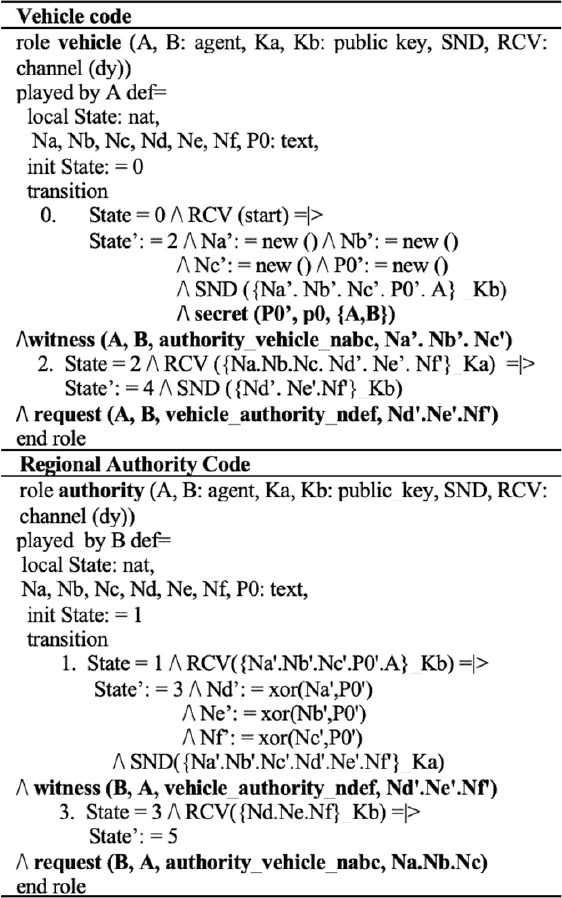

**图 6.4.** *车辆与 RA 的 HLPSL 规范代码*

安全目标为：

*   – p0 的机密性；
*   – vehicle\_authority\_ndef 的身份认证。

在规范中，“secret”指令用于确保区域机构（regional authority）和车辆以外的实体无法获取`P0`的机密性。`P0`指票据的引用编号。“request”（请求）和“witness”（见证）事件被用于验证认证节点在信任其预期的对等节点正参与此会话、处于特定状态并对给定的新值达成一致时，是是正确的^^(1)。在我们的规范中，它们被用于确保生成的随机数和计算结果的真实性。注意，这些数字 (**d, e, f**) 是 (**a, b, c**) 的异或运算结果（其中 Xor 是 EQ1 中定义的简化挑战）。

图 6.5 展示了 OFMC 验证输出，结果表明该协议是安全的。OFMC 验证器是一种用于分析安全协议的动态模型检测（On the Fly Model Checker），被 SPAN 和 AVISPA 工具使用。

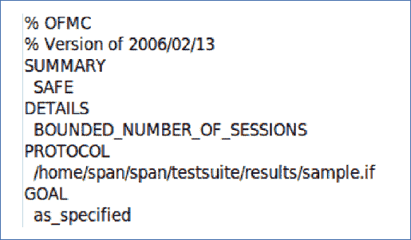

**图 6.5.** *使用 SPAN 和 AVISPA 执行指定协议的结果*

图 6.6 显示了所述认证协议的消息序图（MSC）。图 6.7 展示了在被动入侵者存在时的交换消息，该入侵者拦截了消息但无法读取，并尝试执行重放攻击但失败了。这表明通过使用我们的方案，即使在存在入侵者的情况下，车辆也能安全且匿名地向区域机构进行认证。

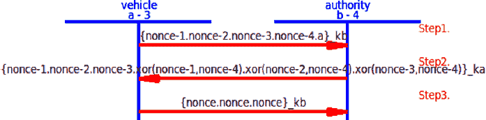

**图 6.6.** *所述认证方法的消息序图。*

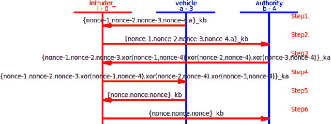

**图 6.7.** *入侵者存在时认证方法的消息序图。*

## 结论

在本章中，我们提出了一种用于按需和路途中伪名重充（pseudonym refilling）的安全性隐私保护方案。该方案在确保匿名性和无身份化（identityless）方面具有特点。匿名票据的使用以及无需交换车辆身份或其永久证书的认证，确保了隐私性和身份验证。一旦认证成功且未检测到重叠，RA 就会安全地向车辆发放请求的伪名和/或证书。这些认证和验证过程确保了可追溯性（不可否认性）、违规节点的撤销以及防止了女巫攻击（Sybil attack）。

为了证明所提方案实现了认证目标，我们使用了 BAN 逻辑。此外，为了证明其安全性和对重放攻击的防御能力，使用了 SPAN 和 AVISPA 工具。这些工具要求使用 HLPSL 对方案进行规范。此外，正如我们所说明的，我们的方案了隐私、完整性、不可否认性和前向安全性等属性。它还设计用于防御以下攻击：中间人攻击、女巫攻击、冒充、重放、会话劫持、猜测攻击和暴力破解。

我们的认证方法专门应用于车载网络中的伪名重充请求，因为这种请求是重复的，不仅可能威胁身份隐私，还可能导致关联性（linkability）和追踪。然而，这并非其唯一的应用场景。我们未来的展望包括将其应用于其他领域，例如来自第三方服务提供者的服务请求，甚至用于电子健康或物联网等对隐私敏感的系统和网络中。

本章以及第 5 章都提出了在认证阶段保护身份隐私的认证方法，无论是在形成和加入 CVDNN、请求伪名重充，还是使用任何第三方服务时。在接下来的章节中，我们将集中于保护路途中车载网络用户的位置隐私以防止追踪，通过提出多种旨在减少和阻碍关联性的解决方案。

## Notes

1. 参见：[`www.isi.edu/nsnam/ns/`](https://www.isi.edu/nsnam/ns/)

# 7 保护车载自组织网络用户的位置隐私

## 引言


在第 1 章中，我们解释了车载网络的不同类型，并在第 2 章中讨论了这些网络中的隐私问题。在之前的两个章节中，我们提出了两种保护身份的匿名认证方法。身份保护有助于防止追踪。然而，位置隐私可能会受到车辆活动的威胁，具体来说是当车辆定期广播包含位置的消息时。在本章中，我们提出了两种保护路途中位置隐私的方案。在解释解决方案之前，我们首先提醒读者我们感兴趣的车载网络类型。我们在第 1 章中已经解释过自包含式自动汽车与依赖式自动汽车在隐私问题上的差异。对于前者，车辆是自独立的；决策是基于本地处理的数据做出的。由于不存在网络概念，除非车辆系统受到破坏，否则该类型的隐私不会受到威胁。相反，由于这些车辆配备了感知道路的摄像头，其他道路用户（如行人、骑自行车者和其他汽车驾驶员）的隐私面临风险。对于后者，车辆之间交换道路数据和状态消息。因此，存在网络概念。然而，这些消息正是车载自组织网络（VANET）位置隐私的风险所在。风险在于状态消息以明文无线发送以便快速处理。它们以高频率发送，包含了车辆的位置、速度、方向和公钥（伪名），后者用于检查消息签名以确保真实性和完整性。伪名有一个有效期，在此期间可以使用，且所有使用该伪名签名的消息都会关联在一起，导致短关联性和追踪。短关联性是一个理想的特性，因为它确保了网络的稳定性、服务的稳定使用和正确的路由。相反，长关联性和轨迹追踪是不希望的，因为它们违反了道路用户的位置隐私。长关联意味着车辆通过其所有使用的伪名被追踪。也就是说，即使车辆更新了伪名，旧伪名与新更新伪名之间的关联性会导致持续追踪。图 7.1 展示了攻击者如何利用安装在路上的接收器从远处追踪车辆。在图中，VANET 由路侧单元（RSU）和车辆（或广播信标的车载单元 OBU）组成。

为了保护位置隐私并防止轨迹追踪，在更新过程中应防止伪匿名名的关联性。在第 2 章中，我们回顾了文献中为实现这一目标而开发的现有解决方案。我们开发的解决方案具有独立于道路、人群和基础设施的特性，因为在更新阶段，上述任何条件都可能无法持续可用。使用这些条件的现有方案显示出乐观的结果，但它们依赖于特定的语境。所提的解决方案依赖于在更改之前对位置进行混淆。第一种建议在更改伪匿名名之前使用了一种伪装技术。通过使用 NS2 仿真器针对执行语义攻击和语法攻击的全局被动攻击者进行仿真的，所获得的结果是乐观的。平均追踪率为 27%，在低密度场景下，总追踪率在最坏情况下于 17% 到 40% 之间波动。这证明了所提方案在保护位置隐私方面的稳健性。

在第二种建议中，我们在密集的道路上利用了人群的优势，而在其他地方执行混淆技术。模拟结果显示，该方案对执行语义攻击和语法攻击的建模攻击者具有更好的性能。它将追踪率降低到平均 10.4%，最坏情况下在 6.3% 到 17% 之间波动。

本章描述了攻击者模型。它解释了第一种基于伪装的建议方案及其分析。它还阐述了第二种感知邻居的建议方案，该方案在低密度道路上执行混淆。

## 7.2. 攻击者模型

我们已经在第 4 章中解释了攻击者如何拦截车辆无线广播的信标，并利用它们来追踪其过去和当前的位置。我们定义了攻击者执行的、以实现其目标的多种类型的关联攻击。在本章中，我们的攻击者是一个全局被动攻击者（GPA），他们隐式地安装接收器以完全覆盖道路（观测区域）。GPA 执行两种关联攻击：语义攻击和语法攻击。我们提醒读者，这些攻击已经在第 4 章中解释过。攻击者模型是使用 NS2 仿真器进行仿真的，具有一个包含 100 个接收器的网格，每个接收器的范围（500 米）完全覆盖道路。该模型用于评估我们在本章中解释的两种建议的性能。表 7.1 汇总了攻击者的参数设置。

**表 7.1. *攻击者仿真参数***

| 工具 | NS2 |
| --- | --- |
| 仿真时间 | 900 秒 |
| 地图 | 1,000 x 1,000, 曼哈顿网格 |
| 攻击者接收器数量 | 100 |
| 攻击者覆盖范围 | 500 米 |

## 7.3. 所提的基于伪装的位置隐私保护方案

为了保护位置隐私，我们在更新伪匿名名之前使用伪装机制来阻断关联性，即使在低密度道路中也是如此。在达到车辆伪匿名名的最小寿命 `T[e]` 之前，车辆开始执行伪装技术。令此时间为 `T[s]`，其中 `(T[s] < T[e])`。对于时间 `∆t = T[e] - T[s]`，车辆正在执行伪装技术，并在 `T[e]` 实施更改。更改策略如图算法 1 所示，伪装技术如图算法 2 所示。

***

**算法 1:** 伪匿名名更改方案

***

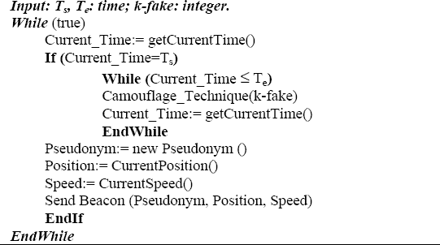

伪装技术在实施更改之前通过创建伪消息来生成虚拟人群，以迷惑攻击者。因此，我们的解决方案独立于人群，且即使在低密度道路中也能保护隐私。伪消息包含虚假的伪匿名名、位置和速度。位置遵循道路限制而非随机生成，以防止感知道路地图的攻击者检测出伪装。

***

**算法 2:** `Camouflage_Technique(k)`

***

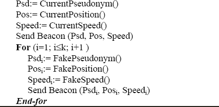

### 7.3.1. 分析模型

我们已经在第 3 章中定义了分析指标。在本章中，我们使用匿名集大小 `ASS` 和熵作为我们的评估指标。`ASS` 计算如下：

令 `V` 为执行更改的车辆，`k` 为发送的伪消息数量。这里区分了以下情况：

1. `V` 独立存在时更改伪匿名名：

   `ASS = k`

2. `V` 在 `m` 个车辆内时更改伪匿名名：

   `ASS = k + 1`

3. `V` 在 `l` 个车辆内时更改伪匿名名：

   `ASS = k + l`

4. `V` 在 `l + m` 个车辆内时更改伪匿名名：

   `ASS = k(m + 1) + l`

熵 `H` 计算如下：

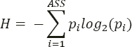

其中 `p[i]` 计算如下：

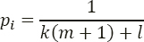

追踪时间 `T` 被分为 `n` 个时间间隔 `t[i]`，即伪匿名名的寿命。对车辆进行追踪 `T` 意味着在 `T` 期间追踪轨迹。因此，在 `n` 个连续观测间隔 `t[i]` 中追踪车辆的概率为 `P[trajectory]`，其中在 `t[i]` 中的追踪概率为 `p[i]`。

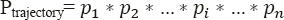

我们现在分析地比较在整个观测期 `T` 内道路上追踪车辆轨迹的概率。如果不使用我们的伪装技术，无论车辆是否更改伪匿名名，都可以被追踪，即 `p[i] = 1`，`i ∈ [1, n]` 且 `P[trajectory] = 1`。

在我们的情况下，如果 `V` 在整个观测期内独立道路上：

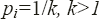

且 `p[i]` 在所有间隔内都是相同的。

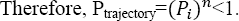

这进一步证明了我们的解决方案随着观测期的增加而减少了追踪，并且车辆继续使用我们的伪装技术更改伪匿名名。

### 7.3.2. 仿真

#### 7.3.2.1. 设置

在本节中，我们解释了仿真设置和场景，以及用于排序结果的过程。仿真是使用 NS2 仿真器完成。攻击者和车辆的代码均使用 C++ 语言编写。场景使用 TCL 文件编写，在其中指定了表 7.2 中给出的仿真设置。

在解释结果处理过程之前，我们首先解释如何固定所创建的虚拟群中的车辆数量（标记为 `k-fake` 或简称为 `k`），以及使用伪装技术的持续时间 `∆t` 或 `dt`。为了确定这些值，我们通过尝试不同的值，研究了它们对所提供的隐私保护水平的影响。我们还通过评估发送和接收消息的数量，考虑了它们对结果产生开销的影响。我们在一个包含 25 辆车辆的场景中进行了调查，该场景使用了如表 7.2 所示的相同地图。图 7.2 汇总了调查结果。我们发现，当 `∆t = 2` 且 `k-fake = 3` 时，追踪率最低，对语法攻击具有几乎完全的抗性。此外，通过发送和接收消息的数量解释的开销和消息丢弃率是可以接受的。因此，我们在剩余的仿真中选择了这些值作为 `k` 和 `∆t`。

**表 7.2. *仿真参数***

| 工具 | NS2, MobiSim |
| --- | --- |
| MAC 层 | 802.11p |
| 仿真时间 | 900 秒 |
| 地图 | 1,000 x 1,000，曼哈顿网格 |
| 伪名最小寿命 | 30 秒 |
| 车辆范围 | 300 米 |
| 车辆数量 | 10–200 |

请注意，由于我们关注的是需要周期性广播状态消息（称为信标）的安全应用，因此计算丢弃率非常困难，因为目标不是唯一的，而且由于即使车辆在道路上独自行驶，这些消息也会被发送。相反，我们比较了交换的消息，以研究在 `∆t` 间隔内增加生成的伪信标数量的影响。我们发现该数量在整体上是增加的。

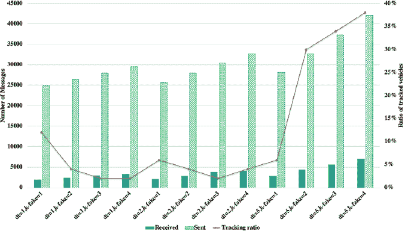

**图 7.2. *调查不同 `∆t` 和 `k-fake` 对隐私、发送和接收消息数量的影响***

#### 7.3.2.2. 结果与分析

现在，`∆t` 和 `k` 值已固定，以在对开销和丢弃率影响最小的情况下获得最低追踪率。我们将继续解释仿真结果是如何处理的以及追踪率是如何计算的。然后，我们将在后续图中展示结果，并对其进行评论和分析。

我们的仿真为车辆活动和攻击者轨迹生成轨迹文件。车辆轨迹文件经过排序和组织，以便提取伪名更改的数量并验证攻击者的追踪准确性；而攻击者轨迹文件则经过处理，以按攻击类型分离追踪，并计算追踪率和伪名链接率。

令 `R[track]` 为攻击者的追踪率，`R[Sem]` 为语义攻击的追踪率，`R[Syn]` 为语法攻击的追踪率。`T[psd]` 是伪名更改的总数。`T[v]` 是车辆的总数。`L[psd]` 是链接伪名的总比例；`L[psd1]` 是语义攻击的伪名链接比例，`L[psd2]` 是语法攻击的比例。`l[psd1]` 是语义攻击链接的伪名数量，`l[psd2]` 是语法攻击链接的伪名数量。`V[sem]` 是语义攻击追踪的车辆数量，`V[syn]` 是语法攻击追踪的车辆数量。

比例的计算方式如下：

\[7.1\]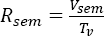\[7.2\]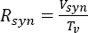\[7.3\]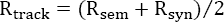\[7.4\]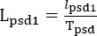\[7.5\]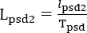\[7.6\]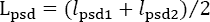

图 7.3 展示了每个场景下使用的伪名数量。伪名数量显示在纵轴上，而车辆数量在横轴上。随着车辆数量的增加，在到期时使用的伪名数量也会增加。

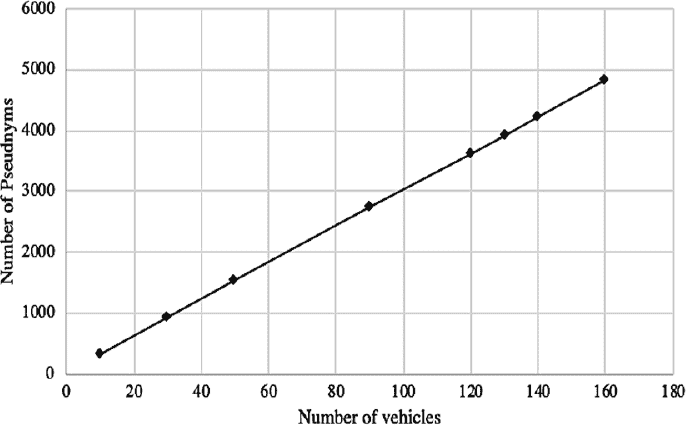

**图 7.3. *伪名数量***


**图 7.4. *追踪车辆***


**图 7.5. *链接伪名***


**图 7.6. *追踪率***

在攻击者执行语法攻击时，使用我们的方案的追踪率为 15%，而使用周期性更改方案为 70%。这表明在低密度道路上，我们的方案显著降低了追踪率。在低密度场景下，我们的方案追踪率为 40%，而周期性更改方案为 90%。我们的方案有效地降低了追踪率，从而保护了地理隐私。


图 7.7 的“I”部分是对上述示例的插图。当车辆更新其伪名时，由于达到了地理限制（A）或寿命到期（B），车辆处于群体之中。因此解释了隐式协作变更的情况。

在“II”部分中，车辆在更新之前感知其周围环境。如果它发现自己处于密度较低的道路且邻居数量少于预期阈值 `k`，它将在伪名更新之前通过更改信标（beacon）的位置字段和速度字段开始执行混淆方法，以迷惑攻击者。在 `∆t` 时间段内，车辆发送速度字段设置为 `0`、位置设置为更改前位置的信标。更新后，车辆发送带有其真实位置、速度和新更改的伪名的信标。通过这种方式，攻击者会被误导认为车辆在行驶时已在路面上停止，因此无法将使用的新伪名与使用旧伪名的车辆所公布的较远新位置关联起来。带有新伪名的车辆被检测为新实体，而不是将新使用的伪名与旧伪名关联（参见图 7.7 II. A, B）。

正如我们之前解释的，`∆t` 是通过使用混淆迷惑攻击者以破坏其准确预测性所需的时间。注意，攻击者依赖于车辆当前和过去的位置、速度和航向来预测其下一个位置。因此，当他们收到错误或不准确的时空数据时，他们的预测就会变得错误且模糊。


**图 7.7. *提出的伪名变更方案。***

尽管我们的目标是保护隐私，但我们将安全应用视为最高。因此，如果发生需要车辆在报告中发送真实位置的紧急事件，它应当这样做。

图 7.8 给出了当伪名到期为触发条件时提出的伪名变更过程的流程图描述。


**图 7.8. *伪名变更过程***

算法 3 恢复了由伪名寿命到期或达到地理空间限制触发的伪名变更算法。

***

**算法 3：伪名变更算法**

***


### 7.4.3 仿真

在解释了所提出的解决方案后，我们继续恢复我们的解决方案针对 GPA 的仿真结果。实现是使用 NS2 仿真器（Statista 2016）完成的。结果排序的过程与之前解决方案中使用的类似，仿真设置也是如此，这些设置之前在表 7.2 中恢复过。我们使用了三种低、中、高交通密度的仿真场景（分别为 50、100 和 150 辆车辆）。GPA 模型执行了两种关联攻击，即语义攻击和句法攻击。图 7.9 展示了每个场景下使用的伪名数量。


**图 7.9. *使用的伪名数量***

图 7.10 恢复了每个场景获得的跟踪率。总体而言，跟踪率随着交通密度的增加而降低，这意味着车辆在协作群体中更改标识符的机会更多。此外，解决方案在保护位置隐私方面的稳健性和高性能通过低跟踪率得到了体现，该跟踪率未超过 17%。

图 7.11 阐释了每个场景的跟踪率。为了进一步分析我们解决方案的性能，我们将其与周期性策略进行了对比。图 7.12 恢复了每个场景获得的跟踪率。带有新伪名的车辆被检测为新实体，而不是将新使用的伪名与旧伪名关联（参见图 7.7 II. A, B）。总体而言，跟踪率随着交通密度的增加而降低，这意味着车辆在协作群体中更改标识符的机会更多。此外，解决方案在保护位置隐私方面的稳健性和高性能通过低跟踪率得到了体现，该跟踪率未超过 17%。


**图 7.10. *被跟踪车辆的比例***


**图 7.11. *关联伪名的比例***


**图 7.12. *被跟踪车辆的比例。***

## 7.5 结论

本章阐述了两种新的基于混淆的变更策略，通过降低关联性和跟踪来保护位置隐私。第一种解决方案通过创建虚拟群体使用伪装技术来迷惑攻击者。为了进一步降低这一跟踪率，我们提出了另一种混淆解决方案来欺骗攻击者。该解决方案是感知邻居且带槽位的。

# 8 保护车联网用户的位置隐私

## 8.1 引言

车联网（IoV）是物联网（IoT）的一部分。它可以被看作是带有特定类型移动对象（即智能车辆）作为其主要节点类型的实例化。物联网无疑是最趋势且广泛商业化的技术之一，具有各种现实世界应用，如智能家居、智慧城市、电子健康和智能交通系统。图 8.1 展示了自 2015 年以来连接物联网设备的数量。


尽管联网汽车（IoV）概念通常与物联网（IoT）相关联，但联网车辆的概念要早得多。自 2004 年车载自组织网络（VANET）引入以来，该概念一直被使用。然而，与商业化蓬勃发展的 IoT 不同，VANET 的概念缺乏现实实现，并面临一些阻碍其繁荣的技术和法律障碍。现在，它正在被扩展，并利用了被市场接受的 IoT 概念，目前更常见地被称为 IoV（Yang 等人，2014）。

在 IoV 中，车辆可以提供或使用来自其他车辆、物体、基础设施、传感器和人类的数据及服务。它分别通过车对车（V2V）与其他车辆通信，通过车对基础设施（V2I）与基础设施通信，通过车对一切（V2X）与物体通信，通过车对传感器（V2S）与传感器通信，并通过车对人（V2H）与人类通信。数据存储在云端，供车辆、人类或物体访问。因此，IoV 提供了更广泛的稳定服务。


Figure 8.1. *IoT 联网设备数量（基于 Heinze (2016) 的统计）*

尽管 IoV 服务极具吸引力，但它们可能危及用户的身份和位置隐私，这一事实过于危险，不容忽视。为了解决这个问题，多种解决方案正在细化中，主要集中在为车辆的网络活动使用临时标识符以保护其身份隐私。基于标识符的解决方案侧重于使标识符更新不可关联的策略，以防止车辆在道路上被追踪。

在本章中，我们提出了三种解决方案：第一种基于人群的，用于阻止标识符关联性，并在使用云支持的 IoV 基于位置的服务（LBS）和安全应用时防止跟踪。我们分析了其相对于一个执行语义、句法、观察映射和链路映射攻击的建模全局被动攻击者的性能。我们还通过`NS2`仿真将其与最先进的解决方案进行了对比。结果是乐观的，隐私得到了保护，且在超过 70%的情况下优于所对比的最先进解决方案。第二种提议通过协同沉默增强了前一种方案，将隐私保护提高到 84%。最后，在第三种提议中，我们通过在位置字段上添加混淆方法增强了第二种方案，实现了超过 90%的保护水平。

本章解释了云支持联网汽车（CE-IoV）网络模型和功能。它强调了 IoV 中的隐私挑战，并描述了针对它的攻击模型。它还解释了第一个提出的隐私保护方案，该方案依赖人群的协作来阻止关联。此外，它包含了仿真设置和结果，以及与现有最先进解决方案的对比研究。同样，它提出了第二种方案，它是前一种方案的改进，通过使用沉默进行了加强。然后，第三种方案通过添加混淆方法进一步加强了第二种提议。

## 8.2. CE-IoV

文献包含了许多 IoV 网络模型，如第 1 章所示。Kang 等人（2016）的模型与我们的模型最接近，其中 CE-IoV 由 LBS 提供者、管理基于基础设施的本地云的云管理器、以及管理中央云的注册机构组成。该机构负责生成虚拟机身份（`VMID`），这些身份被交付到本地云，再由本地云传递给注册车辆。

同样，我们的模型具有相同的基本组件，但它更真实、更灵活，并考虑了车载网络的限制。它满足以下要求：

* – 通过车对车、车对基础设施和移动通信提供的连接性；
* – 无论环境如何（城市、稀疏或高速），通过使用连接性和云计算技术提供持续稳定的服务；
* – 可靠性、可用性和负载均衡，我们考虑到：
  * - 在城市环境中，尽管有基础设施或路侧单元（RSU），障碍可能会阻碍连接；
  * - 在稀疏环境中，基础设施的可用性较低，对连接产生负面影响，导致服务中断；
  * - 在高速公路上，部署的 RSU 数量足以形成本地云。

考虑到上述要求，我们对 Kang 等人（2016）的模型进行了修订如下：

* – *本地云*是`VWC`（带云车辆）。它是一个结合了基于基础设施的云和无基础设施的分布式动态云的混合云。
* – *中央云*由一组分布式注册机构管理，以平衡负载并防止单点故障。为了便于说明，我们将注册机构称为一个名为`trusted authority`或`TA`的全局权威机构。本地云和中央云都定制虚拟机来处理用户的查询。每台机器都有一个唯一的标识符，称为`VMID`。
* – 区域中间机构（`RA`）管理本地云管理器。`RA`从`TA`获取 VMID 列表，并分发给本地云管理器。这些机构还维护一个撤销列表。

Figure 8.2

Figure 8.2. *网络模型。*

所提模型具有以下优点：

* – 使用分布式注册机构（简称`TA`）平衡了机构间的负载并防止了单点故障。
* – 同样，使用`RA`减轻了`TA`的负载，因为验证和撤销由它们（`RA`）进行了优化处理。
* – 图 8.2 中所示的分层结构允许有效的非黑名单标识符跨区域重复使用。它赋予了网络灵活性特征。
* – 混合云的使用确保了无论环境如何（稀疏、城市或高速）的连接性和服务的连续性。
* – 随着车辆在车辆、基础设施和云之间的移动进行的虚拟机热迁移确保了服务的连续，不会出现中断或重复身份验证。

[图 8.3]展示了网络功能，从注册和验证开始，到 CE-IoV 服务的使用结束。

### 在 TA 处的注册

最初，每辆 IoV 车辆都会向可信权威（TA）注册。这一初始阶段允许车辆在道路上移动时订阅区域权威（RA）。TA 向已注册的车辆递送相应的长期认证私钥/公钥，以及一个专门为处理车辆未来服务查询定制的唯一标识符（见图 8.3，阶段 4），以及在验证云服务时可能使用的秘密交付凭据。TA 使用成员更新 RA（见图 8.3，阶段 5）。初始注册仅在购买时一次，所有安全相关数据都加密存储在车辆的防篡设备中，以防止其被复制或删除。

### 在 RA 处的注册

车辆获取其认证伪名池（见图 8.3，阶段 1–3），通过使用 TA 在初始注册时交付的凭据和长期认证公钥来完成。如果在 RA 的数据库中未找到该车辆，RA 将先向 TA 验证车辆是否已注册，然后交付其伪名。

### 与云管理器（CM）的认证

为了使用 CM 发布的云服务，车辆使用其凭据和`VMID`向 CM 进行身份验证（见图 8.3，阶段 6）。CM 与 RA 检查车辆是否已注册（见图 8.3，阶段 7 和 8）。然后，它提供一份组织的`VMID`列表（见图 8.3，阶段 9）。CM 将其与车辆的凭据和长期公钥映射，并存储在本地数据库中以确保可追溯性。

### LBS 请求

阶段 10（见图 8.3，它通过向 CM 分发一个较小的池 (`m`) 来实现（见图 8.3，阶段 0）。


**图 8.3.** *支持云的联网通用描述.*

## 8.3. 隐私挑战

我们已经在第 2 章](#c02.xhtml) 中解释了隐私概念。在本节中，我们讨论由 IoV 网络特性带来的特殊挑战。

1. 车辆发送包含认证公钥、位置和方向的定期消息，如果被恶意攻击者拦截，会导致跟踪。
2. 网络内的通信是无线的。
3. 用户对匿名性和不可关联性的渴望与司法系统要求的不可否赖性相矛盾。需要一种平衡这些特性的解决方案。
4. 攻击者由于是被动且不可检测的，处于优势。
5. 隐私保护解决方案不应影响网络功能，也不应导致服务中断。

## 8.4. 攻击者模型

我们在第 4 章](#c04.xhtml) 中解释过违反隐私的攻击者是全局被动攻击者（GPA），其目标是通过网络活动跟踪车辆。他们可以在观测区域安装廉价的接收器，以监听包含伪名和实时位置的车辆信标，以及由车载 GPS 提供的包含`VMID`和位置的 CE-IoV 信息。GPA 执行四种跟踪车辆的链接攻击：观测映射攻击、链接映射攻击、语义链接攻击和语法链接攻击。所有提到的攻击已在第 4 章](#c04.xhtml)中解释。

我们提醒读者，由于 GPA 是被动的，因此很难检测。这给他们带来了各种优势，例如长期的跟踪周期、对道路限制更广泛的了解、网络画像以及不可检测地跟踪用户的可能性。GPA 将知道受害用户的整个轨迹。正如孙子在《兵法》中所说：“知彼知己，百战不殆。”（孙子 1910; Pan 等 2017）。因此，GPA 占据了主动，因为目标受害者没有意识到正被跟踪且行为自然，这允许攻击者收集关于他们的大量真实数据。

在表 8.1 中，我们给 GPA 的仿真设置。仿真使用`NS2`仿真器在曼哈顿网格上进行，移动车辆使用`MobiSim`工具生成（`Mobisim`; Mousavi 等 2007）。GPA 跨越道路以网格形式安装接收器以完全覆盖地图。由于成本以及在不被警察发现的情况下安装所有接收器的困难，这一假设在现实中可能并不可行。然而，这是理论上假设以及现实中可能发生的最坏情况。如果在这些假设下测试的解决方案证明有效，那么它对于任何较弱的现实模型都是有效的。

## 8.5. CLPPS：基于协作的联网隐私保护方案

在描述了实施的攻击模型后，在本节中，我们继续解释图 8.4 所示的提议方案。该方案在两个级别保护隐私：安全信标层和 CE-IoV LBS 层。每个级别的细节将在后续章节给出。


**图 8.4.** *提议的标识符更改图*

* – **安全信标层的匿名性和位置隐私**

为了确保匿名性，使用了假名，并需要通过稳健的策略对其更改，以保护位置隐私免受关联和跟踪。我们的变更策略依赖于邻居的协作。车辆需要与其邻居同步其伪名变更以防止关联。然而，由于我们提到隐私解决方案不应对网络功能产生负面影响，车辆之间的同步需要是最优的，且不增加额外的消息或增加网络开销。情况尤其如此，因为周围车辆越多，发生碰撞、丢包或广播风暴的概率就越高。因此，为了以最小开销实现我们的方案，我们使用了信标头（beacon header）中的两个未使用的额外位，其中一个是`RDC`（准备好变更），当车辆想要宣布其更新伪名的意愿和准备就绪时将其设置为`1`，否则设置为`0`。另一个位是`DC`（执行变更），当车辆已满足其伪名更新上下文时将其设置为`1`，否则设置为`0`。请注意，车辆伪名最小稳定寿命的过期是将`RDC`设置为`1`的触发器。伪名变更上下文是接收来自`k`个愿意进行变更的特定邻近车辆的信标，这意味着它们的`RDC`被设置为`1`。当车辆将其`DC`设置为`1`时，它将在下一个时隙执行变更。因此，它的下一个信标将用最新更新的伪名进行签名。同样，接收到`DC`标记信标的车辆也会在下一个时隙更改其伪名，并使用其新更新的伪名继续发送信标，实现同步变更并将攻击者的跟踪精度从`1`降低到`1/*k`，因为其目标可能是`k`个候选者中的任何一个。自然地，随着同时进行变更的邻居车辆数量的增加，模糊性随之增加。

### CE-IoV LBS 层的匿名性和位置隐私

如图 8.3 所示，当车辆更新其用于安全信标的伪名时，它也会同时更改用于 CE-IoV LBS 的`VMID`。同样，我们在业务消息头中使用一个标志位`CVD`（更改 VMID）来通知内容管理器（CM）`VMID`的变更，进而由`CM`记录此变化。我们提醒读者，使用有序`VMID`列表的目的是帮助`CM`和车辆知晓下一个要使用的`VMID`，而无需发送额外消息，因为它们都拥有同一份有序列表。由于车辆从列表中顺序更新其`VMIDs`，`CM`可以轻松地进行映射和记录。

因此，如前所述，`VMIDs`以协作方式与伪名同步更新。在成功变更后，车辆及其协作邻居将更新它们的标识符，并使用新的`VMIDs`和伪名继续其活动，而无需向服务提供者重新进行身份验证。此外，由于`CM`记录了变更，它会通知服务提供者新的`VMID`，以便在更新后将所有带有旧`VMID`的挂起查询通过隧道发送到目的地，从而确保服务的连续性。

### 8.5.1 仿真

在本节中，我们解释了如何模拟我们的提议，并针对第 4 节解释的建模`GPA`进行了测试，执行了四种关联攻击。我们首先恢复设置，然后分析获得的结果。

### 8.5.1.1 设置

我们在曼哈顿地图网格上使用`NS2`仿真器模拟了我们的提议，使用`MobiSim`工具生成移动车辆的移动模型（称为场景）。我们在同一幅地图上创建了五个具有相同仿真跨度（900 秒）的场景，其中每个场景的车辆数量从低密度的 10 辆增加到中密度的 (50, 100) 辆，再到高密度的 (150, 200) 辆。每辆车辆定期向其邻居广播状态消息，向服务提供者发送`LBS`消息向`CM`发送连接性消息。

我们已经解释了如何在第 8.4 节中实现全局被动攻击者。在表 8.1 中，解释了车辆和攻击者的仿真设置。

**表 8.1.** 车辆仿真参数

| 工具 | NS2, MobiSim |
| :--- | :--- |
| MAC 层 | 802.11 p |
| 仿真时间 | 900 秒 |
| 地图 | 1,000 x 1,000，曼哈顿网格 |
| 伪名最小寿命 | 30 秒 |
| 车辆范围 | 300 米 |
| K 个协作邻居 | 2 |
| 攻击者接收器数量 | 100 |
| 攻击者覆盖范围 | 500 米 |
| 场景 1 车辆数量 | 10 |
| 场景 2 车辆数量 | 50 |
| 场景 3 车辆数量 | 100 |
| 场景 4 车辆数量 | 150 |
| 场景 5 车辆数量 | 200 |

### 8.5.1.2 结果

在解释仿真设置后，我们继续说明如何对结果进行排序以使其对建模攻击者的测试具有意义，提取所需的比例并进行展示。

我们的仿真生成了两个跟踪文件。一个是车辆的活动（包括信标和`LBS`消息），另一个是攻击者的窃听和拦截。车辆的跟踪文件经过处理以分离其活动，每项活动都保存在单独的文件中。因此，我们获得了信标文件和`LBS`消息文件。这些文件用于确认伪名和`VMID`同时变更。

攻击者的跟踪文件也经过处理以按攻击类型分离，产生四种跟踪文件，分别是语义、语法、关联和观测映射。对于每种攻击，提取了正确跟踪的节点和正确关联的变更，这些用于计算后续公式定义的比例并在图中显示：

8.1

8.2

8.3

图 8.5 展示了当车辆执行我们的提议方案时`GPA`的计算跟踪比例。通常情况下，该比例很低，不超过 30%，这意味着位置隐私得到了 70% 的保护。

此外，除了第二个场景小于 27% 外，其他所有场景的跟踪比例都低于 15%。提醒读者，车辆在道路上的分布是随机的。尽管我们控制了地图、仿真时长和每个场景的车辆数量，但我们决定不施加车辆靠近或处于同一区域的约束。这样做是为了确保所仿真的公平性，避免获得来自有利设置的过高结果。因此，在场景 2 中，比例高于其他场景，可能是由于车辆并非一直处于有利上下文。关于比例的另一个观察结果是，它们随着车辆数量的增加而降低。注意，跟踪比例越低，隐私水平越高，方案越好。

在图 8.6 中展示了每个场景下各种攻击的跟踪率，其中数字 1 到 5 反映了表 8.1 所示的模拟场景。我们注意到，语义映射和链接映射攻击的跟踪率在所有场景下均接近零。句法攻击的跟踪率小于 5%，而观察攻击的跟踪率小于 6%。这两个比例均小于 10%。这表明，我们可以以超过 94% 的把握确保解决方案对这些攻击几乎具有免疫力，从而保护了隐私性。

### 8.5.2 对比研究与性能分析

为了进一步说明所提解决方案针对建模攻击者的性能，我们决定将其与 Kang 等人（2016）的最先进解决方案进行对比。表 8.2 描述了我们的解决方案与其他方案之间的主要区别，并突出了每种方案的优缺点。


表 8.2. 我们所提方案与 Kang 等人（2016）所提方案的对比研究

为了进行对比性能研究，Kang 等人（2016）的解决方案在相同的设置、表 8.1 所示的场景下，并针对相同的建模攻击者进行了模拟。同样，生成的跟踪文件以与我们相同的方式进行处理，以按照前文介绍的方法提取跟踪率。结果如图 8.7–8.10 所示。

图 8.7 展示了两种解决方案通过 GPA（全局主动攻击者）跟踪的车辆比例。可以看出，我们的跟踪率低于 Kang 等人的。这意味着我们的提议（注：此处 proposal 译为方案）优于 Kang 等人的方案，因为更低的比例意味着更强的隐私保护。


图 8.7. 两种解决方案的跟踪车辆比例。

图 8.8–8.10 展示了两种解决方案分别通过句法、语义和观察映射攻击获得的跟踪率。我们的解决方案所获得的结果在上述所有攻击中均更好。需要注意的是，在模拟场景下，两种解决方案针对语义映射和链接映射攻击都给出了较低的跟踪率。

另一个可以考虑的比较指标是每个解决方案更改标识符的数量，尽管单靠频繁更改标识符并不一定能提高隐私保护。相反，它可能会导致服务中断和标识符过度消耗。因此，我们设计的解决方案使标识符的更改仅在能够降低关联性的有利上下文中发生，即在协作群体内进行更改。我们的结果进一步证明了这一观点，与 Kang 等人的解决方案相比，我们的解决方案提供了更高的保护和更低的跟踪率，而后者的解决方案是根据过期独立地频繁更新标识符，尽管其方案中更改的标识符数量平均是我们的三倍。

此外，与 Kang 等人相比，我们的解决方案减少了同步开销。在他们的解决方案中，需要与云管理器（`CM`）交换各种消息以实现`VMID`更改，包括更改请求、获取批准、持续时间同步、选择`VMID`以及通知`CM`进行记录。相反，我们的解决方案依赖于使用标记消息，其中最多使用两个位用于同步。我们还通过使用组织的`VMID`列表优化了`VMID`请求、批准和记录消息。因此，车辆只需要在标记消息中通知`CM`更改，`CM`即可感知下一个使用的`VMID`。


图 8.8. 两种解决方案的句法攻击者跟踪车辆比例。


图 8.9. 语义攻击者 – 链接标识符的比例。


图 8.10. 观察映射攻击 – 跟踪车辆的比例。

## 8.6 CSLPPS：一种基于协作沉默的车辆位置隐私保护方案


在上一节中，我们介绍了一种基于协作的解决方案，用于保护 CE-IoV 中的位置隐私。该解决方案在针对全局主动攻击者（已知是一种强攻击者模型）进行模拟测试时给出了乐观的结果，总体跟踪率大约在 5% 到 27% 之间。

在本节中，我们旨在通过提出一种名为“基于协作沉默的车辆位置隐私保护方案”（`CSLPPS`）的解决方案来进一步降低这一跟踪率。`CSLPPS`是对建议方案的改进。

### 8.6.1 所提解决方案

与之前的方案类似，该解决方案通过定期发布带有签名的信标参与安全应用。它还通过云端使用 IoV LBS，其中虚拟机被定制使用唯一的`VMID`提供服务。两个标识符同时更改。

我们使用相同的标记消息原理，标志`RDC`、`DC`、`CVD`分别表示准备更改、更改和更改`VMID`。前两个是信标头部的未用位，最后一个来自服务/连接消息。通过标记消息通知`CM`更改，并将`CVD`设置为 1。

我们假设，在车辆向区域机构进行初始注册时，更改策略及其参数（协作车辆阈值`K`和静默期`T`）已在其中，且云管理器知晓这些参数。

当车辆标识符即将过期时，它感知邻近车辆并通过设置`RDC`为 1 来通知它们更改。具有相似状态（即想要更改标识符）的车辆也会发送`RDC = 1`的信标。当一个车辆收到来自`K`个愿意更改标识符的不同邻居的信标时，它将信标中的`DC`设置为 1，服务/连接消息中的`CVD`设置为 1。前者是通知邻居进入沉默并执行更改；后者是通知`CM`记录更改并将下一个使用的`VMID`通知服务提供者。车辆停止广播，尽管可能仍接收消息。在更改完成（沉默结束）之前，`CM`处理挂起队列和响应，并使用新的`VMID`将其转发给车辆。静默期结束后，所有更新了标识符的车辆可以使用新更改的标识符恢复活动。

简而言之，车辆同步协作进入沉默（协作沉默）以同时更新标识符，旨在混淆攻击者并降低其链接和跟踪能力。

### 8.6.2 模拟结果

为了评估`CSLPPS`并研究其性能，我们使用了之前在协作方法中相同的工具、参数、地图和场景，模拟了针对全局被动攻击者（GPA）的攻击。结果还与 Kang 等人的方案进行了比较。

我们首先给出仿真结果。图 8.11 展示了当 GPA 执行四种链接攻击时，车辆标识符发生变化后被正确跟踪的车辆比例。这些攻击分别是语义攻击、语法攻击、观测映射攻击和链接映射攻击。该比例是使用 8.5.2.1 节中说明的方法计算的。总比例不超过 16%，且随着每个场景中车辆数量的增加，该比例下降到约 6%。平均跟踪比例为 10.1%，低于之前提议的结果（平均为 11.5%），甚至低于 Kang 等人的结果（平均为 24.2%）。


图 8.11. 被跟踪车辆比例


图 8.12. 每种攻击的被跟踪车辆比例

图 8.12 说明了每种攻击的被跟踪车辆比例。该方案对语义攻击和链接映射攻击几乎是健健。另外两种攻击的结果随着车辆数量的增加而减少。语法攻击的跟踪比例在 0% 到 16% 之间，观测攻击的跟踪比例在 20% 到 45% 之间。

### 8.6.3. 比较研究性能分析

我们将我们的提议与 Kang 等人的方案进行了对比。图 8.13 中获得并所示的结果表明，我们的方案通过所有场景下较低的跟踪比例表现得更好。图 8.14–8.16 显示了两种方案按攻击类型划分的详细跟踪比例，分别为语法、语义和观测映射攻击。


图 8.13. 被跟踪车辆比例。


图 8.14. 语法攻击者的被跟踪车辆比例。


图 8.15. 语义攻击者（A. 链接标识符比例，B. 被跟踪车辆比例）。


图 8.16. 观测映射攻击 – 被跟踪车辆比例。

### 8.7. 云端车联网中基于混淆的位置隐私保护方案

上述提议通过降低标识符的可关联性来保护位置隐私。两者都依赖于加强更新策略。第一种依赖邻居的协作，第二种额外使用了协同静默。为了进一步降低跟踪比例，我们通过添加混淆方法来保护车辆位置以完善该提议。因此，在最终解决方案中，我们结合了协作、沉默和混淆，开发了一种健壮的标识符策略，该策略在针对 GPA 的仿真测试中显示了迄为止最好的结果，平均跟踪比例为 7.15%。所提的解决方案及其分析将在后续章节中解释。

### 8.7.1. 提议

该方案使用了与前两个提议相同的逻辑，即继续使用带标记的消息来协调车辆之间的变化并通知`CM`。

当车辆想要更新其标识符时，它将信标中的`RDC`标记（位）设置为 1，通知邻居车辆已发生变化。接收到此信标的车辆如果也想更新其标识符，会将它们的`RDC`标记设置为 1，并将位置设置为发送车辆的位置。在收到来自`k`个不同邻居的`k`个信标后，车辆在其信标和服务/连接消息中将`DC`和`CVD`均设置为 1，并进入静默。接收到带有`DC`标记信标的车辆也将其`DC`设置为 1 并进入静默。`CM`记录变化并通知服务提供商下一个要使用的`VMID`。它会缓存发给车辆的响应，直到变化完成后。注意，未参与变化的车辆可能会继续向正在更新伪名的车辆发送消息。车辆在静默时停止广播，但可以继续接收消息。由于消息是广播的，即使位置不准确，只要在车辆范围内即可到达。图 8.17 展示了所提的策略。


图 8.17. 伪名和 VMID 策略

正如我们在前面的节中所看到的，在不利的环境中频繁更改标识符并不能提高隐私水平。相反，它会无谓地过度消耗标识符。因此，在我们的解决方案中，除非车辆处于人群中，否则不会更改标识符。

### 8.7.2. 使用博弈方法进行可行性研究

为了研究所提方案的可行性，我们使用了博弈论。变化策略被视为游戏`G`。正如 Al-Momani 等人 (2016) 所示，我们使用了一个具有完全信息和完美信息的动态游戏 (`G`)。`G`定义为三元组`(P, S, U)`，其中`P`和`S`分别是玩家和策略集合，`U`是收益函数。`G`有以下两个阶段：

- 阶段 1：涉及公告车辆的动作和决策。这一初始阶段是发布变化并请求邻居协作。为此，车辆将`RDC`设置为 1，并等待`k`个邻居的`RDC`信号。接下来，根据其他车辆（玩家）的协作，在拥有至少`k`个协作邻居时，通过将`DC`标记设置为 1 并广播决策来执行变化。

- 阶段 2：涉及邻居车辆的协作，它们在接收代表协作变化的`RDC`标记消息后决定。决策是更改伪名和`VMID`还是不更改。

其中`λ`是攻击者的追踪功率，`T[c]`是当前时间，`T[i]`是自上一次伪名 VMID 成功更改以来的时间。

更改成本`ɣ`是获取新伪名`ɣ[psd]`和 VMID`ɣ[vmid]`的成本、该更改对数据路由的影响`ɣ[rt]`成本，以及该更改对其安全应用`ɣ[sa]`的影响之和：


收益函数  对于玩家`P[i]`定义为`U[i]`，并使用`d[i]`和  计算如下：

1) `U[i] = - d[i]`，如果`P[i]`不更改其伪名和 VMID；

2) `U[i]\= -d[i]\`，如果`P[i]`在非合作群体中实施更改；

3)  如果`P[i]`在协作群体（k 个邻居）中实施更改；

4) `U[i]\= -`，如果`P[i]`在协作群体（k 个邻居）中实施更改，执行混淆方法并进入沉默期。

在我们的解决方案中，我们建议车辆在应用沉默期后协作群体内实施更改，或者不实施。因此，`U[i]`分别为`-`或`- d[i]`。在后续演示中，我们将协作邻居的阈值`k`设置为 3。

我们首先考虑四个玩家：`P[1]`（发起者）、`P[2]`、`P[3]`和`P[4]`（邻近车辆）。如果`P[1]`选择`NR`，则所有车辆的博弈结束，没有任何车辆实施更改。因此，`U[1] = -d[1]`，`U[2] = -d[2]`，`U[3] = -d[3]`以及`U[4] = -d[4]`。

如果`P[1]`选择`R`且`P[2]`、`P[3]`和`P[4]`选择`C`，则所有四个车辆都发生更改，随后进入沉默期，此时收益函数将为`U[1] = -`，`U[2] = -`，`U[3] = -`以及`U[4] = -`。如果`P[1]`选择`R`且一个或多个邻居`P[2]`、`P[3]`、`P[4]`选择`NC`，则不发生更改，收益函数为：`U[1] = -d[1]`，`U[2] = -d[2]`，`U[3] = -d[3]`以及`U[4] = -d[4]`。如果博弈有 n 个玩家 (n > k)，也可以得出相同的结论。这证明了解决方案的可行性。

### 8.7.3. 仿真

我们使用`NS2`在`MobiSim`生成的移动性文件上仿真了车辆和攻击者模型。表 8.3 汇总仿真参数。攻击者模型是一个被动全局攻击者，执行四种关联性攻击，即语义攻击、语法攻击、观察映射攻击和链接映射攻击。攻击者以网格形式分布接收器以完全覆盖地图。

表 8.3. 仿真参数

| 工具 | NS2, MobiSim |
| --- | --- |
| MAC 层 | 802.11 p |
| 仿真时间 | 300 秒 |
| 地图 | 700 x 700, 5 车道高速公路 |
| 伪名最小寿命 | 30 秒 |
| 车辆范围 | 300 米 |
| K | 3 |
| 沉默期 | 2 秒 |
| 攻击者数量 | 36 |
| 攻击者覆盖范围 | 500 米 |
| 场景 1：车辆数量 | 50 |
| 场景 2：车辆数量 | 100 |
| 场景 3：车辆数量 | 200 |
| 场景 4：车辆数量 | 250 |

图 8.18 展示了每个场景每个攻击的追踪率。可以注意到，该解决方案对语义、语法和链接映射攻击几乎具有免疫力。使用观察攻击的追踪率在 23% 到 32% 之间。车辆在其标识符生命周期内可能会被追踪。然而，只要标识符更新不被关联，就可以避免长期关联性并防止轨迹追踪，同时也防止通过画像分析（profiling）识别。我们的解决方案确保了这一点，因为在超过 90% 的情况下，车辆在更新标识符后被攻击者感知为新车辆，且其旧新标识符之间没有关联。

图 8.19 说明了通过 GPA 以及四种链接攻击（语义、语法、链接和观察）获得的整体追踪率。该比例在 6% 到 9% 之间。它随着每个场景中车辆数量的增加而降低。这是因为车辆越多，协作的机会越高，匿名集的大小越大。这是因为协作的概率增加了攻击者的困惑。图 8.18 攻击者的追踪率。](images/fig8-18)

图 8.19. 检测车辆的平均比例。](images/fig8-19)

### 8.7.4. 分析模型

如第 3 章所示，位置隐私通过多种指标衡量。在本节中，我们使用三个指标来分析我们解决方案的稳健性，即平均匿名大小、熵和归一化熵。

平均匿名大小`AASS`定义如下：


图 8.20 展示了将这些指标应用于仿真结果的结果。我们注意到平均匿名大小、熵和归一化熵随着车辆数量的增加而增加。匿名集随车辆增加而增大与标识符更新阶段出现拥挤密集道路的可能性有关。此外，获得的高值表明了解决方案在保护位置隐私方面的稳健性。

图 8.20. 平均匿名大小、熵和归一化熵](images/fig8-20)

### 8.7.5. 对比研究

与之前的两项建议一样，我们将我们的解决方案与 Castillo 等人 (2018) 的方案进行了对比研究。两种解决方案都在表 8.3 定义的相同设置下，针对相同的攻击者模型，使用相同的场景进行了仿真。

图 8.21 展示了两种解决方案的整体追踪率。我们的解决方案提供了较低的比例，将 Kang 等人的追踪率降低了大约一半。

图 8.21. 检测车辆的平均比例](images/fig8-21)

图 8.22–8.24 展示了两种解决方案在不同攻击下的跟踪率，分别为语义、句法和观测映射攻击。我们可以看到，我们的解决方案对语义和句法攻击都几乎具有免疫力，优于 Kang 等人的解决方案（后者在语义攻击下的跟踪率为 10–25%，在句法攻击下为 2–16%）。两种解决方案对链接映射攻击都几乎具有免疫力。我们的解决方案在观测映射攻击上优于 Kang 等人的方案，其跟踪率更低。


**图 8.23.** 被跟踪车辆的比例 – 句法攻击。


图 8.24. 检测到的车辆的比例 – 观测映射。

## 8.8. 结论

在本章中，我们提出了三种能够防止链接和跟踪的位置隐私保护解决方案。这些解决方案实现了高水平的隐私保护，每项改进都提升了保护水平，从 70% 增加到 90%。这些比例是考虑到针对完全覆盖道路的最强攻击者的最坏情况。所提方案依赖于在 LBS 查询和信标中分别使用时间标识符（称为`VMID`）以及伪名，并且这两者会同时更改。在第一个方案中，更改发生在协作群体内部。在第二个个方案中，我们通过使用静默（协同沉默）加强了第一种方案。在第三个方案中，我们通过添加混淆措施来防止关联，进一步增强了解决方案。

# 9 基于区块链的车辆网络隐私感知伪名管理框架

## 9.1. 引言

在之前的章节中，我们关注车载网络中的隐私问题，其安全系统围绕公钥基础设施（`PKI`）展开。中心`PKI`拥有一个认证机构（`CA`），对长期和短期公钥（伪名）进行认证。为了获取自生成的密钥的证书或在车载网络中请求密钥（伪名），每辆车辆必须向`CA`注册。这种注册需要提供关于用户的真实性数据，例如其身份和车辆识别码（`VIN`）。经过认证的伪名用于加密通信，其配对私钥用于对消息进行数字签名。因此，可见它们是车载网络中的基础安全概念。车辆公钥基础设施（`VPKI`）系统在安全性和其提供的隐私水平方面都是强大且高效的。它的优势源于其中心化和私密性。只有`CA`能够注册车辆及其所有者并颁发证书。提供的数据仅供`CA`访问，并对外保持保密。如果车辆已经有了用于检查证书数字签名的`CA`公钥，则它可以离线检查密钥或证书的有效性；或者，在没有公钥的情况下，它可以查询`CA`公钥后进行验证。如果车辆使用经过认证的伪名，其活动将被`CA`追踪。在发生误行为时，该伪名可能会被吊销并追究责任（条件隐私）。换句话说，`CA`对用户的注册、密钥生成/认证、更新和吊销过程具有完全控制权。这被称为伪名生命周期。注意，`VPKI`的中心化和机密性可能被视为其缺点，这也是所有中心化系统的共同点。这些漏洞使其暴露于针对性攻击，导致其成为单点故障。

在解释我们解决单点故障问题的`VPKI`潜在替代方案之前，我们首先简要解释伪名在车载网络中的作用，以及`VPKI`如何处理它们。这有助于提取替代方案必须具备的主要特征和必须处理的任务。

本节解释了有助于理解所提方案的关键背景概念，具体如下。

### 9.2.1. 公钥基础设施 (PKI)

公钥基础设施也被称为双密钥加密体系，其中用于加密的密钥与用于解密的密钥不同。在数字签名中，保持私密或保密的加密密钥被用于对哈希值（消息的摘要）进行加密，而公开为人知的解密密钥则用于解密消息并获取哈希值。公钥加密则是相反的：使用公钥进行加密，而使用私钥对消息解密。通过这种方式，只有预期的接收方被允许读取加密内容，即持有用于加密的公钥/私钥对的方。请注意，虽然这对密钥在数学上是相关的，但很难从公钥推导出私钥。传统的 PKI 通过对公钥进行数字认证，解决了当用户伪装成并非其拥有的公钥所有者时发生的身份冒充问题。数字证书不仅将公钥映射到其所有者，还为其标记了时间戳并规定了有效期。它可以通过延长有效期来更新，也可以在被误用时撤销。在下，我们将解释关键的认证过程、证书验证和撤销流程。我们还会描述私钥恢复过程。

### 认证过程

公钥和私钥对由用户生成，公钥发送给 CA（证书颁发机构）进行认证。CA 生成包含用户名称、公钥和有效期的证书。该证书使用 CA 的私钥进行签名。

`X.509`证书包含以下字段：版本、序列号、签名算法标识、颁发者主体名称、有效期、主体主体名称、主体公钥信息、颁发者唯一标识符、主体唯一标识符、扩展、签名。

### 证书验证过程

对认证公钥的验证从检查 CA 的公钥开始。然后使用该密钥从数字签名中提取哈希值。将该值与计算出的值进行比较，以确保接收到的证书的完整性。最后验证公钥的有效性，这意味着它尚未过期且未被撤销（黑名单）。一旦满足上述所有条件（即它是有效的、未撤销的且完整的），该公钥将被接受。

### 证书撤销过程

如果私钥泄露、持有者被开除或其将其误用于非预期目的，则证书将被撤销。CA 将撤销的证书保存在名为证书吊销列表 (`CRL`) 的列表中。`CRL`记录了证书的序列号、撤销日期和原因。该列表由 CA 标记时间戳并进行签名。

### 私钥恢复

私钥对于解密和签名过程都至关重要。因此，必须准备一个备份，以便在原始密钥丢失或损坏时可以使用。用户可以选择制作本地备份以保护其隐私，也可以在 CA 处保存副本，但这可能会带来隐私风险。如果用户选择将副本存储在第三方公司，不仅他们的隐私可能面临风险，而且如果私钥被用于暴露消息的加密内容，其数据的机密性可能会被破坏，因为密钥所有者变成了数据所有者。私钥还可以被分成若干部分，每部分分别保存在不同的服务器、实体或卡上，以防止数据机密性暴露。需要时，通过重新组合这些部分来恢复密钥（Khodaei 2012; Dini 2018）。


## 9.2.2. 车载 PKI

车载网络公钥基础设施 `VPKI` 拥有根认证机构 (`RCA`)、伪名证书颁发机构 (`PCA`)、长期证书颁发机构 (`LTCA`) 和伪名解析机构 (`PRA`)。注册后，每辆车辆获得一组长期认证的公钥/私钥对以及一组伪名（也称为短期公私钥对）。`RCA` 对其他机构（`PCA`、`LTCA` 和 `PRA`）的证书进行签名。长期证书用于向由 `LTCA` 发布的 `PCA` 请求伪名。伪名撤销的身份解析由 `PRA` 处理。`VPKI` 保证了传统 `PKI` 提供的安全属性，即真实性、不可否认性和完整性，并确保了身份隐私，因为伪名证书不包含所有者的身份。它仅包含序列号、短期公钥、有效期和 `PCA` 签名。在 `VPKI` 中，节点的撤销是由其在道路上的网络异常行为引起的。`PRA` 接收异常报告，并将异常节点的伪名包含在撤销列表 `CRL` 中，该列表被转发给车辆以警示这些恶意节点。`RCA`、`PCA` 和 `LTCA` 的协作需要解决异常用户的身份问题（Crosby et al. 2015）。

## 9.2.3. 区块链技术

自从十年前 Nakamoto Satoshi 在一篇论文中引入比特币以来，人们对区块链 (`BC`) 技术的兴趣日益增加。最近，各种研究人员和专业人士的注意力转向了开发基于区块链的分布式应用。他们正试图将应用导向从受限于单点故障问题的中心化，转向构建在区块链之上的分布式和去中心化架构。区块链或公共账本是关于物理或数字资产交易的分布式不可变数据库，每笔交易都通过网络节点的共识进行验证（Dib et al. 2018）。

`图 9.1` 展示了区块链架构，该架构组织为六层（Nakamoto 2008）以便理解：应用层、数据账本层、共识层、P2P 交换层、网络层和硬件层。在，我们将简要解释每一层：

- **应用层**：比特币（Buterin 2014）、以太坊（Alonso 2018）和门罗（Yaga et al. 2018）等加密货币非常有名，但它们并不是区块链应用的唯一类型。事实上，这一层定义了区块链的角色。在本章中，我们定义的应用是一个可能替代车载网络 `PKI` 的伪名管理框架。

- **数据账本层**：这一层识别交易、区块以及取决于性质的结构。

- **共识层**：根据区块链类型（许可或无许可），在该层指定交易/区块的验证程序和共识协议。

- **P2P 交换层**：区块链由连接的节点形成点对点 (`p2p`) 网络，这些节点在交易验证和区块创建上进行竞争。它们还交换经过验证的区块以保持区块链更新。

- **网络层**：区块链使用的 `p2p` 网络覆盖在互联网之上，用户在其中下载并注册到区块链。

- **硬件层**：这一层与区块链节点用于区块和交易验证的服务器及机器有关。

交易（`Tx`）记录了物理或数字资产所有权的变更。其内容取决于区块链的实现和用途。通常，它包含：发送者地址、发送者公钥、数字签名、交易输入和输出。

交易的输入列出了要传输的资产及其来源。

交易的输出定义了传输资产的金额、新所有者的标识符以及这些资产或价值的支出条件。发送者/接收者的标识符要么是公钥，其加密哈希值，被称为一次性地址（one time address）。

交易验证取决于所实现的协议要求，例如确保所有者拥有足够的资产、确保其符合支出条件，以及没有同时发生双重花费等。

交易的真实性证明了资产发送者拥有该资产。这通过使用发送者的私钥对交易输入进行签名来实现。为了检查真实性，区块链节点使用资产来源交易输出中找到发送者公钥来检查哈希值（Zheng et al. 2017）。图 9.2 展示了交易结构。


图 9.2. *交易图示*

### 区块结构

当用户创建交易时，它处于等待状态，直到被区块链节点验证。交易的验证通过创建并成功发布包含该交易的区块来确认。区块包含两个部分：区块头（称为元数据）和数据（即有效交易 (Zheng et al. 2017)），如图图 9.3 所示。


图 9.3. *区块结构*

### 区块链链

我们之前提到过，交易验证是通过被发布在区块中来确认的。区块不是孤立的，也不是独立的。为了让区块接受，它必须正确地链到区块链上。为了做到，节点竞争解决一个挑战。第一个解决挑战的节点添加该区块。链链是通过哈希值的使用实现的，如图 9.4 所示，每个区块包含前一个区块的哈希。这防止了区块的篡改和注入（Zheng et al. 2017）。


图 9.4. *区块链（区块链）。*

### 共识模型

共识过程根据区块链类型和实现而不同。在许可链区块链中，只有允许的节点可以创建并发布有效区块，这与无许可区块链相反，所有节点都能根据共识模型创建区块。以下简要解释了现有的几种共识模型（Zheng et al. 2017）：

#### 工作量证明 (PoW)

区块的添加由解决难题的节点完成。谜题的难度会进行调整，以确保区块按固定间隔产生。谜题的解决是通过找到一个随机数（nonce），使得区块头的哈希值小于目标值来实现。

#### 权益证明 (PoS)

在 PoS 中，创建新区块的权利基于验证者持有的代币数量以及愿意作为质押的金额。这激励了验证者诚实行为，因为恶意行为可能导致他们失去质押。

#### 轮询 (Round robin)

在轮询共识模型中，选择一组验证者按旋转顺序创建区块。这确保了每个验证者都有机会参与网络。

#### 权威证明 (PoA)

在 PoA 中，根据声誉或已知的可信度指定特定节点为验证者。这种模型通常用于验证者身份已知的许可链区块链。

#### 等待时间证明 (PoET)

PoET 是一种共识机制，节点在提议区块之前需要等待随机的时间。计时器先到期的节点拥有该区块的权利。

### 区块链类型

我们之前提到过有两种类型的区块链：许可或无许可。在许可链区块链中，允许极少数节点创建和验证区块。在无许可区块链中，任何节点都可以参与网络。另一方面，在私有区块链中，只允许特定组织访问数据。

#### 区块链链

这一概念首次引入 OneLedger 项目中；它是由相互连接的各种区块链组成的区块链。这允许不同区块链网络之间进行数据交换。

## 9.3. 相关工作

### 9.3.1. 基于区块链的 PKI

PKI 是互联网上安全数据交换的骨干。然而，它受到单点故障问题的影响，单点即 CA（证书颁发机构）。它可能是攻击者和黑客破坏终端用户安全的理想目标。Axon (2015) 实现了一种基于区块链的 PKI 管理框架，它是不可篡改、公开且可追溯的。基于以太的框架提供了无需 CRL（证书吊销列表）的高效证书撤销。它还能抵抗中间人攻击或话劫持，因为区块链是公开、及时更新且分布式的。此外，它消除了 PKI 的单点故障问题。证书通过从叶子节点到根 CA 的信任链验证来确认。撤销通过将证书引用从 CA 的智能合约白名单移动到黑名单来实现。

### 9.3.2. 隐私感知的基于区块链的 PKI

之前的框架没有保护隐私，因为它侧重于可追溯性。然而，Malik 等人 (2018) 引入了隐私感知的基于区块链的 PKI，其中只有在发生需要撤销节点的违规行为，并且在机构要求下获得用户共识时，用户身份才会被追溯并暴露。否则，它受到保护。也就是说，隐私水平由用户或使用该技术的类型控制。如果生成的密钥可以关联回之前使用的密钥，它们就是有效的。这种密钥关联性是隐式完成的，作者声称关联性测试返回的是逻辑值而不是公钥本身。因此，除非发生违规行为或丢失密钥，否则这种关联性不会威胁隐私。然而，由于区块链是公开的，旨在关联密钥以识别用户身份的恶意节点可以用不同的方式进行此测试。因此，该框架无法确保前隐私。

### 9.3.3. Monero

Monero (Yaga et al. 2018) 是一种近期引入但日益受欢迎的基于区块链的不可追踪加密货币。它是公开的、安全的且保护隐私的。Monero 用户可以交换货币金额而无需暴露其价值或来源。接收者和发送者的身份、货币来源、金额以及消费用途都是未知的且不可追踪的。尽管如此，用户仍然可以验证收到的金额、其有效性，以及该金额没有被同时在其他地方被花费（即所知的双重花费问题）。

Monero 应用环数字签名来保护发送者的隐私，即交易输入使用 Schnorr 风格的多层可链接自匿名组签名进行签名，其输出包含传输的加密货币金额，该金额通过 Pedersen 承诺和 Schnorr 风格的 Borromean 环签名进行隐藏。从公钥中提取的一次性地址用于保护接收者的隐私。第 9.4.2 节 对进行了更详细的解释。

### 9.3.4. 基于区块链的车载 PKI

Vercauteren (2008) 提出了一种用于车载网络的基于区块链的 PKI，以使伪名认证和撤销变得高效快速。他们选择了私有区块链类型，并提议由 CA（证书权威）、撤销机构和 RSU（路侧单元）维护和访问，同时防止车辆或车载单元（OBU）访问区块链。注意，RSU 仅具有读取权限。在他们的框架中，车辆注册到 CA，由 CA 发发伪名，这些伪名以区块链交易的形式存储。由于车辆无法访问区块链，伪名验证和认证通过 RSU 完成。车辆将区块链中伪名交易的索引发送给 RSU，由 RSU 检查其在区块链中的存在，并挑战车辆证明其对该伪名的所有权以完成认证。

如果车辆行为不当，也会将其报告给 RSU。随后，RSU 将报告转发给 RA（撤销机构），RA 为车辆签发撤销交易。该解决方案保护了隐私并保证了伪名认证、不可否认性和完整性。然而，描述的框架更像是一个带有多个最新备份的中央数据库，而不是区块链。尽管如此，它减少了对 CA 的依赖并消除了 CRL（证书吊销列表）的使用。

## 9.4. 概念

### 9.4.1. 环签名

环签名用于 Monero (Yaga et al. 2018) 以保护发送者的隐私。它还能防止链接和跟踪。尽管用户确定交易的不可伪造性，但他们无法识别签名者。同样，在我们的框架中，我们使用相同的算法来保证伪名不会被链接、追踪、篡改或伪造。环签名的签名和验证分别在算法 1 和 2 中给出：


---

**算法 1:** 环签名 (Yaga et al. 2018)

---

 

---

**算法 2:** 环签名验证 Yaga et al. (2018)

---


### 9.4.2. 一次性地址

为了保护接收者的隐私，一次性地址从公钥生成。在我们的框架中，一次性地址用于隐藏车辆的标识符。令 `H` 为哈希函数，参数为：`K[v]` 为车辆公钥，`S[v]` 为密钥，`h[tx]` 为交易。

`H(K[v], S[v], h[tx])`

## 9.5. 提出的解决方案

### 9.5.1. 总体描述

所提的框架是由两个区块链组成的。第一个是无许可的公共区块链，生成的伪名存储在其中；第二个是许可的区块链，记录被撤销的伪名。它由 RSU 访问。图 9.5 展示了三个主要功能：(A) 是车辆注册，(B) 是伪名生成并添加到 `BC[cert]` 区块链，以及 (C) 是伪名撤销并添加到 `BC[rev]` 区块链。

车辆最初由所有者注册到区块链上。一旦注册，每辆车辆创建自己的伪名并将其发布到区块链上。交易由车辆根据定义的共识组装成区块，不需要中央 CA 或信任点。我们的框架是隐私敏感的；区块链只发布公钥 `K[v]` 而不发布私钥 `k[v]`。这确保了匿名性和不可链接性。不可链接、匿名和不可追踪是车载网络的基本要求。然而，维护网络的安全性和功能，以及不可否认性和行为不当节点的撤销是需要满足的其他关键要求。在我们的框架中，使用不可链接的环签名对交易进行签名，并使用一次性地址隐藏车辆的标识符，两者在第 9.4 节](#c09.xhtml#sec9-4) 中均已解释。


### 9.5.2. 注册到区块链

区块链中的车辆注册是在购买时使用唯一的车辆识别码 (VIN) 完成的。注册后，车辆获得一个密钥 `S[v]` 和一对公钥和私钥 `(K[v], k[v])`。私钥是基础性的，应该备份。它用于环签名，其所有者可以跟踪所有相关的交易和生成的伪名。密钥不发布在区块链上。它与公钥一起存储在仅供 RSU 访问的离线链中。它仅用于一次性地址的创建，不用于签名或加密。

### 9.5.3. 认证过程

在传统意义上，并没有认证过程。然而，伪名被正确地插入区块链中且在已撤销的区块链中无法找到，这一事实证明了它的有效性，从而在不显式使用证书的情况下实现了由证书确保的相同目标。当车辆生成其自己的伪名时，它会将每个伪名插入到包含有效性时间的交易中。为了保持系统的分布式特性并消除对中心 CA 的需求，每辆车辆都使用环形签名（见第 4.1 节）对自己的交易进行签名而不暴露其隐私，环形签名将签名者隐藏在一个潜在签名者集中，并将所有签名者的公钥附加到交易中。交易的接收者检查签名有效性，而不识别其签名者。所使用的公钥从区块链的可用公钥中随机选择。此外，交易的输出必须包含伪名所有者。然而，应该在保护其身份隐私并避免其生成的伪名具有可追溯性的情况下进行，为此，我们使用了一次性地址（见第 4.2 节）。

### 9.5.4. 撤销过程

该框架是分布式的，不需要中心化的验证或撤销点。车辆检测并将异常节点报告给 RSU（路边单元单元）。维护撤销区块链的 RSU 验证收到的报告并撤销异常车辆的伪名。它们还使用一次性地址和签名者环形签名列表来识别异常节点的公钥。它们使用存储在离线链中的私钥对所有签名者的公钥重新计算一次性地址，直到找到从其提取出一次性地址的公钥。然后，该密钥被撤销，并连同其生成的其他有效但未使用的伪名一起。RSU 将撤销的伪名和车辆的公钥插入到撤销交易中。它们对该交易进行签名并将其添加到公共区块链中。

### 9.5.5. 交易结构与验证

我们之前提到了两种交易类型：有效伪名交易和伪名撤销交易。每种交易都保存在相应的区块链中。在接下来，我们将解释每种类型的结构和验证过程：

- **伪名交易**

  为车辆生成的每个伪名创建一个伪名交易。它使用环形签名算法进行自签名，并使用一次性使用地址进行自寻址。图 9.6 展示了伪名交易的结构。算法 3.7 解释了认证过程。


**图 9.6.** 认证交易结构

---

**算法 3**: 伪名认证过程

---

**符号说明**:

**V**: 车辆

**TX**: 交易

**RING-SIG**: 环形签名

**R**: 环形签名使用的公钥集

**One-time-address**: 从车辆的公钥创建一个唯一地址，仅供单次使用。

**算法**

**V**: **开始（Begin）**

1- 生成伪名

2- 创建 TX `{RING-SIG (Pseudonym, Validity-period, R, One-Time-Address (Public-key))}`

3- 发布 TX

**结束（End）**

---

伪名交易的验证过程可以由区块链中的任何车辆执行。它包括签名验证、环形签名中使用的公钥未被撤销以及伪名有效时间未过期的验证。算法 4.8 给出了验证过程。

- **撤销过程**

  RSU 在验证车辆报告中收到的恶意行为后撤销该节点。撤销证书的结构如图图 9.7 所示。它由 RSU 的私钥签名，并包括：被撤销的伪名、有效的未使用伪名以及异常车辆的公钥。算法 5.9 解释了由 RSU 执行的撤销过程。注意，区块验证过程可以由任何 RSU 完成，它由 RSU 密钥有效性和签名验证组成。

---

**算法 4**: 伪名验证过程

---

**符号说明**:

**V**: 车辆

**RING-SIG**: 环形签名

**R**: 环形签名使用的公钥集

**P[K]**: 公钥

**算法**

V: **开始（Begin）**

1- 检查 `P[K] ∈ R`、`Non-Revoked(P[K])= true`。

2- 检查 `RING-SIG`

3- 检查 `Not-expired(validity)= true`。

4- 添加到区块。

**结束（End）**

---


**图 9.7.** 撤销证书结构

---

**算法 5**: 伪名撤销过程

---

**符号说明**:

**V[r]**: 被报告的车辆 

**Blacklist**: 黑名单伪名列表

**R**: 环形签名使用的公钥集

**P[K]**: 公钥

**One-time-Address**: 从车辆的公钥创建一个唯一地址以仅供单次使用的函数。

**P@d**: 一次性地址

`Get-V[r]-P[K]`: 获取被报告车辆的公钥

---

---

`Get-List-P[K]-R`: 获取使用该公钥的交易列表。

**算法**

RSU: **开始（Begin）**

1- 接收来自 `i` 关于 `V[r]` 异常行为的报告。

2- 确认 `V[r]` 的异常行为。

3- 黑名单(`Pseudonym[r]`)

4- `P[K]=Get-V[r]-PK`。

5- `R'=Get-List-P[K]-R(Blockchain, P[K])`

6- 对于 `P@d ∈ R’`

  a. 如果 `(One-time-Address(P[K]= P@d))` 则黑名单(`pseudonym in R’`)

7- 黑名单(`P[K]`)

8- 创建交易(`Blacklist`)

**结束（End）**

---

### 9.5.6. 区块结构与验证

区块结构遵循上述解释的区块链类型和组合交易类型。自然，区块验证过程也是不同的。因此，我们分别描述它们：

- **认证区块**

  车辆生成自己的伪名并将其发布到区块链中进行验证。车辆将待处理交易汇装成区块。它们同时执行通过时间共识模型（见第 2.3 节），其中计时器最短的车辆获得发布区块并通过添加前一个区块的哈希值将其链到区块链上。

- **撤销区块**

  RSU 在验证并汇装待处理交易后创建并发布撤销区块。RSU 轮使用轮询共识模型（见第 2.3 节）来创建和发布区块。

### 9.5.7. 使用区块链认证


在基于 VPKI 的车载网络中，车辆之间的状态消息认证依赖于证书的使用以确保完整性、真实性和不可否认性。注意，信标（beacons）是由对应认证伪名的私钥签名的。认证分两个阶段：第一阶段是检查证书有效性，通过验证其是由 CA 颁发且未被篡改，并且伪名有效且未被撤销。第二阶段是检查信标签名，以证明它是伪名所有者签名的且消息未被篡改。


**图 9.8.** 消息认证.

同样，我们的框架确保了在不需要使用 CA 颁发的证书的情况下进行消息身份验证。当车辆接收到包含伪名及其在区块链中引用的签名的信标时，它会检查该伪名是否存在于伪名区块链中，且不存在于撤销区块链中。然后，它会验证伪名的有效时间和信标的签名，以确保消息的真实性和完整性。图 9.8 分两个部分（A 和 B）说明了身份验证过程。A 部分展示了信标的广播，B 部分解释了 RSU 和车辆如何使用我们的框架来验证收到的信标。

## 9.6. 分析

我们设计该框架是为了确保当前中心化 VPKI 保证的安全性和隐私基本需求，同时克服其所缺的缺陷。在下文中，我们将解释已确保的安全性属性：

### 安全性

区块链技术通过依赖密码学和哈希的使用来确保安全性。我们的解决方案继承了区块链的安全性强度。为了在安全鲁棒性方面比较 VPKI 与我们的解决方案，我们使用了 Schceier (1999) 定义的攻击树，并对两种解决方案都使用了`AD tool`（攻击树，`ADTool`）（参见图 9.9）。我们列出了潜在的安全违规，然后计算每种解决方案发生此类情况并损害安全性、泄露和篡改数据的概率。

发生概率使用 Sjöberg (2011) 中定义的公式对每个叶节点进行计算，等级标准见表 9.1。计算出的概率以及我们所提框架和 VPKI 的每种攻击的等级如表 9.2 所示。

我们使用公式 (1) 计算发生概率`P[o]`，其中：`x`是执行难度，`y`是检测难度，`z`是成本。`U`是效用函数，`w` ∈ `[0,1]`是赋予每个参数的权重，此处认为每个参数的权重等于 1/3。效用函数（公式 2）按照 Sjöberg (2011) 的方法计算：

\[9.1\]\[9.2\] 

**图 9.9.** *车辆 PKI 和我们所提框架的攻击树。* 冒充发生的概率`P`是从树中计算出的，其中`OR`运算符对应图 9.9 中树的真实性逻辑。

`P(impersonation)` = `P(isolation of certifying authority)` * `P(generate)`

`P(isolation of certifying authority)` = `P(DOS)` + `P(DDOS)` + `P(Malware)` + `P(destruction)`


**表 9.1.** *标准等级图* 计算出的概率以及我们所提框架和 VPKI 的每种攻击的等级如表 9.2 所示。


**表 9.2.** *发生概率* 所提框架的发生概率`P`比 VPKI (0.59) 更安全 (0.41)。

### 身份隐私

尽管我们设计了框架来保护车辆的隐私，但区块链并未暴露所有者身份。这通过使用环签名和一次性地址来确保。

### 不可关联性

环签名和一次性地址的使用防止所有者公钥与生成的伪名之间的关联性。它允许其他车辆检查它们在道路上有效。

### 无单点故障

区块链是分布式的。所有车辆和 RSU 都参与区块链的创建、维护和更新。因此，不需要 CA 并解决了单点故障问题。此外，参与的节点可以被视为备份和恢复点。

## 9.7.对比研究

在上一节中，我们强调了所提框架的特性并评估了其安全性。在这一节中，我们继续从安全性属性、功能、复杂性和特性方面对比中心化 VPKI 与我们的解决方案，如表 9.3 所示。我们还评估了解决方案的每个优缺点。

本提出了一种基于区块链的框架，用于解决车载网络中的伪名管理问题，目前该领域采用基于中心的`VPKI`。`VPKI`面临受到攻击攻击的单点故障，一旦被攻破将导致严重的安全破坏。所设计的框架是公开且分布式的，确保了隐私性和不可否认性，我们通常将其缩写为条件隐私，即为表现出正确行为的车辆保护其隐私。

该框架由两个连接的区块链组成：由车辆维护的不可追溯、不可关联的无许可公共伪名区块链；以及由`RSUs`维护的许可公共撤销区块链，后者包含一个离线私有链和一个在线公共链。该框架继承了区块链的安全性。它是分布式且公开的。因此，它消除了对撤销列表使用的需求。它还防止了依赖`CA`来验证车辆消息以及该过程所需的所有生成消息。因此，减少了网络开销并优化了带宽使用。此外，它展现了比传统的车载`PKI`更好的抗攻击韧性。


`Table 9.3. *我们提出的框架与车载 PKI 的对比研究*

# 结论

本书呈现的工作目标是提供隐私和安全解决方案，以确保车载网络的安全使用。我们引导读者学习了车载网络及其各种类型、技术和挑战。这些网络最初开发是为了确保用户安全，并将互联网服务扩展到道路上。然而，这些道路用户的用户的网络活动可能会通过追踪和泄露秘密来损害其隐私，甚至可能影响其安全。

由于系统施加的要求，车载网络隐私面临风险。包含车辆身份和时空数据的心跳消息的无线交换，为攻击者的追踪提供了便利。这种追踪是被动的，这使得攻击者有机会在被发现在之前长时间内对受害者进行追踪。攻击者可以使用收集的数据对受害者进行画像分析、勒索他们，或通过交易其数据来获利。后果可能更加严重，例如引发交通事故。

我们提出了新的隐私保护解决方案来解决这些问题。为了做到，我们首先调查并分析了文献中现解决方案。然后，我们描述了针对隐私的攻击者、他们使用的攻击类型以及手段。最后，我们决定使用证明方法来评估我们的提案。

我们的工作重点关注两个安全问题：身份验证和隐私。这两个问题在本质上是矛盾的，因为大多数身份验证方法依赖于识别每个用户的唯一数据，其中就包括身份。相反，隐私（特别是车载网络中的）禁止交换识别数据。由于身份和位置具有相关性，身份暴露会导致道路追踪，反之亦然。因此，我们需要找到既能确保身份验证又能保护隐私的解决方案。在这方面，我们针对云云车载数据命名网络提出了基于信誉的匿名身份验证方法，这在第 5 章中介绍。我们还针对`VANET`中的伪名重充提出了匿名身份验证方法，我们在第 6 章中进行了解释。

为了保护位置隐私，我们在第 7 章中提出了两种解决方案。这些方案为`VANET`用户开发。它们不依赖于人群、基础设施和地图。它们的设计目的是即使在低密度道路上也能减少车辆追踪。针对全局被动攻击者对其进行了分析，结果显示整体几率较低。在第 8 章中，我们还针对云云汽车联网提出了三种位置隐私保护解决方案。这些方案旨在降低追踪率，在最后一种方案中该比例下降到了约 10%。

最后一章——第 9 章——研究了一个可能替代中心化车载`PKI`的框架设计。该框架是分布式且公开的，减少了多次向机构请求伪名、检查证书或交换证书撤销列表所产生的开销。它还解决了`VPKI`中存在的单点故障问题。它是隐私感知的，确保了不可关联性和匿名性，还确保了不可否认性、完整性、可用性、真实性和撤销的安全属性。通过分析显示，它具有了比`VPKI`更高的安全水平。

未来的工作应该关注车载网络匿名支付系统的设计。车辆之间可以相互提供免费的服务和资源。在这种情况下，只需要身份验证来维持可追溯性和网络的正常运行。在这方面，我们已经在第 5 章中提出了一种匿名身份验证方法。然而，如果这些服务和资源是租用的，就需要匿名支付方法。支付的执行应以确保：

* 服务或资源提供者的隐私得到保护；

* 服务请求者的隐私得到保护；

* 金额是正确的。

更重要的是，我们应该确保服务/资源提供者获得正确的金额。同时；我们还应该确保他们提供了约定的服务/资源。如果发生相反情况，我们将考虑退款和罚金政策。

第二个目标是重新设计一种用于车载网络的匿名支付系统，允许车辆作为服务生成伪名。这种服务可以是免费的，也可以是收费的。最初，我们需要决定该情况下使用的共识模型。此外，由于现实中伪名是一对公钥和私钥，我们必须确保前安全性。尽管车辆可能相互生成伪名，但它们不会暴露对方的秘密或读取对方的加密消息。

另一个值得研究的角度是在 IoV 中测试我们的隐私保护解决方案，不仅包括地面车辆作为主要的节点类型，还包括必须遵守能量限制的无人机。观察这种混合环境是否会影响我们方案提供的保护水平将非常有趣。此外，研究这种环境可能带来的性能和安全挑战也将非常有帮助。

# 参考文献

1. 3GPP (2017). ETSI TS 122.185 V14.30 LTE; Service requirements for V2X services (3GPP TS 22.185 version 14.3.0 Release 14).

2. A. Team (2006a). AVISPA v1.1 User Manual. Information Society Technologies.

3. A. Team (2006b). HLPSL Tutorial: A Beginner’s Guide to Modelling and Analysing Internet Security Protocols. Information Society Technologies.

4. Ahmed, S.H., Bouk, S.H., Kim, D., Rawat, B., Song, H. (2017). Named data networking for software defined vehicular networks. *IEEE Communications Magazine*, 55(8), 60–66.

5. Alam, K.M., Saini, M., El Saddik, A. (2015). Toward social internet of vehicles: Concept, architecture, and applications. *IEEE Access*, 3, 343–357.

6. Alexiou, N., Laganà, M., Gisdakis, S., Khodaei, M., Papadimitratos, P. (2013). VeSPA: 车辆安全与隐私保护架构。*第 2 届 ACM 无线网络安全与隐私热点工作会议论文集*. ACM, 4 月。

7. Alonso, K.M. (2018). 从零到 Monero：第一版。一种隐私数字货币的技术指南；适用于初学者、业余爱好者和专家[在线]。可用：[`www.getmonero.org/library/Zero-to-Monero-1-0-0.pdf`](https://www.getmonero.org/library/Zero-to-Monero-1-0-0.pdf)。

8. Al-Sultan, S., Al-Doori, M., Al-Bayatti, A.H., Zedan, H. (2014). 车载自组织网络综合综述。*网络与计算机应用期刊*, 37, 380–392。

9. Amro, B. (2018). 使用具有虚拟匿名变化的混合区域保护车载自机网络（VANET）中的隐私。*国际网络安全与应用期刊 (IJNSA)*, 10(1), 11 [在线]。可用：[`ssrn.com/abstract=3679766`](https://ssrn.com/abstract=3679766)。

10. Andrés, M.E., Bordenabe, N.E., Chatzikokolakis, K., Palamidessi, C. (2012). 地不区分性：基于位置的系统的差异隐私。arXiv 打印本 arXiv:1212.1984。

11. AVISPA (2002). AVISPA 项目[在线]。可用：[`www.avispa-project.org/`](http://www.avispa-project.org/) [访问 2019 年 2 月 19 日]。

12. AVISPA (n.d.a). MSC 示例[在线]。可用：[`people.irisa.fr/Thomas.Genet/span/sample.jpg`](http://people.irisa.fr/Thomas.Genet/span/sample.jpg) [访问 2019 年 2 月 19 日]。

13. AVISPA (n.d.b). AVISPA 界面[在线]。可用：[`www.avispa-project.org/web-interface/basic.php`](http://www.avispa-project.org/web-interface/basic.php) [访问 2019 年 2 月 19 日]。

14. Axon, L. (2015). 基于区块链的 PKI 中的隐私感知。工作论文，牛津大学。

15. Bai, F. and Krishnamachari, B. (2010). 挖掘群体智慧：局部、分布式以信息为中心的 VANET。*IEEE 通信杂志*, 48(5), 138–146。

16. Benaissa, K., Mellouk, A., Bitam, S. (2017). 车辆安全应用中的高效消息广播。*IEEE 第 28 届个人、室内和移动无线通信国际研讨会 (PIMRC)*，10 月。

17. Benarous, L. and Kadri, B. (2017).  V2V 资源共享的隐私与认证。*第七届新兴安全技术国际会议 (EST)*。IEEE。

18. Benarous, L. and Kadri, B. (2018). VANET 中匿名身份填充的隐私保护方案。*网络技术智能通信国际会议 (SaCoNeT)*。IEEE。

19. Benarous, L., Kadri, B., Bouridane, A. (2017). 网络安全演进与威胁综述。在*生物识别安全与隐私*中，Jiang, R., Al-maade, S., Bouridane, A., Crookes, D., Beghdadi, A 编辑。

20. Beresford, A. and Stajano, F. (2003). 泛在计算中的位置隐私。*IEEE 泛在计算*, 1。

21. Bitam, S., Mellouk, A., Zeadally, S. (2015). VANET-云：一种车载自组织网络的通用云计算模型。*IEEE 无线通信*, 22(1), 96–102。

22. Bonomi, F. (2013). 智能车辆与物联网。受邀演讲，电信系统同步工作坊。

23. Boualouache, A. (2016). 车载自组织网络的安全与隐私。论文，科学技术大学 (USTHB)。

24. Boualouache, A. and Moussaoui, S. (2014). Ssi：一种用于 VANET 位置隐私的实用匿名切换策略。*高级网络系统与应用国际会议*。

25. Boualouache, A. and Moussaoui, S. (2017). 流量感知的 VANET 匿名切换策略。*对等点网络与应用*, 10(4), 1008–1020。

26. Boualouache, A., Senouci, S.-M., Moussaoui, S. (2016). 位置隐私。*计算机科学*, 83, 369–376。

27. Bouk, S.H., Ahmed, S.H., Kim, D. (2017). 基于命名数据网络的智能城市。*IEEE 通信杂志*, 55(1), 105–111。

28. Burmester, M., Magkos, E., Chrissopoulos, V. (2008). 加强 VANET 中的隐私保护。*IEEE 无线与移动计算会议*。

29. Burrows, M., Abadi, M., Needham, R. (1989). 认证逻辑。*伦敦皇家学会论文：数学与物理科学*, 426(1871), 233–271。

30. Buterin, V. (2014). 下一代智能合约与去中心化应用。白皮书，3(37)。

31. Buttyán, L., Holczer, T., Vajda, I. (2007). 通过切换匿名提供 VANET 位置隐私。*自组织与传感器网络欧洲工作坊*。

32. Buttyán, L., Holczer, T., Weimerskirch, A., Whyte, W. (2009). SLOW：一种用于 VANET 位置隐私的实用切换方案。*IEEE 车辆网络会议 (VNC)*。

33. Chaum, D. (1981). 不可追踪的邮件、回执地址与数字匿名。*ACM 通信*, 24(2), 84–90。

34. Chaurasia, B.K., Verma, S., Tomar, G.S., Bhasker, S.M. (2009). 基于匿名的 VANET 隐私维持机制。*计算智能、通信系统与网络首次国际会议*。

35. Chen, M., Mau, D.O., Zhang, Y., Taleb, T., Leung, V.C. (2014). VENDNET：车载命名网络。*车辆通信*, 1(4), 208–213。

36. Chen, M., Tian, Y., Fortino, G., Zhang, J. (2018). 认知智能汽车。*计算机通信*, 120, 58–70。


37. 思科白皮书 (2019). 加密流量分析[在线]。可用：[`www.cisco.com/c/dam/en/us/solutions/collateral/enterprise-networks/enterprise-network-security/nb-09-encrytd-traf-anlycs-wp-cte-en.pdf`](https://www.cisco.com/c/dam/en/us/solutions/collateral/enterprise-networks/enterprise-network-security/nb-09-encrytd-traf-anlycs-wp-cte-en.pdf)。

38. Compagna, L. (2005). 基于 SAT 的安全模型检测。博士论文，热瓦大学与爱丁堡大学。

39. Contreras-Castillo, J., Zeadally, S., Guerrero-Ibañez, J.A. (2018). 汽车互联网：架构、协议与安全。*IEEE 物联网期刊*, 5(5), 3701–3709。

40. Crosby, M., Nachiappan, P.P., Verma, S., Kalyanaraman, V. (2015). 超越比特币的区块链技术。加州大学伯克利分校 Sutardja 创业与技术中心技术报告。

41. Cuervo, E. and Shakimov, A. (无 d.). 隐私与网络 CPS 96[在线]。可用：[`studylib.net/doc/1514360/privacy-and-networks-cps-96-eduardo-cuervo-amre-shakimov`](https://studylib.net/doc/1514360/privacy-and-networks-cps-96-eduardo-cuervo-amre-shakimov)。

42. Da Cunha, F.D., Boukerche, A., Villas, L., Viana, A.C., Loureiro, A.A.F. (2014). VANET 数据通信：综述、挑战与应用。论文，INRIA Saclay。

43. Danezis, G. (2003). 受限路由的混合网络。*隐私增强国际工作坊*。Springer，柏林，海堡。

44. Dib, O., Brousmiche, K.-L., Durand, A., Thea, E., Hamida, E.B. (2018). 联盟链区块链：概述、应用与挑战。*国际电信进展期刊*, 11(1&2), 51–64。

45. Dini, G. (2018) 网络计算系统中的公钥基础设施安全讲义。比萨大学信息工程系。

46. Dok, H., Echevarria, R., Fu, H. (2009). 车载自组织网络中的隐私问题。International Conference on Future Generation Communication and Networking.

47. Dressler, F., Klinger, F., Sommer, C., Reuven, C. (2018). 并非所有的 VANET 相同：基于上下文感知的广播。IEEE/ACM Transactions on Networking, 26(1), 23–30。

48. Eckhoff, D. and Sommer, C. (2016). 将安全与隐私结合：VANET 中位置隐私的整体解决方案。Vehicular Networking Conference (VNC).

49. Eckhoff, D., German, R., Sommer, C., Dressler, F., Gansen, T. (2011). SlotSwap: 智能交通中强且廉价的位置隐私。IEEE Communications Magazine, 49(11), 126–133。

50. Economics.net (n.d.). 博弈论中的五类游戏。Economics [在线]。可用地址：[`http://www.economicsdiscussion.net/game-theory/5-types-of-games-in-game-theory-with-diagram/3827`](http://www.economicsdiscussion.net/game-theory/5-types-of-games-in-game-theory-with-diagram/3827) [访问日期 2019 2 月 23 日]。

51. Egan, M. and Mather, T. (2004). 《信息安全执行指南：威胁与解决方案》。Addison-Wesley, 印第安纳波利。

52. Emara, K.A.-S. (2016). 车载自组织网络中的安全感知位置隐私。博士论文，慕尼黑工业大学。

53. Emara, K., Woernd, W., Schlichter, J. (2015). CAPS：用于 VANET 应用的上下文感知隐私方案。Proceedings of 8th ACM Conference on Security & Privacy in Mobile Networks.

54. ETSI (2018). 智能交通系统 (ITS)；伪名管理的安全预标准。ETSI TR 103 415 V1.1.1.

55. Fadlullah, Z., Taleb, T., Schöll, M. (2010). 应对移动自组织网络 (MANETs) 遭受安全攻击。Security of Self-Organizing Networks: MANET, WSN, WMN, 3, 454–468。

56. Freudiger, J., Raya, M., Felegyazi, M., Papadimitratos, P. (2007). 车载网络位置隐私的混合区。ACM Workshop on Wireless Networking for Intelligent Transportation Systems (WiNITS).

57. Freudiger, J., Shokri, R., Hubaux, J.-P. (2009). 关于混合区的最优布局。International Symposium on Privacy Enhancing Technologies. Springer, 海德堡。

58. Friesland, K. (2018). 迄为止最严重的 10 大隐私丑闻。Technadu [在线]。可用地址：[`https://www.technadu.com/worst-internet-privacy-scandals/30236/`](https://www.technadu.com/worst-internet-privacy-scandals/30236/) [访问日期 2019 3 月 14 日]。

59. Gao, T. and Deng, X. (2018). 用于 VANET 匿名认证的伪名环方案。International Conference on Broadband and Wireless Computing, Communication and Applications. Springer, Cham。

60. Geers, K. (2011). 战略网络安全。NATO CCD Publications, 爱沙尼亚。

61. Gerla, M. (2012). 车载云计算。第 11 届自组织网络研讨会 (Med-Hoc-Net)。IEEE。

62. Gerla, M., Lee, E., Pau, G., Lee, U. (2014). 车联网：从智能电网到自动驾驶汽车和车载云。IEEE World Forum on Internet of Things (WF-IoT), 3 月 6–8 日。

63. Glancy, D.J. (2012). 自动驾驶汽车中的隐私。Santa Clara Law Review, 52, 1171.

64. Glouche, Y., Genet, T., Heen, O., Houssay, E., Saillard, R. (2006–2017). SPAN [在线]。可用地址：[`http://people.irisa.fr/Thomas.Genet/span/`](http://people.irisa.fr/Thomas.Genet/span/) [访问日期 2019 2 月 19 日]。

65. Gope, P., Lee, J., Quek, T.Q.S. (2018). 使用物理不可克隆函数的 RFID 系统轻量级实用匿名认证协议。IEEE Transactions on Information Forensics and Security, 13(11), 2831–2843。

66. Gu, Q. and Liu, P. (2007). 拒绝服务攻击。计算机网络手册：分布式网络、网络规划、控制、管理以及新趋势与应用, 3, 454–468。

67. Gu, L., Zeng, D., Guo, S. (2013). 车载云计算：综述。IEEE Globecom Workshops (GC Wkshps), 12 月。

68. Guo, J. and Balon, N. (2006). 车载自组织网络与专用短距离通信。论文，密歇根大学。

69. Guo, N., Ma, L. (2018). VANET 中位置隐私的混合区。IEEE Access, 6, 16842–16850。

70. Gupta, A. (2022). VANET 仿真。

71. Gupta, M. (2022). 匿名认证。

72. Hudiger, R., Rezaeifar, Z., Oh, H. (2015). 从车载自组织网络到云的范式转移。IEEE Personal Communications, 83(2), 1131–1158.

73. Irisa (2006). SPAN [在线]。可用地址：[`http://people.irisa.fr/Thomas.Genet/span/`](http://people.irisa.fr/Thomas.Genet/span/) [访问日期 2019 2 月 19 日]。

74. ETSI (2018). 智能交通系统 (ITS)；伪名管理的安全预标准。ETSI TR 103 415 V1.1.1.

75. Fadlullah, Z., Taleb, T., Schöll, M. (2010). 应对移动自组织网络 (MANETs) 遭受安全攻击。Security of Self-Organizing Networks: MANET, WSN, WMN, 3, 454–468。

76. Freudiger, J., Raya, M., Felegyazi, M., Papadimitratos, P. (2007). 车载网络位置隐私的混合区。ACM Workshop on Wireless Networking for Intelligent Transportation Systems (WiNITS).

77. Freudiger, J., Shokri, R., Hubaux, J.-P. (2009). 关于混合区的最优布局。International Symposium on Privacy Enhancing Technologies. Springer, 海德堡。

78. Hudiger, R., Rezaeifar, Z., Oh, H. (2015). 从车载自组织网络到云的范式转移。IEEE Personal Communications, 83(2), 1131–1158.

79. Irisa (2006). SPAN [在线]。可用地址：[`http://people.irisa.fr/Thomas.Genet/span/`](http://people.irisa.fr/Thomas.Genet/span/) [访问日期 2019 2 月 19 日]。

80. Isograph (n.d.). 攻击树 [在线]。可用地址：[`https://www.isograph.com/software/attacktree/`](https://www.isograph.com/software/attacktree/) [访问日期 2019 2 月 20 日]。

85. Kang, J., Yu, R., Huang, X., Zhang, Y. (2018). 支持车联网的雾边缘计算隐私保护型伪名方案。*IEEE Transactions on Intelligent Transportation Systems*, 19(8), 2627–2637。

86. Kargl, F., Waldschmidt, C., Al-Momani, A. (2016). VANET 中基于物理层的消息认证。GI/ITG KuVS Fachgespräch Inter-Vehicle Communication 2016, 3 月 31 日–4 月 1 日, 柏林洪堡大学特大学。

87. Kerrache, C.A., Calafate, C.T., Cano, J.-C., Lagraa, N., Manzoni, P. (2016). 车辆网络信任管理：一种面向攻击者的综述。*IEEE Access*, 4, 9293–9307。

88. Khacheba, I., Yagoubi, M.B., Lagraa, N., Lakas, A. (2017). VANET 的位置隐私方案。*International Conference on Selected Topics in Mobile and Wireless Networking (MoWNeT)*. IEEE。

89. Khacheba, I., Yagoubi, M.B., Lagraa, N., Lakas, A. (2018). CLPS: 用于 VANET 的基于上下文的位置隐私方案。*International Journal of Ad Hoc and Ubiquitous Computing*, 29(1–2), 141–159。

90. Khodaei, M. (2012). 安全车辆通信系统：车辆公钥基础设施 (VPKI) 的设计与实现。博士论文，斯德哥尔摩电力工程学院。

91. Khodaei, M. and Papadimitratos, P. (2016). 车辆通信系统中按需伪名获取策略的评估。*Proceedings of the First International Workshop on Internet of Vehicles and Vehicles of Internet*. ACM。

92. Khodaei, M., Jin, H., Papadimitratos, P. (2014). 迈向部署扩展且健壮的车辆身份和凭证管理基础设施。*IEEE Vehicular Networking Conference (VNC)*, 帕德博。

93. Kim, O.T.T., Nguyen, V.D., Hong, C.S. (2014). 哪种网络仿真工具更适合模拟车载自组织网络？*Proceedings of the Korean Information Science Society*, 930–932。

94. Kumar, V., Mishra, S., Chand, N. (2013). VANET 的应用：现状与未来。*Communications and Network*, 5(01), 12。

95. Kurihara, T. (2013). 1609.2-2013 – 车辆环境无线接入的 IEEE 标准。用于应用和管理消息的安全服务。VT – IEEE 车辆学会。

96. Laurendeau, C. and Barbeau, M. (2006). DSRC/WAVE 中的安全威胁。*International Conference on Ad-Hoc Networks and Wireless*. Springer, 柏林，海德堡。

97. Lawson, P., McPhail, B., Lawton, E. (2015). 连接汽车：谁在驾驶位上？关于隐私和车载信息处理技术的研究。不列颠哥比亚自由信息与隐私协会研究，温哥华 [在线]。访问地址：`https://fipa.bc.ca/wp-content/uploads/2018/01/CC_report_lite`

98. Lequerica, I., Longaron, M., Ruiz, P. (2010). 驾驶与共享：车辆场景下社交网络的高效供应。*IEEE Communications Magazine*, 48(11), 90–97。

99. Li, M., Sampigeth, K., Huang, L., Poovendran, R. (2006). Swing: 以用户为中心的最大化位置隐私的方法。*Proceedings of 5th ACM Workshop on Privacy in Electronic Society*.

100. Liao, J. and Li, J. (2009). 在 VANET 中为了隐私保护有效更改伪名。*10th International Symposium on Pervasive Systems, Algorithms, and Networks*.


101. Lim, H.-J and Chung, T.-M. (2012). *信息技术中的软计算*, Luo, J. (编.), 柏林，海德堡。

102. Litman, T. (2018). 交通规划中的自动驾驶实施预测。报告，维多利亚政策研究所。

103. Liu, X., Zhao, H., Pan, M., Yue, H., Li, X. (2012). 保护位置隐私的流量感知多区域放置。*IEEE INFOCOM*.

104. Liu, Y., Wang, G. (2017). IoV 范式下安全 V2V 通信的高效隐私保护双重认证和密钥协议方案。*IEEE Transactions on Intelligent Systems*, 18(10), 2740。

105. Liu, B., Zhou, W., Xiang, Y., Wang, K. (2018). 隐私保护的位置隐私机制。*Location Privacy in Mobile Applications*, 新加坡。

106. Liu, J., Sun, R. (2018). 车联网安全分析。*IEEE International Conference on Communications*, 24。

107. Lord, K., Sharp, T. (2011). 什么是隐私？历史与定义。卢森堡大学法学院。

108. Lozupne, V. (2016). 攻击树、加密。*International Journal of Information*, 42–44。

109. Lu, R., Lin, X., Luan, T.-H., Shen, X. (2012). 用于 VANET 的社交点伪名更改。*IEEE International Conference on Communications*, 5–9。

110. Lu, R., Lin, X., Luan, T.-H., Shen, X. (2018). 社交点伪名更改策略。*IEEE Transactions on Vehicular*, 6(1), 86–96。

111. Lucero, S. (2016). 蜂窝车联网 (`C-V2X`) 连接性。IHS 技术。

112. Luxembourg University (n.d.). ADTool [在线]。访问地址：`http://satoss.uni.lu/members/piotr/adtool/` [访问于 2019 年 2 月 20 日]。

113. Lutterotti, P., Pau, G., Jiang, D., Delgrossi, L. (2008). `VT`, UCLA 测试平台：用于车辆网络和感知的开放平台。*Wireless Access for Vehicular Environments (WAVE)*, 182。

114. Mandylion (n.d.). 暴力攻击计算器 [在线]。访问地址：`http://www.mandylionlabs.com/index15.htm` [访问于 2019 年 4 月 10 日]。

115. Ma, Z., Weber, M. (2008). 用于车辆通信的按需伪名刷新策略。*IEEE 68th Vehicular Technology Conference*, 24。

116. Maglaras, L., Al-Bayatti, A., He, Y., Wagner, I., Janick, H. (2016). 智能城市的社交物联网。*Journal of Sensor and Actuator Networks*, 5(1), 3。

117. Malik, N., Nanda, P., Arora, A., Xiangjian, H., Puthal, D. (2018). 基于区块链的车辆网络安全身份认证和快速撤销框架。*17th IEEE International Conference on Trust, Security and Privacy in Computing and Communications/12th International Conference on Big Data Science and Engineering (TrustCom/BigDataSE)*, 8 月 1–3 日。

118. Mandylionlabs (n.d.). 暴力破解器 [在线]。

119. Mathews, S. (2014). 用于 VANET 的隐私保护伪名生成与更改方案。*International Conference on Electronics and Communication Systems (ICECS)*. IEEE。

120. MATLAB (n.d.). `MATLAB` [在线]。访问地址：`https://uk.mathworks.com/products/matlab.html`

121. Mehmood, A., Natgunanathan, I., Xiang, Y., Poston, H., Zhang, Y. (2018). 用于智能云医疗应用的匿名认证方案。*IEEE Access*, 6, 33552–33567。

122. Mejri, M.N., Ben-Othman, J., Hamdi, M. (2014). VANET 安全挑战及可能的加密解决方案综述。*Vehicular Communications*, 1(2), 53–66。

123. Memon, I., Chen, L., Arain, Q.A., Memon, H., Chen, G. (2018). 道路网络中用于轨迹隐私保护的多个混合区域伪匿名切换策略。*国际通信系统期刊（*）*, 31(1), e3437。

124. Meraihi, R., Senouci, S.‐M., Meddour, D.‐E., Jerbi, M. (2008). 车车通信：应用与展望。在*无线自组织网络与传感器网络*中，Labiod, H. (编). ISTE Ltd, London, and John Wiley & Sons, New York [在线]. 可访问于：[`doi.org/10.1002/9780470610893.ch12`](https://doi.org/10.1002/9780470610893.ch12)。

125. Mitnick, K.D. and Simon, W.L. (2011). *欺骗的艺术：控制安全中的人因因素*。John Wiley & Sons, New York。

126. MobiSim (n.d.). MobiSim [在线]. 可访问于：[`masoudmoshref.com/old/myworks/documentpages/mobility_simulator.htm`](http://masoudmoshref.com/old/myworks/documentpages/mobility_simulator.htm) [访问 2019 年 2 月 21 日]。

127. Mousavi, S.M., Rabiee, H.R., Mochref, M., Dabirmoghaddam, A. (2007). MobiSim: 一种移动自组织网络移动模型仿真的框架。*第三届 IEEE 无线与移动计算、网络与通信国际会议 (WiMob 2007)*，10 月。

128. Nakamoto, S. (2008). 比特币：一种点对点的电子现金系统。*去中心化业务评论*, 21260 [在线]. 可访问于：[`www.debr.io/article/21260.pdf`](https://www.debr.io/article/21260.pdf)。

129. National (n.d.). 驱动谷歌自动驾驶汽车的 10 种惊人技术 [在线]. 可访问于：[`www.national.co.uk/tech-powers-google-car/`](https://www.national.co.uk/tech-powers-google-car/) [访问 2018 年 12 月 20 日]。

130. NetAnim (n.d.). NetAnim 3.105 [在线]. 可访问于：[`www.nsnam.org/wiki/NetAnim_3.105`](https://www.nsnam.org/wiki/NetAnim_3.105) [访问 2019 年 2 月 21 日]。

131. NS2 (n.d.). 网络仿真器 – ns-2 [在线]. 可访问于：[`www.isi.edu/nsnam/ns/`](https://www.isi.edu/nsnam/ns/) [访问 2019 年 2 月 21 日]。

132. NS3 (n.d.). ns-3.29 [在线]. 可访问于：[`www.nsnam.org/releases/ns-3.29/`](https://www.nsnam.org/releases/ns-3.29/) [访问 2019 年 2 月 21 日]。

133. NS3 教程 (2019). NS3 项目 [在线]. 可访问于：[`www.nsnam.org/docs/release/ns-3.29/tutorial/tutorial.pdf`](https://www.nsnam.org/docs/release/ns-3.29/tutorial/tutorial.pdf)。

134. OMNeT (n.d.). 什么是 OMNeT++ [在线]. 可访问于：[`omnetpp.org/intro/`](https://omnetpp.org/intro/) [访问 2019 年 2 月 21 日]。

135. OneLedger (n.d.). OneLedger [在线]. 可访问于：[`oneledger.io/en/`](https://oneledger.io/en/) [访问 2018 年 11 月 14 日]。

136. OpenStreetMap (n.d.). 欢迎来到 OpenStreetMap! [在线]. 可访问于：[`www.openstreetmap.org/`](https://www.openstreetmap.org/) [访问 2019 年 2 月 21 日]。

137. Palisamy, B. and Liu, L. (2011). MobiMix: 通过道路网络上的混合区域保护位置隐私。*IEEE 第 27 届数据工程国际会议*。

138. Palisamy, B., Liu, L., Lee, K., Singh, A. (2012). 基于道路混合区域的位置隐私。*第 8 届移动自组织与传感器网络国际会议 (MSN)*。

139. Pan, Y. and Li, J. (2012). 一维车载自组织网络（VANET）中协作匿名方案的分析。*2012 年 IEEE 第 16 届计算机辅助设计国际会议论文 (CSCWD)*。

140. Pan, Y. and Li, J. (2013). 基于 VANET 邻居数量的协作匿名方案。*网络与计算机应用期刊*, 36。

141. Pan, Y. and Li, J. (2013). 一种适用于 VANET 的新型且实用的匿名方案。*IEEE 期刊*.

142. RESEARCH (n.d.). 驱动汽车的顶级技术 [在线]. 可访问于：[`www.national.co.uk/tech-powers-google-car/`](https://www.national.co.uk/tech-powers-google-car/) [访问 2018 年 12 月 20 日]。

143. Raya, M. and Hubaux, J.-P. (2007). 车载自组织网络的安全。*计算机安全期刊*, 15(1), 39–68。

144. Pfleeger, C.P., andleeger, S.L. (2006). *计算机安全*, 第 4 版。Prentice Hall, Hoboken。

145. Pfleeger, C.P. and Pfleeger, S.L. (2015). *计算机安全*, 第 5 版。Prentice Hall, Upper Saddle River。

146. PrimePages (n.d.). 随机 [在线]. 可访问于：[`primes.utm.edu/lists/small`](https://primes.utm.edu/lists/small) [访问 2019 年 4 月 10 日]。

147. Raazi, Z.Y. and Mahmud, S. (2011). 无线传感器网络的密钥管理。在*自组织网络安全：MANET, WSN, VANET*中，第一版。Auerbach Publications, New York。

148. Rawashdeh, Z.M. and Mahmud, S. (2011). 车载网络通信。在*移动网络：应用*中，Wang, X. (编). InTech, Rijeka。

149. Sampigethaya, K., Huang, L., M., Poovendran, R., Matsuura, K., Sezaki, K. (2005). CARAVAN: 为 VANET 提供位置隐私。论文，华盛顿大学电子工程系，西雅图。

150. Sampigethaya, K., Li, M., Huang, L., Poovendran, R. (2007). AMOEBA: 用于 VANET 的健壮位置隐私方案。*IEEE 领域期刊*, 25(8), 1569–1589。

151. Schaub, F., Kargl, F., Ma, Z., Weber, M. (2010). VANET 中的条件令牌。*2010 年 IEEE 无线通信与网络会议*，4 月。

152. Schmid, P. (2017). 区块链：它是什么？为什么它对风险管理和保险很重要？演讲，RIMS, New York。

153. Schneier, B. (1999). 攻击树。*Dr. Dobb’s Journal*, 24(12), 21–29。

154. Schoettle, B. and Sivak, M. (2014). 美国、英国和澳大利亚对自动驾驶汽车的意见调查。报告，密歇根大学，安诺堡，运输研究所，[在线]。 可访问于：[`deepblue.umich.edu/bitstream/handle/2027.42/108384/103024.pdf?sequence=1&isAllowed=y`](https://deepblue.umich.edu/bitstream/handle/2027.42/108384/103024.pdf?sequence=1&isAllowed=y)。

163. Statista (2016). 物联网连接设备数量 [在线]. 可访问：`https://www.statista.com/statistics/471264/iot-number-of-connected-devices-worldwide/` [访问日期 2018 年 9 月 22 日]。

164. Stolfo, S.J., Bellovin, S.M., Hershkop, S., Keromytis, A., Sinclair, S., Smith, S.W. (编辑) (2008). 内部攻击与网络安全：超越黑客，第 39 卷。Springer Science & Business Media, 纽约。

165. Sumo (n.d.). Eclipse SUMO – 城市移动仿真 [在线]. 可访问：`https://www.dlr.de/ts/en/desktopdefault.aspx/tabid-9883/16931_read-41000/` [访问日期 2019 年 2 月 21 日]。

166. Sun, Y., Zhang, B., Zhao, B., Su, X., Su, J. (2015). 保护车载自机网络（VANET）位置隐私的混合区域最优部署。对对点网络与应用，8(6), 1108–1121。

167. 孙武 (1910). 孙子兵法：世界上最古老的军事著作。Luzac & Company。

168. 孙子 (2022). 孙子兵法 [在线]. 可访问：`https://suntzid.com/` [访问日期 2019 年 3 月 26 日]。

169. Sunshine (n.d.). 科学计数法：大数表 [在线]. 可访问：`http://sunshine.chpc.utah.edu/Labs/ScientificNotation/ManSci1/table.html` [访问日期 2019 年 4 月 10 日]。

170. T.A. Team (2006). HLPS 教程 [在线]. 可访问：`http://www.avispa-project.org/package/tutorial` [访问日期 2018 年 4 月 19 日]。

171. Valency Networks (2008). 攻击中的人。Valency Networks [在线]. 可访问：`http://www.valencynetworks.com/articles/cyber-attacks-explained-man-the-middle-attack.html` [访问日期 2019 年 2 月 27 日]。

172. VanetMobiSim (n.d.). VanetMobiSim [在线]. 可访问：`http://vanet.eurecom.fr/` [访问日期 2019 年 2 月 21 日]。

173. Veins (n.d.). Veins [在线]. 可访问：`https://veins.car2x.org/` [访问日期 2019 年 2 月 21 日]。

174. Vercauteren, F. (2008). 密码学中的离散对数。ESAT/COSICKU ECRYPT 夏季会议。

175. Wang, X., Mao, S., Gong, M.X. (2017). 3GPP 车联网一切（V2X）标准概述。GetMobile: 移动计算与通信，21(3), 19–25。


176. Wang, S., Yao, N., Gong, N., Gao, Z. (2018). 一用于 VANET 位置隐私保护的触发型伪名交换。对对点网络与应用，11(3), 548–560。

177. Wang, X., Jiang, J., Wang, B., Xia, Z. (2018b). 一种多级应用场景的 VANET 认证机制。云计算与安全国际会议，6 月 6 日至 8 日。

178. Warren, S.D. 和 Brandeis, L.D. (1890). 隐私权。计算机使用中的伦理问题，4(5), 172–183。

179. Waymo (n.d.). 自驾驶车辆 [在线]. 可访问：https://waymo.com/journey/ [访问日期 2018 年 12 月 19 日]。

180. Weerasinghe, H., Fu, H., Leng, S. (2010). 车载自组织网络中的匿名服务接入。第六次信息保证与安全国际会议。IEEE。

181. Westin, A.F. (1967). 隐私与自由。Atheneum, 纽约。

182. Whaiduzzaman, M., Sookhak, M., Gani, A., Buyya, R. (2014). 车载云计算综述。网络与计算机应用期刊，40, 325–344。

183. Xingjun, S. 和 Huibin, X. (2014). 一种用于 VANET 位置隐私的有效方案。网络期刊，9(8), 223。

184. Yaga, D., Mell, P., Roby, K. (2018). 区块链技术综述。美国国家标准与技术研究院 NIST 820。

185. Zheng, Z., Xie, S., Dai, H.-N., Wang, H. (2017). 区块链架构、共识与未来趋势。IEEE 大数据会议，25–30。

186. Yang, F., Wang, S., Chen, Y., Sun, Q. (2014). 一种基于区块链的车辆管理。中国通信，11(10)。

187. Ying, B., Makrakis, D., Mouftah, H. (2015). 用于 VANET 的动态混合区域方案。IEEE 通信会议 (ICC)。

188. Ying, B., Makrakis, D. (2013). 用于 VANET 位置隐私保护的混合区域。IEEE 交通期刊，17(8), 1524–1527。

189. Ying, B., Makrakis, D. (2015). 保护车辆隐私的动机。IEEE 交通期刊，64(12), 5631–5641。

190. Yu, R., Zhang, Y., Gjessing, S., Xia, K. (2013). 面向云的网络。arXiv 预印：1308.6208。

191. Yue, X., Chen, B., Wang, X., Duan, M., He, Y. (2018). 一种基于签名的高安全认证方案。IEEE Access，6，6258–6260。

192. Zeadally, S., Hunt, R., Chen, Y., Hassan, A. (2012). 车载自组织网络 (VANET)：现状与挑战。电信系统，50(4), 217–241。

193. Zheng, Z., Xie, S., Dai, H., Wang, H. (2017). 区块链架构、共识与未来趋势。IEEE 大数据会议，25–30。

# 索引

## A, B

- 分析模型，56, 70
- 匿名票证，111–113, 120, 121, 123, 129
- 攻击者
  - 全局被动，85–88, 132, 133, 145, 152, 157, 159–161, 164, 166, 175
  - 模型，133, 146, 153, 157, 158, 166, 174, 178
  - 类型，80
- 攻击树，56, 65, 66
- 攻击
  - 安全，75, 82, 83, 90, 110, 119
  - 语义，132, 133, 138, 146, 152, 157, 161, 162, 164, 165, 167–170, 174, 178, 179
  - 语法，132, 133, 137, 138, 140, 146, 152, 157
- `身份验证`, 21, 22, 24, 26, 49–54, 182, 192, 201, 202, 207, 208
  - `匿名`, 26, 52, 92, 103, 110, 111, 114–116, 126
  - `相互验证`, 92, 102, 103
  - `过程验证`, 92, 98
- `AVISPA` (互联网安全协议与应用自动验证), 56, 61, 62, 111, 119, 122, 126, 128, 129
- `BAN` (Burrows, Abadi and Needham) 逻辑, 56, 58–60, 103–106, 111, 119, 124, 126, 129
- `区块链`, 181, 183, 185–192, 194–198, 200–202, 204, 206–208
  - `区块链中的`, 183, 190, 195, 204, 207

## C, D

- `伪装技术`, 132–134, 136, 148
- `证书`, 110–114, 116, 117, 119, 120, 122, 125, 129, 181–185, 191, 197–199, 201, 202, 207–209
- `挑战阶段`, 113, 116, 121, 122
- `特性`, 2, 5, 14
- `云服务`, 155
- `协同沉默`, 152, 166, 167, 171, 180
- `协同变化`, 173
- `命名车辆网络`, 15, 92, 94, 97, 106
- `动态道路云`, 93

## F, G

- `框架`, 182, 183, 186, 191, 192, 194, 195, 197, 202–204, 206, 207, 209
- `博弈论`, 55, 56, 74

## I, L

- `标识符策略`, 161, 164, 166, 171, 173
- `身份`, 21, 23–26, 28, 41, 49, 51–54
- `不可变性`, 185, 191
- `无基础设施云`, 91, 93, 94, 106, 107
- `智能交通系统` (ITS) `车网` (IoV), 2–3, 12–14
  - `社交`, 14
- `基于位置的服务` (LBS), 152, 153, 156–161, 166, 167, 180
- `链接攻击`
  - `映射`, 88, 89, 152, 157, 161, 162, 164, 166–170, 174–176, 179
  - `观察`, 81, 85, 88, 89, 152, 157, 161–164, 166, 167, 169, 170, 174–176, 179
  - `语义`, 86, 87
  - `语法`, 87, 88
- `位置`, 21–24, 26–29, 36, 38, 41, 43

## O, P

- `混淆`, 152, 153, 171, 174, 180
- `隐私`, 21–31, 33, 37, 39–44, 49, 51–54, 181–185, 191, 192, 194, 195, 197, 202, 204, 206
  - `评估`, 72
- `身份`, 91, 102
- `位置`, 91, 92, 100, 106, 130, 140, 146, 148, 152, 158, 159, 161, 166, 171, 173, 176, 177, 180
  - `保护`, 182–184, 191, 192, 194, 195, 197, 206
- `保护等级`, 148, 152, 180
- `伪名`, 109, 110, 112–117, 119–125, 129, 130, 181–183, 185, 186, 192–202, 204, 206–209
  - `变更策略`, 26–28, 35–37, 42, 43, 45, 48, 136, 138, 140, 141, 144–146
  - `混合`, 141
- `public`, 181, 183–185, 187, 190–200, 204, 206, 207, 209

## R, S

- `reputation testimony`（声誉证言），98–101
- `resiliency`（韧性），111, 119
- `revocation`（撤销），181–185, 191, 192, 195, 197–200, 202, 206, 207, 209
- `risks`（风险），22, 25, 51, 52, 54
- `secure`（安全的），182, 183, 191, 204
- `security`（安全），21, 26, 28, 44, 49, 52, 54
  - `challenges`（挑战），76, 78
- `simulation`（仿真），56, 67–70, 72, 132, 133, 136–138, 141, 145, 152, 153, 157, 159–161, 166, 167, 171, 174, 175, 177
- `software-defined vehicular networks (SDVNs)`（软件定义车辆网络），15
- `SPAN (Security Protocol Animator)`（安全协议动画器），56, 61, 111, 117, 119, 126, 128, 129
- `standards`（标准），2, 7–9

## T, V, Z

- `test bed`（测试床），2, 16, 17
- `tracking ratio`（跟踪比例），132, 133, 137, 138, 140, 146, 148, 149, 161–164, 166, 168, 169, 171, 175, 176, 178, 179
- `VANETs (vehicular hoc networks)`（车载自组织网络），1, 3, 4, 6–8, 10–13, 16, 17, 131, 132, 148
- `vehicular`（车载）
  - `clouds`（云），1, 3, 11–13, 91–103, 106
  - `data named networks`（数据命名网络），15, 92, 94, 97, 106
  - `PKI (public key infrastructure)`（公钥基础设施），183, 185, 192, 203, 204, 206, 207, 209
  - `software-defined networks (SDVNs)`（软件定义网络），15
- `zero-knowledge authentication`（零知识认证），111, 116

### 其他来自书籍


网络与电信

### 2021

- LAUNAY Frédéric, `NG-RAN 与 5G-NR: 5G 无线接入网络与无线干扰`

### 2020

- PUJOLLE Guy, `软件网络：虚拟化、SDN、5G 与安全（第 2 版修订更新）*`，`(高级网络系列 – 第 1 )`
- GONTRAND Christophe, `数字通信技术`

### 2019

- LAUNEY Frédéric, PEREZ André, `LTE Advanced Pro：迈向 5G 移动网络概念与应用`
- TOUNSI Wiem, `网络警觉与数字信任：云计算与物联网时代的网络安全`

### 2018

- ANDIA Gianfranco, DURO Yvan, TEDJINI Smail, `被式 RFID 系统中的非线性：三次谐波概念与应用`
- BOUILLARD Anne, BOYER Marc, LE CORRONC Euriell, `确定性网络演算：从理论到工程实现`
- LAUNAY Frédéric, PEREZ André, `LTE Advanced Pro：迈向 5G 移动网络`
- PEREZ André, `4G 移动网络的 Wi-Fi 集成`

### 2017

- BENSLAMA Malek, BENSLAMA Achour, ARIS Skander, `新电信系统中的量子通信`
- HILT Benoit, BERBINEAU Marion, VINEL Alexey, PIROVANO Alain, `智能交通系统的网络仿真：高移动无线节点`
- LESAS Anne-Marie, MIRANDA Serge, `NFC 编程的艺术与科学`

# 网络安全风险传播评估：机场通信网络设计中的应用

BERTIN Emmanuel, CRESPI Noël

# 通信服务的架构与治理

BEYLOT André-Luc, LABIOD Houda

# 车载网络：模型与算法

BRITO Gabriel M., VELLOSO Pedro Braconnot, MORAES Igor M.

# 以信息中心的网络：互联网的新范式

DEUFF Dominique, COSQUER Mathilde

# 以用户为中心的敏捷方法

DUARTE Otto Carlos, PUJOLLE Guy

# 虚拟网络：下一代互联网的多元化方法

FOWLER Scott A., MELLOUK Abdelhamid, YAMADA Naomi

# LTE-Advanced 电 DRX 机制

JOBERT Sébastien *等*

# 同步以太网与 IEEE 1588

## 电信领域：下一代同步网络

MELLOUK Abdelhamid, HOCEINI Said, TRAN Hai Anh

# 多媒体体验质量：内容交付网络架构中的应用

NAIT-SIDI-MOH Ahmed, BAKHOUYA Mohamed, GABER Jaafar, WACK Maxime

# 地理定位与移动性

PEREZ André

# 语音越过 LTE：EPS 和 IMS 网络

## 2012

AL AGHA Khaldoun

# 网络编码

BOUCHET Olivier

# 无线光通信

DECREUSEFOND Laurent, MOYAL Pascal

# 电信网络的随机建模与分析

DUFOUR Jean-Yves

# 智能视频监控系统

EXPOSITO Ernesto

# 高级传输协议：设计下一代

JUMIRA Oswald, ZEADALLY Sherali

# 无线网络中的能量效率

KRIEF Francine

# 绿色网络

PEREZ André

# 移动网络架构

## 2011

BONALD Thomas, FEUILLET Mathieu

# 网络性能分析

CARBOU Romain, DIAZ Michel, EXPOSITO Ernesto, ROMAN Rodrigo

# 数字家庭网络

CHABANNE Hervé, URIEN Pascal, SUSINI Jean-Ferdinand

# RFID 与物联网

GARDUNO David, DIAZ Michel

# 使用 UML 2 进行通信系统：网络协议的建模与分析

LAHEURTE Jean-Marc

用于无线通信与终端的紧凑型天线：理论与设计

PALICOT Jacques

# 无电工程：从软件无线电到认知无线电

PEREZ André

# IP、以太网与 MPLS 网络：资源与故障管理

RÉMY Jean-Gabriel, LETAMENDIA Charlotte

# 家庭网络与 IPTV

TOUTAIN Laurent, MINABURO Ana

# 局域网与互联网：从协议到互连

## 2010

CHAOUCHI Hakima

# 物联网

FRIKHA Mounir

# 自组网络：路由、QoS 与优化

KRIEF Francine

# 嵌入式系统系统 / 网络应用

## 2009

CHAOUCHI Hakima, MAKNAVICIUS Maryline

# 无线与移动网络安全

VIVIER Emmanuelle

# WiMAX 中的无线资源管理

## 2008

CHADUC Jean-Marc, POGOREL Gérard

# 频谱

GAÏTI Dominique

# 自主网络

LABIOD Houda

# 无线自组网络与传感器网络

LECOY Pierre

# 光纤

MELLOUK Abdelhamid

# 下一代异构网络中的端到端服务质量工程

PAGANI Pascal *等*

# 超宽带无线传播通道

## 2007

BENSLIMANE Abderrahim

# 互联网上的多媒体组播

PUJOLLE Guy

# IP 网络的管理、控制与演进

SANCHEZ Javier, THIOUNE Mamadou

# UMTS

VIVIER Guillaume

# 可重构移动无线系统

# WILEY 终端用户许可协议

访问 [www.wiley.com/go/eula](http://www.wiley.com/go/eula) 获取 Wiley 电子书许可协议 (EULA)。
