# 安全策略与实施问题 (信息系统安全与保障)

## 制作人员名单

- 产品管理副总裁：Amanda Martin
- 产品管理总监：Laura Pagluica
- 产品经理：Edward Hinman
- 内容策略师：Melissa Duffy
- 内容协调员：Paula-Yuan Gregory
- 开发编辑：Ginny Munroe
- 技术编辑：Rob Shimonski
- 项目经理：Lori Mortimer
- 项目专家：John Coakley
- 数字项目专家：Rachel DiMaggio
- 营销经理：Michael Sullivan
- 制作服务经理：Colleen Lamy
- 产品履行经理：Wendy Kilborn
- 组排：Exela Technologies
- 项目管理：Exela Technologies
- 封面设计：Briana Yates
- 文字设计：Kristin E. Parker
- 媒体开发编辑：Faith Brosnan
- 权利专家：James Fortney
- 封面图像（扉页、部分开启、章节开启）：© obpcnh/Shutterstock
- 印刷与装订：LSC Communications

## 前言

## 致谢

## 关于作者

# 实施错误策略的危险

## 为什么你需要信息系统安全策略？

### 业务流程重组 (BPR)

### 持续改进

### 针对问题做出变更

## 为什么执行并赢得策略认可具有挑战性

## 章总结

## 核心概念与术语

## 第 1 章评估

## 尾注

# 第 2 章 信息安全策略的业务驱动因素

## 为什么业务驱动因素很重要？

## 维护合规性

### 合规需要适当的安全控制

### 安全控制执行信息安全策略

### 预防性安全控制

### 检测性安全控制

### 纠正性安全控制

### 缓解安全控制

### 降低风险暴露

### 教育员工并提高安全意识

### 防止知识产权损失

### 数据标记与数据分类

### 保护数字资产

### 保护数据隐私

### 完全披露与数据加密

### 降低风险暴露

## 减少组织责任

### 雇主与员工之间的分离

### 可接受使用策略

### 保密协议与不披露协议

### 业务责任保险策略

## 实施策略以驱动操作一致性

### 强制整个组织执行可重复的业务流程

### 缓解控制与补偿控制之间的差异

### 策略有助于防止操作偏差

## 章总结

## 核心概念与术语

## 第 2 章评估

## 尾注

# 第 3 章 合规法律与信息安全策略要求

## 美国合规法

### 什么是美国合规法？

### 联邦信息安全管理法 (FISMA)

### 健康保险流通性与责任法 (HIPAA)

### HITECH 法

### 格姆-里奇-布莱尔法 (GLBA)

### 萨班斯-奥莱法 (SOX)

### 家庭教育权利与隐私法 (FERPA)

### 儿童互联网保护法 (CIPA)

### 为什么会出现美国合规法？

## 法律保护谁？

## 哪些法律要求策略中包含适当的安全控制？

## 哪些法律要求处理隐私数据需要适当的安全控制？

## 安全策略与控制与法规保持

### 行业实践与自律

### 某些行业标准

### 支付卡行业安全标准 (`PCI DSS`)

### 业务标准第 18 号澄清声明 (`SSAE18`)

### IT 基础库 (`ITIL`)

### 国际法

### 数据保护条例 (`GDPR`)

### 欧洲电信协会 (`ETSI`)

### 亚太框架 (`APEC`)

## 章总结

## 核心概念与术语

## 第 3 章评估

## 尾注

# 第 4 章 七大责任领域内的挑战

## 典型基础设施的七大领域

### 用户域

### 工作站域

### LAN 域

### LAN 域到 WAN 域

### WAN 域

### 远程访问域

### 系统/应用域

## 七大领域内的信息安全挑战与缓解风险的策略

### 用户域

### 工作站域

### LAN 域

### LAN 域到 WAN 域

### WAN 域

### 远程访问域

### 系统/应用域

### 清单

### 边界

### 设备管理

## 章总结

## 核心概念与术语

## 第 4 章评估

## 尾注

# 第 5 章 信息安全策略的实施

## 职场中的人性

### 动机的基本要素

### 自豪

### 个人利益

### 成功

### 员工的性格类型

### 领导力、价值观与伦理

### 组织结构

### 扁平化组织

### 层级化组织

### 层级模型的优势

### 层级模型的劣势

## 用户冷漠的挑战

## 执行管理支持的重要性

### 向高管推销信息安全策略

### 在策略实施之前、期间和之后

## 人力资源策略的作用

### 资源与安全策略之间的关系

### 缺乏支持

## 策略的角色、职责与问责制

### 变更模型

### 变更期间的职责

### 第一步：营造紧迫感

### 第二步：建立强大的联盟

### 第三步：描绘变革的愿景

### 第四步：传达愿景

### 第五步：消除障碍

### 第六步：取得短期胜利

### 第七步：在变革的基础上巩固

### 第八步：将变革锚定于企业文化中

## 角色与职责

### 当策略履行未包含在职位描述中时

### 对创业型生产力和效率的影响

### 将安全策略与绩效及问责挂钩

### 章节总结

## 核心概念与术语

### 第 5 章评估

### 尾注注释

# 第 6 章 IT 安全策略框架

## 什么是 IT 策略框架？

## 什么是项目框架策略或章程？

### 目的与愿景

### 范围

### 职责

### 合规性

### 行业标准策略框架

### ISO/IEC 27002 (2015)

### ISO/IEC 30105

### ISO 27007

### NIST 特别出版 (SP) 800-53

### 什么是策略？

### 什么是标准？

### 特定特定或控制标准

### 特定系统特定或基准标准

### 什么是程序？

### 标准的例外

### 什么是指南？

## 框架的业务考量

### 策略与标准开发及合规的角色

### 信息安全保障考量

### 保密性

### 完整性

### 可用性

### 信息系统安全考量

### 对系统的未经访问与使用

### 信息的未经泄露

### 系统或服务的破坏

### 信息的修改

### 信息资源的破坏

## IT 策略框架创建的最佳实践

### 策略开发的案例研究

### 私营部门案例一

### 私营部门案例二

### 公共部门案例研究

### 私营部门案例三

### 章节总结

## 核心概念与术语

### 第 6 章评估

### 笔记

# 第 7 章 如何设计、组织和维护 IT 安全策略

## 策略与标准的考量

### 运营模式

### 策略与标准开发的原则

### 数据透明度的重要性

### 策略与标准的控制类型

### 安全控制类型

### 文档组织考量

### 示例模板

### 策略示例模板

### 标准示例模板

### 程序示例模板

### 指南示例模板

## 实施策略与标准的考量

### 意图共识

### 评审与批准

### 发布你的策略与标准库

### 意识与培训

### 安全简报

### 安全文章

### 什么是……？

### 咨询我们

### 安全资源

### 联系方式

### 策略变更控制委员会

### 策略标准变化的业务驱动因素

### 维护你的策略与标准库

### 更新与修订

### 策略标准维护的最佳实践

### 设计、组织、实施和维护 IT 安全策略的案例与示例

### 私营部门案例 1

### 私营部门案例 2

### 公共部门案例

### 章节总结

## 核心概念与术语

## 第 7 章评估

## 尾注

# 第 8 章 IT 安全策略方法

## IT 安全策略方法

### 风险管理与合规

### 物理领域

### 人员的角色、职责与问责

### 典型基础设施的七大领域

### 组织结构

### 组织文化

### 职责分离

### 分层安全方法

### 责任范围与问责制

### 第一道防线

### 第二道防线

### 第三道防线

### 治理与合规

### IT 安全控制

### IT 安全策略框架

### IT 安全策略方法 Best 实践

### GRC 和 ERM 之间有什么区别？

### IT 安全策略框架方法的案例与示例

### 私营部门案例

### 公共部门案例

### 电子商务案例

## 章总结

## 核心概念与术语

## 第 8 章评估

## 尾注

# 第 9 章 用户领域策略

## 信息安全链中最薄弱的环节

### 社会工程学

### 钓鱼攻击

### 人为失误

### 内部人员

## 七类用户

### 员工

### 系统管理员

### 安全人员

### 承包商

### 供应商

### 访客与公众

### 控制伙伴

### 临时人员

### 系统

## 为什么要用策略来管理用户？

## 可接受使用策略 (AUP)

## 特权级访问协议 (PAA)

## 安全意识策略 (SAP)

## 用户领域策略的实践

## 理解最小访问权限与最合适访问权限

## 用户领域策略的案例研究与示例

### 政府笔记本电脑被破解

### NASA 的树莓派

### 防务数据被盗

## 章总结

## 核心概念与术语

## 第 9 章评估

# 第 10 章 IT 安全策略

## 基础设施策略的剖析

### 标准的格式

### 工作站领域策略

### 控制标准

### 基准标准

### 程序

### 指南

## 移动设备领域策略

### LAN 领域策略

### 控制标准

### 基准标准

### 程序

### 指南

### LAN 到 WAN 领域策略

### 控制标准

### 基准标准

### 程序

### 指南

### WAN 领域策略

### 控制标准

### 基准标准

### 程序

### 指南

### 远程访问领域策略

### 控制标准

### 基准标准

### 程序

### 指南

### 系统/应用领域策略

### 控制标准

### 基准标准

### 程序

### 指南

### 电信策略

### 控制标准

### 基准标准

### 程序

### 指南

## IT 基础设施安全策略的实践

## 云安全策略

## IT 基础设施安全策略的案例研究与示例

### 政府案例研究

### 公共部门案例研究

### 关键基础设施案例研究

## 章总结

## 核心概念与术语

## 第 10 章评估

# 第 11 章 数据分类

## 数据分类策略

### 什么是数据分类？

### 分类的必要性

### 保护数据

### 留存数据

### 恢复数据

### 分类标准

### 分类数据

### 开发数据

### 风险评估

### 识别风险

### 风险管理

### 风险评估

### 漏洞评估

### 漏洞窗口

### 漏洞扫描

### 补丁管理

## 数据分类与风险管理的实践

# 第 12 章 事件响应团队 (IRT) 策略

## 事件响应策略

### 什么是事件？

### 事件分类

### 响应团队章程/授权

### 事件响应团队成员

### 事件期间的职责

### 前线用户

### 系统管理员

### 信息安全人员

### 管理

### 支持服务

### 其他关键角色

## 业务影响分析 (BIA) 策略

### 组件的优先级

### 组件的依赖性

### 影响报告

### 基于 BIA 的策略开发与需求

## 应急响应程序

### 发现事件

### 报告事件

### 遏制并最小化损害

### 事件后的清理工作

### 记录事件及行动

### 分析事件与响应

### 创建缓解措施以防止事件再次发生

### 媒体处理与决定披露内容

## 业务连续性计划策略

### 处理系统、应用程序或数据可用性丢失的情况

## 基于 BIA 的响应和恢复时间目标策略

## 应急响应策略的最佳实践

## 灾难恢复计划策略

### 灾难宣告策略

### 灾难严重程度及潜在停机评估

## 应急响应策略案例研究与示例

### 私有部门案例研究

### 公共部门案例研究

### 关键基础设施案例研究

## 章总结

## 核心概念与术语

## 第 12 章评估

# 第三部分 实施与维护 IT 安全策略框架

# 第 13 章 IT 安全策略实施

## 简化实施流程

### 目标状态

### 分布式基础设施

### 过时技术

### 整个 IT 基础设施缺乏标准化

### 高管支持、成本与影响

### 执行管理赞助

### 克服技术障碍

### 分布式环境

### 用户类型

### 组织挑战

## 策略语言

### 员工意识与培训

### 组织与个人的接受度

### 动机

### 开发全组织安全策略

### 进行安全意识会议

### 人力资源对员工入职培训的责任

### 可接受使用策略 (`AUPs`) 的审查

### 信息传播——如何教育员工

### 纸质版传播

### 在内网发布策略

### 使用电子邮件

### 午餐研讨会与学习课程

## 策略实施问题

### 治理与监控

### IT 策略实施的最佳实践

### IT 策略实施案例研究与示例

### CIO 杂志

### SANS

### 公共部门案例研究

## 章总结

## 核心概念与术语

## 第 13 章评估

## 末记

# 第 14 章 IT 安全策略执行

## 组织对 IT 策略执行的支持

### 执行管理赞助

### 治理与管理的组织结构

### 安全策略实施的层级组织方法

### 项目委员会

### 架构审查委员会

### 外部连接委员会

### 供应商治理委员会

### 安全合规委员会

### 运营风险委员会

### 前线经理与主管的责任与职责

### 基层员工

## 组织监控用户行为和流量的权利

### 使用

### 电子邮件使用

### 计算机使用

## 合规法：要求还是风险管理？

## 什么是法律什么是策略？

### 哪些安全控制有助于保护个人数据？

### 通过策略实施哪些自动化安全控制？

### 哪些安全控制有助于执行？

## IT 安全策略执行的法律影响

## 谁对风险、威胁和漏洞负最终责任？

## IT 安全策略执行必须来自哪里？

## IT 策略执行的最佳实践

### 成功与失败的 IT 策略执行案例研究与示例

### 私有部门案例研究

### 公共部门案例研究 1

### 公共部门案例研究 2

## 章总结

## 核心概念与术语

## 第 14 章评估

# 第 15 章 IT 策略合规与合规技术

## 创建信息系统安全的基准定义

### 定义策略的整体 IT 基础设施安全

### 漏洞窗口与信息安全差距定义

## 跟踪、监控和报告 IT 安全基准定义与策略合规

## 自动化系统

### 随机审计与部门合规性

### 策略合规组织整体报告单

## 自动化 IT 安全策略合规性

### 自动化策略分发

### 管理员与用户培训

### 组织认可

### 有效性测试

### 审计追踪

### 配置管理与变更控制管理

### 配置管理数据库

### 配置变更跟踪、监控与报告

### 跨业务部门的协作与策略合规

### 策略实施指南与合规的版本控制

## 合规技术与解决方案

### COSO 内部控制——集成框架

### SCAP

### SNMP

### WBEM

### 数字签名

### IT 安全策略合规监控的最佳实践

### IT 安全策略合规监控的案例研究与示例

### 私营部门案例研究 1

### 私营部门案例研究 2

### 非营利部门案例研究

## 总结

## 核心概念与术语

## 第 15 章评估

### 附录 A 答案

### 附录 B 标准缩写

### 关键术语表

### 参考文献

### 索引

## 前言

### 本书目的

本书提供了 IT 安全策略的全面概述。专为需要如何实施和监控安全合规的学生和专业人士设计。内容涵盖了行业内使用的各种框架、标准和最佳实践。

### 本书特点

本书采用实用且口语化的写作风格，包括逐步示例、学习目标和章节总结，以帮助学生复习材料。它还探讨了网络安全领域的现代挑战和趋势。

### 读者群体

本书适用于计算机科学或信息科学专业的本科或研究生、具有基础背景的两年制学院学生，以及希望扩展 IT 安全知识的专业人士。

### 本版新增

* 涵盖了额外的标准：
    * `ISO 38500`
    * `ISO 27007`
    * `ISO 30105`
    * `GDPR`
    * `ETSI`
* 针对 2019 年的变化更新了 `NIST 特别出版 (SP) 800-53`
* 将 `COBIT` 更新为 `COBIT 2019`
* 增加了《有效网络防御的 CIS Critical 安全控制》（CIS Critical Security Controls for Effective Cyber Defense）
* 增加了对职场移动设备（`BYOD`、`COPE`、`CYOD`）的覆盖
* 包含了如 `McCumber Cube` 等额外模型
* 更新了统计数据和案例研究

### 学习特色

本书配有《Cybersecurity Theory Labs》。这些实操实验室提供了指导性练习和案例研究，学生可以在此作为教材课程的扩展，学习并练习基础网络安全技能。欲了解更多信息或购买实验课程，请访问 `go.jblearning.com/johnson3e`。


我们感谢 Jones & Bartlett Learning 提供编写本书的机会，并让我们成为“信息系统安全与保障系列”项目的一员。能与一直致力于创作卓越书籍的高质量出版商合作总是一件乐事。

## 关于作者

`ROB JOHNSON` 在信息风险、IT 审计、隐私和安全管理方面拥有超过 22 年的经验。他的背景多元，包括实操性的运营经验，也包括为领导层和董事会级读者提供战略性风险评估和支持。他目前任美国银行全球技术组织的高级总裁。

Johnson 曾在大型全球性公司、大型国内银行担任过高管，并担任过国际软件公司的产品架构师。他担任过的几个关键风险相关职位包括：荷兰银行（ING）美国金融服务信息与运营风险管理主管、Aegis USA 执行咨询公司高级合伙人、WAMU 第一副总裁兼 IT 高级审计总、First Bank Systems 安全服务副总裁/首席信息安全官（`CISO`），以及 Bindview 的 SAP/ERP 解决方案产品负责人和架构师。

Johnson 与妻子孩子居住在西雅图地区。他拥有休斯顿大学跨学科研究学士学位，主修计算机科学和数学。他是注册信息系统审计（`CISA`）、注册信息安全经理（`CISM`）、注册信息安全专业人员（`CISSP`）、风险和信息系统控制认证（`CRISC`）以及企业 IT 管理认证（`CGEIT`）。Rob 曾担任多个国际教育和标准委员会成员，包括开发 `COBIT 2019` 的权威国际 C5 任务小组 19 位前成员之一。

`DR. CHUCK EASTTOM` 是 29 本书的作者，其中有多本关于计算机安全、取证和密码学的著作。他的书籍被 60 多所大学使用。他还发表了关于数字取证、网络战、密码学和应用数学的科学论文（目前已超过 60 篇）。他拥有 22 项计算机科学专利。他拥有网络安全科学博士学位（`DSc`，论文主题：“后量子计算格密码算法的研究”）以及三个硕士学位（分别涵盖应用计算机科学、教育和系统工程）。他还拥有纳米技术哲学博士学位（`PhD`），目前正在波特茅大学攻读计算博士学位（论文主题：“代数图论在网络取证中的应用”）。他是电气电子工程师学会（`IEEE`）高级会员和计算机器协会（`ACM`）高级会员。他还是 ACM 的优秀演讲员、IEEE 计算机协会特邀访问以及频繁的会议演讲者。他是六本科学期刊的评审员，《美国科学与工程杂志》的主编。他目前还持有 55 个行业认证（`CISSP`、`CASP`、`CEH` 等）。更多详情请访问 [www.ChuckEasttom.com](https://www.ChuckEasttom.com)。

# 第一部分：IT 安全策略框架的需求

# 信息系统安全策略管理

## 第 1 章

为了让组织实现目标，业务流程必须是可靠、廉价且合法的。可靠的策略需要定义的流程。大多数组织使用策略和程序告诉员工业务想要实现什么，以及如何执行任务以达到目标。这样，业务在交付产品和服务时就能保持一致的质量。

尽管策略和程序需要是可靠、廉价且合法的，但策略并非完美。即使一项策略本身是完美的，对其完美执行也需要员工始终遵守策略和程序；然而，我们并不在一个完美的世界里。策略或程序并非总是完美的，员工也并非总是遵守。任何在银行兑取过支票的人都理解基本程序是什么样的。兑支票程序包括检查个人身份证明和账户余额。银行的策略规定，当柜员遵循兑支票程序且账户资金充足时，柜员可以将现金交给账户持有人。柜员必须遵循这一程序以保护客户和银行免受欺诈。这样做可能导致严重的违规，并产生重大的负面后果。

业务流程高度依赖及时信息。要找到一个不依赖技术的组织也是挑战性的，无论它是卖汉堡、为人兑换支票，还是在建造下一代客机。流程利用技术和信息做出业务决策、确保食品安全、跟踪库存和控制制造等。这些技术变得越复杂，它们对中断的脆弱性就越高。人们在日常生活中越依赖它们，当这些技术失效时，它们就越脆弱。

你也可以将策略视为组织所执行的行动或流程的业务需求。例如，要求客户在向零售店退货时提供收据的要求。这可能是一个简单的例子，但本质上，它对退货流程设置了控制。同样，安全策略要求在针对特定信息系统的流程中实施控制。

组织面临的挑战之一是跟上不断变化的技术的成本。这包括在组织更新技术的同时更新策略。不这样做会导致系统产生漏洞。这些漏洞使得业务流程和信息容易受到丢失或盗窃。

许多因素驱动了信息系统安全策略（也称为安全策略、IS 策略或 ISS 策略）的要求。这些要求包括组织的规模、流程、业务涉及的信息类型，以及可能影响策略的法律法规。一旦组织制定了策略，在实施时将面临技术和人为的挑战。实施策略的关键在于员工的接受和管理的执行。如果没有人遵守，策略的价值就微乎其微。

### 第一章主题

本章涵盖了以下主题和概念：

* 什么是信息系统安全
* 信息保障在保护信息方面起着重要作用
* 什么是治理
* 为什么治理很重要
* 什么是信息系统安全策略，它们与标准和程序有何区别
* 策略如何融入组织结构中以有效降低风险
* 为什么安全策略对业务运营非常重要，以及业务变化如何影响策略
* 何时需要信息系统安全策略
* 为什么执行并赢得安全策略的认可是一项挑战

## 第 1 章 目标

完成本章后，你将能够：

* 比较并对比信息系统安全与信息保证
* 比较并对比质量控制与质量保证
* 描述信息系统安全策略及其在组织中的重要性
* 描述治理及其在维护法律合规方面的重要性
* 解释策略是什么以及它们如何融入组织
* 比较并对比威胁、漏洞和风险

## 什么是信息系统安全？

信息系统安全（ISS）的一个良好定义是保护信息以及存储和处理信息的系统的行为。这种保护是为了防止可能导致信息未经授权的访问、使用、泄露、中断、修改或破坏的风险。从这个定义中首先明确的一点是，最终需要保护的是信息本身。通常，信息存储在计算机、平板电脑、路由器和类似设备的数字设备上。这些设备的主要价值在于其包含的信息。

重要的是记住，你需要保护的不仅仅是计算机内部的信息。信息需要以任何形式受到保护。示例包括打印件和可移动存储设备（如光驱 DVD 驱动器）。事实上，结构良好的安全策略可以确保信息在任何位置、任何形式下得到保护。许多组织想出了保护建筑、人员和其他物理资源的有效方法。大多数人理解晚上锁好家门的必要性。然而，在处理自己的数据时，他们并不总是具有同样的直觉或习惯。

有时，处理信息的规则是不明确的。假设你的业务知道一个人的姓名、电话号码和电子邮件地址。这个人应该从你的业务中期待多少隐私性？法律规定你有义务保护什么？从伦理上讲，正确的做法是什么？这些只是企业每天苦苦扎的一些问题之一。并不是每位员工都是这些事务的专家。因此，组织为员工制定了策略和程序供其遵循。

有时这些组织也未能妥善保护它们所处理的信息。有些组织没有考虑对其运营重要的信息。有些组织认为保护建筑和人员的安全措施会保护信息。有些组织只是不想花更多的钱。然而，保护信息对业务运营至关重要。

### 信息系统安全管理生命周期

通常，在任何重要的过程中，你都会使用某种生命周期过程来减少错误并确保所有要求都得到考虑。实施安全策略也是如此。信息安全控制和过程使用通用的方法来简化构建并减少错误。一个典型的生命周期过程将任务分解为更小、更易管理的阶段。信息审计与控制协会（ISACA）开发了一个被广泛接受的国际最佳实践框架。该框架被称为“信息和相关技术控制目标”（`COBIT`），于 1996 年首次发布。下一个主要版本 `5.0` 于 2012 年 4 月发布。该版本仍在在使用中；但在 2018 年，`COBIT 2019` 被发布了。`COBIT 2019` 包含了：

* 为构建治理系统提供更高透明度的设计因素和关注领域
* 改进对全球框架的合规性
* 基于滚动持续更新
* 一个开源模型，允许来自外部治理社区的反馈以进行快速增强
* 更好的说明和更广泛的工具箱，帮助企业创建顶级的治理系统
* 一个改进的衡量能力成熟模型集成（`CMMI`）对齐和 IT 性能的工具
* 对决策提供更大的支持

`COBIT 2019` 由以下元素组成，使其与之前的 `COBIT` 版本区分开来：

* 为构建治理系统提供更高透明度的设计因素和关注领域
* 改进对全球框架的合规性
* 基于滚动持续更新
* 一个开源模型，允许来自外部治理社区的反馈以进行快速增强
* 更好的说明和更广泛的工具箱，帮助企业创建顶级的治理系统
* 一个改进的衡量 `CMMI` 对齐和 IT 性能的工具
* 对决策提供更大的支持

`COBIT` 不仅仅是一个生命周期；它是一个管理和治理 IT 过程的框架。这类框架允许企业将自己与其和客户预期的结果对齐。其核心是四个领域，它们共同代表了一个概念的信息系统安全管理生命周期：

你可以在 `https://www.isaca.org/resources/cobit` 更多关于 `COBIT` 的信息。

* 对齐、计划与组织
* 构建、获取与实施
* 交付、服务与支持
* 监控、评估与评价

生命周期可以使用这些简单的领域（或阶段）来构建策略或控制。每个阶段都建立在前一个阶段的基础上。某个阶段的失败会导致下游的弱点或漏洞。为了讨论之目的，你将从高层次生命周期的视角学习这四个领域。`COBIT` 框架深入地将这些领域进一步分解为详细的任务和过程。许多组织观察 `COBIT` 等框架的丰富性，以定制一种适合其业务的生命周期管理方法。

2012 年，`COBIT 5.0`向公众发布。这一版本的 `COBIT` 引入了一个观点，即良好的业务流程使组织能够做到：

* 向内部外部利益相关者交付价值。
* 实现组织目标。
* 实践生命周期管理：构建、维护、支持和处置产品和其他资产。
* 从他人那里学习以跟上行业最佳实践。

`COBIT 5.0` 与其它框架不同在于它强调了是什么使过程能够良好运行。事实上，`COBIT` 将这些称为“过程赋能因素”。例如，想一个正在兑支支票的服务员。银行必须考虑什么来对齐、计划和组织以实现利益相关者的价值？显然，银行希望客户作为外部利益相关者拥有良好的体验。这将建立忠诚度和重复业务。但客户需要与盈利的业务目标达成平衡。银行还必须意识到不断变化的行业标准和新技术（如移动设备）。

如前所述，`COBIT 2019` 扩展并建立在 `COBIT 5.0` 之上，但大部分基础仍然存在。

**FIGURE 1-1** 使用 `COBIT 5.0` 的简化 ISS 管理生命周期。

##### 对齐、计划与组织

`COBIT` 对齐、规划和组织（Align, Plan, and Organize）领域包含了组织需求和目标的基本细节。该领域回答了“你想做什么？”以及“你想如何实现目标？”的问题。此阶段的信息仍然处于高层次。即使在高层次面上，清晰地理解风险和威胁也至关重要。你将审查如何管理 IT 投资，例如合同、服务水平协议 (`SLA`) 以及新的策略理念。`SLA` 是对提供特定服务水平的明确承诺。例如，`SLA` 可以规定供应商提供服务的频率，或公司响应的速度有多快。对于托管服务，`SLA` 通常涵盖系统可用性和可接受的性能指标。查看系统将在何处或如何运行以确定 `SLA` 也是重要的。`SLA` 对于确保所有方都了解自己的义务至关重要。服务水平有不同的类型，适用于合同内容与你日常处理的内容各异。交付、服务和支持（Deliver, Service, and Support）领域帮助你定义和管理日常 `SLA`。在对齐、规划和组织领域，你主要关注你正在获取的设备和服务的类型，以及如何让供应商对这些交付负责。

> **注意**
>
> 注意图 1-1，对齐、规划和组织领域涉及了所有其他领域。这是因为你将在对齐、规划和组织领域决定项目如何管理。这意味着你最初需要做出决定，然后在整个项目过程中调整管理和人员配置。

合同必须提供确保供应商履行义务的能力。合同中的 `SLA` 语言必须提供清晰的监控和执行权。例如，考虑 2013 年目标（Target）商店的泄露事件。虽然这是一次较老的泄露事件，但它是网络安全历史上的重大事件之一，仍然值得考虑。2013 年 11 月 27 日至 12 月 15 日期间，黑客访问了 4000 万客户的信用卡信息。后来发现另有 7000 万客户的个人信息也被黑客访问。据广泛报道，黑客是通过维护公司暖空调系统的供应商获得访问权限的。仅仅与供应商签订合同是不够的。Target 有义务在供应商接入其网络时限制其访问权限，并进行足够的监控以确保合同得到执行。这些是行业通用的标准。其中一项或两项均未发生。

这一生命周期阶段的一个关键理解是对威胁、漏洞和风险的理解。这三个概念在本文中以不同的形式出现；然而，基本的理解对于界定构建范围至关重要。为了理解这些概念，请考虑以下高层定义：

* **威胁 (Threat)**——可能影响系统的人为事件或自然事件。
* **漏洞 (Vulnerability)**——系统中的可以被利用的弱点。
* **风险 (Risk)**——事件发生的可能性或概率及其影响。

例如，常见的信息系统威胁 是黑客尝试破解系统。漏洞 是系统中的允许黑客获得未经授权访问的弱点。漏洞可能是系统中的配置错误、程序错误或缺陷。风险 是此类配置错误发生的概率、黑客利用它的概率以及事件发生时的影响的结合。考虑一个不面向互联网的办公用品订单系统。为什么你可能认为风险很低？虽然可能发生配置错误，但未连接互联网的系统被黑客攻击的可能性较小。此外，对办公用品系统的未经授权访问对公司产生的长期影响可能很小。

> **注意**
>
> 通常，无论威胁或漏洞如何，总是存在威胁利用漏洞的可能性。因此，每当你有一个威胁或漏洞时，你就有一个风险。关键在于理解该风险是小的（不太可能）还是大的（可能）。

其他示例的风险更高，并需要大量的投资。自然威胁的一个例子是飓风。漏洞可能是缺乏恢复站点。例如，如果你的主数据中心损坏了，你将去哪里？对于依赖互联网订单的业务来说，风险可能很高，特别是如果该业务位于易发生飓风的佛罗里达州。

#### 构建、获取和实施

`COBIT` 构建、获取和实施（Build, Acquire, and Implement）领域处理进度和交付物。基础构建发生在这个阶段。`build` 是构建安全控制以及编写策略和支持文档的地方。构建基于在对齐、规划和组织阶段创建的需求。所构建的安全控制的质量取决于对威胁、漏洞和风险的理解。理解越深，控制得越好。需求越详细，构建过程就越顺利。在对齐、规划和组织阶段包含的细节越多，构建、获取和实施阶段就越容易。`SLA` 成为构建的一个重要考虑因素，因为它决定了将选择的解决方案。

此外，管理变更的能力在该阶段至关重要。通常会对现有系统进行称为 `upgrades`（升级）的更改。这意味着更改必须完美安排时间。这是为了避免在添加新服务的同时中断当前服务。这些更改通常发生在非工作时间，例如周末或夜间。必须制定计划，以便在发生重大问题时撤销更改。理解变更的影响并并在出现问题时知道如何恢复是变更管理 的部分。

在构建、获取和实施阶段结束时，你已经获取并实施了设备。你在系统中构建了控制措施。你编写了策略、程序和指南。你对团队进行了培训。

#### 交付、服务和支持

在 `COBIT` 交付、服务和支持（Deliver, Service, and Support）领域，人员调整环境以最小化风险。在这个阶段你收集教训。通过运行系统，你了解到哪些是有效的，哪些是无效的。这就是应用这些教训来改进运营的地方。这可能意味着调整控制、策略、程序、合同和 `SLA`。在这里你分析之前阶段的数据并与日常运营进行比较。你还执行内部和外部渗透测试，并根据测试结果对边界防御、远程访问和备份程序等领域进行关键调整。你审查合同和 `SLA` 的有效性并在需要时修改。

这一阶段需要与供应商定期会议并良好沟通。你必须迅速识别供应商履行 `SLA` 能力方面的任何问题。通常，供应商提供其履行 `SLA` 的记录。你将供应商的报告与组织的内部报告进行比较。如果你严重依赖供应商，你应该每月开一次会议，比较记录并总结月份期间的事件。

在此阶段，日常运营将得到管理和支持。你负责管理问题、配置、物理安全等工作。如果你计划得当并实施了正确的解决方案，你的组织就能看到价值。

## 监控、评估与考核

在评估 ISS 管理生命周期后，你可以发现 ISS 专注于系统内特定点的特定类型控制。会对控制措施进行测试和监控，并对结果进行有效性分析。`COBIT` 监控、评估与考核场域的监督关注的是大局。你的控制措施以及支持性的策略和程序是否跟上了技术和环境变化的的步伐？此阶段关注特定的业务需求和战略方向，并确定系统是否满足了这些目标。

内部和外部审计发生在评估阶段。审计也会在本阶段及此之前阶段的所有测试中进行，以确保需求得到满足。这可能包括由第三方信任代理进行的渗透测试。在此阶段执行的测试必须足够全面，以涵盖整个 ISS 环境。额外安全测试的程度将取决于业务需求和复杂性；例如，如果你的需求包括合规性，则应包含适当的控制测试。你还应该评估事件响应流程。

审计是独立的评估。自评估过程越稳健，审计发现的问题就越少。独立是一个相对术语。没有人是真正独立的。考虑一下：每个人都属于一个家庭。每个人都住在城镇或城市。每个人都有许多私人和业务关系。人们可能觉得批评政治家很轻松，但突然批评一位掌握他们最终成绩决定权的老师时可能会感到不安。人性使然，关系越近，或某人对你的健康状况控制力越大，你就越不太可能进行批评。然而，在业务中，这种对错误的诚实态度对于成功至关重要。

独立审计（或评估）的概念是：离实际交易越远，获得的意见就越客观、越独立。换句话说，很难批评自己的工作。然而，你对工作的理解越深，通常发现问题所在处的概率就越大。为了平衡这些潜在的竞争性利益，通常有一系列评估和审计。以下列出了最常见的评估和审计类型：

* `Self-assessment`——这通常以质量保证（`QA`）和质量控制（`QC`）的形式存在。
* `Internal audit`——向董事会报告并评估业务。
* `External audit`——由公司聘请的外部公司进行，用于验证内部审计工作并执行特殊评估，例如认证年度财务报表。
* `Regulator audit`——由政府机构进行的审计，评估公司对法律法规的合规性。

## ISO/IEC 38500


尽管 `COBIT` 被广泛使用和尊重，但它不是与信息系统安全管理生命周期相关的标准。国际标准化组织发布了 `ISO 38500`，“信息技术——组织 IT 治理”，为管理 IT 治理提供了指导。该标准比单纯的信息系统安全更广泛，但它包含了并适用于信息系统安全管理。

该标准最后修订于 2015 年。它专门针对资源的监控和审计，这两者都是明确的信息系统管理功能。该框架为信息技术治理制定了六项原则：

- 责任（Responsibility）
- 策略（Strategy）
- 获取（Acquisition）
- 性能（Performance）
- 合规（Conformance）
- 人性行为（Human behavior）

显然，这些中的每一项对于信息安全系统，也适用于一般的 IT。

## 什么是信息保证？

你经常会听到*信息系统安全*和*信息保证*这两个术语互换使用；然而，它们并不是一回事。`Information assurance (IA)` 产生于信息系统安全。高层面的区别在于，ISS 关注保护无论何形式或过程的信息，而 `IA` 关注在处理和使用过程中保护信息。在检查安全准则（也称为“IA 模型的五支柱”）时，你可以看到其中的差异：

- `Confidentiality`——通常被接受为 `ISS` 和 `IA` 原则
- `Integrity`——通常被接受为 `ISS` 和 `IA` 原则
- `Availability`——通常被接受为 `ISS` 和 `IA` 原则
- `Authentication`——通常被接受为 `IA` 原则
- `Nonrepudiation`——通常被接受为 `IA` 原则

前三者——机密性、完整性和可用性是整个信息安全领域的基石原则。这些通常被称为 `CIA triangle`。（某些来源将其此称为 `CIA triad`；这两个术语是同义词。）这并不意味着认证和不可否认不是信息安全关注的问题。目标是相似的；但方法和重点不同。`IA` 对整个系统施加控制，无论格式或介质如何。换句话说，`IA` 确保数据在处理、存储和传输期间受到保护。这确保了数据的机密性、完整性、可用性和不可否认性。

### 机密性

`Confidentiality` 是确保只有授权人员能够访问信息的目标。用户应仅被授予完成工作所需的特定访问权限。典型用户不需要对所有系统和所有数据的无限访问权限。事实上，在监管环境中，如果普通用户拥有此类访问权限，将被视为合规问题并违反法律。许多组织已采用 `need-to-know principle`（知情原则）。简而言之，这意味着你只能获得执行工作所需的系统和数据。例如，薪资人员可能需要你的员工和个人信息，如薪水和社会安全号。你的经理可能需要访问你的薪水进行预算，但不需要你的安全号。通过限制访问，你维护了机密性。

机密性的另一个考虑因素是在发生破解或未经授权访问时如何保护数据。解决这个问题的方法之一是加密。这被认为是一种安全分方法。某一层的破解会被另一层捕获。在这种情况下，即使数据被不当访问，仍然无法被读取。

**FIGURE 1-2** 机密性原则。

`Integrity` 确保信息未被擅善更改。换句话说，数据所有者必须批准对数据的任何更改，或批准数据更改的过程。有多种方法可以保护数据。许多操作系统允许对数据文件和目录设置权限以提供受限访问。这些容器通常位于服务器上，要求用户登录并身份验证以获得授权访问。这确保只有获得数据所有者许可的用户才能更改信息。通常，访问被限制在一个应用程序。在这种情况下，用户不直接访问数据，而是访问应用程序，由应用程序访问数据。因此，应用程序充当了网关。这允许更细粒度的访问授权，通常被称为 `entitlement`。通过 `entitlement`，你可以限制用户拥有的访问类型。例如，应用程序可以允许用户批准付款，但将金额限制在 1000 美元以下。`Encryption` 也确保了完整性和机密性。`Encryption` 防止数据被未经授权的用户查看或更改。只有持有正确密钥的用户才能更改或查看加密数据。`Encryption` 通常用于保护传输或移动的数据。`Encryption` 也可保护静态数据。

`FIGURE 1-3` 描绘了完整性原则。这里有两个用户、一个应用程序、一个数据库管理系统 (`DBMS`) 和数据。应用程序控制限制了用户可以进行的更改类型。`DBMS` 规则防止对数据进行未经授权的更改。用户 A 可以更改数据，用户 B 只能检索数据。

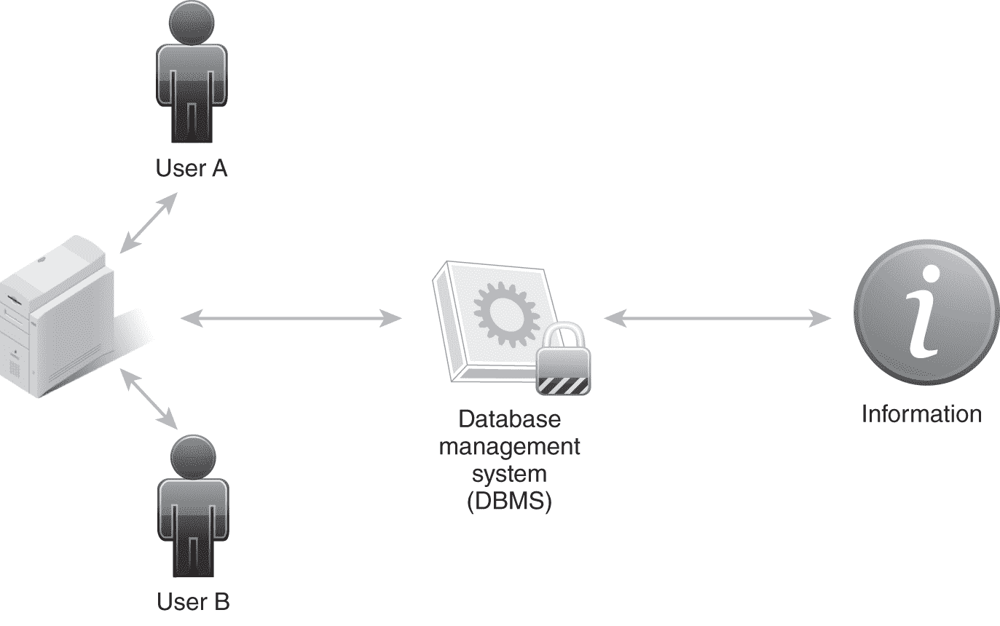

`FIGURE 1-3` 完整性原则。

#### Authentication

`Authentication` 是验证用户或设备身份的能力。你可能每天都会看到身份验证的应用。例如，你可能会使用 Google Gmail 或 Yahoo! Mail 等在线电子邮件系统。保护你电子邮件的是用户 ID 和密码，这是你在注册服务时选择的。这个用户 ID 和密码就是你访问电子邮件服务的身份验证方法。

不仅是人类需要验证身份。计算机经常代表我们交换信息或处理交易。当你睡觉时，计算机系统可能正在打印你的工资支票。这些功能许多都是敏感的。作为安全专业人员，你应该确保只有这些授权进程在访问这些敏感信息。这意味着这些计算机和自动化过程需要经过身份验证。就像个人一样，在授予数据访问权限之前，它们的身份会经过验证。例如，运行在 `Microsoft Windows Server` 中的服务可能被分配 ID。网络设备可以在网络协议级别交换信息以验证身份。这些非人类 ID 通常具有较高的权限。这意味着它们有大量权限访问多个系统的数据。严格控制对这些非人类账户的访问至关重要。

维护良好的身份验证过程涉及很多工作，例如强制用户定期更改密码，以及强制密码复杂程度的规则。这些家务工作正变得越来越简单和自动化。成功的关键关键因素之一是拥有难以被伪造或猜测的凭据。一个很好的例子是只有用户知道的强密码。此外，这些凭据不能在网络上明文传输。例如，通过明文发送到网络上的密码可以通过网络嗅探器观察到。在典型的业务环境中，如果实现了这两个目标，以及之前讨论的许多家务条目，你就可以开始有合理的把握，知道谁在访问你的计算机系统了。

#### Availability

`Availability` 确保信息对获得授权的用户和设备可用。可用性面临的一个主要挑战是 `denial of service (DoS) attacks` 的扩散。近年来，`DoS` 攻击的技术复杂性和强度显著增加。这些攻击用大量信息淹没服务器，使其处理能力过载，导致服务器崩溃。因此，服务变得不可用。攻击点不是窃取信息，而是使系统崩溃。`DoS` 攻击通常通过淹没服务器的信息量来衡量。典型的单位是 `Gbps`（每秒千比特）。`DoS` 攻击规模在不断增长。2018 年，据报道，平均 `DoS` 攻击大于 `26 Gbps`，最大攻击规模为 `359 Gbps`。然而，在 2019 年，平均规模缩小了 85%，最大攻击规模缩小了 24%。

最初，信息所有者必须确定可用性需求。所有者必须确定谁需要访问数据以及何时访问。数据 24/7 可用是否至关重要，还是 9 点到 5 点可用即可？它是否需要对远程用户或仅对本地用户可用？然后需要将原始业务需求转化为技术和运营承诺，例如系统可用的时间段。

在确定可用性需求后，你必须评估威胁并实施适当的控制。与服务器相关的提供了互连性和远程访问的网络设备。对这些设备的正确配置将允许需要时访问信息。

#### Nonrepudiation

`Nonrepudiation` 既是一个法律术语，也是信息安全中的一个概念。其理念很简单——`nonrepudiation` 是确保个人无法否认数字签署了文档或参与了某项交易。作为一个法律概念，它是证据的总和，能够让法院满意地证明该交易只有一个人执行。在互联网出现之前，个人在这个问题上非常挣扎。当你签署法律文件时，通常需要公证员。公证员的存在是为了参与收集证据的不可否认过程。他或她会索取你的身份证明复印件并匹配签名。有些人甚至会采集指纹。这一切努力都是为了让你以后不能声称不是你签署的。

那么你如何电子地签署文档呢？领先的方法是使用数字签名。如果使用得当，电子签名无法伪造，并带有数字时间戳。最重要的是，文档接收者可以验证它是你的数字签名。但数字签名也依赖于必须保护的私钥。

然而，许多最终电子交易并不使用数字签名。事实上，在线银行交易、资金转账或股票交易通常依赖其他技术，包括强身份验证。最终，你想证明只有那个人才能执行该交易。该领域的领先供应商是 `IBM`，其安全消息的旗舰产品称为 `Websphere`。`IBM` 将 `nonrepudiation` 定义为端到端服务，“可以被视为身份识别和验证服务的扩展”。虽然安全消息确保了交易的收集和交付，但消耗消息的应用程序仍然必须被证明是安全的。

《联邦电子签名法案》（Federal ESIGN Act）将电子签名定义为“附在合同或其他记录上或与其逻辑关联，并由具有签署该记录意图的人执行或采用的电子声音、符号或过程”。要了解更多信息，请访问 [`www.fdic.gov/regulations/compliance/manual/10/x-3.1.pdf`](https://www.fdic.gov/regulations/compliance/manual/10/x-3.1.pdf)。

需要注意的是，CIA 三角形虽然信息安全中被广泛使用，但它是一个简单的模型，并且已经有了扩展。麦库伯立方体（McCumber cube）就是 CIA 三角形的一个值得讨论的扩展。它在 2004 年的《IT 系统安全风险评估与管理：结构化方法》一书中得到了详细描述。它将安全视为一个三维立方体。该概念是为传统的 CIA 三角形增加更多维度。除了 CIA 三要素的三个方面外，它还考虑了信息的位置。信息是在传输、存储还是处理过程中？然后是安全方面。问题出在技术、政策和程序，还是教育培训和意识上？因此，人们可能会检查传输过程中数据机密性的策略和程序方面。或者可能会处理存储中信息完整性的技术问题。麦库伯立方体可以在 `图 1-4` 中看到。

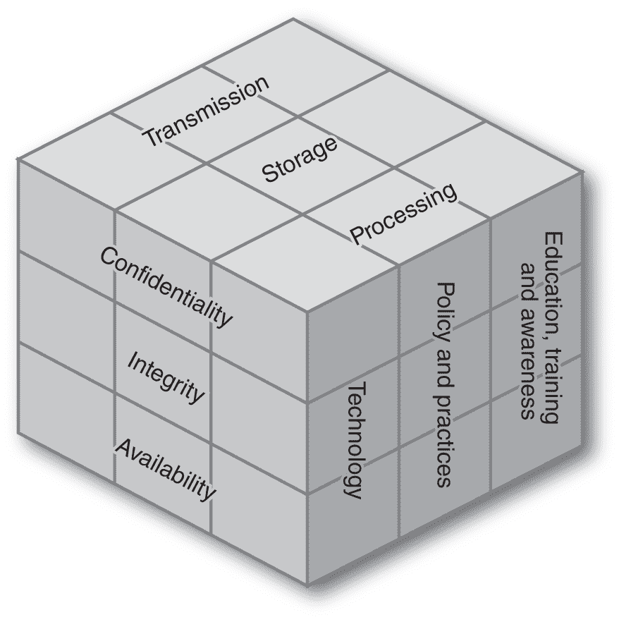

**图 1-4** 麦库伯立方体。

没有任何一种技术是完美无缺的，因此许多安全专家认为，应用多个将交易关联到单个个人的安全服务是满足业务需求的最佳方式。事实是，你收集的证据越多，该个人就越难以否认。理想情况下，企业希望证明是你的电脑、你的 ID、你的数字签名和你的交易是不可否认的。

### 什么是治理？

`治理` 既是一个概念，也是组织为确保符合其政策、流程、标准和指南而采取的一系列特定行动。目标是满足业务需求；然而，治理的重点是确保每个人都遵守既定规则。治理中的假设是这些业务目标已被充分理解并内化到规则中。因此，通过遵守规则，你就实现了这些业务目标。良好的治理应该包含对业务的良好理解，因此当执行规则不合逻辑时，可以对治理流程进行调整。

真正意义上的治理远不止是一个概念。组织会建立正式流程并创建委员会作为关口。这些是切实的行动，共同定义了组织的治理结构。治理是一系列检查点的集合，这些检查点执行着 `质量控制 (QC)` 或 `质量保证 (QA)` 功能。在这一语境下，如果治理机构必须批准某项行动，那么它就是 QA 功能。如果治理机构在事后审查行动，那么它就是 QC 功能。这种区别对于理解如何管理控制至关重要。这些术语经常被误解：

* 质量`保证`（assurance）功能充当预防性控制。当 QA 工作良好时，它可以防止错误发生。
* 质量`控制`（control）功能充当检测性控制。当 QC 工作良好时，它通过从过去的错误中学习的机会随时间推移提高质量。

从森林与树木的角度来看待。当你考虑 QA 时，考虑的是观察每棵树以看它是否健康。相反，当你考虑 QC 时，你检查的是整个森林是否健康。

治理包含一系列监督流程和委员会。治理共同确保了问责制，监控了活动并记录了正在发生的情况。隐含的也是，当规则被忽视或未被妥善应用时，治理结构将采取行动。

### 为什么治理很重要？

良好的治理为规则正被遵守提供了保证和信心。谁需要这种保证？首先，高管理层需要知道其业务目标正在实现。如果规则得到了遵守，就有保证承诺给业务的价值正在交付。此外，高管理层还需要知道组织所做的投资正在得到妥善管理。其次，监管机构查看治理结构以确保对股东、客户和公众的风险得到了妥善管理。

有效的治理将 QA 和 QC 作为文化的一部分。通过将这些概念嵌入整个组织，组织提升了意识并提供了控制证据。这对于监管机构来说尤为重要。监管机构希望看到控制被一致地应用。他们希望知道管理层意识到了问题，并且公司没有采取可能导致违法的捷径。通常情况下，监管机构对公司拥有强大治理的信心越大，使用的监管监督就越少。这在医疗保健和金融服务等高度监管的行业中尤为真实。缺乏强有治理意味着扩展到新市场的机会减少。相反，良好的治理意味着业务机会的扩大。

对组织的治理流程进行评估并不常见。这些评估可以是自评估、内部审计或监管审查。例如，组织内部的运营风险或合规职能可能会进行审查。

治理的重要性在配置管理过程中是显而易见的。通过控制系统配置，以前缓解的漏洞将保持在控制之中。这导致了更高的运行时间。变更管理通常同时采用 QA 和 QC 功能。QA 治理惯例会审查并批准每项变更。而 QC 功能则审查由变更引起的停机次数并试图改进记录，QA 功能则能从经验教训中获益。治理对组织的日常运行至关重要，不应被视为一种偶然发生的事件。将年度年度成本整合到 `日常业务运营 (BAU)` 预算中，可以防止治理提供的收益被视为意外支出。

### 什么是信息系统策略？

安全策略实际上是多个文档的集合。它们通常从一组原则开始，这些原则跨企业传递通用规则。治理惯例使用这些原则来解释更详细的策略。原则用简单的语言表达。一个例子是通过在授予访问时采用“按需知道”的方法来表达风险偏好。从这些安全原则衍生出了安全策略，详细说明了如何将原则付诸实践。

ISS 策略应该涵盖对系统的每一个威胁。它们应该包括保护人员、信息和物理资产。策略还应包括行为准则，例如可接受使用策略。策略还必须为用户制定规则，定义违规后果，并最大限度地减少对组织的风险。执行情况将取决于策略中所定义的角色和职责的清晰度。记住，你需要让人员对策略负责。当不清楚谁负责时，策略就会无法执行。策略框架中的其他文档提供了额外的支持。

一个框架中通常有六种类型的文档：

*   **原则（Principles）**——确立高层基调以及执行策略的权威
*   **策略（Policy）**——说明组织如何开展业务功能及交易以获得预期结果的文档
*   **标准（Standard）**——既定的行业规范或方法，可以是全公司实施的程序性标准或技术标准
*   **程序（Procedure）**——描述实现某一过程所需步骤的书面陈述
*   **指南（Guideline）**——策略、标准或程序建议遵循但可选的参数
*   **定义（Definitions）**——定义策略文档中所用术语的陈述，并设定策略文档的背景

许多人将所有这些文档称为“安全策略”，但事实并非如此。图 1-5** 描述了这六类文档之间的关系。该图显示程序和指南支持策略。此外，图表明标准影响策略。这六份文档分为两组：内部和外部。标准是外部文档。其他五个是内部文档。

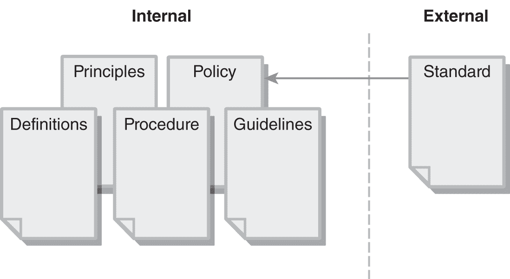

**图 1-5** 内部与外部文档。

标准可以是一个实施解决方案的过程或方法。这涉及具有经证明性能记录的技术、硬件或软件。这可以是全公司实施的程序性标准、实施标准或技术部署标准。对于 ISS 而言，标准是信息系统必须运行的准则集。标准对策略的制定产生外部影响。组织可以拥有内部标准。通常这些标准是根据某些外部最佳实践为组织量身定制的。标准的恰当应用可以确保考虑了行业内的经验教训。

### 注意

标准是评估组织合规性的衡量尺度。联邦信息处理标准（FIPS）出版物就是标准的示例。你可以在网上查看 [`www.nist.gov/itl/publications-0/federal-information-processing-standards-fips`](https://www.nist.gov/itl/publications-0/federal-information-processing-standards-fips)。

策略原则文档传达了跨整个组织的通用规则。原则用通俗的英语编写，关注关键风险或行为。阅读安全原则时，请将其视为高层管理人员表达他们的目标和目的。它们表达了组织的核心价值观，通常包括以下领域。策略传达了跨整个组织的通用规则。原则用通俗的英语编写，关注关键风险或行为。阅读安全原则时，请将其视为高层管理人员表达他们的目标和目的。它们表达了组织的核心价值观，通常包括以下领域。

### 注意

程序是描述实现某一过程所需步骤的书面陈述。指南是策略、标准或程序建议遵循但可选的参数。策略字典是定义策略文档中所用术语的陈述，并设定策略文档的解释背景。

现在你已经知道策略是什么了，让我们讨论策略与标准之间的区别吧。

显然，策略是信息系统安全的关键组成部分。因此，制定策略是一项必须以有效方式执行的重要任务。除了之前提到的 `COBIT` 外，其他工具也有助于制定策略。国际标准化组织（`ISO`）制定了 `ISO 17799` 标准，标题为“信息技术—安全技术—信息安全管理规范”。该标准确立了控制目标和控制的最佳实践，包括安全策略。这为创建信息系统策略指导提供了一个极佳的起点。

另一个来源是美国国家标准技术研究院（`NIST`）的 `800-12`，标题为“信息安全简介”。该标准的第 5 章完全关于信息安全策略的。它为制定策略提供了通用指南。还涵盖了特定的策略问题，如电子邮件隐私、自备设备（`BYOD`）和社交媒体。结合 `NIST 800-12` 和 `ISO 17799` 查看将使你对策略标准有坚实的理解。


除了 `ISO 17799` 和 `NIST 800-12` 等标准外，还有其他策略信息来源。例如，`SANS` 组织提供了许多可以下载的模板；这些模板位于 [`www.sans.org/security-resources/policies`](https://www.sans.org/security-resources/policies)。如果你是刚开始制定策略，查看模板和其他组织的策略是有帮助的。

## 信息系统安全策略在组织中处于什么位置？

信息安全策略的治理适用于更多的管理层。因此，业务和技术领导者紧密合作，以确保价值的交付。然而，信息安全策略的实际实施要复杂得多，需要深层次的技术知识。`ISS` 策略的实施通常由组织的技术团队负责。随着技术根植今日社会，保护信息是每个人的关注。正如你发现信息系统安全的那样，需要考虑的不仅仅是电线和计算机。

组织对信息系统的依赖程度与对人力资源的依赖相当。在生产设施中，计算机控制着大多数制造设备。在核电厂中，发电和污染控制依赖于控制系统，以确保电力流安全地维持灯光。在法律事务所，助理通过远程巨大的在线数据库研究数以千计的文件和案例法。这些只是信息系统每天产生影响的几个例子。正如你所见，技术继续成为我们日常生活中更大的部分。

`FIGURE 1-6` 显示了典型 IT 基础设施的七个领域。每个领域都有独特的策略要求。在每个领域中，`ISS` 策略对于维护安全的工作环境至关重要，保护保护个人需求关键的信息资源。当涉及外部供应商（如云服务供应商）时，理解和保护网络变得越来越困难。你可能无法直接访问你网络的供应商系统，因此你可能无法确保网络得到完全保护。

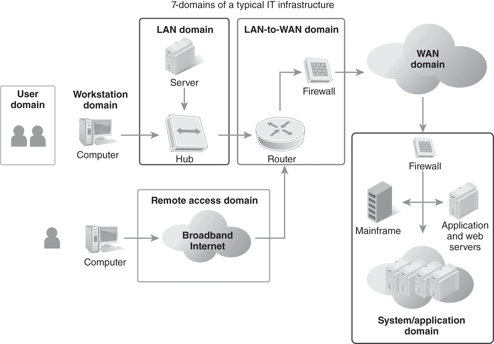

## 信息系统安全策略的重要性

`ISS` 策略确保流经整个系统的信息得到一致的保护。信息并不总是静态的，往往在处理过程中发生变化。信息在整个过程中必须始终受到保护。物理和逻辑控制必须共同工作以保护数据；然而，情况并非总是如此。拥有特权访问权限的不满员工怎么办？你如何保护资源免受此类授权访问人员的影响？物理安全是有局限性的，应该被视为若干控制层之一。

以下是使用和执行安全策略的基础性原因：

*   **保护系统免受内部威胁**——“内部威胁”指的是具有授权访问权限的用户。这些特权用户有能力和权限对系统造成破坏。内部威胁可能是任何信息系统面临的最大威胁。策略有助于监控授权用户的活动。

*   **保护静态数据和传输中数据**——数据通常处于两种状态之一——[静态数据](#29_glossary.xhtml#gloss58)，例如在备份磁带上，或[传输中的数据](#29_glossary.xhtml#gloss62)，例如在跨网络传输时。本质上，策略有助于随时保护数据。

*   **控制 IT 基础设施的变化**——变化是好事。管理变化是更好。这减少了漏洞引入系统的风险。

*   **防御业务**——确保业务能够交付可靠的产品和/或服务，将保护公司的品牌。

安全策略加强了组织随时保护其信息资源的能力，同时在员工需要时提供安全访问。策略允许对系统进行控制、更改，并减少大部分系统风险。

### 支持运营成功的策略

运营成功的定义在不同组织之间可能有所不同。政府对利益相关者的看法可能与私营行业不同。然而，所有类型的组织都有共同关注点：是否涉及成本？成本可以通过部署策略的成本或未实施策略的成本来衡量。缺乏策略的成本通常以罚金和法律费用来衡量。

表达成本的有效方法是通过风险。通过花费 `X`，你可以减少 `Y` 量的风险。例如，花费 50,000 美元来减少面临 500,000 美元罚款的高风险是合理的。这也允许以控制的方式进行更改。它确保了只有增加真正价值的策略才被采纳。良好的策略包含了对事件处理的支持。遏制事件有助于减少组织的暴露时间。可以立即开始识别事件原因，并可能确定攻击者。解决方案将更加及时，允许资源在更短时间内可用。正如大多数业务人士对你说的那样，“时间就是金钱。”

通过控制成本并关注最重要的风险，组织可以消除浪费并支持运营成功。组织的关键风险随着时间的推移而减少，这在部分通过拥有良好的事件后处理流程来实现。

### 在没有策略的情况下经营业务的挑战

当组织缺乏策略时，其运营将变得不可预测。个人将根据他们当时认为是好主意来操作。想象一支没有方向的赛艇队。每个人都有一把桨，试图到达目的地并避免沿途的障碍。即使你设法到达了，想想由于船的一侧比另一侧划得更快、更紧迫而绕圈的浪费。这假设你能让团队同步划。这和策略并无区别。策略允许组织朝着同一个方向划行，并在团队间应用相同的规则、优先级和业务目标。

以下是在没有策略的情况下你可能会预期的几个挑战：

*   **更高的成本**——由于精力浪费和大量的重复工作
*   **客户不满意**——由于个人对何为正确或良好做出自己的判断，导致无法生产质量产品。
*   **缺乏监管合规性**——个人决定何时以及如何遵守法律指令。

结果很可能是导致法律诉讼，产生罚款和业务损失。根据行业的不同，监管机构可能拥有关闭业务的权限。

让我们来看一个典型的信用卡泄露事件。假设一名黑客获取了 100 万张信用卡的数据。此外，假设该黑客访问了如社会安全号等个人信息。同时，假设该公司在保护其系统方面未遵守行业规范。安全策略的缺失以及导致的结果管理风险缺乏系统化方法，使得这些系统的漏洞未被检测到。这可能导致客户和股东的诉讼。

#### 不实施策略的危险

如果安全策略是为了确保信息得到妥善保护，那么未能实施策略将使信息处于脆弱状态。这些信息可能会受到攻击或处理不当。有些雇主说：“我们的员工是他们领域最聪明的，”或者，“我们多年来一直这样运行，没有出现过任何问题（保佑自己）”。这些也是对“为什么要实施策略？”这一问题的回答。

不实施策略的危险在于意想不到且不符合理想的结果。在发生 `ISS` 事件时，员工将不知道该做什么、如何反应或通知谁。这将导致通用的混乱。当他们试图寻找这些问题的答案时，攻击者可能正在从系统中复制更多信息。

良好的安全策略包括提高对安全益处的意识。这包括了对员工的益处。当实施良好的策略时，它们会保护客户和员工。在良好的策略下，即使发生了数据泄露，损害也可能是有限的。

## 实施错误策略的危险

与不实施策略类似，实施错误的策略也一样。你应该制定策略来处理适当的流程，否则可能会产生不利后果。例如，考虑一项规定所有员工都应获得系统管理员权限的策略。在这一策略下，信息安全的基本原则无法得到保证。用户将拥有所有信息，这可能不是设计意图，也不是最佳的安全实践。安全策略通常是一系列策略，因此请确保它们之间互不冲突。在发生数据泄露时，所有拥有权限的员工立即成为嫌疑对象。这通常会延迟调查。

#### 你什么时候需要信息系统安全策略？

“时机就是一切。”这最可能是喜剧演员的第一准则。策略的及时性也同样。如果你的业务模式是养鸡，为什么要实施一项关于挤奶牛的策略呢？可能你的农场有一天会扩大经营，但在扩张发生之前，没有理由编写策略。

某些时候对 `ISS` 策略的需求是显而易见的。总是需要基础的安全策略。这包括定义基本的数据处理策略和可接受使用策略。安全策略需要确保在没有相应支持策略的情况下不引入新技术。另一个考虑因素是，你可能有一个每天都会发生的流程，并且所有相关员工都熟悉该流程。员工可能会修改该流程。但如果没有配置管理控制，修改可能会使安全的系统变得不安全。或者，一个重要的流程可能记录，尽管员工知道所有步骤。这是正式化书面程序的绝佳机会。

### 业务流程重组 (BPR)

由于业务流程不断受到审查以进行改进。随着业务流程生命周期的完成，流程得到了改进和变化；然而，相关的策略也必须进行更改和更新。通常，在生命周期期间识别出的相关策略和程序属于操作性质。支持操作的策略（如安全策略）并不总是被考虑到。未能更新这些策略和程序会为错误或灾难留出机会窗口。

流程的变化可能剧烈到足以引入新的安全漏洞。如果流程内运行的设备完全改变，旧的安全漏洞就会再次出现。因此，确保在重组任何业务流程时也审视安全性是至关重要的。这将确保 `business process reengineering (BPR)` 包含了 `ISS` 相关问题，并根据需要更新这些策略和程序。

`FIGURE 1-7` 显示了 BPR 的四个阶段。阶段 1 是规划阶段。阶段 2 是创建或修改流程基线。阶段 3 进行研究和基准测试。阶段 4 开发未来的流程；正是在这个阶段编写新策略或更新现有策略。


**图 1-7** 基础业务流程重组。

### 持续改进

你可以将 `continuous improvement` 视为寻找更好的方法或作为吸取的教训。当员工发现改进系统或流程的新方法时，你需要一种方法捕捉他们的想法。持续改进的概念适用于 `ISS` 和 `IA` 的所有方面。例如，在查看可用性问题时，你可能会遇到身份验证漏洞。无论如何发现该漏洞或风险，你都需要捕捉这些信息，评估其重要性并应用改进。通常，教训源于有效的治理。质量控制将反映哪些效果良好，哪些效果不好。不佳的部分代表了吸取的教训。有时这意味着要更改策略。当策略目标无法实现时，执行就会变得不可能，整个安全策略框架会被削弱。

“寻找更好方法”的驱动力不应该是系统崩溃或泄露。在这些情况下，你可能不得不处理来自事件的教训。将持续改进视为一个建议箱。员工识别所需的更改并写下建议。建议将被采纳或拒绝。如果被采纳，它将进入正式的重组流程。

#### 针对问题做出更改

即使有完善的策略框架，问题也会发生。根据问题的严重程度，策略的实施或更改可以在过程中的任何时候发生。这种方式带来的策略变化有助于避免未来的事件发生。在完美的环境中，策略在事件发生之前就已经到位；然而，大多数组织并非在完美环境中运行。一旦发生了策略未覆盖的事件，就会进行事件分析，并起拟建议。对于性质上非关键的事件，策略起草将与修复过程同步进行。如果性质上更关键，则应在编写策略之前进行修复。

#### 为什么强制执行并赢得策略的接受具有挑战性

政策的接受和执行面临着许多障碍。如果没有对政策的接受和执行，员工可能会处于放任状态。这与业务目标背道而驰。这将不可避免地导致员工不重视政策。员工走捷径或忽略政策可能会产生严重影响。在组织内部，必须从顶层到底获得各级的支持。员工必须在 `ISS` 中拥有利益。他们必须理解这些政策和程序如何影响他们以及他们的业务领域。如果他们在参与创建或批准政策方面拥有利益，他们更有可能接受这些政策。以下是政策接受挑战的列表：

> **注意**
>
> 实施政策的最大障碍是人为因素。人类必须首先充分理解政策。然后必须实施并遵守政策。这两项活动都可能因为人为错误而失败。

*   **各层级的组织支持**——如果没有组织各层级的凝聚性支持，接受和执行将失败。
*   **让员工拥有利益关系**——必须有一些东西来激励员工参与这一过程。这可以是参与的某种奖励，也可以是在不参与时的纪律处分。
*   **政策意识与理解**——员工必须知道政策的存在并理解其含义。编写文档以使这一点变得简单可能是具有挑战性的。
*   **奖励与认可行为**——员工必须看到良好的榜样来模仿他们的行为。
*   **追究个人责任**——员工必须知道重复违规会有后果。

政策的执行可能与政策的接受一样困难。执行具有挑战性的原因有几个。编写政策的语言可能足够模糊以至于无法执行。违规行为未被报告，这通常是缺乏执行的主要原因之一。组织中的其他业务部门（如人力资源或法律部门）可能不是执行过程的一部分。这可能会给员工带来忽视政策或执行与政策违背行为的“许可”。以下列表总结了政策执行的挑战：

*   政策编写得不佳
*   未报告违规行为
*   关键部门和管理层缺乏执行参与
*   缺乏明确的角色和职责

## 章节总结

本章定义了基础 `ISS` 概念和关键术语。你学习了 `ISS` 管理的核心原则，以确保机密性、完整性、可用性、认证和不可否认性。此外，你读到信息系统安全 (`ISS`) 和信息保证 (`IA`) 是两个独立但相似的概念。与 `IA` 和 `ISS` 相关的是治理。治理确保人们遵守规则，例如政策、法规、标准和程序。你还读到了质量控制和质量保证的重要性。

在几种情况下需要考虑安全政策。这些机会包括：

*   新业务流程
*   现有业务流程的变更
*   业务流程重组 (`BPR`)
*   事件发生

你读到了政策在组织内部如何定位，以满足运营和治理要求。这包括跨越整个业务范围的所有七个领域。`ISS` 政策非常重要，原因有几点。首要原因是控制对信息的授权访问。另一个原因是控制系统的变更。你读到了如何从威胁和漏洞的角度来表达风险。最后，你学习了政策的接受和执行，以及使这些过程变得困难的因素。政策的认同和执行需要各级员工的支持。执行也取决于有效的政策编写。

## 核心概念与术语

- `Authentication` (认证)
- `Availability` (可用性)
- `Business as usual (BAU)` (业务常态)
- `Business process reengineering (BPR)` (业务流程重组)
- `Change management` (变更管理)
- `Confidentiality` (机密性)
- `Continuous improvement` (持续改进)
- `Data at rest` (静态数据)
- `Data in transit` (传输中数据)
- `Entitlement` (权限)
- `Governance` (治理)
- `Guideline` (指南)
- `Information assurance (IA)` (信息保证)
- `Information systems security (ISS)` (信息系统安全)
- `Information systems security management life cycle` (信息系统安全管理生命周期)
- `Information systems security policies` (信息系统安全政策)
- `Integrity` (完整性)
- `Need-to-know principle` (按需原则)
- `Nonrepudiation` (不可否认性)
- `Policy` (政策)
- `Policy definitions document` (政策定义文档)
- `Policy framework` (政策框架)
- `Policy principles document` (政策原则文档)
- `Procedure` (程序)
- `Quality assurance (QA)` (质量保证)
- `Quality control (QC)` (质量控制)
- `Risk` (风险)
- `Service level agreement (SLA)` (服务水平协议)
- `Standard` (标准)
- `Threat` (威胁)
- `Vulnerability` (漏洞)

## 第 1 章评估

1. John 在会计部门工作，但经常去其他地点出差。他必须在早上向首席执行官 (`CEO`) 上季度的数字。他忘记更新桌面上的 PowerPoint 演示文稿了。问题在哪里？

   1. 未授权访问系统
   2. 数据的完整性
   3. 数据的可用性
   4. 数据的不可否认性
   5. 未授权使用系统

2. 治理是确保实体符合政策、法规、_ 和程序的做法。

3. COBIT 是一个广泛接受的国际最佳实践政策框架。

   1. 正确
   2. 错误

4. 以下哪些项通常被接受为 IA 原则而非 ISS 原则？（选择两个）

   1. 机密性
   2. 完整性
   3. 可用性
   4. 认证
   5. 不可否认性

5. Greg 开发了一个关于如何操作和备份新财务部门存储区域网络的文档。在文中，他列出了系统开关机所需的步骤以及配置备份带单元的步骤。Greg 写了一份

6. 什么时候应该最初编写无线安全政策？

   1. 当行业发布新的无线标准时
   2. 当供应商向业务部门无线解决方案时
   3. 当下一代无线技术发布时
   4. 在公司决定实施无线并在安装之前

7. 一家玩具公司正在对其网站进行急需的翻新。新网站已准备就。现在是 10 月底，公司希望在假期购物潮前准备好网站。年底假期季节占了其年度收入的 80%。在这个时期，哪个过程对这家玩具公司特别重要？

   1. 持续改进
   2. 业务流程重组
   3. 变更管理
   4. 信息安全系统生命周期

8. 政策的实施是一项挑战。实施政策的最大障碍是人为 因素。

9. 信息安全策略应当支持业务运营。这些策略侧重于为系统中的信息提供一致的保护。这是通过控制信息系统的多个方面实现的，这些方面在某些时刻直接或间接地影响正常运行。虽然支持运营有许多不同的益处，但某些比其他更为普遍。以下哪些项是信息安全策略中扩展到支持业务运营的方面？

   1. 控制 IT 基础设施的变更
   2. 保护静态数据和传输中的数据
   3. 防止系统免受内部威胁的影响
   4. 仅 B 和 `C`
   5. A、`B` 和 `C`

10. Trina 是服务器备份区域的管理员。她正在审查场外存储设施合同的有效性。该合同包含的内容如所需的存储空间、介质的取取与交付、停机期间的响应时间以及设施内介质的安全性。该合同是信息安全的一个示例。

    1. 正确
    2. 错误

11. 系统配置中发现了一个弱点，可能会导致客户端数据暴露给未经授权的用户。以下哪项最准确地描述了这个问题？

    1. 发现了一个新威胁。
    2. 发现了一个新漏洞。
    3. 发现了一个新风险。
    4. A 和 `B`
    5. `B` 和 `C`
    6. A、`B` 和 `C`

## 尾注

1. Fadilpašić, Sead, “DDoS Attacks Are Getting Even Larger,” ITProPortal, 2018 年 9 月 13 日，[`https://www.itproportal.com/news/ddos-attacks-are-getting-even-larger/`](https://www.itproportal.com/news/ddos-attacks-are-getting-even-larger/)，访问于 2020 年 4 月 14 日。


## 信息安全策略的业务驱动因素

## 第 2 章

随着时间的推移，技术与业务的融合日益紧密。企业利用技术进行数据管理、财务交易、广告、客户服务以及许多其他活动已成为常态。几乎所有企业和政府都使用技术支持其运营。在过去的几十年里，对信息技术的依赖增长之快，以至于人们很难想象没有技术的生活。

想象一下脱离技术会是什么样的。在过去的几十年里，对信息技术的依赖增长之快，以至于人们很难想象没有技术的生活。

信息安全的目标不是消除风险。信息安全的目标是管理风险。对于组织而言，风险水平是可以接受的。对于组织而言，风险水平是可以接受的。对于组织而言，风险水平是可以接受的。这些驱动因素包括：

* `成本`
* `客户满意度`
* `合规性`
* `衡量`

### 第 2 章主题

本章涵盖以下内容：

* 什么是业务驱动因素以及它为什么重要
* 维护合规性的含义
* 什么是业务风险暴露
* 什么是业务责任
* 什么是运营一致性以及为什么重要

### 第 2 章目标

完成本章后，你将能够：

* 描述基本的业务风险
* 解释业务风险暴露与业务责任之间的区别
* 描述业务使用的一些技术
* 解释与运营一致性相关的问题
* 描述业务风险与安全策略之间的关系

## 为什么业务驱动因素很重要？

计算机系统不断演进并变得越来越复杂。这使得企业难以理解支持它的技术。安全漏洞会对底线产生重大影响。以下是组织需要良好安全策略的三个例子：

### 备注

业务指的是公共或私营组织的运营。

美国零售巨头 Target 公司在美国拥有超过 1800 家门店，在 2013 年假期购物期间遭受了重大数据泄露。这次泄露使估计 4000 万客户的财务信息面临风险。这场混乱给公司带来的成本高达 2000 亿美元。

2018 年 9 月，发现英国航空（British Airways）遭到入侵，攻击者向一个不安全的网站注入恶意代码，捕获了客户的个人和支付数据。据信，泄露影响了约 50 万名客户。除了直接损害外，英国航空还根据《通用数据保护条例》（GDPR）面临了 2.3 亿美元的罚款。

2019 年，Capitol One 经历了一次大规模数据泄露，攻击者访问了超过 1 亿个账户和信用卡申请。除了这次攻击造成的直接损害外，它还对公司的声誉造成了巨大伤害。截至本文写作期间，该泄露仍在调查中，完整的补救措施尚未公布。

人们可能会认为，这些案例是安全策略失败的结果。这些数据泄露事件至少在某种程度上归因于未能制定适当的策略或未能执行这些策略。2019 年，Egress 对数据泄露进行了调查。70%的受访者认为，在过去的 12 个月内，员工无意让公司数据面临风险。2018 年，Ponemon 研究所对中小企业的网络安全进行了调查。在某项调查中，受访者表示，由于疏忽导致数据泄露的风险正在恶化。61%的人表示，疏忽员工使公司面临勒索软件风险，这一数字高于 2017 年（当时有 58%的受访者将员工疏忽视为勒索软件攻击的直接原因）。尽管每年的百分比可能有所不同，但重点在于，仅仅拥有良好的策略是不够的。企业必须具备自我意识，并衡量这些策略是否得到了遵守。企业无法承受因员工未能遵守策略而导致的数据泄露。

机构日益关注如何管理和减少信息风险。安全策略不再仅仅被视为技术问题。机构还希望安全策略能够反映他们希望处理信息的方式。从整体来看，一个机构的安全策略显示了其保护信息的承诺。良好的安全策略能保持业务的健康运行。实施此类策略的一些基本考虑因素包括：

* **成本 (Cost)**——实施和维护控制措施的成本
* **影响 (Impact)**——对业务服务客户能力的影响
* **法规 (Regulation)**——在需要时，机构向监管机构辩护其策略和实践的能力
* **采纳 (Adoption)**——员工理解并愿意遵守策略的程度——换句话说，“让他们认同这些策略”

策略只有在被执行时才是有效的。管理层不喜欢惊喜。事后发现安全策略成本过高或对客户产生了负面影响是不可接受的。为了避免这种情况，管理层需要参与安全策略的制定和实施。即使在理想的情况下，数据也可能被盗。通过拥有良好的安全策略，机构能够向公众和法庭对其行为进行辩护。例如，一份警告员工其信息可能被监控的电子邮件安全策略，可以帮助抵御针对侵犯隐私的诉讼。

### 警告

就法律和监管问题制定策略声明是一项非常敏感的工作。务必让法务部门审阅策略草案的措辞。此外，了解部门希望如何标记策略的工作副本——例如标记为“草案”或“机密草案”。

## 维护合规性

`compliance` 一词是指个人或企业遵守一组规则的程度。安全策略合规意味着遵守安全策略。很难判断一个机构是否遵守了每一项安全策略。要称一个机构是合规，你必须能够验证安全策略中的要求已应用于安全控制和信息中。由于数字信息的数量巨大，困难随之而来。即使是只有几百名员工的小型企业也可能拥有数万个文件。这些文件在服务器、桌面、笔记本电脑、备份介质、通用总线（USB）驱动器等之间传输。在拥有数千名员工和数百万文件的大型中，问题变得更加复杂。在不断增长的复杂环境中，确切知道哪些数据在何被捕获以及如何被使用是非常的。企业不仅关注员工可以访问的文件，还关注暴露给供应商和供应商的文件。许多机构安全问题的一个常见问题是：可能有充分的策略，但没有有效的机制来确保对这些策略的合规。如果没有某些合规保证，即使是最好的策略也几乎毫无用处。

#### 合规性需要适当的安全控制

安全策略的关键在于能够根据一组控制措施来衡量合规性。安全控制定义了你`如何`保护信息。安全策略应该定义你`为何`设定该目标。这有效地将业务需求与安全控制联系起来。安全策略还定义了将实现`什么类型`的保护。你实施安全策略的方式可以有所不同。例如，实施强身份验证取决于几个因素。你理解“强身份验证”的含义吗？你了解你的特定应用有哪些技术选择吗？在这些选择中，你的机构是否倾向于标准化？你所做的选择是否经过了批准？你如何衡量选择了正确的方案？你如何衡量是否遵守了策略和流程？

`TABLE 2-1` 提供了一个高层安全策略和控制声明的概念性示例。策略必须描述实现合规所需的清晰行动。

**表 2-1** 安全策略与控制组件示例

| 策略或控制 | 回答 | 问题 |
| :--- | :--- | :--- |
| 安全策略 | 为什么 | 证券交易委员会（SEC）根据 17A-4 规则要求股票交易员与客户的对话必须进行记录并保留。在这种情况下中，其目的是确保与客户交易的详细记录。建立记录允许监管机构对披露规则执行情况进行审计。 |
| 安全策略 | 什么 | 为了确保合规，所有交易员应仅通过公司电话或公司电子邮件系统与客户通信。 |
| 安全控制 | 如何 | 使用防火墙阻止交易员访问互联网，网页浏览和公司电子邮件除外。对于所有安全策略，“如何”都是一个关键组成。 |
| 安全控制 | 衡量 | 交易员访问互联网的所有尝试都应被记录。经理应每月审查一次每个交易员的日志，以确保合规。有效的指标是确保策略合规最清晰的方式。 |

要了解一个组织是否符合安全策略，你必须衡量其合规水平。合规水平会根据具体的衡量内容而变化。请考虑表 2-1 中的示例。你可以通过验证防火墙规则是否存在来对合规性进行简单测量；然而，简单的测量可能不够准确或具有误导性。例如，假设有四个防火墙允许交易员访问互联网。你检查了每个防火墙，发现其中三个都包含了表 2-1 中描述的正确防火墙规则。初一看，简单的测量表明该业务对该策略的合规率为 75%。进一步检查，你发现第四个防火墙没有遵循所需的规则。该防火墙占了交易员互联网流量的 70%。这一新事实可能意味着业务的合规率仅为 30%。

更准确的测量能让业务更有信心地理解其风险。这种对风险的清晰思维通常会导致对解决方案达成共识。即使在没有可用解决方案的情况下，对风险的深刻理解也能帮助组织在发生事件时做好准备。衡量每一项单独策略的合规性是不可能的。每天有成千上万次的交易，并不是每个员工的操作都可以记录。因此，进行测量和审查日志通常关注于高风险活动——即那些如果不遵守策略将导致重大影响的活动。

### 注意

员工必须意识到并接受关于所有公司策略的正式教育。提高意识是确保遵守策略的第一步。

`表 2-2`展示了通过良好的策略合规性测量可以实现的目标。

#### 表 2-2 控制衡量的益处

| 控制衡量因素 | 对业务的益处 |
| --- | --- |
| 确定衡量哪些安全控制措施。 | 定义了所衡量合规性的范围 |
| 确定合适的指标。 | 精确定义了将记录哪些指标以及原因。只有衡量了合适的指标，测量才是有效的。 |
| 验证这些控制措施正在正常工作。 | 定义了所衡量控制措施的有效性 |
| 以对策略的遵守而非控制措施来表示合规性。 | 定义了要实现的业务目标 |
| 以对业务的潜在影响来表示合规性。 | 定义了未实现目标时对业务的影响 |
| 确保有衡量合规性的方法。 | 定义了策略如何被执行 |

### 安全控制执行信息安全策略

安全控制是执行反映组织业务要求的安全策略的手段。这些控制确保了信息的机密性、完整性和可用性。它们可以用于保护物理资源，包括员工安全。它们也是衡量安全合规性的手段。你应该根据安全策略构建安全控制。如果你知道安全控制有效，你就知道自己正在遵守安全策略。

安全策略不包含安全控制；但是，如果相关的安全策略发生变化，安全控制可能需要更改。通过将它们分开处理，你可以更改控制措施以满足安全策略。随着技术的演进这是一个优势。例如，假设你有六个独立的 ID 和密码访问六个不同的系统。假设引入了技术允许所有六个系统识别同一个 ID 和密码。

### 提示

安全控制分为类型——预防性、检测性和纠正性，如`图 2-1`所示。

#### 预防性安全控制

预防性安全控制旨在阻止不良事件的发生。它们是第一道防线。例如，防火墙阻止未经授权的访问，访问控制列表（ACL）限制用户权限，加密保护数据机密性。预防性控制的有效性取决于其配置和维护是否得当。

#### 检测性安全控制

检测性安全控制旨在发现并记录不良事件。它们不会阻止事件发生，但能在事件发生时或发生后发出警报。例如，入侵检测系统（IDS）监控网络流量异常，日志审计发现可疑活动，文件完整性监控（FIM）检测关键文件变更。检测性控制对于事后分析和取证至关重要。

#### 纠正性安全控制

纠正控制 并不能立即防止事故或违规。它通过修复漏洞来将对业务的影响降至最低。业务恢复运营的快慢决定了控制的有效性。

例如，备份文件以便在系统崩溃后恢复数据是一种纠正性安全控制。纠正控制既可以是自动的，也可以是手动的。例如，你可能会自动镜像（创建文件的完全副本）文件，并在硬盘故障时恢复它们。这是一种自动控制。如果需要人工来决定何时恢复备份，那就是一种手动控制。通常情况下是，在可行的情况下，应优先选择自动控制，因为当控制是自动时，它就不再受到人为错误甚至遗忘的影响。

## 缓解性安全控制

为了评估并理解数据是如何受到保护的，你必须审视单一控制之外的内容。观察预防性、检测性和纠正性控制如何协同工作至关重要。例如，假设有人不小心反转了两个数字，输入了错误的社会安全号码。在输入时，可能没有控制措施来捕捉这一错误；但在流程的后期，纠正性控制可能会发现并纠正它。在考虑系统保护程度如何时，请查看端到端的流程。虽然前端可能缺乏控制，但后端可能会有措施阻止它。这种后端控制会减轻任何负面影响，因此被视为缓解性控制。缓解性控制可以是预防性的、检测性的或纠正性的。只需记住，任何旨在缓解问题的手段都是一种控制。控制可以是技术性的，可以是策略性的，也可以是行为性的。

除了拥有这三个领域的控制外，拥有多个相同类型的控制通常是有益的。例如，在防止病毒方面，组织除了拥有技术控制外，还应该拥有策略控制。继续这个例子，关于打开邮件附件、从互联网下载内容、插拔外部设备以及实施防病毒软件的策略是四种独立的控制，它们都旨在缓解恶意软件的发生和影响。

## 缓解风险暴露

如前所述，消除风险是不可能的。目标仅仅是缓解风险。具体来说，目标是缓解风险，使残余风险处于或低于可接受水平。信息安全策略如何提供帮助？定义良好的安全策略平衡了业务需求并限制了行为。策略反映了业务希望如何管理风险。对客户隐私和保护公司机密等问题的重视直接影响了员工的行为。

安全策略必须驱动一种缓解风险暴露的文化。策略及其执行方式反映了业务对风险的认知。它们不仅仅是转化为安全控制的简单业务需求。策略通过设定高层基调并促进风险意识文化来降低业务风险。

### 注意

*高层基调（Tone at the top）*是指公司领导确保每位员工都了解优先事项。在这种情况下，这意味着高层对安全策略的明确承诺。除了言语，高级管理人员实施和执行策略所采取的行动建立了公众和监管机构的信任。

### 培训员工并提高安全意识

安全最终是人员、流程和技术良好协作的结果。受过良好教育的员工对降低风险有很大帮助。策略无法定义每一个风险。与只寻找特定风险的自动安全控制不同，具有意识的员工可以更好地检测异常活动。这种检测和处理意外情况的能力使员工在减少业务风险方面极具价值。

一个良好的安全意识计划让员工意识到对他们期望的行为。所有的安全意识计划都有两个执行组成部分：胡萝卜和大棒。胡萝卜旨在教育员工安全策略的重要性。你可以使用奖励来激励合规。大棒则提醒员工不遵守策略的后果。在任何环境中，激励都是一种强大的工具。正向强化通常比负面后果产生更好的结果。遗憾的是，你可能需要这两个组成部分来实现一个成功的安全策略计划。

### 注意

如果策略是可选的，员工可能仅将其视为指南。如果你从不执行某项策略，员工可能会认为它是无关的或不重要的。

你可以通过许多方式实施安全意识计划。以下是一些通接受的原则：

* **重复**——大多数员工并非每天都处理风险，因此他们需要被提醒。
* **入职培训**——应该立即告知新员工他们的职责。
* **支持**——领导者应该提供可见的支持。
* **相关性**——显示出对业务背景意识的规则更有可能被遵守。
* **指标**——衡量策略的有效性。

### 提示

至少每年更新一次安全意识培训计划。在修订计划后重新培训员工。与你的听众建立联系非常重要。就像做广告一样，你是在推销一种信息。使用任何有效的方法。幽默效果很好。

安全意识培训的呈现也至关重要。安全意识关乎良好的沟通。它不是关于逐字背诵策略。你需要关注核心概念，并教员工何时该寻求帮助。员工应该在遇到可疑或意外情况时知道该怎么做。务必指出资源，如组织内部的内网站点。最重要的是，安全意识计划应该教导员工去哪里寻求帮助。新员工特别需要知道，在处理意外问题时他们并不孤单。

领导者需要为该计划提供可见的支持。培训会占用员工日常工作时间。领导者需要言行一致。他们自己需要参加培训，并向自己的团队强化这一信息。领导者在策略持续被遵守时如何奖励，在未被遵守时如何反应，会传递出强烈的信号。领导者每天传达的信息决定了组织的风险文化。

当业务看到风险减少时，安全意识计划就会获得信誉。每位员工在业务流程中都起着作用。强调业务风险的安全意识计划会带来多重益处，包括：

* **价值**——与业务相关的策略更容易被业务遵守。
* **文化**——被良好理解和执行的安全策略能促进广泛的风险文化。
* **韧性**——策略为处理意外情况提供了依据。

能力很难衡量。至少，大多数计划会记录出参加课程的人员名单；然而，仅仅签到不是衡量能力的好方法。许多意识计划会有简短的测验来测试关键知识领域。挑战在于，员工可能在课程结束后很久才需要应用这些知识。通常最好的衡量方法是记录由于未遵守策略而发生的现实世界问题。这样你就可以不断改进培训。

风险意识文化可能是对业务影响最大的关键成功因素。这意味着这种文化对于管理风险的重要性拥有一套共同的价值观、信念和知识。当你建立起一种风险意识文化时，人们会想要一直做正确的事情。遵循规则和相互支持将成为一种本能。这转化为政策得到执行的概率的增加。当每个人每天都 le 榜样这种行为时，它就成了一种常态并定义了风险文化。

## 防止知识产权流失

由康奈尔法学院创建的法律信息学院（Legal Information Institute）将知识产权（IP) 定义为“任何独特的、非显而易见的且在市场上具有价值的人类智力产物。知识产权法涵盖了思想、发明、文学作品、独特名称、商业模式、工业流程、计算机程序代码等。”^(3) 知识产权可以包括专利、版权和商标；然而，`IP` 并不限于这三个类别。在业务中，`IP` 是一个广泛应用于任何认为能带来优势的公司信息的术语。例如，你需要保护秘密以保护你相对于竞争对手的优势。`IP` 有许多形式，可以是电子的，也可以是物理的。安全策略应当规定无论格式如何，该如何保护这些信息。

诚然，技术手段可以帮助保护 `IP`，但本文的重点是策略。通过安全策略保护 `IP`始于人力资源（HR）政策。第一步是筛选员工，试图减少员工泄露 `IP` 的概率。然而，这些 `HR` 政策也建立了一本行为准则。它们应该就组织在 `IP` 方面拥有的内容给员工明确的指导。当新员工将在另一公司工作期间获得或创建的 `IP` 带到工作场所时，`IP` 的所有权问题可能会变得困惑。就业协议甚至试图在员工离开组织后强制执行 `IP` 的保密性，或者对员工在业余时间完成的工作进行约束。这些 `HR` 政策和就业协议可能执行或不可执行，取决于当前的法律和所在地。尽管如此，在制定安全策略时，你应该仔细查看 `HR` 政策。你希望确保 `HR` 政策与安全策略之间没有冲突。

### 数据标记与数据分类

第一步是标记知识产权。这些数据是机密的吗？是专有的吗？一旦组织明确定义了其知识产权（`IP`），安全策略应该定义如何标记或分类这些信息。标记和分类数据之间存在区别。在两种情况下，标签都识别了所需的保护级别。标签 通常是放在文档内部的标记或注释；例如，在文档页脚处“机密”标签。当你通过数据分类过程对文件进行分类时，可能会应用也可能标签。当应用数据分类时，敏感文件会被放在安全位置。


# 保护知识产权与数字资产

某些组织在盘点知识产权时可能会遇到困难。`IP` 材料有许多形式。考虑一份被标记为敏感 `IP` 的简单文档。文档的部分可能被剪切粘贴创建新材料。这些新材料中有多少应该被视为 `IP`？虽然这可能很困难，但通常接受的方法是标记你所能标记的，根据标签限制访问。对任何包含原始 `IP` 部分内容的新文档，采取与对原始材料相同的限制。不幸的是，机密数据可能会与非机密数据合并。因此，需要对数据进行明确的标记和分类。

安全策略最重要的交付物之一是标记和数据分类方法。所选的方法将驱动处理数据的成本。员工需要知道如何处理两种信息——已标记和已分类的。安全策略根据业务需求指导员工进行妥善处理。以下措施的结合是一项有助于防止 `IP` 流失的广泛接受的做法：

*   标记并分类 `IP` 数据。
*   限制访问。
*   对电子邮件和其他通信工具中的 `IP` 数据进行过滤。
*   教育员工处理 `IP` 材料。

即使是民用组织也可以从国防部的数据分类中获得一些指导。美国国防部将数据分为机密、秘密或绝密，还有其他几类特殊的绝密级数据类别（例如，敏感隔间信息 `[SCI]` 和特殊访问计划 `[SAP]`）。尽管民用组织可能不需要那么精细的调整，但至少的“机密 vs 公开”分类是必要的。然后，机密数据可以进一步标记为专利、商业秘密、业务流程、客户数据或任何适用于该组织的数据标签。无论组织选择何种方法，最重要的是对数据进行一致的标记。

## 保护数字资产

**数字资产** 是组织拥有或获得使用权的任何数字内容。*PC Magazine* 将数字资产定义为“企业或个人拥有的任何数字材料，包括文本、图形、音频、视频和动画。如果一个数字资产是由其员工在计算机上创建的，或者是由该组织定制开发并购买的，则该数字资产归组织所有。如果原始作品归公司所有，那么扫描进计算机的图像也是一种数字资产。” `digital assets` 一术语经常被错误地应用于所有计算机相关资源。本章将使用严格定义。

盘点各种资产也很重要。你可以通过良好的盘点来保护数字资产。只有当你识别出特定的数字资产并应用标签或数据分类时，你才知道数据在哪里。挑战在于信息在移动、更改、创建和删除时对其进行跟踪。良好的数字资产盘点允许你在数据所在处设计安全控制。安全策略定义了什么是资产。它们还定义了应该应用什么标签或分类。你可以在图 2-2 中看到保护信息所需的关键关系。

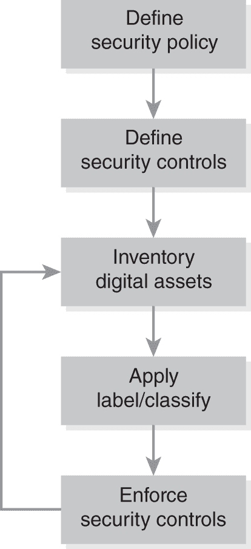

**图 2-2** 保护数字资产的关键组件

保护信息的能力始于定义良好的安全策略。数字资产的定义如此广泛，以致于难以创建一个完整的清单。许多组织依赖扫描服务器、台式电脑和笔记本电脑的工具。它们试图根据社会安全号码（`SSNs`）等模式来盘点敏感信息。当它们看到模式匹配时，就可以确定应用什么级别的安全控制。

为了保护数字资产，你需要知道数据在哪里。你需要良好的工具来盘点信息和网络。你需要经常刷新此清单。最后，你必须能够快速标记或分类数据。数据越快被标记或分类，越快得到保护。盘点数字资产是一个主要的策略实施问题。

一旦完成了数据盘点，对数据应用标签或对其进行分类就相当简单。但你需要确保安全策略清晰地定义了每个标签和数据类的处理方式。对每一个数据文件进行分类几乎是不可能的。想象单台个人电脑或笔记本电脑上的成千上万个文件：文档、文章、截图、照片、纳税申报等各种形式的数据。其中大部分内容被视为非结构化数据。这些数据没有经过预定义，也没有像你在银行等生产环境中发现的那样组织良好，银行会为存款等交易制定定义的流程。生产系统以一种定义良好的方式组织数据，其流程是明确且可重复的。

### 警告

鉴于数据文件创建、删除、移动和更改的速度之快，建立准确的清单目标是一项重大挑战。在任何时候都不知道你的高敏感数据存储在哪里，是一个巨大的风险。USB 驱动器和智能手机等可以接收电子邮件的移动设备加剧了这一问题。当信息离开你的网络时，你该如何保护它？组织应该优先对资产进行盘点，从最敏感的资产开始。

将数据分类应用于非结构化数据是一项重大挑战。通常，数据分类应用在数据存储的位置。换句话说，你可能不知道用户笔记本电脑中的所有文件，但你知道那是用户的笔记本电脑。基于这一知识，放在笔记本电脑上的任何数据都可能具有特定的数据分类。当无法在文件层级进行数据分类评估时，这是一种很好的技术。

### 技术提示

只要可能，你应该将自动分类数据的盘点工具设置为 `log mode`。在 `log mode` 中，安全控制只会记录它本会执行的操作，但不会实际采取行动。然后，通过与管理层一起审查日志，你可以评估以这种方式分类数据的影响。自动化工具出现过度分类、导致业务无法访问关键系统的情况并不罕见。例如，假设你对客户地址的访问有非常严格的限制。可能，日志会显示，当客户来电寻求帮助时，客户服务台无法访问数据来验证客户的身份。在应用预防性控制之前，通过练习使用日志，你可以避免用户产生不满。在这个示例中，不会影响任何实际客户或业务功能。随后可以调整安全控制，包含客户服务台的访问权限。`log mode` 是为实施更严格的安全控制获得业务部门支持的好方法。

## 保护数据隐私安全

在涉及个人事务时，渴望隐私是人的本性。人们希望自己的高度个人化信息是安全的——无论是医疗记录还是财务记录。许多人没有意识到，这些信息可以存储在世界上任何地方计算机的数字文件中。你的个人信息可能会出现在中国的一家离岸供应商那里。无论你的个人数据传输到何处，确保并保护这些信息既是信任义务，也是法律义务。本章侧重于美国的隐私义务；然而，全球所有发达国家都具有某种形式的隐私法律。

保护隐私的概念始于能够识别个人作为唯一个体的数据。美国政府服务组织引用了管理和预算局（`OMB`），该机构将 `个人身份信息 (PII)` 定义为：

> 可用于区分或追踪个人身份的信息，例如单独的姓名、社会安全号码、生物识别记录等，或者当与特定个人关联或可关联的其他个人或身份识别信息结合时（例如出生日期和地点、母亲的婚姓等）。

### 注意

不同州对何包含在 PII 内有不同的法律规定。例如，一个州可能认为一个人的家庭地址是 `公共记录`，而另一个州则可能不是。各州在要求处理数据以保护隐私方面也各不相同。大多数大型公司采用适用于多个州的单一策略。

安全策略需要根据业务类型和位置定义 PII 数据。例如，银行遵循的联邦法规与当地的兑票服务机构或医疗诊所有不同。你运营所在的州可能与邻近州有不同的要求。广泛接受的做法有助于企业在隐私法规的迷宫中穿行。例如，大多数州将人的姓名和 `SSN` 的组合视为 PII。由于身份盗窃是企业和消费者共同关注的主要问题，你应该对任何可能用于开设或访问账户的组合信息保持谨慎。取决于业务类型，这类数据有很大概率符合 PII 的定义。

由于组织必须遵守许多不同的隐私法规，一些组织设立了 `首席隐私官 (CPO)` 职位。这是负责管理组织风险的最资深领导者。`CPO` 负责跟踪隐私法律。`CPO` 还需要理解法律对业务的影响。由于工作性质的原因，许多 `CPOs` 是律师。尽管他们通常不是技术人员，但他们与技术团队紧密合作，以创建强大的安全策略。

### 注意

首席隐私官就如何处理涉及 PII 数据的法律要求提供指导，包括如何报告事件。

在开发保护 PII 数据的策略时，你应该考虑以下指南：

*   **检查**——理解当地州和联邦的要求。
*   **协作**——与 `CPO` 紧密合作。
*   **对齐**——将隐私策略与数据分类策略协调一致。
*   **教育**——对 PII 数据的处理进行意识培训。
*   **保留**——确保对数据保留和销毁进行适当控制。
*   **限制**——仅从个人处收集提供服务或所需的数据。
*   **披露**——向个人完全披露收集了哪些数据以及将如何使用。
*   **加密**——在存储或传输 PII 数据时考虑使用加密。

### 全面披露与数据加密

隐私法规涉及两个重要原则。`全面披露` 让消费者了解收集了哪些数据以及如何使用数据。`数据加密` 为处理消费者信息提供了标准。

第一个原则——`全面披露` 认为个人应该知道收集了哪些信息。他们还应该被告知信息是如何使用的。许多人将互联网作为购买产品和服务的快捷方便方式。似乎很快你的电子邮箱就满了其他公司的推销信息。在线服务是否收集并出售了你的信息？公司是否充分披露了这些数据将如何使用？这些是隐私政策需要解决的问题。

### 注意

某些法规允许公司在个人通过 `opt-in` 过程许可的情况下出售客户数据。其他州允许出售信息，但要求消费者通过 `opt-out` 过程提供选择。

第二原则——数据加密——承认即使尽最大努力，数据也可能落入他人之手。这种情况发生在数据被盗取、丢失或被意外访问时。只有当用户拥有正确的解密密钥时才能读取加密数据。例如，Roy 有一个包含业务账本的加密硬盘。Moss 发现了 Roy 的笔记本，但 Roy 的财务信息仍然安全，因为没有加密密钥就无法读取硬盘。这提供了额外的安全保障。

加密是一种预防性安全控制措施。但加密数据和管理加密密钥可能会复杂且昂贵。尽管费用高昂，但这通常比通知数百万客户其个人信息已丢失或被盗要便宜得多。除了失去信任外，公司还可能面临法律惩罚。

加密被认为是一项有效的实践。如今，在互联网传输过程中对数据进行加密已成为常见。如果涉及多种技术，在服务器硬盘或磁盘阵列上对静态数据进行加密要复杂得多。有时，在技术上对静态数据加密是不可行的。

### 技术提示

支付卡行业数据安全标准 (`PCI DSS`) 要求在传输和存储信用卡信息时使用加密。公司和供应商已经创建了支持这些 PCI 要求的材料。即使你的组织不处理信用卡，这些材料也可以为保护 PII（个人身份信息）数据的加密提供有用指导。例如，《思科医疗 PCI 解决方案设计与实施指南》概述了保护数据的概念模型，包括加密组件。该指南位于 `https://www.cisco.com/c/en/us/solutions/enterprise/design-zone/compliance.html`。

## 降低风险敞口

定义良好且执行的安全策略会导致定义良好的措施。这些措施反过来保护了信息。那么，如何实现更低的风险敞口呢？敞口的概念取决于一种计算，即估计在风险发生时业务遭受的损失。首先，你需要一个尺子，根据预测的业务损失来衡量风险。随着时间的推移，你投入人员、流程和技术，将该风险降低到可接受的水平。这个可接受的水平有时被称为你的“风险胃口”。

风险胃口告诉你组织在正常业务过程中愿意接受多少损失。这些计算在许多不同的业务和行业中进行。信用卡公司估计欺诈带来的损失并投资反欺措施。随着欺诈增加，用于阻止欺诈和降低风险敞口的支出也随之增加。你计算这些事件发生时的损失，并投资于旨在降低风险敞口的计划。例如，现在大多数银行已更改了其安全策略，要求对客户服务台的电话进行更严格的筛选。客户被要求回答比仅姓名、账号和安全号码（SSN）更详细的问题并不稀奇。客户可能会被询问当前余额、上一次交易和其他细节，以减少欺诈风险。

在发生安全泄露时，没有简单的方法可以计算业务的风险。理想情况下，你应该从财务角度以总潜在财务损失来计算风险敞口。鉴于安全泄露还可能导致声誉损害，在财务角度上计算这一点是困难的。

一些组织采取了更简单的方法。他们根据安全策略合规性来计算风险敞口。这种方法采取了一种信任的飞跃，即如果你遵守良好的安全策略，你就充分地控制了风险。这种方法让你通过随着推移衡量和改进策略合规性来降低业务的风险敞口。

无论采用何种方法，你都不能完全依赖风险分。风险分是定量的，因此它是多个因素的数值表示。它不能取代风险判断，也无法取代通过经验和常识做出定性判断的人。风险分基于人们在某一时刻认为自己理解的因素；然而，风险分可能跟不上环境、技术或市场的变化。危险之处在于盲目跟从数字（定量判断），而常识和经验（定性判断）认为风险要高得多。想想 2007-2008 年的金融危机，导致了数万亿美元的损失和数百万人失业。许多风险曾被认为是低风险。这是一个过于简化的例子，但通常许多银行的定量评分假设房价将永远上涨。因此，无论你贷款了多少并不重要，房产总会有买家，房主总会有净值。定性方面，即人类判断和常识缺失了。结果，美国遭受了自 20 世纪 30 年代大萧条以来最严重的金融危机。

## 减少组织责任

当组织无法履行其义务或职责时，就会产生 `业务责任`（business liability）。业务责任是组织整体风险敞口的子集。义务可以是法律义务，也可以是承诺的责任。

如果企业未能遵守法律，它就违反了 `法律义务`。这种责任使组织面临潜在的罚款，或限制其开展业务的方式。在少数情况下，组织可能被发现参与了犯罪活动。其官员可能会面临刑事指控。

未能履行承诺责任的企业会失去客户的信任。当企业未能交付其承诺的产品或服务时，责任就是业务的损失。客户在互联网上发布投诉，造成了诉讼和更多业务损失的可能。今天，客户的意见通过社交媒体、产品评论网站上的帖子等，非常容易且广泛地传播。企业能够履行其对客户服务的承诺变得越来越重要。

### 备注

`业务责任` 发生在公司未能履行其对员工和社区的义务时。企业的 `法律义务` 是其为遵守法律而要求采取的行动。

安全策略的作用是减少这些责任风险。例如，当黑客突破公司的安全防线时，你通常需要处理信任和监管问题。每个事件都包含潜在的责任。通过回顾过去事件来预测未来情况将有助于你评估整体风险敞口和特定的业务责任。策略必须定义这些类型事件的正确方法。

### 雇主与员工的分离

当已知违规行为发生时，雇主采取行动是关键的。雇主可能不对员工的行为负责，但雇主不采取行动会给人一种印象，尽管有书面策略，雇主纵容了员工的行为。这可能给雇主带来法律责任。仅仅有书面策略是不够的。策略必须被执行。必须对不合规的行为追责，并在需要时进行纪律处分。这保护了客户和雇主。

策略向员工明确什么是可以接受的行为。策略为未能遵守规则的员工提供了一定程度的分隔。企业可以引用策略作为对本应发生情况的说明。

然而，仅仅拥有安全策略并不能建立这种隔离。企业有义务采取措施来实施和执行政策。这些合理步骤包括：

*   `Policy`（政策）——就客户信息处理制定明确的安全政策。
*   `Enforce`（执行）——在未遵守政策时表示强烈反对。
*   `Respond`（响应）——快速响应事件，将对客户的影响降至最低。
*   `Analyze`（分析）——了解发生了什么。
*   `Educate`（教育）——改进员工培训。

这些步骤将减少损失并体现对客户的承诺。当面临公众或监管机构的挑战时，这有助于将雇主的行为与极端员工的行为隔离开。

### 提示

务必与内部法律顾问合作制定策略，为在发生事件时防御组织奠定基础。

#### 可接受使用政策

`可接受使用政策` (`AUPs`) 是正式的书面政策，规定了员工在使用计算机和网络系统时的规范。大多数 `AUPs` 概述了哪些是可以接受的，哪些是不可接受的。它们还需要概述员工违反政策时的纪律处分流程。由于纪律处分可能导致解雇，政策必须清晰明了。许多公司要求员工签署 `AUP` 以确认收到规则。法律部门和人力资源部门总是批准最终草案政策。`AUP` 紧跟技术进步至关重要。必须明确在工作时间内是否允许使用个人设备。特别是现在的许多公司政策都涵盖了移动设备的使用。通常，这些政策还包括对相机使用的概述。例如，Google 可以通过“眼睛”拍照。

`AUP` 是在雇主和员工之间建立法律隔离的重要工具。对于给组织带来不必要责任的员工，其容忍度很低。

#### 保密协议与不泄密协议

`保密协议` (`CA`)，也称为 `不泄密协议` (`NDA`)，是双方之间具有法律约束力的合同。它承诺不向第三方披露协议涵盖的任何信息。协议需要明确定义所涵盖的信息。这类劳动协议通常在聘用时签署。它们概述了哪些信息应该在公司外披露。如果组织在招聘过程中没有将 `NDA` 作为一部分，这以后可能会成为一个问题。`NDAs` 不仅用于员工，它们常用于业务伙伴。在购买产品或服务之前，`CA` 或 `NDA` 通常用于探索业务机会。假设一家公司想聘请顾问重新设计主要应用程序。双方将签署 `CA`。公司随后可以披露其问题，顾问将获得更精确的信息来做出估算，即使公司最终决定不聘用他。

### 注意

并非所有的 `CAs` 和 `NDAs` 的编写方式都相同。它们可能是单方面的，赋予某一方过度的权利或惩罚。在签署之前，这些协议应由法律部门进行审查。安全政策通常包含关于何时需要 `CA` 或 `NDA` 的指导。大多数安全政策要求此类协议涵盖员工，如临时工或合同工。

#### 业务责任保险

业务责任保险可以在事件发生时降低企业的财务损失。即使企业拥有定义良好的安全政策，问题仍可能发生。业务责任保险将在保单限额内赔偿损失。业务责任保险可以签给组织和个人。例如，执行咨询服务的计算机工程师可以获得职业责任险。此类政策将涵盖任何关于工程师疏忽或犯错误的成功索赔。相同类型的覆盖范围也适用于面临产品或服务疏忽或失误索赔的大型公司。需要仔细检查覆盖范围的条款。例如，赔偿可能取决于公司是否遵守行业标准。这意味着什么？假设你正在维护一个公司网站。你所在行业的标准可能规定你必须进行年度渗透测试。未执行测试或未遵守自己的政策可能导致你的保险理赔被拒绝。

这种保险覆盖的一个重要益处是支付法律费用。即使公司被判定为无罪，法律成本可能是巨大的。这些政策确实有保单持有人必须满足的限额、条件和要求。这些政策还有免责条款。它们不保护实施非法行为的公司。总的来说，这些政策是进一步降低风险的另一种工具。

#### 实施政策以驱动运营一致性

运营一致性意味着确保组织的流程是可重复且可持续的。目标是每次执行这些流程时都具有相同的一致性和质量。这种可靠性允许企业不断提高质量。流程随时间演变，流程的可重复性越高，检测和消除风险的可能性就越大。

你可以以相同的方式实施安全政策。这确保了信息保护应用了相同的一致性和质量。“可重复的流程”或“一致性”意味着什么？它的意思是当反复发现某个特定风险时，每次都使用相同的流程来处理它。这种一致的执行通常被称为 `运营一致性`。

#### 在整个组织范围内强制执行重复业务流程

运营效率意味着降低企业的成本。通过在整个企业应用这一原则，可以以更低的成本获得更高的质量。对于拥有多个部门的组织，开发一次流程并重复它们可以节省时间和资源。这种方法还允许组织建立卓越中心。这些中心通常是针对某一领域拥有非常深知识的小型团队。


`企业视角` 允许高级领导者理解风险如何影响整个组织。具有企业视角的人可以越过单个部分看到整个结构。这样的人可以看到森林，而不仅仅是树木。单棵树或一组树可能有根腐病；然而，森林的整体健康状况可能是好的。这意味着你遇到了一个问题，但它是局部的。相反，单个流程的失败看起来可能微不足道，但加起来可能预示着一个系统性问题。

在涉及安全策略时，这一点尤为重要。领导层需要高度确定在信息保护方面具有操作的一致性。监管机构经常要求领导层证明安全控制措施的有效。例如，根据《萨班斯-奥克斯利法案》（`SOX`），首席信息官（`CIO`）需要描述 `IT` 安全控制目标。许多 `CIOs` 指向他们公司强制执行的安全策略。

为了实现这种可重复的行为，你必须衡量一致性和质量。此外，你还需要衡量所实施的策略是否实现了预期结果。发现某些流程运行多年却没有提供任何实际价值这并不意外。一个典型的例子可能是某份专门为已离职的高管专门设计的报告。新高管继续收到该报告，他或她可能出于好奇偶尔查看一下，但这位高管从未为了任何实际目的利用其内容。此报告可能具有高度重复性和持续性，但它并没有提供价值。

### 提示

务必采访创建或管理该流程的人员。他们将拥有衡量数据之外的洞察。

安全策略通过强制在业务流程中以相同的方式处理信息来驱动操作的一致性。策略还强制对流程进行严密的监督和衡量。安全策略通常概述监督要求。它们解释了应该记录哪些测量以及需要多久报告一次。在尝试实现操作一致性时，通常会发现以下监督阶段：

*   **管理**——管理流程执行并记录偏离标准程序的异常。
*   **衡量**——衡量数量、一致性和质量。
*   **评审**——定期评估以确保实现预期结果。
*   **跟踪**——跟踪缺陷、错误和事件。
*   **改进**——通过根据需要进行调整持续改进质量。

#### 缓解控制与补偿性控制的区别

`缓解控制` 限制了因未采取控制措施而造成的损害。它假设主控制措施的缺失或失效。这是一种事后控制。例如，假设有人输入了无效的账号。要么不存在防止此类情况的控制，要么该控制未起作用。无论何种，只要在采取进一步行动之前验证了账号，就存在缓解控制。然而，缓解控制可能无法完全实现策略的全部意图。

相比之下，`补偿性控制` 实现了预期结果和策略意图。它并不一定按照策略规定的方式实现，但结果是相同的。回到示例：假设在输入账号之前，会手动检查一份账号主列表。理想情况下，错误会立即被捕获，但手动检查仍然是一种预防性控制。如果策略要求在输入时对所有账号进行自动验证，则系统将不符合合标准；然而，手动检查是一种补偿性控制，风险得到了缓解。

在授予豁免时，理解缓解控制和补偿性控制至关重要。你必须弄清楚的是遗留了多少风险，以及该风险是否在接受范围内。

### 策略有助于防止操作偏差

`操作偏差` 是不可避免的。策略中的意图清晰这一点很重要。通过清晰传递的意图，可以对预期结果有更好的理解。意图还能帮助员工更好地了解公司面临着哪些风险。

为了平衡这些利益，大多数组织都有 `waiver process`（豁免流程）。这也被称为 `waiver request`（豁免请求）。当偏离策略时，`waiver process` 是必要的。在处理 `waiver process` 时，应考虑以下因素：

*   **独立性**——独立于策略。
*   **影响**——检查风险。
*   **收益**——理解其收益。
*   **缓解**——识别风险。
*   **审批**——妥善批准风险。

`剩余风险` 是应用安全控制措施后剩余的风险。当业务无法遵守策略时，考虑使用 `compensating controls`。如果 `PII` 数据丢失或被盗取，`CIO` 可能需要解释原因。

### 章节总结

人们在生活的每一天都在管理风险。他们选择何时出发、何时起床、吃什么食物、开车走什么路线等等。每个决策都伴随着风险和回报。商业世界也并非如此。人们每天面临许多决策。他们通常在信息不完全的情况下运行。

对于业务来说，是日常流程和决策控制风险。策略提供了如何思考风险的指导。策略及其相关控制详细介绍了如何防止、检测和纠正错误。这种控制和流程的格局让风险管理对每位员工都变得真实。最重要的是，它鼓励了积极推动组织风险的行为。

## 核心概念与术语

*   可接受使用策略 (AUPs)
*   自动化控制
*   违露
*   首席隐私官 (CPO)
*   补偿性控制
*   保密协议 (CA)
*   纠正控制
*   数据分类
*   数据加密
*   检测控制
*   数字资产
*   完全披露
*   知识产权 (IP)
*   标签
*   手动控制
*   缓解控制
*   保密协议 (NDA)
*   运营偏差
*   个人身份信息 (PII)
*   预防性控制
*   公共记录
*   剩余风险
*   风险文化
*   安全意识计划
*   安全策略合规

### 第二章评估

1. 什么是策略合规？
    1. 努力遵循组织策略的努力
    2. 当客户阅读网站策略声明时
    3. 遵守组织的策略
    4. 未能遵循组织的策略

2. 什么是自动化控制？
    1. 一种立即停止行为且不依赖人类决策的控制
    2. 一不立即停止行为且依赖人类决策的控制
    3. 一不立即停止行为但能自动通知事件的控制
    4. 一种立即停止行为并依赖人类决策的控制

3. 以下哪项*不是*业务驱动？
    1. 获取最新技术的能力
    2. 维护控制的成本
    3. 法律辩护的能力
    4. 客户满意度

4. 防火墙通常被认为是 \_\_\_\_\_\_\_\_ 控制的示例。

5. 什么是信息安全策略？
    1. 一种定义客户接受行为的策略
    2. 一种定义购买什么硬件的策略
    3. 一种定义如何保护任何形式信息的策略
    4. 一种定义保安应该穿着制服种类的策略

6. 以下哪项*不是*安全控制的类型？
    1. 预防性
    2. 相关性
    3. 检测性
    4. 纠正性

7. *高层基 (Tone at the top)* 指：
    1. 公司领导确保每位员工都了解优先事项
    2. 高级领导人员实施并执行策略
    3. 高级经理与公众及监管机构建立信任
    4. 以上所有

8. 隐私法规涉及两个重要原则：完全披露和数据加密。
    1. 正确
    2. 错误

9. 让安全意识计划强调业务风险有哪些好处？
    1. 风险对员工来说更相关相关。
    2. 安全策略更容易被遵守。
    3. 它为员工提供了应对意外风险的基础。
    4. 以上所有

10. 在开发保护 PII 数据的策略时，以下哪项*不是*需要考虑的指南？
    1. 对齐—Align——将隐私策略与数据分类策略协调。
    2. 留存—Retain——确保数据保留和销毁有适当的控制。
    3. 披露—Disclose——向个人完全披露收集了哪些数据以及将如何使用。
    4. 韧性—Resiliency——策略为意外情况提供指南。

11. 用于开设或访问银行账户的信息通常被认为是 PII 数据。
    1. 正确
    2. 错误

12. 以下哪项*不是*拥有可接受使用策略的好处？
    1. 列出对不当行为的纪律处措施
    2. 防止员工误用互联网
    3. 减少业务法律责任
    4. 定义使用互联网期间的恰当行为

13. 缓解控制始终能完全策略的全部意图。
    1. 正确
    2. 错误

14. 为了实现运营一致性，你需要衡量以下哪项？
    1. 一致性
    2. 质量
    3. 结果
    4. 以上所有

15. 定义清晰且实施得当的安全策略在哪些方面对业务帮助？
    1. 最大化利润
    2. 减少风险
    3. 生产一致且可靠的产品
    4. 以上所有

### 脚注

1. [Egress.com](http://Egress.com), “IT 领导者与员工在数据伦理、所有权和内部泄露的根源上存在分歧，”2019 年 5 月 22 日，`https://www.egress.com/en-US/news/insider-data-breach-survey-2019-na`，访问于 2020 年 4 月 15 日。
2. Keeper Security, “2018 中小企业网络安全状况,” Ponemon Institute, 2018 年，`https://keepersecurity.com/assets/pdf/Keeper-2018-Ponemon-Report.pdf`，访问于 2020 年 4 月 15 日。
3. Legal Information Institute, “知识产权，”`https://www.law.cornell.edu/wex/intellectual_property`，访问于 2020 年 4 月 15 日。
4. MediaValet, “什么是数字资产，”`https://www.mediavalet.com/blog/what-is-a-digital-asset-2/`，访问于 2020 年 4 月 15 日。
5. [GSA Privacy Program](https://www.gsa.gov/reference/gsa-privacy-program/rules-and-policies-protecting-pii-act)


©

## 合规法律与信息安全策略要求

## 第三章

近年来，全球化 受技术和互联网增长的驱动。网络使用统计数据显示，截至 2019 年，全球人口的 57.3%（即 44 亿人）可以访问互联网。1 在北美和欧洲，这一数字高于 85%。几个其他来源也报告了类似的数字。2,3

互联网访问的范围在发展中国家仍在快速增长。互联网的爆炸式增长创造了前所未有的全球机会。你每天购买的产品就能看到这一点。技术帮助建立了全球供应链，向全球消费者提供以前无法想象的系列商品。

但互联网扩张的速度也出了代价。隐私是一个问题。人们可能会觉得，毫无道理，他们的每一个行动都被记录了。手机留下了通话记录。社交媒体为校园网络欺凌提供了渠道。2014 年 2 月，奥巴马总统宣布：“网络恐怖主义是我们最大的威胁。”^(4) 通常情况下，`网络恐怖主义` 或 `网络战争` 是通过黑客攻击试图在社会中引起恐惧或严重动荡。其想法是攻击政府计算机、大型公司和经济关键领域。此类攻击可能来自恐怖组织或个人，也可能来自国家（主权国家）。

奥巴马总统的言论仍然字音当下。2019 年，曾发生过针对美国电力公司的攻击，许多来源认为这种攻击是由中国政府资助的。战略与国际研究中心报告称，2019 年 5 月，伊朗利用网站网络对包括美国、以色列和沙特阿拉伯在内的多个国家发起了虚假信息攻势。显然，这些威胁自 2014 年以来并未减轻。

由于利益攸关，政府不能坐视旁观。在美国，联邦政府和州政府制定了法律，规定了如何控制、处理、共享和处理这种新经济所依赖的敏感信息。这些信息大部分关乎你。它们是关于你的财务、健康、购买习惯等的个人数据。在这些法律的基础上还增加了 `regulations`（法规），它们通常由公务员编写，以执行法律权威。`Regulators`（监管人员）是帮助执行这些规则的个人或实体。行业团体也会尝试 `self-regulate`（自我监管），这意味着他们创建成员必须遵守的标准。未能遵守法规或行业标准可能会导致公司面临罚款或运营能力受到限制。严重违反法规可被视为违反刑法。这些违规行为可能导致公司人员被捕并可能面临监禁。

本章讨论了主要的政府法律及其合规要求。当本章出现 `regulation`（法规）一词时，它指的是美国法律或在全球范围内通行的法律。你将读到要求如何影响安全策略。你还将了解法规的主要驱动因素以及保护个人隐私的重要性。你将看到如何创建合规策略、标准、程序和指南。本章还研究了驱动安全策略的行业标准。这些法律或标准中的任何一个都可以占据整本书。这里的重点是驱动安全策略和控制的高级原则。

本章主要关注美国法律和法规；然而，由于其对美国业务的重要性或其典范内容，同时也探讨了特定的非美国法律。例如，《通用数据保护条例》（`GDPR`）虽然是欧盟（EU）的法律，但也影响欧盟内的任何业务运营。这包括拥有欧洲客户的电子商务平台。因此，即使是美国企业，意识到这项法规也是非常重要的。

### 第 3 章主题

本章涵盖了以下主题和概念：

*   美国合规法是什么，以及它们为什么重要
*   谁受这些法律的保护
*   法律如何影响安全策略
    *   非美国法律
*   使用什么方法使安全策略、标准、程序和指南符合法规
*   什么是行业领先实践
*   为什么行业标准很重要

### 第 3 章目标

当你完成本章的学习后，你将能够：

*   比较和对比不同的美国合规法
*   描述法规及其在组织中的重要性
*   描述政府实施法规的驱动因素及其在维护法律合规方面的重要性
*   定义网络恐怖主义和国家威胁
*   解释使策略与法规一致的方法
*   解释领先实践以及它们如何融入行业

## 美国合规法

巨大的经济利益来自私营市场。这些利益通常依赖于技术的使用。对于政府在监管或干预这些市场中的作用，没有单一的观点；然而，政府关注消费者保护、促进经济稳定以及维持可靠的税收来源。政府必须在这些需求与网络恐怖主义的威胁之间取得平衡。所有驱动因素都是相互关联的。如果人们感到使用互联网购买商品和服务是安全的，稳定的经济就会出现。人们还必须信任政府保护他们的安全。当你拥有稳定的经济部门时，政府就有了可靠的税收来源。

了解驱动政府法规的因素是好的。归结底，政府法规是指令。安全策略必须在平衡业务需求的同时实现其目标。

监管合规的最佳方法是运用常识。与其为每项法规在安全策略中建立规则，你不如将在许多法规中发现的关键控制概念构建在其中。通过将这些关键控制概念映射到特定的安全策略，你可以快速证明自己对广泛一系列法规的合规性。如果你掌握了这些概念，就可以学会如何在法规中识别这些原则。这为你提供了保持安全策略合规性所需的工具。

在每项美国法规中讨论信息安全的所有关键概念是不可能的。本章讨论了涉及消费者权利和个人隐私的几项主要法规。这些法律保护消费者免受潜在诈骗，并确保个人信息的私密性。电子商务中的消费者权利广泛涉及关于如何处理消费者交易和其他信息的规则制定。电子商务中的个人隐私广泛涉及如何处理个人信息以及其用途。`TABLE 3-1` 识别了许多法规中发现的、影响你安全策略中内容的关键概念。

### 表 3-1 影响信息安全策略的美国合规法中所包含的关键概念

| 概念 | 目标 |
| --- | --- |
| 完全披露 | 个人应该知道正在收集了关于他们的哪些信息。公司必须就其计划如何使用你的信息提供书面通知。 |
| 个人数据的限制使用 | 公司收集的信息只能用于所提供的即时服务或完成的交易（例如购买）。例如，假设一家银行刚刚批准了你购买滑雪装备的信用卡交易。在大多数州，银行随后不能将该信息分享给试图向你出售滑雪假期的人。 |
| 许可加入/许可退出 (Opt-in/opt-out) | 在个人信息超出原始用途之外使用前征求许可的做法。例如，一家房地产公司可能会获得出售房屋者的许可，询问其信息是否可以分享给搬家公司。 |
| 数据隐私 | 公司必须告知个人个人信息将如何受到保护，并对数据的共享方式进行限制。 |
| 知情同意 | 某人已成年，拥有所需事实，并且在没有不当压力的情况下做出知情判断的概念。 |
| 公共利益 | 组织对公众负有超越自身利益义务的概念。这是一个模糊的术语，但监管机构关注组织对行业或整体经济的影响也并不罕见。 |

### 联邦信息安全管理法 (FISMA)

联邦政府的独特之处在于，它可以确定自己想要遵循的标准，并通过法律要求必须遵守这些标准。2002 年的《联邦信息安全管理法》(FISMA) 是政府自律的一个良好范例。FISMA 要求政府机构采用一套共同的信息安全标准。政府的部分部门（如军方）超出了这些标准。对于许多政府机构来说，FISMA 创建了强制性要求，以确保数据的完整性、机密性和可用性。如果你为政府处理数据，你可能需要遵循这些相同的标准。FISMA 还要求机构向管理和预算局 (OMB) 年度审查。例如，2012 年对退伍军事务部 (VA) 的审计发现了 15,000 次安全策略违规行为。结果，VA 被发现不符合 FISMA 标准。2018 年发布了一份关于证券交易委员会 (SEC) 的 FISMA 审计报告。该报告建议了 20 项不同的纠正措施。这两个案例研究表明，对于许多联邦机构来说，FISMA 合规性尚未达到理想水平。

国家标准与技术研究院 (NIST) 负责制定 FISMA 要求的信息安全标准和程序。每个机构随后负责将其作为其机构信息安全策略的一部分被采用。NIST 标准、流程和指南可以通过 `http://csrc.nist.gov/publications/sp/` 获取。


# NIST 出版物概述了一套完整的安全标准和流程

为了合规，你的策略必须包含关键控制要求。其中一些关键要求包括：

*   **资产清单 (Inventory)**：硬件、软件和信息的清单识别了所处理的信息类型以及数据如何流向系统，并特别关注国家安全系统。

*   **按风险级别分类 (Categorize by risk level)**：清单需要进行分类。其理念是这种分类将突出显示需要更多保护的高风险区域。

*   **安全控制 (Security controls)**：NIST 标准概述了应该在何时应用哪些控制措施。它们还概述了如何记录和批准这些控制措施。这种方法是基于风险的，为机构提供了灵活性来调整控制措施以满足其运营需求。

*   **风险评估 (Risk assessment)**：还需要进行风险评估。`风险评估` 是基于风险的安全方法的必不可缺的一部分。风险评估结果决定了要应用的安全措施类型。

*   **系统安全计划 (System security plan)**：还需要为主要系统以及系统或应用程序所有者制定正式的安全计划。安全计划充当路线图。它不断更新以应对威胁，并且是认证和认可过程的重要部分。

*   **认证与认可 (Certification and accreditation)**：该过程发生在系统文档化、控制措施经过测试以及风险评估完成之后。在主要系统上线之前需要执行此过程。一旦系统通过认证和认可，运行系统的责任将转移给所有者。这一过程也被称为 `security certification` 过程。

*   **持续监控 (Continuous monitoring)**：所有经过认证和认可的系统必须持续监控。监控包括查看新威胁、系统变化以及控制措施的运行情况。有时系统变化太大，导致必须重新认证。

## 健康保险可流动性与责任法案 (HIPAA)

《健康保险可携带性与责任法案》（`HIPAA`）于 1996 年成为法律。该法律保护个人的隐私。如果您处理他人的健康记录，则必须遵守 `HIPAA`。这包括医生办公室、医院、诊所和保险公司。该法律承认健康记录的数字化数据交换（例如保险公司与医生办公室之间）是很有必要的。但在 2013 年，对分包商和供应商访问健康记录实施了新的限制。该法律旨在确保患者的隐私得到维护。

###  注意

“加入（opting in）”与“退出（opting out）”的区别通常是指在网页上点击复选框。在 `加入流程` 过程中，除非消费者点击“是”选框，否则不会提供任何额外服务。在 `退出流程` 过程中，除非消费者点击“否”选框，否则他们将自动参加某项服务。

### 供参考

美国卫生和人类服务部有多部关于 `HIPAA` 的出版物。该法律适用于任何收集、处理或披露健康记录的受保护实体。2013 年，罚款金额增加到每次违规 150 万美元。这包括：

*   `医疗保健提供者`
*   `健康计划`
*   `医疗保健结算中心`
*   `业务伙伴`

为了确保您的安全合规，它包括以下内容：

*   `行政保护`
*   `物理保护`
*   `技术保护`
*   `风险评估`

## HITECH

《经济与临床健康信息技术法》（`HITECH`）在 2009 年得到了加强。它将 `HIPAA` 扩展到包含电子受保护健康信息（`PHI`）。该法律定义了受保护健康信息（`PHI`），同时也指代了电子受保护健康信息（`EPHI`）。

## 格姆-莱奇-布莱尔法案 (GLBA)

###  注意

《格姆-莱奇-布莱尔法案》（`GLBA`）于 1999 年成为法律。它侧重于金融机构的安全实践。金融机构检查委员会（`FFIEC`）发布关于 `GLBA` 的规则。要符合 `GLBA` 标准，您的安全策略必须包含以下内容：

*   **治理**：要求建立强大的治理结构。这包括指定组织内的某人对信息安全负责。这通常是 `首席信息安全官 (CISO)` 或 `首席信息官 (CIO)`。

*   **信息安全风险评估**：需要一个定义良好的 `信息安全风险评估`，以识别威胁、潜在攻击以及对组织的影响。

*   **信息安全策略**：需要一份正式的安全计划来实现合规。

*   **安全控制的实施**：需要一个流程来妥善地设计和安装符合安全计划目标的安全控制。

*   **安全监控**：需要对安全控制进行持续监控。其目的是确保设计符合目标。这是基于事件的监控，并包含了事件响应。

*   **安全监控与更新**：需要对趋势、事件和业务策略进行监控，并对安全计划进行适当更新。

### 供参考

可以通过该委员会的网站获取 `FFIEC` 手册。`FFIEC` 手册提供了关于 `GLBA` 的指南：[`https://www.ffiec.gov/booklets.aspx`](https://www.ffiec.gov/booklets.aspx)。

## 萨班斯-奥克斯利法 (SOX)

《萨班斯-奥克斯利法案》（`SOX`）于 2002 年成为法律。它的出台是为了应对一系列公司欺诈的指控。一些公司被指控“财务造假”或向其高管提供非法贷款。`Enron` 和 `WorldCom` 等公司成为了贪婪和腐败的象征。`Enron` 在 2001 年因被指控通过财务造假推高股价而申请破产。`WorldCom` 在 2002 年因被指控向其首席执行官（CEO）提供非法贷款以及进行数十亿美元的会计欺诈以推高股价而申请破产。

SOX 的影响远超信息安全策略。它还规定了公司如何报告收益、估值、企业责任和高管薪酬。该法旨在提高财务准确性以及对投资者的信息披露。事实上，一些人认为该法过于极端且成本高昂。本章重点关注影响安全策略的部分，即 `SOX 404`。

### 注意

SOX 要求对控制措施进行年度测试。在 `SOX` 下，仅有安全策略是不够的。SOX 还要求对安全策略中的控制措施进行测试，以确保它们正常运行。请记住，`SOX` 仅适用于上市公司；不适用于私有公司。

`SOX 404` 的基本思想是要求提供能够确保财务报告准确性的安全策略和控制措施。换句话说，安全策略必须确保财务数据的完整性。需要对这些控制措施进行独立测试。此外，高管每季度需要签署确认这些控制措施符合 `SOX 404` 要求，或者解释不符合的原因。

`SOX` 的挑战之一是成本。测试公司 `所有` 控制措施是非常昂贵且几乎是不可能的。测试所有可能的控制措施的要求引起了许多公司的投诉，因此政府在 2007 年更改了 `SOX` 的规则。这一改变允许公司将测试限制在最重要的控制措施上——即高风险领域的控制。这降低了许多公司的成本，也让公司更容易证明自己的合规性。所有的安全控制都是重要的。良好的安全策略会突出关键控制措施，以指示哪些是最重要的。

该法设立了上市公司会计监督委员会 (`PCAOB`)。`PCAOB` 制定会计和审计标准。证券交易委员会 (`SEC`) 负责执行 `SOX`。信息安全面临的挑战在于 `SOX 404` 设定了宽泛的 IT 目标，并没有定义如何合规。`PCAOB` 和 `SEC` 没有开发新的信息安全和控制标准，而是支持使用行业实践框架。以下是公司常用的用于满足 `SOX 404` 的认可框架。这些框架也被外部审计师广泛用于以认证 `SOX` 合规性：

*   `赞助组织委员会 (COSO)`——在涉及安全策略方面，该组织创建了实施内部控制和治理结构的规则。

*   `信息及相关技术控制目标 (COBIT)`——由 `ISACA`（原信息系统审计与控制协会）创建，该框架是国际认可的最佳实践。请记住，尽管许多人仍在使用 `COBIT 5.0`，但有一个更新的版本 `COBIT 2019`，它包含了一些新增内容。

在许多方面，`COBIT` 是 `SOX` 安全策略和控制的“一站式服务”。`COBIT` 内的控制涵盖了丰富的活动：战略规划、治理、生命周期、实施、生产支持和监控。该框架融入并支持 `COSO` 框架。`COBIT` 框架允许 `COSO` 专注于业务端，而 `COBIT` 专注于 IT 端。通过利用两者，你可以桥接控制要求、技术问题、业务风险和股东关注。该框架在监管机构、审计师和 IT 风险专业人员中如此受欢迎的原因是，如果你实施了 `COBIT` 框架，极可能符合 `SOX 404`。

### 提示

`ISACA` 通过其网站公开了许多出版物。你可以在 [`https://www.isaca.org/resources/cobit/`](https://www.isaca.org/resources/cobit/) 找到 `COBIT 2019` 的执行摘要。

## 家庭教育权利与隐私法 (FERPA)

《家庭教育权利与隐私法》(`FERPA`) 于 1974 年颁布。该法律适用于学院和大学等教育机构。任何教育机构必须保护其学生记录的隐私，并必须允许学生访问自己的记录。这为学生提供了纠正错误和控制其记录披露的方法。

美国教育部的家庭政策合规办公室执行该法案。法律宽泛地定义了教育记录为任何与教育过程相关的、能够唯一识别学生的信息。这被广泛解释为任何学生信息，从财务状况到学生名单再到成绩。学生记录可以是任何形式，从手写笔记到数字文件。存在一些排除项，例如执法记录或校园安全记录。就本文讨论而言，重点是这组广泛的学生记录（任何形式）都必须受到保护。

为了符合 `FERPA` 规定，安全策略必须包含以下关键要素：

*   `意识 (Awareness)`——学校必须公布其 `FERPA` 安全策略并提高人们的相关意识。

*   `许可 (Permission)`——通常情况下，学校必须获得记录的许可才能分享学生的教育记录。

*   `目录信息 (Directory information)`——学校可以公开有关学生的目录信息（如姓名、地址、电话和出生日期），但必须给学生一个退出此类公开披露的机会。

*   `排除项 (Exclusions)`——学校可以出于合法的教育评估原因以及健康安全原因，在没有许可的情况下分享信息。

安全策略必须确保在根据排除项下未获得学生许可时保留记录。此外，策略必须确保为了历史目的妥善维护加入（opt-in）和退出（opt-out）记录，以记录学生的许可。

### 提示

美国教育部提供了一个通用且详细的 `FERPA` 出版物网站，地址为 [`http://www2.ed.gov/policy/gen/guid/fpco/ferpa/index.html`](http://www2.ed.gov/policy/gen/guid/fpco/ferpa/index.html)。

2013 年 1 月，该法律发生了两项重要变化。首先，与儿童福利机构共享记录变得更容易；例如，儿童福利机构将能够确认收养儿童是否正在积极上学。其次，该变更消除了在发布学校记录时（例如提交给法院时）通知家长的某些要求。

## 儿童互联网保护法 (CIPA)

《儿童互联网保护法》(`CIPA`) 于 2000 年颁布。该法律告知接收联邦资金的学校和图书馆必须在其计算机上阻止色情和显性性内容。该法律试图限制儿童接触此类材料的机会。

联邦通信委员会 (`FCC`) 制定了学校和图书馆必须遵守的规则。`CIPA` 规定在最高法院受理的诉讼中面临挑战。挑战的基础是限制获取信息是违反宪法的。此外，对于技术是否会阻止法律最初意图之外的网站存在疑问。法院诉讼的结果参差不齐。法院认为 `CIPA` 法是合宪的；但法院确实要求学校和图书馆在成年人要求时解除封锁。`FCC` 有多个关于 `CIPA` 的出版物可获取自 [`http://www.fcc.gov/cgb/consumerfacts/cipa.html`](http://www.fcc.gov/cgb/consumerfacts/cipa.html)。

以下是安全策略必须包含的关键 CIPA 组件：

*   `意识 (Awareness)`——学校或图书馆必须公布其 `CIPA` 安全策略并提高人们的相关意识。

*   `互联网过滤器 (Internet filters)`——必须尽力保持 `互联网过滤器` 更新，以仅阻止 `CIPA` 意图的目标材料。

*   **取消锁定**——必须有一套流程，允许请求访问被屏蔽网站的成年人解除过滤器的锁定或将其禁用。

*   **教育**——必须为儿童提供有关网络安全、网络欺凌以及如何应对的教育。

### 供参考 (FYI)

2012 年，`CIPA` 经过修订，增加了关于教育青少年了解网络安全的要求。修订后的法律规定：“从 2012 年 7 月 1 日起，学校的网络安全政策必须规定对成年人进行适当在线行为的教育，包括在社交网络网站和聊天室与他人互动，以及对网络欺凌的意识和应对。”

## 为什么会出现美国的合规法？

这些法律承认信息的力量。数据越私密，信息就越强大。法律的许多变化与隐私有关。这些变化涵盖了从个人信息的收集方式到使用方式，再到必须提供什么类型的书面通知。这种力量源于个人信息对我们生活的影响。它影响着我们能找到什么工作、买什么种汽车以及负担得起的住房。它还决定了我们所医疗服务的质量。对这些信息的误用和滥用同样具有破坏性，并会让我们的生活变得痛苦。身份盗用是一个严重问题。恢复信用评分可能需要多年的努力。你一定听过每年有数百万张信用卡被盗用的故事。尽管政府反应缓慢，但确实会对新兴的国家威胁和公众压力做出反应。

许多法律的出现是为了保护我们的个人隐私，并限制公司使用其收集的信息。另一方面，政府机构之间的信息共享正在增加。当数百万公民个人数据丢失或被盗时，会引发许多问题。很难确切知道每年发生多少次泄露。据估计，仅美国在 2019 年一年就有 3800 多次数据泄露。这导致超过 32 亿条包含个人信息的记录被盗。这些记录关联着大量的个人信息，包括社会安全号码、银行账户、健康记录等。即使这些数字是错误的（许多人认为它们太低了），它们也反映了社会面临的真实危险。对企业而言成本很高，对个人而言也是如此。因此，近年来出台了许多法规，要求机构尽力防止此类泄露。这些法规在泄露发生时要求组织承担责任。

## 法律保护谁？

个人的隐私是政府唯一的关注点吗？不，不是。这些法律有四个主要受益者：

*   **个人**——许多法律侧重于保护个人的隐私信息。
*   **股东**——许多法律旨在为市场提供信心。当投资者相信公司的财务状况和风险得到妥善管理时，他们认为可以做出明智的判断。这促进了经济的健康。
*   **公共利益**——这个术语反映了组织除了自身利益外对公众负有义务。虽然这是一个模糊的术语，但监管机构通常会考虑公司对行业群体或整体经济的影响。
*   **国家安全**——其理念是网络恐怖主义不仅威胁到目标公司，还威胁到国家的关键基础设施。

明确的是：世界并非完美，法规的目标并不总是能实现。无论你认为法规的价值如何，都不应将其视为抽象的概念。法规确实会影响安全政策。它们限制了业务收集、存储和处理信息的方式。安全政策被视为确保符合政府指令的一种手段。

公认的观点是，当每个人都必须遵循相同的规则时，竞争才是公平的。如果没有法规，公司会感到压力，不得不走捷径来维持竞争优势。法规消除了这种压力，因为每个人都必须遵守。换句话说，做“正确的事”不再是成本或优势的问题，而是业务文化和法律的一部分。

## 哪些法律要求在政策中包含适当的安全控制？

没有良好的安全政策，你就无法设计有效的安全控制。创建并执行能够证明符合法规要求的政策至关重要。这对于所有类型的组织（包括企业和政府）都是如此。但并没有通用的方法——每个实体都有其自己的实施和执行政策的方法。

无论保护的信息是什么，都需要设计并实施安全控制来执行政策。如果法律要求任何任何类型的信息保护，它也要求适当的安全控制。这包括物理安全控制，以保护纸质报告等物理形式存在的信息。


每一项处理数据的监管要求都应该映射到一个或多个安全策略。

## 哪些法律要求对处理隐私数据提供适当的安全控制？

问哪些法律要求对处理隐私数据提供适当的安全控制是一个陷阱问题。作为一般原则，你应该考虑所有法律在某种程度上都要求对数据处理进行控制。不过，它们的要求和具体义务可能有所不同。良好的政策与其关注某一项特定法律，不如倾向于通过在整个企业中培养健康的安全实践来满足监管要求。你还应该始终记住，对客户既有法律责任也有道德责任。对股东负有保护公司的义务。这包括保护客户的个人信息，即使法律没有明确要求隐私控制。

从实际角度来看，客户信息的泄露可能会导致公司面临长期且昂贵的诉讼。因此，保护客户的个人信息是明智的商业行为。安全政策应该反映这种思想——例如，“按需知道”策略，会将数据访问限制为仅需要这些信息来执行工作的员工。这是一个简单的安全原则，向客户展示了你在保护他们的利益。

一个很好的准则是：每当你的组织处理个人信息时，你应该确保你的安全策略和控制保护了隐私。如果公司目前没有义务遵守隐私法律或法规，那么很有可能在未来的某点（无论是在州还是联邦层面）。随着时间的推移，实施核心隐私原则（如表 3-1 所示）比实施特定的控制以跟上法律不断变化的法律要便宜得多且更容易。人们也可以认为，这仅仅是应该做的事。

唯一的冲突出现在当组织希望在这些核心原则范围之外使用信息时。在这种情况下，管理层应该确定使用这些信息是否违反了现有法律。另一个关键考虑因素是数据的使用是否违反了与客户达成的信任协议。这包括提供给客户的隐私声明以及组织的核心价值观。如果法律允许且客户信任被认为没有受到风险，则可以做出更改核心原则或设置例外的决定。这种来自业务部门的在核心原则之外使用信息的反制是健康的。它促使业务部门就现行法规以及组织希望采纳的价值观进行坦诚的对话。这种方法使对法律有了更好的理解，增强了对组织核心价值观的意识，并奠定了更稳固的控制基础。

### 提示


组织的隐私或合规专员是确定安全策略中应包含哪些内容以满足监管要求的良好来源。

## 使安全策略和控制与法规对齐

你已经从宏观角度审阅了六部主要法律及其对安全策略和控制的影响。根据你组织的情况，你可能需要处理数百部法律。那么，你该如何应对呢？你必须考虑许多因素以确保安全策略和控制与法规对齐，例如：

*   **清单管理**——确保你拥有一份关于硬件、软件和信息的完整清单。你需要了解信息是在哪里收集、存储和处理的。

*   **业务需求**——你的业务最终对监管机构负责。确保业务部门理解每项法规的数据处理要求。确保对不同类型的数据处理有可接受的许可策略；例如，向客户提供的是加入（opt-in）还是退出（opt-out）复选框？即使是这些简单的选择也可能产生监管影响。

*   **安全策略**——安全策略需要反映业务需求。建立一套核心原则同样重要，例如表 3-1 所示。这些核心原则允许你对整个业务进行教育，并解决大量的法规。

*   **安全框架**——安全框架的选择让你向监管机构展示你正在使用最佳实践。使用广泛接受的标准、程序和指南。


### 安全控制映射
在构建安全控制时，务必将它们映射到相关的策略或策略上。策略也映射到法规。安全控制映射对于证明对法规要求的覆盖至关重要。它们展示了每个安全控制的重要性。理想情况下，你还希望将安全控制映射到安全框架。这将提供一个全面的端到端安全概述。

### 监控与测试
你的组织必须监控和测试任何与法规合规相关的安全控制。你应该尝试监控和测试所有安全控制。如果不能，请从最重要的控制开始进行优先级排序。

### 证据
在某些时刻，你将被要求向监管机构提供证据。监管机构希望看到深思熟虑的合规方法。安全策略、框架和控制映射是一个很好的开始。映射展示了对合规的深入理解和意图。你的监控和测试工作也提供了事物正按计划运行的证据。

你在本章前面的部分已经了解到 `COSO` 和 `COBIT` 是被广泛接受的框架。其他框架同样重要。你还应该熟悉国际标准组织（`ISO`）的出版物。另一个重要的框架是信息技术基础设施标准库（ITIL）。`ITIL` 是一套用于管理特定 IT 服务（如变更管理）的实践和预定义程序。你将在本章稍后部分学习 `ITIL`。

接下来，我们看看这些框架如何帮助你构建安全策略和控制。确保你理解每项法规以及你的业务的安全需求。同时，确保与你的合规和法律部门合作。还要确保策略反映业务需求。合规和法律部门通常会跟踪不断变化的法律。然后你可以开始构建以下内容：

1. 记录你将采纳的概念和原则。
2. 将它们应用于安全策略和标准。
3. 开发安全控制和程序。

这种方法涉及从核心原则转向具体的控制。图 3-2 使用 `COSO`、`COBIT` 和 `ITIL` 解释了这一点。在这个例子中，`COSO` 提供了必要的治理结构。虽然 `COBIT` 定义了策略控制要求，你可以使用 `ITIL` 定义程序。


**图 3-2** 安全策略和控制与框架的映射。

映射到现有标准和框架的能力是强大的。这种方法利用了跨行业的经验。它还让监管机构和审计人员相信你正在正确管理风险。即使你未能记录风险，控制的分层特性也可能缓解威胁。它还缩短了实施时间，并产生了高质量的策略、程序。

这种方法是直接的。快速实施并不容易。挑战不在于方法，而在于规模。正如前面提到的，你可能需要遵守数百部法规。即使是小公司也可能有数百个应用程序，*财富*500 强公司会有成千上万个应用程序。将其乘以用户数量、文件数量、设备数量和互联网连接数量，你开始发现困难。你可能会有无数的控制措施。突然之间，规模变得令人难以应付。这就是为什么不要在上述关键考虑因素上走捷径。重要的是策略应该概述维护这些控制的治理和监督要求。你还需要一套严谨的流程来构建、清单和维护安全控制。

### 行业领先实践与自我监管
你之前了解到新闻报道和公众压力如何推动政府监管。它们也推动许多行业走向更多的自我监管。其目的是向政府和公众证明，这些行业意识到了问题并正在采取行动。行业偏好于自我监管有两个关键原因：成本和灵活性。人们认为监管会增加成本，因为它们具有限制性并且需要收集大量的合规证据。此外，法规可能对问题提出特定的解决方案。保留从一系列解决方案中选择并应用新技术的灵活性是反对监管的理由之一。

无论你对监管的优劣如何看法，结果都是行业随着时间的推移创建了标准，这些标准可能会变成最佳实践。`best practice`（最佳实践）这一术语广为人知；但在尝试理解行业标准时，它可能会引起困惑。这个词被过度使用且难以量化。“最佳”是与什么相比？一个简单的解决方案因为成本最低而就是最好的吗？或者，一个解决方案因为更可靠而更好？另一个更具精确性的术语是 `leading practice`（领先实践），它更容易量化。如果一个行业的大多数成员采用某种方法，它就被认为是“领先”的。这可能是最佳解决方案，但并非总是如此。

> **注意**
> 大多数信息安全专业人士属于某些协会或区域小组。还有许多在线社区。这些社区分享解决方案并发布调查结果。利用这些知识来了解你是否正在使用领先实践至关重要。

受监管公司将领先实践视为保护自己免受监管机构对待的一种方式。如果监管机构因为采纳了某项领先实践而对其信任，那么公司应该有信心自己符合法律。你可能并不总是能够应用解决方案，但能够告诉监管机构你确实符合行业规范是非常重要的。

### 一些重要的行业标准

#### 支付卡行业数据安全标准 (PCI DSS)
`支付卡行业数据安全标准 (PCI DSS)` 是一项全球信息安全标准，描述了如何保护信用卡信息。如果你接受 Visa、万通（MasterCard）或美国运（American Express），你就必须遵循 PCI DSS。这些卡片公司建立了支付卡行业安全标准委员会以创建该标准。PCI DSS 标准于 2004 年发布。PCI DSS 的当前版本是 3.0，于 2013 年发布。2018 年修订为 3.2.1。该标准适用于存储、处理或交换持卡人信息的每一个组织。

> **注意**
> 2014 年 2 月，PCI DSS 3.0 以九种语言发布。PCI 被认为是一项全球标准。

该标准要求组织建立特定的 PCI DSS 安全策略和控制措施。组织还必须对这些控制进行验证。如果你是一个小型商户，可以进行自评估问卷（SAQ）。大交易商户必须通过合格的安全评估师（QSA）获得验证。未能验证或验证失败可能会导致信用卡公司的罚款。在极端不合规的情况下，你可能会被禁止处理信用卡。失去信用卡业务可能会导致你破产。

PCI DSS 是一个信息安全框架，因此它包含了许多技术要求。其中两个对组织实施一直是挑战：网络分段和加密。PCI DSS 强烈建议在网络层隔离信用卡系统。对于许多开放网络设计和共享系统，这是一个挑战。如果你无法分段包含持卡人数据的系统，PCI DSS 要求该分段上的所有系统必须符合 PCI DSS。这意味着如果你在一个分段上有 20 个系统，其中一个处理信用卡信息，那么所有 20 个系统都应该符合 PCI DSS 标准。这可能非常昂贵。第二个主要挑战是静态数据加密。在互联网和公共网络上加密传输数据是常见的。然而，加密静态数据在技术上可能是挑战性的，且有时不可行。

PCI DSS 标准包含六个控制目标。要合规，你需要将这些控制目标包含在你的安全策略和控制中。这些控制目标是：

> **提示**
> * **构建并维护安全网络**——指拥有特定的防火墙、系统密码和其他安全网络层控制。
> * **保护持卡人数据**——规定了持卡人数据的存储和保护方式。还制定了数据加密的规则。
> * **维护漏洞管理计划**——规定了如何维护安全的系统和应用程序，包括要求使用防病毒软件。
> * **实施强有力的访问控制措施**——指根据需知晓原则限制对持卡人数据的访问。它要求采取物理控制措施，并在访问持卡人数据时使用个人唯一 ID。
> * **定期监控和测试网络**——要求监控对持卡人数据的访问。还需要对网络进行定期的渗透测试。
> * **维护信息安全策略**——要求安全策略反映 PCI DSS 的要求。还要求这些策略保持更新，并实施意识计划。

PCI DSS 的材料是免费的，可以通过 PCI 安全标准委员会网站 [`www.pcisecuritystandards.org`](https://www.pcisecuritystandards.org) 公开获取。

#### 第 18 号鉴证业务标准说明澄清陈述 (SSAE18)
美国注册会计师协会（AICPA）创建了 `第 18 号鉴证业务标准说明 (SSAE18)`。它于 2010 年 4 月发布，取代了广泛接受的 SAS 70 审计标准。SSAE16 审计检查组织的控制环境。这通常包括对信息安全控制的审计。SSAE16 允许独立审计师（称为 `服务审计师`）审查组织的控制环境。服务审计师随后在附信中出具独立意见。实际的审计报告和意见提供给被检查的组织。随后发布 SSAE 18 以进一步澄清和更新该标准。

独立审计的流行源于意见信的使用。任何试图从供应商处购买服务的人都应该确保数据得到保护。组织通常要求供应商提供意见信以帮助建立信任。供应商经常通过推销他们通过了 SSAE16 审计来推销服务。

> **注意**
> AICPA 在 [`www.aicpa.org/Research/Standards/AuditAttest/Pages/SSAE.aspx`](http://www.aicpa.org/Research/Standards/AuditAttest/Pages/SSAE.aspx) 提供免费出版物。

执行独立审计对双方都有有益。对于客户来说，它提供了关于供应商控制环境已经过审计的某种保证。供应商也可以说有独立意见证明客户的数据得到了保护。检查的一个关键领域是安全策略。拥有定义良好的策略以及其有效性的证据是 SSAE16 审查的一部分。

- **类型 I**——这基本上是对控制措施的设计审查。审计员的意见将说明控制措施的设计是否良好。审计还会查看记录在案政策和程序。意见将说明政策、控制措施和程序是否能够满足所述的控制目标。这并不意味着控制措施正在运行。它仅仅说明如果执行了这些措施，它们应该是有效的。
- **类型 II**——包含了类型 I 的所有内容。此外，会对控制措施进行测试，以查看这些控制措施是否正确安装并有效运行。

## IT 基础设施基础库 (ITIL)
信息技术基础设施基础库 (ITIL) 是一系列描述 IT 实践和程序的书籍。该丛书最初源于英国政府的一项倡议。第一个版本于 1989 年发布，名为 `ITIL v1.0`。截至本文写作当前的版本为 `ITIL v4`。

ITIL 随着时间的推移，从 30 多个不同主题的小手册演变为一种统一的 IT 服务管理 (ITSM) 方法。ITIL 关注整个服务生命周期。它概述了目标、活动、任务、输入和输出。它被视为 IT 最佳管理实践的概述。

ITIL 官网表示：“ITIL 提供了一套凝聚的最佳实践，源自国际的公共和私营部门。”^(10) ITSM 背后的概念是使用 ITIL 来优化 IT 基础设施、降低成本并提高质量。

> **提示**
> ITIL 不是免费的，购买整个库可能非常昂贵。你可以只购买感兴趣的特定 ITIL 书籍。官方网站在 [`www.axelos.com/best-practice-solutions/itil`](https://www.axelos.com/best-practice-solutions/itil) 处有一些免费材料。

ITIL 有五本核心书籍，称为“卷书”。以下是这五卷书的概述：

- **服务策略**——涉及如何定义服务的治理和组合。这包括与业务需求和 IT 财务需求保持一致。
- **服务设计**——涉及服务和控制措施的实际设计。在这里，你需要考虑所有的业务和技术考量。例如，风险管理、容量管理、可用性、信息安全和合规性都是所考虑的元素。
- **服务过渡**——涉及服务向生产环境的过渡。例如，验证测试、发布管理和变更管理都是所考虑的元素。
- **服务运营**——涉及对服务的持续支持。例如，事件和问题管理，以及访问管理都是所考虑的元素。
- **持续服务改进**——涉及服务的持续改进。例如，衡量、报告和管理服务水平协议 (SLAs) 都是所考虑的元素。

## 国际法律
尽管本章重点是美国法律，但也有美国以外的法律法规值得提及。无法涵盖全球每一项隐私或信息安全管理法规；然而，某些法规适用于如此广泛的国家，因此至少进行基本的描述是重要的。

### 通用数据保护条例 (GDPR)
最重要的非美国法规是《通用数据保护条例》(GDPR)。该条例由欧盟 (EU) 于 2016 年通过，在数据隐私方面具有深远影响的规定。GDPR 的完整范围将占据一整本书（事实上，已经有几本书是专门针对它撰写的）。这里提供了关键点的简要概述。

此法适用于任何从欧盟居民那里收集数据的组织，即使该组织位于欧盟境外。GDPR 的主要目标是保护个人数据。GDPR 的基本原则之一是知情同意。任何收集或使用的数据必须在获得知情同意的情况下提供，且明确用于数据所处的目的。数据所有者/主体可以随时撤回该同意。退出（opt out）的过程不能比加入（opt in）的过程更复杂。重要的是，服务提供者可能向拒绝同意处理使用服务所绝对必需的处理的用户提供服务。

### 欧洲电信标准协会 (ETSI)
欧洲电信标准协会 (ETSI) 于 2014 年建立了一个网络安全委员会，旨在为全欧洲建立网络安全标准。该委员会发布了涵盖广泛主题的标准，范围从消费级物联网 (IoT) 安全到量子安全虚拟专用网络（VPN）。^(11)

### 亚太经济合作框架 (APEC)
在亚洲，21 个成员国采用了一个名为“亚太经济合作框架”的自愿隐私框架。^(12) APEC 包含九项关于隐私的原则。它将个人信息定义为任何可以识别个人的信息。APEC 隐私框架中的九项原则是：防止损害、通知、收集限制、个人信息的使用、选择、个人信息的完整性、安全保护措施、访问和修正以及问责制。

## 章总结
本章描述了遵守美国合规法律有多重要，并研究了技术和互联网如何驱动全球化。互联网的广泛使用带来了新的威胁。你还学习了合规对经济的重要性以及它如何服务公共利益。本章研究了多项主要的合规条例。从这些示例中，你可以看到政府对监管的需求日益增长。有时，法规是源于出现问题时的公众压力。本章研究了这些压力以及政府和工业的动机。本章还讨论了行业如何尝试自我监管以降低成本并保持灵活性。美国面临着来自国家攻击其关键基础设施的持续威胁。

本章还研究了安全策略、控制措施和程序如何与法规对接，并展示了如何进行这种对接。本章还研究了如何向监管机构证明合规。你阅读了遵守法规和行业标准的挑战，以及将安全策略与法律要求和公司价值观对齐的需求。最后，本章的一个关键教训不要通过为每项新法规定制特定的安全策略和控制措施来追逐法律。相反，你应该基于解决广泛监管问题（如消费者保护和隐私）的核心概念来制定策略。

此外，本章涉及了国际法律。显然，无法涵盖每个国家的法律。人们需要咨询自己国家的法律。然而，文中对国际法律进行了介绍。

### 核心概念
- 首席信息官 (CIO)
- 首席信息安全官 (CISO)
- 消费者权利
- 关键基础设施
- 网络恐怖主义
- 数据隐私
- 证据
- 全球化
- 信息安全风险评估
- 信息技术基础设施基础库 (ITIL)
- 互联网过滤器
- 国家行为
- 选择加入 (Opt-in)
- 选择退出 (Opt-out)
- 支付卡行业数据安全标准 (PCI DSS)
- 个人隐私
- 风险评估
- 安全控制映射
- 股东
- 鉴证业务标准第 18 号 (SSAE18)

### 第三章评估
1. 在制定法律法规时，政府唯一的关注点是个人隐私。
   1. 正确
   2. 错误

2. 下列哪些是制定安全策略的压力来源？
   1. 股东价值
   2. 监管法规
   3. 技术漏洞与局限性
   4. 仅 B 和 C
   5. A、B 和 C

3. 下列哪些法律要求在处理隐私数据时采取适当的安全控制？
   1. HIPAA
   2. GLBA
   3. FERPA
   4. 仅 B 和 C
   5. A、B 和 C

4. 下列哪些是 PCI DSS 的控制目标？
   1. 维护信息安全策略
   2. 保护持卡人数据
   3. 在信用卡被非法使用时警报
   4. 仅 A 和 B
   5. 以上均非

5. 试图破坏国家关键基础设施的国家攻击有时被称为`______`。

6. 医疗提供者是指处理并协助账单的机构。
   1. 正确
   2. 错误

7. 限制儿童接触色情暴露内容的法律是`______`。

8. 保护个人客户信息的唯一考虑因素是法律要求。
   1. 正确
   2. 错误

9. 每当有新法规出台时，你都应该编写新的安全策略。
   1. 正确
   2. 错误

10. 为了获得对供应商安全控制充分性的信心，你应该要求什么？
    1. 一个 SSAE16 Type I 审计
    2. 一个 SSAE16 Type II 审计
    3. 所有内部审计的列表
    4. 以上所有

11. 为什么将监管要求映射到策略和控制是重要的？
    1. 向监管机构证明合规性
    2. 确保涵盖了监管要求
    3. 证明安全控制的重要性
    4. 以上所有

12. 通常由谁向董事会提交关于公司信息安全现状的报告？
    1. 首席风险官
    2. 首席信息官
    3. 首席信息安全官
    4. A 和 B
    5. B 和 C
    6. A、B 和 C

## 尾注
1. Internet World Stats，[`https://www.internetworldstats.com/stats.htm`](https://www.internetworldstats.com/stats.htm) 于 2019 年 12 月
2. Kemp, Simon, “Digital 2019: Global Internet Use Accelerates,” We Are Social, [`https://wearesocial.com/blog/2019/01/digital-2019-global-internet-use-accelerates`](https://wearesocial.com/blog/2019/01/digital-2019-global-internet-use-accelerates)，访问于 2020 年 4 月 10 日.
3. “Internet Stats and Facts (2020),” HostingFacts, [`https://hostingfacts.com/internet-facts-stats/`](https://hostingfacts.com/internet-facts-stats/)，访问于 2020 年 4 月 10 日.


## 参考文献

4. Harress, Christopher, “Obama Says Cyberterrorism Is Country’s Biggest Threat, U.S. Government Assembles ‘Cyber Warriors,’” *International Business Times*, 2014 年 2 月 18 日，[`http://www.ibtimes.com/obama-says-cyberterrorism-countrys-biggest-threat-us-government-assembles-cyber-warriors-1556337`](http://www.ibtimes.com/obama-says-cyberterrorism-countrys-biggest-threat-us-government-assembles-cyber-warriors-1556337)，访问于 2014 年 3 月 9 日.

5. Good, Dan, “New Malware, Possibly Nation Sponsored, Targeting US Utilities,” Ars Technica, [`https://arsstechnica.com/information-technology/2019/08/new-malware-possibly-sponsored-targeting-us-utilities/`](https://arsstechnica.com/information-technology/2019/08/new-malware-possibly-sponsored-targeting-us-utilities/)（注: 原文链接已截断，已应用逻辑）。

6. Center for Strategic and International Studies, “Significant Incidents,” [`https://www.csis.org/programs/technology-program`](https://www.csis.org/programs/technology-program).

7. The White House, Office of the Press, “Executive Order—Improving Critical Infrastructure,” 2013 年 2 月 12 日，[`https://www.whitehouse.gov/briefing-room/2013/02/12/executive-order-improving-critical-infrastructure/`](https://www.whitehouse.gov/briefing-room/2013/02/12/executive-order-improving-critical-infrastructure/).

8. U.S. Securities and Exchange Commission, Office of Inspector General, “Audit of the SEC’s Compliance with FISMA for Fiscal Year 2017,” [`https://www.sec.gov/files/2019/09/23/audit-of-the-secs-compliance-with-fisma-for-fiscal-year-2017.pdf`](https://www.sec.gov/files/2019/09/23/audit-of-the-secs-compliance-with-fisma-for-fiscal-year-2017.pdf).

9. American Speech-Language-Hearing Association, “Health Information Technology for Economics and Clinical (HITECH) Act,” [`https://www.asha.org/Practice/reimbursement/HITECH/`](https://www.asha.org/Practice/reimbursement/HITECH/).

10. ITIL, [`http://www.itil-officialsite.com/home.asp`](http://www.itil-officialsite.com/home.asp).

11. ETSI, “Cyber,” [`https://www.etsi.org/committee/1393-cyber`](https://www.etsi.org/committee/1393-cyber).

12. Asia-Pacific Economic Cooperation, “APEC Privacy Framework,” [`https://www.apec.org/Publications/2005/12/APEC-Privacy-Framework`](https://www.apec.org/Publications/2005/12/APEC-Privacy-Framework).

## IT 责任七大领域内的业务挑战

许多机构处理的数据量是巨大的。任何规模的组织每天在客户、员工和供应商之间都可能发生数百万次交易。今天，许多系统都是自动化的。它们会以在线产品查询、搜索、库存检查、授权检查和日志记录的形式生成交易。产品、定价、发票、服务电话、电子邮件、即时消息、支持工单和订单处理都需要数据。在当今复杂的业务环境中，键盘按一下可能会产生数百次交易。所有这些信息都需要保护。无论数据是存储在硬盘上，还是在网络中传输，无论其形式或访问方式如何，都必须考虑对信息的威胁。

报告预测，到 2020 年底，全球以数字形式存储的数据将超过 40 泽字节（zettabytes）。泽字节是一个计量单位，等于 `10²¹` 字节的数据。在语境下，42 泽字节等于存储了历史上每个人类说过的每一个字。2018 年，《财富》杂志报告，每天产生 2.5 亿（quintillion）字节的数据^[1]^。美国单位中的 1 亿是 1,000,000,000,000,000,000。这意味着每天产生 2.5 艾字节（exabytes）。为了让你对规模有一个直观的概念，请参考`表 4-1`。

#### 表 4-1 数据单位

| 单位 | 大小 | 比较 |
| --- | --- | --- |
| 千字节 (Kilobyte) | 1000 字节 | 一张典型的 JPEG 图像大小从 50 千字节到 2 兆字节。 |
| 兆字节 (Megabyte) | 1,000,000 字节 | |
| 吉字节 (Gigabyte) | 1,000,000,000 字节 | 截至 2019 年，平均一个 U 盘可以容纳 32 到 128 吉字节。 |
| 太字节 (Terabyte) | 1,000,000,000,000 字节 | 截至 2019 年，市面上销售最大的外部硬盘约为 12 太字节；2 到 4 太字节很常见。 |
| 拍字节 (Petabyte) | 1,000,000,000,000,000 字节 | 1 拍字节的 MP3 或 MP4 录音大约需要 2000 年才能播放完。 |
| 艾字节 (Exabyte) | 1,000,000,000,000,000,000 字节 | 有来源声称，42 泽字节等于人类历史上说过的所有单词。 |

`表 4-1` 应该让你对产生的数据量有一个大致的概念。所有这些数据都需要某种程度的安全保护。具体的安全水平取决于数据的性质。社交媒体的扩大使用、更广泛的云和移动计算，以及智能设备和物联网（`IoT`）的广泛采用是导致这种增长的若干因素。刚刚被构想的技术意味着这种增长趋势在可预见的未来不会停止。

大量的数据累积通常被称为`大数据`。全球社会已连接在一起。进入这个巨大的全球数据存储器的项目可能包括推文、电子邮件副本、互联网搜索记录或零售商店收据的副本。这些海量数据通常是非结构化的，对于市场研究人员或政府侦探来说，它们可能是一个信息宝库，可以揭示许多关于个人的信息：他的习惯、兴趣、性别、关联关系、观点等。

### 供参考

`大数据`这个术语有些模糊。标准数据与`大数据`之间没有精确的界限。通常情况下，`大数据`指的是数据集足够大，以至于用于搜索、分类或处理这些数据的典型方法不再有效。

这对业务意味着什么？这意味着新的机遇和新的挑战。理解如何挖掘这些数据的企业将理解其客户的需求。失去数据控制权的公司将使其客户和业务面临风险。这些数据是多年积累而成的，且相对静态。然而，法律不是静态的。例如，随着隐私法律的改变，曾经被认为是可以的业务用途现在可能是非法的。安全策略必须跟上这些不断变化的法律要求，否则将面临遭受法律处罚的风险。

本章将 IT 环境分为七个逻辑领域。每个领域代表技术基础设施的一个逻辑部分。你将追踪数据通过这七个领域，以理解收集、处理和存储信息时的业务挑战。你还将考虑影响组织的业务、技术和安全策略挑战。

### 第 4 章主题

本章涵盖了以下主题和概念：

*   典型 IT 基础设施的七个领域是什么
*   安全策略如何缓解七个领域内的风险
*   构建访问控制的不同方法

### 第 4 章目标

当你完成本章时，你将能够：

*   识别典型 IT 基础设施的七个领域
*   识别各个领域涉及的风险和担忧
*   描述七个领域中每个领域的业务风险
*   理解基于角色的访问控制（`RBAC`）与基于属性的访问控制（`ABAC`）之间的区别
*   理解安全策略如何对应于业务需求
*   理解安全策略在缓解领域内业务风险方面的作用

## 典型基础设施的七个领域

从数据的角度分析风险涉及追踪数据通过端端过程。当你移动技术基础设施时，你会发现类似的风险和策略问题。安全策略分组有很多方法。一种常见的方法是将共同风险和相关的策略问题分组成领域。这些领域具有相似性，但又足够独特，允许逻辑上分为更易管理的安全区域。这种方法的优势在于，每个`领域`通常针对的是不同的目标群体。这意味着安全意识和培训可以更具针对性。

在本节中，你将学习这些领域的定义。在本节中，你将查看每个领域的属性。在本节中，你将研究业务问题和策略挑战。在章的后面，你将研究风险缓解。

**图 4-1** 典型基础设施的七个领域。


*   **用户 (User)**：该领域指访问信息的任何用户。包括客户、员工、承包商或任何第三方。这些用户是`终端用户`。
*   **工作站 (Workstation)**：该领域指终端用户使用的终端设备。这可以是终端用户拥有的任何智能设备。对于本章而言，它是终端用户访问的设备，如智能手机、笔记本电脑、工作站或移动设备。
*   **局域网 (LAN)**：该领域指组织的局域网（`LAN`）基础设施。`LAN`连接小区域内的两个或更多计算机。小区域可以是家庭、办公室或一组建筑。
*   **广域网 (WAN)**：广域网（`WAN`）覆盖较大的地理区域。互联网是`WAN`的一个示例。可以为特定公司建立私有`WAN`以连接跨国或全球的办公室。许多企业使用互联网在办公室和区域之间通信。互联网已变得如此廉价和可靠，通常是企业的首选。通信通常通过加密来确保安全。
*   **局域网到广域网 (LAN-to-WAN)**：该领域指连接组织`LAN`到`WAN`的技术基础设施。这允许终端用户访问互联网。通信在局域网到广域网领域中双向流动。
*   **远程访问 (Remote Access)**：该领域指控制终端用户如何连接到组织`LAN`的技术。远程访问的一个典型例子是某人从家庭电脑连接到办公室网络。终端用户可以使用`WAN`访问`LAN`；例如，终端用户可以使用互联网创建一个私安全的会话，通过虚拟专用网络（`VPN`）连接到办公室。
*   **系统/应用程序 (System/Application)**：该领域指收集、处理和存储信息所需的技术。`系统/应用程序`领域包括硬件和软件。

虽然这种方式分组策略有许多优势，但可能很难理解数据是如何控制的。换句话说，理解端到端的控制层可能具有挑战性。克服这一挑战的方法之一是通过检查这些逻辑分段来映射业务需求。这些需求对终端用户施加了限制，并决定了安全控制措施的设计。

请查看七个领域中的每一个，以更好地理解数据是如何处理的，以及业务对它们施加了多少常见限制。

## 用户领域

用户领域指的是任何以任何形式访问信息的终端用户。这包括终端用户如何处理打印报告等物理信息。对物理信息的控制在人们触碰键盘之前就已经开始了。它必须从终端用户对策略的意识和在职培训开始。无论意识培训计划多么完善，正式的教育计划都无法替代从在职培训中获得的经验。`Onboarding`指的是新入员工培训。即使你的组织没有正式的在职培训计划，像给某人安排一个“伙伴”向他或她展示该区域如何运作这样简单的方法，通常也能实现许多相同的目标。

### ⚠ 警告

同事对待数据的方式可能会在任何正式意识培训之外显著影响员工的行为。无论经过什么培训，如果同事和管理层认为策略无关紧要，新员工也可能认为策略无关紧要。

终端用户在访问公司信息之前，必须熟悉几项关键策略。你应该包含在意识培训计划中的一些较重要的策略包括：

*   **可接受使用策略**——可接受使用策略（`AUP`）为访问公司拥有设备上的信息时的可接受行为建立了一系列广泛规则。例如，该策略可能对允许的网站浏览类型设定规则，或者规定是否允许通过互联网发送个人邮件。
*   **电子邮件策略**——电子邮件策略讨论了在使用公司电子邮件系统时哪些是可接受的。该策略比 `AUP` 策略中的泛泛陈述要具体得多。
*   **隐私策略**——隐私策略说明了组织对保护隐私的重视程度。它还讨论了监管格局和政府指令。该策略讨论了如何处理客户数据，以及保护信息的个人义务。
*   **系统访问策略**——系统访问策略包含了系统访问的行为准则。该策略涵盖了 ID 和密码等终端用户凭据。该策略也可能针对特定的业务或应用程序。
*   **物理安全与整洁桌面策略**——物理安全和整洁桌面策略概述了工作场所的行为。它通常涵盖了员工在工作日结束回家前锁好敏感信息的预期。这就是`clean desk`一术语所指。
*   **企业移动性策略**——企业的移动性策略对移动设备的使用和安全设定了预期。该策略还可能规定使用个人设备访问公司系统的要求。例如，允许个人智能手机访问公司电子邮件系统的趋势日益增长。这降低了成本，因为公司不需要发放手机。但它也创造了新的风险，因为公司对其不拥有的设备控制较少。
*   **社交网络策略**——社交网络策略已成为行为准则的一种。随着社交媒体的兴起，许多企业担心员工在这些网站上发布有关公司的信息。该策略为员工提供了指导。对于许多组织而言，严格禁止发布除员工姓名和头衔之外的任何关于业务的信息。

身份验证是用户领域最重要的组件之一。你必须确定一种适合你组织的身份验证方法。你的身份验证方法必须符合业务需求。

使用用户 ID 和密码作为身份验证方法仍然是许多组织的最低标准。它被认为是许多业务的基础控制措施。`ID` 和 `password` 可以广泛使用，并且在终端用户忘记密码时可以轻松重置 `password`。这种身份验证用户的方法成本低、效率高，这也是它最大的弱点。由于 `IDs` 和 `password` 在现代计算的历史范围内一直被使用，对这种身份验证方法的利用一直在不断完善。更先进的机制（例如双重身份验证）正在更广泛地实施。这些方法旨在克服弱密码或他人猜中 `password` 的缺点。然而，对于许多业务来说，仅有 `IDs` 和 `password` 是不够的。除了双重身份验证外，还有许多方法可以改进身份验证过程。结合 `ID` 和 `password` 对终端用户设备进行身份验证提供了一种更强大的身份验证方法。例如，访问可能仅限于在公司发放的设备在工作时间内进行。虽然 `ID` 和 `password` 可能会泄露，但风险降低了，因为非公司计算机将拒绝访问。

确保你知道谁经过了身份验证的最佳且常用的方法是限制对 ID 和密码的访问，并强制个人频繁更改密码。关键教训是，身份验证必须在你使用的业务背景下具有意义。

另一个关键组件是授权。在拥有数千名员工和数百个系统的大型复杂组织中，授权尤为重要。授权是用户通过身份验证后发生的操作。下一步是确定用户可以访问什么。无论使用何种授权方法，最重要的单一概念是遵循最小权限原则。任何用户都应仅授权访问其工作角色直接需要的数据，且不再多。一种流行的方法是基于角色的访问控制（`RBAC`）。在这种方法中，不是向个人授予访问权限，而是将权限分配给角色。然后将一个或多个个人分配给该角色。

相反，让我们假设你之前设置了一个名为“会计师”的角色，并为该角色授予了所有必要的权限。创建一个新账户花费的时间与创建一个没有 `RBAC` 的单个用户的时间相同。但创建一个角色是一次性事件。当你聘佣 Nikkee 和 Vickee 时，你可以将他们的 ID 关联到 `Accountant` 角色，快速授予他们执行工作所需的系统、电子表格和电子邮件文件夹的访问权限。现在假设 Vickee 晋升了。你可以迅速地将她的 ID 从 `Accountant` 角色中移除，并将其放入 `Senior Accountant` 角色中。你将这些人员的部署时间从几天或几周缩短到了几小时或几分钟。通过列出关联的角色员以及角色内的权限，你可以清楚地看到谁有权访问哪些业务资源。这种访问的透明度有助于组织控制对其关键流程的访问，管理风险，并向监管机构证明其正确管理了客户数据。

**图 4-2** 基于角色的访问控制概念。


# RBAC 是有效的，但也开发了其他方法

2014 年 1 月，NIST 发布了第 800-162 号出版物，名为《基于属性的访问控制（ABAC）指南》。基于属性的访问控制 (ABAC) 依赖于与登录相关的特定属性。例如，如果一名贷款员在正常工作时间内从银行电脑登录，他获得的访问权限可能比同一名贷款员从国外的远程电脑通过他从未用过的 IP 地址登录要宽得多。这些属性是关于登录的所有属性。登录来源、时间以及活动性质都被考虑在内。

你可能允许一名销售人员从马来西亚登录，但不同意你的会计师。或者，你可能允许会计师登录，但只能读取文件而不能删除数据。显然，设置 ABAC 要稍微复杂一些，但非常值得。你在登录银行网站时可能可能遇到过 ABAC 的原始版本。如果你从一台以前未使用过的不同机器登录，可能会有额外的登录步骤。常见的步骤是向用户的手机发送一条代码，该代码必须被输入。这是一种原始且相当有限的 ABAC 版本。

为了给 ABAC 增加更多细节，该模型本质上查看属性并应用简单的布尔逻辑。属性可以是用户属性、资源属性（访问了什么以及如何访问）、环境属性（从哪里访问、什么时间等）或任何其他相关属性。这些系统有时被称为基于声明的访问控制 (CBAC) 或基于策略的访问控制 (PBAC)。使用 `PBAC` 术语是因为决策过程通常由策略制定。策略可能会规定，用户只能在美国本土范围内获得访问权限，或者远程用户具有有限的权利并增加日志记录/监控。

## 工作站域

工作站域包括终端用户使用的任何计算设备。通常，`workstation` 一词指的是台式电脑或笔记本电脑；但在本章的境下，工作站可以是任何访问信息的终端用户设备。对手持设备（如智能手机）的控制属于此领域。

> **笔记本**
>
> 就本章而言，`workstation` 指任何访问信息的终端用户设备。

通常，当终端用户寻求访问信息时，他或她会在用户域进行身份验证。一旦其身份被确认，终端用户通常会对工作站本身进行授权。每个工作站都有一个类似于终端用户的身份标识。你不仅可以将终端用户限制在特定的工作站上，还可以限制哪些工作站允许接入网络。这在无线连接到网络时非常重要，因为无线访问可能对公众开放。大多数无线接入点限制了哪些设备可以访问内部网络。无线接入点还应对授权的无线设备与局域网入口之间的流量进行加密。

> **笔记本**
>
> 工作站的身份验证和无线流量加密是工作站域和局域网的问题。工作站的身份验证和无线流量加密是工作站域的问题。工作站的身份验证和无线流量加密是局域网的问题。工作站的身份验证和无线流量加密是工作站域的问题。工作站的身份验证和无线流量加密是域域网域控制确保每个工作站都加载并运行适当的杀病毒软件。中央管理系统通常管理如 `Microsoft System Center Configuration Manager` 等的工作站。请注意，尽管许多人仍在使用旧名称，但 `Microsoft` 已将其更改为 `Microsoft Endpoint Configuration Manager`。`Microsoft Endpoint Configuration Manager` 结合了 `System Center Configuration Manager` 和 `Systems Management Server`。这些管理系统随着时间的演变，帮助组织节省时间和资金，并大大提高了响应时间。无论使用何种管理软件，不同品牌都共享许多相同的功能。要寻找的关键功能是：

- **资产管理**：资产管理系统跟踪设备连接到局域网的过程。这建立了关于哪些设备在网络上以及它们连接局域网频率的清单。信息清单对于调查安全事件和确保符合合规性很有用。
- **发现管理**：发现管理系统检测安装在设备上的软件。它还可以检测工作站上的信息。这是一种不经常使用的高度专业化软件。
- **补丁管理**：补丁管理系统确保设备上安装了最新的补丁。及时应用安全补丁以解决已知漏洞是非常重要的。
- **帮助台管理**：帮助台管理系统通过帮助台为终端用户提供支持。帮助台技术可能会远程访问设备以诊断问题、重新配置软件并重置 ID。
- **日志管理**：日志管理系统从设备中提取日志。通常，日志管理软件将日志移动到中央存储库。通常，日志量巨大，需要特殊软件自动搜索并高亮潜在风险。管理员扫描这些日志以发现安全漏洞或问题模式。

### 安全管理

- `Security management`——安全管理系统系统负责管理工作站的安全。这可能包括确保终端用户拥有有限权限，并确保不存在新的本地管理员账户。本地管理员账户的意外增加可能是已发生安全泄露的迹象。

随着个人手持设备的广泛采用，工作站领域的许多问题已变得非常重要。你组织内的用户很可能拥有自己的设备。如果允许这些设备连接到你的网络，它们就变成了工作站。这引发了关于安全的几个问题，但最重要的是是否允许此类设备连接。常见的方法有：

- `自备设备 (BYOD)`——通过自备设备 (BYOD)，用户被允许携带自己的设备来上班并连接到网络。这有时会配合特定的安全要求进行增强，在某些情况下会使用网络访问控制（NAC）。`NAC` 会扫描设备以确保其符合安全要求。
- `自选设备 (CYOD)`——给用户提供一份批准设备列表，如果用户购买了其中之一，就可以将其连接到公司网络。
- `公司拥有并提供的设备 (COPE)`——由公司或组织提供设备。这种方式的优点是对安全具有更大的控制力，但成本可能很高。

无论做出什么选择，都必须解决个人设备的问题。目前，这些设备主要是智能手机；然而，植入式医疗设备、智能眼镜、运动/健身设备和其他网络设备正变得越来越常见。

## LAN 域

LAN 域 包含了组成局域网的设备。局域网通常拥有连接本地办公室或建筑的网络设备。局域网可以是简单的也可以是复杂的。如果你家里有一个无线网络设备，你就有一个简单的局域网。假设你有一个电缆调制解调器连接到一个无线设备（称为无线路由器）。无线路由器创建一个局域网，将你的电缆调制解调器桥接到家庭计算机。这个无线路由器就是你访问网络的接入点。

以下是局域网中常见网络设备的定义：

- `Switch`——交换机类似于集线器，但它可以过滤流量。集线器是旧技术，今天已经不存在了。集线器只会将所有流量的副本发送到所有端口。这很快被证明是无效的，并被交换机取代。你可以设置规则来控制哪些流量可以流向何处。与将流量复制到所有端口的集线器不同，交换机通常配置为仅将流量路由到系统连接的端口。这减少了网络流量量，从而降低了他人拦截通信的可能性。交换机根据目标介质访问控制（`MAC`）地址引导流量。因此，它们仅在网络内部使用。
- `Router`——路由器连接局域网，或连接局域网与广域网（WAN）。路由器根据目标 IP 地址以及程序到路由器中的规则来引导流量。
- `Firewall`——防火墙是过滤出入局域网流量的软件或硬件设备。许多防火墙可以进行深度包检测，即防火墙会检查流量的内容以及流量类型。你可以在网络内部使用防火墙来进一步保护分段。防火墙最常用于过滤公共互联网广域网（WAN）与内部私有局域网（LAN）之间的流量。

商业世界中的局域网比家庭局域网复杂得多，并有许多层控制。本章将介绍两种类型的局域网：扁直网络和分段网络。

### 扁直型网络

扁直型网络 几乎没有或没有控制来限制网络流量。当工作站连接到扁直型网络时，该工作站可以与网络上的任何其他计算机通信。将扁直型网络想象成一个普通的社区。任何人都可以开车进入社区并敲任何扇门。这并不意味着开门的人会让访客进来；然而，访客有机会通过言说进入。在扁直型网络的情况下，你可以通过获得授权或破解服务器（例如，通过猜正确的 ID 和密码组合）来“说”进去。扁直型网络被认为没有分段网络那么安全，因为它们依赖每台计算机（即街区上的每户人家）来抵御所有可能的泄露类型。它们也不安全，因为网络上的每台计算机都可能看到所有的网络流量。这意味着带有嗅探器的计算机可以监控局域网上的大部分通信。嗅探器可以捕获网络上的流量。这包括记录明文形式的 ID 和密码。因此，如果门口有特殊的代码、秘密的敲门声或握手，它们也会被记录下来。这就是为什么大多数安全策略要求密码在通过网络传输时进行加密。

### 注意事项

许多标准都要求网络分段。例如，支付卡行业数据安全标准（`PCI DSS`）要求网络分段以进一步保护信用卡持有人信息。分段网络允许对不同的分段执行不同的安全策略。你的数据库服务器可能比前台工作站需要更高级别的安全。

### 分段网络

分段网络 限制了计算机之间可以交流的内容以及它们如何通信。通过使用交换机、路由器、内部防火墙和其他设备，你可以限制网络流量。

如何将数据从不安全的广域网（WAN）移动到安全的局域网（LAN）？通常，你首先会将局域网的一部分划分为非军事化区（DMZ)。军事上使用 `DMZ` 一词来描述对峙力量之间的缓冲区。DMZ 位于私有网络的外部，面向公共互联网。DMZ 中的服务器为组织提供面向公众的访问，例如公共网站。根据定义，你必须允许访问 Web 服务器的人数多于你允许访问内部网络的人数。DMZ 允许公众访问 Web 服务器等服务器，同时保留你网络内部更健壮的访问控制。置于 DMZ 和内部网络之间的是防火墙，它们用于过滤从 DMZ 服务器到私有局域网服务器的流量。通常，DMZ 位于两层防火墙之间。第一层防火墙允许有限的互联网流量进入 DMZ，第二层防火墙高度限制从 `DMZ` 服务器进入私有网络的流量。

有许多不同的网络架构设计可以连接你的内部私有局域网和外部互联网广域网。关键点在于理解，你需要某些层的防火墙来限制这些域之间的流量。创建一个像 `DMZ` 这样的网段作为局域网和广域网之间的缓冲区是保护你私有网络的好方法。

近年来，某些防火墙增加了行为和启发式检查。基本上，这意味着防火墙随着时间的推移学习“正常”是什么样的。通过记录流量的容量和类型，它们创建了一种模式。当这些行为发生剧变时，防火墙可以限制流量并警告安全团队。例如，假设典型的海外客户代表你网站流量的 3%，但突然变成了你流量的 99%。这可能是潜在泄露的迹象，特别是当该源地被认为是黑客攻击源时。尽管每笔交易看起来都是有效的，但从整体来看，这种模式可以触发防火墙规则来限制访问。

## 广域网域 (WAN Domain)

对于许多组织而言，广域网域就是互联网。或者，大型组织可以租租创建私有广域网。然而，随着互联网连接变得越来越可靠，许多组织已从私有广域网转向使用互联网连接世界各地的办公室。

使用互联网连接办公室的公司面临的挑战是如何保持通信的安全和隐私。一种常见的解决方案是虚拟专用网络（VPN）。通过在两个办公室都设置网络设备，你可以在互联网上创建一个加密隧道。该隧道保护办公室之间的通信免受窃听。你可以使用专用的网络设备，其唯一功能是创建和管理 VPN 流量。这些设备是 `VPN 集中器`。许多防火墙也具有创建和维护 VPN 隧道的能力。

组织可以通过 VPN 隧道代替租用广域网的专用线路来降低通信成本。除了成本，还有时间问题。广域网的租用线路可能需要几周到几个月的时间来订单、签约、安装和设置。大多数公司已经有了互联网连接。他们可以在两端添加兼容 VPN 的设备，在几天内建立 VPN 隧道。对于中小型企业来说，考虑到成本和技术复杂性，这是唯一实行的解决方案。

云计算已成为一项主要技术。来源预测，到 2020 年底，美国的云计算市场将达到 1500 亿美元。`Forbes` 预测到 2022 年底它将超过 3000 亿美元。81% 的企业已经在实施或制定云计算策略。McAfee 报告说，平均员工积极参与了 30 多种云服务。从任何衡量标准来看，云计算正变得无处不在。大多数预测显示这将在未来几年内继续增长。

将云计算看作是在别人的网络上购买软件、基础设施和平台服务的方式。当你需要时租用这种能力，在完成后停止付费。这就像租车：如果你有外地客人，在他们留任期间你可能会租一辆大客车。你的成本在他们停留期间产生。当你的客人离开时，你还客车并恢复驾驶你的双座运动跑车。同样，云计算允许你在需要时租赁额外的计算能力，并在需求低时释放它。访问云计算通常通过广域网（即互联网）。

## 远程访问域 (Remote Access Domain)

远程访问域无非是一个增强版的用户域。唯一的区别在于，你正在从一个公共不安全的网络旅行到私有的安全公司网络。你拥有用户域中遇到的所有问题，加上特殊的远程身份验证和网络连接问题。

远程身份验证一直是一个关注点，因为此人来自公共网络。你真的知道那个人是员工，还是他/她是伪装成员工的黑客？在访问办公室内部的网络时，这种担心较少。办公室入口可能有守卫、锁闭的门、胸章以及坐在工作站前的人的可视性。通过互联网，你如何知道线缆另一端是谁？如今许多组织认为，ID 和密码的组合不是远程访问的充分身份验证方法。

许多公司要求远程访问使用双重身份验证。双重身份验证要求终端用户使用三种类型凭据中的至少两种来验证其身份。三种通常被认同的凭据类型如下：

- **你知道的 (Something you know)**：指的是只有你应该知道的东西，例如你的 ID 和密码组合。你不应该与任何人共享密码。
- **你拥有的 (Something you have)**：指的是你必须物理持有才能访问的独特设备。这个物理设备可以是你的计算机本身。泛而言之，所有设备都有身份，从你的笔记本电脑到手机。你登录使用的物理设备可以作为验证身份的一种。
- **你特征的 (Something you are)**：指的是某种生物识别特征，例如指纹扫描仪。

> **技术提示**
>
> 有许多验证计算机身份的方法。一种常见的方法是使用数字证书。泛而言之，证书就像数字指纹。当然，这需要向所有希望连接到你系统的计算机发放数字证书。这对于验证用户是否在特定的计算机上非常有用。例如，假设银行想要确保任何汇出的资金都从房间内的某一台计算机发送。这将为发送资金提供物理和逻辑控制。汇款应用程序可以验证远程计算机的数字指纹，以验证任何汇款请求都来自特定的授权计算机。

2012 年，联邦金融机构检查委员会（FFIEC）发布了题为“电子银行环境中的身份验证”的指南。它要求金融机构不能仅限于使用 ID 和密码。它要求银行更广泛地使用多因素认证。

远程网络连接面临之前讨论过的 WAN 域相同的问题：如何保持通信的安全性和私密性。`VPN` 通常是解决方案。你可以配置 `VPN` 仅允许预定义的工作站连接。每个站点都有一个专用的硬件设备，通过互联网创建一条加密隧道。这通常被称为站点到站点（site-to-site）VPN 连接。远程用户也可以创建一个 VPN 隧道。你不需要在家里放置 `VPN` 硬件，而是使用一台运行有名为 `VPN client` 软件的台式电脑或笔记本电脑。该 `VPN client` 与 `VPN` 硬件通信，在互联网上创建相同类型的加密隧道。这通常被称为客户端到站点（client-to-site）VPN 连接。在这两种情况下，`VPN` 都用于保护通过互联网进行的通信安全。`图 4-4` 展示了站点到站点和客户端到站点的连接性。

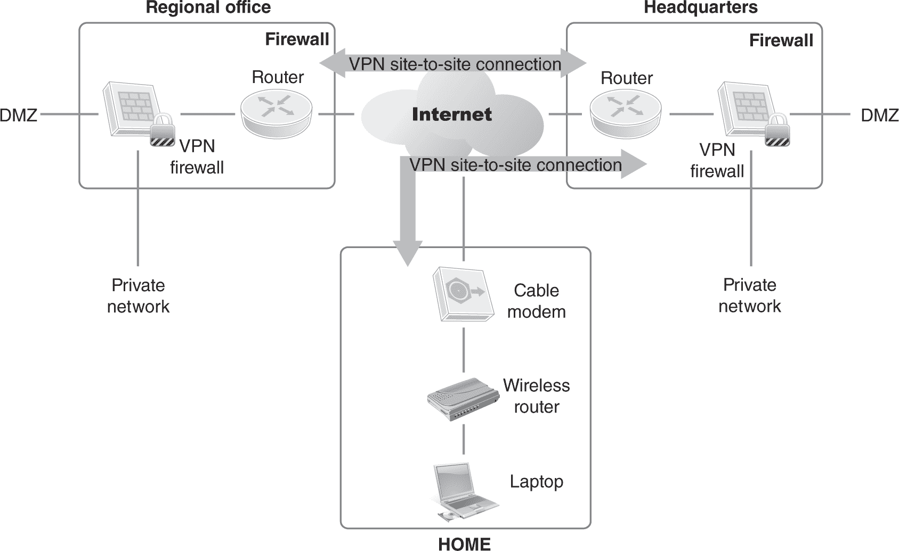

`FIGURE 4-4` VPN 连接的基本类型。

增强的远程身份验证与网络连接相结合，可以成为确保网络保护的工具。然而，这些工具也将业务网络扩展到了世界的任何地方。考虑以下情景：高管 Shelly 在周六接到一个电话，要求批准一项关键业务货运的变更。为了让 Shelly 批准这批货运，她必须在内部系统中查看更改并对这些更改进行电子签名；然而，她周末正和家人在外面旅游。

幸运的是，Shelly 在酒店里有笔记本电脑，并且连接了互联网。她登录公司笔记本电脑，并使用她的 `ID/password` 和随挂在钥匙扣上的令牌连接到网络。一个 `VPN` 隧道建立了，她的笔记本电脑获得了网络授权。Shelly 现在可以像在办公室办公桌前一样访问该系统。加密通信是安全且私密的。她可以查看货运变更并批准其发布。使用 `ID/password` 和令牌为 Shelly 决定执行的任何交易实现了身份验证和不可否认性。通过加密隧道，实现了通信的机密性和完整性。

## 系统/应用程序域

尽管网络错复杂，但它们本质上是保护终端用户与某些应用程序软件之间的通信。收集、处理和存储数据的最终是软件。业务软件通常是*应用程序*。系统软件（如服务器操作系统）运行业务应用程序。系统/应用程序域 指的是所有与系统和应用程序软件相关的问题。

应用程序软件是所有业务应用程序的核心。应用程序软件可以运行在工作站或服务器上。例如，应用程序可以显示一个屏幕，客户和员工可以通过该屏幕选择产品并输入数据。一旦收集到信息，应用程序就会交易传输到服务器。服务器将信息存储在数据库中以便稍后处理，或者立即处理交易、存储结果并将信息显示回终端用户。随后，员工可以将数据从此订单应用程序中提取到电子表格中，以按产品类型跟踪每个月的订单总数。接收订单的应用程序、跟踪订单的电子表格，以及可能用于宣布当月销售记录的电子邮件客户端都是应用程序软件的示例。

> **提示**
>
> 人们经常混用*系统软件*和*应用程序软件*这两个词。它们不是同一种东西。通常，终端用户（包括客户）接触的任何业务软件都是应用程序。这包括电子邮件、文字处理和电子表格软件。

## 信息安全业务挑战与缓解域内风险的安全策略

前一节提供了七个域的基础知识。在本节中，你将检查每个域的业务挑战和风险。你还将学习适当的安全策略的应用如何缓解这些风险。

## 用户域

组织的有效运行需要人员、流程和技术的适当对齐。对于大多数规模、范围和复杂的复杂的问题，找到解决方案的最佳方法是将问题分解为可管理的单元。在这种情况下，业务的目标是实现这种对齐以产生一致的、重复的结果。挑战在于人类并不总是可预测的。因此，任何依赖于人类的过程必须经常强化良好的行为。这种教育、监控和行为调整的强化是实施安全策略永无止境的循环。

员工效率从反映组织预期的良好定义策略开始。安全策略必须与业务需求密切对齐。这种情况让员工理解策略对组织的重要性。它还确保安全策略支持业务目标。一个主要的业务挑战是让员工遵循策略。良好的安全策略有几种方式可以缓解这种风险，如下：

- **意识**——策略要求员工接受的安全意识培训。最重要的是，这种培训让员工在出现意外时知道去哪里寻求帮助。培训还对需要保护的敏感信息（如确保客户隐私）设定了预期。
- **强制**——安全控制源于安全策略。这些控制旨在执行业务希望的操作方式。最重要的安全控制措施之一是执行职责分离的措施。*职责分离*（或任务分工）意味着单个人不能执行高风险交易，例如从银行汇出大资金。通常，这需要一个人申请汇款，另一个经理批准传输。


- **奖励**——指的是管理如何强化遵循策略的价值。组织应该建立对不遵守策略的惩罚措施，以及对遵守策略的认可。这可以简单地在员工的年度考核中记录其对策略的遵守程度。

- **监控**——仅仅发布良好的安全策略是不够的。你必须知道它们是否在起作用。监控可以有多种形式。通常，它是质量保证和质量控制的结合。质量*保证*是在行动发生前对其进行验证和批准。质量*控制*是对比已完成的工作进行抽样，以确保整体行动符合标准。这两种类型的监控结合可用于强制执行并提高意识。

# 安全策略与领域

另一个业务关注点是处理物理形式的敏感信息，例如报告。如前所述，许多组织都实行***整洁桌面政策***。该政策通常要求员工在工作日结束和不使用时锁定所有文档和`digital media`。合规性检查相对容易，因为任何遗留在办公室过夜的报告或`CD`都是对策略的违反。这保护了`客户隐私`，并提醒员工`公司信息`的敏感性。它还为可能访问办公室的客户和供应商树立了正确的形象。

安全策略还确保了承包商和顾问在获得`公司信息`之前经过了适当的审查。这包括进行`背景检查`。员工和非员工都必须遵守安全策略。

并不是所有的业务流程都可以标准化。员工有时会通过口头相传传递知识，例如如何运行某些`非标准交易`。这些流程可能存在重大失败的风险。至少，当发生故障时，安全策略可以确保流程和`相关数据`得以恢复。

## 工作站领域

锁上前门却让窗户大开可并不是良好的安全措施。假设你拥有良好的`身份验证`，并且知道谁登录了你的网络。然而，如果工作站被攻破，每当授权用户连接时，`恶意软件`都可能损害你的网络。

对于某些受监管的组织来说，安全泄露的后果更为严重。人们预期会应用`领先实践`来防止此类泄露。安全策略有助于识别这些实践，并确保它们被用于保护`工作站`。这包括确保所有访问网络的工作站都已`补丁`并安装了`杀病毒软件`。企业可能没有意识到监管机构所期望的许多基础通用控制。安全策略确保了这些措施到位，并有助于确保`监管合规性`。

有效的安全通常取决于确定一些基本的`安全配置规则`并在整个企业中一致地应用这些规则。在不干扰业务的情况下应用此类安全措施是一个关注点。对于大多数组织来说，派遣技术人员去每个办公桌旁配置工作站的时代早已过去。安全策略可以帮助建立一个可靠的`自动化补丁管理流程`。安全策略可以规定应用`补丁`的类型和频率。策略通常要求 IT 在将补丁应用于工作站之前在实验室环境中`测试补丁`。更改在晚上进行，以减少对公司日常运营的影响。

安全策略还通过限制对工作站的访问来降低恶意软件风险。通常，终端用户在工作站上没有`管理权限`。这意味着终端用户无法无意安装可能引发`僵尸网络攻击`的`恶意软件`。

### 供参考

***僵尸网络***是一组计算机的集合，这些计算机被黑客在所有者不知情的情况下加载了恶意软件。这种类型的攻击与其他攻击的区别在于，它能够创建大量的计算机，所有计算机为了单一目的进行通信。例如，僵尸网络可以用于从全球数百万个节点发起`分布式拒绝服务 (DDoS)攻击`。

如果黑客无法直接攻破公司网络，他们通常会尝试攻破工作站并以某种方式感染它。其目的是从工作站捕获信息，或将工作站作为访问`保护网络`的一种。安全策略擅长概述保护工作站的规则。一个很好的例子是`加密笔记本电脑硬盘`。这在许多行业已成为标准做法。随着`移动计算`的增加，`敏感数据`离开网络变得更容易、更频繁。因此，许多处理敏感信息的公司会加密`员工的笔记本电脑硬盘`。这样，如果笔记本电脑丢失或被盗，`敏感数据`就能得到保护。

许多安全策略要求信息每当离开网络保护时进行`数据加密`。这包括`通过互联网加密数据`；在`邮件`中；以及在移动设备上，如`通用总线 (USB) 驱动器`、`CD`、`智能手机`、`平板电脑`和笔记本电脑。尽管有了这些努力，根据 2020 年 2 月发布的一项研究，2019 年是由于导致数据丢失的记录年。研究记录了 3800 起事件，导致`42 亿条记录`暴露。这说明了建立强大的策略、监控和执行的必要性。

设定`加密标准`的安全策略需要确保供应商和承包商遵循与员工要求遵守相同的策略。

## LAN 领域

许多组织发现，为业务应用程序提供`移动访问`可以提高生产力和收入。`LAN`的核心是业务的`连接性`。越容易连接到`LAN`，就能越快地访问和交换数据。`无线和移动计算`改变了人们对`LAN`的理解。这种新观点影响了对`LAN`和`远程访问领域问题`的认知。

`无线连接`允许你比桌面电脑更广泛地查看`LAN`。`已处理设备`允许你将`LAN 网络`扩展到办公室之外并进入业务。换句话说，你可以连接到网络，并在产品或交付或服务的地方访问或交换信息。以下是使用`无线技术`将`LAN`扩展到业务的几个示例：

* **医疗保健**——医疗提供者可以在患者床边访问`实时患者信息`或医学研究。这些设备增强了协作，以实现更准确的诊断。这些设备还可以跟踪`医疗设备`，以确保在关键时刻可用。

* **制造业**——`无线连接`允许员工在工厂车间共享`实时数据`。

* **零售**——对`LAN`的`无线访问`帮助零售商在没有网络布线的地方放置`智能收银机`。这种网络访问允许零售商管理`库存`、更快地完成客户结算，并从收银机打印`最新优惠券`。

扩展`LAN`比仅仅连接标准 PC 有许多优势。现在的`LAN`可以携带`语音`、`视频`和传统的计算机流量。`基于 IP 的语音 (VoIP)`允许你通过`LAN`或`WAN`拨打和接听电话。由于比`传统电话系统`节省成本，这在家庭和商业中都变得流行。与其支付高额的固定费用和按分钟通话费用，大多数`VoIP 服务`收取低廉的固定费用。新公司不断进入市场，通过互联网提供更廉价的`语音和视频解决方案`。

###  注意事项

现在的`LAN`通常携带物理安全信息，如`视频流`。有了这种扩展的能力，你可以看到`逻辑与物理安全`日益增长的整合。例如，`员工刷卡访问`与个人的`逻辑安全访问`紧密结合。它们共同工作，既控制了人们可以进入的房间，也限制了进入房间后可以访问的计算机。

组织通常将`LAN`看作类似于电、水或气等公用事业。组织期望`LAN`始终可用且始终有容量。它被认为是一种安装和运行成本低廉的商品。这给`LAN 资源`造成了巨大的压力。例如，随着`VoIP`和`视频`等新服务的提供，`LAN`内部的`带宽`就会减少。

安全策略限制实时视频、音乐流和社交媒体网站的使用并不罕见。这些内容可能会导致员工和承包商损失数小时的生产力。这些流还会占用大量的带宽。例如，早在 2012 年，拥有 129,000 名员工的宝洁（Procter & Gamble）就利用安全策略阻止视频和音乐流。许多此类策略可以在防火墙上实施，从互联网切断视频和音乐的源头。然而，随着 2020 年新冠肺炎的爆发，许多公司依赖视频进行远程办公工作。

尽管面临这些业务挑战，将 `LAN` 扩展到工作站之外的益处是巨大的，包括提高生产力、协作能力和响应速度。

### 注意

带宽是一种量化网络上可以传输多少信息的测量。当 `LAN` 达到其最大带宽时，它变得容易受到各种传输错误和延迟的影响。

#### LAN 到 WAN 域

组织关注的一个主要问题是保护 `DMZ` 中的服务器。换句话说，网站服务器是否受到了保护？组织特别担心网站的可用性和完整性。许多组织的网站代表了它们的公共形象，对于公司而言，这也是它们主要的销售渠道。

安全策略对 `DMZ` 流量应如何限制和监控制定了严格规则。安全策略概述了如何配置 `DMZ` 服务器以及应多久应用一次安全补丁。安全策略还概述了进行外部渗透测试的频率。渗透测试从外部向内部探测网络中的弱点和漏洞。许多标准都要求进行渗透测试，并被视为最佳实践；例如，如果你接受或处理信用卡，`PCI DSS` 就要求进行渗透测试。

### 注意

组织的声誉可能会因为网站上出现网页涂鸦（`web graffiti`）而降低。网页涂鸦是网站篡改（`website defacement`）的结果，即网站被入侵且内容被篡改，通常是以让网站所有者难堪的方式。网页涂鸦可能包含攻击性语言甚至色情图像。

然而，施加在 `DMZ` 的这些规则和限制也会产生自身的风险。`DDoS` 攻击通常试图使 `DMZ` 能力崩溃，导致服务器崩溃并不可用。因此，对流量实施的限制越多，你就越需要测试系统是否能够承受 `DDoS` 攻击。仅仅限制流量是不够的，策略还必须确保系统保持可用。

### WAN 域

当涉及 `WAN` 时，组织通常关注成本、可靠性和速度。正如本章早期讨论的那样，许多组织使用虚拟专用网络（`virtual private networking`）来保护和保障互联网上的通信。由于大多数组织已经承担了互联网连接的成本，在互联网上使用安全通信现在被视为一种事实标准。

从成本来看，通过互联网使用 `VPN` 是正确的选择。成本适中。由于大多数组织已经有了互联网连接，IT 部门可以快速部署 `VPN` 技术。这可能像安装设备和同步密钥以建立 `VPN` 隧道一样简单。

### 注意

通过虚拟专用网络（`virtual private networking`），你通过公共互联网建立“隧道”到达特定站点。通常，两个 `VPN` 设备建立一个站点到点的 `VPN` 隧道。两端设备通常预先配置了密钥，使得只有这些设备相互通信。一旦建立建立，它就可以连接整个 `LAN`。例如，远程办公室可以连接到总部。

`VPN` 的可靠性取决于你的互联网服务提供商（`ISP`）。即使你在公共网络上旅行时 `ISP` 保证了某种程度的服务，你仍可能遇到可靠性问题。把互联网想象成一个道路系统。你有本地道路、主干道和超级公路。某些 `ISP` 会宣传他们距离互联网骨干网有多少个跳数（hops）。`Internet backbone` 代表我们道路系统中的超级公路，可以处理最快的流量。理论上，到达骨干网所需的跳数越少，你的访问速度就越快。`hop`（跳）是一个术语，泛指到达目的地需要经过多少个路由器。如果你必须经过很多小路才能到达目的地，那么将比住在超级公路附近要长得多。互联网流量也是如此。许多大型组织将连接到多个 `ISP`。这将在单个 `ISP` 无法提供所需连接速度时提供所需的冗余。

尽管互联网速度在不断提高，但它并不是无限的资源。为了控制使用情况，许多 `ISP` 会限制带宽。当达到上限时，某些客户可能会被转移到较慢的网络连接上。这对于家庭用户来说是可以接受的；但对于企业来说，这可能是灾难性的。企业通常要求客户获得一致的响应时间。为了实现这一点，他们向 `ISP` 支付溢价。这笔溢价让企业处于不那么拥挤的网络连接上，该连接有空余容量以确保响应水平不会低于规定水平。这使得预测可靠性不再是一个挑战。

为你的组织选择公共或私有 `WAN` 解决方案取决于你的需求和预算。小型组织的选择很少。对于大型企业，两种 `WAN` 选项可用。

### 注意

私有 `WAN` 是点对点的解决方案，不公开共享，因此通常不加密。私有 `WAN` 服务提供商可以保证上传和下载带宽的一致性。

安全策略概述了每种连接类型应如何配置和保护。安全策略还概述了角色和责任。记住，服务提供商通常配置私有 `WAN` 安全。因此，你的安全策略需要如何处理供应商以及如何验证安全配置。任何规模的公司都可以内部管理基于互联网的 `VPN` 解决方案的安全。

### 远程访问域

当涉及 `WAN access` 时，组织关注灵活性、可靠性和速度。如所述，将 `LAN` 扩展到生产产品和交付服务的业务中具有巨大的好处。将 `LAN` 扩展到世界上任何地方也是如此。这就是需要解决远程访问问题的地方。

在灵活性方面，员工不能被束缚在台式电脑前。笔记本电脑打破了这种束缚，允许员工在有互联网连接的地方连接到公司网络。无线连接进一步扩展了笔记本电脑的灵活性。今天，旅行者和移动员工经常使用带有移动热点（`mobile hotspot`）的笔记本电脑访问互联网和工作网络。`mobile hotspot` 可以是一个像手机一样供笔记本使用的个人设备，允许终端用户获得宽带互联网连接。这些个人热点通常支持 4 到 8 个设备的连接。`Hotspot` 也可以指向公众开放的固定互联网接入点；例如，咖啡馆经常为其客户提供互联网热点访问。

移动设备和宽带正变得非常可靠；然而，它们访问和交换数据的速度和可靠性取决于位置和运营商。就像手机覆盖一样，移动宽带的覆盖有时并不稳定。尽管有这些缺点，移动设备为业务带来了许多益处，包括：

* 提高客户的响应能力
* 对新闻和业务相关事件做出快速反应

# 实时数据访问的优势

自带设备（BYOD）在本章之前已提到过，它是许多机构目前的趋势之一。请记住，BYOD 指允许员工携带自己的设备来工作以访问机构的数据。例如，它可以允许员工通过其个人智能手机访问公司电子邮件。企业采用 BYOD 是为了降低成本并扩展连接选项。成本之所以降低是因为公司无需购买和部署公司拥有的移动设备。

安全性取决于你的业务需求——你需要发送多少数据以及你需要数据多快到达。这里是一些很好的例子，使用智能手机、iPad 以及其他平板电脑。这些设备对于访问电子邮件等定义良好的应用程序非常高效；然而，它们也引入了必须解决的风险和策略问题。在使用手持设备时必须解决的某些安全策略问题包括：

* 设备的所有权归谁所有？
* 如果设备丢失或被盗，谁有权擦除设备数据？
* 你如何对设备上的数据进行加密？
* 你如何应用补丁？
* 谁允许将此类设备连接到公司网络？

对于任何新兴技术，定义良好的安全策略有助于组织深思这些风险决策。安全策略确保了执行了风险评估，并审查了领先实践。这至关重要，因为组织不仅要理解新技术的益处，还要理解其风险。

安全策略不应关注特定产品，而应关注更广泛的能力。智能手机可以访问电子邮件，但也有摄像头。与其针对智能手机，不如说定义良好的策略更宽泛地处理移动电子邮件访问和数字录制的可接受使用问题。通过在引入新技术时采取这种方法，组织在策略中涵盖了该能力。也许处理 BYOD 最有效的方法是通过使用网络访问控制（NAC），这在本章的前面的部分也简要提到过。

## 系统/应用领域

机构在涉及收集、存储和处理的信息时，有两个主要的关注点：信息是安全的吗？你能防止机密信息离开机构吗？这些似乎是相当简单的问题，但回答起来却复杂。

本章讨论了保持信息安全的许多方法。安全策略确保在整个七个领域内对风险进行评估。安全策略确保与业务需求保持一致。当风险存在时，安全策略确保进行风险评估，以便管理层能够做出平衡的决策。

在本节中，你将关注第二个业务关注点：如何防止机密信息离开机构。安全策略定义了通常被称为数据泄露防护 (DLP) 程序或数据泄露防护 (DLP) 程序。这两个术语均指的是一个减少数据意外或恶意丢失概率的正式计划。

公司经理担心机密业务信息落入竞争对手手中。经理还必须根据法律要求保护隐私。黑客不需要亲临现场就能偷取你的商业秘密，特别是如果他或她是一个不满的员工，并且可能在公司数据敏感的区域工作。你的顶尖销售员可能会离开公司为竞争对手工作，并将你的整个销售数据库发送电子邮件到他的家庭互联网账户。这些对业务来说不是理论上的损失。你必须确保所有潜在的数据泄露（无论是物理的还是数字的）都被堵住。

DLP 的概念源于一种承认：数据会改变形式，并且经常被复制、移动和存储在许多地方。这些敏感数据通常离开应用程序数据库的保护，最终进入电子邮件、电子表格和个人工作站文件。业务最关注的是位于应用程序加固保护之外的数据。

典型的 DLP 程序提供几层防御以防止机密数据离开机构，包括：

* 资产清单
* 边界
* 设备管理

### 资产清单

DLP 清单组件尝试识别敏感数据可能存储在何处。这包括扫描工作站、电子邮件文件夹和文件服务器。该过程需要实际检查文件内容并确定它们是否包含敏感信息（如社会安全号码）。一旦确定了数据位置，就可以创建报告来比较安全性。安全策略确保与安全策略进行匹配。例如，这有助于防止隐私信息无意中存储在公共文件夹中。虽然这是一项重要的能力，但它具有局限性。理解文件的敏感性是非常困难的。

### 边界

DLP 边界确保无论操作系统或设备类型如何，网络终端都受到保护。它在数据移动时进行检查，包括写入光学设备、USB 设备、即时消息和打印。如果敏感数据被写入未经授权的设备，该技术可以阻止或存档文件。它可以阻止由恶意软件和文件共享引起的数据丢失。通过日志和分析服务器，DLP 边界监控事件并生成详细的取证报告。

你还可以建立安全策略来规范和限制员工使用和传输敏感数据。它使用了与清单组件相同的基础技术。它具有相同的局限性。由于你处理的是数据移动，你可以添加清单过程中不常见的规则，例如不允许通过电子邮件发送大型数据库文件。无论内容如何，这些规则都可以阻止黑客向外发送大量数据。

### 设备管理

在许多方面，智能手机和平板电脑等移动设备就像移动硬盘。它们携带的信息与位于工作站或服务器上的信息相同。当执行官收到关于即将合并的电子邮件或医生收到关于患者的消息时，这些信息需要与位于工作站上时相同的保护。移动设备上的信息受到相同的法规要求。这意味着你必须应用相同水平的控制，例如加密。

从中央服务管理这些设备至关重要。当识别出新威胁时，这种设备管理能力对于推送补丁和确保控制良好至关重要。

你需要 DLP 程序，因为机密数据的丢失会损害业务声誉、泄露竞争秘密并往往违反法规。定义良好的安全策略在机构内部建立了一个正式的 DLP 程序。

### 章节总结

你在本章中学习了如何将策略分为七个领域。你检查了每个领域以了解它们为什么存在，查看了相关的业务关注点，并学习了如何缓解常见风险。安全策略必须与业务保持一致。最重要的是，安全策略可以突出法规和领先实践，以指导业务控制这些风险。

本章探讨了通过无线和手持设备等技术带来的业务本质变革。你学习了 `RBAC` 和 `ABAC` 等访问方法之间的区别。安全策略必须跟上技术的进步，这一点非常重要。你还看到了当安全策略无效时会发生什么，例如 2019 年有超过 42 亿客户记录泄露。你应该更好地理解 `LAN` 在通过 `WAN` 建立全球连接方面日益扩大的作用。你还学习了保护此类通信安全性和私密性的技术，例如 `VPN`。最后，你学习了在安全策略中定义 `DLP` 计划的重要性，以及 `DLP` 的驱动因素，包括 `BYOD` 程序。`DLP` 程序有助于组织减少数据丢失的概率。

## 核心概念与术语

- 应用程序软件
- 基于属性的访问控制 (ABAC)
- 自带设备办公 (BYOD)
- 数据泄露防护 (DLP)
- 数据丢失防护 (DLP)
- 非军事化区 (DMZ)
- 发现管理
- 域
- 电子邮件策略
- 防火墙
- 扁平网络


- 帮助台管理
- 清单管理
- LAN 域
- LAN 到 WAN 域
- 日志管理
- 多因子身份认证
- 补丁管理
- 隐私策略
- 远程访问域
- 远程认证
- 基于角色的访问控制 (`RBAC`)
- 路由器
- 安全管理
- 分段网络
- 嗅探器
- 交换机
- 系统访问策略
- 系统/应用域
- 系统软件
- 双因子身份认证
- 用户域
- 虚拟专用网络 (`VPN`)
- WAN 域
- 网络涂鸦
- 网站篡改
- 工作站域

### 第 4 章节评估

1. 私有 `WANs` 必须始终保持加密状态。
   - 正确
   - 错误

2. 下列哪项试图识别敏感数据当前存储于何？
   - 数据泄露防护清单
   - `DLP` 加密密钥
   - 数据丢失防护边界
   - `DLP` 木马

3. 协议传输语音 (`VoIP`) 可以在以下哪个网络中使用？
   - `LAN`
   - `WAN`
   - 均可
   - 均不可

4. 下列哪项不是典型 IT 基础设施七个域之一？
   - 远程访问域
   - `LAN` 域
   - 广域网域
   - 系统/应用域

5. 七个域中的哪一个是连接组织的 `LAN` 与 `WAN` 并允许终端用户上网的技术基础设施？

6. `RBAC` 和 `ABAC` 之间的一个关键区别是下列哪项？
   - `ABAC` 是动态的，`RBAC` 是静态的。
   - `ABAC` 是静态的，`RBAC` 是动态的。
   - 无区别；这些只是相同含义的术语。

7. `______` 是指限制计算机交流内容及其通信方式的网络术语。

8. `LAN` 对于连接办公室或建筑群内的计算机非常高效。
   - 正确
   - 错误

9. 哪种策略要求员工在工作日结束和未使用时锁定所有文档和数字媒体？
   - 可接受使用策略
   - 洁净桌面策略
   - 隐私策略

10. 员工在意识培训中学到的知识对他们的影响比他们在部门内看到的内容更大。
    - 正确
    - 错误

11. 哪种工作站管理指的是了解安装了哪些软件？
    - 清单管理
    - 补丁管理
    - 安全管理

12. 始终采用最严格的身份验证方法是保护业务和确保目标实现的最佳方式。
    - 正确
    - 错误

13. 通常，远程认证提供下列哪项？
    - 比在办公室时更少的控制
    - 与在办公室时相同的控制
    - 比在办公室时更多的控制
    - 对控制的需求减少

14. 如果使用了强身份认证，远程访问不需要加密。
    - 正确
    - 错误

15. `DMZ` 通常位于哪里？
    - 私有 `LAN` 内部
    - `WAN` 内部
    - 私有 `LAN` 与公有 `WAN` 之间
    - 邮件服务器内部

16. 唯一功能是创建和管理 `VPN` 流量的专用网络设备被称为 `______`。

17. 什么是僵尸网络？
    - 用户加载到设备上以防止入侵的软件
    - 公司加载到设备上以监控员工的软件
    - 黑客在用户不知情的情况下加载到设备上的软件
    - 用于点与点之间通信的软件

18. 企业身份认证的最低标准是使用 `______`。

## 尾注

1. Marr, Bernard, “我们每天创造多少数据？每个人都读过的令人震惊的统计数据，” *Forbes*。
2. Ch., Radoslave, “2020 年云计算统计数据，” Techjury, 2019 年 3 月 28 日。
3. Columbus, Louis, “根据 Gartner 报告，公云将在 2022 年飙升至 3310 亿美元，” *Forbes*。
4. McAfee, “企业云使用的 12 必知统计数据，” 2017 年 3 月 9 日, *Skyhigh Networks*。


© obpcnh/Shutterstock

# 信息安全策略的成功实施

信息安全策略的**成功实施**在策略编写之前就已经开始了。实施的成功取决于策略整合到现有业务流程的程度，以及领导层和员工对其的理解和接纳程度。实施信息安全策略往往会导致引入一些减慢数据交换的控制措施。创建、实施和维护足够的安全控制似乎负担沉，但这是完全必要的。

因此，策略的成功实施必须被视为从构思到实施的历程。你必须从`参与`开始，在组织内部提高意识，并对实施策略的必要性达成共识。尽管信息安全的技术方面可能很困难，但由于其的不可预测性，人性的方面可能更具挑战性。

一旦安全策略创建、修订并达成一致，实施过程就开始了。实施安全策略的过程可能比创建文档本身更要困难。你不应该低估这项工作。成功实施信息安全策略需要结合处理人性和公司文化的`软技能`以及`项目管理`中的`硬技能`。任务的数量和考虑因素之多可能让人防不从心。采取系统的方法来保持实施的推进并让支持者参与至关重要。

新策略或对常见操作的变更可能会增加实施难度。如果某策略被认为限制了某些必要或理想的操作，可能会产生抵触情绪。确保所有人员都了解新策略或变更后的策略并接受教育至关重要。对员工进行策略问题的教育是策略中最具挑战性的方面之一。

安全策略规定了控制风险的方法并反映了组织的核心价值观。这意味着，安全策略在促进`风险意识文化`和激励员工方面，与实施技术业务需求同样重要。因此，请记住，成功的实施必须能够激励、获得共识并与个人的优先事项相竞争（平衡）。获得`高层支持`是成功的关键之一。这意味着你必须能够传达安全策略的价值。你必须能够解释为什么业务和个人应该关注这些。这需要影响他人和营销安全策略价值的技巧。

在本章中，你将回顾实施安全策略时面临的许多问题和困难。本章将就如何克服这些挑战以及如何在职场中处理人性提供指引。

## 第 5 章主题

本章涵盖了以下主题和概念：

* 如何在职场中处理人性
* 各种组织结构是什么
* 如何克服用户的冷漠
* 为什么高层管理层的支持非常重要
* 为什么人力资源政策的支持很重要
* 安全策略如何影响角色、责任和问责制
* 当履行策略不属于职位描述时会发生什么
* 创业型方法如何影响生产力和效率
* 为什么在实施安全策略时，找到衡量员工绩效和问责的正确标准很重要

## 第 5 章目标

完成本章后，你将能够：

* 描述什么是`控制伙伴`
* 描述人们在职场中是如何被激励的
* 描述不同的职场性格类型
* 比较不同组织结构的优缺点
* 描述组织结构的基本特征
* 解释用户冷漠如何影响安全策略的实施
* 解释高层和人力资源支持的重要性
* 描述`变更模型`在实施安全策略中的性
* 描述`变更模型`中的关键任务
* 解释实施安全策略中的关键角色和责任
* 描述`创业型业务部门`的属性

## 职场中的人性

成功的安全策略实施取决于人们理解关键概念并接纳这些内容。理解和影响职场中不同的性格对于实现这一成功至关重要。但你需要考虑的不仅仅是内部员工的需求。各种利益相关者都会对信息安全策略感兴趣，包括供应商、客户和监管机构等外部人员。随着全球竞争的加，新的销售渠道和产品出现。这些因素通常伴随着技术的变化。人们投入巨大的精力和资源来记录、调试并将组织的流程映射到这些技术上。随着时间的推移，技术、框架和标准不断演变为最佳实践。成功不仅取决于技术或流程。成功的安全策略实施取决于人员、流程和技术的正确对齐。

在人员要素上投入了多少时间和资源？往往是投入不足。

本节探讨了职场中的人性。更准确地说，它研究了不同的性格类型以及它们如何影响安全策略的采纳。成功的安全策略实施部分取决于员工是否理解关键概念并将其广泛应用于未预见的情况中。超越被告知的内容有助于定义信息安全策略的成功实施。

获得支持和教育员工的一种实用方法是`讲故事`（storytelling）。在之前的职位上，本作者曾习惯于每月向该公司的员工发送一个简短的故事。故事简要描述了一个耸人听闻的安全漏洞事件，然后解释了为什么制定某项或多项策略。这种沟通对员工来说既简洁又有趣。事实证明这是一种有效的沟通方法。

### 动机的基本要素

什么是动机？是什么让帮助台员工坚持工作解决你的问题？它是充满热情、精力充沛并投入实现某个目标或任务。缺乏动机可以通过糟糕的客户服务和仅付最低努力以过日子、产生平庸的结果来衡量。

有几种可能的动机来源：`自豪`、`自利`、`恐惧`、`欲望`和`成功`。其中一些适用于职场，另一些则不那么适用。通常不建议使用恐惧。显然，不遵守策略是有后果的，但遵循策略的主要动机不应是恐惧。让员工对他们的工作感到自豪并理解策略符合其自身利益，以及员工在职场表现良好的欲望是积极的激励方法并应当被使用。

#### 自豪

自豪心是人性的一部分。当个人从事他们重要的事情时，往往更容易产生动力。如果你的工作被丢弃或被淡化，你可能就不可能在下次投入高质量的努力。相反，如果你理解团队的目标和任务，并看到自己的个人努力如何做出贡献，你很可能会产生责任感。这还能建立团队的自豪感和团队精神，这对于未来的成功至关重要。

自豪心的一个重要组成部分是对整体目标和任务的理解。管理层负责告知员工他们的角色以及他们的努力如何有助于大目标。这就是优秀的领导者可以激励人心，而糟糕的领导者可能会破坏一项良好的安全策略。经理的一句：“你必须这样做，是因为安全部门是这么说的”是领导力糟糕的良好迹。在这种情况下，管理层可能不会接受该政策，更重要的是，员工可能会认为政策是一种负担。这种认知可能导致员工只做最最低的工作。相反，经理可以接触员工并概述正在解决的问题。他或她可能会对所采取的行动表示个人的支持。经理可以将政策变动定位为扩展员工技能的机会，并强调保护客户的重要性。

自豪心可以成为强大的动力。它还可以创造竞争和自我价值感。经理必须控制竞争，以至于成功的唯一标准不仅仅是先完成任务。经理还必须促进互相关助，以便“团队”取得成功。衡量成功需要包含对组织重要的所有所有价值，包括服务质量、客户满意度和团队合作。

为了将自豪心作为安全方面的一种激励因素，准确地向整个组织传达安全的价值至关重要。这始于对威胁的现实理解。整个组织需要理解危险，以便他们理解对策措施和政策的原因。这样，员工就可以被激励在安全方面表现优异。安全目标必须与业务目标相结合。例如，一个仅根据销售量进行评估而不考虑任何安全问题的销售团队，将不会为超过安全目标而感到自豪。

## 自利

自利，有时也包括自保，也是人性的一部分。人类倾向于重复获得奖励的行为。为个人设定明确的目标和任务有助于他们理解自己必须完成什么。实现这些目标的人会获得奖励。超过这些目标的人通常会获得更大或更好的奖励。这些个人是“高成就者”或高表现者。高成就者更经常获得晋升，是他人效仿的榜样。为了提高信息和遵守信息策略的重要性，你应该获得高表现者的支持。

在经济低迷的市场中，公司面临着裁员以节省资金的巨大压力。感到工作面临风险的员工不会冒险。这可能导致个人只做最低限以避免麻烦。更糟糕的是那些觉得自己将是下一个被辞退的人。他们可能会愤怒，并试图破坏管理层的努力。当组织裁减员工时，这通常被称为人员缩减。通常，在裁员期间实施重大的政策变动不是一个好主意。

纪律对我们的行为也有重要的自保作用。当员工未能履行职责时，可能需要采取纪律措施。管理层处理纪律措施的方式会激励或挫伤员工动力。遗憾的是，纪律必须是安全策略执行的一个元素。

每个人都有优点和缺点。大多数人都会犯错，在某个时刻他们会做愚蠢的事。一种管理方法是更多关注员工的行为模式，而不是个人的判断错误。这种方法有其局限性，例如在性骚扰或欺诈案件中。然而，除了这些极端情况，当管理层将失败视为个人和团队成长的一部分时，就会形成一种冒险的文化。更重要的是，这种方法创造了信任，鼓励员工报告策略失败和崩溃。不仅是个人员工，整个组织都能从这些失败中汲训。这种经验通常被称为“经验教训”。让记录和跟踪这些经验教训变得更容易，将允许信息安全团队改进策略以防止未来问题的出现。

 注意

如果处理不当，惩戒员工可能是有风险的。你需要确保不要对同一政策违规行为对不同员工采取不同的惩戒措施。你的不一致性可能导致诉讼或就业歧视的指控。在惩戒员工时，务必通过人力资源部门进行，并严格遵守公司程序。

冒险和超越预期定义了高成就者和高表现团队。由于安全策略无法定义每一个事件，它们的成功取决于员工通过采取行动，将核心原则应用于新情况。例如，你可能有一项关于设置管理员账户的清晰策略和相关流程。假设某个供应商为你的组织提供支持。假设供应商要求更改其所支持设备的访问权限并不寻常。从历史上看，他们每年请求一两次访问权限变更。现在，假设你收到供应商代表的请求（根据既定流程），删除所有现有的管理员账户并用新账户替换。该请求遵循既定流程。

然而，那些理解管理员账户相关风险的员工以及那些感到授权的可能会可能会该请求并要求额外的授权，尽管政策并不要求额外的审批者。事实证明，那个要求进行这些极寻常变更的供应商代表刚刚被解雇，或者刚刚成为某种形式身份盗窃的受害者。在这种情况下，那些拥有系统知识并有信心挑战供应商代表的高成就员工可能是保护组织的人。

### 成功

想要成功是人性的一部分。任何在获胜团队中打过球的人都知道那种感觉。在获胜团队中比在总是垫底的团队中有趣得多。即使你是一个高表现者，如果整个团队一直输，也很难产生动力。职场中也是如此。个人在经常获得认可时会建立信心。这些个人很快变得非常有动力。同样，他们可以激励他人并支持他人获胜。这是创建一个胜利团队的关键元素。他们也可以承担风险，并更有可能通过超越要求来建立自己的成功。

你需要具备一定的软技能，才能说服组织采用安全策略。`Soft skills`指的是某些社会人格特质，例如沟通能力和展现乐观情绪的能力。掌握这些软技能对于影响他人至关重要。在在尝试推销新的安全策略和控制概念时，这一点尤为重要。企业越来越多地依赖员工的灵活性来适应不可预判的状况。这些技能的价值与技术知识一样高。换句话说，等式中的“人”因素对于实施安全策略也至关重要。软技能有助于将人员变为高绩效者，他们能够有效运用自己的知识，并激发他人的潜力。随着时间的推移，安全策略成功成功将改变个人的态度。如果这种成功持续到整个组织，可能会形成一种更具安全和风险意识的文化。这种文化的转变使得未来识别和减轻风险变得容易得多。

自尊、自利和成功问题是重叠并相互作用的。维持动力源于这些基本元素之间建立正确的平衡。`图 5-1`展示了动力的这三个基本元素及其交集。


**图 5-1** 动力的三个基本元素。

受激励的员工更有可能接受安全策略的实施。这将为组织识别并减轻更多的风险。

### 员工的性格类型

可以很容易地看出，个人在职场中的反应各不相同。激励一个人的因素并不总是适用于另一个人。理解团队内部不同的性格类型是理解如何激励人的关键。理解并欣赏这些差异非常重要。这种理解能让你更有效地利用人才。

让我们用一个简单的例子来说明这一点。假设你正在与财务部门和审计部门的两个关键利益相关者打交。财务分析师可能具有分析性，想知道实施新安全策略对财务的影响。审计师可能更关注结果：策略实施后将减少哪些风险？可能还存在大群动机迥异的个人。能够识别这些差异将使你能够针对最有说服力的兴趣点进行交流。与财务分析师谈论威胁可能是为项目辩护提供良好的背景，但并没有解决他们对预算超出的潜在担忧。

 注意

在处理利益相关者时，理解性格尤为重要。利益相关者（`Stakeholder`）是指对安全策略的成功感兴趣的个人。在策略实施的早期，利益相关者起着关键性作用。如果你了解他们的性格和需求，就可以激励他们支持实施。

`HR Magazine`识别了职场中的八种经典性格类型。它们是：指挥官、漂流者、攻击者、讨好者、表演者、规避者、分析型人员和成就者。在许多方面，这些性格名称反映了每种类型的个人特质。以下是这些特质的高层级总结：

* **指挥官（`Commanders`）**——要求高且不善圆滑。他们最好的情况下可能表现为没礼貌，最坏的情况下可能粗鲁且突兀。在尝试实现既定目标时他们非常强有力。他们可以成为变革的代理，打破过去并克服组织内部的障碍。
* **漂流者（`Drifters`）**——对结构和日期感到不适。他们可能很擅长人际交往和沟通，因为他们缺乏纪律可能被他们的创造力和跳性思维所弥补。
* **攻击者（`Attackers`）**——对团队中的想法和其他可能表现出愤怒甚至敌意。他们对他人的想法持批评态度。他们可能知道事情失败的原因，但不提供替代方案。他们在理解与新策略相关的风险方面可能很有帮助，但不要指望他们提供改进策略的解决方案。
* **讨好者（`Pleasers`）**——对他人非常友善体贴。他们希望每个人都“感觉良好”，并为了整体利益而放弃个人利益。他们可能会规避执行会得罪他人的规则。这些人可能不会对执行安全策略产生影响。
* **表演者（`Performers`）**——喜欢处于舞台中心。他们喜欢娱乐和成为焦点。随着时间的推移，他们会培养出智慧和魅力来吸引人们的注意力。他们可能不是产量最高的，并且可能有自我推销的习惯。这些人是推广安全策略意识和培训的理想人选。他们的智慧和幽默如果利用得当，在传达安全策略重要性方面是非常有效的。
* **规避者（`Avoiders`）**——喜欢低调行事并处于背景。他们倾向于不冒险或不做任何引起他人注意的事情。他们会准确地执行要求的事，但不会做得更多。虽然在超越政策字面意思方面不是优秀的领导，但他们会一致地执行安全策略和相关流程。
* **分析型人员（`Analyticals`）**——喜欢结构和日期。他们通过在特定时间内以特定质量水平生产的部件精确数量来衡量成功。他们倾向于痴迷精确和细节。他们可能不擅长理解人性动态，因此与客户和情感打交可能会有问题。他们非常适合衡量信息策略的有效，例如作为质量控制功能的一部分。
* **成就者（`Achievers`）**——结果导向。他们可能具有其他性格类型的几种特质；例如，他们可能自信，但不会以牺牲他人为代价。他们真正想要最好的结果，并可能寻求实现方法。成就者非常适合听取所有利益相关者的意见，并制定既满足安全又满足业务需求的安全策略。


# 性格评估与领导力

性格评估已经很久。例如，迈尔斯-布里格类型指标（`MBTI`）最早发布于 1962 年。性格类型评估最近变得更加广泛使用，是因为计算机测试使其更容易交付，且其感知准确性有所提高。然而，这种评估不应是聘用某人的唯一依据。测试可以帮助你更好地了解应聘者。性格测试在为长期或高度项目组小组时也有帮助。人力资源书籍和网站也是性格类型模型的好来源。

鉴于该主题已编写的所有材料，可以围绕领导力、业务价值和伦理构建整个资源库。在本节中讨论这些内容是为了帮助你更好地理解职场中的人性。本节重点关注领导力如何影响员工行为，以及良好的领导力如何帮助确保员工遵守政策。

领导者必须要求员工恰当的行为，并在自己的行动中表现同样的品质。每天表现出伦理行为的领导者更有可能让员工模仿这种行为。优秀的领导者意识到需要在这些性格类型中开展工作，引导他们的能量和热情，并取得成果。领导者的工作是通过他人来实现特定目标。实施安全策略的核心在于通过他人工作来获得他们的支持并让他们遵守策略。

激励个人没有秘诀。一些广泛接受的、且同样适用于安全策略的领导力准则包括：

- **价值观**——优秀的领导者拥有核心价值观。领导者会将他们的核心价值观分享给员工。优秀的领导者会寻求理解并传达安全策略的重要性。核心价值观也可以适用于组织。

- **目标**——优秀的领导者有清晰的愿景并设定目标。他们向团队和个人传达这些目标。他们传达贡献如何通向成功。人们希望知道自己正在从事某些重要的事情。优秀的领导者能够向组织和个人团队目标传达该策略重要性。

- **培训**——优秀的领导者培训他们的团队关注目标并支持彼此的工作。优秀的领导者会确保团队准备好承担策略中概述的额外职责。培训也是安全的关键组成部分。如果没有经过良好培训的员工，你想象到的所有策略和技术都将是无效的。

- **支持**——优秀的领导者接受失败。事情会出错。人们会犯错。领导者对这些错误的反应决定了健康或破坏性的基调。优秀的领导者所创造的信任对于鼓励准确报告任何不正常的情况至关重要。这反过来对于改进控制环境至关重要。当员工信任他们可以在不受后果的情况下报告违规行为，并报告犯错的原因时，问题更容易得到纠正并防止再次发生。事实上，坦诚报告问题的做法应该是常态，并在发生时应该受到奖励。

- **奖励**——优秀的领导者奖励结果而非性格。消磨团队士气的一种快速方法是根据人的受喜爱程度而非产出来奖励个人。所谓的“公司政治”永远无法消除；然而，领导者越能衡量由于安全策略和控制带来的实际风险减少，受到的办公室政治干扰就越少。

理解职场人性的部分之一是承认其复杂性。你需要理解什么激励了个人以及你自己。领导者不能简单地发布命令并期望一次又一次地获得良好结果。高管也不能简单地强制执行信息安全策略并期望员工遵守。优秀的领导者在自己的行动中展示核心价值观，并传达他们的期望。他们理解人性，点燃热情，并激励人们实现共同目标。经理和员工必须理解这些动态关系，以现实且周全考虑的方式处理安全策略的实施。

### 注意


实施安全策略意味着与利益相关者进行持续沟通。这意味着对哪些是有效的、哪些不起作用保持透明。通过这种方式，控制环境可以随着时间的推移不断改进。

在实施安全策略和控制时考虑周全，意味着要在减少风险的需求与对业务运营的影响之间取得平衡。这可能意味着分阶段实施安全控制，或者简单地将安全实施与业务的培训活动对齐。

## 组织结构

组织结构随时间演变的方式会影响人们的行为。管理层必须确定它想要促进的行为和价值观；然后就可以设计合适的结构。管理层选择的组织结构影响安全策略的实施方式。它在不同的领导者、审批层级和核心价值观之间创造了复杂的关系和个人动态。组织的结构反映了团队（或部门）之间的关系、职责和权力链。表 5-1 突显了一些常见的利益相关者类型。这不是一个详尽的列表。利益相关者的列表取决于所实施的策略。例如，数据中心策略将包括物理安全。因此，数据中心策略将包括确保门窗安全和摄像头放置恰当。表 5-1 说明了在实施策略时必须考虑的广泛利益。

**表 5-1** 常见利益相关者

| 利益相关者 | 关键关注领域 |
| :--- | :--- |
| 业务部门 | 及时提供高质量的产品和服务 |
| 信息安全 | 保护公司和客户 |
| 合规 | 遵守法律法规 |
| 运营风险 | 将运营控制在风险承受范围内 |
| IT 架构师 | 设置技术标准 |
| IT 开发人员 | 构建满足业务和技术标准的解决方案 |
| IT 运营 | 落地实施 |
| 审计 | 有效全面的保证策略 |
| 财务 | 有效管理预算 |
| 人力资源 | 招聘、管理实践及相关活动 |
| 高管 | 最终批准所有业务决策或批准下属做出此类决策的领导层 |

组织结构清晰地指示了谁负责以及向谁汇报。图 5-2 描绘了一个典型的美国公司组织架构图。你可以从组织结构中学习很多知识。在这个例子中，注意两个业务部门。假设这些业务足够独特，以需要专门的关注和领导。这可能是因为产品独特，也可能是因为客户群体有独特的需求。例如，银行通常会将零售银行功能（包括个人结算账户和信贷额度等服务）与商业银行（业务贷款和结算账户等其他服务）分开。尽管两者都是银行业务，但产品、客户和法规可能非常不同。

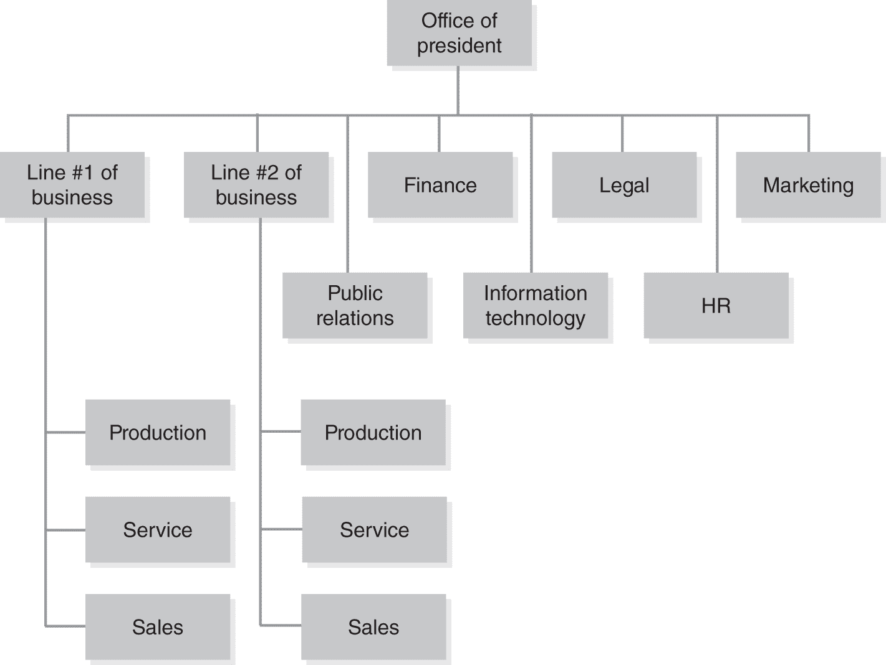

**图 5-2** 典型的组织架构图。

关键点在于，组织结构可以让你洞察领导层对业务的视角以及他们面临的挑战类型。你还能感知到优先事项。你可以从图 5-2 中看到，业务已决定将信息技术（IT）职能集中。这通常被称为 `shared services`（共享服务）。该术语指的是在整个组织范围内提供相似服务的部门或团队。通过将服务集中化，企业可以降低运营成本。例如，与其为两条业务线建立两个几乎完全相同的数据中心，它们可以共享由 IT 部门运营的同一个数据中心。在 IT 部门的结构内部，你会发现关于如何向这两条业务线提供进一步细分。此外，请注意某些部门直接向总裁办公室汇报。这赋予了他们更大的影响力和感知的权威。

### TIP


在理解组织影响时，也要考虑监管性的强制指令。信息安全问题的报告层级越高，影响力就越大。例如，《格拉姆-莱奇-布莱尔法案》（`GLBA`）要求组织的董事会听取信息安全计划的简报。`GLBA` 对公司董事会还有许多其他要求，但要点是，要求高层领导参与的法规为倡导信息安全创造了可见性和机会。

让我们看看这些动态如何影响安全策略的实施。假设首席信息安全官（`CISO`）直接向首席财务官（`CFO`）汇报，如**图 5-3**所示。`CFO` 的角色传统上是一个有力的职位。因此，信息安全更有可能被视为一种业务关注点，而不仅仅是一个技术问题。这使得信息安全策略在整个企业中获得更高的优先级。

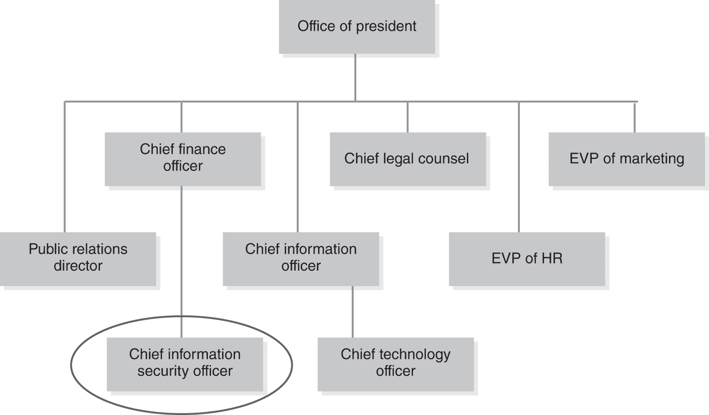

**图 5-3** CISO 直接向 CFO 汇报。

相反，让我们假设 `CISO` 职位位于 IT 部门内部深三或四层，如**图 5-4**所示。`CISO` 将不具备足够的组织实力来以同样的影响或权威来实施安全策略。这并不意味着安全策略无法得到有效实施。区别在于根据组织现实所采用的方法。在这种情况下，`CISO` 最可能会寻求更多的高级管理层参与，而不是依赖 `CFO` 的影响力和权威。

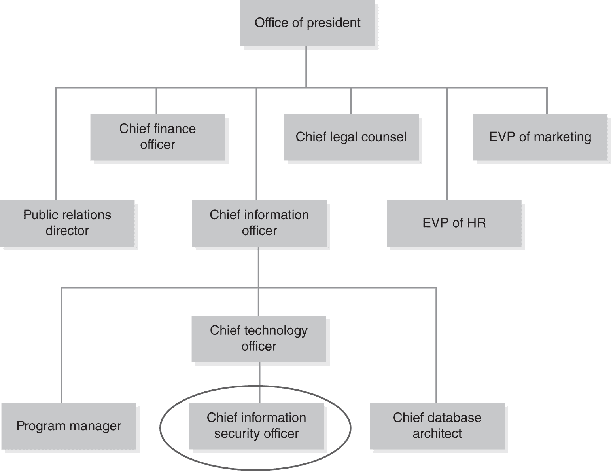

**图 5-4** CISO 组织架构图——CISO 职位出现在深几层之后。

最终，一个组织必须决定它想如何管理分工和控制跨度。劳动分工意味着你如何对各种任务进行分组。有时，将任务划分为不同的专业领域更为有效。这样，深度和质量会更高。随着越来越多的任务被划分为独立的工作，就会产生更多的专业领域。随着更多专业领域的产生，就会形成更多的团队。结果是组织在扩张，运营成本也随之增加。员工是有价值的资源，但他们也是昂贵的。他们需要工资、培训、用品、设施、福利和领导支持。组织需要以一种既能产生质量又能保持竞争力同时控制运营成本的方式分工。

### FYI

组织越大，其内部存在的关系 set 就越多样化。这意味着可能需要让更多的利益相关者参与。重要的一点是，理解矩阵中的利益相关者不仅在与安全团队交流，而且彼此之间也在进行交流。这就是为什么透明度是策略实施过程中不可或缺的一部分。领导层与不同性格之间的互动可以显著影响策略的部署。你越能创建一个统一的视图，成功的可能性就越大。

另一个考虑因素是控制跨度，它与组织中的层级和直接下属人数有关。当领导有许多直接下属时，控制跨度会扩大。这倾向于使组织扁平。这被称为扁平化组织结构。当控制跨度扩大时，领导与正在发生的细节之间的联系就会变少。例如，如果一个领导必须处理十几个直接下属，很难说他或她有时间处理许多细节。领导将倾向于关注大局和重大风险。

关于直接下属的合适数字并没有魔术规则。适当的控制跨度取决于业务性质、问题的复杂性以及需要领导关注的问题数量。随着跨度的收窄，组织就获得了更多层级。这被称为层级化组织结构。更多的层级倾向于使组织变得官僚化。层级制组织是必要的。它们允许专业领域蓬勃发展并生产高质量的产品和服务。

拥有多个层级并不一定是坏事。但是，需要进行分离，不仅是为了效率，也是为了创建职责分离。职责分离（`SOD`），也被称为职责划分，是指某项任务必须由多个人完成的要求。这种方法通常用于防止欺诈和减少错误。要点是创建实现特定业务所需的组织层级。一个组织可以整体采用层级制结构，但在特定的团队和部门中采用扁平化组织结构。`SOD` 的一个例子是将设置新供应商账户的能力与授权向供应商付款的能力分开来。同时具备设置和授权供应商的能力会产生欺诈的机会。`SOD` 措施减少了虚假供应商被建立并付款的可能性。

扁平化与层级制组织之间的区别相对于其规模和业务模式。图 5-2 表明，组织可以被感知为扁平或层级制。要理解这种区别，你需要理解管理业务的管理人员与交付产品服务的员工之间的层级数量。例如，假设图 5-2 代表一个拥有 20 名员工的地毯清洁业务。两条业务线可以是商业客户和住宅客户。该组织可能被视为层级制。这是因为公司总裁与员工之间的层级可能被认为过多。考虑到业务的规模和复杂性，人们预期一个更小、更扁平的组织。然而，同样的数字应用于更大的业务时，将是相对扁平的。例如，假设图 5-2 代表一家提供零售银行和信用卡作为业务线的主要国内银行。一家大型银行可能有数万名员工。然而，图 5-2 反映了一个相对扁平的组织。

在扁平化组织中，领导者与交付产品服务的员工距离很近。扁平化组织通常定义为高层与底层之间的组织层级有限的组织。因此，领导者可以直接了解客户和员工的需求与问题。这往往倾向于产生更快的决策和对创新的更大信心。在这种结构中，合适的领导者能够鼓舞人心。这种结构赋予了领导者与员工联系并建立信任的能力。

在扁平化组织中，领导者可以将关于客户和产品的知识带到安全策略的制定和实施中。在扁平化组织中，安全策略不是抽象的概念。它们是从直接负责交付产品服务的个人视角来看待的。在层级制组织中，领导者也负责产品和服务；然而，这种责任制通过多层领导层是间接的。在实施安全策略时，拥有公司产品服务的第一手知识始终具有价值。

扁平化组织通常具有去中心化的权限。当控制跨度过大时，这可能迅速变成扁平化组织的负面因素。控制跨度太大意味着没有时间将每个问题都提交给管理层解决。在某些方面，你需要高素质的团队，他们能够自如地做出独立决策。然而，这些决策可能会导致问题，特别是在处理信息安全时。某些问题包括下属和高级领导层向监管机构提供冲突陈述。在扁平化组织中定义安全策略时，清楚地决定问题如何被识别、分类、辩论和上报是非常重要的。这包括明确谁有权向监管机构发言并展示完整的风险态势。

## 层级制组织

对于大型组织来说，层级模型是必不可少的。保持大型组织有效运行所需的复杂度需要一个专业层级体系。这意味着高级领导者与日常运营更加疏远。在层级制组织中，同样的“高层基调”（tone at the top）可以传达给所有员工吗？可以，但比在扁平组织中更困难。层级制组织的动态机制是不同的。

考虑一个拥有 10,000 名员工的组织中的帮助台员工。帮助台员工与团队和部门的管理层密切接触。从公司总裁处收到关于信息安全重要性的信息，在层级制组织中的影响可能小得多。信息仍然必须发送，但需要在各个层级中不断强化。

### 参考

在推行信息安全策略时，将沟通作为优先事项。确保你的方法包含以下几点：

1.  保持清晰——尽可能避免技术术语。
2.  设定高层基调——要求你的领导帮助传达信息。
3.  使用多种渠道——尽可能多次地强化信息。
4.  直率——对政策将产生任何影响保持诚实和坦诚。
5.  说“谢谢”——认可在制定和实施安全策略方面付出的努力。

此列表不是详尽的，但它突出了关键点。

要在大型组织中成功实施安全策略，你必须在每个层级不断推销这一信息。你必须在高层、中层和底层建立支持。你必须编排审查、批准和发布流程，以便你持续成为信息传递的一部分。记住，信息在通过组织层级移动时可能会发生变化。例如，在与高级领导者交道时，信息的核心部分可能是规避成本和减少安全开支。

### 层级模型的优势

层级模型具有一些独特的优势。要点在于通信路线定义得更加清晰。当你遇到问题时，很可能有一个专门负责该领域的团队。经理还可以创建“卓越中心”。这些是专注于特定问题的专业团队。这允许经理预测并规避安全威胁。大型团队检查行业泄露事件，并分析公司是否会脆弱。在小型扁平化组织中，这些专业知识和技能可能是不存在的。

### 层级模型的劣势

层级模型也有一些劣势。其中一个劣势是责任制。层级模型依赖于工作在多个团队之间传递以最终产生产品或服务。这些小组之间的沟通故障可能会导致错误或延迟。

责任也可能是一个问题。当许多组件团队参与时，是谁的错？当团队跨越组织边界（例如大型部门之间）时，这变得更加困难。

没有一种适用于所有组织的结构。

### 警告


组织越大，增长得越快。例如，参与生产产品或服务的团队越多，就需要更多的团队来协调他们的活动。组织不要为了增长而增长，这一点很重要。特别重要的是，安全策略必须跟上组织的增长，这驱动了更广泛的信息交换。

归根结底是组织内部的人员使安全策略和控制的实施成功。他们如何被激励接受这些策略中的安全原则，决定了你引入变革的难易。层级模型的固有劣势在于，成功实施安全策略需要接触的接触点和性格很多。

## 用户冷漠的挑战

从基本形式上来说，冷漠是指不关心和缺乏动力。冷漠的员工往往只是在“走过场”。这种态度会导致性能低下，并仅维持生存所需的最低限度。在信息安全方面，很难想象仅靠最低限度就能确保信息安全。在安全领域，用户的冷漠会使整个组织变得脆弱。

政策从本质上无法预判每种情况。始终需要才华且经过培训的人员来处理突发事件。冷漠的员工与意外的安全事件相结合，可能会导致灾难。例如，报告潜在事件时简单的轻微延迟，就可能意味着防止事件发生与不得不处理其后果之间的区别。冷漠的员工可能会错失防止敏感信息落入他人手中的机会，导致成千上万个人隐私被侵犯的愤怒客户。

定义良好的安全策略假设了存在某种程度的不合规性，甚至是员工的冷漠。你在安全策略中建立冗余，以检测并响应安全泄露。通过这种方式，你不需要依赖任何特定个人来维护安全。一个很好的例子是自动升级。如果管理员接到关于潜在安全泄露的警报且在规定时间内未做出响应，则会将升级页面发送给主管。安全策略可以要求此类升级。

### 提示


在部门或小组内指派安全联络员通常是有效参与一组员工的方法。了解该小组性格和语言的人可以以积极的方式传达安全信息。

克服冷漠对安全策略的影响是以下因素的结合：

*   **深度参与的沟通**——让领导者听取员工冷漠的原因。调整实施策略，以便在个人角色的背景下更好地解释政策的有效性。
*   **持续的意识**——不断强化关于信息安全价值和重要性的信息。良好的安全意识可以是防止冷漠的预防性措施。
*   **设定正确的预期**——最终，要求员工作为工作的一部分来遵守政策。必须对合规性进行监控，并必须让个人承担责任。
*   **创建某些冗余层**——某些层的冗余是有益的。尽可能避免完全依赖任何个人或单一技术。坦率地说，组织能够负担得起的冗余越多越好。然而，冗余代价是昂贵的。
*   **认可并奖励合规行为**——寻找机会突出表现了理想行为的个人。这可以是简单的高管公开认可或小额礼品卡奖励。奖励是极佳的激励工具。

## 高层支持的重要性

实施安全策略始于高层。没有高层的支持，政策只是文字。为了产生意义，必须赋予其正确的优先级并执行。只有这样才能实现安全策略对收益的价值。

*   **目的不明**——目的不明是指价值的清晰度。对于政策而言，明确哪些可以做到和不能做到是非常重要的。
*   **怀疑**——怀疑是指对改变的需求。你需要解释现有的做法并不好。如果一个组织有过失败的尝试，怀疑也可能是一个因素。
*   **领导层支持不足**——领导层支持不足是指对项目的广泛支持。对于政策而言，领导者不喜欢惊喜，并希望知道自己不是孤军奋战。
*   **组织负担**——组织包袱是指根据过去失败的尝试来判断组织的执行情况。与怀疑（涉及个人信誉问题）不同，这一类别侧重于组织的执行能力。
*   **缺乏组织激励**——缺乏组织激励是指激励行为的能力。只有在政策被执行时，才能从政策中获得价值。
*   **缺乏坦诚**——缺乏坦诚是指没有开放、坦诚的对话。对于政策而言，你需要明确哪些可以做到和不能做到。
*   **对坏消息的容忍度低**——对坏消息的容忍度低是指高管对失误的反应。在实施安全策略的某个时刻，你可以预期会出现判断错误。
*   **不可管理的复杂性**——不可管理的复杂性是指项目的复杂程度和现实程度。组织支持安全策略的能力将是对话中的一个重要话题。

## 策略实施的之前、期间和之后

获得高管层对安全策略的支持既是一门艺术也是一门科学。这关乎信任和信誉，也关乎事实。在安全策略实施之前、期间和之后，与高管保持参与和沟通至关重要。


# 你想要避免的一个陷阱是试图将高管培养成精通安全的专家

高管们通常既没有时间也没有兴趣，他们需要依靠你的专业知识。他们期望的是你将实施步骤封装成易于理解和易管理的任务，从而最大限度地减少成本和精力。他们的员工也会向他们汇报你努力的结果。因此，你必须明确你的期望以及业务部门必须交付的内容。

### 提示

在创建安全策略之前，尽早与关键利益相关者建立良好关系。及早建立信任和信誉会让后续的安全策略实施变得容易得多。

以下是用于封装实施任务并帮助在讨论安全策略时保持重点的检查清单：

*   **目标清晰性**——要实现哪些目标和利益？
*   **要做的事**——要执行哪些具体任务，由谁执行？
*   **注意事项**——业务部门如何判断其是否成功？
*   **需要报告的内容**——应该报告什么，以及何时报告？
*   **角色和职责**——谁负责什么？
*   **需要意识的事项**——为什么要制定安全策略？
*   **需要向员工强调的内容**——向员工传达的信息是什么？

在实施之前投入精力进行规划将与高管层建立稳固的关系。它还应该建立真正的支持。真正支持你的高管在情况不符合预期发展时，会继续提供支持。向高管传达的信息需要包括他们对信息安全的责任。他们的角色对于创造保护信息的真实努力至关重要。最终，当发生泄露时，受影响的是他们的组织。

# 人力资源策略的角色

定义良好的人力资源策略提供了管理员工关系的框架。人力资源策略规定了核心业务价值和预期目标。它们还可以防止误解。当有一个清晰的流程可以遵循以避免陷入麻烦时，经理更有可能就绩效不佳等敏感话题与工人进行交流。与任何书面记录一样，人力资源策略可能会在诉讼中被用来反对组织。起草不当的策略将成为证据，支持员工主张其行为符合公司预期的观点。

尽管人力资源策略必须证明对安全业务实践的承诺并明确说明价值观，但它们在满足业务目标的同时，必须在法律上具有灵活性和防御性。它们还必须建立管理层遵循的流程。你经常会发现人力资源策略的语言是有意模糊的。这是为了避免可能被解释为劳动合同或无意承诺的语言。尽管语言上具有灵活性，但人力资源策略在个人之间必须保持一致。例如，对同一个安全策略违反行为对两个个人进行不同的纪律处分可能会导致诉讼。相比之下，安全策略必须精确，建立可以执行的清晰行为预期。

因此，安全策略的自动化执行显示了一致性，并且通常比手动控制具有更高的合规率。通过自动化立即停止安全策略违规行为，比处理其后果要好。然而，当自动化控制不可用或无效时，你如何执行安全策略呢？一个经典的例子是工人在公司计算机上查看不当的色情材料。假设可以清楚地显示是故意的，还是偶然发现不当网站的。这个例子开始显示出安全策略如何依赖人力资源策略来定义可接受的行为，并通过纪律处分来强制执行遵守。

### 注意

可接受使用策略（`AUP`）通常部分基于人力资源策略。它确立了预期行为，例如禁止从公司计算机访问社交网络网站。

# 人力资源策略与安全策略之间的关系

安全策略必须深根于人力资源策略。不要在人力资源策略中寻找精确性。它们更多地被视为构建的基础。它们确立了可接受行为的广泛规则。这些规则涵盖了从使用公司计算机时的隐私预期到对某些不当行为的零容忍等主题。安全策略随后可以将这些核心价值观操作化，并定义执行它们的控制措施。正如安全策略必须与业务流程对齐一样，它们必须与人力资源策略对齐。

人力资源与安全策略之间的关系可以在`图 5-5`所示。该图描述了几个关键接触点。让我们使用之前在公司计算机上查看不当材料的例子。`图 5-5`说明了人力资源策略与安全策略之间的关系。首先，人力资源策略将规定核心价值。这可能简单如“计算机仅供公司使用”。或者它可以详细说明禁止的材料类型。安全策略随后可以通过概述互联网的可接受使用情况来对齐。预防性安全控制可以被设计为拦截不可接受的网站。发现绕过这些控制措施的工人可能会通过扫描公司计算机未经授权软件和信息的检测性控制被发现。如果发现了此类材料，管理层可以决定是否有必要采取纪律行动。管理层将向人力资源策略寻求指导。与人力资源部门合作后，管理层可能会决定正式警告甚至终止合同是合适的。这说明了人力资源策略与安全策略之间所需的紧密对齐。

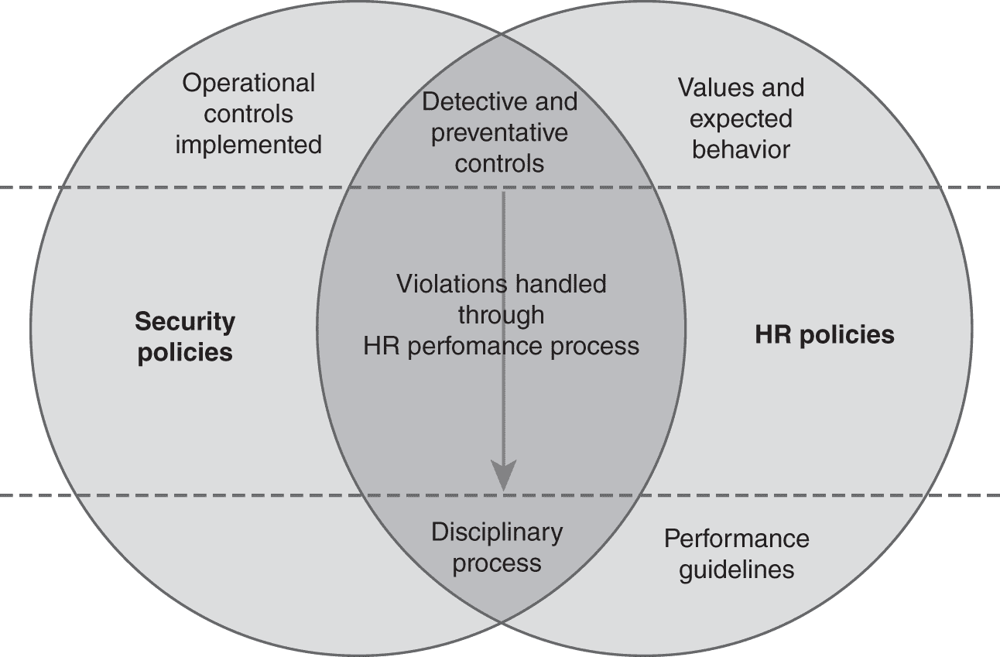

**图 5-5** 人力资源策略与安全策略之间的概念关系。

## 缺乏支持

寻求人力资源支持的原因不仅是采取纪律行动来执行安全策略的能力。缺乏支持也可能使安全策略的实施变得困难。你需要记住，人力资源是与工人接触的主要接触点。它可以作为与员工沟通的地点以及解决冲突的地方。以下概述了人力资源在安全策略实施方面提供的几个关键支持领域：

*   **HR 策略与价值观**——确立许可行为的基准，包括公司技术的可接受使用。
*   **安全意识**——促进对安全策略的理解。
*   **离职面试**——允许离开的员工表达安全控制在提高或阻碍员工生产力方面的效率。这种坦诚的表达允许持续改进安全策略。
*   **事件监控**——允许更广泛地理解安全策略的执行情况。
*   **纪律行动**——提供调整行为以符合安全策略预期的流程。
*   **权威来源**——为建立安全控制提供权威。

你需要人力资源（`HR`）部门的支持来确保你对语言的解读是正确的。这些解读是关键安全策略的基础，例如对公司设备上员工行为的监控。如果你对 `HR` 政策没有正确的解读，很难或无法设计有效的安全控制措施来禁止某些行为。

安全策略依赖于员工对规则的理解和配合。安全意识是实现这种理解的最佳方式之一。一个良好的安全意识计划从新员工入职的那一刻就开始了。它至少每年强化一次，并在员工晋升承担新职责时得到加强。缺乏 `HR` 的支持将导致无法在员工新入职或职位变动时为他们提供安全意识培训。

持续改进依赖于人们告知你哪些是有效的，哪些是无效的。获取这些信息的良好来源是离开公司的员工。你可以询问在职员工的看法，但你确定他们是否只是在说你想听的话吗？他们可能不想制造事端。离开公司的个人往往更加坦诚，因为他们失去的也较少。大多数 `HR` 部门都会进行离职访谈。他们会询问关于工作环境和离开原因的基础问题。这也是就安全问题提问几个精选问题的好机会。这可以帮助你理解信息安全计划的优势和缺陷。缺乏 `HR` 的支持意味着你永远无法通过提问来了解你的安全弱点可能在哪里。

`HR` 工作的一个重要部分是处理员工的投诉。无论你解释安全策略的能力有多出色，在某个时刻你都会冒犯某人的感情。指望他们打电话给 `HR` 投诉。为了让 `HR` 员工站在你这一边，你需要让他们确切知道你如何以及为什么要实施安全策略。他们擅长在敏感问题上倾听与员工沟通。他们可以支持你帮助化解问题。他们可以解释政策如何与公司价值观保持一致。他们可以强化关键的安全意识信息。缺乏支持会产生相反的效果。投诉可能会升级并失控。更糟糕的是，如果 `HR` 站在员工的一边，你可能会发现自己在安全策略上被迫退让，或者削弱了安全意识的信息。

你已经学习了 `HR` 支持与纪律处分之间的关系。如果安全策略得不到执行，员工不可避免地认为它们是不重要的。管理层需要 `HR` 政策中的广泛授权来评估员工表现。这包括人们遵循安全策略的程度。没有这种 `HR` 的支持，安全策略将变成可选的且不可执行的。

安全策略像任何政策一样，必须拥有授权。权威人士必须说：“这很重要”以及“你必须这样做”。这通常来自执行高层。在某些情况下，你可以将 `HR` 政策中的核心价值观作为额外的权威来源。这样做也提供了一种感知的授权，有助于获得高层的支持。缺乏 `HR` 的支持会使获得高层对安全策略的批准变得更加困难，并使其更容易受到挑战。

总之，没有 `HR` 的支持，实施安全策略是困难或不可能的。幸运的是，大多数组织中的 `HR` 都理解其在帮助实施安全策略方面的作用。很少能找到一个试图阻碍安全策略实施的 `HR` 部门。更有可能，你会发现不同程度的支持。与 `HR` 的关系是信息安全团队需要培养的一种重要关系。

## 策略角色、职责与问责

需要注意的是，变化是不可避免的。安全策略的实施只是员工必须吸收的众多变化中的一种。在创建安全策略的角色、职责和问责机制时，理解这一点非常重要。你越能将员工当前的角色与其当前的工作职责对齐，实施起来就越容易。例如，假设某安全策略要求特定团队配备一名经过认证的安全培训师。现在假设该团队已经有一个用于非安全目的（如办公安全）的培训师。将这些角色和职责相结合可以产生合并培训需求的机会，使业务更容易接受该安全策略。

许多参与者参与了安全策略的实施过程。角色和职责取决于你处于安全策略生命周期的哪个阶段。本章中的 `life cycle`（生命周期）一词指的是安全策略的创建、实施、意识和执行。这些不同的任务需要不同的角色和职责。

关于如何应对变化以及个人在变革过程中的角色有许多理论。关键点是从变革模型的角度理解每个人的角色。在开发和变更策略时，你需要清晰地定义每个人的角色。在策略实施后的执行阶段，你也需要识别不同的角色。

### 提示

当你实施安全策略时，你正在实施变革。这可能包括实施业务视角和组织价值观。这意味着有时你对文化变革的实施程度并不亚于安全控制措施。请确保选择一个既能影响领导者，又能满足控制技术实施需求的变革管理模型。

### 变革模型

有很多变革模型可以选择。在实施安全策略时，你可能能够适应一些。本节重点关注科特的八步变革模型。哈佛商学院教授约翰·科特（John Kotter）开发了该模型，并在 1995 年的一本名为《Leading Change》的书中介绍了它。该模型已被广泛应用于多种目的。它解决了为实施变革建立高层支持的需求。这是实施安全策略的关键成功因素。

科特教授表示，要在公司成功实施变革，至少需要 75% 的管理层“认同”它。围绕安全策略需求创建愿景和紧迫感的早期阶段，对于后期建立实现变革所需的高层联盟至关重要。

让我们结合实施安全策略来研究该模型。该模型将一个有效的变革过程分为八个步骤：

1.  **营造紧迫感**——为了发生变革，必须有紧迫的需求。帮助人们理解信息安全威胁和业务的风险可以帮助建立这种紧迫感。
2.  **建立强大的联盟**——为了发生变革，领导层必须支持你。尽早为安全策略的需求建立高层基调。
3.  **创建变革愿景**——变革需要是易于理解的。必须明确你对人们的要求，以及安全策略将带来什么可量化的收益。
4.  **传达愿景**——一旦你获得了支持，你就需要广泛传达你的意图。通过尽可能多的渠道传达安全信息。
5.  **消除障碍**——你的成功将会面临障碍。赋能个人成为变革代理人。[`change agent`](#29_glossary.xhtml#gloss30)是指负责挑战既有思维的人。
6.  **创造短期胜利**——成功无论多小，都会带来更多的成功。关注较小的、定义明确的目标，这些目标将共同指向更大的长期目标。
7.  **巩固变革**——真正的变革需要时间和持续的努力。建立一个持续改进安全策略的流程。
8.  **将变革锚定在企业文化中**——要让任何措施生效，它必须成为习惯和文化的一部分。寻找机会将安全控制整合到日常运营中。

`FIGURE 5-6` (#14_chapter05_06.xhtml#fig5-6) 显示了如何调整此模型以实施安全策略。每当你添加新的安全策略或对现有策略进行重大更改时，都要循环使用此模型。该模型确保了在你开始正式实施之前，已经拥有了成功所需的领导支持。它还强调了非正式任务与正式任务之间的区别。当我们为了本章的目的调整科特（Kotter）模型时，我们在非正式和正式实施任务之间建立了区分。这样做是为了强调通过非正式讨论来准备策略实施的重要性，而不是立即启动正式的项目方法。这些非正式任务有两个主要优点。首先，你获得了高层的支持。在获得高层支持之前启动正式项目是自作自是的，会产生不必要的阻力。其次，它建立了一个协作机制，允许你改变和修改方法。它还让提供建议的高管在过程中产生主人翁感。

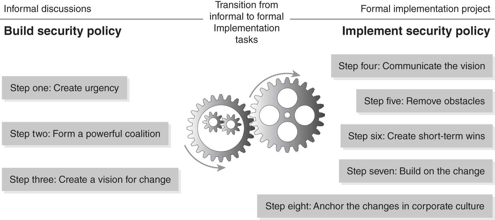

`FIGURE 5-6` 基本策略实施方法。

### 变革期间的职责

如果从变革模型的角度进行管理，实施安全策略会变得更容易。它帮助你建立一种协作风格，让业务领导者理解并认同你正试图实现的目标。过程从一系列非正式的步骤开始，以建立意识和理解。通过在安全策略之外设定明确的目标，你可以建立成功所需的高层支持。

使用科特八步变革模型中的步骤，接下来的章节将解释在变革过程中涉及的角色和职责。

### 警告

对领导者保持坦诚和透明。清楚地解释信息安全策略可以做到和不能做到什么。同样重要的是，直诚说明对业务的影响；否则你将面临失去信誉的风险。

#### 第 1 步：营造紧迫感

`CISO`（简单称为 `信息安全官 (ISO)`）有责任向业务领导者传达紧迫感。这是在推销信息安全的需要。做到这一点的有效方法是理解安全策略所解决的业务风险，并用业务术语传达这种需求。业务风险的减少越多，业务感知到的紧迫感就越强。

#### 第 2 步：建立强大的联盟

获得高层支持非常重要。领导者负责降低其组织的风险。`ISO` 的责任是了解关键利益相关者是谁。`ISO` 还负责联系利益相关者、解释策略变更并听取他们的疑虑。许多组织都有所谓的`控制伙伴` (#29_glossary.xhtml#gloss52)。`控制伙伴` 的责任是对安全策略的合理性和影响提供意见。许多组织在进行策略变更之前，要求获得控制伙伴的参与意见。以下是许多大型组织中常见的控制伙伴示例：

*   内部审计师
*   运营风险经理
*   合规官
*   法律专业人士

利益相关者小组的规模取决于策略变更的范围和组织的规模。当任何小组中的利益相关者人数过多时，`ISO` 可以采取抽样调查的方法。例如，假设一项策略变更影响整个组织，该组织由 1000 多个经理组成。要求每位经理说明策略如何影响每个团队是不现实的。因此，`ISO` 会对经理群体进行抽样。`ISO` 可以针对那些比其他经理影响更大的经理进行调查。

#### 第 3 步：创造变革愿景

安全策略必须是易于理解的。`ISO` 有责任用业务能够理解的语言编写策略。`ISO` 可以调整信息内容，使实施策略的价值变得合理。在收集了人的意见后，`ISO` 创建了一个连贯的安全信息和策略。该信息应包括对策略的高层解释，以推销这一愿景。利益相关者的责任是验证 `ISO` 的假设并提出异议。

利益相关者等到安全策略即将实施的最后一刻才反对是不恰当的。`ISO` 负责确保所有异议都是透明的，并得到解决或升级。`ISO` 必须尽力解决异议。异议可能指出了一个需要更改安全策略或控制措施的合理问题。

可能无法让每个人都满意；但每个人都需要发言权。记住，成功取决于对实施策略精神的真实努力。组织中的每个人都向某人汇报。`ISO` 的角色是将冲突提交给能够解决这些问题的权威。最终，你正试图让大多数领导者站在你这一边。

### 提示

在你的组织中寻找一个可以作为变革者的领导者。这些领导者并不总是随大流，并且能够跳出框架思考。他们可以指导你应对实施变革涉及的组织政治问题。

#### 第 4 步：沟通愿景

策略变更必须广泛传播。`ISO` 有责任创建这些信息内容。`ISO` 还必须正式制定沟通计划。沟通计划概述了要传达的信息、如何传达以及传给谁。沟通在策略发布之前就开始了。例如，为新策略或更改后的策略建立意见期可以产生意识。`ISO` 还需要将安全策略的实施从非正式讨论转变为正式的项目计划。项目计划需要概述成功所需的日期、时间表、资源和组织支持。

利益相关者，特别是高层领导者，负责通过他们的背书来传播变革。无论领导者是否提出了异议，领导者都有义务沟通并背书任何已批准的策略。这种“自上而下”的基调是高管执行的一项重要责任。高管还负责设定团队优先级以实施安全策略。

### 提示

用于推销策略愿景的辅助材料应应用于安全意识培训。它将表达业务对策略的需求以及技术性的安全组件。

#### 第 5 步：消除障碍

实施过程中的障碍必须被识别并消除。`ISO` 的责任是中心联系点并跟踪实施问题。利益相关者的责任是收集并报告实施中的问题。每个人都有责任向其领导者报告安全策略的问题。许多信息安全团队建立了内网站点，以便将安全问题直接报告给安全团队。

#### 第 6 步：取得短期胜利

尽早展示价值是非常重要的。`ISO` 的责任是识别衡量成功的方法。`ISO` 与一线经理合作收集评估策略有效性的指标。通常，这些一线经理的责任是确保收集这些指标并使其具有意义。

#### 第 7 步：巩固变革

改变组织的文化需要时间。`ISO` 必须持续监控安全策略的合规性。`ISO` 向领导层报告安全策略的当前有效性。`ISO` 还必须要求业务部门接受任何残余风险，或者想出减少风险的方法。残余风险是在实施安全控制后剩余的风险量。例如，假设病毒扫描器可以捕获 99% 的所有已知病毒。这意味着还有 1% 的病毒未被检测到。业务部门需要了解这种风险。随后，业务领导者负责接受这种风险，或支付更多技术费用来阻止剩余的 1% 风险。

#### 第 8 步：将变革植根于企业文化

将安全策略中的价值观成为文化的一部分。这需要时间，并通过改变员工的态度来实现。`ISO` 需要成为一名有力的沟通者。他或她的责任是想出强化安全信息的方法，同时不给业务带来干扰。

# 角色与职责

组织对信息安全负有最终责任。当发生灾难性事件时，随着律师和监管机构介入，组织的领导者必须解释发生了什么。事实上，组织的高层可能承担个人法律责任。他们可能会连同首席技术官（`CIO`）一起受牵连。但高管是那些资助技术投入并决定愿意支付多少成本来降低风险的人。

为领导者设定预期很快就会变成预算问题。如果没有资金投入实施控制，就很难要求高管负责。IT 支出在不同行业之间差异巨大。德勤（Deloitte）发现，公司平均将其收入的 3.28% 用于 IT。如果你关注特定行业，这个百分比会发生变化。银行的支出倾向约为 7.16%，建筑业为 1.51%。在那些持续优于 `S&P 500` 的公司中，57% 的公司在 2016 年到 2017 年间增加了 IT 预算。在 IT 方面投入更多的公司有更多资源来部署信息安全防护。因此，金融服务公司对信息安全的预期可能与制造公司不同。

尽管业务领导者可能负最终责任，但他们依赖关键技术角色来避免自己陷入麻烦。这些角色负责实施安全策略、监控其遵守情况以及管理日常活动。虽然他们的头衔在组织内可能有所不同，但通常你会发现由不同的人负责以下每个角色：


*   **信息安全官 (ISO)**——负责识别、制定和实施安全策略的个人。`ISO` 还负责确保相应的安全控制措施得到设计和实施。

*   **高管 (Executive)**——负责批准安全策略实施的高级业务领导者。高管还负责在组织内部推动安全信息，并确保安全策略的实施得到适当的优先级。

*   **合规官 (Compliance officer)**——负责监控法律法规遵守的个人。`compliance officer` 经常将遵守安全策略作为监管合规的衡量。

*   **数据所有者 (Data owner)**——通常是业务部门中批准信息访问权限的人。`Data owners` 负责确保仅授予执行日常运营所需的访问权限。他们还负责确保……

*   **数据经理 (Data manager)**——通常负责建立数据程序的个人。`Data managers` 还确保数据被妥善分类。

*   **数据保管员 (Data custodian)**——负责数据日常维护的个人。`数据 custodians 员` 根据需要备份和恢复数据。

*   **数据用户 (Data user)**——应用程序的终端用户。`Data users` 负责妥善处理数据。他们有义务理解安全策略。

*   **审计师 (Auditor)**——负责评估安全策略设计和有效性的个人。`auditor` 可以是组织内部或外部人员。他们提供正式的书面意见。

#### 当政策履行未包含职位描述时

关于员工绩效考核的频率没有通用的法则。许多组织进行年度评估，尽管有些组织每年进行两次。这是在员工与其经理之间的个人考核之外的。

这些评估的基础是员工的职位描述。当职位描述不包含遵守政策的要求时，实施安全策略将更具挑战性。当员工故意违反任何政策（包括安全策略）时，该问题可以被视为人事资源问题；也就是说，无论职位描述如何，都期望员工遵守既定政策作为其雇佣的条款。

您在本章前面的部分已经学习了自利如何成为行为的强大动力。当推行安全策略没有相关的回报时，这种活动就会与其他利益产生竞争。不幸的现实是，很多时候投入的努力仅仅是最低限。这并不是因为高管或经理不认为这很重要，而是因为时间太少，且没有感知到的收益。

要克服这一点没有简单的答案。如果你无法更改职位描述，你就需要创造一种感知的收益。合规文化可以通过创造同伴压力来提供帮助。此外，让员工参与进来，让他们感觉到对安全策略的成功产生某种所有权。这可以简单地征求改进建议，并公布被选中的建议。对表现出预期行为的个人提供公开认可，这可能仅仅是来自组织高层高管的一封感谢信。简而言之，在职位描述之外创造一种奖励。

### 对创业生产力与效率的影响

创业可以有许多定义方式。让我们来谈谈一些关键属性。创业侧重于创新和增长。初创公司出于需要而充满了创业精神。他们必须通过创新来进入拥挤的市场，必须通过增长来生存。成熟的组织早已过了这一阶段。随着组织的成熟，其业务模式也随之发展。那些创立公司或见证公司高增长期的真正创业者往往会离开。他们通常会被非常有才华的专业经理所取代。

这正存在于如何管理业务与如何“增长”业务之间的挣扎。这不是一个抽象的问题。它对于必须反映业务核心价值的安全策略具有重大影响。

处于初创阶段或高增长模式的公司侧重于敏捷和创新，往往对风险的接受度更高。这时你会看到主导创业文化的出现。当企业很大比例的领导拥有这种创业心态时，你也会看到更高水平的风险接受。他们挑战现状，推向政策边界以实现目标。

相反，随着公司的成熟以及这群创业者离开公司，他们通常会被专业经理取代。这些可能是来自顶尖商学院的人才。但你确实看到一种不同的文化出现，更多地关注如何维持和管理业务。这意味着风险承担的减少以及对业务应如何运行的定义更加清晰。在后期的成熟阶段，业务开始建立官僚机构。

并没有建议哪种方法比另一种更好。这取决于业务和情况。但信息安全专业人员必须识别出哪种态度主导了其组织。所有组织都存在一种态度对另一种占据主导地位。安全策略的编写和实施必须适应这种心态和对风险的容忍。

尽管始终存在主导文化，但组织可以通过设计成为这两种心态的混合。这种混合通常出现在成熟公司向新业务领域进行“试水”时。

例如，考虑一家在互联网上几乎或完全没有销售业务的公司。它想启动一个新部门，通过在线销售有限数量的产品来测试可行性。假设测试期为 24 个月。该业务旨在评估该努力的成功或失败。业务希望保持低成本——它可能在未来 24 个月内完全解散新部门并放弃该想法。它引入了具有创业经验的领导，文化冲突几乎立即发生。新部门的员工面临巨大的压力，必须快速证明小小的成功。他们对延迟几乎没有容忍度。他们面临着快速将应用程序发布到互联网上并按需访问信息的压力。这种状况促进了在现有流程中走捷径的倾向，这会增加风险。

安全策略需要反映组织内部主导的风险观点。这通常被称为风险容忍。你需要建立反映企业整体容忍度的安全策略。通过政策将这些容忍度设定为可接受的行为。然后创建风险接受流程和缓解控制。

虽然始终存在主导文化，但组织可以通过设计可以成为这两种心态的混合。这种混合通常出现在成熟公司进入新业务领域“试水”时。

### 提示

在将策略合规性与绩效衡量挂钩时，应重点关注衡量对业务带来的风险，而不是策略和控制措施的执行情况。

衡量有效性比衡量责任制要容易。正如上一个例子，组织可以快速确定补丁管理水平是否符合安全策略。但假设它不符合。谁应该负责呢？衡量遵循或未遵循策略的员工百分比通常要困难得多。一种方法是使用有效性衡量来识别高有效或低有效性的区域。然后分析 `why` 某些区域成功了而其他区域失败了，从而引导你找到责任归属。

通过检查策略违规情况、事件和安全意识，你可以基本了解个人是否正对遵守安全策略承担责任。这些基础衡量指标如下：

*   `报告的员工安全违规数量`——你应该调查此数字任何无法解释的增长，以确定发生异常数量安全违规的原因。原因之一可能是缺乏培训。

*   `可以避免的事件数量`——当发生安全泄露时，你需要确定根本原因。这个根源可以告诉你，因素之一是否是策略失效。

*   `安全意识培训的完成率和胜任率`——你应该跟踪哪些个人完成了安全意识培训。此外，培训应该衡量对材料的熟练程度。这种培训需要至少每年更新并重新进行。

### 提示

在报告趋势时，请说明数据是如何收集的业务背景。例如，如果刚刚发布了新策略或最近改进了报告能力，安全策略违规数量的增加可能是预期。

### 章节总结

本章讨论了工作场所中复杂的关系和性格类型，以及它们如何影响你实施安全策略。理解工作场所中不同的性格类型对于更好地激励和影响员工接受安全策略至关重要。适当的激励可以克服用户的冷漠。高层支持对于获取资源以及驱动实施成功所需的安全信息和可见性至关重要。本章还讨论了将利益相关者和控制伙伴引入策略实施过程的重要性。本章还讨论了 Kotter 模型及其微小变体。

实施后的活动与策略实施之前的活动同样重要。成功的衡量取决于安全策略在公司风险承受能力一致的情况下所带来的价值。本章还研究了安全策略只有在在使用时才是有效的。这意味着它们必须被执行。安全策略中的核心价值和审视风险的方式可以应用于各种业务状况和新技术。成功的安全策略实施可以改变心态和组织文化。它们可以进一步降低风险，因为个人被更好地装备来应对意外威胁。

## 核心概念与术语

*   冷漠

*   审计师

*   变革代理人

*   首席信息安全官 (CISO)

*   合规官

*   控制伙伴

*   数据保管人

*   数据经理

*   数据所有者

*   数据用户

*   分工

*   高管

*   扁平化组织结构

*   层级制组织结构

*   矩阵关系

*   裁员 

*   风险承受能力

*   职责分离 (SOD)

*   职责划分 (SOD)

*   管理跨度

*   高层风范

### 第 5 章测试

1.  以下哪项是激励的基本要素？

    1. 自豪感

    2. 个人利益

    3. 成功

    4. B 和 C

    5. 以上所有

2.  哪种性格类型通常会突破障碍？

    1. 攻击者

    2. 指挥者

    3. 分析师

    4. 迎合者

3.  规避者喜欢 \_\_\_\_\_\_

4.  随着专业化数量的增加，\_\_\_\_\_\_

5.  在层级制组织中，领导靠近交付产品和服务的员工。

    1. 正确

    2. 错误

6.  用户的冷漠通常会导致员工走过场。

    1. 正确

    2. 错误

7.  以下哪项是克服冷漠的方法？

    1. 避免冗余

    2. 发布指令

    3. 参与沟通

    4. 要求服从

8.  为什么策略语言是有意模糊的？

    1. 为了避免被解释为

    2. 为了引发诉讼

    3. 为了对新员工太严厉

    4. 提供灵活性

9.  在策略的情况下，向业务展示策略如何降低风险并以保持成本的方式是非常重要的。

    1. 正确

    2. 错误

10. 刷新安全策略的理想时间是裁员。

    1. 正确

    2. 错误

11. Kotter 八步变革模型可以帮助组织获得 \_\_\_\_\_\_ 变革的支持。

12. 当发生性的安全泄露时，谁对监管机构和公众负责任？

    1. 公司高管

    2. CIO

    3. ISO

    4. 数据所有者

13. 以下哪项是创业者的特征？

    1. 创新者

    2. 受过良好的业务管理教育

    3. 更倾向于承担风险

    4. A 和 C

    5. B 和 C

14. 控制伙伴的角色包括对建议的策略变更进行分析，并对其可行性提供意见。

    1. 正确

    2. 错误

15. 以下哪项是衡量安全策略成功的最佳标准？

    1. 作为结果开发的安全控制措施数量

    2. 意识到该策略的人数

    3. 风险的降低

    4. 批准它的最高高管级别

16. 变革代理人通常会：

    1. 确保当前的流程正常运行

    2. 确保应用程序代码更改被充分理解

    3. 挑战公司的现有流程是否代表最佳方法

# 第 10 章 IT 基础设施安全策略

# 第 11 章 数据分类与处理策略及风险管理策略

# 第 12 章 应急响应团队 (IRT) 策略


© obpcnh/Shutterstock

## IT 安全策略框架

信息技术（IT）安全策略框架是组织信息安全计划的基础。该框架由一套文档库组成。策略框架远“不仅仅”是文档的集合。组织利用这些文档来构建流程、确定可选技术并为执行奠定基础。安全策略框架文档及其实施体现了管理层对信息安全重要性的看法。

安全策略框架可能非常庞大且复杂，对组织产生重大影响。实施需要强有管理支持和良好的规划。在此过程中，有许多单独的任务和问题需要解决。与那些表示支持并（理想情况下）对实施做出个人承诺的执行高层保持清晰的沟通渠道至关重要。策略框架发布后并不意味着实施已经完成。框架必须定义为确保信息安全策略得以维持所需的日常业务（BAU）活动和职责。你可以通过框架在帮助降低组织风险方面的程度来衡量成功。实施框架是管理信息安全风险的首步之一。

组织在信息安全方面无法承担被动或随性处理的。随着法规的增加，问责制和法律责任也在增加。高层对证明价值的需求在增加。安全专业人员也推动着衡量成功。然而，在衡量任何东西之前，你需要一个基准。基准允许你衡量是否已经合理地涵盖了风险。它是你可以用来衡量并证明价值的标准。这个基准以及这种对成功的衡量是安全框架的一部分。它汇聚了全球安全专业人员的经验和知识。它提供了一个路线路线，引导组织通过安全问题的迷宫。

本章介绍了 IT 安全策略框架的组成部分。它帮助你理解如何创建一个满足组织需求的框架。本章涵盖了业务和保证考虑因素，还讨论了未经授权访问及其影响。通过这些讨论，你将更好地了解安全框架的价值和构建。

### 第 6 章主题

本章涵盖了以下主题和概念：

*   什么是 IT 安全策略框架

*   什么是计划框架策略或章程

*   构建策略框架时应该考虑哪些业务因素

*   应该考虑哪些信息保证因素和目标

*   应该考虑哪些信息系统安全因素

*   IT 安全策略框架创建的最佳实践是什么

*   IT 策略框架开发的案例研究和示例有哪些

### 第 6 章目标

完成本章后，你将能够：

*   描述策略框架在信息安全计划中的作用

*   描述用于记录安全计划的不同类型的策略

*   描述什么是休眠账户

*   解释策略、标准、指南和程序的作用

*   解释典型标准和策略库的组织结构

*   解释典型安全部门的人员角色

*   解释什么是 C-I-A 三角以及它为什么重要

## 什么是 IT 策略框架？

一个 `IT 策略框架` 包含了策略、标准、基线、程序、指南和分类法。许多框架类似于层级结构或树。树的顶端是章程或计划框架策略，随后是额外的策略。然后是若干项标准。标准之下是许多指导和程序文档。get 正确的框架是成功安全计划的关键。

###  注意

你经常会听到将框架文档称为“策略（policies）”。在实践中，框架包含了策略、标准和其他文档。每种文档都有特定的目的。

`[图 6-1]`](#16_chapter06_01.xhtml#fig6-1) 提供了关于你可能如何组织信息安全策略和标准库的视角。为了使框架有用，它必须是易于访问且易理解的。虽然大多数框架可以在线获取，但仅仅提供访问是不够的。重要的是确保文档编写在易于导航的水平。文档必须组织良好，以便用户可以快速找到他们需要的内容。


**图 6-1** 策略和标准库。

构建策略框架就像种树。树的根和分支已经建立；然后给树浇水让它有足够的时间生长。最终提供了覆盖。随着时间的推移，树枝枯萎，叶子落下，新的树枝生长，树需要修剪。策略框架也是一样。你对其进行持续关注以培养流程内容。这确保了它提供了组织需要和要求的覆盖。从实际角度来看，这意味着策略框架不需要在第一天就是完整的。例如，你可能有一份概述加密密钥安全要求的策略。当移动技术首次引入时，这些要求可能无法提供足够的指导，或者根本无法与这些新技术配合。可能会变得明确，你需要创建一个独立的移动技术策略。

组织的安全态势通常用 `风险胃口` 来描述。

**图 6-2** 风险胃口图。

通常，安全风险通过增加控制措施来管理。最终，一组风险将变得大到组织无法接受。这些风险可能与生命和安全有关，或者其潜在影响会导致组织破产。安全框架必须拥有策略，清晰地划定界并定义可接受的行为，以确保活动落在风险胃口的范围内。随着风险水平的增加，控制水平也必须随之增加。

`Risk tolerance`（风险容度）与组织接受过程中的多大波动有关。这通常以百分比的形式表示，例如正负 10%。例如，假设你拥有一家购买、翻新和销售房地产的公司。假设你的公司专注于住宅房地产。因此，对于购买商业办公楼，你可能没有风险偏好。这是因为由于你的公司缺乏商业领域的专业知识，如果尝试进行商业交易，出错的风险更大。商业物业的高昂成本和市场波动可能会导致巨额损失，甚至使你的公司破产。因此，商业物业可能超出了你的风险偏好范围。在由你控制的住宅物业中，你为装修设定了预算。你监控每一分钱的支出，并实施了控制措施，以确保控制在预算的 10% 以内。你放心，只要管理在这个 `risk tolerance`（风险容度）范围内，你就能获得利润。

在信息安全领域，并不总是清楚何时以及如何应用这些概念。你不能将 `risk appetite`（风险偏好）和 `risk tolerance`（风险容度）应用于每项控制措施。你必须选择需要做出关键风险决策的控制措施（或一组控制措施）。例如，考虑与安全补丁管理相关的控制措施组。必须在信息安全和业务需求之间做出平衡决策，决定接受多大的风险以允许系统在不打上修复安全漏洞的补丁的情况下运行。`risk appetite`（风险偏好）可能不允许带有关键补丁的系统在生产环境中运行超过五天。这可以解决即时威胁，而对于所有剩余的安全补丁，可以建立 30 天的 `risk tolerance`（风险容度）（允许正负 10%）。

## 什么是计划框架政策或章程？

计划框架政策，或称信息安全计划章程，是信息安全计划的基石文件。章程是一份必须的文件，用于建立信息安全计划及其框架。这项高层政策定义了：

*   计划的宗旨和使命

*   计划在组织内的范围

*   计划实施的责任分配

*   合规管理

首席执行官（`CEO`）通常批准并签署该章程。章程确立了组织内部信息安全的责任。组织的高层领导对信息安全计划表示支持至关重要。这种支持以多种形式出现。例如，`CEO` 在发布信息安全计划章程时附上个人信息，或者作为年度信息安全意识工作的一部分，这并不稀奇。这种责任通常由一个名为首席信息安全官（`CISO`）的人承担。`CISO` 负责制定 IT 安全策略、标准和指南的框架。`CISO` 还批准并发布这些文件。`CISO` 的主要角色之一是确保遵守法规。这些法规可能处于地方、州或联邦级别。`CISO` 还建立了一个安全意识计划。该计划帮助员工理解并履行组织的信息安全策略、标准、指南和程序。

### 提示

根据组织的文化，`CISO` 可能有许多其他头衔。`CISO` 职位在功能上对齐对信息安全负全职责任的最高人员。一些示例包括：

*   信息安全总监
*   首席安全官
*   风险与合规总监
*   风险与合规总监


# 风险与合规总监

`CISO` 可能有许多其他头衔，取决于组织的文化。`CISO` 职位在功能上对齐对信息安全负全职责任的最高人员。一些示例包括：

*   信息安全总监
*   首席安全官
*   风险与合规总监

员工可能会无意中违反策略。例如，员工可能缺乏相关知识或培训。这可能导致不合规。

某些组织针对信息安全策略违规行为创建了特定的 `consequence model`（后果模型）。后果模型并不取代处理个人纪律的更广泛的人力资源政策。后果模型的目的并非对个人进行惩罚，其通用目的是为了消除因违反策略而引入的风险。例如，假设某项安全策略对面向互联网的编码应用程序有严格的控制要求。假设对新部署的接口应用程序进行信息安全扫描时，发现了一个直接违反策略的安全漏洞。后果模型（根据风险水平）可以给开发人员 `x` 天的时间来修复代码以符合合规要求。未能在规定时间内修复代码的后果将是将该应用程序下线并消除风险。

## 行业标准策略框架

策略框架为组织内部的信息安全管理提供了行业标准参考。它们允许你利用他人的工作来帮助启动你的安全计划工作。以下领域决定了框架策略在何种情况下有所帮助：

*   通过统一方式解决该问题对组织具有优势的领域，例如共享 IT 资源
*   影响整个组织的领域，例如人员安全
*   需要进行全组织监督的领域，例如合规性
*   通过全组织实施可以产生显著规模效应的领域，例如统一桌面计算机管理

没有两个组织是相同的。营利性公司可能与非营利组织或政府机构不同的目标和关注点。不同的需要不同的解决方案。因此，安全专业人员有多种策略框架可以工作。这取决于每个组织如何决定符合其需求及其所面临威胁的最佳策略框架。

有三个框架因其范围和在安全社区内的广泛认可而脱颖而出：

*   **信息和相关技术控制目标 (COBIT)**——这是一个被广泛接受的文档集，通常用作信息安全计划的基础。COBIT 是 ISACA（原信息系统审计和控制协会）发起的一项倡议，深受 IT 审计师的青睐。请记住，COBIT 已在 2019 年更新为 `COBIT 2019`。
*   **ISO/IEC 27000 系列**——这是一项国际采纳的标准，ISO/IEC 27000 系列可以在几乎任何组织的信息安全管理计划中找到。
*   **美国国家标准与技术研究院 (NIST) 特别出版物，如 (SP) 800-53，“联邦信息系统和组织建议的安全控制”**——面向美国政府机构及其分包商。

许多监管机构使用这些标准来开发安全指南和进行审计。通过依靠那些为你铺平道路的人，你可以帮助确保符合影响你组织的规章，而无需重新编写你所有的合规流程。接下来的章节详细介绍了如何使用 `ISO/IEC 27002`、`30105` 和 `27007` 标准，以及 `NIST SP 800-53` 标准来描述你的策略框架。

## ISO/IEC 27002 (2015)

国际标准化组织 (ISO) 和国际电工委员会 (IEC) 开发并发布了 `ISO/IEC 27002`，标题为“信息安全、网络安全和隐私保护——信息安全控制”。

1.  **前言**——描述了整体目的和范围。
2.  **信息安全策略**——描述了管理层如何定义信息安全策略。这包括关键主题。
3.  **信息安全组织**——描述了安全治理结构以及信息安全策略的需求。
4.  **人力资源安全**——描述了员工加入、在组织内流动或离开时的安全方面。组织应提供安全意识、培训和教育。具体包括：
    *   入职前
    *   在职期间
    *   离职
5.  **资产管理**——描述了信息资产的清单和分类。组织应该了解持有的信息资产并妥善管理。
6.  **访问控制**——描述对网络、系统、应用程序、功能和数据的访问限制。本节解决了防止未经授权使用的问题。主题包括：
    *   访问控制的业务需求
    *   用户访问管理
    *   用户责任
    *   网络访问控制
    *   操作系统访问
    *   应用和信息控制
    *   移动计算和远程办公
7.  **密码**——描述了与加密的使用相关的控制。这包括关键控制领域：
    *   加密认证
    *   密钥管理
    *   数字签名
    *   消息认证
8.  **物理和环境安全**——描述对计算机设施的保护。价值贵的 IT 设备应受到防止恶意或无意损坏或丢失、过热、主电源丢失等的物理保护。涵盖：
    *   安全区域
    *   设备安全
    *   关键 IT 设备
9.  **运行安全**——描述了操作控制的管理，以确保容量足够并交付性能。关键主题包括：
    *   操作程序和责任
    *   防止恶意和移动代码
    *   备份
    *   日志记录与监控
    *   信息系统审计协调
10. **通信安全**——描述网络安全以及控制第三方对信息的访问。主题包括：
    *   第三方服务交付管理
    *   网络安全管理
11. **系统的获取、开发和维护**——描述在应用程序中构建安全性。信息安全必须考虑在规范、构建/获取、测试、实施和维护 IT 系统的开发生命周期 (SDLC) 过程之中。这些活动包括：
    *   信息系统的安全需求
    *   应用系统中的正确处理
    *   加密控制
    *   系统文件的安全性
    *   开发与支持流程中的安全性
    *   技术漏洞管理
12. **供应商关系**——描述了监控供应商信息安全控制所需的策略和程序。这包括但不限于：
    *   供应商如何访问公司
    *   供应商如何访问网络
    *   供应商访问的监控
    *   供应商权限管理
    *   供应商的审计
13. **信息安全事件管理**——描述了监控和响应信息安全事件所需的策略和程序。这包括：
    *   信息安全事件的规划
    *   信息安全事件的管理
    *   漏洞的报告
14. **信息安全业务连续性**——描述了用于保护、维护和恢复信息安全事件的策略和程序。该标准涵盖了信息系统规划、应急响应、备份操作以及灾后恢复。
15. **合规性**——描述了合规所需的策略和程序：
    *   法律法规合规
    *   标准和政策合规

ISO/IEC 27002 涵盖了信息安全管理、运营和技术方面的控制。关于信息安全合规性的更多信息，请访问 [www.iso.org/standard/27002](https://www.iso.org/standard/27002)。

ISO/IEC 30105 是《信息技术——外包流程指南》，该标准涵盖了信息系统整个生命周期中的安全控制。该标准分为五个部分：

*   第 1 部分：术语模型
*   第 2 部分：流程模型
*   第 3 部分：测量模型
*   第 4 部分：相关性模型
*   第 5 部分：实施性模型

ISO/IEC 27007 是《信息技术——安全技术指南》，该标准首次于 2011 年发布，并在 2017 年进行了修订。2020 年再次修订更名为“信息安全、网络与隐私保护”。该标准治理了信息系统。

## NIST 特别出版物 (SP) 800-53

NIST 是美国商务部的一个机构，开发实施信息系统的安全标准和指南。800-53 包含了管理、运营和技术控制。

### 表 6-1 NIST 800-53 摘要

| 控制领域 | 描述 |
| :--- | :--- |
| 访问控制 | 限制授权用户、代表授权用户的过程（包括设备）访问信息系统的事务类型和功能。 |
| 意识与培训 | 确保信息系统的管理员和用户意识到相关的安全风险。确保人员执行信息安全职责具有足够的培训。 |
| 审计与问责 | 创建、保护并保留信息系统审计记录。记录包括监控、分析和报告非法或不当的信息系统活动。用户应对其行为负责。 |
| 安全评估与授权 | 定期评估信息系统的安全控制，以确定控制仍然有效。制定行动计划以纠正缺陷并消除信息系统的漏洞。持续监控安全控制以确保其有效性。 |
| 配置管理 | 在整个生命周期内建立并维护信息系统的基础配置和清单。建立并强制执行设备的安全设置。 |
| 应急计划 | 建立、维护并实施应急响应、备份操作和灾后恢复计划。 |
| 身份识别 | 识别信息系统用户。在允许访问信息系统之前验证用户的身份。 |
| 事件响应 | 为信息系统建立事件处理流程。向相关官员或机构跟踪、记录并报告事件。 |
| 维护 | 对信息系统进行定期和及时的维护。提供有效的信息系统维护控制。 |
| 介质保护 | 保护信息系统介质（纸质和数字）。限制授权用户访问信息介质上的信息。 |
| 物理与环境保护 | 授权人员访问信息系统、设备和运行环境。保护信息系统免受环境危害。为所有信息系统提供环境控制。 |
| 计划 | 为信息系统制定、记录、定期更新并实施安全计划。描述已实施或计划的安全控制。包括访问信息系统的行为规则。 |
| 人员安全 | 确定职责人员是值得信赖的，并符合其职位的安全标准（包括第三方服务供应商）。在离职和转职期间及之后维护信息系统。对不遵守规定的人员采取措施。 |
| 风险评估 | 在使用信息系统或传输信息时，定期评估操作、资产和人员的风险。 |
| 系统和服务的获取 | 分配足够的资源来保护信息系统。采用包含信息安全考虑的系统开发生命周期流程。确保第三方提供者采取了充分的安全措施来保护信息、应用程序和/或服务。 |
| 系统和通信保护 | 在信息系统的边界和重要边界处对信息系统传输或接收的信息进行监控、控制和保护。采用架构设计、软件开发技术和系统工程原理来实现有效的信息安全。 |
| 系统和信息完整性 | 及时识别、报告并纠正信息和信息系统的缺陷。在信息系统的适当位置提供针对恶意代码的保护。监控信息系统安全警报和建议并采取相应的措施。 |
| 程序管理 | 确保信息安全计划的持续运行。 |

有关关于 `NIST SP 800-53` 的更多信息，请访问 <https://nvd.nist.gov/800-53>。

该标准的第 4 版于 2012 年 2 月发布。该标准的第 5 版已于 2020 年 3 月发布最终草案，并定于 2020 年后期发布。该标准的基础保持不变，但在以下方面进行了增强：

*   使安全和隐私控制基于结果的
*   将隐私控制集成到安全控制目录中
*   淡化出版物的联邦重点，以鼓励非联邦组织更广泛的使用
*   促进与不同的风险管理和网络安全方法的集成
*   纳入基于威胁情报和实证攻击数据的新型实践级控制

## 什么是策略？

策略是信息安全计划的重要部分。它们最好被定义为高层声明、信念、目标和愿景。策略有助于保护组织的资源并指导员工行为。安全策略帮助你解决关键的计算机安全问题。有了有效的策略，你的组织将对系统和信息获得更好的保护。

安全策略还提供了安全措施的“什么”和“为什么”。程序和标准进一步描述了“如何”配置安全设备以实施策略。缺乏信息安全策略和执行将使组织面临数据泄露、业务中断和法律责任的风险。事实上，在许多州，没有或未按照行业惯例执行信息安全控制可能导致所有者和高管面临监禁之灾。这涉及巨大。然而，尽管需求紧迫且存在潜在的法律责任，许多组织并没有所需的定义的安全策略。早在 2012 年，安联科技的一项研究显示，在美国 1015 家中小企业中，83% 没有网络安全计划。2019 年的一份更新的报告指出，平均每次破解将给公司带来 200,000 美元的损失。这会导致许多小型企业闭。实施一套良好的安全策略可以成为主要的竞争优势。它确保了客户信息的保护和业务系统的稳定性，并保护公司免受法律责任。这些策略与程序的正式定义并不总是那么清晰。

策略与程序的正式定义并不总是那么清晰。

*   如何完成
*   谁负责
*   如何进行培训和意识教育
*   如何处理合规性

## 什么是标准？

在决定如何保护资产时，你有许多选择。某些选择是可量化的。在做出这些选择时，你建立的策略和标准将作为依据。

标准是建立以下内容的正式文档：

*   统一的标准
*   实现目标的方法
*   可重复的流程和实践

标准提供了实现特定策略的指导。虽然安全策略是在高层编写的，但足够的细节来解释人们如何支持它们。安全标准通常与特定的技术或产品相关。它们被用作审计基准，并源自：

*   行业最佳实践
*   经验
*   业务驱动因素
*   内部测试

标准可以有不同的形式。两种常见的形式是特定问题的标准以及特定系统的技术标准或基准标准。

### 特定问题标准或控制标准

特定问题标准关注公司当前相关和关注的领域。由于技术和其他相关因素的变化，准备好对这些标准进行频繁修订。随着新技术的发展，某些问题的重要性会降低，而新问题不断出现。例如，即使安全漏洞仍然已知，发布关于正确使用尖端技术的标准也可能是重要的。

针对特定问题或基准标准的有用结构是将文档拆分为基本组件。这些组件在以下章节中进行了描述。

**问题声明**：此部分定义了安全问题以及任何相关的术语、区别和条件。例如，一个组织可能需要一个关于互联网访问的特定问题策略。标准将定义你允许和不允许的互联网活动。你可能需要包含其他条件，例如禁止使用员工桌面电脑的个人连接访问互联网。

**组织立场声明**：此部分应清楚地阐明组织对当前问题的立场。继续互联网访问的示例，策略应该说明禁止哪些类型的网站。这些网站的示例可能是色情网站、经纪网站和/或赌博网站。策略还应该说明是否有进一步的指南，以及是否可以谁根据什么基础授予个案例外。

**适用性说明**：本节应明确说明特定策略适用于何处、如何、何时、针对谁以及针对什么对象。例如，关于互联网访问的策略可能仅适用于组织的现场资源和员工，而不适用于在其他地点设有办事处的承包商。

**角色与职责定义**：本节分配了相应的角色和职责。继续以互联网的示例，如果策略允许在获得适当批准的情况下访问私有互联网服务提供商（ISP），请在文档中识别批准机构。此外，还应命名负责合规的办公室或部门。

**合规性**：本节描述了不可接受的违规行为并规定了相应的处罚措施。处罚措施必须与你们的人事政策和实践一致，并需要与适当的管理层进行协调。

**联系人**：本节列出了负责策略策略执行的组织部门。这些人员通常是领域专家（SME）。他们负责解释策略。通常他们还负责确保控制措施到位以执行策略。本节还可能识别其他适用的标准或指南。对于某些问题，联系人可能是部门级经理；对于其他问题，可能是设施经理、技术支持人员、系统管理员或安全计划代表。

### 特定系统标准或基准标准

特定系统标准或基准标准侧重于特定系统、设备、操作系统或应用程序的安全配置。许多安全策略决策仅适用于系统层级。

示例包括：

*   谁被允许读取或修改系统中的数据？
*   在什么条件下可以读取或修改数据？
*   允许哪些防火墙端口和协议？
*   用户是否允许从家里或在旅行期间访问公司网络？

## 什么是程序？

程序是关于如何遵守标准的书面指令。程序记录了一系列以相同方式重复执行的特定动作或操作。如果遵循得当，程序在相同情况下获得相同的结果。程序通过对证明能产生合规系统的步骤进行编码，为策略框架和相关标准提供支持。

程序应当：

*   清晰且无歧义
*   可重复的
*   实时更新
*   经过测试的
*   记录在案的

程序的示例包括：

*   事件报告
*   事件管理
*   用户 ID 的添加/删除
*   服务器配置
*   服务器备份
*   紧急疏散

单一标准通常需要多个程序来支持。负责按照标准支持或操作技术设备的人员，通常是那些以满足合规要求的程序的同一人员。安全部门人员可能协助编写程序。程序一旦通过，将发布在策略和标准库中，并对访问权限进行适当的控制。程序通常是收集指标以监控合规性的地方。因此，了解这些新程序对任何治理和监督的影响非常重要。例如，假设有一个每周审查会议来审查用户 ID 变更量（如添加和删除账户）。还假设有一个仪表板可以分解每周活动，详细列出发生的更改类型。这种仪表板通常用于主动识别问题区域并检测异常活动。

可能会引入新程序来删除休眠账户。休眠账户通常是指长时间未使用的账户。当实施这一删除休眠账户的新程序时，它将直接影响每周审查会议。换句话说，你不仅需要实施新的安全程序，还需要更新每周仪表板。此外，你还需要与每周审查会议成员讨论流程变更产生的影响。

> **备注**
>
> 某些程序可能是专有的，或包含商业秘密。它们还可能包含有关如何监控和控制安全性的敏感信息。这些程序可能不适合所有员工广泛访问。

图 6-3 展示了策略和标准库摘取的示例。该图突出显示了访问控制策略，这是许多安全相关策略之一。

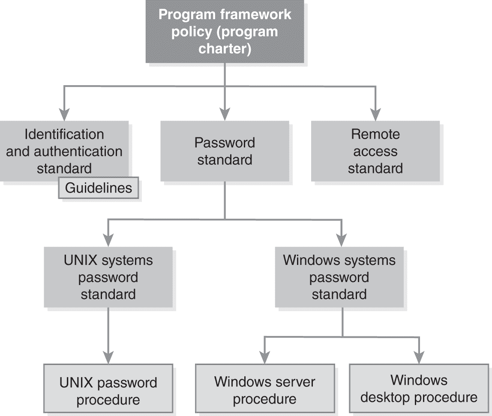

**图 6-3** 策略和标准库中可能的访问控制策略分支。

## 标准例外

在某些情况下，你的组织无法立即满足一个或多个标准。你必须承认标准的例外，以确定可能存在问题何处。

对这些例外进行定期审查也可以导致标准的改进，当许多例外指向无法普遍无法实现合规目标时。关注例外对于确保策略框架保持相关性和最新性至关重要。

例外很少被“永久批准”。通常，它们每年重新检查一次。这使得领导层讨论是否愿意再承担一年的风险，或者投入资金进行必要的更改以符合安全策略。例外通常包括对补偿性控制和缓解控制的讨论。补偿性控制意味着，尽管你无法满足策略的字面规定，但仍然可以通过其他手段实现其目标。缓解性控制意味着，尽管你无法满足所有的策略目标，但仍然可以实现部分合规。在批准安全例外时，了解你正在接受多少风险是非常重要的。

## 什么是指南？

IT 安全经理经常准备指南或指导文档，以帮助解释策略或标准。指南还可能提供对特定主题的当前思考。指南通常不是强制性的——未明确遵循它们不会导致合规问题。相反，指南帮助人们利用他人发现实用的最佳实践来开发程序或流程。指南还可以澄清标准发布后出现的问题或困难。

> **备注**
>
> 你通常并不发明最佳实践——而是从他人那里采纳。遵循最佳实践可以帮助你避免他人已经学过的教训。这是你深度参与 IT 安全行业的主要原因之一。你可以从同行那里学习导致他们改进流程和技术的担忧和问题。

你可以将指南视为“等待中的标准”。在可能的情况下会使用它们，并向负责策略和标准维护的 IT 安全经理提供反馈。指南为实施标准或基准标准的人员提供了更详细的信息和指导（提示、技巧、流程等），以协助合规。这些文档在库中是可选的，但通常非常有帮助。


最终，当一项指南被广泛接受并实施时，它可能会变成一项标准。例如，假设你有一份概述了五种可加密技术的指南。在这五种技术中，假设有三种被开发团队广泛采用，并应用于 95% 的应用程序中。可以决定将这三项技术作为所有新开发的标准。然后，你可以将另外两种用于 5% 应用程序的技术视为异常，或者为它们的升级留出预算。

### 提示

加入一个专注于 IT 安全的协会是结识同行和提高技能的好方法。你许多许多可以加入的协会，包括 ISACA (`isaca.org`)、ISC² (`ISC2.org`) 和 ISSA (`issa.org`)。

[¹](https://www.cnbc.com/2019/10/13/cyberattacks-cost-small-companies-200k-putting-many-out-of-business.html)

## 框架的业务考量

组织的安全策略集合，因此整个安全框架，展示了其对保护信息的承诺。与一般的安全策略一样，实施框架时有几点考量：

* **成本**——实施和维护框架的成本
* **影响**——框架所需的控制措施对员工、客户和业务流程的影响

从零开始创建一个策略框架需要时间和精力。管理层为这些费用制定预算至关重要。此外，随着框架中文档数量的增加，你可能需要一个内容管理系统来管理文档。许多组织已经使用 `Microsoft SharePoint Server` 或类似产品来管理所有业务相关的文档。你可以使用同一个系统来管理策略框架中的文档。

员工往往抵制变化，特别是影响他们工作方式的变化。然而，一个全面的策略框架可以帮助员工更高效地工作。框架包含了员工可以遵循的指南以及规定如何执行任务的程序。从本质上，策略框架提供了一个让员工可以在其中更高效工作的结构。

添加分类分类法（taxonomy）和术语表至关重要。一个良好的分类法将成为框架策略文档的“罗塔石”。它被用于解释策略的含义并确定工作范围。假设你的策略包含了 `platform` 和 `network infrastructure` 术语。`platform` 是什么意思？平台要求包含防火墙吗？可能吧。也许不是。是的，防火墙位于一个平台上。那里有一个运行操作系统的物理机箱。但分类法和术语表可以将 `platform` 定义为运行应用程序的设备，例如应用程序服务器和数据库服务器。所有其他非应用程序网络设备可能都归属于 `network infrastructure` 的定义。在这种情况下，对于防火墙控制，你需要查阅框架的网络基础设施文档。这种区分并非学术上的。很可能，对平台的控制要求会与对网络基础设施的要求不同。为不同的设备获取正确的控制措施至关重要。

### 遵守萨班斯-奥克斯利法案

随着技术的进一步扩展，法律和法规最终会随之而来，以强制采取积极行动来保护信息系统。2002 年，美国参议院通过了《萨班斯-奥克斯利法案》（`SOX`），该法案引起了美国公司首席执行官的关注。该法案是在安然（Enron）、安德森（Arthur Andersen）、世通世界（WorldCom）以及其他几家大型公司倒闭后通过的。`SOX` 要求上市公司维持内部控制。这些控制确保了向证券交易委员会（`SEC`）和股东提交的财务报表的完整性。该法案还要求首席执行官向 `SEC` 证明财务报表的完整性。

由于这项强制规定，与信息处理和管理相关的控制措施现在正受到严格审查。自该法律生效以来，建立一个完善的当前操作文档库的需求被进一步强调了。

策略框架也有助于管理层遵守合规要求。你的安全策略框架使能够向监管机构展示你正在使用最佳实践。许多法规提供了必须包含在你的安全策略中的特定细节。创建一个“速查表”（cheat sheet），将你的安全文档与标准进行交叉引用通常很有帮助。例如，某条目可能会说明：“标题为‘入职筛选’的 HR 策略 2010-033 满足了 `PCI DSS` 第 12.7 项。”如果你以后接受审计，这将非常有用；你可以使用速查表向审计员展示实现每项要求的确切策略章节。挑战在于维护这些速查表。每当你修订它们所依据的策略时，建立一个更新速查表的流程是非常关键的。

#### 策略与标准的开发及合规角色

开发和维护策略框架是一项重大任务。在大型组织中，这通常需要很多人。`TABLE 6-2` 列出了与策略和标准库相关的开发、维护和合规工作中常见的角色。

**表 6-2** 与策略和标准库相关的角色

| 角色 | 活动 |
| --- | --- |
| CISO | 为信息资源建立并维护安全和风险管理计划 |
| 信息资源经理 | 维护提供信息资源安全和风险管理的策略和程序 |
| 信息资源安全官 | 指导旨在保护信息资源的策略和程序，识别漏洞并开发安全意识计划 |
| 信息资源所有者 | 负责执行使用资源的程序。这并不意味着个人所有。这些个人可以被视为程序经理或所有者的代表。 |
| 信息资源保管员 | 为信息资源的所有者和用户提供技术设施、数据处理和其他支持服务 |
| 技术经理（网络和系统管理员） | 为信息的安全提供技术支持 |
| 内部审计师 | 定期进行基于风险的审查以确保信息资源安全策略和程序的有效性 |
| 控制伙伴 | 通常处于合规和运营风险等领域。确保安全策略在运营上符合风险偏好和监管要求。 |
| 用户 | 根据所有者定义的控制措施和访问规则访问信息资源 |

### 信息保障考量

要开发一套全面的安全策略，要从信息安全目标开始：机密性、完整性和可用性。信息保障（`IA`）原则还包括不可否认性和身份验证。

信息安全计划的主要目标之一是确保信息受到保护。确保机密性意味着将对信息的访问限制仅限授权用户。还必须维护信息的完整性，以便在决策时对其产生信赖。当你能够信任对数据的任何修改都是授权用户或业务流程所做的有意更改时，该系统被认为具有完整性。可用性确保授权用户在需要时可以访问信息。不可否认性确保个人无法否认或争议其参与了交易。最后，身份验证是验证用户或设备身份的能力。

### 供参考 (FYI)

信息安全的目标——机密性、完整性和可用性通常被称为 `C-I-A` 三元组。然而，如果你使用缩写 `C-I-A`，请确保人们理解你指的是“机密性、完整性和可用性”。

为了满足信息保证需求，你的框架应该包含针对以下方面的策略：

* 尽可能实现安全控制的自动化。
* 实施适当的审计和其他完整性控制。
* 处理系统运行期间出现的潜在状况的控制。这应该包括错误处理，且处理不会降低其预期支持的正常安全水平。与故障安全（fail-safe）相比，故障保护（fail-secure）对于保护信息系统更好。
* 开发能够检测并阻止执行未经授权活动尝试的系统。
* 确保所有系统达到特定的运行时间。

接下来的章节将从策略框架的角度探讨信息保证（IA）的原则。

### 注意事项

策略越细粒度，越容易实现自动化执行。例如，如果电子邮件服务器需要特定的配置才能被认为是安全的，那么服务器上的监控工具或代理程序就可以报告配置并将其转发给合规人员。

#### 机密性

机密性从广义上是指将对信息的披露限制在授权的人员范围内。这可能包括保护个人数据的隐私和专有信息。为了满足机密性要求，你的安全目标必须是具体的、明确的且定义良好的。以应用于电子邮件的机密性目标为例。你可能有一个目标，是确保所有敏感信息免受窃听。你实施这一目标是通过要求用户对所有包含敏感信息的电子邮件进行加密，并确保只有授权人员有权访问解密信息的密钥。

编写目标时要确保其清晰且可行。安全目标应由一系列描述关于特定资源的有意义行动的陈述组成。这些目标通常基于满足业务功能。此外，它们还应该说明支持这些需求所需的安全行动措施。

#### 完整性

完整性是指防止数据被不当修改或破坏。满足完整性要求的方法之一是定义运营策略，列出运行系统的规则。以权限形式存在的访问控制规则通常用于实现这一目标。通过将权限类型限制为某些账户，可以实现完整性。例如，你可能有一个文件，可以被广泛读取，但只有少数个人有权修改它。

经理在制定策略时必须做出决策，因为所有的安全目标不太可能完全满足。考虑运营安全策略所需的细粒度程度。`细粒度` 表示策略对于资源或规则的规定具体程度。策略的细粒度越高，越易于执行和检测违规行为。更细粒度的策略涉及对特定技术元素的安全控制。它可能描述了安全配置设备或系统所需的所有设置。检查它只需确保这些设置仍然有效。细粒度较低的策略没有提供关于特定控制的许多细节，这允许人们决定如何合规。对于细粒度较低的策略，证明合规性更为困难，因为每种情况都不同。

在安全策略中找到并保持正确的细粒度程度至关重要。细粒度较低的策略的优势是它们可以适用于广泛的情况。是的，它们具有更多的解释空间。但当出现未知状况时，可以被广泛用于控制新兴的风险。相比之下，非常细粒度的策略可能无法精确地应对新兴风险。对于试图应对新威胁的用户来说，它们的帮助可能较小。

#### 可用性

可用性是信息及时且可靠的可访问性。为了满足可用性要求，你的策略框架可能包含指定内部和外部用户何时以及如何访问系统的文档。这可能导致不同的需求有不同的解决方案；例如，外部用户所需的访问形式与内部用户不同。一个外部用户可能被要求使用虚拟专用网络 (`VPN`) 来访问内部网络。

### 信息系统安全考虑

信息安全计划的成功取决于所产生的策略以及公司管理层对信息技术 (`IT`) 系统的态度。策略框架有助于确保考虑信息安全的所有方面，并开发控制措施。作为政策制定者，设定信息安全的基调和重点是你的责任。

#### 系统的未经授权访问和使用

技术的泛滥改变了信息资源管理和控制的方式。过去那种在严格集权控制下满是大型主机的“玻璃房”时代已一去不返。过去的内部控制不足以管理当今去中心化的信息系统。依赖糟糕的信息系统会带来严重后果，包括：

* 组织无法实现目标
* 无法服务客户
* 稀缺资源的浪费、损失、误用或挪用
* 声誉损失或组织尴尬

为了避免这些后果，需要风险管理方法。风险是业务活动中可接受的一部分。风险管理是通过修改操作或采用控制机制来降低风险的过程。

用于控制或限制损失的安全措施所投入的资金，不应大于发生问题时的估计金额损失。在降低风险与实施控制的成本之间取得平衡可以实现成本效益的安全。信息资产价值越高，或发生问题后的后果越严重，对保护它的控制措施的需求就越大。

#### 信息的未经授权披露

在知识工作者时代，维护信息的机密性对许多组织至关重要。当你考虑到世界上最先进国家的经济活动时，劳动者的大部分产出是信息，而不是过去的实物产品。考虑以下两个例子：

* 市场研究公司花费数千美元和无尽的时间为客户收集商业情报。通常，这些项目的唯一产出是一份总结结果的报告。如果这些报告落入客户竞争对手手中，将破坏该报告所创造的竞争优势。它还会降低信息对客户的经济价值，并可能危害市场研究公司与客户的关系。
* 制造业公司现在可能在劳动力廉价的海外工厂生产许多产品。然而，他们仍然在发达国家进行开发产品计划、配方和其他贸易机密的“知识性工作”。如果这些计划落入竞争对手手中，竞争对手将非常简单地将这些计划运到海外工厂，并在不产生任何研发费用的情况下生产相同的产品。

#### 系统或服务的中断

对及时且海量信息的需求日益增长。一个主要的保护问题是信息资源的可用性。在某些情况下，即使是几小时的服务中断也是不可接受的。想想一下 Amazon 或 eBay 每停机一小时会损失多少收入。对关键系统的依赖要求在中断发生时有一份恢复系统的计划。组织必须首先评估无法提供服务的潜在后果，然后制定一个计划以确保可用性。

#### 信息的修改

如果信息通过授权用户或业务流程的有意行为之外的任何方式被修改，可能会给企业带来灾难。这强调了完整性控制的重要性，完整性控制可以防止对信息的无意或恶意修改。例如，一家产品测试公司花费大量时间测试工厂使用的某种安全设备的最佳设置。如果电压浪涌改变了存储在测试数据库中的数据，公司可能会使用错误的数据建议设备设置，从而危及工厂工人的安全。

#### 信息资源的破坏

除了未经授权的修改外，安全控制还应该防止对信息的直接破坏，无论是故意的还是无心的。防止此类攻击最常用的控制是系统备份。通过在备份磁带或其他介质上存储数据副本，公司在数据被销毁时有一个回退方案。考虑一家在数据中心的服务器上存储保单信息的保险公司。如果该数据中心被火灾毁坏，可以使用离线备份磁带重新创建。如果没有这些备份磁带，公司将无法知道已签哪些保单，这将使整个业务处于危险之中。

## IT 安全策略框架创建的最佳实践

你的策略需要具有高可见性才能发挥作用。在实施策略时，你可以使用各种方法在整个组织传播信息。使用管理层演示、视频、小组讨论、客座演讲、巡回展、峰会、问答论坛和通讯报。以一种确保管理层支持清晰明确的方式引入计算机安全策略，特别是当员工感到被策略、指令、指南和程序目不暇接时。

记住，建立意识和获得对策略认可的工作并不是从框架发布时才开始。它的成功将取决于如何组织它以及参与的人员。每个组织都是不同的，差异以许多方式表现出来。组织在行业或领域、监管要求、文化和领导者性格方面各不相同。

在你开始开发框架时，这些都是必要的考虑因素。通常，你应该在前期以目标的形式阐述核心原则。这定义了框架必须完成的“什么”。这些目标通常是不可逾越的安全要求。首先就“什么”达成共识，然后让其他人与你共同努力“如何”。在“如何”上你可以比“什么”上更加灵活。通过为关键用户组提供实现策略目标的选择，获得他们的所有权。高管和终端用户了解业务，通常可以找到在最小化运营影响的同时整合安全流程的方法。

制定可行的计算机安全策略是一项挑战，需要对组织目标以及策略可能带来的潜在收益进行沟通和理解。通过精心构建的策略开发方法，你可以实现一套连贯的策略。没有这些，任何信息安全系统都几乎没有希望。

## 策略框架开发的案例研究

本节提供了三个案例研究，帮助你理解如何开发或实施策略框架。你将看到私营部门、公共部门和关键基础设施保护领域的案例。

### 私营部门案例研究

阿尔伯塔健康服务机构（Alberta Health Services）于 2016 年建立了一个策略开发和文档管理框架。它的策略框架从目的和使命的清晰陈述开始。使命声明是：

> 阿尔伯塔健康服务机构（AHS）的使命是为所有阿尔伯塔人提供一个以患者为中心、优质、且可持续的医疗体系。策略开发框架和策略开发步骤是实现这一使命的不可或缺的组成部分。策略开发框架和策略开发步骤基于最佳实践并反映了组织的反馈。

该框架清楚地描述了参与策略制定的流程、利益相关者和委员会。框架还识别了指导策略开发的原则。第 1 章和 C 部分提供了制定策略计划、起草策略、咨询领域专家和策略批准的逐步步进式流程。

阿尔伯塔健康服务机构建立的框架超越了策略的创建和批准。它有一个专门关于策略实施的章节。还有一个关于如何审查策略并评估其效力的章节。除了清晰的流程，策略审查和评估的最后一步也值得研究和模仿。框架特别指出：“审查和评估过程为仔细考虑现有策略文件提供了定期机会。计划的定期审查周期通常为 3 年一次，或根据赞助人或批准机构的指示。策略可以在不改变内容的情况下进行重新确认、进行修改，或者做出该策略不再需要的决定。”

### 私营部门案例研究二

策略开发是一个国际性关注的问题。因此，在全球范围内找到开发策略的框架并不意外。英国的哈德斯菲尔德大学（University of Huddersfield）为其 2017/2018 学年发布了一份策略开发框架。哈德斯菲尔德大学的策略框架没有阿尔伯塔健康服务机构的那么详细，但提供了基本要素。

该大学框架描述了一个策略所有者，其负责策略的制定、发布以及维护和审查。该框架还建议在需要时与相关领域专家进行咨询。框架的很大一部分内容致力于策略及政策变更的批准。与阿尔伯塔卫生部门（Alberta Health）框架不同，该框架只有一小部分致力于合规性。

### 公共部门案例研究

这个案例研究虽然有些久远，但作为策略开发框架的示例仍然具有研究价值。2006 年，田纳西州确定需要一个全面的信息安全计划。其主要目标之一是保护州的收入、资源和声誉。该州通过研究、选择和实施风险管理方法、安全架构、控制框架和安全策略实现了这一目标。

田纳西州的策略基于 `ISO/IEC 17799`（现为 `ISO/IEC 27002`）标准框架。这些策略符合适用的法律法规。框架中的策略被认为是为州提供安全计算运行的最低要求。

该框架定义了田纳西州的信息安全策略，以及通信、实施和支持这些策略所需的组织结构。策略框架的制定是为了建立并维护必要的控制措施，以保护信息资源免受不可用、未经授权或无意的访问、修改、破坏或泄露。

策略和框架涵盖田纳西州拥有、租赁或控制的所有信息资产。它们控制需要访问田纳西州信息资源的外部方的行为。这些策略的制定目的是保护：

* 所有州有的桌面计算系统、服务器、数据存储设备和移动设备
* 所有州拥有的通信系统、防火墙、路由器、交换机和集线器
* 任何连接到田纳西州计算或电信网络、且受第三方控制的计算平台、操作系统软件、中间件或应用程序软件
* 所有存储在田纳西州计算平台上的和/或通过州网络传输的数据

### 私营部门案例研究三

Target 是一家大型零售商，在美国拥有超过 1800 家商店，在加拿大拥有 133 家。Target 雇佣了超过 60,000 名员工。自 1962 年以来，它一直建立了作为许多社区信赖成员的声誉。很难想象在美国长大的没有人不认识这个品牌或没在 Target 买过东西。这个案例研究虽然有些过时，但由于其是一个重大的案例，尽管年代久远，仍然值得研究。

2013 年 12 月，在非常繁忙的圣诞销售季，该零售商宣布发生了数据泄露。这包括约 4000 万条信用卡记录被盗。此外，泄露还导致 7000 万条包含地址和电话号码等个人信息的记录被盗。泄露的原因与一个可以访问 Target 网络的供应商有关，通过该供应商，销售终端（`POS`）设备感染了恶意软件。恶意软件在数千个 `POS` 系统中存在了数周。这是此类规模最大的零售数据泄露之一。


当 2 月 19 日泄露曝光时，公司股价下跌了 11%。股价在几个月内很大程度上反弹，但该零售商在泄露发生后的几个月内继续受到影响。2014 年 2 月，Target 报告其与泄露相关的成本达 6100 万美元。2014 年 3 月，`CIO` 辞职，Target 宣布将聘请新的 `CIO`，并首次聘请专门的 `CSO`。此外，在 2014 年 3 月，新闻报道概述了对 `Target Corporation` 和为 Target 提供信用卡安全服务的 `Trustwave Holdings Inc.` 的诉讼。两家银行因“巨额”损失提起了诉讼。一些人估计，发卡机构损失可能超过 10 亿美元，银行和零售商总计损失可能超过 180 亿美元。

在这种泄露案例中，风险极高。它可能使中小企业的生存面临危险。即使对于大公司，财务影响也可能是巨大的。最重要的是对客户的影响。考虑到身份盗用和信用问题的潜在风险，这种影响可能会持续多年。

公众可能永远无法确切知道什么导致了泄露。已知的是信息安全框架和相关控制措施存在严重缺陷。看看一个安全框架如果实施得当，本应该解决的三个主要影响领域：

1. 缺乏专门的 `CSO`
2. 缺乏供应商访问管理
3. 缺乏网络 `POS` 控制

由于没有专门的 `CSO`，信息安全领导层分散在组织中，由 `CIO` 负责执行。这种缺乏专门 `CSO` 的情况导致了内在的利益冲突。`CIO` 实际上必须兼职：一个是为了交付驱动全店销售的最新技术，另一个是为了保护客户的安全利益。所有的 `CIOs` 都面临这种平衡挑战。区别在于，在大型组织内部，`CSO` 在高层席位中有一席并可以挑战 `CIO` 的决策。全职的 `CSOs` 可以沉浸于信息安全领域。这包括比 `CIO` 通常能实现的对新兴安全风险更深入的理解。

如果要限制和监控供应商访问，必须对其进行适当管理。如果事实上一个供应商是 `POS` 网络恶意软件感染的源头，这表明管理供应商及其访问的失败。在理想世界中，供应商系统或账户的泄露不应导致组织系统的泄露。这些账户和连接应该被高度控制。至少，这种泄露应该被检测到并阻止扩散。但在本例中，预防性或检测性控制似乎都没有起作用。

可以公平得出结论，`POS` 设备网络没有进行有效的分段。有效的分段将提供几项关键优势：它限制了对设备的访问，从根本上减少了恶意软件感染的可能性。它允许网络专门定制，这意味着可以更紧密地监控流量以检测如恶意软件之类的异常活动。分段还限制了出流量。这意味着即使发生了恶意软件感染，它捕获的信息也无法离开网络。这种使用分段的分层安全方法提供了强有的安全控制。

公众可能永远无法确定 Target 泄露案中发生了什么。但很清楚，这些作为大多数大公司安全框架一部分的控制措施要么不存在，要么没有得到有效实施。

## 章节总结

建立和持续运行组织的安全计划需要制定策略框架。该框架确立了高层领导对于如何管理信息安全的意图。该计划从以策略、标准、基准、程序和合规指南为形式的文档化开始。文档库按层级结构排列，最高层是章程。下一层是策略，随后是日益增加的标准和基准文件。这些文件还辅以指导方以辅助实施。最后，还包含了许多显式描述如何实施安全控制措施或流程的程序文档。该文档库应由对组织行业或任务相关领域具有的专门人员进行开发和管理。

任何有效的 IT 安全计划都包括自上而下的支持，以建立和执行这些策略和标准。这一套文档框架确定了组织如何在其风险偏好和风险容度范围内管理安全风险。由于信息安全永远不会长期停滞不，策略和标准库中的大多数文档必须被视为“活文档”，并随着技术和环境的变化而不断更新。

## 核心概念与术语

- 合规性
- 休眠账户
- 异常
- 粒度
- 信息安全计划章程
- ISO/IEC 27000 系列
- 特定特定标准
- IT 策略框架
- NIST SP 800-53
- 风险偏好
- 系统特定标准

## 第 6 章评估

1. IT 策略框架章程包含以下哪些内容？

    1. 计划的目的和使命
    2. 计划在组织内的范围
    3. 分配实施计划的职责
    4. 合规管理
    5. 仅包含 A、B 和 C
    6. A、B、C 和 D

2. 下列哪是建立信息安全计划的第一步？

    1. 采纳信息安全策略框架或章程
    2. 开发和实施信息安全标准手册
    3. 为员工开发安全意识培训计划
    4. 购买安全访问控制软件

3. 下列哪些是公认并广泛使用的策略框架？（选择所有适用项。）

    1. COBIT
    2. ISO/IEC 27002
    3. NIST SP 800-53
    4. NIPP

4. 安全策略提供了安全措施的“是什么”和“为什么”。

    1. 正确
    2. 错误

5. \_\_\_\_\_\_\_\_\_ 的最佳定义是高层声明、信念、目标和目的。

6. 下列哪项*不是*强制性的？

    1. 标准
    2. 指南
    3. 程序
    4. 基准

7. 下列哪项包含了人员需要遵循的所有详细操作和任务？

    1. 标准
    2. 指南
    3. 程序
    4. 基准

8. 长期未被访问的账户通常被称为 \_\_\_\_\_\_\_\_。

9. 列出在构建 IT 策略框架时应考虑的信息保障的五项原则。

10. 后果模型的目的是惩律员工，以确保未来符合信息安全策略。

    1. 正确
    2. 错误

11. 在构建策略框架时，应该考虑以下哪些信息系统因素？

    1. 对系统的未经授权的访问和使用
    2. 信息的未经授权的泄露
    3. 对系统的破坏
    4. 信息的修改
    5. 信息资源的销毁
    6. 仅包含 A、B 和 E
    7. A、B、C、D 和 E

12. 风险偏好和风险容度之间的区别是什么？

    1. 风险容度衡量影响和可能性，而风险偏好衡量与目标目标之间的偏差。
    2. 风险偏好衡量影响和可能性，而风险容度衡量与目标目标之间的偏差。
    3. 两者之间没有区别。

13. 缓解控制通过以不同的方式实现策略目标来消除风险。

    1. 正确
    2. 错误

## 脚注

1. Alberta Health Services, “Policy Development Framework,” 2016 年 4 月 25 日，[`extranet.ahsnet.ca/teams/policydocuments/1/clp-pdf-pol-devt-framework.pdf`](https://extranet.ahsnet.ca/teams/policydocuments/1/clp-pdf-pol-devt-framework.pdf), 访问于 2020 年 4 月 18 日。
2. University of Huddlesfield, “Policy Framework,” [`www.hud.ac.uk/media/policydocuments/Policy-Framework.pdf`](https://www.hud.ac.uk/media/policydocuments/Policy-Framework.pdf), 访问于 2020 年 4 月 18 日。


© obpcnh/Shutterstock

# 如何设计、组织、实施和维护 IT 安全策略

## 第 7 章

将良好的 IT 安全策略结合在一起的是组织的安全文化。没有这种文化态度，书面策略的有效性会大打折扣。在你的组织中，你可以在一定程度上通过建立创建共同愿景的原则、通过赋予他人行动的权力以及通过将支持流程制度化来实现这一点。IT 安全策略的实施成为组织的本能是关键的；也就是说，设计业务流程时应植入实施这些策略所需的控制措施。

例如，考虑半夜对服务器的紧急访问问题。获取访问可能需要通过一个防火墙系统，该系统仅在获得批准后才会发放 ID 和密码。通过这样，安全策略得到了执行且无法被绕过。然而，这一过程假设组织已经理解此类控制措施是重要的。在半夜访问服务器之前获得批准的额外步骤是有价值的。如果没有安全文化，考虑到有可以信任做正事的员工，业务部门可能会认为该过程是不必要的延迟。定义一套共同的核心安全原则和愿景对于 IT 安全策略的设计和实施至关重要。

本章将详细查看策略框架集合中的每份文档。

### 第 7 章的主题

本章涵盖了以下主题和概念：

- 设计策略时重要的原则和概念
- 如何组织 IT 策略框架的内容
- 实施策略和标准库时应考虑的因素
- 策略变更控制委员会的重要性
- 策略和标准维护的最佳实践是什么
- IT 安全策略管理和维护的一些案例和示例是什么

### 第 7 章目标

完成本章后，你将能够：

- 描述满足组织需求的“良好”策略或标准的特征
- 描述策略编写人员在制定策略时应记住的核心原则
- 解释策略、标准、程序和指南文档的评审和审批流程
- 解释策略和标准所需的文档发布、培训和意识流程
- 解释策略变更控制委员会的作用和活动
- 描述维护和更新策略与标准所需的流程

## 策略与标准的设计考量

策略和标准库中的所有文档都是为了供人们阅读、理解和执行的。策略和标准不是提供建议的指南。它们是具体的定义、程序和标准的集合，描述了可接受和不可接受的人类行为。未能遵守已批准的标准将导致后果。开发这些内容并非一项简单的任务。

### 注意事项

通常情况下，关于“在哪里”、“何时”和“如何做”的问题更适用于程序或指南，而不是策略或标准。尝试让你的策略和标准保持在“是什么”、“谁”和“为什么”的细节层级。

编写人们无法理解或让合规变得极其困难或不可能的文档是毫无意义的。最好的文档是措辞清晰，且涵盖了谁、什么、何地、何时、为什么以及如何做这六个核心问题的。这些问题为编写策略和标准提供了一致的方向。记者在研究和撰写新闻报道时，传统上会询问这六个问题。无论是新闻文章还是策略文档，大多数读者都是忙碌的。他们需要简洁准确的信息。缺乏清晰度会迫使读者做出假设，而通常这些假设是错误的。当你在文档的前几个章节中回答这些问题时，你会增加读者的舒适度，并增加合规的可能性。

### 提示

在编写策略和标准时，当你指的是 `must`（必须）或 `need to`（需要）时，请避免使用 `should`（应该）之类的词。

有效的策略是那些员工理解并接受的策略。人们为了他们信赖的事物更加努力工作是人的本性。这取决于共同的信念体系。这些共同的信念被统一描述为组织文化。某些组织具有强烈的命令与控制文化。这决定了策略和标准被写成强有力的命令性语句；例如，“你必须在每个工作日结束时注销。”其他组织使用更微妙的措辞和语气，旨在说服那些必须遵守策略的人。但在开发文档时，避免使用模糊的语言或松散的术语至关重要。这包括任何模糊的术语。如果员工不能清楚理解策略的意图，他们就无法遵守。如果你允许人们自行解读你的要求，他们可能会寻找规避这些要求的方法。

挑战在于如何建立或识别一组能够影响你如何编写策略的核心信念。一种方法是将问题分解为：如何实施安全控制，以及需要哪些控制。

## 运行模型

运行模型可以帮助你理解如何实施安全控制。经常引起分歧的问题之一是，安全在业务内部应该更多地中心化还是去中心化。在公司内部讨论运行模型可以识别分歧领域，并对控制的适当放置和实施建立一套共同信念。

有不同的方法可以进行这种广泛的运营概念对话。一种方法在 Jeanne W. Ross、Peter Weill 和 David C. Robertson 编写的名为《企业架构作为战略：为业务执行建立基础》的书中有所概述。他们的方法是基于四个概念对业务的主要运行模型进行分析和分类：`diversified`（多元化）、`coordinated`（协调化）、`replicated`（复制化）和 `unified`（统一化）。正如你通过**图 7-1**所示，这些运行模型概念与业务选择如何与企业解决方案进行集成和标准化是一致的。通常，企业解决方案的集成和标准化程度越高，实施安全策略就越容易。业务领导者越是部署自己的解决方案，实施安全策略就越困难。以下定义了 IT 解决方案背景下图 7-1 的每个象限：

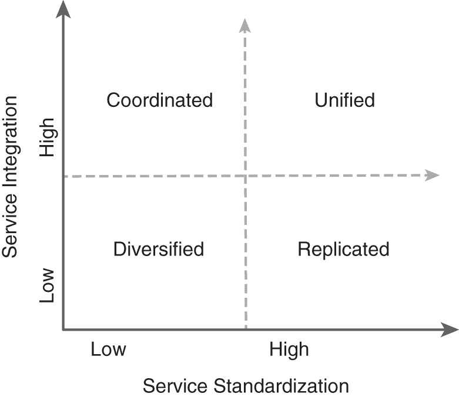

**图 7-1** 四种基本的业务运行模型。

- **多元化 (Diversified)**——在多元化运行模型中，技术解决方案与企业的集成和标准化程度较低。通常，业务单元外部的数据交换和服务的利用微乎其微。
- **协调化 (Coordinated)**——在协调化运行模型中，技术解决方案在整个企业共享数据；然而，共享服务和标准化的水平是极低的。
- **复制化 (Replicated)**——在复制化运行模型中，技术解决方案在整个企业共享服务；然而，数据共享的水平是极低的。
- **统一化 (Unified)**——在统一化运行模型中，技术解决方案在整个企业既共享数据又具有标准化的服务。

这些模型并不是互斥的。你完全可以拥有既是协调又是复制的模型。通常，你在整个企业范围内既有高度集成的系统也有低集成系统。这些选择是由业务做出的，反映了业务所持的信念。例如，如果一个业务在一年内对某个应用程序进行了多次更改，它可能希望对技术有更直接的控制。员工可能认为控制对他们的成功至关重要。如果他们觉得必须在全年进行技术更改以跟上市场，情况尤为如此。这种方法可能会导致特定业务的与企业解决方案集成程度较低的独立解决方案。

这四个概念与服务集成和服务标准化对齐。*服务集成*通常指跨业务使用了多少共享数据。而*服务标准化*则指业务在设置其解决方案和流程时拥有多少控制权。例如，一家房地产业务可能具有很高的服务集成度。公司可能会在销售房屋的部门和销售房屋保险的部门之间共享新购房屋的数据。

## 策略与标准开发的原则

没有两个组织或风险评估结果是完全相同的；构建 IT 安全计划没有通用的配方。相反，*原则*可以帮助你根据经过验证的经验和行业最佳实践在新的情况下做出决策。通过考虑几个原则，你可以推导出控制需求并帮助做出实施决策。

使用以下原则帮助您制定策略、标准、基线、程序和指南。无论组织的业务性质如何，这些都是行业最佳实践推荐的通用核心安全原则：

### 注意

不要低估业务部门对技术控制水平所表现出的强烈诉求。挑战在于选择一个业务部门能够承诺、并能够确保 IT 安全策略得到执行的运营模式。

- **问责原则 (Accountability principle)**——信息系统安全的个人责任应该是明确的。组织中的某些角色仅对其日常执行的工作负责。其他角色不仅对自己的工作负责，还要对其团队员工执行的所有工作负责。问责有助于确保人们理解，他们对在使用组织资源时所采取的行为负有责任。你可以将问责视为一种威慑性控制。
- **意识原则 (Awareness principle)**——信息系统的所有者、提供者、用户以及其他方应被告知信息系统安全策略、责任、实践、程序和组织的存在及其总体背景。简单来说，利益相关者不太可能遵守他们并不知晓策略。
- **伦理原则 (Ethics principle)**——信息系统的设计方式以及在安全控制中反映的数据访问权限，应符合组织的伦理标准。这包括对客户数据的披露程度和访问权限。这还需要根植于组织文化中才能发挥作用。
- **多学科原则 (Multidisciplinary principle)**——策略和标准库文档的编写应考虑到所有受影响的人，包括技术、行政、组织、运营、商业、教育和法律人员。
- **比例原则 (Proportionality principle)**——安全级别、成本、实践和程序应与数据的价值以及对系统的依赖程度相适应成比例。它们还应与系统受损或数据丢失的潜在严重性、概率和范围成比例。换句话说，不要花 1000 元保护价值 500 美元的资产。
- **集成原则 (Integration principle)**——您的文档应该相互协调和整合。它们还应该与其他相关的措施、实践和程序集成，以形成连贯的安全体系。
- **深度防御原则 (Defense-in-depth principle)**——当安全作为一系列重叠的控制和应对措施实施时，由于这些措施提供了保护资产的三个要素：预防、检测和响应，安全性随之提高。这被称为深度防御。它既是一个军事概念，也是一个信息安全概念。深度防御规定安全机制要分层，使得一个机制的缺陷被两个或多个其他机制的优势所抵消。这是一个核心安全概念。
- **及时性原则 (Timeliness principle)**——所有人员、指定的代理和第三方提供商应以及时且协调的方式防止并响应安全违规。
- **重新评估原则 (Reassessment principle)**——应定期重新评估信息系统的安全性。技术风险每天变化，需要定期重新评估以确保安全需求和实践与这些变化同步。标准也需要重新评估（至少每年一次），以确保它们代表了现状。
- **隐私原则 (Privacy principle)**——信息系统的安全性应包含用户用户的隐私信息。换句话说，在要求可能危及隐私权利的信息时，请考虑您的用户或合作伙伴。
- **内部控制原则 (Internal control principle)**——信息安全是组织信息内部控制系统的核心。法规强制建立并正确运行内部控制系统。组织依赖技术维护业务记录。此类技术包含内部控制机制至关重要。这些机制维护了信息的完整性并反映了组织活动的真实情况。
- **对手原则 (Adversary principle)**——开发和实施控制、安全策略、架构和策略库文档时，应预见到来自可能有意危害的智能、理性且非理性的对手的攻击。威胁评估也是如此。
- **最小权限原则 (Least privilege principle)**——应仅授予人员完成分配任务所需的权限，而不能更多。这是安全的另一个核心原则。
- **职能分离原则 (Separation of duty principle)**——应当划分职责和权限，以防止个人或小小组协作人员不当控制控制流程的多个关键方面并导致损害或损失。例如，在会计部门，准备付款发票的人员不应是编写付款支票的人员。


## 核心安全原则

- **连续性原则 (Continuity principle)**——识别组织对灾难恢复和业务连续性的需求。相应地为组织及其信息系统做好准备。

- **简单性原则 (Simplicity principle)**——尽量采用小型简单的保护措施，而不是大型复杂的措施。安全变得更简单时安全性就会提高。显然，安全不应过度简化，而应在实践上尽可能简单。

- **以策略为中心的安全原则 (Policy-centered security principle)**——策略、标准和程序应作为管理所有信息安全活动规划、控制和评估的正式基础。

除了这些原则外，在制定安全策略时还应采取一些特定步骤：

- **风险识别 (Risk identification)**——始终从识别策略试图缓解的风险开始。

- **法律合规性 (Legal compliance)**——确保策略符合任何法律或监管要求。

- **实用性 (Practicality)**——确保策略是你可以实施和执行的。

## 客户数据透明度的重要性

与客户数据处理和使用相关的策略应包含透明度概念。组织应当保持透明，并通知个人有关收集、使用、分发和维护个人身份信息（PII）。PII 是可用于识别特定人的信息。这可以是单独使用的内容，例如人的姓名。

一个密切相关的概念是 `非公开个人信息 (NPI)`。这是《格拉姆-莱奇法案》中用于指代消费者向金融机构提供的任何个人身份财务信息的术语。

###  提示

每当涉及客户数据时，务必咨询合规团队了解有关处理和使用此类数据的法律要求。

关于处理客户数据的透明度应包含以下要素：

- **个人参与 (Individual participation)**——组织应让个人参与使用 PII 的过程并征得个人同意。这种同意应包括 PII 的收集、使用、分发和维护。组织还应提供有关 PII 使用的适当访问、纠正和救济的机制。

- **目的说明 (Purpose specification)**——组织应具体描述允许收集 PII 的权限，并阐述其意图使用数据的目的。

- **数据最小化**——组织应仅收集与实现指定目的直接相关且必要的个人身份信息（PII）。此外，它们保留 PII 的时间不应超过履行指定目的所需的时间。任何过度的数据收集或保留都会增加组织的风险。

- **目的限制**——组织应仅为指定的目的使用 PII。如果共享了 PII，其目的也应与收集 PII 时的目的保持一致。这一点目前已在如欧盟的《通用数据保护条例》（GDPR）等法律中得到明规定。

## 策略与标准的控制类型

在企业内部拥有共同的目标和信念，并掌握相关原则的基础上，你可以开始规划你希望通过安全控制手段实现的目标。安全控制是为保护系统免受针对其机密性、完整性和可用性（C-I-A 三角或三元组）攻击而采取的措施。有时，保护措施和防御措施与 `control`（控制）一词同用。控制是在完成资产风险评估后选择的。一旦你识别并评估了资产面临的风险，就可以选择适当的控制来应对威胁、缓解威胁或降低风险。

## 安全控制类型

安全控制可以根据两种不同的分类方案进行描述：一种基于控制本身，另一种基于控制起的作用。

第一类包括行政控制、技术控制和物理控制类别。它们描述了控制的实际形态，例如命名的流程、标准、防火墙或锁上的门：

- **行政控制**——指导员工在执行组织业务时遵循的策略、标准和程序。人员的入职筛选和变更管理流程也是行政控制的示例。

- **技术安全控制**——用于保护资产的设备、协议和其他技术。这些包括防病毒系统、加密系统、防火墙等。

- **物理安全控制**——用于控制物理访问的设备。这里的示例包括围栏、安保人员、锁上的门、运动探测器和报警器。

为了使安全措施有效，必须同时考虑这三种方法。例如，如果你想保护一台服务器，它应该被放在上锁的服务器房内（物理控制）。它应该具有强效的身份验证和加密的硬盘（技术控制）。最后，必须有有效的安全策略来管理该服务器（行政控制）。

第二组控制描述了控制手段的作用。这些控制包括以下内容：

- **预防性安全控制**——防止蓄意或无意的安全威胁。示例包括网络访问策略、防火墙规则以及布线间和服务器房门的锁。

- **检测性或响应控制**——像报警器和警告信号一样发挥作用。这些控制在事件发生 `after` 生效。示例包括运动探测器、日志文件和包含系统审计信息的文件。

- **纠正性控制**——帮助你响应并修复安全事件。纠正控制还用于限制或停止进一步的损害。某些示例包括从系统中清除病毒、关闭防火墙端口以及阻塞 Internet 协议（IP）地址。

- **恢复性控制**——在事件结束后帮助你将系统恢复运行状态。灾难恢复和磁带备份属于这一类。

安全控制类别之间存在显著的重叠。某些控制既可以是行政性的又是预防性的，也可以是技术性的又是纠正性的，或者是它们的任何组合。这种重叠是设计初就考虑的，目的是为了实现深度防御原则。

你可以找到几乎涵盖每个安全主题的安全控制目录。例如，信息和相关技术控制目标（COBIT）是由 ISACA 开发的一项 IT 治理框架，它包含了支持工具，帮助弥补控制要求、技术问题和业务风险之间的差距。你可以访问 ISACA 网站 `http://www.isaca.org` 获取更多信息。

## 文档组织考量

虽然组织策略库有许多方法，但它们有一个共同点就是需要一套编号方案。编号方案可以帮助你按主题组织材料；它成为人们引用特定内容的快速参考点。你可以创建自己的编号方案，也可以使用现有的方案。如果你决定使用诸如 ISO/IEC 27002 等现有框架，可以从它提供的分类法开始。

### NOTE

`Taxonomy`（分类法）是分类的实践与科学。分级分类法是针对一组特定对象或文档的分类树状结构。

`FIGURE 7-2` 提供了一个你可能考虑用于自己分类法的示例。将 `Figure 7-2` 想象成一棵侧卧的树。左侧的项目级策略或信息安全章程是“根”。它建立了这棵树，并将管理这棵树的权限授予了组织的信息安全部门。我们称之为 `IS`（代表信息安全）、`POL`（代表策略），加上“001”，因为它是第一份文档：`IS-POL-001`。

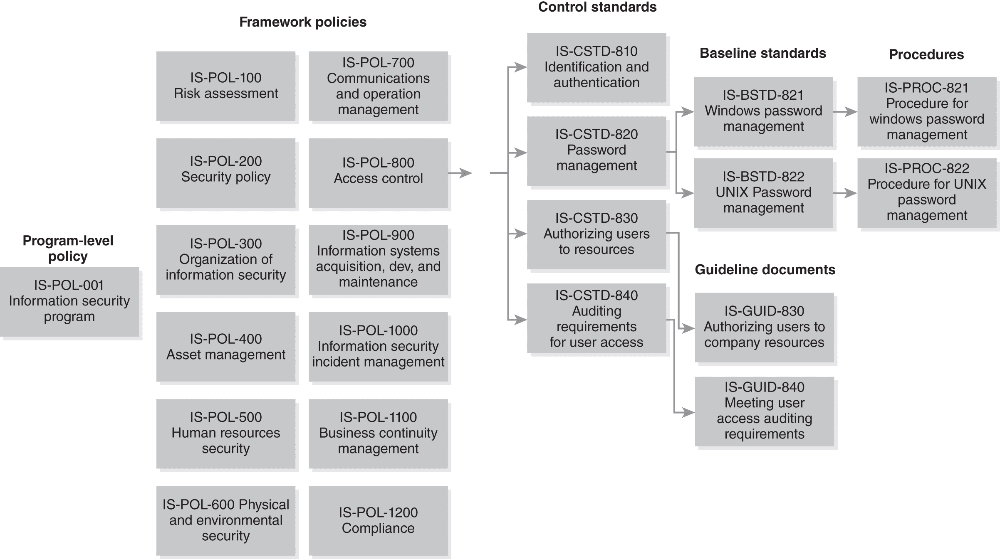

**FIGURE 7-2** 一个可能的策略和标准分类法。

在右侧，你会发现一组程序框架策略。该框架使用 ISO/IEC 27002 主题作为策略类型。它们每 100 个一组进行编号以便增长。这些策略中的每一个都是独立的，作为树的第一大分支。从这些分支中，标准及其支持性便随之出现。

以访问控制（`IS-POL-800`）框架策略为例，你可以看到标记为 `IS-CSTD-810` 到 `840` 的控制标准。`CSTD` 标签是 Control Standard（控制标准）的缩写。`FIGURE-7-3` 显示了策略库的这部分。

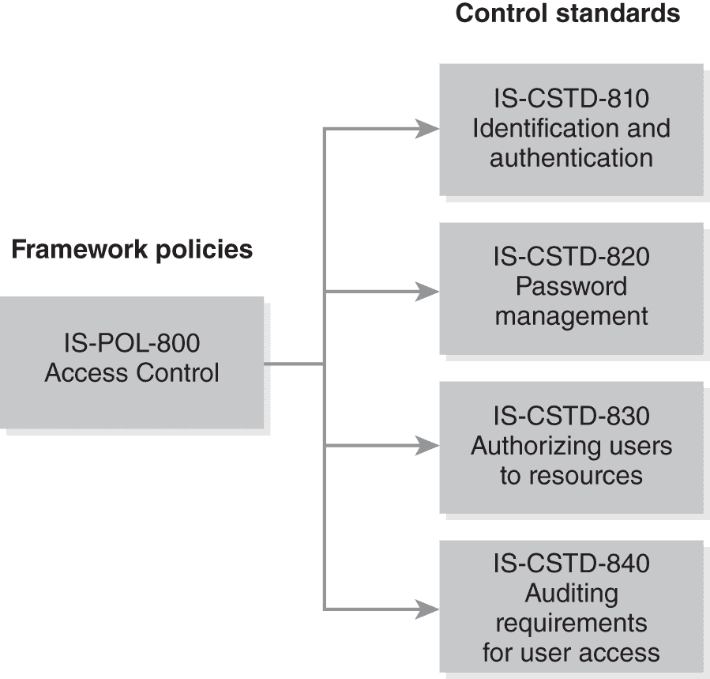

**FIGURE 7-3** 控制标准从访问控制 (`IS-POL-800`) 框架策略延伸出来。

基标准随后进行编号，以保持分类法的一致性并支持其基础的控制标准。基标准针对特定技术，编号为 `IS-BSTD-821` 和 `822`，其中 `BSTD` 代表 Baseline Standard（基标准）。这两个标准定义了适用于 Windows 操作系统和 UNIX 操作系统的密码管理要求。在示例中，编号遵循了父标准的编号 `IS-CSTD-820`。

###  提示

无论你采用何种编号方案，都要为添加新文档留出足够的空间。在决定使用之前，仔细推敲编号方案。问问自己如何添加新策略。当你首次向组织引入移动性等新技术领域时该如何操作？

程序链接到它们支持的基标准。例如，`IS-PROC-821` 和 `822` 直接映射到 `821` 和 `822` 基标准。在大多数情况下，基标准和程序之间存在一一对应的映射关系。`FIGURE 7-4` 显示了策略和标准库树中基标准和程序的局部视图。

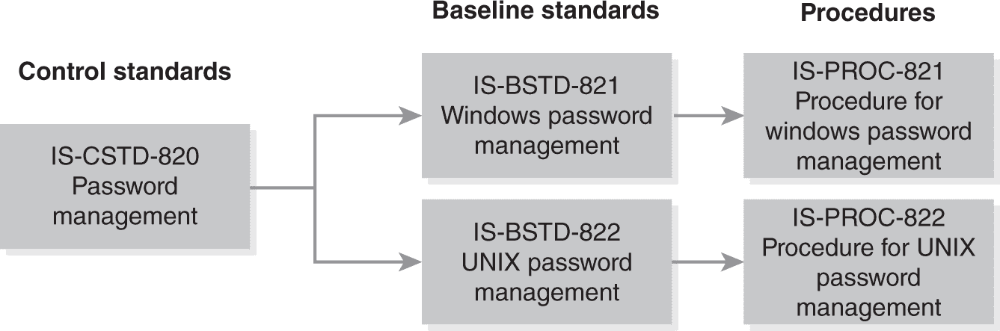

**图 7-4** 基准标准和程序提供了库文件树的额外分支。

指南文档通常与特定的控制标准相关，如图 7-5 所示。指南文档（`GUIDs`）在可能没有任何技术可以执行控制措施的情况下非常有用，但指南为过程管理或控制提供了有用的信息。

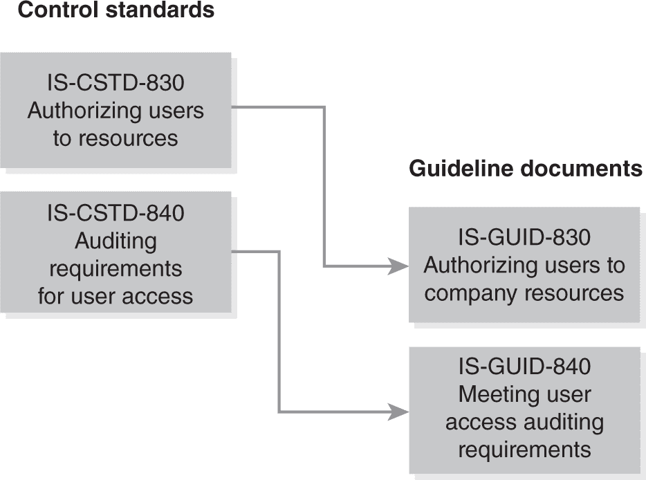

**图 7-5** 指南提供了库文件树的额外分支。

当人们寻找特定文档时，文档名称应该告诉他们他们需要的所有信息。在对分类分类法有了些经验后，他们将知道去哪里寻找。

## 示例模板

本节查看了策略和标准的某些建议文档格式。您可以直接使用这些格式，也可以创建一个最能反映您组织需求的模板。

### 策略示例模板

以下策略文档的大纲可以帮助您组织程序级策略和框架策略的内容：

**策略名称和标识信息**

1. `PURPOSE`

   此文档为 . . . 建立了策略。

2. `BACKGROUND`

   开发此文档是因为 . . .

3. `SCOPE`

   本策略适用于 . . . 的使用。

4. `OPERATIONAL POLICY`

   4.1. 第一节

   4.2. 第二节

   4.3. 第三节

   4.4. 第四节

5. `ROLES AND RESPONSIBILITIES`

   以下实体负责与本策略相关的实施：

6. `APPLICABLE LAWS/GUIDANCE`

7. `EFFECTIVE DATES`

   本策略自 `[xxx]`（首席信息官 (`CIO`)）签字之日起生效，直到被 `CIO` 正式取代或取消。

8. `INFORMATION AND ASSISTANCE`

   联系 . . . 获取有关此策略的更多信息。

9. `APPROVED`

   `[信息安全策略总监]` 发布日期

10. `ASSOCIATED RESOURCES`

    本策略通过 . . . 增强。

###  提示

切勿在策略或标准中使用个人（私人）姓名。对于角色和职责，请使用负责的部门、单位或特定角色的名称。个人会加入或离开公司。

以下是一个访问控制的策略陈述示例，它将出现在框架策略的“操作策略”部分：

```
人员在获得 <Organization> 信息资源的访问权限之前，必须经过积极的身份验证和授权。基于个人角色的访问必须限制在执行其工作职所需的最小限度。

对关键信息资源的访问必须通过管理过程进行控制，该过程应涵盖授权、修改和撤销访问，以及对信息系统权限的定期审查。
```

### 标准示例模板

以下标准文档的大纲可以帮助您组织控制和基准标准的内容：

**标准名称和标识信息**

1. `PURPOSE`

   此文档为 . . . 建立了标准。

2. `BACKGROUND`

   开发此文档是为了支持 . . .

3. `SCOPE`

   本标准适用于 . . . 的使用。

4. `STANDARD STATEMENT(S)`

   4.1. 第一节

   4.2. 第二节

   4.3. 第三节

   4.4. 第四节

5. `ROLES AND RESPONSIBILITIES`

   以下实体负责与本标准的相关的实施：

6. `GUIDANCE`

   链接到本标准的指南文档 . . .

7. `EFFECTIVE DATES`

   本标准自 `[xxx]`（首席信息官 (`CIO`)）签字之日起生效，直到被 `CIO` 正式取代或取消。

8. `INFORMATION AND ASSISTANCE`

   联系 . . . 获取有关此标准的更多信息。

9. `APPROVED`

   `[信息安全策略总监]` 发布日期

10. `ASSOCIATED RESOURCES`

    本标准通过 . . . 增强。

以下是访问控制的示例声明，它们将出现在框架标准的“标准声明”部分：

```
对 <Organization> 信息资源的访问必须通过适当的控制方法进行控制。

对 <Organization> 信息资源的访问必须通过适当的控制方法进行控制。

对 <Organization> 信息资源的访问必须通过适当的控制方法进行控制。
```

### 程序示例模板

以下程序文档的大纲可以帮助您组织程序的内容：

**程序名称和标识信息**

**生效日期**

该程序开始生效的日期。可以与批准日期相同，也可以晚于批准日期。

1. `PROCEDURE`

   在表格中插入程序步骤 . .

   1.1. 第一节

   1.2. 第二节

   1.3. 第三节

   1.4. 第四节

2. `STANDARD`

   指示本程序相关的基准标准。

3. `FORMS`

   列出执行此程序所需的任何表编号和名称。

4. `PROCEDURE HISTORY`

   列出所有之前的版本（包括过期的程序编号或标题）及其生效日期。

5. `INFORMATION AND ASSISTANCE`

   联系 . . . 获取此标准的更多信息。

6. `APPROVED`

   `[信息安全策略总监]` 发布日期

7. `KEYWORDS`

   指示描述该程序的交叉引用、别名、短语或术语。

8. `ASSOCIATED RESOURCES`

    本标准通过 . . . 增强。

### 指南示例模板

虽然指南通常没有标准模板，但可以使用或调整以下：

**指南名称和标识信息**

1. `PURPOSE`

   此文档提供建议，帮助满足标准 . . . 的要求。

2. `BACKGROUND`

   开发此文档是为了支持 . . .

3. `SCOPE`

   本指南适用于 . . . 的使用。

4. `GUIDANCE SECTION(S)`

   4.1. 第一节

   4.2. 第二节

   4.3. 第三节

   4.4. 第四节

5. `ROLES AND RESPONSIBILITIES`

   以下实体与本标准的实施相关职责：. . .

6. `生效日期（可能需要也可能不需要）`

7. `信息与协助`

   请联系 . . . 获取有关本文档的更多信息。

8. `批准`

   `[信息安全策略总监]` 发布日期

9. `相关资源`

   本指南由 . . . . 进行了补充。

以下是一个关于在大学环境中使用加密的指南片段示例。此文字可能会出现在指南文档的“指导章节”中：

大学人员和学生组织：

- 应当使用行业标准的加密算法来保护其数据。

- 不应尝试开发自自己的专有加密算法，并应仔细审查供应商对其专有加密算法安全性的任何声明。

## 实施策略和标准的考虑因素

实施您的策略和库涉及四个主要步骤：

1. 就意图达成共识
2. 对您的文档进行评审和批准
3. 发布文档
4. 意识提升与培训

### 就意图达成共识

将实际策略语言的编写与策略变更意图的讨论隔离开来是建立共识的好方法。在这一步骤中，您应该从运营模型和原则的角度讨论变更的驱动因素。这强化了共同信念并有助于促进预期的文化。尽可能地，至少在策略的目的上达成共识是理想的。您可能无法就策略中的所有详细条目达成共识，但至少目的应该是一个获得广泛支持的。

这种分离还具有额外优势，即缩短了开发实际策略语言的时间。很多时候，人们浪费时间在策略语言上产生分歧，而实际上，真正的分歧在于对该策略的需求。如果您对安全控制的需求和预期结果达成一致，那么编写策略语言就会变得更容易。实际的编写只是记录了这种共识。这种方法也使评审和批准变得更容易，因为人们已经对策略变更的需求有了意识，并对其意图有了理解。

在与运营用户及其经理的调研和采访过程中，您应该让他们对信息安全（IS）部门将强制要求的变更做好准备。这种利益互换的过程有助于提高文档内容的质量。它也有助于那些根据您完成的风险分析和评估工作将实施的规则和控制的人产生认同。

### 评审与批准

一旦完成编写，您需要再次与帮助您开发文档的人员共享您的文档。让这些员工在实施之前尽早评审策略文档的语言。这些评审允许您在以可能产生干扰的方式部署策略之前，评估策略或标准对组织的影响。

这些评审有时要求您修订策略或标准的部分以适应现状。或者，您可能需要推迟某些控制措施的实施，直到环境对合规做好了更好的准备。在整个策略开发项目的早期，您应该与组织的审计小组合作，确定在策略发布后他们多久将根据该策略进行审计。通过为合规留出缓冲期，您有助于确保策略具有执行力。缓冲期为人员提供了实施任何合规所需的项目、流程或内部沟通的时间。

请留出足够的时间收集并解决疑虑，并留出足够的时间让业务应对做好准备。

###  提示

如果您无法实施控制，请推迟实施日期。根据组织的大小，缓冲期可以从几个月到一年不等。

最终，您的目标是获得高管批准。如果存在该职位，执行批准者可能是首席安全官（CISO）。尽管这些评审步骤可能看起来繁琐，但需要早期的参与以确保没有意外。以下是建议给予机会成为第二或第三层评审的人员：

- **技术人员**——您可能需要寻求在您正在编写的领域具有安全知识的技术人员的专业知识。

- **法律**——法律部门应对策略开发过程提供意见。他们可以就要求以特定方式保护某些类型信息的现行法律提供建议。您的法律部门还应该在策略和标准完成后对其进行评审。鉴于法律系统的动态性质和频繁发生的变化，这是一个关键的步骤。

- **人力资源 (HR)**——如果您的文档涉及了现有 HR 政策涵盖的主题，HR 部门可能需要评审和或批准您的策略或标准。电子邮件使用和物理安全就是示例。确保您引用了 HR 政策而不是重复内容。简单地重复内容会导致未来不一致。

- **审计与合规**——内部审计人员将在策略生效后监控对策略的合规情况。如果您与外部合规小组合作，请根据需要与他们咨询。虽然内部审计团队成员通常不会负责批准策略变更，但他们可以表达应该解决的意见或疑虑。

#### 发布您的策略和标准库


一旦策略和标准获得批准，您需要以最适合您组织的方式分发。发布您的策略和标准库取决于组织中可用的通信工具。许多组织使用某种形式的内网进行内部通信。不同部门可能有它们自己的内网子站，IS 部门也应该有自己的。内网通常有一个首页或门户，用于发布网站上的新内容。

有时，内网站点使用后台引擎管理内容，例如 `Microsoft SharePoint Server`。部门可以使用 `SharePoint` 处理他们想要共享的文档和联系信息，然后将内容发布到内网供任何人访问。

如果您的组织使用内容管理工具来维护部门网站，您可能考虑使用该工具来发布文档。文档必须能够随时获取，并将副本存放在共享驱动器或组织 `intranet` 上。发布文档的一些最佳实践是为每份文档创建一个单独的网页。该页面应包含：

*   `识别信息`
*   文档的`概述`
*   `最后修订日期`以及修订文档的人员字母缩写
*   `下一次计划审查日期`
*   用于 `intranet` 搜索引擎的`关键词`，以便定位文档
*   指向相关文档的`链接`
*   文档的 Adobe 便携格式 (`PDF`) 版本

您在制定政策时选择的媒介可能会决定您在审查周期中遇到的困难程度。文字处理文档因其便利性而具有吸引力。然而，从审查的角度来看，文字处理文档并不总是高效的。当您准备好最终稿时，可以创建一个包含政策和标准的 `PDF` 文档集。然后，您以最适合组织的方式发布该库。

 注意

## 巡演与发布

在重大政策变更发布之前，您可能考虑进行 `roadshow`。在这种语境下，`roadshow` 指在大型员工集面上现场并解释变更。这可以简单地通过一次全员会议来宣布即将到来的变更。

名为 `治理、风险与合规` (`GRC`) 的软件类可用于支持政策的管理和发布。`GRC` 工具中常见的功能包括：

*   评估控制措施的技术和非技术操作的合理性，并缓解/调控控制运行不当的区域（`治理`）
*   协助组织内部风险的量化、分析和缓解（`风险`）
*   政策的编写、分发以及与法规的映射，以及对这些政策/法规的例外情况进行跟踪（`合规`）

`GRC` 工具通常以模块的形式交付，并插在中央 `GRC` 引擎中。通常情况下，您可以获得政策和标准模块的许可。通过该模块，您可以使用工作流功能来开发和共享文档进行审查和批准，将库发布为网页，并搜索相关文档。一些组织使用这些工具：

*   使用测验进行意识培训
*   向用户发送电子邮件，通知其新内容或现有政策的变更
*   发送电子邮件通知人们新内容已就绪供其审查或批准
*   跟踪文档更改，以确保重要内容不会丢失或被错误更改

 注意

## GRC 工具

作为持续改进努力的一部分，计划定期审查和更新已发布的政策和其他文档。您将在本章的稍后部分学习文档的审查和维护。以下 `GRC` 工具以及其他几种工具被广泛使用：

*   `RSA Archer GRC`，`http://www.emc.com/security/rsa-archer.htm`
*   `Broadcom Control Compliance Suite`，`https://www.broadcom.com/products/cyber-security/information-protection/control-compliance-suite`
*   `Modulo Manager`，`https://www.enisa.europa.eu/topics/threat-risk-management/risk-management/current-risk/risk-management-inventory/rm-ra-tools/t_modulo.html`
*   `Quantitative GRC Software Suite`，`https://quantivate.com`
*   `LogicManager`，`https://www.logicmanager.com`
*   `ZenGRC`，`https://go.reciprocitylabs.com`

### 意识与培训

实施工作需要让人员不仅了解每个核心要素，还要转变他们的角色，以强调保护数据和系统。持续的安全意识培训（包括对新政策的培训）是政策实施的一个关键方面。

意识计划可以激励员工，并促进本章早些讨论的共同信念。激励员工与掌握技术同样重要。受鼓舞的员工可以处理意外情况。这在处理意外安全事件时尤为重要。请记住，重要的不是让员工学习政策，而是激励员工执行政策。此外，这种沟通为其他讨论（如绩效评估和流程改进）奠定了基础。

因此，安全意识计划是成功实施全组织安全政策的关键因素之一。意识工具应该描述并概述所有员工保护组织资产的特定特定指令。它还应该解释安全政策和标准的核心要素。该计划旨在以易于理解的方式，增加人们对信息安全领域的兴趣。

获得管理层的意识和认同应该是您的第一步。如果没有管理层的支持和承诺，后期对大众进行教育不太可能成功。在向您的执行赞助人推销该计划并获得发布文档的批准时，利用这段时间利用他们对经理和直属汇报的权威来确保合规。一旦确保了这种级别的认同，获得认同的任务就会变得容易得多。

*   尽可能使用能让安全成为一种个人选择的示例。开发一些场景，让人们在特定情况下需要对他们可能的行为做出选择。将这些情况与人们日常可能遇到的实际情况联系起来。

此外，你还可以帮助人们感知安全计划带来的实际个人益处，例如他们将获得的新技能。例如，告诉他们这些信息如何帮助他们提高家庭个人电脑及其个人信息的安全性。

多样化的教育方法可以提高你的安全意识和培训计划的成功率。确保你拥有一个新鲜、不断演变且动态的教育计划。接下来的章节为提高意识和向员工提供安全知识提供了建议。

## 安全简事报

一种接触和教育员工的有趣且有价值的方法是安全简事报。核心思想是为用户提供一种有趣且参与感强的方式理解策略和标准库中列出的重点。你可以通过电子邮件发送或发布在内网网上。为了确保有效，它必须简洁且有趣。冗长的简事报不太会被阅读。将简事报与近期新闻报道的某些漏洞事件或安全问题联系起来通常是有效的。

如果你在内部开发简事报，可能需要向信息安全组的其他人员寻求帮助。还要考虑从具有安全相关视角的组外人员获取建议，并分享给组织的其他部分。另一种方法是订阅第三方安全简事报，并根据你的组织进行定制。

###  提示

与其建立正式的简事报，你可以在内网上建立一个信息安全意识区域。你可以维护几个相互链接且易于更新的信息页面。

以下章节描述了典型安全简事报的内容。

### 安全文章

有时，人们喜欢阅读关于特定主题的详细深入的信息，这有助于他们更清楚地理解该主题。例如，如果你在安全意识活动中涵盖了电子邮件威胁，你可以在员工对该话题仍记忆犹新时，在下一期简事报中加入相关文章。本质上，文章比简事报更深入，并为想要深入研究某个主题的人提供更多细节。

以下是可能的文章主题：

*   `密码安全`——讨论密码的重要性及其在保护数据方面至关重要的作用。其他文章可能包括如何正确维护用户 ID 和密码、密码的创建与维护以及最佳实践。
*   `可接受的互联网使用`——讨论互联网连接可能带来的危险，以及员工在工作中浏览网页时应该注意的信息。
*   `他们为什么要针对我们？`——这可能是一个有趣的话题，用来描述不同攻击者的动机和攻击背后的目的。这可以帮助用户更好地理解实施适当的信息安全措施的重要性。
*   `你在保护组织中的角色`——尽可能多地考虑你认为合适的场景。这些文章的意图是以非正式但有效的方式解释信息安全的最重要方面。如果需要，你可以涵盖社交方面并结合简短的技术解释。

## 技术提示

在整个组织中建立一个宣教者社交网络。有些组织通过在每个工作组或部门中识别特定的特定的安全宣教者取得了成功。这些人将担任信息安全的倡导者，并帮助他们特定的部门或小组解答与其合规义务相关的问题。你可以从那些表现出高于平均水平的安全兴趣或技能的人开始。识别并推广这些群体，形成一个加速安全采纳的社交网络。从跟踪在意识会议或其他培训机会中脱颖而出的人开始。

### 什么是……？

简事报的这一部分用于教育或告知员工，并作为信息安全术语表。它包含了以非技术、易于理解的方式解释的各种安全术语。可以单独涵盖特洛伊木马、蠕虫和防火墙等通用安全主题，还可以涵盖你认为有用、必须知道或有助于符合标准和策略的其它主题或概念。

### 提问我们

你可以在简事报中包含一个“提问我们”部分。随着时间的推移，你可以创建一个常见问题集 (`FAQ`) 文档，总结问题和答案，为用户在与 IS 部门交互时提供丰富的体验。

问题和相应的答案可以包含在下一期简事报中，这样它不仅是一个面向大部分人的集体信息源，还能激发提出更多问题。

### 安全资源

“安全资源”部分可能包含一些简短的新闻，以易于理解的形式涵盖信息安全的某个方面。其意图是通过安全新闻、最新的安全漏洞新闻、公司因安全问题而遭受的损失等，帮助用户理解安全意识的重要性。

### 联系方式

确保包含 IS 部门的联系详情，以便用户在遇到问题时确切知道该联系谁。在任何可以发布的地方发布你网站的内网统一资源定位符 (`URL`) 以提醒人们帮助只需点击即可获得。

### 策略变更控制委员会

更改策略就像任何其他变更过程一样。在更改技术时，组织通常有一个变更控制委员会 (`CCB`)，有时被称为变更咨询委员会 (`CAB`)。更改策略也不例外。对策略的有效监督确保了安全是以经过思考的方式实施的。对策略变更的监督通常归属于现有的委员会。委员会成员通常是代表技术和业务利益的高级领导。这些个人作为领导确保了保护组织与运营需求之间的正确平衡。

确保变更不会单方面做出或产生意外后果。为了避免这些情况，请建立一个策略变更控制委员会或小组。你可以临时组织该小组，根据审查和批准的需求召开会议。它也可以是一个常设委员会或工作组，定期讨论策略和标准的变更、增加和增强。你可以制定一个标准来创建该委员会并建立成员要求。至少应包括来自信息安全、合规、审计、人力资源、其他业务部门领导和项目经理 (`PM`) 的人员。`PM` 设置会议程、记录会议记录、分配任务并跟进交付物。

###  注意

安全人员需要了解策略和标准的变更要求。他们还需要理解对 IT 环境的影响。由于系统、应用程序和网络是集成的，一个组件的变更可能会影响其他组件。

策略变更控制委员会的目标是：

*   评估策略和标准并提出变更建议
*   协调变更请求 (`RFCs`)
*   确保对现有策略和标准的变更支持组织的使命和目标
*   审查对策略框架的请求变更
*   建立策略和标准的变更管理流程

政策并非存在于真空之中。如果执行得当，它将成为业务日常交易和活动的一部分。在这方面，必须有一个流程来跟踪重大事件，例如哪些方面进展顺利，哪些方面出现了问题。例如，如果发生了安全泄露，事后审查将检查哪些控制措施本可以防止事件的发生或减轻影响。哪些政策在防止泄露方面没有生效？策略和标准的变更管理流程确保在需要时对策略和标准进行更新。它处理技术领域的新进展以及业务环境的变化。当识别出潜在变更时，变更管理将决定是否应该实施变更，或者是否需要新的策略或标准。此外，必须有一个“经验教训”流程，允许解决问题并对正在设计的政策和标准进行修改。

政策变更控制委员会负责评估并批准 RFC（请求更改）。RFC 通常响应已知问题，但也可以包含改进建议。处理 RFC 时的一个挑战在于确定它是应该被批准，还是是否可以通过过渡性政策或标准来解决问题。

### 注意事项

“经验教训”流程确保错误只发生一次而不再重复。`经验教训`可以来自任何人、任何地方。

#### 政策和标准变更的业务驱动因素

此外，还有驱动政策和标准变化的业务因素，可能包括以下内容：

*   **业务例外**——随着业务的变化，会引入新的系统或流程。这些内容可能与政策或标准的要求不符。
*   **业务创新**——新的收入增长或成本削减机会可能导致以前未曾考虑过的创新性变更。标准可能需要适应这些创新，或进行调整以允许创新。
*   **业务技术创新**——新技术通常伴随着不可知的风险，直到你获得使用它的经验。标准可能需要修订，以允许使用新技术，或以开发标准时未预见的新方式使用它。
*   **战略变更**——组织可能会改变其业务模式，并受到新的监管要求。例如，一个机构可能会收购一家银行以降低信用卡处理成本。在这种情况下，对现有标准的更改是深远的，并可能影响现行的每一个标准。
*   **法律变更**——可能会出现新法律或现有法律的变更，要求业务政策发生变化。近期最明显的例子是欧洲的 GDPR。任何在欧洲开展业务的组织都必须实施遵守 GDPR 的政策。
*   **监管变更**——如果组织的运营需要遵守某些法规，那么该法规的任何变更都可能导致组织政策的更新或变更。支付行业数据安全标准（`PCI-DSS`）就是一个很好的例子。如果一个组织处理信用卡数据，当 `PCI-DSS` 更新或变更时，该组织必须对其策略进行相关变更。

某些变更请求会导致策略和标准库的完全重新开发，或者至少涉及策略和标准开发周期中的某方面。

### 维护你的策略和标准库

策略和标准库像一棵树，随着时间的推移，需要修剪和维护。政策变更控制委员会帮助决定对哪些文档进行哪些变更。其他变更需求可能来自与特定用户或组相关的问题，文档可能需要细微或孤立的变更。委员会的任务之一是确定他们将处理哪些请求，哪些是正常的维护请求。

### 小贴士

建立一个常见问题（FAQ）网站来澄清政策中的细微之处。随着时间的推移，当你看到哪些让终端用户产生共鸣的问题和答案时，你可以将这些答案移动到策略本身的语言中。

### 更新与修订

更新可以被视为非实质性编辑。示例包括更新职位名称或部门名称、纠正拼写错误以及修复损坏的网站链接。

修订可能具有轻微或重大意义：

*   轻微修订通常意义较小。例如，澄清句子或段落内的措辞。
*   重大修订会显著改变政策。示例包括新要求、新限制或扩展的职责。此类变更应发送到政策变更控制委员会进行考虑。

在整个章节中，我们为你提供了一些关于开发文档、适当进行编号、发布文档以及宣传这些文档的实践建议。如果你遵循了这些指导，变更过程将耗费最少的精力。如果每次变更都需要完整地审视整个库，那么你面临的问题就比这大得多了。

假设你对更新遵循相同的开发和审查周期，并获得了受变更影响的人的必要认同，最耗时的活动将是向组织传达你的变更。利用通信和媒体的技巧与工具，你应该能够依靠你为持续提高意识和培训而开发的相同流程。

为了帮助你确定需要执行哪些变更或维护，请使用提供的信息：

*   **例外和豁免**——寻找与合规性相关的常见问题。如果标准经常无法满足，说明标准（或政策）存在问题。
*   **来自用户和管理层的请求**——让获取人们对遵守标准的实际经验的反馈变得简单。重大请求应正式记录并发送到政策变更控制委员会。然而，不要忽略关于什么引起了人们担忧或引发对文档疑问的反馈。
*   **组织变更**——公司有来有去。合并和收购不断发生。如果你发现自己的组织购买或出售了一个部门，并且你需要重新审视合并后组织的政策和标准，请使用在本章中学习的工具和技术来帮助解决冲突或填补变更带来的空白。

### 政策和标准维护的最佳实践

以下活动和建议来自政策和标准开发及管理专家的领先实践。它们总结了多年的经验，提供的目的是让你避免其他在开发库时经历过的许多陷阱：

*   在研究和开发政策与标准时，问自己关于谁、什么、何地、何时、为什么以及如何的关键问题。
*   根据核心信息安全原则做出决策，以支持业务目标。由于开发政策和标准没有通用配方，你需要依靠原则来推进工作。
*   建立一个统一且贯通的文档组织分类法，为增长和变更留出空间。
*   使用协作工具开发文档，让其他人能够在开发周期早期访问草稿。征求评审和意见应该是容易的。
*   为你的草案文档建立可重复的审查流程。该流程应考虑将受新策略和安全控制影响的代表性人员。
*   以贵组织已经在使用的格式发布你的库。在发布文档的同时引入用于发布策略和标准的新技术可能会导致不必要的困惑。
*   使用多种沟通和意识媒体及技术来触达广泛的受众。保持你的信息一致且易于理解。
*   建立策略变更控制委员会，以帮助识别库的重大变更并保持其更新状态。
*   创建一个“教训总结”流程，通过对重大事件的反馈和审查来改进策略。

## IT 安全策略的设计、组织、实施和维护案例研究与示例

以下三个案例研究回顾了如何开发或实施策略框架。你将看到私营部门和公共部门的案例。

### 私营部门案例研究 1

塞浦路斯商会（Cyprus Shipping Chamber）希望解决智能运输的安全需求。数字记录、互联船舶和电子数据交换提高了运输效率，但也增加了风险。

为了方便应对这些新的安全挑战，该公司采取了案例研究法。它对公司的一个特定子集进行了案例研究，并将其作为模板来研究安全。这可能是检查安全策略的一种有效方法。该方法包括：

*   对特定的组织关注问题进行框架化，以便进行有效检查
*   使用场景检查每个组织的安全关注问题
*   利用这些信息促进安全策略的制定

### 私营部门案例研究 2

在一次内部审查期间，美国影像管理公司（AIM）决定需要改进其尽职调查实践。AIM 决定扩大其企业安全计划。该公司首先对其现有的安全计划进行了风险评估。

该评估使用了 `ISO 27001` 差距评估方法。完成后，AIM 提交了一份建议的行动方案。这些活动旨在解决和修复控制不足或过度控制的问题。

使用 ISO 标准的 `Plan-Do-Act-Check`（计划-执行-处理-检查）循环，AIM 的活动包括：

*   定义详细的角色和职责
*   识别所有相关的安全需求（法律、法规和合同）
*   定义所有的辅助策略、标准和程序
*   定义并建立安全意识计划
*   扩展组织的漏洞管理计划
*   与业务连续性/灾难恢复（BC/DR）团队协作，以整合安全计划目标
*   改进事件响应计划
*   实施内部安全控制审计计划

项目结束时，AIM 能够为构建可以注册到 `ISO 27001` 标准的安全计划制定路线图。

### 公共部门案例研究

为了提高加利州 IT 基础设施的安全，州首席信息官办公室（OCIO）发布了一项新策略，其中包括员工在家或境外办公的远程访问安全标准。该策略还要求州机构填写合规表。


发布该策略旨在帮助州机构为员工开发安全的远程访问，并尽量减少安全风险。相应的标准强调了 IT 机构认证其远程访问计划必须采用的重要措施。它包括与每个远程连接使用最新操作系统软件和安全软件相关的控制。

标准还要求所有为了远程访问而连接到州 IT 基础设施网络的计算设备必须州所有并经过安全配置。远程访问用户只能通过经机构管理授权的安全加密通道（虚拟专用网络）进行连接。安全措施还适用于纸质文件和手机、智能手机等移动设备。

根据信息政策函，机构负责人必须遵守以下规定：

*   确保允许使用远程访问的授权用户已接受其角色职责、安全风险以及标准要求的培训
*   采用并实施标准中的要求，并证明其机构的合规性
*   每年向信息安全办公室完成并提交《机构远程办公和远程访问安全合规认证》表

加州是美国最早建立全企业远程访问策略的政府之一，加入了维弗吉尼亚州、亚利桑那州以及联邦政府。

### 章节总结

本章探讨了设计、组织、实施和维护 IT 安全策略和标准库的技术。讨论了理解组织文化和建立共同信念的重要性。你学习了如何通过理解业务模式来理解业务的视角和心态。你学习了使策略和标准易于理解的特征。涵盖了核心安全原则，在开发安全文档时记住这些原则非常重要。培训和意识计划帮助你执行策略并获得员工的认同。

你还学习了作为创建和维护库文档一部分审查和批准流程。例如，`Policy Change Control Board`（策略变更控制委员会）是维护策略和标准的有效方法。它有助于减少对组织产生不可预见的影响。此外，你还学习了创建“教训总结”流程以保持策略更新的重要性。最后，你学习了一些他人发现对开发和维护策略及标准库有用的领先实践。

## 核心概念与术语

*   `Coordinated operating model`
*   `Defense in depth`
*   `Diversified operating model`
*   `Evangelists`
*   `Lessons learned`
*   `Operating model`
*   `Organizational culture`
*   `Replicated operating model`
*   `Roadshow`
*   `Taxonomy`
*   `Unified operating model`

## 第 7 章评估

1. 在编写策略和标准时，你应该处理六个核心问题：谁、什么、在哪里、何时、为什么和如何做。
   1. 正确
   2. 错误

2. 下列哪些在策略*之前*需要考虑？
   1. 运营模式
   2. 意图
   3. 策略变更控制委员会
   4. A 和 B
   5. B 和 C
   6. A、B 和 C

3. 指南文档通常与特定的控制标准相关。
   1. 正确
   2. 错误

4. 下列哪项*不是*管理控制？
   1. 策略、标准、程序和指南的制定
   2. 人员筛选
   3. 变更控制程序
   4. 逻辑访问控制机制

5. 下列哪些是开发安全策略、标准和程序等文档的常见步骤？
   1. 设计、开发、发布、编码和测试
   2. 可行性、开发、批准、实施和集成
   3. 启动、评估、开发、批准、发布、实施和维护
   4. 设计、编码、评估、批准、发布和实施

6. 运营模型的唯一目的是定义所有业务技术将如何实施。
   1. 正确
   2. 错误

7. 对安全策略的例外或豁免是一个坏主意，绝不应该被批准。
   1. 正确
   2. 错误

8. 哪种控制类型与响应和修复安全事件相关？
   1. 威慑
   2. 补偿
   3. 纠正
   4. 探测

9. 列举物理安全控制项的示例。

10. 根据重大事件按需要刷新策略的过程使用了 `Lessons learned` 原则。

11. 一项 `Policy` 是组织用于将其高层管理层的指令传达给做出决策、采取行动并代表组织履行其他职责人员的计划或行动方案。

12. 规定当作为一系列重叠控制措施实施时，安全性就会提高的原则被称为 `Defense in depth`。

13. 在缺乏完整信息的情况下，需要安全原则来做出高质量的安全决策。
    1. 正确
    2. 错误

14. “访问连接到 `<Organization>` 网络的所有组织信息资源必须使用用户 ID 和适当的身份验证进行控制”是你可能在程序文件中发现的陈述。
    1. 正确
    2. 错误

15. 策略变更控制委员会负责以下哪些工作？（选择两项。）
    1. 评估策略和标准并提出变更建议
    2. 确定策略和标准库的编号方案
    3. 随着业务条件的变化实施技术控制
    4. 审查请求的策略框架变更

### 脚注

1. 塞浦路斯航运协会，“网络安全案例”，2017 年 7 月，[`csc-cy.org/wp-content/uploads/2018/06/Cyprus-Shipping-Chamber-Cyber-Security-Case-Study.pdf`](https://csc-cy.org/wp-content/uploads/2018/06/Cyprus-Shipping-Chamber-Cyber-Security-Case-Study.pdf)，访问 2020 年 4 月 20 日。


© obpcnh/Shutterstock

# 第 8 章

信息技术 (IT) 安全策略框架支持业务目标和法律义务。它还促进组织的核心价值观。它定义了组织如何识别、管理和处置风险。安全框架的一个核心目标是建立一种重视安全的企业文化，从而形成组织的风险文化。

选择合适的信息安全框架至关重要。行业内有各种框架供选择。其中许多是特定于行业的。另一些则提供了跨越所有行业的 IT 全景视图。哪一个适合你的组织将取决于组织的需求、员工的经验以及具有管辖权的监管机构。还必须注意到，没有任何东西可以阻止你从不同的框架中提取元素并为你的组织进行组合。这显然比简单地应用现有框架要工作得多，但在某些情况下，混合解决方案可能是恰当的选择。

监管机构会对组织领导层如何管理风险产生兴趣。证明这一点的一种方法是采用并有效执行安全策略框架。此外，选择行业内通用的框架可以允许组织共享经验并吸收整个行业的学习成果，从而增加成功的可能性。

你可以将安全框架视为一种识别、缓解和减少风险的系统方法。数据可以是静态的，也可以是在处理过程中移动的。在这种背景下，风险代表可能影响这些过程完成的事件。为了让组织真正控制这些风险，必须建立一个强大的内部安全控制系统。组织中的每个人都应该理解并遵守其安全策略。这些安全策略和控制必须超出 IT 部门，进入业务流程。

框架在企业层面管理风险。它帮助组织处理冲突的优先级、资源限制和不确定性。有效的 IT 安全策略框架还能使管理为业务创造价值。

本章回顾了各种安全策略框架。讨论了策略的优势及其在市场中的定位。此外，本章还研究了框架的关键要素，如角色、职责、职责分离、治理和合规。

### 第 8 章主题

本章涵盖以下主题和概念：

* 如何选择 IT 安全策略框架
* 如何为人员设定角色、职责和问责
* 为什么组织内部的职责分离很重要
* 结构化的安全策略治理和合规方法包含什么
* IT 安全策略框架方法的最佳实践是什么
* IT 安全策略框架方法的案例研究和示例有哪些

### 第 8 章目标

当你完成本章时，你将能够：

* 比较和对比多个框架
* 识别顶级安全策略框架
* 理解支持这些框架所需的角色类型
* 解释这些角色的职责
* 描述角色如何创建职责分离
* 描述角色如何创建分层安全方法
* 理解治理和合规的必要性
* 通过案例研究理解这些框架如何在现实世界应用

### IT 安全策略框架方法

如何在由政府机构、公司和其他许多机构推广的 IT 安全策略框架中进行选择？没有简单的答案。你的选择取决于你的行业，以及你对风险的管理观点组织内部的任何偏见。你应该专注于选择被广泛接受的标准。

没有任何安全框架可以防止所有的安全泄露。在某个时刻，将会发生安全事件。它可能只是某人与他人共享密码，或者将安全证借给同事以提供（未经授权的）访问受限数据中心的权限。它也可能是犯罪分子窃取客户数据。无论安全事件如何，都应该对泄露发生的原因以及哪些控制措施失效进行评估。取决于安全事件的严重程度，监管机构可能会要求答案。采用正确的安全策略框架有助于向监管机构证明你的组织遵循了行业规范。同样重要的是，有效采用安全框架可以证明，当安全事件发生时，组织可以有效应对，以减少对客户和股东的影响。

###  备注

**安全事件**是一个术语，用于指示发生在日常安全操作之外的任何不良事件。通常，安全事件与安全策略中定义的控制措施失效有关。

`FIGURE 8-1` 展示了一个简化的框架领域模型。注意，其中很大一部分专门用于风险的治理和管理。这确立了一个原则：风险管理和理解业务是核心能力。更全面的框架意识到，控制措施的有效性取决于对业务流程的理解。理解业务流程可以让你更好地识别风险并设计有效的控制措施。

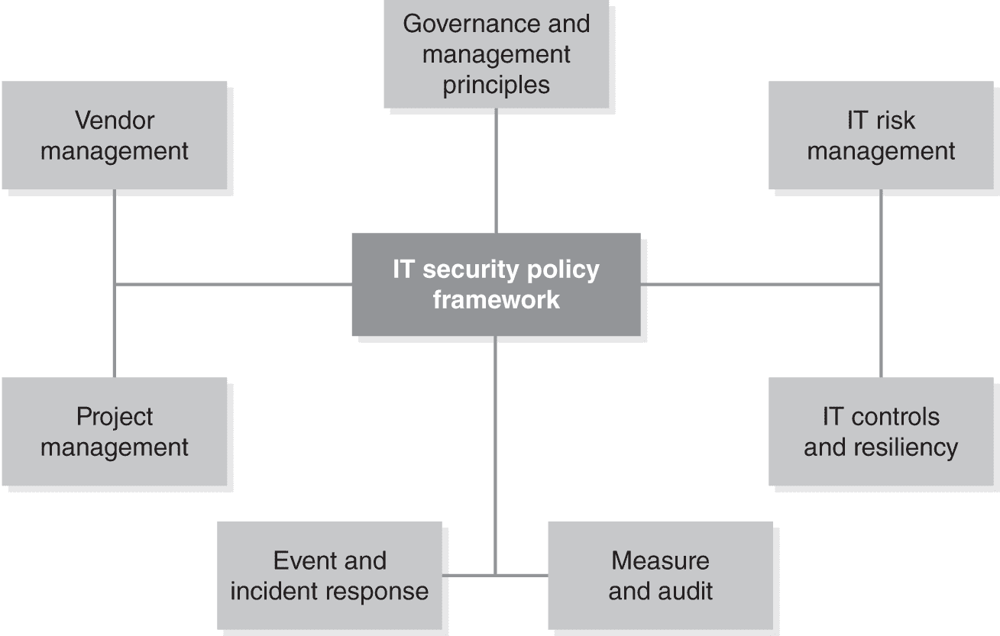

`FIGURE 8-1` 简化的 IT 安全策略框架领域模型。

你的第一步是确定框架的覆盖范围。然后，你可以将其作为过滤器，帮助你理解各种可选框架并做出选择。即使是简化的框架领域模型也能帮助你识别组织关注的关键领域。你可以创建一个针对特定弱点并符合你业务需求的框架。一旦你理解了这些需求，就可以使用以下步骤来选择一些待考虑的行业框架：

1. 审查行业监管要求。例如，政府机构被要求实施 2002 年《联邦信息安全管理法》(FISMA)。
2. 向你的审计师和监管机构寻求指导。例如，大型外部审计机构可能已将赞助组织委员会 (COSO) 和信息及相关技术控制目标 (COBIT) 作为其控制测试的一部分。
3. 选择长期在行业内获得广泛支持的框架。这些是可以被视为行业最佳实践的框架。

了解同类组织使用了哪些框架。这可以验证你的方法。许多行业倾向于共享相同的风险并利用相同的框架。`TABLE 8-1` 包含了 IT 安全策略框架的示例。这些在整个行业内普遍采用的框架定义了组织的最佳实践。最佳实践 通常是指该行业预期的通用做法和专业关注。这不是一个完整的列表；还有其他被广泛使用的框架，包括特定行业性的框架。表 8-1 中的框架代表了不同的广泛采用的框架方法。

`TABLE 8-1` IT 安全策略框架示例

| 框架 | 赞助组织 | 说明 |
| --- | --- | --- |
| COSO | COSO [`www.coso.org`](http://www.coso.org) | COSO 是一个用于验证内部控制和管理企业风险的框架。COSO 高度关注于财务运营和风险管理。它是一项广泛认可的标准，用于提供组织财务控制运行良好的合理保证。 |
| COBIT | 信息系统审计与控制协会 (ISACA) [`www.isaca.org`](http://www.isaca.org) | COBIT 是一个将业务和控制需求与技术问题相结合的框架和支持工具集。COBIT 是一项国际治理和控制框架，也是评估、治理和管理 IT 安全与风险的广泛接受的标准。COBIT 通过一系列其他 ISACA 出版物（如 risk IT，它针对 IT 风险管理扩展了 COBIT）进行扩展。COBIT 映射到 COSO、ISO 和 ITIL 等许多主要框架。 |
| ISO | 国际标准化组织 (ISO) [`www.iso.org`](http://www.iso.org) | ISO 产生了大量的标准，支持许多不同的行业和业务模式。与信息安全和 IT 风险相关的 ISO 标准被广泛接受为领先的国际标准。以下是关键 ISO 出版的示例：<br>ISO 20000—IT 服务管理系统<br>ISO 27001—信息安全管理<br>ISO 27002—信息安全管理实践规范<br>ISO 38500—信息安全公司治理<br>ISO 9000—质量管理 |
| ITIL | IT 基础库 (ITIL) [`www.axelos.com/best-practice-solutions/itil`](https://www.axelos.com/best-practice-solutions/itil) | ITIL 是一个广泛接受的用于交付 IT 国际框架和最佳实践集。ITIL 包含了用于管理 IT 服务的概念、实践和流程的完整列表。 |
| NIST | 美国标准与技术研究院 (NIST) [`csrc.nist.gov/publications/PubsSPs.html`](http://csrc.nist.gov/publications/PubsSPs.html) | 《联邦信息安全管理法》(FISMA) 要求联邦机构遵循一套共同的安全标准。这些标准由 NIST 提供，被称为联邦信息处理标准 (FIPS)。 |
| PCI DSS | 支付卡行业安全标准委员会 [`www.pcisecuritystandards.org/index.php`](https://www.pcisecuritystandards.org/index.php) | 支付卡行业数据安全标准 (PCI DSS) 是适用于任何接受、存储或处理信用卡的组织的安全框架。 |
| CIS 有效网络防御关键安全控制措施 | 网络安全中心 (CIS) [`www.cisecurity.org/controls/`](https://www.cisecurity.org/controls/) | 由 SANS 于 2008 年开发，现在由网络安全中心管理。 |

## 风险管理与合规方法

为了交付价值，框架必须每天对风险进行管理和处置。你经常听到“风险处置”（disposal of risk）这一术语。一旦识别出风险，你就必须决定如何处理它；你必须决定如何“处置”它。这可能意味着增加控制措施使风险不再存在，或者接受该风险。当你接受一个风险时，并不意味着忽视它。通常情况下，如果你接受了风险，你会考虑监控该风险的需求并创建一个检测性控制。这样，当风险发生时，你就能检测到它并采取措施将其影响降至最低。

例如，假设你担心恶意软件。通过更改防火墙规则来阻止个人浏览互联网可以降低恶意软件发生的概率。但这将不受员工的欢迎。尽管如此，互联网访问对于业务的运行可能是至关重要的。因此，你尽力通过在网络和端点安装适当的软件来尽可能地防止恶意软件。在无法防止风险的情况下，你将监控可疑流量并根据需要做出响应。从本质上，你接受没有任何软件可以防止所有可能的恶意软件攻击。

尽管上述提到的框架都有独特的方法，但它们具有一些共同特征：

* 它们是基于风险的。
* 它们符合组织的风险偏好。
* 它们处理业务中断和损失。

风险偏好是指理解业务内部对风险承担的程度。这种方法理解业务及其流程和目标。它是组织愿意接受的整体风险。一个关键衡量标准是风险缓解的成本。风险偏好由业务愿意资助的风险减少量驱动。

###  备注

基于风险的框架关注对组织目标影响最大的风险。这包括考虑业务目标、法律义务和组织的价值观。

这些框架的目标是减少业务中断和损失。这些框架减少了意外情况。它们确保风险被系统地识别、减少、消除或接受。

ISACA Risk IT 框架扩展了 COBIT，是综合风险管理方法的良好范例。你可以单独实施 ISACA Risk IT 框架，也可以将其作为 COBIT 实施的一部分。`图 8-2` 是 Risk IT 过程模型的概述。Risk IT 框架构建在三个领域之上：风险治理、风险评估和风险响应。每个领域都有三个过程目标。每个过程目标又被分解为关键活动。在本讨论中，本节将重点关注领域和过程目标。

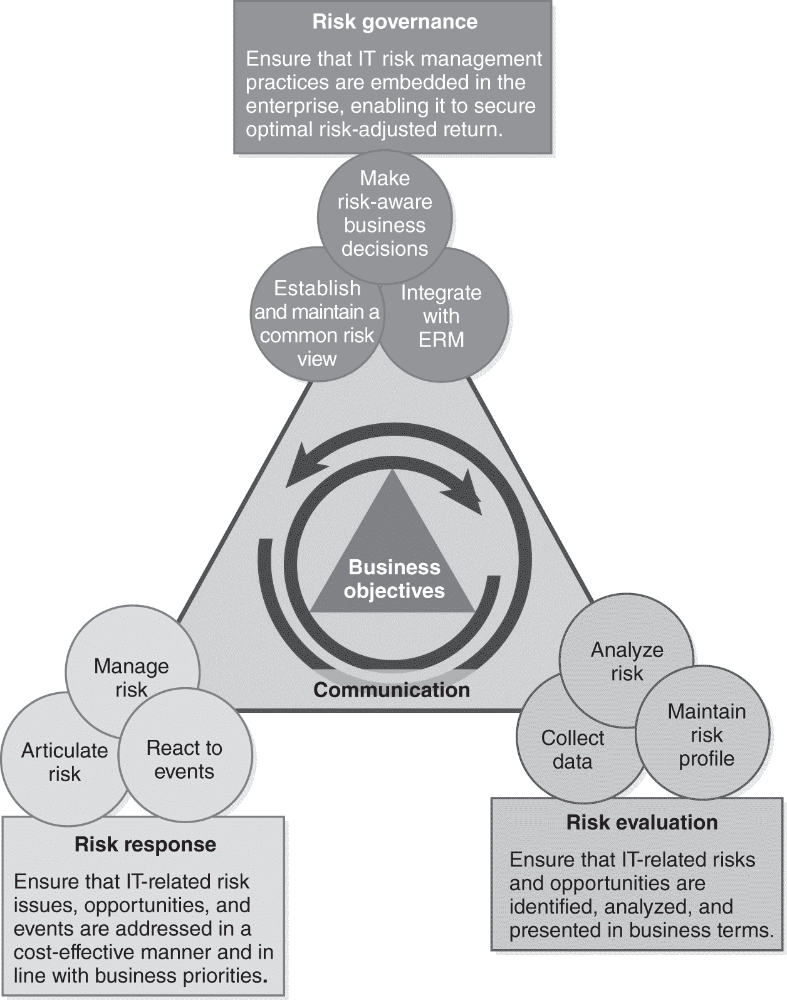

`图 8-2` Risk IT 框架过程模型构建在三个领域之上。

`风险治理` 领域为风险评估提供了业务视角和背景。这确保了风险活动与业务目标、目的和容忍度一致。这包括与业务战略对齐。该领域确保考虑了全面的机会和后果。

`风险评估` 领域确保技术风险被识别，并以业务术语呈现给领导层。对正式风险进行分析，并创建流程以评估影响。该领域还创建了一个包含所有已知风险的风险库。这进一步增强了风险分析和报告。

`风险响应` 领域确保以最具成本效益的方式减少并修复风险。该领域协调风险响应，以确保在正确的时间让正确的人参与。这防止了风险规模的扩大。建立了流程来管理整个企业的风险，使其达到可接受的水平。

这些领域相互构建，创造了灵活性和敏捷性。你可以在风险评估领域发现潜在威胁，并使用风险治理领域快速评估其影响。此外，框架可以快速识别并协调对任何风险的响应。

## IT 责任方法的物理领域方法

在实施 IT 安全策略框架时，请记住将框架与业务流程对齐。例如，`ISO 27002` 为控制措施提供了清晰的指导和最佳实践建议。这在控制措施与业务流程之间建立了清晰的联系。这让你看到为了保护端到端业务流程而实施的所有控制措施。这种方法最大限度地减少了控制措施，并防止了对威胁的“孤岛”思维。组织使用框架来降低成本并满足法规。

例如，假设你正在评估备份和恢复流程。如果你遵循该流程，你可以在技术交接期间识别风险。也许你无法恢复已归档多年的磁带，因为你数据中心的备份技术已升级为不同的格式。独立于恢复方面而查看离外库存可能会漏掉这一风险。绘制控制备份磁带生命周期的流程是查看控制措施的更好方法。简单的映射可以跟踪磁带从创建到运输、离外存储、召回、恢复和销毁的过程。

## 人员的角色、职责与责任


# 理解个人与组织角色、委员会之间的关系

理解个人与组织角色、委员会之间的关系非常重要。许多 IT 流程会经过许多手。有时，它会通过一个委员会或一组个人。例如，组织可能设有治理或管理监督，以审查具有重大预算的项目。治理与管理监督之间的区别是一个重要的区别。治理监督批准管理风险的方法和控制措施。管理监督在治理机构规定的规则内执行。例如，治理委员会可能会说，所有成本超过 50,000 美元的项目必须经过首席信息官（`CIO`）和 IT 高级团队（`SLT`）的审查和批准。此时，`CIO` 需要确保管理流程遵循治理规则。这可能意味着项目团队要在 `SLT` 上提交建议的项目并获得正式投票批准。

### 备注

个人并不是孤立工作的。他们受到组织角色的支持。组织角色实施建立识别和管理风险标准的框架。这些角色和组织支持共同定义了风险文化。

## 典型 IT 基础设施的七个领域

管理数据的访问可能是一个复杂的问题。数据可以在电子邮件中、文字处理文档中或文件服务器上，也可以通过产品应用程序访问。无论如何，数据必须得到理解和保护。在典型 IT 基础设施的七个领域（用户、工作站、局域网、广域网、跨域网、远程访问和系统/应用程序）中，有负责数据质量和处理的特殊角色。以下人员与安全团队协作，确保数据保护和质量：

* 信息管理负责人
* 数据治理
* 数据保管
* 数据管理员
* 数据安全管理员

`信息管理负责人`角色是企业内部负责数据质量的单一联系人。此人处理信息的所有方面。此人制定数据处理指导方，并与业务部门紧密合作，以理解信息如何驱动盈利。通常，该职位由业务人员（而非技术人员）担任。

`数据管员`是负责确保业务部门内数据质量的人员。数据管员是数据的所有者。他们批准访问权限。他们与信息管理部门紧密合作，以确保业务从数据中获得最大价值。他们定义数据的业务需求，并创建关于数据内容及其使用方式的描述。

`Data custodians` 是 IT 部门中负责维护数据质量的人员。这些人员根据数据管员的要求，对如何处理数据做出决策。数据管员的主要角色是设计和计划，而数据保管员的主要角色是实施。

`数据管理员`负责执行各项策略和程序，如备份、版本控制、上传、下载和数据库管理。

`数据安全管理员`的角色受到高度限制。他们授予访问权限，并评估对信息保证（`IA`）计划的威胁。

## 组织架构

组织架构可以让你了解很多关于风险管理的信息。它通过团队的专业领域定义优先事项。它定义了组织如何感知威胁。它还指示了响应可能有多敏捷。`图 8-3`

`FIGURE 8-3` 信息安全组织结构。

董事会设立一个`审计委员会` 要求向董事会汇报 `GLBA` 计划的状况。该报告由 `CISO` 创建并提交给审计委员会。请记住，董事会创建审计委员会。因此，提交给董事会的安全问题通常会通过审计委员会。

一个有效的审计委员会，其核心问题不在于成员人选，而在于其自主性。这意味着审计委员会必须免受组织任何部门的干扰。虽然审计委员会由内部员工组成，但让第三方执行实际审计是一个好主意。这并不会完全消除影响的可能性，但绝对能改善这种影响。

`执行委员会` 的代表性越高越好。

安全运营团队负责监控入侵和泄露事件。团队成员监控防火墙和网络流量。当发现泄露事件时，他们会激活事件响应团队（`IRT`）。`IRT` 响应泄露并帮助业务恢复。此外，`IRT` 还会评估泄露是如何发生的，并提出改进建议。`IRT` 执行取证检查和调查，并与执法机构接洽。

供应商管理团队负责处理供应商及第三方的安全问题。在数据离开组织并由第三方处理之前，该团队会对该供应商进行评估。有些组织已经采用了`发送许可`（permission to send）的概念。换句话说，只有在验证供应商的控制环境符合组织自身的要求后，才允许数据离开组织，并授予发送许可。

图 8-3 是一个基于结合各种框架中的最佳实践的理论模型。这种混合组织结构说明了需要领导层和业务的支持。团队的数量和专业化程度取决于活动量、环境复杂性以及资金情况。关键点在于，这些团队并非孤立运行的。组织框架创建了专业分工，使其具有快速响应的敏捷性，同时持续努力降低对业务的风险。

### 组织文化

组织文化影响着 IT 安全策略的实施。它始于高层基调——即高级领导如何对待首席信息安全官（`CISO`）。安全专业人员擅长收集威胁信息并分析对组织的影响。他们还擅长识别威胁和漏洞，并展示这些发现。

这些都是重要且难以掌握的技能。同样重要的是驾驭组织文化的能力。这些软技能对于 `CISO` 来说尤为重要。`CISO` 必须与业务建立联系并建立信任。如果不建立信任，IT 安全团队可能被视为开销，而不是降低风险的伙伴。

### 警告

安全框架定义了策略并设定了行为预期。策略无法解决可能遇到的每情况。对策略核心原则的良好培训，结合常识，将为员工提供成功所需的支持。

作为一名安全专业人员，你不能完全用威胁术语来交流。你必须能够与业务部门负责人建立联系，并从业务风险的角度来讨论威胁。例如，讨论恶意软件如何防止服务台帮助客户，比谈论恶意软件感染机器的技术方法更有效。

成功应对组织文化意味着理解如何为业务驱动价值。这意味着与业务合作起草全面的安全策略，以增强业务能力。例如，业务可能努力成为一个具有广泛远程访问能力的虚拟组织。这意味着要研究如何将边界扩展到远程笔记本电脑，而不是专注于为什么此类计划的风险可能太高。

关键在于不要与组织文化脱节。你必须以能够引起共鸣并被视为为业务提供价值的方式，将安全解决方案推向组织中。

### 职责分工

内部控制的一个基本组成部分是风险交易的职责分工（`SOD`）。职责分工的核心概念是：任何个人都不应能够在正常履行职责的情况下执行高风险交易、掩盖错误或实施欺诈。你可以在交易层面或组织层面应用职责分工。

### 分层安全方法

分层安全方法涉及建立两个或更多独立控制层以降低风险。分层安全利用了层的冗余性，因此如果某一层未能捕获风险或威胁，下一层应该能捕获。根据这一逻辑，更多的层意味着更好的风险降低。然而，更多的层可能会成为负担且价格昂贵。在降低风险方面，成本和回报之间需要一种平衡。但在任何情况下，都不应该只有单层防御策略。

职责分工的经典案例是应用在交易层面。如果你有一笔高风险交易或交易组合，你希望将它们拆分在两个或更多个人之间。例如，假设某公司建立了供应商账户并根据收到的货物开具支票。该业务有三个不同的流程：建立供应商账户、接收货物和向供应商付款。由一个人控制所有三个过程可能会演变成欺诈的巨大诱惑。例如，这样的人可以将自己设为供应商，并根据从未收到的货物开具支票。通过将这些流程的责任分配给不同的角色，可以减少此类欺诈。

#### 职责范围与问责制

通常，职责分工适用于领域内的交易。在某个领域内，管理层的责任是识别高风险交易并确保充分的职责分工。确保充分的职责分工意味着你要识别这些交易中的欺诈机会。它也意味着识别这些交易中可能的人为错误。应用职责分工可以同时减少欺诈和人为错误。

职责分工的概念也可以在组织层面的跨领域应用。某些组织流程和功能伴随着风险；例如，确保组织符合法规至关重要且具有高风险。与之前的交易示例一样，你不会让一个团队负责设计、实施和验证确保合规的解决方案这三个任务。通常，你会在实施和验证合规的团队之间建立组织级的职责分工。实施组织职责分工与其说是为了欺诈，不如说是为了减少关键流程和功能中的潜在错误。

在金融服务部门，一些组织采用了“三道防线”模型。这种风险管理模型是创建职责分工的组织分层方法的良好示例。`图 8-4`

**图 8-4** 三道防御模型。

##### 第一道防线

第一道防线是业务部门（`BU`）。业务部门每天处理风险控制。他们识别风险、评估影响并尽可能缓解风险。业务部门遵循策略并实施企业风险管理计划。业务部门拥有风险并制定短期和长期战略。所有权意味着他们直接负责确保风险得到缓解或降低。

##### 第二道防线

第二道防线是企业风险管理计划。根据组织的规模和复杂性，风险管理计划由多个控制伙伴（`CPs`）组成。运营风险管理人员和合规人员都是 `CPs` 的示例。他们负责管理整个企业的风险。他们通过对齐控制措施和政策，确保风险管理计划与公司目标一致。通过多个风险委员会以及向利益相关者报告的各种风险渠道，对风险管理进行监督。

第二道防线负责参与业务部门以制定风险策略，并衡量组织的风险承受能力。参与者有义务向董事会报告重大不合规行为以及危及组织战略目标的风险。这不应与多层方法相混淆；这是一个独立的概念。除了多层方法外，企业风险管理提供了另一道防线。

##### 第三道防线

第三道防线是独立审计师。该角色为董事会和执行管理层提供独立保证，确保风险功能设计良好且运行正常。此外，审计师在风险事务上担任第一、第二道防线的顾问。第三道防线必须保持其独立性，但也要对风险策略和方向提供意见。

关于第三道防线在不失去独立性的情况下，参与领导层建议有多有多密，存在多种观点。如果第三道防线建议了某项行动，他/她是决定该行动成功的合适人吗？许多审计组织制定规则来避免这种冲突。对于外部审计师是属于第三道防线还是实际上构成了第四道防线，观点存在差异。

该模型清楚地展示了如何利用组织角色来实现职责分工。在这种情况下，组织的三个层次之间存在监督、检查和重新检查。在理想世界中，第一道防线将进行自评估并识别所有风险。期望达到这种精确是不现实的。基本思想是：第一道防线未发现的由第二道防线发现；第一、二道防线未发现的由第三道防线发现。到达第三道防线时，任何仍然存在的风险都不应该是严重的，因此应该是可管理的。

### 治理与合规

即使在最好的情况下，组织也可能面临提供证据以证明政策已实施、执行并按设计运行的挑战。该过程包括收集、测试和报告证据。这可能是枯燥且耗时的，特别是当组织挣扎于解决看似无止尽的审计发现时。这些审计可能会导致重新测试，并识别出更多的控制缺陷和风险。

实施治理框架允许组织以有秩序的方式识别并降低风险。一旦建立，快速响应审计请求的能力将大大提高。该框架提供了通过几种方式衡量风险的能力：

* 在组织实施领先实践的良好程度背景下
* 在所实施的控制措施涵盖了组织多少风险的背景下

### 注意

有了框架，控制和风险变得更具衡量性。能够根据一组固定的标准和控制来衡量企业是强大的。它告诉监管机构你处于合规状态。它有助于确定优先级，并成为风险修复工作资金的非情感衡量标准。最重要的是，它有助于减少不确定性。

定义良好的治理和合规框架为治理和合规提供了结构化的方法。它提供了一种通用语言。这也是各种形状和规模组织的最佳实践模型。

#### IT 安全控制

统计采样的一个问题在于，你必须选择足够数量使样本具有相关性。审计师遵循采样指南以确保数量充足。另一个问题是，基于统计的意见是一种推测。即使使用良好的采样方法，它仍然是一个猜测。选定的样本可能错过了潜在的问题或弱点。当进行自动化时，你通常没有那个局限。采样的随机性也很重要。未能随机化采样可能会偏斜结果。

自动化测试工具通常在企业内部共享，以提高运营效率。例如，假设对控制措施进行自动化测试发现了一个缺陷。该缺陷被报告并修复。在下一次测试中，发现了另一个缺陷并进行了报告和修复。这种循环持续进行。负责安全控制的人员通常会采用这些测试工具来验证自己的控制措施。在现实世界，这些人有动力避免重复出现审计发现。因此，合规性测试的自动化建立了协作并提升了运营效率。

### 注意事项

控制措施的自动化测试通过避免手动测试控制措施降低了成本。在预算和测试时间有限的情况下，控制措施应该设计为可以自动化的。这可以简单地让控制措施生成日志文件，稍后通过自动化进行检查。

合规性测试比提供的几个简单示例要复杂得多。尽管复杂性和规模要大得多，但核心概念是相同的。是技术和基础设施的复杂性限制了如今的大规模自动化合规测试。并不是所有的控制都可以自动测试。然而，目标应该是设计可以使用自动化工具进行测试的控制措施。

## IT 安全策略框架

业务需求导致控制措施，从而降低风险。无论使用何种框架，降低风险的核心目标都是相同的。表 8-1 中列出的框架可以解决许多业务风险。还有许多其他类型的非技术风险，超这些框架的范围，例如信贷风险或市场风险。这些是与客户无法付款或市场变化导致对产品或服务的需求消失相关的风险。

业务风险被定义为六种特定风险：

* **战略风险**——战略风险 是一个大类，关注可能改变组织运营方式的事件。一些示例可能是合并或收购、行业变化或客户变化。关键点在于，这是一个影响整个组织的事件。
* **合规风险**——合规风险 关系到未能遵守法律义务对业务的影响。不合规可能是故意的，也可能是由于不了解当地法律要求导致的。这可能包括监管要求或具有法律约束力的合同。假设一家公司接受了与信用卡处理相关的规则，但未能实施 `PCI DSS`。在约束合同下，信用卡公司可以强迫商户停止接受信用卡。
* **财务风险**——财务风险 是当业务缺乏足够的流动性来满足其义务时产生的潜在影响。当你没有足够的现金流时。例如，未能支付贷款、工资和税款的后果就是财务风险。可用资金的缺乏可能是由于信用评级低，或操作风险高到银行不愿提供资金。无论原因如何，如果你无法履行财务义务，那就是一种财务风险。
* **运营风险**——运营风险 是一个大类，描述任何扰乱组织日常活动的事件。美国货币监察员办公室 (`OCC`) 将运营风险定义为“由于内部流程、人员和系统不完善或失败，或外部事件导致的损失风险”。^(1) 在技术术语中，它是影响业务流程的技术中断。这可能是编码错误、网络缓慢、系统停机或安全泄露。
* **声誉风险**——`声誉风险` 产生于对组织实践的负面媒体报道。这种风险可能导致收入损失或诉讼。这些风险通常与其他风险类别重叠；例如，财务问题可能会对组织的声誉产生不利影响。
* **其他风险**——`其他风险` 是一类非 IT 特定事件的大类，它们为业务线引入了风险。通常，这类风险与组织控制之外的事件有关。例如，组织拥有呼叫中心的另一个可能会发生政治动荡。政治动荡是非 IT 事件。员工缺勤未上班可能会影响 IT 运营。尽管这些风险可能在组织的控制之外，但仍然可以像规划自然灾害一样进行规划。

## IT 安全策略框架方法的最佳实践

治理、风险管理与合规 (`GRC`) 是系统化管理风险和策略合规的学科。`治理` 描述了控制风险中的管理监督。治理包括为了管理风险而建立的流程和委员会。治理同时也反映了领导的基调。这意味着治理反映了组织对风险的核心价值观，包括执行策略的能力、对保护客户数据的重要性以及对承担风险的容忍度。

### 供参考

2019 年发表的一项研究识别了前四大最佳实践框架。它们是：

* ISO 27000 系列
* PCI-DSS
* NIST
* CIS 关键安全控制

不同的专家可能对具体的“最佳”框架有分歧。但每个列表似乎都包含了 ISO 27000 和 NIST。

`风险管理` 描述了识别和应对风险的正式流程。`GRC` 此部分的概念是业务流程与技术的紧密结合。这种方法确保风险在业务背景内进行评估和管理。风险管理还反映了领导的风险偏好。为了确保第三方供应商保护组织的数据，领导层愿意做到什么程度？这种风险观点可以反映在领导对风险的接受上，从接受供应商的陈述到坚持进行现场审计。

`合规` 指确保组织遵守策略的必要流程和监督。合规也包括监管合规。组织的内部策略应该解决外部监管的关注问题。因此，对于策略定义良好的组织，重点主要在内部策略上。如果你能提供遵守内部策略的证据，你就可以证明监管合规性。当一个组织能够证明其采用了最佳实践策略框架时，其证明监管合规的能力将进一步增强。

另一种框架方法是企业风险管理 (`ERM`)。该框架将战略目标、运营有效性、报告和合规目标结合起来。`ERM` 是一种管理跨整个企业的各种风险的方法论。`ERM` 并不是特定的技术 set。例如，`ERM` 可能会关注信贷风险或市场风险，并试图确定定价策略或销售人员的薪酬是否给业务带来了风险。`ERM` 并不是 IT 安全策略框架——它是一个很好的集成点，可以在与其他风险相结合的背景下考虑 IT 安全问题。

### GRC 和 ERM 之间有什么区别？

`GRC` 和 `ERM` 术语有时会被互换使用，但这是错误的。它们的区别不在于目标——它们都试图控制风险。你可以将 `ERM` 看作一种领导层采用的用于识别和减少风险的广泛方法论。它们之间有很多值得的相似之处，因为这两种方法：

* 从业务威胁的角度定义风险。
* 应用灵活的框架以满足多项合规条例。
* 消除冗余的控制、策略和努力。
* 主动执行策略。
* 寻求对整个风险群的视觉化。

`GRC` 更多是一系列用于集中策略、记录需求以及评估和报告风险的工具。因为 `GRC` 是以工具为中心的，许多供应商都创建了 `GRC` 产品。在供应商积极销售解决方案的情况下，`GRC` 比 `ERM` 更有动力，这并不意外。这并不意味着没有支持 `ERM` 过程的工具。许多 `GRC` 工具可以用于支持 `ERM` 方法论。但作为一种方法论，`ERM` 的采用是由组织的领导层驱动的。

`GRC` 和 `ERM` 之间的界限确实变得模糊。在现实世界中，`ERM` 团队经常处理治理和合规问题。他们使用许多相同的工具和技术。越来越多，`GRC` 团队正在联系风险委员会和团队，以便在领导层面上对齐工作。

重要的区别在于，`ERM` 关注价值交付。这使得讨论重点从组织对风险缓解的预算需求转移到他们的支出如何增强价值。`ERM` 从广义的视角看待风险，而 `GRC` 则侧重于技术。这种对风险的广义视角将技术视为许多风险中的某方面。这取决于领导层理解 IT 风险的能力，可能是优点也可能是缺点。优点之一是，`ERM` 的成功实施使风险管理融合到业务流程和思维中。

## IT 安全策略框架方法的案例研究和示例

本节中的案例研究反映了现实世界中被利用的实际风险。每个案例都研究了潜在的原因。通过在安全策略的背景下查看这些策略，你可以识别出如何避免它们。

本节研究的案例研究包括：

* **私营部门**——涉及利用 `PCI DSS` 防止信用卡数据被盗。
* **公共部门**——涉及 `NSA` 承包商的泄密事件，其泄露了美国情报互联网监控计划的细节。
* **关键基础设施**——涉及一家能源公司使用 `COBIT` 更好地控制技术增长和业务风险。
* **私营部门**——涉及一个电子商务案例 `EBay`。

### 私营部门案例研究

美国南部某国家连锁汉堡店的一家加盟商在 2008 年 8 月收到 `Visa U.S.A, Inc.` 和 `美国特勤局` 的通知，称其信用卡信息被盗。该加盟商拥有一个包含八家店的连锁，年收入为 200 万美元。


该连锁店专注于其销售点（`POS`）系统的技术。一个允许集中化财务和运营报告的领先供应商提供了该`POS`系统。它使用安全的快速互联网连接进行信用卡处理。公司确定，`POS`系统或信用卡授权连接都不是泄露的源头。尽管`POS`被感染了，但泄露源头是网络。该加盟商的每家商店都为客户提供互联网热点。经确定，这个`Wi-Fi hotspot`是泄露的源头。尽管对`POS`和信用卡授权过程付出了巨大的精力，但`Wi-Fi hotspot`允许访问这些系统。经确定，泄露的可能原因是通过`Wi-Fi hotspot`安装在`POS`系统上的恶意软件。该恶意软件收集了信用卡信息，随后被小偷取回了。

这是一次`PCI DSS`框架违规。`PCI DSS`框架由200多项要求组成，概述了信用卡信息的正确处理方法。很显然，对网络的关注不足。为了讨论起见，重点在网络上。以下四项`PCI DSS`要求似乎被违反了：

*   网络隔离
*   渗透测试
*   监控
*   病毒扫描

`PCI DSS`要求处理信用卡的`network segments`必须进行隔离。目前还不清楚是完全没有隔离，还是弱的隔离被破解了。`PCI DSS`概述了确保隔离有效的标准。如果网络进行了隔离，这种泄露就不会发生。

`PCI DSS`要求对所有面向公众的网络进行渗透测试。这种类型的测试将提供第二次防止泄露的机会。这种测试本可以发现允许公众访问后端网络的`Wi-Fi hotspot`中的此类漏洞。

`PCI DSS`还需要进行某种程度的监控。考虑到组织的规模，监控可能是警报或末日审查日志的形式。监控可以包括网络和基于主机入侵检测。监控可能检测到网络泄露。监控也可能检测到`POS`系统上的恶意软件。这两种监控都提供了防止泄露的机会。

`PCI DSS`还需要病毒防护。尚不清楚这种扫描是否在`POS`系统上进行。如果没有，那就是违反了`PCI DSS`。这种扫描提供了另一次检测恶意软件的机会。早日发现泄露可以防止泄露。

`PCI DSS`的要求是具体的，并采纳了来自`ISO`等框架的最佳实践。这种方法是防止泄露的发生。及早发现泄露可以防止或减少信用卡损失。例如，在该案例研究中，及早发现恶意软件可以防止信息被盗。某些恶意软件需要时间收集信用卡信息，然后进行提取。对泄露的快速反应是在数据被提取之前移除恶意软件的机会。

### 公共部门案例研究

另一个较旧但仍很有意义的故事是爱德华·斯诺登。2013年5月，美国国家安全局（`NSA`）的承包商爱德华·斯诺登会见了记者并泄露了数千份文件，详细说明了美国如何在互联网进行情报监控。2013年6月，美国司法部指控斯诺登间谍罪。不久，斯诺登离开了美国并最终在俄罗斯寻求庇护。俄罗斯政府否认参与了斯诺登的行为，但向他授予了庇护。

尽管这个故事读起来像一部间谍小说，但它引发了许多信息安全策略问题。对于讨论而言，斯诺登是一个叛徒、间谍还是吹哨者并不重要。这里的问题在于允许`NSA`兼职承包商获得高度敏感材料未经授权访问的安全策略和控制。这一点尤为重要，因为在2014年4月，国防部宣布采用`NIST`标准。如果早早采用`NIST`标准，斯诺登泄密事件是否会得到避免？

鉴于`NSA`的机密性，这次敏感数据泄露发生的完整细节可能永远不会公开。然而，报告显示斯诺登在一家美国公司兼职，该公司在夏威夷为`NSA`提供服务。在那里，他获取了数千份文档，这些文档详细介绍了美国政府如何与电信公司和其他政府合作，捕获并分析互联网流量。这项全球监控计划的范围和性质此前不为人知，且被视为机密。

从报道中可以看出，斯诺登拥有过度访问权限；也就是说，他获得的权限超过了其工作需求。此外，报告显示他使用了他人的用户名和密码。他是通过社会工程获取这些ID的。最后，考虑他访问和捕获信息的方式。一些报告显示，他使用廉价且广泛使用的软件对该机构的网络进行电子爬取。还有迹象表明，他将信息移除到了`USB`优盘中。

值得注意的是，自斯诺登事件以来，`NSA`又发生了两次数据泄露事件，均由内部人员引起。哈罗德·马丁三世（Harold Martin III）于2017年被起诉，被指控将数千页机密文件带回家。2019年3月，马丁先生认罪，被判处9年监禁期外3年缓刑。同样在2017年，`NSA`承包商瑞丽·维纳（Reality Winner）向报纸泄露了有关俄罗斯干预调查的信息。她在2018年认罪并获得5年徒刑。这两个案例说明，自2013年爱德华·斯诺登案发生以来，该机构尚未做出足够的纠正。这说明任何组织都必须对安全失败进行坦诚诚实的反思。这是从这些错误中学习的最有效方法。不这样做可能会导致未来重复同样的安全泄露。

## FYI

`社会工程学`指的是利用人类互动来获取访问权限。通常，这意味着使用类似于销售技巧的方法来欺骗个人授予你不应拥有的东西的访问权限。例如，你可能会请求借用别人的钥匙卡去洗手间，但实际上使用该卡进入数据中心。或者，你可能会索要某人的ID和密码来修理其电脑，然后随后使用这些凭据访问客户信息。或者，外部攻击者可以使用说服来说使某人违反安全策略的某个方面。

在爱德华·斯诺登案中存在明显的`NIST`框架违规行为。为了本次讨论，重点在于网络和社会工程学。`NIST`出版物概述了被违反的其他标准，例如有效的安全管理和监督。

以下四项`NIST`框架网络策略被明显违反了：

* 共享密码
* 过度访问
* 渗透测试
* 监控

共享密码永远不是一个好主意。这将明确违反安全策略，特别是对于任何处理机密数据的人来说。此外，访问级别也必须被视为违反策略。任何安全框架通常都禁止授予与个人工作职责无关的访问。从斯诺登事件涉及的材料数量及其机密性质可以清楚看出，他获得的访问对于他执行的角色来说是过度的。

`NIST`框架还概述了渗透测试的指导。渗透测试如果由合格的渗透测试人员执行，可以作为衡量安全策略合性的有效方法。这种测试和评估将为在泄露发生之前纠正网络控制缺陷提供另一个机会。

`NIST`框架概述了有效网络监控的要求。这些要求及时审查日志。日志审查是一种探测性控制，对于识别潜在黑客至关重要。请记住，斯诺登在下载大量数据时，扫描内部网络了几个月。黑客倾向于在泄露发生前探测网络弱点。假设该网络爬虫尝试访问的某些链接导致了访问违规。这些违规行为本应是正在发生的泄露的指标。这种监控本可以提供另一个纠正网络控制缺陷并识别斯诺登为内部黑客的机会。

最后，考虑由于缺乏控制措施，导致斯诺登能够通过`USB`优盘带走这么多文档。鉴于提取的材料数量——特别是考虑到许多组织设有额外的控制措施来监控承包商活动——这种异常活动本可以避免，或至少可以被发现。

斯诺登泄密事件的某些细节可能永远为人知。尽管如此，安全策略框架必须是查看信息风险全面方法，并确保有层控制来防止数据泄露。这个案例是发生数月泄露的典型案例，表明多个控制措施的失效。它代表了缺乏有效的安全策略，以及错失了在几个月内检测泄露的机会。

## 电子商务案例

2014年3月，eBay在其服务器上注意到一个异常的数据库会话。该会话正在扫描密码文件。随后，eBay披露1.45亿用户的凭据已泄露。对于一家整个业务模式都基于电子商务的公司来说，这是一个重大问题。根据eBay的数据，被盗数据不包括信用卡信息。

该公司通过首先注意到公司网络上的若干异常发现了泄露。调查发现，攻击者使用了员工密码获得对网络的初始访问。对攻击的分析表明，在检测到泄露之前，攻击者可能已经在网络中存在两个月或更多。分析师推测，整个攻击可能始于获取员工凭据的鱼叉式钓鱼攻击。

某些策略如果实施并遵守，本可以防止这种泄露或大幅减轻其影响：

* 双因素认证本可以防止这种泄露。即使攻击者获取了用户的密码，双因素认证也能阻止攻击者获得访问。
* 对网络异常更稳健的监控和警报会让eBay更早地发现问题。
* 更稳健的员工教育和电子邮件策略可能防止最初的鱼叉式钓鱼攻击成功。

这个案例说明了对执行的良好安全策略的迫切需求。无疑，有广泛的标准适用于eBay，包括`PCI DSS`。同样清楚的是，这些标准没有被遵守。

## 关键基础设施案例

较近的一个例子是2019年8月。关于一个名为Gary Peter Simon的美国能源部前承包商的消息曝光，他被指控在合同过期两个月后仍访问了网络。西蒙先生被指控访问了云存储并破坏了文件、修改了文件并更改了其他账户。西蒙先生对“在一年内故意未经授权访问受保护的计算机，并轻率造成超过5,000美元的损失”的指控认罪。他访问了能源部的战略石油储备办公室（SPRO）。截至本文写作时，他尚未被判刑。

这个故事的真正问题在于，适当的政策和安全框架的应用本可以完全避免这种事件。该事件是说明政策重要性以及必须应用政策的理想案例研究。

*   一个离职流程，以确保离职员工的所有权限都已撤销，这可以缓解这种情况。
*   取消所有离职员工和承包商的访问权限将完全防止这种情况的发生。
*   一个健壮的入侵检测/防御系统（`IDS/IPS`），能够检测异常登录尝试（例如来自不再获得授权的人员的尝试），将更早地发现这种情况。

这是一个政策未被正确实现的典型案例。因为这是一个政府机构，它本应该应用`FISMA`、`NIST`以及相关标准。在这种情况下，显然安全策略没有被遵守。

### 章节总结

本章研究了各种IT安全策略框架。这些框架在控制风险方面具有许多共同的概念和目标；然而，它们的方法和覆盖范围有所不同。本章讨论了这些差异并不总是冲突的，而是提供了采纳`COBIT`和`ISO`等多个框架优势的机会。本章介绍了识别哪种最佳实践适用于某个组织的方法。每个框架的实施方法将根据框架类型和组织文化而异。

本章从角色和组织视角审视了职责分工。组织视角被用于创建“三道防线”以增强风险管理计划。最后，通过案例研究强调了框架的重要性。这些案例研究说明了实施策略框架来控制风险如何防止违规并确保合规性。案例研究还表明，承包商和内部人员可能与外部黑客一样构成巨大的威胁。

## 核心概念与术语

*   `审计委员会` (Audit committee)
*   `最佳实践` (Best practices)
*   `赞助组织委员会 (COSO)` (Committee of Sponsoring Organizations)
*   `合规风险` (Compliance risk)
*   `信息及相关技术控制目标 (COBIT)` (Control Objectives for Information and related Technology)
*   `数据管理员` (Data administrator)
*   `数据安全管理员` (Data security administrator)
*   `数据管理员` (Data steward)
*   `企业风险管理 (ERM)` (Enterprise risk management)
*   `执行委员会` (Executive committee)
*   `财务风险` (Financial risk)
*   `治理、风险管理与合规 (GRC)` (Governance, risk management, and compliance)
*   `信息管理主管` (Head of information management)
*   `国际标准化组织 (ISO)` (International Organization for Standardization)
*   `分层安全方法` (Layered security approach)
*   `美国国家与技术研究院 (NIST)` (National Institute of Standards and Technology)
*   `运营风险` (Operational risk)
*   `运营风险委员会` (Operational risk committee)
*   `风险评估` (Risk Evaluation)
*   `风险治理` (Risk Governance)
*   `风险响应` (Risk Response)
*   `安全委员会` (Security committee)
*   `安全事件` (Security event)
*   `社会工程学` (Social engineering)
*   `战略风险` (Strategic risk)
*   `价值交付` (Value delivery)

## 第8章评估

1. `安全委员会`是`CISO`的关键委员会。
    1. 正确
    2. 错误

2. 下列哪项*不是*IT安全策略框架？
    1. `COBIT`
    2. `ISO`
    3. `ERM`
    4. `OCTAVE`

3. 下列哪些项是`PCI DSS`网络要求？
    1. 网络隔离
    2. 渗透测试
    3. 病毒扫描
    4. 以上所有
    5. 仅限A和B

4. 下列哪些项是常见的框架特征？
    1. 基于风险的管理
    2. 与业务偏好对齐
    3. 减少运营和损失
    4. 建立控制路径
    5. 以上所有
    6. 仅限A和B

5. 下列哪项同时适用于`GRC`和`ERM`？
    1. 定义了减少风险的方法
    2. 应用严格的框架以消除冗余的控制、策略和努力
    3. 被动执行安全策略
    4. 寻求根源的视角

6. `SOD`（职责分工）的底层概念是个人在获得预先批准后执行高风险交易。
    1. 正确
    2. 错误

7. `风险管理与指标团队`通常是响应事件的第一个团队。
    1. 正确
    2. 错误

8. 一旦你决定不消除风险而是接受它，你就可以忽略该风险。
    1. 正确
    2. 错误

9. 下列哪项*不是*`COBIT`实施后提到的改进的关键领域？
    1. 价值交付
    2. 风险职能的去中心化
    3. 更好的IT资源
    4. 更好的沟通

10. `安全团队`的组织结构定义了团队的。

11. 实施治理框架允许组织系统化地识别和优先考虑风险。
    1. 正确
    2. 错误

12. `SOD`需要的审批层级越多，实施该过程就越困难。

13. 请求借用别人的卡是____的例子。

14. 所有组织都应该有一个全职团队专门负责收集、审查和报告以证明对法规的遵守。
    1. 正确
    2. 错误

电信领域的一条原则指出，访问网络的人越多，网络的价值就越高。这被称为梅特卡夫定律（Metcalfe’s law）。更正式地说，梅特卡夫定律规定，电信网络的效果与系统连接用户数量的平方（`n`²）成正比。以电话系统为例，如果系统中只有两部电话，那么系统的价值是有限的，因为任何时候只有两个人可以通话。但当增加了数百万部电话和用户后，网络效应突然迅速增加。在这种情况下，`effect`和`value`被用作同义词。梅特卡夫定律已扩展到相关领域。例如，大卫·萨诺夫（David Sarnoff）创立了萨诺夫定律，该定律认为广播网络的价值与观众人数成正比。大卫·里德（David Reed）创立了里德定律，这与计算机网络更为相关。他认为网络的效用可以随着网络规模的扩大呈指数级增长。

这一原则同样适用于技术的引入。随着新技术的引入新功能，网络的价值会再次增加。然而，事实也是，参与网络的用户和技术越多，网络就变得越复杂，引入的潜在安全风险也越多。还应该注意的是，网络价值越高，停机造成的危害就越大。这进一步加剧了安全问题。

为了说明这些观点，考虑一下你带一台新笔记本电脑回家会发生什么。通常情况下，新电脑有新安装的操作系统、预装应用程序和游戏。用户只有一个，就是你。安全风险很低。然后你增加了技术，如互联网连接、新的社交媒体软件以及更多用户（如家人和朋友）。笔记本电脑现在变得价值得多；然而，这种价值是以增加安全风险为代价的。这种价值的一部分以及这种风险的一部分，取决于你的笔记本电脑的连接程度，或者它所连接的网络有多大。

访问你网络的人数增加，加上新颖技术（如移动设备）的引入，大大增加了安全风险的数量。随着用户群体和技术多样性的增加，对信息的需求也随之增加。这种需求转化为必须维护的复杂安全控制。不可避免的是，这些复杂的控制交织会导致保护漏洞和安全风险。

本章探讨了网络上不同类型的用户。它回顾了个人对访问的需求，以及这些需求如何导致必须控制的风险。我们还将讨论安全策略如何缓解用户域（User domain）的风险。本章的最后一部分介绍了案例研究，以说明用户类型、风险和安全策略之间的对齐。

### 第9章主题

本章涵盖了以下主题和概念：

*   信息安全链中最薄弱的环节是什么
*   不同类型的用户有哪些
*   如何用策略管理不同类型的用户
*   什么是可接受使用策略 (AUPs)
*   特权级访问协议 (PAA) 的意义是什么
*   什么是安全意识策略 (SAPs)
*   用户域策略的最佳实践是什么
*   最少访问权限与最合适访问权限之间的区别是什么
*   有哪些关于用户域策略的案例研究和示例

### 第9章目标

当你完成本章的学习后，你将能够：

*   理解为什么用户在实施安全策略和控制时被认为是最薄弱的环节
*   理解典型组织中的不同用户
*   解释不同用户具有不同的信息需求
*   定义AUP
*   定义PAA
*   解释SAP如何降低风险
*   解释风险接受在理解安全风险中的重要性
*   识别若干与用户域策略相关的最佳实践
*   通过案例研究理解安全策略如何降低风险

### 信息安全链中最薄弱的环节

安全专家认为人是安全中最薄弱的环节。与自动化安全控制不同，不同的人具有不同的技能水平。人们还会放松警备。他们会疲劳或分心，在工作时可能没有考虑到信息安全。自动化控制比人具有优势。自动化控制永不睡觉，也不休假。自动化控制可以不懈地工作并完美地执行。人相对于自动化控制的主要优势在于处理意外情况的能力。自动化控制具有局限性，因为它只能缓解其经过设计的风险。


# 本节探讨了人类获得“安全链中最薄弱的环节”这一称号的不同方式

正如你将学到的，社会工程、人为失误和内部人员的行为导致许多安全违规。然而，缺乏领导对安全策略的支持是安全措施失败的另一个原因。作为未来的安全领导者，请记住每个层级的员工必须接受并遵循安全策略。


# 注意

社会工程有许多不同的技术。然而，它们都依赖于人员泄露信息。为了成功，这些技术通常要求攻击者让一个或多名员工违反公司政策。这就是为什么安全意识培训计划应该涵盖社会工程。

## 社会工程

人是可以被操纵的。社会工程是指当你操纵或欺骗某人削弱组织安全的情况。社会工程有多种形式。一种形式仅仅是让攻击者与员工建立关系。关系越亲密，员工越可能可能会影响安全的知识。

另一种方法是伪装成 IT 部门。这有时被称为预装 (`pretexting`)。攻击者可能会给员工打电话并说服他们提供敏感信息。例如，黑客要求员工输入他已知无效的数据。然后黑客只需要求员工的 ID 和密码以“尝试一下”。使用预装技术的黑客通常非常擅长操纵他人。

另一种技术是要求员工链接到内部网页以验证网络性能。在那个内部网页上，用户会被提示输入 ID 和密码，并提供某个随机数字说明网络响应时间良好。用户并没有意识到，该内部网页是一个伪页面，刚刚获取了用户的 ID 和密码。随着黑客手段和复杂性的提高，用户的意识培训也必须随之改进。

根据 Verizon 在 2014 年发布的一份报告，社会工程占 2013 年数据泄露事件的 29%。Verizon《2019 年数据泄露调查报告》显示，这个问题并没有缓解。2019 年的报告还指出，高级执行官（C 级人员）通常是社会工程的目标。社会工程之所以具有吸引力，是因为与黑客攻击相比，获取数据更容易。突破防火墙等自动化控制措施可能需要几周、几个月或几年。黑客可能永远无法绕过保护良好的网络的控制。即使他们做到了，可能仍然无法访问他们想要的信息。突破防火墙并不意味着能够访问受保护服务器上的数据。而且即使黑客访问了数据，他们可能无法将其发送到网络之外。对于黑客来说，底线是致电员工并装成 IT 部门员工可能更容易。这可以在短时间内完成，并且只需要某个人放松警惕就能成功。

## 钓鱼攻击

`Phishing` 与社会工程紧密相关。它可以被视为社会工程的一种电子邮件形式。钓鱼邮件试图说服接收者点击链接、下载附件或执行某些类似的活动。在这一点上，清晰的策略有助于缓解此类威胁。员工必须意识到钓鱼攻击的危险以及需要注意什么。

`Spear phishing`（鱼叉式钓鱼）是更精细的钓鱼示例。在鱼叉式钓鱼中，电子邮件经过精心制作，并针对特定的受众。例如，邮件可能会写：“联系您是因为您最近购买了一辆新的 XYZ 品牌汽车。”这几乎可以保证最近没有购买过 XYZ 品牌汽车的人会忽略该邮件；然而，那些过此类购买的人更有可能被诱点击链接或下载附件。

`Whaling`（捕鲸攻击）比鱼叉式钓鱼更具针对性。考虑以下假设场景：想象你是某大银行的首席安全官（CISO）。通过观察你的社交媒体，攻击者发现你是深海钓鱼粉丝。于是，攻击者制作了一封邮件，甚至可能直呼你的名字。邮件关于深海钓鱼，也许是一个钓鱼之旅的邀请。现在大多数人不太可能相信这封邮件，因为它太定制化；但你很可能会打开这封邮件。这就是捕鲸攻击的本质。这是一个非常有针对性的攻击。

所有形式的钓鱼攻击本质上都是社会工程的变体。2019 年的 Verizon 报告指出，钓鱼参与了 32% 的确认泄露和 78% 的网络间谍事件。

## 人为失误

全人类共同的一个特征是他们都会犯错。错误源于疏忽、疲劳、缺乏知识或监管和培训不足。人类可能会感知到并不存在的安全威胁。而某些可能会漏掉对于客观观察者来说显而易见的真实威胁。

疏忽可能简单地将密码写在便利贴上并放在键盘上。它也可能是没有阅读警告信息却点击了 `OK`。疏忽的发生是因为员工没有经过培训，或者不认为信息安全很重要。疏忽的员工是开发恶意代码黑客的首要目标。

![note.png]

疏忽可能简单地将密码写在便利贴上并放在键盘上。它也可能是没有阅读警告信息却点击了 `OK`。疏忽的发生是因为员工没有经过培训，或者不认为信息安全很重要。疏忽的员工是开发恶意代码黑客的首要目标。

![note.png]

## 内部人员

信息安全的一个重大威胁来自内部人员用户。在更正式的术语中，这可以被称为内部威胁向量。Verizon 发布了一份 2019 年的内部威胁报告，详细说明了来自内部人员的各种威胁。这些包括疏忽的员工、内部特工以及不满的员工。`insider` 一词是指企业员工、顾问、承包商或供应商。内部人员甚至可能是设计被黑客攻击的系统、应用程序或安全性的 IT 技术人员。内部人员了解组织和应用程序。IT 部门的内部人员知道哪些被记录了，哪些经过了检查，哪些没有。此人甚至可能访问管理员之间共享的本地账户。因此，IT 内部人员更容易绕过安全控制并隐藏自己的踪迹。内部人员可以通过删除或更改日志和时间戳来隐藏踪迹。了解日志存储在何处以及检查的频率，对于内部人员来说是一个巨大的优势。

### 应用程序代码错误

对于每行代码的平均错误数量，存在不同的观点。一些通用的规则认为每 1000 行代码有 10 到 20 个缺陷；另一些人则估计每 1000 行多达 50 个缺陷。商业软件的错误往往比内部编写的代码少——每 KLOC 低至 0.5 到 3 个缺陷。`KLOC` 是一个代表 1000 行代码的计量单位。例如：

* 一个拥有 200 万行代码且每 KLOC 缺陷率为 20 个的应用程序，预计会有 40,000 个编码错误。
* 这是基于 20（每 KLOC 的缺陷数）乘以 200 万（代码行数）后，除以 1000（即 `KLOC`）计算得出的。

每年代码中都会发现数以万计的新漏洞。你可以安全地假设新产品的漏洞不会立即被发现。每年发现的新漏洞是新系统和现有系统及应用程序中错误的结合。需要注意的是，代码行数衡量软件的一种粗略标准。由于某段代码可能比其他代码更复杂或更关键，`LOC` 并不能提供错误的细节。它只是一个粗略的估计。

在组织中长期工作的正规员工也可能带来风险。这些员工可能处于信任位置。这些人人了解组织如何应对事件，并可以据此定制他们的攻击。

### NOTE


内部人员的动机并不总是贪婪。个人可能因为各种原因感到不满——从感到被不公正对待到在某些晋升中被跳过。此人可能仅仅有一种理所当然的感觉，“拿走”他们认为自己应得的报酬。

内部人员不仅限于正规员工；他们也可以是供应商和供应商。例如，假设你在一家金融机构工作。进一步假设该机构将贷款申请的处理外包给了印度。那里的员工可以访问申请人的详细机密财务信息。2012 年 3 月，印度的一位卧底记者买到了机密信息，包括姓名、地址、信用卡账号和 CCV/CVV` 号（卡片安全码）。换句话说，记者获取了进行信用卡欺诈所需的一切。这些信息的成本是多少？在某些情况下，每个名字只需 3 分钱。现在这个问题更严重了。例如，存在暗网市场公开交易任何内部信息，包括个人信息、信用卡和类似的数据。

一种动机是钱。考虑某人试图偷取 100,000 个信用卡号。据估计，被盗信用卡在黑市上每张可以卖 2 到 6 美元。假设一名黑客向一名员工提供 20,000 美元寻求内部帮助。员工复制卡信息或提供进入系统的方法。花钱购买信息比花时间去破解结果不确定的自动化防御系统更具经济效益。在这个例子中，20,000 美元的投资将带来 200,000 美元到 600,000 美元的回报。

内部人员破坏安全会对组织的声誉和生存能力产生毁灭性影响。2018 年安勤的一项调查显示，5 名医疗保健员工中就有 1 人愿意出售机密数据。内部人员故意出售数据产生的影响可能是巨大的。这说明了内部人员的问题，以及该问题是多么普遍。

安全策略和控制可以帮助限制损害和威胁。安全策略确保访问仅限于个人的角色和职责。这意味着使用内部人员凭据造成的损害被限于该功能。此外，策略可能要求在个人离开组织后立即删除访问权限。这些类型的用户控制可以减少风险。

## 七类用户

用户域是典型 IT 基础设施的七个领域之一，由各种用户组成。每种用户类型都有独特的访问需求。随着域内不同类型用户的增加，安全复杂性也随之增加。至少，每种类型的用户都有独特的业务需求，因此需要访问某些信息的独特权限。在这些主要的用户类型中的每一种，权限被进一步细分为子类型。每个子类型可能会被进一步划分，依此类推。例如，你的组织可能有许多类型的管理员。数量取决于组织的规模、复杂性和团队的专业化程度。你可以进一步区分 `Oracle` 和 `Microsoft SQL` 数据库管理员之间的权限。`FIGURE 9-1` 是用户类型和子类型的示例。

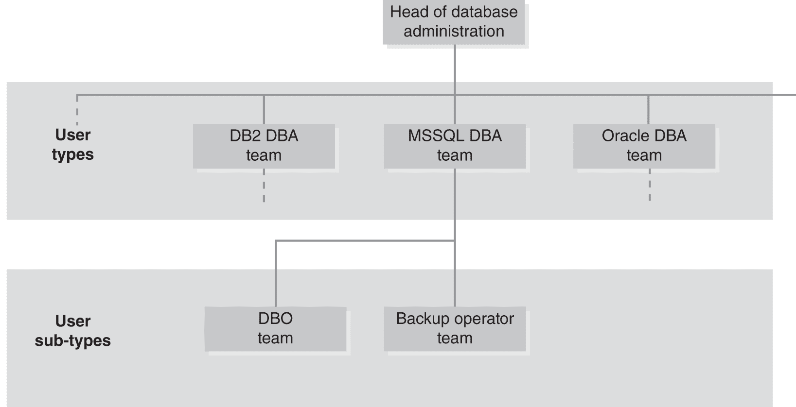

**图 9-1** 用户类型。

通过理解用户需求，你可以建立更好的安全策略和控制。网络上的用户类型没有固定数量；例如，一名薪资员工可能是全职的经验人士，也可能是兼职的大学生。然而，根据业务情况，这两种员工可能关联着不同的安全问题。为了说明常见的用户需求，本章重点关注以下七种基本用户类型：

* **员工 (Employees)**——组织的薪资或计时制员工
* **系统管理员 (Systems administrators)**——在 IT 部门工作为系统提供技术支持的员工
* **安全人员 (Security personnel)**——负责组织内设计和实施安全计划的个人
* **承包商 (Contractors)**——可以分配到任何角色的临时工；承包商以与员工相同的方式直接管理
* **供应商 (Vendors)**——这些是外部公司或此类公司的个人，被聘佣为组织提供持续服务，如建筑清洁。与承包商不同，供应商员工由供应商公司直接管理，并在组织的网络上执行特定服务。
* **游客和公众 (Guests and general public)**——访问特定应用程序的用户类别或群体
* **控制伙伴 (Control partners)**——评估控制设计和有效性的个人

除了这些（人类）用户类型（它们都有不同的访问需求）之外，你应该注意另外两个群体。它们实际上是账户类型，而不是用户类型。`System accounts`（系统账户）是系统用于支持自动化服务的非人类账户。`Contingent IDs`（应急 ID）在分配给个人之前都是非人类账户，分配后则由个人在发生重大停机时使用它们来恢复系统。

### 供参考

应急账户或 `Contingent IDs` 是一种有趣的账户类型，因为在分配给个人之前，它们并没有真正成为用户账户。这可能直到灾难发生时才会发生。然而，某些 `Contingent IDs` 会预先分配给个人，使他们从概念上就是一种用户。这里需要记住点是，在某个时刻，`Conttingent IDs` 会变成用户账户类型，必须对其进行适当的管理。

`表 9-1` 在业务和访问需求的背景下概述了这些用户类型。该表重点关注九种基本用户或账户类型。相同的方法也适用于任何访问网络信息的用户。

**表 9-1** 典型域用户和账户类型的访问需求

| 用户类型 | 业务需求 | 访问需求 |
| --- | --- | --- |
| 员工 | 需要访问生产环境中的特定应用程序 | 访问限制在特定的应用程序和信息。 |
| 系统管理员 | 需要访问系统和数据库以支持应用程序 | 在角色范围内，访问是广泛且不受限制的；例如，数据库管理员可能对数据库有无限访问权限，但对操作系统没有。 |
| 安全人员人员 | 需要保护网络、系统、应用程序和信息 | 具有设置权限、审查日志、监控活动和响应事件的访问权限。 |
| 承包商人员 | 需要与相同岗位的全职员工相同访问权限的临时工 | 访问权限与全职员工相同。 |
| 供应商 | 需要访问网络、系统和应用程序以执行合同服务 | 访问限制在网络、系统和应用程序的特定部分。 |
| 访客和公众 | 需要访问特定的应用程序功能 | 访问分配给特定的用户类型而不是分配给个人。 |
| 控制伙伴 | 需要审查和评估控制措施 | 访问通常包括对日志和配置设置的无限读取权限。 |
| 应急 ID | 需要在停机期间恢复系统和数据 | 在操作系统和数据库中均具有无限访问权限。此外，可能还需要对网络设备（如防火墙）和数据备份的广泛访问权限。 |
| 系统账户 | 需要启动、停止和执行自动化系统服务。 | 访问应限制在正在执行的系统功能上。 |

必须管理用户 ID，以便你知道在账户被使用时谁有权访问。假设有大量的信用卡数据被访问，随后被发现被用于进行欺诈。现在假设日志显示了哪个用户 ID 访问并盗取了数据。知道谁被分配了该 ID 将非常有帮助。然而，假设有几百甚至一千个人有权访问该用户 ID。可能无法查出是谁盗取了信用卡信息。当分配、重新分配或删除用户 ID 时，通常会保留记录。这有时被称为监管链链。用户 ID 的监管链链通常涉及访问记录。

## 员工

员工代表了范围最广的用户类别。当个人在组织内部从一份工作变动到同时，必须移除他们之前工作的访问权限。如果不这样做，结果可能是所谓的 `privilege creep`（权限蔓延）。这反过来可能导致有人实施欺诈，因为在诸如 `executing` 和批准自己的交易等工作之间不再存在职责分离。

### 提示

在允许员工访问信息之前，请确保他们理解自己的职责。安全策略要求在个人更换角色时移除其访问权限。这在很大程度上是为了保护员工，也是为了保护组织。

### 警告

过度的访问权限代表了严重的安全风险。随着个人角色的变化，必须调整其访问权限。必须移除不再需要的旧访问权限。新的访问权限必须经过适当批准并授予。

在银行中，柜台员可能会启动从一个账户到另一个账户的银行间转账。这是为客户提供的一项重要服务。然而，在发送资金之前，银行经理必须批准该转账。这种双重控制创建了职责分（（SOD），以减少欺诈行为。如果经理曾是柜台员并保留了其访问权限，银行就会面临风险。在这种情况下，经理可以同时启动并批准资金转账。这种同时执行两个角色的能力违反了此类交易的 SOD 安全策略。此外，拥有这种访问权限会成为员工进行欺诈的不必要诱惑，他们可能会针对很少使用的账户向自己转汇电资金。

良好的安全策略明确规定，个人仅拥有其工作所需的访问权限。安全策略概述了权限如何分配和批准。这包括对不再需要的先前的访问权限进行移除。这实现了以下目标：

* 降低了组织的整体安全风险
* 维护了职责分离
* 简化了事件的调查

## 系统管理员

系统管理员可能需要无限权限来安装、配置和修复系统。随着这些高权限的获得，保护凭据也面临着巨大的责任。系统管理员的凭据是黑客的首要目标。因此，在可行的情况下，组织应该考虑为管理员增加额外的认证层，例如证书和双因子验证。

安全策略通过要求监控系统管理员的活动来降低风险。系统管理员应仅使用广泛访问权限来执行分配的职责。让我们考虑一个数据库管理员。她需要访问以应用补丁、解决问题和配置应用程序。然而，她通常不会访问存储在数据库中的客户个人信息。记录管理员活动是验证访问权限未被滥用的方法之一。日志记录了管理员是否给自己授予了超出职责范围的访问权限。日志记录了访问客户个人信息的人员。尽管你可能无法阻止系统管理员访问客户信息，但你可以通过查看日志来检测此类事件。

由于拥有高权限，系统管理员可以直接关闭日志；然而，关闭或更改日志的行为也是可以追踪的。许多系统在日志服务启动和停止时会写入一条条目。此外，日志可以发送到日志服务器。日志服务器是一个独立的平台，用于收集来自整个网络各个平台的日志。对日志服务器的访问受到严格限制。分析日志可以帮助你发现日志中的空白，这表明日志服务被关闭了。分析日志还可以帮助检测日志是否被篡改过。知道自己的活动正在被监控这本身就是一种威慑。安全策略概述了日志记录的内容要求以及审查日志的频率。

有一种被广泛接受的方法，认为系统管理员的访问权限应限制在他们的日常常规任务中。通过单独的流程，当系统管理员需要安装、配置或升级系统时，可以提升其权限。该方法假设与高权限相关的任务发生频率很低。因此，额外的流程并不会负担。一些系统管理员抵制这种方法。拥有不受限制的访问权限使得他们的工作变得更容易，因为他们不需要在执行某些任务之前请求访问权限。预测他们的访问需求是困难的。因此，他们可能会觉得请求许可很繁琐，并造成了不必要的延迟。

你可以将限制管理员权限视为受监管行业的一项领先实践。这种方法在金融服务行业被广泛接受。根据需要向管理员授予高权限的一些优势包括于：

* 它降低了组织的整体安全风险。在系统管理员凭据被泄露的情况下，访问将受到限制。
* 它极大地减少了为了检测管理员何时滥用访问权限而需要审查的日志量。
* 它改进了技术任务与业务需求之间的对齐与理解。
* 该方法记录了授予高权限的业务原因，这解释了安全管理员为何访问某些文件。
    * 此信息也可用于识别控制薄弱的模式。

要记录繁忙的系统管理员每天执行的每项访问是不切实际的。日志量会太大。审查这些日志将缺乏上下文。可能会看到管理员访问了某个文件，但缺乏操作背景。根据日志的性质，很难判断他们应该或不应该访问哪些文件。本节之前描述的方法让你知道管理员访问了哪些文件。知道业务原因提供了背景。

### 注意事项


紧急权限访问流程结合故障工单，可以作为发现问题模式的重要来源。对这些信息的访问对于持续改进系统和应用程序设计很重要。

记录业务需求和提升权限的流程已经成熟。安全策略概述了临时授予权限的过程，通常被称为紧急权限访问流程。紧急权限访问流程为非权限用户提供临时高权限。该名称暗示了快速解决问题所需的紧迫性。在紧急权限访问过程中，问题或故障被定义在故障工单中。故障工单是对授予访问权限及其业务原因的完整记录。然后将工单分配给某人来修复问题。当问题被分配时，该人员被授予了高权限。该人员完成工作后关闭工单。当工单关闭时，该个人的高权限被移除。图 9-2 展示了一个基本的紧急权限访问流程。


**图 9-2** 基本紧急权限访问流程

紧急权限访问流程是为各种活动授予临时访问的认可方法，例如特殊财务报告等一次性事件。通过这种方法，你可以配置更详细的日志，而不会产生过量数据。这是因为只有在开启高权限时，你才会记录更详细的内容。


# 当管理员想要跟踪异常事件时

这种自服务能力可能非常重要。例如，假设一个数据库管理员（DBA）所处的环境非常稳定，很少出现停机和问题。为了控制风险，DBA 的正常权限可能不包括对数据库的无限访问。然而，当数据库系统管理员（DBSA）发现问题时，他或她可能会选择使用 `firecall-ID` 流程快速获取额外权限以修复数据库并记录问题。

## 安全人员

安全人员负责设计、实施和监控安全计划。在较大的组织中，这些角色可能会在定义策略的人和执行策略的人之间分离。安全人员开发安全意识和培训计划。他们还将安全策略与组织其他部门（如法务和人力资源部门）的策略保持一致。

安全人员必须理解并实施不同类型的控制，例如管理控制、运行和技术控制。他们必须身兼数职。在任何一天中，安全人员都可能处理各种任务。某一天，他们可能与采购部门合作，审查新软件包的漏洞；他们可能在半夜被叫醒响应安全漏洞事件。在许多组织中，安全团队人手不足，因此他们必须仔细优先考虑工作负载，以关注最大的风险。以下是安全团队处理的各种性问题示例：

*   审计协调与响应，以及与监管机构联系
*   物理安全和建筑运营
*   灾难恢复和应急计划
*   新技术的采购、供应商管理和外包
*   安全意识培训和安全计划维护
*   人员问题，例如潜在员工的背景检查和现职员工的纪律处分
*   风险管理和规划
*   系统管理和报告
*   电信
*   渗透测试
*   帮助台事件响应

安全人员的角色及其相关的访问必须明确定义。这包括限制对特定职责的访问，并在适当的情况下利用 `firecall-ID` 流程获取高级权限。这种广泛的访问也带来了保护凭据的巨大责任。这些人员的凭据也是黑客的首要目标。

## 承包人员

承包人员是临时工；然而，他们可以被分配类似于正式员工的角色。承包人员的两个主要优势是成本和技能。这些人员遵守与任何员工相同的安全策略。对承包人员可能存在额外的策略要求，例如特殊的保密协议和更深层次背景检查。

作为短期员工，承包人员可能对组织没有表现出像长期员工那样的忠诚度。许多安全专家认为承包人员的安全风险高于员工。这是因为组织通常从咨询公司聘用这些人员，而组织对咨询公司的招聘实践没有完全控制权，无法完全访问其承包人员的职业历史或绩效评估。

承包人员允许你在高峰期间增加劳动力。从长期来看，承包人员通常为组织节省资金。虽然你支付给承包人员的工资高于类似的员工，但你通常只需要他们较短的时间。此外，承包人员通常不享受带薪福利，例如病假和假期。

承包人员可以为组织带来各种特殊技能。这些技能对于特定的项目或倡议可能很有价值。在全职员工中维护这些技能可能并不符合效益。例如，假设你正在部署一种新技术来防止数据泄露。该项目是安装领先供应商的软件包，旨在防止敏感信息通过电子邮件传出组织。你的员工可能不熟悉该软件包和技术。你可以聘用一名安装过多次该产品的承包人员。承包人员拥有基于之前安装经验的知识，这些知识是无法通过培训获得的。

承包人员必须是快速学习者。在短时间内，他们被要求了解你的安全策略。他们还必须适应组织文化。派遣该人员的机构通常会为承包人员完成背景检查。如果是这样，验证背景检查与聘用组织执行的检查一样详尽是非常关键的。另一个挑战与安全意识有关。取决于合作期限的长短，可能没有足够的时间对现有员工进行同水平的安全意识培训。

### 供应商

供应商员工需要像薪资员工一样进行管理。他们的访问必须与其个人角色挂钩。供应商员工必须遵守与组织员工相同的规则和政策。供应商员工可能是全职或兼职的。他或她可能面向客户的角色或公司职能部门。无论他们在组织中担任什么工作，供应商员工与组织员工具有相同的信息需求。

然而，供应商员工由供应商直接管理。因此，该公司通常会管理他们的访问权限。这增加了复杂性和风险。必须建立相关流程以确保供应商公司有效地管理其员工。这包括在人员变动需要更改访问时通知组织。以下是供应商必须提供通知的情况：

*   当个人被聘用或终止合同时
*   当个人更换角色时
*   当系统被添加到或从组织网络移除时
*   当供应商与组织之间的通信安全配置发生变化时（例如防火墙规则的更改）

供应商可以显著影响组织的安全就绪状态。一个组织的安全性取决于连接到组织自有网络的供应商系统的安全性。

## 访客和普通公众

访客和普通公众是一类特殊的用户。与分配了唯一 ID 和密码的其他类型用户不同，你可能并不知道访问面向公众网页的个人真实身份。这在互联网上很常见。互联网上有许多供公众免费访问的应用程序。当个人想要访问这些应用程序中的一个时，不需要 ID 和密码。

### 注意

**加固** 意味着尽可能消除安全风险。你通过将访问权限限制到执行任何任务所需的最小权限、确保访问身份验证到唯一的个人、移除所有非必要的软件以及采取其他消除未经授权访问机会的配置步骤来实现这一点。

例如，假设一个网站在非军事化区（DMZ）包含一个邮政编码查询应用程序。你输入一个邮政编码以查找该区域属于哪个城市。假设该网站是免费提供的。该网站的成本由广告商在网页上投放广告的支持。当有人输入邮政编码时，相应的城市名称就会出现。这是通过查询后端数据库来实现的，将输入的邮政编码与相应的城市进行匹配。网站服务器与后端数据库服务器之间会交换凭据。安全控制措施可能无法看到个人访问数据库，而只会看到网站服务器的凭据。如果应用程序、网络和数据库都经过了加固，这本身不会产生安全风险。

邮政编码查询应用程序确保只能输入五位邮政编码，这防止了结构化查询语言（SQL）注入攻击。SQL 注入是一种常见的黑客攻击形式，即在输入字段中放置 `SQL` 命令。黑客希望当输入字段被传递给数据库查询时，他们可以在数据库上执行自己的命令。网络控制确保只允许从 DMZ 应用程序到数据库服务器的流量。这些网络控制（如防火墙）还将确保允许的流量仅为 DMZ 应用程序到特定后端数据库服务器的 `SQL` 查询。后端数据库服务器仅接受 DMZ 应用程序的连接。后端数据库服务器还允许一种类型的 `SQL` 查询，即读取输入的邮政编码并返回关联城市以便显示。`图 9-3`

**图 9-3** DMZ 应用程序连接到后端服务器的示例。

在这个特定的网站示例中，你可以看到应用程序、网络和数据库将得到很好的保护。现实世界中并不容易。在现实中，应用程序共享网站空间和后端数据库服务器。一个应用程序的破解可能会导致另一个应用程序的破解。并不是所有的应用程序都能有效测试和限制用户输入的内容。应用程序的内部控制可能是健全的，但可能会因为操作系统的漏洞而被破解。安全策略概述了用于保护 DMZ 中服务器的控制类型和加固方法。

面向公众的网站是黑客的首要目标。黑客可能会在你的网站上注册合法账户。然后，使用该账户，他们可能会尝试寻找扩大权限或访问其他客户信息的方法。为了防止这种情况，请将应用程序中使用的系统账户减少到最少。在大多数情况下，DMZ 应该仅用于捕获和清理用户输入，并将用户内容传递给后端系统。从高层次来说，认为 DMZ 具有两个主要目的：清理用户输入和维护安全通信。防火墙后的后端系统执行额外的内容验证和实际的处理。

在处理访客和普通公众时，你授予的是这类用户的访问权限，而不是个人。要记住，访客和普通公众的技能与你的员工不同。这些人员也没有获得过安全意识培训。分配访客和公众访问可以通过多种方式实现。你可以为应用程序、服务器或特定类型的数据库连接分配凭据。你也可以为通用用户 ID 或服务账户分配权限。以硬编码存储在应用程序中的 ID 和密码形式分配凭据的安全性较低。安全策略通常禁止采用这种应用程序凭据认证方法。问题在于，如果应用程序被破解，该 ID 也会被破解。这使得在不重新编写代码或重新配置应用程序的情况下更改 ID 密码变得非常困难。结果是这种方式使用的密码往往不会经常更改。这创建了安全漏洞。分配凭据的更好方法是使用不依赖于密码的方法，例如分配证书。为账户、应用程序或服务器分配证书是容易的。复杂性和成本在于建立维护证书所需的环境。

以下是处理访客和普通公众访问时的一些最佳实践：

*   从策略角度来看，拥有一个定义良好的风险流程至关重要，该过程应对访客和普通公众访问进行详细评估。
*   严格限制对特定功能的访问。
*   对所有面向公众的网站进行渗透测试，以检测控制薄弱环节。
*   不要在应用程序中硬编码访问凭据。
*   将网络流量限制为点对点通信。

### 控制伙伴

有许多不同类型的控制伙伴。这些人员可以是审计师、运营风险或合规专业人员，或是监管机构。即使在这些广泛的控制伙伴类型中，也可以有子类。例如，财务审计师关注财务运营。他们查看组织财务报表的完整性、公平性和陈述性。他们查看产生财务数据的底层流程和操作。财务审计师会查看任何可能使财务报表准确性产生怀疑的潜在控制弱点。

技术审计师通常被称为 IT 审计师。他们查看组织的技术控制和风险。他们评估控制的设计和有效性。他们的问题是：“控制措施是否涵盖了所有漏洞，它们运行良好吗？”他们还查看组织如何在业务背景下评估技术风险。

尽管财务和技术审计团队有不同的职责，但他们经常进行协作。这被称为集成审计。在集成审计中，多个审计学科被结合并在单一审计中使用。例如，假设一家公司为其制造过程购买了大量设备。公司财务报表的准确性部分取决于正确报告这些支出。财务审计师查看反映这些投资的底层财务数据和会计方法。财务审计师可能会查看使用的折旧方法。他们甚至会质疑数据的性质。相反，IT 审计师关注捕捉、记录和计算财务结果的底层技术。IT 审计师查看安全控制和数据完整性。

进行审计的权限取决于组织的类型。例如，政府机构根据法律法规和指令接受审计。私有公司可能受其董事会设定的审计要求限制。许多上市公司采用审计委员会结构。这是董事会的一个小组，为关注审计事务而成立。

运营风险和合规团队通常与审计师具有相同的访问需求。运营风险团队审查控制措施以确保业务在可接受的风险承受范围内运行。这意味着业务没有承担过度风险。合规团队确保业务遵守法律。和审计师一样，这些团队是专业化的。他们查看各种控制措施。

在上市公司，审计师会向业务部门管理层和审计委员会报告发现结果。运营风险和合规报告通常发送给业务部门和公司风险委员会。这种双重报告机制实现了几个目标：它确保了一线管理层了解控制弱点，以便采取行动；它还确保了风险在组织的最高层获得可见性。

安全策略详细说明了授予控制伙伴访问权限的控制措施。对于 IT 审计，这通常意味着对安全报告、日志和配置信息的访问。审计师主要需要读取权限。审计师拥有专用工具，可以帮助分析所取的样本并记录他们的发现。在这些专用应用程序中，他们被授予了适当的权限来获取证据并编写审计报告。

## 应急账户 (Contingent)

`应急账户` 需要无限权限来安装、配置、修复和恢复网络及应用程序，并恢复数据。这种高级访问伴随着保护凭据的巨大责任。这些凭据是黑客的首要目标。在宣布灾难恢复事件之前，这些 ID 不会分配给个人。因此，在它们被需要之前必须对其进行保护。

一个挑战是知道这些 ID 在灾难发生期间是否有效。例如，假设数据中心受到飓风袭击，系统必须在市另一侧恢复。那时不是发现你没有备份数据访问权限的时候。确保这些应急 ID 至少每年测试一次是重要的。同样重要的是，在这些恢复测试期间，识别并删除不再需要的 ID。

## 系统账户 (System)

系统账户通常需要特权来启动、停止和管理系统服务。这些账户可以是交互式的（`interactive`），也可以是非交互式的（`noninteractive`）。这里的“交互式”通常指的是人员登录该账户的能力。非交互式系统账户是指人员无法登录的账户。交互式系统账户有一个密码，如果该密码已知，人员可以使用它登录账户。系统账户也被称为 `服务账户`（`service accounts`）。

为什么要区分交互式和非交互式服务账户？这些账户通常具有特权，这使得它们成为黑客的目标。理想情况下，你不希望任何系统账户是交互式的。这样就不会有密码可以被盗取，所有账户将与特定的应用程序绑定，黑客入侵的机会也会更少。但世界并非是理想的。许多系统账户拥有可以被盗窃的密码。必须实施严格的控制来保护交互式系统账户的密码。如之前所述，`临时 ID`（`firecall-ID`）流程可以提供此类控制，以限制对这些敏感账户的访问。

## 为什么要用策略管理用户？

组织希望拥有单一的风险视图。决策变得更容易，与监管机构或股东的沟通也会变得更容易。安全策略提供了一种查看和控制风险的范围。此外，法规要求实施安全策略。几个例子包括 2002 年的《萨班斯-奥克斯莱法案》（SOX）和《健康保险流通性与责任法案》（HIPAA）。这并非美国特有。全球性组织面临一系列类似的法律法规，例如《欧盟数据保护指令》。

拥有定义用户行为的良好策略，可以确保关键风险以一致的方式得到控制。这些策略为监管机构提供了合规证明。监管机构日益关注安全策略是如何应用的。仅仅有书面策略是不够的，监管机构还希望看到执行这些策略的证据。

## 可接受使用政策 (AUP)

为使用组织技术资产的人设定什么是接受行为的清晰预期是重要的。`AUP` 定义了计算机和网络的预期用途，包括不可接受的用途以及违反策略的后果。`AUP` 还禁止访问或存储攻击性内容。以下主题通常出现在 `AUP` 中：

*   保护组织计算机和网络的基础
*   密码管理
*   软件许可管理
*   知识产权管理
*   电子邮件礼仪
*   个人在使用组织计算机或网络时应期望的隐私级别
*   不合规的后果

良好的 `AUP` 还应该配有意识培训。这种培训应该针对个人可能面临的现实场景。以下情况是 `AUP` 意识培训中可能出现的几个例子：

*   同事请求你登录网络或某个应用程序，因为他/她正在等待访问权限被批准。你该怎么办？
*   你通过电子邮件收到了一个政治敏感的冷笑话。你应该转发这封邮件吗？
*   坐在你旁边的人每天花许多小时在互联网上寻找股票建议。你该怎么办？

## 特权级访问协议 (PAA)

当管理权限被违规使用或滥用时，对组织的影响可能是灾难性的。`特权级访问协议 (PAA)` 旨在增强拥有管理权限的用户的意识和责任感。`PAA` 是由管理员签署的正式协议，用于承认其责任。该协议基本上表示管理员将保护这些敏感凭据，不滥用其权力。`PAA` 是专门针对管理员的增强型安全意识。

### 注意

联邦政府在国防行业使用 `PAAs`；然而，国防行业之外很少有组织采用 `PAA`。

`PAA` 通常是一个一到两页的文档。它读起来是管理员与组织之间的正式协议。`PAA` 通常从管理员的角度包含以下内容：

*   承认在凭据被违规或滥用时与高级访问相关的风险
*   承诺不分享受托给其管理的凭据
*   承诺仅为获批准的组织业务使用授予的访问
*   承诺不尝试“破解”或违反安全
*   承诺保护由这些凭据产生的任何输出，如报告、日志、文件和下载内容
*   承诺及时报告任何违规或入侵的迹象
*   承诺未经授权不篡改、修改或移除任何安全控制
*   承诺不安装任何后门、恶意代码或未经授权的硬件或软件
*   承诺不违反知识产权、版权或商业秘密
*   承诺不访问或存储煽动性材料，例如色情或种族主义内容
*   承诺不浏览与分配任务直接相关的数据
*   承诺诚信办事，并接受违反合同和刑事法律的惩罚

在许多方面，这些项目已经由安全策略和意识培训涵盖了。`PAA` 向管理员强化了这些术语的重要性。

## 安全意识策略 (SAP)

安全意识培训通常是典型用户接触信息安全的第一个视角。它通常是所有新员工的强制要求。将其视为管理层对信息安全的第一印象。这是管理层设定基调的机会。大多数人都想做好工作，但他们需要知道规则和预期行为是什么。

*   信息安全基本原则
*   风险与威胁意识
*   如何处理意外风险
*   如何报告可疑活动、事件和违规行为
*   如何帮助建立安全和风险意识的文化

安全策略不仅仅是一个好主意——它还是法律！许多法规都要求制定安全策略和安全意识计划。许多州法律也要求具备安全意识。在大多数行业中，拥有安全意识计划被视为最佳实践。以下列表列出了若干项要求组织建立安全意识计划的联邦授权：

*   《健康保险可移植性与责任法》(HIPAA)
*   《格拉姆-里奇-布莱尔法》(Gramm-Leach-Bliley Act)
*   《萨班斯-奥克斯法》(Sarbanes-Oxley Act)
*   《联邦信息安全管理法》(FISMA)
*   美国国立标准与技术研究所 (NIST) 特别出版物 800-53，《联邦信息系统推荐的安全控制》
*   联邦法规汇第 5 章 (C.F.R.)
*   NIST 制定信息技术系统安全计划指南
*   管理和预算局 (OMB) A-130 号循环，附录 III
*   NIST 计算机安全手册

法律可以规定意识培训的频率和目标受众。例如，`5 C.F.R.` 要求个人在访问信息之前接受安全意识培训。还必须每年参加复习课程。以下概述了 `5 C.F.R.` 的要求：

*   `所有用户`——安全基础知识
*   `高管人员`——政策层面和治理
*   `计划和职能经理`——安全管理、规划与实施；以及风险管理和应急计划规划
*   `首席信息官 (CIOs)`——安全规划、系统和应用安全管理、风险管理和应急计划规划的广泛培训
*   `IT 安全计划经理`——安全规划、系统和应用安全管理、风险管理和应急计划规划的广泛培训
*   `审计师`——安全规划、系统和应用安全管理、风险管理和应急计划规划的广泛培训
*   `IT 部门管理和运营人员`——安全规划、系统/应用安全管理、系统/应用生命周期管理、风险管理和应急计划规划的广泛培训

为了使信息安全策略发挥价值，必须解释如何管理风险并主动应对威胁。一个计划良好的安全意识计划可以实现这一目标的基石。

通过安全意识计划传达安全策略至关重要。即使是最好的策略，如果没有人意识到它，也毫无用处。安全意识可以改变行为。安全意识是一系列旨在提高对安全策略和风险理解的活动。安全意识不是一次性事件。它是一项努力通过不同方式不断强化信息的运动。

### 用户领域策略的最佳实践

最佳实践是一种通过经验证明可靠的领先技术、方法论或技术。最佳实践往往能产生一致且高质量的结果。以下最佳实践的简短列表侧重于用户并存在于安全策略中。这些最佳实践对保护用户和组织具有重要意义。策略应当要求以下实践：

*   `附件`——永远不要打开非信任或未知来源的邮件附件。
*   `加密`——始终对离开安全服务器范围的敏感数据进行加密；这包括笔记本电脑、备份磁带、电子邮件等。
*   `分层防御`——使用建立重叠安全层的方法作为缓解威胁的最佳方式。
*   `最小权限`——最小权限原则是指个人应仅拥有执行其职责所需的访问权限。
*   `最匹配权限`——最匹配访问权限原则认为，个人应拥有履行职责所需的有限访问权限，并对其访问进行高效管理。


- **补丁管理**——确保所有网络设备包括用户桌面电脑和笔记本电脑都有最新的安全补丁。补丁管理是分层防御不可或缺的一部分。即使你做对了一切，供应商的系统或应用程序也可能存在漏洞。有效的补丁管理计划可以降低许多风险。

- **唯一身份**——所有访问信息的用户必须使用识别身份的唯一凭据；唯一的例外是面向公众的网站访问。

- **病毒防护**——每台桌面电脑和笔记本电脑都必须安装病毒和恶意软件防护软件。

### 理解最小访问权限与最匹配访问权限

`最小访问权限`与`最匹配访问权限`之间的区别可能令人模糊且微妙。两者都通过限制与特定工作或角色相关的访问来控制风险。区别在于，最小权限是针对个人定制访问，而最匹配权限通常是针对组或用户类定制访问。

例如，假设你有四位应收账专家。应收账团队通常负责收集公司的到期发票收款。在这四位专家中，两人负责商业账户，两人负责个人账户。他们的访问权限是相同的，但商业账款专家还需要访问与商业账户相关的公司市场信息。在最小权限下，你可能选择将市场信息的访问限制仅给商业账款专家。然而，这个决定是有代价的。你必须为基本上相同的工作维护两套访问规则。

当将这些细微差异在大量用户群体和技术中成倍增加时，这些规则差异可能会变得非常复杂且维护昂贵。最匹配权限会考虑给两位处理非商业账户的专家提供市场数据的风险。如果欺诈或安全泄露的风险很小或没有，那么所有四位专家都可以获得相同的权限。通常，这意味着将访问权限分配给应收账专家角色，然后将四个人分配到该角色。使用这种基于风险的最匹配方法来分配访问权限可以降低支持成本并简化访问规则。

### 用户领域策略案例研究与示例

本节中的案例反映了现实世界中被利用的实际风险。每个案例都研究了潜在的根本原因。通过在安全策略背景下查看这些案例，你可以识别如何避免这些问题。

本节研究的案例涉及安全策略违规、职责分离以及管理不当。案例涉及政府笔记本电脑被破解、树莓派事件以及对政府系统的未经授权访问。

#### 政府笔记本电脑被破解

2012 年 10 月 31 日，NASA 通知其员工，一台包含 1 万多名员工个人信息的笔记本电脑被盗了。盗窃事件发生在该包含信息的笔记本电脑从锁好的汽车中被拿走时。该笔记本电脑有密码，但硬盘未加密。NASA 的公告包含一份声明，其 IT 安全策略和实践正在审查中。此外，还采取了若干立即措施，包括要求离开 NASA 设施的所有笔记本电脑都必须加密。

尽管盗窃的细节尚不清楚，但明确的是，笔记本电脑被遗留在锁好的汽车内无人看管。在许多组织中，这被认为违反了可接受使用政策。将带有敏感信息的笔记本处于无人监管的状态不是良好的做法。通常，此类政策要求人员在设备进入公共空间时必须保持实物接触，并要求将其带入飞机客舱，而不是放在托运行李中。

此外，全盘加密在行业内十分常见。NASA（美国宇航局）不要求全盘加密并允许敏感信息存储在笔记本电脑上，这违背了行业规范。

在此案例中，这既是政策的失败，也是个人行为的结果。如果笔记本经过了完全加密，损失将仅限于设备本身。虽然盗窃行为可能表明违反了可接受使用政策，但导致员工个人信息被盗的实际损害以及对 NASA 声誉的影响本是可以避免的。

#### NASA 的树莓派事件

2018 年 4 月，一名攻击者通过针对一个未经授权的 `Raspberry Pi` 成功进入 NASA 喷气动力实验室。这次 `Raspberry Pi` 攻击在 10 个月内未被发现。犯罪者盗取了约 500 兆的数据。

审计显示，这并非网络上唯一的未经授权设备。NASA 曾发生过多次安全事件。这些威胁中的许多是由于网络上存在未经授权设备导致的。此外，审计发现安全日志工单（包括应用软件补丁或更新系统配置）有时会超过六个月仍未得到解决。

这种情况表明缺乏适当的设备管理政策，和/或缺乏对此类政策的执行。它还表明安全事件在几个月后都没有得到妥善解决。解决这一局面需要对组织内部的安全政策、审计和执行进行彻底改组。

#### 被盗的防御数据

对数据的未经授权访问会产生重大的国家安全影响。2018 年，据报道，中国政府支持的黑客入侵了海军承包商的计算机。他们窃取了大量数据，包括反舰导弹数据以及一个名为“海龙”（Sea Dragon）项目的 600 多 GB 材料。

此案例也是政策失败的极佳例子。尽管数据都非常敏感，但它们存储在未分类的计算机上。这意味着数据分类政策没有得到遵守。这促使五角大楼监察长办公室开始审查承包商的网络安全问题。

### 章节总结

本章研究了与 `User`（用户）领域相关的风险，它是 IT 基础设施七领域之一。随着网络用户数量的增加，他们的多样需求也在增长。安全政策是在复杂环境中管理用户相关风险的结构化方法。章节回顾了多种用户，并讨论了 `administrator`（管理员）、`security`（安全）和 `auditor`（审计）等独特角色。这些角色通常伴随着高权限和巨大的责任。

安全政策是降低风险和管理用户的有效方法。它们有助于识别高风险活动，例如 `systems administrators`（系统管理员）执行的操作。政策基于有助于一致实施安全的原则。这些原则包括核心概念，如 `least access privileges`（最小访问权限）和 `best fit access privileges`（最优访问权限）。这些原则规定了风险选择，必须在维护成本和风险控制之间取得平衡。最终，安全政策可以教育用户、减少人为错误，并用于更好地理解事件是如何发生的。

## 核心概念与术语

*   最优访问权限
*   监管链
*   应急账户
*   承包商
*   Firecall-ID 流程
*   加固
*   内部人员
*   综合审计
*   交互式
*   最小访问权限
*   日志服务器
*   网络钓鱼
*   托词攻击
*   特权级访问协议 (PAA)
*   安全人员
*   针对性网络钓鱼
*   结构化查询语言 (SQL) 注入
*   系统管理员
*   问题工单
*   针对高管的钓鱼

## 第 9 章评估

1.  托词攻击（Pretexting）是黑客入侵防火墙时发生的情况。
    1. 正确
    2. 错误

2.  你可以使用 `Firecall-ID` 流程授予临时高权限。

3.  下列哪项要求具备安全意识？
    1. 法律
    2. 客户
    3. 股东
    4. 以上所有

4.  `Auditor`（审计员）检查风险并发布独立意见。

5.  A 级访问协议防止管理员滥用权限。
    1. 正确
    2. 错误

6.  下列哪项与可接受使用政策有关？
    1. 服务器之间的通信
    2. 用户访问互联网
    3. 传输文件时的加密
    4. A 和 B

7.  `Insider`（内部人员）拥有关于组织运作的内部信息。

8.  社会工程发生在黑客在社交网站上发布其胜利成果时。
    1. 正确
    2. 错误

9.  在大型组织中，所有管理员通常具有相同水平的权限。
    1. 正确
    2. 错误

10. 如果业务部门没有响应，CISO（首席信息安全官）必须 `accept`（接受）风险。

11. 最小访问权限和最优访问权限的区别是什么？
    1. 最小访问权限针对个人定制。
    2. 最优权限根据风险对组进行定制。
    3. 没有区别。
    4. A 和 B

12. 系统账户也被称为 `service`（服务）账户。

13. 交互式服务账户通常没有密码。
    1. 正确
    2. 错误

理解这些基础设施层之间的相互作用至关重要。网络层之间的交互提供了基础设施安全的端到端视角。这种理解可以确保基础设施变更的影响将得到充分理解和良好协调。这包括了变更的协调。例如，策略可以确保当有新的数据库服务器添加到网络中时，网络和数据库管理员会协调相关活动。技术层面则确保设备在数据从一个设备流向另一个设备的过程中，能够共同保护数据安全。

此外，基础设施策略确保了远程访问、网络和身份验证策略能够协同工作。采取这种端到端的视角可以确保已采取相应的措施，以保护静态数据（存储在存储中）以及传输中的数据——例如，当数据从员工家里发出时，通过虚拟专用网络防火墙进行加密，并安全地路由到组织总部或其他数据中心的内部数据库服务器。

本章将讨论常见的 IT 基础设施策略。在一个章节中，甚至在一本书中，都不涵盖一个组织所需的所有可能的安全策略。因此，本章通过选择性地详细讨论某些策略来阐明关键点。其目的是为了让读者对 IT 基础设施策略的基本结构建立理解。此外，本章还讨论了与不同基础设施领域相关的常见安全策略。

## 第 10 章主题

本章涵盖了以下主题和概念：

* 基础设施策略的基本结构是什么
* 常见的工作站领域策略是什么
* 常见的移动设备策略是什么
* 常见的局域网（LAN）领域策略是什么
* 常见的从局域网到广域网（LAN-to-WAN）领域策略是什么
* 常见的广域网（WAN）领域策略是什么
* 常见的远程访问领域策略是什么
* 常见的系统/应用领域策略是什么
* 与 IT 基础设施相关的常见电信策略有哪些
* IT 基础设施安全策略的一些最佳实践有哪些
* IT 基础设施安全策略的一些案例和示例有哪些

## 第 10 章目标

完成本章后，你将能够：

* 解释策略的基本结构
* 解释分层安全及其重要性
* 理解 IT 基础设施领域的安全控制类型
* 识别核心领域策略需求之间的差异
* 按领域描述常见策略
* 创建和维护领域策略的最佳实践
* 使用案例研究说明如何使用领域策略

## 基础设施策略的结构

单个安全策略通常看起来和感觉很相似。这使得它们易于阅读和理解。挑战在于如何将策略作为一个集合进行组织。策略需要易于访问，并与组织管理其 IT 环境的方式保持一致。

组织策略集合的方法没有限制。尽管如此，三种常见的方法是按功能区域、按安全层或按领域进行组织。当然，你不必一定要使用这些方法，但它们易于理解且逻辑清晰。

按责任功能区域创建策略是一项挑战。这种方法的优势是策略可以针对特定的受众进行定制。缺点是，功能区域可能会由于组织重组而发生变化。这意味着策略可能也随之改变。通常，按功能区域组织策略是流程很少改变的成熟公司所采用的方法。

### ⚠ 警告

无论现在任何单一安全控制措施有多完善，你都必须假设它在某时刻可能且将会被攻破。外面有某些个人或团体拥有足够的时间和资源来破解该控制措施。这就是为什么常见的安全实践建议建立多道防线、安全层或深度防御，从边界到网络层，最终保护数据安全。

按安全层创建策略也是一项挑战。信息安全中的一个核心原则是这种通常被称为 `layers of security`（安全层）、`layered security`（分层安全）或 `defense in depth`（深度防御）的概念。层的示例包括放置在网络边界内（防火墙）、操作系统中（服务器）、代码中（应用程序）以及安全存储中（数据库）的简单安全控制措施。理想情况下，这些控制措施共同提供了分层安全。挑战在于技术在不断地变化和演进。此外，层的数量取决于公司。例如，电信应该被视为边界层还是其自身的一层？这没有统一的正确答案或行业标准。

深度防御并不是分层安全的唯一方面。对于同一个漏洞拥有多个控制措施也是同样重要的。例如，如果你担心的是恶意软件，防病毒软件就是一种缓解该风险的控制措施。邮件使用策略也是如此。外部介质（USB）策略也有助于缓解该风险。目标是拥有多个重叠的控制措施来解决同一个疑虑点。

第三种方法是按领域组织策略。典型 IT 基础设施的七个领域所示于 `FIGURE 10-1` 中。这是查看需求和策略的一种逻辑方式。这七个领域是整个行业通用的常见分类法或分类系统。这种分类法清楚地说明了如何利用每个领域来创建分层安全方法。例如，工作站领域可能涉及盗版软件。局域网（LAN）领域可以扫描邮件中的病毒，而远程访问领域则处理虚拟专用网络（VPN）隧道。不同领域可能有不同的安全需求。


按领域组织策略的问题在于，许多问题涉及多个领域。例如，病毒控制是工作站和服务器的问题。需求可能略有不同；但核心需求和控制解决方案是相同的。这些领域之间很少有分明的界限。

### 📝 注意

为了保持讨论在较高水平，本章以与典型 IT 基础设施一致的方式来讨论策略。这允许对驱动策略的领域需求进行讨论。这并不意味着这是每个组织组织其策略的最佳方式。

一种常见的方法是组织策略以与行业标准框架保持一致。这些框架示例包括国际标准化组织（`ISO`）和信息及相关技术控制（`COBIT`）提供的框架。这是最实用的方法。首先，互联网上可以很容易获取许多样本。其次，一旦策略与最佳实践框架对齐，就更容易向监管机构证明合规性。行业标准框架符合法规规定。通过采用使用这些框架核心概念的策略，你就可以证明合规性。

策略的基本结构始于理解捕捉领域安全控制要求的不同文档类型。五种常见文档是：

* `Control standards`（控制标准）——描述核心安全控制要求的策略文档
* `Baseline standards`（基准标准）——描述针对特定技术的安全控制的技术文档
* `Procedure documents`（流程文档）——实施控制和基准标准的流程
* `Guidelines`（指南）——包含参数以及建议策略、标准或程序的可选文档
* `A dictionary`（字典）——策略中使用的通用分类法，定义了所用术语的范围和含义

组织使用不同的术语来描述控制标准。有些组织将其描述为核心 `policy statements`（策略声明）。基准标准也被称为技术 `minimum security baseline (MSB)`（最低安全基准）。关键点在于策略文档区分了核心策略要求与技术特有的要求。例如，一个核心要求可能是每 30 天更改一次密码。你可能有两个不同的基准文档，描述如何配置 `Microsoft` 和 `UNIX` 服务器以实现该核心要求。

文档的数量在组织之间也可能差异很大。某些组织将相关问题合并到一个策略文档中；例如，工作站策略可能会将防止盗版软件与病毒保护要求结合在一起。其他组织可能将其视为两个独立的策略标准。组织使用的文档数量取决于其需求和部署能力。

目标是开发一套凝聚的文档集，这些文档不需要不断修订即可保持更新和相关性。当存在重叠时，请引用相应的文档而不是重复内容。以下是策略文档在组织之间存在差异的一些常见原因：

* 组织使用独特的技术工具和硬件组合。
* 风险管理实践通常针对组织进行定制。
* IT 部门的规模根据业务需求而异。

## 标准的格式

通常，标准和流程文档具有定义良好的格式。常见格式包括以下部分：

* `Document Number`（文档编号）——唯一标识文档，通常将文档分类为策略、标准、程序或指导
* `Title`（标题）——识别文档的主题
* `Version/Date`（版本/日期）——识别文档的版本和日期
* `Purpose`（目的）——提供可衡量的目标和任务
* `Background`（背景）——解释为何制定该标准
* `Standard/Process`（标准/流程）——描述要实施的标准或流程
* `Roles and Responsibilities`（角色与责任）——识别负责实施和遵守的员工
* `Effective Dates`（生效日期）——说明标准必须在何时实施
* `Information and Assistance`（信息与协助）——定义组织内可以解释标准并协助协调其实施的团队
* `Approval`（批准）——指定批准权限；这可以是个人执行人员，也可以是如标准委员会这样的小组人员
* `Associated Resources`（相关资源）——提供任何相关资源

具体的格式在组织之间可能有所不同。例如，某些组织可能会在单独的范围部分描述标准受哪些人的影响。在列出的示例中，这被整合在 `Roles and Responsibilities` 之下。其他可能的章节还包括 `Revision History`（修订历史）、`Key Terms`（关键术语）和 `Supporting Attachments`（支持性附件）。格式根据需求和材料来源而异。通常，策略模板样本基于行业标准框架或供应商提供的样本。这些样本通常定义了初始格式。格式随时间变化，以适应组织的个人需求。

### 💡 提示

使用统一的日历来跟踪新策略和策略变更生效的日期非常重要。组织每月可能有大量的策略变更生效。使用由利益相关者每月审查一次的日历对于准备策略实施非常有效。例如，它可以帮助开发人员了解还需要哪些更改来支持新策略的实施。

### 工作站领域策略

`Workstation domain policies`（工作站领域策略）与终端用户使用的任何计算设备有关。设备通常是用户的桌面电脑或笔记本电脑。`workstation`（工作站）可以是任何访问数据的用户设备，例如智能手机。

这些设备可能不在受保护的办公室或数据中心内运行。加密是保护工作站、笔记本和其他设备的常用方法。通过加密设备的硬盘，即使设备丢失或被盗，你也能保护数据。当设备验证用户的凭据（如用户 ID 和密码）时，加密方法会解密数据。如果设备丢失或被盗且输入了错误的凭据，设备可以擦除其数据。如果有人在未登录设备的情况下扫描硬盘，数据仍保持加密受保护状态。对于某些设备，在设备丢失或被盗的情况下可以向设备发送信号擦除其数据。

移动设备由于其特性是分布式的。这意味着策略需要解决分布式环境中独特的监控和补丁挑战。连接、监控和补丁移动设备的方法与在办公室桌面电脑或数据中心服务器上执行相同操作是不同的挑战。这些挑战将在下一节中进行详细介绍。

### 控制标准

工作站的控制标准建立了核心安全要求，以加固这些设备。标准定义了如何在分布式环境中管理设备，并且需要明确说明用户责任与中央管理员责任的区别。工作站策略通常与功能职责对齐。

例如，`Malicious Code Protection`（恶意代码保护标准）是一项中心责任。该标准试图让工作站免受病毒和其他恶意软件的影响。该策略是一种预防性和检测控制。它试图通过安装扫描软件来防止感染。它还要求用户检测并报告感染症状。此类策略中某些控制语句的示例例如：


* 所有连接到组织网络的设备都必须使用反恶意软件软件。IT 人员负责确保所有设备都安装了经过批准版本的反病毒软件。他们还负责确保建立相应的机制来更新恶意病毒定义。
* 无论来源如何，未经 IT 人员事先批准，不得在知情的情况下故意安装任何可执行软件。
* IT 人员必须在安装前验证所有软件均不含恶意代码。
* 用户在未经事先批准的情况下，不得故意禁用反病毒软件。
* IT 人员必须对将从组织网络传输到客户的数据进行扫描。在传输发生之前，扫描必须表明该数据不含恶意代码。

《恶意代码标准》是保护设备策略的一个良好示例。表 10-1 概述了其他与工作站相关的控制标准。这并不是详尽列表。此表描述了聚焦于保护和管理工作站设备的常用控制标准。请注意，妥善保护工作站所需的策略是多么广泛。

**表 10-1** 额外的工作站领域控制标准类型

| 控制标准类型 | 描述 |
| --- | --- |
| 便携式和移动系统的访问控制 | 为雇主拥有的便携和移动工作站（如笔记本电脑和平板电脑）建立限制 |
| 采购 | 描述获取新设备的安全控制。该标准可能包括安全性的最低硬件要求，例如加密协处理器。 |
| 配置管理控制 | 定义了批准工作站更改的要求。这包括配置和补丁管理。 |
| 设备识别与身份验证 | 定义如何建立设备的网络身份。 |
| 会话锁定 | 定义了在定义的空闲时间后防止访问工作站的要求。会话锁定一直有效，直到用户对工作站重新进行身份验证。 |
| 软件使用 | 描述在工作站上安装软件。还描述了保护组织免受安装未经批准软件的方法。这通常包括谁可以安装软件以及批准新软件的流程。 |
| 系统使用通知 | 描述屏幕上显示的系统通知消息。这通常用于建立一种法律通知，告知你正在访问受保护的系统。消息示例包括：<br>• 您正在访问组织拥有的工作站。<br>• 系统使用可能会被监控和记录，并受到审计。<br>• 严禁未经授权使用系统，将面临刑事和民事处罚。 |
| 登录尝试失败 | 定义了连续无效访问尝试次数的限制，例如每个用户在 10 分钟内登录失败三次。还描述了当超过限制时工作站将采取的措施，例如锁定账户。 |
| 处置 | 描述处置工作站资产的正确方法。这包括擦除硬盘和物理机器的处置。 |
| 自带设备 (BYOD) | 定义了允许员工使用哪些（如果有的话）个人设备来存储和访问公司数据。有些公司禁止使用个人设备访问公司数据。当公司允许使用个人设备时，通常是个人自己的智能手机，用于访问公司电子邮件。将在后续章节中进行详细讨论。 |

#### 基准标准

在定义了核心策略后，重点转向了如何配置设备。基准标准为每个设备提供了具体的技术要求。IT 人员使用记录在案的程序来实施基准标准。按设备进行的配置确保了以下点：

* 远程设备的安全连接
* 病毒和恶意软件防护
* 补丁管理能力
* 备份与恢复
* 设备加固
* 根据需要对硬盘进行加密

这不是详尽列表；然而，它确实描述了每个工作站的配置考虑因素。考虑到工作站的分布式特性，这尤为重要。

你可以从全球不同的组织找到各种此类基准标准。互联网安全中心（`CIS`）提供了安全配置基准。这些基准包含了私营部门、政府机构和教育机构的示例。你可以从 `cisecurity.org/en-us/?route=downloads.benchmarks` 下载基准。`CIS` 还向其成员提供审计工具，以评估对这些基准的遵守情况。

你可能需要准备的基准文档示例：

* 每个工作站产品族的主机加固标准，例如 `Microsoft Windows`、`UNIX`、`Mac OS` 和智能手机
* 病毒扫描器配置标准
* 补丁管理代理程序标准
* 工作站自动备份标准
* 无线安全标准

###  提示

在开发基准标准时，使用行业最佳实践非常重要。这些行业最佳实践标准允许你向监管机构解释所做的选择，并从他人的经验中获益。修改现有标准比从头开始创建自己的更有效率。

#### 程序

对于每个基准标准，你都需要一个相关的程序文档。这并不意味着每个设备配置都需要唯一的程序。这些许多配置活动复用相同的程序。这些程序的关键在于确保管理员知道如何访问和应用基准配置。如果工具和方法有显著差异，则该过程可能足够独特，以至于需要它自己的程序。

### 技术提示

在实施基准标准时，监控至关重要。一旦应用了配置基准，你就需要确保这些控制措施保持有效。实现这一目标的方法之一是通过监控软件。市场上有很多许多软件包。有些软件对基准配置进行快照或签名。这些监控软件可以检测到当不符合基准设备被添加到网络时，或者基准安全配置发生更改时。

程序的一个示例是工作站的配置程序。该程序为注册表等配置文件提供了显式设置。此过程可能涵盖 `Windows`、`UNIX`、`Mac OS` 和其他桌面系统。

### 移动设备领域策略

在上一节中，我们简要提到了移动设备；然而，移动设备在工作场所的使用日益增加，值得进行更详细的考虑。移动设备是我们生活的一部分。智能手机是一个显而易见的例子；但还有其他设备，包括智能手表和平板电脑。许多人将这些设备作为日常生活中不可或缺的一部分，并将它们带入工作中。如何在组织网络上处理这个问题？这引发了许多问题，首先是从是否允许个人设备连接开始。

在大多数组织中，禁止个人设备是非常不切实际的。一些安全性极高的国防相关组织可以做到这一点，但对于大多数公司来说，你只能接受员工可能携带个人设备的事实。这些设备构成了重大的安全风险。它们提供了一个全新的攻击向量。这些问题必须得到解决。

第一个问题是定义这些设备如何整合到组织中。一些既有术语实现了这一点：

* `Bring your own device (BYOD)`——自用设备。这种情况是指员工携带他们购买并可以连接的任何设备，至少连接到访客网络。这构成了最大的安全风险，但非常常见。
* `Choose your own device (CYOD)`——自选设备。这种情况是指组织提供一份认可设备列表。如果员工从该列表中购买设备，他们就可以将设备连接到组织网络。这提供了一定程度的安全。公司至少知道设备符合最低安全要求。
* `Company-owned and personally enabled (COPE)`——公司所有且个人启用。这种方法公司为员工提供个人设备（通常是手机），员工也可以将这些设备用于个人用途。这带来了最直接的安全，因为公司对设备的安全性具有高度控制力。然而，当员工离开时，从公司数据中解析出员工的个人数据可能会有问题。

无论采用哪种方法，都有几种方法可以进一步降低安全风险。第一个是网络访问控制 (`NAC`)。`NAC` 的功能是在设备首次连接时对其进行扫描。该扫描会检查设备是否符合最低安全要求，且没有明显的恶意软件。这可以通过无代理或通过代理（`agent`）的方式完成。代理方式在设备上安装一个微小的软件代理以进行扫描。这种方式有效得多，但有些人反对安装代理程序。

另一种方法是仅允许设备连接到访客网络，而不允许连接到公司网络。通过这种方式，员工仍然可以使用联网设备，但对组织网络造成的威胁要小得多。虽然仍然存在威胁，但并不比任何访客访问访客网络带来的威胁大。

涉及到移动设备时，一种解决方案并不适用于所有。由于移动设备无处不在，网络安全专业人员必须处理它们。与任何安全问题一样，必须进行客观的威胁评估，分析风险，然后才能实施并执行适当的策略。

## 局域网（LAN）域策略

`LAN` 域是指组织的局域网 (`LAN`) 基础设施。`LAN` 允许两或多台计算机在一个小的物理区域内连接。这个小区域可以是家庭、办公室或一组建筑。

`LAN` 安全策略侧重于连接性，例如定义设备如何连接到网络。这些策略还定义了如何控制流量，例如通过分段和路由器过滤。

###  注意

使用网络策略的人员通常也是编写策略的人。这是一个优势，因为减少了培训和理解错误。

`LAN` 配置问题与工作站的问题类似。主要的区别在于管理。`LAN` 域通常集中在一小组网络管理员手中。这意味着设备的分布程度较低，并且受到更严格的控制。

#### 控制标准

`LAN` 域的控制标准涵盖了广泛的连接问题，如防火墙控制、拒绝服务 (`DoS`) 保护和 `WiFi` 安全控制。无线连接也是工作站域的一部分。这是一个跨域安全问题的良好示例。它还强调了配置工作站和服务器以保护离开工作站并在网络传输的数据的重要性。

例如，防火墙控制标准描述了 `LAN` 防火墙如何处理网络流量。这种流量过滤包括网络、电子邮件和 `Telnet` 流量。该标准描述了如何管理和更新防火墙。以下是根据美国标准与技术研究院 (`NIST`) 特别出版物 `800-41`《防火墙和防火墙策略指南》改编的陈述示例：

防火墙必须始终阻止以下类型的流量：

* 来自非身份验证系统且目的地址为防火墙系统的入站流量。这种类型的数据包通常代表探测。
* 源地址显示数据包源于防火墙后网络的入站流量。这种类型的数据包代表了欺骗尝试。
* 包含互联网消息控制协议 (`ICMP`) 流量的入站流量。攻击者可以使用 `ICMP` 流量来映射某些防火墙后的网络。因此，不应允许来自互联网或任何不可信网络的 `ICMP` 流量。

### 提示

描述防火墙时常用的两个术语是 `stateful`（有状态）和 `stateless`（无状态）。`状态防火墙`监控给定连接的所有流量。它检查包含数据包，并寻找不符合逻辑的模式和序列。这对于阻止试图冒充他人以尝试劫持会话的数据包有用。`无状态防火墙`独立查看每个数据包。它不知道之前发生了什么，也不尝试预测接下来应该出现什么。它根据源地址、目的地址或其他静态值来限制和阻塞流量。无状态防火墙使用简单的规则，没有考虑到数据包可能“伪装”成其他内容被防火墙接收的可能性。

无状态防火墙几乎不再存在。即使是 `Windows 10` 自带的免费防火墙也是状态检测检测 (`SPI`) 防火墙。现在的大多数防火墙都是状态的。事实上，许多还包含更高级的功能，如应用程序防火墙。应用程序防火墙包含附加功能以保护特定的应用程序。经典的例子是 Web 应用防火墙 (`WAF`)。`WAF` 仍然进行状态检测，但它对常见的 Web 攻击（如 `SQL` 注入和跨站脚本）有特定的防御措施。跨站脚本通常被称为 `XSS`。

在此示例中，`ICMP` 代表互联网协议 (`IP`) 内部的一种协议。该协议不携带数据，但携带有关网络的信息。简单的 `ping` 命令会回显网络信息。它是 `ICMP` 的一个示例。

`DoS` 保护标准描述了防御或限制 `DoS` 攻击影响的控制。该标准试图防止将组织网络作为攻击另一个网络的启动点。以下是该类型标准的控制陈述示例：

* 配置路由器和防火墙，仅当 `IP` 数据包具有正确的组织网络源 `IP` 地址时才转发它们。
* 在路由器上配置访问控制列表 (`ACLs`) 以仅允许允许的流量。

进入 `/etc/config` 目录，找到 `settings.yaml`。

在表达式 `status = checkStatus(var)` 中，加法运算符（`+`）将 `var` 相加，得到结果。

之后我们这样调用命令 `systemctl -f`：

```bash
if (status == 0) {console.log("success")}
```

* **防火墙基准安全标准**——定义了根据防火墙、版本和制造商类型对网络过滤器配置。
* **路由器基准安全标准**——定义了根据路由器、版本和制造商类型对网络过滤器配置。
* **服务器基准配置（项）**——定义了支持网络连接的服务器配置，例如动态主机主机配置协议（`DHCP`）和身份验证协议。

## 流程

许多领域之间存在相同的流程问题，例如配置和补丁管理。局域网（`LAN`）领域更加强调检测和响应网络攻击。针对工作站的攻击是孤立的，而针对网络的攻击则威胁着整个组织。你可以从以下几个网络程序中看到这种差异的反映：

* **审计处理失败的响应**——应对网络监控和审计工具失效（如日志溢满）的响应程序。
* **防火墙端口/协议告警**——响应安全警报的程序，例如响应时间范围和升级路径。
* **监控 Wi-Fi AP**——配置和监控 `Wi-Fi` 接入点的程序。
* **审计记录保留**——保存审计记录的程序。

## 指南

网络面临的威胁数量可能非常巨大。评估这些威胁的能力需要技术知识和经验。指南可以通过引导个人了解核心原则和观察局域网风险的各种方式，来传递这些经验和知识。

这些指南对于规划者、系统管理员、网络管理员及其管理人员非常有用。这些人员必须评估局域网威胁并建立适当的防御措施。以下指南说明了这一点：

* **安全评估指南**——提供关于如何进行安全评估、如何对威胁进行评分以及如何升级解决方案的指导。
* **防火墙架构与管理指南**——提供关于防火墙架构及其使用的指导。
* **路由器架构与管理指南**——提供关于路由器类型、架构及其使用的指导。
* **IDS 和 IPS 架构与管理指南**——提供关于 `IDS` 和 `IPS` 架构、类型以及如何它们减少虚假告警的指导。
* **Wi-Fi 安全指南**——提供关于 `Wi-Fi` 系统架构、类型以及何时使用它们的信息。

## 局域网到广域网（LAN-to-WAN）领域策略

局域网到广域网领域是指连接组织局域网与广域网（`WAN`）的技术基础设施。主要关注点是控制外部网络（或广域网）与内部网络（或局域网）之间的网络流量。对于许多组织而言，局域网到广域网领域意味着与互联网的连接。这种连接代表着巨大的风险。局域网到广域网安全标准通常关注如何配置设备以维护消息和事务的完整性。建立安全的对点通信是通过互联网实现连接的重要部分。在流量经过深度过滤和检查之前，互联网*绝不*应该与组织的内部网络建立直接连接。

一个重要的策略关注点是如何过滤互联网与内部网络之间的流量。此外，许多组织在互联网上有存在。这带来了在互联网上为客户和企业提供内容的额外挑战。这些面向公众的网站通常提供对内部资源的访问，例如用于产品信息的数据库。因此，它们是黑客的首要目标。

### 注意


互联网代理是充当用户与互联网之间中介的服务器。该服务器接收请求和响应，并过滤掉不需要的流量。

局域网到广域网的关键标准定义了加固面向互联网的服务器的安全需求、过滤这些网络之间的流量以及监控安全违规的情况。尽管还有其他策略要求（例如定义公众可以访问哪些数据），但这些标准通常代表了核心需求。

### 控制标准

行业有定义良好的标准要求对互联网进行访问控制。因此，这些标准在技术和架构选择上往往非常具体。例如，这些标准通常要求使用互联网代理和特定的非军事区（`DMZ`）架构。

内容过滤标准可以是减少恶意软件攻击的有效方法。这是通过阻止已知含有恶意软件的网站实现的。这也意味着阻止员工可能想要访问的网站。简而言之，内容过滤标准描述了员工允许从公司设备访问哪些网站。过滤的目的和目标需要解释清楚，以获得员工的支持。标准通常不会列出具体的网站，而是列出网站类型，例如电子邮件、赌博、成人内容或政治活动人士网站。

以下是几个处理局域网到广域网连接和过滤的策略额外示例：

* **外部信息系统服务连接标准**——要求外部服务提供者建立安全连接。该标准适用于所有外部实体，如业务合作伙伴和外包提供商。它还建立了服务水平协议，并规定了如何衡量和报告安全控制合规性。
* **DMZ 控制标准**——为公共访问设备建立控制措施，将其放置在 `DMZ` 中。`DMZ` 之所以至关重要是因为根据定义，外部用户可以很容易地访问它们。
* **用户互联网代理标准**——为所有入站和出站互联网流量建立互联网访问代理（用户代理）。

### 基准标准

局域网到广域网领域基准标准关注于分离广域网与局域网的边界设备。以下是一些示例：

* **内容拦截工具配置标准**——描述应该阻止哪些类型的网络内容以及如何批准更新。大多数组织至少有一些应该阻止的内容。
* **入侵检测与防御工具配置标准**——针对每种产品的要求，特别强调 `DMZ` 中的区域。请记住，`IDS/IPS` 也可以用于网络内部，而不仅仅是 `DMZ`。
* **代理服务器配置标准**——维护从局域网访问互联网的设备访问控制列表 (`ACL`) 的要求。
* **防火墙配置标准**——描述 `DMZ` 和防火墙架构。

### 流程

许多领域之间存在相同的流程问题，例如配置和补丁管理。在广域网到局域网连接的情况下，更加强调变更管理以及检测和响应网络攻击。例如，你可以将 `DMZ` 视为私有网络的“大门”。该领域配置的更改可能会面向公众的网站或防止入侵的能力产生严重影响。在这一领域中，要求在应用更改之前经过高级批准和广泛测试的流程并不常见。

### 指南

该领域的指南对于必须确定应允许多少互联网访问的人员非常有用。控制和基准为最低标准建立了清晰的界限。指南在平衡额外风险的同时提供了额外的选择。以下指南文档为示例：

* **DMZ 指南**——建议放置在 `DMZ` 中的额外服务，并根据这些服务提供额外的安全需求。
* **入侵检测与预防系统指南**——建议如何设计一个包含传感器、采集站和告警机制的 `IDS` 系统，以消除或减少误报。
* **内容过滤指南**——建议内容过滤方案、维护黑名单的方法，以及需要时请求访问被屏蔽网站的方法。

### 注意 

局域网（`LAN`）策略也是考虑数字版权管理（`DRM`）的好地方。你希望确保策略采取措施，既避免版权侵权，又防止组织自身的机密数据被外泄。

## WAN 域策略

广域网（`WAN`）是覆盖大地理区域的网络。互联网就是 `WAN` 的一个示例。可以为特定组织构建私有 `WAN`，以连接全国或全球的办公室。这些类型的 `WAN` 使用专用租线、卫星和/或微波通信构建。

通常，从局域网到广域网（`LAN to WAN`）领域涵盖了许多 `WAN` 连接标准。因此，该领域的标准倾向于主要关注 `WAN` 的构建和支持组件。某些组织可能没有任何针对 `WAN` 的标准或策略。这是因为许多主题通常已经包含在其他领域中了。

### 控制标准

当你看到特定的 `WAN` 标准时，它们涉及 `WAN` 管理、域名系统（`DNS`）、路由器安全、协议和 Web 服务。这些标准可能会对 `WAN` 设备（如路由器、交换机和无线设备）提出特定的安全要求。

`WAN` 控制标准可能包含以下陈述：

* 信息技术（`IS`）部门应批准所有接入 `WAN` 的接入点。


* 信息技术部门应批准所有为个人或小组提供 WAN 访问的物理和逻辑连接。
* 信息技术部门应批准所有与 WAN 相关的地址更改和配置。
* 计划连接到组织网络的员工必须先签署协议，遵守《WAN 安全标准》中列出的要求。

业务高管通常与安全管理的细节以及任何关于 WAN 的实质性讨论隔离开。过去，这些技术性较强的讨论仅限于少数技能熟练且精通技术的专业人士。然而，安全违规事件的增加引起了管理层的关注。随着威胁变得日益普遍且基础设施变得日益复杂，企业内部出现了一种数据层面的讨论。“我的数据在哪里？”是越来越多的高管正在问的问题。这个问题影响所有领域，包括 WAN 域。WAN 域策略将越来越多地包含哪些数据可以发送到组织私有网络之外。与 WAN 标准相关的问题包括：

* 需要什么类型的连接？
* 允许哪些类型的数据使用这些连接？
* 谁可以授权创建 WAN 连接？
* 谁可以授权许可将数据发送到网络之外？

### 注意

[`企业数据管理 (EDM)`] 处理的是如何跨企业创建、集成、安全保护、分发和管理数据。较大的组织倾向于将数据管理视为一门独立的学科，跨越所有领域。这些组织可能有专门的 EDM 团队。

其他与 WAN 域相关的标准可能包括：

* **WAN 路由器安全标准**——描述了为了保护从 WAN 路由器到内部网络连接所需的系列控制措施。
* **Web 服务标准**——描述了使用外部合作伙伴和供应商的 Web 服务需要哪些控制措施。这可能包括 Web 服务安全（安全断言标记语言 [`SAML`]、扩展标记语言 [`XML`] 消息完整性和机密性）以及对 Web 服务网关设备的控制。

### 基准标准

在 WAN 域中，基准标准与控制标准之间的界限可能会模糊。这是因为主题倾向于关注特定的技术解决方案，如路由器、协议和 Web 服务。许多组织倾向于关注少数几个网络供应商，如 `Cisco Systems`（思科）或 `Juniper Networks`。因为这些标准通常是针对这些技术编写的，你可以在一个文档中找到控制标准和基准标准的收敛，而不是分成两个文档。

### 程序

该领域的程序倾向于关注 WAN 的配置和维护。这可能包括针对路由器和防火墙等 WAN 设备的特定配置程序。

这些程序与局域网到广域网领域中的变更管理程序紧密相关。对于大多数组织来说，负责局域网的网络团队将是负责 WAN 的同一网络团队。因此，你会发现局域网和 WAN 使用的是相同的程序。

域名系统（`DNS`）是互联网上分配有意义的网站名称的常用方法。它也可以用于为私有或公共网络上的任何设备分配有意义的名称。从概念上说，将其想象为去 `123 Main St.` 和去 `John 家` 的区别。在互联网世界中，所有设备都有 IP 地址（即 `123 Main St.`），但记住分配给网站的 `DNS` 名称（例如 `John 家`）要容易且快速得多。`DNS` 控制程序可能包含在 WAN 标准中。该标准描述了为外部方获取和分配域名的要求。审批可用于跟踪域名，通常包括：

* 关于域名将如何被使用的解释
* 使用新域名的理由
* 注册 `DNS` 的服务器名称和 IP 地址
* 关于谁将管理域名的信息
* 目标服务器最后一次漏洞扫描的日期

### 指南

Web 服务是 WAN 指南的一个示例。它描述了在何时以及如何使用 Web 服务。`DNS` 管理指南是另一个示例，它为在局域网和 WAN 环境中使用 `DNS` 建议。

## 远程访问域策略

远程访问域是指控制终端用户如何远程连接到组织局域网的技术。一个例子是需要从家里或旅途中连接到办公室网络。

该领域的安全标准关注远程用户身份验证和安全连接。创建一个安全的远程计算环境是一个挑战。除了身份验证和连接，你还需要保护远程设备。某些标准要求所有远程用户使用公司提供的笔记本电脑。这允许组织控制远程设备本身。这类业务决策决定了你在该领域看到的标准。

### 控制标准

远程访问域标准包括与 `VPN` 连接和多因素身份验证相关的标准。例如，虚拟专用网络标准描述了建立加密会话的安全要求。以下是该标准中可能看到的控制陈述示例，它们改编自 SANS 的虚拟专用网络策略》文档：

* 拥有 `VPN` 权限的员工不得向未经授权的用户共享其 `VPN` 凭据以访问内部网络。
* `VPN` 使用必须通过一次性密码身份验证进行控制。这可能包括令牌设备或带有强密码的公钥/私钥密钥系统。
* `VPN` 用户在无活动 30 分钟后将自动从组织网络断开连接。

其他远程访问领域的策略还包括物理和技术标准。物理标准可能会概述居家办公的策略。这些策略可能要求用户在家里锁好公司文件，并禁止家庭成员访问公司资产。其他技术安全标准可能包括对双因子认证的需求。

## 基准标准

控制标准确立了广泛的要求。在这一领域中，通常涉及多种技术来建立与远程用户之间的安全连接。以下是几个侧重于配置的标准示例：

* `VPN 网关选项与需求标准`——概述了组织所使用的特定 `VPN` 集中器的安全配置功能。
* `VPN 客户端软件选项与需求标准`——概述了特定 `VPN` 远程客户端软件的安全配置功能。
* `RADIUS 服务器安全需求标准`——描述了远程认证拨号用户服务 (`RADIUS`) 的安全配置。

### 注意

`RADIUS` 是一种用于计算机连接网络并使用网络服务的集中式认证、授权和计费（AAA）的网络协议。`RADIUS` 经常被互联网服务提供商（ISP）和组织用于管理对网络的访问。还有更新的协议，例如终端访问控制器访问控制系统加密版 (`TACACS+`)，它们可能是比 `RADIUS` 更好的选择。

## 程序

该领域的程序对于远程用户以及负责支持该环境的人员非常有用。由于你有大量的用户从世界任何地方远程访问你的网络，因此支持程序需要清晰明了。一个示例是 `VPN 配置与支持指南`，它列出了配置设置和调试 `VPN` 连接的步骤。

## 指南

实施控制标准的指南对于负责远程访问的网络管理员和访问管理员非常有用。这些指南可能概述了不同的远程计算环境，例如居家办公和安全方法。远程访问领域的指南通常会强化安全意识培训。

## 系统/应用程序领域策略

系统/应用程序领域指了为了收集、处理和存储公司数据所需的技术和应用程序软件。该领域涵盖了从处理信息的系统到数据处理的广泛主题。它涵盖了与应用程序相关的所有安全问题。因此，该领域的标准类型多种多样。

该领域的文档集合可能很大。应用程序之间存在巨大的差异。确保集合组织良好至关重要。以下是收集系统/应用程序领域策略时应考虑的几个示例：

* 所部署的技术类型
* 技术的使用，例如应用程序服务器与数据库服务器
* 认证方法
* 授权方法
* 测试要求
* 应用程序从测试环境到生产环境的迁移
* 安全编码要求

### 控制标准

由于存在多种安全问题，该领域的许多标准侧重于资产分类和责任归属。责任属包括谁拥有资产的关键决策所有权，以及谁维护安全控制。资产所有者与保管者之间的这种区分出现在许多标准中。所有者通常被认为是资源或数据使用的最终权威，这意味着他们负责批准所使用的资源和数据。`保管者`是指对资源和数据的使用具有日常操作控制权的人。保管者通常负责确保使用适当的已批准流程来保护和处理资源及数据。

例如，`信息分类`标准帮助员工确定信息的分类。这种类型的控制标准还帮助你识别保护数据机密性、完整性和可用性的程序。以下是控制语句的示例：

* 经理或“所有者”应负责根据信息分类系统为信息资产分配分类。
* 在可行的情况下，信息类别应嵌入到信息本身中。
* 组织的关联人员应受 `测试用生产数据` 标准的指导，这是一个处理数据处理的策略示例。该标准概述了防止在测试中使用生产数据所需的控制。该标准可能要求在测试前对数据进行清洗或处理。

与系统/应用程序领域相关的标准包括 `表 10-3` 中列出的标准。

#### 表 10-3 系统/应用程序领域控制标准的其他类型

| 控制标准类型 | 描述 | 示例 |
| --- | --- | --- |
| 分离 | 建立将开发环境与生产环境分离的需求。概述了在环境之间迁移应用程序软件的规则和条件 | 逻辑或物理访问控制；禁止在生产计算机上使用编译器 |
| 物理安全控制标准 | 包括若干关于物理安全和数据中心访问的标准 | 物理访问授权；物理访问控制；监控物理访问；访客控制；访问记录；电力设备和电源电缆；应急电源、照明和关断；防火保护；温度湿度控制；水损保护；资产的交付与移除 |
| 与开发者相关的标准 | 指定安全编码和开发者标准 | 开发者工作站和账户配置管理——限制或授予开发者更改工作站配置的权限；开发者安全测试控制要求；安全编码标准，包括发布的编程标准和开发者培训要求；信息的准确性、完整性、有效性和真实性；恶意代码保护；错误处理 |
| 认证 | 指定要使用的认证方法和身份存储 | 应用程序可能需要使用 `Active Directory (AD)` 来验证对网络设备的所有访问 |

## 基准标准

该领域的基准标准涉及技术配置和技术要求。以下是标准的采样：

* `公钥基础设施证书机构 (CA) 标准`——描述了公钥基础设施。还描述了如何使用 `CA` 管理证书。
* `批准的加密算法和密钥长度标准`——描述了所使用的加密算法和密钥，例如对称和非对称加密的批准密钥长度。
* `物理安全基准标准`——描述了所部署的物理安全技术。例如读卡器、电子锁摄像头和其他监控系统。每种技术都需要一个基准标准来描述为了什么目的实施哪些功能，以及如何处理和管理由设备生成的信息。

# 开发者编码标准

开发者编码标准——描述如何编写和测试应用程序的安全性。

## 程序

对于每项基准技术标准，你可能需要为管理员和人员创建一份程序文档，以实施控制要求。你还可以制定针对事件处理、监控和报告的程序。某些组织拥有使用渗透测试工具的程序。

与其他领域一样，变更管理是一项重要的程序。在这个特定领域，项目管理生命周期（`PMLC`）起着核心作用。`PMLC` 通常概述了团队实施 IT 项目（例如开发新的软件应用程序）遵循的程序。`PMLC` 是一系列特定的步骤和程序。这些步骤具有保护措施，可确保上一个步骤的交付物已完成。

## 指南

面对如此多样化的安全问题，标准无法定义每种情况。指南作为教育工具和提供建议是非常用的。例如，软件开发人员可能会有针对 `.NET`、`Java` 以及其他领先语言的安全编码指南。这些指南促进了安全编码习惯，并教育开发人员了解特定威胁。

# 通信策略

电信通常是指任何提供电子数据和信息传输的技术、服务或系统。电信可以是有线或无线的。这包括语音和数据网络；电话、其他无线服务；消息和目录服务；高速数据通信；传真设备；个人数字助理；平板电脑；网络服务器；交换机或任何用于电子通信传输的设备、服务或系统。如此广泛的话题跨越到更多处理数据连接的其他领域并不意外。对于本章而言，电信讨论侧重于电话、传真机、调制解调器和手机等设备。

## 控制标准

该类别中的一项基本控制标准是 语音（`VoIP`）。这些标准描述了适用于 `VoIP` 网络的安全考量和控制。由于 `VoIP` 连接易于访问且广泛，技术风险日益增加。电话系统曾隔离在组织内部。现在，电话服务与任何应用程序使用相同的网络。这种网络的扩展使用带来了新的安全挑战和漏洞。`VoIP` 标准描述了防止不必要的风险和企业信息泄露的措施。

以下是可能出现在此标准中的一些控制陈述。它们改编自美国联邦航空管理局的《IP 语音 (VoIP) 安全策略》文档：

### 注意

电信标准的关键点是定义要使用的协议和设备。一旦定义，标准将解决如何处理这些设备上的数据。记住，`VoIP` 处理的是数字信息。这些数字对话可以被捕获、存储和回放。

将语音和数据集成到单一物理网络是一个复杂的过程，可能会引入漏洞和风险。为了降低这些风险，必须遵循以下规定：

* `VoIP` 系统和网络必须遵循组织安全要求建议的通用安全配置。
* 用于传输或讨论机或限制信息的 `VoIP` 设备必须使用 `FIPS 140-2` 加密标准保护。
* `VoIP` 系统必须遵循数据和语音网络隔离的安全指南。

### 警告

保护物理传真机的安全性与确保复印机的安全性同样重要。两者都有内部内存，并可能存储最后打印的文档。如果这些文档包含敏感信息，必须控制对物理机器的访问。

传真机标准是通信策略的另一个例子。该标准概述了传输和接收传真信息所需的控制。

## 基准标准

电信设备和装置通常有特定要求。基准标准侧重于设备安全。以下是一些基准标准的示例：

* `智能手机企业配置需求标准`：描述提供企业电子邮件的服务器的安全特性
* `蓝牙通信使用标准`：描述移动设备上蓝牙技术的控制
* `VoIP 安全产品需求标准`：描述由组织选择的安全项
* `其他无线技术的使用`：今天我们有 `Z-Wave`、`Zigbee`、`ANT+` 以及其他无线协议。应该有关于使用这些的政策。它们在智能设备中非常常见。

### 程序

对于每项基准技术标准，你可能需要为人员创建一份程序文档以实施控制要求。程序文档可能提供报告丢失或被盗智能手机的细节。其他程序文档概述了如何配置移动设备 `VoIP` 产品安全。

### 指南

实施控制标准的指南对于负责电信设备和装置安全的人员很有帮助。考虑为员工和管理员使用手机和其他设备的安全指南。某些组织还使用 `VoIP` 系统架构和安全指南。

# IT 基础设施安全策略的最佳实践

根据组织的需求，基础设施策略的量可能会很大。例如，部署的技术越多样化，所需的基准标准就越多。以方法论定义标准需求至关重要。本章讨论了基于领域的需求。多种方法都是可行的。许多组织首先选择一个框架，例如 `ISO` 或 `COBIT`。然后他们根据该框架开发需求和标准。

不要发明轮子。在极少数情况下，你需要开发原创内容来创建新策略。更多时候，你是修改从可靠来源获取的现有示例。在为特定主题创建内容之前，看看别人已经做了什么，并根据你的特定需求调整这些工作。安全策略和标准的来源包括：

* 美国政府通过 `NIST` 提供数百种标准。
* 私立组织（如 `SANS`）销售预写的安全策略。
* 专业协会向会员提供安全策略示例。某些协会包括内部审计师协会 (`IIA`) 和信息系统和控制协会 (`ISACA`)。
* 联系你的 IT 产品供应商，以查询他们是否提供安全策略示例。

不要对你的策略和标准实施严厉的访问控制。让所有预期遵守这些标准的人免费获取。这些文档强化了安全意识信息。

保持内容的连贯性。虽然标准的模板化安全策略易于获取，但它们之间可能会发生冲突。冲突可能出现在多个层面，从方法论到具体要求不等。在编写文档时，仅专注于其涵盖的主题。将内容与相关主题进行比较。如果你需要引用其他文档中包含的其他主题，请勿重复内容。只需在你所开发的文档中引用其他相关文档即可。完成后，将其视为一个关于如何控制风险的完整端到端故事。这种端到端的视角允许你调整不一致之处并填补漏洞。

保持内容的逻辑性。在单份文档中保持相同的“语调”。不要添加比传递信息所需更多的信息。不要偏离核心信息。

让你的策略库尽可能易于搜索。在实施策略时，通过关键词和短语对文档进行索引，以便于定位相关文档。

将所有权下放给最适合的部门。随着时间的推移，你会发现非安全人员非常擅长编写策略文档。这在创建他们每天使用的操作程序时尤为如此。如果你致力于与数据中心运营商和管理员建立联盟，通常可以获得他们在准备策略文档方面的帮助。

## 云安全策略

组织将数据迁移到云端正变得越来越普遍。云存储提供了极大的便利，而且从灾恢复的角度来看，它非常有弹性。然而，云存储并非没有安全风险。在我们讨论云安全策略之前，需要一些关于云如何运行的基础知识。

`cloud computing` 一词在 [Amazon.com](http://Amazon.com) 于 2006 年发布弹性计算云（Elastic Compute Cloud）时流行。云计算使用地理分布的服务器。在某些情况下，服务器位于其他国家。2010 年 2 月，微软发布了 Microsoft Azure 云服务。亚马逊和苹果也为公众提供云服务。云主要有四种类型：

* 公有云由 NIST 定义，简单来说就是向公众或至少向一个大型行业组提供基础设施或服务的云。
* 私有云是专门供单一组织使用的云，且不向外部提供服务。当然，也有一些结合了私有云和公有云元素的云。这些本质上是具有某些有限公共访问权限的私有云。
* 社区云是多个组织为了特定的社区需求而共享一个云的系统。例如，几家计算机公司可能会合作创建一个专门用于共同安全问题的云。
* 混合云，顾名之，是这两种或更多云处理方法的混合体。

云本质上是提升到新水平的虚拟化。你可能在计算机上用过虚拟机——可能是 `VMWare Workstation` 或 `Oracle Virtual Box`。所有的虚拟系统都是两种类型之一：

* `Type I: bare metal`（裸机型）——这些系统直接安装在硬件上。不需要底层操作系统。虚拟系统直接托管虚拟机。
* `Type II: hosted`（托管型）——这些是安装在现有操作系统之上的虚拟系统。上述的 `VMWare Workstation` 和 `Oracle Virtual Box` 就是这种类型的示例。

虚拟系统有几种分类方式，这些通常是人们与云服务交互的方式：

* `Software as a Service (SaaS)`（软件即服务）——NIST 定义 SaaS 为“提供给消费者的能力是使用运行在云基础设施上的提供商应用程序。可以通过瘦客户端界面（如 Web 浏览器，例如基于 Web 的电子邮件）或程序接口访问这些应用程序。消费者不管理或控制底层云基础设施，包括网络、服务器、操作系统、存储，甚至是单个应用程序功能，但可能的限制特定用户应用程序配置设置除外。”
* `Platform as a Service (PaaS)`（平台即服务）——NIST 定义 PaaS 为“提供给消费者的能力是在云基础设施上部署使用提供者支持的编程语言、库、服务和工具创建的或获取的应用程序。消费者不管理或控制底层云基础设施（包括网络、服务器、操作系统或存储），但对已部署的应用程序以及可能的应用程序托管环境的配置设置拥有控制权。”


# 云服务模型与安全标准

*   **`Infrastructure as a Service (IaaS)`**（基础设施即服务）——NIST 定义 IaaS 为：“消费者能够部署和运行任意软件，其中包含操作系统和应用程序。消费者不管理或控制底层云基础设施，但对操作系统、存储和部署的应用程序拥有控制权；并可能对选定的网络组件（例如主机防火墙）具有有限控制权。”

今天这些有许多变体，例如：

*   内容即服务 (`CaaS`)
*   数据即服务 (`DaaS`)
*   桌面即服务 (`DaaS`)
*   安全即服务 (`SaaS`)

新的缩写正在定期产生；然而，它们都关注同一个概念：底层 IT 服务没有安装在本地，而是被虚拟化（通常通过云），并以这种方式进行访问。

## 云安全指南

云安全方面有一些指南。你不需要从零开始。`ISO 27017` 是云安全的指导方针。它将 `ISO 27002` 的指导应用于云，但又增加了七项新的控制措施。

*   **`CLD.6.3.1`**——该控制措施涉及客户与云供应商之间共享或划分安全责任的协议。
*   **`CLD.8.1.5`**——该控制措施涉及合同时资产如何从云中返回或移除。
*   **`CLD.9.5.1`**——该控制措施规定云供应商必须将客户的虚拟环境与其他客户或外部隔离开。
*   **`CLD.9.5.2`**——该控制措施规定客户和云供应商都必须确保虚拟机经过加固。
*   **`CLD.12.1.5`**——该控制措施规定管理操作完全是客户的责任。
*   **`CLD.12.4.5`**——该控制措施规定云供应商的能力必须允许客户监控自己的云环境。
*   **`CLD.13.1.4`**——该控制措施规定虚拟网络环境的配置必须至少符合标准。

`ISO 27018` 与 `ISO 27017` 密切相关。`ISO 27018` 定义了云环境中的隐私需求，特别是客户和云供应商如何保护个人身份信息 (`PII`)。

# IT 基础设施安全策略案例与示例

本节的案例研究了行业和州政府如何开发和实施基础设施标准。这些研究说明了行业标准对内部基础设施策略的影响。这些示例引用了领先的行业标准来创建和实施策略。

## 州政府案例

2019 年，针对州政府机构发起了协同攻击。23 个州政府服务受到影响，其中包括警察部门。攻击者索要 250 万美元赎金。

要解决的第一个基础设施问题是电子邮件。勒索软件通常以电子邮件附件的形式传播。这种勒索软件没有被任何机构的电子邮件反病毒程序检测到。此外，多个人愿意打开附件，从而感染了该机构。

这种勒索软件加密了文件并添加了 `.JSE` 扩展名。它通常被称为 `.JSE` 勒索软件。这不是目前已知的勒索软件变种；然而，它是通过 `Nemucod` 木马传输到系统的。`Nemucod` 是一个著名的木马。它通常以嵌入在电子邮件附件 `Zip` 文件中的 JavaScript 形式分发。这些电子邮件通常经过社会工程学处理，以增加被打开的概率。

一些报告指出，共同托管服务提供商（`MSP`）可能是问题所在。无论这些初步报告最终被确定为准确，它们都提出了一个合理的担忧。当多个组织拥有单一的联系点（例如托管服务提供商）时，该联系点就会变成一个极具吸引力的目标。

有几项本可以缓解这种攻击：

*   针对附件采取更有效的政策。
*   “无论环境如何，永不信任任何数据”这一通用的安全概念应作为政策应用于托管服务提供商。
*   针对员工识别社会工程学攻击的有效政策。这可以通过培训来实现。

这个特定的案例研究非常重要，因为所有指标都显示勒索软件正在增加。2019 年，美国多个城市遭受了勒索软件攻击。大多数分析师预测这种趋势将持续下去。

## 公共部门案例研究

马里兰州的倡议是外部影响基础设施安全政策的一个范例。马里兰州州长创建了一项“全国最佳全州健康信息交换和电子健康记录”倡议。该州创建了全州技术基础设施，以支持健康记录的电子交换。该基础设施支持在马里兰州经营的医疗服务供应商。该倡议的目标是降低成本并提高患者治疗质量。

信息技术支持部门 (`ITSD`) 是该州的 IT 部门。卫生与心理卫生部 (`DHMH`) 负责实现州长的健康目标。`ITSD` 负责该倡议的技术方面。`ITSD` 已经在支持 `DHMH` 的技术环境。

`ITSD` 的一些核心需求包括：

*   扩展网络性能和容量。
*   提供持续运营。
*   提供安全的基础设施。
*   提供远程访问。
*   提供对患者医疗信息的实时访问。

`DHMH` 开发了分阶段实施策略。该策略从试点应用开始。在评估性能和安全性后，试点应用将演变为完全功能运行。这包括 `ITSD` 提供持续的安全支持。

这项政府倡议直接影响基础设施政策。`ITSD` 负责为 `DHMH` 开发和维护信息安全策略、标准和程序。这一新基础设施影响了州有的计算环境。虽然这没有明确说明，但任何想要参与并访问此网络的私人公司也必须采用这些基础设施标准。

这也是“不重复发明轮子”的良好例子。可以假设 `ITSD` 是根据《健康保险可移植性与责任法》(`HIPAA`) 制定了新的全州政策。`HIPAA` 可以视为核心安全控制标准。这些核心控制的实施为该州的新基础设施带来了许多基准标准，例如新的和修改的 `LAN` 和 `WAN` 安全标准。

## 关键基础设施案例研究

Televent 是一家为能源行业提供监控和支持软件及服务的公司……（此处原文大量重复，译文保持对应内容）

一些报告指出，共同托管服务提供商可能是问题所在。无论这些初步报告最终被确定为准确，它们都提出了一个合理的担忧。当多个组织拥有单一的联系点（例如托管服务提供商）时，该联系点就会变成一个极具吸引力的目标。

有几项本可以缓解这种攻击：

*   针对附件采取更有效的政策。
*   “无论环境如何，永不信任任何数据”这一通用的安全概念应作为政策应用于托管服务提供商。
*   针对员工识别社会工程学攻击的有效政策。这可以通过培训来实现。

这个特定的案例研究非常重要，因为所有指标都显示勒索软件正在增加。2019 年，美国多个城市遭受了勒索软件攻击。大多数分析师预测这种趋势将持续下去。

## 公共部门案例研究（重复内容）

马里兰州的倡议是外部影响基础设施安全政策的一个范例……（后文与上文重复）

# 数据分类策略

数据分类最简单的形式是识别数据价值的方法。你通过给数据贴上标签来实现这一点。数据标记能够让人们快速找到数据并进行妥善处理。你独立于数据的表现形式对其进行分类。换句话说，存储在计算机中的数据分类方式应与打印在报告上的数据相同。

数据分类是有成本的。数据分类需要时间，而且可能是一个枯燥的过程。这是因为存在许多数据类型和用途。避免过度分类很重要。数据分类方法必须清晰、简单地表示你希望如何处理数据。

## 何时对数据进行分类或标记？

对组织中的所有数据进行分类可能是不可能的。近年来，非结构化数据、日志和其他保留的数据量爆炸式增长。试图逐个检查和标记 TB 级的数据既昂贵又耗时，而且效率低下。

可以采用不同的方法来应对这一挑战。以下是用于减少数据分类所需时间和精力的一些方法：

*   仅对最重要的数据（即对组织风险最高的数据）进行分类。剩余数据使用默认分类。
*   根据存储位置或源点对数据进行分类。例如，所有存储在财务应用程序数据库中的数据都可以被视为仅供内部使用，因此分类为“机密”。
*   在创建或使用时对数据进行分类；这种技术依赖于“挂钩”现有进程的软件。例如，在发送电子邮件之前，弹出框会要求邮件内容进行分类。

无论采用哪种方法，分类数据的原因必须决定其安全和处理方式。关键不仅在于对数据进行分类，而是为了管理风险而对数据进行分类。

建议至少你应对任何非公开数据进行分类。这将决定使用哪种分类系统。目前有多种分类系统。美国国防部（`DoD`）使用机密（`confidential`）、秘密（`secret`）和绝密（`top secret`）作为数据的基准分类。能源部使用未分类受控核信息（`UCNI`）、以前限制的数据（`FRD`）和受限数据（`Restricted Data`）。此外还有国家安全信息（`NSI`）和关键核武器设计信息（`CNWDI`）等额外类别。本章稍后将更详细地讨论 `DoD` 分类。

非国防部承包商的民营公司极可能不需要那种级别的分类。而且管理起来也非常困难。然而，对于任何组织来说，至少划分“机密”或“非机密”是可行的。

## 数据分类的必要性

你可以根据组织的需求出于不同的目的对数据进行分类。例如，军队的分类需求与当地超市完全不同。两者都处理数据，但处理要求差异巨大。数据越敏感，妥善处理这些信息就越重要。

组织有几种分类数据的需求。三个最常见的需求是：

*   保护信息
*   保留信息
*   恢复信息

### 保护信息

保护信息的需求通常被称为 `security classification`（安全分类）。当数据的泄露可能导致损害时，组织必须保护数据。数据分类决定了你应该使用何种类型的安全措施来保护信息。数据分类有助于定义你应该使用的身份验证和授权方法，以确保数据落入未经授权的人手中。

保护你的机密数据始终非常重要。事实上，商业秘密诉讼的一个主要方面是数据所有者是否采取了合理措施来保护该信息。我经常担任此类案件的专家证人，如果你不采取措施保护机密数据，你可能无法强制执行商业秘密保护。

`Authentication`（身份验证）用于证明个人身份的过程。`Authorization`（授权）用于向个人授予权限的过程。身份验证和授权都控制对系统、应用程序、网络和数据的访问。身份验证确保你知道谁在访问数据。授权确保你知道谁在访问数据。

### 保留信息

组织必须决定保留数据多久。保留的两个主要原因是：法律义务和业务需求。保留政策有助于定义时长。

据估计，电子邮件占了美国企业通信的 80%。在企业环境中，每人每年产生约 736 兆字节的电子数据。这相当于一叠 30 英尺高的书。

删除不需要的数据可以减少意外泄露的概率，并帮助公司降低成本。保留的数据越少，未知的责任就越少。

在确定保留政策时，与管理层合作非常重要。与法律人员合作也同样重要。法律义务可能会根据业务背景而变化。假设一家证券经纪公司的代理人就客户的股票交易写了封邮件。此类邮件往来根据法律规定必须保留。证券交易委员会（`SEC`）的 `17a-4` 规则要求所有客户来件保留三年。这是为了确保在发生欺诈或虚假陈述时有记录。`SEC` 规则还规定，来件必须以无法被篡改或覆盖的方式保留。这意味着保留政策必须指定数据如何备份。例如，法律要求数据应存储在一次性写入光驱器上。

保留政策可以帮助公司在诉讼期间受到保护。法院已经裁定，即使在日常操作中丢失了记录，只要出于诚信，也不会受到制裁。“诚信”通过保留政策展示了数据如何被分类、保留和删除。

### 恢复信息

恢复信息的需求驱动了数据分类。在灾难情况下，关键信息需要被恢复。妥善的数据分类允许识别出更关键的数据。例如，组织可能会选择镜像关键数据。相比之下，从磁带中恢复数据可能需要几小时。`表 11-2` 展示了一个示例恢复分类方案。

**表 11-2** 信息恢复分类

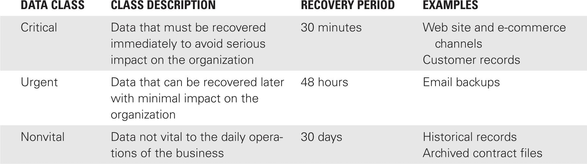

有各种被称为*分类方案*的方法对数据进行分类。一个好的原则是保持简单！培训关于许多类别之间的细微差别是困难的。一个好的原则是使用五个或更少的类别。许多组织使用三种分类。虽然五个分类较罕见，但这可能表明组织具有足够的自动化水平和成熟的计划来管理其数据。

在三分类方案中，类别名称简短且简洁。某些分类要求受特定法律的影响。在其他情况下，分类要求取决于业务愿意支付的代价。例如，表 11-2 指出关键数据的恢复时间小于 30 分钟。这种示例恢复方案可能并不适用所有组织；例如，对于小学来说这种方案可能太贵了。

## 法律分类方案

标记数据的法律分类方案主要由法律要求驱动。具有重大监管审查或重大法律或隐私视角的组织通常采用此类方案。无论组织采用这种方法的原因是什么，重要的是随着法律要求的变化，数据分类也随之变化。例如，隐私的定义多年一直在变化。如果分类的目标是维护法律规定的个人隐私，随着法律的变化，分类也必须变化。考虑个人家庭地址：在某些州，地址本身被视为隐私；在其他州，家庭地址只有在与姓名结合时才被视为隐私。变化的法律格局。

斯坦福大学提供了一个良好的数据法律分类方案示例。大学隐私官列为数据分类问题的联系点。首席信息安全官列为保护数据类别的关键联系点。隐私和安全部门合作创建并管理数据分类方案是一种常见做法。斯坦福大学采取了以下数据分类方案：

*   **禁止信息（`Prohibited`）**——如果法律或法规要求保护信息，则将其分类为禁止。
*   **受限信息（`Restricted`）**——如果信息本应属于禁止，但大学认为禁止存储信息会显著降低教师/员工/学生的效率，则将其分类为受限。
*   **机密信息（`Confidential`）**——如果信息不被禁止或受限，但不对公众开放，则将其分类为机密。
*   **无限制信息（`Unrestricted`）**——如果信息不被认为是禁止、受限或机密的，则将其分类为无限制。

你可以快速看到置于数据上的法律价值如何决定禁止和受限分类的使用。禁止信息的示例是社会安全号、驾照号和信用卡号。受限信息的示例是健康记录和护照号。

## 军事分类方案

安全数据分类反映了信息的关键性和敏感性。*关键性*指的是信息对于实现组织任务的重要性。*敏感性*指的是与未经授权泄露相关的影响。特定的数据在一个标准上可能很高，但在另一个标准上较低。两个标准中较高的一个通常驱动数据分类。随着数据变得越来越重要，通常需要更强的控制。美国军事分类方案被几个联邦机构使用。

美国军事分类方案定义在国家安全信息文件 `EO 12356` 中。有三个分类级别：

*   **绝密（`Top Secret`）** 数据，其未经授权的泄露预计会对国家安全造成严重损害
*   **密（`Secret`）** 数据，其未经授权的泄露预计会对国家安全造成严重损害
*   **机密（`Confidential`）** 数据，其未经授权的泄露预计会对国家安全造成损害

任何被认为是“分类”的军事数据必须使用这三个分类级别之一。还有政府机构处理的未分类数据。这种类型的数据有两个分类级别：

*   **敏感但未分类（`Sensitive but unclassified`）** 是不根据《信息自由法》公开的机密数据。
*   **未分类（`Unclassified`）** 是公众可用的数据。

敏感但未分类（`Sensitive but unclassified`）有时被称为 `SBU`。在美国，它也经常被称为“仅供官方使用（`For official use only, FOUO`）”。`FOUO` 一术语主要在美国国防部（`DoD`）内部使用。`SBU` 数据的示例包括美国国税局的税表、社会安全号码和执法记录。

信息安全监督办公室（`ISOO`）负责监督美国政府的分类计划。`ISOO` 会向总统提交年度报告，总结上一年的分类计划情况。该报告概述了每年哪些数据被分类以及被解密。2018 年的报告显示，在所有机密数据中，38.35%为绝密（`Top Secret`），59.67%为秘密（`Secret`），1.98%为机密（`Confidential`）。

###  提示

观察分类分布是一个很好的练习。通过理解所处理数据的组织、任务和性质，可以对高度敏感数据是否存在过度分类或分类不足得出概括性。对最重要的数据进行过度分类可能意味着使用非常昂贵的手段来保护并不重要的数据。分类不足则意味着最重要的数据可能无法得到充分保护。

解密数据是非常重要的。让数据永远保持分类状态是不现实的。首先，最好将有限的资源集中在保护较少的最重要数据上。其次，在民主国家，我们期望政府是透明的。除非有充分理由保留秘密，否则预期信息将向公众发布。

政府例行性解密数据。`Declassification`（解密）是一个术语，意味着将分类更改为“未分类”。数据的解密由 `ISOO` 运行的三个计划之一处理：

*   **`[自动解密]`** 在 25 年后自动移除分类状态。
*   **`[系统性解密]`** 审查那些免于自动解密的记录。
*   **`[强制解密]`** 在应要求时审查特定记录。

这三个计划已解密了追溯到 2012 年的 1980 万页信息。正如你所见，政府需要保护的数据越来越多。。除非有政策来减少政府保护的数据量，否则这一数量可能会变得令人无法负担。

## 商业分类方案

私营部门与军事部门一样，使用数据分类来反映信息的重要性。与政府不同，并没有统一的数据分类方案。数据分类没有一种正确的方法。也像军事一样，业务中的数据分类驱动着安全措施以及数据处理的方式。

尽管没有强制的数据分类方案，但私营行业有一套规范。在本章前面，我们介绍了一个只有两个级别的扁平化系统。如果你需要更详细的内容，通常会使用以下四种分类：

*   高度敏感
*   敏感
*   内部
*   公开

**`[高度敏感分类]`** 指对任务至关重要的数据。你根据关键性和敏感性来确定哪些数据是任务关键的。这种分类也用于保护受高度监管的数据。这可能包括社会安全号码。如果信息发生泄露，可能会产生巨大的责任。任务关键型数据对组织至关重要。这可能包括客户名单和记录。对高度敏感数据的访问是限制的。组织通常会增强安全并进行监控。可能会应用额外的控制措施，例如加密。

**`[敏感分类]`** 指对业务重要但对其任务至关重要的数据。如果信息发生泄露，可能会导致财务损失。高度敏感和敏感之间的区别在于影响的大小。敏感数据的未经授权暴露可能会导致损失。这可能包括网络拓图。

**`[内部分类]`** 指组织内部的日常数据。这可能包括供应商信息。未经授权访问内部数据会导致运营中断和财务损失。对内部数据的访问仅限于员工。这些信息对他们是广泛提供的。

**`[公开分类]`** 指向公众发布后不会对业务产生负面影响的数据。对公开数据的访问通常通过将数据放在公共网站上或通过新闻稿来实现。允许将数据公开的人数是有限的。

## 开发定制化分类方案

你经常可以通过修改现有的方案来创建定制的分类方案。联邦机构不能自定义方案，因为它们的分类方案是法律规定的。许多安全框架为开发分类提供了指导和要求。一些指导和要求的来源包括国际标准化组织（`ISO`）、信息和相关技术控制目标（`COBIT`）以及支付行业数据安全标准（`PCI DSS`）。

在开发定制的数据分类方案时，请遵循基础。你应该考虑以下通用指南：

1.  确定分类级别的数量。
2.  定义每个分类级别。
3.  为每个分类级别命名。
4.  将分类与特定的处理要求对齐。
5.  定义审计和报告要求。


# 数据分类与风险管理

## 确定分类层级

你通过观察想要分离数据的程度来确定分类层级的数量。一种方法是通过将数据与关键业务流程对齐来分离数据。这有助于你理解业务，从而更好地保护资产。例如，发电厂可能想要隔离其监控控制和数据采集（`SCADA`）系统。`SCADA` 数据有助于设施的运行。可以对这些系统和数据实施特殊的安全防护和控制。这可以通过对 `SCADA` 数据与其他类型的数据进行不同的分类来实现。

每个分类层级的定义取决于你如何表达泄露的影响。联邦机构根据机密性、完整性和可用性来确定影响。他们对这些每项内容分配低、中、高影响的评级。通过应用公式，他们可以确定影响。政府以外的组织也采用了类似的方法。`表 11-3`描述了美国国家标准与技术研究院 (NIST) 联邦信息处理标准 (FIPS) 199 中描述的基本影响矩阵。

**表 11-3 信息安全分类**

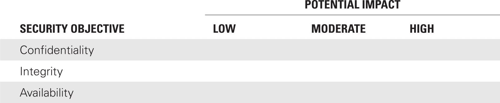

FIPS-199 出版使用“有限不利影响”等短语来表示低影响。对于中等高影响，它使用“严重不利影响”和“严重或灾难性的不利影响”。

在商业世界中，影响定义与衡量的业务结果密切对齐。例如，低风险可以定义为导致“运营中断和极财务损失”。组织能够理解这些术语，因为可以使用财务规模。例如，当 1 美元到 20,000 元面临风险时，可能会产生低影响；中等影响可能定义为 20,000 元到 500,000 元；高影响风险可能定义为 500,000 元及以上。具体金额取决于组织的大小及其风险承受能力。将特定的美元金额应用于影响会使定义更加清晰。

每个分类层级的名称通常取自定义本身。重点是选择一个在组织内部引起共鸣的名称。你可能还会考虑使用同行组织采用的名称。这有助于行业内方法的交流。名称可以反映领导层对风险的看法，例如将数据分类为“专有”对比“敏感”。

将分类与特定的处理要求对齐是关键一步。一旦确定了分类层级，你就必须应用适当的安全控制要求。在安全需求差异小或没有差异的情况下，可以考虑合并这些层级。

审计和报告要求取决于行业和监管要求。许多组织受隐私法披露的影响。在对数据分类时，你应该考虑这些报告要求。例如，针对审计和报告要求的敏感数据可以分配特殊的分类。这种分类可以包含额外的日志记录和监控功能。

## 分类数据

在分类数据时，你需要考虑两个主要问题。一个是数据所有权，另一个是安全控制。这两个问题有助于你从数据分类工作中获得最大的价值。

业务负责确保数据受到保护。业务还定义了处理要求。IT 是数据的保管者。确保资金充足的控制并满足监管要求是业务的责任。`COBIT` 框架建议分配数据所有者。数据所有者是对数据负责的人。

## 数据处理政策

在定义访问需求时，困难的任务之一是准确理解谁有明确需求使用这些信息。数据处理政策分配数据如何使用的责任至关重要。例如，数据处理政策应该限制允许打印哪些数据。另一个数据处理问题是在数据移动时保护数据。所担心的是数据被使用的方式不再受到保护。

与数据分类一样，数据所有者必须在保护和可用性之间取得平衡。数据所有者必须兼考虑业务需求和监管需求。

## 静态和传输中数据策略的必要性

关于如何最好保护静态和传输中数据的讨论不可避免地会引向加密主题。保护数据不仅仅是加密那么简单。有一系列必须考虑的因素，例如身份验证、授权、日志记录和监控。然而，备受关注的话题是加密。这部分归于州隐私法的出现。今天大多数州都有属于两类加密要求的隐私法：

*   要求对私有数据进行加密的法律
*   要求在私有数据未加密时通知泄露的法律

这两项要求都在促使企业采用加密。不同州法律对加密密度的要求存在差异。例如，加利福尼亚隐私法要求在未加密的私有信息发生泄露时必须进行通知。马萨诸塞州隐私法要求数据在离开公司网络范围时，对静态或传输中的数据进行加密。内华达州隐私法强制使用 `PCI DSS`，这要求持卡人数据在公司网络内部外部都要进行加密。

### 注意

`data at rest`（静态数据）一术是指存储中的数据。这包括位于服务器、笔记本电脑、CD、DVD 或通用串行线（USB）优存盘上的数据。任何存储的数据都被视为静态数据。`data in transit`（传输中数据）一术是指正在穿越网络的数据。这包括私有网络、互联网和无线网络上的数据。如果数据在任何类型的网络上移动，该数据就处于传输中。

无论你认为加密是否是一个好主意，对于许多组织来说，加密都是一项强制性。你需要确保 IT 安全策略中明确定义了关于加密将在何处以及如何使用的规定。

安全策略需要明确何时应该使用加密。策略还应该说明可接受的加密级别。有时当人们讨论在网络内加密数据时，他们会对加密数据所获得的保护价值产生激烈的争论。有些人认为这价值很小，因为除非偷走物理硬盘，否则数据会自动解密。另一些人则认为这是另一层控制，可以防止访问，因为解密过程是可以控制的。两者都是的。有时数据会自动解密，而其他时候则不会。

`图 11-1` 阐述了两种观点。图中展示了两种场景。在两种场景中，黑客都攻破了环境。在场景 #1 中，应用程序的破破解导致未加密的数据泄露。在这种情况下，加密在保护信息方面毫无价值。在场景 #2 中，操作系统的破破解导致数据库文件被盗。在这种情况下，数据保持着加密状态，这极大地帮助防止了数据泄露。根据破解的类型，网络内的数据加密可以提供有价值的保护。关键因素是加密密钥在此过程中是否暴露。

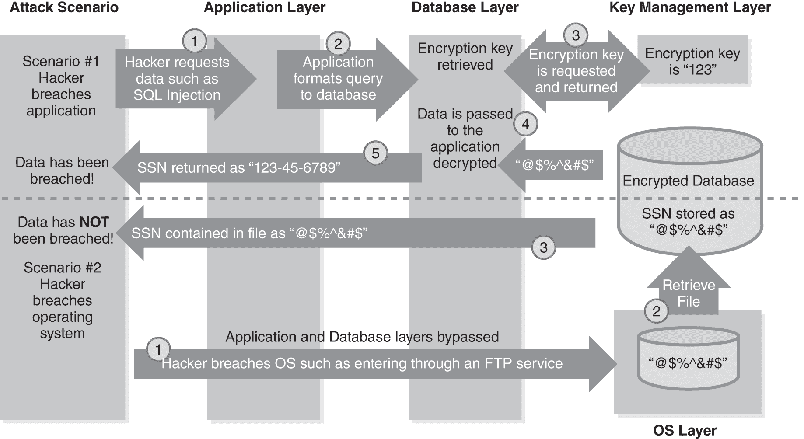

**图 11-1 数据库加密攻击场景。**

现在让我们详细查看其工作原理。在场景 #1 中，应用程序的破破解允许黑客获取未加密的数据。这里的关键点是应用程序和/或数据库具有访问加密密钥的权限。在这个示例中，是由数据库在解密数据。或者，可能是应用程序在解密数据。无论哪种方式，你本质上都是要求应用程序获取信息并为你解密。然而，在场景 #2 中，黑客攻破了操作系统（OS），绕过了应用程序和数据库服务器。在这种场景下，黑客只有文件系统的访问权限。换句话说，黑客可以获取数据库文件，但它们仍然是加密的。因此，没有数据被泄露。

在网络内加密数据确实可以防止许多攻击，但不能防止应用程序的破破解。使场景 #2 成为可行解决方案的原因是，密钥管理层位于应用程序和数据库层之外。没有加密密钥，数据就是不可读的。在服务器上加密数据而将加密密钥留在同一台服务器上是没有意义的。这就像把车钥匙留在汽车的点火里一样。为了让加密有效，安全策略必须建立核心要求和标准，例如：

*   加密密钥必须与加密数据分离。
*   加密密钥必须通过安全过程获取。
*   操作系统层面的管理员权限。

政策规定，信息用户有个人责任遵守相关政策、标准和程序。所有用户都要对其所访问信息的准确性、完整性和机密性负责。政策必须在数据的使用和处理方面保持清晰。为了讨论起见，本节概述了在不同阶段进行数据处理的某些政策考量：

*   **创建**——在创建期间，必须对数据进行分类。这可以简单地将数据放置在公共存储区域内。例如，人力资源（HR）系统在 `HR` 数据库中创建信息。该数据库中的所有信息都可以分配一个共同的数据分类。随后，安全策略将规范数据所有者、保管者和责任划分。安全程序则规定如何授予对数据的访问权限。
*   **访问**——对数据的访问受安全策略的约束。这些策略对职责分离（`SOD`）提供了特殊指导。在授予访问权限之前，通过程序检查 `SOD` 要求非常重要。例如，创建和批准从银行汇出大额款项的能力通常需要两个或更多人参与。`SOD` 要求由一个人创建电汇，另一个人进行批准。在这种情况下，授予批准电汇权限的程序还必须包含一项检查，以验证同一个人不能拥有创建电汇的权限。如果某人同时拥有这两项权限，他就可以给自己创建并批准一笔巨额资金。
*   **使用**——数据的使用包括在访问后对信息进行适当的保护和标记。必须根据分类对数据进行适当标记和保护。例如，如果在打印报告中使用高度敏感数据，则报告必须标记为“高度敏感”。通常，将报告标记为“高度敏感”意味着会有与存储相关的数据处理问题。
*   **传输**——数据必须按照政策和标准进行传输。组织可能有传输数据的程序和流程。所有用户必须遵循这些程序。这确保了使用批准的技术（如加密）对数据进行充分保护。
*   **存储**——数据的存储设备必须经过批准。这意味着对设备的访问必须安全并经过适当控制。例如，假设移动设备已加密。一旦设备通过批准并配置，就可以通过正常程序授予访问。存储处理还涉及物理文档。例如，“高度敏感”文档在不使用时需要锁好。它们应该只与授权查看此类材料的人员共享。
*   **物理运输**——数据的运输必须经过批准。这确保了离开私有网络范围的内容受到了保护和跟踪。组织有义务了解其数据的所在地。此外，它需要确保数据得到了适当保护。在可能的情况下，数据在传输过程中应当加密。一旦发生数据介质丢失或被盗，数据将受到保护。许多组织使用预先批准的运输公司处理数据。这些服务提供了履行公司义务所需的跟踪和到达通知。
*   **销毁**——数据的销毁有时被称为 `disposal`。当资产达到寿命时，必须在受控程序中进行销毁。规范销毁的标准确保数据无法被重构。这可能需要将物理介质置于处置箱中。这些箱经过特殊设计，允许物品放入但不能取出。物品会被收集，内容会被粉碎。所有用户都被要求遵循经过批准的物理介质和电子数据销毁程序。

## 识别与信息系统相关的业务风险

风险管理建立了识别和管理风险的流程。由于风险随组织而异，对数据的要求也如此。数据分类有助于将资源集中在需要恢复的数据上。无论组织规模如何，了解数据都是至关重要的。数据分类允许你根据……对数据进行分层。

### 风险类型

许多 IT 风险是运营风险。运营风险是一个广泛类别。它包括任何中断组织日常开展活动的事件。从技术术语来说，它是影响业务的中断。它可能是编码错误、网络缓慢、系统停机或安全违露。数据分类有助于识别哪些对于恢复运营至关重要。

战略性风险可能会改变组织的运营方式。示例包括合并与收购、行业变化或客户变化。理解数据的敏感性和关键性可以帮助你更深入地理解你的客户和产品。通过分类对数据进行分层，可以帮助你理解你的核心业务真正是什么，不是什么。

关键要点是意识到，数据分类的过程不仅仅是一个标签或标记。它是对数据如何驱动业务的审查。数据分类的益处在于识别关键信息资产并妥善保护这些资产。剩余收益是让你能够更好地了解你的业务和客户。

# 基于风险管理的策略制定与需求

建立一种新的基于风险的管理方法可能是一项艰巨的挑战。基于风险的方法的目标是关注对组织最大的威胁。基于风险的 IT 安全策略将关注对业务流程最大的威胁，并促进风险意识文化。当策略、流程和控制能够减少实际业务风险时，它们才具有更高的价值。

合规不仅仅是遵守法律法规。监管机构还希望组织能够证明其可以系统地识别和降低风险。基于风险管理原则的策略可以实现这一点。安全策略引导组织在监管边界内运行。策略还需要反映组织的风险文化、容忍度、胃口和价值观。例如，《健康保险可移植性和责任法》（`HIPAA`）要求采用风险管理分析方法。这促进了对风险的彻底理解。这种理解导致了适当保护措施的选择。这些保护措施是基于组织所面临的风险水平。

开发对这些因素进行数学计算的工具，提供了一种客观方式评估风险的手段。`表 11-4` 是这种方法的简单示例。工具可以告知组织领导层趋势和新兴风险。但说到底，它们只是工具。常识是不可替代的。尽管它们在很大程度上启发了我们，但如果盲目遵循，也会模糊我们的判断。经验丰富的领导者知道，当模型说的话不符合逻辑时，要进行深挖。

使用基于健全风险管理的安全策略将有助于帮助组织风险降低决策中隐含的权衡。以下是将风险管理方法应用于安全策略的某些益处。这种方法可以：

*   识别决策可能的成本和收益
*   考虑领导者可能不会察觉的行动，并迫使进行替代性思考
*   提供分析严谨性，以确保对风险进行客观考虑

严谨且执行良好的风险管理有助于领导者做出长期降低风险的决策。这至关重要。降低风险不是一次性的活动。风险管理是一个持续的对话。随着时间的推移，其他紧迫的需求会竞争资源，对降低风险工作的支持也会动摇。一个有效的风险管理系统会在业务背景下解释风险。它为自己的优先事项和资金提供合理性。

风险管理是一个治理过程。它也是一个持续改进模型。`图 11-3` 描述了一个简单的风险管理持续改进模型。每当发现新风险时，就会循环以下步骤：


1.  风险划分优先级；对齐风险。
2.  评估影响以衡量组织。
3.  识别响应；确保风险安全。
4.  监控风险；维持计划。
5.  识别新风险；启动计划。

这种风险管理持续改进模型可以用于启动风险管理。它展示了风险的影响。

## 风险与控制自评估

风险和控制自评估（`RCSA`）是一种有效的工具。它允许组织理解其风险和潜在影响。这是许多组织每年开展的正式活动。

一个 `RCSA` 是一项耗时的工作，需要业务部门的参与；但其益处是巨大的。最终，对以下内容形成了共识：

*   主要风险有哪些
*   哪些风险限制了组织的能力
*   有哪些计划来应对这些

`RCSA` 过程通常没有被充分理解或利用。它包含了业务领导者对风险的看法。因此，它是支持风险管理的理想信息来源。如果你能证明管理风险可以降低识别出的风险，将获得管理的关注并增加支持的机会。

`RCSA` 包含了详细的风险信息，展示了在关键流程和技术不可时对组织的影响。你利用 `RCSA` 开发风险管理计划，例如在哪里放置质量保证和质量控制程序。`RCSA` 还包含多个场景。每个场景详细说明了风险对业务的影响。`RCSA` 的主要目的是确保这些风险被识别，并分配给特定的执行人员进行管理。

`RCSA` 方法并非所有行业都通用的标准。尽管任何组织都可以使用 `RCSA`，并且许多组织以不同的名称使用某种形式，但它只是管理风险的许多方法之一。使用哪种方法并不如拥有一套系统的风险管理方法重要。尽管如此，`RCSA` 可以为组织提供识别和规划意外或新兴风险（如新的运营风险）的新机会。

## 风险评估策略

风险评估是组织执行的最活动之一。风险评估定义了威胁和漏洞并确定了控制建议。它允许组织做出明智决策以投资降低风险。基于风险的决策是大多数 IT 安全策略的基础。

### 风险暴露

`风险暴露`是指事件发生时对组织的影响。有多种方法可以计算风险暴露。理想情况下，你希望在业务术语内对其量化，例如为损失标注金额。可以使用通用的公式来计算暴露，如下：

风险敞口 = 事件发生的概率 × 事件发生后的影响

例如，如果有 50% 的概率发生 200 万美元的损失，那么风险敞口为 100 万美元（0.5 × 200 万 = 100 万）。这种计算加上其他评估，可以了解业务的总风险敞口。

可以使用不同的分析方法来确定概率和影响。这些方法分为两类：定量和定性。

定量方法涉及数值测量以确定风险。测量可能包括一系列衡量标准，例如资产价值和威胁频率。定量方法的缺点是缺乏可靠的数据。

定性分析涉及专业判断。这意味着通俗地说，是进行一种经过良好教育的推测。定性技术可能包括问卷调查、访谈和工作组。定性分析可用于调整测量结果。这些是非常强大的工具，允许你与业务部门就风险进行深入的对话。在面对风险敞口时，业务部门可以接受风险或出资进行风险缓解。在确定概率或影响时，与业务部门讨论所作出的任何假设至关重要。

## 风险、威胁和漏洞的优先级

当你将风险敞口与业务影响分析 (`BIA`) 结合时，你可以看到对业务的直接影响。这种风险视角允许你对风险进行优先级排序。风险管理计划在减少可能发生的事件和缓解风险之间建立平衡。安全策略和控制可以减少声誉、运营和战略风险。这是通过限制漏洞实现的，从而建立消费者的信心。

## 风险策略

一旦识别出风险，你就选择一种管理策略。通常有四种被接受的风险管理策略：

*   `风险回避`：不参与可能产生风险的活动。这在大多数情况下是困难的。
*   `风险接受`：接受某些活动涉及的风险并处理任何后果。
*   `风险转移`：与外部分分风险。
*   `风险缓解`：通过实施控制措施减少或消除风险。

`风险回避` 主要是一项业务决策。你需要权风险和收益，以确定它们对业务的生存有多重要。例如，使用恶意软件存在风险；然而，简单地不使用 `email` 并不是一个可行的方案。

`风险接受` 既是业务决策也是技术决策。业务部门需要了解影响其运营的风险。如果业务部门认为管理风险不可行或不符合成本效益，则必须选择接受该风险。IT 部门每天都会接受大量的技术风险。从实际角度来看，并非所有风险都能被业务部门正式接受。关键在于拥有一套流程，通过对风险进行评估和评分。这种评分可以决定谁有权接受每种风险。

`风险转移`是承担风险的后果并将责任移交给他人。最常见的风险转移类型是购买保险。例如，你可能会购买数据泄露险，在发生数据泄露时支付你的费用。转移风险不会降低风险发生的概率；它消除了该风险的财务后果。

并没有单一的缓解策略列表。缓解策略取决于组织面临的风险、威胁和漏洞。保护客户卡的市场面临的威胁与核电站完全不同；它们的缓解策略也会不同。

然而，所有的缓解策略都有一个共同目标：预防。预防风险的成本比处理其后果要低。要确保有效，你必须有一套流程，在风险威胁业务之前识别它们。风险管理政策促进一系列努力，使组织能够时刻意识到风险。以下是这些努力的示例：

*   威胁和漏洞评估
*   渗透测试
*   对系统、应用程序和网络的监控
*   对供应商漏洞警报的监控
*   主动补丁管理
*   有效的供应商管理和监督
*   强化的风险和安全意识

这些方法减少了风险。它们还提供了关于环境的新信息。这些信息可以用于设计更好的解决方案并理解现有环境的局限性。你可以衡量这些效应对数据完整性、机密性和可用性风险降低的影响。

### 漏洞评估

漏洞评估是一用于识别和理解对系统、应用程序或网络设备风险的工具集。`漏洞` 是一个识别 IT 基础设施缺陷或控制漏洞的术语。如果这些缺陷或控制漏洞被利用，可能会导致对数据的未经授权访问。

有很多工具和技术可以执行漏洞评估。以下是几个示例：

*   网络漏洞扫描
*   应用程序源代码扫描
*   操作系统开放端口扫描


重要的是，这些是工具，而不是评估。它们是识别潜在缺陷的有价值工具；然而，评估来自于对结果的分析。评估必须解决漏洞。它还必须处理对业务的影响和修复成本。

安全策略定义了何时以及如何执行漏洞评估。以下是遵循的典型步骤：

1. 确定评估范围。
2. 识别依赖关系。
3. 执行自动化测试。
4. 分析并生成报告。
5. 分配评分。

在进行任何评估工作之前，你需要确定范围并了解环境。这项工作涉及技术和业务方面。你需要了解内部网络上使用了哪些业务流程，以及通过防火墙从外部使用了哪些流程。根据这些信息，你可以评估安全策略、标准和程序。这应该能提供一个全面的基准，以便与评估结果进行比较。

全面的漏洞评估是从端到端查看流程。这比只查看孤立组件上的流程更有效。例如，假设你的组织在全州范围内有一个汽车经销商网络。同样假设有一个可用的 `VPN` 用于交叉检查库存和新车的交付。你进行了一次漏洞评估。该评估发现了一个控制缺陷，可能会导致汽车经销商无法接收新车。这得比“XYZ 服务器有开放端口”这样的结论要有意义得多。

接下来，你需要识别支持每个主流程的依赖进程和技术。例如，从家里远程访问可能依赖于安全令牌。安全令牌可以是硬件设备或软件代码，用于在登录时生成“令牌”。令牌通常表示为一系列数字。安全令牌极难复制（某些人认为是不可能复制的）。当令牌作为强制登录的一部分分配给个人时，该令牌可以提供关于“谁在访问网络”的保证。家庭环境和安全令牌各自创建了潜在的漏洞。家庭环境和令牌都需要在防火墙之外进行讨论。

理解信息是如何被使用的至关重要。例如，评估应该涵盖员工对信息的访问、使用和传播。网络和应用程序图是良好的信息来源。

使用自动化测试工具是最佳实践。它们可以在几秒内扫描大量的漏洞。关键在于，必须对结果进行检查，并结合流程和风险背景进行分析。

自动化测试工具要求你按风险从大到小对威胁进行排序。风险分类允许组织在其整个资产范围内应用一致的保护。

在分析和报告期间，你汇总数据并确定业务影响。使用业务影响分析（`BIA`）的结果有助于将风险与业务对齐。例如，如果评估包含一个业务已声明为任务关键任务的流程，那么评估就可以反映这一事实。这种方法帮助你评估值得优先关注的漏洞。

漏洞分析完成后，该是分配评分了。漏洞评估评分描述了漏洞相对于其对组织潜在的影响。该评分通常遵循与其他风险团队采用的任何风险评分相同的路径。你通常会计算暴露量，正如本节之前“风险暴露”章节中所讨论的那样。根据风险暴露量，分配一个值。然后，使用量表，你可以分配诸如低、中或高之类的评分，如表 11-4 所示。

如果补丁产生严重问题，实施方案应包含一个回滚计划。在补丁更广泛发布之前，在小范围用户中进行测试并不罕见。在实施补丁之前，你需要确定补丁的优先级。安全策略应该就任何安全漏洞可以在不被缓解的情况下持续多久提供指导。补丁团队应该对于关键补丁必须多快应用有明确指导。关键补丁是那些缓解正在公司内部传播的风险的补丁。通常情况下，关键补丁在几小时或几天内应用。

一旦你评估了优先级，就可以安排补丁计划。你通常按月或按季度安排补丁。你需要让所有关键利益相关者都能看到补丁，例如在 `Microsoft SharePoint` 站点上发布。这些利益相关者可能包括系统管理员、应用程序管理员和网络管理员。这使他们能够对补丁部署进行审查和评论。安全策略应当确定在应用补丁之前的通知期。

在这一阶段，补丁流程对组织而言可见度最高。你需要定期评估补丁管理应用程序本身的安全性。根据其性质，补丁管理应用程序需要特权权限。补丁可能需要应用到每个系统、应用程序和网络设备。补丁管理应用程序的泄露对组织来说可能是毁灭性的。

这些补丁管理工具还提供了一项至重要的发现任务。这些工具可以检查网络上的任何设备并确定其补丁级别。其中某些工具被用于双重目的，例如补丁管理和资产管理。

执行实施后评估，以确保补丁按照设计运行。补丁可能会产生意想不到的后果。补丁问题需要被跟踪，并在必要时回滚补丁。

## 质量保证对比质量控制

衡量风险管理有效性的方法之一是通过质量保证（`QA`）和质量控制（`QC`）功能。这两个功能都衡量缺陷，但方式不同。其核心思想很简单：如果你管理风险得当，你看到的问题和缺陷就会更少。

鉴于行业内用于描述 `QA` 和 `QC` 的许多定义，它们之间的差异可能会令人困惑。全球性协会美国质量协会（`ASQ`）对这些术语的定义如下：

*   `Quality assurance`——赋予信心的行为、确定的状态或确保某定的行为。
*   `Quality control`——一种指示需要纠正响应的评估；引导过程的行为，其中变异性归因于随机原因的常量系统。

其他标准如 `COBIT` 采用了类似的定义。尽管措辞不同，但其核心含义是相同的。`QA` 功能负责“确保”。这是在执行过程交易时完成的。隐含的是，特定阶段的每个交易或过程都经过了验证，以创建这种保证。相反，`QC` 功能随着时间的推移“评估”“响应”。隐含的是每个交易或过程已经执行完毕。

简而言之，通常 `QA` 是一种实时预防性控制。如果交易或过程未通过 `QA` 测试，缺陷将立即被捕获。此时，缺陷可以被纠正或拒绝。相比之下，`QC` 功能通常作为一种检测控制，随时间推移对更广泛的样本组查看缺陷。通过这种方式，`QC` 流程可以总结经验并改进 `QA` 流程。

例如，考虑一家汽车工厂。`QA` 流程在各种部件安装后对其进行测试，例如通过打开收音机确保其工作正常。这可以发现收音机接线不当的问题。相反，`QC` 流程会查看所有经销商收音机的维修报告，并测试为什么 `QA` 流程未能发现缺陷。假设大多数收音机维修是因为电线随时间推移而松动。`QC` 流程可以记录，除了打开收音机外，还需要对线路连接进行额外的测试。

## 数据分类与风险管理策略的最佳实践

风险管理策略为跨数据分类和 `RCSA` 活动的风险评估提供了框架。得到的风险评估查看风险是如何端管理的。这意味着风险评估可以检查数据分类如何影响数据处理和 `RCSA` 过程。它还可以识别质量保证和质量控制过程之间的控制差距。风险管理策略了评估的标准和内容。风险管理要求可能根据行业和监管标准而异。

在创建数据分类方案时，必须记住以下几点：

*   保持分类简单——不超过三个到五个数据类别。
*   确保数据类别易于员工理解。
*   数据分类必须突出显示哪些数据对组织最有价值。
*   以最有效的方式对数据进行分类，优先对高风险数据分类。

结论是，在组织内部没有一种通用的定义风险和控制的方法。无论该计划如何命名，其元素都是相同的，只是以不同的形式重新包装。风险管理策略应确保数据得到妥善处理。

## 数据分类与风险管理策略的案例研究与示例

以下案例研究和示例探讨了风险管理相关策略的实施。案例研究关注本章概述的风险和策略。风险管理策略代表了广泛的风险类别。这些案例研究和示例关注单一策略组，例如灾难恢复，并代表了成功的实施。

### 私有部门案例研究 1

2017 年 5 月，`WannaCry` 病毒迅速席卷。这种勒索软件利用 `EternalBlue` 漏洞入侵 `Windows` 计算机。这次特别值得注意的是，它利用了一个 `Windows` 漏洞，而该漏洞的补丁已经发布两个月。任何受 `WannaCry` 影响的组织显然都没有良好的补丁管理。

此案例说明了对适当补丁管理的需求。补丁通常不会立即应用。补丁需要测试以确保它们不会破坏现有应用程序。然而，在补丁发布两个月后还不应用真的没有合理的理由。尽管 `WannaCry` 是一个为人知的例子，但许多恶意软件爆发和入侵可以通过有效的补丁管理得到预防或缓解。

### 公共部门案例研究

德克萨斯大学在其网上发布了数据分类标准。该标准将数据分为 I 类、II 和 III 类。I 类定义为法律或大学法规保护的数据。引用的一些示例包括 `HIPAA`、《萨班斯-奥克斯利法》（`SOX`）和《格拉姆-莱希法案》（`GLBA`）。II 类定义为其他需要保护的数据。引用的示例包括电子邮件、出生日期和工资。III 类定义为对机密性、完整性和可用性没有要求的数据。这三个要求了分配给大学数据的类别。大学引用安全策略作为该标准的依据。

这是一个定制数据分类方案的示例。该大学根据对关键数据的审查调整了该方案。大学确定三个分类级别足以满足监管要求。在这种情况下，该大学将数据分类称为标准。它完全可以被标记为策略。无论名称如何，它都清晰地定义了级别。它定义了职责。它还定义了场景，例如处理教授博客上的数据。它是数据评估和监管合规如何结合创建数据分类标准的良好示例。

### 私有部门案例研究 2

2019 年 7 月，发现一名外部人员获取了第一资本（`Capital One`）的信用卡客户数据。据报道，有 30GB 的数据被下载，影响了超过 1 亿人。这些数据包括超过 140,000 个美国公民的社会安全号码和 100 万个加拿大公民的社会保险号码。2019 年 7 月 29 日，`FBI` 因此次泄露事件逮捕了佩奇·汤森（`Paige Thompson`）。

汤森曾是亚马逊云服务（`Amazon Web Services`）的软件工程师，该公司托管了第一资本的数据库。她通过 `Twitter` 和 `Slack` 公开暴露了她收集的数据，并承认了该事件。调查此次泄露事件的 `FBI` 探员在法庭上，汤森是通过 Web 应用程序防火墙的 `misconfiguration` 获取了这些敏感数据的。

这一事件凸显了几个方面的失败：

- 监控内部访问，以识别人员何时访问其职责范围之外的数据
- 确保所有服务器的正确配置
- 对静态数据进行加密

这些问题在 `Capital One/Amazon` 都没有得到，从而导致了这次泄露的发生。

### 章节总结

在本章中，你学习了如何使用数据分类来识别关键数据并保护它们。本章回顾了军事和商业分类方案，并研究了这些方案如何应用于数据处理。它探讨了通过政策管理静态数据和传输数据的必要性。本章还讨论了数据分类如何帮助降低业务风险。

本章包含了对风险管理的讨论。它讨论了如何利用风险控制和自评估流程（`RCSA`）来帮助获得管理层的支持。本章还探讨了质量保证与质量控制之间的区别。此外，你在本章中读到了如何使用 `QA` 和 `QC` 技术来衡量风险管理政策的有效性。

## 核心概念与术语

- `Authorization`（授权）
- `Automatic declassification`（自动解密）
- `Confidential`（机密）
- `Declassification`（解密）
- `Highly sensitive classification`（高度敏感分类）
- `Internal classification`（内部分类）
- `Mandatory declassification`（强制解密）
- `Public classification`（公开分类）
- `Risk and control self-assessment (RCSA)`（风险与控制自评估）
- `Risk exposure`（风险敞口）
- `Secret`（秘密）
- `Security token`（安全令牌）
- `Sensitive but unclassified`（敏感但未分类）
- `Sensitive classification`（敏感分类）
- `Systematic declassification`（系统性解密）
- `Top Secret`（绝密）
- `Unclassified`（未分类）

### 第 11 章评估

1. 以下哪不是大多数组织分类数据的常见需求？
   - 保护信息
   - 保留信息
   - 出售信息
   - 恢复信息

2. `Authorization` 是用于证明访问系统、应用程序和数据身份的过程。
   - 正确
   - 错误

3. 你出于什么原因需要保留数据？
   - 法律义务
   - 业务需求
   - 恢复
   - A 和 B
   - A、B 和 C

4. 数据所有者应该具备什么样的特质？
   - 在业务中担任高职
   - 理解业务的数据操作
   - 理解信息对业务的重要性和价值
   - 理解不准确数据或未经授权访问的后果
   - 以上所有

5. 在所有业务中，你总会有需要保护的数据。
   - 正确
   - 错误

6. `Risk exposure` 是使用定性技术进行的最佳猜测专业判断。
   - 正确
   - 错误

7. 联邦政府对机密材料最低数据分类是 ________。

8. 联邦机构可以自定义自己的数据分类方案。
   - 正确
   - 错误

9. 理解业务领导者风险视角的流程称为什么？
   - `QA`
   - `QC`
   - `RCSA`
   - `RA`

10. 质量保证通常是一种检测性控制。
    - 正确
    - 错误

11. 通常，拥有 5 到 10 个数据分类对于涵盖组织的所有可能需求效果最好。
    - 正确
    - 错误

12. `Risk exposure` 可以以此方式表示：________ = ________ × ________。

13. 传输中的数据是什么类型的数据？
    - 正在移至恢复设施的数据备份带
    - 你 USB 驱动器上的数据
    - 穿越网络的数据
    - 为了稍后传输而存储的数据

14. 加密保护静态数据免受所有类型攻击。
    - 正确
    - 错误


© obpcnh/Shutterstock

# 应急响应小组 (IRT) 政策

## 第 12 章

无论数据保护得如何，最终都会发生事件。该事件可能是系统安全泄露、授权用户无意损坏数据或自然灾害。它可能是操作系统漏洞或你无法控制的问题的结果。事实是，无论我们多么希望，没有哪个安全计划是 100%有效的。因此，拥有应急响应政策来应对不可避免发生的事件至关重要。确定的是，在某些时候，大多数组织必须响应安全事件。响应的速度和有效性将限制并减少损失。当事件发生时，组织需要通过深思熟虑的流程进行响应。有效的响应可以控制事件带来的成本和后果。

本章将重点介绍事件响应团队。它将定义什么是事件以及相关策略。将讨论如何创建事件响应团队（`IRT`）以及其内部的各种角色和职责。本章将审查事件发生期间执行的关键活动。还将讨论从报告、包含到分析事件的具体策略和程序。此外，本章将介绍与灾难恢复和业务连续性相关的关键方面和文档。这些理解在安全事件触发恢复计划的激活时是高层次且具有基础性的。最后，本章将回顾最佳实践并探讨一些案例研究。

## 第 12 章主题

本章涵盖了以下主题和概念：

*   什么是事件响应策略
*   如何对事件进行分类
*   什么是响应团队章程
*   谁组成了事件响应团队 (`IRT`)
*   谁负责事件期间的行动
*   响应事件时必须遵循哪些程序
*   事件响应策略应遵循哪些最佳实践
*   什么是业务影响分析 (`BIA`) 策略
*   业务连续性计划 (`BCP`) 策略如何保护信息
*   灾难恢复计划 (`DRP`) 策略如何保护信息
*   事件响应策略的一些案例和示例是什么

## 第 12 章目标

完成本章后，你将能够：

*   解释事件响应策略的
*   定义什么是事件
*   解释各种事件分类方法
*   理解 `IRT` 章程的关键组件
*   描述 `IRT` 成员的角色和职责
*   理解响应事件的主要程序
*   解释事件响应的最佳实践
*   描述 `BIA`、`BCP` 和 `DRP`
*   描述 `BIA`、`BCP` 和 `DRP` 之间的关系
*   将案例研究中学习的知识应用于现实世界的问题

## 事件响应策略

事件响应团队 (`IRT`) 是一组专门的人员，其目的是响应重大事件。`IRT` 通常是一个跨职能团队。这意味着团队成员具有不同的技能。他们通过协调的努力汇集在一起。在许多组织中，`IRT` 的形成仅是为了响应重大事件。轻微事件通常作为正常运营的一部分进行管理。当团队被召集时，该 `IRT` 被称为“激活”。

为轻微事件激活 `IRT` 是不实际的。例如，违反政策的行为将由个人的经理处理，或者在需要时由安全部门的人员处理。假设一名员工将其密码共享给第二名员工。这可能发生在第二名员工已获得批准但正在授予访问权限。在这种情况下，可能需要事件报告，但不会激活 `IRT`。通常情况下，事件响应团队仅对既需要即时响应又需要多个专注于事件的人员资源的事件才会被激活。

事件响应策略必须清晰简洁，以防止响应过程中的歧义。该策略必须定义什么是事件，什么是违规行为。策略必须定义激活 `IRT` 的标准。应该有一个集中的事件通知流程，以便相关人员了解事件。这些人员随后可以决定是否宣布灾难。最重要的是，策略和相关流程必须使 `IRT` 能够快速响应事件。从检测到事件到 `IRT` 激活，经过的时间越少越好。组织无法对活跃的攻击做出缓慢反应。

安全事件有很多类型。何时宣布事件并激活 `IRT` 取决于组织的策略。本章关注重大信息安全泄露。重大泄露可能包括：系统从外部被入侵、内部欺诈或拒绝服务攻击。

### 什么是事件？

事件 是任何违反组织安全策略的事件。事件可能会中断应用程序、系统或网络的正常运行。事件可能会导致服务质量下降和业务中断。这些中断可能需要激活恢复计划。事件还导致对数据未经授权的访问或修改。

安全事件的示例包括：

*   未经授权访问任何计算机系统
*   故意导致的服务器崩溃
*   从数据库中复制客户信息
*   未经授权使用计算机系统进行游戏

在事件响应策略中包含正式的事件定义是非常重要的。该定义随后被用于支持宣布事件和激活 `IRT` 的流程。

### 事件分类

事件的分类是事件响应策略的一部分。分类方法可以记录为事件响应策略或标准。在发生安全泄露的情况下，这自然意味着你的系统或安全中的某些漏洞被利用了。通过对事件进行分类，你可以更好地理解威胁和弱点。了解攻击类型可以帮助你决定如何响应以停止损害。它还可以帮助你分析环境中的控制薄弱环节。这有助于降低未来攻击的风险。分类事件没有统一的标准方法；然而，行业内通常会在公司之间采用类似的方法。关键点是选择一种符合你法律和监管义务的方法。这应该是一种提供足够细节来分析事件的方法。这种分析将帮助你改进导致事件的弱点。


例如，支付卡行业数据安全标准 (`PCI DSS`) 要求接受信用卡的商户报告涉及持卡人数据的安全事件。每当发现违反 `PCI DSS` 的泄露时，都应发布此类报告。分类泄露的一种方法是通过攻击方法。`PCI` 安全标准委员会发布了常见安全问题的列表。其中一些是攻击类型；另一些是漏洞。以下是 `PCI` 安全标准委员会识别的非法访问系统和敏感信息的方法示例：

*   `SQL injection`——一种向网站引入修改后的结构化查询语言 (`SQL`) 的技术。这种攻击取决于网站允许未过滤的输入。
*   `划分不当的网络环境`——相关攻击依赖缺乏分区或未将高风险资产隔离在自己的网络段中。例如，在扁平网络中，网络的所有部分都可以从任何地方访问。网络某部分的泄露会使整个网络面临潜在访问风险。
*   `恶意代码或恶意软件`——在用户不知情的情况下添加到平台的程序（如病毒、蠕虫、木马程序和间谍软件）。这些程序可能会损坏系统、删除文件、加密文件并索要赎金或泄密数据。
*   `不安全的远程访问`——通过远程服务获取访问，如销售点 (`POS`) 设备、供应商网络和员工远程访问工具。
*   `不安全的无线`——通过无线接入点访问网络的攻击。近年来，许多现已支持无线功能的联网设备种类增加了风险。此类设备包括复印机、传真机、库存系统、`POS` 终端、网络摄像头等。

另一个例子是联邦政府。根据《联邦信息安全管理法》（`FISMA`），政府使用了美国国家标准与技术研究所（`NIST`）的特别出版物 `800-61`。该出版物将系统或网络上的事件分为以下几类：

* `恶意代码`——这是一个大类，涵盖了所有造成某种危害的代码，包括计算机病毒、特洛伊木马和间谍软件。
* `拒绝服务`——攻击者通过构建数据包导致网络和/或计算机崩溃。
* `未经授权的访问`——用于获取访问权限的漏洞利用。
* `不当使用`——任何违反公司政策的计算机使用。这可能导致其他攻击。例如，访问不允许的网站或插入未经批准的便携式 `USB` 存储设备可能导致恶意软件入侵。

使用一种对内部和外部利益者都具有意义的分类至关重要。在 `PCI DSS` 和 `FISMA` 方法中，必须报告事件。这些违规行为被分类在有助于评估威胁级别的类别中。此外，它们还使用了一种外部利益者易于理解的分类法或分类系统。在许多事件分类方法中发现相似之处并不罕见。它们的目标都是提供一种描述安全事件的通用语言。

事件分类还用于评估事件的严重性；即，事件是轻微的还是重大的？基于此，你决定是否应该激活 `IRT`。什么被视为重大事件与轻微事件取决于组织对风险的看法。重大事件通常被视为对组织产生重大影响的事件。这种影响可以通过多种方式进行衡量。它可能是财务方面的，也可能根据服务中断或法律责任来衡量。从实际角度来看，许多重大事件比轻微事件更容易识别。它们可能会导致等影响，例如大量用户无法处理交易，或数百万客户个人数据被未经授权的访问。任何与人类生命保护相关的事件都被视为重大事件。什么被视为轻微事件取决于组织愿意接受多少风险。

### 提示

事件可能会演变成诉讼。`IRT` 的行动必须清晰并表现出合理的尽职调查（`due care`），这至关重要。`due care` 指为了避免对另一方造成损害而付出的努力。这是一个法律术语，本质上是指在特定情况下预期人应行使的关注水平。在事件期间产生的所有文档都应以直截、专业的方式编写。

### 响应小组章程

通常，组织在形成 `IRT` 之前需要一份章程。章程是一份组织文件，概述了团队或委员会的任务、目标和权限。法律部门审查 `IRT` 章程以检查是否存在任何可能产生法律责任的表述，这至关重要。始终假设外部第三方最终可能会查看该章程。

编写章程的第一步是确定要采用的种类型的 `IRT` 模型。章程的这部分决定了 `IRT` 的权限、方法和交付物。有几种类型的 `IRT` 模型：

* `IRT 提供现场响应`——`IRT` 拥有遏制违规的完全权限。
* `IRT 充当支持角色`——`IRT` 为本地团队提供技术协助，指导如何遏制违规。
* `IRT 充当协调角色`——`IRT` 协调多个本地团队如何遏制违规。

许多 `IRTs` 提供现场响应。在这种情况下，`IRT` 被赋予遏制威胁的完全权限。这通常意味着 `IRT` 成员在现场，通过操作键盘提供技术响应。这种 `IRT` 模型要求其成员具有指导本地资源的完全权限。`IRT` 成员在与高层管理协商后做出决策。`IRT` 成员可能被要求由特定的本地专家执行任务；然而，专家是在 `IRT` 成员的指导下执行任务的。

当 `IRT` 充当支持角色时，其成员成为本地团队的资源。`IRT` 为本地团队提供如何遏制违规的技术支持。本地团队有责任利用 `IRT` 的技能来响应事件。这种模型在系统需要特定技能的情况下非常有用。例如，在系统是专业化的情况下，本地团队有更好的能力处理事件。

当 `IRT` 充当协调角色时，它在参与事件的方之间进行协调。这种模型在响应涵盖多个地理区域时非常有用。在这种情况下，你需要与各地的 `IRTs` 进行协调。`IRT` 作为响应的领导。`IRT` 还负责协调根因分析。

一旦确定了要使用的 `IRT` 模型，就需要构建实际的章程。这包括设定特定的目标。目标必须简单且现实。过于宏大的目标会导致信誉和执行问题。例如，如果章程要求在 30 分钟内进行现场响应，该目标将决定人员配置水平。

章程本身的结构是简单简洁的。典型的章程包含以下章节：

* `执行摘要`——提供事件响应的背景及其对组织的重要性。该部分定义了 `IRT` 存在的原因及其处理的事件类型。
* `使命宣言`——定义 `IRT` 的总体目标。它还描述了 `IRT` 负责实现。使命宣言用于衡量 `IRT` 的有效性。
* `事件声明`——定义事件。它还描述了如何声明事件。该部分成为激活 `IRT` 团队流程的基础。
* `组织结构`——记录 `IRT` 在组织内部配置。它还指示了事件期间如何管理成员。
* `角色与职责`——描述每个 `IRT` 成员的目的和活动类型。这在选择合适的团队成员时至关重要。记住，你需要用有能力的人填充这些角色。
* `信息流`——定义信息的传播方式。它建立了负责收集、分析并向管理层通报事件信息的团队。这确保了 `IRT` 对作为联系点承担责任。
* `方法`——定义实现目标的方法。这可能包括 `IRT` 团队提供的服务列表。
* `权限与报告`——描述团队拥有的权限。该部分定义了 `IRT` 权限的来源。例如，权限可以由高层管理根据特定的监管要求进行分配。

章程不会包含详细的逐行预算。资金应作为年度支出包含在部门预算中。这样可以避免每次预算发生变化时都重新编写章程。

`IRT` 成员通常代表一个跨部门团队。这些团队成员来自多个部门，汇集了多个学科。作为这一指定团队的一员，成员可以协调他们的工作。他们还可以就如何响应事件进行共同培训。根据组织规模和事件数量，该团队可以提供集中化的全职服务。

`IRT` 由一个核心团队组成，并在需要时补充专业人员。这些专业人员是根据事件类型引入的。通常，存在全职的 `IRT` 部门以支持非常大的组织和政府。

大多数组织在发生重大事件时会激活 `IRT`。在这种情况下，流程管理由信息安全团队负责。安全团队之外的成员拥有正常的工作职责。在发生事件时，团队将汇集在一起处理眼前的威胁。一旦威胁被制，团队的任务将转变为事件分析。这种分析将确定事件的原因并制定建议。一旦发布关于事件的最终报告，团队就会解散。

`IRT` 通常包括信息安全团队的成员，以及来自其他职能部门的代表。常见的 `IRT` 成员包括：

*   **信息技术领域专家 (`SMEs`)**——信息技术领域专家对系统和配置有深入了解。这些人员通常是开发者以及系统和网络管理员。他们拥有技术技能，可以就如何停止攻击做出关键建议。为每次事件响应工作选择的 `SMEs` 将取决于事件的类型和受影响的系统。
*   **信息安全代表**——信息安全代表提供风险管理和分析技能。他或她可能具有收集和分析证据所需的专业取证技能。
*   **人力资源 (`HR`) 代表**——人力资源代表提供如何处理员工的技能。违规并不总是来自外部攻击者。当涉及内部员工时，`HR` 代表可以就适当沟通和处理员工的方法向团队提供建议。他们是 `HR` 政策、纪律程序或员工咨询的专家。
*   **法律代表**——法律代表了解法律和法规合规。此人可以是确保合规的宝贵顾问。他的工作将涉及审查事件响应计划、政策和程序。在事件期间，法律代表可以帮助促进与执法部门的沟通。此人可以检查决策的影响。代表还可以就法律问题提供专家指导，例如对受违规事件影响的员工或客户进行通知。
    法律代表还可以就 `IRT` 成员如何行事以维护律师-客户特权向他们提供建议。当法律代表作为其对组织职责的一部分进行调查时，该通信被认为是机密的，且不受某些披露的限制。
*   **公共关系 (`PR`) 代表**——公共关系代表就如何与可能受事件影响的公众和客户沟通提供建议。这对于确保准确信息的传出并防止产生破坏性的误解具有重要价值。
*   **业务连续性代表**——业务连续性代表了解该组织恢复系统、应用程序、网络或数据的能力。此人还可以访问在非工作时间联系组织内任何人的电话列表。
*   **数据所有者**——数据所有者了解数据和业务。作为数据所有者，他或她理解应该如何处理数据。数据所有者了解控制环境。因为数据所有者是业务领导者，他们也理解数据对业务的影响。
*   **管理层**——管理层起着关键的决策作用。管理层批准响应政策、章程、预算和人员。管理层还决定向执法部门和外部机构寻求帮助。最终，管理层对事件响应努力的结果负责。

### 注意


许多组织选择通过其法律顾问与执法机构进行的所有通信。如果涉及犯罪行为的事件处理不当，该组织可能承担责任。对所有行动进行记录是重要的。这有助于公司被视为在诚实行事。

“应急服务”是一个与任何外部机构相关的广泛范畴。这些机构可能包括警察、消防以及州级和联邦执法部门。他们带来了政府权威。在发生网络违规的情况下，他们对于追踪攻击者的身份也很有用。

从这个列表中可以看出，`IRT` 拥有大量的技能可供使用。你可以根据需要添加成员来处理事件。团队的有效性将取决于多快可以部署由于协调且集中的努力。当事件是网络攻击时，尽早让相关部门介入越好。联邦调查局 (`FBI`) 和美国特勤局负责调查网络犯罪。越早让他们参与就越好。

### 事件期间的职责

`IRT` 是事件期间的单一接触点。它向管理层提供关于发生了什么以及正在采取哪些行动的信息。它是所有相关事件信息的库。维护一个用于确定事件根本的库是一个重要的团队功能。

**图 12-1**描述了一个典型的 `IRT` 核心团队。并非所有的核心团队成员都会为每个安全事件激活。某些安全事件是小且局部的，因此需要较小的核心团队。其他事件是重大的影响整个企业，需要所有核心团队成员投入最大努力。在发生安全事件时，`IRT` 决定解决特定事件需要哪些资源。此外，注意高层管理不被视为核心团队的一部分。相反，高层管理是核心团队结果的消费者。然而，高层管理是响应事件的关键决策者。

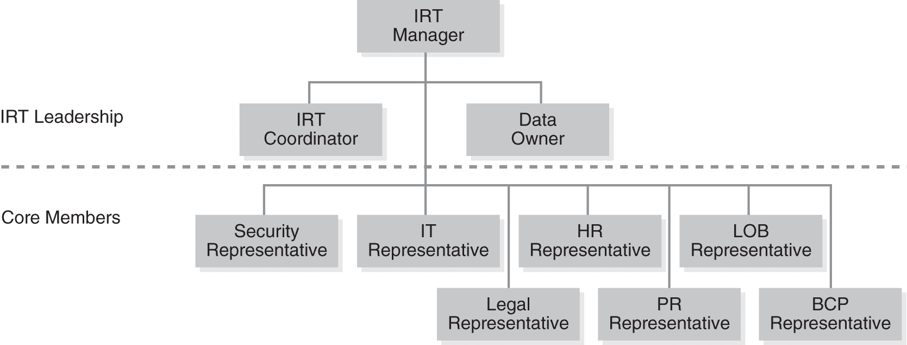

**图 12-1** 核心响应团队。

### 前线用户

组织中的所有用户都有责任支持 `IRT` 的工作。当 `IRT` 响应事件时，时间是至关重要的。前线用户对信息请求提供快速响应是重要的。此类请求可能包括保留证据。用户可能会被记录事件并协助收集证据。

前线用户在检测事件方面也起着重要作用。当警觉的用户报告可疑活动时，会增加事件尽早检测的概率。

### 系统管理员

系统管理员可能是 `IRT`（事件响应小组）团队的核心成员。系统管理员帮助分析威胁并建议即时响应。这些人员了解技术和技术基础设施。他们了解系统是如何经过定制的。他们能够很好地协助响应工作。

系统管理员有权做出关键更改以击退攻击。`system administrator` 一词可以指系统管理员、应用程序管理员和网络管理员。这些人员具备识别配置异常的技能，并有做出响应的能力。例如，他们可以将设备从网络上断开。

系统管理员对于环境的恢复也至关重要。管理员通常负责重建工作。这是一项重要任务，通常需要执行以恢复业务。

### 信息安全人员

信息安全团队在事件期间承担着多个角色。团队成员可能是第一个识别出安全漏洞的人。这是因为安全团队会监控环境以寻找安全泄露的迹象，例如入侵检测警报。此外，信息安全人员了解安全分层。他们理解潜在的突破点。

事件响应过程通常由信息安全人员设计和管理。安全人员直接或间接地参与了大多数 `IRT` 活动。这些活动包括：

*   发现
*   `IRT` 激活
*   封锁
*   分析与威胁响应
*   事件分类
*   取证
*   清理与恢复
*   事后活动

信息安全团队通常对事件响应提供管理和监督。他们是协调者，也是安全和风险领域的领域专家。因此，他们可能不负责执行所列活动的人员。在某些组织中，这些功能由信息安全人员执行。安全团队通常只负责确保活动的发生。例如，取证调查需要高度专业化的技能组合。它们需要大量的培训和特殊的工具。取证调查通常需要找出事件的根本原因，即使不太可能提起刑事控诉。然而，如果可以追溯到特定的攻击者，未能遵循标准的刑事程序可能会导致证据失效。许多组织不具备进行取证审查的技能和工具。某些组织仅具备基本能力。信息安全人员通常安排外部公司进行取证审查。

安全人员还确保在事件后进行审查，以确保吸取并采用教训。信息安全人员最常执行的角色是为管理层编写最终的事件报告。这一角色很有意义，因为在监督职责中，他们可以看到所有问题。他们跟踪事件的时间线。他们可以洞察全局，并将所有事件问题合并到一份文档中。

## 管理层

管理层为 `IRT` 的工作提供权威和支持。当组织的部分未能提供支持或响应不够迅速时，消除障碍是管理层的责任。

管理层对如何解决事件做出关键决策。要记住，是 `IRT` 建议、管理层批准。如果需要做出纯技术决策，`IRT` 独立运行。但如果决策对业务有重大影响，在可能的情况下应上报给管理层。管理层应赋予 `IRT` 足够的权限，以便在关键时刻能够迅速采取果断行动。需要做出的决策之一将是在发生网络攻击时，何时通知执法部门。

## 支持服务

这是一个广泛的类别，指的是任何支持组织 `IT` 和业务流程的团队。例如，帮助台（`help desk`）就是一个支持服务团队。

在事件期间，帮助台可能会直接与受攻击影响的客户接触。在此时，帮助台成为事件信息的传递渠道。帮助台在事件期间提供一份关键话术要点的脚本至关重要。这种脚本可以非常短，仅将问题转给其他部门。或者脚本可以提供更多细节，意在让公众了解情况。这些脚本应由公关部门开发并分发。

###  警告

如果在安全事件期间缺乏与管理层的有效沟通，则存在领导层各级采取可能加剧泄露影响或延迟恢复的行动的风险。`IRT` 经理必须积极主动，并与管理层建立良好的沟通渠道。这种沟通包括让管理层了解事件状态以及正在采取的步骤。

## 其他关键角色

`IRT` 经理 是团队负责人。该人员对如何响应事件做出所有最终决定。他/她是与高层管理的接口。`IRT` 经理会明确管理层需要做哪些决策。此人还向管理层说明不做出决策的后果。

`IRT` 协调员 的角色是跟踪事件期间的所有活动。此人担任团队的官方记录员。所有活动都通过 `IRT` 协调员，由其维护团队的官方记录。这是一个关键职位，因为记录的内容将成为重建事件的基础，以确定长期响应。

## 业务影响分析 (`BIA`) 策略

[业务影响分析 (`BIA`)]](#29_glossary.xhtml#gloss27) 是建立安全响应和业务连续性计划 (`BCP`) 的第一步。并非所有安全事件都需要恢复计划；然而，如果安全事件导致停机，你需要知道哪些流程对业务最重要，并优先提供恢复。你可以使用 `BIA` 来协调安全和业务响应，以使损失最小。

许多 `BIA` 是基于构建多个场景的。每个场景都是一个可能发生的事件，并分析该事件的影响。这包括自然灾害（如机房火灾），以及计算机硬件故障或网络攻击。`BIA` 将包含每个事件发生的概率以及此类事件造成的损害。

`BIA` 的主要意图是识别业务恢复和继续运营所需的资产。对关键资产和业务优先级的识别随后可以被 `IRT` 经理用于驱动事件期间关键决策的制定。这些资产包括关键资源、系统、设施、人员和记录。此外，`BIA` 还确定了恢复时间。

###  注意

`BIA` 由业务部门在安全团队的参与下创建。`BIA` 同时用于信息安全和非信息安全目的。例如，它被用于帮助识别市场风险。

一旦收集了数据，你就需要进行分析。汇总所有要求，并将知识整合到事件响应过程中。

###  提示

记住，`BIA` 过程用于从各种事件中恢复，而不仅仅是安全泄露。因此，你需要挑选与 `IRT` 需求最相关的信息。

### 组件优先级

使用业务影响分析（`BIA`）来识别对组织的负面影响。在此过程中，你将识别关键组件。`component`可以是一个功能/流程，也可以是一个如数据库服务器之类的系统。组件定义的详细程度取决于组织。它必须具有足够的细节，以便明确对业务的影响，并可以选择相应的恢复策略。

这些信息的来源是业务本身。`BIA` 不能在孤立的情况下进行。必须由业务部门确定组件的优先级。`BIA` 的这一阶段具有以下目标：

* 识别业务范围内所有的业务功能和流程。
* 定义每个 `BIA` 组件。
* 确定组件不可用时对财务和业务的影响。
* 为每个组件建立恢复时间范围。

针对每个组件都会收集或计算特定的指标。其中一个指标是最大可忍停机时间（`MTD`）。这是组件在停止服务而不会对组织造成灾难性损害的情况下允许的时间。与之相关的是平均恢复时间（`MTTR`）问题，有时被称为平均修复时间。它是将该组件重新上线或进行更换所需时间的算术平均值（平均数）。这两个指标将用于形成恢复目标等指标，这些指标将在本章稍后部分进行讨论。

### 组件依赖性

`BIA` 最重要的部分之一是确定依赖关系——哪些组件依赖或依靠其他组件。这包括对其他 `BIA` 组件的依赖。`BIA` 还必须识别特定的资源，例如技术和设施。其他依赖关系可能包括短缺的特定技能。

`BIA` 这一阶段的关键目标是：

* 识别依赖关系，例如其他 `BIA` 组件。
* 识别恢复每个组件所需的资源。
* 识别恢复这些组件所需的人力资产。

### 影响报告

一旦完成评估，你就可以汇总结果，制定建议并将整合点纳入 `IRT`（事件响应小组）过程中。


有了这些，业务就可以做出决策。BIA 影响报告不是由某个办公室或小组单方面发布的。你应该将其开发为关键利益相关者之间的协作。这些利益相关者包括执行领导层、风险团队、IT 和业务部门。生成报告的过程产生了共识。最重要的是，协作过程建立了实施 BIA 建议的政治意愿。

BIA 这一阶段的关键目标是：

* 验证 BIA 报告的发现。
* 对其发现和建议达成共识。
* 为其他评估提供基础。
* 开始对恢复至关重要的人员进行教育。

BIA 最终报告是组织业务连续性的重要组成部分。它是规划 `IRT` 过程的关键文档。它设定了组织对于 `IRT` 响应以及资助 IT 韧性工作的优先级。`Resiliency`（韧性）是 IT 领域的一个术语，表示 IT 基础设施从故障中恢复的速度。

## 基于 BIA 的策略开发与需求

BIA 描述了任务关键型的功能和流程。该报告会导致进一步的评估，以识别威胁和漏洞。你通常每年产生一次 BIA。接下来，你将发现与现有的安全策略进行比较。这种比较识别出了可能改进策略的机会。

随着业务随时间变化，BIA 是理解业务的极佳方法。这份优先级业务流程列表有助于集中安全工作，以保护业务最重要的资产。它还驱动了如何保护和恢复这些资产的安全决策。

## 事件响应程序

有效处理事件需要若干个关键步骤。这些步骤在事件响应程序中列出。

`图 12-2`

**图 12-2** 事件响应持续改进模型。

### 发现事件

快速发现事件是一项复杂的任务。它要求对正常操作有深入的理解。它还需要对异常进行持续监控。它要求警觉的员工报告可能作为事件指标的异常事件。企业意识工作必须教会员工如何报告可疑活动。

事件的迹象可能是明显的，也可能是微妙的。可能的迹象数量是巨大的。以下是极小部分：

* 注意到同事有可疑活动，且部门控制范围内的账户不平衡。
* 入侵检测传感器警报发生了缓冲区溢出。
* 杀毒软件警报多台机器上发生感染。
* 用户抱怨访问缓慢。
* 系统管理员看到一个带有特殊字符的文件名。
* 系统管理员在服务器上看到一个未知的本地账户。
* 发现服务器上的日志被删除。
* 日志显示有多次登录尝试失败。

这些迹象并不意味着事件已经发生；然而，每种迹象都需要进行调查，以确保没有发生泄露。某些事件很容易检测。另一方面，微小的、无法解释的迹象可能只是暗示事件已经发生。这样一个微小迹象可能是被修改过的配置文件。需要经过良好培训且有能力的人员来评估事件迹象。

### 报告事件

建立明确的事件报告程序是重要的。这包括收集、分析和报告数据的方法。当你收到事件报告时，对其进行分类。这个过程通常被称为 `triage`（分诊）。`triage` 是事件响应过程中不可或缺的一部分。分诊过程创建了当前状况的即时快照。这用于评估威胁的严重性。当事件达到特定的严重程度时，激活 `IRT`。这是事件的正式宣布。

值得注意的是，许多安全事件是孤立发生的事件，例如计算机病毒。这些通过建立良好的程序可以轻松处理。当事件被报告时，分诊过程必须由经过培训的人员负责，以便对事件及其严重性进行分类。严重性分类示例：

* **4 级**——检测到少量系统探测或扫描，或发现孤立的病毒实例。该事件由自动控制处理。未检测到未经授权活动。
* **3 级**——检测到大量系统探测或扫描，或检测到广泛的病毒活动。该事件需要人工干预。未检测到未经授权活动。
* **等级 2**——检测到对业务正常（BAU）运行的有限干扰。自动化控制未能阻止该事件发生。未检测到未经授权的活动。
* **等级 1**——检测到成功的渗透攻击或拒绝服务（`DoS`）攻击，导致运营严重中断，或检测到未经授权的活动。

评估报告事件的严重程度没有统一的标准方法。你可以选择允许现有的流程处理 3 级和 4 级。`IRT` 可能会被激活以处理 1 级和 2 级。你需要对术语有清晰的定义。等级 1 使用“运营严重中断”这一短语。该定义在不同组织之间可能有所不同。你不希望对定义的解释得如此严格，以至于定义失去了常识。例如，考虑一家大型机构的草坪维护调度系统遭到入侵。是的，这是一次成功的渗透。然而，它是否触发等级 1 存疑。虽然这个例子看起来很愚蠢，但这就是你完全根据定义采取行动时会面临的问题。定义无法涵盖所有情况。最佳实践是在分配等级分类时使用专业判断。定义应该提供指导，而不是规定性规则。

### 注意事项

在攻击的早期，你并不知道对组织造成的最终影响和损害是什么。在分诊（`triage`）期间，重点是理解攻击的性质并进行遏制。等级和事件分类可以帮助你快速做出如何遏制威胁的决策。

仅等级分类不足以确定响应。你还应该考虑事件分类以理解攻击的性质。例如，服务器因拒绝服务而宕机与未经授权访问包含数百万客户记录的信用卡数据库之间存在实质区别。这两种事件都可能意味着数据访问被临时中断，但后者显然更为严重。

通常会由信息安全团队的一位高级领导来做出正式宣布决策。此人是首席信息安全官或其授权代表。他/她的责任是确保分析是稳妥且适用于宣布某事件的。一旦正式宣布事件，`IRT` 响应时间就会开始。分诊记录了到目前为止采取的所有行动。该流程激活 `IRT` 计划并通知高层管理。文档包含了判定等级的依据。

### 遏制并最小化损害

你可以采取若干快速行动来遏制事件。这可能包括阻塞攻击来源的互联网协议（`IP`）。也可能包括禁用受影响的用户 ID 或从网络中移除受影响的服务器。无论具体方法如何，首要问题始终是遏制攻击。这必须始终是优先事项。

在制定响应方案之前，需要做出决策。这涉及到业务需求与追踪攻击者需求之间的平衡。`BIA` 可以帮助促进该决策。根据 `BIA` 中记录的影响和面临风险的资产，你可以决定允许入侵继续以收集有关黑客的信息，或立即停止入侵。简单来说，如果低价值资产受到攻击，那么你可以选择允许入侵继续以收集有关攻击者的信息。如果高价值资产受到攻击，你必须立即停止入侵。

### 供参考

组织可以使用不同的术语来表示 `IRT` 流程和核心团队。术语可能不同，但核心目标是相同的：在需要时保护并恢复服务，尽可能地减少财务损失，并吸取教训。

你显然无法预知事件类型。因此，你可能会发现获得管理层的行动先批准是困难甚至是不可能的。关于采取何种行动的决策应来自高层管理。然而，管理层需要理解允许攻击者继续将造成的损害。与管理层建立协议可以确定优先级并加快决策。`BIA` 场景讨论可以帮助领导层快速理解组织的优先级和选择。业务领导应该预先了解将被要求做出的决策类型以及涉及的影响范围。

`IRT` 将致力于对攻击进行分类。它还将致力于确定停止攻击的最佳手段。你应该记录决策过程的每一步。`IRT` 还将决定是否需要法医技能以及是否适当通知执法部门。

预先准备一套响应是非常重要的。初始分析提供了威胁全景，以便按顺序优先考虑一系列预演过的步骤。其范围可以从将服务器下线到阻塞外部 `IP` 地址不等。这些预定的响应应该被详细记录。文档应包含执行所需的何种级别的权限。例如，管理层可能会授予 `IRT` 阻塞海外 `IP` 地址的权限。然而，阻塞国内 `IP` 地址可能需要管理层的批准。在这种情况下，当涉及国内 `IP` 地址时应尽早提醒管理层。此类提醒将告知管理层情况，并确保有人能够做出快速决策。

遏制的重要部分是证据收集。`IRT` 团队的部分成员将专注于停止攻击，而其他人员将对日志、配置和其他证据拍摄快照。记住，成功的入侵是一个犯罪现场。如果你有机会起诉攻击者，尽可能收集更多证据至关重要。你也应该尽可能少地干扰环境。当你试图停止攻击时，这非常困难。然而，意识到收集证据的必要性是重要的。

### 事件后的清理

`IRT` 的核心使命是确保运营的高效恢复。显然，恢复重点是让受影响的系统恢复服务，但这不是恢复所实现的唯一工作。恢复包括确保允许事件发生的漏洞已经得到缓解。准确查明发生了什么，以及未来如何防止或至少减轻此类事件。缓解包括减少此类事件再次发生的概率以及减轻其影响。

一旦威胁被遏制，恢复阶段就会开始。你可以与业务连续性计划（`BCP`）代表一起实施有效的恢复策略。这可能需要恢复服务器并从头构建操作系统。下一步是测试受影响的机器和数据。测试应包括寻找原始事件的任何迹象，例如病毒或恶意软件。一旦测试了服务器和系统，就可以对它们进行认证并重新投入生产。

在遏制阶段，你很少时间收集证据。在清理阶段你有更多时间；然而，管理层可能会施压你恢复运营。如果可能，对受损的计算机进行法医镜像，以便在恢复后进行进一步分析。这样你就知道恢复之前的确切状态。有法医工具可以为你执行此功能。

需要注意的是，如果你希望稍后进行取证调查，尽早对嫌疑机器进行镜像将至关重要。在执法部门介入的情况下，拥有取证镜像将有助于他们的调查。从镜像过程开始，维护 `chain of custody`（证据链）是至关重要的，以防可能演变成刑事案件。该过程并不十分复杂：你需要记录设备何时进行了镜像、由谁操作、使用了什么工具。然后，将镜像存储在安全位置，并记录每个访问过该位置的人员。访问人数越少越好。需要注意的是，驱动器镜像可能是一个缓慢的过程。对机器硬盘进行镜像通常需要几个小时。建议即使组织不打算聘用全职的取证专家，至少也要让 `IRT` 的某些成员接受基础的取证培训。

如果你的组织成功受到攻击，可能会再次受到攻击。加固安全控制措施以抵抗再次攻击至关重要。在系统上线后，安装额外的监控通常是一个好主意。你可以利用额外的监控验证系统已经加固。你还可以利用额外的监控来改变管理应对未来尝试入侵相同系统的方法。

## 记录事件与行动

作为企业的焦点，`IRT` 可以在整个组织收集信息。`IRT` 评估事件期间和之后收集的信息，以获得对威胁的见解。所有状态报告都应通过 `IRT` 经理发布，这一点很重要。状态报告是 `IRT` 与管理层之间的内部通信。然而，你应该假设其他人可能会查看这些报告。它们甚至可能进入法庭。你应该避免在这些报告中进行推测。报告应保持基本事实。这些事实包括你所知的情况以及你正在采取的应对措施。

在宣布事件后，应立即开始事件分析。快速确定威胁类型。然后确定事件的范围和损害程度。这将允许你确定最佳响应方案。在分析期间，你正在收集信息以遏制事件。你也在为未来的取证分析收集信息。

收集取证证据是 `IRT` 责任的重要部分。这意味着收集并保存可以用于重建事件的信息。分析取决于尽可能收集关于以下方面的信息：

* 导致事件发生的原因
* 事件期间发生了什么
* 响应的有效性如何

有特定的工具和技术用于收集取证证据。由经过培训的专家收集信息至关重要，因为证据最终可能在法庭上使用。信息的收集必须遵循法院认可的严格规则。

这些规则的一部分涉及 `chain of custody`。这之前提到过。不仅信息要以特定的方式收集，而且在收集后要安全地存储。`Chain of custody` 是一个法律术语，指的是证据的记录和保护方式。证据从获取开始到提交法庭为止，都必须经过记录并受到保护。在取证中，记录越多越好。

###  提示

在收集要提交法庭的证据时，应仅使用成熟的取证工具软件包。此类工具示例包括 `Passmark Software` 的 `OSForensics`、`Access Data` 的 `Forensics Toolkit`、`Blackbag Forensics` 或 `Guidance Forensic` 的 `EnCase Forensic`。

### 分析事件与响应

分析的目标非常明确：识别控制中的缺陷。了解缺陷让你能够持续改进安全性。它有助于防止事件再次发生。在你检查控制措施时，可能会发现与事件无关的其他缺陷。理想情况下，你希望能够识别出以下内容：

* 攻击者
* 用于攻击的工具（如果可能）
* 被利用的漏洞
* 攻击结果
* 防止此类攻击再次发生的控制建议

每个事件都是不同的，可能需要一组不同的技术来获得这些答案。你可以采取一些步骤来帮助分析：

* **更新你的网络拓图和清单**——确保有最新的网络拓图和设备清单。
* **对网络进行画像分析**——按小时映射网络流量并保留趋势信息。
* **理解业务流程**——理解网络内的正常行为。
* **保持所有时同步**——确保所有日志都具有同步的时间戳。
* **关联中心日志**——确保日志被集中捕获并易于访问。
* **创建威胁知识库**——创建并维护威胁场景库。

了解环境更容易检测可疑活动。随着你对业务流程越来越熟悉，可以考虑新的威胁场景。这些新的威胁场景需要反馈到 `BIA` 过程中。随着时间的推移，这建立了一个关于业务面临的风险以及如何妥当应对的机构知识。

`IRT` 协调员应维护证据日志。所有与事件相关的证据都应记录在案。

关键点在于利用这些事件分析来主动防御威胁。报告检查了如何修复安全缺陷，以及为什么最初没有考虑并修复这些安全缺陷。报告在帮助修复特定漏洞的同时，也改进了风险评估流程。

## 创建缓解措施以防止未来事件

分析的一部分是追溯攻击源。这对于防止未来事件至关重要。此活动涉及找出黑客是如何进入应用程序、系统或网络的。分析应该创建一个事件的故事板和时间线。故事是事件的完整画面。这包括黑客、员工和 `IRT` 所采取的行动。

`IRT` 可能会寻求外部帮助来识别攻击者。这些外部帮助可能包括专门从事法证调查的咨询公司，也可能包括各种执法机构。这些外部资源与互联网服务提供商（`ISP`）建立了联系，它们可以追踪在线用户。虽然并不总是确定黑客的确切身份，但这些公司通常能够识别源头。换句话说，你可能永远不知道黑客的真实姓名；但你很有可能知道其源地国家和城市。这些公司还可以提供攻击者的画像描述。此类画像可能包括攻击者的技能水平和潜在动机。攻击者可能是一个高中生，也可能是外国政府。这些信息在确定应对措施时可能非常有价值。

###  警告

法证是一个利润丰厚的行业，但其监管却很差。在大多数州，唯一的要求是检查员必须持有私人侦探执照或是执法部门的成员。通常没有对特定培训的要求。不合格的法证从业人员数量惊人。对任何法证公司或个人进行彻底验证至关重要。建议你准备一家你检查过并信任的法证公司待命。

让组织从事件中学习以改进其控制措施是至关重要的。有时，这意味着改变其策略和程序。其他时候，这可能意味着提高安全意识以减少人为错误。它也可以意味着对你的安全配置标准进行更改。

最终的 `IRT` 事件报告应发布给执行管理层。该报告将让所有人了解被利用的风险。它还将展示该风险是如何被缓解的。报告应该回答以下问题：

* 事件是如何开始的
* 利用了哪些漏洞
* 是如何检测到事件的
* 响应的有效性如何
* 建议的长期解决方案

在重大事件之后，你应该与关键利益相关者召开教训总结会议。会议将回顾 `IRT` 事件报告中的要点。对于轻微事件，也应定期召开教训总结会议。你可以使用年度趋势报告作为减少风险进展的有效衡量标准。

教训应该包括如何改进事件响应流程。这些教训可以用于帮助培训，它们还可以帮助提高 `IRT` 技能。可以通过额外的培训等方法提高技能，还可以通过使用根据教训构建的新情景进行测试来提高技能。

#### 处理媒体关系并决定披露内容

`PR` 部门在向媒体和受影响方传达事件方面将发挥重要作用。`PR` 部门可以纠正可能损害公司声誉的错误信息。向公众发布信息的决定通常通过新闻稿来处理。

`PR` 部门也是媒体查询的联系点。如果记者联系 `PR` 部门，确保 `PR` 部门拥有有关事件的最新信息至关重要。发布多少信息是管理层的决策。`IRT` 管理层的职责是确保 `PR` 代表掌握核心事实。然后，就取决于管理层和 `PR` 部门来确定适用于这种情况的披露类型。

可能需要发出影响消费者的通知。许多隐私法要求，如果消费者的个人信息被泄露，必须通知消费者。再次，`PR` 部门将与管理层和法律部门合作，以确定为了保持合规需要披露哪些内容。请注意，任何掩盖泄露的行为都是违法的。

## 业务连续性计划

`业务连续性计划 (BCP)` 为重大故障后的持续运营创建了路线图。`BCP` 识别了持续业务的需求。`BCP` 必须涵盖设施、人员、设备、软件、数据文件、关键记录以及与承包商和服务提供商的关系等元素。

`BCP` 策略必须明确定义测试频率。`BCP` 策略为构建和维护计划提供了指导。`BCP` 还规定了执行的责任。`BIA`（业务影响评估）提供了最大停机时间。

`BCP` 策略根据 `BIA` 识别场景。这种方法允许你评估供应商的物理安全。定义良好的 `BCP` 策略要求在风险评估的同时进行差距分析。

###  提示

比较业务影响评估和业务连续性计划。两者应该紧密结合。例如，如果业务在 `BIA` 中识别出关键资产或流程，它就应该是 `BCP` 中的恢复优先级。差距或差异应报告给相应的管理层。

###  备注

`BCP` 关乎让核心业务运行起来，这包含了技术组件。灾难恢复计划（你将在本章稍后部分学习）关于完全恢复，就像事件从未发生过一样。将 `BCP` 视为仅仅维持组织运行所需的资源。

正如之前提到的，`BIA` 是业务连续性计划过程的第一步。`BIA` 的目的是识别关键流程并评估破坏性事件的影响。`BIA` 的预期结果包括：

* 关键流程和依赖关系的列表
* 包含恢复关键资产的人力要求的流程工作流
* 法律和法规要求的分析
* 关键供应商和支持协议列表
* 最大允许停机时间的估计

`BIA` 是开发 `BCP` 的基础。对 `BCP` 负责的人应该是 `BIA` 过程中的关键利益相关者。`BIA` 的低质量结果会导致低质量的 `BCP` 规划。

#### 处理系统、应用程序或数据可用性的丢失

关键系统、应用程序和用户访问要求的列表来自 `BIA`。`BIA` 还包含最大停机时间。这驱动了恢复方法和技术的选择。随着恢复窗口的缩短，必须更加依赖技术。

在长假周末期间，可能需要几个小时才能联系到对事件有合理理解的关键人员。最坏的情况下，可能需要几天时间。应对系统和技术的故障需要有效的规划。这还需要协调，并且通常更多地依赖于手动流程。这些手动流程必须经过良好的定义。

业务连续性计划（`BCP`）策略对信息也要求同样的关注。假设一家诊所面临灾难，它选择通过手工记录信息。手动记录的信息需要与输入计算机的信息同等水平的关注。这些信息可能受 `HIPAA` 保护，因此在安全和处理方面也需要同等的尽职努力。`BCP` 不仅仅关乎恢复；它必须详细说明在恢复期间保护信息所需的访问控制。这些控制措施可能包括安全地存储和传输这些信息。

## 基于 BIA 的响应与恢复时间目标策略


# 恢复时间目标 (RTO)

恢复时间目标 (RTO) 是业务流程在中断或停机后恢复所需的时间长度。换句话说，你多久能让某个系统恢复上线？设置此目标时应考虑之前讨论过的可忍停机时间（MTD）。

理解 RTO 与业务过程的关系至关重要。它与依赖性组件（如技术）无关。RTO 是衡量单个业务流程恢复快慢的指标。RTO 是 BIA 的自然延伸。它确定了业务流程允许的最大停机时间。最大允许停机时间基于业务对损失的容忍度。这反过来变成了 RTO。这就是为什么业务连续性计划员是 BIA 流程的一部分。

该计划员了解组织从灾难中恢复的能力。计划员应该能够识别业务在 BIA 过程中设定的不现实的 RTO。例如，业务可能表示在发生灾难时需要其应用程序实现近实时的恢复。很少组织能够实现这一目标。BCP 计划员促进对恢复成本和组织能力的坦诚讨论。连续性计划员还可以提出增加成本的策略。

## 恢复点目标 (RPO)

RTO 策略通常包含对恢复点目标 (RPO) 的讨论。RPO 是从灾难发生起可接受的最大数据丢失量。考虑这样一个例子：公司每小时备份一次服务器。在硬盘崩溃的情况下，公司可能会丢失多达 59 分钟的数据。组织必须询问这是否可以。如果不接受，则必须重新审视备份策略。

RPO 可以比 RTO 短。在这种情况下，业务意味着业务流程可以停机更久。然而，当业务运营运行时，业务需要更早点的数据，例如停机点的数据。理解 RPO 关乎数据而非单个 RTO 非常重要。当你查看 RTO 和 RPO 时，成功恢复业务的需求便随之而生。这些需求驱动了恢复技术的选择和 BCP 的设计。

### 注意


BIA 成为 BCP 和 RTO 的需求文档。除非发现了新数据，否则在 BCP 过程中你很少更改 BIA 需求。

# 事件响应策略的最佳实践

事件响应策略意识到组织需要建立强大的外部关系。这些策略需要指明应由哪种角色负责维护这些关系。例如，法律部门通常负责与外部律师事务所维持关系。

事件响应小组（IRT）可能希望与专门负责事件响应的咨询公司建立正式合同。这些公司可以提供针对特定攻击的知识。此类知识在组织内部可能无法获得。由于咨询公司处理多个客户的多个事件，因此它们能够快速响应事件。

事件响应策略和能力需要测试。测试也可以作为 IRT 的培训。培训确保员工具备所需的技能 set，以快速响应事件。理想情况下，测试不应预先，这样也可以测试激活流程。

IRT 及其相关策略的有效性需要被衡量。这是为了确保 IRT 实现了其既定目标。衡量结果应每年发布一次，并与之前进行比较。衡量标准应包括 IRT 章程中的目标，以及指示组织风险降低的额外分析。这可能包括：

* 事件数量
* 重复事件数量
* 每个事件的遏制时间
* 对组织的财务影响

# 灾难恢复计划策略

灾难恢复计划 (DRP) 包含了组织从某些事件中完全恢复所需的策略和文档。业务影响分析驱动了业务连续性计划的需求。BCP 驱动了灾难恢复计划的需求。这些包括软件、数据和硬件。DRP 实际上比 BCP 更详细。DRP 不仅必须让基本系统上线，而且实际上要*所有*系统恢复上线。

灾难恢复规划考虑人员、流程和技术。在许多情况下，法律和法规规定了 DRP 的要求。对于医疗机构，1996 年的《健康保险可流通与责任法案》（HIPAA）要求制定 DRP。在制定 DRP 时，与组织的法律部门合作以确保满足要求至关重要。另一个例子是职业安全健康管理局（OSHA）要求拥有 10 名或更多员工的组织拥有 DRP。该法律的部分目的是保护员工在灾难期间的健康和安全。

## 灾难声明政策

灾难声明政策概述了激活 BCP 和/或 DRP 的流程。技术基础设施中发生局部 IT 事件并不罕见。

如果某个事件导致了业务停机，则将激活 BCP。局部技术故障通常会影响业务。它们可能尚未达到灾难水平。尽管如此，在这种情况下，BCP 计划中的 DRP 部分将被激活。服务器可能会宕，关键文件可能会被删除。这会导致小型组织的关键应用程序禁用。然而在大型组织中，此类事件每月都会发生。它们被视为常态，不会触发 DRP。

### 注意


需要注意的是，技术故障经常发生，而不是在发生安全漏洞时。通常恢复计划是独立于原因创建的，根据需要整合到 IRT 流程中。

灾难声明政策定义了评估和宣布灾难的角色和职责。一旦激活了 DRP，就会启动许多流程和能力。你可以通过自动化系统处理其中许多活动，例如通知员工。对于大型复杂组织来说，激活 DRP 的成本高达数千美元。在这种情况下，关于谁可以宣布灾难的决策受到严格控制。一旦计划激活，你希望该过程尽可能自动化。对于参与的人员来说，这应该是他们的本能。

# 灾难恢复

一旦宣布灾难，就很难停止其早期的升级阶段。这些可能包括通知关键领导者和准备恢复能力。宣布灾难的流程包含在灾难宣告政策中。以下是该计划可能包含的激活事项示例：

* 对人员、利益相关者和战略供应商进行紧急通知
* 激活备用站点
* 激活应急控制中心
* 交通和住宿安排
* 释放预置资产

这些活动中的许多将与 `BCP`（业务连续性计划）活动重叠。区别在于，它们侧重于 IT 基础设施的恢复，而不是业务运营。

## 灾难严重程度及潜在停机时间的评估

并非所有灾难都是相同的。整个数据中心损毁于洪水，与遭受导致几十台服务器故障的 DOS 攻击之间是有区别的。但两者都会激活 `DRP`（灾难恢复计划）。

严重程度评估在整个灾难期间持续进行。它始于灾难宣告，并不断更新。你将信息转发到应急控制中心。在这里，信息被纳入决策过程。对潜在停机时间进行这种持续评估是重要的。它确保了正确的资源被分配到问题上。灾难期间的许多关键业务决策取决于对问题严重程度的评估。少量抽样包括：

* 资源分配
* 通知客户
* 财务损失和成本评估

资源分配让正确的人关注正确的问题。考虑一个重要供应商应用程序的大规模重大停机。你的 IT 团队估计停机时间约为一小时。然后你重新进行评估，并估计潜在停机时间为几天。应急控制中心的领导层在第一种情况下可能会更有耐心。在第二种情况下，领导层可能正在与供应商通话，并开始从空调额外资源。

拥有现实的停机时间估计对于客户关系至关重要。过于乐观的恢复估计往往会导致信誉流失。假设航空旅客被告知航班将延误 20 分钟，但随后他们的飞机直到 3 小时后才离开起飞。当这种情况反复发生时，会引发重大的公关问题。`DRP` 要求对潜在停机时间做出最专业的判断。不切实际的估计可能会使恢复过程过度复杂化并损害恢复效果。在整个恢复过程中，保留估计的完整历史和依据是重要的。你可以在灾难后评估中使用这些信息来改进你的流程。

灾难期间的评估是为了确定财务损失和成本。长时间的停机可能需要注入资金以维持组织度过整个灾难。所需的资金量取决于停机持续。准确估计潜在停机时间对于控制这些成本非常重要。要记住，这不仅关乎安全违规或事件。同样，你需要将安全事件视为一种业务中断。业务依赖于端到端流程的运行。从技术角度来看，这意味着系统、应用程序和数据必须全部到位并正常运行。如果这些组件中的任何一个没有恢复或未对齐，流程就会失败。灾难恢复策略定义了备份什么、备份频率，以及在发生灾难时如何恢复数据。`DRP` 必须与 `BCP` 和 `BIA`（业务影响分析）良好对齐。

系统、应用程序和数据的备份与恢复有独特的要求。系统和应用程序在某些方面更容易恢复。它们的更改频率较低，且通常依赖于供应商的软件。

# 事件响应政策的案例与示例

## 私有部门案例

一篇在线案例研究提到了一价值数十亿美元的上市公司。该公司是 IT 基础设施的领导者。文章并未提及该公司。

问题：该公司的服务器被攻破，作为攻击其他公司的跳板。公司接到另一家公司的通知。管理员激活了 IRT 来评估威胁。管理员未能发现发生了违规。他们请了一家名为 Riptech 的咨询公司，该公司专门从事入侵和法证分析。Riptech 发现一台服务器被攻破。该公司想要监控入侵者的活动。然而，Riptech 收到内部法律顾问的建议，不不允许入侵继续。Riptech 成功将攻击追踪到北达科他州的一所高中。

该案例说明了公司的事件响应政策和计划。它指向了公司拥技能和工具。此外，信息响应政策明确了形成 IRT 的角色和技能要求。该团队似乎是跨部门的，因为法律部门显然参与了。此外，IRT 激活得很快。然而，管理员未能发现发生了违规。

该案例说明了如何使用法证工具收集证据。在恢复系统之前，对受感染系统进行了位图复制。这保留了受影响的服务器。该镜像可以作为证据或对事件进行进一步分析。

该案例还说明了所采取的公关方法。由于没有数据泄露，公司决定不公开承认攻击。文章指出担忧在于公众形象。该组织不想让人们知道青少年破解了其系统。

由 Riptech 出出的最终事件报告概述了导致违规的一系列控制缺陷。咨询公司帮助公司恢复了系统并在未来缓解了威胁。

## 公共部门案例

2019 年 8 月，德克萨斯州的多个政府设施遭受了勒索软件攻击。德克萨斯州的 23 个城镇和城市遭遇了协同网络攻击。由于勒索软件的影响，市政府的服务无法正常使用。响应团队包括州官员和联邦调查局（FBI）。FBI 将恶意软件识别为`Odinokibi`病毒，该病毒最早于 2019 年 4 月出现。

事件响应过程确定，勒索软件最可能使用的攻击向量是由第三方管理的通信通道。初始入侵点似乎是一封钓鱼邮件。这是从此事件获得的第一条教训：只有识别出事件发生的机制，才能采取措施减少再次发生的概率。

恰巧的是，德克萨斯州此前一直在致力于建立一个集中的事件响应系统。这包括协调受影响城市之间的事件响应，并尽早让 FBI 和特勤局参与其中。由于事件响应能力的提高，大多数城市在几天内就恢复了全面运行，且没有一个支付勒索金。此外，全州立即发起了加强网络培训以及改进防御和事件响应的行动。这是一个有效事件响应政策的示例。

## 关键基础设施案例研究

卡内基梅隆大学 CERT 项目发布了一项案例研究。它描述了该国最大的银行之一如何建立一个`IRT`（事件响应团队）。该案例研究隐藏了银行的名称，称之为`AFI`。案例研究描述了`AFI`为创建团队和相关政策所经历的过程。

安全经理很清楚需要一个`IRT`。他观察到安全事件的处理方式各不相同。这是一个问题，因为银行受到某些法规的约束。采取的方法是涉及几个风险小组和关键利益相关者。通过使用最佳实践启动了这项工作。由于组织的规模和复杂性，在全球范围内部署花费了几年时间。该工作起初人手不足。低估了所需的精力。需求没有被清晰地理解。

该案例研究是受监管行业要求建立有效信息响应政策的良好范例。这也是一个由具备适当技能的人员组成的`IRT`示例。案例研究中没有迹象显示聘请了外部公司协助公司。在内部缺乏相关技能时，聘请外部公司帮助规划此类工作是一项最佳实践。

## 章节总结

在这一章中，你学习了需要哪些事件响应政策来有效应对安全泄露。定义什么是“事件”至关重要。政策还应明确说明如何分类事件。你还学习了如何制定团队章程。本章研究了现场响应团队与促进响应的团队之间的区别。本章讨论了事件期间团队的关键角色和职责。本章讨论了如何构建事件计划，包括`BIA`（业务影响分析）评估的重要性。此外，章节讨论了`BIA`、`BCP`和`DRP`之间的对齐。

本章还研究了事件期间应遵循的标准程序。它研究了响应事件的每一步所需的关键决策，包括遏制事件和收集证据。本章还讨论了最佳实践，以及使用外部公司补充组织技能组合的重要性。最后，本章探讨了这些原则如何在现实世界中应用。实施定义良好的事件响应政策需要大量的时间和精力。然而，遏制威胁和限制组织损害的价值超过了其投入成本。

# 核心概念与术语

- 业务连续性计划 (`BCP`)
- 业务连续性代表
- 业务影响分析 (`BIA`)
- 灾难恢复计划 (`DRP`)
- 尽职责任 (Due care)
- 人力资源代表
- 事件 (Incident)
- 事件响应团队 (`IRT`)
- 信息安全代表
- 信息技术领域专家
- `IRT`协调员
- `IRT`经理
- 法律代表
- 公共关系代表
- 恢复点目标 (`RPOs`)
- 恢复时间目标 (`RTO`)

# 第 12 章评估

1. 所有事件，无论大小，都应该由事件响应团队处理。
    1. 正确
    2. 错误

2. 下列哪项*不应该出现在信息响应团队章程中？
    1. 任务
    2. 组织结构
    3. 详细行预算
    4. 角色与职责

3. 在向公众公布事件之前，应该咨询以下哪些`IRT`成员？
    1. 管理层
    2. 公共关系
    3. `IRT`经理
    4. 以上所有

4. 根据本章的定义，哪项*不是*响应事件的步骤？
    1. 发现事件
    2. 报告事件
    3. 遏制事件
    4. 创建预算
    5. 分析事件

5. 本章概述的确定事件是重大还是轻微的方法是根据对事件进行分类。

6. 在遏制事件时，你应该始终应用长期的预防解决方案。
    1. 正确
    2. 错误

7. 在遏制步骤期间，你应该尽可能收集有关事件的证据。
    1. 正确
    2. 错误

8. 在事件后的清理工作中，你应该擦除受影响的机器并从头开始重建。
    1. 正确
    2. 错误

9. 取证工具具有什么价值？
    1. 收集证据
    2. 帮助证据被法庭接受
    3. 可以获取机器的位映像 (bit image)
    4. 以上所有

10. 在发布最终 IRT 报告之前，识别攻击者有多重要？
    1. 至关重要；没有它就不要发布报告。
    2. 中等重要；有的话很好，如果没有也发布报告。
    3. 不重要；关注事件本身，即使有身份信息也不包含。
    4. 重要；让执法部门向管理层通报攻击者的身份。

11. 在分析事件时，你必须确定以下哪项？
    1. 攻击的工具
    2. 被利用的漏洞
    3. 攻击的结果
    4. 以上所有

12. 哪个 IRT 成员负责处理媒体？

13. 业务影响分析(`BIA`)是在业务创建业务连续性计划(`BCP`)之后创建的。
    1. 正确
    2. 错误

14. `BCP`和`DRP`的区别是什么？
    1. `BCP`关注业务恢复，而`DRP`关注技术恢复。
    2. `DRP`关注业务恢复，而`BCP`关注技术恢复。
    3. 两者没有区别。这两个术语的意思相同。

15. `BIA`评估由`IRT`团队创建，主要用于安全事件期间。
    1. 正确
    2. 错误


© obpcnh/Shutterstock

# 第三部分：IT 安全策略框架的实施与维护

- 第 13 章 IT 安全策略实施
- 第 14 章 IT 安全策略强制执行
- 第 15 章 IT 策略合规与合规技术


© obpcnh/Shutterstock

# IT 安全策略实施

## 第 13 章

**信息安全策略**是建立良好安全习惯的石。IT 安全策略定义了将控制哪些业务和技术风险，以及如何控制这些风险。用户可以在日常工作中向策略寻求指导。策略是创建保护信息风险文化的有用工具。策略也是任何审计中都会检查的备查产物的一部分。这些策略的采纳和有效实施，向监管机构、客户和股东证明了公司正采取尽职责任保护公司及其客户的个人信息。其风险极高。实施良好的安全策略可以建立品牌信任，并帮助组织实现目标。实施不当的安全策略会导致违规事件、罚款和品牌价值受损，并损害对组织的信任。


如果策略要发挥作用，每个人都必须遵守。安全策略的实施需要用户的认可才能成功。如果没有用户的认可，策略可能无法一致地实施。它们有时会被认为是可选的。你可以通过有效传达且易于理解的策略，在某种程度上获得用户的认可。除了其他方法外，安全意识计划有助于用户理解策略及其重要性。安全策略的实施还需要管理层的支持。周全的规划允许你克服挑战并获得这种支持。

本章探讨了实施 IT 安全策略的简单流程方法。它将带你了解这一高层级流程，并探索在实施安全策略时遇到的主要问题。你将读到如何克服挑战以及沟通计划的重要性。本章还探讨了实施安全策略的最佳实践。最后，本章展示了案例研究，以强化重要的主题和概念。

## 第 13 章主题

本章涵盖了以下主题和概念：

* 简化的实施流程是什么样子的
* “目标状态”的含义
* 如何赢得高管支持以及为什么这很重要
* 什么是良好的策略语言
* 员工意识和培训涉及哪些内容
* 如何通过适当发布信息来教育员工
* 你应该预见到哪些策略实施问题
* 治理和监控在安全策略实施中的作用是什么
* 在实施 IT 安全策略时应遵循哪些最佳实践
* 一些成功的 IT 安全策略实施的案例研究和示例有哪些

## 第 13 章目标

当你完成本章时，你将能够：

* 描述一个简单的实施流程
* 解释关键流程步骤和相关问题
* 识别实施策略中的关键组织和文化问题
* 描述为什么高管支持如此重要
* 定义什么是沟通计划
* 解释沟通计划的重要性
* 解释安全策略的“意识”与“培训”之间的区别
* 描述策略培训的示例
* 描述什么是午餐会议（`brown bag session`）及其益处
* 解释克服反对意见的技术
* 描述分发策略材料的不同方式
* 解释实施 IT 安全策略的技术性和非技术性障碍
* 理解实施 IT 安全策略时应遵循的最佳实践
* 将成功的 IT 安全策略实施案例作为你组织的示例

## 简化的实施流程

实施 IT 安全策略有许多方法。实施方法取决于许多因素，例如组织需求、技术复杂性水平、行业、文化以及变更流程的成熟度。例如，假设你的组织首次添加移动解决方案。对于一个在该领域没有先验的组织来说，这可能是一个重大项目。它应该有一份详细的 IT 安全计划，包括考虑业务风险、网络威胁、合规要求、策略变更、员工意识、培训、策略实施和治理。这涵盖业务风险、网络威胁、合规要求、策略变更、员工意识、培训、策略实施和治理。添加新的移动解决方案可能是昂贵且耗时的。

现在考虑一个在实施移动解决方案方面拥有经验的组织。假设你希望对安全策略进行变更。在许多方面，流程是相同的。你仍然需要从业务风险、网络威胁、合规要求的角度来考虑策略变更、员工意识、培训、策略实施和治理。然而，在第二种情况下，规模和工作量会更小。在富有经验的组织中引入变更显著减少了考虑策略变更及其影响的时间。事实上，尽管过程可能是相同的，但经验可能意味着这些步骤不那么正式。在两种情况下，一贯地思考并良好地记录风险和需求都是良好的做法。

### 注意

控制环境是一个描述组织的控制治理和执行整体方式的术语，包括控制实施的有效性、组织的风险文化以及管理层的态度。

图 13-1

**图 13-1** 实施 IT 安全策略的简单流程。

`Threat vector` 是一个通用的信息安全术语，用于描述黑客获取未经授权访问的工具或路径。例如，通过互联网访问网站并在网页的输入框中添加 `SQL injection` 代码被视为一种威胁向量。

描述策略目标和目的有多种方法。策略的价值通常取决于你对目标和目的描述得程度。描述越有说服力，人们就越重视该策略。其中一种比较有效的技术是按以下方式描述目标和目的的：

* **业务风险**（Business risk）——描述策略将如何降低业务风险，更具体地说，它将如何把风险降低到可接受的水平。
* **合规性**（Compliance）——描述策略将如何确保业务符合法律法规。这对于医疗保健和信用卡等受监管的行业尤为重要。
* **威胁向量**（Threat vectors）——描述策略将如何防止、缓解或检测 IT 安全威胁。

`Business risk` 可以通过策略如何赋能业务或减少业务中断来表示。这种风险也可以用业务风险术语来描述，例如在风险和控制自评估（`RCSA`）中的表达。`RCSA` 通常由业务部门每年编制，描述了其主要风险、控制措施以及实现目标的障碍。

例如，假设一家公司想要开始通过互联网向海外客户销售产品。在这种情况下，欺诈风险可能会增加。某些海外地区，如东欧、非洲、马来西亚、印度尼西亚、土耳其和巴基斯坦被认为是高风险地区。一旦发生欺诈，商家的恢复和法律行动选择非常有限。采取额外的安全措施来防止或检测此类欺诈将被业务视为增加值。例如，公司可能会将销售限制在感知风险较低的特定国家或地区，如西欧或日本。这在一定可以通过阻止某些 `IP addresses` 实现。

`Compliance` 涉及业务必须遵守的法律和监管指令。某些安全策略是法律法规强制要求的。描述安全策略如何帮助组织满足法律要求是业务的另一项有价值的补充。需要注意的是，符合法规或行业标准只是最低水平的安全，而非理想状态。组织有时会犯一个错误，认为如果他们符合某项标准，他们就是安全的。合规应该被视为一种基准，即最低水平的安全。

`Threat vectors` 是业务关注的问题。威胁向量是发起攻击的方式。通常，这些是业务可能无法很好理解的技术性威胁。例如，描述 `SQL injection` 攻击对业务高管来说可能意义不大。然而，描述其对业务的结果和影响对他或她来说将非常重要。例如，你可以解释 `SQL injection` 攻击会导致客户信用卡信息被盗或公司网站被关停。

还应该有一项关于公司网络安全团队保持当前威胁更新的策略。这通常被称为网络威胁情报的一部分。几项服务和网站可以帮助网络安全专业人士跟上威胁。这里列出了其中几个：

* SANS Internet Storm Center: `https://isc.sans.edu`
* Cyware: `https://cyware.com/category/cyber-threat-intelligence-news`
* Threatpost: `https://threatpost.com`
* Cyber Threat Intelligence Feeds: `http://thecyberthreat.com/cyber-threat-intelligence-feeds/`

无论使用何种方法，目标状态（target state）都必须清晰地描述实施该过程所需的技术、工具和资源。此外，为了推销策略的需求，目标状态必须根据其将实现的目标和目的来描述价值。

### TIP

午餐学习会（Brown bag sessions）是高级领导者传达与信息安全策略相关要求的良好机会。这对于首席信息安全官（`CISO`）来说尤为如此。此类会议为 `CISO` 提供了一个与组织各个级别联系的非威胁性平台。

目标状态描述了策略实施如何与技术控制紧密结合。你可以拥有最好的策略，但如果无法实施，它们就是徒用处。下一节概述了几种可能阻碍安全策略实施的常见技术挑战。

## 分布式基础设施

安全策略适用于整个企业。因此，它们依赖于对风险的集中视图和控制。你设计了一套中央策略并将其应用于整个企业。然而，今天的技术是高度去中心化的。智能设备是移动的。用户的笔记本电脑和台式电脑拥有巨大的计算能力。远程办公室拥有服务器和支持本地网络的复杂数据机柜。这些只是几个例子。今天，许多组织还在云端中存储了大量资源。

所有这些共同构成了所谓的 `distributed infrastructure`（分布式基础设施）。该术语指的是组织连接的计算机集合（包括笔记本电脑、平板电脑和智能手机），并配备了分布式系统软件，以便它们即使在不同的位置也能像一个整体一样工作。

对于许多组织来说，数据中心之外的技术量非常可观。如何在去中心化的环境中实施集中的安全策略？这是具有挑战性的。目标状态必须描述如何实现这一点。你首先查看分布式基础设施的管理。

幸运的是，尽管许多技术是分布式的，但许多管理工具是集中的。集中式管理工具允许策略进行集中分发。一个经典的例子是恶意软件防护。大多数组织使用一个中央管理工具来保持恶意软件扫描程序的更新状态。更新通常发生在桌面电脑或笔记本电脑连接到网络时。设备上的 `agent` 与中央服务器通信并下载最新更新。

分布式基础设施通常通过 `agent` 或 `agentless central management tool`（无代理集中式管理工具）进行管理。`agent` 是运行在分布式设备上的段代码。就像病毒扫描一样，`agent` 软件定期向中央管理工具报告。`agent` 通常具有多个功能。最常见的功能是将设备的状态报告给中央服务器。它还接收命令和更新。在恶意软件扫描案例中，`agent` 将报告检测到的任何恶意软件并接收扫描器的更新。

`agentless central management tool` 具有能力和权限访问并连接到分布式设备。与恶意软件示例中 `agent` 软件将更新拉到设备上不同，`agentless` 软件是集中托管的。无代理管理产品使用操作系统或设备内部的标准接口。然后它们进行身份验证，从而获得执行其功能的权限。例如，平台管理接口（`IPMI`）可以作为 `Dell` `OpenManage IT Assistant` 工具的无代理接口。该工具用于监控和维护服务器的性能。

当前的资产清单是在高度分布式基础架构中实施的关键。你需要了解网络上有多少台设备。你还需要知道哪些设备遵循安全策略。许多组织使用发现和清单工具来捕获并跟踪这些信息。这些工具跟踪设备接入和断开网络的情况。它们还可以捕获关键的安全控制信息。

良好的资产统计数量与良好的配置信息相结合，可以让你在分布式基础架构中实施安全策略。这是因为你可以评估网络设备的规模，并比较其与安全策略的合规性。例如，典型的策略可能规定所有桌面电脑都必须更新防病毒保护程序。资产清单可能显示有 2000 台桌面电脑。中央恶意软件管理工具可能显示约 1800 台桌面电脑更新了恶意软件防护。现在你就可以评估安全策略实施的有效性了。大约 90% 的桌面电脑符合该策略。

## 过时技术

描述目标状态的另一个挑战是如何处理过时技术。`outdated technology` 是指由于过时而导致难以一致地实施最佳实践的硬件或软件。过时技术通常不符合当前的最佳实践。当这种情况发生时，你必须决定如何处理策略中缺乏安全控制的问题。你有四个基本选择：

1. 替换过时技术。
2. 按照最佳实践编写安全策略，并对于无法符合的过时技术发布策略豁免。
3. 按照该技术支持的最低、最常见的标准编写安全策略，即使它已经过时。
4. 为过时技术编写不同的策略集。

理想的解决方案是替换所有过时技术；然而，这并不总是可能的，特别是在经济衰退、许多组织都在削减成本的时期。但是，你应该意识到，如果你正在使用过时技术，存在你无法防御的安全威胁。继续使用过时技术始终是最后的选择。

在剩下的三个选择中，没有一个是好的。通常，最可以接受的选择是选项 2。未过时的技术将符合策略。无法符合的技术通常会获得豁免，并辅以额外的加固以尽可能地降低风险。豁免为业务所接受的风险提供了透明度。至少，任何授予的豁免都应该要求每年更新一次。这将提供审查豁免、风险以及其为控制环境引入的额外成本的机会。

有时，更换技术比升级其安全性更便宜。`FIGURE 13-2` 阐明了这一点。假设你的网络中存在过时技术。一种应对措施是改进分段控制以补偿。如果你分段的网络控制中存在过时技术，你将更多地依赖操作系统控制。如果你的操作系统技术是过时的，你将更多地依赖应用程序控制。任何增强控制的组合都可能缓解部分过时技术带来的风险。当然，所有这些额外的控制层都会增加组织的成本。

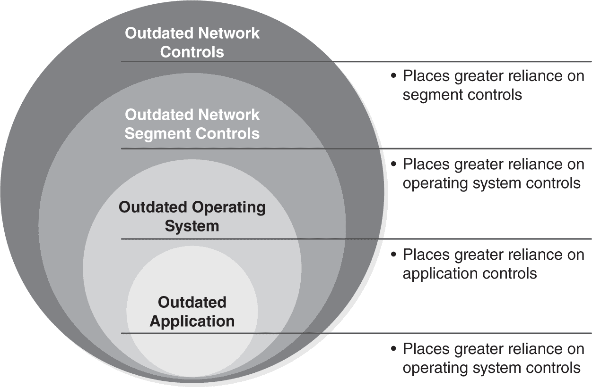

**FIGURE 13-2** 过时技术所需的扩展控制层。

过时技术会产生安全漏洞。供应商通常不再支持过时技术，因此新的安全漏洞将无法得到补丁。即使增加额外的安全层，其作用也只能是有限的。拥有过时的操作系统存在着重大的风险。一旦操作系统被攻破，应用程序很可能也会被攻破。

## IT 基础架构中缺乏标准化

另一个技术挑战是基础架构内部缺乏标准化。这可能由多个原因引起，但两个常见原因是：1) 配置缺乏一致性；或 2) 部署了多种不同的技术。

缺乏一致的配置是当不同的业务部门以不同的方式使用相似的技术时出现的问题。每条业务线都有自己的技术人员对相似的技术应用不同的标准。例如，假设你有一家既有实体店又有在线业务的公司。这两个业务部门都有一个公众无法访问的资产应用程序。该应用程序可能运行在相同的操作系统上，并执行相同的基本功能。然而，如果由两个不同的管理员小组维护该应用程序，配置看起来可能完全不同。

这种安全方法的多样性随着时间推移克服，但可能会导致安全策略实施的延迟并增加成本。两个管理小组需要对共同的安全方法达成共识。需要一个实施计划，以便两种配置都能以有序的方式迁移到新策略。

当你部署了多样化的技术时，安全策略必须更具通用性。策略必须确保尽可能多的技术能够合规。这意味着，如果一组技术存在漏洞，策略可能会选择在最广泛的技术集上应用较低的标准。安全策略通常考虑最低标准。因此，尽管一组技术存在漏洞，其余技术可以增加超出策略要求的安全性。其缺点是策略是强制性的。通过从策略中移除安全要求，无法确定这些额外的控制是否真的会被应用。

因此，部署多样化的技术产生了一系列权衡。你希望安全策略能够尽可能涵盖组织内的技术。这可能意味着有时需要降低某些安全标准。一种方案是发布一个生效日期在未来的安全策略。这为组织提供了升级技术和配置的时间。无论选择什么方法，确保安全策略的预期是现实的至关重要。

最终，对于任何需要承担的成本，你将需要高级管理人员正式认可和支持。在与执行管理层打交道时，请明确定义预期。高管通常没有多少时间制定具体的策略。他们期望获得定义良好的安全方法和建议。你可能需要他们对尚未决定的关键问题提供意见。然而，高管期望你已经做了功课，并与他们的团队对接。你应该已经与他们的员工进行过交流，并制定了大部分细节。当一个 `CISO` 站在高管面前讨论针对目标状态实施安全策略时，这应该是一次简短的对话。对话应侧重于“这是我们建议的方法”以及“这是我需要的”。高管至少将想知道以下内容：

* 要求其团队承担的承诺程度
* 策略对当前环境的影响
* 策略带来的价值；换句话说，该策略解决了哪些风险
* 成功指标——如何衡量成功

此外，务必建立沟通机制。你希望在实施过程中传达重大成功和挫折的消息。保持与高管的沟通渠道畅通。他们希望避免意外。如果某些事情进展顺利，他们倾向于首先从你那里听到。他们还将把成功作为未来请求的晴雨表。

## 执行管理层赞助

如果没有执行管理层赞助，用户不太积极参与意识培训，也不会支持策略的实施。支持策略的实施会占用个人日常工作的时间。许多组织都人手短缺且任务过重。安全策略的实施可能不被认为是有价值或紧迫的。执行管理层的赞助会改变这种认知。

你应该预期使用定义的预算为实施提供资金。购买工具和创建培训材料是启动成本。这些成本可能不在于当前的预算中。此外，你应该预期收到来自管理层支持该计划的正式沟通。这种沟通可以是一封简单的邮件，强调团队参与的重要性。这种“高层基调（`tone at the top`）”对于克服常见的反对（例如，“我现在太忙了”）非常重要。

争取支持的努力不应限于单一高管。安全策略的实施跨越整个企业。这意味着你应该寻求多位高管支持者。记住，意识是持续的，并且远超教室范围。意识和沟通计划应在整个策略实施过程中执行。例如，与公司公关或营销部门合作，可以将安全信息包含在公司简报和公告中。IT 安全团队提供内容，而沟通和营销部门专业地对信息进行包装。这些领域的高管赞助可以扩展信息的覆盖范围。这些高管可以就如何通过现有渠道进行营销向 IT 安全团队提供建议。

## 克服非技术障碍

不仅技术挑战会延迟安全策略的实施。记住，人为因素同样重要。成功取决于人们对策略的接受程度。

### 分布式环境

许多组织在分布式环境中运行。组织通常按业务线、产品或地理区域划分。在分布式环境中，一个组织由具有不同业务目标的不同个人运营。因此，组织的不同部分对风险可能会有不同的观点。这群多元化的领导者可能会延迟安全策略的实施。

第一个挑战是让高层领导同意一套共同的安全策略。第二个挑战是达成实施时间表。

### 用户类型

实施安全策略与任何其他活动没有区别。一个组织面临着许多冲突的优先事项。它可能会面临驱动其优先事项的业务挑战。例如，优先事项可能是扩展客户服务。组织可能需要减少其产品线中的缺陷。关键点在于组织的资源是有限的。通常，优先事项多于可用资源。挑战在于如何避免安全策略变成低优先级事项。理想情况下，安全策略应该被视为支持或实现业务最高优先级事项手段。

为了使安全策略的实施有效，必须将其视为一项严肃的组织承诺。你实现这一点，部分在于避免与其他优先事项发生直接冲突。你应该安排安全策略的实施时间，使其不与其他活动冲突。例如，假设你知道未来三个月内将发布新产品。你可能希望等到产品发布后才实施主要的安全策略。在这种情况下，公司可能没有足够的精力同时有效处理这两工作。

然而，你并不总是拥有等待实施策略的奢侈。你可能受到监管要求的限制，必须满足特定的时间表。当你拥有灵活性时，请规划实施时间，以确保组织能够充分关注这项工作。即使在最理想的情况下，你通常也会面临紧迫的实施进度。一旦组织对安全策略的内容达成一致，往往倾向于快速实施，以便组织转向其他优先事项。紧迫的时间表也可能是你对益处沟通良好程度的副产品。例如，面临重大审计发现的组织可能会将安全策略的实施视为控制这些风险的重要步骤。这会导致快速实施的巨大压力。实施计划必须考虑到接触并培训所有参与变更的人员所需的时间和精力，这是重要的。

### 注意


根据定义，策略是组织指令。在实施过程中分配具体的任务和责任是关重要的。当在处理大型、复杂的组织时，这一点变得尤为重要。实施计划必须为从领导层到 IT 安全团队的每一个人定义明确的职责划分。

# 策略语言

编写策略声明就像撰写法律合同。首先，双方必须对他们想要实现的目标达成一致，然后必须将其写入合同。如果双方无法对想要实现的目标达成一致，他们永远无法对合同语言达成一致。在编写安全策略时，这第一步往往被忽视了。当这种情况发生时，生成的策略语言可能缺乏背景，目标可能显得令人困惑。相反，遵循实施过程（如前文[图 13-1](#24_chapter13_01.xhtml#fig13-1）所示）意味着在资金和执行支持下对目标状态达成一致。

编写支持已定目标状态的策略要容易得多，并提供了一种快速获得支持策略语言批准的方法。尽管如此，不要低估这所需的时间，特别是在大型组织中。词汇对不同的人有不同的含义。你希望用易于理解的语言创建一个清晰、简洁的策略。

不要使用不精确的语言，如“应该（should）”或“预期（expected）”。例如，考虑一条规定，写道：“你应该使用八位密码。”你必须这样做吗？它听起来更像是一个建议而不是规则。更清晰的策略声明将是：“你必须使用八位密码。”

务必为特定角色分配明确的职责。你必须假设在某个时刻策略将不会被遵守。语言必须指出由谁负责。例如，假设策略语言规定：“管理层负责每 90 天审查一次员工的访问权限。”谁是“管理层”？经理？线线主管？部门高管？这种语言可能会引起困惑。更好的策略语言声明将是：“所有有直接下属的员工必须每 90 天审查其直接下属的访问权限。”你现在可以去记录系统（如企业目录）并确定谁应该执行哪些审查。

务必对策略涵盖的资源进行精确界定。避免在策略中要求特定的产品。策略应该关注需要实现*什么*，而不是*如何*实现。通常，技术策略可能对多个技术环境产生广泛影响。缺乏精确性和未能说明解决方案可能会导致困惑和限制。例如，假设一条策略规定：“所有服务器在存储信用卡信息时必须使用 EFS。”加密文件系统（`EFS`）是 Microsoft Windows 的一项功能，可用于加密硬盘上的信息。该策略并不精确，并将加密限制在了特定的供应商产品上。设置技术限制并不稀奇，例如要求至少进行 256 位加密。原因如下：首先，`EFS` 是一个 Windows 产品。如果你使用 UNIX 或 Linux 平台，你如何存储信用卡信息？其次，策略目标不应是使用 `EFS`。目标应该是对信用卡信息进行加密。这允许使用适当解决方案或工具的灵活性。

此外，所写的策略是不清晰的。它允许在笔记本电脑上存储信用卡信息吗？如果服务器是存储信用卡信息的唯一地方，策略必须明确说明。更好的策略声明将是：“仅允许生产服务器存储信用卡信息。此外，所有存储的信用卡信息必须经过加密。”你仍然可以通过添加“仅可以使用经过批准的加密解决方案”来限制可以使用哪些技术。这一添加通过要求定义的审批流程，实现了对可以使用哪些特定产品的控制。关键点是确保对目标状态有明确的共识。利用该共识来编写策略中的支持语言。在编写策略时，使用精确的语言来清晰地定义结果并分配职责。

## 员工意识与培训

员工意识和培训的目标是确保个人拥有实施安全策略所需的知识和技能。安全意识计划的首要目标是教育用户。一个执行良好的意识和培训计划可以做得很多。一些额外的益处包括：

* 强化组织的核心价值观
* 为管理层提供展示支持的机会
* 为员工提供获取新技能的机会，提高工作满意度

意识包括向员工介绍策略和核心安全概念。有效的安全意识有助于推动接受。当用户理解策略时，他们就可以对遵守策略承担法责。这促进了长期的安全文化转变。由于关系巨大，有一个深思熟虑的教育方法是重要的。

通常，组织会提供安全意识培训。这分为两个组成部分：

* **意识**——提高对安全策略重要性和价值的理解
* **培训**——提供遵守安全策略所需的技能

意识应该是项持续的努力，旨在强化核心概念。意识部分非常重要，因为它为安全策略的实施奠定了基调和目标。通过设定现实的目标，你可以为策略建立公信力。意识还能促进坦诚的对话。安全意识在某种程度上也关乎于有效的营销和信息传递。

培训部分比建立意识要直接得多。在安全培训中，你将详细审查安全策略。你将讨论这些策略如何适用于个人角色。你将对行为设定预期。安全培训侧重于执行机制——即预期要做什么以及何时做。通常，在安全策略培训中，你将讨论支持性流程。例如，你可能会讨论限制安全管理员账户。这可以引发关于如何授予权限的讨论。

# 技术技巧

你应该预期高管人员在培训期间会有某种程度的参与。高管可能只是简单地路过启动一次会议。在培训课程中的几句开场白可以向整个组织传递强有力的信息。此外，考虑录制高级领导者的视频信息作为一种有效的沟通技术。这避免了为他们安排多次培训课程而协调时间的问题。

## 组织与个人的接受

用户更倾向于接受他们所理解的内容。安全意识是让人们思考安全的第一步。安全意识培训为你提供了一个解释安全策略价值的机会。当安全策略帮助用户完成工作时，他们更有可能认为这些策略是有价值的。因此，安全意识计划的目标应该是获得支持以及传授知识。你需要针对用户定制培训。例如，高级领导者接受的培训类型将与个人用户的培训不同。

总体而言，用户行为定义了组织对安全策略的接受程度。当安全策略被广泛接受时，它们就会成为文化的一部分。这往往会降低风险，导致安全事件数量减少。反之亦然。当安全策略没有被广泛接受时，安全事件就会增加。让用户拥抱安全策略以确保策略被执行并发挥作用至关重要。

## 动力

理想情况下，意识应该具有激发和启发作用，而不仅仅是；然而，动力是一个更广泛的话题。个人的动力因人而异。一个明确的动力是自身利益。当管理层严格执行安全策略时，这就会成为一种强大的动力。这可以通过管理层如何追究未遵守策略用户的责任来体现。用户需要知道管理层对于实施安全策略是认真的。这种关于奖励和纪律的明确信息对于激励用户非常重要。

## 提示

最佳实践和标准通常包含如何制定安全意识培训策略的策略。遵循这些指南可以确保你满足监管要求。例如，`FISMA` 安全意识合规性基于 `NIST Special Publications 800-16` 和 `800-50`。

未经过培训或缺乏动力的员工可能会做出错误的决策。即使个人接受过培训，错误的决策也可能导致安全事件。错误的决策可能发生在组织内的任何地方。用户可能成为社会工程借口的受害者。用户可能未能报告控制弱点。管理层在收到报告后可能未能行动。风险专家可能未能正确评估漏洞的范围。高级领导者可能未能提供缓解措施资金。无论发生何种失败，当安全事件增加时，都存在策略被认为无效的危险性。

关键点在于，有效的安全策略实施取决于接受度。接受取决于那些感知到策略价值的个人。最终的接受取决于通过降低组织风险所证明的价值。安全意识和培训是一个传递价值并激励员工的机会。

### 制定全公司范围的安全意识策略

有效的安全意识培训必须覆盖组织中的每个人。这包括任何访问数据的人员，包括员工、承包商和供应商。安全意识培训的形式可能根据用户的类型而异。例如，针对供应商的安全意识培训可能由其母公司处理。与供应商的合同应规定客户要求的意识培训类型。通常情况下，供应商负责培训其员工。这与承包商不同。承包商通常会与签约公司的正式员工参加相同类型的培训。在这种情况下，签约组织负责安全意识培训。

然而，承包商的培训可以是简短的。如果承包商在现场停留的时间很短——例如三周——那么要求其进行几周的安全意识培训是没有意义的。

安全意识策略确保教育触及每个人。例如，策略可能要求所有用户在获得数据访问权限之前接受安全意识培训。这可能包括在员工入职培训期间完成基础安全意识培训。这确保了新聘人员在处理敏感信息之前接受培训。

安全意识策略通常概述所需的培训频率和类型。意识培训至少每年进行一次。安全意识培训策略可能要求以下类型的培训：

* `新员工和承包商`——在聘用时授予数据访问权限之前
* `晋升`——当个人晋升到显著不同的角色时
* `所有用户`——年度复习培训
* `事后培训`——在重大安全事件发生后且注意到缺乏教育时
* `供应商`——如合同中定义

了解你的受众非常重要。你应该量身定制培训以引起他们的共鸣。例如，幽默通常是意识培训中的一种有效工具。幽默可以吸引个人的注意力。它还能激发合作并让主题变得有趣。虽然这在较大的群体中可能是合适的，但在培训高管时可能不是最佳选择。通常情况下，你希望根据以下基础调整方法：

* `职位级别`——人们在组织中的职位越高，他们的培训越需要具有战略性。
* `意识水平`——某些用户需要更多关于基础安全概念的培训。
* `技术水平`——技术人才可能更容易理解威胁。

安全意识策略决定了所提供的意识培训类型。策略还定义了接受培训的受众。例如，策略可以要求高级管理层接受战略安全和策略培训。中层管理可能被要求参加策略和基础安全培训。

## 备注

所有用户必须接受某种类型的安全意识培训。策略应该定义此类培训如何交付。

培训应聚焦于个人角色和职责。中层管理人员需要理解基础安全概念以及他们在日常运营中可能遇到的风险。高层管理人员在关注组织运行的战略问题时，遇到这些风险的可能性较低。基础安全培训可能包括讨论如何实施加密方法，这是中层管理可能面临的一个实际问题。而高层管理对于处理基础安全问题缺乏兴趣，也没有足够的精力来关注。

安全意识培训的范围并非一成不变的。安全策略意识培训的一种方法是定义用户群体和提供的安全意识培训课程类型。这允许你针对个人需求要求特定的培训。`TABLE 13-1`](#24_chapter13_05.xhtml#tab13-1)是这一概念的一个简单示例。注意，这里定义了四种基本用户类型。安全意识政策将定义这些用户类型的每一种，以确保这些角色中的个人可以快速参加培训。列代表所提供的培训类型。培训的类型和水平将取决于组织的需求。注意对报告可疑活动的强调，这体现在所有用户都要求接受这种类型的培训。

**表 13-1** 简单安全策略意识要求

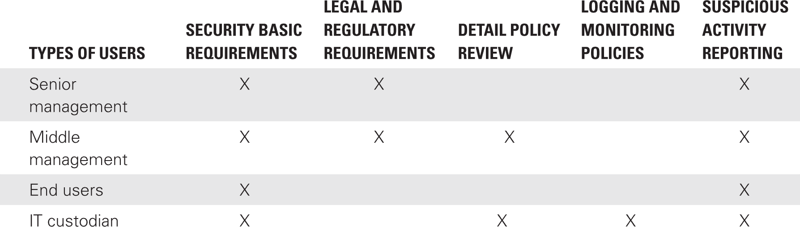

在许多组织中，这种培训通过在线课程注册工具进行跟踪。该应用程序允许个人参加可选的课程。应用程序还可以自动将要求的课程分配给个人并跟踪出勤情况。在线课程注册工具有助于执行安全意识政策。这些工具还可以显示执行政策的证据。

### 注意

安全意识政策必须要求全范围内进行特定的培训。这确保了预期的一致性。信息内容和培训类型可以根据角色而异。

### 进行安全意识培训课程

正式安全意识培训的目标是建立知识和技能，帮助员工以保护资产并符合政策的方式履行其职责。安全意识培训不仅仅是简单复述培训材料。成功的衡量标准是员工在工作中应用培训知识的有效性。

正式交付安全意识培训有两种常用方式：在课堂授课和通过计算机辅助培训（`CBT`）。这两种方法都被广泛使用，且各有优劣。大型组织通常结合多种方法使用。还有许多信息告知类方法，它们可以简单到经理向团队发送策略邮件，要求每个人阅读相关材料。信息传播方法将在本章稍后部分讨论。

在教室环境中，通常由经过培训的讲师进行安全意识培训。由讲师交付培训的优点是灵活性。假设某些培训材料的开发是基于观众具有某些技术技能。如果交付课程时观众没有必要的背景，经验丰富的讲师可以相应地调整交付方式。教室里的讲师可以回答问题并与学生建立联系。

教室环境也有缺点。首先是成本。由于设施和差旅费用，课堂课程可能很昂贵。你需要找到合适的教室并安排每个人的参加。会议室可以是有效的，但根据班人数和中断次数，有时并不是一个好的选择。个人从在办公环境下进行的培训课程中被抽调的情况并不少见。或者，在当地酒店或其他地点安排会议室也是需要成本的。参加可能意味着让人员飞往培训地点，或让讲师飞往偏远办公室。另一个问题是讲师的技能组合。经验丰富的讲师通常稀缺。主持培训课程需要特定的技能组合。

`CBT` 方法可以作为课堂培训的低成本替代方案。许多因素会驱动 `CBT` 与课堂培训之间产生成本差异。其中一些因素是组织规模、地点和旅行。对于大型组织来说，举办足够的课程以覆盖足够的员工人口并达到效果可能是昂贵的。此外，某些偏远办公室地点的旅行成本和教室空间费用可能很高。通过 `CBT`，你可以用一致的信息触达无限数量的工作。在线课程还允许员工在方便的时间学习。这可以包括在晚上或周末上课，避开办公室的压力和分心。

### 注意

许多组织结合使用多种方法，提供课堂培训和 `CBT`。

### 提示

课堂课程可以是一个积极的经历，个人可以在那里交流想法，并与其他学生及讲师建立个人联系。另一个显著益处是，讲师可以评估观众对材料的接受程度。通过提问和讨论，讲师可以确定观众对信息的理解程度有多如何。根据这些反馈，讲师可以调整培训使其更有效。

在线课程在每个课程中都提供测验以自动对能力评分。在线培训工具还可以要求参与者回顾他们认为困难的材料。`CBT` 对谁参加了课程以及个人在材料的部分遇到困难提供统计跟踪。

然而，`CBT` 方法也有缺点。它只能衡量个人对材料的了解程度。与讲师不同，它无法衡量材料被接受的程度。`CBT` 的一个优点和缺点是其呈现格式的一致性。材料中的信息传递是一致的；然而，某些 `CBT` 限制或没有机会针对特定观众定制信息。最后，`CBT` 是缺乏人性的。与课堂教学不同，`CBT` 与组织内其他人建立联系的机会很少。

### 注意

仅仅了解主题材料并不意味着你能够教授这些材料。在调整材料以适应观众时，核心信息不发生改变是重要的。传递一致的信息很重要。

尽早获得参与者对培训的反馈非常重要。这种反馈应该关注除了传递知识之外，材料被接受得如何。换句话说，了解参与者正在使用知识而不仅仅是记忆材料很重要。一些建议获取反馈的方法包括：

* 课程后的匿名调查问
* 焦点小组
* 参与者访谈
* 离职员工访谈
* 通过事件报告监控合规性

新员工通常可以通过人力资源（`HR`）部门取得联系。人力资源部门通常负责新员工的入职工作。`HR` 部门通常拥有一系列新员工必须完成的就业文件，从福利表格到身份证确认书。人力资源部门还提供一系列培训课程，以帮助新员工融入组织文化。大多数组织会将安全意识培训加入人力资源部门为新员工提供的项目清单中。这种做法具有成本效益，因为这只是简单地在人力资源部门开展的新员工培训中增加了材料。你不需要将新员工从工作中抽离出来参加单独的培训课程。从时间角度来看，这也是非常实际的。在员工接受培训之前，你并不希望他们访问敏感数据。你希望尽早接触到这些员工。

### 提示

所有员工都必须参加的安全意识培训应该在新员工入职培训期间进行。额外的培训可以在员工上岗后处理。

#### 审查可接受使用政策 (AUPs)

安全意识培训的一个核心主题是审查可接受使用政策（`AUP`）。要求员工签署 `AUP` 并不罕见。这表示他们确认已收到并阅读了 `AUP`。`AUP` 明确定义了哪些技术使用被认为是接受或不可接受的。例如，`AUP` 规定组织的计算机应仅用于业务目的。它还可能排除特定类型的使用，例如赌博或访问攻击性内容。`AUP` 还定义了个人责任，例如保护自己的密码。

`AUP` 中较为关键的培训点之一是禁止共享个人 ID 和密码。共享此类信息可能会导致敏感数据面临未经授权访问的风险。它还会损害“不可否认性”的概念。假设一名主管要求用户分享其密码。这对于员工和主管来说都是对 `AUP` 的违规行为。在现实世界中，如果员工及时报告了这一违规行为，将不会对其采取任何处理措施。尽管这可能是员工的违规行为，但主管是违规的源头。要求员工反抗主管、经理或高管并不总是合理的；然而未能报告违规行为可能被视为对员工进行纪律处分的重大理由。无论何种情况，主管都应该因为要求员工提供该信息而受到纪律。纪律的程度取决于组织。如果违规导致了欺诈或安全泄露，则有充分理由解雇该主管。

### 注意

可接受使用政策（`AUP`）是一份明确定义了一系列核心用户责任和期望的文件。它还讨论了未能遵守政策的后果。该文件旨在具有可执行性。违反政策可能会导致纪律处分，包括终止雇。因此，`AUP` 的语言是非常精确的。

`AUP` 不仅仅保护密码。它还涉及了其他高风险行为，这些行为应该包含在安全培训中：

* 敏感客户信息的处理和共享
* 信息向公司外传输信息
* 公司知识产权的处理

### 信息分发——如何教育员工

教育用户可以是正式或非正式的过程。正式方法是在正式的培训环境（如教室或计算机辅助培训 `CBT`）中传达政策的方法。正式培训的优点在于你知道谁在参加培训，并且可以在某种程度上衡量其有效性。

记住，人们的学习方式各异。选择多种方法来传播安全政策信息和材料是一个好主意。因为人们的学习方式不同，这增加了你触达每个人的机会。例如，那些对计算机培训不感兴趣的人可能会发现部门简报与他们的工作更相关。

理解组织的文化和受众也同样重要。如果一个组织有很多远程办公室，面对面的材料演示将不那么实际。此外，有些组织分发了太多的简报。某些用户仅仅因为量太大而停止了阅读简报。因此，简报可能不是沟通关键信息的最佳选择。以下是分发安全政策信息的潜在方法列表：

* 电话集会会议
* 电子邮件
* 简报
* 公司内网
* 海报
* 面对面演示
* 赠品，如胸针、马克杯、便利贴等
* 包含奖品的竞赛

任何能让安全信息保持“活跃”的沟通方式都是有效的。你通常受限于时间和金；然而，传达政策信息并不昂贵。它仅限于想象。你可以赞助一个安全政策意识竞赛。这可能只需要要求个人在线回答安全政策常识问题。获者将获得价值低于 20 美元的礼篮。只需几美元，你就可以运用创意想法来吸引员工并强化关键信息。

### 注意

安全意识不仅仅是正式培训。它是不断强化信息并将信息安全保留在每个人的脑海中。政策本身对个人来说是很好的资源。

要成功传播安全政策信息，你需要一个沟通计划。沟通计划 概述了要共享哪些信息。沟通计划定义了信息内容、人员和交付方法。通过制定整个沟通计划，你可以快速评估正确的信息是否已传达给每个人。

在制定沟通计划时，你应该问自己以下关键问题：

* **谁来传达？**——是否由合适的人员传递信息，以为这项工作建立公信力？
* **目标受众是谁？**——是否每个人都收到了适当的信息？
* **传达了什么？**——是否传递了正确的信息？
* **如何传达？**——我们是否以最有效的方式传递信息？
* **何时传达？**——沟通时机是否合适？
* **使用了什么材料？**——信息的传达是否一致？
* **实现了什么目标？**——是否实现了特定的目标？


**表 13-2** 描绘了一个包含两个活动的简单沟通计划。这两个活动都将由高层管理人员进行传达。第一个沟通活动为管理层向员工发布做好准备。在政策发布期间可以预见到问题。领导层需要准备好回答员工的问题，这使得政策的实施更加有效。第二个沟通活动是安全意识工作的实际启动。

沟通计划可以帮助使实施策略合理化。例如，你的策略可能要求在安全意识计划的前六个月内，每个人至少要收到三次沟通。如果是这样，通过扫描沟通计划中的“目标受众”列，你可以快速判断目标是否正在实现。

#### 纸质分发

无论形式如何，请将你的沟通渠道包含在沟通计划中。

如今，很少再发送策略的纸质版。发送大量纸质材料的挑战在于成本和材料的准确性。企业中所有的安全策略、标准、流程和指南可能长达数千页。这还包括辅助材料，如执行摘要、幻灯片演示和电子表格。因此，以打印形式分发材料是不现实的。打印成本会很高，而且分发需要花费时间、金钱和精力。此外，材料一旦发生变化，打印出来的材料就会过时。将策略发布在内部内网网站上非常有效。这些内容可以轻松更新，并且所有员工都可以随时访问。

###  提示

哪些材料适合作为纸质版发布取决于组织。通用的规则是尽可能避免发送纸质版。如果无法避免，请将纸质版控制在少量的材料上，并限制其分发范围。

#### 在内网上发布策略

沟通安全策略的最佳方法是通过如内网之类的文档处理服务器。这些服务器提供多处优势，例如：

*   分发材料的成本较低。
*   策略保持更新。
*   策略可搜索。
*   策略的变更可以突出显示。
*   你可以链接到辅助材料。

许多组织已经有了内网。因此，存储安全策略的额外成本微乎其微。集中的安全策略管理有助于你保持策略更新。

电子版相比纸质版的一个显著优势是能够搜索文档。任何用过互联网的人都熟悉搜索引擎。你可以输入关键短语并获取相关文档列表。同样的技术也适用于内网。你的内部策略可以快速针对关键短语进行搜索。在几秒钟内即可搜索数千页的内容。例如，假设一家公司决定与某个供应商合作处理敏感信息。使用关键词“vendor”（供应商）快速搜索策略，可能会返回六份文档。主题范围可能从需要进行供应商评估到安全连接要求不等。

文档处理服务器的另一个强大工具是跟踪变更。当发布修改后的策略时，了解被更改的确切字辞是有帮助的。策略通常包含对变更的高层解释，但很少涉及细节。查看策略中实际的词汇级变更的能力是一项强大的工具。这允许你更好地评估变更对现有控制措施的影响。

另一个重要益处是将策略链接到辅助材料的能力。辅助材料可以是执行摘要、幻灯片演示或各种教育材料。你可以链接任何有助于理解策略的辅助材料。例如，假设你正在阅读一个关于数据库日志的安全策略，但你并不完全理解这些内容。你注意到策略链接到了一个幻灯片演示。点击它后，你会看到一个由数据库管理员创建的教程，解释了如何应用该策略。

### 使用电子邮件

尽管组织之间分发策略的复杂程度各不相同，但大多数组织仍然依赖电子邮件。组织依靠电子邮件来批准策略，并让管理层了解实施活动的情况。

电子邮件在大多数沟通计划中也起着核心作用。电子邮件允许你向大量人群通知重大事件。它还允许你跟踪每个阅读过通知的人。这是确保个人能够收到策略发布的良好工具。电子邮件还允许你发送问卷，并跟进实施效果的感知情况。

#### 午餐分享会与学习课程

“午餐分享会”（Brown Bag Lunch）是一种培训活动。邀请某个主题的专家来分享他们的观点、想法和经验。`brown bag`（棕袋）一词的出现是因为会议通常在午餐时间举行，人们自带棕色袋装着自己的午餐。如今，这些会议可能在午餐期间举行也可能不举行，如果是的话，甚至可能提供午餐外卖。作为一个广义术，`brown bag` 可以应用于各种非正式的培训场合。

午餐分享会的核心概念通常适用于一组可以接触到一或多位专家的小组。参与者向专家提问。专家引导对话。这可能是一个正式演示，也可能不是。核心理念是这些会议比课堂环境更灵活。

会议的成功很大取决于专家。午餐分享会提供了一个说服并影响专家和参与者的机会。无论你的职位如何，午餐分享会都能建立个人联系。

午餐分享会还可以根据类型进行划分。例如，关于接受电子邮件使用的策略可能让客户服务部门特别关注。安全团队成员可能是选定的专家，负责解释为什么实施该策略，以及电子邮件沟通可能会发生什么变化。

改变组织文化和用户的感知不是一次性事件。仅仅发布安全策略并不能改变态度。安全是一项难以推销的任务，因为其益处并不显而易见。文化变革源于每天展示的清晰价值信息。它还需要协作以及对业务的理解。文化的改变是通过小步的增量完成的。这就是为什么你需要一个计划周全、循序渐进的方法来实施策略。在实施过程中需要传达的三常见信息是：

*   个人责任制
*   指令与执行
*   安全策略的价值

尽管“推销安全”有其积极意义，但最终在大多数组织中，安全是强制性的。温和的推销在激励员工方面作用有限，因为后果可能看起来并不真实。关于信息安全为什么重要，如果感知的论点越抽象，其说服力就越小。

讨论个人责任制和不执行策略的后果是非常重要的。后果可能从数据丢失到不符合合规性等。这种信息可以引起高管的共鸣，特别是那些在受监管行业中运营的高管。在高度受监管的公司，高管可能对未能实施有效控制承担个人责任。《萨班斯-奥克斯莱法案》（Sarbanes-Oxley Act）就是此类法规的例子。

在经过一段时间的“推销”后，通常会有管理指令和执行。管理层会要求实施策略。管理层通过执行策略的方式在组织内部设定基调。不可避免的是会有人不遵守策略。宽容程度以及执行策略的激进程度决定了基调。它也塑造了策略是否被视为重要。

为了满足紧迫的截止日期，通常需要管理授权和激进的实施。这在满足监管要求方面尤为重要。例如，在银行业，某些交易的强身份验证是法律强制要求的。这可能意味着在在线访问银行账户时需要双重身份验证。这些策略的实施可以帮助在线银行经理实现减少网络欺诈和符合法规的目标。

最后，请记住，业务部门和 IT 团队通常都处于过度工作和过度投入的状态。信息安全有时被视为增加额外的复杂性。一些人认为安全策略是服务交付的障碍。这些对安全策略的认知是不准确的。安全策略可以通过创建可靠的控制来保护关键系统和应用程序，从而使组织扩张。

实施既关乎改变态度，也关乎实施控制。克服认知和改变文化是安全策略的目标。换句话之，它是要以一种赢得人心的方式来实施。你需要透明地阐明安全策略可以减少和不能减少哪些风险。最重要的是，安全策略需要被视为一种实用的工具。

西奥德·罗斯福总统著名的格言是“轻声细语，大棒横”。对于实施安全策略来说，这是一个很好的建议。在早期阶段尽一切努力赢得人心。在后期，你需要对管理指令和责任制进行清晰、简洁的表述。

### 治理与监控

`信息和相关技术控制目标`（`COBIT`）`5.0` 框架对治理的定义如下：“治理通过评估利益相关者的需求、条件和选项；通过优先级排序和决策来设定方向；以及根据既定方向和目标监控性能、合规的进展，以确保企业目标的实现。”

治理策略确保策略被使用、采纳并是有效的。为了监控策略的采纳情况和有效性，组织应该建立治理策略委员会，通常由安全团队和业务部门领导组成。通常，治理是围绕一系列定期举行的会议组织的。没有固定的标准。治理委员会可能根据需要每周或每月召开一次。

对性能的监控取决于委员会提供的报告类型和信息。如果缺乏采纳，你可能会在审计结果中看到这一点。如果缺乏意识，你可能会在年度意识测试或调查得分中看到这一点。最终，有效性可以通过成功阻止了多少次违规，或者反之，防御了多少次攻击来衡量。

无论使用何种有效性衡量标准，治理都是对所需策略的利益相关者需求、条件和选项的持续评估。这意味着治理通过优先级排序和决策来设定方向。记住，治理委员会通常由管理领导组成。当策略未按设计运行时，这些领导可以采取行动，在新威胁出现时也可以采取行动。这就是为什么大多数实施过程（如`图 13-1`（`24_chapter13_01.xhtml#fig13-1`））会从监控中汲教训，重新评估业务风险、合规性和威胁向量。对组织需求的重新评估可能会导致目标状态的变化，从而导致 IT 安全策略的变化。

作为一个管理小组，治理委员会可以帮助推动组织和文化变革。积极方面是效率、协调、透明度和敏捷性的提高。在整个公司范围内标准化业务流程可能是困难的。但如果你做到了，就可以推动全公司的效率和可预测性。这可以简化你的环境并使应对攻击变得容易得多。

为了防止安全漏洞，每个人必须遵守策略。这要求组织中的每个人都对实施安全策略负责。这需要高层的承诺。对于任何将安全策略视为抽象概念或额外复杂性的组织来说，这都是一种文化变革。让组织中每个人承担责任的安全策略有助于促进这种文化变革。为了实现这一点，目标应该是让安全策略成为：

*   日常交互的常规部分
*   获得组织委员会的支持
*   一种本能的反应

这些目标是组织思维和风险文化转变的可衡量指标。安全策略无法列出每种可能的情况。你不能指人们记住大量的材料。在实施安全策略时，信息过载是一个真实的问题。当信息安全策略是巨大且复杂的文档时，它们变得难以理解。它们也难以教授，因此安全策略必须包含可以适用于各种情况的核心概念。这样，策略的原则就可以被轻松想起。

管理层充分理解核心价值观的优势在于，它们可以应用于意外的情况。你可以通过对日常常规互动进行衡量（并以此进行监控）来查看策略是否得到了遵守。例如，你可以审查业务部署计划。通常情况下，如果这些计划在制定过程中明确考虑了安全策略，这一点就会显而易见。当安全被视为一种额外补丁或事后补救时，文化变革尚未发生。你还可以根据业务部门要求解读安全策略的请求数量来衡量互动程度。当信息安全处于每个人的首要位置时，业务部门在实施新流程时通常会要求对策略细节进行澄清。这种解读的自然来源是 IT 安全团队。如果解读请求的量很低，说明没有进行关于安全风险的积极对话，这是一个良好的指标。当你有大量的启动项目时，你应该预期会有许多关于策略的问题。

你可以通过成员之间发生的对话来衡量委员会的支持情况。一个快速的指标是查看委员会会议的纪要，例如运营风险委员会或审计委员会。此类委员会都应该花专门的时间讨论信息安全和策略。这些委员会还应该讨论执行情况。他们会想知道如何管理组织的整体风险。如果这些委员会在这些主题上花费的时间很少或不花时间，这说明他们将对话下放给了较低层级。具有风险意识的文化要求高层管理人员同样参与这些讨论。首席信息安全官（CISO）可以通过参加关键委员会会议来克服组织对安全策略的冷漠。CISO 可以促进对策略和风险的坦诚讨论。

当用户本能地做出与安全策略核心价值一致的反应时，文化转变就会发生。这种个人责任感有助于在广泛的情况下促进安全思维。这可能简单如向办公室里的陌生人索要身份。这也可能是即使程序允许，也会质疑访问的必要性。这可以通过几种方式进行衡量。例如，一个安全策略异常数量大量的组织可能没有意识到安全的重要性。

## IT 安全策略实施的最佳实践

适当的实施过程可以教育员工、创建支持并将策略整合到日常运营中。采用标准化的流程方法，确保在所有策略变更中考虑业务风险、合规性和威胁向量，是一种最佳实践。

员工意识和培训的目标是确保个人拥有实施安全策略所需的知识和技能。安全意识计划的首要目标是教育用户。提高意识应该是一项持续的努力，以强化核心安全概念。意识部分非常重要，因为它为安全策略的实施奠定了调和目标。

在编写策略时，不要使用“应该”或“预期”等不准确的语言。为特定角色分配明确的责任。精确指明策略涵盖了哪些资源。避免在策略中要求特定的技术。

如前所述，实施安全策略远不仅仅是编写和发布一份文档。事实上，编写和发布策略文件只是一个大过程的一小部分。创建 IT 安全策略与其说文档本身，不如说该策略所创建的控制环境。策略是实施控制的手段——例如防止或检测特定类型安全泄露的方法。因此，仅仅发布策略本身并防止或检测安全泄露。策略的实施必须是一系列确保策略付诸的步骤。以下资源会有帮助：

*   SANS Institute，构建和实施信息安全策略：[`www.sans.org/reading-room/whitepapers/policyissues/paper/509`](https://www.sans.org/reading-room/whitepapers/policyissues/paper/509)
*   ComputerWorld，成功安全策略的 10 个步骤：[`www.computerworld.com/article/2572970/10-steps-to-a-successful-security-policy.html`](https://www.computerworld.com/article/2572970/10-steps-to-a-successful-security-policy.html)
*   SANS，信息安全策略——大小小型公司开发指南：[`www.sans.org/reading-room/whitepapers/policyissues/paper/1331`](https://www.sans.org/reading-room/whitepapers/policyissues/paper/1331)
*   PCI 安全标准委员会，实施安全意识计划的最佳实践：[`www.pcisecuritystandards.org/documents/PCI_DSS_V1.0_Best_Practices_for_Implementing_Security_Awareness_Program.pdf`](https://www.pcisecuritystandards.org/documents/PCI_DSS_V1.0_Best_Practices_for_Implementing_Security_Awareness_Program.pdf)
*   美国邮政局，开发成功的企业信息安全策略：[`www.uspsoig.gov/sites/default/files/document-library-files/2017/IT-WP-17-001_0.pdf`](https://www.uspsoig.gov/sites/default/files/document-library-files/2017/IT-WP-17-001_0.pdf)

## IT 安全策略实施的案例与示例

与之前的章节不同，本节不是提供单个案例研究，而是来自受尊敬的资源提供实施安全策略的通用指南。这将让你对安全策略的实施有最全面的理解。

### CIO Magazine

2019 年，*CIO Magazine* 发表了一篇关于如何实施成功的安全策略的文章。¹ 该文章首先建议评估当前的安全状况。这在任何安全情况下通常都是一个明智的建议。文章还建议实施监控。这是持续了解网络正在发生什么的最佳方式。

只有在采取了这些步骤之后之后人们才会设定安全措施和控制措施。文章对于如何做到这一点提供了良好的通用指南。这包括使用易于更新从而始终保持最新的动态文档。文章还建议端到端安全。最重要的是，*CIO Magazine* 建议培养一种动态的安全文化。

### SANS

SANS 学院有一份关于构建和实施安全策略的白皮书。² 这份文档实际上提供了如何构建特定安全策略的示例。其中一个示例位于`FIGURE 13-3` 中。

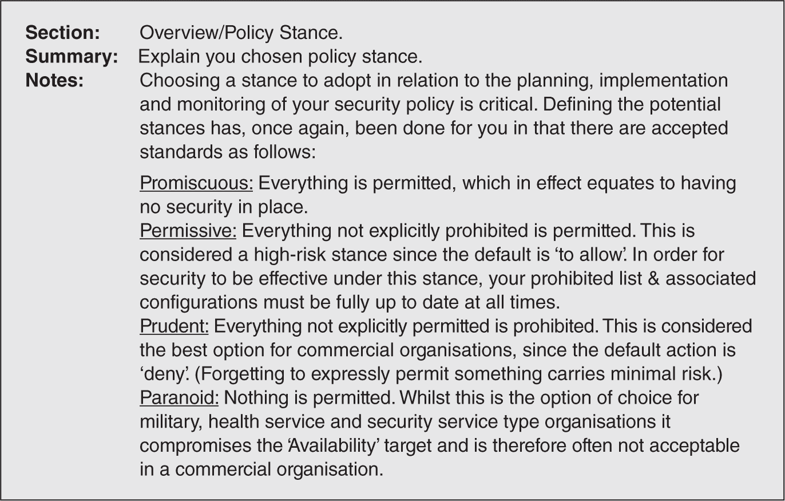

`FIGURE 13-3` 与*CIO Magazine*一样，SANS 建议将监控作为了解网络状况的关键机制。同样重要的是，白皮书提供了一些资源以帮助你。

感谢 SANS Institute 提供，经许可使用。

### 公共部门案例研究

这是一个旧案例，但由于其产生的巨大影响，它仍然很重要。2012 年 11 月，南卡罗来纳州官员披露了税收部门发生大规模数据泄露。关于泄露的细节很少，但它涉及了超过 360 万名纳税者的个人信息记录和 65 万份业务税相关记录。泄露发生在 2012 年 9 月。显然，大量的个人信息被盗取了。

一位前 `FBI` 高级官员根据过去的 `FBI` 经验，估计给州造成的成本超过 3.5 亿美元，其中包括为受影响的个人纳税人和企业提供免费信用监控的费用。

新闻报道提到的数据泄露根源在于 100 个州级机构、董事会、委员会以及学院大学缺乏强制性的安全政策。

所有州级机构都配备了某种类型的计算机安全系统。可以假设它们都实施了某种程度的安全政策。但显而易见，这些政策是可选择的。这意味着整个州政府的信息安全方法在充其量上是不一致的。此外，该州似乎没有一套全面的方法来共享信息安全的最佳实践，或协调对此类数据泄露事件的响应。

在南卡罗莱纳州税务局的案例中，这些政策显然既不充分也不一致。此外，报告显示攻击源源于东欧。黑客或多个黑客通过钓鱼邮件获取了访问权限。钓鱼邮件试图欺骗用户打开邮件并执行带有恶意软件的链接或程序。安全意识是一项强大的控制手段，可以教育用户如何保护自己免受此类攻击，包括如何识别此类攻击以及为什么不要打开可疑链接。如果钓鱼邮件是攻击来源，可能表明该州级机构的安全意识计划不够完善。

² [`www.sans.org/reading-room/whitepapers/policyissues/paper/509`](https://www.sans.org/reading-room/whitepapers/policyissues/paper/509)

### 章节总结

在这一章中，你学习了如何处理安全政策的实施。这包括流程化的标准方法。你学习了高层支持和用户对政策接受的重要性。目标是让政策随着时间的推移成为用户的本能。当用户将安全政策作为其日常工作的一部分并接受它时，你开始看到一种文化转变。你学习了安全意识培训的重要性。它确保每个人都能理解政策。它还增加了政策被使用的几率。如果用户理解了政策，你就可以对他们追责任。

本章还研究了治理和监控的重要性。讨论了安全政策如何发布和传达。你探索了各种沟通方法。你学习了沟通计划的重要性，以及如何使用它来协调一致的信息。最后，本章研究了如何克服技术和非技术障碍。这包括对最佳实践的讨论。

## 核心概念与术语

- 代理/Agent
- 无代理中心化管理工具/Agentless central management tool
- 插件式/Bolt-on
- 沟通计划/Communications plan
- 基于计算机的培训 (CBT)
- 控制环境/Control environment


- 分布式基础设施/Distributed infrastructure
- 早期采用者/Early adopter
- 高层管理赞助/Executive management sponsorship
- 过时技术/Outdated technology
- 目标状态/Target state
- 威胁向量/Threat vector
- 全体员工会议/Town hall meeting

### 第 13 章评测

1. 下列哪项表明组织的文化正在采纳 IT 安全政策？
    1. 安全政策是日常常规互动的一部分。
    2. 安全政策得到组织委员会的支持。
    3. 安全政策的核心价值体现在员工对情况的本能反应中。
    4. 以上所有项

2. 有效的安全政策要求组织中的每个人都对政策的实施负责。
    1. 正确
    2. 错误

3. 控制环境定义为：
    1. 安全政策控制措施清单
    2. 一个用于跟踪控制异常的定义良好的框架
    3. 组织控制措施治理和执行的整体方式
    4. 以上都不是

4. 员工的故意行为和恶意行为是容易控制的，特别是当安装了适当威慑手段时。
    1. 正确
    2. 错误

5. 下列哪项*不是*实施安全政策时的组织挑战？
    1. 问责制
    2. 资金充足
    3. 缺乏优先级
    4. 进度紧迫

6. 哪种类型的计划对于确保安全意识覆盖特定类型的用户至关重要？
    1. 实施计划
    2. 媒体计划
    3. 高层项目计划
    4. 沟通计划

7. 为什么安全政策实施应该具有灵活性以便更新？
    1. 将发现未知的威胁。
    2. 将引入新的教学方法。
    3. 将引入新技术。
    4. A 和 C
    5. A、B 和 C

8. 在处理涉及过时技术的政策时，以下哪项最*不*被反感？
    1. 根据最佳实践编写安全政策，并对本质上无法遵守的过时技术签发政策豁免。
    2. 根据技术支持的最低标准编写安全政策。
    3. 为过时技术编写不同的政策。
    4. 以上所有项

9. 哪项是意识培训*不*有效的有力指标？
    1. 防火墙破解
    2. 向同事透露密码
    3. 与同事共享笔记本电脑
    4. 数据中心火灾

10. 目标状态通常定义为：
    1. 未来状态
    2. 描述特定目标和目标的方式
    3. 描述实现所需的工具、流程和资源（包括人员）的方式
    4. 以上所有
    5. 以上都不是

11. 课堂培训总是优于其他替代方案（如在线培训）来进行安全政策的意识培训。

12. 为了让员工遵守并接受政策，组织必须理解员工的 ______。

13. 全体员工会议是一个具有严格议程的正式培训活动。
    1. 正确
    2. 错误

14. 传播新政策的最佳方式是？
    1. 纸质版
    2. 内部网
    3. 全体员工会议
    4. 以上所有

15. 在实施重大安全政策时，正式的沟通计划是 ________。
    1. 总是需要的
    2. 可选的
    3. 不需要

### 脚注

1. Lago, Cristina, “How to Implement a Successful Cybersecurity Plan,” 2019 年 7 月 10 日，[`www.cio.com/article/3295578/how-to-implement-a-successful-security-plan.html`](https://www.cio.com/article/3295578/how-to-implement-a-successful-security-plan.html)，访问于 2020 年 5 月 8 日。


© obpcnh/Shutterstock

## IT 安全政策执行

## 第 14 章

安全政策的执行始于制定政策和提供初始安全意识的艰巨工作完成后。如果政策不被执行，制定政策的所有努力都价值甚微。基本上，不执行的政策等同于没有政策。合规计划对于确保政策被采纳并产生预期价值至关重要。质量保证和质量控制审查（有时称为合规性审查）以及漏洞评估是合规计划的三个重要组成部分。

质量保证（`QA`）审查确保在采取行动之前已采纳了安全策略。例如，在软件迁移到生产环境之前确保安全代码已正确编写，就是质量保证的一个示例。相比之下，质量控制（`QC`）审查和漏洞评估是在环境构建后进行的。`QC` 审查用于确定是否遵守了相关策略。漏洞评估则用于衡量策略的有效性。如果每个人都遵守策略，漏洞数量就会减少。如果漏洞数量没有减少，那么问题就出在个人身上或策略设计不当。漏洞评估需要与业务目标保持一致。执行力度需要与风险水平相匹配。

你如何实施合规计划在很大程度上取决于组织的治理和管理结构。这种组织结构定义了公司如何设定并遵循战略路线。该结构也可以被用于强制执行 IT 安全策略。

本章回顾了执行安全策略的组织方法和技术方法。它讨论了高层支持对执行过程的重要性，讨论了组织中的特定角色。本章还讨论了执行安全策略时的法律考量。最后，通过讨论最佳实践和案例研究来阐述上述观点。

## 第 14 章主题

本章涵盖了以下主题和概念：

*   谁负责 IT 安全策略的执行
*   组织监控用户行为拥有哪些权利
*   安全策略如何平衡法律要求与风险管理
*   法律与策略之间的区别
*   如何通过手动和自动方式执行策略
*   谁对 IT 安全策略负有法律责任
*   谁对风险、威胁和漏洞负最终责任
*   一些成功的 IT 安全策略执行案例研究和示例是什么

## 第 14 章目标

完成本章学习后，你将能够：

*   描述治理过程与管理过程之间的差异
*   解释什么是泛在性控制（`pervasive control`）
*   描述组织内用于执行策略的基础控制层级
*   解释执行管理层和首席信息安全官（`CISO`）在执行过程中的作用
*   描述监控如何帮助策略执行
*   解释自动策略执行与手动策略执行之间的区别
*   解释谁对安全策略的执行负最终责任
*   描述执行策略时的法律影响
*   描述执行策略的最佳实践

## IT 安全策略执行的组织级支持

滥用公司技术可能会使其面临风险。未能遵守策略可能导致违反监管合规。未能跟进并解决问题可能导致诉讼。这些情况可能导致更多的监管制裁和昂贵的法律费用。

安全策略的执行需要根植于组织之中。许多人必须参与——执行策略不是一个人的工作。策略的执行通过层级来实现。这包括执行策略和监控员工行为的组织委员会。每一层都验证安全策略正在被遵守。目标是随着时间的推移在整个组织建立意识和执行力。IT 安全策略合规是每个人的责任。

### 注意

新策略的引入迫使现有文化发生变化。遗憾的是，安全策略的变化是必要的。例如，新威胁的出现需要新策略来应对。事实上，许多人往往会抵制变化。在引入新策略之前进行充分讨论至关重要。个人必须内化并接受策略，策略才能发挥作用。

组织需要决定想要通过策略执行实现什么目标。组织可以选择关注有限的领域，例如访问控制、`数据泄露(#29_glossary.xhtml#gloss63)`保护和病毒防护。或者，组织可以使用策略来强制文化发生变化。无疑，执行安全策略会改变习惯，从而改变文化。无论细节如何，策略执行必须有一个目标。最显而易见的是确保符合策略——但这某种程度上是循环论证。有时公司的策略是无效的。这通常源于对策略目标没有清晰的思考。如果你的目标是良好的密码管理，但你的策略要求 50 个字符的随机密码，这几乎会保证员工写下密码，因为他们记不住。在这种情况下，你通过执行这种不合理的策略，实际上违背了你的真实目标。

在引入变化时，记住这可能会引发冲突。安全策略可能与人们的自然反应发生冲突。例如，你接受过社会规范的训练，比如为他人开门这种简单的行为。你可能认为这些行为是礼貌的。然而，安全策略禁止开门或允许他人跟在你身后进入。你被要求拒绝没有凭证的员工，甚至可能拒绝一位很受欢迎的同事。策略可能要求你拒绝高管的访问。这些看起来似乎是小问题，但它们可能会给员工带来内部冲突和不安。这些冲突是不可避免的。采取常识方法的员工其思维可能会受到挑战。尽管如此，执行工作的一部分就是承认冲突并与员工合作来克服它们。

### 注意

主要负责设定安全目标的人应该是首席信息安全官（`CISO`）。`CISO` 的关键任务是在高层管理中为实施安全策略和计划建立支持。`CISO` 与高管建立个人关系并获得他们信任的能力是实施安全最有效的工具。

#### 执行管理层的赞助

如今的执行层面临着许多方向的压力。这是一个快速的世界，对某些行业比其他行业更为如此。为了确保有效，高管需要周围围绕有强烈清晰感、目标感和行动力的员工。有效的领导者有鼓励人们实现领导者目标的能力。他们引导组织朝着正确的方向以实现特定目标。他们利用自己的价值观、知识和技能激励并使他人卓越。高效的高管说服人们为了更好的未来做正确的事。

执行管理层的支持不仅仅是关于预算和指令。当你拥有执行层支持时，你就拥有了强大的盟友。高管可以克服反对意见并说服组织采用策略。他们可以指导首席信息安全官（`CISO`）如何规避陷阱。

执行支持对安全策略的执行至关重要。在执行过程的某个时刻，你需要改变员工的行为。这可能需要纪律处分。即使是私下对员工进行指导，也有可能对部门产生负面影响的风险。预先为此类讨论奠定基础至关重要。你通过部门高管来实现这一点。该高管可以传递一个明确的信息，即对忽视安全策略的行为零容忍。高管必须明确，违反策略将受到严肃对待。这种信息确立了高层的基调。

### 提示

在提交任何提案之前，先与直接向高层管理层汇报的人合作。直属汇报通常是受信任的顾问。即使你有一个好主意，高管通常也会推迟决定，直到他们能够与顾问讨论该问题为止。通过先向顾问展示你的提案，你可以避免延迟。顾问也可以在高管层面前成为你强有力的支持者。

### 治理与管理的组织结构

当执行来自员工自身的领导层时，执行最为有效。信息安全团队通常不直接执行策略。安全团队并不直接管理所有员工，因此通常无法“命令”员工遵守策略。那么，安全策略是如何执行的呢？通常，安全团队会监控合规情况，然后向领导层报告不合规行为。这时就由领导层指导员工并确保产生正确的行为。这可能包括采取纪律措施，在严重违反安全策略的情况下，甚至包括终止劳动关系（开除）。

重要的是要记住，员工会向高层管理层寻求指导。高管领导者被寄予以身作则。这意味着他们遵循与员工相同的策略。当他们自己豁免时，他们就会贬低策略的重要性。

高层管理层应对关键绩效指标产生积极兴趣，并对该计划提供持续支持。他们在批准任何偏离策略的行为时应保持可见性，并仅在必要时予以批准。这种可见性传达了关于安全策略和风险管理重要性的有力信息。当发生事件时，这种准备减少了遭到阻碍的概率。高管更有可能执行策略以维护其个人信誉。一旦高管将自己的信誉背书于策略，他们就不太可能允许违规行为发生。

寻找合适的领导层级来采取行动是一项挑战。通常，让治理委员会和管理委员会负责 IT 安全策略的执行更为有效。组织内部的治理与管理之间存在差异。要看到这种差异，请考虑信息和相关技术控制目标（`COBIT`）5.0 的定义，如`图 14-1` 所示。你从图中可以看出，治理设定战略方向，而管理高管则负责日常运营。根据 `COBIT` 5 的定义，治理“确保实现企业目标”并指导管理层进行执行。正是这些治理过程平衡了竞争性利益，例如业务盈利的需求与客户以公平价格购买服务的需求。治理为管理设定了遵循的方向。然后，由管理层负责按照治理过程设定的“一致方向”来实现目标。管理层负责运行日常运营。两种组织结构都会监控活动。

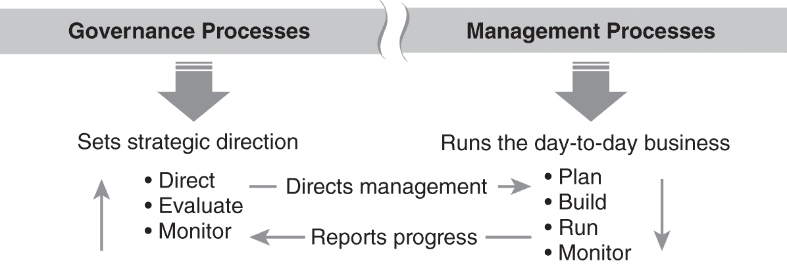

`图 14-1` 治理与管理如何在 COBIT 5.0 框架内共同工作。

治理委员会更有可能事后和汇总地监控活动，以评估目标是否正在实现。管理委员会可能在运营过程中，在活动之前、期间和之后进行监控。这对于合规计划意味着什么？这意味着你需要监控管理过程中质量保证的有效性。

管理委员会负责经营业务。当他们运行这些流程时，他们需要……（根据指令，为了简短已省略）

组织本身在执行策略方面也扮演着角色。这通常通过`关口委员会`](#29_glossary.xhtml#gloss105）处理。这些委员会是审查技术活动的高层管理流程。它们通常在项目或活动进入下阶段阶段之前提供批准。这就是为什么它们被称为“关口”（gateways）。它们字面上是新技术项目进入组织的关口。

这些委员会洞察组织内部的所有主要项目和倡议。每个委员会都从不同的角度观察风险；然而，它们都在强制执行安全策略方面发挥着作用。

### 提示

委员会通常拥有章程。章程是概述委员会使命和目标的正式文件。这些章程是关于委员会功能的价值信息来源。

#### 项目委员会

项目委员会 审查项目概念、设计和测试阶段。它批准项目何时可以进入生产阶段。需要委员会批准的阶段数量取决于项目生命周期（`PLC`）。其意图是尽早识别项目问题，以减少昂贵的错误。这种外部项目审查是检查任何安全策略问题的理想时机。

该委员会有权停止未能遵守策略的项目。这是一种强大的组织执行机制。至少，委员会会询问项目团队任何已知的安全策略偏离情况。此外，安全团队的代表也是委员会的成员。他们可以提出针对性的安全策略问题。例如，他们可能会对正在部署的新型在线信用卡处理系统提出 `PCI DSS` 合规性问题。安全或审计人员通常会对项目进行评估。该评估将提交给委员会，以解决任何安全策略问题。

#### 架构评审委员会

架构评审委员会 促进技术和架构的标准化。通过创建需要遵循的架构模型，组织可以更快地部署一致的技术解决方案。这些模型通常在设计中嵌入了大量的安全策略。因此，部署标准的技术套件可以确保高度可靠且合规的解决方案。

该委员会有权停止未能遵守这些技术标准的项目。委员会可以强制执行安全策略。这通过部署符合安全策略的技术解决方案来实现。此外，委员会需要抵制采用偏离安全策略的技术。当需要采用不合规的技术时，必须由业务部门承担。委员会向业务部门提交风险和技术建议。

#### 外部连接委员会

外部连接委员会 定义了数据传输到组织外部的方式。这包括发送和接收什么数据以及如何发送。该委员会与供应商治理委员会密切合作，确保不批准与未经授权方的外部连接。委员会的重点是这些第三方连接的安全性和可靠性。对于外部连接较少的组织，这些职责可能会合并到其他委员会中，例如架构评审委员会。另一个重点是定义可以发送给第三方的数据。委员会通常不会在建立安全连接后就对所有类型的数据给予一揽批准。

该委员会通常执行通信和加密安全要求。不会批准任何违反这些策略的连接。

### 提示

将敏感或机密数据发送到组织外的第三方必须被视为一项重大决策和事件。在开启外部连接之前，确保第三方已具备适当的控制。

#### 供应商治理委员会

供应商治理委员会 兼具业务和技术双重角色。业务角色是对供应商关系的监督。该角色确保供应商履行承诺。换句话说，该委员会确保供应商符合合同中的服务水平（`SLA`）。委员会还检查对产品质量的疑虑。

委员会的技术角色是确保供应商遵守合同中的策略。这些合同策略的限制程度至少应与你们自己的策略一样严格。例如，假设你确定了一项安全策略要求，需要记录对文件的访问。这是为了符合某项法规。仅仅因为该文件现在被传输给供应商处理，并不意味着记录日志的安全策略要求消失了。

供应商合同要求必须要求对数据的关注程度等同或优于组织。供应商治理策略必须要求组织建立一种确保采取此类关注的方法。仅仅签署合同是不够的。对这些数据的责任仍由组织承担。例如，根据“格拉姆-莱奇-布莱尔法案（`GLBA`）”，银行负责保护个人财务记录。如果代表银行的供应商处理了这些数据，银行仍需承担责任。

银行必须确保供应商具备适当的控制。这可以通过审计供应商来实现。你也可以要求供应商提供近期审计的证据。合同本身是供应商的一项承诺，并不被认为是供应商正在妥善处理银行数据的证据。

#### 安全合规委员会

安全合规委员会 通常承担许多角色。其关键角色之一是确定何时发生违反策略的情况。安全合规委员会审查风险和漏洞评估。委员会通常关注泛在性控制。“泛在性控制 是一种通用控制，应用于大量的系统、应用程序和操作中。例如，假设同一个 ID 和密码可以在许多系统和应用程序之间使用。那么该项控制在该环境中被认为是泛在性控制。安全合规委员会的角色是确保这些控制符合安全策略。委员会还可能作为项目的网关，以确保控制遵循策略。

泛在性控制符合安全策略至关重要。这些控制对保障系统和应用程序有重大影响。如果这些控制中的一个存在弱点，那么整个基础设施都存在弱点。这些控制对于合规测试也至关重要。例如，许多组织依赖这些控制来实现 `SOX` 合规。当这些控制失效时，组织可能会发现自己不符合关键法规。

#### 运营风险委员会

运营风险委员会（通常称为 `ops risk`）兼具业务和技术双重角色。委员会的主要角色是管理业务风险。运营风险职能确保业务在风险偏好和风险承受范围内运行。例如，确保适当的职责分离可以确保某些风险得到妥善控制。

为了说明这一点：你不会希望同一个人既能够建立供应商，又能从该供应商下单并接收货物。如果你这样做，此人就可以建立虚假供应商。然后，这个人可以在没有收到任何货物的情况下下单，但触发发票，公司随后支付该发票。这意味着公司支付给了一个没有提供货物的虚假供应商。换句话说，不诚实的员工创建了一个渠道，将资金从公司转移到其同犯手中，甚至转移到自己的银行账户。

运营风险委员会在安全策略方面承担着执行职责。该委员会负责确保策略能够充分控制关键业务风险。根据定义，安全策略是为了控制业务风险的。这意味着委员会需要批准任何对安全策略的偏离，并接受随之而来的风险。


# 运营风险委员会

运营风险委员会将风险视为单一事件，也视为风险组合。通过从这两个角度审视风险，委员会可以确定组织的风险容忍度。例如，假设委员会发现了孤立的政策违规案例。也许更换过时技术的成本太高。这些孤立的案例从单独来看可能是可以接受的风险；然而，许多此类孤立案例的结合可能会破坏一项关键合规计划的执行。委员会需要从特定事件本身以及作为更大风险组合的一部分双重角度来考虑风险的接受。

`CISO` 或其授权代表通常是委员会成员。他/她通过代表业务部门解释委员会所接受的风险水平，在其中发挥着至关重要的作用。委员会的其他成员通常是业务领导者。这些领导者帮助在业务内部执行安全策略。不同组织的规模和管理方法各不相同。因此，委员会的数量及其职责可能会有所不同。有些组织会将其中几项功能合并。

## 前线经理与主管

## 责任与问责

# 员工隐私与监控

然而，这项权利并不是绝对的。假设你是一个计划起诉公司的员工。你使用公司笔记本登录个人邮箱账户与你的律师交换信息。这不是一个公司邮箱账户，而是像 `Yahoo!` 或 `Gmail` 这样的个人账户。离开公司并提起诉讼后，公司扫描了你的笔记本，并发现了你的部分通信内容。公司有一项明确的政策，规定你对公司设备没有隐私权。公司侵犯了你的隐私吗？是的。来看一个具体的法院案例来理解原因。

这种情况出现在 2010 年 4 月《纽约邮报》（*New York Post*）的一篇文章中，以及萨克拉门托破产律师博客等几个在线法律网站。这是一个较老的案例，但在法律界，先例非常重要。该案件 *Marina Stengart v. Loving Care Agency, Inc.* 涉及 Marina Stengart，她是一位在一家健康公司居家工作的女性。她曾与律师就可能起诉她的公司一事进行邮件交流。Stengart 女士使用雇主提供的笔记本电脑访问她的网页邮箱。离开公司后，她上交了笔记本。她的前雇主扫描了她的笔记本，发现了她与律师的对话。在该案中，法院裁定 Stengart 女士对隐私拥有合理的预期。

这是一个重大的案例，因为在此之前，人们认为只要有适当的政策，组织就可以监控公司设备上的任何活动。当员工个人生活与职业生活之间的界限模糊时，法院的裁决变得不再清晰。允许员工使用自有设备的组织可能会发现自己处于同样的境地。例如，某些组织允许使用个人手机发送和接收公司邮件。即使这些设备具有相同的加密和其他控制，工作与个人生活之间的法律界限也模糊了。尽管这样做是为了降低成本，但可能会迅速引发法律纠纷。

几乎没有争议的是，组织可以通过公司账户监控工作期间使用的雇主拥有的计算机。员工行为的监控通常涉及三个领域：

* 互联网
* 电子邮件
* 计算机

尽管接下来的章节将提供通用指导，但应该记住，本文作者并非律师。在实施任何员工监控流程之前，建议您咨询专业的隐私法或人力资源法律师。

### 互联网使用

互联网的使用通常会监控是否访问了不当网站，例如包含色情或淫秽内容的网站。还会监控未经授权访问仅限网站的行为。可以监控对竞争对手网站或版权内容的访问。上传机密材料是一个潜在问题。

最近，对社交网络网站的担忧日益增加。这些网站为拥有共同兴趣和信息的人建立了在线社区。担忧在于，这些社交社区中的员工开始交换有关公司的信息。这些信息的范围涵盖了从完全无害的评论到对公司的负面评价，再到泄露公司机密。公司面临的问题是，应该监控多少程度的活动。许多组织屏蔽了这些网站。这解决了工作期间在公司网络上访问的问题。但在监控员工非工作时间的活动时，问题变得更具挑战性。由于存在为业务设计的社交网络网站，这个问题变得更加复杂。经典的例子是 `LinkedIn`。根据员工的角色，他或她可能有访问 `LinkedIn` 的正当理由；例如在人力资源或招聘部门工作的人。

### 电子邮件使用

电子邮件的使用通常会监控病毒和恶意软件。还会监控未经授权访问仅限网站的行为。可以监控对竞争对手网站或版权内容的访问。上传机密材料是一个潜在问题。

最近，对社交网络网站的担忧日益增加。这些网站为拥有共同兴趣和信息的人建立了在线社区。担忧在于，这些社交社区中的员工开始交换有关公司的信息。这些信息的范围涵盖了从完全无害的评论到对公司的负面评价，再到泄露公司机密。公司面临的问题是，应该监控多少程度的活动。许多组织屏蔽了这些网站。这解决了工作期间在公司网络上访问的问题。但在监控员工非工作时间的活动时，问题变得更具挑战性。由于存在为业务设计的社交网络网站，这个问题变得更加复杂。经典的例子是 `LinkedIn`。根据员工的角色，他或她可能有访问 `LinkedIn` 的正当理由；例如在人力资源或招聘部门工作的人。

电子邮件的使用通常会监控病毒和恶意软件。还会监控未经授权访问仅限网站的行为。可以监控对竞争对手网站或版权内容的访问。上传机密材料是一个潜在问题。

### 计算机使用

员工的计算机通常会监控病毒和恶意软件。它通常还会监控盗版软件和过度使用情况（如玩游戏），以及从安全服务器移除的未经授权文件。监控的范围取决于组织的关注点。

通过正确的政策，公司可以保护自己免受这些风险。在公司网络上监控公司设备受到一些限制。为了允许执行监控，应实施的基本政策是透明和清晰。基本步骤是确保你已告知员工可能会进行此类监控。通过 `AUP`（用户接受政策）明确在使用组织计算机时的预期行为是什么。

# 合规法律：是合规要求还是风险管理？

从本质上说，安全策略的目的是尝试满足组织必须遵守的所有监管要求。使用 `attempt`（尝试）一词是为了反映政策所创造的平衡。政策必须在可实现的目标、最佳实践以及对法律法规的解释之间取得平衡。这种平衡需要妥协。这就是为什么法律部门是创建安全策略的关键利益相关者。法律部门确保安全策略在监管机构和法庭面前是站得住脚的。

监管机构首先查看组织的策略。他们会评估策略是否合理并符合指南。无论组织认为这些目标是否可以实现，监管机构都会确保核心要求得到满足。然而，即使是监管机构也必须解释法律语言，而且他们的解释方式可能与你的组织不同。

例如，根据《格雷姆-利奇-布莱利法案》（`GLBA`），组织必须对任何违反客户财务记录的未经授权访问及时通知监管机构。你需要弄清楚什么构成未经授权的访问或违露。有明确的例子，例如外部黑客。也有灰色地带。如果出纳员出于好奇访问了账户，这会算作 `GLBA` 下需要报告的泄露吗？这是可能的。监管机构提供阈值指南。怀疑银行不会因为内部员工不当访问了某个客户的账户就通知监管机构。将阈值设定在 1000 条或更多记录的情况并不罕见。这并不意味着单个账户的泄露不重要。假设，单个账户的泄露暴露了普遍性的控制缺陷。`Pervasive control`（普遍性控制）是一个术语，指在整个企业广泛使用的控制。因此，该单个账户的泄露可以识别出可能导致更大泄露的控制缺陷。

> **TIP**
>
> 监管机构使用批准的文档和流程来评估组织的安全策略。这些指南文件通常是公开的。你可以将它们与自己的安全策略进行比较，以确保它们满足所有要求。指南文件还为监管机构提供了合规证据。

普遍性控制缺陷是监管机构关注的重点。例如，假设在某无权限拥有该文件的员工手中发现了一份零售账户账单。后来发现该员工是从装货台的垃圾箱中捡的。虽然只取走了一份文件，但这次泄露揭示了更大的问题。如果在安全处置客户账户文档方面缺乏通用控制，那么这被认为是一种普遍性的控制缺陷。

监管指南涵盖了法律中的大多数灰色地带。关键点是组织需要建立一个风险管理计划，以确保安全策略解决法律要求。风险管理计划还确保这些策略得到执行。向监管机构提供证据，证明安全策略有助于管理风险以及防止泄露，是非常重要的。

## 什么是法律，什么是策略？

组织执行策略并报告合规情况。组织通常不在内部执行法律。换句话说，安全策略并不是对法律的法律解释。安全策略是对法律要求的解释，用以实现合规。

`law`（法律）是根据政府实体权威制定的任何规则。监管机构可能获得法律授权制定 `regulations`（法规）。法规的权限自原始法律。

法律、法规和安全策略之间的区别如下：

* `Laws`（法律）建立了法律阈值。
* `Regulatory requirements`（监管要求）规定了组织为了满足法律阈值必须做什么。
* `Security policies`（安全策略）规定了组织如何实现监管要求。

考虑安全领域中一个与信息安全法规解释相关的例子。《格雷姆-利奇-布莱利法案》（`GLBA`）旨在确保客户信息的安全和机密。`GLBA` 第 `501(b)` 条要求董事会或其指定的委员会应适当监督金融机构的信息安全计划。“适当监督”是什么意思？联邦存款保险公司（`FDIC`）发布了一项监管裁定，要求组织董事会每年至少收到一次正式报告。许多组织将其解释为 `CISO`（首席信息安全官）和审计师向审计委员会提交的正式报告。点在于，组织可以通过不同的方式实现监管合规。通常，你编写策略是为了满足监管要求。大多数时候，你并不是针对法律的具体文字来编写策略。

违反策略并不意味着违反法律；但它可能是。对成文法规的解释与策略解释是不同的技能组合。通常，违反法律的法律阈值很高。它考虑了情况和意图。只有法院或监管机构才能判定是否有充分理由判定违反了法律。

尽管对现行法律法规保持意识很重要，但它们不应该是你唯一的驱动力。业务中存在许多法律法规未涵盖的风险。法规的制定是为了解决某个特定的关注领域，这些领域可能是公共事件或集体诉讼的结果。虽然确保遵守法规是必须的，但常识是不可替代的。关键点在于，在监管机构和法庭面前，法律总是优于策略。法律和法规没有涵盖所有的风险。

### 哪些安全控制有助于保护个人数据？

组织具有接受风险的能力。它们可以接受可能影响业务的风险。然而，这些组织没有权利代表客户接受风险。换句话说，他们不能通过处理不当数据让客户面临风险。

用于评估和接受业务风险的风险管理方法不能同样适用于客户数据。任何收集、存储、处理和传输个人信息的组织必须遵守隐私法。

这些隐私法建立了特定的控制措施。隐私法因州而异。常见的安全控制包括：

* 发生泄露时的通知
* 数据离开组织网络时进行加密
* 确保每个用户在访问数据时具有唯一身份
* 仅授予业务目的访问权限
* 在不再需要时销毁数据
* 建立适当的政策和安全意识

在开展业务时，了解存在哪些隐私法律非常重要。根据这些法律，你可以确定一组常用的核心控制。这些通用控制需要包含在安全策略中。有效销毁数据往往被忽视。是的，粉碎文件是一个好主意；然而，焚化炉是更有效的方法。计算机存储媒体必须进行完全的取证级擦除。在某些情况下，直接破坏计算机媒介比尝试将其擦除后重复使用更为合适。

# 通过策略可以实施哪些自动化安全控制？

尽可能自动化自动化安全控制是确保采纳、执行和有效性的最佳方法。到目前，这是可能时的首选方法。自动化控制每次的工作方式都是相同的。这意味着控制的应用是一致的，而且执行速度通常比人类更快。人类的判断是昂贵且不一致的。你必须训练人员知道该做什么。即便如此，一致性也取决于那些不会疲劳或分心的警觉个人。因此，对于需要一致执行的大量工作，自动化控制具有成本效益。

另一个优势是报告和监控。自动化控制可以轻松配置以记录和跟踪活动。由人工执行相同水平的数据收集将耗费时间且容易出错。时间维度非常重要。自动化控制倾向于实时进行，允许流程具有自服务能力并即时报告。

例如，对低风险应用程序的访问可以被预批准。因此，个人可能访问一个自服务网站，该网站会审核请求并自动授予访问权限。在手动流程中，请求必须提交给某人来确定是否批准。

手动访问请求需要几天或几周的情况并不罕见，这取决于人员可用性、积压情况、实施复杂性以及所需的审批数量。自动化可以在以下领域显著缩短这些时间：

* `适当的请求`——自动化控制可以验证请求是完整的，且没有违反任何策略要求（如职责分离）。
* `审批工作流`——自动化控制可以快速地将请求路由给必须审批的人员；电子审批是许多安全请求的常见做法。
* `实施`——自动控制可以在更改获得批准后立即实施。

自动化控制被配置到设备中以强制执行安全策略。以下是几种常用自动化控制的短列表：

* 身份验证方法
* 授权方法
* 数据加密
* 事件日志
* 数据分
* 网络分

自动化控制的数量仅限于技术能力。技术的不断改进允许更多的自动化。最大的挑战不是自动化，而是部署。

考虑这样一个例子：策略规定用户必须每 30 天更改一次密码。环境中存在中央认证服务器。挑战在于如何配置每台设备以使用该认证服务器。IT 环境可能有数千台设备。每台设备都可能需要配置。一旦完成配置，必须对这些设备进行监控以确保配置不被更改。当添加新设备时，必须对从服务器到智能手机的所有设备应用相同的配置。自动化控制的配置可能很简单，但一致地应用它变成了主要挑战。随着自动化控制数量的增加，问题变得更加复杂。环境中技术的多样性会使支持自动化控制变得更加复杂。因此，自动化是实施此安全策略的实际解决方案。

许多商业产品带有企业级管理软件来解决这一自动化挑战。中央策略管理软件专门为此目的而设计。此类应用程序在中央服务器上创建策略规则。然后，这些规则通过代理或无代理架构发送到各种设备。

自动化策略管理工具获取安全策略并将其实现为配置更新。设备配置完成后，自动化控制就会执行策略。这种执行可以是预防性控制或检测性控制。无论哪种，控制都是自动化的。控制要么防止超出策略范围的事件发生，要么检测到事件的发生。我们关于要求每 30 天更改密码的策略示例通常是预防性控制。中央认证服务器强制用户在 30 天后更改密码。

策略管理工具还可以关联大量数据。它们可以发现网络上的设备。它们可以跟踪哪些设备应用了策略。这些工具还可以监控策略违规情况。工具可以识别出未应用策略的设备。这些工具识别现有配置并与预期的策略状态进行比较。偏离策略的情况可以自动修正。这是一个强大的工具。审计员和监管机构通常要求从策略管理工具中提取数据。这些提取的数据可以帮助他们评估策略合规水平。

> **TIP**
>
> 
>
> 许多管理员工具都可以支持策略管理。你可以将管理员工具作为策略管理的第一步。

# 哪些手动安全控制有助于执行？

并非所有控制都能或应该被自动化。手动控制适用于低工作量的工作。它们也适用于需要人类判断的工作。手动控制的示例包括：

* 背景检查
* 日志审查
* 访问权限审查
* 证明

在这些每一个案例中，工作量较小，且人类判断对过程至关重要。手动过程必须清晰。这意味着不仅步骤本身是清晰的，而且判断的标准也是清晰的。

看看背景检查作为手动控制。该过程对于如何收集背景检查信息应该是清晰的。标准也应该被定义。对于许多工作，轻微的交通违规是可以接受的。对于其他工作（如商业驾驶员），任何交通违规都可能被认为不可接受。清晰定义的安全策略可以确保每个人在背景检查中受到同等对待。这可以避免法律问题。

> **TIP**
>
> 
>
> 有许多公司要么不进行背景检查，要么做得不充分。在简历/申请中中夸大或完全捏造资历的人数令人惊讶。此外，本文作者亲身知道两个案例：在一家接触敏感数据（甚至是财务数据）的公司工作的员工，其个人曾有重罪犯罪记录。在这两个案例中，雇主的背景检查做得不充分。

人类可以审查日志以发现难以自动化的异常活动。例如，当程序员获得提升权限以修复生产问题时，通常会审查日志以确定程序员是否执行了超出修复范围的活动。例如，如果程序员更改了数据库中的账户数据，日志审查就会发生变化。为了修复应用程序而进行的此类更改可能是异常的，需要管理层的跟进。

访问权限包括业务部门的审查，以确保职责充分分离。这类审查是手动的，并且对业务运营方式有了解。基于这些知识，在运营效率和降低风险之间取得了合理的平衡。

`attestation`（证明）是一项正式的管理验证。管理层证实某种状况确实存在。某些法规要求管理层证明安全策略和控制措施到位；例如，`SOX` 就要求高级管理层提供此类证明。

当某人做出 `attestation` 时，他们对陈述的准确性承担个人责任。这是法律追究管理层责任的一种，以确保实施了适当的控制措施。发表虚假陈述往往是犯罪；然而，如果你做出了你认为是真实的但后来被证明是虚假的陈述，可能是可以辩护的。辩护的程度取决于你做出陈述时依据的信息。关键不在于你是否“知道”，而在于你是否“应该知道”。换句话说，仅仅询问某人控制措施是否到位是不够的。

# IT 安全策略执行的法律影响

技术使得业务交易变得简单。计算机提供了有效的沟通方法和记录保存方法。技术提供了自动维护审计追踪的能力。这种易用性以及海量数据的产生对安全策略的执行产生了影响。出于许多法律原因，数据必须保存并可检索。

未能妥善记录可能会导致巨额罚款。对于与诉讼相关的数据来说，尤其如此。销毁记录可能会危及公司的诉讼案件，还可能导致刑事指控。即使是无意销毁数据也可能导致被控疏忽、隐瞒或隐藏信息，以及篡改或破坏证据。那么，你应该保留数据多久呢？这取决于内容、组织和位置。例如，德克萨斯州政府法第 `441.158` 条要求地方政府永久保留有关合并的记录。另一方面，政府会议的某些纪要只需保留两年。此类法律差异必须由法律部门进行评估，并纳入政策和安全实践中，以确保数据得到妥善归档。


通常情况下，过早销毁记录引起的问题比可能解决的问题多得多。如果你有理由预计某些民事诉讼即将发生，你就有义务保留相关记录。这样做可能会导致严重的后果。旧数据只有在符合既定的良好政策，且在没有理由预计该数据在某些情况下（如法律程序）中可能被需要时，才能被销毁。

在数据留存上执行安全策略至关重要。这包括数据的保护。安全策略必须确保记录工作是准确且安全维护的。电子取证（`e-discovery`）是法律程序的一部分。它被用于收集法律行动的计算机生成信息。由于组织持有的数据量巨大，这比纸质文件的发现要复杂得多。

`FIGURE 14-2` (#25_chapter14_06.xhtml#fig14-2) 阐释这一点。考虑一份简单的贷款文件。从图中可以看出，原始文件中的信息被用于生成月度账单。该账单现在包含个人财务信息。该文件反过来可能用于生成逾期通知。该通知可能与客户的邮件往来相关。以此类推。个人财务信息甚至可能发送到外部催收机构。数据很可能存储在多个系统中。这在最左侧所示——注意信息正流经贷款、客户服务、催收和应收账款应用程序。

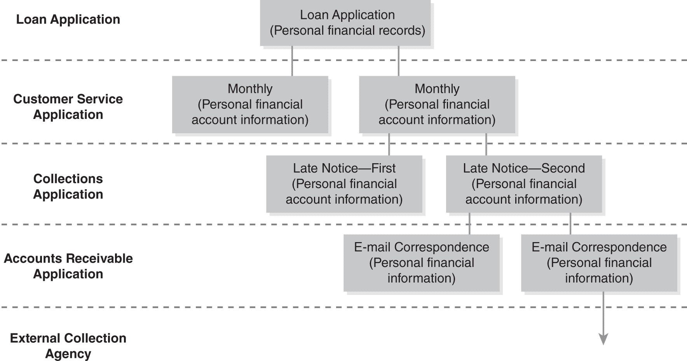

`FIGURE 14-2` 数据如何快速扩展的图。

多年来，多个系统中可以产生数百份文件。当组织被电子取证要求提交文件并识别访问过这些文件的每个人时，你就能很快看出问题所在。检索这些信息的工作是巨大的。

策略执行的法律影响不仅关乎保护数据。在编写安全策略时，有许多需要考虑的问题。你可能无法根据违反安全策略的行为终止一个用户。这取决于策略是如何编写的、人力资源政策以及所提供的安全意识培训。

即使是部署安全设备也可能产生法律影响。例如，`honeypot`（蜜罐，#29_glossary.xhtml#gloss119）是一种起诱饵作用的网络安全设备。它的唯一目的是看起来像对黑客极具吸引力的目标。当黑客试图入侵 `honeypot` 时，它会记录黑客的行为。这可以作为攻击的证据。`honeypot` 还允许你详细分析攻击方法。这些信息可以用于加固其他设备。然而，这类设备具有法律影响。其他安全设备如 `firewall`（防火墙）可以阻止黑客；然而，`honeypot` 本质上试图引诱黑客。当把 `honeypot` 放在 DMZ 区并公开时，会产生更多的法律复杂性。这种部署引发了问题：组织是否在鼓励非法行为。

非组织拥有的智能手机是一个挑战，即使组织有政策规定他们可以配置和擦除设备。当员工使用智能手机处理公司业务时，谁拥有控制权？当员工离开公司并将设备从组织的控制中断开时，这尤其难以判断。组织如何确保设备被擦除？擦除非组织拥有的设备具有法律影响。除非员工通过某些约束性协议授予了此类权利，否则仅凭政策无法提供访问设备的足够法律依据。

关键点在于，安全策略的法律影响有多种形式。与法律部门建立良好的工作关系至关重要。这可以确保安全策略的执行而不会引起法律问题。

## 谁对风险、威胁和漏洞负最终责任？

执行层对控制风险负最终责任。高层必须解释为什么发生重大安全事故。他们必须重建公众的信任。他们还必须重建股东和监管机构的信心。

负责意味着对不作为承担后果。有些组织发现很难对高层实施后果。更糟糕的是，有些组织确定了这么多领导人负责，以至于在实践中没有人负责。

这种支持也意味着要为实施安全策略的执行定义清晰的角色和职责。员工负责理解自己的角色和安全策略。他们对遵循这些策略负责。

组织承担着大部分法律责任。组织最终控制数据。组织有义务雇佣胜任的员工。组织也有义务为这些员工提供适当的资源、培训和监督。员工违反法律时仍可能被追究法律责任。员工可能因非法行为被起诉，但最终承担责任的往往是组织。执行管理层对允许此类行为发生负有问责责任。

信息安全组织在风险控制方面发挥着关键作用。它负责识别风险、威胁和漏洞。很多时候，是由 IT 组织执行评估的。IT 团队还负责实施解决方案。信息安全组织是领域专家 (`SME`)。它通常负责建立供 IT 团队执行的策略和程序。这些团队还负责审查评估结果。

## IT 安全策略的执行必须从何而来？

组织中的多个层级负责执行安全策略。每个人在识别和管理风险方面都发挥着自己的作用。以下是执行安全策略的关键角色示例：

*   **总法律顾问**——执行具有法律约束力的协议
*   **执行管理层**——实施企业风险管理
*   **人力资源部门 (HR)**——执行纪律处分
*   **信息系统安全组织**——在项目层面执行安全策略
*   **前线经理/主管**——在员工层级执行安全策略

这不是一份完整的列表。例如，总法律顾问会与执法部门合作，起诉违反法律的员工。关键点在于要注意到组织的每一层级都在执行安全策略。执行不是单一团队的责任。

### 提示 (FYI)

尽管安全策略的执行可能与组织的不同层级相结合，但识别和上报安全不合规行为的最终问责人是首席信息安全官 (`CISO`)。`CISO` “拥有”整个企业的信息安全计划（以及相关控制措施）。如果策略和控制措施无效，`CISO` 必须将此问题提交给高层领导。高层领导必须在 `CISO` 的指导下执行安全策略。

总法律顾问执行具有法律约束力的协议。这种执行的形式包括与对方法律顾问交涉，或代表组织提起诉讼以解决合同纠纷。这包括与供应商和外包商的协议。在合同起草阶段，法律部门会参与其中。这些合同通常定义了必须遵循的安全策略。理想情况下，对这些合同策略的任何担忧应迅速解决，而不必涉及法律部门；然而，当安全策略问题无法解决时，就会引入法律部门。法律部门可以执行合同，也可以终止合同。在极端情况下，该部门可以提起诉讼以追回违约造成的损害。无论采取什么补救措施，法律条款的最终执行都由法律部门负责。除此角色外，总法律顾问还为管理层提供内部编写和执行策略的法律建议。

执行管理层通常关注实施企业风险管理。许多组织都存在执行委员会 (`EC`)。执行委员会将多个业务结合在一起以解决战略性业务问题。企业风险管理也是如此。安全策略的批准和执行是执行委员会的责任。当两个或多个高管对安全策略持有不同意见时，`CISO` 会试图促成解决方案。当找不到解决方案时，问题通常通过执行委员会提交给执行管理层。在企业和执行层面执行安全策略是该委员会的职责。

HR 是执行纪律处分的关键参与者。HR 部门定义了处置员工的流程。这些流程是执行安全策略的一种工具。纪律可以是简单的辅导，也可以是正式警告。许多 HR 团队都有需要遵循的特定指南。这确保了安全违规行为得到一致且公平的处置。公平流程的透明度对于鼓励适当行为至关重要。

信息安全组织在项目层面执行安全策略。该团队负责识别违反策略的行为。它还需要向管理层通报违规行为。请记住，员工不向安全人员汇报。员工从他们自己的管理层获得指示。安全人员并非像执行公司法一样执行策略的“警察”。这种观念正是一个安全团队应该避免的。安全团队报告风险。他们还报告事件的真实事实。由员工的管理层来采取适当行动。

前线经理/主管在员工层级执行安全策略。这些人代表了员工的指挥链。正是这些人负责员工的日常工作。这包括确保员工遵循策略。

## IT 安全策略执行的最佳实践

信息安全团队应该与法律团队建立紧密的关系。他们需要理解彼此的流程和优先事项。团队之间应该相互沟通各自的角色和职责。这有助于他们理解可以帮助执行策略的各种方式。

信息安全团队应该审查规范其业务的现行法律。这有助于他们理解法律的要求以及其法律团队的建议。

法律部门应该审查所有新策略或重大变更。法律部门需要了解策略将如何执行。这包括对自动化控制和手动控制的讨论。如果贵组织没有内部设立的法律部门，则建议聘请外部顾问来审查你们的策略。

策略的执行基于风险评估。所有策略都应该被遵循；然而，那些能降低业务最大风险的策略应作为优先目标。过度执行对业务几乎没有或没有影响的策略会损害信誉。

确保后果和执行在整个组织中得到适当传达至关重要。这可以通过意识教育和高层信息来实现。信息安全策略的执行主要是一项风险管理职能。

在可能的情况下，使用自动化控制来执行策略。如果组织担心社交网络网站，就屏蔽它们。如果组织担心个人邮箱，就屏蔽那些网站。当网站被屏蔽时，员工必须显式地禁用或绕过控制措施以获得访问权限。禁用或绕过控制措施的显式行为是对策略的严重违反。对于此类行为应当零容忍。然而，必须定期对自动化控制进行审查。存在大量自动化控制无意中拦截合法流量的案例。

尽可能区分家庭生活和工作生活的界限。确保政策对公司设备的使用有明确规定。这包括明确表示不享有隐私预期。还要说明所有公司设备都可以被监控。应禁止连接到网络的个人设备。

安全策略不应仅基于法律强制。计算机技术的发展非常频繁。随着每一个新产品的发布或升级，新的漏洞就会被发现。通常，在漏洞被利用之前，我们并未意识到它的存在。当发生足够的利用攻击时，有时会制定法律。由于法律体系本质上是反应性的，它无法跟上攻击手段。法律的制定和批准需要时间，然后必须对其进行解释和监管。

`CISO` 职位不断从技术管理职位演变为结合技术和执行职的职位。在许多组织中，`CISO` 角色直接向一个或多个高层领导汇报。`CISO` 必须依靠组织来执行政策。该角色需要建立关系并达成共识。安全策略的执行在于影响行为和改变文化。执行管理层必须设定基调并在所有业务部门一致地执行政策。对于违规行为必须有后果。管理层必须让员工意识到安全策略的重要性。对于违规行为必须有分级的纪律措施。这包括终止实施严重违规行为的员工。

## IT 安全策略执行的成功与失败案例研究

以下案例研究讨论了 IT 安全策略执行中的各种问题。前两个案例说明了缺乏执行的情况。这种缺乏执行导致了数据泄露的发生。第三个案例讨论了如何有效执行策略。虽然在第三个案例中数据被不当下载，但该研究显示了政策的改变如何改善文化。

### 私营部门案例研究

2017 年，据广泛报道，信用报告机构 `Equifax` 遭受了泄露。1.47 亿个人的个人信息遭到暴露。访问的数据包括约 20.9 万美国消费者的信用卡号。这是一次重大泄露。该事件发生于 5 月旬至 7 月，并于 2017 年 7 月 29 日被发现。后来得知，在某些情况下，`Equifax` 使用了默认用户名和密码——特别是 `admin` 和 `admin`。这些发现是在重大泄露后的；它们并不是泄露的原因。一家安全公司的研究人员发现，他们能够发现位于 `Equifax` 南美网站上的员工个人信息，包括姓名、电子邮件和 100 多名个人的社会安全号等效信息。

这是一个未能执行安全策略的例子。几乎所有组织，特别是大型组织，都有反对使用默认密码的特定政策。支付卡行业数据安全标准 (`PCI DSS`) 特别警告不要有任何默认账户或密码。然而，这在 `Equifax` 显然没有得到执行。

### 公共部门案例研究 1

2019 年 1 月，发现俄克拉荷马州证券部门在被研究公司发现泄露之前，已经暴露了近一周的时间。3 个 TB 的数据未受保护。这些数据包括有关敏感刑事调查的文件。

该部门处理俄克拉荷马州所有与证券相关的数据。泄露的数据包括与证券问题相关的调查。还发现追溯到 17 年的电子邮件存档以及社会安全号也在暴露的数据中。访问机构计算机的远程访问密码也被暴露了。涉及的数据时间跨度从 1986 年到 2016 年。该泄露是由于一个开放的 `rsync` 服务器导致的。`rsync` 通常用于备份，因此备份数据被暴露了。它似乎没有受到保护。

这是一个策略执行不力的例子。`rsync` 服务器应该具有更稳健的安全性。此外，通过单台服务器的泄露暴露大量数据本身就是令人不安的。这表明缺乏深度防御的基本原则。

### 公共部门案例研究 2

这是一个较旧的案例，但仍然具有相关性。2013 年 7 月，美国能源部系统遭受了数据泄露。这导致超过 104,000 份个人记录被未经授权的访问。记录包括社会安全号、出生日期、银行账户以及安全问题和答案。

根据能源部检查长的报告，存在“早期预警信号”显示人员相关信息系统处于风险之中。然而，没有采取措施来提高安全性。检查长的报告进一步指出“若干技术和管理问题”是根源。此外，报告还提到了“许多与管理流程不当相关的影响因素”。

虽然泄露的细节未公开，但从报告的语言和语气可以清楚看出，管理流程的缺乏导致了安全泄露。鉴于该机构受国家标准与技术研究院 (`NIST`) 标准的管理，充分的安全策略可能不是问题所在。这表明问题在于缺乏执行 `NIST` 标准的治理或管理流程。

有趣的是，报告显示存在安全风险的“早期预警信号”。在缺乏细节的情况下，这里有许多可以考虑的可能：

首先，管理流程可能未能识别出安全控制缺陷。如果泄露是由于未能充分评估风险的管理流程导致的，就会发生这种情况。例如，补丁管理流程必须识别可能导致泄露的问题的关键补丁。如果这一流程未能正确对补丁进行风险排序，那么应用补丁可能会被大幅延迟，并不必要地将系统暴露在风险之中。无论如何，管理流程必须同时执行排序和安装补丁以防止数据泄露。

另一个需要考虑的可能性是缺乏有效的治理和管理监督。如果风险被正确识别并向管理层提出，那么缺乏行动可能表明管理层没有执行政策。鉴于缺乏管理行动被援为原因之一，那么按照 `NIST` 标准要求的策略执行缺乏可能是根源。

## 章节总结

首席信息安全官 (`CISO`) “拥有”组织的信息保护计划。他或她必须监控安全策略的采用情况和有效性。`CISO` 必须确保将违规行为上报给高级领导以进行执行。尽管如此，执行安全策略是每个人的责任。这是通过领导者的集体行动实现的。执行始于执行的支持。这种支持不仅限于授予实施安全策略的许可。执行的支持还意味着经理个人承诺利用他们的职位和技能来影响团队的方向。一旦高管为政策提供信誉支持，他们就不可能允许违规行为发生。

组织还通过委员会执行政策。这些委员会充当关口，检查安全策略是否得到遵守。这可能意味着监控员工使用电脑。当行为不符合政策时，一线经理和主管负责采取行动。

本章探讨了组织层级（治理与管理）、法律、法规和政策之间的关系。它定义了什么是法律，什么是政策。它研究了执行政策的不同方法。它还研究了自动化控制和手动控制的优缺点。最后，本章研究了执行安全政策的法律影响。

## 核心概念与术语

*   架构评审委员会
*   数据泄露
*   外部连接委员会
*   网关委员会
*   总法务
*   蜜罐
*   法律
*   无处不在的控制
*   项目委员会
*   法规
*   安全合规委员会
*   领域专家 (`SME`)
*   供应商治理委员会

## 第 14 章评估

1.  下列哪项*不是*组织性的网关委员会？
    1.  架构评审委员会
    2.  内部连接委员会
    3.  供应商治理委员会
    4.  安全合规委员会

2.  \_\_\_\_\_\_\_\_\_\_\_\_\_ 经常关注跨多个业务线的企业风险管理，以解决战略性业务问题。

3.  安全合规委员会有一个角色，即识别何时违反了政策。
    1.  对
    2.  否

4.  下列哪项*不是*访问控制？
    1.  身份验证
    2.  授权
    3.  解密
    4.  日志

5.  公司在下列哪些领域可能会监控其员工的行为？
    1.  互联网
    2.  电子邮件
    3.  计算机
    4.  A 和 B
    5.  A、B 和 C

6.  \_\_\_\_\_\_\_\_\_\_\_\_\_ 确立了组织如何实现监管性要求。

7.  法律定义了为了合规所需的特定内部 IT 流程。
    1.  对
    2.  否

8.  现代 `CISO` 职位中*不*要求的是哪项？
    1.  必须依赖组织来执行政策
    2.  需要深厚的法律执法背景
    3.  需要建立关系并达成共识
    4.  必须影响行为并改变文化以执行政策

9.  手动控制的例子是什么？
    1.  背景调查
    2.  身份验证
    3.  访问权限审查
    4.  A 和 C
    5.  A、B 和 C

10. 单个客户记录的泄露不能被视为无处不在的控制缺陷。
    1.  对——你必须丢失大量数据才会被被视为无处不在的控制缺陷。
    2.  否——取决于失效的控制，任何泄露都可能是无处不在的控制缺陷。

11. 将个人设备连接到公司网络可能会产生法律影响。
    1.  对
    2.  否

12. 直线管理通过以下哪些操作使政策具有操作性？
    1.  作为解决问题的首选人员
    2.  一致地应用政策
    3.  收集政策有效性的指标
    4.  A 和 C
    5.  A, B 和 C

13. 你会在哪种流程中放置质量保证控制？
    1.  治理流程
    2.  管理流程
    3.  治理和管理流程均包含
    4.  既不是治理也不是管理流程

14. 在监控用户的电子邮件和互联网活动时，以下哪项*没有*被审查？
    1.  数据泄露
    2.  病毒和恶意软件
    3.  对网站的未经授权访问
    4.  网络性能

15. 在应用程序代码进行安全性测试时，质量保证过程测试 \_\_\_\_\_\_\_\_\_\_\_\_\_ 代码在生产环境中，而质量控制测试则 \_\_\_\_\_\_\_\_\_\_\_\_\_ 代码在生产环境中。

16. 运营风险部门负责确保业务在风险 \_\_\_\_\_\_\_\_\_\_\_\_\_ 和风险 \_\_\_\_\_\_\_\_\_\_\_\_\_ 范围内运行。


© obpcnh/Shutterstock

## IT 政策合规与合规技术

## 第 15 章

在复杂的 IT 环境中维持法律法规的合规是非常困难的。公司必须遵守的法规在不断增加。同样考虑到，不同机构发布冲突的规则并不寻常。这意味着有时你不仅要管理法规的意图，还要按照其字面意思进行管理。


# 要求在数据泄露时通知消费者的法律是规则冲突的一个良好例子

每个州都有自己的法律，规定了谁受法律保护以及哪些事件会触发通知。例如，阿拉斯加州的 `Alaska Statute Title 45.48.010` 要求任何拥有 10 或更多员工且维护阿拉斯加居民未加密个人信息的组织在数据泄露时进行通知。然而，法律中有一项条款，如果合理判断不会对消费者造成伤害，则豁免通知要求。相比之下，伊利诺伊州的 `815 Ill. Comp Stat. Ann. 530/1–30` 要求任何收集伊利诺伊居民数据的实体在数据泄露时进行通知。通知在发现泄露时触发。没有引用任何豁免。

这就是数据对于当今许多组织如此重要的原因。在不断变化的监管格局中应对这一挑战，需要一套完善的信息安全政策和正确的工具。替代方案可能是罚款、诉讼和业务中断。

全面的安全策略是一系列策略的集合，涵盖了组织对风险视角的不同方面。对于管理层而言，安全策略对于管理风险和保持合规具有重要价值。这些策略定义了许多监管机构关于如何控制风险的明确指令。IT 安全策略可以帮助管理层识别风险、分配优先级，并随着时间的推移展示风险是如何被控制的。对于管理层来说，这是一个非常有价值的工具。这是一个如何通过解决管理实际问题来创造价值的示例。例如，想要向政府服务的公司可能需要证明其符合《联邦信息安全管理法》（`FISMA`）。在这种情况下，实施美国国家标准与技术研究院（`NIST`）标准可以清晰地向监管机构证明如何根据 `FISMA` 的要求控制风险。由于策略被认为解决了实际业务问题，管理层和用户更有可能接受这些策略。这是构建风险意识文化的重要一步。即使你的组织不受 `FISMA` 约束，它仍然是一项全面的法律，值得审查以获取一些建议。

许多工具可以减轻实现和保持合规的付出的工作。这些工具可以进行系统盘点、根据策略检查配置、跟踪法规和变化等。将策略管理与正确的工具相结合，可以创造出帮助确保合规的强大能力。保持合规最重要的方法是意识到你的环境，管理出一套完善的策略，并使用能够有效让你跟上变化的工具。如果你能够实现这一点，你就向监管机构证明了你不仅有良好的策略，而且还能有效地利用它们来管理不断变化的风险。

# 第 15 章主题

本章涵盖了以下主题和概念：

*   什么是信息系统安全的基线定义
*   如何跟踪、监控和报告 IT 安全基线定义及策略合规性
*   自动化 IT 安全策略合规涉及哪些内容
*   有哪些一些合规技术和解决方案
*   IT 安全策略合规监控的最佳实践有哪些
*   有哪些 IT 安全策略合规监控的成功案例和示例

# 第 15 章目标

当你完成本章时，你将能够：

*   解释信息系统安全的基线定义
*   定义漏洞窗口和信息安全缺口
*   描述黄金标准（`gold master copy`）
*   讨论跟踪、监控和报告 IT 安全基线定义及策略合规性的重要性
*   对比用于跟踪、监控和报告安全基线及策略合规性的自动化与手动系统
*   描述自动化策略分发的要求
*   描述配置管理和变更控制管理
*   讨论跨业务领域协作和策略合规的重要性
*   定义并对比安全内容自动化协议（`SCAP`）、简单网络管理协议（`SNMP`）和基于 Web 的企业管理（`WBEM`）
*   描述数字签名
*   解释渗透测试如何帮助确保合规
*   列出 IT 安全策略合规监控的最佳实践

# 参考（FYI）

`安全基线` 定义了一系列基本配置，以实现特定的安全目标。这些安全目标通常由安全策略和定义良好的安全框架表示。安全基线反映了你计划保护支持业务的资源。

# 创建信息系统安全的基线定义

利用你的策略并构建安全基线是确保合规的良好方法。例如，假设你有大约 200 台服务器和一台强制密码规则的活动目录（`AD`）服务器。配置服务器使用 `AD` 进行身份验证可以确保它们的密码符合标准要求。此外，如果策略中的密码规则符合 `NIST` 标准，那么 `AD` 可能是执行该方面监管合规的有效工具。因此，基线是强制合规的良好起点。

在 IT 领域，基线提供了一个专注于组织内部使用的特定技术的标准。当应用于安全策略时，基线代表了必须应用的最低安全设置。

例如，想象一个组织确定每个系统都需要进行加固。安全策略具体定义了如何加固系统。例如，安全策略可以提供以下信息：

*   `Protocols`——仅允许安全策略中列出的特定协议。其他协议必须移除。
*   `Services`——仅允许安全策略中列出的特定服务。所有其他服务均被禁用。
*   `Accounts`——管理员账户必须重命名。新管理员的实际名称可以列在安全策略中，或者此信息可以视为公司秘密。

安全策略将包含更多信息，但这几项足以让你了解其中包含的内容。点在于基线可能是复杂的，会引用多项策略。例如，服务器基线可能被配置为同时执行密码和监控标准。

基线在 IT 中有许多用途。基于异常的入侵检测系统（`IDS`）利用基线来确定网络行为的变化。服务器监控工具也利用基线来检测系统性能的变化。本章侧重于将基线作为执行安全策略合规和检测安全事件的一部分。

基于异常的 `IDS` 至少通过检测网络行为的变化来运行。你从测量网络上的正常活动开始，这成为了你的基线。然后 `IDS` 监控活动并与基线进行比较。只要比较结果相似，活动就是正常的。当网络活动变化到超出定义的阈值时，活动就是异常的。需要注意的是，`IDS` 和入侵防御系统（`IPS`）除了异常检测外还使用签名匹配。

异常活动并不总是意味着安全事件。警报可能是所谓的“误报”。这意味着警报是由看似异常但经过仔细检查可以解释的活动触发的。例如，考虑在线零售商在假日期间的活动激增，或者在网络上引入了新的应用程序产生了新的交易。许多异常活动是可以预见或检测到的。`IDS` 可以被配置为忽略它们。

然而，`IDS` 设备的意义是检测安全威胁。例如，如果蠕虫感染了网络，它会增加网络活动。`IDS` 识别出这种变化为异常并发送警报。在没有先创建基线的情况下，基于异常的 `IDS` 无法工作。你也可以将基于异常的 `IDS` 视为基于行为的 `IDS`，因为它正在监控网络行为。

管理员通常通过衡量四个核心资源：处理器、内存、磁盘和网络接口来衡量服务器性能。当首次对这些资源进行测量和记录时，就提供了一个性能基准。一段时间后，管理员会再次测量这些资源。只要测量结果相似，服务器的运行情况就符合预期；然而，如果出现了无法解释的显著差异，这种变化则表明可能存在潜在问题。例如，针对服务器的拒绝服务（`DoS`）攻击可能会导致处理器内存资源的使用率增加。

>  **提示**
>
> 有些人认为，应该只使用入侵防御系统（`IPS`）——即实际上能够阻止可疑恶意活动的系统。然而，误报问题意味着这种做法并不总是明智之举。人们在 `IDS` 和 `IPS` 之间进行选择时，必须权衡未能阻止真实攻击（假阴性）与意外关闭合法流量（假阳性）之间的影响。需要注意的是，`IDS` 和 `IPS` 通常需要投入精力才能正确配置。

安全基准也是一个起点。例如，`Windows` 操作系统的安全基准定义识别了组织内该操作系统的安全配置。只要所有 `Windows` 系统都使用相同的安全基准，它们就都处于已知的安全状态。随后，你可以将安全基准与任何系统的当前配置进行比较。如果不同，则说明发生了变化。这种变化表明系统不再具有相同的安全设置。如果安全策略强制要求原始的安全设置，那么比较结果将显示系统不符合合规。

## 策略定义的整体 IT 基础设施安全定义

许多组织使用 `imaging`（镜像）技术来提供基准。一个镜像可以包含完整的操作系统、应用程序和系统设置。这包含了系统所需的所有安全和配置设置。

**图 15-1** 显示了如何实现 `imaging` 的示例。你从一个干净的系统开始，称为 `source computer`（源计算机）。你在 `source computer` 上安装操作系统和任何所需的应用程序。接下来，你配置用户所需的特定设置。然后，配置安全设置以符合安全策略；例如，你可以移除不需要的协议、禁用未使用的服务并重命名管理员账户。你可以根据需要或意愿对该系统进行尽可能的安全锁定。

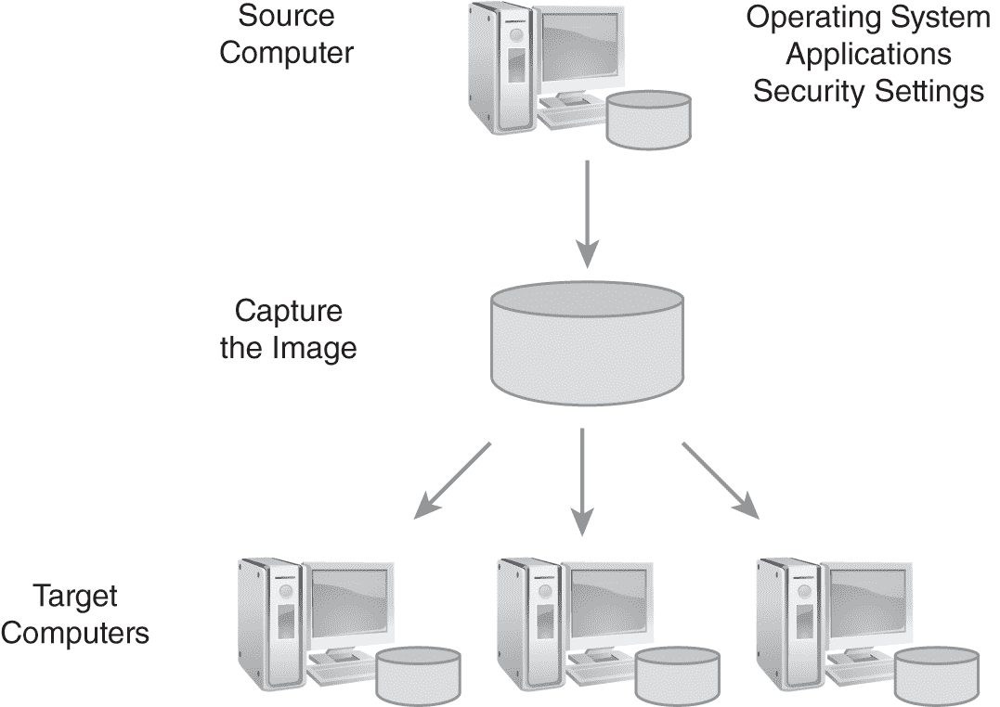

**图 15-1** 使用镜像技术。

接下来，你捕获系统的镜像。你可以将其比作拍摄快照。`Imaging` 捕获了当时系统的整个软件内容。`Symantec Ghost` 是一种常用的用于捕获任何操作系统镜像的程序。在使用虚拟系统时这尤其容易。大多数虚拟软件都包含快照功能。

一旦捕获了镜像，就可以将其部署到其他系统。原始镜像通常被称为 `gold master`（金版）。每个接收镜像的系统都具有相同的操作系统和应用程序。它还将具有相同的安全和配置设置。

这种基准提高了系统的安全性。它还降低了总拥有成本。假设安全策略要求更改 50 个不同的安全设置。如果没有基准，这些设置必须在可能存在的成百或数千台服务器上单独配置。单独配置这些设置所需的时间可能是巨大的。此外，无法保证在手动操作时，每个系统上的所有设置都配置得完全相同。

>  **注意**
>
> `Gold master` 指为了部署而复制的主镜像。使用黄金镜像（`golden images`）可以通过消除重复的配置更改和性能调优来节省时间。它确保了所有使用 `gold master` 副本制作的镜像都以相同的方式进行配置。

如果所有系统的配置都相同，帮助台人员可以更快地进行故障排除。这提高了可用性。想象一下，如果有数百（或数千）不同的系统以不同的方式配置，帮助台人员在排除故障时首先需要确定正常配置。一旦确定了正常运行状态，他们就会确定哪些是异常的以便修复。他们每次处理新系统时，都要重复这个过程。更糟糕的是，相同的服务器截然不同，意味着缺乏一致性且不符合安全标准。

>  **提示**
>
> 务必保护 `gold master` 的完整性。如果你的 `gold master` 感染了恶意软件，你将在每个副本中复制感染。永远不要将 `gold master` 用于生产或其他创建部署镜像之外的用途。

然而，如果所有系统都是相同的，帮助台人员只需要学习一种系统。这种知识可以转移到所有其他系统。故障排除和停机时间减少。可用性增加了。安全策略得到了一致的执行。

### 漏洞窗口和信息安全缺口定义

`vulnerability window`（漏洞窗口）是发现新漏洞与软件开发人员开始编写补丁之间的间隔。在此期间的攻击有时被称为 `zero-day vulnerabilities`（零日漏洞）。这意味着供应商在意识到该漏洞之前有零天的应对时间。这是一个严重的问题，因为尚未针对该漏洞提供任何可用补丁或修复措施。你不知道漏洞窗口何时开启，因为你不知道攻击者何时会发现该漏洞。然而，大多数供应商会在获知漏洞后立即开始编写补丁。例如，微软在 2014 年 4 月 26 日宣布了一个存在所有版本 `Internet Explorer` 中的零日漏洞。到 5 月 1 日，补丁已发布。

还有其他例子。2019 年，`Windows task scheduler`（Windows 任务调度程序）发现了一个漏洞。它影响了 `Windows 10` 和 `Windows server 2019`。`Task Scheduler` 服务以本地定义的最高权限运行，即 `NT AUTHORITY\SYSTEM`。任务调度存在一个允许攻击者提升权限的缺陷。最终被发现并命名为 `CVE-2019-1069`。

>  **提示**
>
> 你可能听过建议在计算机上使用自动更新。这对于家庭用户是正确的，但对企业来说是不建议的。补丁总有可能与你系统上的某些专用或特殊应用程序发生冲突。因此，建议先将补丁应用于测试系统以观察其效果。如果一切顺利，就可以将其推到网络的其余部分。

同样，在补丁发布与组织修补系统的时间之间存在延迟。即使你从基准开始，也无法保证它始终保持最新，或满足你所有系统的需求。基准与实际安全需求之间的差异代表了安全缺口（`security gap`）。例如，你可能在 6 月 1 日创建一个镜像。一个月后，你可能将该镜像部署到一个新系统上。大多数配置和安全设置是相同的；但在过去的一个月里可能发生了一些更改或更新。这些变化为攻击者提供了漏洞窗口，必须被修复。

如果你的组织使用了变更管理程序，你就可以轻松识别出任何应应用于系统的更改。如果你没有变更管理程序，那么在安全策略方面会出现巨大的漏洞。变更管理是网络管理、软件开发和安全的基础性。

除了变更管理之外，补丁管理也是一项重要的安全实践。操作系统和应用程序中经常会发现软件漏洞。供应商会发布补丁或更新来封堵漏洞；然而，如果不应用补丁，系统将仍然处于易受状态。保持系统补丁更新有助于组织避免重大的攻击和停机。

在 Microsoft 域中，`Group Policy`（组策略）部署了许多设置。`Group Policy` 允许管理员配置一次设置，该设置将自动应用到多个系统或用户。如果使用 `Group Policy` 更改设置，更改将在计算机在域上进行身份验证时自动应用到该计算机。不需要额外的步骤。

# 跟踪、监控和报告 IT 安全基准定义与策略合规性

基准（`Baseline`）是一个很好的起点。它确保系统在部署时符合安全要求。然而，验证系统是否持续保持合规仍然很重要。一个显而易的问题是：系统是如何发生变化导致其不再符合要求的？管理员或技术人员可能会更改设置来解决问题；例如，除非放宽安全性，否则应用程序可能无法运行。这些更改可能会削弱安全性以确保应用程序运行。恶意软件（`malware`）如病毒也可能更改安全设置。

设置如何以及为何被更改并不重要。重要的是，如果这是一个未经授权的更改，你想知道它。你可以使用几种不同方法中的一种或多种来验证合规性。这些方法只需检查系统上的设置以验证它们未被更改。几种常用方法包括：

*   自动化系统
*   随机审计和部门合规检查
*   组织策略合规性总体报告

## 自动化系统

自动化系统可以定期查询系统以验证合规性。例如，安全策略可能规定移除特定协议或禁用特定服务。例如，策略可能要求使用密码保护屏幕保护程序。自动化系统可以查询系统以确定这些设置是否已启用并与金标准（`gold master`）匹配。

许多自动化工具都包含调度功能。你可以调度工具定期运行。高级工具还可以重新配置不合规的系统。你所做的就是查看生成的报告以验证系统是否合规。例如，假设你的公司有 100 台计算机。你可以调度工具在每周六晚上运行。它将查询每个系统以确定其配置并验证合规性。扫描完成后，工具将提供一份报告，显示所有不合规的系统，包括具体问题。如果你的组织非常大，你可以配置扫描每晚在不同的计算机上运行。

Microsoft 提供了几种你可以使用的自动化工具来管理 Microsoft 产品。虽然 Microsoft 不是唯一可选的工具开发者，但它在组织中拥有庞大的计算机基数。了解哪些工具可用是值得的。这些包括：

*   `Systems Management Server (SMS)`（系统管理服务器）——这是一个较旧的服务器产品，但在许多组织中仍在使用。它结合并改进了其他多种产品的功能。它可以使用标准方法查询系统漏洞。它可以部署更新。它为这些任务增加了功能，例如调度部署更新的能力以及推送软件应用程序的能力。
*   `System Center Configuration Manager (SCCM)`（系统中心配置管理器）——`SCCM` 是 `SMS` 的升级版。它可以完成 `SMS` 能做的一切，并提供了若干项增强。`SCCM` 可以向客户端部署整个操作系统映像。

除了 Microsoft 产品之外，还有许多其他自动化工具。这些工具可以在其他操作系统上运行，并扫描 Microsoft 以及其他操作系统（如 `UNIX` 和 `UNIX` 衍生版）。市场上有多种类型和版本的扫描器。以下是目前市场上的几种：

*   `Nessus`——`Nessus` 被许多人认为是最好的扫描器。在 2008 年变为付费产品之前，全球有 75,000 组织在使用。它曾有免费版，但许多人认为它物有所值。
*   `Nmap`——`Nmap` 是一种网络扫描器，可以识别网络上的主机并确定运行的服务。它使用 ping 扫描器识别活动主机，使用端口扫描器识别开放端口及可能的协议。它还可以确定操作系统。
*   `eEye Digital Security Retina`——`Retina` 是一个漏洞管理工具套。它可以评估 Microsoft、`Linux` 以及其他 `UNIX` 发行版。它包含补丁部署和验证功能。
*   `Security Administrators Integrated Network Tool (SAINT)`（安全管理员集成网络工具）——`SAINT` 通过扫描系统漏洞提供评估。它可以执行尝试利用漏洞的渗透测试。`SAINT` 运行在 `UNIX/Linux` 平台上，但它可以测试任何具有 IP 地址的系统。它还提供指示如何解决检测问题的报告。
*   `Symantec Altiris`——`Altiris` 包括全套产品。它可以管理和监控多种操作系统，包括监控安全问题和已部署补丁。
*   `OpenVAS`——这是一个广泛使用的漏洞扫描器。它还会检查缺失的补丁和更新。

还可以使用登录脚本来检查某些关键设置。例如，脚本可以检查是否安装并更新了反病毒软件，或者系统是否拥有最新的补丁。脚本在每次用户登录时运行。

某些组织会对不合规的系统进行隔离。也就是说，如果扫描或脚本显示系统不合规，脚本将修改设置以限制计算机在网络上的访问。用户必须联系管理员才能恢复系统正常。

尽管漏洞扫描器仍然是重要的工具，但它们也有自己的局限性。首先，它们的好坏取决于测试脚本和方法。没有扫描器可以发现所有漏洞。解决这个问题的方法是使用多种漏洞扫描器，而不是依赖单一供应商。

*   **已验证漏洞与补丁扫描器**——该扫描器使用特权账户在目标系统上进行身份验证。然后它扫描系统是否存在已知漏洞。它还能根据定义的补丁策略判断系统是否已打补丁。
*   **未经验证漏洞扫描器**——该扫描器不使用系统账户扫描系统。这类似于攻击者扫描系统的方式。它通过网络扫描系统以确定已知漏洞是否存在。
*   **补丁修复**——该工具在目标系统上安装补丁。这些工具包含扫描或审计组件。补丁扫描器确定缺少某个补丁，然后补丁修复工具应用该缺失的补丁。


## 错误配置修复

该工具通过重新配置系统使其符合标准。它首先通过扫描系统来确定一组定义的配置设置是否准确。然后它重新配置任何不合规的设置。

你可以在 NIST 网站此处阅读更多关于 SCAP 验证计划的信息：[scap.nist.gov/validation/index.html](http://scap.nist.gov/validation/index.html)。

### 随机审计与部门合规性

你也可以进行随机审计以确定合规性。当 IT 任务被委托给组织中的不同单元时，这通常非常有用。例如，一个大型组织可能采用去中心化的 IT 模型。中央 IT 部门管理网络访问和电子邮件等核心服务，而各个部门管理自己的 IT 服务。该组织仍然拥有一份整体安全策略；但各个部门负责执行这些策略。在这种情况下，中央 IT 部门可以随机审计各个部门以确保合规性。一些较大的组织聘佣了专门的安全团队。这些团队在组织中承担着各种职责，例如事件响应和边界保护。他们还可以定期扫描网络中的系统，并随机针对特定部门的资源。

意识到这些扫描的目标非常重要。其目的并不是为了指责某个特定部门不合规。相反，它是为了帮助组织提高其整体安全态势。当然，当部门意识到他们的系统可能随时被扫描时，这会增加他们确保系统合规的动力。

### 组织策略合规性总体报告（成绩单）

许多组织使用成绩单格式来评估策略合规性。这些成绩单可以从多个源（例如质量保证程序）生成。组织可以创建自己的评分标准；就像在学校一样，A 等是优秀，而 F 等是不及格。包含的标准取决于组织的要求。例如，以下元素可以包含在评分计算中：

*   **补丁合规性**——这比较了应该应用的补丁数量与已应用的补丁数量。应该考虑一个时间段。修复主要漏洞的补丁可能被认为是关键的，必须尽早应用。例如，组织可以设定目标，在关键补丁发布后七天内部署 100% 的关键补丁。唯一的例外是补丁测试证实该补丁会导致问题。
*   **安全设置**——基线设定了多个安全设置。这些设置都应该保持不变。然而，如果审计或扫描显示设置有所不同，则表示存在冲突。每个不合规的安全设置都会被分配一个值。例如，每个与基线不同的设置都可能代表 5% 的分。如果扫描检测到三处差异，得分可能就是 3%。
*   **更改数量**——大多数组织都有正式的控制流程。当这些流程没有被遵守或不存在时，更改经常会导致问题。

### 供参考

决定补丁是否为关键的一种方法是确定其发生的概率和影响。分配了这些值后，风险可以计算为 `Risk = Likelihood × Impact`。分数越高，补丁越关键。该系统被称为 OWASP 评分方法论。更多信息可以在 [www.owasp.org](http://www.owasp.org) 获取。

### 自动化 IT 安全合规性

计算机擅长的一件事就是重复。它们可以重复执行相同的任务并始终给出相同的结果。相反，人类并不擅长重复任务。让管理员在 100 台计算机上更改同一个设置，可能会导致某一台计算机配置错误。此外，自动化任务节省了人力并最终节省了资金。例如，一个执行 15 分钟且需要执行 100 次的任务将花费 25 小时（`15 * 100/60`）。如果管理员花费 2 小时编写并调度脚本，则节省了 23 小时。根据管理员的薪水，这种节省可能是巨大的。

许多安全任务也可以专用工具完成。例如，本文之前的“自动化系统”部分列出了几种不同的工具，并对其功能进行了简要描述。然而，如果你计划自动化任何与 IT 安全合规相关的任务，你应该解决一些基础问题。这些包括：

*   自动化策略发布
*   配置与变更管理

### 技术提示

开源配置管理软件在许多组织中广泛获得并接受。许多开源解决方案支持新技术，例如与云提供商集成。例如，名为 `Chef` 的产品为本地或云端的网络节点提供配置管理。

### 自动化策略发布

在此之前，镜像被描述为让所有计算机从已知基线开始的方法。这对于创建基线的有效方法。然而，在部署基线后，你如何确保系统保持更新？例如，你可以在 7 月 1 日为系统部署一个镜像。7 月 15 日，组织批准了一项更改。你可以为新系统修改镜像，但你如何在 7 月 1 日接收镜像的系统以及其他现有系统中实施该更改呢？此外，如果你不是从镜像开始基线，你如何向网络上的所有系统应用这些安全设置？

你使用的自动化方法取决于组织使用的操作系统。如果组织使用微软产品，你有几种可以使用的技术。之前已经提到过一些工具，如 `SMS` 和 `SCCM`。另一个工具是 `Group Policy`（组策略）。

组策略在微软域中可用。它可以提高你组织中某些用户或部门的安全性。你可以首先通过镜像对所有系统应用基准（baseline）。然后，你可以使用 `Group Policy` 来封堵任何安全漏洞，或为某些用户或计算机增加安全设置。这种方法还可以确保符合法规和标准，例如符合支付卡行业数据安全标准（`PCI DSS`）中保护信用卡信用卡所需的控制措施。

以图 15-2 为例。组织名称为 `ABC Corp`，域名称为 `ABCCorp.int`。`Secure Password Policy`（安全密码策略）链接到域级别，以要求域内的所有用户都使用安全密码。组织可以定义密码策略，要求所有用户拥有至少六个字符的强密码。如果组织以后决定将此更改为更安全的八字符策略，管理员只需更改一次 `Secure Password Policy`，它就会适用于域中的所有用户。无论是有 50 个还是 50,000 个用户，单次更改都会对所有人同样生效。

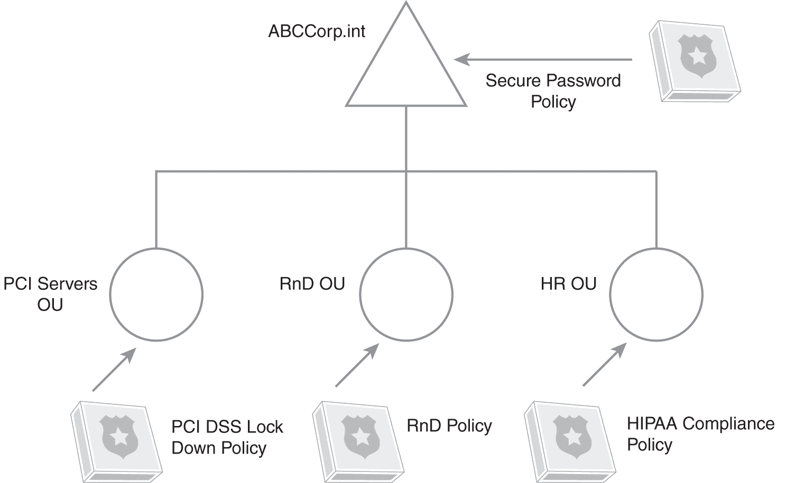

图 15-2 在微软域中使用组策略。

所有 `PCI DSS` 服务器对象都放置在 `PCI Servers` 组织单元 (`OU`) 中。一个名为 `PCI DSS Lock Down Policy` 的策略链接到该 `OU`。它配置了特定设置，以确保这些服务器符合 `PCI DSS` 要求。

### 提示

图 15-2 代表了微软域中 `Group Policy` 的简化视图。它没有显示 `Default Domain`（默认域）或 `Default Domain Controllers`（默认域控制器）策略，这些策略都是默认创建并为域添加基本安全的。此外，一个组织可能不仅仅有三个组织单元 (`OUs`)。

人力资源 (`HR`) 人员处理《健康保险可携带性与责任法案》（`HIPAA`）涵盖的健康数据。这些用户和计算机可以放置在 `HR OU` 中。`HIPAA Compliance Policy` 包含 `Group Policy` 设置，以执行 `HIPAA` 要求。例如，它可以包含一个脚本，在登录屏幕上提醒用户 `HIPAA` 合规性要求和罚措施。

该图还显示了一个针对该区域的研发组织单元，命名为 `RnD OU`。研发部门的用户和计算机将放置在 `RnD OU` 中。`RnD` 策略可以包含额外的安全设置，以保护 `RnD` 部门创建的数据。

`Group Policy` 不仅在系统启动时配置更改，还提供自动审计和更新。系统默认每 90 到 120 分钟查询一次域。任何 `Group Policy` 更改会在小时内应用到受影响的系统。此外，即使没有更改，系统也会每 16 小时从 `Group Policy` 获取并应用安全设置。

### 培训管理员和用户

这些工具和技术并不总是容易理解的。它们包含了丰富的功能，在有效使用它们之前需要进行深入的理解。培训管理员和用户如何充分利用这些工具需要花费时间和金钱。

在评估工具时，应该考虑培训。确定是否有可用培训及其成本。几乎所有销售这些工具的公司也出售培训。你可以派遣管理员到供应商所在地接受培训。如果你有足够的需要培训的员工，可以在现场进行培训。

需要记住的重要的一点是，即使是最“有价值”的工具，如果不使用，它也毫无价值。

### 组织接受度

组织接受度也是一个重要的考虑因素。在许多组织中，对变化的抵制可能是强大的阻碍。如果你使用的方法代表了重大变化，某些人员可能难以接受。例如，使用安全设置基准可能会导致问题。以前的应用程序可能不再运行。以前可以访问的网站可能无法再次访问。通常有变通步骤可以解决问题，但需要额外的时间和精力。

例如，解决问题有三种解决方法。首先，管理员可以通过不使用基准设置来削弱安全性；然而，削弱安全性不是好主意。其次，该部门可能决定无法再使用该应用程序。如果该应用程序对其任务至关重要，这可能不是一个好主意。第三，可以确定一种变通方法，既不绕过原始基准设置，又能允许应用程序运行。第三种方案需要深入研究以解决问题。如果管理员已经负担过重，或者没有解决问题的知识或能力，他们可能会推诿。这需要合作的氛围来解决问题。

漏洞扫描是一种常用工具，也是正常安全操作的一部分。理想情况下，它能快速、定期地识别待修复的漏洞。渗透测试将这种能力提升到了另一个水平。渗透测试旨在实际利用系统架构或计算环境中的缺陷。通常，渗透测试涉及一个伪装黑客的团队，使用漏洞扫描、社交工程和其他技术尝试入侵网络或系统。

### 测试有效性

并非所有自动化工具都相同。在向任何单一工具投入过多精力和精力之前，测试它们以确定有效性是值得的。在工具中常见的常见方面包括：

*   **准确识别**——工具能否准确识别系统？例如，它能区分运行 Internet 信息服务 (`IIS`) 的微软服务器和运行 `Apache` 的 Linux 系统吗？
*   **评估能力**——它是否扫描常见的已知漏洞？例如，它能检测账户的弱密码或空密码吗？
*   **发现**——系统能准确发现网络上的系统吗？它能发现有线和无线系统吗？
*   **误报**——它是否报告了不存在的问题？例如，当补丁已应用时，它是否会报告未应用？
*   **漏报**——它是否遗漏了存在的问题？换句话说，如果一个系统缺少补丁，工具能检测到吗？
*   **解决能力**——工具能否解决问题，或者至少识别如何解决？某些工具可以自动修复漏洞。其他工具提供方向或链接以引导你正确的方向。
*   **性能**——扫描速度很重要，特别是在大型组织中。扫描单个系统需要多久？扫描整个网络需要多长时间？

### 审计追踪

如果工具对网络进行了任何更改，记录这些更改是非常重要的。更改被记录在变更管理日志中，这些日志创建了审计追踪。执行更改的工具可以记录其在任何系统上所做的更改；然而，通常会对被更改的单个系统单独维护日志，并与变更管理日志分开。

日志可以维护在系统内部，也可以维护在系统外部。拥有系统外部日志的价值在于，如果系统受到攻击或故障，日志仍然可用。此外，某些法律和法规要求日志必须维护在系统外部。

审计追踪对于识别未经授权的更改特别有用。审计日志记录了不同事件的细节。这包括谁、做了什么、何地、何时以及如何做的。例如，如果用户进行了更改，审计日志将记录该用户是谁、用户更改了什么、更改何时发生以及是如何操作的。

想象一下在组织中部署了一个安全基线。你发现某个系统正在被定期重新配置。安全工具修复了它，但下一次扫描显示它又被更改了。你可能想知道是谁在进行这一更改。如果启用了审计，它将记录详细信息。你只需要查看审计追踪即可确定发生了什么。

### 提示

某些系统默认启用了某些审计。然而，你可能需要启用额外的审计以确定特定事件的细节。

## 配置管理与变更控制管理

信息技术基础设施库（ITIL）包含了五本书，代表了 ITIL 生命周期，如图 15-3 所示。ITIL 的核心部分是服务过渡。这涉及到服务向生产环境的过渡。它包含了配置管理和变更管理。

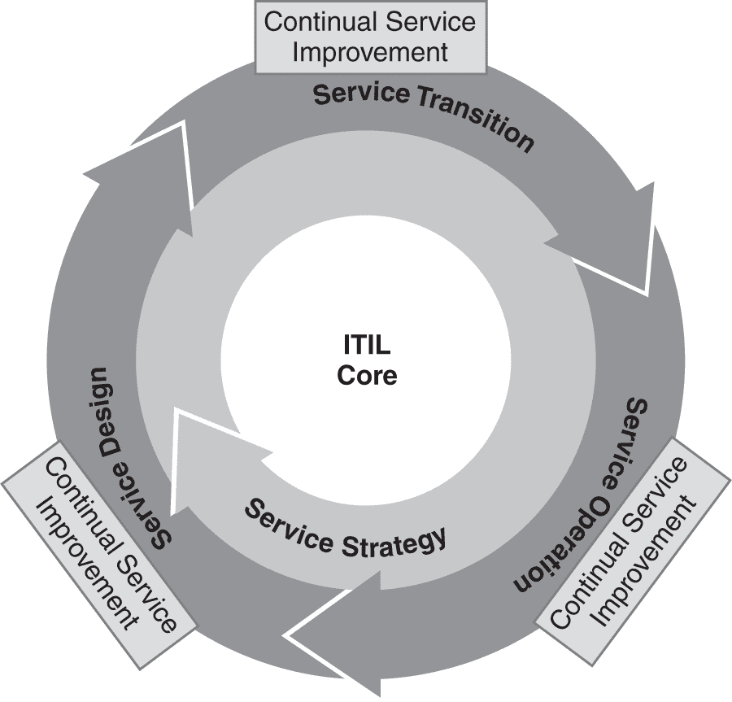

**图 15-3** ITIL 生命周期。

ITIL 并不是一种“全或无”的方法。组织通常采用 ITIL 实践的部分，而不采用其他部分。配置管理和变更管理是服务过渡阶段的两个元素，许多组织都采纳了这两个元素。

配置管理 (CM) 在系统的整个生命周期内建立并维护系统配置信息。这包括在基线中建立的初始配置，也包括记录更改。NIST SP 800-128 的初始公开草案将 CM 定义为一系列活动。这些活动侧重于通过控制影响配置的过程来建立系统的完整性。它始于基线配置。然后 CM 控制在整个系统生命周期内更改和监控配置的过程。

变更管理是一个控制系统更改的正式过程。许多组织中更改的常见问题之一是会导致停机。当一个系统上完成未经授权的更改时，可能会对另一个系统产生负面影响。这些更改并不是为了制造问题。相反，好心的技术人员为了解决小的问题而进行更改，却无意中制造了更大的问题。成功的变更管理确保更改对业务的影响降至最低。换句话说，变更管理确保了对一个系统的更改不会导致另一个系统崩溃。

变更管理与补丁系统等基本安全活动一起使用也非常重要。考虑一下补丁可能导致的最坏结果是什么。虽然补丁旨在解决问题，但它们偶尔也会引起问题。最坏的情况是补丁损坏了系统。在应用补丁后，系统不再能启动进入操作系统。

如果一个补丁损坏了你的家用电脑，那将很不方便；但如果一个补丁损坏了组织中的 500 个系统，那可能是灾难性的。补丁在应用之前需要经过测试和批准。许多组织在为系统打补丁之前使用变更管理流程。

### 备注

将变更管理与外部过程挂钩是重要的，例如通常被称为“紧急修复”的流程。变更管理必须与紧急修复等外部过程保持一致。紧急修复系统允许快速解决问题。例如，如果网站宕机，可以开启紧急工单以访问托管网站的服务器。

### 配置管理数据库

配置管理数据库 (CMDB) 在系统的整个生命周期内持有配置信息。其目标是在任何时候识别准确的配置。

CMDB 持有的所有设置，而不只是安全设置。安全三要素包括机密性、完整性和可用性。许多配置设置确保系统正常运行。配置错误的系统可能会导致可用性丢失。

### 备注

NIST SP 800-128《信息系统配置管理指南》深入介绍了配置管理。

### 跟踪、监控与报告配置更改

许多组织对更改请求使用正式流程。这不仅仅是技术人员询问主管他们是否可以进行更改。例如，可以使用内部网页提交更改。网页将收集更改的所有细节并将其记录在变更控制工单数据库中。细节可能包括系统、实际更改、理由和提交者。

组织中的关键人员通过同一个内部应用程序审查更改请求并提供意见。这些关键人员可能包括高级 IT 专家、安全专家、管理人员和灾难恢复专家。每个人都会根据其专业领域检查更改，并判断是否会产生负面影响。如果所有专家都同意该更改，则予以批准。

### 备注

变更评审还必须考虑法规和合规事项。实施更改可能会导致违规。例如，假设组织对网络分段方式进行了更改。如果此更改导致信用卡系统不再隔离，那么该更改可能会导致违反 PCI 规定。

## 跨业务区域的协作与策略合规

业务部门之间保持良好关系非常重要。业务的一个要素不应在不考虑如何影响其他区域的情况下做出更改。IT 和安全策略合规内部的协作同样重要。

某些安全策略必须同样适用于所有业务区域。然而其他策略可以针对特定部门。如果你回看图 15-2，它展示了在 Microsoft 域内如何处理不同需求的优秀示例。组策略将某些设置应用于所有业务区域。此外，根据需要，它还可以为不同的部门或业务区域配置不同的设置。

无论你如何努力通过审批流程进行沟通，不可避免地会发生某些误解。某些人会对突然的变化感到措手不及，或者两个变更之间发生冲突。你可能会发现多项变更需要撤回，但并没有预想中的可用资源来执行恢复。或者，因为没有完全理解变更的完整范围而导致了误解。

解决所有这些问题并没有魔术公式。一个良好的经验之谈是过度沟通，并将变更纳入到可预测的进度和资源计划中。例如，可能常规（非关键）补丁始终在每个月的第一个星期六进行。创建一个 SharePoint 站点来存放变更描述。承诺在变更发生的前周提供变更描述。向所有审批者和利益相关者发送提醒邮件。简而言之，要保持透明化，并尽力准确、频繁地进行沟通。这为利益相关者提供了参与和提供意见的所有机会。

## 策略实施指南与合规性的版本控制

另一个与自动化 IT 安全策略合规性相关的考虑是版本控制。首先，对安全策略本身使用版本控制非常重要。换句话说，如果安全策略发生了变化，文档应该记录这些变化。读者应该能够判断自策略最初发布以来是否发生了变化，并了解这些变化是什么。

文档的版本控制要求可以简单到包含一个版本控制页面。该页面以表格格式标识对原始版本进行的所有更改。它通常会包含更改的日期和其他细节。它还可能包括是谁执行了更改。

记录对系统的实际更改也很重要。然而，这些更改也记录在变更控制工作单数据库以及上一节讨论的 `CMDB` 中。

### 合规技术与解决方案

组织同时使用新兴技术和现有技术来确保合规性。一个特殊的挑战是如何更新和跟踪监管变化以及新规则，包括如何使用它们来协调策略管理和合规培训。

本节介绍了一些著名的技术。它们是：

*   赞助组织委员会（COSO）内部控制——集成框架
*   安全内容自动化协议 (SCAP)
*   简单网络管理协议 (SNMP)
*   基于 Web 的企业管理 (WBEM)
*   数字签名

### COSO 内部控制——集成框架

`COSO Internal Control—Integrated Framework` 由 Treadway 委员会赞助组织委员会开发。这产生了 `COSO` 术语。该组织成立于 1992 年，主要思想是创建一个控制框架，以确保公司的财务报告准确且无欺诈。`COSO` 框架多年来不断进化，最新版本于 2013 年 5 月发布。自 1992 年以来，通用技术特别是互联网都发生了演变。不意外的是，技术和信息安全已成为 `COSO` 控制框架的主要组成部分。

事实上，`COSO` 与 `信息和相关技术控制目标 (COBIT)` 一样，经常被审计师、合规专业人员和风险专业人员使用。`COSO` 被广泛使用并被公认为全球采用的美国主要标准。由于 `COSO` 控制既适用于业务功能（如财务会计），也适用于技术（如信息安全），它们构成了一个功能强大的框架。该框架可以从业务和技术术语方面描述如何构建控制。这对于安全团队具有巨大的益处。安全团队可以从业务和技术术语方面构建控制。

### 提示

`MITRE Corporation` 是一家私营公司，为美国政府机构提供大量工作。许多原始员工来自 `马萨诸塞理工学院 (MIT)`，他们从事研究和工程 (`RE`) 工作。

因此，`COSO` 是保持系统合规的强大框架。

### 备注


关于 `COSO` 内部控制的更多信息可以在 `www.coso.org` 找到。

### SCAP

`Security Content Automation Protocol (SCAP)`，读作“S-cap”，是一种用于衡量系统和网络的技术。它实际上是由六项规范组成的集合。这些规范共同标准化了安全产品识别和报告安全问题的方法。`SCAP` 是 `NIST` 的商标。

`NIST` 作为其《联邦信息安全管理法 (FISMA)》责任的一部分创建了 `SCAP`。其目标是为扫描系统的工具建立标准、指南和最低要求。尽管 `SCAP` 设计用于美国政府使用的工具，但私实体可以使用相同的工具。

这六项规范是：

*   `可扩展配置清单描述格式 (XCCDF)`——这是一种用于编写安全清单和基准的语言。它还可以报告任何清单评估的结果。
*   `开放漏洞和评估语言 (OVAL)`——这是一种用于表示系统配置信息的语言。它可以评估系统状态并报告评估结果。
*   `通用平台枚举 (CPE)`——为硬件、操作系统和应用程序提供特定名称。`CPE` 为不同产品之间的一致使用提供了一个标准的系统命名规范。
*   `通用配置枚举 (CCE)`——为安全软件配置提供特定名称。`CCE` 是这些设置的名称字典。它提供了不同的 SCAP 产品所使用的标准命名规范。
*   `通用漏洞和暴露 (CVE)`——为安全相关的软件缺陷提供特定名称。`CVE` 是公开已知软件漏洞的字典。`MITRE Corporation` 管理着 `CVE`。
*   `通用漏洞评分系统 (CVSS)`——它提供了一个开放规范，用于衡量软件漏洞的相对严重性。它提供了使用标准测量的公式。得分从 0 到 10 分，其中 10 分最严重。公式包含几个都会影响最终得分的独立准则。

SCAP 本身并不是一种工具。相反，它是用于构建工具的协议。将其比作超文本传输协议（HTTP），HTTP 是在互联网上传输流量的协议，以便应用程序能够在用户程序中显示数据。网络浏览器可以显示用超文本标记语言（HTML）和可扩展标记语言（XML）编写的页面。然而，HTTP 无法显示流量本身。相反，Edge、Firefox 或 Chrome 等网络浏览器是使用 HTTP 传输和接收 HTTP 流量并显示 HTML 格式页面的工具。同样，符合 SCAP 的工具使用 SCAP 的底层规范对系统进行扫描并报告结果。这些工具的用途非常广泛，包括审计和评估系统是否符合特定要求的能力。它们可以扫描系统的漏洞。它们还能够检测出未安装妥当补丁或配置错误的系统。

目前可用的某些工具包括：

*   BigFix Security Configuration and Vulnerability Management Suite (SCVM)
*   eEye Digital Security 的 Retina
*   HP SCAP Scanner
*   SAINT 漏洞扫描器
*   Symantec Control Compliance Suite—Federal Toolkit
*   Tripwire Enterprise

如果你想了解更多关于 SCAP 的信息，请阅读 NIST SP 800-126。这是 SCAP 版本 1.3 的技术规范。在编写本文时，NIST SP 800-126 rev 3 处于草稿阶段。它是 SCAP 版本 1.1 的技术规范。你可以在 `csrc.nist.gov/publications/PubsSPs.html` 访问 NIST SP 800-126 以及其他 NIST 800 系列特殊出版物。

### 注意

NIST 为其 NIST 产品建立了一个正式的验证计划。你可以在 `nvd.nist.gov/scapproducts.cfm` 查看经过 SCAP 验证的产品完整列表。

### SNMP

简单网络管理协议 (SNMP) 用于管理和查询网络设备。SNMP 通常用于管理网络上具有 IP 地址的路由器、交换机和其他智能设备。SNMP 是 TCP/IP 协议套件的一部分，因此将其称为新兴技术有一点牵强。然而，SNMP 多年来得到了改进。SNMP 的第一个版本是 SNMP v1。它有一个重大漏洞：设备使用团体字符串（community strings）进行身份验证。默认团体字符串为“Public”，且 SNMP 以明文形式通过网络发送它。使用 Wireshark 等嗅探器的攻击者即使在字符串已从默认值更改的情况下也能捕获该团体字符串。然后他们可以使用它来重新配置设备。

SNMP 在版本 2 和 3 中得到了改进。版本 3 提供了三个主要的改进：

*   **机密性**——数据包经过加密。攻击者仍然可以使用嗅探器捕获数据包；但它们是以加密形式存在的，这防止了攻击者读取它们。
*   **完整性**——使用消息认证码（`MAC`）（不要与介质访问控制混淆）来确保数据未被修改。`MAC` 使用简的哈希值。哈希在源端计算并包含在数据包中。在目的地重新计算哈希。只要数据没有变化，哈希值将始终提供相同的结果。如果哈希相同，则说明消息没有丢失完整性。
*   **身份验证**——这提供了对 SNMP 消息来自已知源的验证。它防止攻击者在无法证明自己身份的情况下重新配置设备。

### WBEM

基于 Web 的企业管理 (WBEM) 是一组管理和互联网标准技术。它规范了用于不同平台之间交换数据以进行系统和应用程序管理的语言。正如 SCAP 提供了创建工具时使用的标准一样，WBEM 也提供了在不同管理工具中使用的标准。这些工具可以是基于图形用户界面（GUI）的工具；某些工具是不使用 GUI 的命令行工具。

WBEM 基于来自互联网以及分布式管理任务组（DMTF, Inc.）的不同标准。DMTF 是一个非营利协会。其成员促进企业和系统管理以及互操作性。这些标准包括：

### 注意

WBEM 使用在互联网上常用的 HTTP。然而，WBEM 也可以通过 HTTP 在内部网络上运行。

*   **CIM-XML**——基于 XML 协议的通用信息模型（CIM）。该协议允许通过 HTTP 传输 XML 格式的数据。CIM 将 IT 资源定义为富的面向对象模型中的相关对象。几乎任何硬件或软件元素都可以用 CIM 引用。应用程序使用 CIM 来查询和配置系统。
*   **WS-Management**——管理 Web 服务协议。该协议为系统交换信息提供通用方法。Web 服务通常用于互联网上的广泛用途。例如，使用 Web 服务从互联网上获取天气数据或货运数据。客户端发送 Web 服务查询并接收 Web 服务响应。WS-Management 协议规定了这些查询和响应如何从设备检索数据。它还可以用于向设备发送命令。
*   **CIM 查询语言 (CQL)**——该语言基于用于数据库的结构化查询语言（`SQL`）以及 W3C XML 查询语言。`CQL` 定义了使用 CIM-XML 和 WS-Management 查询系统的特定语法规则。

### 数字签名

数字签名是一个用于识别文件来源的值。通常对文件数据进行加密哈希处理，然后进行签名（即使用发送者的私钥加密）。数字签名技术为文件提供了额外的安全性。带有数字签名的文件提供了身份验证和完整性保证。它还提供了不可否认性；换句话说，它提供了文件是由特定发送者发送的保证。它还提供了文件未被修改的保证。

公钥基础设施（`PKI`）需要支持数字签名。`PKI` 包含颁发证书的证书机构（`CA`）。证书包含与私钥匹配的公钥。私钥加密的内容可以使用公钥解密。此外，公钥加密的内容可以使用私钥解密。

数字签名为许多不同类型的策略文件提供了额外的安全性。例如，考虑补丁和其他更新文件。你会下载这些文件并使用它们修复漏洞。如果攻击者以某种方式修改了补丁，你安装的将是恶意软件。同样，许多安全工具的定义更新都经过了数字签名。

如果文件经过数字签名，你就知道它没有被修改。以下步骤显示了名为 Acme Security 公司使用数字签名的一种方法。该公司首先通过以下步骤从 `CA` 获取证书：

1.  Acme Security 创建一对公私钥。
2.  Acme Security 将其证书请求中的公钥随公司请求一起发送给 `CA`。它保持私钥的私密和保护。
3.  `CA` 验证 Acme Security 是否为有效公司以及是否如其所述。随后，`CA` 为 Acme Security 创建数字证书。证书包含 Acme Security 提供的公钥。

    此时，该公司能够对文件进行数字签名。在遵循创建和使用数字签名的步骤时，请参考图 15-4。

4.  Acme Security 创建文件。
5.  Acme Security 对文件进行哈希。哈希通常用十六进制表示的数字。有很多哈希算法，但 `SHA-2` 是最广泛使用的算法之一。
6.  Acme Security 使用其私钥对哈希进行加密。结果是一个看起来像随机乱码的字符串。请记住，用私钥加密的内容只能用匹配的公钥解密。换句话说，如果你用公钥解密数据，你就知道它是用匹配的私钥加密的。
7.  Acme Security 将文件和数字签名打包在一起并发送给接收客户端。数字证书可以同时发送，也可以分开发送。
8.  接收客户端使用证书验证文件确实是由 Acme Security 发送。此外，客户端会向 `CA` 验证以确认证书是否有效且未被撤销。
9.  客户端使用证书中的公钥对签名进行解密，从而获得哈希值。然后他们对文件生成自己的哈希值，并与收到的哈希值进行比较。两者应该完全匹配。

### 注意

无论你计算多少次哈希，只要源相同，结果就始终是相同的。这类似于数碗里的苹果数量。只要苹果的数量不变，你得出的总是相同的数字。如果有人拿走一个苹果或增加一个苹果，结果数字就会发生变化。

数字签名并不是新技术；然而，多年来，它们在安全工具和下载中的应用显著增加。数字签名为你提供了一个额外的工具来验证下载文件的身份验证和完整性。你用于打印机等设备的驱动程序很可能经过了数字签名。

### IT 安全策略合规性监控的最佳实践

在实施 IT 安全策略合规性监控计划时，可以使用几种不同的最佳实践。以下列表显示了其中一些：

*   **从安全策略开始**——安全策略充当路线图。这是一份书面文档，而不是某人脑中的某些想法。如果没有书面文档，实际的安全策略就会变成一个移动的目标，对合规性进行监控将具有挑战性，甚至是不可能的。
*   **根据安全策略创建基线**——尽可能使用镜像来部署新的操作系统。这些镜像将确保系统从安全状态下启动。它们还可以加速部署、节省资金并提高可用性。
*   **跟踪并更新法规和合规规则变更**——将法规和规则变更作为常规工作进行正式跟踪。将变更映射到这些规则的策略和配置控制上。然后根据需要更新安全策略和技术。
*   **定期审计系统**——部署基线后，定期检查系统。确保已配置的安全设置保持配置状态。出于好意的管理员可能会更改设置。恶意软件也可以修改设置。然而，审计会捕获这些修改。
*   **尽可能自动化检查**——使用工具和脚本来检查系统。某些工具是免费的。其他工具需要付费，但所有工具都比手动操作要好。它们减少了所需的时间并增加了准确性。
*   **管理变更**——确保使用变更管理流程。这允许专家在实施变更之前对其审查，并减少变更导致问题的可能性。它还为变更提供了内置文档。

### IT 安全策略合规性监控的成功案例和示例

以下章节展示了不同的案例研究和示例。

#### 案例研究 1

在这个示例中，一家大型组织遭遇了严重的停机。不遵守政策是导致原因之一。

该组织与子网存在冲突。添加新服务器时使用的 IP 地址已由打印机占用。在更改打印机 IP 地址后，子网上的所有服务器都失去了网络访问。变更管理和配置管理流程本可以确保添加新服务器时使用的配置不会干扰其他系统。此外，变更管理本可以防止打印机 IP 地址的更改。

技术人员发现子网上的打印机出现问题。默认网关是所有服务器传出子网通信的路径。因为与默认网关冲突，子网上没有一台服务器能够将流量传出子网。它们都在运行，但子网外的客户端无法使用它们。由于几台服务器无法工作，问题迅速升级。高级管理员被请进来并发现了问题。他们纠正了打印机上的 IP 地址，并对原始技术人员提供了一些在职培训。

注意这个问题是如何从一个小错误开始的。添加新服务器时使用的 IP 地址已由打印机占用。在更改打印机 IP 地址后，子网上的所有服务器都失去了网络访问。变更管理和配置管理流程本可以确保添加新服务器时使用的配置不会干扰其他系统。此外，变更管理本可以防止打印机 IP 地址的更改。

事实证明，这是该公司的转折点。这是由未经授权的变更引起的系列问题之一。管理层最终决定实施正式的变更管理流程，并聘请了一位外部顾问来帮助他们。

#### 案例研究 2

2018 年，万豪酒店链发生数据泄露事件。在四年时间内，5 亿名客人的个人和财务信息被泄露。泄露涉及 2018 年 9 月 10 日左右对数据库的未经授权访问。

该酒店链透露，对于这些记录中的许多，数据可能包括出生日期和护照号码。在某些情况下，数据还包括支付卡号和有效期，但支付卡号使用了高级加密标准（`AES-128`）进行加密。因此，攻击者不太可能解密这些数据。

因此，这个案例研究的结果参差不齐。泄露事件本身是严重的。然而，根据 `PCI DSS`，信用卡信息经过加密的这一事实可能会减轻泄露的影响。相反，许多安全分析师认为泄露本应该更早被发现。

#### 非营利部门案例研究

这是一个较老的案例研究，但直到今天仍具有意义。2013 年 6 月，据报道斯坦福大学的露塞尔·帕卡德儿童医院（Lucile Packard Children’s Hospital）发生了数据泄露。2013 年 5 月 8 日，一名员工报告，一台包含儿科患者医疗信息的未加密笔记本电脑被盗。该笔记本电脑包含 13,000 名患者的个人信息，包括他们的姓名、年龄、医疗记录号和手术程序，以及参与这些手术的医生姓名和电话号码。涉及的计算机已不再使用；事实上，它已经处于故障状态。但在它被退役时，并没有对其进行妥善的处置。

这是该医院在四年内发生的第五次重大数据泄露。作为另一个例子，2013 年 1 月，该医院报告，一台包含 57,000 名患者医疗信息的笔记本电脑从医生的汽车内被盗。

这些事件表明了对 `HIPAA` 规定的缺乏合规性。对包含敏感信息的笔记本电脑进行加密是医疗保健行业的行业标准。这也是许多法规（包括 `HIPAA`）的要求。

既然法规和行业最佳实践已经非常明确，为什么还会发生这种情况呢？在如此短的时间内发生了五次重大泄露，这表明该大学在定义安全策略、培训员工以及通过严格执行来要求他们负责方面存在系统性失败。

斯坦福的这些事件凸显了三个值得思考的领域：

*   政策执行
*   意识培训
*   设备处置

既然 `HIPAA` 标准和行业最佳实践如此明确，你可能会认为是政策执行不足。本应该有一份完整的笔记本电脑清单，并进行交叉检查以确保它们都经过了加密。

执行需要是强力的。有些组织在执行这些政策方面非常严格。例如，所有笔记本电脑在发放之前必须加密。定期进行扫描以确保笔记本电脑保持加密状态。当发现设备未加密（如旧设备或“遗留”设备所示），会给用户一个短的窗口（几天时间）对其进行加密。未能遵守的用户将失去访问权限，并通知领导层采取管理行动。对未能遵守安全策略设置后果是一项重要的执行工具。

大学官员提到已经实施了新的、改进的“HIPAA 培训”。这再次可能表明政策已经存在，但没有被遵守。国会于 1996 年颁布了 `HIPAA`。该法律的要求定义得很明确且为众人所知。需要实施新的 `HIPAA 培训`表明员工意识缺乏。如果这是原因之一，它说明了仅仅有良好的政策是不够的。对政策的合规取决于熟练的员工，他们将执行该政策视为日常工作的一部分。

设备处置似乎是故事中最费解的部分。为什么一台损坏的设备仍在最终用户手中，这令人困惑。一旦设备被禁用，应该立即将其移交给 IT 人员并对其中包含的信息进行妥善处置。在这种情况下，延迟移交旧设备是不恰当的。员工已经领了新设备，而旧笔记本电脑被认为“无法工作”。在这种情况下，许多组织会坚持在发放新设备之前先收到损坏的设备。这是一个很好的政策。

有趣的是，大学官员还强调那台“无法工作”的笔记本电脑“屏幕严重损坏”。屏幕与笔记本电脑中包含的数据无关。将屏幕损坏作为减少对设备被盗关注程度的理由，引发了人们对官员对威胁理解的质疑。硬盘才是重要的。笔记本电脑屏幕可以更换，或者更简单地通过外部显示器绕过。或者硬盘可以快速移动到另一台机器上。

### 注意

始终记住，泄露关乎数据。无论物理设备受到多大损坏，只要硬盘是完好的，被盗机器上的数据就面临风险。这就是为什么在许多情况下，加密便携设备的硬盘被认为是行业最佳实践。

## 章总结

本章介绍了用于确保 IT 策略合规的一些技术。镜像技术可以为新系统部署相同的基准镜像。本讨论了黄金镜像（gold master image）的重要性。然而，基准只有很短一段时间是最新的。随着补丁的发布或其他更改的批准，基准就会过时。基准与所需更改之间的差异代表了漏洞或安全缺口。必须关闭这个差距以确保系统安全。

今天 IT 管理员可以使用许多自动化工具。这些工具可以检查系统以确保基准安全设置没有更改。它们还可以扫描系统的漏洞，例如确保计算机具有最新的补丁。许多工具包含了扫描问题和部署更改以修复问题的能力。`NIST` 在 `SP 800-126` 中发布了 `SCAP` 标准。这些标准产生了大量的可用工具，以增加当今网络的安全性。你还学习了渗透测试是测试控制有效性的重要测试。最后，本章中的案例研究说明了缺乏合规如何对组织产生重大影响。

### 核心概念和术语

*   `配置管理 (CM)`
*   `黄金镜像 (Gold master)`
*   `组策略 (Group Policy)`
*   `镜像 (Imaging)`
*   `渗透测试 (Penetration test)`
*   `安全基准 (Security baseline)`
*   `安全内容自动化协议 (SCAP)`
*   `简单网络管理协议 (SNMP)`
*   `漏洞窗口 (Vulnerability window)`


*   `基于 Web 的企业管理 (WBEM)`

### 第 15 章评估

1.  A(n) \_\_\_\_\_\_\_\_\_\_\_\_\_\_\_ 是一个起点或标准。在 IT 内部，它提供了针对组织内特定技术的标准。

2.  在一个系统上安装了操作系统和不同的应用程序。然后对该系统进行了各种锁定。你想将相同的操作系统、应用程序和设置部署到 50 台计算机上。最简单的方法是？

    *   脚本
    *   镜像
    *   手动操作
    *   将工作分配给不同部门

3.  在系统中应用了一组安全设置后，无需再次检查系统上的这些设置。

    *   正确
    *   错误

4.  从发现新漏洞到开发者开始编写补丁之间的时间被称为(n) \_\_\_\_\_\_\_\_\_\_\_\_\_\_\_。

5.  你的组织想要自动化安全策略设置的发布。应该考虑什么？

    *   管理员的培训
    *   组织的接受程度
    *   有效性测试
    *   以上所有

6.  有许多工具可以自动化部署安全策略设置。某些工具可以部署基准设置。其他工具可以部署安全策略设置的更改。

    *   正确
    *   错误

7.  一个组织采用去中心化的 IT 模式，中央 IT 部门负责核心服务和安全。该组织希望确保每个部门都遵守主要的安全要求。可以使用什么验证合规性？

    *   组策略
    *   集中变更管理策略
    *   集中化配置管理策略
    *   随机审计

8.  变更请求在控制工作单数据库中进行跟踪。已批准的变更也记录在 `CMDB` 中。

    1.  正确
    2.  错误

9.  一个组织想要维护一个系统设置数据库。该数据库应包含原始系统设置和任何更改。在组织内部应该实施什么？

    1.  变更管理
    2.  配置管理
    3.  完整的 ITIL 周期支持
    4.  安全内容自动化协议

10. 一个组织希望减少在网络实施更改时停机的可能性。该组织应该使用什么？

    1.  变更管理
    2.  配置管理
    3.  配置管理数据库
    4.  简单网络管理协议

11. 一个安全配置的安全基准镜像，在部署过程中会进行复制，有时被称为 `______`。

    1.  主副本副本
    2.  零日镜像
    3.  黄金镜像 (Gold master)
    4.  铂金镜像

12. 微软为微软产品创建了基于 Web 的企业管理 (WBEM) 技术。

    1.  正确
    2.  错误

13. 风险评分常用方法反映在以下公式中：`Risk` = `______` × `______`。

14. 验证安全基准合规性的有效方法是什么？

    1.  漏洞扫描器
    2.  渗透测试
    3.  A 和 B

15. 保护你的黄金镜像是非常重要的，因为被感染的副本可能会迅速导致恶意软件的广泛感染。

    1.  正确
    2.  错误

16. `______` 可以与下载的文件一起使用。它提供了该文件是由特定实体提供的验证。它还验证了文件未被修改。

17. 如果一个组织实施了 COSO 内部控制框架，那么它就不能实施像 COBIT 这样的控制框架。

    1.  正确
    2.  错误


© obpcnh/Shutterstock

## 答案页

## 附录

### 第 1 章 信息系统安全策略管理

1. C 2. 标准 3. A 4. D 和 E 5. 流程 6. D 7. C 8. 人 9. E 10. B 11. E

### 第 2 章 信息安全策略的业务驱动因素

1. C 2. A 3. A 4. 预防 5. C 6. B 7. D 8. A 9. D 10. D 11. A 12. B 13. B 14. D 15. D

### 第 3 章 合规法律与信息安全策略要求

1. B 2. E 3. E 4. D 5. 网络恐怖主义或网络战 6. B 7. C 8. B 9. B 10. D 11. D

### 第 4 章 七个领域内的挑战

1. B 2. A 3. C 4. C 5. LAN 到 WAN 域 6. A 7. 分段网络 8. A 9. B 10. B 11. D 12. B 13. C 14. B 15. C 16. 集中器 17. C 18. B

### 第 5 章 信息安全策略实施

1. E 2. B 3. 在后台运行；对他们的要求是精确 4. 业务成本 5. B 6. A 7. C 8. A 9. A 10. B 11. 安全策略 12. A 13. D 14. A 15. C 16. C

### 第 6 章 IT 安全框架

1. F 2. A 3. A, B 和 C 4. A 5. 策略 6. B 7. C 8. 闲置账户 9. 机密性、完整性、可用性和不可否认性 10. B 11. G 12. B 13. B

### 第 7 章 如何设计、组织、实施和维护安全策略

1. A 2. D 3. A 4. D 5. C 6. B 7. B 8. C 9. 答案可能包括用于控制访问的设备和过程；例如围栏、守卫、锁的门、运动检测器和报警器 10. 教训 11. 策略 12. 深度防御 13. A 14. B 15. A 和 D

### 第 8 章 IT 安全策略方法

1. A 2. C 3. D 4. E 5. A 6. B 7. B 8. B 9. B 10. 优先级或专业领域 11. A 12. B

### 第 9 章 用户域

1. B 2. B 3. D 4. A 5. B 6. B 7. B 8. B 9. B 10. E 11. A 12. B 13. B

### 第 10 章 基础设施

1. D 2. B 3. D 4. A 5. B 6. B 7. B 8. B 9. C 10. E 11. A 12. B 13. B

### 第 11 章 数据分类与处理

1. C 2. B 3. E 4. E 5. A 6. B 7. C 8. B 9. B 10. D 11. D 12. B 13. B

### 第 12 章 应急响应 (IRT)

1. B 2. C 3. D 4. D 5. A 6. B 7. D 8. A 9. B 10. B 11. G 12. B 13. B

### 第 13 章 漏洞

1. B 2. A 3. C 4. B 5. B 6. D 7. D 8. A 9. B 10. B 11. D 12. B 13. B

### 第 14 章 策略实施

1. D 2. A 3. C 4. B 5. B 6. D 7. C 8. A 9. B 10. B 11. A 12. B 13. B

### 第 15 章 合规性

1. B 2. B 3. B 4. C 5. D 6. A 7. D 8. A 9. B 10. B 11. C 12. B 13. B

## 缩写表

## 附录

`ABAC` 基于属性的访问控制

`ACD` 自动呼叫器

`AES` 高级加密标准

`ALE` 年度预期损失

`ANSI` 美国国家标准学会

`AO` 授权官员

`AP` 接入点

`API` 接口

`APT` 高级持续威胁

`ARO` 年度发生率

`ATM` 异步传输模式

`AUP` 可接受使用政策

`AV` 反病毒软件

`B2B` 企业对企业

`B2C` 企业对消费者

`BBB` 商业改进

`BC` 业务连续性

`BCP` 业务连续性计划

`BGP4` 边界网关协议用于 IPv4

`BIA` 业务影响分析

`BU` 业务单元

`BYOD` 自带设备

`C2C` 消费者对消费者

`CA` 证书机构

`CAN` 控制区域网络

`CAN-SPAM` 反未经垃圾商业邮件和营销法

`CAP` 认证与认可人员

`CAUCE` 反未经垃圾商业邮件联盟

`CBA` 成本效益分析

`CBF` 关键业务功能

`CBK` 共同知识库

`CCC` 证书协调中心

`CCNA` 思科认证网络工程师

`CDR` 话详细详情

`CERT` 计算机应急响应小组

`CFE` 注册财务调查师

`C-I-A` 机密性、完整性、可用性

`CIPA` 儿童网络保护法

`CIR` 承诺速率

`CIRT` 计算机事件响应小组

`CISA` 注册信息系统审计师

`CISM` 注册信息安全经理

`CISSP` 信息安全专家

`CMIP` 通用管理协议

`CMMI` 能力模型集成

`CND` 计算机网络防御

`CNE` 计算机网络渗透

`COBIT` 信息和相关技术控制目标

`COPPA` 儿童在线隐私保护法

`COS` 服务类别

`COSO` 赞助组织委员会

`CPs` 控制伙伴

`CRC` 循环冗余校验

`CSA` 云计算安全联盟

`CSF` 关键成功因素

`CSI` 计算机安全协会

`CSP` 云服务提供商

`CTI` 计算机电话集成

`CVE` 常见漏洞和披露

`DAC` 任意性访问控制

`DBMS` 数据库管理系统

`DCS` 分布式控制系统

`DDoS` 分布式拒绝服务

`DEP` 数据执行保护

`DES` 数据加密标准

`DHCPv6` 动态主机配置协议用于 IPv6

`DHS` 美国国土安全部

`DIA` 国防情报局

`DISA` 直接内部接入系统

`DLP` 数据丢失防护 OR 数据泄露防护

`DMZ` 非军事化区

`DNS` 域名服务 OR 域名系统

`DoD` 美国国防部

`DoS` 拒绝服务

`DPI` 深度数据包检测

`DR` 灾难恢复

`DRP` 灾备计划

`DSL` 数字用户线路

`DSS` 数字签名标准

`DSU` 数据服务单元

`EDI` 电子数据交换

`EIDE` 增强型 IDE

`ELINT` 电子情报

`EPHI` 电子受保护信息

`EULA` 用户许可协议

`FACTA` 公平准确信用交易法案

`FAR` 误接受率

`FCC` 联邦通信委员会

`FDIC` 联邦存款保险公司

`FEP` 前端处理器

`FERPA` 家庭教育权利权利法案

`FIPS` 联邦信息处理标准

`FISMA` 联邦信息管理法案

`FRCP` 联邦民事诉讼规则

`FRR` 误拒绝率

`FTC` 联邦贸易委员会

`FTP` 文件传输协议

`GAAP` 一般公认的会计原则

`GIAC` 全球信息保证

`GigE` 千兆以太网

`GLBA` 格拉姆-莱奇-利法案

`HIPAA` 健康保险可携带性与责任法案

`HIDS` 主机型入侵检测系统

`HTML` 超文本标记语言

`HUMINT` 人工智能

`IAB` 互联网活动委员会

`ICMP` 互联网控制消息协议

`IDEA` 国际数据加密

`IDS` 入侵检测系统

`IDPS` 入侵防御系统

`IEEE` 电子工程师学会

`IGP` 内部网关协议

`IMINT` 卫星情报

`IP` 知识产权 OR 网协议

`IPS` 入侵防御系统

`IPSec` 互联网安全

`IRT` 应急响应小组

`ISACA` 信息系统审计协会

`IS-IS` 中间系统中间系统

`ITIL` 信息技术基础库

`ITRC` 身份盗窃中心

`IVR` 交互式语音响应

`ISO` 国际标准化组织

`ISP` 互联网服务提供商

`ISS` 互联网系统安全

`LAN` 局域网

`MAC` 强制性访问控制

`MAN` 市域网

`MAO` 最大可接受中断时间

`MASINT` 测量与信号情报

`MD5` 消息摘要算法 5

`modem` 调制解调器

`MP-BGP` 用于 IPv6 的多协议边界网关协议

`MPLS` 多协议标签交换

`MSTI` 多生成生成树实例

`MSTP` 多生成生成生成树协议

`NAC` 网络访问控制

`NAT` 网络地址翻译

`NFIC` 国家欺诈中心

`NIC` 网络接口卡

`NIST` 美国标准与技术研究院

`NMS` 网络管理系统

`NOC` 网络运营中心

`NSA` 国家安全局

`NVD` 国家漏洞数据库

`OPSEC` 资安安全

`OS` 操作系统

`OSI` 开放系统互连模型

`OSINT` 开源情报

`OSPFv2` 用于 IPv4 的开放最短路径算法 v2

`OSPFv3` 用于 IPv6 的开放最短路径算法 v3

`PAA` 特权访问协议

`PaaS` 平台即服务

`PBX` 私用交换机

`PCI` 支付卡行业

`PCI DSS` 支付卡行业数据安全标准

`PGP` 良好的隐私

`PHI` 受保护的健康信息

`PII` 个人身份信息

`PIN` 个人识别码

`PKI` 公钥基础设施

`PLC` 可编程逻辑控制器

`POAM` 行动计划与里程碑

`PoE` 以以太网供电

`POS` 销售终端

`PPTP` 点对点隧道协议

`PSYOPs` 心理战

`RA` 注册机构 OR 风险评估

`RAID` 独立磁盘冗余阵

`RAT` 远程访问木马 OR 远程工具

`RCSA` 风险和控制自评估

`RFC` 征求

`RIPng` 用于 IPv6 的下一代路由信息协议

`RIPv2` 用于 IPv4 的路由信息协议 v2

`ROI` 投资回报

`RPO` 恢复点目标

`RSA` 里斯特、沙米尔和亚德曼（算法）

`RSTP` 快速生成树协议

`RTO` 恢复时间目标

`SA` 安全关联

`SaaS` 软件即服务

`SAN` 存储区域网

`SANCP` 安全分析师网络连接分析器

`SANS` 系统管理员、审计、网络、安全

`SAP` 服务访问点 OR 安全意识策略

`SCADA` 监控控制与数据采集

`SCSI` 小型计算机系统接口

`SDLC` 系统开发生命周期

`SDSL` 对称数字用户线路

`SET` 安全电子交易

`SGC` 服务器门控加密

`SHA` 安全哈希算法

`S-HTTP` 安全 HTTP

`SIEM` 安全信息和事件管理系统

`SIGINT` 信号情报

`SIP` 会话建立协议

`SLA` 服务水平协议

`SLE` 单次损失预期

`SLT` 高层领导团队

`SMFA` 特定管理功能区域

`SNMP` 简单网络管理协议

`SOX` 2002 年萨班斯-奥克斯利法案（也称 Sarbox）

`SPOF` 单点故障

`SQL` 结构化查询语言

`SSA` 社会保障局

`SSCP` 系统认证从业人员

`SSID` 服务集标识符（分配给 Wi-Fi 的名称）

`SSL` 安全套层

`SSL-VPN` 安全套层虚拟网络

`SSO` 单点登录

`STP` 屏蔽双线 OR 生成树协议

`TCP/IP` 传输控制协议/网协议

`TCSEC` 可信计算机系统评估标准

`TFA` 双因子认证

`TFTP` 简单文件传输协议

`TGAR` 链路组访问限制

`TNI` 可信网络解释

`TPM` 技术保护措施 OR 可信平台模块

`UC` 统一通信

`UDP` 用户数据报协议

`UPS` 不间断电源

`USB` 通用串行

`UTP` 非屏蔽双线

`VA` 漏洞扫描

`VBAC` 基于视图的访问控制

`VLAN` 虚拟区域网

`VoIP` 越网络语音

`VPN` 虚拟专用网络

`W3C` 世界维网联盟

`WAN` 广域网

`WAP` 无线接入点

`WEP` 有线等效隐私

`Wi-Fi` 无线传输

`WLAN` 无线局域网

`WNIC` 无线网络接口卡

`WPA` Wi-Fi 安全访问

`WPA2` Wi-Fi 安全访问 2

`XML` 可扩展性标记语言

`XSS` 跨站脚本

# 访问控制列表 (ACL) 一种通过维护授权用户 ID 表来控制对资源访问的实现技术。

活动内容 指在客户端浏览器中运行的软件或插件，通常位于某些网站上。示例包括 Java applet、JavaScript 和 ActiveX 。

代理 (Agent) 在分布式基础设施的背景下，指运行在分布式设备（如移动销售代表的笔记本电脑或平板电脑）上的代码，用于管理该设备。代理通常向中央服务器报告设备状态，报告检测到的任何恶意软件，并接收命令和更新。

无代理中央化管理工具 在分布式基础设施的背景下，是指托管在中央服务器上的软件，该软件向远程设备“推送”更改（如更新）。

冷漠 (Apathy) 一种漠不关心的状态或对关注、兴奋、动力和激情等情绪的抑制。

应用程序软件 通常指终端用户（包括客户）接触的任何业务软件均被视为应用程序。这包括电子邮件、文字处理和电子表格软件。

架构运行模型 一种帮助组织理解如何实施安全控制的框架。该组织面临的一个常见问题是业务内部安全的集中化或去中心化。关于架构运行模型的讨论可以识别分歧之处，并对控制措施的恰当位置和实施建立一套共识。

架构评审委员会 一个批准标准技术和架构的门禁委员会。

基于属性的访问控制 (ABAC) 一种依赖于动态角色而非基于角色的访问控制中的静态角色的授权控制。在 ABAC 中，你构建一个描述角色的属性表达式，该表达式在运行时动态构建。

审计 (Audit) 记录发生在计算或网络设备（服务器、工作站、防火墙等）上的相关安全事件的行径。也可以指由审计员对业务和财务流程及文件的审查。

审计委员会 一个处理审计问题和非财务风险的委员会。

审计员 (Auditor) 负责评估安全策略设计和有效性的个人。审计员可以是组织内部或外部的人员。

身份验证 (Authentication) 确定个人或设备身份的过程。

授权 (Authorization) 授予某些人员访问系统、应用程序和数据的权限。

自动化控制 一种立即停止行为且不依赖人类决策的安全控制。

自动降级 在经过一段时间后（如 25 年）自动移除分级标记。

可用性 (Availability) 确保授权用户在需要时能够访问信息。

## B


# 术语表

## A

**最适宜访问权限** 一种授予系统访问的方法。最适宜权限仅为一组或一类用户提供其工作所需的访问权限。与`最小访问权限`相比，后者通常是为单个用户定制访问权限。

**最佳实践** 通过经验被证明非常可靠的领先技术、方法论或技术。最佳实践往往能产生一致且高质量的结果。

**外挂式 (Bolt-on)** 在信息安全方面，指将信息安全作为一个独立的控制层进行添加。外挂式安全是`集成安全`的对立面，在集成安全中，信息安全控制是过程设计中不可或缺的一部分，而不是一个独立的层。

**泄露 (Breach)** 一种损害信息机密性、完整性或可用性的确认事件。

**自备设备 (BYOD)** 一种允许员工、承包商和其他人员使用自己的手机、电脑和其他设备登录组织网络，而不是使用属于组织的设备的政策。

**业务常态 (BAU)** 用于参考组织预算的术语，指正常支出。将治理成本整合到组织的`BAU`预算中，使这些成本看起来是正常的运营费用，而不是异常情况。

**业务连续性计划 (BCP)** 一项关于在灾难后如何继续业务的计划。`BCP`包含`灾难恢复计划 (DRP)`作为组件。

**业务连续性代表** 一个了解组织恢复系统、应用程序、网络或数据的个人。此人员还拥有拨号列表权限，以便在非工作时间联系组织内的任何人。

**业务影响分析 (BIA)** 一种正式分析，用于确定在关键流程和技术不可用时对组织的影响。

**业务流程重组 (BPR)** 一种用于提高组织内部流程效率和效果的管理技术。

## C

**监管链 (Chain of custody)** 法律术语，指证据如何被记录和保护。从获取证据开始到提交法庭为止，证据必须经过记录并受到保护。

**变革代理者 (Change agent)** 挑战现状思维的人。

**变更管理 (Change management)** 管理`IT`系统升级的实践，包括理解变更的影响以及在出现问题时知道如何恢复。

**首席信息官 (CIO)** 决定组织内信息系统功能的整体战略方向和业务贡献的人；通常是组织内被指定负责信息安全的人。

**首席信息安全官 (CISO)** 组织内负责与数字信息相关的安全工作的人员；此人通常负责确保组织符合《格拉姆-莱奇-布莱尔法案》等法律中的信息安全规定。有时简单地称为`information security officer (ISO)`。

**首席隐私官 (CPO)** 负责管理数据隐私相关风险的最高级领导者。

**赞助组织协会 (COSO)** 一个开发了验证内部控制和管理企业风险框架的组织；侧重于财务运营和风险管理。

**沟通计划 (Communications plan)** 概述要共享哪些信息以及如何传播这些信息。

**补偿控制 (Compensating control)** 一种实现了预期结果和策略意图的安全控制，但不一定按照策略规定的方式实现。然而，结果是相同的。

**合规性 (Compliance)** 合理确保符合组织政策、标准、程序、法律和法规的能力。

**合规官 (Compliance officer)** 负责监控法律和法规遵守情况的个人。

**合规风险** 涉及未能遵守法律义务对业务产生的影响。

**计算机辅助培训 (CBT)** 部分或全部通过计算机通信渠道（如互联网或通过培训软件）完成的培训。

**机密 (Confidential)** 政府分级的一个级别，指其未经授权的泄露预计认为会对国家安全造成某些损害的数据。

**机密性 (Confidentiality)** 仅限制授权用户访问信息/数据。

**保密协议 (CA)** 关于公司材料的处理和披露的具有法律约束力的协议。

**配置管理 (CM)** 一系列跟踪系统配置的活动。它从基线配置开始。贯穿系统的生命周期，包括更改和监控配置。

**消费者权利** 在电子商务交易中如何处理消费者及其信息的既定规则。

**应急账户 (Contingent accounts)** 在发生灾难时用于恢复系统的账户；此类账户需要无限权限，用于安装、配置、修复和恢复网络及应用程序，并恢复数据。这种高级别的访问使得此类账户成为黑客的首要目标。

**持续改进 (Continuous improvement)** 一种为了改进业务产品、服务或流程而进行的随机、持续努力。

**承包人员 (Contractors)** 可以被分配到任何角色的临时工作人员。

**控制环境 (Control environment)** 组织治理和执行控制措施的总体方式。

**信息和相关技术目标绩效相关控制框架 (COBIT)** 这是一个被广泛接受的框架，它将业务和控制需求与技术问题相结合。

**控制伙伴 (Control partners)** 组织内部负责对安全策略的合理性和影响提供意见的人员。控制伙伴通常在内部审计、运营风险领域，或者所在组织的合规或法律部门工作。

**协调运营模式 (Coordinated operating model)** 一种技术解决方案在企业内部共享数据，但服务的共享和标准化程度较低的运营模式。

**纠正控制 (Corrective control)** 一种恢复系统或过程的安全控制。

**关键基础设施 (Critical infrastructure)** 对社会经济运行至关重要的资产，例如交通、能源、通信、银行和其他系统的关键要素。

**网络恐怖主义 (Cyberterrorism)** 一种试图通过攻击政府计算机、大型公司或经济关键领域，在社会引起恐慌或重大混乱的攻击。

## D

**数据管理员 (Data administrator)** 执行备份、版本控制、上传、下载和数据库管理等策略和程序。

**静态数据 (Data at rest)** 存储在任何介质上的数据状态。

**数据分类 (Data classification)** 基于数据类型的保护级别。

**数据保管员 (Data custodian)** 负责数据日常维护和数据质量的个人。可能根据需要执行备份并恢复数据。数据保管员还根据数据所有者的批准来授予访问权限。

**数据加密 (Data encryption)** 当数据被加密时，只有使用密钥解密后才能查看实际信息。

**传输中数据 (Data in transit)** 数据在网络上或通过网络传输时的状态。

**数据泄露 (Data leakage)** 未经授权共享公司敏感信息的行为，无论是有意的还是无意的。

**数据泄露防护 (DLP)** 一项旨在减少意外或恶意丢失数据概率的正式计划。也可以代表数据丢失防护。

**数据丢失防护 (DLP)** 一项旨在减少意外或恶意丢失数据概率的正式计划。也可以代表数据泄露防护。

**数据经理 (Data manager)** 建立关于如何处理数据的程序的个人。

**数据所有者 (Data owner)** 批准用户对执行日常运营所需的信息的访问权限的个人。

**数据隐私 (Data privacy)** 规定个人信息应如何受到保护的预期并对数据共享方式设定限制的法律。

**数据安全管理员 (Data security administrator)** 负责授予访问权限并评估组织信息安全威胁的人员。

**数据管理师 (Data steward)** 数据所有者和访问权限批准者；负责数据质量。

**数据用户 (Data user)** 应用程序的终端用户。数据用户负责通过理解安全策略并遵循批准的程序和流程来妥善处理数据。

**去分类 (Declassification)** 将机密数据状态更改为非机密数据的过程。

**深度防御 (Defense in depth)** 使用多层安全防护来防止单点故障的方法。

**非军事化区 (DMZ)** 源自军事术语，指两个对立力量之间的缓冲区。在网络方面，它是位于公共互联网和私有局域网（`LAN`）之间的网段。构建`DMZ`的目的是保护私有局域网免受互联网的影响。它使用了一系列防火墙、路由器、`IDS`和/或`IPS`。`DMZ`是公共`Web`服务器、邮件服务器和公共`DNS`服务器所在的位置。

**检测控制 (Detective control)** 一种在行为发生后识别其的手动安全控制。

**数字资产 (Digital assets)** 组织拥有的任何数字材料，包括文本、图形、音频、视频和动画。

**灾难恢复计划 (DRP)** 一项在灾难期间恢复组织`IT`资产（包括软件、数据和硬件）的计划。

**发现管理 (Discovery management)** 在工作站中央系统的背景下，是指确定工作站上安装了内容的流程。也可以指了解工作站上存储了哪些信息。

**分布式基础设施 (Distributed infrastructure)** 指组织拥有的计算机集合，包括笔记本电脑、平板电脑和智能手机，这些设备通过网络连接并配备了分布式系统软件，使得它们尽管位于不同的位置，也能作为一个整体协同工作。

**多样化运营模式 (Diversified operating model)** 一种技术解决方案在企业内部集成和标准化程度较低的运营模式。通常情况下，业务单元之外的数据交换和力使用是极少的。

**分工 (Division of labor)** 将各种任务分组为不同的专业领域，以增强工作产品的深度和质量。

**领域 (Domain)** 我们技术基础设施中具有相似风险和业务逻辑部分。

**休眠账户 (Dormant account)** 长时间未使用的账户。

**尽职关切 (Due care)** 一个法律术语，指为了避免对他方造成损害而做的努力。它本质上是指一个人在特定情况下合理预期应提供的谨慎。

## E

**早期采用者 (Early adopter)** 作为试点早期采用安全策略的人。早期采用者为`IT`团队提供有用反馈。

**电子邮件策略 (Email policy)** 一项讨论在使用公司电子邮件系统时哪些行为是可以接受的策略。

**企业数据管理 (EDM)** 跨企业创建、集成、保护、分发和管理数据的学科。较大的组织可能会有专门的`EDM`团队。

**企业风险管理 (ERM)** 一个对齐战略目标、运营有效性、报告和合规目标的框架；并非特定于技术的。

**权限 (Entitlement)** 对信息资源进行的精粒度访问授予，通常通过使用应用程序网关实现。例如，应用程序可以允许用户批准付款，但限制金额小于`1000`美元。

**升级 (Escalation)** 在信息安全背景下，指高级领导通过指挥链获知风险的过程。升级按照组织结构逐级进行，直到问题得到解决或升级到组织的最高层。

**布道者 (Evangelists)** 对某项事业或项目充满热情的人。布道者通常能获得广泛受众对某个项目的认可。

**证据 (Evidence)**
1. 支持结论的信息。
2. 提交给监管机构以显示合规性的材料。

**异常 (Exception)** 偏离中央支持和批准的`IT`安全标准。异常的产生可能是因为组织未做好遵守标准的准备，或者由于使用了未被标准许可的技术。

**执行人员 (Executive)** 一位负责批准安全策略实施、在组织内推动安全信息并确保策略获得适当优先考虑的高级业务领导者。

**执行委员会 (Executive committee)** 一个帮助安全委员会与组织目标和目的保持一致的委员会。

**高层管理支持 (Executive management sponsorship)** 让高层管理参与培训以提高安全策略的有效性。

**外部连接委员会** 负责批准外部数据连接的网关委员会。

## F

**文件传输协议 (FTP)** 一种用于在局域网（`LAN`）或广域网（`WAN`）上交换文件的协议。

**财务风险** 当企业无法提供足够的流动性来履行其义务时，可能对业务产生影响的事件。

**紧急权限流程 (Firecall-ID)** 临时授予高级权限，以便人员能够快速解决问题。为非特权用户提供紧急访问。

**防火墙** 一种过滤局域网（`LAN`）出入流量的设备。许多防火墙可以进行深度数据包检测，即检查流量的内容以及类型。防火墙也可用于网络内部以进一步保护分段。防火墙最常用于过滤公共互联网与内部私有局域网之间的流量。

**扁平化网络** 几乎完全没有限制网络流量控制的网络。

**扁平化组织结构** 领导层与基层员工之间层级较少的组织。

**完全披露** 认为个人应当了解关于其自身的被收集了哪些信息的理念。个人还应被告知这些信息是如何被使用的。

## G

**网关委员会** 在项目或活动进入下一阶段之前，审查技术活动并提供批准的委员会。

**总法律顾问** 组织中职级最高的法律人员，通常向总裁或首席执行官汇报。他或她被要求对各种组织问题提供法律意见，参与合同谈判，并作为组织聘请外部律师事务所的联系人。

**全球化** 由先进的通信、交通和金融技术连接在一起的世界经济的发展。

**黄金镜像 (Gold master)** 用于部署的复制的母镜像。使用黄金镜像可以通过消除重复的配置更改和性能调优来节省时间。它确保所有使用黄金镜像副本进行制作的镜像配置都是相同的。

**治理** 管理实施过程并确保符合组织政策的行为的行为。

**治理、风险管理与合规 (GRC)** 一组汇集了系统管理风险和策略合规能力的工具。

**细粒度** 一组安全策略所深入的详细程度。策略越细粒，越容易执行和检测违规行为。但细粒度较粗的策略在应对新威胁时可能更有帮助。

**组策略 (Group Policy)** 用于微软域的自动化管理工具。管理员可以在组策略中配置一次设置，该设置将适用于多个用户和计算机。

**指南 (Guideline)** 在可能的情况下建议遵循的策略、标准或程序参数，但它是可选的。

## H

**加固** 通过将访问权限降低到执行任何任务所需的最低限度、确保访问经过个人身份验证、移除所有非本质软件以及其他消除未经授权访问机会的配置步骤，尽可能消除安全风险。

**信息管理主管** 处理信息所有方面（如安全、质量、定义和可用性）的角色；负责数据质量。

**帮助台管理** 在工作站中央管理系统的语境下，为终端用户提供支持的服务。这包括允许帮助台技术人员远程访问工作站以诊断问题、重新配置软件和重置`ID`。

**层级化组织结构** 具有多层汇报关系的组织，将领导层与基层员工隔离开。

**高度敏感分类** 用于保护受高度监管的数据或战略信息的分类级别。

**蜜罐 (Honeypot)** 一种充当诱饵以分析黑客活动的网络安全设备。

**人力资源代表** 对人力资源政策、纪律程序或员工的专家个人。

## I

**镜像 (Imaging)** 用于创建系统基准的技术。从源计算机捕获镜像。然后该镜像可以部署到其他系统。镜像包括操作系统、应用程序、配置设置。

**事件 (Incident)** 违反组织安全策略的事件。

**事件响应小组 (IRT)** 一个专门负责响应重大事件的专业小组。

**信息保证** 实施控制以确保机密性、完整性、可用性和不可否认性。

**信息安全** 保护信息或数据免受未经授权的使用、访问或破坏的行为。

**信息安全官 (ISO)** 见首席安全官。

**信息安全计划章程** 一份总结性文件，确立了向首席信息官（`CIO`）或其他执行领导以下的管理层信息安全的汇报关系和责任委托。

**信息安全代表** 在事件响应小组的语境下，信息安全代表提供风险管理和分析技能。代表可能还具有收集和分析证据的取证技能。

**信息安全风险评估** 识别威胁、潜在攻击和影响的正式流程。

**信息系统安全 (ISS)** 保护信息系统或`IT`基础设施免受未经授权的使用、访问或破坏的行为。

**信息系统安全管理生命周期** 控制信息安全规划、实施、评估和维护的五阶段管理过程。

**信息系统安全策略** 文档集，概述了组织为保护其信息系统而执行的控制措施、行动和流程。

**信息技术库 (ITIL)** 一个包含管理`IT`服务的概念、实践和流程全面列表的框架。

**信息技术领域专家** 对组织的系统和配置有深入了解的个人。该人员通常是开发人员、系统管理员或网络管理员。他或她拥有所需的技能，可以就如何阻止攻击提供关键建议。

**内部人员 (Insider)** 员工、顾问、承包商或供应商。内部人员甚至可能是设计被黑客的系统、应用程序或安全的`IT`技术人员之一。内部人员了解组织和应用程序。

**集成审计** 将两个或多个审计学科结合以进行单次审计的审计。

**完整性** 确保信息未被不当更改的行为。

**知识产权 (IP)** 任何独特非显而易见且在市场上具有价值的人类智力成果。

**交互式 (Interactive)** 指可以登录的系统账户（也称为服务账户）。系统账户由于其高访问权限，对黑客具有吸引力。交互性使得这些账户更容易受到攻击。非交互式系统账户要安全得多。

**内部分类** 如果泄露会对日常运营造成干扰并给业务造成某些财务损失的数据分类级别。

**国际标准组织 (ISO)** 一个创建信息安全和`IT`风险广泛接受的国际标准的组织。

**互联网过滤器** 阻止访问互联网上特定网站的软件。

**入侵检测系统 (IDS)** 一系列软件代理、设备和服务器，用于监控被视为威胁的网络活动、向管理员发出警报并记录信息。`IDS`的工作原理是匹配已知可能网络攻击流量的特征，或者随着时间的推移建立正常行为的基准，然后对偏离该正常行为模式的流量发出警报。

**入侵预防系统 (IPS)** 在潜在敌意活动被处理之前对其拦截的系统。

**资产管理** 在工作站中央管理系统的上下文中，指跟踪存在哪些工作站及相关的网络设备。这通常发生在工作站连接到本地局域网（`LAN`）时。

**IRT 协调员** 在事件期间跟踪事件响应团队（`IRT`）所有活动的人员。他或她担任团队的官方记录员。所有活动都通过此人进行。该人员记录谁在做什么。

**IRT 经理** `IRT`经理是团队负责人。此人对如何响应事件做出所有最终决定。他或她是与管理层之间的接口。

**ISO/IEC 27000 系列** 由国际标准化组织（`ISO`）和国际电工委员会（`IEC`）发布的信息安全标准。例如，`ISO/IEC 27002`为负责启动、实施或维护信息安全管理体系的人员提供了信息安全管理方面的最佳实践建议。

**针对特定问题的标准** 一种关注组织当前相关性和关注点领域的标准。此类标准用于表达安全控制需求（通常针对非技术流程），并用于指导人类行为。

**IT 策略框架** 一种建立的逻辑结构，将策略文档组织成分组和分类，以便员工更容易找到并理解各种策略文档的内容。策略框架还可以帮助组织策略的规划和开发。

## L

**标签** 位于文档内部的标记或注释，指示保护级别。

**LAN 域** 该域指组织的本地局域网（`LAN`）基础设施。`LAN`允许在小区域内连接两或多台电脑。

**LAN 到 WAN 域** 该域指用于连接组织本地局域网（`LAN`）到广域网（`WAN`，如互联网）的技术基础设施。这允许终端用户浏览互联网。

**法律** 在政府实体权威下规定的任何规则。规定了法律阈值。

**分层安全方法** 具有两或多层独立的控制措施以降低风险。

**最少访问权限** 仅授予用户完成其工作所需的系统访问权限的原则。这通常通过对个人进行访问权限自定义来实现。与`最佳匹配访问权限`比较，后者是一种通常对用户组或一类用户进行访问自定义的方法。

**法定代表** 了解法律和监管合规性的人员。

**经验总结** 从特定经验（例如策略变更的实施）中获得的知识。教训可以与他人分享，转换为标准程序，并应用于未来类似的情况中。

**日志管理** 在工作站中央管理系统的上下文中，指从工作站提取日志——通常是将日志移动到中央存储库。随后，这些日志会被扫描以寻找安全薄弱点或问题模式。


# 日志服务器

用于从整个网络各个平台收集日志的独立平台。

## M

### 强制去密

一种在应要求时审查特定记录，并在必要时将其去密处理过程。

### 手动控制

一种不会立即停止行为并依赖人类决策的安全控制措施。

### 矩阵关系

组织内多个利益相关者之间复杂的关系。

### 缓解控制

一种事后安全控制措施。它假设主要控制缺失或失效。缓解控制解决眼下的安全问题，但可能无法实现策略的完整意图。

### 多因素认证

通过一个以上的因素对网络上的用户进行验证，例如密码和访问代码的组合。

## N

### 国家级

拥有自己的国家政府的主权国家。

### 美国国家标准与技术研究院 (NIST)

一个为联邦信息系统安全控制创建安全准则的机构。

### 知情需要

一种将信息访问限制为仅那些拥有批准且有效需求的用户的原则。

### NIST SP 800-53

一由美国国家标准与技术研究院（`NIST`）发布的出版物，题为《联邦信息系统和组织建议的安全控制》。

### 非泄露协议 (NDA)

关于公司材料处理和披露的具有法律约束力的协议。这也被称为保密协议。

### 不可否认性

一种应用技术使个人无法否认或争议其参与了某项交易的概念。

## O

### 运行模式

有组织、有计划的操作方法。

### 运营偏离

策略和程序规定应该的操作与实际执行的操作之间的差异。

### 运营风险

中断组织日常活动的事件。

### 运营风险委员会

一个提供有关组织及各种业务风险偏好重要信息的委员会。

### 选择性加入 (Opt-in)

同意在原始用途之外使用个人信息的做法。选择性加入的一个例子是询问刚卖掉房屋的消费者，房地产公司是否可以将其信息分享给搬家公司。

### 选择性退出 (Opt-out)

拒绝在原始用途之外使用个人信息的做法。例如，一个刚卖掉房屋的消费者可能会拒绝房地产公司将其信息分享给搬家公司。

### 组织文化

组织成员共享的传统、习俗、行为模式、价值观和信仰。任何试图向组织引入变化（例如一套新的安全策略）的人必须了解并考虑组织文化。

### 过时技术

使难以一致实施最佳实践的硬件或软件。

## P

### 补丁管理

确保网络上的设备（如工作站和服务器）具有供应商提供的最新补丁。及时应用安全补丁解决已知漏洞尤为重要。

### 支付行业数据安全标准 (PCI DSS)

一种描述如何保护信用卡信息的全球信息安全标准。如果你接受 Visa、MasterCard 或美国 Express，则必须遵守 `PCI DSS`。

### 渗透测试

设计不仅用于识别而且为了实际利用系统架构或计算环境中的缺陷的测试。

### 个人隐私

在电子商务中，泛指个人信息如何被处理以及其用途。

### 个人身份信息 (PII)

用于唯一识别个人且可能被恶意利用的敏感信息。

### 泛化控制

一种跨越大量系统、应用程序和操作的通用控制措施，例如相同的 ID 和密码。

### 网络钓鱼

利用任何通信尝试从目标处获取信息。通常使用电子邮件。

### 策略 A（Policy A）

一份说明组织应如何执行和开展业务功能及交易以实现预期结果的文件。

### 策略定义文档（Policy definitions document）

组织安全策略的术语表，理想情况下应清晰简洁，通常审计人员和监管机构在评估组织控制措施的合理性时使用。

### 策略框架（Policy framework）

用于组织策略、标准、程序和指南的结构。

### 策略原则文档（Policy principles document）

一份传达跨整个组织通用规则的文档。原则重点关注关键风险或行为，并表达组织的核心价值观，这些价值观通常包括对违规行为零容忍的领域。

### 借口之法（Pretexting）

黑客构思一个故事，要求员工泄露削弱安全性信息。

### 预防性控制（Preventive control）

一种能够立即停止某种行为的自动化安全控制措施。

### 隐私政策（Privacy policy）

在业务中强调隐私，并讨论监管格局和政府指令。该策略通常涉及物理安全以及“封锁”敏感信息的重要性。

### 特权级访问协议（Privileged-level access agreement, PAA）

旨在提高具有管理员权限的用户的意识和责任感。

### 程序（Procedure）

描述实施某项流程所需步骤的书面陈述。

### 项目委员会（Project committee）

一个批准项目资金、阶段阶段和基础要求的门关委员会。

### 公开分类（Public classification）

一种数据分类级别，如果向公众发布，其对业务不会产生负面影响。

### 公共记录（Public record）

法律要求向公众开放的任何记录。此类记录由政府实体制作或归档。

### 公关代表（Public relations representative）

在事件响应团队（IRT）背景下，是指能够就如何向可能受事件影响的公众和客户提供建议的人员。此人在确保准确信息传出并防止产生破坏性误解方面非常有价值。

## Q

### 质量保证（Quality assurance）

组织内部的一种事前预防性控制，用于防止错误发生。

### 质量控制（Quality control）

一种事后侦测性控制，为组织提供了从错误中学习的机会。

## R

### 恢复点目标（Recovery point objectives, RPOs）

灾难发生后可接受的数据丢失最大水平。

### 恢复时间目标（Recovery time objective, RTO）

衡量业务流程在灾难后应多快被恢复。`RTO` 确定了特定业务流程允许的最大停机时间。

### 裁员（Reduction in force）

解雇员工或缩减规模以节省资金。

### 法规（Regulations）

组织为满足法律要求必须执行的既定规则。

### 远程访问域（Remote Access domain）

该领域指的是控制终端用户连接到组织局域网（`LAN`）的技术。一个典型的例子是某需要从家里连接到办公室。

### 远程身份验证（Remote authentication）

比办公室通常常见的验证更强的验证。通常需要比 ID 和密码更多的内容，例如安全令牌或智能卡。

### 复制运营模型（Replicated operating model）

一种技术解决方案在企业内部共享服务的运营模型，但数据共享水平极低。

### 剩余风险（Residual risk）

在应用所有控制措施后仍然的风险。

### 风险（Risk）

事件发生的可能性或概率及其影响。

### 风险与控制自评估（Risk and control self-assessment, RCSA）

一种允许组织理解其风险及其对业务潜在影响的工具。这是许多组织每年进行的正式活动。

### 风险偏好（Risk appetite）

理解风险并确定业务愿意接受多少潜在风险及相关问题。

### 风险评估

*参见*信息安全风险评估。

### 风险文化（Risk culture）

组织通常处理风险的方式；例如，是否始终遵循安全策略。组织的领导者通常对此有很大影响。

### 风险评估（Risk evaluation）

安全框架中的一个领域，要求分析风险并确定影响。

### 风险暴露（Risk exposure）

风险被实现的损害程度和可能性。

### 风险治理（Risk governance）

安全框架中的一个领域，确保风险管理活动与业务目标、目的和容忍度一致。

### 风险响应（Risk response）

安全框架中的一个领域，规定了反应的能力以降低和修复风险。

### 风险容忍度（Risk tolerance）

组织内部关于接受多少风险的主流观点。

### 路演（Roadshow）

在信息安全背景下，针对新安全策略等主题在大群体面前演示。

### 基于角色的访问控制（Role-based access control, RBAC）

一种根据角色而非个人身份授予用户网络访问的系统。例如，会计师可能有一个角色 `accountant`，所有新入职的会计师可能被分配相同的访问权限包。

### 路由器（Router）

连接局域网（`LAN`）或广域网（`WAN`）。

## S

### 机密（Secret）

一种政府分类级别，指数据未经授权的泄露预计预计会对国家安全造成严重损害。

### 安全意识计划（Security awareness program）

关于安全策略、威胁和数字资产处理的培训。

### 安全基线（Security baseline）

定义一组基本配置以实现定义的安全目标。这些定义的安全目标通常由安全策略和定义良好的安全框架表示。

### 安全委员会（Security committee）

一个作为信息安全计划指导委员会的委员会。

### 安全合规委员会（Security compliance committee）

一个批准为合规目的使用特定控制措施的门关委员会。

### 安全内容自动化协议（Security content automation protocol, SCAP）

一组规范，标准化了安全软件产品衡量、评估和报告合规性的方式。`NIST` 创建了 `SCAP`，几家私营公司创建了符合 `SCAP` 的工具。

### 安全控制映射（Security control mapping）

涉及合规性时，是将监管要求映射到策略和控制措施。

### 安全事件（Security event）

发生在正常日常安全操作之外的任何意外事件。通常，安全事件涉及安全策略中定义的控制失效。

### 安全管理（Security management）

指的是管理组织内部的安全，通常是 IT 安全。这包括确保终端用户拥有有限权限并实施访问控制，以及许多其他技术和流程。

### 安全人员（Security personnel）

负责在组织内设计设计和实施安全计划的人员。

### 安全策略（Security policies）

一套规定组织如何保护其设施和 IT 基础设施的策略。也可以涉及组织如何满足监管要求。

### 安全策略合规（Security policy compliance）

遵守组织关于安全策略的一系列规则。

### 安全令牌（Security token）

在登录时生成令牌（通常表示为一系列数字）的硬件设备或软件代码。安全令牌极难复制，有人认为是不可能的。当它作为其个人要求的登录的一部分分配给个人时，它提供了关于谁正在访问网络的保证。

### 分段网络（Segmented network）

一种限制计算机之间通信方式的网络。

### 职责分离（Segregation of duties, SOD）

*职责分离*的另一种术语。

### 敏感但未分类（Sensitive but unclassified）

一种政府分类级别，指机密且不根据《信息自由法》发布的数据。

- **敏感 (Sensitive)**：数据的一种分类级别，一旦泄露将导致重大的财务损失。
- **职责分离 (SOD)**：要求对高风险任务进行划分，使其需要多个人协作才能完成。其目的是防止员工在履行正常职责过程中隐瞒错误或欺诈行为。
- **服务水平协议 (SLA)**：服务合同中正式定义服务水平的部分。此类协议在用于语音和数据传输电路的电信合同中非常常见。
- **股东 (Shareholder)**：购买公司股票的人员（投资者）。
- **简单网络管理协议 (SNMP)**：一种用于查询和管理网络设备的协议。`SNMP` v1 存在已知漏洞，例如以明文传输社区名称。`SNMP` v2 和 v3 改进了 `SNMP` 的安全性和性能。
- **嗅探器 (Sniffer)**：一种可以读取局域网（`LAN`）通信流量的网络设备。
- **社会工程学 (Social engineering)**：通过操纵或欺骗人员来削弱组织的安全性。
- **控制跨度 (Span of control)**：与组织中直接下属人数与所实现的控制区域数量有关。
- **鱼叉式网络钓鱼 (Spear phishing)**：针对少数小组的钓鱼攻击。
- **标准 (Standard)**：一种已建立并证明有效的规范或方法。这可以是程序性标准，也可以是在整个组织范围内实施的技术标准。
- **状态检测防火墙 (Stateful firewall)**：一种监控特定连接的所有流量的防火墙。它检查包含数据的数据包，寻找不符合逻辑的模式和序列。这对于阻止试图伪冒他人以劫持你会话的数据包非常有用。
- **无状态防火墙 (Stateless firewall)**：一种根据源地址、目的地址或其他静态值限制并阻塞流量的防火墙。它独立地查看每个数据包。
- **鉴证业务标准第 16 号 (SSAE16)**：由美国注册公共会计师协会创建的标准，用于审计组织的控制环境，包括信息安全控制。
- **战略风险 (Strategic risk)**：可能改变整个组织运作方式的事件。
- **结构化查询语言 (SQL)**：用于访问数据库的标准化语言。
- **结构化查询语言 (SQL) 注入**：攻击攻击，黑客在 Web 或应用程序输入框中添加 `SQL` 代码，以获取访问或更改数据库中的数据。
- **交换机 (Switch)**：一种类似于集线器但可以过滤流量的设备。你可以设置规则来控制流量可以流向何处。与将流量复制到所有端口的集线器不同，交换机通常只将流量路由到系统连接的端口。这减少了网络流量，从而降低了他人拦截流量的机会。
- **系统访问策略 (System access policy)**：关于允许如何以及何时访问系统的行为准则。该策略涵盖了如 ID 和密码等终端用户凭据。该策略也可能针对特定业务或应用程序，例如基于角色的访问控制 (`RBAC`) 的使用。
- **系统软件 (System software)**：支持应用程序运行的软件。
- **系统/应用域 (System/Application domain)**：该领域指的是用于收集、处理和存储信息所需的技术。它包括与硬件和软件相关的控制。
- **系统性去密 (Systematic declassification)**：对免于自动去密的记录进行审查，然后从分类中移除这些数据的过程。
- **系统管理员 (Systems administrators)**：为系统和数据库提供管理支持的 IT 人员。
- **系统特定标准 (System-specific standard)**：专注于组织内部使用的特定技术或系统的标准。这些标准用于表示某些特定技术的安全控制实施要求。

## T

- **目标状态 (Target state)**：技术领域的术语，用于描述信息安全的理想未来状态，包括策略目标和目的以及实现这些目标所需的工具、流程和资源。
- **分类法 (Taxonomy)**：分类的实践和科学。分级分类法是针对一组对象或文档的分类树形结构。
- **威胁 (Threat)**：可能影响系统的人为或自然事件。
- **威胁向量 (Threat vector)**：通用的信息安全术语，描述黑客获取未经授权访问的工具或路径。
- **高层基调 (Tone at the top)**：组织领导对特定主题发布的消息。当高级执行对某项政策表示支持时，他们被认为设定了高层基调。
- **机密 (Top Secret)**：政府分类的一个级别，指如果发生未经授权的泄露，可以预计会对国家安全造成严重损害。
- **全体会议 (Town hall meeting)**：团队聚集在一起发布公告并讨论话题的会议。
- **问题工 (Trouble ticket)**：关于为了解决问题而授予了哪些访问及其业务原因的完整记录。
- **双因子身份验证 (Two-factor authentication)**：要求终端用户使用三种不同类型凭据中的至少两种来验证其身份。最常接受的三种凭据类型是：你知的、你拥有的以及你特征的。

## U

- **非密 (Unclassified)**：政府分类的一个级别，指公众可用的数据。
- **统一运营模型 (Unified operating model)**：一种技术解决方案在企业内部既共享数据又具有标准化服务的运营模型。
- **用户域 (User domain)**：该领域指的是任何访问信息的用户。包括客户、员工、顾问、承包商或其他任何第三方。这些用户通常被称为终端用户。
- **用户代理 (User proxy)**：一种用于控制从互联网到局域网（`LAN`）用户工作站流量的应用程序防火墙。它拦截用户对互联网资源的请求，发起新连接，并将结果代理回请求者。

## V

- **价值交付 (Value delivery)**：集中资源以产生最大的收益。
- **供应商治理委员会 (Vendor governance committee)**：一个批准新供应商并对现有供应商进行监督的委员会。这包括确保新供应商符合安全策略要求，例如拥有正式合同和安全控制证明。
- **虚拟专用网络 (VPN)**：`VPN` 在两个设备之间建立以创建一个加密隧道。所有通信都受保护免于窃听，被认为是安全的。
- **漏洞 (Vulnerability)**：系统中的可以被利用的缺陷。
- **漏洞窗口 (Vulnerability window)**：漏洞可以被利用的时间（即在修补之前）。

## W

- **广域网域 (WAN domain)**：该领域包括广域网 (`WAN`)，即覆盖大地理区域的网络。互联网是 `WAN` 的示例。特定公司可以建立私有的 `WAN` 来连接全国或全球的办公室。
- **网页涂鸦 (Web graffiti)**：由于网页篡改攻击导致网页内容的更改。网页涂鸦可能包含侮辱性语言甚至色情图像。
- **Web 服务 (Web services)**：使用标准技术和格式/协议在互联网上提供的自动化信息服务，简化了数据的交换和集成。Web 服务帮助组织无论使用何种操作系统、编程语言和数据库。
- **基于 Web 的企业管理 (WBEM)**：一组用于查询和管理网络中系统和应用程序的标准和技术。它用于互联网和内部网络。`WBEM` 功能内置于基于 GUI 的应用程序和命令行应用程序中。
- **网站篡改 (Website defacement)**：对网站的攻击，网站内容被更改，通常是以令网站所有者难脸的方式。
- **捕鲸式钓鱼 (Whaling)**：针对单个高价值受害者的钓鱼攻击。

### 工作站域

该领域指的是任何终端用户使用的计算设备。这通常意味着作为终端用户主电脑的台式电脑或笔记本电脑。


© obpcnh/Shutterstock

## References

Accredited Standards Committee X9 Incorporated, [`www.x9.org`](http://www.x9.org)，访问于 2010 年 3 月 8 日。


## 参考文献

阿尔伯塔卫生服务部门 (Alberta Health Services)“政策制定框架”，2016 年 4 月 25 日，[`extranet.ahsnet.ca/teams/policydocuments/1/clp-pdf-pol-devt-framework.pdf`](https://extranet.ahsnet.ca/teams/policydocuments/1/clp-pdf-pol-devt-framework.pdf)，访问于 2020 年 4 月 18 日。

Allbusiness，“波士顿检察长调查电子邮件销毁事件”，2010 年 1 月 1 日，[`www.allbusiness.com/government/government-bodies-offices-public/13829522-1.html`](http://www.allbusiness.com/government/government-bodies-offices-public/13829522-1.html)，访问于 2010 年 5 月 14 日。

美国语音语言听力协会 (American Speech-Language-Hearing Association)“经济与临床健康信息技术法 (HITECH Act)”，[`www.asha.org/Practice/reimbursement/hipaa/HITECH-Act/`](https://www.asha.org/Practice/reimbursement/hipaa/HITECH-Act/)，访问于 2020 年 4 月 10 日。

ArticleInput.com，“关于信息安全与问责制的几个事实”，2009 年，[`www.articleinput.com/e/a/title/A-few-facts-on-information-security-and-accountability/`](http://www.articleinput.com/e/a/title/A-few-facts-on-information-security-and-accountability/)，访问于 2010 年 3 月 10 日。

亚太经济合作组织 (Asia-Pacific Economic Cooperation)“APEC 隐私框架”，[`www.apec.org/Publications/2005/12/APEC-Privacy-Framework`](https://www.apec.org/Publications/2005/12/APEC-Privacy-Framework)，访问于 2020 年 4 月 11 日。

Baker & Hostetler LLP，“州数据泄露法表表”，[`www.bakerlaw.com/files/Uploads/Documents/Data%20Breach%20documents/State_Data_Breach_Statute_Form.pdf`](http://www.bakerlaw.com/files/Uploads/Documents/Data%20Breach%20documents/State_Data_Breach_Statute_Form.pdf)，访问于 2014 年 6 月 2 日。

Barrett, Jim，“电子发现就业圆讨会”，AterWynne LLP，2006 年 10 月 19 日，[`www.aterwynne.com/files/ERT_%20Electronic%20discovery.PDF`](http://www.aterwynne.com/files/ERT_%20Electronic%20discovery.PDF)，访问于 2010 年 3 月 26 日。

Bloch, Michael, Sven Blumberg, 和 Jürgen Laartz，“按时、按预算和按价值交付大型 IT 项目”，麦肯锡公司洞察与出版，2012 年 10 月，[`www.mckinsey.com/insights/business_technology/delivering_large-scale_it_projects_on_time_on_budget_and_on_value`](http://www.mckinsey.com/insights/business_technology/delivering_large-scale_it_projects_on_time_on_budget_and_on_value)，访问于 2014 年 3 月 10 日。

彭博社 (Bloomberg)，“Kerviel 的新律师将关注法兴银行的行为”，2008 年 7 月 30 日，[`www.bloomberg.com/apps/news?pid=20601085&sid=aWbERdIeyYO4&refer=europe`](http://www.bloomberg.com/apps/news?pid=20601085&sid=aWbERdIeyYO4&refer=europe)，访问于 2010 年 4 月 12 日。

Calfa, Jimena，“质量保证(QA)与质量控制(QC)的区别”，美国质量协会，2011 年 10 月 13 日，[`www.onquality.info/2011/10/difference-between-qa-and-qc.html`](http://www.onquality.info/2011/10/difference-between-qa-and-qc.html)，访问于 2014 年 5 月 1 日。

Caputo, Kim, *CMM 实施指南：编排软件过程改进*。纽约，纽约：艾迪逊韦威专业版，1998 年。

Carroll, Rory，“斯内登利用简单技术挖掘 NSA 计算机网络”，“卫报 (The Guardian)”，2014 年 2 月 9 日，[`www.theguardian.com/world/2014/feb/09/edward-used-simple-technology-nsa`](http://www.theguardian.com/world/2014/feb/09/edward-used-simple-technology-nsa)，访问于 2014 年 3 月 20 日。

案例研究：利用安全意识对抗持续性威胁，第 13 次信息系统教育研讨会，2009 年，[`www.cisse2009.com/colloquia/cisse13/proceedings/Papers/S03P02.pdf`](http://www.cisse2009.com/colloquia/cisse13/proceedings/Papers/S03P02.pdf)，访问于 2010 年 5 月 20 日。

战略与国际问题中心 (Center for Strategic and International Studies)，“重大事件”，[`www.csis.org/policy-program/significant-incidents`](https://www.csis.org/policy-program/significant-incidents)，访问于 2020 年 4 月 10 日。

CERT，“创建一个金融机构：案例研究”，[`www.cert.org/csirts/FI-case-study`](http://www.cert.org/csirts/FI-case-study)。

拉多 (Rados)，“云”，2020 年，Techjury，[`techjury.net/about/`](https://techjury.net/about/)。

沙德 (Chaudhuri), Sa，“数据泄露成本估计为 2 亿美元”，“华尔街日报 (The Street Journal)”，2014 年 2 月 18 日，[`online.wsj.com/news/articles/SB100014240527023046750425052703101`](http://online.wsj.com/news/articles/SB1000142405270230467504250527031101)。

Chef，“为什么是 Chef?”，[`www.chef.io/why-`](https://www.chef.io/why-)。

Conway, Tara, Susan Keverline, Michelle Keeney, Eileen Kowalski, Megan Williams, Dawn Cappelli, Andrew P. Moore, Stephanie Rogers 和 Timothy J. Shimeall，“内部威胁研究：关键基础设施部门的计算机破坏，”美国秘密勤局和卡内基·梅隆大学 CERT 项目，2005 年 5 月，[`www.cert.org/insider_threat/insidercross.html`](http://www.cert.org/insider_threat/insidercross.html)，访问于 2010 年 4 月 12 日。

塞浦路斯海事会，“网络安全案例研究，”2017 年 7 月，[`csc-cy.org/wp-content/uploads/2018/06/Cyprus-Shipping-Chamber-Cyber-Security-Case-Study.pdf`](https://csc-cy.org/wp-content/uploads/2018/06/Cyprus-Shipping-Chamber-Cyber-Security-Case-Study.pdf)，访问于 2020 年 4 月 20 日。

“诊断康奈尔大学的安全泄露，”康奈尔每日太阳，2009 年 6 月 24 日，[`cornellsun.com/node/37476`](http://cornellsun.com/node/37476)，访问于 2010 年 5 月 14 日。

Digitalmedialawyerblog.com，“TJX 数据安全泄露事件持续：针对 TJX 的金融机构集体诉讼因基于对 T.J. Maxx / Marshalls 母公司提出的 FTC 诉状书中陈述内容的不公平竞争主张而存活，”2009 年 8 月 10 日，[`www.digitalmedialawyerblog.com/2009/08/tjx_data_security_breach_saga.html`](http://www.digitalmedialawyerblog.com/2009/08/tjx_data_security_breach_saga.html)，访问于 2010 年 3 月 4 日。

Dilanian, Ken, 和 Richard A. Serrano，“斯诺登泄密严重损害美国安全，两位众议院员表示，”洛杉矶时报，2014 年 1 月 9 日。[`articles.latimes.com/2014/jan/09/nation/la-na-snowden-intel-20140110`](http://articles.latimes.com/2014/jan/09/nation/la-na-snowden-intel-20140110)，访问于 2014 年 3 月 20 日。

E-CommerceAlert.com，“办公上网风险，”2004 年 11 月 23 日，[`www.e-commercealert.com/article645.shtml`](http://www.e-commercealert.com/article645.shtml)，访问于 2010 年 4 月 24 日。

Egress.com，“IT 领导者与员工在数据伦理、所有权和内部泄露的根源上存在分歧，”2019 年 5 月 22 日，[`www.egress.com/en-US/news/insider-data-breach-2019-na`](https://www.egress.com/en-US/news/insider-data-breach-2019-na)，访问于 2020 年 4 月 15 日。

“职场行为的八种经典类型，”HR 杂志，2000 年 9 月。[`findarticles.com/p/articles/mi3495/is_45/ai_6557868/`](http://findarticles.com/p/articles/mi3495/is_45/ai_6557868/)，访问于 2010 年 3 月 7 日。

EMA，“EMA 2008 年现实世界 IT 治理、风险与合规调查，”2008 年，[`eval.symantec.com/mktginfo/other_resources/b-whitepaper_ema_symantec-it-grc_an_0608-en-us.pdf`](http://eval.symantec.com/mktginfo/other_resources/b-whitepaper_ema_symantec-it-grc_an_0608-en-us.pdf)，访问于 2010 年 4 月 30 日。

Erikson, Chris，“回复：隐私，”纽约邮报，2010 年 4 月 12 日。[`www.nypost.com/f/print/news/jobs/re_privacy_zUsPRcheD905WK2qM`](http://www.nypost.com/f/print/news/jobs/re_privacy_zUsPRcheD905WK2qM)，访问于 2010 年 5 月 12 日。

eSecurity Planet，“安全取证与响应案例研究，”2001 年 3 月 5 日，[`www.esecurityplanet.com/trends/article.php/10751_68897/article.htm`](http://www.esecurityplanet.com/trends/article.php/10751_68897/article.htm)，访问于 2010 年 5 月 2 日。

eSecurity Planet，“如何为员工制定网络策略，”2010 年 4 月 20 日，[`www.esecurityplanet.com/views/article.php/387781/How-To-Set-Networking-Policies-for-Employees`](http://www.esecurityplanet.com/views/article.php/387781/How-To-Set-Networking-Policies-for-Employees)，访问于 2010 年 5 月 14 日。

Espelund, Leif，“2013 预测：数据增长将导致数据管理投入增加，”2013 年 3 月 7 日，[`www.symform.com/blog/exponential-data-growth-2013/`](http://www.symform.com/blog/exponential-data-growth-2013/)，访问于 2014 年 3 月 10 日。

ETSI，“网络，”[`www.etsi.org/committee/1393-cyber`](https://www.etsi.org/committee/1393-cyber)，访问于 2020 年 4 月 11 日。

eWeek，“微软应对 WMF 漏洞，”2006 年 2 月 2 日，[`www.eweek.com/c/a/Windows-Responds-WMF/`](http://www.eweek.com/c/a/Windows-Responds-WMF/)，访问于 2010 年 3 月 28 日。

“行政命令——改进基础设施网络安全，”白宫新闻办公室，2013 年 2 月 12 日，[`obamawhitehouse.archives.gov/the-press-office/2013/02/12/executive-order-improving-critical-infrastructure-cybersecurity`](https://obamawhitehouse.archives.gov/the-press-office/2013/02/12/executive-order-improving-critical-infrastructure-cybersecurity)，访问于 2020 年 4 月 11 日。

Fadilšić, Sead，“DDoS 攻击日益扩大，”ITProPortal，2018 年 9 月 13 日，[`www.itproportal.com/news/ddos-attacks-are-getting-larger/`](https://www.itproportal.com/news/ddos-attacks-are-getting-larger/)，访问于 2020 年 4 月 14 日。

联邦存款保险公司，“501(b) 检查指导，”FIL-68-2001，金融指导，2001 年 8 月 24 日，[`www.fdic.gov/news/financial/2001/fil0168.html`](http://www.fdic.gov/news/financial/2001/fil0168.html)，访问于 2010 年 5 月 20 日。

联邦存款保险公司，“FFIEC-2011 环境环境认证补充，”2011 年 6 月 29 日，[`www.fdic.gov/news/financial/2011/fil105.html`](http://www.fdic.gov/news/financial/2011/fil105.html)，访问于 2010 年 6 月 30 日。

美国科学家联合会，“国家安全令 12333，”1981 年 4 月，[`www.fas.org/policy/archive/executive-order-12333`](https://www.fas.org/policy/archive/executive-order-12333)，访问于 2010 年 3 月 27 日。


Glaser, John，“管理在项目失败中的作用：高级经理显然非常希望项目成功。尽管意图良好，他们最终在确保失败方面发挥了关键作用，”Allbusiness.com，2004 年 10 月，[`www.allbusiness.com/technology/services/237595-1.html`](http://www.allbusiness.com/technology/services/237595-1.html)，访问于 2010 年 4 月 26 日。

Globalscape，“笔记本电脑被盗导致可口可乐数据泄露，”2014 年 1 月 27 日，[`www.globalscape.com/blog/2014/1/27/stolen-laptops-cause-data-breach-for-cocacola`](http://www.globalscape.com/blog/2014/1/27/stolen-laptops-cause-data-breach-for-cocacola)，访问于 2014 年 5 月 1 日。

Gorman, Siobhan, August Cole 和 Yochi Dreazen，“计算机间谍攻破战斗战斗机项目，”华尔街日报，2009 年 4 月 21 日，[`online.wsj.com/article/SB124027491029837401.html`](http://online.wsj.com/article/SB124027491029837401.html)，访问于 2010 年 4 月 11 日。

“O'Malley 州长的 15 个战略政策目标，”马里兰州 StateStat,[`www.gov.state.md.us/statestat/gdu.asp`](http://www.gov.state.md.us/statestat/gdu.asp)，访问于 2010 年 3 月 14 日。

Gralla, Preston，“Windows 份额再次下降；世界与微软幸存，”计算机世界博客，2010 年 1 月 4 日，[`blogs.computerworld.com/15344/windows_market_share_dips_again_world_and_microsoft_survive`](http://blogs.computerworld.com/15344/windows_market_share_dips_again_world_and_microsoft_survive)，访问于 2010 年 4 月。

- Grier, Sam，“ISACA 发布风险 IT 框架草案”，IT Manager’s Inbox, [`itmanagersinbox.com/1007/isaca-releases-the-risk-it-framework-draft/`](http://itmanagersinbox.com/1007/isaca-releases-the-risk-it-framework-draft/), 访问于 2010 年 4 月 30 日。

- Halock Security Labs，“使用 ISO 27001 构建安全计划”，[`www.halock.com/Downloads/Case_Study/AIM%20Case%20Study.pdf`](http://www.halock.com/Downloads/Case_Study/AIM%20Case%20Study.pdf), 访问于 2010 年 3 月 17 日。

- Harress, Christopher，“奥巴马表示网络恐怖主义是国家最大的威胁，美国政府组建‘网络战士’，”*国际商业时代*，2014 年 2 月 18 日，[`www.ibtimes.com/obama-says-cyberterrorism-countrys-biggest-threat-us-government-assembles-cyber-warriors-1556337`](http://www.ibtimes.com/obama-says-cyberterrorism-countrys-biggest-threat-us-government-assembles-cyber-warriors-1556337), 访问于 2014 年 6 月 29 日。

- Health Management Technology，“组织化安全”，2010 年，[`www.healthmgttech.com/index.php/solutions/hospitals/organized-security.html`](http://www.healthmgttech.com/index.php/solutions/hospitals/organized-security.html), 访问于 2010 年 3 月 8 日。

- Healthitlawblog.com，“数据泄露数量和成本不断上升”，2010 年 1 月 28 日，[`www.healthitlawblog.com/tags/data-breach`](http://www.healthitlawblog.com/tags/data-breach), 访问于 2010 年 3 月 4 日。

- Help Net Security，“由于 FBI 关闭了 DDoS 攻击网站，平均 DDoS 攻击规模缩小了 85%”，2019 年 3 月 21 日，[`www.helpnetsecurity.com/2019/03/21/average-ddos-attack-sizes-decrease/`](https://www.helpnetsecurity.com/2019/03/21/average-ddos-attack-sizes-decrease/), 访问于 2020 年 4 月 14 日。

- Help Net Security，“2010 年十大 10 大信息安全威胁”，2010 年 1 月 14 日，[`www.net-security.org/secworld.php?id=8709`](http://www.net-security.org/secworld.php?id=8709), 访问于 2010 年 4 月 10 日。

- Higgins, Kelly Jackson，“违反敏感数据存储策略导致 330 万学生贷款接收者信息泄露”，DarkReading，2010 年 3 月 29 日，[`www.darkreading.com/insiderthreat/security/showArticle.jhtml?articleID=2242048`](http://www.darkreading.com/insiderthreat/security/showArticle.jhtml?articleID=2242048), 访问于 2010 年 5 月 14 日。

- HostingFacts，“互联网统计与事实 (2020)”，[`hostingfacts.com/internet-stats/`](https://hostingfacts.com/internet-stats/), 访问于 2020 年 4 月 10 日。

- Hu, Vincent C., David Ferraiolo, Rick Kuhn, Kenneth Sandlin, Robert Miller, and Karen Scarfone，“属性访问控制 (ABAC) 定义与考虑指南”，美国国家标准与技术研究院，2014 年 1 月，[`nvlpubs.nist.gov/specialpublications/nistpubs.sp800-162.pdf`](http://nvlpubs.nist.gov/specialpublications/nistpubs.sp800-162.pdf), 访问于 2014 年 3 月 11 日。

- IBM，“IBM 安全解决方案 X-Force(r) 2009 趋势与风险报告：2009 年年度回顾”，2010 年，[`www-935.ibm.com/services/us/xforce/reports/`](http://www-935.ibm.com/services/us/xforce/reports/), 访问于 2010 年 4 月 10 日。

- Industry.bnet.com，“金融回顾：银行总损失达 3.6 万亿美元，抵押贷款贷款人、一半 CDO 违约”，2009 年 2 月 13 日，[`industry.bnet.com/financial-services/100043/financial-roundup-to-36trillion-mortender-breaks-half-cdos-default`](http://industry.bnet.com/financial-services/100043/financial-roundup-to-36trillion-mortender-breaks-half-cdos-default), 访问于 2010 年 3 月 6 日。

- Information Security Oversight，“2009 年信息安全监督报告”，2010 年 3 月 10 日，[`www.archives.gov/isoo/reports/2009`](http://www.archives.gov/isoo/reports/2009)。

- Keeper Security, “2018 年中小企业网络安全状况，”Ponemon Institute, 2018, [`https://keepersecurity.com/assets/pdf/Keeper-2018-Ponemon-Report.pdf`], 访问于 2020 年 4 月 15 日。

- Kemp, Simon, “数字 2019：全球互联网使用加速，”We Are Social, [`https://wearesocial.com/blog/2019/01/digital-2019-global-internet-use-accelerates`], 访问于 2020 年 4 月 10 日。

- Krebs, Brian, “能源行业巨头 Telvent 的入侵事件归于中国黑客，”Krebs on Security, 2012 年 9 月 26 日, [`http://krebsonsecurity.com/2012/09/chinese-hackers-blamed-for-intrusion-at-energy-industry-giant-telvent/`], 访问于 2014 年 5 月 1 日。

- Lago, Cristina, “如何实施成功的网络安全计划，”2019 年 7 月 10 日, [`https://www.cio.com/article/3295578/how-to-implement-a-successful-security-plan.html`], 访问于 2020 年 5 月 8 日。

- Leapfrog, “公司预算的百分比应分配给 IT 运营，”2019 年 7 月 30 日, [`https://leapfrogservices.com/percentage-companys-budget-allocated/`], 访问于 2020 年 4 月 14 日。

- Legal Center for Foster Care and Education, “不中断学者法：FERPA 的最新变更如何帮助儿童福利机构获取学校记录，”2013 年, [`http://www.fostercareandeducation.org/portals/0/dmx/2013/02/file_20130211_145758_xjnFqt_0.pdf`], 访问于 2014 年 6 月 30 日。

- Legal Information Institute, “知识产权，”[`https://www.law.cornell.edu/wex/intellectual_property`], 访问于 2020 年 4 月 15 日。

- LeMay, Renai, “Nessus 安全工具关闭源代码，”CNET News, 2005 年 10 月 6 日, [`http://news.cnet.com/Nessus-security-tool-closes-its-source/2100-7344_3-5890093.html`], 访问于 2010 年 5 月 15 日。

- Leyden, John, “内部敌人，”The Register, 2005 年 12 月, [`http://www.theregister.co.uk/2005/12/15/mcafee_internal_security_survey/`], 访问于 2010 年 5 月 1 日。

- MachroTech, “电子商务快报，”2002 年, [`http://www.machrotech.com/services/ecommerce-marketsize-statistics.asp`], 访问于 2010 年 4 月 30 日。

- Malcolm, Hadley, “技术主管在安全重组期间辞职，”USA Today, 2014 年 3 月 6 日, [`http://www.usatoday.com/story/money/business/2014/03/05/target-tech-chief-resigns-data-breach/6070263/`], 访问于 2014 年 3 月 10 日。

- Marr, Bernard, “我们每天产生多少数据？每个人都应该阅读的惊数据，”Forbes, [`https://www.forbes.com/sites/bernardmarr/2018/05/21/how-much-data-do-we-create-every-day-the-mind-blowing-stats-everyone-read/#ad8b75b0`], 访问于 2020 年 4 月 13 日。

- Marzigliano, Leonard., “国防部采用 NIST 标准，”Information Week, 2014 年 3 月 14 日, [`http://www.informationweek.com/government/cybersecurity/defense-department-adopts-nist-standards/d-id/112706`], 访问于 2014 年 3 月 20 日。

- McAfee, “企业云端使用的 12 个必知统计数据，”2017 年 3 月 9 日, [`https://www.skyhighnetworks.com/cloud-security-blog/12-must-know-statistics-on-cloud-usage-in-the-enterprise/`], 访问于 2020 年 4 月 13 日。

- McCann, Erin, “斯坦福报告重大 HIPAA 问题，”Healthcare News, 2013 年 6 月 13 日, [`http://www.healthcareitnews.com/news/stanford-reports-big-hipaa`], 访问于 2014 年 5 月 13 日。

- McCue, T.J., “云计算：美国将投入 130 亿美元，”Forbes, 2014 年 1 月 29 日, [`http://www.forbes.com/sites/tjmcue/2014/01/29/cloud-computing-united-states-will-spend-13-billion-on-it/`], 访问于 2014 年 6 月 30 日。

- MediaValet, “什么是数字资产，”[`https://www.mediavalet.com/what-is-a-digital-asset/`], 访问于 2020 年 4 月 15 日。

- Meier, J., “多样化、协调与统一，”MSDN Blogs, 2013 年 2 月 24 日, [`http://blogs.msdn.com/b/meier/archive/2013/02/24/diversification-replication-unification`], 访问于 2014 年 3 月 30 日。

- Meltzer, Joshua, “互联网、跨境数据流动与国际贸易，”Brookings Institution: 技术创新, 第 22 期, 2013 年, [`http://www.brookings.edu/~/media/research/files/2013/02/25-international-20flows-20meltzer.pdf`], 第 2 页，访问于 2014 年*。

- Merchant University, “PCI 合规与罚款，”[`http://www.merchantuniversity.org/101-education/security-pci/pci-compliance-fines.aspx`], 访问于 2014 年 6 月 29 日。

- Microsoft, “微软安全公告 296383：Internet Explorer 漏洞允许远程代码执行，”2014 年 4 月 26 日, [`https://technet.microsoft.com/en-us/library/security/296383`], 访问于 2014 年 5 月 28 日。

- Milford, Kim, Tracy Mitrano, and Steve Shuster, Educause 电子演示文，[`http://net.educause.edu/ir/powerpoint/SPC0662.pps`], 访问于 2010 年 3 月。

- Montgomery College, “远程访问，”2008 年 8 月 12 日, [`http://cms.montgomerycollege.edu/WorkArea/linkit.aspx?LinkIdentifier=id&ItemID=846`], 访问于 2010 年 4 月 14 日。


# 参考文献

- Moscaritolo, Angela, “记录性的 DDoS 攻击接近 400 Gbps，”PC Magazine, 2014 年 2 月 11 日, <http://www.pcmag.com/article2/0,2817,2453157,00.asp>, 访问于 2014 年 6 月 29 日。

- NACS, “内华达强制执行 PCI DSS，”2009 年 6 月 24 日, <http://www.nacsonline.com/NACS/News/Daily/Pages/ND062494.aspx>, 访问于 2010 年 3 月 26 日。

- Nash, Kim S., “信息技术预算：哪个行业支出最高，”CIO, 2007 年 11 月 2 日, <http://www.cio.com/article/151301/Information_Technology_Budgets_Which_Industry_Spends_the_Most_>, 访问于 2014 年 3 月 10 日。

- Nash, Troy, “针对关键基础设施的无定向攻击：改进您的控制系统安全的案例研究，”US-CERT 控制系统安全中心，劳伦斯·利弗尔国家实验室，2005 年 9 月，<http://www.us-cert.gov/control_systems/pdf/undirected_attack0905.pdf>，访问于 2010 年 4 月 11 日。

- 国家网络安全联盟与赛门克（Symantec），“2012 NCSA/赛门克国家小企业研究”，2012 年 10 月，<https://www.staysafeonline.org/stay-safe-online/resources/>，访问于 2014 年 6 月 30 日。

- 国家标准与技术研究所（NIST），“信息系统应急计划指南，”NIST 特别出版物 800-34，2002 年 6 月，<http://csrc.nist.gov/publications/nistpubs/800-34/sp800-34.pdf>，访问于 2010 年 3 月 26 日。

- 国家标准与技术研究所（NIST），“联邦桌面核心配置 (FDCC)”，2010 年，<http://nvd.nist.gov/fdcc/index.cfm>，访问于 2010 年 5 月 12 日。

- 国家标准与技术研究所（NIST），“国家标准与技术研究所特别出版（800 系列）”，<http://csrc.nist.gov/publications/PubsSPs.html>，访问于 2010 年 3 月 8 日。

- 国家标准与技术研究所（NIST），“联邦信息和信息系统安全分类标准，”NIST 特别出版物 199，2004 年 2 月，<http://csrc.nist.gov/publications/fips/fips199/FIPS-PUB-199-final.pdf>，访问于 2010 年 3 月 26 日。

- Newman, Jared, “Target 信用卡泄露事件：你应该了解的，”*Time*（时代杂志），2013 年 12 月 19 日，<http://techland.time.com/2013/12/19/the-target-credit-card-breach-what-you-should-know/>，访问于 2014 年 6 月 29 日。

- Nextgov，“退伍军人医疗数据安全泄露调查，”2010 年 3 月 9 日，<http://www.nextgov.com/nextgov/ng_20100309_9888.php>，访问于 2010 年 5 月 14 日。

- Nichols, Russell, “加利福尼亚发布远程办公政策以抑制网络安全风险，”*Government Technology*（政府技术），2010 年 3 月 3 日，<http://www.govtech.com/gt/748172>，访问于 2010 年 3 月 17 日。

- 新斯科斯科舍亚省（Nova Scotia），“广域网安全策略”，2010 年，<http://www.gov.ns.ca/treasuryboard/manuals/PDF/300/30408-04.pdf>，访问于 2010 年 4 月 15 日。

- 国土安全办公室（Office of Homeland Security），“建议实践：开发工业控制系统网络安全事件响应能力，”2009 年 10 月，<http://csrp.inl.gov/Documents/final-RP_ics_cybersecurity_incident_response_100609.pdf>，访问于 2010 年 5 月 2 日。

- 货币监员局（Office of the Comptroller of the Currency），“监管资本下运营风险高级计量方法的监管指南，”2003 年 7 月 2 日，<http://www.occ.treas.gov/ftp/release/2003-53c.pdf>，访问于 2010 年 4 月 30 日。

- 国家情报主任办公室（Office of the Director of National Intelligence），“信息共享与私营部门，”<http://www.ise.gov/pages/partner-private.aspx>，访问于 2010 年 3 月 10 日。

- 在线信任联盟（Online Trust Alliance），“2014 数据保护与泄露指南，”2014 年 4 月 7 日，<https://www.otalliance.org/resources/data-breach>，访问于 2014 年 6 月 30 日。

- Ooma，“在美国免费拨打，”<http://www.ooma.com>，访问于 2010 年 3 月 27 日。

- 开放应用项目（Open Web Application Project），“OWASP 评分，”2014 年 5 月 13 日，<https://www.owasp.org/index.php/OWASP_Risk_Rating>，访问于 2014 年 5 月 30 日。

- PCI 安全委员会（PCI Security Council），<https://www.pcisecurity.org>，访问于 2014 年 6 月 30 日。

- 庞蒙研究所（Ponemon Institute），“2011 数据泄露成本，”2012 年 3 月，<http://www.ponemon.org/local/upload/2011_US_CODB_FINAL_5.pdf>，访问于 2014 年 6 月 29 日。

- Prince, Brian，“被廉价窃取的信用卡数据，”*eWeek*，2009 年 8 月 20 日，<http://www.eweek.com/c/a/Stolen-Credit-Card-Data-Goes-for-Cheap-on-Cyber-Market-891275>，访问于 2010 年 3 月 24 日。

- 隐私权利清理小组（Privacy Rights Clearinghouse），“泄露史，”2013 年 12 月 31 日，<http://www.privacyrights.org/data-breach>，访问于 2014 年 6 月 30 日。

- Purcell, James，“安全控制类型与运营安全，”GIAC，2007 年 2 月 12 日，<http://www.giac.org/resources/whitepaper/207.php>，访问于 2010 年 3 月 15 日。

- “让大数据服务于业务，”*Aon One*，第一季度，2013 年 4 月，<http://one.aon.com/putting-big-data-work>，访问于 2014 年 3 月 13 日。

- Quinn, Stephen, David Waltermire, Christopher Johnson, Karen Scarfone 和 John Banghart，“安全内容自动化协议 (SCAP)，”国家标准与技术研究所特别出版物 800-126。盖瑟斯堡：美国商务部，2009 年。

- Ranum, Marcus J.，《国土安全的神话》。印第安纳波利斯：Wiley，2004 年。

- Risk Based Security, Inc.，“数据泄露概览：2013 年数据泄露趋势，”2013 年，<https://www.riskbasedsecurity.com/reports/2013-DataBreachQuickView.pdf>，访问于 2014 年 7 月 2 日。

- Robinson, Jasmin, Tamma Sorbello 和 Kerrie Unsworth，“创新实施：技术机构的作用，”*技术、管理与创新期刊*，第 3 卷第 3 期（2008 年）：第 1-10 页。<http://www.scielo.cl/scielo.php?pid=S0718-2724200800010001&script=sci_arttext>，访问于 2010 年 3 月 6 日。

- Rupert, Brad，“给法律团队的 IT 指南，”SANS 学院阅读室，2009 年 4 月 15 日，<http://www.sans.org/reading_room/whitepapers/legal/guidance-legal-team_33308>，访问于 2010 年 5 月 14 日。

- SANS，“网络法律 101：与蜜罐部署相关的美国法律入门，”SANS 学院阅读室，2007 年，<http://www.sans.org/reading_room/whitepapers/honors/cyberlaw-101-primer-laws-related-honeypot-deployments_1746>，访问于 2010 年 5 月 14 日。

- SANS，“数据库凭据策略，”安全策略模板，2010 年，<https://assets.contentstack.io/v3/assets/blt36c2e63521272fdc/blt2b856a20ea955f3c/5e9dd82045a2a97194a1da17/database_credentials_policy.pdf>，访问于 2010 年 4 月 15 日。

- SANS, “培养安全意识文化——提升安全决策能力，”2004 年 7 月，<http://www.sans.org/reading_room/whitepapers/awareness/developing-security-awareness-culture-improving-security-decision-making_1526>，访问于 2010 年 5 月 1 日。

- SANS, “员工互联网使用监控与过滤策略，”SANS 技术学院学生项目，2007 年 11 月，<http://www.sans.edu/resources/student_projects/200711_004.pdf>，访问于 2010 年 4 月 15 日。

- SANS, “信息安全策略——中小企业开发指南，”SANS 学院阅览室，2007 年，<http://www.sans.org/reading_room/whitepapers/policyissues/information_security_policy_a_development_guide_for_large_and_small_companies_1331?show=1331.php&cat=policyissues>，访问于 2010 年 3 月 7 日。

- SANS, “虚拟专用网络策略，”2010 年，<http://www.sans.org/security-resources/policies/Virtual_Private_Network.pdf>，访问于 2010 年 4 月 15 日。

- Schulz, David, “大学破产影响 30 万名学生和员工：为什么这次泄露与其他所有泄露事件都不同?，”Privacy Writes，2012 年 10 月 15 日，<http://www.501cybersecurity.com/2012/10/may-september-college-rupture-impacts-300000-students-staff-why-is-this-different/>，访问于 2014 年 6 月 30 日。

- SecTools.org, “前 10 漏洞扫描器，”<http://sectools.org/vuln-scanners.html>，访问于 2010 年 5 月 15 日。

- Smith, Tim, “南卡罗来州泄露事件引用缺乏安全策略，”*今日美国*，2012 年 11 月 14 日，<http://www.usatoday.com/story/news/nation/2012/11/14/lack-computer-security-policy/1704529/>，访问于 2014 年 5 月 1 日。


- 斯坦福大学，“磁盘和数据擦化策略，”2005 年 7 月，[`www.stanford.edu/group/securecomputing/data_destruction_guidelines`](http://www.stanford.edu/group/securecomputing/data_destruction_guidelines)，访问于 2010 年 3 月 17 日。

- 斯坦福大学信息安全室，“数据销毁指南，”[`www.stanford.edu/group/securecomputing/data_destruction_guidelines`](http://www.stanford.edu/group/securecomputing/data_destruction_guidelines)，访问于 2010 年 3 月 1 日。

- 马里兰州部门，“卫生，”[`hm.md.gov/`](http://hm.md.gov/)，访问于 2014 年 5 月 8 日。

- 田纳西州部门，“信息管理，”[`www.tn.gov/finance`](http://www.tn.gov/finance)，访问于 2010 年 5 月 4 日。

- Teschner, Charles, Peter Golder, 和 Thorsten Liebert, “风险管理最佳实践：银行的三道防御，”Booz & 公司，2008 年 10 月 17 日，[`www.booz.com/global/what_we_think/reports_white_papers/42753`](http://www.booz.com/global/what_we_think/reports_white_papers/42753)，访问于 2010 年 3 月 8 日。

- Target，“因泄露被起诉，”路透社，2014 年 3 月 26 日，[`www.reuters.com/article/26`](http://www.reuters.com/article/26)，访问于 2014 年 6 月 29 日。

- SUNY 大学，“技术进展，”[`www.globalization01.org/advances/`](http://www.globalization01.org/advances/)，访问于 2014 年 6 月 29 日。

- Target，“企业介绍，”[`pressroom.target.com/`](http://pressroom.target.com/)，访问于 2014 年 5 月 1 日。

- Target，“安全策略，”[`pressroom.target.com/`](http://pressroom.target.com/)，访问于 2014 年 5 月 1 日。

- Target，“数据保护，”[`pressroom.target.com/`](http://pressroom.target.com/)，访问于 2014 年 5 月 1 日。

- Target，“媒体中心，”[`pressroom.target.com/`](http://pressroom.target.com/)，访问于 2014 年 5 月 1 日。

美国财政部，货币监察员，“关于影响金融产品和服务在线交付的法规审查的国会报告”，2001 年 11 月，[`www.occ.treas.gov/netbank/729jrptnov1601.doc`](http://www.occ.treas.gov/netbank/729jrptnov1601.doc)，访问于 2010 年 5 月 20 日。

美国退伍军人事务部，“2012 财年联邦信息安全管理法审计”，2013 年 6 月 27 日，[`www.va.gov/oig/pubs/VAOIG-12-01712-229.pdf`](http://www.va.gov/oig/pubs/VAOIG-12-01712-229.pdf)，访问于 2014 年 6 月 30 日。

美国证券交易委员会，监察长办公室，审计办公室，“2017 财年证券交易委员会履行联邦信息安全现代化法执行情况的审计”，[`www.sec.gov/files/Audit-of-the-SECs-Compliance-with-FISMA-for-Fiscal-Year-2017.pdf`](https://www.sec.gov/files/Audit-of-the-SECs-Compliance-with-FISMA-for-Fiscal-Year-2017.pdf)，访问于 2020 年 4 月 10 日。

VendorSafe Technologies，“案例研究：快餐连锁店安全违露（多门店）”，2008 年 10 月，[`www.vendorsafe.com/images/pdfs/CaseStudy_FastFood.pdf`](http://www.vendorsafe.com/images/pdfs/CaseStudy_FastFood.pdf)，访问于 2010 年 4 月 30 日。

Verizon，“2013 年数据泄露调查报告”，[`www.verizonenterprise.com/resources/reports/rp_data-breach-investigations-report-2013_en_xg.pdf`](http://www.verizonenterprise.com/resources/reports/rp_data-breach-investigations-report-2013_en_xg.pdf)，访问于 2014 年 6 月 30 日。

Verizon 业务风险团队，“2009 年数据泄露调查报告”，2009 年，[`www.verizonbusiness.com/resources/security/reports/2009_databreach_rp.pdf`](http://www.verizonbusiness.com/resources/security/reports/2009_databreach_rp.pdf)，访问于 2010 年 4 月 11 日。

Verizon 业务风险团队，“2009 年数据泄露调查补充报告”，2010 年，[`www.bankinfosecurity.com/external/rp_2009-data-breach-investigations-supplemental-report_en_xg.pdf`](http://www.bankinfosecurity.com/external/rp_2009-data-breach-investigations-supplemental-report_en_xg.pdf)，访问于 2010 年 4 月 11 日。

Vijayan, Jaikumar，“计算机盗窃可能泄露五个州的患者数据，”计算机世界（Computerworld），2007 年 1 月 4 日，[`www.computerworld.com/s/article/9007199/Computer_theft_may_have_exposed_patient_data_across_five_states?intsrc=hm_list`](http://www.computerworld.com/s/article/9007199/Computer_theft_may_have_exposed_patient_data_across_five_states?intsrc=hm_list)，访问于 2010 年 3 月 25 日。

Vijayan, Jaikumar，“NASA 泄露更新：被盗的笔记本电脑包含 1 万名用户数据，”计算机世界（Computerworld），2012 年 11 月 15 日，[`www.computerworld.com/s/article/9233701/NASA_breach_update_Stolen_laptop_had_data_on_10_000_users?taxonomyId=17&pageNumber=2`](http://www.computerworld.com/s/article/9233701/NASA_breach_update_Stolen_laptop_had_data_on_10_000_users?taxonomyId=17&pageNumber=2)，访问于 2014 年 5 月 1 日。

Visa，“安全事件响应程序”，2007 年，[`www.visa-asia.com/ap/sea/merchants/riskmgmt/includes/uploads/SecurityIncidentRespProcd.pdf`](http://www.visa-asia.com/ap/sea/merchants/riskmgmt/includes/uploads/SecurityIncidentRespProcd.pdf)，访问于 2010 年 5 月 3 日。

Visa，“发生泄露时的处理：Visa 公司欺诈控制与调查程序 3.0，”2011 年 5 月，[`www.visacemea.com/ac/ais/uploads/cisp_what_to_do_if_compromised`](http://www.visacemea.com/ac/ais/uploads/cisp_what_to_do_if_compromised)，访问于 2014 年 6 月 30 日。

Wack, John, Ken Cutler 和 Jamie Pole，“防火墙与策略指南，”NIST 800-41，美国商务部，2002 年 1 月，[`www.ffiec.gov/.../nis-guide_on_firewall_and_firewall_pol_800_41`](http://www.ffiec.gov/.../nis-guide_on_firewall_and_firewall_pol_800_41)，访问于 2010 年 4 月 15 日。

Waldron, Harry，“SEC 批准萨班斯-奥斯法第 404 条，”微软专业（Microsoft Valuable），2007 年 5 月 23 日，[`msmvps.com/blogs/harryron/2007/05/23/sec-approves-sarbanes-oxley-for-404`](http://msmvps.com/blogs/harryron/2007/05/23/sec-approves-sarbanes-oxley-for-404)，访问于 2014 年 6 月 30 日。

Walker, Richard W.,"疏忽员工导致大多数数据泄露；移动设备是关键因素，”突破政府（BreakingGov），2012 年 3 月 22 日，[`breakinggov.com/2012/03/22/negligent-employees-cause-most-data-breaches-mobile-fact`](http://breakinggov.com/2012/03/22/negligent-employees-cause-most-data-breaches-mobile-fact)，访问于 2014 年 6 月 29 日。

白宫新闻办公室，“行政命令——提升网络安全，”2013 年 2 月 12 日，[`www.whitehouse.gov/the-press-office/2013/02/12/executive-order-improving-security`](http://www.whitehouse.gov/the-press-office/2013/02/12/executive-order-improving-security)，访问于 2014 年 6 月 29 日。

Yu, Roger 和 Mike Snider，“工作场所限制占用带宽网站，”今日美国（USA Today），2012 年 4 月 3 日，[`usatoday30.usatoday.com/tech/news/story/2012-04-03/employers-ban-streaming-video-5398034`](http://usatoday30.usatoday.com/tech/news/story/2012-04-03/employers-ban-streaming-video-5398034)，访问于 2014 年 6 月 30 日。

Zeno, Thomas 和 Lindsay Holmes，“数据安全法与处罚：现在付还是以后，”科技共和国（Tech Republic），2013 年 12 月 4 日，[`www.techpublic.com/blog/data-center/data-security-laws-penalties-pay-it-now-or-pay-out`](http://www.techpublic.com/blog/data-center/data-security-laws-penalties-pay-it-now-or-pay-out/)，访问于 2014 年 5 月 18 日。

Zimmermann, Stephanie，“Target 数据泄露会发生在我身上吗？”ABC 新闻（ABC News），2014 年 2 月 13 日，[`abcnews.go.com/Blotter/target-style-data-breach-happen/story?id=2248315`](http://abcnews.go.com/Blotter/target-style-data-breach-happen/story?id=2248315)，访问于 2014 年 6 月 29 日。


© obpcnh/Shutterstock

## 索引

*注*：页码后的 *f* 或 *t* 分别表示插图或表格。

## A

ABAC。参见属性访问控制

可接受使用政策 (AUPs)，46, 81, 122, 244, 364–365, 387

接受安全策略，25, 360

访问控制，69, 83*f,* 147, 150*t

访问控制列表 (ACL)，267

访问管理，209

访问权限，234, 393, 394

访问数据，298

责任制，118, 129–131, 133–134, 150*t,* 358, 369, 396

责任原则，172–173

账户，408

认证，58

成就者，110

## 获取准则，260

## 活跃内容，260

## 活动目录 (AD), 407

## 行政控制，34, 175

## 行政安全措施，59

## 管理员培训，417

## 敌对原则，174

## 无代理中心管理工具，352

## 代理软件，352

## AIM. *参见* 美国影像管理协会

## 对齐、计划与组织域，7–8

## 美国影像管理协会 (AIM), 194

## 美国注册会计师协会 (AICPA), 69–70

## 美国质量协会 (ASQ), 309

## 分析，110

## 基于异常的入侵检测系统，408

## 漠不，119–120

## 适用性声明，153

## 应用代码错误，230

## 应用软件，91

## 文档审批，184–185

## 架构运营模型，171–172, 171*f*

## 架构审查委员会，382–383

## 安全条款，189–190

## 亚太经济合作组织 (APEC), 72

## 资产管理，147

## 附件，246

## 攻击者（员工类型），109

## 攻击向量，307

## 证明，393, 394

## 基于属性的访问控制 (ABAC), 83

## 审计委员会，207

## 审计员，130, 242, 246

## 审计，9–10, 150*t,* 262, 414, 427

## 审计存储与记录，265

## 审计追踪，418–419Us. *参见* 可接受策略

## 经过验证配置，413

## 经过验证的漏洞与补丁扫描器，413

## 验证，11–13, 150*t,* 159, 270, 286, 425

## 工作站身份验证，84

## 授权，82, 286

## 自动化控制，35, 227, 391–393, 399

## 自动化策略发布，416–419

## 自动化安全控制，391–393

## 自动化合规性系统，411–413

## 自动化测试工具，214–215, 306

## 自动降级，290

## 自动化，214

## 可用性，11, 13–14, 159, 160

## 避免者，109

## 意识，119, 150*t,* 173, 187–191, 359–364, 362*t*

## 意识安全策略，62, 63, 92

## B

## 背景检查，393

## 回滚计划，308

## 备份带，297

## 带宽，95

## 基准操作系统标准，264

## 基准，407, 411, 427

## 基准标准，154, 254, 257, 263, 267

## 基准标准与程序，178, 179*f

BAU. *参见* 常规业务

## 最佳适配，247

## 最佳原则，246

## 最佳实践，68, 162, 163, 193, 203, 216, 217, 246, 247, 275, 276, 297, 306, 337, 372, 373, 398, 399, 427

## 插件式，371

## 僵尸网络，94

BPR. *参见* 业务流程重组

## 破口，30

## 自带设备 (BYOD)，20, 97, 260

## 午茶分享会，368

## 安全预算，357

## 构建、获取与实施域，8–9

## 就意图达成共识，184

## 业务，30, 92–100, 157–158

## 业务伙伴，59

## 常规业务 (BAU)，17, 139

## 业务连续性计划 (BCP) 策略，335–336

## 业务连续性代表，322

## 业务，防御，22

## 业务驱动因素，30–31, 191–192

## 业务影响分析 (BIA) 策略，325–326

## 业务责任，44, 45

## 业务责任保险策略，47

## 业务运营模型，171 f

## 业务流程重组 (BPR)，24, 24 f

## 业务需求，66


# 业务风险，29, 215–216, 299–302, 350

# 业务单元 (BU)，212

# 业务价值，110

# BYOD. 参阅 自备设备

## C

# CA. 参阅 保密协议

# 加利福尼亚 IT 基础设施，194

# 坦诚，121

# 持卡人数据，69

# 粗心，228

# 互联网安全中心 (CIS)，257

# 卓越中心，118

# 中心化管理工具，352

# CEO. 参阅 首席执行官

# 证书颁发机构 (CA)，426

# 证书，235

# 认证，58

# 监管链，233, 332

# 变更控制工作单数据库，420

# 变更管理，8, 269, 272, 419–421, 427, 428

# 变更模型，125–126

# 变更模型，319–321, 382

# 首席执行官 (CEO)，143

# 首席财务官 (CFO)，113

# 首席信息官 (CIO)，60, 207, 246

# 首席信息安全官 (CISO)，60, 113, 143, 158, 207–209, 297, 351, 372, 379, 397, 398

# 首席隐私官 (CPO)，42

# 儿童互联网法 (CIPA)，63

# 自选设备 (CYOD)，260

# C-I-A 三位一体模型，159

# CIM 查询语言 (CQL)，425

# CIO. 参阅 首席信息官

# CIO 杂志，373, 374 f

# CISO. 参阅 首席信息安全官

# 分类方案，287

# 课堂培训，363

# 整洁桌面策略，81

# 清理阶段，331

# 客户端到站点 VPN 连接，90

# 云计算，89

# 云安全策略，276–278

# 联盟体，126–129

# COBIT. 参阅 信息和相关技术控制目标

# 跨业务协作，421

# 指挥与控制文化，170

# 指挥官，109

# 内部赞助组织委员会 (COSO)，61, 66, 67, 201, 202 t

# 通用配置枚举 (CCE)，423

# 基于 XML 的通用信息模型 (CIM)，425

# 通用平台 (CPE)，423

# 通用漏洞披露 (CVE)，423

# 通用漏洞评分 (CVSS)，424

# 通信计划，366

# 通信保护，151

# 通信工具，185

# 公司所有设备 (COPE)，260

# 补偿性控制，48

# 合规，29, 31, 44, 45, 55, 57, 63, 64, 130, 144, 148, 154, 159, 185, 204, 206, 216, 217, 297, 300, 302, 350

# 合规官，130

# 合规风险，215

# 合规技术与解决方案，422–427

# 组件优先级，326

# 组件依赖性，326

# 综合性策略框架，157

# 计算机辅助培训 (CBT)，362

# 员工电脑使用，389

# 机密数据，287

# 机密信息，287

# 保密性，11, 12 f, 159–160, 425

# 保密协议 (CA), 46

# 配置管理 (CM), 150t, 339, 419–420

# 配置管理数据库 (CMDB), 420

# 后果模型, 145

# 消费者权利, 56

# 内容过滤标准, 267

# 内容管理工具, 186

# 应急性计划, 150t

# 应急账户, 243

# 应急 ID, 232

# 持续服务改进, ITIL 卷, 71

# 连续性原则, 174

# 持续改进, 24–25, 124, 301, 302f, 327, 328f

# 持续监控, 58

# 承包商, 231, 238–239, 361

# 控制环境, 349

# 控制 IT 基础设施的变更, 22

# 信息和相关技术控制目标 (COBIT), 5, 61, 66, 145, 176, 201, 202t, 370

# 控制伙伴 (CPs), 212, 232, 242–243

# 策略的控制分支, 155f

# 控制标准, 153, 178f, 254, 256–257, 266–267, 270–274, 273t, 274

# 策略和标准的控制类型, 175–176

# 协同运营模型, 172

# 核心价值, 371, 372

# 企业流动性, 81–82

# 纠正控制, 35f, 36, 176

# COSO 委员会, 29, 31

# CPO 见隐私官

# CPs 见控制伙伴

# 数据创建, 297–298

# 凭证, 89, 235

# 关键基础设施, 55, 163, 218, 222, 280–281, 341

# 关键性, 数据分类, 289

# 加密术, 147

# 文化, 38

# 文化改变, 35

# 客户不满意, 22

# 客户满意, 29

# 定制分类方案, 291–293

# 网络攻击, 325, 341

# 网络恐怖主义, 53

# 网络战, 53

# 损害遏制与最小化, 330–331

# 数据管理员, 207

# 静态数据, 21, 294–297

# 数据库加密攻击, 295, 296f

# 数据分类, 39, 284–294, 299, 300f, 309–311

# 数据保管人, 130, 207

# 数据加密, 42–43

# 数据处理策略, 294–298

# 传输中数据, 21, 294–297

# 数据标记与分类, 39

# 数据泄露防护 (DLP), 98, 379, 388

# 数据生命周期, 297–298

# 数据丢失防护 (DLP), 98

# 数据数据经理, 130

# 数据最小化, 175

# 数据所有者, 130, 293, 322

# 数据隐私, 41–43, 55

# 数据质量, 207

# 数据保留策略, 286–287t, 395

# 数据安全管理员, 207

# 数据保管员, 207

# 数据用户, 130

# 数据脱密, 290

# 业务防卫, 22

# 被盗防御数据, 248–249

# 深度防御原则, 173

# 交付、服务与支持领域, 9

# 军事化区 (DMZ), 87, 240, 241f, 266

# 拒绝服务 (DoS) 攻击, 13, 261, 318

# 部门合规, 414

# 卫生与心理卫生部 (DHMH), 279

# 数据销毁, 298

# 信息资源销毁, 162

# 侦探控制，35–36, 35f, 176

# 开发者相关标准，273t

# 开发环境，273t

# 设备管理, DLP, 99–100

# DHM. 参阅 Department of Health and Mental Hygiene

# 数字资产，40–41, 40f

# 数字签名，425–427

# 指令与执行，369, 370

# 目录信息，62

# 灾难恢复计划 (DRP)，337–340

# 纪律处，107

# 纪律，107

# 发现管理，85

# 数据处置，298

# 系统或服务中断，162

# 分布式环境，356

# 分布式基础设施，351–352

# 分布式管理工作组 (DMTF)，425

# 多样化运营模型，171

# 分工，114

# DLP. 参阅 data leakage

# DLP 清单，99

# DLP 边界，99

# DMZ. 参阅 demilitarized zone

# DNS. 参阅 Domain Name System

# IT 安全文档，214

# 文档组织，176–183

# 域名系统 (DNS)，268

# 责任与问责域，211–213

# 域，79

# IT 基础设施域，21f，77–100, 80f，207, 253–254

# 休眠账户，155

# DoS 攻击. 参阅 denial of service

# 怀疑，120

# 流浪者，109

# 尽职调查，319

# E

# 早期采用者，369

# 电子商务，221

# ECs. 参阅 executive committees

# 教育，63

# 电子眼视网膜，412

# 电子 PHI (E)，59

# 电子邮件，81, 286, 287, 368, 388

# 紧急服务，322

# 员工，25, 31, 37–38, 45, 108–110, 227, 231, 234–235, 359–365, 385–387

# 加密文件系统 (EFS)，358

# 加密，43, 69, 84, 246, 248, 256–257, 294–297

# 终端用户，79

# 执行，25, 92

# 安然，61

# 企业数据管理 (EDM)，268

# 企业风险管理 (ERM)，217

# 权利，12

# 创业企业，133

# 创业精神，131–132

# 环境危害，299

# Equifax，400

# ERM. 参阅 enterprise management

# 伦理，110–111

# 伦理原则，173

# 欧洲电信协会 (ETSI)，72

# 天使投资，189

# 证据，66

# 例外，192

# 例外标准，156

# 安全，62

# 执行，130

# 执行委员会 (ECs)，208, 398

# 执行治理，208f

# 执行管理，120, 122, 355, 379, 396, 398

# 执行赞助，355

# 退出面试，124

# 期望，119

# 可扩展配置描述格式 (XCCDF)，423

# 外部审计，10

# 外部审计师，130

# 外部连接委员会，382, 383

# 外部信息系统连接标准，266

## F

# 假阴性，418

# 假阳性，408, 418

# 家庭教育权利隐私法 (FERPA)，62–63

# 家庭政策合规办公室，62

# F

# 联邦信息安全管理法 (FISMA), 57–58, 203t, 406, 423

# 财务审计师, 242

# 财务风险, 215, 299

# FIPS. 参阅 联邦信息处理标准

# firecall-ID 流程, 237, 237f

# 防火墙, 86

# 防火墙基线安全标准, 265

# 分层安全方法中的第一道防线, 212

# FISMA. 参阅 联邦信息安全管理法

# IA 模型的五支柱, 11

# 平化网络, 86

# 扁平组织结构, 115, 116

# 法医证据, 332

# 标准的格式, 255–256

# “仅供官方使用” (FOUO), 289

# FOUO. 参阅 “仅供官方使用”

# 框架文档, 140

# 框架域模型, 201, 201f

# 前线经理, 385, 397, 398

# 完全披露, 42–43

# G

# 闸门委员会, 381

# 总法顾问, 397, 398

# 通用数据保护条例 (GDPR), 71–72

# 全球化, 53

# 黄金主版, 409, 410

# 治理, 15, 60, 206, 216, 370–372

# 治理与合规框架, 213, 216

# 治理、风险管理与合规 (GRC), 186, 216, 217

# 治理与管理的组织结构, 380, 381f

# 政府笔记本电脑被破解, 248

# 合规宽期, 184

# 《格姆-莱奇-布莱利法》(GLBA), 59–60, 310

# 粒度, 160

# 基层员工, 385, 386

# GRC. 参阅 治理、风险管理与合规

# 组策略, 411, 416f, 417, 421

# 访客与公众, 232, 239

# 准则, 17, 19, 156, 178, 179f, 255, 259–260, 267, 269, 275

# 活动内容的准则, 260

# 准则模板, 183

# H

# 策略质副本, 367

# 加固, 240

# 哈希值, 332, 333, 425

# 信息管理头, 207

# 医疗保健, 95

# 医疗保健机构, 59

# 医疗保健提供者, 59

# 《健康保险流通性与责任法案》(HIPAA), 58, 59, 280, 301, 429, 430

# 医疗计划, 59

# 心跳例程, 229

# “Heartbleed”（安全漏洞), 229

# 服务台, 325

# 服务台管理, 85

# 层级组织, 117, 119, 381, 385

# 更高的成本, 22

# 高影响风险, 292

# 高度敏感分类, 290, 291

# HIPAA. 参阅 健康保险流通性与责任法案

# 追究责任, 26

# 蜜罐器, 396

# 跳转, 96

# HR. 参阅 人力资源

# 枢纽, 86

# 人为错误, 228, 229

# 人性, 104, 111

# 人力资源 (HR), 38, 122, 125, 145, 185, 364, 397, 398

# 人力资源 (HR) 代表, 321

# I

# IA. 参阅 信息保障

# 身份识别, 150t

# IDSs. 参阅 入侵检测系统

# IEC. 参阅 国际电工委员会

# 成像技术, 409f

# 影响报告, 326–327

# 实施, 103, 105, 372–373

# 不当使用, 318

# 入站流量, 261

# 应急响应, 150, 317

# 应急响应小组 (IRT), 210, 316–317, 319

# 事件，22, 316–319, 321, 322, 323 f, 333–334

# 独立审计员，213

# 个人参与，175

# 个人，64

# 行业标准策略框架，145–146

# 行业标准，68–69

# 信息保证 (IA)，10–15, 159–160

# 信息分类标准，272

# 信息发布，365–368

# 信息保护，285–286

# 信息恢复，287, 288 t

# 信息资源，162

# 信息留存，286–287, 286 t

# 信息安全，57, 61, 145, 148, 324

# 业务连续性管理的信息安全方面，148

# 信息安全挑战，92–100

# 信息安全链中最薄弱环节，226–231

# 信息安全缺口，410

# 信息安全事件管理，148

# 信息安全官 (ISO)，127

# 信息安全组织结构，208

# 信息安全监督办公室 (ISO)，290

# 信息安全策略，33–36, 56, 57 t, 69, 145, 146

# 信息安全计划章程，143

# 信息安全代表，321

# 信息安全风险评估，60

# 信息系统审计与控制 (ISACA)，5, 61, 202 t, 276

# 信息系统安全 (ISS)，3–10, 7 f, 161–162, 397, 398, 407–411

# 信息系统安全生命周期，5

# 信息系统安全策略，3–26

# 信息技术与基础设施 (ITIL)，67, 70–71, 202 t, 419, 419 f

# 信息技术安全策略执行，394–396

# 信息技术领域专家 (SMEs),321

# 信息技术支持部门 (ITSD)，279

# 基础设施安全策略，251

# 内部人员，229–231

# 内部威胁，21

# 领导层支持不足，120

# 集成审计，242

# 集成，173

# 完整性，11–12, 160, 425

# 知识产权 (IP)，38–39

# 智能平台接口 (IPMI)，352

# 交互，243

# 内部审计，10

# 内部审计员，130

# 内部分类，291

# 内部控制框架，422–423

# 内部控制策略，173–174

# 内部文档与外部，18

# 国际电工委员会 (IEC)，146

# 国际标准化组织 (ISO)，67, 146, 202 t

# 互联网骨干网 (ICM)，261–262

# 互联网过滤器，63

# 互联网协议 (IP)，262

# 互联网代理，266

# 互联网使用，387–388

# 内域网，367

# 入侵检测系统 (IDS)，264, 408

# 入侵防御系统 (IPS)，264, 408

# 库存，40, 41, 58, 66, 99, 352

# 库存管理系统，85

# IT 功能管理与运维人员，246

# ITIL. 参阅 信息技术和基础设施库

# IT 基础设施，22

# IT 基础设施领域，21f, 77–100, 80f, 253–254, 254f

# IT 基础设施安全策略，251–256, 275–281

# IT 基础设施标准化，354

# IT 策略框架，140–142

# IT 责任方法，物理领域，206

# ITSD. 参阅 信息技术支持部门

# IT 安全控制，214–215

# IT 安全策略，162–163, 169–195, 200–206, 215–222, 349f, 372–374

# IT 安全计划经理，246

# IT 服务管理 (ITSM)，71

## J

# 工作描述，131

## K

# KLOC (1,000 行代码)，230

# Kotter, John,125–126

## L

# 标签，39

# 缺乏监管合规性，23

# LAN 领域，79, 86–87, 94–95

# LAN 领域策略，261–265, 263t

# LAN 到 WAN 领域，80, 87–88, 88f, 95–96, 266–267

# 法律，390–391

# 层层防御，246

# 层层安全，211, 253

# 安全层，253

# 领导者，128

# 领导力，10–111

# 领先实践，68

# 学习课程，368

# 最小访问权限，247

# 最小权限原则，174, 246

# 法律分类，288

# 法律成本，47

# 法律部门，185

# 法律义务，44, 45

# 法律代表，321–322

# 教训过程，191, 334

# 组织组织责任，44–47

# 生命周期，5, 125

# 有限不利影响，292

# 线路管理，385

# 业务线 (LOB)，209

# LOB. 参阅 业务线

# 逻辑控制，34

# 日志管理，85

# 日志模式，41

# 日志审查，393, 394

# 日志服务器，236

# 低风险，292

## M

# 维护，150t

# 恶意代码，318

# 恶意代码防护标准，257

# 管理，120–122, 206, 322, 324–325

# 强制性分类，290

# 手动控制，36, 393

# 无线技术，95

# 最大可忍时间 (MTD)，266, 336

# MBTI. 参阅 迈尔斯布里格类型

# 平均恢复时间 (MTTR)，326

# 平均修复时间，326

# 测量，34

# 媒体保护，150

# 梅卡夫定律，225

# 指标，37

# 指标团队，209

# 军事分类，289–290

# 配置修复，413

# 任务关键数据，291

# 人为错误，228–229

# 缓解控制，36, 48

# 缓解风险暴露，36–44

# 缓解策略，304–305

# MITRE 组织，423

# 移动设备领域策略，260–261

# 移动设备，97

# 信息修改，162

# 监控、评估和检查领域，9–10

# 监控，93, 218–219, 265, 370–372

# 动机，105–108, 360

# 多学科原则，173

# 多因素身份认证，90

# 迈尔斯布里格类型 (MBTI)，110

## N

# NASA 树莓派，248


# 索引

## A

- 美国标准与技术研究院 (NIST), 20, 58, 146, 149, 150t–151t, 203t, 220–221, 261, 401, 406, 413
- 安全管理, 209
- 安全管理员集成网络工具 (SAINT), 412
- 安全性文章, 189–190
- 安全评估与授权, 150t
- 安全意识政策 (SAP), 134, 245–246, 360–362, 362t
- 安全意识计划, 37, 124, 187, 372, 374
- 安全意识培训, 245–246, 362–364
- 安全基线, 407–409, 411–415
- 安全分类, 285–286
- 安全委员会, 208, 209
- 安全合规委员会, 382, 384
- 安全配置基准, 257
- 安全内容自动化 (SCAP), 413, 423–424
- 安全控制映射, 66
- 安全控制, 32–36, 35f, 58, 65–66, 175–176, 214–215, 293, 294t, 391–394
- 安全事件, 200
- 安全框架, 66, 210
- 安全缺口, 410
- 安全管理系统, 85
- 安全监控, 60
- 安全简报, 188
- 安全运营团队, 210
- 安全人员, 231, 238
- 安全政策, 29, 30, 33t, 66–68, 92–100, 103, 105, 114, 122–123, 133–134, 143, 148, 229, 231, 234, 295, 301, 305, 308, 372–374, 394–396, 395f, 405, 406, 408, 410, 427
- 安全政策合规, 31, 415–422, 427
- 安全政策执行, 377–401
- 安全政策框架文档, 139
- 安全政策框架, 199–206, 216–217
- 安全政策实施, 104–105, 372–374
- 安全设置基线, 414
- 安全标准, 153
- 安全令牌, 306
- 安全违规, 134
- 安全分段, 218–219
- 分段网络, 87
- 自我评估, 10
- 自我评估问卷 (SA), 69
- 自我兴趣, 106–107
- 自我监管, 53
- 高级管理, 37
- 敏感业务, 263
- 敏感数据, 289
- 敏感分类, 290
- 职责分离 (SOD), 93, 211–213, 235, 298
- 职责分离原则, 174
- 严重影响, 292
- 服务器基线, 265
- 服务器性能, 408
- 安全账户, 243
- 安全审计员, 70
- 服务设计, ITIL 卷, 71
- 服务集成, 172
- 服务等级协议 (SLAs), 7, 383
- 服务运营, ITIL 卷, 71
- 服务, 408
- 服务标准化, 172
- 服务策略, ITIL 卷, 71
- 服务过渡, ITIL 卷, 71
- 严重/灾难性影响, 292
- 严重分类, 329
- 共享服务, 113
- 股东, 64
- 短期胜利, 126, 129
- 简单网络管理协议 (SNMP), 424–425
- 简单性原则, 174
- 单点登录, 253
- 站点对站点 VPN 连接, 90
- 智能手机, 387, 392, 396
- 中小型企业（SMEs）. *参见* 领域专家
- 嗅探器（sniffer）, 87
- 社会工程, 220, 227, 360
- 社交网络政策, 82
- 社交网络网站, 388
- SOD（职责分离）. *参见* 职责分离
- 软技能, 108
- SOX, 382
- SOX, 404, 61
- SOX 法案. *参见* 萨班斯-奥克斯利法案
- 控制幅度, 115
- 鱼叉式钓鱼, 228
- SQL. *参见* 结构化查询语言
- 利益相关者, 128, 308
- 标准化, 354
- 标准, 17–19, 153–154, 170–176, 177f, 184–195
- 标准开发, 158
- “待定标准,” 156
- 标准库框架, 141f
- 标准模板, 180–181
- 有状态防火墙, 262
- 政府服务, 279
- 无状态防火墙, 262
- 第 16 号鉴证业务标准（Statement on Standards for Attestation No. 16 `SSAE16`）, 69–70
- 州隐私法, 295
- 统计样本, 214
- 状态报告, 332
- 数据存储, 298
- 故事板, 333–334
- 战略风险, 215, 300
- 结构化查询语言（SQL`）, 240, 425
- 领域专家（SME`）, 154, 321, 397
- 成功, 107–108
- 主管, 385, 397, 398
- 数据采集与监控（SCADA`）系统, 292
- 支持, 37, 114
- 支持服务, 325
- 交换机, 86
- Symantec Altiris, 412
- Symantec Ghost, 409
- 系统访问策略, 81
- 系统账户, 243
- 系统管理员, 323
- 系统与通信保护, 151t
- 系统与信息完整性, 151t
- 系统与服务获取, 151t
- 系统/应用领域, 80, 91, 92, 98–100, 271–274, 273t
- 系统性解密, 290
- System Center Configuration Manager（SCCM`）, 412
- 系统管理员, 231, 235, 237
- 系统开发生命周期（SDLC`）, 147
- 系统安全计划, 58
- 系统管理服务器（SMS`）, 412
- 系统软件, 91
- 系统特定标准, 154
- Target Corporation and Trustwave Holdings., 165
- 目标状态, 350
- 分类, 176, 177f
- 团队工作, 111
- 技术控制, 34
- 技术危害, 299
- 技术人员, 185
- 技术防护, 59
- 技术控制, 175
- 技术审计师, 242
- 电信政策, 274–275
- 标准模板, 179–183
- 合规性测试, 215
- 测试, 66
- 第三防线, 213
- 威胁, 60
- 威胁向量, 350
- 三级, 288
- 三道防线, 212t
- 及时性, 173
- 高层态度, 37
- 全体会议, 357
- 流量控制, 261, 262
- 培训, 187, 191, 245, 246
- 数据传输, 298
- 透明度, 174–175
- 分级处理, 329
- 工单, 237
- 双因子身份验证, 89
- Type II SSAE16 审计, 70
- Type I SSAE16 审计, 70

## B

- 保密协议 (NDA), 46
- 补丁合规, 414
- 补丁管理, 85, 247, 307–309, 411
- 补丁修复, 413
- 边界, DLP, 99
- 变革的愿景, 126, 128

## C

- 采样指南, 214
- SANS 学院, 373, 374f
- SAP. *参见* 安全意识政策
- 《萨班斯-奥克斯利法（SOX）》, 61–62, 157, 310
- SCCM. *参见* 系统中心配置管理器
- 范围, 144
- SDLC. *参见* 系统开发生命周期
- SEC. *参见* 证券交易委员会
- 分层安全方法中的第二道防线, 212–213
- 秘密数据, 289
- 安全网络, 69
- 证券交易委员会 (SEC), 61, 157

## D

- 单点登录, 253
- 电信政策, 274–275
- 标准模板, 179–183
- 合规性测试, 215
- 测试, 66
- 第三防线, 213
- 威胁, 60
- 威胁向量, 350
- 三级, 288
- 三道防线, 212t
- 及时性, 173
- 高层态度, 37
- 全体会议, 357
- 流量控制, 261, 262
- 培训, 187, 191, 245, 246
- 数据传输, 298
- 透明度, 174–175
- 分级处理, 329
- 工单, 237
- 双因子身份验证, 89
- Type II SSAE16 审计, 70
- Type I SSAE16 审计, 70

## E

- 未经身份漏洞扫描器, 413
- 未经授权访问, 161, 247, 317, 318
- 未经授权修改, 414–415
- 未经授权泄露, 161–162
- 解除阻塞, 63
- 未分类数据, 289
- 目的不明确, 120
- 统一运营模型, 172
- 唯一身份, 247
- 不可管理的复杂性, 121
- 无限制的信息, 289
- 安全文档更新, 192–193
- 紧急性, 126, 127
- 美国合规法, 55–64
- 美国教育部, 62
- 美国能源部系统, 400
- 使用限制, 175
- 数据使用, 298
- 用户操作与流量, 386–389
- 用户冷漠, 119–120
- 用户域, 81–84, 92–93, 231–243, 246–249
- 用户代理, 267
- 用户, 231, 232f, 233t, 243
- 用户培训, 417
- 用户类型, 356
- 美国军事分类方案, 289

## F

- 价值交付, 217
- 价值观, 38, 111
- 供应商治理委员会, 382, 383
- 供应商, 210, 231, 239, 361
- 审核，补丁管理, 308
- 视频流, 95
- 虚拟专用网络 (VPN), 88, 253
- 病毒防护, 219, 247

## G

- 越网络协议 (VoIP), 95, 274
- VoIP. *参见* 越网络协议
- VPN. *参见* 虚拟区域网络
- VPN 集中器, 89
- VPN 连接的类型, 91f
- 漏洞, 8, 230, 304, 305
- 漏洞评估, 308
- 漏洞管理, 69
- 漏洞窗口, 307, 410

## H

- 域, 49, 192, 353
- WAN. *参见* 广域网络
- WAN 域, 79, 84–86, 93–94, 268
- WAN 路由器安全, 268
- 安全链中的弱环节, 226, 231
- 基于 Web 的企业管理 (WBEM), 425
- Web 爬虫, 221
- Web 涂鸦, 96
- Web 服务, 269
- Web 服务协议 (WS-Management), 425
- Web 服务标准, 269
- 网站篡改, 96
- 鱼叉钓攻击, 228
- 广域网络 (WAN), 266
- Wi-Fi 接入点 (AP) 安全标准, 264
- Wi-Fi 热点, 219
- 无线连接, 94, 261
- 工作场所, 104–111
- 工作站, 257
- 工作站域, 79, 84–86, 93–94

## I

- 国家安全, 64
- 国家级国家, 53
- NDA. *参见* 保密协议
- 知情范围, 11
- Nessus, 412
- 网络基础设施, 157, 158
- 网络监控, 221
- 网络分段, 69, 87, 264
- 网络流量监控, 264
- 新员工入职, 364
- 通讯报, 365
- NIST. *参见* 美国标准与技术研究院
- Nmap 网络扫描器, 412
- 非营利部门, 429–430
- 非公开信息 (NPI), 174
- 不可否认性, 11, 14, 159, 426
- 非技术障碍, 356
- NPI. *参见* 非公开信息
- 障碍, 126, 129
- OCC. *参见* 审计长办公室
- 预算办公室 (OMB), 57
- 货币审计长办公室 (OCC), 215
- OMB. *参见* 预算办公室
- 入职, 37, 81
- Open SSL, 229
- OpenVAS, 412
- Open 漏洞评估语言 (OVAL), 423
- 操作一致性, 47, 49
- 操作控制, 208
- 操作偏差, 49
- 操作风险委员会, 209, 382, 384–385
- 操作风险, 215, 299–300
- 运营安全, 147
- 意见信, 70
- 加入机制, 43, 58
- 退出机制, 43, 58
- 组织认可, 417–418
- 组织包袱, 121
- 组织挑战, 356–358
- 组织文化, 170, 210–211
- 组织激励, 121
- 组织角色, 206
- 组织结构, 112–119, 207–210, 208f
- 各级组织支持, 25
- 组织的立场, 153
- 过时技术, 352–354, 353
- 所有权, 126
- PA. *参见* 特权访问
- 密码, 364, 365
- 密码安全, 189

## J

- 支付行业数据标准 (PCI DSS), 43, 68–69, 87, 203t, 218–219, 381, 400, 416
- PCI DSS. *参见* 支付行业数据标准
- PC 杂志, 40
- 同伴压力, 385, 386
- 渗透测试, 418
- 渗透测试, 220
- 人是安全中最薄弱的环节, 226–231
- 绩效, 133–134, 408
- 执行者, 109
- 权限, 安全策略, 62
- 个人责任, 369
- 个人数据, 391
- 人格类型, 108–110
- 个人身份信息 (PII), 42, 174
- 个人隐私, 56, 64
- 人员安全, 151t
- 无处不在的控制, 384, 390
- 网络钓鱼, 227–228
- 物理与环境保护, 151t
- 物理与环境安全, 147
- 物理控制, 34
- IT 责任领域方法, 206
- 物理危险, 299
- 物理防护, 59
- 物理安全, 272, 273t
- 物理安全控制, 175
- 物理安全策略, 81
- 数据的物理传输, 298
- PII. *参见* 个人身份信息
- PKI. *参见* 公钥基础设施
- 计划-执行-检查-处理（PDCA）循环, 194
- 规划, 151t
- 平台, 157, 158
- 讨好者, 109
- PMLC. *参见* 项目管理生命周期
- 销售点终端（POS）系统, 165, 218
- 联系络点, 154
- 政策, 3, 17–19, 22–23, 30–31, 122–125, 141f, 153, 158t, 170–176, 177f, 184–195, 407
- 政策与标准的设计考虑因素, 170–176
- 政策与标准的实施, 184–192
- 政策与标准的维护, 193
- 政策认可与执行, 25–26
- 政策合规团队, 209
- 政策与标准库, 173, 177f, 186–187, 192–193
- 政策意识与理解, 25
- 以政策为中心的安全原则, 174
- 政策变更委员会, 190–191
- 政策合规, 393, 411–415, 421
- 政策定义文档, 19
- 政策框架, 17, 139, 142, 145–146, 158, 159
- 政策实施问题, 368–370
- 政策语言, 358–359
- 政策库框架, 141f
- 政策管理软件, 393
- 政策原则文档, 18
- 政策模板, 179–180
- 错误的决策, 360
- 实施后评估, 309
- 在内网上发布组织安全政策, 367–368
- 媒体查询, 334
- 托装欺骗, 227
- 预防性控制, 35, 35f
- 预防性安全控制, 176
- 自豪感, 106
- 政策与标准开发的原则, 172–174
- 隐私数据, 65–66
- 数据隐私, 41–43
- 隐私政策, 81
- 私钥, 426
- 私有部门应急响应, 340–341
- 私有部门 IT 政策框架, 218–219
- 私有部门政策框架开发, 163–164
- 私有部门安全政策, 194, 400, 427–429, 428f
- 私有部门用户域, 247–249
- 私有局域网（WANs）, 97
- 权限膨胀, 234
- 特权级访问（PAA）, 244–245
- 过程文档, 254, 259–260
- 过程, 3, 17–19, 154–155, 259, 267, 269, 272, 275
- 过程模板, 182–183
- 测试控制的生产数据, 272
- 生产环境, 273t
- 生产力, 386
- 计划与职经理, 246
- 计划框架政策, 143–156
- 计划级政策, 145
- 计划管理, 151t
- 程序员, 229
- 禁止信息, 289
- 项目委员会, 382
- 项目生命周期（PLC）, 382
- 项目管理生命周期（PMLC）, 272
- 混杂模式, 264
- 比例原则, 173
- 协议, 407
- 文档发布, 185–187
- 公共分类, 291
- 公共利益, 64
- 公钥基础设施（PKI）, 272, 426
- 公共记录, 42
- 公共关系（PR）代表, 322
- 公共部门应急响应政策, 341
- 公共部门 IT 基础设施安全政策, 279–280
- 公共部门 IT 安全政策框架, 218–221
- 公共部门政策框架开发, 164
- 公共部门安全策略, 194–195, 373–374, 400–401
- 发布政策与标准库, 185–187
- 目的规范, 175

## K

- 合格安全评估师 (QSA), 69
- 定性分析, 303
- 质量保证 (QA), 15–16, 309
- 质量控制 (QC), 15–16, 309
- 定量方法, 303

## L

- RADIUS. *参见* 远程拨号用户认证服务
- 树莓派攻击, 248
- RBAC. *参见* 基于角色的访问控制
- RCSA. *参见* 风险与控制自评估
- 重新评估原则, 173
- 恢复分类方案, 287, 288t
- 恢复控制, 176
- 业务恢复, 331
- 恢复点目标 (RPOs), 337
- 恢复时间目标 (RTO), 336
- 冗余, 119
- 法规, 31, 53, 54, 390, 391
- 监管审计, 10
- 缺乏监管合规, 23
- 相关性, 37
- 远程访问域, 80, 89–91, 97–98, 270–271
- 远程认证, 89
- 远程拨号用户服务 (RADIUS), 270
- 远程维护标准, 264
- 远程网络连接, 90
- 重复行为, 48
- 重复安全意识计划, 37
- 复制运营模型, 172
- 事件报告, 329–330
- 声誉风险, 216
- 剩余风险, 49
- 韧性, 38
- 响应控制, 176
- 职责, 126–129, 144, 153–154
- 零售无线技术, 95
- 保留分类方案, 286, 286t
- 保留政策, 287
- 文档审查, 184–185
- 奖励, 93, 120
- 奖励与认可行为, 26
- Riptech 咨询公司, 340–341
- 风险接受, 304
- 风险与控制自评估 (RCSA), 302–303, 350
- 风险胃口, 44, 141, 204
- 风险评估, 58, 59, 151t, 303
- 风险回避, 304
- 风险委员会, 209
- 风险文化, 38
- 风险评估域, 205f, 206
- 风险暴露, 36, 44, 303–304
- 风险治理域, 205, 205f
- 风险 IT 框架, 204–205
- 风险管理, 161, 204–206, 209, 216, 300–302, 302f, 304–305, 389–390
- 风险管理策略, 310–311
- 风险缓解, 304–305
- 风险响应域, 205f, 206
- 风险, 8, 299–301
- 风险容忍, 142, 384
- 风险转移, 304
- 路演, 186
- 基于角色的访问控制 (RBAC), 82
- 角色, 129–131, 153–154, 158t
- 路由器, 86
- 路由器基线标准, 264
- 常规用户交易, 263

## M

- 安全区, 110

## N

- 国家安全, 64
- 国家级国家, 53
- NDA. *参见* 保密协议
- 知情范围, 11
- Nessus, 412
- 网络基础设施, 157, 158
- 网络监控, 221
- 网络分段, 69, 87, 264
- 网络流量监控, 264
- 新员工入职, 364
- 通讯报, 365
- NIST. *参见* 美国标准与技术研究院
- Nmap 网络扫描器, 412
- 非营利部门, 429–430
- 非公开信息 (NPI), 174
- 不可否认性, 11, 14, 159, 426
- 非技术障碍, 356
- NPI. *参见* 非公开信息
- 障碍, 126, 129
- OCC. *参见* 审计长办公室
- 预算办公室 (OMB), 57
- 货币审计长办公室 (OCC), 215
- OMB. *参见* 预算办公室
- 入职, 37, 81
- Open SSL, 229
- OpenVAS, 412
- Open 漏洞评估语言 (OVAL), 423
- 操作一致性, 47, 49
- 操作控制, 208
- 操作偏差, 49
- 操作风险委员会, 209, 382, 384–385
- 操作风险, 215, 299–300
- 运营安全, 147
- 意见信, 70
- 加入机制, 43, 58
- 退出机制, 43, 58
- 组织认可, 417–418
- 组织包袱, 121
- 组织挑战, 356–358
- 组织文化, 170, 210–211
- 组织激励, 121
- 组织角色, 206
- 组织结构, 112–119, 207–210, 208f
- 各级组织支持, 25
- 组织的立场, 153
- 过时技术, 352–354, 353
- 所有权, 126
- PA. *参见* 特权访问
- 密码, 364, 365
- 密码安全, 189

## O

- OCC. *参见* 审计长办公室
- 预算办公室 (OMB), 57
- 货币审计长办公室 (OCC), 215
- OMB. *参见* 预算办公室
- 入职, 37, 81
- Open SSL, 229
- OpenVAS, 412
- Open 漏洞评估语言 (OVAL), 423
- 操作一致性, 47, 49
- 操作控制, 208
- 操作偏差, 49
- 操作风险委员会, 209, 382, 384–385
- 操作风险, 215, 299–300
- 运营安全, 147
- 意见信, 70
- 加入机制, 43, 58
- 退出机制, 43, 58
- 组织认可, 417–418
- 组织包袱, 121
- 组织挑战, 356–358
- 组织文化, 170, 210–211
- 组织激励, 121
- 组织角色, 206
- 组织结构, 112–119, 207–210, 208f
- 各级组织支持, 25
- 组织的立场, 153
- 过时技术, 352–354, 353
- 所有权, 126
- PA. *参见* 特权访问
- 密码, 364, 365
- 密码安全, 189

## P

- PA. *参见* 特权访问
- 密码, 364, 365
- 密码安全, 189
- 补丁合规, 414
- 补丁管理, 85, 247, 307–309, 411
- 补丁修复, 413
- 支付行业数据标准 (PCI DSS), 43, 68–69, 87, 203t, 218–219, 381, 400, 416
- PCI DSS. *参见* 支付行业数据标准
- PC 杂志, 40
- 同伴压力, 385, 386
- 渗透测试, 418
- 渗透测试, 220
- 人是安全中最薄弱的环节, 226–231
- 绩效, 133–134, 408
- 执行者, 109
- 边界, DLP, 99
- 权限, 安全策略, 62
- 个人责任, 369
- 个人数据, 391
- 人格类型, 108–110
- 个人身份信息 (PII), 42, 174
- 个人隐私, 56, 64
- 人员安全, 151t
- 无处不在的控制, 384, 390
- 网络钓鱼, 227–228
- 物理与环境保护, 151t
- 物理与环境安全, 147
- 物理控制, 34
- IT 责任领域方法, 206
- 物理危险, 299
- 物理防护, 59
- 物理安全, 272, 273t
- 物理安全控制, 175
- 物理安全策略, 81
- 数据的物理传输, 298
- PII. *参见* 个人身份信息
- PKI. *参见* 公钥基础设施
- 计划-执行-检查-处理（PDCA）循环, 194
- 规划, 151t
- 平台, 157, 158
- 讨好者, 109
- PMLC. *参见* 项目管理生命周期
- 销售点终端（POS）系统, 165, 218
- 联系络点, 154
- 政策, 3, 17–19, 22–23, 30–31, 122–125, 141f, 153, 158t, 170–176, 177f, 184–195, 407
- 政策与标准的设计考虑因素, 170–176
- 政策与标准的实施, 184–192
- 政策与标准的维护, 193
- 政策认可与执行, 25–26
- 政策合规团队, 209
- 政策与标准库, 173, 177f, 186–187, 192–193
- 政策意识与理解, 25
- 以政策为中心的安全原则, 174
- 政策变更委员会, 190–191
- 政策合规, 393, 411–415, 421
- 政策定义文档, 19
- 政策框架, 17, 139, 142, 145–146, 158, 159
- 政策实施问题, 368–370
- 政策语言, 358–359
- 政策库框架, 141f
- 政策管理软件, 393
- 政策原则文档, 18
- 政策模板, 179–180
- 错误的决策, 360
- 实施后评估, 309
- 在内网上发布组织安全政策, 367–368
- 媒体查询, 334
- 托装欺骗, 227
- 预防性控制, 35, 35f
- 预防性安全控制, 176
- 自豪感, 106
- 政策与标准开发的原则, 172–174
- 隐私数据, 65–66
- 数据隐私, 41–43
- 隐私政策, 81
- 私钥, 426
- 私有部门应急响应, 340–341
- 私有部门 IT 政策框架, 218–219
- 私有部门政策框架开发, 163–164
- 私有部门安全政策, 194, 400, 427–429, 428f
- 私有部门用户域, 247–249
- 私有局域网（WANs）, 97
- 权限膨胀, 234
- 特权级访问（PAA）, 244–245
- 过程文档, 254, 259–260
- 过程, 3, 17–19, 154–155, 259, 267, 269, 272, 275
- 过程模板, 182–183
- 测试控制的生产数据, 272
- 生产环境, 273t
- 生产力, 386
- 计划与职经理, 246
- 计划框架政策, 143–156
- 计划级政策, 145
- 计划管理, 151t
- 程序员, 229
- 禁止信息, 289
- 项目委员会, 382
- 项目生命周期（PLC）, 382
- 项目管理生命周期（PMLC）, 272
- 混杂模式, 264
- 比例原则, 173
- 协议, 407
- 文档发布, 185–187
- 公共分类, 291
- 公共利益, 64
- 公钥基础设施（PKI）, 272, 426
- 公共记录, 42
- 公共关系（PR）代表, 322
- 公共部门应急响应政策, 341
- 公共部门 IT 基础设施安全政策, 279–280
- 公共部门 IT 安全政策框架, 218–221
- 公共部门政策框架开发, 164
- 公共部门安全策略, 194–195, 373–374, 400–401
- 发布政策与标准库, 185–187
- 目的规范, 175

## Q

- QA. *参见* 质量保证
- QC. *参见* 质量控制
- 合格安全评估师 (QSA), 69
- 定性分析, 303
- 质量保证 (QA), 15–16, 309
- 质量控制 (QC), 15–16, 309
- 定量方法, 303

## R

- RADIUS. *参见* 远程拨号用户认证服务
- 树莓派攻击, 248
- RBAC. *参见* 基于角色的访问控制
- RCSA. *参见* 风险与控制自评估
- 重新评估原则, 173
- 恢复分类方案, 287, 288t
- 恢复控制, 176
- 业务恢复, 331
- 恢复点目标 (RPOs), 337
- 恢复时间目标 (RTO), 336
- 冗余, 119
- 法规, 31, 53, 54, 390, 391
- 监管审计, 10
- 缺乏监管合规, 23
- 相关性, 37
- 远程访问域, 80, 89–91, 97–98, 270–271
- 远程认证, 89
- 远程拨号用户服务 (RADIUS), 270
- 远程维护标准, 264
- 远程网络连接, 90
- 重复行为, 48
- 重复安全意识计划, 37
- 复制运营模型, 172
- 事件报告, 329–330
- 声誉风险, 216
- 剩余风险, 49
- 韧性, 38
- 响应控制, 176
- 职责, 126–129, 144, 153–154
- 零售无线技术, 95
- 保留分类方案, 286, 286t
- 保留政策, 287
- 文档审查, 184–185
- 奖励, 93, 120
- 奖励与认可行为, 26
- Riptech 咨询公司, 340–341
- 风险接受, 304
- 风险与控制自评估 (RCSA), 302–303, 350
- 风险胃口, 44, 141, 204
- 风险评估, 58, 59, 151t, 303
- 风险回避, 304
- 风险委员会, 209
- 风险文化, 38
- 风险评估域, 205f, 206
- 风险暴露, 36, 44, 303–304
- 风险治理域, 205, 205f
- 风险 IT 框架, 204–205
- 风险管理, 161, 204–206, 209, 216, 300–302, 302f, 304–305, 389–390
- 风险管理策略, 310–311
- 风险缓解, 304–305
- 风险响应域, 205f, 206
- 风险, 8, 299–301
- 风险容忍, 142, 384
- 风险转移, 304
- 路演, 186
- 基于角色的访问控制 (RBAC), 82
- 角色, 129–131, 153–154, 158t
- 路由器, 86
- 路由器基线标准, 264
- 常规用户交易, 263

## S

- 安全区, 110
- 采样指南, 214
- SANS 学院, 373, 374f
- SAP. *参见* 安全意识政策
- 《萨班斯-奥克斯利法（SOX）》, 61–62, 157, 310
- SCCM. *参见* 系统中心配置管理器
- 范围, 144
- SDLC. *参见* 系统开发生命周期
- SEC. *参见* 证券交易委员会
- 分层安全方法中的第二道防线, 212–213
- 秘密数据, 289
- 安全网络, 69
- 证券交易委员会 (SEC), 61, 157
- 安全管理, 209
- 安全管理员集成网络工具 (SAINT), 412
- 安全性文章, 189–190
- 安全评估与授权, 150t
- 安全意识政策 (SAP), 134, 245–246, 360–362, 362t
- 安全意识计划, 37, 124, 187, 372, 374
- 安全意识培训, 245–246, 362–364
- 安全基线, 407–409, 411–415
- 安全分类, 285–286
- 安全委员会, 208, 209
- 安全合规委员会, 382, 384
- 安全配置基准, 257
- 安全内容自动化 (SCAP), 413, 423–424
- 安全控制映射, 66
- 安全控制, 32–36, 35f, 58, 65–66, 175–176, 214–215, 293, 294t, 391–394
- 安全事件, 200
- 安全框架, 66, 210
- 安全缺口, 410
- 安全管理系统, 85
- 安全监控, 60
- 安全简报, 188
- 安全运营团队, 210
- 安全人员, 231, 238
- 安全政策, 29, 30, 33t, 66–68, 92–100, 103, 105, 114, 122–123, 133–134, 143, 148, 229, 231, 234, 295, 301, 305, 308, 372–374, 394–396, 395f, 405, 406, 408, 410, 427
- 安全政策合规, 31, 415–422, 427
- 安全政策执行, 377–401
- 安全政策框架文档, 139
- 安全政策框架, 199–206, 216–217
- 安全政策实施, 104–105, 372–374
- 安全设置基线, 414
- 安全标准, 153
- 安全令牌, 306
- 安全违规, 134
- 安全分段, 218–219
- 分段网络, 87
- 自我评估, 10
- 自我评估问卷 (SA), 69
- 自我兴趣, 106–107
- 自我监管, 53
- 高级管理, 37
- 敏感业务, 263
- 敏感数据, 289
- 敏感分类, 290
- 职责分离 (SOD), 93, 211–213, 235, 298
- 职责分离原则, 174
- 严重影响, 292
- 服务器基线, 265
- 服务器性能, 408
- 安全账户, 243
- 安全审计员, 70
- 服务设计, ITIL 卷, 71
- 服务集成, 172
- 服务等级协议 (SLAs), 7, 383
- 服务运营, ITIL 卷, 71
- 服务, 408
- 服务标准化, 172
- 服务策略, ITIL 卷, 71
- 服务过渡, ITIL 卷, 71
- 严重/灾难性影响, 292
- 严重分类, 329
- 共享服务, 113
- 股东, 64
- 短期胜利, 126, 129
- 简单网络管理协议 (SNMP), 424–425
- 简单性原则, 174
- 单点登录, 253
- 站点对站点 VPN 连接, 90
- 智能手机, 387, 392, 396
- 中小型企业（SMEs）. *参见* 领域专家
- 嗅探器（sniffer）, 87
- 社会工程, 220, 227, 360
- 社交网络政策, 82
- 社交网络网站, 388
- SOD（职责分离）. *参见* 职责分离
- 软技能, 108
- SOX, 382
- SOX, 404, 61
- SOX 法案. *参见* 萨班斯-奥克斯利法案
- 控制幅度, 115
- 鱼叉式钓鱼, 228
- SQL. *参见* 结构化查询语言
- 利益相关者, 128, 308
- 标准化, 354
- 标准, 17–19, 153–154, 170–176, 177f, 184–195
- 标准开发, 158
- “待定标准,” 156
- 标准库框架, 141f
- 标准模板, 180–181
- 有状态防火墙, 262
- 政府服务, 279
- 无状态防火墙, 262
- 第 16 号鉴证业务标准（Statement on Standards for Attestation No. 16 `SSAE16`）, 69–70
- 州隐私法, 295
- 统计样本, 214
- 状态报告, 332
- 数据存储, 298
- 故事板, 333–334
- 战略风险, 215, 300
- 结构化查询语言（SQL`）, 240, 425
- 领域专家（SME`）, 154, 321, 397
- 成功, 107–108
- 主管, 385, 397, 398
- 数据采集与监控（SCADA`）系统, 292
- 支持, 37, 114
- 支持服务, 325
- 交换机, 86
- Symantec Altiris, 412
- Symantec Ghost, 409
- 系统访问策略, 81
- 系统账户, 243
- 系统管理员, 323
- 系统与通信保护, 151t
- 系统与信息完整性, 151t
- 系统与服务获取, 151t
- 系统/应用领域, 80, 91, 92, 98–100, 271–274, 273t
- 系统性解密, 290
- System Center Configuration Manager（SCCM`）, 412
- 系统管理员, 231, 235, 237
- 系统开发生命周期（SDLC`）, 147
- 系统安全计划, 58
- 系统管理服务器（SMS`）, 412
- 系统软件, 91
- 系统特定标准, 154
- Target Corporation and Trustwave Holdings., 165
- 目标状态, 350
- 分类, 176, 177f
- 团队工作, 111
- 技术控制, 34
- 技术危害, 299
- 技术人员, 185
- 技术防护, 59
- 技术控制, 175
- 技术审计师, 242
- 电信政策, 274–275
- 标准模板, 179–183
- 合规性测试, 215
- 测试, 66
- 第三防线, 213
- 威胁, 60
- 威胁向量, 350
- 三级, 288
- 三道防线, 212t
- 及时性, 173
- 高层态度, 37
- 全体会议, 357
- 流量控制, 261, 262
- 培训, 187, 191, 245, 246
- 数据传输, 298
- 透明度, 174–175
- 分级处理, 329
- 工单, 237
- 双因子身份验证, 89
- Type II SSAE16 审计, 70
- Type I SSAE16 审计, 70

## T

- Target Corporation and Trustwave Holdings., 165
- 目标状态, 350
- 分类, 176, 177f
- 团队工作, 111
- 技术控制, 34
- 技术危害, 299
- 技术人员, 185
- 技术防护, 59
- 技术控制, 175
- 技术审计师, 242
- 电信政策, 274–275
- 标准模板, 179–183
- 合规性测试, 215
- 测试, 66
- 第三防线, 213
- 威胁, 60
- 威胁向量, 350
- 三级, 288
- 三道防线, 212t
- 及时性, 173
- 高层态度, 37
- 全体会议, 357
- 流量控制, 261, 262
- 培训, 187, 191, 245, 246
- 数据传输, 298
- 透明度, 174–175
- 分级处理, 329
- 工单, 237
- 双因子身份验证, 89
- Type II SSAE16 审计, 70
- Type I SSAE16 审计, 70

## U

- 未经身份漏洞扫描器, 413
- 未经授权访问, 161, 247, 317, 318
- 未经授权修改, 414–415
- 未经授权泄露, 161–162
- 解除阻塞, 63
- 未分类数据, 289
- 目的不明确, 120
- 统一运营模型, 172
- 唯一身份, 247
- 不可管理的复杂性, 121
- 无限制的信息, 289
- 安全文档更新, 192–193
- 紧急性, 126, 127
- 美国合规法, 55–64
- 美国教育部, 62
- 美国能源部系统, 400
- 使用限制, 175
- 数据使用, 298
- 用户操作与流量, 386–389
- 用户冷漠, 119–120
- 用户域, 81–84, 92–93, 231–243, 246–249
- 用户代理, 267
- 用户, 231, 232f, 233t, 243
- 用户培训, 417
- 用户类型, 356
- 美国军事分类方案, 289

## V

- 价值交付, 217
- 价值观, 38, 111
- 供应商治理委员会, 382, 383
- 供应商, 210, 231, 239, 361
- 审核，补丁管理, 308
- 视频流, 95
- 虚拟专用网络 (VPN), 88, 253
- 病毒防护, 219, 247
- 变革的愿景, 126, 128
- 越网络协议 (VoIP), 95, 274
- VoIP. *参见* 越网络协议
- VPN. *参见* 虚拟区域网络
- VPN 集中器, 89
- VPN 连接的类型, 91f
- 漏洞, 8, 230, 304, 305
- 漏洞评估, 308
- 漏洞管理, 69
- 漏洞窗口, 307, 410

## W

- 域, 49, 192, 353
- WAN. *参见* 广域网络
- WAN 域, 79, 84–86, 93–94, 268
- WAN 路由器安全, 268
- 安全链中的弱环节, 226, 231
- 基于 Web 的企业管理 (WBEM), 425
- Web 爬虫, 221
- Web 涂鸦, 96
- Web 服务, 269
- Web 服务协议 (WS-Management), 425
- Web 服务标准, 269
- 网站篡改, 96
- 鱼叉钓攻击, 228
- 广域网络 (WAN), 266
- Wi-Fi 接入点 (AP) 安全标准, 264
- Wi-Fi 热点, 219
- 无线连接, 94, 261
- 工作场所, 104–111
- 工作站, 257
- 工作站域, 79, 84–86, 93–94


# 索引

## W

**工作站域策略**, 256–260, 258*`t`

**WorldCom**, 61

## Z

**零日**, 307

**零日漏洞**, 410

**邮政编码查询应用**, 240
