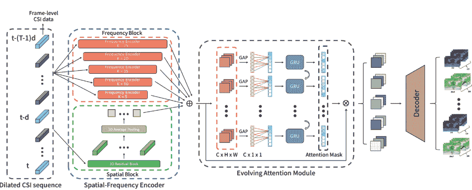
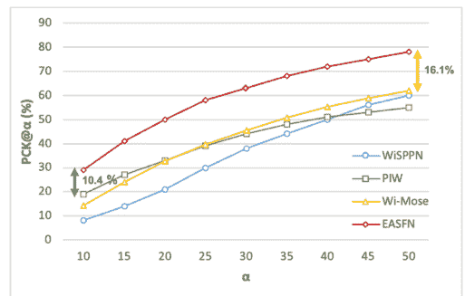
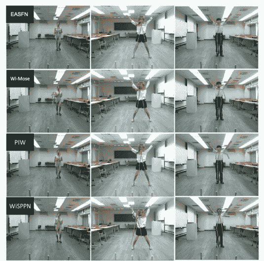
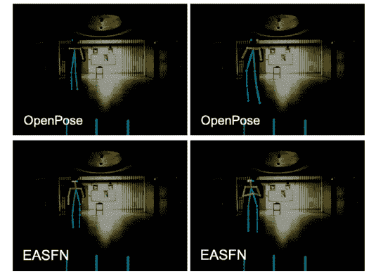

# 看见不可见：基于WiFi的演进型注意空间-频率网络2D人体姿态估计

## 摘要

基于摄像头的人体姿态估计因其广泛的应用和易于实现而变得流行。然而，在光线不足、遮挡和隐私保护等多种情况下，它并不适用。在这项工作中，我们利用 Wifi 信号来估计 2D 人体姿态，这具有挑战性，因为 Wifi 信号是抽象的且包含的信息有限。为应对这些挑战，我们开发了一种演进注意空间-频率网络，以发现信号变化与身体运动之间的关系，用于基于 WiFi 的 2D 人体姿态估计。首先将扩展的 CSI 序列作为输入，然后引入空间-频率编码器，以有效整合来自 CSI 信号的静态空间信息和动态频率信息。最后，我们设计了一个演进注意力模块，使我们的模型能够关注特定通道的特征。由于缺乏基准，我们提出了两个基于 Wifi 的人体姿态估计数据集，即通用姿态估计数据集（GPE）和特定姿态估计数据集（SPE），它们已在项目页面发布为公开下载。在所提数据集上的大量实验表明，与最新方法相比，我们的模型在 PCK@20（正确关键点百分比）方面至少高出 16%。

## 1. 引言

多人 2D 姿态估计 [1–3] 旨在定位 RGB 图像中所有人的解剖关键点或“部件”。它是人群估计 [4,5]、视觉跟踪 [6]、姿态跟踪 [7]、手部跟踪 [8] 和虚拟试穿 [9,10] 等广泛应用的基本问题。然而，基于摄像头的 2D 人体姿态估计方法在某些应用场景下不适用，例如光线不足的环境，更重要的是，基于摄像头的方法在高隐私环境（如厕所和更衣室）中被禁止。

本文专注于使用 Wifi 信号来估计 2D 人体姿态。与基于摄像头的方法相比，基于 Wifi 的姿态估计方法在光线不足和受隐私保护的环境中具有优势。此外，由于 Wifi 设备的普遍性，这些方法成本低且便于收集数据。尽管已有一些工作和调查提出从 Wifi 估计姿态 [11–13]，但它们只是直接应用现成的深度神经网络骨干网络，例如为计算机视觉任务设计的 ResNet [14] 和 Unet [15]。如果不考虑 Wifi 的特性，这些骨干模型在 Wifi 特征提取方面可能导致性能低下。

事实上，由于以下两个挑战，从 Wifi 信号进行 2D 人体姿态估计的准确性受到限制。第一个涉及隐式关系。Wifi 信号是抽象的且包含的信息有限，因此如何将 Wifi 信号转换为姿态目前尚不清楚。一种可能的方法是使用设计良好的深度学习架构进行端到端训练。然而，以前工作 [11,12,16] 采用的骨干架构是为计算机视觉任务设计的，可能不适合这种转换。例如，Unet 中使用的重缩放机制不适合这种转换，因为 Wifi 信号不像视频帧那样包含复杂的空间关系。由于与姿态相关的信息存在于子载波和收发器对之间的复杂模式中，因此使用以前方法捕获这些模式以重建 2D 姿态图像具有挑战性。第二个挑战涉及环境敏感性。根据流行的 IEEE 802.11n Wifi 信号标准，接收到的信号由 30 个正交频率子载波组成，每个子载波中隐藏的信息量随环境中物体的移动而变化。因此，需要一种有效的选择机制来自适应地利用每个子载波的信息。然而，此问题在以前的工作中尚未得到很好解决。例如，[17] 仅选择得分最高的前 20 个子载波，这些子载波对噪声更具鲁棒性，并源自每个子载波对之间的协方差 [18]，使用 K-means 算法根据对人类活动的敏感性将 30 个子载波分为 3 个簇，然后选择活动反映最明显的子载波。这些方法是手工制作的，在所有场景下都不够鲁棒。其他工作（如 [11] 和 [12]）只是简单地忽略此问题，可能导致性能低下。

为解决上述挑战，我们提出了一种用于基于 WiFi 的 2D 人体姿态估计的演进注意空间-频率网络（EASFN）。具体来说，我们的模型以信道状态信息（CSI）作为输入，因为 CSI 对人体运动敏感 [19]。为收集 RGB-CSI 数据对，我们构建了一个带有摄像头和一组接收天线及发射天线（各三个）的硬件系统。每个数据对包含以 20 fps 录制的 RGB 帧，以及包括以 500Hz 采样的 25 个 CSI 样本的帧级 CSI 数据。RGB 帧用于通过 OpenPose [20] 生成地面真值热图，CSI 信号用作训练输入。

为解决第一个挑战，提出了一种空间-频率编码器，以同时重建 2D 场景信息并提取频率特征。具体来说，由于信号波动是由物体运动引起的，频率与物体运动速度相关 [19]，所提编码器通过采用两组 3D 卷积核分别处理空间和频率。一组 3D 卷积核从基于环境的 CSI 信号中学习空间特征。另一组 3D 卷积核用于学习不同频率的多尺度时域特征。值得注意的是，所提空间-频率编码器比以前工作 [11,12] 中使用的现成骨干网络（如 ResNet [14]）能够更有效地利用 CSI 信息。

为解决第二个挑战，我们引入了一个演进注意力模块来增强跨时间的特定空间和频率通道。最后，增强后的特征输入特征解码器以预测人体姿态。为适应多人姿态估计场景，我们同时生成关节热图（JHMs）和部件亲和场（PAFs），以利用关节关联来估计人体姿态。实验结果表明，EASFN 在 PCK@20 方面比最新方法至少高出 16%。

我们的贡献总结如下：

- 我们提出了一种用于姿态估计的新型 Wifi 特征编码器——空间-频率编码器，而非使用传统的 CNN 骨干网络。所提空间-频率编码器具有通用性，可应用于多种基于 WiFi 的应用。
- 开发了一种演进注意空间-频率网络，以解决基于 WiFi 的 2D 人体姿态估计的环境敏感性问题，包括两个关键组件：空间-频率编码器和演进注意力模块。
- 我们贡献了通用姿态估计数据集（GPE）和特定姿态估计数据集（SPE），用于基于 WiFi 的 2D 多人姿态估计，总共包含 344,886 对数据（1 个图像帧和 1 个帧级 CSI 数据）。

## 2. 相关工作

### 2.1. 基于 RGB 的 2D 人体姿态估计

基于摄像头的 2D 人体姿态估计旨在从 RGB 图像/视频中检测所有人的关键点或身体分割。大多数方法可分为两类：自底向上方法和自顶向下方法。自底向上方法 [21,22] 首先检测所有人的人体关键点，然后将其与每个人关联。另一方面，自顶向下方法 [23,24] 先使用检测算法 [25] 检测人（例如，使用 Mask R-CNN [26]），然后估计单人关键点或部件。虽然自顶向下方法通常优于自底向上方法，但它们受限于人体检测器的性能。与基于摄像头的方法相比，所提基于 Wifi 的方法可用于不同场景，例如低光照条件、隐私敏感应用和穿墙姿态估计。

### 2.2. 非基于 RGB 的姿态估计

近年来，使用 Wifi 信号作为探测的研究工作受到广泛关注，因为其设置成本低且 Wifi 可用性高。因此，已探索了许多基于 Wifi 的活动解释任务，如室内定位 [27,28]、动作识别 [29]、人身识别 [30] 和人体姿态估计 [11,12,16,31]。研究表明，Wifi 信号可作为重建 2D 人体姿态的稳健数据源。例如，Person-in-WiFi (PiW) [12] 采用端到端学习，使用 CNN 将 CSI 信号映射到分割掩码（SM）、关节热图（JHMs）和部件亲和场（PAFs），进一步通过关节关联预测多人姿态。Wi-Pose [16] 不是使用关键点，而是利用骨架掩码作为监督以获得更好的鲁棒性。不同于以前的工作，我们的工作专注于寻找更适合跨模态转换的架构。值得注意的是，最近的一项工作 1) 研究从 Wifi 信号进行 3D 人体姿态估计 [31]，该工作使用由 21 台红外摄像机组成的系统来获取地面真值作为监督，2) 通过将 3D 速度剖面作为输入来解决跨域问题。然而，要获得 3D 速度剖面，受试者需要在被不同高度的 3 组天线包围的小空间内进行活动。如此复杂的设备设置限制了该方法的适用性。[32] 将 CSI 的幅度和相位融合为图像，并设计了一个网络从 CSI 图像中提取与姿态相关的特征。尽管似乎取得了满意的结果，但其实验设置仅包含 5 名受试者在单一环境下行走的数据，不足以全面评估模型性能。此外，[31,32] 只能实现单人姿态估计，而我们的提出方法可以在多人场景中实现。

除了 Wifi，其他非基于 RGB 的姿态估计也引起了广泛关注 [33]。[33] 是第一项使用 RF 信号捕捉穿墙人体图像的工作。它利用频率调制连续波（FMCW）系统，发射周期性 RF 信号，其频率介于 5.46GHz 至 7.24GHz 之间，以测量来自人体的信号反射深度。然后将连续的反射快照聚合在一起，以获得完整的人体图像。基于 [33,34] 的成功，[34] 利用强大的卷积神经网络进一步实现精细的人体姿态估计。它将 RGB 图像作为跨模态学习的监督，并取得了高精度的结果。此外，[35] 引入了 RFID-Pose，这是一种从 RFID 数据追踪多人 3D 姿态的系统，平均误差小于 5 厘米。在所提系统中，RFID 标签附着在目标人体关节上。标签的运动被捕捉

图 1. 我们的模型架构。我们将扩展的 CSI 序列作为输入，在图中以蓝色标记。通过空间-频率编码器提取特征后，我们使用演进注意力模块来学习空间和频率特征每个通道的注意力。注意力特征被馈送到特征解码器，用于预测关节热图（JHMs）和部件亲和力场（PAFs）。（有关本图例中颜色引用的解释，读者请参阅本文的网页版。）

通过各标签响应中的相位变化。该系统解决了射频方法中对 FMCW 设备和天线阵列等复杂硬件设置的需求。然而，它要求用户佩戴 RFID 标签，这使得在日常场景中应用不太方便。

## 3. 演进型注意空间-频率网络

### 3.1. 概述

CSI 信号 [36] 记录发射天线和接收天线之间的信号变化。当用户位于发射天线和接收天线之间时，接收到的信号高度受人体姿态影响。此外，CSI 信号中的频率变化揭示了人体活动和人体移动速度 [19]。尽管如此，由于信息有限，从 Wifi 信号估计 2D 人体姿态仍然很困难。为解决这个问题，我们引入了一种演进注意力空间-频率网络，它能有效聚合场景的动态频率信息和空间语义信息，以及与运动相关的频率信息。此外，为了更好地估计移动人体的姿态，我们设计了一个演进注意力模块，以跨时间关注空间和频率特征的特定通道。在以下部分，我们将介绍这些模块的详细内容。

### 3.2. WiFi 信号和 CSI

根据普遍的 IEEE 802.11 n/g/ac 协议，通过 Wifi 传输的信息由 30 个子载波承载，这被称为正交频分复用（OFDM）。子载波的频率位于中心为 2.4/5GHz、带宽为 20/40/80/160MHz 的频段中，并且在 IEEE 802.11 n/g/ac 协议下也支持多输入多输出（MIMO），这允许在多个天线对之间传输数据包。在传输过程中，Wifi 信号可能会因多种原因而发生变化，例如环境中移动物体引起的多径衰落效应或多普勒效应。

由于 CSI 信号是信道中信号变化的物理层指标，我们使用开源 CSI 工具 [36] 来收集 CSI 信号，并记录包含 30 个子载波、带宽为 20 MHz 且中心频率为标准 5GHz Wifi 的 CSI 样本。因此，我们使用一台配备 3 天线 Intel 5300 无线网络适配器的笔记本电脑作为接收器，以及配置相同的个人计算机作为发射器，从而使我们能够操作 3 x 3 MIMO 模式。结果，我们得到 CSI 样本 S ∈ R^{NxNtxNrx}。其中 Ntx 和 Nrx 分别表示发射和接收天线的数量，Nc 表示子载波的数量。

令 Ns 表示 CSI 样本采样率与 RGB 帧率之间的比率。换句话说，每采集 Ns 个 CSI 样本，我们就与一个 RGB 帧同步作为一个帧级 CSI 数据。帧级 CSI 数据的形式在以往工作中常被使用，例如 PIW [12] 和 WiSPPN [11]。为了更好地捕获跨帧的动态信息，我们进一步将带有扩展率 d 的前 T-1 个帧级 CSI 数据和当前帧级 CSI 数据作为输入来预测一个 RGB 帧（如图 1 左侧所示）。通过使用扩展率 d，时间上的感受野更大。令 Cseq ∈ R^{TxNc x Ns x Ntx x Nrx} 表示扩展的 CSI 序列，它是空间-频率编码器的输入。

### 3.3. 空间-频率编码器

所提空间-频率编码器的目标是同时提取场景的空间语义信息和人体运动信息。由于 CSI 数据抽象且包含的信息有限，有必要设计一个有效的特征提取流程来从 CSI 信号中挖掘信息。一方面，每个收发对包含环境信道状态的不同方面，因此可以通过整合每对的 1D 幅度来重建 2D 空间背景信息。另一方面，现有的信号处理研究 [19] 表明，CSI 幅度波动的频率随人体运动速度变化，这意味着可以通过分析连续的 CSI 样本来捕捉人体运动。因此，我们设计了一个同时考虑对内和对间 CSI 信息的模型。

具体来说，为了从 Cseq 中提取空间特征，空间编码器块由一个核大小为 1 x 3 x 3 的 3D 卷积层组成，随后是 BatchNorm、ReLU 激活函数以及沿样本维度的平均池化。卷积层首先用于提取 3 x 3 Wifi 收发对的对间信息，由于空间特征在短时间内不应发生变化，随后应用平均池化层来整合所有样本的特征，从而减少噪声的影响并提供更鲁棒的空间特征。此外，在提取频率特征时，我们不使用信号处理中的带通滤波器，而是首先在并行分支中应用五个 3D 卷积层来提取频率特征。为了获得多尺度特征，这五个卷积层的核大小各不相同，以从不同尺度提取特征，即核大小设置为 k × 1 × 1，其中 k ∈ {5, 10, 15, 20, 25}。此后，对每个分支应用一个无填充的核大小为 Ns × 1 × 1 的 3D 卷积层，以从连续样本中获取全面信息。最后，我们将五个分支中提取的频率特征与空间特征拼接作为空间-频率特征。²

### 3.4. 演进注意力模块

在推导空间-频率特征后，我们需要解决第二个挑战，即需要一个模块能够动态地从特定通道中识别相关特征并消除不相关特征，因为重要通道可能随时间而变化。基于 WiFi 的 2D 人体姿态估计现有方法 [11,12,16] 忽略了时间信息，导致对移动用户的性能平平。此外，对于每个通道，不同序列提供的信息量并不相等。基于这些观察，我们设计了一种新的演进注意力模块来捕捉两个重要方面：（1）同一时间不同通道之间的影响，以及（2）同一通道在时间序列中的交互。

具体来说，我们提出一个演进注意力模块，该模块沿序列推导动态注意力掩码。空间-频率特征序列 \(f_{seq} = [f_{t-\Delta t \times d} f_{t-(\Delta t-1) \times d} \cdots f_t] \in \mathbb{R}^{T \times H \times W \times C}\)，其中 \(d\) 表示扩展率。我们使用通道级全局平均池化（GAP）从 \(f_{seq}\) 中提取全局信息。GAP 后，特征序列中 \(f_t\) 的维度为 \(1 \times 1 \times C\)。随后使用核大小为 \(k\) 的 1D 卷积来生成通道注意力掩码：

\(A_t = Conv_k(f_t)\)

其中 \(A_t \in \mathbb{R}^{1 \times 1 \times C}\) 表示 t-时刻生成的通道注意力掩码。该 1D 卷积的参数在 \(f_{seq}\) 不同时刻的特征之间共享。此后，我们应用一个 GRU [37] 层，通过捕捉不同时间（t）的上下文信息来演进注意力掩码。令 \(h_t\) 表示 t-时刻生成的演进注意力掩码，\(G\) 表示 GRU 的函数。演进注意力随后计算如下：

\(h_t = G(A_{t-1}, h_{t-1})\)

### 3.5. 特征解码器和损失

通过所提演进注意力模块推导增强特征后，我们使用特征解码器将提取的特征映射到两个输出特征图：关节热图（JHMs）和部件亲和力场（PAFs）。生成的 JHMs 和 PAFs 均用于通过关节关联生成人体姿态。因此，我们通过最小化模型预测姿态与 OpenPose [20] 之间的 PAF 和 JHM 差异来优化损失函数。最终损失，记为 \(L_{final}\)，总结如下。

\(L_{final} = \lambda_1 L_{JHM} + \lambda_2 L_{PAF}\)

² 网络的详细信息，包括特征图维度、SPE 数据集和 GPE 数据集，将在我们的项目页面上介绍。

\(L_{JHM} = \sum_m \|\hat{m} - m\|_2^2, \quad m \in M\)

\(L_{PAF} = \sum_n \|\hat{n} - n\|_2^2, \quad n \in N\)

其中 \(M\) 和 \(N\) 分别表示 JHM 像素集和 PAF 像素集，\(\hat{m}\) 和 \(\hat{n}\) 是预测值。标量权重 \(\lambda_1\) 和 \(\lambda_2\) 用于平衡两个子损失。

## 4. 数据集

由于缺乏基准，我们收集了两个数据集，即通用姿态估计（GPE）和特定姿态估计（SPE）数据集，以评估所提方法的性能。我们通过将包含 25 个以 50Hz 记录的 CSI 样本的帧级 CSI 数据与一个分辨率为 800 x 600、帧率为 20 fps 的 RGB 帧进行匹配来配对 CSI 数据和 RGB 帧。我们根据时间戳将每个 RGB 帧与帧级 CSI 数据同步，并将每个 RGB 帧输入 OpenPose [20] 以获取人体关节热图（JHMs）和部件亲和力场（PAFs），这些作为预测的实地真值。

### 4.1. GPE 数据集

在此数据集中，我们遵循主流工作的实验设置，例如 PIW [12] 和 Wi-Pose [16]。我们招募了九名志愿者，要求他们进行步行、使用智能手机和挥手等日常活动。GPE 数据集包含 106,695 个数据对，在 2 个空间中收集，即一个教室和一个大厅，深度分别为 9m 和 11m。场景中的人数范围从 1 到 5 人。此外，GPE 还包括在暗场景和透墙场景下收集的数据，用于在特定条件下测试姿态估计。我们手动标注暗场景中的人体姿态作为实地真值，并通过将发射器放置在教室混凝土墙外、将接收器和摄像头放置在教室内部来设置透墙场景。

### 4.2. SPE 数据集

由于现有数据集不提供详细的动作信息，难以评估不同动作的性能差异。因此，我们收集 SPE 数据集以更好地评估不同条件下基于 WiFi 的姿态估计性能。具体来说，SPE 数据集是一个单人数据集，每位受试者被要求执行四项特定动作：1) 步行，2) 挥手，3) 跑步和 4) 开合跳。我们选择这四项动作是因为它们包含大量不同的移动速度和位移。事实上，日常活动的大部分属性都涉及这四项测试动作，这可以展示不同类型常见动作的性能。我们招募了 30 名志愿者（19 名男性和 11 名女性），身高范围从 1.56m 到 1.92m，以评估不同受试者的鲁棒性。所有数据均从 6 个不同大小的教室或大厅中收集。该数据集的总大小为 238,191 个数据对。

## 5. 实验

### 5.1. 实验设置

为了训练所提 EASFN，我们使用 Adam 作为优化器，采用其默认参数。批次大小设置为 32，初始学习率为 0.001，并应用学习率调度器，每 5 个时代将学习率降低 0.5。训练时代数为 40。我们使用了 OpenPose Python API 以

| 基准测试 | WiSPPN | PIW | Wi-Mose | EASFN |
|---|---|---|---|---|
| SPE | 21.86% | 32.96% | 33.13% | **50.05%** |
| GPE | × | 27.64% | × | **43.98%** |

基于 JHMs 和 PAFs 进行多人联合关联。输出张量为 \(p \times 18 \times 3\)，其中 \(p\) 表示网络检测到的人数，\(18 \times 3\) 表示 18 个身体关节的 x 轴、y 轴和置信度。

在评估指标方面，正确关键点百分比（Percentage of Correct Keypoints，PCK）是评估姿态估计性能的广泛使用的指标，它衡量模型在可容忍误差范围内正确预测人体关节位置的概率。由于人体大小在视频帧中因位移而变化，可容忍误差应随不同的人体大小而变化。因此，我们以右肩到左髋的距离作为躯干长度，并使用 \(\alpha\) 将可容忍误差与躯干长度相关联，如下所示。

\(PCK@\alpha = \frac{1}{N} \sum_{n}^{N} \Phi(\frac{\|\hat{P}_{(i,n)} - P_{(i,n)}\|_2}{\|P_{(5,n)} - P_{(8,n)}\|_2})\) (6)

\(\Phi(x) = \begin{cases} 1, & \text{if } x < \alpha \% \\ 0, & \text{otherwise,} \end{cases}\) (7)

其中 \(i\) 表示人体关节的索引，即对于 OpenPose [20] 中的 COCO\_18 模型，\(i \in \{1,2,\dots,18\}\)；\(N\) 表示测试帧中的人数；\(P_{(i,n)}\) 和 \(\hat{P}_{(i,n)}\) 分别指从真值和预测中获得的第 \(n\) 个人的第 \(i\) 个关节的坐标；\(\|P_{(5,n)} - P_{(8,n)}\|_2\) 是躯干长度，因为右肩和左髋的索引分别为 5 和 8。我们使用不同的 \(\alpha\)（即 \(\alpha\) 从 10 设置到 50）将我们的方法与其他方法进行比较。请注意，PIW 使用边界框大小的分数而不是躯干长度来归一化误差，因此本工作报告的 PCK 值更大。

我们的训练-测试分割策略遵循 PIW，即取前 80% 的样本用于训练，最后 20% 用于测试。

### 5.2. 定量结果

我们将我们的方法与两种基于 WiFi 的二维人体姿态估计的最先进的方法进行比较。第一个是 WiSPPN [11]，这是一种由关节坐标邻接矩阵监督的端到端 CNN 网络。第二个是 PIW [12]，它利用成熟的 CNN 将 WiFi 信号映射到三个监督组件：SM、JHMs 和 PAFs。第三个是 Wi-Mose [32]，它将 CSI 信号的幅度和相位融合为 CSI 图像，并使用神经网络从中提取特征。

表 1 在 PCK@20 方面将 EASFN 与 WiSPPN 和 PIW 进行比较。请注意，由于监督矩阵的固定维度（\(18 \times 18 \times 3\)）的限制，WiSPPN 只能在单人场景中估计姿态。因此，我们仅在 SPE 数据集上训练和测试 WiSPPN。结果表明，我们的模型在两种场景中均优于另外两种方法。就 PCK@20 而言，我们的模型在 SPE 数据集上分别比 WiSPPN 和 PIW 高出 28% 和 17%。在 GPE 数据集上，提出的 EASFN 在 PCK@20 方面比 PIW 高出 16%。这种改善归功于我们的空间-频率编码器，它通过不同内核大小的多个频率编码器捕捉连续 CSI 信号之间的时序关系，而之前的工作忽略了此类时序信息。例如，Wi-Mose 将连续的 CSI 信号视为图像，并使用小感受野（\(3 \times 3\)）的内核来提取特征，这在捕捉长期模式方面表现不佳。此外，WiSPPN 和 PIW 仅通过卷积层的通道维度聚合子载波和连续样本，从而丢失了序列关系。因此，如果没有长期连续信息，之前的工作表现不如 EASFN。图 2 提供了所有方法的 PCK 曲线，说明 EASFN 在所有 PCK 阈值方面都大幅优于其他方法。

图 2. 在 SPE 基准测试上评估的三种模型的 PCK 曲线。

| 动作 | WiSPPN | PIW | Wi-Mose | EASFN |
|---|---|---|---|---|
| 行走 | 23.58% | 39.87% | 42.97% | **61.14%** |
| 挥手 | 25.92% | 33.06% | 33.49% | **45.81%** |
| 跑步 | 22.12% | 37.91% | 35.71% | **58.11%** |
| 跳跃 | 15.82% | 20.99% | 21.97% | **35.15%** |

### 5.3. 每个动作的详细分析

我们进一步研究了我们的模型与其他方法在 SPE 数据集上不同人体动作下的性能。表 2 呈现了比较结果，揭示了 EASFN 在预测移动对象方面的优势。具体来说，对于行走和跑步动作，EASFN 显著改进了基线，即比 PIW 高出约 21%，比 WiSPPN 高出 37%，因为频率特征对移动对象敏感，而演变注意力模块自适应地调整每个通道的权重以关注特定频率特征。改进最小的是挥手情况，即仅比 PIW 高出 12%，比 WiSPPN 高出 20%。这是因为志愿者在保持躯干静止的同时只挥动手或手臂，不同方法在静态关键点上的性能相似。

从表 2 还可以观察到，EASFN 在处理跳跃姿势时效果最差。准确估计跳跃的人体姿势是一项艰巨的任务。它需要精细的时间粒度来捕捉细长且快速移动的肢体。具体来说，跳跃可以被视为高速挥手，因此使用相同时间粒度采样的 CSI 来估计更高速度的运动会导致性能下降。在这种情况下，提高 EASFN 处理跳跃能力的一个可能解决方案是提高 CSI 样本的采样率，这可以细化数据的时间粒度。为了研究 CSI 采样率与姿态估计结果之间的关系，我们需要收集一个包含多种采样率的更大的数据集，这留待未来工作。

表 3 针对我们 SPE 基准测试的消融研究。

| 组合 | SFE | AM | EM | d | PCK@20 |
|---|---|---|---|---|---|
| 基线 | - | - | - | - | 35.13% |
| C1 | ✓ | - | - | - | 44.99% |
| C2 | - | ✓ | - | - | 45.95% |
| C3 | - | - | ✓ | 1 | 48.08% |
| **C4** | - | - | ✓ | **3** | **50.05%** |
| C5 | - | - | ✓ | 5 | 47.95% |

### 5.4. 消融研究

为了展示 EASFN 中每个组件的优势，我们在 SPE 数据集上进行了消融研究。进行了五种组合进行比较。（基线）：将 ResNet 作为特征编码器，与 PIW 和 WiSPPN 相同；（C1）：使用空间-频率编码器；（C2）：应用静态注意力模块；（C3-C5）：使用不同空洞率的提议 EASFN。

表 3 显示了不同模型在 PCK@20 方面的结果，验证了我们的假设。首先，基线的性能优于 PIW，表明 U-Net 不适合 WiFi 信号，从而导致性能更差。相比之下，C1 大幅优于基线，因为空间-频率编码器是为 WiFi 设计的，可以提取环境的空间语义信息和人体运动信息。此外，注意力机制（C2）通过关注某些通道对姿态估计有益。然而，如果注意力掩码仅从单帧级特征简单推导，则 PCK@20 的性能仅略微提高约 1%。另一方面，提议的演变注意力模块（C3-C5）可将性能至少提高 2%。C3 和 C4 之间的不同结果表明，增加时间上的感受野可使性能提高约 2%。尽管如此，比较 C4 和 C5 的结果表明，如果时间上的感受野过大，可能会降低性能。这就是为什么我们将 d=3 的 EASFN 作为提议方法的原因。

图 3. EASFN 与其他方法的对比可视化。

表 4 穿墙和低光场景下的比较结果 (PCK@20)。

| 场景 | PIW | OpenPose | EASFN |
|---|---|---|---|
| 墙 | 8.92% | - | **30.45%** |
| 暗光 | - | 42.89% | **46.97%** |

受穿墙衰减的主导。从表 4 可以观察到，PIW 在穿墙场景下性能严重下降。另一方面，尽管存在可感知的衰减，EASFN 在此类严酷条件下仍保持可接受的性能。结果表明，与 PIW 相比，EASFN 在从穿墙信号中捕获有用信息时更稳健。

为了展示 EASFN 在低光场景下的能力，我们在黑暗环境中设计了一个比较实验。我们分别通过 CSI 数据进行人体姿态估计，通过

### 5.5. 定性结果

图 3 说明了由 EASFN 和其他方法从 CSI 信号生成的人体姿态示例。我们选择了三个不同动作（行走、挥手和复杂伸展动作）的受试者样本。结果表明，EASFN 为不同动作生成更准确的姿态，因为它有效地学习了连续帧中的静态空间特征和动态频率特征。其他竞争者可以大约检测人体躯干，但在估计人体手臂和腿部的关节方面表现不佳。这些关节难以预测，因为手臂和腿通常随时间进行复杂的动作。然而，借助演变注意力模块，EASFN 可以更多地关注移动手臂和腿部的特定通道。通过学习跨时间的通道之间的依赖关系，EASFN 准确估计了手臂或腿部的关节。

### 5.6. 穿墙和低光场景

为了证明所提方法在特定场景下具有显著优势，我们在穿墙场景和低光场景下进行了实验。对于穿墙场景，发射器放置在教室混凝土墙外，信号会穿过墙壁，反射人体，然后由接收器接收。该任务具有挑战性，因为 CSI 将

图 4. 暗光条件下 EASFN 与 OpenPose 结果的比较。

EASFN 和通过 Openpose 获取的 RGB 图像，并利用人工标注的人体姿态评估性能。表 4 显示，当灯光关闭时 Openpose 表现不佳，而 EASFN 完全不受影响。图 4 更好地说明了关灯的影响。在光线不足的情况下，Openpose 可能会丢失一些关键点，例如手腕、脚踝等。然而，EASFN 可以正确预测所有关键点。因此，EASFN 可以有效应用于一些次优场景，例如光线不足的环境甚至黑暗中。

## 6. 结论

我们提出了一种用于基于 WiFi 的 2D 人体姿态估计的进化注意空间-频率网络。为了从抽象的 CSI 信号中学习有效的表征，我们通过空间-频率编码器同时提取静态空间信息和动态频率信息。我们还利用进化注意力模块来学习通道权重以及连续扩帧之间的时间依赖性。此外，还引入并公开发布了两个数据集以供后续研究。大量实验表明，我们的模型在很大程度上优于最先进的方法。尽管我们取得了相当大的进展，但仍有一些未解决的挑战，这对于将基于 WiFi 的人体姿态估计应用于实际应用至关重要。在本工作中，我们在受控良好的环境下进行实验。然而，在实际场景中，其他移动物体（例如摆动风扇或家养宠物）可能会导致更复杂的 WiFi 响应。如何将基于 WiFi 的人体姿态估计适应这种挑战性场景留作我们今后的工作。

## 利益冲突声明

作者声明以下可能被视为潜在竞争利益的财务利益/个人关系：

Hong-Han Shuai 报告称获得了台湾科技部（Ministry of Science and Technology of Taiwan）的资助。

## 数据可用性

我已在摘要中共享了数据和代码的链接。

## 参考文献

- [1] A. Kamel, B. Sheng, P. Li, J. Kim, D. Feng, 用于人体姿态估计的混合细化-纠正热图, IEEE Trans. Multimedia 23 (2021) 1330–1342.
- [2] X. Wang, X. Hu, Y. Li, C. Jiang, 基于深度卷积神经网络的概率分布感知多模态人体姿态估计, Pattern. Recognit. Lett. 153 (2022) 36–43.
- [3] H. Yu, C. Du, L. Lu, 用于人体姿态估计的尺度感知热图表示, Pattern. Recognit. Lett. 154 (2022) 1–6.
- [4] Y.-J. Ma, H.-H. Shuai, W.-H. Cheng, 带不确定匹配的面向视频人群估计的时空扩张卷积, IEEE Trans. Multimedia 24 (2022) 261–273.
- [5] M.-C. Hu, W.-H. Cheng, C.-S. Hu, J.-L. Wu, J.-W. Li, 拥挤环境下高效人体检测, Multimedia Syst. 21 (2014) 177–187.
- [6] C.-H. Sio, Y.-J. Ma, H.-H. Shuai, J.-C. Chen, W.-H. Cheng, S2siamFC: 用于视觉跟踪的自监督全卷积暹罗网络, 第 28 届 ACM 国际多媒体会议论文集 (2020).
- [7] Q. Bao, W. Liu, Y. Cheng, B. Zhou, T. Mei, 姿态引导的基于检测的跟踪：强健的多人物体姿态跟踪, IEEE Trans. Multimedia 23 (2021) 161–175.
- [8] J. Sanchez-Riera, K. Srinivasan, K.-L. Hua, W.-H. Cheng, M.A. Hossain, M.E.F. Al-hamid, 使用深度学习先验的强健 RGB-d 手部跟踪, IEEE Trans. Circuits Syst. Video Technol. 28 (9) (2018) 2289–2301.
- [9] C.W. Hsieh, C.Y. Chen, C.L. Chou, H.H. Shuai, J. Liu, W.H. Cheng, Fashion: 带详细人体和服装信息的语义引导基于图像的虚拟试衣, in: 第 27 届 ACM 国际多媒体会议论文集, 2019, pp. 275–283.
- [10] C.-L. Chou, C.-Y. Chen, C.-W. Hsieh, H.-H. Shuai, J. Liu, W.-H. Cheng, 通过语义引导优化进行无模板试衣图像合成, IEEE Trans. Neural Netw. Learn. Syst. (2021) 1–14.
- [11] F. Wang, S. Panev, Z. Dai, J. Han, D. Huang, WiFi 能估计人体姿态吗？arXiv 预印本 arXiv:1904.00277 (2019).
- [12] F. Wang, S. Zhou, S. Panev, J. Han, D. Huang, Person-in-wifi：使用 WiFi 进行细粒度人体感知, in: 2019 IEEE 国际计算机视觉会议, 2019, pp. 5451–5460.
- [13] J. Wang, Y. Chen, S. Hao, X. Peng, L. Hu, 基于传感器的活动识别的深度学习：一项综述, Pattern. Recognit. Lett. 119 (2019) 3–11.
- [14] K. He, X. Zhang, S. Ren, J. Sun, 用于图像识别的深度残差学习, in: IEEE 计算机视觉与模式识别会议论文集, 2016, pp. 770–778.
- [15] O. Ronneberger, P. Fischer, T. Brox, U-net：用于生物医学图像分割的卷积网络, in: MICCAI 2015, pp. 234–241.
- [16] L. Guo, Z. Lu, X. Wen, S. Zhou, Z. Han, 从信号到图像：使用商用 WiFi 捕捉细粒度人体姿态, IEEE Commun. Lett. 24 (2020) 802–806.
- [17] C. Shi, J. Liu, H. Liu, Y. Chen, 通过利用 WiFi 启用的 IoT 进行日常活动驱动的智能用户身份验证, 第 18 届 ACM 国际移动自组织网络与计算研讨会论文集 (2017).
- [18] L. Guo, L. Wang, J. Liu, W. Zhou, B.L.T. Liu, G. Li, C. Li, 基于 WiFi 信号的人体活动识别新基准, in: 2017 IEEE 第 19 届电子健康网络、应用和服务国际会议, 2017, pp. 1–6.
- [19] W. Wang, A.X. Liu, M. Shahzad, K. Ling, S. Lu, 基于 WiFi 信号的人体活动识别的理解与建模, in: 第 21 届年度国际移动计算与网络会议论文集, 计算机协会, 2015, pp. 65–76.
- [20] Z. Cao, G. Hidalgo, T. Simon, S.-E. Wei, Y. Sheikh, Openpose：使用部件亲和场进行实时多人 2D 姿态估计, IEEE Trans. Pattern Anal. Mach. Intell. 43 (1) (2021) 172–186.
- [21] S. Kreiss, L. Bertoni, A. Alahi, Pifpaf：用于人体姿态估计的复合场, in: IEEE 计算机视觉与模式识别会议论文集, 2019, pp. 11969–11978.
- [22] Z. Geng, K. Sun, B. Xiao, Z. Zhang, J. Wang, 通过解耦关键点回归的自下而上人体姿态估计, in: IEEE 计算机视觉与模式识别会议论文集, 2021, pp. 14676–14686.
- [23] K. Su, D. Yu, Z. Xu, X. Geng, C. Wang, 带增强通道级和空间信息的多人姿态估计, in: IEEE 计算机视觉与模式识别会议论文集, 2019, pp. 5674–5682.
- [24] Z. Liu, H. Chen, R. Feng, S. Wu, S. Ji, B. Yang, X. Wang, 用于人体姿态估计的深度双连续网络, in: IEEE 计算机视觉与模式识别会议论文集, 2021, pp. 525–534.
- [25] C. Peng, T. Xiao, Z. Li, Y. Jiang, X. Zhang, K. Jia, G. Yu, J. Sun, Megdet：大型小批量物体检测器, in: IEEE 计算机视觉与模式识别会议论文集, 2018, pp. 6181–6189.
- [26] K. He, G. Gkioxari, P. Dollár, R. Girshick, Mask R-CNN, in: IEEE 国际计算机视觉会议论文集, 2017, pp. 2961–2969.
- [27] X. Wang, X. Wang, S. Mao, 用于 CSI 图像室内定位的深度卷积神经网络, IEEE Trans. Network Sci. Eng. 7 (2020) 316–327.
- [28] Y. Jing, J. Hao, P. Li, 用于室内定位的双流 3D 卷积神经网络 CSI 时空特征学习, IEEE Access 7 (2019) 147571–147585.
- [29] J.-Y. Chang, K.-Y. Lee, Y.-L. Wei, K.C.-J. Lin, W. Hsu, 通过基于视觉的方法实现位置无关的 WiFi 动作识别, in: 第 24 届 ACM 国际多媒体会议论文集, in: MM ’16, 2016, pp. 162–166.
- [30] H. Zuo, Y. Zhou, J. Wang, W. Gu, L. Xie, C. Spanos, 通过凸张量形元学习的基于 WiFi 的人体识别, in: 第 32 届 AAAI 人工智能会议论文集, 2018, pp. 1711–1719.
- [31] W. Jiang, H. Xue, C. Miao, S. Wang, S. Lin, C. Tian, S. Murali, H. Hu, Z. Sun, L. Su, 迈向使用 WiFi 构建 3D 人体姿态, in: 第 26 届年度国际移动计算与网络会议论文集, 2020, pp. 1–14.
- [32] Y. Wang, L. Guo, Z. Lu, X. Wen, S. Zhou, W. Meng, 从点到空间：使用商用 WiFi 进行 3D 移动人体姿态估计, IEEE Commun. Lett. 25 (2020) 2235–2239.
- [33] F. Adib, C.-Y. Hsu, H. Mao, D. Katabi, F. Durand, 透过墙壁捕捉人体形象, ACM Trans. Graph. 34 (2015) 1–13.
- [34] M. Zhao, T. Li, M. Alsheikh, Y. Tian, H. Zhao, A. Torralba, D. Katabi, 使用无线电信号进行透墙人体姿态估计, in: 2018 IEEE 计算机视觉与模式识别会议, 2018, pp. 7356–7365, doi:10.1109/CVPR.2018.00768.
- [35] C. Yang, X. Wang, S. Mao, RFID-Pose：借助射频识别的视觉辅助三维人体姿态估计, IEEE Trans. Reliab. 70 (2020) 1218–1231.
- [36] D. Halperin, W. Hu, A. Sheth, D. Wetherall, 工具发布：使用信道状态信息收集 802.11 n 痕迹, ACM SIGCOMM Comput. Commun. Rev. 41 (1) (2011), 53–53
- [37] K. Cho, B. van Merrienboer, Ç. Gülçehre, D. Bahdanau, F. Bougares, H. Schwenk, Y. Bengio, 用于统计机器翻译的 RNN 编码器-解码器短语表征学习, in: EMNLP, 2014, pp. 1724–1734.
