# 自动化与深度学习促进的烷基芳基酮位阻间位C-H键选择性功能化

文章

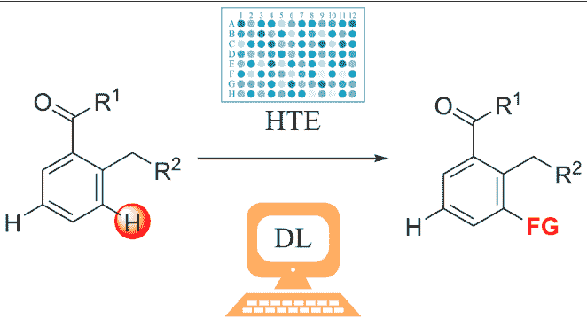

Jia Qiu, Jiancong Xie, Shimin Su, Yadong Gao, Han Meng, Yuedang Yang, Kuangiao Liao

yangd25@mail.sys.edu.cn (Y.Y).

liao_kuangiao@gzlab.ac.cn (K.L.)

## 亮点

- 阻位间位C–H键功能化
- 一锅法三步反应（产率高达76%）
- 基于图的预测模型 (CMPRY)
- 两步反应预测（MAE = 6.6%）
- 阻位间位C–H键功能化
- CO2步骤作为无痕导体
- 一锅三步
- 基于图的深度学习模型
- 两步反应预测

C-H键的修饰对化学家具有极大吸引，但选择性是一项挑战。在空间位阻的C-H键与空间有利的C-H键之间进行区分非常困难。为了开发一种修饰阻位芳香间位C–H键的反应，利用自动化技术探索反应空间，并利用人工智能预测反应结果。自动化与人工智能的结合将有助于新型合成方法的开发与应用。

文章

Jia Qiu,$1,2,5$ Jiancong Xie,$4,5$ Shimin Shu,$1$ Yadong Gao,$2$ Hen Meng,$4$ Yuedong Yang,$3,*$ and Kuangiao Liao,$1,2,6*$

## 摘要

**空间位阻芳香间位C-H键的选择性功能化是前所未有的，且仍然是一个主要挑战。** 通过基于自动化的高通量实验（HTE）和深度学习（DL），证明了一种功能化阻位间位C-H键的新策略。以二氧化碳作为无痕导体，通过一锅法方案实现了邻烷基芳基酮在阻位间位的高选择性芳基化。这种新策略涉及光诱导C-H羧化和微波辅助脱羧。通过HTE和DL，探索了广泛的底物（1032次反应），并建立了用于预测反应产率的DL模型（CMPRY）。通过对邻烷基芳基酮和三氟硼酸钾的两个独立测试评估了该方法。该模型在预测反应方面表现优异；平均绝对误差仅为6.6%和8.4%，显示了其在合成应用中的潜力。

## 宏观视角

选择性C-H功能化是有机化学的一个关键目标。尽管已经报道了多种方案，但通常需要独特的电子和位阻性质才能成功将C-H键与其他键区分来。对于具有空间位阻的C-H键，现有方案通常是不占优的；因此，阻位C-H键的选择性功能化仍然是一个通过自动化和智能化解决的主要挑战，为此开发出了一种功能化芳香间位C-H键的不同策略。基于自动化的高通量实验被用于探索空间和反应数据。基于人工智能的模型被用于预测底物的反应产率。有机合成中自动化与智能化的结合是化学研究中的一个新兴领域，可以加速反应的发现与应用。

## 引言

在天然产物、药物和功能材料中，取代芳烃是无处不在且重要的结构基元。$^{1-5}$ 目前已有关于选择性C-H功能化的报道。尽管安装和去除引导基（DGs）需要额外的步骤，但C-H功能化已展现出卓越的选择性策略，特别是在邻位和阻位间位（图1A）。$^{17-20}$ Yu的协同功能化模板策略实现了间位C-H功能化，但由于空间位阻偏好，是在阻位间位实现的（图1B）。$^{16-18}$ Larrosa及其同事在2014年报道了利用二氧化碳（$CO_2$）作为酚阻位间位C-H芳基化的无痕媒介，该方法采用了Kolbes-Schmitt反应、基团引导钯催化的芳基化和级联脱羧程序$^{19-21}$。Yu在2015年引入了利用去壬烯（Nb）作为瞬态媒介的方法，实现了甲基苯醚的芳香间位C-H芳基化。Pd/NRE循环循环（阳离子过程）$^{22}$ 被进一步应用于其他类型的阻位间位C-H功能化$^{23-25}$。

报道进展集中在阻位间位C-H键；然而，阻位间位C-H键的选择性功能化很少有报道。为了克服这一挑战，我们开发了一种使用$CO_2$作为无痕导体的一锅法三步反应（图1C）。利用光诱导C-H羧化、微波辅助脱羧和基团引导钯催化的C-H芳基化，实现了阻位间位的选择性芳基化。基于自动化的高通量实验（HTE）用于探索反应空间和反应数据。基于人工智能的模型用于预测底物的反应产率。有机合成中自动化与智能化的结合是化学研究中的一个新兴领域，可以加速反应的发现与应用。

文章

## 引导型(sp³)-H功能化

## B 通向阻位间位C-H键的途径

## C 本工作

图1. C-H功能化的策略

[A] 引导型(sp³)-H功能化

[B] 通向阻位间位C-H键的途径

[C] 本工作，用于阻位间位选择性芳基化的一锅法。光诱导C-H羧化用于在阻位间位安装羧基，然后通过微波辅助脱羧释放CO。HTE是获得优化条件、底物范围和扩大该方法应用的深度学习关键。

*这些作者贡献相同。

通讯作者：

*广州实验室，广州 510320

*博兰实验室，广州 51005

*计算机科学与工程学院，中山大学 51006

*南方大学化学系，深圳 51805

*南方大学，深圳 51805

*yangd25@mail.sys.edu.cn (Y.Y).

liao_kuangiao@gzlab.ac.cn (K.L.)

# 结果与讨论

## 反应开发

图2

### A 羧化过程的优化

B 级联C-H芳基化/脱羧的优化

i. 筛选的配体、碱和BQs示例：

ii. 4a和5a的产率

图2. C-H羧化/C-H芳基化/脱羧的优化

(A) C-H羧化过程的优化。

(B) 级联C-H芳基化/脱羧的优化。(i) 筛选的MPAA配体、碱和BQs示例；(ii) 4a（深绿色）和5a（巧克力色）的产率。

开发了基于图方法的产率预测，并改进了模型的解释性性 32–39。

我们的研究从优化光诱导C(sp³)–H羧化开始（图2A）²⁴。

### 化学文章

接下来，我们使用羧基化化合物 (2a) 和硝酰基氟硼酸钾 (PhBF,K, 3a) 作为模型底物制备最终产物 (5a) (图 2B)。在乙酸引导的 C-H 芳基化中，形成了位阻间-C-H 芳基化化合物 (4a)。证明了单N-保护氨基酸 (MPAAs) 可以加速 Pd(II) 催化的 C(sp³)-H/硼交叉偶联。然后，选择了 46 种 MPAAs 和 2 种碱进行初始条件筛选。通过高通量实验 (HTE) 总共评估了 92 种条件。随后进一步使用 HTE 优化了 MPAAs、碱、苯醌 (BQ)、温度和方法（见补充信息）。值得注意的是，在此过程中观察到了一定水平的脱羧产物 (5a)。通过使用 L12、KPO₄ 和 BQ2，产率提高到 92% (5a = 4a = 6:86)。最后，在 150 °C 的微波下进行 0.5 h 的脱羧，获得了产率为 77% 的间-C-H 芳基化最终产物 (5a)。

### 范围

利用优化后的条件，我们开始通过 HTE 探索邻烷基芳基酮和硝酰基氟硼酸钾 (ArBF,K) 的范围（图 3）。得于 CH-芳基团的 ¹H-NMR 位移，我们通过高通量方法确定了反应产率。因此，HTE 实现了切线 C-H 功能化的探索，即光诱导的羧基化/羰基装饰。选择了一个结构多样化的取代酮底物阵列，包含 24 种酮 (1a-14) 和 43 种 ArBF (3a-32z)，使用 HTE 进行微量反应（图 3）。

随后，分析了一个包含 1032 条反应数据的数据集（图 4a）。超过 70% 的反应产生了目标产物，这表明我们的策略广泛适用于多种底物。通常，邻甲基苯酮 (1a-u) 在许多 ArBF,K 下以显著产率提供相应的产物。芳环上负载了氟 (1c, 1g, 1n)、氯 (1d 和 1h) 以及叔丁基 (1f 和 1p)。根据文献，苄位具有巨大位阻的化合物极具挑战性。²6 令我们惊讶的是，苄位上带有 Me、Et、Bn 和 Ome 的底物 (1q-1t) 也适用于该过程。在邻甲基苯酮 (1u) 的情况下，此类产物很多。看起来邻苯酮 (1y) 产生高产率或无产物。与 p-OMePhBF,K (3j) 反应时，通过串 C(sp³)-H 激活/C(sp²)-H 芳基化获得了 41% 的总产率。在 C-H 羧基化步骤中，芳基烷基酮 (1v, 1x) 的活性通常被认为低于溴苯酮；然而，许多反应具有良好的总产率。由于位阻，预测具有两个相邻取代基的 C(sp³)-H 键极具挑战性。取代的邻苯酮 (1e, 1p) 和对取代邻甲基苯甲基酮 (1w) 产率低或无产物；然而，p-OMePhBF,K (3j) 仍与对氯邻甲基苯酮 (1p) 生成 23% 的总产率。在 ArBF,K 的底物范围方面，邻位、间位或对位的推基或吸电子基在该反应中都是可能的 (3a-3ze)。然而，取代了几个活性官能团，例如羟基（保护或未保护） (3i, 3f 和 3ze)、苯氧恶唑 (3zf)、酮 (3zg) 和醛 (3zj)，

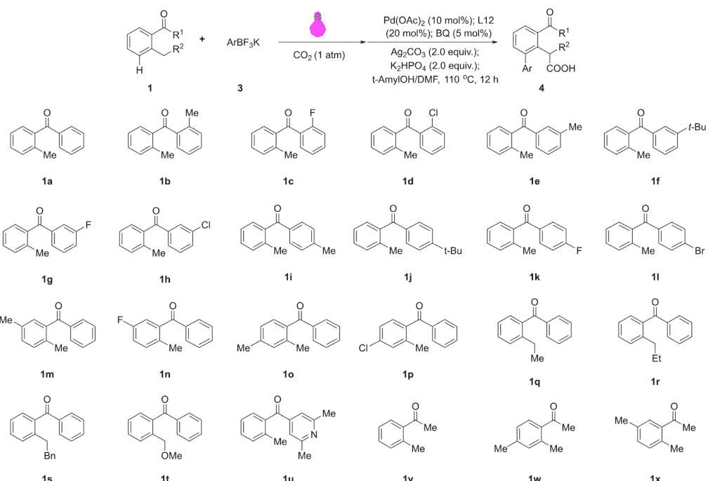

`Pd(OAc)2 (10 mol%); L12 (20 mol%); BQ (5 mol%); Ag2CO3 (2.0 equiv.); K3HPO4 (2.0 equiv.); t-AmylOH/DMF; 110 °C, 12 h`

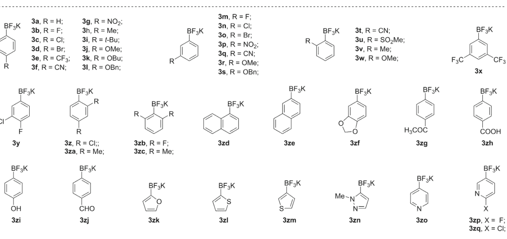

3a, R = H;

3b, R = F;

3c, R = Me;

3d, R = I;

3e, R = Br;

3f, R = CF3;

3g, R = OBu;

3h, R = CN;

3m, R = F;

3n, R = Me;

3o, R = Cl;

3p, R = NO2;

3q, R = OMe;

3s, R = NO2;

3t, R = Me;

3u, R = SO3Me;

3v, R = Me;

3w, R = OMe;

| BF-J | BF-K | BF-J | BF-K | BF-J | BF-K | BF-J | BF-K | BF-J | BF-K |

|---|---|---|---|---|---|---|---|---|---|

| 3y | 3z | 3aa | 3cc | 3dd | 3ee | 3ff | 3gg | 3hh | 3ii | 3jj | 3ks | 3tm | 图3. 邻烷基芳基酮和 ArBF,K 使用香豆作为内标通过 NMR 分析确定的产率。也适用于该串联反应。然而，三氟硼酸 (3zh)、吡唑 (3zn) 和吡啶 (3zo) 在大多数混合物中不兼容。

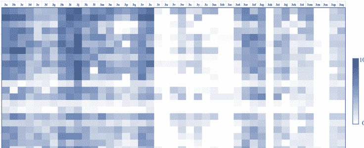

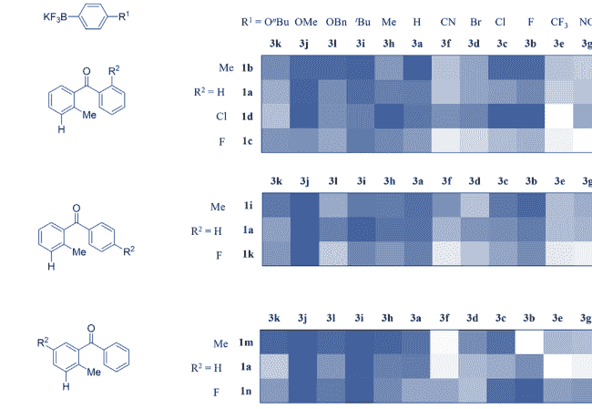

图 4. 邻烷基芳基酮和 ArBF,K 的产率热图 (A)。1032 种反应的产率通过香豆作为内标的 NMR 分析确定。分析这些结果（图 4A），很难得出关于该反应的基本规则。例如，很难总结邻烷基芳基酮上不同取代基如何影响总产率。图 4B 揭示了芳环上电子密度从左到右、从上到下的协同效应。具体而言，酮 (1b) 与 PhBF,K (3a) 反应时产率高于邻烷基苯 (1c)；然而，邻氯苯酮 (1d) 与 PhBF,K (Ar as p-F, -Cl, -Br (3b–3d)) 反应时产率高于邻苯苯 (1c)，对于 Ar as p-Me, -Bu, -OBu (3h–3k)，对于 3h，但结果相反。

| ArBF,K | ArBF,K |

|---|---|

| MAE 43 | 35 |

| 酮 20 训练集 (80:20) | 20 缩缩训练集 (80:20) |

| 4 独立测试集 | 4 严格独立集 |

| Metrics | CMPRY | CMPNN (无预训练) | GCN | XGB |

|---|---|---|---|---|

| R² | 0.750±003 | 0.709±003 | 0.677±003 | 0.769±002 | 0.769±002 |

| 交叉验证 | 0.072±005 | 0.077±005 | 0.082±005 | 0.066±002 | 0.067±002 |

| RMSE | 0.093±007 | 0.101±008 | 0.106±008 | 0.089±004 | 0.089±001 |

| R² | 0.736 | 0.641 | 0.638 | 0.626 | 0.606 |

| 独立测试 | 0.066 | 0.073 | 0.080 | 0.081 | 0.081 |

| RMSE | 0.091 | 0.106 | 0.116 | 0.117 | 0.111 |

(A) 数据集划分

(B) 基于深度学习的模型开发

(C) CMP 的交叉验证

(D) CMP 的独立测试

(E) 不同训练数据大小下 CMP 的性能。

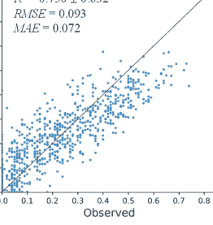

(img/6f5650b41b9ff9e80884cecf_7_2.png)

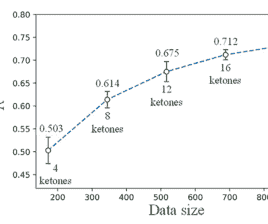

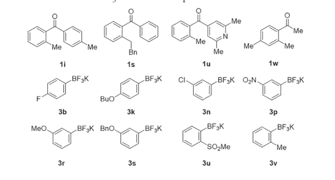

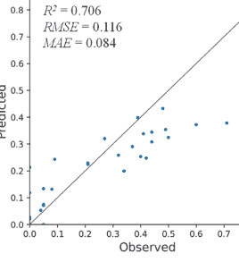

(F) 4 种酮

(G) CMP 的性能

在外部数据上获得如此良好的性能表明我们的模型能够预测该串联反应的反应产率。我们还评估了模型性能与训练集中酮数量的关系。如预期的，在 172 个训练点（4 种酮）时 R² 为 0.503，并在 688 个点（20 种酮）时逐渐增加到 0.735。尽管 R² 随着训练规模的增大而增长，但它倾向于收敛。为了比较，我们使用了四个基准模型。如图 5B 所示，保留因关系的性能导致了良好的 R² (0.643)。在现实中。

A

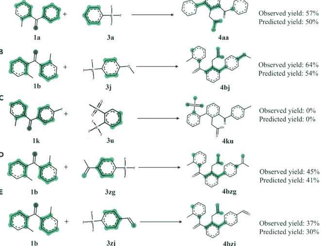

观测产率：57%

预测产率：50%

B

观测产率：64%

预测产率：54%

C

观测产率：0%

预测产率：0%

D

观测产率：45%

预测产率：41%

E

观测产率：37%

预测产率：30%

图 6. CMPRY 使用 CAM-GRAD 进行模型可解释性的结构示例 (A-E)。这些通过 CAM-GRAD 计算性能的所选示例。用绿色标记的原子和化学键表示了它们在反应中的重要/重要性。

为了进行更严苛的测试，我们尝试构建一个同时包含酮类和 ArBFKusen 的独立测试集。我们选取了 4 个酮类（1l, 1s, 1u 和 1w）和 8 个 ArBFK（3k, 3n, 3p, 3r, 3s, 3w），并重新训练了训练集中的基础反应数据（SA 和 5F）。使用缩减集和独立测试集所实现的性能显示出合理的 R²，产率平均绝对误差（MAE）为 8.46，表明了 CMPRY 的通用性和稳健性（图 5G）。考虑到预测趋势的复杂性，该性能被认为是是优越的，而文献 [44–51] 中报道的大多数模型处理的是单步反应。

为了解释我们基于深度学习的模型，我们采用了梯度加权激活图映射（CAM-GRAD）来识别用于预测的关键原子。如图 6 所示，CMPRY 突出了新的 (csp³)–(csp⁴) 键的形成，这表明该模型学习了基础的反应信息。对于未产生产物的反应 6C，CMPRY 突出了邻位取代基、甲磺酰基，其原因是位阻对 C-H 键的活化有害的。有趣的是，CMPRY 发现羧酸基在所有成功的反应中都非常重要，尽管这些信息并未输入预测中。从机理上讲，羧基需要引导钯催化进行 C-H 活化。但最后，在某些反应中突出了特殊的结构片段，其中醛基和乙基中的氧原子被认为是重要原子，但在产物中只有乙基中的氧原子被标记为重要原子。

# 反应工具

为了提高该方法的合成实用性并实现 C–H 羧化与 C–H 芳基化产物的分离，了一种ポット三步反应

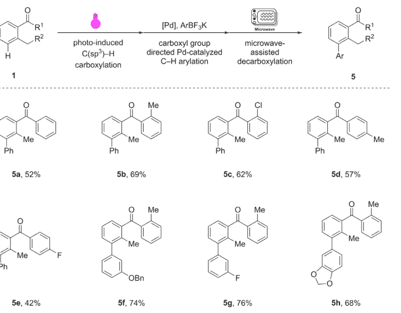

图 7. 以 CO2 为追踪基的位阻间位 C–H 羟基化的一锅法。反应条件除非另有说明保持不变：（0.1 mmol), K2PO4 (2.0 eq), 365 nm 紫光, 40 min；然后， 3 (0.3 mmol), Pd(OAc)2 (10 mol), Li (12 mmol), Ag2CO3 (2.0 eq), 和 K2PO4 (1.0 eq), 110°C, 112°C；最后，微波，150°C, 0.5 h 得到。

用于位阻间位 C–H 键选择性功能化已被提出（图 7）。在光诱导 C–H 羰化之后，对未净化的中间体进行羧基引导的钯催化 C–H 芳基化（使用 ArBF,JK），然后将其转移到微波反应器中进行脱羧化以得到目标产物。使用缩减集和独立测试集所实现的性能显示出合理的 R²，产率 MAE 为 8.46，表明了 CMPRY 的通用性和稳健性（图 5G）。考虑到预测趋势的复杂性，该性能被认为是优越的，而文献 [44–51] 中报道的大多数模型处理的是单步反应。

为了解释我们基于深度学习的模型，我们采用了梯度加权激活图映射（`CAM-GRAD`）来识别用于预测的关键原子。如图 6 所示，`CMPRY` 突出了新的 `(csp³)–(csp⁴)` 键的形成，这表明该模型学习了基础的反应信息。对于未产生产物的反应 6C，`CMPRY` 突出了邻位取代基、甲磺酰基，其原因是位阻对 C-H 键的活化有害的。有趣的是，`CMPRY` 发现羧酸基在所有成功的反应中都非常重要，尽管这些信息并未输入预测中。从机理上讲，羧基需要引导钯催化进行 C-H 活化。但最后，在某些反应中突出了特殊的结构片段，其中醛基和乙基中的氧原子被认为是重要原子，但在产物中只有乙基中的氧原子被标记为重要原子。

# 反应工具

提高该方法的合成实用性并实现 C–H 羧化与 C–H 芳基化产物的分离，了一种ポット三步反应

图 7. 以 CO2 为追踪基的位阻间位 C–H 羟基化的一锅法。反应条件除非另有说明保持不变：（0.1 mmol), `K2PO4` (2.0 eq), 365 nm 紫光, 40 min；然后， 3 (0.3 mmol), `Pd(OAc)2` (10 mol), `Li` (12 mmol), `Ag2CO3` (2.0 eq), 和 `K2PO4` (1.0 eq), 110°C, 112°C；最后，微波，150°C, 0.5 h 得到。

用于位阻间位 C–H 键选择性功能化已被提出（图 7）。在光诱导 C–H 羰化之后，对未净化的中间体进行羧基引导的钯催化 C–H 芳基化（使用 `ArBF,JK`），然后将其转移到微波反应器中进行脱羧化以得到目标产物。使用缩减集和独立测试集所实现的性能显示出合理的 R²，产率平均绝对误差（MAE）为 8.46，表明了 `CMPRY` 的通用性和稳健性（图 5G）。考虑到预测趋势的复杂性，该性能被认为是优越的，而文献 [44–51] 中报道的大多数模型处理的是单步反应。

A

观测产率：57%

预测产率：50%

B

观测产率：64%

预测产率：54%

C

观测产率：0%

预测产率：0%

D

观测产率：45%

预测产率：41%

E

观测产率：37%

预测产率：30%

图 6. `CMPRY` 使用 `CAM-GRAD` 进行模型可解释性的结构示例 (A-E)。这些通过 `CAM-GRAD` 计算性能的所选示例。用绿色标记的原子和化学键表示了它们在反应中的重要性。

为了进行更严苛的测试，我们尝试构建一个同时包含酮类和 `ArBFKusen` 的独立测试集。我们选取了 4 个酮类（`1l`, `1s`, `1u` 和 `1w`）和 8 个 `ArBFK`（`3k`, `3n`, `3p`, `3r`, `3s`, `3w`），并重新训练了训练集中的基础反应数据（SA 和 5F）。使用缩减集和独立测试集所实现的性能显示出合理的 R²，产率平均绝对误差（MAE）为 8.46，表明了 `CMPRY` 的通用性和稳健性（图 5G）。考虑到预测趋势的复杂性，该性能被认为是优越的，而文献 [44–51] 中报道的大多数模型处理的是单步反应。

## 参考文献

Jin, J., Chu, L., Chen, Y., and Yu, J. Q. (2018). 使用吡啶模板对酚酸定向间位C功能化。J. Org. Chem. 83, 425–428. https://doi.org/10.1021/acs.orgchem.8b05646

Persk, H., Hong, H., Kon, Y., and Yu, J. Q. (2017). 通过钯催化的脱氢途径控制吡啶活化。Nat. Chem. 7, 735–742. https://doi.org/10.1038/s41560-017-0133-0

Ma, H., Shen, N., Xiao, A., Shao, Y., and Yu, Q (2018). 通过手性磷酸催化剂实现对映选择性间位C活化和芳基化。J. Am. Chem. Soc. 140, 15177–15184. https://doi.org/10.1021/acs.joc.8b0122

Xu, J., Chen, J., Gao, F., Xie, S., Sun, J., and Yu, Q. (2019). 酚类间位C–H和间位C–O键的区域选择性功能化。J. Am. Chem. Soc. 141, 10293–10300. https://doi.org/10.1021/jacs.9b0334

Ma, W., Wang, G., Feng, L., Zhang, R., Liu, Y., Shi, X., Kim, M., and Yu, J. Q. (2019). 使用手性瞬态配体的镍催化间位C活化。Science 365, 1244–1248. https://doi.org/10.1126/science.aaw1438

Luo, J., Perez, S., and Laraseth, I. (2016). 通过瞬态导向基克服对位选择性，实现酚类的间位选择性活化。J. Am. Chem. Soc. 138, 11499–11504. https://doi.org/10.1021/jac.6c05114

Fenter, S. A., Aorda, R., and Laraseth, I. (2018). 使用手性瞬态导向基的苯酰胺间位选择性C–H活化。J. Am. Chem. Soc. 140, 7113–7118. https://doi.org/10.1021/jacs.8c06632

Catellani, M., Moretti, E., and Da, C. (2008). 双功能导向基的钯催化间位选择性C–H活化。Angew. Chem. Int. Ed. 47, 10280–10284. https://doi.org/10.1002/anie20076933

Wang, J., Park, E. M., Hu, X., Jain, P., Chen., and Yu, J. Q. (2019). 钯催化的区域选择性金属化。Nature Chemistry, 11, 719–725. https://doi.org/10.1038/s41577-019-021-x

Shi, H., Lu, Y., Wang, J.-J., Kim, K., Tanaka, H., and Yu, J. Q. (2015). 芳香C–H键的间位选择性功能化导向。J. Am. Chem. Soc. 137, 3996–4004. https://doi.org/10.1021/acs50533

Masuda, V., Ishida, N., and Murakami, M. (2015). 铑催化的光驱动C–H键的对映选择性芳基化。J. Am. Chem. Soc. 137, 14606–14610. https://doi.org/10.1021/acs5615b

Sanz-Quintano, A., Regalado, E., Perez, T., Shev, M., Campau, L.-C., Sreevajan, J., Hartwig, S., Si, Z., Nammert, P., et al. (2019). 有机化学：用于复杂分子合成的机器学习。Science 367, 49–53. https://doi.org/10.1126/science.aau7017

Kramer, S. W., Drovitzko, A., Dress, S., and Shev, M. (2017). 化学合成向机器学习的演进。Nature 545, 290–296. https://doi.org/10.1038/d41586-017

Engle, K. M., Tian, P. S., Dang, M., and Yu, J. Q. (2019). 配体控制的杂环C–H键交叉偶联。J. Am. Chem. Soc. 141, 9299–9303. https://doi.org/10.1021/jacs.9b0239

Salazar, C. A., Perez, S., Khan, H., Baek, B. E., and Yu, J. Q. (2023). 用于酚类间位选择性C–H活化的定制化瞬态导向基。Science 379, 1145–1150. https://doi.org/10.1126/science.ad1184

Kang, K. N., Liu, D., Denberg, X., and Wang, D. G. (2021). 预测杂环和噻吩C–H功能化的通用机器学习方法。J. Am. Chem. Soc. 142, 21484–21491. https://doi.org/10.1021/jacs.2c0560

Butler, K. T., Davies, D. W., Hartwig, J. S., and White, A. (2018). 用于有机合成的机器学习。Nature 559, 545–560. https://doi.org/10.1038/s41586-018-0033-x

Sanchez-Liguezbaum, J., Streth-Kalhoff, F., Segler, M., and Fuisz, G. (2020). 用于预测反应条件的机器学习。国际化学学习会议。Science 368, abj5550. https://doi.org/10.1126/science.abj5550

Mahadev, J., Clark, C., Crodzkowski, P., Human, I., Lee, G.-., and May, S. (2019). 机器学习预测反应条件。Nature Methods Discov. 14, 437. https://doi.org/10.1038/s41570-019-024

Reid, J., and Sigman, M. (2017). 不称合成中的对映选择性预测。Nature 571, 345–348. https://doi.org/10.1038/s41586-019-1110
