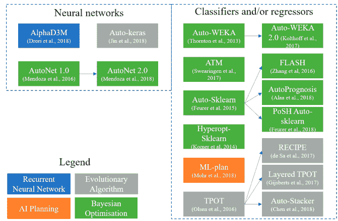
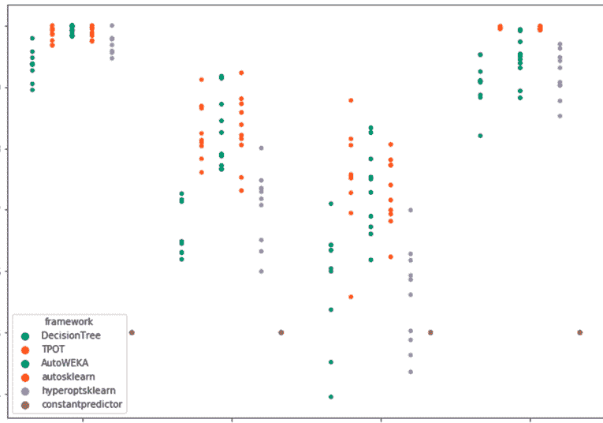
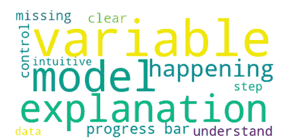

# 自动化机器学习 自助数据科学在医疗保健


**摘要：** (1) 背景：本文研究了研究者-医师能否以及如何通过采用自动化机器学习（AutoML）在其知识发现过程中获得支持。（2）方法：我们采用设计科学研究方法，基于基准测试和研究者-医师的需求，将基于树的管道优化工具（TPOT）选为 AutoML 方法。随后，我们将 TPOT 集成到两个工件中：一个 Web 应用程序和一个笔记本。我们与研究者-医师一起评估这些工件，以考察哪种方法最适合研究者-医师。两个工件具有相似的工作流程，但由于需求冲突，用户界面不同。（3）结果：工件 A（一个 Web 应用程序）被认为在上传数据集和比较结果方面更好。工件 B（一个 Jupyter 笔记本）被认为在工作流程以及对模型构建的控制方面更好。（4）结论：因此，混合工件对于研究者-医师来说将是最佳。然而，两个工件都缺乏对其创建模型的模型可解释性和变量重要性解释。因此，医疗保健领域 AutoML 技术的部署目前仍局限于探索性数据分析阶段。

**关键词** 自动化机器学习；应用数据科学；自助式数据科学；医疗保健分析

## 1. 引言

回顾医疗保健数据分析现状的文献后显而易见，医疗保健领域分析的应用仍有很大进步空间 [1], [2]。取得进步的一种方式是自动化医疗保健中的知识发现过程 [1]。自动化知识发现过程可以通过让领域专家使用自适应分析系统中的最先进技术参与该领域的知识发现，从而提高分析的采用率，尤其是考虑到医疗保健中可用的数据量。电子健康记录（Electronic Health Record，EHR）的引入加速了此前不可用数据集的数字化。将这些可用的 EHR 数据与分析相结合，通过使数据可用于自动处理，有望改善医疗保健行业 [3]。

自助式数据科学的概念首次在 [4] 中描述，并被定义为 *“一门工程学科，其中分析系统被设计和评估，以使领域专业人员能够以可靠、可用和透明的方式，在其日常实践中无需编码即可在其自身数据源上执行自己的数据分析”* [5]。**图 1** 将自助式数据科学研究置于相邻数据科学学科的背景下。既连接纯粹基础研究也连接纯粹应用研究过程，应用数据科学 [6] 和自助式数据科学研究都追求转化（例如，面向应用）的研究过程，通常将 CRISP-DM 作为首选的知识发现过程 [7]。


图 1. 相关数据科学学科背景下的自助式数据科学研究。

机器学习（ML）社区已经意识到需要让非专家用户使用 ML 技术。让非专家使用机器学习的需求是催生 AutoML 这一快速发展的研究领域的驱动力之一 [8], [9]。AutoML 社区旨在自动化创建机器学习管道的所有步骤。然而，据我们所知，没有 AutoML 应用程序在医疗保健领域与非专家用户的实际场景中进行过测试。因此，我们的研究问题是：如何利用自动化机器学习支持医疗保健领域领域专家的知识发现过程？为了回答这个问题，我们在第 4 部分回答三个子研究问题：

- 1. 在给定医疗数据集的情况下，哪种 AutoML 方法在基准测试中表现最佳？
- 2. 医疗保健专业人员开始在日常实践中使用 AutoML 的需求是什么？
- 3. 所选的 AutoML 方法如何适应医疗保健专业人员的知识发现过程？

每个问题在第 4 部分的一个小节中得到解答。

## 2. AutoML 方法概览

在本节中，我们总结和分类了文献综述中找到的 AutoML 方法。在我们的分析中，我们只考虑方法的最新版本，并且只包括非商业 AutoML 方法。首先，我们比较两个为医疗保健领域开发的 AutoML 方法。其次，我们讨论固定管道长度的方法。第三，我们讨论构建神经网络的 AutoML 方法。第四，我们讨论进化方法。第五，我们讨论分布式方法。最后，我们对本章讨论的 AutoML 方法提供详细概览。

### 2.1. 医疗保健

FLASH [10] 和 AutoPrognosis [11] 均为医疗保健领域或使用医疗保健资金开发，但激励因素不同。FLASH 是为了提高创建和评估管道的效率而开发的。它提出了一种两层贝叶斯网络方法来提高搜索效率。AutoPrognosis 最近是以执业者为中心开发的。它在所有组件中都遵循原则性贝叶斯方法。AutoPrognosis 使用贝叶斯模型平均来构建管道。元学习用于寻找相似的患者群体。数据集的临床特征和统计特征都用于热启动。FLASH 是一个黑盒工具，就像大多数 AutoML 工具一样。相比之下，AutoPrognosis 是唯一包含解释器以向临床医生证明其推荐理由的 AutoML 方法。

我们无法比较两种方法的性能，因为在撰写本文时，没有同时包含这两种方法的基准测试可用。FLASH 在一个医疗数据集上测试了其性能，任务为二元分类，即预测药物非反应者。在这种情况下，它以错误率为性能指标，优于基于 TPE 和 SMAC 的其他方法 [10]。AutoPrognosis 在与其他方法的自身比较中，在多个数据集上优于 Auto-WEKA、Auto-Sklearn 和 TPOT [11]。

### 2.2. 固定管道

Auto-WEKA [8], [12]、Hyperopt-Sklearn [13]、Auto-Sklearn [14]、PoSH Auto-Sklearn [15] 和 ML-Plan [16] 都是具有固定管道长度的方法。Auto-WEKA 通过基于树的 BO 方法 SMAC [8], [17] 搜索搜索空间。Hyperopt-Sklearn 使用 Hyperopt 搜索搜索空间，Hyperopt 使用随机搜索或基于 BO 的 Tree Parzen Estimators (TPE) [18]。为了提高搜索效率，Hyperopt-Sklearn 区分了条件超参数和非条件超参数。条件参数始终需要赋值，而非条件参数取决于管道中选择的算法 [13]。PoSH-Auto-Sklearn 是上述 Auto-Sklearn 方法的扩展，并基于 scikit-learn 库。在搜索过程中引入了逐次减半法以提高方法的效率。此外，他们还基于 OpenML 数据集 [19] 构建了一个组合，该数据集包含元信息以热启动搜索过程。最后，Auto-Sklearn 的集成技术被修改以排除性能不佳的模型。在 PoSH Auto-Sklearn 中，如果模型比最佳模型差 3% 以上，则不会将其添加到集成中。ML-Plan 使用混合方法构建管道。它结合了两种不同方法的思想和概念：在运行时评估候选者的想法 [8] 和使用分层任务网络 [20] 进行管道规划的想法 [16]。ML-Plan 通过提出一种基于 HTN 的两阶段搜索和一个专门用于防止过拟合的系统，为现有知识库做出了贡献。ML-Plan 的作者声称发明了第一种防止过拟合的 AutoML 技术 [16]。

PoSH Auto-Sklearn 优于所有其他方法，因为它是撰写本文时最新 AutoML 竞赛的获胜者 [9]。Auto-WEKA、Hyperopt-Sklearn 和 Auto-Sklearn 是为解决 CASH 问题而开发的前三种方法。值得注意的是，Auto-Sklearn 已成为许多其他 AutoML 系统的基础，而另外两种方法则没有。我们认为这是由于 Auto-Sklearn 中内置的热启动程序所致。

### 2.3. 神经网络

AutoNet [21] 的第一个版本是第一个自动化神经网络配置的系统。它为其继任者以及 AlphaD3M [22] 和 Auto-Keras [23] 的诞生奠定了基础。除了为这些应用程序奠定基础之外，它还激励了许多商业应用程序的诞生。大多数自动调整神经网络的商业应用程序都受到 Auto-Net 第一个版本的启发 [9]。这是因为 Auto-Net 是第一个在管道配置中击败人类专家的 AutoML 程序 [9], [21]。

AlphaD3M 是唯一使用强化学习的 AutoML 方法，并且比该领域的任何其他方法都快得多。在一个案例中，它比 TPOT 快 32 倍。然而，AlphaD3M 并未优于其他 AutoML 方法。与另外三种方法相比，基于平均分数，其平均排名为第三。由于 AlphaD3M 在某些数据集上排名第一，它仍然具有竞争力 [22]。强化学习是否会被广泛采用作为管道配置的搜索策略，值得关注。

### 2.4. 进化方法

进化方法可以创建灵活长度的管道。这些方法包括 TPOT [24]、LTPOT [25]、RECIPE [26] 和 Autostacker [27]。它们之所以能够做到这一点，是因为它们的搜索策略。进化算法的缺点是它们可能产生无效管道并陷入局部最优。RECIPE 和 LTPOT 独立地克服了这些缺点。RECIPE 使用语法来克服这一问题，而 LTPOT 则为管道使用最大评估时间。

TPOT 是对上述固定长度管道方法的一种回应。TPOT 使用高斯过程（GP）来构建管道；管道的构建块是用于构建树的 GP 原语。这些树是 ML 管道的任意表示，由多个数据集、预处理器和分类算子组成。每个节点使用其前一节点的输出作为输入。分层 TPOT [25] 是 TPOT 的继任者，重点是提高管道生成效率。它通过在原始 TPOT 算法的基础上实现年龄分层种群结构 [28] 的思想来提高效率。RECIPE [26] 是一种基于 GP 的进化方法，它使用语法来提高与其他 GP 方法相比的效率。RECIPE 使用语法防止创建无效管道，并专注于分类任务。Autostacker 是一种 AutoML 方法，重点是为用户提供一组潜在有用的管道，但用户没有


基于scikit-learn和XGBoost库的任何预处理步骤。管道是基于进化算法的堆叠机制构建的，并且应能很好地泛化到新数据 [27]。

### 2.5. 分布式方法

两种 AutoML 方法可以以分布式方式处理数据：Autostacker [27] 和 ATM [29]。值得注意的是，在考虑创建管道的计算成本时，只有两个系统可以以分布式方式运行。Autostacker 可以使用并行处理，因为它向其用户推荐最佳管道。因此，它需要管道的性能得分。ATM 是唯一可以在不同机器上并行运行并设置为分布式和可扩展的方法。ATM 开发旨在支持云或集群中的多用户机器学习平台。其目标是在库中提供标准化的抽象，使该库对 AutoML 社区的影响力如同 scikit-learn 对机器学习社区的影响力一样大 [29]。ATM 的开发及其与上述方法的集成是 AutoML 中最具吸引力的发展之一。推动这一发展的一个激励措施可能是为分布式 AutoML 方法设立单独的性能挑战。

### 2.6. 方法概览

图 2 可视化了本节讨论的 AutoML 方法之间的关系。它区分了构建神经网络的方法和在其管道中使用传统分类器或回归器的方法。方法之间的箭头指示方法之间的关系。方法的颜色指示方法中用于创建管道的搜索策略。附录 A 中提供了所讨论 AutoML 方法的表格概览，包括预测任务、代码仓库链接以及关于管道创建的更多信息。



图 2. AutoML 方法概览。

## 3. 研究方法

我们使用设计科学研究框架 [30] 来回答研究问题。为此，我们首先使用 Gijsbers 及其同事的框架 [31] 对 OpenML100 [32] 中所有可用的医学数据集进行了基准测试，以找出是否有一种 AutoML 方法在医学任务中表现最佳。我们在四个数据集上运行了医学二分类任务：乳腺癌 [33]、糖尿病 [34]、印度肝病患者 [34] 和 Sick 数据集 [35]。所有选定的方法在十倍交叉验证设置中都获得了一小时的时间预算，以在给定数据集上创建最佳管道。时间限制设定为一小时，因为更长的运行并不能显著提供更好的结果 [31]，这一发现在我们的实验中也得到了证实。为了对基准测试中 AutoML 方法的性能进行基准化，我们添加了决策树和常数预测器。遵循 Gijsbers 等人 [31]，我们使用受试者工作特征曲线下面积（AUROC）进行评分。所有测试都在 Amazon Web Services 上使用 m5.2xlarge 机器（32 GB 内存，8 vCPU）运行（Intel Xeon Platinum 8000 系列 Skylake-SP 处理器，所有核心持续 Turbo CPU 时钟速度高达 3.1 GHz）。使用的操作系统是 Amazon Linux (https://aws.amazon.com/ec2/instance-types/m5/)，以获得 AutoML 方法所需的恒定环境和足够的计算能力。在我们的研究中，我们只使用基准集中可用的 AutoML 方法，以创造一个公平的竞争环境。因此，本研究未考虑任何工业工具。

为了了解领域专家的需求，我们使用半结构化访谈来获取需求。我们选择半结构化访谈作为需求获取的最佳方法，有三个原因。首先，半结构化访谈被认为是需求获取最有效的方式 [36]。其次，它是医疗保健领域进行定性研究的一种公认方法 [37]。第三，半结构化访谈有助于获取人们自己的观点，并发现研究者先前未曾考虑过的问题或担忧 [38]。对于我们的访谈，我们遵循访谈研究指南 [39] 构建了访谈议定书。样本包括五名活跃于荷兰一家地区医院科学部门的领域专家。受访者自愿决定参与，并在荷兰非学术医院中担任不同角色并拥有不同医学专业知识。受访者活跃于癌症、骨科和心脏病学研究领域，并全职或兼职参与医学研究。样本包括三名女性和两名男性。我们评估了 AutoML 方法的能力与领域专家需求的匹配程度。基于需求，我们创建了两个工件，并与受访者一起对其进行了评估。第一个工件具有图形用户界面，第二个工件具有基于代码的界面。我们使用人工总结性评估作为评估设计科学研究框架的一部分 [40]。我们根据先前研究问题中的用户故事类别对工件进行了评估。为了评估工件属性，我们使用了精炼假设 [41]。

## 4. 结果

本节描述了基准测试、需求评估和工件评估的结果。

### 4.1. 基准测试

基准测试使用了一小时的时间预算进行，总计算时间为 160 小时。图 3 包含结果的可视化；数据集位于 X 轴，Y 轴显示 AUROC 得分。彩色点标记了每个 AutoML 方法在每十个折叠上的得分。Kruskal–Wallis H 检验表明，AutoML 方法之间在乳腺癌（H = 11.36，p < 0.001）、糖尿病（H = 18.64，p < 0.001）、肝脏（H = 17.93，p < 0.001）和 Sick 数据集（H = 27.87，p < 0.001）上的分布存在统计学显著差异，统计数据见表 1。

表 1. Kruskal–Wallis 检验统计数据。

| | 乳腺癌 | 糖尿病 | 肝脏 | Sick |
|---|---|---|---|---|
| H 统计量 | 11.36 | 18.64 | 17.93 | 27.87 |
| P 值 | 0.995 ** | 0.324 ** | 0.455 ** | 0.386 ** |

** p < 0.001。

图 3 值得注意的一点是，在肝脏数据集上，决策树和 Hyperopt-Sklearn 不总是优于常数预测器。在糖尿病数据集上，Hyperopt-Sklearn 相比其他三种方法落后，但其表现优于常数预测器，且与决策树的性能相似。在乳腺癌数据集上，所有 AutoML 方法在至少一个折叠中都获得了最高分。鉴于其中位数得分和分布，所有方法在乳腺癌集上均表现良好。决策树的性能表明这并非一个困难的预测问题。对于 Sick 数据集的结果，我们看到 TPOT 和 Auto-Sklearn 优于其他



图 3. 一小时基准测试结果。

两种方法在预测的一致性和得分方面都优于其他两种方法，尽管该数据集存在缺失值。Hyperopt-Sklearn 再次不优于决策树。

总体而言，TPOT 在除乳腺癌数据集外的所有数据集上运行一小时后记录了最高中位数得分，而在乳腺癌数据集中，autosklearn 记录了最佳中位数性能。Mann–Whitney U 检验表明，autosklearn 在乳腺癌集上显著优于决策树（U = 2.0，p < 0.001）和 hyperoptsklearn（U = 17.5，p < 0.01）。TPOT 在糖尿病（U = 0.0，p < 0.001）、肝脏（U = 8.0，p < 0.001）和 Sick（U = 0.0，p < 0.001）数据集上显著优于决策树。此外，TPOT 在糖尿病（U = 2.0，p < 0.001）、肝脏（U = 7.0，p < 0.001）和 Sick（U = 0.0，p < 0.001）数据集上显著优于 hyperoptsklearn。最后，TPOT 在 Sick 数据集上显著优于 AutoWEKA（U = 0.0，p < 0.001）。这可能是因为 AutoWEKA 不会为缺失值插补数据。Autosklearn 和 TPOT 会为缺失数据插补值，并且结果显著更好。Mann–Whitney U 检验的统计数据可在表 2 中查阅。表格显示了每种方法与每个数据集上表现最佳的方法相比的 p 值和 U 统计量。TPOT 和 autosklearn 在任何数据集上的性能均无显著差异。

从基准测试中可以得出结论，没有一种方法始终优于所有其他方法。然而，我们看到 TPOT 在本次测试的四个任务中的三个任务上记录了最高中位数得分，但这种性能并不显著优于其他方法的性能。Autosklearn 和 AutoWEKA 与 TPOT 取得了相似的结果，只有 AutoWEKA 在 Sick 数据集上被超越。

表 2. 与最佳表现者相比的 Mann–Whitney U 检验 p 值和 U 统计量。

| | 乳腺癌 | | 糖尿病 | | 肝脏 | | Sick | |
|---|---|---|---|---|---|---|---|---|
| | p | U | p | U | p | U | p | U |
| 决策树 | 0.164 ** | 2.0 | 0.908 ** | 0.0 | 0.895 ** | 8.0 | 0.913 ** | 0.0 |
| TPOT | 0.236 | 40.0 | | | | | | |
| AutoWEKA | 0.395 | 46.0 | 0.455 | 48.0 | 0.263 | 40.0 | 0.913 ** | 0.0 |
| Autosklearn | | | 0.425 | 47.0 | 0.213 | 39.0 | 0.5 | 49.5 |
| Hyperoptsklearn | 0.8 * | 17.5 | 0.164 ** | 2.0 | 0.657 ** | 7.0 | 0.913 ** | 0.0 |

* p < 0.01 ** p < 0.001。


### 4.2. AutoML 需求评估

我们以用户故事的形式收集了领域专家的二十一项需求，部分内容如附录 B 所示。这些文本捕捉了产品最终用户所期望的功能及其期望的原因。用户故事分为四个类别：用户交互、模型构建、模型使用和模型解释。我们仅考虑参与基准测试的 AutoML 方法，以便与用户故事进行比较。此外，我们只包括至少有两名参与者提到的用户故事，剩下十五个用户故事。对于用户故事，我们使用 Cohen [42] 的模板：“作为 <用户类型>，我希望 <目标>，[以便 <某些原因>]。”表 A1 提供了两个或多个受访者请求的收集用户故事。

在用户交互（UI）类别中，有关 AutoML 工件的用户故事有三个。这些故事存在冲突，五名领域专家中有两名偏好使用代码进行分析，以便对正在发生的事情有更多控制，例如：“我喜欢 SPSS 的语法功能，而非其点击操作”。相比之下，另外两名领域专家偏好使用图形用户界面，因为微小的代码错误会花费大量时间来解决，例如：“只要一个界面？那太棒了！”。

在模型构建（MC）类别中，有五个用户故事。自动模型配置以及设置时间预算的可能性涵盖在 AutoML 的概念中，例如：“使用 R 有点过于远离我的兴趣”。仅使用逻辑回归的限制只能由 TPOT 和 Auto-WEKA 满足，例如：“如果你不使用它（逻辑回归），那么审稿人不知道发生了什么，因此他们会拒绝你的论文。并非因为它不好，只是因为他们不理解它”。Auto-sklearn 和 TPOT 是满足关于处理缺失数据解释要求的方法。关于在实践中使用创建的模型（MU）只有一个用户故事。所有评估的 AutoML 方法都支持在未见数据上使用创建的模型。

一半以上的用户故事涉及模型解释（MX）。领域专家关心哪些变量重要、模型的统计功效是什么以及模型创建过程中做出了哪些决策，例如：“准确性是一回事，但它的可解释性如何？”。然而，没有任何评估的 AutoML 方法能够满足这些要求中的任何一项。可以在工件中集成对创建的模型的比较和回归的解释。

图 4 中的词云说明了对变量解释和对模型创建过程理解的需求。该词云是根据受访者个别评估中关于“为什么”问题的回答所制作的转录稿生成的。单词 variable（变量）、model（模型）、happening（发生）、explanation（解释）、control（控制）和 understanding（理解）都非常突出。大多数受访者不认为 TPOT 的输出是一个模型，例如：“它没有显示我问题的答案。我不认为这是一个模型。”我们注意到，受访者只想要逻辑回归模型，这限制了使用 AutoML 方法的效果。此外，很明显，受访者希望在模型创建过程中保持控制。如果没有 AutoML 方法关于模型创建的依据，他们认为它毫无用处。由于该方法非常不透明，对该方法缺乏信任。此外，受试者发现模型的机器输出不可读，这也没有帮助。这是因为没有描述变量的重要性。



图 4. 关于工件评估问题的所有评论的词云。

在将四种 AutoML 方法与用户故事进行比较后，我们可以得出结论：TPOT 是这组需求中最合适的 AutoML 方法。TPOT 满足了十五项评估需求中的五项，而 Auto-WEKA 和 Auto-Sklearn 分别满足了十五项中的四项。值得注意的是，所有 AutoML 方法都无法解释创建的模型。对可解释性的需求显而易见：模型解释是用户故事分类中最大的类别。此外，自《一般数据保护条例》[43]（第 40–42 页）颁布以来，解释模型决策在欧洲是强制性的。表 3 包含了每个类别中 AutoML 方法的概览。我们没有将用户交互类别包含在表中，因为它包含冲突的用户故事，并且仅适用于工件，而不适用于 AutoML 方法。由于 TPOT 在需求方面优于 auto-sklearn，我们将 TPOT 集成到了工件中。

### 表 3. 用户故事类别中的 AutoML 方法得分。

| 类别/方法 | Auto Sklearn | Auto-WEKA | TPOT | Hyperopt-Sklearn |
| :--- | :--- | :--- | :--- | :--- |
| 用户交互 (UI) | n/a | n/a | n/a | n/a |
| 模型构建 (MC) | 3 | 3 | 4 | 2 |
| 模型解释 (MX) | 0 | 0 | 0 | 0 |
| 模型使用 (MU) | 1 | 1 | 1 | 1 |
| 总匹配数 | 4 | 4 | 5 | 3 |

### 4.3. 工件评估

基于用户故事，我们创建了两个工件，以自动化 CRISP-DM [44] 的数据准备阶段的一部分和完整的建模阶段。数据准备活动涉及包含或排除变量、缺失值的数据插补以及将分类变量重新编码为数值变量的可能性，因为 TPOT 无法处理非数值数据作为输入。由于用户交互需求存在冲突，我们设计了两个功能相同但用户界面不同的工件。这些工件可用于创建逻辑回归模型，不会编码的用户也应该能够使用这些工件。工件包含缺失数据处理的描述，以及比较不同模型的可能性。

这两个工件分别是一个 Flask Web 应用程序（GUI 工件），以满足对图形用户界面的偏好，以及一个 Jupyter 笔记本（代码工件），以满足对编码的偏好，分别如附录 C 中的图 C1–C3 所示。Web 应用程序和 Jupyter 笔记本的源代码可在此 URL 查阅：[此 URL](https://github.com/richooms/healthcare_automl)。

采用设计科学评估框架 [40] 中的风险与效能策略。我们根据用户故事类别创建了一组精炼假设，以便与领域专家一起评估工件。假设可在附录 D 中查阅。对于用户交互，我们测试了四个元素：上传数据集、创建子集、应用程序的工作流程以及工作流程说明。仅在上传数据集时偏好 GUI 工件。对于所有其他操作，偏好代码工件，因为受访者感觉对流程更有掌控力。模型构建类别中的模型构建及模型构建进度报告也是如此。模型解释类别包括比较不同结果、缺失数据处理说明以及可读性。在此类别中，除了缺失数据处理说明外，工件 A 在所有交互中均优于工件 B。偏好和类别的概览可在表 4 中查阅。偏好列显示了工件交互中该部分所偏好的工件类型。得分列表示有多少受试者持有该偏好。

我们发现，受访者偏好使用这两个工件的混合版本来与 AutoML 进行交互。为了在创建模型的过程中保持控制，他们偏好编码；对于上传数据集或比较结果等相对简单的任务，他们偏好图形用户界面。此外，TPOT 需要解释变量重要性，才能在其研究实践中可用，因为领域专家将其视为采用 AutoML 的必备功能。


| 类别 | 偏好 | 分数 |
|---|---|---|
| **用户交互** | | |
| 上传数据集 | GUI | 4/5 |
| 创建子集 | Code | 3/5 |
| 工作流 | Code | 4/5 |
| 工作流解释 | Code | 4/5 |
| **模型构建** | | |
| 进度报告 | Code | 4/5 |
| 模型构建 | Code | 5/5 |
| **模型解释** | | |
| 比较结果 | GUI | 4/5 |
| 缺失数据解释 | Code | 4/5 |
| 可读性 | GUI | 4/5 |

## 5. 讨论

本节讨论所开展的研究。首先，我们讨论所学到的经验。其次，我们讨论本研究的效度。

### 5.1. 所学到的经验

在本节中，我们讨论此研究项目期间学到的两点经验。首先，我们讨论 AutoML 对医疗保健从业者的适用性。其次，我们讨论医疗（分析）出版物中的偏差。

#### 5.1.1. AutoML 方法对研究者-医生的适用性

在收集需求后，我们发现研究者-医生在研究中偏好创建逻辑回归模型。我们发现，以我们评估的方式使用 AutoML 并不是为研究者-医生创建模型的最佳方式，原因有多种。首先，AutoML 源自 CASH 问题。如果算法类型已预先选择，AutoML 只能对 HPO 有所贡献。由于逻辑回归只有两个超参数 [8]，我们质疑使用 AutoML 来调整这些超参数的必要性。

其次，即使我们在模型构建中取消逻辑回归的约束，之前的研究也发现其他机器学习模型在医学研究中并不显著优于逻辑回归模型 [45]。即使我们取消逻辑回归模型约束，由于 Christodoulou 等人的研究结果，我们仍然怀疑 AutoML 的可用性，尽管其他研究人员在通用数据集上没有发现相同的结果 [46]、[47]。

第三，所测试的 AutoML 方法没有提供变量重要性的解释。由于模型可解释性和变量重要性是研究者-医生的基本要求，这使得 AutoML 在当前形式下不适用。如果给定的解释令人满意，AutoML 在研究中可能有用。关于变量重要性的更多内容可在下方未来研究部分中找到。如果 AutoPrognosis 能够兑现其承诺，考虑到模型解释方面的用户故事，它可能是一项有前景的技术。

第四，TPOT 创建的管道没有结构；这可能导致非常复杂的管道，包含三个或四个逻辑回归模型，它们都互相将结果作为输入。这些构造对于领域专家来说很难理解，如果我们像在 RECIPE [26] 中那样使用语法来表示管道。该语法可以帮助为研究者-医生创建更易于理解的管道。另一种选择可能是基于 BO 的固定管道方法。尽管它们在基准测试中表现较差，但如果其结果对研究者-医生更有意义，则可以弥补这一点。最后，我们了解到，在文献与实践之间，研究者-医生的机器学习知识水平存在差距。关于 AutoML 的文献指出，AutoML 旨在帮助非专家用户使用机器学习技术 [8]。然而，我们发现大多数非专家用户没有编程知识或教育。因此，目前的 AutoML 技术产品对医疗保健领域的非专家用户来说仍然过于技术化。

#### 5.1.2. 医疗分析出版物中的偏差

在本研究过程中，我们遇到的关于医疗保健分析的大多数出版物都发表了正面结果。[48] 也注意到这一点：需要发表每一个正面结果，但没有真正的测试来评估 ML 解决方案在医疗保健中的价值。如果我们将 Christodoulou 等人 [45] 的研究结果加上 ML 模型在医学研究中并不显著优于传统方法这一事实，我们发现已发表内容与改善医疗保健之间存在差异。因此，我们认为，对于开发医疗保健分析的准确方法有帮助，应该发表那些不能提供直接效益的结果。这样一来，研究资助可以用于改进在医疗保健中尚未有效工作的方法，或用于研究解决同一问题的不同方法。当负面结果不被发表时，我们担心研究人员反复造轮子，从而浪费研究资金并阻碍研究和创新。

### 5.2. 效度

在本节中，我们讨论本研究中数据收集和分析的“主观”性质 [49]。为评估本研究的效度，我们采用 Burke Johnson [50] 提出的定性研究五个效度方面中的三个。我们不讨论理论效度，因为设计科学研究的目标是产物创建而非理论创建。我们不旨在解释某个现象。我们也不讨论内部效度，因为我们不旨在回答关于因果现象的问题。本研究的主要研究问题是一个“如何”问题。

#### 5.2.1. 描述性效度

描述性效度关乎研究人员报告的事件叙述的事实准确性 [50]。由于本研究由单一研究人员进行，因此数据收集存在偏差。研究人员天生具有主观性，其数据收集和分析亦是如此 [49]。此外，研究人员与参与者之间的关系会显著影响参与者向研究人员透露的内容 [51]（第 11–30 页）。为缓解这一效度威胁，我们使用框架来设计半结构化访谈，并使用设计科学评价框架来设计产物评价。我们记录了与参与者的所有互动，并参加会议以获取对我们研究的同行反馈，以提高描述性效度。

#### 5.2.2. 解释性效度

解释性效度是关于准确描绘参与者对所研究对象所赋予的意义 [50]。为缓解这一威胁，我们已将收集到的用户故事发送给参与者，以获取对我们研究结果的反馈 [49]。此外，我们通过利用其他来源来确认研究结果，使用了数据三角测量。为确保我们很好地描绘了参与者的意义，我们在引用本研究参与者时使用了低推论描述符 [50]。

#### 5.2.3. 外部效度

如果我们希望将研究结果推广到更广泛的人群，外部效度至关重要 [50]。尽管推广性不是本研究的主要目的，但我们将涉及该主题。由于本研究进行的是个案研究，推广其研究结果的最佳方法是寻找主体、对象和问题之间的相似性 [52]。由于样本量和特征不适合推广性，推广研究结果的最佳方法是识别其他情境中的相似性。使样本不适合推广到医疗专业人员的特征是参与者所在的医疗领域有限，以及所有参与者均自愿决定参与。因此，本研究得出的见解难以推广，但可能成为未来研究的垫脚石。

## 6. 结论

本研究的主要问题是“如何通过应用自动化机器学习来支持医疗保健专业人员的知识发现过程？”。我们发现，当使用 TPOT 作为 AutoML 方法时，AutoML 目前仅适用于 CRISP-DM 方法的数据理解阶段。TPOT 在基准测试中与 Auto-Sklearn 一起表现最佳，但满足的要求比 Auto-Sklearn 更多。尽管所评估的 AutoML 方法能够进行建模和数据预处理，但它们缺少对建模过程中决策的解释。医学知识发现的一部分是找到医学事件的原因。由于建模决策未共享且结果中缺乏变量重要性，AutoML 不支持新知识的发现。然而，领域专家指出，他们看到为其数据集自动查找其他可能评分的附加价值。此外，他们提到 AutoML 可以帮助他们在知识发现过程的数据理解阶段了解自己的数据。

## 7. 未来研究

在本节中，我们讨论三种未来研究的可能性，首先讨论 AutoML 创建模型的模型不确定性。其次，讨论 AutoML 方法的潜在新用例。最后，讨论可解释性作为未来研究的方向。

### 7.1. AutoML 模型不确定性

AutoML 提出的优势之一是所创建 ML 管道的可重复性 [8]、[9]、[12]。然而，这些作者指出，使用 AutoML 方法创建 ML 管道的结果取决于分配给 AutoML 方法的时间预算。此外，基于 EA 的 AutoML 方法从随机种群开始。因此，除非显式设置种子，否则很难重现单次运行的结果。[53] 在医疗背景下调查了模型不确定性。他们发现，更改种子就像影响单个患者预测结果一样。因此，我们认为应在医疗领域开展更多关于 AutoML 管道稳定性的研究。

### 7.2. AutoML 用例

在第 2 节的综合中，我们解释 AutoML 适用于调制神经网络以及创建分类和回归模型。在医疗保健中，图像识别和自然语言处理是机器学习应用潜力最大的领域 [48]。由于研究者-医生在图像识别和自然语言处理中比在传统研究中更容易接受黑盒，这些机器学习任务可能更适合使领域专家在医疗保健中使用 AutoML。因此，我们认为，如果我们希望加速医疗保健中分析的采用，AutoML 用例的范围可以扩展到 NLP 和图像识别任务。

### 7.3. AutoML 可解释性

如第 5 节所指出，机器学习模型的可解释性对于医疗保健领域专家采用至关重要 [54]。Molnar [55] 认为，机器学习可解释性对黑盒算法在各个领域的采用至关重要。在医疗保健中，这一采用障碍更高，因为能够解释决策是医疗文化的一部分，并且对医患互动至关重要。因此，AutoML 方法必须对非专家用户更具可解释性。可解释性技术应与模型无关。这样一来，该技术适用于所有由


AutoML 方法 [56]。为了提高 AutoML 模型的可解释性，我们提出三个关于 AutoML 可解释性的进一步研究方向：代理模型、局部可解释模型无关解释 (LIME) [55] 和 Shapley 值 [57]。然而，也有人认为，我们应当提升对医疗保健中人工智能的信任，而非提升其可解释性。如果信任度足够高，研究者-医师将开始使用黑箱 [58]。大多数研究者-医师也不完全清楚汽车是如何工作的。然而，他们仍在日常生活中使用汽车。我们相信，增加可解释性将点燃 AutoML 方法在医疗保健及其他领域的采用率，从而实现自助式数据科学。

**作者贡献：** 概念化：MS；方法学、软件、正式分析、调查：RO；验证：RO, MS；写作－原始草稿撰写：RO；写作－审阅与编辑：MS, RO；监督：MS。所有作者均已阅读并同意发表的稿件版本。

**资助：** 本研究未获得外部资助。

**利益冲突：** 作者声明不存在利益冲突。

## 附录 A

| Tool | Library/Package | Optimization | Pre-Processor | Post-Processor | Extra Feature(s) | Analysis Capabilities | Code Link |
| :--- | :--- | :--- | :--- | :--- | :--- | :--- | :--- |
| Auto-Weka 2.0 | WEKA | 基于树的层次化贝叶斯优化 | 是 | 否 | | 二分类<br>多标签分类<br>回归 | https://github.com/automl/autoweka |
| Auto-Sklearn | scikit-learn | 基于树的贝叶斯优化 | 是 | 是 | 元学习器 | 二分类<br>多标签分类<br>回归 | https://github.com/automl/auto-sklearn |
| Hyperopt-Sklearn | scikit-learn | 基于树的贝叶斯优化 | 是 | 否 | | 二分类<br>多标签分类 | https://github.com/hyperopt/hyperopt-sklearn |
| TPOT | scikit-learn DEAP | 基于树的遗传规划 | 是 | 否 | | 二分类<br>多标签分类<br>回归 | https://github.com/EpistasisLab/tpot |
| Layered TPOT | scikit-learn | 基于树的遗传规划 | 是 | 否 | | 二分类<br>多标签分类<br>回归 | https://github.com/PGTue/tpot/tree/layered |
| Auto-Net 1.0 | Lasagne | 基于随机梯度下降的前馈神经网络 | 是 | 否 | | 二分类<br>多标签分类<br>回归 | 未找到实现 |
| Auto-Net 2.0 | PyTorch | 贝叶斯优化与 Hyperband (BOHB) | 是 | 否 | | 二分类<br>多标签分类<br>回归 | 未找到实现 |
| FLASH | scikit-learn | 带预期改进的贝叶斯优化 | 是 | 否 | 管道缓存 | 二分类 | https://github.com/yuyuz/FLASH |
| RECIPE | scikit-learn | 基于语法的遗传规划 | 是 | 否 | | 二分类 | https://github.com/RecipeML/Recipe |
| Auto-Prognosis | scikit-learn | 贝叶斯优化与高斯过程 | 是 | 是 | 元学习器，解释器 | 二分类<br>生存分析<br>时间分析 | https://github.com/dmaalaa/Autoprognosis |
| ML-Plan | WEKA scikit-learn | HTN 和进化算法 | 是 | 否 | | 二分类<br>多标签分类 | https://github.com/fmohr/ML-Plan |
| Auto-stackers | scikit-learn XGBoost | 层级堆叠与进化算法 | 否 | 否 | | 二分类<br>多标签分类 | 未找到实现 |
| Alpha3DM | PyTorch | 神经网络与蒙特卡洛树搜索 | 是 | 是 | | 二分类<br>多标签分类<br>回归 | 未找到实现 |
| PoSH AUTO-sklearn | scikit-learn | 带逐次减半的贝叶斯优化 | 是 | 是 | 元学习器 | 二分类<br>多标签分类<br>回归 | 未找到实现 |
| Auto-Keras | scikit-learn | 贝叶斯优化引导的网络变形 | 是 | 否 | | 二分类<br>多标签分类 | https://autokeras.com/ |
| ATM | scikit-learn | 条件参数树 | 是 | 否 | 元学习器 | 二分类<br>多标签分类 | https://github.com/HDI-Project/ATM |

## 附录 B

### 表 B1. 按降序排列的前 15 个用户故事集。

| # | User Story | Frequency | Category |
|---|---|---|---|
| 1 | 作为一名研究者-医师，我想了解预测机制的工作原理，以便我更容易地信任它。 | 5 | MX |
| 2 | 作为一名研究者-医师，我想能够无需编码即可执行机器学习，以免花费时间学习编程。 | 5 | MC |
| 3 | 作为一名研究者-医师，我想使用逻辑回归，以便我能遵循医学研究指南。 | 4 | MC |
| 4 | 作为一名研究者-医师，我想查看模型中包含和排除哪些变量，以便我能评估变量重要性。 | 4 | MX |
| 5 | 作为一名研究者-医师，我想查看不同变量包含的模型之间的差异，以便我能评估变量重要性。 | 4 | MX |
| 6 | 作为一名研究者-医师，我想将我的模型转换为计算工具，以便它可以在临床实践中使用。 | 4 | MU |
| 7 | 作为一名研究者-医师，我想在一天内得到结果，以免需要等待。 | 4 | MC, MU |
| 8 | 作为一名研究者-医师，我想知道所创建模型的统计功效，以便我知道是否可以使用它。 | 4 | MX |
| 9 | 作为一名研究者-医师，我希望 AutoML 方法解释其决策，以便我能检查其推理。 | 3 | MX |
| 10 | 作为一名研究者-医师，我想拥有图形用户界面，以便出错的概率小于编码时的概率。 | 2 | UI |
| 11 | 作为一名研究者-医师，我想查看每个变量的重要性，以便我能检查计算机的推理。 | 2 | MX |
| 12 | 作为一名研究者-医师，我想使用代码，以便我能追溯我所做出的决策。 | 2 | UI, MX |
| 13 | 作为一名研究者-医师，我想知道缺失数据会发生什么，以便我能正确评估模型。 | 2 | MC, MX |
| 14 | 作为一名研究者-医师，我想获得计算机提供的要包含的变量建议，以便我能改进我的模型。 | 2 | MC |
| 15 | 作为一名研究者-医师，我想查看我的模型解释的方差量，以便我能评估模型质量。 | 2 | MX |

## 附录 C

- AutoML 选择
- 主页
- 上传
- 创建子集
- 创建模型
- 退出登录

### 你好，理查德！

欢迎使用 AutoML Web 应用程序。
本应用旨在使 AutoML 可供领域专家使用。该应用程序的工作流程如下。
- 1. 上传原始数据集
- 2. 从此原始数据集中创建一个或多个（子）集用于分析
- 3. 让 AutoML 为您的数据创建一个好的模型（基于提供的子集的模型）
- 4. 模型处理完成后查看结果。在上方菜单栏中，您可以找到执行每个步骤的按钮

已上传的数据集、子集和分析结果概览可在此处查看：

- 数据集概览
- 子集概览
- 结果概览

图 C1. AutoML 制品 A（Web 应用程序界面，偏好：GUI）的截图 1。

### 选择要处理的数据集

您目前正在使用 t-test 作为数据集来创建子集。请在要包含的变量中也选择目标变量。您可以按住 ctrl 或 shift 键并点击来选择多个列。

- 1. 数据集名称
- 2. 目标变量
- 3. 要包含的列

图 C2. AutoML 制品 A（Web 应用程序界面，偏好：GUI）的截图 2。

### AutoML 笔记本

你好！欢迎使用 AutoML 笔记本。在本笔记本中，您将能够在几个步骤内使用 AutoML。

- 1. 上传原始数据集
- 2. 从此原始数据集创建一个子集用于分析
- 3. 让 AutoML 为您的数据创建一个好的模型（基于提供的子集的模型）

要正确使用本笔记本，您需要运行每个代码块。每个代码块上方都有对正在发生的情况的解释。

```python
from numpy import argwhere, delete
from pandas import read_csv, read_sql_table, DataFrame
from sklearn.model_selection import train_test_split
from sklearn.preprocessing import LabelEncoder
from tpot import TPOTClassifier
import warnings
warnings.filterwarnings('ignore')
```

### 步骤 1：上传数据集

上传一个原始数据集，它必须是 .csv 文件。将文件路径复制到 location 变量中，使用两个 '\\' 而不是一个，以确保文件上传且不会抛出错误。在 separator 变量中指定 csv 文件的分隔符。下面的行中对示例进行了注释。如果成功，将显示数据框的顶部。

```python
#separator = ","
location = "C:\\Users\\vrooms\\Desktop\\dataset_37_diabetes.csv"
separator = ","
location = 'D:\\22B\\_5. - RAPP - GWI - ML.csv'
df = pd.read_csv(location, sep = separator)
df.head()
```

|   | preg | plas | pres | skin | insu | mass | pedi | age | class |
|---|---|---|---|---|---|---|---|---|---|
| 0 | 6 | 148 | 72 | 35 | 0 | 33.6 | 0.627 | 50 | 已检测阳性 |
| 1 | 1 | 85 | 66 | 29 | 0 | 26.6 | 0.351 | 31 | 已检测阴性 |
| 2 | 8 | 183 | 64 | 0 | 0 | 23.3 | 0.672 | 32 | 已检测阳性 |
| 3 | 1 | 89 | 66 | 23 | 94 | 28.1 | 0.167 | 21 | 已检测阴性 |
| 4 | 0 | 137 | 40 | 35 | 168 | 43.1 | 2.288 | 33 | 已检测阳性 |

在此代码部分中，所有非数值变量都会被标签编码为数值，以便 AutoML 方法可以读取您的数据。此代码块的输出是一个包含数据集中变量名称的列表。

图 C3. AutoML 制品 B（Jupyter 笔记本界面，偏好：代码）的截图。

## 附录 D

改进假设概览。关于用户交互，假设如下：

- 1. 就上传数据集而言，制品 A 优于制品 B。
- 2. 就创建子集而言，制品 A 优于制品 B。
- 3. 就在不同步骤中找到路径而言，制品 B 优于制品 A。
- 4. 就工作流程说明而言，制品 B 优于制品 A。

关于模型构建，假设如下：

- 1. 就模型构建进度报告而言，制品 B 优于制品 A。
- 2. 就模型构建而言，制品 B 优于制品 A。


由于没有用户故事与模型解释要求相匹配，前两个假设涉及模型比较。后几个假设涉及用户故事中提到的期望可解释性。

- 1. 比较模型创建结果时，工件 A 优于工件 B。
- 2. 缺失数据处理的解释方面，工件 A 优于工件 B。
- 3. 读取生成的模型时，工件 B 优于工件 A。
- 4. 用户认为准确度是衡量模型性能的良好指标。
- 5. 用户想了解创建模型的统计功效。
- 6. 用户想了解创建模型中每个变量的重要性。

## 参考文献

- 1. Wang, X.; Noor-E-Alam, M.; Islam, M.; Hasan, M.; Germack, H. 医疗保健分析的系统综述：数据挖掘的应用与理论视角. Healthcare 2018, 6, 54.
- 2. Chawla, N.V.; Davis, D.A. 将大数据带入个性化医疗：以患者为中心的框架. J. Gen. Intern. Med. 2013, 28, 660–665
- 3. Raghupathi, W.; Raghuapathi, V. 医疗保健中的大数据分析：前景与潜力. Heal. Inf. Sci. Syst. 2014, 2, 1–10.
- 4. Spruit, M.; Lytras, M. 以患者为中心的医疗保健中的应用数据科学：赋能医生和患者的自适应分析系统. Telemat. Inform. 2018, 35, 643–653.
- 5. Spruit, M.; Vries de, N. 基于 AutoCrisp 的不良事件预测自助数据科学. 在 Springer Proceedings in Complexity, Research & Innovation Forum, Athens, 15–17 April 2020 的论文集中.
- 6. Spruit, M.; Jagesar, R. 权力归于人民！——应用数据科学中的元算法建模. 在第 8 届知识发现与信息检索国际会议论文集中, Porto, Portugal, 9–11 November 2016; Volume 1, pp. 400–406.
- 7. Spruit, M.R.; Dedding, T.; Vlijbrief, D. 医疗保健专业人员自助数据科学：数据准备方法. 在第 13 届国际生物医学工程与技术联合会议 (BIOSTEC 2020)—第 5 卷: HEALTHINF, Valletta, Malta, 24–26 February 2020 的论文集中; pp. 724–734.
- 8. Thornton, C.; Hutter, F.; Hoos, H.H.; Leyton-Brown, K. Auto-WEKA: 分类算法的联合选择与超参数优化. 在第 19 届 ACM SIGKDD 知识发现与数据挖掘国际会议论文集中, Chicago, IL, USA, 22–27 August 2013.
- 9. Hutter, F.; Kotthoff, L.; Vanschoren, J. 自动机器学习：方法、系统与挑战. Springer: New York, NY, USA, 2019
- 10. Zhang, Y.; Bahadori, M.T.; Su, H.; Sun, J. FLASH: 用于数据分析管道的快速贝叶斯优化. 在第 22 届 ACM SIGKDD 知识发现与数据挖掘国际会议论文集中, San Francisco, CA, USA, 13–17 August 2016; pp. 1–21
- 11. Alaa, A.M.; van der Schaar, M. AutoPrognosis: 通过带结构化内核学习的贝叶斯优化进行自动化临床预后建模. 在机器学习国际会议论文集中, Stockholm, Sweden, 10–15 July 2018; pp. 139–148
- 12. Kotthoff, L.; Thornton, C.; Hoos, H.H.; Hutter, F.; Leyton-Brown, K. Auto-WEKA 2.0: WEKA 中的自动模型选择与超参数优化. J. Phys. B At. Mol. Opt. Phys. 2017, 18, 1–5.
- 13. Komer, B.; Bergstra, J.; Eliasmith, C. Hyperopt-sklearn: Scikit-Learn 的自动超参数配置. ICML Work. AutoML 2014, 2825–2830, doi:10.25080/majora-14bd3278-006.
- 14. Feurer, M.; Klein, A.; Eggensperger, K.; Springenberg, J.T.; Blum, M.; Hutter, F. 高效且稳健的自动化机器学习. 在第 28 届神经信息处理系统国际会议论文集中, MIT press, Cambridge, MA, United States, 2015; pp. 2755–2763.
- 15. Feurer, M.; Eggensperger, K.; Falkner, S.; Lindauer, M.; Hutter, F. “2018 AutoML 挑战的实用自动化机器学习,” 在 ICML 2018 AutoML 研讨会中, 2018. July, Stockholm 2018 pp. 10–15
- 16. Mohr, F.; Wever, M.; Hüllermeier, E. ML-Plan: 基于层级规划的自动化机器学习. Mach. Learn. 2018, 107, 1495–1515
- 17. Bergstra, J. S., Bardenet, R., Bengio, Y., & Kégl, B. (2011). 超参数优化算法. 在神经信息处理系统进展中 (pp. 2546-2554).
- 18. Bergstra, J.; Yamins, D.; Cox, D.D. Hyperopt: 优化机器学习算法超参数的 Python 库. Comput. Sci. Discov. 2013, 1–8, doi:10.1088/1749-4699/8/1/014008.
- 19. Vanschoren, J.; van Rijn, J.N.; Bischl, B.; Torgo, L. OpenML: 机器学习中的网络化科学. ACM SIGKDD Explor. Newsl. 2014, doi:10.1145/2641190.2641198.
- 20. Nau, D.; Au, T.C.; Ilghami, O.; Kuter, U.; Murdock, J.W.; Wu, D.; Yaman, F. SHOP2: 一个 HTN 规划系统. J. Artif. Intell. Res. 2003, 20, 379–404.
- 21. Mendoza, H.; Klein, A.; Feurer, M.; Springenberg, J.T.; Hutter, F. 迈向自动调谐神经网络. Proc. Work. Autom. Mach. Learn. 2016, 64, 58–65.
- 22. Drori Krishnamurthy, Y.; Rampin, R.; Lourenço, R.; Ono, J.P.; Cho, K.; Silva, C.T.; Freire, “AlphaD3M：机器学习管道合成，” 在 ICML 2018 AutoML 研讨会中, 2018. Stockholm, Sweden, 10–15 July 2018.
- 23. Jin, H.; Song, Q.; Hu, X. Auto-Keras: 基于网络变形的高效神经架构搜索. arXiv 2018, arXiv:1806.10282.
- 24. Olson, R.S.; Moore, J.H. TPOT: 用于自动化机器学习的基于树的管道优化工具. 在自动化机器学习研讨会中; Springer: New York, NY, USA, 2006; pp. 66–74.
- 25. Gijsbers, P.; Vanschoren, J.; Olson, R.S. 分层 TPOT: 加速基于树的管道优化. 在机器学习与数据库知识发现原则与实践欧洲会议论文集中, Skopje, Macedonia, 18–22 September 2017; pp. 49–68.
- 26. Sá de, A.G.C.S.; Pinto, W.J.G.S.; Oliveira, L.O.V.B.; Pappa, G.L. RECIPE: 用于自动演化分类管道的基于语法的框架. Lect. Notes Comput. Sci. (Incl. Subser. Lect. Notes Artif. Intell. Lect. Notes Bioinform.) 2017, 10196 LNCS, 246–261
- 27. Chen, B.; Wu, H.; Mo, W.; Chattopadhyay, I.; Lipson, H. Autostacker: 一个组合进化学习系统. 在遗传与进化计算大会论文集中, Kyoto, Japan, 15–19 July 2018; pp. 402–409
- 28. Hornby, G.S. ALPS: 用于减少过早收敛问题的年龄分层种群结构. 在第 8 届年度遗传与进化计算大会论文集中, Seattle, DC, USA, 8–12 July 2006
- 29. Swearingen, T.; Drevo, W.; Cyphers, B.; Cuesta-Infante, A.; Ross, A.; Veeramachaneni, K. ATM: 一个分布式、协作、可扩展的自动化机器学习系统. 在 2017 IEEE 大数据国际会议论文集中, Big Data 2017, Boston, MA, USA, 11–14 December 2017; pp. 151–162.
- 30. Hevner A. R., Ram S., March, S. and Park J., “信息系统中的设计科学,” MIS Q., 2004, 28, 75–105.
- 31. Gijsbers, P.; Ledell, E.; Thomas, J.; Poirier, S.; Bischl, B.; Vanschoren, J. 一个开源 AutoML 基准. 在 ICML AutoML 研讨会论文集中, Long Beach, CA, USA, 14 June 2019; pp. 1–8.
- 32. Bischl, B. Casalicchio, G.; Feurer, M.; Hutter, F.; Lang, M.; Mantovani, R.G.; van Rijn, J.N.; Vanschoren, J., “OpenML 基准套件与 OpenML100,” arxiv 预印本, pp. 1–6, 2017. arXiv:1708.03731.
- 33. Mangasariana, O.L.; Wolberg, W.H. 通过线性规划进行癌症诊断. SIAM News 1990, 23, 1–18.
- 34. Dua, D.; Graff, C. “UCI 机器学习库,” 2019. [在线]. 可用: https://archive.ics.uci.edu/ml/index.php. 访问日期: 28/04/2019.
- 35. Quinlan, J. R. (1987). 简化决策树. 人机研究国际期刊, 27(3), 221–234.
- 36. Davis, A.; Dieste, O.; Hickey, A.; Juristo, N.; Moreno, A.M. 需求获取技术的有效性：基于系统综述的经验结果. 在第 14 届 IEEE 需求工程国际会议论文集中, Minneapolis/St. Paul, MN, USA, 11–15 September 2006; pp. 179–188.
- 37. Al-Busaidi, Z.Q. 定性研究及其在医疗保健中的应用. Sultan Qaboos Univ. Med. J. 2008, 8, 11–9.
- 38. Pope, C.; van Royen, P.; Baker, R. 医疗保健质量研究中的定性方法. Qual. Saf. Health Care 2002, 11, 148–52.
- 39. Castillo-Montoya, M., 为访谈研究做准备：访谈方案改进框架, How To Art., 2016, 21, 811-831.
- 40. Venable, J.; Pries-Heje, J.; Baskerville, R. FEDS: 设计科学研究评估框架.


Eur. J. Inf. Syst. 2016, 25, 77–89.

- 41. Offermann, P.; Levina, O.; Schönherr, M.; Bub, U. 设计科学研究项目概述. In: 第4届设计科学研究信息系统技术国际会议论文集, 费城, 宾夕法尼亚州, 美国, 2009.
- 42. Cohen, M. 用户故事应用：敏捷软件开发. Addison-Wesley Professional: 波士顿, 马萨诸塞州, 美国, 2004.
- 43. Janssen, J.H.N. 解释权：白盒化黑盒的手段？硕士论文, 蒂尔堡大学, 蒂尔堡, 荷兰, 2019.
- 44. Chapman, P., Clinton, J., Kerber, R., Khabaza, T., Reinartz, T., Shearer, C., & Wirth, R. CRISP-DM用户指南. In: 第4届CRISP-DM SIG研讨会, 布鲁塞尔, 1999年3月.
- 45. Christodoulou, E.; Ma, J.; Collins, G.S.; Steyerberg, E.W.; Verbakel, J.Y.; van Calster, B. 系统综述表明机器学习在临床预测模型中相较于逻辑回归并无性能优势. J. Clin. Epidemiol. 2019, 110, 12–22.
- 46. Gareth, J.; Witten, D.; Hastie, T.; Tibshirani, R. 统计学习导论：R语言应用. Springer: 纽约, 纽约州, 美国, 2013.
- 47. Kotsiantis, S.B. 监督机器学习：分类技术综述. Informatica 2007, 31, 249–268.
- 48. Vollmer, S., Mateen, B., Bohner, G., Király, F., Ghani, R., Jonsson, P., Cumbers, S., Jonas, A., McAllister, K., Myles, P., Granger, D., 以患者获益为目标的机器学习与人工智能研究：关于透明度、可复制性、伦理和有效性的20个关键问题. 2018年arXiv预印本 arXiv:1812.10404.
- 49. Kaplan, B.; Maxwell, J. 评估计算机信息系统的定性研究方法. In: 评估医疗信息系统组织影响, Springer: 纽约, 纽约州, 美国, 2005.
- 50. Burke Johnson, R. 考察定性研究的效度结构. Education, 1997, 118, 282–292.
- 51. Kiegelmann, M.; 定性心理学中研究者的角色. Ingeborg Huber Verlag, 图宾根, 德国, 2002.
- 52. Polit, D.F.; Beck, C.T. 定量与定性研究中的推广：神话与策略. Int. J. Nurs. Stud. 2010, 47, 1451–1458.
- 53. Michael, W.D.; Dustin, T.; Edward, C.; Jonas, K.; Jeremy, N.; Ghassen, J.; Katherine, H.; Andrew, M.D. 分析电子健康记录中模型不确定性的作用. arXiv 2019, arXiv:1906.03842.
- 54. Sung, N.; Crowley, J.W.F.; Genel, M.; Salber, P.; Sandy, L.; Sherwood, L.M.; Johnson, S.; Catanese, V.; Tilson, H.; Getz, K., et al. 国家临床研究事业面临的核心挑战. JAMA J. Am. Med. Assoc. 2003, 289, 1278–1287.
- 55. Molnár, C. 可解释机器学习. leanpub.com, 慕尼黑, 德国, 2019.
- 56. Ribeiro, M.T.; Singh, S.; Guestrin, C. 机器学习的模型无关可解释性. In: ICML机器学习中的人类可解释性研讨会论文集, 纽约, 纽约州, 美国, 2016年6月23日.
- 57. Shapley, L.S. n人博弈中的一个值. In: 博弈论贡献, Princeton University Press: 普林斯顿, 新泽西州, 美国, 1953; 第307–317页.
- 58. Bartoleti, I. 医疗保健中的人工智能：伦理与隐私挑战. In: 医学人工智能, Elsevier: 阿姆斯特丹, 荷兰, 2019; 第7–10页.
