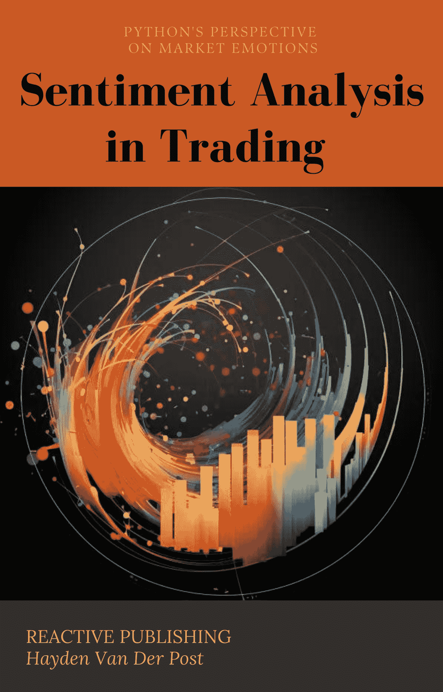
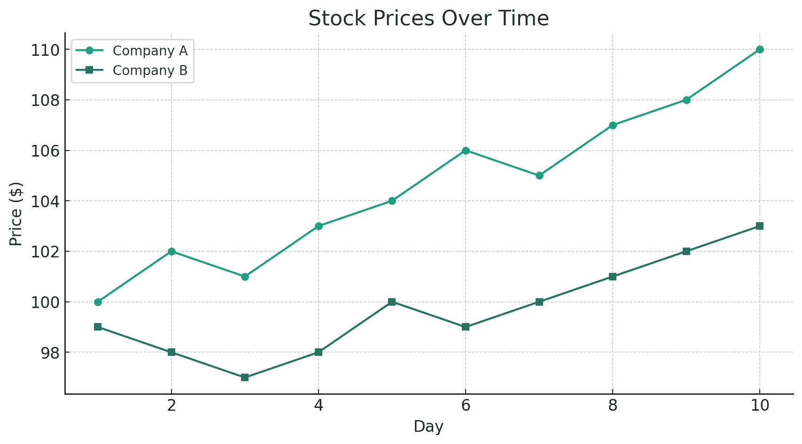

# 交易情感分析：Python 视角下的市场情绪：量化金融中的情感分析




# 第 1 章：交易中的情感分析简介

## 交易中的情感分析：Python 视角下的市场情绪

在金融宇宙中，数据流与人类心理交织，情感分析逐渐成为应对市场潮汐的关键工具。这种技术通过审视文字和数字背后的情绪基调，为交易者提供了一个独特的视角，以预测并应对市场波动。

`Python` 凭借其丰富的库和广泛的社区支持，已成为旨在解读市场情绪的数据分析师和金融专家的核心工具。该语言简洁的语法和可读性使其成为开发复杂算法的理想选择，这些算法可以处理并解释大量的非结构化数据——而非结构化数据正是情感分析试图驯服的信息常见特征。

`Python` 在这一分析过程中的作用是多层面的。它不仅提供了抓取和处理数据的工具，还提供了构建预测模型的框架。如 `Pandas`、`NumPy` 和 `Natural Language Toolkit` (`NLTK`) 等库为处理和分析文本数据提供了坚实的基础，使我们能够从噪声中筛选，并定位驱动市场情绪的信号。

## 定义情感分析

情感分析的核心是从文本中识别主观信息的计算过程。它是自然语言处理（`NLP`）的一个分支，试图理解通常与文本表达交织在一起的人类情感的各种细微差别。在繁忙的交易世界中，情感分析起着指南针的作用，引导投资者穿过错综复杂的市场叙事，发掘出可能影响投资决策的潜在态度和观点。

这门学科不仅仅关于将词汇分类为积极或消极；它更深入地探讨了意义的层次，通过解读讽刺、反讽和语境来衡量文字背后的真实情感。因此，情感分析代表了金融语言学与其数字心跳之间的桥梁，提供了一种量化定性内容的方法，并在数据驱动的交易策略中注入了人类的理解。

在交易背景下，情感分析可以类比为金融市场的脉搏监测器。它持续读取投资者情绪的生命体征，从社交媒体平台上的狂热讨论到金融新闻文章中微妙的语气变化。通过这种方式，它为交易者提供了市场集体情绪的洞察，这种情绪可能与任何经济指标一样具有波动性和影响力。

`Python` 在情感分析中的作用既是基础性的，也是变革性的。它为分析师提供了工具，不仅可以提取和清洗数据，还可以应用复杂的算法来解释和分类这些数据中所表达的情感。通过 `TextBlob` 和 `VADER` 等库，`Python` 为情感分析提供了既强大又易于使用的现成解决方案，允许对复杂的人类情感进行细致的解读。

在我们揭示情感分析时，将触及这一复杂领域带来的挑战——例如检测讽刺、理解语境以及处理语言的歧义性。这些障碍凸显了人类交流的复杂性以及准确解读情感所需的精细程度。

通过这次探索，读者将对情感分析有全面的理解，理解它在金融领域的意义，以及 `Python` 如何作为在交易世界将情感转化为实体资产的催化剂。

## 交易中情感分析的历史概述

追溯交易中情感分析的谱系，揭示了一个与金融和技术演变交织在一起的故事。情感分析的起源于更广泛的行为金融学领域，该领域作为对“市场完全理性”传统观点的挑战而出现。行为金融学的先驱认为，心理因素会显著影响投资者的行为，并延伸市场结果。

20 世纪 90 年代末和 21 世纪初的互联网热加速了人们对人类心理与市场波动交叉点的兴趣。随着在线论坛和新闻网站的激增，分析师意识到这些平台提供了数据金矿——即富含公众情绪洞察的非结构化数据。然而，当时系统分析这些数据的能力受限于当时的计算工具和方法论。

21 世纪初见证了计算能力的激增和复杂算法的出现，为情感分析的繁荣奠定了基础。学术机构和金融公司开始探索利用文本分析来衡量市场情绪的潜力。随着互联网用户生成内容的指数级增长，从社交媒体、新闻文章和财务报告中挖掘情感的想法变得越来越可行。

`Python` 凭借其简单性和健壮的库生态系统，成为这些探索的流行语言。该语言的易用性吸引了多元化的开发者、数据科学家和金融分析师社区，他们共同促进了 `Python` 成为情感分析领域领先工具的增长。

情感分析的早期尝试很大程度上依赖基于词典的方法，这种方法使用带有相关情感评分的预定义单词列表。这些早期模型相对简单，但往往无法捕捉语言的复杂性和依赖语境的特性。尽管存在局限性，这些模型为后来更先进的机器学习技术奠定了基础，这些技术重新定义了该领域。

随着机器学习的流行，情感分析开始整合复杂的模型，如支持向量机 (`SVM`) 和神经网络。这些模型可以从大量的标记数据中进行学习，识别出以前难以捕捉的语言模式和细微差别。

突破出现在深度学习方法的引入，它通过理解语境以及从语言语法和语义中推断情感的能力，改变了情感分析。自然语言处理（`NLP`）库如 `NLTK`、`spaCy` 以及最近的 Transformer 模型如 `BERT`（双向编码器表示表示）革新了这一领域，提供了细致且感知语境的情感评估。

今天，交易中的情绪分析已成为一种多功能的工具，它不仅能衡量市场情绪，还能预判投资者情绪的变化。对推文、金融博客和新闻标题的实时分析，为交易者提供了市场情绪的动态视角，在竞争异常激烈的市场环境中提供了潜在的优势。

这段贯穿于交易情绪分析的历史历程，展示了一个不断演变的领域，其驱动力源于技术的进步以及对解码市场心理暗流的永恒追求。`Python` 在这一叙述中的角色起了至关重要的作用，它既为初学者提供了简单性，又为专家提供了深度，从而推动了这门学科的发展。

当我们进一步探讨情绪分析的历史轮廓时，我们将揭示标记其崛起的里程碑，以及塑造了其进展的挑战。我们将探索 `Python` 如何使分析师能够从日益增长的数据洪流中提炼情绪，以及这种能力如何成为现代交易策略中不可或缺的组成部分。通过这次回顾，读者将对情绪分析对交易的变革性影响产生见解，并对使其成为可能的技术和智慧追求表示赞赏。

## 市场情绪的相关性

市场情绪的概念是理解交易世界震荡的核心；它封装了投资者对特定证券或整个市场的集体情绪或态度。市场情绪是情感和心理倾向的晴雨表，是群众精神的低语，可以预示资产价格和市场趋势的转折点。

市场情绪的相关性通过其影响交易行为并导致价格波动的能力而得到了强调。当情绪看涨时，乐观情绪占据主导地位，投资者更倾向于买入，推动价格上涨。相反，以广泛悲观情绪为特征的看空情绪可能导致卖出压力和价格下跌。这种情绪的波动反映了市场动态的一个关键方面，在这些情况下，感知往往会变成一种自我实现的预言。

市场情绪的影响不仅限于个股；它渗透整个行业，甚至可以影响全球市场。投资者情绪可以像传染病一样，一个市场或资产类别的情绪可能会蔓延到其他领域，证明了现代金融系统的互联性。

因此，理解和衡量这种情绪已成为交易策略的基石。能够有效解释情绪指标的交易者往往能够在市场运动体现在价格图上之前对其进行预判。这种预测能力是交易者的圣杯，而情绪分析提供了一条实现这一目标的途径。

然而，对情绪这样无形的东西进行量化本质上是具有挑战性的。传统方法如投资者调查、情绪指数和市场广度指标提供了对盛行情绪的某种衡量，但它们往往落后于实时市场事件。数字时代信息传播的速度需要能够跟上情绪快速变化的工具。

`Python` 登场了，凭借其一系列数据分析库和 NLP（自然语言处理）能力，已成为那些利用市场情绪的人的关键枢。`Python` 使交易者能够筛选海量数据——从社交媒体帖子到金融新闻文章——并提取出可操作的见解。使用 `Python` 开发的情绪分析算法可以追踪市场情绪的起伏，解码隐藏在文本中的细微线。

此外，情绪分析可以揭示传统金融指标或技术指标无法立即察觉的洞察。例如，一家公司的财报可能符合分析师的预期，但 CEO 声明中表达的情绪可能暗示了潜在的问题或机会，从而影响投资者的感知，随后影响股价。

市场情绪的相关性在高波动和市场压力巨大的时期也尤为突出。在这些时期，情绪高涨，市场情绪可能会剧烈波动。能够有效解释这些波动的交易者可以更有信心、更敏捷地应对动荡局势。

本质上，市场情绪是反映市场参与者集体心理的镜子。它是一种动态而强大的力量，可以放大趋势、扭转命运，有时会让最老练的投资者感到困惑。通过利用 `Python` 进行情绪分析，交易者可以对市场情绪产生更细的理解，做出更明智、更及时的决策。

## 数据分析中的 Python

在数据分析领域，`Python` 已成为创新的灯塔，为跨学科的专业人士提供了多功能工具包。该语言的简单性和可读性使其成为数据分析师富有吸引力的选择，他们经常发现自己陷于数据操作和解释的复杂性之中。`Python` 引入数据分析领域标志着数据处理、分析和可视化方式的重大转变。

`Python` 在数据分析中的领先地位归功于其广泛的库和框架生态系统，这些系统旨在简化复杂任务。如用于数据操作的 `Pandas`、用于数值计算的 `NumPy` 和用于可视化的 `Matplotlib` 等库，构成了 `Python` 数据分析能力的骨干。这些库由活跃的开发者社区不断精炼，允许轻松且精确地处理大型数据集。

该语言的能力不仅限于处理传统数据结构。随着基于网络的数据和社交媒体的出现，对可以解析和处理非结构化数据的工具的需求变得至关重要。`Python` 通过 `Beautiful Soup` 和 `Scrapy` 等库应对这一挑战，这些库促进了网络爬取，允许分析师从各种在线源收集数据进行进一步分析。

`Python` 因其与其他技术无缝集成的能力而脱而出。无论是从 `SQL` 数据库获取数据，还是与 `Apache Hadoop` 和 `Spark` 等大数据平台交互，`Python` 都充当了媒介，连接了不同的数据源和格式。这种互操作性对于经常需要汇总不同系统信息的分析师来说是一个巨大的助力。

`Python` 在数据分析中的另一个关键特性是它在探索性数据分析（EDA）中的作用。`EDA` 是数据分析过程中的关键步骤，分析师在其中寻找模式、发现异常并形成假设。`Python` 的数据可视化库如 `Seaborn` 和 `Plotly` 为创建具有见解的图表提供了强大的工具。这些可视化使分析师能够以既提供信息又美观的方式呈现数据，有助于做出决策。

涉及金融交易时，`Python` 的重要性倍增。该语言提供了丰富的金融专用库，如用于量化金融的 `QuantLib` 和用于投资组合分析的 `pyfolio`。这些专业工具允许分析师在 `Python` 环境中执行复杂的金融计算、回测交易策略并评估风险。

此外，`Python` 通过 `NLTK` 和 `spaCy` 等库在自然语言处理（NLP）方面的实力赋予了交易者进行情绪分析的能力。通过处理金融新闻、分析师报告和社交媒体言论，`Python` 帮助交易者衡量市场情绪，为他们预测市场运动提供优势。

然而，`Python` 的强大之处不仅在于其技术能力，更在于其协作性质。支撑 `Python` 的开源精神促进了共享与协作，加速了社区内的创新和问题解决。数据分析师、量化开发人员和学术研究人员可以对集体知识和工具池做出贡献并从中受益，以以前所未有的速度推动数据分析领域的发展。

总而言之，`Python` 在数据分析领域的引入使该领域变得民主化，让不同专业水平的分析师能够进行复杂的分析。它的简单性结合强大的库支持，使其成为捕捉市场数据细微差别和复杂性的不可或缺工具。

# Python 在金融交易中的应用

`Python` 在金融交易中的兴起证明了它的多功能性和高效。在金融市场复杂的世界里，毫秒之差可能意味着数百万美元，`Python` 是交易员、分析师和投资组合经理的强有力盟友。它的易用性和稳健的性能使其成为全球交易台和对冲基金办公室的标配。

## 算法交易

算法交易是 `Python` 在金融领域最显著的应用之一。它涉及使用算法和量化方法以高速度和频率执行交易。`Python` 拥有如 `Zipline` 和 `backtrader` 等丰富的库，已成为开发和测试算法交易策略的首选语言。这些框架为交易员提供了工具，用于在历史市场中模拟交易（回测），并在部署到实时市场之前评估其策略的有效性。

## 风险管理

风险管理是另一个 `Python` 能力大放异彩的关键领域。风险管理对于金融机构和个人交易员的成功都至关重要。`Python` 的统计包（如 `SciPy` 和 `StatsModels`）允许相对容易地构建和修改复杂的风险评估模型。投资组合经理利用 `Python` 计算风险价值（`VaR`）并在各种市场条件下进行压力测试，以确保对不利的市场波动做好准备。

## 衍生品定价与期权理论

`Python` 在衍生品定价和期权理论研究中也发挥着重要作用。`QuantLib` 库对于期权和债券等复杂金融工具的定价特别有用。通过为衍生品的建模、交易和风险管理提供框架，`Python` 使金融分析师能够探索理论估值模型并将其应用于实践，协助完成关于买卖这些工具的决策过程。

## 情绪分析

`Python` 的另一个新兴应用是情绪分析领域，在该领域，它用于解释和量化新闻文章、社交媒体帖子和财务报告中的情感内容。像 `TextBlob` 和 `VADER` 等库专为情绪分析而定制，能够将定性信息转换为定量数据。交易员使用这些工具来衡量市场情绪，这可以作为市场方向和波动性的有力指标。

## 机器学习

作为人工智能的一个子集，机器学习得益于 `Python` 的机器学习库（如 `scikit-learn`、`TensorFlow` 和 `Keras`），在金融交易中也找到了一席。这些工具使交易员根据历史数据发现模式并预测未来的市场波动。`Python` 的机器学习能力不仅限于预测建模，还用于客户细分、欺诈检测和个性化交易体验。

## 数据可视化

在数据可视化领域，`Python` 提供了许多诸如 `Matplotlib`、`Bokeh` 和 `Plotly` 等库。这些库允许交易员创建交互式且信息丰富的图表，帮助可视化复杂的金融数据和市场指标。通过将数值数据转换为视觉格式，交易员可以更好地理解市场状况，监控交易性能，并有效地沟通发现结果。

## 高频交易 (HFT)

最后，随着高频交易（HFT）的激增，`Python` 在开发能够处理市场产生的海量数据流的系统方面发挥了关键作用。`Pandas` 和 `PyTables` 等库旨在高效管理和分析大型数据集，这对于速度和准确性优先的 HFT 至关重要。

`Python` 在金融交易中的应用是广泛的，并随着行业的演进而不断增长。它的适应性和新库的不断开发意味着，`Python` 不仅仅是当今金融市场的工具，还在塑造交易的未来。通过 `Python`，交易员可以利用数据和技术做出更明智的决策，从而在市场上获得更好的结果。

# 交易中情绪分析的目标

导航瞬息万变的金融市场，不仅需要理解数字和图表，还需要触及市场情绪的脉搏。交易中的情绪分析旨在将定性意见定量。

## 识别趋势和转折点

情绪分析的主要目标之一是识别市场趋势和转折点。通过分析参与者的情绪，交易员可以预测尚未反映在价格中的动态变化。情绪分析工具筛选大量的结构化数据（如新闻文章、博客帖子和社交媒体），以检测集体情绪。例如，积极情绪的激增可能预示着看涨，而负面情绪的蔓延可能预示着看跌下跌。

## 增强预测模型

另一个目标是增强预测模型的准确性。预测价格的传统模型通常包含价格和量等定量数据。然而，通过整合情绪数据，这些模型采用了更全面的方法，考虑了市场波动背后的心理驱动。情绪分析可以提供纯数字可能忽略的微妙背景，提供更全面的市场图景并提高预测准确性。

## 风险管理与投资组合保护

情绪分析还用于风险管理和投资组合保护。市场中的极端狂热还是恐惧，都信号着风险的增加。通过监控情绪，交易员可以识别这些极端情况并相应调整策略，从而在不确定性增加期间减少风险。情绪数据还可以为多元化努力做出贡献，为平衡受不同情绪影响的资产组合提供决策支持。

## 决策速度

提高决策速度是另一个目标。金融市场运行极快，延迟可能意味着高昂成本。由自然语言处理和机器学习驱动的情绪分析工具以人类无法比拟的速度处理并解释信息。这种快速分析允许交易员对新兴的情绪做出迅速反应，在情绪变化时捕捉机会或减轻损失。

## 增强市场理解

增强市场理解是情绪分析的一个根本目标。它为驱动市场行为的内在因素提供了见察，特别是在波动异常的时期。通过解析价格行为背后的情绪，交易员可以更深入地理解市场叙事，制定出与主流情绪一致的更明智的交易策略。

最后，情感分析旨在实现市场信息的民主化。在过去，获取影响市场的信息以及对其进行分析的能力仅限于少数拥有资源的人。现在，随着情感分析工具的变得更加普及，更广泛的市场参与者可以接入市场的集体意识，从而促进一个更公平的竞争环境。

从本质上说，交易中情感分析的目标是多方位且深远的。这门学科试图利用浩如烟海的主观意见，将其转化为一种战略指南，引导交易者穿过金融市场瞬息万变的浪流。通过将解读的艺术与量化的科学相结合，情感分析如一盏灯塔，指明了通往更敏锐、更快速的交易决策的道路。

# 书籍结构概述

开启交易中情感分析这一复杂世界的之旅，需要一个稳健且系统化的框架。《交易中的情感分析：Python 视角下的市场情感》的结构经过精心设计，旨在引导读者从基础概念走向情感分析在金融领域的高级应用。

**第 1 章**通过介绍情感分析及其在交易背景下的意义奠定了基础。它定义了情感分析并讨论了其历史演变，强调了其在当今数据驱动市场中日益增长的相关性。本章还介绍了 `Python` 在数据分析中的作用，凸显了其在金融应用中的实用性，并为后续更深入的探索铺了道路。

**第 2 章**我们探索了金融市场和交易的基础。本章揭开了金融市场的神秘面纱，研究了各种金融工具和交易机制，从订单类型到基本面与技术分析的不同方法。它还触及了影响交易决策的心理因素，以及新闻和事件对市场波动的影响。

**第 3 章**深入探讨情感分析的原理，讨论了不同类型、数据来源和衡量方法。它应对情感分析固有的挑战，并引入了有助于这一工作的工具和库。章节通过将情感分析置于交易领域的背景中进行总结。

**第 4 章**专门介绍 `Python` 数据分析，介绍了 `Python` 作为一种编程语言及其用于数据分析的关键型库，如 `Pandas` 和 `NumPy`。读者将学习 `Python` 中的数据操纵、清洗和预处理，以及其在金融数据和网络爬虫中的应用。

**第 5 章**关注情感分析的数据收集，涵盖了获取实时和历史数据的方法论。它探索了 `APIs`、网络爬虫技术、数据库管理，并考虑了数据收集以及大型数据集管理的法律和伦理影响。

**第 6 章**涉及 `Python` 中的文本处理和自然语言处理 (NLP)，介绍了文本处理的基础，并引入了 NLP 概念和库如 `NLTK` 和 `spaCy`。解释了分词、词干提取和词形还原等关键技术，以及情感评分计算和命名实体识别。


**第 7 章**揭示了用于情感分析机器学习的主题。它提供了机器学习的概述、监督学习与无监督学习的二分法以及特征工程的过程。详细讨论了模型的选择与评估、深度学习方法、集成方法以及相关的`Python`库。

**第 8 章**引导读者开发情感分析模型，从准备数据集到选择算法和评估模型性能。它涵盖了超参数调优、模型部署和持续维护。

**第 9 章**将情感分析整合到交易策略中，讨论了量化策略、算法中情感评分的实现、风险管理、回测，以及自动化交易和自适应算法的细微差别。

**第 10 章**提供了案例研究和应用，展示了情感分析应用于市场数据的真实场景。这包括对社交媒体、新闻标题的分析，以及情感在外汇和大宗商品等不同市场板块的影响。

**第 11 章**重点转向情感和交易数据的可视化。探索了交易中可视化的重要性、交互式图表、实时仪表板和高级技术，展示了如何创建具有洞察力和影响力的图表。

书籍在**第 12 章**达到高潮，讨论了交易中情感分析的未来。本章推测了新兴趋势、大数据和`AI`的影响、替代数据源、伦理和监管考量，以及对下一代交易者的培养。

每一章都是《交易中的情感分析：Python 视角下的市场情感》这幅马赛克不可或缺的一部分，为读者提供了解码市场情感微妙之处的知识和工具，并在交易策略中利用这些工具。结构设计既逻辑又流畅，确保读者在进步的过程中，能够不断建立在理解的基础上，最终实现对该主题的全面掌握。凭借这种深思熟虑的布局，本书不仅是一份教育资源，更是情感分析与金融交易动态交汇点中创新与成功的催化剂。

# 第 2 章：金融市场与交易基础

## 理解金融市场

全球经济的核心是金融市场，它是交易股票、债券、货币和衍生品等金融工具的巨大网络。这些市场是资本的脉动动脉，推动着经济增长并促进财富的创造。

金融市场存在多种原因，其中首要因素是资源的有效配置。它们提供了一个平台，储户可以在这里将资金投入他们认为有前景的项目中，公司可以在这里获取增长和创新所需的资本。投资者与发行者之间的这种共生关系是滋养商业和工业生态系统的命脉。

市场本身分为不同的部门，每个部门都有其独特的特征和机制。例如，股市是交易公司股份的场所，反映了所有权和投资者对未来利润的信心。另一方面，债券市场处理债务证券，允许政府和公司向投资者借钱，并承诺定期支付利并在到期时归还本金。

商品市场促进了黄金、石油和农产品等实物的交易，这些货物对全球供应链至关重要。同时，外汇市场（或`forex`）是货币交换，通过设定货币价值来实现国际贸易和投资。

衍生品市场交易其价值源于基础资产的合同。它们的功能涵盖从对冲风险到投机行为等方面，允许参与者在不一定拥有实际资产的情况下对未来的价格波动进行下注。

每种市场类型都由交易所、经纪商和监管机构提供的框架支持。交易所为交易活动提供市场和基础设施，而经纪商则充当中介，促进买卖双方之间的交易。监管机构（例如美国的证券交易委员会 SEC）负责监督市场运营，以确保公平性、透明度和投资者的保护。

金融市场还根据所交易资产的期限进行分类：资本市场包括股票和债券等长期证券，而货币市场则侧重于短期债务工具，其期限通常少于一年。

金融市场的的流动性是另一个关键方面，它指的是资产在不引起价格大幅变动的情况下被买入或卖出的难易程度。高流动性是理想的，因为它确保了参与者可以快速进入或退出仓位，这对交易者和投资者来说都是关键考虑因素。

在金融市场的起起彼伏中，情绪发挥着影响性作用。市场情绪反映了投资者对市场状况和未来价格走势的集体态度。它可以看涨或看空、乐观或悲观，并显著影响市场内的供需动态。

对于利用`Python`进行情绪分析的交易者来说，理解金融市场的基础至关重要。通过掌握运作机制和影响价格波动的因素，人们可以更好地理解如何利用情绪数据来指导交易决策。通过情绪分析，交易者可以解读驱动市场行为的底层情感，在预测趋势和利用市场失灵获利方面提供竞争优势。

金融市场是复杂的系统，但只要拥有正确的工具和敏锐的分析思维，它们为敏锐的观察者呈现了一片机会的锦。在接下来的章节中，我们将探索如何利用`Python`驱动的情绪分析来应对这些水域，释放隐藏在市场波动表面之下的洞察。

## 金融工具的不同类型

金融工具是金融市场的基石，每种工具都是解锁各种投资和交易策略的钥匙。这些工具性质多样化，提供了对冲、投机和投资组合多元化的手段。

股票市场是股票的家园，股票代表公司的所有权份额。股票投资者本质上持有的是公司资产和收益的一部分。股票根据公司规模、行业和增长前景分为不同类别类——从以稳定性和定期分红著称的大型成熟公司蓝筹股，到来自快速扩张公司的成长股，再到具有巨大增长潜力但风险较高的小公司市值股。

债券是金融工具的另一个基石，代表了投资者向发行人（可能是公司或政府实体）的贷款。债券发行人同意在指定日期偿还本，并支付定期的利息（票息）。债券有多种类型，包括政府债券、公司债券和市政债券，每种都有不同的风险和收益特征。

共同基金和交易所交易基金（ETFs）允许投资者汇集资金投资于股票、债券或其他资产的多元化投资组合。虽然共同基金由专业的投资组合经理管理，但`ETFs`在交易所交易，并提供了整个交易日内买卖份额的灵活性。

期权和期货被归类为衍生品，因为它们的价值源于底层资产，如股票、债券、大宗商品或货币。期权赋予持有者在特定时间范围内以预定价格买入或卖出资产的权利而非义务。相比之下，期货合同强制双方在未来的某个日期以指定价格买卖该资产。

货币构成了外汇市场的核心，外汇是全球规模最大、流动性最好的市场。货币以对的形式交易，反映了两种国家货币单位之间的汇率，例如`USD/EUR`（美元/欧元）。

大宗商品包括原材料和初级农产品，如石油、天然气、黄金、银、小麦和玉米。大宗商品市场可能剧烈波动，受地缘政治事件、供需动态和货币波动的影响。

衍生品市场还包括复杂的工具，如掉，双方交换财务义务，通常涉及基于名义本金的现金流。利率掉和货币掉是常见的示例，使双方能够管理利率风险和货币风险。

每种金融工具都有自己的风险预期、流动性考虑和市场状况。交易者和投资者必须理解这些特征以有效管理他们的投资组合。对于在交易策略中使用情绪分析的人来说，了解这些工具的微妙之处至关重要。情绪可能会过度影响不同的市场板块，新闻和社交媒体往往引起股票价格迅速反应，而债券可能对经济指标或政策变化做出反应。

在这些工具的交易中纳入情绪分析，不仅需要理解市场动态，还需要理解集体情绪如何转化为投资行为。例如，交易者可能会分析社交媒体上的情绪趋势，以衡量公众对特定股票或行业的感知，这可能指示未来的价格走势。

通过利用`Python`的数据分析能力，交易者可以汇总并分析海量情绪数据，应用这些信息预测市场反应，并在各种金融工具上做出明智决策。

## 交易机制和订单类型

航行金融市场需要对交易机制以及交易者用于执行策略的各种订单类型有基本的理解。

交易机制的核心是订单执行过程，这是在市场中撮合买卖订单的方法。交易所和交易平台通过电子系统促进这一过程，确保了效率和透明度。随着技术的进步，订单执行的速度和可靠性得到了显著增强，许多平台现在提供近乎瞬时的交易，这在价格波动迅速的市场是一个关键因素。

交易者可以在市场中使用的订单类型多种多样，每种都为不同的交易目标和风险管理策略定制。市价单是最基本的类型，指示经纪商以当前最优价格立即买卖资产。虽然市价单确保了执行，但它们不能保证特定价格，使得它们在波动波动时期容易受到滑点的影响。

相比之下，限价单允许交易者指定他们希望买卖资产的价格。买入限价单仅会在限价或更低执行，而卖出限价单将在限价或更高处执行。这种对执行价格的控制有助于交易者管理风险，但如果市场未达到指定价格，可能会错失机会。

止损单（Stop-loss orders）作为一种风险缓解工具，在资产达到特定价格时自动卖出以防止进一步损失。相反，止损单（stop order，也称为止损买单）在触及特定价格点时触发购买，通常用于在突破时入场市场。

希望结合限价单和止损单特性的交易者可能会选择止损限价单（stop-limit order）。这种订单类型在达到止损价后会转变为限价单，提供了价格保证和执行确定性之间的平衡，尽管如果市场跳过了限价范围，该订单也可能无法成交。

对于希望在执行大额订单且不产生重大市场影响的参与者，可以使用冰山单（iceberg orders）。这些订单通过一次仅披露一小部分规模来隐藏真实的订单大小，像冰山之角一样融入市场。

追踪止损单（Trailing stop orders）是动态的，它们根据市场价格的移动，在市场价下方固定百分比或金额处调整止损价。这种机制允许交易者在锁定利润的同时，为潜在的下跌留出安全网。

长期有效（GTC）订单在交易者取消或订单执行之前在市场中保持活跃。另一方面，日内单（day orders）如果在交易日结束前未成交将过期。

条件单（Conditional orders）为交易策略引入了高度的复杂性，允许在执行订单前满足一组预定义的标准。这些可以包括限价单、止损单和追踪止损单的组合，条件基于时间、价格、成交量或其他市场变化。

理解并有效部署这些订单类型可以显著影响交易者的成功。当结合情绪分析时，交易者可以根据市场情绪精炼他们的入场和退出点，执行与市场主流情绪暗流相一致的订单。

例如，使用情绪分析的交易者如果情绪指标显示出看涨趋势，可能会在支撑位上方稍处下一个限价单，预判价格将上行。相反，如果情绪似乎正在转为看跌，他们可能会在关键阻力位下方设置止损单，以防范潜在的下跌。

Python 在自动化这些交易策略方面起着至关重要的作用，允许交易者将情绪数据与订单系统集成。通过如用于数据处理的`pandas`和用于策略模拟的`backtrader`等库，交易者可以创建分析市场情绪并根据预设规则自动下单的脚本，增强其交易活动的精确性和响应速度。

## 基本面分析与技术分析

金融市场是相反哲学的战场，基本面分析和技术分析是交易者用来做出明智决策的两种不同方法。

基本面分析是理解资产内在价值的基石。它涉及对财务状况、管理质量、行业状况和经济指标的深度研究，这些因素共同影响着公司的未来表现。例如，一名审视股票的基本面分析师可能会解析财报，评估公司的竞争地位，并考虑利率和货币强度等宏观经济因素。其最终目标是得出一个反映资产真实价值的估值，根据与当前市场价格的比较，指导投资者买入、持有还是卖出。

另一方面，技术分析假设资产的市场价格已经反映了所有已知信息，转而关注研究价格走势和成交量以预测未来趋势。技术分析师（或图表师）依赖从历史市场数据中出现的模式和统计数字来识别交易的潜在入场和退出点。他们使用移动平均线、支撑位和阻力位以及各种图表模式（如头肩底或三角形）来预测价格方向。其潜在假设是倾向于重复的市场心理已嵌入在这些价格走势中。

虽然基本面分析通常与长期投资相关，但技术分析通常应用于较短的时间范围，使其成为日内交易者和波段交易者的青睐。然而，这些方法并非互斥，可以结合使用以提供对市场更全面的视角。

情绪分析通过量化市场参与者的情绪，为这种双重方法增加了另一个维度。它可以作为基本面分析和技术分析之间的桥梁，提供传统指标并不总是显而见的洞察。例如，一家公司可能报告了卓越的收益（基本面）并显示出看涨形态，但如果情绪分析显示出负面情绪，可能值得关注。

Python 在这些分析中的作用是多方面的。对于基本面分析，Python 可以自动从数据库提取财务报表、计算财务比例，甚至抓取影响投资者情绪的新闻。在技术方面，Python 丰富的库生态系统（包括`matplotlib`和`NumPy`）让交易者能够轻松构建和可视化复杂的图表。

结合这些分析的实际示例可能涉及 Python 获取每股收益（EPS）和市盈率（PE）等基本面数据，并将其与移动平均线或相对强度指数（RSI）等技术指标一起绘图。通过这种方式，交易者可以快速比较资产的基础价值与其技术立场和市场情绪，做出更明智且多方面的交易决策。

## 算法交易简介

在快速变化的金融市场格局中，算法交易作为一种变革性的力量出现，以其高速、高效的协议改变了交易的格局。

算法交易（通常称为程序交易）涉及使用计算机程序按照一组定义的指令（或算法）来执行交易。这种方法的魅力在于能够以极快的速度和精确的精准度执行订单，这是人类交易者无法比及的。

算法交易的优势是多方面的。首先，它减轻了人类情绪对交易决策的影响，从而增加了一致性和纪律性。其次，它能够处理远超人类能力的大数据集和复杂计算，使交易者能够捕捉可能错失的机会。第三，它通过订单拆分（order slicing）等技术促进大额订单的执行，将大订单拆分成多个小订单以避免产生重大市场影响。

Python 凭借其简单性和强大的库支持，在算法交易领域是一个强大的力量。诸如用于数据处理的`pandas`、用于机器学习的`scikit-learn`以及用于策略开发和回测的`backtrader`，都是 Python 程序员工具箱中不可或缺的工具。该语言的灵活性允许算法的快速原型设计，然后可以使用历史数据对其进行回测，在实盘部署之前评估其效能。

算法交易的一个实际应用示例可能涉及基于情绪的策略，使用 Python 实时监控新闻推送和社交媒体，评估对特定股票或整个市场的情绪。如果检测到情绪发生重大变化，算法可以根据预定义的规则触发交易，例如在情绪积极时买入，在情绪消极时卖出，同时管理风险并遵守监管要求。

在整本书中，读者将深入了解使用 Python 构建和微调交易算法的复杂之处。我们将探索如何将情绪分析无缝地织入这些算法中，提供一种不仅利用定量数据，还利用市场数据定性方面的竞争优势。随着学习的深入，我们将释放算法交易的潜力，利用市场参与者的集体情绪，从而在这个不断变化的金融生态系统中完善我们的交易策略。

# 影响交易决策的心理因素

在每笔交易的表面，在喧闹市场的嘈杂之下，隐藏着人类心理的无静细流。

交易的核心是一种与人类行为深度交织的活动。影响交易决策的心理因素往往是微妙的，但它们对市场参与者的行为产生巨大的影响。恐惧、贪婪、希望和后悔等情绪会模糊判断，导致可能偏离理性的决策。交易者努力应对认知偏差——即判断中偏离常规范或理性的系统性模式——例如过度自信、确认偏误和损失厌恶，每种偏差都会扭曲认知并可能影响盈利。

过度自信可能迫使交易者低估风险并高估自己预测市场波动的能力，通常导致过度交易或忽略警告信号。确认偏误驱动个体寻找与其现有信念一致的信息，而忽视反面证据，这可能会导致人们在亏损的交易中固执立场，而不是促使其及时退出。损失厌恶（即倾向于避免损失而非获得等值收益的倾向）会导致“追亏”行为，交易者为了弥回损失而向错误的项目投入更多资金。

心理因素在塑造市场情绪方面也起着关键作用，情绪反过来影响价格走势。市场情绪是投资者对特定证券或金融市场的整体态度。它是市场的感受或基调，或者说是通过市场中交易证券的活动和价格波动所揭示群体心理。情绪指标，如认跌比例、波动率指数（`VIX`）和看涨比例（Bullish Percent Index），为观察市场的集体心理提供了窗口，提供了关于趋势潜在反转或持续的线索。

为了应对交易中的心理雷区，许多交易者转向行为金融学等学科，该学科将行为认知心理理论与传统经济和金融相结合，以解释人们为何会做出非理性的财务决策。其他人采用风险管理技术来实施纪律，例如设置止损单以减轻对市场波动情绪反应的影响。

Python 作为分析之旅中可靠的伙伴，不仅提供了分析市场数据的工具，还能挖掘交易的心理维度。诸如`NLTK`和`TextBlob`等库可用于对金融新闻和社交媒体进行情绪分析，识别可能预示市场走向的情绪变化。通过将这些工具集成到交易算法中，交易者可以设计动态适应市场心理基础的策略。

在书中，我们将剖析这些心理因素，并展示使用 Python 将其量化并整合到算法交易策略的方法。通过理解起作用的心理力量，交易者可以完善他们，将内省转化为资产，将情绪转化为可量化的数据。我们将学习如何利用从心理分析中获得的见解，将交易者内心的低语转化为明智决策的交响乐，与快节奏的金融交易世界所需的纪律和敏锐产生共鸣。

# 新闻和事件在市场波动中的作用

在金融市场的宏大舞台上，新闻和重大事件扮演着主角角色，协调着可能在全球范围内引发涟漪或海啸的波动。

新闻从经济数据发布、公司财报到地缘政治事件，充当着市场波动的催化剂。市场对新闻反应的即时性强调了信息与投资者情绪之间的动态相互作用。经济数据（如失业率、通胀数据和 GDP 增长）可以在交易者解读其对货币政策和经济健康的影响时，引发资产的立即重新定价。公司财报可能导致价格剧烈调整，因为反映了公司的表现和未来前景，从而影响投资者的信心和估值。

地缘政治事件，无论是选举结果、贸易谈判还是监管变化，都会对市场情绪产生深远影响并引发波动。这些事件通过改变对未来的预期来改变投资格局，从而影响资产的风险和收益特征。例如，关税的可能会引发对全球贸易紧张局势的担忧，导致股票抛售并转向国债等安全资产。

通过数字媒体的新闻快速传播放大了其市场影响，算法交易系统能够在标题发布后的毫秒内解析新闻推送并执行交易。这种对新闻的自动反应改变了交易大厅——曾经由人类交易者消化并反应新闻的地方，现在复杂的算法可以识别关键词和情绪，以人类无法比拟的速度和效率执行交易。

要理解新闻在市场波动中的作用，我们需要理解其本质——新闻是可以预料之的，也可以是意料之外的，后者由于其意外性通常具有更显著的影响。可以预料之的新闻（如计划中的经济数据发布）通常已反映在价格中，而意外之外的新闻（如自然灾害或政治动荡）会因让交易者措手不及而引发市场冲击。

Python 凭借其强大的生态系统，是分析新闻及其市场影响的强大工具。像`Beautiful Soup`和`Scrapy`这样的库能够高效爬取网页以收集新闻数据，而自然语言处理（NLP）库如`NLTK`和`Gensim`有助于分析新闻文本的情绪和主题内容。金融库`PyAlgoTrade`允许模拟将新闻作为输入的交易策略，能够在历史背景下进行回测，以评估基于新闻的策略的表现。

通过将 Python 的计算能力与对新闻在交易中角色的细致理解相结合，我们旨在赋予读者制定明智交易策略的技能，以敏捷且富有洞察力的方式应对信息流。这种追求不仅是对新闻做出反应，更是为了预判其回响，将交易者从信息的被动接收者变为市场演变叙事中的积极参与者。

# 第三章：情感分析原理

## 什么是情感分析？

情感分析，又称为意见挖掘（opinion mining），是一项研究文本数据中主观信息以确定一系列词汇背后的情感语的学科。这在许多领域都至关重要，例如在营销领域，理解消费者对产品或品牌的情绪非常有价值；但它在金融市场找到了特别有趣的应用，因为集体心绪会影响市场走向。


情感分析的核心是对文本的极性进行分类——即表达的观点是积极的、消极的还是中性的——以及达到何种程度。考虑到情感可能会通过上下文、讽刺甚至文化引用微妙地传递，这是一项复杂的任务。此外，情感并非总是非黑即白的；往往存在情绪的层次，这使得量化这些情感的任务成为了一项挑战性的尝试。

情感分析采用了多种方法，从简单的基于词典的方法（将词汇与预定义的积极或消极词列表进行对比），到复杂的机器学习技术（后者可以从海量数据集中学习并预测情感）。这些方法为大规模理解人类情感开启了广阔的机会——在计算技术出现之前，这样做是不切实际的，甚至可以说是不可能的。

在交易领域，情感分析提供了一个透镜，通过它可以观察并量化市场情绪。金融市场是社会建构，容易受到人类情绪波动的影响。情感分析允许投资者和交易者衡量相关新闻、社交媒体讨论和财务报告中的主流情绪，这可以为市场决策提供可操作的见解和竞争优势。

`Python` 凭借其简洁的语法和强大的库，是执行情感分析的极佳工具。如 `TextBlob` 和 `VADER` 等库专门为情感分析设计，可以轻松地集成到 `Python` 代码中。这些工具使用了多种对金融文本进行微调的算法和词典，对于希望在策略中利用情感分析的交易者来说非常理想。

情感分析在交易中的实际应用是多层的。交易者可以监控情感指标以寻找市场顶部或底部的警示信号，因为极端看涨或看空的情感可能信号反转。算法交易策略可以整合情感数据，在达到特定情感阈值时执行交易。通过理解市场周期内的情感趋势，可以增强风险管理，帮助交易者避免情绪化决策。

情感分析不仅仅是解码词汇和短语；它关乎解锁市场叙事的感文本，从噪声中过滤信号，并解读全球市场参与者的齐唱。这是一种工具，在具备技能和理解的情况下运用，可以用实证见解增强交易者的直觉，使其做出更明智、更细腻的交易决策。通过 `Python` 的功能，我们将探索技术与心理学的交汇，为金融市场的情感暗流规划路线。

## 情感分析的类型

情感分析是一种多层技术，分为几种类型，每种类型都有特定的方法和应用。这种多样性反映了人类语言和情感内在的复杂性，需要不同的分析视角来捕捉文本数据中完整的频谱。情感分析的类型主要包括但不限于细粒度情感分析、情绪检测、基于方面的情感分析和意图分析。

细粒度情感分析超越了将文本分类为积极、消极或中性。它试图在一个尺度上（例如从非常消极到非常积极）量化情感的强度或程度，从而对情感表达有更细致的理解。当情感强度是关键因素时，这种类型特别有价值，例如衡量消费者对产品的激情或投资者信心的强度。

情绪检测深入研究文本传达的特定情绪，识别更广泛的感觉，如喜悦、信任、恐惧、惊讶、悲伤、期待、愤怒和厌恶。这种方法通常应用于客户服务和反馈系统，以理解客户的情绪，提供可以指导产品改进或客户关系策略的见解。

基于方面的情感分析将文本分解为不同的方面或属性，并评估每个方面的情感。例如，在产品评论中，可以单独对价格、质量和特征评估情感。在交易中，这可能涉及分析对公司不同方面的情感，例如领导层、表现或声誉。

意图分析更进一步，试图辨别写作者在表达情感背后的意图。这可能涉及购买、推荐或出售等意图。在交易语境下，意图分析可以根据影响性市场参与者或普通交易社区的意图预判潜在的市场波动。

`Python` 作为一种工具，通过各种库和框架为这些每种情感分析提供了强力支持。如 `NLTK` 和 `spaCy` 等库提供了基础的 NLP（自然语言处理）功能，可以扩展用于情绪检测和细粒度分析。`TextBlob` 等框架提供了简单的 API 用于快速的情感极性和主观性评估，而更高级的机器学习库如 `TensorFlow` 或 `PyTorch` 则允许为基于方面和意图分析等复杂任务开发自定义模型。

机器学习模型，特别是使用 NLP 技术的模型，为情感分析开启了新大门。情感词典、词袋模型和词嵌入技术已证明在细粒度和情绪检测分析中是有效的。深度学习模型，包括循环神经网络（RNN）和 Transformer，由于其理解上下文和语言细微差别的能力，在基于方面的情感分析中设定了新的基准。

## 情感分析的数据来源

在情感分析领域，数据源的质量和相关性至关重要。准确的情感分析依赖于稳健、多样化且海量的数据集基础，这些数据集反映了人类情感和观点的整个光谱。在这里，我们将深入探讨作为情感分析基石的主要数据源，特别是在金融交易背景下。

### 主要数据源

**公共财经新闻**

公开的财经新闻文章为市场分析师提供了丰富的情感数据宝库。主流新闻媒体和财经期刊不断发布可能影响市场情绪的文章、社论和报告。使用 `Python` 的爬虫库（如 `BeautifulSoup` 或 `Scrapy`）的自动化系统可以系统地收集这些文章。对收集到的文本内容进行分析，可以衡量市场对经济事件、财报或财政政策转变的情绪。

**社交媒体平台**

社交媒体平台是公众舆论的现代脉搏。`Twitter` 以其简洁和实时的特点，成为瞬时市场情绪的温床。`Reddit`，特别是专门投资和交易的版块，也能为市场参与者的集体情绪提供宝贵的见解。利用如 `Twitter` 的 `Tweepy` API 或 `Reddit` 的 `Python` 库 `PRAW`，可以高效且大量地提取这些数据。

**金融论坛和博客**

金融论坛和博客提供了情感分析的另一个维度。像 `StockTwits` 这样的平台专为投资者和交易者分享其市场观点而设计。这些来源特别具有揭示性，因为它们反映了深度参与金融市场的社区的观点。`Python` 工具可以接入 `RSS` 馈或爬取这些论坛的内容，为情感分析提供丰富的数据集。

**消费者评论**

对金融产品、服务或机构的消费者评论和反馈对情感分析也同样重要。评论汇总网站和公司网站上的客户反馈板块可以揭示公众对金融工具、银行或投资服务的真实态度。`Python` 的 `Selenium` 库可以自动化与网页的交互，以收集这些数据进行进一步的情感分析。

**公司报告**

公司报告和财报会议电话记录稿是影响投资者情绪的正式数据源。季度和年度报告、管理层评论以及股东信可以经过处理，以提取与公司财务状况和前景相关的情感。`Python` 中的 `PDFMiner` 或 `PyPDF2` 工具可以帮助从这些文档中提取文本。

**分析师报告和 API**

分析师报告和评级机构可以提供市场情绪的专业视角。虽然这些报告通常位于付费墙后，但可以通过 `Python` 应用可以访问的订阅制 API 或金融数据服务获取。

**实时数据流**

实时新闻流和如 `Bloomberg`、`Reuters` 等金融数据服务提供了基于 API 的专业级财经新闻和数据流。这些服务富含情感数据，尽管成本较高。可以使用 `Python` 的 `requests` 库与这些 API 接口，并以结构化格式收集数据，为情感分析做好准备。

**替代数据**

最后，替代数据源如卫星图像、航运日志或信用卡交易数据也日益受到关注。这些数据类型通过反映经济活动水平和消费者行为模式提供间接的情感指标。`Python` 的灵活性允许对此类非传统数据源进行处理和分析。

每个数据源都有其独特的特征和挑战。分析必须考虑数据的及时性、其对市场情绪的代表性以及任何内在偏差。在收集和利用数据进行情感分析时，还必须考虑数据隐私法和伦理考量。

# 情绪衡量：方法与手段

情绪的量化是一项既具挑战性又极其重要的任务，旨在将主观转化为客观。在交易领域，精确衡量市场情绪的能力，是将市场情绪的本质提炼为一种易于理解且可操作的格式。

### 基于词典的方法

基于词典的方法是情感分析最早的方法之一。该技术涉及使用预定义的词汇列表，每个词都标记有其相关的情感极性——正面、负面或中性。`Python` 的 `Natural Language Toolkit` (`NLTK`) 库提供了对多个此类词典的访问，包括成熟的 `Vader` 词典，它专门针对社交媒体中表达的情绪进行了调整。通过解析文本并统计其中找到的词汇的情感值，这种方法提供了一种直接但有时过于简单的情绪衡量。

### 机器学习方法

机器学习方法代表了情感分析的一种更具动态的方法。这些技术不依赖于固定的词典，而是从文本样本情感已知的数据集中进行学习。`Python` 的 `scikit-learn` 库是实现机器学习算法的强大工具，如使用 `Naive Bayes`、支持向量机或 `Random Forest` 分类器来分析情绪。通过在标注的数据集上训练这些模型，它们可以学习识别数据中的复杂模式和细微差别，得出更准确的情绪预测。

# 深度学习方法

深度学习是机器学习的一个子集，利用神经网络对数据中的高层抽象建模。`TensorFlow` 和 `Keras` 等库允许 `Python` 用户构建能够捕捉更细微情绪层面的深度学习模型。循环神经网络 (`RNNs`) 及其更高级的变体（如长短期记忆网络 (`LSTMs`)）特别擅长处理序列（如句子），使其适用于情感分析。这些模型可以根据语境识别情绪，考虑整个句子或段落的结构，而不仅仅是单个单词。

### 混合方法

混合方法结合了基于词典和机器学习的方法，以利用两者的优势。例如，词典可以提供一个基准情绪分，然后通过考虑上下文和语言细微差别的机器学习模型进行精炼。`Python` 的灵活性允许这些方法的无缝整合，创建一个复杂的情感分析流水线。

### 情绪评分归一化

无论选择何种方法，情绪评分的归一化都是至关重要的一步。它涉及将各种情绪指标转换为标准格式，以便于比较和聚合。在 `Python` 中，可以使用 `Pandas` 库来处理和缩放情绪评分到一个共同范围，例如 `-1` 到 `1`，其中 `-1` 代表极负面情绪，`0` 代表中性，`1` 代表极正面情绪。

### 语义方向

另一种衡量情绪的方法是通过语义方向，它涉及根据短语与已知正面或负面短语的语义相似性将其关联到尺度上的点。`Python` 的词嵌入库（如 `Gensim`）可用于建模语义方向并推断情绪。

### 与金融指标的结合

在交易背景下，情绪评分通常与价格、成交量或波动率等金融指标结合分析。`Python` 的数据分析能力允许情绪数据与这些金融指标建立相关性，可能揭示预测关系。时间序列分析等技术可以用于理解情绪和市场指标如何随时间相互影响。

## 衡量情绪的挑战

虽然这些方法非常强大，但同时也伴随着挑战。自然语言中的讽刺、反讽和歧义可能会误导情感分析模型。此外，金融术语和特定行业的术语需要定制化的解决方案。`Python` 的活性以及开发领域特定词表或在专门数据集上训练模型的能力，有助于缓解这些挑战。

对准确情感测量的追求正在进行中，在 `Python` 的引领下，新的方法论不断演进。

# 情感分析面临的挑战

在情感分析这项迷宫般的尝试中，人们遇到了许多令即使是最复杂的算法也困惑的挑战。

情感分析中最严峻的挑战之一是语境歧义。词的含义会根据上下文发生巨大变化，使得情感解释变得并非易事。`Python` 的自然语言处理库（如 `NLTK` 和 `spaCy`）虽然强大，但如果不进行大量的自定义，它们并天生无法辨别上下文。考虑“bearish market”（熊市）这个短语——对于非专业人士来说，这可能会勾出一个充满大型哺乳动物的市场意象，但对于交易者来说，它意味着市场趋势的下降。

讽刺和反讽以其反转陈述情感的能力而闻名。像“太棒了，又一次市场崩溃！”这样的句子在用讽刺的语气说时，尽管存在看似积极的词汇“great”（棒），但表达的是负面情绪。`Python` 的文本分析模型（例如基于机器学习构建的模型）必须在富含此类示例的数据集上进行训练，才能开始解释这些复杂的人类表达。

成语的使用增加了情感分析的复杂性。像“jumping on the bandwagon”（随大流）或“missing the boat”（错过良机）这样的短语在金融领域中充满了情感色彩，但算法很难解读。`Python` 解析习语语言的能力依赖于大量习语数据库的整合以及先进 NLP 技术的应用。

金融市场像任何行业一样，都有自己的行话和术语，其中包括口语和俚语。这种语言的非正式性质（通常出现在社交媒体或对话文本中）可能是情感分析的雷区。`Python` 工具必须不断更新，以跟上交易者和市场评论员不断演变的词汇。

将情感与正确的实体关联至关重要，特别是在可能提到多个实体的金融文本。`Python` 的命名实体识别能力（可在 `spaCy` 等库中找到）必须经过微调，以确保情感被正确分配给相关的股票、商品或指数，而不是被错误归类。

由于金融市场的全球性，情感分析通常跨越多种语言。在语言之间准确翻译情感充满了重重困难，`Python` 的文本分析框架必须整合多语言模型，以便有效地在不同的语言格局中运行。

用于训练情感分析模型的高质量标注数据可能是稀缺的，特别是在金融的利基领域。数据稀疏是一个巨大的障碍，而包含无关信息的噪声、非结构化数据使其变得更具挑战性。`Python` 从业者必须采用复杂的数据收集和预处理技术来构建可靠的数据集。

金融市场是一个瞬息万变的环境，情感可能迅速扭转。情感分析模型必须能够快速适应新信息。这不仅需要实时数据处理能力，还需要能够以最小延迟进行重新训练或更新的模型。

文化和人口因素会影响情感的表达和解释。`Python` 的情感分析工具必须考虑这些差异，以确保在不同市场参与者群体中准确捕捉情感。

模型可能会无意中学习训练数据中存在的偏差，导致偏斜的情感解释。确保算法公平性和减轻偏差至关重要，这需要仔细的模型评估和调整实践。

在金融交易中，合规性不容忽视。情感分析工具必须确保其方法和数据源符合法律法规，以防止滥用或伦理违规。

这些挑战构成了情感分析必须通过的考验。对这些复杂障碍的后续探索将强调在波动交易领域内情感分析的复杂性。通过直面这些挑战，`Python` 爱好者可以打造出工具和技术，将人类情感的原始数据提炼为可操作交易洞察的金。

# 情感分析工具与库

将原始文本转换为具体情感指标的炼金术通过一系列复杂的工具和库得以实现，特别是在 `Python` 生态系统中。

## 自然语言工具包 (NLTK)

`Python` 情感分析工具包的前沿是自然语言工具包，即 `NLTK`。这套全面的库和程序是为符号和统计自然语言处理定制的。`NLTK` 自带有一套强大的集成资源，包括如 `SentiWordNet` 等词表，它提供了带有相关情感评分的单词列表。此外，`NLTK` 的模块化特性允许定制组装情感分析流水线，这些流水线可以包括分词、词性标注和分类算法。

## TextBlob

`TextBlob` 是另一个流行的库，以其简单易于使用而闻名。它为常见的 NLP 任务（包括情感分析）提供了一个直接的 API。在底层，`TextBlob` 利用模式分析并预配置了情感词表。对于快速原型设计或刚进入情感分析领域的新手来说，`TextBlob` 提供了一个温和的入门引导，且没有牺牲功能。

## VADER (效性感知词典和情感推理器)

`VADER` 是一种基于词表和规则的情感分析工具，专门针对社交媒体中表达的情感进行了调整。它擅长处理包含表情符号、缩写和俚语的文本，使其在解析在线金融话语的口语化时特别强大。`VADER` 的情感模型是预训练的，不需要进一步的机器学习，便于即时部署。

## spaCy

`spaCy` 对 NLP 采用了更具工业强度的方法，并以其速度和效率而闻名。它是为生产环境而设计的，可以集成到大型系统中。`spaCy` 并不提供开箱即用的情感分析函数，但其先进的文本分类能力为构建自定义情感分析模型提供了坚实的基础。

## StanfordNLP 和 CoreNLP

斯坦福 NLP 组开发的库在学术和专业领域备受推崇。这些库包括 `StanfordNLP` 和 `CoreNLP`，虽然它们不限于 `Python`，但可以通过 `Python` 包装器访问。它们的情感分析工具基于深度学习，并提供了处理复杂情感分析任务的细致模型。

## scikit-learn

`Python` 的 `scikit-learn` 库是机器学习的宝库，提供了文本向量化、特征提取和模型训练系列工具。虽然它不提供内置的情感分析模型，但它允许从业者使用各种机器学习算法（从朴素贝叶斯分类器到支持向量机）构建自定义模型。

## Transformers 与深度学习库

对于那些涉足深度学习领域的人来说，`TensorFlow` 和 `PyTorch` 等库为构建复杂的神经网络模型提供了基础组件。特别是 Hugging Face 的 `transformers` 库提供了对 `BERT` 和 `GPT` 等预训练模型的访问，这些模型改变了自然语言处理（NLP），并可以针对定制的情感分析任务进行微调。

## Pandas 和 NumPy

虽然 `Pandas` 和 `NumPy` 本身并不是情感分析工具，但它们对于 `Python` 数据科学栈中的数据操作和数值计算是不可或缺的。它们通常与情感分析库结合使用，用于数据预处理、处理数据集以及进行探索性数据分析。

## Plotly 和 Matplotlib

情感数据的可视化对于分析和解读至关重要。`Plotly` 和 `Matplotlib` 是创建静态、交互和动画可视化的顶级 `Python` 库。它们是传递情感分析结果的工具，能够实现情感趋势和分布的可视化。

这些工具和库为 `Python` 内的情感分析构建了一个稳健的框架。每个工具都有其优势和独特的细微之处，为 `Python` 爱好者打造情感分析解决方案提供了丰富的调色板。通过利用这些库，人们可以走从原始文本到可操作的情感洞察之路，这段旅程既充满回报又极其复杂。

## 交易背景下的情感分析

情感分析在交易中的应用基于这样一个观点：市场参与者的集体情绪和主观感知会显著影响资产价格。通过量化从新闻文章、社交媒体动态和财经博客中散发的感波动，交易员和分析师可以获得对主流情绪的洞察，这些情绪通过传统的财务指标可能无法立即看出。

情感分析作为一个情感晴雨计，衡量市场的心跳。它捕捉渗透在投资者沟通中的乐观或悲观情绪，并将这些感受转化为情感得分。这些得分聚合后可以提供市场情绪的快照，从而帮助交易员识别头寸的潜在入出场点。

虽然财报、经济指标和价格图表等财务数据是量化且具体的，但情感数据为分析增加了定性维度。它涵盖了语言的微妙之处、财经评论员的语调以及零售投资者在社交媒体平台上的热度。定量财务数据与定性情感数据的结合，提供了更全面的市场图景。

算法交易系统可以将情感得分作为输入，结合传统的市场指标，根据预定义的标准执行交易。例如，系统可能被设定在情感得分显示出高度乐观时增加看涨头寸的权重，或在负面情绪占优时对投资组合风险进行对冲。将情感分析整合到算法交易策略中产生了一种新型交易模型，对市场情绪的波动做出反应。


情感趋势也可以作为领先指标，为未来的市场波动提供线索。无论是看涨还是看空情绪的突然转变都可能发生在相应的价格波动之前。通过监控这些情感趋势，交易员可以在事件完全体现在价格变化之前，预测市场潜在的反应。

实时处理情感的能力改变了交易策略。源自新闻快讯、Twitter 馈和其他实时数据源的实时情感流，使交易员能够对市场情绪的变化做出快速反应。这种即时性允许将情感分析整合到对至关重要的日内交易策略中。

情感分析还可以检测情感与价格波动之间的背离或收敛。显著的背离（价格和情感向相反方向移动）可能标志着过度反应或潜在的市场修正。相反，情感与价格的收敛可能会增强趋势的强度。

借鉴行为金融学领域，情感分析承认市场并不总是由理性决策驱动。相反，认知偏误和情感反应会导致市场失灵，而情感分析正试图识别并利用这些现象。

## 风险管理与情感信号

在风险管理领域，情感分析为管理投资组合敞口提供了额外的洞察层。通过监控极端情绪，交易员可以识别出狂热或恐慌的时刻，这些时刻通常与市场顶部和底部相关。这些信息可以为风险管理提供支持，例如收紧止损订单或调整位置规模。

交易员和金融机构开始开发针对其特定交易哲学和市场关注的定制情感指标。这些专有指标利用专门词表和机器学习模型来完善情感分析，以适应其独特需求。

尽管前景广阔，但交易中的情感分析并非没有挑战。语言的微妙性、讽刺和误导信息的存在，以及市场叙事的动态演变都为情感分析模型带来了障碍。此外，过拟合风险和不断改进模型的需求要求在将情感数据整合到交易决策时采取谨慎的方法。

情感分析代表了传统交易分析的有力补充，提供了观察市场集体心理的窗口。无论是作为独立工具，还是整合到复杂的交易算法中，情感分析都具有锐化交易策略优势的潜力，在瞬息万变的金融市场中提供竞争优势。

# 第 4 章：数据分析 Python 简介

## 作为编程语言的 Python

`Python` 无疑证明了其作为卓越编程语言的地位，其简单性和多功能使其深受不同领域专业人士的青睐。

`Python` 的语法因其可读性和直观性而闻名，使其成为初学者的理想首选语言和资深开发者的强大工具。它的易用性超越了简单的脚本编写，扩展到复杂应用的开发，促进了平滑的学习曲线，并推动了跨越行业的广泛采用。

从 Web 开发到科学计算，`Python` 的多功能在其广泛的应用中显而易见。在交易和财务分析领域，`Python` 丰富的库和框架生态系统——如用于数据操作 `Pandas`、数值计算 `NumPy` 以及数据可视化的 `Matplotlib`——为处理财务数据集和执行复杂的分析提供了一个集成环境。

`Python` 的开源性质培养了一个蓬勃的贡献者社区，他们通过开发程序包和工具不断丰富其功能。这种协作精神确保了 `Python` 处于技术创新的前沿，并有大量的资源和论坛用于故障排除和知识共享。

`Python` 与其他语言和技术的接口能力增强了其在交易领域的吸引力。它可以无缝集成到现有的 IT 基础设施中并补充其他编程语言，从而实现系统开发和数据分析的混合方法。

虽然 `Python` 的执行速度有时会被批评，但近期的进展，如即时编译（Just-In-Time compilers）和高性能库的集成已显著缓解了这些担忧。此外，`Python` 的可扩展性使其既适用于小型项目，也适用于大型高频交易系统。

在瞬息变化的交易环境中，处理实时数据的能力至关重要。`Python` 的各种库支持流式数据的采集、处理和分析，确保交易员能够敏捷地响应市场变化。

机器学习和人工智能的兴起进一步巩固了 `Python` 作为交易领域首选语言的地位。如用于机器学习的 `Scikit-learn`、用于深度学习的 `TensorFlow` 以及用于神经网络的 `Keras` 等库，使交易员和分析师能够构建预测模型并自动化交易决策，利用从情感分析和历史数据中洞察。

随着金融市场监管的加强，通过开发定制报告工具和风险分析算法，`Python` 辅助合规和风险管理工作。这些工具帮助企业应对不断变化的监管环境，并维持稳健的风险管理。

采用 `Python` 并非没有障碍。维护代码质量、管理依赖和确保安全性都是关键的考虑因素。然而，通过审慎的开发实践和 `Python` 社区的支持，这些挑战可以被妥善应对。

本质，`Python` 不仅仅是一种编程语言；它是一个全面的平台，使交易员和分析师能够利用数据和技术的力量。它简单、强大和灵活性的结合使其成为交易工具箱中无贵的资产，能够将原始市场数据转化为可操作的洞察和明智交易决策。

## Python 数据分析的关键库 (Pandas, NumPy 等)

`Python` 在数据分析方面的强大之处在于其丰富的库仓库——这些工具经过精心设计，旨在简化复杂的分析任务。

### Pandas: 数据处理与分析

`Python` 数据分析库的核心是 `Pandas`，它以强大的数据结构和函数而闻名，这些函数旨在使数据操作变得直观且高效。通过 `Pandas`，金融分析师可以轻松处理时间序列数据、执行聚合并合并数据集——这些都是金融分析中的关键任务。

`Pandas` 提供的 `DataFrame` 对象允许对数据进行复杂的索引和切片，适应金融数据集的复杂需求。它处理缺失值、透视表和基于时间分组的能力使其成为预处理和探索金融数据的不可或缺的工具。

### NumPy: 数值计算

`NumPy` 是 `Python` 数据分析能力的另一基石，提供了对大型多维数组和矩阵的支持，并包含了一系列用于操作这些结构的数学函数。它的性能源于其 C 语言基础，在需要高速数学计算的场景中（常见于金融模型和模拟）至关重要。

对于交易员来说，`NumPy` 是执行数值任务的首选库，例如计算金融指标或优化投资组合。其面向数组的计算确保了操作既快速又可靠，这对于做出及时的交易决策至关重要。

### Matplotlib: 数据可视化

在数据可视化方面，`Matplotlib` 作为 `Python` 的主要绘图库脱颖而出。通过 `Matplotlib`，创建静态、交互式和动画可视化变得轻而易举。分析师和交易员依靠其多功能的绘图能力以图形形式表示数据——这是识别市场行为中趋势和模式的关键步骤。

柱图、折线图和直方图只是 `Matplotlib` 可产生的可视化类型类型示例，它们为金融数据的复杂性提供了清晰的窗口。

### SciPy: 科学与技术计算

在 `NumPy` 提供的基础之上，`SciPy` 将 `Python` 的分析能力扩展到科学和技术计算领域。它包含了优化、线性代数、积分和统计等模块——这些领域是量化金融的基础。

`SciPy` 的程序是为特定的科学研究问题设计的，这些问题通常与交易中进行的量化分析一致。它用于统计分析和模型构建的稳健工具集使其成为开发数据驱动策略的交易员的资产。

### Seaborn: 统计数据可视化

虽然 `Matplotlib` 提供了广泛的绘图函数，但 `Seaborn` 专注于统计数据可视化，提供了一个更高层次的接口来绘制吸引且信息丰富的统计图表。它通过为复杂图表提供更具视觉吸引力且简单的语法，补充并扩展了 `Matplotlib`。

`Seaborn` 对于创建表示数据相关性、分布和趋势的可视化特别有用——这些是市场分析和情感评估中的常见任务。

### Statsmodels: 统计建模

对于更复杂的统计分析，`Statsmodels` 提供了 `SciPy` 的补充，并更关注统计模型。它允许估计统计模型、进行统计检验和探索数据。该库对于时间序列分析特别有用，这是金融交易中一个关键方面，即分析市场趋势和周期。

### Scikit-learn: Python 中的机器学习

`Scikit-learn` 在 `NumPy` 和 `SciPy` 的基础上增加了一套全面的简单高效的工具用于数据挖掘和数据分析，特别关注机器学习。对于希望采用预测算法（从分类、回归到聚类和降维）的交易员来说，这是一个宝库。

### Plotly and Dash: 交互式网页可视化

对于需要交互式网页可视化工具的分析师和交易员，`Plotly` 及其相关的 `Dash` 框架提供了强大的解决方案。这些库允许创建可以嵌入 Web 应用程序的动态可视化，为市场数据和情感分析结果提供实时洞察。

这些库每一个都带来了独特的优势，共同为交易员和分析师提供了一套为金融数据分析定制的全面工具。它们的集体能力能够将巨大且复杂的数据转换为可操作的洞察，驱动明智的交易决策和策略。`Python` 凭借其关键库，作为数据分析与金融交易交汇处的哨兵，引导分析师在数字和图表的复杂舞动中迈向市场的战略性成果。

## 使用 Python 进行数据处理

在当今金融市场的海量数据海洋中，`Python` 像一座灯塔，引导分析师穿过波动的信息波动。

### 使用 Pandas 进行高效数据处理

在涉及数据处理时，`Pandas` 再次成为焦点。该库的 `DataFrame` 和 `Series` 数据结构为高效访问和修改数据提供了坚固的框架。将 `DataFrame` 想象成电子表格，`Python` 可以以惊人的速度和灵活性理解并操作它。

`Pandas` 的关键特性之一是索引，它允许用户以直观的方式选择、过滤和修改数据。例如，将日期列设置为索引可以方便地处理时间序列数据，这是交易中的常见需求，因为时间是一个至关重要的维度。

这是一个使用 `Pandas` 进行高效数据处理的示例：

我们创建了一个简单的 `DataFrame`，可以代表一系列日期的股票价格。`Date` 列已转换为日期时间格式并设置为索引，这是处理时间序列数据的常用做法，便于进行基于日期的操作。

在设置好 `DataFrame` 之后，我们使用 `pct_change()` 方法计算了股票价格的每日百分比变化，该函数对于金融时间序列数据非常有用。这为我们生成了一个包含每只股票每日百分比变化的新 `DataFrame`。

原始的 `DataFrame` 看起来所示：

```
Stock_A_Price  Stock_B_Price
Date
2023-01-01      100             200
2023-01-02      101             198
2023-01-03      102             202
2023-01-04      103             201
```

```
Stock_A_Price  Stock_B_Price
Date
2023-01-01      NaN             NaN  # NaN 因为没有前一天可以比较
2023-01-02      1.000000        -1.000000  # 股票 A 上涨 1%，股票 B 下跌 1%
2023-01-03      0.990099        2.020202  # 与前一天价格相比略有变化
2023-01-04      0.980392        -0.495050  # 波动反映了典型的股市特征
```

```python
import pandas as pd
from datetime import datetime

## 我们创建一个以 Date 为列之一的简单 DataFrame
data = {
    'Date': ['2023-01-01', '2023-01-02', '2023-01-03', '2023-01-04'],
    'Stock_A_Price': [100, 101, 102, 103],
    'Stock_B_Price': [200, 198, 202, 201],
}
df = pd.DataFrame(data)

## 将 Date 列转换为 datetime 类型
df['Date'] = pd.to_datetime(df['Date'])

## 将 Date 列设置为 DataFrame 的索引
df.set_index('Date', inplace=True)

## 现在让我们执行一个简单的时间序列操作，例如获取价格变化
## 我们将计算两只股票的每日百分比变化
df_pct_change = df.pct_change() * 100

## 显示原始 DataFrame 和百分比变化 DataFrame
df, df_pct_change
```

## 高级操作：数据的合并与连接

金融数据通常来自不同的来源，需要合并在一起以解读市场的叙述逻辑。`Pandas` 提供了如 `merge` 和 `join` 等函数，可以以类似于 SQL 的方式合并不同的 `DataFrame`，使得根据公共键或索引链接数据集变得简单了当。

例如，交易员可能会将历史股票价格与相应的收益报告数据合并，以分析公司业绩对股票估值的影响。在 `Pandas` 中实现这一操作的便利性，使得原本繁琐且耗时的过程变得更加高效。

## GroupBy：聚合与总结

为了理解市场趋势，通常需要在不同级别对数据进行总结。`Pandas` 的 `groupby` 功能在此处是改变游戏性的，它允许根据定义的组对数据进行聚合操作。无论是计算月平均收益，还是按资产类别对交易量分组，`groupby` 都能让这些任务变得易于处理。

考虑按行业对股票分组并计算每组平均收益的简单情况。只需几行代码，`Pandas` 就能帮助分析师识别出哪些板块可能优于或劣于市场。

在这个示例中，我们根据“Sector”（行业）对股票数据进行了分组，并使用 `Pandas` 中的 `groupby` 方法计算了每个板块的平均收益。

以下是生成的每个板块平均收益：

```
Sector
Healthcare    0.015  # 1.5% 平均收益率
Tech         0.000  # 0.0% 平均收益率
```

这表明在我们数据集所代表的时间范围内，“医疗保健”板块股票的平均收益为 1.5%，而“科技”板块股票的平均收益为 0%。这种总结对于分析市场趋势和做出明智的投资决策至关重要。

## 为了说明如何使用 Pandas 进行分组和总结，让我们创建一个新数据集

## 这次我们将包含多个板块的若干只股票以及它们在多天内的收益

```python
data = {
    'Date': pd.to_datetime(['2023-01-01', '2023-01-01', '2023-01-02', '2023-01-02',
    '2023-01-03', '2023-01-03', '2023-01-04', '2023-01-04']),
    'Stock': ['Stock_A', 'Stock_B', 'Stock_A', 'Stock_B',
    'Stock_A', 'Stock_B', 'Stock_A', 'Stock_B'],
    'Sector': ['Tech', 'Healthcare', 'Tech', 'Healthcare',
    'Tech', 'Healthcare', 'Tech', 'Healthcare'],
    'Return': [0.02, 0.03, -0.01, 0.02, -0.01, 0.00, -0.02, 0.01]
}

df = pd.DataFrame(data)

## 按 'Sector' 分组并计算每个板块的平均收益
sector_grouped = df.groupby('Sector')['Return'].mean()
print(sector_grouped)
```

## 处理缺失数据：清洗与转换

现实世界的金融数据很少是整洁的。缺失或损坏的数据会偏差分析并导致不准确的结论。通过 `Pandas`，通过检测、删除或填充缺失数据，可以更容易处理此类缺陷。

例如，`isnull()` 可以识别数据点缺失的位置，`fillna()` 可以用适当的值填充这些空隙。以下是使用 `Pandas` 的示例：

1. **检测缺失值**：我们使用 `isnull()` 来识别值所在的地方。

2. **删除包含缺失值的行**：使用 `dropna()` 删除了含有缺失值的行。

3. **用均值填充缺失值**：我们使用 `fillna(df.mean())` 用列的平均值填充缺失值。

4. **前向填充缺失值**：`fillna(method='ffill')` 方法将最后一个有效观测值向前传播。

5. **后向填充缺失值**：相反，`fillna(method='bfill')` 将下一个有效观测值向传播。

以下是每次操作后 `DataFrame` 的状态：

- **原始 DataFrame**：股票 A 和 B 的某些价格缺失。

- **检测到的缺失值**：`True` 表示缺失值，`False` 表示非缺失值。

- **已删除缺失值的 DataFrame**：仅保留了没有缺失值的行。

- **已填充缺失值（均值）的 DataFrame**：`NaN` 值已用可用值的平均值替换。

- **前向填充缺失值的 DataFrame**：缺失值被它们之前的上一个值替换。

- **后向填充缺失值的 DataFrame**：缺失值被它们之后的下一个已知值替换。


```python
import numpy as np

## 创建一个包含一些缺失值的 DataFrame
data = {
    'Date': pd.date_range(start='2023-01-01', periods=4, freq='D'),
    'Stock_A_Price': [100, 101, np.nan, 103],
    'Stock_B_Price': [np.nan, 198, 202, 201],
}
df = pd.DataFrame(data)

## 检测缺失值
missing_values = df.isnull()

## 删除包含缺失值的行
df_dropped = df.dropna()

## 用指定的值填充缺失值，例如列的均值
df_filled_mean = df.fillna(df.mean())

## 使用前向填充方法填充缺失值，将最后一个有效值向前传播
df_filled_ffill = df.fillna(method='ffill')

## 使用后向填充方法填充缺失值，将下一个有效值向后传播
df_filled_bfill = df.fillna(method='bfill')

# 显示原始 DataFrame、检测缺失值的 DataFrame、
# 删除缺失值的 DataFrame 以及填充缺失值的 DataFrame
df, missing_values, df_dropped, df_filled_mean, df_filled_ffill, df_filled_bfill
```

当数据需要更改或富化时，转换操作是至关重要的。Pandas 的`apply`函数用于在`DataFrame`的某个轴上应用函数，而`map`则可将`Series`中的每个值替换为另一个值。

在交易场景下，分析师可能希望应用一个复杂的函数来计算每种资产的风险调整收益。通过 Pandas，这些操作可以轻松地完成，确保数据集根据特定的分析需求进行了妥善定制。

在提供的示例中，我们执行了两种不同的数据转换操作：

### 1. 使用 apply 进行转换

* 我们定义了一个函数`log_return`，用于计算股票价格的对数收益率，这是金融分析中常见的转换方法。
* 随后使用`apply`函数在`DataFrame`的每一列上应用此转换。该操作计算了每只股票随时间变化的对数收益率。

以下是计算出的股票对数收益率：

```text
Stock_A   Stock_B   Stock_C
0       NaN       NaN       NaN  # NaN 是因为没有之前的价格进行比较
1  0.009950 -0.010050 -0.016807  # 第二天的对数收益率
2  0.009852  0.020001  0.033336  # 第三天的对数收益率
3  0.009756 -0.004963  0.016261  # 第四天的对数收益率
```

### 2. 使用 map 进行转换

* 我们创建了一个股票代码的`Series`。
* 随后我们定义了一个字典，将股票代码映射到完整的公司名称。
* 使用`map`函数，将`Series`中的每个代码转换为相应的完整公司名称。

结果是一个包含完整公司名称的`Series`：

```text
0           Apple Inc.
1    Microsoft Corporation
2           Alphabet Inc.
```

这些转换操作被广泛应用于数据预处理，以便为分析或机器学习模型准备数据集。`apply`函数非常强大，可以与任何你想应用于整个`DataFrame`轴的函数配合使用，而`map`通常用于`Series`的逐元素转换。

## 继续以金融数据为主题，创建一个包含股票价格的 DataFrame

```python
stock_data = {
    'Stock_A': [100, 101, 102, 103],
    'Stock_B': [200, 198, 202, 201],
    'Stock_C': [300, 295, 305, 310]
}
df_stocks = pd.DataFrame(stock_data)

# 定义一个简单的转换函数来计算股票价格的对数收益率
def log_return(prices):
    return np.log(prices / prices.shift(1))

## 使用 apply 在 DataFrame 上应用 log_return 函数（按列）
log_returns = df_stocks.apply(log_return)

## 假设我们有一个股票代码 Series，并想将其映射到完整的公司名称
stock_tickers = pd.Series(['AAPL', 'MSFT', 'GOOGL'])
company_names = {
    'AAPL': 'Apple Inc.',
    'MSFT': 'Microsoft Corporation',
    'GOOGL': 'Alphabet Inc.'
}

## 使用 map 替换每个代码为公司名称
full_company_names = stock_tickers.map(company_names)

## 显示带有对数收益率的 DataFrame 和带有公司名称的 Series
log_returns, full_company_names
```

熟练操作数据的能力对于从市场中提取有意义的见解至关重要。Python 凭借 Pandas 等强大的库，为分析师和交易员提供了执行复杂数据处理的工具。

Python 数据处理能力的核心是 Pandas 库——这一工具对数据分析是至关重要的，以至于它已成为该领域的代名词。金融数据集的行代表带有时间戳的事件，列则描述各种市场指标，它们在 Pandas DataFrame 中找到了高效的表示方式。切片、切分、合并和透视数据的能力，使得 Pandas 成为金融分析师工具箱中不可或缺的成员。

金融数据本质上是按顺序的，模式随时间推移。Python 的`datetime`库与 Pandas 无缝衔接，用于解析日期和时间，使分析师能够从宏观趋势缩放到毫秒级的细节。通过 Pandas 的基于时间的索引和重采样方法，可以进行时间序列分析，允许对金融趋势进行检查和预测，无论是股价、汇率还是经济指标。

与 Pandas 互补的是 NumPy，它是 Python 的数组处理包。NumPy 数组是 Pandas DataFrame 的基础，为金融分析中所需的快速计算提供了速度和效率。该库在向量化操作方面表现出色，使其能够在整个数据数组上执行复杂的数值计算，而无需缓慢的迭代循环。

对于那些深耕金融量化领域的人来说，Python 提供了专门的库，如用于建模、交易和风险管理的 QuantLib。其他库（如 Zipline）提供了回测功能，允许策略师针对历史数据模拟交易策略。该生态系统拥有丰富的为量化分析师、风险经理和算法交易员的特定需求定制的工具。

Python 的简单性和可读性使其成为金融建模的极佳选择。它允许构建复杂的金融模型，范围涵盖从衍生品定价到投资组合优化。StatsModels 等库促进了计量经济分析和统计测试，而这些是构建和验证此类金融模型的基础。

随着金融市场以惊人的速度运行，访问实时数据已成为一种必要。Python 的许多 API 集成库（如`requests`和`beautiful soup`）允许分析师接入来自金融数据提供者和交易所的实时推送。这种能力能够构建仪表板和告警系统，让交易员在市场波动发生时随时掌握。

金融领域的一个重大挑战是将新技术与遗留系统集成。Python 的多功能和广泛采用使其成为弥补这一差距的理想人选。它与其他语言和系统的互操作性意味着 Python 可以被织入现有基础设施中，在增强能力的同时最大限度地减少干扰。

Python 在金融数据分析中的作用是变革性的，它提供了一套满足金融各个方面的全面工具包。从 Pandas DataFrame 在数据处理中的优雅表现，到 NumPy 实现的稳健数值计算，Python 为金融专业人士提供了将原始数据转化为可操作洞察的手段。无论是用于交易的实时分析，还是用于策略开发的深度量化建模，Python 广泛的库及其与金融数据的协同关系，使其成为解读金融世界复杂性的无价之宝的盟友。

通过 Python 的视角，金融数据不仅揭示了其模式和异常，还为了金融领域这一高风险领域中至关重要的战略性和明智决策提供了画布。

## 用于网络爬取的 Python 工具

在信息价值等同于货币的数字时代，网络爬取是获取驱动金融决策的数据的关键技术。Python 凭借其网络爬取工具库，在数据往往被锁在网页背后的世界里，它是卓越的开锁匠。

### Beautiful Soup：优雅地导航 HTML 汤

Beautiful Soup 是最流行的网络爬取 Python 库之一。它是一个卓越的工具，用于解析 HTML 和 XML 文档，将网页混乱的代码转换为可导航的嵌套标签结构。通过 Beautiful Soup，分析师可以精确定位他们所需的数据——无论是股票报价、新闻文章还是经济统计——并进行精确提取。

#### 示例

```python
from bs4 import BeautifulSoup

#### 示例 HTML 内容
html_content = """
<!DOCTYPE html>
<html>
<head>
<title>示例网页</title>
</head>
<body>
<h1>金融新闻</h1>
<div class="finance-section">
<p class="news" id="news1">股市收于历史新高</p>
<p class="news" id="news2">预计经济增长将放缓</p>
</div>
<div class="statistics-section">
<p>统计数据: 5000</p>
</div>
</body>
</html>
"""

#### 使用 Beautiful Soup 解析 HTML 内容
soup = BeautifulSoup(html_content, 'html.parser')

#### 导航并搜索解析后的树
#### 查找页面标题
page_title = soup.title.string

#### 查找所有类属性为 'news' 的 <p> 标签
news_items = soup.find_all('p', class_='news')

#### 从新闻项中提取文本
news_texts = [news_item.get_text() for news_item in news_items]

#### 显示提取的信息
page_title, news_texts
```

在上面的示例中，我们通过将 HTML 内容连同`html.parser`解析器传递给`BeautifulSoup`构造函数来创建一个`BeautifulSoup`对象。然后我们执行了几个常见的导航操作：

* 使用`soup.title.string`获取页面标题。
* 使用`soup.find_all('p', class_='news')`查找所有类属性设置为`'news'`。
* 我们使用列表推导式提取并列出每个新闻项的文本内容。

### Scrapy：重型收割机

对于更复杂和大规模的爬取任务，Scrapy 脱颖而出。这个开源框架专为爬取网站和提取结构化数据设计。它允许用户定义自定义提取规则、管理请求并轻松处理大量数据。Scrapy 处理异步请求的能力使其在抓取大量金融数据时特别有价值。

### Selenium：与 Web 应用交互

当数据嵌入在交互式 Web 应用中或受 JavaScript 事件保护时，Selenium 是首选工具。Selenium 不仅仅是一个网络爬取库；它还是一个强大的浏览器自动化测试工具。它允许 Python 脚本与网页交互、点击按钮、填写表单并导航动态内容以访问底层数据。

### Requests 和 LXML：快速组合

对于简单且快速的 HTTP 请求，`requests`库是首选工具。当与高性能的 XML 和 HTML 解析库`LXML`结合时，它成为了快速高效爬取任务的强大组合。这种组合对速度至关重要的金融应用（例如监控市场数据的实时变化）特别有用。

### 用于数据提取的 Pandas：从网页到 DataFrame

有趣的是，以数据处理闻名的 Pandas 也具有直接从网页提取数据的能力。通过其`read_html`函数，Pandas 可以将网页上的表格直接提取到 DataFrame。这一功能对于需要快速将在线数据表转换为可进一步分析的格式的金融分析师来说非常有用。

## API 与 Python：获取数据的结构化方法

虽然网络爬取是一种提取数据的强大方法，但利用应用程序编程接口（API）提供了一种更结构化、更可靠的数据访问方式。Python 通过`requests`等库处理 API 的方式非常简单，使得分析师能够连接到各种提供 API 的金融数据服务，与传统的网络爬取相比，这种方式获取数据更高效且更不容易出错。

随着网络爬取成为一种日益普遍的做法，承认与其相关的伦理和法律考量至关重要。必须负责任地使用 Python 工具，遵守网站服务条款并尊重数据隐私法。金融分析师必须确保他们的爬取活动不会侵犯版权或违反任何规定。

Python 丰富的网络爬取工具让金融专业人员能够收获散落在互联网各处的海量数据。从`Beautiful Soup`的精细解析到`Scrapy`的强健爬虫，从`Selenium`的交互能力到`API`的结构化访问，Python 为金融行业提供了以精确、高效且符合伦理的方式提取关键数据的手段。

# 使用 Python 进行数据可视化（`matplotlib`, `seaborn`）

在数据分析的复杂舞蹈中，可视化是聚光灯，照亮了原始数值编舞中的模式、趋势和异常。Python 以其广泛的数据可视化库而闻名，提供了一个调色板，金融分析师可以用它通过数据讲述动人的故事。

## matplotlib：Python 数据可视化的基础

`matplotlib`是 Python 可视化工具的大师。作为一个多功能库，它提供了大量的函数来创建静态、动画和交互式可视化图。它的优势在于对图表每个元素提供的精细控制，使得能够根据金融数据分析的精确需求定制视觉表示。

通过`matplotlib`，人们可以绘制折线来跟踪随时间变化的股价，绘制柱状图来比较公司的季度收益，绘制直方图分析成交量的分布，或绘制散点图来检查不同经济指标之间的关系。它是金融数据分析师的画笔，将复杂的数据集转换为清晰易于理解的视觉形式。



在提供的`matplotlib`示例中，我们绘制了折线来跟踪 A 公司和 B 公司在 10 天内的股价。每条线代表一家公司的股票价格趋势，标记表示每天的价格。

该图表标题为“随时间变化的股价”，并标记了坐标轴，其中 x 轴表示天，y 轴表示美元单位的价格。图例区分了两家公司，并添加了网格以便于阅读图表。

这是一个如何使用`matplotlib`为金融数据分析创建清晰且信息丰富的可视化的基础示例。凭借其丰富的自定义选项，你可以以各种方式定制图表以适应你的分析需求。

```python
import matplotlib.pyplot as plt
import numpy as np

## 示例数据：两家公司 10 天的股价
days = np.arange(1, 11)
company_a_prices = np.array([100, 102, 101, 103, 104, 106, 105, 107, 108, 110])
company_b_prices = np.array([99, 98, 97, 98, 100, 99, 100, 101, 102, 103])

## 创建折线图以跟踪随时间变化的股价
plt.figure(figsize=(10, 5))
plt.plot(days, company_a_prices, label='Company A', marker='o')
plt.plot(days, company_b_prices, label='Company B', marker='s')
plt.title('Stock Prices Over Time')
plt.xlabel('Day')
plt.ylabel('Price ($)')
plt.legend()
plt.grid(True)
plt.show()
```

## seaborn：具有美感的统计数据可视化

虽然`matplotlib`功能强大，但它可能很冗长。在这里，`seaborn`作为补充库引入，它在`matplotlib`的基础上构建，用更少的代码创建更有吸引力和信息丰富的统计图表。它特别擅长处理包含整个数据集的数据帧和数组。

`seaborn`擅长创建复杂的可视化，例如用于相关性分析的热力图、用于分布比较的小提琴图以及揭示多个变量之间相互作用的矩阵图。它的默认主题和调色板设计得更具视觉表现力，增强了金融数据可视化的可读性和。

## 结合 matplotlib 和 seaborn 增强视觉故事

在实践中，通常结合使用`matplotlib`和`seaborn`以利用这两个库的优势。`matplotlib`的定制性允许对图表细节进行微调，而`seaborn`的高层接口能够实现快速且漂亮的可视化。它们可以被用来从金融数据中构建引人的视觉故事，帮助发现潜在的趋势并引导决策过程。

例如，分析师可能会使用`seaborn`快速生成股票相关性热力图，然后使用`matplotlib`精确调整轴标签、比例和标题，使信息更容易让高管或客户获取。这两个库之间的协同作用放大了它们各自的能力，使 Python 成为视觉分析师工具箱中强大的工具。


除了静态图像，Python 还支持创建响应用户输入的交互式可视化，允许对金融数据进行更动态的探索。如`Plotly`和`Bokeh`等库可以与`matplotlib`和`seaborn`结合使用，允许用户缩放特定数据点、平移时间序列，并在悬停在图表元素上时显示额外信息。在处理复杂数据集以及向可能希望以更互动的方式参与数据的利益相关者展示结果时，这些交互功能变得特别有价值。

数据收集的方法多种多样，并根据所寻求的数据类型而量身定制。在从网站和社交媒体平台采集信息时，自动化网络爬取工具是不可或缺的。金融数据服务提供的 API 为获取高质量、结构化的数据提供了直接通道。问卷调查和投票虽然不常见，但可以从特定受众中提供针对性的情绪洞察。

实时数据馈送对于捕捉市场脉搏至关重要，使交易员能够对情绪变化做出迅速反应。另一方面，历史数据对于回测情绪分析模型和策略具有无价价值。它是模型训练和验证的基石。

数据收集并非没有挑战。数据清洁、代表性以及海量信息等问题可能令人敬畏。确保数据准确性以及处理缺失或不完整的数据集是严谨工作的一部分。这些挑战的解决方案在于细致的数据清洗过程、严格的验证检查，以及使用复杂的数据库管理系统来高效存储和查询海量数据。

当我们深入研究数据收集的复杂性时，应对伦理和法律环境至关重要。遵守数据隐私法规、尊重知识产权以及数据使用的透明度，是指导负责任数据收集实践的伦理基石。

理解数据收集是掌握交易中情绪分析的第一步。这是一项多方面的工程，需要在技术敏锐度与伦理实践之间取得平衡。执行良好的数据收集策略不仅为情绪分析赋能，还为构建可靠且可操作的交易见解提供了基础。

## 实时数据与历史数据

在交易情绪分析领域，实时数据与历史数据之间的区别不仅仅是时间上的；它是一个战略性的十字路口，决定了人们能获得的见解的即时性和相关性。

实时数据是日内交易员和算法交易系统的命脉，他们需要对市场状况做出响应。它包含了实时报价、突发新闻、社交媒体流和即时经济报告——所有这些都可能导致情绪的剧烈波动。利用实时数据允许交易员利用短期机会，并逐刻管理风险。实时分析提供的灵活性在快速节奏的交易环境中可能是盈利与亏损的区别。

然而，实时数据的本质——其波动性和瞬时性——带来了挑战。它需要稳健的基础设施来持续且有效地处理数据流。此外，对实时情绪的解释必须审慎；并非每一次情绪飙升都预示着持续的趋势或行动号召。

相反，历史数据为理解实时事件提供了背景。它包括过去的价格波动、存档新闻和历史情绪评分，允许对市场行为进行回顾性分析。历史数据对于开发和回测交易策略是不可或缺的。它有助于识别预测未来市场情绪的长期趋势和模式。

历史数据的主要优势之一是其稳定性。与实时数据的转瞬即逝不同，历史信息允许进行经过衡量的分析，不受即时决策的压力。然而，它并非没有局限性。在一个不断出现新信息的市场上，历史数据可能会过时，仅依赖过去预测未来是一种不妙的策略。

交易中最成功的情绪分析策略采用协同方法，在利用实时数据实时性的同时，将其置于历史数据的更广泛叙事中。例如，社交媒体上负面情绪的突然激增可以与历史对类似事件的反应进行权衡，以评估潜在的市场影响。

收集和处理实时及历史数据需要复杂的技术和分析知识。实时数据处理必须极快且高度可靠，以避免昂贵的延迟或错误。另一方面，历史数据管理需要广泛的存储能力和强大的分析工具来从海量数据集中挖掘。

实时数据与历史数据之间的相互作用是一场微妙的舞蹈，交易员和分析师必须精准地编排。每种数据都持有情绪拼图的一碎片，只有通过整合它们才能呈现完整的蓝图。当我们深入研究情绪分析的机制时，实时数据和历史数据在指导交易决策方面的价值将变得越来越明显。随后的章节将进一步探索实现有效情绪分析的技术流程和工具，这些都根植于对这两种关键类型数据的基础性理解。

## 用于金融数据检索的 APIs

应用程序接口（`APIs`）是金融世界中关键的通道，作为数据海洋与导航这些数字波浪的交易员之间的桥梁。

API 促进了金融数据在软件应用程序之间的无缝传输。在情绪分析的背景下，API 用于获取实时行情、历史价格数据、新闻馈送、社交媒体帖子和经济指标。这些网关运行在各种协议上——`REST`、`SOAP`、`WebSocket`——每个都有自己的数据传输和通信规则。

通过一系列请求和响应，API 允许交易员访问专有数据库、公共财务记录和第三方数据供应商。将 API 集成到交易系统和分析平台中，可以自动检索相关数据，这些数据可以进一步处理用于情绪分析。

在交易中策略性地使用 API 提供了许多优势。它们提供了一种成本效益的数据获取手段，通常转化为数据存储和基础设施开销的减少。API 通过自动化数据收集过程提高了交易操作的效率，从而减少了人为错误的可能，并为分析释放了宝贵的时间。此外，API 查询的可定制性允许交易员根据特定需求定制他们接收的数据。这种针对性的方法确保只获取最相关的数据，从而优化情绪分析模型的性能。

虽然 API 彻底改变了数据检索，但它们带来了自己的挑战。数据提供者实施的频率限制可能会限制规定时间内访问的数据量，可能限制实时分析能力。此外，API 的稳健性和稳定性至关重要；故障的 API 可能会导致数据缺失，从而干扰交易算法并导致错误的决策。

数据质量是另一个关注点。API 的价值取决于其交付的数据，交易员有责任评估所提供数据的准确性、及时性和完整性。交易员还必须应对使用 API 的法律和伦理维度，确保遵守数据使用协议和知识产权法。

API 是现代交易员武器库中不可或缺的工具，为情绪分析提供了至关重要的简化且复杂的数据检索手段。API 的策略性应用可以提供竞争优势，使交易员能够实时把握市场脉搏。

# 针对新闻和社交媒体内容的网络爬虫

在数字时代，新闻实时发布，社交媒体平台充斥着公众舆论，网络爬虫已成为交易者寻求从非结构化数据中获取洞察的关键技术。

网络爬虫是从网站上提取数据的过程。它涉及通过程序向 Web 服务器发送请求，解析`HTML`或`JSON`内容，并提取相关信息。对于交易者和分析师而言，网络爬虫是一个强大的工具，可以从新闻文章、博客帖子、论坛讨论和社交媒体中收集海量数据——这些内容都可能包含影响市场行为的情绪指标。

这一过程可以通过 Python 强大的库（如`BeautifulSoup`、`Scrapy`或`Selenium`）来实现。这些工具允许用户浏览网页、模拟用户交互并检索他们感兴趣的内容。随后，这些数据被结构化为更易于利用的格式（通常是电子表格或数据库），以便进行进一步的情绪分析。

新闻标题和社交媒体帖子中表达的情绪可能对市场价格产生重大影响。通过爬取这些来源，交易者可以捕捉市场情绪、评估投资者情绪，并在潜在的市场波动事件完全反映在价格中之前识别出来。

例如，爬取 Twitter 上对特定股票的提及以及与市场情绪相关的关键词，可以揭示公众认知和投资者行为的潜在转变。同样，从金融新闻网站提取信息，可以为公司行为、地缘政治事件或监管变化提供早期预警，这些变化可能会影响市场。

虽然网络爬虫是收集数据的强大方法，但它也带来了伦理和法律挑战。网站的服务条款可能限制自动化数据提取，交易者必须确保自己没有侵犯版权法或违反任何数据隐私法规。此外，伦理考量应指导爬虫实践，以确保数据的使用是负责任的且不经过操纵的。

对网站所有者权利的尊重以及对法律指南的遵守不仅是一个伦理问题，也是一种实际需求，因为未能遵守这些标准可能会导致法律后果并失去对价值数据源的访问权限。

大规模爬取在技术上可能具有挑战性。网站可能会采用反爬虫措施，这需要高级技术才能在不中断的情况下访问数据。确保爬取数据的持续质量和相关性也至关重要，因为网站结构或内容的更改可能会影响爬取算法的准确性。

为了在面对挑战时保持完整性，交易者必须实施强大的错误处理机制，定期更新爬虫脚本，并验证收集数据的质量。这种严谨性确保了情绪分析始终基于当前且可靠的信息。

针对新闻和社交媒体内容的网络爬虫是情绪分析工具箱中一种强大的工具。它赋予了交易者将海量、混乱的在线信息世界提炼为可操作洞察的能力，从而通过近乎实时的公众情绪晴雨表为交易策略提供支持。

# Python 中的数据库管理

金融交易领域充斥着数据——价格波动、经济指标以及从网络爬虫中获取的海量带有情绪的信息流。在 Python 中进行有效的数据库管理对于组织、存储和检索这些丰富数据至关重要，能够将其转化为交易者和分析师的战略资产。

数据库是组织良好的数据集合，可以被轻易地访问、管理和更新。Python 凭借其丰富的库生态系统提供了多种数据库管理解决方案，以满足不同的数据存储需求和规模。

`SQLite`是内置在 Python 中的轻量级数据库，使其成为小型项目的极佳起点。对于需要健壮性和并发性的复杂应用程序，`PostgreSQL`或`MySQL`等系统经常与 Python 结合使用。这些系统提供了处理大量金融和情绪数据所需的扩展性和安全性。

Python 的数据库库（如`SQLAlchemy`或内置的`sqlite3`模块）为与数据库交互提供了方便的接口。它们允许直接从 Python 脚本执行数据库操作，如创建表、插入数据和查询记录，使数据库管理成为数据分析流水线无缝衔接的一部分。

`SQLAlchemy`提供了对象关系映射 (ORM) 层，允许开发者使用 Python 对象操作数据库，而不是编写原始的`SQL`查询。这种抽象可以提高生产力并减少错误发生的概率。

在处理情绪分析时，数据通常以文本或`JSON`等非结构化格式出现。Python 的数据库管理工具能够将这些数据结构化为预定义的模式（schema），其中情绪评分、新闻标题、社交媒体帖子和金融指标可以以关系的方式存储。这种组织有助于复杂的查询，将情绪数据与市场指标相关起来，从而揭示对市场驱动因素更深层次的洞察。

管理良好的数据库允许高效的数据检索，这在执行基于情绪分析的交易策略时至关重要。可以编写 Python 脚本来执行实时查询，获取最新的情绪数据并将其与实时市场行情相结合，以为交易决策提供参考。

数据处理能力也至关重要。Python 的`Pandas`库通常与数据库配合使用，允许复杂的数据转换、清洗和聚合，这些都是为分析准备情绪数据的关键步骤。

数据库管理不仅关乎存储和检索，还关乎确保数据的完整性和安全性。Python 提供了加密、用户验证和访问控制的库，这些对于保护敏感金融信息是不可或缺的。必须建立定期备份和数据验证流程，以防止数据丢失并确保存储的数据准确可靠。

在 Python 中高效管理数据库是任何交易情绪分析框架的基石。它为组织庞大数据集提供了基础设施，能够快速访问相关信息，并维护了用于交易决策的数据完整性。

# 数据收集中的法律与伦理考量

在执行算法和流式市场数据的数字交响乐中，在 Python 中收集情绪和金融信息必须应对复杂的法律和伦理考量网。这些考量对于维护交易策略的完整性和维护金融市场的信任至关重要。在这里，我们探讨指导情绪分析领域负责任数据收集的法律框架和伦理准则。

数据收集的法律影响与数据本身一样多样化。欧盟的《通用数据保护条例》 (`GDPR`) 和美国的《加州消费者隐私法案》 (`CCPA`) 等法规为数据隐私和个人对其数据的权利制定了严格的指南。

金融数据收集者必须在收集个人数据之前确保已获得个人的明确同意，提供有关数据如何使用的清晰披露，并允许个人拥有访问、纠正或删除其数据的能力。这些监管要求要求在基于 Python 的数据收集框架中对合规性进行细致关注。

在法律强制之外，还有伦理领域，公平、透明和尊重隐私的原则在此尤为突出。当算法在社交媒体、新闻媒体和其他数据库中搜寻时，必须对此类监视的伦理影响进行批判性审查。考虑数据收集是否侵犯了个人隐私，或无意中传播了可能扭曲交易模型的偏差至关重要。

在 Python 中进行伦理数据收集意味着实施措施对个人标识进行匿名化、最小化数据入侵，并确保情感分析不会延续或放大现有的社会偏差。这种伦理实践促进了交易中的公平竞争，并维护了市场与其参与者之间的社会契约。

Python 多功能的工具包包含了可以帮助数据收集实践符合法律和伦理标准的库。例如，使用`hashlib`进行数据匿名化，或使用`NumPy`和`Pandas`过滤敏感信息，都体现了 Python 促进负责任数据处理的能力。

此外，Python 的社区驱动性质鼓励分享最佳实践并开发优先考虑伦理因素的框架。协作项目和开源倡议通常为在尊重用户隐私和合规性要求的同时管理和保护数据提供创新解决方案。

为交易的情感分析收集数据不仅是一项技术挑战，更是与支撑金融生态系统的法律和伦理织体进行的复杂互动。当我们利用 Python 挥洒数据力量时，必须对治理我们实践的法律和道德准则保持坚定不移的承诺。这种承诺确保了交易策略的完整性与提供这些策略的方法的完整性相匹配。在建立了伦理数据收集这一基础之后，我们将探索存储和管理大型数据集的技术细节，确保我们对市场洞察的追求既有原则又精通。

# 存储和管理大型数据集

在追求情感分析的过程中，我们的旅程进入了存储和管理大型数据集的关键任务——等等，纠正：在追求情感分析的过程中，我们的旅程进入了存储和管理大型数据集的关键任务——这项任务既至关重要又复杂。在我们之前的讨论中稳固奠定了法律和伦理脚架之后，我们现在将注意力转向 Python 在处理海量数据方面带来的技术实力。这一过程是构建稳健可靠的情感分析模型的基石。

## 使用 Python 构建数据仓库

大型数据集的存储需要健壮的基础设施来保证数据的完整性、可靠性和安全性。Python 与各种数据库解决方案无缝对接，从 PostgreSQL 和 MySQL 等传统 SQL 数据库，到 MongoDB 等 NoSQL 选项，甚至还有像 InfluxDB 这样的时间序列数据库，后者特别适用于金融数据。

Python 的`SQLAlchemy`库提供了一个强大的 ORM（对象关系映射）工具，它抽象了数据库交互，允许开发者像处理 Python 对象一样处理数据库记录。这种抽象层简化了直接使用 SQL 命令涉及的复杂性，并提升了数据事务的效率。

确保数据完整性涉及部署故障保护措施，例如一致的备份例程和冗余协议。Python 的`os`和`shutil`模块在自动化备份过程中起着重要作用，而由`PySpark`支持的分布式存储系统促进了数据冗余的处理，确保没有单点故障会损害数据集的完整性。

大型数据集的管理还涉及优化访问和操作数据的方式。Python 的`Pandas`库其 DataFrame 结构在处理大型数据集方面表现出色，它提供了高效的内存数据操作能力。对于超过内存限制的更大数据集，`Dask`等库实现了数据处理的并行，允许可扩展且高效的计算。

Python 的`joblib`库为大型`NumPy`数组提供了序列化解决方案，通常用于机器学习任务，使得大型模型的存储和检索既方便又有效。

随着网络威胁的日益复杂，Python 在保障数据安全方面的作用至关重要。`cryptography`库提供了简单和高级的加密操作，对于保护敏感数据至关重要。此外，Python 的`ssl`模块能够在通过网络传输数据时建立安全连接，提供了额外的安全层。

云计算的出现彻底改变了数据存储，提供了可扩展的按需所需的资源。Python 与云服务 API（如 AWS 的`Boto3`或 Google Cloud 的 Python 客户端）的兼容，允许开发者将云存储解决方案直接集成到情感分析工作流中，确保数据存储既灵活又具有成本效益。

存储和管理大型数据集领域证明了情感分析领域中效率和远见的必要性。Python 生态系统凭借丰富的库和工具，是这项事业中的坚实盟友。当我们进入情感分析旅程的后续阶段时，我们带着这种保证：我们的数据不仅海量，而且经过了妥善整理且安全，准备好转化为可操作的市场洞察。接下来，我们将进入数据预处理领域，在那里，原始数据被雕琢成精炼的形式，为情感分析所需的分析艺术性做好准备。

# 第 6 章：Python 中的文本处理与自然语言处理 (NLP)

## Python 文本处理的基础

深入探索情感分析的神秘世界，我们发现自己正在处理语言的原材料——文本。正是在字符、单词和句子之间错综复杂的舞蹈中，Python 展示了其作为文本处理工具的实力。凭借一系列库和函数的军备库，Python 擅长将非结构化文本转换为适用于分析的结构化数据。

文本处理始于理解 Python 中文本数据的本质。其核心是文本是字符序列，Python 将其视为如此，允许我们以极高的灵活性切片、切割和操作字符串。然而，文本处理的真正力量在于像`re`正则表达式这样的库，它能够在更高级的面上进行模式匹配和文本操作。

正则表达式是文本处理中的外科医生手术刀——精确且多功能。通过`re`，我们可以搜索特定模式、提取关键信息、替换或删除不需要的字符，并将字符串拆分为有意义的组件。

### 分词：文本结构化的第一步

分词（Tokenization）是将文本拆分为较小的单元（称为标记/tokens）的过程。在情感分析的背景下，标记通常代表单个单词，但取决于分析所需的粒度，它们也可以是句子甚至是段落。

Python 提供了多个用于分词的库，最著名的是自然语言工具包（`NLTK`），它提供了一套文本处理库，用于分类、分词、词干提取、标记、解析和语义推理。使用`NLTK`进行分词轻而易举，使其成为任何文本分析任务的宝贵起点。

## 清洁文本

在深入进行更层次的分析之前，对文本数据进行清洗是至关重要的。这涉及到移除噪声——无关字符、标点符号和格式——这些因素可能会扭曲分析。Python 的字符串方法提供了一种简单的方法来去除空格、将字母小写以保持统一并移除标点符号。

另一个值得关注的工具是`TextBlob`库，它为常见的文本处理任务提供了简单的 API，包括纠正拼写错误——这在社交媒体文本中非常常见，否则会导致对情感的误读。

## 词干提取与词形还原：精炼词汇

一旦完成分词和清洗，单词通常需要还原为其基础形式或根形式，以确保一个单词的不同变体被视为单个项目。这就是词干提取和词形还原发挥作用的地方。

词干提取算法通过剪掉单词末尾来工作，希望正确地将单词转换为根形式。相比之下，词形还原涉及更复杂的语言分析，以获取单词的基础形式或字典形式——即词元（lemma）。`NLTK`和`spaCy`等库为词干提取和词形还原都提供了高效的函数，允许对语言细微差别敏感的精细文本处理。

## 为混沌带来结构

现在，原始文本已经经过了分词、清洗并还原为其核心组件，为支撑情感分析的分析过程做好了准备。Python 为我们准备好了一个纯净的结构化文本画布，让算法在上面画出它们的见解。

Python 示例：


```python
import nltk
from nltk.tokenize import word_tokenize
from nltk.corpus import stopwords
import string

## 处理的示例文本
text = "Python is an excellent tool for text processing. It handles 'tokenization'—breaking up text into words."

## 首先，将文本分词为单词
tokens = word_tokenize(text)

## 我们还想移除标点符号和停用词以清洗我们的标记列表
## 将所有标记转换为小写以保持统一
tokens = [word.lower() for word in tokens if word.isalpha()]

## 移除停用词（NLP 中经常被过滤的常用词）
nltk.download('stopwords')
stop_words = set(stopwords.words('english'))
tokens = [word for word in tokens if not word in stop_words]
tokens
```

# 自然语言处理简介

自然语言处理（或称 `NLP`）领域是计算机科学和语言学领域汇聚的地方，提供了一个迷人的视角，让我们通过这个视角观察和解释人类语言。在这个领域中，Python 凭借其全面的 `NLP` 工具和库脱颖而出，成为那些寻求揭示语言复杂性并从文本中得出有意义见解的人的灯塔。

自然语言处理赋予了计算机以既有意义又有用的方式理解、解释和生成人类语言。它涉及一组用于分析和表示人类语言的计算技术，使机器能够执行翻译、情感分析和主题提取等任务。

`NLP` 的核心在于解码人类通信的复杂网络：成语、比喻和隐含含义。Python 在这一探索过程中的作用至关重要，它提供了丰富的库生态系统，在简单的接口背后封装了复杂的 `NLP` 算法，从而使高级语言分析变得平民化。

在 Python 的 `NLP` 库之林中，`NLTK` 是语言分析领域最早且最全面的工具之一。它提供了广泛的文本处理库、资源和文档，使其成为学术和教育目的的首选。

相比之下，`spaCy` 是 Python `NLP` 库版图中的另一个重量级选手，它的设计考虑了性能和实用性。它拥有直观的 API 并针对真实世界的任务进行了优化，使其非常适合实际应用。

在 Python 的 `NLP` 库之林中，`NLTK` 是语言分析领域最早且最全面的工具之一。它提供了广泛的文本处理库、资源和文档，使其成为学术和教育目的的首选。

相比之下，`spaCy` 是 Python `NLP` 库版图中的另一个重量级选手，它的设计考虑了性能和实用性。它拥有直观的 API 并针对真实世界的任务进行了优化，使其非常适合实际应用。对于非初学者，使其非常适合生产环境。

其强大的语言功能和预训练模型支持诸如词性标记、实体识别和依赖解析。

# NLP 库（NLTK, spaCy 等）

在蓬勃发展的自然语言处理领域，Python 已成为开发者和研究人员的通用语言。其不断增长的库和框架库证明了该语言与 `NLP` 领域之间动态的协同。支持这一领域的两个支柱是 `NLTK` 和 `spaCy`，它们各提供不同的优势和能力，以适用于广泛的语言任务。

`NLTK` 最值得赞誉的功能之一是其全面的语料库收集，其中包含了大量对训练和基准 `NLP` 模型具有无价价值的数据。此外，`NLTK` 详尽的文档和教程为初学者轻松地进入并导航复杂的 `NLP` 世界提供了门户。

# spaCy: 面向真实世界的性能驱动型 NLP

与 `NLTK` 广泛的工具包相比，`spaCy` 采用了更加精简且以性能为导向的方法。`spaCy` 为生产环境设计，在速度和效率方面表现出色。它以易用性、极简主义的设计以及针对大规模信息提取任务优化的预训练模型而脱颖。

`spaCy` 的稳健性部分归功于其哲学：即为每个 `NLP` 组件开箱提供最佳算法，而不是提供大量的选项。它的神经网络模型在海量文本上进行了训练，使其在句法分析和命名实体识别等任务中拥有令人印象深刻的准确率。

## Python 示例：

```python
import spacy

#### 加载小型英文模型
nlp = spacy.load("en_core_web_sm")

#### 示例文本
text = "Apple is looking at buying U.K. startup for $1 billion"

#### 处理文本
doc = nlp(text)

#### 分词
tokens = [token.text for token in doc]

#### 命名实体识别
entities = [(entity.text, entity.label_) for entity in doc.ents]

#### 词性标注
pos_tags = [(token.text, token.pos_) for token in doc]

#### 依存句法分析
dependencies = [(token.text, token.dep_, token.head.text) for token in doc]

#### 显示处理信息
print("Tokens:", tokens)
print("Entities:", entities)
print("Part of Speech Tags:", pos_tags)
print("Dependencies:", dependencies)
```

# TextBlob: 为初学者和中级用户简化 NLP

除了 `NLTK` 和 `spaCy` 之外，`TextBlob` 代表了 Python `NLP` 图中另一个不可缺的一部分。`TextBlob` 处于初学者友好和高级能力之间的平衡点，它是 `NLTK` 和 `pattern` 之上的一个抽象层，为常见的 `NLP` 任务提供了直观的 API。对于那些需要快速、简单地执行情感分析、翻译和其他语言处理任务的开发者来说，它特别有用，而无需深入研究底层算法的细节。

# 多样化 NLP 应用的库汇聚

这些库——`NLTK`、`spaCy` 和 `TextBlob`——在 `NLP` 生态系统中都起着至关重要的作用，根据任务需求提供其独特的优势。对于初学者和教育工作者，`NLTK` 提供了丰富的探索和学习资源及工具。对于需要工业级 `NLP` 能力的开发者和企业，`spaCy` 提供了可靠且快速的解决方案。对于那些寻求简单性和功能性平衡的人来说，`TextBlob` 是一个极好的中间选择。

这些库的汇聚确保了 Python 处于 `NLP` 研究和应用的前沿。用户可以选择最符合其技能水平和项目需求的库，甚至可以结合不同库的元素来创建针对特定目标定制的 `NLP` 应用。

# 释放 Python NLP 库的潜力

在交易情感分析的背景下，这些 `NLP` 库释放了处理海量文本数据的潜力，以寻找可以提供信息并驱动交易策略的洞察，数据涵盖了从新闻文章、财务报告到推文和论坛帖子的各种内容。量化情感并将其纳入算法交易模型中的能力，为希望利用市场情绪暗流的交易者开启了新的机会视野。

通过理解并利用 `NLTK`、`spaCy` 和 `TextBlob` 的优势，我们将赋予自己解码市场叙事以及利用投资者和交易者集体情感的必要语言工具。这些知识反过来将指导复杂的交易模型开发，这些模型能够应对金融海洋中的情感起伏。

# 分词、词干提取与词还原

将原始文本转换为机器可以理解的结构化形式的炼金术，是 `NLP` 中的一项基础过程。分词（Tokenization）、词干提取（Stemming）和词还原（Lemmatization）是这种转换中主要技术，每种技术在文本分析流程中起着独特的作用。

## 分词：将文本分割为意义单元

分词是文本处理的第一步，涉及将文本分割为称为标记（tokens）的单个单元。这些标记通常是单词，但也可以是句子甚至是单词的一部分。分词的目的是为文本提供结构化表示，便于进一步分析。

这一过程并非简单的在空格处分割文本。语言是复杂的，分词算法需要考虑缩写、连字符词和特殊情况。Python 的 `NLP` 库提供了多种分词函数。例如，`NLTK` 的 `word_tokenize` 和 `spaCy` 的分词器都提供了将文本划分为标记的稳健方法。

## 词干提取：将单词还原为根形式

词干提取是一种更具侵略性的文本规范形式。它通过剪掉词尾将其还原为根形式。这一过程通过将相关词映射到同一个词干，有助于减少单词形式的变化性。例如，"running"、"runner"和"ran"都源于根词"run"。词干提取算法会将这些单词修剪为根干，可能类似于"run"。

Porter 词干提取器是英语中最常用的词干提取算法之一，可在 `NLTK` 中使用。虽然词干提取可以显著减少单词形式的变化，但它并非没有缺点。该过程有时可能过于粗暴，导致生成的词干不是实际单词，或者无法合并本应相同的单词。

## 词还原：更复杂的词干提取形式

词还原是一种更细致的文本归一化方法。与通常依赖启发式规则的词干提取不同，词还原涉及基于字典的查找，将单词替换为其基础形式或字典形式，即词形（lemma）。词还原会考虑单词的词性及其在句子中的含义，提供更符合语法的结果。使用这种技术，"better"会被正确识别为"good"的一种形式，而"ran"是"run"的过去式。词还原的计算量比词干提取大，但能产生更高质量的文本规范化，这对于需要语义理解的任务尤为重要。`spaCy` 包含一个强大的词还原器，它是核心处理流程的一部分，为各种类型的标记提供准确的词形。`NLTK` 也通过 `WordNetLemmatizer` 提供了词还原工具，它需要为每个单词指定词性以获得正确的词形。

# 对情感分析的影响

在情感分析中，这些预处理步骤至关重要。它们有助于精简数据集、减少噪声并突出表达情感的显著特征。通过规范单词形式，算法可以更有效地量化每个标记的情感价值，最终导致更准确的情感预测。

例如，在分析金融新闻以衡量市场情绪时，意识到"投资者的反应"（investor's reaction）和"投资者正在反应"（investors reacting）反映了相同的概念是有益的。分词（Tokenization）、词干提取（stemming）和词还原（lemmatization）实现了这种文本规范化，确保词形的变化不会偏差情绪分析的结果。

在我们对交易情绪分析的探索过程中，我们将应用这些技术为后续分析准备文本数据。正确理解并应用分词、词干提取和词还原将使我们能够构建不仅在语言分析上精确，而且擅长捕捉市场情绪细微差别的 `NLP` 系统。

# 情绪评分计算

在市场分析复杂的舞蹈中，每一个细微差别都可能扭转局面，情绪评分计算便成为了一个关键步骤。这是一个将主观信息量化的过程，将人类情感的各种色彩转化为可以通过算法分析的数值形式。

## 构建情绪的数值反映

情绪评分计算涉及为文本片段分配数值，以代表其中表达的情绪。这些值通常处于一个量表范围内，一端代表负面情绪，另一端代表正面情绪，中间点表示中性。

情绪评分的精确方法可能有所不同，通常取决于任务的复杂性和所需的分析深度。在最简单的情况下，情绪评分可以根据单个词的极性得出，基于一个预定义的词典，词汇已被分配了正面或负面情绪值。

在 Python 中，如 `TextBlob` 等库提供了简单的情绪评分机制，开箱提供极性（polarity）和主观性（subjectivity）评分。极性指示情绪的方向，而主观性则表明文本的观点倾向。

## 超越基于词典的评分：机器学习模型

然而，基于词典的方法有其局限性。它们在处理上下文、讽刺和更微妙的表达方面表现不佳。这正是机器学习模型发挥作用的地方，它们提供了一个更精细的视角。

机器学习模型，特别是使用深度学习的模型，可以考虑句子或段落的整个上下文。通过在标记了情绪的大型数据集上进行训练，这些模型可以学习表示情绪的复杂模式，甚至考虑到语言的复杂性，如讽刺和双关语。

Python 生态拥有丰富的机器学习库，如 `scikit-learn`、`TensorFlow` 和 `PyTorch`，这些库可用于开发复杂的情绪分析模型。这些模型可能使用从 `logistic regression`（逻辑回归）到 `recurrent neural networks`（RNN）的算法，每种算法都为情绪评分计算任务带来了不同的能力。

# 金融背景下的情绪评估

当涉及金融情绪分析时，风险很高。误读新闻文章或 CEO 声明的情绪可能意味着错过一笔有利的交易或未能对风险进行对冲。因此，该领域的情绪评分通常通过额外的分析进行增强，例如情绪的强度及其置信水平，以提供更细致的理解。

此外，金融文本通常包含术语，并以通用情绪分析模型可能捕捉到的微妙方式表达情绪。自定义的机器学习模型可以在金融语料库上进行训练，以更好地理解与市场波动具体相关的情绪。

## 案例研究：财报会议纪要

考虑财报会议纪实的示例，这是投资者丰富的情绪数据来源。一份纪要可能包含正面和负面元素，高管在对某些领域表示信心的同时承认其他领域面临挑战。

计算出情绪评分后，可以将它们与市场数据相关起来，以获得关于情绪如何影响资产价格见解。正面情绪评分是否与股价上涨相关？情绪评分峰值与市场反应之间是否存在延迟？这些都是情绪评分可以帮助回答的问题，为交易员在日益受集体情绪影响的市场中提供竞争优势。

# 命名实体识别 (NER)

命名实体识别，或 `NER`，是一种处于自然语言处理核心的技术，作为一种数字制图的形式，绘制出文本的地形，在广阔的词景观中识别关键地标。在情绪分析领域，`NER` 类似于隔离市场舞台上的演员，精确锁定那些行为和言论可以左右投资趋势的影响者。

## NER 流程

通过对这些实体进行标记，`NER` 有助于结构化非结构化数据，使其便于分析。

在交易背景下，`NER` 是无价的。它可以区分新闻文章中的科技公司"Apple"（苹果）和水果"apple"（苹果），确保情绪与正确的实体关联。此外，当在财报会议纪要识别出 CEO 的名字时，`NER` 可以帮助将声明与市场反应相关联。

Python 拥有丰富的 `NLP` 库组合，如 `NLTK`、`spaCy` 和 `transformers`，为实现 `NER` 提供了强大的工具。这些库提供了开箱即用的预训练模型，以及用于为金融文本量身定制模型的框架。

`spaCy` 特别以其在执行 `NER` 时的高效性和易用性而闻名。只需几行代码，就可以处理文档并提取实体，每个实体都带有一个指示其类别的标签。这些实体随后可以用于过滤和关注情绪分析，确保归属的情绪评分与相应的实体保持一致。

命名实体识别（NER）与情感分析的结合形成了强大的协同效应：NER 结构化数据，而情感分析则解读情感的暗流。两者结合，为交易者提供了更清晰的市场情绪图景，不仅突显了市场的感受如何，还揭示了是谁或是什么因素在驱动这些情绪。

# 主题建模与关键词提取

主题建模和关键词提取在提炼海量文本精华方面至关重要，它们将海量的词汇转化为可识别的主题和焦点。它们作为分析的透镜，让交易者借此窥见金融话语中的潜在模式，捕捉市场情绪的时代精神。

主题建模类似于从嘈杂的市场闲谈中筛选，以分离出主流的叙事。它在算法上等同于倾听交易世界的集体对话，以理解当前哪些话题主导着话语。这种方法揭示了文档内部隐藏的主题结构，使我们能够追踪主题随市场条件变化而波动。

另一方面，关键词提取则是精准定位文本中最显著的词或短语。这些关键词起着路标的作用，指示了给定文件中哪些内容最相关或重要。它们是捕捉文章、报告或社交媒体帖子精髓的钩子，突出了可能影响投资者情绪的焦点问题和关注。

## Python：文本的炼金术士

Python 作为一种功能多强大的语言，为处理这些任务提供了丰富的库。如用于主题建模的 `Gensim` 和用于关键词提取的 `Sklearn` 等库，利用机器学习的力量将文本转换为可操作情报。

`Gensim` 的潜在狄利克雷分布（LDA）是一种流行的主题建模算法。它假设文档是主题的混合，而主题是词汇的混合。通过分析金融文档语料库中词汇的共现情况，`LDA` 可以推导出渗透在文本中的潜在主题。

可以使用 `Sklearn` 的 `TF-IDF (Term Frequency-Inverse Document Frequency)` 向量化进行关键词提取，它根据单词在文档中的频率相对于在所有文档中的频率评估其重要性。这种统计方法有助于发现与特定文本唯一相关的关键词，揭示可能影响市场情绪的具体问题。

## 针对金融敏锐度的定制

金融文本具有其特殊性。通用的主题模型可能会识别"石油"为一个相关主题，但无法区分其金融和非金融语境。对这些模型进行定制，以识别金融新闻和报告的独特语言，可以增强其精确性，允许交易者更准确地追踪与市场相关的主题和关键词。

在手动标注了主题和关键词的金融数据集上训练模型，可以完善它们区分通用语言和行业特定语言的能力。这种专门的训练使模型能够应对金融话语的独特语义，从中央银行的政策决策到盈余惊喜，从监管变化到地缘政治紧张局势。

## 案例研究：板块情绪分析

考虑一种场景：将主题模型应用于一个季度的金融新闻文章。模型识别出"新兴市场"、"利率"和"贸易协定"为流行主题。同时，关键词提取锁定了"关税"、"通胀"和"增长预测"为反复出现的术语。随后，情感分析叠加可以揭示与这些主题和关键词相关的情感基调，提供针对不同行业和主题的投资者情绪的多维度视角。

例如，围绕"关税"的负面情绪可能与国际贸易股票的看跌前景相关，而与"增长预测"相关的积极情绪可能预示着消费品行业的看涨情绪。

## 综合用于战略洞察

主题建模和关键词提取综合了文本数据，但它们与情感分析的集成提升了其实用性。通过将主题和关键词与情感得分对齐，交易者可以对市场动态建立更细的理解，超越"好"或"坏"消息的二元概念，理解市场反应的复杂性。

# 第 7 章：用于情感分析的机器学习

## 机器学习概述

机器学习作为现代数据分析的先锋，处于交易情感分析革命的最前沿。凭借从数据中学习并对其进行预测的能力，机器学习开启了一个新时代，在这个时代，市场情绪的神秘模式可以被解读并用于获得战略优势。

## 揭秘机器学习体系

机器学习的核心是模式识别原则——计算机在数据中识别复杂模式并根据其学习做出智能决策的能力。它是一个广阔的领域，涵盖了从简单算法到最复杂神经网络的各种技术。

监督学习是指算法从标记数据中学习，是情感分析中最常用的技术。它类似于学徒学习技艺；为模型提供示例及其相应的结果，让其学习预测新的、未见的示例的结果。


另一方面，无监督学习涉及从没有标记的数据中学习。在这里，算法必须在没有先验知识或指导的情况下识别结构和模式，就像探险家在未知领域上测图一样。

## 算法的炼金术

机器学习算法从用于二分类问题的骨干`logistic regression`到在数据类别之间寻找最佳边界的`support vector machines`不等。`decision trees`从数据中刻画决策路径，而`random forests`则通过聚合多棵树的预测来增强准确性和稳定性。

深度学习是机器学习的一个子集，其灵感来自人类大脑，通过分层构建算法创建人工神经网络，使其能够自主学习并做出智能决策。事实证明在理解人类语言的细微差别方面特别有效，成为情感分析的强大工具。

## 交易情感分析中的机器学习

在交易背景下，机器学习模型经过训练以识别新闻文章、社交媒体帖子和财务报告中所体现的情感。它们处理并分类这些信息，分配反映市场情感脉搏的情感得分。

例如，机器学习模型可能会分析数千新闻文章，并学会将其分类为对特定股票或整体市场的积极、负面或中性情绪。交易者可以将这些情感得分整合到他们的交易算法中，以指导买卖决策。

训练用于情感分析的机器学习模型是一个严谨的过程。它始于数据收集和准备，将原始数据转换为适合模型的结构化格式。随后是特征工程，这是一个关键步骤，即通过选择正确的输入变量（特征）来提高模型性能。

训练阶段涉及将准备好的数据输入机器学习算法以构建预测模型。模型从这些数据中学习，调整其参数以最小化误差并改进其预测。

模型评估是必不可少的，它是模型预测能力的试金石。交叉验证等技术有助于确保模型不仅在训练数据上表现良好，在新的未见数据上同样出色。在模型被部署到实时交易环境之前，它是测试模型稳健性和可靠性的“炼金炉”。

**结论**：机器学习在情感分析中的前景是深远的。它赋予了交易者解析海量文本数据的能力，以获取对市场情绪的洞察，将市场的情感暗流转化为可以指导交易决策的量化信号。

## 情感分析中的监督学习与无监督学习

情感分析领域旨在理解文本数据中观点和情感的细微差别，而这一领域因机器学习技术的应用而变得更加丰富。这些技术可以大程度上归类为两种不同的不同的学习范式：监督学习和无监督学习。它们在解码金融领域所表达的情感方面，各自发挥着独特的作用。

监督学习是机器学习中更具结构化的方法。在这一范式中，算法在预标记的数据集上进行训练，这些数据中的情感（无论是正面、消极还是中性）已经过识别。模型的任务是学习文本特征与情感标签之间的关系——这一过程类似于学生从一组解题示例中学习。

想象一个包含金融新闻标题的数据集，每条标题都标记了其所引发的市场反应。监督学习模型会消化这些标题，学习与市场上涨或下跌相关的语言线索。随着时间的推移，模型将不断完善其预测新标题情感的能力，为交易者提供关于未来新闻可能引发的潜在市场波动的洞察。

相比之下，无监督学习在没有预定义标签的情况下运行。模型被放置在数据集上，任务是根据数据的内在结构寻找模式或分组。这是一种无监督探索的形式，就像侦探在筛选证据，而并不知道确切的犯了什么种罪行或谁对此负责。

在情感分析的语下，无监督学习算法可能被用于根据内容的相似性将金融文档聚类成不同的组。然后可以对这些类进行分析，以发现市场的主流情绪，或检测投资者观点随时间发生的变化。

## 情感分析中监督与无监督学习的相互作用

在实践中，监督学习和无监督学习之间的边界并不总是清晰分明的。例如，半监督学习结合了两者的元素，使用一小部分标记数据来指导在规模得得多的未标记数据集上的学习过程。

监督学习在情感分析中通常受到青睐，因为它对预测任务具有直接适用性。通过从标记示例中学习，模型可以在情感分类方面实现高准确率，并针对金融语言的细微差别进行微调。然而，对标记数据的依赖可能是一个局限，因为获取此类标记通常耗资且耗力。

无监督学习虽然在预测方面的精确性较低，但它提供了发现数据中新模式和类别的灵活性。在处理大量非结构化数据（此时标记工作并不可）时特别有用。无监督技术可以挖掘人类分析师或监督模型可能会忽略的潜在情感和趋势。

**结论**：情感分析中监督与无监督学习的二元性反映了定向学习与自由探索之间的平衡。监督学习提供了一条通往准确情感分类的清晰路径，而无监督学习提供了在无预入见的情况下探索数据的自由。两种方法的策略性应用可以产生对市场情绪的全面理解，成为构建能够敏锐响应市场心理波动的复杂交易算法的关键组件。在接下来的章节中，我们将深入探讨这些学习范式如何在情感分析框架中应用，以及它们对开发稳健且具洞察力的交易模型的影响。

## 情感数据的特征工程

特征工程是机器学习的基石，特别是在情感分析领域。它是将原始数据转换为适用于机器学习模型的数据集的过程。从本质上说，这一过程涉及从文中提取能够代表底层情感的有意义属性。

为了直视化特征工程，可以将其看作是透镜制造工艺。正如透镜聚焦光线以形成清晰图像一样，特征工程聚焦于数据的相关方面，以突显其传达的情感。这片“镜片”的质量极大地影响了机器学习模型能提供的洞察的清晰度。

在情感分析中，特征可能包括正面或消极词汇的频率、加强词（如“非常”或“极端”）的存在，或情感性标点符号（如感叹号）的使用。更复杂的特征可能会考虑词汇出现的上下文，捕捉简单的词汇计数可能会忽略的细微差别。

### 文本表示技术

特征工程的一种常用方法是词袋模型（`BoW`），它将文本表示为带有频率计数的无序词汇集合。虽然`BoW`对于许多任务来说简单且有效，但它没有捕捉单词的顺序，而这对于理解情感至关重要。

为了克服这一点，n-gram 模型通过考虑连续的`n`个单词序列扩展了`BoW`。例如，二元语法（`2-grams`）捕捉词对，允许模型区分如“not good”（不好）和“good”（好）等情感相反的短语。

另一种复杂的技术是词频-逆文档频率（`TF-IDF`），它反映了一个单词对于集合中某文档的重要性。`TF-IDF`在区分对某些文档具有独特意义的单词时特别有用，这些单词可能指示着独特情感。

### 情感特定特征

除了这些文本表示技术之外，还可以利用情感特定特征，如情感词典。这些词典根据关联的情感对单词进行分类，提供了一种衡量文本情感含量的直接方法。

此外，句法模式和词性标记可以揭示取决于语法结构的情感。例如，形容词和副词通常带有强的情感信号，因此是宝贵的特征。

### 语义词嵌入

自然语言处理的进展了语义词嵌入，如`Word2Vec`和`GloVe`，它们根据上下文捕捉单词的含义。这些嵌入将单词表示在高维空间中，其中语义相似的单词聚类在一起，提供了捕捉情感细微差别的丰富表示。

### 特征选择的精细艺术

一旦完成了特征工程，同样关重要的特征选择任务便开始了。并不是所有特征对情感分析模型性能的贡献都是平等的。特征选择的艺术在于识别哪些特征具有最大的预测能力，并省略那些引入噪声的特征。

采用了互信息、卡方检验和递归特征消除等技术来评估并选择信息量最丰富的特征。这一步确保了机器学习模型不会被无关信息所淹没，并能够关注情感最显著的指标。

结论：特征工程既是一门艺术也是一门科学，需要直觉、领域知识和技术技能的结合。在情感分析中，精心设计的特征使模型能够解读文本数据中复杂的情感图谱。通过选择正确的特征，我们赋予了交易算法更准确、更具洞察力解读解读市场的能力，从而做出更明智的交易决策。

# 模型选择与评估

在情感分析领域，模型选择对于构建准确可靠的预测系统至关重要。这一步涉及筛选大量的机器学习算法，以找到最符合情感数据独特特征的一个。

在选择模型时，会考虑许多因素：数据集的性质、特征的复杂性、计算效率以及分析的最终目标。某些模型，如`Naive Bayes`和`Logistic Regression`，以其简单性和快速而闻名，非常适合作为基准模型。其他模型，如`Support Vector Machines`（`SVMs`）和`Random Forests`，则提供了更大的灵活性，并能够捕捉数据中更复杂的关系。

## 深度学习模型

深度学习的出现引入了许多神经网络架构，这些架构擅长捕捉大型数据集中的复杂模式。`Recurrent Neural Networks`（`RNNs`），特别是带有`Long Short-Term Memory`（`LSTM`）单元的 RNN，擅长处理序列数据，使它们成为词序承载重要信息的文本分析的自然选择。

传统用于图像处理的`Convolutional Neural Networks`（`CNNs`），通过识别文本中的局部模式，在情感分析中也展现了潜力。最近，基于`Transformer`的模型（如`BERT`（`Bidirectional Encoder Representations from Transformers`））通过同时捕捉来自双方向（前序和后续文本）的上下文，在该领域树立了新的基准。

一旦选择了模型，就必须对其进行严格的评估，以确保它们不仅在训练数据上表现良好，在未见的数据上也是如此。这就是评估指标发挥作用的地方，它们提供了模型预测能力的量化衡量。

`Accuracy`是最直接的指标，仅表示正确预测的比例。然而，它可能会产生误导性，特别是在一个类别占主导地位的不平衡数据集中。`Precision`、`recall`和`F1 score`通过考虑模型所犯错误的类型提供了更细致的评估。

为了进行更全面的评估，使用`Receiver Operating Characteristic`（`ROC`）曲线和`Area Under the Curve`（`AUC`）来评估模型在不同分类阈值下的性能。这些对于评估真阳性率和假阳性率之间的权衡特别有用。

## 交叉验证与超参数调优

为了缓解过拟合风险（模型在训练数据上表现良好在新数据上表现糟糕），可以使用`k-fold cross-validation`等交叉验证技术。这涉及将数据分区，在某些子集上训练模型而在其他子集上进行验证，并循环这一过程以确保全面的评估。

超参数调优是模型选择和评估的另一个关键步骤。超参数是用于结构化机器学习模型的配置设置。它们对模型性能有显著影响，寻找最优超参数集通常需要系统的搜索方法，如`grid search`或`random search`，甚至是更复杂的方法，如`Bayesian optimization`。

模型选择与评估是直觉与经验主义之间的微妙平衡。它要求对不同算法的底层机制有理解，对正确的指标有敏锐的眼光，并有耐心将模型微调到最高潜力。通过正确的选择和严格的评估，情感分析模型可以成为解读市场情绪的强大工具，揭示可能是战略交易决策关键的洞察。

# 深度学习方法

深度学习作为机器学习的一个分支，通过采用模仿人类大脑结构和功能的复杂神经网络，彻底改变了情感分析领域。这些网络由多个相互连接的节点层组成。

一个典型的情感分析深度学习模型从输入层开始，原始数据被引入网络。随后是多个隐藏层，它们通过一系列数学变换数据。每个隐藏层都可以被视为一种抽象层次。

最后的层被称为输出层，产生预测。对于情感分析，这可能是指示正或负情感的二分类输出，或者是多个情感类别的概率分布。

## 嵌入含义

NLP 深度学习模型的关键组件是词嵌入层，它将单词转换为向量。这些向量通过将具有相似的单词放在一起来捕捉语义。`Word2Vec`或`GloVe`技术常用于创建预训练嵌入，这些嵌入可以针对特定任务进行微调。

## 循环与卷积架构

`Recurrent Neural Networks`（`RNNs`）专为处理序列数据（如文本）而设计。它们拥有捕捉数据点信息的内存，这对于理解情感分析中的词序至关重要。`LSTM`和`Gated Recurrent Unit`（`GRU`）是高级的 RNN，能够有效管理文本中的长期依赖。

`Convolutional Neural Networks`（`CNNs`）将滤波器应用于输入数据以提取局部特征。在文本语文中，`CNNs`在词嵌入上滑动以捕捉对情感重要的模式，例如`n-grams`。

## Transformer 的兴起

`Transformer`架构凭借其处理文本中远程依赖的能力席卷了 NLP。与`RNNs`和`CNNs`不同，`Transformers`不按顺序处理数据，这允许并行操作提高训练速度。

`Transformer`的核心是`self-attention`机制，它权衡输入数据不同部分的影响。这对于情感分析特别有用，因为句子表达的情感取决于特定的单词或短语，无论它们在文本中的位置如何。

## BERT 及之后

`BERT`及其后续者（如`RoBERTa`和`GPT-3`）使用`Transformer`架构生成可以微调用于多种 NLP 任务（包括情感分析）的模型。`BERT`的双向训练是一项关键特征，使其能够更有效地理解每个单词周围的上下文。

## 训练深度学习模型

训练深度学习模型是计算密集型的，并且需要大量的标记数据。`Transfer learning`已成为一种强大的策略，在大规模语料库上预训练的模型可以在较小的特定任务数据集上进行微调。

## 挑战与考量

尽管深度学习模型非常强大，但它们也面临着挑战。它们对计算资源和数据的巨大需求可能成为障碍。它们还被视为黑箱，其决策难以被人类解释。目前，可解释人工智能领域正进行着努力，以解决这一问题。

此外，深度学习模型可能会受到训练数据中偏见的影响，因此需要仔细的考虑和缓解策略，以确保情感分析的公平性和客观性。

**结论**：深度学习模型为高级情感分析开辟了道路，能够识别金融市场讨论中微妙的情绪倾向。通过利用复杂的架构和创新的训练技术，这些模型为能够感知市场情绪脉搏的交易策略提供了未来展望。

# 情感分析中的集成方法

集成方法引入了结合多个预测模型的策略，以提高情感分析的准确性和稳健性。正如交响乐将不同乐器的独特声音融合成一个和谐的整体一样，集成方法通过合并不同模型的预测结果，对市场情绪产生更可靠的预测。

## 多元声音，统一预测

集成方法背后的原理是：一组模型的集体智慧（每个模型都有其独特的优缺点）可以优于任何独立运行的单一模型。这种方法在情感分析中特别有效，因为语言和市场情绪的细微差别很难通过单一的分析视角来捕捉。

## 主要集成技术

创建集成模型有几种关键技术：

1. **Bagging（自助聚合）**：该技术涉及在通过有放回抽样创建的不同数据子集上训练多个模型，然后聚合它们的预测结果。`Random Forest`是一种著名的 bagging 算法，它结合了多棵决策树以产生更稳定、更准确的预测。

2. **Boosting（提升）**：Boosting 算法按顺序构建一系列模型，每个后续模型都会尝试纠正前一个模型的错误。`AdaBoost`和`Gradient Boosting`等模型通过关注难以分类的实例并完善决策边界，在增强情感分析方面取得了成功。

3. **Stacking（堆叠）**：Stacking 涉及训练一个新的模型来结合多个基模型的预测。基模型在完整数据集上进行训练，它们的预测结果作为最终“元模型”的输入特征，该模型学习如何优化地组合单个预测。

## 针对金融情感的定制化集成

在交易领域，情感分析可以从针对金融语言特性和市场波动定制的集成方法中获益。例如，人们可以将一个在通用新闻情感上训练的模型、另一个专注于财务报告的模型，以及第三个分析社交媒体趋势的模型结合起来。这种集成方法可以捕捉到广泛的市场影响。

金融情感分析通常需要处理不平衡的数据集，其中某些情感的代表性较少。集成方法可以通过策略性地关注少数类，或使用专门用于处理不平衡数据的模型来解决这个问题。

噪声是金融数据中的另一个挑战，无关信息可能会扭曲情感预测。集成方法可以通过平均化单个模型的特殊性来减少这种噪声，从而产生更具抗过拟能力和随机波动的预测。

集成方法利用各种投票机制来达成共识。简单投票可能会统计预测每个情感类别的模型数量，而加权投票则根据模型的性能对模型分配不同的权重。基于概率的投票考虑了每个模型预测的置信度，允许对结果进行细致聚合。

虽然集成方法通常能获得更高的性能，但它们也会增加解释的难度。由于涉及多个模型，追溯预测背后的逻辑可能是挑战性的。`SHAP`（Shapley 加性解释）和`LIME`（局部可解释模型无关解释）等技术是解释集成预测的有用工具，使交易员和分析师能够理解。

**结论**：情感分析中的集成方法提供了一种稳健的方法，用于解读市场情绪的复杂迷宫。通过明智地结合多个模型的优势，它们有助于构建对情感趋势更准确、更有韧性的分析。

# 用于机器学习的 Python 库（scikit-learn, TensorFlow, 等）

Python 的生态系统充斥着作为机器学习和情感分析基石的库。这些库是算法世界的工匠，提供了必要的工具和框架，以简单与高效的惊人结合来打造预测模型。

## Scikit-learn：多才的工匠

`scikit-learn`是一个广受誉名的库，以其用户友好的界面和全面的机器学习算法而闻名。它为分类、回归、聚类、降维和模型选择提供了大量工具。其文档完善的`API`以及与其他 Python 库无缝集成的能力，使其成为新手和资深从业者的首选。

## TensorFlow：深度学习大师

对于深耕深度学习领域的人来说，`TensorFlow`是一个主导力量。它由 Google Brain 团队开发，其灵活的架构促进了神经网络的构建和训练，允许从海量数据中学习。它的计算图抽象允许研究人员和开发者推机器学习的边界。

## PyTorch：动态创新者

`PyTorch`以其动态计算图和直观的语法赢得了热烈的追随者。它在快速原型方面表现出色，并因构建复杂网络架构的易用性而受到研究界的青睐。它的动态特性允许对网络进行实时调整，这在模型开发的迭代过程中特别具有优势。

## Keras：神经网络的大门

`Keras`作为一个高层神经网络`API` fact，可以在`TensorFlow`、`CNTK`或`Theano`之上运行。它的`API`为人类设计而非机器，优先考虑用户体验和模块化。`Keras`对于那些想要深入深度学习而不想陷入底层编程复杂性的人来说，是一个不可或缺的工具。

## XGBoost 和 LightGBM：梯度提升的冠军

`XGBoost`和`LightGBM`是梯度提升库，由于其性能和速度，在机器学习竞赛中一直获奖。它们特别擅长处理表格数据，并在情感分析中被证明是强大的盟友，能够有效识别数据内部复杂的模式和关系。

## spaCy 和 NLTK：语言专家


涉及自然语言处理时，`spaCy` 和自然语言工具包（`NLTK`）是首选库。它们提供了用于文本处理和情感分析的广泛工具，从分词、词性标记到情感评分。`spaCy` 以其速度和效率脱颖而出，而 `NLTK` 则提供了大量的语料库和词汇资源。

## Pandas 和 NumPy：基础双子星

如果不提到 `Pandas` 和 `NumPy`，关于 Python 库的讨论将是不完整的。`Pandas` 是数据处理和分析的基石，它提供了处理数值表格和时间序列的数据结构和操作。`NumPy` 则通过其强大的数组对象和用于执行复杂数学运算的函数集对 `Pandas` 进行了补充。

# 第 8 章：情感分析模型开发

## 为训练准备数据集

机器学习的旅程始于数据——数据的收集、清洗以及最终的准备。为训练准备数据集是一个极其严细的过程，它会显著影响情感分析模型的性能。

在深入准备数据集之前，我们必须考虑数据的来源。对于交易中的情感分析，我们的“原材料”通常是海量的文本数组——新闻文章、社交媒体帖子、财务报告等。我们可能还会寻求数值数据，例如历史价格和成交量信息，以便将其与我们的情感数据进行关联。

一旦获得了原始数据，首要任务就是清洗。这涉及到移除无关信息、纠正错误以及处理缺失值。在文本数据的背景下，清洗可能包括剥离 HTML 标签、纠正拼写错误或标准化日期格式。对于数值数据，这可能意味着对数值进行归一化，或者通过插值或其他填补技术来填充空白。

清洗之后，我们必须以机器学习算法可以理解的方式对数据进行格式化。文本数据必须通过分词等技术转换为数值形式，分词是指将句子拆分成单个单词或短语（token），以及向量化（将这些 token 映射到数值向量）。数值数据可能需要归一化或缩放，以确保所有特征对算法的性能做出同等的贡献。

特征工程是从原始数据中选择、修改或创建用于训练模型的新特征的过程。在情感分析中，这可能涉及构建能够捕捉文本语调的特征、某些情感词汇的频率或主观性短语的存在。在交易数据中，特征可以包括移动平均线或其他提供市场趋势洞察的技术指标。

数据集准备中的一个关键步骤是将数据划分为训练集和测试集。训练集用于教授模型，而测试集则用于评估其预测结果。保持这两组数据之间的分离至关重要，以防止数据泄露，数据泄露会导致过拟合——即模型在训练数据上表现良好，但无法泛化到新的、未见过的数据。

数据增强是一种技术，通过创建现有数据的修改版本来扩大训练集的规模和多样性。在情感分析中，这可能意味着重写句子、使用同义词或反转文本样本的情感以创建额外的示例。这有助于提高模型应对过拟合的鲁棒性，并增强其捕捉情感细微差的能力。

一些从业者会进一步划分训练数据以创建一个验证集，它像一面镜子，让模型在整个训练过程中进行反思。该集合用于微调模型参数，并在于测试集上进行评估之前选择性能最佳的模型。

最后，必须对数据集应用任何最终转换，例如对类别变量进行编码或应用变换以实现更正态的数据分布。这些步骤确保数据经过优化配置，以流经我们机器学习模型的神经通路。

## 选择合适的算法

用于交易的情感分析模型的有效性取决于核心算法。选择合适的算法既是一门艺术也是一门科学，需要在数学精确性和直觉洞察之间取得平衡。

机器学习领域提供了大量的算法，每种算法都有其优点、缺点和独特性。从决策树、支持向量机到神经网络和集成方法，其多样性既丰富又令人敬畏。要导航这一领域，必须首先理解交易数据的性质和情感分析的目标。

情感分析任务通常处理高维且稀疏的非结构化文本数据。由于其简单高效，像 `Naive Bayes` 或 `logistic regression` 这样的算法可以作为良好的起点。然而，对于数据内部更复杂的关系，像支持向量机或深度学习模型等算法可能提供更优的性能，尽管是以增加计算强度为代价。

算法的复杂性是把双刃剑。虽然深度学习等更复杂的模型可以捕捉数据的细微差别，但它们也有过拟合的风险，并可能需要大量的计算数据资源。简单的模型可能无法捕捉所有的复杂之处，但更具解释性且训练速度更快。关键在于找到与数据集大小、复杂性和可用计算资源相匹配的平衡。

性能是至关重要的，每个算法都必须使用适当的性能指标进行严格评估——准确率、精确率、召回率、F1 分数或 ROC 曲线下的面积。扩展性也同样关键，因为算法必须处理金融市场的数据量和速度。在全规模部署之前，在数据子集上测试算法以衡量其扩展性是重要的。

在选择合适的算法时，实验至关重要。交叉验证技术（如 `k-fold validation` k 折交叉验证）有助于评估算法在不同数据子集上的性能，确保一致性和可靠性。`Grid search` 和 `random search` 用于探索超参数空间，以为每个算法寻找最优配置。

领域知识可以显著影响算法选择。例如，如果先验知识表明某些财务指标是市场情感的强力预测器，那么能够有效整合这些信息的算法（例如结合多个模型的集成方法）可能会被优选。

Python 庞大的生态系统（如 `scikit-learn`、`TensorFlow` 和 `Keras`）为机器学习提供了系列内置算法和工具。这些库不仅提供了多种算法，还通过一致界面促进了测试和比较它们的过程。

金融市场不断演变，算法必须适应变化的情况。根据新数据或市场动态更新或切换算法的灵活性至关重要。随时间监控性能并保持迭代和完善模型的敏活性，可以确保情感分析保持相关性和准确性。

### 结论

选择合适的算法是创建交易情感分析模型之旅的关键步骤。它涉及到对数据的深度理解、对性能的严格评估，以及对市场动态细微之处的欣赏。凭借 Python 和策略方法，我们进入了训练和验证模型的阶段——这一过程将进一步塑造我们所掌握的预测能力。

## 训练与验证模型

训练情感分析模型类似于教它学习市场的语言。这是数据转化为洞察的地方。

在模型学习之前，必须为其提供整洁、相关且具有代表性的数据。这种准备工作包括对文本进行分词、词干提取、词形还原和向量化，将其转换为机器学习算法可以理解的格式。`Python` 的库（如 `NLTK` 和 `scikit-learn`）为这种准备工作提供了强力的工具，确保数据已为训练做好准备。

训练集是模型建立理解的基础。它必须足够全面，以涵盖市场情绪表达的万种方式，同时又要保持平衡以防止偏见。经过仔细挑选的涵盖各种市场状况的历史数据，可以确保模型对市场语言有全面的接触。

交叉验证是模型训练中的一项至性技术。它有助于评估模型在未见数据上的表现，减少过拟合的概率。`k-fold cross-validation` 等技术将数据划分为多个子集，每个子集轮流担任测试场，而其他子集则作为训练材料。

训练涉及调整模型内部权重和参数，使其能够准确预测情绪。`Python` 的机器学习库提供了自动化此过程的函数，算法从训练数据中迭代学习。目标是最小化模型预测值与实际情绪分数之间的差异。

验证是模型的“火的考验”。它通过一组独立的数据（验证集）对模型的预测结果进行测试。这一步对于确认模型不仅仅是记住了训练数据，而是真正学会了从中进行泛化至关重要。`accuracy`、`precision`、`recall` 和 `confusion matrix` 等指标用于评估模型的性能。

超参数是控制模型学习过程的设置。它们会极大地影响性能，而寻找正确的组合是一个精细的优化问题。在 `Python` 机器学习库的支持下，`grid search` 或 `random search` 等技术被用于尝试不同的超参数值以找到最有效的值。

训练和验证模型是一个迭代过程。从验证反馈中获得的见解会进入训练阶段，导致对预处理、特征选择或超参数的调整。这种反馈循环一直持续，直到模型达到满意的性能水平，准备好面对真实世界实时市场数据的测试。

在情绪分析领域，确定性是一种奢侈品。模型通常提供概率预测，为不同的情绪类别分配概率。将这种不确定性纳入模型输出中，使得在模型最终集成到交易策略时，能够做出更细致的决策。

训练和验证情绪分析模型是一个严谨的过程，融合了科学的严密性与策略调整。通过这一过程，模型被塑造成可靠的市场情绪解释器，具备了在金融交易的动荡海洋中航行的能力。以 `Python` 为指南，我们将注意力转向最终将量化我们模型利用市场情感暗流能力的性能指标。

## 情绪模型的性能指标

情绪分析模型在交易中的有效性取决于其能够准确衡量市场情绪脉搏的能力。性能指标是我们用来解释模型成功或短板的词汇。

`accuracy` 是最直观的指标——它反映了模型给出的正确预测的比例。它是性能评估的起点，提供了有效性的快速快照。然而，仅凭 `accuracy` 可能会产生误导，特别是在样本不平衡的数据集中，其中某些情绪比其他情绪更常见。

`precision` 衡量模型在所有正性预测中正确识别出正性结果的能力。相比之下，`recall`（或灵敏度）评估模型从所有实际正性案例中识别正性结果的效果。这些指标为理解模型性能提供了更细致的视角，特别是当假阳性和假阴性的成本差异巨大时（这在交易场景中通常是如此）。

`F1 score` 是 `precision` 和 `recall` 的调和平均数，提供了一个平衡两者的单一指标。当我们寻求一个必须在准确检测情绪（`precision`）和捕捉尽可能多的相关实例（`recall`）之间取得平衡的模型时，它是特别用的。

`confusion matrix`（混淆矩阵）以表格形式列出模型的性能，比较实际值与预测值。它有助于可视化真阳性、真阴性、假阳性和假阴性。对于情绪分析，该矩阵可以帮助洞察模型是否倾向于将中性误读为情绪，反之亦然。

`Receiver Operating Characteristic (ROC)` 曲线绘制了不同阈值设置下的真阳率与假阳性率。`Area Under the Curve (AUC)` 提供了一个总结 `ROC` 曲线的单一值。性能完美的模型 `AUC` 为 1，而没有区分能力的模型 `AUC` 为 0.5。在情绪分析中，`ROC` 曲线和 `AUC` 有助于理解不同情绪阈值下灵敏度和特异性之间的权衡。

在情绪按连续尺度衡量的情景下，`Mean Absolute Error (MAE)` 量化了一组预测中误差的平均幅度，而不考虑它们的方向。这是一种直接的衡量方法，清楚地表明了模型情绪预测平均偏离实际值有多远。

交易的独特需求可能需要自定义性能指标。这些指标可以考虑预测误差的财务影响、交易时机或模型适应市场波动的能力等因素。自定义指标允许进行与交易策略特定目标和限制相符的性能评估。

一系列性能指标为情绪分析模型的能力提供了多维度视角。通过理解和应用这些指标，我们可以批判性地评估模型的预测结果，确保其识别出的情绪是交易决策的可靠指标。下一步是通过超参数调优和优化来完善我们的模型，这项任务需要分析严谨性和计算灵活性的巧妙结合。

## 超参数调优与优化

一旦建立了情绪分析模型，其性能不仅取决于底层算法，还取决于控制其学习过程的超参数。超参数调优是一项精细的艺术，通过调整这些设置来优化模型准确预测情绪的能力。

超参数是决定模型结构以及算法如何学习的可配置参数。与从数据中学习的模型参数不同，超参数是在训练过程之前设置的。它们包括学习率、迭代次数、正则化参数等——每一个对模型的成功都起着至关重要的作用。

`grid search` 是一种暴力方法，它系统地遍历多种超参数组合，并根据预定义的性能指标评估每种组合。将其想象成一位专注的工匠正在尝试每可能的工具来雕刻最精美的雕塑——只不过在这里，雕塑就是最准确的情绪模型。

随机搜索采用更具随机性的方法，从指定的分布中采样超参数组合。这种方法类似于在海洋的不同区域撒撒大网，希望捕获多样化的潜在模型配置，从而增加找到最优集合的概率。

贝叶斯优化根据过去的结果，利用概率来选择下一组要评估的超参数。这种智能过程就像一位经验丰富的交易员，在以往市场模式的指导下，做出明智的推断以优化收益。

交叉验证是一种涉及将数据集分为多个部分、在某些段落上训练模型并在另一些段落进行验证的技术。这有助于确保优化的超参数不会对特定数据子集产生过拟合，而且在各种市场条件和情绪场景下具有良好的稳健性。

Python 提供了多个库，例如 `scikit-learn`、`Hyperopt` 和 `Optuna`，这些有助于超参数调优。这些工具可以自动化搜索过程，高效地遍历超参数空间以找到最优配置。

虽然数值化指标至关重要，但超参数调优的评估还需要定性方面——即模型对真实世界数据和交易场景的反应。考虑调优后的模型在实盘测试中的表现至关重要，即根据其情绪预测进行模拟交易。

## 部署情绪分析模型

部署是模型开发过程的高潮，情绪分析模型从受控环境的限制过渡到动态的交易世界。它标志着抽象代码变成引导投资决策的实体工具，数月的研究和优化暴露在真实市场。

健壮的部署流水线是确保情绪分析模型在交易背景下可靠运行的关键。该流水线包含多个阶段：从模型选择、版本控制到持续集成和实时监控。每个阶段都需要细致关注，以确保模型在上线后顺利运行。

实现如 `Git` 等版本控制系统允许开发者管理模型及其代码库的更改。这种做法确保了任何更新或更改都能被跟踪，当新更改引入模型性能的意外行为时，可以回溯到之前的版本。

持续集成（`CI`）和持续部署（`CD`）实践实现了模型从开发环境到生产环境的无缝过渡。`CI/CD` 流水线自动化了测试和部署过程，最大限度地减少了人为错误，并确保模型保持最新的改进。

应用程序接口（`APIs`）和微服务架构为部署提供了灵活性。通过将模型拆分为微服务，我们创建了一个可以独立更新、管理和扩展的模块化系统。这在情绪分析中特别有用，根据市场变化，模型的不同组件可能需要以不同的速度更新。

一旦部署，情绪分析模型就需要持续监控以跟踪性能、检测异常并及时响应任何问题。可以使用 `Prometheus` 或 `Grafana` 等工具对关键性能指标进行可视化和告警，确保模型保持准确可靠。

部署并不是模型旅程的终点。反馈循环对于收集模型在现实世界中的性能数据至关重要，这为进一步的完善提供参考。这包括跟踪基于模型预测的交易成功情况，并根据市场情绪的变化进行调整。

在波动的世界中，即使是最稳健的模型也可能遇到不可预见的挑战。因此，必须建立风险管理策略，例如设置最大风险限制并实施在模型行为异常时可以关闭交易的安全机制。

### 结论

将情绪分析模型部署到交易策略中是一项复杂但回报丰厚的工程。这是一个不仅要求技术精卓越，还需要对不断变化的金融格局具有感知的过程。

## 随时间监控和更新模型

情绪分析模型的部署类似于让船出海——这艘船需要不断导航和偶尔的航向修正，才能成功到达目的地。在市场波动和交易者情绪不断变化的未知海域中，随时间监控和更新模型对于保持其相关性和准确性至关重要。

持续监控是情绪分析模型的守望者，审视大量信号以寻找性能漂移或退化的迹象。预测准确率、响应时间和财务结果等指标必须尽力跟踪。促进实时监控的工具和平台成为无价的资产，允许快速识别并解决可能恶化并导致重大损失的问题。

随着时间的推移，模型可能会受到数据漂移（`data drift`）和概念漂移（`concept drift`）。数据漂移发生在输入数据的统计属性发生变化时，而概念漂移是指由于市场动态的变化，模型学习到的底层模式不再适用。两者都会在无形中侵蚀模型的性能。通过对新数据流进行定期验证，可以及时检测到这些偏移，指示何时需要重新校准或重新训练模型。

使用最新数据重新训练模型是适应的脉搏，确保捕捉和分析的情绪反映了当前市场状态。这涉及定期使用更新的数据集重新审训练阶段，纳入近期趋势并改进算法以适应市场的节奏。

自动重新训练流水线的实现可以显著增强模型演变的能力。通过为性能阈值设置预设标准，可以自动重新训练模型，或生成告警让数据科学家手动干预。自动化与人工监督之间的平衡确保了效率，同时不会牺牲复杂交易环境中所需的细微差别。

对模型的每次更新或改进都应该进行细致的版本控制和记录。这种做法不仅维护了模型的完整性，还创建了变更记录，这对于团队内部的回溯、合规性和知识传递具有极高价值。

尽管自动化有所进步，但人为因素仍然至关重要。专家分析和监督必须补充自动化系统，以解释算法可能会错过的微妙之处和背景因素。数据科学家与部署模型之间的共生关系确保了人类直觉和机器精度协同工作。

持续监控和更新模型的过程是在缓解风险与拥抱创新之间寻求平衡。虽然核心目标是保持模型对市场波动的稳健性，但也存在实施新技术和方法以推动模型能力的机会，例如整合机器学习和深度学习算法的进展。

结论：情绪分析模型的持续监控与更新，证明了金融市场的动态本质。这种迭代过程对于模型的长期存在和效能至关重要，使其能够适应瞬息万变的全球贸易情绪图谱。当我们引导数据、技术和人类判断之间复杂的相互作用时，我们确保了自己的模型处于金融创新的前沿，将不可预测的市场情绪风转化为我们的优势。

# 第 9 章：将情绪分析整合到交易策略中

## 量化交易策略

量化交易策略的发展是一场数字的炼金术，历史数据、统计分析和算法模型在此汇聚形成一个连贯的交易框架。交易者和金融工程师细致地分析市场数据中的模式和相关性，创建能够以一定概率预测价格波动和市场趋势的预测模型。

`Backtesting`是通过将这些量化策略应用于历史数据来对其进行验证的严谨过程。这种方法允许在投入真实资金之前，评估策略的有效性并对其参数进行完善。`backtesting`的保真度取决于数据的质量和假设的真实性；因此，它是任何量化方法的基础和检查点。

将机器学习整合到量化交易策略中，为分析注入了自适应优势。通过采用`classification`、`regression`和`reinforcement learning`等技术，策略可以随着时间的演变和改进。它们可以识别大型集中复杂的非线性模式，增强模型的预测能力。

风险管理是任何量化交易策略的基石。这些策略的可量化性质允许对风险进行精确计算，并实施保护措施以减轻潜在风险。`Portfolio optimization algorithms`致力于在风险和回报之间实现所需的平衡，优化资产配置以在给定的风险偏好水平下实现收益化。

`Execution algorithms`是交易交响乐的指挥家，协调交易的时间、价格和量，以最小化对市场的影响和交易成本。它们采用`volume-weighted average price`（`VWAP`）和`time-weighted average price`（`TWAP`）等策略随时间执行大订单，通常利用隐蔽策略以避免被其他市场参与者发现。

定量策略与情绪分析的新颖合成开启了交易的新篇章。从新闻、社交媒体和财务报告中获得的情绪评分可以整合到量化模型中，为市场心理提供额外的深度洞察。这种融合使交易者能够捕捉可能先于或预测市场运动的情绪暗流。


量化交易策略不是静态的；它们是一个需要不断评估和调整的迭代过程的一部分。市场状况在变化，曾经产生利润的策略可能不再有效。策略的持续演变证明了市场的动态性，以及对交易方法论完善和创新的持续追求。

量化交易策略的探索是一次穿过金融数据和数学模型复杂晶格的旅程。这些策略是现代交易的骨干，利用数字的力量应对市场的复杂性。当我们深入研究情绪分析整合到这些策略中时，我们正处于一个新时代的边缘，数据、技术和人类直觉在此汇，为交易决策提供支持。后续章节将阐明将情绪评分纳入交易算法的实际操作，以及管理相关风险以优化投资组合表现。

在市场复杂的跳动中，情绪评分已成为量化交易算法的关键伙伴。它们携带着市场情绪的低语，捕捉了影响投资者决策的集体情绪和感知。将这些评分整合到交易算法中，类似于向量化模型的分析严谨性中注入了一个新的感官维度。

过程始于从海量文本——新闻文章、推文、财务博客和分析师报告——中解码情绪。`Natural language processing`（`NLP`）技术被用于筛选这些文本数据，提取代表与特定资产或更广泛市场相关情绪的情绪信号。

挑战在于将这些情绪信号与传统的量化指标协调。情绪评分通常是定性和主观的，与价格、成交和其他市场指标的量化性质形成鲜明对比。为了协调这些差异，情绪评分被量化和标准化，以便无缝整合到现有的交易模型中。

情绪评分作为补充指标被策略性地分层在量化模型之上。它们并没有取代传统指标，而是增强了它们，提供了对潜在市场驱动力的更全面的视角。情绪分析可能会在观察到市场变化之前强调投资者心理的转变，为交易算法的行动提供宝贵的领先时间。

`Sentiment-enhanced strategies`针对不同的交易周期进行定制。短期模型可能利用社交媒体上快速变化的情绪进行日内交易，而长期策略则可能依赖于新闻周期和财报报告的深度情绪分析。

`Machine learning models`经过训练以整合情绪评分，学习识别其与资产价格的相关性和影响。这些模型根据与价格波动的历史相关性调整情绪输入的权重，优化情绪对交易决策的影响。

`Risk control mechanisms`考虑了情绪分析中固有的波动性和不确定性。情绪驱动的交易会被监控其对突然情绪变化的风险，这种变化可能由意外的新闻事件或社交媒体风暴引发。动态调整风险参数，以管理放大的快速情绪反转潜力。

`Backtesting sentiment-enhanced trading strategies`对于建立对其性能的信心至关重要。历史情绪数据与市场结果映射，测试情绪评分的预测能力。这种回顾性分析有助于微调策略，确保在不同市场条件下的稳健性。

在实盘交易中，情绪评分作为市场的脉搏，提供流经市场的感性的实时洞察。算法适应这些实时情绪源，随着新情绪数据的流入，对交易仓做出快速调整。

将情绪评分整合到交易算法代表了定性洞察与量化精确性的共生融合。这种结合为交易者提供了细微的优势，让他们能够应对市场情绪的微妙波动。随着叙述的展开，我们将深入研究风险管理和投资组合优化的细节，确保情绪分析不仅指导交易策略，而且增强其对不断变化的金融市场图谱的韧性和适应性。

在交易领域，风险管理是构建持久投资组合的基石。这是一门要求交易者时刻保持坚定不懈警惕的学科，因为市场潮汐可能在毫无预警的情况下发生变化。当情绪分析整合到风险管理策略中时，它为航行这些不可预测的水域提供了独特的指南。

## 核心风险管理与优化原则

投资组合优化的基本规则之一是多元化——将风险分散到各种资产中，以减轻任何单一持仓不利波动产生的影响。情绪分析通过识别市场情绪与资产表现之间的相关性为这一原则做出了贡献。通过理解这些关系，交易者可以构建平衡具有不同情绪敏感性资产的组合，从而实现更稳健的多元化。

市场情绪可能是波动性的先兆，而波动反过来又是风险评估的关键因素。情绪分析有助于预测波动激增，允许调整投资组合敞口以符合投资者的风险承受能力。这种预见性行动有助于缓冲组合免受情绪引发的市场波动影响。

压力测试是一种用于评估投资组合在极端条件下可能表现的技术。情绪分析通过模拟极度正面或负面市场情绪的情景，丰富了这一过程。这些模拟有助于识别组合构建中的潜在弱环节，促使战略性的重新配置以抵御潜在的情绪冲击。

对冲类似于购买针对市场不利波动的保险。情绪分析通过凸显在情绪反转期间可能作为有效对冲工具的资产，为对冲策略提供信息。期权、期货和其他衍生品被用于构建对冲工具，在市场情绪潮汐发生变化时抵消潜在损失。

高级量化模型将`sentiment_scores`整合风险因子，量化其对组合表现的潜在影响。这些模型使用情绪数据来调整组合的风险概况，确保其不仅反映历史波动率，还反映当前的情绪格格。

动态资产配置是根据市场状况的变化积极调整组合持仓的实践。情绪分析作为实时指标，引导这些调整，以从新兴的情绪趋势中获利或从酝的情绪风暴中撤退。

投资组合优化算法通过情绪数据得到了增强，以便在预期收益和情绪风险之间取得平衡。这些算法将情绪评分与收益、波动性和相关性等其他输入纳入考虑，以构建出在市场情绪背景下优化风险-收益权衡的有效前沿。

情绪分析还提供了在风险管理中无价价值的行为洞察。通过理解集体情绪如何影响交易行为，投资者可以反击自身的偏见，并就组合配置和风险敞口做出更理性、数据驱动的决策。

风险管理和投资组合优化是交易中不可或缺的方面，情绪分析的整合显著放大了这些作用。通过将`sentiment_scores`同时作为盾牌和指南，交易者可以构建出在面对变幻的市场时依然坚韧的投资组合。当我们继续在叙事中前进时，情绪分析的力量将通过交易策略的回测进一步显现，证明历史情绪数据如何指导并增强未来交易的成功。

## 使用情绪数据回测交易策略

任何交易策略的试炉都是其面对历史这一严厉法官时的表现——这就是回测大显身场的地方。回测是基于历史数据对交易策略表现如何进行的严谨评估。当情绪数据被纳入这一框架时，它为原本枯燥的过去价格变动和财务指标分析注入了生动的人类心理维度。

要使用情绪数据对策略回测，必须首先建立一个稳健的回测框架。该框架应该能够利用历史价格数据以及历史`sentiment_scores`模拟交易。通过建立一个考虑到相对于情绪变化变化的交易时机、规模和管理的系统，交易者可以获得关于情绪驱动的触发因素如何影响策略表现的宝贵见解。

使用情绪数据回测允许交易者确定情绪变化是作为相关资产的领先指标还是滞后指标。例如，一个策略可能利用利好财报后情绪的快速上升获利，也可能通过听从低迷前情绪逐渐下降的警告来避免损失。

`sentiment_scores`在精炼交易入场和离场点方面起着至关重要的作用。回测显示了不同的情绪阈值如何改变交易结果，帮助微调策略参数。例如，策略可能在情绪跨越某个看涨阈值时入场，并在其跌至看跌基准时离场。

在回测背景下，情绪数据不仅为交易入场和离场提供信息，还作为风险管理工具。通过理解极端情绪如何与价格峰值和谷值相关，交易者可以调整风险收益比，以优化策略，以最小的风险敞口获得最大收益。

不同的市场状况——从牛市到熊市——需要适应性的交易策略。使用情绪数据回测有助于识别策略在这些不同机制下可能如何表现。一个策略在由投资者乐观情绪驱动的市场中可能蓬勃发展，但在怀疑和恐惧主导的环境中可能会受挫。

回测中使用的情绪数据粒度会极大地影响结果。虽然每日情绪聚合可能提供市场情绪的宏观视图，但日内或分钟级的情绪数据可以提供更细致的理解，说明快速变化的情绪如何影响短期交易表现。

`Sharpe ratio`和`maximum_drawdown`等关键性能指标被重新计算以包含情绪数据，提供了策略有效性的更全面的描述。回测可以揭示纳入情绪数据是否提高了了策略的风险调整收益，以及它在面对重大的情绪驱动市场压力时期时表现如何。

随着机器学习的出现，回测变成了一个迭代过程，不仅是评估而且精炼交易算法。输入机器学习模型的情绪数据有助于发现复杂的模式和关系，使算法能够适应和进化，以提高未来的表现。

最后，虽然使用情绪数据进行回测可以提供深刻的见解，但通过前向测试（`forward testing`）验证这些发现是关重要的。这涉及在没有实际财务风险的情况下，将情绪驱动的策略应用于实时市场数据，确保策略足够稳健，能够处理市场情绪的实时涨落。

利用情绪数据进行交易策略的回测，是市场历史回声与驱动未来的心理脉动之间的一场复杂舞蹈。通过细致分析情绪与市场表现之间的相互作用，交易者可以完善他们的策略，制定出一套不仅考虑数字，还考虑驱动这些数字的细微情绪的策略手册。当我们进入自动化交易的执行阶段，我们将探索这些回测的策略如何从理论构建转变为真实的市场参与者，积极响应交易世界瞬息万变的心跳。

## 自动化交易的执行

交易中的自动化类似于一个精细调的管响团，每种乐器都必须完美和谐地演奏，才能创造出优美的交响乐。自动化交易的执行是在回测期间构思的理论策略在真实市场中首次呼吸的阶段。在这里，情绪分析不仅是一个变量，更是决策过程中的活跃参与者。

交易机器人是我们情绪感知策略的勤恳执行者。这些机器人被设计为根据特定的情绪触发器行动，监控实时情绪流并根据预设标准执行交易。这些机器人的复杂性使其能够处理海量数据，察觉市场情绪的细微变化，并以超越人类能力的精度和速度做出反应。

从回测到实盘交易引入了实时情绪分析的挑战。情绪源必须经过细致筛选，并以最低延迟交付，以确保交易机器人根据最新、最准确的信息采取行动。在时机可能决定盈亏的市场中，这种对情绪信号的快速响应至关重要。

自动化交易必须以稳健的风险管理协议为基础。这些协议包括设置止损订单、头寸大小限制以及在应对异常市场状况时自动停止交易的断路器。这些保护措施防止了重大损失，并确保策略即使在情绪驱动的市场剧烈波动中，依然能够遵循其风险概况。

有效的自动化交易系统整合了反馈回路，允许持续的学习和适应。通过分析执行交易的结果，系统可以根据不断的市场动态和情绪趋势调整其参数。这种自适应方法确保了交易策略随时间不断演进，增强了其韧性和盈利能力。

在自动化交易中，执行速度是一个关键因素。特别是基于情绪的策略，需要迅速行动以捕捉转瞬即逝的机会。因此，支持自动化交易的基础设施必须针对低延迟进行优化，确保情绪信号检测与交易执行之间的差距尽可能小。

交易的执行还必须考虑流动性和滑点。情绪驱动的市场机会往往会吸引交易活动的激增，这会影响流动性的可用性和订单成交价格。算法的设计必须预测并最小化滑点，从而使实际执行价格与策略预期的价格保持一致。

监管合规和详尽的记录是自动化交易操作完整性的基石。系统的构建必须遵守所有相关法规，并对每笔交易进行全面记录。这种透明度不仅培养了利益相关者之间的信任，还为策略的评估和完善提供了价值数据。

虽然自动化带来了效率和精准，但人的触感仍然不可或缺。交易者和开发者必须对自动化系统保持监督，在出现异常或市场状况发生意料之外的变化时随时准备干预。自动化与人类专业之间的平衡是成功交易策略的标志。

### 结论

自动化交易的执行是情绪分析与交易算法技术实力汇的点，将策略转化为市场行动。通过精心的设计、风险管理和警觉监督，自动化交易可以利用情绪的力量。

## 自适应交易算法

自适应交易算法代表了交易技术的巅峰，机器不仅执行预设指令，而是与市场一起学习和演化。这些算法依赖于这样一个前提：随着市场条件和情绪的变化，策略也必须随之。

自适应算法的核心是动态策略调优原则。这一过程涉及持续分析交易表现和市场状况，允许算法实时调整其参数。通过整合来自成功和失败交易的反馈，自适应算法精细调整其决策过程，以与最新的市场趋势保持一致。

情绪评分是自适应算法利用其指导行动的信息丰富来源。通过整合情绪分析的输出，这些算法可以检测投资者情绪的变化并相应调整其交易行为。例如，新闻事件后负面情绪的意外波动可能会促使算法减少头寸大小或增加对冲以管理风险。

机器学习模型是驱动自适应算法的引擎。强化学习等技术（算法从自身的交易经验中学习）使系统能够在情绪与价格波动的复杂相互作用中发现盈利策略。这些模型从新数据中不断学习，不断完善其预测和决策。

预测性分析是自适应交易算法的另一个特征。情绪分析可以提供市场方向的早期信号，算法利用这些信号在价格波动完全显现之前调整交易姿态。这种主动方法依赖于情绪的预测能力，以在快速变化的交易环境中获得优势。

自适应算法始终意识到风险与回报之间的平衡。它们可以根据情绪指标动态调整风险参数，确保交易系统保持在风险承受阈值内。通过持续评估风险与潜在收益，自适应算法旨在优化性能的同时管理对不利市场波动的风险。

即使对于自适应算法，回测仍然是一个至关重要的工具。通过历史数据（包括过去的情绪指标）模拟交易，这些算法可以进行回测以识别改进领域。这种持续的完善过程确保了算法对各种市场场景和情绪变化保持稳健。

自适应算法还可以定制以符合特定的投资目标。无论目标是资本保值、收益产生还是进进增长，这些算法都可以修改其交易模式以适应理想的投资配置，并考虑到投资者对市场风险的情绪。

随着算法承担的任务变得日益复杂，透明度和可解释性变得至关重要。利益相关者必须能够理解交易决策背后的逻辑，特别是当这些决策基于细微的情感分析时。因此，自适应算法的设计旨在为其其决策过程提供洞察，从而增强对其行为的信任和信心。

自适应交易算法体现了数据驱动的洞察与计算智能的融合。这些算法以情感分析为核心，它们并非静态的实体，而是随着市场节奏同步成长和演化的活体系统。它们是指挥动态交易交响乐的大师，每一个音符的奏响都是为了市场瞬息万变的情绪而做出的，确保其执行的策略与它们所涉足的市场一样灵活且灵敏。在我们探索合规性与伦理考量领域时，我们将进一步阐明管理这些复杂交易工具的框架，确保其运行与支撑金融业的诚信和公平原则保持一致。

## 合规性与伦理考量

在交易世界中，财富可能在瞬间之间创造或幻，合规性和伦理考量的重要性不言而喻。自适应交易算法尽管能力卓越，但其运行在一个受到严格监管和审查的领域。这些算法必须遵循最高标准的伦理交易实践，确保它们造福于市场，而非破坏市场。

伦理算法交易的基石在于对相关金融法规的坚定不从。这些规则旨在保护投资者、维护市场公平，并防止诸如市场操纵和内幕交易等金融犯罪。编写自适应算法时，必须考虑到这些法规，并纳入能够防止任何无意违规行为的保护措施。

合规性的关键组成部分是建立透明的审计追踪和报告机制。这些系统使监管机构和利益相关者能够审查算法的决策过程，并验证交易是在法律和伦理标准的范围内执行的。审计算法行为的能力对于维护自动化交易系统的问责制信任至关重要。

市场操纵是交易中的一个重大问题，自适应算法必须经过专门设计，以避免任何可能被解释为操纵的行为。情感分析虽然是衡量市场情绪的强大工具，但必须负责任地使用。算法不能以放大或利用情绪的方式产生虚假或误导性的市场印象。

将情感分析整合到交易算法中涉及处理大量数据，其中某些数据可能是敏感或个人信息。确保这些数据的隐私和保护是一项至关重要的伦理责任。算法的构建必须具备稳健的数据安全措施，并遵守《通用数据保护条例》(GDPR) 以及其他处理个人信息的法律。

机器学习模型可能会无意中学习并延续训练数据中存在的偏见。检查并减轻这些偏见至关重要，以确保交易算法做出公平公正的决策。对机器学习模型进行定期审查和更新有助于防止偏见结果的产生，并促进交易公平。

尽管自适应交易算法具有自主性，但人工监督仍然不可不可缺的。算法管家——负责监督算法交易系统的专业人士——在监控算法性能和必要时进行干预方面发挥着关键作用。这种人类因素充当了保险，确保算法按照伦理运行并符合市场诚信的总体原则。

情感分析和自适应算法的复杂性要求所有利益相关者具备高水平的理解。部署这些算法的机构有责任教育其客户、投资者和公众关于算法如何运行、潜在风险以及为确保伦理行为所采取的措施。

将合规性和伦理考量融入自适应交易算法的结构中，并不仅仅是一项监管要求；它是可持续且负责任的金融创新的基石。当我们应对情感、数据和自动化交易之间复杂的相互作用时，我们必须做维护市场诚信的伦理标准的警觉守护者。

# 第 10 章：案例研究与应用

## 案例研究：Stock Twits 数据情感分析

社交媒体的新兴世界已成为实时市场情绪的宝库，`Stock Twits` 等平台在其中处于领先地位。`Stock Twits` 类似于交易者的 Twitter，它提供了关于交易者见解、情绪和对市场事件反应的持续流——所有信息都以被称为 `Twits` 的短消息形式呈现。本案例研究深入探讨了应用于 `Stock Twits` 生成的海量数据中的情感分析领域，说明了集体情绪对股票波动的实质性影响。

为了分析 `Stock Twits` 上的情绪，我们在定义的时间段内收集了涵盖数千条 `Twits` 的综合数据集。这些充斥着交易者观点、预测和反应的消息，为描绘特定股票或更广泛市场的整体氛围提供了丰富的画布。该数据集包含了元数据，如时间戳、用户信息，并且通常还包括用户标记的显式情感标签，提供了初步的情绪衡量。

在进行情感分析之前，预处理对于精炼原始数据至关重要。采用了自然语言处理 (`NLP`) 技术来清洗文本——移除多余字符、标准化金融术语并过滤掉无关的噪声。清洗后的数据随后经过分词处理，将 `Twits` 拆解为组成元素以供进一步分析。

通过结合基于词表的方法和机器学习算法，每条 `Twit` 都获得了一个从极度负面到极积极的情感评分。基于词表的方法使用了针对金融话语的预定义情感词典，而机器学习模型则在手动标记了情感的数据集子集上进行训练。所得评分反映了任何特定时刻主流的交易者情绪。

该案例研究的核心是建立情感评分与股票价格波动之间的相关性。时间序列分析揭示了积极情绪峰值与随后的股票反弹之间的对应模式，以及下跌之前的情绪低谷之间的对应关系。这些发现证实了这样一个假设：社交平台上的集体情绪确实可以作为市场行为的前兆。

对 `Stock Twits` 数据的情感分析不仅仅是一项学术练习；它对算法交易策略具有实际意义。通过将实时情感评分整合到交易算法中，交易者可以衡量市场情绪对价格行为的影响，从而做出更明智、及时的交易决策。

尽管结果令人鼓舞，但讽刺、歧义以及交易者俚语的快速演变等挑战仍然是持续障碍。该研究还强调了考虑人为因素的重要性：个人交易者的行为、市场波动时刻的从众心理以及情绪操纵的可能性。

情感分析在交易中的应用引发了关于隐私、数据所有权以及潜在滥用等伦理问题。该案例研究以对这些问题的反思结束，主张在符合监管和伦理指南的情况下，负责且透明地使用情感数据。

Stock Twits 案例研究为情感分析作为理解和利用市场动态的工具的价值提供了引人入胜的见解。它强调了那些熟练应对金融世界社交暗流的交易者可能具有的潜在优势，同时也引起人们对使用此类强大分析工具所伴的伦理考量。随着我们进一步将社交情感整合到财务决策中，从该案例研究中汲取的经验将为负责且有效的实践提供指引之灯。

## 案例研究：用于市场预测的新闻标题分析


在信息等同于优势的市场中，金融新闻标题不仅仅是词句的组合——它们是市场变化的潜在信号。本案例研究探索了新闻标题对市场运动的预测能力，分析了财务报告中所用语言的细微差别及其与交易行为的相关性。通过对标题情感进行细致分析，我们试图理解新闻叙事如何告知并可能预示市场趋势。

## 数据收集与预处理

初始阶段涉及在特定时间内从多个、信誉良好的来源汇集大量的金融新闻标题数据集。这些收集为我们的分析奠定了基础，代表了金融新闻格局的横面及其涵盖的众多主题。数据集还通过相应的市场数据进行了丰富，使得能够对新闻对市场价格的影响进行多维度分析。

获取数据集后，开始了预处理阶段。与我们处理`Stock Twits`的方法类似，我们对标题进行了过滤，标准化了术语并消除了无关信息。带有情感色彩的形容词和动词尤为显著，因为它们往往载着标题的情绪权重。预处理产生了精简后的数据集，为情感评分做好了准备。

## 情感评分与分析

新闻标题的情感评分需要一种细致的方法。每条标题都经过了情感分析，我们量化了所用语言传达的情绪效价。评分范围从极负面到极积极，以中性为中点。在金融语言和市场相关细微差别上训练的复杂算法为每个标题提供了情感评分。

该研究的关键部分是将新闻标题的情感评分与股票价格反应联系起来。计量经济模型评估了标题情感峰值与市场运动之间的时间关系。分析揭示了一致的模式：显著积极的标题通常预示着价格上涨趋势，而主导负面的标题频繁预示着价格下跌。

## 实际应用与局限性

除了学术见解，标题情感分析的实际应用具有至关重要的意义。通过将情感数据输入算法交易模型，我们测试了利用新闻情感评分增强交易策略的可行性。这些增强算法展示了在预判市场对新闻发布反应之前调整交易头寸的能力，标志着预测交易技术迈了一向前。

该案例研究遇到了固有的局限性：语言的歧义性、讽刺的微妙性以及标题情感与文章内容之间偶尔的不一致。这些方面凸显了语言处理的复杂性，以及持续改进情感分析模型的必要性。

在交易中使用新闻情感分析的伦理维度是贯穿整个研究的重要线索。它强调了维护交易实践诚信的责任、尊重新闻报道，以及应对管理金融信息及其使用的监管框架的责任。

将新闻标题情感作为市场方向的预测进行分析，揭示了传统市场分析工具的一种有前景的补充。本案例研究强化了将实时新闻情感整合到交易策略中的价值，同时也提醒我们注意涉及的语言和伦理复杂性。当我们步入一个算法不再仅仅解释数据的未来。

# 案例研究：社交媒体情感与资产价格

在数字时代，市场的脉搏往往可以通过社交情感的视角来衡量。本案例研究调查了`Twitter`和`Reddit`等平台上的公众情绪在多大程度上影响从股票到加密货币的资产定价。通过利用社交媒体评论中海量的非结构化海洋，我们旨在破解将情感与价格波动联系的模式。

研究始于提取特定时期与特定资产相关的社交媒体内容。包括网络爬虫和`API`交互在内的多种工具实现了高效的数据检索。收集的数据描绘了公众观点、情感趋势和讨论强度的广泛图景。

海量的社交媒体数据需要稳健的处理来提炼有意义的信息。自然语言处理（`NLP`）技术，如分词和情感分析，被筛选社交媒体讨论中典型的口语化语言、术语和情感表达。每个帖子或评论都计算了情感极性评分，将内容分类为积极、负面或中性类别。

本案例研究的核心涉及社交媒体情感评分与资产价格波动之间的相关性分析。通过将情感数据与历史价格图表叠加，我们观察到积极情感飙升预示资产价格反弹的情况，反之，负面情感与价格下跌重合的情况。这些数据点的时间对齐对于建立超越单纯相关的因果关系至关重要。

从相关性分析中汲取的见解被应用于情感驱动交易算法的开发。这些算法将社交媒体情感作为决策矩阵中的一个变量，根据主流情绪调整资产的敞口。使用历史数据对算法进行回测，让我们得以看到通过整合社交情感来提高交易性能的潜力。

与任何利用公共数据的交易策略一样，伦理考量在我们的分析中是至关重要的。研究承认了在将社交媒体情感数据用于交易目的时，保护隐私、避免数据操纵以及遵守监管标准的重要性。

对社交媒体情绪与资产价格之间关系的探索证实，网上表达的公众舆论确实对金融市场具有可衡量的影响。这项案例研究强调了将社交情绪纳入交易模型的潜力，同时也承认了网络话语具有动态性且有时往往是反复无常的特性。未来的挑战在于精炼这些情绪分析技术，并确保在使用它们时充分考虑伦理标准，从而为不断演变的数据驱动交易格局做出积极贡献。

## 长期与短期情绪分析的影响

情绪对资产价格的影响并非单一现象；它在不同时间跨度上表现出不同的特征。

### 短期情绪

短期情绪的特点是波动迅速，通常由即时事件或新闻发布引发。这种情绪波动可能导致市场的应激反应，引起资产价格的突然上涨或下跌。这些波动波的出现通常以高频交易算法为标志，这些算法准备好利用市场情绪的快速转变。社交媒体平台凭借其信息和观点的实时传播，成为了这些情绪剧变的晴雨表。

`Python`的实时数据分析能力允许我们捕捉这种转瞬即逝的情绪并评估其对市场价格的即时影响。例如，使用`streaming APIs`，`Python`脚本可以监控财报发布期间有关特定公司的推文情绪。结果揭示了投资者预期和对新闻的反应如何导致巨大的短期价格波动的模式。

### 长期情绪

相比之下，长期情绪是由对资产基本面或更广泛市场健康状况持续感知和信念塑造的。这些感知受日常新闻变迁的影响较小，但受经济指标、政策变化和长期业绩的深度影响。长期情绪可以创造一种盛风，在数月或数年内支撑或压低资产价格。

为了捕捉长期情绪，需要对数据进行更广泛、更深入的分析。趋势分析和随时间聚合情绪等技术可以识别市场参与者的根深态度。通过将机器学习模型应用于历史数据（包括财报、高管层交流和行业趋势），我们可以识别驱动长期投资策略的底层情绪。

短期和长期情绪差异影响的一个引人注目的例子可以在市场对地缘政治事件与经济周期的反应中看到。例如，政治动荡的立即后果可能会引发快速的情绪驱动型抛售，反映出短期的不确定性。相反，从衰退中逐渐恢复可能会建立积极的长期情绪，随着信心的增长，导致资产的稳定积累。

### 策略整合

复杂的交易策略通常结合了短期和长期情绪分析来指导决策。通过采取双管齐下的方法，交易者可以优化收益的入场和离场点，同时与长期投资的主流情绪保持一致。`Python`的数据分析框架能够构建考虑不同时间段情绪的综合模型，提高预测准确性。

对情绪双重性质的探索提醒了金融市场内在的复杂性。虽然情绪分析提供了宝贵的见解，但区分即时情感反应与驱动市场长期行为的根深层信念至关重要。

情绪在不同时间跨度对资产价格的多方面影响说明了对市场分析进行细致方法的必要性。短期情绪提供了敏捷交易的机会，而长期情绪为更广泛的投资假设提供了参考。当我们利用`Python`和其他工具的分析能力时，我们的挑战在于综合这些层次的情绪，以构建能够抵抗市场情绪起的稳健交易策略。

## 外汇市场中的情绪分析

外汇市场（`forex`）是一个全天候交易各国货币的全球舞台。与锚定公司表现的股票不同，货币反映了经济基本面、地缘政治事件以及至关重要的市场情绪之间复杂的相互作用。

在外汇交易中，情绪分析充当脉搏的角色，衡量市场参与者集体情感的心跳。它提供了观察交易者对货币前景是看涨还是看空信念的窗口。这种情绪可以从多种来源聚合，包括新闻文章、经济预测、社交媒体热点和专家评论。

外汇市场的独特挑战在于交易的双重性。与其他金融资产不同，当买入一种货币时，就会卖出另一种。因此，情绪分析必须同时考虑两种不同货币的相对强弱。这种相对情绪可以是货币对对价格波动的决定性因素。

`Python`处理大型数据集的优势在外汇市场中特别有利，交易者必须从海量数据中筛选以提取可操作的情绪。通过用于机器学习的`scikit-learn`以及自然语言处理（`NLP`）库如`NLTK`或`spaCy`，`Python`脚本可以对新闻标题进行分类、分析经济报告并解析交易员论坛，以确定对不同货币的主流情绪。

例如，基于`Python`的`NLP`模型可以评估央行的沟通，解析政策声明中使用的语言，以检测语气的变化，这种变化可能预示未来的货币政策，并进一步影响货币估值。

几种情绪指标对外外汇交易者至关重要。例如，持仓者权益（`COT`）报告提供了不同类型交易者持仓情况的每周分类，提供了市场情绪的洞察。同样，消费者信心指数和采购经理指数（`PMIs`）作为经济情绪的代理，可以预测货币趋势。

`Python`可以自动此类指标的检索和分析，将其整合到综合情绪分析框架中。通过将定量数据与定性情绪衡量相结合，交易者可以获得情绪更全面的视角。

经济新闻发布（如`GDP`增长率或失业数字）可能会导致外汇市场情绪的立即波动。`Python`快速抓取和分析新闻内容的能力有助于交易者预测并应对这些情绪变化。新闻发布后情绪的实时分析可以提供竞争优势，因为软件在情绪波动完全体现在货币价值中之前就检测并采取行动。

虽然情绪分析非常强大，但它并不是孤立运行的。它补充了研究价格模式的技术分析，以及研究经济指标的基本面分析。将情绪分析纳入多维度方法的外汇交易者可以识别市场情绪是与技术模式和经济基本面一致还是背离，从而做出更明智的交易决策。

外汇市场中的情绪分析是一门深奥学科，要求对市场的独特特性有深刻理解。通过利用`Python`的数据分析能力，交易者可以解码驱动货币汇率的情绪信号。将情绪与其他分析方法相结合，使交易者能够以更敏锐的视角导航外汇市场，不仅对数字做出反应，还对可能塑造汇率趋势的微妙人类情感做出反应。

# 大商品市场中的情绪分析

大宗市场拥有从原油到咖啡的无数种可交易资产，是全球经济的基石。由于资产的实物属性以及影响其价格的众多因素，该领域的情绪分析变得具有独特的吸引力。

大商品经常受到全球情绪风向的影响，其波动受从天气模式破坏收成到影响石油供应线的地缘政治紧张局势等事件的影响。在这种背景下，情绪分析旨在量化那些导致价格波动的、往往具有定性和投机性的概念。

大商品市场的交易者依赖情绪分析来判断围绕特定资产的情绪。这种情绪可能在对供应短缺的恐惧与由于技术突破或政策转变导致供应过剩的预期之间波动。与股票不同，股票的情绪可能围绕公司行为展开，而大商品情绪与全球叙事以及对未来供需动态的预期交织在一起。

由于其拥有广泛的数据分析库生态系统，`Python`成为解读大商品市场情绪的关键工具。通过使用`Python`的功能，分析师可以处理新闻馈送、社交媒体讨论和报告，以提取可能影响大商品价格的情绪指标。

例如，考虑原油的情绪分析。可以使用`Python`分析欧佩克（`OPEC`）会议纪要、能源领域投资的新闻文章以及影响力市场分析师的`Twitter`流。通过聚合这些情绪数据，基于`Python`的模型可以为交易者提供市场情绪趋势的洞察，可能在价格波动发生之前预测其走向。

在大商品领域，特定的情绪指标占据中心地位。黄金波动指数（`GVZ`）衡量了市场对金价波动的预期，作为贵金属市场的情绪指标。在农产品中，作物报告和天气预报在塑造情绪方面起着重要作用，影响交易者对供应水平的预期。

`Python`可以简化收集、处理和可视化这些情绪指标的过程。自动化的情绪仪表板可以帮助交易者实时跟踪情绪变化，从而做出快速且明智的交易决策。

情绪对大商品的影响可能是迅速且显著的。例如，自然灾害后，对关键大商品可用性的情绪发生突变会导致市场的即时反应。`Python`的快速数据处理允许构建警报系统，扫描新闻和社交媒体以寻找此类事件，为交易者提供预警系统，以管理风险并利用情绪驱动的机会。

重要的是，虽然情绪可以是一个强有力的影响因素，但它只是三位一体中的一部分，其他部分包括供需基本面和技术分析。精明的大商品交易者将情绪分析作为其他方法的补充，提供对市场动态更丰富、更微妙的理解。

在波动不断的大商品交易世界中，情绪分析提供了一个观察市场动态中不具实性特性的视角。`Python`的数据分析优势允许交易者量化情绪并将其与基本面分析和技术分析相结合，提供全面的交易策略。这种整合使交易者不仅能够解读硬性数字，还能解读那些虽软但影响巨大、可以剧烈影响商品市场的人类情感。

# 基于情绪的交易的局限性与陷阱

情绪分析在交易中的应用虽然具有创新性且可能获利，但并非没有局限性和潜在的陷阱。

市场情绪本质上是波动的，易受到不可预见事件或误信息传播的影响而发生快速转变。对情绪数据的依赖有时会让交易者产生虚假的安全感，因为情绪指标并不总是能反映市场的真实状态。此外，情绪可能是反向的，由于市场操纵或交易者的集体心理，市场价格可能会与主流情绪背道而驰。

在线论坛和社交媒体的情绪聚合会导致“回声室”的产生，其中主流观点会被放大，可能扭曲情绪分析。交易者必须小心，不要陷入确认偏误的陷阱，即对与其现有信念一致的情绪赋予过度权重，而忽略了可能提供更平衡市场观的相反指标。

情绪分析算法主要是定量的，依赖数值数据来判断市场情绪。然而，语言的细微之处（如讽刺、幽默或歧义）即使对于最复杂的模型也可能丢失。这可能导致情绪得分不准确，误导交易者对市场真实情绪的判断。

情绪数据具有时间敏感性，其相关性能迅速下降。数据收集、处理或分析的延迟可能导致情绪评分在整合到交易决策时已经过时。此外，情绪数据的相关性在不同资产类别之间存在差异，必须考虑到当前市场状况和新闻周期的背景下。

在一个日益由算法交易主导的生态系统中，情绪分析可能导致自我实现的预测。当大量交易算法根据相似的情绪数据行动时，可能会放大市场波动，可能导致过度趋势或市场泡沫。交易者必须警惕过度依赖情绪指标，这可能导致市场不稳定。

虽然情绪分析提供了市场动态的独特视角，但它并不是基本面分析的替代品。经济指标、财务报告和市场基本面仍然平衡交易策略的关键组成。情绪分析应与基本面分析相结合以提供整体视角，而不是孤立使用。

使用情绪分析的交易者必须在策略中保持谨慎，承认情绪只是交易拼图的一部分。交易信号多样化、纳入风险管理实践以及持续根据市场结果持续验证情绪数据，是降低与基于情绪交易相关风险的必要步骤。

基于情绪的交易在经过用心应用时可以丰富交易者的工具箱，提供对市场运动心理基础的洞察。然而，交易者必须意识到其局限性，以批判性的眼光审视情绪数据，并将其与其他分析方法相结合，以有效导航市场。

# 第 11 章：情绪与交易数据可视化

## 交易中视觉化的重要

在交易世界中，数据可视化不仅是一种工具；它更是一门将数值数据转化为视觉叙事的艺术形式，为交易者和分析师提供了市场动态的清晰视野。

图表、图形和其他视觉辅助工具在交易中不可或缺的，因为它们提供了一种快速解释和分析海量数据的方法。一个构建良好的图表可以揭示表格数据中可能被忽略的趋势、模式和异常。例如，股票价格随时间变化的简单折线图可以突出波动趋势，而`K`线图则提供了对特定时间段内市场情绪更深层次的洞察。

视觉分析让交易者能够从市场噪音中筛选出来并识别出可操作的信息。通过采用各种图表技术和视觉指标，交易者可以判断市场运动的方向，识别支撑和阻力位，并发现潜在的入场和离场点。视觉工具还有助于比较分析，可以将多个数据集叠加，以理解不同金融工具或市场之间的相关性或背离。

交易仪表盘将关键指标和实时数据整合到单一界面中，让交易者能够一眼看到市场脉搏的全局视图。动态仪表盘可以自定义以包含情绪指标、价格图表、经济日历和其他相关数据，使交易者监控市场状况并对变化做出快速反应。

人类是视觉动物，交易者也不例外。视觉表示可以减少认知负荷，使复杂信息更易于理解。通过利用颜色、形状和空间布局，可视化可以突出关键数据点，将交易者的注意力吸引到值得进一步调查的重要变化或异常上。

有效的风险管理是成功交易的核心，可视化工具在监控风险敞口和投资组合表现方面发挥着至关重要的作用。热力图可以说明风险在各种资产中的分布，而权益曲线可以跟踪交易者账户随时间的增长，为其交易策略的有效性提供洞察。

可视化充当了专家与新手之间的桥梁，促进了教育和沟通。通过将复杂的金融概念转化为视觉效果，教育者可以增强学习效果，而分析师可以更有效地向可能不精通金融术语的客户或团队成员传达他们的发现。

可视化在交易中的力量远超美学层面；它是解读、分析和根据金融市场所呈现的海量信息采取行动的关键。有效可视化数据的能力可以成为交易者成功的决定性因素，使他们以自信和清晰的心态应对市场。在毫秒之差就能决定盈亏的环境中，可视化的艺术是任何寻求保持竞争力和知情权的交易者的必修技能。

# 使用 Python 构建交互式图表

在交易的数字时代，静态图表已无法满足当代金融市场对动态分析的需求。`Python`作为处于数据科学前沿的多功能编程语言，提供了大量的库和工具来构建交互式图表，为金融数据分析注入活力。

`Plotly`和`Bokeh`是`Python`可视化生态系统中两个旗舰库。它们都为创建交互式和基于`Web`的可视化提供了丰富的特征集。`Plotly`以其用户友好的界面和广泛的图表类型而闻名，能够创建复杂的交互式图表，这些图表可以轻松嵌入到`Web`应用程序中。另一方面，`Bokeh`在不牺牲性能的情况下处理大型数据集的能力表现出色，使其成为实时数据流的理想选择。

利用`Plotly`，交易者可以将原始市场数据转化为富有内涵的叙事。编写`Python`脚本来获取金融数据、对其进行处理并将其渲染为交互式折线图、`K`线图或成交量柱。

`API`（应用程序编程接口）在实时仪表板中起着至关重要的作用。`Python`脚本可以与数据供应商和社交媒体平台提供的`API`接口交互，实时获取情绪数据。`Python`的通用性使其非常适合处理不同的`API`数据格式，无论是来自`Twitter`情绪馈送的`JSON`数据，还是来自财经新闻聚合器的`XML`。凭借正确的`API`密钥和`Python`强大的请求处理能力，最新的情绪数据可以轻松获取并用于仪表板的可视化。

随着情绪数据的不断流入，`Python`的可视化库（如`Dash`和`Flask`）成为舞台的核心。它们将原始的情绪指标转化为由图表、图形和仪表盘组成的视觉交响乐，并且这些内容会动态更新。一个设计良好的`Python`仪表板可能包含实时情绪评分和热门标签，并同时将这些内容与实时价格走势图进行关联。这种视觉化表示允许交易员发现新兴趋势或情绪转变，并可能先于市场做出反应。

`Python`的灵活性在创建不仅在视觉上吸引人，而且具有交互性和定制性的仪表板方面表现得优异。通过`Dash`等库，用户可以加入交互式元素，如日期范围选择器、情绪阈值和特定行业过滤器。这些功能允许个人用户根据其交易重点个性化他们的仪表板视图，无论是针对某只股票、行业还是整个市场。


除了视觉监控之外，Python 仪表板还可以包含自动警报系统，通知交易员重大的情绪变化。利用 Python 的脚本编写能力，可以根据预定义的情绪水平或数据中检测到的异常设置触发器。这些警报可以配置为通过电子邮件、短信发送甚至集成到交易平台中，确保交易员能够及时获知可能影响其交易决策的关键情绪变化。

实时情绪监控的挑战在于，如何在不产生延迟或性能瓶颈的情况下处理持续涌入的数据。Python 通过异步编程技术和多线程能力应对了这一挑战，优化了同时处理数据流的效率。Python 的异步库（如 `asyncio`）允许非阻塞式的数据抓取和处理，这对于维持仪表板的性能至关重要。

考虑这样一个场景：一个对冲基金经理监控全球对新兴市场的情绪。通过利用 Python 驱动的仪表板，他们可以聚合来自全球新闻源的情绪数据，将其与这些地区的市场指数叠加，并实时跟踪投资者情绪的变化。这样的仪表板不仅能为他们的即时交易提供参考，还能塑造他们的长期投资策略。

使用 Python 开发用于实时情绪监控的仪表板是数据科学与视觉艺术的深度融合。它为交易员提供了追踪随时间演变的市场情绪的手段，使他们能够根据情绪洞察快速采取行动。通过利用 Python 的数据集成、处理和可视化工具库，这些仪表板变成了强大的神经中枢，将市场情绪的脉动集中化。

## 情绪与价格走势的相关

揭示情绪与价格走势之间错综复杂的关系是一项将定性与定量相结合的复杂工程。

理解市场情绪与资产价格之间的关系，不仅仅是将两个数据集并列；更是要解读投资者心理与随之的市场行为之间的对话。情绪分析通常能揭示投资者行为的潜在趋势，这可以预示价格走势。通过关联这两个数据流，交易员获得了一个预测市场转折和波动的视角。

Python 凭借其丰富的统计库生态（如 `SciPy` 和 `Pandas`），为情绪与价格的相关性提供了一系列工具。如皮尔逊相关系数、斯皮尔曼排名和时间序列分析等技术触手可及。

可视化在使情绪与价格之间的相关性易于理解方面起着至关重要的作用。Python 的 `matplotlib` 和 `seaborn` 库允许创建各种图表。例如，散点图可能会揭示高情绪评分与价格上涨一致的簇，或者热力图可能会显示情绪强烈的时期。

进一步探索，Python 的机器学习能力（由 `scikit-learn` 等库提供）提供了预测性分析的可能性。通过在历史情绪和价格数据上训练模型，Python 可以帮助预测价格走势。机器学习模型如回归分析、支持向量机或神经网络可以在情绪数据中发现隐藏模式。

## 交易性能的可视化

在竞争激烈的金融交易领域，每一个决策都可能产生重大后果，交易性能可视化已成为一种关键工具。交易性能可视化不仅仅是生成好看的图表；它是一个揭示支撑交易行动、结果和策略背后叙事的过程。通过提供清晰简洁的视觉总结，交易员可以快速评估自己的表现并在必要时进行调整。

## 交互式仪表板与可视化

除了静态图像，Python 创建交互式仪表板的能力是一项变革性技术。诸如 `Dash` 和 `Bokeh` 等库让交易员能够构建出响应用户输入的动态界面，从而实现与数据的实时交互。定制化的仪表板可以提供下钻（drill-down）功能，用户可以通过简单的点击，从组合的组合性能深入到单个交易分析。

理解风险与收益之间的平衡对于有效交易至关重要。Python 允许通过风险-收益散点图将这种平衡可视化，其中资产的预期收益与其风险（通常用标准差或风险价值 `VaR` 衡量）进行对比绘图。此类视觉化工具有助于交易员构建符合其风险偏好的多元化投资组合。

时间序列可视化在交易中尤为关键。它们允许跟踪资产随时间变化的历史表现，为模式和潜在的周期性行为提供洞察。Python 处理时间序列数据并创建引人入目的视觉叙述的能力，使其成为需要通过过去表现来预测未来趋势的交易员不可或缺的工具。

Python 在统计可视化方面同样出色，可以帮助交易员理解其策略的性能。交易收益的直方图可以显示盈亏的分布，而箱线图可以提供不同交易策略或时间段内性能指标的摘要。

想象这样一个场景：一名交易员开发了一种新的算法策略。利用 Python 的可视化工具，他们可以创建一个多维度的图表，展示策略的回撤（drawdowns）、收益以及逐笔交易的性能。这种图表分析随后可以用于将新策略与现有策略进行比较，突出优势领域和潜在风险。

可视化交易表现的能力是现代交易分析的基石，而 Python 在这一领域是佼佼者。通过利用其丰富的库和交互功能，Python 为交易员配备了剖析和理解交易数据的视觉敏锐度。通过有效的可视化，交易员可以对自己的表现有更深入的理解，从而做出明智决策，并培养对金融市场更具策略性的方法。

## 高级可视化技术（3D、热力图、网络图）

在复杂的金融分析领域，高级可视化技术充当着基石的作用，解锁了复杂数据集中的深层洞察。

3D 可视化领域为金融分析师开启了新的视野。通过引入第三维度，Python 的库（如 `matplotlib` 中的 `mplot3d` 工具包和 `Mayavi`）促进了对数据的丰富探索。例如，3D 散点图可以同时说明三个变量之间的关系——例如时间、波动性和交易量——提供市场动态的整体视图。

热力图提供了一种可视化复杂数据矩阵的强大手段，用颜色渐变表示数值的变化。Python 通过 `seaborn` 和 `Plotly` 使交易员能够将热力图用于多种目的，例如识别资产之间的相关性、可视化价格随时间的变化或检测高频交易活跃的集群。

网络图特别适用于可视化金融市场的互连通性。通过将资产表示为节点并将它们之间的相关性表示为边，Python 的 `NetworkX` 库有助于构建图表，揭示金融系统内部复杂的依赖网络和传染效应。这种可视化对于理解系统性风险以及在市场波动中航行具有不可估量的价值。

Python 的交互能力不仅局限于仪表板。通过高级可视化技术，分析师可以创建多维图表，用户可以对其进行旋转、缩放和平移，从而提供沉浸式的数据发现体验。定制化是 Python 可视化库的核心，使用户能够根据特定的分析需求定制其视觉输出。

时间热力图通过整合时间元素扩展了传统热力图的用途，揭示了变量如何演变。例如，交易员可以跟踪一天中不同时段或特定市场期间的交易频率和量，获得对时间模式和异常的洞察。

3D 曲面图类似于描绘金融景观地形的地形图。Python 允许创建曲面图，例如可以代表期权定价模型，其中轴可能包括行权价、到期时间和期权的隐含波动率。

高级聚类技术可以使用热力图或网络图进行可视化，以识别行为相似的资产组。聚类可以揭示隐藏的关系并将市场划分为易理解的子部分，为投资组合构建和风险管理提供策略优势。

考虑一个分析师正在检查整个交易日的板块表现。通过使用 Python 制作热力图，该分析师可以可视化各个板块的性能，颜色从表示低收益的冷蓝色到表示高收益的暖红色不等——一眼即可获取市场温度快照。

总结：Python 支持的高级可视化技术如是一片肥沃的土壤，让对金融数据的深层洞察从中而出。通过 3D 模型、热力图和网络图，交易员和分析师可以感知市场中原本被隐藏的相关性和动态。这些强大的工具不仅增强了分析过程，还培养了对复杂生态系统更直观、高效的理解。通过利用这些高级可视化，人们超越了单纯观察，进入了战略远见的领域，为明智决策和创新策略铺平道路。

## 创建出版级图表

对于分析师和交易员来说，将复杂数据转换为具有视觉吸引力的出版级图表不仅仅是一项审美活动；它是沟通中至关重要的一部分。

Python 丰富的生态系统提供了一系列专门生成高分辨率图表的库。`Matplotlib` 和 `seaborn` 是静态可视化的标准，允许对图表元素进行精细定制——线宽、字体属性和调色板都经过微调以增强可读性并传达专业感。

`Seaborn` 扩展了 `matplotlib` 的功能，简化了复杂且信息丰富的视觉效果的创建。它内置的主题和调色板增添了润色，以最少的努力将原始数据转化为出版标准的图形。

对于交互式图表，`Plotly` 和 `Bokeh` 脱颖而出，在不牺牲视觉质量的情况下提供了可供探索的动态能力。通过 `Plotly` 基于 Web 的框架，动画过渡和悬停信息提升了用户体验。`Bokeh` 的服务器集成允许实时数据流和实时交互，使其成为在线出版和仪表板的理想选择。

当精度和扩展性至关重要时，矢量图形是首选格式。`Matplotlib` 和 `Plotly` 等库支持导出到 `SVG` 或 `PDF` 等矢量格式，确保无论如何缩放都能保持图形的锐度——这对于印刷媒体和大型显示器是一个关键的考虑因素。

标准图表与出版级图表之间的区别往往在于对细节的关注。可以通过修改 Python 脚本来调整细微之处——例如清晰地标记坐标轴、选择与出版风格匹配的字体，以及设置图形的长宽比以完美契合指定空间。

颜色的选择是图形设计的关键环节，Python 的库提供了丰富的调色板，可以适应色盲读者或符合出版物的色彩方案。对颜色的正确使用可以引导读者的注意力、界定类别并直观地编码信息，使复杂的数据瞬间变得一目了然。

想象一份面向眼光独特的投资者的年度报告。由 Python 生成的图表可以描绘投资组合相对于市场的表现，并将单个资产的收益率优雅地绘制在风险指标之上。颜色、布局和注释的相互作用将把原始数字转化为关于投资组合战略定位和前景的引人入胜的叙述。

使用 Python 创建出版级图形是艺术与科学的结合。它要求对该语言图形库有熟练运用并具备设计眼光，确保每个视觉元素都服务于增强理解和保持底层数据完整性的目的。通过精心的制作，Python 允许人们将复杂性提炼为清晰，产出不仅信息丰富而且具有吸引力和说服力的视觉效果。这些图表不仅仅是代表数据，它们还在讲述数据的故事，邀请读者以自信和轻松的态度获取洞察并得出结论。

# 第 12 章：交易中情感分析的未来

## 情感分析的兴趋势

在情感分析的动态领域，创新者和思想领袖不断突破边界。

随着自然语言处理 (NLP) 的演进，我们解析和解释语言细微差别的能力也在提高。深度学习架构的最新进展，例如 `transformers` 和 `BERT`（基于 Transformer 的双向编码器表示），极大提高了机器对大量文本中上下文和情感的理解。这些 NLP 突破使得更细粒度、更准确的情感分析成为可能，捕捉市场情绪和投资者心理的微妙变化，这些变化在传统方法中可能会被忽略。

传统上，情感分析专注于文本数据。然而，最近的趋势表明，对分析通过其他媒介（如图像、视频和音频）传递的情感日益增长。先进的计算机视觉和音频处理技术开始发现财务新闻广播、视频博客和社交媒体平台中表达的情感，提供了超越书面文字的公众情感多维度视角。

在高风险的交易环境中，时机就是一切。实时情感分析变得越来越至关重要，交易者寻求对新闻事件、财报和经济指标市场反应的即时洞察。尖端的流数据处理技术和高速计算资源使交易者能够将实时情感数据整合到他们的策略中，从而在瞬息万变的市场中获得优势。

情感分析与替代数据集的集成是一个日益增长的趋势。交易者正将情感数据与非常规数据源（如卫星图像、供应链信息和地理位置数据）关联起来，以构建更全面的市场状况图。这些异构数据流的合成正在产生新的指标，能够提供更高置信度的预测见解。

环境、社会和治理 (ESG) 因素已成为投资策略的关键组成部分。情感分析在衡量公众对 ESG 标准的认知和公司声誉方面发挥着关键作用。通过分析新闻文章、报告和社交媒体中表达的情感，投资者可以做出更符合 ESG 价值的明智决策，同时识别潜在的风险和机会。

随着情感分析模型变得复杂，对可解释性的需求日益增加。交易者和监管机构都要求模型得出结论的过程保持透明。这种对可解释人工智能 (XAI) 的推动正在促进那些不仅准确而且具有解释性的情感分析模型的发展，从而对它们产生的结果产生更大的信任和验证。

个性化正成为许多行业的一个关键主题，情感分析也不例外。量身定制的情感洞察被用于创建定制的交易体验，其中新闻推送、告警和报告将根据个人交易偏好和历史行为进行过滤和优先排序。这种定制化的方法有助于交易者关注与其特定兴趣和策略最相关的情感。

### 总结

情感分析的兴趋势代表了技术创新、新数据源以及对实时、个性化洞察日益重视的汇合。这些趋势标志着向更细致、更复杂的市场情感理解的转变，在这种情况下，多样化的数据类型和 AI 可解释性起着至关重要的作用。随着这些发展的不断展开，它们有望开启市场分析和交易策略优化的新维度，赋予交易者以更敏捷、更敏锐的能力导航市场。

## 大数据和人工智能对交易的影响

在不断发展的金融交易版图中，大数据和人工智能 (AI) 已成为一种变革性的力量。

现代金融市场是一片名副其实的信息海洋，每毫秒都会产生海量数据——从股价、成交量到经济报告和全球新闻。大数据技术使我们能够利用这些数据洪流，为 AI 的处理和分析提供原材料。在大数据的帮助下，交易者现在可以辨别出曾经不可见的模式和相关性，将噪声转化为可操作的智能。

人工智能，特别是机器学习，已成为交易领域的新“神谕”，以人类交易者无法比拟的速度和准确性提供预测和洞察。算法可以同时监控多个数据源，在最佳时间执行交易，并从市场动态中不断学习。这种“智能交易”不仅关乎预测分析，还关乎自适应学习——AI 系统随市场同步演进，并在新模式出现时进行调整。

由 AI 驱动的算法交易引入了效率和精度的新水平。这些算法可以执行复杂的交易策略，并考虑了从价格波动到社交媒体情感的众多变量，且都是实时完成的。此外，它们的操作规模和速度超过了人类的能力，在几分之一秒内处理数千笔交易，从而利用了原本可能无法察觉的机会。

风险管理一直是交易的基石，但 AI 将其推向了新高度。先进的分析和预测模型现在可以在风险发生之前识别出潜在风险，允许交易者采取预先行动。机器学习算法可以分析历史数据以预测波动性和市场低迷，为不可预见的市场波动提供预测性的护盾。

AI 不仅正在改变机构性交易，还在赋能个人投资者。定制化投资平台利用 AI 根据个人的风险承受能力和投资目标量身定制建议和投资组合管理。由 AI 驱动的机器人投顾正让个性化投资策略变得大众化可及，使曾为富人专享的金融建议民主化。

随着 AI 在交易领域的兴起，对伦理考量的需求也日益增加。AI 系统的自主性引发了关于责任和问责的问题，特别是在发生市场异常或崩溃时。行业内部正在持续讨论如何平衡 AI 驱动交易的收益与确保市场公平透明的需求。

大数据和 AI 开启了交易的新纪元，其特征是预测能力的增强、运营效率的提升以及个性化服务的日益完善。这些技术之间的共生关系推动了重塑金融版图的进步，带来了机遇与挑战。随着行业继续适应这种数据驱动和 AI 驱动的现实，交易的未来将以持续的创新、伦理反思以及对技术战略整合日益增长的重视为标志。

## 使用替代数据进行情感分析

在追求竞争优势的过程中，情感分析已扩展到传统数据集之外，包含了各种替代数据源。

替代数据涵盖了通常在标准财务文件或市场行情中找不到的广泛信息。这包括卫星图像、信用卡交易记录、地理位置数据、产品评论，甚至是社交媒体讨论的复杂细节。这些数据源的丰富性和多样性提供了更全面的市场情绪视角，捕捉到了传统指标可能会错过的细微差别。

社交媒体平台已成为情感分析的宝库。通过筛选推文、博客文章和在线论坛，算法可以实时感知大众的情绪和观点。这种公众情绪的实时脉搏在评估消费者信心、品牌感知和整体市场趋势方面可能别有价值。交易者可以利用这些信息，调整策略以与主流情绪保持一致，或在情绪反映价格波动之前预测变化。

交易和地理位置数据提供了消费者行为的实时快照。通过分析消费模式和人流量，交易者可以推断经济状况并预测零售行业表现。这种细粒度的细节为预测公司收益和市场需求提供了竞争优势，从而做出更明智的交易决策。

即使是看似无关的数据点，如天气模式或政治事件，也可以作为情感指标。例如，农业交易者可能会分析天气数据以预测作物产量以及对商品价格的情绪。政治稳定性会影响市场信心，而算法现在能够评估与选举结果或立法变化相关的情绪。

虽然替代数据可以提供独特的见解，但它也带来了挑战。海量且种类繁多的数据需要强大的处理能力和复杂的算法。此外，许多数据源的非结构化性质使分析变得复杂。确保从替代数据中获得的见解具有准确性和相关性仍然是一项艰巨的任务。

随着交易者挖掘更深层、更个人化的数据层，伦理考量和隐私问题变得凸显。数据必须被负责任利用，尊重个人隐私并遵守法规。不断演变的数据保护法律格局要求交易者谨慎航行，在确保合规的同时充分利用替代数据提供的洞察。

将替代数据整合到情感分析中为交易者开启了新视野，提供了对市场动态更细致的理解。从社交媒体的数字足迹到消费者的交易轨迹，每个数据点都为情感分析框架增添了深度，通过多维度视角丰富了交易策略。随着金融行业的持续创新，替代数据的创造性及伦理化使用将在塑造交易未来方面发挥关键作用，赋予决策者对市场情绪前所未有的预见力。

## 算法交易中的伦理考量

随着算法交易的出现，金融世界变得日益复杂，伦理考量已成为行业领导者和监管机构的焦点。

伦理算法交易的核心在于机器自主性与人类监督之间的平衡。算法执行交易的速度和量远超人类能力。然而，将决策权下放到算法引发了关于问责制的问题。维持某种程度的人类监督至关重要，以确保交易活动符合伦理标准和监管要求。

算法交易策略具有操纵市场价格和创造不公平优势的潜力。例如抢先交易（front-running），算法可能利用后续交易的提前信息来获利，这会损害市场完整性。伦理算法交易要求警惕以防止此类行为，并为所有市场参与者维持公平的竞争环境。

某些算法的不透明性，特别是那些根植于复杂机器学习模型的算法，可能会模糊交易决策背后的逻辑。这种透明度的缺乏使得难以评估交易的伦理影响。人们对算法交易的可解释性呼声日益高涨，要求使影响决策的逻辑和因素对监管者和利益相关者透明。

算法根据提供的数据和指令运行。然而，它们也可能产生非预期的后果，例如由于快速且大规模的交易行为导致闪崩或市场动荡。伦理算法交易涉及彻底的测试和保护措施的实施，以防止此类结果发生并在发生时迅速处理。

算法交易通常依赖海量数据，其中一些可能是敏感或个人信息。确保这些数据的隐私和安全是一项伦理必然。交易者必须实施稳健的安全措施以防止数据泄露和滥用，并遵守旨在保护个人隐私的数据保护法。

算法交易的兴起改变了金融行业所需的技能组合，导致了对工作流失的担忧和日益扩大的技能差距。公司为员工提供培训和支持以适应不断变化的格局是一项伦理考量，确保人类人才继续在行业中发挥至关重要的作用。

算法交易中的伦理考量是多维的，与技术能力及其影响深度交织。随着算法对交易决策做出更大的控制，金融界必须应对其使用时所带来的道德影响。这需要对公平、问责和透明的承诺，以及采取积极的方法来防止滥用并减轻非预期后果。通过优先考虑伦理实践，行业可以在利用算法交易收益的同时，维护促进市场信任和诚信的价值观。

## 塑造情感分析的监管格局

# 金融市场的情绪分析：监管视角


在节奏快速的金融市场领域，情绪分析已成为一种强大的工具，影响着交易策略和决策。然而，情绪分析的实施并非没有法律审查。

## 监管格局与合规性

全球范围内的监管机构，如美国的证券交易委员会（`SEC`）和英国的金融行为监管局（`FCA`），对情绪分析中所采用的方法正日益受到关注。鉴于其对市场动态的潜在影响，监管机构寻求确保情绪驱动的交易符合市场行为准则，且不会导致市场操纵或内幕交易。

监管机构的一个核心关注点是重大非公开信息（`MNPI`）的使用。整合了`MNPI`（可能显著影响投资者决策的信息）的情绪分析算法可能会引发非法交易活动。遵守内幕交易法至关重要，公司必须建立严厉的控制措施，以防止在情绪分析模型中无意间使用`MNPI`。

监管机构要求交易活动具有透明度，包括受情绪分析驱动的交易。这意味着公司必须对其情绪分析过程进行详尽记录，并准备好向监管机构解释其交易决策。对透明度的强调延伸到了对数据来源、使用的算法以及特定交易背后逻辑的清晰记录上。

欧盟的《通用数据保护条例》（`GDPR`）以及其他司法管辖区的类似法律对个人数据的处理有严格要求，当情绪分析涉及社交媒体和其他公开观点表达时，它是其中的一部分。从事情绪分析的公司必须谨慎应对这些法规，以避免与数据隐私和保护相关的违规行为。

监管机构日益采用复杂的市场监控系统来检测可能表明市场滥用的异常交易模式。利用情绪分析的公司必须通过遵守公平市场实践并避免可能被解释为操纵的行为，确保其交易活动不会触发这些监控机制。

对于捕捉情绪分析对交易活动影响的监管报告需求日益增长。这包括报告情绪分析工具的设计、开发和修改，以及受情绪数据影响的交易结果。公司必须建立稳健的报告系统以履行这些监管义务。

情绪分析的监管格局是动态的，技术和数据科学的持续发展促监管机构不断完善其指南。公司必须保持敏捷，使其情绪分析实践适应不断变化的监管要求，并与政策制定者进行持续对话，以塑造情绪驱动交易监管的未来。

### 结论

监管格局显著塑造了交易中情绪分析的实践。当公司应对合规性的复杂性时，它们必须在追求先进分析技术与遵守法律伦理标准之间取得平衡。通过培养透明度和参与监管的文化，金融行业可以在保持市场完整性和稳定的同时继续创新。

# 对下一代交易员进行情绪分析教育

随着金融行业的不断演变，对新交易员的教育必须适应，纳入情绪分析的工具和见解。

## 学术整合

全球顶尖商学院和金融课程开始将情绪分析整合到其课程中。理解市场情绪现在被认为是交易员不可或缺的技能，类似于传统的金融分析。因此，教育机构正在调整教学大纲，增加数据分析、机器学习和自然语言处理的课程——这些都是情绪分析的基础元素。

最有效的教育计划将理论知识与实践经验相结合。由情绪分析工具驱动的模拟交易环境允许学生在实时市场场景中应用所学知识。这种实践的方法培养了对情绪数据如何影响市场波动和塑造交易策略的深层理解。

## 职业发展与伦理

对于资深人士来说，情绪分析的领域呈现了一个持续的学习曲线。通过研讨会、工作坊和在线课程，交易员可以掌握情绪分析方法和技术的最新进展。终身学习至关重要，因为该领域以快速进步和不断增长的研究成果为特征。

将伦理考量纳入情绪分析教育是至关重要的。随着交易员使用日益复杂的工具，他们必须理解其策略的伦理影响，确保其实践符合法规并营造公平的交易环境。数据隐私、市场操纵以及自动化对市场完整性的影响等主题，是情绪分析全面教育中不可或缺的一部分。

## 跨学科方法

连接学术界和工业界，与经验丰富的市场分析师、数据科学家和监管专家的合作为学生提供了无字的见解。客座讲、实习和导师计划为下一代交易员提供了接触现实挑战的机会以及从经验从业者那里学习的机会。

情绪分析处于金融、心理学、数据科学和计算机科学的交叉点上。教育者正在意识到跨学科研究的价值，鼓励学生探索相关领域的课程，以增强他们对市场情绪的理解。这种宽的视角让未来的交易员能够整体地思考驱动金融市场的因素。

随着人工智能和机器学习的不断进步，它们对情绪分析和交易策略的影响只会愈发深远。教育不仅必须应对当前的技术，还必须培养学生的的适应能力，使他们能够应对该领域未来的技术转变和创新。

对下一代交易员进行情绪分析教育是一项多层面的事业。通过培养对情绪数据如何塑造交易决策的全面、实用且符合伦理的理解，教育机构可以赋能有抱的交易员，为金融行业做出明智、负责且创新的贡献。当他们进入以数据为核心的交易格局时，这些交易员将成为市场分析新时代的标杆。

# 结语与未来展望

当我们对交易背景下的情绪分析进行探索上帷幕时，显然，我们正站在金融市场新时代的边缘。

情绪分析已经开始重塑交易的架构，将其编织进金融决策的肌理。我们见证了它从一个冷门的研究课题变为现代交易策略的基石。

在本书中，情感分析展现出一种科学与艺术的强大融合。它捕捉了民意的波动脉搏，为交易者提供了对市场动态的细致理解，这种理解超越了传统的指标。在风险极高的交易世界中，对投资者情绪的起伏做出敏捷反应的能力已成为一种竞争优势。

`Python`已成为数据分析师和交易者的共同通用语言。它的简单性和多功能性使得复杂的分析技术变得平民化，让即使是技术背景平平的人士也能参与情感分析。该语言丰富的库和工具生态系统不断进化，有望拓展市场分析中可实现的边界。

尽管取得了进步，情感分析并非没有挑战和局限性。人类情感的复杂性、语言的细微差别以及瞬息万变的市场状况构成了重大障碍。此外，围绕数据隐私的伦理考量以及市场操纵的可能性，强调了在应用情感分析时保持警惕和诚信的重要性。

展望未来，情感分析的发展将与人工智能和机器学习的前沿进展汇合。随着这些技术日益成熟，它们将开启市场洞察的新维度，可能实现近乎实时的情感解读和预测。

替代性数据源（如卫星图像和物联网设备输出）的整合可以进一步丰富情感分析，提供影响市场情绪因素的更全面的视角。结合这些多样化数据集的前景为多层分析开启了令人兴奋的可能性，可能会重新定义交易策略。

交易中情感分析的未来也取决于对下一代交易者的教育。确保他们精通情感分析的技术方面和伦理方面将至关重要。学术机构和行业领导者有责任培养一种持续学习和伦理实践的文化。

当我们考虑未来的道路时，显而易见，情感分析将继续在交易世界发挥关键作用。它赋予市场沉默暗流发声的能力将保持无价的价值。掌握情感分析细微之处的交易者不仅将在当前的格局中蓬勃发展，还将塑造未来的交易策略。

情感分析与交易的之旅是一场永止境的发现与创新。以`Python`作为坚实的伴侣，并拥有不断扩展的工具箱，交易者具有独特的优势来利用从市场情绪中汲取的洞察。随着技术的进步和教育的适应，交易中情感分析的未来既充满挑战充满机遇。以知情、伦理和开放的心态拥抱这些，将是未来几年成功交易者的标志。

## 额外资源

当你继续通过`Python`探索情感分析与交易的交叉领域时，以下资源将帮助你加深理解并精炼你的技能：

### 书籍

- `Python Text Processing with NLTK 2.0 Cookbook` Jacob Perkins 著 —— 用实用的配谱增强你的文本处理知识。

- `Web Scraping with Python` Ryan Mitchell 著 —— 掌握从网页提取数据的艺术。

- `Text Analytics with Python` Dipanjan Sarkar 著 —— 使用`Python`的`NLP`生态系统应用文本技术的实用指南。

- `Python for Finance` 叶宇行 著 —— 深入使用`Python`进行金融分析。

- `Algorithmic Trading with Python` Chris Conlan 著 —— 使用`Python`发现算法交易策略。

- `Python Machine Learning` Sebastian Raschka 和 Vahid Mirjalili 著 —— 在`Python`中深入研究机器学习概念和算法。

- `Deep Learning with Python` François Chollet 著 —— 使用`Python`框架探索深度学习的基础。

- `Python Data Science Handbook` Jake VanderPlas 著 —— 使用`Python`进行数据科学的全面指南，包括可视化技术。

- `Quantitative Trading: How to Build Your Own Algorithmic Trading Business` Ernie Chan 著 —— 量化交易的实用方法。

### 在线课程

- `Natural Language Processing in Python` —— 一门 Coursera 课程，提供了使用`Python`进行`NLP`应用的全面概述。

### 参考资料

- `NLTK`、`TextBlob`和`spaCy`等库的官方文档和教程。

- `Hands-On Machine Learning with Scikit-Learn, Keras, and TensorFlow` Aurélien Géron 著 —— 使用机器学习和深度学习创建智能系统的指南。

### 数据故事

- `Storytelling with Data: A Data Visualization Guide for Business Professionals` Cole Nussbaumer Knaflic 著 —— 学习数据可视化原理以及如何有效地沟通洞察。

### 社区洞察与人脉

- `Stack Overflow`和`GitHub` —— 与活跃的社区协作编码并讨论。

- `LinkedIn Groups`和`Meetup` —— 与`Python`编程、情感分析和交易领域的专业人士及爱好者建立联系。

### 实用工具

- `Quantopian`和`QuantConnect` —— 用于回测和部署交易策略的平台。

- `Jupyter Notebooks` —— 以易于演示的方式创建和分享代码、分析和发现的必备工具。

这些资源结合你从从书中获得的知识，将为你在交易世界中进行情感分析提供一个稳健的框架。

分析愉快
