# 防御盾牌 - 网络安全项目管理

在可预见的未来，我们预计更多的自动化、集成和在线活动将导致更多的网络安全风险和问题。因此，组织和个人正在投入更多资源用于网络安全项目，以实施、维护和优化其数字服务和数据的机密性、完整性和可用性。对网络安全项目和专业知识的需求日益增长，挤压了经验丰富的网络安全实施者的供应。这意味着，合格的网络安全项目经理将日益需求！结果是，更多的网络安全技术专家（通常是初级人员）可能在完全胜任之前就被要求领导他们的第一个网络安全项目；那么，该怎么办？

《筑盾防御：网络安全项目管理》是为我们的技术朋友编写的，他们对入侵检测与防护系统（`IDPS`）的熟悉程度超过了风险登记表，但现在被要求领导网络安全项目。《筑盾防御》提供了一个为网络安全项目定制的端到端项目管理框架。更有经验的网络安全专业人士将欣赏这种方法中的创新和精益元素。读者将受引导通过混合项目管理交付方法，并学习能够增加项目成功概率的关键项目管理工具。

《筑盾防御》中的网络安全项目管理符合国际标准，例如《项目管理知识体系指南》（`PMBOK`）、美国国家标准与技术研究院（`NIST`）网络安全框架、`ISO 27001` 信息安全管理以及 `ISO 9000` 质量管理。《筑盾防御》的一个关键特性是读者可以快速应用混合项目管理方法，因为它与网络安全领域专家（`SMEs`）已经遵循的全球框架一致，从而使项目更具预测性和可重复性。

书中贯穿了微学习和练习章节，引导读者进一步学习网络安全项目管理。微学习是一种新兴的持续职业发展方式，学习者在参加为期三天的技术课程等正式培训机会之外，还会以小块形式持续学习。本书以附录结束，其中包括职业规划工具，帮助读者继续其职业发展。

网络安全；混合项目管理；`NIST` 网络安全框架；`ITIL 4` 服务管理；精益六格玛优化；风险管理；注册信息系统安全专家；`CISSP`；持续改进；数字化转型；敏捷；职业规划；精益管理

## 关于作者

《筑盾防御》由技术、网络安全和项目管理领域不同专家组成的异质小组进行了评审。项目管理评审者包括在项目管理领域拥有数十年经验且同时担任技术项目经理的研究人员和思想领袖。网络安全评审者并非典型的书籍评测人员（例如学者）；相反，这些评审者在网络安全相关技术领域工作，对项目管理和网络安全具有实用的理解。因此，这些技术创新者非常清楚网络安全项目的挑战和需求，能够提供如下关键性评论：

> “《筑盾防御：网络安全项目管理》内容详尽，考虑到日益增长的网络安全威胁形势，这本书极具时效性。它应该是所有 IT 项目经理的必读之，因为确保所有 IT 项目都清晰且有针对地处理网络风险作为流程正常部分至关重要。当你写道‘在项目准备上线时将网络安全构建到项目中，而不是在最后才添加网络安全是良好的做法’时，你说得非常到位。最重要的收获是，IT 专业人士寻求指引的众多方法论和框架可以很好地对齐并整合到一个连贯的交付模型中，而不会损害质量或效率。我必须赞扬 Greg 为我们所生活的这个新数字世界撰写了一本精彩且全面的指南。做得好！”—Jason Roos，沙特阿丁阿杜拉科学技术大学首席信息官

> “《Shields Up：网络安全项目管理》涵盖了读者在 IT 部门中可能的所有广泛领域，包括网络安全、战略和运营项目。这本书将深受那些执行项目管理、质量管理、风险管理、网络安全、IT 支持、战略规划等职位人士的喜爱。我惊讶地发现它与 `NIST`、`ITIL`、`PMBOK Guide` 甚至 `ISO Risk Management` 完美契合。我提倡一种基于风险的方法来管理网络安全，《Shields Up》这本书分享了核心知识和专业知识，等等。”——Irene Corpuz, PMP, `ITIL`, CISA, CEH, `ISO 27001`, 首席实施与审计师，项目，联邦教育，阿联酋

> “卓越的项目实践”

> “Skulmoski 博士的这本书是卓越项目实践的典范。它所交付的内容对于快速发展的业务环境至关重要，并且以值得赞誉的及时性完成了任务。《Shields Up》将使项目经理成功交付技术和网络安全项目。”——Alan Patching, PhD, 项目管理, 外部事务，邦德大学，澳大利亚

> “清晰且简洁地指导网络安全专业人士”

> “在《Shields Up》中，Skulmoski 清晰且简洁地指导网络安全专业人士如何将项目管理技术和原则融入工作中，以提升他们的项目和职业。他非常了解网络安全专业人士的困境以及对时间的巨大需求。通过提供项目管理的专家建议（其中包括最新的见解和发展），他为网络安全专业人士提供了成功所需的关键工具。”——Derek Molnar, PMP, IT 项目经理，科罗拉州立大学，美国

> “可靠的指南”

> “《Shields Up》是一本可靠的指南，它涵盖了网络安全项目中常见的所有阶段和未来需求。由于技能短缺和项目需求的增加，IT 交付只会恶化。这本书完美地涵盖了标准、衡量实践（`KPIs/SLAs`）以及从端到端视角对网络安全项目管理的指导原则。总体而言，我的项目提前结束了，因为新技术可预测、可靠且符合用途：这些技术特征为终端用户带来了信心。当项目结束时，供应商能够干利地离开，因为质量问题从来不是问题；我很感谢 Greg 同样照顾了他的供应商。”——Thiago Santos, 高级技术架构师，Mulesoft，加拿大

> “务实、信息丰富且读起来愉快的书籍”

> “首先，感谢作者写了这本书。我发现它非常务实、信息丰富且是一本读起来愉快的书籍。《Shields Up》结构良好且易读。作者对网络安全和项目管理专业提供了坚实的介绍，并辅以练习和微学习机会。此外，我觉得图表非常有帮助，它们总结了知识并有助于记忆，特别是每个指导框架（例如 `NIST`、`ITIL 4` 和 `PMBOK Guide`）。这本书在技术和项目管理内容之间取得了很好的平衡，非常适合网络安全专业人士和大多数技术职位。《Shields Up》也会吸引那些在项目管理办公室（`PMOs`）工作的人。这本书的一个重要优势是，它可以引导技术专业人士转型到项目管理职业。这本书可以作为技术与项目管理实践领域知识差距的快速参考指南。总体而言，我很喜欢阅读《Shields Up》，并将其推荐给对职业发展感兴趣的技术人士。”——Israa Abulawi, BEng, `ISACA`, 企业项目经理，医疗保健技术和数据管理，阿联酋

> “独特的资源”

> “《Shields Up》是一份真正独特的资源。它通过项目管理的视角探索了网络安全这一重要领域。我没有见过像这样详尽且建议丰富的书籍。我相信，对于任何想在我们日益数字化的世界中从事职业的人来说，这都是必读之目。”——Craig Langston, PhD

## 前言

那是 2012 年 7 月底，我刚刚抵达阿布扎比，接受了 `IBM` 在中东和非洲的职位。我被聘请为新建医院 `阿布扎比医学中心` 建立并执行学习职，并结了我的主要客户 Gregory Skulmoski。

Greg 敏锐且乐观，衣着无苟，精力充沛，步履轻盈。他热情地迎接了我。尽管那时我已经拥有近 15 年的 IT 项目管理经验，但随后与 Greg 工作的几周、几个月和几年是一场教育。我的一些新同事非常讨厌向 Greg 提交交付物（例如详细需求），因为他的审查是非常详尽的。事实上，Greg 坚持最高水平的质量，并在执行中展示了对项目管理理论和实践的深度熟悉。

我后来得知，Greg 关注质量保证（防止错误）而非质量控制（修复缺陷），这是一项团队建设工作，其目标是加强对细节的关注并在第一次就做对技术，这是一个非常精益的方法。Greg 的团队按时交付了所有项目，上线后的监控阶段异常平静，表明技术被成功采用。Greg 的项目提前结案，因为新技术可预测、可靠且符合用途：这些技术特征为终端用户带来了信心。当项目结束时，供应商能够干利地离开，因为质量问题从来不是问题；我很感谢 Greg 同样照顾了他的供应商。

Skulmoski 博士还证明自己装备完备，精通成人学习和培训理论（成人教育）、课程和科目学习成果、教学设计以及成功学习所需的许多其他组成。进入 2015 年 3 月，我们准时开启了阿布扎比医学中心的大门，所有的护理人员都能使用顶级的系统提供关怀。

在 *Shields Up: Cybersecurity Project Management* 一书中，Greg 以巧妙且科学的方式开辟当代项目管理丛林中的一条道路，为所有可能在现代项目管理中挣扎的人士提供了全实功能的路线图。但他的涵盖范围远不止于这些领域。他对业务合作伙伴期望、技术变化速度以及网络安全日益增长的重要性等当前问题的构框架和分析都是稳如磐石并经过了广泛的研究。他还花了很大精力通过设计练习来吸引读者，帮助他们调整对本书的阅读方式，并将其应用到他们今天面临的网络安全项目管理难题中。

`Shields Up` 均衡得很好，包含了对瀑布式、`Agile`（敏捷）和 `lean`（精益）项目管理方法的深度总结，同时保持了足够快的节奏，让你欲不释手。我发现自己被读下去。Greg 包含的细节恰到好处，并提供了许多实用的参考文献，使其成为一份完美的指南，而绝不会变得枯燥。

`Hybrid project management`（混合项目管理）是当今商业环境中必不可少的能力，Greg 优雅地详细阐述了一种灵活的方法，将预测型和适应型项目管理学科的优点进行混合匹配，允许读者根据自己自己的网络安全项目背景来匹配技术。

对于项目管理的资深人士，`Shields Up` 对至关重要的实践提供了极其清晰且简洁的解释，例如 `project initiation document structure`（项目启动文档结构）、`three-point estimation`（三点估算）、`risk and issue framework`（风险和问题框架）以及质量管理。我发现多次回顾文本，记录笔记和幻灯片，然后立即将 Greg 的许多混合项目管理实践应用到我最新的项目中！

正如你在阅读本书时会观察到的，`Shields Up` 轻量且极具实用性。我觉得这种方法的直接和简单令人目一新并令人振奋。就像一份正宗的“sugo”或一次执行标准的俯卧撑一样，项目管理的基础知识许多人仅停留在表面理解，但大多数人执行得很糟糕。正确掌握这些知识虽然很难，但可能意味着获得卓越的结果。在书中，Gregory Skulmoski 博士向你展示了切实有效的方法，以便在你的网络安全项目中取得卓越成果。

—Chris Walker，`SHRM-SCP`

## 前言

> 数字业务转型和新兴的跨物理系统创造了前所未有的安全风险

> > —Gartner 2020a, 1

`Shields Up: Cybersecurity Project Management` 满足了网络安全专业开发项目管理能力的需求，以便领导并在网络安全项目中取得成功。在第四次工业革命创新和新冠肺炎引发的数字化转型项目的推动下，技术的采纳和普及正在增加并可能正在加速。`Shields Up` 旨在为网络安全和其他技术专业人员提供一份计划、开发、管理和实施网络安全项目的指南。

`Shields Up` 分两部分：(i) 技术和网络安全需求增长以及 (ii) 混合项目管理。`Part 1` 在创新交付方法的背景下构建了项目管理；即，为了实现战略目标，组织越来越多地启动项目。技术预测显示对技术和网络安全的需求在增加。是什么驱动了技术需求？未来的预见是什么（审查可能的未来情景）？

### 第一部分：网络安全项目需求增加

敏捷且对变化的预期和转瞬即逝的机会做出反应的组织依靠技术来获得竞争优势。他们可能实施技术来交付新产品或通过消除浪费来满足客户。`ISO 9001` 质量管理标准引导组织沿着持续改进的路径。虽然网络安全、ITIL 服务管理和项目管理是质量管理的核心，组织也看到对网络安全服务的的需求激增。

响应技术需求的增加，IT 部门可能会遵循 `Infrastructure Technology Information Library`（`ITIL`）标准，通过规划、设计、开发、测试、实施、运行和优化阶段来对服务或产品的需求，为最终用户交付价值。虽然项目管理被明确嵌入到 ITIL 中，但项目管理标准通过一系列交付方法引导价值交付，从传统的预测型（瀑布式）项目管理交付方法到如 `Scrum` 和 `Kanban`（看板）之类的适应型敏捷技术。《项目管理知识体系指南》（`PMBOK® Guide`）和 `PRINCE2` 是两种由专业认证支持的著名项目管理标准。

敏捷且对变化的预期和转瞬即逝的机会做出反应的组织依靠技术来获得竞争优势。他们可能实施技术来交付新产品或通过消除浪费来满足客户。`ISO 9001` 质量管理标准引导组织沿着持续改进的路径。虽然网络安全、ITIL 服务管理和项目管理是质量管理的核心，组织也看到对网络安全服务的的需求激增。

组织面临实施和管理更多技术、保持系统和信息安全以及在网络安全职位空缺的情况下完成工作的挑战，他们还可能看到更多的网络安全监管。某些组织有义务合规。网络安全成熟度模型提供了通合规和成熟目标的路径和指导，例如 `Cybersecurity Capability Maturity Model`（`C2M2`）。网络安全监管合规驱动了更多网络安全项目，例如内部和外部审计。

组织利用网络安全相关标准和框架来满足网络安全期望和要求。有两个著名的网络安全标准可以引导组织优化其服务：由美国标准与技术研究所（`NIST`）发布的《改进关键基础设施网络安全框架》以及 `ISO 27001 信息安全管理》（National Institute of Standards and Technology 2018, 1–55）。

由于人工智能、云、传感器、物联网设备以及技术驱动创新的前景等多种因素的推动，技术的采用正在以加速度进行。技术的普及意味着对网络安全服务的需求增加。监管的加强意味着对网络安全服务的需求增加。在网络安全专业人员和项目经理短缺的环境，需求的增加意味着网络安全项目的增加。因此，`Shields Up: 网络安全项目管理》的目的是提供一种经过验证的方法，用于规划、管理和交付与全球领先标准和最佳实践一致的网络安全项目。

混合项目管理方法基于传统的项目管理方法（预测型），并在必要时进行迭代。混合项目管理汲取了《敏捷宣言》、《PMBOK® 指南》以及其他标准和框架的原则。项目经理可以根据组织、项目和任务的需求，定制适合的原则、流程、工具和方法。定制化可以提供一种精益的项目管理交付方法，使团队能够专注于产品和服务的生产。

大多数网络安全项目可以通过传统的项目管理方法（启动、计划、设计、构建、测试、实施、监控/稳定和收尾）以及传统的项目管理流程（例如质量管理和风险管理）来交付。混合项目管理利用了调度、预算和变更管理等传统项目管理方法。`Shields Up` 包含了创新技术，例如使用“完美-可能-荒谬”（`PLO`，见“项目进度”）估算法结合 `Project Management Gizmo` 评估你的网络安全项目，以对项目建立深度理解。每个网络安全项目阶段都经过了调整，描述了一种精益的项目管理方法，并概述了流程、工具和考虑因素。

遗憾的是，项目失败在技术和网络安全项目中异常常见。项目规划和风险管理可以提高项目成功的概率。`Shields Up` 概述了一个精益计划流程，以交付可以进入审批流程的项目计划。如果风险管理执行不当，即使是最好的项目计划也会失败。因此，质量管理和风险管理是混合项目管理的核心。风险管理不需要复杂的图表和统计分析；直观的定性风险管理方法通常是成功管理网络安全项目的基础。

`Shields Up` 录中包含了补充材料，以进一步你的学习。`Project Management Gizmo` 工具有助于评估你的网络安全项目，经“国际项目管理协会”许可于 2008 年在罗马展示。任何项目都可以使用 `Gizmo` 进行评估，以对项目建立全面的理解并开始规划阶段。当项目经理、项目赞助人和团队共同使用 `Gizmo` 时，会形成对项目的共同理解，成功的概率也会随之提高。

第二个附录引导读者完成一次与年度绩效评估同步的职业规划迭代。我们在最佳实践的指导下，不断不断改进系统，还改进我们的人力资源。我们也面临网络安全人才的短缺。因此，鼓励网络安全专业人士进行职业规划。`Shields Up` 引导读者通过职业规划步骤来实现职业目标并建立可持续的职业生涯。

最后，贯穿全书的是大量的补充性练习和进一步的指导。`Shields Up` 提供了一种规划、管理和交付网络安全项目的方法。这些工具和实践可以立即应用到你的项目中，练习题将引导你应用 `Shields Up`。书中概述的许多概念可以通过随处获取的在线材料进行补充，以扩展你对项目管理原则的理解。`Shields Up` 在每一章中提供了微学习机会，帮助读者提高自己的项目管理能力和成功率。

本书旨在为那些于深化项目管理理解的人士提供一条技能提升路径。本书有三个学习成果：

1. 将混合项目管理应用于日益增长的、需要正式项目管理的网络安全项目。
2. 实施与 `NIST` 和 `ITIL` 等全球框架一致的网络安全项目管理。
3. 获取并使用混合项目管理技能。

通过阅读本书并利用它来规划和实施网络安全项目，学习者将更好地理解网络安全管理背景下的项目管理，最终交付成功的网络安全项目。虽然 `Shields Up` 专注于网络安全项目，但混合项目管理方法、流程和工具可以适用于大多数技术和创新项目，如自动化、集成和机器人项目。

## 致谢

我曾在财务部门处理数据，有一天，我的老板要求我作为年度预算周期的一部分购买 12 台 386 CPU 计算机：这是我的第一个 IT 项目。后来，我参加了一个新财务系统的选小组。我们实施了一个定制系统，但结果既延期又超支。我想学习更多业务知识以更好地管理项目，因此完成了传统的 MBA。尽管掌握了这些关于劳动法、投资回报率计算和营销四支柱的新颖业务知识，我的项目依然进展不顺。我寻找答案并发现了项目管理这一专业领域。

我在卡尔加大学参加了项目管理课程，学习了如何规划和实施项目。我有许多老师教了我关于项目管理的工具、流程和要点。感谢 `Francis Hartman` 教授、`George Jergeas` 教授、`Janice Thomas` 教授以及 Hanley 先生。他们都拥有丰富的项目经验，并帮助我建立了自己的项目管理方法。

我在信息技术学院教授了九年项目管理，非常享受学术生活，并看到学生学习和毕业。然而，我渴望实践我所主张的内容；管理我自己的项目。我在项目启动初期加入阿布扎比克利夫兰医学中心（Cleveland Clinic Abu Dhabi）担任项目经理，并交付了 14 个战略性项目，涵盖了从技术类（例如`IoT/cloud technologies`）到非技术类（例如内部审计）的项目。我在项目管理办公室（PMO）工作，遵循`ITIL`、`ISO 27000`、`ISO 9001`和`PMBOK® Guide`等领先标准（关于这些更多信息请参阅第一部分）。我亲身经历了多种标准和框架如何共存，以支持按时、按预算并达到正确的质量水平交付项目。我从领导（包括技术和临床领导）身上学到了，并对同事和团队成员的合作精神表示感谢。`Shields Up`中的工具、流程和技术在阿布扎比克利夫兰医学中心的项目交付中得到了实施和完善。我很荣幸获得了 2017 年中东安全奖首席信息安全官委员会——安全与风险领域 100 强新星奖，以表彰我在技术项目中管理风险的能力：混合项目管理行之有效。在项目一线工作了七年后，我回到了学术界，加入了澳大利亚的邦德大学（Bond University）的项目管理课程。

我很享受回到教室，将丰富的项目经验分享给我们的学生。我加入了一个拥有活跃且富有影响的研究人员的强大项目管理课程。我的同事`Dr. Amir Ghanbaripour`审阅了`Shields Up`并对项目中的人员因素发表了评论：“在网络安全方面，持盾的人比盾牌（技术）本身重要得多。”我的学生也是影响力的来源：他们毕业、工作，并经常与我联系，分享他们成功应用`Shields Up`中技巧的故事。在此期间，`Dr. Kam Jugdev`联系我，希望我为`Business Experts Press`（`BEP`）撰写一本项目管理书籍。我们曾是卡加里大学（University of Calgary）的`PhD`学生，并曾合作出版过书籍。我教授一门技术项目管理课程，其中包含了`Shields Up`中独特的内容。我感谢`Dr. Jugdev`和`BEP`丛书编辑`Dr. Timothy Kloppenborg`的指导。`BEP`出版社和`Exeter Premedia Services`团队都是专业人士，他们精通并践行精益项目管理，高效地让`Shields Up`成真。谢谢。

#### 引言

我们生活在一个非凡的时代；技术的进步每天都登上头条，例如：“在未来十年里，我们将经历比过去 100 年总和更多的进步，因为技术正在重塑健康和材料科学、能源、交通以及广泛的其他行业和领域”（Corbo and Ostojic 2021, 2）。这些技术承诺也伴随着网络末日论的头条新闻，如“网络攻击时代：美国正挣扎于遏制数字动荡的抬头”（Rushe and Borger 2021, 1）。为了享受变革性技术带来的益处，我们需要。项目是“为创造独特的产品、服务或结果而进行的的临时性活动”（PMI 2021, 28）。

信息技术（`IT`）部门提供服务。然而，让我们把项目和运营区分开来。在[图 1.1](#index_split_004.html#filepos6276）中，我们看到 IT 部门识别了一个机会。

在 IT 领域工作，我们看到了技术的不断变革。我不禁想起“除了自动售卖机，一切变化都是确定的”；很快，售卖机将变得仅支持数字支付。正在进行的变革在《第四次工业革命：世界经济论坛》中了他的详述，研究人员将第四次工业革命描述为融合了数字、生物和物理实体的数字革命（Schwab 2016, 7）。一个显著的特征是这些技术出现呈指数级速度，带来了巨大的影响：“影响的规模和变化发生的速度，使得正在发生的变革与人类历史上任何其他工业革命都大不同”（Schwab 2016, 109）。数据处理和通信正以不断加快的速度进行，这给数据量、存储容量、处理能力和所创造的知识带来了压力（Creese, Saunders, Axon, and Dixon 2020, 10），并可能触发新项目（例如升级基础设施）。我们看到一些组织正在拥抱持续的数字化转型项目（Creese et al. 2020, 10），这体现在 IT 预算的整体增加（Columbus 2020, 1）。

我们看到人们通过以前所未有的计算能力、存储容量和功能的移动技术连接，访问广泛的知识数据库。变革性技术正在涌现，如人工智能（AI）、数据建模、3D 打印、纳米制造、量子计算、大规模能量存储等。流行文献歌扬着数字加速和变革的新时代（表 1.1）。

我们的经理阅读这些来自数字思想领袖的文章，期待持续且加速的技术进步。这些带来了可以利用的数字机会和需要保护的安全漏洞。这些具有影响力的报告现在驱动着业务战略，新技术正在改变我们客户的预期。这些新兴技术的承诺往往被转化为对新项目和安全系统的请求。更多的网络安全项目正向我们走来！

| 来源 | 观点 | 评论 |
| --- | --- | --- |
| McHugh (2020, 1) | “自动化的速度正在加快，越来越多的组织正在创建全自动价值链” | 现在我必须担心我们系统的安全以及合作伙伴系统的安全 |
| Mulesoft (2020, 4) | “组织正日益投资 AI 能力，以加速和个性化客户服务，减少人类偏见并提高生产力” | 这些业务需求听起来不错，但有这么多技术需要保护啊！ |
| Blackburn, LaBerge, O’Toole, and Schneider (2020, 3) | “大胆且紧密整合的数字战略是数字化转型的最有效方法” | 大胆！我已经在加班来确保我们数据和系统的安全可靠了 |
| Gonzalo, Harreis, Altable, and Villepelet (2020, 5) | “公司必须在需求生成和运营管理方面都加速其在线能力” | 加速？我已经说过我在加班了！ |
| Skilton and Hovsepian (2018, 60) | “人工智能以及智能系统融入行业、个人和社会的短期至中长期影响，将对人类在职场中的角色和人类体验产生深远影响” | 我 10 年前就知道了！我每天都感受着这些系统带来的深远影响！ |
| PMI (2018, 6) | PMI 的一份报告发现，到 2030 年将出现的工作中 85% 甚至还没有被发明！ | 我几乎无力维持当前技术的安全，更不用说支持那些尚未出现的工作所需的技术了 |
| Scheibenreif and Raskino (2021, 1) | “机器客户代表了十年最大的新增长机会。事实上，到 2030 年，至少 25% 的所有购买决策将委托给机器” | 现在，我需要考虑机器被黑客攻击，导致机器客户非法使用我们的信用卡！ |

创新和技术的采用正在加速，人们感觉到，如果组织不实施数字化转型战略，对于落后者来说，追上技术的早期采用者可能已经太晚了（Aaldering and Song 2021, 12）。事实上，Covid-19 触发了数字化的巨大加速（Scholtz 2021, 2）。这些技术需要被保护，因为它们可能带来新的漏洞。然而，随着技术采用速度的加快，保护技术的需求也会之加快。因此，早期采用者可能会继续以加速的速度实施技术，而落后者将尝试追赶。结果将是更多的技术项目和以更快的节奏进行的网络安全工作。

### 需要保护的新技术

在这里，具体的技术和趋势并不重要；与技术采用相关的趋势更具意义。我们看到`5G`技术的部署为组织和恶意行为者开启了连接、复杂性和机会的新时代。世界经济论坛（Creese et al. 2020, 6）预测以下变革性技术将变得越来越重要：无处不在的连接、`AI`和`机器学习`、`量子计算`以及下一代身份识别和访问管理。`IoT`和传感器等技术的结合将带来新的机会和资产。组织将越来越多地将其生态系统的组件迁移到云端，从而增加了网络安全工作的复杂性。

我们可以预计下一代计算（如协作计算、分布式计算和量子计算）将带来变革性变化，早期采用者将拥有颠覆性优势，并改变战略、运营、供应链和市场（Corbo and Ostojic 2021, 2）。我们的组织中出现早期采用者提出新技术并不意外。预计会有更多包含`AI`技术的提案。然而，这些新兴技术改变了风险方程式，增加了并不断演变的威胁、扩大了攻击面、持续的结构性缺陷，以及由于网络攻击导致的严重后果（Creese et al. 2020, 13）。

`AI`是下一个大趋势（PMI 2019, 2）。我们在多个行业看到了`AI`的早期采用者，包括广告、汽车、银行、电子、金融服务、医疗、保险、媒体、制药、电信和运输（Corbo and Ostojic 2021, 2）。我们可以预计`AI`将广泛应用于：

1. 整个价值链的自动化和生产力提升；
2. 下一代客户体验；
3. 研究和开发的转型；
4. 新的商业模式、产品和服务（Corbo and Ostojic 2021, 2）。

因此，我们将看到更多实施应用类`AI`应用和服务的项目。这些由`AI`支持的应用和服务将需要网络安全的参与。

随着设备供应商持续保持与现场设备的连接，利用 AI 预测维护需求，我们可以预见 IoT 的增长将进一步加速（Dahlqvist, Patel, Rajko, and Shulman 2019, 3）。传感器技术的进步以及智慧城市的建设也推动了 IoT 的采用（Dahlqvist et al. 2019, 3）。我们可能会看到纳米 IoT 传感器附在人体上、摄入体内或与器官整合，以实现人体的监测和增强（Skilton and Hovsepian 2018, 30）。像摄入式 IoT 传感器这样的创新是快速增长的 IoT 技术细分领域的例子。事实上，到 2022 年，IoT 设备可能多达 500 亿个，这种“快速扩散使这些产品成为日益增加的网络攻击的青睐目标”（Microsoft 2020, 30）。同样，通过项目交付网络安全服务将有更多机会。

遗憾的是，坏分子将越来越多地在他们的网络攻击中使用 AI 及其相关技术。例如，AI 的恶意利用将变得更加复杂和无不在，自动化攻击可以增加攻击的速度和规模（Creese et al. 2020, 28）。对抗性机器学习（攻击机器学习的行动）预计将增长（Microsoft 2020, 35）。攻击者将能够从被盗数据中提取更多价值，并从其攻击造成更大的损害（Creese et al. 2020, 12）。进攻性 AI 将找到攻击其目标的新方法。组织和个人也将增加对 AI 防的使用。AI 防御能力将看到防御态的改进、动态威胁检测、主动防御、响应和恢复速度的提高以及对攻击判定的改进（Creese et al. 2020, 29）。AI 将帮助我们检测我们无法理解的语言威胁，并发现并理解人类永远不会考虑的恶意模式（CyberEdge Group, LLC 2020, 34）。“我们甚至可以断言，机器学习和其他 AI 技术为我们追赶并超越坏人提供了最后机会”（CyberEdge Group, LLC 2020, 35）。预计会有更多的网络安全项目。

我们看到影响项目性质的兴起趋势，这些趋势由我们的客户（内部和外部）驱动，导致通过项目交付的 IT 服务不断扩张；这些服务需要网络安全。组织投资于数字化转型项目是为了获得快速胜利、高可行性/高价值潜力项目，以及具有高投资回报但可行性较低的“登月”项目（Obwegeser, Yokoi, Wade, and Voskes 2020, 8）。业务部门日益与 IT 合作，实施将转型其业务的项目。我们的客户对 IT 有何期望？

客户渴望应对新机会的灵活性和速度；他们渴望敏捷。他们需要可扩展的系统（Barquin, Dreischmeier, Hertli, Königsfeld, and Roth 2020, 2）以及对业务变化的支持。我们看到更多通过技术（例如 IoT）来交付价值的机会（Corbo and Ostojic 2021）。

今天，我们听到“不颠覆就会被颠覆”作为创新的号召；一些人建议采取主动防御心态（PMI 2020）。数字化转型的早期采用者最可能获益（Corbo and Ostojic 2021）。一些最常见的数字化转型项目包括用户体验的数字化、规模化和增强（Dhasarathy, Gill, and Khan 2020）。我们看到“公司需要构建创新”（Williams, Galvin, and LaBerge 2021）。

对精益运营的追求是一种以少胜多的业务策略。实现精益运营使组织更具竞争力。精益六格玛是一种识别机会的问题解决技术，通常伴随着流程改进项目。许多流程改进项目以技术、集成和自动化为核心。然而，我们看到由于实施速度快，风险管理并未跟上数字化和分析转型的扩散（Boehm and al. 2021）。通过技术变得更精的愿望可能更多的网络安全投入。

传统的培训涉及参加几天的课程。几个月后，除非进行刷新，否则学习就会衰减。在微学习中，学习者不断获取可以应用于实际工作的新知识。微学习的持续时间通常每天几分钟，在他们选择的时间阅读一篇文章（Bleich 2021）。当学习者遵循学习列表时，微学习会更有效（Bersin and Zao-Sanders 2019）。

以下主题可以提高你对精益管理原则和方法的理解与应用：

* 思考你组织中以精益为导向的项目；项目赞助人的目标是什么？通过流程缩短时间？自动化手动步骤？降低成本？理解高层请求有助于理解详细需求。
* 学习精益六格玛作为一种流程改进技术。

我们看到精益化和数字化的趋势正加速对自动化项目的需求。首席信息官（CIO）受邀与业务部门合作，交付“高影响倡议”（Gartner 2020b, 3）。自动化项目日益迫切地需要通过减少人工参与和改进客户体验来降低成本。自动化和机器人将成为一个增长领域，因为多种技术（例如 IoT、AI、传感器和机器智能）将结合起来，创造新的自动化机会（Skilton and Hovespian 2018, 59）。同样，我们将看到更多需要网络安全的自动化和集成项目。

组织正在竞相与合作伙伴、应用程序（Mulesoft 2021, 4）以及外部数据连接以提高竞争力（Aaser and McElhaney 2021, 2）。更多的连接可以带来额外的创新和机会；但连接性的增加也可能带来更多的网络安全漏洞。连接的本质也在发生演变，物理、生物和数字领域之间形成了复杂的系统关系（Skilton and Hovsepian 2018, 55）。更多的连接导致了数字生态系统的发展。然而，超连接环境带来了一个问题：对数字生态系统的攻击可能会负面影响依赖受攻击资产的下游实体（Creese et al. 2020, 21）。

业务倡议致力于连接组织的系统；然而，它们也渴望与外部合作伙伴和客户建立更多连接。数字生态系统正在出现，整合了企业对企业（B2B）和企业对消费者（B2C）的交互（Dietz, Khan, and Rab 2020, 3），为网络中的所有利益者创造价值（Diana and Torrance 2020, 1）。预计企业将要求更多参与数字生态系统，以应对快速变化的客户和员工（Dhasarathy et al. 2020, 2）。这些生态系统是复杂的且深受消费者欢迎；但它们为网络安全团队带来了管理额外漏洞的可能性。

> 重复一遍，组织专注于交付价值；因此，调整我们的技术生态系统和流程以优化价值，使业务和 IT 目标保持一致。

组织的项目管理方面日益成熟，并开始衡量关键性能指标（KPI），以衡量项目启动、计划、设计、构建、测试和交付给最终用户的速度（Fitzpatrick and Strovink 2021, 4）。项目正经历从“快速失败”向“快速成功”的转变（PMI 2020, 2）。与快速交付周期相关的早期问题之一是，网络安全可能没有得到足够的重视，导致可以避免的漏洞（Boehm and Smith 2021, 2）。

数字化转型项目正在改变我们的工作方式。随着数字连接的增加和流程的优化，业务在面临决策时将产生数据渴求。我们看到对分析的需求增加，将其作为为提供竞争优势的手段（Dietz et al. 2020, 6）。预计会有更多来自各种来源的数据输入的 AI 支持分析。使用 AI 支持分析的结果之一是，企业将预测新的机会，这些机会可能成为需要实施的新项目以及需要保护的更多数字服务。事实上，基于分析的决策是网络安全最佳实践的核心。

当首席信息安全官（CISO）正在应对即时网络威胁时，一些人开始考虑坏法者获取并利用量子计算能力来辅助其攻击，从而产生不对称优势（Creese et al. 2020, 44）。另一些人认为，技术的进步“将使许多当前的防御”（Creese et al. 2020, 44）。我们看到一种趋势：人类在网络攻击（攻击者和防御者）中的参与度正在减少；也就是说，机器学习算法和深度神经网络正被创建用于攻击漏洞，而防御者则依赖这些技术来阻止攻击，因为人类的“交互速度不够快”（Creese et al. 2020, 30）。因此，我们看到一些 CISO 正在从 100% 的保护转向通过具有固有风险的新技术来支持创新，以保持竞争力（Scholtz 2021, 11）；也就是说，他们正在减少消除 100% 漏洞的努力，并提高他们的威胁检测和响应能力（Scholtz, 2021）。我们可能会看到更多通过 AI 和机器学习自动化的端点安全解决方案，用于检测和阻止恶意的端点行为（CyberEdge Group, LLC 2020, 26），以及网络安全网架构的出现（Groombridge 2021, 3）。

网络安全预算正在增加以支持网络安全战略，并预期通过与网络安全相关的指标和业务成功指标改进治理，以确保我们的网络安全投资是高效且高价值的（Scholtz 2021, 9）。事实上，存在一种风险量化的趋势，以优先考虑并针对网络安全投资。我们的 CISO 向董事会承诺按时按预算交付项目，并有效高效管理变更，通过项目管道带来创新（Hale 2017, 364; Scholtz 2021, 9）。有效高效的项目管理是 CISO 履行承诺的关键。

为了实现项目成功，我们被鼓励更加业务化，通过支持业务结果而不仅仅是保护数字资产（Scholtz 2021, 4）。我们需要像对待我们自己的目标一样认同业务目标。也就是说，我们需要超越技术；随着组织网络安全管理的日益成熟，网络安全越来越多地被整体视为不仅是一个技术问题，而且是一个业务问题（Hale 2017, 361–362）。为了在网络安全角色中真正发挥作用，我们被鼓励超越技术关注，像`CISO`一样思考，以改进我们的决策（Scholtz 2021, 9）；也就是说，我们需要“从内到外了解业务”（Dhasarathy et al. 2020, 3）。因此，《Shields Up》包含了以业务为导向的练习、微学习和职业规划，以帮助读者培养出一套平衡的能力。

通常，我们将看到IT预算继续增长，因为组织正投入更多资源到提供颠覆性、创新和转型的项目中（Moyer 2021, 3）。仅仅实施技术是不够的；这些技术需要被管理和安全保护。因此，我们预测网络安全预算将继续增加（Claus 2017, 10; CyberEdge Group, LLC 2020, 20）。事实上，网络安全支出似乎是一场永无结束的网络军备竞赛（CyberEdge Group, LLC 2020, 9）。由此得出结论，考虑到网络安全预算，网络安全意识对组织重要性也增加了。

预算增加的一个挑战是网络安全服务的需求超过了能力，导致创新项目面临危险（Oltsik 2020, 42）。虽然网络安全预算在增加，但`CISO`被要求事半力大（Scholtz 2021, 14）；似乎对于某些组织来说，对安全服务的的需求可能会超过已批准的预算。`CISO`要求通过`KPIs`和平衡计分卡展示其在网络安全上投入资金的价值，侧重于网络安全服务和项目的高效、有效交付。因此，增加的网络安全支出增加了额外的网络安全资源（如果你能找到它们的话）以及许多通常通过项目交付的新型倡议：更多的网络安全支出、更多的网络安全项目，以及对交付和衡量价值的更多关注。

出于许多原因，我们可以预计更多的网络安全监管（Creese et al. 2020, 37），例如网络攻击数量的增加以及网络攻击可能造成的损害严重程度。例如，`AustCyber`(2020, 1) 估计，澳大利亚经济遭受为期四周的中断会导致300亿美元的损失和16.3万人失业。（注：原文此处存在大量重复的段落，已进行合并处理）。我们预计会有更多的技术、网络攻击和监管。遗憾的是，网络安全监管可能是复杂、碎片化且冲突的，增加了合规难度（Pipikaite, Barrachin and Crawford 2021, 2）。

不仅网络安全监管在增加，其范围也在扩大。随着机器学习网络安全活动的增加，政府和机构对对抗性机器学习日益关注，并正在开发认证框架。例如，`ISO`和美国国家标准技术研究院（`NIST`）正在制定“认证标准”，以评估机器学习的可信度（Microsoft 2020, 35）。此类行动可能会导致与机器学习相关的法规。

存在长期的网络安全法规，例如《健康保险流动性责任法》（`HIPAA`）和《格林姆-莱奇-布莱利法》（`GLBA`）（Warsinske, Mark and Kevin 2020, 156）。更多的美国网络安全监管正在路上（Tucker 2020, 1），特别是在Colonial Pipeline和JBS遭受大规模勒索软件攻击之后（Marks 2021, 1）。澳大利亚政府正在收集有关网络安全监管方向的反馈，这些监管应与国际计划接轨、自愿并基于激励（Australian Government 2021, 1）。

以下是增强你的学习和职业发展的练习：

> - 识别你组织的网络安全法规。
> - 在未来二到五年内，你对所在的行业和网络安全监管调查会有何预期？了解行业可能面临的趋势有助于你主动为新的网络安全法规做好准备。
> - 搜索“如何进行网络安全审计”。考虑让你的经理领导审计项目。
> - 寻找网络安全审计工具和清单。

网络安全成熟度模型允许组织评估其当前能力并将其置于不同的水平。通过制定网络安全能力基准，组织可以识别差距和需要实现的目标。目前，许多网络安全成熟度模型（表3.1）得到了比较和分析（Payette, Anegbe, Caceres, and Muegge 2015, 1–9; Rea-Guamán, San Feliu, Calvo-Manzano, and Sanchez-Garcia 2017, 1–15; Garba, Siraj, and Othman 2020, 1–8）。

存在许多网络安全成熟度模型，例如`NIST`（参见第4章）和网络安全能力成熟度模型（`C2M2`）。`C2M2`可供任何规模或类型的组织评估其网络安全状况并进行改进（U.S. Department of Energy 2021, 12）。`C2M2`模型包含5个目标、10个领域和3个成熟级别，组织可以使用这些来评估其网络安全成熟度（图3.1）。

可以通过审计来评估组织在10个领域中每个领域的成熟水平。通过分析审计结果，领导层可以确定优先事项领域的成熟度改进目标。实现这些改进目标可能会触发新的网络安全项目。

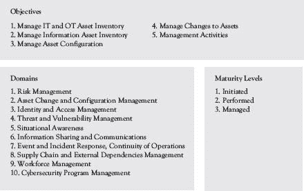

由于日益增长且持续的网络安全威胁以及配套的监管努力，某些组织可能需要在网络安全成熟度模型中获得认证。例如，超过300,000名承包商和分包商与美国国防部合作；大多数承包商需要`CMMC`3级认证才能获得合同资格（Horan 2020, 1; Fox 2021, 2）。与美国能源部工作的承包商很快也需要通过`C2M2`认证（Schwartz 2019, 1）。为了向美国联邦政府销售产品，某些技术制造商必须符合`NIST`标准（Allied Telesis 2021, 1）。因此，预计组织将越来越多地遵守框架及随后的审计；这两个网络安全项目来源正向我们走来！

由于“技能转型革命”，工作的本质正在发生变化，人们技能的有效期正在缩短，需要定期进行技能提升（Skulmoski, Langston, Patching, and Ghanbaripour 2020, 3）。组织报告称，在寻找合格人才方面面临挑战（World Economic Forum 2020, 11）。数字转型导致了普遍的数字技能缺口，使项目经理在实施数字项目时面临困难。

| 模型 | 重点 |
| :--- | :--- |
| 国家标准与技术研究院网络安全框架（`NIST CSF`） | `NIST CSF`于2014年发布，包含五个功能和五个“等级” |
| `C2M2` | 1996年由美国能源部首次发布，具有五个成熟级别 |
| `ES-CM2` | `ES-CM2`专注于能源领域，包含10个领域和五个级别 |
| `ONG-CM2` | `ONG-CM2`专为油气行业设计，具有五个成熟级别 |
| `CCSMM` | `CCSMM`于2006年发布，包含三个领域 |
| `NICE`-能力成熟度模型 | `NICE`-能力成熟度模型建立于2008年 |
| `FFIEC-CMM` | `FFIEC-CMM`有五个成熟级别 |
| `AUMMCS` | `AUMMCS`于2014年引入，包含三个领域 |
| `SSE-CMM` | 2014年发布的`SSE-CMM`包含10个领域 |
| `CSIRT` | `CSIRT`模型具有三个等级和四个类别 |
| `CMMC` | `CMMC`有5个级别、43项能力和171项实践措施 |
| `CERT-RMM` | `CERT-RMM`引导组织评估业务连续性、安全和IT |

寻找合格的网络安全专业人士是所有技术职业中最挑战性的任务之一（Morgan 2019, 4–6）。“简单来说，今天招聘安全专业人员比三或四年前还要困难”（Scholtz 2021, 13）；事实上，网络安全行业被描述为正处于深层次的“危机”中（Oltsik 2020, 5）。网络安全专业人士的失业率为零，自2011年以来一直如此（Morgan 2019, 6）。对网络安全专业人士的高需求吸引了不合格的申请者，其中合格的人数不足四分之一（Morgan 2019, 2）。

加网络安全技能缺口问题的是，网络安全角色正在发生变化，以适应不断的技术和利益相关者的预期（Scholtz 2021, 14）。

缓解网络安全人才短缺的一种策略是将某些网络安全功能委托给业务、公司和其他IT团队（Scholtz 2021, 15）。一种新兴的企业价值观是，由于技术生态系统高度互联且复杂，每个人在网络安全中都自己的责任（Morgan 2019, 2）。

网络安全项目经理的短缺导致了目前强劲的需求，且这种需求在未来将会持续（Oltsik 2020, 36）。与其等待项目经理空缺来领导常规的网络安全项目，不如将网络安全项目经理分配到更具挑战性和关键性的项目中，而将常规的网络安全项目留给非项目经理角色的人员。事实上，一些人建议IT部门为技术人员提供培训，范围涵盖“业务、沟通、领导力和管理技能”（例如，管理项目和倡议）(Oltsik 2020, 45)。

我们的网络安全行业正面临着危机。不仅是因为需要保护的技术越来越多，而且技术也变得日益复杂，导致对网络安全服务的的需求增加（图3.2）。在新的网络安全技术中，技能缺口尤为严峻（Howard 2020, 5）。

此外，还有其他技能缺口的驱动因素，例如组织战略规划不力以及个人职业规划不足。最后，网络安全角色正在从侧重技术转向更广泛的业务伙伴角色，这需要更广泛的技能组合。因此，网络安全技能缺口的驱动因素有很多。

网络安全技能缺口的影响是多方面且深远的。由于网络安全职位未填以及对网络安全服务的的需求增加，分配给网络安全专业人员的工作量非常重，且压力很大（Oltsik 2020, 21）。工作量增加的直接结果是网络安全专业人员难以跟上对新技术的学习，也难以充分利用现有网络安全工具的潜力，从而增加了组织的风险（Oltsik 2020, 37）。网络安全技能缺口持续阻碍着组织的网络安全。

组织有很多方法可以缓解网络安全技能缺口的挑战。由于网络安全专业人员面临着保持专业能力和网络安全知识的持续压力，他们很难找到时间来开发新技能（Claus 2017, 8）。因此，组织可以预见技能短缺，并支持现有人员规划他们的网络安全职业，提供培训和发展机会（Howard 2020, 6; Oltsik 2020, 20）。具有远见的网络安全专业人士将积极利用这些知识，与经理和导师一起规划他们的职业。

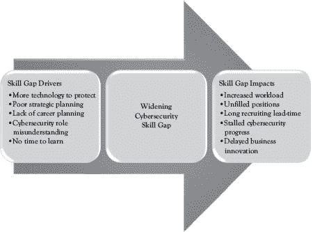

> **机会**：建议组织为技术人员提供更多支持，例如培训和发展机会；因此，请与您的经理或人力资源部门讨论职业发展。他们可能会提供高质量的培训和教育资金，并帮助提供如外派和横向调动等职业路径。你的组织希望你成功！

忙碌的网络安全专业人员在经常进行长时间且高压工作时，往往忽视职业规划，这并不令人意外。相反，网络安全专业人员通常采取非正式且随意的职业管理方法；然而，鼓励网络安全专业人员与转型教练合作，采取系统的方法进行职业规划，并进行整体性发展（Oltsik 2020, 45）。网络安全专业人员往往侧重于战术（Oltsik 2020, 45），并追逐认证以在技术上进行发展。当47%的安全专业人员（样本量N = 327）报告他们渴望成为`CISO`（首席信息安全官）时——这更多是一个业务职位而非技术职位——那么仅专注于开发技术专业知识似乎是反直觉的（Oltsik 2020, 17）。因此，作为持续改进的一部分，网络安全专业人员可以从职业规划以及项目管理等非技术领域的更广泛发展中获益。（参见附录4）

很少组织孤立地提供IT和网络安全服务；也就是说，他们通常遵循最佳实践和框架来提供优质的服务和产品。组织遵循外部框架来指导质量、网络安全和项目交付（参见图4.1）。

所有框架都专注于通过可预测地交付高质量的产品和服务来满足客户，持续质量改进驱动创新；交付和优化是这些框架和标准的共同目标。

什么是质量管理？根据国际标准化组织（`ISO`）9004，通过质量规划、质量保证、控制和持续改进来建立质量政策和流程以实现目标（ISO 2000, 10）。持续改进是为用户提供价值的服务的基础，如果所有项目利益相关者采取持续改进的心态，这种效果将达到最大（Limited, AXELOS 2019, 71）。项目管理包括计划、管理和控制项目及其产品或服务以满足利益相关者的目标的流程（例如，提供价值）。项目质量管理还包括过程持续改进（PMI 2017a, 271）。信息技术基础库（`ITIL`）、`ISO`和项目管理协会（`PMI`）的质量管理指南密切相关；`PMI`侧重于项目背景下的质量管理，而`ISO`质量管理则更通用。因此，这些标准是对齐的，符合其中一个标准就接近符合其他关于质量管理的标准。

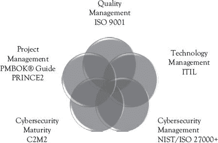

质量管理支撑着与项目管理、服务管理和网络安全服务相关的最佳实践和标准。在规划项目如何管理质量之后，质量管理可以被视为一个三步骤的过程：（a）质量保证、（b）执行工作和（c）质量控制（图4.2）。

质量保证旨在让人们对满足质量要求充满信心。大多数标准（例如`ISO`、`NIST`和`C2M2`）都指导组织包含质量保证和控制活动。组织提供培训、模板、检查清单和流程来交付正确的质量。然后，我们根据检查清单执行工作，例如配置虚拟服务器。工作执行完成后，我们进行质量控制：发现并修复缺陷。同样，我们依赖于培训、模板和检查清单，并遵循流程来确定是否交付了正确的质量。我们对质量管理有一套A-B-C方法：`quality Assurance`（质量保证）、`Before`（之前/准备阶段）、`quality Control`（质量控制）。这种质量管理流程在各行业的领先标准中随处可见；因此，应用这种简单的质量管理方法，你很可能在大多数时间内符合大多数标准中的大多数质量领域。预计监管机构和保险公司会要求对网络安全特别是通用技术进行定期审计。审计可以是质量控制项目的一种（例如，`NIST Framework`审计和合规流程）。领导审计项目有利于开发新的项目管理能力，并增加对技术生态系统的整体理解。

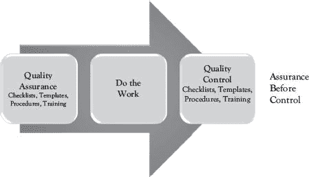

网络安全框架是一系列用于管理网络安全风险的标准、指南和最佳实践。框架可以提高可靠性和可预测性。这里简要介绍了两个领先的网络安全标准，并将它们与项目管理在满足这些标准方面的关键作用联系起来：

> 1. 用于改进关键基础设施网络安全的`NIST Framework`；
> 2. 用于信息安全控制的`ISO 27000 Series`。这些标准被广泛采用，其影响力日益增长。它们包含了从项目到运营的整个策略生命周期，并以持续改进为导向，带来了新项目、新机会和新服务。组织利用框架来识别需要加强的领域或需要实施的新流程。遵循这些框架的组织通过持续改进实践，可能更好地应对日益增长的网络安全项目需求。

备受推崇的改进关键基础设施网络安全的`NIST Framework`旨在保护交通、医疗、能源、食品、水、通信、银行和金融等关键基础设施（National Institute of Standards and Technology 2018, 5）。`NIST Framework`指导关键基础设施的网络安全工作。它可以被任何追求更好网络安全的组织使用：“虽然本文档的制定是为了改进关键基础设施的网络安全风险管理，但该框架可以适用于任何行业或社区的组织。该框架使组织无论规模、网络安全风险程度或网络安全专业水平如何，都能应用风险管理原则和最佳实践来提高安全性和韧性”（National Institute of Standards and Technology 2018, 5）。

网络安全防御的基础是通过五个功能和相关类别来保护组织的资产（见图4.3）。你可能会被要求参与并领导这些领域任何一个领域的项目；网络安全项目的来源是极其广泛的。

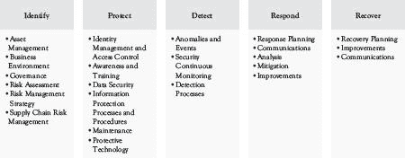

类别揭示了网络安全目标的范围，并由108个子类别支持（请参见附录1框架核心的示例）。在这个功能、类别和子类别的框架内，我们能更好地了解我们目前的处境以及我们组织的改进目标所在。`NIST Framework`包含了实施层，旨在提供通往网络安全成熟度和实现目标的路径（见图4.4，参考National Institute of Standards and Technology 2018, 15–17）。

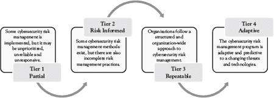

组织使用`NIST Framework`来记录其当前的网络安全概况（见图4.5，参考PMI 2021, 6)），然后启动项目以达到目标配置（例如，针对`Tier 3`，从`Tier 3`进展到`Tier 4`以符合外部机构的指南，通过`NIST`的层级）。

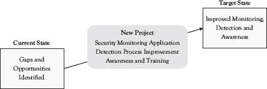

图4.5 通过项目改进网络安全

`NIST Framework`与项目管理对齐，遵循正式的项目管理方法有助于你符合框架。`NIST Framework`包含一个面向项目的章节——建立或改进网络安全计划——使组织达到目标配置（National Institute of Standards and Technology 2018, 21–22）。本书帮助你计划和实施与`NIST`相关的网络安全项目。

`ISO 27000`(ISO 2013b)是一系列用于计划、实施、维护和改进组织信息安全的标准（见图4.6的`ISO 27000`标准概述）。通常，组织最初采用非正式且混乱的方法处理网络安全，然后采用`ISO 27000`等标准来系统地管理信息安全（ISO 2013a, 1–32）。

`ISO 27001`要求被分为114项控制，每项控制解决特定的网络安全风险（例如保护公共网络上的应用服务）。这些控制被分为14个附件/组（从附录5开始），见图4.6。这些控制指导组织改进其网络安全。组织可以在持续改进努力的一部分确定当前和目标配置。

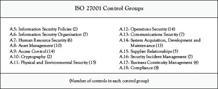

图4.6 ISO信息安全标准

特别值得关注的是控制`A.14系统采购、开发和维护`，因为它包含了项目管理活动，例如：

> A.14.2 开发和支持过程中的安全性：设计中引入网络安全；
> A.14.2.7 外包开发：管理外包项目以确保正确的网络安全质量；
> A.14.2.8 系统安全测试：测试安全功能；
> A.14.2.9 系统验收测试：测试系统是否按照设计构建，包括信息安全测试对对实践的遵循。

本书与该标准中与项目管理相关的控制对齐。因此，遵循这种项目管理方法将帮助你符合`ISO 27001`信息安全管理。

事实上，项目管理是许多网络安全项目的隐含交付载体：“无论项目类型如何，都应在项目管理中解决信息安全问题”（ISO 2018a, 10）。ISO 网络标准中的信息安全与项目管理语言交织在一起，例如“确保信息安全在信息系统的开发生命周期内得到设计和实现”（ISO 2018a, 18）。信息系统经历一个系统生命周期：启动、规范、设计、开发、测试、实施、使用、维护，并最终停止服务和报废（ISO 2018a, vii）。从“启动”到“实施”镜像了项目生命周期，而从“使用”到“处置”则反映了运营。我们在 ISO 标准中既看到了项目生命周期，也看到了运营生命周期。由于项目管理存在于`ISO 27000`信息安全管理标准集中，因此当一个人精通项目管理时，在实施网络安全项目时将更加成功。

`ISO 27000`网络安全标准族是全面的，但缺乏成熟度模型；相反，ISO 网络安全标准可以被视为成熟度模型的最高层——第五级（Leal 2015, 2）。只需对标准进行粗略审查，就能发现传统的瀑布式项目管理深固地嵌入在`ISO 27000`信息安全标准中。使用传统的项目管理交付方法和工具交付网络安全项目将使你的项目与`ISO 27000`网络安全标准保持一致，并提高项目成功的概率。

IT 部门为组织提供 IT 服务，如电子邮件、人力资源应用、生产力应用以及 IT 生态系统的安全保障。IT 领导层建立政策和程序，以指导技术生态系统的生命周期管理。IT 领导层通常依赖外部标准和框架来指导其行动。其承诺是，如果组织遵循某个框架，业务活动可以变得更具预测性和稳定性，同时保持所需的质量水平。组织遵循的重要 IT 框架之一是`ITIL`。虽然存在其他 IT 框架（例如`COBIT`和`ISO IEC 20000`），但`ITIL`可能是最流行且应用广泛的。

它是一个用于交付和管理 IT 服务（如威胁检测、电子邮件和项目管理）的实践框架。`ITIL`提供了一种全面、整体且系统的方法来交付价值、管理风险和质量、实施精益实践，并构建一个支持增长和韧性的可预测且稳定的技术生态系统。`ITIL`可以引导团队实现自动化、改进 IT 服务并将技术整合到业务实践中。`ITIL`交付和管理技术的方式是全球最流行的方式之一（Berger, Shashidhar, and Varol 2020, 1），因此被视为全球事实上的标准（Tsunoda and Kino 2018, 1）。`ITIL`的技术管理方式是*Shields Up*的理论基础，我们在此基础上构建了适用于网络安全项目的混合项目管理方法。

`ITIL`的地位吸引了研究者的兴趣（Berger et al. 2020, 1–6; Göbel and Cronholm 2015, 1–22; Marrone and Kolbe 2011, 363–380; Ramakrishnan 2014, 159–168），并识别出了`ITIL`的以下优势：

* 通过遵循经过证明的最佳实践和流程改进 IT 服务（Göbel and Cronholm 2015, 6）。
* 随着`ITIL`采用的成熟，提升收益实现能力（Marrone and Kolbe 2011, 377）。
* 通过交付满足业务需求的服务提升客户满意度（Marrone, Kiessling, and Kolbe 2010, 381）。
* 提高生产力，例如首访解决率的提升（Marrone et al. 2010, 378; Berger et al. 2020, 1）。
* 通过通用术语改进沟通（Göbel and Cronholm 2015, 6）。
* 提高投资回报率（Marrone et al. 2010, 378）。
* 降低 IT 成本（Göbel and Cronholm 2015, 6）。

`ITIL`被广泛采用并不断增长，部分归于其潜在的收益；事实上，我们看到了诸如“ITIL 基础是今年持有量最多的认证”之类的陈述（Global Knowledge 2021, 22）。即使你的组织尚未正式实施`ITIL`，你可能也在遵循`ITIL`实践（如事件管理），因为`ITIL`实践被最佳实践（Zaydi and Nassereddine 2020, 1; Sliep and Marnewick 2020, 4）。

2019 年发布的`ITIL v4`与之前的版本有重大不同。它重塑了与客户、流程和价值的关系，并拥抱了新的工作方式，如精益管理和敏捷项目管理。`ITIL 4`通过“服务价值链”采取战略性和整体的方法来满足组织需求，为`ITIL`服务的用户交付价值（Limited, AXELOS 2019, 66）。`ITIL 4`关注被称为“服务价值链”的服务整个生命周期。

组织通过考虑`ITIL`服务价值链（图 4.7）开始他们的`ITIL`之旅。价值流是为消费者创建和交付产品服务的流程（Limited, AXELOS 2019, 66）。简单来说，服务价值链流程从机会或需求触发新服务时开始。

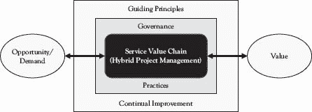

服务价值链活动包括（Limited, AXELOS 2019, 66）：

1. **规划 (Plan)**：对项目范围和四个维度达成共识。
2. **改进 (Improve)**：持续改进跨价值链和四个维度的产品、服务和流程。
3. **参与 (Engage)**：与利益相关者建立良好关系以更好地理解他们的需求。
4. **设计与转换 (Design and transition)**：实施满足利益相关者对质量、成本和上市时间预期的产品和服务。
5. **获取/构建 (Obtain/build)**：在需要的地方和时间提供服务或产品。
6. **交付与支持 (Deliver and support)**：根据协议支持产品和服务。

虽然这些服务价值链活动看起来是顺序的，但规划、持续改进和参与利益相关者的活动贯穿整个服务价值链流程。

这些服务价值链活动发生于服务管理的四个维度背景下，这些维度提供了服务管理的不同视角。服务管理的这些维度需要从微观（项目）级到宏观（组织）级进行规划和管理（Limited, AXELOS 2019, 36）：

* **组织与人员 (Organizations and people)**：服务价值链活动发生在组织环境中，并通过人的努力完成。在规划和执行活动（例如网络安全项目）时，必须考虑组织的治理和通信系统。
* **信息与技术 (Information and technology)**：在规划和交付服务价值链活动时，需要考虑所需的信息、知识和技术。考虑信息、知识和技术维度的可行性和影响以管理和交付服务。信息技术维度是大多数网络安全项目的核心。
* **合作伙伴与供应商 (Partners and suppliers)**：在规划和执行服务价值链活动时，会考虑与其他组织的关系。外包、合作伙伴关系以及与外部专家的其他关系在网络安全项目中很常见，并会在网络安全项目中予以考虑。

组织的价值流和流程是我们为交付用户认可的服务和产品而遵循的活动和流程。在这一维度上，我们被要求变得精益并对变化保持敏锐。

从整体角度管理这些 ITIL 4 维度中的工作，将提高项目的成功率，因为我们并不是孤立地工作；这些维度会影响我们的网络安全项目。在规划网络安全项目时，我们可能会考虑这四个维度——风险、问题、假设和约束。

与其他标准和框架一样，ITIL 4 包含了一些原则，用于指导我们在完成服务价值链中的工作时做出决策和行动。当组织采用这些原则时，它们增加了在交付和服务产品时采用统一方法的机率。这些原则适用于大多数服务价值链活动（Limited, AXELOS 2019, 47–48）：

1. **关注价值**：确保所有活动都能直接或间接地为组织、用户和/或其他利益相关者创造价值。
2. **从现状开始**：将精益思维应用于价值链活动中，在抛弃现有内容并引入新项目之前，先优化现有的产品和服务。我们寻求利用可用资源，通过系统化的衡量、观察和改进流程来减少浪费（精益六格玛方法与这一原则完美契合）。
3. **通过反馈迭代推进**：如果可能，增量地交付服务，而不是一次性交付，以降低风险并提高成功交付预期价值的概率。因此，寻找机会将你的网络安全项目拆分为多个较小的项目（例如第 1 和第 2 阶段）。建立定期的反馈机会以确保价值正在交付。
4. **协作并提高透明度**：我们通过服务价值链交付服务，通常以团队形式进行，协作可以提高参与度、支持、承诺、持久成果、理解、信任和合作。共享透明度也有助于这些积极结果的产生。
5. **整体思考和工作**：当作为完整的服务或产品概念进行交付而非单个组件时，价值就会得到提升。当服务价值系统 (`SVS`)、服务管理的四个维度以及这些原则得到协调和整合时，价值就会增加。整个服务价值流的透明化有助于理解、管理和控制。整体思考和整体工作的原则是良好的网络安全实践。
6. **保持简单实用**：我们力求以最少的步骤完成服务价值链活动。鼓励使用精益思维。
7. **优化与自动化**：我们寻找改进服务价值链的机会，以最大化我们交付的服务和产品的价值。我们越来越多地使用技术、自动化以及精益六格 DMAIC 过程等质量改进方法来指导改进。

这些原则是基础性的，因为它们应该在任何情况下指导组织，即使组织目标、人员、项目类型等发生了变化。ITIL 原则旨在贯穿服务价值链的所有活动（例如项目和运营），来塑造组织文化（Limited, AXELOS 2019, 17–18）。

ITIL 4 包含了代表在服务价值链中创建价值的能力的实践（`Table 4.1`）。ITIL 4 发布了实践指南来为服务管理提供资源；可以将这些实践看作你在服务管理中用于交付价值的工具箱。ITIL 实践可以映射到技术项目中使用的传统项目管理交付方法中，以说明它们之间的关系，包括向生产的过渡 (`T2P`)。

因此，ITIL 4 拥有一个全面且整体的框架，用于管理网络安全项目等技术服务。ITIL 4 支持根据组织、背景和项目对框架进行定制；支持混合项目管理：“ITIL `SVS` 支持许多方法，如敏捷、DevOps 以及传统的流程和项目管理，并具有灵活的以价值为导向的模式”（Limited, AXELOS 2019, 44）。

如果你觉得 ITIL 熟悉，可能是因为 ITIL 与我们在大学和学院课程中学到的系统开发生命周期 (`SDLC`) 保持一致。该周期以过程为基础且是迭代的，旨在交付高质量的系统以支持业务和客户预期，与 ITIL 类似。因此，`SDLC`采取了面向过程的方法，并具有迭代改进周期（`Figure 4.8`）。`SDLC`包含了项目活动（从规划到实施）和运营活动（维护和优化）。

这种传统的系统开发方法也被称为瀑布模型。它经过修改，提供了开发系统的其他替代方法，例如螺旋模型、V 模型、快速应用开发、理性统一过程和敏捷方法（2015, 52）。

| 实践 | 启动 | 计划 | 设计 | 构建 | T2P | 监控 | 结束 | 改进 |
| :--- | :---: | :---: | :---: | :---: | :---: | :---: | :---: | :---: |
| **通用实践** | | | | | | | | |
| 架构管理 | | | | ✓ | | | | |
| 持续改进 | | | | | | ✓ | ✓ | |
| 安全管理 | | | ✓ | | | | | |
| 知识管理 | | | | | | ✓ | | ✓ |
| 测量与报告 | | ✓ | | | | | | |
| 组织变更管理 | | | | | | ✓ | | |
| 组合管理 | ✓ | ✓ | ✓ | ✓ | ✓ | ✓ | ✓ | ✓ |
| 项目管理 | ✓ | ✓ | ✓ | ✓ | ✓ | ✓ | ✓ | ✓ |
| 关系管理 | | ✓ | | | | | | |
| 风险管理 | ✓ | ✓ | ✓ | ✓ | ✓ | ✓ | ✓ | ✓ |
| 服务财务管理 | | ✓ | | | | | | |
| 战略管理 | | ✓ | | | | | | |
| 供应商管理 | | ✓ | | | | | | |
| 人员与人才管理 | | ✓ | | | | | | |
| 可用性管理 | | | | | ✓ | | | |

## 17. 容量与性能管理

## 18. 变更授权

## 19. 事件管理

## 20. IT 资产管理

## 21. 监控与事件管理

## 22. 问题管理

## 23. 发布管理

## 24. 服务目录管理

## 25. 服务配置管理

## 26. 服务连续性管理

## 27. 服务设计

## 28. 服务台

## 29. 服务水平管理

## 30. 服务请求管理

## 31. 服务验证与测试

## 32. 部署管理

## 33. 基础设施与平台管理

## 34. 软件开发与管理

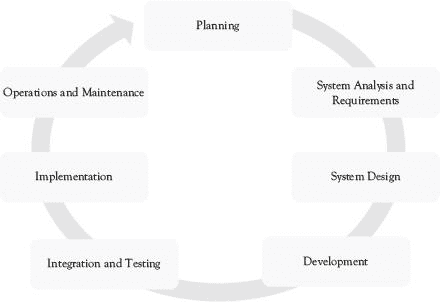

回顾 ITIL 服务价值链，并比较你的组织与该框架的对齐程度。你使用了哪些实践？哪些可以加入你的简历中？

当遵循信息系统生命周期方法时，结果更具预测性，因为利益相关者理解流程中的步骤并可以相应计划。我们鼓励在`SDLC`中构建网络安全，包括威胁建模、设计评审以及环境中的静态和动态测试。顶级网络安全框架（以及 ISO 质量管理）暗示了传统的或预测性的项目管理方法。因此，本书强调传统的项目管理交付方法，以帮助读者交付常规的网络安全项目。

项目管理框架分为两类：针对个人的能力框架和针对组织的成熟度模型。类似于网络安全能力模型，也有项目管理能力模型，例如`PMI`的`项目管理成熟度模型` (`ProMMM`）。由于网络安全专业人员不太可能领导项目管理项目，`ProMMM`超出了本书的范围。相反，我们关注针对个人的项目管理框架（例如《项目管理知识体系指南》（`PMBOK Guide`）和`PRINCE2`），旨在引导他们进行项目管理。

多个项目管理框架可以在从预测性到适应性交付的连续体上解释（图 5.1）。我们可以使用预测性项目管理交付方法，通过进度表、预算和其他工具来计划项目，分阶段预测任务完成情况。这种传统方法有时被称为瀑布式项目管理，因为它是顺序且线性的；在上一个阶段完成之前，新阶段不会开始。大多数专业组织（例如`PMI`和`国际项目管理协会`）都支持预测性的项目管理方法。

然而，随着敏捷项目管理的日益流行，项目管理协会已在他们的标准中接纳了如`Scrum`方法等适应性项目管理方法。当存在以下情况时，敏捷交付方法是合适的：(i) 项目团队交付的产品或服务存在模糊性，或 (ii) 交付方式存在模糊性。复杂模糊的项目可以从适应性交付方法中受益；但此类方法不在本书的范围内，因为 (i) 大多数网络安全项目的模糊性较低（例如安装新软件或进行审计），以及 (ii) 顶级网络安全框架暗示了传统的或预测性的项目管理方法。然而`Shields Up`中的混合项目管理方法在遇到足够的模糊性或复杂性时（例如设计挑战），能够兼顾适应性工作需求。

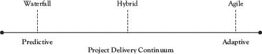

来自 PMI 的《PMBOK® 指南》被广泛认为是事实上的全球项目管理标准。《PMBOK® 指南》第七版包含了《项目管理标准》和《PMBOK 指南》（图 5.2）。第七版与之前的版本有所不同：早版本的《PMBOK® 指南》指导读者如何通过遵循过程（如计划过程）来实施项目。读者会在项目管理过程中（例如在计划过程中制定进度）使用知识领域（例如：进度、成本和质量）中的信息。《PMBOK® 指南》（第 1 至第 6 版）的关注重点是战术性的（如何计划和交付项目），而《PMBOK® 指南》第七版是战略性的（要管理什么）。

《PMBOK® 指南》第七版强调了项目管理原则。原则适用于所有项目，无论项目的类型和复杂性，以及项目经理和赞助人如何。原则是持久且通用的。《PMBOK® 指南》第七版的原则指导着我们在项目中的行为（PMI 2021, 42–43）：

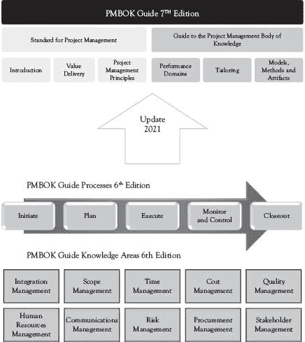

> 1. 管理者责任：做一个勤勉、尊重且关怀的管理者。
> 2. 协作团队：建立协作的项目团队环境。
> 3. 利益相关者：与利益相关者有效互动。
> 4. 价值：关注价值。
> 5. 整体性。
> 11. 适应性与韧性：拥抱适应性和韧性。
> 12. 变革管理：实现变革以实现预期的未来状态。

Shields Up 与第六版的过程和知识领域（例如从战术角度考虑质量和风险管理过程）以及第七版的原则（战略重点）保持一致，这些指导着我们在管理项目时的行为。

> 练习
>
> 这些 PMBOK® 指南原则类似于敏捷宣言和 ITIL 4 原则；花一点时间比较这些原则，发现 IT 行业长期以来一直遵循这些原则来指导我们的工作（参见敏捷项目管理，图 5.4）。思考你如何根据这些原则完成你的工作。这些项目管理原则和其他原则指导了 Shields Up 中混合项目管理方法中的项目交付。哪些原则是你可以优先进一步开发的？

另外两个额外的原则指导着成功的项目经理：带着紧迫感工作和工作前置。如果你曾经想过“我真希望我能再多一天时间来……”，那么这两个其他原则将帮助你准时交付。项目是一天一天变延误的；因此，我们努力在可持续的速度上最大化我们每天完成的工作。我们在成功的项目经理身上看到了这种原则，即行动导向的会议准时开始，且持续时间更短。会议安排在明天而不是下周，以此类推。业务和技术领导不仅会注意到你的紧迫感，还会注意到你的团队。效法紧迫感，这种原则就会渗透到你团队的项目行为中。

减少风险和问题的第二个原则是工作前置：即提前开展工作（在合理的情况下），为未来留出空间以利用机会或管理风险和问题。工作前置不是一个新概念，但已被证明是有效的；我父亲过去说：“不要把今天能做的事推迟到明天。”我们可以提前完成低风险任务，例如设置你的模板（例如：项目章程信息图、设计文档、`PLO` 周期估算工作表、进度、会议纪要、状态报告、`T2P` 跟踪器和测试缺陷记录）以及预订会议室（例如：与团队的周会、风险管理会议和状态会议）。大部分工作可以在精力较低的下班后完成（例如：设置你的团队协作站点）。成功的项目经理通常在项目开始时加班；在项目早期工作长时间比在压力巨大的项目末期工作整个整天和周末要容易得多！做好工作前置，你就不可能希望再多一天一天了。工作前置和带着紧迫感工作使你能够在项目生命周期的早期更早地了解更多关于项目的信息。这两个原则是有效的，并且在项目中会被注意到。将紧迫感、工作前置和《`PMBOK®` 指南》的原则融入到你的实践中，将提高你的项目成功率并激发信心。

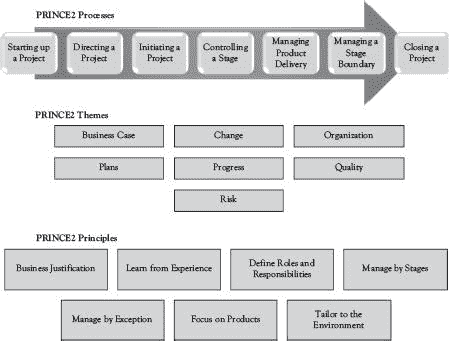

图 5.3 `PRINCE2` 框架

个人可以通过 `AXELOS` 组织获得 `PRINCE2` 认证：`PRINCE2 Foundation` 级或更全面的 `PRINCE2 Practitioner` 级。将 `PRINCE2` 与 `PMBOK®` 指南第六版和第七版比较时，有很多相似之处，例如在原则指导下遵循过程。`PMBOK®` 指南越来越多地包含了敏捷组件，而 `PRINCE2` 方法也扩展包含了 `PRINCE2` 敏捷。`Shields Up` 与这些基于过程的框架和敏捷原则保持一致。

敏捷项目管理对不同的人有不同的含义；业务领域的一些人认为敏捷项目管理是在计划和执行上灵活敏捷。然而，`IT` 专业人士可能将敏捷项目管理等同于 `Scrum` 交付方法（图 5.4）。敏捷项目管理已被广泛研究，其优势和挑战日益被理解（`Azanha, Argoud, de Camargo Junior and Antoniolli 2019, 121–142; Drury, Conboy and Power 2012, 1239–1254; Gemino, Horner Reich, and Serrador 2021, 161–175; Serrador and Pinto 2015, 1040–1051`）。敏捷项目管理在适当的情况下是有效的。当对于 (i) 需要交付什么或 (ii) 如何交付产品或服务存在不确定性时，敏捷项目管理是最佳选择。当我们的项目面临高波动性和不确定性时，我们使用敏捷项目管理（`PMI 2021, 101`）。

`Scrum` 开始于产品所有（项目赞助人）对产品积压列表进行排序，项目团队选择并计划在一个冲刺（例如：通常为两周到一个月）内完成的工作量。在团队计划工作后，项目进入冲刺周期，产品或服务在此进行设计、构建、测试并交付给产品所有。迭代工作和持续改进/学习是敏捷项目管理固有的特征，以适应变化和反馈并交付正确的价值。然后团队回到积压列表开始新的冲刺。

可以将瀑布式项目管理方法叠加到 `Scrum` 方法上（图 5.4），从而发现敏捷方法和瀑布方法在项目工作方面是相似的（例如：计划、设计和构建）。良好的项目管理活动在任何方法中——无论是适应性还是预测性项目管理——都是有效的。因此，项目管理的基础知识可以转移到其他项目管理和管理方法。

敏捷项目工作受《敏捷宣言》（图 5.5）的指导：包括 4 个价值观和 12 条原则（[`AgileManifesto.org`](http://AgileManifesto.org) 2001, 1)）。`Scrum` 项目管理交付方法旨在与《敏捷宣言》结合；如果没有敏捷宣言作为行动和决策的指导，使用 `Scrum` 方法交付项目将具有挑战性。

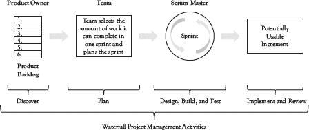

图 5.4 使用 `Scrum` 的敏捷项目管理

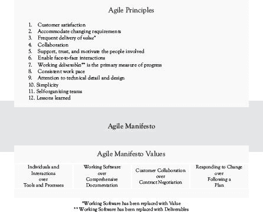

图 5.5 敏捷宣言

使用 `Scrum` 交付方法进行敏捷项目管理也许是开发、交付和维护“复杂项目”最流行的适应性项目管理方法之一（`Schwaber and Sutherland 2017, 3`）。在网上搜索可以让你看到其他适应性/敏捷方法，如看板（`Kanban`）、`DevOps` 和极端编程。

虽然大多数网络安全项目不需要 `Scrum` 敏捷交付方法（例如，它们通常具有较低的模糊度），但 `Shields Up` 混合项目管理方法在与敏捷宣言的原则和价值观结合时效果良好。还有其他与敏捷项目管理相关的项目管理方法可以加入到我们的混合项目管理工具箱中：精益项目管理和精益六西格玛（`Lean Six Sigma`）。

精益运营和管理是媒体和本书中反复出现的主题；我们希望项目中的工作不要超过必要的。精益的核心在于效率：正确地做正确的事。我们努力减少项目中的浪费，并为利益者交付价值。我们包含一个持续改进循环以变得更加精益、更高效。我们实施的许多技术项目日益具有精益目标：例如，我们自动化业务流程以减少客户的步骤。精益原则已应用于项目和信息系统管理，这并不令人感到意外。

以下是增强你的职业发展之旅的一些活动：

> • 搜索“精益运营”和“精益管理”，看看我们的客户在读什么，以及他们通过技术和自动化变得更精益的期望。`IT` 是实现精益的解决方案，而网络安全专家负责保护这些精益解决方案。

> • 关注精益运营或管理博客以掌握业务趋势。

什么是精益项目管理？我们使用项目管理方法来减少浪费、取悦客户并寻找改进机会。精益项目管理有时在敏捷项目管理中被提到，因为两者都是某种新颖且兼容的技术。然而，精益项目管理并不是像敏捷或瀑布那样的另一种项目管理方法。精益项目管理结合了多种方法，通过优化项目资源为赞助人创造价值。

对最佳实践感兴趣的 `IT` 专业人员发现精益六西格玛是与敏捷项目管理相关的改进方法。精益六西格玛将精益管理与六西格玛目标相结合（图 5.6）。精益六西格玛旨在通过减少浪费和提高质量来改进流程：

1. 为赞助人交付最大价值。

2. 改进流程。

3. 减少浪费。

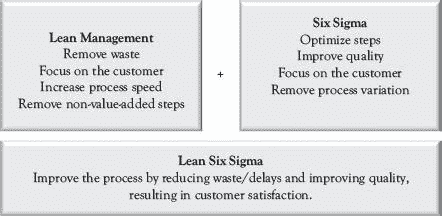

> 图 5.8 列出的这些框架中哪些用于你的组织？在网上搜索任何你不熟悉的框架。

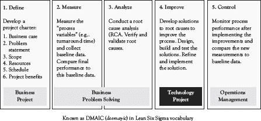

图 5.7 `DMAIC` 循环

项目管理有助于计划和交付成功的项目。多种项目交付方法从预测性（传统）到适应性（敏捷）不等。传统项目管理通常是基于过程的，我们启动项目、计划、设计、构建、交付并结束项目。领先的项目管理标准和框架遵循相似的过程，具有共同的理论（例如：范围、质量和风险管理）。由于项目因行业而异，可以使用混合项目管理方法（图 5.8）来结合不同标准和方法的元素（`Skmoski and Brendolan`，出版中）。

通过混合项目管理方法，项目经理可以在计划和交付网络安全项目方面变得精益。项目经理结合并定制正确的项目管理相关标准、框架、流程和工具，以交付他们的网络安全项目（图 5.8）。

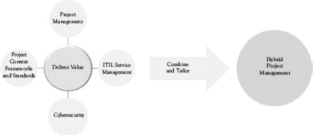

图 5.8 网络安全混合项目管理

`第二部分` 的目的是为计划和实施网络安全项目提供实用指导。这种混合项目管理方法源于理论和标准，已被证明是实施网络安全等技术的最佳实践。其意图是，你对 `Shields Up` 方法的调整也将是精简的，并根据你项目和组织的独特需求量身定制。这种混合项目管理方法与领先的项目管理、`ISO 9001` 质量管理、`ISO 3100` 风险管理、`ITIL` 以及 `NIST` 框架一致，并将帮助你成功实施网络安全和其他技术项目。事实上，交付我们组织所重视的新技术服务取决于整个价值链活动中的有效项目管理（`Limited, AXELOS 2019, 95`）。`Berger` 等人（2020, 5）建议 `ITIL 4` “完全有能力”整合服务管理、风险管理、`ISO 27001` 信息安全管理以及 `NIST` 网络安全框架。人们可以整合关键框架来交付网络安全项目（图 5.8）。

### 混合项目管理

混合项目管理结合了预测性和自适应性过程（`PMI 2021, 100`）。人们使用混合项目管理方法来适应组织环境和项目；人们意识到“没有一把刀切切”。

`PMBOK® 指南`第 7 版强调通过“裁剪”来选择正确的过程、工具、技术和输入来交付项目（`PMI 2021, 131–132`）。人们从宏观到微观的角度，通过质量改进周期进行工作（图 6.1，参考 `PMI 2021, 137`）。

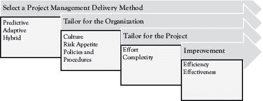

图 6.1 对你的项目进行裁剪

因此，混合项目管理允许项目经理通过裁剪方法，根据组织的需求和项目情况微调项目交付方法（过程、工具、技术和输入，包括人员）。

裁剪过程的第一步是选择一种项目管理方法；大多数网络安全项目可以使用混合项目交付实施（图 6.2）。事实上，`ITIL` 框架是灵活的，允许组织微调`服务价值链` 以满足其项目的独特需求（`Limited, AXELOS 2019, 18`）。大多数项目经理使用传统的项目管理方法，并从领导低模糊性的常规或不复杂的项目开始职业生涯。他们按照预期推进项目阶段，特别是当阶段关由阶段关控制进度时。阶段关（也称为控制关）是领导层可以批准或终止项目的决策点。如果项目经理是项目管理新手，且领导层希望提供引导以帮助新项目经理成功交付项目，那么阶段关将是有益的。如果以下文档获得批准，我们就可以离开设计阶段并进入构建阶段：(i) 应用详细设计，(ii) 基础设施低级设计和 (iii) 集成规范。人们也可以在项目拐点完成项目评审，审查项目状态、项目可行性以及业务案例的持续相关性。

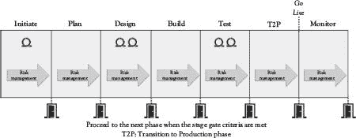

图 6.2 混合项目交付方法

阶段关的一个关键益处是，表现糟糕的项目可以通过重新计划和批准来终止或救援。阶段关广泛用于提高严谨性、治理和质量并降低风险。阶段关易于理解、使用和实施。在你的网络安全项目中包含阶段关，记录你需要交付的内容，包括在监控期结束后终止项目。

如果你的组织缺乏正式的阶段关，你可以与经理和赞助人建立阶段关和成功标准。与`ITIL 服务价值链`一致，项目经理会开发一些里程碑文档，例如完成计划阶段的批准项目计划，或完成测试阶段的测试报告（表 6.1）。与精益项目管理一致，我们尽可能减少项目产生的文档量；随着经验的积累，我们文档的质量将会提高并变得更加精简。

混合项目交付方法在每个项目阶段都包含了风险管理过程（识别、分析、处理和控制）（图 6.2）。风险管理对于交付成功项目至关重要（参见风险管理章节），并是大多数项目管理工作和决策的基础。最后，混合项目交付方法在需要时可以适应迭代（图 6.2）。例如，我们可能会通过迭代来微调项目范围以启动正确的项目。后期，如果我们实施的技术是前沿的，我们可能会经历多次迭代来微调项目范围。同样，当我们测试应用程序时，可能会遇到缺陷，需要多次尝试以找到可行的解决方案。这些迭代取决于团队的目的，可能会或松地遵循 `Scrum` 方法（图 5.4）。

### 表 6.1 阶段关示例

| 阶段关标准 |

| --- |

| 启动 | 业务认可项目（会议纪要） |

| | 提供资金（会议纪要） |

| | 认可可行性（向变更委员会汇报） |

| | 领导层批准继续进行（会议纪要） |

| 计划 | 已完成项目计划工作会（会议纪要） |

| | 预算基准化 |

| | 进度基准化 |

| | 项目计划文档通过批准（链接至纪要、进度和预算） |

| 设计 | 已完成设计工作会（纪要） |

| | 项目设计文档通过批准 |

| 构建 | 已完成构建工作会（会议纪要） |

| | 项目构建文档通过批准 |

| 测试 | 测试策略文档通过批准 |

| | 已完成测试工作会（会议纪要） |

| | 测试报告文档通过批准 |

| `T2P` | 已完成 `T2P` 工作会（会议纪要） |

| | 已完成 `T2P` 清单 |

| | 上线计划通过批准 |

| | 提交变更请求 |

| 结项 | 总结报告通过批准 |

| | 变更委员会批准项目结项 |

| | 项目和团队解散已记录并存档 |

在审查指导 `IT`、网络安全和项目管理活动的框架和标准时，可以注意到它们是基于流程的。它们始于需求或机会，然后完成工作，从而产生价值（图 6.3；详情请参见原始图。你的眼睛没问题！）。它们通过遵循流程将输入转换为输出，为最终用户交付价值来解决需求。项目管理是这些框架和标准中提供价值的交付方法。因此，提升项目管理能力的历程将帮助你在其他框架中取得成功。

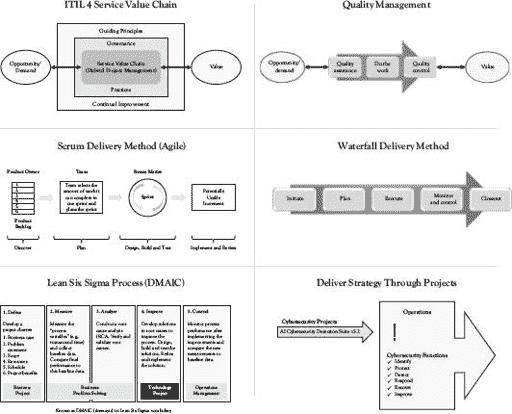

图 6.3 混合项目管理对齐

这些框架和标准始于组织识别通过项目交付的需求或机会。遵循某个流程（若干流程）并交付价值。因此，通过遵循混合项目管理方法，你对齐了这些国际标准和框架中代表的最佳实践和流程。

混合项目管理原则旨在指导大多数项目在大多数时间里的行动和决策，包括网络安全项目（涵盖从技术到非技术项目的整个范围）。这些原则有助于塑造项目文化并对齐团队。在项目管理和技术运营中，我们经常与内部和外部的新团队成员互动。每一次新的互动都为将他们引入我们的文化和运营框架提供了机会，同时我们满足了为服务用户交付价值的需求和机会。因此，作为项目经理，我们在与其他他人合作时，可以成为我们所重视原则的榜样。

原则存在于许多框架中，如 `PMBOK® Guide`、`ITIL`、`PRINCE2` 和《敏捷宣言》。这些原则具有广泛的性，并出现在《`Shields Up`》中详述的混合项目管理中。五个混合项目管理原则包括以下内容：

> 1. 价值导向：我们工作的初是为了交付价值！在网络安全项目中，我们可能会提高保护或响应的能力，这是我们组织重视的。我们采取整体方法交付价值，并倾向于早期且频繁地交付。我们是敏捷的，并欢迎管理的变化。

> 2. 协作：为了交付价值，我们经常与其他协作以满足预期并交付需求。我们的协作通过开放沟通建立信任，从而形成高效团队。

> 3. 风险关注：我们未能交付预期价值或满足需求的关键原因是发生了风险。因此，我们大部分的时间与管理风险以实现我们的计划有关。当我们与他人协作时，我们会正式或非正式地讨论风险，并且所有决策都基于对风险的了解。

> 4. 质量倾向：质量管理可以支持风险管理。例如，我们在工作中设计并了质量保证和控制，以提高整个系统价值链的成功概率。我们利用机会进行反思、学习并优化自身、流程和技术，减少未来的风险。

> 5. 投入型领导力：领导者的行动具有紧迫感，并寻找前置加载任务的机会。他们以客户和价值为中心。投入型领导者重视包容性，并是项目管理的大使。

这些混合项目管理原则适用于项目经理、赞助人、利益相关者以及价值流中的内部和外部团队成员。

混合项目管理允许团队结合各种方法和框架，以根据环境、组织和项目定制他们的交付方法。剪裁和组合允许以一种灵活、主动且以价值为中心的方法，向最终用户交付产品和服务。《`Shields Up`》项目管理遵循了传统的瀑布式交付方法，并带有迭代（敏捷），以利用设计和测试阶段遇到的机会或解决问题（图 6.2）。因此，我们在启动阶段开始项目，即当提议项目以应对某个机会或需求时。

### 启动阶段

混合项目管理项目包含启动阶段（图 6.2）。领导层将决定项目产生的服务或产品（例如在技术生态系统中实施应用程序）是否必要。某些项目可能包含业务计划来证明项目的合理性并概述其收益。随着项目重要性和复杂性的增加，正式程度和流程严谨性也应之增加。一些组织使用项目启动文档（`PID`），包含以下内容：

> 1. 项目范围：项目将交付工作的简要描述；

> 2. 依据：触发项目的业务案例概述；

> 3. 利益相关者：对 (i) 项目团队、(ii) 可以影响项目的人（例如赞助人、监管机构和领导）以及 (iii) 受项目影响的人（例如最终用户）的简要描述；

> 4. 风险与问题：列出严重的风险和问题；

> 5. 项目报告与控制：包括你如何控制项目并报告进度；

> 6. 批准签名：包含批准启动项目的签名。

如果你负责启动项目，可以向项目管理办公室（`PMO`）或领导层获取项目启动指南和内容。`PID` 可以通过制作单页信息图来注入活力。在单页上记录和说明项目信息成为一种强大的沟通工具，供项目中使用和重复，以引导新的利益相关者。重复使用项目资产有助于精益。支持 `PID` 的技术分析是为了确保组织批准正确的项目。高质量的 `PID` 通常是新利益相关者看到的第一个项目文档，也是展示专业能力的早期。

## 技术分析

你可能被要求从网络安全或技术角度评估项目中建议的技术。也许我们的业务合作伙伴进行了精益六格玛研究，流程改进方案是利用 `AI` 自动化来减少其流程步骤。在审查项目建议时，从网络安全角度评估该技术是否合理；例如，如果保护新服务的成本超过了投资回报率，那么利用技术的业务提案可能是不可行的（`Creese et al. 2020, 44`）。你可能与系统架构师讨论项目，以确保建议的项目“符合”系统架构。假设项目建议是一个网络安全项目。在这种情况下，领导层将该网络安全项目如何有助于组织的韧性和增长目标（`Scholtz 2021, 4`）。许多资源可以指导你的技术分析；相反，我们关注在《`Shields Up`》中从项目管理的角度分析技术项目。

> 练习

> • 开发一个良好的 `PID` 模板供后续项目使用。模板是提高质量和变得精益的方法（参见质量管理）。

> • 收集组织使用的项目管理模板以供未来使用，以便快速启动项目。

-   检查你组织已实施的一个项目的业务案例，以理解成功业务案例的内容。

-   什么是系统架构的最佳实践？

-   如何改进系统架构？

-   如何使系统架构保持一致？

选择最佳项目取决于 (i) 已定义需求的质量、(ii) 分析的质量以及 (iii) 对替代项目所能产出的理解程度（`Daniel, Hempel, and Srinivasan 2001, 39–54`）。需求的质量来自项目赞助人（稍后将详细介绍项目需求）。你可以委婉地向项目赞助人就替代项目方案提出挑战：“请帮我理解一下，我是这方面的新手。我们可以尝试这个解决方案吗？”。你可能需要对项目进行分析，而 `Project Feasibility Gizmo`（`Skulmoski 2008, 1–6`）是一种你可以用来深入理解项目的项目分析工具。

`Project Feasibility Gizmo` 是一种结构化方法，根据项目的复杂性和交付项目所需的投入来对提议的项目进行分析。该 `Gizmo` 由项目管理专家（N = 23）在为期三轮的德尔斐项目中开发。项目投入属性代表了交付项目的复杂程度（例如：工作类型、沟通、范围整合，以及项目环境的不确定性和风险）。项目背景复杂性属性是项目外部的，包括外部环境中的约束、不确定性和风险；项目的相对规模；项目关键性以及业务环境（Skulmoski 2008, 2）。人们可以根据项目的复杂性属性和完成项目的预期投入对项目进行评估。通过使用 `Project Feasibility Gizmo`，项目经理可以快速完成一份全面的项目评估，这可以加强对你的项目或你被要求评估的项目的技术分析。（请参见附录 2 获取 `Project Feasibility Gizmo` 及其使用说明。）

在使用 `Gizmo` 完成可行性评估时，你会对项目属性有更深层次的理解，帮助你定制和管理项目。我们首先检查六个影响你的项目并帮助你定制项目的项目复杂性属性：

1. **约束 (Constraints)**：项目经理可能会面临某些约束，这些约束可能会影响你交付的产品或服务的质量，并挑战对预算和进度目标的的达成。

2. **项目相对规模 (Relative project size)**：项目的规模将影响你如何管理项目：较大的项目通常比较小的项目面临更多的治理和更高的正式化要求。

3. **项目关键性 (Project criticality)**：项目是有优先级的，项目关键性的程度与管理你项目所需的治理和正式化程度有关。职业初期的项目经理通常被分配到关键性较低的项目。理解项目对你的赞助人的关键性也有助于提高项目对齐性。

4. **不确定性和风险（外部）（Uncertainty and risk (external))**：所有项目都面临不确定性和风险；它们影响项目以及项目经理组织工作的方式。高度不确定且风险很多的项目更具挑战性，可能需要更大的团队和更正式的管理。即使是不确定性较低、风险较少的项目也可以从正式的风险管理方法中受益——这是项目成功的秘密！

5. **组织环境 (Organizational environment)**：我们不是在真空里管理项目；文化和治理影响我们管理项目的方式。

6. **业务环境 (Business environment)**：我们管理的项目受外部业务环境的影响。例如，与全球团队合作会增加项目的复杂性。

及早理解项目的复杂性可以提高项目成功的概率。通过使用 `Gizmo` 评估每个属性，你会有条理地评估项目复杂性。`Project Feasibility Gizmo` 帮助我们理解项目外部属性的背景复杂性。例如，同一个项目在赫尔辛基的管理方式在阿布扎比或穆斯角（Moose Jaw）可能因为外部项目环境的不同而有所不同。在项目早期了解外部环境允许我们能够在最容易管理时识别风险和问题。

接下来，我们评估交付项目所需的投入。我们使用 `Gizmo` 来检查项目投入属性：

1. **工作类型 (Type of work)**：第一个项目投入属性是我们正在做的工作类型：在河上上造桥、进行 NIST 合规性审计，或添加新的安全事件管理软件。某些项目需要更多且不同类型的投入，项目经理在规划项目时需要理解这些投入。例如，我们是只实现基础功能，还是该项目具有创新性（例如，对技术的早期采用）？无论我们的首批项目是什么，它们可能相对较小、复杂性较低，且对组织的关键性较低，对于偏离批准的项目目标有更大的空间。

2. **沟通 (Communications)**：沟通的性质影响我们的项目以及我们必须管理的风险和问题类型。例如，审计通常涉及从他人那里收集数据，例如我们在项目办公室（PMO）和基础设施团队的同事，他们可能不在我们同一栋楼里，而升级备份工具所需的沟通较少。因此，利益相关者的数量和他们的位置影响我们的项目。

3. **整合范围 (Integration scope)**：需要整合的不同项目元素数量会影响我们的项目投入；要整合的元素越多（例如预算和进度报告、状态报告、外部利益相关者、资源管理和合同管理），成功完成项目所需的投入越大。整合范围可能是使用 `Gizmo` 发现风险和问题的重要来源。

4. **不确定性和风险（内部）（Uncertainty and risk (internal))**：投入的复杂性、工作类型、需要整合的项目元素数量等都会带来项目经理需要管理的风险和问题。复杂性较低、投入较少的项目通常是分配给新项目经理的项目类型。

使用 `Project Feasibility Gizmo` 的结果是项目经理系统地收集了价值的项目信息，用于规划并防止风险演变为问题——这是技术项目的阿喀琉斯之踵。如果存在高于平均水平的不确定性（例如，可能的结果范围），鼓励项目经理与项目赞助人及其领域专家（SME）团队重复此练习。你可能会发现你和赞助人对项目可行性属性的观点非常不同，导致项目初期出现不对齐现象；不对齐并不罕见，通过 `Gizmo` 处理可以达成对齐。

评估你正在考虑的项目或你曾作为团队成员的项目。使用附录 2 中的 `Project Feasibility Assessment Gizmo`。

使用 `Project Feasibility Gizmo` 的一个关键益处是，你可以在项目早期直接解决“能力悖论（Ability to Change Paradox）”，从而提高项目成功的概率。

## 能力悖论 (Ability to Change Paradox)

变更能力的悖论 (图 7.1) 面临所有项目经理，并且如果管理不当，可能会影响项目的成功 (Hartman 1999a, np)。在项目启动时，人们对项目的了解非常少。然而，随着项目的进行，我们掌握的信息量不断增加（例如，我们知道哪些风险变成了问题，哪些项目人员持续准时交付，以及哪些采购延迟是不可避免的）。随着时间的推移，我们进行变更的能力会降低；与后期相比，在项目的第一周增加范围或更改测试方法容易得多（例如，在测试结束时更改设计是非常困难的）。而且，如果我们想进行变更，在项目初期的执行成本要比后期阶段低。因此，在启动和计划阶段，如果我们能利用 `变更能力的悖论` 提供的机会，与正确的利益相关者合作，并遵循混合项目管理流程和原则，我们的分析就可以改变信息曲线。

在项目初期，变更成本最低且最容易实施时，我们缺乏信息；然而，当我们项目后期拥有了更好的信息时，这些变更往往是复杂且昂贵的。

如果在项目后期才发现风险，它们可能会变成问题，导致项目无法成功，出现如错过里程碑、预算超支和质量妥协等问题。我们可以通过移动信息曲线来缓解这个问题：提前引入信息 (图 7.1)，以便在项目更早而不是更增加信息的质量和数量。`项目可行性 Gizmo` 是一个引导项目经理更早地更好地理解项目的工具，从而移动信息曲线。项目经理学习更多关于项目的知识，以制定更好的计划，并有更充足的时间来管理项目风险并避免后期昂贵的变更；这是前端加载（front-end loading）的基础。

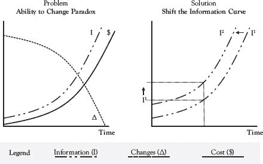

图 7.1 变更能力的悖论

## 启动阶段：结语

在启动阶段，项目经理努力获得正式批准以启动项目。项目经理与项目赞助者合作制定一份 `PID`，赋予项目经理进入计划阶段的权限。`Gizmo` 可能用于对项目进行更深入的理解，以移动信息曲线，从而避免项目后期昂贵的变更。

## 微学习

以下是一些在线学习活动，旨在加深你对启动阶段的理解；请搜索：

> • 如何制作信息图？

> • 项目管理中使用了哪些 `KPIs`？规划和使用项目管理 `KPIs` 以及项目评估标准可以帮助你交付恰当的项目管理质量。

> • ITIL 4 变更控制实践是如何运作的？

检查你的组织：

> • 识别你的组织跟踪和报告的项目管理 `KPIs`。这些是衡量进展的最佳 `KPIs` 吗？

> • 调查你的组织是如何启动项目的。

# 第 8 章

## 计划阶段

计划阶段的目的是制定一份计划，定义并预测项目将如何执行、成本是多少、工作将在何时执行和完成、会遇到哪些风险和问题等。项目经理识别需要完成的工作以及由谁来完成工作。项目经理将制定一份扩展了 `PID` 的计划，可能包括详细的进度表和预算。目标是批准项目计划以退出计划阶段。

### 精益项目计划流程

精益项目计划侧重于减少浪费和满足利益相关者。我们可以遵循精益项目计划流程 (图 8.1) 来快速规划并移动信息曲线，从而产生更好的项目计划。此阶段旨在制定一份精益项目计划供领导层批准。我们通过与项目赞助者会面并开始规划：

> 1\. 任务声明：验证与赞助者合作制定的任务声明（范围声明），使其具有可衡量性和客观性。（例如：在 2023 年 6 月之前完成所有 IT 服务的审计；由于是内部项目，因此没有预算。）

> 2\. 项目优先级：识别项目优先级（优先级三角形，后文将讨论）以实现对齐。

> 3\. 成功标准：记录项目成功标准（Done–Won–Who，后文将讨论），这也有助于对齐。

> 4\. 工作分解结构：使用任务声明来开发一个高层工作分解结构 (`WBS`)，识别出主要的工作包。

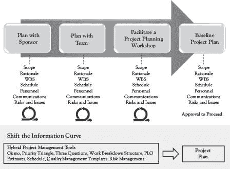

图 8.1 混合项目计划流程

> 5\. 进度：使用 `WBS` 开发一个高层甘特图（条形图），如果你的项目足够大，则开发一个详细说明关键路径和浮时间的进度表。较小的项目通常可以使用任务列表和完成日期来管理。

> 6\. 预算：某些项目不需要预算，因为它们是只需要少量资源的内部项目。然而，某些项目需要大量的外部资源（例如技术知识和新设备）来完成并从项目预算和成本管理。

> 7\. 风险和问题：识别关键风险和问题（我总是包含“我们的可能会失败，但在您的支持下，我们更有可能成功！”以鼓励赞助者的参与）。

> 8\. 治理：约定治理和报告（例如：项目赞助者和其他利益相关者想要哪些信息？是否有每月或每周的状态会议？）。

> 9\. 项目角色和职责：约定项目赞助者和项目经理。

> 10\. 教训：在项目开始时进行教训总结。询问赞助者之前的项目中哪些做得好，哪些具有挑战性，以便你可以在项目开始时从教训中受益。你的赞助者会感谢你愿意将他们的想法纳入项目；你已经开始了有效的团队建设。

接下来，在与项目赞助者规划之后，与 `SMEs` 会面以完成 `WBS` 中识别的工作。我们重复与项目赞助者完成的大工作：审查任务声明和项目优先级（我们可以使用 `PID` 信息图开始规划）。我们检查 `WBS` 以查看是否有遗漏。因此，我们对项目规划采取了迭代且包容的方法，从项目赞助者和关键项目参与者开始。我们制定了一个高层项目计划并在项目计划研讨会 (`PPW`) 上向关键利益相关者展示（参见项目计划研讨会章节）。研讨会上收集额外的反馈，团队认可项目计划。然后将计划提交给领导层批准（例如：项目计划基准化）。

## 微学习

在 Shields Up 中，我们使用许多传统的项目管理工具和流程（例如预算和进度），因为它们有成功的成功历史。因此，我们引导学生在线搜索以提高对核心项目管理工具和流程的理解。你可以在线搜索详细的说明和模板来完成项目计划的以下部分。

* 如何创建甘特图？

* 如何创建项目网络图？

* 如何创建项目预算？

* 如何创建 RACI 矩阵？

* 如何管理版本控制？

* 如何销售任何东西？

* 如何讲述一个好故事？

* 如何进行设计和布局？

由于项目计划的基线制定需要获得团队的信任，你可能将项目生命周期中的任何审批过程视为一次推销活动。因此，我们增加了“如何销售任何东西”和“讲故事”，因为它们是帮助你获得批准继续执行的强大技术。设计和布局考量、图形以及其他创意考虑将使你的项目计划看起来非常专业。你在整个职业生涯中可能都会使用销售、故事、布局和设计技能。

虽然 `Shields Up` 更加侧重于战略，但我们也包含了一些知名度不高但有效的项目管理工具和方法。这些工具帮助我们移动信息曲线，以便在变更困难且成本昂贵时，尽早地了解更多关于项目的信息。

## 优先级三角形 (Priority Triangle)

项目对齐是项目经理努力实现的一个早期目标，因为它有助于转变项目团队的信息曲线。不一致会增加风险和问题，如范围蔓延、延迟和成本超支。然而，当项目团队对齐时，团队可能变得精简，项目成功的可能性也更大。我们看到 `Project Feasibility Gizmo` 有助于移动信息曲线；`Gizmo` 也能对齐项目团队。`Priority Triangle` (Skulmoski and Hartman 2000, 33–37) 是另一种有助于团队对齐和降低风险的项目管理工具。

`Priority Triangle` (图 8.2) 改编自 Martin Barnes 经典的铁三角，也称为三重约束理论（Kerzner 2013, 869）。项目团队受到范围、时间、成本和质量的约束；其中一个约束的改变都会影响其他。例如，如果客户要求增加范围，我们可能会因为交付增加范围所需的额外工作而面临成本增加和进度超支。

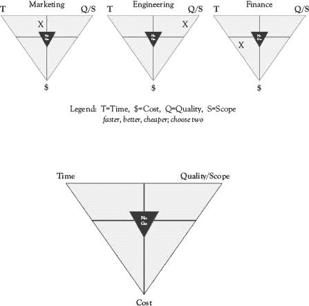

图 8.2 优先级三角形与对齐

在实践中，我们可以使用三重约束理论来帮助识别项目优先级。我们首先开始绘制 `Priority Triangle` (Skulmoski and Hartman 2000, 35)。时间显示在 `Priority Triangle` 的左侧，因为我们希望缩短项目持续时间。成本位于 `Priority Triangle` 的底部，因为我们试图最小化成本。最后，质量和范围位于右侧，因为我们希望优化范围和质量。我们努力最小化交付时间；因此，时间在 `Priority Triangle` 的左侧（早于晚）。我们希望价值最大化；因此，质量和范围在 `Priority Triangle` 的右侧。然而，如果我们要求项目赞助人确定优先级，赞助人可能会选择所有约束为优先级。因此，我们在中间增加了一个 `No-Go zone`（禁止区），以强制项目利益相关者识别出两个核心的项目优先级。

让我们来看看 `Priority Triangle` 的应用。我们的项目是向制造过程中添加协作机器人。我们的 IT 自动化项目有三个主要的利益相关者：市场部、工程部和财务部 (图 8.2)。我们解释了这项练习，市场部在三角形中放置 `X` 表示按时交付是项目优先级，质量和范围是次要优先级。他们的理由是市场部希望开始销售项目将生产的产品。他们还追求高质量，因为高质量的产品更容易销售。工程部优先考虑的是质量，因为高质量的组件更容易维护，且故障频率较低。财务部优先考虑按预算完成，其次是按计划完成。财务部负责实现资源利用最大化，因此支持按照批准的预算完成任务。他们还希望按时完成，以便在协作机器人自动化运行后产生收入。

你可以看到，三个利益相关者在项目优先级上是不一致的 (图 8.2)。我们通过使用 `Priority Triangle` 从项目赞助人处获得项目优先级方向来实现对齐。在这种情况下，让我们假设按时完成并具有正确的质量/范围是赞助人的两个项目优先级。项目经理在预算方面具有活性来交付另外两个优先级。

有些人认为，项目经理创建最重要的文档之一是项目计划，而你很可能被要求为你的项目创建一个计划。计划通常有两种常见的形式：甘特图和网络图（图 8.3 ）。你可能无法轻松地阅读其中的细节；相反，该图示的目的是展示任务宣言、WBS、甘特图和网络图之间的概念关系。甘特图是根据我们的 WBS 导出的条形图。甘特图是通常展示给领导层查看的计划类型，因为它清晰地显示了每个阶段、里程碑以及整个项目完成日期的开始和结束日期。

网络图说明了项目活动的开始和结束、它们的逻辑依赖关系，以及谁负责完成任务。例如，网络图说明了在对服务器进行配置、测试和供应之前必须采购服务器的逻辑。项目团队使用网络图来寻找组织项目最有效的方法。网络图是战术性的，可以在进度计划应用程序中开发。网络图允许进行深入分析，以识别关键路径（通过网络的最长路径）并理解空隙时间（也称为浮动，是指任务在不影响其他依赖任务的情况下可以延迟的时间）。

项目经理与利益相关者合作制定甘特图和网络图。通常，高层甘特图会呈现在项目计划的正文中，以提供进度安排的概览。同时，详细的网络图包含在项目计划的附录中，并附有指向完整项目计划的链接。为了制定这些计划，项目经理向领域专家（SME）提了那个最令他们头疼的问题：“需要多久？”

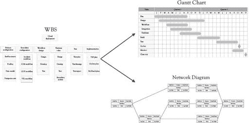

图 8.3 计划制定

### 三点估算法

所有的计划都是根据活动持续时间估算开发的；某些估算是自上而下的，即赞助者给项目经理一个目标完成日期。自上而下的估算可能非常激进，且难以实现。另一种估算方法是自下而上的估算；我们使用 WBS 并估算每个工作包完成所需的时间，将这些时间相加，得出所需的工作量。然后，我们将这些估算应用于网络图，以确定关键路径和空隙时间。

最常见的估算方法是使用单点估算；例如，25 天、$25,000、8 位顾问和 60 小时。项目经理经常询问 SME 完成应用测试需要多久。SME 被要求给出一个数字，例如三周。然而，如果 SME 遇到的缺陷比平均水平多，且某些缺陷的解决时间比平均时间长怎么办？如果来自供应商修复缺陷的技术支持延迟了怎么办？如果测试进展非常顺利，缺陷极少，我们比预期更早完成怎么办？测试 SME 不想给出一个太低或太高的数字，但他们没有方法来传达估算的不确定性。通常，SME 会延迟回复项目经理，因为他们不知道该给出哪个数字。对于复杂、高风险且模糊的项目，从 SME 团队收集估算可能需要几个月的时间。有一种更好的方法：三点估算（也称为 PLO：即完美、可能和离谱情况这三种不确定性状态）。

三点估算源于经典的程序评估评审技术（PERT）进度理论。PERT 提供了一种计算完成项目所需时间的方法。PERT 计算捕捉了三种不同情况下的持续时间估算：(i) 乐观（完成任务的最快时间）、(ii) 悲观（完成任务的最长时间）以及 (iii) 最可能（最大和最小时间之间的时间——发生了一些风险，但你也有运气）。我们使用加权平均公式根据统计数据生成计算估算。

在 *Shields Up* 中，我们应用了由 Francis Hartman 教授开创的改进 PERT 估算技术，被称为 `PLO` 估算（1999b, np）。第一个改进是术语的改变：与其说乐观，我们使用完美；与其说悲观，我们使用离谱。这种方法能更准确地处理不确定性。

一旦我们获取了所有参与的领域专家（SME）的估计值（图 8.5a），我们就可以对结果进行汇总和分析了（图 8.5b）。当我们按项目团队（或 WBS 工作包）汇总 PLO 时，我们可以看到哪些团队面临的风险最大：宽范围估计（图 8.5b）。我们显示的是计算出的估计值而非 PLO，因为读者/审批者可能并不熟悉这项技术。然而，他们很欢迎单点估计；计算出的估计值看起来像单点估计，不会将注意力从你的估计值转移到对某种创新估算技术（PLO 估算）的讨论上。因此，在制定进度时，请使用计算出的持续估计。

使用 PLO 和风险管理过程的好处在于，它们在规划阶段比任何其他技术都能移动信息曲线。我们不仅快速获取了持续估计值，还了解了当我们开始落后于进度时的风险和压缩（crash）机会。很少其他项目工具能像 PLO 估计结合风险管理那样，在项目生命周期早期深化对项目的理解。

### 使用 PLO（三点估计法）具有许多益处，正如前文提到的：

1. **快速估算**：我们看到了单点估计给 SME 带来的挑战，因为单点估计无法容易考虑到不确定性。PLO 提供了三个不确定性条件，使得更容易提供高质量的估计。对于大多数项目，从 SME 那里获取估计仅需半小时。在一周的面对面会议中，项目经理就可以完成第一轮基于风险的估算。向 SME 显示完成的草稿以查看是否遗漏了内容或估计值是否需要修改是常见做法。

2. **风险敏感型估计**：估计值考虑了风险和机会；因此，PLO 估计比大多数单点估计更现实。即使使用单点估计并增加 10% 的备用金，我们可能仍然低估了。例如，可能估计总额为 105 天，而计算出的估计值为 127.2 天（图 8.4）。如果我们使用可能值并加上备用金（`105 + 10.5 = 115.5`），我们仍然比计算估计值少约 12 天。当你在线搜索“IT 项目成功率”并查看准时完成的 IT 项目比例时，你会发现大约一半的 IT 项目是过期的；也就是说，项目比批准的时间更多。也许，如果项目经理遵循三点估计法并在进度中使用计算估计值，这些许多 IT 项目将使用更现实的 PLO 估计准时完成。

3. **识别风险**：通过观察宽范围估计，可以明显看出风险在哪里（图 8.4 和 图 8.5b）。例如，活动 A、C 和 D 在可能估计和极悲估计之间之间范围很宽；如果不妥善管理风险，这三个活动的完成时间可能会比可能估计长得多。我们已经识别了三个高风险活动，项目经理和 SME 可以制定计划来防止和缓解相关风险。我们不仅快速获取了持续估计值，还知道关键风险在哪里以及如何处理它们。如果没有 PLO，单点估计可能会误导我们判断风险所在的位置。例如，在`图 8.4`中，如果被问及哪个活动风险最大，许多人会猜是活动 D，因为它的时长最长（30 天）。然而，活动 A 和 C 是有风险的，但由于它们的持续估计值较低，使用单点估计时可能不会被识别为风险活动。PLO 帮助我们发现并优先考虑风险。

4. **识别机会**：当我们使用 PLO 时，如果进度落后并希望赶回时间，就可以识别出压缩活动的机会。例如，在`图 8.4`中，如果我们需要压缩活动来追赶进度，我们将选择压缩活动 A 和 D（例如，它们在关键路径上），因为完美估计和可能估计之间的范围很大。我们不会优先考虑压缩活动 B、C 和 E，因为通过压缩获得的时间很小。

5. **提高估计质量**：由于估算技术是有条理的，且估计包含了风险和问题，我们的 PLO 估计比单点估计更好。通过 PLO 估计，项目经理理解每个估计值的风险和机会，制定风险和问题管理计划，并将其记录在风险登记中。PLO 估算技术有助于移动信息曲线，从而获得更好的估计质量并提高进度的成功率。

6. **增强专业性**：当你高效地完成估算过程、识别了风险和机会并有一份风险管理计划时，你在同事和领导层中的地位将增强。使用 PLO 方法是一种职业助推，因为通过理解风险、问题和机会并通过风险管理提高项目成功率，你移动了信息曲线。

现在我们有了持续估计，使用这些计算出的估计值来制定进度。我们添加前置和后置逻辑，并为每个任务分配人员。进度计划软件随后可以提供详细详细的基准进度。计算出的持续估计值也用于更新甘特图。进度完成后，我们制定预算。

> 练习：建立一个电子表格模板，按阶段获取多个团队的 PLO 估计，供未来项目使用。

### 项目预算

预算编制的过程与进度制定类似；与其问“需要多久”，不如问“成本多少”，并使用 PLO 估算技术推导出预算估计。正如之前提到的，某些项目不需要预算，因为资源是内部的，不需要外部支出（例如顾问或新硬件）。假设你的项目需要更复杂的方法（例如，你需要确定间接成本和管理费用）。在这种情况下，财务和采购 SME 可以指导你制定符合组织预算程序的预算。

然而，我们可以遵循 WBS 来指导我们的估计并制定项目预算（图 8.6）。我们的 WBS 阐明了项目范围；因此，我们可以利用 WBS 开发一个“自下而上”的预算。WBS 的顶部是预算类别（例如，工作流设计），底部包含活动。我们估计活动的成本并将其“向上汇总”到我们的预算类别中。我们向领导层展示基于类别（高层）的预算，而不是基于预算项目的详细预算。我们可以将高层预算包含在项目计划正文中，如果读者需要更多信息，则在项目计划附录中包含更详细的预算（在进度计划中也可以采用相同的方法，向领导层展示基于 WBS 顶部分的甘特图：从初始配置到实施）。我们使用底部活动作为网络图的基础。）

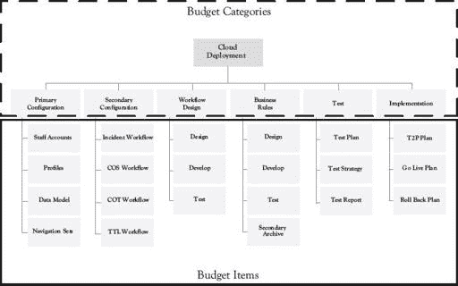

图 8.6 使用 WBS 开发预算

当我们与最有能力提供成本估算的 SME（领域专家）会面时，可以类似于获取进度估算一样获取成本估算。首先审查项目章程、`Priority Triangle`（优先级三角形）和`PLO`估算方法。我们记录完美、可能和极端不确定情况下的估算值。我们将计算出的估值用于详细预算和高层预算。我们通过寻找宽范围估算、识别风险，以及针对预算相关的风险和问题更新风险清单，来完成预算工作。

## 项目沟通

精益化项目管理的方法是同时考虑项目人力资源和沟通管理，因为我们的沟通重点在于人。人力资源管理是领导、协调和管理项目团队，并确定团队角色和职责的过程。项目沟通管理涉及确保正确的人在正确的时间收到正确的项目信息。有效的沟通并非偶然发生；它们需要经过计划、管理和监控。项目沟通有许多形式，如电子邮件、风险清单、进度表、预算、状态报告和应用程序设计文档；其中许多沟通形式是源于项目会议。

项目是协作性工作，通常通过会议来推进执行（参见表 8.1）。会议可以以工作坊的形式进行，用于制定进度、记录设计和测试产品。项目经理根据项目进度安排工作坊。项目经理还会安排定期会议，通过向领导层提交状态报告作为治理角色的一部分来支持沟通流程。在这个每月项目会议计划示例中，重点是每周向项目总监汇报，每月向执行领导层进行项目评审。该计划允许项目经理和团队在周内通过站会规划当天的项目活动。此外还有每周风险管理会议。这些每日站会和风险管理会议有助于项目经理监控和控制项目活动，并将项目状态反馈给领导层。项目经理需要建立类似的会议和沟通计划来支持项目活动。通常，如果会议是面对面的，一个关键挑战是寻找会议室。安排会议计划和预订会议室是可以前置的项目活动；团队喜欢在相同房间内重复的会议，这可以通过早期安排来实现。

### 表 8.1 每月项目会议计划

| 周一 || 周二 || 周三 || 周四 || 周五 |

| --- | --- | --- | --- | --- |

| | | | > 1\. 您有两个项目：项目 1 和项目 2，您通过站会与团队见面   2\. 每周您通过与团队负责人会面，为总监准备状态会议   3\. 团队每周审查风险和问题   4\. 每月您和其他项目经理在执行领导会议上向您的 CIO/CISO 提供状态更新 |

| | | | > 1   项目 1 站会   总监项目评审 |

| | | | > 4   项目 1 站会 |

| | | | > 5   项目 1 站会   项目 2 站会   风险和问题评审 |

| | | | > 6   项目 1 站会   团队负责人准备   状态报告 |

| | | | > 7   项目 1 站会   项目报告 |

| | | | > 8   项目 1 站会   团队负责人准备 |

| | | | > 9   项目 1 站会   总监项目评审 |

| | | | > 10   项目 1 站会   总监项目评审 |

| | | | > 11   项目 1 站会 |

| | | | > 12   项目 1 站会   项目 2 站会   风险和问题 |

| | | | > 13   项目 1 站会   团队负责人准备 |

| | | | > 14   项目 1 站会   状态报告 |

| | | | > 15   项目 1 站会   项目经理 |

| | | | > 16   项目 1 站会   总监项目评审 |

| | | | > 17   项目 1 站会 |

| | | | > 18   项目 1 站会 |

| | | | > 19   项目 1 站会   项目 2 站会   风险和问题 |

| | | | > 20   项目 1 站会   团队负责人准备 |

| | | | > 21   项目 1 站会   状态报告 |

| | | | > 22   项目 1 站会   项目经理 |

| | | | > 23   项目 1 站会   总监项目评审 |

| | | | > 24   项目 1 站会 |

| | | | > 25   项目 1 站会   项目 2 站会   风险和问题 |

| | | | > 26   项目 1 站会   团队负责人准备 |

| | | | > 27   项目 1 站会   状态报告 |

| | | | > 28   项目 1 站会   项目经理 |

| | | | > 29   项目 1 站会   总监项目评审 |

与领导层讨论他们在状态报告中所需的信息。如果状态报告与项目优先级及相关问题一致，则可以改进。许多项目经理制定 RACI 表（有时称为责任矩阵），通过明确关键任务和里程碑的角色和职责来帮助沟通（参见表 8.2）。缺乏 RACI 表的项目的角色混乱和遗漏人员的风险。项目经理为项目参与者分配角色以改进沟通：

- **执行者 (Responsible)**：完成任务的人。虽然可以分配多个人完成任务，但过多的 R 会导致拥堵并延迟活动（例如，“厨多容易生汤”）。

- **负责人 (Accountable)**：负责授权和监督任务完成的人员（任务所有者），但可能不直接执行工作。每个任务和里程碑应只有一名负责人。负责人通常批准由执行者 SME 完成的工作。

- **咨询者 (Consulted)**：可能提供专家建议的人（双向沟通）。项目经理试图平衡需要咨询的人，因为过多的 C 会延迟项目。

- **知情者 (Informed)**：需要了解活动进展但未直接参与工作的人；他们获得的是高层信息而非详细的项目信息（单向沟通）。

项目经理将分析 RACI 表，以确保没有空单元，且没有 SME 工作负担过重（过多的 R）。项目经理将与团队讨论分配的角色以获得他们的认可。一旦 RACI 表完成高层制定，计划即告完成。

### 表 8.2 RACI 表

| 任务/里程碑 | 项目经理 | 项目赞助者 | SME #1 | SME #2 | SME #3 |

| --- | --- | --- | --- | --- | --- |

| 活动 A | A | I | R | C | I |

| 里程 1 | A | C | C | R | I |

| 活动 B | A | I | R | I | C |

| 里程 2 | A | C | I | C | R |

风险管理是技术项目成功的关键因素，也是一项推荐的 ITIL 通用管理实践（有限，`AXELOS 2019`，95–97）；做好风险管理，项目成功的概率将呈指数级增长。Shields Up 中的风险管理与`ISO 31000:2018 风险管理—准则`（`ISO 2018b`）一致；因此，当你遵循 Shields Up 中的风险管理时，你同时也符合`ISO 27000 风险管理`。精益风险管理专注于由风险清单支持的风险管理过程、质量管理以及可以在大多数项目、在大多数时间内使用的简单技术。风险管理是计划、识别、分析、处理和控制风险及问题的过程。风险和问题可能是负面的（例如，延迟），也可能是正面的（例如，缩短活动的机会），并可以通过风险管理过程和风险清单进行管理。

## 风险管理过程

风险管理过程（图 8.7）简单且有效；你可以在大多数项目、在大多数时间使用这种方法。所有项目计划都应该包含关于风险和问题管理的章节。项目经理应提供有关如何管理和沟通风险与问题的概述、所使用的工具和流程等。例如，项目经理可能会安排每周风险管理会议（表 8.1）来审查风险清单，并在状态报告中包含风险和问题。风险管理过程是一个循步就进的方法。一旦识别出风险，就会对其进行定性分析（高、中、或低），然后进行处理（风险预防和行动），最后在风险清单中记录该风险。ITIL 和项目管理标准（例如`PMBOK® Guide`和`PRINCE2`）具有共同的目标，并且天然是一致的。遵循风险管理过程符合国际标准，并极大提高了项目成功的概率。风险管理过程出现在 图 8.7 中，项目团队在整个项目阶段都使用风险管理。

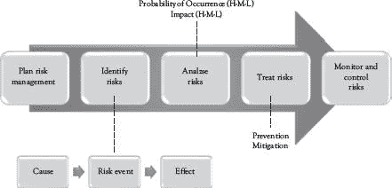

图 8.7 风险管理过程

项目经理和团队遵循风险管理过程并识别风险。风险识别包括风险原因、事件和影响（表 8.3），并按照风险语法进行记录。重要的概念是，风险事件的词汇应传达风险可能发生也可能不发生的确定性；例如，我们使用`may`、`could`和`might`等词风险风险尚未发生但可能发生。当使用正确的风险语法时，理解力会提高，风险沟通也会减少。因此，当我们识别出一个风险时，我们将风险构建为风险原因、事件和影响，以有助于高效的分析和处理。

## 风险管理框架和语法

表 8.3 风险管理框架和语法

| 元素 | 描述 | 语法 | 分析 | 处理 |

| --- | --- | --- | --- | --- |

| `Risk cause` | `风险由于某种原因或理由产生` | `由于制造延迟` | `风险发生的概率` | `可以防止风险的行动` |

| `Risk event` | `可能发生的事情` | `may, could, might` | — | `可以减轻风险的行动` |

| `Risk effect` | `风险的后果` | `will, has` | — | `可以响应风险的行动` |

当我们识别出一个风险时，我们将风险构建为风险原因、事件和影响，以有助于高效的分析和处理。

一些项目受益于风险管理研讨会：关键项目利益相关者聚在一起会持续约两个小时，以识别、分析和处理项目风险与问题。首先，描述你针对项目的风险管理计划，并概述风险管理理论。使用黄色便利贴，并指示参与者在便利贴上画水平线和垂直线，以代表风险管理的不同元素（例如：原因、事件、影响概率、影响、预防和缓解）。共同识别前几个风险，并向参与者展示如何在黄色便利贴上填写风险信息（图 8.8）。然后，让参与者识别一些风险。这种通用方法允许参与者提出任何风险，旨在让他们共同工作并应用风险管理理论。参与者将他们的风险贴在墙上供大家查看（在线思维导图工具等协作软件可以方便在线风险研讨会）。当参与者写下风险时，他们积极为项目做出了贡献，并发生了团队建设。

随后，我们可以采取专注的方法，系统地检查与里程碑、关键路径、预算、阶段、采购流程、上线阶段等相关的风险。例如，检查关键路径上的每项活动，以识别、分析和处理风险与问题。我们可以重复风险管理过程来检查主要里程碑、进度、预算等。通过关注特定类别的风险，我们实现了全面性，并显著改变了信息曲线。

一旦识别出风险，我们就可以风险矩阵对它们进行优先级排序（图 8.9）。我们根据严重程度（`概率 × 影响`）对风险进行排序，根据影响对问题排序（我们不评估问题的发生概率，因为问题已经存在）。例如，高概率/高影响风险应该是团队的重点，因为该风险发生的概率很高，且一旦发生，对项目的影响巨大。然后我们可以对风险进行排序，告知领导层严重风险，并实施我们的处理计划以预防和缓解。风险注册表说明了风险管理工作，并成为一份应与其他项目文档一同保存的历史记录（风险和问题注册表可用于争议和诉讼）。

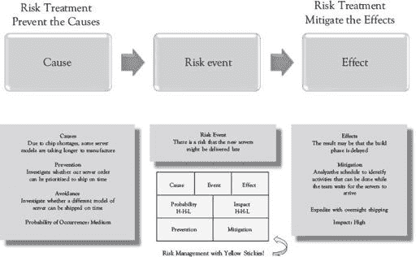

图 8.8 风险识别、分析与处理

我们从图 8.9 中也看到我们在黄色便利贴上对自然三元组：原因–发生概率–预防属于同一类，结果–影响–缓解属于同一类。黄色便利贴和风险管理研讨会可以是强大的工具，能够快速识别和理解风险，并促进团队建设以改变所有人的信息曲线。

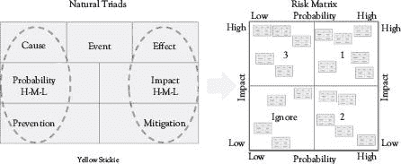

图 8.9 风险矩阵

风险管理是我们项目中执行的最重要活动之一。尽管我们有预算和进度，但技术项目交付延迟或超支的比例仍然很高。为什么？风险变成了问题，导致了延迟和过度支出。这些项目经理本认为他们有合适的预算和进度，但仍然超支并延迟交付；他们失败的关键在于风险管理可能没有达到必要的效果。因此，为了显著提高项目成功的概率，我们需要在管理风险和问题方面变得有效高效，这是我们在追求交付价值时使用的混合项目管理的核心。

### 练习

> 思考你的组织或其他你工作过的其他组织：

> • 你的部门如何管理和报告风险与问题？

> • 你的组织是否使用`Monte Carlo Simulation`来帮助分析风险？

> • 你所在的行业中 IT 项目的成功率是多少？

> • 复习`ISO 27005 Risk Management Process`以加深对信息安全风险管理的理解。

## 微学习

投资风险管理技能是非常值得的，因为我们在网络安全生态系统中做的一切都涉及风险。因此，以下微学习机会可以扩展你对这一重要主题——项目风险管理的理解。可以在网上查找更多相关信息：

> • 风险管理定义

> • 风险、问题和不确定性的定义

> • 风险管理策略

> • 风险管理计划

> • 风险管理模板

> • 风险管理工具

> • 风险管理矩阵

> • `ISO 31000:2018 Risk Management—Guidelines`
>
> • 风险管理与 AI
>
> • `Monte Carlo Simulation` 以及
>
> • 风险管理策略

### 质量管理

质量管理包含了我们用于确保项目交付预期价值的工具和过程，这些价值在项目启动时已记录在质量计划中。我们使用培训、模板和清单帮助管理质量以及其他过程（如规划），并通过阶段关卡等工具来验证产出正确的质量。

Shields Up 使用两种质量管理过程：质量保证和质量控制（图 4.2）。我们在开展活动之前进行质量保证，以确保活动执行正确。我们可以遵循清单、程序、流程或模板，提高工作按正确质量水平完成的概率。培训也补充了质量保证；例如，团队成员学习使用`risk register`一致地记录风险和问题。或者我们按照配置说明来设置服务器。质量控制在工作完成后对其进行检查；我们发现并修复缺陷。同样，清单、模板、程序和培训可以指导质量控制活动以发现并修复缺陷。例如，我们遵循测试脚本来验证构建是否按照批准的设计运行。因此，我们使用质量保证和控制在项目中交付正确数量的价值：质量保证优于质量控制：ABC。

我们的混合项目管理方法侧重于第一次就正确完成工作；我们可以通过质量管理和风险管理提高项目成功的概率（`Done–Won–Who`）。我们倾向于质量保证而非质量控制；执行产生极少缺陷的工作，比比作为质量控制努力的一部分去发现并修复缺陷要好。带有模板和清单的质量保证引导我们的工作在第一次就正确完成。风险管理（例如预防活动）有助于确保工作被正确完成。

我们使用治理技术来帮助确保高质量；例如，我们采用传统的项目管理交付方法构建项目，并在每个阶段结束时设置阶段关卡以验证质量。如果团队完成了高质量的设计，利益相关者将批准设计并进入下一阶段。风险和质量管理是混合项目管理方法固有的，如图 6.2 所示。你可以看到风险管理过程发生在每个阶段，阶段关卡充当了质量控制机制。我们遵循结构化的模板（例如`application detailed design`），以保持内容精简并引导内容开发。

到目前为止，我们已经与赞助人和相关领域专家（SME）进行了小组会面和规划。我们的目标是制定一份项目计划，提交给项目赞助人和领导层审批，以继续开展项目并结束规划阶段。我们使用了`项目章程/PID`（项目优先级、范围、理由、范围外内容、`WBS`、`Gantt chart`等）来引导和对齐我们的项目团队。我们对风险和问题有了良好的理解，并在风险登记册中记录了这些风险和问题，我们的项目计划反映了风险和问题管理的基础。一旦有了高层计划，我们就会安排第一次全体会议，在项目计划工作讨会（`PPW`）中“认可”我们的项目计划。

# 项目计划工作讨会

当项目计划获得批准（也称为基线项目计划）时，我们退出规划阶段并进入设计阶段。项目计划的内容根据项目的复杂性和重要性、批准项目计划的读者以及项目经理的声誉而异。交付复杂关键项目的新项目经理可能需要制定更全面的计划。

`PPW` 汇集了相关利益相关者和项目赞助人。在提交给领导层正式批准之前，会展示高层计划以获得他们的认可（图 8.1）。

1. **背景**：首先欢迎 `PPW` 参与者参加工作讨会，并对工作讨会进行概述以认可项目计划。你可以解释交付方法（例如预测型）和治理阶段门。

2. **范围**：确认项目范围、`WBS`、理由和范围外的事目。可以总结三个问题（`Done–Won–Who`）的结果，并使用 `Priority Triangle` 展示已获批准的项目优先级。询问是否遗漏了任何关键利益相关者。某些人使用信息图形式的项目章程来对齐利益相关者。

3. **进度**：接下来展示项目进度。目标是获得利益相关者的承诺，按照进度为项目做出贡献。展示高层 `Gantt chart` 让工作讨会人员了解项目时间线，并查看是否需要修订。接下来，展示说明进度逻辑和关键路径的高层网络图。项目经理将讨论需要广泛参与的关键活动（例如设计工作讨会、用户验收测试和培训），并传达如果参与不足，项目可能会延迟。当项目参与者需要完成运营任务时，让他们参加设计工作讨会、培训和测试活动是一项长期的风险，特别是当这些工作被跟踪到服务水平协议时（例如故障解决时间）。因此，设定一种预期——即没有他们的协助项目可能会失败——是有益的。同样，我们欢迎利益相关者的反馈。

4. **预算**：展示高层项目预算以供评审。然而，预算在某些项目和组织中是敏感的，不会在 `PPW` 中展示。（如果尚未完成，你的财务和采购同事可以协助你进行采购[例如，供应商选择]的）。

5. **人员**：展示项目沟通和资源管理。有效的沟通将与项目里程碑、阶段和项目优先级保持对齐。我们通过会议纪要和状态报告进行沟通。我们使用模板来指导内容开发（例如进度和预算）以共享项目信息。可以使用 `RACI chart`，但对项目来说可能太详细了。

6. **风险和问题**：最后，展示主要的风险和问题。重点是预防和缓解。我们描述如何使用风险登记册和状态报告。

7. **后续步骤**：我们通过后续步骤结束会议：项目经理更新计划并安排与审批者的会议。

`PPW` 是一个早期里程碑，在此时会展示项目计划。向他人展示项目计划可能会令人压力；然而，系统化的方法会让你处于良好位置。会议中存在共同风险，讨论可能会偏离主题并将会议带向意外的方向。保持会议不偏轨的一种技术是设置流程图来“搁置”范围外的重要事项。通过项目反馈，对设计、内容和信息传递的关注将产生未来的回报。

# 项目变更管理

我们使用项目变更流程(2)（图 8.10)批准项目计划并在之后批准变更。变更管理是 ITIL 服务管理的基础，体现在变更启用（Limited, AXELOS 2019, 112–115）和组织变更实践（Limited, AXELOS 2019, 90–91）中。使用管理流程管理项目变更是最佳实践。

变更管理流程始于对新项目的请求或对现有项目的更改（例如更改进度）。项目经理分析请求的变更（例如评估可行性以及对项目和计划的影响）或制定项目计划。然后，项目经理向决策者提交变更或项目计划。如果变更或计划被拒绝，项目经理通知请求者。如果获得批准，项目经理实施变更。流程图中未显示审批者要求更多信息或请求变更并导致项目经理进入迭代循环。这些迭代可能会浪费时间；因此，我们希望避免迭代，并在首次提交变更或计划时获得批准。

在项目经理制定项目计划期间，他定期更新审批者，因此他们的投入也会指导项目计划的制定。因此，当项目计划被项目贡献者（例如 SME）认可时，审批者已经熟悉该计划。在审批者将批准或拒绝项目计划的变更控制会议之前，项目经理会与委员会审批者正式预览高层计划，并在时进行修订。结果是审批者将在变更控制会议上批准项目计划，你将避免修订迭代。

为了提高变更控制过程的成功率，尝试理解你的受众的期望；审批者想要什么？我们可以讲述这样一个故事：项目计划是与利益相关者共同制定并获得认可的。审批者对关键风险、问题以及你的处理计划感兴趣。他们想知道你如何在整个项目期间让他们知晓进展。因此，你可以通过协作、在风险管理的基础上制定项目计划，并遵循混合项目管理方法来增加获得批准的概率。某些组织遵循“审批链”，从业务/赞助人的审批开始，以高级 IT 领导的审批结束。其逻辑是让业务代表首先批准项目计划；一旦他们批准，IT 部门就会批准。项目计划获得批准后，归档提供你继续执行的会议纪要。

## 无处不在的网络安全规划

将网络安全构建到项目中是一种良好的做法，而不是在项目准备上线时才添加网络安全。有很多资源可以指导包含网络安全的项目规划，包括`ISO 27002`信息技术-安全技术-信息安全控制实践规范（`ISO 2018a`, `1–90`）：

> 1. 确保开发环境和测试环境是安全的。
>
> 2. 在设计中添加安全需求。
>
> 3. 在里程碑中包含安全。

系统性的项目规划可以转变信息曲线，提高网络安全项目的成功概率。

## 计划阶段：结语

项目规划是项目的一个基础部分，对成功至关重要。当人们评估项目失败的根本原因时，规划和风险管理不足以及测试不当经常被提及。因此，请为项目规划留充足的时间。遵循集成且精益的规划过程可以增加项目成功的概率。我们的目标是尽早了解更多项目，以避免项目后期出现昂贵的变更。我们可以通过 `Project Management Gizmo`、`Priority Triangle`、`Done–Won–Who` 和 `PLOs` 等项目规划工具来转变信息曲线。这些工具揭示了风险和问题等基本信息；遵循风险管理过程可以将风险和问题纳入控制范围。

我们应用重用模板等质量保证和控制技术来降低风险。我们在安全方面进行规划和设计，以便我们交付的技术更有可能符合我们的技术生态系统。我们需要传达的一个信息是，我们的项目可能会失败。然而，通过利益相关者、赞助人和领导层的参与，我们更有可能成功。最后，我们将项目计划封装成一份带有品牌标识、吸引人的布局和设计的专业报告。全面且具有吸引力的设计让读者确信他们选择了正确的项目经理。

## 微学习

项目规划是一项随着使用而提高的技能。以下主题可以提高你对项目管理的理解和应用，并提高项目成功的概率。在网上搜索以下主题以深对项目规划的理解：

> • 如何制定项目沟通计划？
>
> • 如何使用风险登记册？
>
> • 搜索“项目规划模板”。
>
> • 搜索“项目规划软件”。

我领导过一个项目，欧洲供应商在 12 月和 1 月关闭了办公室，因为他公司 75% 的人员（总共 18 人）患了流感。老板照顾他的团队并关闭了公司一个月来帮助大家恢复。我们的供应商在 1 月中回到项目，我们的项目延迟了三周。我们使用变更控制过程重新制定了项目进度表。

带有“泳道”的跨部门流程图是说明流程和任务所有权的有效方法。我们在精益六西格玛流程优化项目中使用跨部门流程图来记录现状及其“痛点”。我们通过优化来重绘流程，以说明步骤和痛点的减少。使用跨部门流程图绘制流程对于项目参与者来说是一项实用技能。

## 第 9 章

### 设计阶段

项目的启动是为了交付产品或服务。设计阶段是根据用户需求为产品或服务开发设计。技术项目通常有多个设计文档，例如应用程序详细设计、低级基础设施设计和集成设计。目标是记录与产品或服务用户共同开发的设计，然后批准该设计。因此，终端用户和技术团队共同工作开发一个提交审批的设计。某些组织设有业务分析师协助设计活动以及需求引导和文档编制。一旦设计获得批准，项目团队将移动到下一个阶段，技术团队将根据批准的设计来构建产品或服务。系统分析和设计是高等教育水平信息系统课程的核心课题，超出了我们项目管理的视角范围。然而，项目经理负责设计阶段，并应该熟悉系统分析和设计的基础。

## 设计阶段最佳实践

`ITIL 4` 为设计服务提供了详细的指导，并引导读者采取整体设计方法。质量、风险和项目管理共同促成了令终端用户愉悦的设计。然而，如果不遵循这种整体方法，则可能无法交付全部价值（`Limited, AXELOS 2019, 34`）。还可以通过设计思维技术（`Defossez, McMillan, and Vuppala 2020`, `4`）和精益六西格玛方法来优化流程。例如，我们可以通过设计网络安全功能来改进设计，而不是在过渡生产环境阶段后期才考虑网络安全。

项目团队需要考虑整个项目中的风险，并受 `ITIL` 风险管理实践指导（`Limited, AXELOS 2019`, `95–97`）。将风险管理应用于设计的示例是应用网络安全黄金法则：不要构建你无法充分保护的东西（`Skilton and Hovsepian 2018`, `207`）。我们还被提醒，如果没有彻底的项目计划且不遵循良好的设计实践，我们可能会失败（`Limited, AXELOS 2019`, `132–134`）。如果你正确地设计并遵循精益方法实施设计，你更有可能优化价值。

记录项目需求和设计的常用方法是举办一系列设计研讨会与最终用户会。其基本流程是在研讨会环境中与利益相关者会以获取设计意图，在设计文档（或多个）中记录所需的设计，然后批准该设计。一旦获得批准，设计阶段即结束，进入构建阶段。一个常见的风险是研讨会可能无法全员出席，导致批准并构建了一个有缺陷或不完整的设计。在测试期间，用户将告知技术团队该设计是有“缺陷”的。因此，需要防止和缓解研讨会出席率低的问题。一种预防措施是邀请经理参加研讨会。他们的出席传达了研讨会的重要性。如果老板参加，员工更有可能参加研讨会。一种缓解行动是针对可能错过设计研讨会的关键领域专家（SME）重复研讨会。虽然重复研讨会可能会消耗大量资源，但为了按照进度进行，考虑到关键 SME 的输入而增加额外的研讨会有时是不可避免的。

项目经理可以使用 PMO（项目管理办公室）的设计模板来记录设计。模板是质量保证辅助工具，用于快速开发设计文档。（如果您的组织没有自己的模板，可以在网上找到符合 ITIL 标准的设计模板和研讨会程。）设计文档需要像项目计划一样被批准。我们可以采取与规划阶段相似的批准方法。我们告知批准者我们的进度，听取他们的意见，整合他们的反馈，然后将设计文档发给批准者进行审批。一旦设计文档通过批准，设计阶段结束。技术团队开始根据设计文档中的规范构建产品或服务，进入构建阶段。

## 设计阶段：结语

设计阶段产生一个可以构建和测试并符合最终用户预期的设计。价值是在设计研讨会上与最终用户共同。业务分析师专长阐述和记录设计、需求、报告和其他元素。我们的目标是从项目管理的角度出发，产生一个准确反映最终用户和赞助者预期的设计。项目经理安排一系列设计研讨会，并邀请不同的团队成员完成各种设计，如详细的应用设计、集成设计和低级基础设施设计。存在一个潜在的高影响风险，由于其他优先事项，并非所有要求的 SME 都能参加计划中的研讨会。因此，可以通过安排额外的研讨会来缓解代表性缺失。一旦记录了设计，就会将其发给 SME 收集反馈。反馈将用于更新设计文档并分发进行审批。

## 微学习

关键工作在设计阶段完成，且在改进设计方面已有许多进展。在在线搜索之前，请查看第 7 章中“技术分析”部分中的微学习活动，因为它们可能与设计阶段的活动有关。在网上搜索：

> • 系统分析和设计的步骤有哪些？
>
> • ITIL 是如何工作的？
>
> • ITIL 3 服务设计是如何工作的？
>
> • 什么是服务目录管理？容量管理？可用性管理？服务连续性管理？等等。
>
> • ITIL 4 业务分析实践是如何工作的？
>
> • 什么是设计思维？
>
> • 什么是业务流程设计？
>
> • 什么是设计研讨会程程？
>
> • 我们如何记录设计？
>
> • “ITIL 服务设计模板”

## 第 10 章

### 构建阶段

构建阶段的重点是遵循设计文档中的需求并构建产品或服务。构建是一项技术工作，除了根据进度跟踪和控制进度外，它通常要求项目经理提供少量的概述。ITIL 服务价值系统指导构建阶段，项目团队作为一个系统协作，为用户构建服务（Limited, AXELOS 2019, 17–18）。某些组织会在“竣工”文档中记录构建情况。一旦产品或服务构建完成，并且满足了构建阶段的关口标准，项目将进入测试阶段。

## 微学习

以下是一些增强你对构建阶段理解的练习：

> • 竣工文档是如何运作的？
>
> • 竣工文档的最佳实践是什么？
>
> • 搜索“构建阶段模板”。

# 第 11 章

### 测试阶段

现在产品或服务已经构建完成，我们移动到测试阶段并计划测试（图 6.2）。测试是一项质量控制活动：发现并修复缺陷。我们很幸运拥有来自质量、服务和项目管理专业的持续且广泛的指导来应用于测试活动。（NIST 网络安全框架侧重于运营，网络安全项目期间的测试未直接涉及。）例如，ISO 9001:2000 质量管理标准指导用户如何交付产品和服务：“在产品实现过程中，组织应确定以下内容：…… c) 针对产品的所需的验证、确认、监控、检查和测试活动……”（ISO2000，30）。我们被指导要测试并让利益相关者参与验证我们交付的价值。测试对于质量管理至关重要，也是 Shields Up 的成功因素。

项目期间的测试在 ITIL 服务价值系统的通用管理实践——测试中有（Limited, AXELOS 2019, 24）。Shields Up 与 ITIL 的交付方法对齐，包含了构建、测试和交付（T2P）阶段（图 6.2，项目交付方法——项目阶段）。然而，如果你有剩余容量，可以在项目的更早阶段开始开发测试策略计划。再次，可以使用模板或之前的测试策略和计划作为起点。

测试是项目管理不可或缺的一部分；例如，测试是 PMBOK® 指南的一部分。“在规划阶段，项目经理和团队确定如何测试或检查产品、交付物或服务，以满足利益相关者的需求和预期……”（PMI2017a，285）。PMI 标准将测试定义为项目生命周期中的一个阶段：“测试。在转换、上线或客户接受之前，对交付物进行最后的质量审查和检查”（PMI2021，105）。因此，测试是嵌入质量管理、服务管理和项目管理标准中的关键质量控制活动，也是 Shields Up 混合项目管理方法的核心组件。在某些项目中，我们可以从规划阶段就开始开发测试策略和计划，并一直持续到测试阶段。

### 测试策略

通过开发测试策略和测试计划开始测试规划。测试策略可以包含一个测试流程图（图 11.1），以说明流程和参与者。

测试流程图（图 11.1）说明了测试策略和计划的协作性质；项目经理在项目早期与赞助人和领导层会，设定测试预期。某些组织在测试开始前包含测试策略和计划审批流程。

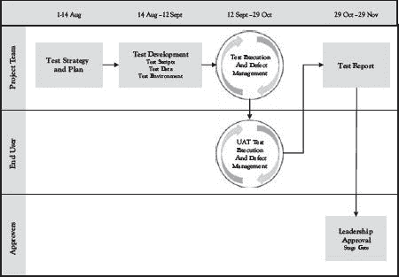

### 图 11.1 测试流程

测试策略是一份面向利益相关者的简明报告，在宏观层面概述了测试方法以及如何满足测试目标。以下是测试策略和计划的基础内容：

1. **测试目标**：记录并验证测试目标（例如，发现并修复缺陷，改进产品或服务，并验证符合预期）。

2. **范围**：识别哪些内容将进行测试。

3. **范围外**：记录哪些内容被排除在测试之外。

4. **测试类型**：识别并说明将使用的测试类型（表 11.1）。某些组织会添加“理由”列来解释为什么特定测试在范围之内或之外。在线搜索显示了额外的测试（例如，冒烟测试），读者可以根据这些理论和实践来调整项目的测试类型。

### 表 11.1 测试概述

| 测试类型 | 是否包含 | 截止日期 | 负责人 |
| --- | --- | --- | --- |
| 单元测试 (Unit) | 是 | 9 月 12 日 | Jason Hawk |
| 功能性测试 (Functional) | 是 | 9 月 17 日 | Saif Llama |
| 集成测试 (Integration) | 是 | 9 月 24 日 | Makoto Tamari |

| 回归测试 (Regression) | 否 | — | — |

| 安装/卸载 (Install/uninstall) | 是 | 10 月 1 日 | Federico Sant |

| 性能/压力测试 (Performance/stress) | 是 | 10 月 1 日 | Irene Cornell |

| 用户验收测试 (User acceptance) | 是 | 10 月 15 日 | Marianne Jones |

| 安全测试 (Security) | 是 | 10 月 29 日 | Israa Alberta |

5. **测试执行**：描述测试是手动还是自动。某些测试可以是自动的（例如，功能测试），而其他可能是手动的（例如，单元测试）。许多开源和商业测试工具都集成了缺陷管理功能。

6. **缺陷管理**：描述如何管理和控制缺陷，以及将使用的缺陷进行管理，包括任何待处理的操作（通过未来的软件补丁）。

7. **沟通管理**：描述如何告知利益相关者测试结果，包括最终测试报告。

8. **测试进度**：包含进度表或甘特图。

9. **测试风险和问题管理**：描述如何结合风险管理过程使用缺陷管理流程。如果发现了重大缺陷，可能会提出风险或问题。

某些组织拥有测试策略和计划模板（质量保证）来指导项目经理。项目经理可以在项目早期通过收集测试策略和其他项目模板来帮助项目规划。

## 测试计划

测试计划是测试策略的扩展和伴侣。测试计划提供了测试环境、测试脚本和数据的详细信息。领域专家（例如，供应商）通常负责开发测试计划：

1. **测试环境**：测试环境镜像生产环境，并对于测试和缺陷解决是安全的。测试环境包含了硬件、软件和满足测试执行最低要求的操作系统。

2. **测试脚本**：开发详细的测试指令以测试并验证需求已满足（例如，加载网站首页并点击“登录”按钮。验证登录界面出现了`Username`和`Password`字段）。某些区分测试脚本（自动化测试）和测试用例（手动测试）。测试脚本通常包含测试 ID、测试数据、测试步骤以及实际和预期结果。如果实际结果与预期结果不同，可能存在缺陷。

3. **测试数据**：由于隐私考虑，测试期间使用的数据是开发的而非真实数据。项目团队开发测试脚本的数据以验证系统按设计运行。精益团队可以开发适用于多个脚本的数据。许多测试人员利用数据管理工具来减轻测试数据管理的负担。

4. **测试指标**：识别审批者所需的指标（例如，计划的测试脚本数量、执行的测试脚本数量和缺陷数量）；有时测试人员提供的指标并非审批所需。设置测试仪表板以跟踪所需的指标，并轻松将其添加到测试报告中。

读者很幸运在线搜索可以刷新对测试环境、测试脚本、数据和指标的知识，并显示应用测试的现状和趋势（例如，具有 AI 能力的自动化测试）。

测试计划可能包含需求跟踪矩阵，将利益相关者的需求映射到测试脚本并跟踪验证（图 11.2）。该矩阵被用作项目需求已实现的证据。需求跟踪矩阵是一个质量保证模板，可以在未来的项目中重用。通过跟踪矩阵可以通过需求跟踪可以作为测试仪表板。添加额外的列是项目文档精化的示例。

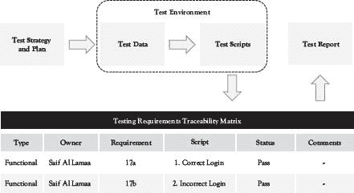

### 图 11.2 需求跟踪矩阵

## 用户验收测试

用户验收测试（UAT）验证系统是否满足批准的利益相关者需求。UAT 发生在测试团队完成系列测试（例如，单元、功能和集成）、修复缺陷且领域专家认为系统按设计运行之后。然后，项目经理邀请最终用户参加 UAT 测试工作坊（图 11.1），以验证系统按设计运行并符合利益相关者的预期。测试团队重复测试并使用需求跟踪仪表板、测试环境、脚本和数据。理想情况下，最终用户执行脚本以更好地理解系统，从而在上线前发现并修复缺陷。“缺陷”一词被广泛用于指最终用户需要更改。例如，系统可能按设计运行，尽管如此，用户可能会更改菜单——而不是按字母顺序排列菜单列表；用户可能会要求对前五个选项进行优先级排序并在下拉菜单的顶部。或者可能有拼写和语法错误需要修复。这些缺陷通过需求跟踪矩阵或缺陷跟踪器进行修复并跟踪直到完成。

# UAT 与设计管理

在 UAT（用户验收测试）期间，最终用户首次看到系统运行，并可能提出设计变更，尽管设计已经过过。如果最终用户提出的重大变更可能挑战完成进度或其他方面的问题，项目经理可能会提出测试可能会延迟的风险。有时，要求的设计变更可以推迟到项目后的优化阶段，而不会延迟你的项目。对重大变更的请求通常可以追溯到设计阶段以及最终用户参与的质量。因此，项目经理确保最终用户充分参与设计工作坊和设计文档评审是审慎的。如果最终用户没有充分参与设计阶段，项目经理可能会在设计阶段提出风险，即由于对已批准设计提出的变更请求，测试阶段可能需要更长时间才能完成。

为了完成设计阶段，一些项目经理会在为期两小时的会议上与批准方案的用户一起审查设计文档，以降低不理解设计的风险。在“Shields Up”中，我们关注于预防风险而非解决问题（例如，强调质量保证工作）。一旦最终用户完成 UAT 测试并给予批准，将更新需求追溯矩阵，并将批准记录在会议纪要或电子邮件中。然后，项目经理完成测试报告；这是离开测试阶段的最后一个阶段门。

## 测试报告

测试报告包含测试结果，由项目经理编制（表 11.2）。测试报告的目的是记录测试策略和测试计划概述的测试结果，以确定是否存在足够的质量，以及产品或服务是否准备好发布。在编写测试报告时，参考测试策略和计划以确保完整性是审慎的。

在线搜索可以许多测试报告示例和模板，这些可以指导项目经理和团队根据其项目和受众定制测试报告。测试报告开发后发送给项目利益相关者审批。一旦获得批准，测试阶段即完成，开始过渡到生产阶段。

最后，在进入生产过渡阶段（`T2P`）之前，某些网络安全项目并不适合技术测试，例如审计或培训项目；然而，质量保证和质量控制仍然有其作用。例如，可以使用同行评审来发现网络安全审计中的缺陷；同事可以审查审计结果以发现任何缺陷。在开发网络安全培训课程后，最佳实践是对培训进行试点测试，以确定是否达到了学习成果（例如，完成质量控制检查）。

### 表 11.2 测试报告内容

| 内容 | 注释 |

| :--- | :--- |

| 正文 | |

| 测试报告概述 | 说明测试目的和整体结果（例如，测试成功），这是读者在测试报告中查找的首要内容。你可以添加 UAT 已成功、最终用户已验证系统质量并已准备好发布等信息 |

| 测试结果 | 列出测试指标并突出关注感兴趣的重点或异常情况 | |

| 缺陷 | 列出已遇到并解决的缺陷，以及任何未未决的缺陷。引导读者查阅附录——待办事项——获取缺陷解决计划 |

| 结论 | 重申整体结果并强调测试已完成 |

| 附录 | |

| 应用概述 | 如果读者对其功能不熟悉，请提供软件应用程序的简要概述。识别集成点、云存储、安全性等 |

| 测试环境、数据和工具概述 | 对用于测试应用程序的测试环境、数据和工具提供概述和评估 |

| 测试范围 | 识别范围内和范围外的测试。说明任何未执行的测试及其理由。完整的需求追溯矩阵可以显示测试范围和执行的测试类型 |

| 待办事项 | 列出完成测试或修复缺陷所需的任何待办事项。某些操作会每个任务提交服务工单，并设定未来的完成日期以配合资源可用性或补丁发布以修复缺陷 |

| 经验教训 | 识别关于测试环境、测试数据、工具、测试过程等的经验教训 | |

## 测试阶段：结语

与规划一样，测试阶段对项目的成功至关重要。随着项目关键性和重要性的增加，测试的全面和正式性也随之增加。测试是一项质量控制活动；如果需求定义执行得当（质量保证），那么测试阶段的缺陷应该很少。测试计划和策略指导测试，而测试报告记录了结果和下一步。这些文档可以形成一套供未来测试的模板。我们首先测试系统以发现并修复缺陷，然后邀请最终用户参与 UAT。他们验证需求是否已满足以及服务是否已准备好运行。如果有任何未完成的测试或待办事项，我们会记录它们，并可能为未来的行动提交工单。

## 微学习

测试技术在测试流程和技术方面已经取得了进展。在线搜索并发现：

*   ITIL 服务验证和测试是如何运作的？

*   技术缺陷管理是如何运作的？

*   你如何跟踪测试缺陷？

*   什么是最好的测试软件？

*   自动化测试是如何运作的？

*   下载测试策略、测试计划和测试报告模板以供未来使用。

## 第 12 章

### 过渡到生产](#index_split_004.html#filepos7864)

过渡到生产阶段（`T2P`）包括将通过项目交付方法产生的产品或服务交由运营团队的活动。ITIL 的发布管理（`Limited, AXELOS 2019, 125–127`）指导了广泛的活动，例如：

1. 使用瀑布式或敏捷交付方法交付服务。

2. 确保新发布可以被跟踪、验证、卸载并在并在时从生产环境中回滚。

3. 证明偏差、风险和问题可以被管理和控制。

4. 完成向运营的知识和技能转移。

向此列表添加网络安全活动，以将服务或产品引入生产环境，例如将新产品或服务添加到安全信息事件管理（`SIEM`）系统中、进行渗透测试以及撤销供应商密码。

生产过渡的规划可以在规划阶段开始，并在`T2P`阶段完成。例如，网络安全应设计到产品或服务中，以满足网络安全需求并确保上线路径平顺（`ISO 2018a, 7`）。ITIL 发布和部署的关键在于管理成功是新服务在项目和运营之间的无缝过渡（`Limited, AXELOS 2019, 143–145`）。因此，我们制定正式计划向最终用户安全地发布服务，以提高成功概率并符合“一次到位”的思想。

成功的项目经理会创建并复用 T2P 检查表，以指导产品或服务上线的最终项目行动。

# 迁移到生产环境

迁移到生产环境的检查清单的作用类似于质量保证指南，以确保项目尾阶段工作“严密而非松散”。也就是说，对从项目阶段过渡到运营阶段的最终上线活动进行计划、管理和控制，以提高成功实施和采纳的概率。T2P 清单因项目和组织而异；但必须完成通用任务以确保服务的平稳过渡。在项目早期让部署经理参与，以规划您的发布和部署行动，并创建一个精简的 T2P 清单：

1.  通知变更授权委员会（`CAB`）有新服务正准备上线。敏锐的项目经理会在上线前两到三个月或更早向`CAB`会议增加议程事项，以提高项目的可见性。他们还会告知`CAB`他们正在使用 T2P 清单来管理和控制上线活动，以增强对有组织发布的信心。

2.  测试备份/恢复能力。

3.  根据实际情况移除供应商权限。

4.  将新服务添加到信息系统管理系统中。

5.  为新服务开发并添加`FAQ`到服务运营手册中。

6.  培训支持台。

7.  培训终端用户。

8.  执行漏洞评估和修复。

9.  完成系统加固审查。

10. 进行信息系统风险审查。

11. 完成灾难恢复测试。

12. 制定上线沟通计划，包括应对风险的预备沟通文案（例如，实施失败需要从生产环境中卸载）。

13. 为关键和优先项目建立上线指挥中心。

14. 依此类推。

根据最佳实践，项目经理仅完成将服务发布给终端用户所需的 T2P 行动。服务经过了评估和优化；在项目规划和服务过渡活动中应用了定制。

## CAB 审批与流程

最终的 T2P 行动之一是获得`CAB`批准将新服务发布到生产环境。（某些项目不涉及发布到生产环境的系统，例如安全审计，但可能需要报告或演示。）使用变更管理流程至关重要，因为系统配置错误是主要的攻击向量，在发布到生产环境之前，通过系统和正式的审查可以进行更好的管理（Microsoft 2020, 74）。项目经理根据项目计划和`CAB`会议协调发布日期。某些项目受益于项目经理在会议前与`CAB`审批成员讨论发布，以便对任何问题提供详细解答。

当你的发布准备好在`CAB`会议上进行讨论时，首先解释你遵循的 T2P 流程（例如检查清单和为 T2P 服务提交工单），以赢得信任，证明你的服务已准备好发布，且利益相关者认可该发布。你的信息是“良好的流程带来良好的结果”。对于更关键和影响更大的项目，可以考虑使用信息图或仪表板（表 12.1）来解释发布已准备好部署、组织已准备好发布，并且你有监控和控制发布的计划。你努力通过提供`CAB`审批者所需的信息来使审批变得简单。

一旦获得`CAB`的允许继续，就可以开始执行你的上线计划了。某些项目受益于演练上线，包括恢复回滚和升级程序。通过检查清单引导上线活动，并以简短的“站会”会议支持，可以提高质量。这些 T2P 程序有助于实现平稳且可预测的上线。

## T2P：最后思考

我们的目标是将项目产生的产品或服务按照预期结果无缝转移到运营中。我们在规划阶段早期就确定了 T2P 行动以将服务发布到生产环境，包括回滚计划。我们包含了培训和沟通，以确保无缝过渡。我们与`CAB`和发布经理合作，计划并将服务发布到生产环境。

### 表 12.1 CAB 上线状态报告

| 发布元素 | 状态 | 注释 |

| --- | --- | --- |

| 网络安全就绪 | 绿色 | 列出已完成的安全措施和就绪状态 |

| 系统就绪 | 绿色 | 已就绪 |

| 新服务就绪 | 绿色 | 已就绪 |

| 运营就绪 | 绿色 | 部分培训尚未完成；但赞助人确认组织已准备绪 |

| 培训状态 | 黄色 | 11% 的人员尚未完成培训；正在提供额外的培训。95% 的人员将在第 2 周（上线后）完成培训 |

| 沟通就绪 | 绿色 | 已就绪——包括回滚沟通 |

| 报告就绪 | 绿色 | 已就绪——已发布升级程序 |

| 支持就绪 | 绿色 | 已就绪——模拟演练完成 |

| 风险 | 绿色 | 无高严重风险；受控制中 |

| 问题 | 绿色 | 无高严重问题；受控制中 |

| 其他 | — | 无 |

## 微学习

以下是增强你学习的一些实际练习。请在网上搜索：

*   ITIL 发布管理

*   ITIL 发布管理模板

*   ITIL 发布管理实践

*   发布策略（例如金丝雀发布/暗色发布）

*   变更授权委员会

第 13 章

监控、稳定与结项

服务或产品已交付到运营，并达到了预期结果，项目团队正转向支持（早期支持）和结项活动。ITIL 服务价值链的最后活动是根据用户的期望和规范交付并支持新事物。团队收集有关发布质量的反馈并保持与终端用户的密切。项目团队接收服务成功的反馈，以指导支持和未来的优化规划。

监控事件是监控新服务质量的方法。ITIL 在其事件管理实践中提供了指南。项目经理可能会查看每日事件报告（如果有），以理解采用情况和质量。例如，监控关键性能指标（`KPIs`）（如解决时间）并与服务水平协议（`SLAs`）进行比较。在检查事件时，将其分为技术事件和培训相关事件，以更好地理解实施质量。项目经理通常根据工单/天或工单/周建立结项阶段关口，或者在预定的监控期（例如四周）后结束项目。当项目团队监控和支持新服务时，他们同时进行合同合规等结项活动。一旦达到结项指标，项目即结项。

结项流程的目的是正式终止项目，将产品或服务移交给赞助人并释放项目资源。某些项目经理使用检查清单来引导结项活动，例如：

> 1. **交付物交接**：正式将交付物移交给赞助人，并在会议纪要或电子邮件中确认验收。可以使用需求追溯矩阵（图 11.2），其列包含指向确认会议纪要或电子邮件的链接。

> 2. **项目完成通知**：通知所有利益相关者需求已交付且项目已完成。指导利益相关者在需要帮助时联系服务台。

> 3. **合同收尾**：审查合同以确保已履行所有合同义务。一 些项目经理使用需求追溯矩阵来记录合同义务是否已履行。

> 4. **资源**：释放资源（人员和设备）并与团队共同庆祝。

> 5. **教训总结**：与项目利益相关者一起完成教训总结，考虑哪些地方做得好，哪些可以改进。

在结项报告中记录这些行动，并归档项目文档以备日后参考。通过电子邮件通知赞助人项目已结项（终止），并将该通知添加到项目存档中。

教训总结是许多组织中的常见做法。哪些做得好？我们挣扎于什么？我们应该停止做什么？我们应该继续做什么？其他问题也有助于学习，这是指导 Shields Up 中良好实践和混合项目管理框架的基石。结项报告通常包含教训总结部分。然而，教训往往被收集但并不总是被汲取；为什么我们的项目失败率如此惨淡且反复？因此，我的建议是在项目开始以及每个项目阶段开始时完成教训总结。在团队会议期间，这些可以是简短的讨论，以应用在之前项目中开发的智慧和知识。团队重视自己的意见得以落实。

## 微学习

在网上搜索更多关于项目尾声的信息；圆满收官是终止项目的首选方式：

* 如何终止项目？

* 如何完成教训总结练习？

* 在哪里找到合同收尾模板和合同收尾信？

* 寻找项目结项的最佳实践？

# 第 14 章

## 运营与优化

当项目结项后，运营部门负责通过你的项目交付的服务。ITIL 提供了一个框架、工具和流程来管理和优化服务。项目可能会留下一些遗留；可能会有挂起的工单以完成未完成的项目操作。例如，某个需求可能由于缺陷（该将在未来的补丁中修复）尚未得到满足。供应商有自己的补丁和升级发布策略及时间表。挂起的工单可以提醒运营人员寻找补丁并计划其发布，以满足未完成的功能。

精益六西格玛（Lean Six Sigma）优化方法结合 ITIL 和 ISO 9001 的持续改进提供了优化产品和服务以交付更多价值的框架和工具。如果遵循经过验证的流程（例如精益六西格玛`DMAIC`问题解决和优化流程），优化将更成功。如果遵循经过验证的流程（例如精益六西格玛`DMAIC`问题解决和优化流程），优化建议将更成功。

# 第 15 章

## 结论

当项目结项后，运营部门负责通过你的项目交付的服务。ITIL 提供了一个框架、工具和流程来管理和优化服务。项目可能会留下一些遗留；可能会有挂起的工单以完成未完成的项目操作。例如，某个需求可能由于缺陷（该将在未来的补丁中修复）尚未得到满足。供应商有自己的补丁和升级发布策略及时间表。挂起的工单可以提醒运营人员寻找补丁并计划其发布，以满足未完成的功能。

# NIST 网络安全框架核心示例

美国国家标准与技术研究所（`NIST`）的《改进关键基础设施网络安全框架》是全球领先的网络安全框架。因此，所有 IT 专业人员（包括网络安全专业人员）都应该意识到`NIST`框架的重要性，因为每个人在网络安全中都扮演着角色。`NIST`标准根据功能、类别、子类别和参考文献进行排列（参见表 A1.1）；美国国家标准与技术研究所 2018, 50）。

`NIST`框架帮助组织审计其网络安全能力、识别差距并为改进设定目标（更多项目）。主导网络安全审计或更广泛的技术审计是良好的职业发展项目，因为它们是非技术性的，并且能够提供对系统和服务的概览。

## 表 A1.1 NIST 网络安全框架核心示例

| 功能 | 类别 | 子类别 | 参考文献 |
| --- | --- | --- | --- |
| `恢复 (Recover)` | | `恢复计划 (RC.RP)`：执行并维护恢复过程和程序，以确保受网络安全事件影响的系统或资产得到恢复 | `RC.RP-1`：在网络安全事件期间或之后执行计划 | `CIS CSC 10`, `COBIT 5 APO12.06`, `DSS02.05`, `DSS03.04`, `ISO/IEC 27001:2013 A.16.1.5`, `NIST SP 800-53 Rev. 4`, `CP-10`, `IR-4`, `IR-8` |
| | `改进 (RC.IM)`：通过将教训整合到未来的活动中，改进恢复计划和过程 | `RC.IM-1`：恢复计划包含了教训 | `COBIT 5 APO12.06`, `BAI05.07`, `DSS04.08`, `ISA 62443-2-1:2009 4.4.3.4`, `ISO/IEC 27001:2013 A.16.1.6`, Clause 10`, `NIST SP 800-53 Rev. 4 CP-2`, `IR-4`, `IR-8` |
| | | `RC.IM-2`：更新恢复策略 | `COBIT 5 APO12.06`, `BAI07.08`, `ISO/IEC 27001:2013 A.16.1.6`, Clause 10`, `NIST SP 800-53 Rev. 4 CP-2`, `IR-4`, `IR-8` |
| | `沟通 (RC.CO)`：与内部和外部协调恢复活动（例如：协调中心、互联网服务提供商、攻击系统所有者、受害者、其他计算机安全响应团队和供应商） | `RC.CO-1`：管理公关 | `COBIT 5 EDM03.02`, `ISO/IEC 27001:2013 A.6.1.4`, Clause 7.4` |
| | | `RC.CO-2`：事件发生后修复声誉 | `COBIT 5 MEA03.02`, `ISO/IEC 27001:2013 Clause 7.4` |
| | | `RC.CO-3`：将恢复活动告知内部和外部利益相关者以及执行和管理团队 | `COBIT 5 APO12.06`, `ISO/IEC 27001:2013 Clause 7.4`, `NIST SP 800-53 Rev. 4 CP-2`, `IR-4` |

## 附录 2

## 项目管理小工具

`Project Management Gizmo`（项目管理小工具）是一种基于研究的工具，用于评估项目以理解项目的复杂度（参见表 A2.1）以及成功交付项目所需的精力（表 A2.2）。

## 表 A2.1 项目复杂度评估

| 复杂度维度 | 描述 |
| --- | --- |
| `约束 (Constraints)` | 限制项目范围的因素，如时间、预算或资源。 |
| `资源 (Resources)` | 完成项目所需的资源可用性。 |
| `技术 (Technology)` | 项目涉及的技术复杂性或新程度。 |
| `风险 (Risk)` | 项目可能面临的不确定性或潜在威胁。 |
| `沟通 (Communication)` | 项目内部和外部信息传递的频率和质量。 |

### 3.3. 影响

成功或失败的项目对相关组织和利益相关者产生的影响。

### 4. 不确定性和风险

风险是导致结果变化的因素，而不确定性是可能结果的范围。在这里，我们评估项目工作外部环境的风险和不确定性。

### 5. 组织环境

项目进行计划和管理的环境。

### 5.1. 文化

组织文化（习俗、传统、语言、仪式、着装、礼仪等）与项目目标、工具和流程的匹配程度。

### 5.2. 治理

组织对其运营的监督程度与项目人员希望计划和管理的方式的程度。

### 6. 商业环境

商业环境促进项目完成的程度。

### 6.1. 文化

组织外部文化（习俗、传统等）与项目目标、工具和流程的匹配程度。

### 6.2. 治理

市政/城市/国家的运作方式与项目人员希望计划和管理的方式的程度。

### 6.3. 经济

经济促进项目完成的程度。

### 6.4. 语言

商业环境中所使用的语言被项目人员理解的程度。

### 6.5. 政治气候

政治局势稳定程度。

### 表 A2.2 Gizmo 投入属性

| 投入属性 | 简单 | 评分 | 复杂 |
| :--- | :--- | :--- | :--- |
| 1. 工作类型 | 常规、简单、不复杂 | 1 2 3 4 N/A | 复杂、不可预测、危险 |
| 1.1 技术 | 简单、成熟、可靠 | 1 2 3 4 N/A | 复杂、新颖、不可靠 |
| 1.2 所需技能 | 低技能要求、资源丰富 | 1 2 3 4 N/A | 高技能、资源缺失 |
| 1.3 吸引力 | 理想且受追 | 1 2 3 4 N/A | 不愉快、被避开 |
| 1.4 独特性 | 常规、典型 | 1 2 3 4 N/A | 异常、罕见 |
| 2. 沟通 | 易、有效、愉快 | 1 2 3 4 N/A | 敌对、困难、复杂、混乱 |
| 2.1 利益相关者人数 | 很少 | 1 2 3 4 N/A | 很多 |
| 2.2 地理分散性 | 距离（同一大楼或城市） | 1 2 3 4 N/A | 分散（不同国家） |
| 3. 集成范围 | 一致、简单、有凝聚力 | 1 2 3 4 N/A | 分裂、混乱、模糊 |
| 3.1 接口数量 | 少数、简单、常规 | 1 2 3 4 N/A | 多、复杂、临时性 |
| 3.2 合同数量 | 少数、彼此熟悉 | 1 2 3 4 N/A | 多、新 |
| 4. 不确定性和风险 | 已识别风险和可能的结果 | 1 2 3 4 N/A | 充斥着大量且范围广泛的结果 |

### 投入属性描述

- **1. 工作类型**：与项目将要生产的产品有关（例如，实施网络安全分析应用程序与进行网络安全审计）。
- **1.1 技术**：技术开发程度、易用性以及经过验证的程度。
- **1.2 所需技能**：所需技能的可用程度。
- **1.3 吸引力**：项目利益相关者想要参与该项目的程度。
- **1.4 独特性**：产品和/或项目之前是否做过的程度。
- **2. 沟通**：有效且高效地计划、执行和接收开放沟通的难易程度。
- **2.1 利益相关者人数**：项目团队需要沟通的人数。
- **2.2 地理分散性**：地理分散的程度。
- **3. 集成范围**：集成范围的程度。
- **3.1 接口数量**：接口的数量。
- **3.2 合同数量**：合同的数量。
- **4. 不确定性和风险**：风险是导致结果变化的因素，而不确定性是可能结果的范围。

（注：源文件中的剩余文本似乎是重复或碎片化的表格数据，已整合到上述结构化表格中以保持清晰度。）

项目经理开启了一个问题（`I-22`），即服务器将延迟四个月到达，导致构建阶段延迟（参见表 A3.2）。采购领域专家（SME）已与供应商进行了沟通，非常有把握服务器将在 2020 年 8 月 14 日或之前到达。项目团队已审查了进度表，并将提前开展设计、测试和 `T2P` 文档等工作，以最大限度地减少延迟带来的影响。

### 表 A3.2 问题注册表

| 标题 | 描述 | 示例 |
| --- | --- | --- |
| 问题 ID | 每个问题都有唯一的 ID | I-22 |
| 录入日期 | 问题录入注册表的日期 | 2020 年 3 月 16 日 |
| 录入人 | 录入人员 | Debbie Hart, 项目经理 |
| 项目 | 项目名称 | 大数据湖 |
| 阶段 | 项目阶段 | 计划 |
| 问题原因 | 问题的根本原因 | 由于制造延迟 |
| 问题事件 | 影响项目的问题 | 服务器延迟 4 个月到达 |
| 问题影响 | 问题事件导致的后果 | 导致构建阶段延迟 |
| 影响 | 对项目的影响：高、中、低 | 高 |
| 问题解决 | 解决措施 | 无 |
| 解决人员 | 负责解决问题的人 | Barry Blanchard |
| 解决日期 | 必须解决问题的日期 | 2020 年 8 月 14 日 |
| 问题状态 | 问题受控程度 | 红色：问题无法及时解决 |
| 注释 | 关于解决和关闭问题的信息 | 服务器比制造目标落后了 6 个月，但供应商承诺于 2020 年 8 月 14 日交付，导致项目延迟 4 个月（2020 年 4 月 2 日） |

## 附录 4

## 职业规划

质量改进是我们框架的核心，也是持续成功的不可或缺的组成部分。通过整体方法更有可能实现质量改进：在整个服务管理系统中寻找改进机会，以优化面向用户的价值流（Limited, AXELOS 2019, 83–86）。当采取整体方法时，参与价值创造的人员也可以从评估和发展其能力中获益。网络安全专业人士可以通过职业规划采取结构化的方法来提升其能力。

在网络安全岗位上变得“精通”需要三到五年的（Oltsik 2020, 6）。网络安全专业人士可能会开发和维护与其角色直接相关的领域的技术能力。在建立技术熟能力的同时，网络安全专业人士可以开始整体规划并发展其能力。网络安全专业人士可以通过职业规划采取结构化的方法来提升其能力。

### 可持续的项目导向型职业

我们发现职业的可持续性取决于两个因素：人脉网络和技能提升（Skulmoski et al. 2020, 76）。与其他专业人士建立联系有助于发现新机会。保持联系可以开启机会。技能提升或扩展能力是另一个可持续性驱动力。

技术和网络安全技能缺口问题已得到充分研究，因为它是一个长期且可能是棘手的问题。网络安全专业人士很幸运，有很多途径可以保持胜任，例如在 `Azure` 等技术平台或在 `CISSP` 等网络安全框架中追求技术认证。

### 规划 T 型职业

如果我们观察 IT 同事们的职业晋升路径，就可以预见随时间变化的职业发展。人们将技能发展为技能集，这些技能集可以被描述为跨跨度和能力光谱的形状（图 A4.1，参考 Demirkan and Spohrer 2015, 13）。《Shields Up》一书中对 T 型专业人士的 Basic 描绘进行了修改，其中 T 型的水平部分代表业务技能，垂直部分代表技术技能。新的大学网络安全毕业生拥有加入 IT 部门所需的技术基础，并以 I 型技能集加入。

一些网络安全专业人员通过参加有效沟通、冲突解决、情感智能、预算管理、时间管理等课程来增加业务相关技能，这被描述为在“I”型形状上方形成一条水平线，将形状转变为“T”型型。“T”型专业人才既具备技术技能又具备业务技能，并拥有如管理岗位等扩展机会；他们能为自己的组织提供更多价值，并提高职业的可持续性。晋升首席信息安全官（`CISOs`）的人拥有技术技能基础，并辅以宽广而深厚的业务技能组合。在寻找 `CISO` 职位的机会时，你会发现职位要求强调业务技能组合，例如：

图 A4.1 能力发展历程

1. 为 `CIO` 和高管领导团队提供指导，在建立良好信誉和积极关系的同时，定义并交付战略目标。
2. 领导信息安全战略规划和预算周期，并辅以安全和合规目标、策略、指标和报告仪表板的支持。
3. 创建教育和意识计划以提高网络安全卫生水平。

`CISO` 需要技术技能基础，但更强调业务技能，以管理整个 `ITIL` 服务价值系统，该系统包括项目和运营，旨在为组织交付价值。这三个 `CISO` 职位要求的示例都涉及项目管理：这是交付创新、数字转型和持续价值的基石。因此，理解你的职业目标和向往的角色类型将帮助你进行有效的职业规划。

## 职业规划流程

如果操作得当，职业规划是一项经常发生，例如在年度绩效考核期间，这样你的组织就可以支持你的发展目标（Oltsik 2020, 6）。你的职业规划可以纳入绩效评估中。有些人认为年度绩效考核是一项行政负担；然而，职业规划可以用战略方法推动个人的职业发展。就像项目的成功一样，伟大的职业不会偶然发生；伟大的职业是经过规划、管理和控制的。职业规划可以通过三个步骤完成：

1. **自评估**：招聘经理在招聘入职过程中使用各种“清单”来评估能力和资质。在职业规划期间，可以使用这些清单中的许多来获得额外的见解（例如，在网上搜索职业和职业规划清单，以获取更正式的自评估方法）。这些通常可以帮助识别优势和待发展领域。你在能力发展中处于什么位置？你的职业发展形状是“I”型，还是你正在为了平衡发展而形成“T”型职业（`图 A4.1`）？
2. **探索**：理解你的职业目标和你向往的角色类型可以帮助你进行有效的职业规划。
3. **行动计划**：根据你的目标进行差距分析并制定计划。

将职业规划与年度绩效考核相结合，可以让你不仅在评估中获得高分，还能帮助你因考虑周全而脱颖而出。很少有 IT 专业人士在职业规划中将眼光放在一两年以后，大多数人的关注点仅集中在技术能力的开发上。如果你在培训计划中也加入项目管理和精益六格玛（Lean Six Sigma）等业务技能，你将会脱而出。组织支持高价值员工（例如网络安全专业人士）并资助就读顶级大学的 MBA 并不罕见。组织在寻找和留住网络安全人才方面面临困难。组织可以通过支持职业规划、为培训教育提供资金支持，以及提供外岗和任命其他职位以获得广泛经验，来留住最优秀的人。

通过额外的培训，网络安全专业人士获得了新的知识和技能；要寻找应用这些新能力的机会。你可以争取在组织内部晋升以获得新经验。然而，横向转移到如 `Service Desk Queue Manager`、`IT Contracts Manager` 和 `IT Service Quality Manager`（IT 服务质量经理）等职位，也能提供宝贵的成长经验。这些职位属于技术部门，但在网络安全领域之外；在广泛领域获得经验可以增加你对整个 IT 部门及其服务的理解。你也可以在同事休年时自愿为他们“代班”；通过代班你可以获得多样化的经验并加速学习。这些横向和覆盖的机会不仅会扩展你在周边领域的知识和技能，还能从整体上提升。

## 微学习

以下是一些增强你学习的实用练习：

- 寻找关于微学习和持续性专业发展的文章，以更好地理解这种强大的学习模式。
- 在线搜索职业规划流程，并进行定制，以遵循一个符合你逻辑的流程。
- 搜索高级技术职位的招聘广告，以更好地了解新兴的工作需求和相关能力。确定需要开发的目标能力。
- 寻找平衡，使你能够开发技术能力和非技术能力（如领导力、沟通和项目管理）。
- 识别并开发持久性的能力（例如项目管理），这些能力不会像许多技术认证那样，随着新技术的出现而迅速过时。

## 参考文献

> Aaldering, L.J., and C.H. Song. 2021. “论领军者与落后者——迈向过程工业的数字化.” Technovation 105, pp. 1–15. doi.10.1016/j.technovation.2020.102211

> Aaser, M., and D. McElhaney. 2021. “利用外部数据的力量.” McKinsey and Co. [www.mckinsey.com/business-functions/mckinsey-digital/our-insights/harnessing-the-power-of-external-data](http://www.mckinsey.com/business-functions/mckinsey-digital/our-insights/harnessing-the-power-of-external-data) (访问于 2021 年 10 月 23 日)。

> [AgileManifesto.org](http://AgileManifesto.org). 2001. “敏捷软件开发宣言.” [AgileManifesto.org](http://AgileManifesto.org). [`agilemanifesto.org/`](https://agilemanifesto.org/) (访问于 2019 年 10 月 17 日)。

> Allied Telesis. 2021. “联邦政府解决方案.” Allied Telesis. [www.alliedtelesis.com/au/en/solutions/industry/federal-government](http://www.alliedtelesis.com/au/en/solutions/industry/federal-government) (访问于 2021 年 10 月 23 日)。

> AustCyber. 2020. “AustCyber 发布新的数字信任报告，显示工作和收入面临风险.” AustCyber. [www.austcyber.com/news-events/austcyber-launches-new-digital-trust-report-showing-jobs-and-revenue-stake](http://www.austcyber.com/news-events/austcyber-launches-new-digital-trust-report-showing-jobs-and-revenue-stake) (访问于 2021 年 10 月 23 日)。

> Australian Government. 2021. “加强澳大利亚的网络安全法规和激励措施.” 澳大利亚政府内政部. [www.homeaffairs.gov.au/reports-and-publications/submissions-and-discussion-papers/cyber-security-regulations-incentives](http://www.homeaffairs.gov.au/reports-and-publications/submissions-and-discussion-papers/cyber-security-regulations-incentives) (访问于 2021 年 7 月 26 日)。

> Azanha, A., A.R.T.T. Argoud, J.B. de Camargo Junior, and P.D. Antoniolli. 2017. “基于 Scrum 的敏捷项目管理.” International Journal of Managing Projects in Business 10, no. 1, pp. 121–142. doi:10.1108/IJMPB-06-2016-0054

> Barquin, S., R. Dreischmeier, S. Hertli, J. Königsfeld, and A. Roth. 2020. “大助力：现有企业如何成功规模化其新业务.” McKinsey and Co. [www.mckinsey.com/business-functions/mckinsey-digital/our-insights/the-big-boost-how-incumbents-successfully-scale-their-new-businesses](http://www.mckinsey.com/business-functions/mckinsey-digital/our-insights/the-big-boost-how-incumbents-successfully-scale-their-new-businesses) (访问于 2021 年 10 月 23 日)。

> Berger, S., N. Shashid, and C. Varol. 2020. “使用 IT.” Lebanon. [doi:10.1109/IJMP3257]

> Bersin, J., and M. Sanders. 2019. “让学习成为日常工作.” Harvard Review. [`hbr.org/2019/02/making-learning-of-everyday-work`](https://hbr.org/2019/02/making-learning-of-everyday-work)

> Blackburn, S., and J. Schneider. 2020. “危机中的数字策略.” McKinsey and Co. [www.mckinsey.com/business-functions/mckinsey-digital/our-insights/digital-strategy-in-a-crisis](http://www.mckinsey.com/business-functions/mckinsey-digital/our-insights/digital-strategy-in-a-crisis) (访问于 2021 年 10 月 23 日)。

> Claus, I. 2017. “2025 年 IT 安全：专家期待什么.” Radar Services. [www.radarcs.com/wp-content/uploads/2020/04/IT-Security-Magazine-Issue-1.pdf](http://www.radarcs.com/wp-content/uploads/2020/04/IT-Security-Magazine-Issue-1.pdf) (2020 年访问)

> Columbus, L. 2020. “2021 年最佳网络安全预测汇总.” Forbes. [www.forbes.com/sites/louiscolumbus/2020/12/15/the-best-cybersecurity-predictions-for-2021-roundup/?sh=1bff55d5e8c](http://www.forbes.com/sites/louiscolumbus/2020/12/15/the-best-cybersecurity-predictions-for-2021-roundup/?sh=1bff55d5e8c) (访问于 2021 年 10 月 23 日)。

> Bleich, C. 2021. “面向员工的 11 种微学习类型.” Edgepoint Learning. [www.edgepoint.com/blog/microlearning](http://www.edgepoint.com/blog/microlearning) (访问于 2021 年 7 月 19 日)。

> Corbo, J., and I. Ostojic. 2021. “技术领域的趋势.” McKinsey and Co. [www.mckinsey.com/business-functions/mckinsey-digital/our-insights/thetop-trends-in-tech](http://www.mckinsey.com/business-functions/mckinsey-digital/our-insights/thetop-trends-in-tech) (访问于 2021 年 7 月 12 日)。

- Creese, S., J. Saunders, L. Axon, and W. Dixon. 2020. “未来系列：网络安全、新兴技术与系统性风险。”世界经济论坛。[www.weforum.org/reports/future-series-cybersecurity-emerging-technology-and-systemic-risk](http://www.weforum.org/reports/future-series-cybersecurity-emerging-technology-and-systemic-risk) (访问于 2021 年 7 月 19 日)。

- CyberEdge Group, LLC. 2020. “2020 年网络威胁防御报告。”CyberEdge Group。[`cybelangel.com/wp-content/uploads/2020/12/CyberEdge-2020-CDR-Report-v1.0-1.pdf`](https://cybelangel.com/wp-content/uploads/2020/12/CyberEdge-2020-CDR-Report-v1.0-1.pdf) (访问于 2021 年 7 月 7 日)。

- Dahlqvist, F., M. Patel, A. Rajko, and J. Shulman. 2019. “物联网中增长的机遇。”麦肯锡公司。[www.mckinsey.com/industries/private-equity-and-principal-investors/our-insights/growing-opportunities-in-the-internet-of-things](http://www.mckinsey.com/industries/private-equity-and-principal-investors/our-insights/growing-opportunities-in-the-internet-of-things) (访问于 2021 年 10 月 23 日)。

- Daniel, H.Z., D.J. Hempel, and N. Srinivasan. 2003. “项目选择：过程分析。”《工业营销管理》第 32 卷，第 1 期，第 39–54 页。doi: 10.1016/S0019-8501(01)00193-6

- Defossez, K., M. McMillan, and H. Vuppala. 2020. “数字时代管理大型技术项目。”麦肯锡公司。[www.mckinsey.com/business-functions/mckinsey-digital/our-insights/managing-large-technology-programs-in-the-digital-era](http://www.mckinsey.com/business-functions/mckinsey-digital/our-insights/managing-large-technology-programs-in-the-digital-era) (访问于 2021 年 7 月 20 日)。

- de Mast, J., and L. Lokkerbol. 2012. “从问题解决角度分析六西格玛 DMAIC 方法。”《国际生产经济杂志》第 139 卷，第 2 期，第 604–614 页。doi:10.1016/j.ijpe.2012.05.035。

- Demirkan, H., and J. Spohrer. 2015. “T 型创新者：识别支持服务创新的正确人才。”《研究技术管理》第 58 卷，第 5 期，第 12–15 页。doi:10.5437/08956308X5805007

- Dhasarathy, A., I. Gill, and N. Khan. 2020. “CIO 的挑战：现代业务需要新型技术领导者。”麦肯锡公司。[www.mckinsey.com/business-functions/mckinsey-digital/our-insights/the-cio-challenge-modern-business-needs-a-new-kind-of-tech-leader?cid=other-eml-altmip-mck&hdpid=f911b6ba-0f2b-48df-8075-bde50f046eae&hctky=1178-6173&hlkid=8085fc1d99964a10b87a8b10c523781e](http://www.mckinsey.com/business-functions/mckinsey-digital/our-insights/the-cio-challenge-modern-business-needs-a-new-kind-of-tech-leader?cid=other-eml-altmip-mck&hdpid=f911b6ba-0f2b-48df-8075-bde50f046eae&hctky=1178-6173&hlkid=8085fc1d99964a10b87a8b10c523781e) (访问于 2021 年 7 月 31 日)。

- Diana, F., and S. Torrance. 2020. “定义您的数字生态系统：机器优先™转型的第一步。”TATA 咨询服务。[www.tcs.com/perspectives/articles/defining-your-digital-ecosystem-the-first-step-in-a-machine-first-transformation](http://www.tcs.com/perspectives/articles/defining-your-digital-ecosystem-the-first-step-in-a-machine-first-transformation) (访问于 2021 年 7 月 13 日)。

- Dietz, M., H. Khan, and I. Rab. 2020. “公司如何从数字化中创造价值？”麦肯锡公司。[www.mckinsey.com/business-functions/mckinsey-digital/our-insights/how-do-companies-create-value-from-ecosystems](http://www.mckinsey.com/business-functions/mckinsey-digital/our-insights/how-do-companies-create-value-from-ecosystems) (访问于 2021 年 10 月 23 日)。

- Drury, M., K. Conboy, and K. Power. 2012. “决策中的中的障碍。”《系统杂志》第 85 卷，第 6 期，第 123–154 页。doi:10.1016/j.ss

- DuMoulin, T. 2019. “数字经济中的 T 型人才。”AXelos。[www.axelos.com/resource-paper/t-shaped-professionals-for-economy](http://www.axelos.com/resource-paper/t-shaped-professionals-for-economy)

- 欧洲委员会. 2021a. “网络安全政策。”欧洲委员会。[`digital-strategy.europa.eu/policies/cybersecurity`](https://digital-strategy.europa.eu/policies/cybersecurity)

- 欧洲委员会. 2021b. “数字法案。”欧洲委员会。[`digital-strategy.europa.eu/policies/digital-act`](https://digital-strategy.europa.eu/policies/digital-act)

- Fitzpatrick, M., and K. Strovink. 2021. “我们如何衡量数字化的成功？”麦肯锡公司。[www.mckinsey.com/business-functions/mckinsey-digital/our-insights/how-do-companies-create-value-from-ecosystems](http://www.mckinsey.com/business-functions/mckinsey-digital/our-insights/how-do-companies-create-value-from-ecosystems) (访问于 2021 年 10 月 23 日)。

- Foley, M. 2021. “已就绪的 Windows 服务器。”ZDNet。[www.zdnet.com/article/microsoft-is-ready-server](http://www.zdnet.com/article/microsoft-is-ready-server) (访问于 2021 年 7 月 21 日)。

- Fox, J. 2021. “什么是网络安全模型？”alt。[`cobalt.io/what-is-cybersecurity-model`](https://cobalt.io/what-is-cybersecurity-model) (访问于 2021 年 7 月 26 日)。

- Garba, A., M. Horner, and S.J. Othman. 2020. “能力综述。《科学技术工程杂志》第 5 卷，第 4 期，第 762–769 页。doi:10.2504/aj0590

- Gartner. 2020a. “技术路线图。”Gartner。[www.gartner.com/en/information-technology/the-roadmap](http://www.gartner.com/en/information-technology/the-roadmap)

- Gartner. 2020b. “2021 年 CIO 议程：抓住数字机会。”Gartner。[www.gartner.com/en/documents/399188/the-2021-cio-agenda-digital](http://www.gartner.com/en/documents/399188/the-2021-cio-agenda-digital) (访问于 2021 年 10 月 23 日)。

- Gemino, A., B. Reich, and P.M. Serrador. 2021. “敏捷、传统与混合方法的成功：混合是糟糕备选吗？”《项目管理杂志》第 52 卷，第 2 期，第 161–175 页。doi:10.1177/87569728209730

- George, J. 2008. “技术管理与项目管理的对接对任何项目组织都至关重要。”PMI 全球大会——悉尼。[www.pmi.org/learning/technology-project-management-aligned](http://www.pmi.org/learning/technology-project-management-aligned)

- Global Knowledge. 2021. “2021 年 15 大高薪 IT 认证。”Global Knowledge。[www.globalknowledge.com/us-en/resources/resource-library/articles/top-paying-certifications/#gref](http://www.globalknowledge.com/us-en/resources/resource-library/articles/top-paying-certifications/#gref)

- Göbel, H., and S. Cronholm. 2015. “ITIL 体验：收益与障碍。”DiVa。[www.diva-portal.org/smash/get/diva2:1338228/FULLTEXT01.pdf](http://www.diva-portal.org/smash/get/diva2:1338228/FULLTEXT01.pdf)

- Gonzalo, A., H. Harreis, C.S. Altable, and C. Villepelet. 2020. “时尚业的数字化转型：现在或否。”麦肯锡公司。[www.mckinsey.com/industries/retail/our-insights/fashions-digital-transformation-now-or-never](http://www.mckinsey.com/industries/retail/our-insights/fashions-digital-transformation-now-or-never) (访问于 2021 年 10 月 23 日)。

- Groombridge, D. 2021. “2022 年高德纳十大战略技术趋势.” 高德纳。[www.gartner.com/en/information-technology/insights/top-technology-trends?utm_campaign=RM_NA_2021_SWG_NL_17_IT&utm_medium=email&utm_source=Eloqua&cm_mmc=Eloqua-_-Email-_-LM_RM_NA_2021_SWG_NL_17_IT-_-0000](http://www.gartner.com/en/information-technology/insights/top-technology-trends?utm_campaign=RM_NA_2021_SWG_NL_17_IT&utm_medium=email&utm_source=Eloqua&cm_mmc=Eloqua-_-Email-_-LM_RM_NA_2021_SWG_NL_17_IT-_-0000) (访问 2021 年 11 月 8 日)。

- Hale, R. 2017. “网络能力与网络安全官.” 载于《网络风险手册》(The Cyber Risk Handbook)，D. Antonucci 编，358–368. 霍肯：John Wiley & Sons. doi:10.1002/9781119309741

- Hartman, F.T. 1999a. 变革悖论. 报告于加拿大卡加利大学的一个项目管理课程。

- Hartman, F.T. 1999b. 专业学习目标 (PLOs). 报告于加拿大卡加利大学的一个项目管理课程。

- Horan, J. 2020. “美国国防部网络安全成熟模型认证计划的现状.” 《合同管理》(Contract Management) 第 60 卷，第 7 期，8–16 页。[www.proquest.com/docview/2458774404?parentSessionId=LYs2%2F3upCAUd%2BawTyjPWYgQ%2BINRl9%2FDUtgirauOSFRo%3D&pqorigsite=primo&accountid=26503](http://www.proquest.com/docview/2458774404?parentSessionId=LYs2%2F3upCAUd%2BawTyjPWYgQ%2BINRl9%2FDUtgirauOSFRo%3D&pqorigsite=primo&accountid=26503)

- Howard, C. 2020. “IT 首要任务：2021 年领导力愿景.” 高德纳。[www.gartner.com/en/publications/cio-top-priorities-leadership-vision-2021](http://www.gartner.com/en/publications/cio-top-priorities-leadership-vision-2021) (访问 2021 年 7 月 19 日)。

- IBM. 2021. “克利夫兰诊所与 IBM 宣布里程碑式的十年合作伙伴关系，以加速医疗保健和生命科学领域的发现.” IBM。[`newsroom.ibm.com/2021-03-30-Cleveland-Clinic-and-IBM-Unveil-Landmark-10-Year-Partnership-to-Accelerate-Discovery-in-Healthcare-Sciences`](https://newsroom.ibm.com/2021-03-30-Cleveland-Clinic-and-IBM-Unveil-Landmark-10-Year-Partnership-to-Accelerate-Discovery-in-Healthcare-Sciences) (访问 2021 年 10 月 07 日)。

- ISO. 2000. ISO 9004:2000 质量管理体系——绩效指南。[www.iso.org/standard/28692.html](http://www.iso.org/standard/28692.html) (访问 2021 年 7 月 21 日)。

- ISO. 2013a. ISO/IEC 27001 信息技术安全技术——信息系统要求。[www.iso.org/isoiec-27001-security.html](http://www.iso.org/isoiec-27001-security.html) (访问 2021 年 10 月 07 日)。

- ISO. 2013b. ISO/IEC 27002:2013 信息安全控制规范。[www.iso.org/standard/54533.html](http://www.iso.org/standard/54533.html) (访问 2021 年 7 月 20 日)。

- ISO. 2018a. ISO/IEC 27000:2018 信息系统概述与术语。[www.iso.org/standard/73906.html](http://www.iso.org/standard/73906.html) (访问 2021 年 7 月 20 日)。

- ISO 31000. 2018b. 风险管理——指南。[www.iso.org/standard/65694.html](http://www.iso.org/standard/65694.html) (访问 2021 年 7 月 20 日)。

- Kerzner, H. 2013. 项目管理：计划、进度与控制的系统方法. 第 11 版. 纽泽西州霍肯：John Wiley & Sons, Inc. [www.wiley.com/en-au/Project+Management%3A+A+Systems+Approach+to+Planning%2C+Scheduling%2C+Controlling%2C+11th-Edition-p-978111816](http://www.wiley.com/en-au/Project+Management%3A+A+Systems+Approach+to+Planning%2C+Scheduling%2C+Controlling%2C+11th-Edition-p-978111816)

- Leal, R. 2015. “通过成熟度模型实现持续改进.” Advisera 解决方案。[`advisera.com/27001academy/blog/2015/04/13/achieving-continual-improvement-through-the-use-of-maturity-models/`](https://advisera.com/27001academy/blog/2015/04/13/achieving-continual-improvement-through-the-use-of-maturity-models/) (访问 2021 年 10 月 24 日)。

- AXELOS. 2019. ITIL 基础：ITIL4 版. 伦敦：The Stationery Office, 2019.[www.axelos.com/for-professionals/publications](http://www.axelos.com/for-professionals/publications)

- Marks, J. 2021 年 6 月 11 日. “网络安全 202：专家网络认为需要更多安全法规.” 《华盛顿邮报》。www.washingtonpost.com/politics/2021/06/11/cybersecurity-202-our-expert-network-says-it-time-more-cybersecurity-regulations/](http://www.washingtonpost.com/politics/2021/06/11/cybersecurity-202-our-expert-network-says-it-time-more-cybersecurity-regulations/) (访问 2021 年 7 月 21 日)。

- Marrone, M., M. Kiessling, and L.M. Kolbe. 2010 年 6 月 2 日–5 日. “我们真的在创新吗？一项关于创新管理和服务管理的探索性研究.” 2010 IEEE 创新管理与技术国际会议. 新加坡。doi:10.1109/ICMIT.2010.5492719

- Marrone, M., and L.M. Kolbe. 2011. “揭示 ITIL 声明：IT 高管对收益和业务 IT 融合的感知.” 《信息系统与电子商务管理》第 9 卷，第 3 期，381–382 页。doi:10.1007/s10257-010-0163-z

- Maurer, T., and A. Nelson. 1999. “更好地保护金融系统的策略.” 卡内基和平基金会。[`www.carnegieendowment.org/publications/policy-reports/strategy-to-better-protect-the-financial-system.html`](https://www.carnegieendowment.org/publications/policy-reports/strategy-to-better-protect-the-financial-system.html)

- McHugh, B. 2020. “高德纳 2021 年 IT 预测.” Advanced Systems。[www.advsys.com/blog/gartner/](http://www.advsys.com/blog/gartner/)

- Morgan, S. 2019. “数字报告.” Herjave 集团。[www.herjave.com/2019-digital-report](http://www.herjave.com/2019-digital-report)

- Oltsik, J. 2020. “ESG 研究报告：2020 年网络安全人员的生活与时代。”ESG. [www.esg-global.com/research/esg-research-report-the-life-and-times-of-cybersecurity-professionals-2020](http://www.esg-global.com/research/esg-research-report-the-life-and-times-of-cybersecurity-professionals-2020) (访问于 2021 年 7 月 21 日)。

- Ottmann, D., and G.J. Skulmoski. 2020 年 11 月 22–24 日. “快速且响应的可持续职业。”快速城市—响应式架构。阿拉伯联合酋，迪拜。[`architecturemps.com/wp-content/uploads/2021/06/Amps-Proceedings-Series-21.pdf`](http://architecturemps.com/wp-content/uploads/2021/06/Amps-Proceedings-Series-21.pdf) (访问于 2021 年 7 月 20 日)。

- Payette, J., E. Anegbe, E. Caceres, and S. Muegge. 2015. “设计安全：针对关键基础设施项目的项目成熟度模型网络安全扩展。”《技术创新管理评论》第 5 卷，第 6 期，第 26–34 页。 doi:10.22215/timreview/904

- Peacock, J. 2020. “2021 年预测：网络风险、全球攻击与监管变化。”Security Boulevard。[`securityboulevard.com/2020/12/2021-predictions-cyber-risk-global-attacks-and-regulatory-change/`](https://securityboulevard.com/2020/12/2021-predictions-cyber-risk-global-attacks-and-regulatory-change/) (访问于 2021 年 7 月 20 日)。

- Pipikaite, A., M. Barrachin, and S. Crawford. 2021. “这些是 2021 顶级网络安全挑战。”世界经济论坛。[www.weforum.org/agenda/2021/01/top-cybersecurity-challenges-of-2021/](http://www.weforum.org/agenda/2021/01/top-cybersecurity-challenges-of-2021/) (访问于 2021 年 7 月 28 日)。

- PMI. 1996. 《项目管理知识体系指南》(PMBOK 指南)。宾夕法尼亚州，新特顿广场：项目管理协会公司。

- PMI. 2017a. 《项目管理知识体系指南》(PMBOK 指南)。宾夕法尼亚州，新特顿广场：项目管理协会公司。[`ebookcentral.proquest.com/lib/bond/detail.action?docID=5180849`](https://ebookcentral.proquest.com/lib/bond/detail.action?docID=5180849)

- PMI. 2017b. “职位增长与人才缺口：2017-27。”项目管理协会。[www.pmi.org/learning/careers/job-growth](http://www.pmi.org/learning/careers/job-growth) (访问于 2021 年 7 月 21 日)。

- PMI. 2018. “未来的项目经理：发展适应时代的项目管理技能以在颠覆性时代生存。”项目管理协会。[www.pmi.org/learning/thought-leadership/pulse/the-project-manager-of-future](http://www.pmi.org/learning/thought-leadership/pulse/the-project-manager-of-future) (访问于 2021 年 7 月 28 日)。

- PMI. 2019. “AI 创新者：破解绩效。”项目管理协会。[www.pmi.org/learning/thought-leadership/pulse/aiinnovators](http://www.pmi.org/learning/thought-leadership/pulse/aiinnovators) (访问于 2021 年 7 月 21 日)。

- PMI. 2020. “创新的必然。”项目管理协会。[www.pmi.org/learning/thought-leadership/pulse/the-innovation-imperative](http://www.pmi.org/learning/thought-leadership/pulse/the-innovation-imperative) (访问于 2021 年 10 月 23 日)。

- PMI. 2021. 《项目管理知识体系指南：PMBOK 指南》。第 7 版。宾夕法尼亚州，新特顿广场：项目管理协会公司。[`ebookcentral.proquest.com/lib/bond/detail.action?docID=66132`](https://ebookcentral.proquest.com/lib/bond/detail.action?docID=66132)

- [PRINCE2.com]. 2021. “什么是 PRINCE2？”[www.prince2.com/aus/what-is-prince2:~text=PRINCE2%20is%20a%20process%2Dbased,recognised%20all%20over%20world](http://www.prince2.com/aus/what-is-prince2:~text=PRINCE2%20is%20a%20process%2Dbased,recognised%20all%20over%20world) (访问于 2021 年 7 月 21 日)。

- Ramakrishnan, A. 2014. “采用信息技术库(ITIL)的收益：学术研究与从业者需求的差异分析。”《管理研究》第 14 卷，第 3 期，第 159–168 页。[www.proquest.com/scholarly-journals/benefits-adopting-information-technology/docview/24734497/se-2?accountid=26503](http://www.proquest.com/scholarly-journals/benefits-adopting-information-technology/docview/24734497/se-2?accountid=26503)

- Rea-Guaman, A.M., T. San Feliu, J.A. Calvo-Manzano, and I.D. Sanchez-Garcia. 2017 年 10 月 4–5 日. “网络安全能力成熟度比较研究。”软件过程改进与能力确定国际会议。Springer，西班牙，帕尔马马洛卡。访问于 2021 年 7 月 21 日。 doi:10.1007/978-3-319-67383_8

- Rushe, D., and J. Borger. 2021 年 6 月 14 日. “攻击时代：美国努力遏制不稳定因素。”《卫报》。`www.theguardian.com/technology/2021/jun/14/age-of-the-cyber-attack-us-digital-stabilization`](http://www.theguardian.com/technology/2021/jun/14/age-of-the-cyber-attack-us-digital-stabilization)

- Scheibenreif, D., and M. Raskino. 2021. “机器客户将决定谁获得万亿级业务。”Gartner。`www.gartner.com/en/documents/4001543/machine-customers-will-decide-who-gets-their-trillion-do`](http://www.gartner.com/en/documents/4001543/machine-customers-will-decide-who-gets-their-trillion-do) (访问于 2021 年 10 月 23 日)。

- Scholtz, T. 2021. “重新思考安全与风险策略。”Gartner。`www.gartner.com/en/publications/rethink-security-risk-strategy-ebook`](http://www.gartner.com/en/publications/rethink-security-risk-strategy-ebook) (访问于 2021 年 7 月 19 日)。

- Schwab, K. 2016. “第四次工业革命：意味着什么，如何应对。”世界经济论坛。`www.weforum.org/agenda/2016/the-fourth-industrial-revolution-what-it-means-how-to-respond`](http://www.weforum.org/agenda/2016/the-fourth-industrial-revolution-what-it-means-how-to-respond)

- Schwaber, K., and J. Sutherland. 2017. “Scrum 指南。”`https://scrum.org/`](https://scrum.org/)

- Schwartz, M. 2019. “政府机构部署更多网络安全。”信息安全小组。`www.pmi.org/learning/thought-leadership/pulse/government-agencies-field-more-cybersecurity-663132`](http://www.pmi.org/learning/thought-leadership/pulse/government-agencies-field-more-cybersecurity-663132)

- Sekgwe, T. 2015. “理解传统系统方法论。《管理进展杂志》第 4 卷，第 3 期，第 51–58 页。

- Serrador, P., and J.K. Pinto. 2015. “敏捷有效吗？对敏捷成功的定量分析。”《国际项目管理杂志》第 33 卷，第 5 期，第 1040–1051 页。 `doi:10.1016/j.ijproman.2015.01.006`

- Skilton, M., and F. Hovsepian. 2018. 第四次工业革命：应对人工智能对业务的影响，第 1 版。Cham：Springer 国际出版社。 `doi:10.1007/978-3-319-67383_2`

- Skulmoski, G.J., and F.T. Hartman. 2000. “项目的阿琉斯斯之踵：不匹配。《成本工程》第 42 卷，第 12 期，第 33–37 页。

- Skulmoski, G.J. 2008 年 11 月 9–11 日. “项目可行性小工具辅助的项目选择。”国际项目管理协会世界大会。意大利，罗马。`www.ipma.world/pm-and-ipma-world-congress-in-italy-by-luigi-iperti/`](http://www.ipma.world/pm-and-ipma-world-congress-in-italy-by-luigi-iperti/) (访问于 2021 年 7 月 20 日)。

## 参考文献

- Skulmoski, G.J., C. Langston, A. Patching, and A. Ghanbaripour. 2020. “可持续项目导型职业：一个概念模型.” 出于《Research on Project, Programme and Portfolio Management Integrating Sustainability into Project Management》，R. Cuevas, C. Bodea, and P. Torres-Lima 编。纽约: Springer International Publishing. `link.springer.com/book/10.1007/978-3-030-60139-3`](https://link.springer.com/book/10.1007/978-3-030-60139-3)

- Skulmoski, G., and F.S.A. Brendolan. 2022. “高等教育研究与教育中的混合项目管理.” 出于《Industry Practices, Processes and Techniques Adopted in Education》，K. MacCallum and D. Parsons 编。新加坡: Springer。

- Sliep, C., and C. Marnewick. 2020. “交付高质量 IT 服务的探索：高等教育机构的案例.” 《Education and Information Technologies》 25, no. 6, pp. 4817–4844. `doi:10.1007/s10639-020-10198-0`

- Snee, R.D. 2010. “精益六西格玛——不断改进.” 《International Journal of Lean Six Sigma》 1, no. 1, pp. 9–29. `doi:10.1108/20401461011033130`

- Stanton, P., R. Gough, R. Ballardie, T. Bartram, G.J. Bamber, and A. Sohal. 2014. “在医院实施精益管理/六西格玛：超越赋权还是工作强化化?”《International Journal of Human Resource Management》 25, no. 21, pp. 2926–2940. `doi:10.1080/09585192. 2014.963138`

- Tsunoda, H., and Y. Kino. 2018. “ITIL 实现中详细的 CSF 和效益模型评估.”《International Journal of Innovation, Management and Technology》 9, no. 4, pp. 145–151. `doi:10.18178/ijimt.2018.9.4.804`

- Tucker, P. 2020. “国会报告：需要更多行业监管来提高美国网络安全.” 《Defense One》。 `www.defenseone.com/technology/2020/03/more-industry-regulations-are-needed-improve-us-cybersecurity-congressional-report-says/163697/`](http://www.defenseone.com/technology/2020/03/more-industry-regulations-are-needed-improve-us-cybersecurity-congressional-report-says/163697/) (访问日期：2021 年 7 月 26 日)。

- 美国能源部. 2021. “网络安全能力成熟度模型.” 美国能源部。`www.energy.gov/ceser/cybersecurity-capability-maturity-model-c2m2`](http://www.energy.gov/ceser/cybersecurity-capability-maturity-model-c2m2) (访问日期：2021 年 7 月 26 日)。

- Warsinske, J., M. Graff, K.M. Henry, C. Hoover, B. Malisow, S. Murphy, C. Oakes, G. Pajari, J.T. Parker, D. Seidl, and M. Vasquez. 2019. 《官方 (ISC)² CISSP 参考》第 5 版.Newark: John Wiley & Sons, Incorporated.`ebookcentral.proquest.com/lib/bond/detail.action?docID=574370`](https://ebookcentral.proquest.com/lib/bond/detail.action?docID=574370)

- 美国白宫. 2021. “提高国家网络安全的行政命令.” 美国白宫。`www.whitehouse.gov/briefing-room/presidential-actions/2021/05/12/executive-order-on-improving-nation-cybersecurity/`](http://www.whitehouse.gov/briefing-room/presidential-actions/2021/05/12/executive-order-on-improving-nation-cybersecurity/) (访问日期：2021 年 10 月 23 日)。

- Williams, E., J. Galvin, and L. LaBerge. 2021. “数字新边缘：后疫情时代的重新思考.” 麦肯锡。`www.mckinsey.com/business-functions/our-insights/the-new-digital-edge-rethinking-strategy-for-the-pandemic-era`](https://www.mckinsey.com/business-functions/our-insights/the-new-digital-edge-rethinking-strategy-for-the-pandemic-era) (访问日期：2021 年 7 月 21 日)。

- 世界经济论坛. 2020. “数字化转型：大重置.” 世界经济论坛。`www3.weforum.org/docs/WEF_Digital_Transformation_Powering_the_Great_Reset_2020.pdf`](http://www3.weforum.org/docs/WEF_Digital_Transformation_Powering_the_Great_Reset_2020.pdf) (访问日期：2021 年 7 月 26 日)。

- Zaydi, M., and B. Nassdine. 2020. “敏捷安全 IT 管理的 DevSecOps 实践.”《Academy of Information and Management Sciences》 23, no. 2, pp. 1–16.`ezproxy.bond.edu.au/login?url=https://www.proquest.com/scholarly-journals/devsecops-practices-agile-secure-service/docview/242496537?se-2?id=26503`](https://ezproxy.bond.edu.au/login?url=https://www.proquest.com/scholarly-journals/devsecops-practices-agile-secure-service/docview/242496537?se-2?id=26503)

## 关于作者

Gregory J. Skulmoski (BEd, MBA, PhD, CITP, FBCS) 是一位经验项目经理，曾在澳大利亚、中东和加拿大领导过非技术项目，拥有约 10 亿的经验。他是认证信息技术专家和英国学会终身会士。他在项目管理方面拥有博士学位，研究方向为转型和优化所需的能力。在读博期间，他获得了项目管理协会 (PMI) 颁发的荣誉 Robert J Zak 奖。Gregory 是 PMI 2000 版《项目管理知识体系指南》(PMBOK) 修改小组的核心成员。他还 PMI 的工作分解结构实践、组织项目成熟模型以及项目经理能力开发等其他标准做出了贡献。Skulmoski 目前在邦德大学的社会与设计学院教授项目管理。Gregory 的教学重点是成功实施技术的实用流程和工具。他利用混合项目管理工具获得了 2017 年中东首席信息安全官奖（项目风险管理）。他喜欢打鼓、潜水，并喜欢与家人朋友一起待在户外。

## 索引

- 变化的悖论 (Ability to change paradox), 74–75

- 非洲联盟网络安全成熟模型 (AUMMCS), 24

- 敏捷项目管理 (Agile project management), 52–57

- 敏捷性 (Agility), 11

- 基于分析的决策 (Analytics-based decision making),15

- 人工智能 (AI), 9–10

- AustCyber, 20

- 自动化 (Automation), 14

- 项目预算 (Budget, project), 19–20

- 构建阶段 (Build phase), 117

- 业务敏捷性 (Business agility), 11

- 职业规划 (Career planning), 155

- 流程 (process), 158–162

- 项目导型可持续职业 (project-oriented sustainable careers), 155–156

- T 型职业 (T-Career), 157–158

- 认证信息安全专家 (CISSP), 156

- CERT 弹性管理模型 (CERT-RMM), 24

- 变更授权委员会 (CAB), 5, 130–132

- 变更控制流程 (Change control process), 5

- 变更管理 (Change management), 108–110

- 首席信息安全官 (CISOs), 18–20

- 收尾流程 (Closeout process), 133–135

- 沟通管理 (Communications management), 94–97, 122

- 社区网络安全成熟模型 (CCSMM), 24

- 能力开发 (Competence development), 153–161

- 计算机安全事件响应小组 (CSIRT), 24

## 目录

### 数字化概念

- **设计阶段 (Design phase)**: 113–116

- **数字化加速与变革**: 6–7

- **数字化生态系统**: 14–15

- **数字化转型**: 6, 8, 12, 15, 16, 17, 20, 139, 152, 158

- **DMAIC 流程**: 56–57

- **电力部门网络安全能力成熟度模型 (ES-C2M2)**: 24

- **终端用户体验**: 13

- **ES-C2M2**: 24

- **外部框架**: 29–30

- **联邦金融检查委员会能力成熟度模型 (FFIEC-CMM)**: 24

- **前装 (Front-end loading)**: 51

- **格雷姆-里奇-布莱法案 (GLBA)**: 21

- **健康保险流通性与责任法案 (HIPAA)**: 21

- **人力资源管理**: 94

### 项目管理

- **混合项目管理**: 58, 61–66, 139–141

    - *对齐 (alignment)*: 65

- **构建阶段 (build phase)**: 117

- **收尾流程 (closeout process)**: 133–135

- **网络安全项目管理**: 61–67

    - *交付方法 (delivery approach)*: 62–63

    - *设计阶段 (design phase)*: 113–116

    - *启动阶段 (initiate phase)*: 69–70, 75–76

    - *项目分析 (project analysis)*: 71–75

    - *技术分析 (technology analysis)*: 70

    - *运营 (operations)*: 137

    - *优化 (optimization)*: 137

- **计划阶段 (plan phase)**（见 计划阶段）

    - *原则 (principles)*: 66–67

    - **测试阶段 (test phase)**: 118–119, 126–127

    - *计划 (plan)*: 122–125

    - *报告 (report)*: 125–126

    - *策略 (strategy)*: 120–122

    - **转产阶段 (T2P phase)**: 129–132

- **超互联 (Hyperconnectivity)**: 14

### IT 与系统

- **信息安全管理**: 34–36

- **信息系统开发生命周期 (SDLC)**: 41–44

- **信息技术 (IT)**:

### 标准与框架

- **数字化加速与变革**: 6–7
- **创新与技术采用**: 8
- **项目 vs. 运营**: 3–5
- **技术变革**: 6–7
- **信息技术基础设施库 (ITIL)**: 36
  - **效益**: 37
  - **信息系统开发生命周期 (SDLC)**: 41–44
  - **概述**: 36–37
  - **发布管理**: 129
  - **服务价值链**: 37–41
- **创新**: 8, 12
- **ISO 9001 质量管理**: 30, 61, 119, 137
- **ISO 27001 信息安全管理**: 34–36, 61
- **ISO 31000 风险管理**: 97, 104
- **问题管理**: 98, 106, 122
- **问题注册表**: 153
- **ITIL 4 服务管理**: 37, 39, 41, 50, 61, 65, 76, 113
- **精益运营**: 37
- **精益项目管理**: 13, 55
- **精益项目规划**: 77–80
- **精益六格玛**: 12, 40, 54, 58, 70, 113
- **项目管理**: 94
- **美国标准与技术研究院框架 (NIST CSF)**: 24
- **石油天然气部门能力成熟度模型 (ONG-C2M2)**: 24
- **数字化转型工具**: 47–51, 147–150
- **项目管理能力成熟度模型 (ProMMM)**: 47
- **项目性可持续发展**: 155–156
- **项目研讨会 (PPW)**: 106–108

### 规划与执行

- **运营**: 137
- **优化**: 137
- **网络安全认证**: 23
- **计划阶段 (plan phase)**: 77–111
  - **预算 (budget)**: 92
  - **变更管理 (change management)**: 110
  - **沟通 (communications)**: 94
  - **交付方法 (delivery)**: 97
  - **进度计划 (schedule)**: 84
  - **质量管理 (quality management)**: 104
  - **风险管理 (risk management)**: 97
  - **工作分解结构 (WBS)**: 84
- **PRINCE2**: 51–52
- **优先级三角形 (priority triangle)**: 80
- **计划评审技术 (PERT)**: 86–87
- **交付连续 (delivery continuum)**: 47
- **项目启动文档 (PID)**: 69
- **项目管理知识体系指南 (PMBOK Guide)**: 48–51
- **项目框架**: 47–58
  - **敏捷项目管理**: 52–57
  - **混合项目管理**: 58
  - **PRINCE2**: 51–52
  - **项目管理知识体系指南 (PMBOK Guide)**: 48–51
- **项目管理工具 (Gizmo)**: 110, 147–150
- **项目管理能力成熟度模型 (ProMMM)**: 47
- **项目研讨会 (PPW)**: 106–108

### 组合与项目管理的其他书籍

- 《Greatness in Construction》- Sherif Hasem
- 《Inner Building Blocks》- Abhishek Rai
- 《Project Profitability》- Reginald Tomas Lee
- 《Lean Knowledge Management》- Forsgen Roger
- 《Moving the Needle With Lean OKRs》- Bart den Haak
- 《The MBA Distilled for Project & Program Professionals》- Clark Brad
- 《Project Management for Banks》- Dan Bonner
- 《Successfully Achieving Strategy Through Effective Portfolio Management》- Frank R. Parth
- 《Be Agile Do Agile》- Vittal Anatmula and Timothy J. Kloppenborg
- 《Project-led Strategic Management》- James Marion, John Lewis and Tracey Richardson
- 《Hybrid Project Management》- Mark Tolbert and Susan Parente
- 《Design: A Business Case》- Brigitte Borja de Mozota and Steinar Valade-Amland
- 《Workplace Jazz》- Gerald J. Leonard
- 《Stakeholderled Project Management, Second Edition》- Louise M. Worsley
- 《A.G.I.L.E. Thinking Demystified》- Frank Forte

## 精实用书籍

上述列出的系列是 Business Expert Press 出出的 30 个业务主题系列之一，这使我们成为领先的纸质和电子书出版社。

- 专业人士和从业者
- 采用我们书籍的课程教员
- 了解 BEP 数字图书馆提供了一种独特的方式，让学生下载电子书而不受数字版权管理的限制
- 执行培训负责人
- 商务研讨会组织者

Business Expert Press 的书籍适用于任何需要深入研究业务理念、目标和日常问题解决方案的人。无论是购买一本纸质书、一本电子书，还是购买包含 110 本电子书的数字图书馆，我们都是提升业务智慧的经济且明智的选择。更多信息，请访问 `www.businessexpertpress.com`，或联系 `sales@businessexpertpress.com`。

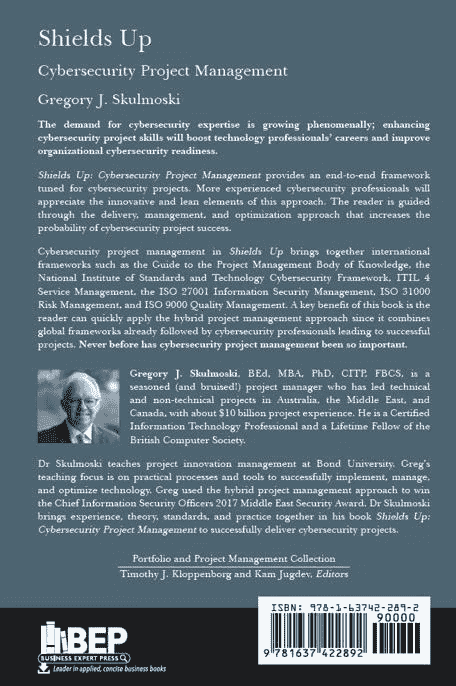
