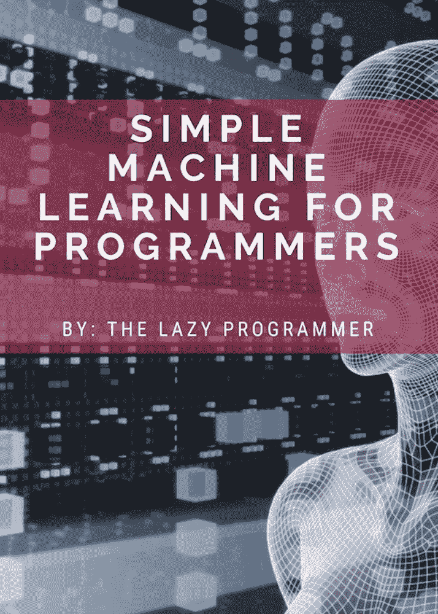
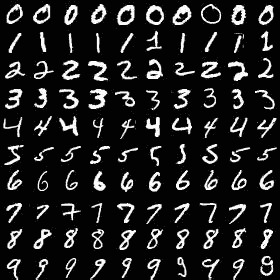
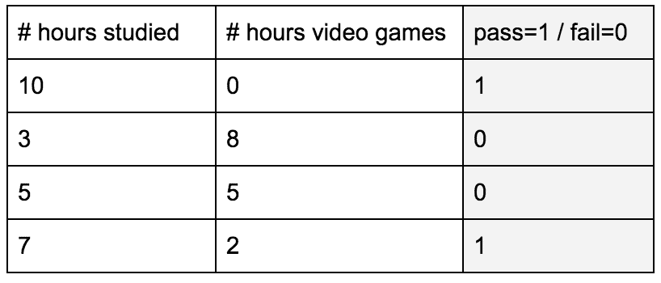
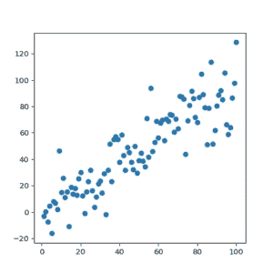
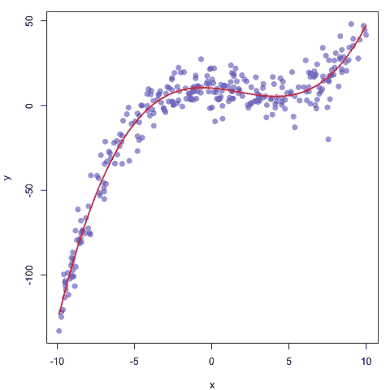
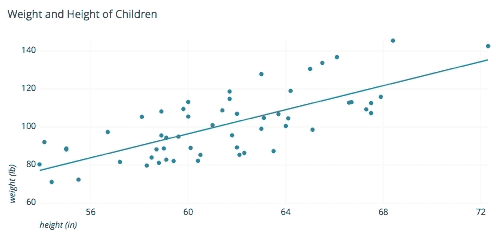
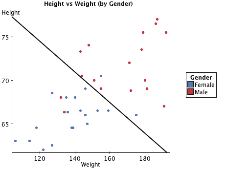
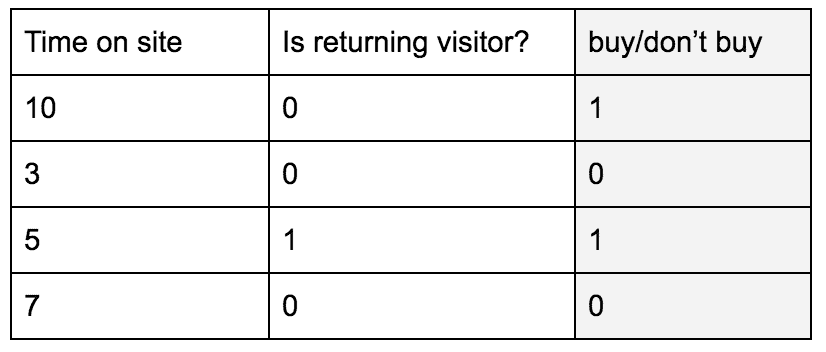

# 程序员的简单机器学习：用于实际应用的机器学习、深度学习和人工智能初学者指南 ... AI：深度学习与机器学习





## 引言
这本书对我来说是一次实验。在在线教授了多年成功的深度学习和机器学习课程后，我观察到了一些模式。其中一种模式就是，大部分学生一看到数学就会**落荒而逃**。这有点小问题，因为机器学习本质上是应用数学（例如，你不是简单地写下方程，而是将方程编程到计算机中以执行某些有用任务）。很多学生问过我：“Lazy Programmer，通过 API 机器学习可能吗？”

事实上，在编程中，为大型系统中的不同组件提供抽象的想法是一个非常强大的概念。这意味着你不需要非常详尽地理解每一行代码，而是信任其他程序员（他们都在构建各自的组件）已经完成了他们各自负责的那部分拼图。API 是一份契约。它说：“你给我这个，我承诺还你回那个。”它让你能够只专注于编写你所负责的系统部分，因为你信任其他人已经正确地完成了他们的工作。

这本书是一次实验，旨在看看学生在不需要进行任何数学或理论工作的情况下，能多好地学习机器学习的一些基本概念。如果你是一个想通过“API 方法”来学习机器学习的程序员，那么这本书非常适合你。我拥有总时长超过 100 小时的数学、算法和理论课程。如果你找的是这些，那么这本书并不是你想要的。

在本书中，我们将学习如何使用机器学习解决实际问题。我们甚至会学习如何在不需要理解其数学工作原理的情况下，应用简单的深度神经网络。我们将大量使用 Numpy 栈：

这本书的另一个目标是为你学习更进阶的主题做准备。其中一个主题是自然语言处理（NLP）。本质上，`NLP` 是机器学习在文本上的应用。我在学生身上看到的一种常见模式是，他们经常在尝试处理 NLP 时，从根本不知道什么是机器学习！这导致了各种奇怪的误解和错误的假设。如果你不知道某东西是什么，你就无法应用它。当然，结果就是产生过度的挫败感。

到为止，我还没有地方可以指引这些学生去学习机器学习的基础。市面上大多数其他资源的问题在于，它们试图让机器学习听起来尽可能复杂。它们的目标是让机器学习听起来几乎像魔法一样。它们也利用 API，但它们把代码视为一种咒语，而不是试图真正理解机器学习在做什么。

我更倾向于务实的方法。与其让机器学习听起来像魔法，我我想让它听起来尽可能笨。事实上，我将向你证明，它仅仅是一个几何问题。这才是真正的直觉。你不需要变魔法，而是可以使用基本的空间推理能力来理解机器学习，这让你在实际实现机器学习算法时处于更好的位置——这是成为机器学习大师的下一步。


# 什么是分类？

在本章中，我们将介绍机器学习中的两个基本问题之一：“分类”。分类意味着我们正试图去预测一个类别。让我们通过例子来让这个概念更加具体。

### MNIST 这是一个机器学习的经典案例。事实上，在多年里，它一直是标准的基准测试。每当有人写新论文时，他们总是会报告其算法在该数据集上的性能。该数据由一组手写数字图像组成。可能的数字是从 0 到 9。如果你正在构建一个机器学习模型，你的工作就是编写代码，将图像作为输入，并输出与图像对应的正确数字。



你可能知道这只是手写识别的一种特例。一个更通用的分类器能够接收任何字符的图像，并将其映射到相应的字符（0-9、A-Z 以及可能的某些符号）。例如，你可以在纸上写字母“a”，给它拍张，你的代码就会输出字符“a”。这一个立竿见见的应用是将物理文档（手写或打印）转换为数字形式。我们称其为 `OCR`（光学字符识别）。

### 数据类型

在机器学习中，你会发现有两种非常常见的数据类型。MNIST 是由一组图像组成的。图像通常属于“计算机视觉”领域。之所以被称为计算机视觉，是因为你正在教计算机能够智能地处理图像。我们在机器学习中工作的另一种常见数据格式是文本。文本无处不在，就像图像一样。当我们处理文本时，我们就是在进行“自然语言处理”。顺带提一下，这两个领域被深度学习彻底改变了。得益于深度学习，计算机视觉和 NLP 算法在近期都取得了巨大的进展。今天如果不讨论深度学习算法，你就上不上计算机视觉或 NLP 类。10 年前，甚至不会提到深度学习。

### 垃圾邮件分类

既然我们已经讨论了图像分类的例子，现在让我们来讨论一个文本的例子。这应该很简单。垃圾邮件检测如何？你可能已经注意到，如今像 Gmail、Yahoo、Hotmail 等现代电子邮件提供商会自动为你分类垃圾邮件和非垃圾邮件。你的垃圾邮件会自动进入一个名为“垃圾邮件”（Spam）的文件夹，而你的普通邮件直接进入收件箱。它们并不总是完全准确，但做得相当不错。

这是如何实现的？嗯，这不是魔法。这只是机器学习。机器学习算法接收电子邮件作为输入，并输出一个预测：它会将该电子邮件分类为垃圾邮件或非垃圾邮件。我们看到模式了吗？机器学习分类算法接收一个输入，并输出一个类别预测！

### 商业案例

当然，一定还有一些不属于图像和文本的分类例子。现在的企业正在利用机器学习来改进他们的服务并赚更多的钱。我们能想出一个例子吗？当然可以！我们都能共鸣的一个例子（无论你喜欢还是讨厌）是在线广告。这通常以横幅广告或视频广告的形式出现。在线广告是一个十亿美元行业，也是很多争议的来源。幸运的是，这本书不是关于广告伦理的。

那么，在线广告商可以如何利用机器学习呢？假设广告商收集了一些关于你的数据。例如，他们知道你的年龄、性别和。他们知道你昨天在 Google 上搜索了“最好的跑步太阳镜”。需要知道的一个细节是，广告商有一组可以展示给你的广告（这些广告由他们的客户提供）。假设他们的客户包括：
- 太阳镜公司
- 泳衣公司
- 办公家具公司
- 妆美美容公司
- 鞋子公司

这些客户每一个都为广告商提供了一些广告，广告商的工作是向用户展示最好的广告。最好的广告是用户最可能点击并从中购买产品的广告。因此，对于每条广告，我们都要对用户是否会点击做出预测。一旦他们确定了哪条广告的点击概率最高，广告就会展示给你（用户）。当然，在上述列出的公司中，属于太阳镜公司的广告最适合你（但根据其他属性，也许并不不是！）。这个例子和垃圾邮件分类都是**二分类**的例子，意味着你的预测始终是 2 个类别之一：
1. 垃圾邮件
2. 非垃圾邮件
1. 点击
2. 不点击

### 模式是什么？

让我们尝试识别一下上一个例子中的共同主题。对于每个例子，我们都有三样东西：
1. 输入数据（图像、文本或用户属性）
2. 一个机器学习分类器
3. 分类器做出的预测

对于我们的例子，预测是：图像代表什么？邮件是垃圾邮件还是非垃圾邮件？这个用户会点击广告还是不会？你可以将这个过程视为一个“流程图”或图表：`input > model > prediction`

### 做出正确的预测

机器学习分类器是如何学习做出正确预测的？这就是“机器学习”中“学习”的用武所在。通常，在机器学习中，我们有一张数据表从中学习（稍后我们将从程序角度详细说明它是如何工作的）。但我们不仅有图像、文本或用户属性等输入数据，我们还有正确答案。通常，人们称这些为标签（labels）或目标（targets）。在我的课程中，我们通常互换这两个词。

对于分类器“如何”学习做出正确预测的简短回答是：给模型提供大量的输入示例及其真实标签，然后某些算法学习识别这种模式。长回答是，一旦你被给你一组数据（由输入和相应的目标组成），实际上有许多不同的学习算法可以应用。如果你离开了这门课程，那些将是你学习的算法（线性回归、逻辑回归、决策树、随机森林、神经网络等）。当然，那是数学发挥作用的地方——而在本书中，我承诺过你没有数学。

### 数据“长什么样？”

到目前，我们已经看了一些例子（图像分类、文本分类、点击分类），但数据存储在你的计算机上实际上是什么样的？我们知道数据以“输入”和“目标”的形式存在，但它们是如何表示的呢？

真是另一个另一个例子的好时机！这个例子将很简单，以便它实际上能放在页面上。假设我想预测我的班级学生是否会通过我的考试（另一个二分类问题）。我从过去的学生那里获取了一些测量值来帮助我做出这个预测：他们学习的小时数以及在学习期间玩游戏的小时。我可以创建一个包含所有这些测量值的表格。每行代表一个不同学生的测量值。



因此，你可以想象你的数据被存储为 `CSV`（逗号分隔值）表格。在内存中，你的输入数据（表格的前 2 列）将由一个 `2-D array` 表示。你的目标（表格的最后一列，用灰色突出显示）将由一个相同长度的 `1-D array` 表示。机器学习背后的想法是我可以学习从这些数据中识别模式。所以对于明年的班级，我可以问一个学生：“你学习了几个小时，玩游戏了多久？”并使用该数据，我可以预测该学生是否会通过我的考试。

### 黑盒视角

在我们的情况下，我们需要一个实用的抽象。让我们把机器学习算法看作一个黑盒。我们可以假设这个黑盒能够做两件事：
1. 它根据训练数据学习模式。记住，这些训练数据由部分组成：输入和相应的目标。人们通常分别称它们 `X` 和 `Y`。
2. 在从训练数据学习模式后，它可以对新数据做出预测。例如，Gmail 的垃圾邮件分类器可能从未见过我今天收到的邮件。那么 Gmail 的垃圾邮件分类器如何处理它从未见过的邮件并预测它是垃圾邮件还是非垃圾邮件呢？原因在于 #1 - 它已经学会了正确识别垃圾邮件和非垃圾邮件之间的模式。

### 代码中是如何工作的？

现在我们已经对分类如何工作有了基本的了解，可以开始查看代码了。幸运的是，`scikit-learn` API 正好拥有我们刚刚讨论的两个任务所需的函数。让我们先考虑数据。记住，我们通常称它们为 `X` 和 `Y`。我们之前讨论过 `X` 将是一个 `2-D array`，而 `Y` 将是一个相同长度的 `1-D array`。

```python
X, Y = load_data()
model = RandomForestClassifier()
model.fit(X, Y)
predictions = model.predict(X)
accuracy = model.score(X, Y)
```


# 代码中的分类

在我们跳转到第一个代码示例之前，你得准备好环境。你需要 `Python` 以及一些数值计算库，如 `Numpy`、`Scipy`、`Matplotlib`、`Pandas` 和 `Scikit-Learn`。对于 Windows 用户，我建议使用 `Anaconda`，它已经内置了所有的库。在 Windows 系统上安装 `Anaconda` 的说明可以在我的 YouTube 视频中找到：[`bit.ly/2LfBBCo`](http://bit.ly/2LfBBCo)。对于 Mac 和 Linux 用户，我建议不要安装任何如 `Anaconda` 等额外的程序（但如果你想保持环境隔离，请研究 `virtualenv`）。安装所需库的说明可以在此处找到：[`bit.ly/2nS9hg3`](http://bit.ly/2nS9hg3)。注意，这些视频包含了许多库的安装说明，但这些对于本书来说是不需要的，因为我所有的课程都使用相同的说明。因此，一旦你安装了我上面列出的库，就可以停止了。

## 代码

在本章中，我们将学习如何使用 `scikit-learn` 在真实数据集上构建预测模型。你可以在文件 `classification_example.py` 中找到完整的脚本，地址：[`bit.ly/2Lae8SR`](http://bit.ly/2Lae8SR)。顺便说，我建议将这些行粘贴到交互式 REPL 中（如 `Jupyter Notebook` 或 `IPython`），这样你就可以实时看到输出。本章的意图是描述上述脚本中每一行代码。

```python
import numpy as np
## fact 获取数据的函数
## 是的，sklearn 自带内置的数据集！
from sklearn.datasets import load_breast_cancer
```

幸运的是，`scikit-learn` 自带可以直接供你使用的数据集。其中一个例子就是乳腺癌数据集。顺带一下：这让我们强调了机器学习分类的另一个重要应用——疾病诊断。如今，已经出现了机器学习算法学习识别疾病，且其准确性与人类专家平相当甚至更好的案例。这太棒了，因为人类专家是不可扩展的，而机器学习算法只是我们可以更容易复制的代码。

我们刚刚导入的实际上只是一个函数。我们需要调用这个函数来获取数据。

```python
## 加载数据
data = load_breast_cancer()
```

### 什么是“data”？

我们实际上不知道返回了什么。但我们可以通过打印 `data` 的类型或直接打印 `data` 本身来检查它。我建议两者都做。

```python
print(data)
print(type(data))
```

`data` 是一个 `Bunch` 类型的对象。`Bunch` 对象看起来不像我们熟悉的任何东西。但我们可以检查它的属性。如果你在 `IPython` 中，可以输入 `data.`（注意那个点）然后按下 Tab 键。现在你可以看到属于该对象的所有属性和方法。从 `data` 对象拥有的属性判断，`data` 对象的行为非常像 `Python` 字典。具体来说，注意 `keys()` 和 `values()` 方法。现在你可以看到这个对象拥有哪些键。这样做的好处是，我们不需要像普通的 `Python` 字典那样使用方括号符号，而是可以像对待对象属性一样对待这些键。

```python
data.keys()
```

我们找到了键：
`[1]: dict_keys(['data', 'target', 'target_names', 'DESCR', 'feature_names'])`

### 让我们检查数据键

`[2]: data.data` array([[1.799e+01, 1.038e+01, 1.228e+02, ..., 2.654e-01, 4.601e-01, 1.189e-01], [2.057e+01, 1.777e+01, 1.329e+02, ..., 1.860e-01, 2.750e-01, 8.902e-02], [1.969e+01, 2.125e+01, 1.300e+02, ..., 2.430e-01, 3.613e-01, 8.758e-02], ..., 1.660e+01, 2.808e+01, 1.083e+02, ..., 1.418e-01, 2.218e-01, 7.820e-02], [2.060e+01, 2.933e+01, 1.401e+02, ..., 2.650e-01, 4.087e-01, 1.240e-01], [7.760e+00, 2.454e+01, 4.792e+01, ..., 0.000e+00, 2.871e-01, 7.039e-02]])

看起来像很大的数字矩阵。让我们检查它的形状。

`[3]: data.data.shape` (569, 30)

`data.data` 是一个形状为 `569 x 30` 的 `2-D` 数组。关于它必须是 `2-D` 数组，我们知道什么？它是机器学习模型的输入！这意味着我们有 `N=569` 个样本和 `D=30` 个输入特征。重要的是，注意这个巨大的数字矩阵似乎没有任何意义。它只是一张巨大的数字表格。这些数字意味着什么？事实上，我们将学到，机器学习算法并不关心这些。它看到的只是一张数字表格，这就是它需要的所有。我们现在不纠结这个，稍后会详细讨论这个关键点。

### 让我们检查 target 属性

`[4]: data.target` array([0, 0, 0, 0, 0… 我们可以看到 target 是由 `0` 和 `1` 组成的 `1-D` 数组。这引出了另一个关键点。为什么目标是 `0` 和 `1` 而不是其他数字？为了真正理解这为什么有用，你必须更多地了解机器学习算法是如何工作的。通常，如果你有 `K` 个不同的标签，你的标签将从 `0...K-1`。直观上，我们知道 `Python` 编程中索引从 `0` 开始。如果你有一个长度为 `K` 的数组，它的索引将是整数 `0…K-1`。幸运的是，这里 `0` 和 `1` 的“含义”并没有丢失。我们可以检查 `target_names` 属性，这会告诉我们 `0` 和 `1` 的含义。

`[5]: data.target_names` array(['malignant', 'benign'], dtype='<U9') 我们可以看到 `0` 和 `1` 对应于“malignant（恶性）”和“benign（良性）”。在这里，让我们检查 targets 的形状。

`[6]: data.target.shape` (569,) 我们可以看到它的长度是 569。每个输入样本都有对应的目标。注意我们也可以检查特征名称。

`[7]: data.feature_names` array(['mean radius', 'mean texture', 'mean perimeter', 'mean area', 'mean smoothness', 'mean compactness', 'mean concavity', 'mean concave points', 'mean symmetry', 'mean fractal dimension', 'radius error', 'texture error', 'perimeter error', 'area error', 'smoothness error', 'compactness error', 'concavity error', 'concave points error', 'symmetry error', 'fractal dimension error', 'worst radius', 'worst texture', 'worst perimeter', 'worst area', 'worst smoothness', 'worst compactness', 'worst concavity', 'worst concave points', 'worst symmetry', 'worst fractal dimension'], dtype='<U23') 所以如果你好奇这 30 个特征是什么，它们就在这里。关键是，我想让你注意一点：机器学习算法并没有以任何方式使用这些特征名称或目标名称。它关心的只有数字（`X` 和 `Y`——在本例中为 `data.data` 和 `data.targets`）。

### 分分数据

接下来，我们通常做的是将数据划分为训练集和测试集。

```python
from sklearn.model_selection import train_test_split
X_train, X_test, y_train, y_test = train_test_split(data.data, data.target, test_size=0.3)
```


# 什么是回归？

在本章中，我们将转向监督学习中的另一项主要任务，即回归（regression）。我认为分类（classification）总是一个很好的起点，因为它在逻辑上非常直观。“这里有一张图像。告诉我里面是什么物体。”这里有一封邮件。告诉我是垃圾邮件还是非垃圾邮件。”这里有一些医疗检查的测量数据。告诉我这个人是否患了某种疾病。”这非常符合逻辑。

回归也非常直观，但它的直观性是体现在视觉上的。让我们来看看具体的。在 x-y 平面上有一些点。你应该很清楚地看出这些点形成了一个模式。事实上，你可以画一条直线直接穿过这些点，你可能在脑海中已经构思好了这条线，尽管最初那里并没有这条线。这是另一个例子。这并不是一条直线，但非常的是，我们可能仍然能想象出什么样的曲线会穿过这些点。回归的本质如此。“这里有一些点，现在告诉我拟合这些点的直线或曲线。”

## 回归和分类有什么区别？

分类意味着你正在预测一个类别。回归意味着你正在预测一个数字。这个数字通常是实轴上的一个数字。在分类中，我预测的是没有数值意义的东西。如果我看到一封邮件，我想知道它是垃圾邮件还是非垃圾邮件。你可能会在这里提出异议，因为在代码 `spam / not-spam` 被编码为 `0` 和 `1`。实际上，这些数字并不重要。这些数字只是代表实际类别的符号（因为它们在计算机内部，而计算机内部的一切都是数字）。垃圾邮件是 `0` 而非垃圾邮件是 `1` 还是反过来**并不重要**。在回归中，数字确实是有意义的。

## 示例 #1：身高与体重

当然，如果没有一些回归应用的真实生活例子，本章将是不完整的。这里有一个简单的例子。给定一个人的身高，我想预测他们的体重。反之亦然。自然，较高的人质量越大，因此体重越重。这种相关性不是完美的，但通常是真实的。你可以想象，例如，恐龙重量比蚂蚁重得多。

## 示例 #2：房价预测

回归的另一个常见应用是预测房价。如果你从事房地产或房产买卖业务，这对你来说将非常相关。注意，在我们之前看过的图片中，我们能够将数据可视化为 2D 图形，因为我们有 `1` 输入（自变量）和 `1` 输出（因变量）。但就像分类一样，我们可以有多个输入。例如，房屋的价格可能与所在社区的平均家庭收入以及该社区的犯罪率相关。它可能还取决于属性，如房屋的大小、卧室的数量以及最后一次装修的时间。

当你处于高维空间时，你预测的东西就不再是一条线。如果你有 `2` 输入和 `1` 输出，那么你总共有 `3` 个维度，所以你看到的是一个平面；如果它是弯的，那么它就是一个曲面。如果你有超过 `2` 个输入，那么。当然，人类的眼睛和大脑通常没有可视化此类对象的能力。

## 示例 #3：预测股票

让我在这里再给你们一个例子，因为对于回归和分类，我都想给你们提供一个真实的业务应用，人们可以利用这些思想并从中赚大钱。我们都听过股市。通常情况下，玩股市的“规则”之一是你低买高卖。这样，你得到的钱总是比投入的要多。当然，事情并不总是这样发展，许多人让情绪和恐惧战胜了自己，但那是另一个课程的内容。

从机器学习的角度来看，我们想做什么？其实非常简单。我们想获取一些输入，例如，该股票过去 `10` 天的价格，昨天是否有关于该公司的新闻报道，以及该新闻是否是正面。我们可以获取这些输入，并输出对明天股票价格的预测。

## 代码大纲

当然，如果你可以的话……

```python
model = LinearRegression()
model.fit(X, Y)
predictions = model.predict(X)
model.score(X, Y)
```


# 代码中的回归

在本章中，你可能想要再次启动你最喜欢的 REPL。如果你想看预先编写的版本，本章相关的文件名为 `regression_example.py`，可以在 [`bit.ly/2nU9z5W`](http://bit.ly/2nU9z5W) 找到。在本章中，你需要手动下载数据集。我们将使用“Airfoil”（翼型）数据集，你可以在此 URL 找到它：[`archive.ics.uci.edu/ml/datasets/Airfoil+Self-Noise`](https://archive.ics.uci.edu/ml/datasets/Airfoil+Self-Noise)。

首先，如果你不知道什么是翼型（Airfoil），它基本上就是飞机机翼。这个数据集是关于获取翼型的某些特定属性（例如频率和攻角），并尝试预测“声压级”。简单来说，就是声音有多大。如果你感兴趣，该 URL 提供了关于数据的更多信息。

让我们导入 Numpy 和 Pandas：

```python
import numpy as np
import pandas as pd
```

Pandas 很有用，因为数据文件是表格格式。让我们加载数据：

```python
df = pd.read_csv('airfoil_self_noise.dat', sep='\t', header=None)
```

接下来，让我们看看这个 dataframe 以了解里面的内容。

```python
In[1]: df.head()
Out[1]: 0     1       2      3         4         5 0    800  0.0  0.3048  71.3  0.002663  126.201 1    1000  0.0  0.3048  71.3  0.002663  125.201 2    1250  0.0  0.3048  71.3  0.002663  125.951 3    1600  0.0  0.3048  71.3  0.002663  127.591 4    2000  0.0  0.3048  71.3  0.002663  127.461
```

我们可以看到这是一个数字表格，这很合理。

```python
In[2]: df.info()
<class 'pandas.core.frame.DataFrame'>
RangeIndex: 1503 entries, 0 to 1502
Data columns (6 columns):
0      1503 non-null int64
1      1503 non-null float64
2      1503 non-null float64
3      1503 non-null float64
4      1503 non-null float64
5      1503 non-null float64
dtypes: float64(5), int64(1)
memory usage: 70.5 KB
```

记住，根据文档，前 5 列是输入，最后一列是输出。至关让我提醒你，我们现在拥有的只是数字表格！你可以阅读文档来确定它们的含义，但代码本身并没有说明。

接下来，我们想从 dataframe 中提取 `X` 和 `Y` 作为 Numpy 数组。这些列除了默认的 0, 1, 2, 3, 4 外没有名称，所以我们可以这些整数作为列名。0-4 代表 `X`，5 代表 `Y`。

```python
data = df[[0,1,2,3,4]].values
target = df[5].values
```

接下来，我们想像之前一样进行训练测试集划分。

```python
from sklearn.model_selection import train_test_split
X_train, X_test, y_train, y_test = train_test_split(data, target, test_size=0.33)
```

我们将使用 `LinearRegression` 模型来解决我们的问题。让我们导入 `LinearRegression`。

```python
from sklearn.linear_model import LinearRegression
```

注意这些步骤与之前完全相同。我们实例化对象。

```python
model = LinearRegression()
```

我们调用 `fit`。

```python
model.fit(X_train, y_train)
```

我们调用 `score` 来评估模型。

```python
In[3]: print(model.score(X_train, y_train))
0.5036858385032759
In[4]: print(model.score(X_test, y_test))
0.528662769515345
```

记住这些并不代表“准确率”，因为我们不是在做分类。这个数字是 $R²$。越接近 1 越好，但 0.5 并不差，尽管通常你可能认为 0.5 的分类率很糟糕。

最后我想指出，回归模型也有一个 `predict` 函数。所以如果你明天有新数据想要进行预测，这就是做法。

```python
predictions = model.predict(X_test)
```


## 机器学习无非是几何学

在本章中，我想触及机器学习的核心。我想让你们理解，机器学习并不是魔法，它仅仅是几何学。我们将从纯粹的几何角度来看待回归和分类，而不考虑数据本身的实际意义。你们已经天性地理解了这一点。在我们所过的所有回归和分类示例中，代码和模型并不理解数据的含义。`X` 和 `Y` 仅仅是数字表格。

让我们先从回归问题开始，因为我认为这是最容易可视化的。正如我们之前讨论的，最简单的问题就是找到最优拟合线。有两种方法可以让这个问题变得复杂：

1.  首先，我们可以让模式不再是直线而是一条曲线。但这没关系，它并没有改变这是一个几何问题的事实。直线和曲线都是几何对象。正如我们在上一章中讨论的，我们可以将其看作多项式，并寻找最优拟合多项式。
2.  另一种让它变得困难的方法是增加输入维度（即让 `D` 大于 1）。然而，这仍然没有改变这是一个几何问题的事实。现在模型是一个超平面或超曲线。依然是几何学。

现在让我们考虑分类问题。像往常一样，我们会发现从示例开始是很有用的，但我们会尽快抛弃它。假设我们收集了一组数据点——一些人的身高和体重——我们想要预测他们是男性还是女性。

记住，此表中的每一行（`X`）都是一个特征向量。对于每个向量，我可以在这个网格上画一个点。由于我知道每个向量对应的标签，我可以将每个点涂成蓝色或红色。在此时，显然存在某种模式。所有的男孩都在右上角，所有的女孩都在左下角。为了区分这两组人，我可以在红点和蓝点之间画一条线或一条曲线。我称之为我的分类边界。再次，线和曲线是什么？几何学！所以你们看到分类同样仅仅是一个几何问题。它与男孩、女孩或身高或体重完全无关。

将该问题泛化为：“这里有一些红点”、“这里有一些蓝点”、“找到一条穿过它们之间的线”。机器学习不是魔法。在现实中，它只是一个几何问题。有些人喜欢说，机器学习无非是华丽版的“曲线拟合”而已。

## 所有数据都是相同的

我在课程中收到的最常见的问题之一是：“我们能多做些示例吗？”事实上，我的课程已经包含了许多实践示例，但学生想看更多是自然的。通常，我会满足这些请求。但额外的示例真的是必要的吗？让我们考虑为什么可能不是这样。我们已经看了几次考试通过/不通过的数据集，所以我在这里不再重复了。提醒你们一下，它是一个由学习小时数和视频游戏小时数作为输入，通过/不通过作为目标组成的表格。

现在让我们考虑一个新的分类数据集。在这个示例中，我们想要建立一个模型来预测用户是否会在我们的网站上购买产品，使用用户在网站停留的时间以及他们是否为回归客作为预测

关键点在于，对于这两个问题，代码需要改变吗？不需要！

```
X, Y = load_data()
X_train, X_test, y_train, y_test = train_test_split(…)
model = RandomForestClassifier()
model.fit(X_train, y_train)
## 评估模型性能
model.score(X_train, y_train)
model.score(X_test, y_test)
```

只有数据改变了！这就是为什么我们说“所有数据都是相同的”。机器学习算法并不关心你的数据实际代表什么。你给它 `X` 和 `Y`，从那时起使用什么数据集，代码都是相同的。

类似的概念是“所有机器学习接口都是相同的”。注意将 `RandomForestClassifier` 切换为 `MLPClassifier`，或者将 `LinearRegression` 替换为 `RandomForestRegressor` 是多么容易。区别仅仅在于类名！当你学习真正的机器学习时，你真正感兴趣的是问：“随机森林是如何工作的？”你对数据并不那么感兴趣，因为那不需要代码的任何改变。同样，每个算法的接口都是相同的：`fit` / `predict` / `score`。随机森林背后的理论才是真正有趣的。学习算法是什么？我该如何实现它？这就是“学习”机器学习的含义。


## 比较不同的机器学习模型

在本章中，我们将扩展“所有机器学习接口都是同的”这一观点。当你听到这种话时，我想你脑中会立刻浮现出一个问题：如果所有模型的接口都是同样的，那么我应该选择哪种模型呢？在我的代码中，使用 `Linear Regression` 所需的代码行并不比使用神经网络多。那么，为什么我不应该一直选择最强大的模型呢？但更重要的是，我从一开始又如何知道哪个模型是最强大的呢？这些都是重要的问题。

我的答案（我知道这会让你们中的一些感到失望）是：“没有捷径”。在本章中，我将给你们一些可以遵循的通用想法和概念，但在大多数情况下，没有任何东西可以替代实际学习这些模型是如何工作的。这意味着要学习算法、学习数学、理解这些模型在何时失败以及在何时成功等等。没有任何东西可以取代这种经验和知识。让我们从总的概述开始。顺便说一下，如果你想查看 `scikit-learn` 中所有可用模型的列表，请直接查看文档。本章将列出一些模型，但不是全部。

## 线性模型

让我们从最基础的模型类型开始——线性模型。它们之所以被称为线性模型，是因为它们的几何形状始终是直线、平面或超平面。换句话说，它们永远不是弯曲的。你可能已经看出这里有一个明显的劣势。例如，如果你的数据遵循多项式或正弦波的形状怎么办？

一个优势是这些模型非常容易解释。例如，如果我的公式是：
`weight (lbs) = 80 + 2*height (inches)`
那么我可以立即看到，你每高一英寸，体重就会增加 2 磅。通常情况下，在其他模型中，你会失去这种解释性。

## 基础非线性模型

之后，我们有了更基础的模型，但它们是非线性的。然而，不要被骗了！仅仅因为这些是非线性的并不意味着它们比线性模型更强大。要真正知道哪个模型在你的特定数据集上效果更好，你只需要进行实验。这些基础模型的示例包括 `Naive Bayes`、`Decision Trees` 和 `K-Nearest Neighbor`。（旁注：对于某些分布，`Naive Bayes` 会简化为线性模型。）在本书书中，我的目标不是讨论这些模型的任何细节，因为我还有其他非常深入的课程，我只想让你们知道它们的存在。

## 集成模型

另一类我不认为是“基础”的模型是集成模型。我们已经看到过这方面的一个例子——`random forest`。其他例子包括 `AdaBoost`、`ExtraTrees` 和 `Gradient Boosted Trees`。

这些模型通常的工作方式是它们采用了大量的个体决策树（例如 200 棵），但它们在输入数据 `X` 的不同子集上训练这些树。你从训练过程中得到的是 200 棵不同的树，它们都是以略有不同的方式训练的。事实证明，当我们对这些树的预测取平均值时，结果是非常强大的。

事实上，梯度提升树的一种变体叫做 `XGBOOST`，它已被用于赢得大量的 Kaggle 竞赛比赛。集成模型也被用于赢得了著名的 Netflix 奖赛，那是 Netflix 举办的用于预测电影评分的奖金为 100 万美元的活动。不用说，集成方法非常强大。正如我们在书中看到的，它们也非常容易“即插即用”。你真的不需要考虑数据本身——只需插入 `X` 和 `Y` 然后看着它运行即可！这与深度神经网络相反——你看到为了获得良好的性能，需要对数据进行标准化。

## 支持向量机

另一个某种独立存在的模型是 `support vector machine`。


# 机器学习与深度学习：未来主题

在本章中，我想让你们初步了解一下存在的其他类型的机器学习，以及一些你们可以期待学习的未来主题。

我希望你意识到，由于特殊性，这本书的内容是非常局限的。这本书的唯一目的是教你如何使用 `scikit-learn` API，并开始从几何的角度来思考机器学习。尽管这很简单，但仅仅是这些基础知识，达到这一水平仍然花费了一些时间！因此，我希望你能理解并欣赏机器学习中可以深入探索的深度。

在本书中，我们学习了分类和回归任务。对于这两个问题，我们都给出了以输入 `X` 和目标 `Y` 形式提供的训练数据。在机器学习术语中，这被称为`监督学习`，因为你会被告知正确答案，并可以根据真实目标来修正你的猜测。

## 无监督学习

但你可以想象，获取目标是一个耗时且昂贵的过程。考虑 `ImageNet` 数据集，这是一个包含超过 1000 万张图片的数据集。它是今天图像分类的基准。想象一下你必须处理每一张图片并对其进行正确标记。例如，如果图片是一只猫，你就必须将其标记为猫；如果图片是一只狗，你就必须将其标记为狗。但你需要标记的不仅仅是猫和狗。事实上，`ImageNet` 拥有 1000 个不同的类别！这极其耗时。你绝对无法独立完成。也许你可以付钱让别人帮你做，但现在需要花费费用。想象你是一家初创公司，你需要标记 1000 万个训练样本。这总是可行的吗？答案是否。

这就是`无监督学习`派上用场的地方。`无监督学习`意味着我们有 `X` 但没有 `Y`。换句话说，我们有很多图片或一组邮件，但对它们没有标签。我们还能从这些数据中学习到什么吗？可以！一个例子就是`聚类`。例如，我们可以从一组新闻文章中收集数据，但如果我们实际上手动阅读它们就太耗时了。我们可以应用`聚类`并观察发现什么模式。我们可能会发现一个簇包含许多关于技术的文章，而另一个簇包含许多关于政治的文章。因此，`聚类`允许我们在不需要手动标记的情况下将相似的项目归类，正如我们讨论过的，这既节省了时间又节省了金钱。

## 强化学习

我想谈论的第三种机器学习是`强化学习`。在这里事情变得非常棘手。首先，让我告诉你们一些应用。`强化学习`在最近的过去取得了巨大的成果。一些例子包括 `AlphaGo` —— 它在围棋中击败了世界冠军。尽管许多专家认为这在 10 年内是不可能的。几几年之后，我们得到了 `AlphaZero`，它是对 `AlphaGo` 更更大的改进。`AlphaGo` 和 `AlphaZero` 之间一个很大的区别是 `AlphaGo` 需要人类策略的知识，而 `AlphaZero` 完全通过自我对弈学会了下棋。

`强化学习`的另一个重要应用是玩视频游戏。这些算法在 `Atari` 游戏以及最近的 `Dota 2` 中展示了超人类。视频游戏很重要是因为它们模拟了物理学。如果一个算法能够学习模拟物理学，那么可以假设同样的算法也可以学习现实世界的物理学。事实上，我们有一些`RL`算法的例子，它们可以学习行走、跑步、跳跃和导航。

## 结论

但正如我之前提到的，`强化学习`是复杂的。它与`监督学习`和`无监督学习`是完全不同的东西。在我看来，如果你想应对 `RL`，最好先在`监督学习`和`无监督学习`上打下坚实的基础。最后，还有许多在本课程中没有讨论过的实用概念。我们接触了训练集和测试集，以及为什么你真正关心的一直是测试集。这绝对是我们我们将深入研究的主题。与此相关的概念有：`泛化`、`偏差-方差权衡`(bias-variance trade-off）以及`交叉验证`。另一个重要主题是超参数。如果你查看 `RandomForestClassifier` 或 `MLPClassifier` 的文档，你会发现它们实际上带有大量的选项——尽管我们没有使用它们。这些选项是什么？什么是好的值，什么是不好的值？我们应该如何选择它们？一个例子：我们知道随机森林是由决策树集成组成的。我们实际上应该使用多少棵决策树？这是一个超参数。超参数选择在现代深度学习中也是一个非常重要的课题。

### 核心点
- 机器学习不是魔法，它只是几何学。
- 所有数据都是一样的。
- 所有的机器学习接口都是一样的。
- 学习机器学习并不是尝试新的数据集，而是关于学习算法背后的理论。


# 额外资源

希望你喜欢我的这个小实验！这本书的设计旨在采用一种替代的、代码优先的方法来学习机器学习。它是为程序员量身定制的——那些于与接口工作、习惯于将某些细节委托给他们正在使用的接口的开发者的人。在大多数时候，我更倾向于深入研究，并探索机器学习算法所有详尽的细节。我希望这本书激励你迈出这一步，在更高级的水平学习机器学习！

以下是我目前正在教授的课程列表：

- [线性回归](https://deeplearningcourses.com/c/data-science-linear-regression-in-python/)
- [逻辑回归](https://deeplearningcourses.com/c/data-science-logistic-regression-in-python/)
- [Python 深度学习](https://deeplearningcourses.com/c/data-science-deep-learning-in-python/)
- [Python 现代深度学习](https://deeplearningcourses.com/c/data-science-deep-learning-in-theano-tensorflow/)
- [卷积神经网络](https://deeplearningcourses.com/c/deep-learning-convolutional-neural-networks-theano-tensorflow/)
- [循环神经网络](https://deeplearningcourses.com/c/deep-learning-recurrent-neural-networks-in-python/)
- [无监督深度学习](https://deeplearningcourses.com/c/unsupervised-deep-learning-in-python/)
- [自然语言处理](https://deeplearningcourses.com/c/data-science-natural-language-processing-in-python/)
- [深度自然语言处理](https://deeplearningcourses.com/c/natural-language-processing-with-deep-learning-in-python)
- [深度学习：高级 NLP 和 RNN](https://deeplearningcourses.com/c/deep-learning-advanced-nlp)
- [深度学习：GANs 和 变分自编码器](https://deeplearningcourses.com/c/deep-learning-gans-and-variational-autoencoders/)
- [高级计算机视觉](https://deeplearningcourses.com/c/advanced-computer-vision/)
- [聚类分析](https://deeplearningcourses.com/c/cluster-analysis-unsupervised-machine-learning-python/)
- [监督机器学习](https://deeplearningcourses.com/c/data-science-supervised-machine-learning-in-python/)
- [集成机器学习](https://deeplearningcourses.com/c/machine-learning-in-python-random-forest-adaboost)
- [隐隐马尔可夫模型](https://deeplearningcourses.com/c/unsupervised-machine-learning-hidden-markov-models-in-python/)
- [贝叶斯机器学习](https://deeplearningcourses.com/c/bayesian-machine-learning-in-python-ab-testing)
- [强化学习](https://deeplearningcourses.com/c/artificial-intelligence-reinforcement-learning-in-python/)
- [深度强化学习](https://deeplearningcourses.com/c/deep-reinforcement-learning-in-python/)
- [SQL](https://deeplearningcourses.com/c/sql-for-marketers-data-analytics-data-science-big-data)

我有很多课程，最经常被到的问题之一是：“我应该按什么顺序上你的课程？”当然，这个问题并不是关于我的课程，而是关于机器学习本身的。机器学习是一个广阔的学习领域，有许多主题需要涵盖。某些主题比其他主题困难，某些主题则依赖于其他知识作为先前提。我创建了这张图来帮助你理不同机器学习主题之间的依赖关系：[`deeplearningcourses.com/course\_order`](https://deeplearningcourses.com/course_order)

