## 简化机器学习：机器学习专业知识的核心构建模块


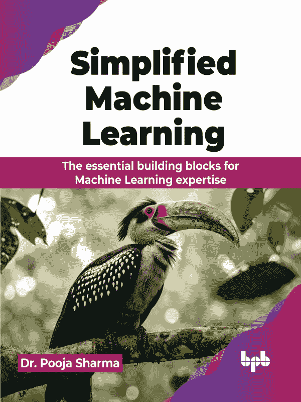


**献给**

我的学生  

和  

我的家人

# 作者简介

Dr. Pooja Sharma，计算机科学与工程系助理教授，拥有超过 17 年的教学和研究经验。她是研究生阶段的金牌获得者，其他学术成就包括通过 UGC NET 和 JRF 后获得 UGC（新德里）颁发的正式博士奖学金、多项优秀证书、以及中学、高中、本科和研究生阶段的金牌和银牌。她于 2013 年在 Dr. Chandan Singh 的指导下，以基于内容的图像检索为课题获得博士学位（旁遮普大学，Patiala）。她在 Springer 和 Elsevier 等具有显著汤森路透影响因子的同行评审国际期刊上发表了多篇研究论文。她是多篇研究书籍章节的作者，并出版了《Python 程序设计》一书。她是 Elsevier、IET（IEEE 计算机学会）和《科学研究与论文》等多个国际期刊的审稿人。她参加过各种会议和研讨会。她的专业领域包括数据分析、机器学习、基于内容的图像检索、人脸识别、模式识别和数字图像处理。她曾在多所知名大学和学院工作并入选，包括中央大学。她曾在 DAV 大学担任系主任 3 年。目前，她在 IKG 旁遮普技术大学主校区（Kapurthala）计算机科学与工程系担任助理教授。

# 致谢

我永远感激全能的上帝，让我有能力写出这本书。我向我的父母致谢，感谢他们在生活的各个方面给予我的鼓励和支持。我要感谢我的丈夫 Rajkumar，在撰写本书的整个过程中给予我坚持不懈的鼓励和支持，还有我的女儿 Angel。

我衷心感谢 IKG 旁遮普技术大学（Kapurthala）当局以及计算机科学与工程系的同事们给予的支持与合作。

我要感谢 BPB Publications 在完成本书过程中提供的指导和专业知识。这是一段漫长的写作和修订旅程，蒙受了审稿人、技术专家和编辑们宝贵的协助与指导。

最后，我要感谢所有对拙作感兴趣的读者，感谢你们的支持让它成为现实。你们的鼓励弥足珍贵。

# 前言

欢迎来到机器学习的世界！本书旨在成为您探索人工智能这一激动人心且快速发展领域的伴侣。无论您是学生、研究人员还是行业专业人士，这本综合指南旨在揭开复杂概念的神秘面纱，并为您提供实用技能，以驾驭广阔的机器学习版图。

近年来，机器学习已成为一股变革力量，彻底改变了各行各业并塑造了我们的日常体验。从流媒体平台上的个性化推荐到先进的医疗诊断，机器学习的应用无处不在且不断扩展。当您踏上这段学习之旅时，我们的目标是为您打下坚实的基础，掌握驱动这些创新的基本原理、算法和技术。

本书的结构旨在满足各层次学习者的需求。我们首先奠定基础，解释监督学习和无监督学习、回归、分类和聚类等核心概念。随后，我们深入探讨各种机器学习算法的复杂性，包括决策树、支持向量机、神经网络和关联规则挖掘。每一章都配有直观的解释、图解示例和动手练习，以巩固您的理解。

除了理论，本书还强调实际应用。我们将通过真实世界的案例研究指导您，提供关于部署机器学习模型、解读结果和解决伦理考量的见解。无论您对医疗保健、金融还是自然语言处理感兴趣，都将找到针对不同领域的可操作见解和基于项目的学习练习。

当您踏上这段机器学习之旅时，我们邀请您拥抱好奇心、拥抱挑战、拥抱未来的可能性。让我们一起踏上这段冒险，发掘机器学习的变革潜力。本书的章节安排如下：

# 代码包与彩色图片

请访问以下链接下载本书的**代码包**和**彩色图片**：

[`rebrand.ly/7be7b5`](https://rebrand.ly/7be7b5)

本书的代码包也托管在 GitHub 上，地址为 [`github.com/bpbpublications/Simplified-Machine-Learning`](https://github.com/bpbpublications/Simplified-Machine-Learning)。如果代码有更新，将在现有的 GitHub 仓库中更新。

我们丰富目录中的书籍和视频代码包可在 [`github.com/bpbpublications`](https://github.com/bpbpublications) 获取。快去看看吧！

# 勘误表

我们在 BPB Publications 为我们的工作感到无比自豪，并遵循最佳实践以确保内容的准确性，为订阅者提供沉浸式的阅读体验。我们的读者是我们的镜子，我们利用他们的反馈来反思并改进出版过程中可能出现的人为错误。为了保持质量并帮助我们联系到可能因不可预见的错误而遇到困难的读者，请写信给我们：

errata@bpbonline.com

BPB Publications 全家高度赞赏您的支持、建议和反馈。

# 加入我们的书籍 Discord 空间

加入书籍的 Discord 工作区，获取最新动态、优惠、全球科技动态、新书发布和作者见面会：

[`discord.bpbonline.com`](https://discord.bpbonline.com)


# 第 1 章：机器学习简介

## 简介

机器学习（ML）是人工智能（AI）领域内一个变革性的分支，它赋予计算机在无需显式编程的情况下进行学习、预测或决策的能力。其核心在于利用数据和数学算法来识别模式、进行推理并随时间推移提升性能，从而模拟人类的学习过程。简而言之，机器学习让计算机能够从数据中泛化。它从包含示例及对应结果的数据集开始，机器学习模型学习识别数据中潜在的模式或关系。这些模式涵盖范围广泛，从识别手写字符、预测股票价格、通过医学扫描诊断疾病，到根据用户行为推荐产品。

监督学习作为机器学习的核心分支之一，涉及在已知正确结果的标记数据上训练模型。相比之下，无监督学习处理未标记数据，旨在发现隐藏的结构或分组。强化学习则专注于通过与环境交互并接收反馈来训练智能体做决策。基于此，机器学习在医疗、金融、电商和自动驾驶汽车等各行业拥有广泛的应用。其成功得益于算力的提升、海量数据集的可用性以及算法的改进。流行的机器学习库和框架（如 `TensorFlow` 和 `sci-kit-learn`）使该领域普及化，让研究人员和开发者能够构建和部署强大的模型。

因此，我们可以认为机器学习是教会计算机从数据中学习的科学，为能够自动化任务、进行预测并持续改进性能的智能系统铺平了道路。随着其不断发展，机器学习有望彻底改变我们生活和各行业的各个方面。

## 结构

本章包含以下主题：

*   机器学习的必要性
*   人工智能与机器学习的关系
*   机器学习的类型
*   机器学习的应用
*   机器学习的生命周期
*   安装 Anaconda 和 Python 的步骤

## 目标

读完本章后，您将能够理解机器学习的基本概念及其必要性。您将了解所有机器学习类型及其主要应用。此外，您还将学习机器学习生命周期以及安装 Anaconda 的步骤，以便使用 Python 库实现机器学习算法。

## 机器学习的必要性

机器学习是一个强大且多功能的领域，提供了诸多益处和机遇，使其成为各种应用和行业的有力选择。以下是机器学习被广泛采用的一些关键原因：

*   **数据驱动的洞察**：机器学习擅长从海量数据中提取有价值的洞察和模式。它能发掘传统统计分析可能无法察觉的趋势和关系。
*   **自动化**：机器学习算法可自动化重复性和劳动密集型任务，释放人力资源从事更具创造性和战略性的工作。这在制造、金融和客户服务等行业尤为宝贵。
*   **个性化**：机器学习使企业能为客户提供个性化体验。这包括量身定制的产品推荐、内容建议和精准营销活动，可提升客户满意度和留存率。
*   **效率**：机器学习可优化流程和资源配置，降低成本并提高运营效率。例如，制造业中的预测性维护可减少停机时间和维护成本。
*   **可扩展性**：机器学习算法能处理大规模数据分析和决策，适用于从电商到医疗等广泛的应用场景。
*   **改进决策**：机器学习模型能实时做出数据驱动的决策，这在算法交易等金融领域或治疗建议等医疗领域极具价值。
*   **解决问题**：机器学习能攻克那些可能没有直接算法解决方案的复杂问题。这包括图像识别、语言翻译和博弈等任务。
*   **适应性**：机器学习模型能适应不断变化的条件和新数据，使系统能长期保持相关性和有效性。
*   **创新**：机器学习在自动驾驶汽车、自然语言处理和医学诊断等各个领域取得了突破，推动了跨行业的创新。
*   **竞争优势**：善用机器学习力量的组织，能通过提供更好的产品、服务和客户体验获得竞争优势。


## 科学发现
在基因组学和材料科学等领域，ML 通过分析复杂数据集和预测发现来加速研究。

## 易用性
随着开源 ML 库和基于云的 ML 平台的普及，企业和研究人员可以轻松获取强大的工具和资源。

## 可持续性
ML 可用于优化资源使用、减少浪费，并在农业、能源管理和交通等领域支持可持续发展工作。

## 医疗进步
在医疗保健领域，ML 协助疾病诊断、药物发现和个性化治疗方案，有望挽救生命并改善患者预后。

### 网络安全
ML 通过识别网络流量和用户行为中的异常和模式，帮助组织检测和应对网络安全威胁。

ML 有潜力解决复杂问题、提高效率，并在广泛领域推动创新。其从数据中学习并做出数据驱动决策的能力，使其成为企业、研究人员和行业利用数据和自动化力量实现目标的宝贵工具。

## 人工智能与机器学习的关系

AI 和 ML 是紧密相关的领域，ML 是 AI 的子集。二者联系如下：

*   **AI**：指创造能够模拟人类认知功能（如推理、解决问题、学习、感知和语言理解）的智能机器的更广泛概念。它包含多种技术，包括基于规则的系统、专家系统、知识表示等。
*   **ML**：是 AI 的一个子集，专注于开发算法和统计模型，使计算机能够从数据中学习并基于数据进行预测或决策。它是处理学习方面的 AI 特定方法。
*   **从数据中学习**：ML 是许多 AI 系统的基本组成部分。它为 AI 系统提供了从大型数据集中学习模式、行为和洞察的能力。

AI 系统可使用 ML 技术来提高性能或适应不断变化的条件。

## 自动化

AI 和 ML 常协同工作以实现任务和决策的自动化。AI 系统可使用 ML 模型基于数据做出明智决策。

例如，在自动驾驶汽车中，AI 算法使用 ML 模型处理传感器数据并做出实时驾驶决策。

## 适应性

ML 使 AI 系统能够随时间推移适应并提高性能。AI 系统可以从新数据中学习并相应调整行为。这种适应性对于 AI 系统处理复杂和动态环境至关重要。

## 自然语言处理

自然语言处理（NLP）是处理人类语言理解和生成的 AI 子集。ML 在 NLP 中发挥重要作用，用于构建语言翻译、情感分析和聊天机器人等任务的模型。

## 计算机视觉

计算机视觉是另一个 AI 子领域，专注于使计算机能够解读和理解来自世界的视觉信息。ML，特别是深度学习，彻底改变了计算机视觉，使 AI 系统能够识别图像和视频中的物体、人脸和场景。

ML 是许多 AI 系统的核心组件，赋予它们学习、适应和做出数据驱动决策的能力。虽然 AI 包含更广泛的目标和技术，但 ML 是 AI 工具箱中的关键工具，使 AI 系统能够执行涉及从数据中学习并随时间提高性能的任务。

## 机器学习的类型

ML 可分为几种类型，每种都有其方法和特征。主要类型如下。

### 监督学习

在监督学习中，算法在标记数据集上训练，其中每个输入示例都与其相应的输出或目标配对。目标是学习从输入到输出的映射，使模型能够对新的、未见过的数据进行预测或分类。常用算法包括线性回归、逻辑回归、决策树、支持向量机和神经网络。

### 无监督学习

无监督学习处理未标记数据，算法在没有明确指导的情况下寻找数据中的模式、结构或关系。它常用于聚类（将相似数据点分组）和降维（在保留重要信息的同时减少特征数量）等任务。常用算法包括 K-Means 聚类、层次聚类、主成分分析（PCA）和自编码器。

### 半监督学习

半监督学习结合了监督和无监督学习。它同时使用标记和未标记数据来提高模型性能。当获取标记数据昂贵或耗时时，这特别有用。技术可能包括使用少量标记数据指导模型在更大的未标记数据集上的学习。

### 强化学习

强化学习专注于训练智能体在环境中做出决策序列以最大化奖励信号。它常用于智能体与周围环境交互并通过试错学习的任务。流行算法包括 Q-Learning、深度 Q 网络（DQN）和策略梯度。

### 自监督学习

自监督学习是一种无监督学习，模型从数据中生成自己的标签。它常用于在大型数据集上预训练模型，然后在较小的标记数据集上针对特定任务进行微调。常用技术包括 Word2Vec 和对比学习。

### 在线学习

在线学习（也称为增量学习或流式学习）涉及在顺序到达的数据上训练模型，而非批量处理。它适用于数据流持续演变的应用。算法需要在适应新数据的同时保留对过去的知识。

### 元学习

元学习专注于训练模型“学会如何学习”。它旨在使 ML 算法更能适应新任务。模型从各种任务中学习并将知识泛化到新的、未见过的任务。

### 集成学习

集成学习结合多个 ML 模型以提高整体性能和鲁棒性。技术包括 Bagging（如随机森林）和 Boosting（如 AdaBoost 和梯度提升）。这些 ML 类型可以进一步专业化和组合，以解决各个领域的特定任务和挑战，展示了 ML 技术的多功能性和适应性。

## 机器学习的应用

ML 凭借其分析数据、识别模式和进行预测或决策的能力，在各行业有广泛应用。以下是一些显著应用：

*   **图像和语音识别**：ML 广泛用于图像和语音识别系统。应用包括用于安全的人脸识别、自动驾驶汽车中的物体检测，以及 Siri 和 Alexa 等语音助手。
*   **NLP**：这些技术使机器能够理解、解释和生成人类语言。应用包括聊天机器人、情感分析和语言翻译服务。


### 推荐系统
ML 算法驱动 Netflix、Amazon 和 Spotify 等平台的推荐引擎，根据用户偏好和行为推荐产品、电影或音乐。

### 医疗保健
ML 协助疾病诊断、药物研发和患者管理。它可以分析医学图像（MRI、CT 扫描）、预测疾病爆发并制定个性化治疗方案。

### 金融
在金融领域，ML 用于欺诈检测、算法交易、信用风险评估和投资组合优化。

### 自动驾驶汽车
自动驾驶汽车依靠 ML 进行实时决策，识别路标、行人和其他车辆，并在复杂环境中导航。

### 电子商务
电子商务公司利用 ML 优化定价、改善客户体验并增强供应链管理。

### 制造业
预测性维护利用 ML 预测设备故障，最大限度地减少停机时间并降低维护成本。

### 能源管理
ML 优化建筑能耗、预测能源需求，并协助可再生能源的电网管理。

### 农业
ML 帮助农民优化作物产量、监测土壤状况，并预测动植物疾病爆发。

### 市场营销与客户细分
营销人员利用 ML 识别客户细分、个性化营销活动，并分析社交媒体数据以获取洞察。

### 人力资源
ML 通过将候选人与职位要求匹配以及预测员工流失率，协助人才招聘。

### 机器人技术
机器人配备 ML 算法，可在动态和非结构化环境中执行任务，例如仓库自动化和手术机器人。

### 网络安全
ML 通过识别网络流量和用户行为中的异常，用于检测和响应网络安全威胁。

### 游戏
游戏开发者利用 ML 创建自适应且智能的非玩家角色（NPC），以及增强图形和物理模拟。

这些只是几个例子，随着 ML 技术的进步和企业找到创新方式来利用它们，应用列表还在不断增长。ML 有潜力改变行业、实现流程自动化，并使数据驱动的决策更加普及和高效。

## 机器学习的生命周期

ML 项目的生命周期由一系列定义明确的步骤和活动组成，指导 ML 模型的开发、部署和维护。以下是典型生命周期阶段的概述：

### 问题定义
在该初始阶段，您需要定义要用 ML 解决的问题。您应清晰地阐述问题、目标和成功标准。确定该问题是否适合用 ML 解决，以及哪种类型的 ML（例如监督学习、无监督学习、强化学习）是合适的。

### 数据收集
为您的 ML 项目收集和汇集相关数据。数据是任何 ML 模型的基础，因此确保数据质量和充足性至关重要。此阶段可能涉及数据抓取、从各种来源获取数据，以及数据清洗以去除噪声和不一致性。

## 数据预处理
通过执行预处理任务（如数据清洗、处理缺失值、特征缩放和编码分类变量）来准备训练数据。数据预处理确保数据采用适合模型训练的格式。

### 数据集划分
将数据集划分为三部分：训练集、验证集和测试集。训练集用于训练模型，验证集有助于调整超参数，测试集用于评估模型性能。

## 特征工程
特征工程涉及从数据中选择相关特征（属性）、创建新特征以及转换现有特征，以提高模型的学习和泛化能力。

### 模型选择与训练
为您的问题选择合适的 ML 算法或模型。这取决于问题的性质（分类、回归、聚类等）和数据。使用训练数据集训练选定的模型。模型在此阶段学习数据中的模式和关系。

### 超参数调优
微调模型的超参数以优化其性能。这可能涉及网格搜索、随机搜索或贝叶斯优化等技术。

### 模型评估
使用验证数据集和适当的评估指标（例如准确率、精确率、召回率、F1 分数、均方误差）评估模型性能。根据需要对模型、超参数和特征进行迭代以提高性能。

### 模型部署
一旦模型达到预期的性能标准，将其部署到生产环境中，以便对新的、未见过的数据进行预测。部署可能涉及设置 API 和容器，或将模型集成到现有系统中。

### 监控与维护
持续监控模型在生产环境中的性能，以确保其保持准确和可靠。实施使用新数据重新训练模型的机制，以防止模型随时间推移而性能下降。

### 文档与报告
记录整个 ML 过程，包括数据来源、预处理步骤、模型架构、超参数和部署程序。创建报告或仪表板，向利益相关者传达结果和见解。

### 反馈循环
与最终用户和利益相关者建立反馈循环，收集反馈并对模型及其部署进行必要的改进。ML 生命周期是迭代且持续的，因为随着新数据的出现或业务需求的变化，模型可能需要重新训练、更新或替换。有效的管理和维护对 ML 项目的成功至关重要。

## 安装 Anaconda 和 Python 的步骤

在本书中，我们使用 Python 实现所有 ML 算法。为此，您需要安装 Anaconda。它是一个发行版，包含 Python 以及数据科学和 ML 中常用的广泛库和工具。安装 Anaconda 和 Python 是一个简单的过程。以下是安装步骤：

1.  **下载 Anaconda**：访问 Anaconda 网站（`https://www.anaconda.com/products/distribution`），下载与您的操作系统（Windows、macOS 或 Linux）匹配的 Anaconda 发行版，如图 1.1 所示。

2.  **运行安装程序**：

    1.  **Windows**：双击下载的 `.exe` 文件，并按照安装向导的说明操作。

    2.  **macOS**：打开下载的 `.pkg` 文件，并按照安装提示操作。

    3.  **Linux**：打开终端，导航到包含下载脚本的目录，并运行以下命令：

```
bash Anaconda3-<version>-Linux-x86_64.sh
```

        将 `<version>` 替换为下载文件名中的版本号。


### 在 Windows 上安装 Anaconda

由于我们在 Windows 环境下工作，Anaconda 的完整安装过程通过 图 1.2 至 图 1.7 展示，其中安装程序会要求同意许可协议。此后，用户需选择安装类型，即单用户或基于服务器。此处我们选择“仅为我安装”。之后，安装程序会询问 Anaconda 的安装位置。随后，常规推荐选项已由安装程序默认设置，如创建快捷方式菜单和将 Anaconda 设为 Python 的默认环境。接下来，安装开始。安装成功后，用户只需点击桌面上的图标即可打开 Jupyter Notebook。它会在网页浏览器中打开，如 图 1.8 所示。您可以点击右侧的“New”按钮并编写您的第一条语句，如 图 1.9 所示。在后续章节中，代码均在 Jupyter Notebook 中开发。


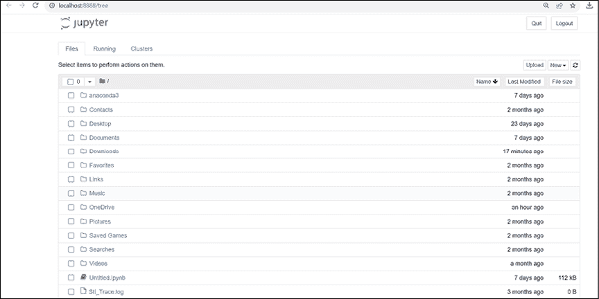

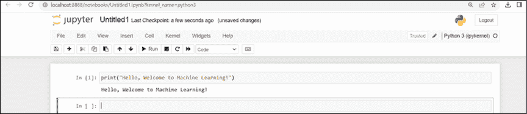

## 结论

在本章中，我们讨论了什么是机器学习以及它与人工智能的关系。除了三种主要的机器学习类型外，本章还解释了机器学习被归类为的其他各种类型。随后，讨论了机器学习的众多实际应用。此外，详细阐述了机器学习的生命周期，共包含 13 个阶段。由于我们在 Jupyter Notebook 中实现机器学习算法（它是 Anaconda 的一部分），因此也提供了在您的系统中安装它的完整步骤。接着，旅程将在下一章继续，开始学习机器学习。

## 习题

1.  什么是机器学习？它与传统编程有何不同？
2.  解释机器学习的三种主要类型：监督学习、无监督学习和强化学习。
3.  举出机器学习应用的实际案例。
4.  详细解释机器学习的生命周期。
5.  机器学习为何是人工智能的一个分支？请论证您的答案。
6.  写出安装 Anaconda 用于 Python 并实现机器学习算法的步骤。
7.  在 Jupyter Notebook 中编写一段简单的代码，以演示机器学习算法的起步。

## 加入我们的图书 Discord 社区

加入图书的 Discord 工作区，获取最新动态、优惠信息、全球科技资讯、新书发布及作者见面会：

[`discord.bpbonline.com`](https://discord.bpbonline.com)


# 第 2 章：数据预处理

## 简介

数据预处理是机器学习中的关键步骤，涉及清洗、转换和组织原始数据，使其成为适合训练机器学习模型的格式。数据的质量及其准备方式会显著影响机器学习算法的性能和有效性。但在理解这一点之前，我们应先了解什么是数据集，本章将对此进行详尽解释。

## 章节结构

本章涵盖以下主题：

*   数据集
*   获取数据集的来源
*   数据预处理
*   数据预处理的必要性
*   数据清洗
*   数据清洗详解
*   数据转换
*   数据划分
*   数据归一化与缩放
*   数据集成
*   分箱与离散化

## 学习目标

读完本章后，您将能够理解数据集及其各种形式。您将学习获取数据集的各种来源。您将理解数据预处理、其必要性及各种技术。此外，您将能够实现数据清洗方法、数据转换方法及其进一步类型。您将学习数据集成与聚合、数据缩放与缩减，以及文本处理。

## 数据集

在数据科学和机器学习的语境下，数据集是表示信息或观测值的结构化数据集合。它由单个数据点组成，每个数据点可视为表中的一行或一条记录，而每一列代表特定的属性或特征。数据集用于各种目的，包括分析、建模和训练机器学习算法。

以下是数据集的一些关键特征和组成部分：

*   **数据点或样本**：数据集中的单个实例或观测值。例如，在客户信息数据集中，每位客户的信息（姓名、年龄、地址等）就是一个数据点。
*   **特征或属性**：特征代表与每个数据点相关的特性、属性或测量值。它们可以是数值型（例如身高、温度）或分类型（例如性别、颜色）。在数据集中，列通常对应不同的特征。
*   **标签（在监督学习中）**：在监督学习任务中，数据集中通常有一列或多列代表目标变量或标签。标签是您希望机器学习模型预测或分类的值。例如，在垃圾邮件分类数据集中，标签列可能指示每封邮件是否为垃圾邮件。
*   **数据集大小**：指数据集中数据点的总数。数据集大小差异很大，从只有几十个数据点的小型数据集，到拥有数百万或更多数据点的大型数据集。
*   **数据集类型**：数据集可以有多种形式，如结构化表格数据（例如 CSV 文件、Excel 电子表格）、文本数据（例如文档、记录）、图像数据（例如图像像素）、音频数据（例如波形采样），甚至更复杂的数据结构。
*   **数据集来源**：数据集可来自多种渠道，包括在线资源库、实验或调查收集的数据、合成生成的数据，或从现有数据库中提取的数据。
*   **数据预处理**：数据集通常需要预处理步骤，如清洗（处理缺失值、移除重复项）、特征工程和格式化，使其适合分析或建模。
*   **数据划分**：在机器学习中，数据集通常划分为训练集、验证集和测试集。训练集用于训练模型，验证集用于调优超参数和模型选择，测试集用于评估最终模型的性能。

数据集是数据驱动分析和机器学习的基础。数据集的选择、质量及其准备方式，在数据科学和机器学习项目的成败中起着重要作用。研究人员、分析师和机器学习从业者利用数据集获取洞见、构建预测模型并做出数据驱动的决策。

## CSV 文件

逗号分隔值（CSV）文件是一种用于存储和交换表格数据的纯文本文件格式。它是一种简单且广泛支持的文件格式，用于表示结构化数据，便于在不同的软件应用程序和平台之间导入和导出数据。CSV 文件可供人工阅读，由行和列组成，每行代表一条记录，每列代表一个字段或属性。

以下是 CSV 文件的一些关键特征：


### CSV 文件格式

*   **基于文本**：CSV 文件是纯文本文件，这意味着它们包含人类可读的文本，可以使用文本编辑器打开和编辑。它们不包含任何特殊格式、样式或公式，这与电子表格文件（例如 Excel 文件）不同。
*   **分隔符**：CSV 文件中的数据使用分隔符进行组织，通常是逗号。不过，根据地区习惯或数据的特定需求，也可能使用其他分隔符，如分号、制表符或竖线（`|`）。
*   **行和列结构**：CSV 文件以行和列的网格形式构建。每一行代表一条数据记录，每一列代表一个字段或属性。第一行通常包含列标题，为每一列提供名称或标签。
*   **数据类型**：CSV 文件不包含显式的数据类型信息。所有数据均以文本形式表示，由用户或读取 CSV 文件的软件负责根据需要解释并转换为适当的数据类型（例如数字、日期）。
*   **引用**：当数据值包含分隔符字符或特殊字符（例如逗号或双引号）时，通常会用双引号括起来，以确保正确解析。例如：`John Doe, 123 Main St, Apt 4B`。
*   **空白字符**：CSV 文件对数据值周围的前导或尾随空白字符没有严格的处理规则，因此在数据处理过程中统一处理空白字符非常重要。
*   **行尾**：CSV 文件中每行的结尾通常由行尾字符标记，这因操作系统而异（例如 Unix/Linux 为 `\n`，Windows 为 `\r\n`）。

以下是一个简单的 CSV 文件示例：

```csv
Name,Age,Email
John Doe,30,johndoe@email.com
Jane Smith,25,janesmith@email.com
Bob Johnson,35,bobjohnson@email.com
```

CSV 文件常用于广泛的应用场景，包括数据存储、软件系统间的数据交换、数据分析和机器学习。它们受到电子表格软件（例如 Microsoft Excel 和 Google Sheets）、编程语言（例如 Python、R）以及数据库系统的支持，可用于导入和导出数据。

### 数据集获取来源

你可以根据具体需求和兴趣从各种来源获取数据集。以下是几个可用于不同目的的数据集查找位置：

*   **在线数据仓库**：Kaggle（`https://www.kaggle.com/datasets`）和 UCI 机器学习仓库（`https://archive.ics.uci.edu/ml/index.php`）等网站为机器学习和数据分析项目提供了大量数据集。Kaggle 举办数据科学竞赛，并提供这些竞赛中使用的数据集访问权限。
*   **政府开放数据门户**：世界各地的许多政府和政府组织都有开放数据计划，提供大量公共数据供下载。示例包括 `data.gov.in`、`data.gov`（美国）、`data.gov.uk`（英国）和 `data.gouv.fr`（法国）。
*   **学术数据库**：大学和研究机构通常提供学术研究中使用的数据集访问权限。你可以浏览大学网站、研究仓库和学术期刊以查找相关数据集。
*   **社交媒体 API**：Twitter、Facebook 和 Instagram 等平台提供应用程序编程接口（API），允许你访问和收集数据，包括用户帖子、评论和互动，用于研究和分析目的。
*   **网页抓取**：你可以使用 Python 中的 BeautifulSoup 和 Scrapy 等网页抓取工具和库从网站提取数据。请务必查看网站的服务条款和 `robots.txt` 文件，以确保遵守网页抓取政策。
*   **数据市场**：一些网站和平台（例如 DataHub，`https://datahub.io/`）提供数据集市场，你可以在其中探索和下载各种主题的数据。
*   **领域特定仓库**：根据你的兴趣领域，可能存在特定领域的仓库或组织提供数据集。例如，美国国家生物技术信息中心（NCBI）提供生物和基因组数据。
*   **API**：许多在线服务和平台提供 API，允许你以编程方式访问其数据。示例包括天气 API、金融市场 API 和地理位置 API。
*   **传感器生成的数据**：如果你对物联网或传感器数据感兴趣，可以从为特定目的部署的传感器或设备中收集数据。
*   **自行创建数据**：根据项目需要，你可能需要通过调查、实验或数据记录来收集自己的数据。

## 数据预处理的必要性

数据预处理是机器学习流程中的关键步骤，具有以下几个重要需求和目的：

### 数据质量保证

*   数据预处理有助于确保用于训练和测试机器学习模型的数据具有高质量和可靠性。
*   它有助于识别和纠正数据中的错误、不准确性和不一致性，降低误导性或有偏结果的风险。

### 数据兼容性

*   机器学习中使用的数据集通常来自不同的来源和格式。数据预处理将这些数据集协调一致，使其兼容并便于分析。
*   这涉及标准化数据类型、度量单位和变量名，使数据更易于处理。

### 处理缺失数据

*   由于各种原因（如传感器故障或数据录入错误），真实世界的数据集通常包含缺失值。数据预处理提供了处理缺失数据的策略，确保其不干扰建模过程。
*   可采用插补或删除含缺失数据的行/列等方法来解决此问题。

## 降噪

*   数据中的噪声是指可能掩盖有意义模式的随机变化或错误。数据预处理技术（如平滑或滤波）有助于减少噪声，使数据更可靠、更适合建模。

### 缩放与归一化

*   许多机器学习算法对特征的尺度敏感。数据预处理对特征进行缩放，确保它们处于相似的尺度上，防止某些特征主导其他特征。
*   归一化技术有助于数据遵循标准分布，这可以提高某些算法的性能。

### 处理分类数据

*   机器学习算法通常处理数值数据，因此分类变量（例如文本标签）需要编码或转换为数值表示。数据预处理为此提供了独热编码和标签编码等方法。

## 特征工程

*   特征工程涉及创建新特征或修改现有特征，以增强模型捕捉模式和进行准确预测的能力。
*   数据预处理通过提供创建衍生特征或应用数学变换的工具来促进特征工程。

### 降维

*   高维数据可能导致过拟合和计算复杂度增加。数据预处理包括主成分分析（PCA）和特征选择等降维技术，在保留重要信息的同时减少特征数量。

### 数据集划分

*   数据预处理涉及将数据集划分为训练集、验证集和测试集，这对于模型训练、超参数调优和评估模型性能至关重要。

### 处理不平衡数据


*   在分类任务中，不平衡数据集（即某一类别的样本数量远超其他类别）可能导致模型产生偏差。数据预处理提供了相应技术来解决类别不平衡问题，并提升模型性能。
*   文本预处理（用于 NLP）：
    *   在自然语言处理（NLP）中，数据预处理包括分词、停用词移除和文本向量化等任务，旨在为文本分析做好数据准备。

## 数据预处理

如前所述，数据预处理对于确保用于机器学习的数据清洁、一致且格式适当至关重要。它有助于消除数据中可能阻碍机器学习模型性能和准确性的障碍与挑战，最终带来更可靠、更有意义的结果。

在使用外部来源的数据集时，必须考虑数据许可、使用条款和隐私法规。请务必审查并遵守数据提供方的政策，确保您拥有将数据用于预期目的的必要权限。此外，在处理数据集时，还应留意数据质量、潜在偏见和伦理考量。数据预处理通常包含以下简述的任务。下一节将提供每项任务的详细描述及代码示例。

### 数据清洗

数据清洗是机器学习中的关键步骤。它包含以下步骤：

*   处理缺失数据：通过删除含缺失值的行或列、用合理估计值填充缺失值，或使用插补技术来解决数据集中的缺失值问题。
*   异常值检测与处理：识别并处理可能对模型训练产生不利影响的异常值。这可能涉及移除异常值或对其进行转换以减小其影响。
*   降噪：通过平滑或滤波技术减少数据中的噪声，特别是在数据可能包含错误或不准确性的情况下。

## 数据转换

数据转换是机器学习中的关键步骤。它包含以下步骤：

*   特征缩放：确保数值特征处于相似的尺度上，以防止某些特征主导其他特征。常用技术包括最小-最大缩放和标准化（Z-score 缩放）。
*   编码分类变量：将分类变量（例如文本标签）转换为机器学习算法可用的数值表示。这可能涉及独热编码、标签编码，或针对更复杂情况的嵌入编码。
*   特征工程：创建新特征或修改现有特征，以提高模型捕捉数据模式的能力。特征工程可能涉及领域专业知识和创造性思维。
*   降维：在保留重要信息的前提下减少特征数量，以提高模型效率并降低过拟合风险。技术包括 PCA 和特征选择。

### 数据集成与聚合

数据集成与聚合是机器学习中的重要步骤。它包含以下步骤：

*   将来自多个来源的数据合并为单一数据集，可能涉及合并、连接或拼接操作。
*   在不同粒度级别上聚合数据，例如按时间间隔或类别对数据分组，以创建汇总统计量。

### 数据划分

将数据集划分为训练集、验证集和测试集。训练集用于训练模型，验证集用于调优超参数和评估模型性能，测试集用于评估模型对新的、未见过数据的泛化能力。

### 处理不平衡数据

解决分类问题中某一类别样本数显著多于其他类别的类别不平衡问题。技术包括对少数类过采样、对多数类欠采样，或使用合成数据生成方法。

### 数据归一化与缩放

对数据进行归一化，使其遵循标准分布（例如高斯分布），或将其缩放至特定范围（例如 `[0, 1]` 或 `[-1, 1]`），以使其适用于神经网络等特定算法。

### 面向 NLP 的文本预处理

文本预处理是机器学习中的关键步骤。它包含以下步骤：

*   分词：将文本拆分为单个单词或标记。
*   停用词移除：移除不承载重要含义的常用词（例如 `the`、`and`）。
*   词形还原或词干提取：将单词还原为其基本形式，以将单词的变体视为等价形式。
*   文本向量化：使用 TF-IDF 或词嵌入等技术将文本数据转换为数值向量。

数据清洗，也称为数据预处理，是数据分析和机器学习流程中的关键步骤。它涉及识别并解决数据集中的问题，以确保数据准确、一致，且适合分析或建模。下文将讨论常见的数据清洗任务和技术。

### 处理缺失数据

处理缺失数据是机器学习中的关键步骤。它包含以下步骤：

*   识别缺失值：使用描述性统计来确定哪些列或特征存在缺失数据。
*   确定策略：根据缺失数据的数量和问题的性质，您可以选择：
    *   删除含缺失数据的行或列。
    *   用合理的估计值（如均值、中位数或众数）插补缺失值。
    *   使用高级插补技术，如回归、K 近邻或基于机器学习的插补。

### 数据清洗详解

数据清洗是一个迭代过程，可能需要根据特定数据集和分析目标进行多次迭代和调整。记录数据清洗过程中采取的步骤至关重要，以保持数据分析或机器学习项目的透明度和可复现性。代码 2.1 演示了缺失值插补：

**代码 2.1：缺失值插补的 Python 代码**

```python
import pandas as pd
import numpy as np

#### Sample DataFrame with missing values
data = {'A': [1, 2, np.nan, 4, 5],
        'B': [np.nan, 2, 3, np.nan, 5],
        'C': [1, 2, 3, 4, 5]}
df = pd.DataFrame(data)

### Display the original DataFrame
print("Original DataFrame:")
print(df)

#### Impute missing values using mean for numeric columns
df['A'].fillna(df['A'].mean(), inplace=True)
df['B'].fillna(df['B'].mean(), inplace=True)

#### Display the DataFrame after imputation
print("\nDataFrame after imputation:")
print(df)
```

以下是 代码 2.1 的输出：

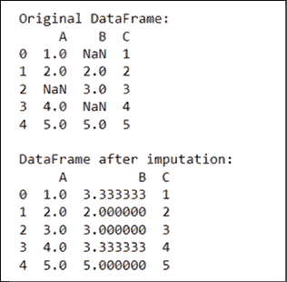

图 2.1：代码 2.1 的输出

在此示例中，我们创建了一个包含缺失值（用 `np.nan` 表示）的示例 DataFrame (`df`)。然后使用 `fillna()` 方法，用各列的平均值插补列 `A` 和 `B` 中的缺失值。参数 `inplace=True` 会就地修改 DataFrame。

您可以根据具体需求自定义插补策略。例如，可以使用 `median()`、`mode()` 或其他统计方法进行插补。此外，还可以根据数据性质对不同列应用不同的插补技术。

> **注意：** 请记得根据您数据集的结构和要求调整代码。

### 处理重复值


## 处理重复数据

有时，我们会遇到包含重复或冗余数据值的数据集。为了获得准确的结果，必须删除所有重复项。必须考虑以下几点：

*   **检测重复行**：识别数据集中的重复行或观测值。
*   **删除重复项**：删除重复行，以确保每条记录都是唯一的。
*   **谨慎对待重复项**：有时，重复项可能表示错误，也可能代表不同的实例。请根据您的领域知识决定是删除还是保留重复项。

代码 2.2 展示了在数据集中删除重复值的代码：

**代码 2.2：处理重复值的 Python 代码**

```python
import pandas as pd

### Sample DataFrame with duplicate values
data = {'A': [1, 2, 2, 3, 4],
        'B': ['X', 'Y', 'Y', 'Z', 'Z']}

df = pd.DataFrame(data)

### Display the original DataFrame
print("Original DataFrame:")
print(df)

### Identify duplicate rows
duplicates = df[df.duplicated()]

### Display duplicate rows
print("\nDuplicate Rows:")
print(duplicates)

### Remove duplicate rows (keep the first occurrence)
df_no_duplicates = df.drop_duplicates()

### Display the DataFrame without duplicates
print("\nDataFrame after removing duplicates:")
print(df_no_duplicates)
```

以下是代码 2.2 的输出：

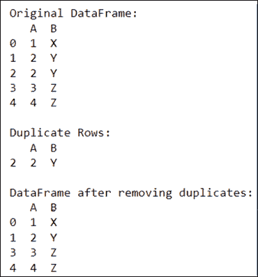

**图 2.2：代码 2.2 的输出**

在上述编程示例中，我们创建了一个包含重复行的示例 `DataFrame`（`df`）。我们使用 `duplicated()` 方法识别 `DataFrame` 中的重复行，并将它们存储在 `duplicates` `DataFrame` 中。我们使用 `drop_duplicates()` 方法删除重复行，保留第一次出现的行。结果存储在 `df_no_duplicates` `DataFrame` 中。

您可以通过指定 `keep='first'`、`keep='last'` 或 `keep=False` 等选项来自定义 `drop_duplicates()` 的行为，以控制保留哪些重复项。此外，您可以通过将列子集作为参数传递给 `subset=['column_name']`，指定用于重复检查的列。

## 处理不一致数据

不一致数据是指数据集中不符合既定模式、规则或预期的信息。不一致性可能源于各种来源，并以不同方式表现出来，导致数据不可靠或难以分析。不一致数据的示例包括：解决分类数据中的不一致（例如 "New York" 与 "NY"）以及纠正拼写错误或错误。**标准化值**：确保相似的值被标准化（例如 "Male" 与 "M"）。代码 2.3 演示了消除数据不一致的方法：

**代码 2.3：处理不一致数据的 Python 代码**

```python
import pandas as pd

### Sample DataFrame with inconsistent data
data = {'Category': ['Electronics', 'Electronics', 'electronics', 'Clothing', 'clothing'],
        'Price': [500, 600, 550, 40, 45]}

df = pd.DataFrame(data)

### Display the original DataFrame
print("Original DataFrame:")
print(df)

### Standardize inconsistent data
### Convert 'Category' column to lowercase to standardize case
df['Category'] = df['Category'].str.lower()

### Display the DataFrame after standardizing data
print("\nDataFrame after handling inconsistent data:")
print(df)
```

以下是代码 2.3 的输出：

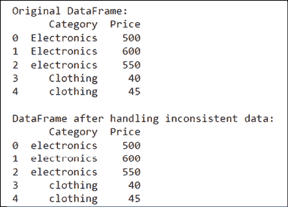

**图 2.3：代码 2.3 的输出**

处理不一致数据通常涉及识别和解决表示相同概念但未标准化的数据值中的差异或变化。以下是一个使用 `pandas` 库通过标准化值来处理不一致数据的 Python 代码示例：

在该编程示例中，我们创建了一个包含 `Category` 列的示例 `DataFrame`（`df`），该列包含不一致的大小写。我们使用 `pandas` 通过 `str.lower()` 方法将 `Category` 列中的所有值转换为小写来标准化数据。这统一了值的大小写，使其保持一致。

处理不一致数据后，`DataFrame` 将拥有标准化的值，使其更易于处理，并确保相似的类别被视为等价。请根据您的特定 `DataFrame` 和数据标准化需求调整代码。

## 处理异常值

处理数据中的异常值是数据预处理的重要步骤。处理异常值的一种常见方法是识别并对其进行封顶或转换。代码 2.4 说明了从数据中检测和移除异常值。异常值检测和移除的典型步骤如下：

*   **识别异常值**：使用统计方法、可视化或领域知识来检测数据中的异常值。
*   **决定处理方式**：根据数据的性质和问题，您可以选择：
    *   如果异常值是真实且有信息量的，则保留它们。
    *   转换或封顶异常值以减少其影响。
    *   如果异常值是错误或显著影响分析，则移除它们。

**代码 2.4：从数据中移除异常值**

```python
import pandas as pd
import numpy as np

### Sample DataFrame with outliers
data = {'A': [10, 20, 30, 120, 25, 40, 50, 200, 60, 70]}

df = pd.DataFrame(data)

### Display the original DataFrame
print("Original DataFrame:")
print(df)

### Identify outliers using the Interquartile Range (IQR) method
Q1 = df['A'].quantile(0.25)
Q3 = df['A'].quantile(0.75)
IQR = Q3 - Q1

lower_bound = Q1 - 1.5 * IQR
upper_bound = Q3 + 1.5 * IQR

### Cap outliers by replacing them with the upper or lower bound
df['A'] = np.where(df['A'] < lower_bound, lower_bound, df['A'])
df['A'] = np.where(df['A'] > upper_bound, upper_bound, df['A'])

### Display the DataFrame after handling outliers
print("\nDataFrame after handling outliers:")
print(df)
```

以下是代码 2.4 的输出：

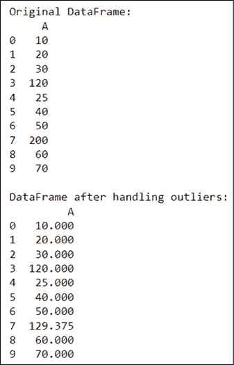

**图 2.4：代码 2.4 的输出**

在该示例中，我们创建了一个在列 `A` 中包含异常值的示例 `DataFrame`（`df`）。我们使用四分位距（`IQR`）方法来识别异常值。`IQR` 计算为第 75 百分位数（`Q3`）与第 25 百分位数（`Q1`）之差。异常值通常定义为低于 `Q1 - 1.5 * IQR` 或高于 `Q3 + 1.5 * IQR` 的值。我们通过将低于下界的值替换为下界、将高于上界的值替换为上界来封顶异常值。

您可以根据特定需求和领域知识调整异常值定义中的乘数（例如 `1.5`）。此外，您还可以考虑其他处理异常值的技术，例如转换（例如对数转换）或完全移除它们，具体取决于您的分析目标和数据集特征。

## 降噪

降噪技术会因噪声类型及其发生的上下文而异。常见方法包括平滑、滤波和使用信号处理方法。代码 2.5 提供了一个简单示例，使用一维信号并应用移动平均滤波器进行降噪：

**代码 2.5：降噪的 Python 代码**

```python
import numpy as np
import matplotlib.pyplot as plt
from scipy.ndimage import gaussian_filter1d

### Generate a noisy signal
np.random.seed(42)
t = np.linspace(0, 1, 100)
signal = np.sin(2 * np.pi * 5 * t) + 0.2 * np.random.randn(100)

### Add impulsive noise (spikes)
signal[30] += 2.0
signal[70] -= 1.5

### Plot the original signal with noise
plt.figure(figsize=(10, 4))
plt.subplot(1, 2, 1)
plt.plot(t, signal, label='Original Signal with Noise')
plt.title('Original Signal with Noise')
plt.xlabel('Time')
plt.ylabel('Amplitude')
plt.legend()

### Apply Gaussian filter for noise reduction
smoothed_signal = gaussian_filter1d(signal, sigma=1)

### Plot the smoothed signal
plt.subplot(1, 2, 2)
```


## 数据转换

数据转换是数据预处理和为分析或机器学习做准备的基本步骤。它涉及将数据从一种格式、结构或表示形式转换为另一种，通常是为了使数据更适合预期的分析或建模任务。数据转换可包括各种操作，如分类数据编码、特征工程、特征缩放、降维等，以下小节将结合代码进行描述。

### 分类数据编码

分类变量通常会被转换为数值表示，以供机器学习模型使用。常见的编码技术包括独热编码、标签编码和二进制编码。对分类变量进行编码是机器学习中至关重要的预处理步骤。有多种技术可用于对分类变量进行编码，包括独热编码、标签编码和二进制编码。**代码 2.6** 使用 `pandas` 库演示了这三种编码方法：

**代码 2.6：数据编码的 Python 代码**

```python
import pandas as pd

#### 带有分类列的示例 DataFrame
data = {'Category': ['A', 'B', 'A', 'C', 'B', 'A']}
df = pd.DataFrame(data)

### 显示原始 DataFrame
print("Original DataFrame:")
print(df)

#### 独热编码
one_hot_encoded_df = pd.get_dummies(df, columns=['Category'], prefix=['Category'])

#### 标签编码（使用类别代码）
label_encoded_df = df.copy()
label_encoded_df['Category'] = df['Category'].astype('category').cat.codes

#### 二进制编码（将类别代码转为二进制）
binary_encoded_df = df.copy()
binary_encoded_df['Category'] = df['Category'].astype('category').cat.codes.apply(lambda x: bin(x)[2:].zfill(2))

#### 显示编码后的 DataFrame
print("\nDataFrame after One-Hot Encoding:")
print(one_hot_encoded_df)

print("\nDataFrame after Label Encoding:")
print(label_encoded_df)

print("\nDataFrame after Binary Encoding:")
print(binary_encoded_df)
```

以下是 **代码 2.6** 的输出：

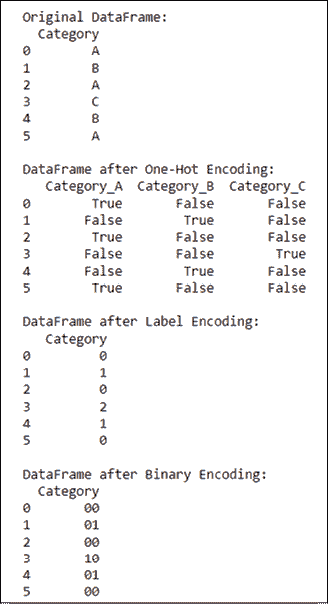

**图 2.6：代码 2.6 的输出**

在该代码中，我们创建了一个包含分类列 `Category` 的示例 DataFrame (`df`)，其中包含分类值（A、B、C）。我们执行了三种不同的编码方法：

*   **独热编码**：我们使用 `pd.get_dummies()` 为每个类别创建二进制列。
*   **标签编码**：我们使用 `.cat.codes` 将分类列转换为类别代码。
*   **二进制编码**：我们使用 `.apply()` 和 `bin()` 将类别代码转换为二进制格式。

生成的 DataFrame（`one_hot_encoded_df`、`label_encoded_df` 和 `binary_encoded_df`）展示了应用每种编码方法后的数据。

> **注意**：选择最适合您的数据集和机器学习算法要求的编码方法。每种编码方法都有其优缺点，因此了解数据的特征以及编码对模型的影响至关重要。

## 特征工程

创建新特征或修改现有特征，以增强模型捕捉模式的能力。这可能涉及聚合、分箱或转换现有特征。

特征工程涉及从现有特征创建新特征，以提高机器学习模型的性能。**代码 2.7** 使用合成数据集和 `pandas` 库演示了特征工程：

**代码 2.7：特征工程的 Python 代码**

```python
import pandas as pd
import numpy as np

#### 带有合成特征的示例数据集
data = {'Age': [25, 30, 35, 40, 45],
        'Income': [50000, 60000, 75000, 80000, 90000],
        'Education': ['High School', 'Bachelor', 'Master', 'PhD', 'Bachelor']}
df = pd.DataFrame(data)

### 显示原始 DataFrame
print("Original DataFrame:")
print(df)

#### 特征工程：创建新特征
##### 1. 年龄组
df['Age Group'] = pd.cut(df['Age'], bins=[0, 30, 40, np.inf], labels=['Young', 'Mid-Age', 'Old'])

##### 2. 收入水平
df['Income Level'] = pd.cut(df['Income'], bins=[0, 60000, 80000, np.inf], labels=['Low', 'Medium', 'High'])

##### 3. 二元教育指标（学士学位或更高）
df['Bachelor or Higher'] = (df['Education'] != 'High School').astype(int)

#### 显示特征工程后的 DataFrame
print("\nDataFrame after feature engineering:")
print(df)
```

以下是 **代码 2.7** 的输出：

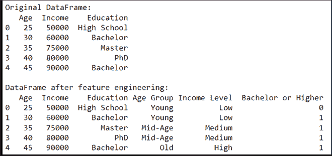

**图 2.7：代码 2.7 的输出**

在该代码中，我们从一个包含三列的示例 DataFrame (`df`) 开始：`Age`、`Income` 和 `Education`。我们通过创建新特征来进行特征工程：

*   **年龄组**：我们根据预定义的分箱创建年龄组。
*   **收入水平**：我们根据预定义的分箱创建收入水平。
*   **学士或更高**：我们创建一个二元指标变量，表示某人是否拥有学士学位或更高学历。

生成的 DataFrame 包含原始列以及新创建的工程特征。

> **注意**：特征工程可能高度依赖于您的数据集和问题。它通常涉及领域知识和创造力，以创建能够提高机器学习模型性能的有意义特征。

### 数据缩减

数据缩减是数据预处理中的一个过程，涉及减少数据量但产生相同或相似的分析结果。这种缩减可通过聚合、采样或降维等技术来实现。在处理大型数据集时，数据缩减特别有用，因为它可以使数据集更易于管理，并提高分析或建模的效率。**代码 2.8** 给出了一个使用随机采样来缩减数据集大小的 Python 代码示例：

**代码 2.8：数据缩减的 Python 代码**

```python
import pandas as pd
import numpy as np

#### 生成大型示例数据集
data = {'Feature1': np.random.rand(100000),
        'Feature2': np.random.rand(100000),
        'Feature3': np.random.rand(100000)}
df = pd.DataFrame(data)

#### 显示原始数据集的大小
print("Original Dataset Size:", df.shape)

#### 随机采样一部分数据（例如 10%）
sampled_df = df.sample(frac=0.10, random_state=42)

#### 显示缩减后数据集的大小
print("Reduced Dataset Size:", sampled_df.shape)
```

以下是 **代码 2.8** 的输出：

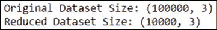

**图 2.8：代码 2.8 的输出**

在该代码中：

*   我们生成了一个包含三个特征的大型示例数据集 (`df`)。
*   我们使用 `df.sample()` 随机采样一部分数据，此处为 10% (`frac=0.10`)。您可以调整此比例来控制数据缩减的程度。
*   生成的 `sampled_df` 包含一个行数较少的缩减数据集，有效地减少了用于分析或建模的数据量。


#### 数据缩减技术

数据缩减技术会根据您的分析或模型的具体要求而有所不同。其他技术，如特征选择或降维方法（如 `PCA`），也可根据数据的性质和问题用于数据缩减，我们将在本书后续章节中讨论这些内容。

### 日期时间转换

日期和时间数据可以转换为不同的格式，例如提取年、月、日，或计算事件之间的时间跨度。日期时间转换通常涉及从日期时间数据中提取特定组件，如年、月、日，或计算事件之间的时间跨度。Python 的 `pandas` 库常用于日期时间操作。代码 2.9 是一个用于日期时间转换的 Python 代码示例：

**代码 2.9：用于日期时间转换的 Python 代码**

```python
import pandas as pd

### 带有日期时间列的示例 DataFrame
data = {'Date': ['2022-01-15', '2022-02-20', '2022-03-25'],
        'Event': ['Event A', 'Event B', 'Event C']}

df = pd.DataFrame(data)

### 将 'Date' 列转换为日期时间格式
df['Date'] = pd.to_datetime(df['Date'])

### 显示原始 DataFrame
print("Original DataFrame:")
print(df)

### 日期时间转换
### 提取年、月、日
df['Year'] = df['Date'].dt.year
df['Month'] = df['Date'].dt.month
df['Day'] = df['Date'].dt.day

### 计算距离参考日期的时间跨度
reference_date = pd.to_datetime('2022-01-01')
df['Days Since Reference'] = (df['Date'] - reference_date).dt.days

### 显示日期时间转换后的 DataFrame
print("\nDataFrame after Datetime Transformations:")
print(df)
```

以下是 代码 2.9 的输出：

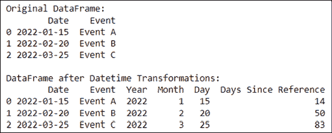

**图 2.9：代码 2.9 的输出**

在该代码中，我们从一个包含 `Date` 列（具有日期时间值）和 `Event` 列的示例 DataFrame (`df`) 开始。我们使用 `pd.to_datetime()` 将 `Date` 列转换为日期时间格式。我们演示了几种日期时间转换：

*   使用 `.dt.year`、`.dt.month` 和 `.dt.day` 从 `Date` 列提取年、月、日组件。
*   使用减法和 `.dt.days` 计算距离参考日期 (`'2022-01-01'`) 的天数。

生成的 DataFrame 包含原始列，以及表示日期时间组件和计算出的时长的新列。

> **注意：** 日期时间转换对于各种任务至关重要，例如时间序列分析、特征工程和数据可视化。

### 对数变换

对数变换应用于数据，以减少异常值的影响，并使偏态数据分布更加对称。它适用于遵循幂律分布的数据。

对数变换常用于减少极端值（异常值）的影响，并使偏态数据分布更加对称。代码 2.10 是一个使用 `numpy` 库对示例数据集执行对数变换并显示结果的示例：

**代码 2.10：用于对数变换的 Python 代码**

```python
import numpy as np

### 具有正值的示例数据集
data = np.array([1, 2, 5, 10, 20, 50, 100])

### 对数变换
transformed_data = np.log(data)

### 显示原始数据和变换后的数据
print("Original Data:")
print(data)

print("\nTransformed Data (Log Transformation):")
print(transformed_data)
```

以下是 代码 2.10 的输出：

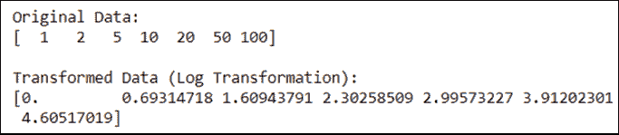

**图 2.10：代码 2.10 的输出**

在该代码中，我们从一个包含正值的示例数据集 (`data`) 开始。我们使用 `np.log()` 执行对数变换，该函数计算数据集中每个值的自然对数（以 e 为底）。显示了原始数据和变换后的数据，展示了对数变换的效果。请记住，对数变换适用于具有正值的数据，在处理呈指数增长或具有偏态分布的数据时特别有用。

## 数据集成

数据集成是将来自不同来源、通常具有不同格式或位置的数据合并为统一连贯视图的过程。数据集成的目标是提供完整、准确且一致的数据表示，以支持各种数据相关任务，包括分析、报告和决策制定。在组织或项目需要处理多个必须无缝协作的数据源的情况下，数据集成至关重要。数据集成的关键方面包括：

*   **多数据源：** 数据集成通常涉及来自各种来源的数据整合。这些来源可以包括数据库、文件、Web 服务、API、电子表格等。
*   **数据转换：** 数据通常需要转换或转换以确保兼容性和一致性。这可能涉及标准化数据类型、度量单位和数据结构。
*   **数据清洗：** 该过程通常包括数据清洗任务，如处理缺失值、删除重复项和解决异常值，以提高数据质量。
*   **数据映射：** 数据集成要求将来自不同来源的数据元素或属性映射到通用模式或格式。这确保了来自不同来源的数据可以在没有冲突的情况下合并。
*   **数据合并：** 集成后的数据存储在中央存储库或数据库中，使其可供分析和报告访问和管理。
*   **实时或批量处理：** 数据集成可以实时发生，即数据到达时持续更新和集成；也可以按批处理模式发生，即定期集成数据（例如每天或每周）。
*   **抽取、转换、加载 (ETL)：** ETL 流程常用于数据集成。首先从源系统抽取数据，然后转换数据以满足所需的格式和质量标准，最后加载到目标数据库或数据仓库中。

数据集成对于组织做出明智决策并从数据中获取洞察至关重要。它支持创建单一事实来源，整合来自不同部门、系统和数据孤岛的信息。数据集成解决方案的复杂性各不相同，从手动流程到自动化系统，具体取决于组织的规模和需求。

数据集成通常涉及将来自多个来源的数据合并为统一数据集。数据集成的确切代码将因您特定用例的来源、格式和要求而有很大差异。Python 代码 2.11 使用 `pandas` 库演示了将两个示例数据集集成为一个的基本概念：

**代码 2.11：用于数据集成的 Python 代码**

```python
import pandas as pd

### 来自两个不同来源的示例数据
data_source1 = {'ID': [1, 2, 3],
                'Name': ['Alice', 'Bob', 'Carol']}

data_source2 = {'ID': [4, 5, 6],
                'Name': ['Dave', 'Eve', 'Frank']}

### 从两个来源创建 DataFrame
df1 = pd.DataFrame(data_source1)
df2 = pd.DataFrame(data_source2)

### 连接或合并 DataFrame 以执行数据集成
integrated_df = pd.concat([df1, df2], ignore_index=True)

### 显示集成后的 DataFrame
print(integrated_df)
```

以下是 代码 2.11 的输出：

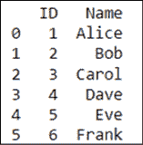

**图 2.11：代码 2.11 的输出**


在本示例中，我们有两个样本数据集 `data_source1` 和 `data_source2`，每个都包含 ID 和 Name 列。我们创建了两个独立的 DataFrame `df1` 和 `df2` 来表示来自这两个不同来源的数据。我们使用 pandas 的 `pd.concat()` 函数垂直连接 DataFrame，从而有效地整合数据。`ignore_index=True` 参数用于重置生成 DataFrame 的索引。

## 聚合

另一个重要特性是数据聚合。它将多个数据点合并为汇总统计。例如，您可以将每日销售数据聚合为每月或每年的总计。

数据聚合涉及将多个数据点合并为汇总统计，或在更高粒度级别上聚合数据。Python 提供了 pandas 等库来执行数据聚合。代码 2.12 演示了使用 pandas 进行数据聚合：

**代码 2.12：用于聚合的 Python 代码**

```python
import pandas as pd

### 样本数据
data = {'Date': ['2021-01-01', '2021-01-01', '2021-01-02', '2021-01-02'],
        'Sales': [1000, 1200, 800, 900]}
df = pd.DataFrame(data)

### 显示原始 DataFrame
print("Original DataFrame:")
print(df)

### 数据聚合：按日期汇总销售额
aggregated_df = df.groupby('Date')['Sales'].sum().reset_index()

### 显示聚合后的 DataFrame
print("\nAggregatedDataFrame (Sum of Sales by Date):")
print(aggregated_df)
```

以下是 代码 2.12 的输出：

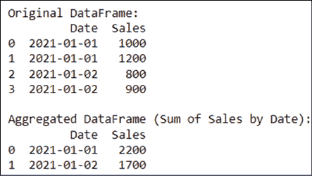

图 2.12：代码 2.12 的输出

在该代码中，我们从一个包含两列（Date 和 Sales）的样本 DataFrame (`df`) 开始。我们使用 pandas 中的 `groupby()` 方法按 Date 列对数据进行分组。我们对每个组内的 Sales 列应用聚合函数 (`sum()`) 以计算每个日期的销售总额。我们使用 `reset_index()` 重置生成 DataFrame 的索引，从而创建一个包含聚合数据的新 DataFrame (`aggregated_df`)。生成的 `aggregated_df` 包含原始数据集中每个唯一日期的销售总额。

> **注意：** 您可以根据特定的分析或报告要求执行各种类型的聚合函数（例如 mean、median、count、max、min）。请根据您的数据集和所需的聚合类型调整代码。

## 数据拆分

将数据集划分为训练集、验证集和测试集，用于机器学习目的。

数据拆分是在为机器学习准备数据时的关键步骤。它涉及将数据集划分为训练集、验证集和测试集。代码 2.13 是一个使用 `sklearn.model_selection` 模块拆分数据集的 Python 代码示例：

**代码 2.13：用于数据拆分的 Python 代码**

```python
import numpy as np
from sklearn.model_selection import train_test_split

### 样本数据集（特征和标签）
X = np.random.rand(100, 2) # 100 个样本，每个 2 个特征
y = np.random.randint(0, 2, 100) # 二分类标签（0 或 1）

### 将数据拆分为训练集、验证集和测试集
X_train, X_temp, y_train, y_temp = train_test_split(X, y, test_size=0.4, random_state=42)
X_valid, X_test, y_valid, y_test = train_test_split(X_temp, y_temp, test_size=0.5, random_state=42)

### 显示生成的各集合大小
print("Training set size:", X_train.shape[0])
print("Validation set size:", X_valid.shape[0])
print("Test set size:", X_test.shape[0])
```

以下是 代码 2.13 的输出：

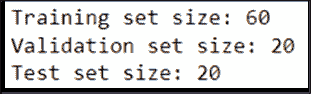

图 2.13：代码 2.13 的输出

在该代码中，我们创建了一个包含特征 (`X`) 和二分类标签 (`y`) 的合成数据集作为示例。我们使用来自 `sklearn.model_selection` 模块的 `train_test_split` 将数据拆分为三个集合：训练集、验证集和测试集。`test_size` 参数指定验证集和测试集的大小，`random_state` 参数确保可重复性。生成的集合 `X_train`、`X_valid`、`X_test`、`y_train`、`y_valid` 和 `y_test` 分别包含用于训练、验证和测试的特征和标签子集。

您可以调整 `test_size` 参数以控制分配给验证集和测试集的数据比例。请务必根据您的特定数据集和机器学习任务自定义代码。

## 归一化

归一化是指将数值特征缩放到同一范围，以防止某些特征主导其他特征。归一化将数据特征缩放到一致的范围，通常在 0 和 1 之间。当特征具有不同的单位或量级时，这很有用。最小-最大缩放和 z-score 标准化是常用方法。代码 2.14 是一个使用 `sklearn.preprocessing` 模块将数据归一化到 0 和 1 之间的 Python 代码示例：

**代码 2.14：用于数据归一化的 Python 代码**

```python
import numpy as np
from sklearn.preprocessing import MinMaxScaler

### 样本数据
data = np.array([[10, 20],
                 [15, 30],
                 [5, 10],
                 [25, 40]])

### 创建 MinMaxScaler 实例
scaler = MinMaxScaler()

### 拟合缩放器并转换数据
normalized_data = scaler.fit_transform(data)

### 显示归一化后的数据
print("Normalized Data:")
print(normalized_data)
```

以下是 代码 2.14 的输出：

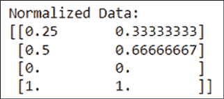

图 2.14：代码 2.14 的输出

在该代码中，我们从一个包含两个特征的 NumPy 数组 (`data`) 中的样本数据开始。我们创建了一个来自 `sklearn.preprocessing` 模块的 `MinMaxScaler` 实例。我们使用 `fit_transform` 将缩放器拟合到数据并转换数据，该方法根据每个特征中的最小值和最大值将数据缩放到 0 和 1 之间。生成的 `normalized_data` 包含归一化后的数据，其中每个特征的值都在 0 和 1 之间。

该代码演示了如何使用最小-最大缩放来归一化数据。这是一种简单而有效的技术，可确保您的特征处于同一尺度上，在训练机器学习模型时不会相互主导。

## 标准化

标准化（z-score 缩放）转换数据，使其均值为 0，标准差为 1。当您希望将数据中心化并赋予其一致的分布时，这很有益。

标准化，通常称为 z-score 缩放，是一种转换数据的技术，使其均值为 0，标准差为 1。这使得数据具有标准化分布，其特性适合某些机器学习算法。代码 2.15 是一个使用 `sklearn.preprocessing` 模块标准化数据的示例：

**代码 2.15：用于数据标准化的 Python 代码**

```python
import numpy as np
from sklearn.preprocessing import StandardScaler

### 样本数据
data = np.array([[10, 20],
                 [15, 30],
                 [5, 10],
                 [25, 40]])

### 创建 StandardScaler 实例
scaler = StandardScaler()

### 拟合缩放器并转换数据
standardized_data = scaler.fit_transform(data)

### 显示标准化后的数据
print("Standardized Data:")
print(standardized_data)
```

以下是 代码 2.15 的输出：

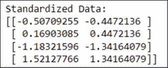

图 2.15：代码 2.15 的输出


在本代码中，我们从包含两个特征的 NumPy 数组（`data`）中的样本数据开始。我们创建了一个来自 `sklearn.preprocessing` 模块的 `StandardScaler` 实例。我们使用 `fit_transform` 将缩放器拟合到数据，该方法通过减去均值并除以每个特征的标准差来标准化数据。生成的 `standardized_data` 包含标准化后的数据，其中每个特征的均值为 0，标准差为 1。当您希望确保特征处于同一尺度且具有相同分布时，标准化非常有用，这对于某些机器学习算法（特别是基于距离度量的算法）可能非常重要。

## 标准化数据格式

标准化数据格式通常涉及将数据类型或格式转换为通用标准。它确保一致的数据格式，这意味着日期、时间和分类数据在整个数据集中格式一致。转换数据类型意味着将数据转换为适当的数据类型。代码 2.16 是一个使用 `pandas` 库在 `DataFrame` 中标准化数据格式的 Python 代码示例：

**代码 2.16：用于标准化数据格式的 Python 代码**

```python
import pandas as pd

### Sample DataFrame with mixed data formats
data = {'Date': ['2021-01-15', '2021-02-20', '2021-03-25'],
        'Amount': ['$100.50', '200.75 USD', '300.00'],
        'Quantity': ['5', '3', '7.5 kg']}

df = pd.DataFrame(data)

### Display the original DataFrame
print("Original DataFrame:")
print(df)

### Standardize data formats
### Convert 'Date' column to datetime format
df['Date'] = pd.to_datetime(df['Date'])

### Remove non-numeric characters and convert 'Amount' column to float
df['Amount'] = df['Amount'].replace('[\$,]', '', regex=True)

### Remove non-numeric characters and convert 'Quantity' column to float
df['Quantity'] = df['Quantity'].replace('[a-zA-Z\,]', '', regex=True).astype(float)

### Display the DataFrame after standardizing data formats
print("\nDataFrame after standardizing data formats:")
print(df)
```

以下是代码 2.16 的输出：

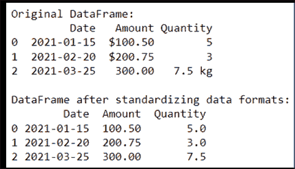

图 2.16：代码 2.16 的输出

在此示例中，我们创建了一个包含 `date`、`amount` 和 `quantity` 列的样本 `DataFrame`（`df`），这些列具有混合的数据格式。我们使用 `pandas` 来标准化数据格式：

*   我们使用 `pd.to_datetime()` 将 `date` 列转换为 `datetime` 格式。
*   对于 `Amount` 和 `Quantity` 列，我们使用正则表达式（带有 `regex=True` 的 `replace()`）来移除非数字字符（例如货币符号、单位），然后使用 `astype(float)` 将列转换为 `float` 数据类型。

标准化数据格式后，`DataFrame` 将具有统一的数据类型和格式，使其适合分析或进一步处理。

## 使用 NLP 进行文本处理

在机器学习中处理文本数据涉及多个预处理步骤，包括分词、词干提取或词形还原以及向量化，其中分词将文本数据拆分为单词或标记。移除可能不包含重要含义的常用词（例如 the、and）。词形还原或词干提取将单词还原为基本形式，以将变体视为等价。Python 代码 2.17 是一个使用流行库（如 `scikit-learn`）进行基本文本预处理的示例：

**代码 2.17：用于文本预处理的 Python 代码**

```python
### Import necessary libraries
from sklearn.feature_extraction.text import CountVectorizer
from sklearn.model_selection import train_test_split
from sklearn.naive_bayes import MultinomialNB
from sklearn.metrics import accuracy_score, classification_report

### Sample text data
corpus = [
    'This is a positive example.',
    'I love working with Machine Learning.',
    'Text data pre-processing is important for ML.',
    'Negative examples can be challenging too.',
    'Machine learning models learn from data.'
]

### Corresponding labels (0 for negative, 1 for positive)
labels = [1, 1, 1, 0, 1]

### Split the data into training and testing sets
X_train, X_test, y_train, y_test = train_test_split(corpus, labels, test_size=0.2, random_state=42)

### Text vectorization using Bag-of-Words (CountVectorizer)
vectorizer = CountVectorizer()
X_train_vectorized = vectorizer.fit_transform(X_train)
X_test_vectorized = vectorizer.transform(X_test)

### Train a simple classifier (Naive Bayes in this case)
classifier = MultinomialNB()
classifier.fit(X_train_vectorized, y_train)

### Make predictions on the test set
predictions = classifier.predict(X_test_vectorized)

### Evaluate the classifier
accuracy = accuracy_score(y_test, predictions)
report = classification_report(y_test, predictions)

### Print the results
print(f"Accuracy: {accuracy:.2f}")
print("\nClassification Report:\n", report)
```

以下是代码 2.17 的输出：

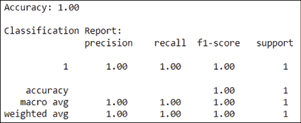

图 2.17：代码 2.17 的输出

在此代码中，我们使用 `scikit-learn` 中的 `CountVectorizer` 将文本数据转换为词袋表示，并训练一个简单的朴素贝叶斯分类器。请注意，这是一个基本示例，在实际场景中，您可能需要更高级的技术，如 TF-IDF、词嵌入或深度学习模型来进行文本分类任务。此外，请始终确保根据您的特定用例适当预处理数据。

## 分箱与离散化

分箱涉及将连续数值数据分组到离散的箱或区间中。这可以简化具有复杂分布的数据的分析。分箱和离散化是将连续数值数据转换为离散区间或箱的技术。这对于简化数据分析、减少异常值的影响或为某些类型的机器学习算法准备数据非常有用。代码 2.18 是一个使用 `pandas` 库执行分箱和离散化的 Python 代码示例：

**代码 2.18：用于分箱和离散化的 Python 代码**

```python
import pandas as pd

### Sample data
data = {'Age': [25, 30, 35, 40, 45, 50, 55, 60, 65, 70],
        'Income': [50000, 60000, 75000, 80000, 90000, 100000, 110000, 120000, 130000, 140000]}

df = pd.DataFrame(data)

### Display the original DataFrame
print("Original DataFrame:")
print(df)

### Binning and Discretization for 'Age'
age_bins = [20, 40, 60, 80] # Define bin edges
age_labels = ['Young', 'Mid-Age', 'Old'] # Labels for bins
df['Age Group'] = pd.cut(df['Age'], bins=age_bins, labels=age_labels)

### Binning and Discretization for 'Income'
income_bins = [40000, 80000, 120000, 160000] # Define bin edges
income_labels = ['Low', 'Medium', 'High'] # Labels for bins
df['Income Level'] = pd.cut(df['Income'], bins=income_bins, labels=income_labels)

### Display the DataFrame after binning and discretization
print("\nDataFrame after Binning and Discretization:")
print(df)
```

以下是代码 2.18 的输出：

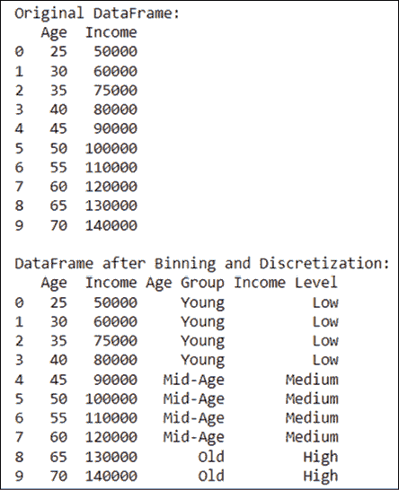

图 2.18：代码 2.18 的输出

在此代码中，我们从一个包含两个连续数值列 `Age` 和 `Income` 的样本 `DataFrame`（`df`）开始。我们为 `Age` 和 `Income` 列定义了箱边缘和标签。箱边缘指定箱的边界，而标签为每个箱提供名称。我们使用 `pandas` 库中的 `pd.cut()` 对两列执行分箱和离散化。`bins` 参数指定箱边缘，`labels` 参数提供相应的标签。生成的 `DataFrame` 包含两个新列 `Age Group` 和 `Income Level`，分别表示 `Age` 和 `Income` 的离散化版本。

## 结论


在本章中，我们详细讨论了数据预处理。深入解释了数据集及其类型和格式。讨论了获取数据集的各种来源以及数据预处理的必要性。所有预处理步骤（如数据清洗、数据转换、数据集成与聚合、数据拆分、处理不平衡数据、归一化与缩放，以及文本处理 (NLP)）均配合相应的代码和输出进行了详细阐述。

## 编程练习

1.  创建一个 Python 函数，该函数接受一个 `DataFrame` 作为输入，并返回一个新的 `DataFrame`，其中缺失值使用适当的策略（均值、中位数、前向填充或后向填充）进行填充。

2.  编写一个脚本，从给定的 `DataFrame` 中识别并移除重复行，同时保留首次出现的行。

3.  开发一个函数，该函数接受一个 `DataFrame` 和一个包含分类数据的列，并返回使用独热编码对分类数据进行编码后的 `DataFrame`。

4.  编写一个脚本，使用最小-最大缩放对 `DataFrame` 中的数值列进行归一化，然后使用 Z-score 标准化对另一个数值列进行标准化。

5.  创建一个函数，该函数接受一个 `DataFrame`，并通过组合或转换现有特征来生成新特征（例如，计算比率或创建交互项）。

6.  开发一个脚本，使用四分位距 (IQR) 方法识别并移除数值列中的异常值。

7.  编写一个函数，通过移除停用词、将文本转换为小写和移除标点符号，来预处理 `DataFrame` 中的文本列。

8.  创建一个脚本，该脚本接受一个包含日期字符串列的 `DataFrame` 并将其转换为 `datetime` 对象。然后，提取星期几并将其作为新列添加。

9.  实现一个函数，该函数接受一个类别不平衡的 `DataFrame`，并应用合成少数类过采样技术 (SMOTE) 来平衡类别分布。

10. 编写一个脚本，对 `DataFrame` 中的数值列执行数据分箱，将其划分为自定义分箱，并添加一个带有分箱标签的新列。

## 问题

1.  如何识别和处理数据集中的缺失数据？

2.  填补缺失值有哪些常见策略，何时会选择其中一种而非另一种？

3.  解释从数据集中移除重复行的重要性。

4.  如何使用 Python 在 `DataFrame` 中识别和消除重复项？

5.  在机器学习中对分类数据进行编码有何意义？

6.  对比标签编码和独热编码。何时使用各自？

7.  为什么缩放或归一化数值特征至关重要？

8.  描述最小-最大缩放和标准化 (Z-score 归一化) 之间的区别。

9.  什么是特征工程，为什么它在机器学习背景下很重要？

10. 提供你可能应用于数据集的特征工程技术示例。

11.  为什么异常值在统计分析和机器学习模型中是有问题的？

12.  描述一种在数值数据集中检测和处理异常值的方法。

13.  清洗文本数据有哪些常见的预处理步骤？

14.  如何使用 Python 从 `DataFrame` 的文本列中移除停用词？

15.  解释在数据集中解析日期和时间信息的重要性。

16.  如何在 Python 中将日期字符串列转换为 `datetime` 对象？

17.  什么是数据分箱，在数据预处理中何时可能会用到它？

18.  描述使用 Python 在数值列中实现数据分箱的过程。

加入我们书籍的 Discord 空间

加入书籍的 Discord 工作区，获取最新动态、优惠、全球科技动态、新版本发布及作者见面会：

[`discord.bpbonline.com`](https://discord.bpbonline.com)


# 第 3 章 监督学习：回归

## 简介

监督学习是一种广为人知的机器学习形式，它涉及利用带标签的数据集来指导算法将输入数据映射到期望的目标输出。

在监督学习中，之所以称算法为“受监督”，是因为它是在一个同时提供了输入和期望输出的数据集上进行训练的，这使得算法能够在无需人工干预的情况下学习并进行预测或决策。监督学习的目标是学习一个从输入到输出的映射函数，以便算法能够泛化并为新生成的数据提供预测。

监督学习的应用广泛，涵盖自然语言处理 (NLP)、计算机视觉 (CV)、医学诊断、推荐系统、欺诈检测等领域。它是机器学习的基础范式之一，构成了许多需要决策和预测的现实世界应用的基础。

## 结构

本章涵盖以下主题：

*   监督学习的关键特征
*   回归
*   回归的必要性
*   简单线性回归
*   多元线性回归
*   多项式回归
*   岭回归
*   Lasso 回归

## 目标

在本章结束时，你将能够理解监督学习及其最重要的回归类型。你将实现各种回归技术。你还将全面学习并实现简单线性回归、多元线性回归、多项式回归、岭回归和 Lasso 回归，详细了解它们的目标函数，并包含 Python 代码示例。此后，你将学习并实现各种性能指标来评估模型。

## 监督学习的关键特征

监督学习表现出各种特征，如下所示：

在监督学习中，训练数据由带标签的示例组成。每个示例包含一个输入（特征）和一个相应的输出（目标或标签）。算法利用这些带标签的数据来理解输入和输出之间的相关性。

*   **预测**：在带标签的数据上训练后，算法可以根据训练期间识别出的模式和关系，对新的、未见过的数据进行预测或决策。
*   **目标**：监督学习的目标因问题而异。它可能涉及回归任务，旨在预测连续值（如预测房价）；也可能涉及分类任务，专注于将数据分类到预定的类别或标签中（如垃圾邮件检测或图像分类）。
*   **评估**：监督学习模型根据其正确预测或分类新数据的能力进行评估。常用的关键评估指标包括准确率、均方误差、精确率、召回率和 F1 分数等。

监督学习常用的算法包括线性回归、逻辑回归、支持向量机、决策树、随机森林、神经网络等。每种算法都是为解决特定类型的问题而设计的。本章将深入讨论回归。

## 回归

回归是一种统计和机器学习技术，称为回归，它用于预测一个或多个自变量与因变量之间的关系。其目标是利用自变量的值来预测或估计因变量的值。回归本质上使我们能够理解自变量和因变量变化之间的关系。

回归的关键组成部分如下：


## 回归的核心概念

*   **因变量（响应变量）**：它是我们分析的目标，其值取决于自变量的值。
*   **自变量（预测变量）**：这些是我们用来进行预测或解释因变量变异性的变量。
*   **回归方程或模型**：它以数学方程的形式表达，描述自变量的变化如何对应因变量的变化。

## 回归的主要目标

*   **预测**：利用模型基于自变量的新值或未见值来预测因变量的值。
*   **推断**：理解并解释变量之间的关系。回归有助于回答诸如“哪些自变量对因变量有显著影响？”或“当一个自变量变化时，因变量变化多少？”等问题。

存在多种回归技术，包括线性回归、用于分类问题的逻辑回归（将在下一章讨论）、多项式回归、岭回归等。回归技术的选择取决于数据的性质和分析的具体目标。

## 回归的必要性

正如之前所讨论的，回归是一种基础的统计和机器学习技术，具有广泛的应用。回归的主要必要性源于以下几点：

*   **预测建模**：回归模型用于基于历史或观测数据进行预测。当你想要预测目标变量的值或理解其与一个或多个预测变量的关系时，它们非常有价值。例如，你可能会使用回归根据相关因素预测销售额、股票价格或患者的健康结果。
*   **关系探索**：回归有助于发现并量化变量之间的关系，阐明一个或多个自变量的变化如何影响因变量。掌握这些关系对于在自然科学、社会科学和经济学等不同领域做出明智决策至关重要。
*   **因果推断**：虽然相关性不意味着因果性，但回归分析可以提供关于因果性的见解。通过控制潜在的混淆变量，回归帮助研究人员识别对结果变量有显著影响的因素。这对于实验设计、政策评估和因果推断非常重要。
*   **建模与优化**：在机器学习中，回归模型用于建模复杂的数据关系。这些模型在优化任务中至关重要，例如线性规划，其中线性回归可用作约束或目标函数来解决优化问题。
*   **质量改进**：回归分析可用于质量控制和改进工作。例如，它被用于制造业以了解各种因素如何影响产品质量并进行相应调整。
*   **风险评估**：在金融和保险领域，回归模型用于风险评估。它们有助于确定导致金融风险的因素并计算风险敞口。
*   **资源分配**：在商业和经济学中，回归模型可指导资源分配决策。例如，它们可以通过识别对销售贡献最大的因素，帮助组织更有效地分配营销预算。
*   **科学研究**：回归广泛应用于生物学、心理学和环境科学等学科的科学研究中。它帮助研究人员分析实验或观测数据，识别趋势并得出结论。
*   **数据驱动决策**：回归模型在数据驱动决策中发挥关键作用，为决策者提供定量基础，以做出明智选择、评估政策影响并优化策略。

## 回归的应用

回归以其各种形式（例如线性回归、逻辑回归、多项式回归）是一种多功能工具，是理解和建模现实世界现象的核心。它在提取可操作见解和在众多领域做出数据驱动决策方面发挥着关键作用。以下是回归的一些常见应用：

*   **销售预测**：基于历史数据和相关因素预测未来销售额。
*   **股票价格预测**：基于历史价格和市场数据估算未来股票价格。
*   **需求预测**：预测产品需求以优化库存和生产。
*   **计量经济学**：分析经济数据以理解变量间的关系。
*   **风险评估**：估算金融和投资风险。
*   **医疗保健**：基于患者病史预测疾病并建议治疗方案。
*   **医学诊断**：预测健康结果、疾病风险或患者预后。
*   **药代动力学**：建模药物在体内随时间的浓度变化。
*   **环境科学**：预测和评估天气状况。
*   **气候建模**：预测气候模式、温度和天气变化。
*   **环境影响评估**：评估环境因素对生态系统的影响。
*   **市场营销与广告**：包括：
    *   **市场响应模型**：预测营销活动对销售的影响。
    *   **客户流失预测**：识别潜在的客户流失。
*   **质量控制与制造**：包括：
    *   **过程控制**：监控和控制制造过程。
    *   **产品质量预测**：基于工艺数据预测产品质量。
*   **心理学与社会科学**：包括：
    *   **心理测量学**：评估心理特征和行为。
    *   **社会科学研究**：分析社会科学数据以研究人类行为和趋势。
*   **城市规划与房地产**：包括：
    *   **房价预测**：基于位置和特征估算房产价格。
    *   **交通流建模**：预测交通模式和拥堵情况。
*   **教育**：包括：
    *   **教育成果**：预测学生表现和教育成果。
    *   **教育研究**：分析各种因素对学生成就的影响。
*   **体育分析**：包括：
    *   **运动员表现预测**：预测各项运动中运动员的表现。
    *   **比赛结果预测**：估算体育赛事的结果。
*   **能源与公用事业**：包括：
    *   **能源消耗预测**：预测能源使用以实现高效的资源规划。
    *   **负荷预测**：预测电网负荷以优化能源分配。
*   **时间序列分析**：包括：
    *   **经济时间序列**：分析和预测经济时间序列数据。
    *   **股市分析**：建模股票价格时间序列。
*   **农业**：包括：
    *   **作物产量预测**：基于环境因素和耕作实践预测作物产量。
    *   **畜牧生产**：估算牲畜生长和生产率。
*   **教育**（重复条目）：包括：
    *   **教育成果**：预测学生表现和教育成果。
    *   **教育研究**：分析各种因素对学生成就的影响。


这些示例展示了回归在解决广泛现实世界挑战时的多功能性和实用性，它通过建立变量间的关系并从数据中进行预测或推断来实现。根据问题的特征和待分析的数据类型，会采用各种类型的回归，如线性回归、逻辑回归和多项式回归。

## 简单线性回归

简单线性回归是回归分析的一种基本形式，用于考察两个连续变量之间的关系，即一个自变量（预测变量）和一个因变量（结果变量）。简单线性回归的根本目标是建立模型并理解自变量的变化如何影响因变量的变化。这种关系可用线性方程来表示。

简单线性回归图有助于说明自变量（`X`）与因变量（`Y`）之间的线性关系概念，以及最佳拟合回归线是如何确定的。简单线性回归图如图 3.1 所示：

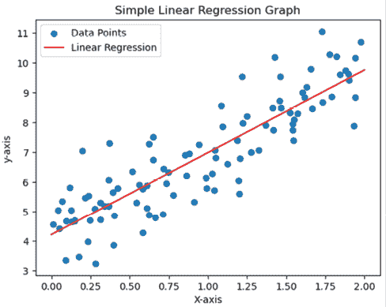

**图 3.1：简单线性回归**

在该图中：

*   纵轴代表因变量 `Y`。
*   横轴代表自变量 `X`。
*   图中的点（`*`）代表数据点（`X`，`Y`）。
*   穿过数据点的线是最佳拟合回归线。
*   最佳拟合线的確定旨在使观测数据点与线所预测值之间的平方差之和最小化。

包含一个自变量的简单线性回归模型的一般形式为：

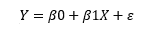

其中：

*   `Y` 是因变量。
*   `X` 是自变量。
*   `β0` 是截距，代表 `X` 为 0 时 `Y` 的值。
*   `β1` 是斜率，表示 `X` 每变化一个单位 `Y` 变化的量。
*   `ε` 是误差项，代表无法解释的或随机的变异性。

目标是找到一条最合适的线，使平方误差之和最小化，这些误差代表 `Y` 的实际值与模型预测值之间的差异。这条线通常被称为回归线或最佳拟合线。

## 关于简单线性回归的关键点

由于其简洁性、可解释性以及利用历史数据预测结果的有效性，线性回归在金融、经济学和机器学习等不同领域得到广泛应用。

然而，为了获得准确可靠的结果，必须考虑线性和独立性等假设，具体解释如下：

简单线性回归假设两个变量之间的关系是线性的，且误差（`ε`）服从方差恒定的正态分布。

系数的解释如下：

*   截距（`β0`）代表 `X` 为 0 时 `Y` 的预测值。
*   斜率（`β1`）表示 `X` 每变化一个单位，`Y` 预期变化的量。如果 `β1` 为正，表明存在正相关关系；如果为负，则表明存在负相关关系。
*   **R 平方 (R²)**：R 平方衡量回归线拟合数据的优劣程度。它表示因变量的方差中有多少比例可由自变量解释。R 平方值越高，表明拟合效果越好。

当两个变量之间存在明显的线性关系时，简单线性回归适用。它可能不适用于更复杂的关系。此外，它假设误差服从正态分布，这并不总是成立。

在 Python 中进行简单线性回归时，可广泛使用 NumPy 和 scikit-learn 等库。代码 3.1 演示了创建简单线性回归模型并将其拟合到数据集的示例：

**代码 3.1：线性回归 Python 代码**

```python
import numpy as np
from sklearn.linear_model import LinearRegression
import matplotlib.pyplot as plt

### 样本数据（自变量 X 和因变量 Y）
X = np.array([1, 2, 3, 4, 5])
Y = np.array([2, 4, 5, 4, 5])

### 将 X 重塑为二维数组（scikit-learn 要求此格式）
X = X.reshape(-1, 1)

### 创建线性回归模型
model = LinearRegression()

### 将模型拟合到数据
model.fit(X, Y)

### 使用训练好的模型进行预测
Y_pred = model.predict(X)

### 绘制原始数据和回归线
plt.scatter(X, Y, label='Data')
plt.plot(X, Y_pred, color='red', label='Regression Line')
plt.xlabel('X')
plt.ylabel('Y')
plt.legend()
plt.show()

### 获取回归系数（截距和斜率）
intercept = model.intercept_
slope = model.coef_[0]

print(f'Intercept (β0): {intercept}')
print(f'Slope (β1): {slope}')
```

请参考图 3.2 查看代码输出：

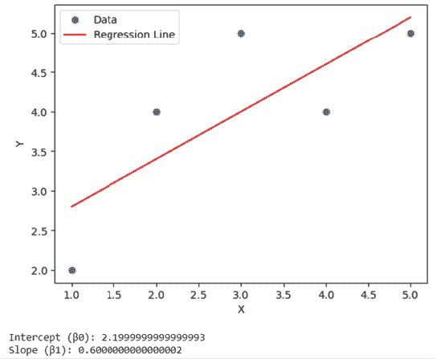

**图 3.2：代码 3.1 的输出**

在该代码中，我们导入必要的库：NumPy 用于数值运算，scikit-learn 用于创建和训练线性回归模型，Matplotlib 用于数据可视化。我们为自变量 `X` 和因变量 `Y` 定义样本数据。我们将 `X` 数据重塑为二维数组，因为 scikit-learn 要求输入为该格式。我们使用 scikit-learn 的 `LinearRegression()` 创建线性回归模型。我们使用 `fit()` 方法将模型拟合到数据，该方法会为给定数据寻找最佳拟合线。我们使用训练好的模型根据 `X` 对 `Y` 进行预测。我们绘制原始数据点和回归线以直观展示拟合效果。我们打印回归系数，包括回归线的截距（`β0`）和斜率（`β1`）。

## 多元线性回归

多元线性回归扩展了简单线性回归的原理，它是一种统计和机器学习技术，用于建模因变量（目标）与两个或多个自变量（预测变量或特征）之间的关系。在多元线性回归中，目标是根据多个自变量的值来预测或解释因变量的值。

图 3.3 说明了因变量（`Y`）与多个自变量（`X1`、`X2`、`X3`、...、`Xn`）之间关系建模的概念。该图展示了当存在两个自变量（`X1` 和 `X2`）时，在三维空间中确定最佳拟合回归平面的过程。

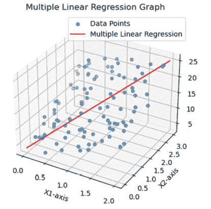

**图 3.3：多元线性回归**

该图包含以下内容：

*   纵轴代表因变量 `Y`。
*   两个横轴代表两个自变量 `X1` 和 `X2`。
*   图展示了回归平面所在的三维空间。
*   多元线性回归模型可表示如下：

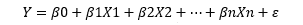

其中：

*   `Y` 是因变量。
*   `X1`、`X2`、...、`Xn` 是自变量。
*   `β0` 是截距，代表所有自变量均为 0 时 `Y` 的值。
*   `β1`、`β2`、...、`βn` 是与每个自变量相关的系数（斜率），表示对应 `X` 每变化一个单位 `Y` 变化的量。
*   `ε` 是误差项，代表无法解释的或随机的变异性。

关于多元线性回归的关键点如下：


## 假设

多元线性回归假设因变量与自变量之间的关系是线性的，且误差项（ε）服从方差恒定的正态分布。它还假设自变量之间不存在完全相关性。系数的解释如下：

*   截距项（`β0`）表示当所有自变量均为 0 时 `Y` 的预测值。
*   每个系数（`β1`、`β2` 等）表示在保持所有其他变量不变的情况下，相应自变量每变化一个单位，`Y` 发生的变化量。

## 模型复杂度

多元线性回归通过考虑多个自变量对因变量的联合影响，允许对更复杂的关系进行建模。这使其适用于多种因素共同影响结果的广泛应用场景。

## 评估

多元线性回归模型可以使用 R 平方（`R²`）、调整后 R 平方、均方误差（`MSE`）等指标进行评估，以判断模型对数据的拟合程度。

## 应用

多元线性回归应用于经济学、金融学、社会科学、流行病学和环境科学等领域，这些领域中多种因素共同作用于结果。它在进行预测、理解变量关系以及假设检验方面非常有价值。

## 在 Python 中执行多元线性回归

借助 NumPy 和 sci-kit-learn 等库，在 Python 中执行多元线性回归非常简单。代码 3.2 展示了如何使用 sci-kit-learn 创建并拟合多元线性回归模型的示例：

### 代码 3.2：多元线性回归的 Python 代码

```python
import numpy as np

from sklearn.linear_model import LinearRegression

from sklearn.model_selection import train_test_split

from sklearn.metrics import mean_squared_error

import matplotlib.pyplot as plt

from mpl_toolkits.mplot3d import Axes3D

#### Sample data with multiple independent variables (X1, X2, X3) and a dependent variable (Y)
X = np.array([[1, 2, 3], [2, 3, 4], [3, 4, 5], [4, 5, 6], [5, 6, 7]])
Y = np.array([5, 8, 11, 14, 17])

### Split the data into training and testing sets
X_train, X_test, Y_train, Y_test = train_test_split(X, Y, test_size=0.2, random_state=42)

#### Create a linear regression model
model = LinearRegression()

#### Fit the model to the training data
model.fit(X_train, Y_train)

#### Make predictions using the trained model
Y_pred = model.predict(X_test)

#### Calculate the mean squared error (MSE) to evaluate the model's performance
mse = mean_squared_error(Y_test, Y_pred)

#### Get the regression coefficients (intercept and slopes)
intercept = model.intercept_
coefficients = model.coef_

print("Intercept (β0):", intercept)
print("Coefficients (β1, β2, β3):", coefficients)
print("Mean Squared Error (MSE):", mse)

#### Plot the original data points and the regression plane
fig = plt.figure()
ax = fig.add_subplot(111, projection='3d')
ax.scatter(X_test[:, 0], X_test[:, 1], Y_test, color='blue', label='Actual Data Points')
ax.scatter(X_test[:, 0], X_test[:, 1], Y_pred, color='red', label='Predicted Data Points')
ax.set_xlabel('X1-axis')
ax.set_ylabel('X2-axis')
ax.set_zlabel('Y-axis')
ax.legend()
ax.set_title('Linear Regression Plane')
plt.show()
```

请参考 图 3.4 查看代码输出：

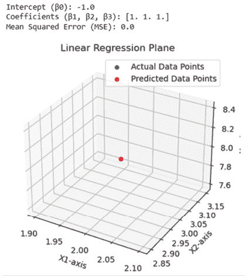

**图 3.4：代码 3.2 的输出**

在该代码中，我们导入了必要的库，包括用于数值运算的 NumPy 和用于创建及训练线性回归模型的 scikit-learn。我们定义了包含三个自变量（`X1`、`X2`、`X3`）和一个因变量（`Y`）的样本数据。我们使用 `train_test_split()` 将数据划分为训练集和测试集，以评估模型性能。然后，我们使用 scikit-learn 中的 `LinearRegression()` 建立多元线性回归模型。

我们使用 `fit()` 方法在训练数据上拟合模型。我们使用训练好的模型对测试数据进行预测。我们计算 `MSE` 以评估模型性能。最后，我们打印回归系数（截距和斜率）以及 `MSE` 作为模型质量的度量。由于实际数据点和预测数据点相同，因此它们在图中重叠显示。

> **注意：** 您可以用自己的数据集替换样本数据进行分析。

### 多项式回归

多项式回归

多项式回归是一种回归分析技术，它通过多项式函数来刻画因变量（`Y`）与一个或多个自变量（`X`）之间的关系。

与假设变量间存在线性关系的简单线性回归不同，多项式回归能够捕捉更复杂的非线性关系。

图 3.5 有助于直观展示多项式方程如何用于建模因变量（`Y`）与自变量（`X`）之间的关系。下图展示了二次多项式回归的基本示意图：

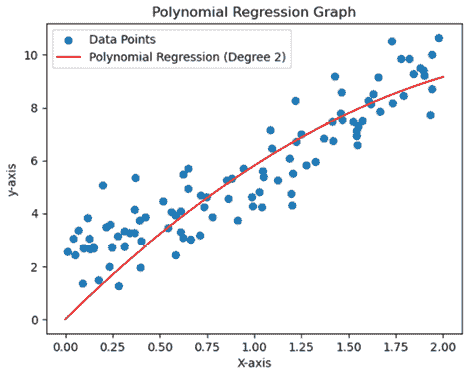

**图 3.5：多项式回归**

图示说明如下：

*   纵轴代表因变量 `Y`。
*   横轴代表自变量 `X`。
*   曲线代表捕捉 `X` 与 `Y` 关系的二次回归曲线。

在多项式回归中，回归模型表示为指定次数（如二次、三次或更高）的多项式方程。含一个自变量的多项式回归通式为：

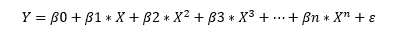

其中：

*   `Y` 是因变量。
*   `X` 是自变量。
*   `β0`、`β1`、`β2`、...、`βn` 是决定多项式函数形状和次数的系数。
*   `ε` 是误差项，代表未被解释的变异性。

关于多项式回归的关键点如下：

*   **多项式的次数：** 次数（`n`）决定了多项式方程的复杂程度。一次多项式代表线性关系，而高次多项式能捕捉数据中更复杂的非线性模式。
*   **过拟合：** 使用高次多项式可能导致过拟合，即模型对训练数据拟合得非常紧密，但可能无法很好地泛化到新的、未见过的数据。选择合适的多项式次数对于平衡模型复杂度和泛化能力至关重要。
*   **可解释性：** 虽然多项式回归能捕捉复杂关系，但随着多项式次数的增加，系数的解释变得更具挑战性。
*   **应用：** 多项式回归用于数据关系呈现曲线或非线性模式的各个领域。例如物理学、经济学、生物学和工程学。
*   **可视化：** 绘图时多项式回归通常呈现曲线，使其在视觉上适合建模具有非线性趋势的数据。
*   **正则化：** 在某些情况下，可以结合岭回归和 Lasso 回归等正则化技术与多项式回归一起使用，以防止过拟合。


### 多项式回归

为了在实践中执行多项式回归，你需要选择多项式的阶数，将模型拟合到数据，并使用生成的方程进行预测或分析变量间的关系。多项式回归是捕捉和建模数据中非线性模式的宝贵工具。要在 Python 中执行多项式回归，代码 3.3 展示了用于数据操作、建模、可视化及其他操作的库，如 `NumPy`、`scikit-learn` 和 `matplotlib`。

### 代码 3.3：多项式回归的 Python 代码

```python
import numpy as np
import matplotlib.pyplot as plt

#### 生成一些示例数据
np.random.seed(42)
X = 2 * np.random.rand(100, 1)
y = 2 + 3 * X + 0.5 * X**2 + np.random.randn(100, 1)

#### 拟合多项式回归模型
degree = 2 # 设置多项式的阶数
X_poly = np.c_[X, X**2]
X_poly_with_bias = np.c_[np.ones((100, 1)), X_poly] # 添加偏置项
theta_best = np.linalg.inv(X_poly_with_bias.T.dot(X_poly_with_bias)).dot(X_poly_with_bias.T).dot(y)

#### 计算得到的斜率和截距
slope = theta_best[1][0]
intercept = theta_best[0][0]

#### 计算误差
y_predict = X_poly_with_bias.dot(theta_best)
error = np.mean((y_predict - y)**2)

#### 创建一系列用于预测的 X 值
X_new = np.linspace(0, 2, 100).reshape(-1, 1)
X_new_poly = np.c_[np.ones((100, 1)), X_new, X_new**2]

#### 使用多项式回归模型预测 y 值
y_predict_new = X_new_poly.dot(theta_best)

#### 绘制原始数据点和多项式回归曲线
plt.scatter(X, y, label='Data Points')
plt.plot(X_new, y_predict_new, 'r-', label=f'Polynomial Regression (Degree {degree})')
plt.xlabel('X-axis')
plt.ylabel('y-axis')
plt.legend()

#### 在图中显示斜率、截距和误差
plt.text(1.5, 8, f'Slope: {slope:.2f}\nIntercept: {intercept:.2f}\nError: {error:.2f}', fontsize=10, bbox=dict(facecolor='white', alpha=0.8))
plt.title('Polynomial Regression with Slope, Intercept, and Error')
plt.show()
```

请参考 图 3.6 查看代码输出：

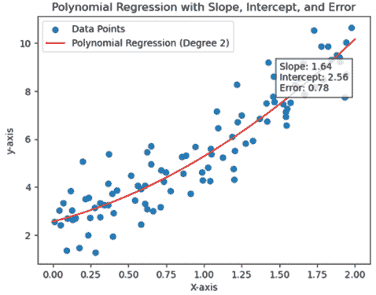

**图 3.6：代码 3.3 的输出**

在该代码中，我们为演示目的生成了合成数据。数据遵循二次关系 `Y=2+3X+0.5X2` 并添加了随机噪声。然后，我们拟合了一个具有指定阶数的多项式回归模型。`X_poly` 矩阵包含原始特征及其平方项。`X_poly_with_bias` 矩阵添加了偏置项（截距）以便于矩阵运算。模型参数 `theta_best` 通过正规方程计算得出。接着，我们从模型参数中提取得到的斜率和截距。计算预测值与实际 y 值之间的均方误差，作为模型性能的度量。随后，生成一系列新的 X 值以便使用训练好的模型进行预测。我们使用训练好的多项式回归模型基于新的 X 值预测新的 y 值。最后，我们使用 `matplotlib.pyplot` 创建原始数据点的散点图并叠加多项式回归曲线。然后在图上显示得到的斜率、截距和误差，以供参考。

## 岭回归

**岭回归**，也称为 Tikhonov 正则化，是一种线性回归形式，它将正则化项纳入普通最小二乘法（OLS）目标函数中。

正则化项惩罚大系数，防止过拟合，并在数据存在多重共线性时提供解决方案。

岭回归目标函数如下：

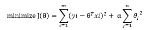

其中：

*   `n` 是特征数量。
*   `θ` 是系数向量（包含截距项）。
*   `xi` 是第 i 个样本的特征向量。
*   `yi` 是第 i 个样本的目标变量。
*   `α` 是正则化参数（超参数）。

代码 3.4 结合 Python 代码示例，通过使用 `scikit-learn` 库解释了岭回归：

### 代码 3.4：岭回归的 Python 代码

```python
import numpy as np
from sklearn.linear_model import Ridge
from sklearn.model_selection import train_test_split
from sklearn.metrics import mean_squared_error
import matplotlib.pyplot as plt

#### 生成示例数据
np.random.seed(42)
X = 2 * np.random.rand(100, 1)
y = 4 + 3 * X + 1.5 * np.random.randn(100, 1)

#### 将数据划分为训练集和测试集
X_train, X_test, y_train, y_test = train_test_split(X, y, test_size=0.2, random_state=42)

#### 使用不同的 alpha 值进行岭回归
alphas = [0, 1, 10, 100]
plt.figure(figsize=(12, 8))
for alpha in alphas:
    ridge_reg = Ridge(alpha=alpha)
    ridge_reg.fit(X_train, y_train)

    # 在测试集上进行预测
    y_pred = ridge_reg.predict(X_test)

    # 绘制结果
    plt.scatter(X_test, y_test, label='Actual Data')
    plt.plot(X_test, y_pred, label=f'Ridge Regression (alpha={alpha})')
    plt.xlabel('X-axis')
    plt.ylabel('y-axis')

    # 打印均方误差
    mse = mean_squared_error(y_test, y_pred)
    print(f'Ridge Regression (alpha={alpha}) - Mean Squared Error: {mse:.2f}')

plt.legend()
plt.show()
```

请参考 图 3.7 查看代码输出：

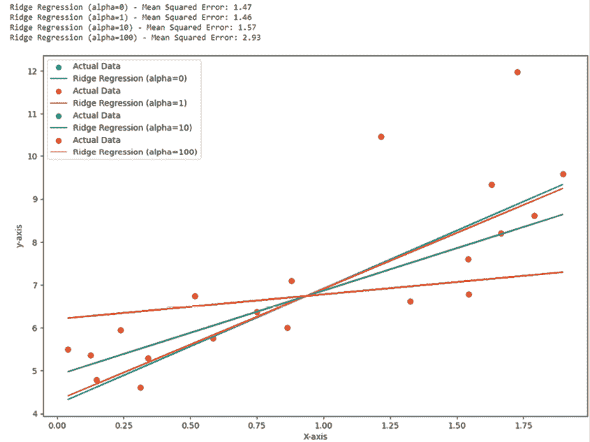

**图 3.7：代码 3.4 的输出**

在该代码中，我们生成了具有线性关系的合成数据并添加了一些噪声。数据被划分为训练集和测试集。岭回归应用了不同的正则化参数值。结果（包括均方误差）被打印并绘图以供可视化。你可以根据具体用例调整 alpha 值和其他参数。岭回归有助于防止过拟合并稳定模型，特别是在处理输入特征中的多重共线性时。

由于岭回归能够解决多重共线性并防止过拟合，它在各个领域被广泛应用。下面列举了一些岭回归的应用：

*   **投资组合管理**：在金融领域，岭回归可用于投资组合管理，以处理资产收益间的多重共线性，提高资产配置模型的稳定性。
*   **需求预测**：岭回归应用于经济研究，如需求预测模型，其中多个变量可能相关，目标是防止对个别变量的过度敏感。
*   **临床试验**：在医学研究中，岭回归可用于临床试验，因为多种因素可能影响患者预后。它有助于构建能很好地泛化到新数据的稳健模型。
*   **基因组数据分析**：岭回归用于基因组学分析基因表达数据。基因组数据的高维特性通常涉及相关变量，岭回归有助于选择相关特征。
*   **市场细分**：在市场营销中，岭回归可应用于市场细分和客户行为分析。它有助于处理影响消费者偏好的相关因素。
*   **环境建模**：岭回归用于环境建模以预测环境因素，其中各种输入可能相互关联，目标是避免过拟合。
*   **地震数据分析**：岭回归用于地球物理学的地震数据分析，其中多个地震属性可能相关。它有助于创建更稳定的模型以进行地下构造表征。


## 调查数据分析

在社会科学中，特别是在调查数据分析中，当处理相关的调查响应时，岭回归非常有用，它有助于识别显著预测变量，而不会过分强调任何单一变量。

## 高维数据

在具有高维数据的机器学习应用中，岭回归常用于防止过拟合并稳定模型训练，尤其是在特征数量接近或超过样本数量时。

## 图像处理

在遥感应用中，岭回归可应用于像素可能表现出相关性的图像处理任务。它有助于提高图像分析模型的准确性。

## Lasso 回归

正则化项包含在 Lasso 回归的目标函数中，Lasso 是“最小绝对收缩和选择算子”的缩写。系数的 L1 范数代表正则化项，它通过精确地将某些系数降至零来促进稀疏性。正是由于这一特性，Lasso 回归在特征选择方面具有优势。Lasso 回归的目标函数如下所示：

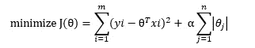

其中：

*   `m` 是样本数量。
*   `n` 是特征数量。
*   `θ` 是系数向量（包含截距项）。
*   `xi` 是第 `i` 个样本的特征向量。
*   `yi` 是第 `i` 个样本的目标变量。
*   `α` 是正则化参数（超参数）。

代码 3.5 结合使用 `scikit-learn` 库的 Python 代码示例解释了 Lasso 回归。

### 代码 3.5：Lasso 回归的 Python 代码

```python
import numpy as np
from sklearn.linear_model import Lasso
from sklearn.model_selection import train_test_split
from sklearn.metrics import mean_squared_error
import matplotlib.pyplot as plt

#### 生成样本数据
np.random.seed(42)
X = 2 * np.random.rand(100, 1)
y = 4 + 3 * X + 1.5 * np.random.randn(100, 1)

#### 将数据拆分为训练集和测试集
X_train, X_test, y_train, y_test = train_test_split(X, y, test_size=0.2, random_state=42)

#### 使用不同的 alpha 值进行 Lasso 回归
alphas = [0, 0.1, 1, 10]
plt.figure(figsize=(12, 8))

for alpha in alphas:
    lasso_reg = Lasso(alpha=alpha)
    lasso_reg.fit(X_train, y_train)

    # 在测试集上进行预测
    y_pred = lasso_reg.predict(X_test)

    # 绘制结果
    plt.scatter(X_test, y_test, label='实际数据')
    plt.plot(X_test, y_pred, label=f'Lasso 回归 (alpha={alpha})')
    plt.xlabel('X 轴')
    plt.ylabel('y 轴')

    # 打印均方误差
    mse = mean_squared_error(y_test, y_pred)
    print(f'Lasso 回归 (alpha={alpha}) - 均方误差: {mse:.2f}')

plt.legend()
plt.show()
```

请参考 图 3.8 查看代码输出：

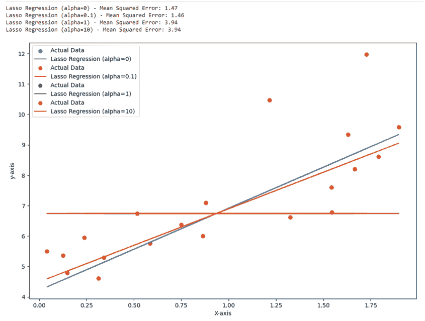

**图 3.8：代码 3.5 的输出**

在该代码中，我们生成了具有线性关系的合成数据并添加了一些噪声。数据被拆分为训练集和测试集。Lasso 回归应用了不同的正则化参数值。包括均方误差在内的结果被打印并绘图以供可视化。您可以根据您的特定用例调整 `alpha` 值和其他参数。Lasso 回归可以有效地将系数收缩至零，有助于特征选择并创建更简单的模型。在处理包含潜在无关特征的高维数据时，它显得尤为宝贵。

Lasso 回归凭借其通过将某些系数精确收缩至零来引入稀疏性的能力，在各个领域都有应用。下面列举了一些 Lasso 回归的常见应用：

*   **基因组学**：在基因组学研究中，Lasso 回归用于从大量遗传标记中选择相关基因，有助于识别疾病的潜在生物标志物。
*   **经济模型中的变量选择**：Lasso 应用于经济研究中，以在处理多重共线性的同时选择相关的经济指标或变量。
*   **风险管理**：Lasso 回归用于金融领域的风险管理和投资组合优化，通过选择相关的金融特征并构建更稳健的模型。
*   **药物发现**：在药物发现中，Lasso 回归有助于识别与药物反应和治疗结果相关的大型数据集中的重要特征。
*   **环境建模**：Lasso 应用于环境科学中，以识别影响环境结果的关键因素，如污染水平或气候变化影响。
*   **客户细分**：Lasso 回归用于市场营销中选择相关的客户细分特征，有助于制定有针对性的营销策略。
*   **稀疏信号重构**：Lasso 应用于信号处理中的稀疏信号重构，它有助于从噪声测量中恢复信号的稀疏表示。
*   **稀疏数据表示**：Lasso 回归用于机器学习中的稀疏数据表示和特征选择，增强模型的可解释性和泛化能力。
*   **临床试验**：在临床试验中，Lasso 回归用于选择预测患者预后的相关特征，为个性化医疗做出贡献。
*   **医学影像**：Lasso 应用于医学图像处理中，用于肿瘤检测和图像分类等任务的特征选择。
*   **脑成像**：Lasso 回归用于神经科学中分析脑成像数据，并识别与特定状况或任务相关的相关脑区。
*   **调查数据分析**：Lasso 回归通过选择调查数据中的重要特征，帮助研究人员理解变量之间的关系，从而在社会科学中发挥作用。
*   **能耗预测**：Lasso 回归应用于能源预测中，以选择预测能耗的相关特征，有助于高效的能源管理。

## 回归模型性能评估

评估回归模型的性能至关重要，以确定模型拟合数据和进行准确预测的效果。可以使用多种评估指标来评估回归模型的性能。下面列举了一些评估回归模型的常用方法和指标：

### 平均绝对误差 (MAE)

它量化了预测值与实际值之间平均绝对差异。与 MSE 相比，它对异常值的敏感度较低。数学表示如下：

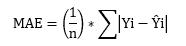

其中：

*   `n` 是数据集中的样本数量。
*   `Yi` 代表真实目标值或观测值。
*   `Ŷi` 代表模型的预测值。
*   `|Yi - Ŷi|` 计算每个样本真实值 `Yi` 与预测值 `Ŷi` 之间的绝对差异。
*   `∑|Yi - Ŷi|` 计算所有样本绝对差异的总和。

### 均方误差 (MSE)

它计算预测值与实际值之间平均平方偏差，赋予较大误差更大的权重。数学表示如下，所有变量解释同上：

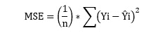

### 均方根误差 (RMSE)

它源自 MSE 的平方根，提供了一个直观的指标来评估平均预测误差。数学表示如下：

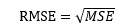

### R 平方 (R²) 分数

R 平方评估因变量方差中由自变量解释的比例。较高的 R 平方值表明模型与数据集的拟合度更好。数学表示如下：

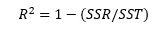

其中：

*   **SSR**：残差平方和
*   `R2 = MSE * n`


### SST：总平方和（因变量的方差）

### 调整后的 R 平方（adjusted R²）

调整后的 R 平方考虑了模型中自变量的数量，并惩罚无关变量的添加。其数学表达式如下：

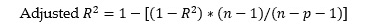

其中：

*   `n`：数据点数量
*   `p`：自变量数量

### 平均绝对百分比误差（MAPE）

它计算预测值与实际值之间的百分比差异，便于跨不同数据集比较模型。其数学表达式如下：

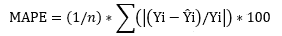

### 残差分析

检查残差（预测值与实际值之间的差异）至关重要。残差图有助于识别模式或异方差性。

### 交叉验证

执行交叉验证（例如 k 折交叉验证）以评估模型对新数据的泛化能力。交叉验证有助于理解模型在不同数据子集上的稳定性和性能。

### 特征重要性

对于具有特征重要性评分的模型（如随机森林或梯度提升），评估每个特征在预测中的显著性。

### 领域特定指标

在某些情况下，领域特定指标可能更相关。例如，在金融领域，可能会使用夏普比率或信息准则等指标。

评估指标的选择取决于具体问题和回归分析的目标。通常，使用多个指标以获得模型性能的全面视图是一种良好的实践。此外，图形化表示（如残差图）能为模型性能和潜在改进领域提供有价值的见解。

代码 3.6 展示了如何在 Python 中计算回归模型的一些评估指标。它涵盖了 MAE、MSE、RMSE 和 R² 分数的示例。

**代码 3.6：评估指标的 Python 代码**

```python
import numpy as np

from sklearn.metrics import mean_absolute_error, mean_squared_error, r2_score

### 样本实际值和预测值
actual_values = np.array([5, 10, 15, 20, 25])
predicted_values = np.array([6, 12, 14, 18, 24])

### 平均绝对误差 (MAE)
mae = mean_absolute_error(actual_values, predicted_values)
print("Mean Absolute Error (MAE):", mae)

### 均方误差 (MSE)
mse = mean_squared_error(actual_values, predicted_values)
print("Mean Squared Error (MSE):", mse)

### 均方根误差 (RMSE)
rmse = np.sqrt(mse)
print("Root Mean Squared Error (RMSE):", rmse)

### R 平方 (R²) 分数
r_squared = r2_score(actual_values, predicted_values)
print("R-squared (R²) Score:", r_squared)
```

请参考 图 3.9 查看代码输出：

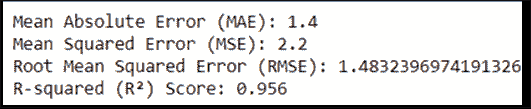

**图 3.9：代码 3.6 的输出**

对于 MAPE，可以使用以下 代码 3.7：

**代码 3.7：MAPE 的 Python 代码**

```python
### 计算平均绝对百分比误差 (MAPE)
mape = np.mean(np.abs((actual_values - predicted_values) / actual_values)) * 100
print("Mean Absolute Percentage Error (MAPE):", mape)
```

> **注意：** 调整后的 R 平方和其他指标（如交叉验证或特征重要性）可能需要更多上下文和数据准备。根据您的具体回归模型和数据集，您可以计算这些指标并分析结果。

## 结论

在本章中，我们详细讨论了监督学习及其第一种类型——回归。回归细分为多种类型，包括线性回归、多元回归、多项式回归、岭回归和 Lasso 回归。

我们讨论了每种类型及其相应的目标函数、图示表示和 Python 代码。此后，本章详细讨论了各种评估指标。

## 编程练习

1.  实现一个简单线性回归模型，基于单个特征预测目标变量。训练模型、进行预测，并使用均方误差等指标评估其性能。
2.  将上一练习扩展到多个特征。实现一个多元线性回归模型，在具有多个自变量的数据集上训练它，并评估其性能。
3.  开发一个多项式回归模型以捕捉数据中的非线性关系。尝试不同的多项式次数并可视化结果。
4.  探索回归中的特征工程技术。创建新特征、处理分类变量，并评估对模型性能的影响。
5.  实现正则化回归模型，如岭回归或 Lasso 回归。探索正则化参数对模型系数和性能的影响。
6.  为回归模型实现交叉验证流水线。使用交叉验证均方误差和 R 平方等指标评估模型。
7.  进行残差分析以评估模型假设，绘制残差图，检查同方差性，并识别有影响力的数据点。
8.  选择一个真实数据集（例如房价、股票价格）并应用回归技术预测目标变量。清洗数据、选择相关特征并优化模型。

## 问题

1.  什么是回归分析？它与相关分析有何不同？
    解释回归背景下因变量和自变量的区别。
2.  简单线性回归与多元线性回归有何不同？
3.  你能解释线性回归模型中系数的含义吗？
4.  列出并解释线性回归的假设。
5.  如何在多元回归模型中诊断和处理多重共线性？
6.  评估回归模型性能的常用指标有哪些？
7.  解释 R 平方的含义及其在回归分析中的重要性。
8.  过拟合和欠拟合如何在回归模型中发生？
9.  回归分析中可以使用哪些技术来解决过拟合问题？
10. 描述回归分析中不同的变量选择方法。
11. 什么是逐步回归？它的优缺点是什么？
12. 提供一个适用回归分析的真实场景示例。
13. 如果某个自变量的系数为负，这意味着它与因变量有何关系？
14. 解释岭回归和 Lasso 回归的概念。何时选择岭回归而非 Lasso，反之亦然？

## 加入我们的图书 Discord 空间

加入图书的 Discord 工作区，获取最新动态、优惠、全球科技资讯、新书发布及作者专场活动：

[`discord.bpbonline.com`](https://discord.bpbonline.com)


# 第 4 章：监督学习：分类

## 简介

分类是机器学习和统计学中的一个基本概念。它是一种监督学习技术，涉及根据数据点的特征将其归类或标记到预定义的类别中。分类的目标是构建一个预测模型，能够将新的、未见过的数据点分配到正确的类别。

## 结构

本章涵盖以下主题：

*   分类的关键要素
*   分类的必要性
*   逻辑回归
*   K 近邻
*   决策树
*   基于基尼指数的分裂算法
*   随机森林
*   朴素贝叶斯分类器
*   支持向量机
*   分类器的评估指标

## 目标


### 本章小结

在本章结束时，你将能够理解监督学习及其第二大重要类型——分类。你将学习并实现各种分类技术，包括逻辑回归（Sigmoid 函数）、K 近邻、决策树、分类与回归树、随机森林、分裂算法、ID3、朴素贝叶斯分类器和支持向量机，并通过目标函数和 Python 代码进行深入讲解。随后，你将学习并实现各种用于分类器性能分析的评估指标。

## 分类的关键要素

分类是机器学习中的基础工具，其应用广泛。选择合适的分类算法和特征工程是实现分类任务准确且有意义结果的关键因素。以下是分类的关键要素：

*   **类别**：分类涉及将数据点分配到两个或多个预定义的类别中。这些类别通常用标签表示，例如垃圾邮件和非垃圾邮件、正类和负类，或猫、狗和马。
*   **特征**：每个数据点都具有一组描述它的特征或属性。这些特征用于预测数据点所属的类别。

## 分类的必要性

分类是高效机器学习不可或缺的一部分。其必要性体现在以下方面：

*   **自动化**：分类算法实现了决策过程的自动化。它们可以自动将邮件分类为垃圾邮件或非垃圾邮件、检测欺诈交易，或从医学图像中识别疾病。
*   **模式识别**：分类有助于识别数据中的模式和关系。这在图像识别、语音识别和自然语言处理等各个领域非常有用。
*   **分类归类**：分类允许将数据组织到不同的类别中。例如，在内容推荐系统中，分类可以将文章、视频或产品归类为相关主题。
*   **预测建模**：分类是预测建模的基石。它有助于基于历史数据预测未来的结果或行为。例如，预测客户流失、贷款违约或产品需求。

## 分类的应用

分类在不同领域有着广泛的应用：

*   **垃圾邮件检测**：将邮件分类为垃圾邮件或非垃圾邮件，以过滤不需要的邮件。
*   **情感分析**：确定文本数据的情感倾向（正面、负面或中性），应用于社交媒体监控和产品评论等场景。
*   **医学诊断**：基于医学检测结果、患者症状或影像数据诊断疾病或病症。
*   **图像分类**：识别图像和视频中的物体、人物或场景。
*   **手写识别**：对手写文本或字符进行分类。
*   **信用评分**：通过将贷款申请人分类为低、中、高风险类别来评估信用风险。
*   **文档分类**：将文档或文章按主题或体裁分类。
*   **欺诈检测**：在金融数据中识别欺诈交易。
*   **目标检测**：在图像或视频中定位并分类物体，如自动驾驶汽车和安防系统中的应用。
*   **语音识别**：将口语转换为文本或指令。
*   **生物物种识别**：基于 DNA 或物理特征等特征识别动植物物种。
*   **异常检测**：识别数据中的异常或离群值，如网络入侵检测。

## 逻辑回归

逻辑回归是一种用于二分类的统计和机器学习技术，这意味着它主要用于预测两种可能结果中的一种。尽管名字中带有“回归”，但逻辑回归并不用于预测连续值的回归任务；相反，它是一种用于预测分类结果的分类算法，通常是二元结果（是/否或 0/1）。

### 逻辑回归的关键特征

逻辑回归的关键特征如下：

*   **二分类**：逻辑回归模型计算给定输入属于两个类别之一的概率。例如，它可用于预测邮件是垃圾邮件（类别 1）还是非垃圾邮件（类别 0），或者患者是否患有某种疾病（类别 1）或未患病（类别 0）。
*   **Sigmoid 函数**：逻辑回归模型使用逻辑（或 Sigmoid）函数将输入特征的线性组合映射到 0 和 1 之间的值。Sigmoid 函数将输出压缩到概率范围内。
*   **对数几率**：逻辑回归预测事件发生概率的对数几率。这些对数几率随后通过 Sigmoid 函数转换为概率。
*   **系数估计**：与线性回归类似，逻辑回归为每个输入特征估计系数。然而，这些系数用于确定每个特征对事件发生对数几率的影响。
*   **可解释性**：逻辑回归提供可解释的结果，使你能够了解每个输入特征对事件发生概率的影响。系数可用于评估特征重要性。
*   **正则化**：逻辑回归的正则化版本，如 `L1` (Lasso) 和 `L2` (Ridge) 正则化，可用于防止过拟合并选择相关特征。

逻辑回归的应用广泛存在于医学诊断、垃圾邮件检测、信用风险评估和情感分析等各个领域。逻辑回归是二分类任务的一种基础且广泛使用的方法。

逻辑回归的数学方程，也称为逻辑函数或 Sigmoid 函数，如下所示：

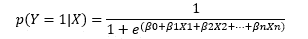

其中：

*   `p(Y=1|X)` 表示在给定自变量 `X1`、`X2`、...、`Xn` 的值时，因变量 `Y` 等于 1（事件发生）的概率。
*   `e` 是自然对数的底数（约等于 2.71828）。
*   `β0` 是截距，表示当所有自变量为零时事件发生的对数几率。
*   `β1`、`β2` 和 `βn` 是决定每个自变量对事件发生对数几率影响程度的系数。

逻辑函数或 Sigmoid 函数将输入特征和系数的线性组合压缩到零到一之间的值。该值表示事件发生的概率，如图 4.1 所示。它定义了一个 Sigmoid 函数，然后生成一组 x 值，使用 Sigmoid 函数计算对应的 y 值，最后使用 Matplotlib 绘制 Sigmoid 函数。红色虚线表示 Sigmoid 函数等于 0.5 的决策边界，这常用于二分类问题。

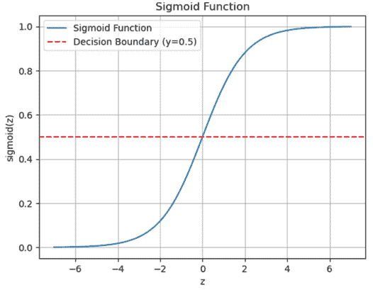

**图 4.1：逻辑回归（Sigmoid 函数）**

逻辑函数呈 S 形曲线，确保预测概率始终在 0 和 1 之间。逻辑回归模型使用该函数预测给定输入属于两个类别（0 或 1）之一的概率。分类阈值通常设为 0.5，即如果 `p(Y=1|X)` 大于或等于 0.5，则实例分类为 1；否则分类为 0。代码 4.1 展示了如何使用流行的 scikit-learn 库在 Python 中执行逻辑回归。我们将使用一个简单的合成数据集进行二分类。


### 代码 4.1：逻辑回归的 Python 代码

```python
import numpy as np

from sklearn.datasets import make_classification
from sklearn.model_selection import train_test_split
from sklearn.linear_model import LogisticRegression
from sklearn.metrics import accuracy_score, confusion_matrix, classification_report
import matplotlib.pyplot as plt

#### 创建用于二分类的合成数据集
X, y = make_classification(n_samples=100, n_features=2, n_informative=2, n_redundant=0, random_state=42)

#### 将数据集划分为训练集和测试集
X_train, X_test, y_train, y_test = train_test_split(X, y, test_size=0.2, random_state=42)

#### 创建逻辑回归模型
model = LogisticRegression()

#### 使用训练数据拟合模型
model.fit(X_train, y_train)

#### 在测试数据上进行预测
y_pred = model.predict(X_test)

#### 计算准确率和其他性能指标
accuracy = accuracy_score(y_test, y_pred)
conf_matrix = confusion_matrix(y_test, y_pred)
class_report = classification_report(y_test, y_pred)

#### 可视化决策边界
plt.scatter(X[:, 0], X[:, 1], c=y, cmap=plt.cm.Paired)

ax = plt.gca()
xlim = ax.get_xlim()
ylim = ax.get_ylim()

xx, yy = np.meshgrid(np.linspace(xlim[0], xlim[1], 50), np.linspace(ylim[0], ylim[1], 50))
Z = model.decision_function(np.c_[xx.ravel(), yy.ravel()])
Z = Z.reshape(xx.shape)

plt.contour(xx, yy, Z, colors='k', levels=[0], linestyles=['--'])
plt.title("Logistic Regression Decision Boundary")
plt.xlabel("Feature 1")
plt.ylabel("Feature 2")
plt.show()

#### 打印性能指标
print(f"Accuracy: {accuracy}")
print("Confusion Matrix:\n", conf_matrix)
print("Classification Report:\n", class_report)
```

请参考图 4.2 查看代码输出：

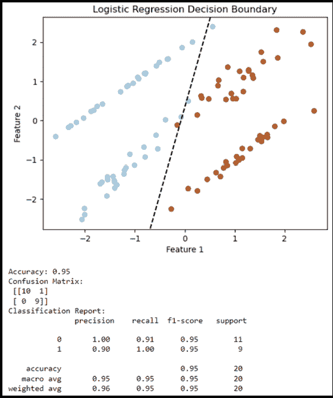

**图 4.2：代码 4.1 的输出**

在该代码中，我们使用 scikit-learn 的 `make_classification` 创建了一个合成数据集。该数据集包含两个特征，适用于二分类。我们使用 `train_test_split` 将数据集划分为训练集和测试集。我们使用 scikit-learn 的 `LogisticRegression()` 创建逻辑回归模型。我们使用 `fit()` 方法利用训练数据拟合模型。我们使用 `predict()` 方法在测试数据上进行预测。我们计算准确率、混淆矩阵和分类报告以评估模型性能。我们可视化了逻辑回归模型的决策边界，以查看它是如何分离类别的。

## K 近邻

**K 近邻（KNN）** 是一种简单直观的机器学习算法，既可用于分类任务，也可用于回归任务。它是一种非参数化和基于实例的学习方法。KNN 基于特征空间中 K 个最近数据点的多数类别进行预测。KNN 的关键概念和特征包括：

*   **基于实例的学习**：KNN 是一种基于实例的学习算法。它将整个数据集存储在内存中，进行预测时，它会寻找距离新数据点最近的 K 个邻居来确定其类别或数值。
*   **K 个最近邻居**：K 表示进行预测时考虑的最近邻居数量。K 的选择是一个超参数，会显著影响算法性能。较小的 K 可能导致过拟合，而较大的 K 可能导致欠拟合。
*   **距离度量**：KNN 依赖距离度量（例如欧氏距离）来衡量数据点之间的相似性。距离度量有助于确定哪些数据点是最近邻居。
*   **分类与回归**：KNN 既可用于分类也可用于回归任务。在分类中，它根据 K 个最近邻居中的多数类别分配类别标签。在回归中，它计算 K 个最近邻居数值的平均值或加权平均值来预测连续结果。
*   **无训练阶段**：KNN 没有显式的训练阶段。它仅记忆训练数据，所有学习都发生在预测期间。
*   **惰性学习**：KNN 常被称为惰性学习器，因为它在训练期间不构建模型。相反，它将大部分工作推迟到预测时刻。
*   **对异常值鲁棒**：KNN 对异常值具有鲁棒性，因为它考虑的是数据点的局部邻域，而非依赖全局模型。
*   **超参数**：除了 K 之外，其他超参数（如距离度量的选择和加权方案——均匀权重或基于距离的权重）也会影响算法性能。

KNN 易于理解和实现，使其成为简单分类和回归任务的良好选择。然而，它的计算开销可能很大，尤其是在大型数据集上，并且在高维空间中可能表现不佳。适当调整超参数（包括 K 值）对于使用 KNN 获得良好结果至关重要。从数学上表示，KNN 如下：

*   **初始化**：给定一个带有标签示例的数据集：

    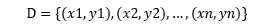

    其中  表示第 i 个数据点的特征向量，  是对应的类别标签（用于分类）或数值（用于回归）。

*   **距离度量**：选择一种距离度量，通常为欧氏距离：

    

*   **预测**：按如下方式执行：
    *   对于新数据点 `x_new`，计算 `x_new` 与 D 中所有数据点之间的距离。
    *   选择距离 `x_new` 最近的 K 个数据点（距离最小）。
    *   对于分类，将 `x_new` 的类别标签预测为 K 个最近邻居中的多数类别。
    *   对于回归，将 `x_new` 的数值预测为 K 个最近邻居数值的平均值（或加权平均值）。

KNN 的典型示意图见图 4.3：

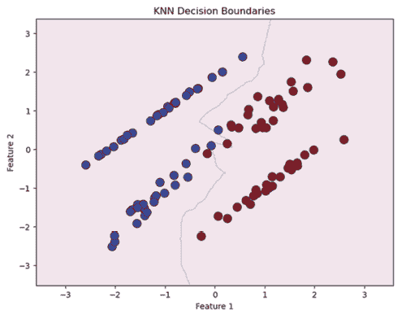

**图 4.3：KNN 示意图**

在该图中：

*   图中的点代表带有关联类别标签（类别 0 或类别 1）的数据点。
*   新数据点是我们要对其进行预测的点。
*   KNN 计算新数据点与所有现有数据点之间的距离。
*   它根据这些距离选择 K 个最近邻居。本例中使用 K=3。
*   对于分类，K 个邻居中的多数类别决定了新数据点的预测类别。

### 代码 4.2

**代码 4.2：KNN 的 Python 代码**

```python
from sklearn.neighbors import KNeighborsClassifier
from sklearn.model_selection import train_test_split
from sklearn.metrics import accuracy_score, classification_report
from sklearn.datasets import load_iris

#### 加载鸢尾花数据集（scikit-learn 内置数据集）
data = load_iris()
X = data.data  # 特征
y = data.target  # 目标（类别标签）

#### 将数据划分为训练集和测试集
X_train, X_test, y_train, y_test = train_test_split(X, y, test_size=0.2, random_state=42)

#### 创建具有指定邻居数量 (K) 的 KNN 分类器
k = 3
knn_classifier = KNeighborsClassifier(n_neighbors=k)

#### 使用训练数据拟合模型
knn_classifier.fit(X_train, y_train)

#### 在测试数据上进行预测
y_pred = knn_classifier.predict(X_test)

#### 计算准确率并打印分类报告
accuracy = accuracy_score(y_test, y_pred)
report = classification_report(y_test, y_pred, target_names=data.target_names)

print("Accuracy:", accuracy)
print("\nClassification Report:\n", report)
```

请参考图 4.4 查看代码输出：

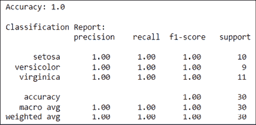

**图 4.4：代码 4.2 的输出**


在这段代码中，我们导入了必要的库，包括 `scikit-learn`，它提供了用于 KNN 分类的 `KNeighborsClassifier`。我们加载了鸢尾花数据集，这是一个著名的分类数据集，包含特征（萼片长度、萼片宽度、花瓣长度、花瓣宽度）和类别标签（山鸢尾、变色鸢尾、维吉尼亚鸢尾）。我们使用 `train_test_split` 将数据集划分为训练集和测试集。我们创建了一个具有指定邻居数量 (K) 的 KNN 分类器，此处为 `k = 3`。我们使用 `fit()` 方法将 KNN 分类器拟合到训练数据上。我们使用 `predict()` 方法对测试数据进行预测。我们计算模型的准确率，并使用 `scikit-learn` 的 `accuracy_score` 和 `classification_report` 函数生成分类报告。

## 决策树

决策树是一种流行的监督机器学习算法，既可用于分类任务，也可用于回归任务。它是一种树状结构，根据输入特征的值做出决策。树的每个内部节点代表基于特定特征的决策，每个叶节点代表类别标签（在分类中）或预测值（在回归中）。决策树易于理解、解释和可视化，使其成为预测建模和数据探索的宝贵工具。

### 决策树的关键特征

决策树的关键特征如下：

*   **节点**：决策树由节点组成，包括内部节点和叶节点。
*   **根节点**：最顶层的节点称为根节点，代表第一个决策或特征。
*   **内部节点**：内部节点代表基于特征值的决策。
*   **叶节点**：叶节点代表结果或预测。
*   **边**：边连接节点，代表从一个节点到另一个节点的路径。
*   **分裂**：每个内部节点代表基于特征值的数据分裂。
*   **分支**：分支是从根节点到叶节点的路径。

### 决策树的工作原理

决策树的工作步骤描述如下：

1.  树的根节点代表用于对数据做决策的最重要或信息量最大的特征。
2.  内部节点代表基于特定特征值的决策。
3.  算法在每个内部节点根据特定准则（例如基尼不纯度、熵）选择最能分离数据的特征。
4.  该过程持续进行，创建更多节点和分支，直到满足停止准则，例如达到最大深度或叶节点中的最小数据点数量。
5.  叶节点包含预测的类别标签（在分类中）或预测值（在回归中）。

### 决策树的优势

决策树的优势如下：

*   易于解释和可视化。
*   适用于分类和回归。
*   可处理数值型和分类型数据。
*   不需要大量的数据预处理。
*   可处理特征选择和变量重要性。
*   对异常值具有鲁棒性。

### 决策树的劣势

决策树的劣势如下：

*   容易过拟合（可通过剪枝等技术缓解）。
*   可能不如其他某些算法那样很好地捕捉复杂关系。
*   对数据的微小变化敏感。

请参考下图以便更好地理解：

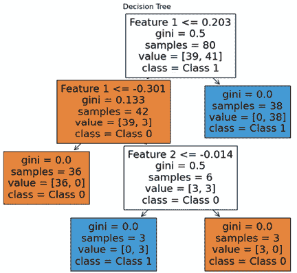

**图 4.5：决策树表示**

决策树是一组用于分类或预测结果的决策规则的图形表示。虽然决策树结构是可视化的，但没有直接与树结构本身相关联的特定数学方程。图 4.3 表示决策树的典型图示。然而，决策树是通过算法构建的，这些算法使用各种数学概念在每个节点做出决策。以下是决策树构建中涉及的关键组件：

*   **分裂准则（不纯度度量）**：决策树通过基于输入特征值递归地划分数据来构建。选择用于分裂的特征及分裂点，是使用分裂准则来决定的，该准则度量数据点的不纯度或无序程度。常见的不纯度度量包括：
    *   **基尼不纯度**：用于分类任务。它度量随机选择的数据点被错误分类的概率。具有 `K` 个类别的节点 `t` 的公式：
        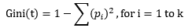
    *   **熵**：也用于分类任务。它度量节点中无序或不确定性的程度。具有 `K` 个类别的节点 `t` 的公式：
        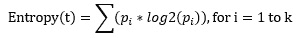
    *   **MSE（均方误差）**：用于回归任务。它度量节点中数据点的方差。具有数据点的节点 `t` 的公式：
        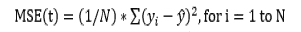
*   **分裂算法**：决策树算法根据选定的分裂准则选择最佳特征和分裂点。可使用多种算法，包括 `ID3`、`C4.5`、`CART` 和随机森林，它们具有确定分裂的特定公式。
*   **剪枝**：树构建完成后，可能会进行剪枝以防止过拟合。剪枝涉及移除不能提高树预测性能的分支。剪枝决策通常使用统计度量，如卡方检验。

虽然决策树结构没有直接的数学方程，但数学主要体现在在每个节点选择最佳特征和分裂点上。不纯度度量和分裂算法的选择是决策树构建中的关键数学组件。树的结构本身是决策规则的可视化表示。代码 4.3 展示了如何使用 Python 和 `scikit-learn` 实现决策树分类器：

**代码 4.3：决策树的 Python 代码**

```python
from sklearn.tree import DecisionTreeClassifier
from sklearn.datasets import load_iris
from sklearn.model_selection import train_test_split
from sklearn.metrics import accuracy_score

#### 加载鸢尾花数据集
data = load_iris()
X = data.data  # 特征
y = data.target  # 目标（类别标签）

#### 将数据划分为训练集和测试集
X_train, X_test, y_train, y_test = train_test_split(X, y, test_size=0.2, random_state=42)

### 创建决策树分类器
dt_classifier = DecisionTreeClassifier()

### 在训练数据上拟合模型
dt_classifier.fit(X_train, y_train)

### 对测试数据进行预测
y_pred = dt_classifier.predict(X_test)

### 计算准确率
accuracy = accuracy_score(y_test, y_pred)
print("Accuracy:", accuracy)
```

请参考图 4.6 查看代码输出：


**图 4.6：代码 4.3 的输出**

在这段代码中，我们加载鸢尾花数据集，这是一个经典的分类数据集。数据集被划分为训练集和测试集。我们使用 `scikit-learn` 中的 `DecisionTreeClassifier` 创建一个决策树分类器。模型在训练数据上进行训练（`fit`）。我们对测试数据进行预测并计算模型的准确率。

### 树诱导算法

树诱导算法用于从数据集构建决策树。这些算法决定如何在树的每个节点处分割数据集，最终创建一个可用于分类或回归的树结构。最流行的树诱导算法之一是分类与回归树（`CART`）算法。

### 分类与回归树


#### 分类与回归树 (CART)

分类与回归树 (CART) 是一种广泛用于构建决策树的算法。它既可应用于分类任务，也可应用于回归任务。CART 算法的核心思想是根据输入特征的值，将数据集递归地分割成子集，使得生成的子集尽可能“纯净”。在分类中，纯度是指子集中大多数数据点属于单一类别；在回归中，则是指子集具有相似的目标值。该算法的工作流程如下：

1.  **特征选择**：CART 选择最佳特征和最佳分割点，以最大化生成子集的纯度。它使用基尼不纯度作为分类标准，使用均方误差 (MSE) 作为回归标准。
2.  **分割**：根据选定的特征和分割点，将数据集分割成两个子集。
3.  **递归**：算法对每个子集递归地应用相同的过程，直到满足停止条件。这可能是最大树深度、节点中最小数据点数量或预定义的纯度水平。
4.  **叶节点预测**：当达到停止条件时，创建一个叶节点。在分类任务中，将节点中的多数类别指定为预测类别。在回归任务中，将节点中目标值的平均值指定为预测值。
5.  **剪枝**：树构建完成后，可能会进行剪枝以避免过拟合。剪枝涉及移除那些不能显著提升树性能的分支。

CART 算法可以创建二叉树（节点最多有两个子节点）或多路树（节点有两个以上的子节点）。它基于在每次分割时最小化不纯度或误差的原则来构建树。代码 4.4 展示了如何使用 CART 算法构建决策树：

### 代码 4.4：CART 的 Python 代码

```python
import numpy as np
import matplotlib.pyplot as plt
from sklearn.datasets import make_classification
from sklearn.tree import DecisionTreeClassifier, export_text
from sklearn.model_selection import train_test_split
from sklearn.metrics import accuracy_score

#### 生成用于演示的合成数据集
X, y = make_classification(n_samples=100, n_features=2, n_informative=2, n_redundant=0, random_state=42)

#### 将数据集划分为训练集和测试集
X_train, X_test, y_train, y_test = train_test_split(X, y, test_size=0.2, random_state=42)

#### 创建 CART 分类器
cart_classifier = DecisionTreeClassifier(random_state=42)

#### 在训练数据上拟合分类器
cart_classifier.fit(X_train, y_train)

#### 在测试数据上进行预测
y_pred = cart_classifier.predict(X_test)

#### 评估分类器的准确率
accuracy = accuracy_score(y_test, y_pred)
print(f'Accuracy: {accuracy:.2f}')

#### 显示树结构
tree_rules = export_text(cart_classifier, feature_names=['Feature 1', 'Feature 2'])
print("Decision Tree Rules:")
print(tree_rules)
```

请参考 图 4.7 查看代码输出：


图 4.7：代码 4.4 的输出

在该代码中，使用 `make_classification` 生成了一个合成数据集。数据集被划分为训练集和测试集。使用 `DecisionTreeClassifier` 创建了一个 CART 分类器。分类器在训练数据上进行训练，并在测试数据上进行评估。

### 基于信息论的分割算法

迭代二叉树 3 (ID3) 算法是一种基于信息论的树诱导算法。它用于构建用于分类任务的决策树。ID3 的核心思想是在树的每个节点选择能最大化信息增益或减少不确定性的特征和分割。

#### ID3 算法

ID3 算法概述如下：

*   **熵**：ID3 算法使用一种称为熵 (H) 的度量来量化数据集的不确定性或不纯度。在分类任务中，熵用于度量类别标签的无序性或随机性。对于二分类任务（例如是/否），数据集 D 的熵定义为：

    `H(D) = -p(yes) * log2(p(yes)) - p(no) * log2(p(no))`

    此处，`p(yes)` 是数据集中正例（是）的比例，`p(no)` 是负例（否）的比例。

*   **信息增益 (IG)**：信息增益度量了通过基于特定特征对数据进行分区而实现的熵的减少量。ID3 算法在每个节点选择能最大化信息增益的特征。特征 F 的信息增益计算如下：

    `IG(D, F) = H(D) - Σ((|Di| / |D|) * H(Di))`

    *   `IG(D, F)` 是通过在特征 F 上分割所获得的信息增益。
    *   `|Di|` 是特征 F 取值为 Fi 的数据集中的样本数量。
    *   `|D|` 是数据集中的总样本数量。
    *   `H(Di)` 是特征 F 取值为 Fi 的数据子集的熵。

*   **树构建**：ID3 算法根据最大化信息增益的特征，递归地对数据集进行分区。数据集被分割成多个子集，每个子集对应所选特征的一个唯一值。该过程持续进行，直到满足停止条件之一，例如某节点中的所有样本都属于同一类别，或达到预定义的深度限制。

*   **叶节点标记**：当满足停止条件时，创建一个叶节点。将该节点中样本的多数类别标签指定为该节点的预测类别标签。

*   **属性选择**：算法根据信息增益选择用于分割的属性（特征），并且在从根节点到叶节点的同一路径上，属性不会被重复使用。因此，与其他树诱导算法相比，构建的树可能更深且更窄。

值得注意的是，虽然 ID3 是决策树构建的基础算法，但它存在一些局限性，包括其二分分割的特性以及对小数据集的敏感性。C4.5 和 C5.0 等变体算法解决了其中一些局限性，并在实践中被广泛使用。此外，现代树诱导算法如 CART 和随机森林提供了更大的灵活性，可同时用于分类和回归任务。

从头创建一个完整的 ID3 算法实现用于决策树构建可能相当复杂。不过，我们可以提供一个简化的 Python 示例来说明关键概念。该示例假设一个具有分类特征的二分类任务。数据集为手动定义，且未应用剪枝，如 代码 4.5 所示：

### 代码 4.5：使用 ID3 的分割算法 Python 代码

```python
import math

#### 定义一个玩具数据集（特征和标签）
data = [
    {'outlook': 'sunny', 'temperature': 'hot', 'humidity': 'high', 'windy': False, 'play_tennis': False},
    {'outlook': 'sunny', 'temperature': 'hot', 'humidity': 'high', 'windy': True, 'play_tennis': False},
    {'outlook': 'overcast', 'temperature': 'hot', 'humidity': 'high', 'windy': False, 'play_tennis': True},
    {'outlook': 'rainy', 'temperature': 'mild', 'humidity': 'high', 'windy': False, 'play_tennis': True},
    # ... (更多数据点)
]

#### 计算熵的函数
def calculate_entropy(data):
    num_data = len(data)
    label_counts = {}
    for record in data:
        label = record['play_tennis']
        if label not in label_counts:
            label_counts[label] = 0
        label_counts[label] += 1
    entropy = 0.0
    for label in label_counts:
        prob = label_counts[label] / num_data
        entropy -= prob * math.log(prob, 2)
    return entropy

#### 根据特征分割数据集的函数
def split_dataset(data, feature):
    subsets = {}
    for record in data:
        value = record[feature]
        if value not in subsets:
```


### 代码示例：基于信息增益的决策树构建

```python
subsets[value] = []

subsets[value].append(record)

return subsets

#### Function to select the best feature to split on
def select_best_feature(data, features):
    base_entropy = calculate_entropy(data)
    best_info_gain = 0.0
    best_feature = None

    for feature in features:
        feature_values = set([record[feature] for record in data])
        new_entropy = 0.0

        for value in feature_values:
            subset = [record for record in data if record[feature] == value]
            prob = len(subset) / len(data)
            new_entropy += prob * calculate_entropy(subset)

        info_gain = base_entropy - new_entropy

        if info_gain > best_info_gain:
            best_info_gain = info_gain
            best_feature = feature

    return best_feature

#### Function to build the decision tree
def build_tree(data, features):
    class_labels = [record['play_tennis'] for record in data]

    if class_labels.count(class_labels[0]) == len(class_labels):
        return class_labels[0]  # Return a leaf node

    if len(features) == 0:
        return max(set(class_labels), key=class_labels.count)  # Return the majority class

    best_feature = select_best_feature(data, features)
    tree = {best_feature: {}}

    feature_values = set([record[best_feature] for record in data])

    for value in feature_values:
        sub_features = features.copy()
        sub_features.remove(best_feature)
        subset = [record for record in data if record[best_feature] == value]
        tree[best_feature][value] = build_tree(subset, sub_features)

    return tree

#### Main function to build and print the decision tree
def main():
    features = list(data[0].keys())  # List of features
    features.remove('play_tennis')   # Remove the target variable
    tree = build_tree(data, features)
    print(tree)

if __name__ == '__main__':
    main()
```

参考 Figure 4.8 查看代码输出：


**Figure 4.8: 代码 4.5 的输出**

### 基于基尼指数的分裂算法

基尼指数是决策树算法中另一种常见的分裂标准。基尼指数通过计算数据集中随机选择的元素被错误分类的概率来衡量数据集的不纯度。目标是在每个节点将数据分裂为子集时最小化基尼指数。Code 4.6 展示了在 Python 中实现基于基尼指数的二叉决策树分裂的示例：

**Code 4.6: 使用基尼指数的分裂算法 Python 代码**

```python
import math

#### Define a toy dataset (features and labels)
data = [
    {'feature_1': 1, 'feature_2': 0, 'label': 'A'},
    {'feature_1': 0, 'feature_2': 1, 'label': 'B'},
    {'feature_1': 1, 'feature_2': 1, 'label': 'A'},
    {'feature_1': 0, 'feature_2': 0, 'label': 'B'},
    {'feature_1': 1, 'feature_2': 0, 'label': 'B'},
    # ... (more data points)
]

#### Calculate Gini index for a dataset
def calculate_gini(data):
    total_count = len(data)
    label_counts = {}

    for record in data:
        label = record['label']
        if label not in label_counts:
            label_counts[label] = 0
        label_counts[label] += 1

    gini_index = 1.0
    for label in label_counts:
        probability = label_counts[label] / total_count
        gini_index -= probability ** 2

    return gini_index

#### Split the dataset based on a feature and value
def split_dataset(data, feature, value):
    left = [record for record in data if record[feature] == value]
    right = [record for record in data if record[feature] != value]
    return left, right

#### Select the best split based on Gini index
def select_best_split(data, features):
    best_gini = 1.0
    best_split = None

    for feature in features:
        values = set(record[feature] for record in data)
        for value in values:
            left, right = split_dataset(data, feature, value)
            if not left or not right:
                continue

            gini_left = calculate_gini(left)
            gini_right = calculate_gini(right)
            weighted_gini = (len(left) / len(data)) * gini_left + (len(right) / len(data)) * gini_right

            if weighted_gini < best_gini:
                best_gini = weighted_gini
                best_split = (feature, value, gini_left, gini_right)

    return best_split

#### Recursive function to build the decision tree
def build_tree(data, features):
    if len(set(record['label'] for record in data)) == 1:
        return data[0]['label']

    if len(features) == 0:
        return max(set(record['label'] for record in data), key=[record['label'] for record in data].count)

    best_split = select_best_split(data, features)

    if not best_split:
        return max(set(record['label'] for record in data), key=[record['label'] for record in data].count)

    feature, value, _, _ = best_split
    tree = {feature: {}}

    left, right = split_dataset(data, feature, value)
    features.remove(feature)

    tree[feature][value] = build_tree(left, features.copy())
    tree[feature]['other'] = build_tree(right, features.copy())

    return tree

#### Main function to build and print the decision tree
def main():
    features = list(data[0].keys())
    features.remove('label')
    tree = build_tree(data, features)
    print(tree)

if __name__ == '__main__':
    main()
```

参考 Figure 4.9 查看代码输出：


**Figure 4.9: 代码 4.6 的输出**

此示例演示了如何使用基尼指数实现二叉决策树，根据特征值将数据分裂为子集。决策树通过在每个节点选择最佳分裂来递归构建，可用于分类任务。

> **Note:** 在实践中，像 `scikit-learn` 这样的机器学习库为基于决策树的模型提供了优化实现，并处理各种数据类型、剪枝和其他增强功能。

## 随机森林

随机森林是一种强大的集成机器学习算法，它结合多个决策树来创建更稳健、更准确的预测模型。它广泛用于分类和回归任务，以其高性能和处理复杂数据的能力而闻名。本节详细解释了随机森林的工作原理。

### 关键概念

关键概念如下：

*   **集成学习：** 随机森林是一种集成学习方法，这意味着它结合多个机器学习模型的预测来提高整体准确性和泛化能力。在这种情况下，基础模型是决策树。
*   **决策树：** 决策树是随机森林中使用的单个模型。它们通过基于特征值递归地将数据划分为子集来构建，在叶子节点进行预测。

### 随机森林的工作原理

随机森林的工作包含以下四个主要步骤：

1.  **Bootstrapping (Bagging)：** 随机森林首先通过称为 Bootstrapping 的过程创建训练数据的多个子集。每个子集称为一个 bootstrap 样本，通过从原始训练数据中有放回地随机选择数据点来创建。这意味着某些数据点可能在一个子集中重复出现，而其他数据点可能被省略。
2.  **随机特征选择：** 对于森林中的每棵决策树，在进行分裂时仅考虑特征的一个随机子集（总可用特征的一个子集）。这种随机特征选择增加了树之间的多样性。
3.  **树构建：** 每棵决策树都从一个 bootstrap 样本独立构建，使用随机特征子集。构建过程涉及在每个节点选择最佳分裂，通常基于基尼不纯度或信息增益等标准（类似于标准决策树）。


### 投票（分类）或平均（回归）

进行预测时，随机森林会聚合各个单独树的结果。对于分类任务，它采用多数投票（树预测中出现频率最高的类别）。对于回归任务，它对树的预测值取平均。

### 随机森林的优势

随机森林的优势如下：

*   **高准确性**：由于其集成特性，随机森林倾向于提供高度准确的预测，与单个决策树相比减少了过拟合。
*   **鲁棒性**：它能处理噪声或不完整数据，且对异常值不敏感。
*   **特征重要性**：随机森林可提供特征重要性的洞察，使您能够识别哪些特征对预测影响最大。
*   **通用性**：它可用于分类和回归任务，并能很好地处理各种数据类型（分类和数值）。
*   **并行化**：训练多棵树可以轻松并行化，使其在处理大型数据集时非常高效。

### 局限性与注意事项

随机森林存在以下局限性：

*   **复杂性**：大量树木会使模型变得复杂且训练缓慢。
*   **可解释性**：虽然随机森林提供特征重要性排名，但其可解释性不如单个决策树。
*   **超参数调优**：需要适当调整超参数以优化随机森林的性能。
*   **过拟合**：尽管它比单个树更不易过拟合，但在某些情况下随机森林仍可能过拟合。
*   **可扩展性**：对于超大数据集，训练随机森林可能非常耗时。

随机森林是一种通用且有效的机器学习算法，广泛用于各种实际应用中，包括图像分类、欺诈检测和推荐系统。其减少过拟合和提供鲁棒预测的能力，使其成为数据科学家工具箱中的宝贵工具。

代码 4.7 展示了随机森林分类器的创建与工作原理：

### 代码 4.7：随机森林的 Python 代码

```python
import numpy as np

from sklearn.datasets import load_iris
from sklearn.ensemble import RandomForestClassifier
from sklearn.model_selection import train_test_split
from sklearn.metrics import accuracy_score

#### 加载鸢尾花数据集
iris = load_iris()
X = iris.data
y = iris.target

#### 将数据集划分为训练集和测试集
X_train, X_test, y_train, y_test = train_test_split(X, y, test_size=0.2, random_state=42)

#### 创建随机森林分类器
random_forest_classifier = RandomForestClassifier(n_estimators=100, random_state=42)

#### 在训练数据上拟合分类器
random_forest_classifier.fit(X_train, y_train)

#### 在测试数据上进行预测
y_pred = random_forest_classifier.predict(X_test)

#### 评估分类器的准确性
accuracy = accuracy_score(y_test, y_pred)
print(f'Accuracy: {accuracy:.2f}')
```

请参考 图 4.10 查看代码输出：


**图 4.10：代码 4.7 的输出**

在该代码中，使用 `load_iris` 加载鸢尾花数据集。数据集被划分为训练集和测试集。使用 `RandomForestClassifier` 创建一个包含 100 棵树的随机森林分类器。分类器在训练数据上训练，并在测试数据上评估。

> **注意**：请记住，此代码仅为简单实现，实际应用中，您可能需要执行更彻底的数据预处理、超参数调优和交叉验证，以针对您的特定问题构建有效的随机森林模型。

## 朴素贝叶斯分类器

朴素贝叶斯是一种常用于分类任务的概率机器学习算法。它基于贝叶斯定理，在处理文本数据和垃圾邮件分类、情感分析、文档分类等问题时特别有用。朴素贝叶斯中的“朴素”源于特征条件独立的假设，这是一种简化假设，但在实践中往往效果很好。以下是朴素贝叶斯算法工作原理的详细解释，以及使用 scikit-learn 进行文本分类的 Python 代码。

### 朴素贝叶斯的工作原理

朴素贝叶斯的原理如下：

1.  **贝叶斯定理**：朴素贝叶斯建立在贝叶斯定理之上，该定理描述了基于可能与事件相关的先验条件知识计算事件概率的方法。在分类背景下，它计算在观测到特征条件下特定类别的概率。
2.  **条件独立性假设**：朴素贝叶斯的“朴素”部分假设特征之间条件独立，这意味着一个特征的出现或不出现不影响另一个特征的出现或不出现。这是一种简化假设，可能并非在所有情况下都成立，但在实践中往往效果很好。
3.  **计算概率**：朴素贝叶斯计算在观测到数据特征条件下每个类别的条件概率。它利用贝叶斯定理结合这些概率，估算给定特征集下最可能的类别。

### 朴素贝叶斯分类器的类型

朴素贝叶斯分类器有几种变体，包括：

*   **多项式朴素贝叶斯**：适用于特征为单词或词项计数的文本分类任务。
*   **高斯朴素贝叶斯**：适用于符合高斯分布的连续数据。
*   **伯努利朴素贝叶斯**：适用于二元数据或具有二元结果的数据。

代码 4.8 展示了使用多项式朴素贝叶斯进行文本分类：

### 代码 4.8：朴素贝叶斯分类器的 Python 代码

```python
from sklearn.feature_extraction.text import CountVectorizer
from sklearn.naive_bayes import MultinomialNB
from sklearn.model_selection import train_test_split
from sklearn.metrics import accuracy_score, classification_report

#### 示例文本数据（替换为您的数据集）
texts = ["This is a positive review.", "Negative sentiment detected.", "This is another positive example."]
labels = ["positive", "negative", "positive"]

#### 将数据划分为训练集和测试集
X_train, X_test, y_train, y_test = train_test_split(texts, labels, test_size=0.2, random_state=42)

#### 使用 CountVectorizer 对文本数据进行向量化
vectorizer = CountVectorizer()
X_train_vec = vectorizer.fit_transform(X_train)
X_test_vec = vectorizer.transform(X_test)

#### 创建多项式朴素贝叶斯分类器
clf = MultinomialNB()

#### 在训练数据上训练分类器
clf.fit(X_train_vec, y_train)

#### 在测试数据上进行预测
y_pred = clf.predict(X_test_vec)

#### 评估分类器
accuracy = accuracy_score(y_test, y_pred)
report = classification_report(y_test, y_pred)

#### 打印结果
print(f"Accuracy: {accuracy}")
print("Classification Report:\n", report)
```

请参考 图 4.11 查看代码输出：


**图 4.11：代码 4.8 的输出**

该代码演示了如何使用 scikit-learn 中的 `MultinomialNB` 分类器进行文本分类。它使用 `CountVectorizer` 对文本数据进行向量化，训练分类器，进行预测，并评估模型性能。

## 支持向量机


### 支持向量机 (SVM)

支持向量机 (SVM) 是一种功能强大且用途广泛的监督机器学习算法，既可用于分类任务，也可用于回归任务。其工作原理是寻找一个超平面，使其能最好地将数据点分离到不同的类别中，且类别之间具有清晰的间隔。在本解释中，我们将概述 SVM 的工作原理，并提供一个使用 scikit-learn 进行分类的 Python 代码示例。

### SVM 的工作原理

SVM 基于以下原理工作：

1.  **超平面**：在二分类问题中，SVM 会寻找一个超平面（一种高维线或决策边界），以最好地分离两个类别的数据点。该超平面应使间隔最大化，间隔是指超平面与各类别最近数据点之间的距离。这些最近的数据点被称为支持向量。

2.  **线性与非线性 SVM**：SVM 既能处理线性数据，也能处理非线性数据。对于线性数据，线性超平面即可分离类别。然而，对于非线性数据，SVM 可以将数据映射到更高维的空间（核技巧），使其变得线性可分。

3.  **间隔与支持向量**：间隔是两条平行超平面之间的区域，其中包含支持向量。这些支持向量是最关键的数据点，因为它们最接近决策边界并影响其位置。

4.  **优化**：SVM 旨在最大化间隔的同时最小化分类误差。该优化问题通常使用序列最小优化 (SMO) 算法等技术来求解。

5.  **核技巧**：当数据线性不可分时，SVM 可以使用核函数（例如多项式、径向基函数）将数据转换到更高维的空间，使其线性可分。这是支持向量机 (SVM) 的一项强大功能，使其能够处理复杂的数据分布。

### 代码 4.9：支持向量机的 Python 代码

```python
from sklearn import datasets
from sklearn import svm
from sklearn.model_selection import train_test_split
from sklearn.metrics import accuracy_score, classification_report

#### 加载示例数据集（您可以替换为自己的数据）
data = datasets.load_iris()
X = data.data  # 特征
y = data.target  # 目标（类别标签）

#### 将数据划分为训练集和测试集
X_train, X_test, y_train, y_test = train_test_split(X, y, test_size=0.2, random_state=42)

#### 创建 SVM 分类器
clf = svm.SVC(kernel='linear')  # 线性核，您也可以使用其他核

#### 在训练数据上训练分类器
clf.fit(X_train, y_train)

#### 在测试数据上进行预测
y_pred = clf.predict(X_test)

#### 评估分类器
accuracy = accuracy_score(y_test, y_pred)
report = classification_report(y_test, y_pred)

#### 打印结果
print(f"Accuracy: {accuracy}")
print("Classification Report:\n", report)
```

请参考图 4.12 查看代码输出：


> **注意**：SVM 以其灵活性和处理各种分类任务的能力而闻名，从简单的线性分离到复杂的非线性问题均可应对。

## 分类器的评估指标

评估分类模型的性能对于判断其有效性以及就是否针对特定问题选择该模型做出明智决策至关重要。通常使用各种评估指标和技术来衡量分类模型的性能。以下是评估分类模型性能的一些常用方法：

*   **准确率**：准确率是一种直接的度量，计算正确预测实例的数量与总实例数量的比率。它适用于类别平衡的情况，但如果类别不平衡，可能会产生误导。
*   **混淆矩阵**：混淆矩阵通过显示真正例、真负例、假正例和假负例的数量，详细细分了模型的性能。它有助于理解错误并评估灵敏度和特异性。
*   **精确率**：精确率衡量所有正例预测中真正例预测的比例。当最小化假正例至关重要时（例如医学诊断），这是一个相关指标。
*   **召回率（灵敏度）**：召回率计算所有实际正例实例中真正例预测的比例。当您希望识别尽可能多的正例实例时（例如疾病检测），这至关重要。
*   **F1 分数**：F1 分数是精确率和召回率的调和平均数，提供了两者之间的平衡度量。当您希望同时考虑假正例和假负例时，它很有用。
*   **ROC 曲线下面积 (AUC-ROC)**：ROC 曲线在不同阈值下绘制真正例率（灵敏度）与假正例率（1-特异性）的关系。AUC-ROC 总结了模型的整体性能，值越高表示性能越好。
*   **精确率-召回率曲线下面积 (AUC-PR)**：与 AUC-ROC 类似，AUC-PR 基于精确率和召回率衡量模型性能。在处理不平衡数据集时特别有用。
*   **准确率悖论**：要警惕准确率，特别是在不平衡数据集中，因为一个总是预测多数类的模型可能获得很高的准确率，但实际上是无效的。在这种情况下，请考虑使用 F1 分数或 AUC-PR 等其他指标。
*   **交叉验证**：为确保模型性能稳健且不依赖于特定的训练和测试划分，请使用交叉验证技术，如 k 折交叉验证。这涉及将数据分成多个子集进行训练和测试，从而提供更可靠的模型性能估计。
*   **超参数调优**：尝试分类模型的不同超参数（例如更改 SVM 中的核、调整基于概率预测的阈值），以找到能产生最高性能的最佳组合。
*   **集成模型**：考虑使用集成模型，如随机森林、梯度提升或 AdaBoost，它们通过结合多个基分类器的预测，通常能提供更好的性能。
*   **领域特定指标**：在某些情况下，领域特定指标可能比标准指标更有意义。例如，在医学领域，灵敏度和特异性通常比准确率更重要。
*   **特征重要性分析**：如果适用，分析特征重要性以了解哪些特征对模型预测影响最大。

评估指标的选择应与具体问题和应用优先级保持一致。不同的问题可能需要不同的指标，因此选择最合适的指标以准确评估模型性能至关重要。

### 代码 4.10：分类各种评估指标的 Python 代码

```python
import numpy as np
from sklearn.datasets import load_iris
from sklearn.ensemble import RandomForestClassifier
from sklearn.model_selection import train_test_split
from sklearn.metrics import accuracy_score, confusion_matrix, precision_recall_fscore_support, classification_report
import matplotlib.pyplot as plt

#### 加载鸢尾花数据集
iris = load_iris()
X = iris.data
y = iris.target
```


#### 将数据集拆分为训练集和测试集

```python
X_train, X_test, y_train, y_test = train_test_split(X, y, test_size=0.2, random_state=42)
```

#### 创建随机森林分类器

```python
random_forest_classifier = RandomForestClassifier(n_estimators=100, random_state=42)
```

#### 在训练数据上拟合分类器

```python
random_forest_classifier.fit(X_train, y_train)
```

#### 在测试数据上进行预测

```python
y_pred = random_forest_classifier.predict(X_test)
```

#### 计算各种性能指标

```python
accuracy = accuracy_score(y_test, y_pred)
conf_matrix = confusion_matrix(y_test, y_pred)
precision, recall, _, _ = precision_recall_fscore_support(y_test, y_pred, average='weighted')
classification_rep = classification_report(y_test, y_pred)
```

#### 打印性能指标

```python
print(f'Accuracy: {accuracy:.2f}')
print('\nConfusion Matrix:')
print(conf_matrix)
print('\nPrecision: {:.2f}'.format(precision))
print('Recall: {:.2f}'.format(recall))
print('\nClassification Report:')
print(classification_rep)
```

请参考图 4.13 查看代码输出：


图 4.13：代码 4.10 的输出

在该代码中，我们计算了在鸢尾花数据集上训练的分类模型的各种评估指标。您可以将分类器和数据集替换为您特定的数据和模型。该代码涵盖了准确率、混淆矩阵、精确率、召回率和 F1 分数。

## 结论

在本章中，我们详细讨论了监督学习及其第二种类型“分类”。我们结合 Sigmoid 函数深入探讨了用于分类任务的逻辑回归。随后，我们配合图解和工作原理详细阐述了 KNN。我们阐释了决策树及其分裂算法基尼指数和 ID3。然后详细描述了随机森林、朴素贝叶斯和 SVM 分类器及其各自的优势、工作原理和 Python 代码。在本章末尾，我们通过代码阐明了各种评估指标。在下一章中，我们将探索无监督学习技术。

## 编程练习

1. 使用 Python 和 NumPy 从头实现逻辑回归模型。
2. 使用逻辑回归模型对二元数据集进行分类。评估准确率并可视化决策边界。
3. 编写一个函数来实现 K 近邻算法。
4. 将 KNN 应用于数据集并调整 `k` 的值以获得最佳性能。
5. 使用 Python 实现一个基本的决策树分类器。
6. 扩展决策树实现以处理分类特征。
7. 使用多棵决策树创建一个简单的随机森林分类器。
8. 实现用于从数据集构建决策树的 `ID3` 算法。
9. 开发一个计算信息增益的函数，并用它来确定数据集中的最佳分裂。
10. 为文本分类问题构建一个朴素贝叶斯分类器。
11. 扩展朴素贝叶斯实现以处理连续特征。
12. 使用线性核实现一个基本的 SVM 分类器。
13. 扩展 SVM 实现以使用非线性核（例如多项式核或径向基函数）。

## 问题

1. 什么是逻辑回归？它通常用于哪类机器学习问题？
2. 解释逻辑函数（Sigmoid）及其在逻辑回归中的应用。
3. 优势比在逻辑回归中的作用是什么？
4. 如何解释逻辑回归模型中的系数？
5. 描述逻辑回归比线性回归更适用的场景。
6. 什么是 K 近邻算法？它是如何进行预测的？
7. 解释 `k` 值的选择在 KNN 中的影响。
8. KNN 如何处理分类特征和缺失值？
9. 讨论维度灾难的概念及其与 KNN 的相关性。
10. KNN 算法有哪些优缺点？
11. 解释决策树算法及其基于特征进行决策的方式。
12. 什么是信息增益？它在用于决策树构建的 `ID3` 算法中是如何使用的？
13. 与单棵决策树相比，使用随机森林等集成方法有哪些优势？
14. 在决策树和随机森林的背景下，讨论特征重要性的概念。
15. 随机森林算法如何解决过拟合问题？
16. 解释决策树中分裂算法的概念。
17. 什么是 `ID3`？它如何利用信息增益构建决策树？
18. 讨论在连续特征和分类特征上使用 `ID3` 面临的挑战。
19. 剪枝如何有助于提高决策树性能？
20. 比较和对比决策树算法中使用的不同分裂标准。
21. 朴素贝叶斯算法中的独立性假设是什么？
22. 解释朴素贝叶斯分类器在文本分类问题中的工作原理。
23. 朴素贝叶斯如何处理连续特征和分类特征？
24. 讨论朴素贝叶斯可能表现良好以及可能遇到困难的情况。
25. 什么是拉普拉斯平滑？为什么要在朴素贝叶斯中使用它？
26. 支持向量机在分类中的主要目标是什么？
27. 解释 SVM 中超平面的概念。
28. 核函数的选择如何影响 SVM 算法？
29. SVM 中代价参数的意义是什么？
30. 讨论 SVM 特别有用的场景，以及它可能面临挑战的情况。

加入我们书籍的 Discord 空间

加入书籍的 Discord 工作区，获取最新动态、优惠、全球科技动态、新书发布及作者见面会：

[`discord.bpbonline.com`](https://discord.bpbonline.com)


# 第 5 章 无监督学习：聚类

## 简介

聚类是无监督机器学习中的一项基本技术，涉及根据数据点的内在属性将相似的数据点分组到簇或组中。在聚类中，同一簇内的数据点比其他簇中的数据点更相似。聚类算法旨在在没有任何先验标签或目标值的情况下发现数据中隐藏的模式和结构。

## 结构

本章涵盖以下主题：

* 聚类的必要性
* 聚类的应用
* 基于划分的聚类方法
* 层次聚类
* 基于密度的聚类
* 主成分分析

## 目标

在本章结束时，您将能够理解使用聚类方法的无监督学习。您将学习并实现各种类型的聚类技术，如 K 均值聚类、层次聚类，以及使用带有噪声的基于密度的空间聚类应用 (`DBSCAN`) 和 `OPTICS` 进行基于密度的聚类，还有主成分分析，并结合 Python 代码进行深入解释。此后，您将学习并实现各种异常检测和预防技术及代码。

## 聚类的必要性

聚类是机器学习的关键部分。其必要性描述如下：

* **模式发现**：聚类有助于识别数据中的自然分组或模式。当您不了解底层结构的先验知识时，它特别有用。
* **数据探索**：聚类可用作探索性数据分析工具，以深入了解您的数据。它可以揭示原本可能不明显的关系和趋势。


## 特征工程

聚类可以通过基于簇分配创建新特征来辅助特征工程，这些特征可用于后续的建模任务。

## 异常检测

通过识别簇，您还可以检测不属于任何簇的异常值或离群点。

## 聚类的应用

分类在不同领域有广泛的应用，部分如下所示：

*   **客户细分**：聚类在市场营销中被广泛用于根据客户的购买行为、偏好或人口统计特征对其进行分组。这有助于企业更有效地定位特定客户群体。
*   **文档分类**：在自然语言处理（NLP）中，聚类用于将相似的文档分组，这对于文档分类和信息检索非常有用。
*   **图像分割**：聚类可用于将图像分割成不同的区域或物体，这在计算机视觉和图像处理中至关重要。
*   **基因组数据分析**：在生物学中，聚类可以帮助根据基因或蛋白质的功能或表达模式对其进行分类。
*   **异常检测**：聚类可用于在各个领域检测异常或离群点，例如金融领域的欺诈检测、网络安全或制造质量控制。
*   **推荐系统**：聚类可以帮助识别具有相似特征的用户群体或产品群体，这对于构建推荐系统非常有价值。
*   **社交网络分析**：聚类可用于在社交网络分析中识别具有相似兴趣或互动的社区或个人群体。
*   **客户流失预测**：通过根据客户行为对其进行分组，聚类可用于预测客户流失并采取主动措施留住他们。
*   **图像压缩**：聚类算法可应用于图像压缩技术，将相似像素归为一组，从而减少表示图像所需的数据量。
*   **空间数据分析**：在地理信息系统（GIS）中，聚类用于空间数据分析，例如识别疾病爆发或犯罪事件的热点区域。

## 基于划分的聚类方法

基于划分的聚类方法是一类无监督机器学习算法，用于将数据集划分为互不重叠的簇。这些方法旨在优化数据点的划分，每个数据点被分配到一个特定的簇。与创建簇层次结构的层次聚类不同，基于划分的方法产生一组单一的簇。一些流行的基于划分的聚类方法包括以下内容：

*   **K-Means 聚类**：它是最广泛使用的基于划分的聚类方法之一。它将数据划分为 K 个簇，其中 K 是用户定义的参数。算法将每个数据点分配给最近的质心（均值）所在的簇。K-Means 将数据点到其各自簇中心的平方距离之和最小化。
*   **K-Means++**：作为对 K-Means 的改进，K-Means++ 改进了簇中心的初始选择，以提高最终簇的质量。
*   **K-Medoids 聚类**：类似于 K-Means，但它不使用均值作为簇中心，而是使用类中心点，即簇中与其他点平均不相似度最小的最中心数据点。
*   **模糊 C-Means (FCM)**：它是 K-Means 的扩展，允许数据点以不同程度的隶属度属于多个簇。它为每个数据点分配一个模糊隶属度值，表示其属于每个簇的可能性。
*   **基于模型的聚类 高斯混合模型 (GMM)**：它假设数据是由多个高斯分布的混合生成的。算法估计这些高斯分布的参数（均值、协方差和权重）以建模数据分布。
*   **利用层次结构的平衡迭代缩减和聚类 (BIRCH)**：它是一种专为大型数据集设计的层次化、基于划分的聚类方法。它利用层次结构以内存高效的方式对数据进行聚类。
*   **带噪声的基于密度的空间聚类应用 (DBSCAN)**：它基于密度对数据进行聚类。它将彼此靠近的数据点分组，并将稠密区域识别为簇。它特别适用于发现形状不规则的簇和处理噪声。
*   **排序点以识别聚类结构 (OPTICS)**：作为 DBSCAN 的扩展，OPTICS 提供了聚类结构的层次化视图。它根据数据点的可达距离对其进行排序，使其适用于簇密度变化的数据集。
*   **均值漂移**：它是一种非参数聚类方法，通过寻找数据点高密度区域来识别簇。它迭代地将数据点移向密度分布的众数（峰值）。
*   **自组织映射 (SOM)**：它是一种基于神经网络的方法，在保持数据拓扑结构的同时将高维数据映射到低维网格上。它创建一个神经元网格，每个神经元代表数据空间中的一个簇。

基于划分的聚类方法常用于各个领域，包括图像分割、客户细分、异常检测和自然语言处理。方法的选择取决于数据的性质、您想要创建的簇的数量以及您试图解决的具体问题。

## K-Means 聚类

K-Means 聚类是一种流行的无监督机器学习算法，用于根据相似性将数据点分组到簇中。该算法旨在将数据划分为 K 个簇，其中每个数据点属于最近均值（中心）所在的簇。以下是带示例的 K-Means 聚类解释，代码 5.1 表示展示其工作原理的 Python 代码。

### 示例

假设我们有一个二维点 (x, y) 的数据集，我们想将它们聚类为三组。算法将根据数据点的相似性找到这些组的中心并形成三个簇。请考虑创建簇的以下步骤：

1.  **初始化**：选择 K 个初始簇中心（质心）。这些可以从数据中随机选择，或使用其他方法选择。
2.  **分配步骤**：对于每个数据点，找到最近的质心并将其分配给该簇。
3.  **更新步骤**：通过计算分配给该簇的所有数据点的均值，重新计算每个簇的质心。
4.  **重复**：重复步骤 2 和 3，直到收敛（质心不再显著变化，或达到指定的迭代次数）。

以下 代码 5.1 展示了 K-Means 聚类的 Python 代码：

**代码 5.1：K-Means 聚类的 Python 代码**

```python
import matplotlib.pyplot as plt
from sklearn.cluster import KMeans
import numpy as np

#### Generate example data
data = np.array([[2, 3], [5, 7], [8, 8], [3, 4], [4, 5], [10, 11], [8, 9], [2, 2], [9, 8], [8, 10]])

#### Specify the number of clusters (K)
k = 3

#### Create a K-Means model
kmeans = KMeans(n_clusters=k)

#### Fit the model to the data
kmeans.fit(data)

#### Get cluster assignments for each data point
labels = kmeans.labels_

#### Get cluster centers
centers = kmeans.cluster_centers_

#### Plot the data points and cluster centers
plt.scatter(data[:, 0], data[:, 1], c=labels, cmap='viridis', marker='o', s=100)
plt.scatter(centers[:, 0], centers[:, 1], c='red', marker='X', s=200)
plt.title(f'K-Means Clustering with K={k}')
plt.show()

#### Display cluster assignments
for i in range(k):
```


print(f'Cluster {i + 1} contains the following data points:')

`cluster_points = data[labels == i]`

print(`cluster_points`)

print()

请参考图 5.1 了解以下输出：


图 5.1：代码 5.1 的输出

在该代码中，我们创建了一个包含二维点的合成数据集，指定聚类数量 (K)，创建 K-Means 模型，将其拟合到数据上，并通过散点图可视化聚类。该代码还会打印分配给每个聚类的数据点。输出展示了 K-Means 聚类如何根据数据点与聚类中心的邻近程度将其分组为 K 个聚类。此示例演示了一个具有两个特征的简单情况，但 K-Means 也可应用于具有更多维度的数据集。

## 层次聚类

层次聚类是一类无监督机器学习算法，用于在数据集中创建聚类的层级结构。与生成单组聚类的基于划分的方法不同，层次聚类方法创建一种称为树状图的聚类树形结构。层次聚类主要有两种方法：凝聚式和分裂式：

*   **凝聚式聚类（自底向上法）：** 凝聚式聚类将每个数据点作为一个聚类开始，然后迭代地合并最近的聚类，直到所有数据点都在单个聚类中。结果是一个层次结构，其中数据点在不同粒度级别上被分组。常用的用于合并聚类的链接方法包括单链接（最小成对距离）、全链接（最大成对距离）、平均链接（平均成对距离）和 Ward 链接（最小化聚类内的方差）。

*   **分裂式聚类（自顶向下法）：** 分裂式聚类开始时将所有数据点置于单个聚类中，然后递归地将聚类划分为更小的聚类。该过程持续进行，直到各个数据点位于单独的聚类中。与凝聚式聚类不同，由于其复杂性和计算需求，分裂式聚类在实践中不太常见。

树状图以可视化方式呈现聚类的层级结构。您可以在树状图上选择一个阈值来确定想要创建的聚类数量。

### 层次聚类方法的主要特征

层次聚类的主要特征描述如下：

*   **层次结构：** 结果是一个树状图，显示了不同粒度级别上聚类的层级结构。用户可以通过在树状图上设置阈值来选择所需的聚类数量。

*   **基于邻近度：** 聚类的合并或划分基于邻近度度量，例如欧几里得距离、相关性或其他距离度量。

*   **非参数化：** 层次聚类不需要预先指定聚类数量，这使其非常适合探索性数据分析。

### 层次聚类方法的应用

层次聚类有多种应用，如下所示：

*   **分类学与分类：** 层次聚类用于在生物分类、文档分类和物种分类中创建分层分类体系。

*   **图像分割：** 在计算机视觉中，层次聚类被用于图像分割，将图像的区域分组到层次结构中。

*   **基因表达分析：** 层次聚类用于分析基因表达数据，将具有相似表达谱的基因分组，并揭示生物数据中的潜在模式。

*   **文档聚类：** 在自然语言处理中，层次聚类可以将相似文档分组并将其归类为主题聚类。

*   **客户细分：** 层次聚类可应用于根据各种属性（如购买行为或人口统计特征）对客户进行细分。

*   **异常检测：** 通过识别和隔离异常值，层次聚类可用于欺诈检测、质量控制和离群点检测。

层次聚类方法能在多个粒度级别上提供对数据结构的洞察，使其成为数据探索和可视化的宝贵工具。在凝聚式和分裂式聚类之间的选择取决于具体问题和期望的分析目标。

以下 Python 代码 5.2 展示了层次聚类：

代码 5.2：层次聚类的 Python 代码

```
import matplotlib.pyplot as plt

from sklearn.cluster import AgglomerativeClustering

import numpy as np

#### Generate example data

data = np.array([[2, 3], [5, 7], [8, 8], [3, 4], [4, 5], [10, 11], [8, 9], [2, 2], [9, 8], [8, 10]])

#### Create an AgglomerativeClustering model with the desired number of clusters (n_clusters)

n_clusters = 3

model = AgglomerativeClustering(n_clusters)

#### Fit the model to the data and obtain cluster assignments

labels = model.fit_predict(data)

#### Visualize the data and dendrogram

plt.figure(figsize=(8, 5))

plt.scatter(data[:, 0], data[:, 1], c=labels, cmap='viridis', marker='o', s=100)

plt.title(f'Hierarchical Clustering with {n_clusters} Clusters')

plt.show()
```

请参考图 5.2 了解代码的输出：


图 5.2：代码 5.2 的输出

在该代码中，我们创建了一个包含二维点的合成数据集，一个具有所需聚类数量的凝聚式聚类模型，将模型拟合到数据上，并通过散点图可视化聚类。本示例未显式展示树状图，但您可以使用 scipy 和 matplotlib 等库探索带有树状图可视化的层次聚类。层次聚类是探索数据结构和关系的宝贵工具，尤其是在事先不知道聚类数量的情况下。它提供了关于数据点在不同粒度级别上如何关联的洞察。

## 基于密度的聚类

基于密度的聚类方法是一类无监督机器学习算法，用于根据数据点的局部密度识别数据中的聚类。与假设聚类为由低密度区域分隔的高点密度区域的基于划分的方法（例如 K-Means）不同，基于密度的方法可以发现任意形状的聚类并有效处理噪声。两种著名的基于密度的聚类算法是 DBSCAN 和 OPTICS。它们简述如下：

*   **DBSCAN：** 它将高密度区域中彼此靠近的数据点分组。它定义了三种类型的点：

    *   **核心点：** 在指定距离（用户定义的参数 eps）内拥有足够数量邻居的数据点。

    *   **边界点：** 位于核心点 eps 距离内，但没有足够邻居成为核心点的数据点。

    *   **噪声点：** 既不是核心点也不是边界点的数据点。

该算法从任意数据点开始，找到 eps 距离内的所有点，如果包含核心点则递归地扩展聚类。

*   **OPTICS（排序点以识别聚类结构）：** 它通过创建聚类结构的层次表示来扩展 DBSCAN 的思想。

    *   它生成一张到达度图，根据数据点的到达度距离对其进行排序。

    *   到达度距离度量到最近核心点的距离。该图提供了数据点密度和自然聚类的概览。

### 基于密度的聚类方法的主要特征

基于密度的聚类的一些主要要点描述如下：


### 密度聚类方法的优势

*   **能够发现不同密度的簇**：这些方法可以识别不同形状和大小的簇，并适应数据中不同的密度。
*   **噪声处理**：基于密度的方法对噪声具有鲁棒性，因为噪声点通常是孤立的，不属于任何簇。
*   **自动确定簇的数量**：与需要预先指定簇数量的其他方法不同，基于密度的方法可以根据数据结构找到簇的数量。
*   **异常值处理**：噪声点（代表异常值或罕见事件）会被显式识别。

### 基于密度的聚类方法的应用

基于密度的聚类有多种应用，如下所示：

*   **异常检测**：在欺诈检测、网络安全和质量控制等各个领域识别异常值或异常情况。
*   **地理空间聚类**：基于位置和密度对地理数据进行聚类，在城市规划和基于位置的服务等领域很有用。
*   **图像分割**：基于像素强度或颜色密度将图像分割成区域。
*   **客户细分**：基于购买行为或地理位置对客户进行分组。
*   **环境数据分析**：分析环境传感器数据以检测高低污染物浓度区域。
*   **自然语言处理**：文档聚类以对相似的文章、文档或社交媒体帖子进行分组。

基于密度的聚类方法用途广泛，是数据探索的强大工具，特别是在数据不符合传统基于划分方法假设的情况下。在 `DBSCAN` 和 `OPTICS` 之间进行选择取决于具体问题、所需的粒度级别以及是否需要层次聚类视图。代码 5.3 展示了 `DBSCAN` 的工作原理：

### 代码 5.3：DBSCAN 的 Python 代码

```python
import matplotlib.pyplot as plt
from sklearn.cluster import DBSCAN
from sklearn.datasets import make_moons

#### Generate a synthetic dataset
X, _ = make_moons(n_samples=200, noise=0.05, random_state=0)

#### Create a DBSCAN model with the desired parameters (eps and min_samples)
dbscan = DBSCAN(eps=0.3, min_samples=5)

#### Fit the model to the data and obtain cluster assignments
labels = dbscan.fit_predict(X)

#### Visualize the clusters
plt.scatter(X[:, 0], X[:, 1], c=labels, cmap='viridis', marker='o')
plt.title('DBSCAN Clustering')
plt.show()
```

请参考 图 5.3 查看代码输出：


**图 5.3：代码 5.3 的输出**

在该代码中，我们使用 `make_moons` 生成了一个包含两个月牙形簇的合成数据集。我们创建了一个具有指定 `eps`（两个样本之间的最大距离，使其中一个被视为另一个的邻域）和 `min_samples`（一个点被视为核心点所需的邻域内样本数量）参数的 `DBSCAN` 模型。我们将 `DBSCAN` 模型拟合到数据并获得簇分配。最后，我们使用散点图可视化这些簇。

`DBSCAN` 在发现任意形状的簇和处理噪声方面特别有效，使其成为各种应用中的宝贵工具。应根据您的特定数据集和问题调整 `eps` 和 `min_samples` 参数。代码 5.4 展示了 `OPTICS` 的 Python 代码：

### 代码 5.4：OPTICS 的 Python 代码

```python
from sklearn.cluster import OPTICS
from sklearn.datasets import make_blobs
import matplotlib.pyplot as plt

#### Generate sample data
X, _ = make_blobs(n_samples=300, centers=3, random_state=42)

#### Fit OPTICS clustering model
clustering = OPTICS(min_samples=5, xi=0.05, min_cluster_size=0.05)
clustering.fit(X)

#### Plotting the reachability plot
reachability = clustering.reachability_[clustering.ordering_]
labels = clustering.labels_[clustering.ordering_]

plt.figure(figsize=(12, 6))

#### Reachability plot
plt.subplot(1, 2, 1)
plt.plot(reachability, marker='.')
plt.title('Reachability Plot')
plt.xlabel('Ordered Points')
plt.ylabel('Reachability Distance')

#### OPTICS clustering result
plt.subplot(1, 2, 2)
colors = [plt.cm.Spectral(each) for each in labels]
plt.scatter(X[:, 0], X[:, 1], c=colors, edgecolors='k', s=50)
plt.title('OPTICS Clustering Result')
plt.show()
```

请参考 图 5.4 查看代码输出：


**图 5.4：代码 5.4 的输出**

在该代码中，我们使用 `make_blobs` 生成了包含三个斑点的合成数据。我们使用 scikit-learn 中的 `OPTICS` 类进行聚类。绘制可达距离图以可视化基于密度的聚类结构。聚类结果以散点图显示，不同颜色代表不同的簇。请务必根据您的特定数据集和要求调整 `min_samples` 和 `min_cluster_size` 等参数。`xi` 参数控制可达距离图的陡峭程度。您可能需要尝试这些参数，以获得针对您数据的最佳聚类结果。

## 主成分分析

主成分分析（`PCA`）是一种常用于数据分析和机器学习的降维技术。其目标是在尽可能保留原始方差的同时降低数据集的维度。`PCA` 识别数据中的主成分，这些主成分是原始特征的线性组合。`PCA` 的工作原理如下：

*   **数据中心化**：`PCA` 首先通过从每个特征中减去均值来中心化数据。此步骤确保数据围绕原点中心化。
*   **协方差矩阵**：`PCA` 计算中心化数据的协方差矩阵。协方差矩阵描述了特征之间的相互关系。
*   **特征值和特征向量计算**：`PCA` 计算协方差矩阵的特征值和特征向量。特征向量代表主成分，特征值代表每个成分解释的方差量。
*   **主成分选择**：`PCA` 按降序排列特征值，并选择前 `K` 个特征向量以创建一个具有降低维度的新特征空间。保留的成分数量（`K`）通常由期望保留的方差量决定。
*   **降维**：将原始数据投影到 `K` 个主成分上，以创建数据的降维表示。

以下 代码 5.5 通过一个使用流行的 Iris 数据集的简单示例展示了 `PCA` 的使用和工作原理。我们将数据集的维度降低到两维以便可视化。

### 代码 5.5：PCA 的 Python 代码

```python
import matplotlib.pyplot as plt
from sklearn.datasets import load_iris
from sklearn.decomposition import PCA

#### Load the Iris dataset
iris = load_iris()
X = iris.data
y = iris.target
target_names = iris.target_names

#### Create a PCA model with 2 components
pca = PCA(n_components=2)

#### Fit and transform the data to the first 2 principal components
X_r = pca.fit_transform(X)

#### Plot the reduced data
plt.figure()
colors = ['navy', 'turquoise', 'darkorange']
lw = 2

for color, i, target_name in zip(colors, [0, 1, 2], target_names):
    plt.scatter(X_r[y == i, 0], X_r[y == i, 1], color=color, alpha=.8, lw=lw, label=target_name)

plt.legend(loc='best', shadow=False, scatterpoints=1)
plt.title('PCA of IRIS dataset')
plt.show()
```

请参考 图 5.5 查看代码输出：


**图 5.5：代码 5.5 的输出**

在该代码中，我们加载了具有四个特征（维度）的 Iris 数据集。我们创建了一个具有两个成分的 `PCA` 模型，将数据降低到二维空间。我们拟合并转换数据到前两个主成分 `X_r`。最后，我们使用散点图可视化降维后的数据。


### PCA 分析

PCA 分析使我们能够在保留大部分原始方差的同时，在降维后的二维空间中可视化鸢尾花数据集。这对于实际应用中的数据可视化和降维非常有用。

## 异常检测

异常检测，也称为离群点检测，是识别数据集中与常态显著偏离的模式或数据点的过程。异常，也称为离群点，是指与数据大多数相比，在某种程度上罕见、不寻常或异常的数据点。异常检测是各个领域和应用中的关键任务，因为它有助于识别可能表明错误、欺诈、安全漏洞或其他重大问题的意外事件或数据点。

### 异常类型

以下是异常检测的关键方面和类型：

*   **点异常**：与数据其余部分相比，被视为离群点的单个数据点。示例包括欺诈交易或传感器读数。
*   **上下文异常**：在特定上下文或数据子集中被视为异常，但在另一个上下文中可能正常的数据点。例如，软件更新期间的高服务器资源使用率。
*   **集体异常**：共同偏离常态的数据点组或簇，即使单个点不是离群点。这些异常通常与网络攻击或疾病爆发等事件相关。

### 异常检测的应用

异常检测有多种应用，如下所示：

*   **欺诈检测**：通过识别异常行为来检测欺诈性信用卡交易、保险索赔或在线活动。
*   **网络安全**：识别异常网络流量模式以检测网络攻击和入侵。
*   **制造质量控制**：检测制造过程中的缺陷或异常，例如识别装配线上的不合格产品。
*   **医疗保健**：识别医疗数据中的异常模式，如检测异常患者症状或监控设备故障。
*   **金融市场监控**：检测金融市场中的异常交易行为或市场操纵。
*   **环境监测**：识别环境传感器数据中的污染或异常模式。

### 异常检测方法

各种异常检测方法如下所示：

*   **统计方法**：`z-scores`、均值和标准差以及分位数等技术用于根据数据的统计特性识别异常。
*   **机器学习**：包括 `IsolationForest`、`OneClassSVM` 和自编码器在内的监督和无监督机器学习算法，用于基于数据模式检测异常。
*   **时间序列分析**：时间序列数据中的异常检测涉及识别异常的时间模式，通常使用 `ARIMA`（自回归积分滑动平均）或基于 `LSTM`（长短期记忆）的模型等方法。
*   **领域特定方法**：某些领域需要自定义方法，例如用于制造质量控制的基于图像的异常检测。

异常检测是许多行业数据分析的关键部分，因为它帮助企业和组织及早识别和解决问题，从而可能节省时间和资源，同时提高安全性和质量。方法的选择取决于数据、要检测的异常类型以及特定应用。代码 5.6 提供了一个使用 Python 和 `scikit-learn` 库的示例，采用了一种常用的称为隔离森林的异常检测方法。在该示例中，为简单起见，我们使用了合成数据集。您可以将此数据集替换为您的数据以用于实际应用。代码 5.6 展示了异常检测的 Python 代码：

**代码 5.6：异常检测的 Python 代码**

```python
import numpy as np
from sklearn.ensemble import IsolationForest
import matplotlib.pyplot as plt

#### Generate a synthetic dataset with anomalies
np.random.seed(42)
X = 0.3 * np.random.randn(100, 2)
X = np.r_[X, 2 + 0.3 * np.random.randn(10, 2)]  # Add anomalies
X = np.r_[X, -2 + 0.3 * np.random.randn(10, 2)]  # Add anomalies

#### Create an Isolation Forest model
clf = IsolationForest(contamination=0.1, random_state=42)

#### Fit the model to the data
clf.fit(X)

#### Predict anomalies (outliers)
y_pred = clf.predict(X)

#### Visualize the data and anomalies
plt.scatter(X[:, 0], X[:, 1], c=y_pred, cmap='viridis', marker='o')
plt.title('Isolation Forest Anomaly Detection')
plt.show()
```

请参考 图 5.6 查看代码输出：


**图 5.6：代码 5.6 的输出**

在该代码中，我们生成了一个包含 100 个正常数据点的合成数据集，并向数据集中添加了 20 个异常。我们创建了一个具有 `contamination` 参数的 `IsolationForest` 模型，该参数表示数据中预期的异常比例。我们使用 `fit()` 将模型拟合到数据。`predict()` 方法用于获取预测结果，其中 `-1` 表示异常（离群点），`1` 表示正常数据点。最后，我们在散点图中可视化数据，突出显示异常。

该代码演示了使用隔离森林方法进行异常检测。对于实际应用，您将使用您的数据集，并可能调整参数以获得所需结果。根据您的特定数据和问题，可以使用不同的方法，例如 `OneClassSVM`、`LocalOutlierFactor` (LOF) 和自编码器。

## 结论

在本章中，我们详细讨论了带有聚类的无监督学习。我们彻底讨论了聚类及其类型和应用。我们详细阐述了 K-Means 聚类、层次聚类和基于密度的聚类方法。随后，探讨了主成分分析。在本章末尾，讨论了各种带有 Python 代码的异常检测方法。

## 编程练习

1.  使用 Python 和 `NumPy` 从头实现 K-Means 聚类算法。
2.  将 K-Means 应用于数据集并可视化生成的聚类。
3.  从头实现层次聚类（凝聚式）。
4.  为给定数据集可视化树状图。
5.  从头实现 DBSCAN 聚类算法。
6.  使用 DBSCAN 识别空间数据集中的聚类。
7.  使用 `scikit-learn` 实现 OPTICS 聚类算法。
8.  可视化可达性图和聚类结果。
9.  使用 Python 和 `NumPy` 从头实现 PCA 算法。
10. 应用 PCA 降低数据集的维度。
11. 使用 PCA 可视化高维数据集的主成分。
12. 绘制每个主成分的解释方差比。
13. 使用 `scikit-learn` 实现隔离森林算法进行异常检测。
14. 将隔离森林应用于给定数据集以检测异常。

## 问题

1.  解释 K-Means 聚类算法及其步骤。
2.  初始质心的选择如何影响 K-Means 的结果？
3.  讨论 K-Means 可能表现不佳的场景。
4.  比较和对比凝聚式和分裂式层次聚类。
5.  树状图在层次聚类中的意义是什么？
6.  链接方法的选择如何影响层次聚类结果？
7.  描述 DBSCAN 中的核心点、边界点和噪声点。
8.  解释 DBSCAN 如何处理不同形状的聚类。
9.  讨论 DBSCAN 优于 K-Means 的情况。


### 10. 对比 OPTICS 与其他基于密度的聚类算法（如 DBSCAN）。

### 11. 什么是可达性图，它在 OPTICS 中有何用处？

### 12. OPTICS 如何处理簇内的变化密度？

### 13. 解释 PCA 中主成分的概念。

### 14. PCA 如何帮助降维？

### 15. 讨论 PCA 中特征值与特征向量的关系。

### 16. 描述一个 PCA 可能有用的实际场景。

### 17. PCA 如何助力特征选择与压缩？

### 18. 解释主成分数量与解释方差之间的权衡。

### 19. 讨论使用 PCA 相关的挑战或局限性。

### 20. PCA 如何处理数据集中的多重共线性？

### 21. 解释孤立森林算法背后的核心思想。

### 22. 讨论孤立森林在异常检测中的优势与局限性。

### 23. 孤立森林如何处理高维数据？

## 加入我们书籍的 Discord 空间

加入本书的 Discord 工作区，获取最新动态、优惠、全球科技资讯、新书发布及作者专场活动：

[`discord.bpbonline.com`](https://discord.bpbonline.com)


# 第 6 章：降维与特征选择

## 简介

降维是机器学习和统计学中的一个过程，涉及在保留数据集核心信息的同时，减少数据集中的特征或变量数量。其目标是简化数据集的表示，使其更易于管理且计算效率更高，同时不丢失重要的洞察或模式。在高维数据集（特征数量大）中，降维技术旨在克服诸如计算复杂度增加、维度灾难以及过拟合风险等挑战。通过将数据转换到低维空间，降维有助于更好的可视化、模型可解释性，并且通常能带来模型性能的提升，特别是在少量特征子集能捕获数据集大部分方差的场景下。

## 结构

本章涵盖以下主题：

*   降维的必要性
*   递归特征消除
*   特征选择
*   降维中的权衡

## 目标

读完本章后，您将能够理解降维及其对构建高效机器学习模型的必要性。随后，您将探索特征重要性以及递归特征消除这一重要类型。您还将了解递归特征消除的优势。之后，您将通过编程示例学习特征选择及其重要方法，如方差阈值和 `SelectKBest`。

## 降维的必要性

降维是特征工程中至关重要的一环。其必要性体现在以下方面：

*   **计算效率**：减少特征数量可降低算法的计算需求，使其更高效、更具扩展性。
*   **可视化**：低维表示支持可视化，有助于探索和理解复杂数据集。
*   **缓解过拟合**：高维数据集更容易过拟合。降维通过聚焦于最相关的特征来帮助减少过拟合。
*   **提升模型性能**：简化数据集通常能带来更好的模型性能，因为模型能在减少的特征集上实现更好的泛化。
*   **降噪**：降维可过滤掉噪声和无关信息，突显数据中的核心模式。
*   **增强可解释性**：减少的特征集通常产生更具可解释性的模型，使数据内部关系更易理解。
*   **维度灾难**：在高维空间中，数据变得稀疏，基于距离的度量失去有效性。降维可缓解维度灾难。
*   **特征工程**：降维可视为一种特征工程形式，保留最有信息量的特征，丢弃冗余或无关特征。
*   **内存占用**：维度减少后，数据集的存储需求降低，这在资源受限环境中尤为关键。
*   **下游任务的预处理**：降维常作为各类机器学习任务（如聚类、分类和回归）的预处理步骤，提升这些任务的整体效率和效果。

### 特征重要性

特征重要性是机器学习中的一个概念，用于确定单个特征（变量或属性）在预测模型中的显著性或贡献度。它提供了关于哪些特征对模型预测影响最大的洞察，并有助于识别数据中哪些方面对于做出准确预测最为相关。特征重要性对于理解驱动模型性能的因素、以及通过特征选择提高模型效率或可解释性尤为重要。

根据所用模型类型，评估特征重要性有多种技术和方法。以下是一些常用方法：

*   **系数大小**：在线性回归或逻辑回归等线性模型中，每个特征关联的系数（权重）大小代表其重要性。系数越大，重要性越高。
*   **特征重要性得分**：对于决策树、随机森林和梯度提升等基于树的模型，每个特征会被分配一个重要性得分。训练后可从模型中获取这些得分，反映特征对模型中不纯度或误差降低的贡献程度。
*   **置换重要性**：通过计算随机打乱某一特征值后模型性能（如准确率或均方误差）下降的程度来衡量特征重要性。性能下降越大，表明该特征越重要。
*   **最小绝对收缩和选择算子 (LASSO) 与 L1 正则化**：这些方法促使模型系数稀疏化。正则化后系数非零的特征被视为重要特征。
*   **递归特征消除 (RFE)**：一种特征选择方法，通过递归移除最不重要的特征并重新拟合模型。特征被消除的顺序即表示其重要性。
*   **信息增益**：用于决策树和随机森林，基于按该特征分割数据后熵或基尼不纯度的减少量来判定特征重要性。
*   **夏普利加性解释 (SHAP) 值**：一种解释任意机器学习模型输出的方法。通过将模型输出归因于各个特征，提供特征重要性。

特征重要性的解读可能因模型和方法而异。重要的是要注意，特征重要性并非因果关系的度量。它仅表示特征在模型预测语境下的相关性，不一定意味着因果关系。

特征重要性是模型解读、解释模型行为及选择相关特征的宝贵工具，最终能提升模型性能并提供对问题领域的洞察。

### 递归特征消除


### RFE：递归特征消除

RFE 是一种用于机器学习的特征选择技术，旨在从给定数据集中识别并选择最重要的特征。它通过在数据集上递归地拟合模型、评估每个特征的重要性，并消除最不重要的特征，直到达到所需的特征数量。RFE 是一种**后向选择方法**，意味着它从所有特征开始，然后逐步移除它们。

### RFE 的工作原理

RFE 的工作原理如下：

*   **选择模型**：首先选择一个能够对特征重要性进行排序的机器学习模型。常见的选择包括线性模型（例如 `linear regression` 或 `logistic regression`）或基于树的模型（例如 `decision trees` 或 `random forests`）。
*   **拟合模型**：在完整的特征集上训练选定的模型。
*   **对特征排序**：模型根据特征的重要性提供特征排名。例如，线性模型可能提供特征系数，而基于树的模型可能提供特征重要性。
*   **消除特征**：从数据集中移除最不重要的特征。您可以指定每一步移除多少特征，也可以选择一个预定义的数量。
*   **重复**：使用减少后的特征集重复步骤 2-4。模型被重新训练，特征排名也随之更新。
*   **停止标准**：该过程持续进行，直到剩余预定数量的特征，或直到满足特定的停止标准（例如，特征重要性的阈值）。

### RFE 的优势

以下是 RFE 的某些优势：

*   **特征选择**：RFE 有助于识别最重要的特征子集，从而产生更具可解释性和效率的模型。在处理并非所有特征都相关的高维数据集时，这非常有益。
*   **模型解释**：通过选择较小的特征子集，更容易解释模型的预测并理解驱动这些预测的因素。
*   **降噪**：移除无关或有噪声的特征可以通过减少过拟合和简化模型来提高模型性能。

以下 代码 6.1 提供了 RFE 的实现。在该示例中，RFE 被应用于一个包含十个特征的合成数据集，以选择前五个特征。RFE 模型的 `support_` 属性提供了一个布尔掩码，指示所选特征。

### 代码 6.1：RFE 的工作原理

```
from sklearn.datasets import make_classification
from sklearn.feature_selection import RFE
from sklearn.linear_model import LogisticRegression

#### Create a synthetic dataset
X, y = make_classification(n_samples=100, n_features=10, random_state=42)

#### Create a logistic regression model
model = LogisticRegression()

#### Create an RFE model
rfe = RFE(model, n_features_to_select=5) # Select the top 5 features

#### Fit RFE on the data
rfe.fit(X, y)

#### List of selected features (Boolean mask)
selected_features = rfe.support_

print("Selected Features:", selected_features)
```

请参考 图 6.1 查看代码输出：


**图 6.1**：代码 6.1 的输出

## 特征选择

特征选择是机器学习中的关键步骤，旨在从数据集中选择最相关的特征。它有助于提高模型效率、减少过拟合并增强模型可解释性。在本节中，我们将解释三种常见的特征选择技术，并为每种技术提供 Python 代码示例。

### 方差阈值

方差阈值是一种简单的方法，用于移除低方差的特征。低方差特征信息量较小，因为它们在数据集中变化不大。以下 代码 6.2 展示了方差法的用法。因此，在该代码中，我们看到从方差合成数据集中选择了高方差的数据。

### 代码 6.2：方差阈值方法的表示

```
from sklearn.feature_selection import VarianceThreshold

#### Create a synthetic dataset
X = [[1, 2, 3],
     [1, 2, 3],
     [1, 2, 3],
     [1, 2, 0],
     [1, 2, 0]]

#### Set a variance threshold
threshold = 0.1

#### Apply variance threshold
selector = VarianceThreshold(threshold=threshold)
X_new = selector.fit_transform(X)

#### Selected features
print(X_new)
```

请参考 图 6.2 查看代码输出：


**图 6.2**：代码 6.2 的输出

### SelectKBest

`SelectKBest` 是一种特征选择方法，它根据给定的评分函数选择前 K 个特征。常见的评分函数包括卡方检验、互信息和 ANOVA F 统计量，如以下 代码 6.3 所示：

### 代码 6.3：SelectKBest 方法的表示

```
from sklearn.feature_selection import SelectKBest, chi2, mutual_info_classif, f_classif

#### Create a synthetic dataset with class labels
X = [[1, 2, 3],
     [4, 5, 6],
     [7, 8, 9]]

y = [0, 1, 0]

#### Select the top 2 features using chi-squared
k_chi2 = 2
selector_chi2 = SelectKBest(chi2, k=k_chi2)
X_new_chi2 = selector_chi2.fit_transform(X, y)

#### Select the top 2 features using mutual information
k_mi = 2
selector_mi = SelectKBest(mutual_info_classif, k=k_mi)
X_new_mi = selector_mi.fit_transform(X, y)

#### Select the top 2 features using ANOVA F-statistic
k_f_statistic = 2
selector_f_statistic = SelectKBest(f_classif, k=k_f_statistic)
X_new_f_statistic = selector_f_statistic.fit_transform(X, y)

#### Print selected features for each method
print("Selected Features using Chi-squared:")
print(X_new_chi2)

print("\nSelected Features using Mutual Information:")
print(X_new_mi)

print("\nSelected Features using ANOVA F-statistic:")
print(X_new_f_statistic)
```

请参考 图 6.3 查看代码输出：


**图 6.3**：代码 6.3 的输出

### 递归特征消除

虽然在上一节中已经讨论过，但这里提供了另一个 RFE 示例。它是一种基于指定机器学习模型递归移除最不重要特征的方法。它从所有特征开始，迭代地移除最不显著的特征，如以下 代码 6.4 所示。由于该代码使用鸢尾花数据集导致输出较大，因此此处未展示输出。

### 代码 6.4：RFE 方法的表示

```
from sklearn.datasets import load_iris
from sklearn.feature_selection import RFE
from sklearn.linear_model import LogisticRegression

#### Load the Iris dataset
iris = load_iris()
X, y = iris.data, iris.target

#### Create a logistic regression model
model = LogisticRegression()

#### Create an RFE model
num_features_to_select = 2
rfe = RFE(model, n_features_to_select=num_features_to_select)

#### Fit RFE on the data
X_new = rfe.fit_transform(X, y)

#### Selected features
print(X_new)
```

这些示例演示了使用 `scikit-learn` 的不同特征选择技术。您可以选择最适合您的问题和数据集的方法。重要的是要尝试各种特征选择技术，并评估它们对模型性能的影响，以便为您的特定应用选择最合适的方法。

## 降维中的权衡

理解权衡对于根据手头数据的具体要求和特征选择最合适的降维技术至关重要。在本节中，我们将讨论降维中的各种权衡及其考量因素或解决方案，具体如下：

*   **信息丢失**：


### 降维中的权衡与考量

#### 信息丢失
*   **权衡**：降维的主要权衡之一是潜在的信息丢失。随着维度的减少，数据中的某些方差和细节可能会被丢弃。
*   **考量**：在降低维度和保留足够信息之间取得平衡至关重要。诸如 `PCA` 等技术允许通过选择主成分的数量来控制保留的方差。

#### 可解释性
*   **权衡**：降维可能会损害数据的可解释性。降维后的表示可能缺乏原始特征的清晰度和直接可解释性。
*   **考量**：理解分析对可解释性的需求至关重要。特征选择或流形学习中精心选择的投影等技术可能有助于保留可解释性。

#### 计算复杂度
*   **权衡**：某些降维技术，特别是非线性方法和处理大型数据集的方法，可能会引入计算复杂度。
*   **考量**：在计算效率与期望的降维程度之间取得平衡至关重要。线性方法如 `PCA` 计算效率高，而非线性方法如 `t-SNE` 可能需要更多的计算资源。

#### 抗噪性
*   **权衡**：降维可能对噪声敏感，尤其是在高维数据集中。噪声特征或异常值会影响降维的有效性。
*   **考量**：在应用降维技术之前，通过处理异常值和噪声特征来预处理数据非常重要。对于含有显著噪声的数据集，可以考虑使用鲁棒技术，如鲁棒 `PCA`。

#### 算法选择
*   **权衡**：不同的降维算法具有不同的优缺点。算法的选择取决于线性、数据集大小和数据底层结构等因素。
*   **考量**：理解数据的特征和分析的具体目标对于选择合适的降维技术至关重要。

#### 过拟合
*   **权衡**：在某些情况下，降维可能导致过拟合，特别是当降维后的表示用于后续建模时。
*   **考量**：交叉验证等技术有助于评估降维对模型性能的影响，并降低过拟合风险。

#### 关键特征的保留
*   **权衡**：某些降维方法可能无法保留所有关键特征，尤其是在大幅降低维度时。
*   **考量**：优先考虑在降维过程中考虑特征重要性的技术，或结合领域知识来识别和保留关键特征。

## 结论

在本章中，我们讨论了降维及其优势，这些优势有助于构建有效的机器学习模型。我们探讨了各种特征选择和特征降维方法及其编程实现。其中，`RFE` 及其工作原理、优势和应用进行了详细讨论。在后续章节中，我们将学习关联规则挖掘。

## 编程练习

1.  编写一个 Python 程序，使用 `NumPy` 实现 `PCA` 进行降维。
2.  将你的实现应用于一个数据集并打印降维后的维度。
3.  选择一个你喜欢的数据集并使用 `PCA` 进行降维。
4.  绘制一个 2D 散点图以可视化数据的降维表示。
5.  使用一个数据集创建一个 `Random Forest`（随机森林）分类器。
6.  打印特征重要性得分以及前 N 个重要特征的名称。
7.  使用模型提取并打印特征重要性值。
8.  在分类数据集上使用 `scikit-learn` 实现 `RFE`。打印每个特征的排名和支持情况。
9.  在回归数据集上应用 `RFE` 进行特征选择。打印选定的特征及其排名。
10. 编写一个 Python 程序，在示例数据集上逐步执行 `RFE`。打印每次迭代中被消除的特征。
11. 修改 `RFE` 实现以输出自定义信息，例如每一步的交叉验证准确率。将修改后的 `RFE` 应用于分类数据集。
12. 在同一数据集上实现 `RFE` 和 `SelectKBest`。
13. 从特征选择的角度比较 `RFE` 相对于 `SelectKBest` 的优势。
14. 创建一个 Python 程序，应用方差阈值法进行特征选择。打印通过方差阈值的特征名称。
15. 编写一个程序，利用 `scikit-learn` 中的 `SelectKBest` 进行特征选择。将其应用于数据集并打印选定的特征。

## 问题

1.  在机器学习背景下定义降维。
2.  解释为什么在某些场景中降低维度至关重要。
3.  提供降维至关重要的现实场景示例。
4.  讨论高维数据如何在机器学习中构成挑战。
5.  解释在机器学习模型中确定特征重要性的重要性。
6.  讨论特征重要性如何辅助模型解释和决策制定。
7.  列举用于评估特征重要性的不同方法。
8.  比较和对比用于确定特征重要性的内在方法和外在方法。
9.  定义递归特征消除（RFE）及其在特征选择中的目的。
10. 解释 `RFE` 如何迭代地选择和消除特征。
11. 描述 `RFE` 消除特征的逐步过程。
12. 讨论 `RFE` 如何根据特征重要性对特征进行排名。
13. 列举并详述使用递归特征消除的优势。
14. 讨论 `RFE` 特别有益的情况。
15. 定义特征选择及其在提升模型性能中的作用。
16. 讨论特征选择与降维的区别。
17. 解释方差阈值作为一种特征选择方法的概念。
18. 讨论应用方差阈值的相关场景。
19. 描述用于特征选择的 `SelectKBest` 方法。
20. 讨论 `SelectKBest` 如何基于统计检验确定前 k 个特征。

## 加入我们的图书 Discord 空间

加入图书的 Discord 工作区，获取最新动态、优惠、全球科技资讯、新书发布及作者见面会：

[`discord.bpbonline.com`](https://discord.bpbonline.com)


# 第 7 章：关联规则挖掘

## 简介

关联规则挖掘是一种数据挖掘技术，用于在大型数据集中发现有趣的关系、关联或模式。具体而言，它旨在识别描述项目或属性如何在数据集中倾向于共同出现的规则。这些规则通常以 if-then 语句的形式表达，用于揭示数据的隐藏洞察。关联规则挖掘通常与市场篮子分析相关联，它有助于发掘零售交易中的购买模式，但其应用远不止于零售领域。

## 结构

本章涵盖以下主题：

*   关联规则挖掘的简要工作原理
*   关联规则挖掘的必要性
*   关联规则挖掘的实时案例
*   关联规则挖掘算法
*   Apriori 算法

## 目标


### 关联规则挖掘概述

本章结束时，您将牢固掌握关联规则挖掘的概念、实际用法及其在各行业的多样化应用。您将探索关联规则挖掘中采用的一系列算法，深入了解它们在不同场景下的优势与应用。通过对 `Apriori` 算法的详细演示，您将掌握有效实现这一基础技术的技能，并通过真实案例说明其在从交易数据中识别有意义模式方面的应用。这种实践方法将增强您利用关联规则挖掘从零售到医疗保健等各个领域获取可操作洞察的能力。

## 关联规则挖掘的简要工作原理

关联规则的工作涉及四个主要步骤：

1.  **频繁项集生成**：关联规则挖掘的第一步是识别经常一起出现的项或属性集合。这些集合称为频繁项集。
2.  **规则生成**：从频繁项集中生成关联规则。一个关联规则由两部分组成：前件（if 部分）和后件（then 部分）。该规则表明，如果前件存在，则后件也很可能存在。
3.  **规则评估**：使用各种度量（如支持度、置信度和提升度）来评估规则。这些度量有助于确定关联的强度和显著性。
4.  **解读与应用规则**：检查发现的规则以获得洞察，并在市场篮子分析、产品推荐等各种应用中做出明智决策。

## 关联规则挖掘的必要性

关联规则挖掘是机器学习中的主要技术之一。以下几点描述了其必要性：

*   **商业洞察**：关联规则挖掘帮助企业深入了解客户行为、市场趋势和产品推荐。它为营销策略和库存管理提供可操作的信息。
*   **决策支持**：通过识别数据中的模式和关联，组织可以做出更明智的决策，并调整策略以适应不断变化的市场条件。
*   **交叉销售与向上销售**：零售商和电商平台利用关联规则向客户推荐相关或互补产品，从而增加销售额。
*   **医疗保健**：关联规则挖掘用于发现患者记录和医疗数据中的模式，协助疾病诊断和治疗规划。
*   **欺诈检测**：可用于检测金融交易和保险索赔中的欺诈活动模式。
*   **库存管理**：零售商利用关联规则通过了解哪些产品经常一起购买来优化库存水平并降低成本。

## 关联规则挖掘的实时案例

如前所述，关联规则挖掘是一种广泛用于真实场景的技术，用于在大型数据集中发现有趣的关系。一个经典案例是在零售领域，具体分析购买交易。让我们考虑以下场景。

### 实时案例 1：零售市场

假设您在一家零售公司工作，拥有包含客户一起购买商品信息的数据集。每笔交易代表一次客户购买。

*   交易 1：(面包, 牛奶)
*   交易 2：(面包, 黄油)
*   交易 3：(牛奶, 黄油, 鸡蛋)
*   交易 4：(面包, 牛奶, 黄油, 鸡蛋)
*   交易 5：(面包, 牛奶, 黄油)

#### 关联规则挖掘

请参考以下示例以便理解：

*   **频繁项集**：应用关联规则挖掘可能会揭示频繁项集，指示哪些商品经常一起购买。例如：
    *   (面包, 牛奶)，支持度 = 3（出现在交易 1、2、4 中）
    *   (面包, 黄油)，支持度 = 3
    *   (牛奶, 黄油)，支持度 = 2

*   **关联规则**：从这些频繁项集中可以生成关联规则。例如：
    *   规则：(面包) => (牛奶)，置信度 = 0.75（包含面包的 4 笔交易中有 3 笔也包含牛奶）
    *   规则：(牛奶) => (黄油)，置信度 = 0.67

*   **商业洞察**：这些规则可为零售业务提供有价值的洞察：
    *   如果客户购买面包，有 75% 的概率也会购买牛奶。这一洞察可用于战略性产品摆放或促销。
    *   探索产品之间的联系是优化货架布局和定制促销的关键。例如，将黄油和牛奶等商品战略性地放在面包附近，有望提升销售额。在实际环境中，这一过程通常是自动化的，通过持续分析交易数据，零售商能够实时调整策略。此例凸显了关联规则挖掘在揭示模式、增强商业决策和提高客户满意度方面的作用。

### 实时案例 2：在线流媒体服务

假设您在一家在线流媒体服务公司工作，拥有记录用户与平台交互的数据集。每个会话代表一次用户会话。

*   会话 1：(电影 A, 电影 B, 电影 C)
*   会话 2：(电影 B, 电影 D)
*   会话 3：(电影 A, 电影 C, 电影 E)
*   会话 4：(电影 A, 电影 B, 电影 C, 电影 F)
*   会话 5：(电影 B, 电影 C, 电影 D, 电影 E)

#### 关联规则挖掘

请参考以下示例以便理解：

*   **频繁项集**：应用关联规则挖掘可能会揭示频繁项集，指示哪些电影经常一起观看。例如：
    *   (电影 A, 电影 B)，支持度 = 3（出现在会话 1、4、5 中）
    *   (电影 B, 电影 C)，支持度 = 4
    *   (电影 C, 电影 E)，支持度 = 2

*   **关联规则**：从这些频繁项集中可以生成关联规则。例如：
    *   规则：(电影 A) => (电影 B)，置信度 = 0.75（包含电影 A 的 4 个会话中有 3 个也包含电影 B）
    *   规则：(电影 B, 电影 C) => (电影 A)，置信度 = 0.75

*   **商业洞察**：这些规则可为流媒体服务提供有价值的洞察：
    *   如果用户观看电影 A，有 75% 的概率也会观看电影 B。这一洞察可驱动个性化推荐。
    *   增强推荐算法涉及解读电影间的联系。在用户欣赏电影 B 和 C 时推荐电影 A，可显著提升用户参与度。在此类情况下，关联规则挖掘的应用对创造更个性化的用户体验起重要作用，从而提高用户满意度和平台留存率。从这些关联中得出的宝贵洞察在塑造内容推荐策略和优化促销活动中发挥关键作用。

## 关联规则挖掘的应用

关联规则挖掘有各种相关应用。通过了解项或属性间的关联方式，企业和组织可以做出数据驱动的决策并提升运营。关联规则挖掘的某些重要应用如下：

*   **零售与电商**：有助于市场篮子分析、产品推荐和库存管理。
*   **医疗保健**：有助于疾病诊断、药物相互作用和患者治疗规划。
*   **金融**：有助于欺诈检测、风险评估和信用评分。
*   **Web 使用挖掘**：有助于理解网站用户行为并改善用户体验。


### 电信
它有助于识别通话模式和服务捆绑。

### 生物信息学
它有助于识别基因关联和蛋白质相互作用。

### 制造与质量控制
它有助于识别影响产品质量的因素并优化流程。

### 交叉销售
它有助于向客户推荐额外的服务或产品。

## 关联规则挖掘算法

算法的选择取决于数据的具体特征、您希望设定的支持度和置信度阈值，以及效率和可扩展性要求。根据数据的性质和可用的计算资源，不同算法的表现可能会有优劣之分。重要的是尝试不同的算法和参数，以找到最适合您需求的方案。一些著名的关联规则挖掘算法包括以下内容：

*   **Apriori 算法**：它是用于查找频繁项集最早且应用最广泛的算法之一。它利用 Apriori 性质高效地剪枝搜索空间。
*   **频繁模式增长算法**：它是 Apriori 算法的一种替代方案。它构建一种称为 FP 树的紧凑数据结构，以高效地挖掘频繁模式。
*   **等价类变换算法**：它是另一种用于挖掘频繁项集的算法。它使用垂直数据格式来高效地查找项集。
*   **Max-miner 算法**：它专注于寻找最大频繁项集（不是任何其他频繁项集子集的项集）。它可以减少发现的项集数量。
*   **紧凑关联规则挖掘算法**：它旨在以较小的内存占用高效地挖掘频繁项集。它适用于大型数据集。
*   **动态项集计数算法**：它使用动态计数策略在大型数据库中发现频繁项集。它减少了对数据的遍历次数。
*   **Tertius 算法**：它是一种专注于高置信度关联规则的算法。它剪枝低置信度的规则，这可能会产生更简洁和可解释的结果。
*   **多层关联规则**：这些算法旨在发现数据中的分层模式和关联。它们在多个粒度层面上识别规则。
*   **定量关联规则**：这些算法将传统的关联规则挖掘扩展到处理数值或定量数据。它们发现涉及范围或区间的模式。
*   **模式增长算法**：这些算法（如 `PrefixSpan` 和 `Sequential Pattern Discovery using Equivalence classes (SPADE)`）专为序贯模式挖掘而设计，其中项目与特定的发生顺序相关联。
*   **并行和分布式算法**：随着数据量的增加，出现了关联规则挖掘算法的并行和分布式版本，旨在高效处理大型数据集。

## Apriori 算法

在上述所有算法中，Apriori 是最重要的一个。因此，在本章中，我们将详细解释该算法。Apriori 算法是一种经典的数据挖掘和关联规则学习算法，用于在事务数据库中发现频繁项集。它特别适用于市场篮子分析，旨在找出经常一起购买的商品之间的关联或模式。Apriori 算法采用广度优先搜索策略来探索项集空间，并高效地识别满足用户定义的最小支持度阈值的项集。我们将解释 Apriori 算法的关键概念，并提供一个 Python 代码示例。关联规则挖掘的基本概念和关键组成部分如下，这些在所有关联挖掘算法中都是通用的：

*   **频繁项集**：它是指在数据集中共同出现的频率大于或等于预定义阈值（支持度）的一组项目或属性。例如，在零售数据集中，频繁项集可能代表一组经常被一起购买的产品。
*   **关联规则**：关联规则是描述项目或属性如何相关联的逻辑蕴含或模式。每条规则由两部分组成：
    *   **前件（IF 部分）**：它指定了条件或项集，当其出现在事务中时，意味着后件的发生。
    *   **后件（THEN 部分）**：它代表在前件存在的情况下可能共同出现的项目或属性。
*   **支持度**：它是一个度量指标，表示项集或规则在数据集中出现的频繁程度。它计算为包含该项集或满足该规则的事务所占的比例。高支持度值表明该项集或规则在数据中很常见。
*   **置信度**：它是一个量化关联规则强度的度量指标。它表示在前件出现的条件下后件发生的条件概率。高置信度值表明项目之间存在强关系。
*   **提升度**：它衡量前件的存在在多大程度上影响后件发生的可能性。提升度值大于 1 表示正相关，而小于 1 则表明负相关。
*   **最小支持度和最小置信度**：这些是用户定义的阈值，用于筛选和选择关联规则。不满足这些最小支持度和置信度标准的规则通常会被丢弃。
*   **Apriori 性质**：它利用一个称为 Apriori 性质的关键属性：如果一个项集是频繁的，那么它的所有子集也必须是频繁的。该性质允许算法高效地剪枝搜索空间。

## Apriori 算法步骤

以下是 Apriori 算法中使用的主要步骤：

*   **初始化**：从大小为一的频繁项集（即单个项目）开始，扫描数据集以找到它们的支持度。
*   **生成候选项集**：从大小为 k 的频繁项集生成大小为 (k+1) 的候选项集。候选项集生成涉及自连接和剪枝，利用了 Apriori 性质。
*   **剪枝**：移除包含低支持度子集的候选项集（即剪枝非频繁项集）。
*   **计算支持度**：扫描数据集以找到每个候选项集的支持度。
*   **重复**：重复步骤 2 和 4，直到无法找到新的频繁项集。

以下 **代码 7.1** 表示使用示例数据集和 `mlxtend` 库实现 Apriori 算法。您需要在 jupyter 中使用以下命令安装 `mlxtend` 库：

```
pip install mlxtend
```

```
from mlxtend.frequent_patterns import apriori
from mlxtend.preprocessing import TransactionEncoder
import pandas as pd

### 示例事务数据集
transactions = [
    ['bread', 'milk', 'eggs'],
    ['bread', 'butter', 'eggs'],
    ['milk', 'butter', 'eggs'],
    ['bread', 'milk', 'butter', 'eggs'],
    ['bread', 'milk', 'butter']
]

### 将事务转换为独热编码格式
te = TransactionEncoder()
te_ary = te.fit(transactions).transform(transactions)
df = pd.DataFrame(te_ary, columns=te.columns_)

### 应用 Apriori 算法查找频繁项集
min_support = 0.2
frequent_itemsets = apriori(df, min_support=min_support, use_colnames=True)

### 显示频繁项集
print("Frequent Itemsets:")
print(frequent_itemsets)

### 生成关联规则
from mlxtend.frequent_patterns import association_rules

### 指定生成规则的度量指标和阈值
rules = association_rules(frequent_itemsets, metric="confidence", min_threshold=0.7)

### 显示关联规则
```


```
print("\nAssociation Rules:")

print(rules)
```

图 7.1 展示了代码的输出：


图 7.1：代码 7.1 的输出

在该代码中，导入了必要的库，包括用于 Apriori 算法的 `apriori`、用于独热编码的 `TransactionEncoder` 以及用于数据处理的 `pandas`。定义了一个示例事务数据集，其中每个列表代表一笔事务。通过使用 `TransactionEncoder` 创建了一个独热编码的 DataFrame。这种格式是 Apriori 算法所必需的。随后，应用 Apriori 算法来查找最小支持度为 0.2 的频繁项集。发现的频繁项集被打印出来。此后，利用频繁项集生成关联规则，指定度量为置信度，并将最小置信度阈值设为 0.7。生成的关联规则（包括前件、后件、支持度、置信度和提升度）在代码末尾作为输出被打印出来。

该代码演示了 Apriori 算法在事务数据集中挖掘关联规则的基本实现。它查找频繁项集，并根据指定的度量和阈值生成规则。

结论

本章全面探讨了关联规则挖掘，强调了其在机器学习中的关键作用和广泛应用。通过利用这项技术，企业可以有效地识别并利用客户兴趣，从而促成巨大的增长机会。对 Apriori 算法的详细讨论包含了深入的解释和实用的代码演示，增强了理解和实现能力。展望未来，下一章将深入探讨人工神经网络，进一步丰富读者对先进机器学习技术及其现实意义的认识。这种循序渐进的方式使读者掌握了驾驭复杂数据分析和模型开发的必备工具。

编程练习

1.  编写一个 Python 函数，该函数接受事务数据集和最小支持度作为输入，并使用 Apriori 算法返回频繁项集。使用示例数据集测试你的函数。

2.  扩展上一个函数，使其同时显示关联规则和频繁项集。允许用户指定度量（例如置信度、提升度）及相应的阈值。

3.  实现一个函数，用于对 Apriori 算法进行参数调优。允许用户输入一系列支持度值，并找到使频繁项集数量最大化的最优支持度阈值。

4.  选择一个真实数据集（例如在线零售交易），并应用 Apriori 算法来发现频繁项集和关联规则。使用图表或表格可视化结果。

5.  修改你的 Apriori 实现，以高效处理大型数据集。考虑剪枝策略和并行化等优化手段以提高性能。

6.  实现其他的关联规则挖掘算法（例如 FP-Growth），并在各种数据集上比较它们与 Apriori 的性能。评估运行时间和内存使用等因素。

7.  将 Apriori 算法集成到一个简单的推荐系统中。根据用户的购买历史，基于关联规则推荐额外商品。

8.  实现函数以计算并显示评估指标，例如由 Apriori 算法生成的关联规则的置信度、提升度和确信度。

9.  应用 Apriori 算法分析市场篮子数据集。提取关于项关联的有意义见解，并提出改进产品摆放的策略。

10.  创建可视化（例如网络图）来表示关联规则和频繁项集。使用 `NetworkX` 或 `Matplotlib` 等库进行可视化。

问题

1.  什么是关联规则挖掘，它如何促进数据集中的模式发现？

2.  解释关联规则的关键组成部分，包括前件、后件、支持度、置信度和提升度。

3.  讨论关联规则挖掘在市场篮子分析背景下的重要性。

4.  为什么关联规则挖掘被认为对于发掘事务数据中的隐藏关系至关重要？

5.  举出关联规则挖掘有益的实际应用示例。

6.  关联规则挖掘如何在电子商务和零售业中被利用以改进商业策略？

7.  关联规则挖掘有哪些挑战和局限性？

8.  无关规则的存在如何影响关联规则挖掘的有效性？

9.  在关联规则的背景下定义并解释支持度、置信度和提升度的概念。

10.  这些指标如何促进有意义规则的评估和选择？

11.  列举并简要描述至少两种流行的关联规则挖掘算法。

12.  从效率和性能方面比较和对比 Apriori 和 FP-Growth 算法。

13.  讨论如何利用关联规则挖掘持续分析事务数据，使企业能够动态调整其策略。

14.  举例说明公司如何利用关联规则根据不断变化的客户行为修改其促销活动。

加入我们书籍的 Discord 空间

加入书籍的 Discord 工作区，获取最新动态、优惠、全球科技资讯、新书发布及作者见面会：

[`discord.bpbonline.com`](https://discord.bpbonline.com)


# 第 8 章 人工神经网络

简介

人工神经网络（ANN）的灵感源于人脑的结构和功能，特别是促进信息处理的相互连接的神经元网络。ANN 由相互连接的节点的分层网络组成，擅长从数据中提取模式和知识。首先，数据在输入层接收。然后它通过隐藏层，在这些层中会给节点连接添加权重。通过使用一种称为反向传播的技术，这些权重在训练期间被迭代修改，以最大化网络进行精确预测的能力。ANN 通过每个节点内的激活函数引入非线性，从而能够捕捉数据中的复杂相关性。

ANN 以其深度学习能力而著称，这包括能够改善模型对复杂模式理解的多个隐藏层。因此，在自主系统、自然语言处理、图像和语音识别等多个领域取得了重大进展。ANN 具有惊人的通用性；它们可以从各种数据集中学习，并在需要复杂模式识别的任务中表现出色。作为人工智能的一个基本组成部分，ANN 能够以新颖的方式解决难题，这使它们成为现代机器学习中的有效工具。

结构

本章涵盖以下主题：

*   人工神经网络的组成部分
*   人工神经网络的类型
*   激活函数
*   感知机神经网络
*   前馈神经网络
*   反向传播网络
*   反向传播过程
*   卷积神经网络
*   循环神经网络
*   长短期记忆网络
*   门控循环单元网络
*   自编码器

目标


## 本章结束时

在本章结束时，您将全面了解人工神经网络（ANN）及其底层原理。我们将涵盖 ANN 的主要类型，包括前馈神经网络、`卷积神经网络 (CNN)`、`循环神经网络 (RNN)`、`长短期记忆 (LSTM)` 网络等。每种类型都将结合实用的 Python 代码示例进行详细解释，您可以直接将其应用于实际问题。本章将为您提供必要的知识和工具，以便在各种应用中有效利用 ANN，从图像识别和自然语言处理到时间序列预测等。

## 人工神经网络的组件

以下是人工神经网络的组件、工作原理及类型的详细解释：

### 神经元

它们是 ANN 的基本计算单元。每个神经元接收输入，对其进行处理，并产生输出。神经元可以具有不同的激活函数，这为网络引入了非线性。

### 层

ANN 组织成层，可分为三大主要类型：

### 输入层

该层接收原始数据或特征。

#### 隐藏层

这些中间层执行计算和变换。深度神经网络拥有多个隐藏层。

### 输出层

最后一层产生网络的输出，可以是预测或分类结果。

### 权重和偏置

神经元通过加权连接相互连接，每个连接都有一个关联的权重。权重控制连接的强度。偏置用于平移神经元的输出。ANN 中的学习涉及调整这些权重和偏置以最小化误差。

### 激活函数

它们为网络引入非线性，使其能够建模复杂关系并解决更广泛的问题。常见的激活函数包括 Sigmoid、`线性修正单元 (ReLU)` 和 tanh。

## 人工神经网络的工作原理

ANN 的工作原理可总结为以下步骤：

1.  **前向传播**：在此传播中，遵循以下步骤：
    a. 输入数据被送入输入层。
    b. 数据通过网络的隐藏层，在此应用加权求和和激活函数。
    c. 在输出层生成输出。
2.  **计算损失**：将网络的输出与实际目标值进行比较，损失函数（例如均方误差、交叉熵）量化误差。
3.  **反向传播**：利用链式法则（偏导数）计算损失关于网络权重和偏置的梯度。该梯度提供了如何调整权重和偏置以减少误差的信息。
4.  **更新权重和偏置**：利用梯度下降等优化技术，沿着减少损失的方向更新这些参数。
5.  **迭代**：重复步骤 1 至 4，以最小化损失并提高网络性能。
6.  **训练**：前向传播、损失计算、反向传播和权重更新的过程称为训练。训练持续进行，直到网络收敛到令人满意的性能水平。

## 人工神经网络的类型

ANN 有多种类型，每种都针对特定任务和架构设计。以下是一些主要且常见的 ANN 类型：

## 感知机神经网络

感知机是神经网络最简单的形式，由单层输入节点直接连接到输出节点组成。它接收一组输入值，对每个输入应用权重，将它们求和，并将结果通过激活函数以产生输出。感知机通常用于二分类任务，它们可以学习根据线性决策边界将输入数据分为两类。虽然与更复杂的架构相比其能力有限，但感知机为多层神经网络和深度学习的发展奠定了基础。

### 前馈神经网络 (FNN)

这是最简单类型的神经网络，信息单向流动，从输入节点经过隐藏节点（如果有）到输出节点。FNN 通常用于分类和回归等任务。

### 循环神经网络 (RNN)

它们的节点之间具有形成有向环的连接，使其能够随时间保留信息。它们非常适合序列数据任务，如时间序列预测、语言建模和情感分析。

### 卷积神经网络 (CNN)

它们专门用于通过卷积层处理网格状数据（如图像）。它们利用输入数据的空间结构，广泛应用于图像识别、目标检测和图像生成任务。

### 长短期记忆 (LSTM) 网络

它们是一种 RNN 类型，旨在通过允许网络长期保留信息来克服梯度消失问题。它们常用于需要随时间记忆的应用，如语音识别、机器翻译和文本生成。

### 门控循环单元 (GRU) 网络

它们与 LSTM 类似，也用于解决 RNN 中的梯度消失问题。与 LSTM 相比，它们具有更简单的架构，使其在计算上更高效，同时在语言建模和语音识别等任务中仍提供良好的性能。

### 自编码器神经网络

它们是一种为无监督学习和特征学习设计的神经网络。它们由编码器和解码器组成，用于学习输入数据的紧凑表示。自编码器在降维、数据去噪和异常检测等任务中有应用。

我们将在本章后续章节中详细解释每一种。

## 对人工神经网络的需求

ANN 的使用源于几个令人信服的需求和优势，使其成为现代机器学习和人工智能系统的基本组成部分。对人工神经网络的需求源于其在处理复杂非线性关系、从数据中学习以及跨各个领域提供稳健解决方案方面的独特能力，最终推动了人工智能和机器学习应用的进步。以下是对人工神经网络需求的一些关键原因：

### 复杂模式识别

ANN 擅长识别和学习数据中的复杂模式，使其在传统基于规则的编程失效的任务中非常有效。

### 适应性和学习能力

ANN 能够适应并从经验中学习，随着更多数据的可用，其性能会随时间提高。这种适应性对于处理动态和不断演变的环境至关重要。

### 非线性

ANN 中的非线性激活函数使其能够建模和捕捉数据中的非线性关系，这对于解决现实世界问题的复杂性至关重要。

### 并行处理

ANN 利用并行处理能力，能够处理大规模数据并高效执行计算。这种并行性加速了训练和推理过程。

### 特征提取

ANN 能从原始数据中自动提取相关特征，消除了手工特征工程的需求。在处理高维和非结构化数据时，这种能力尤为宝贵。


### 跨领域的通用性

人工神经网络（ANN）广泛应用于图像和语音识别、自然语言处理、金融预测及医疗保健等多个领域。其通用性使其适用于各种复杂任务。

### 抗噪鲁棒性

人工神经网络在存在噪声或不完整数据的情况下仍能表现出鲁棒的性能，这使其适用于数据可能不完美的现实场景。

### 容错性

即使部分节点或连接发生故障，人工神经网络仍能继续有效运行。这种容错性增强了其在实际应用中的可靠性和弹性。

### 自动化决策

人工神经网络基于学习到的模式实现自动化决策，减少了对显式编程的需求，使系统能够独立做出智能选择。

### 持续改进

人工神经网络支持持续学习，这意味着随着新数据的出现，它们能够适应并提升性能，从而随时间推移增强其效用。

## 人工神经网络的应用

得益于建模复杂模式和从数据中学习的能力，人工神经网络在各个领域都有广泛的应用。以下是一些主要应用：

*   **图像和语音识别**：人工神经网络广泛用于图像和语音识别任务。它们能自动学习数据中的特征和模式，使其在人脸识别、目标检测和语音转文字等应用中非常有效。
*   **自然语言处理（NLP）**：在此领域，人工神经网络被用于情感分析、语言翻译和文本摘要等任务。`RNN` 和 `Long LSTM` 网络是处理序列数据的常用架构。
*   **医疗保健**：人工神经网络在医疗领域用于疾病诊断、医学图像分析和患者预后预测等任务。它们能从医疗数据中学习，以辅助制定个性化治疗方案。
*   **金融预测**：人工神经网络用于金融领域的股价预测、汇率预测及其他金融指标预测。其捕捉金融数据中复杂模式的能力使其成为市场分析的宝贵工具。
*   **自动驾驶汽车**：人工神经网络在自动驾驶汽车中发挥关键作用，协助目标检测、车道保持和决策制定等任务。`卷积神经网络（CNN）` 常用于基于图像的感知。
*   **市场营销与客户关系管理（CRM）**：人工神经网络通过分析客户行为、预测购买模式和优化广告活动，助力营销策略。CRM 系统利用人工神经网络提升客户体验和个性化推荐。
*   **药物发现**：在制药研究中，人工神经网络用于药物发现和开发。它们协助预测化合物的生物活性、优化分子结构和识别潜在药物候选物。
*   **网络安全**：人工神经网络用于网络安全领域的异常检测、恶意活动识别和入侵检测系统增强。它们能学习正常的网络行为模式并标记偏差。
*   **天气预报**：人工神经网络应用于天气预报，分析历史天气数据并预测未来状况。它们有助于提高天气模型的准确性，从而实现更可靠的预测。
*   **机器人技术**：人工神经网络集成于机器人系统，以实现目标识别、路径规划和自主导航等任务。它们增强了机器人在动态环境中的能力。
*   **游戏行业**：人工神经网络用于游戏行业，创建智能非玩家角色（NPC）、优化游戏策略，并通过自适应游戏玩法提升用户体验。
*   **能源消耗预测**：人工神经网络有助于预测能源消耗模式、优化能源分配，并提高智能电网的效率。

这些应用展示了人工神经网络的通用性，彰显了其在解决复杂问题和推动各行业技术进步方面的有效性。

### 激活函数

激活函数是人工神经网络的关键组件，决定了每个神经元或节点的输出。它们为网络引入非线性，使其能够学习和建模数据中的复杂关系。以下是一些常见的激活函数及其数学公式：

### Sigmoid 激活函数

常用于二分类模型的输出层。数学表达式如下：

```

```

其取值范围为 0 到 1，图示参见 图 8.1：

```

```

**图 8.1：Sigmoid 函数**

### 双曲正切激活函数

类似于 Sigmoid 函数但以零为中心，常用于隐藏层。数学表达式如下：

```

```

其取值范围为 -1 到 1，图示参见 图 8.2：

```

```

**图 8.2：双曲正切函数**

### ReLU 激活函数

因其简单性和处理稀疏表示的能力，广泛用于隐藏层。数学表达式如下：

```

```

其取值范围为 0 到，图示参见 图 8.3：

```

```

**图 8.3：线性修正单元函数**

### 带泄漏的线性修正单元激活函数

通过允许负输入具有微小的非零梯度，解决了 ReLU “死神经元”问题。数学表达式如下：

```

```

其中 `α` 为小常数，通常取值 `α=0.01`。其取值范围为 -∞ 到 +∞，图示参见图 8.4：

```

```

**图 8.4：带泄漏的线性修正单元函数**

### 参数化线性修正单元激活函数

类似于 Leaky ReLU，但具有可学习参数以提高适应性。数学表达式如下：

```

```

其中 为可学习参数。其取值范围为 到 ，图示参见 图 8.5：

```

```

**图 8.5：参数化线性修正单元函数**

### 指数线性单元激活函数

解决了梯度消失问题并允许负值。数学表达式如下：

```

```

其中 为可学习参数。其取值范围为 到 ，图示参见 图 8.6：

```

```

**图 8.6：指数线性单元激活函数**

这些激活函数为神经网络引入非线性，使其能够学习复杂关系并执行分类、回归和模式识别等任务。激活函数的选择取决于具体问题的需求和数据的特性。

## 激活函数的重要性

激活函数的选择会显著影响神经网络的性能和训练动态。这通常取决于问题的性质和网络的架构。研究人员仍在不断探索新的激活函数，以提升人工神经网络的训练和泛化能力。激活函数的重要性体现在以下方面：

*   **非线性**：激活函数为网络引入非线性，使其能够逼近数据中复杂的非线性关系。


### 梯度消失

激活函数在解决梯度消失问题中起着至关重要的作用。像 `ReLU` 及其变体这样的函数通过在反向传播期间允许梯度流动来缓解这一问题。

### 效率

某些激活函数，如 `ReLU`，计算效率高。当训练具有许多参数的深度神经网络时，这种效率至关重要。

### 建模能力

不同的激活函数具有不同的建模能力。选择合适的激活函数取决于具体问题和网络架构。

### 梯度爆炸

激活函数也会影响梯度爆炸问题。像 `sigmoid` 和 `tanh` 这样的函数可能导致梯度爆炸，这必须在训练过程中加以处理。

## 感知机神经网络

感知机是神经网络最简单的形式，代表单层前馈神经网络。它由 Frank Rosenblatt 于 1957 年提出。感知机网络的示意图如 图 8.7 所示，其中 x、y 和 z 为输入和权重。感知机神经网络的组成部分如下：

*   **输入层**：感知机接收多个二进制输入特征 `x_0, x_1, x_2, …, x_n`。
*   **权重**：每个输入特征都关联一个权重 `w_0, w_1, …, w_n`。这些权重是感知机在训练过程中学习的参数。
*   **求和函数**：计算输入和权重的加权和：`z = w_0 x_0 + w_1 x_1 + … + w_n x_n`。
*   **激活函数**：然后将加权和传递给激活函数。感知机最常用的激活函数是阶跃函数，如果加权和大于或等于阈值则输出 1，否则输出 0。
*   **输出**：激活函数的结果，代表感知机的决策，即为感知机的输出。

感知机网络的示意图如下所示：


**图 8.7：感知机网络**

具有不同输入、权重和预测值的感知机网络代码如下 代码 8.1 所示：

**代码 8.1：具有输入和预测输出的感知机网络**

```python
import numpy as np

class Perceptron:

    def __init__(self, input_size, learning_rate=0.01, epochs=100):
        self.weights = np.random.rand(input_size)
        self.bias = np.random.rand(1)
        self.learning_rate = learning_rate
        self.epochs = epochs

    def activation(self, x):
        return 1 if x >= 0 else 0

    def predict(self, inputs):
        summation = np.dot(inputs, self.weights) + self.bias
        return self.activation(summation)

    def train(self, training_inputs, labels):
        for epoch in range(self.epochs):
            for inputs, label in zip(training_inputs, labels):
                prediction = self.predict(inputs)
                error = label - prediction
                self.weights += self.learning_rate * error * inputs
                self.bias += self.learning_rate * error

### Example usage
if __name__ == "__main__":
    # Create a Perceptron with 2 input weights
    perceptron = Perceptron(input_size=2, learning_rate=0.01, epochs=100)

    # Training data (OR gate)
    training_inputs = np.array([[0, 0], [0, 1], [1, 0], [1, 1]])
    labels = np.array([0, 1, 1, 1])

    # Train the Perceptron
    perceptron.train(training_inputs, labels)

    # Test the trained Perceptron
    test_inputs = np.array([[0, 0], [0, 1], [1, 0], [1, 1]])
    for inputs in test_inputs:
        prediction = perceptron.predict(inputs)
        print(f"Inputs: {inputs}, Prediction: {prediction}")
```

请参考 图 8.8 查看代码输出：


**图 8.8：代码 8.1 的输出**

## 前馈神经网络

前馈神经网络（FNN），也称为多层感知机（MLP），是最简单且最常见的人工神经网络类型之一。之所以称为前馈，是因为信息在网络中单向流动，从输入层流向输出层。FNN 由三种主要类型的层组成：输入层、一个或多个隐藏层和输出层，具体描述如下：

*   **输入层**：接收原始数据或特征并将其传递给隐藏层。输入层中的神经元数量由输入数据的特征数量决定。
*   **隐藏层**：如果存在，执行中间计算和变换。隐藏层中的每个神经元接收来自前一层的输入并产生输出，传递给下一层。
*   **输出层**：产生网络的最终输出，根据问题不同可以是预测或分类。输出层中的神经元数量取决于任务的性质（例如回归、二分类、多分类）。
*   **权重和偏置**：神经元通过加权连接相互连接，每个连接都有关联的权重。这些权重控制连接的强度。偏置用于平移神经元的输出。
*   **激活函数**：每个神经元对其输入的加权和应用激活函数，向网络引入非线性。常见的激活函数包括 `sigmoid`、`ReLU` 和 `tanh`。

前馈神经网络的示意图如 图 8.9 所示：


**图 8.9：前馈网络**

具有不同输入、权重和预测值的感知机网络代码如 代码 8.2 所示。该代码使用 `TensorFlow` 和 `Keras` 创建一个包含一个输入层、一个隐藏层和一个输出层的简单前馈神经网络。模型以 XOR 问题为例进行训练。请根据您的具体需求调整架构、激活函数和其他参数。请参考以下代码以便更好地理解：

**代码 8.2：前馈神经网络的实现**

```python
import tensorflow as tf
from tensorflow.keras.models import Sequential
from tensorflow.keras.layers import Dense

### Define the model
model = Sequential()

### Add input layer with 2 neurons and specify input shape (assuming 2 features)
model.add(Dense(units=2, input_shape=(2,), activation='relu'))

### Add a hidden layer with 4 neurons
model.add(Dense(units=4, activation='relu'))

### Add output layer with 1 neuron (binary classification) and sigmoid activation
model.add(Dense(units=1, activation='sigmoid'))

### Compile the model with binary cross-entropy loss and Adam optimizer
model.compile(loss='binary_crossentropy', optimizer='adam', metrics=['accuracy'])

### Example data
X_train = np.array([[0, 0], [0, 1], [1, 0], [1, 1]])
y_train = np.array([0, 1, 1, 0])

#### Train the model
model.fit(X_train, y_train, epochs=1000, verbose=0)

### Test the model
X_test = np.array([[0, 0], [0, 1], [1, 0], [1, 1]])
predictions = model.predict(X_test)

for i, input_data in enumerate(X_test):
    prediction = predictions[i][0]
    print(f"Input: {input_data}, Prediction: {prediction:.4f}")
```

请参考 图 8.10 查看代码输出：


**图 8.10：代码 8.2 的输出**

## 反向传播网络

反向传播，全称误差反向传播，是一种用于训练人工神经网络（ANN）的监督学习算法，通过更新网络的权重和偏置来最小化预测输出与实际输出之间的误差。它是训练前馈神经网络（FNN）的关键组件。

### 反向传播的关键概念

实现反向传播所用的主要概念如下：


### 反向传播过程

*   **前向传播**：在前向传播期间，输入数据逐层通过网络，并为每个神经元计算激活值。这些激活值基于输入的加权和，并通过激活函数进行处理。
*   **损失函数**：损失函数（也称为代价函数）度量预测输出与实际目标值之间的误差。常见的损失函数包括用于回归的均方误差和用于分类的交叉熵。
*   **反向传播**：在反向传播阶段，算法计算损失关于每层权重和偏置的梯度。这是通过应用微积分的链式法则来完成的。
*   **梯度下降**：计算出的梯度用于调整权重和偏置，使其朝着减小损失的方向移动。此过程称为梯度下降。
*   **迭代**：前向传播、损失计算、反向传播和权重更新会针对指定数量的轮次（epoch）重复执行，或直到收敛。

让我们逐步分解反向传播过程：

1.  **前向传播**：输入数据被送入输入层，并通过加权和与激活函数，在包括隐藏层在内的每一层中计算激活值。
2.  **计算损失**：将网络的输出与实际目标值进行比较以计算损失。
3.  **反向传播**：从输出层开始，向后通过网络计算损失关于权重和偏置的梯度。应用链式法则来计算这些梯度。
4.  **梯度下降**：梯度被用于更新每层的权重和偏置。更新的幅度由 `learning rate`（学习率）超参数控制。
5.  **重复**：步骤 1 到 4 会针对指定数量的轮次重复执行，或直到收敛，通过不断调整权重和偏置来最小化损失。

反向传播网络的示意图如 图 8.11 所示：


**图 8.11：反向传播网络**

从头实现反向传播神经网络是一项复杂的任务。不过，我们可以通过使用 Python 和 `NumPy` 库提供一个简单的示例，帮助你理解反向传播的原理。该示例将演示针对简单二分类问题的前馈神经网络训练。

> **注意**：对于更复杂的任务和实际应用，建议使用 `TensorFlow` 或 `Keras` 等深度学习库，它们提供了构建和训练神经网络的高效工具。

使用 Python 和 `NumPy` 实现反向传播神经网络的基本示例见 代码 8.3。在该代码中，我们定义了 `sigmoid` 激活函数及其导数。我们创建了一个用于二分类的简单数据集（`X` 和 `y`）。我们初始化了神经网络的架构权重和偏置。我们设置了用于训练的 `learning_rate`（学习率）和 `epochs`（轮数）。

我们执行前向传播，计算损失，然后进行反向传播以更新权重和偏置。训练完成后，我们通过进行预测来测试网络。请参考以下代码以便更好地理解：

**代码 8.3：反向传播网络的实现**

```python
import numpy as np

#### Define the sigmoid activation function and its derivative
def sigmoid(x):
    return 1 / (1 + np.exp(-x))

def sigmoid_derivative(x):
    return x * (1 - x)

#### Define the dataset
X = np.array([[0, 0], [0, 1], [1, 0], [1, 1]])
y = np.array([[0], [1], [1], [0]])

#### Initialize the neural network architecture
input_size = 2
hidden_size = 4
output_size = 1

#### Initialize weights and biases
input_layer = np.random.rand(input_size, hidden_size)
output_layer = np.random.rand(hidden_size, output_size)
hidden_layer_bias = np.zeros((1, hidden_size))
output_layer_bias = np.zeros((1, output_size))

#### Set learning rate and number of epochs
learning_rate = 0.1
epochs = 10000

#### Training the neural network
for epoch in range(epochs):
    # Forward pass
    hidden_layer_input = np.dot(X, input_layer) + hidden_layer_bias
    hidden_layer_output = sigmoid(hidden_layer_input)
    output_layer_input = np.dot(hidden_layer_output, output_layer) + output_layer_bias
    output_layer_output = sigmoid(output_layer_input)

    # Calculate the loss
    error = y - output_layer_output

    # Backpropagation
    d_output = error * sigmoid_derivative(output_layer_output)
    error_hidden_layer = d_output.dot(output_layer.T)
    d_hidden_layer = error_hidden_layer * sigmoid_derivative(hidden_layer_output)

    # Update weights and biases
    output_layer += hidden_layer_output.T.dot(d_output) * learning_rate
    output_layer_bias += np.sum(d_output, axis=0, keepdims=True) * learning_rate
    input_layer += X.T.dot(d_hidden_layer) * learning_rate
    hidden_layer_bias += np.sum(d_hidden_layer, axis=0, keepdims=True) * learning_rate

    if epoch % 1000 == 0:
        loss = np.mean(np.abs(error))
        print(f"Epoch {epoch}: Loss {loss}")

#### Testing the trained network
hidden_layer_input = np.dot(X, input_layer) + hidden_layer_bias
hidden_layer_output = sigmoid(hidden_layer_input)
output_layer_input = np.dot(hidden_layer_output, output_layer) + output_layer_bias
predicted_output = sigmoid(output_layer_input)

print("Predicted Output:")
print(predicted_output)
```

代码输出请参考 图 8.12：


**图 8.12：代码 8.3 的输出**

## 卷积神经网络

**卷积神经网络（CNN）** 是一种专门的深度神经网络类型，旨在处理涉及视觉数据的任务，例如图像识别和分类。CNN 之所以非常有效，是因为它们采用了一种独特的架构，利用卷积层以适合图像的方式处理数据。我们将解释 CNN 的关键组件，随后提供一个使用 `TensorFlow`/`Keras` 进行图像分类的简单 Python 代码示例。

### 卷积神经网络的关键组件

CNN 的关键组件描述如下：

*   **卷积层**：这些层使用可学习的滤波器（核）对输入数据应用卷积操作。这些滤波器在输入上滑动，提取特征和模式。
*   **激活函数**：类似于 `ReLU`，它们向网络引入非线性，并有助于捕捉复杂模式。
*   **池化层**：它们在保留重要信息的同时减小特征图的空间维度。常见的池化方法包括最大池化和平均池化。
*   **全连接层（密集层）**：这些层执行高级推理和分类。它们接收展平的特征图并将其连接到输出层。
*   **输出层**：它为分类任务生成类别概率。

图 8.13 展示了 CNN 的示意图：


**图 8.13：卷积神经网络**

创建 CNN 涉及使用 `TensorFlow` 或 `PyTorch` 等深度学习框架。以下 代码 8.4 是一个使用 `TensorFlow` 和 `Keras` 在 `MNIST` 数据集上构建基本 CNN 的示例：

**代码 8.4：卷积神经网络的实现**

```python
import tensorflow as tf
from tensorflow.keras import layers, models
from tensorflow.keras.datasets import mnist
from tensorflow.keras.utils import to_categorical

#### Load and preprocess the MNIST dataset
(train_images, train_labels), (test_images, test_labels) = mnist.load_data()
train_images = train_images.reshape((60000, 28, 28, 1)).astype('float32') / 255
test_images = test_images.reshape((10000, 28, 28, 1)).astype('float32') / 255
train_labels = to_categorical(train_labels)
```


### CNN 模型实现

```python
test_labels = to_categorical(test_labels)

#### Build the CNN model
model = models.Sequential()
model.add(layers.Conv2D(32, (3, 3), activation='relu', input_shape=(28, 28, 1)))
model.add(layers.MaxPooling2D((2, 2)))
model.add(layers.Conv2D(64, (3, 3), activation='relu'))
model.add(layers.MaxPooling2D((2, 2)))
model.add(layers.Conv2D(64, (3, 3), activation='relu'))

#### Flatten the output and add dense layers for classification
model.add(layers.Flatten())
model.add(layers.Dense(64, activation='relu'))
model.add(layers.Dense(10, activation='softmax'))

#### Compile the model
model.compile(optimizer='adam',
              loss='categorical_crossentropy',
              metrics=['accuracy'])

#### Train the model
model.fit(train_images, train_labels, epochs=5, batch_size=64, validation_split=0.2)

#### Evaluate the model on the test set
test_loss, test_acc = model.evaluate(test_images, test_labels)
print(f"Test Accuracy: {test_acc}")
```

请参考 图 8.14 查看代码输出：


**图 8.14**：代码 8.4 的输出

此代码创建了一个包含三个卷积层、最大池化层和用于分类的密集层的 CNN。它在修正国家标准技术研究院 (MNIST) 数据集上进行训练，用于数字识别。

> **注意**：请确保已安装 TensorFlow (`pip install tensorflow`)。您可以根据特定需求和数据集自定义架构和参数。

## 循环神经网络

RNN 是一种专为数据序列设计的神经网络架构。RNN 特别适合涉及序列数据的任务，例如自然语言处理、时间序列分析等。在本解释中，我们将介绍 RNN 的关键组件，其图示表示见 图 8.15。

### 循环神经网络的关键组件

实现 RNN 所用的主要概念如下：

*   **隐藏状态**：RNN 维护一个隐藏状态，它作为一种记忆，捕获序列中前几个时间步的信息。
*   **循环层**：它处理每个时间步的输入数据，并根据输入和前一个隐藏状态更新隐藏状态。这使网络能够捕获序列依赖关系。
*   **输出层**：它根据最终隐藏状态或中间隐藏状态产生预测或分类。

下图显示了 RNN 的图示表示：


**图 8.15**：循环神经网络

创建 RNN 涉及使用 TensorFlow 或 PyTorch 等深度学习框架。以下代码是一个使用 TensorFlow 和 Keras 在合成数据集上实现基本 RNN 的示例：

**代码 8.5**：循环神经网络实现

```python
import numpy as np
import tensorflow as tf
from tensorflow.keras.models import Sequential
from tensorflow.keras.layers import SimpleRNN, Dense

### Generate synthetic data
np.random.seed(42)
timesteps = 10
input_features = 1
X_train = np.random.random((1000, timesteps, input_features))
y_train = np.sin(np.arange(1000) / 10).reshape(-1, 1)

#### Build the RNN model
model = Sequential()
model.add(SimpleRNN(32, activation='relu', input_shape=(timesteps, input_features)))
model.add(Dense(1))

#### Compile the model
model.compile(optimizer='adam', loss='mse', metrics=['mae'])

#### Train the model
model.fit(X_train, y_train, epochs=10, batch_size=32, validation_split=0.2)

#### Generate test data
X_test = np.random.random((100, timesteps, input_features))
y_test = np.sin(np.arange(1000, 1100) / 10).reshape(-1, 1)

#### Evaluate the model on the test set
test_loss, test_mae = model.evaluate(X_test, y_test)
print(f"Test Mean Absolute Error: {test_mae}")
```

请参考 图 8.16 查看代码输出：


**图 8.16**：代码 8.5 的输出

此代码创建了一个包含一个简单 RNN 层和一个密集输出层的 RNN。它在表示正弦波的合成数据上进行训练。

## 长短期记忆网络

LSTM 网络是一种 RNN，旨在克服在序列数据中学习长期依赖关系的挑战。LSTM 引入了一个记忆单元和一组控制信息流入和流出该单元的门。这种架构使 LSTM 能够在扩展序列中捕获和记忆信息。

### 长短期记忆网络结构

LSTM 的层如下所示：

*   **输入层**：它接收序列输入数据，类似于其他神经网络。
*   **记忆单元 (`C`)**：它是 LSTM 的关键组件。它存储长序列上的信息，并有助于捕获长期依赖关系。
*   **三个门如下**：
    *   **遗忘门**：它决定单元状态中的哪些信息应被丢弃或保留。
    *   **输入门**：它调节应向单元状态添加多少新信息。
    *   **输出门**：它控制单元状态中的哪些信息应作为隐藏状态输出。
*   **隐藏状态（输出）**：隐藏状态是 LSTM 的输出，携带与当前时间步相关的信息。详细解释及图示表示见 图 8.17：


**图 8.17**：长短期记忆网络

### 长短期记忆网络中的学习

训练涉及使用时间反向传播 (BPTT) 调整权重和偏置。LSTM 在长距离依赖关系至关重要的任务中特别有效，例如自然语言处理、语音识别和时间序列预测。

创建 LSTM 网络涉及使用 TensorFlow 或 PyTorch 等深度学习框架。代码 8.6 是一个使用 TensorFlow 和 Keras 在合成数据集上实现基本 LSTM 的示例：

**代码 8.6**：长短期记忆网络实现

```python
import numpy as np
import tensorflow as tf
from tensorflow.keras.models import Sequential
from tensorflow.keras.layers import LSTM, Dense

### Generate synthetic data
np.random.seed(42)
timesteps = 10
input_features = 1
X_train = np.random.random((1000, timesteps, input_features))
y_train = np.sin(np.arange(1000) / 10).reshape(-1, 1)

#### Build the LSTM model
model = Sequential()
model.add(LSTM(32, activation='relu', input_shape=(timesteps, input_features)))
model.add(Dense(1))

#### Compile the model
model.compile(optimizer='adam', loss='mse', metrics=['mae'])

#### Train the model
model.fit(X_train, y_train, epochs=10, batch_size=32, validation_split=0.2)

#### Generate test data
X_test = np.random.random((100, timesteps, input_features))
y_test = np.sin(np.arange(1000, 1100) / 10).reshape(-1, 1)

#### Evaluate the model on the test set
test_loss, test_mae = model.evaluate(X_test, y_test)
print(f"Test Mean Absolute Error: {test_mae}")
```

请参考 图 8.18 查看代码输出：


**图 8.18**：代码 8.6 的输出

此代码创建了一个包含一个 LSTM 层和一个 Dense 输出层的 LSTM 网络。它在表示正弦波的合成数据上进行训练。

## 门控循环单元网络

门控循环单元 (GRU) 是另一种 RNN，旨在解决在序列数据中学习长期依赖关系的挑战。与 LSTM 网络类似，GRU 使用门控机制来控制网络中的信息流。与 LSTM 相比，它们具有更简单的架构，只有两个门：重置门和更新门。

### 门控循环单元的关键组件

与 GRU 相关的状态/门如下所述：


### 输入层
输入层接收序列输入数据，这与其他神经网络类似。

#### 隐藏状态（输出）
与 LSTM 类似，GRU 维护一个隐藏状态，它捕获序列中前几个时间步的信息。

#### 重置门
GRU 中的重置门有助于控制来自过去的哪些信息应该在当前状态中被遗忘或重置。它决定遗忘什么。

#### 更新门
GRU 中的更新门控制从前一个隐藏状态到当前隐藏状态的信息流。它决定应保留多少前一个状态以及更新多少。

#### 候选隐藏状态
它表示可能添加到隐藏状态的新信息。GRU 的图示表示见 图 8.19：


**图 8.19：门控循环单元网络**

### 门控循环单元网络中的学习
训练涉及使用 `BPTT` 调整权重和偏置。GRU 在捕获长期依赖关系和计算效率之间取得了平衡，使其适用于各种序列任务。

GRU 网络在需要跨序列建模依赖关系的任务中已被证明是有效的，例如自然语言处理、语音识别和时间序列分析。其简化的架构使其在保持强大性能的同时具有计算效率。

创建 GRU 网络涉及使用像 `TensorFlow` 或 `PyTorch` 这样的深度学习框架。代码 8.7 是一个使用 `TensorFlow` 和 `Keras` 在合成数据集上实现基本 GRU 的示例：

**代码 8.7：门控循环单元网络的实现**

```python
import numpy as np

import tensorflow as tf

from tensorflow.keras.models import Sequential

from tensorflow.keras.layers import GRU, Dense

### Generate synthetic data
np.random.seed(42)

timesteps = 10
input_features = 1
X_train = np.random.random((1000, timesteps, input_features))
y_train = np.sin(np.arange(1000) / 10).reshape(-1, 1)

#### Build the GRU model
model = Sequential()
model.add(GRU(32, activation='relu', input_shape=(timesteps, input_features)))
model.add(Dense(1))

#### Compile the model
model.compile(optimizer='adam', loss='mse', metrics=['mae'])

#### Train the model
model.fit(X_train, y_train, epochs=10, batch_size=32, validation_split=0.2)

#### Generate test data
X_test = np.random.random((100, timesteps, input_features))
y_test = np.sin(np.arange(1000, 1100) / 10).reshape(-1, 1)

#### Evaluate the model on the test set
test_loss, test_mae = model.evaluate(X_test, y_test)
print(f"Test Mean Absolute Error: {test_mae}")
```

请参考 图 8.20 查看代码输出：


**图 8.20：代码 8.7 的输出**

此代码创建一个包含一个 GRU 层和一个密集输出层的 GRU 网络。它在代表正弦波的合成数据上进行训练。

## 自编码器
自编码器是一种神经网络架构，旨在用于无监督学习和降维。自编码器的主要目标是将输入数据编码为压缩表示，然后将其解码回原始数据，并尽可能准确。这一过程迫使网络学习输入数据的有意义且高效的表示。自编码器由编码器和解码器组成，网络经过训练以最小化输入与解码输出之间的重构误差。自编码器的图示表示见 图 8.21，其工作原理如下：

### 编码器
它接收输入数据并将其映射到低维表示。它将输入压缩到一个降维的特征空间中，捕获基本特征。

### 编码表示
这是输入数据的压缩表示。它是一个瓶颈层，保存着来自输入的信息的浓缩形式。

### 解码器
它接收编码表示并尝试重构原始输入数据。它将压缩表示映射回原始特征空间。

## 自编码器架构
自编码器的层如下：

### 输入层
自编码器的初始层接收输入数据。

### 编码器层
多个层降低输入数据的维度，提取重要特征并创建编码表示。

### 编码层（瓶颈）
该层代表输入数据的压缩版本。

### 解码器层
对称结构的层，从编码表示重构原始数据。

### 输出层
最终层生成重构输出。

自编码器的图示表示如下所示：


**图 8.21：自编码器**

## 自编码器中的学习
训练自编码器涉及最小化重构误差，通常通过使用均方误差 (`MSE`) 等损失函数来衡量。反向传播用于调整权重和偏置，以最小化输入与重构输出之间的差异。自编码器的主要应用包括以下内容：

*   **降维**：自编码器能有效地在低维空间中捕获高维数据的基本特征。
*   **数据去噪**：通过在带噪输入和干净目标对上训练，可用于去除数据中的噪声。
*   **异常检测**：自编码器可以学会重构正常模式，从而有效识别数据中的异常。
*   **特征学习**：自编码器可以在无需人工特征工程的情况下，自动从原始数据中学习相关特征。
*   **生成建模**：变分自编码器 (`VAEs`) 是自编码器的一种变体，可以生成与训练集相似的新数据样本。

自编码器在图像处理、信号处理和自然语言处理等各个领域都有应用，在这些领域中捕获数据的有意义表示至关重要。

创建自编码器涉及使用像 `TensorFlow` 或 `PyTorch` 这样的深度学习框架。下面给出了一个使用 `TensorFlow` 和 `Keras` 实现基本自编码器的示例：

**代码 8.8：自编码器的实现**

```python
import numpy as np

import tensorflow as tf

from tensorflow.keras.layers import Input, Dense
from tensorflow.keras.models import Model

### Generate synthetic data
np.random.seed(42)
data = np.random.random((1000, 100))

### Build the autoencoder model
input_layer = Input(shape=(100,))
encoded = Dense(50, activation='relu')(input_layer)
decoded = Dense(100, activation='sigmoid')(encoded)
autoencoder = Model(input_layer, decoded)

### Compile the autoencoder
autoencoder.compile(optimizer='adam', loss='binary_crossentropy')

### Train the autoencoder
autoencoder.fit(data, data, epochs=10, batch_size=32, validation_split=0.2)

### Encode and decode the data
encoded_data = autoencoder.predict(data)

### Display original and reconstructed data
print("Original Data:")
print(data[0])
print("Reconstructed Data:")
print(encoded_data[0])
```

请参考 图 8.22 查看代码输出：


**图 8.22：代码 8.8 的输出**

此代码创建一个包含一个编码层和一个解码层的简单自编码器。它在合成数据上进行训练，并打印原始数据和重构数据以展示自编码器的性能。

## 结论


### 在本章中，我们深入探讨了人工神经网络（ANN），涵盖了其应用、重要性及工作原理。

我们详细解释了主要的 ANN 类型，包括 `FNN`、`CNNs`、`RNNs`、`LSTM` 网络及其他。每种类型均配有图示，展示其架构与功能。此外，我们还提供了使用 Python 实现这些 ANN 模型的编程代码示例，使您能够将它们应用于图像分类、序列预测等各类任务。这种全面的覆盖使您能够在多样化的应用中有效利用 ANN。

## 编程练习

1.  实现感知机算法，将二维空间中的点分为两类。
2.  通过使用一对多（one-vs-all）方法，扩展感知机算法以处理多类别问题。
3.  使用 `TensorFlow` 或 `PyTorch` 等库创建前馈神经网络，对 MNIST 数据集中的图像进行分类。
4.  从头实现前馈神经网络，在合成数据集上执行二分类任务。
5.  实现反向传播算法，训练前馈神经网络以执行回归或分类任务。
6.  通过绘制损失函数随轮次（epoch）的变化曲线，可视化训练过程。
7.  构建 CNN 架构，将 CIFAR-10 数据集中的图像分类为不同类别。
8.  实现基本的 RNN 架构，利用字符级语言建模生成文本序列。
9.  构建 LSTM 网络，在股票价格或天气数据等数据集上执行时间序列预测。
10.  扩展 LSTM 模型，生成具有改进的长期依赖关系的文本序列。
11.  实现基于 GRU 的语言模型，用于文本生成或情感分析。
12.  在特定任务上比较 GRU 模型与 LSTM 模型的性能。
13.  开发自编码器神经网络，对高维数据集进行降维。

## 问题

1.  什么是 ANN？它是如何模仿人脑的？
2.  解释 `FNN` 的基本架构及其组成部分。
3.  反向传播在神经网络中是如何工作的？它在训练中扮演什么角色？
4.  描述神经网络中常用的激活函数及其特性。
5.  训练深度神经网络时什么是梯度消失问题？如何缓解它？
6.  在神经网络的背景下，讨论监督学习、无监督学习和强化学习的区别。
7.  解释神经网络中的过拟合概念及训练期间防止过拟合的方法。
8.  描述神经网络中超参数调优的过程及其在优化模型性能方面的重要性。
9.  `CNNs` 在计算机视觉任务中有哪些常见应用？
10. `RNNs` 如何处理序列数据？除了自然语言处理，它们还有哪些应用？
11. 讨论与传统机器学习算法相比，使用神经网络的优缺点。
12. 解释神经网络中迁移学习的概念及其在实际应用中的意义。
13. 神经网络研究与开发中有哪些新兴趋势和进展？
14. 神经网络如何推动医疗、金融和自主系统等领域的进步？
15. 讨论在社会中部署神经网络技术相关的伦理考量与挑战。

# 第 9 章 强化学习

## 简介

机器学习的一个子领域是强化学习。它涉及在特定情境下采取适当行动以最大化奖励。各种软件和设备利用它来确定在给定情境下的最佳行动方案或行为。强化学习与监督学习不同。在监督学习中，模型使用训练数据中已存在的正确答案进行训练；而在强化学习中，模型在没有答案的情况下进行训练，并由强化智能体关于如何完成当前任务的决策来引导。由于没有训练数据集，它必然会从自身的经验中获取知识。

强化学习（`RL`）的数据是通过机器学习系统的试错过程收集的。监督或无监督机器学习都不会接受此类数据作为输入。强化学习算法利用结果来确定最佳行动方案。算法在执行每个动作后获得输入，这有助于它判断所做的决定是正确、错误还是中性。对于必须在无人工协助的情况下做出多个微小判断的自动化系统而言，这是一种实用的策略。

## 结构

本章涵盖以下主题：

*   强化学习示例
*   强化学习的应用
*   Q 值、V 值和 Alpha 值
*   探索与利用
*   Softmax 动作选择
*   置信上界

## 目标

读完本章后，您将全面了解 `RL` 及其主要算法。您将探索 `RL` 的应用、关键组件和基本算法，包括 Q 学习、马尔可夫决策过程、ε-贪婪法、Softmax 动作选择和置信上界（`UCB`）。此外，您将深入了解探索与利用策略，并理解 Q 值、V 值和 Alpha 值等 `RL` 中的基本概念。本章旨在为您提供必要的知识和工具，以便在各个领域和问题场景中有效应用 `RL` 技术。

## 强化学习示例

设想一个场景：自主智能体被赋予任务，在网格世界环境中导航以到达目标，同时避开障碍物。完整场景见图 9.1。在该图中，火代表障碍物，钻石代表智能体必须达成的目标。

### 环境

环境被表示为由单元格组成的网格世界。每个单元格可以是空的、包含障碍物，或是目标。智能体可以向四个方向移动：上、下、左或右。智能体到达目标后获得正奖励，撞到障碍物后获得负奖励。

### 智能体

智能体的目标是学习一个策略，该策略决定在每个状态（单元格）下采取的最佳动作（移动），以最大化其随时间累积的奖励。智能体使用强化学习技术，具体为 Q 学习，来学习最优策略。请看下图以便更好地理解：


## RL 的关键组件

在 `RL` 中，智能体通过在环境中采取行动，学习最大化随时间累积的奖励信号。强化学习的关键组件包括以下内容：

*   **智能体**：它是学习与环境交互的实体。它根据当前状态采取行动，并以奖励或惩罚的形式接收反馈。
*   **环境**：它是智能体交互的外部系统。它根据智能体采取的行动提供反馈，从而影响智能体的未来决策。
*   **状态**：它是环境当前情况或配置的表示。状态为智能体做决策提供相关信息。


### 强化学习概念

*   **动作**：它是智能体基于其当前状态所选择的决策或行为。动作可能导致环境发生变化，并产生奖励或惩罚。
*   **奖励**：它是环境提供的标量反馈信号，用于指示智能体动作的优劣。智能体的目标是最大化随时间累积的奖励。
*   **策略**：它是从状态到动作的策略或映射，指导智能体的决策过程。策略决定了智能体在不同状态下的行为。

### 强化学习过程

强化学习的过程通常包含以下步骤：

*   **初始化**：智能体初始化其参数并开始与环境交互。
*   **动作选择**：给定当前状态，智能体根据其策略选择一个动作。
*   **观察与奖励**：智能体观察新状态，并根据所采取的动作从环境接收奖励或惩罚。
*   **学习**：智能体根据观察到的状态、动作和接收到的奖励更新其策略。这涉及从过去的经验中学习以改进未来的决策。
*   **迭代**：该过程在多个回合或时间步中重复，直到智能体学会一个有效的策略以达成其目标。

强化学习被用于各种应用，如机器人技术、游戏博弈、自动驾驶汽车、推荐系统和金融。它使智能体能够在没有显式监督的情况下，在动态环境中学习复杂行为并做出自适应决策。

### 强化学习的应用

强化学习在需要在不确定、动态环境中进行决策的各个领域均有应用。强化学习的一些显著应用包括以下内容：

*   **游戏博弈**：强化学习已成功应用于玩各种游戏，包括棋类游戏（例如国际象棋、围棋）和视频游戏（例如 Atari 游戏）。著名的例子包括 DeepMind 开发的 AlphaGo 和 AlphaZero，它们分别在围棋和国际象棋中取得了非凡的表现。
*   **机器人技术**：强化学习用于训练机器人在真实环境中执行抓取物体、导航和操作等任务。它使机器人能够从试错中学习并适应不断变化的条件。
*   **自动驾驶汽车**：强化学习在训练自动驾驶汽车以在复杂交通场景中做出决策方面发挥着关键作用。它帮助车辆学习用于车道保持、路口导航和碰撞避免等任务的最优驾驶策略。
*   **推荐系统**：强化学习可用于在电子商务、内容流媒体和广告等各个领域个性化推荐。它有助于优化项目或内容的选择，以最大化用户参与度或转化率。
*   **金融**：强化学习应用于算法交易，以开发优化投资组合管理、风险管理和订单执行的自动化交易策略。它帮助交易者在动态市场环境中做出决策，以最大化利润或最小化损失。
*   **医疗保健**：强化学习用于优化医疗保健中的治疗策略，如个性化药物剂量、治疗规划和疾病诊断。它使临床医生能够基于患者特定的数据和反馈做出自适应决策。
*   **资源管理**：强化学习应用于各个领域的资源分配和调度优化，包括能源管理、供应链优化和物流。它有助于在资源受限的环境中最大化效率并最小化成本。
*   **控制系统**：强化学习用于为工业流程、供暖、通风与空调（HVAC）系统和可再生能源系统等动态系统设计控制器。它使系统能够学习最优控制策略，以在考虑约束和不确定性的同时实现预期目标。
*   **自然语言处理**：强化学习应用于对话管理、语言生成和机器翻译等任务。它有助于开发能够与用户交互并生成类人响应的对话代理和语言模型。
*   **自适应系统**：强化学习用于开发能够随时间学习并提高性能的自适应系统。这些系统无需人工干预即可适应不断变化的用户偏好、环境条件或任务需求。

这些应用展示了强化学习在解决各个领域复杂决策问题方面的通用性和有效性。

### 强化学习的主要算法

强化学习的主要算法大致可分为几类，每类解决强化学习问题的不同方面。一些著名的算法包括以下内容：

*   **Q-learning**：它是一种无模型强化学习算法，通过学习动作价值函数（Q 函数）来估计在给定状态下采取特定动作的预期回报。它根据观察到的奖励和转移迭代更新 Q 值，并遵循 `ε-greedy` 策略进行探索。
*   **深度 Q 网络（DQN）**：它是 Q-Learning 的扩展，利用深度神经网络来近似 Q 函数。它通过实现高维状态空间（如图像）的处理，并提高样本效率和泛化能力，解决了传统 Q-Learning 的局限性。
*   **探索-利用策略**：诸如 `ε-greedy`、`softmax` 和 `UCB` 等策略是强化学习算法的基本组成部分。它们在探索新动作和利用已知动作之间取得平衡，以最大化累积奖励。
*   **策略梯度方法**：这些方法直接学习一个从状态映射到动作的参数化策略，而无需显式估计价值函数。这些方法通过遵循性能目标（通常是预期回报）的梯度来优化策略参数。示例包括 `REINFORCE`、Actor-Critic 方法和近端策略优化（PPO）。
*   **Actor-Critic 方法**：这些方法结合了基于价值和基于策略的方法的要素。它们维护两个独立的神经网络：一个学习策略的 Actor 网络和一个估计价值函数的 Critic 网络。Actor 网络选择动作，而 Critic 网络对所选动作的质量提供反馈。
*   **深度确定性策略梯度（DDPG）**：它是一种专为连续动作空间设计的离策略 Actor-Critic 算法。它采用确定性策略，并利用经验回放和目标网络来提高稳定性和收敛性。
*   **时序差分（TD）学习**：这些学习方法（如状态-动作-奖励-状态-动作 [SARSA] 和期望 SARSA）结合了动态规划和蒙特卡洛方法的要素。它们通过自举法利用当前和未来状态价值之间的差异来更新价值估计，从而提高样本效率。
*   **多智能体强化学习（MARL）**：它处理包含多个交互智能体的环境，每个智能体独立或协作地学习。此类别中的算法包括独立 Q-learning、集中式训练去中心化执行（CTDE）和对手建模。
*   **策略迭代和价值迭代**：它们是用于精确求解有限马尔可夫决策过程（MDP）的动态规划方法。它们迭代地改进策略或价值函数直到收敛，以找到最优策略。
*   **蒙特卡洛方法**：这些方法通过采样经验轨迹并对回报进行平均来估计价值函数或策略。它们是无模型的，并且可以在不需要转移动力学知识的情况下处理回合制环境。


这些算法构成了强化学习的基础，并被应用于各种应用中以解决复杂的决策问题。

## Q 值、V 值和 Alpha 值

在强化学习中，Q 值、V 值和 Alpha 值在 Q 学习、SARSA 和价值迭代等强化学习算法中发挥着至关重要的作用，它们根据通过与环境交互获得的经验进行迭代更新。适当调整这些值对于实现最佳学习性能和收敛非常重要。具体解释如下：

### Q 值（动作价值函数）

*   Q 值表示智能体在特定状态下采取特定动作，此后遵循特定策略所能获得的预期累积奖励。
*   在数学上，在策略 下状态 采取动作 的 Q 值表示为 `Q(s,a)`。
*   Q 值常用于 Q 学习和 SARSA 算法中，通过在每个状态选择具有最高 Q 值的动作来指导智能体的决策过程。

### V 值（价值函数）

*   V 值表示智能体从特定状态开始遵循特定策略所能获得的预期累积奖励。
*   在数学上，策略 下状态 的 V 值表示为 表示为 。
*   V 值提供了智能体从给定状态开始遵循特定策略所能预期获得的总奖励的估计。

### Alpha 值（学习率）

*   Alpha 值通常表示为 ，代表强化学习算法中的学习率。
*   学习率决定了新获取的信息在学习过程中更新现有 Q 值或 V 值估计的程度。
*   较高的学习率意味着智能体更重视近期经验，从而导致学习更快但可能稳定性较差。相反，较低的学习率意味着智能体更依赖过去的经验，导致学习较慢但更稳定。

## 探索与利用

在强化学习的背景下，探索与利用是指智能体在决定采取哪些动作以最大化其长期奖励时面临的权衡。探索与利用的概述如下：

*   **探索**：它涉及尝试不同的动作以收集关于环境的信息并发现潜在的更好策略。通过探索，智能体寻求了解更多关于环境的信息，包括不同状态下不同动作的效果。这有助于智能体随着时间的推移改进其策略并可能找到更好的解决方案。
*   **利用**：它涉及利用智能体已有的知识来最大化其即时奖励。智能体不尝试新动作，而是根据其现有知识选择当前被认为最好的动作。当智能体对其当前策略的质量充满信心并希望最大化其短期奖励时，利用是有益的。

在探索与利用之间找到正确的平衡对于成功的强化学习至关重要。如果智能体过度关注探索，可能会浪费时间尝试次优动作，并无法有效利用其当前知识。另一方面，如果智能体过度关注利用，可能会错失发现更好策略的机会，并陷入次优策略中。

强化学习算法中使用了各种探索-利用策略来有效管理这种权衡，例如ε-贪婪、Softmax 动作选择和 UCB 方法。这些策略旨在平衡为收集信息而进行探索的需求与为最大化奖励而进行利用的愿望，从而实现高效的学习和决策。

## Q 学习算法

Q 学习是一种无模型强化学习算法，用于为给定的有限 MDP 寻找最优动作选择策略。具体解释如下：

*   **初始化**：使用任意值为所有状态-动作对初始化 Q 表 `Q(s, a)`。
*   **探索与利用**：使用探索-利用策略（如ε-贪婪）选择动作，以平衡对新动作的探索和对已知动作的利用。
*   **动作选择**：根据所选的探索-利用策略，基于当前状态 `s` 采取动作 `a`。
*   **观察**：观察奖励 `r` 和新状态 `s'`。
*   **更新 Q 值**：使用以下贝尔曼方程更新当前状态-动作对的 Q 值：


`α` 是学习率（步长），决定新信息覆盖旧信息的程度。

`γ` 是折扣因子，表示未来奖励相对于即时奖励的重要性。

*   **重复**：重复步骤 3 和 5，直到收敛或达到预定义的迭代次数。

代码 9.1 通过使用 Q 学习算法学习在网格世界环境中导航的最优 Q 值。Q 值表示在每个状态下采取每个动作的预期未来奖励，随后可用于推导出到达目标状态的最优策略。

### 代码 9.1：Q 学习方法的实现

```python
import numpy as np

#### Define the environment (grid-world)
#### 'S' is the starting point, 'G' is the goal, 'H' is the hole, 'F' is the frozen surface
env = [
    ['S', 'F', 'F', 'F'],
    ['F', 'H', 'F', 'H'],
    ['F', 'F', 'F', 'H'],
    ['H', 'F', 'F', 'G']
]

#### Define parameters
alpha = 0.1 # Learning rate
gamma = 0.99 # Discount factor
epsilon = 0.1 # Epsilon-greedy exploration parameter
num_episodes = 1000 # Number of episodes

#### Initialize Q-table
num_states = len(env) * len(env[0])
num_actions = 4 # Up, Down, Left, Right
Q = np.zeros((num_states, num_actions))

#### Helper function to convert (x, y) coordinates to state index
def state_index(x, y):
    return x * len(env[0]) + y

#### Helper function to choose an action using epsilon-greedy strategy
def choose_action(state):
    if np.random.uniform(0, 1) < epsilon:
        return np.random.choice(num_actions) # Explore
    else:
        return np.argmax(Q[state, :]) # Exploit

#### Q-learning algorithm
for episode in range(num_episodes):
    state = state_index(0, 0) # Initial state
    done = False
    while not done:
        action = choose_action(state)
        next_state = None
        if action == 0: # Up
            next_state = state_index(max(state // len(env[0]) - 1, 0), state % len(env[0]))
        elif action == 1: # Down
            next_state = state_index(min(state // len(env[0]) + 1, len(env) - 1), state % len(env[0]))
        elif action == 2: # Left
            next_state = state_index(state // len(env[0]), max(state % len(env[0]) - 1, 0))
        else: # Right
            next_state = state_index(state // len(env[0]), min(state % len(env[0]) + 1, len(env[0]) - 1))

        reward = 0
        if env[next_state // len(env[0])][next_state % len(env[0])] == 'H':
            reward = -1 # Penalty for falling into the hole
            done = True
        elif env[next_state // len(env[0])][next_state % len(env[0])] == 'G':
            reward = 1 # Reward for reaching the goal
            done = True

        Q[state, action] += alpha * (reward + gamma * np.max(Q[next_state, :]) - Q[state, action])
        state = next_state

print("Q-values:")
print(Q)
```

请参考 图 9.2 查看代码输出：


图 9.2：代码 9.1 的输出

## ε-贪婪算法


### Epsilon-Greedy 算法

Epsilon-Greedy 算法是一种常用于强化学习的简单策略，用于平衡探索与利用。它以概率 `1-ε` 选择当前已知最优动作（利用），以概率 `ε` 选择随机动作（探索），其中 `ε` 是一个通常在 0 和 1 之间的小正值。Epsilon-Greedy 算法的详细解释如下：

*   **初始化**：设置 `ε` 的值，通常为一个小正值（例如 `0.1`）。
*   **探索与利用**：以概率 `1-ε`，选择估计值最高的动作（利用）。以概率 `ε`，选择一个随机动作（探索）。
*   **动作选择**：选择该动作并在环境中执行。
*   **更新策略**：随时间调整 `ε` 的值，通常逐渐减小，以便随着学习的进行更多地关注利用。

Epsilon Greedy 算法的代码见 代码 9.2，解释如下。

在该代码中，我们定义了一个类 `EpsilonGreedyAgent`，它在初始化时接受 epsilon 的值作为参数。代理的 `select_action()` 方法实现了 epsilon-greedy 策略。它以概率 `ε` 选择随机动作，以概率 `1-ε` 选择当前已知最优动作。我们用特定的 epsilon 值（例如 `0.1`）实例化一个代理。我们还为每个动作提供 Q 值，代理根据 epsilon-greedy 策略选择动作。

然后，所选动作可用于环境中进行进一步交互，例如在强化学习任务中。请参考以下代码以便更好地理解：

**代码 9.2：Epsilon greedy 方法的实现**

```python
import random

class EpsilonGreedyAgent:

    def __init__(self, epsilon):
        self.epsilon = epsilon

    def select_action(self, q_values):
        if random.random() < self.epsilon:
            return random.randint(0, len(q_values) - 1)  # Explore
        else:
            return max(range(len(q_values)), key=lambda i: q_values[i])  # Exploit

### Example usage
epsilon = 0.1  # Set the value of epsilon
agent = EpsilonGreedyAgent(epsilon)

### Q-values for each action (for example, from a Q-table or neural network)
q_values = [0.2, 0.5, 0.8]

### Select an action using the epsilon-greedy policy
action = agent.select_action(q_values)

print("Selected Action:", action)
```

请参考 图 9.3 查看代码输出：


**图 9.3：代码 9.2 的输出**

## Softmax 动作选择

Softmax 动作选择是强化学习中根据动作估计概率来选择动作的一种技术。它在动作空间离散的场景中特别有用，例如多臂老虎机问题或离散控制任务。

Softmax 函数将任意实值分数向量转换为可能动作上的概率分布。它本质上将分数压缩到 0 和 1 之间，并确保它们的和为 1，从而表示概率。

Softmax 动作选择的公式如下：


在公式中：

*   `P(a_i)` 是选择动作 `a_i` 的概率。
*   `Q(a_i)` 是动作 `a_i` 的估计值（或分数）。
*   `τ` 是温度参数，控制探索的程度。`τ` 值越高导致探索越多，值越低导致利用越多。
*   `e` 是自然对数的底（欧拉数）。

Softmax 函数通过将动作估计值除以温度参数后进行指数运算，再对结果归一化，来计算每个动作的概率。Softmax 动作选择过程包含以下步骤：

1.  根据环境当前状态计算每个动作的估计值（Q 值）。
2.  对这些 Q 值应用 softmax 函数，获得动作的概率分布。
3.  基于随机抽样，从该概率分布中采样一个动作。

在强化学习中，温度参数 `τ` 控制探索与利用的平衡。较高的温度会导致动作概率分布更均匀，鼓励探索；较低的温度则赋予估计值较高的动作更大权重，促进利用。

Softmax 动作为强化学习中平衡探索与利用提供了一种系统方法，使代理能随时间学习最优策略。代码 9.3 实现了 softmax 动作选择算法：

**代码 9.3：Softmax 动作选择方法的实现**

```python
import numpy as np

def softmax_action_selection(Q_values, temperature):
    # Convert Q-values to NumPy array
    Q_values = np.array(Q_values)

    # Compute softmax probabilities
    exp_values = np.exp(Q_values / temperature)
    probabilities = exp_values / np.sum(exp_values)

    # Sample an action based on the probabilities
    action = np.random.choice(len(Q_values), p=probabilities)

    return action

### Example usage
Q_values = [1.2, 2.5, 0.8]  # Q-values for three actions
temperature = 0.5  # Temperature parameter
action = softmax_action_selection(Q_values, temperature)

print("Selected action:", action)
```

请参考 图 9.4 查看代码输出：


**图 9.4：代码 9.3 的输出**

在该代码中，`Q_values` 代表每个动作的估计值（或分数）。`temperature` 是控制探索程度的温度参数。`softmax_action_selection()` 是一个接收 Q 值和温度作为输入、根据 softmax 概率返回采样动作的函数。

在函数内部，使用 softmax 公式计算 softmax 概率。然后，使用 `np.random.choice()` 从这些概率中采样一个动作。

你可以调整 `Q_values` 和 `temperature` 的值，观察它们如何影响动作选择过程。较高的温度会导致更均匀的动作概率，促进探索；较低的温度则更强调 Q 值较高的动作，促进利用。

## 置信上界

UCB 方法是一类用于多臂老虎机问题和强化学习背景下的算法。这些算法通过将不确定性估计纳入动作选择过程，来平衡探索与利用。UCB 方法的详细解释如下：

*   **多臂老虎机问题**：在多臂老虎机问题中，代理可从多个动作（或臂）中选择。每个动作被选中时会产生奖励，目标是最大化随时间获得的累积奖励。
*   **探索-利用困境**：代理面临探索-利用困境，即必须在探索未知动作以收集其奖励信息（探索）和利用根据过往观察被认为具有高奖励的动作（利用）之间做决定。
*   **置信上界**：UCB 方法通过使用置信界来估计每个动作期望奖励相关的不确定性，以解决探索-利用权衡问题。动作的置信上界代表真实期望奖励以高概率落在其中的范围。置信上界较高的动作被视为更不确定，因此优先用于探索。
*   **UCB1 算法**：UCB1 是最简单的 UCB 算法之一，因其有效性和简洁性而被广泛使用。它为每个动作维护一个平均奖励估计和一个置信区间。在每个时间步，算法选择置信上界最高的动作，在利用高奖励动作和探索不确定动作之间取得平衡。


*   **平衡探索与利用**：最初，所有动作都会被探索以收集足够的数据来估计其奖励。随着观测次数的增加，不确定性降低，算法倾向于利用估计奖励较高的动作。然而，算法仍会偶尔进行探索，以确保不会忽略潜在的更优动作。

*   **应用**：UCB 方法广泛应用于各种场景，包括在线广告、临床试验、资源分配和推荐系统。

这些算法能够在必须平衡探索与利用以最大化长期奖励的场景中实现高效决策。

总之，UCB 方法通过使用置信上界来指导动作选择，为解决探索-利用困境提供了一种原则性方法，从而在探索新选项和利用已知良好选项之间实现了平衡。UCB 的代码见 代码 9.4：

**代码 9.4：UCB 的实现**

```python
import numpy as np

class UCB1:

    def __init__(self, num_arms):
        self.num_arms = num_arms
        self.total_rewards = np.zeros(num_arms)
        self.num_pulls = np.zeros(num_arms)
        self.total_pulls = 0

    def select_action(self):
        if 0 in self.num_pulls:
            # Pull each arm at least once
            return np.where(self.num_pulls == 0)[0][0]
        ucb_values = self.total_rewards / self.num_pulls + np.sqrt(2 * np.log(self.total_pulls) / self.num_pulls)
        return np.argmax(ucb_values)

    def update(self, action, reward):
        self.total_rewards[action] += reward
        self.num_pulls[action] += 1
        self.total_pulls += 1

### Example usage:
num_arms = 5
ucb_agent = UCB1(num_arms)

### Run multiple episodes
num_episodes = 1000
for _ in range(num_episodes):
    action = ucb_agent.select_action()
    # Simulate a reward based on the chosen action
    reward = np.random.normal(loc=0.5, scale=0.1) if action == 0 else np.random.normal(loc=0.3, scale=0.1)
    ucb_agent.update(action, reward)

### Print the estimated reward for each arm
for arm in range(num_arms):
    print(f"Estimated reward for arm {arm}: {ucb_agent.total_rewards[arm] / ucb_agent.num_pulls[arm]}")
```

请参考 图 9.5 查看代码输出：


**图 9.5：代码 9.4 的输出**

此代码定义了一个包含动作选择方法（`select_action`）和估计更新方法（`update`）的 `UCB1` 类。它使用 UCB1 公式计算每个动作的置信上界，并选择 UCB 值最高的动作。`update` 方法更新所选动作的总奖励和拉动次数。最后，提供了一个示例用法，智能体在多个回合中与环境交互，并在最后打印每个拉杆的估计奖励。

## 马尔可夫决策过程

MDP 是强化学习中用于建模决策问题的基本框架。它们由一个元组 `(S, A, P, R, γ)` 定义，其中：

*   **S** 是一个有限状态集合，表示环境可能的配置。
*   **A** 是智能体可以采取的有限动作集合。
*   **P** 是状态转移概率矩阵，其中 `P(s, a, s')` 表示采取动作 `a` 从状态 `s` 转移到状态 `s'` 的概率。
*   **R** 是奖励函数，其中 `R(s, a, s')` 表示采取动作 `a` 从状态 `s` 转移到状态 `s'` 时获得的即时奖励。
*   **γ** 是折扣因子，决定了未来奖励相对于即时奖励的重要性。

求解 MDP 的过程涉及寻找一个策略 `π`，该策略将状态映射为动作，以最大化随时间累积的期望奖励。有多种算法可用于寻找最优策略，包括价值迭代、策略迭代和 Q 学习。使用价值迭代算法求解 MDP 的过程概述如下：

*   **初始化**：为环境中所有状态 `s` 任意初始化价值函数 `V(s)`。
*   **迭代更新**：重复直到收敛。对每个状态 `s`，使用贝尔曼方程更新价值函数：


*   **策略提取**：价值函数收敛后，通过选择能使每个状态的期望未来奖励最大化的动作来提取最优策略：


此过程使智能体能够通过探索和利用环境的动态特性与奖励来学习最优策略。最终的策略指导智能体的决策过程，以在一段时间内获得最高的累积奖励。

代码 9.5 定义了一个 `value_iteration` 函数，该函数接受 MDP 参数（状态、动作、转移概率、奖励、折扣因子）并返回最优价值函数和策略：

**代码 9.5：马尔可夫决策过程的实现**

```python
import numpy as np

def value_iteration(S, A, P, R, gamma, epsilon=1e-6, max_iterations=1000):
    # Initialize value function
    V = np.zeros(len(S))

    # Perform value iteration
    for _ in range(max_iterations):
        V_old = np.copy(V)
        for s in S:
            # Calculate the value for state s using Bellman equation
            V[s] = max([sum([P[s, a, s1] * (R[s, a, s1] + gamma * V_old[s1]) for s1 in S]) for a in A])

        # Check for convergence
        if np.max(np.abs(V - V_old)) < epsilon:
            break

    # Extract optimal policy
    policy = {}
    for s in S:
        policy[s] = np.argmax([sum([P[s, a, s1] * (R[s, a, s1] + gamma * V[s1]) for s1 in S]) for a in A])

    return V, policy

### Example MDP
S = [0, 1]  # States
A = [0, 1]  # Actions
P = {(0, 0, 0): 0.5, (0, 0, 1): 0.5, (0, 1, 0): 0.1, (0, 1, 1): 0.9,
     (1, 0, 0): 0.2, (1, 0, 1): 0.8, (1, 1, 0): 0.4, (1, 1, 1): 0.6}  # Transition probabilities
R = {(0, 0, 0): 0, (0, 0, 1): 1, (0, 1, 0): 2, (0, 1, 1): 3,
     (1, 0, 0): 0, (1, 0, 1): 1, (1, 1, 0): 2, (1, 1, 1): 3}  # Rewards
gamma = 0.9  # Discount factor

### Solve MDP using value iteration
V, policy = value_iteration(S, A, P, R, gamma)

### Print results
print("Optimal Value Function:")
print(V)
print("Optimal Policy:")
print(policy)
```

请参考 图 9.6 查看代码输出：


**图 9.6：代码 9.5 的输出**

它使用贝尔曼方程迭代更新价值函数直到收敛，并从收敛的价值函数中提取最优策略。最后，它将价值迭代算法应用于一个示例 MDP，并打印最优价值函数和策略。

## 结论

在本章中，我们深入探讨了强化学习，涵盖了其应用、关键组件和主要算法。我们介绍了包括 Q 学习、MDP、ε-贪婪算法、Softmax 动作选择和 UCB 方法在内的基本概念。通过理解这些算法及其应用，可以深入洞察强化学习如何用于解决各个领域中的复杂决策问题。本章为强化学习奠定了坚实的基础，使你能够有效地将这些技术应用于现实场景，并为人工智能和机器学习的进步做出贡献。

## 编程练习

1.  实现 Q 学习以解决一个简单的网格世界问题，其中智能体学习在避开障碍物的情况下从起点导航到目标状态。使用表格化 Q 表方法并实现探索-利用权衡。

2.  实现 ε-贪婪算法以解决多臂老虎机问题。使用一个合成环境，其中每个动作（拉杆）具有不同的奖励分布，并探索不同的 ε 值以研究探索与利用之间的权衡。


### 3. 实现 Softmax 动作选择以解决多臂老虎机问题或简单的网格世界。使用温度参数调节来控制探索程度，并将 Softmax 与 ε-greedy 进行比较。

### 4. 为多臂老虎机问题实现 UCB。利用置信界平衡探索与利用，并将其性能与其他探索策略进行比较。

### 5. 模拟一个离散 MDP，其中智能体随时间与环境交互。实现价值迭代或策略迭代算法，以针对不同的奖励结构和状态转移动态寻找最优策略。

### 6. 实现 Q-learning 或 DQN，利用原始像素输入玩经典 Atari 游戏。使用帧堆叠和帧跳过等技术预处理观测值。

### 7. 实现带有 UCB 的情境老虎机，根据用户上下文推荐个性化物品。使用合成或真实世界数据评估 UCB 与其他老虎机算法相比的有效性。

## 问题

1.  什么是强化学习，它与监督学习和无监督学习有何不同？

2.  解释强化学习中智能体、环境、状态、动作和奖励的概念。

3.  什么是 MDP，为什么它在强化学习中很重要？

4.  描述策略在强化学习中的作用。什么是确定性策略和随机策略？

5.  基于价值和基于策略的强化学习方法有什么区别？

6.  解释强化学习中探索与利用的概念。它如何影响智能体的学习过程？

7.  强化学习中的 Q 值、V 值和贝尔曼方程是什么？

8.  描述 Q-learning 算法的主要组成部分。它是如何工作的，解决了什么问题？

9.  解释强化学习中函数逼近的概念。它在深度 Q 网络中是如何使用的？

10. 强化学习算法有哪些常见挑战或局限性？

11. 描述强化学习在现实场景中的一些应用。

12. 解释强化学习中在线策略学习和离线策略学习的区别。

13. 基于模型与无模型强化学习方法各有什么优缺点？

14. 时序差分方法（如 SARSA 和 Q-learning）在更新规则和收敛性质上有何不同？

15. 讨论不同探索策略（如 ε-greedy、Softmax 和 UCB）之间的权衡。

# 第 10 章 项目

## 简介

在前几章中，我们详细探讨了机器学习及其类型和模型。尽管前几章已通过编程示例探讨了多种机器学习方法，但本章将利用保存在 CSV 文件中的数据集，探讨一个心脏病预测的现实问题。本章提供了从 [www.kaggle.com](https://www.kaggle.com) 获取的 `heart_disease` 数据集的详细分析，包括其中包含的信息、列数、分类列、数值列、数据预处理、数据集列与目标变量的关联、数据集不同列间的相关性等。随后，在预处理后，应用了五个主要模型对数据集进行分类、预测和准确率评估。这些模型分别是逻辑回归、K 近邻、决策树、随机森林和 AdaBoost。特此说明，该项目基于监督学习，目标值已给出。目标值 1 代表疾病存在，目标值 0 代表疾病不存在。评估数据集的其他列与目标变量的关联，以确定系统的准确性并验证预测。模型提供的输出揭示了上述各模型的性能。

## 结构

本章涵盖以下主题：

*   详细的机器学习项目

## 目标

本章旨在使读者/学习者熟悉疾病预测、准确率和分类的现实问题。用户可以替换为自己的数据集以查看结果。通过学习本章，可以使用机器学习技术构建分类模型，用于预测和评估准确率。

## 详细机器学习项目

为了基于各种参数（如 `age`、`sex`、`cp`、`trestbps`、`chol`、`fbs`、`restecg`、`thalach`、`exang`、`oldpeak`、`slope`、`ca`、`thal`、`target`）分析和预测某人是否可能患有心脏病。所有这些参数均存在名为 `heart.csv` 的数据集中。

完整的分步代码始于 代码 10.1。您可以按顺序阅读，以深入了解机器学习模型构建。在模型构建的第一部分，导入项目顺利执行所需的所有必要库。在本项目中，数据集从 csv 文件读取。您可以在项目开始时导入必要的库，也可以在项目开发过程中根据需要导入。

最初，名为 `heart.csv` 的心脏病数据集被读入名为 `data` 的数据框中，如 代码 10.1 所示。此后，所有计算和处理均在该数据框上执行。调用 `data.info()` 方法以获取数据集信息，它提供完整信息，如数据集条目数、各自的类型和列名。正如我们所见，数据集中有 14 列、303 个条目，其类型均为 `int64` 或 `float64`。

**代码 10.1：读取数据集文件**

```python
import pandas as pd

from sklearn.model_selection import train_test_split

from sklearn.metrics import accuracy_score, classification_report

### Load the dataset
data = pd.read_csv('e:/dataset/heart.csv') # heart.csv dataset is read into a dataframe named data
data.info() # the information of the dataset is retrieved
```

请参考 图 10.1 查看代码输出：


图 10.1：代码 10.1 的输出

此后，调用 `data.head()` 方法以获取数据集列的值，如 代码 10.2 所示。默认显示前五行作为输出，其中最后一列为目标变量。目标变量可以是 1 或 0。1 表示存在心脏病，0 表示无疾病。

**代码 10.2：读取数据集文件的前几行**

```python
data.head() # the heads of each column of dataset are retrieved
```

请参考 图 10.2 查看代码输出：


图 10.2：代码 10.2 的输出

此后，创建 `grab_col_name()` 函数以获取数据集的观察情况，如 代码 10.3 所示。从输出中我们可以看到，共有 303 个条目、14 列，其中包含 5 个数值列和 9 个分类列。注意，在 14 列中，有 9 列被假定为分类列，尽管它们表现为数值，例如 `sex` 列。

**代码 10.3：获取数据集的详细观察情况**

```python
### detailed observations of the dataset are retrieved by the following #function
def grab_col_name(data, cat_nbr=10, car_nbr=20):
    cat_col = [col for col in data.columns if data[col].dtypes =="O"]
    num_but_cat = [col for col in data.columns if data[col].dtypes !="O" and data[col].nunique() < cat_nbr]
    cat_but_car = [col for col in data.columns if data[col].dtypes == 'O' and data[col].nunique() > car_th]
```


## 数据预处理与探索性分析

### 列分类处理

```python
cat_col = cat_col + num_but_cat

cat_col = [col for col in cat_col if col not in cat_but_car]

num_cols = [col for col in data.columns if data[col].dtypes != "O"]

num_cols = [col for col in num_cols if col not in num_but_cat]

print(f"Observations: {data.shape[0]}")
print(f"Variables: {data.shape[1]}")
print(f"Categorical Cols: {len(cat_col)}")
print(f"Numerical Cols: {len(num_cols)}")
print(f"Numerical But Assume as Cat Cols: {len(num_but_cat)}")
print(f"Categorical But Assume as Car Cols: {len(cat_but_car)}")

return cat_col, num_cols, cat_but_car

cat_col, num_cols, cat_but_car = grab_col_name(data)  # function call
```

请参考图 10.3 查看代码输出：


**图 10.3：代码 10.3 的输出**

### 数值列直方图与统计分析

下一步绘制数值列的直方图，并计算每个数值列的平均值、中位数、众数和偏度，如代码 10.4 所示：

**代码 10.4：数据集统计分析**

```python
#### Histogram of numerical values
import matplotlib.pyplot as plt
import seaborn as sns
from scipy import stats

row_num = 3
col_num = 2
fig, ax = plt.subplots(row_num, col_num, figsize=(12, 8))

for i in range(row_num):
    for j in range(col_num):
        if i * col_num + j < len(num_cols):
            var = num_cols[i * col_num + j]
            sns.histplot(data[var], ax=ax[i, j], color="orange")
            ax[i, j].set_title(f'Histogram of {var}')
            ax[i, j].tick_params(axis='x', rotation=90)

            mod_deger = data[var].mode().values[0]
            mean = data[var].mean()
            median = data[var].median()
            skewness = stats.skew(data[var])

            ax[i, j].text(0.8, 1.1, f'Skewness: {skewness:.2f}', ha='left', va='top', transform=ax[i, j].transAxes, color='blue')
            ax[i, j].axvline(x=mod_deger, color='blue', linestyle='--', label=f'Mod: {mod_deger}')
            ax[i, j].axvline(x=median, color='green', linestyle='--', label=f'Median: {median:.2f}')
            ax[i, j].axvline(x=mean, color='red', linestyle='--', label=f'Mean: {mean:.2f}')
            ax[i, j].legend()

plt.tight_layout()
plt.subplots_adjust(hspace=1)

for i in range(len(cat_col), row_num * col_num):
    fig.delaxes(axes.flatten()[i])
```

请参考图 10.4 查看代码输出：


**图 10.4：代码 10.4 的输出**

### 分类列条形图分析

随后绘制每个分类列的条形图，如代码 10.5 所示。从第一个条形图输出可以看出，数据集中有 96 个女性和 207 个男性。同样，你也可以理解其他列的数据情况。

**代码 10.5：数据集条形图分析**

```python
#### Bar plot of categorical values
plt.figure(figsize=(12, 8))
sns.set(style="whitegrid")  # seaborn stili

for i, category in enumerate(cat_col):
    plt.subplot(3, 3, i + 1)
    sns.countplot(x=category, data=data, palette='colorblind')

plt.subplots_adjust(hspace=0.5, bottom=0.1)
plt.tight_layout()

for p in plt.gca().patches:
    plt.gca().annotate(f'{p.get_height()}', (p.get_x() + p.get_width() / 2., p.get_height()), ha='center', va='center', xytext=(0, 10), textcoords='offset points')
```

请参考图 10.5 查看代码输出：


**图 10.5：代码 10.5 的输出**

### 数值箱线图与异常值检测

下一步绘制数值的箱线图，如代码 10.6 所示。箱线图主要用于确定给定数据中的异常值。从年龄的第一个箱线图可以看出，数据集中人员的年龄范围从 48 到 61 岁。然而，其他列中存在某些异常值，以黑色菱形点表示。

**代码 10.6：数据集箱线图分析**

```python
#### Box plot of numerical values
plt.figure(figsize=(12, 8))
sns.set(style="whitegrid")  # seaborn stili

for var in num_cols:
    plt.figure(figsize=(6, 4))
    sns.set(style="whitegrid")  # seaborn stili
    sns.boxplot(x=data[var], palette='colorblind')
    plt.title(f'Boxplot of {var}')
    plt.show()
```

请参考图 10.6 查看代码输出：


**图 10.6：代码 10.6 的输出**

### 目标列关联分析（卡方检验）

下一组代码确定每列与目标列的关联，如代码 10.7 所示。从输出可以看出，`fbs` 与目标列之间不存在关联。然而，其余列均显示出与目标列的关联。

**代码 10.7：数据集所有列与目标列的关联分析**

```python
#### check the association of every column of dataset with the target column
from scipy.stats import chi2_contingency

def chi2_test(df, col, target, treshold=0.05):
    """
    Function that performs the Chi-Square test.

    Parameters:
    - data: DataFrame, the dataset
    - variable1: str, name of the first categorical variable
    - variable2: str, name of the second categorical variable

    Output:
    - chi2: float, Chi-Square statistic
    - p: float, p-value
    - dof: int, degrees of freedom
    - expected: array, expected frequencies
    """
    rlt_cat = []
    no_rlt_cat = []

    for cat in col:
        contingency_table = pd.crosstab(df[cat], df[target])
        chi2, p, dof, expected = chi2_contingency(contingency_table)

        if p < treshold:
            print(f"There is association between the variables {cat} and {target} in the population.\n")
            rlt_cat.append(cat)
        else:
            print(f"There is no association between the variables {cat} and {target} in the population.\n")
            no_rlt_cat.append(cat)

    return rlt_cat, no_rlt_cat

cat_col1 = [col for col in cat_col if col != "target"]
rlt_cat, no_rlt_cat = chi2_test(data, cat_col1, "target")
```

请参考图 10.7 查看代码输出：


**图 10.7：代码 10.7 的输出**

### 列间相关性分析（Spearman 秩相关热力图）

为了确定列间关联程度，使用热力图计算数据集所有列的 Spearman 秩相关，并绘制输出，如代码 10.8 所示：

**代码 10.8：数据集列间相关性**

```python
#### Spearsman Rank Correlation of each column with every other column of dataset
import pandas as pd
import seaborn as sns

#### Load the heart disease dataset
heart_data = pd.read_csv('e:/dataset/heart.csv')  # Replace 'heart_disease_dataset.csv' with your dataset filename

#### Compute the Spearman rank correlation
spearman_corr = heart_data.corr(method='spearman')

#### Draw a correlation plot using seaborn
sns.heatmap(spearman_corr, annot=True, cmap='coolwarm', fmt=".01f")

import pandas as pd
import seaborn as sns

#### Load the heart disease dataset
heart_data = pd.read_csv('e:/dataset/heart.csv')  # Replace 'heart_disease_dataset.csv' with your dataset filename

#### Compute the Spearman rank correlation
spearman_corr = heart_data.corr(method='spearman')

#### Draw a correlation plot using seaborn
sns.heatmap(spearman_corr, annot=True, cmap='coolwarm', fmt=".01f")
```

请参考图 10.8 查看代码输出：


**图 10.8：代码 10.8 的输出**

## 分类模型构建与评估

下一步应用分类模型以确定系统的准确性。数据值经过预处理并使用标准缩放器进行标准化。我们使用逻辑回归、K 近邻、决策树、随机森林和 AdaBoost 机器学习技术来确定准确性，并以精确率、召回率、F1 分数和支持度作为性能指标来评估预测分数。这些性能指标的详细信息可参考第 4 章：监督学习：分类。逻辑回归、K 近邻、决策树、随机森林和 AdaBoost 的代码分别见代码 10.9、代码 10.10、代码 10.11、代码 10.12 和 代码 10.13。

### 代码 10.9：使用逻辑回归构建模型

```python
#### Model building (Classification)
#### Logistic regression
```


### 代码示例：多种分类模型构建与评估

## 逻辑回归模型

```python
import pandas as pd
from sklearn.model_selection import train_test_split
from sklearn.preprocessing import StandardScaler
from sklearn.linear_model import LogisticRegression
from sklearn.metrics import accuracy_score, classification_report

### Load the dataset
data = pd.read_csv('e:/dataset/heart.csv')  # Read heart disease dataset

### Preprocessing
X = data.drop('target', axis=1)  # Replace 'target_column' with the column containing the target variable
y = data['target']

### Split the data into training and testing sets
X_train, X_test, y_train, y_test = train_test_split(X, y, test_size=0.2, random_state=42)

### Standardize the features
scaler = StandardScaler()
X_train_scaled = scaler.fit_transform(X_train)
X_test_scaled = scaler.transform(X_test)

### Model training
model = LogisticRegression()
model.fit(X_train_scaled, y_train)

### Model evaluation
y_pred = model.predict(X_test_scaled)
accuracy = accuracy_score(y_test, y_pred)
print("Accuracy:", accuracy)

### Classification report
print("\nClassification Report:")
print(classification_report(y_test, y_pred))
```

请参考图 10.9 查看代码输出：


**图 10.9：代码 10.9 的输出**

## K-近邻（KNN）分类模型

```python
import pandas as pd
from sklearn.model_selection import train_test_split
from sklearn.preprocessing import StandardScaler
from sklearn.neighbors import KNeighborsClassifier
from sklearn.metrics import accuracy_score, classification_report

### Load the dataset
data = pd.read_csv('e:/dataset/heart.csv')  # Read heart disease dataset

### Preprocessing
X = data.drop('target', axis=1)  # Replace 'target_column' with the column containing the target variable
y = data['target']

### Split the data into training and testing sets
X_train, X_test, y_train, y_test = train_test_split(X, y, test_size=0.2, random_state=42)

### Standardize the features
scaler = StandardScaler()
X_train_scaled = scaler.fit_transform(X_train)
X_test_scaled = scaler.transform(X_test)

### Model training
model = KNeighborsClassifier()
model.fit(X_train_scaled, y_train)

### Model evaluation
y_pred = model.predict(X_test_scaled)
accuracy = accuracy_score(y_test, y_pred)
print("Accuracy:", accuracy)

### Classification report
print("\nClassification Report:")
print(classification_report(y_test, y_pred))
```

请参考图 10.10 查看代码输出：


**图 10.10：代码 10.10 的输出**

## 决策树分类模型

```python
import pandas as pd
from sklearn.model_selection import train_test_split
from sklearn.preprocessing import StandardScaler
from sklearn.tree import DecisionTreeClassifier
from sklearn.metrics import accuracy_score, classification_report

### Load the dataset
data = pd.read_csv('e:/dataset/heart.csv')  # Read heart disease dataset

### Preprocessing
X = data.drop('target', axis=1)  # Replace 'target_column' with the column containing the target variable
y = data['target']

### Split the data into training and testing sets
X_train, X_test, y_train, y_test = train_test_split(X, y, test_size=0.2, random_state=42)

### Standardize the features
scaler = StandardScaler()
X_train_scaled = scaler.fit_transform(X_train)
X_test_scaled = scaler.transform(X_test)

### Model training
model = DecisionTreeClassifier()
model.fit(X_train_scaled, y_train)

### Model evaluation
y_pred = model.predict(X_test_scaled)
accuracy = accuracy_score(y_test, y_pred)
print("Accuracy:", accuracy)

### Classification report
print("\nClassification Report:")
print(classification_report(y_test, y_pred))
```

请参考图 10.11 查看代码输出：


**图 10.11：代码 10.11 的输出**

## 随机森林分类模型

```python
import pandas as pd
from sklearn.model_selection import train_test_split
from sklearn.preprocessing import StandardScaler
from sklearn.ensemble import RandomForestClassifier
from sklearn.metrics import accuracy_score, classification_report

### Load the dataset
data = pd.read_csv('e:/dataset/heart.csv')  # Read heart disease dataset

### Preprocessing
X = data.drop('target', axis=1)  # Replace 'target_column' with the column containing the target variable
y = data['target']

### Split the data into training and testing sets
X_train, X_test, y_train, y_test = train_test_split(X, y, test_size=0.2, random_state=42)

### Standardize the features
scaler = StandardScaler()
X_train_scaled = scaler.fit_transform(X_train)
X_test_scaled = scaler.transform(X_test)

### Model training
model = RandomForestClassifier()
model.fit(X_train_scaled, y_train)

### Model evaluation
y_pred = model.predict(X_test_scaled)
accuracy = accuracy_score(y_test, y_pred)
print("Accuracy:", accuracy)

### Classification report
print("\nClassification Report:")
print(classification_report(y_test, y_pred))
```

请参考图 10.12 查看代码输出：


**图 10.12：代码 10.12 的输出**

## AdaBoost 分类模型

```python
import pandas as pd
from sklearn.model_selection import train_test_split
from sklearn.preprocessing import StandardScaler
from sklearn.ensemble import AdaBoostClassifier
from sklearn.metrics import accuracy_score, classification_report

### Load the dataset
data = pd.read_csv('e:/dataset/heart.csv')  # Read heart disease dataset

### Preprocessing
X = data.drop('target', axis=1)  # Replace 'target_column' with the column containing the target variable
y = data['target']

### Split the data into training and testing sets
X_train, X_test, y_train, y_test = train_test_split(X, y, test_size=0.2, random_state=42)

### Standardize the features
scaler = StandardScaler()
X_train_scaled = scaler.fit_transform(X_train)
X_test_scaled = scaler.transform(X_test)

### Model training
model = AdaBoostClassifier()
model.fit(X_train_scaled, y_train)

### Model evaluation
y_pred = model.predict(X_test_scaled)
accuracy = accuracy_score(y_test, y_pred)
print("Accuracy:", accuracy)

### Classification report
print("\nClassification Report:")
print(classification_report(y_test, y_pred))
```

请参考图 10.13 查看代码输出：


**图 10.13：代码 10.13 的输出**

## 模型性能对比结论

上述各模型的输出结果如代码所示。从各模型的输出结果可以看出，`KNeighborsClassifier`（KNN）表现最佳，准确率约为 90%；其次是 `LogisticRegression`（逻辑回归），约 85%；`RandomForestClassifier`（随机森林）约 83%；`AdaBoostClassifier`（AdaBoost）约 80%；`DecisionTreeClassifier`（决策树）约 77%。

需要注意的是，选择特定的预测模型是一项艰巨的任务。这纯粹基于实验以及为各模型设置最优参数值。例如，在 KNN 模型中设置 `k` 的最优值。

结论


在本章中，我们使用各种监督学习模型实现了一个广泛的心脏病预测代码。在将数据集输入这些模型之前，对其进行了彻底的预处理和分析。目标是为读者提供对用于医学诊断的机器学习算法的全面理解。从数据清洗和特征工程到模型选择和评估，每一步都经过仔细解释，以确保清晰度和理解的深度。在本章结束时，读者将深入了解监督学习技术在医疗保健分析中的应用，特别是针对心脏病预测。同样，同一组指令也可以应用于另一个关于医疗保健的数据库，以获得分析和预测结果。

## 加入我们书籍的 Discord 空间

加入书籍的 Discord 工作区，获取最新更新、优惠、全球科技动态、新版本发布以及与作者的交流会：

[`discord.bpbonline.com`](https://discord.bpbonline.com)


# 附录 I 标准 Python 包及其方法列表

## 包名：`numpy`

### 数组创建

| 方法 | 描述 |
| :--- | :--- |
| `numpy.array()` | 从列表或其他类数组对象创建数组。 |
| `numpy.zeros()` | 创建一个填充零的数组。 |
| `numpy.ones()` | 创建一个填充一的数组。 |
| `numpy.arange()` | 在指定范围内创建一个具有均匀间隔值的数组。 |
| `numpy.linspace()` | 在指定区间内创建一个具有均匀间隔值的数组。 |
| `numpy.random.rand()` | 创建一个从均匀分布中采样的随机值数组。 |
| `numpy.random.randn()` | 创建一个从标准正态分布中采样的随机值数组。 |

### 数组操作

| 方法 | 描述 |
| :--- | :--- |
| `ndarray.reshape()` | 将数组重塑为指定形状。 |
| `ndarray.flatten()` | 将数组展平为一维数组。 |
| `numpy.concatenate()` | 沿指定轴连接数组。 |
| `numpy.vstack()` | 垂直堆叠数组（按行）。 |
| `numpy.hstack()` | 水平堆叠数组（按列）。 |
| `numpy.split()` | 将数组分割为多个子数组。 |
| `numpy.transpose()` | 转置数组。 |

### 数组运算

| 方法 | 描述 |
| :--- | :--- |
| `ndarray.sum()` | 计算数组元素的总和。 |
| `ndarray.mean()` | 计算数组元素的平均值。 |
| `ndarray.max()` | 查找数组中的最大值。 |
| `ndarray.min()` | 查找数组中的最小值。 |
| `ndarray.argmax()` | 查找最大值的索引。 |
| `ndarray.argmin()` | 查找最小值的索引。 |
| `ndarray.dot()` | 计算两个数组的点积。 |
| `numpy.linalg.inv()` | 计算矩阵的逆。 |
| `numpy.linalg.det()` | 计算矩阵的行列式。 |

### 数学函数

| 方法 | 描述 |
| :--- | :--- |
| `numpy.sin()`, `numpy.cos()`, `numpy.tan()` | 三角函数。 |
| `numpy.exp()` | 指数函数。 |
| `numpy.log()`, `numpy.log10()` | 对数函数。 |
| `numpy.sqrt()` | 平方根函数。 |
| `numpy.power()` | 幂函数。 |

### 统计函数

| 方法 | 描述 |
| :--- | :--- |
| `numpy.mean()`, `numpy.median()`, `numpy.var()`, `numpy.std()` | 统计量度。 |
| `numpy.percentile()` | 计算数组的第 n 个百分位数。 |

### 随机数生成

| 方法 | 描述 |
| :--- | :--- |
| `numpy.random.randint()` | 生成随机整数。 |
| `numpy.random.uniform()` | 从均匀分布生成随机数。 |
| `numpy.random.normal()` | 从正态分布生成随机数。 |
| `numpy.random.seed()` | 设置随机种子以保证可复现性。 |

### 线性代数

| 方法 | 描述 |
| :--- | :--- |
| `numpy.linalg.norm()` | 计算向量或矩阵的范数。 |
| `numpy.linalg.solve()` | 求解线性方程组。 |

## 包名：`pandas`

### 数据输入/输出

| 方法 | 描述 |
| :--- | :--- |
| `pd.read_csv()`, `pd.read_excel()`, `pd.read_json()` | 从各种文件格式读取数据。 |
| `DataFrame.to_csv()`, `DataFrame.to_excel()`, `DataFrame.to_json()` | 将数据写入各种文件格式。 |

### 数据查看

| 方法 | 描述 |
| :--- | :--- |
| `DataFrame.head()`, `DataFrame.tail()` | 查看 DataFrame 的前几行或后几行。 |
| `DataFrame.info()` | 获取 DataFrame 的简明摘要，包括数据类型和缺失值。 |
| `DataFrame.describe()` | 为数值列生成描述性统计。 |

### 索引与选择

| 方法 | 描述 |
| :--- | :--- |
| `DataFrame.iloc[]` | 按整数位置访问行和列。 |
| `DataFrame.loc[]` | 按标签访问行和列。 |
| `DataFrame[]` | 使用列名或布尔索引访问列。 |

### 数据操作

| 方法 | 描述 |
| :--- | :--- |
| `DataFrame.drop()` | 从 DataFrame 中删除行或列。 |
| `DataFrame.rename()` | 重命名行或列。 |
| `DataFrame.sort_values()` | 按列值对 DataFrame 进行排序。 |
| `DataFrame.groupby()` | 按一列或多列对数据进行分组。 |
| `DataFrame.merge()`, `DataFrame.join()` | 合并或连接两个 DataFrame。 |
| `DataFrame.pivot_table()` | 从 DataFrame 数据创建透视表。 |

### 数据清洗

| 方法 | 描述 |
| :--- | :--- |
| `DataFrame.isnull()`, `DataFrame.notnull()` | 检查缺失值。 |
| `DataFrame.fillna()` | 用指定值填充缺失值。 |
| `DataFrame.dropna()` | 删除包含缺失值的行或列。 |
| `DataFrame.duplicated()`, `DataFrame.drop_duplicates()` | 识别并删除重复行。 |

### 数据聚合

| 方法 | 描述 |
| :--- | :--- |
| `DataFrame.sum()`, `DataFrame.mean()`, `DataFrame.median()`, `DataFrame.max()`, `DataFrame.min()` | 沿列或行聚合数据。 |
| `DataFrame.apply()` | 沿 DataFrame 的轴应用函数。 |
| `DataFrame.agg()`, `DataFrame.aggregate()` | 同时应用多个聚合函数。 |

### 时间序列分析

| 方法 | 描述 |
| :--- | :--- |
| `pd.to_datetime()` | 将列转换为日期时间格式。 |
| `DataFrame.resample()` | 重采样时间序列数据。 |
| `DataFrame.rolling()`, `DataFrame.expanding()` | 应用滚动或扩展窗口函数。 |

### 可视化

| 方法 | 描述 |
| :--- | :--- |
| `DataFrame.plot()` | 使用 Matplotlib 或其他库绘制数据。 |
| `DataFrame.hist()`, `DataFrame.boxplot()` | 可视化数据分布。 |

## 包名：`matplotlib`

### 基础绘图

| 方法 | 描述 |
| :--- | :--- |
| `plt.plot()` | 绘制线条和/或标记。 |
| `plt.scatter()` | 创建散点图。 |
| `plt.bar()`, `plt.barh()` | 创建条形图（垂直和水平）。 |
| `plt.hist()` | 绘制直方图。 |
| `plt.boxplot()` | 创建箱线图。 |
| `plt.pie()` | 生成饼图。 |
| `plt.imshow()` | 显示图像。 |

### 图表自定义

| 方法 | 描述 |
| :--- | :--- |
| `plt.xlabel()`, `plt.ylabel()` | 设置 x 轴和 y 轴的标签。 |
| `plt.title()` | 设置图表标题。 |
| `plt.legend()` | 为图表添加图例。 |
| `plt.grid()` | 为图表添加网格线。 |
| `plt.xlim()`, `plt.ylim()` | 设置 x 轴和 y 轴的范围。 |
| `plt.xticks()`, `plt.yticks()` | 设置 x 轴和 y 轴的刻度标签。 |
| `plt.figsize()` | 设置图形大小。 |

### 图表注释

| 方法 | 描述 |
| :--- | :--- |
| `plt.text()` | 在指定坐标处添加文本。 |
| `plt.annotate()` | 添加带箭头的注释。 |

### 子图

| 方法 | 描述 |
| :--- | :--- |
| `plt.subplots()` | 创建一个图形和一组子图。 |
| `ax.plot()`, `ax.scatter()`, etc. | 在特定的坐标轴对象上绘图。 |

### 保存与显示

| 方法 | 描述 |
| :--- | :--- |
| `plt.show()` | 显示图表。 |
| `plt.savefig()` | 将图表保存到文件。 |

### 图表样式与颜色

| 方法 | 描述 |
| :--- | :--- |
| `plt.style.use()` | 设置图表样式。 |
| — | 颜色可以使用颜色名称、RGB 或 RGBA 元组、十六进制代码或颜色映射名称来指定。 |

### 3D 绘图

| 方法 | 描述 |
| :--- | :--- |
| `from mpl_toolkits.mplot3d import Axes3D` | 导入 3D 绘图功能。 |
| `ax.plot3D()`, `ax.scatter3D()` | 在 3D 空间中绘图。 |

### 杂项

| 方法 | 描述 |
| :--- | :--- |
| `plt.close()` | 关闭当前图形。 |
| `plt.tight_layout()` | 调整子图参数以留出指定的填充。 |

## 包名：`scikit/sklearn`

### 预处理

| 类/方法 | 描述 |
| :--- | :--- |
| `StandardScaler` | 通过去除均值并缩放到单位方差来标准化特征。 |
| `MinMaxScaler` | 将特征缩放到给定范围（默认为 `[0, 1]`）。 |
| `RobustScaler` | 使用对异常值稳健的统计量来缩放特征。 |
| `LabelEncoder` | 将目标标签编码为 0 到 `n_classes-1` 之间的值。 |
| `OneHotEncoder` | 将分类整数特征编码为独热数值数组。 |


#### Scikit-learn API 参考

### Imputer
- **`Imputer`**：使用均值、中位数或众数填补缺失值。

### 模型选择
- **`train_test_split`**：将数组或矩阵拆分为随机的训练子集和测试子集。
- **`cross_val_score`**：通过交叉验证评估分数。
- **`GridSearchCV`**：对估计器指定的参数值进行详尽搜索。

### 监督学习
- **`LinearRegression`**：普通最小二乘线性回归。
- **`LogisticRegression`**：逻辑回归（用于分类）。
- **`DecisionTreeClassifier`**、**`DecisionTreeRegressor`**：基于决策树的模型。
- **`RandomForestClassifier`**、**`RandomForestRegressor`**：基于随机森林的模型。
- **`GradientBoostingClassifier`**、**`GradientBoostingRegressor`**：基于梯度提升的模型。
- **`SVC`**：支持向量分类。
- **`KNeighborsClassifier`**、**`KNeighborsRegressor`**：基于 K 近邻的模型。
- **`MLPClassifier`**、**`MLPRegressor`**：基于多层感知机的模型。

### 无监督学习
- **`KMeans`**：K-Means 聚类。
- **`DBSCAN`**：带有噪声的基于密度的空间聚类应用。
- **`PCA`**：主成分分析。
- **`TSNE`**：t 分布随机邻域嵌入。
- **`IsolationForest`**：使用隔离森林进行异常检测。

### 指标
- **`accuracy_score`**：准确率分类得分。
- **`precision_score`**、**`recall_score`**、**`f1_score`**：分类的精确率、召回率、F1 得分。
- **`mean_squared_error`**、**`r2_score`**：回归的均方误差和 R 平方。
- **`confusion_matrix`**：计算混淆矩阵以评估分类的准确性。

### 集成方法
- **`VotingClassifier`**、**`VotingRegressor`**：组合多个分类器或回归器。
- **`BaggingClassifier`**、**`BaggingRegressor`**：Bootstrap 聚合。
- **`AdaBoostClassifier`**、**`AdaBoostRegressor`**：自适应提升。
- **`GradientBoostingClassifier`**、**`GradientBoostingRegressor`**：梯度提升。

### 流水线
- **`Pipeline`**：将多个估计器链接成一个。
- **`FeatureUnion`**：连接多个转换器对象的结果。

# Seaborn API 参考

## 包名：`seaborn`

### 数据可视化函数
- **`sns.scatterplot`**：散点图。
- **`sns.lineplot`**：折线图。
- **`sns.barplot`**：条形图。
- **`sns.countplot`**：计数图。
- **`sns.boxplot`**：箱线图。
- **`sns.violinplot`**：小提琴图。
- **`sns.heatmap`**：热力图。
- **`sns.pairplot`**：配对图。
- **`sns.jointplot`**：联合图。
- **`sns.regplot`**：回归图。
- **`sns.lmplot`**：带线性回归的散点图。

### 分类图
- **`sns.catplot`**：分类绘图函数。
- **`sns.swarmplot`**：分类散点图。
- **`sns.stripplot`**：条带图。
- **`sns.pointplot`**：点图。
- **`sns.boxenplot`**：箱须图。

### 分布图
- **`sns.histplot`**：直方图。
- **`sns.kdeplot`**：核密度估计图。
- **`sns.rugplot`**：地毯图。

### 矩阵图
- **`sns.clustermap`**：层次聚类热力图。
- **`sns.pairplot`**：数据集中成对关系的配对图。
- **`sns.jointplot`**：用于比较两个变量的联合图。

### 样式与美学
- **`sns.set_style`**：设置绘图的美学风格。
- **`sns.set_context`**：设置绘图元素的上下文参数。
- **`sns.set_palette`**：设置绘图的调色板。
- **`sns.color_palette`**：获取当前调色板或返回颜色列表。

### Axes 级函数
各种函数如 **`sns.histplot`**、**`sns.scatterplot`**、**`sns.lineplot`** 等，也可以接受 `ax` 参数，将绘图绘制到特定的 matplotlib Axes 上。

### 实用工具
- **`sns.despine`**：从绘图中移除顶部和右侧的边框。
- **`sns.load_dataset`**：从在线存储库加载示例数据集。

# Keras API 参考

## 包名：`keras`

### 模型
- **`Sequential`**：层的线性堆叠。
- **`Model`**：用于定义复杂模型的函数式 API。

### 层
- **`Dense`**：全连接层。
- **`Conv2D`**、**`Conv1D`**：用于 2D 和 1D 输入的卷积层。
- **`MaxPooling2D`**、**`MaxPooling1D`**：最大池化层。
- **`LSTM`**、**`GRU`**：长短期记忆和门控循环单元层。
- **`Embedding`**：词嵌入层。
- **`BatchNormalization`**：批量归一化层。
- **`Dropout`**：用于正则化的 Dropout 层。
- **`Activation`**：应用激活函数。

### 激活函数
- **`relu`**、**`sigmoid`**、**`softmax`**、**`tanh`** 等。

### 损失函数
- **`mean_squared_error`**、**`categorical_crossentropy`**、**`binary_crossentropy`** 等。

### 优化器
- **`SGD`**、**`Adam`**、**`RMSprop`**、**`Adagrad`** 等。

### 回调函数
- **`ModelCheckpoint`**：每个 epoch 后保存模型。
- **`EarlyStopping`**：当监控指标不再改善时停止训练。
- **`TensorBoard`**：可视化训练进度和指标。
- **`ReduceLROnPlateau`**：当指标不再改善时降低学习率。

### 预处理
- **`Tokenizer`**：对文本数据进行分词。
- **`ImageDataGenerator`**：生成成批的增强图像数据。
- **`Sequence`**：用于拟合数据序列的基础对象。

### 指标
- **`accuracy`**、**`precision`**、**`recall`**、**`f1_score`** 等。

### 实用工具
- **`plot_model`**：可视化模型架构。
- **`get_file`**：从互联网下载文件。
- **`to_categorical`**：将类别向量转换为二进制类别矩阵。
- **`pad_sequences`**：将序列填充至相同长度。

### 嵌入
- **`Embedding`**：用于稠密词嵌入的层。

---

加入我们书籍的 Discord 空间

加入书籍的 Discord 工作区，获取最新动态、优惠、全球科技动态、新版本发布以及与作者的交流会：

[`discord.bpbonline.com`](https://discord.bpbonline.com)


# 参考文献

*   H. Zhao 等，利用 Sentinel-1A 影像时间序列对三种深度学习模型进行早期作物分类评估——以中国湛江为例，Remote Sens，2019，11(22)，2673；[`doi.org/10.3390/rs11222673`](https://doi.org/10.3390/rs11222673)
*   V. H. Phung, E. J. Rhee，一种用于小数据集云图像补丁分类的卷积神经网络高精度模型平均集成，Appl. Sci. 2019, 9(21), 4500；[`doi.org/10.3390/app9214500`](https://doi.org/10.3390/app9214500)
*   I. Bibi 等，一种用于对抗复杂安卓恶意软件的动态深度学习驱动架构，DOI: 10.1109/ACCESS.2020.3009819
*   R. Quiza, J. P. Davim，计算方法与优化，难加工材料加工，Springer-2011，DOI:10.1007/978-1-84996-450-0.
*   [www.allaboutcircuits.com](https://www.allaboutcircuits.com)
*   [www.pyimagesearch.com](https://www.pyimagesearch.com)
*   [www.manuel-gilm.medium.com](https://www.manuel-gilm.medium.com)
*   [www.kaggle.com](https://www.kaggle.com)

---

加入我们书籍的 Discord 空间

加入书籍的 Discord 工作区，获取最新动态、优惠、全球科技动态、新版本发布以及与作者的交流会：

[`discord.bpbonline.com`](https://discord.bpbonline.com)


# 索引

## A
- **激活函数** 167
  - **指数线性单元 (ELU) 激活函数** 170
  - **双曲正切激活函数 (tanh)** 167, 168
  - **带泄漏的修正线性单元 (Leaky ReLU) 激活函数** 169
  - **参数化修正线性单元 (PReLU) 激活函数** 169
  - **ReLU 激活函数** 168
  - **Sigmoid 激活函数** 167
  - **重要性** 171
- **Actor-Critic 方法** 200
- **凝聚层次聚类** 123
- **AI 与 ML 的关系** 4
  - **适应性** 4
  - **自动化** 4
  - **计算机视觉** 5
  - **NLP** 4
- **算法，RL**
  - **Actor-Critic 方法** 200
  - **深度确定性策略梯度 (DDPG)** 200


# 索引

## A

**深度 Q 网络 (DQN)** 199

**探索-利用策略** 199, 200

**蒙特卡洛方法** 200

**多智能体强化学习 (MARL)** 200

**策略梯度方法** 200

**策略迭代和价值迭代** 200

**Q 学习** 199

**Alpha 值** 200, 201

**Anaconda**

- 安装 9, 10, 14

**异常检测** 131

- 应用 132
- 集体异常 132
- 上下文异常 132
- 方法 132\-134
- 点异常 131

**应用程序编程接口 (API)** 19

**Apriori 算法** 155

- 步骤 156\-158

**人工智能 (AI)** 1

**人工神经网络 (ANN)** 161

- 应用 166, 167
- 自编码器神经网络 164
- 组件 162, 163
- 卷积神经网络 (CNN) 164
- 前馈神经网络 (FNN) 164
- 门控循环单元 (GRU) 网络 164
- 长短期记忆 (LSTM) 网络 164
- 必要性 165
- 感知机神经网络 164
- 循环神经网络 (RNN) 164
- 工作原理 163

**关联规则挖掘** 149

- 算法 154
- 应用 153
- 必要性 150, 151
- 实时示例 151, 152
- 工作原理 150

**自编码器**

- 架构 190
- 创建 191
- 实现 191, 192
- 学习 191

**自编码器神经网络** 164

**自编码器** 189

- 工作原理 190

**自回归积分滑动平均模型 (ARIMA)** 132

## B

**反向传播网络** 175

- 实现 177
- 关键概念 176
- 过程 176

**伯努利朴素贝叶斯** 106

**分箱** 48, 49

**自助法** 103

**自助样本** 103

## C

**集中式训练分散式执行 (CTDE)** 200

**分类** 81

- 应用 83
- 关键要素 82
- 必要性 82, 83

**分类与回归树 (CART) 算法** 94\-96

**聚类** 117

- 应用 118, 119
- 必要性 118

**逗号分隔值 (CSV) 文件** 17

- 特征 17, 18

**计算机视觉** 5

**卷积神经网络 (CNN)** 162, 164, 179

- 关键组件 180\-182

## D

**数据聚合** 22

**数据清洗** 21\-25

- 处理重复值 25, 26
- 处理不一致数据 26\-28
- 降噪 29\-31
- 处理异常值 28, 29

**data.head() 方法** 217

**数据集成** 22, 39, 40

- 数据聚合 40, 41
- 标准化数据格式 45, 46
- 数据分割 42, 43
- 关键方面 39
- 归一化 43, 44
- 标准化 44, 45
- 使用 NLP 进行文本处理 46\-48

**数据归一化和缩放** 23

**处理缺失数据** 23

**NLP 文本预处理** 23

**数据预处理** 15, 19\-21

- 需求与目的 19\-21

**数据集** 16

- 特征 16, 17
- CSV 文件 17
- 获取来源 18, 19

**数据分割** 22

**处理不平衡数据** 23

**数据转换** 22, 31

- 分类数据编码 31, 33
- 数据缩减 35, 36
- 日期时间转换 36\-38
- 特征工程 34, 35
- 对数变换 38

**决策树** 91

- 优势 92
- 特征 91
- 劣势 92\-94
- 分裂算法 93
- 树诱导算法 94
- 工作原理 91, 92

**深度确定性策略梯度 (DDPG)** 200

**深度 Q 网络 (DQN)** 6, 199

**基于密度的聚类** 125, 126

- 应用 126
- 特征 126

**带噪声的基于密度的空间聚类应用 (DBSCAN)** 118

- 工作原理 127\-129

**详细机器学习项目** 216\-231

**降维** 137

- 必要性 138

**离散化** 48, 49

**分裂聚类** 123

## E

**集成学习** 6

**ε-贪婪算法** 205, 206

**分类器评估指标** 110\-113

- 准确率 110
- 准确率悖论 111
- 精确率-召回率曲线下面积 (auc-pr) 111
- ROC 曲线下面积 (auc-roc) 111
- 混淆矩阵 110
- 交叉验证 111
- 领域特定指标 111
- 集成模型 111
- F1 分数 110
- 特征重要性分析 111
- 超参数调优 111
- 精确率 110
- 召回率 (灵敏度) 110

**利用** 202

**探索** 201

**探索-利用策略** 199


### 指数线性单元（ELU）激活函数 170

## F

### 特征工程 34

### 特征重要性

#### 方法 139

### 特征选择 141

#### 递归特征消除 144

#### SelectKBest 142, 143

#### 方差阈值 142

### 前馈神经网络（FNNs） 164, 173

#### 激活函数 174

#### 隐藏层 174

#### 实现 174, 175

#### 输入层 173

#### 输出层 174

#### 权重和偏置 174

### 模糊 C 均值（FCM） 119

## G

### 门控循环单元（GRU）网络 164, 187

#### 组件 187, 188

#### 创建 188

#### 实现 188, 189

#### 学习 188

#### 高斯朴素贝叶斯 106

### 地理信息系统（GIS） 119

### 基尼指数 100

### `grab_col_name()` 函数 217

## H

### 供暖、通风与空调（HVAC）系统 199

### 层次聚类 123

#### 应用 123\-125

#### 特征 123

### 双曲正切激活函数（tanh） 167

## I

### 增量学习 6

### 物联网（IoT） 19

### 四分位距（IQR）方法 29

### 迭代二叉树 3（ID3）算法 97\-100

#### 属性选择 97\-100

#### 熵 97

#### 信息增益 97

#### 叶节点标记 97

#### 树构建 97

## K

### Kaggle 18

### K-Means++ 119

### K 均值聚类 119, 120

#### 示例 120\-122

### K 中心点聚类 119

### K 近邻（KNN） 87

#### 特征 87, 88

#### 实现 88\-91

## L

### Lasso 回归 72\-74

#### 应用 74, 75

### Leaky ReLU 激活函数 169

### 对数变换 38

### 逻辑回归 83

#### 特征 84\-87

### 长短期记忆（LSTM）网络 162, 164, 184

#### 创建 185

#### 实现 186, 187

#### 学习 185

#### 结构 184, 185

## M

### 机器学习（ML） 1

#### 应用 6, 7

#### 集成学习 6

#### 生命周期 8, 9

### 元学习 6

#### 必要性 2, 3

### 在线学习 6

#### 强化学习 6

#### 与 AI 的关系 4

#### 自监督学习 6

#### 半监督学习 5

#### 监督学习 5

#### 无监督学习 5

### 马尔可夫决策过程（MDPs） 200, 211, 213

### 平均绝对误差（MAE） 76

### 平均绝对百分比误差（MAPE） 77

### 均方误差（MSE） 64, 76

### 元学习 6

### 修正版美国国家标准技术研究院（MNIST）数据集 182

### 蒙特卡洛方法 200

### 多智能体强化学习（MARL） 200

### 多层感知机（MLP） 173

### 多项式朴素贝叶斯 106\-108

### 多元线性回归 62, 63

#### 关键点 63, 64

#### 执行 64\-66

## N

### 朴素贝叶斯 106

#### 伯努利朴素贝叶斯 106

#### 高斯朴素贝叶斯 106

#### 多项式朴素贝叶斯 106

#### 工作原理 106

### 美国国家生物技术信息中心（NCBI） 19

### 自然语言处理（NLP） 4

### 降噪技术 29

### 非玩家角色（NPCs） 7, 166

## O

### 在线学习 6

### 普通最小二乘法（OLS） 69

## P

### pandas 库 36

### 基于划分的聚类方法 119, 120

### 感知机神经网络 164, 171

#### 组件 171\-173

### 策略梯度方法 200

### 策略迭代和价值迭代 200

### 多项式回归 66, 67

#### 关键点 67

#### 执行 68, 69

### PReLU 激活函数 169

### 主成分分析（PCA） 5, 21, 129

#### 工作原理 129\-131

### 近端策略优化（PPO） 200

### 剪枝决策 93

### Python

#### 安装 9

## Q

### Q 学习 199, 202, 203

### Q 值 200, 201

## R

### 随机森林 103

#### 优势 104

#### 考量因素 104

#### 关键概念 103

#### 局限性 104, 105

#### 工作原理 103, 104

### 真实案例，关联规则挖掘

#### 在线流媒体服务 152, 153

#### 零售市场 151, 152

### 循环神经网络（RNNs） 162, 164, 182

#### 组件 182\-184

### 递归特征消除（RFE） 140

#### 优势 140, 141

#### 工作原理 140

### 回归 55

#### 应用 56\-58

#### 组件 55

#### Lasso 回归 72

#### 多元线性回归 62

#### 必要性 55, 56

#### 多项式回归 66

#### 主要目标 55

#### 岭回归 69

#### 简单线性回归 59

### 回归线 60

### 回归模型


# 索引

## P

**性能评估** 76\-78

## R

**强化学习 (RL)** 6, 195

- **智能体** 196
- **算法** 199
- **应用** 198, 199
- **组件** 197
- **环境** 196
- **示例** 196
- **过程** 197, 198

**ReLU 激活函数** 168

**岭回归** 69\-71

- **应用** 71, 72

**均方根误差 (RMSE)** 76

**R 平方 (R²)** 64, 76

## S

**SelectKBest** 142

**自监督学习** 6

**半监督学习** 5

**序列最小优化 (SMO) 算法** 108

**Sigmoid 激活函数** 167

**简单线性回归** 59, 60

- **关键点** 60\-62

**Softmax 动作选择** 206\-208

**分裂算法**

- **基于基尼指数** 100\-103
- **基于信息论** 97

**分裂准则** 93

**状态-动作-奖励-状态-动作 (SARSA)** 200

**流式学习** 6

**监督学习** 5, 54

- **特征** 54

**支持向量机 (SVM)** 108

- **工作原理** 108\-110

## T

**时序差分 (TD) 学习** 200

**降维中的权衡** 144\-146

## U

**UCI 机器学习存储库** 18

**无监督学习** 5

**置信界上限 (UCB)** 208

- **实现** 209, 210
- **方法** 208, 209

## V

**变分自编码器 (VAEs)** 191

**V 值** 200, 201

## Z

**Z-score 标准化** 44

