# Solidity 与以太坊智能合约开发：Azure 区块链智能合约构建指南


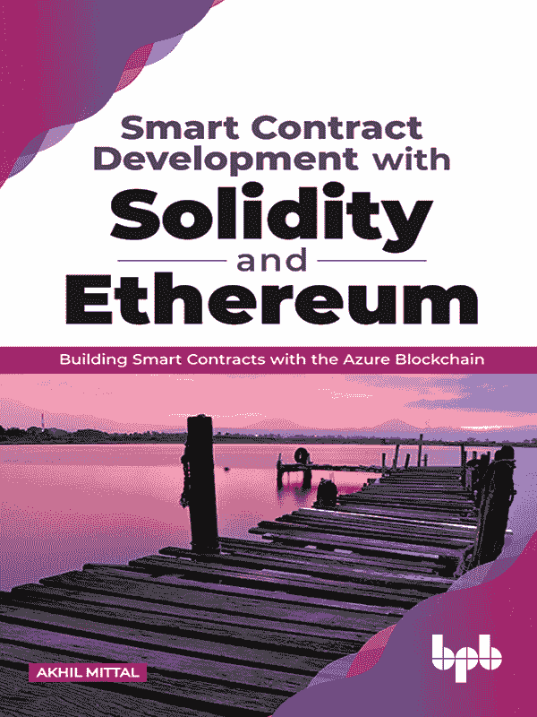


# 献给

本书献给我深爱的母亲，

Rani Mittal 女士

# 作者简介

**Akhil Mittal** 现居印度诺伊达。他两次荣获 Microsoft MVP（最有价值专家）称号，首次获奖于 2016 年，2017 年续奖，类别为 Visual Studio 和 Technologies；自 2013 年起为 C# Corner MVP；自 2014 年起为 Code Project MVP；他是一名博主、作家，喜欢撰写/阅读技术文章、博客和书籍。Akhil 积极在 CodeTeddy ([www.codeteddy.com](http://www.codeteddy.com)) 上贡献技术文章。

他担任 Magic EdTech ([www.magicedtech.com](http://www.magicedtech.com)) 的高级顾问，该公司被公认为提供端到端学习解决方案的全球领导者。

他在开发、设计、架构企业级应用程序方面拥有 12 年以上经验，主要涉及 Microsoft 技术。他在尖端技术方面拥有丰富经验，包括 Microsoft 技术栈、AI、机器学习、区块链和云计算。Akhil 是 Web 应用程序和 .NET Framework 方面的 MCP（Microsoft Certified Professional，微软认证专业人员）。

Akhil 撰写了几本关于 C#、Entity Framework、Web API 开发和 OOP 概念的电子书，出版于 Amazon Kindle 和 Leanpub。他还撰写了一本《聊天机器人入门》，由 BPB Publications 出版。

# 致谢

没有任何任务是单打独斗就能完成的。各个层面的各方人员通力合作、协调配合，才能使本书成功出版。

人们总是怀着感激之情，向那些在人生艰难阶段或为实现既定目标提供帮助的人表达谢意。虽不可能逐一致谢，但我谨在此衷心感谢并致谢其中部分人士。

感谢 BPB Publications 全体团队成员给予我参与该项目的机会。

我也要感谢我的家人、我的读者，感谢你们给予的所有鼓励和动力。

最后，我要感谢所有直接或间接为完成这部真知灼见之作做出贡献的每一个人。

俗话说，**“人非圣贤，孰能无过；宽恕乃神圣之举。”** 本着此意，作者希望读者能宽恕书中的不足之处。同时，作者欢迎任何建设性的批评、反馈、纠正和进一步改进的建议。所有真知灼见均不胜感激，作者将竭尽所能在本书后续版本中采纳这些宝贵建议。

# 前言

大多数人都有银行账户，银行是一个你信任的中心化机构，负责处理你的资金和交易。你可能会想，这有什么大不了的？我和我的银行打交道多年，从未遇到任何问题。但这并不是真正的问题所在。我们要讨论的是，作为个人，我们将大量的信任寄托在一个组织身上来管理我们的资金。这对相关银行来说也是一个巨大的负担。它们必须确保你的数据安全可靠，以维持这种信任。因为你将信任寄托在一个组织上，是什么阻止它们因系统错误或欺诈而意外丢失你的部分资金？这些都是银行系统必须应对的威胁，作为消费者，我们信任它们能妥善处理。但它们并不总能做对，事情可能会出错。如果我们将这个概念提升到比银行更高的层面，看看传统的法定货币，如美元、欧元或英镑，这些同样是高度中心化的概念，因为它们受政府控制和监管。此外，我们习惯了政府的中心化控制。还有另一种选择，那就是去中心化。

区块链技术的优势之一是利用去中心化在互联网上建立信任。这是什么意思？

如果你听说过比特币，就不可能没听说过区块链。比特币背后的技术是区块链，但区块链究竟提供了什么？

想象一下，如果有一种基础设施，每个人都能安全地处理交易代码，并访问永远无法被篡改的数据。所有交易都以区块的形式存储，一旦存储在区块链上，就很难被操纵或篡改。这就是区块链的行为特征，即在没有信任的场景下，你可以以最可信的方式存储数据。显然，区块链不是一个可以为每笔交易存储大量数据的地方。例如，你不能批量存储大量图片或文档，但你肯定可以存储用于验证你的文档或图片是否被篡改的信息。

区块链上存储的大多数数据侧重于交易和对象的状态，而不是对象本身。

本书详细讲解区块链概念，并提供在 Azure 上开发和部署以太坊区块链以及开发智能合约的实战经验。

本书承诺成为零基础初学者的绝佳起点，对进阶读者也是一大宝贵资源。作者编写本书旨在让初学者学习区块链和智能合约开发相关概念。

我们划分了 **4 个章节**，你可以在其中找到以下主题：

**第 1 章节** 区块链简介及其工作原理。该章节分为 2 章涵盖相关主题。

你将了解区块链的概念、术语、区块链内部工作原理以及区块链所依赖的加密原则。

**第 2 章节** 本章节名为“以太坊和 DApps”。在本章节中，我们将讨论什么是以太坊及其必要性？我们将探讨以太坊的执行模型和资金模型。本章节还将重点关注分布式应用。该章节分为 2 章，第 1 章侧重于面额、DAO、支付模型和交易，第 2 章则更多是关于在 Azure 上搭建以太坊区块链的实战练习。


## 第 3 部分

本部分专注于智能合约开发。该部分分为两章：第 1 章侧重于在开始开发前搭建智能合约开发环境；第 2 章 讲解智能合约编程，内容涵盖智能合约开发的构建模块、智能合约开发实战、智能合约部署讲解以及如何测试智能合约。在本部分中，您还将学习 Solidity 语言的基础知识。

## 第 4 部分

讲解区块链在现实世界中的应用。本部分阐述区块链在日常生活中提供的价值及其在现实场景中的用途和优势。该部分还涵盖了区块链在教育行业的影响领域。

# 勘误表

我们为 BPB Publications 的工作感到无比自豪，并遵循最佳实践以确保内容的准确性，为订阅者提供沉浸式的阅读体验。读者是我们的镜子，我们利用他们的反馈来反思并改进出版过程中可能出现的人为错误。为了保持质量并帮助我们联系到因不可预见的错误而遇到困难的读者，请发送邮件至：

**errata@bpbonline.com**

BPB Publications 全家高度赞赏您的支持、建议和反馈。

# 第 I 部分

# 什么是区块链以及它是如何工作的？

以下是来自 MSDN 博客的描述：

> 从最基本的层面来理解，区块链是一种分布式数据库的简单方法。它是一个无中央机构管理数据流的点对点系统。在维护数据完整性的同时移除中央控制的关键方法之一，是拥有一个由独立用户组成的大规模分布式网络。您可以将区块链视为由一群人控制的分布式数据库，用于存储和共享信息。目前最流行的区块链实现形式是 `Bitcoin`，它是一种加密货币。
>
> 区块链是一种数据结构，它使得创建数字账本并将其在独立参与方的网络中共享成为可能。区块链主要分为三大类：公有链、私有链（许可链）和联盟链。每种类型都利用密码学，允许给定网络上的每个参与者在无需中央权威强制执行规则的情况下安全地管理账本。从数据库结构中移除中央权威，是区块链最重要且最具影响力的特性之一。

将其想象为一台大型的全球计算机，每个人都可以安全地访问数据并执行交易代码。所有交易都存储在数据区块中。这些区块的生成方式使得它们一旦存储在区块链中，就极难被篡改或伪造。基于区块链的本质，您可以认为它提供了一种在无信任场景下可靠存储数据的方式。这可能是互联网上陌生人之间的货币交易，也可能是以只有您授权的人才能访问的方式安全地存储您的医疗信息。还值得一提的是，区块链通常不是存储每笔交易大量数据的地方。例如，您通常不会在区块链上存储图片，但可能会存储用于验证图片是否被篡改的信息。区块链上存储的大多数数据侧重于交易和对象的状态，而非对象本身。

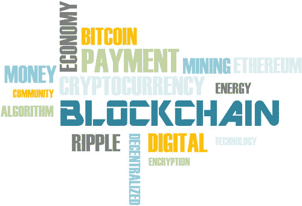

**图 1.0.1**

# 第 1 章

# 区块链——概念与起源

## 遗留问题与弊端

利用 `Napster`（1999 年的一个文件共享网络）传输/共享音频文件变得非常容易。由于它使用中心化目录网络，因此被称为混合点对点网络。使用该基础设施的用户可以灵活地保留共享文件的副本。因此，单一数字资产的保留导致无限数量的副本存储在全球网络上。

2008 年初，由于知名支付系统发生数据泄露，数百万信用卡号码被曝光，导致欺诈性交易。这些事件描述了生活在依赖中介的数字世界中的直接危险：中介从交易中获利，却让人们面临数字剥削、欺诈和贪婪。

迫切需要创建一个无中介、可自由可靠地传输数字资产的数字基础设施。该基础设施要求安全，传输应为点对点而非共享或复制，以便建立信任，且不应有任何中央管理机构。

## 结构

在本章中，我们将讨论以下主题：

*   区块链的起源。
*   基本区块链概念与术语。
*   区块链的特征。
*   数据安全层面。
*   区块链如何工作。

## 目标

学习完本单元后，您应该能够：

*   理解区块链和比特币的基础知识
*   安全性在区块链中的作用。
*   交易概念及区块链内部工作原理

## 比特币区块链——起源

`2009 年 1 月 3 日`，约 50 枚数字硬币通过一种新型基础设施被挖出，该设施不仅挖掘硬币，还将其记录在一个无法篡改且在互联网去中心化点对点网络上复制的公共账本上。这 50 枚数字硬币被命名为比特币，并被登记为创世区块，即被称为 `Bitcoin blockchain` 的第一个确立实例。使该基础设施独一无二的关键一点是：由区块链驱动的加密货币没有像银行和其他金融机构那样的中心化治理和信任机构来验证交易。区块链不依赖中介；这使得在互联网上全球传输数字资产成为可能，且无需中间人参与。

术语 `blockchain` 不仅限于比特币，而是普遍适用于所有加密货币。区块链中的数据采用现代加密技术进行加密，这使其更加可靠且防篡改。由于它在组成点对点网络的每个节点上都有复制，因此不存在单点故障，这使得该技术更加值得信赖且高可用。

自推出以来，比特币技术迅速成熟，因此其实现细节存在巨大差异，使得区块链的研究变得广泛、复杂且动态。自创世以来，区块链变得更加成熟，能够更智能、更快速地工作。随着其扩展，它不断被完善和优化。一些区块链（如 `Ethereum`）还支持智能合约，即允许在区块链上编写脚本。因此，您可以在区块链节点上应用自定义约束。因此，超越局限性，区块链技术已被证明是一种新型的防黑客、可编程存储技术。

## 概念——比特币

在深入细节之前，我们必须花些时间了解该技术的起源。您可能已经听说过一种名为比特币的新兴货币。比特币是第一种被广泛使用的加密货币。加密货币仅作为数字货币存在。它不持有任何底层价值。您无法从银行取出并握在手中。它只是附加在一个 ulnar 上的唯一字母和数字字符串。


# 比特币

比特币是一种数字货币，完全以电子形式创建和持有，而非印刷货币。与银行和传统法定货币不同，没有任何人控制或运营比特币。比特币算法控制新比特币的产生速度，人们通过以比特币形式获得报酬而被激励去帮助维护和挖掘新币。它是被称为加密货币的新货币类别中的首创。它可以电子化支付，用于购买数字和实物商品。甚至还有自动售货机允许你使用手机，用你拥有的比特币支付购买商品。但比特币的本质特征是它完全去中心化。没有任何一家公司或政府拥有或控制比特币。

自 1971 年美国取消金本位制后，这对美元同样适用。你在银行账户中有一个余额，你信任银行确保它们对进出账价值保持安全的账本。银行是庞大全球网络的一部分，交易可在银行间进行，货币可兑换。而比特币没有中央系统。没有银行，一旦交易完成，无法撤销。所有交易都是透明的，且可以完全匿名。没有区块链，比特币就无法存在，比特币是区块链的首个广泛应用。

# 区块链

因此，我们在讨论比特币时刚引入了区块链这一术语。区块链常被视为计算领域的下一场革命，它正在重新定义我们在互联网上交互和交易的方式。这听起来可能很夸张，但随着我们探讨什么是区块链及其应用场景，你会开始理解这些主张为何站得住脚。

斯图尔特·哈伯和斯科特·斯托内塔早在 1991 年就描述了密码学保护的区块链概念。尼克·萨博于 1998 年首次利用类似技术研究去中心化数字货币。但直到 2008 年，中本聪发布成熟的区块链概念，才历经近 10 年。中本聪被大多数人视为 2009 年比特币的创始人。然而，值得注意的是，截至目前，没人知道中本聪是谁。中本聪极有可能并非真实人物，而是他人使用的化名。关于其身份有许多有趣的理论，这为比特币及其底层技术增添了神秘色彩。快进到 2014 年，区块链成为金融和技术媒体使用的主流术语。大公司加速区块链开发。IBM 和微软等传统遗留软件巨头投入巨资。同时，大量快速增长的初创公司也将其区块链实现推向市场。

# 区块链的特征

让我们看看区块链的特征。首先，它是一个全局单例。如果你了解程序中单例的工作原理，可以将区块链对象视为全局单例实例。区块链原生面向对象，代码与数据共存。然而，对象之间安全隔离。它是不可阻挡的。没有任何人控制区块链。它无法被停止，也不存在单点故障。没有政府或公司能审查它，它极难被黑客攻击。没有电源线可拔，也没有单一攻击点。区块链天生可访问。只要有互联网的地方，你就能通过大量客户端和技术访问区块链。最重要的是，它是可验证的。所有有权访问区块链的人，都能验证从时间开始以来的每一笔交易。这使每个人都能审计一切，正如我们在接下来几节将学到的，这相当容易做到。

简而言之，区块链是一种防篡改的数据结构，可追踪数字资产在所有者间的流转。数字资产可以是比特币等数字货币、任何文档，或互联网陌生人间的货币交易。例如，它能让你存储医疗信息，仅你本人或你授权的人拥有安全访问权。不仅如此，带有数字指纹的资产也可在区块链上追踪。

区块链确保数字资产的所有权是**转移**而非共享或复制，从而解决了`双重支付`问题。区块链在无中央机构治理下，快速且跨国地实现了这一壮举。这使商业对企业更先进，从而消除了中间商和交易费用。

# 哈希

任何区块链的核心在于哈希概念。哈希基本上是执行一个数学算法，无论输入何种内容，都生成给定长度的结果。哈希函数的结果称为`哈希值`，你可以将其视为数字指纹。哈希是单向函数，意味着给定相同输入，函数总返回相同结果，但你永远无法根据哈希算法的结果反推输入。举个简单例子。假设我们有一个简单的哈希算法，接受 `0` 到 `45` 之间任意数字作为输入。算法将数字翻倍并四舍五入到最近的 `10`。这意味着输入 `5`，哈希结果为 `10`。输入 `3` 或 `4` 结果相同，但输入 `9`，哈希值为 `20`。结果长度始终为两位，即使输入是个位数。若多次用相同输入运行算法，总得到相同结果，但你无法推断输入是什么。

现实中哈希当然使用更高级的算法。最常用的哈希算法通常广为人知且公开可用。哈希算法通常设计为执行快速。算法越高级，执行所需算力越大。区块链常用的一种普遍哈希算法是 `SHA 256`。它是几种校验和哈希算法之一，生成长文本字符串作为结果。由美国国家安全局设计，公开可用。SHA 是一系列哈希算法。名称后的数字表明实现的复杂度。


哈希算法的一个广泛用途是用于在数据库中存储密码。如果你在数据库中以明文形式存储密码，一旦数据库被黑客攻破并获取了包含用户名和密码的数据表，你的用户就会面临风险；然而，如果密码经过哈希处理，黑客将很难破解出原始密码。他们随后需要将密码与已知输入的哈希结果进行比对。这可以通过基于随机文本字符串生成大量哈希值，或利用预先存在的常见哈希列表来完成。密码越长，黑客找到生成特定哈希值的输入的可能性就越小；即使他们设法破解出来，也无法 100% 确定，因此他们必须测试所有导致相同哈希值的组合。

由于哈希算法对于相同的输入总是产生相同的结果，且输出长度固定，因此它们也非常适合验证大量数据的一致性。如果你将整个 `Wikipedia` 网站的内容通过哈希算法处理并保存结果哈希值，就能快速判断网站内容是否被篡改。哪怕仅改动一个逗号，也会导致完全不同的哈希结果。因此，比较两个哈希值可以极快地确定它们是否匹配。如果匹配，说明数据未变；如果不匹配，说明原始数据已被篡改。这是一种非常可靠且快速的数据完整性校验方法。另一个好处是无需存储原始数据即可检测变更，只需保存初始哈希值即可。哈希算法还广泛应用于现代安全领域的许多方面，这些领域对一致性要求极高。例如，在交换时间戳的安全通信中。

在讨论哈希算法时，让我们简要了解一下一个相关概念——`Merkle tree`（默克尔树）。

```
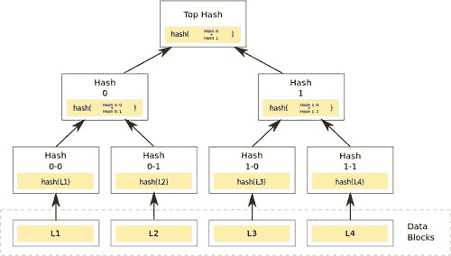
```

**图片来源：** [`commons.wikimedia.org/wiki/File:Hash_Tree.svg`](https://commons.wikimedia.org/wiki/File:Hash_Tree.svg)

**图 1.1.1**

默克尔树是哈希的哈希，这使得快速且相对容易地确认大量数据和交易成为可能。假设我们有四组数据。为简化起见，此处每个数据块用一个单词表示，但在现实中这可以是交易等。这些单词会生成四个不同的哈希值。在默克尔树中，这些哈希值分组再次哈希，生成哈希的哈希。这些哈希值再进一步哈希，形成我们所谓的根哈希或顶部哈希。要判断默克尔树中任何位置是否发生变更，只需检查根哈希是否改变，然后沿树向下追踪即可定位变更位置。

# 区块

在了解了一些基本术语后，让我们开始探讨区块链中的实际区块。一个区块由数据及其生成的哈希值组成。如果我们修改区块中的任何数据，哈希值就会改变，导致该区块失效。区块还包含一个 `nonce`（随机数），它是哈希算法的输入，使得哈希结果的前缀满足特定条件（如前导零）。无法预测 `nonce`，因此它可被视为创建哈希的机器完成工作量的证明。假设我们要求哈希值具有四个前导零。每当我们修改任何内容，都需要重新运行哈希算法，直到找到合适的 `nonce`。这个过程称为 `mining the block`（挖掘区块）。

让我们看看当存在区块链时会发生什么。在区块链中，区块还包含区块编号，表示其在区块链中的顺序。区块必须包含时间戳，但最重要的是，区块链中的区块将包含前一个区块的哈希值。这意味着如果你篡改任一区块中的任何值，该区块之后的所有区块都将失效。这也是前面提到的默克尔树发挥作用的地方。修复区块链的唯一方法是重新挖掘被篡改区块之后的所有区块，并重新计算所有 `nonce` 哈希值。

在区块链中，我们将区块链分发给大量计算机。这意味着链存在于多个位置。取决于你使用的区块链实现，可能有数百万个链的副本。这意味着我们能迅速发现篡改，即使其中一条链已被重新挖掘。生成的哈希值将与其他链不同，区块链的工作方式是“累积工作量最多的链获胜”。因此，被篡改的链会被分布式区块链拒绝并移除。为了更好地理解为何在区块链中伪造数据极其困难，让我们稍微谈谈分叉的概念。

# 分叉

首先，我们有一位用户 `Kent`。他拥有 100 个比特币，想买一辆新的 `Tesla` 汽车。这些比特币来自他非常富有但依然朴实的母亲 `Sharon`。他找到一家接受比特币支付的汽车供应商。他将交易添加到区块链中，开着他的电动座驾扬长而去。但当他回来时，他在网上看中了一辆 `Mercedes`，供应商也接受比特币。不幸的是，他现在身无分文，但他保留了之前拥有比特币的信息。因此，他试图向区块链添加一个区块，再次花费这笔相同的钱。这在区块链中制造了一个分叉。要解决这个分叉，他必须掌握巨大的算力。由于区块链要求证明你投入了计算工作量，他的新链要被接受，几乎需要拥有与整个区块链网络其余部分相当的计算资源。这极不可能发生，虽然我们见过有人尝试，但这种分叉总是被拒绝并移除。由于这需要如此巨大的算力，这成为保持诚实的强大激励。同样的算力本可用于合法挖掘区块。

# 公有链与私有链


# 区块链实现

既然我们已经将区块链作为一个通用术语进行了探讨，现在让我们开始考虑它的具体实现。首先，区块链可以是公有的，也可以是私有的。在公有区块链中，拥有互联网连接的每个人都可以连接到该链。公有链的资金模式通常是：你需要向已加入该链的实体支付存储、交易和执行成本。这可能相当昂贵。试想一下，比特币从最初仅值几美分，在短短几年后飙升至 1000 美元以上。你可能会后悔在 2013 年为你的交易支付了 `1%` 的比特币；然而，一旦所使用的不同货币趋于稳定，这将不再是一个大问题。由于公有区块链通常广泛分布，因此黑客也没有特定的攻击点。他们无法通过攻击单个数据中心或公司来瘫痪该链。但这取决于社区对该链的支持程度。一旦社区支持消失，该链也就随之消亡。这引发了许多我们目前尚无标准答案的问题和担忧，但我确信在未来几年里，我们将获得更多研究，并更好地理解这些社区是如何运作的。在商业语境下，公有区块链最显著的优势同时也是一个挑战，在于它是民主的。社区必须决定如何处理分叉等问题，通常你在链中的权益决定了你拥有多少投票权。当审视私有区块链时，许多人认为这些并非真正的区块链，因为它们并非真正分布式和民主化的。

对于私有区块链，你更接近于传统数据库。有人称私有区块链为共享分布式数据库。既然你将拥有基础设施，也就能控制链的成本和融资。这可能既是优势也是挑战，取决于你的公司目标。你打交道的也是已知实体，并且你控制谁可以访问你的链。对于许多处理敏感数据的公司来说，许多国家的法律要求数据必须存储在特定区域。由于我们对私有区块链拥有更多控制权，在立法和使用模式不断演进的过程中，这可以成为公司过渡到该技术的绝佳方式。然而，你也在某些关键领域有所损失，且攻击点更少，因此你的私有区块链可能比公有且高度分布式的实现更容易被攻破。

# 区块链——幕后原理

`那么这一切究竟是如何运作的呢？` 一切始于某人发起一笔单独的交易或一组交易。交易通常以合约的形式发送数据。根据你使用的区块链实现，它也可能涉及加密货币从一个账户发送到另一个账户。交易被发送到一个庞大的计算机点对点网络。这些计算机通常分布在世界各地。每台计算机称为一个节点，并且它们都拥有现有数据的副本。然后，基于预先共享的合约和脚本执行并验证交易。这确保了所有节点使用同一套规则进行执行。当交易执行完毕，结果会被添加到区块链中。由于这是在每个节点上完成的，你必须攻破链中的每一个节点才能篡改交易。

在进行区块链交易时，某些方面是必不可少的，以使其具备前文提到的特性。首先，所有交易都是原子性的。这意味着完整的操作要么全部运行，要么完全不运行。假设你有一笔货币交易。你需要确保给一个账户记账的功能和给另一个账户记借的功能都成功执行。如果其中一个失败，整笔交易就应失败。否则，你可能最终会销毁或凭空创造货币。然而遗憾的是，即使有了区块链，也没有什么能阻止你编写有害代码，因此你仍需确保按正确顺序执行交易。其次，交易彼此独立运行。因此，没有两个操作可以交互或相互干扰。它必须可被审查。每一个发送到区块链的方法调用都附带调用者的实际地址。

想想看。这为在极大范围内保护和审计解决方案提供了独特的可能性。这是区块链独有的。至少据我所知，别处无法做到这一点。区块链对象是永生的。这意味着对象的所有数据都是永久的。对象的代码永远无法更改，你也无法从外部删除对象。将对象从区块链中移除的唯一方法是它被编程为自我移除。所以，仔细想一想。在为区块链编写代码时，你真的、真的需要确定这就是你想做的。因为你永远无法更改或删除它。

# 交易与区块

区块链的核心是一份交易记录，很像传统的会计账本。这些交易可以是人与人、公司与公司之间的资金流动，也可以是任何具有交易性质的信息片段，比如财产契据的转让，或不同公司之间库存流转的追踪。存储在区块链中的数据旨在以一种方式保存，使得一旦数据进入区块链，若不被其他用户察觉，几乎不可能对其进行更改。正如我们之前讨论的，传统银行交易由中央银行或权威机构验证。区块链应用可以用参与区块链的多用户共识验证来取代这些更中心化的系统。

区块链必须做两件主要的事。它需要收集数据或交易并将它们放入区块。然后这些区块需要使用密码学安全地链接在一起。当交易被放入区块时，我们使用加密哈希或数字指纹将交易链接在一起。这意味着如果交易的任何部分发生变化，整个区块将无法通过验证，从而向其他用户发出警示。在区块的顶部，我们有一个代表该区块中所有交易的哈希值。我们称之为区块地址。正是这些区块地址被用来将区块链接在一起，因为每个区块都知道其前一个区块的地址，这就是我们形成链的方式。


为了让区块被添加到链中，创建区块的人在计算区块地址时必须解决一个复杂的数学难题。这被称为通过工作量证明来挖掘区块。该难题被设计为计算成本高昂，且必须在链中的每个区块之前发生。假设这个问题需要 10 分钟来计算。现在想象我们的链中有 1000 个区块。因此，计算所有区块地址总共花费的时间是 166 小时。现在想象有人想要覆盖第一个区块中的数据。他们必须重新计算该区块的挖掘难题，这需要 10 分钟。但由于所有其他区块都通过加密方式链接在一起，如果你更改一个区块，则需要重新计算下一个区块的哈希值和地址，以此类推。因此，更改第 1 个区块中的数据意味着你需要花费 166 小时（或近 7 天）来重新计算整条链。试想一下，如果链更长且难题耗时超过 10 分钟，我们要花费多长时间。链越长，它就越安全。当这些区块被添加到链中时，一份副本会发送给参与网络的每个人。这就是我们建立信任的方式，因为有这么多人持有一份副本。假设有 100 个人拥有整条链的副本，而有人试图更改其中一个区块。他们可能会将其添加到自己的链中，但会有另外 99 个人不同意他们的更改。如果你现在还不能完全理解这一切，也不必太担心。我们将在后续章节中更详细地探讨这些内容。

# 保护您的数据

存储在区块链中的数据通常可供所有有权访问该链的人查看。这带来了一些挑战，但也会促使您优先考虑安全性。在某些应用中，所有人都能访问所有内容并没有问题，但在大多数情况下，您希望确保由您控制谁可以拥有您的数据。有两种方法可以处理这个问题。第一种是 `obfuscation`（混淆）。这意味着使数据仅对知道其含义的人有意义。一个例子是比特币。有了任何账户的地址，它就是一长串字母和数字。链中没有人知道该地址在物理上连接到谁，他们也不需要知道，但每个人都知道在不同账户地址之间发生的每一笔交易。由您决定是否想要匿名。如果您不共享与您账户地址的关联，就没有任何人能知道您是该账户的所有者。

混淆的另一个例子是让数据包含 ID 和状态代码。除非您知道不同的 ID 关联到什么，否则这些数据对您实际上毫无用处。仅依赖混淆的问题在于，您始终面临着有人因控制密钥的系统发生泄露而建立关联并关联数据的风险。为了解决这个问题，您可以利用加密。当您加密消息或交易载荷时，您会对消息应用一种双向算法，只有知道密码或口令才能解码。这意味着数据可以对所有人公开，但只有拥有解密密钥的人才能理解其含义。有许多不同的加密算法，与哈希一样，它们也在不断演进。本书的下一节将重点介绍这些算法。

# 结论

在本章中，我们学习了区块链的基础知识及其定义。本节重点围绕哈希及其对于理解区块链工作原理的重要性展开。之后，我们开始了解区块是如何构建的，以及它是如何连接成链的。安全性是一个特别重要的考量方面，因此解释了混淆和加密的基础知识，以让您对这些概念有个大致了解。本节还解释了公有链和私有链实现之间的区别。

现在基础已经清晰，我们将把标准稍微提高一点，深入探讨安全性。在下一章中，我们将学习区块链中使用的哈希技术，并了解数字签名。

# 问题

1.  什么是区块链？
2.  区块链和比特币有什么区别？
3.  区块链中的区块和交易是什么？
4.  区块链是如何保证安全的？
5.  什么是哈希？
6.  区块链与银行账本有何不同？
7.  区块链账本与普通账本有何不同？
8.  区块链中可以保存什么类型的记录？有什么限制吗？
9.  你对区块安全性具体了解多少？
10.  一旦数据被写入区块，是否还能修改？

# 第 2 章

# 区块链——密码学原理

在本节中，我们将更仔细地研究构建区块链数据结构所需的一些密码学原语。我们将探讨哈希、认证哈希和数字签名。本书的范围仅限于学习和理解区块链，因此本节不会详细讲解密码学，而是让您了解密码学技术是如何工作的。密码学是一个迷人的学科，您可以在互联网上或其他专门的书籍中找到大量相关资料。

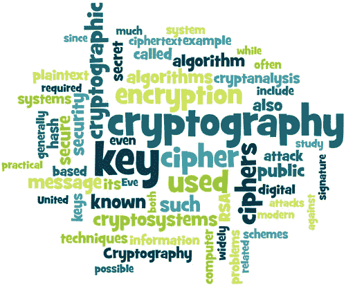

**图片来源：** Pixabay.com

**图 1.2.1**

# 结构

在本章中，我们将讨论以下主题

*   哈希技术
*   HMAC
*   数字签名

# 目标

学习完本单元后，您应该能够

*   理解什么是哈希？
*   了解哈希的类型
*   学习数字签名及其重要性。

# 哈希

对数据进行哈希处理是一种利用密码学的基本技术，它构成了我们即将探讨的区块链实现构建的骨干。加密哈希函数是一种算法，它接收任意数据块并返回一个固定大小的字符串——即加密哈希值——使得对该数据的任何意外或故意更改都会改变哈希值。待编码的数据通常称为 `message`（消息），哈希值有时也称为 `message digest`（消息摘要），或简称为 `digest`（摘要）。

理想的加密哈希函数具有四个主要属性。首先，对于任何给定的消息，计算其哈希值必须容易。这意味着对于任意数据块，运行哈希函数计算哈希值应该很容易。其次，生成一个具有给定哈希值的消息必须是不可行的。这意味着生成会导致预定哈希码或摘要的原始数据必须是不可行的。再次，在不改变哈希值的情况下修改消息必须是不可行的。这意味着如果您更改想要哈希的数据中的仅一个比特，则生成的哈希码将完全不同。最后，找到两个具有相同哈希值的不同消息必须是不可行的。这意味着您有两个不同的数据块想要创建哈希码。它们不应都最终得到相同的最终哈希码。这被称为 `hash collision`（哈希碰撞）。

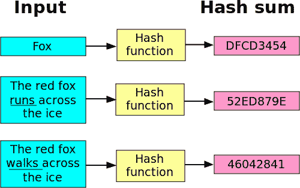

**图片来源：** [`commons.wikimedia.org/wiki/File:Hash_function.svg`](https://commons.wikimedia.org/wiki/File:Hash_function.svg)

**图 1.2.2**


理解哈希函数的另一种方式是将其视为为一段数据创建唯一的“指纹”。在 C# 中，生成数据块的哈希摘要非常容易。您可以使用多种算法，例如 MD5、SHA-1、SHA-256 和 SHA-512。哈希函数是单向函数。这意味着一旦对数据进行哈希处理，就无法将其还原为原始数据。相反，加密被设计为双向操作。使用密钥加密数据后，您可以使用相同的密钥反向操作并解密数据。

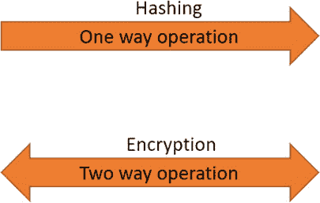

**图 1.2.3**

对数据进行哈希处理时，除非原始数据以某种方式发生变化，否则每次操作生成的哈希值都相同。即使数据仅改变一位，生成的哈希代码也会完全不同。这使得哈希成为检查数据完整性的完美机制。当您想要通过网络将数据发送给另一个接收者时，这非常有用。在发送数据之前，您计算原始数据的哈希值以获取其唯一指纹。然后您将数据和哈希值发送给接收者。他们随后重新计算刚刚收到的原始数据的哈希值，并将其与您发送的哈希值进行比较。如果哈希代码相同，则数据已成功接收，没有任何数据丢失或损坏。如果哈希代码不匹配，则接收到的数据与最初发送的数据不同，您不应信任该数据。最常用的两种哈希方法是 MD5 和 SHA 系列哈希（SHA-1、SHA-256 和 SHA-512）。MD5 如今通常不再用于新软件，但如果您要与仍在使用 MD5 哈希的旧系统集成，它仍然具有相关性。本章我们将重点关注 SHA。

# SHA

SHA 系列是由美国国家标准技术研究院 (NIST) 发布的一系列加密哈希函数。SHA 系列涵盖了一些不同的变体，包括 SHA-1，这是一种 160 位的哈希函数，类似于早期的 MD5 算法。它由美国国家安全局设计，旨在成为数字签名算法的一部分。在 SHA-1 中发现了加密弱点，因此该标准在 2010 年后不再被批准用于大多数加密用途。接下来是 SHA-2，这是一个包含两个具有不同块大小的相似哈希函数的系列，称为 SHA-256 和 SHA-512。它们的字长不同。SHA-256 使用 32 位字，而 SHA-512 使用 64 位字。这些版本的 SHA 算法也由美国国家安全局设计。最后是 SHA-3，这是一种正式称为 `Keccak` 的哈希函数，于 2012 年在非国家安全局设计师的公开竞赛中被选中。它支持与 SHA-2 相同的哈希长度，其内部结构与 SHA 系列的其余部分有显著差异。将安全哈希实现到您的应用程序中是一个非常直接的过程。

.NET 框架在 `System.Security.Cryptography` 命名空间及其类中提供了封装的加密相关功能。`HashAlgorithm` 类是哈希算法的基类，包括 MD5、RIPEMD-160、SHA-1、SHA-256、SHA-384 和 SHA512。

`HashAlgorithm` 的 `ComputeHash` 方法用于计算哈希。它接受字节数组或流作为输入，并以 256 位字节数组的形式返回哈希值。

以下是 C# 中演示如何计算 SHA 哈希的简单控制台应用程序代码。

```csharp
using System;
using System.Text;
using System.Security.Cryptography;

namespace Cryptography
{
    class Program
    {
        static void Main(string[] args)
        {
            string input = "Blockchain";
            Console.WriteLine("Raw data: {0}", input);
            string hashedData = ComputeSha256Hash(input);
            Console.WriteLine("Hash {0}", hashedData);
            Console.WriteLine(ComputeSha256Hash("Blockchain"));
            Console.ReadLine();
        }

        static string ComputeSha256Hash(string rawData)
        {
            // Create a SHA256
            using (SHA256 sha256Hash = SHA256.Create())
            {
                // ComputeHash - returns byte array
                byte[] bytes = sha256Hash.ComputeHash(Encoding.UTF8.GetBytes(rawData));
                // Convert byte array to a string
                StringBuilder builder = new StringBuilder();
                for (int i = 0; i < bytes.Length; i++)
                {
                    builder.Append(bytes[i].ToString("x2"));
                }
                return builder.ToString();
            }
        }
    }
}
```

上述代码包含一个 `Main()` 方法，它是控制台应用程序的入口点。`Main()` 方法将输入设置为字符串 "Blockchain"，存储在名为 `input` 的变量中。然后调用一个名为 `ComputeSha256Hash()` 的方法，该方法定义在 `Main()` 方法下方，负责将输入字符串转换为哈希值。该方法创建 `SHA256` 类的实例并调用 `ComputeHash()` 方法，接受输入的字节数组并计算哈希值，然后将其返回给调用者方法 `Main()`。哈希创建后，该方法再次被调用以检查哈希是否再次计算相同或不同。我们看到哈希再次相同。下图显示了输出。

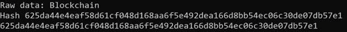

**图 1.2.4**

# 认证哈希 (HMAC)

我们可以在 SHA-256 哈希的基础上更进一步，创建所谓的 `hashed message authentication` 代码。从根本上说，这与哈希相同，但更进一步。如果将单向函数（如 SHA-256）与秘密加密密钥相结合，则会得到所谓的哈希消息认证代码，简称 `HMAC`。与哈希代码一样，当您想要验证消息的完整性时，会使用 HMAC。HMAC 还允许您验证该消息的真实性，因为只有知道密钥的人才能计算出该消息的相同哈希值。HMAC 可以与不同的哈希函数一起使用，如 MD5 或 SHA 系列算法。HMAC 的加密强度取决于所用密钥的大小。在本课程中，我们将使用带有 256 位或 32 字节密钥的 HMAC。当您需要同时检查消息的完整性和真实性时，会使用哈希消息认证代码。

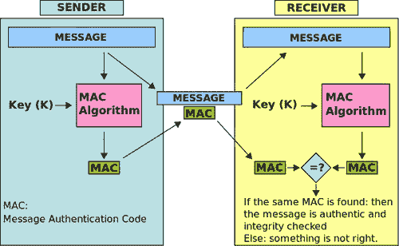

**图 1.2.5**

例如，考虑这样一种场景：您收到一段数据及其哈希值。您可以通过重新计算该消息的哈希值并将其与收到的原始哈希值进行比较来验证消息的完整性；但是，您无法确定该消息和哈希值是否由您认识或信任的人发送。如果您使用哈希消息认证代码，您可以使用只有您和受信任的第三方知道的秘密密钥重新计算 HMAC，并将其与刚收到的 HMAC 进行比较。这起到了认证的作用。

在下面的示例中，我将向您展示如何使用带有 32 字节或 256 位密钥且基于 SHA-256 哈希算法的 HMAC。除了基于 SHA-256 的哈希 MAC，您还可以使用 SHA-1、SHA-512 和基于 MD5 的 SHA。接口都是相同的，但本课程我们将只使用 SHA-256 变体。

```csharp
using System;
using System.Text;
using System.Security.Cryptography;

namespace Cryptography
{
    class Program
    {
        static void Main(string[] args)
        {
            string input = "Blockchain";
            string key = "SecretKey";
            string hashedData = GetHash(input, key);
            Console.WriteLine("Hash {0}", hashedData);
            Console.ReadLine();
        }

        public static string GetHash(string toBeHashed, string key)
        {
            var keyToUse = Encoding.UTF8.GetBytes(key);
            var message = Encoding.UTF8.GetBytes(toBeHashed);
            using (var hmac = new HMACSHA256(keyToUse))
            {
                return Convert.ToBase64String(hmac.ComputeHash(message));
            }
        }
    }
}
```


在前面的代码中，你可以看到一段计算基于 SHA-256 的哈希消息认证代码的代码片段。与标准的 `SHA-256` 哈希一样，哈希类处理的是字节数组，但在这个示例中，我加入了必要的字符串到字节数组的转换，以展示这些转换的样子。首先，该方法接受一个待哈希的数据字符串和一个代表密钥的字符串。密钥可以是你想要的任何内容，但在这种情况下，它不应超过 256 位或 32 字节。接下来，我们使用 `Encoding.UTF8.GetBytes` 方法将待哈希的数据和密钥字符串转换为字节数组。然后我们创建一个哈希 `HMACSHA256` 类的实例，并将密钥的字节数组传入。接着，在 HMAC 对象上，我们调用 `ComputeHash` 并传入我们要创建认证哈希的消息的字节数组。结果也是一个字节数组，我们使用 `Convert.ToBase64String` 方法将其转换回 `Base64` 编码的字符串。现在我们已经介绍了哈希和认证哈希。以下是控制台应用程序执行时的输出。

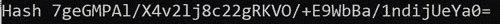

**图 1.2.6**

# 数字签名

密码学的一项基本功能是确保发送消息的**不可抵赖性**。这意味着消息的接收者无法否认该消息的真实性。数字签名是一种用于帮助证明消息真实性的技术。有效的数字签名给接收者一个理由，相信该消息是由已知发送者创建的，从而使发送者无法否认曾发送过该消息。数字签名同时提供了**认证**和**不可抵赖性**。认证是因为签名必须由持有有效私钥的用户创建；不可抵赖性是因为接收者可以信任消息是由已知发送者签名的，因为只有他们知道私钥。那么数字签名是如何实现这一切的呢？对于消息的接收者，数字签名允许接收者相信消息是由正确的发送者发送的。这可以被视为信件上手写签名的数字等价物，只不过数字签名更难伪造。数字签名由以下三种算法组成：使用 `RSA` 进行公钥和私钥生成、使用私钥创建签名的签名算法、以及使用公钥测试消息是否真实的签名验证算法。私钥和公钥是两个数学上相关联的密钥。公钥顾名思义，可以为任何人所知；私钥应仅为你——消息的发送者——所知。因此，必须保守这个私钥的秘密。

现在让我们看一个数字签名如何工作的示例。在这个例子中，Alice 向 Bob 发送了一条消息，该消息将使用数字签名进行签名。

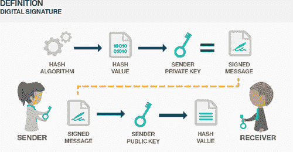

**图片来源：** [`upload.wikimedia.org/wikipedia/commons/9/93/Ss_digitalsignature.png`](https://upload.wikimedia.org/wikipedia/commons/9/93/Ss_digitalsignature.png)

**图 1.2.7**

首先，Alice 加密她想发送给 Bob 的某些数据。对于这个例子，数据是使用对称还是非对称加密算法加密并不重要。一旦数据被加密，Alice 对该数据进行哈希。接下来，Alice 使用她的私有签名密钥对数据进行签名。这创建了一个数字签名。然后，Alice 将加密的数据、其哈希值和签名发送给 Bob。首先，Bob 重新计算加密数据的哈希值。然后 Bob 使用计算出的哈希值和公共签名密钥验证数字签名。这将告诉 Bob 签名是否有效。如果有效，Bob 可以确信并确定是 Alice 最初发送了该消息，因为该消息只能使用她的私有签名密钥进行签名，而只有 Alice 知道该密钥。如果签名无效，则 Bob 不应信任该消息的来源和真实性。正如我们刚才提到的，数字签名签名基于 `RSA`。但使用 `RSA` 时，我们需要加密一些数据。你使用接收者的公钥加密数据，然后接收者使用他们的私钥解密。对于数字签名，签名和验证的过程则相反。当发送者签名消息时，他们使用自己的私钥，然后接收者使用发送者的公钥验证签名。正是因为我们用发送者的私钥进行了签名，接收者才能信任消息是由该发送者发送的，因为只有他们知道那个私钥。

# 结论

在本章中，我们了解了安全方面和密码学原理。目的是对密码学是什么、它如何在开发区块链时保障交易和区块数据安全有一个概念性的理解。具体技术在这里并不重要，重要的是概念。例如，本章使用 `Microsoft DotNet` 和 `C#` 作为技术栈，展示了简单的方法如何利用现有库来生成哈希或保护数据。

# 问题

1.  什么是哈希，哈希有哪些类型？
2.  什么是认证哈希？
3.  什么是数字签名？
4.  在区块链方法中，区块是如何被识别的？
5.  什么是区块标识符？
6.  你对区块的安全性具体了解多少？

# 第二部分

# 以太坊和 DApps

在本部分中，我们将讨论什么是以太坊以及为什么需要它？我们将研究以太坊的执行模型和资金模型。

本部分还将重点关注分布式应用。


**图 2.1.1**

# 第一章

# 分布式应用

那么，什么是以太坊？

`Ethereum` 是最大且最成熟的区块链之一，它基于 `Vitalik Buterin` 在 `2013` 年提出的建议。它于 `2015` 年公开可用。由于它是开源的，因此很容易将其用于私有区块链。它不仅是一个平台，还是一个运行在区块链上的编程语言，因此我们可以构建和发布称为 `分布式应用 (DApps)` 的分布式应用程序。以太坊拥有自己的加密货币，称为 `Ether`，在许多方面它类似于比特币。以太坊的一个优势是它拥有快速的交易时间，区块时间设置为几秒钟，而比特币则需要几分钟。这使其更适合需要快速响应的应用程序，例如结账支付和快速工作流。


以太坊的另一个重要特性是，它根据交易的计算复杂度、带宽使用和存储需求，提供了一种为交易提供资金的方法。这与比特币区块链形成了差异，后者中交易之间是平等竞争的。这意味着你可以支付费用以获得更快的交易确认。其他区块链使用的工作量证明（PoW）产生了一些负面影响，即大型计算集群为了证明它们投入了工作量而解决难题。这是一种巨大的资源浪费，因此以太坊正朝着权益证明（PoS）方向发展，即使用直接的经济权益代替工作量证明。归纳起来，有以下几个理由值得探索以太坊，在选择用于应用程序的区块链实现时也应予以考虑：

首先，以太坊开发社区正在壮大，非常容易找到用于快速开发的资源和工具。对于区块链等新兴技术，必须考虑社区对不同实现的适应程度；坦率地说，以太坊社区令人惊叹，且很容易从他们那里获得帮助。以太坊也从比特币的开发中吸取了许多经验，被许多人视为其演进版本。它通过一种易于使用的合约语言，很好地面向应用程序开发。在本课程后续部分，我们将用两个模块的时间来学习这方面内容。搭建私有区块链和测试实现也相对容易。以太坊还拥有广泛的商业采用，尤其是在企业级层面，非常适合融入企业解决方案和现有架构。

`Ether` 是以太坊使用的货币。你可以像使用其他加密货币一样使用它，它是以太坊中支付交易费用的基础。它以 `eth` 符号交易，且有多种交易 `Ether` 的方式。如果你考虑投资 `Ether`，应当理解这目前是一种波动性极大的货币。`Ether` 经历过剧烈的涨跌，每周波动超过 `20%` 并不罕见。投资需极其谨慎，但如果你有闲置资金，从长远来看投资 `Ether` 可能是极好的投资；不过与任何加密货币或新投资机会一样，你也可能损失所有投入的资金。像所有货币一样，`Ether` 也有面额单位，以便于日常使用。

# 结构

在本章中，我们将讨论以下主题：

*   面额单位
*   DAO
*   支付模型——Gas
*   交易

# 目标

学习完本单元后，你应该能够：

*   理解分布式应用。
*   掌握 Gas 起始值和 Gas 价格。
*   理解交易。

# 面额单位

目前共有 12 种面额单位，它们的命名通常源自对以太坊有重大影响的人物。目前使用的最小面额单位是 `Wei`，`1 ETH = 1,000,000,000,000,000,000 Wei`（即 10¹⁸ Wei）。

`Finney` 也经常被使用，`1 ETH = 1000 Finney`。`Szabo` 当然也有其面额单位，`1 ETH = 1,000,000 Szabo`。当面额大于 `1 ETH` 时，我们使用 `Kether`（`K` 代表 `kilo`，即 `1K ETH = 1000 ETH`）。同理，`Mether`（`M` 代表 `mega`）、`Gether`（`Giga ETH`）等。

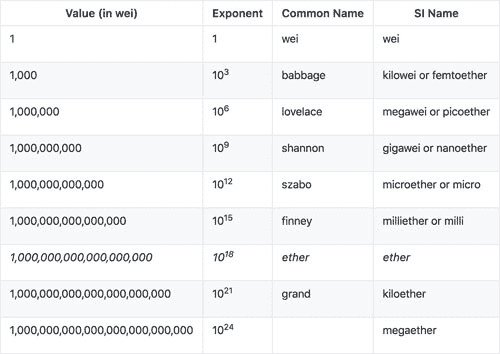

**Figure 2.1.2**

谈到 `Ether` 时，你还应该知道存在一种称为 `Ethereum Classic` 的代币，交易符号为 `ETC`。其存在的原因是所谓的 `DAO Hack`。

# DAO

`DAO` 是一个运行在区块链上的去中心化自治组织。它们在以太坊区块链上拥有一个众筹合约，筹集了大量资金。不幸的是，该合约存在漏洞，使得攻击者能够创建子 DAO 并转移资金。经过一段时间后，社区进行投票决定在区块链上实施硬分叉，基本上将所有资金恢复到被黑客攻击时的状态。这是社区共同解决问题的一个绝佳案例，但这也引出了一个根本性问题：只要代码完全按照预期执行，进行更改是否合适？密码学社区中有一个亚群体被称为 `crypto-anarchists`（加密无政府主义者）。他们认为，只要代码完全按预期运行，如果你犯了错误或使自己容易受到攻击，那纯属倒霉。社区投票决定硬分叉表明，大多数成员不同观这一观点。尽管如此，下次类似事件发生在公共以太坊区块链或其他区块链上时会如何发展，仍将令人期待。

> **引用自 Wikipedia：**
>
> *一个著名的例子是为了风险投资融资而设立的 The DAO，它于 2016 年 6 月启动，众筹募集了 1.5 亿美元，但随即被黑客攻击并窃取了 5000 万美元的加密货币。在随后的几周内，这次黑客攻击被逆转，资金通过以太坊区块链的硬分叉得以恢复。这次救助之所以成为可能，是因为以太坊矿工和客户端切换到了新的分叉链。*

# 去中心化应用

在传统应用架构中，我们可能会有一个服务设置，提供应用存储、数据逻辑和用户凭证。客户端运行某种界面，二者通过固定通信通道交互。而在区块链上的分布式应用，构建方式略有不同。共享数据存在于分布式区块链上，分布在多个位置，因此单个服务器宕机无关紧要。数据逻辑同理，逻辑共享于区块链上。一旦你将合约上传到链上，无论从何处运行，它都会以相同方式传播和执行。分布式架构中的客户端也有所不同，因为它负责存储用户凭证，通常也存储更多应用数据。以这种方式构建应用，将使你的解决方案对系统故障具有极强的抵抗力，并意味着它们可以在没有中心化系统的情况下完全运行。你仍然可以在客户端保留面向中心化系统的更新功能，但应确保客户端不依赖任何中心化组件。在后续部署代码到以太坊的章节中，我们将使用一种名为 `solidity` 的语言创建智能合约。智能合约是驻留在区块链上的代码片段，严格按照共享逻辑的指令执行命令。合约构成了我们分布式应用的数据逻辑。它们可以读取其他合约、做出决策、发送 `Ether`，也可以执行其他合约。合约将随着网络持续存在并运行。它们仅在交易资金耗尽或被编程为自毁时停止运行。

# 支付模型——Gas


在每一个分布式系统设计中，拥有一个运行良好的模型来保护系统免受恶意攻击至关重要。一个通用的原则应该是让攻击比防御更困难。在物理世界中这很难做到。试想保护一栋建筑。建立防护和 `24/7` 安保非常昂贵；然而，制造一颗摧毁大楼的炸弹却相当便宜。在数字世界中，这可以通过不同的方式实现。试想使用哈希算法。它们使用成本低廉，但破解成本高昂。当保护区块链免受恶意行为侵害时，我们希望使用一种支付模型：如果你按预期使用系统，价格公平；但如果你试图对其进行恶意操作，代价将非常高昂。这就是 `gas` 概念的由来。

Gas 是在 Ethereum 中运行交易或合约的内部定价单位。这样做的目的是拥有一个与 Ether 当前价值分离的单位。你可以把它想象成汽油。汽车消耗的汽油量与你想开多快有关，汽油价格会上下波动，且不与货币价值静态挂钩。合约或交易使用的 gas 量取决于运行它所需的操作。其价格基于计算、内存、带宽和存储需求等因素。这些因素加在一起构成了运行合约或交易所需的 gas。如果你没有足够的 Ether 来支付完成代码运行所需的所有 gas，处理将中止，所有中间状态变更将回滚到交易前的快照。执行停止点之前消耗的 gas 依然会被消耗。因此，你账户的 Ether 余额将减少已花费 gas 的相应价格。

# 交易

在 Ethereum 中使用的术语“交易”，指的是存储一条消息的数据包，该消息将从一个外部拥有的账户发送到区块链上的另一个账户。交易包含消息的接收凭证、标识发送者的签名、一个值字段（即从发送者转移给接收者的 `WEI` 数量），以及一个 gas 价格值，代表发送者愿意为 gas 支付的费用。你愿意支付的价格越高，矿工对你的工作排序就越靠前。还有一个起始 gas 值，代表交易执行允许采取的最大计算步骤数。可以把它想象成汽车加满油时的油箱容量测量。这将是最大成本，并确保你无法在代码中启动无限循环。这对矿工估算通过交易能赚多少也至关重要。因为他们唯一能确定的方式是在执行之后。由于 `out-of-gas` 异常实际上是发送者的金钱浪费，最好稍微高估起始 gas，而不是低估。不过，你也应小心不要设置过高的值，因为如果起始 gas 与消耗的 gas 差距过大，矿工可能会惩罚此类交易。你还有一个可选的数据字段，可以包含发送给合约的消息。当我们开始开发智能合约时，我们将更深入地探讨这一点。

# 起始 Gas 和 Gas 价格过低

好的，现在让我们看看设置不同级别的起始 gas 和 gas 价格的效果。如果起始 gas 设置得太低，交易可能不会发送给矿工，你会收到“intrinsic gas too low”错误。如果 gas 价格设置得太低，情况也是如此。矿工会忽略该交易，转而选择能赚钱的交易。设置过低的 gas 价格是个坏主意，因为你会遇到 out-of-gas 错误，交易会回滚，但如前所述，你仍需为已使用的部分付费。如果 gas 价格设置得低，交易可能会被较慢地打包，放入后续的区块，具体取决于矿工当前的负载。

# 起始 Gas 和 Gas 价格过高

如果起始 gas 设置得太高，可能会导致挖矿延迟，因为矿工会认为它需要大量资源，必须等待可用性。设置较高的 gas 价格在大多数情况下会导致你的交易被优先处理，比其他交易更早打包进区块。每个区块都有一个 gas 限制。如果你的起始 gas 超过了该限制，交易不会广播给矿工，你会收到“exceeds block gas limit”错误。如果 gas 价格设置过高且发送者没有足够的可用资金，交易也不会广播给矿工。

# 适中的起始 Gas 和 Gas 价格

适中的起始 gas 和 gas 价格通常是理想水平，也是你应该努力的目标。

# 结论

在本章中，我们首先讨论了 Ethereum 的定义和原因。在深入分布式应用之前，我们研究了 Ethereum 的执行和资金模型。

只要记住核心理念，你就能顺利地使用 Ethereum 进行开发。工作量证明是 Bitcoin、当前版本的 Ethereum 以及许多其他区块链所采用的机制。一些挖矿操作也使用对环境不友好的能源。为了更直观地理解这一点，Bitcoin 的工作量证明挖矿每年消耗的电量相当于一个中等规模 `European` 国家的年耗电量。在工作量证明中，一个人可能投入 `$10,000` 购买专用挖矿硬件并开始参与网络。挖矿随后会生成区块，并以可花费的加密货币形式获得工作奖励。权益证明试图通过完全移除挖矿概念并用不同机制取而代之来解决这些问题。在权益证明中，可以直接将同等金额转换为加密货币。与工作量证明一样，投入越多，预期产出越多。

在下一章中，我们将学习 Ethereum 与 Azure 的结合，设置 Azure 上的 Ethereum 账户，以及设置 MetaMask 账户。

# 问题

1.  什么是 Ethereum，它的面额有哪些？
2.  Wei 和 Ether 有什么区别？
3.  Ethereum 的价值代币是什么？
4.  Ethereum 的平均区块大小是多少？
5.  什么是 dApp，它与普通应用有何不同？
6.  你如何理解 gas 和支付模型？
7.  如果起始 gas 设置过高，gas price 会发生什么？
8.  Gas price 是否决定交易何时被处理？
9.  交易费是如何计算的？
10. 交易记录在哪里？

# 第 2 章

# 在 Azure 上设置 Ethereum 区块链

本章将重点介绍在 Azure 上设置自定义 Ethereum 区块链。本章理论较少，更侧重于在 Azure 上逐步设置 Ethereum 区块链并使用 MetaMask 在账户间转账的实践实现。本章面向更偏向开发且具备区块链、Ethereum 和 Ether 背景的读者。我们已在前面理解 Ethereum 和区块链的章节中涵盖了理论知识。

# Ethereum 在 Microsoft Azure 上


# 在 Microsoft Azure 上实施以太坊

现在让我们进入正题，开始着手实施以太坊。设置和使用以太坊的方法有很多，在本节中，我们将重点介绍如何在 Microsoft Azure 平台上使用以太坊。Azure 是微软的云平台，通过使用它，我们也可以非常轻松地利用该平台的其他方面。这包括应用程序托管、存储、身份管理和安全性等，仅举几例。

在以太坊的语境下，联盟是指区块链支持成员与底层基础设施之间的协作。例如，这可以是一组希望共同合作并形成自己私有共享区块链的组织。一切始于联盟领导者。这是区块链的控制部分，您可在其中设置链的配置。这包括创世区块的创建以及向默认账户分配初始以太币。

有一点需要特别注意：当我们设置联盟时，这将是一个与公共以太坊区块链隔离的私有区块链。私有区块链上的以太币无法直接与公共区块链上的以太币进行兑换。领导者设置完成后，其他成员可以带着他们的基础设施加入。我们可以控制谁可以加入我们的联盟，也可以决定如何分配可用的以太币。设置基础设施的方法也有很多，但使用默认的 Azure 模板，您将获得一个在大多数情况下都能良好运行的基线基础设施。

让我们详细了解一下，并看看它在运行场景中是如何工作的。用户将连接到一台公开可用的应用程序服务器，管理页面也运行在其上。这必须设置为一个单独的实例。您还应考虑您的客户端是否可以设置为完全分布式应用程序，即客户端运行在用户设备上。应用程序服务器的设置使其能够调用 `虚拟专用网络 (VPN)`，在那里它将遇到一个负载均衡器，后者将调用众多交易节点中的一个。使用默认模板时，处理交易的节点与挖矿节点是隔离的，且挖矿节点无法从虚拟专用网络外部访问。创建和运行区块链只需要这些，而且由于所有这些都在 Azure 中进行了模板化，您无需花费时间进行设置。它将自动为您完成。如果您决定添加联盟成员，他们将形成自己的 VPN 并在 VPN 之间建立隧道。这也意味着如果您愿意，也可以在成员网络上托管应用程序。

## 结构

在本章中，我们将讨论以下主题：

*   设置 Azure 账户
*   在 Azure 账户上设置以太坊
*   设置 Metamask 并执行交易

## 目标

学习完本单元后，您应该能够：

*   在 Azure 上设置以太坊区块链
*   使用 Metamask 通过向另一个账户转账以太币来测试区块链

## Azure 账户设置

让我们首先设置 Azure 账户。如果没有付费 Azure 账户，可以利用 Azure 新账户赠送 200 美元额度的福利。这意味着如果您是 Azure 新手并想体验其免费试用，您将获得 200 美元额度来探索 Azure。如果您是 Azure 新手且没有账户，请遵循以下流程；否则，直接登录您的门户。

1.  打开 Azure 网站：`azure.microsoft.com`。

    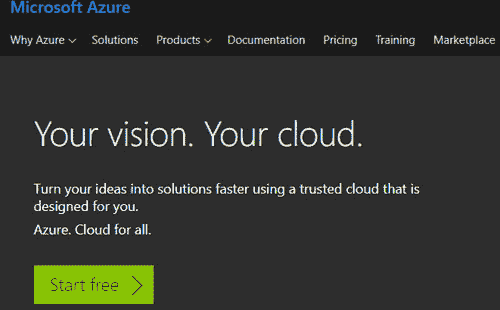
    **图 2.2.1**

2.  点击 `Start free` 创建您的免费 Azure 账户并获得 200 美元额度：

    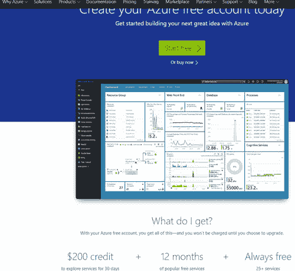
    **图 2.2.2**

3.  创建账户并领取 200 美元需要您的信用卡/借记卡仅用于验证，不会从您的卡中扣除任何金额。您可以使用此额度和账户试用 30 天。您将看到注册页面，在其中填写所有信息并逐步注册。成功注册后，您将看到通往门户的链接，如下所示。

    
    **图 2.2.3**

4.  点击门户，您将进入仪表板，准备好使用/体验 Azure。

    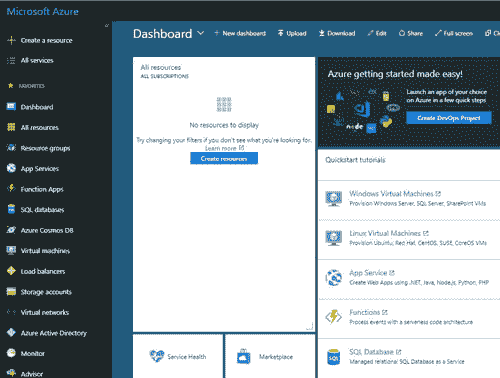
    **图 2.2.4**

## 在 Azure 上设置以太坊账户

1.  进入仪表板后，点击大的 **+** 按钮（即 `Create a resource`）以创建新资源。在搜索框中输入并回车 **Ethereum** 以获取我们所需的所有以太坊相关模板。请注意，您可能看到也可能看不到不同的名称或 Azure 门户上设置以太坊的布局，因为门户会不时变化：

    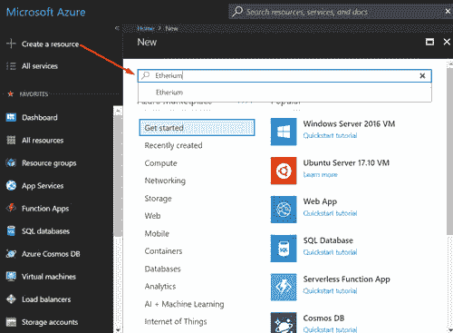
    **图 2.2.5**

2.  从模板列表中，选择 `Ethereum Proof-of-Work Consortium`。不能保证您看到的模板与此处所示完全相同。由于 Azure 始终在持续开发中，当您遵循此实施时，可能会看到不同名称的模板或完全不同的模板。

    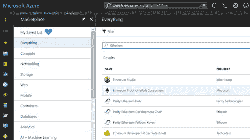
    **图 2.2.6**

3.  点击 `Ethereum Proof-of-Work Consortium` 后，保持部署模型不变，然后点击 `Create` 按钮，如下截图所示：

    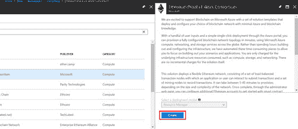
    **图 2.2.7**

点击创建后，您将看到一个需要填写特定详细信息的页面。以下是分步创建指南。

1.  对于步骤 `1` (`Basics`)，提供 `Resource prefix` 以将联盟项目与 Azure 门户上其他现有资源隔离开。示例：我将其命名为 `eth`；您可以使用自己的名称，也可以使用此名称。

    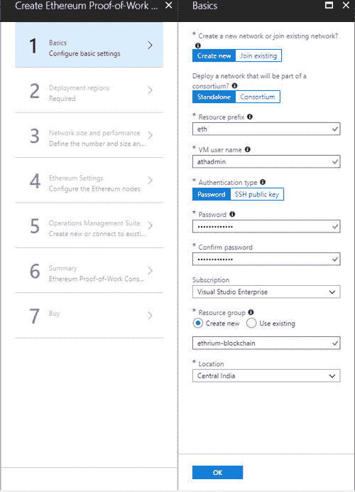
    **图 2.2.8**

2.  按照前面的截图所示，提供您选择的 `VM user name`。我使用了 `athadmin`，虽然我想用 `ethadmin`；这是我的笔误，用了 `athadmin`，但这无关紧要，因为我们是在为学习而开发。

3.  您可以选择将 `Authentication type` 设为 `Password` 或 `SSH public key`。目前我使用 `Password`；请务必记住您在此处提供的密码。您可以选择将 `Free Trial` 作为 `Subscription`，或者如果您有付费账户则使用付费账户。通过提供名称创建资源组，以便该联盟背景下的所有资源都位于此资源组中。资源组中的所有项目共享相同的权限、策略和生命周期。我将 `Resource group` 命名为 `ethrium-blockchain`。最后，选择一个靠近您的应用程序运行位置的 `Location`。我选择了 `Central India`。点击 `OK`。

4.  在第二步中选择 `Deployment regions`；我选择了 `1` 个区域数量，并将 `Central India` 作为 `First region`：

    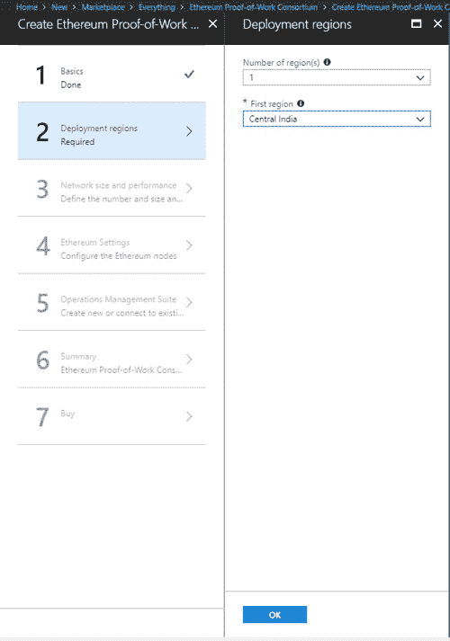
    **图 2.2.9**

5.  第三步是选择 `Network size and performance` 因素。将 `Number of mining nodes` 保留为默认值，即 `2`。我选择 `Mining node virtual machine size as 2x Standard D1 v2`，即最低配置，在大型应用程序中可能会有所不同。虚拟机大小和交易节点虚拟机大小的选择与规模和性能成正比。`Transaction Nodes` 可保留为 `1`，如下截图所示。我选择 `Transaction node virtual machine size` 为默认值，即 `1x Standard D1 v2`。

    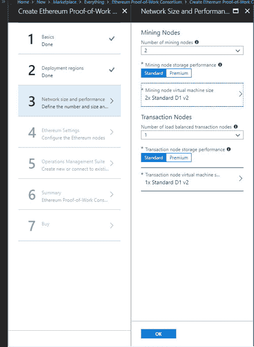
    **图 2.2.10**


## 6. 步骤 `4` 是 `Ethereum Settings`（以太坊设置），非常重要

将 `Consortium Member Id`（联盟成员 ID）设为 `0`，并保持 `Network ID`（网络 ID）为已选默认值。网络 ID 作为我们将要设置的以太坊网络的名称。这意味着只有具有相同网络 ID 的节点才能相互配对。您可以在此提供自定义创世区块，如果您想使用现有账户进行设置，这会很有用，但目前我们坚持使用默认设置，继续提供 `Ethereum account password`（以太坊账户密码）。输入密码，确认密码，并将其保存在某处以便记忆。您需要提供通行短语来生成私钥。输入您选择的通行短语并确认，就像设置密码时一样：

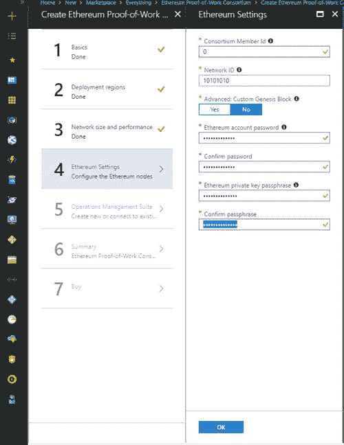

**图 2.2.11**

## 7. 在步骤 `5` 中，根据您最近的位置选择 `OMS Workspace Location`（OMS 工作区位置）

我在此选择 `Central India`（印度中部）：

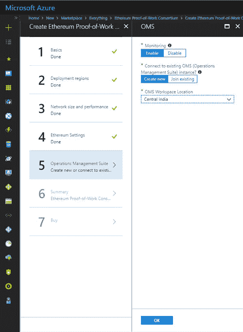

**图 2.2.12**

## 8. 在步骤 `6` 中，您将看到我们所选择内容的摘要

检查所有内容，然后点击 `OK` 进入 `Buy`（购买）部分。

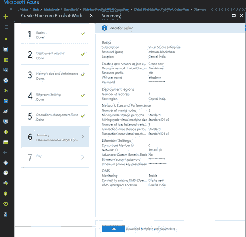

**图 2.2.13**

## 9. 步骤 `7` 是 `Buy`（购买）选项部分

在进行购买前请阅读所有条款和条件，然后点击 `Create`（创建）：

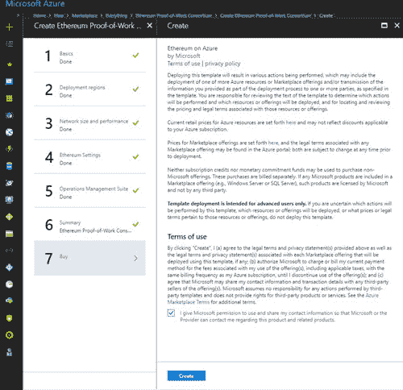

**图 2.2.14**

## 10. 点击 `Create` 后，设置和创建资源需要一些时间

会显示类似 `Submitting deployment for Ethereum Proof-of-Work…`（正在提交以太坊工作量证明部署……）的信息，请稍等片刻，一切都会好起来的。

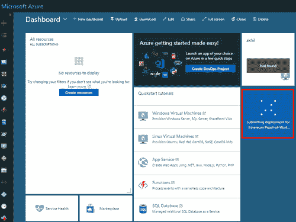

**图 2.2.15**

## 11. 部署完成后，您可以导航到 `Resource groups`（资源组）

如下面的屏幕截图所示，选择您使用提供的资源组名称新创建的资源：

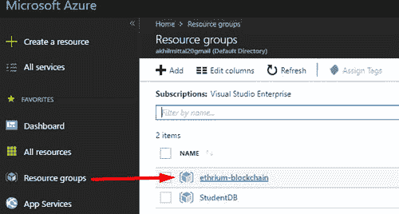

**图 2.2.16**

## 12. 点击 `Resource groups` 将带您查看为联盟创建的所有资源

如下面的屏幕截图所示。现在点击左侧边栏中的 `Deployments`（部署）以查看所有已进行的部署：

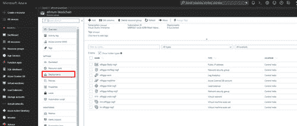

**图 2.2.17**

## 13. 您将被重定向到可查看所有部署的部分

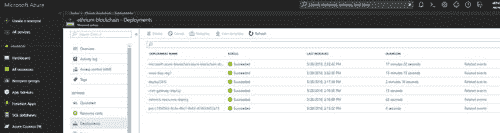

**图 2.2.18**

## 14. 选择第一个链接 `Microsoft-azure-blockchain` 以查找有关新创建区块链的所有信息

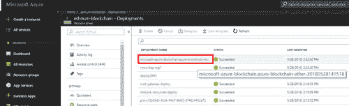

**图 2.2.19**

## 15. 您将看到 `Overview`（概览）、`Outputs`（输出）、`Inputs`（输入）和 `Template`（模板）等部分的页面

如下面的屏幕截图所示：

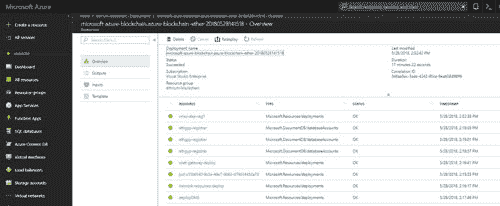

**图 2.2.20**

## 16. 选择 `Outputs`，您将获得连接到链所需的所有信息

复制 `ADMIN-SITE` 的地址并在浏览器中打开，如下面的屏幕截图所示：


**图 2.2.21**

## 17. 管理员站点将在浏览器中打开，外观如下所示

在此页面上，您可以看到有关区块链的信息。Azure 已为我们创建了一个创世区块，页面上显示默认账户为 `My Account Address`（我的账户地址）。我们看到我们的账户中也有一些以太币余额，可以开始使用我们的区块链了。

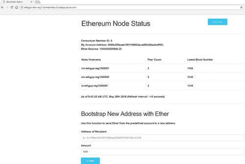

**图 2.2.22**

工作已完成一半，我们已成功在 Azure 上为以太坊区块链设置了账户。


**图 2.2.23**

# 使用 MetaMask 设置第二个账户

以下是使用 MetaMask 设置第二个账户的步骤：

## 1. 要设置第二个账户以转入一些以太币，请复制 `ETHEREUM-RPC-ENDPOINT` 地址

如下面的屏幕截图所示，从我们复制 `ADMIN-SITE` 地址的同一位置（Azure 门户）获取。

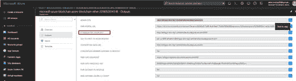

**图 2.2.24**

## 2. 现在转到 Chrome 扩展程序，在 Chrome 网上应用店中搜索 `MetaMask`

它是一个 Chrome 扩展程序，因此可以通过点击 `ADD TO CHROME`（添加至 Chrome）按钮轻松添加到 Chrome。MetaMask 是一个用于开发和测试的实用钱包应用程序：

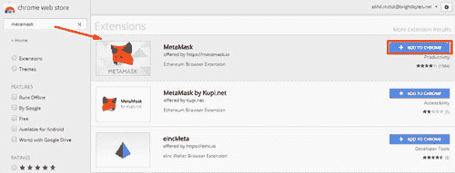

**图 2.2.25**

## 3. 添加到 Chrome 后，您将在 Chrome 浏览器右上角看到 MetaMask 图标

这表明 MetaMask 已添加到 Chrome。点击该图标，阅读条款和条件后点击 `Accept`（接受）按钮。

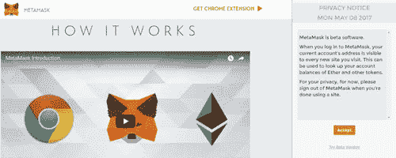

**图 2.2.26**

## 4. 点击 `Accept` 后，您将被重定向到使用 MetaMask 创建账户

如下面的屏幕截图所示提供密码，然后点击 `CREATE`（创建）：

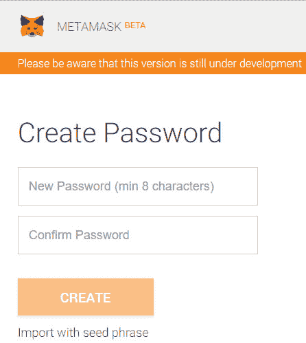

**图 2.2.27**

## 5. 创建密码后，您将看到一个唯一的账户图像，每次您进行交易时都会看到它

点击 `NEXT`（下一步）：

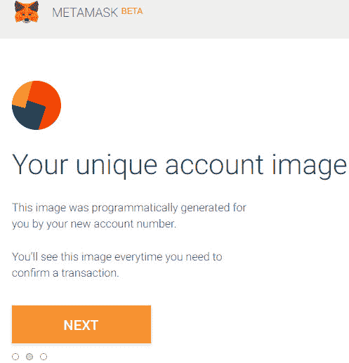

**图 2.2.28**

## 6. 在下一页，您将看到条款和条件

仔细阅读，如果您希望继续，请点击 `ACCEPT`（接受），如下面的屏幕截图所示：

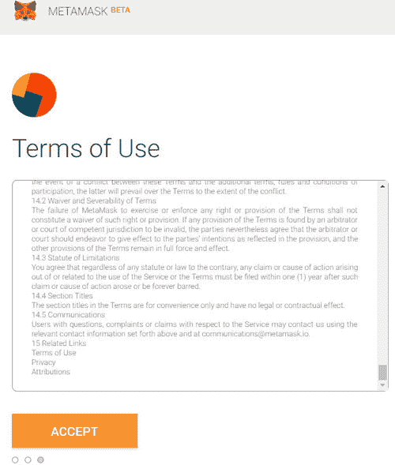

**图 2.2.29**

## 7. 接受条款和条件后，您将看到 `Secret Backup Phrase`（秘密备份短语）

如下面的屏幕截图所示，用于恢复和备份您的账户。最好将这些代码保存在只有您能访问的安全地方。点击 `CLICK HERE TO REVEAL SECRET WORDS`（点击此处显示秘密单词）以获取短语：

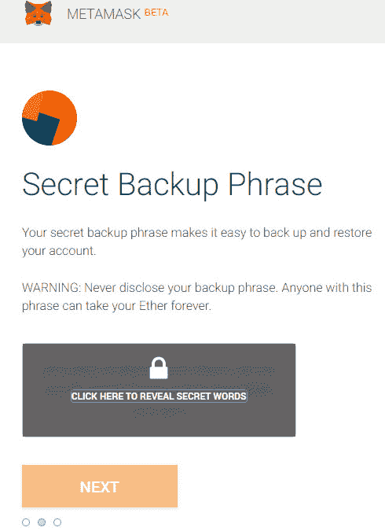

**图 2.2.30**

## 8. 在下一页，您需要验证您的短语

因此，按照短语最初在该页面上的顺序选择单词：

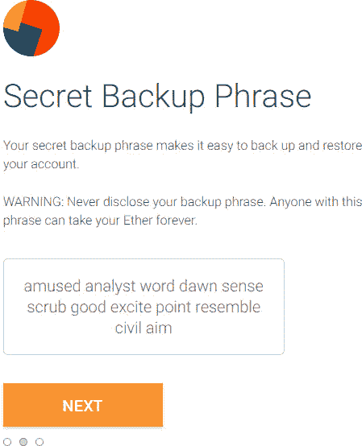

**图 2.2.31**

## 9. 选择您喜欢的测试网络

如下面的屏幕截图所示：

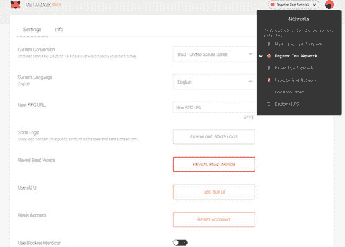

**图 2.2.32**

## 10. 现在，在 `Settings`（设置）选项卡下，将我们从 Azure 门户复制的 URL 粘贴到 `New RPC URL`（新 RPC URL）文本框中

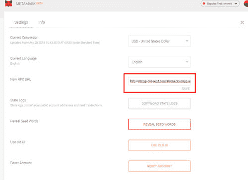

**图 2.2.33**

## 11. 返回 Chrome MetaMask 扩展程序，我们现在可以看到新创建的账户

如下所示。复制账户地址，如下面的屏幕截图所示：

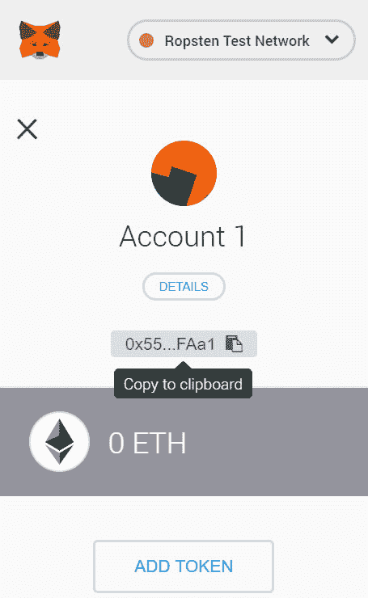

**图 2.2.34**

## 12. 转到我们在另一个标签页中打开的管理员页面，将复制的 MetaMask `Account 1`（账户 1）地址粘贴到 `Address of Recipient`（收件人地址）框中

如下面的屏幕截图所示：

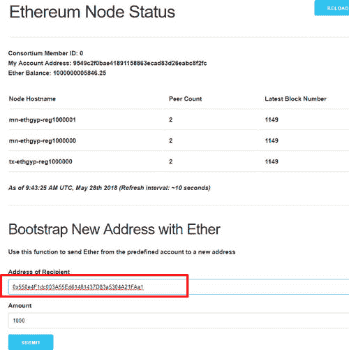

**图 2.2.35**

## 13. 添加要发送给收件人的以太币 `Amount`（数量），例如 `1000`，然后点击 `SUBMIT`（提交）

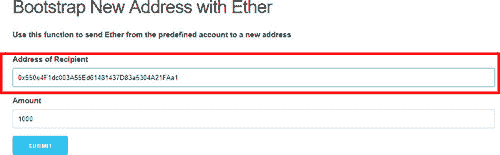

**图 2.2.36**

## 14. 提交后，您将看到消息 `Ether sent!`（以太币已发送！）

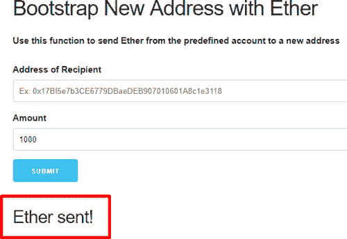

**图 2.2.37**

## 15. 但真的发送了吗？我们可以通过再次返回 Chrome 扩展程序并点击狐狸图标快速检查

`Congratulations`（恭喜）！！我们看到 `1000 ETH` 现已转入该账户：

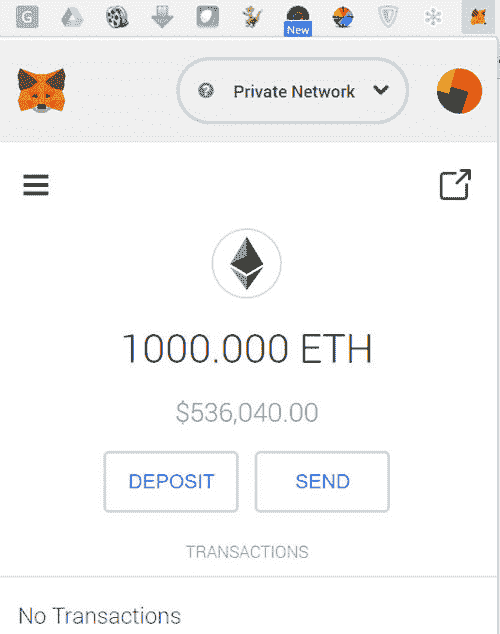

**图 2.2.38**

因此，我们成功地使用 Azure 区块链联盟将以太币从一个账户转移到了另一个账户。我们现在可以为我们的区块链开发智能合约。我将在后续章节中介绍智能合约和其他相关主题。

# 结论

在本章中，我们学习了如何在 Azure 上设置以太坊区块链，并使用 MetaMask 通过向另一个账户转移一些以太币来测试我们的区块链。下一节将重点介绍智能合约以及如何设置编写智能合约的开发环境。

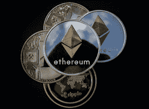

**图 2.2.39**

# 问题

1. 什么是 Azure？
2. 什么是以太坊工作量证明联盟？
3. Azure 上的资源组是什么？
4. 什么是 MetaMask？
5. MetaMask 使用什么节点？
6. 用简单的方式解释工作量证明。

# 第三部分


# 智能合约开发

在上一节中，我们学习了如何使用联盟领导者在 Microsoft Azure 上设置以太坊区块链。现在是进行一些开发工作的时候了。在继续介绍智能合约及其开发之前，作为先决条件，必须设置开发环境。本节将专门介绍如何为智能合约开发设置开发环境。在下一节中，我们将了解什么是智能合约以及如何开发它们。


**图片来源：** [`pixabay.com`](https://pixabay.com)

**图 3.0.1**

# 工具与开发环境

在进行实际开发之前，我们将使用一系列工具来设置开发环境。我将在 Microsoft Azure 上使用全新的 Windows 安装。在开始之前，您可以按照上一节中的步骤在 Azure 上设置虚拟机。我们将在新机器上安装 Chrome 浏览器，随后安装 `MetaMask`（Chrome 插件），它将帮助我们进行身份验证。Microsoft 提供免费的 `Visual Studio Code`，我们可以将其作为智能合约开发的 IDE。我们将安装 `NuGet 包管理器 (NPM)` 和 `Chocolatey`（也是一个包管理器），以获取开发所需的其他工具和包。我们将结合 `Git`、`NPM` 和 Windows 构建工具来构建/编译代码。我们将使用一个名为 `Test RPC` 的内存测试服务器来测试应用程序，最后使用 `Truffle`。当我们开始开发时，将更深入地探讨 `Truffle`。

# 设置智能合约开发环境


**图 3.1.1**

## Azure

Azure 是 Microsoft 的云平台，在云计算领域提供大量资源。其中一项资源是 `虚拟机 (VM)`，即只需点击几下，几秒钟内即可创建一个功能齐全、配置和操作系统均由您选择的机器。您可以使用安全凭据从任何地方远程访问该机器，并进行任何您想要的操作，例如托管网站、开发应用程序、为软件创建生产或测试环境等。让我们逐步了解如何实现这一点。

## 结构

在本章中，我们将讨论以下主题

*   Azure 上的虚拟机设置
*   为智能合约开发准备环境

## 目标

学习完本单元后，您应该能够

*   为编程智能合约设置开发环境。

## Azure 账户设置

如果尚未完成，请按照上一节中的步骤设置 Azure 账户。

## Azure 上的虚拟机设置

1.  进入仪表板后，单击仪表板上的 `Virtual machines`（虚拟机）链接，右侧面板将打开，显示您所有的虚拟机。由于我们要创建新的，且没有现有的，因此面板将为空。单击 `Create virtual machine`（创建虚拟机）：

    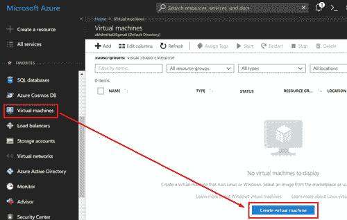

    **图 3.1.2**

2.  单击 `Create virtual machine` 后，您将看到 Azure 提供的用于创建机器的所有操作系统和解决方案模板。您可以根据需求选择 Windows 或 Linux 操作系统，但请注意涉及的成本：

    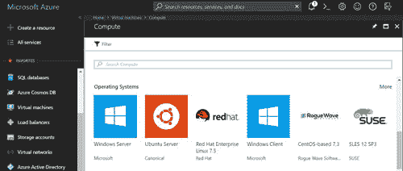

    **图 3.1.3**

3.  由于本节旨在学习如何创建虚拟机，我将选择配置最低的 `Windows Client`（Windows 客户端）机器，您可以根据需求和需要进行选择。因此，选择 `Windows Client`，如下截图所示：

    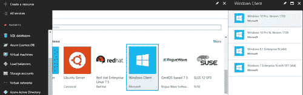

    **图 3.1.4**

4.  您将看到许可协议和法律条款窗口。请仔细阅读并按下 `Create`（创建）按钮：

    

    **图 3.1.5**

5.  单击 `Create` 后，系统将要求您填写一些基本要求，如下截图所示。按您的选择命名；例如，我将其命名为 `AKHILPC`，将 `VM disk type`（虚拟机磁盘类型）保留为 `SSD`，或根据需要选择。提供您远程连接机器时所需的用户名和密码。请妥善保管用户名和密码。选择订阅，如果您有付费订阅，请选择该订阅，否则选择您获得的试用订阅。您必须提供 `Resource group`（资源组）。您可以创建一个新的或使用现有的。资源组为您的所有 Azure 资源提供逻辑分离。由于我已有一个现有的资源组，因此我将使用它。选择 `Location`（位置），勾选确认复选框，然后单击 `OK`：

    

    **图 3.1.6**

6.  单击 `OK` 后，您将看到第二部分，用于选择机器大小，其中列出了内存、硬盘大小、SKU 和区域。每种配置都有相关成本，因此请根据您的需求和预算进行选择。出于培训/教程目的，我选择了成本最低的第一个，如下截图所示：

    

    **图 3.1.7**

7.  在第三步中，您需要选择与可用性、存储和网络相关的特定设置。根据您的判断选择/提供设置：

    

    **图 3.1.8**

8.  单击 `OK` 后，将显示一个摘要页面，列出您选择的所有配置、每小时成本和操作系统。通过勾选确认复选框确认一切正常（如下截图所示），然后单击 `Create`（创建）按钮。

    

    **图 3.1.9**

9.  单击 `Create` 后，创建虚拟机可能需要一段时间。它将显示 `Submitting deployment for`…… 等待部署完成。对我来说，花费了 `5~9` 分钟：

    

    **图 3.1.10**

10. 部署完成后，您将看到已部署虚拟机的部分，您可以选择 `Start`（启动）、`Stop`（停止）、`Restart`（重启）、`Move`（移动）或 `Delete`（删除）您创建的虚拟机。单击 `Connect`（连接）将在右侧面板显示两个选项，即 `RDP` 和 SSH。我们将选择通过 `RDP` 连接，因此下载右侧面板显示的 RDP 文件。单击 `Download RDP File`（下载 RDP 文件）按钮获取文件。或者，您可以直接在本地计算机上通过 `mstsc` 命令打开 RDP 连接。您可以在 RDP 部分看到 IP 地址，如下截图所示：

     

     **图 3.1.11**

11. 下载的 RDP 文件将位于您本地的下载位置。单击它以配置 RDP 连接。

     

     **图 3.1.12**

12. IP 地址会自动填入，只需填写用户名和密码即可连接。

     

     **图 3.1.13**

13. 连接成功后，您将看到欢迎消息，同时 Windows 正在加载并进行首次使用配置。请稍等片刻。

     

     **图 3.1.14**

14. Windows 加载完成后，您将看到如下所示的桌面。现在您可以随心所欲地使用这台机器：

     

     **图 3.1.15**

     `请注意，您使用机器的时间将按小时收费。`

15. 如果您一段时间不想使用该机器，或希望每天在指定时间停止机器，可以通过单击 Azure 仪表板上的 `Virtual machines` 选项手动操作。您将看到您的虚拟机。选择您的虚拟机并单击 `Stop`（停止）。您可以随时启动。这样可以节省大量成本。

     

     **图 3.1.16**


16. 此外，通过点击您选择的 VM，您可以监控其每小时/每日的使用统计信息，如下截图所示：

     

     **Figure 3.1.17**

看看仅通过几次简单的点击就在 Azure 上设置 VM 是多么容易。现在您不必依赖任何物理机器来完成您的工作。

# 工具和包的分步安装

正如我在前面章节所述，让我们开始其他工具和包的分步安装：

1.  **安装 Chrome 浏览器** - 第一步是安装 Chrome 浏览器。如果您已经安装了 Chrome 浏览器，请打开浏览器并参考步骤 3，否则请下载 Chrome 浏览器：

    

    **Figure 3.1.18**

2.  阅读 `Google` 条款和服务，并将其安装在刚创建的新机器上。

    

    **Figure 3.1.19**

3.  现在我们必须安装 `MetaMask`，这是一个 Chrome 插件，将帮助我们进行身份验证和测试。`MetaMask` 是一个工具，可帮助您在浏览器中快速与以太坊网络交互。它使用 `infura.io`。请注意 `Metamask` 不支持挖矿和合约部署。

     从 GitHub 以下 URL 下载 `MetaMask`：`[`github.com/MetaMask`](https://github.com/MetaMask)`。如下截图所示，选择 `Pinned repositories` 中显示的 `metamask`-extension 链接并点击它：

    

    **Figure 3.1.20**

4.  我选择了 `4.7.4` 版本；当您尝试下载时，可能会看到最新的稳定版本。通过点击链接 `metamask-chrome-4.7.4.zip` 下载 Chrome 插件，如下截图所示：

    

    **Figure 3.1.21**

5.  将下载的 zip 文件解压到 Windows 上的任意位置：

    

    **Figure 3.1.22**

6.  现在在 Chrome 中输入以下 URL 打开 Chrome 扩展设置：`chrome://extensions`。开启 `Developer mode`，如下截图所示，然后点击 `LOAD UNPACKED` 以加载解压后的下载扩展：

    

    **Figure 3.1.23**

7.  现在导航到 `MetaMask` Chrome 扩展解压的文件夹并选择该根文件夹，如下截图所示：

    

    **Figure 3.1.24**

8.  点击 `OK` 后，扩展将加载到 Chrome 中，您将看到 `MetaMask` 主页，确认该扩展现在是 Chrome 浏览器的一部分。您将在 Chrome 右上角看到一个狐狸图标作为扩展。现在您可以返回之前打开的 Chrome 扩展页面，并禁用我们在加载解压扩展时启用的 `Developer mode`：

    

    **Figure 3.1.25**

9.  现在下载 `Visual Studio Code`，这是一个帮助我们进行开发的 IDE。`VS Code` 广受欢迎，是微软提供的轻量级免费 IDE。导航至 URL：`[`code.visualstudio.com/`](https://code.visualstudio.com/)`。下载最新稳定版本，如下截图所示：

    

    **Figure 3.1.26**

10. 下载可执行文件后，点击它进行安装。阅读许可协议并接受，按照安装向导的说明将 `VS Code` 安装到您的机器上：

     

     **Figure 3.1.27**

11. 现在轮到下载 `NPM`。导航至 URL - `[`nodejs.org/en`](https://nodejs.org/en)` 并下载窗口上显示的最新发布稳定版本。我正在下载 `8.11.2 LTS` 版本的 `NPM`，如下截图所示：

     

     **Figure 3.1.28**

12. 下载安装程序后点击它并按照步骤操作。

     

     **Figure 3.1.29**

13. 保持所有设置为默认值，点击 `Next` 按钮直到安装成功完成：

     

     **Figure 3.1.30**

14. 安装完成后点击 `Finish` 按钮：

     

     **Figure 3.1.31**

15. 现在，正如本节前面所述，我们还需要一个包管理器。让我们也安装它，即 `Chocolatey`。它可以使用 `PowerShell` 命令安装，我们可以在 URL `[`chocolatey.org/`](https://chocolatey.org/)` 上获取命令/脚本。访问网站并点击 `Install Chocolatey Now` 按钮，如下截图所示：

     

     **Figure 3.1.32**

16. 在跳转的页面上，向下滚动到看到子标题 `Install with PowerShell.exe` 的部分。复制脚本，如下截图红框所示。脚本内容为：

     ```
     Set-ExecutionPolicy Bypass -Scope Process -Force; iex ((New-Object System.Net.WebClient).DownloadString('https://chocolatey.org/install.ps1'))
     ```

     

     **Figure 3.1.33**

17. 现在从 Windows 开始菜单打开 PowerShell 窗口，如下所示，点击 `Run as administrator` 启动 PowerShell 命令提示符：

     

     **Figure 3.1.34**

18. 命令提示符将如下截图所示：

     

     **Figure 3.1.35**

19. 现在将复制的脚本粘贴到命令提示符中并按 `Enter`。

     

     **Figure 3.1.36**

20. 一旦 `Chocolatey` 命令和 `NuGet` 包就位，我们将使用 `Chocolatey` 的 install 命令安装 GitHub 客户端；这将安装开发过程中使用的其他有用工具。

     因此，在命令提示符中输入命令：`choco install git -params "/GitAndUnixToolsOnPath"`，如下截图所示，然后按 `Enter`。

     

     **Figure 3.1.37**

21. 命令提示符上的安装程序将询问是否运行脚本以允许全局配置。您可以输入 `Y` 表示是，然后按 `Enter` 以允许。

     

     **Figure 3.1.38**

22. 现在关闭并重新打开 PowerShell 窗口，以确保所有内容均已正确安装。

     

     **Figure 3.1.39**

23. 现在让我们执行以下命令：

     *   关闭 Git 中的所有安全调用验证功能：`git config --system http.sslverify false`

         

         **Figure 3.1.40**

     *   通过 `NPM` 安装 node 插件构建工具：`npm install -g node-gyp`

         

         **Figure 3.1.41**

     *   安装 Windows 构建工具：`npm install --global --production windows-build-tools`

         

         **Figure 3.1.42**

     *   安装 Windows 构建工具将花费一些时间，请耐心等待，在此期间如果您愿意可以吃点东西 😊。

         

         **Figure 3.1.43**

24. 安装 `Test RPC`，即用于测试我们解决方案的本地以太坊服务器：`npm install -g ethereumjs-testrpc`

     

     **Figure 3.1.44**

25. 最后，安装 `Truffle` 工具集：`npm install -g truffle`

     

     **Figure 3.1.45**

现在我们可以开始开发了，因为我们的工具和软件已就绪，且 Azure 上的开发机器正在运行。是的，设置环境和工具需要大量工作，但请放心，开发和学习这些新工具和技术将会很有趣。

# 结论


# 在本章中，我们学习了如何设置开发环境以开始开发。我们接触了各种包，如 NPM 和 Chocolatey，它们帮助我们安装了更多工具。我们安装了 VS Code、MetaMask，它们将为我们提供编码环境。在下一章中，我们将专注于智能合约和开发。*干杯！*

# 问题

1.  什么是 Chocolatey？

2.  用于编译智能合约的构建工具有哪些？

3.  Test RPC 和 Truffle 是如何工作的？

4.  什么是 MetaMask？

5.  MetaMask 使用什么节点？

6.  MetaMask 有哪些局限性？

# 第 2 章：智能合约编程

从许多方面来看，制作智能合约与您可能已经习惯的做法非常相似。您首先用一种支持的语言编写代码。这将根据您正在为之工作的区块链实现而有所不同。在本章中，我们将使用一种名为 `Solidity` 的语言，它受以太坊支持，并且目前在比特币区块链上也正获得支持。另一个当前的选择是编写 Serpent 代码，它也获得了一些以太坊社区的支持。编写代码后，必须将其编译为字节码。有几种编译器可用。甚至还有在线编译器可以让您快速上手。在本节中，我们将使用一个用于处理智能合约的框架，称为 `Truffle`。Truffle 拥有一个内置编译器，非常容易上手。编译成功完成后，我们上传合约并等待其被挖掘。合约成功被挖掘后，我们就可以开始与其交互。在大多数情况下，您会为合约创建一个用户界面，但您也可以通过 `HTTP POST` 操作直接与其交互。

在上一章智能合约开发中，我们在开始编码或开发第一个智能合约之前，学习了设置开发环境。我们安装了开发所需的必要包和工具。在本节中，我们将探索 Solidity 并开发我们的第一个 `Hello World` 智能合约。


**图片来源：** [`pixabay.com`](https://pixabay.com)

**图 3.2.1**

## 结构

在本章中，我们将讨论以下主题：

*   智能合约
*   字节码
*   EVM
*   智能合约与 Solidity
*   Truffle 与 Test RPC
*   智能合约开发
*   智能合约部署
*   测试智能合约

## 目标

学习完本单元后，您应该能够：

*   开发您的基本智能合约。
*   学习 Solidity 的基础知识。
*   测试智能合约。
*   部署智能合约。

## 基础构建块 - 智能合约

智能合约是软件程序，一旦合约中指定的任何金额已转账至以太币，它们就会自动运行。因此，不需要（手动）验证付款收据，因为转账会按照程序规定直接启动。

整个区块链存储每一笔交易——在所有连接到网络的设备上。区块链的去中心化概念会永久检查整个数据库的完整性。

## 字节码

智能合约通常用 Solidity 编写，这是一种专门为以太坊开发的高级编程语言。然后将它们翻译成字节码并在 `以太坊虚拟机 (EVM)` 上运行。虚拟机将客户端环境与主机环境（即计算机上的其他应用程序）隔离开来。

这非常类似于 `Java` 等编程语言，其中代码被转换为 JVM 字节码。以太坊运行时环境只能理解并执行字节码。

这种设计赋予了开发者自由，可以利用其他编程语言来创建智能合约。其中之一是 Vyper，它非常类似于 Python，并编译为 EVM 字节码。

## EVM

EVM 是一个简单但强大的、图灵完备的 256 位虚拟机，允许任何人执行任意 EVM 字节码。EVM 在以太坊的共识引擎中发挥着重要作用，也是以太坊协议的一部分。它允许任何人在一个无需信任的环境中执行任意代码，在该环境中执行结果可以得到保证，且完全是确定性的。

## 智能合约与 Solidity

开发智能合约无非就是用区块链实现所支持的语言编写代码，我们需要为其开发智能合约。例如，以太坊支持名为 `Solidity` 的语言。代码编写完成后需要编译为字节码。有许多编译器可用，也有少数在线编译器。在本节中，我们将使用 Solidity 编写代码，并使用上一节安装的名为 `Truffle` 的框架。Truffle 为我们提供了一个内置编译器来编译智能合约。编译成功后，智能合约需要被上传/部署并挖掘。一旦成功挖掘，就可以开始与其交互。交互可以通过合约的用户界面完成，也可以直接通过 `HTTP POST` 方法操作完成。Solidity 为我们提供了遵循面向对象原则编写代码的灵活性。它是一种非常类似于 `JavaScript` 风格的语言。


**图 3.2.2**

来自面向对象编程语言背景的开发者可以快速掌握 Solidity 及其语法。Solidity 支持标准继承和多重继承，其数据类型和编码结构与任何其他面向对象语言非常相似。例如 `bool` 是支持布尔数据类型的关键字，可以保存 true 或 false 作为值。字符串像往常一样使用双引号，但只有最少的字符串操作能力，这与我们在 `C#`、`JavaScript` 或 `Java` 等其他语言中发现的不同。Solidity 拥有有符号和无符号整数，范围从 8 位到 256 位。Solidity 使用的基本类型之一是地址类型。它用于存储以太坊中用于账户或智能合约的地址。Solidity 支持访问修饰符，如 `public`、`private`、`internal` 或 `external`。访问修饰符有助于为代码提供抽象，并更好地控制谁可以从何处访问代码。如果需要从任何地方访问，则使用 `Public`。如果代码需要在合约内部访问，则使用 `Private`。`Internal` 意味着合约及其派生合约，即子类型，可以使用该代码，即方法和属性。使用 `external` 只允许从外部使用合约方法和属性，且子类型无法访问这些，这与 internal 不同。

Solidity 中的合约由 contract 关键字和我们选择的合约名称定义。这非常类似于在任何编程语言中编写类。合约定义后，可以拥有方法和变量。要记住的重要事情之一是，我们可以在 Solidity 的方法中拥有多个返回类型。

## Truffle 与 Test RPC


# Truffle 简介

Truffle 是一个用于以太坊开发的工具集框架，涵盖开发、测试和资产管道。Truffle 包含编译和构建解决方案的工具。它为自动化测试提供了框架，并通过对可配置部署位置的支持，使合约部署变得非常简单。Truffle 的另一个优点是我们可以在控制台模式下使用它，直接与已部署的合约进行交互。这非常酷，稍后我将展示其工作原理。

使用智能合约时，我们必须在将其发布到世界之前确保合约按预期工作，因为我们没有可行的“重来一次”的选项。上传到网络上的区块链测试环境需要一些时间。因此，使用本地测试区块链可以节省大量时间。Test RPC 是一个易于使用的内存区块链，非常适合在开发过程中测试合约。无需等待外部区块链将加快早期开发阶段的速度。Test RPC 实现了 EthereumJS，这是真实以太坊区块链中相同的指令集。Test RPC 的另一个优点是它会自动为你创建 10 个附带连接私钥的一次性测试账户。

# 开发智能合约

让我们开始开发第一个 `hello world` 智能合约。我们将从执行 Test RPC 开始，在 Truffle 的帮助下创建一个项目，然后创建我们的 `hello world` 合约。

1.  在 Windows 中创建一个名为 `helloworld` 的新文件夹：

    

    **图 3.2.3**

2.  完成文件夹创建后，以管理员模式打开一个新的 PowerShell 实例，如下截图所示：

    

    **图 3.2.4**

3.  现在，使用 `cd` 命令进入刚才创建的 `helloworld` 文件夹，如下截图所示：

    

    **图 3.2.5**

4.  现在，我们将使用 Truffle 启动我们的解决方案。这将在 `helloworld` 目录中为我们获取框架并创建简单项目，帮助我们快速开始。因此，在 PowerShell 窗口中输入命令 `truffle init` 并按 `Enter` 键：

    

    **图 3.2.6**

5.  正如前面的截图所示，命令运行、下载必要的包并设置开发环境。你可以返回 `helloworld` 文件夹检查为开发环境创建的文件夹和文件：

    

    **图 3.2.7**

6.  现在你可以启动 VS Code 并打开源 `code` 文件夹，或者遵循一种更直接的方法，只需在 PowerShell 控制台窗口中输入 `code .`。这将在我们的 IDE（即 Visual Studio Code）中为我们打开该文件夹。

    

    **图 3.2.8**

7.  VS Code 启动后，你可以看到解决方案中加载的文件和文件夹。我们看到它自动为我们创建了一些测试合约。让我们暂时保持原样，继续下一步。

    

    **图 3.2.9**

8.  是时候创建一个新合约了。右键单击 `contracts` 并添加 `New File`。

    

    **图 3.2.10**

9.  添加一个你选择名称的新文件。在我的例子中，我将其命名为 `helloworld.sol`，如下截图所示：

    

    **图 3.2.11**

10.  让我们编写一些代码。在继续编写方法之前，我们将按如下截图所示设置 pragma（代码的第一行）为 `0.4.22`，这意味着它适用于 `0.4.22` 及以上版本的 Solidity。这样，我们就可以确信我们的代码完全按照设定的版本工作。

11.  接下来，定义一个名为 `helloworld` 的合约，后跟花括号，就像定义类一样，在这些括号内将是我们的方法、属性和变量。定义一个名为 `PrintHelloWorld()` 的函数，按如下图所示返回一个字符串，并返回一个硬编码字符串 `Hello World!`。

     

     **图 3.2.12**

我们的代码如下所示：

```
pragma solidity ⁰.4.22;

contract helloWorld {
    function PrintHelloWorld() public pure returns (string) {
        return "Hello World!";
    }
}
```

现在，使用 `Ctrl + S` 保存文件。下一步是部署合约。

# 部署智能合约

1.  在 `migrations` 文件夹下，我们找到告诉 Truffle 哪些文件需要部署到区块链的文件。在该文件中，通过创建一个名为 `HelloWorld` 的变量来引用 `helloworld.sol` 文件，并在 `module.exports` 中编写 `deployer.deploy(HelloWorld)`，从而为 `helloworld` 创建一个部署器，如下截图所示：

    

    **图 3.2.13**

2.  代码如下所示：

```
var Migrations = artifacts.require("./Migrations.sol");
var HelloWorld = artifacts.require("./helloworld.sol");
module.exports = function(deployer) {
    deployer.deploy(Migrations);
    deployer.deploy(HelloWorld);
};
```

3.  现在我们需要运行 Test RPC 服务器。为此，打开一个全新的 Windows PowerShell 实例，保持已打开的实例原样。输入命令 `testrpc` 以启动服务器，如下截图所示。正如我之前所述，它一启动就会为我们创建测试账户和私钥，第一个账户被用作默认账户。某些功能可能需要管理员访问权限才能开始。因此，如果弹出请求访问的窗口，请允许：

    

    **图 3.2.14**

4.  我们可以看到，默认情况下服务器运行在端口 `8545` 上。现在服务器已启动并运行，保持此窗口打开，返回我们之前正在使用的 PowerShell 窗口。

    

    **图 3.2.15**

5.  现在编译我们的解决方案。使用命令 `truffle compile` 编译解决方案。编译完成后，如下截图所示，它将构建工件写入 `build\contracts` 文件夹。

    

    **图 3.2.16**

6.  现在我们可以部署合约了，因为它已成功编译。我们可以通过 `truffle migrate` 命令进行部署，如下截图所示。输入命令并按 `Enter` 键。

    

    **图 3.2.17**

    是的，我们得到了一个错误：

    

    **图片来源：** [`pixabay.com`](https://pixabay.com)

    **图 3.2.18**

7.  错误提示无法确定当前网络。因此，我们需要做一些准备工作来解决这个问题。如果你没有收到错误，可以跳过*步骤 5 到 7*，因为这可能已在你的版本中配置好。但对于遇到此错误的人，请遵循下面描述的*步骤 5 到 7*。

8.  返回打开解决方案的 VS Code，我们在那里看到一个名为 `truffle.js` 的文件，它应包含服务器配置：

    

    **图 3.2.19**

9.  默认情况下，该文件中的所有内容都被注释掉了，我们可以定义自定义配置。因此，用以下代码替换该文件中的全部文本：

```
module.exports = {
    networks: {
        development: {
            host: "localhost",
            port: 8545,
            network_id: "*" // Match any network id
        }
    }
};
```

    

    **图 3.2.20**


## 10.  现在在 migrations 节点下添加一个新的迁移文件，如以下截图所示，并将其命名为 `2_deploy_contracts.js`，然后将 `1_initial_migration.js` 中的部署代码移动到这个新创建的文件中：

     

     **图 3.2.21**

## 11.  因此，该文件包含如下代码。

```
var HelloWorld = artifacts.require("./helloworld.sol");

module.exports = function(deployer) {
    deployer.deploy(HelloWorld);
};
```

## 12.  现在，再次回到之前报错的 PowerShell 窗口，再次通过输入命令 `truffle compile` 并按 *Enter* 键来编译代码。按下 *Enter* 后，代码将针对我们在 VS Code 中所做的最新更改再次编译。现在，再次运行命令 `truffle migrate` 进行部署。

     

     **图 3.2.22**

     这一次我们的迁移顺利运行，因为它们找到了当前正在运行的服务器。请看上图，它成功部署了我们的合约。我们还可以看到它在上传时获得的地址。

## 13.  现在，你可以继续创建用户界面来测试我们刚刚部署的合约；或者，Truffle 也提供了一种与合约交互的机制。我们可以通过 truffle console 来实现。要在控制台模式下启动 truffle，请运行命令 `truffle console`，如以下截图所示：

     

     **图 3.2.23**

     这将为 Truffle 打开一个控制台监听器。在此模式下，我们可以直接为我们的合约编写 *JavaScript* 代码。让我们一步步来操作。

# 测试智能合约

在 truffle 控制台模式下，使用 `var` 关键字定义一个名为 `helloW` 的变量（或任何你喜欢的名称）。然后按 *Enter*。我们将尝试用这个变量访问我们的合约。按下 *Enter* 后，我们得到 `undefined`，这很显而易见，因为该变量尚未赋予任何内容。由于与合约的通信应该是异步的，我们现在编写异步代码来访问合约。由于在我们的代码中，合约是通过 `deployed` 关键字引用的，所以我们也将通过 `helloWorld.deployed();` 来访问它；之后，使用 `then` 关键字创建一个异步方法，将我们部署的合约映射到我们之前创建的变量，即 `helloW`。命令为 `helloworld.deployed().then(function(deployed){helloW=deployed});` 请参阅以下包含所有命令的截图以了解详情。


**图 3.2.24**

现在，使用我们在上一步中映射的变量来访问和测试合约。对 `helloworld` 合约方法使用 `call()` 方法来调用合约，如 `helloW.PrintHelloWorld.call()`，如以下截图所示：


**图 3.2.25**

这里我们得到了从该方法返回的字符串，因此我们的方法和合约已在内部私有区块链上测试运行成功。

实现和测试我们的智能合约是不是很有趣？

# 结论

在本章中，我们了解了智能合约，以及在以太坊上开发智能合约所使用的语言、Truffle 和 Test RPC。本节为区块链开发初学者以及刚接触以太坊和智能合约的人员提供了入门指引。本节奠定了如何开始并推进智能合约开发的基础。希望你享受创建、部署和测试智能合约的过程。

*编码愉快！*


**图 3.2.26**

# 问题

1.  什么是智能合约？开发智能合约使用哪种语言？

2.  什么是字节码？

3.  如何编译智能合约？

4.  在 Solidity 文件中必须指定的第一件事是什么？

5.  什么是智能合约挖矿？

6.  Test RPC 在智能合约开发中的作用是什么？

7.  智能合约可信吗？

8.  智能合约有标准吗？

9.  智能合约的执行是免费的吗？

10.  如果智能合约的执行成本超过指定的 gas 会发生什么？

# 第四部分

# 区块链在现实世界中的应用

让我们多谈谈区块链的必要性，以及区块链还能提供哪些更多功能。

# 第 1 章

# 区块链的产品与用例

# 结构

在本章中，我们将讨论以下主题

*   区块链的必要性、用例和产品。

*   区块链技术在教育领域的影响。

# 目标

学习完本单元后，你应该能够

*   理解区块链的实时应用

*   理解区块链如何影响/改变日常生活。

*   理解区块链技术可以在哪些地方发挥作用或正在发挥作用？

# 必要性、用例和产品

贵公司应该问的关键问题是：我们需要区块链吗？有一份简单的问题清单可以帮助你确定这一点。首先，你是否需要多方之间的共享公共数据库？如果我们使用公有链，你是否需要此区块链上的数据可被任何人访问？如果你使用私有链，你是否需要在多个已知方或公司之间共享此数据？如果答案是否定的，那么区块链可能不是最适合你的技术。接下来要问的问题是，如果多方需要共享数据，这些方中是否存在利益冲突，或者它们之间是否不受信任？区块链的主要目的之一是实现多方之间的信任。因此，如果其他方之间存在一定程度的不信任且利益冲突，那么区块链是一个值得考虑的绝佳解决方案。

否则，可能不需要区块链，你可以改用数据库。接下来你应该问的是，其他方能否遵守相同的规则？这里的意思是，你能否让它们使用相同的规则来管理添加到区块链上的交易，并使用相同的规则来验证交易？如果答案是否定的，且你认为无法让所有方遵守相同的规则（这说起来容易做起来难），那么区块链将不是一个好的解决方案。

下一个问题是，你是否需要记录所有操作的不可变日志？区块链最适合处理交易性数据，例如金融交易或保险理赔结算。对于此类交易，将它们记录在一长串相关数据项中是合理的。如果这不是你打算做的，那么区块链就是错误的解决方案。如果你对上述所有问题的回答都是肯定的，那么你可能已经确定区块链对你的组织有用。此时，你需要确定是愿意使用公有链（网络中的每个人都可以参与、访问和验证你的数据），还是想使用私有链（仅限于一个公司联盟）。

目前有许多新兴的区块链实现，但如果看当前主要的实现，当然有最大的比特币区块链。来自 Consensus 和微软的以太坊在非金融应用的开发者中获得了相当大的关注。这也是我们在本课程后续将使用的实现。IBM Bluemix 上的区块链也是那些想要创建自己区块链的人的替代选择。

# 区块链的用例


既然你已经了解了区块链最关键的技术层面，让我们来讨论一下它目前的一些用途，以及为什么它能成为真正的 `game-changer`（颠覆性创新/改变游戏规则者）。正如本书多次提到的，目前区块链最广泛的用途是用于比特币等数字货币。因为匿名交易可以像银行交易一样受到信任，这为处理全球交易开辟了广泛的新途径。让我举个现实生活中的例子。我的一位好朋友是现代史上最惨烈战争之一的难民。他设法逃了出来，但他的妻子仍留在国内。确保她有生存的经济来源至关重要。

在区块链出现之前，从世界另一端给她汇款的唯一选择是使用汇款机构。这些机构费用高昂，且在转账时会从我朋友有限的资金中抽取相当大的一笔。此外，交易可能需要许多天才能完成。最后，它们要求她亲自到场领取现金，这并不安全。然而，有了区块链，就不需要大型汇款机构了，而且有应用程序可以让你几乎即时转账，转账成本仅为一小部分。信不信由你，即使在战火纷飞的国家，你也能找到互联网，并将钱直接转到移动设备上。我们看到的仅仅是此类解决方案将如何以我们目前甚至无法完全掌握的方式改变世界的开端。一场已经持续一段时间的小型革命被称为 `Internet of Things (IoT)`（物联网）。这是指小型智能设备在无人干预的情况下使用互联网。目前，使用互联网的设备数量远超人类。通过使用区块链，这些设备突然可以安全地进行可信交易。

一个例子是，当你的洗衣机检测到洗涤剂快用完时，它可以为你自动订购。产品生命周期是另一个应用领域，你可以在区块链上存储工作流或产品的所有信息。例如，它可以追踪一辆汽车从工厂、经销商、客户、维修车间，直到回收厂的全生命周期。

认证也是一个重要的应用领域。认证机构可以以防篡改且完全透明的方式向产品或组织颁发认证。数据的安全共享是另一个例子。鉴于区块链的特性，你可以将加密信息存入其中，并确保只有你授权的人才能访问你的信息。这可以用于例如医疗信息或医疗设备，以安全的方式进行管理。突然之间，世界上所有医院在需要时都能即时访问你的病历，而你也能追踪所有试图访问你信息的人。现在已有设备能测量血液冲过血管时的声音。这种声音对每个人都是独一无二的，且在一生中不会改变。想象一下，将这些声音作为你访问区块链上数据的私钥。虚拟和数字产品的制作与销售已经滚雪球般增长了很长一段时间。有了区块链，你可以营销、销售，甚至控制你的数字产品，如书籍、此类课程、音乐等。一位音乐家可以将她的音乐上传到区块链，并尝试不同的产品购买模式。例如，她可以设定一个收听价格、一个制作铃声的价格，以及另一个用于在应用中商业使用的商业许可价格。所有这些都无需大型组织抽取大量版税。试着想象一下，现在摆在我们面前有多少种可能性。

## 更多用例

区块链在数据存储方面有许多不同的用例。让我们看看其中的一些。第一个也是最公开的用例，正如我们已经讨论的，是比特币等数字货币。我们已经涉及过这一点，但这是目前区块链技术最常见的用途。区块链的另一个新用途是电子投票。目前，当你投票选总理或总统时，你必须去投票站，把一张纸投进箱子，然后信任一群人正确计票。即使在今天，这个系统也很容易被操纵。使用区块链，可以从你的移动设备和个人设备上匿名登记对候选人的投票。然后，网络上的许多节点将开始验证和确认投票，使得没有人能篡改该过程。另一个令人兴奋的用途是保护知识产权。数字信息在互联网上可以轻松复制和重新分发。这使得保留和证明版权变得困难。区块链可用于存储人们作品的数字签名，连同时间戳和区块链记录，这意味着对该作品的所有权有不可篡改的证明。当然，如果我们将时间戳嵌入数字签名中，我们就能证明那件作品——无论是文字还是图像——何时被放置到区块链上。接下来，我们有一个关于 `anti-money laundering (AML)`（反洗钱）和金融服务公司了解你的客户（KYC）合规实践的用例。目前，金融公司必须为每位新客户执行劳动密集型且昂贵的流程。然而，通过跨公司客户验证，一旦某人被识别，结果及所有身份证明文件（如护照）的扫描件就可以放到区块链上并进行数字签名，从而大幅削减 KYC 成本。这使得该人未来更容易被验证，因为他们的详细信息已经“烘焙”在区块链上。通过将这些数据放在区块链上，许多金融公司都可以利用它，因为它们每家都在为身份数据做贡献，同时也在验证其完整性。区块链的另一个用途是追踪供应链中的物品。例如，你可以追踪食品从农场到商店的全过程，这样当你购买食品时，可以看到它的产地，并确认它在运输过程中未被篡改。最后，是土地注册契据或任何其他类型的公共或官方文件的记录。使用像区块链这样可访问的公共账本，可用于任何类型的记录保存。这些类型的文件可能成为欺诈的受害者，且管理成本高昂。随着房产的买卖，其销售详情和所有权转移可以永久写入区块链。这绝不是区块链潜在应用的详尽列表，但它应该能让你对一些潜在用例有个概念。

## 区块链技术在教育领域的影响

区块链的能力不仅限于比特币和金融交易；相反，它具有广泛的范围，也可以在我们的教育行业中加以利用。区块链可以在大学等教育机构、出版行业或一组教育机构中实施。它可以用于更安全、透明地收集教育数据、资格和学分。以下是区块链技术将成为绝佳选择的五个领域。

## 教育机构


提供基于项目的教育或培训的大学和其他教育机构，可以利用区块链技术为学生生成防篡改证书。带有双因素认证的加密证书可存储在区块链数据库中，生成一个唯一的去中心化编号，供主管部门用于验证真伪。这将防止任何人制作伪造或非真实的证书。一些国际教育机构已采用此方法，以确保证书的真实性和安全性。

## 资质的全球数据库

不仅限于安全存储证书，利用区块链技术，还可以创建一个全球（国际）数据库，个人无需保管纸质学位和资质证书，而这些纸质文件极易丢失或被篡改。可建立一个基于区块链的平台来存储所有资质信息，供签证官等主管部门在个人跨境旅行或移民时核查其真实性，供公司管理层核查员工真实性或招聘新员工时进行背景调查，以及供教育机构核查个人出示的资质背景和真实性。

## 学习平台

企业办公室的个人或教育机构的学生可以拥有一个平台，在上面寻求在线培训，或与同事/上司、老师进行交流。可在培训师和受训者之间建立一个独立的学习平台，双方可就项目、任务、费用、培训时长等培训条款和条件达成一致，并将其作为智能合约存储，以实现透明安全的执行，从而消除中介的概念。他可以通过这种方式赚钱。

## 企业学习

员工及其所在公司迫切需要一个更安全、更透明的企业培训体系。追踪员工的成就或公司提供广泛培训的整体能力是一项挑战，且难以衡量。传统的学习管理系统和技术现已过时。区块链技术在此领域可发挥关键作用，更安全、更透明地记录所有培训情况和员工成就，员工也可利用此记录向新雇主展示。

## 安全支付

学生可使用该平台通过加密货币向教育机构支付学费/课程费。*坎布里亚领导力与可持续发展学院*早在*2014 年*就已宣布提供一项选择，允许学生用比特币支付费用。接受比特币支付无需依赖大量基础设施，却是一种更安全的支付方式。此外，国际学生或全球各地的学生会发现这是一种轻松支付费用的方式，无需依赖可能通过向学生或教育机构收取手续费或汇率差价来牟利的第三方。

## 结论

这是一个详细的理论章节，重点关注区块链的需求、用途和影响。我们看到区块链的影响广泛，用途涵盖教育、安全、医疗等多个领域。关键在于理解它、采用它并实施它。

## 问题

1.  为什么区块链是一种值得信赖的方法？

2.  有哪些开发区块链应用的热门平台？

3.  区块链如何影响教育技术？
