# 5G IoT 智能医疗健康监测使用指南：挑战、方向与未来预测 (万物互联 (IoE))

有关本系列的更多信息，请访问：https://www.routledge.com/Internet-of-Everything-IoE/book-series/CRCIOESPP

# 前言

在物联网（IoT）之前，患者与医生的互动仅限于就诊以及电话和文本通信。医生或医院无法持续监测患者的健康状况并据此做出建议。物联网设备使医疗领域远程监测成为可能，释放了保持患者安全健康并赋能医生提供卓越护理的潜力。它还提高了患者的参与度和满意度，因为与医生的互动变得更容易、更高效。此外，远程监测患者的健康有助于减少住院时间并防止再入院。物联网对显著降低医疗成本和改善治疗效果也具有重大影响。物联网无疑正在通过重新定义设备与人员在提供医疗解决方案方面的互动空间来改变医疗行业。物联网在医疗保健中的应用惠及患者、家庭、医生、医院和保险公司。

与此同时，5G 将增强许多现有用例，同时创造当前技术无法满足的新用例，例如远程进行的患者检查甚至手术。另一个确定的是，关键的医疗服务需要可靠的连接。5G 网络将提供近乎即时的數據传输速度，这将对医疗保健中的所有连接设备产生巨大影响。庞大的医疗影像数据文件可以快速可靠地传输，从而提高护理质量。

本书的目的是提供与知识管理、决策科学、物联网和5G技术以及升级技术相关的各种主题。由于现有的关于物联网和5G在智能医疗方面的文献，尤其是与商业世界相关的内容非常匮乏，本出版物将影响商业、组织、管理与信息技术、医疗保健行业和医院领域。

## Taylor & Francis

Taylor & Francis 集团

http://taylorandfrancis.com

# 编者简介

**Meenu Gupta** 于印度古尔冈 Ansal 大学获得计算机科学与工程博士学位，研究方向为交通事故严重程度问题（2020年）；于印度罗塔克 M.D.U. 大学获得计算机科学与工程硕士学位（2010年）；并于印度库鲁克谢特拉 K.U.K. 大学信息技术专业本科毕业（2006年）。她目前是昌迪加尔大学的副教授，拥有13年教学经验。她的研究领域包括机器学习、智能系统、数据挖掘，尤其关注人工智能、图像处理与分析、智慧城市、数据分析以及人/脑-机交互。她还完成了CRC出版社关于医疗保健和癌症疾病的两本编著书籍，并撰写了四本工程类著作。她曾担任《Big Data》、《CMC》、《Scientific Report》、《TSP》等多家期刊的审稿人。她是ISTE和IAENG的终身会员。她在同行评审的国际期刊（SCI/SCIE/WoS/Scopus等）和会议上发表或合著了50余篇论文，并撰写了20多个书籍章节。她还主持了IEEE国际会议，并召集了多次研讨会/FDP。

**Gopal Chaudhary** 目前在印度德里古鲁戈宾德辛格因德拉普拉斯塔大学的 Bharati Vidyapeeth 工程学院担任助理教授。他在印度德里大学 Netaji Subhas 技术学院仪器与控制工程系获得生物识别学博士学位。他于2009年获得电子与通信工程学士学位，并于2012年在德里理工大学（原德里工程学院）获得微波与光通信硕士学位。他在生物识别及其应用领域的国内外同行评审期刊和会议（如 Elsevier、Springer、Inderscience）上发表了30篇论文。他目前的研究兴趣包括软计算、智能系统、信息融合和模式识别。他组织了许多会议，并为特刊做出了贡献。

**Victor Hugo C. de Albuquerque** 在巴西帕拉伊巴联邦大学（UFPB，2010年）获得机械工程博士学位，研究方向为材料；在巴西塞阿拉联邦大学（UFC，2007年）获得电信信息工程硕士学位；并于巴西塞阿拉联邦技术教育中心（CEFETCE，2006年）机电一体化技术专业本科毕业。他目前是福塔莱萨大学（UNIFOR）应用信息学研究生项目的正教授，并担任工业信息学、电子与健康实验室协调员，同时担任巴西塞阿拉州研究与公共安全战略监管局（SUPESP/CE）的数据科学主任。他在计算机系统方面拥有丰富经验，主要研究领域为应用计算、智能系统、可视化与交互，尤其关注模式识别、人工智能、图像处理与分析，以及涉及生物信号/图像处理、图像分割、生物医学电路和人/脑-机交互的自动化，包括面向动物和人类的增强现实与虚拟现实仿真建模。此外，他还通过无损检测技术与信号/图像处理、分析及模式识别相结合，开展了微观结构表征研究。Victor 教授是工业信息学、电子与健康研究小组的负责人。他担任《Journal of Artificial Intelligence and Systems》主编，并担任《IEEE Access》、《Applied Soft Computing》、《Frontiers in Communications and Networks》、《Computational Intelligence and Neuroscience》、《Journal of Nanomedicine and Nanotechnology Research》、《Computational Physiology and Medicine》和《Journal of Mechatronics Engineering》的副主编，同时担任多家高声誉期刊的首席客座编辑，以及众多国际会议的TPC成员。

# 1 医疗保健管理中的物联网：潜在应用与挑战

P. Bajdor 和 M. Starostka-Patyk

## 1.1 引言

物联网（IoT）概念已经彻底改变了数字世界。这一理念已被引入并广泛应用于许多不同领域，彻底改变了许多流程的方式。物联网的适用性、范围和多样性是无限的，可以渗透到日常生活的各个方面 [1]。其中一个应用领域是具有多学科特征的医疗健康信息学，它利用信息工程进行医疗保健管理。传统上，健康信息来源于各种渠道，包括使用信息学解决方案的系统。然而，物联网的出现意味着这些信息往往分散在各种物联网设备上。物联网概念的使用正逐渐成为该领域的常态。

医疗保健支出的不断增加、人口结构变化（尤其是社会老龄化）、传染病的威胁，以及疾病日益复杂化，使得医疗保健服务创新成为必然。电子健康（e-Health）技术是解决这些问题的极具前景的创新工具 [2]。借助这些技术，可以持续管理和监测老年人至关重要的健康状况，并监测患者在家中及医疗保健机构中的身体活动和安全性。

物联网将有助于更好地管理医疗保健设施，并改善它们之间的沟通。2005年，世界卫生组织（WHO）认识到电子健康在改善卫生系统管理及其安全性、质量和有效性方面的潜力 [3]。WHO 将电子健康视为利用信息技术进行健康管理的应用 [4]。类似的定义指出，电子健康涵盖影响卫生部门的所有类型的活动。详细而言，该定义指出，电子健康包括卫生当局（行政部门）和专业人员（医务人员）正在使用或可能使用的工具，以及面向患者和公民的个性化（个人）医疗保健服务 [5]。电子健康是指将信息通信技术应用于与健康相关的服务、产品和管理过程，还包括医疗保健系统中的组织变革及其现代管理。所有这一切都是为了改善公民健康，提高医疗保健服务的效率和品质。

因此，电子健康的概念被理解为，除其他外，包括患者与医疗服务提供者之间的互动、医疗保健提供者之间的数据传输、点对点通信（包括与患者或医疗保健专业人员的通信）[6]。该术语还包括健康信息的交互与连接；电子健康记录（EHR）；远程医疗服务（利用信息通信技术远距离提供健康服务，即所谓的在线医疗咨询）；以及个人便携式设备，这些设备无需人工干预即可相互通信，能够支持疾病预防、诊断、治疗、健康监测，甚至管理患者的生活方式 [5]。

在健康管理中应用 ICT 的目的是扩大医疗保健服务的地理覆盖范围，改善数据管理，加速诊断和治疗，促进诊室之外的患者与医生接触，并尽量减少欺诈和滥用 [7]。

物联网在医疗保健应用中有许多不同的要求，主要涉及医疗数据的实时记录、这些数据的安全性和隐私性，以及其他取决于特定医疗性质的要求。因此，充分理解物联网在医疗保健中的基本应用、机遇和威胁至关重要。

## 1.2 医疗保健管理中的物联网

医疗保健物联网技术 [8] 可确保访问与医疗保健相关的数据，以及有关信息学和智能医疗设备及其网络运行的分析数据 [9]。它基于架构结构基础工作，因为物联网依赖于许多相互连接的设备，正如一些文献 [10] 中提到的，物联网在医疗保健中的总体架构如图 1.1 所示。这些设备通过网络（主要是互联网）将数据发送到云端，卫生工作者可以访问这些数据 [11]。

医疗保健管理中的物联网为健康和人类福祉带来了一系列重要益处，既提高了生活质量，又降低了医疗保健成本。该技术构建中最关键的要素是用于远程监测患者健康状况的无线传感器，以及将患者的相关必要信息发送给其医疗护理人员的通信系统和应用程序。

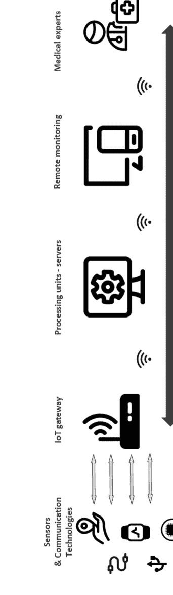

图 1.1 医疗保健中物联网的总体架构。

医疗专家

远程监测

处理单元 - 服务器

物联网网关

传感器与通信技术

物联网在医疗管理中的概念聚焦于个人区域网络（PAN）的概念，即围绕连接到机器或人体的传感器构建的小型网络。PAN 指的是连接到人们使用的设备的计算机网络 [12]。PAN 网络确保各种计算机、智能手机、平板电脑等之间的数据交换。这些网络用于将 IT 工具与服务器网关连接起来。

物联网在医疗管理中 PAN 的基本假设如下 [13]：

- IT 工具和人员配备有传感器
- IT 工具通过互联网连接报告其状态
- 建立的网络是在需要时创建的，因此可能仅限于某些功能
- 虽然某些 IT 工具可能没有无限的电源，其功能可能会被切断
- 有限的电力可能导致带宽较低
- 必须得到充分保护，因为健康数据很脆弱

医疗物联网中存在的应用范围涵盖使用远程监测系统进行数据收集，这些数据可能在活动之后（例如睡眠活动）以及活动发生期间（例如心跳报告）进行分析。

用于健康报告的 IT 工具，如 Fitbit、Garmin 或 Xiaomi Misfit，会分析个人的健康表现 [14]。由于某些功能限制，大多数 IT 工具的数据是通过使用局域网和/或广域网 [15] 交换的，这对网络提出了很高的要求。此外，物联网在医疗管理中实时演进并结合同步发展，会带来不同的挑战 [16]。它们涉及诸如数据安全和隐私、高效的数据维护和传输以及大量数据管理等问题 [17]。这些挑战以及与先进传感器、移动应用程序、人工智能、大数据、3D 打印和移动性相连的 IT 技术的开发，导致了支持医疗业务的现代方式的增加，并创造了智能医疗解决方案的新功能 [18]。

物联网在智能医疗管理中使用的要求分为两类：功能性和非功能性 [19]。功能规范指的是智能医疗架构的细节。温度报告系统就是一个例子。因此，功能需求特定于该医疗系统中基于其应用所使用的每个组件。非功能需求似乎不具特异性。非功能细节与医疗质量特征相关。在更广的视角下，非功能医疗规范被细分为功能和伦理细节 [20]。

智能医疗管理系统有很多划分，但在这里值得提到的是这些规范如何根据软件和硬件进行细分。有效、智能医疗管理系统的总体标准是 [21]：

- 能源
- 在住宅中使用可能性
- 系统的稳健性
- 服务保障
- 用户更好的感知
- 更好的生产力
- 更广泛的信息交换可能性
- 易用性
- 广泛使用提供持续支持的医疗管理工具
- 系统可扩展性以开发解决方案
- 广泛的互操作性

现代智能医疗管理系统旨在提供快速的医疗帮助和护理。一些更复杂的应用程序，关于这些细节 [22]，必须具备环境智能以提高服务质量。

可以指出物联网在医疗管理中的两个关键方面：服务，例如佩戴在身体上的设备，以及应用程序，例如心电图或血压监测 [23]。文献中提到了物联网在医疗管理中有效服务和应用的一些例子 [24]，图 1.2 显示了物联网在医疗保健中的主要服务和应用示例。

分析该图时，你会注意到服务用于创建物联网医疗保健应用，而应用则直接由患者使用。除了在监督和管理日常健康和福祉方面的有用性外，医疗保健中的物联网设备被设计用于慢性病及其预防、生命和干预远程助手、药物和医疗保健的改进管理，以及在偏远地区预防疾病 [25]。

现在，人们可以使用各种可穿戴设备，例如活动监测器、自动体外除颤器、血压监测器、血糖仪、跌倒传感器、健身和心率监测器、多参数监测器、可编程注射泵、脉搏血氧仪、智能药丸分配器、智能手表和便携式注射器 [1,3,26]。IoMT 应用领域可以包括慢性病（CD）、健康状况管理（HCM）、家庭医疗护理（HMH）、医院监测（HM）、人类活动识别（HAR）、医疗护理（MN）、患者生理（PPC）、患者佩戴的 IoMT 设备、儿科和老年护理（PEC）、远程患者监测（RPM）、并发报告和监测（CRM）以及患者药物追踪（TPM） [27]。

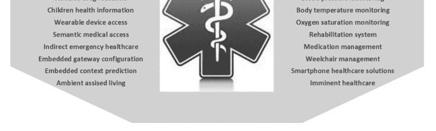

图 1.2 物联网在医疗保健中的主要服务和应用示例。

除了这些应用领域外，远程远程医疗监测咨询（TMRC）代表了一种现代的医疗服务方式，基于历史数据和各方通过互联网通信交换的当前报告，以改善患者的医疗保健 [28]。远程医疗的定义与远程医疗（远程医疗保健）密切相关 [29]。在医疗实践中，许多应用使用远程医疗。根据分析医疗 IT 工具市场

图 1.1 医疗保健中物联网的总体架构。

医疗专家

远程监测

处理单元 - 服务器

物联网网关

传感器与通信技术

物联网在医疗管理中的概念聚焦于个人区域网络（PAN）的概念，即围绕连接到机器或人体的传感器构建的小型网络。PAN 指的是连接到人们使用的设备的计算机网络 [12]。PAN 网络确保各种计算机、智能手机、平板电脑等之间的数据交换。这些网络用于将 IT 工具与服务器网关连接起来。

物联网在医疗管理中 PAN 的基本假设如下 [13]：

- IT 工具和人员配备有传感器

- IT 工具通过互联网连接报告其状态

- 建立的网络是在需要时创建的，因此可能仅限于某些功能

- 虽然某些 IT 工具可能没有无限的电源，其功能可能会被切断

- 有限的电力可能导致带宽较低

- 必须得到充分保护，因为健康数据很脆弱

医疗物联网中存在的应用范围涵盖使用远程监测系统进行数据收集，这些数据可能在活动之后（例如睡眠活动）以及活动发生期间（例如心跳报告）进行分析。

用于健康报告的 IT 工具，如 Fitbit、Garmin 或 Xiaomi Misfit，会分析个人的健康表现 [14]。由于某些功能限制，大多数 IT 工具的数据是通过使用局域网和/或广域网 [15] 交换的，这对网络提出了很高的要求。此外，物联网在医疗管理中实时演进并结合同步发展，会带来不同的挑战 [16]。它们涉及诸如数据安全和隐私、高效的数据维护和传输以及大量数据管理等问题 [17]。这些挑战以及与先进传感器、移动应用程序、人工智能、大数据、3D 打印和移动性相连的 IT 技术的开发，导致了支持医疗业务的现代方式的增加，并创造了智能医疗解决方案的新功能 [18]。

物联网在智能医疗管理中使用的要求分为两类：功能性和非功能性 [19]。功能规范指的是智能医疗架构的细节。温度报告系统就是一个例子。因此，功能需求特定于该医疗系统中基于其应用所使用的每个组件。非功能需求似乎不具特异性。非功能细节与医疗质量特征相关。在更广的视角下，非功能医疗规范被细分为功能和伦理细节 [20]。

智能医疗管理系统有很多划分，但在这里值得提到的是这些规范如何根据软件和硬件进行细分。有效、智能医疗管理系统的总体标准是 [21]：

- 能源

- 在住宅中使用可能性

- 系统的稳健性

- 服务保障

- 用户更好的感知

- 更好的生产力

- 更广泛的信息交换可能性

- 易用性

- 广泛使用提供持续支持的医疗管理工具

- 系统可扩展性以开发解决方案

- 广泛的互操作性

现代智能医疗管理系统旨在提供快速的医疗帮助和护理。一些更复杂的应用程序，关于这些细节 [22]，必须具备环境智能以提高服务质量。

可以指出物联网在医疗管理中的两个关键方面：服务，例如佩戴在身体上的设备，以及应用程序，例如心电图或血压监测 [23]。文献中提到了物联网在医疗管理中有效服务和应用的一些例子 [24]，图 1.2 显示了物联网在医疗保健中的主要服务和应用示例。

分析该图时，你会注意到服务用于创建物联网医疗保健应用，而应用则直接由患者使用。除了在监督和管理日常健康和福祉方面的有用性外，医疗保健中的物联网设备被设计用于慢性病及其预防、生命和干预远程助手、药物和医疗保健的改进管理，以及在偏远地区预防疾病 [25]。

现在，人们可以使用各种可穿戴设备，例如活动监测器、自动体外除颤器、血压监测器、血糖仪、跌倒传感器、健身和心率监测器、多参数监测器、可编程注射泵、脉搏血氧仪、智能药丸分配器、智能手表和便携式注射器 [1,3,26]。IoMT 应用领域可以包括慢性病（CD）、健康状况管理（HCM）、家庭医疗护理（HMH）、医院监测（HM）、人类活动识别（HAR）、医疗护理（MN）、患者生理（PPC）、患者佩戴的 IoMT 设备、儿科和老年护理（PEC）、远程患者监测（RPM）、并发报告和监测（CRM）以及患者药物追踪（TPM） [27]。

图 1.2 物联网在医疗保健中的主要服务和应用示例。

除了这些应用领域外，远程远程医疗监测咨询（TMRC）代表了一种现代的医疗服务方式，基于历史数据和各方通过互联网通信交换的当前报告，以改善患者的医疗保健 [28]。远程医疗的定义与远程医疗（远程医疗保健）密切相关 [29]。在医疗实践中，许多应用使用远程医疗。根据分析医疗 IT 工具市场的

- IT 工具和人员配备有传感器
- IT 工具通过互联网连接报告其状态
- 建立的网络是在需要时创建的，因此可能仅限于某些功能
- 虽然某些 IT 工具可能没有无限的电源，其功能可能会被切断
- 有限的电力可能导致带宽较低
- 必须得到充分保护，因为健康数据很脆弱

医疗物联网中存在的应用范围涵盖使用远程监测系统进行数据收集，这些数据可能在活动之后（例如睡眠活动）以及活动发生期间（例如心跳报告）进行分析。

用于健康报告的 IT 工具，如 Fitbit、Garmin 或 Xiaomi Misfit，会分析个人的健康表现 [14]。由于某些功能限制，大多数 IT 工具的数据是通过使用局域网和/或广域网 [15] 交换的，这对网络提出了很高的要求。此外，物联网在医疗管理中实时演进并结合同步发展，会带来不同的挑战 [16]。它们涉及诸如数据安全和隐私、高效的数据维护和传输以及大量数据管理等问题 [17]。这些挑战以及与先进传感器、移动应用程序、人工智能、大数据、3D 打印和移动性相连的 IT 技术的开发，导致了支持医疗业务的现代方式的增加，并创造了智能医疗解决方案的新功能 [18]。

物联网在智能医疗管理中使用的要求分为两类：功能性和非功能性 [19]。功能规范指的是智能医疗架构的细节。温度报告系统就是一个例子。因此，功能需求特定于该医疗系统中基于其应用所使用的每个组件。非功能需求似乎不具特异性。非功能细节与医疗质量特征相关。在更广的视角下，非功能医疗规范被细分为功能和伦理细节 [20]。

智能医疗管理系统有很多划分，但在这里值得提到的是这些规范如何根据软件和硬件进行细分。有效、智能医疗管理系统的总体标准是 [21]：
- 能源
- 在住宅中使用可能性
- 系统的稳健性
- 服务保障
- 用户更好的感知
- 更好的生产力
- 更广泛的信息交换可能性
- 易用性
- 广泛使用提供持续支持的医疗管理工具
- 系统可扩展性以开发解决方案
- 广泛的互操作性

现代智能医疗管理系统旨在提供快速的医疗帮助和护理。一些更复杂的应用程序，关于这些细节 [22]，必须具备环境智能以提高服务质量。

可以指出物联网在医疗管理中的两个关键方面：服务，例如佩戴在身体上的设备，以及应用程序，例如心电图或血压监测 [23]。文献中提到了物联网在医疗管理中有效服务和应用的一些例子 [24]，图 1.2 显示了物联网在医疗保健中的主要服务和应用示例。

分析该图时，你会注意到服务用于创建物联网医疗保健应用，而应用则直接由患者使用。除了在监督和管理日常健康和福祉方面的有用性外，医疗保健中的物联网设备被设计用于慢性病及其预防、生命和干预远程助手、药物和医疗保健的改进管理，以及在偏远地区预防疾病 [25]。

现在，人们可以使用各种可穿戴设备，例如活动监测器、自动体外除颤器、血压监测器、血糖仪、跌倒传感器、健身和心率监测器、多参数监测器、可编程注射泵、脉搏血氧仪、智能药丸分配器、智能手表和便携式注射器 [1,3,26]。IoMT 应用领域可以包括慢性病（CD）、健康状况管理（HCM）、家庭医疗护理（HMH）、医院监测（HM）、人类活动识别（HAR）、医疗护理（MN）、患者生理（PPC）、患者佩戴的 IoMT 设备、儿科和老年护理（PEC）、远程患者监测（RPM）、并发报告和监测（CRM）以及患者药物追踪（TPM） [27]。

图 1.2 物联网在医疗保健中的主要服务和应用示例。

除了这些应用领域外，远程远程医疗监测咨询（TMRC）代表了一种现代的医疗服务方式，基于历史数据和各方通过互联网通信交换的当前报告，以改善患者的医疗保健 [28]。远程医疗的定义与远程医疗（远程医疗保健）密切相关 [29]。在医疗实践中，许多应用使用远程医疗。根据 [14] 对医疗 IT 工具市场的研究，预计其规模将从 2017 年的 149 亿美元增长到 2022 年的 522 亿美元。目前，有超过 50 万种不同类型的医疗设备，包括可穿戴外部医疗设备、植入式医疗设备和固定式医疗设备。

得益于远程医疗的使用，患者的生活可以变得更好。远程监测服务可以改善慢性病患者的生命质量并减少住院需求。远程咨询和远程放射学可以减少排队、优化资源利用并提高效率 [30]。据估计，利用电信网络为在家中居住的患者提供远程护理的可能性，将使生存率提高 15%，住院时间缩短 26%。相反，护理成本可减少约 10%。电子处方的引入可能将医疗错误减少 15%，从而导致药物剂量不当。尽管欧盟国家人口老龄化，电子健康服务仍可保持治疗成本相似 [31]。

物联网在医疗管理中的技术现已成为同类产品的组成部分，并通过将其转变为计算机提供了四个方面的益处 [32]。在物联网医疗管理中使用智能产品的益处在表 1.1 中呈现。

根据欧洲委员会的说法，通过利用新技术的优势，电子健康可以解决医疗保健问题。信息和通信技术在健康和医疗护理系统中的应用，将允许提供电子医疗服务，可以提高其质量。它还将提高其效率和管理，提高和改善公民的生活质量，并为医疗市场带来创新 [33]。残疾人或慢性病患者的生活质量将得到促进。数字议程的目标是到 2015 年确保在欧盟任何地方都能安全访问健康数据以促进治疗 [34]。未能实现这一目标并不意味着未来没有必要创建此类选择。

## 1.3 医疗管理中的物联网——潜在应用

迈向智能医疗系统的首要步骤是利用现有技术的潜力，为用户提供最佳服务并改善他们的生活。

### 表 1.1

#### 在医疗管理中物联网智能产品的使用益处

| 领域 | 益处 |
|------|----------|
| *监测*—产品可以告知其自身状况或外部环境状况。 | • 对产品状况的了解 • 关于外部环境的信息 • 产品性能数据 • 产品功能检查 • 用户学习 |
| *控制*—产品可以通过发送给它的命令进行监控，或者用户可以利用内置算法自行学习。 |  |
| *优化*—基于算法实时收集数据并与历史数据进行比较的智能产品，提高其效率并进行诊断。 | • 提高产品性能 • 预测、诊断、维修和服务 |
| *自主*—产品可以自行识别需求，与其他物体连接，甚至自行修复。 | • 自我性能提升 • 与其他设备或系统自行连接 • 自动诊断和自动修复 |

物联网是一种支持医疗管理的技术，可帮助专业医学中几乎所有做出临床决策的领域 [22]。通过利用不同技术使用物联网，计算机可以根据卫生专业人员和患者的数据学习做出准确的决策并生成适当选择的反馈。

由人工智能驱动的物联网设备可以持续运行并监测人们的健康。智能机器人、智能家居和虚拟助手可以为老年人和残疾人士提供必要的支持 [35]。在医疗管理中使用物联网可以提高生活质量，尤其对老年人而言。可以安装传感器在家中监测居民的日常生活。在无活动事件发生时，可能需要通知需要帮助的人 [36]。这种解决方案在老龄化社会中非常 desirable。物联网在医疗保健中可用于连接医护人员与患者并支持他们 [37]，而使用的物联网能力示例已在表 1.2 中总结。

得益于患者健康无线监测系统的技术，可以在家中进行初步远程诊断。从医疗系统运行的角度来看，这是一个提供健康服务的经济系统。如今，可以通过放置在例如手表中的传感器、贴附于体表或通过植入芯片来收集医疗数据 [38]。得益于使用无线远程系统监测患者生命体征、使用医疗测量设备以及通过互联网进行数据传输（音频或视频），收集的数据会传输给医生。监测的生命体征包括血压、心率、血氧饱和度、体温、呼气量（肺活量）和血糖水平。使用此类应用程序，可将患者的当前数据有效整合到其电子病历中，并与医疗护理人员进行双向音频或视频通信，从而可以提高医疗保健质量和效率 [39]。

### 表 1.2

#### 物联网在医疗保健中使用的能力示例

| 物联网连接的医疗保健领域 | 使用的能力示例 |
|---|---|
| *急诊和紧急护理* | - 用于将警报呼叫分诊给最合适的响应者以减少紧急服务活动的远程护理服务。 - 社区、救护车服务和急性护理之间的远程会诊。 - 对未送往医院的患者的远程医疗监测。 - 用于术前评估的远程医疗。 |
| *医院急性择期* | - 文本和电子邮件预约提醒。 - 用于术前和术后评估的远程医疗以及远程辅导以维持术前行为。 - 远程护理/远程医疗以支持更早出院。 |
| *全科医生诊所* | - 用于常规评估的诊所自助监测亭。 - 远程医疗以协助自我护理和分诊初级保健接入。 - 针对难以接触或有行动不便问题的患者的远程会诊。 - 与专科医生进行远程医疗以防止不必要的门诊。 - 用于护理人员支持、药物管理、跌倒/痴呆的远程护理。 |
| *护理院* | - 教育和培训应用程序及网络门户以支持员工。 - 护理院的远程医疗，包括护理院、初级和急性环境之间的远程会诊。 - 护理院、初级和急性环境之间的远程会诊。 - 远程护理报警器/传感器、跌倒监测器、挂坠报警器。 |
| *家庭包括再康复* | - 远程护理和远程医疗以支持康复。 - 用于术后恢复评估的远程医疗。 - 数字成像以指导针对家庭环境的康复。 - 基于互联网的治疗干预和护理人员支持。 |
| *社区护理* | - 远程护理以支持痴呆患者或跌倒风险人群或临终者。 - 与护理团队和患者进行远程音频和视频会议。 - 远程辅导以维持有益行为以及支持人们自我护理的应用程序。 - 药物管理应用程序以鼓励正确使用药物。 |

医疗保健中的可穿戴物联网设备是提供有效用户体验和服务的智能工具。它们是医疗管理智能物联网解决方案的核心。这些可穿戴设备与远程医疗一起用于持续报告患者的活动。它们通过应用程序报告并通过物联网交换安全数据。用于监测健康体征的此类可穿戴设备趋向于以越来越小的尺寸开发，以更好地满足用户需求并为其提供佩戴舒适感 [40]。另一项与医疗保健相关的应用是 HAR，其中物联网用于报告用户活动 [41]。检测和分析人类活动是一项困难的任务，因为它需要大量时间和昂贵的设备。对人们活动进行适当的报告可以帮助医疗服务改善康复的培训指南，或及早提示老年人遇到的医疗紧急情况，例如跌倒和心力衰竭 [42]。

据估计，超过一半的患者根本不服药或与医生的建议相反服用药物。这既是一个医学问题，也是一个经济问题。治疗不佳的患者会产生额外的治疗费用，尤其是住院治疗费用。卫生部门管理正在对该领域的新技术进行大量研究。在当前技术发展水平下，可以实施新技术，尽管目前仍有未来计划 [43]。例如，制药公司正在引入试点项目以监测患者用药情况。将硅微传感器安装在药片上可监测患者对处方药的摄入情况。每片药片上的沙粒状芯片含有少量铜和镁。当芯片被吞下时，金属与胃液反应产生电电压。该脉冲由放置在身体表面（贴在皮肤上的贴片）的医疗记录仪读取。得益于智能手机，记录仪发送信号告知药物摄入情况。如果患者未服用处方药物，医生或其他授权人员——患者的监护人，将会被告知。此设备已获美国食品药品监督管理局（FDA）和欧洲药品管理局（EMA）批准作为医疗技术进行上市前临床试验 [44]。

智能健康设备还用于报告慢性病患者的健康状况，并测量许多功能：体重秤、脉搏血氧仪、血糖仪和血压测量袖带。根据结果，信息和警报会发送给医疗专业人员以进行诊断和必要时的反应或护理。物联网在医疗保健中的应用有益且用于治疗与特定治疗领域相关的慢性病 [37]，图 1.3 展示了 2013 年此类应用程序按治疗领域的分类。

糖尿病是一种常见的慢性病，血糖水平长期偏高。为应对这一问题，需要非侵入性葡萄糖传感器。物联网在医疗保健中的应对方法是连接传感器与医疗服务提供者 [45]。另一个关键问题是心脏病。报告心脏活动是必要的。心律失常可能对生命构成危险，因此此类控制可防止紧急事故。为防止这种情况发生，将物联网与心电图监测相结合可以远程提供适当的函数和信息关于

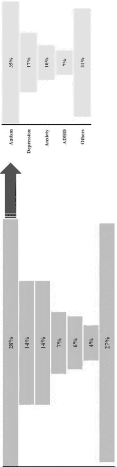

**图 1.3** 2013年按治疗领域分类的物联网医疗应用。

患者的症状[46]。医疗管理中的物联网有望开发出实用的医疗服务解决方案，能够进行体温监测，因为体温是监测身体温度的重要参数[47]。

此外，还需要确保医生能够分析如此庞大的数据集。一个仅检测患者异常行为（未服药）或需要干预的健康状态的程序可能会有所帮助。此外，医疗记录器的传感器可以监测患者的状况及其身体对给定剂量药物的反应。因此，医生有机会分析患者服用的药物剂量与其心率、呼吸和身体活动水平之间的相关性。每次数据收集后，借助手机或电脑的通信能力，数据被放置在服务器上，使医生能够研究这些数据。利用这种技术，可以指导患者更换药物或其剂量[48]。

利用现代技术进行医疗诊断的另一种尝试涉及植入一种可编程生物纳米芯片，该芯片可以从患者唾液样本中检测心脏病或肿瘤标志物。将这种芯片植入患者体内，可以在患者发现任何症状之前提供这些疾病的早期预警系统[49]。然而，为了让社会能够在医疗服务领域采用上述所有便利设施，有必要解决与之相关的用户隐私保护问题。这类服务提供商必须明确说明将被追踪的个人详细信息的用途、频率和类型，以及有权访问这些数据的实体范围。必须确保最终用户与服务提供商之间敏感数据的安全传输[50]。

在照顾老年人方面，应该指出，安全地支持老年人在其居住地独立生活，可以增强他们的自信心，确保更好的自主性，并为他们提供真正的帮助。这是环境辅助生活（AAL）的主要目标，AAL是一个基于人工智能的物联网平台，利用信息和通信技术来实现这一目标。识别活动和理解行为是使用各种AAL传感器所期望的成果[51]。这可以直接借助可穿戴传感器完成，也可以通过环境传感器和流量分析间接完成。例如，通过追踪患者的用药情况，可以追踪患者的药物消耗。

几乎每个人都可以在医疗治疗阶段使用物联网。它用于疾病的预防和诊断、患者观察，以及在治疗阶段（包括住院期间）的使用。一些医院已经接入物联网。许多物联网设备对患者来说是察觉不到的。医院拥有多种设备，其中一些在输入适当参数后能够相互通信[52]。在检查患者的生命体征后，这些设备会自动调整合适的药物剂量和给药频率。另一个例子是不需要医生在场的内窥镜检查。患者吞下一颗装有摄像头的药丸，该摄像头以每秒36张的速度拍摄，显示胃肠道的图像。这对患者来说是一种压力更小、更舒适的检查方法[53]。得益于智能冰箱的使用，医疗用品的状况可以实时监控[54]。

将收集到的信息与物联网传感器相结合，疾病即可得到控制。医疗管理中的物联网包括安全机制和通信技术所需的基本设备，因为数据和信息交换是对患者的关心和照护的来源，所以这些数据很敏感，必须得到很好的保护[55]。

## 1.4 挑战（优势与障碍）

现代技术的发展日新月异，并覆盖日常生活的各个领域。这一发展的基础是基于对生活和经济各个领域对新设备和系统需求的研究和预测。近年来，医疗保健是快速发展的领域之一。因此，技术发展也正朝着这个方向迈进，不断带来更多新的挑战。数字健康技术的演进如图1.4所示，以技术成熟度曲线（Hype Cycle）的形式呈现[56]。

Allied Market Research 报告[57]显示，全球物联网医疗保健市场将在2021年达到1368亿美元。目前已有超过370万台医疗设备在使用。60%的医疗保健组织已采用物联网，这证明了医疗保健部门在物联网领域的发展。近87%的医疗服务提供商引入了该领域提供的物联网服务；约40%的医疗保健组织在活体生物传感器中使用物联网。大约80%的医疗保健组织报告称，通过实施物联网提高了创新水平；73%的医疗服务提供者能够通过使用物联网降低成本。到2020年，智能药丸细分市场达到69.3亿美元。

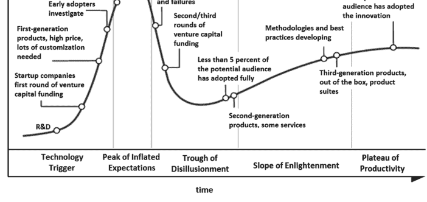

**图 1.4** 数字健康技术的演进——技术成熟度曲线（Hype Cycle）。

医疗保健组织中最流行的物联网解决方案用于监测和保持患者良好状态（73%）。

使用物联网工具和应用程序进行周密诊断，可以在提高服务质量标准的同时最大限度地降低医疗成本。因此，物联网在医学中的应用似乎是一种内在的必然性，它将使医疗保健系统自由运行，并避免伤害、事故或健康状况突然恶化。此外，正确使用物联网解决方案进行诊断具有积极影响，体现在以下数据中[58]：

- 无需亲自就诊，通过物联网及其所有工具进行电子通信的医疗咨询，创造了一种新的医疗现实，取代了传统的患者就诊方式。超过70%的患者在有选择的情况下更愿意选择远程医疗访问而非传统访问，这一事实证明了这一点。
- 通过物联网药物使用电子通信工具，显著提高了所提供医疗服务的质量，并且还能同时增加其数量。
- 远程医疗和物联网工具的使用提高了医疗服务的效率，消除了排队现象，从而可以更好地利用区域医疗服务接入点。
- 鉴于与文明病（ChS-N 和癌症）相关的成本（直接和间接）前景，使用物联网解决方案预防、报告和诊断此类健康问题，可以在医疗保健系统中实现巨大节省。
- 物联网工具能够更好地照护正在接受药物治疗的人们，特别是通过使用药物剂量提醒、药物使用指导、对同时进行的各类药物治疗进行核对，以及捕捉药物相互作用。

得益于物联网解决方案收集的数据，可以更好地监督生产药品和医疗设备的公司对产品的使用情况。此外，借助物联网工具报告药物摄入情况，可以观察药物使用效果，并有助于发现副作用[59]。在医疗和保健管理中实施物联网工具还伴随着报告这些工具运行不合规的可能性。正因如此，其生产商可以进行纠正并采取预防措施，并对设备用户本身缺乏响应的情况提供支持。另一方面，物联网工具的数据补充了从产品上市后监测中收集的信息[60]。这些数据被用于支持确定物联网技术产品的利弊之间的平衡。

物联网工具提升了老龄化社会的日常生活，改善并延长了患者的生活质量[61]：
- 物联网收集的数据（例如，经认证可用于医疗的可穿戴设备）可能有助于更快地诊断痴呆症，并可能持续报告老年人的健康和行为状况。
- 执行医疗活动所需的时间显著减少，管理流程也得到了改善。
- 物联网工具能够在可能的情况下替代医疗辅助，例如提醒服药、就诊或康复。

根据2015年的一项研究，市场上有超过16.5万个与健康相关的移动应用程序。在过去两年中，这些应用程序的数量增长了一倍多。据估计，90%的下载量来自12%的应用程序。大多数应用程序与营养和运动有关。尽管信息系统的发展带来了越来越多的机会，但允许患者安全共享信息的应用程序所占比例仍保持不变[62]。近三分之二的移动应用专注于生活方式、饮食、压力和身体活动。相比之下，只有24%的应用程序涉及疾病及其治疗[63]，2015年美国健康应用的使用情况如图1.5所示。

2013年，市场上超过4.3万个健康应用被下载超过6.6亿次。然而，由于质量不佳，其中大多数并不受欢迎。超过一半的应用被用户下载的次数不足500次，表明大多数应用兴趣寥寥。相反，五个应用贡献了全部下载量的15%，这证明了它们广受欢迎。2012年在美国进行的一项调查数据显示，超过50%的智能手机用户将手机作为获取健康知识的主要信息来源。19%的受访者在手机上安装了与健康相关的应用。尽管这些应用非常流行，但其中大多数并未获得美国食品药品监督管理局（FDA）等监管机构的授权[64]。

通过使用移动应用，更容易推广健康的生活方式和预防性护理。缺乏对系统性身体活动的积极性是一个大问题。这里的解决方案例如是Endomondo应用使用的竞赛机制。

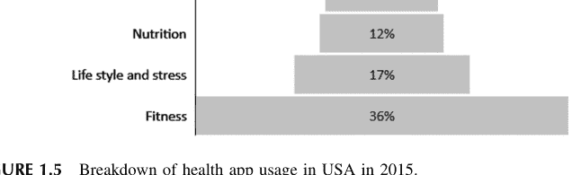

图1.5 2015年美国健康应用使用情况分布。

大量用户相互竞争，例如在规定时间内谁跑得公里数更多[65]。

一些移动应用需要额外的外部设备才能正常运行，这些设备监测生命体征，如脉搏、血压、呼吸频率、血氧饱和度。它们的数据采集是自动、便捷且持续的。这种数据收集方式降低了出错的风险。生产最多设备的人体部位是手腕，高达55%的配套设备为此开发。胸部位居第二，占设备的23%。其他设备被设计放置在手臂、头部、衣物和腿部。用于读取耳部生命体征且佩戴时不易察觉的设备越来越受欢迎。这得益于这些设备的逐步微型化[63]。

此外，面向医疗物联网的设备与应用设计还考虑了许多医护人员和患者关注的因素和要素。2014年进行了一项研究，以确定用户对健康应用的期望[66]。患者和照护者希望从健康应用中获得哪些功能，这些期望在表1.3中列出。

可随身携带、无线且移动的监测系统可能成为许多远离医疗设施、需要持续监测生命参数的患者的最佳解决方案。这种远程监测是一种方便舒适的解决方案，同时还能降低成本和节省时间。持续监测有助于更早发现可能的异常情况，并在紧急情况下能够立即提供医疗帮助，例如立即给药或转运至医院。做出诊断所需的时间得以缩短。同样关键的是，这些设备要用户友好、佩戴方便、操作直观，并且能被患者和医生高度接受。它们将改善数据收集和流动的过程，成为患者与医生之间的纽带。然而最终，它们不会取代专业人员[67]。

物联网在医疗技术中的应用似乎对医学和患者都极为有益[68]。但同时，使用这类解决方案不仅存在优势，也存在许多障碍，如表1.4所总结。

借助现代技术，可以在庞大的医疗数据集中搜索其中的规律性和异常。自动搜索重复出现的异常可以发现疾病发展和后果之间未知的关联[69]。例如，这有助于临床试验，因为它能够整合和共享从患者处获得的诊断检测结果。这类行动将加速医学的进步。企业开展的临床试验结果仅存在于其数据库中。如果大量患者自愿提供医疗数据，这些普遍可获得的医疗数据将有助于更快、更便宜地检测和治疗疾病[70]。研究人员强调，与传统临床试验相比，即时数据共享将减少数据收集所需的时间。所有这些都将有助于更好地理解疾病病因并改善患者的生活质量[71]。

## 表1.3 患者和照护者对健康应用的期望

| 功能 | 占比 [%] | 功能 | 占比 [%] |
|---|---|---|---|
| 提供可信、准确的信息 | 69 | 提供关于症状/医疗状况的可理解信息 | 23 |
| 易于使用/简单/设计良好 | 66 | 帮助我与医生/护士沟通 | 17 |
| 保证我的个人数据安全 | 62 | 允许我在线查看健康记录/医学检测结果 | 16 |
| 免费 | 56 | 帮助我追踪我的医学症状 | 14 |
| 不包含广告 | 51 | 帮助追踪活动以改善或保持健康 | 13 |
| 长期有效且稳定地工作 | 44 | 提供关于如何过上更健康生活的可理解信息 | 7 |
| 购买不贵，且物有所值 | 28 | 帮助我与对我重要的人沟通 | 6 |
| 允许我与对我重要的人建立联系 | 26 | 允许我对本地医疗服务发表评论或评分 | 3 |
| 内容丰富（不介意复杂应用） | 23 |  |  |

1. 在波兰，问题在于社会老龄化以及身体和智力失能者数量的不断增加。养老院居民的低安全感导致当地政府和基金会在社会信任度上下降。同时，花费在准备文档上的时间和紧急情况也构成问题。财政资源有限、人员短缺、机构数量不足。这种情况使得优化整个管理流程成为必要。

解决这一问题的方法可以是远程医疗手环，即SiDLY远程护理腕带[72]，它支持远程通信、健康报告、跌倒检测以及呼叫求助。它包含一个用于紧急情况的SOS按钮。此外，它还能提醒服药，并允许用户定位手环。

## 表1.4 物联网在医疗保健中的优势与障碍

- 便于获得医疗服务
- 提高医疗服务质量
- 提高患者生活质量
- 提高患者和医生的安全
- 节省医疗专业人员（包括医生和护士）的时间，并应对人员短缺
- 降低成本
- 现代化并提高医疗服务交付效率（通过加速信息流动，帮助将医疗系统从将预防、初级保健、治疗和康复分开的零散方法转变为所有治疗阶段紧密相连的持续护理）
- 改善并加强对患者及其健康状况数据在传输中的安全性
- 通过便利临床试验的开展来加速医学进步
- 患者、公民和医疗工作者缺乏对电子健康解决方案的认识和信任
- 电子健康系统之间缺乏互操作性
- 大规模描述电子健康工具和服务盈利性的证据有限甚至缺失
- 移动健康和健康监测应用的使用存在法律不确定性，对此类应用收集数据的使用缺乏透明度
- 缺乏足够或碎片化的法律框架，包括没有针对电子健康用户报销体系
- 创建和使用电子健康系统需要承担高额成本
- 在获取ICT服务方面存在地区差异，包括特定地区对这些服务的获取受限
- 医疗保健服务市场碎片化严重

通过其应用，可以看到许多可衡量的好处。医生可以减少60%的文档处理时间，将有约29%的更多时间用于直接接触患者，并能接诊更多患者。对于医院而言，好处体现在住院率降低35%，急诊干预减少53%，住院床日减少59%。而社会政策方面的好处包括：改善老年护理战略的实施、提高医疗服务的效率、制定更具吸引力和创新性的医疗护理政策，以及提升需要持续监护的失能人士、残疾人和老年人的居住地吸引力。SiDLY远程护理腕带使老年人、独居人士以及日常生活中需要支持的人能够留在家中[73]。

2. 除上述案例外，波兰面临的另一个问题是每年有4万例心脏骤停。在波兰经历心脏骤停（SCA）的人群中，只有7%存活，而在斯堪的纳维亚国家，这一比例为40%（数据来自欧洲复苏委员会）。

解决这一问题的方法可以是使用REANIMATOR应用。这是一款便于帮助心脏骤停（SCA）患者的应用。它由两个主要模块组成：1. 自动体外除颤器（AED）模块……（原文此处未完整显示，根据上下文补充：……协助定位和使用AED）；2. 指导施救步骤的模块等。

除颤器（AED）定位器，可精确定位 AED 位置，并显示找到它的最短路径，以及 2. ‘virtual assistant’，协助整个情况。该物联网工具还可能有助于生存，其中包括心脏骤停诊断、呼叫专业帮助、早期除颤、由专业人员进行的医疗救援行动。

使用该解决方案的好处包括 SCA 患者的生存率提高，从而减少劳动年龄人群的财务损失和死亡。节省的费用甚至可能达到约 PLN 400,000。将生存率提高 1% 意味着 PLN 160,000,000 的节省 [73]。

所呈现的问题和解决方案以及其益处只是两个例子，说明物联网在医疗管理中的适当应用可以带来多少益处。

## 参考文献

- [1]. A. M. Rahmani, T. N. Gia, B. Negash, A. Anzanpour, I. Azimi, M. Jiang and P. Liljeberg, 利用医疗物联网边缘的智能 e-Health 网关：一种雾计算方法。Future Generation Computer Systems, 78, 641–658 (2018).
- [2]. J. E. W. C. Van Gemert-Pijnen, S. Wynchank, H. D. Covey and H. C. Ossebaard, 提高电子健康技术的可信度。Bulletin of the World Health Organization, 90, 323–323A (2012).
- [3]. M. M. Dhanvijay and S. C. Patil, 物联网：医疗保健中使能技术的调查及其应用。Computer Networks, 153, 113–131 (2019).
- [4]. WHO, 在欧洲建立 eHealth 基础。世界卫生组织全球 eHealth 观察站报告。Geneva (2008).
- [5]. COCIR, COCIR eHealth 工具包。综合护理：打破信息孤岛，http://www.cocir.org/fileadmin/4.4__eHealth/15013.COC_2.pdf (2015).
- [6]. 委员会致欧洲议会。理事会、欧洲经济和社会委员会以及地区委员会的通信，eHealth 行动计划 2012–2020——21 世纪的创新医疗保健。COM 736 final, Brussels (2012).
- [7]. T. Lewis, 低收入和中等收入国家的电子健康：来自健康市场创新中心的发现。Bulletin of the World Health Organization, 90, 323–340 (2012).
- [8]. K. Ashton, 那件“物联网”的事。RFID Journal, 22(7), 97–114 (2009).
- [9]. A. V. Dastjerdi and R. Buyya. 物联网：原则与范式。Cambridge, MA: Morgan Kaufmann (2016).
- [10]. F. Al-Turjman, M. H. Nawaz and U. D. Ulusar, 医疗物联网时代的智能：当前和未来趋势的系统综述。Computer Communications, 150, 644–660 (2020).
- [11]. A. Botta, W. De Donato, V. Persico and A. Pescapé, 云计算与物联网的集成：综述。Future Generation Computer Systems, 56, 684–700 (2016).
- [12]. D. A. Gratton, 个人区域网络技术与协议手册。Cambridge: Cambridge University Press (2013).
- [13]. J. Pan, S. Ding, D. Wu, S. Yang and J. Yang, 医疗从业者对智能医疗服务的行为意向探索：技术转移视角。International Journal of Production Research, 57(18), 5801–5820 (2019).
- [14]. Deloitte, 医疗技术与医疗物联网。互联医疗设备如何改变医疗保健。London: Center for Health Solutions (2018).
- [15]. N. Dey, A. E. Hassanien, C. Bhatt, A. S. Ashour and S. C. Satapathy, 物联网与大数据分析迈向下一代智能。Cham: Springer International Publishing (2018).
- [16]. J. M. McDonald, C. Gossett, and M. Moore, 迁移到云端：基于云的生产管道的最新技术。Journal of Digital Media Management, 6(3) (2018).
- [17]. G. J. Joyia, R. M. Liaqat, A. Farooq and S. Rehman, 医疗物联网 (IOMT)：医疗领域的应用、益处和未来挑战。Journal of Communication, 12(4), 240–247 (2017).
- [18]. W. Raghupathi and V. Raghupathi, 医疗保健中的大数据分析：承诺与潜力。Health Information Science and Systems, 2(1), 3 (2014).
- [19]. Y. Xiao, Q. Alexander and F. Hu, 普适医疗的远程医疗。Mobile Telemedicine: A Computing and Networking Perspective (1st ed., 3), 89-104 (2008).
- [20]. D. Metcalf, R. Khron and P. Salber, 健康一切：健康领域的穿戴设备与物联网：第一部分：医疗保健的穿戴设备。Orlando, FL: Moving Knowledge (2016).
- [21]. C. A. Figueroa, R. Harrison, A. Chauhan and L. Meyer, 全球卫生领导力和劳动力管理的优先事项和挑战：快速综述。BMC health services research, 19(1), 1–11 (2019).
- [22]. H. Zhu, C. K. Wu, C. H. Koo, Y. T. Tsang, Y. Liu, H. R. Chi and K. F. Tsang, 物联网时代的智能医疗。IEEE Consumer Electronics Magazine, 8(5), 26–30 (2019).
- [23]. A. Gatouillat, Y. Badr, B. Massot and E. Sejdic, 医疗物联网：关于医学中网络物理系统的最新贡献综述。IEEE Internet of Things Journal, 5, 3810–3822 (2018).
- [24]. A. Rajput and T. Brahimi, 刻画 IOMT/个人区域网络格局。https://arxiv.org/ftp/arxiv/papers/1902/1902.00675.pdf (2017).
- [25]. K. Ullah, M. A. Shah and S. Zhang, 在医疗和智能健康护理领域有效使用物联网的方法。Proceedings of International Conference on Intelligent Systems Engineering (ICISE), 372–379 (2016).
- [26]. F. Al-Turjman and S. Alturjman, 工业物联网 (IIoT) 医疗应用中的上下文敏感访问。IEEE Transactions on Industrial Informatics, 14(6), 2736–2744 (2018).
- [27]. A. Rajput and T. Brahimi, 刻画 IOMT/个人区域网络格局。arXiv preprint arXiv, 1902, 00675 (2019).
- [28]. R. Shams, F. Hanif Khan, M. Aamir and F. Saleem, 远程医疗中的物联网：关于若干实现的讨论。Journal of Computer Science of Newports Institute of Communications and Economics, 5, 17–26 (2014).
- [29]. E. N. Karyagina and R. I. Sitdikova, 远程医疗：俄罗斯、欧洲和美国的概念与法律监管。Journal of History Culture and Art Research, 8(4), 417–424 (2019).
- [30]. E. M. Hayden, K. M. Boggs, J. A. Espinola, C. A. Camargo Jr and K. S. Zachrison, 远程医疗促进急诊科转运协调。Annals of Emergency Medicine, 76(5), 602–608 (2020).
- [31]. 委员会致欧洲议会、理事会、欧洲经济和社会委员会以及地区委员会的通信，eHealth 行动计划 2012–2020，21 世纪的创新医疗保健。COM 736 final, Brussels (2012).
- [32]. P. Kotler and J. E. Heppelmann, 智能互联产品如何改变竞争。Harvard Business Review, 11, 4–23 (2014).
- [33]. M. Maksimović and V. Vujović, 基于物联网的电子健康系统：构想、期望和担忧。Handbook of large-scale distributed computing in smart healthcare. Cham: Springer (2017).
- [34]. M. Mihai, E. Ţiţan, D.I. Manea and C. D. Ionescu, 卫生领域的数字化创新——欧盟健康状况记录的决定因素。New Trends in Sustainable Business and Consumption, 2, 579–586 (2020).
- [35]. D. Pal, S. Funilkul, N. Charoenkitkarn and P. Kanthamanon, 老年医疗保健的物联网与智能家居：终端用户视角。IEEE Access, 6, 10483–10496 (2018).
- [36]. V. Jagadeeswari, V. Subramaniyaswamy, R. Logesh and V. Vijayakumar, 个性化医疗保健系统中医疗物联网与大数据的研究。Health information science and systems, 6(1), 1–20 (2018).
- [37]. Deloitte, 互联医疗。数字技术如何改变健康和社会护理，https://www2.deloitte.com/pl/pl/pages/life-sciences-and-healthcare/articles/mobile-health-IP1.html (2015).

- [38]. G. Elhayatmy, N. Dey and A. S. Ashour, 基于物联网的医疗保健无线体域网。In Internet of Things and Big Data Analytics Toward Next-generation Intelligence. Cham: Springer (2018).

- [39]. M. M. Baig and H. Gholam Hosseini, 老年人的无线远程患者监测，Engineering in Medicine and Biology Society (EMBC), 35th Annual International Conference of the IEEE, 2429 (2013).

- [40]. G. Manogaran, R. Varatharajan, D. Lopez, P. M. Kumar, R. Sundarasekar and C. Thota, 安全智能医疗保健监测和报警系统的物联网与大数据生态系统新架构。Future Generation Computer Systems, 82, 375–387 (2018).

- [41]. S. Nazir, Y. Ali, N. Ullah and I. García-Magariño, 利用移动计算效应的医疗保健物联网：系统文献综述。Wireless Communications and Mobile Computing, 12(7), 98 (2019).

- [42]. Y. Bhatt and C. Bhatt, 医疗保健中的物联网。In Internet of things and big data technologies for next generation HealthCare. Cham: Springer (2017).

- [43]. P. Kaur, R. Kumar and M. Kumar, 使用随机森林和物联网 (IoT) 的医疗保健监测系统。Multimedia Tools and Applications, 78(14), 19905–19916 (2019).

- [44]. E. S. Izmailova, J. A. Wagner and E. D. Perakslis, 临床试验中的可穿戴设备：炒作与假设。Clinical Pharmacology and Therapeutics, 104(1), 42–52 (2018).

- [45]. K. Guk, G. Han, J. Lim, K. Jeong, T. Kang, E. K. Lim and J. Jung, 用于个性化医疗保健的实时疾病监测可穿戴设备的演进。Nanomaterials, 9(6), 813 (2019).

- [46]. M. W. Condry and X. I. Quan, 数字健康创新、信息学机遇与挑战。IEEE Engineering Management Review, 7, 569 (2021).

- [47]. G. Shanmugasundaram and G. Sankarikaarguzhali, 物联网医疗保健分析的调查。International Journal of Information Engineering and Electronic Business, 9(2), 11 (2017).

- [48]. M. Chorost, 网络化药丸。MIT Technology Review, http://www.technologyreview.com/news/409773/the-networked-pill/ (2008).

- [49]. P. Murray, 不再漏服药物——FDA 批准首款数字药丸。Forbes, http://onforb.es/PHcZO8 (2012).

- [50]. S. Anderson and A. Bassi, 我们需要一个杀手级商业模式。Inspiring the Internet of Things, Internet of Things Initiative, http://www.alexandra.dk/uk/expertise/publications/documents/iot_comic_book.pdf (2011)

- [51]. S. Rosati, G. Balestra 和 M. Knaflitz，《通过可穿戴传感器进行人体活动识别的不同特征集比较》，《传感器》，18(12)，4189（2018）。

- [52]. J. W. Sharp，《物联网悄然进入医疗保健领域》，http://ehealth.johnwsharp.com/2013/07/19/the-internet-of-things-creeps-into-healthcare/（2013）。

- [53]. J. Czechowicz，《物联网报告 2015（一）》，http://www.mobiletrends.pl/raport-internet-of-things-2015-czesc-1/（2015）。

- [54]. S. Y. Y. Tun、S. Madanian 和 F. Mirza，《物联网在老年人护理中的应用：反思性综述》，《衰老临床与实验研究》，4，1–13（2020）。

- [55]. B.A. Jnr，《应对 COVID-19 疫情中用于远程治疗的远程医疗和虚拟护理应用》，《医学系统杂志》，44(7)，1–9（2020）。

- [56]. 《数字健康炒作周期》，https://en.wikipedia.org/wiki/Hype_cycle（2013）。

- [57]. 联合市场研究机构报告，https://www.alliedmarketresearch.com/iot-healthcare-market（2017）。

- [58]. K. T. Kadhim、A. M. Alsahlany、S. M. Wadi 和 H. T. Kadhum，《基于物联网的患者健康状态监测系统概述》，《无线个人通信》，114，2235–2262（2020）。

- [59]. A. Dzedzickis、A. Kaklauskas 和 V. Bucinskas，《人类情感识别：传感器与方法综述》，《传感器》，20(3)，592（2020）。

- [60]. A. Jordao、A. C. Nazare Jr、J. Sena 和 W. R. Schwartz，《基于可穿戴传感器数据的人体活动识别：技术现状标准化》，《arXiv 预印本》，1806，05226（2018）。

- [61]. G. Marques 和 R. Pitarma，《mHealth：基于物联网的室内环境质量测量系统以促进健康与福祉》，《传感与执行器网络杂志》，8(3)，43（2019）。

- [62]. S. Misra，《新报告发现现有超过 165,000 个移动健康应用，深入研究其特点与使用情况》，www.imedicalapps.com/2015/09/ims-health-appsreport（2015）。

- [63]. IMS 研究所，《患者对 mHealth 的采用》，http://www.imshealth.com/files/web/IMSH%20Institute/Reports/Patient%20Adoption%20of%20mHealth/IIHI-Patient-Adoption-mhealth-Exhibits-Full.pdf（2015）。

- [64]. L. Neubeck、N. Lowres、E. J. Benjamin、S. B. Freedman 和 G. Coorey，《移动革命——使用智能手机应用预防心血管疾病》，《自然综述：心脏病学》，12，85（2015）。

- [65]. S. Lomborg 和 K. Frandsen，《自我追踪作为传播》，《信息、传播与社会》，19(7)，1015–1027（2016）。

- [66]. 《患者和照护者希望从健康应用中获得什么？一项对 1,130 名长期疾病患者及其照护者的全球调查结果》，《患者观点》2014 年 11 月；https://alexwyke.wordpress.com/2014/11/23/what-do-people-want-from-health-apps/（2014）。

- [67]. M. M. Baig、H. Gholamhosseini 和 M. J. Connolly，《面向老年人的可穿戴无线心电图监测系统综合调查》，《医学生物工程与计算》，51(5)，485–495（2013）。

- [68]. J. Qi、P. Yang、G. Min、O. Amft、F. Dong 和 L. Xu，《用于个性化医疗系统的先进物联网：综述》，《普适与移动计算》，41，132–149（2017）。

- [69]. R. Krohn、D. Metcalf 和 P. Salber，《互联健康：利用可穿戴设备和物联网解决方案改善护理、安全性与效率》，米尔顿：CRC 出版社（2017）。

- [70]. C. Bhatt、N. Dey 和 A. S. Ashour，《下一代医疗保健中的物联网与大数据技术》，瑞士：施普林格出版社（2017）。

- [71]. J. Wilbanks 和 S. H. Friend，《首先，为数据共享而设计》，《自然生物技术》，34(4)，76（2016）。

- [72]. Sidly，http://sidly.eu/pl（2018）。

- [73]. 波兰数字化部，《物联网在波兰经济中的报告》，www.gov.pl/cyfryzacja（2019）。

# 2 物联网与深度迁移学习（DTL）的融合：赋能医疗保健（COVID-19）创新及其应用

*亚特兰大·乔杜里（Atlanta Choudhury）和坎达帕·库马尔·萨尔马（Kandarpa Kumar Sarma）*

## 2.1 引言

全球医疗保健系统目前正面临前所未有的困难，同时应对由这种致命病毒引发的疫情。COVID-19，也被称为新型冠状病毒，是当前疫情的罪魁祸首，它会导致呼吸系统问题，甚至死亡。它在人类之间传播，并开始扩散到所有人。这种致命病毒的传染性成分非常高 [1,2]，数亿人已被感染，且在其爆发后的几个月内已记录了大量的死亡病例。这种致命疾病已被世界卫生组织（WHO）列为大流行病 [3,4]。这并不是人类面临的唯一一次大流行病。过去曾发生过多次此类疫情，未来可能还会出现更多 [5,6]。市场上没有合适的药物，但经过临床试验后，全球已开始疫苗接种。目前没有现成的基础设施来应对此类疫情，但相关设施正在建设之中。应对此类疾病，建立医疗和支持能力变得尤为重要 [7,8]。在许多支持设施中，计算预测工具至关重要，因为它们能为新兴场景提供预测，并让人们直观了解可能出现的情况。许多研究人员正尝试开发技术，为此类情况寻找解决方案，并帮助人们应对这些挑战 [9,10]。人工智能（AI），包括数据科学，是在这种不确定情况下应用的关键赋能技术之一。深度学习（DL）是人工智能的一部分，是一种可以配置为制定预测和预报解决方案的工具，从而最大限度地减少损失和死亡 [11]。由于深度架构设计以及无论数据来源如何都能进行特征提取的能力，深度学习模型是处理医疗数据集最可靠的方法，尤其是在大流行条件下。因此，这些技术也可以被应用和定制，以应对此类大流行情况，并帮助监测社会状况、遵守生物安全规范、切断传播链、确诊疾病、发现药物和合理使用疫苗、治疗等 [12,13]。人工智能工具对医学界很有用，因为它们提供预测分析。此类系统的优势在于这些工具能从周围环境中学习，保留所学知识，并在后续使用。要训练此类人工智能驱动技术，需要海量数据集和强大的计算资源。

要用人工智能驱动工具分析大流行情况，数据不足和不同地理区域的差异是阻碍性问题。它们严重影响常用人工智能辅助工具的性能。传统人工智能工具（如基于深度学习的工具）需要庞大的数据集，而大多数时候这些数据集可能无法获得。此外，由于大流行期间的行动限制，可能无法收集足够的现场或实时数据。在这种情况下，传统的深度学习工具可能被证明是无效的。应对这种棘手情况的一个解决方案来自深度迁移学习（DTL）的使用。它是一种有效的工具，即使在数据量受限的情况下也能很好地工作。DTL 将一个任务中学到的知识经过微调后应用到另一个任务中 [14]。在任何大流行场景中，物联网（IoT）、网络摄像头、无人机、智能医疗设备、机器人支持等新兴信息技术都是有益的。相关组织应利用此类设施来应对疫情，因为这些设备使基础设施更加复杂和自动化 [15]。结果，计算机配备了有限的计算资源，这带来了许多挑战。边缘计算（EC）[16] 是一种为实际工作场景（包括医疗应用）配置的方法。EC 在监控、利用最新数据更新知识、易于部署、低成本、用户友好性等方面非常有效。此外，它可以与人工智能工具协同工作以生成决策支持。集成到边缘设备中的传统深度学习工具也将在

深度学习（DL）需要海量数据，这是一个限制。因此，为了缓解因数据可用性较低而带来的限制，可以将深度迁移学习（DTL）与边缘计算（EC）设备有效结合。该组合已被发现是一种可行的整合处理能力并实现更系统化 EC 的方式。因此，在 EDs 中，使用 DTL 算法可能是制定基于预测分析的措施以应对 COVID-19 大流行毁灭性影响的智能技术。本文尝试报告此类问题和挑战，以及制定设计用于应对类似大流行情况的 AI 驱动基础设施的方法所需的相关技术背景。此外，我们还提出了作为未来研究方向的可能的基于 AI 的架构，以在 EC 上部署 DTL，帮助减轻此类疫情的爆发。在多个国家，相关卫生部已为个人、家庭、工作场所、学校、托儿中心和老年人推荐了多项疾病预防措施 [18]，其中许多基于 AI 技术。这些措施包括遵守社交距离规范或增加人与人之间的物理空间及其有效监控、用于消毒喷洒的自主机器人、支持一线工作人员、药品和食品配送、诊断、药物发现和设计。

## 2.2 历史背景

在中国的华中地区湖北省武汉，COVID-19 爆发首次被发现。2019 年 12 月 31 日，当地医院宣布了一种不明肺炎 [19]。这种不明肺炎迅速传播到几乎所有国家。这些病例最初与专门在华南海鲜批发市场交易的市场有关。该市场也以其种类繁多的活体物种而闻名。这些病例各自具有不同的临床特征。其中许多病例具有共同的症状，与病毒性肺炎相似，例如干咳、发热、呼吸困难。肺浸润的影像学发现表明了新疫情的严重性。2020 年 1 月 7 日，在检查咽拭子样本后，美国疾病控制与预防中心（CDC）将这种神秘肺炎诊断为新型冠状病毒肺炎（NCP）[20]。它最终被国际病毒分类委员会命名为严重急性呼吸综合征冠状病毒 2（SARS-CoV-2）[21,22]。2020 年 2 月 11 日，世界卫生组织将该疾病命名为 COVID-19 [23]。COVID-19 冠状病毒由 SARS-CoV-2 产生。几乎没有迹象表明受污染和死亡患者的数量会减少，情况将继续动荡。

## 2.3 技术背景

深度学习（DL），也称为分层学习（HL）或深度结构化学习（DSL），是 AI 的一个分支，提供工具和方法，比以前已知的方法更好地模仿人类大脑的能力。DL 是已纳入早期一代人工神经网络（ANN）系统的一项最新改进。经典机器学习（ML）技术已在 1990 年代初期用于数据推断和预测 [24]。然而，它存在许多缺点，例如依赖手工制作的特征、数据标注以及受以人类能力为中心的准确性限制。手工制作的函数在 DL 中不是必需的 [25]。在各种创新算法、现代计算机的计算能力和大型数据集的可用性的帮助下，DL 可以做出更准确的预测和分类。

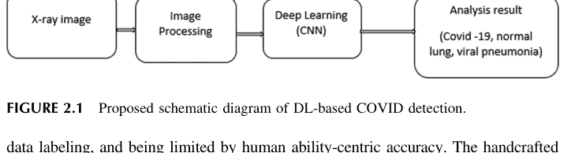

图 2.1 基于 DL 的 COVID 检测的拟议示意图。

如前所述，DL 是一种属于 AI 范畴的学习算法，它基于 ANN，但处于更高水平。反向传播算法用于使用数据集训练这些模型 [26]。它是处理 COVID-19 的良好优化工具。可以通过检查体温（发热）和相关症状来检测 COVID-19 患者。DL 可用于许多其他用途，例如患者护理以及系统性社交距离遵守和违规的检测。此外，DL 方法可用于制定处理大流行相关危机的机器人系统，为患者提供支持、药品和食品配送、消毒、药物设计和发现、识别和防止假新闻传播并创造社会意识。可能性是巨大的。在这种情况下，DL 系统的主要属性是其复制人类行为、提供预测和预测的能力（图 2.1）。

### 2.3.1 深度迁移学习

在模型训练完成后，迁移学习允许其应用于新的挑战。与传统机器学习方法相比，DL 需要大量的训练数据集合。因此，大量标注数据需求是完成一些关键领域特定任务的主要障碍，尤其是在医疗领域，大规模高质量注释医疗数据的发展是一个主要挑战 [27]。尽管科学家们孜孜不倦地寻找减少此类限制风险和影响的方法 [28,29]，但基础 DL 模型需要大量计算能力和使用 GPU 启用服务器等专用硬件。DTL，一种基于 DL 的迁移学习 [30]，被用来解决这一挑战。DTL 通过选择预训练模型（在同一目标领域的另一个大型数据集上训练）作为固定的特征提取器或进一步微调，大大减少了目标领域特定任务的训练数据和训练时间需求 [31]。它现在在 DL 中很常见，因为它可以用少量数据训练深度神经网络（DNN）（图 2.2）。

### 2.3.2 边缘设备

边缘或物联网设备通过将云中密集使用的数据副本本地存储并为物联网设备提供额外功能来实时捕获和处理数据。因此，只有雾服务器将物联网设备的相关数据发送到云端。

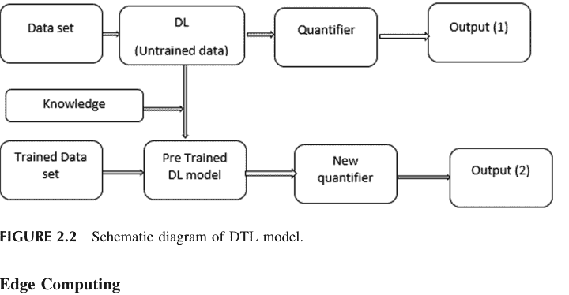

图 2.2 DTL 模型的示意图。

### 边缘计算

数据从各种物联网设备收集，然后在交付给雾服务器进行分析和处理之前进行预处理，边缘提供实时响应。虽然云托管核心机器并维护整个数据库，但雾不断仅将最相关的数据或信息上传到云数据库。虽然 EC 不是一个新概念，但它已证明在物联网的最新发展中非常有用。

## 2.4 文献综述

已有大量关于 `DL` 在 `COVID-19` 领域应用的相关工作报道，基于卷积神经网络（`CNN`）使用计算机断层扫描（`CT`）筛查 `COVID-19` 患者的 `DL`，已报道其精确度、敏感性和特异性分别为 89.5%、87% 和 88% [32]。另一项研究发现，胸部 X 射线图像在筛查 `COVID-19` 病例方面的准确率为 83.5% [33]。迄今为止，已提出了几种 `DTL` 模型用于 `COVID-19` 相关领域的应用。在此强调其中一些工作。在所有此类工作中，可以观察到 `DTL` 的使用涉及通过对齐支持共同最大均值差异的联合分布过程来构建多个领域相关层。这有助于建立迁移网络。文献 [34] 的作者建议，基于 `VGG` 模型，已开发出一种最先进的迁移学习模型。研究人员使用 `Image Net` [35] 数据集进行特征提取，并使用手写建筑图像进行微调。在文献 [36] 中，作者提出了使用 `DTL` 对 `MR` 图像中的异常进行分类。研究人员使用了微调的预训练 `ResNet34` 模型。然而，金标准诊断微生物学实验室和相关研究耗时耗力，并且存在许多假阴性结果 [37]。几乎在同一时间，由于服务短缺，研究很少在社区卫生中心或医院进行。医疗资源管理变得非常复杂，结果是一次处理大量患者。`DTL` 模型被认为非常适合减少此类情况中的困难 [38,39]。生成对抗网络（`GANs`）也可以与

`DTL` 模型。在此，运行模型仅需要有限数量的数据。为了诊断 `COVID-19` 疾病并进行分析，仅采集了 307 张胸部放射影像作为数据集，并使用了三种预训练模型，即 `AlexNet` [40]、`GoogleNet` [41] 和 `ResNet` [42]。在这三种预训练模型中，`GoogleNet` 报告了最高的准确率。

## 2.5 用于缓解 COVID-19 的建议模型描述

如前所述，`DTL` 在构建用于应对 `COVID-19` 情况的预测模型方面是有效的。`DTL` 不需要太多数据。还有一种称为 `EC` 的技术，在计算能力有限时也很有用。因此，将这两种计算方法或模型结合起来可能更有利于开发用于应对 `COVID` 的 `AI` 驱动方法。我们可以假设 `DTL` on `EC`（`DTLEC`）是应对 `COVID` 大流行的特殊组合。这两种模型的优势都被纳入以制定这些模型。该 `DTLEC` 概念尚未实际用于缓解 `COVID-19`，但正在发展中 [43–69]。已观察到此类模型可在医疗保健行业、重症监护单元、隔离设施以及可能发生疫情爆发的其他领域发挥作用。图 2.3 显示了在 `EC` 上实现并配置为使用 `AI` 进行决策的边缘设备或物联网设备。此外，系统设计为触发使用基于云的方法实现的警报系统。稍后，配备微调机制的该边缘设备可以用预训练数据集实现。此外，还考虑了基于 `DL` 的图形处理单元（`GPU`）启用的云服务器，该服务器使用标准数据集进行特征提取。此外，预训练数据模型（基于 `DL`）在边缘设备上运行。借助微调机制，该边缘设备被认为可使用预训练方法和数据集实现。

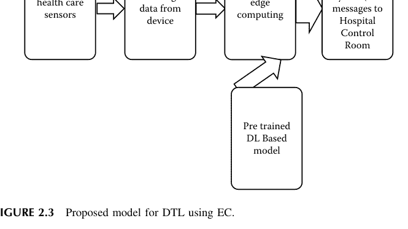

图 2.3 使用 `EC` 的 `DTL` 建议模型。

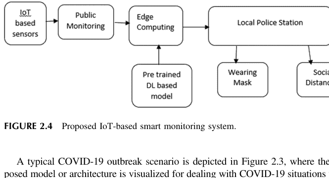

图 2.4 建议的基于物联网的智能监测系统。

图 2.3 中描绘了一个典型的 `COVID-19` 爆发场景，其中使用 `DTL` 和 `EC` 应对 `COVID-19` 情况的建议模型或架构被可视化。该设备可以监测任何人在公共场所是否佩戴口罩或保持社交距离。如果模型检测到任何此类情况，自动文本消息连同所有相关信息将被发送到最近的警察局以及在本地移动网络注册的行人。然而，我们尚未考虑局限性。儿童在传播病毒方面发挥了主要作用。儿童不太可能定期佩戴口罩，因为他们不了解在公共场所佩戴口罩的好处（图 2.4）。

## 2.6 与 COVID-19 检测、预测和其他问题的 ML/DL 方法相关的某些已报道工作的综述

最近的各种研究已报告了 `ML` 基于方法在 `COVID-19` 检测、预测和监测等方面的应用。表 2.1 包含所选工作的摘要。其中一些工作与诊断 [70,71]、患者筛查 [72]、从放射影像、扫描图像观察 `COVID-19` [73–77]；基因组测序 [78]、监测 [79] 和预测 [80–82] 相关。

表 2.2 提供了基于 `DTL` 的一些工作的摘要。在这里，我们看到 `DTL` 已用于预测 [84,85]、筛查 [86]、检测和诊断 [39,87–91]。有一些工作基于 `EC`（表 2.3）。在这里我们看到 `EC` 已用于筛查 [91–93]、控制传播 [13,94]、监测 [95,96]。表 2.4 包括使用 `ML/DL` 方法专门用于 `COVID-19` 爆发预测的最新技术。结果被发现是准确的。表 2.5 显示了一些与病毒传播跟踪和检测相关的工作。这些工作使用大数据和相关分析进行病毒传播的跟踪和检测。表 2.6 显示了一些工作（使用来自京都基因存储的大数据），与冠状病毒的诊断和治疗相关。

## 表 2.1

### 当前基于 DL 的减少大流行的研究工作

| 序号 | 工作 | 具体目标 | 主要贡献 |
|---|---|---|---|
| 1 | 71 | 使用 Deep Bayes-Squeeze Nets 和 X 射线图像进行诊断。 | 使用功能性 `DL` 算法进行图像处理以开发智能识别系统。 一种现代 `COVID-19` 决策框架，结合传统和前沿方法用于胸部放射影像。 |
| 2 | 72 | 2019 年冠状病毒病肺炎筛查。 | 研究比较了几种用于分类不同类型肺炎的计算模型。 根据 `CT` 检查，不同病例的准确率为 0.996（95% CI：0.989-1.00），灵敏度为 98.2%，特异性为 92.2%。 |
| 3 | 73 | 从 `CT` 图像检测和分类 `COVID-19` 感染。 | 用于从放射影像观察和分类 `COVID-19` 污染的弱控制 `DL`。 减少 `CT` 图片所需的标注量。 |
| 4 | 74 | 使用原始放射影像自动检测活动病例。 | 不同类型的肺炎可通过基于 `DL` 的二元、多分类表示进行观察。 为确保良好的精度，`YOLO` 和 `Dark Net` 模型的组合被用作模型的骨干。 |
| 5 | 75 | 放射影像中 `COVID-19` 模式的识别。 | 放射影像中病毒模式的检测。 开发了来自资源模型的数据集，准确率为 91.4%，灵敏度为 90%，预测率为 100% [83]。 |
| 6 | 76 | 区分新型冠状病毒和流感肺炎。 | 一种早期诊断方法，用于区分冠状病毒肺炎和标准流感，在胸部 `CT` 图像上具有可迁移性。 |
| 7 | 77 | 使用扩展基因组序列鉴定 `SARS-CoV-2`。 | 病毒组学与 `DL` 的相互作用。 一种用于开发和未来研究的 `DL` 辅助模型。 |
| 8 | 78 | 使用深度学习和 `CT` 图像分析实现检测和患者监测自动化。 | 基于 2D 和 3D `DL` 的临床意识模型。 建议了一种针对活动患者的持续监测方法。 |

## 表 2.1（续）

### 当前基于 DL 的减少大流行的研究工作

| 序号 | 工作 | 具体目标 | 主要贡献 |
|---------|------|----------|----------|
| 9 | 79 | 预测伊朗的 `COVID-19` 爆发。 | • 信息来自 Google Trends 网站收集。 • 使用线性回归和 `LSTM` 模型估计阳性 `COVID-19` 病例。 |
| 10 | 80 | 使用上半身计算机辅助断层扫描图像；已开发出用于检测 `COVID-19` 的全自动框架。 | • `COVNet` 被开发用于利用从扫描中得出的视觉特征检测该病毒的存在。 • 从六家不同医院收集了大量患者的胸部扫描。 |
| 11 | 81 | 使用开放获取的胸部放射影像图像数据集进行病例检测。 | • `COVID-Net` 用于从扫描图像中检测活动病例，被提出为公开可访问的 `COVID-Net`。 • `COVIDx` 是一个公开可用的胸部放射影像数据集。 |
| 12 | 82 | 大流行预测模型。 | • 基于蒙特卡罗方法的预测模型。 |
| 13 | 83 | 利用大数据帮助应用 `DL` 预测传染病。 | • 比较 `DL` 与其他模型用于预测可能的污染疾病。 • 示意图模型旨在加强当前监测系统，以便在未来发现新兴病毒性疾病。 |

表 2.7 显示了一些与药物和疫苗开发相关的工作。研究采用分子对接进行药物开发，并提出了各种肽用于开发疫苗以对抗这种致命病毒。

从以上内容，我们可以得出结论，大数据和 `AI` 技术在不同方式上对抗大流行很重要。重要的方法是：

- i. 爆发预测。
- ii. 传播的追踪和检测。
- iii. 检测和治疗。
- iv. 药物和加强剂的发现。

基于学习的方​​法如 `DL` 也被发现可用于病毒中心建模、分组和近似。`AI` 支持智能问题解决工具，用于预测成功和安全的 `COVID-19` 药物/加强剂设计，这在科学和财务方面都将是有用的。

## 表 2.2

### 用于减少大流行的当前基于 DTL 的研究

| 序号 | 工作 | 具体目标 | 主要贡献 |
|---|---|---|---|
| 1 | 84 | 通过放射影像预测 `COVID-19`。 | 为了识别 `COVID-19` 疾病，放射影像被用于训练包括 `ResNet18`、`ResNet50`、`Squeeze Net` 和 `DenseNet-121` 在内的流行模型。 |
| 2 | 85 | 使用放射影像筛查 `COVID-19`。 | 标准疾病、其他疾病和 Covid-19 均使用预训练数据的迁移学习进行分类。总体准确率为 95.3%。 |
| 3 | 86 | 使用小型 `COVID-19` 图像数据集的案例研究。 | 在小型 `COVID-19` 图像数据集上，对中性逻辑学习模型进行了分析。他们使用预训练的 `Alex net`、`Google Net` 和 `ResNet18` 在将灰度放射影像转换为模糊图像后识别出四组。 |
| 4 | 87 | 使用 `DL` 模型预测抗病毒药物的可用性。 | 移动目标-`DTI` 模型用于识别冠状病毒的市售药物。该 `MTDTI` 模型描述了一份被提出的抗病毒药物清单。 |
| 5 | 88 | `COVID-19` 的自动识别。 | `ResNet50`、`InceptionV3` 和 `Inception-ResNetV2` 模型在放射影像的帮助下用于区分正常病毒感染和 `COVID` 感染。 |
| 6 | 89 | 通过 `TL` 在放射照片上评估 `CNN` 架构。 | 结合放射影像的 `DL` 可能产生与该疾病相关的独特生物标志物。 |
| 7 | 90 | 新的众包支持医疗应对大流行。 | 通过手持设备如手机录制的咳嗽声识别。手机可用作诊断系统。 |
| 8 | 91 | 使用 `GAN` 和 `TL` 方法检测 `COVID-19`。 | 这些模型被组合以提高检测有效性。 |

在所有这些应用中，基于 `ML/DL` 的方法提供了实际状况的可视化和估计。在与 `COVID-19` 感染相关的大多数情况下，不确定性是一个不利因素。在存在不确定性的地方，`ML/DL` 方法发挥着非常关键的作用。在 `COVID-19` 大流行的情况下，如果现有基础设施具有 `AI` 属性，则作为 `COVID-19` 危机处理的一部分，提供支持并执行备份援助的能力，许多由不确定性产生的不良影响和局限性可以得到最小化。危机管理团队的能力将显著提高。

## 表 2.3

### 边缘计算

| 序号 | 工作 | 具体目标 | 主要贡献 |
|---|---|---|---|
| 1 | 13 | 使用 `EC` 终止冠状病毒传播。 | 基于 `EC` 的 `ICU` 和重症监护观察模型。提出了基于计算的监控模型。 |
| 2 | 92 | 一个开源的临床筛查 `EC` 系统。 | 使用可检测摄像头在急诊科检测发热和发绀。此处图像分割使用开源硬件构建。 |
| 3 | 93 | 节能智能医疗保健系统。 | 优化从边缘节点到不同提供者的医疗记录传输。使用 `EC` 管理异构网络以提供快速应急反应。 |
| 4 | 94 | 在医疗保健应用中，`QoS` 优化至关重要。 | 在移动 `EC` 中，速率控制算法用于 `QoS`。在移动设备上基于 `EC` 形成的医疗应用平台。 |
| 5 | 95 | 智能医疗保健系统。 | 基于边缘认知计算的智能医疗保健机制，用于医疗保健中的动态资源利用。 |
| 6 | 96 | 医疗保健 Industry4.0：高效方法。 | 医疗保健行业的演变；作者提出了身体边缘架构应用。为了更好的健康服务，创建了一个带 `EC` 的小型移动客户端模块。 |
| 7 | 97 | 智能医院中的窄带-`IoT`。 | 在智能医院中提出了窄带 `IoT` 架构和智能设备。通过集成智能设备，可以以更低的延迟开发智能医院。 |

## 2.7 挑战

用于检测 `COVID-19`，`ML` 和 `DL` 方法是有用的，因为它们可以学习模式、保留它们并随后使用学习结果。然而，在许多情况下，`ML` 和 `DL` 系统的应用面临着重大挑战，例如数据稀缺、大规模预训练数据缺乏、大规模噪声数据和假阳性标记、医学科学和工程领域之间缺乏理解、数据保护和监管等。下面强调了一些重要术语：

- **1. 监管**—随着大流行蔓延到世界各地的角落，感染和死亡病例的数量也在增加。各种措施如封锁和社会疏离已被提出

## 表 2.4

### COVID-19 爆发预测

| 序号 | 工作 | 具体目标 | 主要贡献 |
|---|---|---|---|
| 1 | 43 | 爆发预测。 | 使用来自意大利的大量数据文件，一个大数据平台建议估计爆发概率。在武汉，它被用于估计需要隔离的感染者人数。 |
| 2 | 44 |  | 一种基于大数据的流行病建模方法，解释感染总数和康复病例数。该模型将估计爆发的可能性，具有高流行可能性。 |
| 3 | 45 |  | 为了估计大流行，使用来自不同国家各地的的大数据集的系统将判断爆发预测的概率。 |
| 4 | 46 |  | 分析方法允许计算预测误差，以便通过优化数据建模模型来提高估计准确性。 |

## 表 2.5

### COVID-19 追踪和检测

| Sl. No | 工作 | 具体目标 | 主要贡献 |
|---|---|---|---|
| 1 | 50 | 病毒传播的追踪和检测。 | 一种基于大数据的无监督模型，结合与报告的 `COVID-19` 患者相关的简单新闻报道，以从在线数据追踪 `COVID-19` 传播。 |
| 2 | 47 |  | 从中国获得的包含近 0.1 百万人的广泛数据集被用于基于大数据的分析方法以监测 `COVID-19` 分布。分析结果显示活跃病例与居民规模之间存在强关联。 |
| 3 | 48 |  | 为了病毒传播监测，使用来自不同国家收集的数据集开发了基于大数据的分析模型。可以使用该模型估计给定区域受影响人数的最高数量。 |
| 4 | 49 |  | 为了冠状病毒监测，提出了一种基于温度的模型，以确定不同国家感染病例数量与平均温度之间的关系。 |

以遏制大流行。利用 `ML` 和 `DL` 系统事先分析此类措施的结果。

- 2. 数据稀缺—大多数情况下，基于 `AI` 的 `DL` 技术依赖于大规模训练模型和数据用于此类情况，其中还包括 X 射线、`CT` 扫描等医学图像以及与环境相关的不同数据。然而，由于

## 表 2.6

### COVID-19 检测和治疗

| 序号 | 工作 | 具体目标 | 主要贡献 |
|---|---|---|---|
| 1 | 51 | 检测和治疗。 | 为了诊断此病，提出了一种基于众多聚合酶模式响应的稳定、响应迅速、精确且定量的解决方案。所提出用于诊断 *Plasmodium falciparum* 感染的方法已被证明有效且低成本。 |
| 2 | 52 |  | 建议将 6,381 种蛋白质在被该病毒感染的细胞中的使用作为工具。该项目旨在检查京都基因的数据以帮助 `COVID-19` 诊断。 |
| 3 | 53 |  | 大型数据集已被用于进行各种临床研究，从正常和典型的放射影像或扫描表现到血液学检查和吸入道中的病原体识别。 |

## 表 2.7

### 大数据在 COVID-19 药物和疫苗应用方面的最先进技术

| 序号 | 工作 | 具体目标 | 主要贡献 |
|---|---|---|---|
| 1 | 54 | 药物和疫苗开发。 | 使用所提出的方法研究各种其他早期人类冠状病毒株的刺突蛋白。它允许对 `SARS CoV-2` 刺突序列和结构进行关键筛选以用于疫苗生产。 |
| 2 | 55 |  | 已建议不同肽用于创建新的 `COVID-19` 疫苗。 |
| 3 | 56 |  | 建议采用基于分子对接的方法用于药物和加强剂发现，涉及大量小分子，旨在重新定位以对抗 `COVID-19`。 |

由于 `COVID-19` 的快速传播，观察到用于 `DL` 系统训练的可用数据库数量增长甚微。

- **3. 大量噪声数据**—关于 `COVID-19` 存在大量音频信息和虚假报告。由于来源和内容不可靠且验证不精确，此类数据不能用于 `ML/DL` 系统的训练。

- **4. 谣言**—训练过程中有许多在线数据可用，可能不可靠。因此，从此类来源获取数据时我们应非常谨慎。

- **5. 医学科学和工程领域之间的有限认知和关联**—大多数 `ML/ DL` 研究人员具有工程背景，如计算机科学或电子学，但找到适当的方法

抗击`COVID-19`涉及医学影像学、病毒学等多个领域的深度专业化。只有充分了解背景知识，才能设计出涉及使用`ML/DL`系统的合适系统。

6. 数据安全——政府需要收集多种个人详细信息，例如身份证号、电话号码、出生日期以及其他相关个人信息，还有医疗信息，如`COVID-19`状态、旅行和感染史、疫苗接种情况。这里就产生了此类数据的安全问题，以及基于`ML/DL`的系统如何有效利用这些数据存储库，同时绝不泄露个人信息。

## 2.8 未来研究方向

基于AI的DL和ML已经在对抗COVID-19中发挥着重要作用。这些模型和图形表示的优势有助于自动检测病毒。针对不同类型肺炎的检测已成为医学界采用的标准方法。该领域的广泛发展将使医学专业人士能够正确使用此类工具，在使用扫描和检测医疗器械（X光机、CT扫描机）时减少可能的误诊，以区分单纯性肺炎和由COVID-19引起的肺炎。首先，COVID-19的诊断和治疗都很重要。然而，找到治愈COVID-19的方法至关重要，而这与ML/DL工具在药物发现和设计中的应用密切相关。智能机器人正被用于公共场所的消毒，以及向COVID患者配送物品和药品。这一措施有助于阻止COVID-19的传播。ML/DL方法可以监控和跟踪人们的行为和社交互动特征，并在与COVID-19患者（如有）密切接触时发出即将发生危险的警告。这些方法有助于创建社交网络，传播关于避免与COVID-19病例进行任何形式近距离接触的意识，从而有效减缓疾病的潜在传播。这些标准机器学习算法可用于识别虚假信息，然后从在线门户中删除虚假新闻、数据或音频，以便只传播有关COVID-19的科学信息。使用ML/DL方法对抗COVID-19的可能性是无限的。

## 2.9 结论

全球人民正在进行广泛研究，以寻找对抗COVID-19的方法和手段。这涉及使用ML/DL工具来监测人群是否符合生物安全规范的行为，建立社交网络以传播意识，防止虚假新闻和信息的传播，利用图像和扫描辅助区分普通肺炎和COVID-19等。广泛的COVID-19疫情对世界各地许多人的生活产生了重大影响，而且因该病毒死亡的人数持续攀升。因此，为了支持政府和医疗部门，审查在这一大流行情况下有用的各种预测和预报方法至关重要。尽管人工智能已经以一系列胜利进入我们的日常生活，但仍有大量系统正在争取人工智能在对抗COVID-19战役中的支持。在此，我们详细概述了与这些技术用于预测COVID-19感染相关的正在进行的工作，并提出了基于智能的措施，人类可以利用这些措施来防止这种致命疾病造成的损害。

## 参考文献

- [1]. H. A. Rothan 和 S. N. Byrareddy，《冠状病毒疾病（COVID-19）爆发的流行病学和发病机制》，《自身免疫杂志》，102433, 1–4（2020）。
- [2]. Y. Jin、H. Yang、W. Ji、W. Wu、S. Chen、W. Zhang 和 G. Duan，《COVID-19的病毒学、流行病学、发病机制和控制》，《病毒》，12（4），1–17（2020）。
- [3]. W. H. Organization 等，《2019年冠状病毒疾病（COVID-19）：情况报告》（2020）。
- [4]. C. Sohrabi、Z. Alsafi、N. O'Neill、M. Khan、A. Kerwan、A. Al-Jabir、C. Iosifidis 和 R. Agha，《世界卫生组织宣布全球紧急状态：2019年新型冠状病毒（COVID-19）综述》，《国际外科杂志》，76，71–76（2020年4月）。doi: 10.1016/j.ijsu.2020.02.034
- [5]. E. D. Kilbourne，《20世纪的流感大流行》，《新发传染病》，12（1），9（2006）。
- [6]. Y. C. Hsieh、T.-Z. Wu、D.-P. Liu、P.-L. Shao、L.-Y. Chang、C.-Y. Lu、C.-Y. Lee、F.-Y. Huang 和 L.-M. Huang，《流感大流行：过去、现在和未来》，《台湾医学会杂志》，105（1）（2006）1–6。
- [7]. W. H. Organization 等，《合理使用个人防护装备以应对冠状病毒疾病（COVID-19）及严重短缺期间的注意事项：临时指南》，2020年4月6日，技术报告，世界卫生组织（2020）。
- [8]. P. Daszak、K. J. Olival 和 H. Li，《预防未来类似2019-ncov疫情大流行的策略》（2020）。
- [9]. A. S. Fauci、H. C. Lane 和 R. R. Redfield，《COVID-19：探索未知领域》（2020）。
- [10]. D. Fanelli 和 F. Piazza，《COVID-19在中国、意大利和法国传播的分析与预测》，《混沌、孤子与分形》，134，109761（2020）。
- [11]. Y. LeCun、Y. Bengio 和 G. Hinton，《深度学习》，《自然》，521（7553），436–444（2015）。
- [12]. F. Shi、J. Wang、J. Shi、Z. Wu、Q. Wang、Z. Tang、K. He、Y. Shi 和 D. Shen，《人工智能技术在COVID-19影像数据采集、分割和诊断中的应用综述》，arXiv预印本 arXiv:2004.02731, DOI: 10.1109/RBME.2020.2987975（2020年4月）。
- [13]. A. Sufian、D. S. Jat 和 A. Banerjee，《人工智能阻止COVID-19传播的见解》，载于《大数据分析与人工智能对抗COVID-19：创新愿景与方法》。自然公共卫生应急合集，doi: 10.1007/978-3-030-55258-9_11（2020年7月）。
- [14]. C. Tan、F. Sun、T. Kong、W. Zhang、C. Yang 和 C. Liu，《深度迁移学习综述》，载于《国际人工神经网络会议》。Springer，第270–279页（2019）。
- [15]. D.S.W. Ting、L. Carin、V. Dzau 和 T.Y. Wong，《数字技术与COVID-19》，《自然医学》，26（2020）13。
- [16]. W. Z. Khan、E. Ahmed、S. Hakak、I. Yaqoob 和 A. Ahmed，《边缘计算：综述》，《未来一代计算机系统》，97，219–235（2019）。
- [17]. X. Wang、Y. Han、V. C. Leung、D. Niyato、X. Yan 和 X. Chen，《边缘计算与深度学习融合：综合综述》，《IEEE通信调查与教程》，22（2），869–904（2019）。
- [18]. 马来西亚卫生部（MOHM）官方网站，《COVID-19指南》[在线]。可在 https://www.moh.gov.my/index.php/pages/view/2019-ncov-wuhan-guidelines 获取（访问日期：2020年5月8日）。
- [19]. S. Peter、K. Madelon 和 P. John，《重新评估1918年流感大流行的全球死亡负担》，《美国流行病学杂志》，187（12），2561–2567（2017）。
- [20]. Z. Gensheng 等，《乳腺X线图像中乳腺组织分类综述》，载于《2011年ACM应用计算研究研讨会论文集》（2011）。
- [21]. C. M. Bishop，《模式识别与机器学习》。Springer（2006）。
- [22]. P. M. Kumar 和 S. Karthikeyan，《使用机器学习算法对埃博拉伤亡人数进行时间序列预测的性能分析》，《ITISE 2011论文集》：201（2011）。
- [23]. H. George 和 A. David，《电子健康记录的下一代表型分析》，《美国医学信息学会杂志》，20（1），117–121（2013）。
- [24]. L. Nanni、S. Ghidoni 和 S. Brahnam，《计算机视觉分类中手工设计特征与非手工设计特征》，《模式识别》，71，158–172（2017）。
- [25]. I. Goodfellow、Y. Bengio、A. Courville，《深度学习》。麻省理工学院出版社，2016。
- [26]. D. E. Rumelhart、G. E. Hinton 和 R. J. Williams，《通过误差传播学习内部表征》。技术报告，加州大学圣地亚哥分校拉霍亚认知科学研究所（1985）。
- [27]. R. Altman，《用于解读复杂医学数据集的人工智能（AI）系统》，《临床药理学与治疗学》，101（5），585–586（2017）。
- [28]. Y. LeCun，《深度学习硬件：过去、现在和未来》，载于《2019年IEEE国际固态电路会议（ISSCC）》，第12–19页（2019）。
- [29]. S. Mittal 和 S. Vaishay，《在GPU上优化深度学习的技术综述》，《系统架构杂志》，99，101635。doi: https://doi.org/10.1016/j.sysarc.2019.101635（2019）。
- [30]. M. Long、H. Zhu、J. Wang 和 M. I. Jordan，《基于联合适应网络的深度迁移学习》，载于《第34届国际机器学习会议论文集》。第70卷，JMLR.Org，第2208–2217页（2017）。
- [31]. S. Koitka 和 C. M. Friedrich，《图像医学分类任务中的传统特征工程和深度学习方法》，CLEF2016。载于：CLEF（工作笔记），304–317（2016）。
- [32]. K. He、X. Zhang、S. Ren 和 J. Sun，《用于图像识别的深度残差学习》，载于《IEEE计算机视觉与模式识别会议论文集》，第770–778页（2016）。
- [33]. L. Wang 和 A. Wong，《Covid-net：用于从胸片图像中检测COVID-19病例的定制深度卷积神经网络设计》，arXiv预印本 arXiv:2003.09871（2019）。
- [34]. Y. Gao 和 K. M. Mosalam，《基于图像的结构损伤识别中的深度迁移学习》，《计算机辅助土木与基础设施工程》，33（9），748–768（2018）。
- [35]. J. Deng、W. Dong、R. Socher、L. Li、K. Li 和 L. Fei-Fei，《ImageNet：大规模分层图像数据库》，载于《2009年IEEE计算机视觉与模式识别会议》，第248–255页，（2009）。
- [36]. M. Talo、U. B. Baloglu、O. Yildirim 和 U. R. Acharya，《利用MRI图像进行自动脑异常分类的深度迁移学习应用》，《认知系统研究》，54，176–188（2019）。
- [37]. T. S. Santosh, R. Parmar, H. Anand, K. Srikanth and M. Saritha, 唾液诊断综述及其在 COVID-19 检测中的潜在意义 Cureus. DOI: 10.7759/cureus.7708, 12 (4) (2020).
- [38]. M. Loey, F. Smarandache and N. E. M. Khalifa, 在缺乏 COVID-19 基准数据集的情况下：一种用于胸部 X 射线图像中冠状病毒检测的新型 GAN 与深度迁移学习, 12 (4), 651; 10.3390/sym12040651 (2020).
- [39]. I. D. Apostolopoulos and T. A. Mpesiana, COVID-19：利用迁移学习和卷积神经网络从 X 射线图像进行自动检测。 Physical and Engineering Sciences in Medicine (2020) 1.
- [40]. I. S. A. Abdelaziz, M. Ammar and H. Hesham. 使用残差网络对脑癌 MRI 图像进行分类的增强深度学习方法。 Artificial Intelligence in Medicine, 102, 101779 (2020).
- [41]. H.I. Rizwan and N. Jeremiah. 生物医学图像分割的深度学习方法。 Informatics in Medicine Unlocked: 100297, 81, 1–12 (2020).
- [42]. A. K. Jaiswal, et al. 胸部 X 射线中肺炎的识别：一种深度学习方法。 Measurement, 145, 511–518 (2019).
- [43]. G. Giordano, F. Blanchini, R. Bruno, P. Colaneri, A. Di Filippo, A. Di Matteo and M. Colaneri, COVID-19 疫情建模及意大利全民干预措施的实施。 Nature Medicine, 1–6 (2020).
- [44]. L. Peng, W. Yang, D. Zhang, C. Zhuge and L. Hong, 通过动力学建模对中国 COVID-19 疫情的分析。 arXiv preprint arXiv, 2002, 06563 (2020).
- [45]. D. Tátrai and Z. Várallyay, 基于逻辑拟合和可靠性估计的 COVID-19 疫情结果预测。 arXiv preprint arXiv, 2003, 4160 (2020).
- [46]. S. Heroy, 大都市规模的 COVID-19 爆发：它们有多相似？ arXiv preprint arXiv, 2004, 01248 (2020).
- [47]. X. Zhao, X. Liu and X. Li, 基于大数据追踪新型冠状病毒 (2019-ncov) 的传播。 medRxiv (2020).
- [48]. P. Castorina, A. Iorio and D. Lanteri, 通过宏观生长规律对冠状病毒传播的数据分析。 arXiv preprint arXiv, 2003, 00507 (2020).
- [49]. A. Notari, COVID-19 传播的温度依赖性。 arXiv preprint arXiv, 2003, 12417 (2020).
- [50]. V. Lampos, S. Moura, E. Yom-Tov, I. J. Cox, R. McKendry and M. Edelstein, 利用在线搜索追踪 COVID-19。 arXiv preprint arXiv, 2003, 08086 (2020).
- [51]. C. Li, D. N. Debruyne, J. Spencer, V. Kapoor, L. Y. Liu, B. Zhou, L. Lee, R. Feigelman, G. Burdon and J. Liu, 使用多重 PCR 和基于多重 PCR 的宏基因组方法对冠状病毒 SARS-CoV-2 进行高灵敏度检测。 *bioRxiv* (2020).
- [52]. I. Ortea and J.-O. Bock, 通过影响通路分析和网络分析对 SARS-CoV-2 感染宿主细胞蛋白质组学时间序列数据进行再分析 炎症反应潜在联系。 BioRxiv (2020).
- [53]. Y. H. Jin, L. Cai, Z. S. Cheng, H. Cheng, T. Deng, Y. P. Fan, C. Fang, D. Huang, L. Q. Huang and Q. Huang, 2019 新型冠状病毒 (2019-ncov) 感染性肺炎诊断和治疗快速建议指南（标准版）, Military Medical Research, 7 (1), 4 (2020).
- [54]. A. Banerjee, D. Santra and S. Maiti, 通过免疫信息学分析对 SARS CoV-2 (COVID 19) 刺突糖蛋白进行基于能量学的表位筛选，旨在开发合适的疫苗。 bioRxiv (2020).
- [55]. M. I. Abdelmageed, A. H. Abdelmoneim, M. I. Mustafa, N. M. Elfadol, N. S. Murshed, S. W. Shantier and A. M. Makhawi, 针对人类 COVID-19 E 蛋白的多表位肽疫苗设计：一种免疫信息学方法。 BioMed Research International, 2020, 1–17 (2020).
- [56]. Z. Li, X. Li, Y.-Y. Huang, Y. Wu, L. Zhou, R. Liu, D. Wu, L. Zhang, H. Liu and X. Xu, 基于 FEP 的筛选提示针对 COVID-19 的药物再利用。 *bioRxiv*, 2020.
- [57]. Centers for Disease Control and Prevention. 公共卫生实践中的流行病学原理：应用流行病学和生物统计学导论 (2006).
- [58]. M. Stephen, S. 传染病出现的因素。 In: Plagues and politics. London: Palgrave Macmillan; 2001. pp. 8–26.
- [59]. H. D. Ainslie *天花：一种疾病的死亡。* Amherst, NY: Prometheus Books (2009).
- [59]. J. B. Peter, J. J. Lars and B. Soren. 挖掘电子健康记录：迈向更好的研究应用和临床护理。 *自然综述遗传学*, 13 (6) 395–405. (2012)
- [60]. L. Jake, 生物医学研究和医疗保健中大数据应用：文献综述。 *生物医学信息学洞察*, 8, BII-S31559 (2016).
- [61]. T. Muhammed, 使用 MR 图像进行自动脑异常分类的深度迁移学习应用。 *认知系统研究*, 54, 176–188 (2019).
- [62]. K. N. Ealdeen, 基于肿瘤 RNA-seq 数据的基因表达人工智能技术：一种新型优化深度学习方法。 *IEEE Access*, 8, 22874–22883 (2020).
- [63]. Ho Chi-Sing, 使用拉曼光谱和深度学习快速鉴定病原菌。 *自然通讯*, 10 (1), 1–8 (2019).

- [64]. F. A. Martínez, 冠状病毒优化算法：基于 COVID-19 传播模型的生物启发式元启发式算法。 *arXiv preprint arXiv*, 2003, 13633 (2020).

- [65]. N. Zhu, et al. 2019 年中国肺炎患者中的一种新型冠状病毒。 *新英格兰医学杂志* (2020). doi: 10.1056/NEJMoa2001017.

- [66]. H. Swapnarekha, H. S. Behera, J. Nayak, B. Naik, 智能计算在 COVID-19 预后中的作用：最新技术综述。 Elsevier, 29 May 2020.

- [67]. T. T. Nguyen, 人工智能在抗击冠状病毒 (COVID-19) 斗争中的作用：综述及未来研究方向。 30th July, 2020.

- [68]. Orban Carolyn, 在计算机模拟模型中定义流行病：定义如何影响结论？ *流行病* 19, 24–32 (2017).

- [69]. https://worldhealthorg.shinyapps.io/covid.

- [70]. F. Ucar and D. Korkmaz, Covidiagnosis-net：基于深度贝叶斯 Squeezenet 的 X 射线图像冠状病毒病 2019 (COVID-19) 诊断。 *医学假说*, 109761 (2020).

- [71]. S. Hu, Y. Gao, Z. Niu, Y. Jiang, L. Li, X. Xiao, M. Wang, E. F. Fang, W. Menpes-Smith and J. Xia, 基于 CT 图像的 COVID-19 感染检测和分类的弱监督深度学习。 *arXiv preprint arXiv*, 2004, 06689 (2020).

- [72]. C. Butt, J. Gill, D. Chun and B. A. Babu, 用于筛查 2019 冠状病毒病肺炎的深度学习系统。 *应用智能*, 8(3), (2020) 1.

- [73]. T. Ozturk, M. Talo, E. A. Yildirim, U. Baloglu, O. Yildirim and U. R. Acharya, 使用 X 射线图像和深度神经网络自动检测 COVID-19 病例。 *生物医学计算机*, 11, June (2020).

- [74]. E. Luz, P. L. Silva, R. Silva and G. Moreira, 迈向用于 X 射线图像中 COVID-19 模式检测的高效深度学习模型。 *arXiv preprint arXiv*, 2004, 05717 (2020).

- [75]. M. Zhou, Y. Chen, D. Wang, Y. Xu, W. Yao, J. Huang, X. Jin, Z. Pan, J. Tan and L. Wang, 用于区分新型冠状病毒肺炎和流感肺炎的改进深度学习模型。 *medRxiv* (2020).

- [76]. L. Li, L. Qin, Z. Xu, Y. Yin, X. Wang, B. Kong, J. Bai, Y. Lu, Z. Fang and Q. Song, 人工智能在胸部 CT 上区分 COVID-19 与社区获得性肺炎 Radiology. 200905 (2020).

- [77]. L. Wang and A. Wong, Covid-net：一种用于从胸部放射学图像检测 COVID-19 病例的定制深度卷积神经网络设计。 arXiv preprint arXiv, 09871, 1–12 (2020).

- [78]. A. Lopez-Rincon, A. Tonda, L. Mendoza-Maldonado, E. Claassen, J. Garssen and A. D. Kranveld, 使用深度学习从病毒基因组序列中准确鉴定 SARS-CoV-2。 bioRxiv.

- [79]. O. Gozes, M. Frid-Adar, H. Greenspan, P. D. Browning, H. Zhang, W. Ji, A. Bernheim and E. Siegel, 冠状病毒 (COVID-19) 大流行的快速 AI 开发周期：使用深度学习 CT 图像分析进行自动检测和患者监测的初步结果。 arXiv preprint arXiv, 2003, 05037 (2020).

- [80]. S. M. Ayyoubzadeh, S. M. Ayyoubzadeh, H. Zahedi, M. Ahmadi and S. R. N. Kalhori, 通过分析伊朗 Google 趋势数据预测 COVID-19 发病率：数据挖掘和深度学习试点研究。 JMIR Public Health and Surveillance, 6 (2), e18828 (2020).

- [81]. S. J. Fong, G. Li, N. Dey, R. G. Crespo and E. Herrera-Viedma, 使用混合深度学习和模糊规则归纳在新型冠状病毒疫情高度不确定性下的复合蒙特卡洛决策。 Applied Soft Computing, 106282, 1–14 (2020).

- [82]. S. Chae, S. Kwon and D. Lee, 使用深度学习和大数据预测传染病。 International Journal of Environmental Research and Public Health, 15 (8) 1596 (2018).

- [83]. J. P. Cohen, P. Morrison and L. Dao, COVID-19 图像数据收集。 arXiv preprint arXiv, 2003, 11597, March(2020).

- [84]. S. Minaee, R. Kafieh, M. Sonka, S. Yazdani and G. J. Soufi, Deep-covid：使用深度迁移学习从胸部 X 射线图像预测 COVID-19。 arXiv preprint arXiv, 09363. (2020).

- [85]. B. R. Beck, B. Shin, Y. Choi, S. Park and K. Kang, 通过药物靶点相互作用深度学习模型预测可能作用于新型冠状病毒 (sars-cov-2) 的商业抗病毒药物。 Computational and Structural Biotechnology Journal (2020).

- [86]. S. Basu and S. Mitra, 使用胸部 X 射线图像深度学习筛查 COVID-19。 arXiv preprint arXiv, 2004, 10507 (2020).

- [87]. N. E. M. Khalifa, F. Smarandache and M. Loey, 中性模糊集在深度迁移学习模型中的重要性研究：有限 COVID-19 胸部 X 射线数据集的实验案例。 Symmetry, 65, 1–10, (2020).

- [88]. A. Narin, C. Kaya and Z. Pamuk, 使用 X 射线图像和深度卷积神经网络自动检测冠状病毒病 (COVID19)。 arXiv preprint arXiv, 2003, 10849 (2020).

- [89]. B. Subirana, F. Hueto, P. Rajasekharan, J. Laguarta, S. Puig, J. Malvehí, O. Mitja, A. Trilla, C. I. Moreno and J. F. M. Valle, 你好 sigma，我有冠状病毒吗？：呼吁采用新的人工智能方法来支持应对 COVID-19 大流行的医疗保健专业人员。 arXiv preprint arXiv, 2004, 06510 (2020).

- [90]. N. E. M. Khalifa, M. H. N. Taha, A. E. Hassanien and S. Elghamrawy, 基于生成对抗网络和基于胸部 X 射线数据集的微调深度迁移学习模型的冠状病毒 (COVID-19) 相关肺炎检测。 arXiv preprint arXiv, 2004, 01184 (2020).

- [91]. C. Hegde, P. B. Suresha, J. Zelko, Z. Jiang, R. Kamaleswaran, M. A. Reyna and G. D. Clifford, Autotriage-基于开源边缘计算树莓派的临床筛查系统。 medRxiv, doi: https://doi.org/10.1101/2020.04.09.20059840 (2020).

[92]. A. A. Abdellatif, A. Mohamed, C. F. Chiasserini, A. Erbad and M. Guizani, 面向节能智能健康系统的边缘计算：数据和应用特定方法. in: 医疗设备和医疗保健应用的能源效率. Elsevier, pp. 53–67 (2020).

[93]. A. H. Sodho, Z. Luo, A. K. Sangaiah and S. W. Baik, 基于移动边缘计算的医疗保健应用QoS优化. 国际信息管理期刊, 45, 308–318 (2019).

[94]. M. Chen, W. Li, Y. Hao, Y. Qian and I. Humar, 基于边缘认知计算的智能医疗保健系统. 未来一代计算机系统, 86, 403–411 (2018).

[95]. P. Pace, G. Aloi, R. Gravina, G. Caliciuri, G. Fortino and A. Liotta, 支持医疗保健工业4.0高效应用的基于边缘的架构. IEEE工业信息学报, 15 (1), 481–489 (2019).

[96]. H. Zhang, J. Li, B. Wen, Y. Xun and J. Liu, 利用NB-IoT连接智能医院中的智能设备. IEEE物联网期刊, 5 (3), 1550–1560 (2018).

# 3 物联网在医疗保健中的潜在应用与挑战

Neha Sharma and Chander Prabha

## 目录

- 3.1 引言...........................................................43
- 3.1.1 医疗保健与物联网...................................44
- 3.1.2 物联网医疗保健.......................................................46
- 3.1.3 物联网医疗保健应用.........................................46
- 3.2 文献综述......................................................47
- 3.3 物联网中的医疗保健服务与应用...........................48
- 3.3.1 物联网医疗保健服务.............................................48
- 3.3.2 物联网医疗保健应用.........................................50
- 3.3.3 促进服务的技巧...................................53
- 3.4 物联网医疗保健安全问题与挑战.........................53
- 3.4.1 安全问题......................................................53
- 3.4.2 物联网医疗保健挑战...........................................54
- 3.5 物联网可穿戴传感器...................................................56
- 3.5.1 健康监测可穿戴系统..................................57
- 3.6 结论与未来展望............................................57
- 参考文献...................................................................57

## 3.1 引言

医疗保健是生活的重要方面。不幸的是，老年人口的增长以及由此导致的终身性疾病的增加给当前的医疗保健服务带来了巨大压力，诊疗科室对护士和医生的资源需求很高 [1]。如今，医疗保健利用信息技术提供智能网络，以改善医疗评估并提供可靠高效的治疗。智能临床筛查机制和自动医疗诊断技术在诊所、办公室、家庭等多种环境和情况下提供服务，且出行能够显著降低就诊成本并改善整体医疗保健效果 [2]。可穿戴传感器、数据传输技术、无线传感器网络（WSN）、无线体域网（WBAN）以及人体交互（HBI）未来将成为全球新兴的研究领域。体传感器网络（BSN）是体域网（BAN）的另一个名称。它是一种具有无线网络的手持计算系统，与其他无线网络技术类似。这包括个体的身体配备一组原生传感器或设备，例如监测个体的生命体征、健身数据以及用于医疗目的的心率监测。采用可穿戴固定位置技术，BAN可作为设备在各种情况下集成到人体中，例如钱包和衣物。作为BAN应用中的数据中心或信息网关，这些小型智能设备发挥着重要而有效的作用 [3]。物联网医疗保健系统如图3.1所示。

### 3.1.1 医疗保健与物联网

物联网是一个相对较新的研究领域，其在医疗保健中的潜在应用仍处于早期阶段。本章讨论了物联网，并说明了其在医疗保健中的适用性。讨论了若干在医疗保健中开发物联网的创新尝试。

物联网——由于持续的技术进步和未来发展，它正演变为一个无所不在的数字计算机网络，其中一切事物都可以连接到互联网 [4]。物联网由以下所述的六层架构组成 [5,6]：

- i. LAYER 1—它被称为编码层，是物联网的骨干，决定感兴趣的对象。该层为每个对象分配唯一ID，便于区分对象 [5]。

- ii. LAYER 2—第二层是感知层，通过智能设备和物理设备（包括RFID、传感器、执行器）进行交互。其主要目标是将事物连接到物联网，并通过部署的智能设备计算、捕获和传输与所有这些事物相关的状态信息，通过层接口将信息传输到上层 [5,6]。

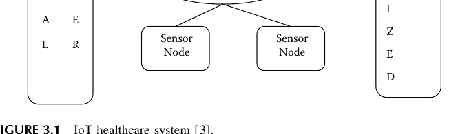

图 3.1 物联网医疗保健系统 [3]。

- iii. **LAYER 3**—网络层的目标是从第二层以数字信号的形式提取相关数据，并使用蓝牙、WiFi、Zigbee、WiMAX、GSM和3G等传输媒体，通过IPv4、IPv6、DDS和MQTT等协议将其传输到中间件层处理系统 [5,6]。

- iv. **LAYER 4**—从无线设备收集的信息由中间件层处理。它涉及云存储和云连接等技术，可立即访问数据库以提供所有获取的信息。信息使用安全智能计算设备进行检查，并根据数据精炼结果捕获完全自动化的活动 [5]。

- v. **LAYER 5**—应用层基于处理后的数据为各行业实现物联网框架。由于物联网的增长由应用程序推动，因此对物联网系统的广泛发展具有价值。智能家居、智能交通、智能世界可能是与物联网相关的应用 [5,6]。

- vi. **LAYER 6**—业务层处理物联网程序，其能力负责所有与物联网相关的研究。为了实现高效的市场策略，它产生了众多商业模式 [5]（图3.2）。

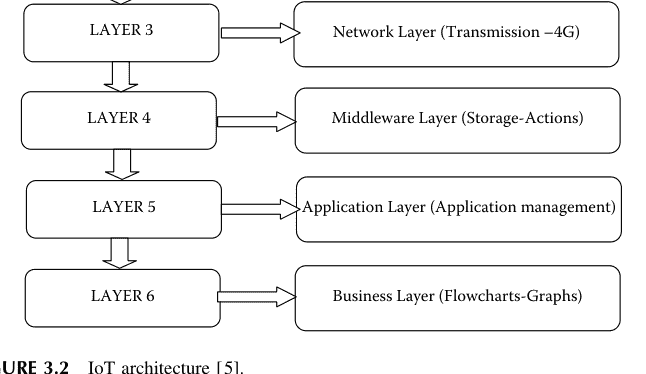

图 3.2 物联网架构 [5]。

老年人并预测滑倒。应急服务由一种经济高效的传感器设备处理，该设备易于实施且仅需要广域通信信道 [10]。

## 3.2 文献综述

在家居、工程、社区和车辆中，技术已得到改进。医疗保健是新兴技术经常需要关注和发展的领域之一。通过应用各种方法和技术，不同学者对医疗保健挑战及其监测方法进行了不同的分析。

Stephanie et al. [1] 在本章中提出了特定范式以供潜在工作。基于物联网的医疗保健项目可以扩展到跟踪特定情况的所有通用结构和流程。作者随后提供了简洁而结构化的描述。最先进的工作涵盖了建议模型的每个方面。研究并讨论了众多便携式、无创检测器，尤其是测量血压、心率和氧气水平的检测器。Mrinai et al. [3] 提供了关于研究、疾病监测、运动管理、儿科、私人健康和老年人护理管理的相关信息。物联网医疗领域资源丰富，安全、保护、可访问性和资源分配是最关键的元素。

Pace et al. [11] 提出的 INTER-Health 框架旨在建立一个交互式物联网框架，用于分散式智能手机追踪人们的生活方式，以预防由营养和身体活动障碍引发的健康问题。这种筛查过程可以从健康中心委托给被追踪个人的家中，并在移动过程中借助身体上的身体活动传感器进行辅助。

Inderpreet et al. [12] 提出了传感器的结构，以便轻松展示传感器在医疗保健领域的工作方式。云服务器接收信息，然后信息传输到 Web 服务器，然后在 WiFi 或调制解调器的支持下与网关互连，然后在传感器节点的支持下将数据传输到单个 SoC 平台。进一步，将信息传输到 6LoWPAN 服务器然后将信息传输到基于星型的 6LoWPAN 健康传感器并借助智能手机、电话、计算机将整个设备或架构连接到互联网浏览器，用户可以快速下载信息并查看所需的所有信息。

此外，Adarsh et al. [13] 提出了一种利用医疗保健 4.0 来保障中央机构免受疾病侵害的策略，并实施了去中心化技术、设备和数据保护、能力增强、简单数据维护，并提供了全面的医疗保健监测功能。为了提高整个系统和子系统的质量，实施了仿真优化技术。通过实验和执行，建议的解决方案得到评估、检查和验证。

Deepak et al. [14] 开发了基于物联网的智能医疗护理，以避免将患者隔离到观察区。患者可通过此方法获得量身定制的治疗方案，以满足其身体需求。

该技术的目的是监测过程中去除人工监督以及整个监测过程的自动化。所提出框架的上下文原则是为所有观察需求提供一站式响应。

Mohamed 等人 [15] 提出了一种面向医疗保健的安全范式，以保护物联网系统中医疗信息的传输。所建议的框架包括以下流程：首先，使用由 `AES` 和 `RSA` 加密共同构建的拟议加密方法对患者的敏感信息进行编码。其次，将加密信息存储在载体图片中并创建隐写图像，第三步是提取嵌入数据，第四步是对处理后的数据进行解密以恢复实际信息。

作者们对当前工作进行了分析，并对智能医疗保健的 5G 和物联网网络组件进行了研究主题。首先，他们提出了 5G 智能医疗保健框架以及实现 5G 智能医疗保健的关键策略，网络功能虚拟化（`NFV`）。其次，他们讨论了 5G 智能医疗保健的定义，并分析了当前 5G 智能医疗保健的标准和目标。最后，他们对适用于基于物联网的 5G 智能医疗保健的网络层技术进行了全面概述，涉及时序、调度和拥塞管理，涵盖了当前工作和未来发展机会 [16]。

Anar 等人 [17] 引入了 EHMS 测试平台的概念，其中患者的身体连接到多个小型传感器。作者收集了一个实用的医疗保健数据库，其中包含超过 16,000 条常规和 MITM 攻击数据包记录。为了构建有效的入侵检测系统，作者建议将网络流统计与患者的生物特征作为函数集成以提高设备性能；使用了四种不同的机器学习方法，`RF`、`KNN`、`SVM` 和 `ANN`。

## 3.3 物联网中的医疗保健服务与应用

一些领域可以扩展到基于物联网的医疗保健组织，包括青少年和老年患者的护理、慢性病监督以及私人健康管理和运动管理等。物联网旨在允许各种治疗，其中每个提供者都提供一系列医疗保健选择。以下各节包括各种物联网医疗保健服务和应用（图 3.3）。

### 3.3.1 物联网医疗保健服务

服务用于创建应用程序，并且以用户为中心，专门由消费者和患者使用。下面显示了物联网提供的不同服务：

- a. **环境辅助生活 (AAL)**—总体而言，智能设备或传统的基于物联网的医疗保健服务都无法为老年人提供专业服务是不可避免的，即对特定物联网行动是强制性的。环境辅助生活是一种由人工智能和智能手机基本功能、GPRS、4G 系统、位置服务和无线技术推动的物联网流程。它做出决策，并提供通过物联网环境中的探测器获得的信息。M-健康数据集中使用了心率记录和各种体育锻炼期间的身体行为。为了监测患者的呼吸，这些传感器可以放置在身体的各个部位，例如右手、腹部和左脚踝 [21]。
- c. **不良药物反应 (ADR)**—服用药物产生的后果称为不良药物反应（ADR）。由于两种或两种以上药物的组合或单次剂量或长期注射药物而发生。由于 ADR 本质上是通用的，即与单一疾病药物无关，需要单独制定某些适当的数量问题及其解决方案（称为 ADR 服务）。除了给医疗系统带来额外压力外，它还可能对患者产生致命影响。它是世界上疾病和死亡率增长最快的风险之一，它们将成为老年人口多病护理中的一个主要健康问题 [22]。
- d. **社区医疗保健 (CH)**—这是一个在选定有限区域服务的项目。社区医院的结构通常与“数字健康中心”相同。这是一个基于物联网的网络，用于监测农村社区及其周围的居住区 [21]。
- e. **儿童医疗保健 (CH)**—儿童医疗保健系统（CHS）是一个论坛，让幼儿在不在家人身边、在住所外进食时通过饮食习惯改善生活质量。使用移动食物监测设备的幼儿会收到其医生、护理人员或监护人的通知。通过增加的应用，客户可以获取有关食物的信息。为了指导儿童，医疗专业人员使用存储的数据并向监护人发送便条。这有助于父母与孩子谈论食物，帮助他们养成健康的饮食习惯 [21]。
- f. **可穿戴设备接入 (WDA)**—对于广泛的健康应用，尤其是基于 WSN 的医疗护理，有各种非侵入性传感器可用。这些探测器有可能通过物联网提供相同的服务。通过可穿戴设备整合上述传感器是显而易见的 [18,23]。
- g. **间接紧急医疗保健 (IEH)**—有许多紧急情况需要医疗护理的深度参与，包括恶劣天气、交通（飞机、飞机、火车和汽车）碰撞以及地震灾害。在这种情况下，一个名为间接紧急医疗护理的集中平台可以提供一系列解决方案，如信息可访问性、变化通知、事故后干预和记录管理 [18]。

### 3.3.2 物联网医疗保健应用

必须记住，服务用于构建应用程序，但客户和患者直接访问应用程序。因此，服务面向开发人员，而应用程序面向用户。

#### 物联网的潜在应用与挑战

- a. 血糖水平传感 (GLS)—糖尿病患者主要关心的是调节血糖水平以防止葡萄糖边界异常。将用于控制这些水平的非侵入性、微创和侵入性方法分为三组 [24]。
  - i. 侵入性组包含常用的方法，因为由于与患者血液直接接触，它在结果上具有最大的连贯性。
  - ii. 正在审查的方法之一涉及微创组。该方法利用激光辐射引起的小孔，即皮肤上的微小孔洞。当孔洞打开时，系统使用稳定的真空去除少量经皮体液。基于酶的电极处理并测试收集样本的葡萄糖速率。
  - iii. 非侵入性类别是非侵入性血糖仪，其目标是用可外部获取的另一种成分替代血液成分。该过程涉及将传感器放置在身体的特定区域以接收葡萄糖测量值。
- b. 心电图监测 (ECGM)—众所周知，心电图是检测心脏不规律的最佳工具。心电图在单导联和 12 导联心电图记录设备之间有所不同。一方面，医院中的心电图采集仪器通常体积庞大，可实现高精度和长期监测。然而，它们限制了患者的活动和参与。可穿戴健康监测设备通过安装传感器为患者提供持续的实际监测。数据收集过程、心电图监测设备的生命周期程序包括以下流程的选择 [23]：
  - i. 传感器的类别（例如，无线或有线），
  - ii. 传感器的位置，
  - iii. 传感器的数量，以及
  - iv. 用于捕获、存储和传输数据所需的硬件。
- c. 血压监测 (BPM)—检测心血管疾病的最重要参数之一是血压。根据年龄和整体健康状况，患者的血压应定期检查。有多种仪器可在医院外监测血压以实现这一目标。这些仪器是患者必须随身携带的补充硬件，在医疗紧急情况下经常无法使用。在当今世界，当前的研究旨在拥有患者可以随时携带的智能、联网的测量工具。包括此类仪器在内的新监测框架允许应用医疗物联网（`IoMT`）范式 [25]。
- d. 体温监测 (BTM)—根据医学科学，人体体温的各种形式为低体温、发热、正常体温、高体温、高热、正常体温或自然。完整临床检查的第一步是测量个人的体温。医疗体温计有多种形状和尺寸，可用于身体的不同部位：在口腔内、在膀胱内、在耳内、在阴道内、腋下，以及在额头皮肤的颞动脉上。测量体温安全且便捷的方法是腋温测量。腋下温度约为 36.4 °C。除了汞体温计外，数字温度传感器，如热电偶、热敏电阻和集成电路 IC 温度传感器也被使用。在医学诊断中，带有热电偶传感器的电子体温计常被使用。腋下测量的计算通常会受到环境温度的影响 [18,26]。
- e. 氧饱和度监测 OSM—BP 理想用于连续、无创的氧饱和度监测。对于创新的医疗保健应用，物联网与 BP 的结合是有帮助的。基于 `CoAP` 定位的医疗机构调查探讨了物联网脉搏血氧仪的潜力。该系统附带基于个人资料的无线医疗系统连接，检测器直接连接到 Monere 网络。已提出一种面向物联网的模块化脉搏血氧仪用于远程患者监测。这种软件可通过此类物联网网络用于不断监测患者的健康状况 [18]。
- f. 康复系统 RS—专注于物联网的智能康复技术正成为减少与老年人群和医疗工作者短缺相关问题的更安全方式。虽然它已出现，但仍存在自动化此类设备的设计和重新配置的关键问题，以便其能快速适应患者的需求。该模型成功证明物联网可以成为实现交付实际信息交互所需所有工具的有效模型。为了帮助广泛康复中的成功远程咨询，基于物联网的创新将塑造一个有价值的框架。创新的监狱提议系统、智能社区医院 RS、偏瘫患者康复训练以及儿童自闭症语言沉浸系统都是基于物联网的治疗项目之一 [18,27]。
- g. 智能手机医疗解决方案 SHS—近年来观察到带有手机传感器的数字设备出现，这说明了智能手机作为物联网引擎的增长。得益于一系列硬件和软件设备，智能手机现在可用作灵活的医疗保健系统。为了获取诊断和治疗信息，使用诊断应用程序。药物参考应用程序通常包含药品名称、说明、剂量、价格和区别特征。文献检索应用程序使查找特定医学知识和医学文献库变得更容易。通常，医学教育应用程序涉及视频、指导、先进治疗演示、各种图片的彩色图像以及医学期刊。计算器应用程序包括可用于确定不同参数值的各种医学公式和方程。医疗联系应用程序使医生和护士在医院内部更容易互动 [18]。

### 3.3.3 服务推广技术

物联网医疗服务可由云计算 `CC`、大数据、网格计算 `GC` 和其他创新来促进 [28]。

负载均衡、高可用性和高性能都是 `CC` 提出的问题。此外，它可通过数据中心扩展到移动电话终端用户，作为云托管提供商，它允许边缘移动连接。将 `CC` 引入基于物联网的医疗技术可使服务从任何地方访问共享信息。这样，服务可通过系统请求，并可执行各种需求的服务。

据说 `CC` 建立在 `GC` 的基础上。将 `GC` 整合到医疗保健网络中解决了医疗传感器节点不足的计算功能问题。

作为计算的下一步，大数据给科学界带来了多重障碍，并需要共同的观点，以及对多个领域如医疗保健的讨论。它包含从传感器设备获得的大量医疗数据。还有提高健康相关诊断质量的技术，以及跟踪方法和商店。

哪种网络风格最适合基于物联网的医疗保健是一个热门话题。数据、服务和以患者为中心的模型是三种基本设计方式。在数据中心方案中，医疗保健系统根据收集的健康数据分为项目。在服务中心系统中，医疗保健框架根据其将具有的特征分配。最后，以患者为中心的方法根据接受治疗的患者数量划分医院系统。

## 3.4 物联网医疗安全问题与挑战

### 3.4.1 安全问题

由于黑客或攻击者可以轻松识别传感器信息，保护已成为物联网中的一个大问题，因此调查物联网中最新的安全方法至关重要。考虑到各种物联网漏洞，安全部署和防御设计通常有三个阶段。

由于缺乏适当的安全措施，健康数据可能成为欺骗者的有吸引力和诱人的目标。带有摄像头和其他可穿戴技术的移动设备也用于从患者收集计算机化数据。在大多数情况下，这些都与处理和分析信息和指标的应用程序相关联。这些应用程序的功能通常通过将信息发送到服务器而扩展，这一现象需要使用复杂的算法。保密性、情报的真实使用和法律问题是该保护领域三个基本要素。

此外，存在三个安全漏洞点：数据传输、设备和数据存储。值得注意的是，智能手机数据窃取已不如过去常见。然而，使用勒索软件并不能消除计算机数据泄露的风险。物理计算机经常面临被黑客攻击或丢失的风险。此外，安全并不意味着使用可穿戴传感器。但用户会配置他们的移动设备。在信息传输过程中，数据可能被各种恶意软件破坏。为防止数据被黑客攻击，需要有效的加密技术和身份验证系统。然而，必须解决加密和身份验证的几个问题。

这些包括数据传输速率下降、实际实施困难以及高能耗。最后，信息在 `CC` 架构档案中被加密。然而，该服务由各种第三方提供商提供，因此攻击机会更多。此外，这些数据库连接到互联网网络，允许用户检索数据。这进一步增加了攻击的可能性。需要多维身份验证、特定的访问管理程序和复杂的代码来克服这些问题，使设备更难使用 [27]（表 3.1）。

如图所示 3.4，有许多因素导致安全问题。

### 3.4.2 物联网医疗挑战

物联网已整合到多个系统中以造福医疗保健领域，包括患者管理和糖尿病患者的移动家庭系统。医疗保健领域存在的主要挑战如下 [29,30]：

- i. 为保证患者私人信息的保密性，物联网系统中的数据共享应加密。这将有助于防止患者记录被未经授权访问，以及攻击者窥探细节。
- ii. 可以使用强大的凭证和身份验证机制来保护物联网网络门户。对物联网设备和数据，应规划基于角色的连接，以确保只有获批准的人员才能访问机密医疗信息，例如经授权对患者进行诊断、治疗和监护的执业医师小组。
- iii. 通过确保设备的物理安全，可以防止各种威胁，如篡改设备、通过USB窃取数据或窃取存储介质。中间件将应用程序与物品/传感器连接起来，因此也必须确保其安全。
- iv. 物联网带来了更多便利，例如，如果患者需要持续治疗，其可以在家中而非医院，并可使用物联网技术按需接受监护。任何可穿戴设备（如摄像头）都可能对患者身体造成伤害。
- v. 从传感器传输到控制系统再到监控中心的信息会受到噪声的影响，从而降低数据质量。更好的基础设施有助于在传输数据时保持其完整性。使用降噪技术也有助于改善数据信号。
- vi. 当可穿戴传感器数量增加时，处理它们所需的能量也会增加，导致功耗泄漏和能量消耗增加。功耗优化是一种可用的技术。
- vii. 在物联网中，追踪大量设备需要更多的存储和计算系统，这可以通过在云中加密信息来避免。然而，物联网与云的结合又增加了难度。
- viii. 物联网的另一个重要问题是保密性，因为计算机更容易受到攻击。这些设备资源有限，使得加密方法无法实施。
- ix. 目前使用的大多数心电图（ECG）检测方法都包含监督式信号分析。这增加了成本，并且可能导致检测错误。机器学习可用于评估信号，从而提高性能并降低成本。

表 3.1

物联网医疗安全问题 [27]

|   | IoT 层 | 问题 | 描述 |
|---|-----------|--------|-------------|
| 1 | 感知层 | 设备安全 | 这是一种设备级安全，依赖于智能手机、智能手机应用程序和 Web 应用程序的隐私。在此阶段，物联网保护风险是威胁物理设备的物理威胁。 |
| 2 | 网络和传输层 | 通信安全 | 用于保护网络和信息通道。 |
| 3 | 应用层 | 云安全 | 特别容易受到漏洞影响的云平台，例如 SQL 注入漏洞，几乎肯定会首先受到攻击。云加密保证数据安全并避免隐私泄露。 |

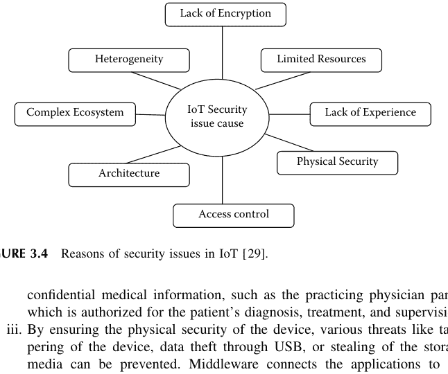

图3.4 物联网中安全问题的原因[29]。

## 3.5 物联网可穿戴传感器

可作为外部附件使用、嵌入衣物中、植入体内，甚至粘贴或覆盖在皮肤纹身上的智能传感器，都是物联网可穿戴设备的例子。这些设备可以连接网络，以存储、传输和检索数据，从而用于做出明智的决策。可穿戴设备正成为物联网中越来越重要的一部分，并且正从基本的小工具发展为更高级、更实际的应用。在通信和计算方面，智能可穿戴设备可以与多种其他设备（如智能手机）进行通信。

用于健康的物联网可穿戴系统主要用于远程医疗控制和某些康复场景。在将用户/患者的健康信息上传到互联网以便进一步研究之前，这些设备会捕获与健康相关的数据，并且系统可以执行有限的计算。系统还可以接收数据，使个人能够做出更多决策。在一些实现中，可穿戴传感器与设备连接，以监测收集到的数据，然后将其传输到云计算（`CC`）系统（如`Microsoft Azure`或`Amazon Web Services`（`AWS`））进行存储、处理和分析。

移动健康应用程序可用于可视化检查数据，并提供有关个人或患者健康的信息。此外，在治疗过程中，检查数据还可用于向可穿戴设备发送特殊指令，例如加热身体或实施电击[31,32]（图3.5）。

**生命体征监测**——体温、呼吸血氧测定和血氧饱和度是医疗从业者和医疗服务机构定期跟踪的关键生命体征。

**非生命体征监测**——非生命体征监测的内容是非侵入性评估。

可以跟踪以下参数，例如呼吸频率和血糖水平。

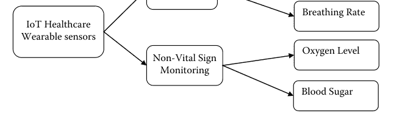

图3.5 物联网医疗保健可穿戴传感器[31]。

### 3.5.1 健康监测可穿戴系统

健康跟踪系统因所用传感器类型而异。可穿戴设备主要有四种类型[31]：

- 1. **生物电位传感器**——生物电位传感器的例子包括心电图（`ECG`）、脑电图（`EEG`）、光电容积脉搏波描记（`PPG`）和肌电图（`EMG`）。
- 2. **运动传感器**——运动传感器的例子包括陀螺仪和加速度计。
- 3. **环境传感器**——环境传感器的例子包括超声波、温度和压力。
- 4. **生化传感器**——分析上述体征可提供大量关于患者或用户健康状况的信息。

## 3.6 结论与未来展望

随着物联网和云计算（`CC`）的指数级增长，基于云的物联网在医疗保健领域的新技术和应用不断涌现。挑战在于如何将基于云的物联网集成到下一代医疗系统中。本章讨论了物联网提供的各种医疗保健应用和服务。本研究以物联网医疗保健挑战和安全问题的概况为基础展开。此外，还讨论了物联网医疗保健中可穿戴传感器的概念。更高的安全性、多功能性和功耗利用都将有助于推动物联网在医疗保健领域的应用。

## 参考文献

- [1]. Stephanie, B., Wei, X. 和 Ian, A. 用于智慧医疗的物联网：技术、挑战与机遇. *IEEE*, 5, 26521–26544 (2017).
- [2]. Syed, U. 和 M.H. Shamim. 医疗保健中的边缘智能与物联网：综述. *IEEE物联网边缘智能专题*, 9, 45–59 (2021).
- [3]. Mrinai, M. 和 Shailaja, C. 物联网：医疗保健使能技术及其应用综述. *计算机网络*, 133, 113–131 (2019).
- [4]. Mahdi, H., Maaruf, A., Peter, S. 和 Rich, P. 物联网（IoT）、万物互联（IoE）和纳米物联网（IoNT）综述. *IEEE Xplore*, 219–224 (2015).
- [5]. M.U., F., Muhammad, W., Sadia, M., Anjum, K. 和 Talha, K. 物联网（IoT）综述. *国际计算机应用杂志*, 113(1), 1–7 (2015).
- [6]. Jie Lin, L., Wei, Y., Nan, Z., Xinyu, Y., Hanlin, Z. 和 Wei, Z. 物联网综述：架构、使能技术、安全与隐私及应用. *IEEE物联网期刊*, 4, 1–16 (2017).
- [7]. Zahra, N., Amir, M. 和 Mehdi, H. 物联网在医疗保健中的作用：未来趋势与挑战. *生物医学中的计算机方法与程序*, 199, 1–64 (2020).

- [8]. Phillip, A. 和 Nancy, L. 医疗保健中的物联网潜在应用与挑战. *美国国家标准与技术研究院IEEE*, 1–4 (2016).

- [9]. Madushan 和 Rashmika Gamage, G. 物联网（IOT）在医疗保健中的应用综述. 美国信息科学与技术学会杂志 (2021).

- [10]. Alok, K. 和 Sampada, S. 物联网的医疗保健应用：综述. (IJCSIT) 国际计算机科学与信息技术杂志, 5 (5), 6229-6232 (2014).

- [11]. P.P., G.A., A.C. 和 R.G. INTER-health：面向积极和辅助生活医疗服务的互操作物联网解决方案. IEEE第五届物联网世界论坛 (WF-Iot), 81-86 (2019).

- [12]. Inderpreet, S. 和 Deepak, K. 改进基于物联网的医疗系统架构. 第四届信息系统与计算机网络国际会议 (ISCON), 113-117 (2019).

- [13]. Adarsh, k., Rajalakshmi, K., Anand, N. 和 Kriti, S. 使用医疗4.0流程的新型智慧医疗设计、仿真与实现. 区块链技术：原理与应用专题, IEEE, 8, 118433-118471 (2020).

- [14]. Deepak, K. 和 Hiva m, C. 基于物联网的损伤后监测医疗服务. 2019年智能计算与控制系统国际会议论文集 (ICICCS 2019) IEEE Xplore, 293-296 (2019).

- [15]. Mohamed, A., Gunasekaran, M., Mai, M. 和 Ehab, R. 智慧教育环境中的物联网：决策过程中的支持框架. Wiley, pp. 1-12 (2018).

- [16]. Abdul, A., Mohammad, T. 和 Kok-Lim, A. 基于5G的智慧医疗网络：架构、分类、挑战与未来研究方向. IEEE, 7, 100747-100762 (2019).

- [17]. Anar, A., Ali, G., Tara, S. 和 Devrim, U. 使用医疗和网络数据的医疗系统入侵检测系统：比较研究. IEEE, 8, 106576-106584 (2020).

- [18]. S.M.R., Daehan, K., Md., H., Mahmud, H. 和 Kyung-Sup, K. 面向医疗保健的物联网：综合调查. IEEE, 3, 678-708 (2015).

- [19]. A. Dohr, R. Modre-Opsrian, M. Drobics, D. Hayn 和 G. Schreier，“面向环境辅助生活的物联网”，第七届信息技术国际会议：新一代，2010，pp. 804-809 (2010).

- [20]. Dragorad, M. 和 Zoran, B. 基于云的物联网医疗应用：需求与建议. 物联网与Web服务国际期刊, 2, 60-65 (2017).

- [21]. Shah, N., Yasir, A., Naeem, U. 和 Ivan Garcia. (2019). 利用移动计算影响的医疗物联网：系统文献综述. 无线通信与移动计算, 1-20.

- [22]. H.K. 和 C.H. 初级保健中的药物不良反应：范围综述. Khalil和Huang BMC健康服务研究, 20(5), 1-13 (2020).

- [23]. Mohamed, A., Hadeel, T., Heba, I. 和 Alramzana, N. 心电图监测系统：综述、架构、流程与关键挑战. 传感器, 20, 1-40 (2020).

- [24]. Francisco, V., Armando, G., Erica, R., Mabel, V. 和 Joaquín, C. 一种基于物联网的血糖监测算法以预防糖尿病并发症. 应用科学, 10, 1-12 (2020).

- [25]. Francesco, L. 和 Domenico, L. 血压监测中医疗物联网概述. IEEE, 1-6 (2019).

- [26]. H.R.F., M.R.I., B.S.H. 和 I.P.S. 基于远程医疗的体温监测. 第一届工程与应用科学国际会议, 1-9 (2019).

- [27]. Pranjal, P., Ubhash, C. and Upendra, K. 医疗保健领域物联网的安全问题：一种分析方法. *Research Gate*, 2, 307–329 (2019).

- [28]. Dragorad, M. and Zoran, B. 基于云的物联网医疗保健应用：需求与建议. *International Journal Of Internet Of Things And Web Services*, 2, 60–65 (2017)

- [29]. Sweta, A. and Anil Kumar, G. 物联网在医疗保健中的挑战. *Research Gate*, 1–15 (2020).

- [30]. Sureshkumar, S. and Suresh, S. 物联网医疗保健系统的挑战与机遇：系统综述. *SN Applied Sciences*, 1–8 (2019).

- [31]. F. John D. and R., V. (2021). 可穿戴设备与物联网（IoT）、应用、机遇与挑战：综述. *IEEE Access*, 1–12.

- [32]. C. F. Pasluosta, H. Gassner, J. Winkler, J. Klucken and B. M. Eskofier, 帕金森病管理的新时代：可穿戴技术与物联网. *Biomedical and Health Informatics*, 19, 1873–1881 (2015).

## Taylor & Francis

Taylor & Francis Group

http://taylorandfrancis.com

# 4 物联网与智能健康管理

M. Starostka-Patyk and P. Bajdor

## 目录

- 4.1 引言........................................................................61
- 4.2 定义物联网...................................................................62
- 4.3 物联网的架构......................................................66
- 4.4 物联网的应用..............................................................68
- 4.5 波兰的物联网——案例研究...................................................72
- 4.6 智能健康管理——现象的诠释....................75
- 参考文献...............................................................................78

## 4.1 引言

现代环境显示出将自然世界物体转变为虚拟智能物体的需求日益增加。智能系统，即互联智能主机的集合，已永久融入我们周围的整体之中。Prof. John McCarthy (1929–2011) 在20世纪50年代中期将人工智能（AI）定义为创造智能机器、卓越计算机以利用人类智能的科学和工程学。尽管如此，人工智能并不局限于生物可观察的方法。McCarthy 将智能定义为在世界中实现目标的计算部分 [1]。

这种方式描述的人工智能现象至今保持不变，在此基础上，创建了新的概念、方法和 IT 工具，以实现对人类实施流程的全面或部分支持。其中可区分以下内容 [2]：

- **数据挖掘**—涉及从大型数据集中发现新的、潜在有用的模式并使用算法提取隐藏信息的数据挖掘方法 [3]。
- **机器学习**—参数值变化自主发生且基于经验并导致其运行质量改善的学习系统 [4]。
- **决策支持系统** [5]。
- **自然语言处理（NLP）**—理解和从自然人类语言中提取信息的计算机方法，即人们在日常生活中使用的语言 [6]。
- **专家系统**—能够收集和处理庞大知识资源并进行推理过程以制定对所提问题的回答的专家系统 [7]。

物联网（IoT）也是对现代信息技术和 AI 这一挑战的回应。其目标是将所有基本元素统一并置于共享基础设施中，这不仅可以控制环境、了解事务状态，还会对管理产生巨大影响 [8]。由于接入互联网的设备的动态发展，物联网的理念已不仅变得自然，而且甚至被指出是未来全球经济和管理的主要增长驱动力之一。物联网解决方案的应用规模巨大：从服装、智能家电、建筑自动化和智能城市到管理、防御系统和健康。

## 4.2 定义物联网

名称 IoT 最早在上个世纪90年代使用。英国企业家 Kevin Ashton 于1999年首次使用这一概念。他将这一现象描述为设备之间相互收集、处理和传输数据的相互合作 [9]。这种通信合作无需人工干预，从而实现流程的系统自动化和自主决策。他强调，为计算机和互联网提供动力的信息完全来自人类，从一开始，网络上描述事物和现象的所有数据都是由人类创建和记录的。然而问题是，人类的时间、注意力和精确度有限，因此并不擅长收集周围世界物体的相关数据。

与此同时，经济、社会以及广义上的存在并非建立在思想之上，而是建立在这些物体（事物）之上。因此，有必要使用计算机在没有人类不完美限制的情况下观察、识别和理解世界 [10]。通信设备没有人类因素与典型的工业系统不同，因为它是普遍可用和共同网络连接越来越多的新事物的理念，这些事物在适当配备和功能独立的传感器中。

物联网已成为一个全球日益为人熟知的概念，涉及社会中普通日常人类生活，并具有无数应用可能性。物联网的发展最初基于大型企业的需求，这些企业希望从能够追踪这些公司所参与的合作链中所有物体的能力所提供的管理性和可预测性中获得最大利益 [11]。物体编码和追踪能力使企业能够提高生产力、改善管理、加速流程、减少错误、防止盗窃，并利用物联网实现全面灵活的系统组织 [12]。物联网因此是一场技术革命，代表了信息技术和通信的未来，并且根据多样化环境中技术创新的动态发展而发展，因为无论应用于哪个领域，它都允许对每个物体进行标记以实现识别、自动化、监控和控制。

信息技术领域的现有文献并未给出物联网术语的明确且一致的定义。然而，基于现有文献，可以指出物联网是一种生态系统，其中配备传感器的物体与计算机进行通信 [13]。此外，在该生态系统中，物体可以有或没有人类参与进行通信 [14]。

物联网使物体/事物能够积极参与人类环境，例如，通过无线方式使用连接互联网的相同 IP 协议将信息提供给其他用户或网络成员。这样，物体/事物可以独立识别其环境中发生的事件和变化，并在没有人工干预的情况下自主采取适当行动或反应 [15]。

谈到物联网的发展，我们谈论的是利用智能物体网络（配备数据处理和协作能力的物体）进行创新的浪潮，其本质不仅是满足今天已知的需求。正如第一次‘互联网革命’一样，我们也在创造新的应用领域、意想不到的消费者行为和新的管理模式 [16]。这无疑是一个充满巨大机遇且伴随大规模创新浪潮固有重大风险的领域。在定义物联网时，应考虑其使用的前景及其结构和功能。

许多作者在文献中从服务、互操作性和技术使用的角度以不同的方法提出了物联网的定义 [17]，并在表 4.1 中进行了总结。

### 表 4.1

从不同视角和角度对物联网的定义

| 视角 | 方法 | 定义 |
|---|---|---|
| 服务 | 物联网作为商业生态系统 | 一组使用能够收集和处理信息（交互）的物体、联网、确保应用互操作性和协同作用的服务。 |
| 互操作性 | 万物互联 | 消费设备和产品已连接到互联网并配备了广泛的数字功能。该概念假设技术的未来是设备、物体和应用程序在全球网络中的合作。 |
| 技术 | 物联网 | 包含内置技术的物理物体网络允许进行通信、现象观察、操纵物体的内部状态并影响其周围环境。 |

然而，考虑到构建和功能方面的因素，物联网可以从技术和架构角度进行定义。

从技术角度来看，物联网是一种通过有线或无线连接连接设备的网络，其特点是自主性（无需人工干预）以获取、共享、处理数据，或在这些数据的影响下与环境交互。它是构建电信网络和高度分散的信息系统的概念，可用于在其他方面创建智能控制和测量系统、分析或控制系统，几乎在生活的各个领域、经济、管理或科学中都可以使用 [18]。

从架构角度来看，物联网被定义为一种 IT 架构的概念，使各种支持各种领域应用的 ICT 系统能够实现合作（互操作性），并基于以下层 [19]：

- **设备**—设备（或配备它们的物品），尤其是传感器、执行器、控制器、智能手机、平板电脑、笔记本电脑或计算机，可以在无需人工干预或有限交互的情况下进行通信和处理数据。
- **通信**—电信基础设施和电信网络（有线或无线），基于任何数据传输标准运行，范围不限（此处为互联网）。
- **软件**—物联网设备的 IT 系统以及用于数据交换、处理、系统管理和安全性的软件。
- **集成**—确保在所有架构层面上实现软件互操作性的定义 IT 服务集合。

根据商业和管理定义，物联网是商业和管理服务的生态系统，使用能够收集和处理信息（交互）的对象，通过网络连接，确保应用的互操作性和协同作用 [20]。结合物联网产品/服务使我们能够更好地了解消费者、环境、产品和流程，识别关键事件；并做出反应以立即优化或更精确地个性化。

术语和定义的标准化问题也由欧洲委员会处理。在题为《物联网。物联网技术标准化立场文件》2015年1月的研究报告中，由物联网欧洲研究集群编制，物联网被定义为具有自配置能力的动态全球网络基础设施，基于标准和可互操作的通信协议，其中物理和虚拟“事物”具有身份、物理特征和虚拟个性，使用智能接口，并无缝集成到信息网络中 [15]。

根据思科互联网业务解决方案集团（IBSG），物联网概念描述了在网络中相互作用的四个主要元素：人、数据、流程和事物 [21]。物联网的基本架构在图 4.1 中呈现。

物联网的所有元素均通过互联网连接并提供直接通信 [22]：

- 人与人（P2P）。
- 机器与人（M2P）。
- 机器与机器（M2M）。

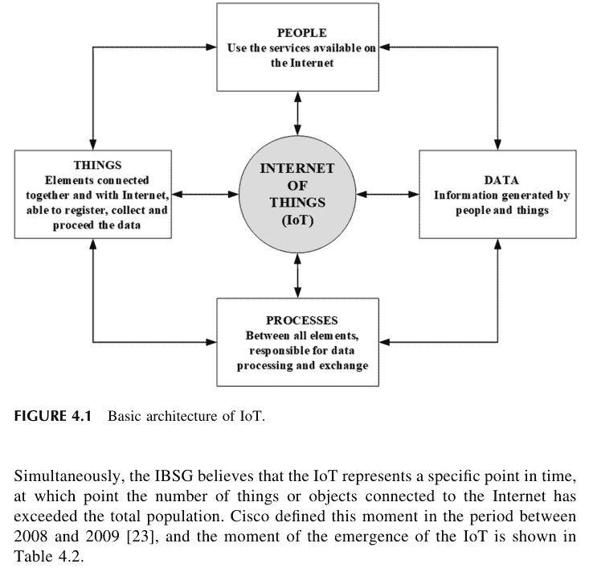

### 图 4.1 物联网的基本架构。

同时，IBSG 认为物联网代表了一个特定时间点，此时连接到互联网的事物或对象的数量超过了总人口。思科将这一时刻定义为 2008 年至 2009 年期间 [23]，物联网出现的时刻如表 4.2 所示。

总之，应考虑到互联网的起源和发展归功于日益增多的智能互联设备以及它们现在所能呈现的广泛可能性 [24]。

### 表 4.2

物联网的出现

| | 2003 | 2010 | 2015 | 2020 |
|---|---|---|---|---|
| 世界人口 [十亿] | 6.3 | 6.8 | 7.2 | 7.6 |
| 连接设备数量 [十亿] | 0.5 | 12.5 | 25 | 50 |
| 人均连接设备数量 | 0.08 | 1.84 | 3.47 | 6.58 |

连接设备数量多于人口

## 4.3 物联网的架构

物联网的关键要素是作为开放通信渠道的全球互联网网络。这并非没有原因，因为互联网网络发展的过去几十年使得全新的互联网服务和功能得以创建和推出，这同时直接转化为经济各个部门的发展。

使用物联网需要改变构建和应用数学模型的方法。物联网意味着必须脱离现有实践，即预测模型基于收集的数据构建，然后在保持所需质量参数的情况下作为操作使用。在永久通信的设备世界中，可用于分析的数据流庞大且动态变化，使用经典方法将无法充分利用其隐藏价值 [25]。有效的模型必须建立在存储在经济上不合理的 数据之上。快速更新已成为必要，分析支持的决策应立即做出。因此，构成物联网解决方案的工具的架构，简而言之，基于：

- 可以通信或接收命令或传输信息的对象，即配备传感器、传感器（温度、振动、湿度、运动等）和使通信、接收命令以及收集和传输信息成为可能的发射器的对象。
- 充当对话中介的电信网络，即实现通信的基础设施，即对象之间的数据传输（示例和最流行的解决方案包括 WiFi、Bluetooth、NFC 无线网络，以及主要用于家庭自动化系统的 Z-Wave 系统）。
- 用于处理收集的数据并将信息传输到设备的 IT 系统和解决方案，即接收对象收集和传输的数据并对其进行处理和决策的系统和 IT 解决方案（例如，笔记本电脑、平板电脑、智能手机和家庭云计算）。

因此，物联网解决方案运行的理念（图 4.2）基于使用连接到互联网的计算机网络，该网络连接所有协作元素 [26]。

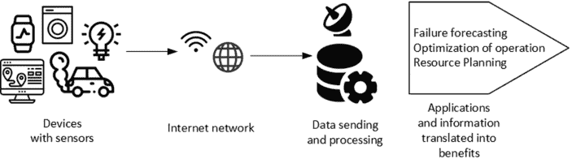

### 图 4.2 物联网解决方案运行的理念。

图 4.2 显示了物联网环境中包含的技术、标准和后续革命性解决方案的复杂性，按 ISO-OSI（开放系统互连）模型分层，从配备传感器以实现数据采集的物理设备开始，经过通信系统、数据收集和处理系统，直至特定的业务模型和应用 [27]。

互联网网络最初旨在连接位于不同位置的计算机单元以进行相互信息交换。然而，互联网的进一步发展，包括使用 TCP/IP 协议栈进行通信的标准语言，使其全球用户能够使用电子邮件并在网站上发布和搜索信息。随着时间的推移，网络技术的应用变得越来越密集，这使得它们能够用于电子商务并创建连接的供应链，其中合作企业共同致力于一个产品。此外，网络技术的发展使得数据、视频和音频流能够得到更高效的使用。同时，无线接入技术开始发展，这使得服务移动性得以启动。因此，社交媒体、流媒体服务和云服务开始大规模使用，并与移动技术相结合。今天，互联网是一个全球网络，连接着数百万私人、公共、商业、学术和政府用户，从本地到国际层面运行，通过各种电子、无线和光学设备连接 [28]。

因此，这一技术进一步发展的自然效应是越来越多的新事物连接到互联网，由于数据交换的可能性，它们具有完全新的功能，从而成为物联网不可或缺的一部分。然而，事物可以是现实世界中的各种对象或人。更重要的是，日常物品不仅指电子设备或技术先进的产品；它们可以是所有事物，甚至与电子毫无关联的事物，如食物、衣服、家具、原材料、零件、艺术、文化、健康。[29]。

将物联网理解为一个生态系统，在其中对象可以相互通信，有或没有人工干预，是很重要的。为了交换信息，物联网运行需要四个必要元素，如图 4.3 所示，并且两个“事物”之间必须满足三个条件 [30]：

- 1. 首先需要一个配备传感器的设备，该传感器可以从环境中收集某些信息然后传递出去。这些可以是配备各种传感器的对象：温度、振动、湿度、运动、GPS。智能手机也可以充当发射器的角色

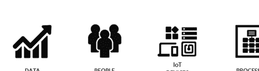

### 图 4.3 物联网运行的元素。

发出命令的位置。唯一的区别在于，数据并非自动下载，而是通过用户触发的操作（例如点击、语音命令）来获取。例如，监测心率的手环、配备运动传感器的床单，或检测人体活动的信标。

2. 其次，需要一个能接收传输信号、处理信号并在特定反应发生时触发操作的设备。它可以是一部智能手机、平板电脑或计算机，用于显示特定信息，也可以是另一个自动执行特定动作的物件，例如与家居自动化系统集成的卷帘窗、根据交通流量调整的交通信号灯，或显示还书日期提醒的图书馆书籍。

3. 构成此生态系统的最后一个元素是通信手段，即发送数据的方式。目前，市场上已有多种技术可在两个物体之间传输信息，从最流行的 `WiFi` 或 `蓝牙`，到 `NFC` 或 `Z-Wave`（例如用于楼宇自动化系统）。

## 4.4 物联网的应用

在发达的物联网世界中，每秒钟都会发生数千次信息交换过程，并且在许多情况下，设备之间的通信将是多路径的——使用更多的发射器和接收器。所有这一切都是为了在最终端（例如智能手机屏幕上）显示一条信息——从用户角度来看最重要的一条。不难想象，例如遍布全城的传感器，通过分析众多变量，用户能够获知最适合的离家时间，从而避免上班途中堵车。

物联网的广泛应用带来的直接管理效益（包括财务效益）体现在三个层面 [31]：

1. 数据到发现（Data to discovery）：基于新数据并利用分析技术，可以发现和识别以前未知存在的现象。例如，通过远程医疗设备的详细数据发现疾病的新病程模式。

2. 数据到决策（Data to decisions）：根据获得的知识采取行动，甚至常常可以自主执行。例如，向回访客户发送欢迎信息和产品推荐，或者在发生故障时紧急关闭电力涡轮机。

3. 数据到收益（Data to dollars）——红利：将前两种能力相结合，为组织带来实际财务收益或新的业务发展机会。这一层面还应包括那些如果没有物联网理念的应用就不可能存在的创新服务和产品（例如新兴的智能家居市场）。

物联网为经济、商业和管理创造了绝佳的机遇，影响了产品设计流程、服务以及人力资源管理等方面。物联网解决方案的益处包括降低成本、提高生产力和员工安全、更合理地配置资本、改善客户关系或管理流程等 [32]。物联网同时也是一项挑战——它改变了竞争机制、客户期望和产品本身，并提供创新功能，从而满足新的消费者需求。

物联网技术的应用十分强大，迄今仍未有上限。其解决方案既存在于私营部门的各行各业中 [33]：

- 电信与媒体。
- 金融。
- 物流与生产。
- 零售贸易。
- 汽车。
- 能源与媒体。
- 农业。

也存在于公共部门、医疗管理和家庭之中。

基于对调查和报告的分析，IERC 的科学家们发布了一份详尽的物联网应用清单，这证实了物联网在未来几年技术趋势中的战略地位。其中最重要的应用包括 [34]：

1. **智能生活**——创新、尖端的技术旨在让消费者的生活更简单、更安全。智能生活包括以下管理：
   - 医疗保健——一种以患者为中心且量身定制的业务方法。智能健康涵盖广泛的应用，用于监测健康状况和身体活动（例如老年人）、活力状况（例如积极运动的人群）、患者安全（无论在医院还是家中）。借助物联网，可以控制睡眠（智能床垫）或牙齿（使用智能牙刷）等。在工业层面，应用包括卫生监测（例如告知工厂中需要洗手的情况）、货物状态监测（例如医疗冰箱监控）以及安全监测（例如核电站的紫外线水平或辐射水平）。
   - 银行业务——全新的银行和个人理财模式。
   - 保险业——从统计转向基于事实的个性化保单。
   - 公共服务——提高行政部门、管理者和公民双方的效率和便利性。

2. **智能出行**——实时路线管理和解决方案，使出行更愉快、交通更可靠。将车辆连接到互联网创造了众多新的可能性和应用，促进出行并保障用户安全。智能出行包括：
   - 自动驾驶和所有车联网服务。
   - 城市出行——智能交通管理。
   - 城际出行——连接通信系统。
   - 收费管理和支付解决方案。
   - 配送与物流。
   - 车队管理。
   - 车辆之间以及与基础设施相关的直接通信。
   - 关键系统组件的识别与监控。

3. **智慧城市**——旨在提高城市生活质量的创新，包括安全和能效问题。智慧城市包括：
   - 城市基础设施的智能管理，使用大数据特有的数据分析工具。
   - 各行政机构之间的协作，利用云技术。
   - 利用移动技术进行实时数据采集和处理，实现即时响应。
   - 通过改进执法和更有效地应对危机来提高安全感。
   - 可持续城市规划——改进空间规划项目的方案和管理。
   - “互联公用事业”——智能计量设备以及燃气、供水、网络的管理。
   - 建设发展——更高的自动化水平、更好的管理和安全性。

4. **智能制造**——专为优化流程、管理、控制和品质而设计的制造与物流解决方案。通信无处不在、微机器人技术发展、适应个性化需求，这些都得益于极大改变生产世界的软件。智能生产包括：
   - 机器学习——智能、自动决策。
   - 网络化——生产设备的网络控制与管理。
   - 流程优化——快速原型制作和生产、改进流程以及更高效的供应链运营。
   - 设备主动管理——通过预防性诊断和维护。
   - 基础设施无缝集成——克服接口标准问题。

5. **智能能源与电网（智能能源、智能电网）**——彻底改变向终端用户生产和传输能源方式的技术，具有高安全性，适用于集中式和分布式装置。智能能源与电网包括：
   - 通过更可靠、更智能的传感器和执行器实现节能。
   - 安全功能的可扩展性。

6. **智能家居、智能建筑与基础设施**——利用无线互联网接入（`WiFi`）在家庭自动化中日益重要的作用，这主要归功于新电子产品中使用的网络化特性。

家用电器正开始成为家庭IP网络的一部分，连接到家庭网络的移动计算设备（智能手机、平板电脑等）数量也在不断增加。这些技术包括：
- 将建筑物或公寓的智能设备与例如娱乐系统等集成。
- 医疗保健监测。
- 在房屋或建筑物场景下对能耗进行无线监测。
- 智能楼宇管理系统。

物联网技术是横向的。这意味着它可以用于许多不同的行业和业务解决方案。此外，在每个行业内部，物联网系统可能出现在供应链的不同阶段，形成渗透到各个细分市场的解决方案生态系统。然而，有些行业对物联网系统的依赖程度将远高于其他行业，支持物联网市场发展的活动应聚焦于这些行业。因此，图4.4按行业部门汇总了2015–2020年全球物联网支出（单位：十亿美元）[35]。

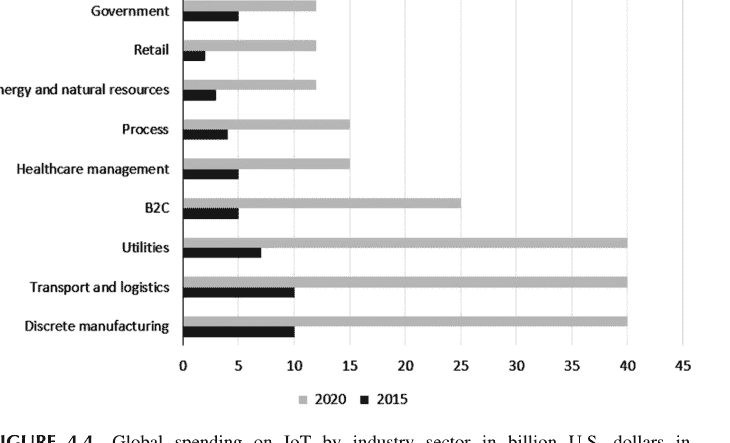

图4.4 2015–2020年按行业部门划分的全球物联网支出（单位：十亿美元）。

基于前述趋势，图4.5指出了在使用物联网所带来的收益量方面最为关键的行业[36]。

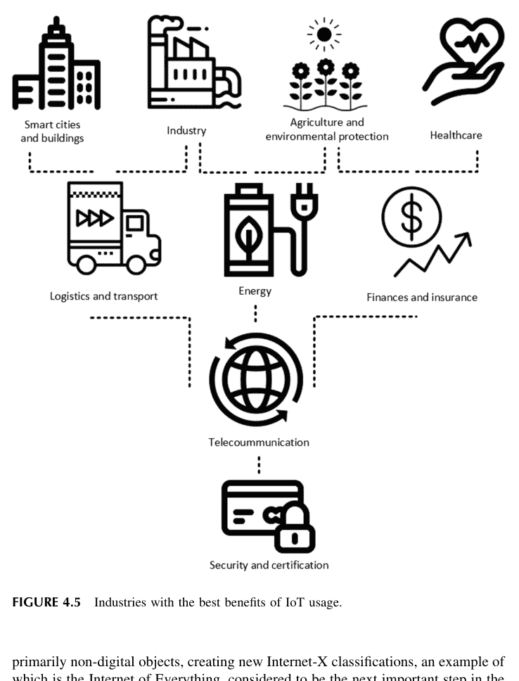

图4.5 物联网使用收益最佳的行业。

物联网技术应用的重要性和不断增长的可能性，将推动新数字设备的持续开发，这些设备主要取代非数字物体，并催生新的“互联网X”分类，“万物互联”就是其中一个例子，它被认为是数字工业革命的下一个重要步骤，而物联网只是其组成部分之一。

## 4.5 波兰的物联网——案例研究

尽管物联网在波兰潜力巨大，但其进一步的方向和发展将取决于生产商和服务提供商层面的适应情况。一个重大挑战——尤其是对RTV/家用电器生产商而言——将是提高竞争力并为用户创造附加价值。智能家居服务和产品显示出最显著的增长潜力。

为了确定物联网的发展前景以及波兰互联网用户对该生态系统的适应程度，IAB Polska与媒体和科学界代表合作开展了一项专门的研究项目[37]。该研究涵盖了与物联网相关的以下问题：
- 对现象的认知和适应意愿。
- 适应程度和购买潜力。
- 障碍与收益。

作为研究的一部分，共对1,121名14岁以上的波兰互联网用户进行了访谈。样本在性别、年龄和网络使用频率方面具有代表性，网站参与调查确保了覆盖率超过90%。测量采用`CAWI`方法于2015年5月6日至31日进行。在95%置信水平下，最大估计误差为2.84%。

该研究决定确定使用物联网解决方案的意愿，即使用三类具有互联网接入功能的设备的程度：家庭`WiFi`、移动设备和汽车。所有受访者都确认可以使用前两类设备，其中六分之一的人表示他们的汽车可以连接互联网（例如播放音乐、导航）。总体而言，绝大多数互联网用户（86%）可以使用支持网络的无线设备。需要强调的是，这主要取决于网络用户的年龄——在最年轻的受访者群体中，该比例略高于总体水平，然后逐渐上升，从营销角度看，在移动工作年龄的目标群体（35-44岁）中达到最大值（93%），随后在44岁以上人群中下降。

该研究还检验了互联网用户对“物联网”一词的了解程度。结果显示，只有11%的互联网用户遇到过“物联网”这一术语。需要指出的是，尽管了解程度与年龄无关，但表示了解该术语的男性明显多于女性。这种了解程度也与数字化程度相关——使用智能设备（智能手机、平板电脑）的人更常遇到这个术语。然而，即使普通用户使用了某项技术解决方案，也很少能理解技术或行业语言。因此，不足为奇的是——根据“物联网”研究——尽管对该概念的技术认知度如此之低，目前约有40%的波兰互联网用户拥有能够在物联网生态系统中运行的设备，另外50%的用户如果有这种可能也会使用此类设备。

截至目前，智能家居类别的物联网解决方案是使用程度最低的（只有百分之几的受访者表示拥有这类解决方案），但这是物联网消费应用中发展潜力最大的领域（图4.6）。研究确定的几个指标证明了这一点[38]。首先，互联网用户的家庭具有高度的无线数据传输特点——77%的家庭使用家庭`WiFi`（图4.7）。此外，这项技术被广泛使用，因为其86%的用户使用无线连接来操作一个以上的设备[38]。

考虑到未来考虑使用这类设备的人群，潜在用户数量的增长指数略高于200%。然而，在这一类别中，应特别关注健康保护设备，它在所展示的可穿戴配件中获得了最大的关注。

上文重点关注的是最典型的消费解决方案，但与物联网相关的产品和服务组合非常庞大[38]。还应注意，物联网设备的潜力取决于互联网使用的强度（图4.8）。

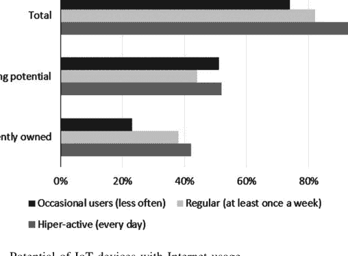

图4.8 物联网设备的互联网使用潜力。

例如，物联网可用于汽车行业、体育和旅游，以及文化和艺术（博物馆、电影院）和许多公共场所（酒店、机场、商店等）。研究结果表明，波兰互联网用户对此已做好充分准备——76%的用户至少时常在移动设备（如电话、智能手机、平板电脑）上使用`WiFi`，49%的人在博物馆或美术馆时希望能在手机上收到关于展览的信息和趣闻，41%的人在商店时会获取关于产品、折扣和促销的信息。物联网为整个经济、创新和创造力带来了巨大机遇。

## 4.6 智能健康管理——现象解读

无论从个人还是社会角度，人类健康都是最应持续关注的宝贵财富。随着文明的发展，医疗保健逐年改进。现代技术成就也促进了这一发展。智能健康管理（SHM）被定义为利用信息与通信技术支持与健康保护相关的活动[39]。

`SHM`是用来描述工具或解决方案的名称，这些工具或解决方案包括面向卫生当局和专业人士的产品、系统、流程和服务，以及为患者和公民定制的健康系统，例如健康信息网络、电子健康记录、远程医疗服务、个人便携式通信系统、健康门户，以及许多其他基于信息与通信技术的工具，用于帮助预防、诊断和治疗疾病，监测健康状况，引导适当的生活方式。

此外，该术语涵盖许多其他术语，如远程医疗、远程健康、远程医疗护理、医疗保健中的远程信息处理、医疗IT、健康信息管理、信息与通信技术[40]。除了计算机应用外，智能健康管理还包括用于医疗实践、教育和研究的认知信息处理和通信任务[41]。`SHM`的本质在于支持医疗保健流程的转型，使患者和医疗保健系统受益。

与此同时，`SHM`旨在通过教育患者了解其健康状况和预防知识来支持他们。它还允许患者自行应对危机。它为用户提供由经验丰富的健康专业人士支持的高质量标准服务，并能够最大程度地利用可用在线来源的知识潜力。因此，使用`SHM`可以远程监测患者并降低与其治疗相关的成本，并消除提供医疗护理时的地理障碍[42]。

尽管`SHM`在实践中得到有效应用，并被医生和社会广泛使用，但仍可以确定几个成功因素以及一些明确的障碍。此外，其中一些因素可能存在于特定情况下，并取决于这些情况，可能被视为严重因素（作为最佳实践），而较少被视为威胁，因为缺乏适当的实施方法[43]。实施智能健康的成功与失败因素汇总在表4.3中。

`SHM`的广泛分类基于服务、医疗设备、所用技术、应用、系统管理和最终用户[44]。智能医疗的分类如图4.9所示。

所使用的连接技术在扩展医疗保健系统所设计的应用方面发挥着至关重要的作用。通过无线技术高效集成小型设备，有助于通过物联网实现远程健康监测[45]。

医疗保健部门正因数字革命而发生转型。新技术正在创造一个新的在线医疗世界，从机器人手术到超精确治疗。物联网技术使医生能够使用医疗设备收集的数据，从而加速医疗保健管理的变革。这样，被动式医疗变成了主动式护理，有助于改善早期诊断。除了促进远程医疗外，物联网技术还可以通过跟踪医院床位等资源，帮助医疗组织提高效率[46]。

物联网数据有助于推动智慧医院的管理和发展，也有助于跟踪个人健康状况。物联网设备使患者能够更积极地控制自己的健康，这对老年人和慢性病患者尤为重要。使用物联网设备还可以帮助患者更快出院，甚至避免住院[47]。

## 参考文献

- [1]. J. McCarthy, 什么是人工智能。 http://www-formal.stanford.edu/jmc/whatisai.pdf (2007).
- [2]. W. Shi, J. Cao, Q. Zhang, Y. Li and L. Xu, 边缘计算：愿景与挑战。 IEEE 物联网期刊, 3 (5), 637–646 (2016).
- [3]. F. Chen, P. Deng, J. Wan, D. Zhang, A.V. Vasilakos and X. Rong, 物联网的数据挖掘：文献综述与挑战。 国际分布式传感器网络期刊, 1, 17 (2015).
- [4]. E. Alpaydin, 机器学习导论。 剑桥: MIT Press (2020).
- [5]. S. Reddy, J. Fox and M. Purohit, 人工智能赋能的医疗保健服务。 皇家医学学会期刊, 112 (1), 22–28 (2019).
- [6]. J.T. Wu, F. Dernoncourt, S. Gehrmann, P.D. Tyler, E.T. Moseley, E.T. Carlson and L. Celi, 幕后：一个医学自然语言处理项目。 国际医学信息学期刊, 112, 68–73 (2018).
- [7]. J. Liebowitz, 应用专家系统手册。 博卡拉顿: CRC Press (2019).
- [8]. R. Shah and A. Chircu, 医疗保健中的物联网与人工智能：系统文献综述。 信息系统问题, 19 (3), 49 (2018).
- [9]. K. Ashton, 那件“物联网”事物， http://www.rfidjournal.com/articles/view?4986 (2011).
- [10]. N. Gershenfeld, R. Krikorian and D. Cohen, 物联网。 科学美国人, 291, 76–81 (2004).
- [11]. M. Lianos and M. Douglas, 危险化与越轨的终结：制度环境。 英国犯罪学期刊, 40, 261–278 (2000).
- [12]. T. Ferguson, 让你的对象调用我的对象。 哈佛商业评论, 6, 1–7 (2002).
- [13]. R. Lombreglia, 物联网。 波士顿: 波士顿环球报 (2010).
- [14]. G. Jayavardhana, B. Rajkumar, S. Marusic and M. Palaniswami, 物联网：愿景、架构要素与未来方向。 未来一代 (2013).
- [15]. IERC, IERC—物联网欧洲研究集群，物联网。 物联网技术标准化立场文件，1645–1660 (2015).
- [16]. E. Bertino and N. Islam, 僵尸网络与物联网安全。 计算机, 50 (2), 76–79 (2017).
- [17]. J.H. Nord, A. Koohang and J. Paliszkiewicz, 物联网：综述与理论框架。 专家系统与应用, 133, 97–108 (2019).
- [18]. G. Singh, L. Gaur and R. Ramakrishnan, 印度物联网技术采用模型。 佩塔尼卡科学与技术期刊, 25 (3), 835–846 (2017).
- [19]. I. Yaqoob, E. Ahmed, I.A.T. Hashem, A.I.A. Ahmed, A. Gani, M. Imran and M. Guizani, 物联网架构：最新进展、分类、需求与开放挑战。 IEEE 无线通信, 24 (3), 10–16 (2017).

- [20]. J.P. Shim, M. Avital, A.R. Dennis, M. Rossi, C. Sørensen and A. French, 物联网对商业与社会的变革性影响。 信息系统协会通讯, 44 (1), 5 (2019).
- [21]. Cisco, 物联网：互联网的下一代演进如何改变一切。 思科互联网业务解决方案集团（IBSG）， http://www.woodsidecap.com/wp-content/uploads/2015/02/WCP-IOT-M_and_A-REPORT-2015-21.pdf (2011).
- [22]. S. Li, L. Da Xu and S. Zhao, 5G 物联网：综述。 *工业信息集成期刊*, 10, 1–9 (2018).
- [23]. D. Evans, 物联网——互联网的下一代演进如何改变一切。 *思科互联网业务解决方案集团（IBSG）*, https://www.cisco.com/c/dam/en_us/about/ac79/docs/innov/IoT_IBSG_0411FINAL.pdf (2011).
- [24]. M.E. Porter and J.E. Heppelmann, 智能互联产品如何改变竞争。 *哈佛商业评论*, 11, 64–89 (2014).
- [25]. J. Lin, W. Yu, N. Zhang, X. Yang, H. Zhang and W. Zhao, 物联网综述：架构、使能技术、安全与隐私及应用。 *IEEE 物联网期刊*, 4 (5), 1125–1142 (2017).
- [26]. S. Al Hinai and A.V. Singh, 物联网：架构、安全挑战与解决方案。 2017年信息通信技术与无人系统国际会议（趋势与未来方向 ICTUS）IEEE，1–4 (2017).
- [27]. A. Passemard, 物联网协议栈——从传感器到业务价值。 https://entrepreneurshitalk.wordpress.com/2014/01/29/the-internet-of-thing-protocol-stack-from-sensors-to-business-value/ (2014).
- [28]. B. Yang, Y. Lu, K. Zhu, Y. Zhang and J. Liu, 互联网及其度量的演进。 2017年第一届电子仪器与信息系统国际会议（EIIS）IEEE，1–4 (2017).
- [29]. E.A. Kosmatos, N.D. Tselikas and A.C. Boucouvalas, 将 RFID 和智能对象集成到统一的物联网架构中。 *物联网进展：科学研究*, 1, 5–12 (2011).
- [30]. V. Krotov, 物联网与新的商业机会。 *商业视野*, 60 (6), 831–841 (2017).
- [31]. K. Borne, 大数据——有什么用？ https://mapr.com/blog/big-data-what-it-good/ (2014).
- [32]. H.F. Atlam, A. Alenezi, M.O. Alassafi and G. Wills, 区块链与物联网：优势、挑战与未来方向。 *国际智能系统与应用期刊*, 10 (6), 40–48 (2018).
- [33]. G. Lampropoulos, K. Siakas and T. Anastasiadis, 第四次工业革命背景下的物联网：概述。 *国际创业知识期刊*, 7 (1), 4–19 (2019).
- [34]. G.N. Satish and P.S. Varma, 物联网——在未来智能世界中的机遇、应用与挑战。 *国际计算机科学与信息技术期刊*, 4 (3), 8–16 (2017).
- [35]. L. Shanhong, 按行业部门划分的物联网全球支出。 https://www.statista.com/statistics/1095375/global-spending-on-iot-by-industry-sector/ (2021).
- [36]. Q. Guo and Q. Xu, 基于5G网络和马尔可夫链的物联网产业集聚经济效益。 *微处理器与微系统*, 103438 (2020).
- [37]. M. Gro dner, W. Kokot, P. Kolenda, K. Krejtz, A. Legoń, P. Rytel and R. Wierzbiński, *波兰的物联网*。 华沙: IAB 波兰 (2015).
- [38]. IAB Polska, 物联网报告 (2015).
- [39]. M.I. Pramanik, R.Y. Lau, H. Demirkan and M.A.K. Azad, 智慧健康：智慧城市中的大数据驱动健康范式。 *专家系统与应用*, 87, 370–383 (2017).
- [40]. M.K. Al-Azzam and M.B. Alazzam, 智慧城市与智慧健康框架、挑战与机遇。 *国际先进计算机科学与应用期刊*, 10 (2), 171–176 (2019).
- [41]. H. Hamidi, 利用物联网和基于生物识别技术的认证开发智慧健康的方法。 *未来一代计算机系统*, 91, 434–449 (2019).
- [42]. S.P. Mohanty, U. Choppali and E. Kougianos, 你想知道的关于智慧城市的一切：物联网是骨干。 *IEEE 消费电子杂志*, 5 (3), 60–70 (2016).
- [43]. A. Solanas, C. Patsakis, M. Conti, I. Vlachos, V. Ramos, F. Falcone, O. Postolache, P.A. Pérez-Martínez, R. Di Pietro, D.N. Perrea and A.M. Ballesté, 智慧健康：智慧城市中的情境感知健康范式。 *IEEE 通信杂志*, 52 (8), 74–81 (2014).
- [44]. P. Sundaravadivel, E. Kougianos, S.P. Mohanty and M.K. Ganapathiraju, 你想知道的一切关于智慧医疗：评估物联网的不同技术和组件以实现更好的健康。 *IEEE 消费电子杂志*, 7 (1), 18–28 (2018).
- [45]. K. Ullah, M.A. Shah and S. Zhang, 在医疗和智慧健康领域有效使用物联网的方法。 国际智能系统工程会议（ICISE）论文集，372–379 (2016).
- [46]. M. Diaz, G. Juan, O. Lucas and A. Ryuga, 物联网上的大数据：电子健康的一个示例。 第六届普适计算创新移动与互联网服务国际会议论文集，898–900 (2012).
- [47]. J. Wang, L. Li, L. Wang and W. Zhao, 物联网在居民健康信息服务平台研究中的应用。 IET 通信技术与应用国际会议论文集，631–635 (2011).

# 5 印度阿尔茨海默病现状：患病率、污名化和迷思

Surekha Manhas, Zaved Ahmed Khan, and Meenu Gupta

## CONTENTS

- 5.1 背景...........................................................82
- 5.2 引言...........................................................82
- 5.3 AD 发病期间大脑发生的改变........................................83
- 5.4 轻度认知障碍 ...............................................83
- 5.5 神经机制 .......................................................84
- 5.6 病理发生 .......................................................84
- 5.7 线粒体损伤导致活性氧物种的产生 ......................................84
- 5.8 与阿尔茨海默病相关的基因 ....................................85
- 5.8.1 淀粉样前体蛋白............................................86
- 5.8.2 PSEN-1 和 PSEN-2 基因..............................................86
- 5.8.3 Tau 基因 .............................................................87
- 5.8.4 APOE 基因 ............................................................87
- 5.9 血脑屏障 ...................................................87
- 5.10 小胶质细胞激活以产生对损伤的反应 ..........................................................88
- 5.11 阿尔茨海默病诊断的早期症状.............................88
- 5.12 磁共振成像.............................................89
- 5.13 阿尔茨海默病的药物 ...........................................90
- 5.13.1 胆碱酯酶抑制剂 .......................................90
- 5.13.1.1 Tacrine ...........................................................90
- 5.13.1.2 Donepezil ..........................................................90
- 5.13.1.3 Rivastigmine ......................................................90
- 5.13.1.4 Galantamine .......................................................90
- 5.13.2 神经元保护..................................................90
- 5.13.2.1 Estrogen ...........................................................90
- 5.13.2.2 Vitamin E...........................................................91
- 5.13.2.3 抗炎药物 ............................................91
- 5.14 脑脊液和血浆蛋白依赖性生物标志物....................................91
- 5.15 污名........................................................................91
- 5.16 印度护理 ...........................................................91
- 5.17 为痴呆患者提供庇护的非政府组织 [60]...............................................93
- 5.18 印度缺乏认知...........................................................93
- 5.19 与 AD 相关的迷思.......................................................93
- 5.19.1 迷思 1 .....................................................................93
- 5.19.2 迷思 2 .....................................................................93
- 5.19.3 迷思 3 .....................................................................94
- 5.19.4 迷思 4 .....................................................................94
- 5.19.5 迷思 5 .....................................................................94
- 5.19.6 迷思 6 .....................................................................94
- 5.19.7 迷思 7 .....................................................................94
- 5.20 印度人对精神疾病的态度...........................................95
- 5.21 印度人口老龄化.......................................................95
- 5.22 痴呆的特征.....................................................95
- 5.23 结论 ...................................................................98
- 参考文献........................................................................100

### 5.1 背景

1906年，Alois Alzheimer 博士是第一个通过观察其患有记忆丧失和心理变化的患者大脑神经细胞萎缩来阐明这种极具破坏性的阿尔茨海默病的人。估计印度有超过400万人患有阿尔茨海默病（`AD`），然而许多人，尤其是农村人，并不了解这种疾病，因为他们通常将记忆丧失视为不可避免的老化的一部分，而不是任何神经退行性疾病的征兆。`AD` 持续以更快速度增加，因此印度阿尔茨海默病的负担也在增加。在中国和美国之后，印度是世界上第三大病例负担国家。但仍然没有有效的药物和治疗方法可以治愈这种疾病。该领域需要更多研究来治疗 `AD`。

### 5.2 引言

`AD` 是多种异质性毁灭性神经退行性疾病之一，其导致与认知功能相关的进行性不懈丧失，包括思维、语言和行为，与淀粉样-β（`Aβ`）肽和 `tau` 蛋白的积累有关，最终导致大脑海马区形成老年斑。痴呆通常影响老年人群，由 `AD` 引起，这是最常见的痴呆形式，对家庭、个人和社会生活产生巨大影响。通常在60岁后出现的早期典型症状是近期记忆丧失、语言问题、轻微协调问题和心理问题。有关于冠状 `T1` 加权磁共振成像（`MRI`）扫描研究在患有中度 `AD` 的患者中的报道。该研究显示，海马区疾病进展导致海马萎缩 [1]。

### 5.3 AD 发病期间大脑发生的改变

在中枢神经系统中，神经元是帮助从一个神经传递信息到另一个神经的基本有力细胞。正常健康成年人的大脑拥有超过十亿个神经元，每个神经元都有长分支延伸，具有轴突和多个树突。神经元通过建立它们之间的连接进行交流，称为突触，其数量通常超过万亿。信息的流动通常以神经递质等微小化学物质的形式进行，这些化学物质由单个特定神经元释放，并通过大脑的神经回路被其他特定接收神经元检测到，该回路产生思想、情绪、运动和记忆的细胞基础。

与 `AD` 相关的两个主要大脑变化是 β-淀粉样蛋白（蛋白质片段）在神经元外的积累，该肽由36–43个氨基酸组成，以及 `tau` 蛋白在神经元内部以缺陷形式积累，从而不再稳定微管的特性。β-淀粉样蛋白（β-淀粉样斑块）的积累被认为负责细胞死亡，因为它们限制了神经元在突触处的内部信息传递，而 `tau` 蛋白（`tau` 纤维缠结）阻断了神经元内的营养交换。当神经元中 β-淀粉样蛋白的浓度开始增加时，就达到了缺陷 `tau` 蛋白扩散到整个大脑的程度。炎症和萎缩是在 `AD` 期间检测到的状况。高浓度的有毒 β-淀粉样蛋白和异常形式的 `tau` 蛋白会导致大脑中称为小胶质细胞的免疫细胞激活，这些细胞存在于中枢神经系统中，通过作为巨噬细胞发挥作用，通过吞噬作用清除斑块、细胞碎片和死亡神经元。由于大脑中细胞的丧失，它会缩小，这是萎缩的主要原因。细胞的丧失导致大脑代谢葡萄糖（燃料来源）的能力下降，导致认知功能减慢和记忆丧失 [2]。

根据研究，与阿尔茨海默病相关的在大脑中发生的若干变化在症状显现之前就于20岁左右开始出现。出现早期变化后，大脑会尝试恢复它以便正常执行功能。当疾病恶化时，大脑无法立即恢复，然后患者开始出现症状，如认知功能丧失 [3]。

### 5.4 轻度认知障碍

轻度认知障碍（`MCI`）是一种个体表现出良性但明显变化的状态，这些变化很容易被家庭成员察觉。尽管存在这种状况，个体仍能够执行日常活动。`MCI` 影响65岁以下20%的个体。患有 `MCI` 的人比没有 `MCI` 的人更可能发展为阿尔茨海默病 [3]。

### 5.5 神经机制

在阿尔茨海默病（AD）期间，大量脑细胞受到影响，且受影响数量因不同脑区而异，这取决于神经肽和神经递质的表达，包括屏状核、黑质、纹状体、丘脑和蓝斑。由于退行性过程，细胞通常会经历这一过程，并因此发生细胞萎缩，导致神经元细胞丢失。这种细微疾病的病理学还可能影响非神经元细胞，如小胶质细胞、星形胶质细胞、少突胶质细胞、血管和脉络丛。转基因小鼠的AD模型表明，脑组织中淀粉样斑块的存在极有可能通过树突棘丢失或突触功能障碍而干扰正常的脑功能。脑组织的尸检研究表明，与正常脑组织相比，患有这种致命疾病的个体大脑海马区的树突棘和突触密度通常显著下降。树突棘的丢失与精神状态恶化直接相关，并且也作为疾病的一个指标 [4]。

## 5.6 病理发生机制

为了详细解释AD，人们提出了不同的假说：(a) `Aβ`淀粉样蛋白假说，(b) 溶酶体假说，(c) 钙失调假说，(d) `A-β`淀粉样蛋白寡聚体假说，(e) `tau`蛋白假说。在这些假说中，淀粉样蛋白假说是研究最充分的一个，其依据是多项报告解释了脑内`A-β`沉积、神经元丢失（神经元萎缩）和认知障碍之间的微弱相互关系。1984年，两位科学家George Glenner和Caine Wong通过蛋白水解切割淀粉样前体蛋白（`APP`），分离出多种形式的脑血管`Aβ`，从而发现了阿尔茨海默病的基本机制。因此，阿尔茨海默病的病理学与`Aβ`肽的存在直接相关，`Aβ`肽导致神经元结构中的树突棘不稳定和功能缺陷 [3]。毒性蛋白形成（淀粉样蛋白和`tau`蛋白）以及其他非神经元细胞（如小胶质细胞）作为巨噬细胞参与清除脑内不需要的物质，以维持脑的正常功能 [5]。

## 5.7 线粒体损伤导致活性氧产生

由于脑内代谢活动旺盛，神经元需要大量能量来执行脑的正常功能，这些功能特别依赖于脑组织中线粒体通过氧化磷酸化来实现，在此过程中会产生大量活性氧（`ROS`），而升高的水平通常会被线粒体内的正常稳态过程所抵消。`Aβ`是一种强效的单体分子，极易形成大量可在脑中自由移动的小聚集体，最终形成斑块，这些斑块是AD的指征（标志）。`Aβ`分子能够穿透质膜并与线粒体内部缺陷蛋白接触，导致电子传递链活性下降和`ROS`产生增加。`Aβ`浓度增加是细胞毒性的原因。`ROS`也是AD的一个标志 [6]。

## 5.8 与阿尔茨海默病相关的基因

包括`PSEN-1`、`APP`和`PSEN-2`在内的多个不同基因在这种毁灭性疾病的进展中发挥重要作用。这些基因的突变会导致淀粉样斑块的形成，斑块在神经元外积累会阻碍细胞信号通路（表5.1和表5.2）。

## 表5.1

参与阿尔茨海默病遗传学的不同基因及其描述和ID [7]

| 序号 | 基因符号 | 基因ID | 描述 |

|---|---|---|---|

| 1. | `APP` | GC21M027252 | β-淀粉样蛋白（A4）前体蛋白：AD风险因子；位于21号染色体 |

| 2. | `BPTF` | GC17P065821 | 溴结构域PHD指转录因子 |

| 3. | `PSEN1` | GC14P073603 | 早老素1：位于17号染色体；决定β-分泌酶活性，导致蛋白水解 |

| 4. | `COL25A1` | GC04M109731 | 胶原蛋白XXV型α1 |

| 5. | `APBB1` | GC11M006414 | β-淀粉样蛋白（A4）前体蛋白结合蛋白家族B成员1（Fe65） |

| 6. | `PSEN2` | GC01P227058 | 早老素2：β-分泌酶活性，负责蛋白水解 |

| 7. | `GSK3B` | GC03M119540 | 糖原合成酶激酶3β |

| 8. | `PSENEN` | GC19P036236 | 早老素增强子γ-分泌酶亚基 |

| 9. | `CHAT` | GC10P050817 | 胆碱O-乙酰转移酶 |

| 10. | `MAPT` | GC17P043971 | 微管相关蛋白`tau`：位置：17号染色体；神经原纤维缠结形成；AD风险标志 |

| 11. | `APBA1` | GC09M072042 | β-淀粉样蛋白（A4）前体蛋白结合蛋白家族A成员1 |

| 12. | `CDK5R1` | GC17P030813 | 细胞周期蛋白依赖性激酶5调节亚基1（p35） |

| 13. | `CASP2` | GC07P142985 | 凋亡相关半胱氨酸肽酶，半胱天冬酶2 |

| 14. | `LRP1` | GC12P057497 | 低密度脂蛋白受体相关蛋白1 |

| 15. | `APOE` | GC19P045408 | 载脂蛋白E：神经保护；脂质稳态 |

| 16. | `APBA2` | GC15P029213 | β-淀粉样蛋白（A4）前体蛋白结合蛋白家族A成员2 |

| 17. | `NCSTN` | GC01P160313 | 尼卡斯特林 |

| 18. | `CLSTN1` | GC01M009789 | 钙突触蛋白1 |

| 19. | `APBB1` | GC11M006414 | β-淀粉样蛋白（A4）前体蛋白结合蛋白家族B成员1（Fe65） |

| 20. | `GSK3A` | GC19M042734 | 糖原合成酶激酶3α |

## 表5.2

阿尔茨海默病病例研究中观察到的三个特异性突变基因及其位置和分子效应 [7]

| 序号 | 蛋白质 | 突变数 | 基因 | 位置 | 分子水平的致病效应 |

|---|---|---|---|---|---|

| 1. | 早老素2 | 14 | `PSEN-2` | 14q24 | `Aβ42:Aβ40`比例增加 |

| 2. | β-淀粉样前体蛋白 | 32 | `APP` | 21q21 | β-淀粉样蛋白产生增加/`Aβ42:Aβ40`比例增加 |

| 3. | 早老素1 | 182 | `PSEN-1` | 14q24 | `Aβ42:Aβ40`比例升高 |

### 5.8.1 淀粉样前体蛋白

编码淀粉样前体蛋白（`APP`）的特定基因位于人类21号染色体上，包含19个外显子，在DNA中跨度约240 kbp，在细胞突触发育、神经元损伤、铁输出和修复机制中起着重要作用 [8–12]。`APP`基因突变会引起该基因产物的蛋白水解，并导致淀粉样斑块形成 [13–15]。`APP`和`Aβ`是AD的两个强效指标，它们是通过β和γ分泌酶在`APP`的β和γ位点特异性切割，经连续蛋白水解过程产生的正常神经元蛋白产物。通常患有唐氏综合征的患者患AD的风险较高，因为这两种疾病都是由21号染色体的变化引起的。`APP`经过某些翻译后修饰，如酪氨酸硫酸化、糖基化、唾液酸化以及其他蛋白水解过程，生成肽片段 [16]。已发现，改变`APP` 5′UTR区域中的单个核苷酸（单核苷酸多态性）可破坏`APP` mRNA的翻译 [17]。

### 5.8.2 `PSEN-1` 和 `PSEN-2` 基因

早老素-1和早老素-2的基因位于14号染色体上，它决定β-分泌酶的活性，β-分泌酶负责通常发生在`APP`和其他`NOTCH`受体相关蛋白中的蛋白水解 [18–20]。这些基因在结构上很关键，具有13个外显子，其中10个外显子由编码序列组成，而其余4个不同外显子上存在5′ UTR区域 [21–24]。`PSEN-1`基因的启动子区域包含CAAT盒、`STAT`元件和TAAT盒，负责依赖于信号转导的转录过程的激活 [24]。这两个基因编码的蛋白质彼此具有67%的相似性 [25–27]。在`PSEN-1`中，已在外显子8和9之间观察到内含子多态性，该多态性与晚发性疾病表现出显著的关联 [28]。然而，多项不同的数据集研究报告证实了这种关联，但也有其他报告未描述这种关联 [29–35]。

### 5.8.3 `TAU` 基因

`Tau` 是一种蛋白质（磷蛋白），在神经元结构的稳定中发挥重要作用并维持微管稳定性 [36,37]。控制 `tau` 蛋白产生的基因位于 17 号染色体上，突变时会导致神经元内部形成神经原纤维缠结，进而干扰细胞之间的信息传递。微管相关蛋白 `tau` (`MAPT`) 基因的替代性剪接导致 `tau` 蛋白的形成 [38,39]。因此，后转录修饰过程的变化导致 `tau` 过度磷酸化形成一种异常形式，即神经原纤维缠结 [40]。在 AD 中，磷酸化通常发生在 19 个氨基酸上，丝氨酸位点为 119、202、409、396，苏氨酸位点为 231 [41,42]。

### 5.8.4 `APOE` 基因

载脂蛋白 E 由 299 个氨基酸组成，在神经元保护和脂质稳态中发挥主要作用 [43–45]。根据其在 112 和 158 的相应位置，大脑中存在三种不同的主要等位基因，e2、e3 和 e4。野生型 e3、e2 和 e4 的位置分别为 Cys 112 和 Arg 158、Cys 112 和 Arg158，以及 Arg 112 和 Arg158 [46–48]。最常见的等位基因是 e3，见于大多数老年人，而 e4 则主要见于 AD 患者 [49–51]。等位基因 e4 被认为是 AD 的遗传风险因素 [52]。在尼日利亚人群的研究中观察到等位基因 e4 的表达频率最高，而该人群中 AD 的患病率较低，这可能与低胆固醇水平有关 [53–56]。在多项研究中观察到 e2 等位基因在 AD 中发挥保护作用 [57,58]（图 5.1）。

## 5.9 血脑屏障

为了有效将药物递送至靶点，药物应具有穿过血脑屏障（`BBB`）的潜力以便到达靶点，但 `BBB`

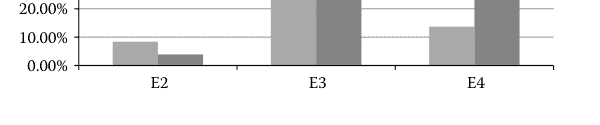

图 5.1 与高加索人群相关病例研究中人类 `APOE` 基因相关的估计等位基因频率 [58]。

不允许细胞旁被动扩散，这在药物递送过程中造成了阻碍。这种阻碍可以通过使用先进的纳米技术克服。`BBB` 由中枢神经系统中内皮细胞的若干毛细血管组成，它们通过紧密连接紧密连接在一起，仅允许提供神经元保护的营养物质或离子进入大脑部分，以维持稳态并限制有毒物质或药物的进入。另一种抑制某些分子或药物进入的额外屏障是血-CSF，其主要作用是将血液与位于脉络丛的脑脊液分离，并通过包围大脑覆盖蛛网膜下腔。中枢神经系统某些部位不存在 `BBB`，但尽管如此，这些特定区域含有类似外周的微血管，称为室周器官，包括正中隆起、脉络丛。室周器官中存在的毛细血管负责间质液和血液内的自由溶质运动。膜转运蛋白（内流和外流转运蛋白）的存在作为屏障，允许外源物质或药物的进入和排出。药物递送过程中的阻碍和降解是由于大脑中存在不同的强效酶，它们产生作用以阻断药物的进入。为了通过被动扩散轻松穿过 `BBB`，药物应为脂质分子，分子量约为小于 500 Da，分配系数为 0.5 至 6.0，pH 应为中性 [59]。因此，已使用某些不同方法来克服药物递送过程中穿过 `BBB` 时出现的问题，包括仿生学、颅内输注、利尿剂和对流增强递送 [60–63]。与安全性、特异性相关的问题阻碍了药物有效递送至靶点 [64,65]。为了检验多种药物的有效性，使用动物模型并用聚焦超声处理，将特定药物递送至靶点，包括干细胞、病毒、抗体、赫赛汀、纳米颗粒和化疗 [66–73]。

## 5.10 微胶质细胞激活以产生损伤反应

在神经退行性过程中，微胶质细胞被激活并转化为吞噬细胞，在中枢神经系统中作为抗原呈递细胞发挥作用，以产生清除细胞碎片的反应。T 细胞通过微胶质细胞表达的 `Fcγ`、`MHC I` 类和 II 类以及 `B7` 等受体被激活。微胶质细胞在神经元死亡期间被激活，而当神经元细胞没有死亡时，它们会恢复到静息状态 [74]。

## 5.11 阿尔茨海默病诊断的早期症状

Dr. Parveen Gupta，Fortis 学院神经科系主任，已解释了某些与阿尔茨海默病相关的症状：

- 认知活动下降，如思考、学习和其他心理过程。

女性体内的雌激素。通过规律摄入雌激素可以一定程度上降低该病的风险。雌激素的有效性通过多种机制实现，包括激活胆碱能神经元、降低血浆中 `APOE`、增加神经元对葡萄糖的摄取。

#### 5.13.2.2 维生素 E

它是一种强效抗氧化剂，在抑制脂质的氧化降解以治疗多种疾病（如阿尔茨海默病）方面发挥重要作用，其中可延缓该病的症状。通常观察到的副作用是晕厥和白内障，维生素 E 缺乏会增加出血风险。对该病影响巨大的其他抗氧化剂有司来吉兰、银杏叶、依地苯酮。

#### 5.13.2.3 抗炎药物

某些抗炎药物，包括吲哚美辛、布洛芬、泼尼松、阿司匹林，已被确定可延缓阿尔茨海默病的常规进展 [62]。

## 5.14 脑脊液和血浆蛋白依赖性生物标志物

正在开发各种不同的生物标志物以正确诊断 AD。取患者血液以检查某些蛋白质或离子的浓度，其在血液中的升高或降低水平有助于诊断疾病。研究发现，在 AD 中，`Aβ-42` 的水平下降，同时磷酸化 `tau` 肽蛋白水平升高 [76]。

## 5.15 污名

精神疾病患者所面临的公众污名是一个全球性问题，对个人生活产生显著负面影响。公众对污名化群体的观点完全依赖于几个要素：首先，他们通常对污名化群体持有悲观的信念并将其视为刻板印象。其次，他们对污名化个体表现出情感反应。第三，他们开始歧视这些人。公众普遍认为污名化群体是危险的信号并开始与他们保持距离，导致社会孤立 [77]。根据 2016 年 NCRB 报告，65 岁以下超过 13,200 名个人无法找到自己的家而后失踪（图 5.3）。

## 5.16 印度的护理

AD 主要影响 65 岁以下的个体。在印度，12.5 亿人年龄在 35 岁以下，并且由于年龄结构转变，80% 的印度人将在未来几年超过 65 岁。这意味着在不久的将来，印度与阿尔茨海默病相关的新的病例将会增加。在农村地区，老年人独自生活并自食其力时，他们会忘记自己的家，然后开始睡在道路或其他地方。这显示了该疾病的丑陋面孔，因为它

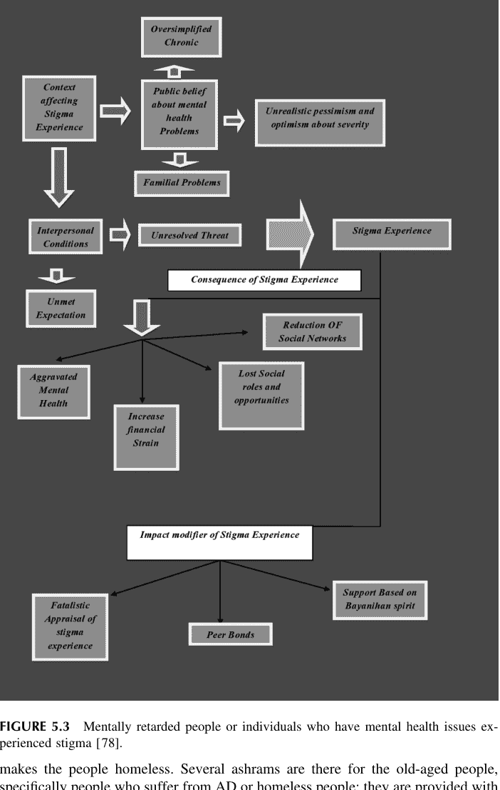

## 图5.3 智障人士或有心理健康问题的人遭受污名化[78]。

这使得人们无家可归。有几家修行所专门收留老年人，特别是患有阿尔茨海默病（AD）或无家可归的人；除了为阿尔茨海默病患者提供治疗外，他们还提供住宿和其他居家设施，例如，位于德里的养老院Guru Vishram Vridh Ashram，专门收治面临这种潜伏性疾病的人[77]。

## 5.17 为痴呆症患者提供庇护的非政府组织[60]

一些非政府组织（`NGO`）为痴呆症患者提供温暖的关怀：

- Silver Innings

- Help Age India

- ARDSI

## 5.18 印度对此缺乏认识

印度人口约13.392亿，增长迅速，其中超过160万人患有这种不易察觉的疾病，预计到2050年底这一数字将增至三倍。世界阿尔茨海默病日于9月21日举行，旨在提高人们对这种神经退行性疾病及其对我们日常生活的可怕影响的认识。

ISCR主席Chirag Trivedi博士解释了阿尔茨海默病的某些影响：在印度，人口持续增长，尤其是老年人口，因此这种疾病的负担日益加重。由于男性预期寿命较低，女性比男性更容易受到影响。根据2016年《柳叶刀》关于健康预期寿命的研究，女性的预期寿命高于男性，实际上女性在残疾状态下度过一生，面临许多问题。为了妥善治愈这种疾病，应该在某种程度上调整临床研究[74]。

## 5.19 与AD相关的误解

人们对阿尔茨海默病有许多误解。

### 5.19.1 误解1

阿尔茨海默病和痴呆症是同一种疾病：痴呆症是一种导致大脑功能下降的精神疾病，包括与记忆、语言和推理相关的问题，而AD通常影响60至80岁的人群，被认为是痴呆症的一种常见形式。与阿尔茨海默病相关的常见症状是记忆丧失，这主要影响个人的日常生活。

### 5.19.2 误解2

阿尔茨海默病只影响老年人群：AD通常影响65岁以下的人群，但已发现许多案例表明，40多岁和50多岁的人也会患上这种疾病，即早发性AD。有时，AD期间出现的症状与衰老相关的症状相似，但可以相互区分。

### 5.19.3 误解3

阿尔茨海默病是一种基因相关疾病：许多基因突变会导致阿尔茨海默病的发展。`APOE` e4的存在增加了患阿尔茨海默病的几率，这种基因通常遗传自父母。不仅遗传因素导致这种特定疾病的发生，某些环境因素和日常生活方式活动也对其负有责任。这种疾病不仅影响携带`APOE` e4基因的人，也影响没有`APOE` e4基因的人。

### 5.19.4 误解4

阿尔茨海默病无法预防：目前市场上没有专门的方法、技术或药物可以预防阿尔茨海默病。但大量研究表明，定期摄入omega-3、维生素E、B和C，配合草药疗法、硒和叶酸，以及定期锻炼，可以在一定程度上减少这种疾病的影响。

### 5.19.5 误解5

阿尔茨海默病不会致命：阿尔茨海默病破坏神经细胞，然后在与正常大脑功能相关的细胞信号通路中造成许多问题，导致记忆丧失和行为模式改变，家人很容易预见到这些变化。

### 5.19.6 误解6

记忆丧失是阿尔茨海默病的征兆：阿尔茨海默病导致因神经细胞退化而出现的异常活动，包括忘记自己的名字、回家的路、亲密的朋友以及与人交流的方式。

### 5.19.7 误解7

患有阿尔茨海默病并不意味着有特定的迹象与阿尔茨海默病患者的死亡相关，尽管阿尔茨海默病患者可以在患有这种疾病的情况下存活一段时间。阿尔茨海默病并不直接导致个体死亡，尽管如此，AD患者在确诊后仍可存活多年。市场上有多种不同的药物可以在一定程度上减缓这种疾病的进展[60]。

## 5.20 印度对精神疾病的态度

关于对精神疾病态度的调查涵盖了四个主要的不同主题：

- 与恐惧相关的精神疾病

- 人们对精神疾病的认识

- 社区对精神疾病患者的态度

- 与精神障碍相关的可识别原因

以下选定的陈述已用于调查：大约60%的人同意这样的陈述，即精神疾病与缺乏意志力和自信心有关。约60%的人承认，精神不健康的人应该集体住在单独的地方，以避免对健康人造成危险。近46%的受访者认为他们应该与精神抑郁的人保持距离。约41%的人同意他们应该与智障人士坐在一起并与之交谈。约40%的受访者无法想象与精神疾病患者生活在一起。其余68%的人同意他们应该给予精神疾病患者适当的照顾，而57%的人不害怕与精神失常的人一起工作（图5.4）。

## 5.21 印度的人口老龄化

老龄化与不可避免且不可逆转的人口转变相关。由于医学科学的进步，包括生育率下降和死亡率降低，老年人口比例自发增加，从而导致更多痴呆症（年龄相关疾病）病例[79]。

## 5.22 痴呆症的特征

表5.3总结了区分正常衰老、前驱期痴呆和痴呆的特征。

从1947年到2019年，印度的预期寿命持续增长至68.3岁，预计到2050年底将达到80岁，这得益于医学科学的进步和新技术的应用，这些最终降低了死亡率和生育率，使人们能够存活更长时间。这反过来又导致更多与阿尔茨海默病高风险相关的痴呆症病例[80]（图5.5和图5.6）。

根据ARDSI 2017年的报告，印度各邦在人口转变方面表现出巨大的人口多样性。老年人口比率也根据各邦的年龄结构和老龄化经历呈现出不同的峰值。从图中可以清楚看出，喀拉拉邦出现了一个高峰；这意味着老年人口规模最大，而阿萨姆邦的峰值最低，老年人口比率较低。根据数据，在人口老龄化方面，南部各邦如喀拉拉邦和泰米尔纳德邦是

## 百分比

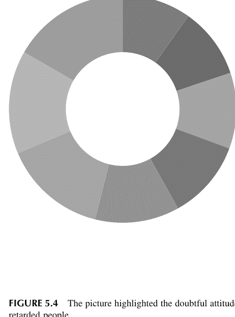

- 对智障人士的可怕行为

- 避免与可能影响正常健康人的精神受影响者交谈

- 精神疾病患者的暴力性格

- 与抑郁者保持距离

- 曾经是精神病院的患者不能获得保姆工作

- 智障人士应安置在远离正常人群社会的不同地方

- 精神疾病最主要的原因是缺乏意志力和自信心

- 精神疾病患者不负责任

图5.4 该图突出了对智障人士的怀疑态度或行为。

## 表5.3

### 痴呆、前驱期痴呆和正常衰老之间的区别特征[65]

| 序号 | 特征 | 痴呆 | 前驱期痴呆 | 正常衰老 |
|---|---|---|---|---|
| 1. | 海马体萎缩 | - | + | ++ |
| 2. | 进行性损害 | - | + | ++ |
| 3. | 语言障碍（失语症） | - | - | ++ |
| 4. | 基于主观视角的抱怨 | ++ | +/- | - |
| 5. | 缺陷掩饰 | +/- | +/- | + |
| 6. | 顺行性记忆处理 | - | + | ++ |
| 7. | 逆行性记忆处理 | - | - | + |

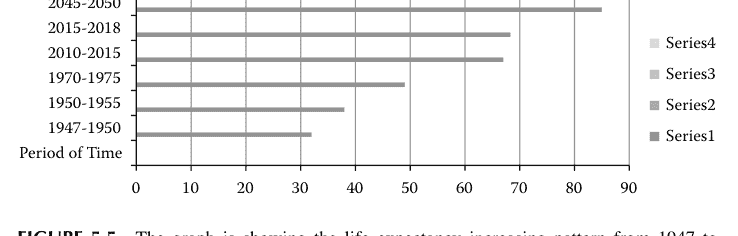

图5.5 该图显示了1947年至2050年预期寿命的增长模式[80,81]。

## 60岁及以上人口比例

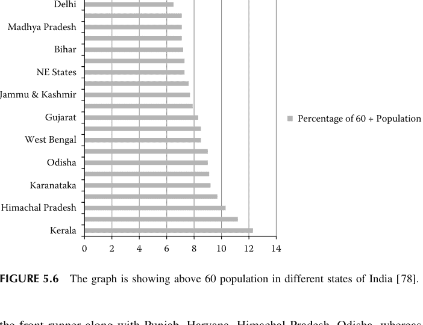

图5.6 该图显示了印度各邦60岁以上的人口情况[78]。

旁遮普邦、哈里亚纳邦、喜马偕尔邦和奥里萨邦处于领先地位，而在包括北方邦、查谟和克什米尔在内的北部各邦，老年人口比例较低。老年人口比例较高反映了对适当设施、护理和治疗的更大需求。根据2011年人口普查数据，在老龄人口中，仍在工作的人口比例估计约为14:100，其中超过14人是老年人。但在某些南部邦，这一比例超过14，这些邦每年因阿尔茨海默病病例较多而出现大量痴呆症病例[76]（图5.7）。

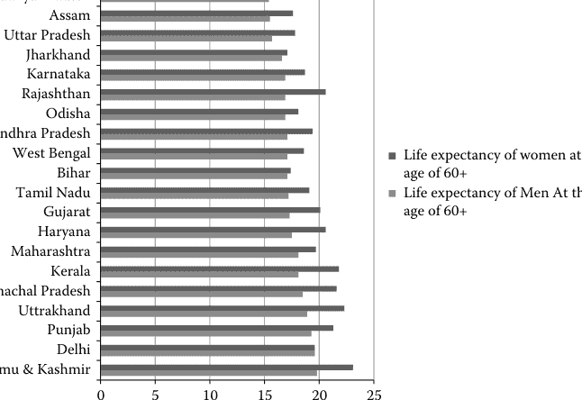

图5.7 印度不同邦男性和女性预期寿命的差异[77]。

从图5.7可以看出，由于医学科学的进步，各邦的平均预期寿命以不同的速度持续增长。在老年阶段，女性的预期寿命高于男性（图5.8）。

2011年人口普查数据显示，总人口的66%目前处于已婚状态，32%为丧偶状态，其余3%属于离婚等其他类别。在老年男性和女性人口中，分别只有82%和50%处于已婚状态，而48%的老年女性和15%的老年男性处于丧偶状态（图5.9）。

印度不同地区之间的巨大差异主要取决于多种因素，如多民族、多元文化、采用不同的工具和技术、使用不同的方法、环境因素等。因此，与南印度相比，西印度的痴呆症病例更多，北印度和东印度也存在差异。

## 5.23 结论

阿尔茨海默病是一种无法治愈的隐袭性疾病，通常影响世界各地的人们。由于死亡率的显著降低和医学科学的进步，预期寿命延长，最终增加了与精神疾病或痴呆症相关的阿尔茨海默病的风险。各种

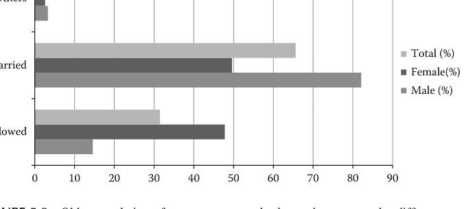

图5.8 处于不同类别（包括已婚、丧偶及其他）的老年男性、女性及其他人口[78]。

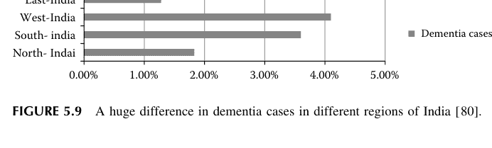

图5.9 印度不同地区痴呆症病例的巨大差异[80]。

技术和药物正在被开发，以便为阿尔茨海默病患者提供适当的治疗。但药物效果并不显著。为了治愈该疾病，需要有效的药物。目前正在制备基于血浆的生物标志物和其他基于体液的生物标志物（如基于脑脊液的生物标志物），用于疾病诊断，其中估算不同蛋白质或蛋白质产物（如β-淀粉样蛋白）的浓度。

目前已鉴定出多个基因，它们在大脑海马体区域中β-淀粉样蛋白和tau蛋白等多种蛋白质的不良生成中起关键作用，但与之相关的确切通路尚不清楚。

小胶质细胞是大脑的吞噬细胞，它们会被破坏或经历凋亡过程，但与数量急剧减少相关的确切机制尚不清楚。

据估计，未来几年印度将出现更多阿尔茨海默病病例，因为人们对这种疾病缺乏认识。他们认为，记忆力减退是衰老的迹象，而不是疾病；在印度社会中，精神失常的人被视为危险的标志，人们开始与他保持距离，而不是帮助他。

印度社会有必要提高认识，因为人们对这种疾病存在许多疑虑和误解。农村地区的人对这种疾病的药物治疗一无所知。

目前市场上还没有有效的药物或生物标志物能够阻止疾病进展或在极早期诊断该疾病。

## 参考文献

[1]. Fox C.N., Johnson A.K., Klunk E.W. and Sperling A.R. Brain imaging in Alzheimer’s disease. Cold Spring Harbor Perspectives in Medicine, 2(4), 1403–1412 (2012).

[2]. T. B. Winslow, K. M. Onysko, M. C. Stob, A. K. Hazlewood, Treatment of Alzheimer’s disease. American Family Physician, 83 (12), 1403–1412.

[3]. Alzheimer Association: ALZHEIMER’S DISEASE FACTS AND FIGURES., 14 (3), 367–429 (2018).

[4]. Dogan Z. and Kocahan S. Mechanism of Alzheimer’s disease pathogenesis and prevention: The brain, neural pathology, N-methyl-D-aspartate receptors, tau protein and other risk factors. Clinical Psychopharmacology and Neuroscience, 15(1), 1–8 (2017).

[5]. Jones P.G. and Holtzman D. Cellular/molecular/biomarker studies of Alzheimer’s disease and neonatal brain injury. Science Translational Medicine, (2011).

[6]. Magalingam B. K., Radhakrishnan A. et al. Current Concepts of Neurodegenerative Mechanisms in Alzheimer’s Disease. Hindawi BioMed Research International, 5, 1–12 (2018).

[7]. Korolev I. O. Alzheimer’s disease: A clinical and basic science review. Medical Student Research Journal, 4 (Fall), 24–33 (2014).

[8]. Bauer T., Priller C., Mitteregger G. et al. Synapse formation and function is modulated by the amyloid precursor protein. The Journal of Neuroscience, (27), 267212–267221 (2006).

[9]. Abraham W.C., O’Connor K., Turner P.R. and Tate W.P. Roles of amyloid precursor protein and its fragments in regulating neural activity, plasticity and memory. Progress in Neurobiology, 70(1), 1–32 (2003).

[10]. Cater M.A., Duce J.A., James S.A., Tsatsanis A., et al. Iron export ferroxidase activity of β-amyloid precursors protein is inhibited by zinc in Alzheimer’s disease. Cell, 142(6), 857–867 (2010).

[11]. Doh-Ura K., Furuya H., Sasaki H., Yoshikai S. and Sakaki Y. Genomic organization of the human amyloid beta-protein precursor gene. Gene, 87(2), 257–263 (1990).

[12]. Lamb B.T., Lawler A.M., Sisodia S.S., Slunt H.H. et al. Introduction and expression of the 400 kilobase amyloid precursor protein gene in transgenic mice. Nature Genetics, 5(1), 22–30 (1993).

[13]. Brown J., Chartier-Harlin M.C. Goate A., Mullan M. et al. Segregation of a missense mutation in the amyloid precursor protein gene with familial Alzheimer’s disease. Nature, 349(6311), 704–706 (1991).

[14]. Benson M.D., Farlow M., Ghetti B. and Murrell J. A mutation in the amyloid precursor protein associated with hereditary Alzheimer’s disease”. Science, 254 (5028), 97–99 (1991).

[15]. Chartier-Harlin M.C., Crawford F., Houlden H., Warren A. et al. Early-onset Alzheimer’s disease caused by mutations at codon 717 of the beta-amyloid precursor protein gene. Nature, 353(6347), 844–846 (1991).

[16]. Annaert W. and De Strooper B. Proteolytic processing and cell biological functions of the amyloid precursor protein. Journal of Science, 113(11), 1857–1870 (2000).

[17]. Bush A. I., Cho H. H., Rogers J. T., Smith D. H. et al. Iron and the translational of the amyloid precursor protein (APP) and ferritin mRNAs: Riboregulation against neural oxidative damage in Alzheimer’s disease. Biochemistry Society Transactions, 36(6), 1282–1287 (2008).

[18]. Farhud D. D., Khanahmadi M., et al. Genetic of Alzheimer’s disease: A narrative review article. Iran Journal of Public Health, 44(7), 892–901 (2015).

[19]. Barber C.R. The genetics of Alzheimer’s disease. Hindawi BioMed Research International, (2012).

[20]. Ebbert W.T.M., Kauwe S.K.J. and Ridge G.P. Genetics of Alzheimer’s disease. BioMed Research International, (2013).

[21]. Clarke R.F., Hutton M. and the Alzheimer’s Collaborative Group. The structure of the presenilin-1 (S182) gene and identification of six novel mutations in early onset AD families. Nature Genetics, 11, 219–222 (1995).

[22]. Fuldner R. A., Lincoln S., Prihar G., Perez-Tur J. et al. Structure and alternative splicing of the presenilin-2 gene. Neuroreport, 7, 1680–1684 (1996).

[23]. Levy-Lahad E., Poorkaj P., Wang K. et al. Genomic structure and expression of STM2, the chromosome 1 familial Alzheimer’s disease gene. Genomics, 34, 198–204 (1996).

[24]. Levesque G., Rogaeva E. I., Sherrington R., Wu C., et al. Analysis of the 5’ sequence, genomic structure and alternative splicing of the presenilin 1 gene associated with early onset Alzheimer’s disease. Genomics, 40, 415–424 (1997).

[25]. Liang Y., Rogaeva E. I., Rogaeva E. A., Sherrington R., et al. Cloning of a gene bearing missense mutations in early onset familial Alzheimer’s disease. Nature, 375, 754–760 (1995).

[26]. Levy-Lahad E., Poorkaj P., Romano D. M., Wasco W. et al. Candidate gene for the chromosome 1 familial Alzheimer’s disease locus. Science, 269, 973–977 (1995).

[27]. George-Hyslop P.H., Rogaeva E.I., Sherrington R., et al. Familial Alzheimer’s disease in kindreds with missense mutations in a gene on chromosome 1 related to the Alzheimer’s disease type 3 gene. Nature, 376, 775–778 (1995).

[28]. Hutton M., Talbot C., Wragg M. et al. Association between a presenilin 1 polymorphism and late onset Alzheimer’s disease. Lancet, 347, 509–512 (1996).

[29]. Arai H., Higuchi S., Muramatsu T., Mutsushita S., et al. Presenilin 1 polymorphism and Alzheimer’s disease. Lancet, 347(9009), 1186–1187 (1996).

[30]. Kehoe P., Holmans P., Liddell M., Williams J., et al. Association between a PS-1 intronic polymorphism and late onset Alzheimer’s disease. Neuroreport, 7, 2155–2158 (1996).

[31]. Adachi Y., Isoe K., Urakami K., et al. Presenilin 1 polymorphism in patients with alzheimer’s disease, vascular dementia and alcohol-associated dementia in Japanese population. Acta Neurologica Scandinavica, 94, 326–328.

[32]. Growdon J. H., Roses A. D., Scott W. K., et al. Presenilin 1 polymorphism and Alzheimer’s disease. Lancet, 347, 1186–1187 (1996).

[33]. Cairns N. J., Tysoe C., Whittaker J., et al. Presenilin 1 intron 8 polymorphism is not associated with autopsy-confirmed, late-onset Alzheimer’s disease. Neuroscience Letters, 222, 68–69 (1997).

[34]. Bayatti N.N., Mann D.M., Pickering-Brown S.M., Wright A.E., et al. An intronic polymorphism in the presenilin 1 gene does not influence the amount or molecular form of the amyloid beta protein deposited in Alzheimer’s disease. Neuroscience Letters, 222, 57–60 (1997).

[35]. Cai X., Fallin D., Hoyne J., Stanton J., et al. No association between intronic presenilin 1polymorphism and Alzheimer’s disease in clinic and population based samples. Neuropsychiatric Genetics, 74, 202–203 (1997).

[36]. Hwo S. Y., Kirschner M. W., Lockwood A. H. and Weingarten M. D. A protein factor essential for microtubule assembly. Proceedings of the National Academy of Sciences of the United States of America, 72(5), 1858–1862 (1975).

[37]. Cleveland D. W., Hwo S. Y., Kirschner M. W. Purification of tau, a microtubule
诱导微管从纯化微管蛋白组装的相关蛋白。分子生物学杂志，116(2)，207–225 (1977)。

[38]. Crowther R. A., Goedert M., Klung A., Wischik C. M. and Walker J. E. 克隆和测序编码阿尔茨海默病配对螺旋丝核心蛋白的cDNA：鉴定为微管相关蛋白tau。美国国家科学院院刊，85(11)，4051–4055 (1988)。

[39]. Crowther R. A., Goedert M., Jakes R., Rutherford D. and Spillantini M. G. 人微管相关蛋白tau的多种异构体：阿尔茨海默病神经原纤维缠结中的序列和定位。神经元，3(4)，519–526 (1989)。

[40]. Mohandas E., Rajmohan V. and Raghunath B. 阿尔茨海默病的神经生物学。印度精神病学杂志，51，55–61 (2009)。

[41]. Augustinack J. C., Hyman B. T., Mandelkow E. M. and Schneider. “阿尔茨海默病中特定tau磷酸化位点与神经元细胞病理严重程度相关”。神经病理学学报，103 (1)，26–35 (2002)。

[42]. Weiler N. 与精神症状相关的早期阿尔茨海默病脑病理。加州大学旧金山分校 (2018)。

[43]. Phillips M. C. “载脂蛋白E同工型与脂蛋白代谢”。IUBMB生命，66(9)，616–623 (2014)。

[44]. NCBI, “Entrez Gene: APOE 载脂蛋白E”。

[45]. Bu G., Kanekiyo T., Liu C. C. and Xu H. “载脂蛋白E与阿尔茨海默病：风险、机制和治疗”。自然综述·神经病学，9(2)，106–118 (2013)。

[46]. Stolerman I. P. (Ed). 精神药理学百科全书 (在线版)。柏林：Springer，(2010) ISBN: 978-3540686989。

[47]. Baars H.F., Van der Smagtt J.J. and Doevandans P. (Ed.) (2011) 临床心脏遗传学。伦敦：Springer。ISBN: 978-1849964715。

[48]. Dokken C., Ghebranious N., Ivacic L. and Mallum J. 使用MALDI-TOF质谱和均相质量延伸技术检测ApoE E2、E3和E4等位基因。核酸研究，33(17)，e149 (2005)。

[49]. Monczor M. 阿尔茨海默病的诊断和治疗。当前药物化学，5，5–13 (2005)。

[50]. Streit W. J. 小胶质细胞对损伤的反应。毒理病理学，28(1)，28–30 (2000)。

[51]. Jenarius G. R. 印度正与阿尔茨海默病作斗争，且未来几年将增长，这里有一些常见的误解和事实。Indiatimes.com. (2017年9月22日)。

[52]. Farhoudi M., Sadigh-Eteghad S., Talebi M. “载脂蛋白E ε4等位基因与散发性晚发型阿尔茨海默病的相关性：荟萃分析。” 神经科学，17(4)，321–326 (2012)。

[53]. Adams-Campbell L. L., Kamboh M. I., Sepehrnia B. et al. 人载脂蛋白X的遗传学研究：载脂蛋白E多态性对尼日利亚黑人脂蛋白定量水平的影响。美国人类遗传学杂志，45(4)，586–591 (1989)。

[54]. Notkola I. L., Pekkanen J., Sulkava R. et al. 血清总胆固醇、载脂蛋白E ε4等位基因与阿尔茨海默病。神经流行病学，17(1)，14–20 (1998)。

[55]. DeRosa S., Petaneska S. S., Sharma A. et al. 胆固醇的饮食和药理学调节下载脂蛋白E表达的变化。分子神经科学杂志，20(3)，395–406 (2003)。

[56]. Helkala E. L., Kivipelto M., Laasko M. P. et al., 载脂蛋白E ε4等位基因、中年总胆固醇水平升高和中年收缩压升高是晚年阿尔茨海默病的独立危险因素。内科年鉴，137(3)，149–155 (2002)。

[57]. Corder E. H., Risch N. J. Saunders A. M. et al. 载脂蛋白E 2型等位基因对晚发型阿尔茨海默病的保护作用。自然遗传学，7(2)，180–184 (1994)。

[58]. Cupples L. A., Farrer L. A., Haines J. L., Hyman B. et al. 年龄、性别和种族对载脂蛋白E基因型与阿尔茨海默病关联的影响：荟萃分析。APOE与阿尔茨海默病荟萃分析联盟。美国医学会杂志，278(16)，1349–1356 (1997)。

[59]. Sherry C. 2012年阿尔茨海默病十大突破。AD计划。(2012)。

[60]. Boado R. J., Hui E. K. W., Lu J. Z., Pardridge W. M. and Zhou Q. H. 靶向小鼠转铁蛋白受体的基因工程双功能融合抗体的药代动力学和脑摄取。分子制药学，7，237–244 (2010)。

[61]. Gill S. S., Hotton G. R., Patel N. K., McCarter R., Heywood P. et al. 帕金森病中胶质细胞系源性神经营养因子直接脑内输注。自然医学，9，589–595 (2003)。

[62]. Cohen-Gadol A. A., Hendricks B. K., Miller J. C. 通过血脑屏障和血瘤屏障的新型递送方法。神经外科焦点，38(3)，E10 (2015)。

[63]. Bankiewicz K. S., Forsayeth J. and Yin D. 大鼠纹状体对流增强递送的优化导管设计和放置。神经科学方法杂志，187，46–51 (2009)。

[64]. Salvatore M. F., et al. GNF的点源浓度可能解释II期临床试验失败。实验神经学，202，497–505 (2006)。

[65]. Goecks N., Joers V., Ohshima-Hosoyama S., Simmons H. A., et al. 单克隆抗体-GDNF融合蛋白无神经保护作用，并与帕金森猴增殖性胰腺病变相关。PLOS ONE，7(6)，e39036 (2012)。

[66]. Evans H. T., Leinega G., Nisbet R. M., Vander Jeugd A. et al. 扫描超声与tau特异性单链抗体在tau转基因小鼠模型中的联合作用。大脑，140，1220–1230 (2017)。

[67]. Jordao J. F., et al. 借助图像引导聚焦超声靶向大脑的抗体可降低TgCRND8阿尔茨海默病小鼠模型中淀粉样β斑块负荷。PLOS ONE，5(5)，e10549 (2010)。

[68]. Burgess A., et al. 使用MRI引导聚焦超声破坏血脑屏障靶向向大脑递送神经干细胞。PLOS ONE，6(11)，e27877 (2011)。

[69]. Thevenot E., et al. 使用磁共振成像引导聚焦超声靶向向大脑递送自互补腺相关病毒血清型9。人基因治疗，23，1144–1155 (2012)。

[70]. Dewey J. D., Raymond S. B., Treat L. H. et al. 超声增强分子成像和治疗药物在阿尔茨海默病小鼠模型中的递送。PLOS ONE，3(5)，(2008)。

[71]. Kinoshita M., Jolesz F. A., McDannold N., and Hynynen K. 通过MRI引导聚焦超声诱导的血脑屏障破坏实现Herceptin对小鼠大脑的非侵入性局部递送。美国国家科学院院刊，103，11719–11723 (2006)。

[72]. Aryal M., McDannold N., Vykhodtseva N. and Zhang Y. Z. 通过聚焦超声介导的血脑屏障破坏进行脂质体多柔比星递送的多疗程：安全性研究。控释杂志，204，60–69 (2015)。

[73]. Diaz R. J., et al. 聚焦超声将拉曼纳米颗粒递送穿过血脑屏障：靶向实验性脑肿瘤的潜力。纳米医学，10，1075–1087 (2014)。

[74]. Tanaka C. P., Teresa M. et al. 菲律宾精神健康问题和癫痫患者所经历污名化的定性研究。BMC精神病学，18，325 (2018)。

[75]. Kantipudi J. S., Sathianathan R. 痴呆流行：对印度的冲击、预防和挑战。印度精神病学杂志，60(2)，(2018)。

[76]. United Nations Population Fund, 关爱我们的长者：早期应对印度老龄化报告 – 2017。联合国人口基金 (UNFPA) 55 Lodi Estate，新德里 110003 印度。

[77]. 来源：根据ORGI、印度人口普查2011、印度总登记官和人口普查专员办公室、印度内政部、印度政府计算。www.censusindia.gov.in. (2011)。

[78]. 来源：ORGI，基于SRS的生命表2010–14，印度总登记官和人口普查专员办公室、印度内政部、印度政府。www.censusindia.gov.in. (2016)。

[79]. 印度如何看待精神健康 TLLLF 2018全国调查报告 (2018)。

[80]. Das K. S., Ghosal K. M. and Pal S. 痴呆：印度现状。印度神经学，60(6)，(2012)。

[81]. Swapna Kishore，印度痴呆症，2015：信息图 (2015)。

# 6 植物化学物质逆转神经退行性过程的潜力

苏雷卡·曼哈斯（Surekha Manhas）和扎维德·艾哈迈德·汗（Zaved Ahmed Khan）

## 目录

- 6.1 引言...............................................................................106
- 6.2 阿尔茨海默病.......................................................................107
- 6.3 症状....................................................................................107
- 6.4 流行病学..............................................................................108
- 6.5 病因学......................................................................................108
- 6.5.1 淀粉样蛋白假说...................................................................108
- 6.5.2 Tau蛋白假说..........................................................................110
- 6.6 大脑中抗氧化酶的减少...........................................110
- 6.7 植物化学物质或多酚的作用..................................................110
- 6.7.1 姜黄素...................................................................................110
- 6.7.1.1 姜黄素的作用机制...............................................111
- 6.7.2 阿尔茨海默病治疗：姜黄素作为多效性药物...................111
- 6.7.3 姜黄素的临床研究.......................................................112
- 6.7.4 槲皮素...................................................................................113
- 6.7.4.1 槲皮素在神经保护中的作用：人体和动物体内的研究...................................................116
- 6.7.5 EGCG（表没食子儿茶素-3-没食子酸酯）和FA（阿魏酸）........116
- 6.7.6 胆碱补充剂..........................................................116
- 6.7.7 白藜芦醇...............................................................................119
- 6.7.8 神圣灌木：圣草（Sterubin）..............................................120
- 6.7.9 藏红花醛.....................................................................................121
- 6.7.10 牛舌草（Onosma taurica）.........................................................................123
- 6.7.11 洋甘菊（Matricaria chamomilla L）............................................................124
- 6.7.12 烯丙基愈创木酚...........................................................................124
- 6.8 结论...................................................................................125
- 参考文献.......................................................................................125

## 6.1 引言

人口老龄化是一种复杂现象，它与正常功能随时间推移而发生的变化有关，这些变化导致认知功能和其他大脑相关活动的缺陷[1,2]。正常生物功能的有害退化导致多种问题，包括记忆丧失、语言障碍、学习和计算困难[3]。这些都是与阿尔茨海默病（AD）明确相关的可识别症状。这种疾病正在恶化，因为它严重影响了患者的行为[2]。目前，每年约有1000万新发AD和痴呆症病例，这些病例正成为与多种健康问题相关的日益严重的问题[2]。老年人口的持续增长导致阿尔茨海默病的风险升高。许多研究正在进行，以寻找治疗该疾病的方法，但由于AD背后的机制尚未被探索，目前还没有有效的方法来妥善治疗该疾病。研究的重点仅仅是试图控制行为改变[3]。因此，许多研究正致力于找出与该疾病直接相关的潜在风险因素。饮食或营养浓度在维持身体正常功能方面起着至关重要的作用。为了维持系统功能的规律性，营养物质作为一种强效因素，有助于调节不同的生物活动。研究人员正试图确定AD等神经退行性疾病与营养物质之间的关系。事实上，营养物质作为能量来源，参与多种生化活动[4]。因此，饮食的改变会导致影响中枢神经系统的各种问题。这反过来又导致大脑中β淀粉样蛋白的过度产生，从而引起神经退行性变。不同研究发现，胆固醇与载脂蛋白之间存在关联[4]。

研究人员发现，营养缺乏对这种神经退行性疾病产生有害影响，导致肥胖和营养不良等多种健康问题。根据某些研究，在AD中观察到营养不良的影响。在对AD进行宏观和微观专项研究后，研究人员一致认为，营养物质或抗氧化剂的缺乏可能导致神经退行性疾病[5]。持续体重减轻和肌肉耗竭导致神经退行性变的进展[6]。此外，肥胖已被确定为阿尔茨海默病进展的常见决定因素之一[5]。一项针对6，853人的案例研究提供的数据显示，这些腰围较大的人比腰围正常的人患这种疾病的风险更高[7]。另一项队列研究表明，在30-39岁以下肥胖的个体中观察到较高的痴呆风险，并且随着肥胖程度的降低，风险稳步下降[7]。

此外，某些营养物质和维生素在疾病进展过程中发挥一定作用。营养缺乏对AD显示出巨大影响，这一点已从多项不同研究中得到评估。维生素B、C和E的缺乏导致AD风险升高[5]。然而，与此相关的不同综述表明，摄入单一维生素并未显示出明显的保护作用，但不同维生素或多维生素的组合可能会增强对那种疾病的保护作用[8]。这些维生素是天然抗氧化剂，通过清除自由基来减少氧化应激，并减少β淀粉样蛋白——这是AD和衰老中的基本致病因素[5]。此外，在摄入多种维生素时可能会注意到这些效果[8]。

植物化学物质是从植物来源提取的化合物，具有抗氧化特性。已经进行了多项不同研究，以探索抗氧化剂或多酚如何通过降低氧化应激（尤其是在AD患者中）来减少β淀粉样蛋白的含量[5]。Hartman进行的一项研究表明，当小鼠补充含有多酚的石榴时，与作为对照的正常小鼠相比，其AD发展风险降低了50%[9]。Kim对转基因小鼠进行的一项研究表明，用白藜芦醇（一种从葡萄中提取的多酚）处理的转基因小鼠，其神经退行性变和记忆丧失过程有所减少[10]。

本研究聚焦于多种不同植物化学物质在AD中的有益强效作用。为此，从不同来源收集了显示多酚与AD之间关联的数据。本文综述旨在回答一个特定问题：“植物化学物质或多酚如何作为治疗AD的强效治疗策略？”

## 6.2 阿尔茨海默病

AD影响中枢神经系统，其特征是神经元破坏、β淀粉样蛋白积聚、tau蛋白纤维存在，以及内源性蛋白过量产生，这些蛋白在大脑中（尤其是海马区）以可溶性和不溶性聚集体形式沉积[11-19]。某些研究发现，不溶性蛋白质形式是惰性的，而可溶性聚集体是具有致病潜力的毒性形式[20-25]。据推测，tau蛋白、β淀粉样蛋白和其他寡聚体具有β折叠构象，这种构象在致病性中发挥作用[24-30]。AD患者在诊断后的平均寿命为8年，根据个人健康状况，这一时间可能延长至20年[31]。

## 6.3 症状

通常，AD分为三个阶段，根据疾病的严重程度和个体患病前的健康状况而有所不同[2,3]。AD的早期症状是短期记忆丧失，导致难以记住最近的事件或更新，即正常的健忘。例如，AD中期阶段通常包括沟通困难、需要帮助、需要适当护理、忘记家人名字等症状。在晚期发病时，人们会遇到许多完全扰乱日常活动的问题，包括难以识别家人面孔、忘记自己的家、感到迷失、行为失控、行走困难[2,31]。

## 6.4 疫学

据估计，全球约有 1500 万人正遭受这种慢性疾病的困扰 [32]。每年 65 岁以下的新发病例为 0.5%，85 岁时为 8% [32]。该疾病的增长速度非常高；患病率从 65 岁时的 3% 持续增加到 85 岁或以上时的 40% [32]。65 岁及以上老年人大多受此病影响。认知障碍患者患此病的风险很高。AD 影响 65 岁人群，但它仍然不是一种与年龄相关的疾病 [2]。约 9% 的病例在年轻人中被发现，被归类为早发性 AD [2,3]。导致传染病的危险因素也可能与 AD 存在关联。这些因素包括吸烟、不健康的饮食、肥胖、糖尿病、心血管疾病、高血压、酒精消费 [32]。然而，没有明确的证据证明这些危险因素与 AD 之间存在有效关联 [32]。Apolipoprotein 基因（APOE 基因）与晚期发生 AD 的高风险相关；特别是 ε4 等位基因负责疾病的进展 [33]。然而，基因的存在并不总是与疾病的发生相关 [3,34]。事实上，不同家族中与 AD 相关的遗传因素还有许多尚未被探索。最后，患有唐氏综合征的人患此病的风险很高。抑郁、头部创伤、社会孤立、缺乏认知是可改变的危险因素。最后，由于女性的预期寿命长于男性，女性比男性更可能受此病影响 [34]。

## 6.5 病因学

已开展的许多研究表明，在正常代谢条件下，氧化应激会导致衰老 [1]。氧化损伤和自由基的过度产生导致线粒体功能障碍，因为它维持氧化代谢；其任何损伤都会导致能量产生失败；细胞失去执行功能的能力，最终神经元或细胞死亡 [35]。该疾病的确切机制尚不清楚，但研究仍在进行以确定其机制 [33]。研究表明，AD 由 APP、PSEN-1 和 PSEN-2 等基因的突变引起，但仅有 0.5% 或更少的病例中这些基因是主要致病因素 [33]。

### 6.5.1 淀粉样蛋白假说

由于 APP、PSEN-1、PSEN-2、APOE、BACE-1 和 IDE 等特定基因的突变，大脑中发生了 β 淀粉样蛋白的积累 [33,36]。这种积累进而导致突触丢失和树突丢失，最终导致神经元死亡 [33]。APP 蛋白存在两种形式：Aβ-40 和 Aβ-42。在正常情况下，Aβ-40 在突触形成中发挥关键作用，有助于细胞传递，并在许多不同蛋白中发现，而 Aβ-42 则在神经元细胞中诱导毒性 [37]。其在大脑中具体积累的机制尚不清楚。图 6.1 显示了关于该疾病机制的已知解释 [38]。

### 6.5.2 Tau 假说

神经元含有 tau 蛋白，在稳定微管、维持细胞形态和轴突运输中发挥重要作用 [38]。Tau 蛋白以神经原纤维缠结的形式聚集和积累会导致神经退行性变 [39]。当配对螺旋丝发生过度磷酸化时，tau 蛋白失去其正常功能，这会因神经元损伤而严重影响额颞叶 [40]。有趣的是，先进的研究人员已证明高剂量的抗氧化剂可降低 tau 过度磷酸化 [41]。已观察到，与正常个体相比，AD 患者的神经元细胞中 DNA 损伤增加两倍，这可能是疾病的早期征兆，可用作进一步研究的生物标志物 [42]。大脑中神经突起斑块的形成被认为是疾病发展的有力征兆 [43]。

## 6.6 脑中抗氧化酶的减少

超氧化物歧化酶、谷胱甘肽过氧化物酶和过氧化氢酶等抗氧化酶在防止自由基积累、从而减少脂质过氧化方面发挥重要作用 [44]。这些酶水平的降低导致活性氧（ROS）的积累，最终损害线粒体蛋白。

## 6.7 植物化学物质或多酚的作用

植物化学物质是从绿茶、红酒、水果和蔬菜等多种来源中发现的植物来源化学分子 [45]。几种多酚，如异黄酮，对特定食物组具有特异性，具体存在于大豆中，而其他化学物质如槲皮素则在大多数植物中被检测到 [45]。基于不同的抗氧化特性，多种不同的植物化学物质被用于 AD 的治疗。

### 6.7.1 姜黄素

姜黄素传统上用作多种印度菜肴如咖喱粉的香料以增强菜肴风味，并从 Curcuma longa（姜黄）中分离出来 [46]。有趣的是，根据不同报告，印度 70 至 79 岁人群的 AD 患病率比美国低约 4.4 倍，这表明富含姜黄素的饮食在一定程度上可降低 AD 的影响 [46]。值得注意的是，体内和体外研究发现了证据，表明其具有抗氧化、抗炎和抗淀粉样蛋白生成特性，有降低 AD 风险的潜力 [47,48]。此外，当 16 个月大的转基因小鼠（Tg2576）给予慢性补充姜黄素时，观察到 β 淀粉样蛋白浓度降低 [49]。在阿育吠陀中，姜黄素被广泛用作抗炎剂以减轻肌肉疼痛，并具有抗癌特性。但由于科学的进步，已证明姜黄有助于某些疾病的治疗 [50–52]。姜黄素的不同烯醇式和酮式结构如图 6.2 所示 [53]。

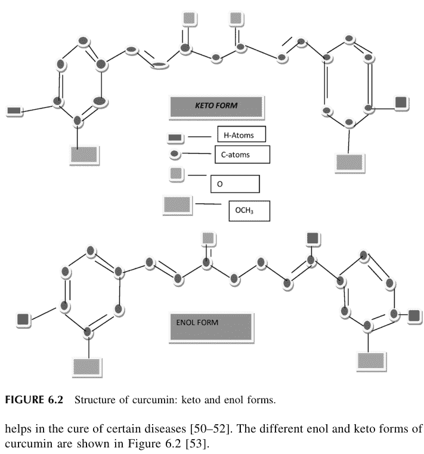

图 6.2 姜黄素的结构：酮式和烯醇式。

#### 6.7.1.1 姜黄素的作用机制

在 AD 期间，神经元细胞因多种因素而退化，包括氧化损伤、β 淀粉样蛋白或 tau 蛋白的高积累、金属毒性、炎症，如图 6.3 所示 [43]。

### 6.7.2 AD 治疗：姜黄素作为多效剂的作用

考虑到与病因相关的多个因素和 AD 的各种未定义机制，不同治疗药物仅针对某一特定因素而显示出有限的益处是完全合理的（图 6.3）。因此，目前研究集中于各种治疗剂的多效活性，以便针对如图 6.4 所示的多个受影响过程 [54,55]。

姜黄素的作用为

- 减少 Aβ 产生/Aβ 聚集/减少氧化应激
- 促进 A-beta 清除/阻止炎症信号通路
- 炎症细胞因子产生的减少

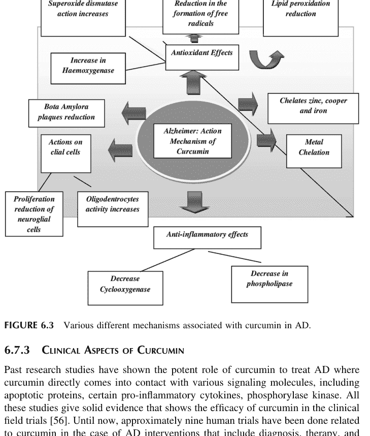

图 6.3 与 AD 中姜黄素相关的各种不同机制。

### 6.7.3 姜黄素的临床方面

过去的研究表明姜黄素治疗 AD 的强大作用，其中姜黄素直接与各种信号分子接触，包括凋亡蛋白、某些促炎细胞因子、磷酸化酶激酶。所有这些研究都提供了确凿的证据，显示了姜黄素在临床试验中的疗效 [56]。直到现在，约有九项人体试验与姜黄素在 AD 干预（包括诊断、治疗和预防）相关（表 6.1）。

AD：阿尔茨海默病；Aβ：β-淀粉样蛋白；MCI：轻度认知障碍；MMSE：简易精神状态检查；PET：正电子发射断层扫描；LDL：低密度脂蛋白；¹⁸F-FDG：2-[¹⁸F]氟-2-脱氧-D-葡萄糖的低代谢；FDDNP：2-(1-[¹⁶-](2-[F-(F-18] fluoroethyl) (methyl) amino]-2-naphthyl)ethylidene)malononitrile；d：天

但姜黄素的确切作用机制尚未被探索：姜黄素如何帮助减少 β 淀粉样蛋白，或当姜黄素与 β 淀粉样蛋白或神经元斑块相互作用时究竟发生了什么，以及它们如何相互作用？因此，需要更多研究来了解姜黄素对 AD 治疗的影响。

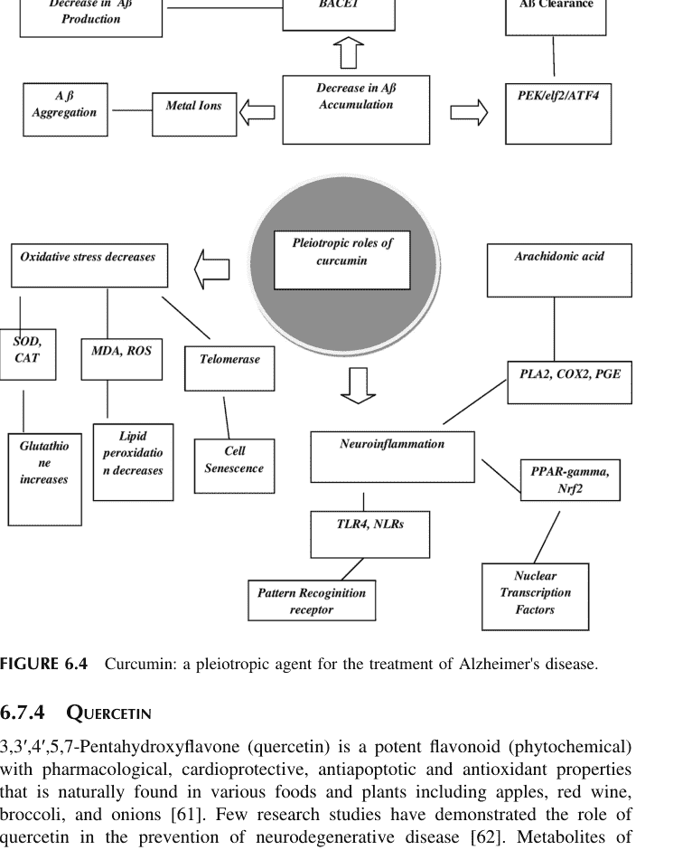

## 图6.4 姜黄素：一种治疗阿尔茨海默病的多效性药物。

### 6.7.4 槲皮素

3,3',4',5,7-五羟基黄酮（槲皮素）是一种强效类黄酮（植物化学物质），具有药理、心脏保护、抗凋亡和抗氧化特性，天然存在于多种食物和植物中，包括苹果、红葡萄酒、西兰花和洋葱[61]。一些研究已经证明了槲皮素在预防神经退行性疾病中的作用[62]。槲皮素的代谢物在阿尔茨海默病中发挥重要作用，如图6.5所示[63]。此外，这种关键类黄酮的作用已在经金属（特别是铝）处理的幼鼠海马分离线粒体中进行了评估[64]。该研究评估了ROS的降低；然而，超氧化物歧化酶（MnSOD）的活性没有观察到变化[64]。在线粒体组分中，分析凋亡标志物表达时，观察到Bax水平降低而Bcl水平升高。在评估胞质部分时，负责抑制caspase-3活化的Cyt c和Bcl-2表达下降；这表明槲皮素的诱导导致凋亡抑制[64]。

## 表6.1

姜黄素在诊断、预防和治疗中的临床试验

| 研究 | 队列 | 干预措施 | 主要终点 | 主要结果 |
|---|---|---|---|---|
| ClinicalTrials.gov NCT03085680 [55] | 24名伴有身体和/或认知障碍的老年人 | 姜黄素（100 mg/d）：3个月 | 身体功能：认知功能：疼痛与炎症 | 尚未招募 |
| ClinicalTrials.gov NCT01811381 [55] | 80名MCI受试者 | 姜黄素（800 mg/d）和瑜伽：12个月 | 血液生物标志物、脑部生物标志物：脑葡萄糖代谢观察、认知变化及相关变化诊断 | 招募中 |
| ClinicalTrials.gov NCT01383161 [54] | 132名年龄相关损害或MCI受试者 | 姜黄素（180 mg/d）：18个月 | 认知变化：Aβ和tau蛋白异常积聚（FDDNP-PET）：炎症标志物 | 进行中，未招募 |
| ClinicalTrials.gov NCT01001637 [55] | 26名AD受试者 | Longvida（2 g/d或3 g/d）：2个月 | 认知变化：Aβ的血液浓度 | 状态未知 |
| ClinicalTrials.gov NCT00595582 [55] | 10名MCI受试者 | 姜黄素（5.4 g/d）和生物胡椒碱（900 mg/d）：24个月 | MMSE评分：代谢性病变（PET） | 因多种原因终止 |
| Baum等人[56] | 36名AD受试者 | 姜黄素（1或4 g/d）和银杏提取物（120 mg/d）：6个月 | MMSE评分：血液生物标志物（异前列腺素、Aβ、胆固醇、甘油三酯和金属）：血浆姜黄素水平 | 已完成。各组间MMSE评分或血液生物标志物无差异，但维生素E升高 |
| Ringman等人[57] | 33名AD受试者 | 姜黄素C3复合物（2或4 g/d）：6个月 | MMSE评分：副作用：血浆和脑脊液生物标志物（Aβ、tau和F2-异前列腺素）：血浆中的姜黄素及其代谢物 | 已完成。各组间无差异，无严重不良事件 |

## 表6.1（续）

姜黄素在诊断、预防和治疗中的临床试验

| 研究 | 队列 | 干预措施 | 主要终点 | 主要结果 |
|---|---|---|---|---|
| Frost等人[58,59] | 40名受试者，涵盖健康、MCI、AD | Longvida（20 g/d）：7天 | 诊断：Aβ斑块的姜黄素荧光视网膜成像 | 以80.6%的特异性完全区分AD与非AD |
| Cox等人[60] | 60名健康受试者，年龄60–85岁 | Longvida（400或800 mg/d）：急性：1–3小时；慢性：4周 | 认知：情绪和焦虑；血液生物标志物（血脂谱、炎症标志物和Aβ） | 已完成。认知和情绪得到改善。总胆固醇和低密度脂蛋白胆固醇降低 |

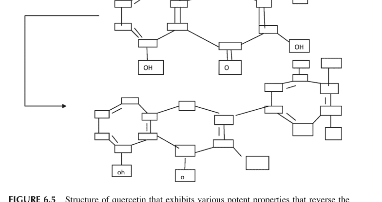

## 图6.5 槲皮素的结构，其具有多种可逆转AD作用的强大特性。

### 6.7.4.1 槲皮素在神经保护中的作用：人类与动物体内研究

大量证据支持槲皮素作为神经保护剂和氧化应激拮抗剂的作用[65–67]。口服槲皮素可保护啮齿动物免受氧化应激产生的神经毒性[68–70]，并且还提供了对金属毒性（如甲基汞、钨和铅）的保护（表6.2）[71–74]。

F：雌性；GPx：谷胱甘肽过氧化物酶；M：雄性；MeHg：甲基汞；MPTP：1-甲基-4-苯基-1,2,3,6-四氢吡啶；PCBs：多氯联苯；PND：出生后日龄；SOD：超氧化物歧化酶。

不过，研究仍应关注信号传导机制，包括信号转导通路、线粒体完整性、蛋白酶体功能以及槲皮素的药代动力学效应。

## 6.7.5 EGCG（表没食子儿茶素-3-没食子酸酯）与FA（阿魏酸）

绿茶和胡萝卜含有重要的多酚类化合物，有助于治疗记忆障碍。图6.6显示了从茶中提取的不同结构儿茶素[75]。根据最近的研究报告，在日常饮食中规律摄入这些膳食成分可能有助于减轻阿尔茨海默病的症状。本研究聚焦于胡萝卜和绿茶中发现的两种有效成分——表没食子儿茶素-3-没食子酸酯和阿魏酸，并使用具有阿尔茨海默病症状的小鼠作为模型来确定这两种成分的作用。这些营养保健品具有很有前景的抗淀粉样蛋白生成特性。本研究使用表达人APP和早老素1的转基因小鼠作为研究模型来检查淀粉样变性。对12个月大的小鼠口服EGCG和阿魏酸（各30 mg/kg），并连续观察3个月。15个月后，评估了EGCG和阿魏酸的联合效应，发现其在这些测试中可以减轻或逆转“认知障碍”。因此，EGCG和阿魏酸的联合使用是治疗阿尔茨海默病最有前景的方法[76,77]。

## 6.7.6 补充胆碱

胆碱是一种必需维生素，可作为膳食补充剂摄入，也存在于某些食物中。胆碱是维持植物和动物结构完整性所必需的。它也是执行多种代谢功能所必需的甲基基团的来源。当它与乙酰基结合时，形成乙酰胆碱，这是一种关键的神经递质，通过维持认知功能和基因表达来帮助大脑的信号传导过程。此外，胆碱通过降低神经毒素和同型半胱氨酸（一种氨基酸）的水平来提供对阿尔茨海默病的保护，同型半胱氨酸是阿尔茨海默病的一个风险因素。多项研究评估了AD患者中同型半胱氨酸水平升高，这些升高代表着高

## 表6.2

槲皮素在体内对神经毒素的神经保护作用

| 序号 | 动物模型 | 神经毒素 | 植物化学物质：槲皮素 | 槲皮素效应 | 参考文献 |
|---|---|---|---|---|---|
| 1. | 雄性Wistar大鼠 | 饮用水中含100 ppm钨，持续约3个月 | 口服剂量：0.3 mM槲皮素（Q）连续给药3个月 | 导致氧化应激降低 | [70] |
| 2. | 雄性C57BL/6小鼠 | 以30 mg/kg/d的剂量连续暴露于MPTP 4天（Q给药10–14天） | 槲皮素50、100和200 mg/kg/d连续给药14天 | 减轻了SOD、GPx和DA水平的降低 | [72] |
| 3. | 雄性Wistar大鼠 | 以30 mg/kg/d的MeHg剂量口服给药45天 | 以0.5、5和50 mg/kg/d的口服剂量给药约45天 | 减轻了GPx和GSH水平的降低 | [69] |

| 4. | 雄性Wistar大鼠 | 以2 mg/kg/d的硫丹连续口服给药6天 | 以10 mg/kg/d口服给药，最多6天 | 减轻线粒体肿胀和脂质过氧化 | [73] |

| 5. | 雄性和雌性Wistar大鼠 | 铅：于出生前和出生后发育阶段，通过饮水槽持续给予0.2%的铅6天 | 从出生后第60天（PND 60）开始：以30 mg/kg/d连续给药7天 | 减轻海马区域的脂质过氧化过程 | [68] |

| 6. | 雄性Wistar大鼠 | 以2 mg/kg/d的PCBs口服给药30天（i.p.） | 以50 mg/kg/d口服给药30天 | 降低多巴胺能毒性水平，并减少小脑中的氧化应激 | [71] |

## 使用物联网的智能医疗监测

## EGCG 的结构

## 阿魏酸的结构

## 图 6.6 显示对 AD 有强效益处的茶儿茶素结构。

AD 风险。因此，胆碱作为供体，将甲基基团给予同型半胱氨酸将其转化为蛋氨酸。在 AD 患者中，观察到导致大脑慢性炎症的小胶质细胞过度激活；这种小胶质细胞的过度激活可由胆碱控制。当患有 AD 的小鼠被提供含胆碱的饮食时，其后代在认知活动方面表现出改善，该测试在水迷宫中进行。随后，当从小鼠中取出负责记忆和学习的脑部海马区时，观察到由饮食中补充胆碱诱导的表观遗传改变 [78]。

所有这些研究都是在小鼠或转基因小鼠上进行的，这些研究显示出治疗 AD 的巨大效果。未来的研究工作应集中于人类，以检查胆碱的效果，并可能作为一种有前景的人类福利方法或治疗 AD 的治疗方法。

### 6.7.7 白藜芦醇

白藜芦醇是一种植物抗毒素酚类分子，丰富存在于葡萄、葡萄酒、花生产品、蓝莓、桑葚和茶中，并在某些植物受伤时产生 [79]。由于其抗炎和抗氧化特性，它被认为是奇迹分子，并对神经退行性疾病表现出强烈的反应。对转基因小鼠进行的各种测试通过诱导小鼠认知缺陷进行，结果显示白藜芦醇补充具有逆转 AD 的作用，通过抑制 TNF-α 的作用和 IL-1β 水平，同时海马区 BDNF 水平升高。此外，已发现白藜芦醇负责诱导 IL-10 水平，通过抑制 TNF-α 和 NF-κB 水平导致 ERK-2/CREB 通路的激活，这些通路与促进神经元存活的信号过程相关，并在该酚类化合物给药后 GDNF 和 BDNF 水平升高 [76,79]。在新的研究中发现，经治疗的患者在脑脊液中金属蛋白酶-9（MMP-9）的水平降低了 50%，这是由于 SIRT-1（沉默信息调节因子-1）的激活所致。MMP-9 水平的升高负责破坏血脑屏障（BBB），从而允许某些蛋白质和其他分子进入大脑。通常，低水平的 MMP-9 可维持血脑屏障 [80]。大脑中信号传递的正常机制导致大脑正常运作（图 6.7）[81]。白藜芦醇在 AD 发病机制中的作用机制在图 6.8 中描述 [81]。

- 1. β-分泌酶和 γ-分泌酶负责 APP 的切割，导致 β-淀粉样蛋白的产生。
- 2. 在不涉及 SIRT1 的情况下，仅 AMPK 激活促进白藜芦醇的强效功能，导致 β-淀粉样蛋白清除，而不会对 β-淀粉样蛋白生成过程造成任何阻碍。
- 3. 白藜芦醇还导致 PKC 的磷酸化，这在神经保护功能中起着至关重要的作用。
- 4. 由于白藜芦醇的保护作用，Aβ-Cu、Aβ-Zn 和 Aβ-Fe 的生成减少。
- 5. 在氧化应激下，线粒体受损，导致活性氧（ROS）的产生，包括 iNOS 和 COX-2，从而导致细胞凋亡。
- 6. 白藜芦醇的主要功能是减少参与 ROS 产生（如 Nox4）的特定酶的表达，并且在其他方式，它促进 SOD 1 和 GPx 1（负责 ROS 失活的酶）的表达。
- 7. 白藜芦醇对凋亡信号通路的广泛影响，包括 NF-kB 结合抑制、Bcl-XL 表达恢复、Bax 表达抑制和 JNK 激活阻断。
- 8. 通过激活小胶质细胞，它导致 PGE2 抑制。
- 9. β-淀粉样蛋白的积累导致各种细胞（如小胶质细胞和星形胶质细胞）的激活，这些细胞产生某些细胞因子，如 TNF-α、IL-β、IL-6。IκBα、STAT-3 和 STAT-1 的磷酸化由于白藜芦醇的抑制作用而减少。

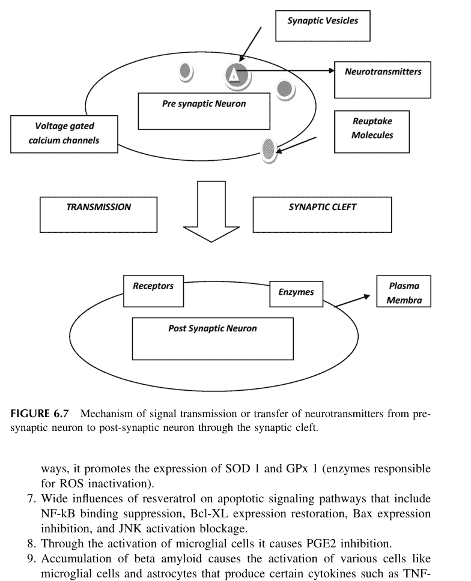

图 6.7 神经递质从突前神经元到突后神经元通过突触间隙传递或传递的机制。

### 6.7.8 神圣灌木：Yarba Santa（Sterubin）

加州的一种名为 Yarba Santa 的神圣灌木具有药用特性，曾用于治疗发热、呼吸道疾病和头痛。现在，

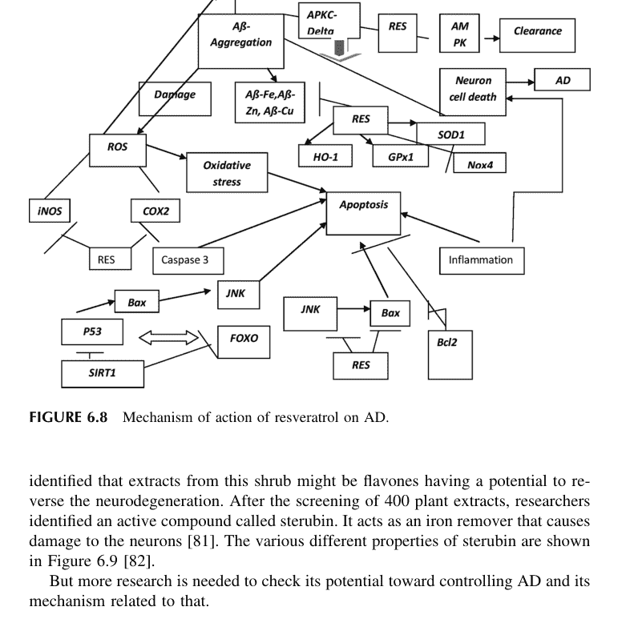

图 6.8 白藜芦醇对 AD 的作用机制。

已确定该灌木的提取物可能是黄酮类，具有逆转神经退行性的潜力。在对 400 种植物提取物进行筛选后，研究人员鉴定出一种活性化合物 sterubin。它作为铁螯合剂，可导致神经元损伤 [81]。Sterubin 的各种不同特性在图 6.9 中显示 [82]。

但需要更多研究来检查其控制 AD 的潜力及其相关机制。

### 6.7.9 SAFRANAL

Safranal 具有抗凋亡和抗氧化特性，从药用植物 Crocus sativus（藏红花）中提取，该植物曾用于亚洲、印度和其他地中海国家制备药物，在那里它曾被用作祛痰剂、促凋亡剂、镇静剂、催经剂、抗哮喘、抗癌、抗炎、抗抑郁剂。对 safranal 的有效作用已在 PC12 细胞系上进行评估，其中细胞用藏红花提取物（2.5–40 µg/ml）、safranal（2.5–40 µM）、2.5–40 µg/ml 精油与 5、10 和 20 µM 多奈哌齐预处理 120 分钟。之后，处理的细胞暴露于 25 µM Aβ（48 小时）或 150 µM H₂O₂（24 小时）。测试结束时观察到凋亡减少。Safranal 可能成为未来治疗 AD 的有希望来源。迄今为止，还没有研究确定 safranal 对阿尔茨海默病研究模型中的保护作用。因此，应对 safranal 进行研究以探索该化合物的潜力 [83]。在 AD 发病机制中，safranal 的作用机制已在图 6.10 中显示 [83]。

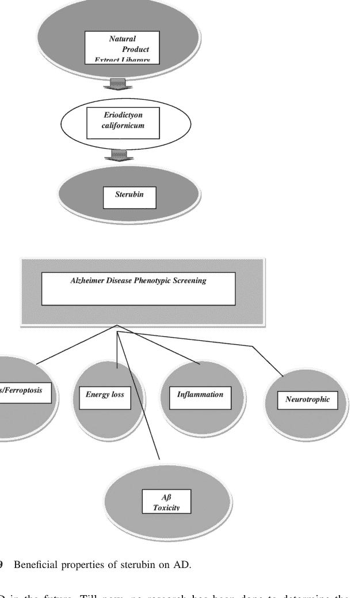

图 6.9 Sterubin 对 AD 的有益特性。

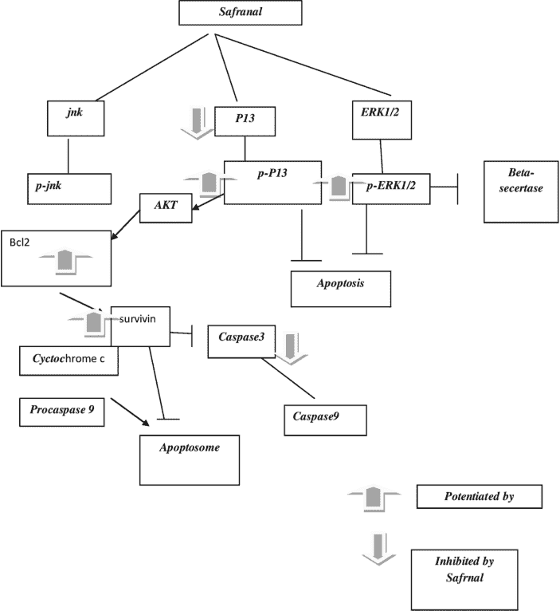

**图 6.10** AD 发病过程中 safranal 的作用机制。

### 6.7.10 *Onosma tauricum*

根据某些报告，土耳其约有 102 种 *Onosma*，且最大数量的物种自然生长于欧洲和亚洲地区。此外，这些物种不仅用于治疗各种疾病，包括发热、尿潴留、白癜风、支气管炎和腹痛，而且也是很好的掺假来源，通常用于辣椒粉中以增强颜色，因为它们具有染色和着色特性。对 *Onosma* 的一些物种的抗菌、抗炎、抗癌、抗伤害感受和伤口愈合活性进行了少量研究。进行了一项研究报告以分析从 Onosma tauricum 中提取的不同提取物的活性，乙酸乙酯（OTT-EtOAc）、甲醇（OTT-MeOH）和水（OTT-W）提取物。评估后，发现水提取物是最丰富的黄酮类和其他酚类成分来源：水提取物中黄酮类和酚类浓度为 40.88 µmolGAEs/g，干植物中也为 7.40 µmolREs/g。在 Onosma tauricum 的提取物中发现了多种化合物，包括迷迭香酸、咖啡酸、木犀草素、对香豆酸、芹菜素、反式肉桂酸、绿原酸、芦丁和对羟基苯甲酸。OTT-W 提取物在铁螯合、自由基清除、还原能力和磷钼法中显示出显著效果。甲醇提取物也对乙酰胆碱酯酶显示出抑制反应，而丁酰胆碱酯酶则无效果。相反，OTT-W 提取物也表现出对 β-葡萄糖苷酶和酪氨酸酶的抑制作用。从数据分析中发现，这些酶引起的疾病可通过使用这些植物提取物，特别是 OTT-W 和 OTT-MeOH 提取物来治愈 [84]。

但这些物种在 AD 情况下作为治疗剂来源的有益作用尚未得到探索。

### 6.7.11 Matricaria chamomilla L.

这种药用草本植物用作抗焦虑药、抗抑郁药、抗病毒药、抗微生物药和抗炎药。为了证明从 Matricaria chamomilla 中提取的水醇提取物（25–75 mg/kg）的效果，对用东莨菪碱（0.7 mg/kg）处理的 30 分钟小鼠进行了测试，并口服给予提取物 7 天。在水醇提取物中观察到以下化合物：木犀草素、芦丁、绿原酸、芹菜素、芹菜苷和芹菜素-7-葡萄糖苷。测试结果显示，提取物通过调节乙酰胆碱酯酶的活性、激活 BDNF 并减少大脑海马区 IL1β 的表达，帮助改善了东莨菪碱注射诱导的记忆缺陷。因此，它可能是预防与记忆丧失和失忆相关的神经退行性疾病的有利治疗药物方法 [84]。

### 6.7.12 Allylguaiaacol

Allylguaiaacol 是一种化学化合物（植物化学物质），从丁香、肉豆蔻、罗勒和肉桂等多种植物中提取，具有抗菌、抗癌、抗炎和抗氧化特性以及神经保护活性。该研究通过用过氧化氢（H₂O₂）处理海马 HT22 细胞来检查 allylguaiaacol 的作用。自由基如 2,2-二苯基-1-苦基肼（DPPH）、2,2′-偶氮-双-(3-乙基苯并噻唑啉-6-磺酸)（ABTS）作为清除剂发挥作用，其清除活性随着抗氧化酶如过氧化氢酶和锰超氧化物歧化酶（MnSOD）表达的增加而增强。此外，它通过增加脑源性神经营养因子（BDNF）的产生，抑制过氧化氢对 HT22 细胞系造成的损伤。Allylguaiaacol 通过激活抗氧化酶并调节蛋白质表现出强效作用，如 P65 和 NF-kappa B 以及与死亡域相关蛋白（DAXX）相关的信号转导过程 [85]。从所有这些证据来看，仍没有一篇报道描述了 allylguaiaicol 对 AD 的调控机制。

## 6.8 结论

本章通过分析已开展的研究或测试，以确定从多种植物中分离的植物化学物的有效性，回顾了文献中收集的有关植物化学物对这种致命疾病有益作用的所有信息。此外，还检查了若干植物化学物研究，以了解植物化学物在抑制与 AD 相关的不同信号通路中发挥的不同作用。根据一项研究，对食用姜黄作为补充剂（姜黄素）的人群进行了评估，发现其患病风险低于未食用姜黄的人群。姜黄素通过多项分析研究在临床领域表现出其效率，并被发现直接与参与细胞凋亡的蛋白、参与炎症反应的细胞因子以及抑制磷酸化激酶功能相互作用。尽管如此，姜黄素与这些分子相互作用的确切机制仍未知。对啮齿动物进行槲皮素治疗显示出对神经毒性的保护作用，以减轻氧化应激的影响。从不同药用植物中提取了多种新型植物化学物，它们显示出抗炎、抗凋亡和抗氧化特性，这可能是治疗 AD 的未来治疗药物方法。但其有效性尚未在人类和动物模型上进行检验。一些植物化学物在与其他植物化学物联合使用时显示出其有效性。为了增强植物化学物的效果，应使用其他方法、技术或手段对化合物的性质进行彻底分析。市场上仍没有一种能够逆转疾病或控制疾病的单一药物。所有基于植物化学物的药物仅能减缓疾病出现时的症状，而不能正确治愈 AD。由于 AD 的确切机制尚不清楚，在 AD 发展之前该疾病无法得到控制。

## 参考文献

- [1]. Queen B. L. and Tollefsbol T. O. 多酚与衰老. *Current Aging Science*, 3, 34–42 (2010)
- [2]. 痴呆症 [在线]. 世界卫生组织 可获取： http://www.who.int/mediacentre/factsheets/fs362/en/, (2018).
- [3]. 阿尔茨海默病事实表 [在线]. 国家老龄化研究所 可获取： https://www.nia.nih.gov/alzheimers/publication/alzheimers-disease-fact-sheet, (2018).
- [4]. Dosunmu R., Wu J., Basha M. R. and Zawia N.H. 阿尔茨海默病中的环境和饮食风险因素. *Expert Review of Neurotherapeutics*, 7, 887–900 (2007).
- [5]. Hu N., Yu J., Tan L., Wang Y., Sun L. and Tan L. 营养与阿尔茨海默病风险. *Biomed Research International*, 1–12. (2013). doi:10.1155/2013/524820
- [6]. Saragat B., Buffa R., Mereu E., Succa V., Cabras S., Mereu R. M., et al. 阿尔茨海默病老年患者中的营养和心理功能状态. *Journal of Nutrition, Health and Aging*, 16, 231–236 (2012)
- [7]. Pugazhenthi S., Qin L. and Reddy P. H. 肥胖、糖尿病和阿尔茨海默病中的常见神经退行性通路. Biochimica et Biophysica Acta, 1863, 1037–1045 (2016).
- [8]. Shah R. 营养和饮食在阿尔茨海默病中的作用：系统综述. Journal of the American Medical Directors Association, 14, 398–402 (2013).
- [9]. Hartman R., Shah A., Fagan A., Schwetye K., Parsadanian M., Schulman R., et al. 石榴汁降低淀粉样蛋白负荷并改善阿尔茨海默病小鼠模型的行为. Neurobiology of Disease, 24, 506–515 (2006).
- [10]. Kim D., Nguyen M., Dobbin M., Fischer A., Sananbenesi F., Rodgers J., et al. SIRT1 去乙酰化酶在阿尔茨海默病和肌萎缩侧索硬化模型中保护神经退行性变. EMBO J, 26, 3169–3179 (2007).
- [11]. Hyman B. T., Phelps C. H., Beach T. G., Bigio E. H., Cairns N. J., Carrillo M. C., Dickson D. W., Duyckaerts C., Frosch M. P., Masliah E., Mirra S. S., Nelson P. T., Schneider J. A., Thal D. R., Thies B., Trojanowski J. Q., Vinters H. V. and Montine T. J. 国家老龄化研究所-阿尔茨海默病协会阿尔茨海默病神经病理学评估指南. Alzheimers Dementia, 8, 1–13 (2012).
- [12]. Braak H. and Braak E. 阿尔茨海默病相关神经原纤维改变的分期. Neurobiology of Aging, 16, 271–8. discussion 278–284 (1995).
- [13]. Thal D. R., Rub U., Orantes M. and Braak H. 人脑中 Aβ 沉积的阶段及其与 AD 发病发展的相关性. Neurology, 58, 1791–1800 (2002).
- [14]. Mirra S. S., Heyman A., McKeel D., Sumi S. M., Crain B. J., Brownlee L. M., Vogel F. S., Hughes J. P., Van Belle G. and Berg L. 建立阿尔茨海默病登记注册联盟（CERAD）。第二部分。阿尔茨海默病神经病理学评估标准化. Neurol, 41, 479–486 (1991).
- [15]. Scheltens P., Blennow K., Breteler M. M., de Strooper B. and Frisoni G. B., Salloway S., Van der Flier W.M. 阿尔茨海默病. Lancet, 388, 505–517 (2016).
- [16]. Nelson P. T., Alafuzoff I., Bigio E. H., Bouras C., Braak H., Cairns N., Davies P., Tredici K. D., Duyckaerts C., Frosch M. P., Hof P. R., Hulette C., Hyman B. T., Iwatsubo T., Jellinger K. A., Jicha G. A., Kovari E., Kukull W. A., Leverenz J. B., Love S., Mackenzie I. R., Mann D. M., Masliah E., McKee A., Montine T. J., Morris J. C., Schneider J. A., Sonnen J. A., Thal D. R., Trojanowski J. Q., Troncoso J. C., Wisniewski T., Woltjer R. L. and Beach T. G. 阿尔茨海默病神经病理学改变与认知状态的相关性：文献综述. JNEN, 71, 362–381 (2012).
- [17]. Lane C. A., Hardy J. and Schott J. M., 阿尔茨海默病. European Journal of Neurology 2018, 25, 59–70 (2018).
- [18]. Selkoe D. J. and Hardy J. 阿尔茨海默病淀粉样蛋白假说 25 年. EMBO Molecular Medicine 2016, 8(6), 595–608 (2016).
- [19]. Silverberg N., Elliott C., Ryan L., Masliah E. and Hodes R. NIA-AA 研究框架：迈向阿尔茨海默病的生物学定义. Alzheimers Dement, 14, 576–578 (2018).

- [20]. Tomic J. L., Pensalfini A., Head E. and Glabe C. G. 可溶性纤维状寡聚物水平在阿尔茨海默病脑中升高并与认知功能障碍相关. Neurobiology of Disease, 35, 352–358 (2009).

- [21]. McLean C. A., Cherny R. A., Fraser F. W., Fuller S. J., Smith M. J., et al. 可溶性 Abeta 淀粉样蛋白池作为阿尔茨海默病神经退行性变严重程度的决定因素. Annals of Neurology, 46, 860–866 (1999).

- [22]. Lue L. F., Kuo Y. M., Roher A. E., Brachova L., Shen Y., et al. 可溶性淀粉样蛋白 β 肽浓度作为阿尔茨海默病突触变化的预测因子. American Journal of Pathology, 155, 853–862 (1999).

- [23]. Wang J., Dickson D. W., Trojanowski J. Q. and Lee V. M. 可溶性与不溶性脑 Abeta 水平区分阿尔茨海默病与正常及病理性衰老. Exp Neurol Acta Neuropathologica, 158, 328–337 (1999)

- [24]. Viola K. L. and Klein W. L. 阿尔茨海默病发病机制、治疗和诊断中的淀粉样蛋白 β 寡聚体. Journal of Alzheimers Disease 2018, 64(Suppl 1), S567–S610...129:183–206 (2015)

- [25]. Sengupta U., Nilson A. N. and Kayed R. 淀粉样蛋白-β 寡聚体在毒性、传播和免疫治疗中的作用. EBioMedicine 2016, 6, 42–49 (2016)

- [26]. Wisniewski T. and Goni F. 阿尔茨海默病的免疫治疗方法. Neuron 2016, 85, 1162–1176 (2015)

- [27]. Bucciantini M., Giannoni E., Chiti F. et al. 聚集体固有的毒性暗示了蛋白质错误折叠疾病的共同机制. Nature 416, 507–511 (2002)

- [28]. Wisniewski T. and Drummond E. 开发针对阿尔茨海默病的治疗性疫苗. Expert Review of Vaccines, 5, 401–415 (2016)

- [29]. Drummond E., Goni F., Liu S., Prelli F., Scholtzova H. and Wisniewski T. 理解发病机制和治疗阿尔茨海默病的潜在新方法. Journal of Alzheimers Disease, 64(s1), S299–S312. doi: 10.3233/JAD-179909 (2018).

- [30]. Breydó L., Kurouski D., Rasool S., Milton S., Wu J. W. et al., 淀粉样蛋白 β 寡聚体之间的结构差异. Biochemical and Biophysical Research Communication 2016, 477, 700–705 (2016)

- [31]. Perry G. 阿尔茨海默病：新世纪的进展. Amsterdam: IOS Press BV (2013)

- [32]. Mayeux R. and Yaakov S. 阿尔茨海默病的流行病学. Cold Spring Harbor Perspectives in Medicine, 2, a006239 (2012)

- [33]. Pericak-Vance M. A., Bebout J. L., Gaskell P. C. Jr, et al. 家族性阿尔茨海默病连锁研究：19号染色体连锁的证据. American Journal of Human Genetics, 48, 1034–1050 (1991)

- [34]. Lane C. A., Hardy J. and Schott J. M. 阿尔茨海默病. European Journal of Neurology 2018, 25, 59–70 (2018)

- [35]. Sharma R. D., Wani Y. W., Sunkaria A. et al., 槲皮素保护免受慢性铝诱导的氧化应激及随后的生化、胆碱能和神经行为损伤. Neurotoxicity Research 2013, 23, 336–357 (2013)

- [36]. Kim J., Basak M. J. and Holtzman D. M., “载脂蛋白 E 在阿尔茨海默病中的作用,” Neuron, 63, 287–303 (2009)

- [37]. Priller C., Bauer T., Mitteregger G., Krebs B., Kretschmar A. H. and J. Herms. “突触形成和功能受淀粉样蛋白前体蛋白调节,” The Journal of Neuroscience, 26(27), 7212–7221 (2006)

- [38]. G. P. Morris, I. A. Clark and B. Vissel 阿尔茨海默病淀粉样蛋白假说周围的不一致和争议 Acta Neuropathol Commun, 2, 1–21 (2014)

- [39]. M. Goedert and M. G. Spillantini, “阿尔茨海默病百年,” Science 2006, 314 (5800), 777–781 (2006).

- [40]. E. Kopke, Y.-C. Tung, S. Shaikh, A. D. C. Alonso, K. Iqbal and I. Grundke-Iqbal, “微管相关蛋白 tau：阿尔茨海默病中非配对螺旋丝池的异常磷酸化.” The Journal of Biological Chemistry, 268 (32), 24374–24384 (1993)

- [41]. S. Melov, P. A. Adlard and K. Morten “线粒体氧化应激导致 tau 超磷酸化.” PLoS ONE, 2 (6), e536 (2007).

- [42]. E. Mullaart, M. E. T. I. Boerrigter, R. Ravid, D. F. Swaab, and J. Vijg, “阿尔茨海默病患者大脑皮层 DNA 断裂水平升高,” Neurobiology of Aging, 11(3), 169–173 (1990)

- [60]. Cox K. H., Pipingas A. and Scholey A. B. 固体脂质姜黄素对健康老年人认知和情绪影响的研究。Journal of Psychopharmacology, 29, 642–651 (2015)

- [61]. Li Y., Yao J., Han C. et al. 槲皮素、炎症与免疫。2016, 8(3), 167. doi: 10.3390/nu8030167.

- [62]. Spagnuolo C., Moccia S. and Russo G. L. 黄酮类化合物在神经退行性疾病中的抗炎作用。2017, 17, 30683–30689. doi:10.1016/j.ejmech.2017.09.001

- [63]. Costa G. L., Garrick M. J., Roque J. P. and Pellacani C. 槲皮素的神经保护机制：对抗氧化应激及更多。Oxidative Medicine and Cellular Longevity, 10 (2016). 2986796.

- [64]. Sharma D. R., Wani W. Y., Sunkaria A. et al. 槲皮素减轻铝诱导的大鼠海马神经退化中的神经元死亡。Journal of Neuroscience, 324, 163–176 (2016) doi: 10.1016/j.neuroscience.2016.02.055.

- [65]. Ossola B., Kääriäinen T. M. and Männistö P. T. 槲皮素在神经保护中的多重面孔。Expert Opinion on Drug Safety, 8 (4), 397–409 (2009), doi: 10.1517/14740330903026944.

- [66]. Ishisaka A., Ichikawa S., Sakakibara H., et al. 口服槲皮素在大鼠脑组织中的蓄积及其抗氧化作用。Free Radical Biology and Medicine, 51(7), 1329–1336 (2011) doi: 10.1016/j.freeradbiomed.2011.06.017.

- [67]. Das S., Mandal A. K., Ghosh A., Panda S., Das N., Sarkar S. 纳米颗粒槲皮素对抗年龄相关脑氧化损伤。Current Aging Science, 1(3),169–174 (2008) doi: 10.2174/1874609810801030169.

- [68]. Hu P., Wang M., Chen W. H., et al. 槲皮素缓解体内慢性铅暴露诱导的大鼠齿状回突触可塑性损伤。Naunyn-Schmiedeberg's Archives of Pharmacology, 378(1), 43–51 (2008) doi: 10.1007/s00210-008-0301-z.

- [69]. Barcelos G. R. M., Grotto D., Serpeloni J. M., et al. 槲皮素对甲基汞诱导的大鼠DNA损伤和氧化应激的保护特性。Archives of Toxicology, 85(9), 1151–1157 (2011) doi: 10.1007/s00204-011-0652-y.

- [70]. Sachdeva S., Pant S. C., Kushwaha P., Bhargava R. and Flora S. J. S. 钨酸钠诱导的大鼠脑区神经改变及其对抗氧化剂的响应。Food and Chemical Toxicology, 82, 64–71 (2015) doi: 10.1016/j.fct.2015.05.003.

- [71]. Bavithra S., Selvakumar K., Kumari R. P., Krishnamoorthy G., Venkataraman P., and Arunakaran J. 多氯联苯（PCBs）诱导的氧化应激对小脑多巴胺能受体表达起关键作用：槲皮素的改善作用。Neurotoxicity Research, 21 (2), 149–159 (2012) doi: 10.1007/s12640-011-9253-z.

- [72]. Lv C., Hong T., Yang Z., et al. 槲皮素在1-甲基-4-苯基-1,2,3,6-四氢吡啶诱导的帕金森病小鼠模型中的作用。Evidence-Based Complementary and Alternative Medicine 6, (2012) doi: 10.1155/2012/928643.928643.

- [73]. Lakroun Z., Kebieche M., Lahouel A., Zama D., Desor F. and Soulimani R. 硫丹诱导的氧化应激和脑线粒体肿胀以及槲皮素在大鼠中的保护作用。Environmental Science and Pollution Research, 22 (10), 7776–7781 (2015) doi: 10.1007/s11356-014-3885-5

- [74]. T. Mori, N. Koyama, J. Tan, T. Segawa, M. Maeda, T. Town. 酚类物质(−)-表没食子儿茶素-3-没食子酸酯和阿魏酸联合治疗可改善小鼠认知并减少阿尔茨海默样病理。Journal of Biological Chemistry, 294 (8), 2714 (2019) DOI: 10.1074/jbc.RA118.004280.

- [75]. Ide K., Matsuoka N., Yamada H., Furushima D. and Kawakami K. 茶儿茶素对阿尔茨海默病的影响：最新进展与展望。Molecules, 23 (9), 2357 (2018)

- [76]. Ma T., Tan S. M., Yu T. J. and Tan L. 白藜芦醇作为阿尔茨海默病的治疗药物。BioMed Research International, 13 (2014). DOI:10.1155/2014/350516

- [77]. Q. Hiser. 老年相关表型筛选阿尔茨海默病药物候选物，确定 sterubin 为来自圣草（Yerba santa）的有效神经保护化合物。Redox Biology, 21 (2019).

- [78]. Ramon Velazquez, E. Ferreira, W. Winslow, N. Dave, I.S. Piras, M. Naymik, M.J. Huentelman, A. Tran, A. Caccamo, S. Oddo. 母体补充胆碱通过降低多代大脑同型半胱氨酸水平改善阿尔茨海默病病理。Molecular Psychiatry, (2019). DOI: 10.1038/s41380-018-0322-z

- [79]. Anastacio J. R., Netto C. A., Castro C. C., Sanches E. F., Ferreira D. C., Noschang C., Krolow R., Dalmaz C. and Pagnussat A. 白藜芦醇治疗具有神经保护作用，并可预防慢性脑低灌注后的认知障碍。Neurology of Research, 36, 627–633 (2014). doi: 10.1179/1743132813Y.0000000293.

- [80]. Georgetown University Medical Center. “白藜芦醇似乎可恢复阿尔茨海默病中的血脑屏障完整性。” ScienceDaily.

- [81]. W. Fischer, A. Currais, Z. Liang, A. Pinto, P. Maher. 老年相关表型筛选阿尔茨海默病药物候选物，确定 sterubin 为来自圣草（Yerba santa）的有效神经保护化合物。Redox Biology, 21, (2016)

- [82]. Rafieipour F., Hadipour E., Emami A. S., Asili J. and Najaran T. Z. 藏红花醛通过MAPK和PI3 K通路保护PC12细胞免受β-淀粉样肽诱导的细胞毒性。Metabolic Brain Disease,34(1), 165–172 (2018).

- [83]. Kirkan B., Sarikurkcu C., Ozer S. M., Cengiz M. et al., Onosma tauricum var. Tauricum 的酚类特征、抗氧化和酶抑制潜力。Industrial Crops & Products, 125, 549–555 (2018)

- [84]. Ionita R., Postu A. P., Mihasan M., Gorgan L. D. et al. 母菊（Matricaria chamomilla L.）水醇提取物对东莨菪碱诱导的大鼠记忆障碍的改善作用：一项行为学和分子学研究。Phytomedicine (2018), doi: 10.1016/j.phymed.2018.04.049.

- [85]. Lim S. H., Kim Y. B., Kim J. Y. and Jeong J. S. 植物化学物烯丙基愈创木酚对海马细胞发挥神经保护作用，并改善小鼠东莨菪碱诱导的记忆障碍。Behavioural Brain Research, 339, 261–268 (2017).

## 7 基于残差网络（`ResNet`）的新型冠状病毒（COVID-19）检测的现有方法与新兴趋势：深度学习分析综述

Upasana Bhattacharjya and Kandarpa Kumar Sarma

## 目录

- 7.1 引言............................................................131

- 7.2 材料...............................................................133

- 7.3 方法..................................................................134

- 7.3.1 残差网络......................................................134

- 7.3.1.1 `ResNet`架构.................................................136

- 7.3.1.2 使用`Keras`的`ResNet`.............................................136

- 7.4 回顾与讨论...................................................136

- 7.4.1 基于深度学习`ResNet`的预训练模型...........................137

- 7.4.1.1 X射线与`ResNet`....................................................137

### 7.4.1.2 CT扫描与ResNet
### 7.4.2 定制深度学习方法
### 7.5 本研究的未来范围与局限性
### 7.6 结论
### 参考文献

## 7.1 引言

由SARS-CoV-2引起的新型冠状病毒感染，通常称为COVID-19，已成为全球普遍存在的疾病，导致全球严重危机。它是一种传染病，于2019年12月在中国武汉出现，并最终根据世界卫生组织（WHO）的宣布，到2020年3月演变为大流行[1]。截至2021年3月12日，有超过1.18亿阳性病例和超过262万死亡病例的统计，COVID-19已标志着自己是全球历史上最致命的大流行病之一[1–3]。

COVID-19通常通过打喷嚏和咳嗽时的呼吸道飞沫以及与感染者的密切接触传播，导致典型症状如发热、感冒、咳嗽、呼吸急促、味觉丧失、喉咙痛、腹泻、腹痛和肌肉疼痛。虽然大多数病例以轻症结束，但部分病例会导致肺炎和多器官衰竭等疾病。由于大规模隔离措施和无症状传播（无症状患者），病毒的蔓延正给全球造成重大损失[4]。在大流行期间，许多国家处于COVID-19疫苗开发的不同阶段。截至目前，国家监管机构已批准11种疫苗的紧急使用，但其中只有6种被批准立即使用。第一个疫苗接种计划始于2020年12月初，并持续增加至1.753亿剂（据文献[1]，截至2021年2月15日）。由于全球有限的诊断安排，当前阶段对COVID-19诊断的适当诊断方法需求很高[3–5]。

根据WHO，识别COVID-19的主要标准方案是逆转录聚合酶链反应（RT–PCR）检测[4]。然而，由于病例数量庞大以及资源和环境有限，筛查无法快速有效地进行。因此，对抗这种病毒的实用解决方案是通过疫苗接种和药物治疗。此外，临床诊断方法，包括计算机断层扫描（CT）、X射线和超声成像，也很有益。这些影像模态被认为是COVID-19检测的强大技术，因为所有医院和放射科诊所都配备了X射线和CT扫描成像设备[4,5]。对这些医学图像的分析也引起了研究界的广泛兴趣。检测过程可以自动化，这将具有成本效益、用户友好、易于部署、准确且节省时间。

在当前时代，凭借各种直观和创新的技术，医疗保健行业已得到升级。COVID-19的识别和管理也同样受益于这些技术。该领域最可靠且常用的技术是X射线和CT扫描分析[6,7]。我们可以将各种人工智能（AI）软件工具视为大规模分诊条件下的解决方案。AI涉及研究与开发模拟人类智能的技术，在机器人学、计算机视觉、欺诈检测、疾病检测、患者监护和药物发现等多个领域证明了自身的成功。凭借其在疾病检测方面的成功，AI技术可被视为抗击这一大流行的成功途径。AI技术可以在许多应用中实施，这些应用基于临床实践、药物研究、处理COVID-19相关图像以及流行病学[8]。基于深度学习的方法在当前危机中已显示出对疾病正确诊断的显著效果。随着进步

在深度学习和计算机视觉领域，医学影像在近年显示出革命性的变化 [9]。基于深度学习的方法已证明自己是快速检测和诊断各种疾病的成功应用。CT扫描成像由于其三维肺部视图和多功能性而通常被认为优于X射线成像 [10,11]。利用CT扫描和X射线样本，基于深度学习的系统研究COVID-19样本 [12,13]。许多设计也是使用定制学习创建的，也使用迁移学习使用预训练模型 [14–17]。计算机视觉、机器学习（ML）和数据科学也是冠状病毒检测、疫情预测和预报的几个领域 [18–20]。除这些技术外，大数据、智能手机技术和物联网（IoT）主要用作COVID-19疫情的控制措施。

本章重点介绍了基于X射线和CT扫描样本分析的COVID-19检测系统的最新进展。此外，本章还包含研究人员使用的各种深度学习方法的描述，重点关注预训练模型如残差网络（ResNet），该模型已被广泛用于诊断目的 [21–23]。用于训练的其他模型也已被使用，这些模型在与自定义深度学习技术相关的章节下讨论。提出了一种命名法或分类法，以便正确区分所讨论的方法。本章还关注深度学习方法的挑战性方面，并提出了进一步扩展COVID-19诊断系统的未来研究路径。

## 7.2 材料

为实现COVID-19的自动诊断，研究人员从不同来源收集了各种数据集。其中，一些数据库被广泛使用，而其中许多是医院数据且不公开。大多数这些数据集具有可变大小的图像，且参与者的群体数量未知。根据使用频率，这里回顾了一些数据库，这可能有助于读者。如前所述，数据库分为X射线和CT扫描图像。在这些数据库中，最常用的是COVID-19 X射线数据库 [24]。它总共有589个样本，其中434例COVID-19患者和155例其他类别患者。它是公开可用的，图像大小各异。Kaggle胸部X射线存储库数据集 [25,26] 包含5,856个样本，其中1,583例健康和4,273例肺炎病例的X射线图像大小不同。另一个用于X射线图像的Kaggle数据集包含79个样本，其中1例COVID-19病例。RSNA肺炎检测挑战数据集，包含30,227个样本，其中8,851例健康和21,376例感染病例，也用于检测目的 [27]。NIH胸部X射线数据集包含5,606个样本，图像大小为1,024 × 1,024，也被使用 [28]。该数据集仅包含固定大小的图像。一些数据集收集自Radiopaedia.org，这是一个开放编辑的放射学资源，病例由全球各地的放射科医生和各种卫生专业人员汇编 [29]。从该来源共收集了59个各种大小的样本。样本数量最多的数据库（224,316）来自ChexPert数据库，包含65,240个样本，其中有14个不同的子类别可供选择 [30]。胸部X射线数据库包含108,948个样本，涵盖14种不同的肺部疾病和健康图像。COVIDDx数据集包含13,870个人的数据，共计13,975个样本，并细分为三个类别，包含358例COVID-19、8,066例健康和5,538例肺炎病例 [31]。

除X射线图像外，COVID-CT数据库收集自开源来源，包含271名患者共812个样本，其中349例COVID-19病例和463例其他病例CT扫描 [32]。两个不同的名为COVID-19的数据库分别包含68和59个样本 [29][33]。

这些数据库的差异使得将其归入某一类别变得相当具有挑战性。此外，随着COVID-19病例的增加以及每天新增病例，跟踪这些数据库相当困难。除了所有这些限制外，这些数据库仍可用于评估和验证目的。

## 7.3 方法

深度学习的应用为研究人员使用医学图像进行计算机化COVID-19分析提供了帮助。深度学习很受欢迎，并能从学习数据中呈现精确的表示。一般来说，基于深度学习的系统包括数据收集、特征提取、数据准备、分类，最后是性能评估。新的深度学习算法已被广泛用于X射线和CT扫描图像的冠状病毒检测。针对COVID-19设计的各种深度学习预训练模型考虑了卷积神经网络（CNNs），如ResNet、GoogleNet、AlexNet、SqueezeNet、MobileNet、DenseNet和U-Net [23][34–39]。在这些模型中，预先存在的CNN即残差网络（ResNet）在各种分类任务中显示出出色结果。以下讨论将深入了解ResNet算法及其优势。

### 7.3.1 残差网络

ResNet是一种CNN，由Kaiming He和他人于2015年提出 [23]。ResNet提供快速的数据训练，并在研究工作中考虑的参数上提供更好的性能。考虑ResNet架构的另一个优势是其能够输入与训练时不同的图像尺寸 [40]。

在深度神经网络（DNN）中堆叠一些额外层以解决复杂问题，从而获得更好的性能和准确性。像AlexNet这样的CNN有五层卷积层；VGG网络 [41] 有19层；GoogleNet（也称为Inception_v1） [42] 有22层。在这些模型中添加更多层的理由是这些层会持续学习更复杂的特征。在图像识别中，层可以分为如下：第一层检测图像，第二层识别纹理，第三层检测对象，以此类推。相反，传统的CNN模型表现出深度的最大阈值。图7.1描述了20层和56层网络在训练和测试数据上的误差百分比。

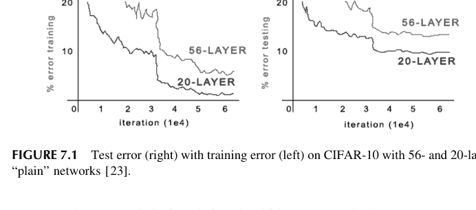

图7.1 CIFAR-10上56层和20层“普通”网络的测试误差（右）和训练误差（左） [23]。

从图7.1可以发现，在训练和测试数据的情况下，56层网络的误差百分比高于20层网络。由于反向传播导致的梯度下降导致深度网络算法随着层数的增加而减速。因此，随着层数的增加，训练和测试数据的误差百分比都会增加。因此，在网络顶部添加更多层会降低网络性能。由于56层网络的误差百分比缺乏训练和测试数据，因此过拟合不是一个问题。相反，网络的初始化、优化函数和梯度消失问题可能是问题 [43]。

ResNet的基本概念是启动“恒等快捷连接”，有助于跳过系统中的一层或多层，如图7.2所示。

在现有网络上堆叠恒等映射不会降低网络性能，保持架构性能 [23]。这意味着更深的模型比其较浅的对应模型更无训练误差。因此，将堆叠层拟合到残差映射比直接拟合期望的底层映射更简洁。因此，我们可以说残差块使层更容易学习恒等函数。ResNet的使用显著提高了具有一层或多层的神经网络的性能。

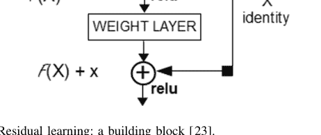

图7.2 残差学习：一个构建块 [23]。

差异更多体现在具有34层的网络中。ResNet-34 的错误百分比远低于 plain-34。此外，从图中可以观察到，ResNet-18 和 plain-18 的错误百分比几乎相同。

#### 7.3.1.1 ResNet 架构

受 VGG-19 的启发，ResNet 的架构在所谓的恒等快捷连接之外使用了 34 层的普通网络。然后快捷连接将架构转变为残差网络，如 [23] 所指。

#### 7.3.1.2 使用 Keras 的 ResNet

Keras 是一个用 Python 设计的神经网络库，在实现过程中擅长控制 TensorFlow、Microsoft Cognitive Toolkit、R、Theano 或 PlaidML [40]。Keras 背后的主要目的是增加深度神经网络的执行时间。Keras 应用包括以下 ResNet 实现，并提供具有 50、101 或 152 层的 ResNet V1 和 ResNet V2。

- ResNet50
- ResNet101
- ResNet152
- ResNet50V2
- ResNet101V2
- ResNet152V2

ResNetV2 是原始 ResNet V1 的更新版本，并在每个权重层之前使用批归一化。

提出了各种更新的 ResNet 网络，可参考 Xie et al. [44]、Huang et al. [38]、Huang et al. [45] 和 Srivastava et al. [46]。随着 ResNet 算法的最新进展和效率，它被广泛用于 COVID-19 检测，使用各种 Keras 如 ResNet 18、ResNet 50 和 ResNet 152，这将在下一节中详细阐述。

## 7.4 综述与讨论

COVID-19 诊断系统的广义表示如图 7.3 所示，关于深度学习技术。从医院收集的 COVID-19 疑似患者的收集数据可能有多种类型，但为分析目的，主要考虑 X 射线和 CT 扫描图像。下一步是数据预处理，其中患者收集的数据通过诸如去噪和调整大小等操作转换为适当格式。接下来，使用交叉验证技术将数据划分为训练、验证和测试段。训练数据随后通过验证过程进行评估，然后是测试数据。诊断过程的主要步骤基于特征提取，其后是分类为 COVID 阳性和 COVID 阴性类别。最后，使用准确率、精确率、特异性和灵敏度等参数评估整体诊断设置。

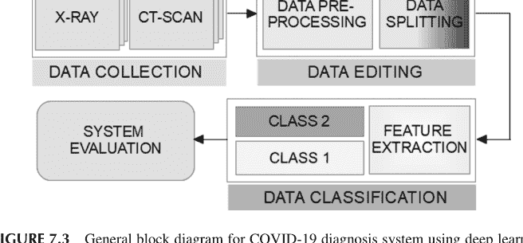

图 7.3 使用深度学习的 COVID-19 诊断系统总体框图。

基于深度学习的检测可以从两个不同角度进行分类：

- 基于深度学习的预训练模型
- 基于自定义的深度学习

预训练模型是指在与应用上下文相似的领域中已经训练过的数据。深度迁移学习涉及将权重和偏差转移到与训练好的父模型相似的新模型中用于训练和再训练目的。一般训练模型需要更多时间和高计算能力。利用预训练模型促进了加速收敛和网络泛化的能力 [47,48]。另一种技术，即自定义深度学习技术，不需要之前的权重和偏差；因此，它耗时且需要高计算能力。由于其特定的应用兴趣，自定义深度学习模型处理可行架构开发，这是一致的并提供更准确的性能 [5]。

与自定义深度学习技术相比具有优势，我们关注预先存在的 CNN、ResNet 及其被各种研究人员用于分类和诊断 COVID-19 的利用。下一节详细阐述了使用两种成像模态的 ResNet 应用。

### 7.4.1 基于深度学习的预训练模型 ResNet

本节详细介绍了 ResNet 在疑似 COVID-19 诊断患者的胸部 X 射线和 CT 扫描图像上的应用。

#### 7.4.1.1 X 射线与 ResNet

基于 ResNet 的 X 射线图像分析的各种方法在表 7.1 [5] 中呈现，总结了研究发现。几乎所有算法都使用了 COVID-19 X 射线图像数据库作为标准。除了 COVID-19 X 射线图像数据库外，还使用了多源数据。尽管数据库包含大量图像，但 COVID-19 病例数量不足。ResNet 的应用可以以高准确率和灵敏度对图像进行分类。10 折和 5 折交叉验证增强了分类。

# 表 7.1

基于深度学习的预训练 ResNet 算法评估方法摘要，用于 X 射线图像上的 COVID-19 检测 [5]

| 类别 | Apostolopoulos and... [49] | Loey et al. [50] | Harry et al. [51] | Ozcan [52] | Sathy and Babra [53] | Mirano et al. [54] | Pannu and Agarwal [55] | Narin et al. [56] | Rahimnia et al. [57] | Abbas et al. [58] | Moustafa, Corani [59] |
|---|---|---|---|---|---|---|---|---|---|---|---|
| 技术 | VGG19 MobileNetV2 Inception Xception ResNet-50 | GAN AlexNet GoogleNet ResNet18 | VGG16 VGG19 ResNet50 Xception Inception V3 | ResNet50 ResNet18 GoogleNet | AlexNet VGG-16 VGG-19 ResNet50 ResNet101 InceptionV3 XceptionNetV2 DenseNet201 SVM | ResNet50 ResNet18 SqueezeNet DenseNet121 | ResNet-v3 InceptionV3 InceptionV3 DenseNet169 NASNet | ResNet50 V3 Inception InceptionV2 ResNetV2 | ResNet50 | DeTraC ResNet18 | VGG16 VGG19 Inception ResNetV2 Xception V3 |
| 数据来源 | COVID-19 X射线图像数据库 Kaggle Kermany 等 | COVID-19 X射线图像数据库 Kaggle Kermany 等 | COVID-19 胸部 X 射线 NIH 数据库 | COVID-19 X射线图像数据库 Kaggle 仓库 | COVID-19 X射线 NIH 胸部 X 射线 Kaggle 胸部 X 射线仓库 | COVID-19 X射线图像数据库 ChestXRay | COVID-19 X射线数据库 RSNA | COVID-19 X射线图像数据库 Kaggle 胸部 X 射线仓库 | COVID-19 X射线 NIH 胸部 X 射线 | COVID-19 X射线图像数据库 日本放射技术 | COVID-19 X射线图像数据库 |
| 样本数量（图像） | 总计：1,442 COVID-19：224 肺炎：714 正常：504 | 总计：307 COVID-19：69 正常：79 肺炎：79 肺炎：79 | 总计：400 COVID-19：100 肺炎：100 正常：200 | 总计：721 COVID-19：131 正常：200 细菌：242 病毒：148 | 316 | 总计：5071 COVID-19：71 近：71 正常：5000 | 总计：1076 COVID-19：108 肺炎：515 正常：453 | 总计：100 COVID-19：50 正常：50 | 总计：278 COVID-19：89 肺炎：96 正常：93 | 总计：196 COVID-19：105 SARS-11 正常：80 | 总计：327 COVID-19：125 肺炎：50 正常：152 |
| 数据划分 | 10折交叉验证 | 训练 80% 验证 10% 测试 10% | 训练 80% 测试 20% | 训练 50% 验证 20% 测试 30% | 训练 60% 验证 20% 测试 20% | 训练 40% 验证 40% 测试 60% | 训练 60% 验证 10% 测试 30% | 5折交叉验证 | 训练 80% 测试 20% | 训练 70% 测试 30% | 5折交叉验证 |

| 性能评估（%） | 准确率：96.67 特异性：96.46 灵敏度：96.66 | 灵敏度：100 精确率：100 准确率：100 F1-Score：100 | 精确率：83 F1-Score：80 灵敏度：80 | 准确率：97.69 特异性：97.90 精确率：95.95 灵敏度：97.26 F1-Score：96.60 | 准确率：95.38 灵敏度：97.47 F1-Score：97.52 MCC：94.11 FPR：93.47 特异性：93.95 Kappa：96.16 | 灵敏度：100 AUC：99.6 F1-Score：95.6 | 准确率：91 精确率：98 灵敏度：89 F1-Score：99 AUC：100 | 准确率：98.96 灵敏度：96 特异性：100 F1-Score：100 精确率：98 | 准确率：98.18 灵敏度：98.24 特异性：98.14 F1-Score：98.19 | 准确率：95.12 灵敏度：97.91 特异性：98.7 精确率：95.36 | 准确率：84.1 灵敏度：87.7 AUC：97.4 |

### 7.4.1.2 CT 扫描与 ResNet

表 7.2 总结了几乎所有基于深度学习的预训练模型，使用 ResNet 技术对疑似 COVID-19 CT 扫描图像进行处理。

该表强调了一些特定因素，如使用的图像总数、数据收集来源、数据划分技术以及各种 CNN 网络的性能评估。

### 7.4.2 自定义深度学习方法

如前所述，自定义深度学习方法未经过预训练且不需要之前的权重和偏差。使用的各种深度学习技术包括支持向量机（SVM）、CNN、射频（RF）和胶囊神经网络（CAPS）[66–71]。

COVID-19 诊断中使用的方法的详细情况总结在表 7.3 和 7.4 中。X 射线和 CT 扫描图像的数据来源、图像类别划分和评估指标在这些表中有所说明。

从表 7.4 可以发现，少数基于自定义网络的系统显示出更好的性能。由于数据库性质各异，且大多数未公开，系统的效率无法比较。虽然 X 射线图像表现出更好的结果，但 CT 扫描图像提供更多实时信息。因此，分析 CT 图像更有效。

## 7.5 本研究的未来范围和局限性

总体而言，深度学习算法是自动化、鲁棒的系统，但需要大量数据进行评估。ResNet 算法在 COVID-19 检测中的应用有效地确定了自动化分类。然而，由于有效数据的限制，效率会降低。COVID-19 数据集的这些局限性可分为两方面。首先，可用数据没有适当的格式，包括不确定、嘈杂、不完整和未标记的格式。它们导致不同作者在应用 ResNet 之前对数据准备的差异。此外，在训练过程中，我们遇到数据冗余、稀疏性和值不可用等问题。第二，实际 COVID 患者数据的最小数据集的可用性有限。在此限制下，当不考虑预训练模型时，ResNet 算法会导致欠拟合或过拟合问题。评论的以下局限性在于评估参数选择。由于标准数据库不可用，作者使用了不同的图像，并评估了灵敏度、特异性、F1 分数、AUC 和 ROC 等各种参数。因此，我们可能无法估计哪个数据库或算法具有较高的效率。虽然我们正在继续使用 X 射线和 CT 扫描分析，但基于 PCR 的 RT–PCR 方法仍然是标准且快速用于识别 COVID-19 的流程。因此，我们也可以将基于图像的评估作为辅助措施。鉴于这些局限性和障碍，我们可以建议适当形成和标记数据库，以便研究人员能够充分评估 ResNet 或其他方法。否则，我们可以研究可在小规模数据库上运行的算法。本综述的另一个局限性是缺乏结果的图片对比，无法直观了解检测过程。此外，本综述还简要介绍了 ResNet 以外的算法。

## 表 7.2

预训练深度学习 ResNet 算法用于 CT 扫描图像 COVID-19 检测的评估方法总结 [5]

| 作者 | Wu et al. [60] | Li et al. [61] | Yousefadeh et al. [62] | Jin et al. [63] | Xu et al. [64] | Jin et al. [65] |
|---|---|---|---|---|---|---|
| 技术 | ResNet50 | ResNet50 | DenseNet, ResNet, Xception, Efficient Net | ResNet152 | ResNet18 | DPN-92, Inception-V3, ResNet50, Attention ResNet50 with 3D U-NET++ |
| 数据来源 | 中国医科大学和北京佑安医院 | 多家医院 | 来自医院的实时数据 | 中国三家不同医院、LIDC-IDRI、ILD-HUG | 浙江大学、温州医院、温岭医院 | 中国五家不同医院 |
| 样本数量（图像） | 总计-495 COVID-19-368 肺炎-127 | 总计-4536 COVID-19-1296 CAP-1735 非肺炎-1325 | 总计-2124 COVID-19-706 非COVID-19-1418 | 总计-1881 COVID-19-496 非COVID-19-1385 | 总计-618 COVID-19-219 甲型流感病毒性肺炎-224 与感染无关-175 | 总计-1391 COVID-19-850 非COVID-19-541 |
| 数据划分 | 训练-80% 验证-10% 测试-10% | 训练-90% 测试-10% | 训练-80% 验证-20% | 随机划分 | 训练+验证-85.4% 测试-14.6% | 随机划分 |
| 性能评估（%） | 准确率-76 敏感性-81.1 特异性-61.5 AUC-81.9 | 敏感性-90 特异性-96 AUC-96 | 准确率-96.4 敏感性-92.4 特异性-98.3 AUC-98.9 F1分数-95.3 Kappa-91.7 | 准确率-94.98 敏感性-94.06 特异性-95.47 精确率-91.53 AUC-97.91 F1分数-92.78 NPV-96.86 Youden指数-89.53 | 准确率-86.7 敏感性-81.5 精确率-80.8 F1分数-81.1 | 敏感性-97.04 特异性-92.2 AUC-99.1 |

## 表 7.3

自定义深度学习算法评估方法总结，用于 X 射线图像 COVID-19 检测 [5]

| 作者 | Wang et al. [66] | Khan et al. [67] | Rahimzadeh and Attar [68] | Alqudah et al. [69] | Farooq and Hafeez [70] | Afshar et al. [71] |
|---|---|---|---|---|---|---|
| 技术 | COVID-Net (CNN) | CoroNet (CNN) | Concatenated CNN | CNN, SVM, RF | COVID-ResNet (CNN) | COVID-CAPS (Capsule Network) |
| 数据来源 | COVID-19 X 射线图像数据库、RSNA 肺炎检测挑战数据集 | COVID-19 X 射线图像数据库、Kaggle 胸部 X 射线存储库 | COVID-19 X 射线图像数据库、RSNA 肺炎检测挑战数据集 | COVID-19 X 射线图像数据库、 | COVIDx 数据集 | COVIDx 数据集 |
| 样本数量（图像） | 13,800 | 总计-1251 COVID-19-284 正常-310 肺炎_bac-330 肺炎_vir-327 | 总计-15085 COVID-19-180 肺炎-6054 正常-8851 | 总计-71 COVID-19-48 非COVID-23 | 13,800 | 13,800 |
| 数据划分 | 训练-90% 测试-10% | 训练-80% 验证-20% | 5折交叉验证 | 训练-70% 测试-30% | 训练-90% 测试-10% | 训练-90% 测试-10% |
| 性能评估（%） | 准确率-92.4 敏感性-80 精确率-88.9 | 准确率-89.5 敏感性-100 精确率-97 F1分数-98 | 准确率-99.50 敏感性-80.53 特异性-99.56 精确率-35.27 | 准确率-95.2 敏感性-93.3 特异性-100 精确率-100 | 准确率-96.23 敏感性-100 精确率-100 F1分数-100 | 准确率-95.7 敏感性-90 精确率-95.8 AUC-97 |

## 7.6 结论

COVID-19 仍在传播，并在世界各地以不断演化的新毒株留下痕迹。随着时间的推移，目前虽然大多数国家已配备疫苗，但仍无法治愈病毒的进展及其影响。病毒的影响更为危险，因为无症状患者不会表现出任何症状，却在不知情的情况下传播病毒。因此，人工智能系统至少用于检测和隔离患者至关重要。各种人工智能和物联网设备已提供了有希望的解决方案用于 COVID-19，但通过除 RT-PCR 之外的流程检测患者仍在研究中。使用 X 射线和 CT 扫描图像的检测过程仍被视为 RT-PCR 检测的额外措施。本章回顾了人工智能在深度学习算法领域的应用，重点关注用于 COVID-19 分析的快速探索方法 ResNet。ResNet 的稳健性提供了有希望的结果，但仍有改进空间。本章综述提供了基于用于方法分类的分类法的讨论。方法主要分为预训练模型，其中已训练的与类似疾病类型的模型在添加 COVID-19 数据后进行再训练。第二种方法是自定义深度学习方法，从头开始训练系统。综述还提供了对可公开用于评估的数据库的见解，预计对该领域的研究人员将有很大帮助。本研究中的局限性也已概述，涉及非统一有效数据库以及由于缺乏实时 COVID-19 数据而造成的危害，而实时 COVID-19 数据是深度学习方法高度需要的。评估的金标准不可用也被报告。进一步还讨论了可能的解决方案和结果。虽然用于 COVID-19 的医学图像深度学习算法可被视为识别的额外措施，但最近它们也可能为传统的 RT-PCR 筛查提供高效且更快的解决方案。如果不是，至少通过人工智能的早期检测，它们可能有助于减少病毒的传播。

## 表 7.4

自定义深度学习算法评估方法总结，用于 CT 扫描图像 COVID-19 检测 [5]

| 作者 | He et al. [72] | Zheng et al. [73] | Singh et al. [74] | Farid et al. [75] |
|---|---|---|---|---|
| 技术 | CRNet | DeCoVNet | MODE-CNN | CNN |
| 数据来源 | 意大利医学与介入放射学会 COVID-19 数据库 COvid-CT | 联合医院同济医学院华中科技大学 | Covid-19 患者胸部 CT 图像 | Kaggle 基准数据集 |
| 样本数量（图像） | 总计-746 COVID-19-349 非COVID-397 | 630 | 总计-150 COVID-19-75 非COVID-75 | 总计-102 COVID-19-51 SARS-51 |
| 数据划分 | 训练-60% 验证-15% 测试-25% | 训练-80% 测试-20% | 训练和测试数据集的各种比例 | 10折交叉验证 |
| 性能评估（%） | 准确率-95.2 敏感性-93.3 特异性-100 精确率-100 | 准确率-95.2 敏感性-93.3 特异性-100 精确率-100 | 准确率-95.2 敏感性-93.3 特异性-100 精确率-100 | 准确率-95.2 敏感性-93.3 特异性-100 精确率-100 |

## 参考文献

- [1]. WHO COVID-19 情况报告。 [在线]. 可用：2021年3月 https://www.who.int/emergencies/diseases/novel-coronavirus-2019/situation-reports, (2021).
- [2]. Cascella M, Rajnik M, Cuomo A, Dulebohn SC 和 Di Napoli R. 冠状病毒（covid-19）的特征、评估和治疗。 Statpearls [互联网]. StatPearls Publishing, 2020.
- [3]. Forni, D., Cagliani, R., Clerici, M. 和 Sironi, M. 人类冠状病毒基因组的分子进化。 Trends in Microbiology, 25 (1), 35–48, (2017).
- [4]. Harapan, H., Itoh, N., Yufika, A., Winardi, W., Keam, S., Te, H., Megawati, D., Hayati, Z., Wanger, A.L. 和 Mudatsir, M. 冠状病毒病 2019（COVID-19）：文献综述。 Journal of Infection and Public Health, 13 (5), 667–673 doi: 10.1016/j.jiph.2020.03.01, 2020.
- [5]. Islam, M. M., Karray, F., Alhajj, R. 和 Zeng, J. 关于新型冠状病毒（covid-19）诊断的深度学习技术的综述。 IEEE Access, 9, 30551–30572, (2021).
- [6]. J. P. Kanne, “2019新型冠状病毒（2019-nCoV）感染的胸部CT表现——来自中国武汉：放射科医生的关键点。” Radiology, 295 (1), 16–17, (Apr. 2020).
- [7]. J. P. Kanne, “2019新型冠状病毒（2019-nCoV）感染的胸部CT表现——来自中国武汉：放射科医生的关键点。” Radiology, 295 (1), 16–17, (Apr. 2020).
- [8]. Tayarani-N, M. H. 人工智能在抗击 Covid-19 中的应用：文献综述。 Chaos, Solitons & Fractals, 110338, 1–60 (2020).
- [9]. Mishra, A. K., Das, S. K., Roy, P. 和 Bandyopadhyay, S. 基于胸部 CT 图像识别 COVID19：一种基于深度卷积神经网络的方法。 Journal of Healthcare Engineering, 2020, 1–7 (2020).
- [10]. H. Kim, H. Hong, S. H. Yoon, 冠状病毒病 2019 CT 与逆转录聚合酶链反应诊断性能：荟萃分析。 Radiology, 296 (3), E145–E155 (Sep. 2020).
- [11]. Z. Ye, Y. Zhang, Y. Wang, Z. Huang 和 B. Song, 新型冠状病毒病 2019（COVID-19）的胸部 CT 表现：图示综述。 European Radiology, 30, (8), 4381–4389 (Aug. 2020).
- [12]. X. Mei, H. C. Lee, K. Diao, M. Huang, B. Lin, C. Liu 和 Z. Xie, 人工智能支持的 COVID19 患者快速诊断。 Nature Medicine, 26 (8),1224–1228 (Aug. 2020).
- [13]. L. Huang, R. Han, T. Ai, P. Yu, H. Kang, Q. Tao 和 L. Xia, COVID-19 序列定量胸部 CT 评估：一种深度学习方法。 Radiology: Cardiothoracic Imaging, 2 (2), Art. no. e200075 (Apr. 2020).
- [14]. H. Panwar, P. K. Gupta, M. K. Siddiqui, R. Morales-Menendez 和 V. Singh, 使用 nCOVnet 通过深度学习快速检测 X 射线中的 COVID-19 应用。 Chaos, Solitons & Fractals, 138, Art. no. 109944, (Sep. 2020).
- [15]. K. El Asnaoui 和 Y. Chawki, 使用 X 射线图像和深度学习自动检测冠状病毒病。 Journal of Biomolecular Structure and Dynamics, 7, 1–12 doi: 10.1080/07391102.2020.1767212, (May 2020).
- [16]. Y. Oh, S. Park 和 J. C. Ye, 使用有限训练数据集在 CXR 上深度学习 COVID-19 特征。 IEEE Transactions on Medical Imaging, 39 (8), 2688–2700 (Aug. 2020).
- [17]. R. M. Pereira, D. Bertolini, L. O. Teixeira, C. N. Silla 和 Y. M. G. Costa, 在平坦和分层分类场景中在胸部 X 射线图像中识别 COVID-19。 Computer Methods and Programs in Biomedicine, 194, Art. no. 105532 (Oct 2020).
- [18]. A. S. Albahri, R. A. Hamid, J. K. Alwan, Z. T. Al-Qays, A. A. Zaidan, B. B. Zaidan, A. O. S. Albahri, A. H. Alamoodi, J. M. Khalaf, E. M. Almahdi, E. Thabet, S. M. Hadi, K. I. Mohammed, M. A. Alsalem, J. R. Al-Obaidi and H. T. Madhloom, 生物数据挖掘和机器学习技术在检测和诊断新型冠状病毒（COVID-19）中的作用：系统综述。医学系统杂志, 44 (7), 文章编号 122 (2020 年 7 月).

- [19]. L. J. Muhammad, M. M. Islam, S. S. Usman and S. I. Ayon, 新型冠状病毒（COVID-19）感染患者康复的预测性数据挖掘模型。社会网络计算机科学, 1(4), 文章编号 206 (2020)。
- [20]. S. Latif, M. Usman, S. Manzoor, W. Iqbal and J. Qadir, 利用数据科学抗击 COVID-19：全面综述。IEEE 人工智能汇刊, 1 (1), 85–103 (2020 年 8 月)。
- [21]. Wu, X., Hui, H., Niu, M., Li, L., Wang, L., He, B., ... and Zha, Y. 基于深度学习的多视角融合模型用于筛查 2019 年新型冠状病毒肺炎：多中心研究。欧洲放射学杂志, 128, 109041 (2020)。
- [22]. Farooq, M. and Hafeez, A. Covid-resnet：一种用于从放射影像筛查 covid19 的深度学习框架。arXiv 预印本 arXiv:2003.14395 (2020)。
- [23]. K. He, X. Zhang, S. Ren and J. Sun, 用于图像识别的深度残差学习, arXiv:1512.03385。 [在线]。 可用： `http://arxiv.org/abs/1512.03385`, (2015)。
- [24]. J. P. Cohen, P. Morrison and L. Dao, “COVID-19 图像数据收集，” arXiv:2003.11597。 [在线]。 可用： `https://arxiv.org/abs/2003.11597`, (2020)。
- [25]. Kaggle 胸部 X 射线存储库。 访问： [在线]。 可用： `https://www.kaggle.com/paulthomymooney/chest-xray-pneumonia`, (2020 年 3 月 20 日)。
- [26]. Kaggle 数据集。 访问： [在线]。 可用： `https://www.kaggle.com/andrewmvd/covid19-x-rays`, (2020 年 3 月 15 日)。
- [27]. 北美放射学会。 RSNA 肺炎检测挑战赛。 访问： [在线]。 可用： `https://www.kaggle.com/c/rsna-pneumoniadetection-challenge/data`, (2020 年 3 月 10 日)。
- [28]. NIH 胸部 X 射线。 访问： [在线]。 可用： `https://openi.nlm.nih.gov/`, (2020 年 3 月 16 日)。
- [29]. COVID-19。 访问： [在线]。 可用： `https://radiopaedia.org`, (2020 年 4 月 9 日)。
- [30]. J. Irvin, P. Rajpurkar, M. Ko, Y. Yu, C. Chute, R. Ball, J. Seekins, S. S. Halabi, R. Jones, D. B. Larson, C. P. Langlotz, B. N. Patel and M. P. Lungren, “CheXpert：一个具有不确定性标签和专家比较的大型胸部放射影像数据集，” 在人工智能 AAAI 会议论文集。 33, 590–597 (2019 年 7 月)。
- [31]. L. Wang, Z. Q. Lin and A. Wong, COVID-net：一种用于从胸部 X 射线图像检测 COVID-19 病例的定制深度卷积神经网络设计。科学报告, 10 (1), 文章编号 19549, (2020 年 12 月)。
- [32]. X. Yang, X. He, J. Zhao, Y. Zhang, S. Zhang and P. Xie, COVID-CT 数据集：关于 COVID-19 的 CT 扫描数据集, arXiv:2003.13865。 [在线]。 可用： `http://arxiv.org/abs/2003.13865`, (2020)。
- [33]. 意大利医学与介入放射学会：COVID-19 数据库。 访问： [在线]。 可用： `https://www.sirm.org`, (2020 年 3 月 28 日)。
- [34]. G. Zeng, Y. He, Z. Yu, X. Yang, R. Yang and L. Zhang, 通过嵌入有机硅烷功能化多壁碳纳米管制备新型高铜离子去除膜。化学技术与生物技术杂志, 91(8), 2322–2330 (2016 年 8 月)。
- [35]. S. Das. CNN 架构：LeNet、AlexNet、VGG、GoogLeNet、ResNet 等。 [在线]。 可用： `https://medium.com/analyticsvidhya/cnns-architectures-lenet-alexnet-vgg-googlenet-resnet-andmore-666091488df5`, (2017)。
- [36]. F. N. Iandola, S. Han, M. W. Moskewicz, K. Ashraf, W. J. Dally and K. Keutzer, SqueezeNet：AlexNet 级别精度，参数减少 50 倍且模型大小 <0.5MB, arXiv:1602.07360。 [在线]。 可用： `http://arxiv.org/abs/1602.07360`, (2016)。
- [37]. Z. Qin, Z. Zhang, X. Chen, C. Wang and Y. Peng, Fd-mobilenet：采用快速下采样策略改进的 mobilenet, 在第 25 届 IEEE 图像处理国际会议论文集 (ICIP), 1363–1367, (2018 年 10 月)。
- [38]. G. Huang, Z. Liu, L. Van Der Maaten and K. Q. Weinberger, 密集连接卷积网络, 在 IEEE 计算机视觉与模式识别会议论文集 (CVPR), 2261–2269, (2017 年 7 月)。
- [39]. O. Ronneberger, P. Fischer and T. Brox, U-Net：用于生物医学图像分割的卷积网络, 在医学图像计算与计算机辅助干预国际会议论文集, 234–241, (2015)。
- [40]. Resnet [在线]。 可用： `https://www.mygreatlearning.com/blog/resnet/`, (2021 年 3 月)。
- [41]. K. Simonyan and A. Zisserman. 用于大规模图像识别的非常深的卷积网络。arXiv 预印本 arXiv:1409.1556 (2014)。
- [42]. C. Szegedy, W. Liu, Y. Jia, P. Sermanet, S. Reed, D. Anguelov, D. Erhan, V. Vanhoucke, A. Rabinovich. 用卷积更深入。 在 IEEE 计算机视觉与模式识别会议论文集, 第 1–9 页 (2015)。
- [43]. Resnet [在线]。 可用： `https://towardsdatascience.com/an-overview-of-resnet-and-its-variants-5281e2f56035`, (2021 年 3 月)。
- [44]. S. Xie, R. Girshick, P. Dollar, Z. Tu and K. He. 用于深度神经网络的聚合残差变换。arXiv 预印本 arXiv:1611.05431v1 (2016)。
- [45]. G. Huang, Y. Sun, Z. Liu, D. Sedra and K. Q. Weinberger. 具有随机深度的深度网络。arXiv:1603.09382v3 (2016)。
- [46]. N. Srivastava, G. Hinton, A. Krizhevsky, I. Sutskever and R. Salakhutdinov. Dropout：防止神经网络过拟合的一种简单方法。机器学习研究杂志, 15 (1), 1929–1958 (2014)
- [47]. A. Elhassouny and F. Smarandache, “深度卷积神经网络架构趋势：综述，” 在计算机科学和可再生能源国际会议论文集 (ICCSRE), 1–8, doi: 10.1109/ ICCSRE.2019.8807741, (2019 年 7 月)。
- [48]. M. Z. Alom, T. M. Taha, C. Yakopcic, S. Westberg, P. Sidike, M. S. Nasrin, M. Hasan, B. C. Van Essen, A. A. S. Awwal and V. K. Asari, 深度学习理论和架构的最新综述。电子学, 8 (3), 292 (2019 年 3 月)。
- [49]. D. Apostolopoulos and T. A. Mpesiana, COVID-19：利用卷积神经网络迁移学习从 X 射线图像自动检测。物理与工程科学医学, 43 (2), 635–640 (2020 年 6 月)。
- [50]. M. Loey, F. Smarandache and N. E. M. Khalifa, 在缺乏胸部 COVID-19 X 射线数据集的情况下：基于 GAN 和深度迁移学习的新型检测模型。对称性, 12 (4), 651 (2020 年 4 月)。
- [51]. M. Y. Horry, M. Paul, A. Ulhaq, B. Pradhan and M. Saha, 基于 X 射线图像的 COVID-19 检测，使用预训练深度学习模型, Engrxiv, 待发表。 [在线]。 可用： `https://engrxiv.org/wx89s/`
- [52]. T. Ozcan. 用于 X 射线图像中冠状病毒病（COVID-19）检测的深度学习框架。 [在线]。 可用： `https://www.researchsquare.com/article/rs-26500/v1`, (2020)。
- [53]. S. K. B. Sethy and P. Kumar. 基于深度特征的冠状病毒病（COVID-19）检测。 [在线]。 可用： `https://www.preprints.org/manuscript/202003.0300/v1`, (2020)。
- [54]. S. Minaee, R. Kafieh, M. Sonka, S. Yazdani and G. Jamalipour Soufi, Deep-COVID：使用深度迁移学习从胸部 X 射线图像预测 COVID-19。医学图像分析, 65, 文章编号 101794, (2020 年 10 月)。
- [55]. N. S. Punn and S. Agarwal, 使用微调深度神经网络对有限的后前位胸部 X 射线图像进行 COVID-19 自动诊断。国际语音技术杂志, 15, 1–14, doi: 10.1007/s10489-020-01900-3, (2020 年 10 月)。
- [56]. A. Narin, C. Kaya and Z. Pamuk, 使用 X 射线图像和深度卷积神经网络自动检测冠状病毒病（COVID-19）, arXiv:2003.10849。 [在线]。 可用： `http://arxiv.org/abs/2003.10849`, (2020)。
- [57]. S. Bukhari, S. Bukhari, A. Syed and S. Shah, 对感染 COVID-19 患者胸部 X 射线评估的卷积神经网络（CNN）的诊断评估,’’ MedRxiv, [在线]。 可用： `https://www.medrxiv.org/content/10.1101/2020.03.26.20044610v1`, (2020 年 1 月)。
- [58]. A. Abbas, M. M. Abdelsamea and M. M. Gaber, 使用 DeTraC 深度卷积神经网络对胸部 X 射线图像中的 COVID-19 进行分类。应用智能, 8, 1–11, [在线]。 可用： 10.1007/s10489-020-01829-7, (2020 年 9 月)。
- [59]. P. G. Moutounet-Cartan, 深度卷积神经网络用于从后前位胸部 X 射线诊断 covid-19 和其他肺炎疾病, arXiv 预印本 arXiv:2005.00845, 1–17, (2020)。
- [60]. X. Wu, H. Hui, M. Niu, L. Li, L. Wang, B. He and X. Yang, 基于深度学习的多视角融合模型用于筛查 2019 年新型冠状病毒肺炎：多中心研究。欧洲放射学杂志, 128, 文章编号 109041, (2020 年 7 月)。
- [61]. L. Li, L. Qin, Z. Xu, Y. Yin, X. Wang, B. Kong, J. Bai and Y. Lu, 人工智能在胸部 CT 上区分 COVID-19 与社区获得性肺炎。放射学, 19, 文章编号 200905 (2020 年 3 月)。
- [62]. M. Yousefzadeh, P. Esfahanian and S. Movahed, Ai-corona：用于胸部 CT 扫描中 COVID-19 诊断的放射科医生辅助深度学习框架, MedRxiv, [在线]。 可用： `https://www.medrxiv.org/content/10.1101/2020.05.04.20082081v1`, (2020 年 1 月)。
- [63]. C. Jin et al., COVID-19 诊断人工智能系统的开发与评估。自然通讯, 11 (1), 5088 (2020 年 12 月)。
- [64]. X. Xu, X. Jiang, C. Ma, P. Du, X. Li, S. Lv, L. Yu, Y. Chen, J. Su, G. Lang, Y. Li, H. Zhao, K. Xu, L. Ruan and W. Wu, 用于筛查 2019 冠状病毒病肺炎的深度学习系统, arXiv:2002.09334。 [在线]。 可用： `http://arxiv.org/abs/2002.09334`, (2020)。
- [65]. S. Jin, B. Wang, H. Xu, C. Luo, L. Wei, W. Zhao and X. Hou, 用于 COVID-19 筛查的 AI 辅助 CT 影像分析：在四周内构建和部署医疗 AI 系统, MedRxiv, [在线]。 可用： `https://www.medrxiv.org/content/10.1101/2020.03.19.20039354v1`, (2020)。
- [66]. L. Wang, Z. Q. Lin and A. Wong, COVID-net：一种用于从胸部 X 射线图像检测 COVID-19 病例的定制深度卷积神经网络。科学报告, 10 (1), 文章编号 19549 (2020 年 12 月)。
- [67]. A. I. Khan, J. L. Shah and M. M. Bhat, CoroNet：一种用于从胸部 X 射线图像检测和诊断 COVID-19 的深度神经网络。生物医学计算机方法和程序, 196, 文章编号 105581 (2020 年 11 月)。
- [68]. M. Rahimzadeh and A. Attar, 一种基于 Xception 和 ResNet50 V2 拼接的用于从胸部 X 射线图像检测 COVID-19 和肺炎的改进深度卷积神经网络。医学信息学解锁, 19, 文章编号 100360 (2020)。
- [69]. A. M. Alqudah, S. Qazan, H. Alquran, I. A. Qasmieh and A. Alqudah. 使用 X 射线图像和人工智能混合系统检测 COVID-2019。 [在线]。 可获得：`https://www.researchgate.net/publication/340232556_Covid-2019_Detection_Using_XRay_Images_And_Artificial_Intelligence_Hybrid_Systems`, (2020).
- [70]. M. Farooq 和 A. Hafeez, COVID-ResNet：用于从放射照片筛查 COVID-19 的深度学习框架, arXiv:2003.14395. [在线]. 可获得：`http://arxiv.org/abs/2003.14395`, (2020).
- [71]. P. Afshar, S. Heidarian, F. Naderkhani, A. Oikonomou, K. N. Plataniotis 和 A. Mohammadi, COVID-CAPS：基于胶囊网络的从 X 射线图像识别 COVID-19 病例的框架. Pattern Recognition Letters, 138, 638–643 (2020 年 10 月).
- [72]. S. Wang, B. Kang, J. Ma, X. Zeng, M. Xiao, J. Guo ... 和 B. Xu, 用于筛查冠状病毒病（COVID-19）的 CT 图像深度学习算法. European Radiology, 1–9 (2020 年 1 月).
- [73]. C. Zheng, X. Deng, Q. Fu, Q. Zhou, J. Feng, H. Ma ... 和 X. Wang, 基于弱标签的胸部 CT COVID-19 深度学习检测. MedRxiv, 1–13 (2020).

[74]. D. Singh, V. Kumar, M. Kaur, 使用基于多目标差分进化卷积神经网络的胸部 CT 图像对 COVID-19 患者进行分类, European Journal of Clinical Microbiology & Infectious Diseases. 39 (7), 1379–1389 (2020).

[75]. A. A. Farid, G. I. Selim 和 H. A. A. Khater, 一种用于筛查冠状病毒病（COVID-19）的 CT 图像特征分析与预测的新方法. [在线]. 可获得：https://www.preprints.org/manuscript/202003.0284/v1, (2020).

## 泰勒与弗朗西斯

Taylor & Francis Group

http://taylorandfrancis.com

# 8 COVID 对糖尿病患者的临床影响

Surekha Manhas, Zaved Ahmed Khan, and Meenu Gupta

## 目录

- 8.1 背景........................................................................149
- 8.2 引言........................................................................150
- 8.3 冠状病毒的复制和致病机制........................................150
- 8.4 COVID-19 传播 ..............................................................151
- 8.5 临床过程（COVID-19）...........................................................151
- 8.6 诊断标准................................................................152
- 8.7 COVID-19 患者的可用临床疗法................................152
- 8.8 冠状病毒的当前最新状况 ...............................................152
- 8.8.1 情况报告 1：2020 年 1 月 31 日..............................................152
- 8.8.2 情况报告 2：2020 年 2 月 6 日..............................................153
- 8.8.3 情况报告 3：2020 年 2 月 13 日.............................................153
- 8.8.4 情况报告 4：2020 年 2 月 21 日.............................................153
- 8.8.5 情况报告 5：2020 年 2 月 28 日.............................................153
- 8.8.6 情况报告 6：2020 年 3 月 9 日..................................................154
- 8.8.7 情况报告 7：2020 年 3 月 14 日.................................................154
- 8.8.8 情况报告 8：2020 年 3 月 22 日.................................................154
- 8.8.9 情况报告 9：2020 年 3 月 28 日.................................................154
- 8.8.10 情况报告 10：2020 年 4 月 5 日................................................154
- 8.8.11 情况报告 11：2020 年 4 月 9 日................................................154
- 8.9 COVID-19 感染与糖尿病患者之间可能存在的任何关系 155
- 8.10 结论 ..............................................................................157
- 参考文献...................................................................................158

### 8.1 背景

当前可怕的、迅速蔓延的 COVID-19（冠状病毒病）灾难性爆发，由 SARS-CoV-2（严重急性呼吸综合征冠状病毒 2）引起，持续蔓延。8 月 5 日，全球 COVID-19 累计病例数超过 2 亿，仅用了六个月就从 1 亿病例增长至此。本周仅一周内，就报告了超过 420 万例新病例和超过 65,000 例新死亡病例，与上周相比略有增加。

美洲区域（14%）和西太平洋区域（19%）报告了新病例比例的最大增幅，分别报告了 130 万例和超过 37.5 万例新病例。此外，本周西太平洋区域报告的新死亡人数显著增加（46%）。在 228 个成员国和地区中，38 个（17%）报告新病例较上周增加 50%，34 个（15%）报告新死亡人数较上周增加 50%。参考：WHO COVID-19 报告 每周流行病学更新关于 COVID-19 - 2021 年 8 月 10 日 (who.int)。截至 2020 年 4 月 2 日，已超过 205 个国家，确诊病例 900,306 例，死亡 45,693 例 [1,2]。2019 年 12 月 31 日，中国世界卫生组织办事处获悉在中国湖北省武汉市发现的与不明病因相关的肺炎病例。中国国家当局向世卫组织报告了 44 例不明病因肺炎总病例 [2]。当时，疾病致病因子尚未确定。世卫组织收到了中国国家卫生委员会提供的有关不明原因病例的其他详细资料，表明这种不明疾病的爆发与武汉市的海鲜市场有关。世卫组织总干事 Tedros Adhanom Ghebreyesus 于 3 月 5 日表示，目前在某些情况下疫情可能无法控制。但它并非无法控制，这将是宣布大流行含义的开始 [1]。

### 8.2 引言

冠状病毒是有包膜的、非分段的正义 RNA 病毒，属于冠状病毒科，尼多病毒目。高度传染性的 β 冠状病毒具有引起 COVID-19 的潜力，该病由世卫组织于 2020 年 2 月 11 日命名。整个人口都极易感染这种令人担忧的疾病；接触和呼吸道飞沫是主要的传播途径 [3,4]。COVID-19 通过受体介导的胞吞作用利用 ACE2（血管紧张素转换酶 II）作为入口受体，像所有其他病毒一样靶向肺泡上皮细胞。在有症状患者中，症状在不超过一周后开始出现，包括咳嗽、发热、疲劳、鼻塞以及上呼吸道感染相关的其他体征。感染可能进展为严重状态，出现呼吸困难和伴有严重胸痛的肺炎，这些症状可通过计算机断层扫描看到，大约在 75% 的感染个体中可见。在有症状感染的第二和第三周，肺炎多发 [5]。

### 8.3 冠状病毒的复制和致病机制

在人类中，细胞受体 ACE 存在于下呼吸道。也被称为 SARS-CoV 细胞受体，它在人类之间或跨物种传播的调节中发挥作用 [6,7]。在检查从 COVID-19 患者取出的分离支气管肺泡灌洗液（BALF）后，证实 SARS-CoV-2 使用与 SARS-CoV 相同的细胞受体进入 [8]。

冠状病毒在其表面携带病毒颗粒 S 糖蛋白，可附着于存在于人类细胞表面的细胞 ACE 受体 [9]。S 糖蛋白由两个主要亚基 S1 和 S2 组成，其中 S1 决定细胞嗜性和病毒对宿主的易感性范围。论文中未明确提及 S2 的作用。RBD 结构域发挥重要作用，而串联结构域 HR1（七肽重复 1）和 HR2 与病毒的细胞膜融合，该过程由 S2 亚基介导 [10,11]。细胞膜融合后，病毒 RNA 被释放到细胞基质或细胞质中，未包被的病毒 RNA 由两个多肽 pp1a 和 pp1ab 翻译，该多肽编码无结构蛋白以在双膜囊泡中形成 RTC（复制转录复合体）[12,13]。

亚基因组 RNA 由持续复制的 RTC 合成，编码结构蛋白和辅助蛋白。介导高尔基体、内质网（ER）、核衣壳蛋白、包膜糖蛋白和新形成的基因组 RNA 组装，然后形成病毒颗粒的芽。最后，含有病毒颗粒的囊泡与细胞膜融合以释放病毒。刺突（S）-糖蛋白与 ACE 受体的结合是病毒进入的关键步骤；病毒与 ACE 受体之间的结合是被广泛研究的途径。系统地检测了 β-Co 受体，结果显示 ACE-2 在人类细胞中表达，但 APN（氨基肽酶 N）和肽酶-4（DPP4）改善了 SARS-CoV-2 的进入，而其他研究表明 ACE-2 与病毒的结合效率比 SARS-CoV 高 10–20 倍 [14]。

在 SARS-CoV 的情况下，三聚体 S 蛋白的裂解由组织蛋白酶和 TMPRSS2（跨膜丝氨酸蛋白酶 2）触发，当其他可能分子促进 SARS-CoV-2 的内吞作用时，膜内陷得以实现；但目前尚不清楚 [15,16]。现有数据显示 SARS-CoV-2 的毒力可能低于 MERS-CoV 和 SARS-CoV；COVID-19 死亡率为 3.9%，低于 MERS 死亡率（35%）和 SARS-CoV（9.6%）[17]。因此，SARS-CoV-2 的致病机制和传播机制已被广泛研究所覆盖。

### 8.4 COVID-19 传播

各种研究表明，蝙蝠可能是中国海鲜市场发生的 SARS-CoV-2 感染的潜在来源。对致命病毒的基因组测序显示其基因组与蝙蝠基因组序列相似度达 96.2%。研究提出人类 SARS-CoV-2 和蝙蝠 CoV 可能有相同的祖先，尽管在海鲜市场通常不售卖蝙蝠。SARS-CoV-2 在人类之间的传播主要发生在家庭成员之间，当一名成员接触到感染者或携带者或任何其他 COVID 患者时 [4]。

### 8.5 临床过程（COVID-19）

中位潜伏期估计约为 5–6 天（范围为 0–14 天）。确诊病例的中位估计年龄约为 59 岁。通过对初始数据的分析发现，约超过 80% 的患者有轻症或无症状患者能够康复，但只有15%出现重症感染（包括肺炎）；其余15%为危重症，出现呼吸衰竭和多器官衰竭。尽管总体估计病死率约为2%，但80岁以上人群病死率达14.8%，50岁以下病例病死率为0.2%，且患有慢性共病的人群病死率更高[18]。

### 8.6 诊断标准

SARS-CoV-2的初步鉴定是通过中国病毒研究所的电子显微镜观察其形态完成的。迄今为止，COVID-19诊断的另一种金标准临床方法是利用RT-PCR检测呼吸道样本、鼻拭子和咽拭子中的核酸。进一步通过下一代测序进行确认[4]。

### 8.7 针对COVID-19患者的现有临床疗法

截至目前，美国食品药品监督管理局（FDA）尚未批准任何治疗或预防COVID-19的治疗药物。当前临床管理中为控制该疾病而采取的方法包括防控措施、支持性护理，以及在需要时提供补充氧气或机械通气支持。多种抗病毒药物正被用于治疗COVID-19感染，例如瑞德西韦（一种静脉注射抗病毒药物），其在体外对SARS-CoV-2具有活性。氯喹和羟氯喹正处于预防SARS-CoV-2感染暴露前或暴露后的临床试验阶段。其他药物也在临床试验中。大量免疫疗法、抗病毒药物和疫苗正在被探索和开发为有效疗法[19,20]。

### 8.8 冠状病毒的最新状况

#### 8.8.1 情况报告1：2020年1月31日

在中国，共有9,720例病例，其中报告213例死亡。2020年1月31日，武汉是此次疫情最初暴发的中心，并迅速扩展到中国所有地区。除中国外，其他19个国家——尼泊尔、加拿大、澳大利亚、印度、阿联酋、越南、斯里兰卡、美国、菲律宾、韩国、马来西亚、芬兰、柬埔寨、泰国、新加坡、法国、意大利、德国和日本——报告了106例确诊COVID病例。

在印度，2020年1月30日，喀拉拉邦报告了一例实验室确认的病例。该患者是一名从中国（武汉市）返回的学生，其健康状况稳定。总理办公室和MoHFW（卫生、家庭和福利部）正密切监测2019-nCoV疫情，并加强防范工作。

公共卫生防范工作，包括感染预防措施、监测、医院准备和诊断准备，国家及州卫生当局定期调查诊断能力以降低风险。NCDC（国家疾病控制中心）已启动SHOC（战略卫生行动中心）房间，以提供控制职能的指导，并开通求助热线（+91-11-23978046）解答公众疑问。浦那国家病毒学研究所已具备国际标准的专业能力和容量，共检测了49份nCoV样本，其中48份报告为阴性。自2020年1月31日起，另有12个实验室开始运作：分别是金奈的KIPMR；斋浦尔的SMS；加尔各答的ICMR—NICED；新德里的NCDC；班加罗尔的Victoria Hospital Campus；喀拉拉邦的NIV；那格浦尔的GGMC；班加罗尔的NIV；那格浦尔的NIV；勒克瑙的KGMU；孟买的Kasturba Hospital for Infectious Diseases；以及塞康德拉巴德的GMC[21]。

#### 8.8.2 情况报告2：2020年2月6日

2020年2月6日，28个不同国家共确认28,267例COVID病例，其中报告565例死亡（中国563例，香港1例，菲律宾1例）。在印度，喀拉拉邦确认了三例：一例来自卡萨拉戈德，一例来自特里苏尔，第三例来自阿拉普扎。223例疑似病例的样本已送往ICMR-NIV进行确认，其中193份标记为阴性，仅3份为阳性。其余样本的结果待定[22]。

#### 8.8.3 情况报告3：2020年2月13日

根据WHO全球更新数据，25个不同国家共确认45,177例病例，其中报告的死亡人数为1,369例（中国1,368例，菲律宾1例）。从1月30日至2月3日，印度报告了3例COVID-19病例。这些感染患者情况稳定，由隔离中的专家定期监测。截至2月13日，已有389份样本送至喀拉拉邦的NIV，其中354份检测为阴性，其余检测样本待定[23]。

#### 8.8.4 情况报告4：2020年2月21日

截至2020年2月20日，已确认74,748例COVID病例（新增548例），其中中国处于最高水平，总病例数为74,675例（新增399例）；中国报告2,121例死亡，其中115例来自最新病例。中国以外，26个不同国家共确认1,073例病例（新增149例），导致8人死亡。2020年1月30日至2月3日期间，仅确认了3例病例，均已完全康复并出院。截至2月21日，未报告更多新的COVID病例[24]。

#### 8.8.5 情况报告5：2020年2月28日

截至2月28日，这种致命病毒已在全球感染82,294人，新增1,185例疑似病例。另一方面，中国已达到78,630例，其中新增439例，并报告2,747例死亡。在印度，截至那时未报告新病例[25]。

#### 8.8.6 情况报告6：2020年3月9日

截至2020年3月9日，109,577人暴露于病毒感染，死亡3,809例。印度不同邦确认了44例病例，包括北方邦（9例）、泰米尔纳德邦（1例）、拉达克（2例）、特伦甘纳邦（1例）、拉贾斯坦邦（2例）、德里（4例）、旁遮普邦（1例）、查谟（1例）、喀拉拉邦（9例）和哈里亚纳邦（14例）[26]。

#### 8.8.7 情况报告7：2020年3月14日

截至2020年3月14日，全球共报告132,758例病例，死亡4,955例。3月14日，确认84例病例，其中17例为外国公民；10例治愈，报告死亡2例，其中一例是来自卡纳塔克邦的76岁男性，另一例是来自德里的68岁女性[27]。

#### 8.8.8 情况报告8：2020年3月22日

2020年3月22日，全球共有266,073人陷入慢性感染，死亡11,184人。确诊病例从84例增至360例，7例死亡，包括旁遮普邦（1例）、马哈拉施特拉邦（2例）、古吉拉特邦（1例）、德里（1例）、卡纳塔克邦（1例）和比哈尔邦（1例）[28]。

#### 8.8.9 情况报告9：2020年3月28日

截至3月28日，全球范围内已确认462,684例COVID-19病例，死亡20,834例。在印度，确认909例病例，报告19例死亡[29]。印度总理纳伦德拉·莫迪依据《2005年灾害管理法》第6(2)(i)条发布命令，规定封锁21天以遏制病毒疫情。

#### 8.8.10 情况报告10：2020年4月5日

截至2020年4月5日，全球已确认1,051,635例COVID病例，死亡56,985例。在印度，确诊病例上升至3,577例，死亡83例；274例已出院[30]。MoHFW发布命令，根据“总理穷人福利计划：抗击COVID-19的医务人员保险计划”，为卫生工作者提供最高90天的保险保障。

#### 8.8.11 情况报告11：2020年4月9日

4月9日，印度31个不同邦共确认5,734例病例，报告166例死亡[31]。WHO代表Henk Bekedam博士为应对这一前所未有的健康挑战，宣布WHO坚定地与印度政府站在一起，共同作出坚决承诺（表8.1和表8.2）。

## 表8.1

全球确诊病例数和死亡数

| 日期 | 确诊病例数 | 死亡数 |
|---|---|---|
| 1月31日 | 9,826 | 213 |
| 2月6日 | 28,276（新增3,722） | 565 |
| 2月13日 | 46,997（新增1,826） | 1,369 |
| 2月21日 | 76,769（新增1,021） | 2,247 |
| 2月28日 | 83,652（新增1,358） | 2,858 |
| 3月9日 | 109,577（新增3,993） | 3,809 |
| 3月14日 | 142,534（新增9,764） | 5,392 |
| 3月22日 | 292,142（新增26,069） | 12,783 |
| 4月5日 | 1,133,758（新增82,061） | 62,784 |

| 4月8日 | 1,353,361（新增73,639） | 79,235 |

¹ 3月9日死亡率为3.4%，但到2020年4月8日上升至5.8%[21–31]。

## 表8.2

印度确诊COVID-19病例数和死亡数

| 日期 | 确诊病例数 | 死亡数 |
|---|---|---|
| 1月31日 | 1 | 0 |
| 2月6日 | 3 | 0 |
| 2月13日 | 3 | 0 |
| 2月21日 | 3 | 0 |
| 3月9日 | 3 | 0 |
| 3月14日 | 84 | 2 |
| 3月22日 | 360 | 7 |
| 3月28日 | 909 | 19 |
| 4月5日 | 3,577 | 83 |
| 4月9日 | 5,734 | 166 |

¹ 3月14日，印度死亡率为2.3%，到4月9日已升至2.89%[21–31]。

## 8.9 COVID-19感染与糖尿病患者是否存在任何可能关联

截至1月2日，武汉实验室确诊了41名2019-nCoV感染者，其中49%（20人）感染者的年龄在25至49岁之间，34%（14人）的患者年龄在50至64岁之间。感染患者的中位年龄为49岁。在最初41名患者中，没有青少年或儿童被感染；男性感染居多（73%），其中不到一半的患者（32%）已患有基础疾病，包括高血压（15%）、糖尿病（20%）和心血管疾病（15%）[32]。发病时，最常见的症状是发热（98%）、乏力或肌痛和咳嗽，而较少见的症状包括咳痰（28%）、头痛、腹泻和咯血。超过一半的感染者出现呼吸困难。从发病到出现呼吸困难的中位时间为8天[32]。

自2020年3月28日以来，美国实验室确诊的COVID-19病例总数为122,653例，并向美国疾病控制中心（CDC）报告了2,113例死亡。60.7%（74,439例）的病例报告表已提交给CDC。基于对7,162例（5.8%）患者的可用数据进行分析，以确定是否存在其他基础健康问题及其他公认的风险因素，这些因素可能导致更严重的疾病或呼吸道感染。约2,692例（37.6%）患者至少患有基础健康问题或存在其他风险因素，其中784例（10.9%）患有糖尿病，656例（9.2%）患有其他慢性健康问题，647例（9.0%）患有心血管疾病[33]。

在总共72,314份病例记录中，确诊的COVID-19病例为44,672例，占62%；16,186例（22%）被视为疑似病例；10,567例（15%）为临床诊断病例；889例（1%）被报告为无症状病例。总体病死率（CFR）为2.3%，其中包括确诊的44,672例中的1,023例死亡。在9岁及以下年龄组，未报告死亡病例。70-74岁年龄段的病死率为8%，80岁及以上人群为14.8%。患有基础合并症的患者病死率升高：糖尿病为7.3%，癌症为5.6%，心血管疾病为10.5%，高血压为6%，慢性呼吸道感染为6.3%[34]。

疾病的严重程度各不相同，从流感样疾病的轻度自限性症状，到导致暴发性肺炎和呼吸衰竭死亡。死亡率随地区差异而不同。据估计，COVID-19数据因病例不断增加而持续变化。糖尿病患者是感染的高风险人群，尤其是肺炎和流感。通过血糖控制，风险不能消除，但在一定程度上可以得到控制或降低。根据先前可获得的数据，糖尿病也被视为MERS-CoV（中东呼吸综合征冠状病毒）、H1N1（2009年甲型流感大流行）和SARS（严重急性呼吸综合征）感染患者死亡的重要风险因素之一。目前，与COVID-19感染糖尿病患者相关的数据有限[35]。来自中国武汉市包含140名患者的较小队列研究数据显示，在疾病重症病例中，糖尿病并未被视为风险因素[36]。

美国疾病控制与预防中心发布的新数据发现，已经患有包括糖尿病或其他心脏病在内的其他慢性健康问题的人，在感染COVID-19后住院和进入重症监护的几率更高。虽然老年人中已观察到疾病的严重性，但患有基础健康问题的人如果将来接触该病毒，风险也会增加。

## COVID-19对糖尿病患者的临床影响

美国CDC在全国范围内分析了7000例确诊的COVID-19病例，卫生官员记录了是否存在任何其他先前存在的基础健康问题。官方记录涵盖的先前存在的健康问题包括神经系统疾病、智力障碍、糖尿病、免疫功能低下和肺部疾病。分析现有数据后，10.9%的患者已患有糖尿病（DM），9%患有心血管疾病，9.2%患有慢性肺病。但官方报告未能就基础健康问题人群是否与严重的COVID-19疾病状况相关得出结论[37]。

现有数据不足以表明糖尿病患者是否比普通人群更容易感染COVID-19。在中国，与其他非糖尿病患者相比，更多糖尿病患者出现严重并发症和死亡的比率非常高。当糖尿病得到良好管理或控制时，感染COVID-19的风险会降低，而不控制糖尿病的患者血糖水平会出现波动，最终增加多种其他糖尿病相关并发症的风险。糖尿病患者感染COVID-19也可能加剧炎症和体内肿胀，这可能是由于血糖水平高于目标水平，从而导致更严重的健康并发症[38]。

2020年2月24日至3月9日，在九家医院的调查中确定了24例危重COVID-19患者病例。这些重症感染人群的常见特征是患有慢性健康问题，其中14例（58%）已有糖尿病，3例（14%）患有哮喘，5例（21%）患有肾脏疾病，5例（22%）有吸烟史，1例（4%）患有慢性阻塞性肺病，其余患者患有一种以上健康问题[39]。

## 8.10 结论

COVID-19疫情从起源国中国暴发，并已蔓延至210个国家和地区，截至4月11日，累计确诊病例约1,700,378例，报告死亡病例102,755例。8月5日，全球COVID-19累计病例数超过2亿，距达到1亿仅过了六个月。仅本周，就报告了超过420万新病例和超过65,000例新死亡病例，较前一周略有增加。美洲区域（14%）和西太平洋区域（19%）新增病例比例增幅最大，分别报告了130万例和超过37.5万例新病例。此外，西太平洋区域本周报告的新死亡人数显著增加（46%）。在228个会员国和地区中，38个（17%）报告新病例较前一周增加50%，34个（15%）报告新死亡人数增加50%。

## 参考文献

- [1]. COVID-19是大流行病吗？Lancet Infectious Diseases（2020）。10.1016/S1473-3099(20)30180-8.
- [2]. 世界卫生组织，《新型冠状病毒疫情报告1》（2020年1月21日），`https://www.who.int/docs/default-source/coronaviruse/situation-reports/20200121-sitrep-1-2019-ncov.pdf?sfvrsn=20a99c10_4`.（2019-nCoV）。
- [3]. Hong H., Wang Y., Chung T. H. and Chen J. C., 新生儿、婴幼儿和儿童中2019新型冠状病毒病（COVID-19）的临床特征。Pediatrics & Neonatology（2020），doi: 10.1016/j.pedneo.2020.03.001.
- [4]. Guo R. Y., Cao D. Q., Hong S. Z., Tan Y. Y., Chen D. S., Jin J. H., et al., 2019冠状病毒病（COVID-19）暴发的起源、传播及临床治疗——现状更新。Military Medical Research, 7, 11 (2020). doi: 10.1186/s40779-020-00240-0.
- [5]. Velavan P. T. and Meyer G. C., COVID-19疫情（2020）doi: 10.1111/TMI.13383.
- [6]. Jia H. P., Look D. C., Shi L., Hickey M., Pewe L., Netland J., et al., ACE2受体表达与严重急性呼吸综合征冠状病毒感染取决于人气道上皮细胞的分化。Journal of Virology, 79(23), 14614–14621 (2005).
- [7]. Wan Y., Shang J., Graham R., Baric R. S. and Li F., 来自武汉的新型冠状病毒受体识别：基于SARS十年结构研究的分析。Journal of Virology, 94(7), e00127-20 (2020) doi: 10.1128/JVI.00127-20.
- [8]. Peng Z, Lou X. Y., Guang X. W., Ben H., Lei Z., et al., 与一种可能源于蝙蝠的新型冠状病毒相关的肺炎暴发。Nature, 579(7798), 270–273 (2020) doi: 10.1038/s41586-020-2012-7.
- [9]. Tortorici M. A. and Veesler D., 冠状病毒进入的结构学见解。Advances in Virus Research, 105, 93–116 (2019) doi: 10.1016/bs.aivir.2019.08.002.
- [10]. Xia S., Zhu Y., Liu M., Lan Q., Xu W., Wu Y., et al., 2019-nCoV的融合机制及靶向刺突蛋白HR1结构域的融合抑制剂。Cellular & Molecular Immunology (2020) 10.1038/s41423-020-0374-2.
- [11]. Fei Y., Lanying D., David O. M., Chungen P. and Shibo J., 对源自中国武汉的肺炎暴发所涉及的新型冠状病毒感染的诊断和治疗措施。Microbes and Infection, 22(2), 74–79 (2020) doi: 10.1016/j.micinf.2020.01.003.
- [12]. de Wilde A. H., Snijder E. J., Kikkert M. and van Hemert M. J., 冠状病毒复制中的宿主因子。Current Topics in Microbiology and Immunology, 419, 1–42 (2018).
- [13]. Sawicki S. G. and Sawicki D. L., 冠状病毒转录：一个视角。Current Topics in Microbiology and Immunology, 287, 31–55 (2005).
- [14]. Song W., Gui M., Wang X. and Xiang Y., SARS冠状病毒刺突糖蛋白与其宿主细胞受体ACE2复合物的冷冻电镜结构。PLoS Pathogens, 14 (8), e1007236 (2018). doi: 10.1371/journal.ppat.1007236.
- [15]. Millet J. K. and Whittaker G. R., 宿主细胞蛋白酶：冠状病毒嗜性和发病机制的关键决定因素。Virus Research, 202, 120–134 (2015). doi: 10.1016/j.virusres.2014.11.021.
- [16]. Simmons G., Gosalia D. N., Rennekamp A. J., Reeves J. D., Diamond S. L. and Bates P., 组织蛋白酶L抑制剂可预防严重急性呼吸综合征冠状病毒入侵。美国国家科学院院刊，102(33), 11876–11881 (2005). doi: 10.1073/pnas.0505577102.
- [17]. de Wit E., van Doremalen N., Falzarano D., Munster V. J.，《SARS 与 MERS：对新兴冠状病毒的最新见解》。Nature Reviews Microbiology, 14 (8), 523–534 2016 doi: 10.1038/nrmicro.2016.81.
- [18]. Razai S. M., Doerholt K., Ladha S. and Oakeshott P.，《2019 冠状病毒病（covid-19）：英国全科医生指南》。BMJ (2020). doi: 10.1136/bmj.m800.
- [19]. 美国疾病控制与预防中心（CDC），为临床医生提供的 COVID-19 患者治疗方案信息，`https://www.cdc.gov/coronavirus/2019-ncov/hcp/therapeutic-options.html`. (2020).
- [20]. Scott, J. B.，《2019 冠状病毒病（COVID-19）的治疗：研究性药物及其他疗法》。Medscape，`https://emedicine.medscape.com/article/2500116-overview` (2020).
- [21]. 世卫组织印度办事处，新型冠状病毒（2019-nCoV）。情况报告 1，`https://www.who.int/docs/default-source/wrindia/india-situation-report-1.pdf?sfvrsn=5ca2a672_0`.
- [22]. 世卫组织印度办事处，新型冠状病毒（2019-nCoV）。情况报告-II，`https://www.who.int/docs/default-source/wrindia/india-situation-report-2.pdf?sfvrsn=962f294b_0`.
- [23]. 世卫组织印度办事处，新型冠状病毒（2019-nCoV）。情况报告-III，`https://www.who.int/docs/default-source/wrindia/india-situation-report-2.pdf?sfvrsn=962f294b_0`.
- [24]. 世卫组织印度办事处，新型冠状病毒（2019-nCoV）。情况报告-IV，`https://www.who.int/docs/default-source/wrindia/india-situation-report-2.pdf?sfvrsn=962f294b_0`.
- [25]. 世卫组织印度办事处，新型冠状病毒（2019-nCoV）。情况报告-V，`https://www.who.int/docs/default-source/wrindia/india-situation-report-2.pdf?sfvrsn=962f294b_0`.
- [26]. 世卫组织印度办事处，新型冠状病毒（2019-nCoV）。情况报告-VI，`https://www.who.int/docs/default-source/wrindia/india-situation-report-2.pdf?sfvrsn=962f294b_0`.
- [27]. 世卫组织印度办事处，新型冠状病毒（2019-nCoV）。情况报告-VII，`https://www.who.int/docs/default-source/wrindia/india-situation-report-2.pdf?sfvrsn=962f294b_0`.
- [28]. 世卫组织印度办事处，新型冠状病毒（2019-nCoV）。情况报告-VIII，`https://www.who.int/docs/default-source/wrindia/india-situation-report-2.pdf?sfvrsn=962f294b_0`.
- [29]. 世卫组织印度办事处，新型冠状病毒（2019-nCoV）。情况报告-IX，`https://www.who.int/docs/default-source/wrindia/india-situation-report-2.pdf?sfvrsn=962f294b_0`.
- [30]. 世卫组织印度办事处，新型冠状病毒（2019-nCoV）。情况报告-X，`https://www.who.int/docs/default-source/wrindia/india-situation-report-2.pdf?sfvrsn=962f294b_0`.
- [31]. 世卫组织，印度加大力度遏制新型冠状病毒的传播，`https://www.who.int/india/emergencies/novel-coronavirus-2019`.
- [32]. Huang C., Wang Y., Li X., Ren L., Zhao J., et al.，中国武汉 2019 新型冠状病毒感染患者的临床特征。《柳叶刀》，395, 497–506 (2020). 10.1016/S0140-6736(20)30183-5.
- [33]. 2019 冠状病毒病患者中特定基础健康状况患病率的初步估计——美国，2020 年 2 月 12 日至 3 月 28 日。《发病率和死亡率周报》，69 (13).
- [34]. Wu Y. Z. and McGoogan M. J.，中国 2019 冠状病毒病（COVID-19）疫情的特征及重要教训。JAMA, 323(13), 1239–1242 (2020) doi:10.1001/jama.2020.2648.
- [35]. Gupta R., Ghosh A., Singh K. W. and Mishra K.，COVID-19 疫情期间糖尿病患者的注意事项。《糖尿病与代谢综合征：临床研究与综述》(2020). 10.1016/j.dsx.2020.03.002.
- [36]. Zhang J. J., Dang X., Cao Y. Y., Yuan D. Y., Yang B. Y. and Yan Q. Y.，中国武汉 140 例 SARS-CoV-2 感染患者的临床特征。Allergy, 75(7), 1730-1741 (2020).
- [37]. J. Achenbach and W. Wan，CDC 新数据显示新冠病毒对糖尿病患者、心脏或肺部疾病患者及其他慢性病患者的危险。《华盛顿邮报》(2020).
- [38]. 美国糖尿病协会。糖尿病与冠状病毒，`https://www.diabetes.org/coronavirus-covid-19`.

- [39]. Bhatraju K. P., Ghassemieh J. B., Nichols M., Kim R., Jerome R. K., et al.，西雅图地区危重患者中的 COVID-19——病例系列。《新英格兰医学杂志》，382(21), 2012-2022 (2020).

# 9 利用人工智能和物联网应对 COVID-19 疫情的智能医院

Suman Mann, Deepa Gupta, Yukti Arora, Shivanka Priyanka Chugh, and Akash Gupta

## 目录

- 9.1 引言................................................................................................................162

- 9.2 文献综述................................................................................................................163

- 9.3 智能医院简介：医疗保健的数字化转型 166

- 9.4 智能医院建设所涉及的技术.................................................................................167

- 9.4.1 Google Cloud Platform——Firebase................................................167

- 9.4.2 实时数据库概念................................................169

- 9.4.3 物联网................................................169

- 9.4.4 人工智能................................................169

- 9.4.5 Android 操作系统................................................170

- 9.5 智能医院系统的实施........................................170

- 9.5.1 初始阶段：在医院安装智能设备...........170

- 9.5.2 树莓派................................................170

- 9.5.3 pcDuino................................................170

- 9.5.4 Beagle Bone Black................................................170

- 9.5.5 Cubie Board................................................170

- 9.5.6 传感器................................................171

- 9.5.7 后续阶段：移动应用开发...........171

- 9.6 医生平台................................................171

- 9.7 护士平台................................................171

- 9.8 患者平台................................................172

- 9.9 智能医院系统的布局：设计未来的医疗保健................................................173

- 9.10 结论................................................174

- 参考文献................................................174

## 9.1 引言

云计算可以定义为设备之间的互联，这些设备可以通过互联网进行远程访问和维护。物联网作为平台，可以捕获实时数据，分析收集到的数据，并提供检查这些数据的环境。物联网和云技术在整体上相互依赖。

另一方面，物联网节省了时间，并在很大程度上提升了生活质量。世界各地的初级卫生保健系统已被推到关键时刻，尤其是在患者与医生比例较高的发展中国家。在医疗保健领域，各种互联设备已以多种形式引入患者监护中，如心电监护仪、睡眠监测仪、体温监测仪、心电图机或血糖水平监测仪，这些设备需要医疗专业人员进行后续交互。

这为选择智能医院提供了强有力的理由。患者需要持续监测其血糖水平。由于患者与医生的比例较高，患者往往得不到照料。这可能致命：如果葡萄糖瓶被错误地完全输空且未及时移除，空瓶与患者血液之间的压力差将导致空气栓塞（血液向外流入盐水瓶）。图9.1展示了智能医疗保健系统的基本要素。

在本章中，借助云计算技术、物联网（IoT）、人工智能（AI）和 Android 操作系统，患者可以通过点击按钮寻求帮助，并提醒护士和医生；此外，如果患者状况不稳定，传感器将在紧急情况下照料患者，并进行患者健康的常规监测。本章先进行文献综述，随后讨论为何应选择智能医院；接着讨论所用技术和研究方法，然后介绍所提出的系统，以便我们理解结果和结论。

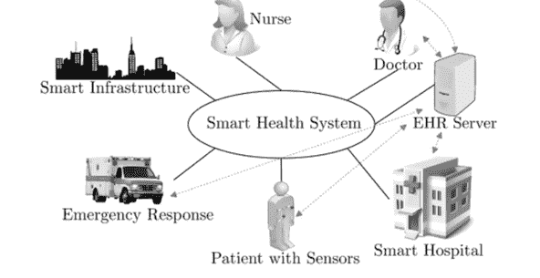

图9.1 智能医疗保健系统。

## 9.2 文献综述

在文献[1]中，Paritosh Khubchandani 指出，人工智能领域为推理问题提供了多种多样的解决方案。该系统完全基于概率推理，用于处理大型复杂问题，并简化医生的工作，节省他们的时间和精力。在文献[2]中，Andreas Svanstom 指出，信息收集和分析是在该系统中完成的。他们利用 Android 应用程序和 .NET Web 服务，开发了一个个人健康设备集成的可工作原型。该原型通过将采用 ISO/IEEE 11073 协议族的个人健康设备与使用网关设备作为适配器连接两个终端的 Web 服务集成而创建。

在文献[3]中，R. Balasubramaniam 指出，在医疗保健领域，近年来基于 ElGamal 椭圆曲线密码学（EECC）的 RFID 认证方案已被使用。改进后的方法减少了倍点运算和点加运算的次数，使 ECC 成为正在使用的最有效的密码系统之一；它能抵御任何类型的攻击，计算速度快，功耗低，占用带宽小。在文献[4]中，Patan Rizwan 指出，在早期，该系统类似于中间患者，其用户维护应用程序（UMA）认证系统将智能设备作为一种资源，该资源由电子健康档案（EHR）维护。所有提供的记录信息都应连接到云，同时在其间观察对象的可信网络。

在文献[5]中，R. Babu 指出，封装在物理对象中的传感器和执行器通过有线和无线网络与物联网和云计算耦合。该模型主要依赖于患者的参与以及微处理器和微控制器随后进行的数据分析。在文献[6]中，Gipsa Alex 指出，药盒的主要目的是规范药物的可及性，并以更简单、更用户友好的方式实施远程处方。双方都需要安装 Android 应用程序 Health IoT，登录详细信息在注册时提供。双方都可以轻松查看详细信息。硬件单元包括 LED、蜂鸣器和带以太网扩展板的 Arduino 板。该模型帮助医院管理层持续监测患者，并提醒患者按时服药。

在文献[7]中，B. Sobhan Babu 指出，该模型包括 RFID 以及对物联网协议的研究。物联网与人工智能相结合，有助于改善医疗保健系统。基于物联网医疗保健系统，可以在早期阶段预测轻微健康问题。在文献[8]中，Mingzhe Jiang 指出，所提出的系统允许使用一种名为多通道生物电位测量设备的技术远程监测生物电位。该设备由电池供电，并通过电子健康网关将数据传输到云端。该物联网基于远程多通道生物电位监测系统，并采用监督机器学习。

在文献[9]中，Stephanie B. Baker 指出，该文进行了一项广泛的调查，重点关注商业解决方案、现有应用和未解决的问题。本章逐步在该领域做出了重要贡献：确定了端到端物联网医疗护理系统的所有关键需求，并提出了一个适用于所有基于物联网的医疗护理系统的通用标准模型。由于目前仍没有已知的端到端系统可用于医疗保健的远程监测，这是一项重要的研究。该文还进一步对所提出模型中涉及的技术进行了全面调查。用于监测各种健康参数的传感器、短距离和长距离通信标准以及云技术是其主要关注点。

在文献[10]中，Sandeep Reddy 指出，人工智能应用所解决的问题，其结果可与人工临床医生相媲美。随着医疗保健系统变得越来越昂贵，利益相关者开始寻找能够取代住院护理中昂贵环节的解决方案，以及在这种情况下可以通过该模型解决的人工智能解决方案。然而，当前技术无法取代住院护理中的人文关怀，因此必须研究一个既包含技术创新又包含人文关怀的模型。

在文献[11]中，Kevin Patel 指出，物联网不断提供独特的工具和能力，这些工具和能力共同构建了一个综合的医疗护理系统，并与患者建立联系，以便他们得到更好的护理。医疗费用显著降低，治疗结果也得到改善。因此，它是多个领域的结合，包括健康支持者、推广者和医院，它们可以在通过自动化工作优化资源后加以利用。例如，大多数医院使用物联网进行资产管理，并控制手术室内的湿度和温度。

在文献[12]中，Graysen Christopher 指出，通过在医疗设备中嵌入支持物联网的设备，医疗护理专业人员可以更轻松、更高效地观察患者，并利用观察获得的数据来确定哪些人需要密切关注。但存在某些障碍，似乎减缓了稳步适应的过程。其中一个值得关注的问题是信任：人们有时会因知道自己的高度机密数据被存储和访问而感到不安。患者记录系统必须非常安全，因为这些设备会访问所有必要信息。

在文献[13]中，Brad Anderson 指出，预约、进行诊断测试、处理保险范围、开处方以及支付所有费用，这些让就医变得困难。对许多患者而言，让医疗系统变得卓越的前沿临床医生和医疗中心也许就像在不同国家运营一样令他们可望而不可即。提供者面临的挑战依然明确：将先进的治疗方法与最需要它们的社区相匹配，然后简化医疗护理，使每个人都能受益。近年来，移动平台以创新的方式帮助解决了可及性问题。它们远程提供关键服务。提供者发现它们提高了工作流程效率。患者更多地参与自己的健康管理，通过应用程序提供的护理质量也不会受到影响。移动应用正在改变医疗保健的质量和可及性。从心脏病到避孕，这些创新平台将我们系统提供的一切都置于患者的指尖。这是一个革命性的发展，正在帮助我们的护理赶上我们的资源——一次一个应用。

在文献[14]中，Jessica Burton 指出，有必要建立和适应更高效、更可持续的医疗基础设施。正是智慧城市和技术的应用，可以将全球医疗保健挑战转化为机遇。在文献[15]中，Iuliana Chiuchisan 指出，重症监护病房（ICU）的监测是通过 ICU 监护仪进行的，所有患者都连接到床旁监护仪。该监测系统包括疾病诊断以及对生命体征和参数（如所有身体器官的治疗）的监测。患者身上将连接各种类型的传感器或传感设备，这些设备通过导线连接到 ICU 监护仪。传感设备通过导线向 ICU 监护仪发送电子信号。该系统的主要目的是提高需要持续监测患者的医疗质量，并减少监测重要医疗参数的障碍。

在文献[16]中，Sapna Tyagi 指出，随着物联网和云计算等技术的发展，以及自带设备办公（BYOD）工作方式的日益普及，服务之间的共享将对人类医疗护理产生变革性的影响。所提出的系统为许多医疗护理提供者和一线人员提供了一种技术，以应对诸多挑战，如医疗护理治疗费用不断上涨、信息共享、更好治疗的短缺，以及医疗护理专业人员为患者提供加强护理的不足。在文献[17]中，Rahul N. 指出，本研究实现的智能物联网椅子可用于多个医疗领域。该系统通过采用 NodeMCU 和蓝牙 4.0 连接模式通信，以低功耗负责数据传输。因此，智能物联网椅子能够以更高的准确度和适当的读数分析用户的坐姿。

在文献[18]中，Shubham Banka 提出了一种自动系统，用于监测患者的体温、心率、身体活动和血压。此外，他们还扩展了现有系统，以预测患者是否正在遭受短时间的病痛。所提出的系统可以安装在医院，并可以获得大量数据并存储在在线数据库中。所需数据也可以在基于移动端的应用程序上显示。

在文献[19]中，Hrishikesh P. Pandharkame 指出，该系统中使用了 LDR、超声波传感器和温度传感器等传感器。所有传感器获取的数据将通过 USB 端口传输到 Arduino 电路板，并将数据发布到 MQTT 服务器。每当需要检查数据时，只需订阅 MQTT 服务器，使医院节能并改善治疗结果。系统通过网页或移动应用控制电器设备，并且用户友好。无需手动打开和关闭电器设备。AI 系统组件兼顾医生和患者的需求。

在文献[20]中，Prashant Salunke 指出，在手术室配备各种设备后，有些情况下医生不在场。而且数据无法共享。现有解决方案非常庞大且昂贵。因此，他们使用易于患者佩戴的生物医学传感器、使用微控制器的物联网设备以及云计算，从而形成一个基于物联网的系统，该系统不仅能对患者状况进行恰当诊断，还能借助精心捕获的数据提供检测和预防健康问题的医疗建议，并描述从生理和环境传感器记录的健康压力。

在文献[21]中，Prashob Bharathan 指出，为了帮助医务人员和后勤人员，患者及其家属可以根据自己的角色使用个性化服务。可以使用物联网、RFID 和传感器等技术将医院的各个科室与患者连接起来。从这些技术收集的数据被组合并实施到分层架构中，这将实现分层架构，并将各部门、患者和医生相互连接，使事情变得简单而精确。

在文献[22]中，Lie Yu指出，使用PSOC的低功耗心电图监测系统用于感知人体心电信号。该心电图监测系统连接到低功耗、高速的WICED，可直接将数据传输到AWS物联网云上，从而形成基于边缘赛普拉斯WICED物联网技术的心电图系统。在文献[23]中，U. U. Deshpande指出，使用PSOC的低功耗心电图监测系统用于感知人类心脏的心电信号。它连接到低功耗WICED，将数据传输到物联网云。

在文献[24]中，Hamidur Rahman指出，利用面部情绪或由心脏脉搏引起的面部肤色变化，开发了一种非接触式远程HRV监测系统，这反过来会在设备上产生变化。在文献[25]中，Pooja Kanse指出，借助物联网，可以测量由灯光、风扇和各种医疗设备过度用电带来的困难，并通过使用各种传感器（如MQTT和IoT）实现对医院患者的适当监测，从而降低成本和功耗。

在文献[26]中，Shubham Sagar提出了一款由安卓操作系统控制的轮椅，使用手动操纵杆，并通过Wi-Fi模块连接安卓应用程序，这将减少用户对他人的依赖。在文献[27]中，Syed Muhammad Waqas Shah建议使用物联网和各种传感器来监测人员健康。远程站点的医生可以通过互联网与患者沟通，从而在没有医生时实现智能医疗单元，对患者进行远程治疗。在文献[28]中，Punit Gupta指出，物联网数据弹性为ICU等紧急医疗服务提供支持。物联网数据弹性通过实时收集、记录和分析数据，降低了死亡率和医疗成本。这有助于系统为患者提供细致而高效的医疗服务。

## 9.3 智慧医院简介：医疗保健领域的数字化转型

智慧医院是一种依赖于智能优化和自驱动流程的医院，该流程建立在互联设备的优化环境之上，尤其基于物联网，以改进现有的患者护理技术并引入新的机遇。图9.2展示了智慧医院背后的一些关键理念。

传感器和执行器能够管理智慧医院。有线或无线传感器被集成到心电图监护仪、智能恒温器和血压计中。以下是一些选择智慧医院的理由。

**定制化**——智慧医院使管理层能够控制医院设备以减轻医生的负担，使他们能够更高效地挽救患者的生命。

- I. **舒适性**——智慧医院有助于减轻医生和医务人员的工作负担，使他们能够更高效地将技能投入到挽救患者生命中。

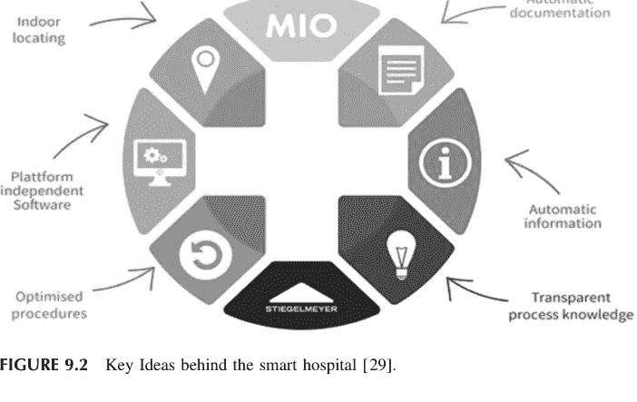

图9.2 智慧医院背后的关键理念[29]。

- II. **挽救生命**——智慧医院可以通过监测患者的健康状况来挽救患者生命，并在发现任何异常情况时提醒护士和医生。

- III. **成本高效**——通过智能物联网可以监测和控制功耗，从而实现节省资金和环保。

- IV. **易于使用**——易于理解的图形用户界面（GUI）将对那些对技术和智能手机了解较少的患者和监护人来说是一大福音。

表9.1列出了对智慧医院成功运营最为关键的资产。这些数据通过访谈和调查收集。智慧医院面临各种威胁。这些威胁包括劫持、医疗设备篡改、侧录和拒绝服务攻击等恶意行为。它们还包括人为错误、系统故障、供应链故障，甚至地震、洪水和火灾等自然现象。表9.2列出了这些威胁的可能性和严重性。

## 9.4 智慧医院建设中涉及的技术

在本节中，我们将详细讨论医院各阶段所需的技术。在该系统中，我们使用了谷歌云平台——Firebase、物联网、人工智能和安卓操作系统。图9.3展示了智慧医院建设中涉及的一些新兴技术。

### 9.4.1 谷歌云平台——Firebase

Firebase是YC11初创公司提供的后端即服务（BaaS）的一个例子，它催生了谷歌云平台上的下一代应用开发工具。Firebase使开发者能够专注于实现良好的用户体验。Firebase作为开发者的服务器、API和数据存储，其编写方式非常通用，可以按需修改。

### 表9.1

智慧医院所需各类资产的严重性

| 序号 | 智慧医院所需资产 | 严重性（%） |

|---|---|---|

| 1 | 互连临床信息系统 | 67 |

| 2 | 网络医疗设备 | 67 |

| 3 | 网络设备 | 43 |

| 4 | 远程护理系统 | 40 |

| 5 | 数据 | 30 |

| 6 | 移动客户端设备 | 30 |

| 7 | 身份识别系统 | 30 |

| 8 | 建筑 | 10 |

### 表9.2

智慧医院面临威胁的可能性与严重性

| 序号 | 威胁 | 可能性（%） | 严重性（%） |

|---|---|---|---|

| 1 | 人为错误 | 84.2 | 77 |

| 2 | 恶意行为 | 75.8 | 70 |
| 3 | 系统故障 | 67.2 | 53 |
| 4 | 供应链故障 | 47.2 | 17 |
| 5 | 自然现象 | 22.8 | 0 |

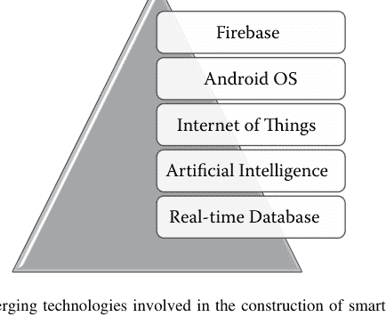

## 图9.3 智慧医院建设中涉及的新兴技术

### 9.4.2 实时数据库概念

实时数据库由云NoSQL系统托管。它可以被视为一个大型JSON对象，帮助开发者实时管理数据。借助单个API，Firebase数据库向应用提供数据的当前值以及数据的任何未来更新。

### 9.4.3 物联网

物联网基于将设备连接到互联网的概念，使它们成为互联设备。设备内置传感器，这些传感器由互联网平台连接，该平台汇集来自各种设备的数据，并按照流程分析数据以形成有用信息，从而满足特定需求。收集到的信息可用于分析模式、提出建议、检测可能的情况并向我们发出警告。图9.4展示了物联网在智慧医院建设中的作用。

### 9.4.4 人工智能

人工智能指的是机器中人类智能的复制品，这些机器经过编程，使其能够像人脑一样思考和推理，并能解决从简单到困难再到复杂的问题。它也可以定义为任何具有类似人类思维特质并复制人类行为的设备。人工智能使用逐步指令，也称为算法，

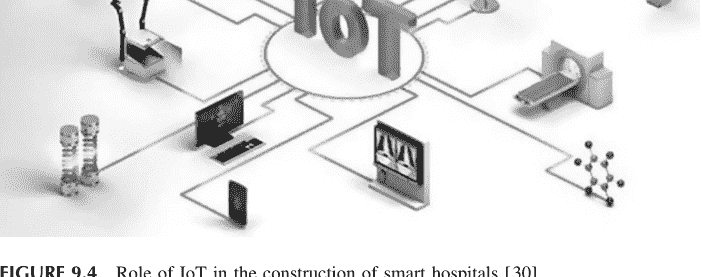

图9.4 物联网在智慧医院建设中的作用[30]。

### 9.4.5 安卓操作系统

这是谷歌开发的操作系统，专用于安卓手机、平板电脑等。

## 9.5 智慧医院系统的实施

在智慧医院中，系统在两个重要阶段运行。第一阶段包括安装设备。第二阶段包括使用人工智能、安卓操作系统和谷歌云平台——Firebase开发移动应用程序。

### 9.5.1 初始阶段：在医院安装智能设备

第一阶段包括在医院安装设备；这些设备将是：Raspberry Pi、pcDuino、Beagle Bone Black和Cubie Board。

### 9.5.2 Raspberry Pi

Raspberry Pi将安装在医院的物联网电路板中，用于运行医院建筑内安装的所有传感器。它可以通过移动应用程序操作，路由器将发送无线信号，这些信号将存储在数据库/云中。

### 9.5.3 pcDuino

这是一款基于Arduino的独立板卡迷你电脑，配置为1 GHz ARM Cortex-A8处理器。它是一款低成本、低维护的设备，兼容C、C++和Java等各种编程语言，并具有标准Android SDK和Python。

### 9.5.4 Beagle Bone Black

它比任何其他设备都更强大，配置为1 GHz ARM Cortex-A8处理器，支持Linux和IoS，并兼容HDMI、视频音频接口、VSB和以太网端口。

### 9.5.5 Cubie Board

它配置为双核ARM Cortex-A7处理器，具有一系列输入输出接口，包括USB、HDMI、IR、串行、以太网、SATA和96针扩展接口。

### 9.5.6 传感器

这些传感器用于使系统完全自动化、安全且互联：

- **心率传感器**—血液波动可以通过放置在患者指尖周围的传感技术检测到。信号可以进一步传输给树莓派或其他设备。
- **温度传感器**—它们将用于通过相当于以摄氏度测量的温度的电脉冲来测量体温。
- **气泡探测器**—这些设备检测含有流体的容器或瓶子中的气泡。它们在包括医疗技术、过程控制、制药和石油工业在内的许多领域发挥重要作用。
- **湿度传感器**—这些传感器测量手术室内空气的湿度和温度。
- **睡眠监测仪**—它们将感知患者的睡眠时间，并同时感知患者当前是否正在睡眠。

### 9.5.7 后续阶段：移动应用程序的开发

这将是一个移动应用程序，将发送来自以下来源的警报信号：

Patient -> nurse, nurse -> doctor in emergency situations. 它将发送警报信号，这些信号将以振动的形式在接收者设备上接收到。此外，设备将与物联网平台连接，这些平台将收集数据并将其存储在云中；数据将从云中检索用于分析，并且紧急通知也将从 firebase 和 cloud functions 本身发送到其他互联设备。这将使对患者的护理质量更高效。因此，该应用程序将使患者更安全，并与护士和医生保持联系。图 9.5 表示智能医疗移动应用程序的人机交互。

## 9.6 医生平台

正如我们所知，我们项目中的医生平台与医生有关。一位医生可能有多名危重患者，而且医生还有大量进行常规检查的患者，因此医生不可能将全部时间都用于危重患者。因此，医生让护士记录他们的情况，护士会更频繁地探访患者。护士给医生的记录不是实时的，因为它是手动的。因此，我们创建了一个系统，排除了上述问题，允许医生与其他卫生线工作人员之间进行快速高效的沟通。

## 9.7 护士平台

同样，在开发的系统中也有一个专门为护士设计的平台。由于护士也有很多患者需要处理，而且他们的职责也经常发生变化，他们不可能对每个患者都给予充分关注。因此需要护士平台，使护士能够轻松管理他们的工作。他们还必须跟踪每位患者。在轻重不同的危急情况下，他们不能忽视病情较轻的患者。他们还需要对每个患者给予充分关注，因此拥有护士平台至关重要。护士平台的工作方式是，在危急情况下数据会与医生共享，但在不需要医生或患者需求常见的情况下，数据不会与医生共享。在平台的护士端，系统会振动，所有患者信息以及相关医生的姓名将显示在屏幕上通知，任何值班护士都可以照看他们。患者的特定需求也会在屏幕上提及。在紧急情况下，护士只需简单地传递数据并呼叫医生。

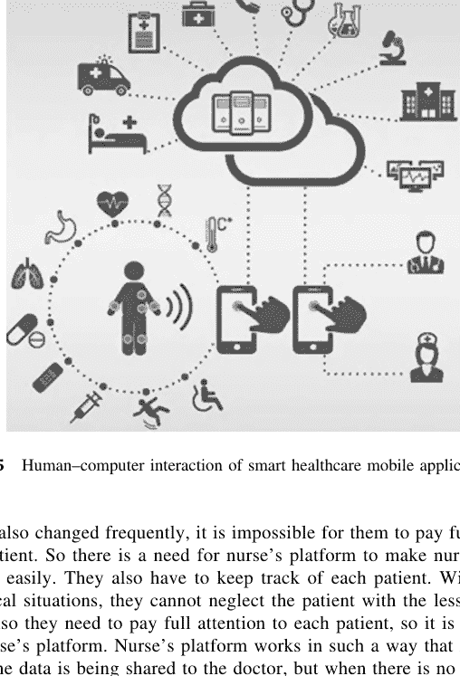

FIGURE 9.5 智能医疗移动应用程序的人机交互 [31]。

## 9.8 患者平台

在任何与健康相关的系统中，都必须拥有患者平台。在患者平台中，病情较轻且没有陪护人员的患者可以轻松照顾自己，因为他们在需要时可以轻松呼叫护士。但对于病情更危重且意识不清的患者，他们的陪护人员/亲属可以使用此平台在需要时呼叫护士。该患者平台非常有用，因为他们的实时健康状况将被记录并与护士和医生共享。这将证明非常有帮助，因为它允许危重患者高效沟通。

## 9.9 智能医院系统的布局：设计未来医疗保健

在此框架中，患者平台可以向护士和医生发送警报信号，这将在设备上表现为振动。此外，在传感器的帮助下，患者的健康状况可以实时监测。

在危急情况下，护士本身可以实时向医生发送警报信号，以便患者能够立即接受治疗。传感器发送的信息将被存储在云中，并有助于对患者进行有效检查，包括患者的健康史和早期诊断。布局可在图 9.6–9.9 中表示。

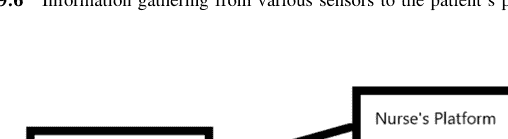

FIGURE 9.6 从各种传感器向患者平台收集信息。

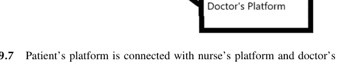

FIGURE 9.7 患者平台与护士平台和医生平台相连。

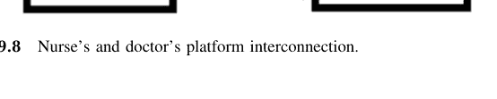

FIGURE 9.8 护士平台与医生平台的互联。

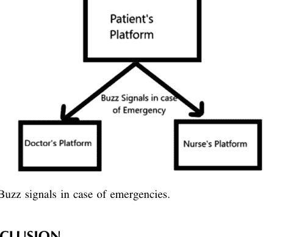

FIGURE 9.9 紧急情况下的蜂鸣信号。

## 9.10 结论

该项目能够以最小的成本监测并生成警报信号，以高警报振动和紧急通知的形式通知护士和医生患者的健康状况。Android 应用程序用于提供一个平台，以简单的 GUI 通知护士和医生患者的警报情况。

## 参考文献

- [1]. Khubchandani, P., Jha, K., Bijani, R., Lala, S. and Saindane, P., Medical prediction using artificial intelligence. International Journal of Engineering Science, 4898–4900 (2017).
- [2]. Svanström, A., IoT communication protocols in healthcare (Master’s thesis) (2016).
- [3]. Balasubramaniam, M. R., Sathya, R., Ashicka, S. and SenthilKumar, S., An analysis of RFID authentication schemes for Internet of Things (IOT) in healthcare environment using Elgamal Elliptic Curve cryptosystem. International Journal of Recent Trends in Engineering & Research (IJRTER), 2 (3) (2016).
- [4]. Rizwan, P., Rajasekhara Babu, M. and Suresh, K., Design and development of low investment smart hospital using internet of things through innovative approaches. Biomedical Research-Tokyo, 28, 4979–4985 (2017).
- [5]. Babu, R. and Dr. K. Jayashree, Prominence of IoT and cloud in health care. International Journal of Advanced Research in Computer Engineering & Technology (IJARCET), 5(2), 420–424 (2016).
- [6]. Alex, G., Varghese, B., Jose, J.G. and Abraham, A., A modern health care system using IoT and Android. International Journal on Computer Science and Engineering (IJCSE), 8(4) 98–101 (2016).
- [7]. B. Sobhan Babu, K. Srikanth, T. Ramanjaneyulu and I. Lakshmi Narayana, IoT for Healthcare. International Journal of Engineering Science and Research (IJSR), 2 (5), 322–326 (2016).
- [8]. Jiang, M., Gia, T. N., Anzanpour, A., Rahmani, A. M., Westerlund, T., Salanterä, S., Liljeberg, P. and Tenhunen, H., IoT-based remote facial expression monitoring system with sEMG signal. In 2016 IEEE sensors applications symposium (SAS) (pp. 1–6). IEEE (2016, April).
- [9]. Baker, S. B., Xiang, W. and Atkinson, I., 2017. Internet of things for smart healthcare: Technologies, challenges, and opportunities. IEEE Access, 5, pp. 26521–26544.
- [10]. S. Reddy, Use of artificial intelligence in healthcare delivery, eHealth – making health care smarter, Thomas F. Heston, IntechOpen (November 5th 2018). 10.5772/intechopen.74714.
- [11]. K. Patel, Benefits of IOT for hospitals and healthcare (2016).
- [12]. Christopher, G., Internet of things in healthcare: What’s next for IoT technology in the health sector (2016).
- [13]. B. Anderson, How mobile apps are improving access to healthcare services (2020).
- [14]. J. Burton, Smart cities solving today’s healthcare challenges (2020).
- [15]. Chiuchisan, I., Costin, H. and Geman, O., Adopting the internet of things technologies in health care systems (2014). 10.1109/ICEPE.2014.6969965.
- [16]. Tyagi, S., Agarwal, A. and Maheshwari, P., A conceptual framework for IoT-based healthcare system using cloud computing. In 2016 6th International Conference- Cloud System and Big Data Engineering (Confluence) (pp. 503–507). IEEE (2016, January).
- [17]. R. R. Biswas, Calibrating wastewater hydraulic model during post earthquake rapid rebuild works, Volume 5, Issue VI, International Journal for Research in Applied Science and Engineering Technology (IJRASET), pp. 461–470, ISSN: 2321-9653.
- [18]. Banka, S., Madan, I. and Saranya, S. S., Smart healthcare monitoring using IoT. International Journal of Applied Engineering Research, 13 (15), 11984–11989 (2018).
- [19]. Pandharkame and Hrishikesh P., Smart Hospitals using Internet of Things (IoT) (2017).
- [20]. P. Salunke and R. Nerkar, IoT driven healthcare system for remote monitoring of patients. International Journal for Modern Trends in Science and Technology, 3 (6), 100–103 (2017).
- [21]. Bharathan, M. P., Nadar, M. V. and Wayal, M. S. Remote health monitoring using IoT. International Journal of Advance Research, Ideas and Innovations in Technology (2017).
- [22]. Yu, L., Lu, Y. and Zhu, X., Smart hospital based on internet of things. Journal of Networks, 7 (10), 1654 (2012).
- [23]. Deshpande, U. and Kulkarni, M. (2017). IoT based real time ECG monitoring system using cypress WICED. 10.15662/IJAREEIE.2017.0602035.
- [24]. Rahman, H., Begum, S. and Ahmed, M. U., Ins and outs of big data: A review. In International Conference on IoT Technologies for HealthCare (pp. 44–51). Springer: Cham (2016, October).
- [25]. Kanase, P. and Gaikwad, S., Smart hospitals using internet of things (IoT). International Research Journal of Engineering and Technology (IRJET), 3 (03), 1735–1737 (2016).
- [26]. Nayak, S. S., Gupta, P., Upasana, A. B. W. and Wani, A. B., Wheel Chair with Health Monitoring System Using IoT. International Research Journal of Engineering and Technology (IRJET), 4 (05) (2017).

- [27]. S. M. W. Shah, and M. Pasha, IoT-based smart health unit. Journal of Software, 12 (1), 45–52 (2017).

- [28]. Gupta, P., Agrawal, D., Chhabra, J. and Dhir, P. K., IoT based smart healthcare kit. In 2016 International Conference on Computational Techniques in Information and Communication Technologies (ICCTICT) (pp. 237–242). IEEE (2016, March).

- [29]. Holzinger, A., Röcker, C. and Zieffle, M., From smart health to smart hospitals. In: Smart health (pp. 1–20). Springer: Cham (2015).

- [30]. Budida, D. A. M. and Mangrulkar, R. S., Design and implementation of smart HealthCare system using IoT. In 2017 International Conference on Innovations in

信息、嵌入式和通信系统 (ICIIECS) (第 1–7 页)。IEEE (2017 年 3 月)。

[31]. Liu, P., Fels, S., West, N. and Görges, M., 基于智能医疗架构的移动设备人机交互设计。*计算机与软件工程进展*, 2, 99–131 (2019)。

# 10 物联网和机器学习在医疗保健中的研究人员问题及未来方向

*Sharad Chauhan, Ritika Arora, and Neha Arora*

## 目录

- 10.1 引言...........................................................178
- 10.2 文献综述......................................................178
- 10.3 数字医疗保健采用中的挑战...................................180
- 10.3.1 物联网能为医疗保健做什么..........................................181
- 10.4 可穿戴健康设备..................................................182
- 10.5 可穿戴设备中的安全问题.......................................182
- 10.6 生命体征——最重要监测项目................................183
- 10.6.1 有价值的生命体征....................................................183
- 10.6.2 脉搏 (HR)..............................................................183
- 10.6.3 血压..........................................................184
- 10.6.4 呼吸频率.......................................................184
- 10.6.5 血氧饱和度 (SpO2)..........................................185
- 10.6.6 皮肤出汗......................................................185
- 10.6.7 呼气末二氧化碳测定.............................................................186
- 10.6.8 体内热水平....................................................186
- 10.6.9 心血管植入式设备......................................186
- 10.7 物联网与人工智能协同....................................................187
- 10.8 医疗保健中的人工智能与物联网..................................................187
- 10.8.1 具有与当前现实实际接口的设备..................188
- 10.8.2 通过传感器进行的有组织信息贡献.......................188
- 10.8.3 微小信息/产量设备....................................188
- 10.8.4 人机环境框架驱动因素...............................188
- 10.8.5 持续活动和选择控制..................................188
- 10.9 与医疗领域相关的物联网的显著独特性.....................189
- 10.10 基于物联网和机器学习的医疗保健未来模型...................190
- 10.10.1 疾病检测的物联网架构..................................191

### 10.1 引言

生命的最高需求是医疗护理，因为它是健康支持和改善的基础。身体内部不可见的任何缺陷都可以通过 CT、MRI、PET 和 SPECT 等设备来确定。此外，像冠状动脉衰竭和癫痫这样的不规则状况甚至可以在发生之前就被确定。随着人口的持续增长以及慢性疾病在人群中的蔓延，给当前的医疗服务带来了压力，因为医院资源的需求极高，需要采取解决方案来减轻压力并保持医疗保健的标准和质量。最新研究得出了减轻医疗系统压力的结论。各种可穿戴框架可提供可靠的远程数据传输。医生可以通过使用医疗保健监测设备来监测患者的 cardiac impulse。

尽管物联网 (IoT) 在医疗领域具有诸多优势，但医疗临床主管和 IT 部门都担心信息安全和物联网设备管理。机器学习是一种从参考经验中获取知识且无需显式调整的方法。它用于网络搜索、垃圾邮件过滤、股票交易等。人工智能 (AI) 在系统化过程中获得了与大数据和云计算同等的意义和认可 [1]。大规模的信息集合在从规划科学到人际关系、商业、生物原子探索和安全等不同阶段被收集和分析。人工智能方法已被广泛应用于各个领域，例如医学、天文学和科学。因此，机器学习将成为新技术和发展的代名词。

### 10.2 文献综述

在 [2] 中，作者设计了一个框架，该框架旨在用于大数据应用，并考虑到患者的脆弱性。该框架的主要功能是在情绪反应和生理变化之间建立联系，以感知患者的情绪状态如何影响其健康状况。因此，大量的患者数据会累积在云端，这需要高效的数据挖掘技术来提取所需信息。在此，分布式存储的基本目的不仅是记录患者的健康状况，还要应用高效的 AI 算法来管理如此庞大的信息集合。

在 [3] 中给出了物联网医疗保健框架的全面研究。它对物联网安全面临的安全需求和挑战进行了深入的分析。患者始终需要其数据得到保障，最终每个人都需要其数据免受未经授权用户的侵害，因为数据可靠性是最基本的要求。这些是有效电子健康框架需要轻松实现的基本前提。作者描述了组织内部和外部始终存在危险攻击的机会。因此，他们的研究重点集中在攻击科学分类上，该分类显示了在安全不同区域遇到的各种类型的攻击。他们根据数据和网络特定的权衡将现有和潜在的危险分开。作者描述了一种共享安全模型，以减少医疗保健框架中的安全问题。该安全模型已设计为具有动态属性，以适应未来隐蔽的危险和攻击。该模型清晰地描述了当出现另一种类型的危险时会发生什么。当前模型在防止此类攻击方面变得无效。因此，需要动态算法来管理这些异常情况。该模型提供了一种在服务之间进行稳固合作的方法，以便由于当前、可能和隐蔽攻击而产生的影响可以减少并消除。同样，它显示了大数据、环境智能和可穿戴设备在不同电子健康环境中的影响。它提供了改进基于物联网的电子健康框架的策略和指南，并确定了基于物联网的电子健康框架中挑战和研究空白的范围。

在电子医疗服务框架中定义了云范式的利用，该定义简要说明了在生物医学中使用分布式计算的好处。正如我们之前所讨论的，越来越多的健康监测以及从不同患者收集的信息量大到无法使用传统方法存储。分布式计算存储服务在生物医学技术的研究中发挥着重要作用。在 [4] 中给出了物联网和医疗服务框架的受保护云架构。它强调了分布式计算和移动通信中的安全问题。它提出了一个有效的模型，允许医生通过使用云的移动应用程序远程监控其患者。它将手机、蓝牙和云结合起来，以安全和保密的方式共享私人信息。

在 [3] 中，作者描述了糖尿病影响全球数百万人。尽管如此，糖尿病的诊断仍然是一项艰巨的措施。可穿戴临床传感器和人工智能的进步为解决这一挑战指明了方向。随着可穿戴临床传感器和人工智能需求的增加，这些设备提供了一个持续、用户友好的组件，用于收集信息然后分析解剖学指标。作者提出了一个名为 DiabNN 的系统，该系统结合了高效的神经网络和可穿戴智能设备，有助于糖尿病诊断。它还包括绕过提取阶段的步骤，直接作用于可穿戴设备并整合现成组件。通过利用基于斜率的开发和基于大小的剪枝算法，DiabNNs 也正在被训练。因此，我们表明 DiabDeep 可以以无处不在的方式使用，同时提供高有效性和准确性。

在 [5] 中，作者提出了一种基于物联网的系统框架，用于感知室内环境中老年人的跌倒，该框架采用理想的低功耗远

物联网传感器组织、智能家电、大数据和云计算。为此，在6LowPAN可穿戴设备中嵌入了一个三轴加速度计，用于实时采集老年人的运动信息。为了提高跌倒检测的效率，传感器读数通过运行在智能物联网网关上的基于决策树的大数据模型进行处理和分析。如果检测到跌倒，系统会启动警报，并自动向负责照顾老年人的人员发送警告。最后，该系统提供基于云的服务。从临床角度来看，数据管理使医疗专业人员能够访问跌倒数据进行进一步分析。另一方面，系统利用这些数据在每次识别到跌倒时创建新的人工智能模型来提供支持。调查结果显示，在跌倒检测的准确性、精确度和增益方面取得了很高的成功率。

在文献[6]中，研究涉及构建一个基于智能手表的框架，用于实时在线评估和活动监测（ROAMM）。所提出的ROAMM系统将包含一个智能手表应用程序和服务器。智能手表应用程序将用于收集和预处理信息。服务器将用于存储和检索数据、远程监控以及其他管理目的。通过结合基于传感器的数据和用户报告的数据收集，ROAMM系统能够实时进行数据可视化和汇总统计。该方法目前引出了生态瞬时评估，该评估最初是为心理目的而开发的，用于评估个体在日常生活中的活动、感受以及他们对这些活动的看法。该技术要求人们在间歇性或系统定义的事件中提供准确的经历日记。这是因为个体在经历发生后很难再现其心理体验。当频繁且随机采样时，生态评估通常被视为“现实”，因为它们测量的是一个公正的平均值，该平均值往往高估或低估状态。ROAMM结构满足了下一代移动健康物联网的一些重要先决条件。ROAMM提供了智能界面（例如，提示报告症状)和远程应用程序配置（例如，更改数据收集速率和待测因素类型），以及用于在线定制的服务器功能。此外，智能手表加速度计硬件与经过验证的研究级加速度计的结果高度相关。

## 10.3 数字医疗应用中的挑战

数字医疗系统使用物联网和大数据等技术，用于连接医疗系统中的患者和服务提供者。这些系统也越来越多地通过网络连接到不同类型的临床可穿戴技术，这些技术被佩戴用于持续医疗监测，这表明人们正在接受临床可穿戴技术[2]。调查来自医院、家庭、诊所、办公室等不同来源的不同患者信息也成为一个重大问题。非结构化临床数据的记录成为另一个问题，处理大量临床数据并以有效方式挖掘有用信息也成为一个大问题。主要工作是让医疗系统中的每个人都能受益，即服务提供者、患者、支付方和管理方。另一个重要因素是，分析基因信息是一项计算密集型任务，与标准临床数据结合会增加更多层次，从而增加复杂性。最终，数据保护已成为最大的问题，患者的行为通过不同的传感器以及不同的社会关联和通信方式获取。

### 10.3.1 物联网能为医疗保健做什么

物联网和数字设备使得医疗保健领域的监测得以实现，从而确保患者记录的安全。通过这一过程，对患者健康状况的远程监测有助于减少数据丢失，缩短住院时间，防止再次入院并改善结果。这导致了医疗保健成本的降低，总体上改善了结果。物联网在临床服务中的应用使患者、家庭、医生、急救机构和保护组织受益。

#### 面向患者的物联网

可穿戴设备，如健身手环和其他无线连接的设备，可监测血压、心率和血糖水平等身体指标。这些设备可以调整以提醒碳水化合物水平、运动检查、预约、血压变化等等。物联网通过持续跟踪疾病，改变了人们，尤其是老年患者的生活。

#### 面向医生的物联网

医生还可以通过嵌入物联网的可穿戴设备和其他家庭监测设备更有效地跟踪患者的健康状况。借助这项技术，他们可以跟踪患者对治疗计划的依从性，或是否需要立即医疗关注。这使得医疗专业人员处于监控之下，并可以随时与他们联系。通过从物联网设备收集数据，将为患者提供最佳的治疗流程。

#### 面向医院的物联网

除了观察患者健康外，物联网设备在诊所中还有许多其他有用的领域。带有传感器的物联网设备用于跟踪临床设备的实时位置，如轮椅、除颤器、雾化器、氧气泵和其他监测硬件。医疗人员在不同区域的部署情况也可以实时分析。疾病传播是医院患者的一大担忧。支持物联网的清洁监测设备有助于防止患者受到感染。物联网设备同样有助于资源管理，如药房库存控制，以及环境监测，例如检查冷却器温度、湿度和温度控制。

#### 面向医疗保险机构的物联网

对于健康有不同的入口，并且与物联网相关设备有关。保护机构可以利用数据来获得保障。这些数据将使它们能够识别欺诈状况并识别支持的机会。物联网设备在安全网供应商和客户支持、评估、索赔处理以及检查措施之间实现透明度。安全网供应商可以为其客户提供有说服力的激励，以使用和共享健康数据。物联网设备还可以通过这些设备获得的数据来支持保险办公室的索赔。

## 10.4 可穿戴健康设备

可穿戴健康设备（WHDs）不断帮助人们更好地进行筛查，并在活动/健康层面了解他们的健康状况，具有早期洞察和治疗过程的潜力。电子设备小型化的进步使得设计更可靠、更灵活的可穿戴设备成为可能，从而促进了健康监测方法的全面变革[7,8]。可穿戴技术是指可以携带在用户身体上的信息技术（IT）设备，例如手腕、手臂或头部的WHD，以及该领域最近的技术改进（心电图、脉搏、血压、呼吸频率、血氧饱和度、血糖、皮肤汗液、二氧化碳图、体温、运动评估、心血管植入设备以及环境参数）。可穿戴设备以及这些设备与个人电脑之间的网络是医疗保健创新变革背后的关键理念[9,10]。这些能力包括：通过可穿戴设备跟踪和监测患者，通过远程医疗和远程分析提供远程帮助，这些对于提供紧急定位、与药物、治疗和临床建议相关的数据管理，以及医院数据系统的跨机构整合至关重要[4]。

## 10.5 可穿戴设备的安全问题

事实上，所有类型的可穿戴设备都放置在人体上，信息在未加密的情况下传输到附近的存储设备。同样，它也不提供任何PIN码和密码保护。因此，未经授权的人可以轻易获取你的个人信息。可穿戴设备通过蓝牙和Wi-Fi功能与个人电脑、智能手机相连[11]。这使得安全成为一个严重的问题，但我们的目标是保护数据。类似手表和智能手环的可穿戴设备包含关于用户的最新数据。由于缺乏加密，所有细微信息如银行账户细节、联邦退休辅助号码和个人身体数据都可能被程序员（黑客）获取[12]（表10.1）。

根据Statista的数据，可穿戴设备市场目前的总体收入约为260亿美元，预计到2020年将达到近340亿美元。为了增强安全性，隐私信息需要实现设备代码和准则。此外，隐私信息的管理在可穿戴设备中面临未来的挑战，因为在将这些信息传输到本地设备（如个人电脑、智能手机）时，缺乏安全代码和PIN码、密码。

## 表10.1

全球可穿戴设备预测

| 设备 | 2017 | 2018 | 2019 | 2022 |
|---|---|---|---|---|
| 智能手表 | 34.80 | 34.97 | 21.23 | 128.50 |
| 手环 | 41.50 | 44.10 | 21.43 | 150.00 |
| 运动手表 | 48.20 | 48.84 | 21.65 | 168.00 |
| 蓝牙耳机 | 80.96 | 63.86 | 22.31 | 206.00 |

## 10.6 生命体征——最需要监测的信号

人体有许多独特的生理信号可以被估测：从电信号到生化信号，人体的各种信号都可以被测量并用于更好地了解健康状况。这些信号可以通过可穿戴传感器和设备获取。如今，创新和可穿戴情境根据三个视角对WHD进行分类：使用情境（家庭/远程或临床环境）；监测类型（离线或在线）；以及用户类型（健康人或患者）。

### 10.6.1 有价值的生命体征

心电图（ECG）是医疗保健环境中作为诊断设备最常用的生物信号之一，提供心脏电周期的数据。ECG波形由五个峰和谷（命名为P、Q、R、S、T、U）描述，每个峰谷代表心脏电活动的变化，导致肌肉动作并确保心脏运动。ECG最突出的峰是包含在QRS波群中的R峰，代表心室去极化，此时存在较高的电位差。ECG波形用于分析心血管系统和预测冠状动脉梗死。ECG波形模式的检查在诊断心血管疾病（CVD）方面起着重要作用。WHD用于临床目的并具有认证的优势之一就是ECG监测。

### 10.6.2 脉搏（心率）

心率（`HR`）是一种标准的生命体征，已成为临床服务和健康/运动锻炼中的常规评估。通过对该信号的监测，可以通过显示心律的变化来提供有关生理状态的信息。这一生命体征可以方便地从`ECG`（`R`峰）或光电容积脉搏波（`PPG`）信号中提取。尽管这两种生理信号在波形上具有特定的形态信息，且来源于两个不同的生理起源，但它们包含相似的心率信息。还有其他测量心率的方法，例如使用惯性传感器或体重秤，称为心冲击图（`BCG`），但与从`ECG`和`PPG`获得的心率相比，这些方法不具备可行的评估效果。在体育和运动环境中，评估或指导心脏在运动和恢复期间的反应至关重要。心率变异性分析作为心血管系统健康状态的基本标志正日益受到关注。它也是人类心理生理状态的指标，例如在压力和疲劳测量中。医学专家建议将脉搏信号作为可替代心率的评估指标。脉搏被描述为由于心脏收缩和舒张而泵入血管的血量增加所传导的动脉周期性搏动扩张。该评估提供的信息比`HR`更多，如脉搏的强度、幅度和一致性。文献中提到的一个问题是心律不齐时血容量减少。脉搏信号不应被视为等同于心率，通常使用脉搏血氧测定原理进行评估，该方法也用于测量血氧饱和度[13]。

### 10.6.3 血压

血压（`BP`）被视为主要的心肺参数，显示血液对血管壁施加的压力。`BP`提供了心脏收缩（收缩期）和舒张（舒张期）时血流的间接数据，也可以显示细胞氧输送情况。它受几个人体生理特征的影响：心输出量；外周血管阻力；血容量和粘度；以及血管壁弹性。动态血压监测允许每天多次获取血压读数，这对于监测高血压（可能是全球疾病负担的最大危险因素之一）是理想的，并可改善心血管疾病预测。

`BP`通常使用带有听诊器的可充气压力袖带在患者手臂上进行测量。该方法经过调整以实现独立的血压评估，包括一个全自动充气袖带，通过将外部压力与血管容积搏动的幅度相关联来测量血压。使用袖带进行连续监测可能会带来不良后果，例如睡眠障碍、皮肤刺激和焦虑感增加。为解决这一问题，已开发出用于动态血压监测的新技术。一种方法是基于光电容积脉搏波（`PPG`）和`ECG`（`R`峰）获取的脉搏波传播时间（两者均在胸部测量，或使用在手腕上获取的`PPG`信号）来估算血压。最近，研究人员提出了一种实验性的手表式模型，该模型使用靠近桡动脉的压力传感器，在个人智能手机上提供精确的脉搏估算，这是一种正在进行的持续监测血压的可穿戴设备。

### 10.6.4 呼吸频率

呼吸频率的动态监测对于检测呼吸道感染症状（如呼吸综合征、慢性阻塞性肺疾病和哮喘）至关重要，改进药物管理是必要的。

这种连续监测对患有肺部疾病的儿童尤其重要[14]。

这一重要参数通常从获取的呼吸波形中确定，该波形反映吸气和呼气期间胸廓容积的变化。对这些数据的分析主要针对优秀运动员，可帮助其实现更好的呼吸表现。

### 10.6.5 血氧饱和度（SpO2）

血氧饱和度（`SpO2`）是一个极其重要的生命参数，利用光电容积脉搏波（`PPG`）技术和脉搏血氧测定标准即可简单量化。`PPG`技术能够获取动脉变化波形，当使用两种频率（通常为660 nm和905 nm）进行测量时，可以估算血氧饱和度。这是因为血红蛋白与氧结合时其吸光度范围会发生变化。利用血氧测定标准，可以测量红细胞携带的氧气量（通常：95–100%）。这一测量可能有助于发现原本可能被忽略的持续状态变化，例如血氧水平较低（<95%）表明缺氧，并导致人体氧气供应不足。除临床用途外，脉搏血氧仪动态监测在评估个人进行标准锻炼时的有氧有效性方面也具有特殊意义。有几种可应用于可穿戴设备的无创技术来测量血氧饱和度；但`PPG`在临床环境中非常受欢迎而脱颖而出。手指是获取血氧饱和度最常用的部位，也是最常在医疗设施中使用的部位。环形`PPG`传感器因其佩戴更舒适且更易适应而正在开发中[15]。移动连接使这些传感器变得更加自主和可穿戴。耳垂也可以使用，一项新研究推出了一种非常小的芯片（3 × 6 mm），能够测量血氧饱和度。

### 10.6.6 皮肤出汗

皮肤汗液是一个临床参数，也是一种生理信号，用于分析人体对某些情况的反应。生活情境可引起自主神经系统（`ANS`）的神经反应，刺激皮肤出汗增加。这种湿气改变皮肤的导电性，从而可以测量汗腺排出的汗液量，称为皮肤电反应（`GSR`）。由于`ANS`还负责控制其他生理参数，如脉搏、呼吸和血压，`GSR`已与这些信号的采集一起使用。例如，皮肤出汗和脉搏波动可用于分类心理状态，有助于区分，也可用于发现精神压力[16]。在体育运动中，皮肤出汗的连续监测被视为一种重要的生理信号，在该领域和人类行为方面具有巨大应用。从皮肤汗液中，由于其含有多种粒子和原子，可以获得关于受试者生理状态的数据。例如，身体压力可用于接受极限训练的军人的心理生理评估。

皮肤汗液监测中主要有两种传感器：基于表皮的传感器和基于织物/可适应塑料的传感器：

- 基于表皮的传感器在皮肤表面与体液之间具有贴合接触，例如使用弹性体印章将电极直接打印在人体表皮上以进行连续监测。
- 基于织物/可适应塑料的传感器是最常用的，具有与皮肤大面积稳定接触的基本优势。这些传感器可以安装到织物中或通过丝网印刷集成到织物中，获取特定的测量值，如 pH 值和离子浓度，例如 `NH4+`、`K+` 和 `Cl−`。

### 10.6.7 呼气末二氧化碳测定

脉搏血氧饱和度估算通过脉搏血氧仪是一种常用的评估动脉氧合的技术，但它并不是评估人体通气状况的良好方法。呼气末二氧化碳测定是一种无创且简单的技术，用于评估人体通气，显示呼吸周期中存在的二氧化碳水平，对于避免临床问题和确保患者安全具有极大价值。呼气末二氧化碳测定主要在临床环境之外用于监测睡眠呼吸暂停障碍。通常该问题使用多导睡眠图或心肺多导图进行诊断和监测（也可以包括呼气末二氧化碳监测，然而并非作为单独的

### 10.6.8 体内热水平

体内热水平（`BT`）是身体产热与散热之间平衡的结果，其测量对于避免因高温导致的大量功能损害至关重要（例如，蛋白质在一定温度以上会变性并失去功能）。`BT` 分为两个指标：核心温度（`CT`）和皮肤温度。皮肤温度的变化范围比核心温度更宽，因为身体的体温调节机制会调节核心温度。皮肤温度受血流影响，也与心率和代谢率相关。外部因素，如空气流通、环境温度和湿度，在这一体温调节机制中也发挥着重要作用 [17]。已开发出各种可穿戴系统来测量这两种温度，例如类皮肤精密温度传感器或用于连续测温的可穿戴粘合装置。一个非常新的例子是可重复使用的无线表皮温度传感器，一种无电池的 `RFID` 温度计，证明是有前景的用于估计 `CT` 的设备。

### 10.6.9 心血管植入式设备

利用环境传感器可以测量受试者的占用活动，有效评估代谢率，主要在室内条件下进行，因为不受外部因素干扰。可植入心脏设备的增加推动了长期监测的进步，以改善患者安全和护理。这些设备主要是可植入起搏器、心脏复律除颤器和心脏再同步治疗系统。对这些设备的远程监测将在某些情况下限制护理人员的需求，允许及早发现不良事件并采取及时的治疗措施，访问存储在设备内存中的现代数据。新通信技术的整合将提供每日、远程、无线、患者自主的临床和技术数据监测。环境参数是每个受试者环境因素中的环境参数，并在多个人体监测领域具有高度相关性。最常用的传感器是温度、光、湿度和声级。对空气污染物的连续监测也很重要，因为它与心血管和肺部疾病有关。户外日常活动也应使用大气传感器持续监测，以检查人体在体育锻炼或简单康复锻炼期间所承受的气候特征，其中温度和湿度对于评估脱水很重要 [18]。

## 10.7 物联网与人工智能协同

物联网和人工智能相互依赖。物联网涉及管理庞大的数据量。由于物联网是连接众多智能设备的最新技术，速度和准确性是尚未改进的指标 [19]。尽管人工智能不仅模仿人类执行任务的方式，而且还能从示例中学到相关内容。嵌入物联网设备中的人工智能软件以及扩展的雾计算或边缘计算解决方案为物联网带来智能。因此，智能设备产生大量快速分析的传感器数据 [20]。

## 10.8 人工智能与物联网在医疗保健中的应用

关于在医疗保健中整合人工智能和物联网，将会提高该领域的运营效率。分析、控制、优化、训练和自动化之后，建模、预测是实现人工智能算法在物联网设备中智能高效使用的关键步骤。因此，人工智能赋能物联网的主要用例如下：

- 医务人员、患者和库存跟踪
- 患有慢性病的人群
- 药物管理
- 急诊室等待时间减少
- 远程健康监测

解释为何需要在医疗保健中使用人工智能赋能物联网的最佳方式是提供对物联网运行原理的更详细分析，从而更细致地理解其在医疗保健系统中的可能应用领域 [21,22]。

### 10.8.1 具有与现实世界实际接口的设备

在根本层面上，在医疗保健中，客户要求的任何服务都与物理世界相关。此外，服务的使用涉及护理人员、患者和设备之间的物理交互，因为这些是连接设备，并且作为医学机器人，它通过各种物理接口与物理环境进行通信。

### 10.8.2 通过传感器进行有组织的资讯贡献

物联网技术产生无线传感器网络。如前所述，这些网络有效地连接物理和数字世界。数据由传感器设备收集，然后发送到控制中心以供进一步输入。

### 10.8.3 微小信息/产量设备

物理输入/输出设备的外观和尺寸有一定要求。此外，需求应根据设备运行的环境条件进行调整。因此，与需要相对较大输入/输出设备的人机界面不同，物联网设备的物理接口通过传感器获取输入（由于使用微机电系统（`MEMS`）技术而体积小），并通过有线或无线接口将数据发送回移动/云计算机。考虑植入式心率监测器和不断测量和监测生化数据的设备等情况 [23]。

### 10.8.4 人机环境框架驱动因素

显然，人机交互是指人与数字系统之间通信的过程。然而，物联网基于人与机器和环境之间更复杂的关系之上。在医疗保健中，环境是一个高度重要的参数，意味着许多物理和社会因素，一旦物联网技术投入运行，对环境因素的持续监测对该行业就更为关键 [24]。

### 10.8.5 持续活动和选择控制

人工智能和物联网互操作性带来的主要优势之一是，有机会监测正在发生的情况并做出响应

就地进行。它意味着向动态患者关联、治疗方案的持续调整以及更明智的信息处理方式转变。持续分析只有在数据流不断涌现时才可能实现。然而，一个执行复杂处理操作的系统几乎不可能适应来自各种传感器的近乎持续的数据流。这是一个持续的人工智能系统，可以减少数据量并在管理中实现智能信息。

## 10.9 与医疗领域相关的物联网的显著独特性

物联网应用具有不同的特点。在此我们可以考虑物联网应用因其特点而在临床中被强烈推荐的原因，如图10.1所示。借助物联网应用/设备提供的持续连接性，医护人员可以远程监测新冠肺炎患者以及自我隔离人员[25,26]。由于可用的医护人员数量与感染或疑似感染新冠病毒的患者总数相比不足。借助物联网应用提供的信息安全，医护人员可以在一处收集这些患者的基本参数并决定进一步行动[6]。物联网应用并不难使用，因此患者可以自行管理这些应用。物联网应用成本较低，提供极高的准确度。物联网应用将有效限制人与人之间的接触，最终减少新冠病毒的传播。此外，使用此类应用我们可以挽救我们医护人员的生命。由物联网设备监测的健康参数被传输到云端，这将有助于任何医生调查患者病史。除了监测健康参数外，物联网还提供紧急服务，包括由健康站追踪患者位置（`GPS`）、在医生和患者之间建立补偿、从最近医院向患者派遣救护车。为监测这些参数，不同的生物传感器将与 `Node MCU`、`Android` 和 `Raspberry Pi` 等不同板卡接口[27]（图10.2）。

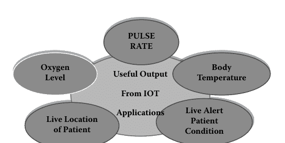

FIGURE 10.1 物联网在新冠肺炎大流行情况中。

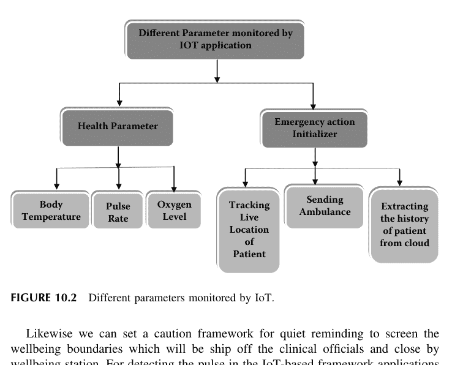

FIGURE 10.2 物联网监测的不同参数。

同样我们可以设置一个警报系统，提醒患者监测健康参数，这些信息将被发送给临床官员和附近的健康站。在基于物联网的系统应用中检测脉搏时，使用 `ROHM` 的 `BH1790GLC` 光学传感器屏、脉搏率传感器、`BM-CS5R` 脉搏屏可穿戴心脏监测电感传感器用于检测基于物联网的医疗服务应用中的内部热水平。此外还使用了 `LM35`、`MAX30205`、`G-TPCO-033`、`NTC` 热敏电阻和 `RTD` 传感器[28]。

## 10.10 基于物联网和机器学习的医疗保健未来模型

传感器网络的信息由微控制器收集和处理。提出的结果存放在云存储中。从云中可以检索和处理已处理的信息。已分析的信息再次存放在云中，可以检索（图10.3）。

整个框架可分为三个重要部分。健康监测框架、健康状态预测框架和紧急准备框架，这是该提案的三个重要领域。收集的信息和测量值必须保密。为保证隐私和安全，使用了加密组件，这增加了拟议框架的可信度。健康监测模块涉及使框架具备物联网功能的硬件组件，并用于使用各种传感器记录患者的健康参数[29,30]。在此，`Raspberry Pi` 充当中央工作站，所有传感器均通过 `GPIO` 引脚连接，或如果其输出为模拟形式则使用 `MCP3008` 模拟到数字转换器，因为 `Raspberry Pi` 仅在数字信号上工作。健康状态预测是

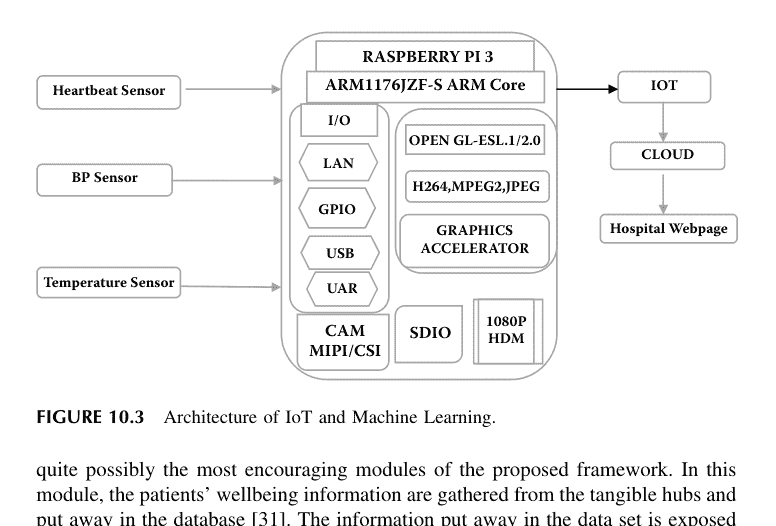

FIGURE 10.3 物联网和机器学习架构。

可能是拟议框架中最有前景的模块之一。在该模块中，患者的健康信息从传感节点收集并存储在数据库中[31]。存储在数据集中的信息将被提交给 `KNN` 分类器进行测试，该分类器对个人健康的各种状况进行分类。分类器做出的精确分类几乎不需要人工审查

### 10.10.1 用于疾病检测的物联网架构

该框架为通过使用传感器网络观察和调节患者提供了一个平台。该设计包括硬件和软件两个方面。硬件部分包括心率传感器、温度传感器、血压传感器和 `Raspberry Pi` 板。该周期的阶段包括传感器值的收集、数据存储在云中以及对存储在云中的数据进行分析以检查医疗问题的异常情况（图10.4）。

与标准的差异通常发生在身体部位存在未检测到的活动时[32]。脉搏可通过使用脉搏传感器进行评估。每秒的心率可被评估。传感器与 `Raspberry Pi` 板接口以显示结果特征。特征可以通过持续屏幕或连接 `LCD` 显示器来可视化。由于数据量巨大，所有收集的数据都上传到云端。上传到云端的数据在附近侧被分解。总之，对于任何不规则情况，心率通常会持续增加。一些开源云平台支持 `Raspberry Pi` 板[33]。它是开源的，收集的数据通过选择实际位置传输到云端。对收集的特征是否存在与标准的差异进行分析是使用人工智能计算完成的。云中收集的特征随后被导入以进行最终

FIGURE 10.4 疾病检测的框图。

分析的目的。为了获得准确的假设，应准备大量数据[34]。阶段 准备的数据越大，精度越高。待处理的数据集应包括在多种条件下从不同人群收集的信息。此外，数据集应包含来自不同年龄人群的信息，并且应包含健康和不健康人群的信息。直到上次会议为止所测试的信息应包含在训练数据集中，而在即时时刻收集的信息是待测试的信息。通过利用最初准备的信息和纳入的实际信息进行预测[35]。`Health Fog` 模型是一种基于物联网的雾增强分布式计算模型，用于医疗服务，可以有效地处理心脏病患者的数据并分析健康状况以区分心脏病严重程度。`Health Fog` 通过软件组件集成各种硬件工具，并允许结构化和一致的边缘-雾-云端到端集成，以快速、准确地交付结果[36]。

### 10.10.2 利用物联网和机器学习改善医疗保健系统的采用

人工智能领域正在稳步发展，与物联网的发展并行。传感器、纳米摄像头和其他此类物联网组件目前无处不在的计算机，

停靠站、交通信号灯控制器甚至家用机器中。地球上存在着大量的物联网设备，而且每天仍在制造更多 [37]。它们收集了大量的数据，这些数据通过互联网传输给机器，使机器能够从数据中“学习”并变得更高效。如今，物联网连接了多个领域，例如制造业、医疗保健、建筑物、车辆、交通、商场等。来自如此多样化领域收集的数据当然可以使基础设施更好地适应以提高工作效率。让我们以智能停车为例；它充分解决了车辆停车问题。当今的物联网监控可以找到空闲停车位并迅速引导车辆前往停车位。如今，智能建筑可以利用物联网和人工智能（机器学习）技术实现中央供暖、制冷、照明、电梯、消防安全系统以及门、厨房电器等的自动化，等等。智能城市面临的另一个重要问题是交通拥堵 [38]。这种情况可以通过开发自动化高速公路和建设智能车辆来避免。物联网和机器学习共同提供了避免交通堵塞的更好解决方案。这将带来更高的效率、减少拥堵和更少的交通事故。如今，军事行动中的无人机都配备了机器学习算法。这使它们能够判断物联网收集的信息中哪些对任务至关重要，哪些不重要。它们在飞行中收集实时数据。这些无人机评估所有传入数据并自动丢弃不必要的信息，从而更快速地有效管理数据负载问题。患者也将对其自身数据拥有更多控制权。在疫情期间，医疗机构投资更多的新数字医疗技术变得势在必行。医疗保健领域从数字化中获得了巨大收益，尤其是在推进社交距离方面。医疗专业人员还通过数字服务提供更实惠的选择，从而改善与患者的关系。与其让患者为轻微问题前往医院，寻求更快捷的在线解决方案正变得越来越实用和方便。客户可以在线订购药物并在当地药房取处方。数字和移动技术为医疗保健领域带来了巨大的益处。通过采用这些进步，医疗机构可以取得更好的成功率 [39]。如今，为慢性病患者提供家庭医疗的智能辅助生活条件非常重要。该环境结合了患者的临床历史和个体护理计划（`ICP`）的语义描述，并能够利用物联网技术监测日常活动。这样，物联网语义网（`SWOT`）和机器学习算法相结合，就产生了 `LDC`（较少脱离的护理者）。远程医疗可以被视为一种 `basic` 类型的医疗保健物联网模型。有了物联网，患者可以通过摄像头和其他电子执行器远程监测，有时甚至接受治疗 [32]。由此产生的集成医疗保健系统可以在改善公共健康的同时提供巨大的节省。在当今的国防系统中，自愈无人机正逐渐获得广泛接受。每架无人机在执行任务时都有自己的机器学习算法。利用这一点，一组执行任务的无人机可以识别出其中一架出现故障，然后与其他无人机通信以协调并在不干扰的情况下继续军事任务。

在这个通信和互联的时代，人们拥有各种技术来支持日常需求。在这种情况下，物联网与机器学习正成为解决问题的可行方案 [40]。区块链物联网和机器学习是三种新兴技术的杰出组合。区块链技术使数据更安全，机器学习分析数据，而物联网使数据可用。在未来几年，将会出现基于区块链的环境。区块链将减少诸如应用程序、开发机会、身份管理等问题，

## 10.11 结论

如果人类的健康参数未被监测，将导致严重问题，甚至威胁生命。通过物联网实现健康参数的持续监测自动化被讨论为一种新颖的解决方案。技术在医疗保健中发挥着重要作用，既用于传感设备，也用于通信、记录和显示设备。监测不同的临床参数和术后天数至关重要。因此，医疗保健专业技术利用物联网和机器学习技术的最新趋势。物联网作为医疗保健的催化剂，在广泛的医疗保健应用中发挥着突出作用。人工智能算法的初始训练和验证是使用 UCI 数据集进行的。测试阶段根据通过物联网框架收集的传感器数据估计异常预测。从物联网设备收集到云中的数据进行统计分析，以估计预测准确率，对于这种物联网而言，分阶段持续监测人类健康参数，人工智能算法发挥了关键作用。

## 参考文献

- [1]. M. Darrell，通过移动医疗设备和传感器改善医疗保健。布鲁金斯学会政策报告，10，1–13（2013）。

- [2]. P. S. Sousa，D. Sabugueiro，V. Felizardo，R. Couto，I. Pires 和 N. M. Garcia，用于个人辅助的 mHealth 传感器和应用。载于《Mobile Health》，S. Adibi 编，德国柏林：Springer（2015），Springer Series in Bio-/Neuroinformatics，第 5 卷。

- [3]. Kheirkhahan，M.，等，基于智能手表的实时和在线评估与移动性监测框架。Journal of Biomedical Informatics，89，29–40（2019）。

- [4]. S. Majumder 和 M. J. Deen，用于健康监测和诊断的智能手机传感器。Sensors，19（9），2164，（2019）。

- [5]. Yachirema，D.，de Puga，J. S.，Palau，C. 和 Esteve，M.，使用物联网和集成机器学习算法的老年人跌倒检测系统。Personal and Ubiquitous Computing，23，801–817（2019）。

- [6]. Yin 和 N. K. Jha。基于可穿戴医疗传感器和机器学习集成疾病诊断的健康决策支持系统。IEEE Transactions on Multi-Scale Computing Systems，3（4），228–241（2017年10月）。

- [7]. L. Xavier，R. Thirunavukarasu 和 R. Thirunavukarasu，用于蛋白质结构高效预测的基于分布式树的集成学习方法。*International Journal of Intelligent Engineering and Systems*，10（3），226–234（2017）。

- [8]. Vembandasamy，R. Sasipriya 和 E. Deepa，使用朴素贝叶斯算法的心脏病检测。*International Journal of Innovative Science, Engineering & Technology*，2（9），441–444（2015）。

- [9]. T. Huang，L. Lan，X. Fang，P. An，J. Min 和 F. Wang，健康科学中大数据计算的机遇与挑战。*Big Data Research*，2（1），2–11（2015）。

- [10]. H. Asri，H. Mousannif，H. Al Moatassime 和 T. Noel，医疗保健中的大数据：挑战与机遇，载于*Proceedings of the international Conference on cloud Technologies and applications (CloudTech)*，第 1–7 页，摩洛哥马拉喀什（2015年6月）。

- [11]. O. Akmandor 和 N. K. Jha。智能医疗保健：边缘侧计算视角。*IEEE Consumer Electronics Magazine*，7（1），29–37（2018年1月）。

- [12]. Dai，H. Yin 和 N. K. Jha，NeST：基于生长与修剪范式的神经网络合成工具。arXiv 预印本 arXiv:1711.02017（2017）。

- [13]. Ahmadi，H.，Arji，G.，Shahmoradi，L.，Safdari，R.，Nilashi，M. 和 Alizadeh，M.，物联网在医疗保健中的应用：系统文献综述与分类。*Universal Access in the Information Society*，18（4），837–869（2019）。

- [14]. Simblett，S.，等，参与远程测量技术管理健康的障碍和促进因素：系统综述和研究结果内容分析。*Journal of Medical Internet Research*，20（7），e10480（2018）。

- [15]. Raja，K.，Saravanan，S.，Anitha，R.，Priya，S. S. 和 Subhashini，R.，可穿戴健康系统低功耗 ECG 信号处理器设计——综述与实现问题。载于：2017 年第 11 届智能系统与控制国际会议（ISCO）。IEEE（2017），383–387。

- [16]. A. M. Rahmani， 等，利用医疗物联网边缘的智能电子健康网关：雾计算方法。*Future Generation Computer Systems* 78（2018），641–658（2018）。

- [17]. Milenkovic，M. J.，Vukmirovic，A. 和 Milenkovic，D.，卫生部门的大数据分析：挑战与潜力。*Management: Journal of Sustainable Business and Management Solutions in Emerging Economies*，24（1），23–33（2019）。

- [18]. Ullah，K.，Shah，M. A. 和 Zhang，S.，在医疗和智能医疗保健领域有效使用物联网的方法。载于 2016 年智能系统工程国际会议（ICISE），2016，372–379（2016）。

- [19]. Vallabh，P. 和 Malekian，R.，跌倒检测监测系统：全面综述。*Journal of Ambient Intelligence and Humanized Computing* 9（6），1809–1833（2018）。

- [20]. Anand，P.，Pinjari，H.，Hong，W. H.，Seo，H. C. 和 Rho，S.，基于雾计算的物联网健康监测系统。*Journal of Sensors*，2018（2018），文章编号 1386470，7 页。10.1155/2018/1386470。

- [21]. Yacchirema，D.，de Puga，J. S.，Palau，C. 和 Esteve，M.，使用物联网和集成机器学习算法的老年人跌倒检测系统。*Personal and Ubiquitous Computing*，1–17（2019）。

- [22]. Shahid，N.，Rappon，T. 和 Berta，W.，人工智能神经网络在医疗保健组织决策中的应用：范围综述。*PLoS ONE*，14（2），1–22（2019）。

- [23]. Zemouri，R.，Zerhouni，N. 和 Racoeanu，D.，生物医学应用中的深度学习：近期与未来状况。*Applied Sciences*，9（8），1526–1546（2019）。

- [24]. Soleimani-Roozbahani，F.，Ghatari，A. R. 和 Radfar，R.，十多年医疗保健大数据系统研究的知识发现：科学计量学研究。*Journal of Big Data*，6（1），1–15（2019）。

- [25]. R. Y. Kim, COVID-19 对消费者影响：为数字销售做准备。 在 IEEE Engineering Management Review。 doi: 10.1109/EMR.2020.2990115.

- [26]. Aleem A., Javaid M., Vaishya R. and Deshmukh S. G., COVID-19 影响下的学术研究领域。 AJEM (美国急诊医学杂志 American Journal of Emergency Medicine), 38(7), 1524–1526 (2020).

- [27]. Hegde, N., Bries, M., Swibas, T., Melanson, E. and Sazonov, E., 利用鞋垫式和腕戴式可穿戴传感器自动识别日常生活活动。 IEEE Journal of Biomedical and Health Informatics, 22 (4), 979–988 (2018).

- [28]. Park, E., Park, E., Kim, K. J., Kim, K. J., Kwon, S. J. and Kwon, S. J., 理解可穿戴设备作为健康传播下一代工具的兴起。 Information Technology & People, 29 (4), 717–732 (2016).

- [29]. Rajput, D. S. and Gour, R., 用于医疗保健监测系统的物联网框架。 International Journal of Computer Science and Information Security (IJCSIS), 14 (5), 451 (2016).

- [30]. H. Jamaludin, 血压监测移动应用：应用商店中的系统检索和内容分析。 JMIR mHealth and uHealth, 6, 11 (2018).

- [31]. Wu, J., Li, H., Cheng, S. and Lin, Z., 医疗服务光明未来：当大数据分析遇上可穿戴技术。 Information & Management, 53, 1020–1033 (2016).

- [32]. Mutlag, A. A., Khanapi, A. M., Ghani, N. Arunkumar, Mazin Abed Mohammed, Othman M. and 医疗保健物联网系统中雾计算的使能技术。 Future Generation Computer Systems, Elsevier Science Direct, 90, Jan. 2019, 62–78 (2019). 10.1016/j.future.2018.07.049.

- [33]. Ahmed, S., El Seddawy, A. I. and Nasr, M., 通过商业智能应用检测和预测疾病的建议框架。 International Journal of Advanced Networking and Applications, 10 (4), 3951–3955 (2019).

- [34]. Malik, M. M., Abdallah, S. and Ala’raj, M., 医疗服务交付中的数据挖掘和预测分析应用：系统文献综述。 Annals of Operations Research, 270 (1–2), 287–312 (2018).

- [35]. M. Hauskrecht, Visweswaran S., Cooper G. and Clermont G., 患者监测和报警的异常检测。 Journal of Biomedical Informatics, 46(1), 47–55 (2015).

- [36]. Birnbaum M. L., Ernala S. K., Rizvi A. F., et al. 采用机器学习和临床评估识别精神分裂症社交媒体标记的协作方法。 Journal of Medical Internet Research, 19 (8): e289 (2017).

- [37]. Marin elaren a-Dondena L., Ferreti E., Maragoudakis M., et al., 预测抑郁症：基于语言使用的机器学习方法比较研究。 Cuad Neuropsicol/Panam J Neuropsychol, 11 (3), 42–54 (2017).

- [38]. Puliafito, C., Mingozzi, E., Longo, F., Puliafito, A. and Rana, O., 物联网的雾计算：综述。 ACM Transactions on Internet Technology, 19 (2), Article 18 (April 2019), 41 pages (2019).

- [39]. George, A., Dhanasekaran, H., Chittiappa, J. P., Challagundla, L. A., S.S. Nikkam and O. A., 使用雾计算的医疗保健物联网， 2018 IEEE Long Island Systems. Applications and Technology Conference (LISAT) (2018). 10.1109/LISAT.2018.8378012.

- [40]. S. S. Kazi, G. Bajantri and T. Thite, 使用物联网的远程心率监测系统。 International Research Journal of Engineering and Technology (IRJET), Volume 05 (04) (April 2018).

# 11 利用物联网和机器学习进行医疗保健的疾病预测与诊断系统

Shweta Agarwal and Chander Prabha

## 目录

- 11.1 引言...................................................198
- 11.1.1 疾病预测的机器学习算法研究...................198
- 11.1.2 医疗保健中的物联网...............................................200
- 11.1.2.1 医疗保健中物联网的应用.............................200
- 11.2 利用物联网和机器学习的健康监测...................202
- 11.2.1 用于健康监测的材料和方法...............203
- 11.2.1.1 心率传感器........................................203
- 11.2.1.2 数据集........................................................203
- 11.2.1.3 信息预处理...................................203
- 11.2.1.4 机器学习分类器.................................203
- 11.3 将机器学习应用于物联网数据进行疾病预测和诊断模型...............................................204
- 11.3.1 利用机器学习进行脑肿瘤分类及物联网在提供解决方案中的作用.....................................205
- 11.3.1.1 物联网 Thingspeak 平台.......................................205
- 11.3.1.2 所需模型及其阶段................................206
- 11.3.1.3 实现与结果....................................206
- 11.3.2 利用机器学习和基于物联网的应用进行痴呆症早期检测...........................................207
- 11.3.2.1 痴呆的特征及其不良影响...............................................208
- 11.3.2.2 识别痴呆发病...................................209
- 11.3.2.3 模型开发与性能分析...................210
- 11.3.2.4 从 CASAS 数据集提取特征的算法............211
- 11.3.2.5 讨论与结果........................................211
- 11.3.3 用于预测肺癌的分割与分类物联网模型...............................................212
- 11.3.3.1 系统架构................................................212
- 11.3.3.2 结果与讨论................................................212
- 11.4 利用物联网和机器学习算法的心脏病预测模型................................................212
- 11.4.1 引言................................................213
- 11.4.2 基于物联网的疾病诊断模型................................................214
- 11.4.3 结果与结论................................................214
- 11.5 利用物联网和深度学习的自动化营养监测系统................................................215
- 11.5.1 引言................................................215

- 11.5.2 智能日志系统................................................216

- 11.5.3 结果与结论................................................216

- 11.6 通过物联网和机器学习实时监测心律失常患者................................................217

- 11.6.1 心律失常患者监测与分类................................................218

- 11.6.1.1 数据感知................................................219

- 11.6.1.2 分类与可视化................................................219

- 11.6.2 结果与讨论................................................220

- 11.6.3 结论................................................220

- 11.7 医疗保健中的物联网：益处与挑战概述................................................220

- 11.7.1 应用物联网的益处................................................220

- 11.7.2 医疗保健中物联网的挑战................................................221

- 11.8 机器学习在物联网中的应用................................................222

- 11.9 结论与未来展望................................................222

- 参考文献................................................224

## 11.1 引言

人工智能在医疗保健领域影响深远，因为其目的是使系统在应对医疗保健挑战方面更加强大，并且通过使用不同的技术，可以解释数据，这些数据是通过诊断各种慢性疾病收集的，如癌症、糖尿病、阿尔茨海默病和心血管疾病。它有助于改善临床干预、疾病预测、早期检测和疾病进展。机器学习（`ML`）技术在医疗保健领域发挥着至关重要的作用，包括分析模型的进步。这些模型可以为临床决策支持系统和医疗保健服务应用提供即时益处。为了对患者的行为特征和健康症状进行分类，这些模型会检查来自不同来源和传感器设备获取的数据。机器学习和物联网（`IoT`）已在医疗保健中得到广泛应用。

在这里，我们将讨论在医疗保健中用于疾病诊断和预测的不同机器学习算法，以及物联网在医疗保健中的重要性。

### 11.1.1 疾病预测的机器学习算法研究

今天的计算时代是机器学习的时代。机器学习是指机器或系统能够从某些算法中学习并基于的它。机器学习算法无处不在。其实现在许多应用中都很流行。在在线客户支持、推荐系统、自动驾驶汽车等中，机器学习算法被广泛使用 [1,2]。

机器学习的一种此类实现是在医疗保健领域，在该领域中，它在疾病预测和诊断方面很有用，有助于医生更轻松、更好地诊断疾病。最常见的三种机器学习算法是：

- i. 有监督学习（Train Me）
- ii. 无监督学习（I'm self-sufficient in Learning）
- iii. 强化学习（My life My rules, Hit and Trial）

下面提到了一些常用的有监督机器学习技术 [3]，这些技术对于疾病的预测和诊断很有用：

- a. **决策树**—它是对基于某些条件的决策及其所有可能解决方案的树状表示。它是一种分类方法，有助于医生以及医师诊断患特定疾病较高风险的患者。在决策树的帮助下，可以实现疾病的早期预测。
- b. **逻辑回归**—它是一种基于线性回归的有监督分类方法 [4]。它被称为回归而不是逻辑分类器，因为逻辑回归使用线性模型。该模型可用于二元分类以及多类分类问题。该模型可用于查找自变量的某一类；它还可以通过使用介于零和一之间的结果来找到新实例属于或不属于新类的可能性。因此，要将该模型用于二元分类并进行预测，将分类器输出阈值设为 0.5。如果假设返回的值 >= 0.5，则将其分类为“1”，否则为“0”。在医疗保健中，`LR` 模型有助于判断肿瘤是否恶性。
- c. **支持向量机**—它能够执行异常检测、回归和分类。支持向量机是一种判别分类器，其正式设计基于分离超平面。它可以对线性数据和非线性数据进行分类。它首先将每个数据项映射到 n 维特征空间，其中 n 为特征数量，然后识别出将数据项分为两个类别的超平面，同时最大化两个类别的边际距离并最小化分类错误 [5]。为了进行分类，我们需要找到以最大间隔区分两个类别的超平面。
- d. **随机森林**—它是一组或由 `DT` 组成的集成 [6]，其中决策树是使用整个数据集并考虑所有特征构建的，但 `RF` 仅随机选择一部分行，并且为训练还随机选择特定数量的特征。这样，`DT` 就会生长，每个 `DT` 会产生最终结果，而 `RF` 只会汇总 `DT` 的结果以得出最终结果。在 `RF` 中，使用多棵树可以降低过拟合风险，同时减少训练所需的时间。其主要优点是

图 11.1 医疗保健中物联网的应用。

基于物联网的智能康复系统可根据患者需求轻松交互和分配医疗服务 [10]。

- c. **血氧饱和度监测**—为了以非侵入方式持续监测患者血液氧饱和度，使用一种名为脉搏血氧仪的设备 [11]。通信技术方面已有许多发展，例如无线网络，并且由于功耗低、损耗低，医疗传感器已经蓬勃发展。连续脉搏血氧仪在许多医疗程序中使用，以考虑血液中的氧气水平以及心率（`HR`）。连接到患者身体的物联网传感器调节并监测患者的脉搏率和氧气水平，这可能会限制患者活动 [13]。
- d. **轮椅管理**—患有身体疾病或残疾且无法行走的人使用轮椅。为了作为轮椅使用者的人本传感（传感器）系统使用，`WBAN`（无线体域网）将把智能对象连接到互联网。会有电阻式压力传感器来感知人体从轮椅上跌落的情况。智能轮椅中还有另一个加速度传感器，可感知轮椅的跌落 [14]。
- e. **使用智能手机的医疗保健解决方案**—智能医疗保健应用程序和设备为医疗保健专业人员（`HCP`）提供许多益处。目前有许多医疗保健应用程序可供使用，适用于许多领域，例如适当的临床决策、患者持续监测以及与医生咨询、沟通、信息和时间、健康记录 [15]。使用移动应用程序和传感器支持改善患者预后，从而加快了治疗速度。

## 表 11.1

### 智能手机的医疗保健应用 [11]

| 医疗保健应用 | 描述 |
|---|---|
| 心率监测仪 | 它可用于持续监测心率，并实时收集所有相关信息。 |
| 跌倒检测器 | 如名称所示，该应用程序跟踪个人的活动，并在跌倒时生成警报。 |
| 计步器 | 这是一款常用的应用程序，可在行走时记录我们的步数，并存储每单位时间消耗的总卡路里信息。 |
| 给身体补水 | 这对于饮水量很低的人非常有用。它会跟踪我们的饮水习惯并每小时提醒我们喝水。 |
| 皮肤视觉 | 它通过不时跟踪皮肤状况，有助于尽早识别皮肤疾病。 |
| 卡路里计数器 | 它有助于跟踪我们摄入的食物，并计算身体中存在的脂肪、胆固醇以及体重。 |
| 血压监测仪 | 该应用程序有助于收集患者血压水平的实时数据并进行分析。 |
| 体温 | 它跟踪身体的温度，并在体温升高时提供通知。 |
| 眼部锻炼—眼部护理 Plus | 它有助于监测视力并提供训练。 |
| 哮喘追踪器和日志 | 该应用程序用于哮喘患者实时跟踪其信息。 |
| 心脏移动 | 该应用程序有助于监测个人心脏康复的实时数据。 |
| 服药提醒 | 非常有用，可提醒患者按时服药。 |

如表 11.1 所示，智能手机上常见的医疗保健应用。

## 11.2 使用物联网和机器学习的健康监测

物联网、人工智能、机器学习和大数据帮助医生找到患者疾病的根本原因，并使用各种技术工具和算法预测其严重程度。物联网是减轻医疗保健负担的解决方案。健康监测系统是一种利用传感器跟踪患者健康的系统。它跟踪患者的脉搏率、心率、血压水平、温度等。当设备感知到患者脉搏或温度的任何突然变化时，系统会机械地警告用户，甚至在互联网上实时显示患者温度和心跳的描述 [16]。

## 11.2.1 用于健康监测的材料和方法

### 11.2.1.1 心率传感器

脉搏传感器是用于 `Arduino` 适配和连接的活动心率传感器之一。它剪到指尖并迅速扩展到 `Arduino` 中，还提供了一个开源跟踪程序，可绘制脉搏图。传感器的前部由心形标志检查，该标志通常位于产生接触的皮肤侧。前面可以看到一个小低圆孔，这是 `LED` 从后面发出的位置。`LED` 将光线照射到指尖、耳垂或其他薄组织上，传感器扫描反射回来的光比例。这是一种学习心跳的方式。传感器的另一侧是大多数组件安装的位置。

### 11.2.1.1.2 数据集

数据集是一种来自空间的感知。数据集是一组示例，在处理人工智能技术时，我们通常需要几个数据集用于不同的原因。使用人工智能计算，数据随后被准备和测试。为了准备我们的模型，使用数据集来验证模型的准确性并将数据输入人工智能计算。

### 11.2.1.1.3 信息预处理

信息预处理是一种结构，它将凌乱的信息转变为完美的教育记录。例如，随机森林估计不会改进无效属性，因此从主要不愉快的教育记录到执行飞行森林检查，必须管理无效质量。在预定义的位置，一些指定的 `AI` 模型需要数据。另一种观点是，信息光谱应该结构化，以便在记录中执行更多 `ML` 和 `DL`（深度学习）的近似以选择最佳的一个。

### 11.2.1.1.4 机器学习分类器

一些众所周知的表征被用于机器学习算法中，如—决策树、`LR`、`NB`、`SVM` 和 `K` 近邻。任何此类算法都可用于诊断疾病是否存在。用于预测疾病的智能系统如图 11.2 所示。

通过可穿戴传感器系统的功能将传感器安装在其上，物联网已被用于制作在异常情况下提醒患者同伴的系统。机器学习在医学诊断领域很有帮助，因为它使用能够识别患者状况中任何异常的模型 [18]。

`UCI` 数据集用于对各种机器学习算法进行初始级别的训练和测试。测试阶段有助于估计由物联网系统从收集的传感器数据中获得的不同异常的预测。为了估计预测百分比的准确性，对从云中物联网系统积累的数据进行统计分析。机器学习算法在这种专注于持续监测人类健康参数的物联网平台上非常有帮助 [19]。

图11.2 用于预测疾病的智能系统[17]。

## 11.3 将机器学习应用于物联网数据进行疾病预测与诊断模型

基于物联网的医疗预测与诊断系统由“健康传感器物联网”组成。机器学习（`ML`）技术有助于预测各种医学应用，如脑肿瘤、糖尿病和癌症[20]。该系统涉及大数据，这给医生处理带来困难，但他们需要此类历史数据来预测患者的健康状况，而机器学习算法在这方面将很有用。

使用了诸如多层感知机（`MLP`）、随机森林（`RF`）、决策树（`DT`）、支持向量机（`SVM`）和`K`近邻（`KNN`）等数据挖掘技术，并对它们的效率进行比较，以确认医疗行业的服务质量。由于地理位置偏远，手动健康相关设施往往无法及时满足需求，从而造成重大的生命危险。为了支持医疗急救、实时监测、早期诊断和慢性病管理，使用基于物联网的医疗系统的主要原因在于利用无线技术驱动的最新医疗网络。此外，物联网通过确保为患者提供最佳利用和设施，实现稀缺资源的有效调度。

据联合国人口基金报告，全球人口中12.3%的人年龄在60岁及以上，到2050年这一比例将增长至近22%。因此，在基于物联网的医疗系统在弥合患者与医生之间差距方面发挥关键作用的情况下，对老年人医疗援助的需求将十分巨大。

因此，本节将讨论使用物联网和机器学习来预测和诊断各种疾病的不同方法。

### 11.3.1 使用机器学习进行脑肿瘤分类及物联网在提供解决方案中的作用

脑肿瘤是由细胞不受控制的、不规则分裂引起的最致命的疾病之一。脑肿瘤有多种，但以下类型可以明确认定为脑肿瘤[21,22]：

- 良性肿瘤
- 癌前肿瘤
- 恶性肿瘤

不影响健康组织、不扩散到非邻近组织且不会意外生长的肿瘤称为良性肿瘤，痣就是其中一例；而癌前肿瘤是癌前阶段，如果不加治疗，可能会被认定为癌症。

恶性肿瘤也是一种随时间恶化并最终导致患者死亡的肿瘤。肿瘤细胞存在于颅骨内并在颅骨内发展，这被认为是原发性肿瘤。

早期脑肿瘤属于恶性脑肿瘤。肿瘤在颅骨外出现并到达颅骨区域，称为继发性肿瘤。继发性肿瘤的例子之一是转移性肿瘤。肿瘤在颅骨中占据位置并干扰大脑的正常功能。肿瘤侵入颅骨并升高脑压。治疗的第一步是检测肿瘤[21,22]。

> “脑肿瘤检测是医学图像分割中最具挑战性的任务之一，因为脑图像复杂，只有专家医师才能分析肿瘤。在脑肿瘤诊断中，重要任务是确定异常组织的确切位置、方向和面积”[23]。

> “脑肿瘤诊断的重要任务是确定异常组织的确切位置、方向和面积”[23]。

在计算机集成手术、术前规划和病理分析中，脑部`MRI`可能很有用[23,24]。

已开发出一种基于物联网`Thingspeak`平台、支持`SVM`分类器用于脑癌检测的软件系统。它通过使用患病大脑的`MRI`图像来帮助检测脑部肿瘤。`SVM`分类器是一种增强的`SVM`机器学习算法，用于回归和分类目的。`SVM`分类器的主要目的是分析并对相应的输入集合进行分类。

#### 11.3.1.1 IoT Thingspeak平台

`Thingspeak`是一个开源的物联网云平台。它由`ioBridge`于2010年作为物联网应用的支撑服务推出。`Thingspeak`可即时模拟设备聚合数据，也用于原型验证和证明涉及分析的物联网框架原理。

`Thingspeak`的主要功能包括以下特性：

- 易于配置：使用通用物联网协议配置设备以发送数据。
- 可视化：实时可视化收集到的传感器数据。
- 聚合：根据请求聚合来自第三方来源的数据。
- 分析：基于事件或计划运行自动物联网分析。
- 原型设计：无需开发`Web`应用程序或设置服务器即可开发物联网系统和原型。
- 自动化：使用`Twilio`或`Twitter`等第三方提供商自动处理数据并进行通信。

`Thingspeak`允许用户提交通知，或触发环境中`IP`连接的物体在该环境中运行。

#### 11.3.1.2 所需模型及其阶段

模型包含多个阶段[25]：

- 收集脑部`MRI`图像
- 在安全数据库网站上共享`MRI`图像
- 使用`Thingspeak`平台从网站数据库读取数据

上述阶段的实施帮助医生通过云端监控患者的健康状况。该过程对医生非常有帮助，可让他们在术前根据肿瘤位置判断需要移动大脑的哪个部分。

脑肿瘤检测模型的表示如图11.3所示。通常，医疗监测领域需要更强的人工能力来跟踪患者健康状况。这些是医疗行业最重要的问题。如果医疗情况没有得到及时检查，就会导致毁灭性的后果。

#### 11.3.1.3 实施与结果

这个通过`Thingspeak`平台实现的脑肿瘤检测模型由三个主要部分组成：计算机化`MRI`成像设备是第一部分，其中图像被编译并存储为`JPG`文件，然后（第二部分）发送到网站的中央代理。实验研究开发了一个域名`auday-mohamad.com`的`TMDHosting`网站。所提框架的第三部分是`Thingspeak`平台；`Matlab`程序的分析能力应用在该部分中。

`SVM`分类器算法与一组预处理操作一起使用。在云端层面，这些算法基于`Thingspeak`平台内安装的云`Matlab`功能实现。使用`Matlab`软件`R2017a`和`Thingspeak`平台，完成了基于`SVM`算法的肿瘤检测本地实现。因此，结果得出结论，与同一位老年病专家相比，可以提供建议。通过这种方式，基于物联网的远程监测还可以让老年人像朋友一样就痴呆症的潜在迹象提出建议，并建议他们去看临床医生。此外，在更智能的生活方面，这将增加护理人员和老年人的安心感。

为了通过被动监测检测痴呆症的发生，存在不同的方法。已有一些研究使用基于图像的深度学习技术，从患者的脑电图数据集和`MRI`扫描中预测和诊断痴呆症[26–29]。此外，还有一些尝试基于`GPS`和游荡加速度计识别，从成年人的行为症状中识别痴呆症的发生[30–32]。这里的工作重点是创建一个基于公开可用数据集的模型来预测痴呆症的发生，这些数据集包含参与者日常生活中选择性工具行为的详细信息。为了创建模型，作者从数据集中收集并分析了相关特征。这些模型在识别与遗忘、困惑以及痴呆症患者其他行为相关的认知障碍时，考虑了用户的手势和所选任务的持续时间。

### 11.3.2.1 痴呆症的特征及其不良影响

痴呆症是老年人中普遍存在的现象，也是70岁以上人群的主要死亡原因之一[33]。痴呆症通常由大脑皮层退化引起，大脑皮层是负责个性、行为、感知和情绪的大脑部分[34]。

在特定区域，痴呆症患者死于特定区域脑细胞的损失。以痴呆为特征的认知障碍导致了这些死亡细胞。在世界许多地方，老龄化人口的福祉是一个相当大的问题。对于他们的护理人员和家庭来说，远程监测老年人的健康和福祉很有帮助。

阿尔茨海默氏症协会已确定与痴呆症相关的五个主要症状领域，如图11.4所示。此外，这五种核心痴呆症状还可以进一步细分为子症状[35]。

痴呆的行为和心理症状（`BPSD`）与上述关键症状领域一起，可为预测痴呆症的发生提供多种迹象。这些痴呆症子症状中的任何一种都可以非常贴近地符合`BPSD`的迹象。`BPSD`是一种异质性集合的临床现象。大约80%-90%的痴呆症患者存在`BPSD`症状[37]。`BPSD`的表现包括性格改变、睡眠和醒来模式失调、不规律的运动行为、视觉和思维变化、情绪改变和情感受损[37]。以下列表展示了痴呆症患者中一些常见的`BPSD`症状：

- a. 冷漠
- b. 反复发声
- c. 性格改变
- d. 睡眠障碍
- e. 不当行为
- f. 吐口水

图11.4 痴呆相关的五大主要症状领域[36]。

- g. 咬人
- h. 游荡
- i. 攻击行为
- j. 精神运动性激越
- k. 妄想
- l. 幻觉
- m. 抑郁
- n. 焦虑
- o. 尖叫

数据集中的行为与症状领域以及BPSD的各个域相关。因此，症状的存在意味着可以通过基于物联网的系统检测老年人的认知障碍，从而诊断痴呆的发展。

## 11.3.2.2 识别痴呆发病

由于患者的症状是逐渐发展的，且周围人难以察觉这些变化，因此识别痴呆的早期迹象很困难。因此，也在不断发展的MRI扫描越来越多地用于检测痴呆阶段。简易精神状态检查（`MMSE`）是老年病学家诊断认知障碍最常用的临床检查方法[38]。如果该评分持续下降，则可能意味着一个人正在发展为痴呆。通常，许多老年人在认知状况下降时并不自知，因此他们不会寻求医疗治疗。

与BPSD症状的五大主要类别相关，环境传感器可用于追踪和收集行为数据。通过物联网设备追踪日常活动、常规任务以及行为模式，可以开发智能模型来预测痴呆的发展。`AI`和`ML`等技术有助于对认知状态模式进行分类。在住所内，烦躁不安、游荡行为可能导致传感器不规则触发，这有助于实现智能模型。因此，使用存在和运动传感器进行移动检测，以及动作的识别和完整性，是输入数据的重要组成部分。

此外，与游荡、健忘和焦虑相比，正确且较少重复地执行任务会减少住所内传感器的激活。因此，传感器激活计数器被用作模型构建的来源。完成`ADL`是老年人健康状况的积极指标。关键`ADL`的反复丧失可能会让护理人员对其认知健康状况感到担忧。因此，该模型采用`ML`方法分析数据集中的`ADL`。为了识别痴呆的发病，该方法可以帮助评估每个`ADL`的持续时间和完整性。

## 11.3.2.3 模型开发与性能分析

整个系统的流程图如图11.5所示。按照图中显示的流程，所有用户行为都将从智能环境中被追踪。然后，为了准备提取功能，这些数据将被过滤和预处理。在所有特征中，房间与走廊之间的出入口传感器、任务完成时间和传感器触发事件对此功能很重要。此外，物联网智能环境可以提供重要特征，如`IADL`操作的总完成计数器和每个`IADL`的周期。将使用排序方法获取和选择特征，同时评估应用的有效性和重要性。之后，数据集将被准备用于`ML`研究以构建模型。

该模型使用`CASAS`数据集[39]。这是华盛顿州立大学提供的常用数据集。该数据集包含不同参与者的`ADL`和`IADL`以及低级传感器信息。

图11.5 用于分类痴呆发病的系统流程图[36]。

基于一系列传感器激活，传感器活动日志自动生成。与此工作相关的所有相关可提取特征都基于日志文件中的详细信息。从数据中可以获得的一个重要方面是完成每个`ADL`和`IADL`的时间。还可以收集反映参与者行为的停用事件和运动传感器激活。此外，还可以提取开始信息和任务完成情况。对于每个传感器，将每个参与者的运动传感器触发累计次数作为一个特征。用于从日志文件中提取特征的算法将在下一节中定义。

## 11.3.2.4 从CASAS数据集提取特征的算法

从`CASAS`数据集提取特征的算法如下：

- 步骤1. 以数据样本的文件累计数量为循环次数，开始循环。每次循环，提取特征并存储为一条记录。
- 步骤2. 为了维护任务1-8的适当传感器数据，每次循环修剪加载的文件。
- 步骤3. 计算每个任务的持续时间（共八个任务），并使用内循环存储记录。
- 步骤4. 使用内循环计算每个适当传感器（51个传感器）的传感器触发事件，并保存记录。
- 步骤5. 重复上述所有四个步骤，直到数据文件的完整特征被提取完毕。然后，将输出导出为用于`ML`的特征矩阵表。

为了识别类内的模式，从数据集中提取特征。在构建真实模型完成之前，必须关注数据以探索相关参数。认知障碍个体在完成给定任务时会有困难。因此，在某些任务上，他们可能会失败。可以预测，即使他们完成了任务，也需要更长的时间来完成。这是建立任何模型之前数据集的初始假设。从特征分析的角度来看，这些基本模式可能出现在结果中。经过仔细审查，注意到某些参与者未完成某些任务，这些任务属于认知障碍或认知健康两类中的一种。算法将这些未完成的任务直接设置为“0秒”以完成特定任务。在数据集中，这些零表示缺失值。相反，如果未完成任务，将是一个很大的总和。因此，在数据预处理期间，这个零被替换为该特征最大值的两倍。

## 11.3.2.5 讨论与结果

上述模型能够预测痴呆疾病，使用`DT`模型的准确率达到90.74%，而此前工作的准确率为88%。`RUSBoosted`基于集成的模型分别在平衡和不平衡数据集上取得了89%和87.38%的F分数，从而产生了最佳结果。该模型仅使用了很少的50个特征，但可以获得更好的F分数和精确度。它还有助于为老年人提供预测性治疗，

图11.6 系统架构[41]。

## 11.4.1 引言

在过去几年中，由于传感设备、物联网和互联网领域的技术进步，医疗保健监测显著增加。许多医院使用移动应用程序来安排预约、搜索医疗记录和查看报告。然而，为了跟踪心电图、血糖、血压以及其他生理症状，可以使用医疗保健可穿戴设备（如心电图机、3G血压测量系统等）。智能设备在医疗保健方面的进步还有更多优势，例如减少临床工作人员的工作量、提高患者的医疗意识以及降低费用[42]。此外，要实现这一目标，将智能设备相互连接仍然是一个主要问题。最大的问题在于通信协议[43]。由于传统有线通信不适用于移动传输，大量研究已经开展，通过短程和长程无线传输将智能物品连接起来。

本节将讨论基于物联网和云计算的疾病诊断模型，用于诊断、预测和监测心脏病。在这种情况下，除了医疗保健传感器外，还使用`UCI`存储库数据集来预测患者患病从心脏病中。另外，分类算法用于对患者数据进行分类以检测心脏病。使用基准数据集的数据，分类器将在训练过程中进行训练。在测试方法期间，使用实际患者数据对疾病进行分类以确定疾病的存在。使用包括 `SVM`、`MLP`（多层感知器）、`LR`、`J48` 在内的分类器集合，对基准数据集进行实验评估。

### 11.4.2 IoT-Based Disease Diagnosis Model

诊断模型在图 11.7 中表示。它由基于机器学习的 心脏病预测系统、云数据库、患者数据、心脏病数据集和医疗物联网传感器五个主要组件组成。可穿戴和嵌入式物联网设备被认为是物联网设备，用于从偏远地区收集数据。这些测量使用与人体相连的物联网设备收集数据。

`UCI` 仓库的数据集被使用，其中包含从医疗中心获得的先前患者数据日志。在云中，所有这些数据集都已保存。为了随时访问，必要的数据将存储在云中。心脏病预测模型负责借助机器学习的分类算法预测心脏病。该模型在三个步骤中执行功能。在第一步中，使用人体物联网设备、基准数据集和患者记录收集数据。在下一步中，所有收集的数据将存储在云存储中。心脏病的预测在最后一步进行，通过对结果进行分类。使用数据集训练分类器以确定心脏病的存在，分类算法首先进行训练过程。然后，为了准确预测患者是否患有心脏病，经过训练的分类器能够测试医疗记录。报告将被生成并提供给用户。

### 11.4.3 Results and Conclusion

多个分类器针对心脏病数据集的结果如图 11.8 所示。从图中可以明显看出，`MLP` 呈现出最差的结果，精确度最低。`SVM` 和 `LR` 显示出具有竞争力的效率，高于 `MLP` 获得的准确率。尽管 `MLP` 在 `LR` 和 `SVM` 方面表现更优，但与 `J48` 分类器相比未能提供良好的结果。然后，在 F 分数方面，`MLP` 达到了最低的精确度，这表明分类性能较差。同时，`SVM` 和 `LR` 获得了比 `MLP` 更好的分类效率。此外，`J48` 在分类中获得了更好的 F 分数结果。较高

FIGURE 11.7 IoT based disease diagnosis model [44].

FIGURE 11.8 Various classifier's comparison on the dataset of heart disease [44].

较高的准确率值显示出更好的分类效率。具有最低准确率值的 `MLP` 分类器表现出不良性能，而 `SVM` 和 `LR` 分类器分别获得了更好的准确率值。有趣的是，具有最大准确率值的 `J48` 分类器实现了更好的分类效率。`MLP` 获得最低的召回率值，而 `J48` 分类器实现了最高的召回率值。同时，在召回率方面，`LR` 和 `SVM` 分类器显示出大致相同的输出。据称，在 kappa 值方面，`LR` 和 `SVM` 分类器比 `MLP` 表明了更好的结果。值得注意的是，`J48` 分类器获得了最大 kappa 值。也许令人惊讶的是，就整体性能而言，`J48` 分类器被发现是有效的心脏病诊断模型。

## 11.5 AUTOMATED NUTRITION MONITORING SYSTEM USING IOT AND DEEP LEARNING

正确的营养摄入平衡非常重要，尤其是在婴儿中。当身体缺乏必需营养素时，可能导致严重疾病和器官退化，从而在成年期引起严重的健康问题。对婴儿提供的食物营养成分进行自动化监测，不仅在家中而且在托儿设施中，对其健康发育至关重要。为解决这一挑战，本节提出了一种新的基于物联网的全自动营养监测系统，称为 `Smart-Log`，以推进智能医疗的最新技术。

### 11.5.1 INTRODUCTION

在医疗保健中，跟踪每日食物摄入量是一个关键关注点。为了保持更健康的生活方式，在智能医疗保健中引入了跟踪设备或可穿戴设备，重点是监测卡路里输出或卡路里输入 [45]。监测卡路里输出和摄入都至关重要 [46]。此类系统的目标可能从体重减轻监测到健康均衡饮食不等，解决营养不平衡是其根本灵感。这可能是由暴饮暴食和

FIGURE 11.9 View of smart log system [52].

营养不良造成的，其中摄入的营养不足，导致对非营养脂肪、盐和食物的高消费。在今天的主要城市中，暴饮暴食可能导致肥胖，这是一个重大的健康问题。婴儿和儿童的营养不平衡可能在各种成人模式中发生，如牙龈出血、发际线变薄、身体结构虚弱、认知障碍和免疫系统虚弱等。

`Smart-Log` 系统的概念视图在图 11.9 中提供，可作为任何家庭的一部分。物联网是本研究中的关键促进者。物联网被用作云端分析和传感器派生数据之间的链接 [47]。它是一个物理网络，其中每个设备都可以在网络中被识别 [47]。在物联网中，每个可识别的部分都是可以链接到互联网的‘事物’。它帮助开发人员和研究人员构建智能系统，物联网保护了广泛的业务范围 [48]。它是智能城市的使能技术之一，其中基础设施的不同组件（例如汽车、公用事业、家庭、交通、医院和房屋）相互连接 [49]。物联网在医疗保健背景下促进了远程援助并改善了人们的生活 [50,51]。

### 11.5.2 SMART LOG SYSTEM

可以将设备架构视为一种产品，其中包括智能传感器板和智能手机应用程序。传感器板上包含一个用于测量食物的模块。食物成分或产品的重量，由集成无线模块的微控制器协调，通过无线方式通过互联网传输到云端。因此，在物联网网络中，设备被转换为‘事物’。食物项目的相应营养数据通过智能手机应用程序借助智能手机摄像头获取。然后系统给出总体摄入营养素的值。使用智能手机应用程序，客户可以访问预测和测量的营养素值。`Smart-Log` 系统的 DFD 在图 11.10 中描绘。

### 11.5.3 RESULT AND CONCLUSION

在饮食控制方面具有高精度，实施的自给自足的食物数据记录系统的设计具有成本效益。基于贝叶斯网络和五层感知器神经网络的营养特征提取算法可以用于评估营养平衡。输入数据集中包含多次记录的一些产品。为了解决这个问题，在重复的情况下，向客户提供替代选项以更正数据输入，从而提高最终准确性。除了提供膳食营养质量的概述外，该设备还提供建议以最大限度地降低不均衡饮食的风险。对于家庭或儿童护理使用，该设备可能成为重要产品。本节中 `Smart-Log` 的范围在婴儿食物偏好的意义上被看到，可以通过扩展云存储中的数据库供成人使用。

## 11.6 MONITORING OF ARRHYTHMIA PATIENTS IN REAL TIME VIA IOT AND ML

心律失常（也称为心律不齐）是一种异常心跳疾病，会导致患者突然丧命 [53]。为了克服这种意外的生命损失，需要不断控制心律失常患者的 cardiac 活动以包括有效的医疗程序。今天，物联网被用于实时跟踪新的医疗保健领域。m-health（医疗健康）的主要支持是医疗服务的监督和访问，早期检测和预防性监测的成本大幅降低 [54]。为了监测患者的健康状况，诸如脉搏血氧仪、心电图（ECG）监测仪、血压监测仪、血糖监测仪等物联网设备促进了远程医疗管理。机器学习算法目前被应用于促进预测 m-health 的状况。医疗保健中的许多分类技术使疾病的检测和诊断、心理分析、生存分析和甚至医院管理变得更加简单。在多个领先国家，正在实施用于早期疾病检测的自动诊断设备。机器学习技术用于评估从不同医疗测试获得的数据以提供自动疾病诊断 [55]。因此，机器学习成为医疗领域中涉及不同特征和疾病类别的训练算法的支持方法。

心律失常有几个原因，例如心跳不规律、血液钾或钠缺乏、心肌变化、各种冠状动脉疾病、术后愈合过程等。不规则的 ECG 在心律失常中至关重要预测。如果未被诊断，则突发状况可能导致心脏骤停 [56]。室上性心动过速、心房颤动、心房扑动和室性心动过速是用于复苏心脏节律回顾性数据分析的基于 ECG 的分类 [57]。自动心律失常分类将挽救许多患者的生命 [58]。随机森林分类器用于诊断 16 种类型的心律失常 [59]。分类器的效率可能受过量数据集和多个特征选择的影响。为克服这一问题，采用了 `SRS`（简单随机抽样）和 `CFS`（基于相关性的特征选择）分类方法。`CFS` 过滤方法 [60] 进行最合适的特征选择，并且通过 `SRS` 对数据集合进行重采样以获得均匀分布的类别数据集。本工作采用机器学习方法对心律失常数据集进行分类，以使用传感器和物联网设备创建实时心律失常监测系统。

## 11.6.1 心律失常患者监测与分类

该方法的主要目的是提供一种监测心律失常患者并对心律失常进行分类以增强诊断的机制。在医院中，该设备将用于扩展对患者的健康服务。在此概念中，患有异常心跳的患者会被分配一个特定号码以访问应用程序。对于接入受限的医生和患者，应用程序具有多种视图。该概念使用可穿戴传感器持续跟踪患者，然后将其详细信息传输到 iOS/android 应用程序，该应用程序由患者和医生共同使用。疑似患有心律失常的患者通过可穿戴传感器持续检查其心率和体温等生理参数。iOS/android 程序在检测到心律不齐时提醒患者佩戴可穿戴 ECG 传感器。软件通过使用机器学习自动将患者状态分类为 16 类心律失常 [61]。它有助于患者和医生获得两种不同的意见。

在增强的安全性和隐私性的前提下，制作了移动应用程序，医生可以通过该应用程序查看所有患者的记录，而患者只能查看自己的医疗记录。该架构有五个关键组件：可视化、分类、云存储、数据传输和数据感知，如图 11.11 所示。

- 数据感知方法包括使用可穿戴传感器跟踪患者的体温监测、心电图和脉搏率。为了提供紧急医疗护理，患者的定位通常使用 `GPS`（全球定位系统）进行跟踪。一般来说，传感器组合到读取传感器数据的微控制器中。信息的感知包括 `GPS` 和可穿戴传感器。
- 数据传输组件包含 Wi-Fi 模块，该模块从微控制器收集数据并通过云传输到移动应用程序。为了实现数据保护，此过渡必须以安全的方式进行。
- 设备存储的主要部分是云存储。该方法结构化为患者的生物医学数据得以长期保存。这种长期存储有助于医疗专业人员检测心律失常疾病。

FIGURE 11.11 心律失常患者监测与分类架构 [62]。

### 11.6.1.1 数据感知

它使用可穿戴传感器以设计质量完成，这不会影响患者的轻便性、移动性和易于操作性。为了形成 `WPAN`，可穿戴传感器被聚合。可穿戴设备获得的生物数据是体温和心率。当应用程序观察到心律不齐检测时，会收集 ECG 数据。为了在医疗紧急情况下提供护理，患者的定位也会被监测。患者的 ECG、体温和心率从 `BAN` 持续获取，并且使用 `GPS` 来监测位置。值由微控制器从传感器收集。这种现象被确定为一种节能感知机制 [63]。在 [64] 中，心脏伤口的连续状态监测准确率为 93.75%。这是通过对伤口组织进行分类在分割区域中完成的。而远程伤口技术网络（`TWTL`）提出使用智能手机远程跟踪伤口，以便农村和城市人群都能受益于远程监测系统。

使用移动应用程序，决策过程得以开发并得到通知。实时情况下，患者被认为处于正常状态。微控制器在此状态下控制体温和心率，可以编程为定期比较心率值。当数值低于阈值范围时，会向应用程序发送信号，指示患者佩戴 ECG 监测仪，并且 ECG 传感器获取微控制器的数据。此外，如可穿戴传感器 [65] 所述，该技术克服了可靠性、隐私问题和用户界面等主要问题。

### 11.6.1.2 分类和可视化

云数据由移动应用程序访问，该应用程序做出传感器决策并对心律失常进行分类。移动应用程序分析传感器数据并对传感器的使用做出决策并通知患者。使用随机森林分类器和重采样过程以及所选特征进行心律失常分类。这种心律失常分类方法需要分类器使用临床报告的数据集和 ECG 传感器之前的數據进行训练。训练阶段后，分类器配备最新传感器数据，将心律失常分类为 16 组，精度为 96%。可视化是访问大量数据的重要途径，数据对患者和医生都将很方便。数据可视化被认为是一个独特且重要的研究领域。使用交互式智能手机应用程序实现数据的可视化。不同颜色用于显示分类数据。这种方法配备了颜色类别和距离，以促进数据差异的识别和理解。

## 11.6.2 结果与讨论

框架使用 `TensorFlow` 程序实现。导入合适的库并创建能够识别心律失常的应用程序。从 `UCI` 仓库收集样本数据集。该数据库有 452 个样本和 274 个特征。使用文中所述的方法，对样本数据集进行重采样。为了在有限的样本集合上实现精度，需要进行数据重采样。患者数量各不相同，但确保应用程序的准确性很重要，这样特征的选择才能被剔除。有许多心律失常分类算法，但选择此算法是为了保持该方法对各种数据量的稳定性和耐久性。患者的心率持续跟踪，并且可以根据不同的心率分析心律失常类型。

测试和训练数据集是 UCI 仓库原始数据集的两个子集，并且独立选择。相比之下，训练数据集训练分类算法，并通过测量分类器率来测试数据集的输出。混淆矩阵测试分类器的效率。为了提高分类器的精度，使用了这种数据重采样技术。结果显示该方案的准确率为 97.2%。因此，该方法可以更可靠地从远处高效地对心律失常患者进行分类。

## 11.6.3 结论

实时心律失常患者监测系统有助于在机器学习技术和可穿戴传感器的帮助下降低人类生命的风险。

## 11.7 物联网在医疗保健中的应用：益处与挑战概述

### 11.7.1 应用物联网的益处

应用物联网的几个益处是：

- i. **同时监测和报告**—智能设备的实时监测将在哮喘发作、糖尿病、心脏病等医疗紧急情况下挽救数百万生命。通过实时监测

在适当的情况下，启用设备将通过与移动应用相连的智能医疗系统收集有用的医疗和健康相关数据。心电图、体重、氧气、血糖和血压等数据由连接的物联网设备检索并传输。数据存储在云端，并可根据共享访问权限与授权用户共享。

- ii. **端到端可负担性和连接性**—物联网将有助于通过移动解决方案简化患者和医疗保健的工作流程。该解决方案实现机器对机器连接、互操作性、数据移动和知识交流，使提供医疗服务变得极具成本效益。这一技术驱动的设置将通过减少不必要的就诊和使用性能更高的服务来降低成本。这将加强分配方法和资源准备。

- iii. **数据收集与分析**—处理医疗专业人员的大量数据并不容易。通过物联网支持的移动设备实时收集的数据可以由物联网驱动的移动解决方案进行分离和分析。为了减少错误并加快决策速度，这可以最大限度地减少原始数据处理，并将加速医疗保健分析和数据驱动的洞察。

- iv. **跟踪与警报**—在危及生命的情况下，实时跟踪和警报将成为保护重症患者健康的福音，提供持续更新和警报以进行仔细诊断、分析和监测。物联网驱动的移动解决方案允许实时跟踪、警报和监测。这有助于医生进行实际干预、提高准确性和适当干预，同时增强患者护理交付的效果。

- v. **远程医疗支持：** 患者生活中可能会出现需要寻求医疗帮助的情况，但由于地点和缺乏专业知识等障碍，无法与医生沟通。物联网支持的移动系统为该问题提供了解决方案，可为患者提供适当的医疗支持。通过与患者通过物联网设备互联的医疗交付链，患者可以在家中服用医疗药物。这枚硬币有两面。医疗物联网应用在发展过程中也面临了一些挑战。

### 11.7.2 医疗保健中物联网的挑战

由于物联网在医疗保健中具有主要优势，仍有一些需要解决的挑战。如果不了解这些挑战，就无法考虑部署物联网的医疗保健技术。

- i. **安全性和隐私**—物联网支持的医疗保健提供各种优势，但也产生众多脆弱的安全漏洞。可能存在多种后果，例如传感器、智能手机等连接设备可能被黑客攻击。黑客可能会登录联网的医疗设备并访问或窃取个人健康信息，甚至更改信息。如果数据从一个系统传输到另一个系统，则必须对其进行加密。黑客还可以更进一步，入侵整个医院网络，在物联网计算机上感染臭名昭著的勒索软件病毒。这确保了患者及其心率监测仪、血压读数仪和脑扫描仪被黑客劫持。虚假健康声明、为买卖药物而创建假身份证只是物联网设备数据被滥用的几个例子。

- ii. **集成**—在医疗保健中实施有效的物联网的另一项重要任务是在网络内集成各种设备和协议。有许多联网智能手机可主动收集数据。存在多种通信协议，这使信息聚合方法复杂化。各种类型设备的整合阻碍了物联网在医疗保健行业的实施。

- iii. **技术采用**—在医疗保健系统中，所开发的产品也应实现货币化，因为仅投资于新技术来开发有利于医生和患者的新应用创意是不够的。

- iv. **数据过载和准确性**—由于通信协议和数据不统一，数据的聚合以进行分析和关键洞察是困难的。为了获得更好的结果和准确的精度，物联网会批量收集数据。从长远来看，数据过载可能会影响医疗保健领域的决策过程。

- v. **成本**—成本是规划物联网应用用于医疗保健移动解决方案的挑战之一。然而，如果物联网的实施能够解决主要问题，那么成本绝对是值得的。当组织花费大量资源和资本开发物联网应用从而节省时间和人力时，回报也同样巨大，同时优化销售运营、吸引更多收入来源并提供更多物联网业务前景。

- vi. **生成的海量数据输入**—通过在医疗机构部署大量传感器并从远距离区域传输更多信息，所有这些都实时进行，将产生海量数据。从太字节到拍字节，物联网在医疗保健中产生的数据将带来更高的存储需求。云和人工智能驱动的算法有助于在正确使用时组织数据并使其有意义，但这需要更多时间。因此，创建大规模物联网医疗保健解决方案需要花费大量时间和精力。

## 11.8 机器学习在物联网中的应用

机器学习是物联网计算应用中的主要方法。有许多机器学习支持的物联网应用，其中一些列在表 11.2 中。

## 11.9 结论与未来展望

机器学习和物联网的发展正在逐步增长。在地球上，有数百万台物联网设备，每天还有更多设备被制造出来。它们通过互联网收集大量数据并将其输入机器，从而

### 表 11.2

医疗保健中机器学习和物联网的应用

| 应用 | 描述 | 用例 | 优势 |
|---|---|---|---|
| 可穿戴设备 | 该应用帮助用户收集健康状况和生命体征。此外，它还使用户保持与云的连接，以便传输数据。在分析和收集大量云数据后，提供商可以做出必要的决策。 | 占用控制 大规模筛查 住院患者数据 | • 边缘计算快速决策 • 云端数据分析响应时间更快 • 云端大量数据收集 |
| 远程诊断和远程医疗 | 有时到达诊所进行医疗护理和常规检查可能很困难。因此，远程诊断和远程医疗援助可以通过文本、语音、视频等不同通信媒介提供虚拟访问，医生可以轻松诊断患者并通过物联网设备捕获患者数据（如体温、心率等）开具药物处方，而无需让工作人员直接接触患者。 | 3D 手持扫描仪设计 远程药物分发 | • 实时监测 • 通过物联网设备收集数据 • 无需患者和医生直接接触的医疗援助。 |
| 自动化和机器人 | 从提供药物到进行先进手术，该应用有助于多个医疗保健设施。机器人推车为患者提供食物、药物和其他必需品，以减少近距离接触。 | 达芬奇手术系统 智能空气净化器 | • 提高医务人员效率 • 识别患者是否已服用药物或不 |
| 无人机 | 该应用在各种任务中很有用，例如消毒医院区域、远程监测、喷洒消毒剂等。其机器学习支持的摄像头可以报告该区域的任何差异。为了进一步决策和分析，这些配备物联网传感器的无人机向云平台报告并收集不同数据。 | 后 COVID-19 时期 | • 减轻医务人员负担。 • 有助于清理交通路线 |

机器从数据中‘学习’并使其更有效。医疗物联网系统包括附着在患者身体皮肤上的纳米传感器，用于监测血压、血糖水平、心跳等。这些原始数据被发送到位于高度加密云网络上的服务器。使用先进的机器学习算法，医生可以访问原始数据、之前的处方等，以便在适当的情况下为远距离地区的患者开具新的药物。也可以挽救人们免受危及生命的健康问题，如突发心脏病、肿瘤等。

老龄化人口需要巨大的医疗援助，其中基于物联网的医疗保健系统与机器学习一起，在弥合患者与医生之间的距离方面发挥着至关重要的作用。因此，本章讨论了各种机器学习技术以及用于疾病预测的定制物联网数据技术，这些技术可以更精确地应用于医疗保健的机器学习模型。描述了多种针对危及生命的疾病（如心脏病、肺癌、痴呆、房颤和脑肿瘤）的准确预测系统模型，使用了不同的数据集，并使用各种算法讨论了其实验结果。物联网在医疗保健中的应用在发展过程中既面临优势也面临障碍。

对于受肺癌影响的图像，模糊粗糙集理论可能是该方向的一项潜在工作。也可以添加带有跟踪工具的智能日志来监测用户活动，用于成年人的精确自动饮食预测。对于心律失常疾病，为了增强心律失常患者的早期检测和正确诊断，应控制某些其他因素，如血压。

## 参考文献

- [1]. K. Rishav, 利用人工智能进行流行病爆发预测。 *国际信息技术与计算机科学期刊*, 10, 49–64 (2018).

- [2]. M. Nilashi, O. b. Ibrahim, H. Ahmadi and L. Shahmoradi, 使用机器学习技术进行疾病预测的一种分析方法。 *计算机与化学工程*, 106, 212–223 (2017). ISSN 0098-1354, 10.1016/j.compchemeng.2017.06.011.

- [3]. S. Uddin, A. Khan, and M.Hossain et al., 比较用于疾病预测的不同监督机器学习算法。 *BMC 医学信息学与决策制定*, 19, 281 (2019). 10.1186/s12911-019-1004-8.

- [4]. D. W. Hosmer Jr, S. Lemeshow, and R. X. Sturdivant, 应用逻辑回归。 Wiley, (2013).

- [5]. T. Joachims, 使大规模 SVM 学习实用化。 SFB 475: Komplexitätsreduktion Multivariaten Datenstrukturen, Univ. Dortmund, Dortmund, Tech. Rep. 28 (1998).

- [6]. L. Breiman, 随机森林。 *机器学习*, 45 (1), 5–32 (2001).

- [7]. D. V. Lindley,  fiducial 分布与贝叶斯定理。 *皇家统计学会期刊：系列 B（统计方法）*, 1, 102–107 (1958).

- [8]. Rish, 对朴素贝叶斯分类器的实证研究, in *IJCAI 2001 人工智能实证方法研讨会*, 3 (22), 41–46: IBM New York (2001).

- [9]. T. Cover, and P. Hart, 最近邻模式分类。 *IEEE 信息理论汇刊*, 13 (1), 21–27 (1967).

- [10]. Y. J. Fan, Y. H. Yin, L. D. Xu, Y. Zeng and F. Wu, 基于物联网的智能康复系统, *IEEE 工业信息汇刊*, 10 (2), 1568–1577 (May 2014).

- [11]. S. M. R. Islam, D. Kwak, H. Kabir, M. Hossain and K.-S. Kwak, 医疗保健中的物联网：全面综述, IEEE Access, 3, 678–708 (2015).

- [12]. D. V. Dimitrov, 医疗物联网与医疗保健中的大数据, Healthcare Informatics Research, 22 (3), 156–163 (Jul. 2016). [Online]. Available: http://www.ncbi.nlm.nih.gov/pmc/articles/PMC4981575/.

- [13]. C. Rotariu and V. Manta, 用于远程监测血氧饱和度和心率的无线系统, Federated Conference on Computer Science and Information Systems (FedCSIS), Wroclaw, Poland, 193–196 (2012).

- [14]. L. Yang, Y. Ge, W. Li, W. Rao and W. Shen, 轮椅使用者家庭移动医疗保健系统, IEEE International Conference on Computer Supported Cooperative Work in Design (CSCWD), Hsinchu, China, 609–614 (2014).

- [15]. C. Lee Ventola, MS 医疗专业人员的移动设备和应用程序：用途和益处. PT.2014; 39 (5): 356: 364. [Online] https://www.ncbi.nlm.nih.gov/pmc/articles/PMC4029126/. [Accessed: 04-05-2017].

- [16]. H. N. Saha et al., 使用物联网（IoT）进行健康监测, 2017 8th Annual Industrial Automation and Electromechanical Engineering Conference (IEMECON), Bangkok, 69–73 (2017) doi: 10.1109/IEMECON.2017.8079564.

- [17]. H. Pandey and S. Prabha, 使用物联网和机器学习技术的智能健康监测系统, 2020 Sixth International Conference on Bio Signals, Images, and Instrumentation (ICBSII), Chennai, India, 1–4 (2020). doi: 10.1109/ICBSII49132.2020.9167660.

- [18]. K. Srivardhan Reddy et al., 使用机器学习的基于物联网的健康监测系统. International Journal of Advance Research and Innovative Ideas in Education, 5, 381–386 (2019).

- [19]. D. M. J. Priyadharsan, K. K. Sanjay, S. Kathiresan, K. K. Karthik, and K. S. Prasath, 使用物联网和机器学习的患者健康监测. Irjet, 6(3), 7514–7520 www.irjet.net.

- [20]. P. Kaur, R. Kumar, and M. Kumar, 使用随机森林和物联网（IoT）的医疗保健监测系统. Multimedia Tools and Applications 78, 14 (July 2019), 19905–19916 (2019). doi: https://doi.org/10.1007/s11042-019-7327-8

- [21]. P. Katti and V. R. Marathe, 使用概率神经网络的脑肿瘤分类系统实现. International Journal of Advanced Research in Computer and Communication Engineering, 4(10), 188–192 (2015). doi:10.17148/IJARCCE.2015.41038.

- [22]. D. B. Birnale and S. N. Patil, 使用 FCM 和 SVM 技术进行脑肿瘤 MRI 图像分割. International Journal of Engineering Science and Computing, 6(12), 3939–3942 (2016).

- [23]. J. Li, D. Joshi and J. Z. Wang, 使用三维隐马尔可夫模型的体绘制图像随机建模, US National Science Foundation, USA.

- [24]. S. H. Talpur, 物联网在医疗保健系统中的普及应用. International Journal of Computer Science Issues, 10(1), 419–424 (2013) http://arxiv.org/abs/1306.3953.

- [25]. N. Jumaa, A. Mohamad and S. Majeed, 用于检测脑肿瘤的物联网数学方法. International Journal of Engineering & Technology, 7, 2779–2783 (2018). 10.14419/ijet.v7i4.16283.

- [26]. E. Moradi, A. Pepe, C. Gaser, H. Huttunen, and J. Tohka, 阿尔茨海默病神经影像学倡议. 用于 MCI 受试者早期基于 MRI 的阿尔茨海默病转化预测的机器学习框架. Neuroimage, 104, 398–412 (2015).

- [27]. H. Adeli, S. Ghosh-Dastidar, and N. Dadmehr, 基于 EEG 的阿尔茨海默病诊断的时空小波-混沌方法. Neuroscience Letters, 444, 190–194 (2008).

- [28]. A. Cichocki, S. L. Shishkin, T. Musha, Z. Leonowicz, T. Asada, and T. Kurachi, 基于盲源分离（BSS）的 EEG 滤波用于阿尔茨海默病的早期检测. Clinical Neurophysiology, 116, 729–737 (2005).

- [29]. C. R. Jack, R. C. Petersen, Y. C. Xu, P. C. O’Brien, G. E. Smith, R. J. Ivnick, B. F. Boeve, S. C. Waring, E. G. Tangalos, and E. Kokmen, 轻度认知障碍中基于 MRI 海马体积的 AD 预测. Neurology, 52, 1397 (1999).

- [30]. K.-J. Kim, M. M. Hassan, S.-H. Na, and E.-N. Huh, 使用三轴加速度传感器进行痴呆漫游检测和活动识别算法. In Proceedings of the 4th International Conference on Information Technologies & Applications, Fukuoka, Japan, 1–5 (20–22 December 2009).

- [31]. Q. Lin, D. Zhang, X. Huang, H. Ni, and X. Zhou, 基于 GPS 轨迹检测痴呆老人漫游行为. In Proceedings of the 2012 12th International Conference on Control Automation Robotics & Vision (ICARCV), Guangzhou, China, 672–677 (5–7 December 2012).

- [32]. T. Qassem, G. Tadros, P. Moore, and F. Xhafa, 用于监测痴呆行为和心理症状的新兴技术. In Proceedings of the 2014 Ninth International Conference on P2P, Parallel, Grid, Cloud and Internet Computing, Guangdong, China, 308–315 (8–10 November 2014)
- [33]. ABO Data Statistics. 死亡原因，澳大利亚. Statistics; Canberra, ACT, Australia: Australian Bureau of Statistics (2018).
- [34]. G. Blessed, B.E. Tomlinson, and M. Roth, 老年受试者痴呆定量测量与大脑灰质老年性改变之间的关联. British Journal of Psychiatry, 114, 797–811 (1968).
- [35]. F. Ahamed, S. Shahrestani, and H. Cheung, 物联网时代老年人痴呆发病的识别. In Proceedings of the 2018 International Conference on Machine Learning and Data Engineering (iCMLDE), Sydney, Australia, 1–7 (3–7 December 2018).
- [36]. F. Ahamed, S. Shahrestani, and H. Cheung. 物联网与机器学习助力健康老龄化：识别痴呆的早期迹象. Sensors (Basel), 20(21), (2020).
- [37]. J. Cerejeira, L. Lagarto, and E. Mukaetova-Ladinska, 痴呆的行为和心理症状. Frontiers in Neurology, 3, 73 (2012).
- [38]. T. N. Tombaugh and N. J. McIntyre, 简易精神状态检查：全面综述. Journal of the American Geriatrics Society, 40, 922–935 (1992).
- [39]. D. J. Cook, A. S. Crandall, B. L. Thomas and N. C. Krishnan, CASAS：盒中智能家居. Computer, 46, 62–69 (2012).
- [40]. C. Rangaswamy, G. T. Raju, and G. Seshikala, 通过增强模糊 C 均值算法进行肺图像分割的新方法. International Journal of Pure and Applied Mathematics. 117 (21), 455–465 (2017).
- [41]. D. Palani, K. Venkatalakshmi, 基于物联网的肺癌预测建模，使用基于模糊聚类的分割和分类. Journal of Medical System, 43(2), 21 (2018). doi: 10.1007/s10916-018-1139-7.PMID:30564924.
- [42]. G. Yang, S. He, Z. Shi and J. Chen, 通过移动众包中的社会激励机制促进合作, IEEE Communications Magazine, 55 (3), 86–92 (2017).
- [43]. J. Liu, N. Kato, J. Ma and N. Kadowaki, LTE-Advanced 网络中的设备到设备通信：综述. IEEE Communications Surveys and Tutorials, 17 (4), 1923–1940 (2015).
- [44]. M. Ganesan and N. Sivakumar, 使用机器学习模型的基于物联网的医疗保健心脏病预测和诊断模型, 2019 IEEE International 系统、计算、自动化和网络会议 (ICSCAN)，印度 Pondicherry，1–5 (2019)。doi: 10.1109/ICSCAN.2019.8878850.
- [45]. J. Wang, Z. Zhang, B. Li, S. Lee 和 R. Sherratt, 用于消费类家庭网络的老年人监测的增强型跌倒检测系统, IEEE 消费者电子汇刊, 60 (1), 23–29 (2014年2月).
- [46]. J. Wei 和 A. D. Cheok, Foodie: 用食物玩耍促进互动和乐趣的可食用界面, IEEE 消费者电子汇刊, 58 (2), 178–183 (2012年5月).
- [47]. S. M. R. Islam, M. N. Uddin, 和 K. S. Kwak, 物联网：改善生活的令人兴奋的可能性, IEEE 消费者电子杂志, 5(2), 49–57 (2016年4月).
- [48]. B. K. Kang, S. H. Park, T. L. Lee 和 S. H. Park, 用于智能家居服务的基于三级情境构建模型的物联网监测系统, in: Proc. IEEE Int. Conf. Consum. Electron., no. 198–199, (2015).
- [49]. S. P. Mohanty, U. Choppali 和 E. Kougianos, 你想知道的关于智慧城市的一切, IEEE 消费者电子杂志, 5 (3), 60–70 (2016年7月).
- [50]. P. Sundaravadivel, E. Kougianos, S. P. Mohanty 和 M. Ganapathiraju, 你想知道的关于智慧医疗的一切, IEEE 消费者电子杂志, 8 (1), 18–28 (2018年1月).
- [51]. S. Bounyong, S. Adachi, J. Ozawa, Y. Yamada, M. Kimura, Y. Watanabe 和 K. Yokoyama, 基于行走时下肢协同收缩的跌倒风险估计. In: Proceedings of the 2016 IEEE International Conference on Consumer Electronics (ICCE), 331–332, 2016. doi: 10.1109/ICCE.2016.7430634
- [52]. P. Sundaravadivel, K. Kesavan, L. Kesavan, S. P. Mohanty, E. Kougianos, Smart-Log: 物联网中的基于深度学习的自动化营养监测系统. IEEE 消费者电子汇刊, 64(3), 390–398 (2018). doi:10.1109/TCE.2018.2867802.
- [53]. V. Krasteva 和 I. Jekova, 用于识别室性异位搏动的 QRS 模板匹配. 生物医学工程年刊, 35 (12), 2065–2076 (2007).
- [54]. D. Niewolny, 物联网如何革新医疗保健, freescale semiconductors. In Proceedings of International Conference on Healthcare (pp. 211–219) (2013).
- [55]. J. Hayashi, T. Kunieda, J. Cole, R. Soga, Y. Hatanaka, 和 M. Lu, et al., 基于眼底图像的计算机辅助诊断系统开发. In Proceedings Seventh International Conference on Virtual Systems and Multimedia (pp. 429–438) (2004). IEEE.
- [56]. S. Raj 和 K. C. Ray, 使用基于 DCT 的 DOST 和 PSO 优化 SVM 的 ECG 信号分析. IEEE 仪器与测量汇刊, 66 (3), 470–478 (2017).
- [57]. A. B. Rad, T. Eftestøl, K. Engan, U. Irusta, J. T. Kvaløy, 和 J. Kramer-Johansen, et al., 用于回顾性数据分析的基于 ECG 的复苏心律分类. IEEE 生物医学工程汇刊, 64 (10), 2411–2418 (2017).
- [58]. Luz, E. J. Da S., Schwartz, W. R., Câmara-Chávez, G. 和 Menotti, D. 用于心律失常检测的基于 ECG 的心跳分类：综述. 生物医学计算机方法和程序, 127, 144–164 (2016).
- [59]. S. K. Mohapatra 和 M. N. Mohanty, 使用随机森林分类器和选定特征的心律失常分类重采样方法分析. In 2018 2nd International Conference on Data Science and Business Analytics (ICDSBA) (pp. 495–499) (2018年9月). IEEE.
- [60]. A. Ozcift 和 A. Gulten, 使用旋转森林构建分类器集成以提高机器学习算法的医学诊断性能. 生物医学计算机方法和程序, 104 (3), 443–451 (2011).
- [61]. H. A. Guvenir, B. Acar, G. Demiroz 和 A. Cekin, 一种用于心律失常分析的有监督机器学习算法. Computers in Cardiology, 1997 (pp. 433–436). IEEE (1997年9月).
- [62]. C. Chakraborty, A. Banerjee, M. Kumar, H. Kolekar 和 L. Garg, 医疗保健技术的物联网, 书章节. Springer: Singapore. 10.1007/978-981-15-4112-4.
- [63]. T. Torfs, V. Leonov, C. Van Hoof 和 B. Gyselincx, 体热驱动的自主脉搏血氧仪. In SENSORS, 2006 IEEE (pp. 427–430). IEEE (2006年10月).
- [64]. C. Chakraborty, 慢性伤口组织表征的计算方法. 医学信息学解锁, 17, 1–10 (2019).
- [65]. T. Martin, E. Jovanov, 和 D. Raskovic, 可穿戴计算在医疗监测应用中的问题：可穿戴 ECG 监测设备的案例研究. In Digest of Papers. Fourth International Symposium on Wearable Computers (pp. 43–49) (2000年10月). IEEE.

## 第12章 基于人工智能和大数据的COVID-19大流行挑战与解决方案

*Meenu Gupta, Rachna Jain, Kashish Garg, and Kunal Jain*

## 目录

- 12.1 引言...................................................229
- 12.2 人工智能在COVID-19中的应用...................................232
- 12.2.1 通过胸部影像技术（X光）检测COVID-19 232
- 12.2.2 医疗聊天机器人应对公众咨询.......................235
- 12.2.3 通过机器人和无人机进行社会控制 .......................235
- 12.3 COVID-19中的大数据...............................................236
- 12.3.1 疾病活动、其增长和传播区域的建模...............................................237
- 12.3.2 国家准备情况和脆弱性建模 .......238
- 12.4 使用人工智能和大数据进行COVID-19预测的挑战 ...................................239
- 12.5 COVID-19影响和建议解决方案..............................240
- 12.5.1 COVID-19的全球影响 ...................................240
- 12.5.1.1 对经济的影响 .......................................240
- 12.5.1.2 对环境的影响....................................240
- 12.5.1.3 对社会的影响........................................240
- 12.5.1.4 对组织运作的影响.............241
- 12.5.2 建议解决方案...............................................241
- 12.5.2.1 封锁和限制大规模集会...........241
- 12.5.2.2 植树造林................................................242
- 12.5.2.3 人口控制...........................................242
- 12.5.2.4 禁止野生动物贸易 .......................................242
- 12.5.2.5 严格个人卫生..............................242
- 12.6 结论与未来展望 .......................................242
- 致谢 ..........................................................243
- 参考文献...................................................................243

### 12.1 引言

2020年本应标志着医学和科学领域在数字技术发展推动下令人振奋的十年的开始。这些技术可用于应对和研究科学难题和疾病，例如最近的冠状病毒（COVID-19）疾病，该疾病由严重急性呼吸综合征冠状病毒2（SARS-CoV-2病毒）引起 [1,2]。该疾病首次在中国的武汉省被观察到，并迅速在全球范围内蔓延。该病毒引起咳嗽、感冒、发烧等症状，在更严重的情况下会出现呼吸困难 [3]。随着新型冠状病毒的影响从中国扩展到全球其他地区和国家，各国和国际层面都在采取许多措施来控制致命病毒的突然爆发。世界各地都采取了封锁措施，但它们以各种方式影响着现代经济，包括社会和经济影响。疫情造成了全球卫生紧急情况，全球层面的合作对于对抗疫情至关重要 [4]。表12.1讨论了全球范围内受此致命疾病影响最严重的十个国家。该表显示了感染总数和死亡人数的详细信息。该病毒造成的伤亡人数持续增加，如图12.1所示，迫切需要阻止这些死亡以保护世界 [5]。

截至2020年6月1日，全球已有376,005人死于新型冠状病毒。尽管政府和公众采取了多项措施，死亡率仍在持续上升。疫情已影响到全球约213个国家和不同地区 [6]。

因此，新兴的数字技术包括人工智能（AI）和大数据分析为造福人类社会提供了最佳机会，可在对抗新型冠状病毒和控制死亡人数、最终终结致命病毒时使用。此类技术可用于追踪、识别、检测和预防疾病，并进一步研究疾病对人类的影响，从而有助于对公众进行健康教育并强调其重要性。这两种技术高度相关 [7]。AI可用于疾病的检测，

### 表 12.1

截至2020年6月1日新冠肺炎死亡病例最多的十个国家以及报告的阳性病例总数 [6]

| 序号 | 国家 | 总病例数 | 总死亡数 |
|---|---|---|---|
| 1 | 美国 | 36,892,215 | 634,662 |
| 2 | 印度 | 32,040,618 | 429,313 |
| 3 | 巴西 | 20,213,388 | 564,890 |
| 4 | 俄罗斯 | 6,512,859 | 167,241 |
| 5 | 法国 | 6,339,509 | 112,356 |
| 6 | 英国 | 6,117,540 | 130,503 |
| 7 | 土耳其 | 5,968,868 | 52,437 |
| 8 | 阿根廷 | 5,041,487 | 108,165 |
| 9 | 哥伦比亚 | 4,846,955 | 122,768 |
| 10 | 西班牙 | 4,643,450 | 82,227 |

图 12.1 随着阳性病例数量的增加，死亡总数也在持续增加。

预测结果并向公众通报，而大数据可用于模拟和分析疾病活动及其传播。人工智能将促进 COVID-19 的识别和诊断，因为目前许多国家缺乏必要的检测或工具来区分 COVID-19 与“普通流感”，因此迫切需要可靠且低成本的诊断测试。某些人工智能算法可作为疑似感染的初筛方法，用于将高风险患者送往实验室进行进一步检查和测试，并在必要时将其隔离和检疫。大数据分析为检查和分析病毒活动的表现提供了大量机会，并据此指导卫生工作者更好地规划大流行应对 [8]。

本章分为以下几个小节。第 12.2 节讨论人工智能在 COVID-19 疾病中的作用。本节主要侧重于医疗聊天机器人、胸部影像 X 射线以及通过机器人和无人机监测社交距离。大数据技术在 COVID-19 中的作用将在第 12.3 节进一步讨论。第 12.4 节讨论了人工智能和大数据在 COVID-19 中面临的挑战。第 12.5 节介绍了 COVID-19 对不同国家的影响分析以及提出的解决方案。最后，在第 12.6 节末尾讨论了结论和未来展望。

## 12.2 人工智能在 COVID-19 中的应用

人工智能简单来说就是在机器中模拟人类智能，使其被编程为像人类一样思考或模仿其行为。最近，数字技术在全球 COVID-19 传播期间应对各种情况方面非常有帮助。考虑到与 COVID-19 大流行相关的问题，人工智能可以提供复杂的解决方案，这些解决方案能够与现代技术一起发挥人类知识、智能和创造力的优势。现有的人工智能形式可以尝试为 COVID-19 数据库识别不同的模式，建立不同的机器学习和深度学习算法和技术。如果有足够的数据在较短时间内用多种方法测试不同的系统，它可以提供足够的结果 [7]。

人工智能技术使用 CT 扫描方法来检测病毒，也有助于协助医疗专业人员识别病毒疫苗的成分。它还被用于创建医疗聊天机器人，以便人们可以对自己的身体进行评估并分析其状况 [9]。保护自己免受病毒侵害最重要的措施之一是社交距离和卫生消毒。人工智能通过机器人和无人机在这一领域发挥着非常重要的作用 [4]。作者 [10] 讨论了慈善机构生产口罩的案例及其在生产中遇到的问题。作者进一步关注了区块链和人工智能在慈善机构制作口罩以及通过区块链技术跟踪和验证口罩在医院的接收方面的益处。

### 12.2.1 通过胸部影像技术（X 射线）检测 COVID-19

在更严重的 COVID-19 病例中，咳嗽、感冒、乏力等疾病症状也可能导致肺炎、器官衰竭甚至死亡。在患有 COVID-19 肺炎的人群中，与健康人相比呼吸问题传播更快。中国政府发布了通过血液样本和逆转录酶聚合酶链反应（RT–PCR）等特殊指标诊断和检测 COVID-19 的各种新指南和建议。RT–PCR 基因测序程序耗时较长，个体应立即入院。

通过使用自动胸部 CT 扫描系统，可以检测到新冠病毒检测呈阳性并已发展为肺炎的人。因此，有关部门应考虑立即隔离和治疗。危重患者即使未死亡也可能遭受永久性肺部损伤。据世界卫生组织（WHO）称，COVID-19 会造成与 SARS 相似且无法恢复的肺部空洞。计算机胸部放射摄影技术也有助于肺炎的检测。人工智能自动化检测系统可以帮助监测、量化并区分无接触的主观交流 [11]。

深度学习技术用于从 CT 图像中提取冠状病毒的图形特征。与病原学检测相比，该技术可确保快速准确的诊断并节省时间。胸部 CT 是诊断和治疗该病毒性疾病的关键组成部分 [9]。一些科学家和研究人员表示，COVID-19 或冠状病毒属于 SARS-CoV 和 MERS-CoV 病毒家族。这些病毒是以前存在的病毒，一些科学家还指出，胸部 X 射线和 CT 影像可用于检测 SARS-CoV 和 MERS-CoV。该技术包括数据去除和挖掘，医生此前曾用其识别 MERS-CoV 和 SARS-CoV 的肺炎。

图 12.2 一个正常人的代表性胸部 X 射线图像 [11]。

X 射线机在日常生活中用于检测骨折、肿瘤、肺炎和肺部感染。然而，CT 扫描是一种更先进、更复杂的系统，可更清晰、更精确地检查身体的不同部位、器官和组织。图 12.2 表示普通人 X 射线图像。患有 COVID-19 疾病个体的图像显示在图 12.3 中。图 12.2 和图 12.3 表明，个体的肺部直接受到 COVID-19 或新型冠状病毒引起的肺炎的影响。使用 X 射线图像比 CT 影像便宜且更容易，但普通 X 射线中无法轻松识别病毒，这可能导致意外后果 [11]。随着 SARS-CoV 2 病毒病例数量持续上升，高度怀疑、接触感染者以及旅行史细节对诊断至关重要。放射科医生应建议进行专门针对 COVID-19 的胸部 CT，因为普通 CT 扫描无法检测这种特定病毒 [12]。

使用人工智能的 CT 扫描是利用 CT X 射线数据库检测 COVID-19 肺炎的现有技术。尽管如此，挑战在于该系统如何自动检测 COVID-19 肺炎，而非其他病毒或细菌和真菌。各种人工智能算法可用于实时识别和识别病毒在人体内的状况和传播。经过良好训练的人工智能模型的准确检测可以挽救许多生命，并进一步帮助控制和监测致命病毒的传播和产生 [9]。

图 12.4 是 COVID-19 感染者的预训练预测模型。在该模型中，作者 [11] 应用深度学习技术从 CT 图像中提取 COVID-19 感染者的图形特征。该技术有助于识别肺炎的原因及其对 COVID-19 感染者的影响。

图 12.3 COVID-19 患者的代表性胸部 X 射线图像 [11]。

图 12.5 COVID-19 期间无人机监控人类行为 [18]。

人人隔离，机器人和无人机正以最安全、最快捷的方式帮助公众、安全人员和医疗专业人员应对疫情。

现在是观察无人机和机器人如何支持人类对抗这种病毒性疾病的理想时机。人工智能通过使用热成像技术，被用于管理疫情、扫描公共空间，并通过机器人和无人机执行社交距离和封锁措施 [17]。无人机安装了摄像头和 GPS 定位系统，被用于追踪公共场所未佩戴口罩的个人、在更大范围内广播信息、消毒公共区域并向有需要的人提供药品 [7]。使用无人机监控人类活动的情形如图 12.5 所示。

通过应用人工智能的机器人来提供不危及医护人员的患者护理是一个令人关注的问题。这些机器人在需要时为患者送去食物和药品。冠状病毒感染不仅在感染者与健康人直接接触时传播，还可通过受污染表面的呼吸道飞沫传播。为此，正在使用机器人控制的非接触式紫外线（UV）消毒 [19,20]。机器人还被用于医院隔离病房的房间卫生和消毒，如图 12.6 所示。疫情促使全球对机器人和无人机的使用增加，未来这一趋势将进一步增长。

在 [7] 中，作者得出结论，人工智能在对抗 COVID-19 的战斗中，尤其是从诊断、流行病学和制药的角度来看，并未发挥关键作用。导致这一问题的原因是数据不平衡或存在噪声。机器人可以作为护士在医院病房中监控 COVID-19 感染患者，如图 6 所示。这种方法可以挽救生命，因为护理 COVID-19 患者的护士和医生也可能感染该疾病，其生命可能处于危险之中。

## 12.3 COVID-19 中的大数据

大数据是技术领域的一种，其中有多种方法可以分析、系统地提取信息，或处理大量数据集，这些数据集过于复杂，无法用传统的数据处理方法处理。新型冠状病毒的突然爆发使先进的大数据分析工具成为焦点，旨在监测疾病的传播及其增长，并对不同国家的准备情况和脆弱性进行建模 [22]。数据收集及其分析是评估这些时期各种缓解策略影响的关键步骤。因此，迫切需要追踪病毒的传播并尽快加以处理。在公共卫生领域，仍在使用手动系统存储记录和信息，但大数据的兴起为研究人员和其他专业人员提供了使用他们可用的这些现代系统的机会，从而节省时间并挽救人们的生命 [1]。近实时 COVID-19 追踪器从世界各地各种来源收集数据，使医疗专业人员、科学家和其他人能够在全球范围内汇编和综合数据。

图 12.6 COVID-19 期间机器人护士监控患者 [21]。

### 12.3.1 疾病活动、其增长及传播区域的建模

大数据分析在危机时期的公共卫生领域可以发挥非常重要的作用。大量患者的电子健康记录、监测网络以及来自互联网、社交媒体和电话的信息被收集然后分析。对于传染性和病毒性疾病而言，传统监测系统因其时间滞后而无用，因此迫切需要稳定、本地且及时的系统。监测和预测疾病的出现、其增长以及传播的区域具有特别的兴趣。病毒性疾病监测是大数据的最有前景的工具之一，也是令人兴奋的机会。用于监测的信息可在 COVID-19 之后长期使用 [23]。世界各地有许多地方在进入某些公共空间之前会分析体温。世界各地的政府要求公众通过智能手机上的应用程序输入信息并获得数字通行证。

收集的人体体温数据集和应用的算法通过将用户位置与感染者位置进行匹配，帮助估计任何给定社区或个人接触冠状病毒的概率。为此目的开发的应用程序还可以在地图上显示最新阳性病例的报告位置，以便人们避免前往，从而防止潜在感染。有些应用程序允许雇主查看其所有员工过去 14 天的去向，以便其根据情况安排公司工作，并确保他们可以安全返回工作。像这样的简单程序对公众具有很大优势，所存储的数据在未来对社会将非常有用 [8]。

### 12.3.2 国家准备情况和脆弱性的建模

大数据对新型冠状病毒的爆发以及它将在世界各地传播的各个地区进行了预测。近年来，各种情况和疾病爆发表明，可以从不同地方收集大量公众数据。目前，就冠状病毒而言，通过筛查和追踪方法以及利用安装在机场的智能传感器，从机场收集了各种信息。除机场外，数据还来自公交总站、市场和医疗机构。这些数据可以得到适当分析，并可用于寻找感染者并将其隔离。

如果病例数量突然增加，这种技术将帮助政府和官员相应地做好准备，以应对国家的情况。城市地区通常配备城市健康传感器；这些传感器重量很轻。因此，它们可以作为配饰佩戴，方便携带。这些设备并非专门用于追踪病毒爆发，但可以帮助监测其他各种健康相关参数，例如血压、脉搏、氧气水平和体温。此类设备收集的数据可用于分析有价值的见解。另一方面，使用终端追踪系统可以收集 COVID-19 感染者的采样数据，并在任何人通过特定点进入或离开时进行监测。

在当前 COVID-19 情况下，每个人都受到经济和社会影响，强调采用数据共享的通用标准非常重要。这将有助于国家为任何情况做好准备并应对 [4]。这些技术已被证明在 COVID-19 中非常有益；一家名为“BlueDot”的初创公司使用了各种数据分析方法并预测了 COVID-19 的爆发。在政府对武汉省实施旅行限制之前 21 天，医疗需求已开始报告疫情信号。

加拿大 BlueDot 初创公司的工作人员发现，他们的电脑从遍布中国的在线电子和无线电通信设备收到了早期预警信号。BlueDot 是通知世界卫生组织发布首个病毒警报的公司。通过这种方式，他们电脑中的所有数据——动物疾病信息、网络文章和旅行日程——发现了疫情的模式和在那里可能会传播。卫生系统较不发达且准备程度较低的国家面临更高风险 [24]。

## 12.4 使用 AI 和大数据进行 COVID-19 预测的挑战

预测 COVID-19 就像与看不见的敌人作战一样。这是人类历史上最大的病毒性疾病，迄今已有大量人员死亡。一些研究人员应用了不同的技术（即 AI、大数据等）来检测 COVID-19 对人类和国家经济的影响并进行预测。研究人员还使用了不同的数据集，例如全球死亡人数与感染病例总数，或有人考虑了对人体的影响，如胸部 X 光数据集，以分析 COVID-19 的影响。这些技术和参数在预测 COVID-19 疾病中发挥了不同的作用。表 12.2 讨论了应用于 COVID-19 感染病例的方法及其局限性。

AI 在 COVID-19 疾病出现之前很久就已为寻找肺炎、感冒和鼠疫等不同类型病毒性疾病的疫苗而为健康和医学领域做出贡献 [26,27]。AI 可用于监测铁路站和汽车站等拥挤区域的人群，且设备中使用的红外摄像机可在预测发烧时检测人体的温度。

根据表格的结论，几位研究人员对大数据和 AI 在寻求致命 COVID-19 治疗的疫苗方面的观点进行了阐述。

## TABLE 12.2

检测 COVID-19 和健康行业的技巧及局限性

| Authors | Technique | Database | Limitations |
|---|---|---|---|
| [11] | AI（一种机器学习和深度学习的形式） | COVID 患者五十张胸部 X 光图像 | 如果提供更多用于训练和测试的数据集，结果会更好。 |
| [13] | AI | 半结构化（N-29）访谈和通过社交媒体宣传（N-216） | 健康聊天机器人可作为面对面与医生互动的补充，而非替代。 |
| [7] | AI | Covid-19 | 由于缺乏数据或数据量过大，使用 AI 未获得有效结果。隐私与公共卫生之间的数据不平衡，AI 无法产生对抗 COVID-19 的有用结果。 |
| [25] | Big Data | Covid-19 | 能够以相当的准确度进行预测，但在与治愈冠状病毒相关的研究方面存在不足。 |

仍然，结果表明，社交距离、佩戴口罩、隔离和封锁在对抗这一看不见的敌人中发挥了主要作用。

## 12.5 COVID-19 影响及建议解决方案

许多国家因这种冠状病毒而受到影响。它具有全球影响。各政府提出了许多解决方案以阻止 COVID-19 的未来病例，并指示医疗组织实施这些解决方案。让我们来看看 COVID-19 的全球影响以及为减少进一步传播而采取的措施。

### 12.5.1 COVID-19 的全球影响

COVID-19 具有全球效应，影响经济和环境等不同领域。几乎所有事物都因这场大流行而受到影响。其一些影响在此详细讨论。

#### 12.5.1.1 对经济的影响

这种病毒对经济的影响最大。许多国家实施了全面封锁以阻止该疾病的进一步传播。所有国内以及国际航班均被取消或暂停。火车服务也已停止。除此之外，旅游和电影等许多行业也陷入停滞。封锁导致许多国家出现经济衰退。许多私营公司解雇了半数员工，且由于封锁，部分员工无法获得全额工资。一些强国面临高通胀和失业率，因此在这一关键时期无法为人民提供最佳质量的服务 [28]。根据最近的经合组织研究，44% 的家庭至少有一人的就业受危机影响，例如失业、裁员、保留计划、工作时间减少、无薪休假或辞职 [29]。

#### 12.5.1.2 对环境的影响

正如所说，“上帝的棍子不会发出声响。”我们人类严重破坏了环境。我们只为自身利益而伤害自然。环境问题包括污染、全球变暖、气候变化、水土流失和生态系统变化，这些都成为人类需求增加的受害者 [30,31]。也许 COVID-19 正是所有人类活动停止、自然自行愈合的原因。图 12.7 描绘了中国空气污染水平令人称赞的改善。今天，当每个人都在家中时，污染水平急剧下降。海水和其他水体的质量也得到了改善。人们开始尊重自然，并理解了植物和动物在维持自然平衡方面的重要性。

#### 12.5.1.3 对社会的影响

这种病毒对社会产生了积极影响。家庭纽带变得更加牢固。现在，家庭在一起度过高质量的时间。人们专注于

他们的健康。他们意识到金钱不是一切。总体而言，社会变得更加素食。人们理解自然的重要性。

#### 12.5.1.4 对组织运作的影响

由于大多数国家都执行封锁，许多组织的运作也发生了变化。许多员工在家工作。教育机构也已关闭，因此教师转向在线学习模式。大学和高中学生的课程通过在线平台进行。在一些国家，家庭配送业务有所增长。现在公司赚取巨额利润；由于人们不被允许外出，他们被迫为家庭配送支付高价。医药和食品行业使用机器人进行家庭配送，以便保持适当的距离。

### 12.5.2 建议解决方案

不同国家的政府提出了许多解决方案或采取了各种措施来遏制病毒爆发。其中一些列于下方并详细讨论。

#### 12.5.2.1 封锁和限制大规模集会

一个人只有直接接触携带这种病毒的人或物体才会感染冠状病毒。因此，社交距离对于阻止这场全球大流行是必要的。为了控制 COVID-19 形势，几乎每个国家的政府都实施了封锁。许多国家对大规模集会有限制。人们在家工作。尽管有政府命令，保持社交距离以阻止这种病毒传播现在是每个人的主要职责。

#### 12.5.2.2 造林

数百万美元花费在这种 COVID-19 病毒的疫苗和检测上。但造林和保护野生动物等一些简单步骤却被忽视了。森林覆盖了地球表面积的 30%。森林有助于维持地球温度并有助于水循环。随着人口增长，我们的需求也在增加。现在，我们（称为人类）只为自身利益砍伐树木。这导致了森林砍伐。森林砍伐还会引发与鸟类相关的许多疾病 [32,33]，这或许会导致未来出现病毒大流行。因此，迫切需要造林。我们应该种植越来越多的树木。我们应尽可能只使用枯死的树木。

#### 12.5.2.3 人口控制

人口增长对环境有重大影响 [34]，这可能对污染、全球变暖、森林砍伐以及对环境的许多其他负面影响产生影响。中国是世界上人口最多的国家之一。在中国，由于人口增加，人们吃青蛙、狗、猫、蝙蝠以及几乎所有栖息在那里的动物 [35]。而 COVID-19 病毒也因食用蝙蝠而在中国出现。因此，在这方面人口控制非常必要。

#### 12.5.2.4 禁止野生动物贸易

这场大流行让我们意识到动物也是自然不可或缺的一部分。我们无权伤害这份自然的馈赠。所有国家都应永久禁止野生动物狩猎和贸易。一项研究已证明，60% 的可传播疾病源于动物。因此，保护野生动物可降低未来新病毒爆发的风险。中国已对动物贸易实施临时禁令。一些其他国家也禁止了野生动物狩猎。

#### 12.5.2.5 严格个人卫生

人们应非常认真对待卫生。无论如何都不能妥协。我们可以采取的一些简单步骤如下所示：

- 我们应定期用肥皂彻底洗手至少 20 秒，尤其是在进食前后或从外面回来后。
- 我们外出时应佩戴口罩。
- 我们在家中也应与家庭成员保持适当距离。

上述所述是政府为减少新型冠状病毒传播而提出的措施（或解决方案）。

## 12.6 结论与未来展望

冠状病毒是所有对抗这场大流行的未来技术面临的第一次大考。确实，这些技术不一定能拯救我们，但可以在很大程度上提供帮助。这是一场未知的战争，人类正面临

同样的敌人，新冠病毒。在这场战争中，第一战线是医院，医护人员在其中持续为患者服务以赢得战争。应采取首要措施确保医护人员健康并获得所需资源。世界面临一种未知病毒。分享与合作是关键，也是最好的良药。人工智能的最新进展引发了讨论，即未来人工智能医生（机器人）是否会取代人类医生。取代人类医生的想法略显荒谬，但它可能很快就会发生，令人担忧。大数据在医疗保健和医学领域通过实现成功的 AI 应用带来了巨大优势。医疗工作者必须信任 AI 算法才能使用它们。通过使用数据，庞大数据中隐藏的大量信息可能对健康和医学行业很重要。大数据分析有潜力改善医疗保健系统。未来，消费者可以期待更好的护理质量和客户忠诚度的提升。大数据分析提供了获取文件并存储所有数据的最佳机会。世界没有足够的医疗工作者来管理每个人的健康，因此需要此类人工系统在需要时照顾人们并提供支持。

## ACKNOWLEDGMENT

作者衷心感谢研究过程中所有人的贡献与合作。

## REFERENCES

- [1]. Callaghan, COVID-19 是数据科学问题, Patterns (2020), 访问于: 10.1016/j.patter.2020.100022.
- [2]. B. Tang, F. He, D. Liu, M. Fang, Z. Wu and D. Xu, AI辅助设计针对 SARS-CoV-2 的新型靶向共价抑制剂. 预印本. bioRxiv, 2020.03.03.972133. 发表于 2020 年 3 月 8 日. (2020) doi: 10.1101/2020.03.03.972133.
- [3]. M. A. Ruiz Estrada, 大规模流行性传染病救济人道主义援助中使用无人机的用途：武汉-COVID-19 危机. 可获取于 SSRN 3546547 (2020).
- [4]. Z. Allam and D. S. Jones, 关于冠状病毒（COVID-19）爆发与智慧城市网络：结合人工智能（AI）以促进城市健康监测和管理的数据共享通用标准. Healthcare, 8 (1), p. 46 (2020, March). Multidisciplinary Digital Publishing Institute.
- [5]. V. K. Deshwal, COVID 19: 亚洲、欧洲、美洲大陆的比较研究.
- [6]. COVID-19 冠状病毒大流行 (2020), 访问于: https://www.worldometers.info/coronavirus/?utm_campaign=homeAdUOA?, April, 2020
- [7]. W. Naudé, 人工智能对抗 COVID-19：早期综述. IZA Discussion Papers No. 13110 (2020).
- [8]. S. Bansal, G. Chowell, L. Simonsen, A. Vespignani and C. Viboud, 大数据用于传染病监测和建模. Journal of Infectious Diseases, 214 (suppl. 4), S375–S379 (2016).
- [9]. M. Chung, A. Bernheim, X. Mei, N. Zhang, M. Huang, X. Zeng... and A. Jacobi, 2019 新型冠状病毒（2019-nCoV）的 CT 影像特征. Radiology, 295 (1), 202–207 (2020).
- [10]. S. Johnstone, 病毒性变革警告. 武汉冠状病毒与红十字会：通过区块链和人工智能实现更好的解决方案. 武汉冠状病毒与红十字会：通过区块链和人工智能实现更好的解决方案 (2020) (February 3, 2020).
- [11]. M. Ilyas, H. Rehman and A. Nait-ali, 使用人工智能从胸部 X 射线图像检测 Covid-19：早期综述 (2020). arXiv preprint arXiv:2004.05436.
- [12]. Jeffrey P. Kanne, 来自中国武汉的 2019 新型冠状病毒（2019-nCoV）感染的胸部 CT 发现：放射科医生的要点. Radiology, 295 (1), 16–17 (2020) doi: 10.1148/radiol.2020200241.
- [13]. T. Nadarzynski, O. Miles, A. Cowie, and D. Ridge, 医疗保健中人工智能（AI）主导的聊天机器人服务的接受度：混合方法研究. Digital Health, 5, 2055207619871808 (2019).
- [14]. D. S. W. Ting, L. Carin, V. Dzau and T. Y. Wong, 数字技术与 COVID-19. Nature Medicine, 26, 1–3 (2020).
- [15]. A. A. A. Weißensteiner, 聊天机器人作为服务行业更快查询处理流程的方法. Signature, 12, 04 (2018).
- [16]. B. Hadas, 使用 CDC 的 COVID-19 评估机器人传递信息并消除瓶颈. 访问于: https://blogs.microsoft.com/blog/2020/03/20/delivering-information-and-eliminating-bottlenecks-with-cdcs-covid-19-assessment-bot/, (2020).
- [17]. E. Malliaraki, 使用人类情绪识别与无人机进行社交互动. 收录于 2018 ACM/IEEE 国际人机交互会议论文集 (pp. 187–188) (2018, March).
- [18]. A. Mark, 中国使用无人机应对 coronavirus 的各种侵入性方式. 可获取于: https://slate.com/technology/2020/02/how-china-is-using-drones-to-contain-the-coronavirus.html (2020).
- [19]. G. Z. Yang, B. J. Nelson, R. R. Murphy, H. Choset, H. Christensen, S. H. Collins... and M. McNutt, 应对 COVID-19——机器人技术在公共卫生和传染病管理中的作用. Science Robotics, 5(40) (eabb5589) (2020). doi:10.1126/scirobotics.abb5589.
- [20]. D. Young, 你能用红外相机检测发烧吗？ 访问于: https://www.wired.com/story/can-an-infrared-camera-detect-a-fever/, April, 2020.
- [21]. E. Maria, 机器人护士 Tommy 帮助意大利医生照顾 COVID-19 患者. 访问于: https://www.pri.org/stories/2020-04-08/tommy-robot-nurse-helps-italian-doctors-care-covid-19-patients (2020).
- [22]. C. J. Wang, C. Y. Ng, and R. H. Brook, 台湾对 COVID-19 的应对：大数据分析、新技术和主动检测. JAMA, 323(14) 1341–1342 (2020) doi:10.1001/jama.2020.3151.
- [23]. R. Verity, L. C. Okell, I. Dorigatti, et al. 冠状病毒病 2019 严重程度的估计：基于模型分析 [已发表勘误出现在 Lancet Infect Dis. 2020 年 4 月 15 日；] [已发表勘误出现在 Lancet Infect Dis. 2020 年 5 月 4 日；] Lancet Infectious Diseases, 20 (6) 669–677 (2020) doi:10.1016/S1473-3099(20)30243-7.
- [24]. T. Scott, 大数据预测了冠状病毒的爆发及其传播地点. 访问于: https://www.marketplace.org/2020/02/04/big-data-predicted-coronavirus-outbreak-where-it-may-go-next/, (2020).
- [25]. R. Bean, 冠状病毒（COVID-19）时代的大数据, Forbes. 访问于: https://www.forbes.com/sites/ciocentral/2020/03/30/big-data-in-the-time-of-coronavirus-covid19#2d3df60658fc, (2020).
- [26]. T. T. Nguyen, 人工智能在对抗冠状病毒（COVID-19）中的作用：综述与未来研究方向. ArXiv, abs/2008.07343, (2020).
- [27]. A. S. S. Rao and J. A. Vazquez, 在城市/城镇隔离期间，通过基于手机的调查使用人工智能框架可更快识别 COVID-19. Infection Control & Hospital Epidemiology, 42, 1–18 (2020).
- [28]. OECD Interim Economic Assessment, 2020 年 3 月 2 日. 冠状病毒：世界经济面临风险. oecd.org/economic-outlook.
- [29]. OECD annual national accounts; OECD trade in value added database, and OECD calculations; OECD 2020, http://www.oecd.org/coronavirus/en/, 访问日期:08 April 2020.
- [30]. S. Bremer, P. Schneider, and B. Glavovic, 气候变化与机构文化中自然灾害的放大表征. Oxford Research Encyclopedia of Natural Hazard Science (2019) 10.1093/acrefore/9780199389407.013.354.
- [31]. A. Coutts, J. Beringer and N. Tapper, 城市气候变化与二氧化碳排放：对可持续城市政策制定的影响. Urban Policy and Research, 28, 27–47 (2010).
- [32]. A. Afelt, R. Frutos and C. Devaux, 蝙蝠、冠状病毒与森林砍伐：走向新型传染病的出现？. Frontiers in Microbiology, 9, 702 (2018).
- [33]. J. Olivero, J. E. Fa, R. Real, et al., 近期封闭森林的丧失与埃博拉病毒病暴发有关. Scientific Reports, 7, 14291 (2017).
- [34]. D. Shindell, N. Borgford-Parnell, M. Brauer, A. Haines, J. C. I. Kuylenstierna, S. A. Leonard, V. Ramanathan, A. Ravishankara, M. Amann and L. Srivastava, 近期和长期效益的气候政策路径. Science, 356 (6337), 493–494 (2017).
- [35]. Y. Fan, K. Zhao, Z. L. Shi, et al., 中国的蝙蝠冠状病毒. Viruses, 11, 210 (2019).

## 泰勒与弗朗西斯

泰勒与弗朗西斯集团

http://taylorandfrancis.com

## 13 人工智能在 COVID-19 接触者追踪中的应用综述

Thein Oak Kyaw Zaw, Mani Sehgar, Saravanan Muthaiyah, and Low Jing Hong

### 目录

- 13.1 引言......247
- 13.2 接触者追踪细分分类......248
- 13.3 各细分的目标 ......................................................249
- 13.4 人工智能在接触者追踪细分中的应用............................252
- 13.5 结论 ...............................................................257
- 参考文献...................................................................257

### 13.1 引言

在全球蔓延的 COVID-19 大流行促使各国在逐步解除封锁措施的同时，将接触者追踪作为抗击病毒的关键组成部分之一 [1]。顾名思义，“接触者追踪”是指识别、评估和管理已暴露于疾病的人，以防止进一步传播的过程 [2]。这意味着在 COVID-19 范围内，接触者追踪可细分为三个独立的细分：(1) 密切接触者的识别（病例检测），(2) 严重程度评估，以及 (3) 管理（人员和资产）。接触者追踪至关重要，因为 COVID-19 是一种高度传染性的病毒，自 2019 年底首次出现以来，已在全球传播至超过 7,145,800 人，截至 2020 年 6 月 9 日死亡人数达 407,067 人 [3]。目前，只有少数国家能够通过接触者追踪解决方案将疫情控制在可控范围内 [4]。这一现实表明，需要付出大量工作来使解决方案更高效、更全面，因为许多国家，如果不是大多数，都无法做到这一点。在疫情早期，接触者追踪主要通过访谈手动进行，且高度依赖人力资源 [5]。随着病例数量每天都在上升，访谈方法所需资源急剧增加，以至于接触者追踪开始延迟并变得效率低下。因此，各国开始采用智能数字解决方案，其中利用物联网（IoT）和人工智能（AI）等技术使解决方案更快、更有效 [6]。

除此之外，最近的研究指出，机器学习和人工智能是颇具前景的技术，已被各大医疗服务提供商采用，因为它们提供更大的可扩展性、更高的处理能力和可靠性，从而在特定领域比专业人员表现更好 [7]。

COVID-19 也出现了同样的情况，人工智能在许多方面被用于应对疫情。然而，COVID-19 接触者追踪中人工智能应用的绝大多数都用于识别密切接触者（病例检测）以及严重程度评估，而在管理人员和资产方面则有所欠缺。这种差距可能是由于机构对接触者追踪仅限于病例识别的理解所致。这是一个关键问题，因为许多国家都出现了日新增病例的急剧上升，而医疗工作者不堪重负，因为患者与一线人员的比例变得相当大 [8]。因此，医疗服务提供者需要一种解决方案来有效管理他们（患者、一线人员和医疗资产），以免整个医疗系统崩溃。从这个角度来看，人工智能被发现存在严重不足，本研究试图揭示这一差距，同时明确指出管理（人员和资产）细分中缺乏的具体领域。不仅如此，本研究还将回顾人工智能在对抗人际 COVID-19 感染方面的当前接触者追踪应用，按三个独立细分进行回顾，这是文献界此前从未做过的事情。

### 13.2 接触者追踪细分分类

世界卫生组织 [2] 指出，接触者追踪（关于 COVID-19）是指识别、评估和管理已暴露于疾病的人以防止进一步传播的过程。从该表述来看，接触者追踪可分为三个细分：(1) 密切接触者的识别（病例检测），(2) 严重程度评估，以及 (3) 管理（人员和资产）。公众对接触者追踪的一般理解主要仅围绕前两个细分，而忽视了第三个细分，使得针对该细分的解决方案数量很少。反过来，这在日新增病例数量较大时造成了提供医疗服务的许多延迟和限制。一旦一线人员数量被病例数量压倒，开展三个细分活动的医疗效率会显著下降。因此，能够为管理（人员和资产）提供闭环的解决方案至关重要，因为它们可以帮助降低一线人员和整体医疗系统的负担和压力。第一个，即密切接触者的识别（病例检测），基本上是指诊断出无论患者是否有症状都已从患者感染的个体。

在该细分有许多解决方案的情况下，许多国家，如果不是大多数，都已利用配备蓝牙技术的手机来实现 [9]。严重程度评估是指确定感染患者严重程度的能力。不仅限于该范围，它还包括预测疫情发生地点的严重程度以及感染群体的严重程度。最后但同样重要的是，管理（人员和资产）细分，其目标是资源管理。众所周知，在 COVID-19 大流行之前，许多属于低收入至中等收入国家组（LMIC）的国家已在医疗系统的能力和可及性方面面临压力 [10]。当疫情开始时，系统变得更加超负荷，因为它试图满足所有人的需求，这不仅影响 LMIC 国家，也影响其他国家。因此，需要有能够解决此问题的解决方案，以便患者流动、医院及其工具的利用、患者监测和运输等问题能够在不给医疗专业人员和系统带来负担的情况下得到处理。

#### 表 13.1

世界卫生组织（2020）关于 COVID-19 接触者追踪及其细分

| 项目 | 细分 |
|---|---|
| 接触者追踪 | 识别密切接触者（病例检测） |
| 接触者追踪 | 严重程度评估 |
| 接触者追踪 | 管理（人员和资产） |

表 13.1 显示了针对 COVID-19 讨论的接触者追踪的三个细分。

### 13.3 各细分的目标

仅识别接触者追踪的细分不足以确定是否有足够的 AI 解决方案来应对。这是因为每个细分中的范围可能很大，需要其中包含更多要素，或者范围可能是一个很少发生的领域，很少有研究涉足。因此，需要目标，即每个细分的客观目标，以确定其中是否有足够的解决方案来应对细分。这些目标可以从讨论 COVID-19 大流行期间人工智能与接触者追踪类型的文献中把握。Bansal 等人 [11] 的一项研究提供了人工智能对抗 COVID-19 的七种效用。

它们是疫情检测、传播预测、宿主-媒介识别、预防策略和疫苗开发、早期病例检测和追踪、预后预测，最后但同样重要的是管理和药物开发。这些效用或目标相当全面，因为它们涵盖了许多人工智能技术，如深度学习、自然语言处理、情感分析和机器视觉。即便如此，像疫情检测和宿主-媒介识别这样的项目可以合并为一个，因为它们指的是几乎相同的场景 [3]。另一方面，人工智能的应用被归类为四个类别：筛查和治疗、接触者追踪、预测和预测、药物和疫苗。虽然类别或目标在多样性上并不多，但它们仍然提供了来自几种人工智能方法（如深度卷积神经网络、支持向量机和随机森林算法）的示例。

Vaishya 等 [12] 提出了人工智能在 COVID-19 大流行中的七个目标。它们包括感染的早期检测和诊断、监测和治疗、个人的接触追踪、病例和死亡率的预测、药物和疫苗的研发、减轻医疗工作者的工作负担以及疾病预防。需要注意的是，减轻工作负担是一个总体范畴，因为人工智能的目标是减轻人们的工作负担。所有这些研究都表明，各研究的目标之间存在相似性。Agbehadji 等 [13] 的研究也提出了两个相似的目标，即：病例检测和接触追踪。因此，在分析现有文献后，这些要素被编码为九个目标，这些目标与接触追踪的三个细分领域相关。它们是：（1）筛查；（2）早期预警和警报；（3）追踪；（4）预测；（5）诊断；（6）预后；（7）监测、治疗和治愈；（8）社会控制；最后但并非最不重要的是（9）资产优化和追踪。筛查基本上是对前来体检的庞大人群中将 COVID-19 阳性人员分类。这至关重要，因为超过一半被病毒感染的人不会表现出任何症状。Yang 等 [14] 指出，中国武汉的感染患者中 48% 没有症状。同样，Nir Menachemi 的一项研究报道，45% 的 COVID-19 阳性人群为无症状 [15]。筛查不仅限于识别，还能从庞大的人群中快速对感染的严重程度进行分类。至于早期预警和警报，这是人工智能尝试预测潜在疫情爆发及其严重程度的地方。这很重要，这样如果发生疫情，就能更快地加以遏制。

除此之外，筛查还能检测与病毒相关的任何情况以提供预警，例如死亡趋势和死亡率。追踪基本上是通过接触追踪解决方案来识别患者以及他们传染给的人，以阻止疫情蔓延。此外，能够兼顾有症状和无症状病例的解决方案将具有附加价值。之后，预测模型有助于基于感染患者时因死亡率和传播率而产生的后果进行预测。在一切混乱的重大疫情爆发情况下，预测在减少随机大规模检测所需的资源方面大有帮助，而这些资源可能并不充足 [16]。接下来是诊断，这意味着识别感染源。尽管该项目可以与追踪结合，但大多数当前的全球接触追踪解决方案将其分开，因为很难进行回溯追踪或识别感染源。这就是诊断与追踪分离的原因。

`预后` 在这种情况下可以被视为 `追踪` 的更高层次，它通过分析趋势来分析疫情的传播路径。它们之间的主要区别在于，`追踪` 专注于识别患者的密切接触者，直到感染链在理论上被切断。`预后` 通过分析模式、增长率等来预测疫情的未来状态。`监测、治疗和治愈` 基本上是为了让人工智能能够根据症状和健康状况提供所需的药物，以缓解隔离中心的压力。不仅如此，它还使用人工智能监测并预测康复情况，识别感染区域，并预测潜在的再次发生。接下来是 `社会控制`，其目标是帮助人们前往特定隔离中心的流动。当每日病例数量很高时，管理变得复杂，并且在决定将患者送往何处隔离时做出决策也变得困难。不仅如此，它还旨在根据中心的容量、设备利用率、一线人员数量、药物资源等众多因素提供将患者送往何处的答案。需要注意的是，在紧急情况下，这些问题是关键性的。最后但并非最不重要的是 `资产优化和追踪`，它与之前关注人类的目标非常相似。该目标利用人工智能在疫情期间优化资产利用率。

如前所述，疫情期间资源在较长时间内被最大限度地利用，因此优化使用非常重要，这样可以减少延误和出现的问题。资产可以是基础设施相关的，例如床位数量和可用呼吸机，也可以是可穿戴相关的，例如 PPE 套装和可洗隔离服的可用性。在确定了所有这些目标后，它们随后被指回它们相关的接触追踪细分领域。表 13.2 显示了接触追踪细分领域的目标，表 13.3 说明了细分领域与目标之间的关系。

### 表 13.2

**人工智能在 COVID-19 大流行中用于接触追踪的目标**

| 编号 | 目标 | 目标说明 | 参考文献 |
|---|---|---|---|
| 1. | 筛查 | `分类` 根据症状和 X 光图像等多种指标从大量人群中筛选出 COVID-19 阳性个体（及其严重程度） | [3], [13] |
| 2. | 早期预警和警报 | `预测` 在发生前（或在其早期阶段）潜在的疫情爆发、病例严重程度、趋势和死亡率。 | [12] |
| 3. | 追踪 | `进行` 患者的接触追踪以及从密切接触者中识别受感染个体和群体。 | [3], [11], [12], [13] |
| 4. | 预测 | `预测` 个体在感染后（非早期病例情况）的死亡率、严重程度及其他方面的未来情况。 | [3], [11], [12] |
| 5. | 诊断 | `进行` 回溯追踪以识别感染源。 | [11], [12] |
| 6. | 预后 | `分析` 通过传播、增长率等分析疫情的传播路径。 | [11] |
| 7. | 监测、治疗和治愈 | `提供` 根据症状和健康状况所需的药物（包括疫苗）和护理，同时进行监测以及对康复、感染区域定位和潜在复发进行 `预测`。 | [3], [11], [12] |
| 8. | 社会控制 | `协助` 整体人力资源管理。 | [11], [12] |
| 9. | 资产优化和追踪 | `协助` 整体资产管理。 | [11], [12] |

### 表 13.3

**人工智能目标与接触追踪细分领域之间的关系**

| 接触追踪细分领域 | 编号 | AI 目标 |
|---|---|---|
| 识别密切接触者（病例检测） | 1. | 筛查 |
|  | 2. | 追踪 |
|  | 3. | 预测 |
|  | 4. | 诊断 |
|  | 5. | 预后 |
| 严重程度评估 | 1. | 筛查 |
|  | 2. | 早期预警和警报 |
|  | 3. | 监测、治疗和治愈 |
| 管理（人员和资产） | 1. | 社会控制 |
|  | 2. | 资产优化和追踪 |

## 13.4 人工智能在接触追踪细分领域的应用

在确定了三个接触追踪细分领域和目标后，人工智能的应用现在可以相应地和全面地进行分组。这些应用应尽可能覆盖所有目标，任何目标的缺乏将被视为差距。不仅如此，每个目标还被设定为至少包含三个解决方案（无论是理论上的还是已商业化的），以表明确实存在解决方案。解决方案少于三个的目标将不被视为已实现。主要目标是查看每个目标中是否存在人工智能解决方案，因为在短时间内开发一个解决方案并非易事。需要注意的是，列表中收集的应用来自 Google Scholar、Emerald Insight、Science Direct 和 IEEE Explorer 等主要期刊数据库的文献。表 13.4 说明了人工智能应用相对于接触追踪细分领域和目标的情况。

从表 13.4 可以看出，识别密切接触者（病例检测）细分领域拥有最多的目标，人工智能应用覆盖了大部分目标。只有追踪和诊断在充分利用人工智能解决方案方面存在更大的差距。接触追踪可以是一种解决方案，整个世界都因 COVID-19 情况而受到影响。该解决方案包括物联网，但将缺乏人工智能。不仅如此，它还表明回溯追踪一直无效且落后，几乎不存在人工智能解决方案。然而，严重程度评估细分领域的目标已相当全面地得到实现。管理（人员和资产）细分领域在其中一个目标中仅有一个解决方案。最后，人工智能未被充分用于接触追踪的最终原因之一

## 表 13.4

### 关于接触者追踪分段和目标的人工智能应用

| 分段 | 目标 | 来源 | 使用的方法/技术 | 数据类型 | 验证方法 | 精度/任务 |
|---|---|---|---|---|---|---|
| 识别密切接触者（病例检测） | `筛查` | [17] | 深度卷积神经网络 `ResNet-101` | 临床、CT 图像 | 留出法 | 精度：99.51%；特异性：99.02% |
| 识别密切接触者（病例检测） | `筛查` | [18] | `支持向量机` | 临床、实验室特征、人口统计学特征 | 留出法 | 精度：77.5%；特异性：78.4% |
| 识别密切接触者（病例检测） | `筛查` | [19] | 深度学习模型（`MobileNetV2`、`SqueezeNet`）结合社会模仿优化方法和 `SVM` 分类器 | X射线图像 | k 折交叉验证 | 精度：98.89%；特异性：98.58% |
| 识别密切接触者（病例检测） | `追踪` | [20] | 机器学习 | Bluetooth RSSI | 留出法 |  |
| 识别密切接触者（病例检测） | `预测` | [21] | 若干基于机器学习的方法（`AdaBoost` 回归器、决策树、弹性网络、Huber 回归、`随机森林`、`SVM` 等） | 文本和时间序列 | 交叉验证 | 通过分析大气温度和湿度对 COVID-19 传播的影响来预测死亡率 |
| 识别密切接触者（病例检测） | `预测` | [22] | 带有微调随机森林模型的 `AdaBoost` | 文本 | – | 可能结果（死亡、康复）和严重程度预测 |
| 识别密切接触者（病例检测） | `预测` | [23] | 多元线性回归（广义线性模型、条件推断树、惩罚二项回归和线性核 `SVM`） | CT 图像和临床数据 | 交叉验证 | 筛查和严重程度预测 |
| 识别密切接触者（病例检测） | `诊断` | 无 |  |  |  |  |
| 识别密切接触者（病例检测） | `预后` | [24] | 基于人工神经网络的自适应增量深度学习模型 | 时间序列 | 留出法 | 在监测的同时减少死亡人数，预测增长模拟 |
| 识别密切接触者（病例检测） | `预后` | [25] | `SVM`、`线性回归`和多项式回归 | 文本 | – | 传播率分析、增长率和迁移率分析 |
| 识别密切接触者（病例检测） | `预后` | [26] | 修改的自编码器 | 时间序列 | – | 估计大流行传播并评估干预措施 |
| 识别密切接触者（病例检测） | `严重程度评估` | [27] | 基于 `DenseNet201` 的迁移学习和 `CNN` | CT 图像 | 交叉验证 | 检测和严重程度评估 |
| 识别密切接触者（病例检测） | `严重程度评估` | [28] | 基于 3D `CNN` 的网络 | CT 图像 | 留出法 | 严重程度评估 |
| 识别密切接触者（病例检测） | `严重程度评估` | [29] | 基于多目标微分进化的 `CNN` | CT 图像 | 交叉验证 | COVID-19 检测和严重程度评估 |
| 识别密切接触者（病例检测） | `早期预警和警报` | [30] | `NN3D` DL 模型 | CT 图像 | 留出法 | 早期阶段分类 |
| 识别密切接触者（病例检测） | `早期预警和警报` | [31] | `COVID-19Net` 和 `DenseNet121-FPN` | CT 图像 | 测试集划分 | 严重程度预测和评估 |
| 识别密切接触者（病例检测） | `监测、治疗和治愈` | [32] | 多任务 DL 方法：`NABLA-N`（用于区域分割）和 `Inception` 残差循环卷积神经网络 | X射线图像 | 留出法 | COVID-19 识别和感染区域定位 |
| 识别密切接触者（病例检测） | `监测、治疗和治愈` | [33] | 基于复合混合特征提取（`CHFS`）的堆叠混合分类（`SHC`），由 `CNN` 和机器学习模型（`SVM`、`RF`）组成 | CT 图像 | 交叉验证 | 预测非复发 COVID-19 病例中的复发 |
| 识别密切接触者（病例检测） | `监测、治疗和治愈` | [34] | `SVM` | 文本 | 交叉验证 | 康复预测 |
| 管理（人员和资产） | `社会控制` | 无 |  |  |  |  |
| 管理（人员和资产） | `资产优化和追踪` | [35] | `随机森林`和线性回归 | CT 图像 | 交互验证 | 住院时间预测 |

在三个分段下，所有捕获的数据都未存储在集中式中心。表 13.5 显示了本次研究中人工智能应用的差距分析。再次强调，只有当该研究的解决方案少于三个时，才会识别或认定存在差距。原因是 COVID-19 大流行仅持续了一年，这使得针对它的 AI 解决方案数量较少。

## 表 13.5

### COVID-19 人工智能接触者追踪的人工智能应用分析

| 分段/目标 | 当前状态 | 期望状态 | 差距识别 | 纠正措施 |
|---|---|---|---|---|
| `识别密切接触者（病例检测）：筛查` | 解决方案充足 | 已实现 | 无 | 尤其需要更多研究来识别无症状密切接触者的人工智能方法。 |
| `追踪` | 解决方案不足 | 精度高、快速且稳健的解决方案 | 严重 | — |
| `预测` | 解决方案充足 | 已实现 | 无 | 需要更大规模地开发具有回溯能力的接触者追踪解决方案，人工智能将在后期发挥作用。 |
| `诊断` | 无可用方案 | 进行回溯追踪的解决方案 | 关键 | — |
| `预后` | 解决方案充足 | 已实现 | 无 | — |
| `严重程度评估：筛查` | 解决方案充足 | 已实现 | 无 | 需要与医院更多合作以获取临床数据，以便进行更多预测 |
| `早期预警和警报` | 解决方案不足 | 人类评估解决方案种类更多，因为当前方案在范围上有限 | 正常 | — |
| `监测、治疗和治愈` | 解决方案充足 | 已实现 | 无 | — |
| `管理（人员和资产）：社会控制` | 无可用方案 | 面向大流行的综合人力资源管理解决方案 | 关键 | 需要加倍在此范围内的意识和努力，使研究人员和实施者认识到其重要性 |
| `资产优化和追踪` | 解决方案不足 | 面向大流行的综合资产管理解决方案 | 严重 | 需要加倍在此范围内的意识和努力，使研究人员和实施者认识到其重要性 |

## 13.5 结论

接触者追踪在研究和开发领域已存在相当一段时间。只有在 COVID-19 大流行期间，它才变得对社会如此重要，因为它在遏制大流行方面发挥了巨大作用。因此，人工智能解决方案也需要以极大的紧迫性快速开发，以便使其变得更好。因此，重要的是在每个分段中识别人工智能解决方案，并确定目标，以识别哪些部分存在不足。这些识别使研究人员能够将工作重点放在差距上，因为这些是真正需要解决的问题。本研究得出的见解表明，在管理（人员和资产）分段中，使用人工智能解决方案进行接触者追踪需要投入大量工作。这是为了确保 COVID-19 大流行能够以更高的效率得到处理，因为人员和资产是宝贵的资源。不仅如此，还要确保整个医疗保健系统不会因病例过载而崩溃。除此之外，研究还说明了回溯追踪和接触者追踪的解决方案在基于人工智能的解决方案中都严重缺乏。因此，再次需要在这两个领域开展更多研究，因为它们是控制大流行的关键。最后，该研究从三个分段全面地阐述了接触者追踪的视角，而文献中此前从未有人这样做过。

## 参考文献

- [1]. J. Hellewell, S. Abbott, A. Gimma, N. I. Bosse, C. I. Jarvis, T. W. Russell, J. D. Munday, A. J. Kucharski, W. J. Edmunds, S. Funk, R. M. Eggo, F. Sun, S. Flasche, B. Quilty, N. Davies, Y. Liu, S. Clifford, P. Klepac, M. Jit, K. Zandvoort, Feasibility of controlling 2019-nCoV outbreaks by isolation of cases and contacts. The Lancet Global Health, 8 (2020). doi: 10.1016/S2214-109X(20)30074-7.
- [2]. World Health Organization, Contact tracing in the context of COVID-19—Interim guidance (2020).
- [3]. S. Lalmuana, J. Hussain, and L. Chhakchhuak, Applications of machine learning and artificial intelligence for COVID-19 (SARS-CoV-2) pandemic: A review. Chaos, Solitons & Fractals, 139, 110059 (2020).
- [4]. A. Kamradt-Scott, In many countries the coronavirus pandemic is accelerating, not slowing. The Conversation. https://theconversation.com/in-many-countries-the-coronavirus-pandemic-is-accelerating-not-slowing-141238 (2020).
- [5]. H. Cho, D. Ippolito, and Y. W. Yu, Contact tracing mobile apps for COVID-19: Privacy considerations and related trade-offs. arXiv preprint arXiv:2003.11511 (2020).

# 参考文献

- [6]. C. Lin, W. E. Braund, J. Auerbach, J. Chou, J. Teng, P. Tu and J. Mullen, Policy decisions and use of information technology to fight COVID-19, Taiwan, Emerging Infectious Diseases Journal. https://wwwnc.cdc.gov/eid/article/26/7/20-0574_article (2020).

- [7]. T. Davenport, and R. Kalakota, The potential for artificial intelligence in healthcare. Future Healthcare Journal, 6 (2), 94–98 (2019).

- [8]. M. Buheji, and D. Ahmed, ‘Lessons from the front-line’ facing the COVID-19 pandemic. Business Management and Strategy, 11 (1), 192 (2020).

- [9]. A. Hekmati, G. Ramachandran, and B. Krishnamachari, Contain: Privacy-oriented contact tracing protocols for epidemics. arXiv preprint arXiv:2004.05251 (2020).

- [10]. W. T. Siow, M. F. Liew, B. R. Shrestha, F. Muchtar, 和 K. C. See, 在资源有限环境中管理COVID-19：重症监护注意事项。*重症监护*, 24 (1), 10.1186/s13054-020-02890-x (2020).

- [11]. A. Bansal, R. P. Padappayil, C. Garg, A. Singal, M. Gupta, 和 A. Klein, 人工智能在COVID-19大流行中的应用价值：综述。*医学系统杂志*, 44 (9), 1–6 (2020).

- [12]. R. Vaishya, M. Javaid, I. H. Khan, 和 A. Haleem, 人工智能在COVID-19大流行中的应用。*糖尿病与代谢综合征：临床研究与综述*, 14 (4), 337–339 (2020).

- [13]. I. E. Agbehadji, B. O. Awuzie, A. B. Ngowi, 和 R. C. Millham, 大数据分析、人工智能和自然启发计算模型在准确检测COVID-19大流行病例和接触者追踪中的综述。*国际环境研究与公共卫生杂志*, 17 (15), 5330 (2020).

- [14]. R. Yang, X. Gui, 和 Y. Xiong, 中国武汉无症状与有症状2019冠状病毒病患者的临床特征比较。*美国医学会网络开放期刊*, 3 (5), e2010182 (2020).

- [15]. A. Zeek, 和 A. Briggs, *COVID-19研究的初步结果显示病毒在印第安纳州的传播*。IU新闻. https://news.iu.edu/stories/2020/05/iupui/releases/13-preliminary-findings-impact-covid-19-indiana-coronavirus.html (2020).

- [16]. C. Menni, A. M. Valdes, M. B. Freidin, C. H. Sudre, L. H. Nguyen, D. A. Drew, S. Ganesh, T. Varsavsky, M. J. Cardoso, J. S. El-Sayed Moustafa, A. Visconti, P. Hysi, E. Bowyer, R. C. Mangino, M. Falchi, M. Wolf, J. Ourselin, S. Chan, A. T. Steves C. J. 和 T. D. Spector, 实时追踪自我报告症状以预测潜在的COVID-19。*自然医学*, 26, 1037–1040 (2020).

- [17]. A. A. Ardakani, A. R. Kanafi, U. R. Acharya, N. Khadem, 和 A. Mohammadi, 利用CT图像在常规临床实践中应用深度学习技术管理COVID-19：10个卷积神经网络的结果。*计算机在生物学和医学中的应用*, 121, 103795 (2020).

- [18]. L. Sun, F. Song, N. Shi, F. Liu, S. Li, P. Li, W. Zhang, X. Jiang, Y. Zhang, L. Sun, X. Chen, 和 Y. Shi, 四种临床指标的组合可预测感染COVID-19患者的重症/危重症症状。*临床病毒学杂志*, 128, 104431 (2020).

- [19]. M. Toğaçar, B. Ergen, 和 Z. Çömert, 利用深度学习模型进行COVID-19检测，采用社会拟态优化和基于模糊颜色与堆叠方法的结构化胸部X射线图像。*计算机在生物学和医学中的应用*, 121, 103805 (2020).

- [20]. F. Sattler, J. Ma, P. Wagner, D. Neumann, M. Wenzel, R. Schäfer, W. Samek, K. Müller, 和 T. Wiegand, 基于蓝牙低功耗测量的SARS-CoV-2传播风险评估。*NPJ数字医学*, 3(1), 1–4 (2020).

- [21]. Z. Malki, E. S. Atlam, A. E. Hassanien, G. Dagnewe, M. A. Elhossieni, 和 I. Gad, 天气数据与COVID-19大流行预测死亡率之间的关联：机器学习方法。*混沌、孤子与分形*, 138, 110137 (2020).

- [22]. C. Iwendi, A. K. Bashir, A. Peshkar, R. Sujatha, J. M. Chatterjee, S. Pasupuleti, R. Mishra, S. Pillai, 和 O. Jo, 使用提升随机森林算法预测COVID-19患者健康状况。*公共卫生前沿*, 8, 357 (2020).

- [23]. J. Matos, F. Paparo, I. Mussetto, L. Bacigalupo, A. Veneziano, S. Perugin Bernardi, E. Biscaldi, E. Melani, G. Antonicucci, P. Cremonesi, M. Lattuada, A. Pilotto, E. Pontali, 和 G. A. Rollandi, 使用定量肺部CT和临床数据评估新型冠状病毒病（COVID-19）：短期结局预测。*欧洲放射学实验*, 4(1), 1–10 (2020).

## 利用人工智能进行COVID-19接触者追踪

[24]. J. Farooq, 和 M. A. Bazaz, 一种新的自适应深度学习模型用于COVID-19，重点关注降低死亡率策略。混沌、孤子与分形, 138, 110148 (2020).

[25]. M. Yadav, M. Perumal, 和 M. Srinivas, 使用机器学习方法分析新型冠状病毒（COVID-19）。混沌、孤子与分形, 139, 110050 (2020).

[26]. Z. Hu, Q. Ge, S. Li, E. Boerwinkle, L. Jin, 和 M. Xiong, 预测并评估全球针对COVID-19的多项干预措施。人工智能前沿, 3 (2020).

[27]. R. Jaiswal, A. Agarwal, 和 R. Negi, 利用智慧城市技术降低COVID-19风险的智能解决方案。IET智慧城市, 2 (2), 82–88 (2020).

[28]. J. Pu, J. Leader, A. Bandos, J. Shi, P. Du, J. Yu, B. Yang, S. Ke, Y. Guo, J. B. Field, C. Fuhrman, D. Wilson, F. Sciurba, 和 C. Jin, 是否存在与COVID-19相关的独特影像生物标志物？欧洲放射学, 30 (11), 6221–6227 (2020).

[29]. D. Singh, V. Kumar, Vaishali, 和 M. Kaur, 使用基于多目标差分进化的卷积神经网络对胸部CT图像中的COVID-19患者进行分类。欧洲临床微生物学与传染病杂志, 39 (7), 1379–1389 (2020).

[30]. X. Xu, X. Jiang, C. Ma, P. Du, X. Li, S. Lv, L. Yu, Q. Ni, Y. Chen, J. Su, G. Lang, Y. Li, H. Zhao, J. Liu, K. Xu, L. Ruan, J. Sheng, Y. Qiu, W. Wu ... L. Li, 用于筛查2019冠状病毒病肺炎的深度学习系统。工程, 6(10), 1122–1129 (2020).

[31]. S. Wang, Y. Zha, W. Li, Q. Wu, X. Li, M. Niu, M. Wang, X. Qiu, H. Li, H. Yu, W. Gong, Y. Bai, L. Li, Y. Zhu, L. Wang, 和 J. Tian, 用于COVID-19诊断和预后分析的全自动深度学习系统。欧洲呼吸杂志, 56(2) (2020).

[32]. M. Z. Alom, M. M. Shaifur Rahman, M. S. Nasrin, T. M. Taha, 和 V. K. Asari, COVID_MTNet：基于多任务深度学习方法的COVID-19检测。arXiv:2004.03747 [eess.IV]. https://arxiv.org/pdf/2004.03747.pdf (2020).

[33]. A. A. Farid, G. I. Selim, 和 H. A. Khater, 一种用于筛查冠状病毒病（COVID-19）的CT图像特征分析与预测新方法。国际科学与工程研究杂志, 11(3), (2020). doi:10.14299/ijser.2020.03.02.

[34]. A. E. Hassanien, A. Salama, 和 Darwish, 预测COVID-19患者康复的人工智能方法。EasyChair预印本, 3223 (2020).

[35]. H. Yue, Q. Yu, C. Liu, Y. Huang, Z. Jiang, C. Shao, H. Zhang, B. Ma, Y. Wang, G. Xie, X. Li, N. Kang, X. Meng, S. Huang, D. Xu, J. Lei, H. Huang, J. Yang, J. Ji, H. Pan, S. Zou, S. Ju, X. Qi, 基于机器学习的CT影像组学模型预测SARS-CoV-2感染相关肺炎患者的住院时间：一项多中心研究。转化医学年鉴, 8(14), 859 (2020). doi:10.21037/atm-20-3026 PMID: 32793073; PMCID: PMC7396749.

## Taylor & Francis

Taylor & Francis Group

http://taylorandfrancis.com

## 索引

- 药物不良反应 (ADR), 50

- 阿尔茨海默病, 82, 85, 107

- 环境辅助生活 (AAL), 11, 50

- 人工智能 (AI), 24, 62, 132, 162, 247, 259

- 人工神经网络 (ANN), 25

- 无症状, 131, 139

- 自动化的, 132, 138

- 自主感觉系统 (ANS), 185

- 后端即服务 (BaaS), 167

- 心冲击图 (BCG), 183

- 物联网在医疗保健中的障碍, 16

- 生化传感器, 57

- 生物电位传感器, 57

- 血压 (BP), 184

- 血压监测 (BPM), 52

- BlueDot, 236

- 体温监测 (BTM), 52

- 自带设备 (BYOD), 165

- 疾病控制与预防中心 (CDC), 156, 233

- 聊天机器人, 229, 231

- 胸部成像, 231, 232

- 儿童医疗保健 (CH), 51

- 计算机断层扫描 (CT) 扫描, 132

- 接触者追踪, 247–256

- 卷积神经网络 (CNN), 27, 133

- COVID-19, 23, 35, 247, 249, 250

- 基于自定义的, 135

- 暗网, 30

- 数据挖掘, 62

- 决策支持系统, 62

- 决策树 (DT), 212

- 深度学习 (DL), 24, 26, 203

- 深度神经网络 (DNN), 133

- 深度结构化学习 (DSL), 25

- 深度迁移学习 (DTL), 24

- 诊断, 250

- 数字健康技术, 12, 13

- 心电图监测, 52

- 边缘计算 (EC), 25, 33

- 电子健康, 3

- 电子健康记录 (EHR), 163

- 环境传感器, 57

- 患者和照护者的期望, 15

- 专家系统, 62

- 血糖水平传感, 51

- 健康监测可穿戴传感器, 57

- 医疗保健应用, 10, 11, 14, 15

- 医疗保健能力, 9

- 医疗保健演进, 12

- 医疗保健管理标准, 5

- 医疗保健安全问题, 54

- 医疗保健服务, 50, 51

- 分层学习 (HL), 25

- 炒作周期, 12

- 间接紧急医疗保健 (IEH), 51

- 移动健康物联网 (IoMH), 50

- 物联网 (IoT), 162, 178, 181, 187, 188, 198, 200, 205, 216

- 互联网革命, 63

- 物联网架构, 46, 64, 65, 66

- 物联网定义, 62, 63

- 物联网生态系统, 67

- 物联网要素, 65, 68

- 物联网的出现, 66

- 物联网运行条件, 68

- 物联网医疗保健, 46

- 物联网医疗保健应用, 46, 51, 52, 53

- 物联网医疗保健挑战, 55

- 物联网在波兰, 73

- 物联网互操作性视角, 64

- 物联网机遇, 69

- 物联网服务视角, 64

- 物联网技术视角, 64

- 物联网可穿戴传感器, 56

- IT工具, 5

- 机器学习 (ML), 62, 198, 199, 203, 204, 210

- 简易精神状态检查 (MMSE), 209

- 移动应用, 14, 15

- 运动传感器, 57

- 国家疾病控制中心 (NCDC), 152, 153

- 自然语言处理 (NLP), 62

- 血氧饱和度监测 (OSM), 52

- 大流行, 131, 132

- 病理发生, 84

- 个人区域网络 (PAN), 4

- 肺炎, 132

- 聚合酶链式反应 (PCR), 232

- 预测, 249

- 预训练模型, 135, 139

- 预后, 252

- 服务质量 (QoS), 33

- 射频识别 (RFID), 163

- 实时聚合酶链式反应 (RT-PCR), 131, 132, 133, 139, 152

- REANIMATOR 应用, 17

- 物联网安全问题的原因, 55

- 康复系统, 52

- 远程诊断, 9, 10

- 远程医疗, 6

- 残差网络 (ResNet), 131, 132, 133

- SARS-CoV-2, 131

- 筛查, 249

- 严重急性呼吸综合征冠状病毒-2 (SARS-CoV-2), 149, 150, 151, 152

- SiDLY 远程护理腰带, 17

- 智能建筑, 71

- 智慧城市, 70

- 智能能源, 71

- 智能电网, 71

- 智能健康分类, 78

- 智能健康实施, 77, 78

- 智能健康管理 (SHM), 76, 77

- 智能家居, 71

- 智能基础设施, 71

- 智能生活, 70

- 智能制造, 71

- 智能出行, 70

- 智能手机医疗保健解决方案 (SHS), 53

- 社交距离, 29

- 促进服务的技术, 53

- 远程监测, 6

- 跟踪, 252, 253

- 生命体征监测, 57

- 可穿戴设备访问 (WDA), 51

- 可穿戴设备, 6, 10

- 可穿戴健康设备 (WHDs), 182

- 佩戴口罩, 29

- 无线体域网 (WBANs), 201

- 世界卫生组织 (WHO), 24, 150, 154

- X射线, 131, 132, 133, 134, 135, 136, 137, 138, 139

- YOLO, 30
