# 智能医疗系统设计：安全与隐私（智能云-IoT 系统学习分析前沿）

---

---

编辑

**SK Hafizul Islam**  
*印度卡利亚尼信息技术学院计算机科学与工程系*

以及

**Debabrata Samanta**  
*印度班加罗尔 CHRIST（被视为大学）计算机系*

# WILEY

---

---

# 献词

*献给我的父母 Mr. Dular Chandra Samanta 和 Mrs. Ambujini Samanta，我的大姐 Mrs. Tanusree Samanta 和女儿 Ms. Aditri Samanta*

Dr. Debabrata Samanta

*献给我的儿子 Mr. Enayat Rabbi*

Dr. SK Hafizul Islam

---

## 前言

  物联网（IoT）在现有的互联网基础设施内将人类与具有唯一标识的嵌入式计算设备连接起来。它已发展成为一项强大且具有前景的技术，虽然它在技术、社会和经济方面产生了重大影响，但也带来了新的安全和隐私挑战。与传统互联网相比，物联网包含各种嵌入式设备、移动设备、服务器和云，具备支持多项服务的不同能力。这些设备的普及代表了巨大的攻击面。而且，由于物联网将网络空间连接到物理空间，即所谓的 cyber-physical system（信息物理系统），物联网攻击不仅影响信息系统，还会影响物理基础设施、环境，甚至人类安全。如今，物联网在不同领域的应用中受到了广泛关注，医疗保健领域便是其中之一。医疗保健系统通过传感器收集公民生理和神经状况的信息，了解其当前健康状况并将其传递给医疗保健中心以采取必要措施，从而为社会提供服务。相应地，医生可以检查这些健康状况，并采取必要步骤以防止患者健康恶化。

  本书旨在帮助研究人员和从业者在单一媒介中更好地整合工作，以捕捉医疗保健应用中先进的物联网解决方案，并探讨如何提高医疗保健中无线传感器网络（WSN）的专业水平。它探讨了日常生活中可能的自动化解决方案，包括处理大量数据的医疗保健系统结构，从而改善临床决策；正因如此，本书对于希望增加对物联网赋能医疗保健领域最新挑战理解的专业人士将极具价值。书中各章分别探讨了物联网系统的各个方面，如设计挑战、理论、各种协议和实施问题，并包含几个案例研究。此外，本书专为本科生和研究者设计，以便他们轻松理解并应用物联网于医疗保健领域。

## 关于本书

**智能医疗保健系统：安全与隐私方面** 涵盖了智能医疗保健模型的介绍、开发和应用，这些模型代表了当前各个领域的最新水平。主要关注点在于针对现实世界问题的理论、算法及其实施。它将处理不同的应用，让从业者了解物联网架构是如何设计并引入各种情境的。更具体地说，本卷由 14 章组成，由深谙该主题的作者贡献，致力于报告智能医疗保健系统设计方面的最新发现。

  第 1 章探讨了一种框架，该框架可以利用来自多个通道的实时脑电图（EEG）信号来预测癫痫发作的发生。选定的一组 EEG 通道作为系统的输入，并且每秒记录相应的癫痫发作状态。在该系统中，创建了基于支持向量机（SVM）分类的混合人工神经网络，作为实时动态预测的模拟。

  第 2 章讨论了移动医疗（mHealth）应用中需要考虑的关键因素，如移动感知、基于位置的用药、数据、距离以及电子健康（eHealth）的测量保护。大多数 mHealth 应用程序在患者背景中运行，这涉及疾病和环境观察。创建这些应用程序面临许多问题，如保护、智能、决策、应用程序大小和及时行动。本研究通过模糊逻辑应对健康变化，展示了医疗保健行业的困境。为了增强福祉，本章节所讨论的所有功能对于健康应用程序都是必不可少的。

  第 3 章包括决策框架的设计，该框架收集、预处理和分析基于物联网的医疗保健系统的数据，并生成综合信息报告以改善诊断。它实施了数据预处理方法，如数据清洗、数据整理、归一化、消除和噪声数据移除。物联网与数据分析技术的集成使医疗保健系统变得越来越智能。仅在初步阶段，收集到的物联网数据，如来自连接设备的心率、温度、氧气水平和脉搏率，就可以使用适当的机器学习技术来分析需求和严重程度。多准则决策（MCDM）策略，如 SMART、WPM 和 TOPSIS，通常在开发过程的结尾用于创建全面且有洞察力的诊断报告。

  第 4 章提出的工作涉及触控和原生语音辅助原型的设计与开发，以便严重急性呼吸道感染（SARI）患者（依赖呼吸机并入院进行隔离治疗）与医疗专业人员之间进行直观的沟通和互动。它还确保了在多语言能力方面的建立，以便在大多数印度语言中有效沟通，从而在医疗专业人员回答患者询问时，减轻患者的疼痛等。基于触控的手势模式可以有效地用作该原型中的互动模块，让医生通过更新其内容来频繁跟踪和回应重症监护病房（ICU）患者的询问，以便轻松地传达患者的情绪或疼痛给护理人员。计划的原型将在开源软件仓库中公开提供。

  第 5 章讨论了识别流行病（如 COVID-19）原因以及监测疾病传播的关键重要性，特别是在发展中国家。本章提出的系统包含一个网络模型，该模型整合了无线身体传感器、可穿戴设备和云计算，以文本或图像形式管理患者数据，或云语音。为了跟踪实时数据，安装了手机应用程序以及网站。

  第 6 章采用医疗保健 4.0 技术，以便远程追踪患者进行外科手术。生物传感器也被用于手持设备中。提出的框架使用机器学习技术分析传感器获得的数据。此方法收集患者的医疗记录以供审查。在当前 COVID-19 流行病情况下，提供治疗床位具有挑战性，特别是在发展中国家和人口稠密的国家。因此，提出的医疗保健 4.0 系统设计旨在将高精度疾病检测率和测试从医院转移到患者家中进行治疗。

  第 7 章解释了为什么即使智能技术提供了多种医疗保健益处，同样的系统对机密性和安全性的影响却更大。对其他框架的黑客攻击、个人安全风险、隐私威胁、数据窃听等是潜在的威胁。因此，本章提出的框架与云服务器一起，使用无线身体局域网（WBAN）来保存患者记录，并通过创建基于角色的任务分配和最小权限访问系统，使记录仅对相关个人可用。它收集患者的病史以供潜在参考。

  第 8 章提出的系统是一个全自动饮食监测解决方案，由 Wi-Fi 操作的食物质量评估传感器和收集食物成分营养信息的智能手机应用程序组成。食物称重传感器计算食物的重量，通过互联网传输到云，经由包含在监测系统中的与无线模块同步集成的微控制器。为了实现所需的营养素值，使用了两种不同的方法。第一个过程是光学字符识别（OCR）过程，使用 FDA 强制的营养成分标签测试营养素值。在另一个过程中，扫描食物的条形码，并使用免费的应用程序编程接口（APIs）从互联网收集营养数据。因此，食物基于最高的营养价值、所吃食物之间的关系以及缺乏的营养素进行分类。

  第 9 章讨论了智能设备在各个领域使用量的逐渐增加，特别关注将物联网融入医疗行业以增强基于患者的临床考量。维护由物联网设备生成和获得的信息的保护是管理医疗服务中最严重的问题，因此本章的主要目标是建立一个保护医疗服务中开发的物联网数据的系统。在物联网环境中使用的安全机制必须端到端通信，并必须被低成本物联网设备采用。

  第 10 章探讨了为什么无线传感器网络（WSN）和物联网设备的能耗被视为数据的聚合和传输。在处理以及传输冗余和不必要的数据时，这些设备浪费了它们的电力。因此，本章提出了一种消除冗余数据并减少数据传输次数的方法，从而降低物联网设备的能耗。还包含一个终端用户远程监控系统，在实时通信期间监控和验证这些智能对象的性能。

  第 11 章探讨了各种物联网设备的稳定性、数据存储和性能，反映了在商业部门集成此类工具的缺点。云服务器上的数据经常受到损害，由于互联网上用户和数量的增加，数据存储效率低下。然而，随着物联网使用的新方式正在成形，必须纠正这些缺点。未来几十年世界期待许多发展，将优雅地升级当前系统；例如，边缘计算的兴起

云计算将通过消除技术细节，同时保留数据隐私所需的适当带宽使用方式，从而彻底变革其本质。除此之外，物联网注定将改变行业、医疗保健、交通控制、网络安全等领域。随着物联网的成功和稳步发展，其前景一片光明，旨在为技术增长开辟一条新路径。本章的重点在于当前物联网的发展现状、其缺点以及未来进步的可能性。

第12章讨论了利用人工智能（AI）使机器从环境中学习并具备完成任务的能力，从而帮助优化其目标。人工智能是一个跨学科领域，拥有机器学习、深度学习等多个子领域。机器学习允许计算机自动从经验中学习，这可以通过访问和使用数据来理解实现的计算机程序完成。深度学习是机器学习的一个子领域，它像人脑一样处理或过滤知识。在此处，为了预测和分类内容，它使用一种计算机模型，该模型接收输入并通过多个层进行过滤。人工智能、机器学习和深度学习等领域在技术上取得了多项进展，为每个领域的世界带来了全新的维度。

第13章总结了某些由人工智能驱动的技术（如机器学习、深度学习等）以及人工智能赋能的成像技术在新冠疫情的研究、预测和诊断中的重要角色。通过社交网络知识，强大的AI与图像处理技术的结合可以预测新冠疫情的早期趋势，识别每个国家受影响最严重的地区，并预测药物-蛋白相互作用以开发新的药物疫苗。然而，由人工智能赋能的X光和计算机断层扫描图像采集及分割方法，有助于对受新冠疫情影响最小的患者进行分类和诊断。本章还讨论了关于人工智能赋能的新冠病毒应对流程的一系列重要开放问题和未来研究关注点。

第14章主要涉及用于研究新冠病毒传播动力学的机器学习模型设计，这是一种影响全球的疾病。在重症监护室隔离治疗并伴有极端急性呼吸窘迫的呼吸机患者，由于呼吸疾病、语言问题或插管，往往面临与其最基本的人际互动（包括沟通）相关的困难。重症监护患者无法沟通会导致显著的生理和心理后果。研究人员已经开发了各种类型的软件程序（如言语-语言病理学家程序），以期为医疗从业者和护理人员提供增强型和补充型沟通辅助。

**SK Hafizul Islam**
计算机科学与工程系
印度信息技术学院 Kalyani 分校
印度 西孟加拉邦
邮箱：hafi786@gmail.com

**Debabrata Samanta**
计算机科学系
CHRIST 大学（视为大学）
印度 卡纳塔克邦 班加罗尔
邮箱：debabrata.samanta369@gmail.com
2021年5月

## 致谢

我们非常高兴能向那些通过贡献和支持对本书的完成给予重大帮助的所有人表达我们诚挚的感激和赞赏。我们衷心感谢印度 Jharkhand 邦 Dhanbad 印度理工学院（印度矿山学校）计算机科学与工程系教授 Dr. G. P. Biswas，感谢他在本书完成过程中给予的鼓励、支持、指导、建议及启示。我们由衷感谢印度 Karnataka 邦 Bengaluru CHRIST 大学（视为大学）计算机科学与工程系教授 Dr. Siddhartha Bhattacharyya 和印度 Jharkhand 邦 Dhanbad 印度理工学院（印度矿山学校）计算机科学与工程系助理教授 Dr. Arup Kumar Pal，感谢他们从最初到本书完成的持续支持、建议和亲切指导。

我们还想对印度信息技术学院 Kalyani 分校以及印度 Karnataka 邦 Bengaluru CHRIST 大学（视为大学）的同事们表达我们诚挚的感激，感谢他们的指导和支持。

我们感谢系列编辑 Dr. Souvik Pal 和 Dr. Dac Nhung Le 接受我们的提案，并为塑造本书提供了宝贵的建议。

我们还要感谢所有为本书贡献章节的作者，如果没有他们的贡献，本书将无法完成。我们也非常感谢那些审阅本书章节的人，他们的持续支持和承诺使得按时完成章节审阅成为可能。我们非常感谢 Scrivener 出版社的整个出版团队，他们提供了友好的合作、及时的响应、专业的评论和指导。最后，我们向我们的家人和父母表达我们特别且由衷的敬意和感激，感谢他们无尽的支持和祝福。

## 基于物联网脑电波的医疗保健预测中的机器学习技术

**Karthikeyan M.P.**，**Krishnaveni K.** 和 **Muthumani N.**

- ¹ 印度 Coimbatore PPG 文理学院计算机科学系
- ² 印度 Sattur Sri Ramasasamy Naidu 纪念学院计算机科学系
- ³ 印度 Coimbatore PPG 文理学院

##### 摘要

在所有研究问题中，医疗数据的分类是需要应对的紧迫挑战，因为它在任何分析环境中都能提供更大的商业价值。医疗数据分类是一种标记数据的机制，使其在有价值分析中实现经济且有效的表现。拟议的研究表明，特征的质量可能会对抗分类性能产生反作用。此外，使用所有原始特征来挤压分类模型可能会造成分类性能的瓶颈。因此，有必要选择适当的特征来训练分类器。在本提案中，提出了一种系统，该系统可以利用多通道实时脑电图（EEG）信号来预测癫痫发作的起始。该系统将选定数量的 EEG 通道作为输入，并每秒报告相应的癫痫发作状态，基于混合人工神经网络和支持向量机（HANN-SVM）的分类作为实时动态预测的模拟执行，并依赖于过去所做的预测。因此，必须控制灵敏度，以确保癫痫发作的预测频率不超过其实际发生频率。准确数值和计算时间的统计分析表明，所提出的方案与现有方法相比提供了折中结果。

*通讯作者：karthi.karthis@gmail.com*

**关键词：** 计算机辅助诊断，K近邻，人工神经网络，脑电图，物联网，支持向量机，脑建模特征提取

### 1.1 引言

物联网（IoT）被广泛用于许多医疗应用中。物联网的一些应用包括智能停车、智能家居、智能城市、智能环境、工业场所、农业领域以及健康监测程序 [38]。在医疗服务中，通过物联网监控患者健康状况的一项此类应用，通过允许实时监测患者的健康状况，使医疗设备更加有效，其中传感器获取患者数据并减少人为错误。医疗领域的物联网为有效且低成本地监测智力障碍者提供了答案，同时减少了患者结果与疾病管理之间的差距 [33]。到目前为止，我们已经看到了一种健康监测框架，它收集心率、温度、血压和运动参数等基本参数的数据。存储在云中的大型数据集形式的医疗数据，需要根据物联网数据分析并预测疾病，这非常重要 [1, 37]。

科学的进步驱策每个人去挖掘和利用医疗数据以进行商业、客户、银行账户、医疗等方面的分析，在大多数情况下也导致了隐私泄露或入侵。基于物联网的医疗数据以文本、数字、图像和视频的形式无处不在 [35, 36]。这类数据持续增长，因此将这些数据组织起来是一个必要的过程。收集到的海量数据应产生逻辑上的用途，否则将是时间、精力和存储的浪费。抓取或收集海量数据的行为称为数据化。临床数据可以有效使用，因为它是数据化的。仅仅组织数据并不能使其有用，还应识别其使用所能执行的功能。从医疗数据中提炼关键信息需要最佳的计算能力、分析能力和技能。数据挖掘的特征如图 1.1 所示。

医疗数据具有各种类型、格式和形状，它们从各种来源汇集在一起。数据分析是研究和提取能够以显著形式产生功能性和业务知识的大数据的行为。大数据分析通过不同的方式重构了商业行为 [15]。诸如信息技术等途径，

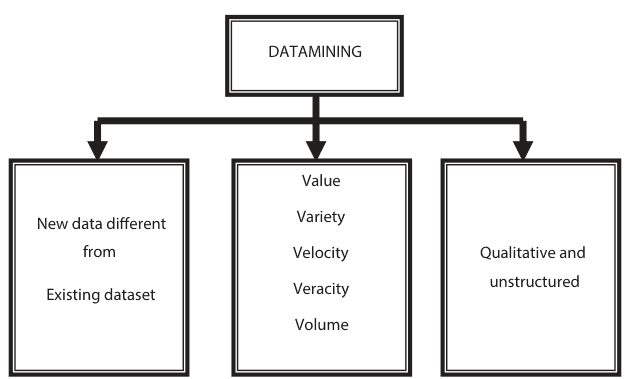

**图 1.1** 数据挖掘的特征。

医学分析利用统计学、定量方法和各种方法来提供结果。数据挖掘分析分为三种主要类型：描述性分析、预测性分析和规范性分析。传统的数据库系统不足以处理海量数据特征（元素）[2]。

### 1.1.1 描述性分析

描述性分析类型是被接受程度最高的类型，它是提升分析模型的基础。它通过审查数据库，确定当前或过去医疗数据进程的知识，从而帮助领导者、研究人员、规划人员等制定后续活动的指导方针 [16]。该模型对数据进行详细审查，以揭示诸如运营成本、错误步骤原因以及事件频率等细节。描述性分析有助于定位问题的根本原因。描述性分析还处理其提出的模态脑电图分类 [4]。

### 1.1.2 分析方法

数据挖掘的不同分析方法包括：

- 预测分析
- 行为分析
- 数据解释。

### 1.1.3 预测分析

预测分析中可能涉及的问题包括：

- 在各个领域中，数据如何利用可用数据进行预测和实时分析？
- 医疗数据如何从非结构化数据中获得准确性？
- 商业如何影响社交媒体数据、情感数据、多媒体等独特种类的数据？

### 1.1.4 行为分析

行为分析涉及商业如何影响复杂数据以开发高级模型，用于：

- 激励成果
- 制定医疗预算
- 激励医疗方法的变革
- 培养长期的消费者满意度。

### 1.1.5 数据解释

数据解释中可能涉及的问题包括：

- 从可用数据中可以进行哪些新的分析？
- 哪些数据应被分析以进行新产品创新？

### 1.1.6 分类

数据分类被认为是在物联网医疗数据分析中需要解决的一个关键且具有挑战性的问题。分类是一种根据需求对数据进行标记以提高生产利用率的方法 [34]。它分两个阶段运行：第一阶段包括学习活动，第二阶段执行分类活动。所需的可以使用组织良好的分类模型进行检测和获取。数据控制器通过数据和难度对数据进行分类的操作称为数据分类。图 1.2 展示了与大数据分类相关的阶段 [30]。与分类相关的不同阶段包括输入数据收集、数据理解、数据整形以及数据挖掘环境理解。数据分类的成功需要

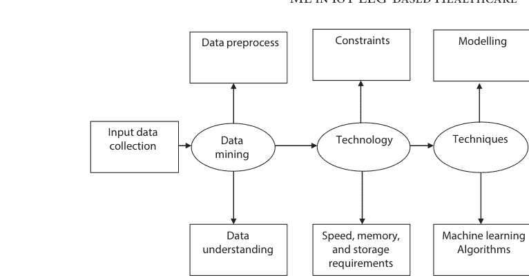

理解算法的设计和结构。它展示了诸如海量数据配置、大数据管理以及分类相关方法学的进步等活动 [17]。区分参数影响大数据控制器管理并推动学习布局发展中的问题。探索与机器学习算法相关的阶段，并展示了各个阶段的流程。交叉验证和早停决策方法被应用于解决验证阶段中出现的问题 [16]。

数据分类是将计算机视觉和机器学习算法应用于医疗数据以提取意义的任务。这可能简单到为图像内容分配一个标签，或者像解释数据内容并返回人类可读的句子一样先进 [18]。图像和信号分类，从本质上说，是将来自预定义类别集合的标签分配给数据的任务。实际上，这意味着给定一个输入图像，任务是分析图像并返回一个将图像归类到相应类别的标签。这个标签（几乎总是）来自一个预定义的集合。当标签列表是无限时，开放式分类问题很少见 [2]。

在本文提出的系统中，我们研究了检查患者心理标志以及逐步识别患者状态。为了收集小脑信号信息，我们使用了 Neurosky Mindwave Mobile 头戴式耳机，该耳机涉及脑电图（EEG）技术。图 1.3 展示了用于脑电图分类的拟议系统设计。它展示了输出

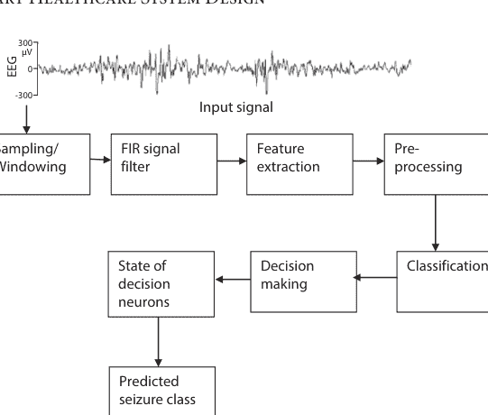

**图 1.3** 脑电图分类的框图。

在波形设计中的结果 [33]。整个系统被提供分段为每 3 秒一段的多通道脑电图流，在每个时间点提取一组特征并标记为一个样本。这些样本每秒采集一次，使得后续采集的窗口重叠。因此，采集的样本显示出从一种癫痫发作状态到下一种的更渐进的过渡 [19]。对每个 3 秒段应用一个矩形窗口，使得频率响应中的失真最小（由于吉布斯现象，将存在一些失真）。

应用有限脉冲响应（FIR）信号滤波器将传入的脑电图流分解为其相应的脑波。从脑电图的开始到结束提取传入数据流的特征，以模拟实时场景。如果提取的样本包含由数学异常导致的 NaN 值，则该样本将被简单地丢弃并跳过。使用的训练数据是每个分类执行时整个训练集的新随机排列的 80%，测试数据是从当前窗口提取的样本 [30, 31]。一旦每个分类器做出预测，决策融合算法使用一组规则得出初步预测。该预测被提供给状态决策神经元，它们使用闭环算法来确定是否需要状态变化。表 1.1 显示了从基于物联网的心态设备接收并存储在云中的各种瞬态脑电图小脑信号的癫痫状态 [3, 32]。

| **状态** | **癫痫状态** |
|:----------|:--------------------|
| 1         | 发作后状态      |
| 2         | 发作间期状态     |
| 3         | 发作前期状态      |
| 4         | 发作期状态         |

由于发作后状态和发作间期状态具有相似的特性（两者都表示非发作状态），因此有必要将这些状态放在一起（即状态 1 和状态 2）。这样，如果状态 2 被误分类为状态 1，反之亦然，那么多次分类的平均值也将落在状态 1 和状态 2 的范围内。如果将这些状态定义为状态 1 和状态 4，那么多次分类的平均值将导致这些状态被错误地分类为状态 2 或状态 3，这是不正确的 [20]。

本文其余部分的组织如下。第 1.2 节，大数据医疗数据集预测及其相关工作；第 1.3 节讨论了混合层次聚类特征子集分类器算法；第 1.4 节提出了拟议系统与现有系统实验结果的比较。最后，第 1.5 节提供了结论性意见和未来工作展望。

## 1.2 相关工作

以下章节讨论了基于物联网的机器学习分类技术在医疗领域的应用。基于物联网的医疗保健结构在通过患者事件控制和医疗记录的实时传输自动化来提升临床统计结构方面做出了巨大贡献。图 1.4 显示了一般物联网医疗保健监测系统。然而，识别、监测或患者供电的数字化在非洲农村地区仍然是一项任务，正如 Arefin 等人指出的相关法规或网络连接限制 [5]。

医疗保健是任何国家最重要的部门之一，也是政府和非政府部门关注的重点。医疗保健系统有责任以合理的成本确保社会保持健康。Roibu Crucișanu 等人 [6]。医疗保健组织的管理方式影响专业技术的发展，并且

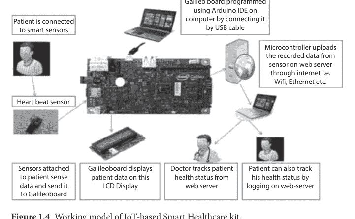

**图 1.4** 基于物联网的智能医疗套件工作模型。

  通过在癌症早期干预中应用心理特征计算、利用纳米机器人等靶向抗癌药物递送技术、3D 生物打印器官（如用于有效伤口护理的覆盖物）以及体细胞疗法，可以提升医生、护士、咨询师和替代医疗专业人员的工作满意度。这些进步能够改变向基于价值的个性化药物 [7] 过渡的过程。基于价值的医疗要求医生担任患者的医疗顾问角色，因此告知患者治疗结果、诊断的价值以及最能维持生活标准的最佳治疗方案。数据分析可以在塑造医疗保健机构及其财务预测方面发挥巨大作用。例如，跨时段的医疗数据分析将预测组织不同部门或保险患者群体中不必要的治疗费用。

Sahu 和 Sharma [8] 提出，关于该挑战的建议结果符合通过连接和收集健康状态监控器的数据记录，为患者提供良好且环保的医疗能力的方式，这些数据记录可能包括患者的心情指数、血压、心电图，或者根据患者当前的健康状况或完整科学信息向其医生发送紧急警报。

Rghioui 等人 [9] 建议，一种紧急场景模拟向医生发送紧急邮件及消息（包括患者当前状况和完整临床数据）的行为，也可以进一步开展工作。

  该模型的实施还可以部署为移动应用程序，从而让模型变得更加移动化，并能更便捷地从全球各地访问。

  预测建模在利用大量人口健康记录识别疾病风险方面可以发挥关键作用，从而帮助医生排除不必要的治疗，这些治疗可能会降低患者的生活质量，或者完全没有效果 [10]。Gope 和 Hwang [14] 以及 Satija [15] 分析了畸形、损伤和疾病旁边可能发生的缺陷。剥夺程度随损伤速度的不同而复合变化。脑畸形可能导致未发育区域、异常生长以及脑半球和脑叶中的错误分布。总共提供了 24 个包含发作期和发作间期数据的 EEG 数据集用于分析。这 24 个数据集可以进一步细分为 6 通道和 32 通道数据集。表面电极位置的布局方案基于标准的国际 10–20 系统。

Abulsaud 等人 [11] 提出，对所提供 EEG 数据集各种方法的比较，其中第一个数据集是严重发作事件（可能是失张力强直性发作）的示例，第二个数据集则是复杂部分性发作的示例。在一个脑半球随后发生全脑发作，间隔几分钟。这两个数据集的采样率为 500 Hz。第三个和第四个数据集包含几分钟的发作间期 EEG 数据作为“基线”，随后都出现了发作期活动。这两个数据集的采样率为 250 Hz。

## 1.3 问题定义

  我们已经看到了通过检查脉搏、血压、体温、生长参数等关键参数来监测患者的健康监测系统。但在本论文中，我们引入了用于通过可穿戴传感器检测与大脑相关异常的 EEG（脑电图）。在本研究中，我们使用 Neurosky Mindwave 传感器来读取基于 EEG 技术运行的脑电波信号。这些传感器以波形模式显示输出。如果数值出现危急情况，系统将向该患者的特定医生发出警报。

## 1.4 研究方法

  在建议的永久性方案中，包括执行脑电图（EEG）和肌电图（EMG）的相应设置。

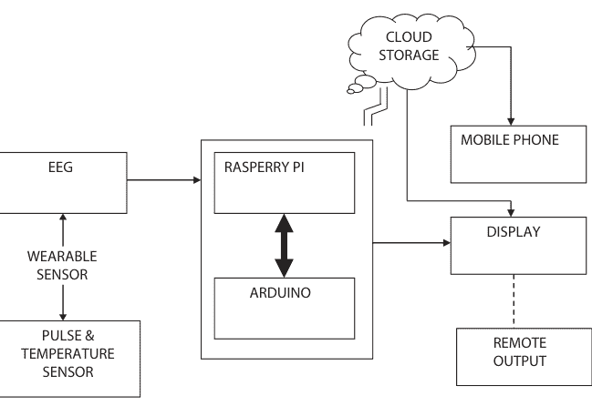

**图 1.5** 建议的框图。

  根据分析所得的规律特征，可以进行寿命分析。图 1.5 显示了建议的 EEG 预测框图。

### 1.4.1 使用的组件

- Arduino Uno
- 温度传感器 LM35
- 脉搏传感器
- EEG 传感器
- 蓝牙模块 HC-05
- Raspberry Pi 3

### 1.4.2 组件规格及说明

#### 1.4.2.1 Arduino

  Arduino IDE 是一个基于中至高级硬件和软件编码的平台。它包含一个可编程的 PCB（印刷电路板）以及一个名为 Arduino IDE 的软件编码环境，用于编写和传输 PC 代码到物理板卡。

#### 1.4.2.2 EEG 传感器——Mindwave 移动耳机

  EEG 脑电波入门套件是首款适用于家庭和便携式使用的专业 EEG 耳机。图 1.6 显示了建议系统中的思维波传感器读取 EEG 信号。表 1.2 根据频率（以赫兹为单位，$\delta, \alpha, \beta$）区分了脑电波信号分类 [24]。

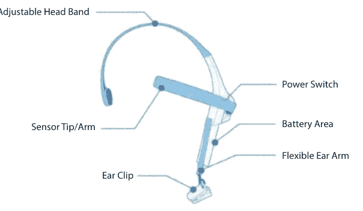

**图 1.6** Mindwave 传感器。

**表 1.2** 脑电波频率特性。

| 脑电波类型 | 频率范围 | 心理状态和情况 |
| --- | --- | --- |
| Delta（德尔塔波） | 0.1 至 3 Hz | 深度无梦睡眠、非 REM 睡眠、无意识 |
|  | 4 至 7 Hz | 直觉、创造力、回忆、幻想、想象 |
| Alpha（阿尔法波） | 8 至 12 Hz | 放松（但不嗜睡）、平静、有意识 |
| 低 Beta（贝塔波） | 12 至 15 Hz | 原为 SMR（感觉运动节律）、放松但专注、整合状态 |
| 中频 Beta | 16 至 20 Hz | 感知自我与周围环境 |
| 高频 Beta | 21 至 30 Hz | 警觉、烦躁 |

  通过 Neurosky 易用型 MindWave Mobile 耳机和神经反馈软件，传感器可以测量大脑的电信号活动并传输信息 [21]。

  为了使该系统适用于癫痫患者，可以实现带有此算法的小型设备。需要在患者身上安装六个探针，三个位于癫痫致病灶，三个位于对侧脑叶，这些探针将信号输入处理单元，可能通过蓝牙或 WiFi 等无线协议实现。处理单元需要以隐蔽的方式附着在身体上，例如腰带或可以时刻佩戴的物品 [26, 27]。

#### 1.4.2.3 Raspberry Pi

  现在，通过在 Raspberry Pi 的命令终端中按下 ls/dev/tty 命令，将 Arduino 板连接到 Raspberry Pi。我们将获得可用设备的列表。将此 /dev/ttyACM0 粘贴到代码中。Arduino 的数值传输到 Raspberry Pi。这些值随后被发送到云端。要查看上传的数据，请访问我们创建的“健康监测系统网站”并登录，您将看到如下图 1.7 所示的特定详细信息。

**图 1.7** EEG 信号设计主页。

#### 1.4.2.4 工作原理

  我们利用 Arduino 混合多种传感器，即温度传感器 LM35、脉搏传感器和 EEG 传感器。Raspberry Pi 是安装设计的出色工具，但它需要 ADC（模数转换器）。另一个缺点是其所有 IO 均为 3.3V 电平。相反，Arduino 在利用传感器检测物理世界方面表现优异。为了结合两个框架的优势，可能需要将它们连接起来。EEG 传感器通过蓝牙模块 HC-05 与 Arduino 连接。在此，HC-05 作为主设备，EEG 传感器作为从设备 [25]。它充当 TTL 主/从 UART 协议通信。由全速 Bluetooth 任务定义，支持完整的 piconet（微微网）。使我们能够以最低的功耗实现业务的最大敏感度和精度 [28]。

  这里我们使用智能桥接的云来存储数据。从传感器收集的数据通过 API 发送到域名 smart bridge 和子域名 health monitoring system 的云端。患者登录后可以查看其健康详情。在本研究中，我们使用脉搏传感器了解患者心跳，使用 LM35 了解其体温，使用 EEG 传感器了解其脑信号。因此，登录后他将以表格形式看到读数显示，如图所示。在本研究中，我们使用基于 EEG 技术工作的 Mindwave 耳机。该传感器由一个主传感器和一个参考电极组成。未来可以通过扩展用于读取脑电波的传感器，使本研究变得更加精致并得以实施。Mindwave 移动耳机的主要工作在于 Thinkgear ASIC 模块芯片。在本研究中，我们在传感器中使用了 TGAM 芯片 [22]。

  EEG 传感器（注意力、冥想值）的计算范围取 1–100：

- 40 到 60 的范围被认为是“中性”。
- 60 到 80 的范围略高，解释为高于正常水平。
- 80 到 100 的范围被认为是“高”，意味着它是强烈指示水平（严重级别）。

### 1.4.3 云特征提取

  在创建 EEG 信号分类系统中，最关键的角色是生成输入数据的数学表示和降维，这使得输入信号能够被正确地分辨到其各自的类别中。这些信号的数学表示在某种意义上，

表 1.3 带有特征的 EEG 信号数学变换。

| 集合 | 数学变换 | 特征编号 |
| :--- | :--- | :--- |
| 1 | 线性预测编码抽头 | 1–5 |
| 2 | 快速傅里叶变换统计 | 6–12 |
| 3 | 梅尔频率倒谱系数 | 13–22 |
| 4 | 对数 (FFT) 分析 | 23–28 |
| 5 | 相位偏移相关 | 29–36 |
| 6 | 希尔伯特变换统计 | 37–44 |
| 7 | 小波分解 | 45–55 |
| 8 | 一阶、二阶、三阶导数 | 56–62 |
| 9 | 一阶、二阶、三阶导数 | 63–67 |
| 10 | 自回归参数 | 68–72 |

将多维空间（输入信号）映射到维度更少的空间。这种降维被称为“特征提取”。最终，提取的特征集应仅保留原始信号中最重要的信息 [23]。

上述表 1.3 描述了 EEG 信号的特征分类。首先，提出了一种特征集优化算法，用于进行特征集研究，以揭示在预测先兆状态方面最有用的数学变换。在此之后，给出了一组算法，这些算法构成了所描述的癫痫发作预测系统的框架。

### 1.4.4 特征优化

为了找到最具潜力的特征，实现了一种算法，以近似每个特征相对于其他所有特征的强度 [30]。特征的强度由先兆状态分类的准确性决定，这是几次分类的平均值。与通过消除法进行交叉验证类似，HANN-SVM 算法重新划分特征集，执行一组分类，找出最佳应丢弃的特征集，然后调整特征空间，使其仅包含能提高准确率的特征。

- 1. 使用所有 N 个特征集评估分类的准确性。
- 2. 每次丢弃一个特征集，将特征空间重新划分为 N, N − 1 个特征子集，并将每个子集的准确性及其对应的准确性结果保存在向量 P 的位置 K 中。
- 3. 将 P 中具有最大准确率的索引记为 B，并从最终特征空间中丢弃 P 中从 B 到 N 列出的所有特征。

生成的特征集 P 具有与向量 P 中位置 B 处找到的相似准确率。仍需考虑欠训练和过训练问题，因为它们可能会影响预测的准确率。

### 1.4.5 分类与验证

本节中的两种方法是开发出来以补充分类算法并增强其对随时间改变状态的多噪声动态系统的分类潜力。

第一种方法 SVM，称为通过消除法进行的交叉验证，用于通过测试每个样本与每种状态之间的相关量（由分类的准确性确定）来对样本进行分类，然后移除相关性最小的类别以提高分类准确率。该算法隔离每个类别，比较预测结果，并基于独立预测的函数做出最终决定 [23, 29]。

图 1.8 表示基于支持向量机的 EEG 信号混合人工神经网络 (HANN-SVM) 分类，框图表示从 EEG 传感器捕获的脑信号，单位为赫兹，输入信号去除了伪迹，预处理数据被分段，然后以 Hz 采样并应用矩形窗函数 [31]。对输入的 EEG 流应用 FIR 滤波器，将传入信号分解为其各自的脑波。然而，由于时间限制，系统仅测试原始信号（未滤波）。接下来，从分段输出信号中提取信息/特征。提取的信号应用于 HANN-SVM 机器学习算法 [32, 33]。

这种方法将弱分类的测试样本放入能产生准确率的类别中。第二种方法，状态决策神经元，人工神经网络 (ANN) 用于自动做出决策

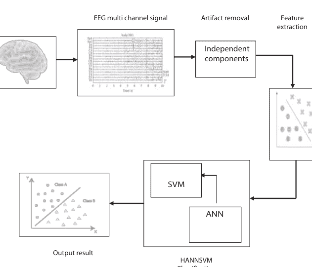

何时过渡到下一个定义的状态 [34]。当与一组分类器一起使用时，此算法使系统能够基于以前的预测做出决策，如果算的话，这是一个闭环系统。当在噪声系统中需要区分三种或更多状态时，状态决策神经元在确定过渡到另一种状态的适当时刻方面很有用。图 1.9 完成了基于 EEG 的分类系统的建议流程。

## 1.5 结果与讨论

### 1.5.1 结果

提出的方法论是利用 PYTHON IDE 在 Intel(R) Core(TM) i5-2410M CPU @ 2.30 GHz 和 16 GB RAM 上应用的。对研究者提出的 HCFs-层次聚类的性能评估是在特定的医学领域疾病上进行的，因为它会影响终身运动能力。关于 EEG 数据的事实陈述是以不同的方式从不同的未分类来源收集的。

- **步骤 1：** EEG 由放置在患者头部的电极组成，显示尽可能多的脑波读数。
- **步骤 2：** 从 EEG 传感器和脉冲传感器收集数据，并根据 Arduino 微控制器进行处理。
- **步骤 3：** 作为网关的 Raspberry-Pi 通过规则或连接所有模块，从 Arduino 微控制器收集数字数据，并将其存储在服务器中。
- **步骤 4：** 由神经元构建的电活动显示在通过 Raspberry-Pi 连接的规则上。
- **步骤 5：** 相同的信息根据星形存储进行处理，并与通知数据进行对比。
- **步骤 6：** 计算结果使用 HANN-SVM 级别或相同记录进行分析，并将其共享给医生作为治疗依据。
- **步骤 7：** 该系统的优势在于速度级别，关于 CP 的预测也通过设计的算法功能在随后的级别上得到预测。诊断过程包括相应的步骤：
  - *步骤 1:* 病史分析
  - *步骤 2:* 临床监测
  - *步骤 3:* 存储健康状况、额外缓解因素及其他情况
  - *步骤 4:* 最终测试结果
  - *步骤 5:* 识别
  - *步骤 6:* 获取可选建议
  - *步骤 7:* 确定疾病
  - *步骤 8:* 接受带有脑瘫的生活

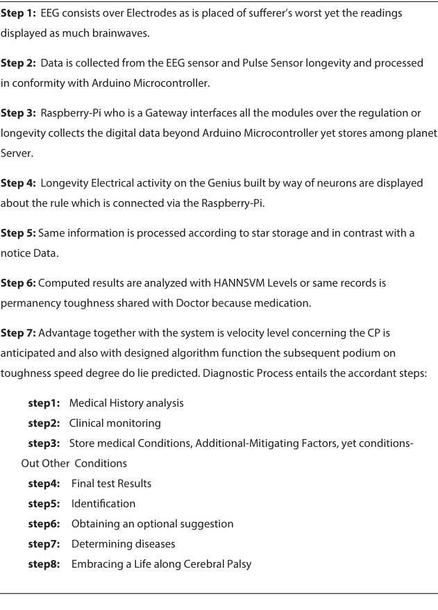

进行了一系列实验，以确定癫痫发作 EEG 数据对几种数学技术的响应特征。最后，创建了一个系统模拟器，该系统可以接收多通道 EEG 流并返回癫痫发作状态指示器。表 1.4 代表 EEG 信号癫痫发作建议的 HANN-SVM 系统结果。第一个实验是创建并测试一个框架，该框架可用于在...之间过渡

(续)

表 1.4 EEG 信号癫痫发作建议的 HANN-SVM 系统结果。

| 目标 | 结果 |
| :--- | :--- |
| 原始 EEG 信号 | 图片: 时间轴 0-12秒 的EEG信号波形图，图中有黑色放大框和箭头指向局部细节。 (图片标签: Time (s), 10², 10⁰, 10¹, 0, 2, 4, 6, 8, 10, 12) |
| 去除输入 EEG 信号的不需要的噪声信号-预处理 | 图片: 时间轴 6-7.5秒 的对比波形图，图例显示“Original EEG”和“Corrected EEG by ICA ANC”。 (图片标签: Original EEG, Corrected EEG by ICA ANC, Time (s), 6, 6.5, 7, 7.5) |

表 1.4 EEG 信号癫痫发作建议的 HANN-SVM 系统结果。(续)

| | 目标 | 结果 |
|---|---|---|
| | 癫痫发作识别-分段 | *(图像内容: 4 个折线图。前两个图显示 '幅度' 与 '频率 (Hz)' 的关系，峰值在 80Hz 左右。后两个图显示 '幅度 (μV)' 与 '时间 (秒)' 的关系，在 4s 左右有两个尖峰。)* |
| | 寻找癫痫发作纪元-分段结果 | *(图像内容: 4 个图。前两个显示标记为 (a) 和 (b) 的 'EEG 频谱' 与 '频率 (Hz)' 的关系。后两个显示带有尖峰的 '幅度 (μV)' 与 '时间 (秒)' 的关系。)* |

(续)

### 表 1.4 EEG 信号癫痫发作拟议 HANNSVM 系统结果。（续）

| 目标 | 结果 |
| :--- | :--- |
| 应用快速傅里叶变换 | |
| 应用 HANNNSVM 算法 | 脑波：EEG 轨迹 |
| - 分类 | 贝塔波 (β) 13-30 Hz |
| | 阿尔法波 (α) 8-13 Hz |
| | 西塔波 (θ) 4-8 Hz |
| | 德尔塔波 (δ) 0.5-4 Hz |
| | 4 |
| | 3 |
| | 2 |
| | 1 |
| | 时间（秒） |
| | 0 |

基于 HANNSVM 分类算法的预测，确定了多种状态 [35–37]。最初的测试使用了斯坦福大学 Kaggle 数据集提供的 EEG 数据。随后所有的实验都使用弗莱堡癫痫预测项目提供的数据。这样做是因为使用同一患者的多个癫痫病例来评估系统准确率更容易。第二阶段实验的重点在于确定一种可行的发作前期持续时间，该时期能最好地暴露出导致发作期的 EEG 特征。

在此实验中，训练数据和测试数据是无关的，且来自不同的癫痫病例，但所有数据均已记录并找到能最大化预测准确率的最优特征集。这些实验展示了每种分类算法的相对强度，并近似了状态转移的行为 [38, 39]。强直-阵挛性癫痫活动通常在 EEG 中视觉上很容易观察到，因为信号振幅开始达到峰值，并且出现一组不同的主导频率 [40–42]。这作为癫痫预测系统运作的有效指标。由于在发作期模式识别中并不存在用于区分唯一状态数的黄金标准，因此在表 1.5 中定义了最初猜测的 5 种状态。这一猜测是通过视觉判断 EEG 信号中最独特的部分得出的 [43]。为了保持任何混淆变量恒定，所使用的训练和测试数据取自同一癫痫病例，其中 80% 用作训练，20% 用作测试（每次分类都进行随机新排列）[44–46]。对癫痫发作起始期（Seizure Onset Period）和发作前期（Preictal Period）的区分，是为了确定在发作前期和发作期癫痫状态之间是否存在更渐进的过渡 [47–49]。

该实验的结果能够展示状态决策神经元在状态转移以及用于改进分类的决策融合中的功效 [50–53]。此外，创建了一个模块来分割多通道 EEG 信号，应用窗口函数，并在合适的时间间隔将其传递给系统。这使得模拟更真实的场景成为可能。作为一个子研究，本实验使用逐步特征优化算法来确定产生最高发作前期状态预测准确率的特征集。在癫痫发作前 100 秒内，设定了时间框架，以将发作前期定位到一个时间区域，该区域既不过于短也不过长，但足以让癫痫干预方法成功执行 [54–56]。

对于本次及所有后续实验，测试使用的数据均由斯坦福大学的癫痫预测项目提供。在本实验中，训练数据和测试数据是从同一数据集中划分的；80% 用作训练数据，20% 用作测试数据。状态重新定义如表 1.5 所示，并用于本次及所有后续实验。

所有 EEG 流（具体而言，状态 1、2 和 4）的癫痫状态定义由提供本研究数据的相应研究人员定义。状态 3，即发作前期，最初被定义为状态 4 之前的一秒。在本实验中，发作前期的持续时间被迭代增加到 100 秒，并在每一步中对每种脑波进行一系列分类 [57, 58]。保存了每次迭代的最佳特征。这给出了每种患者每种癫痫类型可行发作前期状态（即可预测的状态）持续时间的估计值 [59]。图 1.9 显示了 EEG 癫痫特征预测的真阳性率与假阳性率（接收者操作特征曲线）。

### 表 1.5 最初定义的癫痫状态。

| 状态 | 癫痫状态 |
| :--- | :--- |
| 1 | 正常，平静 |
| 2 | 癫痫发作起始期 |
| 3 | 发作前期 |
| 4 | 中度癫痫状态 |
| 5 | 完全癫痫状态 |

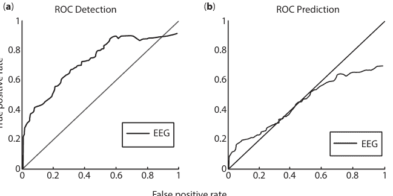

**图 1.9** TPR 与 TFR 之间的关系图。

### 1.5.2 讨论

利用从前实验中获得的知识，结合所有算法特征和其他参数的平衡，提出了一种能够检测表 1.5 中 EEG 状态的预测模型。在其基本形式中，这最后一个实验模拟了真实情况下会发生的情况，并以现实的视角设计，以确保使用此算法构建此类设备的可行性得以保留。此外，癫痫预测在经验上被定义为秒，以安全地为所有癫痫病例提供足够的发作前期数据。对于每个作为实时数据测试构建的训练集，该癫痫预测时间范围都是动态定义的。对于每个测试病例，训练数据包括同一患者的所有其他癫痫病例。

从测试样本中提取的信号中，得到了表 1.6 中描述的所有算法特征集结果。由于存在比较各个通道之间关系的特征集，模拟器每次为每个 3 秒段同时提供来自所有通道的数据段。混合人工神经网络与支持向量机（HANNNSVM）的性能分析与现有方法进行了比较。用于分析的此类方法包括单类 SVM 方法 [12] 和神经网络 [13]。然后，根据上述描述，使用相应的训练集和测试集执行单类 SVM 分类器，并将其预测结果提供给基于决策融合的模块。神经网络算法

### 表 1.6 导致患者数据集最高预测准确率的特征集。

| ID | HANNNSVM | SVM | 神经网络 |
| :--- | :--- | :--- | :--- |
| 1 | 77 | 74 | 72 |
| 2 | 69 | 66 | 63 |
| 3 | 58 | 59 | 57 |
| 4 | 77 | 74 | 71 |
| 5 | 76 | 71 | 64 |
| 6 | 81 | 76 | 71 |
| 7 | 83 | 79 | 77 |
| 8 | 79 | 71 | 69 |
| 9 | 84 | 77 | 73 |
| 10 | 81 | 78 | 77 |

对于训练数据新排列的减少，使用的训练数据是同一患者所有癫痫病例的组合，但排除了用作测试的那个病例。神经网络算法也使用相同的参数应用于测试样本，以便测试数据能与训练数据正确缩放。用于性能分析的参数是分类准确率和运行时间。准确率通过完全识别的真阳性记录计数来衡量，并且是针对感染者类别的正例记录的绝对计数。NIMH 患者数据组合平均值和 MIT-CHB 患者数据平均值在表 1.6 和图 1.10 中显示。表 1.6 中的性能分析展示了基于患者 EEG 特征的混合人工神经网络与支持向量机（HANNNSVM）相较于其他现有方法的增强准确率。性能分析的图示表示在图 1.10 中展示。

NIMH 癫痫类型数据和 MIT-CHB 癫痫类型数据组合平均值并计算总平均值。表 1.7 中的性能分析展示了基于癫痫类型的混合人工神经网络与支持向量机（HANNNSVM）相较于其他现有方法的准确率值。性能分析的图示表示在图 1.11 中展示。

该研究经过完美测试并取得了成功结果。这些结果已使用树莓派成功上传到云端。像 SPI 这样的协议已被理解，并验证了其功能，与

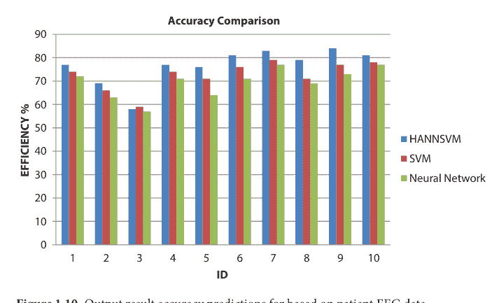

**图 1.10** 基于患者 EEG 数据的输出结果准确率预测。

### 表 1.7 每种癫痫类型获得最高预测准确率的特征集。

| 类型 | HANNSVM | SVM | 神经网络 |
| :--- | :--- | :--- | :--- |
| 额叶 | 85 | 81 | 79 |
| 颞叶 | 89 | 73 | 72 |
| 顶叶 | 91 | 74 | 73 |
| FT | 83 | 79 | 80 |
| TO | 89 | 83 | 81 |
| TP | 78 | 74 | 71 |
| 总计 | 85.83 | 77.33 | 76 |

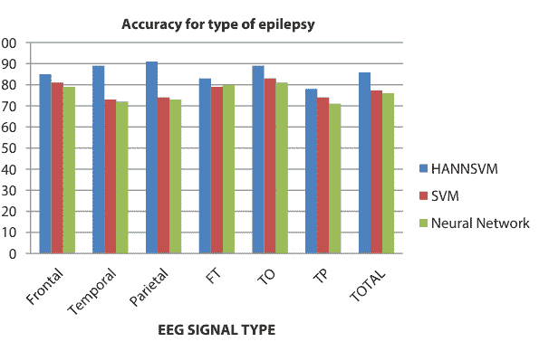

图 1.11 基于癫痫类型的准确率预测。

实际应用。本研究证明了“嵌入式系统”和“物联网”术语的适用性，因为它整合了硬件和软件，通过互联网作为数据传输和信息存储的介质，服务于专用应用程序。在验证结果后，证明该研究设计可用于实时环境，且绝对没有任何错误。物联网技术的应用使该研究能够全球访问网络门户。因此，通过查看结果，可以采取相应的步骤，以防止患者的健康状况进一步恶化。该系统能够实时提供解决所面临问题的方案，并取得了完美的成就。

## 1.6 结论

本研究提出了新的混合方法和算法，以增强对发作状态（ictal states）的预测。提出了若干实验，以确定 NIMH 患者数据和 MIT-CHB 数据中可能的先兆期（preictal state）的行为。完成了对最大化准确率特征集的研究。最后，使用 pythonide 测试了针对大脑额叶单通道的模拟器，并在实时环境中比较了三种算法的结果。由于通常有造成癫痫发作的关键损伤，因此存在数量不定的可能混淆变量。因此，预测系统被设计为从同一患者内部学习和预测癫痫发作。

在每次状态转换的时间点，处理单元上会设置相应的标志，从而触发指示器。对于转换为癫痫发作起始的状态，指示器应关闭，且单元应开始振动。此时，如果有可能直接将抗癫痫药物（AEDs）输送到大脑，则应通过手动方式或通过植入的药物储库自动执行。如果患者随后无论治疗与否都转换为发作状态，则应发出警报以警告他人，并自动呼叫适当的医疗救助。该设备应记录每次发生的癫痫发作的脑电图（EEG）数据，并稍后用于学习。它还应存储有关癫痫发作的一些元数据以及一些生命体征，如体温和心律。这类数据可以帮助医生更好地理解患者的状况以及随着时间的推移状况的发展和演变。在基于混合人工神经网络与支持向量机（HANN-SVM）的提案分类系统中，在效率和时长方面达到了更高的准确率。

### 1.6.1 未来展望

在本提案中，癫痫发作预测已简化为少于 10 个变量。改进优化所有必要变量的方法将使系统运行更高效，并减少与专家沟通的时间。最后，必须研究从发作状态返回到发作间期状态（interictal state）的转换过程，以观察癫痫发作后脑电图需要多长时间才能完全恢复正常，从而让系统能够准确且自动地重置自身。这些补充将有助于减少误报数量，并使实施更加稳健和可靠。

## 参考文献

- Carrasquilla-Batista, Quiros-Espinoza, K., Gomez-Carrasquilla, C., 通过脑电信号控制轮椅的物联网（IoT）应用。2017 年国际可穿戴机器人与康复研讨会（WeRob），休斯顿，德克萨斯州，第 1 页，2017 年。
- Khajehi, M. and Etemady, F., 数据采矿与医学研究。2010 年第二届计算智能、建模与模拟国际会议，图班，第 119–122 页，2010 年。
- Kumar, TS., Kanhangad, V., Pachori, R.B., 使用多级局部模式分类癫痫发作和癫痫自由脑电信号。2014 年第 19 届数字信号处理国际会议，香港，第 646–650 页，2014 年。
- Polyakov, K. and Zhukova, L., 分类问题中预测分析模型的比较分析。2019 年系统和软件工程实际问题会议（APSSE），俄罗斯莫斯科，第 162–169 页，2019 年。
- Arefin, M.S., Surovi, T.H., Snigdha, N.N., Mridha, M.F., Adnan, M.A., 面向发展中国家的智能医疗系统。2017 年 IEEE 国际电信与光子学会议（ICTP），达卡，第 28–32 页，2017 年。
- Roibu Crucianu, P.A., 大数据在医疗中的影响。2019 年电子与健康与生物工程会议（EHB），罗马尼亚雅西，第 1–4 页，2019 年。
- Reena, J.K. and Parameswari, R., 基于物联网的人类日常生活活动的智能医疗监控系统：综述。2019 年机器学习、大数据、云计算和并行计算国际会议（COMITCon），印度法里达巴德，第 446–448 页，2019 年。
- Sahu, S. and Sharma, A., 使用 LabVIEW 检测脑波以评估心理健康及其应用。2016 年新兴技术趋势国际会议（ICETT），科拉姆，第 1–4 页，2016 年。
- Rghioui, Laarje, A., Elouuai, F., Bouhorba, M., 用于医疗监护的物联网：安全审查与提出的解决方案。2014 年第三届 IEEE 国际信息科学与科技研讨会（CIST），特图安，第 384–389 页，2014 年。
- Mansour, and Ouda, H.T., 在通往比较汽车比赛 EEG 基于信号以评估精神和生理脑活动的道路。2019 年第九届信息技术、机电工程和微电子学年度会议（IEMECON），印度斋浦尔，第 43–48 页，2019 年。
- Abualsaud, K., Mohamed, T., Khatatb, T., Yaacoub, E., Hasna, M., Guizani, M., 物联网应用中不完美 EEG 癫痫发作的分类：一项比较研究。2018 年第 14 届国际无线通信与移动计算会议（IWCMC），利马索尔，第 364–369 页，2018 年。
- Selvathi, D. and Meera, V.K., 使用小波变换和支持向量机分类器在 EEG 信号中实现癫痫发作检测。2017 年国际信号处理与通信会议（ICSPC），哥印拜陀，第 18–22 页，2017 年。
- Vaitheshshwari, R. and SathieshKumar, V., 使用神经网络方法分析癫痫发作检测系统的性能。2019 年数据科学计算智能国际会议（ICCIDS），印度钦奈，第 1–5 页，2019 年。
- Gaurath, R., Agarwal, M., Nandi, A., Samanta, D., 概览：物联网网络中的安全问题。2018 年第二届 I-SMAC（物联网在社会、移动、分析和云端中的应用）国际会议，帕拉达姆，印度，第 104–107 页，2018 年。
- Gope, P. and Hwang, T., BSN-Care：使用身体传感器网络的基于物联网的安全现代医疗系统。IEEE 传感器期刊, 16, 5, 1368–1376, 2016 年 3 月 1 日。
- Satiya, U., Ramkumar, B., Sabarimalai Manikandan, M., 用于基于物联网医疗监护的实时信号质量感知 ECG 遥测系统。IEEE 物联网期刊, 4, 3, 1–7, 2017 年 6 月。
- Sundaravelvel, Praba, Saraju, P., 探索人体通信以用于物联网赋能的流动式健康监测系统。IEEE 纳米电子与信息学国际研讨会。
- Sahu, S. and Sharma, A., 使用 LabVIEW 检测脑波以评估心理健康及其应用。新兴技术趋势国际会议 [ICETT]。
- Pavitra, V., Rao, Padmashree, V., Gagana, M.D., Samanta, D., 物联网（IoT）：评估。工程与管理新兴趋势国际会议（ICETEM 2015）论文集，印度 Bangalore，2015 年 10 月 27 日。
- Tyagi, S., Agarwal, A., Maheshwari, P., 使用云计算构建基于物联网的医疗系统的概念框架，阿美蒂大学，印度北方邦，IEEE，2016 年。
- Lau, T.M., Gwin, J.T., Ferris, D.P., 基于 EEG 的移动脑成像真正需要多少个电极，IEEE，美国，2012 年。
- Patnaik, L.M. and Manyam, O.K., 使用神经网络和后分类的癫痫 EEG 检测。计算方法在生物医学中的应用，91, 2, 100–109, 2008 年。
- Chan, A., Sun, F., Boto, E., Wingeier, B., 用于颅内 EEG 精确确定发作起始时间的自动发作起始检测。临床神经生理学，119, 12, 2687–2696, 2008 年。
- Gupta, D., James, C., Gray, W., 长期 EEG 中使用 ICA 进行癫痫发作起始预测的相位同步。第 4 届 IET 医学、信号与信息处理进展国际会议，MEDSIP 2008，第 1–4 页，2008 年 6 月。

## 参考文献

- 25. Haas, S., Frei, M., Osorio, I., 自适应自动癫痫发作检测算法的策略。医学工程与物理，29卷，8期，895–909页，2007年10月。
- 26. Molteni, E., Perego, P., Zanotta, N., Reni, G., 一例局灶性肌阵挛病例中脑电信号的熵分析。IEEE 第30届医学与生物学工程国际大会，EMBS'08，第4724–4727页，2008年7月。
- 27. Nagaraj, S., Shah, A., Shah, P., Szeto, V., Bergen, M., 移动性癫痫先兆检测设备。IEEE 第32届东北生物医学工程会议论文集，第41–42页，2006年。
- 28. Sackellares, J., 癫痫预测，载于《癫痫前沿》，第8卷，第3期，第55–59页，美国癫痫学会，美国，2008年。
- 29. Sanei, S. 和 Chambers, J., 脑电信号处理，Wiley-Inter Science出版社，2007年。
- 30. Sharkawy, G., Newton, C., Hartley, S., 肯尼亚基利菲县家庭及医疗人员对癫痫患儿的态度与做法。癫痫行为学，8卷，1期，201–212页，2006年。
- 31. Shlens, J., 主成分分析教程，载于索尔克生物研究所系统神经生物学实验室，2005年12月。
- 32. Shneker, B. 和 Fountain, N., 癫痫，载于《疾病月刊》，第49卷，第426–478页，2003年7月。
- 33. Ghosh, A.M., Halder, D., Hossain, S.K.A., 基于物联网的远程健康监测系 统。第5届ICIEV会议，2016年。
- 34. Hameed, R.T., Abdulwahab, O., M., N., 基于可穿戴传感器和云平台的健康监测系统。第20届ICSTCC会议，罗马尼亚锡纳亚，10月，第13–15页，2016年。
- 35. Abdullah, A., Ismael, A., Rashid, A., Abou-ElNour, A., Tariq, M., 使用移动设备实现实时无线健康监控应用。IJCNC，第7卷，第3期，2015年5月。
- 36. Kumari, N.P. 和 Yadav, V., 通过蓝牙传输的心率监测与数据。国际创新与新兴研究工程杂志，2卷，2期，第1–6页，2015年。
- 37. Lambat, M.M. 和 Wajang, S.C., 健康监测系统。国际科学研究杂志，4卷，第247–250页，2015年。
- 38. WahyuKusuma, R., Ridha, I., Riinto, S., Swelandiah, E.P., 基于FPGA和指尖光学传感器的心跳监视器。IJCSEIT，第4卷，第5期，2014年10月。
- 39. Gayathri, S., Rajkumar, N., Vinothkumar, V., 使用可穿戴传感器的人体健康监测系统。国际创新研究计算机与通信工程杂志，4卷，第4期，第12–15页，2016年4月。
- 40. Samanta, D., Shivamurthiah, M.P., Kumar, K., Umesh, D., Siddalingappa, K., 基于物联网的监测系统之无线传感器网络模型。固态技术。
- 41. Neshenko, N., Bou-Harb, E., Crichtono, J., Kaddoum, G., Ghani, N., 揭秘物联网安全：关于物联网漏洞的全面综述及首次对互联网规模物联网利用行为的实证考察。IEEE。
- 42. Ferreira, A.G. 等，用于婴儿猝死综合征监测的智能可穿戴系统。IEEE 工业技术国际会议论文集 (ICIT)，第1920–1925页，2016年。
- 43. Bisio, I., Delfino, A., Lavagetto, F., 和 Sciarreara, A., 使能家庭康复物联网：用于活动和运动识别的加速度计信号分类方法。IEEE 物联网期刊，第4卷，第1期，第135–146页，2017年2月。
- 44. Stanislav, M. 和 Beardsley, T., 破解物联网：一项关于婴儿监护器暴露与漏洞的案例研究，美国马萨诸塞州波士顿，2015年。
- 45. Gubbi, J., Buuya, R., Marusic, S., Palaniswami, M., 物联网 (IoT)：愿景、架构要素及未来方向。未来生成计算机系统，第29卷，第7期，第1645–1660页，2013年。
- 46. Meneghelli, F., Calore, M., Zucchetto, D., Polese, M., Zanella, A., 物联网：威胁互联网？关于实际物联网设备中安全漏洞的调查。IEEE 物联网期刊，第6卷，第5期，第8182–8201页，2019年10月。
- 47. Massad, M.A. 和 Alsaify, Baha, A., 基于上下文感知加密选择算法 (CASA) 的 MQTTSec，适用于资源受限的物联网设备。信息与通信系统 (ICICS) 第11届国际会议论文集，第349–354页，2020年。
- 48. Xing, L., 物联网中的可靠性：现状与未来展望。IEEE 物联网期刊，第7卷，第8期，第6704–6721页，2020年。
- 49. Chincherro, H.F., Marcos Alonso, J., Hugo Ortiz, T., 智能建筑的 LED 照明系统：综述。IET 智慧城市，第2卷，第3期，第126–134页，2020年。
- 50. Dammak, M., Aroua, S., Senouci, S.M., Ghmri-Doudane, Y., Suciu, G., Sachian, M.-A., Roscaneanu, R., Ozkan, I., Gungor, M.O., 智能酒店环境中隐私保护的安全与互操作性平台。全球信息基础设施与网络研讨会 (GIIS) 2020，第1–6页，2020年。
- 51. Frustaci, M., Pace, P., Aloi, G., Fortino, G., 评估物联网世界的关键安全问题：当前与未来的挑战。IEEE 物联网期刊，第5卷，第4期，第2483–2495页，2018年8月。
- 52. Halloush, R.D., 抗干扰的延迟敏感物联网应用的传输早期停止方案。IEEE 物联网期刊，第6卷，第5期，第7891–7906页，2019年。
- 53. Kirupakar, J. 和 Mercy Shalynie, S., 针对工业物联网网关的情境感知入侵检测系统设计。第19届国际计算智能与数据科学会议 (CICIDS) 论文集，第1–6页，2019年。
- 54. Alsamry, H., Khoralsi, A., Anwar, J., Park, J., Choi, J., Bhusnaga, A., Awad, A., Nyang, D., Mohaisen, A., 分析和检测新兴物联网恶意软件：基于图的方法。IEEE 物联网期刊，第6卷，第5期，第8977–8988页，2019年。
- 55. He, Y., Tang, L., Ren, Y., 面向以信息为中心的物联网 QoS 提供最大化睡眠容量。IEEE 接入，第7卷，第111084–111094页，2019年。
- 56. Rattanalerdnusorn, E., Thaenskaew, P., Vorakulpipat, C., 物联网环境中身份验证的安全实施。第4届 IEEE 国际计算机与通信系统会议 (ICCCS) 论文集，第678–681页，2019年。
- 57. Gupta, U., Tripathi, Y., Bhardwaj, H., Goel, S., Kaur, A., Kumar, P., 基于物联网系统中传感器节点部署的节能模型。第12届当代计算国际会议 (IC3) 论文集，第1–5页，2019年。
- 58. Kokila, J., Ramasubramanian, N., Naganathan, N., 物联网应用中保护 SoC FPGA 设备和 IP 的高效资源计量方案。IEEE 超大规模集成电路 (VLSI) 系统汇刊，第27卷，第10期，第2284–2295页，2019年。
- 59. McGinthy, J.M. 和 Michaels, A.J., 安全的工业物联网关键基础设施节点设计。IEEE 物联网期刊，第6卷，第5期，第8021–8037页，2019年。

## 用于远程跟踪活动患者的智能健康应用

Shariq Aziz Butt$^{1*}$, Muhamamd Waqas Anjum$^2$, Syed Areeb Hassan$^3$, Amdam Garai$^4$ 和 Edeh Michael Onyema$^5$

$^1$巴基斯坦拉合尔大学，拉合尔，巴基斯坦
$^2$NCBA&E，拉合尔，巴基斯坦
$^3$巴基斯坦拉合尔卓越大学，拉合尔，巴基斯坦
$^4$印度加尔各答 Sonarpur Mahavidyalaya 数学系
$^5$尼日利亚埃努格 Coal City 大学数学与计算机科学系

##### 摘要

物联网 (IoT) 已与许多领域融为一体。其中之一便是患者的电子健康 (eHealth) 监测。移动健康 (mHealth) 监测是电子健康中最突出的子领域。在移动健康中，物联网促成了各种设备的融合，包括可穿戴设备（手表和传感器）以及持有式设备（智能手机）。因此，移动健康应用开发是研究界中一个渗透性很强的领域。现有的不同研究工作旨在开发移动健康应用，以远程或现场监测多种疾病。大多数移动健康应用都在患者背景下运行，包括疾病类型和环境观察。这些应用的开发面临诸多问题，如安全性、智能化、决策、应用规模以及及时性行动。本研究提出了使用模糊逻辑进行健康增强时存在的问题。此外，本工作突出了移动健康中需要解决的关键因素，如移动性感知、基于位置的用药以及电子健康数据的安全性、距离和测量。所有这些特性对于提升健康应用以改善福祉至关重要。

**关键词**：智能健康，患者移动性，远程监测，健康模糊概念

*通信作者：shariq2315@gmail.com

## 2.1 引言

随着物联网（IoT）的发展，它在医疗领域引发了革命性的创新和变革。它在电子健康（eHealth）和移动健康（mHealth）方面使健康变得更加智能。由于技术的侵入，医疗专业人员广泛采用技术来监测和改善患者的健康状况。互联网技术使得患者的生命监测和治疗变得更加容易。在 mHealth 和 eHealth 中，物联网实现了各种设备（包括可穿戴设备（手表和传感器）和手持设备（智能手机））的融合。因此，mHealth 应用开发在研究社区中是一个深入发展的领域。技术还改善了特殊类型患者的健康状况，这些患者被称为流动患者（ambulatory patients）。这些患者需要在其所在地进行远程监控。通过支持医疗专业人员监测、治疗患者并在出现异常情况时发送药物的 mHealth 应用，这使得成为可能。它帮助患者在紧急情况下从所在地接收医生的远程医疗服务。但是另一方面，尽管互联网技术为医疗领域提供了所有这些设施和支持，但仍有许多挑战需要解决以增强医疗部门。这些挑战包括紧急支持、慢性病监测问题、远程医疗问题、远程医疗问题、医生移动性、数据存储问题、应用程序用户界面问题以及安全威胁。在本章中，我们将讨论医疗部门、健康改善、医疗领域的问题以及用于解决安全问题的基于模糊的安全解决方案。

## 2.2 文献综述

未来随着药物和健康服务日益多方面的特性，医疗费用总体上的显著增加。普适计算应用的演进结合现代智能传感器系统的利用可能提供援助的基础。虽然智能健康概念可以支持对日益增长的 P4 医疗（预防性、共享性、预测性和个性化）的认识，但先进医疗产生大量高维、设计不良的数据集和无形信息的巨大行动 [1–3]。

除了人类服务系统的普及和复杂存在，以及一线药物正在演变为数据增强型科学这一事实，传统处理这种“大数据”的方法已无法满足需求，增加了不良结果被传递的可能性。因此，敏锐的系统对于适应这种不断增长的数据洪水至关重要 [4, 5]。

具体而言，尖端的手机方法、开创性的普适智能传感器以及数据存储成本的降低，激发了持续捕捉各种近在咫尺且珍贵的生物医学数据在时间上的示例 [9, 10]。此外，这些记录有助于发展特定纵向数据的一部分，在任何情况下也称为时间过程数据，在结构领域中。

一个重要的未来趋势是将人类内部循环 [17] 移位，出于合理的理由，因为人和电脑具有完全不同的品质，然而两者结合起来无疑可以更加出色。当以这种方式缩小时，结合了两个世界的最佳：主观科学与软件工程。

在排序传感器、低功耗排序电路以及远程通信的最新技术进步，使得构建简单、比普通更小、轻量级且智能的生理传感器中心成为可能 [20]。所有这些进步给我们未来留下了巨大的需求。智能环境将因此能够跟踪我们的健康，并在一定程度上将护理重点从临床医生的工作环境中转移出来——从而在一个理想的世界中减轻过度集中的临床中心结构的经济压力，并将预防观点纳入更近的视野。

从明确估计您的关键健康到在背景中淡化的传感器并跟踪基本步骤，视角发生了转变。

## 2.3 面向流动患者的智能计算与健康

智能计算为建立智能健康服务作为未来护理理念的必要组成部分提供了巨大的前景 [41]，这是由我们老龄化社会所面临的挑战。在这种情况下，特别是智能家庭护理环境经常作为处理老年人或残疾人的有前途的解决方案而被推广。集成在这种环境中的传感器和新的协作技术提供了多种结构和个性化、情境适应的平均帮助，包括帮助完成日常活动、监测个人健康状况、改善患者安全以及获取社会、临床和紧急框架。智能社会保障应用有潜力通过提供广泛的服务为不同利益相关者带来临床、社会和经济利益。目标从增强便利性、促进自我管理的改进到紧急支持，包括识别、预防和预测 [37, 38]。

达到一定年龄后，由于某些特定疾病，患者需要在他们的所在地（在家或在任何远程地点）得到一些护理。这些患者被称为流动患者，他们在某些治疗之后需要使用智能应用程序进行持续监测。应用程序根据每种疾病和患者的状况进行设计，包括其疾病参数。在设置这些参数之后，需要由应用程序在患者的当前位置进行远程监控。因此，目前，健康正向智能和决策应用发展，以支持患者和医生进行监测和医疗 [39, 40]。

由于医疗部门的发展，科学界和开发者也面临一些困难。存在关于便携性、不可感知性（集成在日常活动中的智能设备，如可穿戴部件、手表、眼镜等）、简单通信如语音和信号代替帮助或光标，或适应性和情境护理的技术问题，因为两个关键问题“情境中的灵活引导”对于“理解”即适合至关重要 [42, 43]。

## 2.4 智能健康的挑战

智能健康的不同挑战如下。这些挑战使智能健康在患者健康和监测方面无效。

### 2.4.1 紧急支持

大多数现有的用于识别和防止与健康相关的危机的框架集中在跌倒和充血性心血管衰竭作为其主要应用领域。具体而言，跌倒识别变得日益重要，因为目前的统计数据表明，超过 30% 的 65 岁以上个人和 50% 的 80 岁以上个人每年至少跌倒一次。在大约四分之一的这些案例中，个人遭受严重伤害，对其移动能力和自主性产生支持性影响。同样数量的这些跌倒发生在个人独自在家的时候；一些项目开始开发移动危机应用程序，这些应用程序应使用户能够在紧急情况下寻求帮助。虽然便携性方案最初似乎是一种有效的方法，但实验验证揭示患者要么不携带此类收缩，要么在临床问题出现时无法操作它们。一些评估冒险重新渲染了重量薄弱地板组件的模型，从而允许在不让患者佩戴额外增长的情况下披露跌倒。虽然早期应用将压敏地板瓦片布置在地面内的特定区域，但后来方法使用分散的传感器覆盖整个房间，从而允许精细区域的位置定位 [45–47]，如图 2.1 所示。

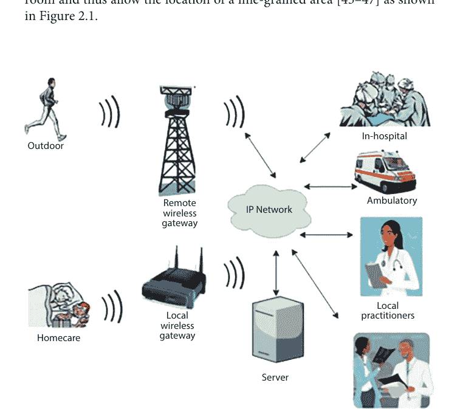

### 2.4.2 慢性病监测中存在的问题

慢性病症的治疗不仅能为患者带来个人满足感。与传统护理理念相比，它还预期能带来关键的实践优势。因此，针对各种慢性病患者开发大量智能健康服务并不令人惊讶。例如，已开发了一款针对终末期心衰患者的辅助家庭监测应用程序，该应用程序通过嵌入患者物理环境中的多个生物传感器捕获临床数据。由于类似患者可以处于移动状态以进行持续监测，移动设备在慢性病监测中面临的挑战在于智能技术。这是由于位置变化以及无线网络的低保真度，可能导致在医生端发送错误的数据状态 [48]。

### 2.4.3 远程医疗药品投送中的问题

对门诊患者的监测和移动性可能导致远程医疗药品在患者所在位置的交付延迟。如果发生任何异常情况，远程医疗药品必须在正确的时间到达该位置。这种远程医疗药品通常由负责监测患者的相关医生发送。如果医生和患者之间的距离太远，可能会导致患者的危急状况。因此，远程医疗药品到达患者所在地非常重要，但在智能健康的心脏病患者监测中仍是一个问题。研究界已就远程医疗药品问题导致的死亡率进行了相关工作。在研究 [36] 中提到，由于患者端无法接触到远程医疗服务，术后患者的死亡率相当高。由于此问题，死亡率上升至 7-9.5%。在另一项研究 [35] 中报告称，由于对流动患者远程医疗服务的有效性较低，死亡率升高。治疗后患者可能会在短期内看到健康状况的指示性改善。但在出院后，由于远程医疗服务不可达、监测质量较低以及在任何异常情况下患者的重新入院，第一年内死亡率会变得很高。在某些情况下，死亡率和重新入院率非常高，因为“脆弱阶段”被称为住院后的第 1 个月，以区分住院情况。死亡和重新入院的危险通常在危机中心释放后的 1-3 个月内显现，最高比率发生在最初 30 天。来自美国 ADHERE 数据库的信息显示，考虑到 104,808 名因心力衰竭（HF）住院的患者，出院后第 30 天的死亡率数据为 11.2%，重新入院率为 22.1%。在出院后的基准 3 个月内，约 35-40% 的患者会再次发送信息或被重新入院至急诊诊所。在因心力衰竭住院后的第一年，药物依从性差和突发性心血管死亡是最常见的死亡原因。下方的图 2.2 的整体概况表明了这种情况。

本研究还考察了因提供的远程医疗药品服务智能化程度较低而导致门诊患者死亡率的情况。研究指出，患者在治疗后的访视在出院后情况良好，但随着时间推移逐渐减少。因此，门诊患者需要一种智能远程医疗定义，以便在发生任何异常时进行跟踪并采取适当措施。如下图所示，样本初始部分进入时间的中位数在释放前组为 7 天，在释放后组为 10 天。在独立的释放前和释放后组中，从随机化到主要成分的中位时间分别为 0 天 [四分位距（IQR）0-1 天] 和 3 天（IQR 2-6 天）。在释放前组（IQR -2 至 -1 天）和释放后组（IQR 1-4 天）中，如**图 2.3** 所示，从释放到主要成分的中位时间为 -1 天。

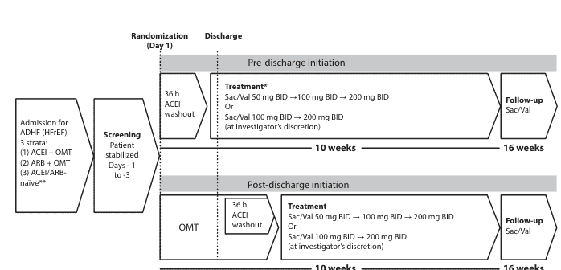

**图 2.2** 转化研究结构。研究访视发生在随机化后的第 2、4、6、8 和 10 周以及第 14、18、22 和 26 周（或在早期治疗或研究暂停时）[35]。ACEI，血管紧张素转换酶抑制剂；ADHF，急性失代偿性心力衰竭；ARB，血管紧张素受体拮抗剂；HFREF，射血分数降低的心力衰竭；OMT，高级药物治疗；Sac/Val，沙库巴曲缬沙坦 [49]。

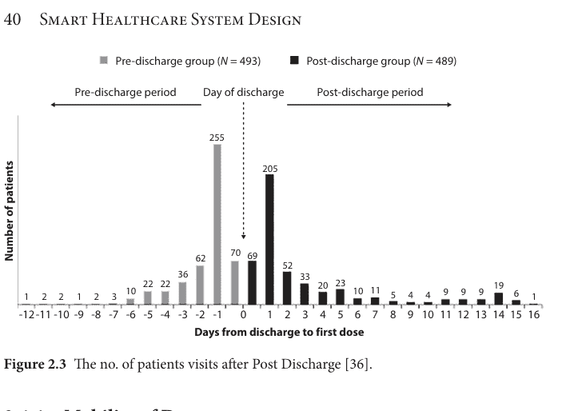

### 2.4.4 医生的流动性

除了患者的流动性，医生的流动性也存在一些问题。指定的监测医生也可能处于移动状态，当患者出现异常时，医生可能并不知情。在发生任何异常的情况下，医疗专业人员（医生、准医务人员）的流动性可能会导致患者出现危急情况。如研究所述，医疗专业人员仅仅因为某些利益而在不同地点之间流动。由于他们流动到其他地点，患者面临不同问题，需要政策制定者的严重关注。研究报告称，一些患者需要在他们的地理位置接受护理 [48, 50]。

### 2.4.5 应用程序用户界面问题

规划者和设计者创建了许多应用程序，但由于技术发展和患者周围情况的变化，所有应用程序都存在一些局限性。用户界面（UI）管理各种问题，例如图形用户界面（传感器连接控制、菜单、声音和语音消息、系统状态、数据演示等）、扬声器、按键、驱动器以及其他设备限制，如振动。这个问题通常发生在移动健康场景中，那里的健康移动应用程序配置对患者来说不易理解。灵活健康的主要挑战之一是如何有效地利用较小的手机屏幕来显示支持健康动态系统的数据。

因此，重要的是找到有效的方法来利用手机屏幕来显示支持动态的重要数据 [49]。

## 2.5 安全威胁

s-Health 的概念以及可能存在的内所有应用程序和框架，可以在降低医疗系统成本的同时，从根本上推动居民改善个人生活和医疗服务。在上一部分讨论的情况下，s-Health 利用城市框架和信息通信技术（ICT）为患有呼吸疾病的居民提供预防策略。因此，这些居民更有可能控制其疾病并降低医疗系统的成本。然而，该架构中可能存在一些潜在的安全问题。居民可能不希望被完全监控。此外，考虑到传感器系统的分散和远程性质，确保数据安全对 s-Health 框架来说是一个巨大的挑战。此外，由于 s-Health 框架本身的性质（即高度分散、远程），与传统的医疗框架相比，难以整合安全控制。当传感器数据通过无线网络传输时，窃听和侧信攻击会发生。由于患者病历存储在单个或多个服务器上 [51–53]，与健康相关的数据存在许多安全问题。数据的安全漏洞如下。

### 2.5.1 身份隐私

s-Health 相关的身份安全涉及保护访问 s-Health 服务的居民的身份。eHealth 框架和其他合作伙伴可以利用患者身份来联系他们的活动或其健康状况和记录。在我们的设计中，当居民接触 CCC（中央控制中心）时，其身份会暴露于外部。居民的身份可能会被黑客非法利用，以获取中心数据库中的敏感个人数据，例如电子健康记录的位置安排。因此，隐私可能会受到侵犯。这是所有隐私问题中的主要问题之一。为了解决这个问题，大多数解决方案依赖于中间实体来隐藏用户的真实身份（例如，使用化名）。此外，由于协调合作

在客户端方面，创建者提议利用基于可信第三方的方法。然而，如果可信计算基（CCC）正在遭受攻击或管理服务器的监管者行为失控，该实体的安全性仍面临严重风险。为了避免这种情况，我们认为需要大量地理上分布的去标识化服务器。

## 2.5.2 查询隐私

查询保护与确保用户向数据库系统发出的查询的安全性有关。在我们的情况下，好奇的理想路径对 CCC 的行为需要保持隐秘。这也与隐私数据恢复（PIR）相关。S-Health 服务可能会使用 PIR 工具来保护用户的问题免受提供商窥探。例如，研究提出了一种协议，允许用户在尽可能多的恶意服务器存在的情况下完成查询并识别服务器故障。此外，使用可信第三方（TTP）是另一种选择。对于这一隐私指标，基本意图是避免用户与查询之间的关联，现有的 PIR 方案适合实现这一点（尽管会带来巨大的计算开销）。

## 2.5.3 位置隐私

位置保护与确保居民物理位置的安全性有关。我们的应用模型中的基于位置的服务（LBS）涉及位置隐私问题。当居民尝试获取理想路径时，他们向 CCC 发送其位置，并允许 LBS 提供商跟踪他们。已提出几种方法来保护位置隐私。其目的是提供一个扭曲的位置，以防止提供商跟踪用户。创建者提出了一种混合区域——一种由匿名通信方法启发的新技术——以及评估用户匿名性的度量标准。研究提出了频繁更改每个用户 pseudonym（化名）的概念，这将减少攻击者收集足够历史数据以构建受害者习惯或画像的机会。作者提出了一种系统，使设计者能够根据用户服务质量限制和最优归纳算法，为 LBS 确定最佳的位置隐私保护机制（LPPM）。LocX [24] 显著提高了位置隐私，而不向查询结果引入模糊性或依赖关于服务器安全的强假设。具体而言，LoCX 对所有发送至服务器的位置数据应用安全的、用户特定的、距离保护的方向转换。

## 2.5.4 足迹隐私和所有者隐私

这些安全问题与城市系统收集的信息保护有关。此类数据可能被犯罪分子恢复或推导出来。在 s-Health 设计中，城市内的污染水平由传感器收集。城市可以分析这些条件并自动做出决策，例如重新同步交通灯以减少某些城市区域的拥堵和污染。此外，居民的电子健康记录也由 CCC 存储。所有这些都可以释放给外部进行审查、统计或数据挖掘，这意味着我们需要保护敏感数据免受失控实体的侵害。部署统计披露控制（SDC）方法是减少由此类挖掘技术可能导致的隐私侵犯的有效途径。一种允许数据所有者生成意外扰动副本以适用于不同信任级别的策略。由此，它阻止数据挖掘者合并不同信任级别的副本以重构原始数据。

## 2.6 模糊集理论在医疗和健康问题中的应用

世界人口正在老龄化。年龄不仅仅是一个数字。政策制定者面临的一个主要挑战是安排高效的医疗服务以提高老龄人口的生活水平。近年来，伴有多种风险因素且需要长期治疗的各种慢性病患者数量急剧增加。在这些复杂性下，护理人员的决策产生了关键的涟漪效应 [8]。因此，他们的微小错误可能具有不可挽回性且对病人致命 [1]。然而，医疗行业的各种利益相关者，包括管理者和立法者，几乎无法提供精确和清晰的信息。数据中固有的不确定性使模糊集理论走到前台。虽然模糊集理论已被广泛应用于为各种医疗和健康问题提供可接受的解决方案，但研究人员正在使用几种最新工具，如 2 型模糊集、直觉模糊集等，以提高效率。本综述简要聚焦于模糊集理论及其衍生物在医疗和健康问题应用中的以下三个主要子领域：

- A. 医疗设备、材料和技术的选择，
- B. 通常涉及慢性疾病的服务质量和风险评估，以及
- C. 决策和运筹学的角色。

### A. 医疗设备、材料和技术的选择

近年来，研究人员对不同类型医疗设备和材料之间的相互关系（带有若干备选方案）进行了分类。因此，他们能够提出关于设备、材料和项目类型评估和选择的多种方法和方式。

近年来，[3] 通过扩展模糊环境下的 PROMETHEE 方法，对机器人选择问题进行了实证案例研究。他们的新方法包括同时探索清晰的客观数据和模糊的主观数据。他们发现，适当的机器人选择如何有助于提高产品价值，从而增加患者、亲属和护理人员的满意度。大约在同一时间，一项关于该领域及其在制造业中潜在应用的研究在 [2] 中进行。他在不确定性下扩展了经典的 VIKOR 方法用于机器人选择。他采用区间 2 型模糊集为现实问题提供更大的自由度。此外，他还通过七组准则权重和 Spearman 相关系数分析了所提方法的稳定性。[4] 通过合并两种基于模糊的层次过程，即模糊 AHP 和模糊 VIKOR，进行了一项成熟的研究，用于移动机器人选择。他们的研究重点关注总拥有成本作为机器人选择的关键参数。随着一些现代技术奇迹，如机器人自动化系统和健康物联网（IoHT），修改后的模糊 AHP 和模糊 VIKOR 方法被应用于确定机器人的排名，从而在医院药房选择最佳移动机器人。接下来，[5] 发现数百万人经常获得健康建议以过上健康的生活。他们指出，尽管物联网设备可以在医疗环境中生成大量数据，但云计算技术对于安全存储和访问可能很有价值。此外，他们为深受糖尿病困扰的人群应用了一种新的系统方法，通过生成相关医疗数据

### 表 2.1 关于模糊集理论在医疗和健康问题中应用的最新文章。

| 作者 | 方法 | 研究目的 | 结果 |
| :--- | :--- | :--- | :--- |
| **部分 A：医疗设备、材料和技术的选择** | | | |
| Moreno-Cabezali 和 Fernandez-Crehuet [24] | 模糊逻辑在风险评估中的应用。 | 评估潜在风险的调查。 | 识别最关键的风险。 |
| AlZu’bi 等人 [25] | 3D 模糊 C-均值算法。 | 3D 医学图像分割。 | 并行实现比顺序版本快 5 倍。 |
| Ozsahin 等人 [23] | 模糊 PROMETHEE 和模糊 MCDM。 | 医学成像中的固态探测器 | 基于探测器确定最合适的半导体。 |
| Masood 等人 [22] | 混合层次模糊群体决策。 | 在可持续性问题下选择概念扬声器原型。 | 在 4 个备选方案中确定最佳概念原型设计。 |
| **部分 B：通常涉及慢性疾病的服务质量和风险评估** | | | |
| Vidhya 和 Shanmugalakshmi [29] | 大数据和基于神经模糊的方法 | 使用自适应神经模糊推理系统分析多种疾病。 | 确定了 CFI 计数的熵。 |

*（续）*

### 表 2.1 近期聚焦于模糊集理论在医疗和医学问题中应用的文章。（续）

| 作者 | 方法 | 研究目的 | 结果 |
| :--- | :--- | :--- | :--- |
| Akinnuwesi *等人* [28] | 模糊逻辑与认知图技术的混合。 | 风湿-肌肉骨骼疾病的诊断决策支持系统。 | 87% 准确率，90% 敏感度，以及 80% 特异性。 |
| La Fata *等人* [26] | 模糊 ELECTRE III。 | 评估公共医疗的服务质量。 | 显著的服务属性因素。 |
| Samiei *等人* [27] | 神经-模糊推理系统。 | 腰痛的风险因素。 | 识别出腰痛的四个主要风险因素。 |

#### C 部分：决策与运筹学的角色

| 作者 | 方法 | 研究目的 | 结果 |
| :--- | :--- | :--- | :--- |
| Vaishnavi 和 Suresh [30] | 模糊就绪度和绩效重要性指数。 | 在医疗系统中实施敏捷性。 | 持续的就绪度评估有助于提高就绪度。 |
| Detcharat Sumrit [31] | 模糊多准则决策方法。 | 医疗行业供应商管理库存中的供应商选择。 | 机构信任、信息共享和技术作为主要评估标准。 |
| Rajput *等人* [33] | 模糊符号距离技术。 | 医疗行业中模糊经济订单量模型的优化。 | 确定可变需求下的最优总成本。 |
| Salazar 和 Sanz-Calcedo [32] | 模糊认知图谱。 | 医疗中心能源消耗和排放的维护作业。 | 与能源、环境效率和设备维护状况直接相关。 |

通过某些数据集和医疗传感器。他们提出的分类算法被称为*模糊规则-based神经分类器*，该方法比传统方法能更有效地诊断疾病及其严重程度。另一方面，尽管大多数研究人员承认医院作为医疗系统的主要子部分，但他们假设不同地点的医院具有同等水平和同质性。然而，Omrani 等人 [6] 研究了不同地点的医院为不同患者提供的服务的非同质性。因此，他们发现这些医院不适合进行比较。相应地，他们提出了一种聚类技术，以应对决策单元之间缺乏同质性的问题，从而测量不同地点的医院。同样，[7] 探讨了影响医疗器件信息安全的各种有害因素。他们采用了一种基于*模糊*的对称 AHP-TOPSIS 方法。然而，他们只能在印度瓦拉纳西市的一家当地医院软件上测试该方法。[8] 的工作发现了一型模糊集理论的缺陷，并使用有限区间二型高斯模糊数作为衡量医疗问题中不确定性的强大工具。这可以从临床医生、生物医学工程师和医疗投资者的角度，解决医疗器件选择问题的实际经济评估。表 2.1 的 A 部分列出了该研究领域的一些非常近期的文章。就这样，众多研究人员已尽其最大努力应对医疗和医学问题中固有的不确定性。

#### B. 服务质量与风险评估，通常针对慢性疾病

世界人口正在老龄化。老年人（65 岁及以上）的比例比以往任何时候都高，并预计在接下来 50 年内欧盟的这一比例将翻倍 [13]。尽管过去几十年生活质量的提高和医学科学的进步导致了人口老龄化，但更高比例的老年人群使得护理人员必须同时应对患有各种慢性疾病的更多患者。这样一来，通过评估风险来维持优质服务对护理人员来说变得越来越具有挑战性。

一项实证案例研究 [9] 使用了意大利锡拉库萨九家公共医院的数据，针对四个核心质量参数和十五项主要服务项目进行了分析。他引入了一种新的模糊测量方法，以评估医疗保健中的服务质量。为了获得准确的服务质量要求估计，使用了模糊 AHP 方法。他发现，服务质量成就的成功内部沟通应最大限度地缩小客户需求与员工如何看待这些需求之间的差异。作者们 [10] 以巨大的规则数量和非有趣规则的挖掘形式，指出了若干现有算法的缺陷，以及预处理时间和过滤率。随后，为了根据用户请求解决这些限制并对发现的规则进行可视化，他们提供了一种模糊加权迭代概念。

同样，[11] 在区间评估的直觉模糊环境下提供了一种混合多准则决策模型，并由此评估了节点故障的概率。他们将区间值直觉模糊 ANP（用于匹配信息的不确定性）与比例评估方法（用于决策）相结合。然而，他们方法中使用的主观权重很大程度上依赖于护理人员的意见，因此并不完美。此外，由于系统和服务的复杂性，故障模式之间可能存在不同类型的相互关系。然而，这项研究回避了这一点。大致在同一时间，[12] 提出了一种预测心力衰竭风险的决策方法。他们在建议的方法中整合了模糊 AHP 和模糊 ANN。此外，他们能够确定，与其他传统 ANN 模型相比，其方法在结果中的准确率为 91.10%，见表 2.2。

最近，[14] 指出了高度普及的老年技术（gerontechnology）和远程康复系统的一些缺陷，例如这些系统未能协助患者和专家了解康复进展。他们提出了一种基于著名评估标准的模糊语义框架，以确定康复过程中患者的身体状况。然而，他们使用了一个名为 Kinect API 的 API，这是一个闭源 API，仅适用于 Kinect 接口的患者。这使其在流程中的价值降低。治疗师和患者也有很大的空间来确定他们的操作。同样，对隐私问题的重视是任何技术或系统可接受性的一个主要因素。研究 [15] 侧重于肘部和腕部康复医疗机器人设备的安全保证，涉及机器人和患者安全。使用发现机器人系统使用期间保护程度的模糊逻辑方法，讨论了数据不确定性。然而，他们的程序仅通过一项临床试验在 18 名患者的组中进行了数值测试。

聚焦于该领域的最新论文包含在表 2.1 的 B 部分中。

### C. 决策与运筹学的角色

大多数聚焦于模糊集理论在医疗和医学问题中应用的研究人员使用了一些现成的决策过程或推导出了新的过程。他们发现，护理人员的决策主要旨在降低患者的健康风险，同时最大化健康效益和患者选择，从而增加各方的满意度。然而，在更广泛的医学和医疗模型环境中，涉及众多标准，如社会、环境、物质、管理、专业以及其他许多标准 [17]。由于若干定性和定量矛盾问题下的非模糊决策方法力求在容忍怀疑和利益相关者偏好的情况下避免复杂性，模糊集理论被用来表示数据固有的不精确性，并由此呈现一个高效、理性和明确的决策过程 [21]。

在近期研究中，[16] 通过考虑 2000 年至 2014 年期间发表的 142 篇文章，提供了一份详细的调查。虽然他们发现关于运筹学在医疗保健中应用的最大出版物数量出现在 2008 年左右，但他们注意到 2014 年之后数量激增。在 2017 年的同一编辑卷中，他们在该领域提供了一份全面的调查。他们考虑了更长的时期：1966 年至 2016 年。

### 表 2.2 缩略语及其描述。

| 缩略语 | 描述 |
| :--- | :--- |
| VIKOR | Vlskriterijumska Optimizacija I Kompromisno Resenje |
| AHP | 层次分析法 (Analytic Hierarchy Process) |
| ANP | 网络分析法 (Analytic Network Process) |
| MCDM | 多准则决策 (Multi-Criteria Decision Making) |

……以研究该领域的进展。通过考虑每个类别下的一些相关近期论文，对其分析中应用于医疗研究的各类方法进行了分类。[13] 在一篇备受赞誉的文章中，对决策制定和模糊集合理论在解决健康相关问题中的应用进行了深入分析。在 1989 年至 2018 年期间，他们的统计发现将 2012 年列为备受赞誉论文中的第一名。他们还发现，各种层次分析法（AHP）和混合方法常用于评估医疗行业中不同的服务质量应用。

同样，[34] 展示了模糊背景下医疗供应链管理中的运筹学应用。他们利用模糊集合和概率理论表示结果中的不确定性，从而能够在正确的时间、以良好的状况将正确的药物提供给正确的人，以对抗疾病。接下来，[17] 提出了一个重要的问题：通过适当检查，医院是否可以将精益思维融入其中。首先，定义了医疗机构中实施的各种精益概念和组成部分。接着，针对医疗机构，部署了一种基于模糊逻辑的精益实施评估方法，并进行了数值研究。尽管这项研究仅在一所印度医院中得到验证，但它引入了一些立法者具有前瞻性且可实施行动计划的一些内容。研究 [44] 开发了一个模型来衡量医院的精益程度，并通过与选定的学术专家讨论相应的初步版本来验证该模型。通过这种方式，他们为组织确定了两个标准，即参与研究的能力和致力于实施精益原则的承诺。最后，建立了一种基于多属性模糊逻辑的排序方法，以呈现精益指数。

最近，[18] 识别了精益化的促进因素、标准和属性，以构成在模糊环境下评估医院的标准。他们的方法有助于提供解决较弱属性的措施，从而进一步促进精益绩效的提升。

在一项非常贴近现实的研究 [19] 中，考虑了毕达哥拉斯模糊数据，其中不同的评估数据以毕达哥拉斯模糊决策矩阵的形式提供，涉及可行方案。条目取自专家的观点，并由毕达哥拉斯表 2.2 中的模糊数描述。为了解决不确定性下的 MCDM 问题，他们还扩展了经典 TOPSIS 系统的应用。通过这一过程，可以决定购买最佳医疗技术的最佳地点和优先级设置。

在另一项新颖的研究 [20] 中，重点讨论了一个备受热议的问题，即工作场所危害，包括保护医疗工作者免受公众虐待及其有效性。为了定义和优先排序控制暴力措施，他们创新的方法使用了模糊 AHP 和模糊加法比率评估法。他们描述该解决方案是为控制针对医疗工作者的暴力提供最佳建议，通过增加安保人员数量并对工作人员进行培训。

下文，表 2.1 的 C 部分列出了发表在高声誉期刊中的一些非常近期的相关文章。通过上述讨论，发现模糊集理论在医疗保健和医学问题中的应用有广泛的研究范围。

## 2.7 结论

物联网是许多领域的绝佳融合领域，例如移动医疗（mHealth）应用程序的开发。由于其直接涉及人类生活，移动医疗应用程序的开发是研究社区中非常热门的话题。这些应用程序大多关注静态患者，但没有关注远程患者监测。由于创新较少且该领域的工作较少，远程患者监测正逐渐受到关注。在本章中，我们调查了不同的健康问题。此外，还讨论了模糊逻辑工作及其主要组件在开发健康监测应用程序中的应用。迫切需要解决上述所有提到的问题，以增强电子健康（eHealth）和移动健康（mHealth）环境中的医疗行业。

## 参考文献

- 1. Ren, P., Xu, Z., Liao, H., Zeng, X.-J., 一种辅助中国层级医疗系统的直觉模糊多准则决策热力学方法。*Inf. Sci.*, 420, 490-504, 2017.
- 2. Ghorabae, M.K., 开发一种用于基于区间二型模糊集的机器人选择多准则决策方法。*Rob. Comput. Integr. Manuf.*, 1, 37, 221-232, 2016年2月.
- 3. Sen, D.K., Datta, S., Mahapatra, S.S., 扩展 PROMETHEE 用于机器人选择决策。*Benchmarking: An Int. J.*, 23, 4, 983-1014, 2016.
- 4. Zhou, F., Wang, X., Goh, M., 基于模糊扩展 VIKOR 的医院药房移动机器人选择模型。*Int. J. Adv. Rob. Syst.*, 15, 4, 1729881418787315, 2018年12月.
- 5. Kumar, P.M., Lokesh, S., Varatharajan, R., Babu, G.C., Parthasarathy, P., 使用模糊神经分类器的基于云和物联网的疾病预测和诊断系统用于医疗保健。*Future Gener. Comput. Syst.*, 1, 86, 527–534, 2018年9月.
- 6. Omrani, H., Shafaat, K., Emrouznejad, A., 一种整合的模糊聚类合作博弈数据包络分析模型，应用于医院效率。*Expert Syst. Appl.*, 30, 114, 615–628, 2018年12月.
- 7. Kumar, R., Pandey, A.K., Baz, A., Alhahami, H., Alhahami, W., Agrawal, A., Khan, R.A., 一种基于模糊的对称多准则决策程序，用于评估有害因素对医疗保健信息安全的影响。*Symmetry*, 12, 4, 664, 2020年4月.
- 8. Tolga, C., Parlak, I.B., Castillo, O., 有限区间值二型高斯模糊数应用于医疗保健问题中的模糊 TODIM。*Eng. Appl. Artif. Intell.*, Id. 103352, 2020.
- 9. Lupo, T., 一个评估医疗行业服务质量的模糊框架：西西里公共医院服务评估的实证案例。*Appl. Soft Comput.*, 1, 40, 468–478, 2016年3月.
- 10. Sumathi, G., Akilandeswari, J., 改进的模糊加权迭代关联规则本体后处理，用于数据挖掘中的查询推荐应用。*Comput. Intell.*, 36, 2, 773–782, 2020年5月.
- 11. Wang, L.-E., Liu, H.-C., Quan, M.-Y., 在区间值直觉模糊环境下使用混合多准则决策模型评估失效模式的风险。*Comput. Ind. Eng.*, 2016.
- 12. Samuel, O.W., Asogbon, G.M., Sangaiah, A.K., Guanlin Li, F.P., 一种基于 ANN 和模糊 AHP 的集成决策支持系统，用于心力衰竭风险预测。*Expert Syst. Appl.*, 68, 163–172, 2017.
- 13. Mardani, A., Hooker, R., Ozkul, S., Yifan, S., Nilashi, M., Sabzi, H.Z., Fei, G., 决策制定和模糊集合理论在评估医疗保健和医学问题中的应用：三十年研究的回顾及近期发展。*Expert Syst. Appl.*, 137, 202–231, 2019.
- 14. Moya, A., Navarro, E., Jaén, J., González, P., 支持老年人康复的模糊描述逻辑。Expert Systems. 37, 2, e12464, 2020年4月.
- 15. Tucan, P., Gherman, B., Major, K., Vaida, C., Major, Z., Plitea, N., Carbone, G., Pisla, D., 基于模糊逻辑的肘部和手腕康复并联机器人风险评估。*Int. J. Environ. Res. Public Health*, 17, 654, 2020.
- 16. Tüzün, S. and Topcu, Y.I., 医疗保健管理中的运筹学研究分类。*Oper. Res. Appl. HealthCare Manage.*, 3–21, 2017.
- 17. Narayananurthy, G., Gurumathy, G., 医院是否精益？评估医疗机构精益思维实施的数学模型。*Oper. Res. HealthCare*, 1, 18, 84–98, 2018年9月.
- 18. Suresh, M., Vaishnavi, V., Pai, R.D., 使用模糊逻辑方法评估医疗保健组织中的精益程度。*Int. J. Org. Anal.*, 2020.

19. Akram, M., Dudek, W.A., Ilyas, F., 基于勾股模糊TOPSIS方法的群体决策. *Int. J. Intell. Syst.*, 1–21, 2019.

20. Rajabi, F., Jahangiri, M., Bagherifard, F., Banaee, S., Farhadi, P., 控制医疗工作者遭受暴力的策略：模糊层次分析法与模糊加性比率评估法的应用. *J. Nurs. Manage.*, 28, 4, 777–786, 2020年5月.

21. Garai, A., Roy, T.K., T环境中经济高效且以客户为中心的闭环供应链管理模型的多目标优化. *Soft Comput.*, 24, 1, 155–178, 2020年1月.

22. Maghsoudi, A.I., Mosavat, M., Hafezalkotob, A., 基于信息公理和最佳值法的混合层次模糊群体决策：原型设计选择. *Comput. Ind. Eng.*, 1, 127, 788–804, 2019年1月.

23. Oztahin, I., Sharif, T., Oztahin, D.U., Uzun, B., 使用模糊PROMETHEE评估医学成像中的固态探测器. *J. Instrum.*, 14, 01, C01019, 2019年1月.

24. Moreno-Cabeza, B.M., Fernandez-Crehuet, J.M., 基于模糊逻辑模型在增材制造研发项目中进行风险评估的应用. *Comput. Ind. Eng.*, 1, 145, 106529, 2020年7月.

25. AlZubi, S., Shehab, M., Al-Ayyoub, M., Jararweh, Y., Gupta, B., 三维医学体数据模糊分割的并行实现. *Pattern Recognit. Lett.*, 1:130:312–8.

26. La Fata, C.M., Lupo, T., Piazza, T., 基于模糊ELECTRE III和IPA的新型方法进行服务质量基准测试：涉及意大利公共医疗保健背景的一个实证案例. *HealthCare Manag Sci*, 22, 1, 106–120, 2019年3月.

27. Samiei, S., Poursabaki, R., 使用自适应神经模糊系统评估腰痛的风险因素. *Archives Occup. Health*, 3, 2, 339–345, 2019年4月.

28. Akinnuwesi BA, Adegbite BA, Adelowo F, Ima-Edomwonyi U, Fashoto G, Amumjei OT. 使用模糊认知MAP技术诊断风湿-肌肉骨骼疾病的决策支持系统. *Informatics in Medicine Unlocked*. 1, 18, 100279, 2020年1月.

29. Vidhya, K. and Shanmugalakshmi, R., 基于改进自适应神经模糊推理系统（M-ANFIS）的医疗大数据多病分析. *J. Supercomput.*, 2020.

30. Vaishnawi, V. and Suresh, M., 使用模糊逻辑方法评估医疗行业实施敏捷性的准备程度. *Global J. Flexible Syst. Manage.*, 2020.

31. Sumrit, D., 使用模糊多准则决策方法选择医疗保健中供应商管理库存的供应商. *Decis. Sci. Lett.*, 9, 2, 233–256, 2020.

32. Salazar, E.M. and Sanz-Calcedo, J.G., 使用模糊认知图谱研究维护操作对医疗保健中心能源消耗和排放的影响. *J. Build. Perform. Simul.*, 2018.

33. Rajput, N., Pandey, R.K., Singh, A.P., Chauhan, A., 使用符号距离技术在医疗保健行业中优化具有三种不同需求模式的模糊EOQ模型. *Math. Eng. Sci. Aerosp.*, 10, 2, 2019.

34. Priyan, S. and Uthayakumar, R., 通过数学方法研究涉及概率劣化和可变设置成本的库存系统的经济设计. *Int. J. Math. Oper. Res.*, 8, 3, 2016.

35. Pascual-Figal, D., Wachtler, R., Senni, M., Belohlavek, J., Noè, A., Carr, D., Butlin, D., TRANSITION的原理与设计：一项关于出院前与出院后启动沙库巴曲肽/缬沙坦的随机试验. *ESC Heart Failure*, 5, 2, 327–336, 2018.

36. Wachtel, R., Senni, M., Belohlavek, J., Straburzynska-Migaj, E., Witte, K.K., Kobalava, Z., Chaaban, S., 在血流动力学稳定的心力衰竭患者中于医院内或出院早期启动沙库巴曲肽/缬沙坦：随机TRANSITION研究的主要结果. *Eur. J. Heart Failure*, 21, 8, 998–1007, 2019.

37. Barker, L.R., 住院医师门诊护理培训课程. *J. Gener. Internal Med.*, 5, 1, S3–S14, 1990.

38. Shah, R., Melvin, L., Cavalcanti, R.B., 门诊内科医师能力目标（EPAs）的翻译：来自加拿大多中心调查的结果. *Can. J. Gener. Internal Med.*, 14, 3, 9–15, 2019.

39. Armstrong, K.A., Coyte, P.C., Brown, M., Beber, B., Semple, J.L., 通过移动应用进行家庭监测对门诊手术后面对面就诊次数的影响：一项随机临床试验. *JAMA Surgery*, 152, 7, 622–627, 2017.

40. Warrington, L., Absolom, K., Conner, M., Kellar, I., Clayton, B., Ayres, M., Velikova, G., 患者报告和管理癌症治疗副作用的电子系统：系统综述. *J. Med. Internet Res.*, 21, 1, e10875, 2019.

41. Pramanik, M.I., Lau, R.Y., Demirhan, H., Azad, M.A.K., 智慧医疗：智慧城市中由大数据赋能的健康范式. *Expert Syst. Appl.*, 87, 370–383, 2017.

42. López-Torres, S., López-Torres, H., Rocha-Rocha, J., Butt, S.A., Tariq, M.I., Collazos-Morales, C., Piñeres-Espitia, G., 使用SEMMa方法论监测灌溉系统的用水量的物联网. *International Conference on Intelligent Human Computer Interaction*, Springer, Cham, pp. 222–234, 2019年12月.

43. Wang, X., White, L., Chen, X., Gao, Y., Li, H., Luo, Y., 医疗保健中可穿戴技术接受度的实证研究. *Ind. Manage. Data Syst.*, 2015.

44. Tariq, M.I., Tayyaba, S., Ali Mian, N., Sarfraz, M.S., De-la-Hoz-Franco, E., Butt, S.A., Rad, D.V., 在模糊环境下组合AHP和TOPSIS方法对信息安全控制措施进行排名以克服其障碍. *J. Intell. Fuzzy Syst.*, (Preprint), 1–14, 2020.

45. Martinez, D., Talbert, T., Romero-Steiner, S., Kosmos, C., Redd, S., 公共卫生应急准备和响应能力标准的演变，以支持公共卫生应急管理实践和流程. *Health Secur.*, 17, 6, 430–438, 2019.

46. Shapiro, J.S., Crowley, D., Hoxhaj, S., Langabeer II, J., Panik, B., Taylor, T.B., Nielson, J.A., 急诊医学中的健康信息交换. *Ann. Emergency Med.*, 67, 2, 216–226, 2016.

47. Jeong, P.S. and Cho, Y.H., 使用智能设备的紧急支持系统. *J. Korea Inst. Inf. Commun. Eng.*, 20, 9, 1791–1798, 2016.

48. Jiang, J. and Cameron, A.F., IT赋能的慢性病自我管理的自我监测：跨学科综述. *MIS Quarterly*, 44, 1, 2020.

49. Dudakiya, S., Galani, H., Shaikh, A., Thanki, D., Late, R.A., Pawar, S.E., 使用可穿戴传感器数据预测分析监测移动患者. *2016 International Conference on Electrical, Electronics, and Optimization Techniques (ICEEOT)*, IEEE, pp. 332–335, 2016年3月.

50. Rezaabagha, F. and Mu, Y., 针对用户移动性的实用且安全的远程医疗系统. *J. Biomed. Inf.*, 78, 24–32, 2018.

51. MacIntyre, C.R., Engells, T.E., Scotch, M., Heslop, D.J., Gumel, A.B., Poste, G., Broom, A., 威胁健康安全的新兴与汇聚风险. *Environ. Syst. Decis.*, 38, 2, 198–207, 2018.

52. Chuichisan, I., Bulan, D.G., Geman, O., Gordin, I., 医疗保健信息系统的安全方法. *2017 E-Health and Bioengineering Conference (EHB)*, IEEE, pp. 721–724, 2017年6月.

53. McDermott, D.S., Kamerer, J.L., Birk, A.T., 电子健康记录：网络威胁和安全措施的文献综述. *Int. J. Cyber Res. Educ. (IJCRES)*, 1, 2, 42–49, 2019.

## 物联网医疗系统中的数据驱动决策——以COVID-19为例

**Saroja S.，* Haseena S. 和 Blessa Binolin Pepsi M.**  
Mepco Schlenck工程学院，印度锡瓦卡西

##### 摘要

本研究提出了对基于物联网的医疗系统数据进行审查所建议的自动化决策技术的一种印象。物联网数据分析在当下这个时代起着至关重要的作用，因为来自连接设备的数据能揭示出对未来具有更好洞察力的有意义结果。本章涉及一个决策系统的设计，该系统从基于物联网的医疗系统中收集数据，进行预处理和分析，并生成详细的信息报告以改善诊断。应用了数据预处理方法，如数据清洗、数据整理、归一化、数据规约和去除噪声数据。物联网数据与分析技术的结合在医疗系统中被证明是有益的。从连接设备收集的物联网信息（如脉搏率、温度、氧气水平和心率）可以利用适当的机器学习技术在初步阶段分析需求和严重程度。多准则决策制定（MCDM）技术，如SMART、WPM和TOPSIS，也被应用于结论生成过程，以生成详细的信息诊断报告。作为医疗数据，总体目标是通过数据分析帮助企业组织实现更好的决策过程，从而部署正确的物联网策略。下一代专家系统的结果可用于诊断和治疗中的进一步分析。

**关键词：** 医疗系统，机器学习，多准则决策制定，物联网，预处理，数据分析，专家系统

### 3.1 引言

2019冠状病毒病（也称为 COVID-19）是一种由具有高致死率的呼吸综合征引起的呼吸系统疾病。由新型冠状病毒引起的流行病正在全球蔓延。 COVID-19最初影响中国民众，如今已成为全世界关注的问题。由于医疗资源的短缺以及缺乏 COVID-19 疫苗，大多数国家被迫实施部分或全面封锁。全球范围内，新冠病毒感染人数正在以惊人的速度增长，在接受治疗的病人出院之前，医院没有空闲床位供感染者入住。

一旦这种冠状病毒进入人体肺部，就会产生剧烈症状，如咳嗽、发烧、头痛等。大多数受 COVID-19 影响的人群症状相对较轻，但许多人的症状从严重到危急不等。在 COVID-19 疫苗尚未可用的情况下，这种病毒的传播率正在迅速增加。为了控制冠状病毒的广泛传播，政府正在采取许多举措来减少和控制病毒的扩散。但是，所有这些措施仅在某种程度上减轻了影响。随着感染率的迅速上升，没有足够的医院来治疗 COVID-19 患者，并且仅有少数呼吸机可用于治疗患有重症呼吸综合征的人。因此，有必要对受 COVID-19 影响的患者进行分类和优先排序。

图 3.1 展示了拟议工作的整体设计。基于物联网（IoT）的医疗系统采集人体参数，如脉搏、体温、血氧水平和心率。从人体采集的这些数据经过预处理和分类，并执行决策算法，以判断患者是否受 COVID-19 影响。应用数据预处理方法，如数据清洗、数据处理（munging）、归一化、降维和去除噪声数据。下一步是进行分类，使用分层分类器、支持向量机 (SVM)、梯度提升、随机森林和 AdaBoost 等算法对数据进行分类。使用精确率、召回率、F1 分数和准确率等多种指标进行实验分析。此外，还应用多准则决策 (MCDM) 过程，如 SMART、WPM 和 TOPSIS，用于结论生成过程，以产生关于 COVID-19 受影响人员留院情况的详细信息。

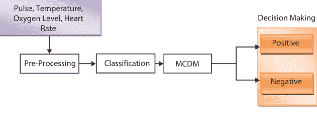

**图 3.1** 整体设计。

#### 3.1.1 预处理

预处理是数据分析中执行的初始步骤，它将数据转换、编码或转换为机器可以轻松执行分析的形式。由于信息量大，从基于物联网的医疗系统收集的数据极易受到不一致性、缺失值和噪声的影响，不能直接处理，因为它们可能包含噪声、无关信息或不相关信息。数据预处理有助于将原始数据转换为有用的格式，从而减少处理时间，避免错误，并使数据为下一步做好准备。未经处理的数据可能会产生有偏差的结果，无法用于数据分析。因此，在应用任何算法之前，都应进行处理。

应用数据清洗、数据处理（munging）、归一化、降维和去除噪声数据等数据预处理方法。数据清洗方法用于识别数据中的异常值，这有助于创建模型。数据集中存在的无用数据可能导致挖掘过程中的混淆，并可能产生不可靠的输出。这是一个去除不准确数据和数据集中存在的不完整信息的过程。它有助于去除因输入或传输过程中的人为错误导致的数据不一致。为了处理缺失和不相关的数据，执行了诸如使用聚类方法去除数据中的缺失值和噪声等数据清洗方法。忽略缺失值，或应用插值方法来填补缺失值。相似的数据被组合在一起，而不熟悉的数据被检测为异常值并被移除。

数据处理（munging），也称为数据整理（data wrangling），是对物联网数据进行手动转换和清理的过程。它删除无关信息并创建处理所需的相关信息。数据归一化将具有不同尺度的属性的数据进行缩放。它最小化并避免重复数据。它从现有范围生成新范围，从而允许有效处理数据。

通过物联网设备捕获的真实世界大多数数据具有大量特征。应用降维来选择仅需要的特征，从而减少所需的处理时间。这是一种数据挖掘技术，用于生成数据的缩减表示。应用特征子集选择来选择进一步处理所需的相关特征。因此，使用的预处理方法有助于以高效的方式使数据准备好供算法进一步处理，并有助于做出更好的决策。

#### 3.1.2 分类算法

本节讨论不同的分类算法，并解释其工作原理和程序。

##### 3.1.2.1 随机分类器（Dummy Classifier）

这是一种简单的分类器，在数据集存在类别不平衡的情况下表现更好。各种策略包括分层、最频繁、均匀和常数。分层分类器与预测训练集中最频繁标签的概率相关联。识别出预测比例超过 85% 的大致类别标签作为随机分类器的类别标签。

##### 3.1.2.2 支持向量机 (SVM)

支持向量机是一种用于在分类过程中分析数据的监督学习技术。输入特征被绘制在 n 维空间中，然后进一步识别超平面作为决策边界以分割类别。决策边界被映射为最大化边界的最佳决策边界。

使用支持向量识别具有最大边界的超平面。支持向量是识别为类别标签之间分割点的训练点。减少支持向量数量的选择提供了良好的泛化。此过程可以通过线性数据映射完成。绘制在 n 维空间中的非线性数据永远不能用线性边界分割。因此，非线性数据将通过核函数（如图 3.2 所示）进一步映射到高维空间。

分离超平面可以表示为：

$$ W \cdot X + b = 0 \quad (3.1) $$

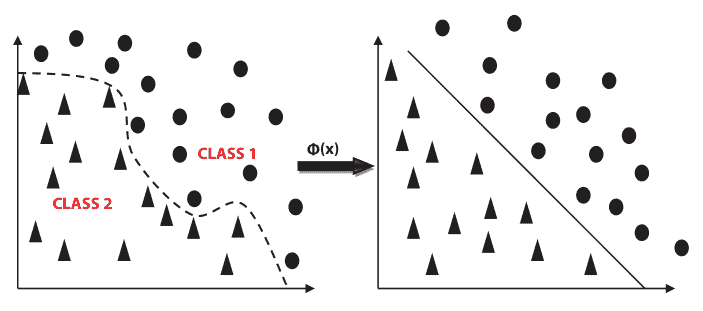

**图 3.2** 非线性 SVM 上的核函数。

W 是权重向量 $(w_1, w_2, ..., w_n)$，n 是属性数量，b 是标量。对于非常接近它的 X 向量，描述最大边界超平面。

非线性映射需要核技巧，即两个向量的点积。核与变换 $\Phi(X_i)$ 相关联，方程为 $K(x_i, x_j) = \Phi(x_i) \cdot \Phi(x_j)$。例如，使用核映射，对于给定的 3D 向量 $X = \{x_1, x_2, x_3\}$，在 6D 空间上的非线性变换可以表示为 $\Phi_1(X) = x_1$，$\Phi_2(X) = x_2$，$\Phi_3(X) = x_3$，$\Phi_4(X) = (x_1)^2$，$\Phi_5(X) = (x_1 x_2)$，$\Phi_6(X) = (x_1 x_3)$。进一步，可以像线性数据一样处理该数据，并带有决策边界。此外，核函数包括多项式、高斯、sigmoid 等。

##### 3.1.2.3 梯度提升（Gradient Boosting）

梯度提升是一种分类问题，它通过构建学习器并基于弱预测模型的集合来预测测试样本。该算法是一种加性模型，执行具有可微损失函数的优化。基本上，使用决策树，然后基于成本函数通过优化进行泛化。因此，它成为一个强大的预测模型。

由于这增强了其他学习算法的能力，该思想被称为概率近似正确 (PAC) 学习。假设提升测试识别出被错误分类的弱学习器以及成功分类的示例，以构建完美模型。总体而言，梯度提升涉及三个特征；它们是：

优化损失函数
使用弱学习器进行预测
构建加法模型以降低弱学习器的损失函数。

分类问题的损失函数可以采用预测模型技术的对数损失。使用决策树作为弱学习器。树通过使用基尼指数或信息增益得分的最佳分裂点构建，以最小化损失。在构建树时，可以最小化误差损失。修改参数以减少残差损失被确定为最后一个特征。

##### 3.1.2.4 随机森林

随机森林包含许多单个决策树，它们组合作为集成分类。训练集成决策树的概念称为装袋法（bagging）。其思想是结合学习模型以提高结果。合并的预测（如图 3.3 所示）更准确且更稳定。与其通过参数计算来识别分裂节点的最佳特征，不如使用特征的随机子集。决策树中的内部节点表示特征，而边缘代表形成规则的前置条件。

随机森林算法按以下方式运行：从数据集中随机选择样本，并基于此构建树。该过程几乎对所有样本重复进行。对预测结果进行投票，得票最多的将是最终预测类别。

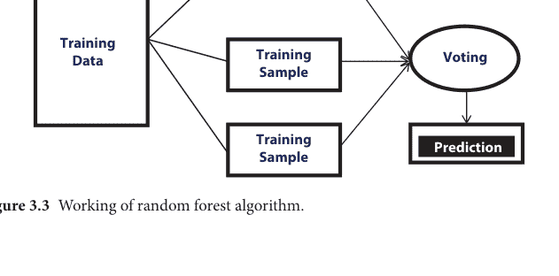

##### 3.1.2.5 Ada Boost

Ada Boost 是一种用于二分类的自适应提升算法。该算法像梯度提升方法一样，通过结合不同的决策树来运行。为训练集中的每个实例分配权重。像决策树这样的弱分类器对加权样本进行分类。这类提升算法通常将多个低准确率或弱准确率分类器模型结合起来，以获得强大的高准确率模型。因此，Ada Boost 作为一种算法，通过提升弱学习器的性能来增加从训练集构建的决策存根（decision stump）的准确率。

#### 3.2 实验分析

COVID-19 数据集源自参考文献 [1]。正样本和负样本数据作为两组，用于根据输入的血液和尿液检测结果作为特征集来预测 COVID-19 疾病。研究结果基于精确率、准确率、召回率和 F1 分数进行计算。

#### 3.3 多准则决策制定（MCDM）程序

本部分涵盖了三种不同类型的多准则决策制定（MCDM），并讨论了它们如何在决策的背景下被利用。

MCDM 方法协助决策制造商在存在多个（相互冲突的）准则的情况下做出最佳判断 [2-7]。所有可能的备选方案都根据多个准则进行评估，并选出其中最佳的一个。目前流行的 MCDM 技术包括 SAW（简单加权和法）、WPM（加权乘积模型）、TOPSIS（理想解排序法）、PROMETHEE（优势排序和组织评估方法）、AHP（层次分析法）、SMART（简单多属性评级技术）和 ANP（层次网络过程）。在许多实际应用，如供应商选择、产品选择、设计选择、生产者选择等中，MCDM 方法起着至关重要的作用。方法的选择基于问题领域的需求及其适用性。MCDM 方法有助于挑选最受青睐的单一备选方案，或有助于对包含优先备选方案的集合进行分类。

在决策过程中，执行以下步骤：

- 通过识别备选方案集来定义问题，
  - 识别确定备选方案所需的必要要求。
  - 准则应能够根据其性能区分替代方案。
  - 较少数量的准则更为优选。
  - 准则可以是辅助类型（正）或成本类型（负）。
  - 选择结论生成的一种形式。
  - 根据要求测试替代方案。
  - 对选择进行评级或选出正确的替代方案。
  - 根据问题陈述验证解决方案。
  - 确保生成的解释是正确的。
  - 向利益相关者报告选择结果。

##### 3.3.1 简单多属性评级技术（SMART）

Edwards 在 1971 年开发的 SMART 绩效是一个简单的线性加和模型。它计算并分配给定替代方案的整体效用评估，该评估是准则的常规实现总和与该准则权重乘积。由于其简单性，该技术更为实用。

第 $i$ 个替代方案的绩效得分计算如下：

$$\text{Utility}_i = \sum_{j=1}^{m} w_j * U_{ij} \tag{3.2}$$

其中，$w_j$ 是分配给第 $j$ 个准则的权重值，$U_{ij}$ 是第 $i$ 个替代方案在第 $j$ 个准则上的绩效得分。‘m’ 是准则的数量。最佳替代方案是具有最高效用值的那个。替代方案根据其效用值进行排序。

###### 3.3.1.1 使用 SMART 进行 COVID-19 疾病分类

在这里，分类算法（分层分类器、SVM、梯度提升、随机森林和 Ada Boost）是替代方案，分类算法的性能指标被视为准则（如表 3.1 所示）；SMART 决策技术根据替代方案在不同准则上的绩效得分：精确率、召回率、F1-分数和准确率，选择正确的分类算法。所有选定的准则均为受益类型，绩效得分值在 0 到 1 之间。因此，无需归一化。如果将参数权重值分配为 w1 = 0.15（精确率）、w2 = 0.25（召回率）、w3 = 0.1（F1-分数）和 w4 = 0.5（准确率），如表 3.2 所示。那么表 3.3 给出了选定权重因子的 SMART 结果。

表 3.1 COVID-19 数据集的分类结果。

| 分类算法 | 精确率 | 召回率 | F1-分数 | 准确率 |
| :--- | :--- | :--- | :--- | :--- |
| 分层分类器 | 0.86 | 0.81 | 0.83 | 0.72 |
| SVM | 0.91 | 0.88 | 0.9 | 0.83 |
| 梯度提升 | 0.91 | 0.92 | 0.91 | 0.85 |
| 随机森林 | 0.92 | 0.89 | 0.9 | 0.83 |
| Ada Boost | 0.94 | 0.81 | 0.87 | 0.79 |

从这种 SMART 方法中我们可以推断，梯度提升和随机森林是分类 COVID-19 疾病的两个最佳分类算法。此外，与其他所考虑的算法相比，Ada Boost 算法的表现较差。

表 3.2 不同准则的权重。

| 准则 | 精确率 | 召回率 | F1-分数 | 准确率 |
| :--- | :--- | :--- | :--- | :--- |
| 权重值 | 0.15 | 0.25 | 0.10 | 0.5 |

表 3.3 SMART 的绩效得分和排名。

| 分类算法 | 得分 | 排名 |
| :--- | :--- | :--- |
| 分层分类器 | 0.7745 | 5 |
| SVM | 0.8615 | 3 |
| 梯度提升 | 0.8825 | 1 |
| 随机森林 | 0.8655 | 2 |
| Ada Boost | 0.8255 | 4 |

##### 3.3.2 加权乘积模型（WPM）

WPM 由 Yoon 和 Hwang 于 1995 年推出。归一化是任何决策方法的主要步骤，但由于该方法被称为无量纲方法，因此此 WPM 中不需要归一化。与 SMART 类似，在此方法中也有两种类型的参数（效益——值越高且成本评估越低意味着改进越好）。

权重成为元素，增益准则使用正幂权重，价格准则使用负幂权重。

$$Utility_{i} = \prod_{j=1}^{j=m} (U_{ij})^{w_{j}} \tag{3.3}$$

我们可以根据上述计算，按照输出得分对替代方案进行排序。

###### 3.3.2.1 使用 WPM 进行 COVID-19 疾病分类

该分类算法（分层分类器、SVM、梯度提升、随机森林和 Ada Boost）是替代方案，分类算法的性能指标被视为准则；WPM 决策技术根据替代方案的各种参数（精确率、召回率、F1-分数和准确率）的输出得分选择最佳分类算法。所有选定的准则均为受益类型，绩效得分值在 0 到 1 之间。不同准则的权重值如表 3.2 所示进行分配。表 3.4 提供了选定权重因子的 WPM 结果。

表 3.4 由 WPM 确定的结果。

| 分类算法 | 得分 | 排名 |
| :--- | :--- | :--- |
| 分层分类器 | 0.772449 | 5 |
| SVM | 0.860875 | 3 |
| 梯度提升 | 0.881895 | 1 |
| 随机森林 | 0.864727 | 2 |
| Ada Boost | 0.823865 | 4 |

基于此WPM方法，我们可以推断出用于COVID-19疾病分类的两个最佳分类算法是梯度提升（Gradient Boosting）和随机森林（Random Forest）。在此，与其他考虑的算法相比，Ada Boost算法的表现较差。

##### 3.3.3 基于与理想方案相似度的排序法（TOPSIS）

TOPSIS最初由Ching-Lai Hwang和Yoon于1981年开发，是一种常见的多标准决策方法（MCDM），并经历了进一步的改进。它基于这样一个假设运行：最佳替代方案应该是距离正理想解最短的路径，并且与负理想解最远 [8, 9]。对于所有考虑的参数，最优正解是所有评估中最大的那个。最优负解是所有认为参数中评估最差的那个。如果我们有'n'个替代方案和'm'个参数，那么$U_{ij}$表示第$i$个替代方案在第$j$个标准下的成功值。

TOPSIS方法用于COVID-19疾病分类涉及的步骤如下：

- 1. 构建归一化加权决策矩阵。这一步涉及将矩阵输出得分的每一列乘以其相关权重。归一化加权决策矩阵确定如下：

$$V_{ij} = \mathbf{w}_{j} * \mathbf{U}_{j} \qquad\qquad\qquad\qquad\qquad\qquad\qquad\qquad\qquad(3.4)$$

- 2. 得出完美正解和负理想解。可以使用以下方程得出正理想解和负理想解。正理想解：

$$V^{+} = \{(\max V_{ij} \mid j = J), \forall i = 1, 2..., n \} \qquad\qquad\qquad\qquad\qquad\qquad(3.5)$$

$$V^{+} = \{V_{1}^{+}, V_{2}^{+}, ..., V_{n}^{+}\} \qquad\qquad\qquad\qquad\qquad\qquad\qquad(3.6)$$

负理想解：

$$V^{-} = \{(\min V_{ij} \mid j = J), \forall i = 1, 2..., n \} \qquad\qquad\qquad\qquad\qquad\qquad(3.7)$$

$$V^{-} = \{V_{1}^{-}, V_{2}^{-}, \dots, V_{n}^{-}\} \tag{3.8}$$

- 3. 对于每个替代方案，确定分离度。这一步测量了替代方案与正理想解的分离度，以及与其负理想解的分离度。

与构建最优解的分离度计算如下：

$$S_{i}^{+} = \sqrt{\sum_{j=1}^{j=m} (V_{j}^{+} - V_{ij})^{2}} \ \forall I=1,\ 2,\ \dots,\ n \tag{3.9}$$

与负理想解的分离度测量计算如下：

$$S_{i}^{-} = \sqrt{\sum_{j=1}^{j=m} (V_{j}^{-} - V_{ij})^{2}} \ \forall I=1,\ 2,\ \dots,\ n \tag{3.10}$$

- 4. 计算每个替代方案的相对贴近度系数。通过考虑正理想解和负理想解，此步骤通过相似度来衡量替代方案。相对贴近度系数值确定如下：

$$C_{i}^{*} = S_{i}^{-} / (S_{i}^{+} + S_{i}^{-}) \tag{3.11}$$

选择具有高相对贴近度系数的替代方案$C_{i}^{*}$值。

###### 3.3.3.1 使用TOPSIS进行COVID-19疾病分类

这些分类算法（分层分类器、SVM、梯度提升、随机森林和Ada Boost）是替代方案，并将分类算法的性能指标视为标准；TOPSIS决策技术基于替代方案在不同标准下的性能得分来选择适合分类的正确算法：精确率（Precision）、召回率（Recall）、F1分数（F1-score）和准确率（Accuracy）。所有选择的标准均为收益类型，且性能得分值在0到1之间。因此，不需要归一化。如果研究人员根据表3.2中给出的标准为这些标准分配权重评估，即w1 = 0.15（精确率）、w2 = 0.25（召回率）、w3 = 0.1（F1分数）和w4 = 0.5（准确率），则在表3.5中，TOPSIS算法针对选定权重因子的乘积已预先排列好。

表3.5 由TOPSIS确定的呈现结果。

| 分类算法 | 相对贴近度系数 | 排名 |
| :--- | :--- | :--- |
| 分层分类器 | 0.132 | 4 |
| SVM | 0.792 | 5 |
| 梯度提升 | 0.914 | 1 |
| 随机森林 | 0.8 | 2 |
| Ada Boost | 0.462 | 3 |

我们可以从这种TOPSIS方法中推断出，梯度提升和随机森林是COVID-19疾病分类中的两个最佳分类算法。在此，与其他所有考虑的算法相比，SVM算法的表现较差。

#### 3.4 结论

本章提出了一种决策制定方法，有助于为受COVID-19影响的患者做出更好的决策。由于医疗资源缺乏，许多人在医院无法获得适当的治疗，仅根据空缺情况入院。通过做出适当的决策，与低影响的患者相比，可以在医院优先照顾高影响的患者。结论认为，传统的分类算法和多标准决策方法（MCDM）可以应用于医疗保健领域，以改善公共利益 [10, 11]。

## 参考文献

- 1. Dong, E., Du, H., Gardner, L., An interactive web-based dashboard to track COVID-19 in real time. *Lancet Inf. Dis.*, 20, 5, 533–534, 2020.
- 2. Saroja, S., Revathi, T., Nitin, A., Multi-Criteria Decision-Making for Heterogeneous Multiprocessor Scheduling. *Int. J. Inf. Technol. Decis. Making*, 17, 5, 1399–1427, 2018.
- 3. Velasquez, M. and Hester, P.T., An Analysis of Multi-Criteria Decision Making Methods. *Int. J. Oper. Res.*, 10, 2, 56–66, 2013.
- 4. Patel, M., Bhatt, B., Vashi, M., SMART-Multi-criteria decision-making technique for use in planning activities, New Horizons in Civil Engineering (NHCE-2017) At: Surat, Gujarat, 2017.
- 5. Mulliner, E., Malys, N., Malienne, V., Comparative analysis of MCDM methods for the assessment of sustainable housing affordability. Omeña, 59, Part B, 2016.
- 6. Triantaphyllou, E., Fuzzy Multi-Criteria Decision Making, in: Multi-criteria Decision Making Methods: A Comparative Study. Applied Optimization, vol. 44, 2000.
- 7. Madavan, R. and SujathaBalarajan, Saroja, S., Multi-Criteria Decision Making Methods for Grading High-Performance Transformer Oil with Antioxidants Under Accelerated Ageing Conditions. IET Gener. Transm. Distrib., 11, 4051–4058, 2017.
- 8. Opricovic, S. and Tzeng, G.H., Compromise solution by MCDM methods: A comparative analysis of VIKOR and TOPSIS. Eur. J. Oper. Res., 156, 445–455, 2004.
- 9. Malekpoor, H., Mishra, N., Kumar, S, A novel TOPSIS–CBR goal programming approach to sustainable healthcare treatment. Ann. Oper. Res., 1–24, 2018.
- 10. Royendegh, B.D., Performance evaluation of healthcare: A pilot case study. J. Perioperative Crit. Intensive Care Nurs., 21, 2019.
- 11. Chatterjee, S., Dey, N., Shi, F., Ashour, A.S., Fong, S.J., Sen, S, Clinical application of modified bag-of-features coupled with hybrid neural-based classifier in dengue fever classification using gene expression data. Med. Biol. Eng. Comput., 56, 4, 709–720, 2018.

# 针对COVID-19患者的触摸和语音辅助多语言通信原型

**B. Rajesh Kanna**¹ 和 **C.Vijayalakshmi**²*

¹ Vellore Institute of Technology, 计算机科学与工程学校, 金奈, 印度
² 泰米尔纳邦中央大学, 统计学与应用数学系, 蒂鲁瓦鲁尔, 印度

##### 摘要

本工作涉及设计和开发触摸和本土语音辅助的原型，以便在卫生专业人员与受严重急性呼吸道感染（SARI）、依赖呼吸机并入住隔离护理病房的患者之间实现直观的沟通与互动。它还确保了多语言能力的发展，以便在最具使用率的十种印度语言中进行有效沟通，从而使患者因健康问题得到解决而减轻痛苦等。在此原型中，基于触摸的手势模式可以作为互动模块有效使用，并帮助医生通过向看护者更新信息来定期监测和回答ICU患者的查询，使患者能够轻松表达他们的情感或疼痛。该拟议原型将作为开放软件仓库提供并可供访问。根据现有方法，患者通过非语言沟通方式表达他们的需求，这些可能被遗漏或误解，导致症状理解不佳，且临床医生高估了他们理解患者沟通感受的能力。通过使用“Touch Voice of SARI”应用程序，这些情况得以消除。因此，这可以被视为一种辅助沟通工具，用有意义的沟通替代了呼吸机和卫生专业人员的非语言沟通。

*通讯作者：vijayalakshmi@cutn.ac.in*

SK Hafizul Islam and Debabrata Samanta (eds.) Smart Healthcare System Design: Security and Privacy Aspects, (71–86) © 2021 Springer Publishing LLC

关键词：呼吸机依赖、多语言、沟通、原型、医疗专业人员、ICU患者、插管

## 4.1 引言与动机

为了理解患者的情绪感受或痛苦，医疗专业人员与患者之间的沟通在识别和理解患者问题以及提供临床解决方案方面发挥着至关重要的作用。依赖呼吸机、重度急性呼吸衰竭以及隔离护理的ICU患者，常常因呼吸系统疾病、语言障碍或插管原因，在最基本的人际互动——即沟通方面面临困难。由于沟通不畅，ICU患者在身体和心理福祉方面面临严重后果。研究人员开发了不同类型的服务，如言语语言病理学家服务，以便为所有医疗专业人员和护理人员提供增强和替代沟通（AAC）辅助。尽管患者的关键生命体征参数得到了良好的监测，但由于语言多样性（multilingual）的原因，医生/护士在重症护理期间往往无法有效传达或理解患者的直观感受及其相应症状。这是危重病中最令人痛苦和压力最大的方面；超过四分之一的ICU幸存者患有抑郁症、焦虑症或创伤后应激障碍。尽管存在各种以单一主要语言为辅助的交流工具，但当患者和医生未能找到/知晓共同沟通语言时，这些工具很少被使用。ICU患者通过非语言沟通方式表达他们的需求，医疗专业人员理解其完整需求可能会有一定的难度。反过来，患者的情绪会导致担忧、愤怒等。基于患者给出的访谈和建议，揭示了双方缺乏共同沟通语言这一事实。经常发生的情况是，医疗专业人员未能清晰理解患者的手势。同样，也对拥有丰富重症患者处理和诊疗经验的医疗专业人员进行了访谈。最后，在患者互动中识别出基于舒适度的问题，并将这些问题视为互动的考量因素。基于对康复患者和医疗专业人员访谈的结果，识别出沟通上的缺失，重点强调通过触觉手势进行互动学习，以实现有效的多语言沟通。

由于新冠疫情（COVID-19）传播的迅速增加，ICU床位容量、医疗专业人员及ICU护士人员数量都有了显著增加。政府和政策制定者一直专注于在受感染地区部署人力和动员基础设施。然而，他们还应从广泛的角度分析，聚焦于开发新机制，以改善医生和患者之间的有效沟通。医生不仅要理解患者的病史，还应通过沟通理解他们的疼痛、直观感受和情绪，这将有助于药物之外的快速康复。因此，由于语言多样性或插管原因，它在帮助医生取得更好的治疗效果、促进患者康复以及理解患者的非语言沟通方面发挥着至关重要的作用 [2–4]。为了消除患者与医生沟通中的障碍，包括工作中的恐惧、压力、患者的担忧、不可行的期望等，开展了一项调查以了解患者的需求，从而设计一种用于有效沟通的多语言原型。Carruthers等人 [5] 分析了在重症监护病房中为无声患者提供替代沟通方法的重要性 [5]。医疗专业人员经常无法清晰理解患者的手势。同样，对拥有丰富重症患者处理和诊疗经验的医疗专业人员进行了访谈 [9]。参考研究文章 [1] 中的信息，该文讨论称有81名护士和34名医生参与了数据收集，记录了2,240个问题。最后，在患者互动中识别出基于舒适度的问题。这些问题正被用于互动考量。

### 4.1.1 现有的互动方法与技术

下面讨论了现有的应用程序，如电喉（Electrolarynx, EL）、SmallTalk重症监护、Patient Communicator应用、myICUvoice以及高科技沟通干预：

- **电喉（Electrolarynx, EL）**
  这主要包含一个电池供电的手持设备，可以按压在颈部皮肤上。它将以振动方式将电子声音传导至口咽腔，用户可以通过发音将其转化为语音。

- **高科技沟通干预**
  所有设备都包含预存短语或图形的数据库。Miglietta使用了各种用于导航的控制设备以及带有检测器的语音合成器和触摸屏。这是一种了解患者需求的疼痛管理系统。

- *SmallTalk重症监护*
  由于患者无法说话，他们可以使用基于图片的短语词汇向护理人员表达需求和情绪。Lingraphica公司为病理学家和个人提供设备培训。

- *voICe*
  在这个应用中，当触摸图片图标时，语音会播报患者的状况（2013年使用荷兰语，现在使用英语）。最新版本包含键盘、时钟和笔记，用于存储家属向患者发送的消息/视频消息。

- *Patient Communicator应用*
  该应用由SCCM设计，旨在改善医疗专业人员与患者之间的沟通。

- *myICUvoice*
  这是为ICU患者、家属和工作人员提供的工具。简单的症状选择工具与物理治疗功能相结合进行语音表达。它是一种独特的后端技术，用于实时监测和评估患者情况。

### 4.1.2 挑战与差距

尽管存在各种以单一主要语言为辅助的交流工具，但当患者和医生无法理解共同沟通语言来表达健康状况时，这些工具很少被使用。在此背景下，概述了ICU患者面临的各项挑战，并进行了差距分析，以消除复杂性，总结如下：

- 重度急性呼吸衰竭、依赖呼吸机以及隔离护理的患者，常常因呼吸系统疾病或插管原因，在最基本的人际互动——即沟通方面面临困难。

- 尽管患者的关键生命体征参数得到了良好的监测，但医生/护士在重症护理期间对患者的直观感受及其相应症状的传达或理解能力较差。这是危重病中最令人痛苦和压力最大的方面，其中超过四分之一的ICU幸存者患有抑郁症、焦虑症或创伤后应激障碍。

- 尽管存在各种以单一主要语言为辅助的交流工具，但当患者和医生未找到共同沟通语言时，这些工具很少被使用。

基于上述观察，引发了以下问题，旨在找出现有方法中的差距，以便分析并消除沟通障碍，并评估新的原型设计。

- ICU患者无法沟通的情绪
- 列出患者向医疗服务提供者表达需求的方式
- 沟通需求是什么？
- 入住隔离护理的重度急性呼吸道感染（SARI）呼吸机依赖患者希望向医疗专业人员表达他们的感受吗？方法是什么？
- ICU患者对其无法沟通这一情况的感受
- 与医疗服务提供者进行有效沟通的方式
- 除入住ICU的患者和医疗专业人员外，还有哪些利益相关者和受益者？

基于上述问题，患者更倾向于一种新模式，该模式可以提供较少的语言和非语言交流，并打破语言障碍。考虑到所有这些因素，提案系统引入了基于触摸的交互方式，以解决在重症监护中患者与医生沟通时遇到的上述挑战。Otuozglu和Karahan [6] 以及Maringelli等人 [8] 确定了插图沟通材料在重症监护病房中与插管患者沟通中的有效性。Miglietta等人 [7] 简要进行了一项关于危重患者计算机辅助沟通的试点研究。触摸和语音辅助的多语言沟通原型在第4.2节中进行了详细说明。第4.3节通过插图描述了医生和患者之间实时处理和互动方式的样本。结论部分解释了所提原型的重要性。

## 4.2 触摸和语音辅助多语言沟通的拟议原型

原型被设计为重症监护中重度急性呼吸道感染（SARI）患者的互动沟通工具，适用于

ICU 患者通常已插管或处于机械通气状态，且因呼吸问题无法说话，这使得患者在与护士、医生及亲属交流时困难重重。言语沟通在患者与医生之间效果不佳，因为他们面临诸多问题，且 ICU 患者觉得自己的症状未被充分理解。临床医生往往高估患者理解其沟通内容或情绪感受的能力，而这正是临床疾病中最令人痛苦和压力的方面，进而导致抑郁、焦虑或创伤后应激障碍。多语言概念尚未得到解决，因为患者本可以选择使用自己的母语。

图 4.1 展示了所提出原型首页的用户界面设计，其中为医生和患者设置了独立的触控交互区域，以便选择其母语，从而通过所提出的设计促进多语言交互。图 4.2 列出了一些印度语言，如印地语、孟加拉语、马拉地语、泰卢固语、泰米尔语、古吉拉特语、乌尔都语、卡纳达语、奥里亚语和马拉雅拉姆语，这些语言被大多数人口使用。英语也被纳入考虑范围。

医患界面设计涉及食欲、呼吸、疼痛、咳嗽、喉咙、身体疼痛等方面，使用裸体骨骼模型的前后姿态呈现。医生可以向患者提问，患者则通过触控手势触摸图片图标进行回答。

- i) 食欲
  - 医生：你进食舒适吗？
  - 患者：是、否

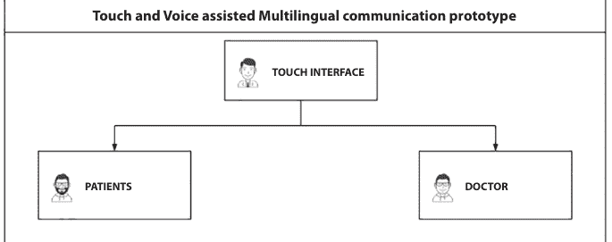

**图 4.1** 触控交互的主视图。

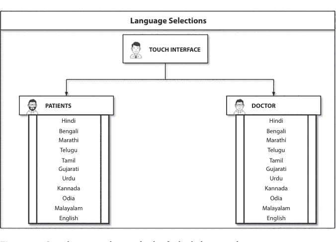

- ii. 呼吸
  - 医生：你感到呼吸困难吗？
  - 患者：是、否
- iii. 咳嗽
  - 医生：你是否有持续的中度咳嗽？
  - 患者：是、否、干咳
- iv. 喉咙
  - 医生：你感到喉咙痛吗？
  - 患者：是、否
- v. 感冒
  - 医生：你是否感觉感冒初期？
  - 患者：流鼻涕、打喷嚏、疲劳
- vi. 睡眠
  - 医生：你睡眠期间感到任何干扰吗？
  - 患者：中度睡眠、深度睡眠、分布性睡眠
- vii. 身体疼痛定位器
  - 医生：请在图片中指出你身体疼痛的位置。
  - 医生：你仍然感到疼痛吗？
  - 患者：是、否

- viii) 一般
  - 医生：你想与朋友/家人/亲属/心理学家互动吗？
  - 患者：朋友/家人/亲属/心理学家

在图 4.3 中，展示了医生与患者的互动，这有助于医生更好地理解以进行进一步的医学治疗。患者的界面也是基于患者的基本需求构建的。一旦患者触摸图标（如清洁床铺、干燥口腔、摘除口罩等），这些需求就会被处理。基本的感受或情绪感受，如由管路引起的困难/不适、睡眠障碍、任何部位的肿胀，都可以通过触摸图标清晰地表达出来。患者希望通过与家人交谈来放松，或就健康状况发送消息或下达指令。患者和医生的回复将以其母语进行翻译。患者可以向医生提问，并且

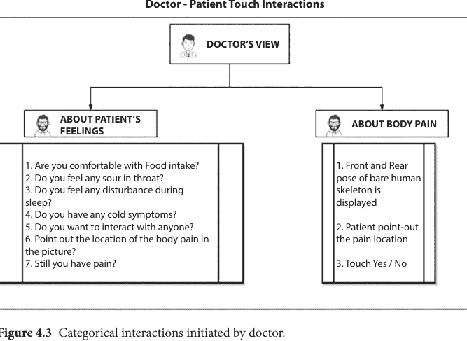

医生可以通过触控手势触摸图片图标进行回复。

患者界面包括其需求、感受、关于家人的内容，以及与亲友或其他住院者沟通的请求。

- i) 患者的需求
  - 患者：口干
  - 患者：舌干
  - 患者：感到口渴
  - 患者：感到饥饿
  - 患者：摘除口罩
  - 患者：给我漱口
  - 患者：清洁我的床铺

- ii) 患者的感受
  - 患者：呼吸困难
  - 患者：肿胀
  - 患者：因疼痛产生的困难
  - 患者：我很疲劳
  - 患者：因气管内插管（ET）导致的不适，

- iii) 家人/朋友
  - 患者：我能见我的家人吗？
  - 患者：我的家人怎么样？
  - 患者：想给家人留言
  - 患者：想给访客留言
  - 患者：想要我的家人照片。

上述医生与患者之间的所有互动均在图 4.4 中展示。

这有助于双方使用触控技术进行有效交互。因此，主要目标是为 ICU 患者设计一种通过语音辅助或图标实现的多语言技术。医生或患者可以选择任何语言，该原型将以出色的方式转换语言，从而有效解决问题。结果，医生和患者可以选择自己的语言，原型将帮助他们进行有效沟通，从而消除语言障碍。患者的健康状况将得到改善，他们将摆脱压力。双方都会感到操作原型的便捷，未来将扩展到所有语言。图 4.5、4.6 和 4.7 描绘了单一交互事件

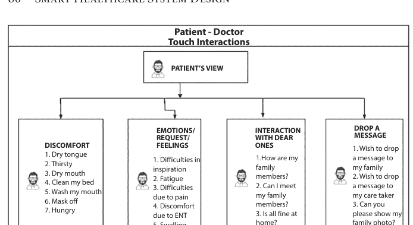

**图 4.4** 由患者发起的分类交互。

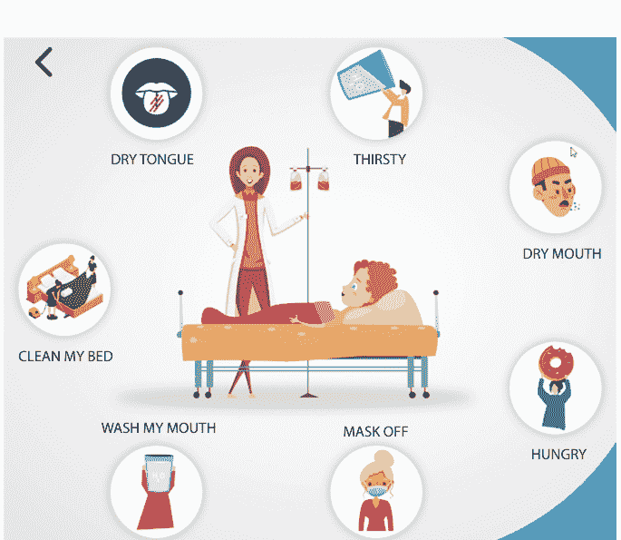

**图 4.5** 英语示例交互界面。

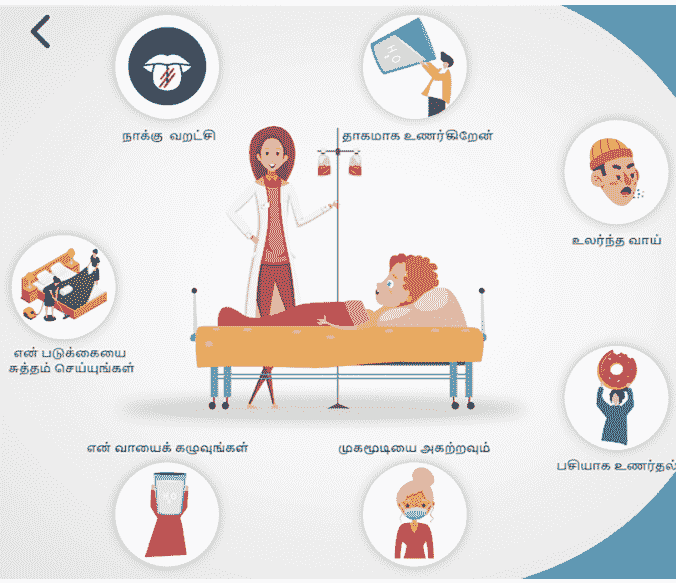

**图 4.6** 图 4.5 的泰米尔语交互。

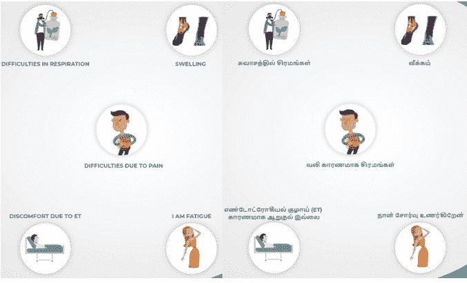

**图 4.7** 英语和泰米尔语示例交互界面。

在两种不同语言中的表现，以促进患者与医疗专业人员之间的便捷沟通。

## 4.3 一个案例研究

提供一个案例研究以帮助理解所提出的原型方案，其中医生选择英语作为其首选语言，患者选择泰米尔语作为沟通的母语。图 4.8 展示了上述选择示例界面。

然后，医生通过触摸用户界面左侧出现的图标（如图 4.9 所示）尝试用英语发起交互。基于医生的英语交互，患者将通过泰米尔语音频接收医生提出的问题。此外，医生发起的同一界面将以泰米尔语显示给患者。这促进了患者通过如图 4.10 右侧所示的触控图标用泰米尔语进行回复。这表明医生和患者之间的语言障碍已被消除。因此，原型作为一个接口，使双方都能处于轻松的状态。

## 4.4 结论

对医生和患者而言，主要意义在于他们可以选择自己的母语，从而实现直观的沟通以及

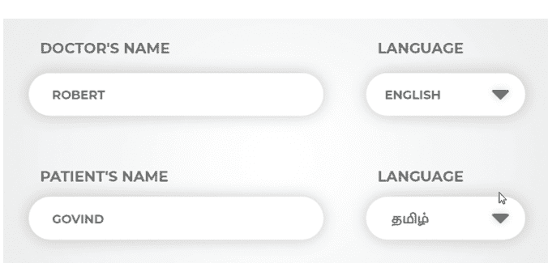

图 4.8 患者和医生母语选择的案例研究示例。

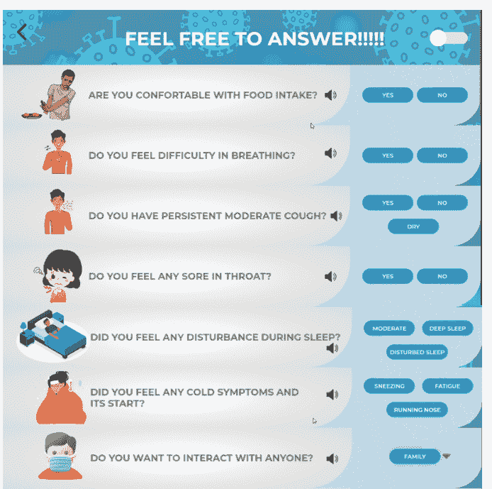

**图 4.9** 医生以其语言交互的视图。

利益相关者之间的互动。临床疾病中最令人痛苦和压力的方面导致抑郁、焦虑和创伤后障碍的情况正在减少，并带来快速康复的可能性。利益相关者之间的语言障碍被消除。该拟议应用程序将在开放软件仓库中提供并可访问。应用程序使用演示视频将提供，以便于操作。根据现有方法，患者通过非语言沟通方式表达其需求，这些需求可能被遗漏或误解，导致症状理解不足，且临床医生高估患者理解沟通感受的能力。通过使用“Touch Voice of SART”应用程序，这些情况被根除。

图 4.10 患者以母语接收医生交互并通过触控图标回复。

## 参考文献

1. Zaytoun, T. 等人，阿拉伯国家危重患者亲属常问的问题。埃及重症医学期志，5, 1, 13–16, 2017.
2. Brinkman, WB., Geraghty, SR., Lanphear, BP. 等人，多源反馈对住院医师沟通技能和专业素养的影响：一项随机对照试验。儿科学及青少年医学档案，161, 1, 44–49, 2007.
3. Hendron, J. and Pollick, K., 医患沟通中持续的问题、新的挑战及下一步措施。关节与骨科手术治疗，84-A, 2, 309–315, 2002.
4. Leung, C.C.H., Pun, J., Lock, G. 等人，探索机械通气患者沟通内容的范围。重症监护杂志，44, 136–141, 2018.

5. Carruthers, H., Astin, F., Munro, W.，对于无发声能力的重症监护病房患者，哪些替代沟通方式是有效的？一项系统综述。*《重症监护护理》*，42，88–96，2017。

6. Otuzoğlu, M. 和 Karahan, A.，确定重症监护病房中与插管患者沟通时图文沟通材料的有效性。*《国际护理实践杂志》*，20，5，490–498，2014年10月。

7. Miglietta, M.A., Bochicchio, G., Scalea, T.M.，针对危重患者的计算机辅助沟通：一项初步研究。*《创伤杂志》*，57，488–493，2004。

8. Maringelli, F., Brienza, N., Scorrano, F., Grasso, F., Gregoretti, C.，重症监护病房中的眼控计算机辅助沟通：“用眼睛说话” *《麻醉学期刊》*，79，165–175，2013。

9. Otuzoglu, M. 和 Karahan, A.，确定重症监护病房中与插管患者沟通时图文沟通材料的有效性。*《国际护理实践杂志》*，20，490–498，2014。

## 用于疫情疾病检测与传播监测的云辅助物联网系统

Himadri Nath Saha $ ^{1*} $, Reek Roy $ ^{2} $ 和 Sumanta Chakraborty $ ^{3} $

$ ^{1} $ 计算机科学系，Surendranath 夜间学院，加尔各答大学，印度加尔各答  
$ ^{2} $ 计算机科学系，Belda 学院，Vidyasagar 大学，印度西梅德布尔  
$ ^{3} $ 计算机科学与工程系，印度加尔各答工程与管理研究所

##### 摘要

物联网（IoT）和大数据分析在医疗领域的兴起，使得我们能够获取来自那些此前仅能手动执行甚至完全无法获取数据的领域的数据。检测传染病并阻止其传播需要实时的知识和监测。物联网已被用于实时捕获传感数据；通过监测个人、健康系统和生态系统，甚至覆盖全球最偏远的地区。基于研究，可以利用物联网网络中的数据推荐预防措施；进一步评估建议的控制措施是否已得到正确实施。在像新冠疫情这样的场景中，对疫情成因的检测及疾病传播进行监测至关重要，尤其是在发展中国家。我们提出的框架包含一个网络模型，该模型使用无线身体传感器、可穿戴设备和云计算来处理患者数据（以文本、图片或云端语音的形式）。构建了一个手机应用程序和网站，以跟踪实时数据。与其他现有系统相比，我们的系统更加稳健且高效。

**关键词：** 智能医疗，无线身体传感器，云服务器，物联网（IoT），健康监测，普适医疗保健，疫情爆发，疫情检测

*通讯作者：contactathimadri@gmail.com*

### 5.1 引言

在当今尖端时代，物联网（IoT）已成为最具革命性的概念之一，为世界的各个维度提供支持。为了最小化低效率并最大化各个领域（包括工程、健康、农业、通信和能源行业）的生产力，物联网开始影响各种各样的部门和行业。通过将这些设备连接到互联网，物联网执行从环境中检测数据、根据最新情景对数据进行操作、记录和分析数据。在物联网电路中，执行器和网络化智能被集成在一起，为客户提供创新且具有知识基础的设施。通过在医疗实践中引入当前的传感和物联网技术，传统医疗方法的任何组成部分都可能发生根本性改变。无线传感器和物联网在智能医疗中的无缝整合，有可能将医疗行业提升到以前不可想象的高度。通过采用智能医疗方法，物联网将有助于解决许多传统健康问题。

云计算正在迅速成为医学领域的一项技术需求。它可能是进一步促进医疗行业发展的解决方案，以便医疗提供者能够实时交流急性病例的患者详细信息。拥抱云计算技术将使医疗过程更加高效和具有成本效益。将医疗融入云端不仅仅是在任何地方、任何时间、任何移动设备上从不同计算机提供医疗信息。它还关乎将医疗中心与云端用户连接起来，在互联网上共享患者健康信息的好处。因此，云计算提供了足够的工具，用于持续存储和研究由传感器生成的大量知识，这些知识可用于简化操作、预测情况并增强各种医疗服务设施。

随着无线体域网（WBAN）、无线传感器网络（WSN）、可穿戴设备以及嵌入式传感器等众多技术创新的融入，物联网展示了克服现有医疗监测系统问题或挑战的能力。它可以进一步提高服务效率，即提供远程控制和手机应用，同时降低医疗支出 [1]。预计医疗将成为物联网重塑的领域之一，通过扩大其发展并降低运营支出。由于其普遍存在，物联网提供了连续且精确的远程控制的机会，从而赋予个人行动自由。无线传感设备（即嵌入式或可穿戴检测器）从人体获取生物信号，并将传输无线地发送至网关，通常用于调节患者健康。这些检测器设备紧凑且具有有限的电压调节能力 [1] 目前向全面医疗保健提供多种方案的互操作性至关重要，并且在物联网中也是必要条件。这种整合便于将可穿戴传感设备与基于云服务的数据同步。一种有效的技术是将嵌入式传感器直接连接到云服务 [2]。

在基于物联网的健康监测协调中使用雾计算需要几种独特的医疗特征。在传统基于物联网的系统中，数据收集和传输是这些网关的主要功能。平台可以通过支持雾计算来增强，以提高医疗基础设施的生产力，这可以说明为一种扩展云计算模型至网络边缘并减轻云端压力和负担的虚拟门户 [1]。最初，传感器设备（特别是许多便携式或嵌入式设备）的设计比其他行业更需要资源效率。这些设备提供的交互形式也是流式通信的形式。然后，由于设备环境的关键性，立即响应传感器网络收集的关键事件是当务之急。聚合框架需要高度的效率，因为必须实时理解生理信号趋势。此外，通过智能技术为个体在临床观察下提供自由移动也是一项关键前提 [2]。雾计算中发现的这些特性使其在医疗领域的应用相当著名。

大规模电子医疗服务的日益增多前景源于智能设备和移动云计算技术的迅速扩展。在这些技术中，个体的健康信息使用可穿戴传感器远程识别，并通过无线设备传输到专用计算机系统以进行分析和评估，其中各种专业人员（包括医院、医疗机构和医生）可以处理此类健康信息。在可穿戴和嵌入式传感系统（如无线体域网 WBANs）的最新进展提供了广泛且精密的实时检测及跟踪问题解决方案。话虽如此，WBANs 预计将面临若干挑战，因为

从通信能力、信息保护、存储以及海量获取数据的分发角度来看，这些是独立的系统。因此，WBAN 在许多情况下都集成了基于云传感器的架构 [3]。

智能监控设备被需要捕捉个人健康信息的患者使用，例如心率、血压和血糖阶段，这些信息通过可穿戴技术传感器传输到手机。可佩戴的移动传感器允许在较长时间内进行持续的生理和环境观察，这对于许多无法治愈的疾病、神经系统疾病和心理问题的行为和诊断至关重要。大约在同一时间，患者的医疗状况也将被追踪。对于在家的患者进行远程追踪，使用实时以及半实时的医疗数据。从某种意义上说，这鼓励医生和临床医生提供高质量的医疗护理。庞大的电子医疗网络旨在扩大人员监控的覆盖范围，包括生活在家庭、城镇，甚至在一个国家中的大型社区。

射频识别 (RFID) 和无线传感器网络 (WSN) 设备被用作通信和网络基础设施来传输这些数据 [4]。Farahani 等人 [4] 提出了对众多已发表的物联网 e-Health 论文的全面综述，并建议了一个覆盖多层级的整体 e-Health 生态系统，在这些层中不同的技术可以连接到不同级别，包括辅助生活、移动健康、电子医学、设备、检测系统和患者追踪。这种以患者为中心的物联网 e-Health 环境已被证明需要多层架构——计算机、雾计算和云——以允许复杂数据以多样性、速度和运行时间等形式进行管理。

在人类寿命期间，人们会遭受众多疾病，从轻微到极其严重。这些疾病通常可分为两大类：传染病（感染性疾病）和非传染病。传染病是通过导致疾病的微生物的直接移动，从一个人传播到另一个人。一旦某种传染性（可传播）疾病在给定区域内的短时间内迅速加速并触及大量个人，它就被公认为流行病 [5]。人类历史上 numerous 的流行病爆发重创了人类。直到目前，这些流行病是由世界卫生组织 (WHO)、其管理医生以及世界各地的各种行政机构进行对抗的。流行病可以被描述为在特定区域或特定人群在给定时间内超过正常流行率的疾病或健康相关紊乱的发生率。普遍医疗保健服务的可持续性可能依赖于对此类疾病的早期诊断，而不是缓慢的反应和昂贵的药物治疗。医疗保健领域最令人担忧的方面不仅是对任何传染病爆发的持续监控，还包括实时干预。必须消除健康用户和感染用户之间的近距离接触，以监控疾病的传播。

在过去造成大量人员死亡的几种流行病包括登革热、埃博拉、寨卡病毒爆发、霍乱、甲型流感 (H1N1)、基孔肯雅病毒和黄热病。未能及时预测、追踪和监控它们是这些流行病加速爆发并导致高伤亡率的主要原因。传统的离线感染监测和预测策略，如基于模型的策略，通过实施封锁和接种疫苗来管理流行病的传播 [5]。

全球 COVID-19 大流行，通常被称为冠状病毒大流行，是近期 2019 年全球冠状病毒疾病爆发，因此得名 COVID-19。该疾病最初于 2019 年 12 月在中国武汉被发现；随后很快，它成为全球公共卫生问题。COVID-19 是自 1945 年第二次世界大战期间武器停火以来最具影响力的事件。自 1947 年毁灭性的分裂事件以来，印度 COVID-19 大流行的影响最大。自世界卫生组织宣布其为全球大流行以来，冠状病毒研究已成为研究领域的新兴主题。这项研究已经涉及科学的各个领域，从医学领域到工程世界。世界卫生组织的科学家和医疗行业专家正在寻找创新技术，以在不同层面监控感染患者，以应对这场全球新大流行，确定最佳的临床试验，控制这种病毒的传播，为感染患者创建抗生素，并追踪感染个体的经历。

所有此类传统方法都受到许多限制的影响，加上由于模型中关于社交媒体网络存在性的错误假设而导致缺乏可靠证据和不可靠的估计。因此，已认识到需要主动监控医疗保健以改善健康状况并避免传染病爆发。因此，许多研究人员建立了基于物联网的技术以及云计算，以解决通过不同类型的设备和系统进行持续追踪的传统方法在预测和识别流行病以及通过提高意识向公众发出这些流行病警报方面的问题 [5]。为了克服这些挑战，本书章节中因此提出了这样一个系统。

第 5.2 节包含对现有各种系统的文献综述，提到了这些系统的结果、优点和缺点。在第 5.3 节中，提出了该系统，并详细阐述了建议模型的架构。第 5.4 节解释了建议模型的方法论。第 5.5 节简要解释了建议模型的性能分析。在第 5.6 节中，解释了建议模型的今后研究方向。第 5.7 节对本书记载了这一简短的结论。

## 5.2 背景及相关工作

预计医疗保健系统将是物联网改造的部门之一，该系统通过云计算的支持来扩大其采用并降低运营费用。由于其无处不在的存在，云辅助物联网提供了不间断和高效远程控制的机会，从而使用户能够自由移动。发现传染病活动并阻止其传播需要实时信息和监控。从社会和经济角度来看，使用正确的信息迅速反应将对全球人民的生活产生巨大影响。近年来，健康监控服务的生产已大幅改善。当今健康监控结构的主要目的是在住宅或移动环境中提供对患者关键症状的准确评估，以实现最新的医疗记录。已经生产出一系列可穿戴的健康追踪设备。

Gia 等人 [1] 生产了一个具有雾层的最小成本基于物联网的远程医疗监控系统。开发的设备能够收集包括生物信号和其他相关信息的数据，并无线交换信息以进行实时和远程追踪。生物信号包括呼吸和心电图 (ECG)，其他数据指的是湿度和环境温度。借助雾层，该系统提供高级设施以增强医疗保健活动的效率，如数据收集、分类、推送反馈和信道控制。由于其高能效，传感器节点可以运行较长的时间，长达 155 小时。建议的系统可以进一步发展，并可使用移动应用程序向患者显示数据。

Negash 等人 [2] 阐明了雾计算的重要性，即一系列提供的实用工具，这些工具使物联网健康服务可用于

雾计算智能网关的开发与部署。该框架中的雾层是由此类智能网关组成的地理分散网络生成的，每个网关单独管理一个传感器节点或患者集群。这种网关配置在覆盖范围内不会限制患者出行的同时，保持了对患者的持续跟踪。雾计算产生了集中的患者观察能力，并立即发送了警报。雾计算通过最小化协调延迟和提高设备性能，提供了远程患者控制功能。在此程度上，患者的生命体征已在本地记录，并向接收者发布了本地备注。此外，为了进行更进一步的评估，传感器数据连同收集到的发现结果一起发送到了云服务器。对雾设施及其获得的优点进行了评估，并提供了成功指标。任何设施，例如雾层与云或传感器层与雾层，都可能被复制或细分为多个部分。实施细节取决于相关设施和功能。包括收集到的观察结果在内的传感器信息随后再次被发送到云服务器以进行进一步分析。雾系统的具体细节已被评估，并进行了性能分析。例如，在将信息从传感器传输到雾层之前，节点处的噪声可能首先被消除。雾计算可用于执行复杂和繁琐的噪声消除和信号分析技术，以提高所获取数据的准确性。为了部署更专门的技术，如高级机器学习技术，可以纳入云层。在生产力和连接性方面也必须考虑，以尝试在传感器节点上产生良好的能耗水平。最后，医疗使用中的特定情况可能具有外部架构限制，其中包括调整雾层系统行为模式。缺点在于，如果应用了错误的位置，则决策可能会触发功耗、延迟和低效性能。

Berrahal等人[3]提出了一种新的医疗基础设施，专注于将云传感器与无线体域网（WBANs）解决方案相结合，用于控制偏远地区的传染病。开发的框架旨在通过处理由携带WBAN的个人生成的警报，并根据公共和私有云来改善传染病的识别和监测。它还试图建议个体疾病的进展，并引入一个查询管理框架，使合并的云能够实现协调响应。框架内嵌三个关键层，即私有云、核心公共云和WBAN云。为了计算健康状况、环境条件和运动参数，第一阶段描述了以WBAN系统形式植入活动人员身上的传感器装置电路。每个WBAN节点持续获取生命指标变量，如肌电图（EMG）、体温、心电图（ECG）、血压、呼吸速率、血氧饱和度及其他参数。环境传感器的目的是量化可能对流行病传播有帮助的参数，如水质污染、大气温度和相对湿度，以及特定动植物种类的普遍性。在特定的受控区域内，WBANs协同工作，使流行病的诊断成为一个共同目标。在这种情况下，各种WBAN被视为彼此邻近的节点，将形成移动云微片。第二层描述单一医疗机构的私有存储设施，该设施负责管理和记录患者的健康状况以及流行病的演变。此云包含WBAN的云微片包。私有云计算提供统一处理，并在指定位置保存由多个移动WBAN获取的数据，以便进行实时分析和编译。此外，私有云还保存机密且有价值的记录，如患者识别信息、医疗程序背景、特殊疾病发病详情、患者健康相关详情以及医疗人员知识。除了监测患者健康状况和流行病爆发外，所有这些数据都极具价值。为此，开发系统的第三层建立了一个国家统一且公共的存储系统，其中由私有云识别出的异常和不寻常测量值被登记，以便以特定形式的统计数据向所有相关实体开放，并进行额外分析。实时计算必须在设定时间框架内传输到期望位置；否则，获取的详细信息将过期且不再有效。为了促进对传染病的有效实时监控以及所提议方法的有效性，本研究可以通过仿真进一步测试，作为未来工作。

Sood *et al.* [6] 提出了一种专注于物联网和雾计算的医疗系统，用于检测和监测基孔肯雅病毒（CHV）爆发。众所周知，基孔肯雅是一种传染性病毒，传播更为容易，从而对全球卫生安全构成新挑战。随着物联网、雾计算和云计算在信息和通信系统中的发展，提高信息收集量、处理效率、有效诊断以及为全球消费者、医生和医疗从业者提供知识访问变得可行。该方法的关键特征是使用暴露因子来评估不同事件持续时间相关的健康严重性。基于灾害警告，通过雾网络生成健康严重性，以便及时向用户智能手机传输事件信息。模糊C均值（FCM）被用于识别可能受感染的用户，并从雾层自动产生诊断和紧急警报。此外，在云服务器上使用社会网络分析（SNA）来反映CHV传播状态。爆发功能指数从反映每个用户感染或传播感染可能性的SNA图中确定。它还生成警报警告，以便政府和卫生机构监控易发风险或污染地区CHV的发生。爆发角色指数（ORI）也从SNA图中确定，该图还反映了某些人获取或传播感染的风险。适时地，它还为访问或居住在易发风险或污染地区的未感染人员提供警报警告。未感染个体将得到帮助，采取紧急措施避免此类病毒的传播，并由政府卫生部门更好地监控这一关切。提议设备的实验结果与云计算技术进行了比较。实验证明，所提出的架构在带宽、最小执行时间和产生实时警报的最小延迟方面取得了性能提升。该系统可进一步开发，以在移动应用中显示受影响患者的健康状况。

在他们的论文中，Rahmani等人[7]在基于物联网的医疗系统背景下引入了雾计算和智能电子健康网关的概念。在智能家庭或医院中，已在传感器节点附近开发高级网关，以利用其独特的关键方法来解决许多问题，如移动性、能源使用、可扩展性、互操作性以及基于物联网的健康系统可靠性。由智能网关以地理分布格式向网络边缘的检测器和最终用户提供的一系列高级功能已被系统详细评估。在此模型中，讨论了一些高级功能，并集成了名为UT-GATE的智能电子健康网关的实现。该结构还集成了健康监测，以有效展示设备在解决特定医疗案例研究——基于物联网的早期预警评分（EWS）方面的效率和效力。一种具有整体系统智能和能源改进的基于物联网的健康监控系统

## 5.2 文献综述

该设计模型展示了消费、敏捷性、效率、互操作性、稳定性和一致性。本文展示的完整系统包含了从传感器网络的数据收集到云端及终端用户的所有信息流过程，该框架可进一步开发用于监测严重流行病。此外，该框架还可通过移动应用程序进一步开发，以帮助用户监测其健康状况。

Sood等人[8]提出了一种基于雾-云（fog-cloud）的网合物理设备，以有效识别、诊断和追踪感染蚊媒疾病（MBDs）的人员。文中使用了一种相似度因子来根据症状区分蚊媒疾病，并使用J48决策树来定义消费者群体。该论文的关键方面在于利用时序网络分析（TNA）在TNA图上描绘任何感染蚊媒疾病的人员。一旦出现异常情况，警告会立即产生并从雾层发送到用户的智能手机。射频识别（RFID）技术被用于检测人员之间的近距离接触。这可以帮助未感染疾病的公民采取立即措施以避免这些疾病的传播。所提方法的实验结果表明，其具有高准确率和低错误率，能够识别蚊子携带的疾病，并在分类中达到了94%的准确率。研究结果还表明，TNA是一种有效的工具，可使用不同参数来确定MBD爆发的状态。未来该模型可用于控制其他流行病的爆发。

Sareen等人[9]提出了一种基于可穿戴传感器技术、射频识别设备（RFID）和云技术网络的新型系统，用于追踪和识别埃博拉病毒感染者。该实验的目的是减少病毒在爆发初期的传播。为了根据个体用户的症状确定感染程度，使用了J48决策树。利用RFID，消费者之间的接近交互（CPIs）被自动感知。时序网络分析（TNA）利用CPI数据实施，以识别和追踪埃博拉流行的当前情景。文中提到了一种基于云的架构，利用TNA和可穿戴体传感器技术来预测和避免埃博拉病毒病（EVD）。分别使用WBAN（无线身体域网）和RFID记录关键体征和社会体验。与传统的离线模型相比，该策略侧重于实时捕获近距离接触和医疗细节，以监测疾病的进展。为了区分消费者，在多个组中使用了J48决策树。在TNA图上，TNA被用来描述每个感染埃博拉病毒的人。为了对某些活动频繁的感染者或地区进行分类，计算了关于爆发分布的不同时序统计数据。所提模型的性能和准确性已在Amazon EC2云上进行测量，该云整合了来自两百万名消费者的模拟数据。在识别和资源利用率92%的情况下，所建议的框架达到了94%的精确度。为了提高框架的性能，未来开发中该系统可用于专注于计算此类用户的不完整信息。

Butca等人[10]在其论文中介绍了一种专注于可穿戴传感器的实验范式，旨在追踪患者的健康状况。该技术依赖于通过云平台连接的可穿戴传感器网络，该网络聚合了传感器收集的数据。传感器计算各种参数，包括体温和相对湿度或空气湿度，并通过网关由微处理器发送到云存储设备。为便于进一步处理，云系统中获取的数据可供研究人员访问，以研究计算参数、环境因素与患者健康状况之间的特定关联。传感器在一个月内进行检查。基于存储、应用程序和应用的整体可扩展性，选择了云方法。在即服务数据库（Database-as-a-Service）计算环境中，所提出的架构利用云设置来自检测器的数据。云计算在灵活应对低效网络状况时，优化了架构的可扩展性和运营成本。云基础设施中的信息可用于更多分析。获得的知识有助于建立计算参数与大气环境以及使用该框架的公民状况和健康状态之间的特定关联。这种监控系统的缺点是不足以应对紧急情况，但此类系统可以帮助某些患有慢性病的患者及其家人。尽管计算机和通信技术的进步为医疗服务开辟了新的视角，但似乎仍有一系列问题需要技术专家和医疗专业人员共同努力解决。

Altheban等人[11]引入了一种大规模电子医疗监测方案，旨在覆盖广阔地理区域内的众多人群。诸如移动设备、边缘计算技术、可穿戴传感器、大数据方法、云计算和决策系统等许多新发展，可轻松嵌入到该结构中。它将随时随地及时提供患者在线控制。系统中还包括对患者的福祉（包括社区、城镇和国家）具有特别意义的几种特殊角色。这些特殊特征通过针对预期危险的长期、谨慎且富有洞察力的选择而得以区分，这些危险可能源于检查后识别出的不良健康行为。从患者那里获取大量数据。通过捕获其生命指标和生物信号细节，并将数据上传到专用服务器，所提出的框架旨在同时容纳大量患者。在这种云MEC（移动边缘计算）服务器和移动边缘计算中的云let序列，可以管理患者的大数据，在一个依赖Map-Reduce的计算系统中确保性能和可扩展性。此外，它使用一系列支持证据来最大化推荐系统的影响力。该系统有两个阶段：反应式和主动式。然后将根据疾病传播的可能性或可能升级为医疗问题的可识别的常规习惯做出决策，并转发给卫生部门采取必要的决策和措施。利用CloudExp仿真框架，开发了一个系统作为对我们建议系统的仿真，以评估我们的模型。进行的研究表明，该模型方案能够降低每用户功耗和延迟。它还表明，该设备具有足够的灵活性，能够以最小的开销容纳大量用户。

从上述文献综述中，我们可以得出结论，有一些系统已被开发用于检测流行病，但它们存在缺陷。我们的系统旨在克服这些缺陷，并建立一个云辅助的物联网系统，用于流行病检测及其在社区中传播的监测。我们将此系统针对正在进行的COVID-19大流行。

因此，本书章节提出了一个模型，将使医疗保健系统能够检测并抵御COVID-19。分别使用WBAN和RFID记录关键身体症状和社会交互。与传统的离线模型相比，我们的策略侧重于实时收集近距离接触和 health 信息，以监测COVID-19流行的传播。J48决策树被用来将用户分为两个不同的类别。

## 5.3 所提出的模型

发烧、干咳、喉咙痛和头痛是与COVID-19相关的其他几种呼吸道症状中最常见的症状。

在 COVID-19 中，流鼻涕和胃肠道症状似乎相当罕见。来自中国的统计数据显示，大量患者仅表现出轻微的副作用（无肺炎或轻至中度肺炎）。症状更为严重的患者显示出极端的指标（头晕、血氧饱和度 93%、呼吸频率 30 次/分、在吸入氧比例下动脉血氧分压 <300，或 24 至 48 小时内肺部浸润 >50%），其中少数患者病情危重（呼吸骤停、脓毒性休克，或多个器官衰竭或损伤），并最终导致死亡 [12]。

此处提出的模型是一个医疗基础设施，专注于结合无线身体区域网络（WBANs）的云端传感器解决方案，用于控制某个区域内的 COVID-19。该框架旨在通过利用无线频率识别（RFID）技术处理由携带 WBANs 的个人生成的警告，并依据云端数据，来改进对感染冠状病毒患者的识别和监测。该框架还旨在包含一个移动应用程序，该应用将反映佩戴便携式健康传感器并携带手机者的健康状况详情。

图 5.1 中提出的模型可以跟踪传感器数据，并帮助用户被识别为 COVID-19 阳性或阴性患者。如果受影响的人出现在未受影响的人附近，警报也会发送到手机应用程序。这些数据存储在云服务器中，并通过网站反映在附近的医院，以确保受此次疫情影响的地区得到高效管理和监测。个人患者登录其个人资料后，可以通过该网站查看其健康详情。如果患者发现患有该疾病的症状，网站还会显示测试详情。

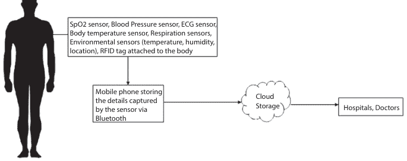

图 5.1  proposed 系统框架。

## 5.3.1 ThingSpeak

ThingSpeak 是一个开源的在线云阶段，允许用户将数据作为记忆的电子存储库进行存储和分析。它允许对实时云数据源进行聚合、可视化和分析。用户可以以每秒一次的速度向 ThingSpeak 发送数据。这种每秒一次的数据发送频率通常使设备能够几乎实时地受到监测，但也有助于从云端设置控制回路。ThingSpeak 通常轻松记录用户发送的数据，从而可以从任何地方远程监测设备或设备，甚至可以从任何移动设备或网络浏览器查看数据，这使其非常有利于物联网（IoT）项目。它与其他许多开源资源集成，例如 MATLAB 可视化、MATLAB 分析、TimeControl、ThingTweet 等，并允许将 ThingSpeak 连接到硬件。这些功能在分析上传的数据时也提供了好处。作为我们提出模型中的中央服务器，ThingSpeak 维护所有元数据。传感器信息存储在云中的单一位置，使我们能够轻松访问在线或离线分析信息，从而便于我们在提出的模型中使用它。

## 5.3.2 血氧饱和度 (SpO2)

血氧饱和度（SpO2）是一个极其有用的关键结构，利用脉搏血氧计和光电容积脉搏波（PPG）技术的概念进行计算非常简单。PPG 方法允许获取血管波形变异，当考虑使用两个波长（通常为 660 nm 和 905 nm）时，可以近似血氧饱和度。作为与心率相关的指标，有时医疗专业人员推荐脉搏信号或脉搏率。脉搏信号或脉搏率可以使用脉搏血氧计的原理计算，这是一种常用于计算血氧饱和度的工具，因此不应将其视为与心率相同。脉搏率被定义为动脉的触知调和性扩张和收缩，这是由心脏收缩和舒张导致血液体积被强制注入血管所引起的。与功率、振幅和脉搏规律性一样，该指标提供了比心率（HR）更详细的数据。这与血红蛋白吸收率的变化范围有关，因为它受氧气结合的限制。红细胞运输的氧气量可以通过血氧测量概念来测量（通常为 95–100%）。这种测量有助于识别医疗症状的变化，这些变化原本可能被忽视，例如氧气水平降低（<95%），表明缺氧并导致人体氧气供应不足。测量血氧饱和度的难点之一在于患者是否贫血。许多非手术技术可以添加到可穿戴设备中用于测量血氧饱和度，但 PPG 在医疗行业中相当常见。移动通信使此类检测器的自主和可穿戴系统变得简单得多。

## 5.3.3 血压 (BP)

最重要的心肺测试之一，显示动脉壁上的血压，被认为是血压（BP）。当心脏收缩（收缩期）和舒张（舒张期）时，BP 提供了有关血液供应的额外信息，并且还可以指示细胞氧气的分布。它受到各种不同生理特征的影响：外周血管阻力、心脏输出量、血流和粘度；以及血管弹性。通常使用听诊器和充气压带在患者手臂上测量 BP。对于自主血压评估，这种方法非常适用，配合全自动充气袖带通过比较外周压力与动脉体积脉冲程度来测量 BP。袖带的长期监测可能导致不良副作用，如睡眠中断、皮肤瘙痒和压力水平增加。为了解决最后一个问题，已开发了新的血压监测技术。一种是预测血压，所有计算基于胸部或获取手腕处的 PPG 信号，取决于光体积脉搏波（PPG）和心电图（ECG，R 波峰值）脉搏波之间脉搏信号的转换时间。

## 5.3.4 心电图 (ECG)

在广泛使用的生物信号中，心电图（ECGs）作为一种诊断工具，在医疗环境中揭示了关于心脏电周期的信息。五个峰和谷（称为 P、Q、R、S、T 和 U）构成了 ECG 波形，每个波形都反映了心脏电位差异，导致肌肉活动以及心脏运动的结果。ECG 波形的目的是测量心率，以及预测和诊断严重的心肌和冠状动脉事件。研究 ECG 波形节律在诊断心血管疾病（CVD）中扮演着重要角色，如充血性心力衰竭（CHF）、冠状动脉疾病、心脏病发作及其他疾病。Ag/AgCl 电极（湿电极）是将从核心中的离子电流通过金属导线转换为电子电流的最常用电极。其他一些 ECG 传感器类型是非接触式电容电极。尽管直接接触皮肤，这些电极可以获取 ECG 数据，但它们比传统电极对生物医学信号敏感得多。

## 5.3.5 体温 (BT)

体温（BT）是体内热量产生和热量散失平衡的产物，评估它对于防止许多升温要素的功能性缺陷很重要，例如蛋白质变形和温度升高导致的功能下降。核心体温（CT）和皮肤温度通过 BT 分为两种测量。由于身体的温度调节机制控制核心体温，皮肤温度在比核心体温更广泛的温度范围内变化。血液循环控制皮肤温度，并与心率（HR）和代谢活动相关。在体温控制系统中，环境因素如空气循环、大气温度和相对湿度也起着主要作用。为了检测这些温度变化，已开发了众多便携式可穿戴系统，如可穿戴粘附装置和类皮肤的精确温度传感器阵列，以密切监测温度。在我们提出的方法中，使用了一种非常新的可重复使用无线表皮温度传感器，一种无电池的 RFID 温度计，其似乎是一个可靠的 CTT 估计系统。

## 5.3.6 呼吸频率 (RR)

呼吸频率（RR）是患者监测中的一个基本生理变量。在某些情况下，这是可靠且真实的健康信息。这是对于基本疾病最敏感的标记之一，如抑郁和可能的缺氧病例。在诊断呼吸障碍迹象如睡眠呼吸暂停综合征、哮喘等时，控制呼吸频率至关重要，在必要时改善治疗管理。对于患有肺部疾病的人，这种连续监测尤其必要。获取呼吸功能有三大主要策略：阻抗容积描记法（IP），

弹性式体积描记法（EP）和呼吸感应体积描记法（RIP）。其他使用的技术包括从 ECG 信号中收集的数据、光纤、加速度计、源自基于聚合物的脉搏血氧仪传感器等。

### 5.3.7 环境参数

在每个患者所在区域，环境参数（即环境因素）在许多人体检测领域具有重要的意义。温度、光照、湿度和声音程度是最常用的传感器，再加上位置传感器。在此提出的方法中，大气温度和湿度等环境参数与位置信息相结合。为此，使用了温度传感器、位置传感器和湿度传感器。

## 5.4 方法论

上述特性已被考虑在内，以高效管理我们提出的 COVID-19 流行病控制系统：每个 WBAN 节点充当临时存储系统，能够实现患者相关数据的快速、高效跟踪和监测；WBAN 包含相互依存的检测器，负责产生基于优先级的数据。该模型旨在跟踪 COVID-19 患者。图 5.2 展示了我们提出的模型的流程图。第一层定义了 WBAN 结构格式中安装在移动设备上的可穿戴传感器网络，用于测量健康、运动和环境参数。每个 WBAN 节点都可以记录心电图（ECG）、体温、氧气水平、血压、呼吸频率、脉搏率及其他体征参数等生命体征指标。环境传感器的目的是测量可能有利于 COVID-19 流行病传播的条件，例如大气温度和湿度。此外，通过监测气候条件以及利用位置传感器产生的位置数据，可穿戴健康跟踪系统可以记录疾病识别的位置和时间以及相关的地理覆盖范围。

这些 WBAN 协同工作，针对受 COVID-19 影响的特定监控区域内的传染病建立共同的诊断目标。用户首先需要提供其手机号码和其他个人信息进行注册。为每个注册人员创建一个用户标识 ID（UID），该 ID 将用于未来的通信。用户的个人信息也将存储在云目录中。

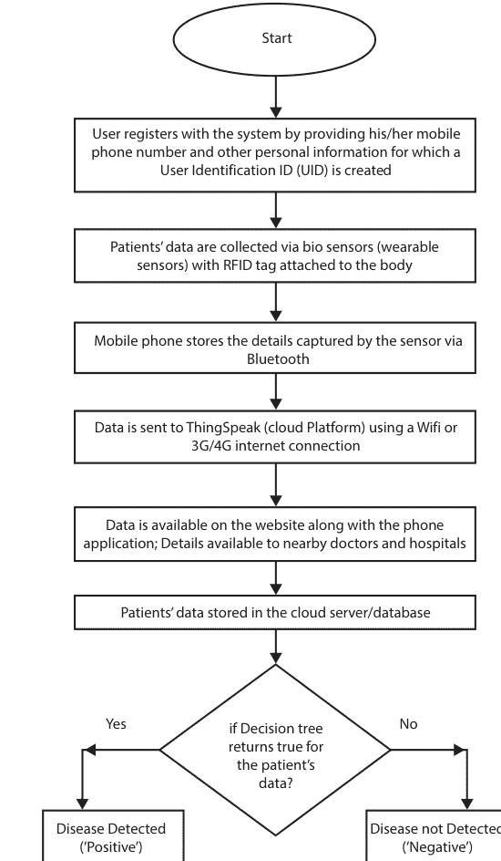

图 5.2 所提出模型的流程图。

通过 WBAN 获取的主要症状通过蓝牙链接传输到手机。收集的数据通过无线网络连接从路由器发送到 ThingSpeak（云平台）。然后，信息在移动应用程序中被收集并显示。这些数据和信息通过 Wifi 或 3G/4G 互联网链接存储在云服务器上。为了从 WBAN 收集和恢复信息，云使用 ThingSpeak。

使用 MIT System Inventor 2，在 WBAN 设置完成并持续运行后，可以创建一个移动应用程序。移动应用打开后，ThingSpeak 的结果会在移动屏幕上向用户显示。之后，几分钟内，ThingSpeak 中报告的更新信息会再次向用户显示。只有当用户想要退出移动应用程序时，用户才能退出。

手机应用程序中显示健康参数，如心电图（ECG）、体温、呼吸频率、血压、氧气水平、脉搏率，以及大气温度、湿度和位置详情。移动应用程序可以配置为实时显示有关用户健康、环境详情和位置详情的信息。使用本系统的用户之间的物理和社会互动是通过 RFID 捕获的，RFID 情感上与用户的身体相关联。

用户携带装有基于 Android 的手机应用程序的智能手机，该手机还具有 RFID 读卡器功能，可以读取或感应附着在用户身上的 RFID 标签。这些数据和信息以聚合形式传输到云服务器。这些数据由 WBAN 实时收集，个人数据和症状在云服务器中积累。

使用决策树 J48 来标记注册用户是否为 COVID-19 患者。因此，建立了两个类别：‘阳性’（P）和‘阴性’（N）。如果该人表现出发烧伴喉咙痛、咳嗽、流鼻涕、低脉搏率、低氧气水平、异常血压水平、呼吸频率不规则等症状，则他或她将被归入‘P’类；否则归入‘N’类。

这些传感器每 10 小时更新一次身体状况。服务器还跟踪发现受感染人员所在区域的位置、温度和湿度。政府可以处理这些数据，以便特别关注这些区域。如果某人被发现在‘P’类中，他或她可以直接前往附近的医院接受适当的治疗并得到更好的检测。这节省了人们进行不必要的检测，也有助于节省查找受影响者的身份和时间。

受感染个体被持续跟踪和评估，直到他们从 COVID-19 中康复。设备生成的警报和警告更新被发送到受感染患者的智能手机。基于患者手机的 GPS 位置，警报通知甚至通过云发送给当地医院或医疗机构，通常使用定位传感器。使用 RFID 检测附近是否有受影响的人员。附着在每个人员身上的 RFID 标签有助于识别感染者，如果未感染者进入受影响者的附近。手机带有 RFID 读卡器，可以感应其他人携带的 RFID 标签。传感器数据在网站上更新，供医生和附近医院进行跟踪并采取必要措施。

移动应用程序和网站旨在显示心电图（ECG）、体温、氧气水平、血压、呼吸频率、脉搏率及其他体征参数等生命体征，以及周围环境状况。如果患者被发现受影响并进行了检测，它们还显示患者的检测详情。存在注册页面，该系统获取每个用户的手机号码和其他个人信息，以提供唯一的用户标识 ID（UID）。手机应用程序显示患者的不同传感器读数（SpO2、脉搏率、BP 率、温度），以及显示患者详情的‘详情’按钮和退出应用程序的‘退出’按钮。网站界面也类似手机应用程序一样工作。医生或附近医院可以从云服务器读取这些数据，以治疗患有或出现 COVID-19 症状的患者。

图 5.3、5.4、5.5 和 5.6 分别展示了网站主页、网站‘注册详情’页面、网站‘患者检测详情’页面以及网站中患者‘传感器读数’页面的快照。图 5.7 和 5.8 展示了手机应用程序屏幕的快照，分别显示了患者的不同传感器读数（SpO2、脉搏率、BP 率、温度），以及显示患者详情的‘详情’按钮和退出应用程序的‘退出’按钮，还有使用传感器获得的患者脉搏率读数的手机应用程序界面。

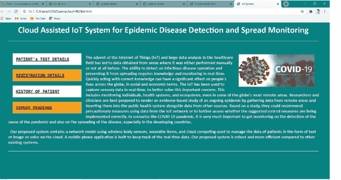

**图 5.3** 网站首页屏幕快照。

**图 5.4** 网站“注册详情”页面快照。

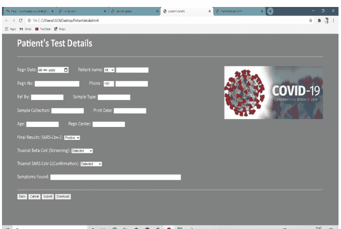

**图 5.5** 网站“患者检测详情”页面快照。

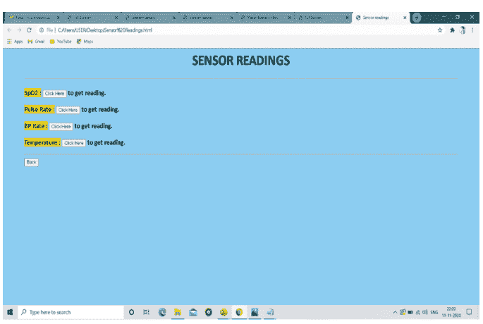

**图 5.6** 网站中某患者“传感器读数”页面快照。

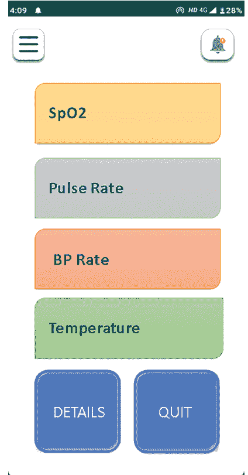

**图 5.7** 手机应用程序屏幕截图，显示患者的不同传感器读数（血氧饱和度 SpO2、脉搏率、血压 BP、体温），并配有显示患者详情的“详情”按钮和退出应用程序的“退出”按钮。

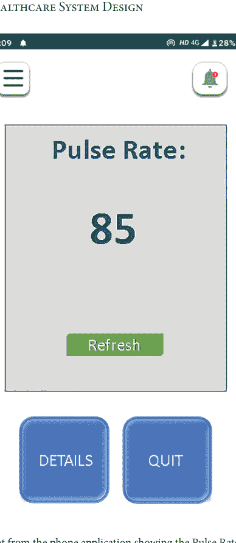

**图 5.8** 手机应用程序截图，显示通过传感器获取的患者脉搏率读数。

## 5.5 性能分析

在我们提出的模型中，我们实现了一个基于机器学习（ML）的模型，用于根据目前已知的症状检测 COVID-19。然而，我们尚未能在实际中检测出 COVID-19。但是，当应用于当地一些患有发烧和/或流感的人员时，我们的模型仍然能够以超过 80% 的准确率检测出流感。因此，只要向机器学习模型提供已知的症状，我们的模型就能很好地执行检测 COVID-19 的任务。我们使用了高精度和低成本的生物传感器。我们使用 ThingSpeak 作为云平台，该平台易于与物联网设备集成，并使用 MATLAB 生成数据可视化。此外，模型中使用了无线体域网（WBAN），使得患者可以在移动中甚至在家中接受监控。该应用程序可以验证用户身份。与其他非基于机器学习的模型相比，我们的模型能更快地为农村地区提供服务。

## 5.6 未来研究方向

在未来的工作中，该系统可以进一步开发，以实时检查其他因素，如肌电图（EMG）、心率（HR）、血糖（BG）水平、皮肤排汗、二氧化碳分压以及其他健康参数。该模型还可以进一步开发，以测量生理参数（如运动评估）并将心脏植入设备与此模型集成。

其他传感器，如光照和声级传感器，可以进一步整合到该模型中。传感器也容易遭受侧信道攻击。这可能导致由偏斜值引起的错误信息，进而影响农业生产。因此，在评估之前，需要对可能受到特定影响的数据进行掩蔽。为此类保护，除了登录验证和访问控制外，还可以建立信息的保密性。

未来的研究工作还可以包括使用轻量级加密算法来保护来自所有传入传感器的个人信息。对于这个模块，未来的研究可以是一种中间件架构，专注于为从传感器节点上传数据的所有者提供端到端的安全系统 [13]。

我们可以将雾计算技术整合到未来的模型中。雾计算层充当物联网传感器和云计算层之间的桥梁。它可以实时处理和解释从基于物联网的传感器获取的数据。它可以向用户（可能是感染者或非感染者，针对特定类别的用户）发送即时的实时警报或警告。此外，该设备可以链接到云层以存储、解释结果并汇编每个用户的医疗记录。可以基于此信息并使用机器学习算法对收集的数据进行分析。

基于此信息并使用机器学习算法，也可以对收集的数据进行分析。引入雾计算还将减少云平台的使用，从而带来更低成本、更强大、更可靠和更快的监管框架。处理医疗领域的大数据问题也可能是未来的研究领域。该框架可以进一步用于关注计算这些用户中任何一人的缺失信息，以提高模型效率。

在传感器系统领域，必须仔细关注 3 个主要组件：长期一致性、韧性；以及生物相容性。水会导致基于纺织品的传感器件发生化学、机械和热降解；因此，必须尝试生产更具抵抗力的传感器，以解决这些由长期可用性引起的所有问题。更小的传感器也是提高该系统灵活性和便携性的绝对必要条件，这与技术的进步相关。可穿戴传感器的灵敏度是一个必须严格审查的重要特征。基于纳米材料的信号放大利用可能是未来的一种潜在增强方式。具有抗菌或保护涂层的传感器的生物相容性很重要，以避免纳米材料可能的污染，这可能是该系统的另一个未来发展方向 [14]。

该模型可以在未来进一步开发，用于测试诸如已实施系统的有效性等指标，以产生实时警告，并在检测到疾病时立即转发；每云配置的云数和参与者数量对服务可靠性的影响；客户移动性对实时限制请求反应的影响等，作为未来的范围。

与此同时，对于模型的未来范围，如有需要，客户可以通过移动软件界面输入其替代和增强症状。在“是”或“否”中，可以输入与各种症状相关的值。当插入与患者健康状况相关的响应时，数据将被发送到云端。

## 5.7 结论

本章的主要目的是通过跟踪从各种传感器（如 SpO2 传感器、血压传感器、ECG 传感器、体温传感器、呼吸传感器、环境传感器（温度、湿度、位置）以及附着在身体上的 RFID 标签）收集的数据，帮助医生跟踪确诊 COVID-19 的患者。这些传感器数据和用户信息存储在云服务器中，医院和医生可以访问这些服务器。实时数据每 10 小时更新一次，以监控拥有手机应用程序的人员的健康状况。数据也可以在开发的网站上查看，以便患者也可以通过计算机或平板电脑检查其详细信息。数据存储在 ThingSpeak 云服务器中。这样做是为了跟踪患者是否受到影响，因为 COVID-19 是一种传染病。这种云辅助的物联网系统将有助于监测 COVID-19，并帮助检测和遏制该疾病的传播。对于当今的每个国家和医疗机构来说，COVID-19 都是一个国家级的威胁。在本书章节中，我们使用智能可穿戴传感器系统，建议了一个云辅助的物联网框架来检测和对抗 COVID-19。分别使用 WBAN 和 RFID 记录重要的身体症状和社会互动。与传统离线模型相比，我们的策略侧重于实时收集近距离接触和健康信息，以监测 COVID-19 疫情的传播。J48 决策树被用于将用户分为两个不同的类别。与我们提出的系统相比，现有的其他系统旨在更加健壮和高效。

## 参考文献

- 1. Gia, T., Jiang, M., Sarker, V.K., Rahmani, A.M., Westerlund, T., Liljeberg, P., Tenhunen, H., 具有节能传感器节点的低成本雾辅助医疗物联网系统. 2017 第 13 届国际无线通信和移动计算会议 (IWCMC), IEEE, pp. 1765–1770, 2017.
- 2. Negash, B., Gia, T.N., Anzanpour, A., Azimi, I., Jiang, M., Westerlund, T., Tenhunen, H., 利用雾计算用于医疗物联网, 见: 物联网中的雾计算, pp. 145–169, Springer, Cham, 2018.
- 3. Berrahal, S., Boudriga, N., Bagula, A., 农村地区的医疗系统：一种基于云和传感器的流行病管理方法. 发展中国家电子基础设施和电子服务国际会议, Springer, Cham, pp. 167–177, 2015.
- 4. Farahani, B., Firozzi, F., Chang, V., Badaroglu, M., Constant, N., Mankodiya, K., 迈向雾驱动的物联网电子健康：物联网在医疗和医疗保健中的承诺与挑战. Future Gener. Comput. Syst., 78, 659–676, 2018.
- 5. Kaushalya, S.A.D.S., Kulawansa, K.A.D.T., Firdhous, M.F.M., 用于流行病检测的物联网：关键综述, 见: 计算机进步

6. Sood, S.K. and Mahajan, I., 基于可穿戴物联网传感器的医疗保健系统，用于识别和控制基孔肯雅病毒。Comput. Ind., 91, 33–44, 2017.

7. Rahmani, A.M., Gia, T.N., Negash, B., Anzampour, A., Azimi, I., Jiang, M., Liljegerg, P., 利用医疗保健物联网边缘的智联健康网关：一种雾计算方法。Future Gener. Comput. Syst., 78, 641–658, 2018.

8. Sood, S.K. and Mahajan, I., 基于雾-云的物理信息系统，用于区分、检测和预防蚊媒疾病。Future Gener. Comput. Syst., 88, pp. 764–775, 2018.

9. Sareen, S., Sood, S.K., Gupta, S.K., 基于物联网的云框架用于控制埃博拉病毒爆发。J. Ambient Intell. Hum. Comput., 9, 3, 459–476, 2018.

10. Butca, C.G., Suci, G., Ochiari, A., Fratu, O., Halunga, S., 用于电子健康应用中环境监测参数的可穿戴传感器和云平台。2014 第11届国际电子与电信研讨会 (ISETC), IEEE, pp. 1–4, 2014.

11. Althebyan, Q., Yaseen, Q., Jararweh, Y., Al-Ayyoub, M., 大型电子医疗保健系统的云支持。Ann. Telecommun., 71, 9–10, 503–515, 2016.

12. Clerkin, K.J., Fried, J.A., Raikhelkar, J., Sayer, G., Griffin, J.M., Masoumi, A., & Schwartz, A., 2019冠状病毒病与心血管疾病。Circulation, 141, 20, 1648–1655, 2020.

13. Sadek, I., Rehman, S.U., Codigo, J., Abdulrazak, B., 基于物联网的医疗保健系统的隐私与安全：顾虑、解决方案及建议。国际智能家居与健康远程信息学会议, Springer, Cham, pp. 3–17, 2019.

14. Dias, D. and Paulo Silva Cunha, J., 可穿戴健康设备——生命体征监测、系统与技术。Sensors, 18, 8, 2414, 2018.

## 4.0 医疗技术对未来控制流行病疾病能力建设的影响

Himadri Nath Saha¹*, Sumanta Chakraborty², Sourav Paul², Rajdeep Ghosh², and Dipanwita Chakraborty Bhattacharya³

¹ 印度加尔各答，加尔各答大学，Surendranath 夜学院计算机科学系

² 印度加尔各答，工程与管理学院，计算机科学与工程系

³ 印度加尔各答，加尔各答大学，Bethune 学院计算机科学系

##### 摘要

“4.0 医疗”这一术语源自“工业 4.0”。4.0 医疗涵盖了医疗保健领域的虚拟化和自动化。工业 4.0 可以利用云计算、物联网 (IoT)、大数据、4G 和 5G 技术、密码学、基于内容的图像检索 (CBIR)、增强现实 (AR) 等技术提供自动化和数据通信。我们可以将 4.0 医疗视为工业 4.0 的应用。健康相关的流程包括患者护理、远程健康诊断、个性化家庭治疗等。4.0 医疗包括计算机、通信接口、生物传感器、生物执行器等。在 4.0 医疗中，对患者的外科手术可以进行远程监控。移动设备使用生物传感器。我们提出的系统利用传感器收集的数据，采用机器学习技术进行分析。我们的系统收集患者的病史进行分析。在当前 2019 冠状病毒病大流行形势下，获取治疗床位非常困难，特别是在发展中国家和人口稠密的国家。我们提出的 4.0 医疗保健系统旨在将治疗从医院转移到患者家中，并具有高准确率的疾病检测和测试能力。

*通讯作者：contactathimadri@gmail.com

关键词：智能医疗保健，工业 4.0，射频识别，云服务器，信息物理系统，2019 冠状病毒病

## 6.1 引言

在工业 4.0 或第四次工业革命中，研究正在利用物联网 (IoT)、云计算等智能技术来使传统制造技术自动化，从而无需人工干预。除了制造业，工业 4.0 还将对医疗保健等其他行业做出贡献。4.0 医疗是工业 4.0 在医疗保健行业的应用。物联网可以被描述为一个物理设备网络，这些设备连接在一起以相互传输数据。我们观察到医疗保健行业出现了多项技术改进。在 4.0 医疗中，医生过去不得不手动记录患者记录。之后，在 2.0 医疗中，患者的数据使用电子设备进行记录。在 3.0 医疗中，患者数据使用电子可穿戴设备收集。4.0 医疗的目标是建立一个系统，其中智能电子设备可以在没有人类干预的情况下相互通信。

如果回顾历史，我们会被看到泛滥的现代化技术进步所震惊。流行性恶性疾病对人类文明的影响是不可抗拒的。大约公元前 430 年，雅典（希腊）因鼠疫而爆发流行病，五年内几乎有 100 万人死亡。希腊历史学家修昔底德写道，即使是健康的人也因这种疾病而受到影响，症状包括头部高烧、眼睛发红、舌头出血和呼吸异常。公元 165 至 180 年间，罗马士兵在返回罗马帝国时携带了安东尼瘟疫（可能是天花）。它在罗马帝国杀死了超过 500 万人。公元 541 至 542 年间，拜占庭帝国受到鼠疫的影响，此后鼠疫定期复发。由于这种大流行，一些估计表明当时世界人口中约有 10% 死亡。不同有影响力的疾病在几个世纪中不断蔓延，灭亡的悲剧持续不断。在 14 世纪，黑死病从亚洲传入欧洲，导致欧洲一半的人口死亡。16 世纪观察到另一种大流行病——美洲瘟疫，它是由欧洲人带入美洲的，因卡文明因这场大流行病而被摧毁。一些估计表明，由于这场大流行，西半球约 90% 的人口死亡。

一百年前，大约 5 亿人从南太平洋到北极因西班牙流感而感染。从南太平洋到北极覆盖的地理区域中，大约五分之一的人口死亡。然而，流感并非从西班牙开始传播。可能是当这种疾病开始在西班牙传播时，其传播情况首次在全球范围内公开知晓。2014 至 2016 年，世界目睹了西非埃博拉疫情，据报道，超过一万人死亡。如今，从 2020 年初开始，我们正与 2019 冠状病毒病作斗争，它已在所有国家夺走了超过百万人的生命。研究人员、作者和医疗界一直在努力寻求从死亡中复苏。智能医疗技术的预期正在以具有影响力的比率持续发展。2019 冠状病毒病于 2019 年 12 月首次在中国武汉的市场上被观察到。截至 2020 年 11 月，仍没有可用的获批疫苗来对抗冠状病毒。

云计算正迅速成为医学领域的技术需求。它可能仅仅是推动医疗保健行业进一步发展的解决方案，以便在医疗服务提供者之间实时传输患者详细信息。拥抱云计算技术将使医疗流程更加高效和具有成本效益。通过云整合医疗不仅仅是随时、随地、在任何移动设备上从各种计算机提供医疗详细信息。它还关乎能够连接医疗中心和云用户，通过互联网共享患者健康信息的优势。因此，云计算提供了足够的工具，用于持续存储和研究大多数传感器生成的知识，这些知识可用于简化操作、预测情况并增强各种医疗设施。

受感染身体的深度学习方法和电子健康与移动健康的应用，正随着物联网技术的现代应用而发展，以构建智能医疗保健系统。当前的医疗保健框架也认识到利用信息和通信技术 (ICT) 来改善和提升医疗质量的益处，将传统护理系统转变为智能、智能化的系统。据 Blue Stream Consultancy 称：“明智的医疗服务是指导致更好的诊断设备、更好的患者治疗以及改善每个人生活质量的设备和技术。”关键的健康理念包括智能医疗保健和流行病健康管理服务、电子记录管理、智能家居服务以及连接的临床设备。随着数据科学技术的出现，智能……

医疗保健体系已逐渐发展。智能医疗保健体系利用物联网（IoT）、大数据和人工智能等技术，全方位重构传统医疗体系，使医疗保健系统更加便捷、高效和个性化。

智能设备和移动云计算技术的快速增长，为大规模电子健康服务带来了广阔前景。利用这些技术，个人的健康信息可以通过可穿戴传感器进行远程识别，并通过无线设备传输到专用计算机系统以进行分析评估。在评估过程中，医院、医疗机构和医生等各界专业人士可以处理和控制此类健康信息。在可穿戴和嵌入式传感系统（例如无线身体区域网络，WBANs）方面的近期进展，为多种复杂的实时检测和跟踪问题提供了解决方案。需要使用可穿戴技术传感器（连接至手机）来捕捉心率、血压和血糖等个人健康信息的患者，会使用智能监测设备。移动传感器允许在长时间内持续进行生理和环境观察，这对于许多慢性疾病、神经系统疾病和心理疾病的治疗和诊断至关重要。与此同时，患者的医疗状况也会得到跟踪。对于家庭远程患者跟踪，使用的是实时及准实时医疗数据。实际上，这促使医生和临床医师提供紧急医疗护理。庞大的电子健康网络旨在扩大对个人监测的覆盖范围，涵盖生活在家庭、城镇乃至国家中的广大社区。

“机器人”（Robot）一词最早由捷克作家卡雷尔·恰佩克（Karel Čapek）在1921年的戏剧《罗苏姆的万能机器人》（Rossum’s Universal Robots）中首创。该术语源自捷克语“Robota”，意为“强制劳动”[26]。根据美国机器人学会的定义，机器人是一种被构造成人类形态的机器，能够在没有任何情感的情况下执行人类般的机械功能。为了像人类一样工作，是发明机器人的初衷。因此，我们可以说机器人是一种可以干活的可编程机器。由于人工智能领域取得了诸多进展，我们认为机器人是具有智能的机器。机器人可用于远程在场（telepresence），医生可以使用机器人检查患者的健康状况，并为患者提供食物和治疗。此外，机器人还可以协助医生进行手术。在高度复杂的手术中，医生可以利用立体视觉和增强现实技术的3D高清技术受益。甚至机器人可以执行整个手术过程，而医生可以在远程位置引导整个过程。在疫情期间，机器人的使用将为医院的清洁和消毒工作为支持人员提供更高的安全性。

智能医疗保健起源于2009年IBM（美国纽约州阿蒙克）提出的“智慧星球”（Smart Planet）概念。基本上，“智慧星球”是一个精明的框架，它可以利用传感器进行数据可视化，通过物联网通信数据，并利用深度学习方法来分析数据。智能医疗保健是一个可以利用技术创新的管理框架。智慧医疗服务可以改善医疗保健体系中各方之间的协调。因此，智能医疗保健是临床领域数据发展的更高阶段。智能医疗保健是指利用物联网和机器学习打造的联合体管理产品，以应对疫情健康问题。一种智能且有效的方法是，为医疗保健体系提出解决方案，使其在疫情期间在床位分配、家庭隔离以及其他健康解决方案方面能够发挥技术优势。COVID-19就是一个很好的例子，由于缺乏适当的医疗保健设施，导致大量生命损失。

在本论文提出的工作中，我们使用了各种机器学习算法与物联网结合，以推进患者实时数据的共享并监测其实时数据，同时为医生检测疾病构建未来的方法。医生将通过智能设备进行互动，这些设备可以利用物联网监控的深度学习算法进行分析并提供可能的解决方案，从而根据患者的报告预测其可能患有的疾病。仅在2016年，就有超过100家机构提供人工智能计算和预测性检查服务。

医生不可能记得所有用于快速准确诊断的必要且相关信息。面对前沿的丰富资源，如研究论文、书籍和背景分析，没有哪位专家能精通临床思维的每个部分并回顾所有类似案例。然而，这是可行的：构建一个基于人工智能的框架来处理重要信息，让计算机而非依赖范围有限的人类记忆来遍历庞大的数据集。疾病诊断的证明在医疗机器学习研究的尖端领域已提前提出。主要先驱者是最早加入精确诊断任务的人，特别是在肿瘤学等急需领域。波士顿的生物制药公司Berg应用人工智能来研究和开发不同领域的诊断和治疗药物，包括静脉肿瘤治疗的测量试验。

另一个重要例子是谷歌的DeepMind Health，及其在英国各地的多个合作机构，包括与伦敦莫尔菲尔德眼科医院的合作，他们正在运行技术来解决老年人的黄斑变性眼部问题。这项联合努力旨在发现糖尿病和老年人视力退化引起的早期视觉问题迹象——这是英国视力丧失的最主要原因。模拟智能技术将分析超过1,000,000张眼部扫描图，并发现最轻微的视觉退化迹象，这些迹象可能会被大多数经验丰富的专家所遗漏。在当前的COVID-19时期，此类框架将对专家提供巨大的帮助。个性化医学，也称为精准医学，是传统医疗体系的扩展。个性化医学结合了治疗、大数据和云计算。精准医学是一种新兴实践，通过研究患者的性别、年龄和职业等多种个体因素来检测疾病并为患者提供治疗。目前该领域占主导地位的探索技术是管理实现，它允许医生从更有限的结果集合中进行选择，并根据副作用和遗传数据衡量患者的风险。

利用支持向量机以及光学字符识别（例如将笔迹转化为数字字符）的报告整理，都是基于机器学习的核心技术，对于电子健康数据的数字化和评估至关重要。

我们提出的模型可以将患者的家庭护理和远程医疗保健在检测常见疾病方面的准确率提高至90%。我们的论文结构如下。在6.2节中，我们介绍了相关工作的文献综述。在6.3节中，我们介绍了提出模型的架构设计。在6.4节中，我们描述了系统的实现方法。6.5节介绍了我们工作的性能分析。6.6节介绍了未来的研究方向。我们最后在6.7节总结了我们的工作。

## 6.2 背景和相关工作

机器学习技术和基于物联网的技术在医疗保健体系中发挥着主要作用。“电子健康”（e-health）是一个广泛的概念...

## 医疗 4.0 与智能养老院

**服务管理型与自主管理型的医疗 4.0**

该术语指信息通信技术的使用以及认知应用（同时牢记动态市场需求）和模块化（通过调整生产能力的配置重新排列松散耦合模型，以应对市场需求）。此外，必须遵守不同政府的法律规则，以维持患者的安全和隐私。

关于用于护理哮喘的服务管理型医疗 4.0 系统，智能吸入器可以利用信息物理系统监测患者状况，并为机构生成数字记录。此外，吸入器、睡眠监测设备和活动监测设备可以相互通信，通过彼此之间传输数据。有一个虚拟代理可以帮助医生审查预约并制定个性化药物。

在自主管理型医疗 4.0 系统中，智能吸入器可以利用信息物理系统监测患者状况，并为用户或患者生成数字记录，以便用户或患者获得医疗建议。此外，像服务管理型医疗系统一样，吸入器、睡眠监测设备和活动监测设备可以相互通信。因此，虚拟代理可以帮助患者制定自己的计划，并帮助他们与医生和医疗服务建立联系。

**医疗 4.0 中的需求与信任模型**

在 [1] 中提到，满足医疗 4.0 系统需求可能有三种方式。第一种是信任模型，该模型指出人们和机构之间应存在信任。在医疗背景下，信任可以通过两种不同的方式定义。

- **面向机构的信任：** 第一种定义涉及面向机构的信任。因此，服务应建立在服务质量、共享信息的安全性、个人信息的安全性以及产生风险下稳定服务的韧性相结合的基础上。患者安全与患者预后改善之间的联系证明有限。此外，该模型是去中心化的，具有更高的可持续性。
- **面向个人的信任：** 第二种定义是基于用户之间关系的面向个人的信任。这种类型的信任对于提供社区护理以照顾社区是必需的。

类型 1 信任模型，即面向机构的信任模型，和类型 2 信任模型，即面向个人的信任模型，并非互斥的。

满足医疗 4.0 系统需求的第二种方式是服务与网络护理管理，考虑到由单个设备自主管理。因此，个人应该发展自己。所以，他们需要建立自己的方法论和工具，以构建用于监测患者身体和监测环境的应用程序。

满足医疗 4.0 系统需求的第三种方式是医疗 4.0 的比较背景。第三种方式也涉及所提供服务的质量。可以改变医疗 4.0 的质量包括：
- 个人，
- 社区背景下的社区护理，
- 协同平衡护理，
- 建设具有韧性的劳动力，
- 通过建立自学习系统进行个性化。

**智能养老院开发（Cui 等人 [2]）**

Cui 等人 [2] 提出了一种在系统工程帮助下开发的智能养老院。他们为此使用了 V 模型。他们提出的系统包含两部分：一部分是患者（特别是老年人）、护理人员、传感器和执行器的居住场所；另一部分依赖于云/IT，其中进行实际的数据分析、提供远程护理、电子医生服务，并进行进一步预测。该解决方案可以监测养老院的每一位居民，如果系统识别出任何异常情况，它直接警报护理人员和医生，他们可以亲自治疗或提供远程护理。

系统工程扩展到医疗领域。系统工程中的几种工具被用于医疗领域。这里使用的模型是瀑布模型和螺旋模型，以开发自动化养老院。作者使用 V 模型开发自动化养老院。因此，需要定义验证计划，需要频繁的风险测量，以及需要频繁的验证。

在公共养老院中，许多老年人被收治，而在私人养老院中，投资者更感兴趣于获取利润。必须建立架构，同时牢记产生解决方案，以满足需求。在分析解决方案后，这些被组合以自动化整体护理系统。此外，工作人员应接受培训，以使用新的基于 AI 的 IoT 设备向用户提供服務。废物应以环保方式销毁，健康记录应存储以供进一步使用和分析。

他们基于 V 模型的模型还额外包括以迭代方式开发信息物理系统。该模型有能力被用于存在许多不同类型团队和承包商的地方。几种分析工具，如质量功能展开（QFD），被用于使需求容易确定。他们引入 QFD 以基于客户需求产生适当的技术支持。质量屋（HOQ）是 QFD 的矩阵表示。HOQ 表示用户需求，考虑需求中指定的内容以及如何实施这些内容。

为了自动化养老院，作者选择了：
- 设计设施，
- 餐饮设施，
- 基于 AI 的系统，
- 日常护理设施，用于护理和药物以及心理治疗。

然后他们通过重要性数组与相关矩阵相乘计算了一些加权值。在架构中，作者识别了：
- **硬件组件：** 如工作场所、住宅和设备；
- **软件组件：** 如云和基于 AI 的模型；
- **个人组件：** 如患者、医生、护士、员工和管理人员。

然而，所有标准都应可追溯。对于设计布局，可以测量交通密度、噪音水平。此外，需要提供医疗服务的工作小时数需要保留。因此，在多个可用解决方案中，需要选择接近最优的解决方案。如果有两种不同的紧急处理问题的架构（即如果有两种不同的解决方案），两种架构之间的选择将根据架构在紧急处理方面满足系统需求的程度进行。

指标是绩效措施（MOP）和技术性能措施（TPM）。每个标准都应可追溯。在验证过程中，所有硬件、软件和个人组件在性能方面满足要求。仿真技术在优化物理组件的操作和维护性能方面非常有用。如指定，仿真中的基于代理的方法是去中心化的和自下而上的。

仿真有三个主要功能：
1. 整个系统的静态分析和视觉演示。
2. 描述个人活动和个体现状监测。
3. 帮助模型设计者追踪紧急情况以及系统在紧急情况下的交互方式。

这里提出的模型，一个智能养老院系统，可以建立、修正，并且产生的解决方案应根据利益相关者的系统要求是最优的。QFD 将所有需求分配给硬件组件、软件组件和个人组件。

**慢性护理与远程医疗（Donati 等人 [3]）**

Donati 等人 [3] 强调了慢性病患者的需求，并试图通过远程医疗改进慢性护理模型。他们发现住院主要是由慢性病患者需要的，这些患者需要更多的护理。在他们的模型中，他们建议通过定期通过蓝牙传感器和智能设备作为网关捕获其身体状况，最终将信息存储到云架构中以获得护理人员的护理服务，来监测这些患者。在另一端，护理人员可以从云访问患者信息，并指导他们在家里该做什么。

定期监测有助于这些患者，特别是老年人，避免达到疾病问题的程度。患者可以根据其健康状况获得治疗。治疗根据不同的情况而不同。对于特定情况，数据采集方法不同，同时牢记患者的需求。然后数据被传输到医疗团队。

他们提出的解决方案是灵活的，也是可配置的。提出的系统提供用户界面，用户界面是用户特定的，意味着任何对操作没有太多知识的用户都可以使用系统，专业用户也可以操作该系统。他们提出的系统由几个用于在家监测患者的套件和具有存储能力的中心化服务器组成。通信是双向的。套件使用 IoT 传感器和 BT/BLE（蓝牙/低功耗蓝牙）进行短程通信。系统由无线传感器、智能手机或平板电脑、本地数据存储以及某些定义为衡量生活方式的参数组成。智能设备上安装了软件。

它。云软件为用户提供了相互通信的资源。服务器软件使智能设备能够远程访问以收集数据并获取必要的更新信息。该模型使用长期数据存储和对用户信息进行认证的基本方法。可能出现的一个问题是，由于蓝牙/BLE（BT/BLE）与Wi-Fi工作在相同频段而产生的干扰。为了解决这个问题，采用了自适应频率跳变（AFH）技术。因此，拟议系统的整体结构可以被视为数据收集模块、数据存储模块、网络模块、用户界面4模块和核心模块的组合。核心模块负责安排患者护理计划，处理收集到的数据，并与软件应用程序进行协调。有两种类型的监控套件。一种用于患者监控，另一种供医疗团队使用。作者使用Java企业版（JEE）、MySQL DBMS和Apache Tomcat实现了他们的模块。

在文献[4]中，Tortorella等人进行了一项研究，考察了五个权变因素对整合医疗4.0的影响。医疗4.0的五个内部权变因素包括医院的所有权信息和年龄、员工数量、可用床位数以及职能运营。他们对来自巴西、印度、墨西哥和阿根廷的16家医院的159名中层和高层管理者进行了问卷调查。根据权变理论，最佳绩效取决于组织的内部和外部因素，因此不存在组织和管理组织的最佳程序。与私立医院相比，公立医院缺乏设备、人员和基础设施等资源。此外，大型医院拥有大量的人员和设备。在他们的调查中，大多数受访者来自巴西。数据分析分两步进行。他们首先进行了聚类分析，然后利用威尔克斯lambda检验执行了多元方差分析（MANOVA）。层次聚类分析表明存在两个受访者集群。他们使用了k均值聚类分析，其中k = 2。第一个集群被标记为高采用者，第二个集群被标记为低采用者。

在文献[5]中，Hamidi提出了一种新的方法论，利用生物识别技术和物联网（IoT）技术构建智能医疗系统。作者声称生物识别技术提供更高的安全性和快速身份验证。他们提出的模型包括四个不同层级，即IoT设备层、连接层、分析数据管理层以及访问和应用层。他们以安全的方式展示了智能医疗系统中物联网技术的基本特征。他们采用了加密算法，并开发了诸如EOIP和SSL等隧道协议。他们使用SSL和活动目录（AD）来维护会话层、表示层和应用层的安全性。他们使用TCPView来检测开放端口并显示远程和本地连接。他们使用Portqry.exe来扫描开放的远程和本地端口。

Alloghani等人[6]指出，工业4.0将在医疗部门、教育部门和商业部门产生更大影响。信息物理系统导致了医学信息物理系统的应用，以提高服务提供的效率。自然语言处理模型可以在后台运行，以改善诊断和治疗等。虽然工业4.0可以应用于商业和教育领域，但在这些领域的应用仍需要大量的人力资源和专业知识。在教育领域，工业4.0在开发智能学习工具和器件方面做出了巨大贡献。例如，利用软件制造假肢能够有效且准确地测量关节中的压力分布。此外，利用深度学习和基于自然语言的技术构建的音频学习平台可用于学习多种语言。同样，仅使用物联网设备、广域网（WAN）和云服务等低成本资源，客厅也可以作为直播课堂。在商业领域，工业4.0之前未被接受，但目前许多行业正试图通过自动化制造或开发流程来建立智能工厂，以提高工厂的性能和加快交付速度。随着云计算技术的发展，商业领域变得更加发达、强大和安全。通过这种方式，智能工厂可以在提高效率的同时，将运营成本降低多达4%。企业资源计划（ERP）系统正产生重大影响。商业部门正在利用从客户那里收集并由机器学习算法分析的数据的力量。工业4.0的另一个主要应用是通过引入代发货概念来简化产品交付系统的进出口。通过这种方式，交付产品的工作日可以缩短至之前工作日的大约四分之一。此外，借助增强现实技术，商业活动可以以更吸引人的方式呈现给客户。

Pace等人[7]提出了一种用于以人为中心的新架构——Body Edge。该模型有三层：IoT层、边缘层和云层。此架构的两个主要组件是一个微型的人体边缘移动客户端（BE-MBC），它捕捉人类的健康相关数据，并将这些数据中继到支持多无线电和多技术通信的人体边缘网关（BE-GTW）。边缘网关随后处理这些数据，并利用云平台的私有和公共平台设施将它们存储到云中。这项工作的目的是减少通过互联网的交通负载，并试图最小化交互时间。

在文献[8]中，Elhoseny及其团队提出了一个新的医疗模型，以优化基于云-IoT的健康服务中虚拟机（VMs）的选择。他们的动机是建议一个能够高效管理集成工业4.0中大量数据的模型。工业4.0应用程序用于处理和分析从传感器等不同来源捕获的大数据。他们的模型旨在通过最小化响应利益相关者请求的时间以及优化患者数据所需的存储来提高医疗系统的性能。拟议的混合云-IoT模型由四个主要组件组成：利益相关者设备、利益相关者请求、云代理和网络管理员。为了优化虚拟机的选择，使用了三种不同的流行优化算法，即遗传算法（GA）、粒子群优化器（PSO）和并行粒子群优化（PPSO），来设计拟议模型。这三种算法使用MATLAB和CloudSim软件包两个不同的工具实现，并观察了这三种算法结果之间的比较，以检查在执行利益相关者请求的时间、实时数据处理速度和整体系统效率方面的性能。

Kumari等人[9]强调了物联网、云计算和雾计算在医疗领域中的应用影响，旨在根据用户需求提供上下文感知和无中断的高效服务。他们提出了一个三层的医疗模型，包括实时数据收集、数据处理和数据传输。在该模型中，三个互操作性层分别是医疗设备层、雾层和云层。医疗设备可以是任何能够跟踪用户医疗数据的生物医学传感器或智能设备；中间层或雾层由小型处理单元组成，这些单元可以处理与其连接的本地设备的数据，有时还为时间关键性的医疗状况做出紧急决策；最高层即云层存储来自多个雾节点的大量数据，并对其进行供未来参考的处理。

Alhussein等人[10]提出了一种通过集成物联网和云构建的智能医疗监控架构。该框架专门用于检测和分类癫痫发作。深度学习模型

卷积神经网络（CNN）和堆叠自编码器已被用于学习目的。在此系统下，传感器帮助记录患者身体的心理和生理信号，并通过互联网将这些数据传输到云端。在研究了这些信号后，可以确定患者的状态，即运动、手势和面部表情。随后，认知系统根据患者的状态做出决策，判断他们是否需要立即的医疗援助。信号处理和癫痫检测在云端进行，并根据概率得分将信号分类为癫痫或非癫痫。处理结果会传输给医疗从业者或其他利益相关者，以照顾患者的健康。

因此，从上述讨论中我们可以看出，如果没有物联网（IoT）和云服务来处理海量数据，医疗保健领域的进步是不可能的。数据科学和人工智能在这种大规模医疗数据分析中也发挥着巨大作用，因为健康问题需要高精度的分析。我们的模型关注这一后期问题，并试图通过将深度学习应用于现有的基于物联网-云的医疗模型，从而为患有不同疾病的患者提供更快、更准确的预测。我们的模型试图涵盖所有类型的患者，而非特定疾病患者，使其更接近通用化。参考文献 [10] 与我们的工作相近，但它聚焦于特定疾病，且仅使用 CNN 进行学习。特别是在当前的疫情形势下，医院床位严重短缺，我们越能通过在家中为不同类型的患者提供必要的治疗，所提出的模型就越高效。

### 6.3 系统设计与架构

在本节中，我们提出了一个利用物联网（IoT）技术控制流行性疾病的智能医疗系统 4.0 框架。我们的模型通过引入物联网和机器学习技术，试图克服传统医疗系统的四大挑战。这些挑战包括患者家庭护理、远程健康诊断、个性化家庭治疗和流行病控制。在我们提出的模型中，我们设计了多种不同类型的传感器来构建框架。使用多种不同传感器的原因是，有许多不同的物理量会影响医疗系统，而特定类型的传感器只能测量一种物理量。我们将射频识别（RFID）技术与传感器结合使用。在我们提出的模型中，我们将传感器嵌入到 RFID 技术中。在目前的 COVID-19 大流行期间，进入医院变得非常困难。此外，目前人们在获得其他疾病的适当治疗方面也面临困难。现在许多人更喜欢在线咨询医生，而不是直接去医院或诊所就诊。我们的模型将收集患者身体的身体状况，并通过 RFID 和云端，将数据发送到远程服务器进行分析。

在我们提出的架构中，我们使用了生物传感器。生物传感器实际上是生物传感器。生物传感器由生物元件和换能器组成。生物元件可以是抗体或酶之类的物质。生物元件与待测分析物发生反应。然后，换能器将生物响应转换为电信号。生物传感器在医疗诊断中非常流行，因为它们操作简单、灵敏度高、准确性和精度高、操作速度快。有许多种生物传感器，如电化学传感器、光传感器、压电传感器、热传感器等。新一代纳米生物传感器包括量子点、基于石墨烯的生物传感器、微流体生物传感器等。生物传感器主要用于从远程位置收集患者的身体数据。在医疗设施极度缺乏的农村地区，生物传感器被发现非常有用。此外，在流行病快速传播期间，如果远程健康诊断能够得到良好实施，人们将不需要频繁地去诊所或医院咨询医生。

众所周知，医疗诊断可以确定感染情况、患者的健康状况并检测是否存在疾病。传统的医疗诊断往往需要大量时间，特别是在疫情情况下，需要加快诊断速度。我们提出的模型旨在利用机器学习技术自动执行传统医疗诊断，以加快诊断过程并减少人为错误。我们在模型中使用了基于人工智能的聊天机器人。用户将通过文本或语音提供其症状。聊天机器人将比较云数据库中可用的症状，并相应地向用户报告。如果检测到症状危急，将通知用户立即联系医院。在诊断癌症等严重疾病时，我们需要使用深度学习技术。谷歌的卷积神经网络（CNN）表现几乎与皮肤科医生的诊断相同。使用深度学习技术，可以测量肿瘤的大小和生长情况，并更准确地预测新的转移灶。为了实现这一目标，深度学习模型被输入了大量来自患者的 CT（计算机断层扫描）报告和 MRI（磁共振成像）报告。

基于人工智能的自动化个性化治疗可以帮助医疗从业者在更早的阶段以更高的准确性检测疾病。在流行病快速传播期间，保持社交距离是强制性的。为了向医院内的患者提供药物以及清洁医院，机器人现在正被广泛使用。

所有监控系统都与 RFID 通信，反之亦然。RFID 系统有两个组件：RFID 标签或标签卡和阅读器。RFID 标签又由两个组件组成：微芯片和天线。微芯片负责信息的存储和处理。天线接收和传输信号。RFID 阅读器或询问器通过天线向 RFID 标签发送信号，并通过天线从标签接收关于标签中编码数据的信号。然后，阅读器通过通信接口自动将信息发送到移动设备或计算机。RFID 数据可以从远处读取，甚至可以在阅读器的直接视线范围之外读取。

RFID 的应用包括追踪物体、监控生产者与供应商之间的供应链网络、开发智慧农业等。在我们提出的架构中，我们使用 RFID 系统通过向远程云服务器发送数据来收集和分析关于患者当前健康状况、患者过去医疗报告等的数据。我们在云平台实施了神经模型。服务器可以使用这些模型分析收集的数据，并将报告发送到用户的移动设备。我们用大量的临床数据训练了我们的模型。

传感器可以使用网络协议 LoRaWAN（低功耗广域网协议）通过互联网发送数据。LoRaWAN 旨在将电池供电的设备连接到区域、国家或全球网络。LoRaWAN 在双向通信中提供端到端的安全。它采用星型之星拓扑结构。有一个中央网络服务器。网关存在于设备和服务器之间以中继消息。网关将射频（RF）数据包转换为 IP（互联网协议）数据包，反之亦然。在接收到数据包后，每个网关通过以太网或 Wi-Fi 将来自设备的数据转发到云服务器。我们使用 ThingSpeak 平台在云端分析和可视化数据。LoRaWAN 在长距离通信期间消耗电池寿命。对于长距离通信，网关接收消息的能力必须非常高。LoRaWAN 提供安全

## 6.4 方法论

由于近二十年的机械技术是分析师、企业和高校中一个新兴、正在测试、创造和富有想象力的研究领域。机器人可以被描绘为一种机器，与人类相比，它在执行多项计算任务时拥有更多的自由度和更多的机会层级。如今，临床护理组织和结构变得非常引人注目，并包含了许多由共享和异构装置、传感器、信息和通信技术描述的组件。随着物联网 (IoT) 的出现，每个机器人都作为一个“物体”连接起来，并通过互联网与各种物体建立通信网络。本部分清楚地展示了通过利用新的机械技术和物联网技术 [25]，个人在临床护理部门、健康相关紧急情况、电子繁荣等方面获得的长期利益。机器人可能具有直接的物理外观，使其通常能够按照一般规则行动和反应，但它也可以在虚拟世界中工作，使用隐藏的数据推动作为不可避免的协同协调的指挥官（例如，向遥远的观众传输合理的数据）[25]。机器人具有适应真实数据源的能力，从中产生“合理的情感”，并根据其编程及其发现的内容采取行动 [11–13]。这种关于识别、控制和归属的观点很有帮助，但它遗漏了一个在科幻领域中经常可以发现的观点，即机器人是否真正有意识 [26]。我们提出的模型的整体方法如图 6.1 所示。在我们提出的模型中，患者的数据配置文件通过云服务器发送，并使用机器学习算法分析信息。在训练我们的模型后，该模型已使用未知数据进行测试。如果数据与我们数据库中的任何模式匹配，该模型能够检测疾病或障碍。

这是分析 COVID-19 并在长期内找到治愈许多患者目标的最佳方式。越来越多地，政府项目、医疗服务甚至教育领域都在利用物联网 (IoT) 和人工智能 (AI) 来自动化对抗全球不断蔓延的疫情。

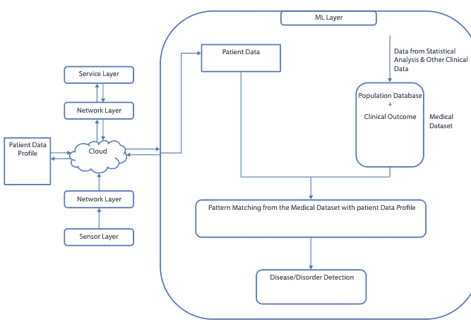

**图 6.1** 我们提出的模型的一般方法。

通过保持社交距离观察到最佳方式，及其物联网可以在日常生活中对我们的需求产生巨大影响。机器人技术和物联网是相关且类似的，它们由动力驱动并经过工程设计，提供关于 COVID-19 和其他即将出现的类似疾病的环境，使其成为可以通过人工智能妥善处理的治愈领域。

患者的相关数据注重隐私功能，通过云服务器共享的患者报告与电子医疗和值班医生共享。现场服务将由机器人监控进行监控，并由人工智能提供支持，以整理与云中报告数据库中的适当相似性。医生的指导方针将由人工智能系统自行生成。机器人技术在此技术边缘具有相关方法，并受到健康行业的最高级反馈。由人工智能驱动的机器采用尖端技术构建，结合物联网、机器人、云计算和深度学习，将使未来的高效电子医疗设施与研究技术组织起来成为现实。研究的受益者将是随着技术升级而受益的普通人。

使用物联网和人工智能辅助制造的穿戴技术实际上在知识领域并不罕见。许多办公室使用这些穿戴设备进行接触追踪和追踪科学员工和患者的健康。一个接触追踪工具由被动 GPS 区域监控和接近传感器组成，由 *蓝牙*® 和超宽带连接提供动力，并配备可充电电池和集成长期演进 (LTE)。佩戴智能设备后，用户可以替换其健康声誉，以建议是否存在任何感染的可能性，并且设备将根据区域历史通知人员他们已与感染者接触。企业中的集中式设备可以使用此事实为工作场所提供完整的健康仪表板。一种传感器直接实施在穿戴者的框架视频显示单元上，以监测实时温度变化。该工具将数据传输到医院以进行不间断跟踪 [27]。通过这种能力，医生或从业者可以监控和提供建议，让那些在家中的患者接受更多关注，并为处于较高危险中的人保持以健康为中心的能力。

在避免人际接触的特殊推动下，无人机正在帮助保护人们免受疾病侵害。在这方面，无人机最安全，可为感染率高的地区提供医疗用品和杂货，监测隔离区域的人员运动和聚集，并执行热扫描以筛查特定区域人员的体温。农业无人机执行任务，包括在受影响地区喷洒消毒剂。

集成面部识别、温度感应系统和无接触门禁控制，减少人类接触点对减缓病毒传播至关重要。对于医疗设施和其他受疫情重创的主要行业，拥抱物联网技术是提高患者、高管和管理层安全的一种方法 [27]。可以使用面部识别系统配合热成像设备来监测体温并将数据通过云端发送，以检测体温过高的人。如果基于物联网的传感器启用在门上，系统可以限制感染者进入该场所。使用智能无接触系统，工作场所可以避免因使用指纹检测传感器而导致的感染传播。

COVID-19 疫情已蔓延，确认病例接近 1800 万，活跃病例接近 600 万 [20, 22]。数据量将以指数级增长。指数级增长的大量数据无法由传统数据库系统维护 [35]。传统数据库管理系统无法处理如此指数级增长的数据。因此我们需要大数据概念。私人数据的安全也是一个主要关注点。侧信道信息也可以从像传感器这样的轻量级设备中获取。

COVID-19 的爆发凸显了利用尖端技术对全球健康基础设施进行改革 [14]。这有助于减轻一线 COVID-19 战士（如医生和护士）的压力。各种物联网设备正被用于隔离追踪，物联网云平台在完成日常运营中发挥着至关重要的作用 [15]。智能医院物联网技术日益增长的影响，人工智能与物联网技术的结合促进了物联网云平台市场的广泛增长。微软最近推出了一个新平台，即用于快速医疗保健互操作资源 (FHIR) 的 Azure IoT 连接器。这主要设计用于医疗记录的变更，并协助医疗保健专业人员安全处理来自不同设置的记录 [21]。此类技术还可能增加物联网云平台市场的乘数。物联网云平台允许跟踪多种操作，同时跟踪资产。这防止了组织内的盗窃和欺诈。Oracle IoT 云平台具有多种跟踪功能，允许为组织提供完整的解决方案。它通过其连接工人云服务跟踪员工运动并进行环境监测。在几种物联网云结构中发现了许多不同的跟踪包，允许平稳运行。

个性化医学是一种有导向的方法，使用各种方法和算法，有助于指导和支持诊断以及患者的更好治疗。我们应用了一个基于人工智能的解决方案，该解决方案有两个步骤。第一步涉及检测诸如 COVID-19 之类的疾病。我们将使用一组参数进行检测。我们已经看到了通过胸部 X 光片检测 COVID-19，如论文 [28] 所示。但我们认为，仅根据上述参数和当前情况判定患者是否阳性是不恰当的，更不用说结果对一个人生活的影响 [29–33]。我们希望向现有模型添加许多参数。第一个是聚合酶链式反应 (PCR)。其中，一个小而明确定义的 DNA 片段被复制多达数十万次，以产生大量用于数据分析的数据集。我们要使用的第二个测试样本来自抗原测试。这只是我们在 COVID-19 情况下检测算法的一个示例。通常，疾病和测试是基于基因组和细胞异常或简化来说的变化来计算的。

我们将通过 COVID-19 检测来描述我们的检测算法。获得大量样本数据将不可行。我们将获取来自 Kaggle 开放研究数据集的初始数据。鉴于数据集中测试的有限可用性，我们将使用数据增强生成我们的数据集 [29]。数据增强是一种人工智能方法，用于增加标记数据的规模

训练集通过生成数据集中样本的不同迭代版本。为了评估所提出的基于深度学习的 COVID-19 检测器的可靠性，我们采用了 Alazab 等人 [16–19] 使用的相同指标。在我们的系统中，我们将使用以下三种著名的预测算法来预测所需的结果、确认病例数、康复病例数以及处方：i) PA [27]，ii) ARIMA [28]，以及 iii) LSTM [29]。这些算法经过训练，用于基于从统计网站 [23] 收集的数据集，对未来的 7 天进行预测。现在，我们将实施我们的个性化家庭治疗，并结合精准医疗。准确的预后是个性化用药的一个里程碑。深度学习（DL）结构能够整合患者随时间变化的异构记录，从而实现更好的预测，并为每位患者推荐疗法 [25]。现在，为了实施我们的个性化家庭疗法，我们可能需要几种人工智能算法。这些技术包括引导向量、随机森林、神经网络和进化规则集（EA）。我们在近年来看到，每个神经网络都推动了设备学习，而进化规则集已显示出对于不能用多项式算法解决的问题（称为 NP 难问题）[23, 24] 具有前景的预测能力。这些模型可以通过提供监督、无监督或半监督模式的输入记录进行定制。理想情况下，我们希望拥有关于所有现有表型或基因型类别的完整信息，包括疾病，并且对于每个类别都有一个无限大小的患者群体。我们在 [27] 中看到了三个被描述的关键因素。我们将改进的三个关键因素首先是表型类别，这基本上是对各种疾病细胞表征，或者简单地说是对人类疾病及其亚型的理解。例如，在 COVID-19 患者的体内存在针对 SARS-CoV-2 的抗体，这意味着该人员检测结果呈阳性。为了达到改进的模型，我们还将使用 [28] 中的模型。第二个因素是群体规模。我们可以从数据集中获取数据来构建我们的模型。但我们将其视为一个独立的功能，因为在这种情况下，从任意大的样本规模中获取选择性数据会非常困难。例如，对于核糖-5-磷酸异构酶缺乏症 [27]，仅针对单个患者做出了一个诊断 [28]。然而，有许多这样的疾病。根据 [29]，有超过 5,000 种罕见疾病。现在我们来到第三个特征，即统计分析。这是一种干扰机制，利用统计分析对患者进行分类、预测或诊断。我们使用模式识别从数据集中构建统计模型，以实现完整的结果。实际上，由于各种因素 [34–37]，存在小误差。

我们使用误差函数来处理我们的误差，这表明假阳性的概率，并更好地理解以获得更好的模型。我们讨论的误差是由样本量、效应量等各种外部因素造成的。该模型并非理想，因为它假设我们拥有所有类型疾病及其亚型的完整知识和数据库。但我们尚未达到那个阶段。然而，利用现有的结果数据库，我们已成功识别了大多数疾病 [38, 39]。

使用这些因素，我们必须评估我们的模型。我们进行了一些进步，以增强我们的模型，使其更好地应用于个性化医疗的实际生活。在群体规模方面，如果我们能注册更多患者，这将反过来促进更多测试数据的便利化以及大型临床试验。第二，在表型类别方面，我们需要进行更多研究，以便更好地理解表型类别。新发和罕见疾病识别的不足将导致临床方面的不足，最终阻碍诊断并同时进行治疗。第三，我们来到统计分析。这取决于适当的调查、数据的质量、数量和类型，以及最终的算法方法本身。即使存在大量样本数据，如果我们遇到缺失数据，也会降低模型结果。

考虑到所有这些因素以及缺点，我们的基本机器学习模型结构将首先使用单个患者的数据。我们将拥有我们所说的主数据库，其中包含患者群体数据库以及临床结果。我们将匹配并计算数据库数据与单个患者的数据，并运行通过一个模式识别算法，该算法将患者轮廓与数据库中的参考轮廓进行模式匹配。现在，利用这个模型，我们可以推断出针对这些特征或表征组成部分的工作。它们如下：

- 患者数据
- 群体数据库
- 临床结果
- 模式识别。

我们可以将群体数据库视为先验统计数据，其中每个数据都是量化为向量的离散变量。我们甚至更多地研究了句法模式识别，因此我们可能需要牺牲时间和复杂性，但我们拥有对属性/模式的更深入的工作。它还允许更好地表示分析中使用的各种类型的数据。现在，对于疾病/障碍，临床结果是不同的疾病信息和病因预测测试，以及有关各种人类疾病、身体相关信息的其他相关信息。我们将群体数据库和临床结果中的数据结合起来，以获得各种疾病/障碍的适当表示。最后，模式识别是完成我们模型的根算法。这是一种机器学习算法，允许我们根据统计信息识别和分类模式。我们使用特征向量通过与主数据库（群体数据库 + 临床结果）运行来识别模式，现在患者数据与数据库一起匹配。我们模型中最重要的一部分，模式匹配或识别部分，可以被视为两种类型算法的组合：一种是针对简单疾病（如发烧、感冒和咳嗽）或慢性病的基本机器学习算法，如分类、回归；另一种是针对如肿瘤检测、癌细胞检测等严重疾病的深度学习算法，如 CNN（卷积神经网络）

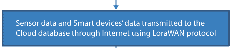

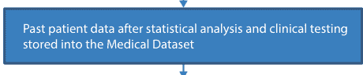

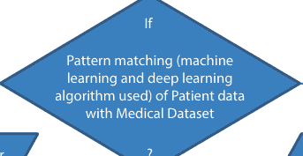

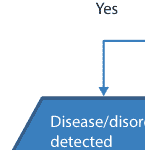

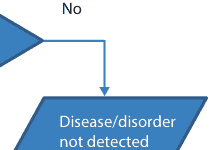

**图 6.2** 提议框架的算法。

或如 COVID-19 等流行病，这些疾病需要极高的精确度。在图 6.2 中显示了整个系统的工作流程。这是我们检测算法的第一步。其次，我们还了解各种持续跟踪我们的心跳、血液氧气水平以及其他许多指标的健康设备。它们在检测和详细分析中也起着关键作用。连续监测有助于我们获得更准确的数据和对潜在问题更深入的认知。图 6.2 通过流程图展示了我们的模型。由生物传感器或可穿戴设备收集的患者数据使用 LoRaWAN 协议通过云端发送。此外，患者的过往数据也被存储用于统计分析。当捕获任何数据时，数据被存储在本地理存中。现在，数据被输入基于机器学习的模块，以检测疾病或障碍。

## 6.5 性能分析

我们提出的模型将患者家庭护理和远程医疗提高至检测常见疾病时达到 90% 的准确率。我们的模型能够中断 COVID-19 疾病的指数级传播。在我们的模型中，我们使用了生物传感器。生物传感器的准确率非常高。我们将 Jelastic 作为云服务。云服务器可以使用机器学习和深度学习技术，以高准确率分析患者数据。我们使用了 LoRaWAN 网络协议，它可以通过 AES 加密提供安全性。

## 6.6 未来研究方向

在 4.0 医疗保健领域有大量的未来研究范围。我们的模型在检测癌症方面显示出较低的准确率。作为未来的研究工作，我们目前正在努力实现一个模型，小型机器人可以在其中工作，向患者提供药物。印度斋浦尔的 Sawai Man Singh (SMS) 政府医院正在进行一系列试验，寻找任命一个人形机器人在医院内向患者提供药物和食物的方法，以便医生和工作人员可以保持安全距离，以减少感染几率。尽管 LoRaWAN 提供了安全的长距离通信，但长距离通信通常不可靠、昂贵，且容易受到侧信道攻击。因此，实施雾技术可以是另一个未来的工作方向，其中使用传感器收集的数据可以首先发送到附近的服务器，位于

农村地区。大量患者数据需要存储在云数据库中。当处理数据量巨大时，传统的集中式数据库无法良好运行。因此，将大数据技术整合到4.0级医疗中是一个有前景的未来研究领域。

## 6.7 结论

我们提出的模型已将患者家庭护理和远程医疗在检测常见疾病方面的准确率提升至90%。我们的模型还能打断新冠疫情疾病的指数级增长。在我们的模型中，我们使用了生物传感器。生物传感器的准确率非常高。我们使用Jelastic作为云服务。云服务器能够利用机器学习和深度学习技术，以高准确率分析患者数据。整合自动化和机器人技术不会对就业市场产生负面影响。也就是说，人们不会失业，相反，自动化和机器人技术将创造大量就业机会，因为需要大量熟练技术人员。

## 参考文献

1. Chute, C. 和 French, T., Introducing Care 4.0: An Integrated Care Paradigm Built on Industry 4.0 Capabilities. *Int. J. Environ. Res. Public Health*, 16, 12, 8–10, 2019.
2. Cui, F., Ma, L., Hou, G., Pang, Z., Hou, Y., Li, L., Development of Smart Nursing Homes Using Systems Engineering Methodologies in Industry 4.0. *Enterprise Inf. Syst.*, 14, 3, 1–17, 2018.
3. Donati, M., Celli, A., Ruiu, A., Saponara, S., Fanucci, L., A Telemedicine Service System Exploiting BT/Ble Wireless Sensors for Remote Management of Chronic Patients. *Technologies*, 7, 1, 2–5, 2019.
4. Tortorella, G.L., Fogliatto, F.S., Esposito, K.F., Vergara, A.M.C., Vassolo, R., Mendoza, D.P., Narayanamurthy, G., *Effects of contingencies on healthcare 4.0 technologies adoption and barriers in emerging economies*, vol. 156, March 31, 2020, Technological Forecasting and Social Change, Elsevier, 2020.
5. Hamidi, H., An approach to develop the smart health using Internet of Things and authentication based on biometric technology. *Future Gener. Comput. Syst.*, 91, 434–449, 2019.
6. Alloghani, M., Al-Jumeily, D., Hussain, A., Aljaaf, A., Mustafina, J., Petrov, E., Healthcare services innovations based on the state of the art technology trend industry 4.0. *2018 11th International Conference on Developments in eSystems Engineering (DeSE)*, IEEE, pp. 64–70, 2018, September.
7. Pace, P., Alò, G., Gravina, R., Calaciuri, G., Fortino, G., Liotta, A., An Edge-Based Architecture to Support Efficient Applications for Healthcare Industry 4.0. *IEEE Trans. Ind. Inf.*, 15, 1, 481–489, 2019.
8. Elhoseny, M., Abdelaziz, A., Salama, A.S., Riad, A.M., Muhammad, K., Sangiah, A.K., A hybrid model of the Internet of Things and cloud computing to manage big data in health services applications. *Future Generat. Comput. Syst.*, 86, 1383–1394, 2018.
9. Kumari, A., Tanwar, S., Tyagi, S., Kumar, N., Fog Computing for Healthcare 4.0 Environment: Opportunities and Challenges. *Comput. Electr. Eng.*, 72, 1–13, 2018.
10. Alhussein, M., Muhammad, G., Hossain, M., Amin, S., Cognitive IOT-Cloud integration for smart healthcare: case study for epileptic seizure detection and monitoring. *Mob. Netw. Appl.*, 23, 6, 1624–1635, 2018.
11. ATOS White Paper connected Robots. https://atos.net/wp-content/uploads/2016/06/atos-white-paper-connected-robots.pdf, 访问日期：15.09.2020.
12. The art, science of robots. https://daily-dose-of-art.com/2012/07/15/the-art-science-of-robotics-1-a-brief-history/, 访问日期：15.09.2020.
13. IoT Health Evolutions. https://www.iotrevolutionhealth.com, 访问日期：20.08.2020.
14. Alazab, M., Shalaginov, A., Mesleh, A., Awajan, A., COVID-19 Prediction and Detection Using Deep Learning. *Int. J. Comput. Inf. Syst. Manage. Appl.*, 168–181, 2020.
15. Buslaev, A., Iglovikov, V.I., Khvedchenya, E., Parinov, A., Druzhinin, M., Kalinin, A.A., Alumentations: Fast and flexible image augmentations. *Information*, 11, 125, 2020.
16. Alazab, M., Shalaginov, A., Mesleh, A., Awajan, A., Intelligent mobile malware detection using permission requests and API calls. *Future Generat. Comput. Syst.*, 107, 509–521, 2020.
17. Alazab, M., Automated Malware Detection in Mobile App Stores Based on Robust Feature Generation. *Electronics*, 9, 435, 2020.
18. Alazab, M., Analysis on Smartphone Devices for Detection and Prevention of Malware. *Eng. Built Environ.*, Deakin University, 2014.
19. Alazab, M., Venkatraman, S., Watters, P., Alazab, M., Zero-day malware detection based on supervised learning algorithms of API call signatures. *Ninth Australian Data Mining Conference: AusDM 2011, Ballarat, Australia, pp. 171–181*, 2011.
20. Taylor, S.J. 和 Leham, B., Forecasting at scale. *Am. Statistician*, 72, 37–45, 2018.
21. BazilaBanu, A., Priyadarshini, R., Thirumalaikolundusubramanian, P., Prediction of Children Diabetes by Autoregressive Integrated Moving Averages Model Using Big Data and Not Only SQL. *J. Comput. Theor. Nanosci.*, 16, 3510–3513, 2019.
22. Worldometers Coronavirus Cases. https://www.worldometers.info/coronavirus/, 访问日期：20.09.2020.
23. Rizzì, R., Cairo, M., Mäkinen, V., Tomescu, A., II, Valencia, D., Hardness of covering alignment: phase transition in post-sequence genomics. *IEEE/ACM Trans. Comput. Biol. Bioinform.*, 16, 23–30, 2019.
24. Kapun, E., Tsarev, F., De Bruijn, Supervalgraph with multiplicities problem is NP-hard. *BMC Bioinforma.*, 14, Suppl 5, S7, 2013.
25. Chen, J.H. 和 Asch, S.M., Machine Learning and Prediction in Medicine—Beyond the Peak of Inflated Expectations. *N. Engl. J. Med.*, 376, 2507–2509, 2017.
26. Uddin, M., Wang, Y., Woodbury-Smith, M., Artificial intelligence for precision medicine in neurodevelopmental disorders. *NPJ Digit. Med.*, 2, 112, 2019.
27. Huck, J.H., Verhoeven, N.M., Struys, E.A., Salomons, G.S., Jakobs, C., van der Knaap, M.S., Ribose-5-phosphate isomerase deficiency: New inborn error in the pentose phosphate pathway associated with a slowly progressive leukoencephalopathy. *Am. J. Hum. Genet.*, 74, 745–751, 2004.
28. Wamelink, M.M., Grüning, N.M., Jansen, E.E., Bluemlein, K., Lehrach, H., Jakobs, C., Ralser, M., The difference between rare and exceptionally rare: Molecular characterization of ribose 5-phosphate isomerase deficiency. *J. Mol. Med.*, 88, 931–939, 2010.
29. Schiepati, A., Henter, J.L., Daina, E., Aperia, A., Why rare diseases are an important medical and social issue. *Lancet*, 371, 2039–2041, 2008.
30. Gia, T.N., Jiang, M., Sarker, V.K., Rahmani, A.M., Westerlund, T., Liljeberg, P., Tenhunen, H., Low-cost fog-assisted healthcare IoT system with energy-efficient sensor nodes. *2017 13th International Wireless Communications and Mobile Computing Conference (IWCMC),* IEEE, pp. 1765–1770, 2017.
31. Ngeash, B., Gia, T.N., Anzanpour, A., Azimi, I., Jiang, M.C., Westerlund, T., Tenhunen, H., Leveraging fog computing for healthcare IoT, in: *Fog Computing in the Internet of Things,* pp. 145–169, Springer, Cham, 2018.
32. Berrahal, S., Boudriga, N., Bagula, A., Healthcare systems in rural areas: A cloud-sensor based approach for epidemic diseases management. *International Conference on e-Infrastructures and e-Services for Developing Countries,* Springer, Cham, pp. 167–177, 2015.
33. Farahani, B., Firouzi, F., Chang, V., Badaroglu, M., Constant, N., Mankodiya, K., Towards fog-driven IoT eHealth: Promises and challenges of IoT in medicine and healthcare. *Future Gener. Comput. Syst.*, 78, 659–676, 2018.
34. Kaushalya, S.A.D.S., Kulawansa, K.A.D.T., Firdhous, M.F.M., Internet of Things for Epidemic Detection: A Critical Review, in: *Advances in Computer Communication and Computational Sciences,* pp. 485–495, Springer, Singapore, 2019.
35. Sood, S.K. 和 Mahajan, I., Wearable IoT sensor based healthcare system for identifying and controlling chikungunya virus. *Comput. Ind.*, 91, 33–44, 2017.

+ 36. Rahmani, A.M., Gia, T.N., Negash, B., Anzarpour, A., Azimi, I., Jiang, M., & Liljeberg, P., 在医疗物联网边缘利用智能电子健康网关：一种雾计算方法。*Future Gener. Comput. Syst.*, 78, 641–658, 2018。

+ 37. Sood, S.K. 和 Mahajan, I., 基于雾-云的 cyber-physical 系统用于区分、检测和预防蚊虫传播疾病。*Future Gener. Comput. Syst.*, 88, 13–16, 2018。

+ 38. Sareen, S., Sood, S.K., Gupta, S.K., 基于物联网的云框架用于控制埃博拉病毒爆发。*J. Ambient Intell. Hum. Comput.*, 9, 3, 459–476, 2018。

+ 39. Butca, C.G., Suciu, G., Ochian, A., Fratu, O., Halunga, S., 用于在电子健康应用中监测环境参数的可穿戴传感器和云平台。*2014 第 11 届国际电子与电信研讨会 (ISETC)*, IEEE, 页 1–4, 2014。

+ 40. Althebyan, Q., Yaseen, Q., Jararweh, Y., Al-Ayyoub, M., 大规模电子医疗系统的云支持。*Ann. Telecommun.*, 71, 9–10, 503–515, 2016。

+ 41. Cierlin, K.J., Fried, J.A., Raikhelkar, J., Sayer, G., Griffin, J.M., Masoumi, A., Schwartz, A., 2019 新型冠状病毒肺炎与心血管疾病。*Circulation*, 141, 20, 1648–1655, 2020。

## 医疗系统中物联网设备的安全性与隐私

Himadri Nath Saha¹* 和 Subhradip Debnath²

¹印度加尔各答市 Surendranath 夜大学，加尔各答大学，计算机科学系

²印度加尔各答市 Maulana Abul Kalam Azad 理工大学，工程学院与管理学院，计算机科学系

##### 摘要

不断发展的物联网（IoT）范式对当前医疗系统的增强做出了重大贡献。可以普遍认为，物联网在医疗领域提供了许多优势，包括更好地追踪患者的机会。关注患者端有助于医疗服务提供者快速收集详细信息并做出基于数据的建议，从而实现更快的医疗干预。然而，医疗公司有时并未考虑到将此类设备连接到互联网的安全风险。终端用户必须认识到许多隐私和安全问题。当授予任何潜在不安全或存在漏洞的第三方应用权限时，终端用户容易受到恶意软件活动的攻击。智能技术在医疗方面提供了许多优势，但同样的设备也带来了更高的机密性和保护方面的隐患。一些可能的威胁包括对框架的黑客攻击、隐私威胁、数据窃听等。我们提出的系统使用无线体域网（WBAN）配合云服务器来保存患者记录，通过开发基于角色的分配和最小访问权限系统，使只有相关人员可以访问这些记录。它收集患者的病史以供未来参考。与类似的现有系统相比，该系统既高效又健壮。

**关键词：** 集中式网络协调器，物联网，医疗系统，患者监测，集中式账本，数据库，智能传感器，云应用

*通讯作者：contactathimadri@gmail.com

## 7.1 引言

全球约有二十亿用户查看和浏览内容、访问多媒体资源、发送电子邮件并参与社交网络。但随着时间推移，互联网的目标不断发生变化。它最初是一个用于在设备之间共享数据的网络。随着设备数量多年来呈指数级增长，现在预计它将作为一个全球平台用于互连设备。这些设备不一定指智能设备，而是指那些传统上最笨重的、随处可见的物体，经过一些改造使其变得智能，随后被称为“物（Things）”。这使得这些物体或“物”能够以新的方式通过互联网进行工作、通信和互动，从而同时自动化任务并减少不同部门的人工工作量。这种嵌入传感器、软件和技术，旨在与其他设备交换或共享数据并收集数据的智能对象或“物”的内部互连网络，被称为物联网（IoT）。

物联网设备、传感器、移动设备和网络连接的 成本正在下降，并且将继续下跌。此外，网络逐渐从有线网络转变为无线网络。通信技术变得更加快速、廉价，并改变了人们获取信息的方式。基于 RFID 技术的采用逐渐改变了物联网的使用方向。物联网使用超链接技术，旨在将现实物理世界连接到虚拟互联网 [1]。

医疗是当今每个发展中国家和发达国家面临的重大挑战之一。医疗行业在信息技术上投入巨资，但患者数据安全和生产力的预期改进仍未达到标准。即使到了 2020 年，几乎所有组织仍然依赖传统的纸质医疗记录和手写笔记来进行通知和决策。数字信息隐藏在各部门和应用程序之间，因此有效共享患者数据非常罕见且复杂。解决这一问题的答案是引入与云集成的物联网技术。这使医疗机构能够直接将其引向患者所需或要求的临床相关服务，以达成预期的结果，从而以更少的时间、有组织和低成本的方式进行健康监测、诊断和治疗。

基于物联网的医疗系统中的安全性和隐私具有极高的优先级。在同一时间，成千上万的患者正在注册医疗服务，此时患者需要披露可能与其所需的诊断和治疗相关的个人信息。因此，在机构实体接收信息后，会形成一种基于信任的相互协议，通常被称为“医生-患者保密”。现在，为了尊重这种相互协议，机构实体还需要实施步骤和措施，以确保来自患者的信息没有泄露。为了执行这些措施，我们提出的模型作为现有系统的高效替代方案。

本章提出的模型使用无线体域网（WBAN）[2–4] 配合云服务器来保存患者记录，通过开发基于角色的分配和最小访问权限系统，使只有相关人员可以访问这些记录。它收集患者的病史以供未来参考。该应用程序对从设备接收的数据进行加密，并将其隐藏在封面图像下，然后将其传输到本地服务器。本地服务器解密后，将数据重定向并附加到基于云的数据库、量子账本和基于对象的存储系统、网站以及手机应用中，以显示患者的记录。与类似的现有系统相比，该系统既高效又健壮。

本章涵盖多个部分，其中一般架构在 7.3 节中描述，实施方法论在 7.4 节中提到。所提系统的模型设计已在 7.3.1 节中列出以供参考。

## 7.2 背景及相关工作

在信息时代，医疗系统中物联网的安全与隐私非常重要。医疗系统一直试图采用和使用物联网来自动化其多个流程，因为在这个行业中响应时间至关重要。关于物联网在医疗行业中的使用，已进行了许多研究工作。关于使用无线体域网进行健康监测并保护物联网设备的研究，提出了一种安全的无线小型网络，在其中可以共享或监控健康信息。但信息流受到网络协调器的限制。

Gong 等人考虑到物联网设备的隐私保护，提出了一种轻量级私有同态算法和从 DES 算法改进的加密算法 [5]。

有一些论文提出了构建通信机制的工作，以确保传输机密性，并证明智能对象、本地处理单元和后端服务器之间的实体认证 [6]。访问控制系统制定并采用策略、角色和能力。存在一个授予最小访问权限和特权的基模型，我们提出的模型也遵循了这一模型。

也有研究工作建议使用多个云服务器，以确保保护患者的个人数据隐私并确保数据的可用性。其中考虑的威胁模块包括患者数据泄露和破坏、串谋攻击、内部攻击、大数据处理量以及数据存储量。在内部攻击的情况下，患者健康数据库的系统管理员可能会泄露患者的敏感机密数据 [7]。

Kumar 等人 [8] 发表了一篇论文，提出了一种基于灰度修改和多层加密（MLE）的非常安全且高效的 RGB 图像方法。在映射到用于作为隐写图像的载体的秘密灰度级别之前，私钥和数据使用 MLE 算法进行加密。

目前也存在基于物联网的健康监测系统，如 KHealth，用以说明现有的基于物联网的健康监测系统 [9, 10]。它感知个人和生理设备以聚合数据。

Maheau 等人 [11] 指出，存在一系列 PDA、智能手机和智能设备，以及一系列与设备兼容的医疗保健应用程序，总计有 165,000 个应用程序。已有研究探讨基于能力的访问控制方法和分布式基于能力的访问控制系统，用于在物联网系统中提供细粒度访问控制 [12, 13]。

这些是现有系统，目前仍在实施中，而研究缺乏某些方法论。现有的已实施系统要么不安全，要么无法保护已收集的用户数据隐私。或者，即使架构足够安全，系统仍然不具备弹性，无法根据需要快速扩缩容，从而导致高延迟和丢包或服务器过载。在我们提出的模型中，我们试图消除这些问题，同时考虑到数据处理的一些额外功能以及系统的弹性。

也有一些工作致力于保护来自物联网设备的信息流，并利用基于硬件的密码学审视模型的隐私，这些工作试图缓解串谋攻击、窃听、冒充以及患者数据泄露和破坏。在许多研究工作中，试图将数据存储在区块链中，以实现数据的哈希化，即可用数据的可验证性。此外，区块链的不可篡改性使数据更加安全，避免了任何形式的记录更新。但是，为了实现这种分布式不可变账本的优势，该过程涉及大量计算。即使是数据的最小查询也可能导致巨大的计算量，从而产生显著的延迟。在医疗行业中，时间是不能妥协的，因此区块链或分布式架构并非实际实施的可行选项。

## 7.3 提出的系统设计架构

用于测量、追踪和记录患者数据的物联网设备和传感器传输到树莓派（Raspberry Pi），该树莓派在机构中为每张病床独有。树莓派收集邻近传感器提供的数据，对其进行加密，并将其发送到在机构内部本地设置的私有服务器。该过程确保数据在传输过程中是安全的（图 7.1）。数据在服务器端接收和解密后，基于文本的数据将被解析并保存在 SQL 数据库中，对应患者床位数和患者 ID。基于对象的数据，如图像、扫描文档等，将作为对象保存在公共云基础设施的存储桶中。从而呈现出一个混合云系统，确保信息的高可用性。本地私有服务器和公共云基础设施将通过 AWS Direct Connect 保持连接，确保信息流畅且安全地流动。

通过这种方式，机构内部本地网络中的医生、医疗专业人员、护士拥有编辑、写入和更新患者健康记录的能力。

用于诊断、治疗或健康监控而连接在任何患者身上的身体传感器，将随时使用无线体域网将数据传输到其指定的最近树莓派，以更新和添加追踪数据，与位于机构内的私有数据服务器同步，并与云端同步。医生、医师或急救响应团队可以直接从本地数据服务器访问患者数据。即使利益相关者不在机构内，他们也能登录云服务器以跟踪相应患者的医疗记录。

为了确保从患者身体传感器接收的数据的安全性和隐私性，从树莓派传输到本地服务器的数据是经过加密的。加密密钥由本地服务器本身自动管理，它存储每个特定床位每个树莓派的 ID。存储在本地服务器中的数据是静态加密的。数据使用云数据湖分析进行分析，利用诸如 Amazon Redshift 等服务进行高可扩展性的数据仓库管理。

此外，系统中的利益相关者，即医疗专业人员、医生、诊断中心、急救医疗服务（如救护车）以及经过授权的医学研究人员，可以访问该系统。

### 7.3.1 模块

#### 7.3.1.1 无线体域网

无线体域网被提出，其中传感器以跳星拓扑结构实施在信标模式下，当传感器节点传输任何数据时，网络协调器被触发启动。独立的传感器，如体温测量以及实时感知的 ECG（心电图）和呼吸信号，感知数据并将其传输到集中式网络协调器。传感器与集中式网络协调器非常接近。

传感器不是独立的，而是小型模块。它们拥有自己的微处理器模块，控制和将数据传输到集中式网络协调器。

#### 7.3.1.2 集中式网络协调器

树莓派 4 模块被用作集中式网络协调器。树莓派 4 具有 2.4 GHz 和 5.0 GHz 的 IEEE 802.11ac 无线和蓝牙 5.0 BLE。树莓派 4 使用 UART 协议接收由身体传感器模块发送的字符串命令，通过 PDA 连接接受 SPP 配置文件请求，以进行远程数据传输。

集中式网络协调器的任务是协调身体传感器节点发送周期性数据请求，以提高网络操作效率。然后，它实时从传感器节点接收患者的生理数据。它进一步加密该数据，并将其传输到本地服务器。

#### 7.3.1.3 本地服务器

在机构内部署的本地服务器主要作为数据解析器和路由器，用于将数据安全地路由到安全云服务器。它主要由机构内利益相关者（即医生、医师、护士和其他卫生官员）使用的应用程序实例组成，允许并添加他们的笔记、观察结果、报告和诊断，使用注册的机构设备和身份验证凭据。来自集中式网络协调器（CNC）的数据根据预分配给 CNC 的私钥进行解密，这些私钥存储在服务器数据库中。数据解密完成后，数据被排序并转发到由公共云服务器托管的基于 SQL 的关系数据库系统。

如果针对患者生成的报告和观察结果是对象基础的，如基于图像或 pdf 的报告、观察结果或诊断，数据将存储在公共云服务器中的基于对象的存储桶中。

本地服务器和云服务器将通过安全虚拟专用网络服务（如 AWS Direct Connect）连接，以促进信息通过私人机构网络直接到云网络的流畅且安全流动。

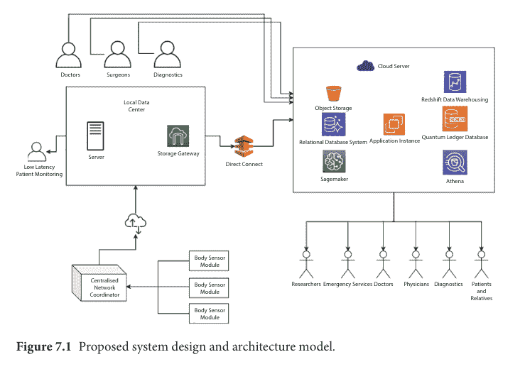

#### 7.3.1.4 云服务器

公共云服务器包含四个组件：

-   一个**应用程序实例**，承载应用程序。拥有真实身份的每个潜在利益相关者都将能够通过该应用程序，查看其被授予访问权限的患者的数据。这里的应用程序实例是一个运行基于Linux的Web服务器的AWS EC2实例，托管一个Web应用程序，该应用程序可以引导利益相关者直接从其设备访问实时数据。
-   一个**关系数据库系统**——这是一个基于SQL的关系数据库，包含多个表，用于存储机构工作人员、医生、访问控制列表以及患者详情。使用基于云的关系数据库系统使得系统易于管理和集成，通过API访问能力而无需基础设施配置或维护大型数据库。它具有极高的可扩展性。由于多可用区部署，数据库的可用性也非常高。它快速、安全且成本低廉，因此即使收集了PB级别的数据，部署的可变成本也能保持较低水平。
-   一个**量子账本数据库**——不可变数据库，用于托管患者的健康记录。量子账本数据库还跟踪谁登录系统以查看哪些患者的记录，以及时间戳。量子账本数据库存储记录并将其哈希值链接成链，以实现不可变性。只需使用SHA-256匹配记录的哈希值，生成数据历史变更的安全输出文件，即可验证记录的完整性，从而验证数据的完整性。由于数据在多个可用区上启动并部署，数据的可用性相当高。
-   **数据分析仓库**，例如Redshift，它有助于整理RDS和对象存储数据湖中的患者数据，允许用户执行广泛查询，更有效地分析患者数据。这使得关系数据库中的结构化数据和S3桶中的非结构化数据能够同时被查询，并整合到正在部署的应用程序和系统的运营洞察中。

Amazon Athena将用于快速查询，有效地在S3桶中的大量数据中搜索数据。它是一个提取、转换和加载（ETL）数据服务，将S3数据加载以便使用标准SQL语句进行查询。

Amazon SageMaker机器学习可用于对患者数据进行监控和分析，通过学习并跟踪症状来检测疾病。在此，研究人员将与医疗机构合作，快速构建、训练和部署机器学习模型。这将促进数据集的训练和配置，以用于分析患者数据。

#### 7.3.1.5 专用网络连接

本地服务器/数据中心通过专用网络连接（即专用连接）连接到云服务器，这有助于实现数据从本地服务器的安全顺畅传输。许多公共云服务提供商提供此类服务支持，例如AWS提供Direct Connect，Azure提供ExpressRoute，Google提供Dedicated Interconnect。与通过公共互联网购买更多带宽相比，这也是一种具有成本效益的替代方案。

## 7.4 方法论

生成数据的传感器模块将数据通过一个跨度为2至3米的小型无线身体网络发送到集中式网络协调器。无线身体网络是一个具有跳星拓扑结构的[15]蓝牙网络，集中式网络协调器位于中心，无线协调其他传感器模块并获取信息。在信息传输到集中式网络协调器后，它确定接收到的信息是基于文本的还是基于对象的，并相应地加密该信息。

此处提出的加密方法遵循混合RSA-AES算法。在此方法中，明文被分为奇数文本和偶数文本。使用AES通过分配给每个集中式网络协调器的秘密公钥*Saes*加密奇数文本。使用RSA通过秘密公钥*Srsa*加密偶数文本。

加密数据被编码并隐藏在载体图像中，使用2D-DWT-1L或2D-DWT-2L，并作为隐写图像传输到本地服务器。随后，加密数据被尝试进一步隐藏，而用于在本地服务器中解密内容的私钥X将被保存在托管所有集中式网络协调器私钥的基于SQL的数据库中。

现在，当数据在本地服务器的应用程序实例中解密后，解密的数据被分类，并在参考已注册的集中式网络协调器的有效性后验证其来源，随后创建一个JSON文件，交叉引用CNC编号、床位编号、患者ID、患者详情以及接收到的数据。

然后传输JSON文件，数据通过专用私有连接，使用TLS/SSL和传输中加密的安全通道，从本地数据中心传输到公共云（此处为AWS）数据中心。使用AWS Direct Connect连接本地数据中心和公共云数据中心。

数据将通过应用程序实例接收，患者数据将附加到量子账本数据库中。QLDB和量子账本数据库的不可变性将保留传输的信息。QLDB的不可变特性将确保附加的数据不能被修改、更改或删除。在数据插入QLDB后，可以使用Web界面对其进行查询，前提是用户需要登录并验证其身份凭证。但这里出现了提议模型的另一个隐私特性。

隐私模型针对此设计，使得患者和亲属能够透明地查看诊断结果和报告，但不能在其中附加数据。患者能够编辑其偏好和个人信息，但更新操作将被记录下来以供日后参考。

紧急服务包括（图7.2–7.5）急救救护车服务、药房服务和诊断中心（图7.6、7.7）。这些服务将能够访问筛选后的相关患者记录和患者详情，并且能够添加评论。但所有活动，包括查看任何特定患者记录的行为，都会被记录下来，以跟踪不必要的隐私侵犯和责任追究。此外，对于药房等服务，药剂师无需查看患者详情。在这种情况下，如果患者提供提及所需药物的报告ID并向药剂师展示报告，药剂师只需输入报告ID即可验证报告。自动地，报告ID的哈希键将与健康记录进行匹配，并揭示患者的基本详情，以便药剂师验证患者身份以及分配给患者的药物是否有效（图7.8）。

类似地，任何第三方诊断服务中心只需通过输入患者ID来验证患者身份，患者详情及可关联信息将经过加密验证，医生要求执行的所有必需测试将列出来，并可以轻松上传其中。

研究人员、医生和卫生官员能够无障碍地访问医疗记录，但他们只能访问其护理对象患者的相关记录，并能够在患者记录中撰写报告（图7.9–7.11）和观察记录，并且将拥有所有

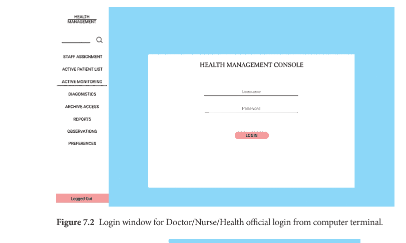

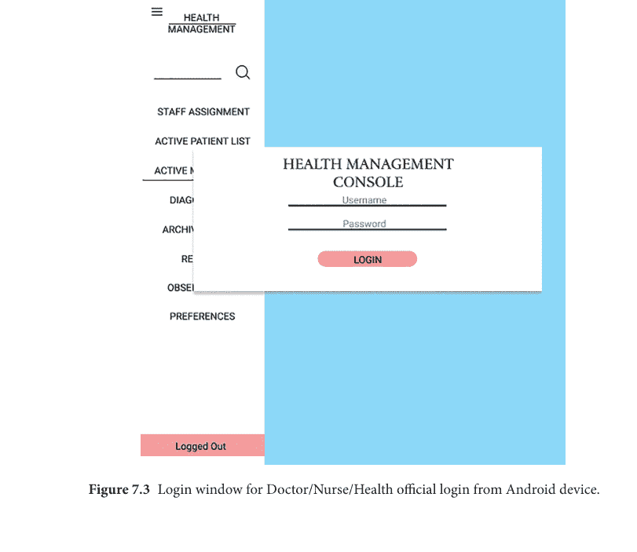

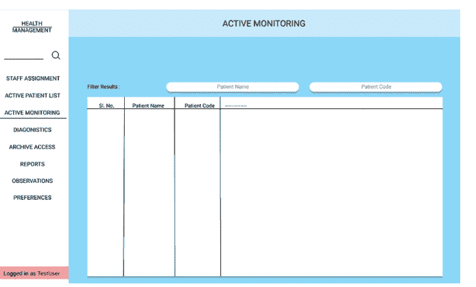

图 7.4 从计算机终端查看的患者监控窗口。

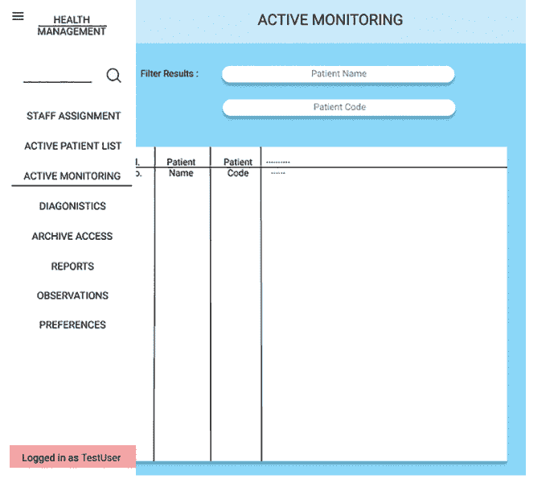

图 7.5 从安卓平板电脑查看的患者监控窗口。

### 流程图：患者

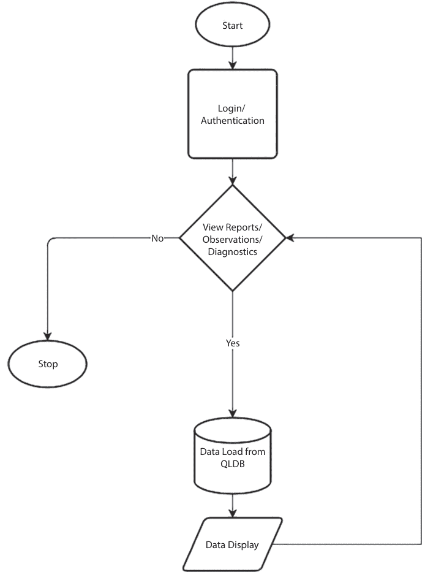

**图 7.6** 患者清关流程图。

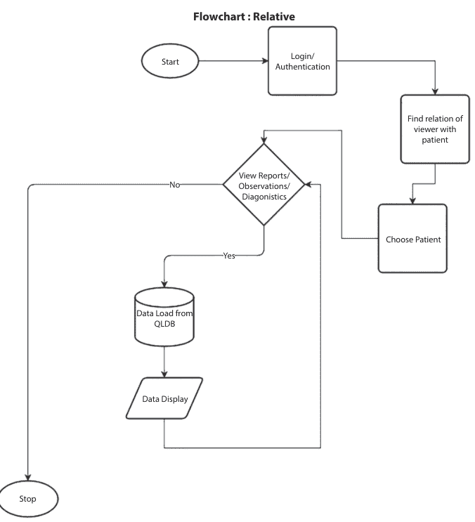

图 7.7 亲属清关流程图。

## 流程图：药房服务

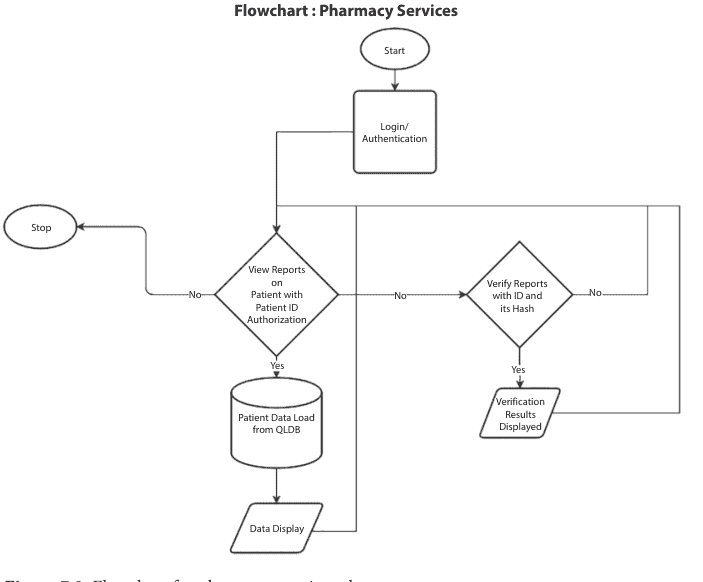

**图 7.8** 药房服务权限流程图。

除患者可供观察的个人详细信息外，患者的记录非常有限。但每一项细节，包括撰写报告或查看患者数据，都会被记录下来，以便追踪不必要的隐私侵犯行为并确保问责制。同样，被分配到特定病房的护士将只能访问和监控该病房内患者的标准传感器读数，而不能访问其他数据。也可以创建基于凭证的特定角色，例如“心脏病专家”，该角色将使其有权访问所有心率监测器的数据以及与之相关的基本患者详细信息。此外，还可以创建临时的患者特定角色，如“‘患者 X101’的心脏病专家”、“‘患者 X101’的护士”，这将使他们在临时被分配的情况下，获得对所负责患者监测器的临时访问权限。

所有利益相关者只能执行其登录系统后具有必要权限的活动。任何权限变更都需要机构权限进行清除和审查。此外，这些变更也会被记录在案。

这些微观层面的每项活动跟踪都将记录在托管于云端的**关系型数据库系统**中。此外，关系型数据库系统还将保存患者详细信息以及所有利益相关者的详细信息。

所有基于对象的文件，如图片或 PDF 或其他类似格式的报告/诊断观察结果，将作为对象保存在名为每个患者唯一患者 ID 的桶（bucket）内的文件夹中。

上述权限内的每位利益相关者都可以通过同一应用程序访问此类文档，透明度随其权限而变化。本地数据中心也通过存储网关与托管桶的公共云服务器相连，以便在需要时，除了通过公共互联网外，还能通过低延迟网络轻松访问机构服务器上的文件。

现在，当所有数据都在公共云服务器上时，需要使用如 Redshift 这样的数据仓库服务对数据进行聚合。这使得数据既以对象形式存在，又存在于关系型数据库中，能够以少得多的时间轻松进行大量查询。Amazon Athena 还提供分析工具，用于分析利益相关者访问患者数据的模式，并在发现任何违反患者信息隐私/保密性的不必要信息查看模式时进行检查和警报。

像 Amazon SageMaker 这样的人工智能服务，使用经过批准预先记录的疾病数据集进行训练，并结合患者的数据，跟踪患者记录以发现并检测疾病，并提前向患者发出警告。

该应用程序也可用于平板电脑和电话等便携式设备。唯一的条件是应用程序必须连接到公共互联网。数据将通过公共云进行流式传输。

## 7.5 性能分析

我们观察到平均总延迟极小，在 500 毫秒以内。通过在本地网络系统中使用负载均衡器，上传延迟已最大程度地降低。

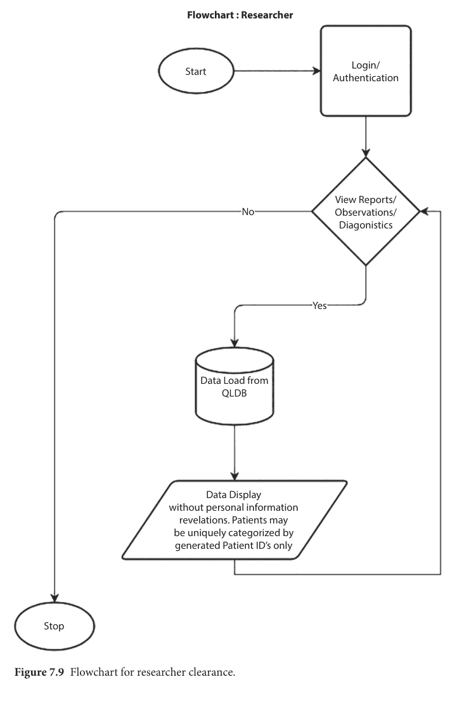

**图 7.9** 研究人员权限流程图。

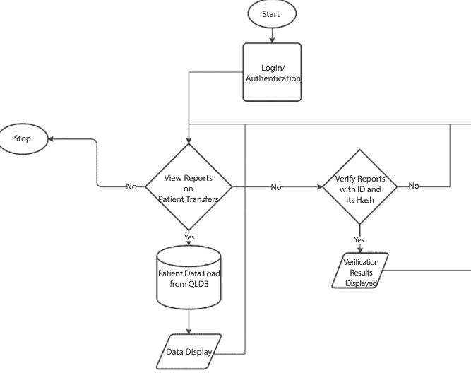

**图 7.10** 急救服务权限流程图。

此外，基于角色的访问控制系统持续记录通过身份验证访问系统和数据的人员。系统管理员可以保存这些下载的记录，并追溯不当行为至特定用户。

身份验证系统针对不同角色运行完美（图 7.12）。患者和亲属无法使用为卫生官员、医生、护士、急救服务提供商和药剂师开发的观察应用程序端点。

对于其他每个角色也是如此，它们无法在本地设备上访问除自身应用程序外的其他角色权限。然而，Web 接口是通用的，并不限制此功能。该功能在应用程序中受限，是为了使其在低规格设备上更轻量且响应更快。

此外，基于多因素身份验证的登录系统检查在 30 秒输入时间内是否正确输入。如果登录窗口每 30 秒间隔过期，一次性密码（OTP）将重置，需要重新输入以验证用户。OTP 可以通过电子邮件发送，也可以通过电话发送（图 7.13）。

## 7.6 未来研究方向

接下来，我们的研究将集中在当多个集中式网络协调器的负载增加时，降低系统中的延迟。

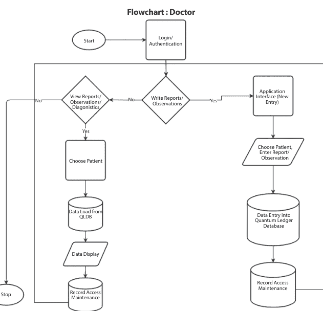

**图 7.11** 医生权限流程图。

此外，研究还将侧重于机器学习算法，以检测源自网络内部的网络攻击并相应地进行缓解。利用机器学习和深度学习技术，可以追踪出源自机构内封闭网络内部的威胁。可以实现如 RNN（循环神经网络）和 XgBoost 等技术，结合预训练数据集来跟踪漏洞。

通过该系统，我们还希望进一步关注机构/实体之间的互操作性，其中多个医院将通过安全网络连接，传输数据，并且如果患者被转院，可以彻底访问其/她的病历。此外，医院、诊断中心和医学院将能够互动并共享其研究数据，并在诊断方面进行合作。即使患者选择在诊断中心进行体检，报告也将在该网络内共享，负责该患者的医生可以无缝访问报告。这还将帮助在该领域具有高度专业性的医生，无需全程出行，即可从他们最近的医院对患者进行诊断。

此外，在全面部署中，有实验性实施报告，例如在系统中使用患者的生物特征签名进行高安全级别的认证，以及仅使用其加速度计数据识别睡眠中的患者 [13]。为了跟踪此工作流程，京都大学使用了一种实时定位系统，通过采用手持条形码扫描仪、蓝牙发射器和信标中继系统，并在患者、护士和物资上使用一些条形码标签 [14]。

## 7.7 结论

在我们提出的模型中，我们设计了一个系统，通过该系统传感器数据可以安全地逐步从场所转移到云存储。我们还讨论了一个系统，其中患者数据的隐私可以得到维护，并使用最少访问策略，患者数据可以相应地被卫生官员分析、查看和观察，实现平稳过渡。此外，该系统还可以帮助促进患者及其/她的亲属从家中跟踪其/她的进展并查看定期报告，也可以前往诊断中心或药房进行测试和购买药物，并将所有这些记录在案以供将来参考。此外，通过该系统，销售药物的药剂师可以验证患者的身份，并检查该患者是否被认证医生允许/开具处方购买该药物。该系统还允许应急响应系统跟踪患者的基本信息，即姓名、年龄以及与其相关的病情，在患者转运期间使其更安全，因为医疗人员将据此做好准备。在这一适当的过程中，当前局势中的许多危机可以被克服和应对。医疗保健系统中日益增长的短缺、交付成本、实体间的信息共享以及医疗保健专业人员短缺以提供更好的治疗，可以轻松克服，并提供增强的服务。我们提出的系统旨在比其他现有系统更稳健和高效，并为在医疗保健系统中利用物联网提供更安全的方法。

**图 7.12** 登录身份验证失败的用户界面。

**图 7.13** OTP/MFA 身份验证失败的用户界面。

## 参考文献

- Darwish, A., Hassanien, A.E., Elhoseny, M., Sangai ah, A.K., Muhammad, K., The impact of the hybrid platform of Internet of Things and cloud computing on healthcare systems: Opportunities, challenges, and open problems. *J. Ambient. Intel. Hum. Comput.*, 待出版, 12652, 659, 2017, https://doi.org/10.1007/s12652-017-0659-1.
- Yuce, M.R., Implementation of wireless body area networks for healthcare systems. *Sens. Actuators A, Physical*, 162, 1, 116–129, 2010. https://doi.org/10.1016/j.sna.2010.06.004.
- Wu, T, Wu, F, Redouté, J., Yuce, M.R., An Autonomous Wireless Body Area Network Implementation Towards IoT Connected Healthcare Applications. *IEEE Access*, 5, 11413–11422, 2017.
- Khan, J.Y, Yuce, M.R., Bulger, G. *等*, Wireless Body Area Network (WBAN) Design Techniques and Performance Evaluation. *J. Med. Syst.*, 36, 1441–1457, 2012. https://doi.org/10.1007/s10996-010-9605-x.
- Gong, T, Huang, H., Li, P., Zhang, K., Jiang, H., A Medical Healthcare System for Privacy Protection Based on IoT. *2015 第七届并行架构、算法与编程国际研讨会 (PAPAP)*, 南京, 2015, 第 217–222 页.
- Yeh, K., A Secure IoT-Based Healthcare System With Body Sensor Networks. *IEEE Access*, 4, 10288–10299, 2016.
- Luo, E., Bhuiyan, M.Z.A., Wang, G., Rahman, M.A., Wu, J., Atiquzzaman, M., Privacy Protector: Privacy-Protected Patient Data Collection in IoT-Based Healthcare Systems. *IEEE 通信杂志*, 56, 2, 163–168, 2018年2月.
- Kumar, P. and Lee, H.-J., Security issues in healthcare applications using wireless medical sensor networks: A survey. *传感器*, 12, 1, 55–91, 2012.
- Anantharam, P., Banerjee, T., Sheth, A., Thirunarayan, K., Marupudi, S., Sridharan, V., Forbis, S.G., Knowledge-driven personalized contextual mhealth service for asthma management in children. *2015 年 IEEE 移动服务国际会议*, 2015.
- Muhammad, K., Sajjad, M., Mehmood, I. *等*, A novel magic LSB substitution method (M-LSB-SM) using multi-level encryption and achromatic component of an image. *Multimed. Tools. Appl.*, 75, 14867–14893, 2016. https://doi.org/10.1007/s11042-015-2671-9.
- Maheu, M.M., Nicolucci, M., Pulier, M.L. *等*, The Interactive Mobile App Review Toolkit (IMART): a Clinical Practice-Oriented System. *J. Technol. Behav. Sci.*, 1, 3–15, 2016. https://doi.org/10.1007/s41347-016-0005-z
- Gong, L. A Secure Identity-Based Capability System., 见 *IEEE 安全与隐私研讨会*, 第 56–63 页, 1989.
- Hernández-Ramos, J., Jara, A., Marín, L., Skarmeta Gómez, A., DCapBAC: Embedding authorization logic into smart things through ECC optimizations. *Int. J. Comput. Math.*, 93, 2, 345–366, 2016.
- Catarinucci, L. *等*, An IoT-Aware Architecture for Smart Healthcare Systems. *IEEE 物联网杂志*, 2, 6, 515–526, 2015年12月.
- Sato, K. *等*, Feasibility Assessment of Bluetooth-Based Location System for Workflow Analysis of Nursing Staff. *Trans. Jpn. Soc. Med. Biol. Eng.*, 51, 增刊, R-314, 2013.

## 一种面向女性基于物联网的饮食监测健康系统

Suganyadevi S.,*, Shamia D.,${}^{2}$ 和 Balasamy K.,${}^{3}$

${}^{1}$KPR 工程技术学院，印度，哥印巴陀

${}^{2}$VSB 工程技术校园，印度，哥印巴陀

${}^{3}$Dr. Mahalingam 工程学院，印度，哥印巴陀

##### 摘要

饮食追踪是智慧医疗和智能家居的重要组成部分之一。研究人员通过一种用于追踪进食频率的注入式监测系统解决了这一问题。安装了一个智能餐桌，利用称重传感器和射频识别（RFID）来测量食物摄入量。还建议了一种结合摄像头和麦克风的混合进食行为监测装置，以检测食物份量及摄入量。所提出的系统是一个全自动饮食追踪解决方案，包括用于食物营养评估的 Wi-Fi 传感器以及收集食物成分营养信息的智能手机应用程序。监测装置中包含一个食物称重传感器，它计算食品产品的重量，并通过集成无线模块同步的微控制器，经由互联网无线传输至云端。采用两种不同的方法以获取适当的营养值。随后，根据最高的营养含量对食物进行分类，并分析所吃食物与缺乏营养素之间的关系。该方法还描述了缺乏的营养素、肥胖状况，并意味着消费者食用基于最高营养素含量且低卡路里的食物。

**关键词：** 物联网，健康系统，营养监测，微控制器

*通讯作者：suganya3223@gmail.com

### 8.1 引言

食物是维持生命的根本；然而，为了过上高质量的生活，明智的饮食 [1] 至关重要。优质食物的摄入可能直接预测新陈代谢紊乱导致的人体机能下降 [2]，并预测与饮食相关疾病，例如糖尿病 [3]、肥胖 [4] 和心血管疾病 [5]。饮食相关疾病，如肥胖，不仅影响身体健康，还导致巨大的经济成本（疾病发现、治疗等）和社会成本（效率损失、残疾年金等）[5]。根据参考文献 [6]，对于体重指数（BMI）为 39 kg/m² 的人，预期 6% 的体重减轻将导致每年医生处方干预费用减少 401 美元，11% 的体重减轻可节省 679 美元，16% 的体重减轻可节省 870 美元，19% 的体重减轻可节省 998 美元。此外，由于肥胖导致的效率损失每年高达 12,989.51 美元 [7]。

自 2000 年代初以来，人们查阅了多种方法来解决维持健康食物摄入的问题。手册方法 [8]，包括解释性的饮食确认自我报告，是营养使用记录中公认的关键范围之一。近期，随着设备的普及，方法得到了改进。开发了几种饮食日志应用程序 [9]。然而，这些记录整理方法严重依赖用户的记忆和回顾，这对许多用户，特别是患有记忆问题的残疾用户来说并不有效。因此，有必要在技术的帮助下建立一种更有效的方法来自动监测食物摄入。在过去，大量研究使用不同的设备研究了多种方法。这些设备包括各种识别模态，例如视觉、肌电图（EMG）、声学、惯性、电喉图（EGG）、电容式以及压电传感器。一些方法使用传感器的组合。由于每种检测技术在食物摄入监测方面都有其优点和局限性，具体取决于其应用，我们进行了这项全面审查，重点关注最新和有前途的可穿戴技术。

健康被定义为身体、精神和社交福祉的完整状态，而不仅仅是没有疾病。健康是个人追求美好生活需求的主要组成部分。不幸的是，全球健康问题因特定因素而成为难题，例如慢性衰弱福利、城乡地区之间巨大的鸿沟、医生和医疗护理人员在最艰难时刻的不可接近性。

印度四分之一的育龄女性营养不良，BMI 低于 19 kg/m（来源：NFHS 4 2015-16）。众所周知，虚弱的母亲必然会产生营养不良的孩子，维持着代际间的营养不良模式。营养不良的年轻女性更有可能成为营养不良的母亲，这些母亲进而更有可能生出低体重婴儿，传播着代际间的营养不良循环。这种循环流程在年轻母亲中可能会进一步加剧，特别是那些在充分发育和成长之前就开始生育的成年年轻女性。当母亲在怀孕之间只间隔很短时间并有许多孩子时，这可能会助长营养缺乏，而这些缺乏随后又传给她们的孩子。胎儿抑制通常是由于母亲在受孕前和第一个三孕期食物不足造成的。印度儿童营养不良水平停滞不前的主要原因，在于此前未能充分预测发生在最可能发生营养不良的地方——即子宫内的情况，这是由于女性在怀孕前和怀孕期间营养状况不佳所致。鉴于此现状，女性的营养——在怀孕前、中、后——现在已被纳入联合国儿童基金会（UNICEF）印度营养计划的特别核心领域。该组织现在旨在提供额外的重点，以普遍化已根据全球和国家共识验证过的针对女性的五项基本营养干预措施。

在 2019 年联合国大会上，对普遍健康覆盖（或全民医疗保健）(UHC) 的关注突然增多。这次大会重申，“健康既是前提条件，也是结果或标志，也是经济可持续发展的三个组成部分之一”，并明确承诺“在 2030 年前实现健康全民覆盖，最终目标是扩大全球倡议，为所有人创造安全环境”。健康是基本权利，而不是仅支付得起的人的利益，理想状态下健康和福祉应惠及所有人。

联合国关于全民医疗保健（UHC）的宣言将基本健康环境视为一种最全面、有效和高效的公共方法，以确保个人的身体和情感健康及社交福祉。除了优质教育、性别平等和妇女赋权、安全饮用水和卫生设施准入以及社会保障计划外，该

该公告还强调了健康的体重管理计划以及健康、公平和可持续的粮食结构在构建更健康的社会秩序中发挥的关键作用。

将营养纳入关键医疗保健的基本组成部分的论点是有说服力的：长期以来，健康框架和医生主要集中在一套缺乏主要因素（如饮食、生活方式等）的心理和酒精治疗模式的障碍上。这种有限范围的结果显而易见：席卷全球的健康危机。在现代社会最大的健康和饮食问题中，较差的饮食习惯导致残疾、死亡、加剧不平等、令人震惊的医疗成本以及生态后果。

他们被迫采取行动，因为政策制定者和监管机构日益认识到饥饿问题的范围和深度。将营养实践纳入健康框架以促进健康饮食[2]，并预防和管理与营养不良和饮食相关的慢性疾病，将产生巨大的健康效益，并且具有出色的成本效益。

关键利益相关者对更健康、更公平的粮食和健康框架负有责任，包括政府和私营部门。这一转变代表了改变方向，不再将选择健康选项的最大责任和过错归咎于个人，而个人已成为一个在世界上将粮食实践团结在一起的不断增长的群体。基于社区的干预可以覆盖社会更大的部分，而较少的个人行为，可能不那么昂贵、矛盾和个性化的方法可能会参与其中。每个人都可能受益于这种“上游”技术，特别是那些处于不利地位以及经济状况较低的人群，尤其是在将其纳入广泛的健康包容框架内进行协调时。尽管多年来已制定安排和项目来应对饥饿和粮食脆弱性，但很少有人关注饮食质量的改善以及与饮食相关的非传染性疾病的报告。在预防非传染性疾病（NCDs）的饮食安排方面的持续发展和倡议，将指导需要改革以及资助全面健康包容政策以对抗慢性营养相关疾病的地区。

确保在健康框架内公平获得有效饮食干预措施，将在改善体重管理策略、预防和管理疾病、降低医疗成本以及最终改善每个人的健康方面发挥紧急作用。然而，在平等安排、资金、控制和评估方面，这些援助尚未由结合营养和医疗保健的强有力方法所组织。在公共医疗保健规划和资金讨论中，营养往往被组织不力。新的总体营养爆炸认识到通过一种旨在改善减重计划、可赎回的生存并降低饮食护理支出的关键方法，将营养协调为全面健身关注的必要性和紧迫性，同时确保没有人被遗弃[3]。

世界卫生组织（WHO）和联合国儿童基金会（UNICEF）关于在本现代社会中普遍纳入基本饮食护理的愿景依然不变：一种以社会为中心的应对健康的方式，旨在通过关注个人（作为个人和群体）的需求和偏好，尽可能早地在健康发展和疾病连续谱中扩大健康和福祉的水平并均匀分布它们[4]。

初级医疗保健对于实现全面健康包容至关重要，并带来各种健康[5]和经济福利。单凭这一点，这是营养关注得以协调和传递到社会层面的主要方法，从而确保优质服务的最佳包容和分配。然而，营养服务应在饮食关注传递的多个层次引入，包括二级和三级护理。由于适当地结合营养活动而缺乏对基本饮食关注的获取，可能意味着优质营养服务无法惠及每个人。通常是那些最弱势和受阻碍的人获得服务的程度最低。当营养服务分配在多个组件中时，存在其质量不稳定或不理想以及包容性不佳的可能性，且这些服务未得到系统的测试和评估。

为了将定植于关键饮食关注并针对各种设置和需求量身定制的营养协调起来，需要更好的服务范围和组织变革。这包括安排方案、公平的资源分配、与社区合作伙伴的互动和机密领域[6]、足够的卫生人员以及物理环境。可及的初级健康服务的定义，因此也是可以且应该实施的食品干预措施的程度和形式，因国家而异，如文中所述。例如，软体国家（注：此处原文为soft states，结合语境可能指脆弱国家或特定语境下的国家，翻译保留原意逻辑）的初级医疗保健框架定制为管理不同程度的残疾、肮脏和微量营养素缺乏，同时也面临其他文化挑战，如人口接触有限、框架中断、灵活中断和高员工流失率。至关重要的是，初级医疗保健框架必须对变化的需求敏感，如通过地区、生命阶段、性别、财富、国籍、移民状态和残疾进行目标化，以根据需求定制干预措施。引人注目的是，在全球范围内，目前只有1700万患有极端严重不健康的6岁以下儿童中的500万人能够获得治疗[7]，这突显了报告这一不适当问题的关键需求。

长期以来，营养不确定性和营养不良的先前全球影响已被认识到，导致传统上重点关注以营养不良为目标的活动。如果我们无法通过健康框架识别和重点关注巨大的饮食相关非传染性疾病预防负担——这可能与营养不良并存——将加剧营养差异和饥饿问题。世界卫生组织提出的基本营养活动[8]突出了全生命周期的一系列基本营养干预措施，这些措施应普遍可及，主要针对营养不良。微量营养素产品，如碘、铁、维生素和极端不健康的额外行动，以及推广和促进适当的婴幼儿护理，是与初级医疗保健相关的关键基本维持实践。然而，在建议的30项具体营养实践中，只有一项通过创建更系统的鼓励常规安全饮食倾向的环境（主要基于土壤产品、绝对脂肪、饱和脂肪和反式脂肪）来强调广泛的饮食制度和相关非传染性疾病。针对健康领域不同范围（例如传染病控制和生殖健康）的干预也可能整体改善营养状况。

最近，已识别出一些新的关键营养因素和方法，用于应对[9]营养不良和营养相关的非传染性疾病，这些可以衡量并针对全面健康覆盖的承诺。示例包括针对无休止或有限健康食物的临床答案[10]，与自动卫生档案挂钩的标准化临床检查协调，以评估营养和粮食脆弱性[11]，此外还有针对高危险[12]的、营养不良和复杂慢性疾病患者的治疗性重新饮食。这对于健康结构向管理营养、营养相关的非传染性疾病扩展其组织，并全面报告痛苦是必要的。

物联网（IoT）正在使当前十年内的相关产品互联，它被视为下一次创新变革。Keen

## 1. 物联网与医疗健康监测简介

健康监测组件 [1, 2]、智能停车 [3]、智慧家庭 [4]、智慧城市 [5]、智能环境监测 [6]、现代区域管理 [7] 以及农业领域 [8] 都是物联网的部分应用。物联网最大的用途是在医疗管理中，它提供健康和环境状况跟踪服务。物联网仅仅是利用传感器和网络将计算机连接到互联网 [9, 10]。这些互联部件可用于健康监控设备。预置的传感器随后将数据转发到如 M2M（机器对机器）等远程区域，这些区域包括计算机硬件、个人机器、手持设备或手机 [11]。这是一种简单、节能、更智能、可适应性强且互操作性好的跟踪和改善任何健康问题护理的方法。如今，现代框架为个人提供智能生活，包括灵活的界面 [12]、协作设备 [13] 以及心理健康管理 [14]。

脉搏和核心体温是衡量人类健康的两个最重要指标。脉搏是指每分钟的心跳次数，通常称为心率。为了测量心率，可以通过计算心跳次数来利用血流量体积的增加。健康人的正常脉搏范围通常在每分钟 60 到 100 次之间。成年男性的正常静息心率约为 70 bpm（每分钟跳数），成年女性约为 75 bpm [15]。12 岁及以上的女性通常比男性拥有更高的心率。人体温度基本上就是身体的热量，身体散发热量的总量是通过逻辑决定的。正常人的核心体温取决于多种因素，例如环境温度、个人的性别以及饮食模式。在健康的成年人中，体温可能介于 97.8 °F (36.5 °C) 到 99 °F (37.2 °C) 之间。多种因素，如流感、低温性低体温症或其他疾病，都可能导致核心体温的变化。在几乎所有疾病中，发烧都是常见的标志 [16]。存在多种侵入性和非侵入性方法来评估脉搏和核心体温。对于消费者而言，长期的非侵入性方法已被证明是准确且有益的 [17]。建议医疗机构应提供良好的房间环境以鼓励患者康复 [18]。一些指标，如房间湿度、CO 和 CO2 等所有气体的水平，可以决定房间空气质量。有毒气体和某些程度的湿度对患者极具危害性。为了达到最佳舒适度，房间湿度应保持在 30% 到 65% 之间。一些研究 [19, 20] 专门针对智慧家庭进行，而非专门的医疗领域。

在临床领域存在几种致命疾病，如冠状动脉疾病 [21]、糖尿病 [22]、癌症 [23, 24]、肝脏问题 [25] 等，但我们所开发的系统的首要任务是监测各种患者的早期症状以及患者房间的环境。本文提出了一种红色的医疗框架，通过传感器监测患者的脉搏和核心体温，以及患者房间的湿度、CO 和 CO2 气体水平，并通过 Wi-Fi 传输数据，使临床工作人员能够从服务器获取数据。所开发的系统还利用 Web 服务器解决了在诊所中维护单一患者数据库的问题，此外还实现了基本健康相关措施的个性化。在该系统中，气体传感器用于识别表现出超出阈值的意外事件，并在阈值值越过限值时生成 PPM 信号。

## 2. 可靠的营养统计和健康信息系统的重要性

引言 可信且开创性的营养统计数据至关重要，它在很大程度上由政策制定者、监管机构、医疗保健工作者以及研究人员组成的互补体系中发挥作用。因此，将卓越的 sustenance 数据（数据）的标准安排转变为政府卫生信息系统的核心且完整的组成部分是必要的。卫生信息系统满足多种客户和需求，旨在协助该卫生系统中的规划、管理和动态发生 [72]，同时继续承担基本理由并应对挑战。

可靠的卫生证据方案确保了多样化、评估、传播以及利用强有力的理想卫生证据的完成，主要受到三个限制：特定、办公室和人群玻璃状统计数据的时期；在合理时期内识别、分析、传达和综合代表对公共卫生危险之行动的限制；以及构建 [73]、传播和促进该知识利用的能力。

营养与这些功能的结合对于收集和使用优质 sustenance 数据至关重要，以便：评估个人和人群的健康状态/需求；提供合理的个人 sustenance 护理；以及设计、监测和评估目标导向的 nourishment 政策和干预措施 [74]。然而，在实现这一目标的过程中存在一些差距和挑战，但同时也存在机遇。

卫生证据系统使用多种类型的数据或来源 [75]，每种都服务于明确的目的。这些形式包括：
- 关于患者概况、需求和护理的详细数据信息（即，well-being 记录），填补理性个性化思维背后的原因；
- 卫生办公室级别（公共和私立）数据，用于报告并调节例行任务，例如人力资源、预约、硬件/供应、收费/融资以及服务和项目的纳入与实施；
- 用于总体健康决策的人群级别信息，主要通过公共卫生和细分研究；以及
- 用于覆盖关键服务（例如针对流行病疾病或紧急援助）的营养感知办公室和社区数据。

在传递卓越的支持组织时，从筛查、对比、诊断、干预和跟踪到提供准备，初始阶段应该是增强（电子）well-being 记录 [76] 以用于食物护理。实现这一目标的两个关键组成部分包括使用有意识的结构和语言来激励食物护理运输文档 [78]，例如 Nutritit NCP 在过去十年中已在全球范围内逻辑应用。类似可接受的筛查方法，饮食一致性 and 食物不稳定性 clinical 评估通常并未在 well-being 记录中完全结构化或标准化 [79]。同样，来自卫生办公室的数据不一致地增强了预防和补救性食物服务的引入和实施报告，并且不一定能代表向整体公众开放的组织 [80]。这限制了提供量身定制的装备 sustenance 治疗的能力，特别是对于最需要的人 [81]，并增加了提供量身定制的装备 sustenance 治疗的负担机会。将此类评估融合到传统的繁荣记录（理想情况下是电子形式）和常规理念中，将促进食物融入临床护理，并可能引发繁荣 [83] 和财务负担的减少。将此类评估整合到标准繁荣记录（理想情况下是电子形式）和常规理念中，将促进食物融入临床护理，并可能引发繁荣 [83] 和财务负担的减少。

人群级别 sustenance 信息对于研究、识别、组织、评估和验证人群级别问题至关重要。大规模的广泛代表的健康与营养调查表明，人群的健康和 sustenance 状态是所有调查此类知识的主要来源。理想情况下，信息应在个人级别收集，使用标准化的评估工具和方法，并以精确、可预测 [84] 和等同的方式收集。此外，信息应允许按主要细分特征进行分解和分析，例如性别、年龄、身份、财富、移民状态、残疾、地理位置以及其他适用于公共卫生环境的其他特征。精细化的信息对于识别不同人群群体之间健康状态的不平衡，并指导公平 nourishment 干预措施的设计和执行为基本。

低收入国家在 sustenance 信息方面要么匮乏，要么依赖于有限的数据。在这些环境中，人群

层面营养信息主要来源于：公共家庭单位消费和[88]使用审查（HCESS），这些审查不收集个人层面的膳食摄入量，从而阻碍了对社会人口统计学差异的评估；人口[89]与健康调查或多预测因子集群调查[90]，这些调查相对较少（通常每3年进行一次），是对人口子样本范围狭窄且不具普遍性的小型综述；以及关于网络和机构维护的数据，这些数据旨在解决重大的总体健康问题（例如微量营养素缺乏与补充、[91]婴儿喂养行为以及人体测量/发育状况），或在紧急情况下提供[92]建议。

这些来源不一致地收集其他关键营养标志物的数据，例如：个人层面的膳食确认、生物标志物、其他不同的人类学指标、相关的健康结果、妊娠期间的补充剂使用、清洁水源的可用性、卫生条件和清洁排放，或用于监测预防性或医疗性食物行动整合与质量的其他标志物[93]。在“营养增效”（SUN）倡议中，对58个国家食品部门在健康数据系统中的持续组织化工作表明，这些系统最常追踪的是补充剂。补充剂[49]的追踪位居其后，其次是产前护理中的母乳喂养计划[34]和最初的真正需求收集[33, 93]。仅有19个国家稳定收集妊娠期间铁和叶酸有害补充的数据。

我们需要工具来简化和改进低收入环境中初级食品数据的常规分类、使用和混合。利用现有结构和资源来构建、限制和维护食品评估系统和设备至关重要。同时，鉴于便携式平台和多种技术在更高收入国家日益增加的普及和应用[96]，这也同样是一个进步的开放入口。国际膳食数据扩展（INDDex）项目旨在解决低薪国家膳食数据收集检查中的独特挑战，并扩展其能力，通过创建和认可标准化和简化的技术来处理和解释个人膳食数据[96, 97]。营养国家信息平台（NIPN）行动加强低薪国家强化其营养数据结构的能力，并改进数据分析，以更有效遏制营养不良[97, 98]。旨在通过解决食品评估中的差距并支持更强大的食品数据系统，来改变食品数据的可用性和使用，从而扩展营养转型决策的数据（DataDENT）[97, 98]。

在全球范围内推进人群层面营养信息的多样性、质量、可及性和可用性，并将其纳入健康数据框架，将是公共健康的一项重要改进和重要资源。秘鲁和危地马拉是两个中等收入国家，它们成功开发并更新了每年结合协调营养信息的健康数据框架[99, 100]。一些低收入国家目前正在构建自己的营养数据系统[99, 100]。

现在比以往任何时候都更加重要，必须投入资源将营养全面整合到健康数据框架中。这将确保合理的针对性营养护理安排、及时识别具有较高健康风险的人群、对危机做出最快反应、更强的问责制、知情政策制定和预防行动，以及有效和高效的财政、人力及其他资源管理。用于健康和营养的综合数据框架是一项复杂但可实现的艰巨任务。一旦实现，这些框架将为公共健康带来多重益处。

## 8.2 背景

### 8.2.1 食物消费

食物消费和饮食习惯直接影响一个人的健康。在称为卡路里的能量平衡[18]中，食物摄入是基本的。此外，Schwartz等人[19]强调了营养摄入对能量稳态的重要性。调节能量稳态的食物摄入，即能量摄入和能量消耗的总和，似乎对大鼠的体重有影响，其对人类健康具有重要意义[19]。请记住，能量消耗也是维持最佳健康的关键变量。使用分离传感器监测能量消耗已被广泛研究，例如基于活动屏幕的[20]、基于加速度计的[21]和基于臂带多传感器的[22]。由于本文重点在于监测食物消费，因此不会深入研究能量使用的验证。除了能量控制外，食物消费还与肝脏强度的水平存在对应关系，影响肝脏衰竭和慢性肝病。具体而言，食物消费后肝脏硬度在前1小时内迅速增加（p = 0.02）。3小时后，肝脏硬度水平恢复至恒定状态。研究还表明，食物摄入改善了丙型肝炎感染患者与健康对照组的肝脏硬度[23]。

反刍行为，包括食团大小和咀嚼频率，也对食物消化产生重大影响[24]。咀嚼框架执行不佳会导致溃疡和胃癌[25]。否则，有效的反刍倾向会促进与胃部相关的周期。Bisset[26]指出，当分别食用花生和甜甜圈时，男性典型的咀嚼量（构成一块食物的食物大小）已被记录为在5.6到7.5克之间，女性则在3.5到5.5克之间。超过这些标准的咀嚼量对咀嚼效率有非凡的影响[27]。咀嚼频率影响胃肠道结构和咀嚼肌肉。Karibe[28]证明，患有慢性咀嚼肌疼痛的患者从适中的咀嚼频率中受益。此外，咀嚼频率是一个压力点，因为它影响唾液皮质醇水平[29]；因此，食物消费期间的咀嚼频率和食团大小/重量至关重要，需要控制。

### 8.2.2 食物消费监测

食物摄入监测在保护自然和实质发育方面起着重要作用。这种常规[30]产物主要由AA（氨基酸）主导，它们用于蛋白质的合成以及多种其他低分子量化合物。此外，非必需氨基酸（NEAA），由人体合成，负责我们许多生理功能，如图8.1所述。为了理想的生长、发育、哺乳、繁殖和健身，人们的饮食中必须包含NEAA[1]。然而，由于不当的饮食和食物摄入[31]，氨基酸合成易受限制的影响。同样，有效的食物摄入监测确保氨基酸消化以符合人体全面生长和理想健康的需求。食物消费监测影响图8.1中提到的主要生理功能。

**图8.1** 非必需氨基酸（NEAA）在人体细胞中的重要生理作用。

### 8.2.3 使用物理方法的健康监测方法

#### 8.2.3.1 传统形式的自我报告

Square[34]全面分析了与既定发现和结论关于自我报告方法的认可相关性，例如各种经验方法、24小时膳食审查方法和七天方法。Bingham[35]讨论了一种通过展示必然完成调查的人群中每种方法的错误率而形成的优越审查。如调查所述，结果到食物确认传输四分位数的误分类率约为10%，且仅有15%的参与者完成了该方法。此外，由于缺乏便利性[35]，自我报告方法阻碍了个人参与食物确认测试。

#### 8.2.3.2 通过智能手机的自我报告方法

随着PDA（掌上电脑）的普及，自我报告接近改善便利性和完成自检的时间。在PDA上公司的专业技能也使这种处理方式具有更多的功能，例如来自专家的快速响应和持续的自我观察。Wohler[36]在摩托罗拉Q9h数字手机上建立了一个食物摄入调查结构。该结构允许参与者记录长时间进餐段，并将详细信息发送到SQLite数据集以进行分析。

#### 8.2.3.3 食物频率问卷

手动膳食评估策略包括使用食物频率问卷（FFQ），利用调查系统（例如应用程序、网站等）收集一段时间内食物和饮料的消费频率，但不针对每一餐。通常，手动方法依赖情感直觉和回忆，因为它们依赖报告而非目标食物摄入的客观数据。公认的是，自我报告或手动方法是不确定的

且非常片面 [40]。例如，对于体重较重的人群，这种倾向性过强，以至于他们甚至不在乎获得关于营养能量消耗的准确评估。

### 8.2.4 使用自动化方法进行健康追踪的方法

#### 8.2.4.1 压力过程

安装在装饰性衬垫内或桌下的压力传感器利用了重量策略。在食物摄入控制方面，这种策略虽然并非可穿戴的，但具有新颖性。Chang 等人 [41] 发表了关于重量方法的最早研究。位于桌面下方的重量传感器用于进行检测。当盘子重量发生变化时，该估算表面将确定在餐桌不同区域之间移动的食物量以及餐桌旁每个人摄入的食物量。考虑到不同盘子重量的微小偏差，一种重量匹配算法旨在识别和区分人们的进食方式。当前方法的精度约为 80%，显示出作为新颖方法起点的希望。该装置本质上是一个重量传感器，其上层起支撑和进食表面的作用，同时具备安全性。当有人在这块装饰性覆盖物上进食时，特定的进食动作（如切、舀和传送食物）会被观察到。与 Chang 等人 [41] 中的传感器相比，该传感器的动作较少。然而，在没有重量测量或食物分类的情况下，它仅能识别照顾动作。

#### 8.2.4.2 监控视频方法

与可穿戴相机方法相比，监控视频方法使用外部相机进行自动食物摄入检测。Cadavid 等人 [43] 创建了一个基于外置相机在进食过程中捕捉人脸图像来检测咬合功能的可见模型框架。咀嚼的检测由模型精确参数中咀嚼存在的准周期性定义。

#### 8.2.4.3 多普勒传感方法

利用微波多普勒运动传感器是另一种处理食物摄入跟踪的当前自动化方法。Tanigawa 等人 [45] 调查了他们方法中利用多普勒效应检测由垂直下颌运动产生的多普勒咬合信号的应用。根据多普勒频率与移动速度之间关系的状态，可以确定咬合期间下颌的具体移动速度。在通过估算和识别需要下颌运动的坚实食物来识别饮食模式方面，压力、观察视频和多普勒检测方法均受到限制。使用这三种方法当前的成果尚未使它们能够检测特定食物或食物结构类型。此外，这些方法不可佩戴的局限性限制了食物摄入监测传感器系统的便携性，从而降低了它们在检测生活社区中活动时的有效性。

## 8.3 可穿戴方法的必要性？

既然物理方法已被证明不可靠且片面 [46]，我们需要一个更有针对性、更有效的饮食评估框架。可穿戴传感器是理想的解决方案，因为它们不依赖于个人的抽象选择；此外，可穿戴传感器提供实时的食物摄入筛查。对于有用的反馈，收集的数据可以轻松地与数据入口（如 PDA 程序）同步。可穿戴传感器的另一个基本优点是了解自由生活人群的行为。它为顾客提供便利，消除了自我爆炸的重量，这在临床应用中特别有用，尤其是当患者是顾客时。可穿戴食物消费控制框架具有广泛的应用，这些将在本文后续章节中进行综述。通过最小化外部变量（如气候干扰）的不良影响，也可以提高计算机化可穿戴传感器方法的准确性。例如，基于传感器的方法涉及对信号去噪，这也可以完全消除插入到收集信息中的干扰。随着创新的推动，科学家们可以选择构建令人满意的去噪信号处理技术。Ervin 等人 [47] 在设计和改进双节点吞咽加速度计信号去噪技术方面取得了成功，相比过去的方法有了显著进步。

## 8.4 可穿戴感知的不同方法

在本节中，我们将详细综述各种传感器及其相关的食物摄入应用和主要考试。食物摄入的应用包括食物类型安排、进食行为和体积/重量测量。各种类型的传感器将专注于理解特定食物消费的应用。

### 8.4.1 声学方法

#### 8.4.1.1 咀嚼检测

通过声学手段确定和测量咀嚼声音将成为追踪食物摄入的重要诱人主题之一。该领域的逐日研究越来越多。总体而言，当前方法依赖于使用可穿戴设备（如麦克风）来积累声波，并使用某种技术来识别和解释咀嚼事件。对于食物分类，Amtft [49] 定义了一种基于振动的检测方法，该方法使用嵌入耳垫中的冷凝麦克风，进一步扩大了食物分类到咀嚼和咬合重量识别。咀嚼序列、暗示咀嚼的声波波形由耳垫传感器记录，并用于咀嚼识别技术。咀嚼序列由特征相似性搜索案例的识别算法定义。随后，这种咀嚼识别有助于从微观结构变量中识别咬合重量。他们的基于声音的咬合重量识别系统显示出高精度的结果，仅在一种食物类型（苹果）上有 19% 的错误。然而，报告中仅包含三种食物类型（苹果、薯片和生菜），不足以对该策略的功效得出全面结论。Amtf 等人的另一项研究 [78] 深入探索了咀嚼声音分析，并确定了技术协议以及麦克风的最合适位置（内耳，朝向耳膜）。关于咀嚼的自动检测还有各种其他科学文章。其中一篇来自 Yatani 和 Truong [79]，他们擅长从获得的声音中将咀嚼事件与食物的软度分开。此外，Olublanjo 等人 [80] 使用模板匹配系统，专注于在嘈杂环境中区分咀嚼声学事件。为了验证结果的有效性，分析显示在相当大的数据样本（13 个独立任务，包括五种固体、四种液体食物以及四种气管和非气管事件）上高达 83.3% 的积极结果。Pabler 和 Fischer [81] 开发的相关方法也能够检测咀嚼声音。Pabler 和 Fischer [82] 通过开发一种计算成本较低的食物摄入声音检测算法，进一步使用了该方法。同样，Pabler 等人 [83] 利用了传感器系统在外耳道观察到的分崩离析阶段中的咀嚼声音。参考文献 [84, 85] 中建议的其他实验也具备通过咀嚼计数和食物纹理分类来检测咀嚼事件的能力。这种方法中的麦克风不是单一传感器。对于咀嚼事件中振动的检测，应变传感器也是可行的。

#### 8.4.1.2 吞咽检测

吞咽检测基本上等同于咀嚼的发现，因为吞咽是跟随咀嚼的机械吸收阶段。此外，用于此发现的声学技术是可行的。吞咽包括上食道括约肌的开放/关闭以及通过蠕动波移动食团，如第 8.4 节所述，这些是巨大的振动源。在这种形式的食物消耗定位上，提出了一些关于可穿戴传感器的重要综述。Sazonov 等人 [87] 设计了一种包含喉咙喉咽部上方喉口装置的装置。在这个位置，信号很强烈，因为它靠近吞咽声音的产生地。此外，该系统还包含捕捉声音评分信息的设备/编程部分。Sazonov 等人 [64] 更详细地研究了声学识别吞咽机会的方法。所提出的定位策略依赖于以下时间 - 重复退化：msFS（梅尔尺度傅里叶范围）和 WPD（小波束衰减）以及支持向量机（SVM）特征化。总的来说，在 81 名参与者的测试规模下，该程序显示出约 87% 的令人满意的后效。

#### 8.4.1.3 咀嚼/吞咽联合发现

在此处，咀嚼和吞咽步骤相互匹配，因此可以使用组合方法连续区分它们的机会。Lopez-Meyer 等人 [88] 提出了一种基于模型的支持向量机方法，用于从源自瞬时 [89] 吞咽频率（ISF）信号和双重咀嚼标记的数据中区分食物摄入的时间。在另一项研究中，Kalantarian 等人开发了四种吞咽和咀嚼机会（三明治咬/咽、水咽和非活动）的声音切割语谱图，随后应用突出提取来区分这些机会。在咀嚼和吞咽机会上，不同的技术不专注于此，而是专注于食物顺序。一个关键模型是 Bi 等人 [90] 的 AutoDietary。在识别坚实食物和流体食物

以 99.7% 和 97.8% 的精度来看，单独而言，该结果似乎具有积极的执行效果。

## 8.5 方法论描述

对于所有人来说，合理的营养均衡是健康生活方式的重要组成部分。对于世界各地的营养咨询从业者而言，饮食习惯以及所摄入食物的营养价值正在成为高度重要的研究领域。因此，必须推广关于食物中营养成分与其在人体维持、发育、繁殖、健康和疾病预防中的作用之间关系的知识。本研究旨在调查不同年龄段女性对食物营养价值和饮食实践的认知。这可以通过使用自动监测系统监测女性每日食物摄入量来实现。为了应对这一挑战，我们提出了一种基于物联网的系统，该系统监测用户的营养摄入量、BMI（体质指数）以及卡路里消耗量，并建议用户未来应食用的餐食，以满足其目标营养值，从而过上健康的生活。

所提出的系统是一种全自动饮食监测解决方案，包含 Wi-Fi 传感器，用于评估食物营养，以及一款智能手机应用程序，帮助收集食品原料中的所有营养事实。基于物联网的健康监测系统总体框图如图 8.2 所示。监测系统包括一个食物称重传感器，该传感器估算食物重量，并通过使用互联网的无线网络将数据同步到集成了无线模块的微控制器，进而传输至云端。

**图 8.2** 基于物联网的健康监测系统总体框图。

为了获取适当的营养值，采用了两种不同的方法。第一种方法涉及光学字符识别（OCR），通过 FDA 强制执行的“营养成分标签”计算营养值。第二种方法使用扫描的食品条形码，并通过互联网 API 检索营养信息。结果，系统根据最高营养值对食物进行分类，并分析所食用食物与营养缺乏之间的关系。此外，系统识别营养缺乏和肥胖状况，并针对提供最高营养值且热量较低的食物向用户提出建议。如果遇到营养缺乏，系统将建议有助于健康生活方式的餐食。结果将是降低肥胖率并提高生活质量。未来的餐食预测是通过分类算法完成的。用户可以在其智能手机应用程序中查看结果。

## 8.6 所用各种组件的描述

### 8.6.1 传感器

#### 8.6.1.1 心血管监测传感器

心电图（ECG）是一种非侵入性方法，用于计算和存储心脏电位的变化。可以注意到，这是医生长期以来一直广泛使用且最有效的一种诊断工具，用于识别与心脏相关的问题，例如各种类型的心律失常。

众所周知，尽管许多心律失常并不危险，但某些由虚弱或受损心脏引起的后果，例如指示心力衰竭的心肌局灶性坏死（MI），如果不及时处理 [24–26] 可能会变得危险。在发生心血管衰竭后，患者需要快速获得临床护理，否则可能致命。如果能在心血管活动异常发生的早期阶段进行识别和治疗，并保持这种状态，这些不利后果是可以避免的，这需要对外科患者进行 ECG 监测。某些罕见且严重的心律失常（例如布鲁加达综合征、致心律失常性右室心肌病、长 QT 综合征和肥厚型心肌病）被认为在延迟监测中被识别时具有不一致性。使用 12 导联 ECG 系统，通过约 10 个 Ag–AgCl 电极（凝胶法或湿式 ECG），评估心脏沿 12 个特定空间方向的电活动，这些电极放置在身体的特定部位。含有导电凝胶垫的阳极作为阴极和皮肤之间的导电介质。凝胶被认为对皮肤有有毒和刺激性的影响，因此这些导线并不最适合用于使用移动监测的长期框架，但目前它是唯一可用的框架 [10, 27]。然而，在行走监测 ECG 系统中，出于数据受限的代价，仅使用了少数几个电极。监测行走模式的持续设备需要易于使用且不影响个人日常活动的可穿戴和便携式框架。

许多科学家开发和使用了压电传感器来测量体重，通过检测由于心跳收缩和舒张产生的血管搏动波来估算心率（HR）。文献 [32] 中介绍了一种用于心率监测的远程设备，该设备可以评估从耳廓表面变化中获得的心率。利用压电压力膜检测耳内搏动波（EPW），并将其转换为电流。在一个微控制器中执行基于数据的计算，该微控制器可以在执行形态变换后从信号中持续识别波峰。然而，体重变化，从而最大体重波会受到身体运动的影响，这会给心率评估带来误差。此外，耳部安装的设备被认为不适合长期使用。参考文献 [33] 提到了类似的框架，其中作者开发了一种基于聚合物的柔性压阻式压力传感器，可以检测血管对皮肤施加的压力造成的变形。还可以阅读关于使用碳黑或硅橡胶纳米复合材料作为柔性压阻材料的描述。通过沿压阻材料两层材料的接触面形成微结构，实现了压敏传感器灵敏度和线性度的提高 [34–36]。此外，还提出了一种低成本、简单的信号处理（ASP）框架，该框架可以执行去噪、数据处理和心率估算。

#### 8.6.1.2 活动监测传感器

监测个人的体育锻炼和运动在体育领域被认为是很有价值的，有助于识别肌肉骨骼或可能的智力疾病 [37, 38]。补偿个人的行走模式与其健康状况密切相关 [39]。值得注意的是，行走可能涉及多个关节，如脊柱、髋关节、膝关节、小腿、足关节和跖骨关节。它还涉及一些肌肉，如背部和髋关节周围的肌肉、大腿肌、小腿肌以及脚部的一些小肌肉。行走，尤其是转弯事件，需要良好的平衡以及身体各部分之间的协调。

衰弱个体的行走示例通常与普通健康个体不同。例如，处于神经退行性疾病（如阿尔茨海默病或帕金森病）早期阶段的个体通常会表现出不同的行走模式 [40, 41]。提前发现帕金森病的可能性较小，表现为缩短的步幅。处于帕金森病早期的个体在行走时可能会遇到起步困难、停顿和转弯事件。可以识别到相关运动的丧失。老年人由于运动控制下降和肌肉力量减弱，可能更容易发生跌倒，一旦发生，可能导致关节损伤、髋骨和骨骼骨折以及严重的脑部损伤。他们可能需要漫长的恢复期，限制运动并影响个人的日常活动。这也与暂时性失禁及相关骨折存在紧密联系 [41]。对步态的定量分析在早期识别某些疾病、预测跌倒以及恢复时间方面被认为很有价值。

另一种称为固定位置监测的方法，使用基于摄像头的框架进行动作监测 [42, 43]。这些策略能够识别复杂的行走动作。然而，此类框架将用户的活动限制在特定范围内。此外，这些框架复杂且昂贵 [44]。使用可穿戴运动传感器，如加速度计、陀螺仪和磁力计，在计算人类步态动作方面日益普及 [6, 11]。传感器用于测量身体的直线和角运动，其中提取了多个关键特征。

#### 8.6.1.3 体温监测传感器

众所周知，体温是反映健康状况的重要指标。在感染以及其他多种炎症性疾病中，体温可能会出现波动 [48]。在较长时间范围内进行体温测量可能会引起

结论，而非抽样检查。中心体温（CBT）也对多种生理状况具有显著影响 [50–59]。中心体温波动的中断与多种睡眠剥夺类型相关 [60]。例如，经历睡眠障碍的休息阶段患者，其基线 CBT 的到达时间可能比获得良好睡眠样本的人群晚约 2 小时 [60]。在某些研究中还观察到具有周期循环的中心体温波动模式 [61, 62]。

### 8.6.1.4 用于监测 galvanic 皮肤反应 (GSR) 的传感器

自主神经系统 (ANS) 用于控制和引导身体对内外部变化的反应，仅仅通过将活动分为两类来考虑：(i) 交感神经和 (ii) 副交感神经系统 [80]。后者被称为“休息和消化”系统，负责监测和恢复身体的能量 [63]。这种交感神经系统通过仅仅增加代谢产出以应对所有外部刺激，从而触发通常所说的战斗或逃跑反应。扩大交感神经系统的活动会加快脉搏，增加循环压力，促进汗液排放，并通过向肌肉、肺部和大脑泵送更多血液来为身体准备运动活动。

尽管目前这些数据在临床方面没有显著用途，但在涉及自主神经功能障碍、体位性直立性心动过速综合征 (POTS) 以及不适当窦性心动过速综合征的某些情况下，人们正在产生越来越多的兴趣。来自小汗腺分泌增加的汗液充满了汗腺导管。由于汗液是一种弱电解质，出汗会增加皮肤的电导率。因此，所有皮肤电导的变化，也被称为电皮活动 (EDA) 或 galvanic 皮肤反应 (GSR)，反映了自主神经系统的活动，并为评估与体重和情感相关的神经活动提供了直接、敏感且稳健的指标 [81, 82]。

GSR 必须测量拥有大量汗腺部位的皮肤，例如手掌、手指或脚底。关于动态测量，考虑到在两个体内电极之间施加恒定的直流电压，并且仅通过计算通过的电流并根据欧姆定律获取皮肤电导率。研究人员通常关注在实验室和医疗中心使用的时间受限的 GSR 测量框架 [65, 66]。低功率和可穿戴设备的发展开启了一个新的窗口，即微弱的 GSR 精确监测，允许在更长的时间段内佩戴 [83]。对 GSR 的持续监测允许评估被分配用于更长时间段的交感神经系统反应，并有可能揭示无法通过有限时间监测获得的重大生理数据。可穿戴 GSR 监测框架还允许患者监测 GSR，以更好地评估其心理生理状态，这优于在研究设施或医疗机构中进行的短暂测量评估 [83, 84]。

### 8.6.1.5 用于监测血氧饱和度 ($SpO_{2}$) 的传感器

外周毛细血管血氧饱和度 ($SpO_{2}$) 是血液中含氧血红蛋白的测量值。这一水平可能因多种健康状况而降低，如心血管疾病、肺部疾病、虚弱和睡眠呼吸暂停。过度体力锻炼后也可能降低。此外，必须记录血液中足够的氧气含量（即 >94%）以确保细胞和组织正常工作 [95, 96]。也经常必要监测 $SpO_{2}$，特别是对于呼吸器官和心脏有问题的人群。

脉搏血氧仪的广泛使用作为快速、无创的手段来量化血液中的氧气水平。由于红光 (660 nm) 和红外光 (940 nm) 引起的血液吸收特性代表了 $SpO_{2}$ 的水平。当血红蛋白被认为是氧合时，其颜色从暗红色变为亮红色，这代表了红光吸收的减少 [67-70]。血液中的光吸收也会发生变化，显示出心脏收缩期和舒张期血管和血量的差异，从而产生一种称为脉搏血氧图 (PPG) 的周期性变化信号。

## 8.7 可穿戴系统的通信策略

在第一阶段，使用短距离通信协议将有意信息传输到最近的网关节点，例如个人数字助理 (PDA)、移动电话、PC、专门设计的 FPGA 或基于微控制器的处理板 [71]。网关负责先进信息（此处原文似有误，结合语境应为采集的数据）的处理、显示以及后续长距离通信阶段，其中制备好的信号被发送到医疗保健办公室的远程服务器。

可以通过网络或蜂窝通信网络提交数据。目前，通过通用分组无线服务 (GPRS)、增强型数据 GSM 环境 (EDGE)、3G、高速分组接入 (HSPA)、长期演进 (LTE) 服务，大多数蜂窝网络提供清晰的网络接入 [77–79]。为了确保长距离通信链路上的安全传输通道以保护个人临床数据 [80–82]，有必要实施坚固的加密和验证技术。

在短距离通信的情况下，相应的传感器应通过远程中介直接传输到网关。另一方面，传感器将形成体传感器网络 (BSN) 的地理结构，呈星形网络并向中央 BSN 中心提交数据。经过一些规划后，BSN 中心可以将数据发送到网关。通过有线或无线介质，体内传感器和 BSN 中心可能进行传输。有线连接可能会使患者的灵活性感到沮丧，因为它可能会触发持续的连接失败。此外，发现它们也不适合可穿戴框架以及长距离追踪。使用导电织物纱线作为次要导电介质是一个不错的选择。为了与材料嵌入式传感器通信 [83–85]，这些织物可以很容易地整合到服装中。导电织物可以像之前描述的那样，使用传统的材料技术，如纺纱、缝纫、编织和印刷来生产。然而，由于它们的低耐久性和可洗性，导电纤维存在问题，可能导致大量使用后性能变差或连接失败。因此，无线技术可以作为短距离通信中最合适且坚固的替代方案之一被采用。

蓝牙被认为是低功率射频通信中的杰出进步，广泛用于工作站、移动电话以及短距离数据通信健身器材等设备 [86, 87]。在工业、科学和医疗 (ISM) 无线电频段中，它利用 2.4 GHz 频率带，并使用频率跳变扩频 (FHSS) 技术向超过 79 个分配频道传输信号。FHSS 系统对噪声和干扰的敏感性较低，并提供高度安全的数据传输。因此，一个主设备可以与七个从设备通信，形成基于蓝牙可用性的星型网络结构 (Piconet)。整个 Piconet 的时钟和跳频组由主设备定义。尽管最大吞吐量仅能达到 ~2.1 Mbps，但蓝牙突破可以根据均衡计划支持约 ~3 Mbps 的数据速率。传输隔离通常对于一般应用具有 1 到 10 米的范围。对于电池容量极小的便捷和可穿戴设备 [15, 87]，超低功率

一种蓝牙技术的演变形式——低功耗蓝牙（BLE，也称为蓝牙 V4）也随后被引入。BLE 利用了与旧式蓝牙发明风格类似的频率跳带，它在 40 个信道上进行跳频。正如名称所示，BLE 提供低功耗（~10 mW）的远程可用性，因此对于主流的长期监测框架中的短程通信来说是一种强有力的选择。

ZigBee [18, 21] 是另一种著名且开放的短距通信规范，适用于低功率和低能耗的短距离通信。它在 2.4 GHz（全球）、915 MHz（美洲和澳大利亚）和 868 MHz（欧洲）的无许可 ISM 频段上工作，并分别支持最多十六、十和一个网络的独立通信。868 和 915 MHz 频段使用二进制相移键控（BPSK），而 2.4 GHz 频段使用正交四相相移键控（OQPSK）。与仅通过点对点（P2P）和星型拓扑传播的蓝牙和 BLE 不同，ZigBee 设备可以关联 P2P、星型、树型和网状网络拓扑。ZigBee 协议最初通过利用 CSMA/CA（带碰撞避免的载波侦听多路访问）协议或向组中的其他节点发送建议来在发送数据组之前测试通信连接。由于其低发射功率以及高介电常数的存在，ZigBee 标准在室内应用中的传输范围通常限制在 10–20 m 以内。然而，在无视线阻挡的情况下，其范围可增加到 1,500 m。与蓝牙相比，其数据速率要低得多，2.4 GHz 频段的数据速率上限为 250 kbps。尽管如此，ZigBee 标准的低功耗要求带来了更长的电池寿命，这对于长期健康监测应用至关重要，尽管较低的数据速率可能会限制传感器数量、同步评估次数以及数据缓冲大小。

Subterranean insect（即 ANT，一种基于 6LoWPAN 或类似机制的协议，此处直译为“地下昆虫”但通常指代 ANT 协议堆栈）是一个专为超低功耗、短距离无线通信设计，特别是针对健康和健身监测框架的协议堆栈 [19, 88]。为了在单个 1 MHz 信道上与多个节点连接，它使用 TDMA（时分多路接入）。当发生干扰时，它可以切换信道。凭借其独特的一面，它在一个信道上充当主设备，同时在另一个信道上充当从设备，Subterranean insect 可与多种无线协议区分开来。与 ZigBee 类似，ANT 支持多种网络拓扑，并保证利用自适应同步网络技术与邻近的 ANT 节点进行连接。ANT 结构实现的最佳数据速率介于 20–60 kbps 之间，且在数据速率和低功耗使用之间取得了平衡。ANT 协议的一个持续应用，ANT+，使用显式的“设备配置文件”来实现两个设备之间的互操作。

医疗植入式通信（MICS）的实现是一种短程、超低功率的无线发明，旨在与嵌入式医疗设备交互，如心脏起搏器、除颤器和神经刺激器 [89, 90]。它在 402–405 MHz 频率波段内的 300 kHz 信道上工作。该频率波段为人体提供了良好的信号传播特性，使其适用于植入式设备。在开始传输之前，MICS 使用先侦听后传输（LBT，原文为 LBTT，即 Listen Before Talk with Transmission Test 或类似变体，此处按语境译为侦听后传输）协议来评估信道 [94]。如果发生干扰，MICS 会转向备用无线电信道并再次监听。MICS 结构具有约 2 m 的典型传输范围，消耗的功率低至 25 uW。然而，由于商用 MICS 设备的有限可用性以及一些网络要求 [191]，该技术尚未在可穿戴框架中得到广泛应用。

## 8.8 结论

本章对用于监测女性健康状况的可穿戴设备中开发的生理参数和运动监测框架进行了前沿研究。强调了可穿戴健康监测框架的基本作用，它允许人们在熟悉的家庭环境中过上独立且积极的生活，同时确保对其健康和身体状态的持续、一致的监测。过去几年间技术的巨大进步推动了更小、低功耗、经济实惠的传感器、执行器、电子组件以及强大计算机的制造和使用，使得能够轻松地对个人的疾病进行无创、非侵入性和持续性的监测。

对健康状况的持续监测可以提供关于人们健康状况的广泛数据，跨越一段时间。所描述的可穿戴传感器以及执行器，结合先进的数据处理和通信技术，已打开通往医疗保健服务新时代的大门。所有这些框架都可以整合数据分析以及预测算法，这有望以更高的准确率预测特定疾病，从而引导早期诊断和治疗。智能材料技术的整合，例如在特别的可穿戴医疗框架中传感器之间的互连，可能会进一步促进个人健康监测的发展。

生物电位（ECG、EDA）测量框架通常受到低信噪比（SNR）的影响，这主要是由用户运动引起的噪声所致。运动伪影（MA）可以通过使用自适应终端来限制。此外，还可以通过利用信号处理方法来改善 SNR，例如自适应滤波、经验模态分解（EMD）、独立成分分析（ICA）或时频评估。接下来，多传感器 BSN（身体传感器网络）系统的体内中心节点处的硬件和计算资源可能是可靠可用性和数据处理的限制因素。BSN 网络的中心处理节点与体内传感器以及家庭网关传输数据，并在很大程度上执行有限的规划。因此，需要一种强大且高效的算法来优化中心 BSN 节点的性能。即便如此，必须在中枢节点执行高效的数据压缩算法，以便处理大量数据并将其发送到最近的网关。最后，可穿戴医疗框架的一个关键问题与用户敏感临床数据的保护和安全性有关。需要取得更多成果，以开发算法来确保在现有低功率、短距离无线平台中实现高度安全的通信链路。低功耗使用和高能量效率对于长期监测框架至关重要。结构的功率需求可以通过使用低功耗组件、更高效的电池或使用能量收集策略来满足。传感器“休息和唤醒”的合理管理在不干扰理想评估频率的情况下还可以延长电池寿命。

针对各种无线技术的评估及其在可穿戴健康监测框架中应用潜力的评估已经成功进行。最重要的是，这些框架测量人体的一些生理参数，并将它们发送到中心节点或主要网关。网关节点测量并将数据发送到远程机构的医疗人员。需要更多的研究和技术进步，以确保数据隐私和数据安全，以及强大的数据压缩算法、可靠的通信链路和能量效率。

## 参考文献

- 1. 美国疾病控制与预防中心（Centers for Disease Control and Prevention）,*2013年美国老龄化与健康状况*（The State of Aging and Health in America 2013）, 美国疾病控制与预防中心，美国卫生与公众服务部，美国佐治亚州亚特兰大，2013年。
- 2. 全球老龄观察指数（Global Age Watch Index），2015年。在线可查：http://www.helpage.org/global-agewatch/。
- 3. 世界卫生组织（World Health Organization）计划生育/避孕，2015年。[访问日期为2016年6月20日]。在线可查：http://www.who.int/mediacentre/factsheets/fs351/en/。
- 4. 世界卫生组织（World Health Organization）你准备好了吗？你需要了解的老龄化知识，载于*世界卫生日*（World Health Day），2012年，[访问日期为2016年6月20日]。在线可查：http://www.who.int/world-health-day/2012/toolkit/background/en/。
- 5. 美国医疗成本上涨速度超过通货膨胀，[访问日期为2016年6月20日]。在线可查：http://www.forbes.com/sites/mikepatton/2015/06/29/u-s-health-care-costs-rise-faster-than-inflation/#1384765c6ad2, 2017(1), 130.
- 6. Deen, M.J., 面向智能家庭通用医疗保健的老年人信息与通信技术。*Pers. Ubiquitous Comput.*（个人通用计算）, 19, 573–599, 2015.
- 7. Agoulline, N., Deen, M., Lee, J.-S., Meyyappan, M., U-健康智能家庭。*IEEE Nanotechnol. Mag.*（IEEE纳米技术杂志）, 5, 6–11, 2011.
- 8. Wang, H., Choi, H.-S., Agoulline, N., Deen, M.J., Hong, J.W.-K., U-健康系统中基于信息的无线人体区域网络传感器任务分配。*2010年国际网络与服务管理会议论文集*（Proceedings of the 2010 International Conference on Network and Service Management），加拿大安大略省尼亚加拉瀑布城，第 517–522 页，2010年10月25–29日。
- 9. Pantelopoulos, A. and Bourbakis, N., 用于健康监测和预后基于可穿戴传感器系统的综述。*IEEE Trans. Syst. Man Cybern. C*（IEEE系统、人与赛博内斯C刊）, 40, 1–12, 2010.
- 10. Nemati, E., Deen, M., Mandal, T., 用于长期应用的无线可穿戴心电图传感器。*IEEE Commun. Mag.*（IEEE通信杂志）, 50, 36–43, 2012.
- 11. Hong, Y., Kim, I., Ahn, S., Kim, H., 基于加速度计活动识别的移动健康监测系统。*Simul. Model. Pract. Theory*（模拟、模型、实践与理论）, 18, 446–455, 2010.
- 12. Ullah, S., Higgins, H., Braem, B., Latre, B., Blondia, C., Moerman, I., Saleem, S., Rahman, Z., Kwak, K., 无线人体区域网络综合综述。*J. Med. Syst.*（医疗系统期刊）, 36, 1065–1094, 2012.
- 13. Al Ameen, M., Liu, J., Kwak, K., 医疗应用无线传感器网络中的安全与隐私问题。*J. Med. Syst.*（医疗系统期刊）, 36, 93–101, 2012.
- 14. Castlejo, P., Martinez, J., Rodriguez-Molina, J., Cuerva, A., 可穿戴设备在电子健康应用无线传感器网络中的集成。*IEEE Wirel. Commun.*（IEEE无线通信）, 20, 38–49, 2013.
- 15. Dementyev, A., Hodges, S., Taylor, S., Smith, J., 循环睡眠场景下蓝牙低功耗、ZigBee和ANT传感器节点的功耗分析。2013年IEEE国际无线研讨会（IWS）论文集，中国北京，第 1–4 页，2013年4月14–18日。
- 16. Suzuki, T., Tanaka, H., Minami, S., Yamada, H., Miyata, T., 用于智能医疗保健的可穿戴无线生命体征监测技术。2013年第7届国际医疗信息与通信技术研讨会（ISMICT）论文集，日本东京，第 1–4 页，2013年3月6–8日。
- 17. Malhi, K., Mukhopadhyay, S., Schnepper, J., Haecke, M., Ewald, H., 基于ZigBee的可穿戴生理参数监测系统。*IEEE Sens. J.*（IEEE传感器期刊）, 12, 423–430, 2012.
- 18. Valchinov, E., Antoniou, A., Rotas, K., Palikarakis, N., 用于健康和运动监测的可穿戴心电图系统。第4届无线移动医疗通信国际会议——“通过移动和无线技术创新变革医疗保健”论文集，希腊雅典，第 63–66 页，2014年11月3–5日。
- 19. Mehmood, N.Q. and Culmone, R., 基于ANT协议的医疗系统。2015年IEEE第29届高级信息网络应用工作坊国际会议论文集，韩国光州，第 193–198 页，2015年3月24–27日。
- 20. Coskun, V., Ozdenizci, B., Ok, K., 近场通信（NFC）技术综述。*Wirel. Pers. Commun.*（无线个人通信）, 71, 2259–2294, 2013.
- 21. Pang, Z., Zheng, L., Tian, J., Kao-Walter, S., Dubrova, E., Chen, Q., 面向物联网的家用医疗设备与服务集成的终端解决方案设计。*Enterp. Inf. Syst.*（企业信息系统）, 9, 86–116, 2013.
- 22. Corchado, J., Bajo, J., Abraham, A., GerAmi：改善老年居住区的医疗保健服务。*IEEE Intell. Syst.*（IEEE智能系统）, 23, 19–25, 2008.
- 23. Stav, E., Walderhaug, S., Mikanes, M., Hanke, S., Benc, I., 真实环境中基于SOA的AAL服务的开发与评估：案例研究与经验教训。*Int. J. Med. Inform.*（国际医疗信息学杂志）, 82, e269–e293, 2013.
- 24. Vaishnav, S., Stevensson, R., Marchant, B., Lagi, K., Ranjadalayan, K., Timmis, A.D., 急性心肌梗死后早期的心率变异性与长期死亡率之间的关系。*Am. J. Cardiol.*（美国心脏病学杂志）, 73, 653–657, 1994.
- 25. Bigger, J.T., Fleiss, J.L., Kleiger, R., Miller, J.P., Rolnitzky, L.M., 心肌梗死后两年内心律失常、左心室功能障碍与死亡率之间的关系。*Circulation*（循环）, 69, 250–258, 1984.
- 26. Kleiger, R.E., Miller, J., Bigger, J., Moss, A.J., 急性心肌梗死后心率变异性降低及其与死亡率增加的相关性。*Am. J. Cardiol.*（美国心脏病学杂志）, 59, 256–262, 1987.
- 27. Hadjem, M., Salem, O., Nait-Abdesslam, F., 利用WBAN进行心脏异常预测的心电图监测系统。2014年IEEE第16届e-Health网络、应用和服务国际会议（Healthcom）论文集，巴西纳塔尔，2014年10月15–18日。
- 28. Andreoni, G., Prego, P., Standoli, C., 生态设置下老年人可穿戴监测：SMARTA项目。[访问日期为2017年1月5日]。在线可查：https://sciforum.net/conference/ecsa-2/paper/3192/download/pdf, 第 15–30 页，2015年。
- 29. Tseng, K.C., Lin, B.-S., Liao, L.-D., Wang, Y.-T., Wang, Y.-L., 利用新型干式泡沫电极开发可穿戴移动心电图监测系统。*IEEE J. Sel. Top. Adv. Found. Methods*（IEEE精选主题：先进基础方法期刊）, 8, 900–906, 2014.
- 30. Lee, J., Heo, J., Lee, W., Lim, Y., Kim, Y., Park, K., 用于最小化活动心电图运动伪影的柔性电容电极。*Sensors*（传感器）, 14, 14732–14743, 2014.
- 31. Komensky, T., Jursicin, M., Ruman, K., Kovac, O., Laqua, D., Husar, P., 超低可穿戴无共用电极电容耦合心电图监测系统。2012年IEEE工程在医学和生物学年会国际会议论文集，美国加利福尼亚州圣地亚哥，第 1594–1597 页，2012年8月28日–9月1日。
- 32. Park, J.-H., Jang, D.-G., Park, J., Yoom, S.-K., 使用压电传感器监测耳内压力以进行心率监测的可穿戴传感技术。*Sensors*（传感器）, 15, 23402–23417, 2015.
- 33. Shu, Y., Li, C., Wang, Z., Mi, W., Li, Y., Ren, T.-L., 用于心率监测的压力传感系统，采用基于聚合物的压力传感器和抗干扰后处理电路。*Sensors*（传感器）, 15, 3224–3235, 2015。
- 34. Yoon, S. and Cho, Y.-H., 可附着于皮肤的柔性压电脉搏波能量收集器。*J. Phys. Conf. Ser.*（物理会议系列）, 557, 012026, 2014.
- 35. Tajitsu, Y., 由静电纺丝氟聚合物制成的压电传感器及其在检测心跳信号手环中的应用。*IEEE Trans. Dielectr. Electr. Insul.*（IEEE电介质与绝缘材料汇刊）, 22, 1355–1359, 2015.
- 36. Izumi, S., Yamashita, K., Nakano, M., Kawaguchi, H., Kimura, H., Marumoto, K., Fuchikami, T., Fujimori, Y., Nakajima, H., Shiga, T. *et al.*, 具有13.7 μA噪声容限心电图处理器的可穿戴医疗系统。*IEEE Trans. Biomed. Circuits Syst.*（IEEE生物医学电路与系统汇刊）, 9, 733–742, 2015.
- 37. He, D.D. and Sodini, C.G., 一种58 nW ECG ASIC，具备运动耐受性的心跳时序提取功能，用于可穿戴心血管监测。*IEEE Trans. Biomed. Circuits Syst.*（IEEE生物医学电路与系统汇刊）, 9, 370–376, 2015.
- 38. Helleputte, N.V., Kim, S., Kim, H., Kim, J.P., Hoof, C.V., Yazicioglu, R.F., 一种160 μA生物电采集ASIC，具有完全集成的跨阻放大器和运动伪影抑制功能。2012年IEEE国际固态电路会议论文集，美国加利福尼亚州旧金山，第 552–561 页，2012年2月19–23日。
- 39. Mulroy, S., Gronley, J., Weiss, W., Newsam, C., Perry, J., 使用聚类分析对中风早期和晚期恢复阶段患者的步态模式进行分类。*Gait Posture*（步态与姿势）, 18, 114–125, 2003.
- 40. Snijders, A.H., Warrenburg, B.P.V.D., Giladi, N., Bloem, B.R., 老年人的神经性步态障碍：临床方法与分类。*Lancet Neurol.*（柳叶刀神经病学）, 6, 63–74, 2007.

-   41. Coutinho, E.S.F., Bloch, K.V., Coeli, C.M., 因跌倒骨折住院后一年内老年人的死亡率：与匹配的老年人对照组比较。*Cadernos de Saúde Pública*, 28, 801–805, 2012.

-   42. Zhou, Z., Dai, W., Eggert, J., Giger, J., Keller, J., Rantz, M., He, Z., 一种用于老年人家庭活动监测的实时系统。*Proceedings of the 2009 Annual International Conference of the IEEE Engineering in Medicine and Biology Society*, 美国明尼苏达州明尼阿波利斯市, pp. 6115–6118, 2009年9月3日至6日.

-   43. Ni, B., Wang, G., Moulin, P., RGBD-HuDAct：用于人类日常活动识别的彩色-深度视频数据库，载于*Consumer Depth Cameras for Computer Vision*, pp. 193–208, Springer, 英国伦敦, 2013.

-   44. Derawi, M. and Bours, P., 使用商用手机进行步态和活动识别。*Comput. Secur.*, 39, 137–144, 2013.

-   45. De D., Bharti, P., Das, S.K., Challappan, K., 用于医疗领域细粒度活动识别的多模态可穿戴传感。*IEEE Internet Comput.*, 19, 26–35, 2015.

-   46. Bertolotti, G.M., Cristiani, A.M., Colagiorio, P., Romano, F., Bassani, E., Caramia, N., Ramat, S., 可穿戴的，用于测量肢体运动和平衡控制能力的模块化惯性单元。*IEEE Sens. J.*, 16, 790–797, 2016.

-   47. Panahandeh, G., Mohammadiha, N., Leijon, A., Handel, P., 用于行人活动分类和步态分析的连续隐马尔可夫模型。*IEEE Trans. Instrum. Meas.*, 62, 1073–1083, 2013.

-   48. Bejarano, N.C., Ambrosini, E., Pedrocchi, A., Ferrigno, G., Monticone, M., Ferrante, S., 一种从可穿戴传感器检测步态事件的新型自适应实时算法。*IEEE Trans. Neural Syst. Rehabil. Eng.*, 23, 413–422, 2015.

-   49. Ngo, T.T., Makihaara, Y., Nagahara, H., Mukaigawa, Y., Yagi, Y., 使用惯性传感器的相似步态动作识别。*Pattern Recognit.*, 48, 1289–1301, 2015.

-   50. Alshurafa, N., Xu, W., Liu, J.J., Huang, M.-C., Mortazavi, B., Roberts, C.K., Sarrarafazadeh, M., 使用可穿戴传感器设计用于健康和运动游戏的鲁棒活动识别框架。*IEEE J. Biomed. Health Inform.*, 18, 1636–1646, 2014.

-   51. Ghasemzadeh, H., Amini, N., Saeedi, R., Sarrarafazadeh, M., 可穿戴传感器网络中的节能计算：最优特征选择。*IEEE Trans. Mob. Comput.*, 14, 800–812, 2015.

-   52. Chen, B., Zheng, E., Wang, Q., Wang, L., 一种通过参数优化改进相位依赖的运动模式识别的新策略。*Neurocomputing*, 149, 585–593, 2015.

-   53. Cristiani, A.M., Bertolotti, G.M., Marenzi, E., Ramat, S., 用于长期监测运动、舒适度和人体工学的仪器化鞋垫。*IEEE Sens. J.*, 14, 1564–1572, 2014.

-   54. Tang, W. and Sazonov, E.S., 通过带拒绝的分类方法高精度识别人类姿势和活动。*IEEE J. Biomed. Health Inform.*, 18, 309–315, 2014.

-   55. Friedman, N., Rowe, J.B., Reinkensmeyer, D.J., Bachman, M., 手量仪：一种监测手腕和手指日常使用的可穿戴设备。*IEEE J. Biomed. Health Inform.*, 18, 1804–1812, 2014.

-   56. El-Gohary, M. and Mcnanes, J., 使用惯性传感器估计人体关节角度并通过机器人手臂进行验证。*IEEE Trans. Biomed. Eng.*, 62, 1759–1767, 2015.

-   57. Wan, E. and Merwe, R.V.D., 用于非线性估计的无迹卡尔曼滤波器。*Proceedings of the IEEE 2000 Adaptive Systems for Signal Processing, Communications, and Control Symposium* (Cat. No. 00EX373), 加拿大艾伯塔省路易斯湖, pp. 153–158, 2000年10月1日至4日.

-   58. Hsu, Y.-L., Chung, P.-C., Wang, W.-H., Pai, M.-C., Wang, C.-Y., Lin, C.-W., Wu, H.-L., Wang, J.-S., 使用基于惯性传感器的可穿戴仪器对阿尔茨海默病患者进行步态和平衡分析。*IEEE J. Biomed. Health Inform.*, 18, 1822–1830, 2014.

-   59. Pierleoni, P., Belli, A., Palma, L., Pellegrini, M., Pernini, L., Valenti, S., 用于老年人跌倒检测的高可靠性可穿戴设备。*IEEE Sens. J.*, 15, 4544–4553, 2015.

-   60. Lack, L.C., Gradisar, M., Someren, E.J.V., Wright, H.R., Lushington, K., 失眠与体温之间的关系。*Sleep Med. Rev.*, 12, 307–317, 2008.

-   61. Kräuchi, K., Konieczyka, K., Roeschisen-Weich, C., Gommer, B., Hauenstein, D., Schoetzau, A., Fraenkl, S., Flammer, J., 体温和月经周期由不同机制调节：一项针对患有四肢寒冷不适及对照的健康女性的28天动态研究。*Chronobiol. Int.*, 31, 102–113, 2013.

-   62. Coyne, M.D., Kesick, C.M., Doherty, T.J., Kolka, M.A., Stephenson, L.A., 月经周期中核心体温的昼夜节律变化：一种非侵入式监测方法。*Am. J. Physiol. Regul. Integr. Comp. Physiol.*, 279, R1316–R1320, 2003.

-   63. Reith, J., Jorgensen, H.S., Pedersen, P.M., Nakamura, H., Jeppesen, L.L., Olsen, T.S., Rasmussen, H.O., 急性中风中的体温：与中风严重程度、梗死灶大小、死亡率及预后的关系。*Lancet*, 347, 422–425, 1996.

-   64. Wright, K.P., Hull, J.T., Czeisler, C.A., 人类警觉性、表现与体温之间的关系。*Am. J. Physiol. Regul. Integr. Comp. Physiol.*, 283, R1370–R1377, 2002.

-   65. Shibasaki, K., Suzuki, M., Mizuno, A., Tomimaga, M., 体温对海马神经活动的影响：瞬时受体电位香草亚家族成员4对静息膜电位的调节。*J. Neurosci.*, 27, 1566–1575, 2007.

-   66. Buller, M.J., Tharion, W.J., Cheuvront, S.N., Mountain, S.J., Kenefick, R.W., Castellani, J., Latzka, W.A., Roberts, W.S., Richter, M., Jenkins, O.C., et al., 从连续心率观测中估计人体核心温度。*Physiol. Meas.*, 34, 781–798, 2013.

-   67. Buller, M.J., Tharion, W.J., Hoyt, R.W., Jenkins, O.C., 从可穿戴生理传感器中估计人体内部温度。*Proceedings of the 22nd Conference on Innovative Applications of Artificial Intelligence (IAAI)*, 美国佐治亚州亚特兰大市, pp. 1763–1768, 2010年7月11日至15日.

-   68. Oguz, P. and Ertas, G., 无线双通道人体体温测量装置。*Proceedings of the 2013 International Conference on Electronics, Computer and Computation (ICECCO)*, 土耳其安卡拉, pp. 52–55, 2013年11月7日至9日.

-   69. Boano, C.A., Lasagni, M., Romer, K., Lange, T., 使用体感网络进行医学研究的精确体温测量。*Proceedings of the 2011 14th IEEE International Symposium on Object/Component/Service-Oriented Real-Time Distributed Computing Workshops*, 美国加利福尼亚州纽波特海滩, pp. 189–198, 2011年3月28日至31日.

-   70. Boano, C.A., Lasagni, M., Romer, K., 马拉松跑者核心体温的非侵入式测量。*Proceedings of the 2013 IEEE International Conference on Body Sensor Networks*, 美国马萨诸塞州剑桥市, pp. 1–6, 2013年5月6日至9日.

-   71. Chen, W., Dols, S., Oetomo, S.B., Feijs, L., 使用可穿戴传感器监测新生儿重症监护室新生儿的体温。*Proceedings of the Fifth International Conference on Body Area Networks—BodyNets ’10*, 希腊科孚岛, pp. 188–194, 2010年9月10日至12日.

-   72. Mansor, H., Shukor, M.H.A., Meskam, S.S., Rusli, N.Q.A.M., Zamery, N.S., 远程健康监测系统中的体温测量。*Proceedings of the 2013 IEEE International Conference on Smart Instrumentation, Measurement and Applications (ICSIMA)*, 马来西亚吉隆坡, pp. 1–5, 2013年11月25日至27日.

-   73. Rahman, M.A., Barai, A., Islam, M.A., Hashem, M.A., 用于远程监测心率和体温的装置开发。*Proceedings of the 2012 15th International Conference on Computer and Information Technology (ICCIT)*, 孟加拉国吉大港, pp. 411–416, 2012年12月22日至24日.

-   74. Miah, M.A., Kabil, M.H., Tanveer, M.S.R., Akhand, M.A.H., 使用Arduino UNO和Android设备的连续心率和体温监测系统。*Proceedings of the 2015 2nd International Conference on Electrical Information and Communication Technologies (EICT)*, 孟加拉国库尔纳, pp. 183–188, 2015年12月10日至12日.

-   75. Vaz, A., Ubarretxena, A., Zalbide, I., Pardo, D., Solá, H., Garcia-Alonso, A., Berenguer, R., 适用于人体体温监测的全被动UHF标签温度传感器。*IEEE Trans. Circuits Syst. II*, 57, 95–99, 2010.

76. Milici, S., Amendola, S., Bianco, A., Marrocco, G., 用于体温测量的表皮RFID无源传感器。*2014 IEEE RFID技术与应用会议（RFID-TA）论文集*，芬兰坦佩雷，第140–144页，2014年9月8–9日。

77. Sim, S.Y., Lee, W.K., Baek, H.J., Park, K.S., 一种用于估算卧床深部体温的非侵入式测温系统。*2012年IEEE生物医学工程学会年度国际会议论文集*，美国加利福尼亚州圣地亚哥，第3460–3463页，2012年8月28日至9月1日。

78. Kimberger, O., Thell, R., Schuh, M., Koch, J., Sessler, D.I., Kurz, A., 一种新型无创核心体温计精确度与准确性。*Br. J. Anaesth.*，103卷，226–231页，2009年。

79. Kitamura, K.-I., Zhu, X., Chen, W., Nimoto, T., 无加热器非侵入式深部体温测量新方法的发展。*Med. Eng. Phys.*，32卷，1–6页，2010年。

80. Jänig, W., *自主神经系统的整合作用：稳态的神经生物学*，剑桥大学出版社，英国剑桥，2008年。

81. Critchley, H.D., 书评：电皮反应：大脑中发生了什么？*Neuroscientist*，8卷，132–142页，2002年。

82. Bakker, J., Pechenizkiy, M., Sidorova, N., 你当前的压力水平是多少？从GSR传感器数据中检测压力模式。*2011 IEEE第11届数据挖掘研讨会国际会议*，加拿大不列颠哥伦比亚省温哥华，第573–580页，2011年12月11–14日。

83. Bonato, P., 可穿戴传感器/系统及其对生物医学工程的影响。*IEEE Eng. Med. Biol. Mag.*，22卷，18–20页，2003年。

84. Sano, A. 和 Picard, R.W., 利用可穿戴传感器和智能手机识别压力。*2013年人类协会情感计算与智能交互会议论文集*，瑞士日内瓦，第671–676页，2013年9月2–5日。

85. Poh, M.-Z., Swenson, N.C., Picard, R W., 一种用于无干扰、长期评估电皮反应的可穿戴传感器。*IEEE Trans. Biomed. Eng.*，57卷，1243–1252页，2010年。

86. Sughathan, A., Roy, G.G., Kirthyvijay, G.J., Thomson, J., 基于Arduino平台在可穿戴健康监测系统中应用。*2013 IEEE电气系统状态评估技术第一次国际会议（CATCON）论文集*，印度加尔各答，第1–5页，2013年12月6–8日。

87. Kim, J., Kwon, S., Seo, S., Park, K., 使用柔性导电聚合物泡沫的高可穿戴性皮肤电反应传感器。*2014年IEEE生物医学工程学会第36届年度国际会议论文集*，美国伊利诺伊州芝加哥，第6631–6634页，2014年8月26–30日。

88. Garbarino, M., Lai, M., Tognetti, S., Picard, R., Bender, D., Empatica E3——一种用于实时计算机化生物反馈和数据采集的可穿戴无线多传感器设备。*第4届国际无线移动通信与健康医疗——通过移动和无线技术创新变革医疗保健会议论文集*，希腊雅典，第39–42页，2014年11月3–5日。

89. Guo, R., Li, S., He, L., Gao, W., Qi, H., Owens, G., 用于人类心理健康的普遍且无干扰的情绪感知。*第7届国际普适计算技术在医疗保健中应用会议论文集*，意大利威尼斯，第436–439页，2013年5月5–8日。

90. Setz, C., Arnrich, B., Schumm, J., Marca, R.L., Troster, G., Ehlers, U., 使用可穿戴EDA设备区分压力与认知负荷。*IEEE Trans. Inform. Technol. Biomed.*，14卷，410–417页，2010年。

91. Crifaci, G., Bilceci, L., Tartarisco, G., Balocchi, R., Paggiarola, G., Brunori, E., Maestri, S., Morales, M.A., 使用可穿戴系统进行ECG和GSR测量与分析：在厌食症青少年中的应用。*2013年图像与信号处理与分析第8届国际研讨会（ISPA）论文集*，意大利的里雅斯特，第499–504页，2013年9月4–6日。

92. Subramanya, K., Bhat, V.V., Kamath, S., 一种用于监测皮肤电反应以准确预测血压指数变化和心血管动力学的可穿戴设备。*2013年IEEE印度年会（INDICON）论文集*，印度孟买，第1–4页，2013年12月13–15日。

93. Yoon, Y., Cho, J.H., Yoon, G., 用于个人医疗保健的基于ECG和PPG的非约束式血压监测。*J. Med. Syst.*，33卷，261–266页，2008年。

94. Blacher, J., Staessen, J.A., Girerd, X., Gasowski, J., Thijs, L., Liu, L., Wang, J.G., Fagard, R.H., Safar, M.E., 在老年高血压患者中，脉压而非平均压决定心血管风险。*Arch. Intern. Med.*，160卷，1085–1089页，2000年。

95. Baker, C., 用于治疗或诊断目的的缺氧受控维持方法与系统。编号 US 11/241,062。美国专利。国际申请编号 PCT/US2006/038123，2005年9月30日。

96. Odriscoll, B.R., Howard, L.S., Davison, A.G., BTS成人患者急救用氧指南。*Thorax*，63卷，vi1–vi68页，2008年。

97. Duun, S.B., Haahr, R.G., Birkelund, K., Thomsen, E.V., 为无线健康监测应用中的反射式脉搏血氧传感器设计的环形光电二极管。*IEEE Sensors J.*，10卷，261–268页，2010年。

98. Chen, W., Ayoola, I., Oetomo, S.B., Feijs, L., 使用反射式脉搏血氧仪对新生儿进行非侵入性血氧饱和度监测。*2010年设计、自动化与欧洲测试会议暨展览（DATE 2010）论文集*，德国德累斯顿，第1530–1535页，2010年3月8–12日。

99. Li, K. 和 Warren, S., 一种带有数字基线控制的无滤波光电容积波形无线反射式脉搏血氧仪。*IEEE Trans. Biomed. Circuits Syst.*，6卷，269–278页，2012年。

100. Guo, D., Tay, F.E., Xu, L., Yu, L., Nyan, M., Chong, F., Yap, K., Xu, B., 使用BSN的长期可穿戴生命体征监测系统。*2008年第11届EUROMICRO数字系统设计、架构、方法与工具会议论文集*，意大利帕尔马，第825–830页，2008年9月3–5日。

## 保护医疗物联网环境中临床数据的安全框架

Balasamy K.*, Krishnaraj N., Ramprakash J. 和 Ramprakash P.

信息技术系，印度波拉奇 Dr. Mahalingam 工程与技术学院

##### 摘要

物联网（IoT）是当前世界的一个热门研究领域，存在许多潜在问题亟待解决。它允许任何人将任何事物与互联网进行接口连接。然而，在物联网环境中，安全关联、通信和数据共享也正受到研究。在任何物联网设备上通信和存储信息都会带来真正的安全问题。随着智能设备在各种应用中的使用逐渐增加，本章专注于将物联网融入医疗领域，以升级以患者为中心的医疗护理。然而，确保由物联网设备生产和收集的数据的安全是医疗服务的最大挑战。本章的主要目标是设计一个保护医疗服务中产生的物联网数据的框架。因此，在物联网环境中使用的安全机制必须能够实现端到端的通信，并且必须被低成本物联网设备所接受。所提出的框架在低延迟的情况下实现了高吞吐量，从而提高了效率。

**关键词：** 物联网，医疗保健，安全，加密，医疗数据

## 9.1 引言

数字世界正在快速迈向一种模型，即数十亿个电子设备将通过计算机网络，特别是互联网相互连接。这些技术可以与人类空间互动，将知识带到电子内容中，并使数字和物理领域不可分割。在这种场景中，物联网（IoT）的概念被代表，其中设备被唯一识别并通过网络访问。直接的结果是在互联网上实施创新资源和知识 [1]。物联网应用有着广泛的可能性，如农业、电力分配、医疗保健和 [2] 交通。

传统方法中，物联网系统直接与云交互 [3]。对于某些应用，从传感器到云连接的数据量却是不可接受的。例如，连接汽车甚至每秒可以产生兆字节（MB）的海量数据 [4]。此外，少数应用需要快速反应，例如人脸识别需要专用的基于人工智能（AI）的硬件在智能手机等设备上进行处理。因此，雾计算和边缘层范式已被应用于物联网 [4] 架构。雾计算和边缘系统可以执行数据处理和局部决策，从而消除额外的云通信 [5]。然而，这种现代模型的实施伴随着重要的副作用，需要妥善处理，例如成本和安全 [6]。

由于物联网具有大量前沿应用领域的巨大开拓潜力，因此受到了广泛关注。从更宏观的角度来看，物联网是一个物理设备网络，它们与计算机进行接口和传输信息，包括手机、家用电器、汽车等等。大多数跨国公司和初创企业都致力于物联网创新，希望利用其提供的任何商业机会。物联网对金融业、农业、供应链管理、业务流程管理、远程监控等方面有着重大影响。当前形势使我们能够因物联网的进步而在业务上投入数百万美元。由于物联网业务有更多的机会，因此存在所有设备通过互联网连接时的安全问题。

### 9.1.1 医疗物联网背景与展望

#### 9.1.1.1 医疗物联网通信网络

医疗网络中设备之间的实时数据通信发生在四个主要的通信基础设施中。它们

包括体域网（BAN）、家居网（HAN）和近域网（NAN）。

BAN 是一个通信平台，通过分析器或轻量级传感器来分析患者生命体征信号的通信，如图 9.1 所示。在文献 [17] 中，生物医学信号可用于保护医疗设备之间的通信。因此，文献 [12] 中提出了一种低功耗的生物识别机制，通过脉冲间隔（IPI）来保护体域网中传感器之间的通信。文献 [11] 中使用了一种带有对称密钥密码系统隐藏代码的物理特征来批准 BAN 传感器通信。

最后，获取的医疗信息通过两种不同的方式提交给控制器：

-   **智能手机**：通过移动网络传输从基站（BS）收集的数据，在数据进入医疗信息中心之前对其进行引导。
-   **无线医疗设备**：通过多种无线通信协议之一传输信息，例如 Wi-Fi、蓝牙或 Zig-Bee。

图 9.1 体域网 [18]。

HAN 采用一个控制器来管理连接性，以传输从患者家中设置的接入点（AP）收集的数据。

NAN 帮助运营商快速与互联网关联 [14]。其主要作用是在邻近区域（如家庭社区）内建立无线通信。它可以围绕全向天线进行部署，该天线使得单个接入点能够保护至少半英里的范围。此外，NAN 依赖于定向天线来增强信号频率，如图 9.2 所示。通信设备还将信息传输到基站，使得数据能够传输到住宅并立即从源设备收集。

它们区分药品产品并根据其需求而定。实际上，其中许多产品作为小工具出现在医疗保健市场，或用于监控医院共享的实时医疗信息。这种智能医疗设备（IME）可以从运动设备扩展到血糖设备，再到血压设备。鉴于发展中国家的老龄化人口正在增加，需要更加复杂和适合的医疗保健系统。新的医疗物联网技术被认为是已实施的满足日益增长的需求和要求的最重要解决方案之一。医疗物联网为患者提供身体独立性，正如世界卫生组织（WHO）报道的那样，这导致医院患者进行血压或心血管疾病检查的比例下降，而这些疾病占全球死亡人数的 30%。此外，糖尿病患者现在可以从医院远程管理。

通过整合生物医学仪器和药品产品可以制造智能医疗设备。此外，一些居家系统可以使用，而其他一些先进的系统则可以在医院和诊所中使用。表 9.1 中列出了支持所有设备集合的不同协议。

图 9.2 近域网中各种互连协议。

**可穿戴设备**：可穿戴设备包含智能和数字医疗设备，以低成本实时记录、跟踪和增强患者的健康状况 [6]。可穿戴设备包括健身应用程序、智能健康手表、可穿戴血压计（BPM）、环形心率传感器和生物传感器 [7, 8]。由于老年人口比例的增长和疾病的传播，对在线居家医疗保健的需求更大。以下是其中一些设备的列表。

| 协议 | 范围 | 分类 | 描述 |
| --- | --- | --- | --- |
| LTE/4G | 中距离 | 无线 | 连接可穿戴设备和医疗设备的无线设备 |
| Zigbee | 中距离 | 无线 | 用于短波长的健康通信，具有最小延迟和功耗 |
| 蓝牙 | 短距离 | 无线 | 用于将医疗系统与短距离（如智能医疗传感器）连接 |
| 802.1x, Wi-Fi | 中距离 | 无线 | 可靠的患者连接，特别是高功率和长距离。 |
| 互联网协议 (IP) | 长距离 | 无线 | 与患者物联网和电子健康服务相关的通信 |

**智能健身系统**：智能健身系统有助于促进患者健康生活方式并加强健康结果。这是通过遵循根据年龄、性别和身体状况变化的每日运动计划来实现的，这取决于患者的身体状态。在文献 [9] 中，鉴定出多种额外的智能健身器材，包括“TomTom Spark 3”，它有助于跟踪健身和“手腕导航器”。

**智能血压系统**：在许多医疗物联网领域和区域，部署了智能血压系统。它们也被用于远程和连续监测血压。这些设备搜索血压从标准值的偏差以快速检测任何干扰并依赖实时数据。此类智能系统的范围包括“Omron EVOLV” [2]、“iHealth Feel & View BPM” [3] 和“Philips Upper Arm BPM” [4]。

**智能血糖系统**能够实时识别和跟踪 1 型和 2 型糖尿病患者的血糖水平。为确保患者安全，这些设备有助于保留准确的胰岛素量。这减少了不可预见的低或高胰岛素水平带来的后果和并发症。GlucoWise 设备是此类设备的一种 [5]，此外还有 iBGStar 血糖仪 [7]，除了将给定的物联网系统变成血糖仪监测器外，主要是智能手机 [6]。胰岛素泵执行器通过传输信号在胰岛素水平下降时给予规定的胰岛素剂量。脊髓刺激器是植入患者体内以确认长期疼痛缓解的执行器的一个例子。

**居家医疗设备**：包括主要由执业护士提供的设备，这些设备依赖于常见的医院连接技术，如电子邮件、电话、智能药品和实际上在医院或医疗机构外部使用中的透析设备 [2]。更多的产品被分类为测试套件、急救设备、安全医疗仪器、喂养设备、真空设备、呼吸设备、育儿设备和其他设备，这些在文献 [4] 中进行了进一步分类。

**临床医疗设备**：无论医院是否涉及危及生命的情况，都必须随时准备应对任何紧急情况或事故。因此，为了为患者提供最佳护理，医疗设备和人员的高度准备是必须的。在此意义上，健康捐赠发挥着关键作用 [10]。除颤器、麻醉机、患者监护仪、心电图（EKG）机 [11]、手术台、毯子和液体加热器、电外科系统、手术台和灯光被归类为这些医疗设备，正如文献 [12] 中进一步提到的那样。

## 9.2 医疗物联网应用领域

考虑到该领域周围的困难，这种医疗物联网通过医疗保健应用程序提供了许多好处 [5]。首先，因为患者的生命体征可以在实时诊断中被跟踪，这使得患者和医疗人员能够立即互动。这通过减少就诊次数降低了医院治疗预算。医疗物联网的另一个优点是改善患者的健康和生活方式。直接访问患者的生命体征使得通过可穿戴设备进行早期诊断、药物处方和药物注射成为可能。

在医生、医疗从业者、医疗设备和接待员的位置上，医疗物联网的未来旨在进一步包含设备和服务。然而，普通公众也关注安全、隐私、特定医疗物联网系统所需的信心和准确性。

### 9.2.1 智能医生

为了实现真实医生的功能和职责，自主机器人概念是未来目标之一。一些患者对此问题提出了质疑，而另一些患者则觉得与机器人医生谈论他们的私人医疗问题比与真正的外科医生更舒适。尽管存在相反的观点，但在不久的将来，人们经常听到“智能医生”一词。

### 9.2.2 智能医疗从业者

智能医疗保健机器人也可以执行次要的医疗职责，如护士的任务。在某些情况下，为了促进护士的工作，它们可以执行护士的智能助手角色。根据医疗状况和需求，目标是关注医疗机器人执行次要和/或支持性医疗保健角色。

### 9.2.3 智能技术

它包括急救人员现在用于向急需医疗救治和协助的患者提供紧急援助的智能医疗设备和套件。一个例子是使用这些医疗无人机来执行此类任务。医疗无人机最初已配备应对心脏骤停紧急情况，因为它们

### 9.2.4 智能接待员

这是最快抵达医疗现场的无人机。无人机被编程以飞往目标地点，从而节省时间并挽救生命，使急救人员能够迅速响应，避免陷入困境。这一趋势鼓励人们关注医院外科手术中的智能医疗机器人 [13]。聚焦于虚拟/增强现实和人工智能（AI）的医疗技术也已被用于众多临床用途。基于 AI 的医疗技术因此被认为能保证更高的准确率 [17]。这涉及探索生化相互作用 [8]，例如用于寻找最佳癌症治疗方案的医疗保健 AI 系统，如 IBM Watson 和基因网络科学（GNS）。

医疗物联网领域的另一项趋势是智能接待员；医疗机器人能够像普通接待员一样行事，具备“思考”和“理解”特定医疗或创伤情况的能力，直到患者被转介到合适的医疗保健部门。此类机器人还将响应电话呼叫并预约患者就诊，从而对紧急预约和普通预约进行分类。此类分组甚至可能基于数学或机器学习算法。

### 9.2.5 灾难响应系统 (DRS)

这些机制依赖于一种概念，即通过远程向医院传输关键指标，主动发出任何患者高急诊医疗事件（如癫痫、中风、心脏骤停等）的警报 [8]，基于主动风险评估方法 [2]。为了提高精度和快速响应时间，DRS 目前正在更新为基于位置的系统 [3]。活动保护智能手环可以佩戴在患者手腕上，并使用蓝牙和 AI 在真实场景中传输数据。

## 9.3 医疗物联网问题

与医疗物联网相关的问题可以归纳为三个主要类别，每个类别都由公众普遍关注，并涉及安全、隐私和信任领域的问题。

### 9.3.1 安全问题

由于医疗物联网设备依赖于不安全的无线通信实践，因此这些设备容易受到不同的无线/安全威胁。事实上，由于大多数临床物联网设备缺乏安全措施，正如 图 9.3 所示，攻击者可以窃听并解密接收到的数据和信息，这要么源于其本质特性，要么是由于不安全认证机制存在缺陷，这些缺陷本可以被有能力的攻击者轻易利用而加以防范。保护方面的另一个问题是可能遭受未经授权的访问而未被发现，因此此类攻击无法被知晓和阻止。这将导致更高权限的提升、恶意代码的注入，或恶意软件设备的感染。另一方面，医疗物联网计算机可能会被黑客入侵，并被用于发起分布式拒绝服务（DDoS）攻击。参考文献 [7] 指出，医疗设备易受僵尸网络攻击，这可能对个人造成物理攻击。例如，一次攻击可能会控制药物剂量，导致单名患者死亡或造成严重的健康后果。此外，当被恐怖分子利用时，医疗物联网系统可能被用作有针对性的暗杀手段。另外，正如参考文献 [7] 所述，医疗物联网设备可能会对患者的心理状态产生不利影响，因为当患者被机器人而不是人类包围时，他们可能会感到恐惧，从而导致心脏病发作。

图 9.3 各种物联网网络设备。

### 9.3.2 隐私问题

包括某些流量监控在内的被动威胁导致了隐私担忧，因为有关患者身份的信息可能会与患者的临床机密信息一起被收集和披露。由于入侵者能够识别其临床病史和健康状况，这对患者构成了极其危险的威胁，导致对患者产生严重的负面影响。另一个侵犯患者隐私的理由是，通过针对医院进行身份欺诈。其中一些实际攻击要么导致机密数据泄露，要么导致机密数据公开，从而损害了患者的保密性和隐私。

### 9.3.3 信任问题

患者隐私的侵犯转化为显著的身份认同缺失。自动化接管医生、护士和接待员职责的想法正在患者中引起质疑。因此，客户越来越担心自己的健康状况被智能医疗机器人或医疗保健设备监控和控制。

## 9.4 医疗物联网的安全需求

物联网应用在实时环境中从医院、家庭和金融交易的公司中收集大量个人数据。为了访问用户数据，异构实时物联网提出了对适当保护算法的需求。虽然存在多种安全算法，但它们并未为物联网环境提供更高阶的安全性。由于物联网设备能量受限的特性，在物联网设备上执行复杂的数据加密技术是困难的。因此，需要轻量级安全算法，以最小的传输和此类物联网设备上的计算开销，为物联网数据提供更高程度的安全性。

物联网系统是攻击者的青睐目标，因为存在诸如存储机密数据和连接大量网络设备等特殊应用。除了实际的互联网安全问题外，物联网还出现了额外的漏洞 [6]。特定应用可能构成严重的生命或业务风险 [15–17]。想象一下，入侵者控制了一辆汽车的场景。其他威胁包括私人信息窃取（隐私/保密性）、信息篡改（真实性）以及系统故障（可用性和韧性）。此外，受影响的设备可能会对整个安全连接构成潜在威胁，例如，一个被黑客入侵的设备与网络摄像头一起连接在安全家庭网络中。因此，正如 图 9.4 所示，需要创建一个包含物联网的医疗安全网络。

对数据和设备的未经授权访问引起了医疗系统中患者安全方面的担忧。数据保密性是共享数据时必须考虑的保护关键方面之一。此外，重要的是最小化现有加密安全算法造成的计算开销，并抵御如暴力破解、窃听、中间人攻击等不同的攻击。这就需要创建可靠、有效且轻量级的安全算法。因此，构建轻量级算法以监测和管理不同层级物联网架构中的数据保护至关重要。

图 9.4 智能医疗网络。

## 9.5 增强医疗物联网数据安全的组件

如图 9.5 所示，在物联网领域有五种不同的组件与增强数据安全相关。

### 9.5.1 保密性

在物联网环境中，保密性需要满足两个基本需求。必须指定控制访问机制和带有相关身份管理系统的设备认证方法。物联网场景中涉及数据保密性的另一个需求是规定一种查询语言，以便应用程序能够从数据流中恢复信息。

### 9.5.2 完整性

环境风险，如火灾、灰尘和电压尖峰，也会危及数据完整性。维持物理环境数据完整性采用的做法包括：

- 仅向网络管理员开放服务器访问，
- 保持屏蔽和安全介质用于传输（例如，电线和连接器），以确保电源干扰、静电泄漏以及硬件和存储介质的磁性不能被窃听。

确保数据完整性的网络安全步骤包括：

- 保持所有用户的当前授权级别，
- 记录系统管理的过程、需求和维护活动，
- 为事件实施灾难恢复策略，包括断电、服务器崩溃或病毒攻击。

图 9.5 数据安全的层级。

#### 9.5.3 身份认证

确保计算机、物体和人员之间真实性的机制是身份认证。因此，准备能够可靠地管理物联网生态系统中实体可扩展性的机制或架构至关重要。在由薄/胖传感器、检测标签或标记对象组成的基于物联网的医院环境中，需要适当的身份认证结构，作为关键的安保技术加以使用。在数据通信期间，身份认证机制还为物联网网络服务提供强有力的对象验证和保护信息。

#### 9.5.4 不可否认性

这提供了所有数据传输真实性和来源的无可争议证据。数字签名的文档和硬件安全系统交易可能会提供关于交易日期和来源的一些明确的不可否认性证明。

#### 9.5.5 隐私

所有设备都会向用户传输个人信息而不进行加密，例如信用卡详情、姓名、家庭住址、医疗保健信息等。尽管物联网存在隐私和安全问题，但它通过允许我们远程和自动处理日常例行事务为我们的生活增添了价值，更重要的是，它是行业的变革者。

## 9.6 医疗物联网环境中的漏洞

### 9.6.1 患者隐私保护

包含用户个人医疗保健详情的智能手机连接到物联网设备，以促进用户服务的便利性。基于 Android 的物联网设备因其出色的可用性和透明度而正在快速发展。然而，这也带来了不利影响，即容易受到某些漏洞的影响。通过使用逆向工程获取原始文件的访问权限，黑客可以从智能手机中不安全的健康应用中提取代码，从而利用该程序窃取私人的患者数据。Apple 的 iOS 针对应用商店实行封闭的官方软件部署策略，而 Android 则实行开放策略，要求第三方商店，并允许通过 Android 应用程序包（APK）文件安装应用。由于 Android 平台非常直观，这种开源架构在结构上削弱了软件的安全性和促成了智能手机上的恶意行为。

### 9.6.2 患者安全

根据 ISACA IT 风险/回报晴雨表报告，恶意黑客通过物联网设备（如智能手表、VR 头戴设备等）接近组织的威胁水平被归类为高于平均水平。黑客可以干扰与智能可穿戴设备交互的程序。在许多方面，这可能会导致物理损伤。从可穿戴设备收集的生物识别数据为黑客提供了分享私人信息和制造需求以针对勒索软件攻击进行社会工程学的机会。实际上，使用蓝牙网络，可穿戴设备向智能手机的数据源传输可能会受到攻击导致安全漏洞，并面临进一步的攻击。例如，FDA（美国食品药品监督管理局）在 2014 年对多种呼吸机和输液装置发布了 I 类召回。这些设备用于那些无法自主呼吸的患者。在使用这些设备时，患者的虚拟生活和实体生活都处于危险之中，因此，在医疗从业者使用期间，确保成功保护此类仪器且无故障的方法变得至关重要。

### 9.6.3 未授权访问

医疗器件（MDs）甚至可能遭受恶意攻击或由外部对手产生的其他非预期软件或固件设计。这些设备包含高效的计算程序员无线电收发器，以便进行更好的通信。为了自定义 MD 配置和检索医疗数据，MD 程序员发出指令。患者的健康护理人员通过网络或互联网远程跟踪和操作 MDs。MDs 通过无线联网和通信技术极大地暴露于安全威胁中。传输的数据包可能被窃听，患者隐私也可能被暴露，例如伪造、篡改和重放消息。对患者记录或用户账户的网络攻击也面临风险，因为患者数据是远程访问的。有两类对手可以攻击 MD。首先，消息可能被活跃的对手篡改并发出未授权的命令。其次，被动对手可以监听发生的通信。现有的 MD 访问控制方案主要研究两种标准的黑客模型。存储在 MD 中的临床数据在第一种攻击形式中被未授权的系统分析师检索，该分析师引导恶意的指令或改变计算机模式。在第二种攻击形式中，未授权的用户欺骗性地加密 MD，从而激活持久的授权计算以耗尽电力。

### 9.6.4 医疗物联网安全约束

随着医疗设备引入物联网网络，医疗物联网问题随之产生。缺乏标准化是一个巨大的障碍。参考文献 [1] 深入探讨了关键的医疗物联网问题。为了使各种医疗设备协同工作，标准化问题至关重要，并且供应商需要采取正确的安全措施以防止其被黑客攻击。这将带来更大的安全性、性能、可扩展性、一致性和生产力。实际上，许多这些挑战主要相关但不仅限于，医疗物联网的不同安全约束列举在图 9.6 中。

**图 9.6** 医疗物联网中的安全约束。

## 9.7 物联网医疗保健网络安全的解决方案

尽管物联网架构的发展被视为雾/边缘计算模型的保护解决方案，但相关研究仍处于起步阶段 [9]。因此，本章专注于提供旨在增强医疗设备安全性的新方法，这些方法足够轻量，可以在相同的设施中共存且互补，并在开销和占用成本方面保持合理。此类方法如下：

### 9.7.1 智能医疗系统的架构

与物联网医疗保健连接的医疗用户和设备的数量正在上升。在病房方面，包括医疗设备、房间照明、空调、患者床位等，出现了显著的发展。如 图 9.7 所示，医疗保健物联网系统的物理世界和网络世界的互连分为四个不同的层。

- (i) 数据感知层
- (ii) 数据通信层
- (iii) 数据存储层
- (iv) 数据应用层

#### 9.7.1.1 数据感知层

该层的主要任务是处理个人临床信息，即实时从用户收集数据。医疗信息通过各种短距离通信技术（如无线电波（RF）波、Z-wave、近场通信（NFC）、ZigBee、蓝牙等）收集，并传输到上层以处理这些数据。诸如 RFID 标签等传感器被整合到医疗物联网设备中，包含所有可扫描以接收相关数据的信息。一旦扫描的数据传输到层级中的上层，即网络层，数据将得到相应处理。

脉搏血氧仪、手术灯、血压计、血糖监测仪等医疗器件以及患者房间中的其他设备可以使用上述短距离通信技术连接到物联网网关。在感知层收集的医疗信息使用不同技术进行加密。

图 9.7 医疗保健安全的层级。

#### 9.7.1.2 数据通信层

它是物联网架构中其他层之间以及不同物联网操作活动之间的主要通道。整个物理结构拥有大量的患者证据和知识需要与其他节点进行通信。因此，有必要通过通信协议在这些节点之间建立适当的网络连接。基于设计者的协议，交互可以是有线或无线的。此外，网络是绑定互联网外部世界的高度关键的物联网元素。物联网需要智能网络基础设施。

#### 9.7.1.3 数据存储层

包含在云医疗服务器（CMS）中的患者数据在存储层中管理。访问物联网数据的远程用户身份认证由云认证服务器（CAS）处理，中央云服务器（CCS）存储其他元数据。该层的义务还包括物联网用户数据的识别和管理。

#### 9.7.1.4 数据应用层

物联网系统的另一端由应用程序构成。应用程序对于正确利用所有收集的数据至关重要。这些基于云的应用程序负责赋予收集的数据有效的意义。应用程序由用户控制，是特定服务的交付点。应用程序的例子包括：家庭自动化应用程序、安全系统、工业控制中心等。

## 9.8 可信环境的执行

由于许多产品的变体被未经授权的人员放置在易于接触的户外区域，因此确保执行软件环境未被恶意修改或篡改至关重要。利用强身份验证系统协议，以及专用硬件和加密技术的使用，可以生成可信根（RoT）环境以及最终的带有身份验证和加密的信任链（CoT）[6]。

### 9.8.1 可信根安全服务

GlobalPlatform 基于其成员所处理的设备和市场经验，确定了可信根可能提供的九种服务：身份验证、保密性、标识、完整性、度量、授权、报告、更新和验证。

通过一种或多种安全服务，可以创建一个可信根。然而，除非它以某种方式揭示该服务的接口，否则置信来源无法声称提供该服务。例如，考虑可信根部署许多保护服务的情况，其中验证服务可以保留公开密钥的屏蔽位置，并能够检查信任链中下一项的合法性，而不必揭示完整性服务和度量服务的受保护功能。在这种情况下，RoT 仅是验证 RoT，因此不能假装是保密性或计算 RoT，因为此类设施是专门为使用验证 RoT 定制和保留的。

为了安全地存储和保护敏感信息，可信根可以保留一个或多个受保护的存储区域。受保护的区域应由提供可接受安全级别的接口辅助，以控制对敏感信息的访问，并遏制不希望的泄露、使用或利用（例如，存储在受保护区域内的敏感数据仅应在 API 验证对在此敏感信息具有访问权时才允许 API 访问）。认证策略或供应商为产品提供增值功能的意愿，可以决定屏蔽站点的物理和逻辑安全级别。

这些资源可用于首次引导代码中与安全相关的操作，例如，在控制权移交之前检查其他组件的可信度，或记录潜在的比较和监控网络特征。随着设备通过初始化启动，序列中的每个部分都可以轻松实现额外的 RoT 保护服务，并使用它们来执行安全相关任务，例如批准访问受保护资源、升级关键系统固件或报告平台功能。某些保护服务可能使用 RoT 安全服务来保护密钥、存储在计算机上的信息以及传输中的数据（例如，可信服务管理器）以及后端服务。应用程序开发人员可以通过使用这些其他安全服务直接或间接地使用 RoT 安全服务。

为了安全存储并保持至少一个证书的隐私性，用于身份验证的 RoT 保留一个或多个屏蔽位置。服务用户在此存储一个或多个访问控制，以便稍后使用以帮助验证对协议的合规性，例如对密钥的使用和/或发布执行访问控制，或授权访问数据。用于身份验证的可信根还包含一个应用程序，以保留对屏蔽位置信息的允许访问和使用，并保护其免受未授权的用途和泄露。在此情况下，注册的用途仅用于身份验证目的。

在第一个单元启动阶段以可靠的方式执行代码验证时，需要一个 RoT 因子来完成稳定的启动阶段。

图 9.8 可信根

图 9.8 解释了通用创建和应用测试的阶段。首先，与任何开发环境一样，开发人员编译生成计算机二进制映像或固件的源代码。其次，确定二进制映像的哈希摘要（一个可以唯一识别它的数字代码）。第三，来自私钥的公钥对对哈希摘要进行加密。效果是一个签名，该签名必须与固件一起放置在计算机上。开发人员还必须将公钥写入计算机的只写存储器。引导程序在初始化期间重新计算在存储固件的哈希摘要。最后阶段是使用公钥解码签名并将其与固件摘要进行比较。

### 9.8.2 信任链安全服务

信任链中有两种置信关系：内部信任链和外部信任链。当平台在一个环境中执行一组代码模块时，会实例化内部信任链，在该环境中，记录代码或数据完整性检查可能产生的影响是很困难的。另一方面，当平台故意以这样一种方式扩展安全服务，以便你可以随时检查由扩展生成的链中的链接并验证其有效性时，平台就会实例化一个清晰的置信链，从而验证其扩展的安全服务从端到端的合法性。外部置信链通过一组代码模块存在，其中 RoT 测试下一个代码模块以进行身份验证和授权。如果通过此类测试，它可以被执行，并成为外部信任链中的一个 eRoT。

目前，外部信任链从 RoT（主 RoT 或次要 RoT）或模块将服务扩展到其他模块。在其下 RoT 需要验证服务的身份验证信任链，这是此方法的一个明确示例，它使用该服务来验证提供与父验证服务接近的验证服务的模块。在 RoT 中，明确的置信链将始终开始。明确的信任链，包括可信根，必须包含至少一个安全服务。将可信根服务扩展到后续模块的方法很大程度上取决于实施。

该方法是一个多层框架，其中包括一个 hypervisor（虚拟化程序）。接下来，引导加载程序由硬件进行验证。如果有效，则被视为可信部分，并且可以检查下一个引导步骤。在这种情况下，下一个信任步骤是 hypervisor。Hypervisor 开始并测试其字段，直到启动并确认，如图 9.9 所示。

图 9.9 信任链

在这种情况下，利用 hypervisor 实施区分，可信领域和未验证领域的共存是可行的。

## 9.9 使用医疗物联网设备进行患者注册

图 9.10 展示了智能医疗系统的架构，其中包含从患者注册直到他离开医院的安全阶段。注册过程是一次性过程。它在医疗设备和用户设备安装完成后运行。存在三种类型的注册过程。由于医疗设备和用户设备注册使用各种方法和输入，因此执行基于文本、令牌和图像的注册。注册过程中使用的参数是患者 ID、密码和设备产品代码。

- **患者 ID (PID)：** 对于每个人，它是一个提议的唯一识别号码。它类似于印度的 Aadhaar 号码和美国的社会保障号 (SSN)。每个患者都应该拥有注册在医疗物联网环境中的唯一 ID。

- **密码 (PC)：** 密码（也称为口令）是记忆的机密，通常是字符串，常用于验证用户身份。患者和用户可以根据其情况和愿望选择密码，前提是门户网站指定的条件。

- **设备产品代码 (DPC)：** 这是一个 96 位的数字，作为全局标识符构建。它赋予任何物理对象唯一的身份。它是一种开放格式，可以编码在 RFID 标签上。可以使用设备产品代码跟踪各种对象，包括固定财产、记录、商务货物或回收运输物品。

*基于文本的注册：* 在入网过程中，医院部门之外的每一位患者都必须进行注册。对于患者，系统会收集其个人识别码（PID）和一个个人计算机（PC）。系统通过一个哈希函数生成一个隐藏的**患者唯一编号（PUN）**并将其附加到这些数据中。这些数据被保存在云应用的归档中，以便后续参考。在患者注册成功后，系统会向患者提交一份确认信息，说明注册已成功完成。

### 9.9.1 加密

加密是一种对文本或文件进行编码的过程，使得只有特定用户才能阅读其内容。加密意味着使用数据和密钥将数据转换为密文，并在接收端解密或解码接收到的数据。隐藏文本中的明文被称为**明文体**。当其处于加密的不可读形式时，被称为**密文体**。用于加密和解密数据的数字序列被称为**加密密钥**。算法用于构建加密密钥。每个密钥都是随机的且独特的。

有两种加密系统：**对称加密**和**非对称加密**。对称加密使用单一密码进行数据加密和解密。非对称加密在加密和解密时使用两个密钥。一个在用户之间交换的**公钥**用于加密机密信息。数据由**私钥**解密，而私钥是不交换的。

### 9.9.2 密钥生成

使用对称密钥密码学时，密钥控制曾让各方陷入噩梦。他们担心如何安全且可靠地将密钥中继给所有用户以便消息能够被解密，这给第三方提供了在传输过程中拦截密钥以破译最高机密通信的机会。因此，如果密钥被泄露，整个编码方案就会被破坏，“秘密”将不再保持“秘密”。于是存在一个叫做**密钥生成**的概念，其中使用随机数排列生成加密所需的密钥。

### 9.9.3 隔离安全性

隔离安全性是一种经过时间验证有效的传统安全策略 [8]。它可以通过使用多台物理设备或在技术层面实施使用策略来应用，其目的是减少服务的供应和访问。分离独立的物理设备涉及能源的重复利用，这意味着成本更高。例如，维护两个在独立处理器和内存中运行的机器模型。虚拟化可以实现逻辑隔离，能够模拟网络以访问底层域或应用程序硬件，同时防止资源重复利用。此外，给定程序的功能可能需要任何形式的连接，例如数据依赖性或同步，这意味着相关实体无法完全隔离。许多物联网实现涉及与传感器和网络传输的协调，这使得完全隔离的系统不太理想。

### 9.9.4 虚拟化

将程序（代码和数据）分离以共享相似内存的能力被称为**空间隔离**。一种可行的方法来降低成本是在应用程序部署时使内存共享变得容易。通过地址总线、数据总线和控制总线，内存与处理器相连，应用程序共享通用的物理地址空间。因此，通过共享内存强制执行对应关系比传输消息更可行。然而，正在运行的程序可能在没有足够隔离的情况下访问所有处理器的地址空间，即恶意或故障代码可能进入任何内存位置。为了提供内存，处理器必须配备一个将其隔离的硬件块，该硬件块向设备提供虚拟内存抽象，称为**内存管理单元（MMU）**。最初，MMU 在两种处理器（桌面和服务器）中均可用，对于安装复杂且可靠的操作系统至关重要。

在这些处理器中，生成的内存地址被称为**虚拟地址（VA）**，物理地址（PA）需要由 MMU 进行转换，由主机操作系统或虚拟化层处理。操作系统持有一个执行此操作的表，称为**页表**，它将 VA 映射到 PA。对于每个虚拟地址，MMU 使用**转换后备缓冲区（TLB）**进行解释，将 VA 转换为 PA。TLB 条目保存最频繁的转换，防止来自页表入侵的内存访问。当没有有效转换时（即**缺页中断**事件），会向操作系统提供陷阱。由此确立了恶意或错误的内存访问，并可以终止相关的操作。

当存在虚拟化层时，必须维持虚拟机（VM）或域之间的区分，而**客户操作系统**（在 VM 上运行的虚拟化操作系统）应具备保持进程之间隔离的能力。通过在内存位置解释中建立新的抽象层，这是可能的。VA 被转换为由**Hypervisor**管理的**中间物理地址（IPA）**。然而，高效管理 IPA 可能需要额外的 MMU 硬件特性。如果没有足够的硬件辅助，Hypervisor 必须通过**影子分页方法**模拟 IPA 管理，该方法在中间页中保存 IPA 和 PA 之间的关系。如果没有适当的支持，处理器上的虚拟化会给生成的 Hypervisor 带来额外的复杂性，并且往往导致难以承受的开销。

根据处理器的执行优先级，维持程序之间相等时间分配的需求被称为**时间隔离**。与空间隔离不同，时间隔离由软件实现，不需要任何特定的硬件配置，尽管某些处理器添加了功能以提升系统性能。该技术最初作为一种增强处理器使用的方法出现，用于第一个操作系统（OSS），允许多个程序和操作员并发地共享设备资源。在嵌入式系统（ES）中，时间隔离是一个问题，原因有两个。首先，许多嵌入式系统有极端的时间限制，这必须通过时间隔离妥善解决。其次，恶意或故障的程序可能通过独占 CPU 来降低甚至阻碍其他软件的执行。

一个名为**调度器**的程序块，部署在操作系统内核和 Hypervisor 中，用于强制执行虚拟化系统的时间隔离。Hypervisor 创建一个**虚拟 CPU（vCPU）**抽象，它与虚拟机相连。虚拟 CPU 是物理处理器的机器表示，允许时间复用。然后调度器执行一个算法，该算法必须从可用的 vCPU 中选择下一个要运行的。

操作网络已经审查并制造了虚拟设备开发人员、语言程序员、编译器开发人员和硬件工程师。虽然任何虚拟机实现都有其特定特征，但也存在所有虚拟机相似的基本原理和技术。由于虚拟机的众多系统和技术是由不同方创建的，统一这些信息集和不同类型虚拟机的核心技术尤为重要。虚拟机应用结构化接口的保真度也与体系结构边界相连，是设计虚拟机的主要因素。因此，设备体系结构对于描述和总结是有用的。从操作系统的观点来看，底层机器支持整个系统。一个方法允许整个执行系统同时支持各种潜在重要的进程、多个用户。文件系统和其他 I/O 资源是所有进程共有的。随着进程的来去，系统环境随时间持续存在（偶尔重启）。框架允许进程通过作为系统一部分的操作系统与其资源通信，并分配物理内存和 I/O 资源。因此，从系统的角度来看，计算机仅由底层硬件控制，并且指令集架构（ISA）提供了设备和系统之间的通信。

基于 Hypervisor 的系统隔离方法具有更高的风险安全性优势，例如对于**Root 手机**，因为对其个人操作系统设备实例进行 Root 的用户不会危及企业操作系统实例。然而，这些 Hypervisor 方法通常具有更好的效率或电池影响，并且由于必须创建和保障企业操作系统映像，往往更具成本效益。容器方法通常受益于无缝的用户体验，因为个人和商业使用的某些方面

能够以单独的操作系统实例永远无法实现的方式进行交互。妥协之处通常在于需要管理底层的操作系统实例，以防止针对设备的 root 攻击破坏应用程序层容器。

目前采用三种主要的虚拟化程序部署方式：(1) 完全虚拟化 (FV)，(2) 半虚拟化，以及 (3) 虚拟化硬件支持。该技术可以独立使用，也可以通过组合方式集成两种或多种技术。

完全虚拟化包含一种处理器 ISA（指令集架构），有助于安装一种能够在不对客户操作系统进行任何修改的情况下提供虚拟化支持的虚拟化程序。这有助于未经修改的访客系统实现虚拟化并执行更多的技术活动。但是，虚拟化程序必须遵守优先指令，这可能导致性能开销，因为模拟陷阱机制指令所需的时间是执行内联指令时间的数千倍。

不包含处理器架构在虚拟化程序中的不同方法不应匹配指定的 ISA。一种变通方法是在虚拟机启动之前，修改并重新执行客户操作系统，从而形成半虚拟化。这些修改将关键指令（改变处理器行为的指令）或其他操作系统模块（如 I/O 子系统）替换为超级调用（Hypercalls）。超级调用是虚拟化程序提供的工具，由客户操作系统调用。它们在操作系统中类似于机器调用（系统调用，syscalls）。此外，通过利用半虚拟化（PV），可以扩展虚拟化程序的功能，以最大化虚拟机间的通信实现。此外，PV 也用于提升在完全虚拟化程序面临性能问题的环境中的性能。

在历史上，ARM 架构是不可虚拟化的，因为在非特权模式下执行时，某些敏感指令不会触发陷阱（trap）。然而，作为 ARMv7 架构扩展的一部分，包括 Cortex-A15 在内的最新 32 位 ARM 处理器都具有虚拟化硬件支持。已有多种研究项目旨在不同程度上依赖半虚拟化，虽然尚未标准化，但它们允许在缺乏硬件虚拟化支持的 ARM 处理器上实现虚拟化。KVM/ARM 主要设计为与虚拟化扩展功能配合工作，使其能够在 ARM 处理器上运行未经修改的客户操作系统。对更强、更易于管理的虚拟化程序的需求促使处理器厂商提供硬件支持，最终促成了硬件辅助虚拟化的出现。可以采用多种方法支持硬件。各种权限允许虚拟化程序、应用程序和操作系统内核拥有多重授权；并侵入虚拟化以增强设备虚拟化程序的功能。因此，处理器厂商决定硬件辅助支持标准、所需功能以及根据市场细分确定的成本。

## 9.10 使用区块链实现可信通信

物联网（IoT）创新的中心，同时也是其接受过程中最大的风险在于通信技术。区块链 [10] 是一种有前途的技术，旨在支持数据完整性和可靠通信。作为一种保护层级，它专注于去中心化。为了执行可验证且安全操作，它通过与外部方进行时间戳协作，维护一份由数字签名关联的文档列表。尽管物联网中存在各种威胁和漏洞，但这项技术具有一些吸引人的特点，使其适用于潜在的发展。

区块链是一种 IT 机制，要求一个由不可信参与者组成的社区来验证交易。它提供了一个不可篡改、开放、安全且可审计的分布式账本 [1]。这本质上是一个分布式档案，记录由相关方执行和交换的所有交易或数字活动。一旦信息进入区块链，就永远无法更改或删除。区块链包含任何单笔交易的确切且可验证的记录 [2]。在区块链网络中，当下一个交易形成时，会自动形成一个新的区块。新块立即通过哈希值连接到前一个块（原始块）。一旦新块创建，它们会实时发送到参与区块链网络的所有连接计算机。

### 9.10.1 使用物联网网关创建记录

区块链多层架构可以融合区块链和物联网的功能，提供仅使用单一技术无法解决的各类问题的解决方案。通过整合这两项创新，区块链提供了一个基于区块链技术的下一代物联网平台。该架构的关键优势在于解决现有区块链的问题，特别是在可扩展性缺失方面。物联网设备可以作为私有区块链的节点，其中一些甚至属于现有的下一层区块链网络。在这种情况下，整个网络都将参与其中。传感器及其网关现在是私有 BC（BlockChain）中的节点，因此，由于网关是其私有区块链中最重要的节点，所以矿工即网关。在使用公钥和私钥传输数据之前，每个系统都需要与网络进行身份验证。两把密钥对每个系统都是唯一的。网关将所有密钥存储在本地存储中，以便快速识别任何与其进行身份验证的系统。每个私有区块链可能都有本地存储。请注意，只有代表基本状态的过滤数据才能存储在云中，处理并过滤异常数据。注册完成后，计算机开始构建一个新的区块。患者的私有 BC 将附加到此区块中，直到被网关检查（见图 9.2）。所有捕获的数据都存储在区块链（本地存储门户）数据库中。门户处理医疗数据并定期生成诊断知识。

### 9.10.2 访问患者病史

在这种情况下，包含患者数据的文档已存入患者的云服务中。已保存的记录必须通过获得授权的网关/权威机构进行访问。核心工作使用公共区块链，集中在第 3 层，所有云服务在此处链接。访问和授权管理通过云合约实现。患者通过其账户拥有对云数据的完全访问权限；他仅仅是数据的所有者。云在持有该记录时返回该记录的 ID。患者可以通过此 ID 访问该记录。然后，云生成一个交易，以记录在该日患者访问了该 ID 的记录。权威机构将其 ID 发送给可接受的云，并等待 ACK（确认）。在这种情况下，ACK 是得知权威机构的 ID 是云列表中合约的授权 ID 之一的结果。

### 9.10.3 患者向医院权威机构查询

当患者访问机构时，会在区块链的第二层添加一个新块。因此，双方权威机构都会添加一个特定的块，云供应商的区块链也会添加一个类似的块。当患者结束访问时，权威机构将包含权威机构 ID、患者 ID 以及关于权威机构区块链存储中数据的信息的新块附加到公共区块链上。被访问的权威机构在云的区块链中创建一个块，以记录该 ID 的患者已访问该权威机构。它还提及数据存储的位置。

### 9.10.4 基于区块链的物联网系统架构

如图 9.11 所示，该架构由三层组成。

#### 9.10.4.1 第一层

这是“患者”层；它包含所有获取单个患者信息的物联网节点；医疗信息或说明其环境的其他形式信息。一个作为高层区块链密钥的强大设备是此区块链中的主节点。请注意，每位患者都会有一个合适的区块链。

#### 9.10.4.2 第二层

“这是中心层”或“权威机构”层；它包含所有涉及患者相关数据的医疗利益相关者的代表节点，如医院、医疗机构、实验室等。该区块链的成员也是第一层的网关。

**图 9.11** 基于区块链的物联网智能医疗。

#### 9.10.4.3 第三层

这是上层或云服务提供者的基础。实际上，物联网（IoT）设备通常依赖于云计算和存储能力来完善其功能。一个领域级的区块链对于监控云服务之间的关系至关重要，以便允许相互访问存储在任意位置的 patient 数据。

## 9.11 结论

本研究旨在发现新的物联网驱动的医疗技术、传感器或系统，为医疗从业者提供改进的知识，帮助他们采取行动以预防和治疗疾病。此外，我们的研究为数据保护专家开展进一步研究以缓解物联网医疗传感器和系统漏洞提供了论坛。医疗是该国的主要产业，自物联网革命以来，医疗系统变得更加高效和安全。医疗专家和科学家利用物联网产品的指数级发展，改善了疾病的诊断和预防。因此，多个由物联网驱动的传感器和系统已被推出，其中一些已成功用于医院和个人医疗保健。在相对较短的时间跨度内，这些仪器收集了大量数据。因此，在使用这些仪器时，可能会发生数据泄露。

我们发现，使用智能医疗技术和系统最重要的优势是性能。与此同时，我们发现，在使用物联网医疗设备时，个人数据的保护和隐私是最关键的问题。对生物医学科学感兴趣的研究人员可以将研究和实验的重点放在先进的物联网传感器上，通过测量各种身体参数来检测健康问题及疾病。为了确保信息的保密性和可信度，建议信息管理专业人士和物联网驱动的医疗制造商进一步集中力量建立用户的保护和隐私。未来的研究人员可以进一步关注基于物联网的设备或传感器的发展，这些设备或传感器有助于本章节中未描述的其他与身体系统相关的医疗状况。

## 参考文献

- Balandina, E., Balandin, S., Koucheryavy, Y., Mouromtsev, D., IoT use cases in healthcare and tourism. *Business Informatics, CBI, 2015 IEEE 17th Conference on*, vol. 2, IEEE, pp. 37–44, 2015.
- Pang, Z., Yang, G., Khedri, R., Zhang, Y.-T., Introduction to the special section: convergence of automation technology, biomedical engineering, and health informatics toward the healthcare 4.0. *IEEE Rev, Biomed. Eng.*, 11, 249–259, 2018.
- Boğaz Zarpeleő, B., Sanches Miani, R., Kawakani, C.T., de Alvarenga, S.C., A survey of intrusion detection in Internet of Things. *J. Netw. Comput. Appl.*, 84, 25–37, 2017.
- Trnka, M., Cerny, T., Stickney, N., Survey of authentication and authorization for the Internet of Things. *Secur. Commun. Netw.*, 2018, https://doi.org/10.1155/2018/4351603.
- Kuila, S., Dhanda, N., Joardar, S., Neogy, S., Kuila, J, A generic survey on medical big data analysis using internet of things. *First International Conference on Artificial Intelligence and Cognitive Computing*, Springer, pp. 265–276, 2019.
- Challoner, A. and Popescu, G.H., Intelligent sensing technology, smart healthcare services, and internet of medical things-based diagnosis. *Am. J. Med. Res.*, 6, 1, 13–18, 2019.
- Kang, S., Baek, H., Jung, E., Hwang, H., Yoo, S., Survey on the demand for adoption of Internet of Things (IoT)-based services in hospitals: Investigation of nurses' perception in a tertiary university hospital. *Appl. Nurs. Res.*, 47, 18–23, 2019.
- Adhikary, T., Jana, A.D., Chakraborty, A., Kumar, J.S., The Internet of Things (IoT) augmentation in healthcare: An application analytics. *International Conference on Intelligent Computing and Communication Technologies*, Springer, pp. 576–583, 2019.
- Kocabas, O., Sojata, T., Aktas, M.K., Emerging security mechanisms for medical cyber physical systems. *IEEE/ACM Trans. Comput. Biol. Bioinform.*, 13, 3, 401–416, 2016.
- Venkatasubramanian, K.K., Banerjee, A., Gupta, S., Kumar, S., PSKA: Usable and secure key agreement scheme for body area networks. *IEEE Trans. Inf. Technol. Biomed.*, 14, 1, 60–68, 2010.
- Ye, F., Qian, Y., Hu, R.Q., Energy efficient self-sustaining wireless neighborhood area network design for smart grid. *IEEE Trans. Smart Grid*, 6, 1, 220–229, 2015.
- Koydemir, H.C. and Ozcan, A., Wearable and implantable sensors for biomedical applications. *Annu. Rev. Anal. Chem.*, 11, 127–146, 2018.
- Hiremath, S., Yang, G., Mankodiya, K., Wearable Internet of Things: Concept, architectural components and promises for person centered healthcare. 2014 4th International Conference on WirelessMobile Communication and Healthcare-Transforming Healthcare Through Innovations in Mobile and Wireless Technologies, MOBIHEALTH, IEEE, pp. 304–307, 2014.
- Yuen, S.G.J., Park, J., Ghoroyshi, A., Wu, A., User identification via motion and heartbeat waveform data, Google Patents, US Patent 9, Fitbit, Inc., San Francisco, CA (US), 851, 808, 2017.
- Pinto, M.B. and Yagnik, A., Fit for life: A content analysis of fitnesstracker brands use of Facebook in social media marketing. J. Brand Manag., 24, 1, 49–67, 2017.
- Asmar, R., Validation of the automatic blood pressure measurements device, the OMRON evol (hem-7600 T-E)©. Pregnancy according to the modified European Society of Hypertension International Protocol (ESH-IP), 2017.
- Wang, R., Blackburn, G., Desai, M., Phelan, D., Gillinov, L., Houghtaling, Peni, Gillinov, Marc, Accuracy of wrist-worn heartate monitors. Jam. Cardioll., 2, 1, 104–106, 2017.
- Awam, K.M. et al., A priority-based congestion-avoidance routing protocol using IoT-based heterogeneous medical sensors for energy efficiency in healthcare wireless body area networks. Int. J. Distrib. Sens. Netw., 15, 6, 2019.

## 面向物联网应用的高效数据传输和远程监控系统

Laith Farhan¹*, Firas Maan Abdulsattar², Laith Alzubaidi³, Mohammed A. Fadhel⁴, Banu Çalısuşlu⁵ 和 Muthana Al-Amidie⁶

- ¹迪巴拉大学工程学院，迪巴拉，伊拉克；曼彻斯特城市大学，曼彻斯特，英国
- ²制冷与空调工程，底格里斯大学学院，巴格达，伊拉克
- ³计算机科学学院，昆士兰科技大学，布里斯班，澳大利亚
- ⁴计算机科学与信息技术学院，萨默尔大学，Dhi-Qar，伊拉克
- ⁵工业工程系，马尔马拉大学，伊斯坦布尔，土耳其
- ⁶电气工程学院，巴比伦大学，巴比伦，伊拉克

##### 摘要

物联网（IoT）对现代世界以及互联网与其的通信方式产生了巨大影响。为了使物联网网络得以实现，无线传感器网络（WSN）是一种很有前途的无线通信系统。然而，这些网络的能量（电池）资源有限，在这些网络中节约能源已成为一种紧迫需求，人们付出了巨大努力通过高效的路由、传输方法、聚合技术等措施来减少能耗。数据的聚合和传输被认为是 WSN 和物联网设备能耗的主要原因。这些设备在处理传输冗余和 unnecessary 的数据时消耗了部分能量。因此，本章提出了一种消除冗余数据并相应减少数据传输次数的方法。由此，物联网设备的能耗得以降低。本章还包含一个面向终端用户的远程监控系统，可以在实时通信过程中跟踪和检查这些智能对象的性能。

**关键词：** 物联网（IoT），无线传感器网络（WSN），远程监控系统，能效，数据管理

*通讯作者：Lal-bayati@mmu.ac.uk*

## 10.1 引言

在日常生活中，物联网（IoT）正变得越来越普遍，与越来越多种类繁多的物理对象相连 [1]。无线传感器网络（WSN）是物联网的核心 [2]。为了支持物联网应用，它是最具前景的无线通信系统之一。物联网和 WSN 的主要愿景是将大量智能设备连接在多个相互关联且自动化的网络中，使互联网更加有用 [3]。这是一个未来的模型，在此模型中，所有可能的设备无论其规模、处理能力或网络连接如何，都能在无缝环境中相互通信 [3]。通过感知、数据利用和决策，应用是智能的，通常无需人工干预。

物联网和 WSN 的使用通常需要在被监测区域密集部署传感器节点 [4]。密集部署通常会产生高度相关且冗余的数据，这些数据需要进行冗余检查处理，并以单跳或多跳方式适当路由至最终接收者 [5]。传感器节点通常依赖有限的电池电力，每个传感器包含三个主要部分：感知单元、计算单元和通信单元 [6]。这三个单元的运行都需要电力。根据文献 [7] 的一项调查，通信单元使用了 60% 的可用能量，而感知单元消耗 30%。因此，传输相同数据包的多个副本会按比例消耗更多能量，并导致网络寿命缩短。因此，强烈建议采用合适的聚合方法，使连接的设备能够感知有用数据，并在需要时仅共享这些数据。

在本章中，作为众多使用实时网络来促进制造过程运行的行业的一个例子进行了讨论 [8]。我们选择燃气轮机发动机叶片作为物联网的应用，用于通过基于云基础设施的互联网感知、转发和监控数据。本章的目标是过滤和消除冗余数据，减少传输的数据量，并减少通过网络传输的数据量。这应该能提高整个系统的能效和性能。它还提出了一个实时监控系统，允许最终用户查询传输的数据，并实时快速检查机器的状况。

## 10.2 网络配置

本节描述了适合减少典型物联网监控系统数据冗余的聚合技术。开发了一种分布式软硬件系统，可以通过燃气轮机发动机叶片上的传感器感知模拟数据，并通过 Custard Pi (CPi) 将其转发到 Raspberry Pi (RasPi)。RasPi 是物联网的关键学习平台之一。它在一个非常低成本的小型平台上提供了完整的操作系统（即 Raspbian Linux、Windows、Android、IoT Core 等）[9]，并在此研究中用作物联网设备。

然而，RasPi 没有读取传感器数据的模拟输入 [4]，因此使用 CPi 将数据从模拟转换为数字。之后，RasPi 处理和过滤数据冗余，然后通过 IP 网络上的云基础设施将数字信息转发给最终用户。实际上，RasPi 的使用应能减少总体资源使用率，并提高整个网络的效率。各个组件和软件的功能在下文中解释，并如图 10.1 所示。

图 10.1 系统架构概览。

整个系统包含两个主要部分。第一部分位于曼彻斯特大学（UoM）。它包括模拟燃气轮机发动机叶片的试验段（水装置）。使用水作为工作流体的原因是，由于水的运动粘度比空气低，在较低流速下即可实现高雷诺数和高旋转数 [10]。试验段随机布置了六个传感器位于试验段的不同位置，用于检测水流率并通过 CPi 板向发布者设备（RasPi）提供数据。RasPi 基于节能数据转发（EEDF）策略收集和处理这些数据，然后通过互联网传输到托管的消息代理（MQTT）。

系统的第二部分位于监控站点，包含订阅者设备（监控服务器）和数据库，用于接收来自 MQTT 代理的数据，并使用预测非调度数据（PNDD）算法将其存储在监控服务器数据库中。PNDD 协议还为最终用户提供实时绘图系统，显示在监控服务器上。

图 10.2 展示了系统每个部分的数据流向。该系统包括若干子系统和协议，用于操纵数据以相互共享和通信，将在下面详细解释。

### 10.2.1 消息队列遥测传输（MQTT）协议

MQTT 是物联网应用中使用的最常用协议之一 [4]。它最初由 IBM 公司创建和开发。它是基于发布/订阅（pub/sub）通信模式的 ISO 标准。MQTT 工作在 TCP/IP 协议之上，可以承载几乎 256 MB 的数据序列，通常向大多数有效负载添加 2 字节的固定头部 [11, 12]。MQTT 的主要目的是减轻物联网受限设备在发送/接收消息时的负担。这些设备通常具有有限的内存、电力、带宽和处理单元。图 10.3 展示了具有不同主题和客户端的 MQTT 协议用例示例。

图 10.3 具有不同主题和客户端的 MQTT 协议用例示例。

发布/订阅架构系统中有三种参与者：发布者、代理和订阅者 [4]。发布者设备将识别特定主题的消息发送到代理。然后，代理将这些消息转发给对该主题感兴趣的每个订阅者设备。代理处理从发布者到订阅者设备传输的所有消息。MQTT 协议没有标准主题。发布者可以定义任何具有一个或多个订阅者的主题。

MQTT 协议支持分层主题命名空间 [13]。订阅主题由一个或多个主题级别组成。每个级别由前向斜杠“/”分隔，如下所示：

针对分层主题订阅，支持两种通配符字符，如下所述 [14]：

- 单级通配符（+）：表示层级的一个主题级别，并使用分隔符之间的字符“+”，例如：

- 多级通配符（#）：涵盖多个主题级别。字符 # 表示主题中的多级通配符。它必须作为主题中的最后一个字符放置，并由字符“/”引导。

MQTT 协议支持三种可能的服务质量（QoS）值，涉及发布者与订阅者设备之间数据包传输的保证。MQTT 协议的 QoS 级别实现如下 [4, 14]：

- QoS (0)，至多一次：这是最简单、最快的传输模式方法，开销最低。发送者只需将消息发布到代理；发布者和代理之间没有确认包。因此，没有消息传递的保证。图 10.4 展示了 MQTT 的质量服务（0）。

图 10.4 MQTT 的质量服务（0）。

- QoS (1)，至少一次：至少将消息传递给接收者一次。发送者转发消息并等待来自代理的确认（PUBACK）包。此级别保证数据将成功转发到代理。然而，消息可能会到达代理多次。图 10.5 展示了 MQTT 的质量服务（1）。

图 10.5 MQTT 的服务质量（QoS）(1)。

- QoS (2)，恰好一次：是 MQTT 服务中最高且最安全的级别。该级别保证消息将被 broker（代理服务器）接收一次。发送方与 MQTT broker 之间有一系列四个消息（即四部分握手）。当握手消息完成后，发送方和接收方都已确认数据恰好被发送了一次。图 10.6 展示了 MQTT 的服务质量（QoS）(2)。

图 10.6 MQTT 的服务质量（QoS）(2)。

由于 MQTT 协议比 HTTP 消耗更少的电力且速度更快，许多系统使用 MQTT 而非 HTTP 协议作为数据传输的核心 [4]。因此，本研究选择 MQTT 协议通过互联网控制物联网设备（RasPi）。此外，参考文献 [15] 中的实验结果表明，QoS (2) 的丢包率低于 QoS (0) 和 QoS (1)。因此，本研究选择 QoS (2)，以便恰好接收一次数据。

大多数 MQTT broker 没有内置技术来将 MQTT 客户端数据永久存储到数据库中。如果发送方与 broker 之间的连接是 QoS (0)，则无需存储数据，消息仅投递给当前活跃且已连接的订阅者 [16]。当连接为 QoS (1) 时，如果订阅者在线，消息通常需要在 broker 上进行临时存储。然而，如果订阅者离线或消息上设置了保留（retain）标志，消息将存储更长时间 [16]。但是，如果选择 QoS (2)，消息将在 broker 中存储一段时间，直到事务完全提交 [16]。基于这些原因，必须在监控服务器上安装数据库，以存储由发布者设备发送的数据。

### 10.2.2 嵌入式数据库 SQLite

SQLite 是一个开源且极其轻量的关系型数据库，被认为是所有数据库引擎中应用最广泛的 [17]。它由 D. Richard 于 2000 年使用 C 语言编写。SQLite 被多种常用网络浏览器（例如 Safari）、操作系统（例如 Windows 8、Windows 10）以及嵌入式系统（例如移动电话）使用。对于大多数常见操作，SQLite 比 MySQL、Oracle 等其他流行的客户端/服务器 SQL 数据库引擎更快 [4]。SQLite 是零配置的，这意味着无需复杂设置，并且它支持 TB 级大小的数据库。因此，它被选作监控服务器存储的嵌入式数据库。

### 10.2.3 Eclipse Paho 库

“Paho 项目旨在为物联网的新、现有和新兴应用提供可扩展的开源客户端实现，以支持开放和标准的消息协议” [18]。Paho 最初开始为嵌入式平台提供 MQTT 的发布/订阅客户端实现。在各种平台和编程语言中，如 Python、Java、C、C++ 等 [18]，都提供了 Paho 客户端库。本分析中的 Paho 客户端编程使用 Python 完成。

### 10.2.4 树莓派单板计算机

RasPi 是一款基于 Raspbian Linux 操作系统的小型且经济实惠的微型计算机 [4]。它有不同型号，从 RasPi1 A（2013 年首次生产）到 RasPi4 B（2019 年首次生产）。本研究使用了 RasPi3 B 型号，因为它比其他型号更便宜，且仍适合我们的用途。它包含 512 MB 内存和一个 ARM1176ZF-S 700 MHz 处理器 [9]。

图 10.7 展示了 RasPi 主板。该主板不支持内置硬盘，因此依赖微型安全数字（SD）卡来运行操作系统和进行长期存储。它还使用 5 伏电源，推荐输入电流为 700 mA。与其他物联网平台相比，该单元在监控物联网设备方面具有更低复杂度和更好的解决方案。在本研究中，RasPi 被用作物联网设备的示例，用于收集部署在测试区段的六个传感器的数据，然后处理信息，并将该信息发送给最终用户（监控服务器）。

**图 10.7** 树莓派主板（RasPi B 型号）。

这些传感器的输出为电压，RasPi 使用数字测压仪和公式 (10.1) 将输出数据转换为压力。对于给定电压（V，毫伏），压力（p，毫巴）由下式给出：

压力 (P) = (261.95 * V) - 129.96 (10.1)

其中 V 是来自单个传感器的聚合数据。RasPi 集成了 Wi-Fi、以太网端口，并作为物联网平台使用 Adafruit IO。它还包含 USB 端口、用于与 LED 接口的一般用途输入/输出（GPIO）引脚、高清晰度多媒体接口（HDMI）端口等。数字测压仪设备包含校准设施，可用于测量低压 [4]。

### 10.2.5 Custard Pi 扩展板

Cpi 板是一系列连接到 RasPi GPIO 引脚以提供多种选项的板卡 [19]。由于 RasPi 的 GPIO 不支持任何模拟输入，因此添加了 Cpi。Cpi 具有 8 个模拟通道和 12 位模数转换器（ADC）。Cpi 1 和 2 使用不可堆叠的连接器。因此，一旦板卡装入 RasPi，就无法将其他设备插入 GPIO 连接器。然而，CPi3、4 和 5 使用可堆叠连接器，这意味着如果需要，其他板卡可以访问 GPIO 引脚。CPi 6 使用扁平电缆传输数据，且尺寸过大，无法插入 RasPi [19]。当前研究使用了 CPi 3A。该板卡直接插入 26 针（RasPi B）GPIO 连接器。LED 安装在板卡上，并由 3.3 V 供电以确认正确插入。通过连接到使用 MCP3208 IC 的 SPI 总线的模数转换芯片，RasPi 受保护以免于意外连接高电压。在单端模式下，每个模拟输入为每通道 2.5 V。为外部传感器的 8 个通道提供了易于连接的板对板终端。图 10.8 显示了 CPi3A 单元。

**图 10.8** Custard Pi 3A。

### 10.2.6 压力变送器（663 型）

Huba Control 663 型压力液位变送器（见图 10.9），具有经校准和温度补偿的传感器信号，以电压形式输出 [20]。传感器灵敏度/精度在很大程度上不受温度影响，因为每个传感器都能自动补偿 -20 到 70 °C 范围内的环境温度 [20]。您可以将预放大的线性电压输出信号直接连接到电子控制系统。本研究使用了六个压力变送器传感器来收集测试区段的数据。每个传感器放置在测试区段的不同位置，并通过 CPi 板连接到单独通道。压力变送器读取压力值，并通过 CPi 将其转发给 RasPi。

图 10.9 Huba 663 型差压变送器。

### 10.3 数据过滤与预测过程

本研究旨在减少冗余数据传输，从而帮助最小化物联网设备（RasPi）的能耗，并帮助最小化整个网络（即从发布者到订阅设备）上的传输延迟、数据量和带宽使用 [21]。提出的工作还为最终用户提供了实时远程监控系统，允许检查和跟踪物联网设备的状态。在这类研究中，数据聚合通常分为两个阶段。第一个阶段称为节能数据转发（EEDF）算法。而第二个阶段称为预测非调度数据（PNDD）算法。EEDF 协议由 RasPi 感知、过滤并将数据转发给 MQTT broker。然而，PNDD 协议从 MQTT broker 预测和接收数据，然后在监控服务器上存储和绘制这些数据。EEDF 和 PNDD 算法是用 Python 编写的，并分别实现在 RasPi 和监控服务器上。

在以下小节中，通过强调其技术和策略，对提出的算法的更多细节进行了描述。

#### 10.3.1 过滤过程

EEDF 算法的首要目的是感知通过 CPi 连接到 RasPi 的六个传感器的模拟数据。RasPi 需要在实际数据通信开始之前建立与 MQTT broker 的连接。任何连接到网络的设备

与 MQTT 代理建立连接需要一个 MQTT 客户端。因此，在发布者（RasPi）和订阅者设备（监控服务器）上都安装了 MQTT 客户端，以进行连接、断开连接、发布和订阅数据。RasPi 必须指定一个主题以将数据发布到 MQTT 代理，并且只有订阅了相同指定主题的设备才能从 MQTT 代理接收该数据。通过基于 MQTT QoS（2）在 RasPi 和 MQTT 代理之间建立连接，所做出的重要决策基于 **EEDF** 算法。

每个传感器感应 7 B 的数据，这些数据是从测试段感应事件获取的。因此，所有传感器收集的总数据为 42 B。现在提出，**EEDF** 算法同时也逐个检查并比较每个传感器同时收集的数据与之前的记录。如果每个传感器收集的数据与之前的记录不相等，则通过互联网将其发送到代理。否则，**EEDF** 协议检测到数据没有变化，然后过滤掉重复的数据，因此该数据不会被发送到代理。结果是，RasPi 天线进入睡眠模式。当然，在第一轮中，所有收集的数据都会被发送到代理，因为没有之前的数据记录可供比较。结果，所提出的方案最大限度地减少了 RasPi 的处理和传输时间。进而，这有助于最大限度地减少 RasPi 的能耗。它还减少了整个网络路径上使用的延迟时间和带宽，并提高了端到端系统的性能。所提出的感应和转发数据的算法流程图见图 10.10。

##### 10.3.2 预测过程

**PNDD** 协议的首要任务是基于 MQTT QoS（2）在监控服务器和 MQTT 代理之间建立连接。当 QoS（2）过程完成后，连接即建立，监控服务器可以与 MQTT 代理通信并接收消息。然而，**PNDD** 算法需要一个数据库来存储来自 MQTT 代理的数据。因此，在监控服务器上安装了 SQLite，用于存储、分析和绘制数据。

之后，**PNDD** 协议监听 MQTT 代理，并获取由 RasPi 转发数据的副本。根据 **EEDF** 发布者策略，传输的数据可以是若干字节或一个空行。当通过 MQTT 代理在监控服务器和 RasPi 之间存在连接，但未接收到数据（数据被 **EEDF** 算法过滤）时，**PNDD** 算法接收并存储空行数据。否则，**PNDD** 算法将传输的数据（有效负载）存储在监控服务器数据库中。

图 10.10 发布者算法的流程图。

实时绘图在任何远程监控系统的诊断中起着重要作用。因此，**PNDD** 协议为最终用户提供了实时绘图系统，用于进一步处理和信息诊断。**PNDD** 算法在需要时预测和检索数据。如果数据库中收集的数据不等于空行数据，则绘制当前数据。否则，它会将之前的记录作为新数据进行绘制。结果，**PNDD** 协议减少了存储信息所需的容量。**PNDD** 协议的流程图见图 10.11。

图 10.11 订阅者算法的流程图。

##### 10.3.3 远程监控系统

物联网（IoT）已获得相当高的普及度，并广泛应用于许多领域，但用于监控活动的不同设备使用了各种传感器 [22]。这些传感器收集数据，并使用这些数据触发自动警报和操作，如维护请求、远程诊断和其他可选过程 [23, 24]。

因此，本章除了提出一种过滤机制外，还提出了一种在物联网环境中用于燃气涡轮发动机的远程监控系统。

该系统旨在监控和诊断燃气涡轮发动机、传感器和物联网设备（RasPi）的状态。在此，RasPi 充当网关，将传感器连接到互联网。数据由六个传感器收集并转发到 RasPi，RasPi 使用其 WiFi 连接性基于 MQTT 代理建立连接，并将数据分发给监控服务器（最终用户）。

在监控端，每个由每个传感器发送的数据项都需要绘制一个独立的子图。因此，最终用户拥有一个仪表板，用于显示和分析每个传感器的数据（见图 10.14 至 10.19）。基于这些图表，最终用户可以检查实时通信期间系统状态、传感器或 RasPi 是否存在错误。例如，最终用户基于子图的 x 轴和 y 轴检查发动机状况。如果 RasPi 遇到连接问题或传感器停止向最终用户发送数据，子图将停止绘制数据。因此，最终用户可以看到哪个传感器故障。图 10.12 展示了所提出工作的架构，包括四个主要部分：发动机、传感器、网关（RasPi）和最终用户。

## 10.4 实验设置

本节定义了用于测试所提出算法在物联网应用中性能的实验设置。在图 10.13 中，硬件已部署完毕。水作为工作介质，从水箱中泵送到测试段。六个发射传感器测量水流量体积。

图 10.13 实验设置。

传感器由 CPi 接口连接并供电。它们被放置在测试段的不同位置，通过 CPi 感应数据并将其转发给 RasPi。CPi 与 RasPi 连接并由其供电。RasPi 用于通过云端处理和转发数据到监控服务器。RasPi 每 15 秒派遣一次数据。网络测试持续了 25 分钟。设置中使用的参数和协议如表 10.1 所示。

这里 RasPi 使用市电供电，但在实际情况中，它很可能由电池供电，即资源受限。为了验证能源消耗的减少，使用 USB 3.0 LCD 电压表电流表电压万用表测试仪进行了测量。

表 10.1 本研究中使用的参数列表。

| 参数 | 数值 |
| :--- | :--- |
| IP 类型 | IPv4 |
| 头部大小 + 有效负载 | 27 字节 |
| 使用的 MQTT-QoS 类型 | 2 |
| RasPi B 功率 | 5 伏特，700 毫安 |
| RasPi 到接入点的链路 | 无线 |
| 监控服务器到接入点的链路 | 无线 |
| 监控服务器操作系统 | Windows 8.1 |
| RasPi B 操作系统 | Raspbian |

## 10.4.1 使用 Python 实现

在硬件连接并确认工作正常后，在 RasPi 和监控服务器上构建了 Python 脚本文件，分别用于读取和接收传感器值。收集的数据随后通过互联网转发到 MQTT 代理。另一方面，监控服务器接收并保存传输数据到数据库表中。为了实现所提出的系统，需要满足几个要求：

### 10.4.1.1 前提条件

所提出协议的固有要求如下 [4]：

-   Python 2.7：安装在两个设备（RasPi 和监控服务器）上，有助于读取传感器值、处理数据并将其转发到监控服务器。它还有助于在监控服务器数据库上接收、绘制和存储这些数据集合。
-   SQLite3 数据库：安装在监控服务器上，用于保存数据。SQLite3 使用 SQLite3 模块与 Python 集成。因此，它不需要任何进一步安装。
-   Python pip：是一个包管理系统，用于安装和管理用 Python 编写的软件包。
-   Paho MQTT Client：是一个轻量级的发布/订阅系统，允许作为客户端发送和接收数据。它安装在 RasPi 和监控服务器上。
-   MQTT Broker：帮助在发布者和订阅者设备之间建立连接和交换信息。本研究使用了开放服务的 MQTT 代理（iot.eclipse.org）。
-   Python matplotlib：是一个用于在实时通信期间绘制图形和数据的 Python 库。它安装在监控服务器上。

#### 10.4.2 监控数据

Matplotlib 是 Python 编程语言的绘图库，用于在实时通信期间绘制收集的数据，在

监控服务器。Python 脚本在监控服务器上运行了 25 分钟，以实时绘制图表。

图 10.14 至图 10.19 展示了从六个传感器接收到的数据的图形显示。

每个图表展示了特定传感器的数据，且每个图表包含三个面板。在每种情况下，最上面的面板标记为 (a)，展示了传感器采集的实际数据。由于传感器部署在测试区域的不同位置，因此每个传感器测量的压力与其他传感器略有不同。中间的面板标记为 (b)，展示了基于 EEDF 策略从 RasPi 传输到监控服务器并发布的 数据。EEDF 协议消除了对相似数据的连续读取，并在将这些数据发布到 MQTT 代理之前将其丢弃。底部的面板标记为 (c)，展示了基于 PNDD 算法从 MQTT 代理收集并还原为原始采集数据的典型数据。

为了评估 PNDD 算法复现原始数据的准确性、可靠性和经济性，我们比较了图 10.14 至图 10.19 中每个传感器的面板 (a) 和 (c)。

**图 10.14** 来自传感器 1 的数据。

**图 10.15** 来自传感器 2 的数据。

**图 10.16** 来自传感器 3 的数据。

图 10.17 来自传感器 4 的数据。

图 10.18 来自传感器 5 的数据。

图 10.19 来自传感器 6 的数据。

#### 10.4.3 实验结果

本节介绍了使用所提出的算法获得的实验结果。本节分为两个小节。第一部分，我们解释了针对 IoT 设备的方案的结果；第二部分，我们介绍了传统网络的结果。

##### 10.4.3.1 IoT 设备结果

从图 10.14 至图 10.19 可以清楚地看出，使用能效数据转发（EEDF）和预测非调度数据（PNDD）算法减少了数据冗余，从而减少了数据传输次数。这对发布者设备（RasPi）的总体能耗产生了积极影响，如图 10.20 所示。从该图可以明显看出，当实施所提出的 EEDF 算法时，每个传感器消耗的能量远低于没有算法时的情况。然而，在使用算法时我们看到每个传感器消耗的能量量不同。这是因为每个节点的数据冗余度不同。这也表明，在没有算法的情况下，不仅能量使用量更高，而且对于每个传感器节点都更高。这是因为 RasPi 发送了所有采集的数据，没有任何过滤。

网络总能量是每个传感器每次传输所使用的总能量，见图 10.21。该图展示了在使用 EEDF 协议和无协议场景下，在总体能量浪费方面的比较。我们看到，加入所提出的算法后，总能量消耗减少了 3.5%，这将有助于延长网络寿命。

图 10.20 使用和不使用所提算法时每个传感器消耗的总能量。

图 10.21 使用和不使用所提算法时系统的整体能耗。

**图 10.22** 使用和不使用所提算法时 RasPi 传输的总字节数。

在图 10.22 中，无算法场景下，RasPi 传输的数据包需要 27 B。这包括 20 B 的 IPv4 报头加上每个传感器 7 B 的有效载荷。通过计算 25 分钟内六个传感器的总和值，RasPi 传输了 16,200 B 的数据。然而，当实施所提出的算法时，RasPi 发送的字节数可以根据每个传感器收集的冗余数据（这些数据将被所提算法移除）来计算。所提出的技术显著减少了总传输数据量，最多减少 76%，相应地减少了网络上的数据流量。此外，图 10.23 表明，所提出的方案还减少了云和监控服务器上的数据存储。从该图可以看出，当实施新形式的 EEDF 和 PNDD 算法时，数据存储减少了 80%。

##### 10.4.3.2 传统网络结果

文献综述表明，IoT 设备大大增加了通过互联网传输的数据量 [25]。这些数据通过现有的传统网络基础设施路由，因此，为了满足 IoT 设备预期增长的需求，重要的是最小化传统网络的网络流量负载、带宽和存储。

**图 10.23** 使用和不使用所提算法时的数据存储。

本研究提出减少数据传输，这可以显著减少整体网络（即，通过 MQTT 代理从发布者到订阅者设备）中使用的处理时间和带宽。在本章中，在 RasPi 和监控服务器上分别使用 tracert 和 tracert 命令应用了 tracertoute 命令（见图 10.24 和图 10.25）。该命令用于确定从源到最终接收者在传输过程中所需的中间路由器数量。

图 10.26 展示了实施和不实施所提算法时传输的总字节数的差异。

设备数量的计算分为两个阶段完成：第一阶段是从 RasPi 到 MQTT 代理，第二阶段是从监控服务器到 MQTT 代理，基于图 10.24 和图 10.25。两个阶段的总和给出了参与 RasPi 和监控服务器之间通信的总设备数量。总传输字节数计算为总设备数乘以每个传感器传输的总字节数。

图 10.24 Linux 中的 Traceroute 命令。

图 10.26 表明，随着所提 EEDF 和 PNDD 算法的实施，传输的总字节数减少了约三分之二。这意味着使用所提出的开发将大大减少整个网络传输路径中每个设备使用的数据量、带宽和处理时间。

图 10.25 Windows 中的 Tracroute 命令。

图 10.26 使用和不使用所提算法时从 RasPi 到监控服务器传输的总字节数。

## 10.5 结论

冗余数据增加了不必要/非必要的通信和数据处理，这会消耗能量并缩短网络寿命。这里提出了一种更有效的数据传输方法，用于基于 IoT 的实时监测和通信网络。所提出的方法减少了发送/接收不必要数据的通信成本，并消除了冗余数据传输。

测试系统分为两个阶段：阶段 1 涉及六个传感器从测试区域收集数据并将其转发到 RasPi B。RasPi 在通过 MQTT 代理将数据发送给最终用户之前，对数据进行了过滤并执行数据冗余检查。它仅在移除冗余数据后发送从传感器获取的数据。阶段 2 监听通过 MQTT 代理从 RasPi 传来的数据，并预测被 RasPi 消除的数据。仿真结果证实，所提出的方案优于无算法协议，将能耗、数据库存储和总传输字节数分别减少了约 3.5%、80% 和 76%。我们提出的系统还为最终用户提供了远程监控系统，可以根据已发布和订阅的数据定期跟踪和检查智能对象的性能。

在此处开发的 EEDF 和 PNDD 协议已成功在受控环境中使用 RasPi B 设备进行演示。判断认为，如果在具有大量电池供电节点且网络连接受限的关键任务应用的远程监控场景中实施所提出的技术，将会非常有价值。

## 参考文献

- 1. Hammoudeh, M., Al-Fayez, F., Lloyed, H., Newman, R., Adebisi, B., Bounceur, A., and Abuarqoub, A., A wireless sensor network border monitoring system: Deployment issues and routing protocols. IEEE Sens. J., 17, 8, 2572–2582, 2017.
- 2. Farhan, L. and Kharel, R., Internet of things: Vision, future directions and opportunities, in: Modern Sensing Technologies, pp. 331–347, Springer, Cham, 2019.
- 3. Stallings, W., Foundations of modern networking: SDN, NFV, QoE, IoT, and Cloud, Addison-Wesley Professional, New Jersey, US, 2015.
- 4. Farhan, L.K., Energy Efficiency in Green Internet of Things (IoT) Networks, Doctoral dissertation, Manchester Metropolitan University, Manchester Metropolitan University, UK, 2020.

- 5. Abuarqoub, A., Hammoudeh, M., Adebsi, B., Jabbar, S., Bouncour, A., Al-Bashar, H., 移动无线传感器网络的动态聚类与管理。Comput. Networks, 117, 62–75, 2017.

- 6. Brohi, A.M., Malkani, Y.A., Chandio, M.S., 无线传感器网络（WSNs）中的数据溯源：综述。2018年国际计算、数学与工程技术会议 (iCoMET), pp. 1–5, 2018.

- 7. Shabna, V.C., Jamshid, K., Kumar, S.M., 通过消除无线传感器网络中的数据冗余实现能耗最小化。2014年国际通信与信号处理会议, pp. 1658–1663, 2014.

- 8. Hammoudeh, M., Newman, R.A., Dennett, C., Mount, S., Alddabas, O., 地图即服务：可视化多模态无线传感器网络并最大化信息返回的框架。Sensors, 15, 9, 22970–23003, 2015.

- 9. Deshmukh, A.D. and Shinde, U.B., 使用树莓派和 Arduino 及 Zigbee 的低成本环境监测系统。2016年国际创新计算技术会议 (ICICT), vol. 3, pp. 1–6, 2016.

- 10. Abdul Sattar, F., Cooper, D., Iacovides, H., Zhang, S., 带多孔块的旋转双程方孔内湍流发展。第23届 ISAEE 会议，曼彻斯特，英国，2017.

- 11. Atmoko, R.A. and Yang, D., 使用 MQTT 协议在线监控和控制工业机械臂。2018年 IEEE 国际机器人、仿生与智能计算系统会议 (Robiomatics), pp. 12–16, 2018.

- 12. Farhan, L., Kharel, R., Kaiwartya, O., Quiroz-Castellanos, M., Raza, U., Teay, S.H., LQOR：面向绿色计算的物联网网络链路质量导向路由选择。2018年第11届国际通信系统、网络与数字信号处理研讨会 (CSNDSP), pp. 1–6, 2018.

- 13. Dizdarević, J., Carpio, F., Jukan, A., Masip-Bruin, X., 物联网通信协议综述及相关雾计算和云计算集成的挑战。ACM Comput. Surv. (CSUR), 51, 6, 1–29, 2019.

- 14. [服务质量 0,1 & 2——MQTT 基础](https://www.hivemq.com/blog/mqtt-essentials-part-6-mqtt-quality-of-service-levels), 2019.

- 15. Lee, S., Kim, H., Hong, D.K., Ju, H., MQTT 数据丢失和延迟与 QoS 级别的相关性分析。国际信息网络会议 2013 (ICOIN), pp. 714–717, 2013.

- 16. Al-Jaboury, I.M. and Al-Hemiary, E.H., F2CDM：基于雾到云和移动数据（Fog-to-Cloud and Data-in-Motion）的物联网医疗保健网络使用 MQTT 协议。国际泛在计算研讨会，Springer, Cham, pp. 368–379, 2017.

- 17. Qinlong, G., Xingmei, C., Weiwei, T., Minghai, Y., 基于 Windows CE 的 SQLite 嵌入式数据库系统的研究与 application。第二届国际信息科学与工程会议, pp. 6920–6923, 2010.

- 18. Sinha, A., Sharma, S., Mahoob, M.R., 基于物联网的智能家电控制原型。2017年国际计算、通信与自动化会议 (ICCCA), pp. 1358–1363, 2017.

- 19. Custard Pi 3A. http://www.sf-innovations.co.uk/custard-pi-3.html, 2019.

- 20. 相对压力、绝对压力与差压变送器 663. http://www.sts-italia.it/2011/pdf/663.pdf, 2019.

- 21. Farhan, L. and Kharfel, R., 物联网可扩展性：通信与数据管理。Mod. Sens. Technol., 311–329, 2019.

- 22. Farhan, L., Alzubaidi, L., Abdulsalam, M., Abboud, A.J., Hammoudeh, M., Kharfel, R., 面向物联网网络的高效数据包调度方案。2018年第一届工程科学国际科学会议-第三届工程科学会议 (ISCES), pp. 1–6, 2018.

- 23. Raju, H.S. and Shenoy, S., 利用物联网和云计算对工业设备进行实时远程监控和操作。2016年第二届当代计算与信息学国际会议 (IC3I), pp. 324–329, 2016.

- 24. Farhan, L., Alissa, A.E., Shukur, S.T., Hammoudeh, M., Kharfel, R., 面向可扩展物联网（IoT）网络的高能效长跳（LH）优先调度算法。2017年第十一届传感技术国际会议 (ICST), pp. 1–6, 2017.

- 25. Beecks, C., Grass, A., Devasya, S., 物联网中用于高效数据访问的指标索引。2018年 IEEE 国际大数据会议 (Big Data), pp. 5132–5136, 2018.

## 当今时代的物联网及其前瞻性进展

T. Venkat Narayana Rao¹, Abhishek Duggirala¹, Muralidhar Kurni²* 和 Syed Tabassum Sultana³

¹印度海得拉巴，Sreenidhi 科学与技術学院，计算机科学与工程系

²印度 Ananthapuram，Anantha Lakshmi 科技与科学学院，CSE 系

³印度海得拉巴，Matrusri 研究生研究院

##### 摘要

物联网（IoT）开启了一个巨大的可能性门户，其中的任何设备或事物都可以通过互联网连接以参与数据交换。目前，它被广泛应用于灌溉和其他农业活动、零售、医疗保健、智能车辆等广泛的领域。在安全性、数据存储和效率方面，物联网面临诸多缺陷，这使得许多公司在将物联网纳入其项目之前会再三考虑。云上的数据经常遭到泄露，随着互联网上用户和设备的增加，数据管理效率低下。然而，随着物联网新应用方式的出现，这些缺陷正在得到纠正。在未来几十年里，世界期待几项进步能够优雅地改善现有系统；例如，边缘计算的引入将通过减少技术复杂性来改变云计算，从而维持数据隐私和带宽的正确使用。鉴于其不断增长的受欢迎程度和持续的改进，物联网的未来前景光明，注定将为技术发展开辟新的道路。本章重点介绍物联网当前的趋势、局限性以及未来进步的空间。

**关键词：** 物联网（IoT），工业物联网（IIoT），工业 4.0，IIoT 应用，挑战，进展

*\*通讯作者：muralidhar.kurni@gmail.com*

## 11.1 引言

### 11.1.1 工业 4.0 简介

通过工业革命的技术和工业化演变改变了各行各业的功能 [1]。首先，第一次工业革命引入了水力和蒸汽动力，使水力发电发生了革命性变化。后来在第二次工业革命中，电能逐渐成形。第三次革命见证了电子和信息技术的发展。随着被称为工业 4.0 的第四次工业革命的到来，信息物理系统正在成形 [2]，旨在通过原材料和机器之间可靠且高效的通信来实现先进的制造和生产流程。通过智能工厂将自动化提升到下一个层次是这次工业革命的愿景 [3]。为了融合现实世界和虚拟世界，使各种供应链的制造和整体功能更具生产力，预计将实现物联网与工业 4.0 概念的融合 [4, 5]。

### 11.1.2 物联网简介

如今，我们生活在一个不仅仅是生物体才能相互交流的世界。当配备传感器并连接到互联网时，事物和设备可以轻松交流以共同完成任务。用于解释这一技术的术语是物联网。通信的基本部分在于拥有一个网络，使数据能够从一台设备传输到另一台设备。物联网将它们连接在一个名为互联网的网络中。

物联网有无数的应用 [6]，无论是智能家庭、智能城市、智能汽车等。这些应用是通过节点间有效数据传输产生的一系列动作的实施。例如，当温度变得极高时，我们的大脑发送信号，导致打开风扇的自主行为。通过一系列计算设备模仿相同的操作，从而产生智能应用。借助物联网，我们现在可以高效地模仿我们所有的活动。像物联网这样的技术可以自动执行任务并帮助做出智能决策，随着其使用率和受欢迎程度的激增，它必将改变世界的运行方式 [7]。

许多行业已将其纳入产品和服务中。存在一些缺点，因为连接在互联网上的节点容易遭受网络攻击，从而危及系统的数据安全 [8]。然而，它一直是持续改进的技术，

开启通往无限可能的大门。本章反映了当前物联网在各个行业中的发展趋势，阐述了其存在的问题，并前瞻性地展望了未来提升物联网应用范围的改进空间。

### 11.1.3 工业物联网（IIoT）简介

由相互关联的机器组成的自动化网络，这些机器协同高效运作并执行生产流程，从而减少人类劳动及人类在流程中的参与，即被称为工业物联网（IIoT）[9]。IIoT 融合了大数据、机器学习等多个概念，以收集制造过程中的数据，从而实现机器、传感器和产品之间的通信，进而实现整个过程的自动化 [10]。机器和计算机与物联网协同工作，催生了未来智能工厂的诞生 [11]。

## 11.2 IIoT 如何推动 4.0 工业时代的工业工程

迄今为止，工业工程已经历了四个阶段 [12]。第一阶段即第一次工业革命。它发生在 18 世纪之后。这场革命带来了一种变革，即通过利用蒸汽、水力以及其他由水力驱动的工具，可以增强原本依赖人类和动物的人力劳动。

在 20 世纪初，世界见证了第二次工业革命，电力和钢材随之引入。电力的出现极大地提高了各种机器的机动性，而大规模生产也始于这一时期。流水线也是 2.0 时代的发明。

到 1950 年代末，第三次工业革命开始 [13]。计算机和电子设备与制造过程相结合，改变了工厂对模拟机械的依赖，并开启了数字时代。

如今，随着 4.0 工业时代的到来，制造运营的变革势在必行。随着 IIoT、大数据、机器学习等新技术在工业工程中的应用，承诺为各个行业带来更顺畅的工作流程 [14]。

各产业一直将其视为推进其制造和运输等运营活动的有前景的方式。借助物联网系统，各产业采用了有效的方法来追踪和监控其在运输过程中的货物，并实现了高效的追踪机制 [15]。多年来，多家工业企业已将注意力转向物联网驱动的运营，以减少交付时间、维持高质量服务、保持生产流程标准化，以及最重要的是削减不必要的成本。远程生产监控、物流管理、预测性维护和系统性资产管理只是众多助力产业发展的奇迹中的一部分 [16]。

## 11.3 物联网及其当前应用

物联网已触及人们能想到的每一个行业 [17]。它改变了数字世界的运作方式，将最无生命的事物也纳入数字领域。自 21 世纪初以来，物联网一直呈上升趋势，今天据说每秒有超过 120 个新的物联网设备接入互联网。2020 年，正在使用的设备超过 300 亿台，且数量旨在达到新的高度 [18]。最初，它主要被认为专注于减少人类劳动，但它已为一些极其关键的进步铺平道路，这些进步在最重要的行业——医疗保健领域发挥了关键作用，其中近 40% 的设备专门用于医疗保健 [19]。在这项蓬勃发展的技术数不胜数的应用中，有一些当今值得关注的应用。

### 11.3.1 家庭自动化

今天，世界正见证着一个智能家居时代，通过各种电器的整体控制，这些电器协同工作，营造出基于自动化的家居环境。物联网有许多应用，但其中最流行的是家庭自动化。它简要地提供了控制气候、娱乐设备以及维持经济可行的家居环境等功能。通过各种警报器和安全摄像头，还可以确保家庭安全 [5, 20]。

当设备配备传感器时，它们会连接到互联网。该网络可以通过手机进行远程控制；换言之，即使用户不在家，现在也可以访问家中所有的应用程序。为了使系统更智能，这些设备会根据传感器收集的数据自动进行设置 [21]。例如，室温是自动控制房间内空调和风扇的重要数据。

如果家中无人，可能会发生一些严重的家庭灾难。其中一种灾难可能是气体泄漏。通过物联网赋能的家庭自动化，我们可以保护我们的家庭免受灾难性气体泄漏的影响。使用 GSM 模块、Arduino 和传感器，检测任何泄漏并通过短信向用户发送即时通知，可以防止潜在的灾难。

### 11.3.2 可穿戴设备

智能手环、智能手表、智能眼镜等如今已成为每个人不可或缺的一部分 [22]。尽管这些可穿戴设备满足了时尚需求，但它们对于感知脉搏、体温和其他重要的身体数据至关重要，这些数据可以为使用者提供即时生物反馈。嵌入在这些可穿戴设备中的传感器或微处理器具备通过互联网发送和接收数据的能力。可穿戴技术多年来一直蓬勃发展，改善了人们的健康和健身状况。这些系统可以佩戴、纹身于身体上，或嵌入到衣物中 [23]。可穿戴时代始于被称为 Fitbit 的健身追踪手表，并随着时间推移演变为更智能的应用。

虽然这些可穿戴设备对时尚行业产生了积极影响，但它们近期的关注点更多在于实用用途。宠物追踪和儿童追踪设备、空气质量及污染热点检测可穿戴设备、心脏和大脑活动监测纹身只是众多可穿戴技术应用示例中的几个 [24]。

### 11.3.3 互联汽车

汽车是世界上的一项革命性发明。如今我们观察到汽车中有两种类型的通信。汽车与基础设施的通信是指所有传感器和控制器向系统传输数据，以控制车辆的制动和速度 [25]。

另一种有趣的通信是车对车通信，其中汽车的所有传感器和其他设备通过网络与邻近车辆连接；这有助于控制速度、避免事故并改善交通状况 [26]。

### 11.3.4 智能电网

随着城市化的发展，电力需求不断增加。如今，通过智能电网，电力生产、分配、消费及整体分析变得更加容易。许多欧洲国家已经实施了这些技术，并在控制电力消耗方面取得了巨大改善。智能电网是物联网的一个应用，因为系统所需的数据来自人们在家庭使用的物联网传感器和设备 [27]。这些数据反映了消耗情况、整体成本，并有助于理解哪些区域用电更多。通过评估这些数据，电力供应链可以相应地进行控制和协调，让公众作为该过程的积极参与者，利用提取的数据并高效分配电力。

智能电表是智能电网中使用的物联网设备的一个例子。这些电表维持着电力供应商和用户之间的通信，并自动化故障检测、费用数据收集和其他活动，使电力供应过程更加高效 [28]。

## 11.4 IIoT 的应用领域

### 11.4.1 IIoT 在医疗保健领域的应用

它具备通过网络连接远程设备以实现有效通信和数据交换的潜力，正是这一特点使得它在推动当今医疗保健设施发展方面具有巨大重要性。它可以作为多种医疗应用的灵活替代方案，包括远程检查和追踪患者、将传感器和其他医疗设备等多种设备整合到物联网网络中以优雅地完成任务、实施健身计划、识别严重疾病等。在医疗保健中使用物联网作为替代方案，可以在维持治疗质量的同时减少医生的工作量和成本 [29]。

例如，让我们看看物联网在医疗保健领域的应用之一：移动医疗（M-health）。M-health 即移动健康，其中定期收集患者数据，并通过网络向广泛的客户端和医生提供。这不仅有助于通过从各种传感器和可穿戴设备（如智能手表的心率数据）获取数据来每日追踪患者健康状况，还有助于识别可能出现潜在的健康异常 [30]。

### 11.4.2 IIoT 在采矿业的应用

除了显而易见的好处外，它还能调节运营，以确保安全并针对特定行业进行灾害预测。采矿行业就是一个例子，它需要一个有效的通信系统来确保安全并预测地下的预期灾害。矿井中的传感器可以提供有关条件

在内部，以及身体传感器可以帮助监测矿工的状况，从而确保整个采矿过程中的安全 [31]。尽管尚未找到实施这一过程的正确方法，但由于这些设备需要电源以及免受地下气体的保护，相关研究仍在继续。

### 11.4.3 工业物联网在农业中的应用

如今，农业已不再是人们传统观念中那种农业。物联网等技术已将农业行业转变为一个更加精准、高效且数据驱动的行业。从土壤准备到害虫检测，无论是否有人类参与，都为技术进步开启了无尽的机会。物联网使能的系统协助农民完成耕作的所有阶段，如播种、收获，甚至作物运输 [32]。无人化作物监测以及最先进的作物产量优化技术如今已成为现实 [33]。

随着人口增长和人类总体预期寿命的提高，对食品的需求每年都会增加，而现在我们比以往任何时候都更需要高效的技术来满足这种需求 [34]。因此，许多国家已开始在作物生产中使用基于物联网的技术，以预见即将面临的关键时期。

物联网在农业中最引人入胜的用途之一是害虫监测和疾病预测 [35]。通常，农民会预先喷洒农药以防止害虫，但这极大地牺牲了作物的质量和消费者的健康。因此，引入了基于物联网的系统，通过传感器、无人机和其他设备对作物进行监测以检测害虫。通过结合图像处理等技术，这些害虫的图像会被上传到云端以获取更深入的认知，并精确启动田间机器人仅对特定植物进行喷洒 [36]。这只是这些系统在农业领域提供的众多优势之一。

### 11.4.4 工业物联网在航空航天领域的应用

物联网也已进入航空领域。它承诺更快的到达时间、更好的乘客舒适度以及整体效率的提升。通过工业物联网，飞机相互连接，以便事先检测路径中可能的碰撞，并为每架飞机计算更优的航线 [37]。在地面上，物联网可以确保对机场进行的操作进行跟踪和监控。此外，物联网预计还能通过提高位置跟踪的准确性来改进导航。

### 11.4.5 工业物联网在智慧城市中的应用

随着城市居民人口的大量增加，对系统性维护城市的方式的需求也在不断增长。最近，有几个城市引入了基于物联网的系统，它们的进展给其他城市带来了鼓励。物联网使能的城市旨在确保居民的安全和福祉，维持清洁的环境并优化电力使用 [38]。

智能道路交通管理和智能交通灯是帮助人们安全、准时到达目的地的一步。它们利用车辆的 GPS 数据来防止事故，并通过在拥堵时开启绿灯来管理交通灯。智能停车也是智慧城市中一项高效的应用，能更有效地管理停车位 [39]。除了安全之外，降低成本是智慧城市另一优势。具备如智能照明等功能，可通过道路上的行人或车辆移动来控制路灯，灯光会相应调整，并根据模式适应特定的时间表。

### 11.4.6 工业物联网在供应链管理中的应用

如今，我们看到工厂正转向智能工厂，其机械由大数据、机器学习和人工智能驱动。这些机械现在非常适合通过物联网连接到智能网络 [40]。因此，工厂的操作系统和信息系统相辅相成，产生的数据被有效利用以以最高效率运行工厂。随着对机器的持续监控和可视化的改善，工厂将在未来几年变得智能化。

## 11.5 现有系统的挑战

确实，物联网正在被广泛应用于各种行业。然而，这些行业在安全性、数据可用性及其他方面存在必须处理的潜在成本。鉴于物联网带来的机遇，企业艰难地做出了选择它的决定。本节侧重于那些阻碍企业充分发挥其潜力的问题 [28, 41]。

### 11.5.1 安全性

随着云上的设备数量不断增加，未授权设备入侵网络的范围巨大。参与网络的各类物联网驱动设备可能并未完善到足以保护其数据不被泄露。系统运行所需的数据在网络中公开共享，增加了数据脆弱性。

射频识别（RFID）标签包含各种数据，如果落入任何未经授权用户手中，若该用户获取了前端设备来修改数据并为进一步威胁铺平道路，这将不是一项困难的任务。云上的数据不仅可能被修改，还可能被黑客永久丢失或在网络上泛滥。拦截，也就是广为人知的中间人攻击，是另一个安全问题。

因此，许多处理敏感和私有数据的公司尚未迈向物联网驱动技术，而是在其他地方寻找更安全的选项。研究和探索仍在进行中，随着各种新想法的讨论，物联网很快可能会有一个充满希望的未来。

### 11.5.2 集成

当制造流程引入工业物联网时，它们面临合并信息技术组件和运营技术组件的挑战。确保没有数据丢失并有效集成是工厂面临的真正挑战。同步问题和整体连接性问题会出现。从财务和实际角度看，工业物联网目前似乎无法集成到企业中。

### 11.5.3 连接性问题

确保机器工作不产生错误对更好的生产至关重要。如果没有对机器状态的适当可见性，机器中可能会出现缺陷，这会影响整体生产周期。如果没有对各种机器的适当可见性，同步可能变得更具问题。在全球范围内，这将是工业物联网的一项关键挑战。

## 11.6 未来进步

物联网在其通往成功的道路上已达成多个里程碑。随着其进步范围不断扩大，未来必然是无限的 [42]。随着新的有前途的技术成型，旨在使物联网可持续并成为企业最迫切寻求的技术，限制因素正处于被消除的边缘。下面讨论了一些未来可能持有的进步。

### 11.6.1 物联网中的数据解析

随着越来越多的设备与物联网相关联，交换的数据量巨大。高效的数据管理对于执行物联网操作至关重要。因此，研究人员一直在讨论引入数据解析以更好地管理、分析并提取有价值的洞察 [43]。这将开启机器学习和人工智能的大门，它们有能力使过程更便捷，并帮助提供更好的数据洞察。

### 11.6.2 边缘计算

想象一下，一辆自动驾驶汽车遇到危险；将传感器检测到的信息通过网络发送到做出决策的数据中心，然后决策再传回来，所花费的时间是巨大的。想象一下，你的企业在云端共享其最重要的信息，而其他企业可以如此轻松地查看？我们更倾向于本地网络。

当使用云进行数据交换时，带宽占用的成本并不高效，人们更倾向于切换到更具成本效益的方式。上述所有因素，即时间、隐私和成本，都是由物联网驱动的云计算系统的根本问题 [44]。

因此，一种更先进的方法来解决这些问题已经成型，即边缘计算。在这里，智能处理在节点（本地网络）的边缘完成，决策直接在数据源处做出。这样，企业数据仅限于企业内部，所花费的时间相对减少，成本也在控制之中。

### 11.6.3 通过区块链保障物联网安全

在当今使用物联网的众多企业中，有一些金融和政府企业处理交易和其他私有数据的交换。这些企业最初发现基于安全性的物联网系统难以信任。然而，通过区块链技术，物联网系统的架构被改变，使网络不再中心化，并实现了点对点的安全通信，以确保数据的安全性和隐私 [45]。这一进步是其他趋势中备受期待的一个，因为它将看到越来越多的企业选择物联网，而无需牺牲数据的安全性。

### 11.6.4 AR 与 IoT 的融合

IoT 具备使任何非生命实体接入数字网络并使其运行的能力。AR 使任何数字实体感觉如同现实生活中的实体一样。当这两种技术携手合作时，它们可以为全新的技术可能性领域铺平道路 [46]。特别是在医疗保健领域，如果外科医生能够以 3D 形式重建任何人体器官以更好、更高效地进行诊断，那么复杂的手术程序就可以被简化。

### 11.6.5 通过 5G 加速 IoT

IoT 包含一个由各种家庭、计算机和汽车设备组成的网络，这些设备高效地交换数据。对于技术界来说较新的 5G，因其闪电般快速的数据传输速度、减少中断以及高效利用带宽而受到赞赏。

如果将这些因素与 IoT 结合，数据交换将实现高速化，最终缩短交付时间，从而吸引更多企业。未来，我们将看到这两项技术合并运作，创建更复杂的 IoT 网络 [47]。

## 11.7 得伟（DeWalt）案例研究

**问题：** 一家名为得伟（DeWalt）的制造公司生产螺丝刀、曲线锯、泛光灯及其他通用工具。他们拥有一个巨大的工厂，大量人员被分配执行一系列操作，从设计到包装。随着大量劳动力和数千台机器协同工作，监控并保持这些机器的连接有效性极具挑战性。由于及时发生的技术或人为错误，产品交付正在被延误。这不仅增加了延误，还影响了公司及其客户 [48]。

**解决方案：** 该问题反映了对工厂机器和劳动力进行监控的重要性。因此，得伟整合了思科（Cisco）无线基础设施和 AeroScout 实时定位解决方案。通过在每个工厂生产线的每个思科 Wi-Fi 网络上安装 AeroScout 标签，任何产线上的任何微小故障都能通过连接监控数据与管理的服务器得到有效监控和追踪。这有助于提高可见性，并激励劳动力更好地工作，从而在最小损失的情况下有效同步所有生产线 [48]。

## 11.8 结论

物联网（IoT）在技术演变中发挥了至关重要的作用，引入了最尖端的系统，从而改变了当今的各种运营。除了它所促成的所有发展外，还存在一些潜在的问题。安全性一直是这些网络运行中的常见问题，因为数据广泛可见且易受威胁。复杂性、缺乏互操作性等其他问题也浮出水面。随着研究的不断进行，未来肯定可以预见 IoT 在前瞻性项目中的应用，因为像 5G、边缘计算等技术正在进入 IoT 领域，并有幸解决了其问题。数据分析也将通过提供仅通过机器学习、人工智能等数据科学技术才能实现的价值洞察，为数据赋予更多意义。就像增强现实一样，一些独立的技术也可以很好地融合，从而产生超出我们想象的新网络。总体而言，这是一种非常灵活的技术，很快将被看到与许多技术协作以创建创新项目。随着世界朝着自动化方向发展，每一个非生命物体都参与到一个网络中，IoT 的未来看起来很有希望。

# 参考文献

1. Zhou, K., Liu, T., Zhou, L., Industry 4.0: Towards future industrial opportunities and challenges. *2015 12th International Conference on Fuzzy Systems and Knowledge Discovery, FSKD 2015*, pp. 2147–2152, 2016, https://doi.org/10.1109/FSKD.2015.7382284.
2. Jazdi, N., Cyber physical systems in the context of Industry 4.0. *Proceedings of 2014 IEEE International Conference on Automation, Quality and Testing, Robotics, AQTR 2014*, pp. 2–4, 2014, https://doi.org/10.1109/AQTR.2014.6857843.
3. Alcacer, V. and Cruz-Machado, V., Scanning the Industry 4.0: A Literature Review on Technologies for Manufacturing Systems. *Eng. Sci. Technol. Int. J.*, 22, 3, 899–919, 2019, https://doi.org/10.1016/j.jestch.2019.01.006.
4. Carnaz, G. and Nogueira, V.B., An Overview of IoT and Healthcare. *Actas Das 6as Jornadas de Informática de Universidade de Évora*, pp. 1–12, 2016, http://dspace.uevora.pt/rdpc/handle/10174/19998.
5. Ayaz, M., Ammad-Uddin, M., Sharif, Z., Mansour, A., Aggoune, E.H.M., Internet-of-Things (IoT)-based smart agriculture: Toward making the fields talk. *IEEE Access*, 7, 129551–129583, 2019. https://doi.org/10.1109/ACCESS.2019.2932609.
6. Rizvi, S., Kurtz, A., Pfeffer, J., Rizvi, M., Securing the Internet of Things (IoT): A Security Taxonomy for IoT. Proceedings—17th IEEE International Conference on Trust, Security and Privacy in Computing and Communications and 12th IEEE International Conference on Big Data Science and Engineering, Trustcom/BigDataSE 2018, pp. 163-168, 2018, https://doi.org/10.1109/TrustCom/BigDataSE.2018.00034.
7. Rajab, H. and Cinkler, T., IoT based Smart Cities. 2018 International Symposium on Networks, Computers and Communications, ISNCC 2018, June, pp. 1-4, 2018, https://doi.org/10.1109/ISNCC.2018.8530997.
8. Tweneboah-Kodiau, S., Skouby, K.E., Tadayon, R., Cyber Security Threats to IoT Applications and Service Domains. Wireless Pers. Commun., 95, 1, 169-185, 2017. https://doi.org/10.1007/s11277-017-4434-6.
9. Sima, V., Gheorghe, I.G., Subici, J., Nancu, D., Influences of the industry 4.0 revolution on the human capital development and consumer behavior: A systematic review. Sustainability (Switzerland), 12, 10, 1-20, 2020. https://doi.org/10.3390/SU12104035.
10. Dai, H.N., Wang, H., Xu, G., Wan, J., Imran, M., Big data analytics for manufacturing internet of things: opportunities, challenges and enabling technologies. Enterp. Inf. Syst., 14, 1279-1303, 2019. https://doi.org/10.1080/17517575.2019.1633689.
11. Balaji, S., Nathani, K., Santhakumar, R., IoT Technology, Applications and Challenges: A Contemporary Survey. Wireless Pers. Commun., 108, 1, 363-388, 2019. https://doi.org/10.1007/s11277-019-06407-w.
12. Cohen, Y., Faccio, M., Pilati, F., Yao, X., Design and management of digital manufacturing and assembly systems in the Industry 4.0 era. Int. J. Adv. Manuf. Technol., 105, 9, 3565-3577, 2019. https://doi.org/10.1007/s00170-019-04595-0.
13. Prencipe, A., Aircraft and the third industrial revolution. The Third Industrial Revolution in Global Business, January 2010, pp. 168-199, 2010, https://doi.org/10.1017/CBO9781139236706.006.
14. Nangia, S., Makkal, S., Hassan, R., IoT based Predictive Maintenance in Manufacturing Sector. SSRN Electron. J., 1-7, April, 2020. https://doi.org/10.2139/ssrn.3563559.
15. Pramanik, P.K.D., Upadhyaya, B.K., Pal, S., Pal, T., Internet of things, smart sensors, and pervasive systems: Enabling connected and pervasive healthcare, in: Healthcare Data Analytics and Management, (Issue November), Amsterdam, Netherlands, Elsevier Inc, 2019. https://doi.org/10.1016/b978-0-12-815368-0.00001-4.
16. Cioffi, R., Travaglini, M., Piscitelli, G., Petrillo, A., De Felice, F., Artificial intelligence and machine learning applications in smart production: Progress, trends, and directions. Sustainability (Switzerland), 12, 2, 1-26, 2020. https://doi.org/10.3390/su12020492.
17. Sethi, P. and Sarangi, S.R., Internet of Things: Architectures, Protocols, and Applications. J. Electr. Comput. Eng., 2017, 1–25, 2017. https://doi.org/10.1155/2017/9324035.
18. Nordrum, A., The Internet of Fewer 'Things'. Spectrum. IEEE. Org., 53, 12–13, 2016.
19. National Academy of Medicine, Artificial Intelligence in Healthcare, United States of America, National Academy of Medicine, 2018.
20. Elijah, O., Rahman, T.A., Orikumhi, I., Leow, C.Y., Hindia, M.N., An Overview of Internet of Things (IoT) and Data Analytics in Agriculture: Benefits and Challenges. IEEE Internet Things J., 5, 5, 3758–3773, 2018. https://doi.org/10.1109/IOT.2018.2844296.
21. Masoud, M., Jaradat, Y., Manasrah, A., Jannoud, I., Sensors of smart devices in the internet of everything (IOE) era: Big opportunities and massive doubts. J. Sens., 2019, 1–26, 2019. https://doi.org/10.1155/2019/6514520.
22. Adapa, A., Nah, F.E.H., Hall, R.H., Siau, K., Smith, S.N., Factors Influencing the Adoption of Smart Wearable Devices. Int. J. Hum. Comput. Interact., 34, 5, 399–409, 2018. https://doi.org/10.1080/10447318.2017.1357902.
23. Seneviratne, S., Hu, Y., Nguyen, T., Lan, G., Khalifa, S., Thilakarathna, K., Hassan, M., Seneviratne, A., A Survey of Wearable Devices and Challenges. IEEE Commun. Surv. Tutorials, 19, 4, 2573–2620, 2017. https://doi.org/10.1109/COMST.2017.2731979.
24. Farhan, L., Kharel, R., Kaiwartya, O., Quiroz-Castellanos, M., Alissa, A., Abdulsalam, M., A Concise Review on Internet of Things (IoT)-Problems, Challenges and Opportunities. 2018 11th International Symposium on Communication Systems, Networks and Digital Signal Processing, CSNDSP, 2018, February, https://doi.org/10.1109/CSNDSP.2018.8471762.
25. Khayyam, H., Javadi, B., Jalili, M., Jazar, R.N., Artificial Intelligence and Internet of Things for Autonomous Vehicles, in: Nonlinear Approaches in Engineering Applications, 39–68, 2020.
26. Al-Mayouf, Y.R.B., Mahdi, O.A., Taha, N.A., Abdullah, N.F., Khan, S., Alam, M., Accident Management System Based on Vehicular Network for an Intelligent Transportation System in Urban Environments. J. Adv. Transp., 2018, 1–11, 2018. https://doi.org/10.1155/2018/6168981.
27. Ghasempour, A., Internet of things in smart grid: Architecture, applications, services, key technologies, and challenges. Inventions, 4, 1, 1–12, 2019. https://doi.org/10.3390/inventions4010022.
28. Mostafavi, S.A., Dawlatnazar, M.A., Paydar, F., Edge Computing for IoT: Challenges and Solutions, Journal of Communications Technology, Electronics and Computer Science, January, 2020.
29. Dawed, M. and Meri, A., IoT Service Utilisation in Healthcare, in: Internet of Things (IoT) for Automated and Smart Applications: Vol. i, 2012, (Issue tourism, p. 38) https://doi.org/10.1016/j.colsurfa.2011.12.014.
30. Dorri, A., Kanhere, S.S., Jurdak, R., Gauravaram, P., Blockchain for IoT security and privacy: The case study of a smart home. 2017 IEEE International

## 12 工业 4.0 时代对人工智能、机器学习和深度学习的依赖

T. Venkat Narayana Rao$^{1}$, Akhila Gaddam$^{1}$, Muralidhar Kurni$^{2*}$ 和 K. Saritha$^{3}$

$^{1}$印度海得拉巴，斯里尼蒂科学与技术学院，计算机科学与工程系

$^{2}$印度安纳塔普拉姆，安南塔拉克希米技术与科学学院，计算机科学与工程系

$^{3}$印度安纳塔普拉姆，斯里文卡特什瓦拉学位与研究生学院

##### 摘要

随着时间推移，需要完成的工作量逐日增加，因此自动化工作的需求变得尤为迫切。这一需求促成了名为人工智能的新技术的发明。人工智能或机器智能是一个科学分支，涉及机器像人类一样学习、理解、思考和行动的能力。人工智能的主要目标是让机器从环境中学习，使其能够成功完成给定任务，从而帮助最大化其目标达成率。人工智能是一个跨学科领域，其子领域包括机器学习、深度学习等。机器学习使机器能够从经验中自动学习；这通过访问给定数据并用于自我学习的计算机程序来实现。深度学习是机器学习的一个子领域，它以与人类大脑相同的方式处理或过滤信息。在这里，它使用一种计算机模型，该模型接收输入并通过不同层对其进行过滤，以预测和分类信息。人工智能、机器学习和深度学习这三个领域在技术方面取得了许多进步，在各个行业推动了变革，将世界带入了一个新的维度。

*通讯作者*：muralidhar.kurni@gmail.com

**关键词：** 人工智能，机器学习，深度学习，工业 4.0

## 12.1 人工智能简介

世界正在变化，许多新技术正在涌现；其中最重要且必不可少的一项技术，即在当今现代时代带来重大变革的，是*人工智能*。人工智能是计算机科学的一个分支，涉及机器；它也被称为机器智能。人工智能的主要思想是通过学习来扩展和补充机器执行人类任务（如解决问题、决策等）的能力和效率 [1]。许多人根据自己的研究和研究对人工智能给出了定义，但根据领先的人工智能教科书，它被定义为对*智能体*的研究 [2]；这些智能体的详细研究将在下文进一步解释。简单来说，我们可以将人工智能定义为使机器能够通过从环境中学习，无需人类干预，即可为特定目标达成做出自身决策的能力 [3, 4]。人工智能的最终目标是实现人类与机器的和谐共存 [5]。

#### 12.1.1 人工智能的历史

人工智能（AI）一词于 1956 年由 McCarthy 在达特茅斯学院校园提出 [6]。在 1956 年之前，关于拥有类人智能机器的神话和故事有很多。然而，在 1940 年可编程数字计算机发明之后，来自不同领域的一组科学家讨论了创建数字人工大脑的可能性。这促成了 1940 年代人工智能的演变；Warren McCulloch 提出了关于*人工神经元*的首部作品。后来，Donald Hebb 使用*Hebbian 学习规则*进行了一些更新。1950 年，Alan Turing 提出了一种*图灵测试*，可以检查机器的智能行为 [7]。第一个人工智能程序由 Allen Newell 和 Herbert A. Simon 于 1955 年创建 [8]。后来，开发了能解决数学问题的算法。1970 年，建造了第一个名为 WABOT-1 的人形机器人 [9]。1993 年智能体的出现给世界带来了重大变化，人工智能进入了商业领域，Netflix、Twitter、Facebook 等公司开始使用人工智能。

#### 12.1.2 人工智能的观点

图 12.1 展示了人工智能的四个主要观点 [10]。

泛在计算与通信研讨会，PerCom 研讨会 2017 年 3 月，第 618–623 页，2017，https://doi.org/10.1109/PERCOMW.2017.7917634。

- 31. Henriques, V., Malekian, R., Capeska Bogatinoska, D., 使用无线传感器网络的矿山安全系统。*2017 年第 40 届信息、通信技术、电子学与微电子学国际会议，MIPRO 2017—论文集*，第 4 卷，第 515–520 页，2017，https://doi.org/10.23919/MIPRO.2017.7973480。
- 32. Saiz-Rubio, V. 和 Rovira-Más, F., 从智慧农业迈向农业 5.0：作物数据管理综述。*农学*，10, 2, 1–21, 2020. https://doi.org/10.3390/agronomy10020207。
- 33. Khurpade, J.M., Rao, D., Sanghavi, P.D., 物联网与 5G 网络综述。*2018 年智慧城市与新兴技术国际会议，ISCET 2018*，第 4–6 页，2018，https://doi.org/10.1109/ISCET.2018.8537340。
- 34. Kurri, M. 和 K, S.R., 物联网（IoT）在农业中的应用，载于：*区块链技术在人工智能和物联网应用中的多学科功能*，第 88–117 页，美国宾夕法尼亚州，IGI Global，2021，https://doi.org/10.4018/978-1-7998-5876-8.ch005。
- 35. Farooq, M.S., Riaz, S., Abid, A., Abid, K., Naeem, M.A., 物联网在智能农业实施中的作用综述。*IEEE 接入*，7, 10 月，156237–156271, 2019. https://doi.org/10.1109/ACCESS.2019.2949703。
- 36. Romeo, L., Pettiti, A., Marani, R., Milella, A., 智能领域的机器人物联网：应用与挑战。*传感器（瑞士）*，20, 12, 1–23, 2020. https://doi.org/10.3390/s20122355。
- 37. Valdés, R.A., Comendador, V.F.G., Sanz, A.R., Castán, J.P., 航空 4.0：通过自动化提高安全性及航空 4.0：通过自动化和数字化提高安全性，载于：*航空技术：第 i 卷*，旅游业问题，第 38 页，2012. https://doi.org/10.1016/j.colfurla.2011.12.014。
- 38. Hammi, B., Khatoon, R., Zeadally, S., Fayad, A., Khoukhi, L., 智慧城市的物联网技术。*IET 网络*，7, 1, 1–13, 2018. https://doi.org/10.1049/iet-net.2017.0163。
- 39. Faraji, S.J. 和 Nozar, M.J., 智能停车：一种高效的城市智慧管理和减少空气污染的方法。*空气与健康杂志*，2 月，4, 53–72, 2019. https://doi.org/10.18502/japh.v4i1.603。
- 40. Adi, E., Anwar, A., Baig, Z., Zeadally, S., 物联网的机器学习与数据分析。*神经计算与应用*，32, 20, 16205–16233, 2020. https://doi.org/10.1007/s00521-020-04874-y。
- 41. Rghiouli, A., 物联网：愿景、技术与应用领域。*自动控制系统*，5, 6, 83, 2017. https://doi.org/10.11648/j.acis.20170506.11。
- 42. Park, H., Kim, H., Joo, H., Song, J.S., 物联网相关标准的最新进展：oneM2M 视角。*ICT 快报*，2, 3, 126–129, 2016. https://doi.org/10.1016/j.icte.2016.08.009。
- 43. Marjani, M., Nasaruddin, F., Gani, A., Karim, A., Hashem, I.A.T., Siddiqa, A., Yaqoob, I., 大型物联网数据分析：架构、机遇与开放研究挑战。*IEEE 接入*，5, 3 月，5247–5261, 2017. https://doi.org/10.1109/ACCESS.2017.2689040。
- 44. Botta, A., De Donato, W., Persico, V., Pescape, A., 云计算与物联网的集成：综述。*未来生成计算机系统*，56, 684–700, 2018 年 8 月。https://doi.org/10.1016/j.future.2015.09.021。
- 45. Ahmed, A.H., Omar, N.M., Ibrahim, H.M., 基于区块链的物联网安全框架。*第 9 届 IEEE 智能计算与信息系统国际会议论文集，ICICIS 2019*，第 270–277 页，2019，https://doi.org/10.1109/ICICIS46948.2019.9014853。
- 46. Alam, M.F., Katsikas, S., Beltramello, O., Hadjiefthymiades, S., 基于增强和虚拟现实监控与安全系统：一个原型物联网平台。*网络计算应用*，89, 3 月，109–119, 2017. https://doi.org/10.1016/j.jnca.2017.03.022。
- 47. Kumar, V. 和 How, A.I., 5G 和物联网正在加速网络分析市场的增长。*分析洞察*，2019. https://www.analyticsinsight.net/ai-5g-iot-accelerating-market-growth-network-analytics/。
- 48. Oro, D., *工业物联网的 10 个案例研究*，IoT Central，2016，https://www.iotcentral.io/blog/10-case-studies-for-the-industrial-internet-of-things。

SK Hafizul Islam 和 Debabrata Samanta（编辑）《智能健康系统设计：安全与隐私方面》，（281–300）© 2021 Scrivener Publishing LLC

图 12.1 人工智能的视角 [10]。

#### 12.1.3 人工智能的类型

根据能力和功能 [11]，人工智能被广泛分为七种不同类型。以下图 12.2 展示了这些类型。

图 12.2 不同类型的人工智能。

第一类人工智能类型是**基于其能力**：

- i. *窄人工智能*：窄人工智能或弱人工智能是最常见的人工智能；目前，它可以执行特定的智能任务。然而，它无法超越其限制，因为它仅针对专用任务进行训练。因此，它被称为弱人工智能。示例：图像识别、语音识别、下象棋。
- ii. *通用人工智能*：通用人工智能的主要目标是构建一个系统，该系统能够利用其智能像人类一样高效地执行任何任务。目前，尚不存在此类系统；该领域的研究正在进行中。
- iii. *超人工智能*：开发比人类更高效的系统属于超人工智能类别；它是人工智能的一个理论概念。它包含一些基本特征，如学习、规划，基于事件-条件-动作（ECA 规则），其中用户初始化一个事件，智能体测试条件是否满足。如果条件满足，则智能体可以继续执行动作，否则它不能执行。
- ii. *基于模型的反射智能体*：基于模型的智能体处理部分可观测性，通过跟踪当前状态来操作。
  - a. 模型：指对“世界中事情发生方式”的认知。
  - b. 内部状态：基于当前状态历史的表示。
  
  这些智能体通过更新其状态，基于模型执行动作。
- iii. *基于目标的智能体*：这些智能体通过提供称为“目标”信息的因素来扩展基于模型的智能体的功能；它们执行并选择有助于实现其目标的动作。在做出决定之前，它会检查所有可能的动作；这些被称为搜索和规划。这使得基于目标的智能体具有主动性。
- iv. *基于效用的智能体*：基于效用的智能体根据其目标行动，并试图找到实现目标的最佳可能方式。它使用效用函数来衡量状态的效用。
- v. *学习智能体*：这些智能体可以从过去的经验中学习，分析其表现，并提高其性能。起初，它们使用它们所具备的必要知识行动；后来，它们通过学习和适应来行动。

它包含四个主要组成部分：

- a) 学习元素：负责通过学习进行更改。
- b) 评判者：产生反馈，供学习元素使用，帮助智能体修改性能元素以在未来获得更好的结果。
- c) 性能元素：其职责是选择外部动作。
- d) 问题生成器：建议产生新的和富有信息量的经验的动作。

### 12.2 人工智能及其相关领域

人工智能是一个跨学科领域。它结合了不同的领域，如哲学、数学、经济学、神经科学、心理学、计算机理论、语言学和控制系统理论 [15]。所有这些学科共同使人工智能更加高效 [16]。图 12.4 表达了人工智能的各个学科领域 [15, 16]。

- a. 哲学：研究知识、存在、心智、价值和语言等基本事物。
- b. 经济学：与商品和服务的生产、分配和消费有关。
- c. 控制系统理论：机器和过程中动态系统的控制。
- d. 神经科学：研究神经系统的结构和功能。
- e. 心理学：研究心智和行为。
- f. 计算机理论：研究逻辑、微编程、文件结构、编译器、编程语言和系统架构。
- g. 语言学：研究语言。
- h. 数学：研究数论、几何、代数等。

人工智能包含许多子领域 [17]；其中，一些子领域正在日益升级。

- a. 自然语言处理：NLP 有助于开发方法，使我们能够使用自然语言与机器通信。这些方法用于对话系统、信息检索和机器翻译系统。
- b. 机器人和运动：它们旨在创建具有四个主要特征的机器人。
  - a. 视觉：检测和识别物体。
  - b. 抓取：确定抓取物体的位置和方向的能力。
  - c. 运动控制：实现避障和动态交互，以保持高生产率。
  - d. 数据：理解数据并相应行动的能力。
- c. 计算机视觉：使机器分析和理解图像的科学，就像人类视觉的作用一样。
- d. 规划和优化：规划和优化构建能够利用有限资源生成更好解决方案的系统。它确定要采取哪些步骤以及何时执行，以实现给定目标。规划过程包括：A（要执行的动作），I（初始状态），G（目标状态）。
- e. 语音识别：构建一个在给定语音输入时有助于识别个人的系统。
- f. 知识捕获：将知识从隐性形式转换为显性形式。

其他重要的子领域，即机器学习和深度学习，被广泛使用和实施。接下来，我们将详细讨论这些主题。图 12.5 显示了人工智能、机器学习和深度学习之间的关系。

图 12.5 人工智能、机器学习和深度学习之间的关系。

### 12.3 什么是工业 4.0？

今天，世界每天都在变化，我们必须适应新的创新，以便蓬勃发展，其中一种起至关重要的作用的技术就是工业 4.0。工业 4.0 是第四次工业革命，它为与行业相关的价值开发和生产/生产过程 [18] 的数字化转型做出了贡献。它是一个主要基于自动化、互连性和实时数据的新阶段。它也被称为工业物联网（IIoT）。它旨在开发提高制造流程效率的技术，从而有助于组织的实际增长或业务。它还包括信息物理系统、云计算、物联网和创建智能工厂。

### 12.4 工业革命

世界的变化源于技术变革。人们需求和需求的增加导致技术的发明。这被称为工业革命。人们使用当前可用的技术并将其提升到下一个水平。根据研究，有四次工业革命 [19]。图 12.6 展示了工业 4.0 [19]。现在，我们正处于第四次工业革命——工业 4.0。以下图 12.7 展示了所经历的四个工业革命。

图 12.7 工业革命的演变类型。

#### 12.4.1 第一次工业革命（1765年）

从18世纪末到19世纪初，第一次工业革命开始。这场革命带来的变化形式是机械化。这种机械化导致了工业取代农业成为国民经济的主导力量。后来，蒸汽机的发明催生了一种新的能源形式，有助于加快制造流程。

#### 12.4.2 第二次工业革命（1870年）

第二次革命之所以最重要，是因为汽车和飞机正是在这一时期才开始出现的。第二次革命距离第一次革命将近一个世纪才开始，始于19世纪末。在此期间，工业领域取得了巨大的技术进步；它促成了另一种使用石油、电力和燃气的新能源来源的出现。内燃机的制造是这场革命的重要成果。它还促进了化学合成、通信方法的发展以及钢铁需求的增长。

#### 12.4.3 第三次工业革命（1969年）

在第二次革命之后的又一个世纪，第三次革命出现了。它导致了核能源的出现。它还促成了电信、计算机课程和电子学的发展。可编程逻辑控制器和机器人的发明推动了高级自动化的演进。

#### 12.4.4 第四次工业革命

第四次工业革命或工业4.0，是我们目前正经历的革命。它旨在实现价值创造过程的数字化转型。

### 12.5 转向工业4.0的原因

通过工业4.0实现工作的数字化和自动化，吸引了许多行业和人员采用它。工业4.0可以带来巨大的好处；以下是企业从工业4.0中获益的一些关键点[20]。

- a. **效率和生产力提升：** 工业4.0可以在更短的时间内以高质量制造各种产品，从而增加产量，改善供应链和配送设施。据估计，使用工业4.0可以使产量增加约45–55%。思科（Cisco）、空中客车（Airbus）和西门子（Siemens）等许多公司已经采用工业4.0，并部署物联网辅助生产以增加产量。

- b. **收入增长：** 公司中的大数据分析可以更深入地了解客户行为。这有助于理解他们的需求和产品开发，从而增强客户互动并赚取利润[21]。

- c. **减少机器停机时间：** 利用预测性维护，可以在设备故障发生之前检测到故障。基于机器学习的系统可以识别表明故障发生的重复模式。这些系统还会随着时间推移从经验中学习，使故障检测更加准确和快速[21]。

- d. **改善供需匹配：** 工业4.0的进展导致了一个新的概念模型——“数字供应链”。这有助于通过电子手段将内容（数字媒体内容）从内容提供商交付给客户。这些内容可以是音乐或视频等任何事物。

- e. **最小化人为/手动错误：** 由于人为干预显著减少，出错的机会也会减少。这与之前的效率相比，实现了更高效的输出。

### 12.6 人工智能在工业4.0中的作用

人工智能是工业4.0的重要组成部分[22]。许多小型工业同时使用机器学习和人工智能来自动化工作。将会收集并分析大量数据，并根据其需求加以利用。

人工智能在工业4.0中的一些用例[23]：

- **用于增长黑客的人工智能：** 人工智能是增长黑客的终结者。增长黑客的主要目标是以最少的投资获取大量客户。由于许多公司都在使用内置人工智能的软件，这些系统的有效率与增长黑客相同。此外，这些系统只需几次点击就可以使用自动化策略来确定显著的增长和规模。这些系统是高效的且以结果为导向的。

- **用于数字监控和控制的人工智能：** 正在发明许多辅助人们和决策的监控系统。他们训练这些系统；在这个过程中会发生深度分析；从数据中会提炼出某些模式。任何不规则的模式都表明有异常发生，然后它会通知并协助管理员/用户。

### 12.7 机器学习在工业4.0中的作用

机器学习是商业和研究的重要方面之一。“机器学习”一词由亚瑟·塞缪尔（Arthur Samuel）于1959年提出[24]。它是人工智能的一个子领域，允许计算机或机器在没有明确指令的情况下学习和发展其经验。使用称为训练数据的样本数据，它使用算法构建数学模型；通过这种训练信息，可以为给定输入进行预测或做出决策。机器学习的目标是理解数据结构，并将知识拟合到人们可以理解和使用模型中。

促使企业转向工业4.0的因素[25]：

- 机器学习对小型和大型工业产生了重大影响；许多行业正在从整合和评估数据以进行未来预测的算法或机器学习软件中获益。

- 它还有助于找出数据之间的关系，从而进一步帮助分析数据。

这种自动化将有助于更准确地预测故障，预测所需的员工及其工资单，并检测和预测问题以实现零误差或零故障。图 12.8 清晰地展示了机器学习在工业4.0中的作用[26]。

### 12.8 深度学习在工业4.0中的作用

深度学习是人工智能中机器学习的一个子集，可以学习和建模大量数据集。深度学习中的学习过程可以是半监督的、无监督的或有监督的[27]。它使用多层从输入数据中提取所需信息。深度学习架构背后的灵感是生物神经网络（人脑），它由由硬件和GPU组成的人工神经网络的多层组成。

深度学习是工业领域一种基本且新兴的技术。它在汽车、酒店业、制造业、数字助手（物联网）等行业中发挥着重要作用。

深度学习在工业领域广泛使用的一些应用[28]：

- 自动驾驶汽车或车辆的视觉系统
- 无人机投递
- 图像着色和检测
- 人脸识别
- 药品和制药生产
- 翻译

### 12.9 工业4.0中AI、ML和DL的应用

以下是工业4.0中AI、ML和DL的各种应用[26, 29, 30]：

- i. **新的生产过程**：“智能制造”：这是一种新的制造技术，涉及计算机集成制造、数字化转型技术，并且高度灵活和适应性强。它是各种解决方案和技术的组合，在制造中一起实施。

- ii. **自动驾驶车辆和自动化机器**：这些机器使用来自图像识别系统的大量数据，并开发使用机器学习和神经网络的系统，有助于开发自主系统。这些系统可以在最少的人类干预下工作。研究人员仍试图在这些领域取得进展[31]。

- iii. **质量控制**：质量控制是工业中另一件大事。在质量检查过程中，手动检查需要花费大量时间。然而，通过机器学习算法和数据挖掘技术，人们可以轻松地预测质量[27]。

- iv. **需求预测**：为了满足客户需求，了解市场需求至关重要。使用机器学习和深度学习进行需求预测使这一过程变得简单直接。从现有数据中研究模式，并从中得出结论。图 12.9 代表了工业4.0中的挑战[29, 30]。

- v. **聊天机器人和服务机器人**：在聊天机器人的帮助下，客户服务过程变得简单直接，并且

图 12.9 工业 4.0 面临的挑战 [29, 30]。

自动化流程。它基于其训练自动与客户进行交互 [32]。

## 12.10 挑战

在工业 4.0 中可观察到的四个主要挑战是 [21]：

- a. *技术挑战*：技术挑战与用于开发系统的不同挑战相关。这些进一步细分为：
    - i. *协作挑战*：保持适当的规划和控制，以有序的方式运行。
    - ii. *数据共享*：在传输大量数据时可能会消耗更多时间。
    - iii. *交互功能*：信息物理设备提供了更全面的系统视图，因此对多用途功能的架构进行仔细校准是必要的。

- b. *社会挑战*：社会挑战是影响人们，特别是员工的第二大挑战。智能制造的使用可能会对就业产生重大影响。由于工作自动化，人们可能会失去工作。

- c. *经济挑战*：为了迈向工业 4.0，必须投入大量资金。

- d. *政治挑战*：政府需要管理工业 4.0 的转型，并提供战略支持，促进流程或拨款。

## 12.11 在工业 4.0 时代利用人工智能增强制造流程的顶级公司

人工智能对制造业产生了重大影响。为了获得有效且准确的输出，许多行业已经采用了人工智能。使用人工智能增强制造的公司 [33]：

- a. Uptake (芝加哥)：参与各种行业的人工智能软件设计与开发。
- b. Vero Robotics (沃尔瑟姆)：制造集成了 3D 感知、人工智能和计算机视觉的机器人。旨在制造先进的机器人以帮助其客户。
- c. Mythic (奥斯汀)：这家公司旨在开发支持 AI 机器人和无人机的 IPU（智能处理单元）。
- d. Sight Machine (旧金山)：它创建分析平台，帮助制造商获得有关其产品生产的宝贵见解并增强其业务运营。
- e. Automation Anywhere (圣何塞)：它构建机器人流程自动化 (RPA) 平台。
- f. Invisible AI (旧金山)：它有助于提高制造过程的可见性。
- g. Sparkbeyond (纽约)：它开发能够检测复杂数据集中模式工具。
- h. OQTON (旧金山)：它旨在提供生产指南和不同机器的组合以提高生产力。
- i. Fero Labs (纽约)：它在智能 AI 应用中使用 AI 和 ML，帮助检测包含生产量的隐藏元素
- j. Landing AI (帕洛阿尔托)：开发有助于解决所有制造过程需求的人工智能平台。

图 12.10 提供了关于采用最新趋势的其他公司的信息。

## 12.12 结论

随着技术进步的持续进行，许多新技术和工具正在进入世界。这导致了不同行业的增长。制造业将不再仅仅是生产产品。它将是各种其他元素的集合。生产力迅速提高，为公司带来巨额利润。制造业的下一个时代将随着 AI 和 ML 技术的出现而到来 [33]。生产和分布过程的变化将随着现代技术的使用而发生。这也促进了公司的更快增长。

## 参考文献

- 1. Jarrahi, M.H., 人工智能与工作的未来：组织决策中的人机共生，载于：*Business Horizons*，第 61 卷，第 4 期，第 577–586 页，2018。https://doi.org/10.1016/j.bushor.2018.03.007.
- 2. Feldman, J., 认知科学中的人工智能，*Int. Encycl. Social Behav. Sci.*，9，792–796，2001。https://doi.org/10.1016/b0-08-043076-7/01613-2.
- 3. Perez, J.A., Deligianni, F., Ravi, D., Yang, G.-Z., *机器人营地：自主系统*，UK-RAS 网络，英国伦敦，2018，https://arxiv.org/ftp/arxiv/papers/1803/1803.10813.pdf.
- 4. Yeung, K., *责任与 AI*，欧洲委员会，欧盟，2019。
- 5. Waters, R., *人工智能：当人类与机器人共存时*，《金融时报》，中国，2018，https://www.ft.com/content/bcd81a88-cadb-11e8-b276-b9069bde0956.
- 6. Mijwel, M.M., 人工智能历史 Yayap Zekànn T arihi。*Comput. Sci.*，3–4，2015 年 4 月。
- 7. Copeland, J. 和 Proudfoot, D., 图灵测试：哲学与历史指南。*解析图灵测试：追寻思考计算机的哲学与方法论问题*，第 119–138 页，2009，https://doi.org/10.1007/978-1-4020-6710-5_9.
- 8. Dick, S., 人工智能概念，载于：*HIDSR*，2019，https://doi.org/10.1162/9960892.92fe150c.
- 9. Takanishi, A., 亚洲类人机器人研究的历史视角。*Humanoid Rob. Reference*，35–52，2019。https://doi.org/10.1007/978-94-007-6046-2_145.
- 10. Liu, J., Kong, X., Xia, F., Bai, X., Wang, L., Qing, Q., Lee, I., 21 世纪的人工智能。*IEEE Access*，6，34403–34421，2018。https://doi.org/10.1109/ACCESS.2018.2819688.
- 11. Joshi, N., 人工智能的 7 种类型。*Forbes*，1–7，2019。https://www.forbes.com/sites/cognitiveworld/2019/06/19/7-types-of-artificial-intelligence/#b69f9bb233ee.
- 12. Balaji, P.G. 和 Srinivasan, D., 多智能体系统简介，载于：*Studies in Computational Intelligence*，第 310 卷，第 1–27 页，2010，https://doi.org/10.1007/978-3-642-14435-6_1.
- 13. Veresan, O., Brörng, A., Tragos, E., Serrano, M., Bacciu, D., Chessa, S., Gallichio, C., Micheli, A., Dragone, M., Saffioti, A., Simoens, P., Cavallo, F., Bahr, R., 机器人物联网——传感/行动融合、超连接、人工智能和 IoT 平台，载于：*认知超连接数字转型：物联网智能演进*，第 97–155 页，2017。
- 14. Soliman, M. 和 Guetl, C., 人类学习智能体框架评估。*2011 第 14 届交互式协作学习国际会议，ICL 2011—第 11 届虚拟大学国际会议，VU’11，九月*，第 191–194 页，2011，https://doi.org/10.1109/ICL.2011.6059574.
- 15. Laird, J.E., Lebiere, C., Rosenbloom, P.S., 心智标准模型：迈向跨越人工智能、认知科学、神经科学和机器人的通用计算框架。*AI Magazine*，38，4，13–26，2017。https://doi.org/10.1609/aimag.v38i4.2744.
- 16. Gil, Y. 和 Selman, B., 美国人工智能研究 20 年社区路线图。*arXiv*，abs/1908.02624，1–112，2019。
- 17. Singh, N., 人工智能及其子领域。*Medium*，2018。https://doi.org/10.4018/978-1-7998-5068-7.ch015.
- 18. Vaidya, S., Ambad, P., Bhosle, S., 工业 4.0—一瞥。*Procedia Manuf.*，20，十一月，233–238，2018。https://doi.org/10.1016/j.promfg.2018.02.034.
- 19. Koleva, N., 工业 4.0 对生产工程与管理的机遇与挑战。*Int. Sci. J. “Innovations,”*，VI，1，17–18，2018。
- 20. Horváth, D. 和 Szabó, R.Z., 工业 4.0 的驱动力与障碍：跨国公司和中小型企业是否有平等的机会？*Technol. Forecasting Social Change*，146，五月，119–132，2019。https://doi.org/10.1016/j.techfore.2019.05.021.
- 21. El Hamdi, S., Abouabdellah, A., Oudani, M., 工业 4.0：基本原理与主要挑战。*国际物流与供应链管理研讨会，LOGISTIQUA 2019*，第 1–5 页，2019，https://doi.org/10.1109/LOGISTIQUA.2019.8907280.
- 22. Lee, J., Singh, J., Azamfar, M., 工业人工智能。*ArXiv*，abs/1908.02150，2019。
- 23. Balamurugan, E., Flaih, L.R., Yuvaraj, D., Sangetheetha, K., Jayanthiladevi, A., Kumar, T.S., 人工智能在制造 4.0 机器学习中的用例。*2019 年计算智能与知识经济国际会议论文集，ICCKE 2019*，第 656–659 页，2019，https://doi.org/10.1109/ICCICE47802.2019.9004327.
- 24. Bhavsar, P., Safro, I., Bouaynaya, N., Polikar, R., Dera, D., 交通数据分析中的机器学习，载于：*智能交通系统数据分析*，第 283–307 页，Elsevier Inc，荷兰，2017，https://doi.org/10.1016/B978-0-12-809715-1.00012-2.
- 25. Ansari, F., Erol, S., Sihn, W., 重新思考工业 4.0 中的人机学习：范式转变如何对待人类学习的角色？*Procedia Manuf.*，23，2017，117–122，2018。https://doi.org/10.1016/j.promfg.2018.04.003.
- 26. Angelopoulos, A., Michailidis, E.T., Nomikos, N., Trakadas, P., Hatziefremidis, A., Voliotis, S., Zahariadis, T., 应对工业 4.0 时代的故障——机器学习解决方案及关键方面综述。*Sensors (Switzerland)*，20，1，1–33，2020。https://doi.org/10.3390/s20101109.
- 27. Control, Q. 和 Industry, I.N., 工业质量控制。*Nature*，202，4935，857，1964。https://doi.org/10.1038/202857b0.
- 28. Ing. Kuric I., Ing. Zajacko I., Ing. Cisar M., Tomáš Gal，*人工智能的实施应用*，第 123 卷，第 3 期，第 120–123 页，国际科学期刊，保加利亚，2018。
- 29. Cioffi, R., Travaglini, M., Piscitelli, G., Petrillo, A., De Felice, F., 智能生产中的应用人工智能与机器学习：进展、趋势与方向。*Sustainability (Switzerland)*，12，2，1–26，2020。https://doi.org/10.3390/su12020492.
- 30. Woschank, M., Rauch, E., Zsifkovics, H., 关于智能物流中人工智能、机器学习和深度学习的进一步方向综述。*Sustainability (Switzerland)*，12，9，1–23，2020。https://doi.org/10.3390/su12093760.
- 31. Jain, G. 和 Pai, M., *自主车辆的崛起*，Wipro Digital，印度，2015，https://dig.watch/trends/rise-autonomous-vehicles.
- 32. Lawton, J., *机器人在工业 4.0 中的角色*，第 2018–2020 页，Forbes；泽西城，新泽西州，2019。
- 33. There, H. 和 Learning, D., *工业 4.0——利用人工智能增强制造流程的前 10 家公司*。*MI*，第 1–23 页，USM 系统；美国，2020。

## 13
#### 应对 COVID-19 的人工智能及 AI 增强成像系统的实施——综述

**Sanjay Chakraborty**¹, **Lopamudra Dey**²

¹印度加尔各答 JIS 大学计算机科学与工程专业
²印度加尔各答赫里特奇理工学院计算机科学与工程专业

##### 摘要

这种致命病毒已经使全球疫情蔓延，导致超过 35 万人死亡。这种病毒的行为极其特殊，且变异频繁。因此，科学界面临着分析和预测病毒增长及传播能力的问题。强大的 **人工智能（Artificial intelligence）** 与 **图像处理** 技术的结合，通过预测 COVID-19 疾病初始模式、利用社交网络信息确定各国受影响最严重的区域，以及预测药物与蛋白质的相互作用以研发新药和疫苗。然而，**AI 增强的 X 射线和计算机断层扫描（CT）** 图像获取与分割技术帮助我们在接触最少的情况下识别和诊断 COVID-19 感染者。在本章中，我们的主要动机是总结某些 AI 驱动的技术（如机器学习、深度学习等）和 AI 增强成像技术在分析、预测和诊断 COVID-19 疾病中的关键作用。本章还讨论了关于处理 COVID-19 的 AI 增强流程的一系列基本开放挑战和未来研究问题。

**关键词：** 人工智能，COVID-19，诊断，图像处理，机器学习

*通信作者：sanjay.chakraborty@jisuniversity.ac.in

SK Hafizul Islam 和 Debabrata Samanta (eds.) 《智能医疗系统设计：安全与隐私方面》，(301–312) © 2021 Scrivener Publishing LLC

##### 13.1 引言

在当前形势下，冠状病毒大流行是诊断最重要的疾病之一（WHO）。它给全球医疗系统带来了巨大的压力和负担。在 2019 年底，在中国武汉市发现了这种新的叙述性冠状病毒病例。表 13.1 显示，其致命后果现在正威胁着整个世界，从欧洲到美洲 [1]。SARS-CoV-2 家族是一种致死性疾病。基因组研究表明，COVID-19 与蝙蝠疾病密切相关，类似于 SARS。因此，病毒复制的潜在来源 [2] 可能是蝙蝠。小灵猫也被观察到是 COVID-19 的可能过渡宿主 [3]。受影响的 COVID-19 患者的典型症状包括寒冷、发热和多重器官衰竭 [4]。为了防范这种疾病，必须很好地了解冠状病毒的遗传特异性。冠状病毒是一种单链封装 RNA 病毒，直径在 65–125 nm 之间，颗粒大小约为 27–32 kb，这是 COVID-19 疾病中蛋白质颗粒的一般表征。

本章中该综述的贡献可描述如下：

本章提供了关于 AI 在对抗 COVID-19 疾病斗争中的潜在贡献的早期快速综述。我们描述了一些最先进的机器学习（ML）和深度学习（DL）模型如何协助医疗专家通过稳定判断 COVID-19 来控制当前的大流行。然而，基于其 X 射线和 CT 图像，我们还讨论了图像获取和分割技术在检测 COVID-19 患者方面的影响。我们还展示了 AI、ML 和 DL 工具如何有效且准确地预测基于 X 射线和 CT 图像的 COVID-19 疾病模式。图 13.1 展示了基于病毒可能症状的 COVID-19 初步传播的图示表示，以及使用 AI 增强图像处理工具进行的快速检测。它表明，患者的初步筛查通常是通过识别与 COVID-19 疾病相关的某些症状来进行的。COVID-19 肺炎患者的血氧饱和度可能低至 50%，而正常患者的血氧饱和度在 94–100% 的范围内。应对确诊的 COVID-19 患者进行操作，因此其余具有阴性症状的患者将在每 7 天间隔内进行快速抗体测试。结果，我们将把受 COVID-19 影响的患者送往早期隔离/检疫/治疗，从而防止近期传播 [5]。

AI 增强图像处理技术被用于预测、分析和诊断 COVID-19。本节解释了迄今为止针对 COVID-19 的一些可能治疗和治愈方法的发现。第 13.4 节讨论了一些重大挑战和未解决的研究问题。在相应章节中，综述工作以一组结论的形式总结。研究人员可以在本章的参考文献部分找到一些对未来研究有用的参考。

**表 13.1** 受影响地区分国家统计表。

| 国家名称 | 确诊病例数 | 死亡病例数 |
| :--- | :--- | :--- |
| 美国 | 5,361,131 | 169,161 |
| 巴西 | 3,170,474 | 104,263 |
| 印度 | 2,411,547 | 47,274 |
| 俄罗斯 | 907,758 | 15,384 |
| 南非 | 568,919 | 11,010 |

##### 13.2 AI 辅助方法

我们认为，借助 AI 模型快速准确地识别 COVID-19 可以挽救生命并限制疾病的扩散。在这项工作中，我们将整个方法论分为两个子章节 [6]。第一个子章节解释了 AI 工具（如 ML、ANN、专家系统和 DL 技术）在从各种异构数据集（社交网络数据、公共蛋白质-蛋白质相互作用数据集等）中预测和研究 COVID-19 模式方面的作用。然而，第二个子章节描述了 AI 技术在提高图像处理工具性能方面诊断 COVID-19 病毒的作用，基于患者的 X 射线和 CT 图像。本综述简要解释了这些领域的一系列已发表的研究工作。

###### 13.2.1 用于诊断 COVID-19 和药物发现的 AI 驱动工具

借助人工智能，可以预测 COVID-19 的模式及其饱和时间。AI 可以在对抗 COVID-19 的几个领域做出贡献 [7]。

- 警报和早期预警。
- 追踪、预测和发现模式。
- 通过社交网络站点控制信息仪表板。
- 诊断和预测
- 治愈和治疗。

在过去几个月里，各种社交网络和搜索引擎中搜索最频繁的词汇是 “CORONA”、“COVID-19” 和 “Pneumonia”（肺炎）[8]。因此，AI 和数据处理技术（分类 [22]、聚类 [23]、特征选择 [24] 等）通过挖掘由特定关键字支持的智能社交网络数据，帮助我们理解 COVID-19 的长期影响。然而，这类研究帮助政府在初始阶段准备医疗设施以应对此类大流行情况。除此之外，社交网络数据（如 Twitter 数据）通常被用来以更有效且更快速的方式识别 COVID-19 的震中，而无需消耗大量资源。通常从 Twitter 数据生成基于区域的地理热图，以跟踪 COVID-19 的震中 [9]。

根据 SARS-CoV-2 NCBI 系列，Ong 等人从 UniProt 蛋白质组中获取了 SARS。然后 Vaxign 反向疫苗学管道分析这些蛋白质。接着，使用 Vaxign-ML 过程收集蛋白质的正样本和负样本 [10]。在生成的数据集中，蛋白质被标注了生物学和理化属性。Santosh 等人正在引入 AI 驱动的工具及其适合的 CCOVID-19 训练和测试模型。本文在领域专家在场的情况下使用主动学习，而不是专注于单一形式的数据，通过使用多数据和多模态数据以及主动学习方法，并且需要使用各种类型的数据 [19]。Dey 等人通过一些生物学研究（GO 和 KEGG 的 Gene Ontology 路径）验证了他们的发现 [21]。在这个预测模型中，使用了基于进展的个体蛋白质数据，如氨基酸杰作、伪氨基酸杰作和联用三联体。基于集成的投票分类器和深度神经网络分类器在本文预测 1,326 个潜在人类靶标蛋白质中发挥了关键作用。表 13.2 讨论了关于 CCOVID-19 的 AI 辅助诊断和药物发现的一些重要工作的摘要。

**表 13.2** CCOVID-19 的 AI 辅助诊断和药物发现。

| 文献 | 模态 | 方法 | 任务 |
| :--- | :--- | :--- | :--- |
| Avachaciov 等人 | 基因表达特征 | 深度神经网络 | SARS-CoV-2 的药物发现 |
| Rao 等人 | 移动数据 | 机器学习 | CCOVID-19 病毒传播的模式发现 |
| Gao 等人 | SMILES 字符串 | 基于门控循环单元（GRU）的编码器和解码器 | CCOVID-19 的药物发现 |
| Ong 等人 | S, nsp3 和 nsp8 蛋白质 | 反向疫苗学工具 & Vaxign-ML | CCOVID-19 疫苗候选物 |
| Dey 等人 | SARS-CoV-2 和人类蛋白质 | 集成和深度神经网络分类器 | 预测潜在的人类靶标蛋白质和抗 CCOVID 药物发现 |

### 13.2.2 AI 赋能的图像处理与诊断

本研究的目标是详细探讨启用 AI 的医学影像在对抗 COVID-19 战役中的地位，这将具有鼓励意义 [13]。这些基于 AI 的医学影像技术有望在未来为研究人员和放射科医生提供指导 [14]。在诊断和预后方面，图像分割、边缘检测以及增强技术发挥着重要作用。在 COVID-19 病例中，胸部 X 光和 CT 图像常用于高风险患者，以判断早期的 COVID-19 肺炎。COVID-19 是一种极具危险性的空气传播病毒，可感染其附近的所有正常患者。然而，基于 X 光和 CT 图像的诊断提供了一种无接触且自动化的检测工作流程，因为许多现代 X 光和 CT 设备都配备了相关功能。此外，在所有医院中，X 光和 CT 成像设备均可用，这极大地提升了便携性、可扩展性和可负担性等问题 [15]。研究还考察了 COVID-19 与其他肺炎及健康受试者的区分。Ucar 等人 [15] 使用了一种结合贝叶斯优化加法的 SqueezeNet 结构来诊断 COVID-19。该实验包含完整的 5,949 张后前位胸部 X 光片，涵盖 2,839 个患者病例，并将 COVID 胸部 X 光数据集与 Kaggle 胸部 X 光肺炎数据集相结合 [16]。实验结果表明，深度 Bayes-SqueezeNet 将单一 COVID-19 识别（在普通、肺炎和 COVID 病例中）的检测准确率提高至 98.3%，而在其他类别中则达到 100%。研究人员在这篇论文中强调了人们对深度学习结果的感知，并鼓励采用更多基于 AI 的决策过程。Chowdhury 等人解释了不同深度学习模型在胸部 X 光数据集上的复合结构。它利用 sgd-SqueezeNet 以 98.3% 的精度对 COVID-19 进行分类 [17]。

Ghoshal 等人正在引入一种贝叶斯卷积神经网络（BCNN）来预测 COVID-19。该研究从在线 COVID-19 数据集中收集了 70 名阳性患者的肺部 X 光片，以及从 Kaggle 胸部 X 光图像（肺炎）数据集中收集的非 COVID 患者图像。这将 VGG16 模型的检测精度提高到了 92.9%。Zhang 等人提出了一种基于 ResNet 的模型，用于从 X 光片中感知 COVID-19。它不仅在 COVID-19 分类方面表现出色，还执行异常检测。为了优化用于分类的 COVID-19 评分，使用了异常检测。为了实验目的，使用了 70 张 COVID 和 1,008 张非 COVID 患者的 X 光片。该模型实现了 96.0% 的精度，AUC 为 0.952。Li 和 Zhu 提出了一种基于 DenseNet 的 COVID-Xpert 架构，用于胸部 X 光图像的分类。他们使用迁移学习，获得了 88.9% 的总体准确率。Wang 和 Wong 使用了一种专为从 X 光片诊断 COVID-19 而定制的特殊 CNN 模型。虽然使用了机器驱动的设计，但旨在增强模型架构。该方法实现了 92.3% 的总体分类准确率。Afshar 等人提出了一种基于胶囊网络并使用四类数据集的深度学习模型。在 COVID-19 的分类中，他们的模型实现了 95.7% 的总体准确率 [18]。

这些实验主要基于 70 名 COVID-19 患者的公开图像，这不足以评估技术的效率和鲁棒性。Ozkaya 等人使用深度融合和排序特征在早期阶段从 CT 图像中检测 COVID-19。从 150 张 CT 图像生成了两个子集（16 × 16 & 32 × 32）。共有 3,000 张被标记为 COVID-19 的图像块。随后，在迁移学习中使用的模型对处理后的数据进行了分类。实验结果表明，其精度达到了 98.27%。Tang 等人为 COVID-19 的治疗计划模型提出了独特的基于随机森林（RF）的严重程度评估。首先使用深度 VB-Net，将肺部图像划分为解剖学亚区（例如肺叶和肺段）。然后，从每个解剖学亚区的感染体积和比率计算出的定量特征用于训练 RF 模型。结果表明，分类准确率为 87.5% [19]。

#### 13.3 乐观的治疗与治愈方法

许多实验室和信息中心此前已指定，他们正在参与 AI 个体工作并构建高效的基础设施，以寻找 COVID-19 的治疗方法和疫苗。科学家和医生正在合作，通过重新组合现有药物来确定针对 COVID-19 的创新药物 [11]。AI 流程和工具帮助他们加速了这一发现过程。Beck 等人及 Stebbing 等人报告称，现有药物如阿扎那韦和 Baricitinib（用于对抗类风湿关节炎和骨髓纤维化）可能成为应对 COVID-19 的潜在行为方案。Dong 等人总结了一份可能的用于应对 COVID-19 的药物列表。该论文讨论了通过气雾吸入使用 IFN-α 药物 10 天的方法。然后，它介绍了通过口服洛哃沙韦/利托那韦和 Arbidol 使用 10 天的方法。此外，它还解释了通过静脉注射利巴韦林药物使用 10 天的方法 [20]。

#### 13.4 挑战与未来研究问题

针对 COVID-19 的研究工作仍处于早期阶段且仍在进行中。不同的图像处理技术，如分割、边缘检测、诊断、分类和形态变化，有效地监测了 COVID-19 AI 赋能随访研究的进展。下文讨论了一些开放性的挑战和未来研究问题。医学影像、AI、NLP、肿瘤学及组合技术的综合使用，可能会促进 COVID-19 的测量过程。基于自然语言处理（NLP）的 AI 有助于处理人类无法处理的海量数据。AI 可以帮助我们通过统计分析追踪 SARS-CoV-2 病毒的传播、模式、趋势和行为变化，并形成症状聚类，从而引导新的治疗或药物发现路径 [12]。可以构建基于 AI 和 NLP 的聊天机器人系统，通过阅读数据库中成千上万篇学术文章，对其进行排序并生成响应片段和摘要，以回答患者查询。即使是深度学习也可以帮助我们快速搜索数据库以满足智力需求。我们可以关注区分那些症状轻微、在 X 光或 CT 图像上可能无法准确可视化的患者，而不是仅仅关注肺炎症状患者。实施机器学习（ML）技术以增强低显著性数据，避免对 COVID-19 实例产生有偏见和错误的预测。使用不同的 ML 技术（如回归），即使是不足的时序数据也可以进行改进和分析。基于深度学习的 CNN 模型（ResNet、DenseNet 等）更适用于管理医学图像数据的不平衡数据集，并减少长时间的训练。动态规划方法可以有效管理基因组或蛋白质组序列的大型数据集，并辅以监督式深度学习方法的帮助。我们可以使用深度学习模型结合 NLP 工具来处理低质量、多维且高度非结构化的区域卫星图像和社交媒体数据。

#### 13.5 结论

本研究解释了 AI 驱动的方法和 AI 赋能的影像解释如何预测、诊断和分类 COVID-19 及药物开发。详细讨论了智能 AI 工具、深度学习策略和 AI 赋能的影像设备。这些主要集中于展示 AI 赋能的医学影像在 COVID-19（即 X 光和 CT）中的效率。值得指出的是，当临床表现和实验室检查结果与这些 AI 赋能方法结合时，可以更有效地揭示和分析 COVID-19。此外，针对胸部 X 光和 CT 图像增强的基于 AI 的图像处理技术可以在近期构建，以更准确和快速地诊断高风险 COVID-19 肺炎。因此，qRT-PCR 和抗原检测方法可以得到很好的支持。实时定量聚合酶链反应（qRT-PCR）技术用于检测上呼吸道和下呼吸道样本中的 SARS-CoV-2 核酸。在从口腔或鼻腔采取的拭子中，qRT-PCR 可以检测到少至一个病毒颗粒。可以构建有效的 ML 算法，基于社交网络数据进行情感分析。人工智能可以帮助更快地预测不同药物的影响。然而，在本报告中，除了一些潜在的 COVID-19 疗法和治愈方法外，还讨论了一些引人入胜的 AI 驱动的药物发现方法。

## 参考文献

- 1. Ucar, F. and Korkmaz, D., COVlDagnosis-Net: Deep Bayes-SqueezeNet based Diagnostic of the Coronavirus Disease 2019 (COVID-19) from X-Ray Images. Med. Hypotheses, 140, 109761, 2020.
- 2. Ibrahim, I.M., Abdelmalek, D.H., Elshatka, M.E., Elfiky, A.A., COVID-19 spike-host cell receptor GRP78 binding site prediction. J. Infect., 80, 554–562, 2020.
- 3. Kassani, S.H., Kassani, P.H., Wesolowski, M.J., Schneider, K.A.R., Automatic Detection of Coronavirus Disease (COVID-19) in X-ray and CT Images: A Machine Learning-Based Approach. arXiv preprint arXiv:2004.10641, 1, 1–10, 2020.
- 4. Kumar, R., Arora, R., Bansal, V., Sahayasheela, V.J., Buckhash, H., Imran, J., Raman, B., Accurate Prediction of COVID-19 using Chest X-Ray Images through Deep Feature Learning model with SMOTE and Machine Learning Classifiers. medRxiv, 1, 1–10, 2020.
- 5. Salman, F.M., Abu-Naser, S.S., Alajrami, E., Abu-Nasser, B.S., Alashqar, B.A., Covic-19 detection using artificial intelligence, in: AUI Repository, 2020.
- 6. Horry, M.J., Paul, M., Ulhaq, A., Pradhan, B., Saha, M., Shukla, N., X-Ray Image based COVID-19 Detection using Pre-trained Deep Learning Models. EngrXiv, 1, 1–13, 2020. https://doi.org/10.31224/osf.io/wx89s.
- 7. Bastugan, M., Ozkaya, U., Ozturk, S., Coronavirus (COVID-19) classification using ct images by machine learning methods. arXiv preprint arXiv:2003.09424, 2020.
- 8. Wang, L. and Wong, A., COVID-Net: A tailored deep convolutional neural network design for detection of COVID-19 cases from chest radiography images. arXiv preprint arXiv:2003.09871, 2020.

## 参考文献

9. Ozkaya, U., Ozturk, S., Barstugan, M., Coronavirus (COVID-19) Classification using Deep Features Fusion and Ranking Technique. arXiv preprint arXiv:2004.03698, 11, 1581, 2020.
10. Ong, E., Wong, M.U., Huffman, A., He, Y., COVID-19 coronavirus vaccine design using reverse vaccinology and machine learning. Front. Immunol., 11, 1581, 2020.
11. Gysi, D.M., Valle, D., Zitnik, M., Ameli, A., Gan, X., Varol, O., Barabsi, A.L., Network Medicine Framework for Identifying Drug Repurposing Opportunities for COVID-19. arXiv preprint arXiv:2004.07229, 2020.
12. Ge, Y., Tian, T., Huang, S., Wan, F., Li, J., Li, S., Cheng, L., A data-driven drug repositioning framework discovered a potential therapeutic agent targeting COVID-19. bioRxiv, 1, 1–62, 2020.
13. Batra, R., Chan, H., Kamath, G., Ramprasad, R., Cherukara, M.J., Sankaranarayanan, S., Screening of Therapeutic Agents for COVID-19 using Machine Learning and Ensemble Docking Simulations. arXiv preprint arXiv:2004.03766, 2020.
14. Bullock, J., Pham, K.H., Lam, C.S.N., Luengo-Oroz, M., Mapping the landscape of artificial intelligence applications against COVID-19. arXiv preprint arXiv:2003.11336, 2020.
15. Ardabili, S.F., Mosavi, A., Ghamisi, P., Ferdinand, F., Varkonyi-Koczy, A.R., Reuter, U., Atkinson, P.M., COVID-19 Outbreak Prediction with Machine Learning, Algorithms, 13, 10, 249, 2020.
16. Desautels, T., Zemla, A., Lau, E., Franco, M., Faissol, D., Rapid in silico design of antibodies targeting SARS-CoV-2 using machine learning and supercomputing. bioRxiv, 1, 1–14, 2020.
17. Shi, F., Wang, J., Shi, J., Wu, Z., Wang, Q., Tang, Z., Shen, D., Review of artificial intelligence techniques in imaging data acquisition, segmentation and diagnosis for COVID-19. IEEE Rev. Biomed. Eng., 14, 4–15, 2020.
18. Naudé, W., Artificial intelligence vs COVID-19: limitations, constraints and pitfalls. AI & Soc., 35, 3, 761–765, 2020.
19. Santosh, K.C., AI-driven tools for coronavirus outbreak: Need of active learning and cross-population train/test models on multitudinal/multimodal data. J. Med. Syst., 44, 5, 1–5, 2020.
20. Rahmatizadeh, S., Valizadeh-Haghi, S., Dabbagh, A., The role of Artificial Intelligence in Management of Critical COVID-19 patients. J. Cell. Mol. Anesthesia, 5, 1, 16–22, 2020.
21. Dey, L., Chakraborty, S., Mukhopadhyay, A., Machine learning techniques for sequence-based prediction of viral-host interactions between SARS-CoV-2 and human proteins. Biomed. J., 43, 5, 438–450, 2020.
22. Chakladar, D.D. and Chakraborty, S., Feature extraction and classification in brain-computer interfacing: Future research issues and challenges, in: Natural Computing for Unsupervised Learning, pp. 101–131, Springer, Cham, 2019.
23. Goswami, S., Chakraborty, S., Saha, H.N., An univariate feature elimination strategy for clustering based on metafeatures. Int. J. Intell. Syst. Appl., 9, 10, 20, 2017.
24. Goswami, S., Das, A.K., Guha, P., Tarafdár, A., Chakraborty, S., Chakrabarti, A., Chakraborty, B., An approach of feature selection using graph-theoretic heuristic and hill climbing. Pattern Anal. Appl., 22, 2, 615–631, 2019.

## 用于 COVID-19 传播动力学分析的机器学习技术实现

C. Vijayalakshmi$^{1*}$ 和 S. Bangusha Devi$^{2}$

$^{1}$印度泰米尔纳德邦中央大学统计学与应用数学系，Thiruvavur，泰米尔纳德邦，印度  
$^{2}$JP 工程学院科学与人文学系，Tenkasi，泰米尔纳德邦，印度

##### 摘要

本文主要涉及用于分析 COVID-19 传播动力学的机器学习模型设计。由于冠状病毒，全球都受到了影响。依赖呼吸机的患者、重症急性呼吸衰竭患者以及隔离护理重症监护病房（ICU）患者，由于呼吸系统疾病、语言障碍或插管等原因，经常在其最基本的人际互动，即沟通方面面临困难。ICU 患者在身体和心理层面因沟通问题而受到严重影响。研究人员开发了不同类型的服务，如言语语言病理学家，以便为所有医疗专业人员 and 护理人员提供增强型替代沟通辅助。设计了一个概率模型来分析新病例和死亡病例。使用机器学习方法设计了回归模型，并展示了未来的预测。讨论了模型的充分性，并给出了新病例和死亡病例的残差。获得了 PCF 和 APCAF。本文主要涉及一个概率模型，用于分析和预测 COVID-19 的新病例和死亡病例。执行了新的平稳性分析变换，并基于此执行预测。

**关键词：** 统计模型，COVID-19，全球，大流行病，ARIMA，回归分析

## 14.1 引言

COVID-19 目前是困扰全球各国的致命性疾病，具有不同的症状。该疾病的流程图如图 14.1 所示。

**图 14.1** 流程图——COVID-19 的症状和预测措施。

## 14.2 数据分析

数据从世界卫生组织（WHO）收集，并使用统计技术进行了分析。数据已通过现有的统计技术进行预处理和归一化。

## 14.3 方法论

### 14.3.1 线性回归模型

**(i) 模型识别**

首先，使用预测变量和自变量的散点图来识别它们之间的关系。这在二维几何中可视化。绘制数据点，线性回归模型定义为

$$Y = b_0 + b_1X + \varepsilon$$

其中 Y 是响应变量，$b_{0}$ 是截距，$b_{1}$ 是回归系数，X 是预测变量，$\varepsilon$ 是误差项 [10, 13]。为了实现对响应变量和预测变量的识别，可以通过获得未知参数或回归系数的估计值来确定模型。可以使用最小二乘法估计回归系数，前提是满足以下假设：

- i. 响应变量 Y 与自变量 X 之间的关系近似为线性。
- ii. 误差项具有零均值和常数方差
- iii. 误差项正态分布，且
- iv. 误差不相关。

**(ii) 参数估计**

使用最小二乘法估计 $\beta_{0}$ 和 $\beta_{1}$。为了估计模型参数，首先计算以下项，

$$S_{xx}=\sum_{i=1}^{n}x_{i}^{2}-\left(\frac{\sum_{i=1}^{n}x_{i}}{n}\right)^{2}$$

**图 14.2** 线性回归模型。

$$S_{xy} = \sum_{i=1}^n x_i y_i - \frac{\left(\sum_{i=1}^n y_i\right)\left(\sum_{i=1}^n x_i\right)}{n}$$

$$\hat{\beta}_1 = \frac{S_{xy}}{S_{xx}} \text{ 且 } \hat{\beta}_0 = \bar{y} - \hat{\beta}_1 \bar{x}$$

数学上，第 $i$ 个残差为

$$e_i = y_i - \hat{y}_i = y_i - (\hat{\beta}_0 + \hat{\beta}_1 x_i), i = 1, 2, ..., n.$$

上述图 14.2 展示了沿独立变量和因变量的回归线的数据点。正在进行平方和计算及残差分析。

**(iii) 模型充分性研究**

使用残差估计值来分析拟合回归模型的充分性。正态性假设可通过正态 P–P 图进行验证。残差非相关性的假设可通过应用 Durbin–Watson 检验进行测试。这也被称为自相关检验。自相关术语指的是随机变量的连续取值之间的关系。回归模型的充分性如图 14.3 所示。如果 $\rho$ 表示自相关系数，则检验假设，且检验统计量如下：

$$d = \frac{\sum_{i=2}^{n}(e_t - e_{t-1})^2}{\sum_{i=1}^{n}e_t^2}$$

#### 14.3.2 时间序列模型

**(a) 时间序列平稳性检验**

图 14.4 展示了平稳性原则，涉及随时间变化的均值、方差和协方差。

通过使用二阶差分法，非平稳数据被转换为平稳数据，从而可以进行未来预测。现有的技术包括自回归（AR）、移动平均（MA）以及自回归移动平均（ARMA）[1, 7–9]。

**(b) 自相关函数**

图 14.5 展示了给定时间序列数据与自身在连续间隔内的滞后版本之间的相似度程度，该序列在均值上是非平稳的。

$$\eta_{k}=\frac{\sum_{t=k+1}^{n}\left(Y_{t}-\overline{Y}\right)\left(Y_{t-k}-\overline{Y}\right)}{\sum_{t=1}^{n}\left(Y_{t}-\overline{Y}\right)^{2}}$$

**(c) 偏自相关函数 (PACF)**

图 14.6 展示了当前预测值与之前时间步骤之间关系的摘要，该方法通过移除中间的观测值来实现。

$$Y_{t}=b_{0}+b_{1} Y_{t-1}+b_{2} Y_{t-2}+\ldots+b_{k} Y_{t-k}\ k=1,2,\ldots$$

**图 14.4** 平稳性分析。

**图 14.5** 自相关函数值——时间与滞后。

**图 14.6** 偏自相关。

## 14.4 结果与讨论

基于平稳性分析，下图展示了 2020 年 1 月 22 日至 2020 年 5 月 31 日期间 COVID-19 新增病例和新增死亡人数的折线图。如图 14.7 所示，新增病例数量在增加；由于采取了预防和纠正措施，新增死亡病例出现了波动（图 14.8）。

**图 14.7** 2020 年 1 月 22 日至 2020 年 5 月 31 日期间全球每日 COVID-19 新增病例的时间折线图。

**图 14.8** 2020 年 1 月 22 日至 2020 年 5 月 31 日期间全球每日 COVID-19 新增死亡人数的时间折线图。

从图中可以看出，数据随时间存在变化。这表明每日受影响病例和死亡人数的均值并未固定，而是随时间变化。这些细节揭示出，每日受影响病例在均值和方差上均为非平稳。

图 14.9 和图 14.10 分别表示对应 16 个时间滞后的 ACF 和 PACF 值。从图 14.9 和图 14.10 中也可以观察到均值上的非平稳性。从 ACF 图中可以注意到，所有尖峰都位于置信区间之外。时间滞后 1 处的值非常大且位于置信区间之外。图 14.11 和图 14.12 表示对应 16 个时间滞后的 ACF 和 PACF 值。从图 14.11 和图 14.12 中也可以注意到均值上的非平稳性。从 ACF 图中可以观察到，所有尖峰都位于置信区间之外。从 PACF 来看，时间滞后 1、3、5、6、8 处的值非常大且位于置信区间之外。因此，有必要将非平稳数据转换为平稳数据。由于图 14.9、14.10、14.11 和 14.12 证实了均值上的非平稳性，对数据执行了差分过程以消除非平稳性。为了消除均值上的非平稳性，应用了二阶差分技术。在执行两次差分后，可以从以下结果中观察到，均值和方差均保持了平稳性。

自相关系数和偏自相关系数及其标准误差如下所示。

**图 14.10** 全球每日 COVID-19 新增病例的 PACF 值图。

**图 14.11** 全球每日 COVID-19 死亡人数的 ACF 值图。

**图 14.12** 全球每日 COVID-19 新增死亡人数的 PACF 值图。

在进行二阶差分后，从图 14.13 和图 14.14 可以诊断出，二阶差分序列可能是平稳的。图 14.15、14.16、14.17 和 14.18 分别表示对应 16 个时间滞后的 ACF 和 PACF 值。从表 14.1 和表 14.3 中可以观察到，随着滞后数量的增加，Box-Ljung 统计量值也随之增加。从表 14.2 和表 14.4 中也注意到，PACF 标准误差是常数，与滞后数量无关。16 个滞后的 ACF 和 PACF 值最大，位于置信区间内部，且与中心值的距离也不是太远。因此，基于图形表示，可以得出结论：当进行二阶差分后，观测值是平稳的。AR 或 ARMA 模型只能拟合平稳时间序列。在这种情况下，通过使用二阶差分将观测值转换为平稳时间序列 [11]。因此，可以为该二阶差分时间序列数据构建 ARIMA 模型。因此，可以利用此平稳时间序列确定合适的 ARIMA 模型，并可以使用该模型产生预测值。

### 14.4.1 模型估计及其适用性研究

基于每日新增病例和每日新增死亡人数时间序列数据二阶差分的平稳性，对数据拟合了 ARIMA 模型。我们考虑了九个不同的 ARIMA 模型，并选择了具有最小归一化 BIC 的最佳模型。

**图 14.13** 2020 年 1 月 22 日至 2020 年 5 月 31 日期间全球新增病例的时间折线图。

**图 14.14** 2020 年 1 月 22 日至 2020 年 5 月 31 日期间全球新增病例和死亡人数的二阶差分时间折线图。

**图 14.15** 全球每日新增病例二阶差分的 ACF 值图。

**图 14.16** 全球每日新增病例二阶差分的 PACF 值图。

**图 14.17** 全球每日新增死亡人数二阶差分的 ACF 值图。

**图 14.18** 全球每日新增死亡人数二阶差分的 PACF 值图。

## **表 14.1** 每日新增病例二阶差分的自相关。

| | | | Box-Ljung 统计量 |
|---|---|---|---|
| **滞后** | **自相关** | **标准误差ᵃ** | **值** | **自由度** | **显著性ᵇ** |
| 1 | −0.297 | 0.087 | 11.652 | 1 | 0.001 |
| 2 | −0.091 | 0.087 | 12.748 | 2 | 0.002 |
| 3 | −0.082 | 0.086 | 13.646 | 3 | 0.003 |
| 4 | −0.07 | 0.086 | 14.309 | 4 | 0.006 |
| 5 | −0.179 | 0.086 | 18.664 | 5 | 0.002 |
| 6 | 0.086 | 0.085 | 19.677 | 6 | 0.003 |
| 7 | 0.271 | 0.085 | 29.865 | 7 | 0 |
| 8 | 0.026 | 0.085 | 29.959 | 8 | 0 |
| 9 | 0.04 | 0.084 | 30.182 | 9 | 0 |
| 10 | −0.221 | 0.084 | 37.141 | 10 | 0 |
| 11 | −0.025 | 0.084 | 37.232 | 11 | 0 |
| 12 | −0.155 | 0.083 | 40.708 | 12 | 0 |
| 13 | 0.07 | 0.083 | 41.413 | 13 | 0 |
| 14 | 0.28 | 0.082 | 52.949 | 14 | 0 |
| 15 | 0.056 | 0.082 | 53.421 | 15 | 0 |
| 16 | −0.063 | 0.082 | 54.019 | 16 | 0 |

归一化贝叶斯信息准则值分别列于表 14.5 和表 14.6。从表 14.5 和表 14.6 中观察到，由于具有最小的归一化 BIC 值，最合适的模型是 ARIMA (2, 2, 2) 和 ARIMA (0, 2, 1)。

全球每日新增病例和每日新增死亡人数的预测变量数量、R 平方值以及贝叶斯归一化值已在表 14.7 和表 14.8 中获得，如图所示。

ARIMA 模型针对新增病例和新增死亡人数的显著性进行了设计，并显示了标准误差，揭示出它具有高度显著性，如表 14.9 和表 14.10 所示。

## **表 14.2** 每日新增病例二次差分序列的偏自相关。

| **滞后阶数** | **偏自相关系数** | **标准误差** |
|---|---|---|
| 1 | −0.297 | 0.088 |
| 2 | −0.196 | 0.088 |
| 3 | −0.197 | 0.088 |
| 4 | −0.219 | 0.088 |
| 5 | −0.407 | 0.088 |
| 6 | −0.344 | 0.088 |
| 7 | −0.024 | 0.088 |
| 8 | 0.049 | 0.088 |
| 9 | 0.19 | 0.088 |
| 10 | −0.055 | 0.088 |
| 11 | −0.012 | 0.088 |
| 12 | −0.143 | 0.088 |
| 13 | −0.155 | 0.088 |
| 14 | 0.136 | 0.088 |
| 15 | 0.147 | 0.088 |
| 16 | 0.086 | 0.088 |

ARIMA 模型 ARIMA (2, 2, 2) 和 ARIMA (0, 2, 1) 分别拟合了每日新增病例和每日新增死亡的二次差分序列。此外，通过残差分析也检验了该模型的适当性。

从估计残差的正常 P–P 图（图 14.21 和 14.22）中，我们可以推断残差分布可能服从正态分布。因此，给定的模型可用于预测目的 [3, 4, 6, 12]。

图 14.19 和 14.20 显示，ACF 和 PACF 的最大值均位于置信限之内。因此，根据所有研究结果，估计的 ARIMA 模型 ARIMA (2,2,2) 和 ARIMA (0,2,1) 被认为是适当的，因此该模型可用于预测全球每日 COVID-19 新增病例数以及全球 COVID-19 新增死亡数。预测值列于表 14.11 和 14.2 中。这些值以图表形式展示在图 14.23 和 14.24 中。

## **表 14.3** 通过 Box Ljung 统计量将非平稳性转换为平稳性后，获得的每日新增死亡的自相关系数（基于二次差分值）。

| **滞后阶数** | **自相关系数** | **标准误差**$^{a}$ | **Box-Ljung 统计量值** | **自由度** | **显著性**$^{b}$ |
|---|---|---|---|---|---|
| 1 | −0.353 | 0.087 | 16.45 | 1 | 0 |
| 2 | −0.224 | 0.087 | 23.12 | 2 | 0 |
| 3 | 0.099 | 0.086 | 24.43 | 3 | 0 |
| 4 | 0.016 | 0.086 | 24.47 | 4 | 0 |
| 5 | −0.19 | 0.086 | 29.38 | 5 | 0 |
| 6 | −0.094 | 0.085 | 30.58 | 6 | 0 |
| 7 | 0.388 | 0.085 | 51.42 | 7 | 0 |
| 8 | 0.19 | 0.085 | 56.45 | 8 | 0 |
| 9 | −0.472 | 0.084 | 87.84 | 9 | 0 |
| 10 | 0.134 | 0.084 | 90.38 | 10 | 0 |
| 11 | 0.119 | 0.084 | 92.4 | 11 | 0 |
| 12 | −0.285 | 0.083 | 104.2 | 12 | 0 |
| 13 | −0.047 | 0.083 | 104.5 | 13 | 0 |
| 14 | 0.36 | 0.082 | 123.6 | 14 | 0 |
| 15 | 0.097 | 0.082 | 125 | 15 | 0 |
| 16 | −0.278 | 0.082 | 136.5 | 16 | 0 |

$^{a}$ 标准误差分析
$^{b}$ 二次差分值中的显著性

## **表 14.4** 每日新增死亡二次差分序列的偏自相关。

| **滞后阶数** | **偏自相关系数** | **标准误差** |
|---|---|---|
| 1 | −0.353 | 0.088 |
| 2 | −0.398 | 0.088 |
| 3 | −0.206 | 0.088 |
| 4 | −0.158 | 0.088 |
| 5 | −0.357 | 0.088 |
| 6 | −0.614 | 0.088 |
| 7 | −0.44 | 0.088 |
| 8 | 0.177 | 0.088 |
| 9 | −0.063 | 0.088 |
| 10 | −0.051 | 0.088 |
| 11 | 0.132 | 0.088 |
| 12 | 0.032 | 0.088 |
| 13 | −0.149 | 0.088 |
| 14 | −0.002 | 0.088 |
| 15 | 0.057 | 0.088 |
| 16 | −0.027 | 0.088 |

### 14.4.2 每日新增病例和新增死亡的回归模型

通过考虑每日新增死亡作为响应变量，每日新增病例作为预测变量，拟合了一个简单线性回归模型 [2, 5]。

每日新增病例对每日新增死亡的散点图见图 14.25。它显示了每日新增病例与每日新增死亡之间的线性关系。因此，LR 模型是查找每日新增病例和每日新增死亡之间高度显著关系的合适模型。表 14.13 中呈现的输出显示了合适的 LR 模型。拟合模型如下：

## **表 14.5** 全球每日新增病例的 ARIMA 模型及标准化 BIC 值。

| ARIMA(p,d,q) 模型 | 标准化 BIC 值 |
| :--- | :--- |
| (0,2,0) | 18.120 |
| (1,2,0) | 17.980 |
| (0,2,1) | 17.618 |
| (1,2,0) | 17.610 |
| (0,2,2) | 17.612 |
| (2,2,0) | 17.980 |
| **(2,2,2)** | **17.467** |
| (1,2,2) | 17.663 |
| (2,2,1) | 17.614 |

## **表 14.6** 全球每日 COVID-19 新增死亡的 ARIMA 模型及标准化 BIC 值。

| ARIMA(p,d,q) 模型 | 标准化 BIC 值 |
| :--- | :--- |
| (0,2,0) | 14.105 |
| (1,2,0) | 14.017 |
| **(0,2,1)** | **13.543** |
| (1,2,1) | 13.683 |
| (0,2,2) | 13.668 |
| (2,2,0) | 13.888 |
| (2,2,2) | 13.822 |
| (1,2,2) | 13.615 |
| (2,2,1) | 13.564 |

## **表 14.7** 全球每日新增病例的模型统计量。

| 描述 | 预测变量数量 | 统计分析 R 方 (STS) | 统计分析 R 方 | 统计分析贝叶斯信息准则-标准化 |
|---|---|---|---|---|
| 每日新增病例- Model_1 | 1 | 0.525 | 0.983 | 17.467 |

## **表 14.8** 全球每日新增死亡的模型统计量。

| 描述 | 预测变量数量 | 统计分析 R 方 (STS) | 统计分析 R 方 | 统计分析贝叶斯信息准则-标准化 |
|---|---|---|---|---|
| 每日新增死亡- Model_1 | 1 | 0.455 | 0.908 | 13.543 |

Y = 78.818 + 0.058X

这是关于每日 COVID-19 新增死亡对每日 COVID-19 新增病例的简单线性回归模型。

表 14.14 展示了标准化和非标准化系数值及其误差。这表明拒绝原假设是高度显著的。

在对每日 COVID-19 新增病例系数进行零值检验时计算出的显著概率 0.000，表明每日新增病例的存在具有显著性。每日新增病例的增加会导致每日新增死亡发生 0.058 的变化。判定系数 $R^{2}=0.801$ 的值显示了这种线性相关性的重要性。模型的适当性可以通过残差进行分析。从表 14.15 中可以看出，残差均值为零。Durbin-Watson 检验统计量 d 的值为 0.34。由于该值小于 $\mathrm{d}_{\mathrm{L}}$ 值，观察到误差中存在 +ve（正）自相关。其他模型假设可以通过残差图进行验证。

## **表 14.9** 全球每日新增病例的 ARIMA 模型参数。

| 每日新增病例-Model_1 | 每日新增病例 | 无变换 | 常数 | 估计值 | SE | t | 显著性 |
| --- | --- | --- | --- | --- | --- | --- | --- |
| | | | | -119.031 | 294.8675 | 0 | 1 |
| | | AR | Lag 1 | 0.898 | 0.09 | 9.959 | 0 |
| | | | Lag 2 | -0.489 | 0.086 | -5.681 | 0 |
| | | 差分 | 2 | | | | |
| | | MA | Lag 1 | 1.805 | 0.057 | 31.752 | 0 |
| | | | Lag 2 | -0.887 | 0.054 | -16.285 | 0 |
| | 日期 | 无变换 | 分子 | Lag 0 | 9.53E-09 | 2.14E-05 | 0 | 1 |

## **表 14.10** 全球每日新增死亡的 ARIMA 模型参数。

| 每日新增死亡 model_1 | 每日新增死亡 | 无变换 | | | | |
| --- | --- | --- | --- | --- | --- | --- |
| | | | 常数 | -7.031 | 36400.68 | 0 | 1 |
| | 日期 | 无变换 | 差分 | MA | Lag 1 | 0.912 | 0.077 | 11.785 | 0 |
| | | | | Lag 0 | 4.28E-10 | 2.64E-06 | | 1 |

**图 14.19** 全球每日新增病例估计残差的 ACF 和 PACF 值绘制。

**图 14.20** 全球每日新增死亡估计残差的 ACF 和 PACF 值绘制。

**图 14.21** 估计残差每日新增病例的正态 P–P 图。

**图 14.22** 每日新增死亡估计残差的正态 P–P 图。

## **表 14.11** 全球每日新增病例的预测值（2020 年 6 月–2020 年 8 月）。

| **日期** | **预测的每日 COVID 19 新增病例** | **LCL** | **UCL** | **日期** | **预测的每日 COVID 19 新增病例** | **LCL** | **UCL** |
|---|---|---|---|---|---|---|---|
| 2020-06-01 | 105,530 | 94,563 | 116,497 | 2020-07-17 | 211,130 | -82,020 | 504,281 |
| 2020-06-02 | 110,995 | 94,748 | 127,242 | 2020-07-18 | 213,494 | -88,840 | 515,828 |
| 2020-06-03 | 118,649 | 100,340 | 136,959 | 2020-07-19 | 215,870 | -95,742 | 527,482 |
| 2020-06-04 | 123,919 | 104,754 | 143,083 | 2020-07-20 | 218,259 | -102,726 | 539,243 |
| 2020-06-05 | 125,982 | 105,961 | 146,003 | 2020-07-21 | 220,660 | -109,790 | 551,110 |
| 2020-06-06 | 126,341 | 104,714 | 147,967 | 2020-07-22 | 223,074 | -116,933 | 563,081 |
| 2020-06-07 | 126,742 | 102,410 | 151,075 | 2020-07-23 | 225,501 | -124,154 | 575,156 |
| 2020-06-08 | 128,025 | 100,169 | 155,880 | 2020-07-24 | 227,940 | -131,453 | 587,334 |
| 2020-06-09 | 130,084 | 98,366 | 161,802 | 2020-07-25 | 230,392 | -138,829 | 599,614 |
| 2020-06-10 | 132,419 | 96,741 | 168,096 | 2020-07-26 | 232,857 | -146,281 | 611,995 |
| 2020-06-11 | 134,627 | 94,889 | 174,365 | 2020-07-27 | 235,334 | -153,808 | 624,477 |
| 2020-06-12 | 136,596 | 92,604 | 180,588 | 2020-07-28 | 237,824 | -161,409 | 637,058 |
| 2020-06-13 | 138,418 | 89,909 | 186,926 | 2020-07-29 | 240,327 | -169,084 | 649,738 |

（续）

## 表 14.11 全球每日新增病例的预测值（2020 年 6 月 – 2020 年 8 月）。

| 日期 | 预测的每日 COVID 19 新增病例 | 下限 (LCL) | 上限 (UCL) | 日期 | 预测的每日 COVID 19 新增病例 | 下限 (LCL) | 上限 (UCL) |
|---|---|---|---|---|---|---|---|
| 2020-06-14 | 140,233 | 86,938 | 193,528 | 2020-07-30 | 242,843 | -176,831 | 662,516 |
| 2020-06-15 | 142,121 | 83,802 | 200,440 | 2020-07-31 | 245,371 | -184,651 | 675,392 |
| 2020-06-16 | 144,086 | 80,547 | 207,625 | 2020-08-01 | 247,911 | -192,542 | 688,365 |
| 2020-06-17 | 146,091 | 77,162 | 215,020 | 2020-08-02 | 250,465 | -200,504 | 701,433 |
| 2020-06-18 | 148,102 | 73,622 | 222,583 | 2020-08-03 | 253,031 | -208,536 | 714,598 |
| 2020-06-19 | 150,107 | 69,914 | 230,301 | 2020-08-04 | 255,609 | -216,637 | 727,856 |
| 2020-06-20 | 152,110 | 66,043 | 238,178 | 2020-08-05 | 258,201 | -224,808 | 741,209 |
| 2020-06-21 | 154,123 | 62,023 | 246,223 | 2020-08-06 | 260,805 | -233,046 | 754,656 |
| 2020-06-22 | 156,152 | 57,867 | 254,437 | 2020-08-07 | 263,422 | -241,352 | 768,195 |
| 2020-06-23 | 158,199 | 53,583 | 262,816 | 2020-08-08 | 266,051 | -249,725 | 781,827 |
| 2020-06-24 | 160,261 | 49,172 | 271,350 | 2020-08-09 | 268,693 | -258,164 | 795,550 |
| 2020-06-25 | 162,336 | 44,638 | 280,035 | 2020-08-10 | 271,348 | -266,669 | 809,365 |
| 2020-06-26 | 164,422 | 39,980 | 288,865 | 2020-08-11 | 274,015 | -275,239 | 823,270 |
| 2020-06-27 | 166,520 | 35,202 | 297,838 | 2020-08-12 | 276,695 | -283,874 | 837,265 |
| 2020-06-28 | 168,629 | 30,307 | 306,952 | 2020-08-13 | 279,388 | -292,574 | 851,350 |
| 2020-06-29 | 170,752 | 25,298 | 316,206 | 2020-08-14 | 282,094 | -301,336 | 865,524 |
| 2020-06-30 | 172,888 | 20,179 | 325,597 | 2020-08-15 | 284,812 | -310,163 | 879,786 |
| 2020-07-01 | 175,036 | 14,951 | 335,121 | 2020-08-16 | 287,543 | -319,051 | 894,137 |
| 2020-07-02 | 177,197 | 9,617 | 344,778 | 2020-08-17 | 290,286 | -328,002 | 908,575 |
| 2020-07-03 | 179,371 | 4,178 | 354,565 | 2020-08-18 | 293,042 | -337,015 | 923,100 |
| 2020-07-04 | 181,557 | -1,364 | 364,479 | 2020-08-19 | 295,811 | -346,089 | 937,711 |
| 2020-07-05 | 183,756 | -7,006 | 374,519 | 2020-08-20 | 298,593 | -355,223 | 952,409 |
| 2020-07-06 | 185,968 | -12,748 | 384,684 | 2020-08-21 | 301,387 | -364,418 | 967,193 |
| 2020-07-07 | 394,971 | -18,587 | 188,192 | 2020-08-22 | 982,061 | -373,673 |
| 2020-07-08 | 405,380 | -24,522 | 190,429 | 2020-08-23 | 997,015 | -382,987 |
| 2020-07-09 | 415,908 | -30,551 | 192,679 | 2020-08-24 | 1,012,052 | -392,360 |
| 2020-07-10 | 426,555 | -36,673 | 194,941 | 2020-08-25 | 1,027,174 | -401,792 |
| 2020-07-11 | 437,318 | -42,887 | 197,216 | 2020-08-26 | 1,042,379 | -411,282 |
| 2020-07-12 | 448,197 | -49,191 | 199,503 | 2020-08-27 | 1,057,668 | -420,830 |
| 2020-07-13 | 459,190 | -55,584 | 201,803 | 2020-08-28 | 1,073,039 | -430,435 |
| 2020-07-14 | 470,296 | -62,064 | 204,116 | 2020-08-29 | 1,088,493 | -440,097 |
| 2020-07-15 | 481,514 | -68,631 | 206,442 | 2020-08-30 | 1,104,028 | -449,815 |
| 2020-07-16 | 492,843 | -75,283 | 208,780 | 2020-08-31 | 1,119,645 | -459,590 |

## 表 14.12 全球每日新增死亡病例的预测值（2020 年 6 月 – 2020 年 8 月）。

| 日期 | 预测的每日 COVID 19 新增死亡 | 下限 (LCL) | 上限 (UCL) | 日期 | 预测的每日 COVID 19 新增死亡 | 下限 (LCL) | 上限 (UCL) |
| :--- | :--- | :--- | :--- | :--- | :--- | :--- | :--- |
| 2020-06-01 | 3,066 | 1,406 | 4,725 | 2020-07-17 | -3,930 | -41,066 | 33,207 |
| 2020-06-02 | 2,940 | 487 | 5,393 | 2020-07-18 | -4,109 | -42,220 | 34,001 |
| 2020-06-03 | 2,813 | -323 | 5,949 | 2020-07-19 | -4,290 | -43,383 | 34,803 |
| 2020-06-04 | 2,685 | -1,089 | 6,459 | 2020-07-20 | -4,472 | -44,556 | 35,611 |
| 2020-06-05 | 2,556 | -1,836 | 6,948 | 2020-07-21 | -4,655 | -45,737 | 36,427 |
| 2020-06-06 | 2,426 | -2,577 | 7,428 | 2020-07-22 | -4,840 | -46,928 | 37,249 |
| 2020-06-07 | 2,294 | -3,316 | 7,905 | 2020-07-23 | -5,025 | -48,128 | 38,078 |
| 2020-06-08 | 2,161 | -4,060 | 8,383 | 2020-07-24 | -5,212 | -49,337 | 38,913 |
| 2020-06-09 | 2,028 | -4,809 | 8,864 | 2020-07-25 | -5,400 | -50,555 | 39,756 |
| 2020-06-10 | 1,893 | -5,566 | 9,351 | 2020-07-26 | -5,589 | -51,782 | 40,604 |
| 2020-06-11 | 1,756 | -6,331 | 9,844 | 2020-07-27 | -5,779 | -53,018 | 41,460 |
| 2020-06-12 | 1,619 | -7,107 | 10,345 | 2020-07-28 | -5,971 | -54,262 | 42,321 |
| 2020-06-13 | 1,480 | -7,892 | 10,853 | 2020-07-29 | -6,163 | -55,516 | 43,190 |
| 2020-06-14 | 1,341 | -8,688 | 11,370 | 2020-07-30 | -6,357 | -56,778 | 44,064 |
| 2020-06-15 | 1,200 | -9,495 | 11,895 | 2020-07-31 | -6,552 | -58,049 | 44,945 |
| 2020-06-16 | 1,058 | -10,313 | 12,429 | 2020-08-01 | -6,748 | -59,328 | 45,832 |
| 2020-06-17 | 914 | -11,143 | 12,972 | 2020-08-02 | -6,945 | -60,616 | 46,725 |
| 2020-06-18 | 770 | -11,983 | 13,524 | 2020-08-03 | -7,144 | -61,912 | 47,625 |
| 2020-06-19 | 624 | -12,835 | 14,084 | 2020-08-04 | -7,343 | -63,217 | 48,531 |
| 2020-06-20 | 478 | -13,699 | 14,654 | 2020-08-05 | -7,544 | -64,531 | 49,442 |
| 2020-06-21 | 330 | -14,573 | 15,233 | 2020-08-06 | -7,746 | -65,852 | 50,360 |
| 2020-06-22 | 181 | -15,459 | 15,820 | 2020-08-07 | -7,949 | -67,182 | 51,284 |
| 2020-06-23 | 30 | -16,356 | 16,417 | 2020-08-08 | -8,154 | -68,521 | 52,214 |
| 2020-06-24 | -121 | -17,265 | 17,022 | 2020-08-09 | -8,359 | -69,867 | 53,149 |
| 2020-06-25 | -274 | -18,184 | 17,636 | 2020-08-10 | -8,566 | -71,222 | 54,091 |
| 2020-06-26 | -428 | -19,114 | 18,259 | 2020-08-11 | -8,774 | -72,585 | 55,038 |
| 2020-06-27 | -583 | -20,056 | 18,890 | 2020-08-12 | -8,983 | -73,956 | 55,991 |
| 2020-06-28 | -739 | -21,008 | 19,530 | 2020-08-13 | -9,193 | -75,335 | 56,950 |
| 2020-06-29 | -896 | -21,971 | 20,179 | 2020-08-14 | -9,404 | -76,722 | 57,914 |
| 2020-06-30 | -1,055 | -22,945 | 20,835 | 2020-08-15 | -9,617 | -78,118 | 58,884 |
| 2020-07-01 | -1,215 | -23,929 | 21,500 | 2020-08-16 | -9,830 | -79,521 | 59,860 |
| 2020-07-02 | -1,375 | -24,924 | 22,174 | 2020-08-17 | -10,045 | -80,932 | 60,841 |
| 2020-07-03 | -1,537 | -25,930 | 22,855 | 2020-08-18 | -10,261 | -82,351 | 61,828 |
| 2020-07-04 | -1,701 | -26,946 | 23,544 | 2020-08-19 | -10,479 | -83,778 | 62,821 |
| 2020-07-05 | -1,865 | -27,972 | 24,242 | 2020-08-20 | -10,697 | -85,212 | 63,819 |
| 2020-07-06 | -2,031 | -29,009 | 24,947 | 2020-08-21 | -10,916 | -86,655 | 64,822 |
| 2020-07-07 | -2,197 | -30,055 | 25,661 | 2020-08-22 | -11,137 | -88,105 | 65,831 |
| 2020-07-08 | -2,365 | -31,112 | 26,381 | 2020-08-23 | -11,359 | -89,563 | 66,845 |
| 2020-07-09 | -2,534 | -32,179 | 27,110 | 2020-08-24 | -11,582 | -91,028 | 67,864 |
| 2020-07-10 | -2,705 | -33,256 | 27,846 | 2020-08-25 | -11,806 | -92,502 | 68,889 |
| 2020-07-11 | -2,876 | -34,343 | 28,590 | 2020-08-26 | -12,032 | -93,983 | 69,919 |
| 2020-07-12 | -3,049 | -35,439 | 29,341 | 2020-08-27 | -12,259 | -95,471 | 70,954 |
| 2020-07-13 | -3,223 | -36,545 | 30,100 | 2020-08-28 | -12,486 | -96,967 | 71,994 |
| 2020-07-14 | -3,398 | -37,661 | 30,866 | 2020-08-29 | -12,715 | -98,470 | 73,040 |
| 2020-07-15 | -3,574 | -38,787 | 31,639 | 2020-08-30 | -12,945 | -99,981 | 74,091 |
| 2020-07-16 | -3,751 | -39,922 | 32,419 | 2020-08-31 | -13,177 | -101,500 | 75,146 |

**图 14.23** 全球每日新增病例预测图。

**图 14.24** 全球每日新增死亡病例预测图。

图 14.25 每日新增病例与每日新冠（COVID-19）新增死亡病例散点图。

表 14.13 统计测量值。

| 描述 | 值-R | 值-R平方 | 值-调整R平方 | 值-估计标准误 | 杜宾-沃森（Durbin-Watson） |
| :--- | :--- | :--- | :--- | :--- | :--- |
| 1 | 0.895 | 0.801 | 0.799 | 1212.759 | 0.34 |

表 14.14 系数。

| 描述 | | 值-非标准化系数 | | 值-标准化系数 | 值-t | 显著性（Sig.） |
| :--- | :--- | :--- | :--- | :--- | :--- | :--- |
| | | B | 标准误 | Beta | | |
| 1 | (常数项) | 78.818 | 161.585 | | 0.488 | 0.627 |
| | 每日新增病例 | 0.058 | 0.003 | 0.895 | 22.776 | 0 |

该模型的残差可以定义为 $ \mathbf{e}=X_{1}-\widehat{X}_{2} $。计算并绘制残差以验证上述统计假设。

这些图显示在图 14.26 中。从残差图 26 中可以观察到，正态性假设得到适度满足。

### 表 14.15 残差统计值。

|  | 值-最小值 | 值-最大值 | 值-平均值 | 值-标准差 |
|---|---|---|---|---|
| 预测值 | 78.82 | 7,415.17 | 2,857.39 | 2,422.644 |
| 残差 | -4,136.204 | 3,397.069 | 0 | 1,208.085 |
| 标准化预测值 | -1.147 | 1.881 | 0 | 1 |
| 标准化残差 | -3.411 | 2.801 | 0 | 0.996 |

图 14.26 估计残差的正态 P-P 图。

## 14.5 结论

本研究旨在预测每日新增病例和新增死亡人数，并分别利用时间序列和回归模型找出每日死亡人数与每日新增病例之间的关系。我们为 COVID-19 数据开发了 ARIMA 和 LR 模型。针对每日新增病例和每日新增死亡人数，分别使用 ARIMA (2, 2, 2) 和 ARIMA (0, 2, 1) 模型可获得最佳结果。该研究的首要发现是，如果继续采用相同的监测方案，未来的新增病例将会增加，且未来的死亡率不会进入危险区域。因此我们可以得出结论，死亡率已得到适当治疗的有效控制。线性模型结果显示，如果新冠新增病例不再增加，每日新增死亡病例也不会逐渐增加。这有助于医疗监测部门制定新的方案来监测 COVID-19 问题。

# 参考文献

- 1. Box, G.E.P. 和 Jenkins, G.M., *时间序列分析：预测与控制*，旧金山：Holden Day（1976 年修订版），第 44, 575 页，1970 年。
- 2. Cook, R.D., 线性回归中影响观测值的检测。*计量技术*（Technometrics），1, 15–18, 1977。
- 3. Pankratz, A., *单变量 Box-Jenkins 模型预测：概念与案例*，约翰·威利（John Wiley & Sons），纽约，1983 年。
- 4. Cummins, J.D. 和 Gropenotrod, G.L., 使用计量经济和 ARIMA 模型预测汽车保险赔付索赔。*国际预测杂志*（Int. J. Forecasting），1, 203–215, 1985。
- 5. Montgomery, D.C., Peck, E.A., Geoffrey Vining, G., *线性回归分析导论*，第五版，约翰·威利公司（John Wiley & Sons, Inc），新泽西州霍博肯，2012 年。
- 6. Volkan, S., Edigera, A., Sertac, U., Berkin, 使用比较回归和 ARIMA 模型预测土耳其化石燃料产量，载于：*能源政策*（Energy Policy），第 34 卷，第 3836–3846 页，2005 年。
- 7. Cooray, T.M.J.A., *应用时间序列：分析与预测*，Narosa 出版社，新德里，2008 年。
- 8. Box, G.E.P., Jenkins, G.M., Reinsel, G.C., *时间序列分析、预测与控制*，第四版，约翰·威利公司（John Wiley & Sons, Inc.），新泽西州，2008 年。
- 9. Nall, P.E. 和 Momani, M., 约旦降雨数据的时间序列分析模型：应用时间序列分析案例研究。*美国环境科学杂志*（Am. J. Environ. Sci.），5, 5, 599–604, 2009。
- 10. Bianco, V, Manco, O., Nardini, S., 用于预测意大利电力消耗的线性回归模型，载于：*能源来源，B 部分：经济、规划与政策*（Energy Sources, Part B: Economics, Planning, and Policy），第 8 卷，第 1 期，第 86–93 页，2013 年。
- 11. He, Z., Chin, Y., Huang, J., He, Y., Akinwunmi, B.O., Yu, S., Zhang, C.J.P., Ming, W.-k., *亚洲九个城市的天气因素与新型冠状病毒感染病（COVID-19）新增病例：时间序列分析*，冷泉港实验室出版社（Cold Spring Harbor Laboratory Press）。2020 年。
- 12. Voumik, L.C. 和 Smrity, D.Y., 预测孟加拉国人均国内生产总值：使用 Arima 模型。*欧洲商业管理研究杂志*（Eur. J. Bus. Manage. Res.），5, 5, 1–5, 2020。
- 13. Argawu, A.S., *基于埃塞俄比亚 5/6 月数据预测 COVID-19 新增病例和新增死亡的回归模型*，冷泉港实验室出版社（Cold Spring Harbor Laboratory Press），2020 年。

# 索引

- 5G，275–276
- AI 辅助方法，304
- AI 驱动的诊断 COVID-19 和药物发现工具，304
- AI 赋能的图像诊断处理，306
- 方法分析，4
- 解析方法，3
- 应用实例，150
- ARIMA，314, 317, 326, 347
- 人工智能，265, 272, 274, 276, 281–282, 284, 286–287, 292–293
- 自相关，317, 326
- 行为分析，4
- 大数据，267–268, 272
- 区块链，275
- 代理，MQTT，239–242, 245–246, 251, 252, 258
- 集中式网络协调器，149, 151, 152
- 分类，4
- 分类算法，
  - da boost，63
  - 虚拟分类器，60
  - 梯度提升，61
  - 随机森林，62
  - 支持向量机，60
- 客户端，MQTT，241, 242, 246, 251
- 云计算，266, 274
- 云服务器，93, 95, 99, 104–106, 113, 116, 130–132, 138, 139
- 通信单元，236
- 增强医疗物联网数据安全的组件，214
  - 身份验证，215
  - 机密性，214
  - 完整性，214
  - 不可否认性，215
  - 隐私，215
- 计算单元，236
- COVID-19，58, 87, 91, 98–100, 115–117, 119, 120, 129, 131–135, 138, 139, 313, 349
- 跨语言选择，77
- Custard Pi (CPi) 板，237, 243–244, 250
- 信息物理系统，116, 123, 126
- 数据，
  - 过滤和预测过程，245–249
  - 过滤过程，245–246, 247
  - 流程图，247, 248
  - 预测过程，246, 247, 248f
  - 远程监测系统，248–249
    - 监测，251–255
    - 冗余，255–256
    - 带/不带提议算法的存储，257, 258
- 数据解释，4
- 专用网络连接，151
- 深度学习，281, 288, 293–294
- 方法论描述，184–185
- 所用各种组件描述，传感器，185
  - 用于电皮肤反应监测的传感器，188–189
  - 用于监测血氧饱和度的传感器，189
  - 用于活动监测的传感器，186–187
  - 用于体温监测的传感器，187–188
  - 用于心血管监测的传感器，185–186
- 描述性分析，3
- 可穿戴传感的不同方法，
  - 声学方法，182
  - 咀嚼检测，182–183
  - 吞咽检测，183
  - 共享咀嚼/吞咽发现，183
- 数字差压表设备，243
- Eclipse Paho 库，242
- 边缘计算，265, 274, 276
- EEEDF（节能数据转发）算法，237, 245, 246, 252, 255–260
- 嵌入式数据库 SQLite，242
- 节能数据转发（EEDF）算法，237, 245, 246, 252, 255–260
- 流行病，90–92, 94, 96, 98–99, 103, 113
- 误差项，315
- ETL，151
- 可信环境执行，220
  - 信任链安全服务，222
  - 信任根安全服务，220
- 过滤过程，物联网设备，245–246, 247
- 食物消费，177–178
- 食物消费监测，178–179
- 模糊技术，11
- 燃气轮机，在物联网环境中，248, 249
- 通用输入/输出（GPIO），243–244
- 健康监测，92, 95
- 使用以下方法的健康监测方法
  - 物理方法学，179
  - 食物频率问卷，179
  - 通过智能手机的自我报告方法学，179
  - 传统形式的自我报告，179
- 高清多媒体接口（HDMI）端口，243
- Huba 控制类型 663 压力变送器，244, 245
- IIoT，267–268, 270–274, 289
- 工业 4.0，115, 116, 121, 126, 266–267, 289, 291–295
- 交互界面，80
- 物联网（IoT），87–95, 98, 100, 111, 113
- 物联网（IoT）应用，235–260
  - 数据过滤和预测过程，245–249
  - 过滤过程，245–246, 247
  - 流程图，247f, 248f
  - 预测过程，246, 247, 248
  - 远程监测系统，248–249
  - EEDF 算法，237, 245, 246, 252, 255–257, 258–260
  - 实验设置，249–260
  - 使用 Python 实现，251

## 索引

- 监控数据，251–255
  - 参数与协议，250
  - 结果，255–260
  - 传统网络结果，257, 258–260
- 网络配置，236–245
  - Custard Pi 扩展板，243–244
  - Eclipse Paho 库，242
  - 嵌入式数据库 SQLite，242
  - MQTT 协议，237, 238–242
  - PNDD 算法，238, 245, 246, 247, 252, 255
  - 压力变送器（Type 663），244, 245
  - 树莓派单板机，242–243
  - 概述，236
  - WSN（无线传感器网络），235, 236
- 直观通信，母语，82
- IoT（物联网），265–276, 291, 293
- 健康问题，6
- Java，242
- 文献综述，3
- 本地服务器，149
- 机器学习，151, 265, 267–268, 272, 274, 276, 281, 288, 292–293
- 机器学习模型，313
- Matplotlib，251
- 医疗物联网应用领域，209
  - 灾害响应系统（DRS），210
  - 智能医生，209
  - 智能医疗从业者，209
  - 智能接待员，210
  - 智能技术，209
- 医疗物联网背景与展望，204
- 医疗物联网关注点，210
  - 隐私关注，212
  - 安全关注，211
  - 信任关注，212
- 消息队列遥测传输（MQTT）协议，237, 238–242
  - 示例，239
  - 发布者、代理和订阅者，239–242
  - 目的，238
  - QoS 级别实现，240–242
  - 通配符字符，239–240
- 使用自动化方法进行健康监测的方法，180
  - 多普勒感知方法，180
  - 压力过程，180
  - 监控视频方法，180
- 监控数据，251–255
- MQTT。参见 消息队列遥测传输（MQTT）协议
- 多级通配符，240
- 多准则决策
  - 简单多属性评分技术（SMART），64
  - 理想解相似性排序法（TOPSIS），67
  - 加权乘积模型（WPM），66
- MySQL，242
- 可穿戴方法的必要性？，181
- 医疗物联网的安全需求，212
- 网络配置，236–245
  - Custard Pi 扩展板，243–244
  - Eclipse Paho 库，242
  - 嵌入式数据库 SQLite，242
  - MQTT 协议，237, 238–242
  - PNDD 算法，238, 245, 246, 247, 252, 255
  - 压力变送器（Type 663），244, 245
  - 树莓派单板机，242–243
- 正态 P-P 图，316
- 开放软件仓库，83
- 乐观的治疗与治愈，307
- Oracle，242
- Paho 库，242
- Paho MQTT 客户端，242, 251
- 使用医疗物联网设备进行患者注册，223
  - 加密，224
  - 密钥生成，225
  - 通过隔离实现的安全，225
  - 虚拟化，225
- PNDD（预测非调度数据）算法，238, 245–247, 252, 255
- 预测过程，物联网设备，246, 247, 248
- 预测分析，4
- 预测非调度数据（PNDD）算法，238, 245, 246, 247, 252, 255
- 预测变量，315
- 预处理，59
- 压力变送器（Type 663），244, 245
- PUBACK，240
- 发布者设备，MQTT，239–242, 246, 247
- Python，242, 251–255
  - matplotlib，251
  - 监控数据，251–255
  - 先决条件，251
  - Python pip，251
- 服务质量（QoS），MQTT 中的 QoS，240–242, 246
- 量子账本，150, 152
- 射频识别（RFID），90, 96, 99
- 树莓派（RasPi），数据过滤和预测过程，245, 246, 249
  - 实验设置，250, 251, 252, 255–257, 258, 259, 260
  - GPIO 引脚，243–244
  - IoT 学习平台，237
  - 单板机，242–243
  - 用途，237
  - 通过 CPi，250
- Raspbian Linux 操作系统，242
- RasPi。参见 树莓派
- 实时绘图系统，247
- 回归模型，313
- 关系数据库系统，150
- 远程监控系统，247–249
- 研究方法论，9
  - 分类与验证，15
  - 云特征提取，13
  - 使用的组件，10
  - 特征优化，14
  - 组件的规格与描述，10
    - arduino，10
    - EEG 传感器 - Mindwave 移动耳机，11
    - 树莓派，12
- RFID，116, 128, 129, 130, 137
- Safari，242
- SARI，72
- 安全数字（SD）卡，242
- 安全，265, 267, 269, 273, 275–276
- 安全威胁，9
- 传感单元，236
- 传感器，87–90, 92–97, 99–100, 102, 104, 106, 111–113
- 传感器节点，密集部署，236
- 单板机，242–243
- 单级通配符（+），239
- 智慧城市，266, 272
- 智能医疗，88, 117–119, 125, 128
- 智能家居，265–266, 268
- 物联网医疗网络安全解决方案，218
  - 智能医疗系统架构，218
    - 数据应用层，219
    - 数据通信层，219
    - 数据感知层，218
    - 数据存储层，219
- SQLite，242, 246
- SQLite3 数据库，251
- 可穿戴系统的通信策略，189–192
- 订阅者设备，MQTT，239–242, 246–248
- 触摸和语音辅助，75
- Traceroute 命令，258, 259
- Tracert 命令，258, 260
- 使用区块链的可信通信，229
  - 对患者医疗历史的可访问性，230
  - 基于区块链的 IoT 系统架构，231
    - 第一层，231
    - 第二层，231
    - 第三层，232
  - 向医院当局进行患者查询，231
  - 使用物联网网关创建记录，229
- Type 663 压力水平变送器，244, 245
- 医疗物联网环境中的漏洞，215
  - 医疗物联网安全约束，217
  - 患者隐私保护，215
  - 患者安全，216
  - 未授权访问，216
- 无线人体区域网（WBANs），90, 93, 99, 143, 145
- 无线身体传感器，87
- 无线传感器网络（WSNs），235, 236

