# 人类黑客科学：社会工程学


# Chapter 8

1. Figure 8-2 你在此处看到哪些基线？
2. Figure 8-3 你在此处看到什么变化？
3. Figure 8-4 你在此图中看到哪些基线？
4. Figure 8-5 Amaya 是否不开心？
5. Figure 8-6 她是恼怒、即将撒谎、感到冷，还是感到舒适？
6. Figure 8-7 这是舒适还是不适？
7. Figure 8-8 面部的愤怒
8. Figure 8-9 身体的愤怒
9. Figure 8-10 微妙的愤怒
10. Figure 8-11 厌恶
11. Figure 8-12 不感兴趣
12. Figure 8-13 轻蔑常被误认为是快乐。
13. Figure 8-14 典型的恐惧表情
14. Figure 8-15 身体语言中的惊恐恐惧
15. Figure 8-16 捂住锁骨窝表示恐惧。
16. Figure 8-17 惊讶，常被误认为恐惧
17. Figure 8-18 惊讶可能导致人向后仰并面部表情抬起。
18. Figure 8-19 震惊，一种惊讶形式，可能表现为人捂住嘴巴。
19. Figure 8-20 悲伤的面部元素
20. Figure 8-21 自我安慰的拥抱
21. Figure 8-22 眼部阻挡
22. Figure 8-23 垮塌的身体语言
23. Figure 8-24 假笑
24. Figure 8-25 注意开放、自信的手臂姿势。
25. Figure 8-26 开放的腹面展示表示信任和快乐。
26. Figure 8-27 开放的腹面展示常与欢迎或亲切问候相关联。
27. Figure 8-28 由真诚微笑和头部倾斜展现的面部快乐

# Chapter 9

1. Figure 9-1 SE 阶段
2. Figure 9-2 泄露后流行的 SMiShing 消息

# Chapter 10

1. Figure 10-1 这并非 *安全*。
2. Figure 10-2 当前新闻的一个样本

# Guide

1. 封面
2. 开始阅读

# Pages

1. C1
2. iii
3. iv
4. v
5. vii
6. viii
7. ix
8. xi
9. xii
10. xix
11. xxi
12. xxii
13. 1
14. 2
15. 3
16. 4
17. 5
18. 6
19. 7
20. 8
21. 9
22. 10
23. 11
24. 12
25. 13
26. 14
27. 15
28. 16
29. 17
30. 18
31. 19
32. 20
33. 21
34. 22
35. 23
36. 24
37. 25
38. 26
39. 27
40. 28
41. 29
42. 30
43. 31
44. 32
45. 33
46. 34
47. 35
48. 36
49. 37
50. 38
51. 39
52. 40
53. 41
54. 42
55. 43
56. 44
57. 45
58. 46
59. 47
60. 48
61. 49
62. 50
63. 51
64. 52
65. 53
66. 54
67. 55
68. 56
69. 57
70. 58
71. 59
72. 60
73. 61
74. 63
75. 64
76. 65
77. 66
78. 67
79. 68
80. 69
81. 70
82. 71
83. 72
84. 73
85. 74
86. 75
87. 76
88. 77
89. 78
90. 79
91. 80
92. 81
93. 83
94. 84
95. 85
96. 86
97. 87
98. 88
99. 89
100. 90
101. 91
102. 92
103. 93
104. 94
105. 95
106. 96
107. 97
108. 98
109. 99
110. 101
111. 102
112. 103
113. 104
114. 105
115. 106
116. 107
117. 108
118. 109
119. 110
120. 111
121. 112
122. 113
123. 114
124. 115
125. 116
126. 117
127. 118
128. 119
129. 120
130. 121
131. 122
132. 123
133. 124
134. 125
135. 126
136. 127
137. 128
138. 129
139. 130
140. 131
141. 132
142. 133
143. 134
144. 135
145. 136
146. 137
147. 138
148. 139
149. 140
150. 141
151. 142
152. 143
153. 144
154. 145
155. 146
156. 147
157. 148
158. 149
159. 150
160. 151
161. 152
162. 153
163. 154
164. 155
165. 156


# 前言

当我于 1976 年与史蒂夫·乔布斯共同创立苹果电脑公司时，我从未想象过这项发明会将世界带向何方。我想做一件前所未闻的事：创造一台个人电脑。一台任何人都能使用、享受并从中受益的电脑。仅仅过了短短 40 多年，这个愿景便已成为现实。

如今，全球拥有数十亿台个人电脑、智能手机、智能设备，技术已渗透到我们生活的方方面面，因此，我们需要退后一步，审视如何在持续创新、成长并与下一代协作的同时，维护安全与防护。

我喜欢与当今的年轻人一起工作，激励他们创新与成长。我喜欢看到他们在探索技术新颖且富有创意的应用方式时，创意如泉涌般迸发。我真正热爱能够看到这项技术如何提升人们的生活。

话虽如此，我们需要认真审视如何保障这个未来的安全。2004 年，我在 HOPE 会议上发表主题演讲时说过，很多黑客行为就是与他人互动，诱使他们做出奇怪的事情。我的朋友凯文·米特尼克多年来在一种名为社会工程学的安全领域中精通了这一点。

克里斯的书捕捉到了社会工程学的精髓，为我们所有人定义并塑造了这一概念，使其易于理解。他再次重写了这本书，定义了作为人类我们如何做出决策的核心原则，以及这些相同的过程如何被操纵。

黑客行为已存在一段时间，而人类黑客行为则与人类历史一样悠久。这本书可以帮助你做好准备，保护你，并教育你如何识别、防御和减轻来自社会工程学的风险。

—史蒂夫·“沃兹”·沃兹尼亚克

# 序言

社会工程学——我记得当初搜索这个词，结果出来的都是关于如何蹭免费汉堡包或约女孩出去的视频。如今，它似乎几乎成了家喻户晓的词汇。就在前几天，我听到一位完全不在本行业的家族朋友在谈论一封电子邮件诈骗。她说：“嗯，这只是社会工程学的一个绝佳例子！”

这让我一时愣住，但事实就是如此，距离我决定创立一家专注于社会工程学的公司已经过去八年了，而现在它已成为一个全面发展的行业和家喻户晓的词汇。

如果你只是开始阅读这本书，很容易误解我的意图。你可能会认为我完全支持武装坏人，或为他们从事邪恶行为做准备。事实恰恰相反。


当我写我的第一本书时，在采访中，有很多人对我非常生气，并说我是在武装恶意的社会工程师。我当时的感觉和现在一样：在了解社会工程的所有方面之前，你无法真正防御社会工程。社会工程就像一把锤子、铲子、刀甚至枪一样，是一种工具。每种工具都有其用途，可以用来建造、拯救、养活或生存；每种工具也都可以用来残害、杀戮、破坏和毁灭。要了解如何使用社会工程来建造、养活、生存或拯救，你需要了解这两种用途。如果你的目标是防御，这一点尤其重要。保护你自己和他人免受恶意社会工程的侵害，需要你跨越到它的黑暗面，才能清楚地了解它是如何被使用的。

我最近和 AJ Cook 聊起她在 `Criminal Minds` 中的工作，她提到她经常需要与处理连环杀手案件的真正联邦特工会面，以便为在剧中扮演 JJ 做准备。同样的想法也直接适用于这本书。

阅读本书时，请保持开放的心态。我竭尽所能，将过去十年学到的知识、经验和实践智慧写在这些页面上。总会有一些错误，或者你不喜欢的东西，或者你可能觉得不够 100% 清晰的地方。让我们来讨论一下；联系我，我们一起聊聊。你可以在 Twitter 上找到我：@humanhacker。或者你可以从以下网站之一给我发电子邮件：`www.social-engineer.org` 或 `www.social-engineer.com`。

当我教授为期五天的课程时，我总是要求学生不要把我当作一个绝对正确的讲师。如果他们有与我所说的内容相悖的知识、想法甚至感受，我希望能与他们讨论。我热爱学习，并扩展我对这些主题的理解。我向你提出同样的请求。

最后，我想感谢你。感谢你花费宝贵的时间与我一起阅读本书。感谢你多年来帮助我进步。感谢你的所有反馈、想法、批评和建议。

我真心希望你喜欢这本书。

—Christopher Hadnagy

## 1

## 窥探专业社会工程的新世界

> 我想你的安全就是你的成功，而你成功的关键在于你精致的味觉。

> —GORDON RAMSAY

我仍然清晰地记得，当我开始撰写《社会工程：人性黑客的艺术》的第一段时，坐在电脑屏幕前。那是 2010 年的事了。我有点想告诉你，那时我们得两边都艰难地写书，还得用打字机，但我不想太过戏剧化。

在那个时候，当你在互联网上搜索“社会工程”时，你会得到几页关于社会工程传奇人物 Kevin Mitnick 的内容，以及一些关于如何搭讪女孩或从麦当劳获得免费汉堡的视频。时光飞逝八年，现在 `social engineering` 这个词几乎成了家喻户晓的术语。在过去三四年里，我在安全、政府、教育、心理学、军事以及你能想象的每一个应用领域都看到了社会工程的身影。

这种转变引发了一个问题：为什么？一位同事告诉我：“这是你的错，Chris。”我想他本意是侮辱，尽管听到这句话我感到一丝自豪。然而，我不认为我对 `social engineering`（SE）这个词几乎无处不在负全部责任。我认为现在每个人和他们的兄弟都在使用它，不仅是因为它是最容易的攻击向量——就像七年前那样——而且因为它现在也为攻击者带来了最大的有效载荷。

发起 SE 攻击的成本很低。风险更低。而潜在的回报却巨大。我的团队一直在收集新闻中关于 SE 攻击的故事，并在网上搜寻统计数据。我有信心地说，在 2017 年，超过 80% 的所有泄露事件都包含社会工程因素。

IBM 的“2017 年数据泄露成本研究”指出，一次泄露的平均成本为 362 万美元。当潜在的回报如此之大时，攻击者想要使用社会工程，这当然不难理解。

我也记得，我的《社会工程：人性黑客的艺术》于 2010 年出版后，我接受的第一次采访之一，有人问我：“你不担心你在武装坏人吗？”但对我来说，SE 就像任何一种新型战争。

为了更清楚地解释这一点，我想到布鲁斯·李在 1960 年代抵达美国的故事。当时种族偏见严重，而他正在做别人没有做的事情：向任何种族、肤色或国家的人教授截拳道（一种古老的中国武术）。他在所在的大学里与那些自认为懂得很多格斗知识的同学交手，但他一个接一个地击倒了对手。最终，其中一些对手甚至成了布鲁斯的朋友或学生。

教训是什么？人们必须适应一种新的格斗方式，否则就会不断地被打败。布鲁斯·李的学生是否可能利用他新学到的技能伤害他人并作恶？是的，但布鲁斯觉得有必要教育人们，这样他们才能保持安全。

所以，我对“你不担心你在武装坏人吗？”这个问题的回答，和八年前一样：我无法控制你如何使用这些信息。你可以读这本书，然后出去攻击别人，偷他们的钱。或者你可以读这本书，学习成为正义的捍卫者。选择权在你，但好人需要有人来帮助教导他们。

学习防御这种新型攻击不仅仅是学习如何挨打。就像截拳道一样，它需要学习如何攻击、学习如何防御以及知道何时采取哪种行动之间的平衡。当你学习如何成为一名社会工程师时，你需要能够像坏人一样思考，同时记住你是好人。借用另一个比喻，你需要精通原力，但不要走向黑暗面。

现在你可能会问：“如果你的回答没怎么变，那我们为什么需要你这本书的第二版呢？”好吧，让我告诉你。

## 有什么变化？

这是关于社会工程的一个根本性问题。表面上看，答案是：“没什么变化。”你可以回溯很久，找到关于社会工程的轶事。例如，我能找到的最早的有记录的故事之一是在《圣经》的《创世记》中，据称发生在公元前 1800 年左右。雅各想要本应给他哥哥以扫的祝福。知道他的父亲以撒视力衰退，依靠其他感官来辨认他正在与谁交谈，雅各穿上以扫的衣服，并准备了以扫会准备的食物。最精彩的部分来了：以扫以极其多毛著称，但雅各不是，所以他把两只小山羊的皮子系在手臂和脖子后面。当以撒伸手触摸雅各时，以撒依靠他的嗅觉、触觉和味觉，告诉他他和以扫在一起，而不是雅各。根据《创世记》中的记载，雅各的社会工程攻击成功了！

从有文字记载的历史开始，我们就看到一个又一个关于人类互相欺骗、蒙蔽、诈骗或骗取的故事。表面上看，在社会工程方面可能没有什么全新的东西，但这并不意味着什么都不会改变。

一个例子是 vishing。我诚实地记得第一次使用 `vishing` 这个词的时候。人们看着我，好像我在说克林贡语。说真的，我可能也可以说 `laH yIlo' ghogh HablI' HIv`（星际迷航的粉丝会懂这个）。然而，截至 2015 年，`vishing` 已经被加入到 `Oxford English Dictionary` 中。


## 为什么“vishing”被收录进词典很重要？

这表明社会工程学攻击向量对世界产生了多大的影响。那些曾经看似属于“编造”语言的词汇，如今已成为我们日常词汇的一部分。

不仅仅是词汇变得司空见惯。如今，还有专门帮助坏人变得更坏的服务。例如，在我为某个客户工作时，我偶然发现了一家专门从事恶意网络钓鱼邮件校对和拼写检查的服务。该公司提供 24/7 英语支持。将此类服务与我们的 BYOD（自带设备）文化相结合，再加上大多数移动设备都是微型超级计算机的事实，然后加入一些新世界的社交媒体成瘾。剩下的就是一套全新的攻击格局——社会工程学风格。

除了格局的变化，我本人也发生了变化。当我撰写本书第一版时，书名为《社会工程学：人类黑客的艺术》。我选择这个名字是因为我觉得书中描述的内容很像艺术。艺术是主观的；对不同的人意味着不同的东西。它可以以不同的方式应用，并且可以出于完全不同的原因被使用、观看、喜欢和憎恨。

第二版名为《社会工程学：人类黑客的科学》。Merriam-Webster 词典将科学定义为：“知道的状态：知识与无知或误解的区别。”八年前，我所做的许多事情在安全领域还是新事物，我是在边做边学。现在，由于简历上增加了更多的经验，我处于一种“知道的状态”中。

我希望，这种经验能让这本书对你更有意义，无论你是希望了解社会工程学的安全专家，还是希望拓宽视野的爱好者，或者是希望了解要在课程中包含的问题的教育工作者。无论你出于什么原因阅读本书，我希望，通过以更科学的层面思考这些话题，我能以更有用、更完整的方式传达这些信息。

## 为什么你应该阅读本书？

我觉得第一章需要遵循我第一本书采用的同样的模式，所以我想花点时间讨论为什么我认为任何人都应该阅读本书。是的，我意识到自己可能有偏见，但请原谅我片刻。

你是人类吗？我猜，如果你正坐在书前阅读这一段，你要么是某种高级形式的人工智能，要么就是人类。我甚至可以说，本书 99.9999999%的读者都是人类。社会工程学利用人类做决定的方式，并利用这些过程中的漏洞。

社会工程师的目标是让你在不思考的情况下做出决定。你越思考，就越有可能意识到自己正在被操纵，而这对攻击者来说当然是不利的。在《社会工程师播客》第 7 集和第 70 集中，我有幸采访了 Ellen Langer 博士。她跟我谈到了她称之为“α模式”和“β模式”的东西。

α模式是指大脑以每秒 8 到 13 个周期（cps）运行的状态。它通常表现为“白日梦”，或者说 Langer 博士所说的“放松、专注的集中”。

β模式是指大脑以每秒 14 到 100 个周期运行的状态。这是我们的大脑保持警觉、观察并意识周围事物的状态。

哪种状态对社会工程师更有利？显然，答案是α模式，因为思考和意识都减少了。这不仅适用于恶意意图的情况。操纵和某些类型的影响都是为了让你在不思考的情况下行动。

例如，你很可能见过这样的广告：一位著名的女性音乐家出现在屏幕上，背景播放着一首非常悲伤的歌曲。画面变成了被殴打、受伤和喂食不足的小猫和小狗的场景。这些动物肮脏不堪，看起来奄奄一息。现在音乐家再次出现在屏幕上；她被健康的动物包围着，正在给它们爱。传达的信息是什么？只需几美元，那些营养不良、奄奄一息的动物就能变成可爱的宠物——健康、快乐，并且都属于你。广告中的图像就像你在图 1-1 中看到的那样。


**图 1-1** 这让你有什么感觉？ ¶ 图片来源：亚马逊社区动物救援，[www.flickr.com/photos/amazoncares/2345707195](http://www.flickr.com/photos/amazoncares/2345707195)

广告制作商是否在为自私的目的操纵你？不完全是。他们学到的是，如果他们触发你的情绪，你就更有可能捐款或采取所需的行动。成功率远高于仅诉诸知识或逻辑。情绪越被触发，你就越不理性。你越不理性，就越会仅根据触发的情绪做出决定。

所以，回到我之前的观点：如果你是人类，那么这本书可以帮助你了解存在哪些类型的攻击。你可以学习坏人如何利用你的人性来对付你，并学习如何防御这些攻击，以保护你的亲人免受伤害。

让我先给你概述一下社会工程学。

## 社会工程学概述

每当我讨论社会工程学时，我通常会从过去 10 年来一直使用的定义开始。随着时间的推移，我只对其做了微小的修改。

但在给你这个社会工程学的定义之前，我需要陈述一个非常重要的观点：社会工程学（SE）并不政治正确。这个真相对许多人来说可能难以接受，但它是真实的：SE 利用了性别偏见、种族偏见、年龄偏见和地位偏见（以及这些偏见的组合）存在这一事实。

例如，想象你需要渗透到客户的大楼。为此，你需要制定一个借口，让你能轻松进入。你的团队由几种不同类型的人组成。如果你确定这项工作的最佳借口是清洁人员，那么以下哪位团队成员最合适？

*   40 岁白人金发男性

*   43 岁亚裔女性

*   27 岁拉丁裔女性

如果你确定最佳借口是跨公司厨房工作，那么以下哪位团队成员最合适？

*   40 岁白人金发男性

*   43 岁亚裔女性

*   27 岁拉丁裔女性

事实是，任何类别中熟练的社会工程师都可以尝试并成功。但哪一种会导致最少的思考？记住，思考是社会工程师的敌人。

考虑到这一点，让我们回到我如何定义社会工程学：

*   *社会工程学是*任何*影响一个人采取可能符合也可能不符合其最佳利益的行为。*

为什么我的定义如此宽泛和笼统？这是因为我认为社会工程学并不*总是*负面的。

曾经有一段时间，你可以说“我是黑客”，而不会让普通人四处躲藏，拔掉路径上每个电子设备的插头。做黑客曾经意味着某人*需要知道*某事物是如何工作的。黑客不满足于基础知识；那个人想要深入研究任何事物的内部运作。然后，一旦理解了，黑客就会看看是否有办法绕过、增强、利用或改变其原始目的。


当我开始写我的第一本书时，我想尽量确保自己能以一种方式来定义社会工程学，这种方式不总是暗示它涉及可怕的骗子、骗术大师或骗子。我看到坏人使用的那些原则，同样可以用于良好目的，我希望人们知道这一点。

我经常用这个比喻：如果你走到我面前说：“嘿，Chris。我想和你一起举办一场公主茶会——你坐在这儿，我给你涂指甲，你围着粉色围巾，我们聊聊迪士尼公主，”我不仅会嘲笑你，还会慢慢后退，寻找最近的出口。然而，我必须承认，可能确实有一些这类活动的照片在流传。

为什么呢？我的女儿请我和她一起举办一场公主茶会。现在，在你说“嘿，这比较不公平——你爱她！”之前，我承认，这在很大程度上影响了我加入她的决定，但请想想促使我做出那个决定的心理原则。要同意一个如果其他任何人提出我都会在一纳秒内拒绝的决定，我不得不绕过我正常的决策过程才能说出“是的”。

当你理解决策是如何做出的，你就可以开始理解恶意攻击者如何利用情感触发点、心理原则以及社会工程学的艺术与科学，让你“采取不符合你自身利益的行动”。

Paul Zak 博士出现在《社会工程师播客》第 44 集。他写了《道德分子》（Dutton, 2012）一书。在这本书和我们的播客中，Zak 博士谈到了他关于一种名为催产素的激素的研究。他的研究帮助我们看到催产素与信任之间有多么紧密的联系，因为他对催产素在我们感到有人信任我们时释放到血液中这一点做了一个非常重要的评论。请理解这个非常关键的点：你的大脑不仅在你信任某人时释放催产素，而且在你*感觉*到别人给了你信任时也会释放。根据 Zak 博士的研究，这种现象已在面对面、电话、互联网上，甚至在你看不到那个“信任”你的人时都得到了证明。

我们大脑产生的另一种化学物质是多巴胺。多巴胺是由大脑产生的一种神经递质，在快乐、幸福和刺激的时刻释放。将催产素与多巴胺混合，你就得到了一种社会工程学大脑鸡尾酒，它可以打开你想要的任何门。

多巴胺和催产素在亲密时刻在我们的大脑中释放，但它们也可能在正常对话中释放。这些对话是社会工程学的核心。

我相信我们每天都在使用这些原则——很多时候是无意识地——与我们的配偶、老板、同事、神职人员、治疗师、服务人员以及我们遇到的每个人打交道。因此，理解社会工程学以及如何与你的同类沟通对当今所有人来说都至关重要。

在一个技术使得使用表情符号或少于 280 个字符进行交流变得容易的世界里，学习如何使用交谈技巧变得更加困难，更不用说看到这些技巧被用来对付我们了。更进一步，社交媒体创造了一个社会，在这个社会里，向每个人讲述关于我们自己的一切是可以接受的，甚至是被鼓励的。

当我从恶意角度谈论社会工程学时，我将其分解为以下四个向量：

*   **SMiShing：** 是的，这是真实存在的，它代表 SMS 钓鱼，即通过短信进行的钓鱼。当 Wells Fargo 在 2016 年遭到入侵时，我收到了 Figure 1-2 中所示的 SMiShing 攻击。

    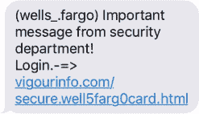

    **Figure 1-2** 这种 SMiShing 攻击诱捕了很多人。

    疯狂的是，我甚至不使用 Wells Fargo，但我仍然收到了这次攻击。（不，我不会告诉你我用哪家银行——好歹尝试一下。）

    只需点击一下，这些攻击要么旨在窃取凭据，要么旨在向移动设备加载恶意软件，有时两者兼有。

*   **Vishing：** 正如我已经提到的，这是语音钓鱼。自 2016 年以来，这种向量大幅增加。对攻击者来说，它既容易、便宜，又非常有利可图。此外，几乎不可能定位并抓住使用伪造号码从国外打来电话的攻击者。

*   **Phishing：** 社会工程学领域最被讨论的话题是钓鱼。事实上，本书的技术编辑 Michele 和我曾在一本名为 *Phishing Dark Waters: The Offensive and Defensive Sides of Malicious Emails* (Wiley, 2016) 的书中写过它。（是的，我刚才无耻地打了一下我另一本书的广告。）钓鱼已被用于关闭制造工厂、入侵 DNC、入侵白宫以及数十家大型公司，并在不同的骗局中窃取数以百万计的美元。钓鱼是四个主要向量中之最危险的。

*   **Impersonation：** 我知道，我们应该给这个也加上某种形式的“ishing”，但我能做的最好的就是把它列在最后，因为它不同。然而，它在这个列表中的位置绝不意味着我们不必像担心其他向量那样担心它。在过去 12 个月中，我们收集了数百起有人冒充警察、联邦特工和同事犯下一些真正可怕罪行的故事。2017 年 4 月，有一个关于一个冒充警察并被抓获的男人的故事。他涉及儿童色情制品，并利用他的冒充身份牟利。

你读到的每一次社会工程学攻击都可以归类为这四个类别之一。最近，我们看到我们所谓的“组合攻击”，即恶意社会工程师在一次攻击中使用这些手段的组合来达到他们的目的。

当我分析这些攻击时，我开始看到一些模式，这些模式不仅能识别使用了哪些工具和流程，还可以帮助安全专家更清晰地定义如何执行这些攻击，然后利用结果来教育和保护。我称之为 *SE pyramid*。

### SE 金字塔

让我直接进入金字塔，然后再解释我为什么提出这个概念以及每个部分的含义。金字塔在 Figure 1-3 中有所插图。

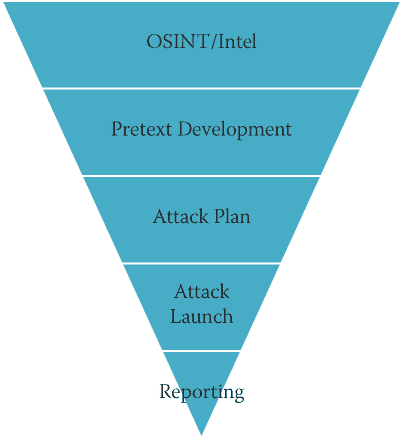

**Figure 1-3** SE 金字塔

如你所见，金字塔被分为几个部分，并从 SE 专业人员的角度来看待社会工程学——也就是说，不是为了不正当目的而使用 SE，而是为了帮助客户和客户。

我将定义金字塔的每个部分，并将在本书后面更详细地介绍各个层级。

### OSINT

OSINT，即开源情报，是每次社会工程学活动的生命线。它也是应该花费最多时间的部分。正因为如此，它占据了金字塔的第一部分和最大部分。金字塔这一部分很少被提及的一点是：文档。你将如何记录、保存和编目你找到的所有信息？我在下一章中会更多地讨论这个关键因素。

### 前文构建

基于 OSINT 期间的所有发现，下一步逻辑是开始构建你的前文。这是一个关键部分，最好是在考虑 OSINT 的情况下进行。在此期间，你会看到需要做出哪些更改或补充以确保成功。这也是变得清楚需要哪些道具和/或工具的时候。

### 攻击计划

手头有前文并不意味着你已经准备好了。下一阶段是规划三个 W：什么、何时和谁。


### 什么是计划？

- 什么是计划？我们要追求什么，试图实现什么？客户想要什么？这些问题将有助于制定下一步。
- 发起攻击的最佳时间是什么时候？
- 谁需要随时待命以提供支持或协助？

### 发起攻击

现在进入有趣的部分：发起攻击。在攻击计划的准备工作完成后，你已准备好全速前进。做好准备很重要，但不要过于死板以至于无法灵活应变。我非常赞成制定书面计划，我认为这能为你省去未来许多麻烦。我需要提醒的是，如果你把每一个感觉需要采取的词语或动作都写死，那么当意外情况发生时，你可能会遇到麻烦。你的大脑意识到剧本中没有任何帮助，你就会开始结巴、紧张，并表现出恐惧的迹象。这会严重破坏你成功的能力。与其写死剧本，不如使用大纲，它为你提供一条遵循的路径，同时允许艺术自由。

## 报告

等等——不要跳过这一节。回来读一读。是的，报告并不有趣，但你可以这样想：你的客户刚刚支付了你 `x` 美元来执行某些服务，而且你很可能在这些攻击中非常成功。但客户付钱并不是因为他们想显得酷。他们付钱是为了让你了解他们可以做些什么来解决问题。因此，报告阶段位于金字塔的最顶端，是其余金字塔所依赖的巅峰。

如果遵循这个金字塔的五个阶段，不仅能让你作为一名社会工程师取得成功，还能让你作为一名向客户提供社会工程服务的专业人士取得成功。事实是，除了报告之外，世界上的恶意社会工程师都遵循这些步骤。

2015 年，Dark Reading 报道了一起涉及这个金字塔的攻击。（你可以阅读文章“CareerBuilder Attack Sends Malware-Rigged Resumes to Businesses”，网址为 `www.darkreading.com/vulnerabilities---threats/careerbuilder-attack-sends-malware-rigged-resumes-to-businesses/d/d-id/1320236?`。）

1. 攻击者调查了攻击几个目标，在进行 OSINT 阶段时，他们发现目标使用了一个名为 CareerBuilder 的热门网站。
2. 完成 OSINT 阶段后，攻击者开始进行借口开发。这使他们计划以求职者的身份进行借口，该求职者希望应聘目标提供的任何职位。他们意识到需要的工具是一些恶意编码的文件和一些看起来真实的简历。
3. 他们开始计划攻击，通过回答一些 W 问题。
4. 然后他们通过上传恶意文档 `not` 到目标，而是上传到 CareerBuilder 网站来发起攻击。发布招聘的公司会通过电子邮件收到通知，称有新的求职者，该电子邮件将包含攻击者上传的附件。
5. 他们没有进行任何可操作的报告阶段，但得益于 Proofpoint 的一些研究人员，对这次攻击有一些可操作的报告。

这次攻击之所以成功，是因为目标会收到来自可信赖且声誉良好的来源（CareerBuilder）的带有附件的电子邮件。因此，目标会不加思考地打开附件。这正是恶意社会工程师的目标：让目标在不考虑潜在危险的情况下，采取不符合其最佳利益的行动。

### 本书包含什么？

当我开始规划这本书时，我想确保自己遵循《社会工程学》第一版的大纲，以便从其页面中受益的人也能从本书中受益。同时，我想改变本书并对其进行更新，以涵盖一些新的攻击以及我之前在书中从未讨论过的内容。

我想确保我采纳了粉丝、研究人员、读者和评论者的所有建议，希望能让这本书比第一版好得多。让我概述一下本书的格式，让你知道可以期待什么。

遵循金字塔的路径，第 2 章，“你看到什么？”，讨论 OSINT 并涵盖一些经典的技术。我尽量不深入实际工具，尽管我提到了一些在过去十年里一直留在我的工具箱中的工具。

在 第 3 章，“通过沟通画像人物”中，我探讨了我在第一版中几乎未触及的话题。我深入探讨了高级沟通建模和画像工具。

第 4 章，“成为你想成为的任何人”，是我开始深入探讨预设文本的地方。这是一个在社会工程学之外很少有人谈论的话题。我涵盖了多年来我拥有的技巧、窍门以及许多经验（成功和失败）。

在 第 5 章，“我知道如何让你喜欢我”中，我汇编了来自许多播客、通讯以及与世界顶尖人物（如罗宾·德里克）的对话中的信息，并将建立融洽关系的原则应用于社会工程学。罗宾·德里克是 FBI 行为分析部门的负责人，也是我的好朋友。他是建立融洽关系和信任的大师，并定义了做到这两点的步骤。

第 6 章，“影响力下”，将影响力研究领域的领导者罗伯特·西奥迪尼的工作应用于社会工程学领域。本章采用了他在多年研究中开发的原则，并展示了社会工程师如何以及正在使用这些原则。

第 7 章，“我甚至没向你要那个”，定义了框架和引出信息，并概述了任何人如何掌握这两者。

在 第 8 章，“我能看到你没说的话”中，我们回到了我最喜欢的话题之一：非语言。我在我的书《揭露社会工程师：安全中的人类因素》（Wiley, 2014）中深入探讨了这个话题，但本章是一份初学者指南，旨在让你进入非语言的世界。

在 第 9 章，“黑客攻击人类”中，我将前八章应用于五种不同类型的社会工程攻击。本章展示了作为一名专业社会工程师，将本书的原则应用到实践中有多么重要。

随着我们接近尾声，第 10 章，“你有 M.A.P.P. 吗？”，涵盖了预防和缓解。在一本关于专业社会工程学的书中，本章涵盖学习对抗所有社会工程攻击的四个步骤是合适的。

然后，像所有美好的事物一样，这本书必须结束。因此，第 11 章，“现在怎么办？”，将本书带入尾声。

以下是我对你的几个承诺：

- 我承诺不引用维基百科作为有价值的来源，尤其是在提及研究时。（我从错误中吸取了教训。）
- 我承诺告诉你过去七年或更长时间经历中的许多故事。有时，我会从多个角度讲述一个故事，以帮助牢固地掌握几个要点。但我会混合这些故事，让你不会感到无聊。
- 当我使用各自领域一些最伟大头脑的研究或工作时，我会确保你拥有他们工作的参考，以便你可以深入研究任何你可能感兴趣的主题。
- 就像我写的第一本书一样，我公开欢迎所有联系、评论、建议和批评。


我所要求的回报只是，请您按照本书的初衷来阅读。如果您是新手，本书可以帮助您了解成为一名专业社会工程师所需的知识。如果您经验丰富，我希望分享一些故事、技巧和窍门，能为您的工具箱提供一些新工具。如果您是爱好者，我希望您能像我写作时一样充满兴奋地阅读本书。如果您是怀疑论者，请带着这样的想法阅读：我并不声称自己是社会工程学的唯一救世主。我只是一名拥有多年经验、热衷于分享的社会工程师，希望能让这个世界变得更安全一点。

## 摘要

我写的每本书都少不了烹饪比喻，下面就开始吧。就像任何一道美味佳肴，都需要大量的计划、一份要求新鲜食材的绝佳食谱，以及艺术与科学的执行。社会工程学虽然本质简单，但绝非新手的食谱。它涉及理解人类如何做出决策、是什么驱动着他们，以及如何在利用他人相同过程的同时控制自己的情绪。

本书的主题今天与八年前一样重要——也许现在更加重要。在过去八年里，我目睹了许多人成为专业社会工程师。我也见过许多恶意社会工程师兴衰更替。

鉴于攻击性质如此严重地倾向于人为因素，所有安全专业人员都必须理解社会工程学。但这个话题远不止于此。我记得很久以前当厨师时，我的导师会拿出食材，让我尝一点每种食材。为什么呢？

他告诉我，如果不真正了解每种食材的味道，就不可能真正理解“品尝”意味着什么。如果我知道食谱需要一些辣根，并且我想让它更辣一点，那么我就知道可以再加一点。理解某种食材也有咸味，可能会让我调整食谱中的盐量，这样食物就不会过于咸。你明白我的意思。

即使你不在安全行业，了解这些每种食材“味道”也很重要，这样你才能受到保护。与某人建立关系意味着什么，以及如何利用这一点让你掏钱？(这在 第 5 章 中有介绍。) 影响力在引出信息的对话中撒入，如何让某人在电话里泄露密码？(这在 第 6 章 和 第 7 章 中有介绍。)

这些每种食材都能帮助你学习“味道”。当你了解它们时，你就能识别出有人在你身上尝试它们，你也会更安全。你能感觉到有什么不对劲，并采取防御行动。

你有没有看过戈登·拉姆齐的任何烹饪比赛？当他品尝一道他讨厌的菜肴时，他会指出具体问题：“这道菜胡椒太多了，而且用了太多油。”而新手可能会说：“太辣了，太油腻了。”这两种描述是同一回事吗？我认为不是。我的目标是帮助你成为社会工程学界的戈登·拉姆齐——也许脏话会少一些。

说了这么多，让我们进入第一章，讨论 OSINT。

# 2  

你看到的和我看到的一样吗？

> *请记住，失败是一件事，而不是一个人。*

> 

> ——齐格·齐格拉

OSINT 代表开源情报，是社会工程学的命脉。信息是每次行动的起点和支撑点。由于 OSINT 对我们社会工程师如此重要，因此了解获取目标情报的所有不同方式至关重要。

无论你如何获取 OSINT，你都需要心中清楚自己在寻找什么。这看起来似乎容易做到，但并不像听起来那么简单。你不能简单地说：“我想要目标的所有信息。”每种类型的信息都有不同的价值，而什么有价值会随着你想要发起的攻击类型而改变。

## 收集 OSINT 的现实示例

让我试着给你一些视角。根据网站 `www.worldwidewebsize.com`，有超过 44.8 亿个已索引的网站。这不包括任何未索引的内容、暗网或深网上的网站等等。年度全球互联网流量达到了 1.3 泽塔字节（即 1,300,000,000,000,000,000,000 字节）。甚至有一个来源告诉我们，互联网最多可包含 10 约塔字节的总数据。（写出 10 约塔字节是这样的：10,000,000,000,000,000,000,000,000 字节。）

为什么了解互联网上的流量量甚至远远重要？嗯，例如，如果你想发送鱼叉式网络钓鱼，你的目标可能是寻找个人爱好、喜好、厌恶以及目标认为有价值的东西。但如果你要对目标进行语音钓鱼，那么你可能想要了解目标工作的详细信息，该人在工作组织中扮演什么角色，以及该人会预期来自哪些内部和外部资源的电话。如果你的目标是进入现场，那么你需要知道目标是否会与人会面，以及那些人会是谁。

你有 44.8 亿个潜在网站需要搜刮，以寻找可能有帮助的数据。因此，在开始挖掘之前，规划你的 OSINT 行动很重要。

为了帮助你确定寻找什么的参数，请使用 表 2-1 中的问题列表。

**表 2-1** 示例 OSINT 问题

| **组织类型** || **要询问的问题** |

| --- | --- |

| 公司 || 公司如何使用互联网？  

公司如何使用社交媒体？  

公司是否有关于其人员可以在互联网上发布什么内容的政策？  

公司有多少供应商？  

公司使用哪些供应商？  

公司如何接受付款？  

公司如何发放付款？  

公司是否有呼叫中心？  

总部、呼叫中心或其他分支机构位于何处？  

公司是否允许 BYOD（自带设备）？  

公司是在一个地点还是多个地点？  

是否有可用的组织架构图？ |

| --- | --- |

| 个人 || 该人使用哪些社交媒体账户？  

该人有哪些爱好？  

该人去哪里度假？  

该人最喜欢的餐厅是什么？  

该人的家族史（疾病、企业等）是什么？  

该人的教育程度如何？该人学习了什么？  

该人的工作角色是什么，包括是否在家工作、为自己工作，以及向谁汇报？  

是否有其他网站提到该人（也许他们发表演讲、在论坛发帖或是俱乐部成员）？  

该人是否拥有房子？如果是，房产税、抵押权等是多少？  

该人家庭成员的姓名是什么（以及上述关于这些人的任何信息）？ |

当然，表中的问题只是触及了表面。你可以添加其他关于使用的计算机类型、员工日程、使用的语言、使用的防病毒保护类型等更多项目。

这里有一个来自 2017 年头条的故事。（你可以在 `https://gizmodo.com/this-is-almost-certainly-james-comey-s-twitter-account-1793843641` 上阅读其中一个关于它的报道。）它围绕前 FBI 局长詹姆斯·科米展开。一名互联网博主和研究人员想看看她是否能找到詹姆斯·科米的社交媒体账户。由于科米是 FBI 局长，公众不知道他是否有社交媒体账户，更不用说如何找到它们了。这就是这个 OSINT 故事的开始。


博主用来查清事情真相的完整步骤大纲如 图 2-1 所示。请先看一遍，然后我将逐步为你讲解。

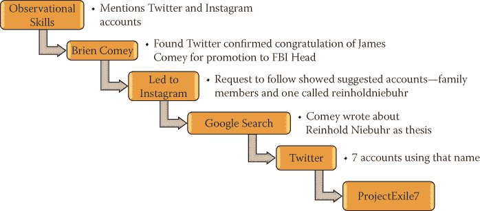

**Figure 2-1** Amazing OSINT on a secure target

首先，研究者需要确定自己想要揭露什么：科米主任是否有社交媒体账号？如果有，它们在哪里？

仅使用互联网来研究此事被证明非常困难。2016 年，有一个网站列出了“前 60 名社交媒体平台”。面对如此众多且规则和方法各不相同的平台，要找到一个人可能非常困难。

幸运的是，最古老的一种 OSINT 形式对研究者有利：即倾听。在一次公开露面中，科米主任提到他拥有 Twitter 和 Instagram 账号。

这一声明帮助研究者将搜索范围从 60 多个社交媒体平台缩小到仅两个。在搜索中，两个要容易管理得多。

在没有找到任何直接关联到科米主任的账号后，研究者找到了科米主任儿子布赖恩·科米的 Twitter 账号。当布赖恩祝贺科米主任升任 FBI 局长时，研究者确认了布赖恩·科米与科米主任之间的联系。

用户可以做的一件事是将多个社交媒体账号关联起来。在这种情况下，布赖恩将他的 Instagram 账号关联到了他的 Twitter 账号。研究者检查了 Instagram 账号，但布赖恩已将账号设为私密，因此只有获得许可的人才能看到他发布的内容。

研究者决定申请关注布赖恩。Instagram 的一个功能是，在等待用户接受你的关注请求时，它会指向同一圈子里的人，以防你也想关注其中任何人。Instagram 建议了一大批布赖恩的家庭成员（不包括科米主任）以及一个名为 reinholdniebuhr 的账号。

如果你对“Reinhold Niebuhr”进行几次互联网搜索，你很快就会了解到他是一位美国神学家和政治评论家。然而，他于 1971 年去世，因此他不太可能拥有 Instagram 账号。但经过进一步调查，研究者得知科米在大学论文中写过关于 Reinhold Niebuhr 的内容。

掌握这些信息后，研究者在 Twitter 上搜索并找到了七个使用该名称的账号。在这七个账号中，只有一个公开使用该名称，账号名为 @ProjectExile7。

经过进一步挖掘，研究者发现 Project Exile 是科米担任里士满美国检察官时启动的一个项目的名称。

研究者在没有访问任何非法内容、没有黑客攻击任何东西、仅通过查看开源情报来源并思考线索的方式做出了这些发现。

这是一个将非技术性和技术性 OSINT 相结合的绝佳示例，也是对所有社会工程师的良好教训。这是本章余下内容的基础：不同类型的 OSINT 以及作为社会工程师如何利用它们。我将其分为两个主要部分：非技术性 OSINT 和技术性 OSINT。

## 非技术性 OSINT

我认为非技术性 OSINT 是指任何不涉及社会工程师与计算机之间 `直接` 交互的行为。你可能会在目标使用计算机时偷看，但 `你（社会工程师）` 并不是使用计算机的人。这是你使用非技术手段收集的信息。这里有很多具体方法我可以介绍，但我可以将它们统称为 `观察技能`，在接下来的部分中，我会给你一些示例。

### 观察技能

观察技能可能看起来显而易见且易于使用，但成功使用它们并不是一项常见技能——尤其是在数字媒体泛滥的时代。如果说有什么的话，当今的营销策略已经训练我们不去关注细节。Elon 大学的艾米莉·德拉戈（Emily Drago）于 2015 年进行的一项研究（题为“技术对面对面沟通的影响”）指出，由于技术的影响，面对面沟通的质量已经下降。研究中观察到的 62% 的人在与他人交谈时使用了移动设备，尽管知道这会降低沟通质量。

我们生活在一个社会，该社会主要通过 280 个字符和表情符号传递信息，通过模因或社交媒体帖子进行沟通。使这些成为可能的进步是惊人的，但它们创造了一种情况，即人们在沟通时对他人的观察力下降。这也是观察技能在我非技术性 OSINT 清单中排在首位的原因。

你可能会问几个问题，例如：

*   术语 `观察技能` 包含哪些内容？

*   你可以做些什么来自我学习这些技能？

*   你应该期望获得什么收获？

让我们讨论每个问题，看看你可以观察和学到什么（你明白我的意思了吗？）。

#### `观察技能` 包含哪些内容？

以下场景为你提供了一些示例，说明观察技能如何在现实世界中使用。

##### 场景 1

你的任务是进入一家大型医疗机构的邮件室。你必须在大白天完成。你不能撬锁、爬墙或跳窗。你在测试前台和安保人员，看他们是否会允许你进入受保护区域，因此你必须经过这些工作人员工作的医疗机构部分。

以下是你在 OSINT 观察技能武器库中应该具备的一些事项：

*   `着装：` 这个简单但有时被忽略的知识点很重要。在 第 1 章，“深入了解专业社会工程的新世界”中，我说社会工程师的目标是让你在不思考的情况下做出决定。如果你闯入一个每个人都穿着休闲的地方，而你却穿着三件套西装，你会引起人们的注意。反之亦然，所以你想知道员工如何穿衣，以便你也能那样穿。

*   `出入口：` 在进入建筑物之前，了解你的疏散点在哪里。是否有吸烟者聚集的门？是否有一个入口比另一个更严密地守卫？是否有班次交替导致某个岗位无人值守或人手不足？

*   `入场要求：` 进入设施或区域需要什么？你看到员工佩戴徽章吗？什么样的徽章？他们佩戴在哪里？他们是否还需要知道一个密码？访客是否有陪同？访客是否获得徽章？当你走进去时，是否有防尾随门、转闸、安保桌或其他安保设置？

*   `周界安保：` 查看建筑物外发生了什么。是否有安防摄像头？是否有警卫在场地巡逻？垃圾桶是否锁好？是否有任何警报或运动触发的防御系统？

*   `安保人员：` 他们是忙着看移动设备或电脑屏幕，还是保持警觉并注意？他们看起来无聊至极还是感兴趣？

*   `大厅布局：` 是否有键盘或安保设备设置在你可以偷看密码的地方？（换句话说，你能否凑近到能从某人肩膀上窥视并在输入时捕获密码？）

当然，你可能还想观察更多事情，但这些是一些基础。


为了让你明白这些标准为何如此重要，这里有一个真实的故事，涉及服装、出入、进入要求以及周界安全。Michele（本书的技术编辑）和我被指派处理我刚才在本小节开头概述的那个场景。我们需要进行大量的技术 OSINT，我将在本章后面详细介绍，但也有大量非技术性的 OSINT 促成了我们的成功。

我们决定借用一家被雇来报价紧急蜘蛛喷洒的害虫防治公司作为借口。我们将公司命名为 Big Blue Pest Control，并配备了全套 Big Blue 制服和装有自制蓝色“毒药”的喷雾瓶，用于在报价过程中杀死看到的任何蜘蛛。这种毒药实际上只是喷雾瓶里的蓝色 Gatorade。

我们先是绕着周界开车，观察入口、出口、摄像头位置、吸烟者聚集地，以及看起来最拥挤和最不拥挤的入口。我们还注意到进出的员工是否佩戴徽章以及他们的着装。然后我们选定了最初的进入点，开始缓慢地走向门口。缓慢行走的原因是观察人们是如何被放进去的。

我们看到两名保安在监督人们将徽章按在金属支架上后被允许进入。右侧还有一个安保台，有人在那里负责登记表。

我们决定试着直接从保安身边走过去，跟着人群进去。但这完全行不通。一名保安拦住了我们，问我们在做什么，为什么在那里。我低头看了看他的名牌，看到了他的名字，然后开始说：“嗯，Andrew，我们被要求过来给一些紧急蜘蛛喷洒的报价……”保安没让我说完，就说：“好吧，去前台登记。”

我以为我们进去了，但当我们走近前台时，那里的人问我们的名字。当我们报出假名时，他仔细查看了一份名单。当他没在名单上找到我们时，他说：“抱歉，你们不在今天的访客名单上。没有授权不能进来。”

我们试图解释、施加影响，甚至施压和恳求帮助。都没用。被拒绝了。我们走出前门，边走边讨论接下来该怎么做，这时看到几个吸烟者在外面休息。我让 Michele 跟着我，我们朝吸烟者走过去，装作属于这里，正在检查建筑物外部的人。我假装在剪贴板上记笔记。

我们再次缓慢行走，直到看到几个人朝门口走去，于是我们紧跟在他们身后溜了进去。进入大楼后，我们跟着这群人，我很快注意到我们正朝前面走去，那里正是刚刚拒绝我们的保安所在的位置。我右手边看到一部电梯，但上面没有按钮。“糟糕，”我心想，“一部需要保安呼叫的电梯。”正当我想完，电梯门打开了，我立刻走进去，希望 Michele 能观察并跟随我的带领。

幸运的是，Michele 在这方面非常出色，既没有迷失也没有过度紧张。电梯里有一群人，Michele 立刻大声宣布，让所有人都能听到：“老板，我们能早点干完这活儿吗？我饿坏了，你说干完之前不能吃。”

电梯里一位女性投来不赞成的目光，说：“给可怜的女人点吃的吧。”我回答说：“我想给她吃，但我们还要检查最后一层楼。干得越快，她就越快能吃饭。”

那位女性叹了口气说：“好吧，那我们送你去你要去的地方……”，我插嘴打断她说：“去邮件室。”那位女性掏出徽章，刷了电梯里的接收器，按了几个按钮，说：“我顺路送你们过去。”

呼！幸运的是，由于 Michele 出色的观察能力和我敏捷的行动，我们没有被抓到，甚至还让一位好心的女士帮我们刷卡进了那个安全楼层。（Michele 只是部分酒吧，因为她确实*总是*饿。）

在邮件室所在的楼层，我们下了电梯，发现邮件室门锁着。门上有一个铃铛，标签写着“按铃呼叫帮助”。我们按了铃，等着。

一位女性来开门，说：“我能帮你什么忙？”我们滔滔不绝地说出我们的借口，说是来报价之类的。那位女性回答说：“好吧，我得给安保台打电话批准一下。”

如果她打电话给安保，我们的谎言就会被戳穿，所以我说：“好吧，你可以打，但是是 Andrew 让我们下来办这事的。”

她说：“哦，Andrew 让你们来的？那进来吧。”她让我们进了邮件室，说：“别碰邮件。”我们通过移动天花板瓷砖、网络电缆和大量邮件，在天花板里翻找。

正如你在整个故事中所看到的，发生了这么多事情，是因为我们做了快速观察，并将这些信息记录下来供以后使用。（这仅仅是个开始。）

我不知道我会需要用到 Andrew 的名字，Michele 不知道我们会在电梯里遇到一位同情的女士，我们俩也不知道会遇到一群不在乎我们尾随进入的冷漠吸烟者。但观察让我们能够利用每一个机会取得成功。

## 场景 2

你被指派对一家主要美国公司的一位高知名度律师进行钓鱼攻击。你可以使用任何你能找到的关于她的信息。

这个故事在我们进入技术 OSINT 部分时会展开更多，但为了说明一个非常宝贵的教训，让我告诉你我在这件事上是如何惨败的。

我们的 OSINT 发现这位律师处理过一些马萨诸塞州的事务。我们发现马萨诸塞州最近有一项税法更新，这可能会引起她的兴趣，并且非常有效地诱导她点击链接或打开恶意附件。

我开始撰写一封关于马萨诸塞州变化的电子邮件，并计划了这次钓鱼攻击的每一个方面。这封邮件写得专业，没有威胁，包含了我们想要的载荷，给出了阅读和回复的现实期限，并提供了足够的细节，确保她必须点击才能了解更多。

发送邮件几分钟后，我们就被发现并举报了，整个行动彻底失败。你从前一段中找出漏洞了吗？我会给你几秒钟时间回去看看，然后再告诉你。

*时间到！*

马萨诸塞州不是一个州，而是一个联邦州。这位律师，她对细节的关注是她的强项，收到一封关于马萨诸塞州*州*税法变化的电子邮件，对自己说：“嘿，他们应该知道马萨诸塞州不是州，而是联邦州！”这导致她查看了“发件人”地址和 URL，并变得足够怀疑而举报了它。我们的伪装被戳穿了。

我们在这个故事中没有观察到那个小细节，而缺乏观察让我们付出了代价。

这个场景的教训是，你需要观察你能观察到的一切。像你要进行社会工程攻击的那个人一样思考。试着理解他们期望看到什么，并提供那样的东西。否则，小细节可能会反咬你一口。

### 你可以做什么来教会自己这些技能？

这个主题在书中的一个短章节里很难涵盖。每个人都有天生的能力和后天习得的能力，这会让学习这些技能变得非常容易或非常困难。因为我不了解你个人，我在这里所能做的就是告诉你我做了什么来尝试提升我的技能。


我会玩一个类似于夺旗游戏的游戏。如果我要进入一栋建筑物——比如说一家医生的办公室——我会对自己说：“旗帜是为了记住我看到的前两个人，他们穿什么颜色的衬衫，以及他们在读什么杂志或在做什么。”

我会设定一些这样的界限：

*   他们不能是柜台后面与服务相关的人员。
*   我仍然需要去办理报到手续，不能暂停或偏离这个任务。
*   我不能写下任何东西。

然后我会进入建筑物，观察所见，并尽力记住直到离开建筑物。过程大致如下：

*   左侧坐着一位穿蓝色衬衫、阅读 `Woman's Day` 杂志的年长女性
*   一名男性幼儿，穿着条纹 T 恤，在地板上玩积木

我会在脑海中记下这些事情，并尽力记住它们。我会使用一些小记忆技巧，比如在心里默念几次，试图将其刻印在脑海中。

当我觉得可以毫不费力地做这种心理笔记时，我会增加一些复杂度。最终，我的旗帜列表变成了这样：

*   X 个人物的性别
*   他们穿着什么
*   我第一次看到他们时，他们正在从事什么活动
*   感知到的沟通特征（关于这一点，请参见 第 3 章，“通过沟通对人物进行画像”）
*   肢体语言暗示

基于此，我会在脑海中构建一个故事，解释他们为什么出现在我所在的地点，并利用故事中的细节来记住他们。

老实说，这效果非常好——即使是对我这种记忆力不好的人——以至于我能记得三四年前走进的一家办公室，那里有两个穿着黑色裙子和白色纽扣上衣的女性正在看 iPad 上的东西。左边的女性似乎不喜欢右边的女性，但她容忍了对方，或者她还有别的地方要去。我能看出这些，是因为左边女性的臀部完全背对着右边的女性。

柜台后面有一个穿着保安制服的男人——黑色西装，白色衬衫，黑色领带。他右手腕上戴着一块金表，这表明他是左撇子。他的头发很整齐，胡子修剪得很干净。他正拿着笔在记事本上写字。他既在观察我，也在观察大厅。

柜台前的椅子上坐着一个年轻人。他看着一份报纸，但在我看来他只是假装在看报。他呆呆地望着远处，报纸的边缘在颤抖。我编了一个故事，说他来面试，很紧张，但试图表现得镇定，并用报纸来转移注意力。

几乎就像我现在脑海中还能看到那个大厅。这些小小的观察在帮助你作为社会工程师实现目标方面大有裨益。我的建议是找出自己的弱点，然后从小事做起，逐步提升。重要的是要真正明白，你必须练习。我经常看到人们想要立刻做到 100% 正确，但这需要时间。

如果我们允许失败教导我们，失败能教给我们的东西比成功多得多——这就是为什么我需要谈谈期望。

#### 你应该期望收获什么？

在我与 Paul Ekman 博士合著的书《揭秘社会工程师》中，我只关注非语言线索：肢体语言和面部表情。当我开始学习如何首先注意到然后解读这些表情时，我感觉自己像个读心超级英雄。我可以看着一张脸，看到那个人试图隐藏的情绪，然后将其与肢体语言和其他行为结合起来，几乎能预先确定他们会如何对问题或情况做出反应。疯狂的是，我发现我的预测有超过 50% 的时间是正确的。问题就此开始。假设我有 75% 的时间是正确的。这意味着我有 25% 的时间是错误的。除此之外，这影响了我对自己能力的感知，我感觉自己能看得更多、理解得更多，因此能进行社会工程攻击的程度超过了我实际的能力。

我最谦卑的一次教训来自与 Paul Ekman 博士的合作，他一次又一次地纠正我。他说：“Chris，仅仅因为你看到了 `what`，并不意味着你知道 `why`。”

在讨论期望之前，我觉得你需要反复听到这一点：仅仅因为你看到了 what，并不意味着你自动就知道 why。你如何在 what 和 why 之间建立联系？有几种方法：提问、获取更多信息和更长时间的观察。

举个例子：我正在教一节课，讲述我经历过的一个社会工程故事。一名学生突然脸上露出愤怒的表情。他的肢体语言从开放变为封闭。他双臂交叉，向后靠在椅子上，双腿伸直。我感觉到他不相信我说的话，于是开始更多地关注他。这样做似乎并没有解决他缺乏信任的问题，他退缩了。几分钟后，他告辞离开了课堂。

我目瞪口呆。我做得都很对。他为什么还对我生气？

不久之后，我们休息了。我正朝洗手间走去，想着这件事以及如何“解决”它。那名学生走过来对我说：“嘿，我真的很抱歉我离开了。我的老板在上课中间给我发短信，说公司有紧急情况。我试图告诉他我不能做任何事，因为我在上课，但他命令我离开并参加这个荒谬的电话会议。我可以补上错过的课吗？”

我简直笑出声来，不得不赶紧解释，但我告诉他我是如何误解所看到的一切。我脑海中回响着 Paul Ekman 的声音：“Chris，我以前告诉过你什么？”这对我来说是关于因果关系的一堂好课。

OSINT 和观察也是如此。不要假设我即将向你展示的事情都是“人类愚蠢”的结果。我更倾向于认为，人们只是对潜在危险缺乏教育，而不是公然愚蠢。

快速看看 图 2-2 中的图片，并在脑海中记下你观察到的内容。


**Figure 2-2** 你看到了什么？

像社会工程师一样思考，你看到这张图片中有什么可以帮助你画出这辆车司机画像的内容？图 2-3 是一个放大版本，可能会有所帮助。


**Figure 2-3** 这样更容易看清吗？

右侧有一个乳腺癌支持贴纸。左侧有一个 Kids Wish Network 支持贴纸。然后还有一个写着“10-20-Life”的贴纸。我完全不知道这是什么意思，所以我快速在互联网上搜索了一下，发现这是一个支持对使用枪支犯罪的人判处更严厉刑罚的贴纸。

这些贴纸告诉你这个人什么？他们支持慈善机构，以及哪些对他们很重要。这可能是因为他们或家人曾患癌症或儿童疾病吗？此外，他们对枪支法律和枪支犯罪有强烈的看法。这可能是因为他们或他们认识的人是枪支犯罪的受害者吗？

掌握了这些信息，你觉得能发起一次引出信息的对话吗？

小心！很多时候，我的学生会脱口而出：“我们来讨论枪支法律以及为什么它们是错误的，”或者类似的话。但想想在一次对话中，要说服 *你* 从一种信念转变为另一种信念有多难。这个人也不会例外。将其与你的目标结合起来——让目标 *不* 思考——并记住，你想谈论他们的兴趣，而不是你的兴趣。我在 第 7 章，“我甚至没让你做那件事”中对此有更多解释，当时我讨论引出信息。


现在看看 图 2-4。

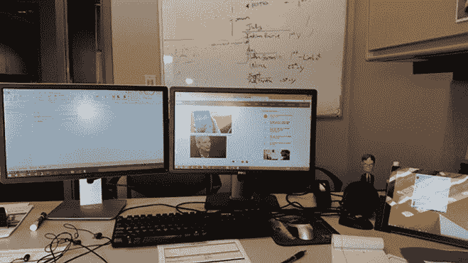

**图 2-4** 你能从这张图中看出什么？

你在这里注意到了什么？作为一名社交工程师，你能观察到什么？想想这张简单图片中的细微细节：

*   你可以看到工作环境的类型。
*   你可以看到该人使用的操作系统。
*   你可以注意到该人拥有什么类型的平板电脑。
*   你可以看到该人是某部情景喜剧的粉丝。
*   你能注意到他们使用的浏览器和邮件客户端吗？
*   你注意到可能暗示该人其他细节的标志了吗？
*   你还能看出哪些其他细节？

这只是一个粗略的列表；你可能观察到了更多内容。基于此，你能否开发出足够的画像，来撰写一两封能引发情感反应的钓鱼邮件？

然而，有时一张图片甚至一次面对面的互动是不够的。这时，技术 OSINT 就可以弥补这一差距。

### 技术开源情报

在你开始写一条糟糕的评论，告诉全世界我有多糟糕，因为本章没有包含 OSINT 人员所知的每一种工具之前，让我先说清楚一件事：

*   `本章不包含每一种工具、每一种流程以及每一种通过技术手段收集 OSINT 的方法的完整列表。`

以下是我 *可以* 告诉你的：本章涉及了我在日常业务中使用的工具和技术。OSINT 世界中有一些了不起的人，你可以与他们深入探讨。以下是我有幸接触过的一些人：

*   **Nick Furneaux：** 我飞往英国参加 Nick 的四天课程，受益匪浅。利用 API 和对社交媒体应用程序工作原理的理解，可以做到的事情真是令人大开眼界。Nick 的网站位于 `www.csitech.co.uk`。
*   **Michael Bazzell：** 说到从网络上消失，Michael 就是那个人，但他也为 OSINT 从业者开发了一套了不起的工具，可以帮助他们深入社交媒体网站和其他搜索引擎。你可以在 `inteltechniques.com` 找到他的网站。

这些好家伙都是我的朋友，我亲自接受过他们的培训、建议和帮助。我可以全心全意地说，他们是 OSINT 领域的大师。（无耻自推：他们都曾是《社交工程师播客》的嘉宾。搜索 *OSINT* 即可找到相关节目。）

我在 OSINT 领域的关注点在于我所从事工作的日常实际用途，这可以分为四个简单的话题：社交媒体、搜索引擎、Google 和其他工具。我将简要介绍每个话题，让你了解我如何使用它们，然后你可以将这些知识作为进一步自学的基础。

#### 社交媒体

没有一章关于 OSINT 的文章会不至少粗略提及社交媒体这个话题。奇怪的是，我记得有一个时候，读你妹妹的日记会导致多次殴打。现在，个人日记不仅在线上，而且如果你不阅读它们、不评论它们、不点赞它们，那简直是一种侮辱。

社交媒体基本上是我们日常生活的一部分，并且将长期存在。

以下是一些统计数据，根据 We Are Social (`https://wearesocial.com/special-reports/digital-in-2017-global-overview`) 的数据，这些数据可以让我们了解这一现状。截至 2017 年 1 月：

*   世界人口为 74.76 亿。
*   互联网用户总数为 37.73 亿。
*   活跃社交媒体用户有 27.89 亿。
*   独特移动用户有 49.17 亿。
*   活跃移动社交媒体用户有 25.49 亿。

作为社交工程师，你需要理解这一点。让我们来看看一些顶级社交媒体平台：

*   **LinkedIn** 拥有超过 1.06 亿用户，LinkedIn 能告诉别人以下信息：
    *   你的工作经历
    *   你接受教育的地方
    *   你上过的高中
    *   你参与的俱乐部和学术成就
    *   认可你技能的人
*   **Facebook** 拥有超过 18 亿用户，Facebook 能告诉别人以下信息：
    *   你最喜欢的音乐
    *   你最喜欢的电影
    *   你所属的俱乐部
    *   你的朋友
    *   你的家人
    *   你去过的度假地
    *   你最喜欢的食物
    *   你居住过的地方
    *   还有更多，更多
*   **Twitter** 拥有 3.17 亿用户，Twitter 能告诉别人以下信息：
    *   你现在正在做什么
    *   你的饮食习惯
    *   你的地理位置
    *   你的情绪状态（在 280 个字符以内）

我还可以继续说下去，但你已经明白了。仅仅这三个社交媒体应用程序就能为你提供大量关于目标的信息。我敢说，你可以仅凭这些就为你的目标建立一个相当全面的画像。

根据社交媒体评估一个人，不应与建立实际心理画像混淆。正如趣闻所提到的，有些人在网上和现实中沟通方式不同。尽管这是事实，但社交媒体对社交工程师来说仍然很有价值，因为许多攻击是基于“在线”个性进行的，学习如何与目标的这一方面沟通可能导致安全漏洞。

有数百个社交媒体平台和数十亿用户，社交媒体对社交工程师来说是一个数据宝库。从社交媒体平台获取信息的最佳方法之一是使用搜索引擎，这是下一节的主题。

#### 搜索引擎

互联网在不断变化，包括在其拍字节的缓存数据中查找信息的新的和改进的方法。这些不断的变化对大多数人来说可能是一种优势，但对社交工程师来说也可能成为一种弱点，因为今天有效的搜索引擎明天可能就不再有效。

我记得 Spokeo 刚推出的时候。我几乎每天都在用它。它是一个极好的信息来源。随着其受欢迎程度的增长，广告数量也随之增加。接着出现了付费获取信息的要求，然后不可靠的信息似乎开始频繁出现。

我并不是说 Spokeo 没有任何有用的东西，但作为一名专业社交工程师，我的时间就是金钱。如果我必须使用另一个来源来验证我获得的每一个事实，这可能会让我丢掉一份工作。

在我第一本书以及之后的许多书中，我发现提供工具列表对读者来说基本没什么用。通常会发生以下几种情况：

*   书籍发布当天，工具就已经过时，我给读者的想法也旧了。
*   出现了新的、更好的工具。
*   上述两种情况的结合。

与其给你一份网站和工具列表，不如我带你完成对目标进行 OSINT 的过程。是的，我会提到我使用的网站和工具，但重点将更多地放在如何思考作为社交工程师的这一方面。

我们的目标是我好朋友 Nick Furneaux（希望这本书出版后他还能是我的朋友）。应该指出：我对 Nick 没有任何恶意。我只是用他来表明，即使对于一个非常有意识、非常警觉、非常注重安全的人来说，互联网也为那些知道如何提问的人保留着秘密。

#### 对 Furneaux 进行 d0xing

那么，d0x 一个人是什么意思？单词 *d0x* 是一个黑客术语，意思是制作一份关于目标的文档，包含目标个人生活的细节。这些细节通常用于进一步攻击目标、羞辱他们或实施其他犯罪。

这些都不是这里的目标。我只是向你展示 OSINT 的力量以及它如何被使用。通常，我从 [pipl.com](http://pipl.com) 的大门开始。


# Pipl (pronounced `people`)

Pipl 是一个我描述为“如果白页和社交媒体刮取网站生了个孩子会是什么样子”的网站。这个网站的好处在于，你可以搜索姓名、用户名、昵称或你可能掌握的关于目标的其他详细信息。

快速浏览网页就能告诉我们，Nick 的 Twitter 账号是 nickfx。让我们看看使用 [pipl.com](http://pipl.com) 搜索这个昵称能找到什么。请参阅 图 2-5。

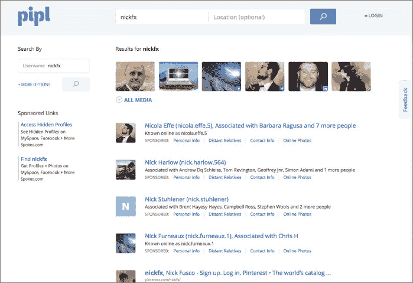

**Figure 2-5** 你认出他了吗？

只需一眼，我们就能看到第一张图片找到了正确的“Nick”，而且只往下四行，我们就看到了 Nick Furneaux 与 Chris H（我不知道那是谁）的关联，以及一个全新的用户名。

在继续之前，让我们看看点击我们确定是 Nick 的那张图片会发生什么。结果如 图 2-6 所示。

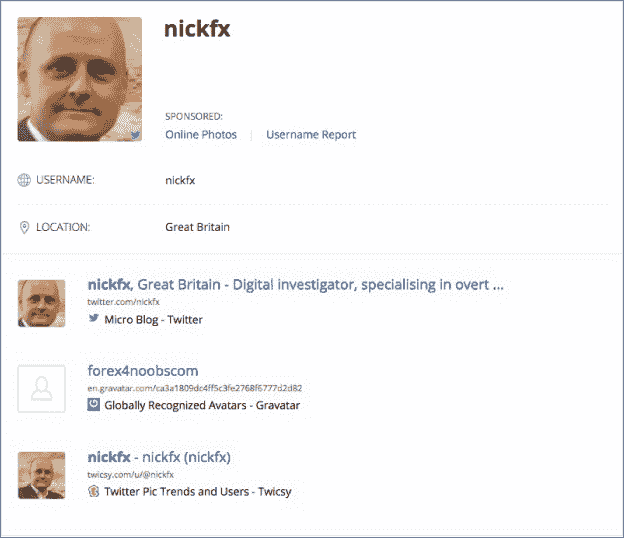

**Figure 2-6** 确认

只需一次简单的点击，我们就能确认找到了正确的人，并知道他的位置。OSINT！我们知道他住在哪里。

现在，在结果页面上返回上一页，点击向下第四个链接。那会揭示什么？请参阅 图 2-7。

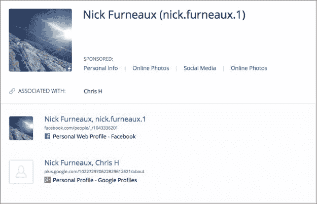

**Figure 2-7** 更多 OSINT！

我们这里有一些很棒的 OSINT，不是吗？一个 Facebook 页面和一个我们之前不知道 Nick 拥有的爱好。他是个滑雪板爱好者。他一定非常喜欢那个 Chris H 家伙；他似乎无处不在。

当我点击 Facebook 链接时，迎接我的是更多的 OSINT！

* 他住在英国布里斯托尔。
* 我可以看到一个好友列表。
* 我找到了一个新用户名：nick.furneaux.1。

当我回到 [pipl.com](http://pipl.com) 并只输入他的姓名和已知的布里斯托尔、英国位置时，我得到了关于他的更多详细信息：

* 以前的工作经历
* LinkedIn 个人资料
* 又一个用户名
* 他上过的学校

只需几次点击，我就掌握了关于 Nick 的大量信息，这些信息在为他建立档案时肯定很有用。我能获得更多信息吗？

接下来，我跳转到一个名为 [webmii.com](http://webmii.com) 的网站。WebMii 的全部目标是帮助你查看某人的在线可见度。在那里搜索“Nick Furneaux”将返回你在 图 2-8 中看到的结果。

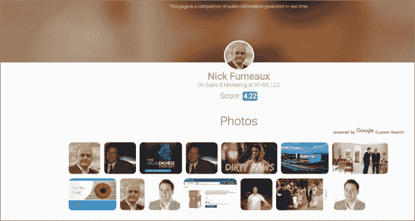

**Figure 2-8** 关于 Nick 的更多信息

立刻，我注意到几件事：Nick 的可见度得分是 4.22（这并不算高，因为满分是 10）。但点击它会显示他 *在什么时候* 最显眼（参见 图 2-9

**Figure 2-9** Nick 什么时候最受欢迎？

回到 图 2-8 所示的图片，还有其他一些数据可以获取：

* 第一张图片链接到 Twitter。
* 第三张图片链接到 Nick 接受采访的一个播客。它是《The Social-Engineer Podcast》，我听说它非常精彩（另一个无耻的自夸）。
* 许多其他图片链接到与我们感兴趣的 Nick Furneaux 无关的加拿大 LinkedIn 页面。
* 第五张图片很奇怪：一个穿着某种动物连体睡衣的年轻人。那是什么？

点击第五个链接带我去了一个由名为 AFB Productions 的公司制作的音乐视频。当我点击“更多”按钮时，我看到 图 2-10 中所示的内容。

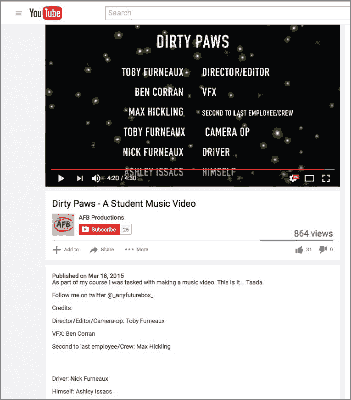

**Figure 2-10** 更多 OSINT！

该视频似乎是由一个名叫 Toby Furneaux（同姓！）的人制作的，视频中的司机正是 Nick Furneaux。当然，这一发现又打开了一条深入挖掘 Toby 是谁以及 AFB 是什么的兔子洞。只需两三次点击，就能意识到 Toby 是 Nick 的儿子，他经营一家名为 Any Future Box（AFB 的缩写）的小型制作公司。

一名优秀的 OSINTer 会将所有这些细节都包含在他们的信息中，因为家庭成员（尤其是目标的子女）通常是攻击向量的绝佳资源。

再参考一下图 2-8。Nick 的那张照片出现在我偶然发现的几个地方。这张照片可能会引导到更多资源，所以我获取了那张图片的实际 URL，并将其加载到反向图片搜索中，你可以按照以下步骤操作：

1. 右键单击图片。
2. 点击“查看图片”。
3. 再次右键单击，然后点击“复制图片位置”。
4. 访问 `www.google.com` 并点击“图片”。
5. 点击“按图片网址粘贴”，并粘贴你在第 3 步中复制的图片 URL。

你应该会看到一个类似于 图 2-11 的页面。

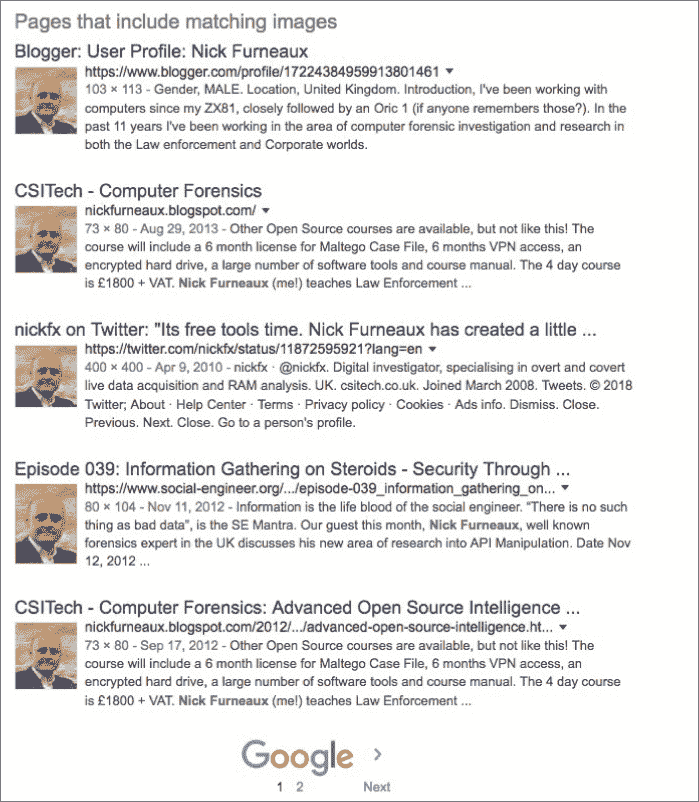

**Figure 2-11** 这 Nick 可真多。

除了发现他经常使用这张头像外，我还发现 Nick 有一个 Blogspot 页面，并且还在一个取证页面上写过文章。当我点击取证页面的链接时，我找到了几年前对 Nick 的一次采访，该采访以他的电子邮件和网站 URL 结束。

当我对 Nick 的网站域名进行快速 WHOIS 查询时，它揭示了你在 图 2-12 中看到的内容。

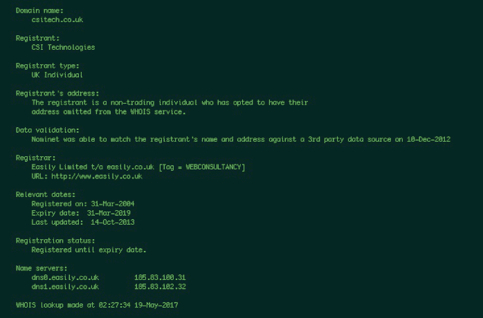

**Figure 2-12** 谁是你？

Nick 拥有这个网站很长时间了，而且短期内不会过期。有趣的是（而且很聪明），Nick 将他的域名设为私有。这意味着记录中没有信息；只有他的公司名称（我们已经知道），以及他是英国的一名个人。

我刚刚带你走过的这种信息收集方式在社会工程师的世界里非常普遍。想想为什么会这样。只需点击几下，我就能发现关于目标的大量有用信息。

诚然，我没有找到 Nick 所有密码或私人照片的链接（谢天谢地），但我找到了足够的信息，如果我想对 Nick 发起钓鱼或语音钓鱼攻击，这些信息会非常有帮助。

不过，这就完了吗？绝对不是。谷歌登场了，它是 OSINT 界的世界重量级冠军。

## 谷歌登场

`Google.` 这个词本身就足以让社会工程师高兴得咯咯笑。好吧，好吧——这个心理画面相当令人不安。所以也许把咯咯笑的想法放一边，把它看作是一种充满知识的幸福的无声得意笑容。

为什么呢？Google 像一个无所不知的神谕。她知道你做过的所有事情，将其存储，并且即使你试图删除它们，她也会缓存它们（你知道，为了安全起见）。

有了所有这些力量和数万亿个索引的网页，一个小小的社会工程师如何找到他或她需要的那些小数据呢？在我回答这个问题之前，我需要快速解释一下 Google（或者说任何搜索引擎）是如何工作的。

### 搜索引擎之谜揭秘！

本节其实并没有揭示什么谜团。标题具有误导性。你可能已经了解搜索引擎的工作原理，但万一你不了解，这里有一个非常快速和简单的解释。

搜索引擎使用称为蜘蛛的小段代码。蜘蛛“爬行”（我不是编造的）开放网络上的每个网页，并缓存它们被允许访问的内容。有一些文件，如 `robots.txt`，会阻止蜘蛛索引某些区域，但大多数其他区域都被索引和缓存。


该缓存被存入数据库，当你在搜索框中输入搜索词时，它会提供类似于你在 图 2-13 中看到的结果。

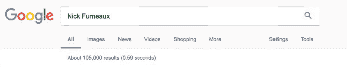

**图 2-13** 他回来啦。

让我指出 图 2-13 中的几个关键点。首先，搜索在 .59 秒内返回了 105,000 个结果。它如何在 .59 秒内搜索 30 万亿个网页？请记住，这些页面已缓存在数据库中，这使得搜索速度极快。

抓取 105,000 个网页不仅不太可能，而且很可能是不可能的。所以，让我来告诉你关于运算符的事。

### 运算符登场

Google 创建了一组称为 `operators` 的搜索词，用于限制 Google 查找的内容。你可以把它想象成放大镜和显微镜之间的区别。两者都能让你更接近想要检查的对象，但如果你真的想深入细节，显微镜是更好的选择。这些运算符就是搜索中的显微镜。

以下两个网站列出了所有适用于 Google（甚至包括一些 Yahoo! 和 Bing）的有用运算符：

*   `https://support.google.com/websearch/answer/2466433?hl=en&ref_topic=3081620`

*   `www.googleguide.com/advanced_operators_reference.html`

为了方便起见，以下是我认为最有用的运算符列表：

*   `intext`: 该运算符搜索被搜索的网页或文档“正文”中紧跟其后的内容。例如，如果你输入 `intext:csitech`，Google 将搜索该短语的所有出现位置。

*   `site:` 该运算符将你的搜索词限制在你列出的网站上。例如，如果你输入 `site:csitech.co.uk`，Google 将只搜索该域及其外部的任何内容。

*   `inurl:` 这个运算符听起来可能与 `site` 运算符相似，但它将你的搜索限制在包含你输入的搜索词的任何 `URL` 中。如果你输入 `inurl:csitech.co.uk`，搜索还将包括任何在其 URL 中包含术语 `ccistech.co.uk` 的网站。例如，如果有一个名为 `forensicsmag.com/csitech.co.uk/interviews` 的网站，它将在此次搜索中返回，但在使用 `site` 运算符的搜索中则不会返回。

*   `filetype:` 这个运算符正是说它要做的事——它将你的搜索限制在你选择的文件类型上。

*   `cache:` 该运算符搜索你列出的域、文件或其他工件的缓存版本。

*   `info:` 该运算符为你列出的域提供信息。

就像大多数涉及软件的事情一样，也有规则。Google 搜索也不例外。

*   搜索词紧跟在运算符、冒号之后，中间没有空格。例如，如果你搜索 `site:whitehouse.gov`，则将搜索限制在 `whitehouse.gov`。但如果你搜索 `site: whitehouse.gov`，则将搜索限制在冒号（`:`）后面的空格上，这是无效的。

*   你可以在运算符前使用连字符（`-`）来从搜索中删除那些结果。例如，如果你知道你想找到所有 csitech 引用，但不想要任何 `.com` 空间中的内容，你可以尝试此搜索来限制你的结果：`inurl:csitech.co.uk –site.com`。

*   如果你有一个多个单词的搜索词，并且希望所有单词都包含在搜索中，则必须使用引号。例如，如果我想搜索 Nick Furneaux，我可以尝试 `intext:"Nick Furneaux"` 以在我的 `intext` 搜索中包含名和姓。

*   根据 Google（`https://support.google.com/gsa/answer/4411411#requests`），允许的搜索词数量有限制。默认值为 50，上限为 150。（但老实说，如果你使用多达 100 个搜索词进行搜索，你可能需要帮助。）

相信我，搜索词和其他好东西远比我列出的要多得多。Google 是一个强大的工具，我可以花大量时间深入研究它的每一个小角落。但我们需要回到我们的 OSINT。让我们通过一些示例，看看我们能找到什么。

### 限制搜索，事半功倍

当我前面在本章中中断对 Nick Furneaux 信息的搜索时，我正在为他创建一个不错的小档案。Google 要么能重新确认我的发现，要么能提供更多信息吗？

我找到了一些信息，比如他的名字和他在至少一个社交媒体平台上使用的昵称。如果我将这两个一起搜索，看看能找到什么呢？在 Google 搜索框中输入 `intext:"Nick Furneaux" intext:nickfx` 将显示 图 2-14 中所示的结果。

 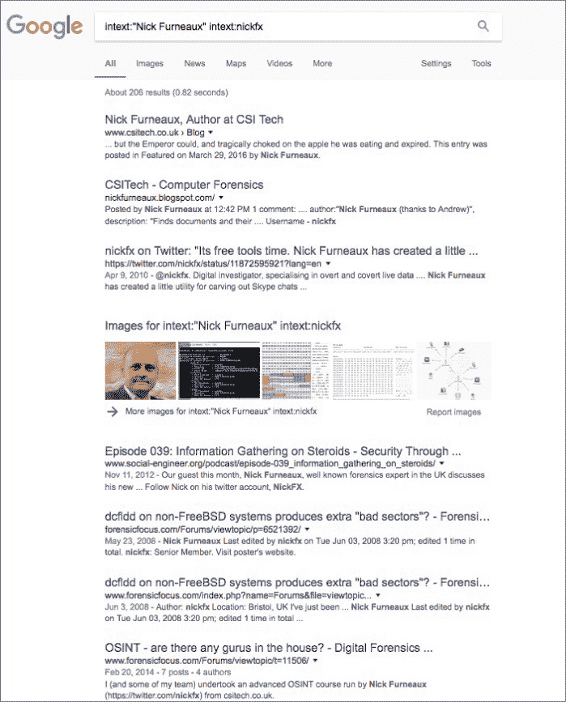

**图 2-14** 0 到 206，仅用 .82 秒

不到一秒钟，我就得到了关于目标的 206 个可靠结果。Google 搜索的一个功能是能够查看与你的搜索相关的图片。单击“更多图片”链接可以向你展示一些有趣的结果。在这种情况下，图片可以带我到谈论 Nick 的页面。

但我已经了解 Nick 的很多信息，所以让我们看看还能找到什么。我将搜索词更改为 `intext:"Nick Furneaux" intext:UK`。结果显示在 图 2-15。

 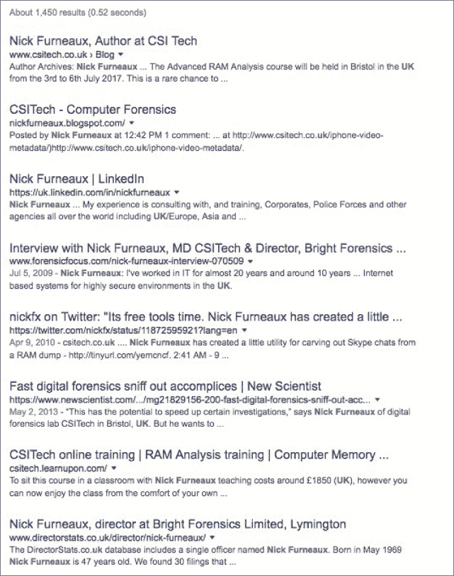

**图 2-15** 我们接近了吗，Nick？

第一个结果告诉我，他正在一个名为布里斯托尔的城镇接受培训。最后一个结果提供了 Nick 可能仍在参与的一家公司的名称，以及他的完整出生日期，甚至还有一个地址——你猜对了——布里斯托尔。

该页面还包括一份他可能在那家公司合作的家人或朋友的名单。这是一个信息宝库。

将之前搜索中的“`UK`”更改为“`Bristol`”将引导我们找到诸如他的邮政编码以及可能与他同住的其他家庭成员姓名等信息。

在我继续之前，再举一个最后的例子。如果你执行以下 Google 搜索，你认为第一个结果会是什么？

```
intext:"Nick Furneaux" site:linkedin.com intext:Bristol
```

当我执行此搜索时，我得到的第一个结果是 Nick 的 LinkedIn 页面。使用 Google 运算符，你可以添加从之前搜索中获得的少量信息，不断深入，直到找到你需要的确切信息。

我想向你展示更多关于 Google 功能的内容，但由于 Nick 仍然是我的朋友（或者至少上次我检查时是这样），我将把注意力从他身上移开，转向一般搜索。

### 但标题里明明写着“私有”

你听说过 RSA 私钥吗？RSA 密钥是基于专有算法的密钥。它由两部分组成：公钥，用于识别它；私钥，用于解锁王国。

根据这个定义，RSA 私钥用于建立安全连接。

所以，你会认为如果你搜索 RSA 私钥，你将找不到任何结果，对吧？但使用以下搜索

```
BEGIN (CERTIFICATE|DSA|RSA) filetype:key
```

将为你提供超过 3,000 个结果，如 图 2-16 所示。

 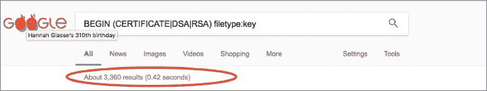

**图 2-16** 你为什么称它为私有？

### 但它被标记为“机密”

通常，政府机构会对文件做出某些分类标记，以指示普通公众是否应该看到它们。像“机密”和“绝密”这样的标记通常表示这些文件不供公众使用。你会认为你无法在网上找到其中任何文件。（你知道人们对那些“认为”的人怎么说……）

但由于我喜欢在监狱围墙之外生活，让我们说我们只想看看是否有任何包含密码的文件，这些文件应该是机密的，对吧？


如果我搜索 `site:gov.ir intext:password filetype:xls` 会怎样？这应该将我的搜索限制在任何 `gov.ir` 域名下，并仅查找包含单词 `password` 的 XLS 文件。结果如 图 2-17 所示。

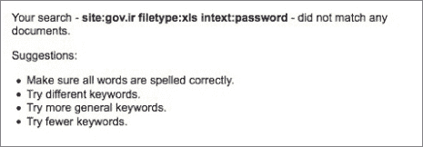

**图 2-17** 出了什么问题？

嗯，这似乎不对。为什么伊拉克政府服务器上的文档会包含英文单词 `password` 啊？但是，如果我使用 `translate.google.com` 网站将单词 `password` 翻译成波斯语呢？这有帮助吗？图 2-18 显示了结果。

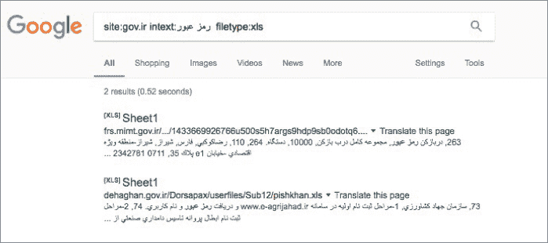

**图 2-18** 多语言谷歌搜索

谷歌的力量在此真正体现出来。我不需要知道波斯语，甚至不需要用波斯语搜索。我只需要告诉它查找那个单词，我就能找到文档。

#### 摄像头：是时候停止穿着内衣跳舞了

人们渴望在家里安装摄像头的需求曾一度激增。人们使用它们来监控孩子、保姆和宠物；用于安全；等等。

其中许多摄像头出厂时使用默认设置，这使得它们处于脆弱且完全暴露的状态。有时随摄像头附带的软件也让人不尽如人意。对用户来说很容易吗？是的。但对攻击者来说也一样容易。

其中一种软件就是 webcamXP。顾名思义，它是为在 Windows XP、Vista、7、8、9、10、Server 2003、2008 和 2012 上运行而制作的。根据其网站显示，该软件的最后一次更新是在 2016 年。考虑到这一点，它现在应该不太流行了，所以你可能会认为现在搜索这些东西不会找到太多，对吧？

对吧？！

所以，我搜索了 `intitle:"Webcam 7" inurl:8080 -intext:8080`，图 2-19 显示了结果。

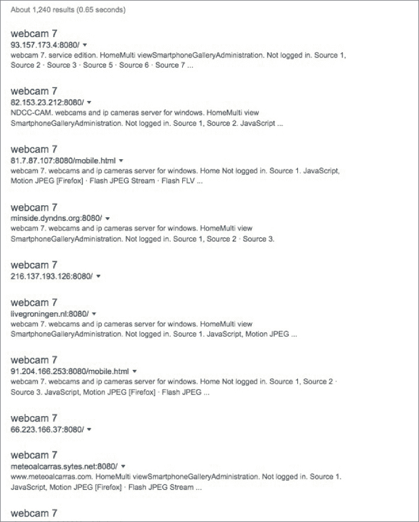

**图 2-19** 摄像头多得不得了！

诚然，其中许多摄像头本意就是在线的，并且是供公众观看的。它们在直播交通场景、滨水区和其他区域。但是，有些人出于个人用途设置摄像头，并将其暴露在自家院子或房子里。重点是，如果这些摄像头没有得到妥善保护，任何稍有技巧的人都可能在看着你，而你甚至不会知道。

#### 其他情报来源

通常当我讲到这里时，人们会对通过谷歌搜索还能发现什么感到既恐惧又好奇。我不想列出我做过的每一次谷歌搜索，但我可以告诉你，仅使用谷歌搜索我就轻松发现了一些事情：

*   某个家伙看着他的大麻植物生长的摄像头
*   人们手机里的私人照片
*   人们共享的音乐和电影目录
*   包含完整密码、出生日期和社会安全号码的文档
*   文件中成千上万的信用卡号码
*   加载了信息的完全开放的 SQL 数据库
*   交通摄像头的开放访问
*   电网和控制系统的开放访问
*   若干儿童色情交易点

这个列表可以一直列下去。

### 其他两件事

这一节本身就可以单独成书。但在我继续并总结本章之前，如果我不提及其他两件事，那我就失职了。

#### 机器人很酷

小时候，我非常想要一个机器人。我想如果能拥有一个，R2D2 就会成为我最好的朋友。在这里，我指的不是 *那种* 机器人。我指的是 `robots.txt` 文件。

什么是 `robots.txt` 文件？它是网站所有者用来告诉爬行和抓取网站的蜘蛛或机器人哪些是允许的、哪些是不允许的文件。例如，在 `robots.txt` 文件中看到 `Disallow` 语句并不罕见，这表示机器人不允许缓存该文件夹。例如，图 2-20 是 `whitehouse.gov` 的 `robots.txt` 文件。

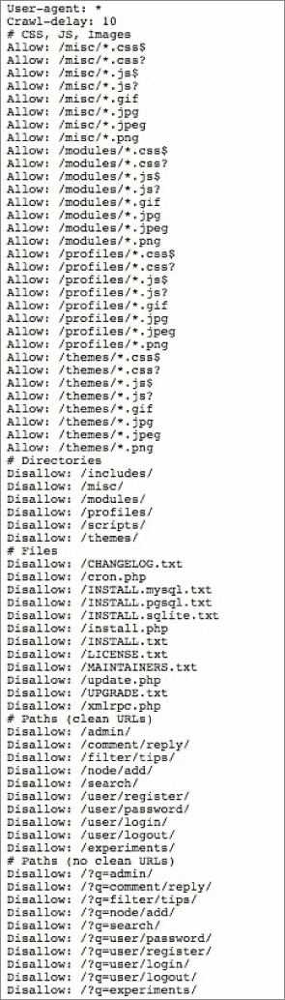

**图 2-20** 这拒绝的东西可真多！

现在，试着像社会工程师一样思考一秒钟。图 2-20 中的文件告诉你什么？

你可以看到存在哪些目录，但你也可以看到他们不希望你访问的目录——或者他们不希望谷歌缓存的目录。

此外，像 `mysql` 或 `pgpsql` 这样的文件能表明网站在创建时使用的技术类型。

现在，如果这是一个实际目标（它 *不是*——我重申，它 *不是*），我们会逐个检查这些目录，以确保它们配置得当，并且不会在未经授权的情况下允许我们进入。如果这些日志和文件可访问，我们会检查它们，看看服务器上是否有任何配置错误。

我曾为一家中型公司做过一个项目。这是那种“尽你所能，看看能发现什么，然后毫不留情地攻击我们”的测试。我先进行了一些 OSINT 和谷歌搜索，并在他们的 `robots.txt` 文件中发现，他们对名为 `admin` 的目录有一条 `Disallow` 语句。

为了检查一下，我输入了 `www.company.com/admin`，令我震惊的是，我无需凭证就被放行了！该目录包含 CEO 的私人文件存储库，他似乎用它来共享出差时需要的文件。它包含合同、银行数据、护照照片以及许多其他敏感细节。

我找到一份在过去几天内签署的合同。我购买了一个与真实公司名称相差一两个字符的域名，为签署合同的人设置了一个电子邮件，并用一个恶意文件和一封电子邮件钓鱼攻击了 CEO，邮件写道：“我不确定我是否回复了完整签署的合同，但第 14.1a 节有一个问题。你能否查看并告诉我？”

15 分钟内，CEO 收到了邮件，打开了它，并被攻破了。他随后一直在给那个假地址发邮件，说合同打不开，一直在崩溃。原本应该持续一周的渗透测试（aka 渗透测试），大约在三小时内就结束了。

我给 CEO 打了电话，我们的谈话大致如下：

| **CEO:** || 你好 |
| --- | --- |
| **我:** || 嘿，保罗，我是社会工程师公司的克里斯。我想和你谈谈渗透测试的事…… |
| **CEO:** || 哈！这么快就放弃了，克里斯？我知道我们是个难啃的骨头。 |
| **我:** || 好吧，保罗，我们已经拿到了你的护照、出生日期、信用卡、银行访问权限以及带有管理员凭证的网络远程 shell。我想我应该打电话看看你是否真的希望我继续测试一周？ |
| **CEO:** || 得了吧！你在编故事！！这才刚开始几个小时。告诉我，那个点击并提供 shell 的失败者是谁？我要和他谈谈。 |
| **我** || 好吧，保罗…… *(我咽了口唾沫，不确定是否该说出脑子里的那个笑话。)* 我不会对他太苛刻；他是个挺酷的家伙。 |
| **CEO:** || 哦是吗？谁？ |
| **我:** || 保罗，就是你。 |

然后我向他解释了每一个细节，他很快意识到发生了什么。这次特定的渗透测试在很大程度上要归功于一个 `robots.txt` 文件和一个配置错误的目录。

#### 这全都关乎元数据，宝贝

根据牛津词典，*meta* 被定义为“指自身或其类型的惯例；自指的。”所以，元数据 literally 就是关于数据的数据。非常 *盗梦空间* 风格，对吧？

让我更简单地解释一下。元数据是你在搜索中找到的关于某个物件的信息。很多时候，这些数据提供了一些非常有趣的事实——其中许多可能并非有意放置在那里的。


比方说，我做了一次非常良性的 Google 搜索，以查找包含密码信息的 `.doc` 文件。我偶然发现了一个名为 `FinalPasswordPolicy` 的小文档。元数据会揭示什么？请看 图 2-21。

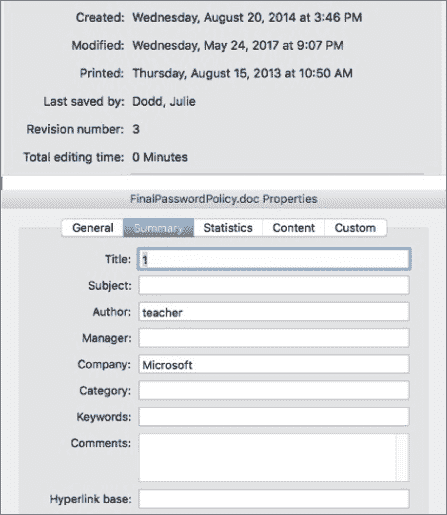

**图 2-21** “元数据是什么鬼？！”（看我干了什么？）

这些元数据告诉我们文档的创建日期和时间、最后保存它的人、作者的姓名/职称、文件经历了多少次修订，以及我在此不提及的一些其他信息。你可能会说：“我想我能做到。”

不到 24 小时，他就做出了一个原型。从那时起，Dave 就全力投入到被称为 SET（即社会工程师工具包）中，仿佛这是他的毕生使命。

他不断发布更新——似乎每天都有——并且内置了许多功能，让我最初的那些小想法显得非常逊色。这是一个了不起的工具，下载量已超过两百万。

你可以从 `www.trustedsec.com/social-engineer-toolkit` 获取该工具及其使用说明。

### IntelTechniques

好吧，这个严格来说并不算一个“工具”，更像是我好朋友 Michael Bazzell 整理的一组令人惊叹的搜索引擎。

Michael 在几个领域是专家，但有两个领域他真正如饥似渴、孜孜不倦：在互联网上寻找人，以及躲避在互联网上寻找你的人。老实说，Michael 曾告诉我，要在 Amazon 上购买东西，我应该在墨西哥设立一家空壳公司，这样我就能获得不与我本人关联的信用卡。


Michael has set up an amazing collection of tools that search everything from social media, phone numbers, IP addresses, and even reverse images. You can find these tools at `https://inteltechniques.com/menu.html`, and I suggest you spend some considerable time at that site.

### FOCA

FOCA stands for Fingerprinting Organizations with Collected Archives. Way back at DEF CON 18 in 2010, a small group of Brazilian hackers released the tool and took the Internet by storm.

To date, there is `nothing` else like FOCA in the world. It's a Windows-only tool that has gone through some serious ups and downs over the years. At one point, I stopped using it because there had been no updates for some time, and there was no way to contact any person running it (and the tool wasn't open source).

Then the folks at ElevenPaths took over the project. They did an update and released it on their website at `https://www.elevenpaths.com/labstools/foca/index.html`. Sadly, FOCA is still Windows-only, but if you're not on Windows, it's worth setting up a virtual machine.

The speed at which FOCA grabs files and rips out useful metadata is amazing. Check it out.

### Maltego: The Granddaddy of Them All

At the risk of sounding like an infomercial for Maltego, I `love` this tool. I really do. The folks at Paterva do something you rarely see: They make an amazing tool, release a smaller free version (that is just as amazing), and keep the commercial version updated, so it's always moving forward and very usable.

What is Maltego, you ask? It is a tool that helps you collect data from online sources and then gives you an interactive graph to display it. It can help you catalog, footprint, investigate, and make connections with public sources of intelligence.

Maltego makes my work much easier than it would otherwise be, and the tool is easy and fun to use. In addition, the guys at Paterva (the company that makes Maltego) offer amazing training videos and courses. Finally, Maltego is made for every platform.

You can check it out and download it right from the Paterva website at `www.paterva.com/web7/downloads.php#tab-2`. I suggest you start with Maltego Classic.

## Summary

Knowledge is certainly power, and there may be no better source of knowledge of your targets than OSINT. If you follow the principles in this chapter, practice, and hone those skills you can become a master and finding even the minute details hidden all over the Internet.

You have done all the OSINT. You have cataloged, collected, and documented every piece articulately. You think you have found the piece that will be your vector, and you need to start preparing your pretext. How will analyzing the data you found and looking for key indicators about the target's communication style help? That is the topic of the next chapter.

# 3  

Profiling People Through Communication: (or Using Your Words Against You)

> To effectively communicate, we must realize that we are all different in the way we perceive the world and use this understanding as a guide to our communication with others.

> 

> —TONY ROBBINS

When I wrote `Social Engineering: The Art of Human Hacking` (Wiley, 2010), I spent some considerable time talking with Chris Nickerson, owner of Lares Consulting, about communication modeling. He is quite skilled and has a deep understanding of the topic.

He really helped me to delve deep into the topic and understand some of the ways communication is used by social engineers. At the end of the day, I can boil down communication modeling to the following key points:

*   There is always a source.

*   There is a message.

*   There is a channel.

*   There is a receiver.

If you are missing one of these, you don't have communication. Whether you look at the Shannon-Weaver model or Berlo's Sender-Message-Channel-Receiver (SMCR) model of communications, they have similar principles.

Regardless of which one you are familiar with, one of the things I've learned over the years is that the exact model you use really doesn't matter. I know, I know—some of you are probably ready to start burning this book in the streets, but here is why I say this.

If you apply this book's principles regarding rapport, influence, communication profiling, and so on, and the person you are communicating with is receiving the message, it `will` work. If you use these principles the way the person you are communicating with wants to be communicated with, communication will go exactly how you want it to go.

Yes, I realize this is a bold claim, and I don't mean that it's as simple as `1 + 1` being equal to `2`.

It can be complicated. Oftentimes, we get in our own way. For example, I am a very direct communicator. Because of this, I don't mind someone telling me when something I did wasn't the best—the key is that you need to tell me how to improve. I also tend to communicate that way with others, which can cause a lot of problems when I am communicating with a person who doesn't like directness.

It's not easy to just switch your communication profile on the fly, although it's easier for some people than for others. The challenge occurs when we get comfortable and relaxed because our brains trigger all the same chemical reactions we want in our targets, and those same reactions can cause us to slip back into our “comfort zone.”

Let me illustrate it this way: Do you remember as a young adult (or a full-grown one) the first time you tried something new? A new type of food, let's say. Since my kids were small, my wife and I encouraged them to always try something at least once. They didn't have to like it or finish it, but we said you can't make a judgment if `you` don't try it.

One year, we traveled to Hong Kong as a family. We went into a restaurant, and my daughter spotted an item on the menu that intrigued her—it was labeled “Whole Pigeon.” She asked me if she could try it. My first inclination was to say, “Really, those nasty birds?” But I quickly recalled our practice of encouraging the kids to try new things.

My daughter ordered the pigeon, and then she looked at me and said, “Well Dad, what new thing are you gonna try?” I had always been intrigued by sea cucumber, although I'm not sure I had ever wanted to eat it. Sounds harmless right?

Figure 3-1 shows my daughter chowing down on her pigeon, but I don't have an image that shows you what happened when I ate a sea cucumber. They are basically giant slugs that live in the ocean, so use your imagination.

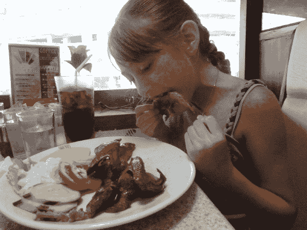

**Figure 3-1** And yes, the pigeon's head was included.

What does this anecdote about my family's eating habits in Hong Kong have to do with communication modeling? Well, as soon as I tasted the thing that was uncomfortable for me (and quite disgusting, in my opinion), I went looking for something very, very “American.” Why? It was familiar and comfortable.

Communication is much like this. The first time you step out of your comfort zone to try something new, you might be uncomfortable and want to retreat to your comfort zone, especially if the experience is not amazing. It is important to not stay in your comfort zone, though. The more you try something, the greater likelihood it has of becoming part of your arsenal of tools.

To help you master communication as a social engineer, I discuss the following key components in this chapter:

*   Understanding what a person is thinking upon approach

*   Getting to know the DISC

*   Understanding how to model your DISC style

*   Using DISC to your benefit

In other chapters of this book, some skills are independent of others in the same chapter, but for this chapter, all skills tie together and are important parts of each other. Let's get started with understanding what a person is thinking upon approach.

## The Approach


当我教授为期五天的高级实用社会工程学课程时，不可避免地，很多学生都在一个方面遇到问题：接近陌生人。

正是你与陌生人之间最初几秒钟的互动，将定义整个交互的基调。让我讲一个特别尴尬的失败故事来巩固这一点。

课后一天，我和我的好朋友 Robin Dreeke 以及一群学生在一起。我被挑战向他们展示“接近一个完全陌生人”可以有多“容易”。由于课堂上所有的积极反馈，整天教学带来的多巴胺，以及即将成功的肾上腺素飙升，我感到非常兴奋，准备好用我光辉的技能向他们展示做社会工程师是多么容易。

大约有七八个人站在大厅里讨论我如何进行接近，Robin 说他会为我挑选目标。我身高 6 英尺 3 英寸，Robin 挑选了一个坐在我身后约 2 英尺处的较矮的男人。他正坐在沙发上读书，等待某人。

现在，就在你脑海中想象这个场景的一部分，并考虑对我而言最好的接近方式是什么。从后面？绝对不行！那会吓到那人并引起恐惧。站在正前方？也不行。他得抬头看，脖子会紧张，那种不适不会鼓励交谈。你会怎么做？想一秒钟。

好吧，Robin 告诉我目标后，我毫不思考地猛地转过身，用我响亮的纽约口音说：“嘿，你好吗？！我可以问你一个快速问题吗？”

那人被我猛地转身和响亮的自我介绍吓坏了，以至于他在椅子上向后倾斜太多，失去平衡，摔倒了。我赶紧跑到他身边，又尴尬又担心他受伤了。不假思索地，我说：“让我帮你起来。”他比我预想的要轻得多，我把他和椅子一起举起，但用力过猛，导致他向前摔在地板上。

他抬头大喊：“*离我远点，伙计！你到底怎么了？*”（但他没用 *heck* 这个词，他声音中的愤怒极其强烈。）

我转身离开他，说：“先生，我真的很抱歉。”我垂头丧气地走回大厅，那群学生在嘲笑我。Robin 笑得眼泪都出来了，而我则感到被击败了。

多年来，像这样的经历，以及无数类似的故事，帮助我定义了一件事，这件事从字面上改变了我对沟通的看法。你认为一个你即将与之沟通的人需要从你这里得到什么，才能感到舒适和安全？想一想。

想象你站在街上，看到有人明显正朝你走来，并计划与你互动。你在想什么？我的经历帮助我识别出以下四点：

*   你是谁？

*   你想要什么？

*   你是威胁吗？

*   这需要多久？

当你接近某人时，如果你能在交互的前 5 到 10 秒内回答关于那个人的这四点，你就能改变整个互动的走向。这些信息为本书的许多部分奠定了基础，所以请折角或标记这一页，因为我经常会提到它。这四个因素也在书中其他章节讨论的以下主题中发挥作用：

*   你的借口（第 4 章 是一个帮助你记住这四点的图表。

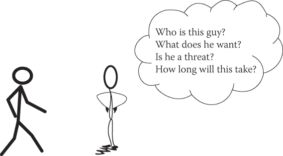

**Figure 3-2** These four points are crucial to communications.

我并不是说每个人在另一个人走近他们时，都会字面上用那些确切的词思考那些问题，但它们是一个人所拥有的担忧、想法或忧虑的一部分。如果你（沟通的发送者）能在你的开场白中回答这四点，你就能让接收者放松，并让那个人感到舒适。

历史上的骗子一直知道这些事实，并使用各种技巧让他们的目标在提出要求（互动的目的）之前放松警惕。理解这一点不仅能让你成为一名更好的社会工程师，还能在有人试图对你使用这些技巧时帮助你保护自己。

第一步是了解你的沟通风格。这就是我们进入一个非常强大但简单的沟通分析工具的地方。

## Enter the DISC

1893 年，William Moulton Marston 出生。年仅 22 岁，他就拥有哈佛大学的学士学位；三年后，他获得了哈佛法学院的法学学士学位；又过了三年，他获得了哈佛大学的心理学博士学位。他担任美国大学的教师。

在哈佛大学求学期间，他正在研究说谎者与其血压之间的关系。1915 年，他制造了一台机器，可以测量一个人在被质询时血压的变化。

1917 年，Marston 发表了他的研究结果，从此——你猜对了——测谎仪诞生了。在 20 世纪 20 年代和 30 年代，他非常活跃地担任演讲者和政府顾问。他与众不同之处在于，他对异常心理学的兴趣不如对人群行为的兴趣。

1928 年，他出版了一本名为 *Emotions of Normal People* 的书，1931 年，他出版了另一本名为 *Integrative Psychology: A Study of Unit Response* 的书。正是从这些作品中，Marston 推导出了 DISC 系统。他正在寻找衡量行为和意识能量的方法。虽然他没有开发本章讨论的测试，但他开发了这个模型，并在 1930 年与环球影业的一些工作中应用了它。他们希望从无声电影过渡到有声电影，Marston 的工作在帮助创造更自然的手势和面部表情方面起到了关键作用。

Marston 博士的工作改变了我对社会工程学的看法。很多人试图弄清楚如何快速对某人进行心理画像，但 Marston 博士更简单的方法却引起了我的共鸣。我不是心理学家，所以了解你的心理画像对我帮助不大。但我是社会工程师，所以了解你如何沟通就像拥有打开锁的钥匙。

### What Is DISC?

DISC 是一个首字母缩写词。有些人使用不同的描述符，但以下是我认为最合理的：

*   *D*: Direct/Dominant

*   *I*: Influencing

*   *S*: Supporter/Steady

*   *C*: Conscientious/Compliant

每个都是该风格的表现方式的描述符。通常，DISC 用一种形状来表示。我使用 图 3-3 中所示的那个。

 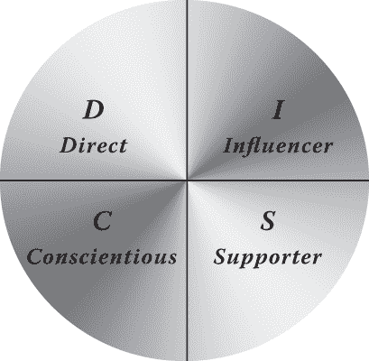

**Figure 3-3** DISC simply defined

每种沟通风格都以独特的方式表示，这有助于我们预测行为。使用 DISC，你会发现人们是可预测地不同的。

假设你正在与一个 *D* 或直接沟通者打交道。一个直接沟通者可能喧闹而热情；另一个可能更安静而坚定；第三个可能介于两者之间。尽管存在这些差异，他们都直接且直截了当地沟通。因此，如果你能快速画像对方，你可以改变你的沟通风格以更好地影响对方。

在我的课程中，总会出现一些关于这个问题的疑问。以下是两个最常见的问题：

*   **Question:** How do I know my preferred style?


* **Answer:** 这是一个很棒的问题，但不容易回答，因此我将在下一节中详细阐述。

* **Question:** 我可以不止一种风格吗？或者是几种风格的混合？

* **Answer:** 是的，我们都在不止一种风格上有优势，并且可能在不止一种风格上都很强。有些人最终会处于风格的交叉点，并且随着时间的推移，风格可能会发生一些变化。

尽管这种评估方法非常准确，但请记住，任何此类评估都不总是 100% 准确（至少在我看来是这样）。它会根据一个人回答问题的方式以及场景而发生变化。

我认为，这是你作为专业社交工程师武器库中的另一种工具。它能帮助你更接近于真正运用专业人士的所有技能。

在我深入探讨如何作为社交工程师使用 DISC 之前，我需要讨论本书中可能最重要的部分：首先了解你自己的沟通风格。

### 认识你自己是智慧的开端

这个标题不是一个奇怪的谜语；它是真正理解沟通画像如何运作的基础。在你能够成为与他人沟通的大师之前，首先了解自己是至关重要的。让我来解释一下。

厨师的厨房里有许多不同的刀。我有 4 英寸、8 英寸和 10 英寸的刀。每把刀都有不同的形状和重量，并且用于不同的目的。Figure 3-4 展示了各种刀具风格。你认为哪把刀最适合切一颗卷心菜？

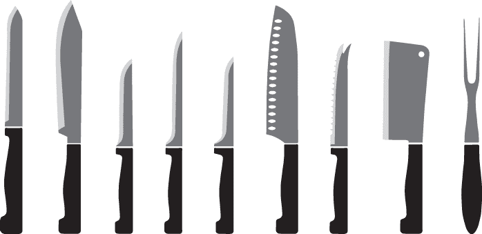

**Figure 3-4** 明智选择。

我会选择从右边数第四把刀，因为它有切开厚蔬菜所需的重量，并且长度足以切到底，这会让我的手臂和手腕更轻松。我看到有些人选择从右边数第五或第六位的刀来切卷心菜，猜猜会发生什么？切了几分钟后，他们的手会酸痛，手腕会疼——使用那些刀具还存在很大的受伤风险。通过了解哪种工具最适合这项工作，如何正确使用它，以及它的优缺点是什么，你可以为工作选择完美的工具。

DISC 就像这个说明。某些画像对于某些任务比其他画像更有效。了解你的风格可以帮助你真正理解你的优势和劣势。它可以帮助你看到如何清晰地传达你的想法和意图。它还可以大大增加你不会让沟通对象感到反感的机会，而作为社交工程师，这是工作中非常重要的一部分。

我帮助人们了解其主导沟通风格的方法有几种，但大部分我使用 DISC 评估工具，它可以帮助一个人轻松地了解自己。但是等等！在你跑去浏览器搜索“免费 DISC 评估”之前，让我告诉你为什么这可能不是个好主意。

我预览过的许多在线评估使用一种我认为有缺陷的方法。它们给你一个句子，并要求你针对该情况回答一组预定义的问题。例如：

* 想象你是 Chris 的经理，他刚刚表现出了不服从行为。你应该怎么做？

    1. 当场解雇他。

    2. 开几个玩笑然后继续。

    3. 让他坐下，详细解释他做错了什么。

    4. 试图让他明白他的态度对团队不利。

DISC 评估中此类问题的问题在于，你可能没有任何背景来回答它。如果你从未管理过其他人呢？如果你从未管理过不服从的人呢？变量太多，这使得这是一个糟糕的问题，并可能导致不准确的结果。

如果你打算寻找一个评估测试来使用，我鼓励你寻找一种给你单词选择，并要求你选择一个最像你和一个最不像你的测试，而不是基于场景的测试。这里有一个例子：

* 从单词列表中，选择一个 `你` 觉得最能描述你的单词和一个最不能描述你的单词。即使你对这些单词没有特别强烈的感觉，根据你的个人评估，一个会最能描述你，一个最不能描述你。

| **MOST** || **LEAST** |

| --- | --- |

| Logical || Logical |

| --- | --- |

| Serious || Serious |

| Obedient || Obedient |

| Free-willed || Free-willed |

使用句子时，你试图想象一个你从未经历过的情况，这对许多人来说可能非常困难。这就是为什么我喜欢推荐使用单词对的评估。这种类型的评估允许手头的科学更准确地工作。

我经常告诉我的学生，在思考他们在 `work` 中如何表现时回答每个问题，这通常与他们在家时的表现大不相同。结果，我得到了他们沟通画像的一致和诚实的表现。

不幸的是，我还没有想出如何向本书的每一位读者实施 DISC 评估测试，所以我必须稍微有点创意来帮助你理解这有多么强大。

看看 Figure 3-5。

 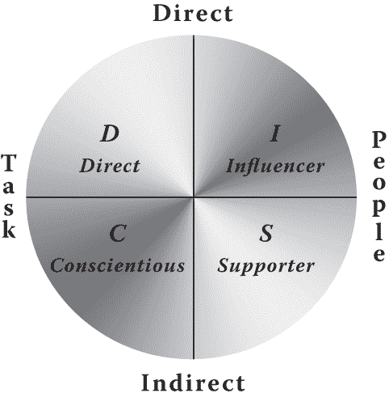

**Figure 3-5** 理解 DISC

专注于图中圆圈 `外部` 的单词（即，暂时忽略圆圈内部的单词），回答关于你自己的这两个问题：

1. 你的沟通风格更直接还是更间接？`等等！` 在回答之前，记住我不是在问你认为 `其他人` 怎么看你——我是在要求你诚实地评估你自己是更直接还是更间接。你是直奔主题，还是花时间？你对直率有问题，还是喜欢它？现在，根据你的答案，写下“直接”或“间接”作为你的沟通风格。

2. 你更偏向任务导向还是人际导向？当你在工作中参与一项任务时，你更关心完成它，还是关心帮助你完成它的人？根据你对这个问题的回答，写下“任务”或“人际”。

如果我参加这个测试，我会写下“直接”和“任务”。在 Figure 3-5 中，介于直接和任务之间的扇形区域被标记为 `D` 代表 `direct`。看看这有多快？

现在全面评估你自己。你最终处于哪里？现在看看 Figure 3-6 了解更多细节。

 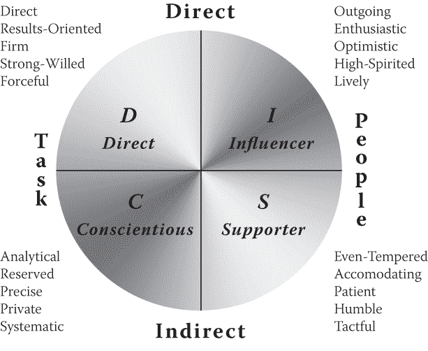

**Figure 3-6** DISC 详细信息

以我自己为例，我把自己放在 `D` 区域，发现我直接、注重结果、坚定、意志坚强且强势。这几乎是对我的完美描述。（它准确得几乎有点可怕。）但这意味着什么？

我偏好直接的 `沟通风格`。记住，这不是心理画像——它是沟通画像。理解这一点意味着你可以更清楚地看到你可能需要在哪里改变沟通方法，以便更好地影响你的目标。

现在你已经回答了我的两个测试问题，你应该对自己有相当准确的评估。但当涉及到画像其他人时，这意味着什么？你又如何利用这些信息？

#### `利用 DISC 造福自己`

DISC 画像非常有效，以至于我的团队在社交媒体、语音通话甚至照片上都使用了它，准确率惊人。

Robin Dreeke 与我分享了一个故事，他仅通过一张目标人物的照片就构建了一个画像。让我为你描绘一下场景。


照片显示一条繁忙的城市街道，街上发生了一起车祸。并非致命事故——只是轻微的剐蹭。街道上挤满了人，大家都跑向车辆，看看每个人是否都没事。目标人物站在事故现场背对着，没有看——他双肩下垂，双手插在口袋里。仅此而已。

根据对场景的描述，你会把他放在 DISC 图表的哪个位置？

想想我之前问你的那些问题。根据我对你描述的照片，这个男人更偏向任务导向还是人际导向？你真的不能说“人际导向”，对吧？所以答案似乎是“任务导向”。

他是直接型还是间接型？虽然其他人都在关注事故，但他在那方面表现出缺乏直接性。Robin 猜测是间接型。

这会把目标人物放在图表的左下角区域，即图表 Figure 3-6 中的 `C` 区——这使他显得分析型、内敛、精确、私密且有条理。他正要去某个地方，那项任务优先于其他一切。他的肢体语言并不外向或强势，这最准确地将他归入 `C` 区域。

这最终成为 Robin 使用的一个很好的画像，如果你读过他的书 *It's Not All About “Me”: The Top Ten Techniques for Building Quick Rapport with Anyone*，你就能确切地看到它是如何结束的。（提示：他成功了。）

我能够在我们的课程中培训人们，让他们只需关注 DISC 的四个方面并将人归入正确的象限，就能在几分钟内学会做出这种评估。但如果你不能完美地回答所有问题呢？

### 将 DISC 付诸实践

想象一下，如果你无法判断我是任务导向还是人际导向，但你知道我是直接型还是间接型？即使我也属于尽责型或支持者类别，你仍然可以作为一个直接型的人与我有效沟通。

如果你知道我属于任务类别而不是人际类别，情况也是如此。你可以把我当作 `D` 或 `C` 来沟通，这比把我当作 `S` 来沟通要好得多。明白这个道理了吗？

来做个小测试。看看我们老朋友 Nick Furneaux 的 Twitter 页面，网址是 `https://twitter.com/nickfx?lang=en`。

你会说 Nick 更偏向任务导向还是人际导向？读一读他的推文，看看他的评论似乎倾向于哪一边。我读过，肯定是 `task`。那么他的风格是直接型还是间接型？嗯……这个似乎有点难。

看看他发布的媒体内容。我看到关于 `things` 而不是人非常直接的信息。这让我确信 Nick 更像是一个 `D`。

即使你不能 100% 准确地判断某个人，也可以接近。在 Nick 的例子中，你可以看出他肯定是任务导向而不是人际导向。所以猜测他是 `D` 或 `C` 是可以的。

行业的另一个秘诀是观察某人使用的一些描述词。回到 Figure 3-6，看看 `D` 和 `C` 旁边的描述词。哪些词描述了你在 Nick 的推文中看到的内容？他是更直接、强势且注重结果？还是更精确、私密且有条理？

当我读这些推文时，我肯定更看到 `D` 而不是 `C`。这意味着 Nick 是 100% 的 `D` 沟通者吗？不完全是——有时人们的沟通方式取决于他们在何处、如何以及与谁沟通。例如，当我培训时，我倾向于更像 `I` 而不是 `D` 沟通。这对我、学生以及所有参与者都更好。如果你想影响我，你需要弄清楚我在试图影响你的媒介中是如何沟通的。

困惑了吗？别想太多。记住，这是你箭袋中的一支箭，它能帮助你在谈话的最初几分钟内更接近目标。

回到我们的例子：如果你现在已经将 Nick 画像为 `D`，你如何利用这些信息来为自己谋利？要回答这个问题，你首先需要了解一些关于如何在每种风格下沟通的知识，无论你是否处于权威地位。

### `D` 沟通者

如果你打算使用权威借口进行沟通：

*   直接且直截了当

*   设定坚定的界限

*   简洁明了，切中要点

*   回答 `what`

如果你打算使用较为含蓄的借口进行沟通：

*   强调 `what`，而不是 `how`

*   提供选项，但强调结果

*   关注逻辑

*   同意事实和立场，而不仅仅是人

### `I` 沟通者

如果你打算使用权威借口进行沟通：

*   友好且放松

*   让对方做大部分谈话

*   帮助他们的想法转化为行动

*   回答 `who`

如果你打算使用较为含蓄的借口进行沟通：

*   强调新颖和特别之处

*   提供互惠互利

*   不要主导

*   引用“专家”和推荐信

### `S` 沟通者

如果你打算使用权威借口进行沟通：

*   有条理且客观

*   放松且友好

*   保持一致性并回答 `why`

*   清�晰定义你要求的内容

如果你打算使用较为含蓄的借口进行沟通：

*   有耐心

*   问 `how` 问题

*   让焦点放在团队上

### `C` 沟通者：

如果你打算使用权威借口进行沟通：

*   注重细节

*   可靠可信

*   提供认可

*   回答 `how`

如果你打算使用较为含蓄的借口进行沟通：

*   使用数据和统计

*   提供逻辑和事实

*   强调可靠性

使用每种沟通风格的描述，让我们做一个小练习。假设 Michele 是 `I`，而我是 `D`，为了影响 Michele，我需要改变什么？（你也可以通过思考自己的风格，并决定为了影响 Michele 需要改变什么来做这个练习。）

我希望简洁、客观、切中要点，但 Michele 喜欢友好的互惠互利交流，且不过分主导。你看到挑战在哪里了吗？我需要确保自己能构建一个借口，让我能够击中让 Michele 感到高兴的要点，并为影响打开大门。要成为一个好的影响者，你在沟通时必须更多地思考对方想要什么，而不是你偏好的沟通方式。

### 了解局限性

好消息是，无论你是当面沟通、打电话、发电子邮件还是在社交媒体上沟通，这都有效。你只需要弄清楚目标的沟通风格、你的传递媒介以及你的沟通目标。从那之后，剩下的似乎就很容易了。

请不要被骗，以为这是一根魔法棒。有些因素可以增加成功的可能性，也有些会减少。仅仅因为你画像了目标，做出了正确的评估，并构建了一条能让他们在沟通舒适区感到愉悦的信息，并不意味着你总能有 100% 的成功率。疾病、压力、工作量以及许多其他因素都可能影响某人有效沟通的能力。需要证明存在局限性吗？想想你的孩子（或你认识的人的孩子）。

我的女儿能在一纳秒内融化我的心。尽管她似乎有超人的能力让我几乎做任何事，但当我处于压力下或事情太多时，我对她可能不如平时那么有耐心和友善。我的沟通方式会改变，这对每个面对外部环境的人都会发生。

不过，熟能生巧，所以如果你头几十次不成功，也不要放弃。当你做对的时候，你会惊讶于它效果有多好。


Here is another story: When my first book was released, I was asked to do a book signing. I hadn't expected that, and I was surprised by the nice line of people who had paid for my book and wanted me to sign it.

Many people said many nice things about my book and me—it was a little over-whelming, to say the least. One young man approached me —and talked for a solid minute about how my book changed his life. It had helped him through some rough times and even gave him a career path. I was so overwhelmed by this, I clearly remember. I was dumbfounded by his anger, but I also understood it. I apologized and asked him to come sit and talk, but he was too upset. He walked out really angry.

It wasn't until much later as I replayed that whole scene in my head over and over that I clearly understand what had happened. That young man was an `I`, and he was communicating to me as an `I` would—energetic, outgoing, lively, friendly, and so on. His `I` communication style was so strong that I—as a strong `D`—didn't know how to process it, so I shut down and moved on. But when the second young man challenged me and told me how I could improve, his style resonated with me, and I wanted more.

What could I have done to fix the problem? Or better yet, what should I have done to avoid that problem altogether?

Communicate on the person's level. When the first young man came up with the flowery praise, I should have done the following:

*   Asked him what part of the book really helped him
*   Complimented him, if I could do so honestly and realistically.
*   Actively listened and then offered to have him follow up for more conversation since the line was long

These things would have left him feeling validated and special rather than angry and tossed aside. The moral here is that even when you screw up, take the time to play it back in your head and see what you can learn from your mistakes.

## Summary

DISC is a powerful tool that can get you closer to building rapport and making your target trust you and want to help you. Learn to read people quickly, and then learn how to apply your profile and adjust your style so you can communicate with your targets more easily.

Don't overcomplicate this process, though. Remember that even being able to place a person in just one half of the DISC circle will drastically up your game. It is important to remember that DISC is not like street magic. You aren't going to become a human communication-modeling savant overnight (or maybe ever).

That shouldn't be your goal anyway. Your goal should be to keep the conversation focused on the person—not on yourself—and keep those two chemicals I mentioned in `Chapter 1` (dopamine and oxytocin) flowing. By doing this, you will build trust and rapport, which makes your job as a social engineer easier.

At this point, you may be saying, “Wow, this is basically a recipe for weaponizing communications.”

You aren't wrong. The fact is, many things that were not intended to be used as weapons are often weaponized. Automobiles are a good example of this.

I have a car that I love. I love driving it. It's a car I've always wanted, and now I have it. When Audi made the car, I don't think they planned on so many auto accidents being hit-and-runs. Yet according to a 2016 report by AAA Foundation for Traffic Safety, over 11% of all car-related accidents are hit-and-runs.

What's the point? The car can be a beautiful machine that is fun to drive and can take you places. It can also be a deadly weapon. It depends on the person and how they use it. Using DISC is the same.

My mantra at Social-Engineer, LLC, and during our five-day training is simple: “Leave them feeling better for having met you.”

If you keep this in mind, the skills you will learn in this book will not only help you defend yourself and help you catch the attackers, but it can also help you be successful as a social engineering professional.

When you profile a person's communication style, do not look for ways to exploit them or manipulate them. Look for ways to alter your style so you can communicate with them on their level, in the way that makes them happy.

Practice what you've learned in this chapter with family and friends before you try your hand at applying it in social engineering. After you have sufficiently proven you're on the right path with the communication model, begin to put small requests for actions you want your target to take into your conversation. Test the waters.

When you see it working, you can start to move into the next topic—one that will take your skills to the next level—pretexting.

# 4  

Becoming Anyone You Want to Be

> *Everything you can imagine is real.*

> 

> —PABLO PICASSO

If I could, I would have this chapter open with the `Mission: Impossible` theme song, but sadly we haven't figured out how to embed music into the pages of a book. But at least I have you thinking about that catchy tune, which is fitting for this chapter.

Becoming anyone you want be—which in social engineering is called `pretexting—`sounds super sexy. Some people define pretexting using words like `lie`, `falsehoods`, and other negative terms. However, I like to define pretexting in more general terms. The way I explain it in The Social Engineering Framework on my company's website (`www.social-engineer.org/framework/influencing-others/pretexting`) is this:

> *Pretexting is defined as the practice of presenting oneself as someone else in order to obtain private information. It is more than just creating a lie; in some cases it can be creating a whole new identity and then using that identity to manipulate the receipt of information. Pretexting can also be used to impersonate people in certain jobs and roles that they never themselves have done. Pretexting is also not a one-size-fits-all solution. A social engineer will have to develop many different pretexts over their career. All of them will have one thing in common: research.*

In one job, I had to break into seven different warehouses, and I decided to pose as a fire extinguisher inspector. In another job, we had to gain entry to the C Suite and the mail room of a company, so I pretended to be a pest control serviceman. For yet another job, I had to gain access to the security operations center (SOC) and network operations center (NOC), so I started off as an interviewee for a job, but after I gained access to the building, I had to switch to something else—so I posed as a manager from out of state. I've also presented myself as the head of human resources (HR) and a phone support rep. I could go on and on, but you get the idea: I've played lots of different roles.


重点在于，并不存在一种适用于所有情况的借口，这也是本章如此重要的原因。我在本章中大部分时间都在讨论借口的原则，以及如何将它们应用于任何情况，无论你是通过电话、电子邮件、社交媒体还是当面进行社交工程。我会带你了解一项工作，我认为这项工作能真正解释所有这些原则。

以下是本章讨论的原则：

*   思考你的目标
*   理解现实与虚构
*   知道分寸
*   避免短期记忆丧失
*   获得对借口的支持
*   执行借口

借口可能是工作中最有趣的部分之一，但也可能是最危险的部分之一。如果你不应用这些原则，可能会产生严重后果。我会讲述关于借口的成功和失败的故事。

如果你想成为一名专业的社交工程师，了解如何进行借口至关重要。它确实能决定工作的成败。

## 借口的原则

在深入探讨每个原则之前，我想讨论一种帮助许多有志于成为社交工程师的人的技巧：方法演技或即兴表演（aka `improv`）。

许多城市提供任何人都可以参加几个周末的方法演技或即兴表演课程。本书中我给你的许多技巧在这些课程中都有涉及，但这些课程可以给你一些书籍无法帮助你的东西：经验。

方法演技或即兴表演课程可以帮助你学会走出舒适区，进入角色，并学习在野外成功计划和执行借口所需的知识。然而，并非阅读本书的每个人都能找到当地的课程。别担心：你可以从 [Amazon.com](http://Amazon.com) (`www.amazon.com/Uta-Hagens-Acting-Class-DVDs/dp/B0001Z3IHG`) 购买名为 `Uta Hagen's Acting Class` 的 DVD。你也可以通过在 YouTube 上搜索找到该视频。这个优秀的资源会带你了解借口和进入角色的步骤。

但是，即使有好的表演课程或视频，你仍然需要知道学习借口的六个最佳技巧。让我们从第一个开始。

### 原则一：思考你的目标

灭火器检查员、害虫防治服务人员、人力资源经理——这些只是我提到过的几个借口，我曾使用过。我是如何确定在每个地点或目标上使用哪个的呢？

这一切都始于 OSINT，我会深入挖掘个人或公司的细节，寻找相关的故事、新闻、爱好、喜好、厌恶、事件等等（我在 第 2 章 “你看到我看到的了吗？”中会更详细地介绍）。这些重要的数据片段可以告诉我很多关于我应该关注哪个借口的信息。但是，还有一个关键信息将决定哪个借口会从我的武器库中跳出来付诸行动：目标。了解我试图完成什么，比仅仅了解我试图渗透的业务更重要。让我通过讲述一个我称之为“18 楼冒险”的故事来说明。

我被雇佣进入一栋安全大楼的 18 楼。这栋大楼由一家物业管理公司拥有和运营，该公司 `不是` 我的客户（一家制作在线音频内容的公司）。在这次测试中，我被允许进入的唯一楼层是 18 楼。通常，这家公司不允许直接上门预约。电梯需要刷卡。公司总部位于另一个州。

在 OSINT 阶段，我的团队关于在目标大楼内工作的客户公司员工的姓名和身份发现得很少。但是，我们确实找到了该公司一位经理的姓名以及该经理制作的一些内容。此外，我们在一个文件服务器上找到了一些公司不打算公开的文件：一份安全检查表、一些内部通讯简报、关于即将开展的项目的营销材料，以及一些其他杂项文件。

仅凭这些信息，你觉得什么样的借口不错？在继续阅读前思考一下。试着想出至少一个借口。

也许你想到了电梯维修工？这会给你一个在电梯里而不引起安全人员警觉的理由。也许你想到了公司总部的代表，来办公室进行突击审计？或者你想到了我甚至没有在这里提到的其他借口。

以下是一些有助于制定借口的其他细节：我的任务，如果我进入大楼并到达 18 楼，就是成功拍摄出口和入口的视频和照片。我要拍摄任何未锁定的电脑的照片，并尽量拍摄任何非公开的文件或项目的照片。

考虑到所有这些细节，我必须确保我的借口涵盖能够靠近电脑和办公桌的能力，并且我必须要么拿出相机，要么能够使用隐藏相机来获取所需的照片。

电梯维修工将是一个糟糕的借口，无法完成目标。它能让我进入大楼吗？是的，但我离我的目标还很远。

冒充总部代表——可能会让我进入大楼和楼层，甚至进入办公室，但会有局限。我需要知道办公室里谁工作，这样我的“突击访问”才能有成果。

从我在文件服务器上找到的安全检查表中，我了解到该公司对楼梯门有严格的规定。它们绝不能从楼梯侧解锁。事实上，楼梯间可触及的门上甚至不应该有把手。

利用这些信息，我制定了一个借口，称自己是第三方安全顾问。因为在另一个分支机构发现了问题，我被派去对出口进行快速 15 分钟的检查，以确保遵循了正确的政策。我的访问没有提前通知，所以我访问的办公室的员工会感到惊讶，并且在没有任何预警的情况下被发现处理事情得当。为了让客户相信我是诚实的，我需要用相机记录整个过程。

你看，有具体的目标如何让我的借口变得更好？拥有完整的细节使我能够制定出借口的一部分，帮助我实现所有目标而不引起警觉。强大，对吧？

有了这些信息，让我们进入第二个原则，我会在那里给你更多关于“18 楼冒险”的细节。

### 原则二：理解现实与虚构

这个原则可以通过解释基于现实来构建借口对你和目标来说都更容易记住来轻松定义。我的意思是，你应该尝试使用你真实生活中的片段，并使用你已经拥有或可以轻松掌握的知识。我经常告诉人们，我认为最难伪造的关系之一是父女关系。直到我有了自己的女儿，我才理解这种关系。我认为，我谈论她的方式和我感受到的情绪几乎是不可能伪造的。如果我没有女儿，但需要与一个有女儿的目标建立关系，那么拥有一个包含假女儿的借口将是危险的。但是，我可以有一个侄女，对吧？

我的观点是，你的借口应该基于你已经拥有或可以轻松伪造的事实、情感和知识。回到上一节中我提出的一些借口，我对电梯及其运作知之甚少，所以试图伪装成电梯维修工，如果被盘问，很可能会导致失败。


此外，我倾向于选择一个我能轻易回应的名字。有些人可以回应一个不属于自己的名字，但大多数人选择使用自己曾经使用过、被人称为，或者是自己名字变体的名字。

这可能不言而喻，但一般来说，在现场面对面的社会工程中，我倾向于使用男性角色。但在进行在线、社交媒体甚至电话社会工程时，我曾伪装成女性。

关于目标的真实性，你应该尝试将你的借口建立在能让目标保持“阿尔法模式”的基础上。（你可能还记得在 `Chapter 1`，“深入了解社会工程世界”中关于阿尔法模式的讨论。）

如果主题对目标来说很熟悉——也就是说，词语、头衔和语境是预期中的——那么你更有可能让目标保持在阿尔法模式，从而不会让人警觉到潜在的危险。

对于我的“第十八层冒险”，我使用了一份在 OSINT 期间找到的文档。我并不想学习新技能，因此我不仅处于目标的现实区，也处于我自己的现实区。

不过，有时当你开始规划现实时，你可能会在决定“多少才算过多”时遇到困难。

### 原则三：知道到什么为止

知道到什么为止——而不过分——非常重要。在我的课程中，我经常遇到想要为他们的借口构建整个生活的学生。有些人想要详细到他们 11 岁生日派对上吃了什么。

当涉及到决定创建多少细节时，请记住这一点：人们只会关心他们必须关心的事情，以完成你创建的“社会契约”。

让我详细说明一下。在我的“第十八层冒险”安全检查员借口中，你认为目标关心什么？

在这种情况下，他们不关心我孩子的名字、我的狗，或者我早餐吃了什么。他们关心我在 `Chapter 3`，“通过沟通画像人物”中提到的四个问题：

*   你是谁？

*   你想要什么？

*   你是威胁吗？

*   这需要多久？

让我们思考一下，目标会希望尽快了解关于我的借口的哪些信息：

| **Q:** || 你是谁？ |

| --- | --- |

| **A:** || 我是公司派来的安全检查员，来进行一次*非常*快速的审计，以确保所有政策都得到遵守。 |

| **Q:** || 你想要什么？ |

| **A:** || 我只需要大约 15 分钟的时间来进行这次快速审计。 |

| **Q:** || 你是威胁吗？ |

| **A:** || 我有紧急需要这样做，但没有人会有麻烦。 |

| **Q:** || 这需要多久？ |

| **A:** || 希望不到 15 分钟。 |

其余的细节都是目标不需要或不关心的额外信息。这意味着你可以毫无准备地进入吗？绝对不是。你仍然应该为你的“角色”准备一些基本信息，以防目标提问。因此，我制定了一个遵循如下路径的借口：

*   我是菲尔·威廉姆斯，一名 40 岁的安全检查员。我有一个孩子。我已婚。我没有宠物，但我喜欢狗和猫。我相当无聊；我上班，然后回家。我在 X 州住了 X 年。

有了这个非常基本的借口，我需要知道哪些知识才能确保我能成功？

*   妻子的名字

*   孩子的名字

*   孩子的年龄

*   州

*   该州内的城市

*   我的工作角色以及我在公司做什么

基本上就是这些。也许还有几个值得计划的小细节，但大部分情况下，这些基本信息就是我会被要求透露的全部。

让我举一个例子，说明有人不知道何时在借口上收手：我曾经和一个学生一起做作业。他前一天晚上在接近陌生人时失败了，为了帮助他在失败后建立信心，我们去了酒店大堂，这样我可以观察他与陌生人互动。我的目标是观察他互动，看看他哪里出了问题，然后提供关于如何“修复”的建议。

学生走向一位女性，开场非常友好。他面带温暖的微笑，看起来非常友善。那位女性开始与他互动，我看到她的肢体语言变得温暖友好，臀部转向了他。（你将在 `Chapter 8`，“我看到了你没说的话”中阅读更多关于肢体语言的内容。）学生问那位女性她来自哪里，她微笑着回答：“费城。”

他说：“哦，真的吗？太棒了。我也是！”不幸的是，事实远非如此。当我听到这些话从他嘴里说出来时，我看到火车失事开始慢动作发生。

那位女性回答说：“太好了，太棒了！你住在哪里？”

学生意识到他不仅把一只脚放进了嘴里，还把整条腿都放进去了。他回答说：“嗯，你知道。那个大钟附近……”他的声音渐渐低下去，因为他知道他即将正面撞上。

“钟附近？”她问道。“你是说自由钟吗？”

“哦，对。我就是这个意思……”他羞怯地说。

“首先，我不知道你在玩什么把戏，但‘钟附近’？没有一个费城人会把它叫做‘钟附近。’其次，钟附近没有*任何*住房。这次谈话结束了。”她转身走开了。

学生走过来对我说：“老兄，这基本上就是我过去两晚的经历。”

我让他详细讲述过去两晚的谈话过程。当他描述谈话时，问题对我来说变得更加清晰：他只是同意目标说的每句话，却没有知识来支持。

他把“部落心态”的教训（我在 `Chapter 5`，“我知道如何让你喜欢我”中详细讨论）理解为他需要加入目标所说的任何部落，然后对方就会自动喜欢他。

这个学生的经历对我们所有人来说都是一个关于借口的好教训。了解你借口的细节很重要。在学生与那位费城女性的相遇中，他只需要把一句话变成一个验证性问题，就能成为她部落的一员，例如：“费城？我听说那是个适合旅游的好城市。我从没去过。你最喜欢费城的什么？”这会告诉她他在倾听，感兴趣，并想了解更多——而不是假装拥有他不具备的知识。

掌握这一概念可以在你的借口成功中产生巨大差异。在初次接触成功后，你互动的人会开始给你提供大量细节。所有这些细节都可能难以记住——这引出了下一个原则。

### 原则四：避免短期记忆丢失

这种情况发生在我们所有人身上：你第一次见到某人，进行了一次愉快的交谈，然后，当你离开时，你记不起那个人的名字。这对某些人来说可能是一个真正的交易破坏者，并会让你显得好像对那个人不感兴趣。

我发现，记不起细节的人比完全没有问题的人更多。这就是这一节如此重要的原因。如果你在谈话中途掏出笔记本查看你故事的一些细节，你不会激发信心。如果对方发现你在记录关于他们的细节，那对他们来说更令人担忧。

我们都听过类似这样的建议：“在听到名字后的头 20 秒内尽可能多次地使用这个名字，你就会记住它。”这个建议确实有效，但在听到名字后立即快速重复一个人名字并不总是实际可行的。我几乎可以想象第一次见到你，当你呼气时，你说：“啊，克里斯，克里斯，克里斯……是的克里斯……克里斯是你的名字。那么，克里斯，我们刚才在聊什么来着，克里斯？”


嗯……有点吓人。见面时请不要那样做。

话虽如此，我确实发现，以某种有意义的方式使用某人的名字有助于记住它。在《第 18 层冒险》中，当我进入大楼并直奔电梯时，一名保安拦住了我。她举起一只手说：“对不起，你要去哪里？”

我停了下来，知道我得把这写进报告里：“哦，非常抱歉，女士。”我伸出手说：“我是来自`*[the name of the company, which I'd prefer not to divulge]*`总部的菲尔·威廉姆斯。我们在 18 楼有一个办公室。”

她查看了夹板上的一份名单，然后说：“对不起，威廉姆斯先生。我今天在获准访客名单上没有看到你的名字。”

“你说得完全正确。我的名字不会在那里。对不起——我太失礼了。你叫什么名字？”我说着看了看她的胸牌。“克莱尔，很高兴认识你。”

我只停顿了一秒钟：“看，克莱尔，我们在一个地点发生了一起事件，原因是某些安全政策没有得到遵守，我被派去拜访我们的东北办事处，以确保所有政策都得到遵守。这些需要是突击检查，这样我们才能确保调查结果是真实的。”

“我明白了。”克莱尔说。

“而且这份报告的一个部分是前台安全。我很高兴有你的名字，这样我就可以报告说你完美地遵循了所有程序。我有你的名——你的姓怎么拼？”说着，我掏出笔，低头看着我的夹板，把她的名字写在了我自己的名单上。

她甚至没有停顿就说：“法克莱。F-A-R-C-L-A-Y。”

“好吧，法克莱女士。你让这次审计开局非常好。谢谢你。现在，我希望发现的是，我的突击检查以和你一样高的分数结束。”

然后她做了一件我没想到的事。“威廉姆斯先生，要不我给你刷卡到 18 楼，你可以看看你的突击审计是否能取得积极的结果？”她提议道。

“克莱尔！等等，我可以叫你克莱尔吗？”她点了点头，于是我继续说：“克莱尔，你真是个天才！这个主意太棒了。”

她带着自豪，把她的新朋友（我）领到电梯厅，用她的安全卡打开门，然后给我刷卡到了 18 楼。我谢谢你，说：“15 分钟后见。”

那么，在那种情况下，对我关键的是什么？

* 很快地几次使用保安的名字

* 作为借口的一部分，有记录一切的理由

对我来说，虽然这些技巧效果惊人，但并不总是实用。因此，你需要在你的工具箱中拥有其他方法。我采用几种不同的技巧：

* **名片：** 与目标交换名片是获取他们所有详细信息的好方法。但不要一开始就这么做——等你建立了一些关系或即将离开时再做。

* **录音设备：** 我有时会同时录制现场任务的音频和视频，以及电话任务的音频，以确保捕捉到所有细节。这可以是一个很好的工具，但在你在公司场所录制任何东西或任何人之前，请务必获得公司的许可。

* **合作伙伴：** 我发现让其他人与我合作很有帮助，这样那个人可以帮助记住细节，而我专注于其他事情。

所有这些想法对于在随后的报告中保持细节安全都很棒，但对于在任务进行中记住细节来说，它们并不太有用。

这里有几个技巧：

* **练习。** 尽可能经常地练习记住细节，在不属于你工作职责的时间和地点——家庭聚会、聚会、办公室会议、销售电话，以及其他你与某人互动的时候。

    挑战自己记住诸如某人衬衫的颜色、他们戴了什么首饰、他们的全名，或其他你通常不会在意的细节。

    对我来说，记忆就像肌肉一样。你锻炼得越多，它就越好、越强壮。

* **阅读。** 我发现花些时间阅读实际印刷的（精装或平装）书籍有助于我的记忆。我没有特别建议你为此目的使用的书籍——只需读一些不在屏幕上的东西。我没有科学依据来支持这个建议，但我可以告诉你，我花在锻炼大脑上的时间越多，当我需要它时，它就“伸展”得越好。我也花时间解决数学问题来增强我记住细节的能力。

本节的最后一个建议是，当你有短暂休息时，花几分钟记录你的想法。我以两种方式之一这样做：写下我需要记住的细节，或者使用手机上的语音录音应用。

当克莱尔在电梯里给我刷卡到 18 楼时，我掏出手机，点击了录音应用，这样我就可以把我记得的所有细节都说进程序里。这有两个目的。首先，它有助于我以后的报告。更重要的是，我发现当我大声说出细节时，它有助于我以后回忆起来。

我的快速录音是这样的：

* 克莱尔·法克莱。大约 5 英尺 4 英寸，金发，中等体型的保安，穿着白衬衫，佩戴胸牌，黑色裤子。胸牌在左胸区域。安保桌上有两只狗的照片。使用了夹板。通过称赞她遵循了程序来建立关系。她用夹在右臀可伸缩挂绳上的白色 HID 胸牌给我刷卡到了 18 楼。她在电梯面板上输入的代码是 4381。

我只是凭记忆回忆起了这些细节，尽管《第 18 层冒险》发生在两年多以前。这对我的力量有多大。

下一个要加入你箭袋的箭，用于成功的借口，是*支持*。

## 原则五：为借口获得支持

我希望你停下来，想象一下我在这一章中一直在使用的借口：一家公司的安全审计员。现在回答这些问题：

* 一名安全审计员会穿什么？

* 一名安全审计员会有什么工具或用品？

* 一名安全审计员需要有什么特殊知识？

这些问题的答案是本节的基础。让我们分别考虑每一个，以便我们可以清楚地看到这一原则是如何发挥作用的。

| **Q:** || 一名安全审计员会穿什么？ |

| --- | --- |

| **A:** || 我发现这类审计员通常穿卡其裤或牛仔裤，一件扣领衬衫，以及运动鞋或工作靴。他们仪表整洁。 |

| **Q:** || 一名安全审计员会有什么工具或用品？ |

| **A:** || 在我的研究中，我发现他们有一台相机、手机、夹板、笔和记号笔、纸、一份清单，有时还有一把卷尺（取决于工作）。 |

| **Q:** || 一名安全审计员需要有什么特殊知识？ |

| **A:** || 这个问题的答案可能需要回答几个其他问题。作为一名安全审计员，我需要了解灭火器是如何工作的吗？我需要了解防火门、警报或建筑物的其他方面是如何工作的吗？或者我只是在那里清单上勾选项目就可以了？此外，我应该了解我试图进入的公司的什么？我应该了解我假装是其一部分的公司的什么？ |

我曾经和米歇尔一起闯入一栋大楼，一个我给了他一张假名片的保安问我住在哪里，因为他从未听说过我的公司。我没料到这个问题，所以我指向西边说：“哦，我住在那个方向。”

保安回答说：“在工业区？你在那里找到了住房吗？”

我意识到我快要被抓住了，所以我说：“哦，我的意思是过了工工业区。你知道，在那之后的住房？”

“对不起，先生。我不是想无礼，但你的名片上写着‘家族经营 20 年’，你甚至不知道你住的地方吗？”保安恭敬地质问道。


我此处的致命缺陷在于，对我的借口领域了解不足，无法聪明地回答问题。

我本无法预见会被问到这个问题，所以保安肯定因为警觉而得分，但我没有再犯那个错误。从那以后，如果我有一张写着我在那里待了一段时间的名片，我的辅助信息就准备好证明这一点。

不过，大多数时候，我宁愿让事情变得简单，所以我允许我的借口是我是该地区的新人或来自外地。这让我有自由不必了解我所在的位置的一切。

在“第 18 层冒险”中，我发现剪贴板让我不仅看起来像那么回事，而且还让我拥有支持我详细记录所需的东西。因为我看起来像那么回事，Claire 没有理由质疑我的动机。

这就带我们来到了最后一个原则：执行。似乎如果你遵循前五个原则，最后一个原则应该更容易实施。

### 第六原则：执行借口

执行借口远不止于应用前五个原则。当你执行借口时，紧张、不可预见的事件，以及——王牌——其他人类被抛入其中，这意味着任何事情都可能发生。

我做这行快十年了，每次任务我仍然紧张——无论是走进一个地方、接电话，还是点击电子邮件的发送。我忘了什么吗？他们会识破我吗？我会失败吗？这些问题在我开始时总是在我脑中飞速盘旋。

以下事物能帮助我更轻松地执行借口：

*   练习

*   伸展和呼吸

*   沟通

*   不要使用脚本

重要的是要记住，即使有所有先前的准备，仍然存在未知因素：非常观察力敏锐的员工、过度热心的保安，或你没有计划的锁门。换句话说，你必须准备好灵活应对。

#### 练习

如果是钓鱼电子邮件，我确保将其发送给自己和一些同事以获取反馈。我也喜欢让我的同事点击链接或打开文档，以确保一切正常。当我进行语音钓鱼时，我确保所有支持性背景声音、信息和细节都准备好在我的屏幕上。我也会进行一次测试呼叫，以确保我的伪装正在工作。当我进行短信钓鱼时，我将消息发送到另一部手机或我自己，以确保格式正确且链接有效。如果我是冒充身份进入大楼，我会练习我的开场白，并在上车前确保我的细节牢牢固定在脑海中。我也确保所有相机和任何其他设备或工具都正常工作。

正如保罗·凯利（Paul Kelly，埃克曼博士的得意门生，他在第 2 章中介绍过）曾教导我的：“完美的练习造就完美。”练习做正确的事，这样你的肌肉记忆就能随时准备行动。

练习可能决定成功与失败。在我的一项工作中，到达地点并从后备箱拿出设备后，我打开开关，发现相机电池没电了。我不得不使用手机上的相机。我记得走进那栋大楼，脑子里只想着手机是否能用，是否能继续录制，或者是否会很明显地看出我正以非常引人注目的方式拿着手机。

#### 伸展和呼吸

这听起来可能很傻，但我花几分钟深呼吸和伸展。此外，根据我紧张的程度，我可能会花几分钟做力量姿势，以在执行借口和攻击前建立一些信心。（你将在第 8 章中了解更多关于力量姿势的内容。）

#### 沟通

作为一名专业的社会工程师，我确保与客户适当程度地沟通。例如，在发起钓鱼活动的前一天，我告诉我们的联系人我明天要进行钓鱼。（当然，如果我进行全黑盒渗透测试，我只在完成后才沟通这些信息。）我对语音钓鱼活动也这样做。当我进行冒充任务时，这一点尤其重要。我会确保我的联系人知道何时会发生，以便如果出现问题，我有可以联系的人。

有一次任务中我被抓住了。嗯，那不完全是真的——客户希望我在成功后告诉保安我是渗透测试人员。我反复告诉客户这是个糟糕的主意，但他们坚持。大致是这样的：

*   成功作为垃圾压缩机维修工通过安检并未经监督进入整个设施后，我正要离开，便说：“先生，在我离开前，我需要告诉您，我的名字不是身份证上的 Paul。我是 Chris，我是您所说的渗透测试人员。我正在测试您大楼的安全性和进入政策。”

*   我说话时，我看到保安的脸变得愤怒，他的手伸向腰间的电击枪。他说，“你是什么意思？我要被解雇吗？”

*   我试图安抚他，说：“先生，没有人会被解雇。这只是一次测试，这样我们可以帮助您的公司采用新政策来加强安全。”

*   然而，他已经在用对讲机，给安保主管打电话，并按下按钮锁住了旋转门，让我无法逃脱。

*   安保主管出来了。我刚刚骗过的那个人以非常贬低和愤怒的方式解释了情况。我试图插话，保安厉声说：“没人跟你说话，Paul 还是 Chris，或者你自称什么名字。”

*   我说：“我要从口袋里掏出一封信，你应该读读。”我递给他们那封我喜欢称之为“免进监狱卡”的信。这封信由客户公司撰写，详细说明我是谁，我在做什么，以及我有权限这么做。它还提供一两个联系电话，以支持我的说法。

*   读完信后，安保主管说：“我怎么知道这封信不是谎言？嗯，Chris？”

*   “嗯，这是个很好的问题。老实说，你不知道。但只要打电话给其中一位联系人，这一切都会澄清。”我用最和蔼的语气说。

*   “我不打这张纸上的任何电话。就我所知，这个号码可能打给你在货车里的犯罪同伙。”（我想：“该死，这点很好，也是未来任务的一个好主意。谢谢安保主管先生”。）

*   他继续说：“我要打我公司里认识的人的电话。”他拿起电话，拨了一个分机。他匆匆讲述了故事，然后问：“你对此知情吗？”

*   我能听到电话那头的声音说：“我不知道任何渗透测试的事情。报警吧。”

*   我被押送到，然后锁进了一个公用设备壁橱。（我不是在开玩笑。）幸运的是，在匆忙中，保安把我的手机和开锁工具留给了我。几分钟后，我从壁橱里出来，打开了办公室的门，坐在走廊里给我的联系人打电话，让他赶紧解决这个问题！而且我很感激我前一天晚上打电话给他，确保他会在。几分钟后，一切都解决了，我自由离开，没有被电击。

正如这个故事所说明的，你必须确保在正确的时间，向正确的人传达正确的事情。我知道这很笼统，但这是因为要求和规则因工作、任务和客户而异。有些客户比其他客户需要更多的指导。只要记住，你是一名 SE 专业人士，所以你必须确保你的客户满意。

#### 不要使用脚本


这条建议主要针对 DISC 图表中的你 `C`s，他们想要大量细节和每个步骤的详细说明。（第 3 章详细介绍了 DISC 画像以及什么是 `C`。）无论是针对语音钓鱼还是冒充，拥有剧本都会削弱你灵活应变的能力。我向你保证一件事：没有任何事情会完全按计划进行。具备灵活应变的能力会让你占据优势，并提高成功率。

## 摘要

我建议你花时间复习前置文本的六项原则，以便更好地掌握它们。请记住，每一项原则都建立在下一项原则之上，并将在过程中帮助你成为一名更强大的社会工程师。

高效规划你的目标，可以帮助你制定基于现实的前置文本，使目标保持在 beta 模式（请参阅朗格博士在 第 1 章 中的研究）。使用现实而非纯虚构的内容，会让你更容易保持前置文本，也更容易让目标相信你。将你的前置文本牢牢建立在现实基础上，有助于你确定针对特定任务应走多远，从而使你的努力程度恰到好处，既不过多也不过少。保持简单也有助于提升你对前置文本事实以及所获取的任何信息的记忆保留（这样你可以更容易地回忆起来）。所有这些规划都使你轻松决定支持你的前置文本所需的服装、装备和技术。如果你已经读到这里，你就可以轻松执行前置文本。

请记住，你的前置文本可能成就或毁掉你的整个任务。想象一下，如果你跟我一起去那些仓库，但你却穿着一套得体的商务西装，提着一个公文包出现。这符合垃圾压缩机维修工的身份吗？

这个例子可能有些极端，但我希望你明白这个道理。如果你开始感觉到自己即将被识破，你 `will` 会紧张。而紧张会破坏你的从容、你的记忆力以及你快速思考的能力。

当前置文本做得正确时，它有助于回答我在 第 3 章 中提到的四个问题：你是谁，你想要什么，你是威胁吗，以及这需要多长时间？但这些问题还有另一个需要解决的目的，这是 第 5 章 的主题，它与建立融洽关系有关。

# 5

我知道如何让你喜欢我

> 融洽关系是进入他人世界的能力，让他感觉到你理解他，你们之间有着牢固的共同纽带。

>

> ——托尼·罗宾斯

OilHater 是一个真正厌恶石油行业的人的绰号。这个受过良好教育、口才出色的人，在博客和论坛上清晰地解释了水力压裂对环境有多么可怕，以及它将如何毁掉子孙后代的地球。随着他的帖子越来越受欢迎，拥趸越来越多，他的帖子中流露出的愤怒也越来越明显。

在花数月时间建立声誉后，OilHater 开始威胁要实施暴力。帖子开始讨论炸毁压裂站可能是阻止这些对大自然的残忍攻击的方法。他甚至提到了德克萨斯州某些地区的几个压裂站，说他想攻击这些目标。

就在这时，Paul 开始出现在互联网上所有讨论水力压裂危险的论坛中。Paul 是两个年幼孩子的关心的父亲。一家大型石油公司在他所在地区开始水力压裂，他想知道如何保护孩子免受任何潜在伤害。

论坛里充满了乐于助人的人，他们给 Paul 提出了建议，告诉他该怎么做，以及如何保护他的家人免受水源和土壤受损的影响。Paul 继续在论坛上发帖，提出一个知识匮乏的人会问的问题。

有一天，OilHater 用丰富的知识回答了 Paul 的一条消息，甚至纠正了其他论坛成员的几条错误帖子。Paul 感谢 OilHater 帮助他理清从多个发帖人那里收到的一些令人困惑的信息。Paul 然后称赞 OilHater 的知识，问他是否在石油行业工作，因为他似乎对石油行业了解很多。

OilHater 解释说，他只是一个非常关心的公民，花了数小时时间自我教育，了解石油行业造成的破坏。Paul 问是否可以给 OilHater 发私信，提出一些个人问题。在那次私下对话中，Paul 告诉 OilHater 他来自德克萨斯州，并且对他那里的地区非常好奇，问那里是否像 OilHater 在之前的回答中提到的那样危险。

OilHater 立刻接话，对那个地区及其危险性了如指掌。Paul 继续探询可以做什么。似乎 OilHater 越生气，Paul 也越生气。Paul 继续把 OilHater 当作这些事情的专家，并继续提问。

Paul 愤怒地发现，没有什么可以阻止压裂作业并拯救他的孩子们。他在一次谈话中开玩笑说：“看来阻止他们的唯一方法就是把他们从地球表面炸掉。可惜我们做不到。”

OilHater 回答说：“别那么肯定。”

Paul 询问 OilHater 这句话是什么意思，但 OilHater 沉默了一会儿。Paul 继续在论坛上发帖，表达他有多么不安，以及他住在德克萨斯州的地区正受到石油行业的围攻。

大约一周后，OilHater 给 Paul 发了一条私信，说他有一个计划来帮助阻止压裂，并且这将有助于 Paul 的孩子们。Paul 兴奋地回答说他想帮忙，但不确定自己能做什么。

OilHater 告诉他，他有一个计划，但不确定 Paul 是否愿意帮忙。然后他说：“这可能很危险。”

Paul 说了一些类似于“我可能需要承担一些危险来拯救我的孩子。你有什么想法？”的话。

OilHater 说：“有时候我们的手必须弄脏才能清理一团糟。你同意吗？”

Paul 回答说：“我明白。我只是不想让我的孩子最终得癌症或更糟，而那些骗子在赚数百万，不在乎我们这些小人物的苦难。”

OilHater 回答说：“你还记得你曾经说过，阻止他们的唯一方法就是把他们从地球表面炸掉吗？我们要确保他们一段时间内无法进行压裂。”

Paul 说：“我现在很好奇。我从没做过这样的事，但我的孩子们值得更好的。你觉得我们能做什么？”

OilHater 说：“你熟悉市中心的 Peg's Diner 吗？”

Paul 回答说：“是的，我经常去那里。”

OilHater 说：“你能星期四晚上 7:30 在那里见我吗？”

Paul 回答说：“好的，没问题。但我怎么知道你是谁？”

OilHater 说：“来餐厅，在最远角落的卡座里坐下。戴一顶棒球帽。我会走过去找你。”

Paul 在这一点上提出了一些抵制，说：“对不起，但这听起来有点奇怪。我能知道你的名字吗？我全名叫 Paul Wilcox，住在 123 Main Street。我只是想知道我正在和谁打交道。”

“当然，抱歉这么神秘，”OilHater 回答说，“我只是习惯在网上匿名。我是 Robert Moore。我会在星期四晚上 7:30 在 Peg's 那个卡座里见你。”

那个星期四晚上 7:30，Robert 等来的不是 Paul Wilcox，而是一名执法人员，此人确保 Robert 的计划无法实施。

如果你现在还没有猜到，我就是 Paul Wilcox。这个持续三周半的项目定义了本章的核心内容：如何通过与目标建立融洽关系来赢得他们的信任。在本章剩余部分，我将把这个项目称为“石油行动”。

本章基于 Robin Dreeke 在 2011 年出版的书籍 *It's Not All About “Me”: The Top Ten Techniques for Building Quick Rapport with Anyone* 中概述的 10 项原则。虽然 Dreeke 写的是日常沟通，但我将向你展示如何将这些原则应用于社会工程学。


在开始介绍 10 条原则之前，我需要先谈谈我在“石油行动”（Operation Oil）中所做的一件事，这件事让我开始建立融洽关系。这件事非常基础，却又如此深刻，如果你不这样做，很可能会失败。

## 部落心态

作为一名社会工程师，你必须先确立自己是目标群体的一员，然后才能开始建立融洽关系。`tribe` 简单来说就是识别某个群体的标志——可能是某种穿衣风格、一项群体任务、一种态度或共同的兴趣。群体成员之间的共同点构成了“部落”。要让自己成为部落的一员，你需要找出需要镜像哪些方面，才能融入该部落。

如果你回想高中时期，就不难想象这是如何运作的。你穿的衣服会迅速让你在部落中被识别。

有一段名为“部落心态——旁观者效应”（`https://vimeo.com/265364702`）的视频，展示了成为正确部落一员对我们所有人有多么重要。在视频中，演员穿着非商务服装，躺在地上呼救，地点是在商务人士往来的繁忙地铁站。在伦敦的一次场景中，演员躺在地上超过 20 分钟，才有人前来援助。

在你评判那些路过演员却未提供帮助的人之前，先想想这个场景。一个穿着牛仔裤、T 恤和夹克的男人躺在地铁站中间，捂着肚子呼救。现在，尝试从一个路过此演员（不知道他是演员）的人的角度，回答四个问题（这些问题在 第 3 章 “通过沟通画像人物”中介绍）：

*   **这个人是谁？** 你根本不知道。也许他是个吸毒者？或者是个骗子？他真的生病了吗？如果我帮他，我会被传染吗？

*   **这个人想要什么？** 也许他想要钱。也许你真的想帮忙，但你要赶着去开会。又或者，这个人只是想让你停下来，好偷你的钱包或肾脏。

*   **这个人构成威胁吗？** 如果这个人是个小偷或吸毒者，当你跪下去帮他时，他捅你肝脏怎么办？又或者，他真的生病了，而且具有传染性？

*   **这需要多长时间？** 这个人没有拿着募捐罐，所以这可能需要一段时间。如果你得把他送去医院，而且耗费一整天怎么办？

路人无法回答这四个问题，这是有正当理由的，这会让他们犹豫是否放下防备去帮助演员。不过，视频稍后改变了一点场景。同一个演员穿着西装躺在地上。猜猜需要多久才能得到帮助？大约六秒钟。当那些停下来帮忙的人被采访时，他们说了诸如：“嗯，他穿着西装，所以我想帮忙。”以及：“他一定病得很重，才会穿着西装躺在地上。”

情况中唯一改变的是演员的衣着，但这一改变让路人对四个问题有了不同的答案：

*   **这个人是谁？** 他是我们中的一员，他需要帮助。

*   **这个人想要什么？** 他需要帮助，我应该给我的同行商人提供帮助。

    **这个人构成威胁吗？**

    *   显然不是，因为他穿着得体。

    **这需要多长时间？**

    *   这真的不重要，因为他是“我们中的一员”，他需要我的帮助。

西装和地点让演员处于正确的部落，从而得到帮助。部落心态是如此强大。想想看：没有什么真正改变，能为四个问题中的三个提供更清晰的答案。路人并不真正知道地上的男人是谁，帮助他需要多久，或者他是否构成威胁。他们只知道他想要帮助。

在“石油行动”场景中，我是一名关心的公民，对一个目标已经厌恶的行业越来越愤怒和憎恨。我获得的知识越多，表现出的愤怒和绝望就越多，这让我与 OilHater 处于同一个部落。

“石油行动”和“部落心态”视频都支持我在 第 4 章 “成为你想成为的任何人”中讨论的借口（pretexting）的力量。借口能极大地帮助你进入正确的部落。一旦你进入部落，就有 10 条建立融洽关系的原则，可以让你的目标和你说话，时间长短由你决定。

## 作为社会工程师建立融洽关系

你如何定义融洽关系？当我在课堂上问这个问题时，我得到各种不同的答案。许多学生使用“发展关系”、“信任”和“让他们感到舒适”等词语和短语。我非常喜欢我使用了几年的融洽关系定义，它是我从几个不同的定义中综合而来的：

> `Building a bridge for communication based on trust and common interests.`

建立一座桥是一个很好的心理图景，本章讨论的 10 条融洽关系原则正是这样做的。它们让你正在互动的人感到舒适，当你跨过那座“桥”进入他们的部落时。在讲述这 10 条原则的由来之前，你需要了解为什么信任如此强大。

### 道德分子

在第 44 期《社会工程师播客》（The Social-Engineer Podcast）中，我很荣幸邀请到 Paul Zak 博士作为我的嘉宾。正如我在 第 1 章 “深入了解*新*的专业工程世界”中提到的，Zak 博士撰写了精彩的著作《道德分子：信任如何运作》（The Moral Molecule: How Trust Works，Dutton，2012）。在这本书中，Zak 博士写了他关于催产素的研究。多年来，催产素一直被研究人员忽视，但 Zak 博士决定要弄清楚它是如何释放到血液中的，以及释放后会发生什么。

Zak 博士发现催产素释放到血液中的许多原因，但所有这些都与信任和相关情绪有关。他在播客中提到的一个轶事是关于他曾经成为经典骗局“鸽子掉落”（Pigeon Drop）的受害者。当他年轻时，Zak 在一家加油站工作。有一天，一位顾客进来报告说他在浴室里发现了一盒珠宝。当这位“好公民”将盒子交给 Zak，以便他放入加油站的失物招领处时，电话响了。电话那头是一个焦急的男人，在寻找他的珠宝盒。来电者对他的珠宝被找到感到非常高兴，他向诚实地交出珠宝的人提供了 200 美元的奖励。

发现珠宝的人说他等不及主人带着奖金到来，因为他需要去参加工作面试。于是，来电者建议了一个看似绝妙的解决方案：Zak 可以从加油站的收银机里拿出 100 美元，给那个发现珠宝的人。当奖金到来时，Zak 博士可以为自己留下 100 美元，并替换掉从钱箱里拿走的 100 美元。这个骗子来电者通过信任 Zak 两件事，让他感觉自己是部落的一员：分享发现“珠宝”的奖金，以及让别人开心的责任。他被这个动态 duo 骗了。

直到 Zak 博士为他的书进行研究时，他才意识到那个骗子做了什么。当来电者让 Zak 感觉自己是受信任和特殊群体的一员时，Zak 的大脑释放了催产素，这导致他的大脑将积极的感觉与来电者联系起来。因此，当来电者要求 Zak 从收银机里给发现珠宝的人 100 美元时，他高兴地照做了。

信任的力量可以让一个人做出他本能地知道不是最佳选择的事情。


当你应用本章中介绍的建立融洽关系的 10 条原则时，你有助于大脑（包括你自己和目标的大脑）释放催产素。这种释放会让目标对你产生信任感。让我对扎克博士的研究感到惊叹的是，这些感觉后来可能仅仅因为某人想到或处理最初释放催产素的原因而再次出现（如果你成功与目标建立了融洽关系，那个原因就是你）。

另一种重要的化学物质是被称为多巴胺的神经递质。正如勒内·里德尔（René Riedl）和安德里亚·贾沃尔（Andrija Javor）在题为《信任的生物学：整合来自遗传学、内分泌学和功能脑成像的证据》（`Journal of Neuroscience, Psychology, & Economics`, 2012, `http://psycnet.apa.org/buy/2011-27428-001`）的文章中所指出的，多巴胺是与我们的大脑如何奖励我们相关的主要神经递质。文章还指出，多巴胺和催产素的结合对于创造社交环境至关重要。本质上，多巴胺和催产素有助于建立信任以及强化积极社交互动的过程。

你是否意识到理解多巴胺和催产素作用的重要性？如果你能学会如何正确地运用融洽关系和信任，你就可以在自己和目标之间建立一座桥梁。发展这种关系会让目标感到高兴（并且因结识你而感到更好），这当然会导致更牢固的纽带。

## 建立融洽关系的 10 条原则

对于《社交工程师播客》（The Social-Engineer Podcast）第 20 集，我当时出差在外执行培训任务。我在酒店里准备录制播客，但原定的嘉宾临时取消了，这将破坏我每月第二个星期一都发布播客的记录。我想：“过去有哪些加入过我们、是优秀嘉宾，并且我可以临时打电话恳请他们上节目的人？”

我给好友罗宾·德里克（Robin Dreeke）发了一封简短的电子邮件，告诉他我的困境，并询问他是否可以代劳。他很快回复道：“当然可以。但你想谈什么话题？”

我没有多想，脱口而出：“快速与任何人建立融洽关系的顶级技巧。”

他说：“给我一个小时记下我的想法。”

一小时后，我们录制了那期播客，它不仅变得传奇，还促成了罗宾的第一本书。以下是罗宾在播客中介绍并后来在书中撰写的 10 条原则：

*   使用人为时间限制

*   适应非语言行为

*   使用较慢的语速

*   采用同情或援助主题

*   搁置你的自我

*   肯定他人

*   提出如何、为什么和何时的问题

*   善用等价交换

*   采用互惠利他主义

*   管理期望

罗宾的书详细介绍了每一条原则。我从专业社交工程师的角度介绍它们，并在适用时将它们与“石油行动”（Operation Oil）联系起来。

### 使用人为时间限制

时间限制只是在与他人互动期间对你时间的一种限制。添加“人为”一词只是意味着你编造了这个时间限制——事实上，并没有与时间相关的限制。这对你作为社交工程师为什么很重要？想想你需要为目标回答的第四个问题：这需要多长时间？

人为时间限制确实回答了这个问题。你的人为时间限制可以完全是编造的和虚假的，但它必须可信。在制定时间限制时，你需要考虑以下几点：

*   如果时间限制太快或太人为，它就没有足够的分量。例如，考虑这个常见问题：“我可以和你说一秒钟吗？”你与之交谈的任何人都知道“一秒钟”不是真实的时间限制，因此你的请求失去了说服力。

*   时间限制也必须与你选择使用的借口（pretext）相符。例如，如果你在杂货店排队与某人交谈，有一个内置的时间限制：当你到达队尾时。你不需要努力去制造一个时间限制，你只需要在现有的时间限制内工作即可。

在“石油行动”中，我能够利用论坛私信的内置限制作为一种时间限制。如果我包含了一长篇关于我“个人感受”的牢骚，我的目标在与我们建立关系之前就必须承诺读完所有内容。通过保持我的信息简短、切中要点但充满情感，我能够限制目标回复我所需的时间，因此 OilHater 在我们建立融洽关系之前不会感到被迫过度投入。我们的谈话越个人化和投入，消息就越长。

### 适应非语言行为

这个原则很容易理解，但在你练习之前很难实施。适应非语言行为意味着你的非语言肢体语言需要与你使用的借口相匹配。

假设你和年幼的孩子在最喜欢的百货商店购物。购物时，一个看起来有点匆忙的人走近你说：“我要去参加一个派对，我真的很晚了。那是给我侄子的，他大约和你儿子同龄。我忘了买礼物。你能告诉我他这个年龄段的孩子喜欢什么吗？”

当你想象这个场景时，回答这个问题：走近你的人应该面向哪里？忘记是否涉及社交工程。

这个人应该面向你的孩子吗？不是——那很可怕。面向你孩子的人可能会触发各种非语言警报，让你产生防御心理。

这个人应该面向你吗？那会不那么可怕，但与他说的话并不真正一致。因此，这可能显得具有攻击性。

如果这个人面向商店物品或门，那就最合理了，因为他们很匆忙。这就是非语言肢体语言如何适应所说内容。

当非语言肢体语言与所说内容一致时，目标可以回答第三个问题——“你是威胁吗？”——并允许融洽关系得到正确建立。

我说这个原则很难实施的原因如下：我做这行十多年了，在每次电话诈骗（vishing）或冒充工作之前我仍然非常紧张。如果你和我以及大多数人一样，紧张会让你紧绷。而这种紧张会让你的肌肉僵硬和紧张。如果你的借口不涉及紧张或压力，那么你的非语言行为就不会适应你的借口。（第 8 章《我能看到你没说的话》更详细地介绍了非语言行为。）

本质上，在努力保持借口真实性的同时对抗自己的情绪是很难的——至少对于那些不是反社会人格的人来说。而且因为我写这本书是给那些不是反社会人格但是初级专业社交工程师的你们看的，控制你的非语言线索可能并不总是容易。

我不是建议你为你的互动编写非语言行为的剧本，但我建议你至少清楚地了解你所选择的借口什么是正常的，并在启动前心中有数。

这个建议不仅适用于面对面的社交工程，也适用于你进行的任何电话诈骗。不良姿势会导致你声带或喉部肌肉紧张，这会影响声音质量并增加声音的紧张感。如果你的姿势不良或紧张程度高，这很容易在你的声音中表现出来，并导致你无法建立融洽关系。

在“石油行动”中，我不需要担心这个原则。

### 使用较慢的语速


如果你对某个不熟悉或不自在的话题说话太快，会发生什么？你可能会口吃或语无伦次。此外，你可能会发现自己在使用`word whiskers`，即“嗯”、“比如”以及其他简短的填充词等表达。这会导致听众认为你缺乏知识和自信。

但是，如果你说得太慢，听众可能会认为你缺乏知识或态度傲慢。你必须在说话太快和太慢之间找到平衡。

你如何确定在交谈中讲话的完美速度？这就像 R.S.V.P.一样简单：

*   `R`: Rhythm

*   `S`: Speed

*   `V`: Volume

*   `P`: Pitch

试着倾听并匹配你正在沟通的人。对方的 R.S.V.P.会很好地指示你应该如何沟通。

作为社会工程师，这是另一个需要牢记的原则，它与上一个原则非常契合。你不仅要注意目标的 R.S.V.P.，还应该确保它与你的借口相匹配。如果你的借口是你即将与人力资源部门面试，这可能会让你感到紧张，那么如果你显得异常冷静并过度自信地说话，就不太匹配了。

### 运用同情或援助主题

有一项名为“面对面互动中镜像神经元和心智理论机制：一种基于功能磁共振成像的同理心研究”的引人入胜的研究，由研究人员 Martin Schulte-Ruther、Hans J. Markowitsch、Gereon R. Fink 和 Martina Piefk 进行（`www.ncbi.nlm.nih.gov/pubmed/17651008`）。它讨论了基于同理心的援助请求对同类人类的影响。该研究指出，仅仅观察某人提出情感请求就能触发与第一手情感痛苦体验相关的大脑区域。

换句话说，如果同情或援助请求处理得当，被请求的人会与该请求产生强烈的情感联系。这种联系会使该人几乎不可能拒绝提供帮助。

营销人员知道这一点，这就是为什么许多活动在提出请求时会包含图片和/或背景音乐来唤起某种情感。令人惊讶的是，即使你不与目标面对面，这似乎也有效。虽然当涉及面部表情时联系更强大，但触发所需情感联系并非必需。声音或生动的描述，能让目标想象出一个场景，就能产生共情反应。

这一原则对社会工程师非常有效。在历史上，骗子、诈骗者、网络钓鱼者，以及更恶意的连环杀手，都利用同情和援助主题来诱导目标做他们不该做的事。

这里有一个适用于所有原则的技巧，但对这一原则尤其相关：你请求的援助程度必须与你建立的融洽程度相等。如果你刚认识的人和你终生的挚友都请你帮他们搬家一天，你最可能先答应哪个请求？你可能会选择先帮助终生的朋友，因为你与某人建立的融洽程度会帮助你决定是否投入时间和精力去帮助。如果与你毫无融洽关系的人请求过于私人或过于重大的援助，这会产生建立融洽关系的反效果，并让你产生怀疑。

让我用“石油行动”来帮助巩固这些观点。起初，我的同情和援助请求仅仅涉及去论坛寻求关于水力压裂的理解帮助，因为我担心自己的孩子。这个请求并非针对我的目标——它是一个普遍的求助。

在 OilHater 证明自己是该话题上“最有知识”的信息来源后，我开始直接向他请求援助。我们交谈越多，融洽关系越牢固，我的请求就越详细和个人化。最终，我能够应用这一原则的一个非常强大的衍生物，称为“逆向社会工程”。换句话说，我不需要应用任何社会工程原则来获得顺从——我与 OilHater 建立的融洽关系几乎迫使他不断地信任我并向我提供更多细节。

Zak 博士说，催产素（信任分子）在你让目标感到可以信任你时最强。正是这种信任创造了纽带。这非常强大，当你准备向目标提出请求时，这是一个重要因素。我在“石油行动”中应用了这一原则，当 OilHater 最终足够信任我来请求我的帮助，当他的信任程度达到他来找我分享想法的程度时——那时我们的“关系”才真正确立。通过不断向 OilHater 请求更多关于问题和潜在威胁的理解帮助，并在他需要帮助时前去援助，我与他建立了非常牢固的融洽关系。

### 搁置你的自我

融洽关系中的这一原则非常强大，如果你能掌握它，你可能无往不胜。但它远没有你想象中那么容易做到。

为了理解为什么掌握这一原则可能很困难，让我先定义一下自我搁置。真正的自我搁置就是字面意义上的放下你的自我——你想要第一、想要正确、或想要被认为聪明的需求，以及你对是非对错的认知。当你搁置自我时，你会把所有这些都放在一边给对方，这不是你能轻易伪装的东西。

为什么这既强大又难以做到？通常，如果人们必须承认自己不知道某事，就会感到软弱。而软弱的人通常是如何被描绘的？在媒体、电影、音乐和其他娱乐形式中，谦卑或温顺的人常常被视为受害者。在我看来，这些普遍的看法使得实践自我搁置成为一项难以应用的原则。没有人想被视为软弱。

这里有一个例子来帮助你理解为什么很难伪装这一点：你站在杂货店的队伍里，无意中听到一段对话，有人说：“我从一个非常可靠的来源听说，如果你想治愈所有过敏，你只需要每天三次用牛奶、蜂蜜和泉水的混合物洗脸。”

许多人可能知道这个说法没有科学依据。当你读到这个说法时，你的反应是什么？如果你想到类似“这是我读过的最愚蠢的事情之一”，或者“这些人需要被纠正”，那么你就没有应用自我搁置。自我搁置意味着倾听某人对某事的看法，并反应道：“这是他们的观点，他们有权持有它，所以让我试着理解他们的观点。”

自我搁置要求你将他人的想法、陈述和观点视为该人的权利——无论你是否同意。它还涉及有能力在不令人不快的情况下表示不同意。

在“石油行动”中，我能够应用自我搁置原则，表现得好像我对水力压裂和石油行业一无所知（虽然我不需要假装太多）。此外，通过不质疑 OilHater 关于水力压裂行业有多么可怕、危险和致命的说法，我搁置了自己的自我，让 OilHater 成为“老板”。任何时候，只要社会工程师能搁置自我并允许目标膨胀他们的自我，这就是建立成功融洽关系的完美组合。


另一个成功应用该原则的因素是对主题有一定了解，并具备提出好问题的能力。有限的知识与好问题相结合，有助于目标继续占据主导地位，并让社会工程师能够展现自我悬置。我在“石油行动”中运用了这一原则的这一方面，不断向 OilHater 索取更多信息，并请他帮助我深入理解我所掌握的那些零散知识点。这让他的自我意识膨胀，而我则悬置了自己的自我。

### 验证他人

下一个原则与自我悬置密不可分。简单来说，验证就是认同、赞美或支持他人的陈述、决定或选择。当某人感到被你验证时，其大脑会释放多巴胺和催产素，进而使你能够营造信任和融洽关系的感觉。

还记得我之前谈到使用同情或援助主题吗？我在那里提到的规则对于验证至关重要：验证的程度必须与融洽关系的程度相等。

为了强调这一点，这里有一个惨痛的失败故事。当我刚开始从事专业社会工程师的冒充工作时，我进入了一栋被分配给我潜入的建筑物，并观察了前台和守门人。我看到她大约有十几张孩子的照片，而且照片是朝外放置的，而不是朝内。这表明她为自己的家庭感到骄傲，并希望别人看到他们。照片中展示了他们去过的各种度假地，照片里的每个人看起来都非常开心。

我试图临场应变，想出建立融洽关系的最佳方式，但脱口而出的话却非常糟糕。我低头看着一张照片，指着它说：“哇，你的女儿们很漂亮……” 当我意识到她的女儿可能只有 12 岁和 15 岁时，我的声音渐渐低了下去。我非常尴尬，也能看出她有同样的感受。

她惊讶地向后靠在椅子上，表情中带着某种恐惧，这种恐惧正在转化为愤怒。她看着我说：“谢谢，”但她说得严厉而非礼貌。接着她补充道：“你是谁，你想要什么？”

当我看着她时，在开口之前，我可能露出了所有震惊、害怕和厌恶的表情，然后我说：“哦，我忘了车里拿东西了。我马上回来。”但我确实没有回去——我不得不在另一天派另一名团队成员去完成测试。

除了造成 100%的“ creep factor（令人毛骨悚然的感觉）”之外，我与她建立的融洽关系程度也远远不够，无法以那种方式赞美她的孩子。恰当的验证应该更像：“哇，那看起来像是一次很棒的假期。你们去哪儿了？”或者：“那是一张漂亮的照片。我似乎从来无法捕捉我孩子那些美好的瞬间。”

换句话说，在与目标的初次交谈中，你的融洽关系程度几乎为零。因此，你的验证不应过于私人化。

还记得我说过，当验证与自我悬置相结合时是多么强大吗？这是因为当你悬置自我，允许对方扩展其自我时，这对他们来说是一种验证。这种被验证的感觉可以建立融洽关系，当一个人感到被验证时，他们的大脑会再次释放那些美好的化学物质（多巴胺和催产素）——而你就是这一切美好事物的原因。

在“石油行动”中，我能够不断使用验证，方法如下：

* 悬置我的自我
* 验证目标
* 赞美他的知识
* 倾听他的建议并请求澄清
* 接受他关于“修复”问题的想法

我正确验证 OilHater 的次数越多，我们之间的融洽关系就越牢固。

### 提出 How、Why 和 When 问题

为什么 How、Why 和 When 问题对于建立融洽关系很有力量？因为对 How、Why 或 When 问题的回答必须不仅仅是“是”或“否”。

仅这一点就应该让你明白验证为何如此重要。请记住，当你询问某人的意见并倾听他们的回应时，这对他们来说是一种验证。

开放式问题有助于保持对话的进行。很多时候，在提问后短暂停顿，同时你积极倾听，会鼓励对方继续说话。

但是，要小心不要连续多次使用“为什么”问题。如果你这样做，你会听起来像个三岁的孩子，不停地问“但是为什么？……为什么？……为什么？”。虽然三岁孩子很可爱，但他们并不擅长建立融洽关系。

在“石油行动”中，我不断地使用 How、Why 和 When 问题。我会这样表述：“为什么水力压裂对环境如此有害？”或者“我们如何才能真正阻止他们毁掉我的家？”

这类问题让 OilHater 敞开心扉，向我提供了他对这些话题的所有知识。在线上进行积极倾听比当面更容易，因为你可以多次阅读段落，并在回复前消化信息。但是，即使在在线通信时，你仍然必须努力做一个积极的倾听者。例如，我的好朋友吉姆·曼利（Jim Manley）会对我发火，当他给我发一封八段的邮件详细描述一个问题或情况，而我只读了一两句话，然后就用一个问题回复时。他总是会回复类似“读完整封邮件，哈德纳吉！”（是的，我对他回复的内容进行了大幅删节。）如果你和我一样，你需要练习积极倾听——即使是在书面中。

在“石油行动”中，我练习了积极倾听，并使用开放式问题来让目标继续说话。

### 善用等价交换

Quid pro quo 翻译为“以物易物”或“等价交换”。这样想：你有没有经历过购买后悔？你花钱买了某样东西，当时非常兴奋。但等你回到家打开包裹时，你开始想：“我真的花了那么多钱只买了这个吗？”

这种悔恨源于觉得所得到的东西不值得所付出的代价。社会工程师最糟糕的错误之一，就是让目标产生“购买后悔”。在社会工程学中，购买后悔是指目标后来心想：“天啊，我今天和……进行了一次很棒的对话……嗯，他叫什么名字来着？他是哪里人的？等等，我告诉了他我的全名和出生日期，给他看了我孩子的照片，甚至让他看了我的驾驶执照，而我甚至不知道他的名字。”

这种心理对话会在目标心中制造恐惧和焦虑，因为你给他们的东西感觉不等于他们给你的东西。在你过度紧张之前，我说的是“不感觉相等”，而不是“不相等”。这两者之间有巨大的区别。

有一次任务，我在一家商店里，走近一个带着小儿子的目标。我确保自己面向商店货架，开口说道：“对不起。我要去一个迟到的派对。我老婆会杀了我，因为我本该给我侄子买礼物，他看起来和你儿子差不多大。这个年纪的孩子现在喜欢什么？”

通过这个开场白，我通过向目标提供以下信息来建立等价交换：

* 我已婚。
* 我有个侄子，所以我有一个有孩子的兄弟或姐妹。
* 我迟到了。
* 我要去参加派对。
* 我对孩子一窍不通。

在一两句简短的话中，我告诉了目标这么多事情，以至于当我们结束谈话，我听够了他的故事时，他绝不会感到购买后悔，因为他“了解”我。

在“石油行动”中，我几次使用了等价交换，但最值得注意的是，当 OilHater 安排我们在 Peg's Diner 见面时。我先告诉了他我的全名和地址，以建立信任，并希望他会回报。他确实回报了，这使我能够成功阻止一起潜在的暴力行为。

### 运用互惠利他主义


可以将此原则简单化地理解。往复锯通过锯片来回移动（或进出）来工作，建立融洽关系的原则也是如此。你通过向目标提供某样重要的东西来传递利他主义（无论是言语还是行动），作为回报，目标会给你一些东西。

如果你为某人开门，而他正朝着一个有两道门需要通过的入口走去，他们几乎总会做什么？他们会为你扶住第二扇门。这就是互惠利他主义。你如何将其应用于社会工程学？如果你给一个人一些有价值的东西，他或她会感到有负罪感，并想要回报这份礼物。`Now, here's a very important question`: 谁决定礼物的价值？

是接收者决定价值，而不是你。可以通过 OSINT、观察或一般性常识来建立与目标所看重之事物的联系，但无论你如何做，都不要假设因为你重视某样东西，目标也会同样重视它。另一方面，如果你找到某样目标真正看重的东西，那么他们感到的负罪感将足以让他们忽略许多安全协议。

当我进入一栋大楼时，我走近门卫，她看起来像是哭过。我暂时退出了 SE 模式，说：“你还好吗？”

我是真心关心她，她也能看出来，于是她回答说：“我今天早上戴着丈夫为我们结婚十周年送的耳环来上班。他存了两年钱才买下它们，我刚刚丢了一只。”她又开始落泪了。

我说：“嗯，也许它在地板上，”然后我趴在地板上开始寻找。她也跟着找，并说：“我已经检查过了，但我想再检查一遍也没坏处。”

阳光透过窗户照进来，我在她肩膀上看到了一丝微光。我说：“你可能已经检查过这里了，但我看到你肩膀后面有微光。我可以再检查一次吗？”

她凑过来，我从她的毛衣上摘下一只漂亮的钻石耳环，递给了她。她悲伤的泪水变成了喜悦，她拥抱我并一遍又一遍地感谢我，以至于让人感到尴尬。

然后她说：“我太糟糕了。我让你在这里待了这么久。我能怎么帮你？”

就在那一刻，我决定重新进入 SE 模式，因为我意识到我此时提出的任何请求几乎都能得到满足。“嗯，你当时很难过，所以我不想强求。但我要去和 HR 开会晚了，所以我拿起东西就走。”我站起来，拿起包和文件夹，朝着锁着的门走去。我走过去时就像要直接穿过它一样，当我走近时，我听到门解锁的机械嗡嗡声。

我无意中给门卫的礼物（帮她找回珍贵的结婚纪念日耳环）对她来说，比阻止我参加重要会议的潜在尴尬要宝贵得多，仅仅是因为像安全协议这样愚蠢的事情。

在“石油行动”中，我以几种方式使用了互惠利他主义。首先，我倾听并认可了 OilHater 的知识。其次，我愿意花一些时间与他会面，以解决这个问题。这两件事都建立了信任和融洽关系，这导致 OilHater 做出了一个 `not` 符合他最佳利益的决定。

## 管理期望

当你使用这些原则时，你会看到从未想象过会打开的门。这几乎就像读心术或绝地武士一样。你开始一段对话，还没等你反应过来，对方就向你讲述了他的人生故事。挑战在于在日常生活中 `not` 使用这些原则——你必须学会收敛，不要总是“开启”状态。另一个挑战是你可能会收到关于人们的大量信息——这可能会让人不知所措。

当你正处于参与状态的那一刻，是最需要应用这一点的时候。正如认可、信任和融洽关系会在目标体内释放多巴胺和催产素一样，你也会发生同样的情况。当你感觉良好时，同样的化学物质会被释放，你会感到同样的美好情绪，这可能会导致你承担不必要的风险。如果你走得太远太快，你可能会以一种几乎不可能重建的方式破坏融洽关系。

这枚硬币的另一面是，当事情不如你所愿时，要管理好你的期望。记住这句格言：“让他们因遇见你而感到更好。”如果你注意到你的努力导致缺乏融洽关系，或者更糟的是，引发负面情绪，最好找个借口离开并继续前进。你不想因为你赢的欲望比让客户感觉良好的愿望更强而毁掉你作为严肃安全专业人士的声誉。

因为这些原则都效果惊人，所以在非专业社会工程师工作时，学会在日常生活中运用这些原则是一个挑战。挑战不在于把人们当作你使用的工具。管理期望的一部分是知道，当你在非渗透测试环境中使用这些原则时，你通常必须调整你的沟通方式。

在“石油行动”中，我不得不管理我的期望，因为花了将近两周时间，OilHater 才成为论坛上回复我的人之一。然后有一段时间他沉默了，我不得不思考“保罗”会如何反应。虽然我希望 OilHater 继续聊天，但我不知道他是永远离开了，还是只是几天。管理我的期望并保持耐心，最终取得了成功的结果。

## 融洽关系机器

关于这些技能，我经常被问到的一个问题是，如何在还没有成为社会工程师（即处于培训阶段）时练习它们，以便当你开始在专业 SE 中使用它们时，它们能自然而然地发挥作用。在本节中，我给你一些关于如何练习和完善 10 条原则的建议。

### 使用朋友和家庭计划

你不必等到上班才练习。选择一条原则，例如认可，下次参加家庭聚会时试着运用一下。观察一个你很久没见的表亲，然后试着给予真诚的赞美。接着问一个关于他或她生活的问题，并积极倾听回答。看看他或她是否愿意回答。

在下一次聚会或工作活动中，选择另一条原则，例如适应非语言行为，并注意人们根据你面向他们多少或很少而对你产生不同反应的方式。随着时间的推移，你会开始建立一套什么有效、什么无效的工具包，并且你会开始在不主动思考的情况下将这些原则付诸实践。

### 阅读

有很多书（比如 Robin Dreeke 的书）谈论建立融洽关系。你可以在 `www.social-engineer.org/resources/seorg-book-list` 上找到一个相当全面的列表。阅读这些原则可以加强它们在你脑海中的印象，并使你在需要时更容易调用它们。

### 特别注意失败

当事情不如计划进行，对话陷入僵局时，不要试图隐藏并忘记它。相反，要特别注意发生了什么以及为什么。

我从失败中学到的比从成功中更多，因此，我的成功因为失败而更有意义。从失败中学习并特别注意它们，使我能够成为这些技能的更好教师，以及更好的社会工程专业人士。

# 总结

本章带你了解如何识别、使用并从与任何人建立融洽关系的能力中获益。当你与他人沟通时，这些技能非常强大，并且对于你成为一名专业的社会工程师至关重要。

无论你是进行钓鱼、语音钓鱼、短信钓鱼还是冒充，你都需要这些技能来获得最大收益。但我有一个最后的说明：学习如何在不破坏融洽关系的情况下脱离，与学习如何建立融洽关系同样重要。


我注意到，在学生们掌握了这些原则之后，要让他们学会“退出”往往是最难掌握的技能之一，因为退出的感觉很糟糕。你的目标正在向你倾诉他们的生活故事，告诉你所有你想知道的事情（以及一些你不想知道的事情），现在你却要就这么走开？

不，不是这样。你需要学会如何退出。如果你遵循了这 10 条原则，退出就会变得容易。让我举几个例子。

如果我使用人为的时间限制，我可以看一眼手表说：“哦，天哪！真不敢相信时间过得这么快。你聊得太投入了，我都忘了时间 `[validation]`。非常抱歉，但我得走了 `[ego suspension]`。”

如果你使用以物换物和认可来建立关系，你可以说：“哎呀，看这个！跟你聊天太有趣了 `[more validation]`，以至于我忘了回家路上要给我妻子/丈夫买沙拉配料。我最好赶紧走 `[confirming the quid pro quo by giving the target the “personal” information that you are having salad tonight and you have a spouse]`！”

我发现，规划几个符合我所用借口的退出策略很有帮助。这让我能以一种认可且友善的方式脱离局面，而无需破坏已经建立的关系。

关系将你与你的同类人联系在一起。当你与越来越多的人建立联系时，你可以选择让他们因结识你而感觉更好或更糟。在你决定如何使用这些技能的每一个选择中，你都有能力去影响或操纵你正在交谈的人。这就是 第 6 章，“影响下”的主题。

# 6

影响下

> *我影响力的秘诀一直在于它保持秘密。*

>

> — *萨尔瓦多·达利*

本章既涵盖影响也涵盖操纵，但目前，我要专注于影响。你如何定义影响？

我将其定义为“让某人*想要*做你希望他们做的事。”这意味着那个人有了做你希望他们做的事的想法，或者至少他们会这样记住。因为那个人将这个想法视为自己的想法，所以这是一个好主意，并且那个人会致力于它。

历史上在这个话题上最伟大的头脑之一是罗伯特·西奥迪尼博士。他数十年来一直在研究、撰写并完善影响的艺术。在《社交工程师播客》第 86 集中，我很荣幸邀请到鲍勃（他要求这样称呼他）上节目。这是我进行过的最有趣的对话之一，也是我从中学到很多的一次。

鲍勃写了一本书，我至今仍在使用，书名为《影响力：说服的心理学》（William Morrow and Co., 1984）。在书中，他讨论了六种可定义、可教授且可追踪的影响原则。作为我实践的一部分，我将鲍勃的六项原则拆分为八项原则。

在本章中，我首先定义这八项原则，正如西奥迪尼博士等伟大头脑所研究和探讨的那样。我对每项原则的定义之后，将其与社会工程联系起来。

在讨论完每项原则之后，我谈论框架，它与影响密切相关。简单来说，框架是你的信念、观点和想法所基于的基础。本章后面，我讨论如何在你的目标中改变这些框架。我也讨论操纵，影响更黑暗、更阴险的表亲，然后我总结一切，给你一些建议，并送你去掌握这个了不起的天赋。

## 原则一：互惠

这一原则与关系建立中的互惠利他主义非常相似。它基于人类希望对那些做好事或给我们带来快乐的事物进行回报的方式。根据西奥迪尼的说法，即使我们不想要给予我们的物品，我们的大脑也会感到不安，直到我们觉得已经回报了给予者。营销人员知道这一点，并且一直在使用这一原则。

### 互惠在行动中

想想你上次在杂货店时得到免费样品的情景。设立那个样品摊位的商店或营销公司知道，大多数人在收到产品的免费样品后更有可能购买该产品。

在受到恭维后，人们也更有可能服从命令或请求。

我和我的妻子和女儿在伦敦出差。我们购买了高级经济舱机票，以相对舒适的方式飞回家。像守规矩的小旅行者一样，我们提前三小时到达机场。

我推着行李车，溢出的行李摇摇欲坠，濒临毁灭的边缘。我正走向柜台时，地板上有个小凸起，我们所有的包都砰的一声摔到了地上。我只是开个大声的玩笑说：“M5 高速公路上出事故了！”

因为我的美国口音，所有的英国人都对一个美国人用当地路名开玩笑的讽刺感到好笑。柜台前的一位女士从电脑前抬起头，微笑着，叫我们过去。我掏出护照要递给她，我妻子就开始告诉她她多么喜欢她的围巾。

现在，我妻子不是社会工程师。她只是一个天生的、令人惊叹、美丽而又美好的人，真正热爱人们。所以，她真诚地恭维这位女士，说：“哇，你化妆化得太完美了，”以及“我喜欢你的围巾和你的眼睛多么搭。”

我正在观察这次互动，看到这位女士的非语言表现，她正洋溢着自豪、幸福以及大脑能释放的所有美好化学物质。我立刻想：“这是你的时刻，克里斯——提出请求。”

当我递上护照时，我靠近我妻子，对那位女士说：“我美丽的妻子和我很好奇——把我们升级到头等舱回家的航班要花多少钱？”

这不是开玩笑：那位票务代理开始疯狂地敲打键盘。她免费给了我们三张头等舱机票，并在三小时的等待期间提供完整的贵宾室使用权。

想想看：几句由幽默引导、随后跟随请求的恭维。互惠取得了胜利！

我对互惠的说明在 图 6-1。

 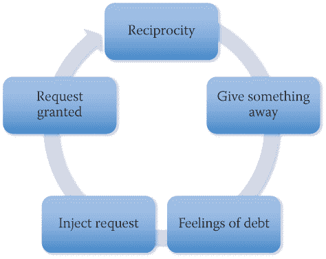

**图 6-1** 互惠在行动中

互惠只有在遵循这条路径时才有效。你不能过早地插入命令或请求。只有在你创造了那些债务感之后才能提出请求，因为那些债务感会增加请求被接受的机会。

### 作为社会工程师使用互惠

你可能脑子里已经有五百万个如何使用互惠原则的想法。让我只给你一个快速提示：你可以提出的请求的级别取决于接收者对礼物的感知价值。

花点时间理解这一点。记住，西奥迪尼说，无论那个人是否想要礼物，目标都会觉得应该回报。如果收件人重视礼物，他或她会感到更有义务回赠价值相等或更高的礼物。

我是一个由黑客和威士忌爱好者组成的小团体的一员。当我们聚会时，有时会交换威士忌瓶。我们每个人都给其他人带点东西，所以每个人都带着不同于别人的东西回家。通常，我们会设定一个主题，这样就不会有人带价值一百美元的东西，而另一个人带价值高得多的东西。这使得互惠原则保持在控制之中，没有人觉得欠得更少或更多。

作为社会工程师，首先找出目标人或公司重视什么是至关重要的。你需要记住这一点来准备你的借口。当你向目标提供获得有价值之物的机会时，你更有可能成功。


例如，在前面提到的那个任务中，`OpRentalCar`，我很快发现目标非常喜欢 Tony's Pizza。掌握了这一点后，我提出用免费食物来交换他的绝妙想法。我没有说：“如果你给我 `[the customer's]` 地址，我就给你披萨。”为什么不这样做呢？

原因很简单：此时，我们还没有建立起良好的关系。在与目标建立关系之前就要求提供客户地址之类的东西，会让目标竖起所有防御力场，开启高级护盾，并启动红色警报。

通过提出免费食物的提议，然后插入我真正想要的东西，我让目标“想出”了我需要的确切想法。

我还用过这个原则的另一个例子：我需要对一位首席执行官进行鱼叉式网络钓鱼攻击。在 `OSINT` 阶段，我发现他是一名热衷跑步的人，喜欢跑马拉松。之所以发现这一点，是因为他在跑马拉松时拍了大量自拍照。

我的鱼叉式网络钓鱼邮件来自一家营销公司，关于首席执行官最近参加的一场马拉松。消息大致是这样的：“在您最近参加的‘为儿童奔跑’马拉松中，我们拍摄了一些照片，希望用于营销和推广。我们需要您批准使用这些照片。请点击此处查看照片并批准。”如果我没记错的话，首席执行官在收到邮件后不到 60 分钟就点击了链接。

当你发现一个人真正看重什么时，目标会几乎不加思考地批准你提出的请求。

## 原则二：义务

义务与互惠听起来非常相似，但有一个细微的区别。互惠是由于礼物或有价值的东西而产生的欠债感，从而促使行动；而义务也是同样的感觉，但它基于社会规范或预期行为。

### 义务在行动中

我曾向来自世界各地的学生提出过以下问题：如果你在交通中，允许另一位司机插入你前面，他或她有义务做什么？他或她 `必须` 做什么？

学生回答说，司机必须挥手、竖起手指或点头致意，但所有这些手势都意味着一件事：司机必须（或有义务）对你刚刚表现出的善意表示一定程度的尊重和感激。如果他们不这样做会怎样？

我曾在华盛顿特区，在一条美丽的四车道高速公路上开车去开会，交通被迫合并到一条车道。交通几乎陷入停滞。我决心不让这件事影响到我，于是一边慢慢前行一边调大了音乐。其他汽车正试图从匝道并入高速公路，而我的同车司机们并不觉得太利他。他们不让别人并入。于是，我减速并闪烁车灯，让等待并入的下一位司机进来。

当他驶入我前面时，我透过他的后窗寻找他应有的点头、挥手或感激的眼神，看向后视镜。当我没有得到时，我感到血压开始上升。我的脸变红了，驾驶变得更加激进。我开始想：“难怪每个人都对你态度恶劣，不让你进来！”——仿佛其他司机有某种第六感，能看出这位司机会不感激。

我为眼前这个傲慢的废物编造了整个故事线。几英里后，当其他车道打开时，我决心踩下油门，超过那位粗鲁的司机，让他知道谁才是道路的主人。

我把油门踩到底，我的超级增压跑车的六个气缸全部启动。当我靠近另一位司机的车窗时，我带着厌恶向他看去，看到了……他只有一只手臂。说说从愤怒到谦卑，只用了一秒钟。我迅速微笑并挥手，同时点头致意。

我告诉你这个极其丢脸的故事，想说明什么？当我觉得那人没有履行感谢我的义务时，我非常愤怒。只有当我看到他有不挥手的正当理由时，我才意识到自己判断失误。

下次你与某人交谈时，试试这个。当对方问你一个好问题时，不要回答或回应他们。只是盯着他们看。如果他们问你是否没事，就说：“嗯。”

我可以想象，当你想象这种情景时，你们大多数人现在都在发出紧张的奇怪笑声或微笑。为什么？想到不履行回答问题的义务，感觉很尴尬。

义务是强大的，尤其是当它们与社会规范相关时。`Figure 6-2` 说明了义务的循环。

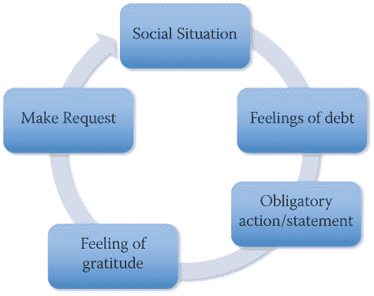

`Figure 6-2` 义务在行动中

作为社会工程师，你希望利用这些预期的反应。每当你不这样做时，你就会降低建立关系的机会，因为目标会想知道你为什么不表现得“正常”。

### 作为社会工程师利用义务

社会工程师利用社会情境，让目标始终产生一种必须以某种方式行动的义务感。例如，不为女人或搬运箱子或其他货物的人扶门被认为是失礼的，社会工程师利用这一习俗来为自己谋利。

有一次工作，我装了一箱沉重的手机和电脑配件。我在午餐高峰期等待，朝着我应该进入的地方的大门走去。当我走近时，一位好心人说：“哦，让我来给你开门。”

当我走进大楼时，一位非常严厉的同事说：“你应该在让他进去之前先看他的徽章！”

我说：“他说得完全对。嘿，这箱子很重——我的徽章在前口袋里，如果你想拿出来的话。”我把臀部靠向那个严厉的人。

他很快厉声说：“我才不会把手伸进你的前口袋呢，老兄！”

“天哪！我怎么这么糊涂？”我尴尬地说。“这 `真` 尴尬。这箱子大约重 45 磅——你想拿着它，而我去拿徽章吗？”

“走吧，老兄——我没时间跟你废话！”那人喊道，然后走了出去。

门之所以被扶住，是出于义务。我利用那个严厉的人所说的政策……假装出于义务伸出我的“口袋”。那人觉得伸手进我的口袋很尴尬，于是出于义务让我未经验证就进去了。

这个场景对我不止一次有效。那就是，直到有一天，我遇到一位员工说：“在这个口袋里？”同时伸手向我的前右口袋。

我说：“哦，也许是另一个。你可以两个都试试。”我希望这种尴尬的局面会让她退缩，但没有。她伸手进我的口袋摸索了一番，顺便说一句，这对 `我` 来说也非常尴尬！

在第一个口袋里只找到我的钥匙后，那位女士说：“把另一边给我。”在那个口袋里，她找到了我的钱包和一把刀。她看着我说：“会不会在你的钱包里？”

我说：“我不确定——也许吧，”尽管我很清楚钱包里没有。她打开钱包，最前面是我幼小女儿的照片。那位女士看到照片，喊道：“哦我的 `上帝`，她太可爱了！她叫什么名字？”

然后，我们进行了大约 15 分钟关于我家人的谈话，期间她拿着我的钱包、刀和钥匙，而我拿着这个沉重得愚蠢的箱子。大约 15 分钟后，她把所有东西都放回一个口袋，说：“好吧，你最好向安保报告丢失徽章，以免惹上麻烦。办公室见。”说完，她放我走了。我们建立了关系和友谊，她现在有义务信任我了。

义务是一个强大的原则，可以让做社会工程师变得容易得多。

## 原则三：让步

《牛津英语词典》对 `concede` 一词的定义如下：“在最初否认或抵制之后，承认或同意某事是真的。”


记住，影响力的定义就是：如果一个人觉得某个想法是他自己的，那么这个人很可能会认为这是个好主意！让步将有助于目标将其变成“他们的想法”，从而采取你希望他们采取的行动。

### 让步在行动中

在我居住的地区，美国防止虐待动物协会（ASPCA）非常擅长利用让步来促使人们捐款。一次募捐电话大概是这样的：

| **来电者：** || 早上好，Hadnagy 先生。我是 Carrie，代表蒙特罗斯的动物爱好者致电。您的狗狗近况如何？ |

| --- | --- |

| **我：** || *\[回复并意识到自己在谈论与自己相关的事情并微笑——天哪，我怎么停下来？\]:* 它很好。不过年纪大了。 |

| **来电者：** || 很高兴它状况良好。能和一位动物爱好者聊天也很棒。作为一名动物爱好者，我今天需要你的帮助。如你所知，我们需要帮助来照顾我们地区所有的流浪动物。我们希望每只动物都能像你的狗一样拥有一个充满爱的家。你今天能帮助我们吗？ |

| **我：** || *\[心想，仿佛无法阻止即将发生的灾难\]:* 好吧，我确实喜欢动物。你需要什么帮助？ |

| **来电者：** || *\[语气清晰且毫不犹豫地说道\]:* 我们今天在寻求资金援助，许多人都在捐赠约 250 美元来帮助我们。 |

| **我：** || *\[感到得意，因为我要拒绝她了\]:* 250 美元？！哇，对不起。我就是没有那么多钱。我很乐意帮忙，但我现在就是做不到。 |

| **来电者：** || 哦，我理解。现在是艰难的时期，那 *确实* 是一大笔钱。那如果你今天只帮我们 25 美元，怎么样？ |

还没等我反应过来，我就掏出了信用卡。让我们看看发生了什么。我同意了，或者说让步了，几件事：

*   我是一位动物爱好者。

*   我想帮忙。

*   我愿意帮忙，但第一个价格太高了。

当对方提出一个替代方案时，我无法拒绝。如果来电者一开始就开价 25 美元会怎样？捐款可能会停留在更低的金额，但通过一开始就开出一个更高的价格，她几乎保证了能获得更多的捐款。

执法审讯员经常使用这种策略。如果他们能让罪犯承认哪怕是一个细微的细节，让步于一个事实，那么这个人几乎不可能反悔他或她说过的话。

看看这两种替代方案。侦探可以问：“抢劫发生时晚上 11 点你在李的酒吧吗？”罪犯可以轻易地回答：“不，我从没去过。”或者侦探可以问：“那么，晚上 11 点，在李的酒吧抢劫发生时，你看到了什么？”罪犯可能会回答：“嗯，我什么也没看见。当时很暗。”有了这种回答，审讯员就知道被询问的人在晚上 11 点确实在李的酒吧。罪犯做出了让步！通过回答这个问题，那个人承认了，或者说让步于，那个未被问及的问题，即他是否曾在酒吧。

Figure 6-3 展示了让步循环的示意图。

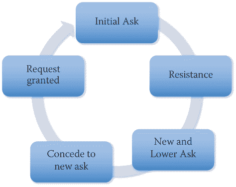

**Figure 6-3** 让步在行动中

### 作为社会工程师使用让步

在一次钓鱼攻击任务中，我们的任务是获取员工的全名、员工 ID 和社会安全号码（政府 ID）作为旗帜。我们制定了两个我认为很稳妥的借口，然后开始给目标打电话。

电话大概是这样的：

| **我：** || 你好，我是 IT 部门的 Paul。你是 Sally Davis 吗？ |

| --- | --- |

| **目标：** || 是的。有什么我可以帮你的吗，Paul？ |

| **我：** || 好吧，昨晚我们在为 RFID 徽章系统刷写固件 BIOS 时，丢失了一些记录。你今天早上使用徽章时遇到任何问题了吗？ |

| **目标：** || 没有，它让我顺利进去了。 |

| **我：** || 这是个好消息。好吧，你很幸运。许多被标记的账户在进入和使用打印机时遇到了问题。我需要验证你账户的一些详细信息，这样你就不会遇到任何问题。大约需要 30 秒，好吗？ |

| **目标：** || 当然，你需要什么？ |

| **我：** || 只需要你的全名、员工 ID 和社会安全号码。 |

| **目标：** || 呃，嗯……那可是很多非常敏感的信息。你叫什么来着？我要去查一下你。 |

许多电话都遵循这个模式，我们惨遭失败。于是，我坐下来思考影响力的原则，并对借口做了一处改变。下面的对话紧接着目标告诉我她今天早上顺利进入了系统。

| **目标：** || 不，它让我顺利进去了。 |

| --- | --- |

| **我：** || 这是个好消息。好吧，你很幸运。许多被标记的账户在进入和使用打印机时遇到了问题。我需要验证你账户的一些详细信息，这样你就不会遇到任何问题。大约需要 30 秒，好吗？ |

| **目标：** || 当然，你需要什么？ |

| **我：** || 首先，我要确保你的名字拼写正确。我这里你的名是 S-A-L-L-Y…… |

| **目标：** || 不对，那是个问题。没有 *E*，只有两个 L。 |

| **我：** || 天哪，我真高兴给你打了电话。你为什么不直接拼一下你的姓，这样我就能拼对了？ |

从那之后，我会接着询问部门，确认电子邮件地址，等我们谈到员工 ID 和社会安全号码时，我们打电话的人已经让步于交出所有这些信息并继续下去了。这使得我们在那次任务中取得了 84% 的成功率——仅仅是通过做这一处改变。

作为一名社会工程师，请记住，你不需要立刻去争取你需要的确切旗帜。先获取一些次要的，以帮助建立那些会导致对方让步并服从的感觉。

## 原则四：稀缺性

“倒闭大甩卖！”

“历史上最低的价格！”

“地球上只剩下 10 个！”

为什么这些话对我们有效？如果某样东西变得稀缺，或者不那么容易获得，它的价值就会增加。当有 20 个纸杯蛋糕时，它有多有价值？现在，最后一个纸杯蛋糕有多有价值？

### 稀缺性在行动中

在一次 DEF CON 比赛中，我有个绝妙的主意：买一把发射海绵飞镖的步枪，并雇佣一名“狙击手”去射击我们每年举办的 SECTF4Kids（社会工程夺旗赛 4 儿童）比赛中的孩子。参赛者需要解开一个谜题，然后将一根管子插入房间后部的一个盒子里，盒子里有一个正在射击孩子的狙击手。如果参赛者被击中，那个人就必须回到房间外面重新开始。

我买的步枪是 Nerf CS6 Long Shot。从我购买它到 DEF CON 后的几个月内，Nerf 宣布不再生产该型号。他们正在用许多人认为更劣质的型号来替代它。

我不需要两把步枪，所以我把其中一把放在 eBay 上，标价 99 美元，也就是我买它的价格。第一天，出价达到了 199 美元，然后是 250 美元，然后是 299 美元，然后是 340 美元。最终售价是 410 美元！410 美元买一把能发射海绵飞镖 50 英尺的塑料步枪！（诚然，它带有瞄准镜和四个弹夹，我们还做了一些改装，但即便如此……）

我可以用 410 美元买一把真正的步枪，为什么一把塑料步枪能卖出这么高的价格？稀缺性。因为该型号步枪已停产并且现在独一无二，所以变得极其有价值。

公司经常让产品、食品、药品、时间、珠宝以及任何有价值的东西变得稀缺，以帮助提高消费者眼中的价值。Figure 6-4 展示了稀缺性的连续体。

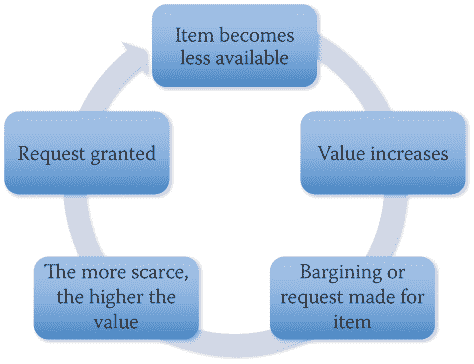

**Figure 6-4** 稀缺性在行动中

### 作为社会工程师使用稀缺性


# 在一次任务中，我们的 OSINT 找到了 CEO 的社交媒体账号

在一次任务中，我们的 OSINT 找到了 CEO 的社交媒体账号，他在上面发布了关于他三年来第一次真正度假的所有内容。他正带着全家去巴哈马。他有打包行李的照片、去机场的路上的照片、家人在飞机上的照片，还有一张写着“两周天堂生活现在开始”的照片。

掌握了这些知识，以及我们从垃圾桶搜集中获得的他公司 IT 支持公司的名称后，我走进前门，接近了守门人简。我们的对话大概是这样的：

| **Jane:** || 有什么我可以帮您的吗？ |

| --- | --- |

| **Me:** || 您好。我是 XYZ 公司的保罗。杰夫让我过来处理……*\[低头看着我的剪贴板，翻阅文件，仿佛在寻找什么\]*……他桌面电脑的卡顿问题。他以为是病毒。 |

| **Jane:** || *\[看着她的日程本\]*：保罗，我这里没有杰夫关于这个预约的记录。对不起，但您得改天再来。 |

| **Me:** || 听着，简。我也不知道该怎么说。杰夫打电话说他要去巴哈马两周，要在他回来之前把这个修好，否则他会很生气的。我不得不把另外四个预约都挪掉才能今天来。而且接下来一个月我都没空了。*\[我停顿了一秒。\]* 我想那也行。我会给杰夫发邮件，告诉他忘了通知你，现在他得再等四个星期才能修好。 |

| **Me:** || *\[不停顿地把剪贴板转向简\]*：请在这里签字，确认我告诉您接下来四个星期我们没有空档，谢谢。 |

| **Jane:** || *\[看着我停顿了一秒\]*：嗯，他一直在抱怨电脑很慢。我不想告诉他你要四个星期才能再来。走吧，我让你进去。 |

就这样，我在没有监督的情况下进入了 CEO 的办公室，并威胁到了大楼里的一切。

通过让我的时间变得稀缺，我提高了立即占用这个时间段的价值和重要性。稀缺性让简认为，拒绝我可能会在未来造成更大的问题。这导致了公司的完全被攻破。

作为一名社会工程师，你可以将稀缺性应用于时间、信息，甚至你在借口中提供的东西。稀缺性会让你拥有的东西更有价值，并影响目标基于这种感知价值做出决策。

# 原则五：权威

当拥有正确类型权威的人发表某些言论时，其他人会非常认真地对待。以下是一些示例：

*   如果一个穿着白大褂或医生手术服的人说，“脱下你的裤子，”你会听。

*   如果父母、老师或狱警说，“别碰那个！”你会听。

*   如果你的教官或指挥官说，“趴下，给我做 20 个！”你肯定会听。

所有这些人都有一个共同点：他们对你拥有权威。但什么表明权威？当你走进一个房间，你如何判断哪个人拥有权威？

看看 图 6-5 和 图 6-6 中的本。你认为本在哪张照片中展示了权威，你认为为什么？


**图 6-5** 他的面部和肢体语言告诉你什么？


**图 6-6** 自信的迹象是什么？

你可能认为 图 6-6 中的本展示了权威和自信。在两张照片中，本穿着同样的衣服，年龄相同，发型也一样。他在两张照片中是同一个人。但在 图 6-6 中，他挺胸站立，双手交握，下巴抬起，脸上完全没有恐惧的表情。所有这些都指向一个自信的人，而自信让我们将此人视为权威人物。事实上，当我问我的学生什么对他们来说表明权威时，他们列举了自信、大声的嗓音、挺胸、抬头、整洁的衣服、直接的个性以及其他类似的特征。

权威对我们有什么影响？它让我们对某人所说的话产生信任，而该人不需要证明我们为什么应该服从他们。

## 权威在行动中

关于这个主题最具影响力的研究之一是由斯坦利·米尔格拉姆博士进行的。1963 年，米尔格拉姆博士审查了他在纽伦堡审判中听到的关于战争暴行的理由。在那些审判中，使用的辩护是，“我只是服从命令。”在题为《服从的行为研究》(`www.birdvilleschools.net/cms/lib/TX01000797/Centricity/Domain/1013/AP%20Psychology/milgram.pdf`) 的研究中，米尔格拉姆博士概述了他的发现。

米尔格拉姆博士想要考察，守法的普通公民是否可能通过权威被胁迫，采取可能导致他人受伤或死亡的行动。当然，进行这种类型的研究会有巨大的局限性。你如何证明 X 个数量的人会或不会服从一个告诉他们伤害他人的权威人物？

随机公民自愿参加米尔格拉姆博士的研究。为了让实验有效，他们被告知会有学习者和教师，且分配是随机的，但实际上，所有志愿者都被指定为教师。

志愿者们看着学习者被绑在椅子上，电极被连接到他们身上。志愿者们被告知，问题答错会导致学习者受到电击。学习者从未真正受到电击——他们只是假装电击很疼。

教师（志愿者）被展示了一个大盒子，上面有拨动开关，电压从 15 伏到 450 伏，每次增加 15 伏。志愿者们甚至只受到了 45 伏的电击，所以他们有证据证明这是真实的。

然后，一个穿着白大褂的人（权威）坐下来监督教师提问。随着学习者答错问题，他们受到的惩罚电压越来越高。

如果教师因为听到学习者受苦而反对，穿白大褂的人被指示只说下面两句话之一：

*   “实验必须继续，请继续。”

*   “没有永久性组织损伤。请继续。”

这听起来不太有说服力，对吧？但这项研究表明，65% 的所有教师都让学习者承受了 450 伏的电压！

让这个消息沉淀一下。教师们是普通的工薪阶层人士。他们不是从某个施虐反社会者群体中抽取的。然而，根据米尔格拉姆博士的研究，40 名志愿者中有 26 名（65%）继续将电压提高到 450 伏，因为一个权威人物告诉他们继续。

图 6-7 说明了权威的循环。

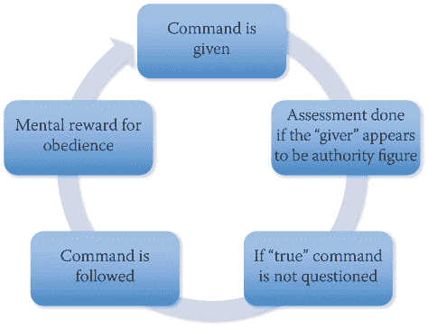

**图 6-7** 权威在行动中

## 作为社会工程师使用权威

我一直在直接在我的社会工程学借口中使用权威方面遇到问题。主要原因是我通常没有正确的知识，这意味着我会卡住并被抓住。

然而，有时暗示的权威或权威的转移就足够了。在一次任务中，我找到了一个针对目标财务委员会会议的在线邀请。它碰巧在我们的工作范围内，所以我决定使用它。我们对所有被邀请参加会议的成员进行了 OSINT，并发现了一位似乎是权威人物的女性。除了在社交媒体上看起来和听起来像权威人物之外，在流行的员工评级网站上，她在几条评论中被提到很难共事。


所以，我拿了我伴侣的手机号码，并把我手机里的名字改成了这个女人的名字。（我们叫她萨莉·史密斯。）我告诉我的伴侣，“当你看到我和保安争吵的时候，给我发这条短信：‘你他妈在哪儿？我们已经等了 15 分钟了！马上回来！’”

我抓了一大把文件夹和文件，试图直接走过保安那里。我知道我会被拦住，因为我们已经确定保安非常严密。过程是这样的：

*   保安生气地说道，“先生，请停下！你要去哪里？！站住！”

*   我停下脚步，转过身，带着震惊的表情说道，“什么？你没看见我刚才从你身边走过去去停车场吗？我正在 14 楼的财务董事会开会。我得马上走。”

*   “对不起，先生，但我没看见你走过去。请出示您的证件，”保安说道，语气中带着困惑。

*   我长长地叹了口气，“好吧，但等我到了上面，我会把你的名字告诉萨莉，并解释我为什么耽误了。”我开始拍拍口袋，然后说道，“我不知道，我一定把它落在……”这时我的短信通知响了。

*   我掏出手机转向他。短信屏幕顶部显示的名字是“萨莉·史密斯”，下面的消息写着，“你他妈在哪儿？我们已经等了 15 分钟了！马上回来！”

*   我说道，“你想给她打电话告诉她我为什么被拦住，而整个董事会房间都在等这些文件吗？还是由我告诉她拦住我的保安的名字？”

*   他读了短信，然后看着我说道，“非常抱歉，先生。我真的没看见你走过去。请，如果我们可以就此作罢——请直接去开会吧。”

*   “如果你现在就让我进去，我们就可以忘记这件事。”说完，我就进入了堡垒，自由自在地走动。

权威，即使不是直接来自于我，也让那个保安采取了一项不符合他自身利益的行动。权威是一种强大的动力！

## 原则六：一致性与承诺

我们都希望显得一致，这意味着我们希望自己所说的话与自己认为所表现出的形象保持一致。这一点在我们承诺某件事时尤其明显。你有没有见过一个小孩子承诺一个你知道是错误的答案？（“不，我没有打碎那盏灯！”）即使你提供了压倒性的证据证明他们在撒谎，孩子也会坚持与他们最初回答一致的答案。

为什么一致性对我们很重要？我们希望——也许我们甚至需要——显得自己是一致的，因为一致性是自信和力量的标志。

### 一致性与承诺的实际应用

我住在一个相当偏远的地区，但最近地下发现了大量石油和天然气。现在他们正在整个县进行水力压裂、抽采和挖掘。结果，我的路上有很多卡车。

我看到一辆载满设备的卡车以每小时 50 或 60 英里的速度飞驰过我的道路。司机们粗心大意，危险重重。我的一些邻居开始在院子里放手绘的标志，告诉司机减速、注意安全，并像社区里住着他们的孩子一样开车。如果我的邻居来找我，要求在我院子里放一个这样的大标志，它会挡住我妻子美丽的花朵或我酷炫的汽车，我会拒绝，尽管我希望司机们减速。

1966 年，研究人员乔纳森·L·弗里德曼和斯科特·C·弗雷泽研究了“一致性与承诺”，并在《不施压的顺从：门中脚技巧》（《人格与社会心理学杂志》，1966 年 9 月，`www.researchgate.net/publication/17217362_Compliance_Without_Pressure_The_Foot-in-the-Door_Technique`）中撰文介绍。他们挨家挨户地走访，要求一个社区的人在院子里放置带有驾驶员安全警告的、字迹潦草的大标志。这些标志会挡住房屋的一部分视野。研究人员发现，83%的房主都拒绝在院子里放置标志。

然后，弗里德曼和弗雷泽在下一个社区对他们的请求做了一处改变，结果获得了 76%的顺从率！你没听错，76%的人说是的！那是什么改变？更好的字体？漂亮的标志？支付标志费用？租用空间？

不，不，不，不。改变的是标志的尺寸。在第二个社区，他们先要求房主在窗户上展示一个 3 英寸的贴纸，上面写着同样的信息。然后几周后，他们又回来要求房主在院子里展示那个又大又丑的标志，结果 76%的人顺从了。

弗里德曼和弗雷泽称这种方法为“门中脚技巧”。一旦他们把脚伸进了门缝（窗户上的小贴纸），房主就更愿意顺从未来的请求（院子里的大标志）。

自从弗里德曼和弗雷泽的研究以来，已经进行了大量研究，所有研究都得到了同样惊人的结果。当一个人先同意了某件小事时，顺从率会急剧增加。

当你将顺从与一致性原则结合起来时，这就是一种不可阻挡的力量。基本上，我们希望自己保持一致，并显得一致。我们的大脑不喜欢内心产生争论。所以，即使我们知道自己错了，如果我们已经承诺并希望保持一致，我们也会坚持己见，不肯改变。这一点在 图 6-8. 中有所体现。

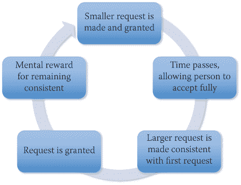

**图 6-8** 承诺与一致性的实际应用

### 作为社会工程师使用承诺与一致性

我的个人准则之一是：除非万不得已，否则绝不打破预设。必须出现相当严重的情况才能打破预设。这个准则源于我即将告诉你的故事。

我承担了一项多阶段的工作，需要进入一组上锁区域内的垃圾箱。这些垃圾箱是公司丢弃技术设备的地方。

要到达垃圾箱，我需要绕过安保，进入校园内的安全区域，在不被拦截的情况下进入，并且在寻找有价值物品时不受打扰。

我开始进行 OSINT 阶段，目标是找到垃圾箱公司。目标公司对向任何供应商提供任何信息都有严格的规定，但我决定打电话给财务部，看看能否套话套到那个信息。通话大致如下：

| **公司代表：** || 您好，我是贝丝。有什么我可以帮您的？ |

| --- | --- |

| **我：** || 贝丝，我是专业垃圾箱公司的保罗。我们刚来这个地区不久，正在努力争取更多本地业务。我想知道能否给您发一份快速报价？ |

| **公司代表：** || 您好，保罗。我们接受新供应商的报价。只需发送每单位成本给我们，如果价格匹配，我们会索取更多信息。 |

| **我：** || 好的，太好了。请问能给我您的电子邮件地址以便发送吗？ |

| **公司代表：** || 嗯，您不会发给我。您应该发送到 vendors@company.com。 |

| **我：** || 哦，我明白了。有没有办法可以抄送给您，这样我知道邮件已经送达了。我遇到过一些严重的问题，有人说我的报价从未送达。我是这个行业的新手，不太懂技术。 |

| **公司代表：** || 哦，好的。是 beth.p@company.com。 |

| **我：** || 贝丝，你真是救命恩人。听着，我能信任你一件比较私人的事情吗？ |

| **公司代表：** || 嗯，当然，我想可以。 |

| **我：** || 我卖过几乎天底下所有的东西，但垃圾箱对我来说是个新行当，我觉得自己做得不太好。甚至不确定我们的价格是否有竞争力。 |


| **Company rep:** || 很抱歉，Paul。这一定很难。你知道……。把提案发过来，我会亲自确保它得到审查。 |

| **Me:** || Beth，你真是救星。我知道这么问不太合适，但你能不能告诉我我要对抗的是谁？*\[看，到现在她已经承诺帮助我，给了我她的电子邮件地址并进行了交谈。但建立的关系足以支持这个请求吗？\]* |

| **Company rep:** || Paul，嗯……*\[叹息并停顿\]* 我很乐意告诉你，但我们对此有规定。我不想惹上麻烦，但我真的希望我能告诉你。 |

| **Me:** || 没事，我明白，Beth。只是我现在真的很困难。这样吧——我就说几个名字，你听到正确的名字时就咳嗽一下：Superior Waste，Excellent Dumpster，Waste Management *\[Beth 咳嗽了\]*。Beth，希望你感觉好点——听起来你要感冒了！ |

| **Company rep:** || *\[轻笑\]：* 谢谢，我确实感觉自己快要生病了。祝你好运。 |

有了这些信息，我就能弄到合适的服装，进入安全地点，并找到一些未被损坏的硬盘和 USB 设备，如果这些设备落入错误的人手中，可能会导致全面的安全漏洞。

利用目标保持对其承诺（无论是身体上的还是心理上的）一致的心理，社会工程师可以更容易地让目标遵从他们提出的所有请求。

## 原则七：喜好

人们喜欢与自己相似的人。人们喜欢喜欢自己的人。虽然这两句话绕口令般拗口，但理解每句话的深层含义很重要。

在 第 5 章 “我知道如何让你喜欢我”中，我谈到了部落心态。现在考虑一下这句话：“人们喜欢与自己*相似*的人。”如果我们相似，处于同一个部落——感到舒适和熟悉——我们就会被喜欢、被接受和被信任。

现在，来回应第二句话，“人们喜欢喜欢自己的人”，让我提醒你我在 第 1 章 “职业社会工程学的*新*世界概览”中提到的 Zak 博士关于催产素的研究。这在这里完美适用。如果你喜欢某人，或者让某人感到被喜欢或被信任，那个人就忍不住会喜欢你。

在你说“好吧，这很简单”之前，让我给你几条基本规则：

*   **喜好必须是真诚的。** 你不能只是假装喜欢某人并希望这奏效。即使前几分钟有效，最终也会暴露出来或变得明显，即这种喜好并非真实，这可能会破坏信任和关系，无法修复。

*   **不要认为恭维就等于喜好。** 恭维要起作用，必须是真诚的，并且要符合你已经建立的关系水平。

*   非语言行为起着巨大作用。当你的非语言行为是真诚的（回顾我在 第 5 章 中关于适应性非语言行为的讨论），那么别人更容易信任你，与你感到舒适，因此喜欢你。

所有这些事情的共同主题是，你表达喜好必须是真诚的。我的朋友 Robin Dreeke 通过将每个人视为他或她自己的真人秀来做到这一点。他不必喜欢你的生活，或你所做的事情，但他有足够的兴趣想要找出剧情及其发展过程。这种想要找出的愿望是真诚的，而这种真诚会表现出来，从而使信任和关系得以建立，并使影响力更容易施加。

为了帮助鼓励这种感觉，你可以寻找给予恭维并镜像肢体语言和/或语言线索（而不只是机械模仿）的方式，以帮助对方对你产生温暖和亲切的感觉。图 6-9 说明了喜好原则的运作方式。

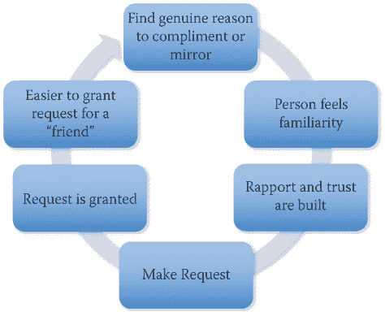

**Figure 6-9** Liking in action

### 作为社会工程师使用喜好原则

在一次任务中，我想尾随进入。当我走向正门时，我知道自己没有太多时间想出一个稳妥的计划。

一个男人正从他全新的起亚汽车旁下来，快步走向门口。我加快脚步，确保在我向另一个正走向门口的人问道：“嘿，你知道那是谁的起亚吗？”时，他能听到。我对话的那位女人转过头看着我，仿佛我疯了一样，但这没关系。这足以让车主放慢脚步并转过身来。

他看着我说：“是我的。有问题吗？”

我伸出手说：“我是人力资源部的 Paul。”我停顿了一下，祈祷他不是人力资源部的人，然后继续说：“抱歉，我是新来的。我和我妻子刚才刚在看那辆车。我很想听听你对它的看法。”

这就足够了。他想向我展示每个功能并谈论它。简要预览了汽车后，我说：“嘿，我要迟到开会了。你介意我们边走边谈吗？”

“一点也不介意，Paul。”我们开始走时，他告诉我保修、舒适度、油耗等等。他热爱他的车。

当我们走近前台时，我说：“你显然做出了最好的选择。你是怎么对汽车了解这么多的？”这句话不仅恭维了他的选择，还肯定了他的知识。他刷卡进门并为我扶住了门，甚至没有多想。

为了让保安看到，我掏出钱包，在门柱上的 RFID 感应区轻轻一触，然后自然地继续走。这个人在我引导他去人力资源部的过程中，跟我聊了 20 分钟他的起亚。到了那里，他说：“好了，我们到了——你的办公室。我的分机号是 4328。如果你需要更多信息，随时告诉我。”

我说：“好吧，我觉得我应该让你请我买那辆车——你太了解它了。我开完会后，下午 3 点左右可以给你打电话吗？”

“当然！没问题！到时候谈。”然后他拐过角落消失了。

我喜欢他喜欢的东西，也喜欢他渊博的知识。仅凭这两点，我就通过了安检，进入了大楼，并免除了所有安全检查。

喜好是一个强大的原则，作为专业社会工程师，它可以字面和比喻意义上为你打开许多门。如果你和我一样，最难的部分是学会足够感兴趣，让你的“喜好”看起来是真诚的。

## 原则八：社会认同

1969 年，Robert O'Connor 博士进行了一项名为“通过象征性建模修改社会退缩”的研究（《应用行为分析杂志》，1969 年，`www.ncbi.nlm.nih.gov/pmc/articles/PMC1311030`）。该研究的对象是患有社交焦虑并在学校退缩的年幼儿童。

儿童被分为两组。第 1 组观看了一段不包含任何社交互动的视频。第 2 组观看了一段持续约 23 分钟、涉及儿童非常社交并取得积极结果的视频。

第 1 组的儿童行为没有改变，而第 2 组的儿童在社交互动方面有显著改善。不仅如此，即使六周后医生回来观察儿童，第 2 组的儿童现在也在社交互动中处于领先地位。

医生能够通过使用一种称为*社会认同*的东西，改变一个可能终身走向社交退缩的道路。视频向第 2 组的儿童证明，更加社交是好、安全且甚至有益的。

### 社会认同的实际应用


有一档名为 *Candid Camera* 的精彩电视节目，他们在节目中进行了一场有趣的恶作剧，以展示社会认同对不同类型的人所产生的强大影响。他们会让三四个知晓恶作剧的人假装彼此不认识，进入电梯并转向电梯后方。那个不知情的人最终会转身以迎合人群。在一个案例中，他们甚至让一个年轻人做了一个完整的圆圈并摘下帽子，全都利用了社会认同。

我们每个人都想像其他人一样。你们中有些人可能会争辩说自己很独特，不属于任何群体，但这本身就是一个群体。

当我们迷失、困惑或不确定时，我们通常会观察他人的行为，以获取（社会认同）的线索，了解自己应该做什么。

Figure 6-10 说明了社会认同的循环。

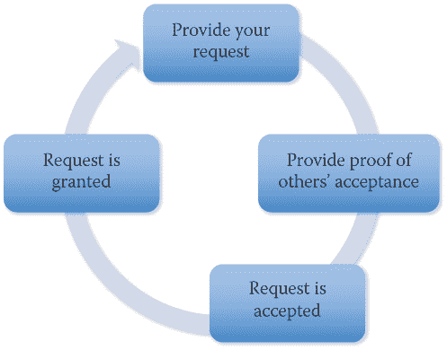

**Figure 6-10** Social proof in action

### 社会工程师如何利用社会认同

很多时候，人们不想成为第一个采取行动的人。然而，我发现利用社会认同可以让人们在做出不舒服的决定采取行动时感到安心。

在一个案例中，我需要进入一栋大楼的安全区域，于是我穿上了临时搭建的最好的电话技术人员服装。我没有直接进入目标的办公室，而是先去了隔壁的大楼。我进去后自我介绍说，我是来自 XYZ 电话公司的本地电话技术人员 Paul。我说我会在该区域进行维护，并留下了一张假名片。

我在目标两侧的商家都这样做了。然后我进入了目标办公室。我走到前台说：“我叫 Paul。我们正在经历电话线路波动，这导致该地区电话和互联网中断。我需要检查街区上的每一家公司，以确保系统设置没有问题。”前台的女士开始打断我，但我强行继续说下去，边说边低头看着我的剪贴板：“我刚和隔壁的 Beth 聊过，但他们的线路测试正常。我也对你这边的另一个邻居进行了测试，但 Fred 很高兴不是他们。所以，我想既然我已经在这儿了，就应该对你的系统进行测试，确保问题不在这里。”

现在，我不再看着她，而是决定在剪贴板订单表上为另外两家公司记下一些想象中的笔记。在稍微犹豫了一下之后，那位女士说：“哦，我打赌你让 Fred 开心了。他总是抱怨服务。”

就这样，我越过了前台，有人护送我去了服务器室。

我曾在调查、钓鱼邮件、语音钓鱼电话等方面使用过社会认同。在一次语音钓鱼活动中，我每次谈话都以简短的自我介绍开头，然后说：“我今天只剩下最后三个电话，然后就结束了。幸运的是，今天大多数人都非常友好。”然后我就直接进入我的问题。大多数时候，施加这种轻微的社会压力是有效的——部分原因是人们觉得自己不是第一个把所有信息都告诉我的人，感觉良好。社会认同是我使用过的最有力的影响力方面之一。

## 影响力 vs 操纵

当我讨论影响力的原则时，通常会出现这样一个问题：“你做的一些事情听起来相当具有操纵性，那么影响力和操纵难道不是一回事吗？”事实是，影响力和操纵是相似的，有时会被混淆。

让我非常明确地说：我在这里分享的是我对这个话题的观点。我绝不是说这是*唯一*的观点。事实上，当我们请 Cialdini 博士上播客时，我了解到他对这个话题的看法与我的观点截然不同。

我将影响力定义为“让某人想要做你希望他们做的事。”我将操纵定义为“让某人做你希望他们做的事。”区别在于，操纵通常不包括关心目标的感受。而影响力往往在主题上是积极的，操纵则不保持在这个边界内。

### 操纵在行动中

阐明影响力与操纵这一概念的最佳方式，是讲一个让我真正感到尴尬的故事，但这也是一个关键的转折点，因为它改变了我的生意。

当我开始专注于成为一名专业的社会工程师时，我陷入了这样一种想法：我必须总是获胜。除了 100% 获胜之外的任何结果都是失败，这是我深信不疑的。这种想法激励我，只要我“赢了”，就不太在乎客户或其员工的感受。

在一次工作中，我*没有*获胜。我正在输。目标没有点击任何钓鱼邮件。他们在语音钓鱼电话中常规地拒绝我。无论我如何标记我的 USB 密钥，它们都被交上去了，从未被插入过。两次尾随和使用重箱诡计都失败了。

我感到沮丧，也没有意识到这是一个告诉客户他们有多棒的好时机。相反，我被驱使着走向黑暗的一面。公司有一个室外的开放午餐区。我曾试图通过那些门进入内部，但无法越过那里的安保，但我可以自由进入午餐区。

借口是这样的：我是 Frank T.，一个新的人力资源项目负责人，负责收集医疗推广的信息。我的秘书 Marsha 是个单亲妈妈，心烦意乱。我站在一张坐满员工的桌子附近，Marsha 低着头走过来，把一叠空白文件递给我。我看着它们，用非常愤怒的语气说：“这是什么垃圾，你这个无用的……”我长长地叹了口气，说：“听着，如果一件简单的事你都搞不定，也许是时候找一份新工作来养活你和你的孩子了！我跟你完了！”

然后我把文件猛地拍在桌子上，离开 Marsha，把文件丢在了那里。Marsha 坐下来开始哭泣。

我看见一个家伙正朝我走来，但当他看到 Marsha 哭泣时，他转向她说：“你好吗？那是什么事？”

她抬头看着他，又害怕又紧张，回答说：“哦，我很抱歉。我不想在午餐时打扰你。你知道 Frank 是什么样的人。他压力很大。”

“Frank 谁？没有人有权这样对你说话。这太荒谬了。”他坐在她旁边。

“不，你不明白。他在家里有问题，他有截止日期要在今天结束前填完这些表格，我搞砸了，忘了。我本想在午餐时做，但他就对我发火了。我会被炒鱿鱼的。”

“他不应该这样跟你说话……这是……”

她打断了他，现在开始为她的施暴者辩护：“不，没关系。我活该。我本该在上周完成。是我的错。他其实是个好人，他冒风险雇用了我。”

“公平与否，把那些文件给我！”那个男人，她的救星，站起来走到每张桌子前说：“我们要在今天结束前完成这个，但我想在你们开始吃午饭之前完成。完成后，把文件交给这位好心的女士。”

他指着 Marsha，她现在正在微笑，感谢他救了她的工作，并对他如此友善。

当经理命令午餐室里的所有人都服从时，我们已经拿到了几十份表格，上面有全名、出生日期、网络 ID、社会安全号码、家庭住址、电子邮件地址、电话号码和其他个人身份信息。

当然，我赢了——但代价是什么？当人们发现这是个骗局时，你觉得会有教训可教吗？教训会是什么？不要表现得像个体面的人？不要有同理心？这不是一个好的教训。


因为我使用了操纵手段，在那家公司我永远被称为“虐待秘书的家伙”。我可以告诉你，不仅没有吸取任何教训，直到今天，我也没有再收到过那家公司的任何工作。

## 操纵的原则

虽然它们是负面的，但操纵确实有以下原则：

*   增加易感性
*   环境控制
*   强制重新评估
*   剥夺权力
*   惩罚
*   恐吓

仅凭名称就应该告诉你它们为什么如此负面，但有一项研究，我认为它概括了我不喜欢使用这些原则的原因。

1967 年，宾夕法尼亚大学的马丁·塞利格曼博士（Dr. Martin Seligman）和史蒂文·F·迈耶博士（Dr. Steven F. Maier）进行了一项研究，以确定这些原则中的一些是如何起作用的。他们使用狗作为测试对象，以观察它们如何接受不可控制的环境。塞利格曼博士和迈耶博士在一篇名为“习得性无助”（Learned Helplessness）的文章中撰写了结果（*Journal of Experimental Psychology*，1967 年 5 月，`http://homepages.gac.edu/~jwotton2/PSY225/seligman.pdf`）。

本质上，他们将狗拴在不同的阶段——要么独自在轭中，要么在一组中——然后用电击这些狗。在某些情况下，狗必须想出有一个面板，按下它可以停止疼痛。但在其他情况下，杠杆无法停止电击的疼痛，那些狗学会了没有什么能阻止惩罚——所以他们将其视为生活的一部分，躺在那里呜咽着，痛苦不堪，没有试图逃脱。

尽管阅读这项研究令人不安，但它对于理解操纵原则具有一个重要的方面。很多时候，受试者会接受他们所恐惧的、伤害他们的或他们知道是坏的东西，仅仅是因为他们看不到其他选择。恐惧和愤怒会覆盖大脑理性思考的能力，这使得决策只剩下情绪。作为一名专业的社交工程师，在大多数情况下，剥夺逻辑思考的选项也剥夺了教学时刻的可能性。在目标发现他们的恐惧被用作测试后，这会导致许多负面情绪，使得这个人不想向你学习。

### 作为社交工程师选择影响力或操纵

如果你想成为一名专业的社交工程师，你会希望确保你的客户在大多数情况下有机会从你的努力中学习。这意味着使用影响力而不是操纵。

但是，在你决定操纵永远无法使用之前，让我讲讲我使用操纵且毫无问题的几个案例。

在无辜生命基金会（Innocent Lives Foundation），我们有时需要使用操纵来实现我们的目标。当我们追捕儿童掠食者或犯下可怕罪行的人时，不管什么有效，我们就用什么。

我在处理国家级攻击时也会使用操纵。很多时候，当我的社交工程团队保护国家级资产或基础设施时，我们同时使用影响力和操纵，以确保测试所有方面。

我使用操纵的另一种情况是当客户要求时。通常，这发生在赌注非常高的时候，例如当客户是大型金融机构、国家级实体或基础设施支持组织，需要尽可能深入地进行测试时。有时客户说他们需要我的团队使用操纵而不是影响力，以真正测试协议。通常，在进行了多次测试后，我们需要将其提升到下一个层次时才会提出此请求。当我们进行这些额外测试时，我们仍然确保有一个学习教训。

例如，我们的一位客户需要我们测试他们非常坚韧且先进的电话支持代表。该公司保护的数据价值数百万美元，客户希望确保电话支持代表能够抵御来自现实世界攻击者的攻击。

在使用影响力测试他们几次后，我们决定将其提升到一个涉及我社交工程团队中两名女性特工的借口。

特工 1 致电该部门，要求提供一些信息以完成工资单，使用了一个非常可信的借口，过程如下：

| **社交工程特工 1：** || 您好，我是莎拉，来自 XYZ 公司。我的工资人员刚被解雇了，我今天必须完成工资单。我下周就要生第一个宝宝了，我需要在周末离开前完成这件事。 |

| --- | --- |

| **电话代表：** || 恭喜！太令人兴奋了！别担心——我可以帮您。我只需要验证您的身份，然后我就可以重置账户让您进入。 |

| **社交工程特工 1：** || 太好了，谢谢。哎哟！ |

| **电话代表：** || 莎拉，你还好吗？ |

| **社交工程特工 1：** || 我不知道。我刚刚感到一阵奇怪的疼痛。可能只是压力。好吧，我们快点办完，这样我就可以走了。你需要什么？ |

| **电话代表：** || 好的，我需要您的账户号码和身份验证 PIN 码。 |

| **社交工程特工 1：** || 先生，就像我说的，我刚刚解雇了我的工资人员，所以我没有那个 PIN 码。她重置了，我需要重新进入这个账户。 |

| **电话代表：** || 哦，莎拉，我很抱歉，但我……” |

| **社交工程特工 1：** || *\[正在临产并掉下电话：]* 天哪，天哪，我的羊水破了！ |

| **电话代表：** || 你还好吗？女士？你还好吗？ |

| **社交工程特工 1：** || *\[对着同事大喊：]* 你！过来接这个电话，和 *\[对着另一位同事：]* 你打 911！ |

| **社交工程特工 2：** || 您好，您是谁？ |

| **电话代表：** || 天哪。你好，我是 QRS 的史蒂夫。我刚才在帮莎拉处理工资账户，但我觉得她需要帮助。你应该过去。 |

| **社交工程特工 1：** || *\[背景中大喊：]* 如果你挂断电话，我就解雇你。拿到工资信息，否则下周就没人能拿到工资！ |

| **社交工程特工 2：** || *\[语气非常紧张：]* 哦，史蒂夫，我只需要进入账户，这样莎拉就会让我带她去医院。 |

令人惊讶的是，史蒂夫直接提供了账户号码和我们需要的所有信息。

富有创意？是的。操纵？绝对！但是该公司要求我们确定其代表能否抵御可能来自恶意黑客的现实世界攻击，我们有机会证明什么对这些代表有效，什么无效。

我没有提供一个详尽的列表，说明你可能何时被要求使用操纵，但我讨论了一些你需要考虑的事情，如果你要成为或目前是一名专业的社交工程师。你会使用操纵吗？如果会，你何时会使用？你会使用多少？

影响力和操纵的所有相同原则都适用于大多数非精神病患者，我们中没有人能花太多时间在黑暗面而不变得黑暗。不可能踩进泥里而不沾上一点泥。我觉得在无辜生命基金会使用操纵作为策略后，与我的团队交谈很有用，以确保他们感觉良好，没有受到太大伤害。基金会有心理学家在岗，以确保我们的人有一个安全健康的环境，可以卸下任何负面情绪带来的心理重量。

# 总结

如果你从本章中只带走一件重要的事情，让它是这个：你是人类（就像我也是人类）。影响力有效——简单明了。它对你的目标有效，也对你有效。无论你多么努力，都无法阻止它。

当正确使用时，影响力是有回报的，可以改变某人的行为和与你互动的方式。当你掌握将影响力与建立关系的技能相结合的能力时，你就真正变得无所不能。


People will *want* to tell you everything about themselves. They will *want* to trust you. They will *want* to be your friend and help you out. This is powerful, and if you're not careful, it can go to your head, and you can abuse this power.

Keep yourself in check by constantly reminding yourself of why you chose this career path. I constantly tell myself the following things:

*   I am doing this to ensure my clients maintain their security.
*   I am doing this because I am good at it.
*   I am doing this to help people learn about this dangerous vector.
*   I am doing this to provide for my family and those I employ.

These responsibilities play a huge part in being a *professional* social engineer. And thinking this way *influences* my decisions to benefit my clients, my employees, and myself.

The principles of influence and manipulation I discussed in this chapter are used every day by marketers, advertisers, salespeople, organizations looking for donations or recruits, and everyone in between. Why should we not use these same principles to help our clients understand how dangerous they can be in the hands of a skilled conman or social engineer?

Take time to read this chapter over a few times and pick one principle at a time to work on. Try using that principle at the office or with your family in a benign way. As you master its use, it will become part of your communication arsenal—another arrow in the quiver to make you an even better social engineer.

I have two more arrows to give you for your quiver. The next chapter will take the skills I've talked about in the last two chapters over the top: Framing and Elicitation.

# 7

## Building Your Artwork

> Art and science have their meeting point in method.

> —EARL EDWARD GEORGE BULWER-LYTTON

I decided to revert, momentarily, back to the art theme of my first book, *Social Engineering: The Art of Human Hacking* (Wiley, 2011), to clearly define why this chapter is so important. After you model your communications plan, build your pretext, master rapport and influence techniques, and are ready to go, you need to be able to put it all into action. That is where art meets the science of framing and elicitation.

As Earl Edward George Bulwer-Lytton, the 18th-century British politician and novelist, says, the *method* is where art and science meet and even cross over each other. This chapter discusses how, as a professional social engineer, you can artfully learn how to use elicitation and framing with scientifically accurate precision.

When I first started working in a kitchen, the head chef (my boss), handed me a bag of celery and said, “Julienne this bag.” Being very new at that job, I had no clue what he meant. After only a few seconds, which seemed like an eternity to me, he said, “You have no clue what I am talking about, do you?”

I gave one nod, and within 60 seconds, the chef had the bag opened and a pile of celery that looked just like Figure 7-1.


**Figure 7-1** Perfectly julienned celery

“Ah, thin-sliced into strips,” I said as if I was the smartest man alive. I started on my first stalk—nice and slow—while the chef observed. He said, “Good job; now I need two bags like that.”

Feeling confident, I tried to imitate his speed. For the sake of those with a weaker stomach, I will not post the picture of celery and finger mixed together on the table.

You're probably wondering what connection this story has to the subject of this chapter. Cooking is an art, but there is a science behind the way you use the tools—the way you wield the knife can make or break your abilities as a chef. Understanding the art of how to make food tasty is very important to a chef, and so is understanding how to prepare the food (usually minus finger parts) in a way that enhances the dish. Blending the art of food preparation and the science of putting it all together creates a perfectly balanced dish.

This chapter is designed to show you how to blend the art and science of framing and elicitation to bring the skills from the first six chapters to master level. If you apply what you learn in this chapter properly, you should be able to achieve at least one social engineering Michelin star.

## The Dynamic Rules of Framing

Think of your house or apartment and how it is shaped. When you look at it from the outside, does one room jut out farther than the others? Do you have an odd-shaped sun room, or is it just a square? How it looks—where the walls are, where the windows are placed, the location of the doors, and so on—is determined by how the house is framed out. In other words, what you see and perceive about your house is based on how the framing was done.

Framing in the sense of communications is not so different. I consider framing, or how someone views and reacts to a certain situation, as largely based on what that person has experienced or understood throughout their life. And those frames, or viewpoints, can be altered by life experience.

When I was 16 years old, surfing and skateboarding were the center of my life. In my opinion, there was nothing else worth living for. An example of how framing is so dynamic comes from this time in my life.

One day, a group of us loaded our surfboards onto the racks of two cars, piled in, and drove in the middle of the night from the west coast of Florida to the east coast. We had heard there was a storm coming and wanted to catch some of the great waves.

We arrived at about 5:00 a.m. The sun was due to rise in an hour and a half. We unloaded all our boards and waxed up. We still had about 30 minutes before the sun would be up enough for us to clearly see, but we were anxious and 16 years old, so we decided to paddle out in the dark to catch the first wave as soon as the sun had come up. We could hear waves crashing on shore, and we could also make out the silhouette of some really large wave sets in the distance.

One by one, the six of us ran into the waves and paddled to the lineup. We sat in the water, bobbing up and down and waiting for the sun to come up. Every few minutes, we could hear what sounded like a large shotgun blast.

We didn't think anything of it as the sound seemed pretty far off and didn't sound too ominous. I started to smell something pungent, so I looked at one of my friends and said, “Hey, is it red tide?”

Red tide is a time of year when there is a really bad algal bloom that kills fish and everything else—and the smell is pretty bad. But my friend said, “No, that's not yet, not sure what that is …”

It was only a few minutes later, the sun was clearly over the horizon, and we were seeing beautiful peeling wave sets ready for riding. We also saw a group of fishermen on a pier pretty close to us—chumming the waters for shark! The shotgun blasts we'd heard were from the fishermen dispatching the sharks as they reeled them in. So, my friends and I were sitting in pools of chum. We laughed about it with an almost idiotic sense of humor about how dangerous it was.

I looked down and saw a giant shadow under my board. I've never been a good gauge of size, so I can't tell you exactly how long it was, but I can say it was bigger than my board.

My friends and I laughed more, and we paddled out of the chum and caught a few great waves. At the age of 16, my frame of reference was all about the surf, and danger from sharks didn't mean much to me.


当我现在回想起那个情景，时隔近 30 年，我的参照框架无疑已经改变了。即使身处远离水域、鱼饵或冲浪板的地方，我依然充满恐惧。当我还是那个 16 岁的冲浪者时，我无忧无虑，危险生活是我生活的一部分。而现在，作为两个孩子的父亲、一位企业主，以及一个想要活下去的人，置身于充满鱼饵和鲨鱼出没的水域的想法让我充满了真正的恐惧。说到恐惧，我的意思是我想造一台时光机，回到过去揍自己一顿。

我的人生经历、年龄以及内在构成共同构成了参照框架。这一点至关重要，不容忽视。参照框架是动态的——而非静态的。

参照框架是我们大脑运作的一个特性。我们的头脑会对某事物的背景做出反应，而不仅仅是对事物本身做出反应。以下是一些示例：

*   月亮在地平线附近看起来比在正上方时更大。原因是我们的大脑会对物体的背景（位置）做出反应，尽管月亮在两个地方的大小是一样的。

*   我们不说杀死我们的狗；我们说让它们安乐死。这是我们用来帮助自己应对痛苦情况的一个框架。

*   1974 年，Elizabeth Loftus 在她进行的一项研究中展示了参照框架，方法是改变句子中的一个词。在向人们展示一段车祸视频后，她提出了以下两个问题之一：

    *   当汽车接触时，它们开得多快？

    *   当汽车碰撞时，它们开得多快？

    第一个问题总是引发比在第二个句子中使用单词 `crashed` 时更慢的速度反应。（你可以在 `www.simplypsychology.org/loftus-palmer.html` 上阅读这项研究。）

    在 David A. Snow、E. Burke Rochford Jr.、Steven K. Worden 和 Robert D. Benford 于 1986 年进行的一项题为“Frame Alignment Process, Micromobilization, and Movement Participation”的研究中（`www.jstor.org/stable/2095581?seq=1#page_scan_tab_contents`），研究人员定义了以下四个不同的参照框架方面。

*   Frame bridging

*   Frame amplification

*   Frame extension

*   Frame transformation

我希望你作为一名社会工程师思考 `frame bridging`。当你接近一家公司时，你看到一名保安。他的框架是阻止任何不属于这里的人进入。社会工程师的框架是进入大楼。

社会工程师走到保安面前说：“嘿，我需要进去偷点东西并制造一些混乱。”这行不通。即使你是专业人士和渗透测试人员，说：“看，我是专业人士，正在尝试帮助测试你们的公司以修补漏洞。让我进去，这样我就可以黑你们的服务器。”也不会奏效。

那么，什么能在你的框架和保安的框架之间架起桥梁呢？你能想到我在本书前面讨论过的什么东西能弥补这个差距吗？线索在 `Figure 7-2`。

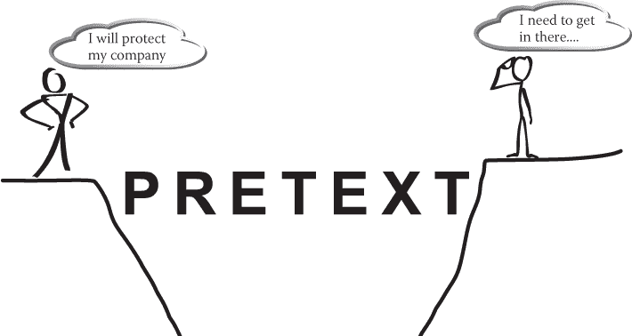

`Figure 7-2` The pretext bridges the framing gap.

借口弥补了差距，并帮助你改变目标的框架，使其更愿意接受你说和做的事。你在借口中投入的所有细节——你随身携带什么、你的外表等等——都使参照框架更容易，但还有更多。

2004 年，作者 George Lakoff 写了书 `Don't Think of an Elephant!`（Chelsea Green Publishing）。在这本书中，他定义了四条参照框架规则。无论你是否想掌握这门艺术，理解这四条规则都是必不可少的。我已将 Lakoff 的四条规则改编为适用于社会工程学。

### Rule 1: Everything You Say Evokes the Frame

要清晰地掌握这条规则，你需要了解我们的头脑如何将事物可视化为图像。伟大的教师和讲故事的人使用文字帮助你想象故事中的要点。以下是关于同一事件可以写出的两个不同故事的示例：

*   **Story 1** 当我坐在冲浪板上时，我看到一道巨大的浪向我袭来。我趴下划水，但浪打碎了，我发现自己在水下，想知道那条鲨鱼到底有多大。

*   **Story 2** 我望向地平线；太阳刚刚露出一点点。它的光芒不仅照亮了水面，还温暖了我的脸。我看到一道像货运列车一样向我袭来的浪。从浪的速度和厚度很容易看出它的力量。它泡沫般的浪头像愤怒的狮子一样向我袭来。

    我趴在冲浪板上，迅速把它转过来面向海岸。我用尽肩部肌肉的每一根纤维划水。虽然水是流动的，但我每划一次都感觉到水，就像在挖湿水泥一样。

    浪抓住了我的冲浪板，仿佛一股超自然的力量抓住了它。我从静止状态在几秒钟内变成了像过山车一样冲下去。我挣扎着想站起来，因为我的冲浪板摇晃并拍打着水面。当我转身时，我除了即将像愤怒的监工一样打在我脸上的浪浪尖外什么也没看到。

    浪将我卷过，我被迫进入水下，我所能做的就是开始想象那条像活导弹一样的鲨鱼向我袭来。我惊慌失措地挣扎着想浮出水面。当我浮出水面时，我紧紧抓住冲浪板，满脸惊恐地划向海岸。

两个故事都是关于同一事件，但哪个能让你在脑海中真正想象出来？哪个能让你感觉自己和我一起在那里？

答案很明显：Story 2。这就是为什么这条规则如此重要。有时我们日常词汇中选择的词语会创造出对目标具有冒犯性的心理图像。作为一名专业的社会工程师，我发现，如果我使用非冒犯性语言，不仅成功率更高，而且回头客更多，而不是使用可能冒犯他人的语言。

为了让本书保持 PG-13 级，我不会详细列举可能具有冒犯性的词语，但以下是一些你应该避免的事项的一般指导：

*   **Racial Slurs** 即使出于幽默，种族歧视言语也不好笑。不仅如此，它们通常被视为无知的标志。

*   **Gender- or Sexuality-based Slurs** 这些歧视言语与种族歧视言语效果相同——它们是无知的标志，并且对建立融洽关系具有破坏性。

*   **Curse Words** 我发现，即使我的目标使用粗俗语言，我也可以避免自己使用，以顾及那些无意中听到谈话的人。通常，通过不使用与目标相同的语言，我可以有效地改变他们使用该语言的方式。

*   **Bodily Functions** 这些词语会引发强烈的厌恶感，因此应避免使用。

想想你日常词汇中使用的词语，然后决定它们是否可能导致目标产生七种基本情绪之一：愤怒、惊讶、恐惧、厌恶、蔑视、悲伤或幸福。然后决定该情绪是积极的还是消极的。如果它可能在有害程度上是消极的，在使用该词语之前应谨慎行事。

### Rule 2: Words That Are Defined with the Frame Evoke the Frame

前天晚上，我走到门廊上，在灯旁的角落里，我看到一只生物在网中。它正在把一只昆虫包裹成茧，作为以后的食物。

我向你描述了什么？可能是你在 `Figure 7-3` 中看到的东西。


`Figure 7-3` In case you are still guessing, yes, it's a spider. ¶ PHOTO COURTESY OF ARTYANGEL, `https://pixabay.com/en/spider-fly-web-insect-2683918/`

关键是，我不需要使用单词 `spider` 就能让你想到 `spider`。我可以仅仅描述一只蜘蛛，你的大脑就会自动想象出它。


作为一名专业的社会工程师，我的借口会自动让你想到我声称自己来这里要做的工作。但我也可以通过描述一种情况来引出正确的情绪框架，而不是使用威胁。

在一个案例中，我向一位客户发送了一封钓鱼邮件，内容大致如下：

> *1 月 4 日，您的车辆被拍摄到闯红灯标记 XCV431。已开具罚单且未支付。未支付罚款可能会产生负面影响。*

> 

> *您可以在我们的安全门户网站上提交索赔或验证付款：* `www.pleaseclickthisnowsoicanhackyou.com`。

（是的，出于安全考虑，URL 已更改。）请注意，我不需要威胁逮捕。我不需要威胁高额罚款。我只是描绘了足够多的文字画面来激发好奇和恐惧的情绪，但随后又给了收件人希望，让他们觉得有脱身的办法。（而且，是的，他点击了。）

### 规则 3：否定框架

想象一下这个场景：我的学生被要求从一个人那里获取一些个人信息——仅仅是全名、出生日期和一些简要的背景。尽管学生紧张于被我观察，但谈话一开始进行得相当不错，一分钟后，听起来是这样的：

| **学生：** || 哇，谢谢你的帮助。我在想该买什么礼物给她，这是个好主意。*\[学生对一份为妻子生日准备的礼物想法应用了非常好的验证陈述。\]* |

| --- | --- |

| **目标：** || 是的，没问题。所以，我得……*\[她正要说“去”，但被学生打断了。\]* |

| **学生：** || *\[伸出手：\]* 我是汤姆，汤姆·史密斯。*\[他使用了很好的自然节奏来帮助引出目标的姓名。\]* |

| **目标：**[content]

作为一名专业的社会工程师，我的借口会自动让你想到我声称自己来这里要做的工作。但我也可以通过描述一种情况来引出正确的情绪框架，而不是使用威胁。

在一个案例中，我向一位客户发送了一封钓鱼邮件，内容大致如下：

> *1 月 4 日，您的车辆被拍摄到闯红灯标记 XCV431。已开具罚单且未支付。未支付罚款可能会产生负面影响。*

> 

> *您可以在我们的安全门户网站上提交索赔或验证付款：* `www.pleaseclickthisnowsoicanhackyou.com`。

（是的，出于安全考虑，URL 已更改。）请注意，我不需要威胁逮捕。我不需要威胁高额罚款。我只是描绘了足够多的文字画面来激发好奇和恐惧的情绪，但随后又给了收件人希望，让他们觉得有脱身的办法。（而且，是的，他点击了。）

### 规则 3：否定框架

想象一下这个场景：我的学生被要求从一个人那里获取一些个人信息——仅仅是全名、出生日期和一些简要的背景。尽管学生紧张于被我观察，但谈话一开始进行得相当不错，一分钟后，听起来是这样的：

| **学生：** || 哇，谢谢你的帮助。我在想该买什么礼物给她，这是个好主意。*\[学生对一份为妻子生日准备的礼物想法应用了非常好的验证陈述。\]* |

| --- | --- |

| **目标：** || 是的，没问题。所以，我得……*\[她正要说“去”，但被学生打断了。\]* |

| **学生：** || *\[伸出手：\]* 我是汤姆，汤姆·史密斯。*\[他使用了很好的自然节奏来帮助引出目标的姓名。\]* |

| **目标：** || 嗯，是的，很高兴认识你，汤姆。我是莎拉。 |

| **学生：** || 莎拉，很高兴认识你。你姓什么？ |

| **目标：** || 嗯，你为什么想知道这个？ |

| **学生：** || 哦，没什么。只是好奇。不管怎样，你过生日做什么？你是七月出生的吗？ |

| **目标：** || 嘿，汤姆，很高兴认识你，但我不确定是否想提供这些信息。对不起。 |

| **学生：** || 没问题，莎拉，我又不会 *黑* 你什么的！ |

说完最后这句话，目标字面意义上从我的学生身边往后靠，看了看手表，说她迟到了，然后离开了。

他做了什么？这就是我们所说的 *否定框架*，定义为提及你不希望目标思考的事情，本质上会导致他们思考那件事。

作为一名专业的社会工程师，当你与目标互动时，你不希望他们思考的一件事是什么？比如 *被黑客攻击*？！

如果你不希望他们思考它，那么就不要说类似这样的话：

*   “我不会用它来黑你！”

*   “我又不是想闯入！”

*   “我绝不会给你发钓鱼邮件。”

*   “我不是骗子！”

所有这些都是否定框架的例子。每当我们提及对立的框架，我们就否定了自己的框架。并且请记住 图 7-2 “我知道如何让你喜欢我”中，我谈到了自我悬置，而这个原则与之完全 *相反*。在这种情况下，你关注的是目标的自我，而不是思考你自己的自我。

什么是自我？《牛津英语词典》将其定义为“一个人对自尊或自负的感觉”。理解这一点很重要，因为当我们听到这个词时，可能会自动认为我们必须夸大目标的自我，但这不是我的意思。我的意思是，你必须 *诉求* 他们的自我。

诉求目标的自我需要注意以下三点：

*   你必须真诚。

*   你必须有适当的融洽关系。

*   你必须现实。

“假设我从未见过你，刚认识你，我走到你面前说，哇，你是我见过最有吸引力的人之一。”如果我然后试图与你开始一段对话，你可能会在想什么？可能是以下一种或多种想法：

*   “变态！”

*   “你想要什么？”

*   “嗯，什么骗局？”

*   “当然我是。现在走开！”


无论你当时怎么想，那种迎合自尊心的做法并非出于真诚、现实，也未达到我们建立的默契程度，因此不会带来良好的引出效果。

以下是一个发生在我妻子身上的真实故事，她是我见过的最出色的引出者之一。我们当时在纽约市。我带她和家人去看我过去常去的地方。某个时刻，我们在地铁上往上城方向开。如果你曾经坐过地铁，就会知道人们总是各自为政。人们并不粗鲁，但也不友好。每个人都有地方要去，要么压力大，要么很累。你各管各的，各忙各的。

我妻子坐在一位年长的非裔美国女性对面，那位女士看起来像是在下一站前补觉。我妻子探过身进入她的个人空间，拿起她的围巾摸了摸材质，说道：“哇，这真漂亮，而且非常柔软。可以问问你在哪里买的吗？”

现在我们身处纽约市的地铁上，我妻子越过了个人、种族和空间的边界——然而，这两个人却在几秒钟内成了挚友。为什么？那个迎合自尊心的点是什么？

我妻子不仅肯定了这位女性的服装选择，还请这位女性教她在哪里可以买到。这绝非骗局——我妻子是真心感兴趣，而这种真诚一目了然。

多亏了这一切，一场关于在哪里可以买到纽约市优质服装的 20 分钟对话随之展开。虽然我很恼火，因为意识到自己现在要花更多的钱，但我还是忍不住对妻子感到惊叹，并观察学习，看着她教我如何成为一名大师级引出者。

现在，你如何才能像 Areesa 一样成为大师？秘诀是什么？这里有几个提示：

*   她真的很喜欢人，并且对人感兴趣。

*   她的意图是利他的。

*   她很可爱，笑容很迷人。

但如果你不是一个像我妻子那样热爱人、友好、可爱、爱笑、娇小的亚裔女性，你该怎么办？

首先，练习观察一些关于人的事情——比如说你的家人。明天下班回家时，注意一些事情：你的女儿洗碗了吗？你的儿子倒垃圾了吗？他们的作业做完了吗？你的妻子也度过了漫长而紧张的一天吗？

试着简单地说些什么，比如：“哇，我注意到我回家时碗已经洗了。谢谢你。”或者：“嘿，亲爱的，你看起来超级累。你今天过得好吗？”

然后看看会发生什么。一个人的肢体语言会变得柔和。他们会敞开心扉，变得友好和健谈。为什么？你肯定了他们，并迎合了他们的自尊心。

在你的家人身上练习之后，把它带到家外，尝试对陌生人使用。这会困难得多。你必须在不令人不安的情况下进行观察，并带着`Chapter 5`中的所有经验进行接近。然后你开始迎合他们的自尊心。

想象这个场景：你在星巴克排队，站在目标人物后面。他是一位 34 岁的高个子男性。他穿着整洁，有一种预备校风但又书呆子的风格。你看到他掏出一台全新的`iPhone`，在上面打了一条短信。仅凭这些信息，你可以用什么样的迎合自尊心的话来开启一段对话？在继续阅读前，先思考一下。

我会尝试这样说：“对不起。我看见你有一部那种`iPhone`。我正在考虑换过去。你用起来喜欢吗？”

如果他刚花了`$1000`买了一部手机，那么他肯定会有自己的看法。无论他给你什么样的看法，你都可以肯定并迎合他说：“哇，你真的帮了我大忙了。我从来不擅长做这种决定，但你让它变得容易多了。我是 Chris，Chris Hadnagy……”同时我伸出手去和他握手。

现在，一段对话就开始了。

## 共同兴趣

当今世界上有很多非常热门的话题。其中许多话题似乎不仅让人们分离，还造成了小州般大的裂痕。有些两极分化的话题会引发如此强烈的激情，以至于如果出现分歧，有些人甚至会变得暴力。

对于专业的社会工程师来说，不仅要理解这一点，还要有能力放下自己对这些热门话题的看法，并找到共同兴趣。

让我举一个我经历过的例子。我不会告诉你我站在栅栏的哪一边。想象一下，就好像你当时在场一样。

我走进一栋办公楼的大厅，我受命要尝试进入那里，发现一群人围在一台电视机旁。发生了一起可怕的事件——一起校园枪击案。孩子们死伤无数。枪手自杀了。这真是一个可怕的局面。

一个男人说：“如果我当时在场，我会掏出我的枪，在他开出第一枪之前就让他死掉。”

另一个人回答说：“这就是问题所在！正是因为枪支如此容易购买，这些事情才不断发生！”

你可以看出房间里的人开始分裂，明显分成了两拨。房间里的气氛很紧张，人们纷纷发表自己在这件事上的立场。一个人抬头看见我在那里，甚至没有问我是谁。她只是说：“你听到新闻了吗？看，这太可怕了。”

我回答说：“没有，我走进来才听到的。听起来真的很可怕。你那里有家人或朋友吗？”

“谢天谢地，没有，”她回答说。然后，甚至没有喘口气，她说：“但是，没关系。Bill 有办法——他会把手枪发给全国每个人，我们就能回到西部荒野了。”

Bill，我能看出他正变得身体不适，说道：“或者我们可以采纳你的想法，坐在那里唱歌祈祷，而每个人都在杀害我们的孩子。”

*哎呀。* 事情正在迅速恶化。我意识到这真的不是做专业社会工程师的时候，但我可以试着缓和局势。既然两人的评论都指向我，当 Bill 说完话后，他们互相怒视，然后又瞪着我，仿佛在说：“那么，你站在哪一边？”

知道如果我站任何一边，我都会疏远房间里一半的人，我说：“哦，天哪。那些可怜的家庭。我自己也有两个孩子。我无法想象要面对其中一个被杀害的消息。这真是一个悲伤的日子。”

突然间，裂痕消失了。不再有差距。他们都看着对方，想起这不是关于支持或反对枪支的问题。而是关于我们的孩子。无论你是支持枪支还是讨厌枪支——学校里孩子被枪击是一个我们都能同意是可怕的话题。

当你的任务是对某个人或某个群体进行社会工程，而话题可能具有挑战性，或者这些人可能不是你最喜欢的人时，寻找共同点。通常有一件事你可以找到，让你们都站在共同点上，开始一段对话。

前面的例子是一个严肃的例子，但这在小事中也同样有效。这里有一些话题，通常可以帮助你开始一段建立共同点的对话：

*   `Weather` 尤其是当有一些奇怪的天气——大暴雨、雨水过多、反常的炎热或寒冷天气时，天气可以提供快速的开场白来打破僵局。

*   `Technology` 询问关于目标拥有的科技产品（手机、笔记本电脑、智能手表等）的建议，只要你观察到了，这可以是让他们开口说话的好方法。

*   `Children` 只要你在适当的默契水平上提问——并且你是关于孩子的一般性提问，而不是具体关于他们的孩子——这真的可以让人们滔滔不绝。

*   `Pets` 人们喜欢谈论（和分享照片）他们的宠物。

*   `Sports` 虽然不是每个人都对体育感兴趣，但如果你注意到有人穿着某个特定球队的球衣或帽子，这可以是一个好话题。只要你不说类似“啊，牛仔队的球迷，是吗？抱歉。”这样的话——这不是一个很好的开场白。


我建议你避免政治、医疗保健、宗教、其他非常私人的选择，或任何暴力新闻报道等话题。这些话题可能会在你和你的目标之间制造巨大的裂痕。

通过观察目标及其周围环境（无论是通过 OSINT 还是实地观察），找到一个双方都感兴趣的话题，然后利用该话题开始对话。

## 故意错误陈述

故意错误陈述的原则非常强大，以至于你必须尝试一下。当你在杂货店排队，听到队伍里有人说了一件你知道是错的事情时，你会有什么反应？

我听到和看到过各种情况，包括有人低声发出声音（比如“哼”或“是啊，没错”），到有人纠正完全陌生的人。

为什么人们会这样反应？我们有正确的需求，并纠正错误的事情。当我们听到我们知道是错的事情时，我们通常会纠正它，即使只是在自己的脑海中先纠正。取决于我们是谁，我们在哪里，以及我们对这个话题的热情，我们可能会让这个想法从脑海中出来，公开说出来。

这里有一个例子，即使对我来说，它的效果也令人震惊。我和罗宾·德里克坐在一家餐馆里，我们计划了这次对话，看看故意错误陈述是如何工作的。这是一家小餐馆，桌子彼此很近。如果食客们想听，很容易听到别人的谈话。

罗宾用相当大的声音说：“嘿，你看到《泰晤士报》那篇文章了吗，文章说超过 80% 的人使用他们的出生日期作为他们的 ATM 密码？”

这项研究实际上并不存在，罗宾提到的文章也不是真的，出于对所有神圣事物的热爱，我希望那个统计数据真的，真的不对。

我插嘴说：“不，那不是真的。我使用我妻子和我的出生日期组合，所以是 0411。”

罗宾说：“嗯，我认为这是真的，因为我是这么做的。”

然后我们都沉默了几秒钟，就像事先约好一样，我们旁边的那对夫妇看了过来，丈夫说：“我一直告诉她不要把她的出生日期用作那个密码，但她告诉我说很容易记住。”令人惊讶的是，他的妻子说：“嗯，你怎么可能不记得 0660 呢，对吧？”

哇，这个女人刚才把她的密码告诉我们——餐馆里的完全陌生的人了？我真希望事情到此为止。但并没有！我们另一边的男人转向他身边的女人说：“那么，你用什么样的密码？”

她毫不犹豫地回答说：“我的银行让我使用六位数，所以我实际上使用我女儿的完整出生日期：031192。”

正在监督这一切的女服务员说：“我的银行让我选择一个实际的单词，我用键盘输入。我儿子给他的第一只宠物命名为 *Samson*，所以我就用那个。”

我就坐在一家公共餐馆里，因为一个故意错误陈述，收集了每个人的出生日期、宠物的名字，以及，可怕的是，银行卡密码。

我被这个原则深深吸引，以至于我开始到处使用它并教授它。然后我有一个学生成了我的老师。我在课上讲了这个故事，他说：“哇，我有个想法，想尝试一些事情。”

课后，我观察他在公共场所与一些目标互动。他走向一位坐在桌旁吃一碗草莓的女人。没有介绍，没有建立关系，他进行了这样的对话：

| **学生：** || 嘿，你喜欢草莓。你一定是二月出生的！ |

| --- | --- |

| **目标：** || 嗯，不，实际上我是七月出生的。 |

| **学生：** || 哦，像四号那样，有假期？ |

| **目标：** || 不，是 11 号。为什么？*\[她给了他一个困惑的眼神。\]* |

| **学生：** || 好的，酷。再见。 |

然后他就走开了。我说：“这绝对不会再奏效了。”但他走向一个又一个完全陌生的人，抛出最奇怪的故意错误陈述。每次，人们都给了他信息。

这种方法的缺陷是没有建立关系。所以，当他结束时，他的目标感到困惑，想知道刚才发生了什么。他们肯定没有“因为见到他而感觉更好。”

要小心使用故意错误陈述，并遵循这些准则：

*   连续多次使用故意错误陈述会让你显得无知，这可能会让你的目标失去对你的信任。

*   不要将故意错误陈述与否定框架混淆。如果你不希望目标思考“黑客”，请不要在你的故意错误陈述中提及“黑客”。

*   故意错误陈述在你与目标建立了一定程度的关系后效果要好得多。

*   故意错误陈述必须听起来有点真实。如果我的学生走向第一个女人说：“哦，你喜欢草莓——你一定会骑龙，”他就无法继续下去了；结果会是困惑，而不是纠正的需求。

我真的挑战你尝试故意错误陈述。你会惊讶于它效果有多好，以及你会收到多少信息。

走向一个完全陌生的人，询问他的密码、出生日期或其他个人信息，大多数时候都会引发各种警报。但通过使用故意错误陈述，你可以将所有这些个人细节融入到对话中。

## 拥有知识

不要将拥有知识与自以为是混淆。这两者完全不同。在你将与目标讨论的话题上拥有知识，在引出信息方面可以起到很大作用。又是一个失败的故事，这次导致了工作上的失败。

我的公司受委托进入一所大学的服务器室。在勘察服务器室所在的建筑时，我们注意到一位教授大约在早上 7:00 进入大楼。那时大楼里没有其他员工，所以我们认为这是进入大楼的好时机。所有门都使用 RFID 锁，因为这是一个社交工程任务，我们想先尝试人为因素。

我们对该教授进行了 OSINT，发现他写了一篇关于量子物理和一些其他我不理解的大词的论文。凭借我无限的智慧和技能（这里大量带有讽刺意味），我记住了论文的名称，第二天早上，我计划走近教授。

当他快步走向大楼时，我的计划是开始关于论文的谈话，我们一起走进大楼，当我们分开时，我会闯入服务器室区域。

我开口说：“早上好，先生。我叫保罗·威廉姆斯。你是史密斯教授，对吧？”

“是的，我是。我能帮你什么？”教授问道，没有停下走向大楼的脚步。

“我想问你一些关于你写的量子物理论文的问题，”我一边说，一边轻松自如地脱口而出论文标题。

他稍微停顿了一下，说：“好的。你有什么问题？”

*糟糕！* 我的大脑飞速运转。我怎么就没想到这一步之后呢？我们仍然朝门口走去，但门似乎现在相隔万里。我真的努力想说一句聪明的话，但我最好的回答是：“嗯，那么，是什么让你写了那篇论文？”我的声音在结尾处因不确定而拖长了。

自从我走近他以来，这是教授第一次停下来，完全转向我，说：“我不确定你在玩什么把戏，小子，但等你真正读过它再来吧。”然后他转身，更快地朝门口走去。


当然，我本可以读那篇论文，但即使我读了几十遍，我怀疑自己也无法就该话题提出一两个有见地的问题。或者，我可以找一个了解该话题的人来帮助我制定有见地的问题。然而，这两种解决方案都无法让事情保持简单。最简单的路径是，我本可以使用一个符合我所掌握知识的借口。也许我可以扮演一个想要上这位教授课程的学生，我想知道应该读哪些论文或书籍，才能让他的课程更有趣。

当我接近他时，我本应了解大学、我将与之互动的课程和老师，以及存在哪些项目。拥有这些知识并不意味着我必须使用它，并且一开始就全部说出来来证明我的观点，但拥有这些知识会让我说话的方式和我说的话更可信。这样，如果出现“你现在上什么课？”这样的问题，我就能随时掌握这些知识，从而保持可信度。

你越可信，目标就越容易认为你就是你所说的那个人。

## 问题的使用

问题是对话中自然的一部分。从我们开始说话的那一刻起，我们就使用问题来发送和接收数据。这就是为什么理解四种不同类型的问题——以及如何使用它们——对于成为一名优秀的引诱者至关重要。接下来的这一节将涵盖这一点。

问题是沟通中强大的部分。一旦我们听到一个问题，我们的大脑就开始制定回应。即使那个答案从未被说出口，形成回应也是不可避免的。

娴熟地使用问题可以让目标投入到对话中。每种类型的问题都可以由一名熟练的社会工程师用来从目标那里引出信息和情绪。

为了帮助你理解如何在社会工程中使用不同类型的问题，这里有一个来自我自身经历的故事，我称之为 OpOfficeSpace。

我的任务是进入办公楼的 16 楼，但占据该楼层的公司并不拥有整栋大楼。我编造了一个借口，说我是从公司总部派来进行突击检查，以查看工作空间安全政策（例如保持出口畅通）是否得到遵守。

我根据我们发现的关于新政策和该公司因员工工作条件差而受到的负面新闻的 OSINT 编造了这个借口。公开地，该公司承诺解决这些问题，并声称他们向所有卫星办公室发出了强烈的指示，说明该怎么做。

我制作了一张带有公司标志的徽章，顶部用粗体字写着“安全检查员”。我拿着剪贴板、相机和其他一些工具，走进大门，径直走过安保台。

前台的女士站起来问道：“对不起，先生，您要去哪里？”

我几乎没有放慢脚步，回答道：“我要去 16 楼。”

“呃，请停一下。我需要查看您的身份证，因为您没有正确的徽章来使用电梯。”

“哦，对不起。让我解释一下。您叫什么名字，女士？”

“我是艾丽西亚·史密斯，”她说着指向她的徽章。

“很高兴认识你，艾丽西亚。我为 ABC 公司在 16 楼工作，由于我们一些设施最近发生的事件，我被指派负责进行突击检查。设施没有被通知。您听说过我们最近在员工工作条件方面遇到的问题吗？”

她耸耸肩，但回答说：“是的，我在新闻上看到过。”

“好吧，那您知道我们惹了多大的麻烦。我相信您的雇主很好地照顾着您，这些检查都是为了确保我们的人得到妥善照顾，但它们必须保持突击才能有效。”

“好吧，我明白。看到一家公司如此重视这一点真是太好了。我会让您在电梯里去 16 楼。”说着，我和我的新盟友一起走向安全电梯。

我停下来问道：“艾丽西亚，有些电梯两个方向都需要徽章。你们电梯里有什么样的安保系统？”

“哦，真傻。我差点忘了，是的。我们刚刚安装了这种新型的电梯安保系统，两个方向都需要徽章。让我给您拿一个访客徽章。在这儿等一下。”她跑回前台给我拿了一个未签名的徽章，然后让我走了。

我走出 16 楼的电梯，左右两边都是玻璃门。我看到右边有一个秘书坐在那里，她正用越来越好奇的目光看着我。当我走到前台时，我知道她会问我一些问题，我想先发制人，于是我说：“你好。我是公司总部的保罗。”我掏出徽章简短地给她看，但我不确定它有多准确，于是我拿出笔，指着剪贴板。“这里是 43211 办公室，对吧？”我一边指着一张工单一边问道。

“嗯，是的。保罗，你为什么来这里？你不在名单上，”她说着，看起来非常困惑。

“我不会在名单上——这是一次突击检查。在上个月 OSHA 出现问题之后，我们需要确保我们的工作空间已经大幅改善。你收到那份内部备忘录了，对吧？”

她点了点头，说：“是的。有人让我打印出来，确保每个人都有一份纸质副本。”

“好。好吧，这让我的第一个复选框打勾了。”我翻到第二页，打勾了一个方框，然后说，“谢谢你！你让我的工作开局很棒！我想把你的名字写在旁边，作为遵守指示的员工之一。你叫什么名字？”

“贝丝。贝丝·西蒙斯。”

“太好了，贝丝。以你的观察力，我确信你看到了这里一些需要特别考虑的地方。我应该从哪里开始？”

她看向一个区域，说：“我想我们这里都合规，但我不确定。我不想让任何人惹上麻烦。”

“我明白，贝丝。谢谢你如此诚实。我要开始我的走访了。等我做完，我会亲自告诉你。”说着，我就在办公区域里无人监督了。

## 开放式问题

正如其名，开放式问题不会引导接收者朝任何特定方向发展，而是允许他们完全根据自己的意见来回答。开放式问题通常不能用简单的“是”或“否”来回答。开放式问题允许目标决定他们会提供多少信息。这对相关人员来说是一种赋权和认可，并有助于建立融洽关系。开放式问题类似于，“你镇上最喜欢的餐厅是什么？”；而不是，“这家酒店附近有好餐厅吗？”两者都是有效的问题，但一个能引出信息，使你能够更彻底地对目标进行画像。你在问题中使用的词语会引发情绪，而这些情绪会影响你得到的答案。开放式问题鼓励目标调动他们的知识、态度、信念、意见和感受。

这些问题的成功很大程度上取决于你作为一名专业社会工程师，如何运用主动倾听并引导问题以获取有用信息。这一点很重要，以便在你制定借口时，可以开始计划你自然会使用哪种类型的问题。记住，目标是让目标公开谈论相关细节，这些细节可以帮助完成社会工程任务的最终目标。


# 8  

我能看到你未说之口

> *我们有责任学习情商智能。这些是技能，它们并不容易，大自然并没有赋予它们——我们必须学习它们。*

> 

> —DR. PAUL EKMAN

## 开放式问题

在 OpOfficeSpace 中，我多次使用开放式问题，但你可能记得的一次是，我问安保人员艾莉西亚关于电梯的事。她不仅回答了问题，还继续告诉我电梯中安装的新安保系统。在这种情况下使用开放式问题，让我不仅获得了一张徽章，还获得了关于他们安保系统的关键情报。

## 封闭式问题

封闭式问题会引出简短且狭窄的答案。通常，它们可以用一两个词来回答。熟练的审讯者经常使用封闭式问题来验证他们已经获得的事实。此外，封闭式问题非常适合用于读取非语言信号。当提出封闭式问题时，我们的身体在嘴巴之前就做出了回答。大多数时候，即使我们说谎，肢体语言也会给出诚实的答案。我们可能会耸耸肩或摇头表示不，但嘴里却说“是的。”

我曾多次对我的孩子使用封闭式问题。例如，我可能会对其中一个说：“我告诉过你晚上 11 点是睡觉时间。你实际上在 11 点关掉电脑并去睡觉了吗？”头摇了摇头表示不，但孩子说：“我想是的。我没看到确切的时间。”

封闭式问题的好处在于，它们确保社会工程师能够引出细节并获取特定的信息片段。当你使用封闭式问题时，最好先从基本问题开始，再深入探讨。谁、什么、哪里、为什么和如何这些基本问题是很好的起点。

在 OpOfficeSpace 中，我对前台贝丝使用了封闭式问题，我问她是否收到了备忘录。她不仅点头表示“是”，还口头回答了“是的。”然而，当我对艾莉西亚使用同样的问题类型，询问她是否看到关于 ABC 公司问题的任何新闻时，她耸了耸肩，回答说：“是的。”这种不一致告诉我，她并不确定自己是否知道这件事。基于我对她困惑的感知，我可以添加一些可能并不完全真实的事实。

## 引导性问题

有人给我发了一个网页链接，里面包含一个视频。页面开头大概是这样的：“在这项研究中，只有非常观察力敏锐且聪明的人才能数出白衬衫传球的次数。”

我坐在那里想：“我是社会工程师——地球上最观察力敏锐的人之一。我能行！”我点击了播放。

我从未眨眼，数清了每一次传球。我一直盯着屏幕。视频结束后，我得到了一些传球次数的选项。当正确数字出现时，我对着屏幕喊道：“就是它！”声音里充满了严肃的自豪。

接着视频又说：“但是，有多少人看到了穿着大猩猩服装和芭蕾舞裙的男人穿过球场并从另一边离开？”

我难以置信地喊道：“没有大猩猩！”毕竟，我是社会工程师，也是地球上最观察力敏锐的人之一，对吧？我不可能错过如此明显的事情。

我从头开始重新播放了视频，令我惊讶的是，一个穿着大猩猩服装和芭蕾舞裙的六英尺高的男人出现在球场上，转了个圈，然后从另一边离开了。

我怎么没看到那个？

答案很简单：引导。我被引导着专注于一件事——穿白衬衫的人传球的次数——我的大脑屏蔽了其他一切。

那么，社会工程师如何在问题形式中使用引导呢？在 OpOfficeSpace 场景中，我能够引导目标思考不遵守我进入 CEO 办公室请求的可能后果。我通过将陈述与引导性问题相结合来做到这一点：“我明白我不在日程表上，贝丝，所以你建议我们如何向史密斯先生解释，在他度假回来后我无法修好他的电脑？”

除了引导性问题，当我进入大楼时，我经常使用误导。我有一个剪贴板，前面嵌有一个摄像头。前面有一个大（25 美分硬币大小）的孔，里面伸出一个镜头，还有一个较小的孔，里面有一个麦克风。我一直担心目标会看到它。我把一张工单或其他文件放在剪贴板前面，拿着一支漂亮的金属笔，敲着那张纸，说些类似：“是啊，你看这里？我应该检查电机的序列号，看看是否有召回。”到目前为止，没有人见过摄像头，因为我引导他们看向别处。

作为一名专业的社会工程师，你必须提前计划才能使用引导性问题。将它们构建到你的借口中。计划你将做什么，以引导目标远离你不希望他们注意的事物。

在 OpOfficeSpace 中，我不希望贝丝盯着我的徽章看太久。如果它与真实的徽章不匹配，她会注意到，所以我迅速用笔和工单引导她看向我想让她关注的地方。这很有力量，让我不仅能够转移注意力，还能为我的说法增加合法性。

## 假设性问题

社会工程师在引出信息时收集情报的另一种方法是使用假设性陈述和问题。当你有一些知识，并可以通过问题或陈述来确认该知识时，可以使用这类问题。

这是我用来了解孩子们不清楚的细节的另一种技巧。例如：

| 我： | 所以，你在派对上时，塔米出现了吗？ |
| --- | --- |
| 我的孩子： | 直到那天晚上才出现——你不用担心，爸爸。 |

这段简短的对话让我知道我儿子在派对上，所以我可以继续朝那个方向探询以获取更多信息。

作为一名专业的社会工程师，假设性问题可以在初次接近时使用，以绕过某些谈话终结者。谈话终结者就是字面意思：为了阻止某人越过特定人员或区域而做出的陈述或陈述。

在 OpOfficeSpace 中，我对艾莉西亚和贝丝在初次接近时都使用了假设。我认为我属于这里，他们应该知道我为什么在这里，并且应该允许我这样做。我没有使用傲慢或愤怒——只是一种属于这里的气息，仿佛我知道自己要去哪里，也确切知道自己为什么在这里。

# 总结

谈话就像洋葱——两者都有许多层。当你剥开一层，你就能越来越深入地到达中心。

每种引出信息的技巧都是谈话的重要组成部分。学习如何使用每种技巧可以帮助你成为谈话大师和出色的社会工程师。引出信息的目标是在听起来正常的谈话中提取信息。如果你练习这些技能，那正是你将能够做到的。有趣的是，这不仅限于口头谈话——无论你是通过电子邮件、聊天、短信、电话或任何其他方式进行谈话，这些技能都同样适用。

就像厨师决定使用什么工具和食材来制作一道菜一样，你可以在谈话中撒上几个问题，加入一点故意的虚假陈述，并混合适量的共同兴趣，以引出你需要的信息。

当你开始掌握这项技能时，你将端出完美的引出信息和谈话佳肴。有了这支箭在你的箭袋中，你需要的最后一支箭是我在下一章中描述的：读取非语言信号和肢体语言。


当我写我的第一本书《`Social Engineering: The Art of Human Hacking`》（Wiley, 2010）时，我对非语言行为的世界还比较陌生。但我已经与 Paul Ekman 博士建立了关系，并向他学习，他作为我的导师。Paul Ekman 博士在 20 世纪 50 年代末开始探索非语言行为，在过去 60 多年里，他一直引领着非语言交流研究领域。

Ekman 博士帮助我不仅完善了我的工作，还改善了我的沟通方式。这促成了我的第二本书《`Unmasking the Social Engineer: The Human Element of Security`》（Wiley, 2014），该书深入探讨了面部表情、肢体语言、手势以及非语言行为的方方面面。我甚至涵盖了你无法看到的非语言交流部分：杏仁核劫持。

如果你之前关注过、阅读过或听过我的任何作品，那么当涉及到 Ekman 博士时，我大概率会像你在 图 8-1 中看到的那样，当我与他在一起时。


**图 8-1** 大多数人想象我看到 Ekman 博士时所做的事（离真相不远）。¶ 照片来源：`https://commons.wikimedia.org/wiki/File:Elvis_Presley_-_TV_Radio_Mirror,_March_1957_01.jpg`

我对本章有几个目标。首先，我要确保我维护 Ekman 博士的高标准，确保我说的每句话都有研究支持。其次，我不想简单复制我之前的任何一本书，尤其是如果你读过其中一本或两本的话。在这本书中，我从社会工程师可以从中受益的一个关键领域来介绍非语言行为：理解舒适与不适之间的基线变化。

在本章中，我将打破你对某些肢体语言信号的先入之见，并向你展示作为社会工程专业人士到底应该寻找什么。

## 非语言行为至关重要

在进入本章的核心内容之前，让我帮助你了解为什么理解如何解读非语言交流很重要。当然，做到这一点的最好方式是讲一个故事。

当我与 Ekman 博士合作撰写《`Unmasking the Social Engineer`》时，他的角色是确保我说的话在科学上准确、合乎逻辑，并经过他数十年研究的验证。

我写过一章关于镜像神经元的研究。该研究基本上指出，研究人员认为大脑中有一组神经元，其作用是镜像他们从他人身上看到的非语言行为。

根据 Ekman 博士的研究，我们知道当我们感到某种情绪时，会有不自主的反应，而这种反应通过微表情表现出来。此外，当我们做出面部表情时，我们会产生与该表情相关的情绪。

我建立了这样的联系：如果镜像神经元让我们镜像他人的表情——这些表情伴随着情绪——那么我们就可以控制目标的情绪内容。

在撰写《`Unmasking the Social Engineer`》期间，关于镜像神经元及其背后的研究存在科学争论。因此，Ekman 博士给我写了一封非常友好的电子邮件，基本上说道：“如果这项研究被推翻，你希望你的书里包含过时或被证伪的研究吗？”

我回答道：“可是，可是，可是……我已经写了大约 40 页关于它的内容了。而且这一章五天后就要交稿了。”我希望 Ekman 博士基本上会说：“好吧，那没问题。”

相反，他说：“那么，我想你有五天时间来阅读这里关于杏仁核的研究，并写一章关于它的内容。”就这样，我有大约 60 页关于一种我几乎都发不出音的东西的信息需要研究、理解和撰写。

当然，Ekman 博士给了我很大的帮助，但这件事给了我一两个教训。

*   如果我要真正帮助我的客户，理解事物的 `如何` 运作很重要。

*   随着新研究的出现，适应和成长很重要。

*   睡眠真的被低估了。

在撰写关于杏仁核劫持的那一章时，我再次在研究中看到了植入情绪内容和控制目标反应之间的联系。如果杏仁核在大脑有机会“开启”之前就处理情绪刺激，并且我能让目标感到轻微的悲伤或恐惧，那么我就可以利用他们的共情反应。

换句话说，掌握借口的使用可以帮助我在目标身上引发我想要的情绪；我可以让他们感觉我想让他们感觉的方式。现在，我们终于要说到为什么理解非语言行为如此重要了。

当我即将作为工作的一部分闯入某个地方，或者即将进行一些语音钓鱼（vishing）时，我会感到相当强烈的恐惧：害怕失败、害怕被抓、害怕搞砸。让我们来审视一下我感受到的情绪。

恐惧如何影响我的生理状态？

*   我的眼睛睁得大大的，眼睑紧绷。

*   我的嘴巴向后拉成“eek”的形状，我急促地吸气。

*   我的肌肉紧绷，在准备战斗或逃跑时常常僵住。

*   我的心率升高。

*   我的出汗量增加。

现在，让我们讨论一下为了从目标那里引出所需的情绪反应（如前所述，即轻微的悲伤以引发共情），我的生理状态应该是什么样子：

*   我的眼睛柔和，不紧绷。

*   我的嘴唇向下撇。

*   我的头低垂。

*   我的肌肉不紧绷。

*   我的呼吸变得浅短。

你看出区别了吗？如果我的借口使用悲伤的情绪，但我的肢体语言显示的是恐惧，目标会怎样？我猜大多数人永远不会想：“哇，这个人在使用基于悲伤的故事，但却表现出恐惧。这是不一致的情绪内容，让我感到不安。”然而，我们都有内部雷达，告诉我们何时感到（或应该感到）要举起盾牌并变得更加防御。如果我表现出恐惧，却试图引发悲伤和共情，我的目标的雷达就会举起那个盾牌。

一项名为“Chemosensory Cues to Conspecific Emotional Stress Activate Amygdala in Humans”的真正非凡的研究（`www.ncbi.nlm.nih.gov/pmc/articles/PMC2713432`）以一种……嗯……有趣的方式证明了这一点。

研究人员收集了锻炼过的人的汗垫。然后他们收集了一组从 13,000 英尺高空跳伞的人的汗垫。接着，研究人员对一组受试者进行了测试，将 fMRI 连接到他们的头上，让他们闻每个汗垫。（虽然恶心，但这是事实。）

当这个测试组闻到从飞机上跳伞的人的汗垫时，受试者的恐惧中心，即杏仁核，被触发了。当受试者闻到锻炼组的汗垫时，没有触发恐惧。所以，你能闻到恐惧的老话其实是真的。

既然我们知道其他人可以感知我们的恐惧，让我们思考一下在准备接近目标时我需要做什么。我有两个选择：

*   学会控制我的恐惧，以便我能展示适当的情绪。

*   如果做不到，就构建一个利用我自然情绪的借口。

理解这一点可以帮助你更好地掌握自己的情绪，知道你在展示什么，并学习如何作为专业社会工程师使用、解读并适当反应于情绪及其产生的非语言产物。

在深入了解非语言行为的细节之前，你首先需要了解如何解读情绪基线。

## 所有基线都属于我们


# 读取情绪内容与基线分析

能够读取他人的情绪内容，确实能提升你的沟通能力。我希望聚焦于观察基线变化如何帮助专业的社会工程师。

首先，我来定义什么是基线。简单来说，基线是你开始观察时所看到的情绪内容。你不需要了解对方的终身基线。所以，请放松——我并不是要求你在每次测试前跟踪目标数月或数年。

请查看 Figure 8-2。Amaya 做了一件不太好的事情，她的妈妈正在让她知道这一点。


**Figure 8-2** What baselines do you see here?

你观察到了什么？在 Figure 8-2 中，我的妻子 Areesa 的情绪内容是什么？你看到紧绷的下颚了吗？看到指着的手指和抿紧的嘴唇了吗？她正在传递愤怒。

那 Amaya 呢？她双臂交叉，下巴高高昂起，脸上表现出烦躁。她处于封闭状态，并不真正处于倾听的心态。

现在请看 Figure 8-3，看看 Amaya 在“讨论”结束，并且她与 Areesa 分开后是什么样子。

 

**Figure 8-3** What change do you see here?

Amaya 看起来有点沮丧，并在自我安慰。也许她正在反思这场争论。

现在请看 Figure 8-4。Amaya 和 Areesa 刚刚享用完一杯好茶，聊起了她们愉快的购物日。


**Figure 8-4** What baselines do you see in this one?

这里存在哪些基线？两人都看起来很开心。他们相互倾斜，享受着交谈。

这三张照片展示了同一群人在不同环境下表现出的不同基线。这里蕴含着一个非常宝贵的教训。基线并不是一个人的人格定义。它不是心理画像。它不涵盖长期情况。基线仅仅是特定时刻所显示的情绪内容。

在你接近某人时，能够读取其当时的情绪状态，对你作为社会工程师至关重要。如果你想要成功，你对目标 Areesa 的接近方式，从 Figure 8-2 到 Figure 8-4 必须有很大的差异。

很多时候，我听到有人说他们可以在几秒钟内学会分辨谎言与真相。

Dr. David Matsumoto、Dr. Hyi Sung Hwang、Dr. Lisa Skinner 和 Dr. Mark Frank 撰写了一篇题为“Evaluating Truthfulness and Detecting Deception”的文章 (`https://leb.fbi.gov/articles/featured-articles/evaluating-truthfulness-and-detecting-deception`)，其中提出了一个非常重要的观点：“谎言的指示并不在于某些行为（如回避目光或坐立不安）的单纯存在或缺失。相反，它在于这些非语言线索如何随时间从一个人的基线发生变化，以及它们如何与个人的话语相结合。而且，当仅考虑这些来源的行为线索时，它们能够准确地区分谎言和真话。”

你是否清楚地理解他们的断言？并没有某种神秘的迹象总能表明谎言或真相。一个人的线索如何随时间变化，才能表明情绪的内容以及我们应该如何解读它。

## 谨防误解

人们常常对某些身体语言的“迹象”持有一些先入为主的误解，在你踏上这条路之前，你需要理解并摒弃这些误解。如果你不这样做，你最终会做出一些错误的假设。

让我们一起分析一些例子。请看 Figure 8-5。你看到了什么？

 

**Figure 8-5** Is Amaya upset or not?

多年来，人们被告知双臂交叉是封闭状态的明确指标。但这不一定正确。如果有人在从开放姿态变为封闭姿态时我走近，那 *可能* 是真的，但有些人习惯性地双臂交叉坐着或站着，是因为这样舒服，而不是因为他们处于封闭状态。在 Figure 8-5 的两侧，Amaya 的双臂都交叉着，但她的面部表情和头部位置表明她感受到的情绪。

现在请看 Figure 8-6。

 

**Figure 8-6** Is she irritated, about to lie, cold, or comfortable?

在这张静态图片中你看不到，但 Amaya 的腿每分钟抖动约 500 次。这是即将发生欺骗的迹象吗？或者她可能不舒服？很难说。有些人只是腿比较忙碌或动作较多。同样，注意这种动作何时开始，并观察它开始或停止的频率，以弄清楚它的含义。看看 Figure 8-6 的整体画面：Amaya 的身体姿势、她的腿部抖动、她放在后颈上的手。当你考虑所有元素时，你可能会判断 Amaya 看起来不舒服。

我儿子 Colin 的腿就像永动机一样。我一直想，如果能把它连接到发电机上，我们就能为家里发电。他并不欺骗，只是动作很多。以下是我如何利用关于 Colin 习惯的知识的一个例子：

我说：“嘿，Colin，前几天的聚会过得怎么样？你开心吗？”

Colin 的腿像在钻地一样抖动，会说：“嗯，还行。没什么特别的。”

现在，在这种情况下，我知道他和 Stewart 发生过争吵，我想了解详情。我会说：“哦，太好了。还有谁在场？”

Colin 列出了所有在场的人，但漏掉了 Stewart。嗯。我回答说：“哦，所以 Stewart 不在？我以为他会去的。”

Colin 的腿突然停止了抖动，“嗯，他也在，”他说，同时他的腿又开始动了。

“哦。Stewart 那边一切都好吗？”我问。

Colin 的腿现在牢牢地踩在地上，他说：“嗯，挺好的。”这一次，Colin 再次开始动腿之前停顿了一下。

表明有问题的指标不是 Colin 的腿在动，而是它停止了。从那之后，只过了几秒钟，我就知道了整个故事。

现在请看 Figure 8-7，看看你能解读出什么。


**Figure 8-7** Is this comfort or discomfort?

揉脸、抓挠或其他类型的操纵动作可能是不适的指标，但有时人们只是脸痒。注意它何时开始以及原因。

我也可以用我儿子 Colin 来举例。他患有哮喘和过敏。有很多时候，他的皮肤全身发痒。在花粉季节，Colin 总是触摸或抓挠他的脸。在这种情况下，坐立不安不是因为 Colin 在撒谎，而是因为他的过敏。

如果我们迎合这些误解，我们可能会陷入在不存在的地方分配情绪内容的陷阱。这很危险，因为你可能会开始对不存在的情绪做出反应。你不想把某人当作封闭状态来对待，而他只是感到冷；或者假设某人在欺骗，而他的行为只是因为过敏所致。

对抗这种错误的最佳方法是，在接近每种情况时不使用先入为主的判断，即使你是在接近一个你以前互动过的目标。将你的判断保留到接触后的最初 15 到 20 秒之后。


# 身体语言基础

谈到身体语言时，我试图关注基准线的变化，然后寻找表示舒适与不适的变化。在 `Unmasking the Social Engineer` 中，我广泛撰写了关于面部表情和身体语言的内容，因此如果你想了解更多关于该主题的信息，可以查阅那本书。

对于这本书，我想向你介绍了解舒适与不适之间差异的基础知识。一旦你清楚掌握了这些指标的样子，你就会拥有一张地图，告诉你该寻找什么以及如何解读你看到的内容。

## 了解基本规则

本节介绍了在阅读身体语言时应牢记的四条好规则。如果你应用这些规则，你将在阅读和解读身体语言的方式上看到巨大的差异。

这些规则并非旨在像“数学”那样要求你必须执行 `1 + 2 + 3 + 4`，但如果你想掌握阅读非语言信息，则必须全部执行。

### 规则 1：关注“是什么”——而不是“为什么”

这条规则很简单：在没有所有信息的情况下，不要在“是什么”和“为什么”之间建立联系。

我通常在非语言培训的第一天就帮助学生记住一件事：“仅仅因为你看到了`是什么`，并不意味着你知道`为什么`。”

想想看：当我对着班级讲话时，我一边说某句话，一边与你进行眼神交流。我注意到你交叉双臂，眉毛皱起但眼睛依然睁开，下巴紧绷。我注意到你的手臂和手部有紧张感。所有这些迹象都指向愤怒或不适。

我可以假设你对我或我说过的话感到愤怒或不舒服。但是，也许你只是在对去年手术后感到的疼痛做出反应。或者，也许你有胃痉挛让你感到愤怒。或者，也许你根本没有注意，而是在想一些让你生气的事情。

无论你身体语言的原因是什么，我如何将“是什么”与“为什么”联系起来？正如我在 第 7 章 “构建你的艺术品”中讨论的那样，这全在于提问。在课堂场景中，我停止讲座来询问你为什么看起来生气是不合适的。

### 规则 2：检查聚类

当你开始练习与目标互动时，很容易只看某个特定的身体语言动作或面部表情，并认为你能理解正在传达的内容。但是，只关注一个线索是危险的。你需要上下文和其他身体语言线索来指示实际传达的内容。寻找指示正在显示什么情绪的匹配非语言聚类。

考虑这个场景：你正在和你的配偶交谈，告诉他们你不同意一个决定。在你陈述观点时，你的配偶交叉双臂。这是否自动意味着他们关闭了、生气了，或者不喜欢他们听到的内容？

扩大你的视野。你在配偶的脸上看到愤怒了吗？你看到他们的臀部和脚的位置发生了变化，现在指向远离你的方向了吗？还有哪些其他情绪“聚类”可以帮助你判断交叉双臂是孤立的动作还是更大情绪表现的一部分？

### 规则 3：寻找一致性

寻找语言和非语言沟通之间的一致性。如果某人摇头表示 `no` 但说出 `yes` 这个词，这两个指标告诉你事情不一致。

当你识别出你所感知到的某人的信息中缺乏一致性时，依赖非语言信息来指示实际传达的内容。检查非语言聚类并寻找非语言沟通与语言沟通之间缺乏一致性，将帮助你非常接近地准确读取目标告诉你的内容。

### 规则 4：注意上下文

假设我透过办公室窗户看到我的女儿坐在外面。她把自己缩小，几乎蜷缩成一团。她双臂交叉放在胸前，下巴低垂。她的头低低地埋在交叉的双臂中。所有这些都是悲伤和不适的迹象。

我没有告诉你的是，外面只有 35 华氏度，她没有穿合适的外套。

结合上下文，你就明白阿玛亚是冷了。如果没有关于温度的上下文细节，她看起来悲伤和不舒服。为了避免误读非语言信息，你必须了解目标所处情境的上下文。

除了这四条规则之外，在深入了解每种情绪的细节之前，你还需要知道一些身体语言的基础知识。

## 了解非语言的基础知识

当你踏上非语言的道路时，有一些基本事情你应该了解。这些基本特征适用于所有人，不与特定的文化、性别、种族或宗教相关。了解这些基础知识将帮助你理解我们的身体如何准确地传达我们的感受，无论我们试图展示什么。

外部刺激通过我们的五种感官进入我们的大脑，假设其中一种没有受损：视觉、嗅觉、味觉、触觉和听觉。这些刺激由我们的大脑处理，刺激可以触发七种基本情绪之一：愤怒、恐惧、惊讶、厌恶、蔑视、悲伤或幸福。被触发的情绪会在我们的面部和身体中产生生理反应。

例如，当一个人自信时，他们会让自己看起来更大，这会提高睾酮水平并降低血液中的皮质醇，根据研究人员 R. S. Minvaleev、A. D. Nozdrachev、V. V. Kir'yanova 和 A. I. Ivanov 发表的一篇题为“Postural Influences on the Hormone Level in Healthy Subjects”的研究。([`link.springer.com/article/10.1023/B:HUMP.0000036341.80214.28`](https://link.springer.com/article/10.1023/B:HUMP.0000036341.80214.28))。研究人员想要测试某些瑜伽姿势是否增加或降低了皮质醇、睾酮、脱氢表雄酮 (DHEA) 和醛固酮。就我们的目的而言，让我们专注于皮质醇和睾酮。

研究人员发现，仅仅通过保持与自信行为相关的某些姿势，一个人的睾酮水平增加了 16% 以上，皮质醇下降了 11%。巧合的是，睾酮已知会增加与自信人士相关的行为。因此，几乎像是一种自我实现的预言，保持自信姿势似乎会释放化学物质，帮助你感觉和表现得更自信。

本质上，你需要理解的是：看来基于舒适的非语言信息有助于创造快乐、自信和强大的化学及生理反应，而基于不适的非语言信息可能会创造压力、焦虑和基于负面情绪的反应。

理解某些非语言信息如何影响你和你的目标很重要。作为一名专业的社会工程师，你正在影响或操纵目标的情感内容。不要轻视这一点。

因为你的借口对目标的影响可能是短期的或长期的，所以仔细规划你的借口很重要。记住座右铭：让他们因见到你而感到更好。尽可能，尝试使用不会对你的目标产生长期有害影响的情感内容的借口。

你如何确定你选择的借口可能会产生长期的负面影响？试着确定你的借口基于什么情绪。恐惧、愤怒、厌恶和蔑视作为负面情绪非常强烈，你冒着更大的风险让目标因见到你而受到伤害。

例如，一封说“感谢您最近订购这台 55 英寸电视”的钓鱼邮件，与一封说“你的账户已被黑客攻击，银行账户已被清空”的钓鱼邮件，是有区别的。


理解非语言和情绪会对目标产生深远影响，应该能帮助你确定如何在社会工程任务中运用这些情绪。就此而言，我从 Ekman 博士那里学到的最深刻的一课是：情绪不仅会引发非语言反应，如果你强迫自己做出非语言表现，也能触发情绪。这一概念得到了众多研究者的支持，包括一项题为“Inhibiting and Facilitating Conditions of the Human Smile: A Nonobtrusive Test of the Facial Feedback Hypothesis”的研究（`www.ncbi.nlm.nih.gov/pubmed/3379579`）。研究者 Strack、Martin 和 Stepper 检验了 Ekman 博士 20 世纪 70 年代和 80 年代提出的假设，并能够证明，如果你做出某种表情，就能触发相应的情绪。他们通过要求受试者将笔放在嘴里，以触发模拟微笑的肌肉使用来实现这一点。他们证明了 Ekman 博士在其研究中所陈述的同一件事：创造面部表情（即使是强迫的）会创造与之相关的情绪。

需要记住的关键点是，如果你创造一种情绪，或者导致目标表达出那种情绪，你就能让目标感受到那种情绪。使用这种超能力时，你必须谨慎行事。

## 舒适 vs. 不适

学习如何有效沟通很重要，而非语言沟通是其中的一部分。有些研究者已经开发出了关于我们所说的话中有多少是非语言的统计数据。我听过 80%、85%，甚至 90%，但我从 Ekman 博士那里学到的一件事是，尽管我们都可以同意沟通中有很大一部分是非语言的，但沟通方式（口头、书面、面对面）会影响非语言的使用方式。

我们的身体和面部在正常沟通中所展现的内容，对于能够识别所显示情绪的人来说可能会令人不知所措。在正常沟通中，一个人的身体和面部可以展现出各种各样的情绪，试图解读它们可能会令人不知所措。因此，当你刚开始作为一名社会工程师时，最好专注于最容易解读的非语言表现：舒适和不适。

在这本书中，我尝试了一种我在其他书中没有尝试过的方法。我从情绪的角度切入这个话题，然后讨论你作为一名社会工程师，是否希望在目标身上触发这种情绪。我解释了如何寻找可能表明与该情绪相关的舒适或不适表现的迹象。我按每种情绪划分了这一部分，并描述了面部和身体中该情绪的一些指标。这并非旨在列举每一个动作，而是为你在练习并开始掌握这项技能时提供一个基础。

除了学习这一部分以了解如何解读他人的肢体语言之外，你还应该利用这些信息来了解你的肢体语言如何影响你的目标。如果你展示了本节中描述的情绪，那么你就可以在其他人身上触发这些情绪。决定你想要触发什么情绪，然后练习那些情绪的非语言表现。同时，学会识别你不想在其他人身上引发的情绪和触发因素。

### 愤怒

愤怒是一种强烈的情绪，被标记为“入门情绪”。这意味着，许多时候，愤怒会导致其他情绪、感觉或行为。这些行为可能从使用脏话或愤怒的言语开始，一直到表现出暴力行为。

从生理学上讲，愤怒会让我们变得紧绷、紧张，准备战斗或防御。肌肉紧绷，下颚收紧，人可能会握紧拳头——所有这些都是为了战斗或防御做准备。当人越来越接近采取暴力行动时，你甚至可能会看到他们的下巴下降，作为一种保护颈部的措施。

虽然事情很紧张和紧绷，你可能会注意到一个正在经历愤怒的人试图让自己看起来更大。例如，一个愤怒的人可能会挺起胸膛，挺直肩膀，并分开双脚站立。此外，他们的呼吸会加深，心率会加快。

一个愤怒的人具有以下面部特征：

*   眉头会紧锁，但眼睛不会眯起。它们会睁得大大的。
*   下颚收紧。
*   牙齿咬紧，或者，如果嘴巴张开，这个人通常不会说好听的话。

你可以在 Figure 8-8 中看到所有这些内容的体现。


**Figure 8-8** 愤怒的面部表情

愤怒也可以在身体的其他部位表现出来。Figure 8-9 显示了我下颚紧绷、拳头紧握的样子。此外，我的胸膛挺起，让自己看起来更大。所有这些都指向愤怒。（FYI：这是我会交给任何对 Amaya 表现出兴趣的男孩的照片。）如果你在接近一个人时注意到这些迹象中的任何一个，最好避开那个人。


**Figure 8-9** 愤怒的肢体表现

愤怒的另一种版本在 Figure 8-10 中展示，其中 Amaya 正在表现出微妙的愤怒。她的凝视、紧绷的下颚和微微紧锁的眉头都是愤怒的迹象。


**Figure 8-10** 微妙的愤怒

很可能，你可以看出愤怒是一种不适的非语言表现。这是一种我特别不喜欢在目标身上引发的情绪。因此，我会留意这种情绪的迹象，并尽量在我的任务中不使用它。

许多时候，如果我在接近时过于激进，或者我的借口过于消极，我就能捕捉到愤怒的迹象。这是一个很好的警告信号，让我退后并柔和我的声音或肢体语言，以缓解目标身上的一些愤怒情绪。

### 厌恶

厌恶也是一种非常强烈的情绪。厌恶可以针对一个人、一个地方或一件事物。通常，让我们产生非常强烈的厌恶反应的东西，在我们接触过之后会伴随我们很长一段时间。

当我还是个小男孩时，我父母养鸡。我喜欢跑到鸡舍，抓几个新鲜鸡蛋，做我聪明地称之为“蛋包面包”的东西。这只是一片涂了黄油的面包放在平底锅里，中间放了一个鸡蛋。

有一天，我抓起鸡蛋，在滚烫的铸铁平底锅里打开。出来的不是新鲜鸡蛋，而是一个半形成的小鸡。当它落在锅里时，它开始在垂死中扑腾。景象和气味让我干呕到水槽里。因为我太厌恶了，我忘了关掉炉灶，所以那可怜的东西被烤熟了，烤小鸡的气味充满了厨房。

被触发的厌恶情绪如此之强烈，以至于十年后，闻到煮鸡蛋的气味就会让我立刻感到恶心。最终，我确实克服了它，但厌恶是一种如此强烈的情绪，如果你在目标身上触发了它，你可能就无法恢复了。

想想哪些事情可能会在你的目标身上触发厌恶情绪：体味、生理功能、脸上或牙齿上的食物、粗话、用词等等。在接近目标之前，仔细分析你的方法和你自己很重要，这样你就不会让目标感到厌恶。

厌恶表现出几种不同的方式。在面部，它是一种双侧表达，意味着面部两侧显示相同的表达，如 Figure 8-11 所示。


**Figure 8-11** 厌恶


当我们准备拍照时，我的狗在客厅里做了些令人不快的事。我可不想错过这个机会，于是拍下了阿丽莎（Areesa）清理的照片。请注意她鼻子两侧是如何抬起的，这既阻断了嗅觉，也阻断了视线。本质上，她在生理上阻挡了引起她厌恶的事物。

在身体语言中，一个人表现出厌恶时，会阻挡你或转身离开你。要寻找缺乏兴趣或反感的迹象。

请注意阿玛亚（Amaya）在 图 8-12 中的腿部位置。她的兴趣在哪里？肯定不在她爸爸身上（这让我很难过）。虽然她没有表现出强烈的真正厌恶，但她的肢体语言显示出不适和缺乏兴趣的迹象。

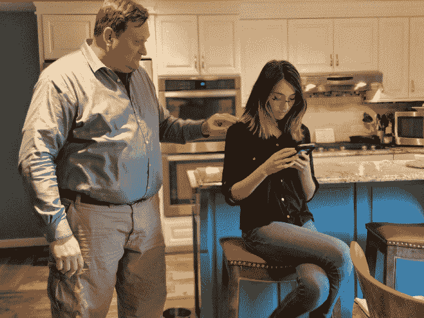

**图 8-12** 缺乏兴趣

由于厌恶是一种强烈的负面情绪，我在互动中倾向于不使用它。但是，有人问过我是否可以利用它来创建一群对同一事物感到厌恶的人。虽然这可能有效且非常有力，但如果处理不当，也可能导致一些危险的结果。

### 轻蔑

轻蔑是一种独特的情绪。《牛津英语词典》（`Oxford English Dictionary`）将轻蔑定义为“认为一个人毫无价值的感觉”。埃克曼博士（Dr. Ekman）给出了一个更简单的定义，认为轻蔑是道德上的优越感。

根据埃克曼博士对轻蔑的定义，它只能针对一个人产生，并且是唯一的单侧表情，这意味着它只出现在脸部的一侧。起初，轻蔑可能看起来像是一丝冷笑，甚至是微笑的开始，如 图 8-13 所示。


**图 8-13** 轻蔑常被误认为是快乐。

轻蔑的特征是脸部一侧抬起——例如，嘴角只在一侧抬起，如 图 8-13 所示。看到这种表情伴随着下巴抬起（即使只是轻微抬起）也并不罕见。

由于轻蔑是一种对他人优越感的感觉，并且常常是通向愤怒的入口，你可能会看到以下几种与轻蔑相关的肢体语言：

*   对他人感到优越会让人感到自信。这种自信可以以多种方式表现出来，但通常，这个人会通过让自己显得更大来占据更多空间。

*   如果轻蔑导致了愤怒，你可能会看到我在上一节中描述的相同肢体语言。然而，在那些愤怒的非语言表现完全显现之前，你可能会注意到下颚紧绷和更具攻击性的姿态。

在我看来，轻蔑在专业社会工程互动中几乎没有用处。我可以看到一个国家如何使用它，也看到恐怖组织如何利用它来招募并转化人们加入他们的事业，但对于大多数标准的社会工程互动，它不会带来理想的结果。

### 恐惧

恐惧有许多目的，例如它提醒我们危险，但当受到控制时，它也可以令人兴奋和愉快。有些人甚至喜欢被吓到或感到恐惧。

对失望的恐惧、对失败的恐惧或对做出错误决定的恐惧对专业社会工程师可能很有用，但我通常会避免使用更强烈的恐惧。那些字面上威胁或吓唬人的借口——例如让他们担心工作、生命或家人的借口——会引发如此强烈的情绪，以至于当他们发现自己正在接受测试时，可能会留下厌恶或轻蔑，随后是愤怒。

恐惧有一些明显的生理特征：

*   眼睛睁大以观察整个场景。

*   身体紧绷，通常会发出可听见的倒吸气声。

*   嘴巴张开，嘴唇向耳朵方向拉，仿佛那个人在说“eek”。

你可以在 图 8-14 中看到这些特征。


**图 8-14** 典型的恐惧表情

在身体语言中，恐惧的表现与面部表情相似。身体会后退、紧绷、僵住，并准备战斗或逃跑。如果你吓到你的目标，你可能会看到那个人像 图 8-15 中描绘的那样反应。


**图 8-15** 肢体语言中的受惊恐惧

请注意阿玛亚（Amaya）是如何用整个身体后退并紧绷的。她的嘴巴处于那个“eek”的位置。这种恐惧可能很强烈，因为她没有任何物理方式可以逃跑。她被困在椅子里。

图 8-16 显示了女性在表现出恐惧时的另一个方面——遮盖锁骨上窝。


**图 8-16** 遮盖锁骨上窝表示恐惧。

注意观察微妙的肢体语言指标，这些指标可以让你了解目标可能的感受。如果你看到恐惧的迹象，你可以决定所展示的恐惧是否合适，以及你愿意走多远来利用它。如前所述，作为专业社会工程师，我使用恐惧，但我会避免那种会让目标感到受到威胁或处于危险之中的恐惧。

### 惊讶

惊讶常常与恐惧混淆，因为它们看起来非常相似。在惊讶中，眼睛睁开，就像在恐惧中一样。身体通常会僵住，嘴巴也会张开。但嘴巴不是以“eek”的形状张开，而是以更像“OHHHHH”的形状张开。你可以在 图 8-17 中看到这一点。


**图 8-17** 惊讶，常常被误认为是恐惧

惊讶对专业社会工程师可能很有用，但与我提到的其他一些情绪一样，这取决于你如何使用它。我不建议躲在壁橱里然后跳出来吓唬你的目标，但一次突击审计、访问或奖励可能会引发正确的反应。在一次仅针对语音钓鱼（vishing）的互动中，我使用了一个惊喜奖励来取得一些惊人的结果。通话大致如下：

| **目标：** || 您好，贝丝在说话。我能帮您什么忙？ |

| --- | --- |

| **我：** || 贝丝，我是人力资源部的保罗。我有好消息要告诉您。您可能还没听说，但我们把您的部门列入了抽奖，奖品是一部全新的 iPhone，而您的名字被抽中了！ |

| **目标：** || 别开玩笑了！你在逗我吧！这太棒了！ |

| **我：** || 我知道。我喜欢这些电话。我们要送出 10 部，这些电话一直很有趣。 |

| **目标：** || 是啊，我从来没赢过什么。这太棒了！ |

| **我：** || 如您所知，XYZ 这里有几个贝丝，所以我需要和您核实一些细节，以确保我找的是正确的贝丝。您能把您的全名拼写给我吗？ |

| **目标：** || `E-l-i-z-a-b-e-t-h S-m-a-r-s-t-o-n`。 |

| **我：** || 很好。我需要您的员工 ID 才能输入系统。 |

| **目标：** || T238712P。 |

| **我：** || 好的，您是正确的贝丝。现在我需要您去一个网站，在那里您将被要求使用域凭据登录，并告诉该网站您希望将手机寄送到哪里，等等。请访问 [iphone.company-website.com](http://iphone.company-website.com)。*[这是我们设置的一个什么都不做的网站；没有任何按钮能用。]* |

| **目标：** || 好的，网站出来了。我看到我们的标志，但当我点击“Enter”按钮时，没有任何反应。我该怎么办？ |


| **我：** || 嗯，我正在处理。当你按下 Enter 键时，它不会跳到另一个屏幕吗？我现在看到另一个屏幕了。 |

| **目标：** || 不。我正在尝试使用不同的浏览器。*[尝试了她所有的浏览器。]* 真是的；我中奖了却连奖品都领不了。 |

| **我：** || 不，我们不会接受这种情况。听着，我来帮你领。你想让我输入你的信息吗？ |

| **目标：** || 真的吗？你愿意这么做吗？ |

| **我：** || 当然愿意。*[感觉像条蛇一样内疚。]* 它要求输入你的全名，而我有……。” *［我一边假装输入，一边逐字母念出。］* 好的，点击下一步。它要求员工 ID——你已经给我了，所以我现在输入。 |

| **目标：** || 非常感谢你。这太酷了。 |

| **我：** || 好的。它要求你的域登录名，我猜就是 E.Smarston？ |

| **目标：** || 不，我实际上是 B.Smarston。因为 Beth …… |

| **我：** || 好的，太好了。现在我最后需要的是你的密码。 |

| **目标** || *［甚至没有停顿一秒钟］*：我对长密码很擅长。是“JustinandBeth99”！ |

| **我：** || 太棒了，成功了。它说你将在 24 小时内收到一封电子邮件，其中包含关于如何领取手机的进一步说明。恭喜你，Beth！ |

| **目标：** || 非常感谢你！ |

就这样，我们完全攻破了网络。是的——对于那些正在准备写仇恨邮件的你们来说——这很具操纵性，并且使用了一个借口，当目标后来发现时会有点不安。但是，请记住，我没有威胁她；我没有让她难堪；我没有伤害她。我利用惊喜来触发一种基于幸福的情绪，这导致她向我提供了各种信息，而没有

有些方法比其他方法更具操纵性。这完全取决于你如何运用这些情绪，以及你对使用这些情绪的人所造成的结果情绪状态。

悲伤有几个面部指标，如 图 8-20 所示。


**图 8-20** 悲伤的面部元素

在面部，悲伤表现为

*   嘴角向下撇

*   眼睑下垂

*   眉毛的两端聚在一起并向上扬

在某些极端的悲伤情况下，你可以仅从面部的一个部分读出这种情绪。

悲伤也可以通过一个人的身体传达。悲伤让我们想要保护、安慰并变得渺小——这与感到自信时的反应相反。

一些自我安慰的非语言表现示例如 图 8-21、图 8-22 和 图 8-23 所示。


**图 8-21** 自我安慰的拥抱


**图 8-22** 眼睛遮挡


**图 8-23** 垮掉的肢体语言

这是一个简短的列表，但你明白我的意思。这些非语言线索可以帮助你看到那个人正感到明显的不适。

悲伤，在其所有的复杂性中，对社会工程师来说可能非常有用——无论是学习如何读懂它还是展示它。但是，我提醒你要节制这种情绪的使用程度，以及在你的借口中使用它的程度。

我从不希望让我的目标留下压倒性的悲伤或哀痛感，但使用适当程度的悲伤可以引发强烈的共情反应。在一项由 Jorge A. Barraza 和 Paul J. Zak 进行的题为“向陌生人共情会触发催产素释放和随后的慷慨”的研究中，(`https://nyaspubs.onlinelibrary.wiley.com/doi/abs/10.1111/j.1749-6632.2009.04504.x`)，研究人员表明，当共情被触发时，催产素释放增加了 47%，即使这种共情感觉是在完全陌生人之间，而悲伤会导致大脑中缺乏血清素、多巴胺和催产素。作为专业人士，我尽量坚持悲伤中的共情一面，而不是担忧、哀痛或抑郁这一端。

想想这个策略在营销和慈善活动中被使用了多少次。从无家可归的儿童到受虐待的动物，目标是触发共情反应，鼓励你更容易决定掏钱。这并不意味着那些组织不诚实或具有操纵性——他们只是知道我们的大脑是如何工作的，这有助于他们实现目标。

### 幸福

幸福是一种我们都同意对所有人类互动都非常有用的情绪。当我们感到快乐、满足、平静或放松时，我们更容易做出更利他的决定。我们倾向于喜欢让我们感到这种情绪的人、地方或事物。

因此，很容易看出，作为社会工程师，幸福将是你想要掌握读懂和引发的一种情绪。第一件真正能帮助你看到你是否做得好并创造幸福的事情，是学习区分真笑容和假笑容。区分真笑容和假笑容的一个关键是眼轮匝肌的激活。当被触发时，这块肌肉会抬起你的脸颊，并在眼睛周围形成我们所谓的“鱼尾纹”。

在 19 世纪中叶，一位名叫 Guillaume Duchenne 的法国研究人员假设真笑容可以被伪造。他正在使用一种非常侵入性的电击形式研究神经科学。他施加电击来刺激肌肉运动 (`www.thevintagenews.com/2016/05/07/44782-2`)。

由于涉及疼痛，Duchenne 的这项研究没有进行太远，但他关于情绪如何通过面部表情展示的研究表明，面部是情绪的路线图。大约在 1855 年，他开发了一种利用电击刺激来触发肌肉反应的方法，并将他的研究结果写在了 *Mécanisme de la physionomie humaine* 中。结果就是你在 图 8-24 中看到的。


**图 8-24** 一个假的真笑容 ¶ 照片来源 `HTTPS://PUBLICDOMAINREVIEW.ORG/COLLECTIONS/THE-MECHANISM-OF-HUMAN-PHYSIOGNOMY` 来自 MÉCANISME DE LA PHYSIONOMIE HUMAINE


阅读这项研究可以帮助你理解为什么幸福会产生被称为微笑的面部表情。但作为一名专业的社会工程师，你需要学会识别幸福的其他肢体语言指标。

幸福的情绪如何通过一个人的肢体语言表现出来？如果幸福会释放强大的神经化学物质并营造自信的环境，那么我们也可以期望看到某些身体表情。寻找如 图 8-25、图 8-26 和 图 8-27 中所示的身体姿态。


**图 8-25** 注意开放、自信的手臂姿势。


**图 8-26** 开放的腹面展示表明信任和幸福。


**图 8-27** 开放的腹面展示通常与欢迎或亲切的问候相关联。

在面部，我们寻找眼睛参与微笑，同时嘴巴形成闭口或开口微笑（参见 图 8-28

**图 8-28** 面部幸福感由真诚的微笑和头部倾斜显示

幸福的其他迹象可能包括抬起脚趾或在脚掌上弹跳等。当人们感到自信或良好时，他们倾向于让自己显得更大或更频繁地弹跳。

幸福是我作为专业社会工程师希望频繁使用的情绪之一。诉诸一个人的自尊心是创造幸福并可能导致情绪化决策的绝佳方式。不过，要使其奏效，自尊心诉求必须现实、可信，并且适合你在那一刻所建立的融洽关系水平。

我发现，如果符合我的借口，带着开放的腹面展示、温暖的微笑和适当的头部倾斜接近目标，可以在很大程度上让目标感到与我相处舒适。

在你的社会工程借口中寻找创造幸福环境的方法，你将获得良好的结果。

## 摘要

非语言是一个复杂且庞大的主题，我意识到无法在相对较短的章节中涵盖。正如我在开头提到的，我希望通过对这些信息进行高层次的概述，你可以带走几种不同的工具放入你的武器库中。理解情绪的工作原理将对许多借口有所帮助。你越了解一个人在不使用语言的情况下在说什么，就越能更清晰地理解他们的沟通。以下是我希望你从本章中带走的主要观点：

*   **基础工具** 作为起点，本章可以帮助你学习在面部和身体中针对每种情绪应寻找哪些微妙的事物。

*   **更好的理解** 我希望你更清楚哪些情绪适合你，以及不仅如何在别人身上看到这些情绪，还要如何自己展示它们。

*   **防御** 理解情绪如何通过面部表情和肢体语言传达，对你作为防御机制也非常有帮助。意识到这些情绪如何以及正在被使用，会让你在它们被用来对付你时更加警觉。

*   **增强** 作为一名专业社会工程师，你必须始终学习并增强你的技能集。

我想再讲一个关于社会工程的故事，这可能有助于巩固本章的观点。在一次 DEF CON 期间，我与一名员工的互动让我认识到随时观察非语言的重要性。

会议对我来说和我的团队来说总是很忙碌的。在那五天里，我觉得自己很少能休息，甚至很少有几分钟独处的时间。我只是把开关拧到“开”，并保持在那里，从人群中汲取能量和正能量。

这对我很有力量，但也可能让我对他人的感受毫无察觉。我蹦蹦跳跳，大声下达命令，确保事情都做完。在一次会议上，我给一些员工下达了几个命令，让他们收拾东西。那是我们的最后一天，我们正匆忙地把一切整理好，以便出去在我们最喜欢的寿司店享用最后的团队晚餐。

一切进展顺利；一切都完美运行。我们需要进行闭幕式，然后就可以终于放松一下了。我正努力更加关注他人的情绪，我注意到一个人脸上不仅表现出疲劳，还有极度的精疲力竭。另一个人正在表现出严重的痛苦。

对第一个人，我说：“嘿，如果你真的很累，你知道可以申请跳过这一部分——你不需要来参加闭幕式。”

“什么？*真的*？我可以选择退出吗？”他带着极度的惊讶问道。

“是啊，兄弟——我以为这是默认的。对不起我之前没提到。”

“我不知道我们可以选择退出。我以为这是强制性的，”他说。

“嗯，这只对 Michele 是强制性的。其余的人——你们可以选择退出。”

然后我的员工松了一大口气。

当我走向下一个人时，我需要小心处理。我不能在别人面前当众指出她。我从她身上读到的情绪是悲伤、愤怒和恐惧的混合。

我私下接近她，把她从群体中拉开，问她是否还好。我不会详细描述这次互动，但流了很多眼泪。她感到压力，因为她觉得事情被忽略或忽视了。而且由于缺乏休息时间，她压力非常大。

于是，我学到了一个新教训。在会议的最后一天，我特别注意并关注团队的情绪。然而，我意识到我应该在整个会议的五天里都运用这项技能，以便在压力达到那个程度之前就发现问题。

让我将这个故事应用到社会工程中：要善于观察，但不仅仅是在参与期间。要寻找“信号”，但在所有沟通中都要善于观察。要观察基线的变化以及情绪泄露，这些可以帮助你看到一个人在互动前、中、后可能的感受。

能够读懂非语言是一项强大的技能。当你增加利用非语言在目标身上引发情绪的能力时，你就达到了近乎超级英雄的水平。

这结束了我概述作为专业社会工程师所使用的大部分技能的章节。在下一章中，你将学习如何将这些技能应用于社会工程渗透测试。这些技能可以应用于哪些向量？那将是下一章的主题。

# 9

黑客攻击人类

> *如果金钱是你对独立的希望，你永远不会拥有它。一个人在这个世界上唯一真正的安全是知识、经验和能力的储备。*

>

> ——亨利·福特

作为快速回顾，我涵盖了过去七年左右 SE 发生的变化：OSINT 及其使用方法、沟通建模、借口编造、融洽关系建立、影响力、操纵、引出信息和非语言。从沟通角度来看，这是一个很好的知识基础，但因为我是一名专业社会工程师，我需要告诉你如何将这些信息应用于 SE 环境中。


从恶意社会工程学角度来看，我看到攻击中使用的四种主要途径是：网络钓鱼、语音钓鱼、短信钓鱼和冒充。还有这些攻击的组合，它们会让我们陷入困境。

在本章中，我将讨论如何在每个途径中使用我讨论过的技能。然后我将简要（我保证）介绍报告这个总是有趣的话题。最后，我将讨论如何进入这个行业并签下一些客户。

不过，在进入这些内容之前，我必须讨论渗透测试的原则。这将为你如何开展社会工程学渗透测试奠定基础。

## 平等的受害者

我想从一开始就提到的另一件事是，社会工程学途径并不是只针对愚蠢的人有效。它们对所有人都有效。在合适的情感触发点、合适的情况下，合适的借口可以让我们任何人上当。

我经常被问到我是否曾遭受过恶意的社会工程学攻击。不幸的是，答案是肯定的。合适的时机和合适的触发点让我上了一个网络钓鱼邮件的当。幸运的是，除了有些尴尬之外，我并没有遭受重大损失，因为我知道如何快速反应以及该做什么来解决问题。我有一个`M.A.P.P.`（这是第 10 章，“你有 M.A.P.P. 吗？”的主题）。

我不喜欢“人类愚蠢无法打补丁”这样的口号。是的，我承认从安全角度来看，有许多问题是懒惰甚至愚蠢的结果，但这并不意味着只有愚蠢的人才会上当。

曾有一个案例，一位大学教授收到了一个 419 诈骗网络钓鱼邮件（也被称为尼日利亚王子诈骗）。教授完全上当了。他上当得如此之深，以至于在耗尽积蓄后，他从大学财务部门偷了钱。即使在他被抓住并且 FBI 介入后，他还指责特工试图抢走他的线索，好让他们能从他即将在账户中看到的数百万美元中获益。

听起来很愚蠢，对吧？嗯，这是个简单的答案。相反，我审视情况并考虑是什么导致这个人如此投入这次攻击。以下是一些值得考虑的想法：

*   他当时有严重的财务问题，诈骗给了他财务自由的`希望`。

*   他对自己认为会转入银行账户的巨额数字感到`贪婪`。

*   一旦他`承诺`，他就希望与自己的决定保持`一致`。

*   他觉得自己在帮助一个第三世界国家的人过上更好的生活，同时也在帮助自己。

从这个角度审视情况，我可以更容易地理解教授是如何如此投入这个诈骗，以至于毁了自己的生活，犯下盗窃和欺诈，并欺骗了他的妻子——这一切都是为了希望、贪婪，以及保持一致和承诺去帮助自己和另一个人的愿望。

我无法告诉你有多少次，CEO 或其他高层人士告诉我他们`永远`不会上我的当，结果在发现自己是渗透测试期间远程访问的来源时却非常生气。无论在组织中处于什么职位，任何人都可能成为攻击的受害者。

## 渗透测试的原则

渗透测试，即`penetration testing`的缩写，是指一家公司聘请专业人士试图渗透该公司的网络。最终目标是，渗透测试应该帮助在恶意攻击者利用这些问题之前，暴露并修补任何问题。

多年来，渗透测试已成为一种标准的安全工具，许多合规委员会要求公司至少每年进行一次渗透测试。就目前而言，要求公司将社会工程学纳入这些测试的政府合规法律并不多。

就此而言，一家仅仅为了勾选“已完成测试以满足合规要求”这一框的公司，通常是个相当糟糕的客户。他们这么做是因为被迫，而不是因为愿意。这样想：当你的孩子因为想给你惊喜而打扫厨房时，他们做得比被当作家务强迫打扫时要好。

关于渗透测试，有一些书面标准，以及可以帮助渗透测试人员了解执行测试最佳实践的法规。2009 年，我开始编写一份社会工程学框架，它现在是`www.social-engineer.org`的支柱。它被称为“SE 框架”，全球许多组织在规划年度社会工程学服务时都将其作为标准。然而，对于社会工程学渗透测试，仍然没有一套明确的标准。我认为这主要是因为社会工程学非常动态，几乎不可能规划每个阶段。

构成社会工程学攻击途径正常路径的一些步骤或阶段，在图 9-1 中有所插图。

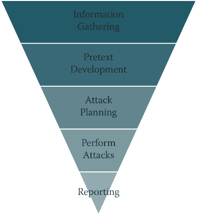

**图 9-1** 社会工程学阶段

信息是社会工程学攻击的生命线。因此，OSINT 或信息收集总是排在第一位，这是合理的。在研究完成之前，你无法真正规划攻击。

收集 OSINT 后，你可以轻松确定哪些借口可能有效或无效。了解公司如何使用社交媒体、沟通方式、地理位置以及其内部运作的其他细节，使你能够开发出一些不错的借口想法。

这些想法开发出来后，你就可以开始规划攻击途径了。你会发送网络钓鱼邮件吗？还是会语音钓鱼以获取更多信息或凭证？你会使用移动设备攻击吗？你会亲自前往现场吗？你会结合这些途径吗？当你开始规划攻击时，你可以回答所有这些问题。

之后，你发起这些攻击，收集所有步骤的结果，并向客户报告发生的一切。然而，渗透测试并不总是严格按照线性步骤进行。你可能正在进行 OSINT，想出了一个绝佳的攻击途径，然后想进行更多的 OSINT 以查看是否能找到一些支持数据。

无论你如何处理，社会工程学渗透测试的原则应包括以下几点：

*   你想录制电话吗？在许多州，未经同意这样做是违法的——不要假设雇佣你的客户就等同于他们给予你“同意”让你随心所欲。你想录制你入侵的视频吗？确保这已获得批准签字。

*   不要只是假设客户应该确切知道社会工程学渗透测试的每一步。要明确列出你想提供的服务，以便清楚明了。这也给了他们在你继续前进并可能造成问题之前，询问渗透测试每一步的机会。

*   确保你获得录制你将进行的电话的书面许可。

    许多州是双方同意制，在这种情况下，你需要获得公司的同意，以免遇到法律问题。

*   详细说明使用的确切 Google 搜索字符串或工具，以便客户在需要时可以复制这些步骤。

    我听过一些渗透测试人员说，他们担心自己在武装客户让客户自行进行渗透测试。然而，在我多年的工作中，从未有过客户因为我过度教育他们而不再使用我的服务。

*   故事与结果同样重要。

    例如，你可能会告诉客户，点击率为 90%，47% 的被你致电的人在电话中提供了他们的域凭证，这些确实是可怕的统计数据。但你也必须解释过程的每一步，你是如何开发该攻击途径的，是谁阻止了你以及原因——因为所有这些细节都是客户故事的重要组成部分。


不要在社交媒体上实时发推或发布关于你成功攻克客户的帖子。（说真的，当我看到有人这样做时，我都会感到尴尬。）

想象一下，你去医生那里做一次侵入性检查。他探查你那些你宁愿不被探查的地方。这很不舒服，甚至有点疼，当然也很尴尬。他做完检查，借口离开办公室一分钟。你掏出手机查看一些应用，看到他发的一条推文，写着：“你应该看看我刚刚检查的这个肥胖家伙身上的肿瘤有多大。LOL”他没有提到你的名字，也没有你的照片，但这会让你感觉如何？你喜欢这位医生吗？你觉得他站在你这边吗？如果我是病人，这将是我最后一次使用这位医生。

将此应用到实时发推关于闯入客户场所有多容易，或者他们的安全有多差。这很尴尬且不专业。

这五条原则是应用于你专业工作的良好一般准则。在我介绍可以帮助你处理作为专业社交工程师可能使用的每个攻击向量的规则之前，我还有两条指导原则：记录一切，并在选择借口时要审慎。

### 记录一切

客户付钱给你是为了深入挖掘，即使你没有在攻击中使用找到的 OSINT，客户仍然需要知道你发现了什么。不可避免地，在你的工作中会有时发现真正敏感的材料。问题是，你如何处理它？

在一次测试中，我的公司受雇为一家金融机构的高级管理人员进行渗透测试。在我们的搜索中，我们发现了她 20 多岁时自愿摆姿势拍摄的照片，这些照片现在被摄影师在其网站上用作宣传材料。不幸的是，其中一些照片被色情狗仔队偷走了，并被用来推广他们的网站。作为一名专业的社交工程师，你如何处理这种情况？

我们确定这些信息过于有损和尴尬，不适合作为鱼叉式网络钓鱼的主题。所以我们搁置了它，进行了渗透测试，然后与相关高管请了一次特别会议。我们提出帮助她将这些照片从所在的网站上撤下，并且不向她的公司报告它们。她非常感激，至今仍是我的朋友。

### 在选择借口时要审慎

我数不清有多少次在客户那里发现了真正尴尬的事情。我个人选择永远不将这些作为借口主题。你们中有些人可能认为我在浪费好机会。但是，请记住我的目标是“让他们觉得见我是件好事”。此外，我想能够提供教育，如果我只是羞辱了某人，这很难实现。因此，我在选择用于借口的内容时很审慎且敏感。话虽如此，请记住我之前建议你始终报告你发现的内容——所以即使你不使用尴尬的信息，你也应该告诉客户你发现了什么。

我有一个客户要求我的公司进行一些鱼叉式网络钓鱼。他们的一名员工使用公司电子邮件登录了一个“约会”网站，并向一些非常有吸引力且不着片帖的女性发表了一些评论，告诉他们他因公出差进城，想见面。暂且放下你对他提出出轨妻子的看法，或者在这样的网站上公开使用公司电子邮件的安全问题。来自这些女士之一的网络钓鱼邮件会有效吗？我几乎可以 100%保证会有效，但我们没有使用它。同样，专业社交工程师的目标是教育和提供帮助，而不是为了获胜而羞辱他人。

## 网络钓鱼

网络钓鱼被定义为发送伪装成来自可靠来源的恶意电子邮件的行为。网络钓鱼的目标可以分解如下：

* 交付恶意负载，使远程攻击者获得访问权限

* 收集凭证

* 收集其他用于进一步攻击的情报碎片

网络钓鱼电子邮件的目标决定了其内容、借口和发送方式。作为一名专业的社交工程师，你可能会被要求发送几种不同类型的网络钓鱼方法。

### 教育性网络钓鱼

有时，客户不想测试公司的网络资源——他们只想测试人为因素。一种有效的方法是发送一封教育性网络钓鱼邮件，这意味着当一个人与该消息交互时，不会交付恶意代码或获得远程访问权限。它只是向一个网站发送回传，报告网络钓鱼消息已被点击。这些统计数据用于帮助客户了解人们对网络钓鱼攻击向量的易感性，以及在哪里可能需要教育。

使用这种类型的网络钓鱼，目标是利用好奇心、贪婪、快乐或健康的恐惧来让人们点击。为了做到这一点，你将基于对特定目标或整个公司的 OSINT 来构建借口。我和我的团队曾向一个人以及一次向数十万人发送过这种类型的网络钓鱼邮件。

这里有一个例子，说明为什么遵循上一节的原则很重要：我为一个客户写了一封看起来就像合法的 LinkedIn 邀请的网络钓鱼邮件。我将其发送给客户的 7,000 名用户。它的点击率非常高——大约 73%。我当时很得意，包括我自己在内的每个人都对这次网络钓鱼行动的成功印象深刻。

另一次渗透测试即将到来，我能够重复使用我成功的 LinkedIn 邀请网络钓鱼邮件。我将其在下一周发送给了 10,000 名用户，点击量寥寥无几。当活动完成时，点击率只有大约 4%。我简直不敢相信。毕竟，这是一个天才的网络钓鱼方法，对吧？我请客户试着从他们的用户那里找出为什么这次网络钓鱼尝试失败得这么惨。

结果发现，失败是我的错。公司 1 是一家制造商，员工年龄在 35 到 55 岁之间。公司 2 是一家零售商，员工的平均年龄是 19 到 29 岁。当公司 2 询问其员工是否看到了那封电子邮件以及为什么没有点击时，他们回答说：“是啊，我看到了，但只有老年人才用 LinkedIn。我用 Facebook。”

*facepalm* 因为我被公司 1 的成功冲昏了头脑，我没有停下来思考这并不是一种网络钓鱼邮件就能适用所有情况的场景。每家公司都需要定制化的网络钓鱼消息。这次经历也加强了我对仅依赖模板的网络钓鱼软件即服务（SaaS）解决方案的反对。

即使你的网络钓鱼尝试目的是教育性的，它仍然需要 Figure 9.1 中金字塔的步骤。从 OSINT 开始，准备一封吸引目标受众并实现预期目标的网络钓鱼邮件。

### 渗透测试网络钓鱼

渗透测试网络钓鱼基本上与教育性网络钓鱼相同，只有一个重大区别：最终目标。与侧重于教育不同，渗透测试网络钓鱼旨在获得远程访问权限、凭证或其他某种形式的妥协。

渗透测试网络钓鱼通常使用涉及恐惧、贪婪、惊喜甚至悲伤的借口。我使用这些情绪，因为在用于渗透测试的网络钓鱼中，我不仅仅需要点击。通常，我需要目标打开文档并点击超过警告和/或输入凭证。因为这些步骤需要目标花费更多时间，我需要让目标更长时间地保持在 alpha 模式，因此情感触发器需要更强。


一个例子是我曾进行渗透测试的一家公司，他们非常热衷于所有与苹果相关的事物。该公司几乎所有员工都使用 MacBook，并谈论他们全新的 iPhone。渗透测试进行的时间大约是新版 iPhone 发布的时候。我发给该公司员工的钓鱼邮件上有一张漂亮的新 iPhone 图片，以及一条看似来自人力资源部门的消息：

> \[公司名称\] 将奖励 10 名幸运员工全新的 iPhone，并全额承担 1 年的服务计划费用。抽奖将于下周五下午 3:00 进行。

>

> 要参与，您只需访问此内网页面并输入您的企业登录名和密码，即可自动参与：`https://iphone.updates-company.com`

>

> 祝你好运！

我们购买了域名 `updates-company.com`，并创建了一个模拟内网页面，上面有两个文本框和一个按钮，以及公司标志。我将钓鱼邮件发送给了 1000 人，并收到了 750 个企业登录凭据。

在正确的时间，向正确的人使用正确的情感触发点，会带来巨大的成功。

### 鱼叉式钓鱼

鱼叉式钓鱼及其所有变体是一种非常个性化的钓鱼形式。在对目标及其能找到的任何家人进行深度 OSINT 后，我通常会从列表中挑选一些非常私人的信息作为借口。我找到并使用的许多 OSINT 来自家庭成员在社交媒体上的帖子。

在一个案例中，我发现目标和一群朋友去了拉斯维加斯进行男生周末。他朋友们发布的大量关于那周末狂欢的照片让我选择了这个 OSINT 作为借口。

我的钓鱼邮件来自他入住的酒店，内容如下：

> 先生 \[目标姓名\]，

>

> 7 月 3 日至 8 日，您入住了我们的酒店。退房时，我们的清洁人员发现了一件可能是您的物品。您能否查看附件图片，并告诉我们这件物品是否是您的？

>

> 如果这件物品是您的，请访问此链接并填写表格，以便我们将其邮寄给您。

>

> 此致，

>

> 酒店工作人员

现在，为什么我知道带有恶意软件的附件不会显示图片，却仍然选择放置链接呢？因为收到邮件的人可能无论如何都会认领该物品。表格要求提供以下信息：

*   全名

*   邮寄地址

*   电话号码

*   电子邮件地址

*   出生日期（用于证明年龄超过 18 岁）

*   目标用于预订房间的信用卡后四位数字

这个借口非常成功，不仅导致了完全的妥协，还为我提供了大量用于进一步攻击的额外 OSINT。

即使我使用个人信息作为鱼叉式钓鱼借口，我也不会使用可能对个人造成伤害的 OSINT。例如，在同一次钓鱼渗透测试中，我不会使用这样的借口：“我们在你去拉斯维加斯期间找到了你和一名妓女的照片。点击此处支付赎金。”——或者任何与此类似的内容，即使这是事实。如果我在 OSINT 中发现了那种数据，我会直接向目标报告，并询问他或她希望我们如何处理此事。

### 钓鱼总结

我不知道你的情况如何，但我每天从所有账户收到的电子邮件平均超过 200 或 250 封。上次我检查时，我的工作并不仅仅是查看电子邮件。

因为电子邮件是我们开展业务、全球沟通、保持联系、发送信件甚至购物的方式，它也是被最广泛用于社会工程攻击的媒介。作为一名专业的社会工程师，有必要学习如何制作基于可靠 OSINT 的专业外观电子邮件，以真正测试客户对这种媒介的易感性。

## 语音钓鱼

2015 年，“vishing”一词被收录进《牛津英语词典》。我曾试图声称自己对该词的流行负责，但没有人相信我。（我只是部分开玩笑。）

Vishing 是 voice phishing 的合成词，即通过电话进行的钓鱼。这个媒介现在比几年前更为常见，我的理论是，其流行是因为这是一种非常有效的攻击。

以下是我选择在渗透测试中使用语音钓鱼的几个原因：

*   凭据收集

*   OSINT

*   完全妥协

我将逐一讨论这些内容，让你清楚了解它们之间的区别。

### 凭据收集

在许多渗透测试中，我的团队和我都有妥协的技术计划，但我们会尝试语音钓鱼或钓鱼，看看是否能获得凭据，从而更轻松地进入网络。

在一个案例中，在进行在线 OSINT 后，我有 10 到 15 个号码想要尝试用于凭据收集。我根据其他一些 OSINT 开发了我的借口。我发现目标公司正在使用第三方外包 IT 公司来管理他们从一个操作系统迁移到另一个操作系统。这是一次大规模的升级，不仅涉及操作系统，还涉及他们依赖的所有其他软件，这些软件也需要随之更新。

我的借口是，我是来自 Secure IT 的 Paul（本书完全虚构的名字），我想查看公司员工的升级状态，因为我们看到他们机器的流量出现了一些问题。过程如下：

| **目标：** || 早上好。我是史蒂夫。有什么可以帮您的？ |

| --- | --- |

| **我：** || 嗨，史蒂夫。我是来自 Secure IT 的保罗。我想…… |

| **目标：** || \[打断\]: 哦，你们这些人！你知道我有多少工作要做吗？你们那花哨的新升级正在搞乱我的生活！ |

| **我：** || 我理解，史蒂夫。这就是我打电话的原因。我们注意到来自您 IP 地址的大量畸形数据包，我认为这可能是由于栈溢出导致的 DNS 中毒问题。\[我话音在结尾处拖长了，因为我祈祷他不懂技术.\] |

| **目标：** || 我的电脑中毒了？你在说什么鬼，保罗？ |

| **我：** || 抱歉。我就是这样——总是滔滔不绝地说技术术语。真的很抱歉。这意味着在安装过程中，可能出现了导致您运行缓慢的问题。我可以引导您完成几个步骤，看看是否能修复。您想试试吗？ |

| **目标：** || 听着，保罗。我宁愿你派人过来修好它——我真的不太明白你说的那些东西。 |

| **我：** || 我明白，史蒂夫。我至少四五天内没有可派出去的代表。但还有另一个选择，我可以远程帮助您。如果您愿意，我可以登录并远程修复它。 |

| **目标：** || 好的，如果你能让这台机器重新运行，我同意。你需要什么？ |

| **我：** || 我已经准备好登录并进行调整了——我只需要您的用户名和您用来登录机器的密码。 |

| **目标：** || \[毫不犹豫地\]: SMaker，别忘了大写 S 和 M。我的密码很好，别偷它：Krikie99。 |

就这样，我得到了通往王国的钥匙。

在凭据收集方面，如果我能找到一些 OSINT，利用与目标相关且真实的细节来构建可信的借口，我会觉得工作更容易。此外，除了钓鱼获取域凭据外，我还钓鱼获取了 VPN、电子邮件、安全存储、特定数据库甚至门禁密码的凭据。

### 语音钓鱼获取 OSINT

有时，在渗透测试期间，我没有足够的细节来完成攻击，或者我想在攻击前验证一些细节。在一个案例中，我为一个目标计划了鱼叉式钓鱼和语音钓鱼攻击，但我们找到了几个可能是他的电话号码和电子邮件地址。


我们开发了一个快速的借口，以确定哪些号码是真实的。我们发现目标经常在加拿大和伦敦之间往返。我们找到了伦敦一家希尔顿酒店的号码，并冒充该酒店，然后逐一拨打我们掌握的目标号码。

| **目标：** || 喂？ |

| --- | --- |

| **我：** || 您好，这是阿尔弗雷德·盖恩斯先生吗？ |

| **目标：**[content]

我们开发了一个快速的借口，以确定哪些号码是真实的。我们发现目标经常在加拿大和伦敦之间往返。我们找到了伦敦一家希尔顿酒店的号码，并冒充该酒店，然后逐一拨打我们掌握的目标号码。

| **目标：** || 喂？ |

| --- | --- |

| **我：** || 您好，这是阿尔弗雷德·盖恩斯先生吗？ |

| **目标：** || 嗯，是的。您是哪位？ |

| **我：** || 对不起。我是伦敦希尔顿酒店的保罗。我想花一分钟时间感谢您最近入住我们酒店。如果您只有 30 秒，我们有一份关于您入住体验的简短调查…… |

| **目标：** || 入住？您在说什么？我几个月都没在伦敦的希尔顿酒店住过。您怎么拿到这个号码的？ |

| **我：** || 先生，非常抱歉造成混淆。这是阿尔弗雷德·盖恩斯的电话号码 846-555-1212，对吗？ |

| **目标：** || 是的，没错，但您可能记错了我最近的入住记录。 |

| **我：** || 好的，如果我给您发一封发票邮件，您告诉我是不是您本人，可以吗？ |

| **目标：** || 当然可以。 |

| **我：** || 太好了。可以发送到 `a.gaines@hmail.com` 吗？ |

| **目标：** || 嗯，好吧，我宁愿用我的另一个电子邮件地址。那个我不常查看。发送到 `gainesat@gmail.com`。 |

| **我：** || 好的，没关系，先生。我们马上发过去。 |

这让我们确认了电话号码、电子邮件地址，以及一个明确的攻击向量，目标会因为这次语音钓鱼电话而上当。

我和我的团队多次使用这种技术来验证我们发现的数据，并挖掘新的情报。我认为这种形式的语音钓鱼非常有效，因为目标没有太多时间决定是否提供帮助。此外，大多数公司没有正确地教育其员工了解这种攻击向量。这种组合给公司带来了巨大的风险。

### 使用语音钓鱼实现完全妥协

仅使用语音钓鱼就有可能实现完全妥协。原则保持不变，只要有合适的借口和支持证据，专业的社交工程师就能轻松获取最敏感的细节。

在一个案例中，我和我的团队受委托使用语音钓鱼作为攻击向量来测试一家大型金融机构。目标是冒充 C 级高管致电，看看是否能获取他们的用户名和密码，或其系统或数据的任何其他部分。

我们的借口是一位正在前往夏威夷度蜜月的女性高管，她在机场时，老板打电话说找不到周一会议*必需*的报告。她知道报告在她的桌面上，但忘记了远程访问的登录凭据。

我们加载了一个名为“机场背景噪音”的 YouTube 视频片段，然后开始通话。我在旁静音监听，作为支持伙伴提供快速的想法或建议。通话过程如下：

| **目标：** || 支持部。有什么可以帮您的？ |

| --- | --- |

| **SE 代理：** || *\[重重叹息，声音中带着压力\]：* 您能听清我说话吗？这个机场的噪音太大了。 |

| **目标：** || 您好，是的，很吵，但您说得很清楚。今天我和谁说话？ |

| **SE 代理：** || 哦天哪，非常抱歉。*\[又叹了一口气\]* 我是珍妮弗·蒂利，财务高级副总裁。我正在前往夏威夷度蜜月，我的主管打电话说最新的预算报告从目录中丢失了。他需要它用于周一的会议，我需要登录并把它发给他，但我忘记了我的登录凭据。 |

| **目标：** || 好的。让我看看能不能帮您。首先，我需要验证您的身份。但在此之前，让我祝贺您结婚，并希望您在夏威夷玩得开心。 |

| **SE 代理：** || 非常感谢。我很兴奋。这是我第一次去夏威夷，我可以和我的好朋友兼新丈夫一起去。 |

| **目标：** || 祝福您。听到人们这样说话让我感到温暖。蒂利女士，我可以请您提供您的 ID 号码吗？ |

| **SE 代理：** || 您知道什么很疯狂吗？既然我被承诺两周不工作，我没有带任何笔记本电脑或身份证件。我大半时间都记不住自己的生日，所以我想我肯定记不住我的 ID 号码。 |

| **目标：** || *\[试图提供帮助\]：* 好吧，也许如果您试试。它以 17 开头——您只需要再记住五个数字。*\[这一情报非常重要。\]* |

| **SE 代理：** || 我真的想不起来。我不知道是不是漏掉了什么，比如 98231？ |

| **目标：** || 好吧，这个号码里有一个九和一个八，但是，让我们试试别的。您能告诉我您的经理姓名吗？ |

| **SE 代理：** || 当然，是迈克·法利。 |

| **目标：** || 好的，太好了。您能确认一下您的电子邮件吗？ |

| **SE 代理：** || `j.tilly@companyname.com` |

| **目标：** || 完美。好的，我可以这样做，我可以重置您的密码并发送到您的移动设备上；然后您就可以登录并把报告发过去。让我…… *\[背景传来打字和点击声\]* 蒂利女士，对不起，但我没有看到您安装了远程访问。所以即使我重置了，您也无法登录。 |

| **SE 代理：** || 哦，不。这太糟糕了。我将离开两周，我的飞机不到 30 分钟后就要登机了。我们该如何解决这个问题？请帮帮我！*\[声音近乎哭泣，语气中充满焦虑\]* |

我刚刚给 SE 代理打了一条消息，建议她我们需要看看能否让目标在她的机器上为我们安装远程访问，并给我们一次性验证码，这时对话继续进行：

| **目标：** || 好吧，我们可以提交远程访问安装请求，但这很可能需要几个小时，甚至要到明天。 |

| --- | --- |

| **SE 代理：** || 您一直非常友善，而现在，我的丈夫不太高兴。我们本该一起坐在休息室喝香槟，而我却在处理这个工作问题。有没有办法加快进度？ |

| **目标：** || 您知道吗，珍妮弗女士？您会度过一个美妙的蜜月；让我看看我能做什么。如果我让您等几分钟，您可以吗？ |

| **SE 代理：** || 当然，不要太久。我们很快就要登机了。 |

这样一来，我们就能听到目标在背景对他的同事说：“这个可怜的女人正要去度蜜月；我们需要帮助她登上她的机器。我相信我们能很快搞定，对吧？”

我们听不清另一个人说什么，但感觉每个人都在努力帮助珍妮弗。几分钟后，目标把电话放在一边去打另一个电话，然后才回到与 SE 代理的通话中：

| **目标：** || 蒂利女士，好吧，我有一份婚礼礼物送给您——一名代理正在为您安装远程访问。再过 10 分钟，我们应该能让您登上机器。 |

| --- | --- |

| **SE 代理：** || 您是我遇到过的最了不起的人！我的丈夫会非常高兴，这是最好的礼物！谢谢您！ |

| **目标：** || 当我收到代理的通知时，我会给您发送一条一次性验证码短信，然后您就可以登录访问了。 |

| **SE 代理：** || 哦，我做不到。我没有带我的工作手机，所以我无法查看那条短信。 |

| **目标：** || 哦，不，蒂利女士。我们无法绕过这部分。我不知道该怎么办。 |

| **SE 代理：** || 这太糟糕了！这会给我一个教训，让我知道自己多么愚蠢。我本该带手机的。现在我将不得不取消这次航班并推迟我的行程。好吧，这很遗憾，但您一直非常出色和乐于助人。非常感谢您。 |


| **Target:** || *不！* 我们不会让你错过蜜月；那是不可接受的…… *\[压低声音耳语\]* 听着，我会把代码发到你的手机上；一旦生成，我会在电话里把密码告诉你，好吗？ |

| **SE agent:** || 你会为我做这个吗？我可能会哭出来。 |

| **Target:** || 好了，别这样了。我们得让你上飞机，完全不去想工作。 |

这样一来，我们就获得了远程访问权限、密码，以及如果需要的话，能够攻破整个机构的能力。

使用 vishing 进行全面攻破可以让渗透测试人员的工作变得容易得多。很多时候，重要的是要明白，用于攻破的 vishing 可能需要先从 OSINT vishing 开始，然后再转向越来越详细的借口。

### Vishing 总结

Vishing 是一种强大的攻击向量，落入不法分子手中可能会造成毁灭性后果。因为它可以用于社交工程攻击的几乎每个方面，所以是一种强大的武器。

对于专业的社交工程师来说，如果你想成功，就绝不能害怕打电话。要学会拥抱它，即使它不是你最喜欢的沟通方式。在电话上具备技能，并学会建立融洽关系、赢得信任，然后在看不到目标的情况下获取信息，这会让你更加成功。

## SMiShing

这是一个简短的章节，因为 SMiShing 并不被攻击者或专业社交工程师广泛使用。2017 年，富国银行遭到入侵，在该次入侵之后，我们看到了大量的 SMiShing 攻击。其中许多看起来非常像你在 图 9-2 中看到的内容。大多数 SMiShing 消息很简单，但它们很有效，并且通常旨在将恶意软件加载到移动设备上或窃取凭据。


**图 9-2** 入侵后流行的 SMiShing 消息

在过去两年中，移动操作系统一直是恶意软件和其他攻击的目标，攻击者希望能够访问受害者的设备。随着公司也开始允许 BYOD（自带设备），我们看到了移动设备入侵的增加。移动入侵（例如读取电子邮件、远程打开摄像头或麦克风、将移动设备用作某种远程访问点）一直是许多组织的担忧。

出于这个原因，社交工程师了解如何在实践中使用 SMiShing 很重要。以下是一些使 SMiShing 与钓鱼攻击大不相同的规则：

*   **简洁是关键。** SMiSh 需要简短明了——没有铺垫，没有开场白和结尾，只有事实和一个链接。

*   **链接。** 依我之见，最好使用一个与你发起的攻击看起来相似的域名，但如果做不到，那么缩短的 URL 在短信中比在电子邮件中要可接受得多。在移动设备上几乎无法悬停检查链接，因此用户需要接受高级培训才能识别恶意链接。

*   **不要省略。** 如果你试图进行凭据收集，不要认为你不需要品牌或让网页看起来合法，只是因为目标使用的是移动设备。为了确保你充分测试目标，请务必花时间让一切看起来都真实。

*   **不要让步骤太多。** 目标正在使用移动设备，所以如果有三个或更多步骤，你就会失去你的受众，他们将没有动力继续。

随着 BYOD 和居家办公员工的增加，专业社交工程师了解这个攻击向量以及如何使用它来测试人群将变得更加重要。

移动电话将长期存在，并且它们正在变得越来越强大，并融入我们的移动工作生活。这将使我们的客户更难检测攻击。

## 冒充

冒充是最危险的攻击向量之一，但对 SE 代理人来说也是最危险的向量之一。因此，它是四个向量中使用最少的。冒充是指冒充目标公司的员工或某个可信赖的权威人士（执法人员、公用事业工人等）。

对我来说和我的团队，冒充是帮助客户时最有趣的向量，但对我们来说风险相当低。在实际攻击中，冒充存在相当大的风险，这意味着它需要最多的计划。在我们的渗透测试中，我们有一封“免入狱信”，这意味着我们无法真正因为我们的利用行为而惹上麻烦，而真正的坏人如果被抓住，将在监狱里度过大量时间。

### 策划冒充渗透测试

社交工程渗透测试人员需要牢记，当涉及冒充向量时，*所有*目标的感官都会被调动。而钓鱼攻击只调动视觉，vishing 只涉及听觉，冒充则需要解决几乎所有感官（尽管可能不太涉及味觉）。

出于这个原因，彻底规划渗透测试的原则很重要，如下文小节所述。

#### *信息收集*

信息收集是实体现场冒充评估的重要组成部分。我经常要求学生给我一个能保证进入的借口。想一想。你有主意吗？

学生们经常建议类似 UPS 快递员的东西。我的后续问题帮助他们思考他们的初始陈述：“好的，很好——但然后呢？你们中有多少人见过 UPS 快递员在大楼里闲逛？他们通常过不了前台或邮件室。”

OSINT 为开发可信的冒充借口是必不可少的。在我做的一项工作中，我发现当地的建筑施工导致通常在春季出现的蜘蛛提前出现。这非常烦人，甚至上了当地新闻。我的借口是喷洒杀灭蜘蛛侵扰，效果出奇地好。

#### *借口开发*

我在谈论收集信息时提到了借口开发，但不要犯在进行 OSINT *之前* 就规划你的借口的错误。另外，在你选择借口后，你需要考虑其他一些事情：服装、工具、你的外观等等。此外，考虑道具应该看起来是新的还是旧的。你必须考虑所有使借口可信的事情。要周全考虑。

最近，我和一名员工一起闯入几家银行，我通过 OSINT 了解到该银行刚刚完成了一次 PCI 合规性测试。我们找到了进行测试的公司的名称，于是我们全副武装，佩戴徽章和卡片，装扮成 PCI 合规性公司的人员。这让我们毫无问题地进入了 ATM 测试中心。从那里，我们进入了两台不同的电脑，甚至获得了隔间里其他员工的凭据。

当一名经理走近并询问我们的内部联系人是谁时，我们没有名字。这是我的疏忽，是一个导致我们被抓的失败。是的，你可以争辩说到这个时候，我们已经攻破了网络，并在 ATM 测试中心待了将近 30 分钟，可以访问多台电脑，但那一条数据本可以救我们，并给我们更多时间。

#### *攻击规划与执行*

一旦你有了借口，你需要了解进入大楼后的目标是什么。换句话说，你需要知道你 *不能* 做什么。你可以获得远程 shell 吗？你可以攻破服务器吗？你可以从大楼带走设备吗？不要做一个糟糕的假设，即仅仅因为你被雇来扮演坏人，你就可以随心所欲地做他们会做的任何事情。那将是一个非常糟糕的假设。


计划攻击从开始到结束的样子，然后确保你手头有经过测试的工具来完成这些目标。

计划完成后，确保你的 `GOOJFL`（“免死金牌”）涵盖你想做的一切，如果它没有涵盖所有内容，就将其加入。

熟能生巧。

## 报告

请记住，参与测试中最重要的部分是告诉客户你做了什么、如何做以及接下来需要做什么。在开始之前，确保你已获得录制音频和视频的许可。或者，如果你没有此权限，请想办法确保你能捕捉到报告所需的完整故事。

对我来说，用这种攻击讲述一个故事很重要。我希望客户感觉自己能看到、听到并感受到整个攻击过程，并了解哪些有效、哪些无效。我认为对他们的成功大加赞赏，而对自己的成功则实事求是，这非常有益。

我在报告中的目标是“让他们读完后感觉更好”。为了做到这一点，我不能令人尴尬、过于花哨或贬低他人。

此处所述的原则将帮助你进行现场实体参与测试。我认为这部分工作需要更多的计划。不过，关于报告中应包含的信息，可能仍有一些问题。以下是我对处理一些敏感数据的看法。

#### 录制的合法性

请记住，我 *不是* 律师，我说的任何内容都不应被视为法律建议。你肯定应该找律师过过这些事情。

对于我公司的参与测试，我们会做以下事情：

*   在工作前研究州和/或国家关于音频和视频录制的法律。

*   获得客户书面许可，允许录制两者。

*   绝对、绝对、绝对、绝对、绝对（我说过 *绝对不要* 吗？）在未经许可的情况下，将这些录音用于演讲或培训。

    即使获得许可，你也应该对录音进行脱敏处理，使其中 *没有* 任何可识别信息。所谓“脱敏”，是指删除所有姓名、工作场所以及任何其他可识别的词语。

*   确保所有录音都发送给客户以供其学习。

*   确保存储、传输和使用始终安全。

了解你所做事情的风险，并知道你计划如何使用所收集的内容很重要。有一次工作，我让一名女子在附近的电脑上输入她的用户 ID 和密码。当她配合我的请求时，我不仅录下了她的脸，还拍下了她的凭证。为了避免她尴尬，我在视频中模糊了她的脸。当然，客户可能会告诉我他们想要未模糊的视频——这是他们的选择和权利。但我先展示了模糊的视频，客户也没有反对。如果视频用于教育目的，我不会觉得那个女人必须永远重温她的尴尬。

### 脱敏处理的注意事项

在一次工作中，我使用藏在剪贴板里的针孔摄像机录制一切。当我试图躲避安保人员时，我溜进了一个服务器机柜，却撞见两个人正在……嗯……做一些你不会想到他们在工作时会做的事情。（是的，如果你还没猜到，就是性爱。）撞见这一幕让我忘记了自己应该是一名社交工程师。壁橱里的那对男女很生气，对我大喊大叫，我跑了出去。后来，我意识到我几乎录下了 60 秒的性爱录像，这要归咎于他们缺乏职业素养。这显然不是我可以发给客户的东西，我不得不考虑如何处理。

最终，我决定公司付给我一大笔钱是为了帮助他们保障公司、网络和员工的安全。我所目睹的违反了公司政策，而且据我所知，这可能是一个蜜罐。如果我不报告此事，后来听说公司被攻破了，而我本可以阻止它，我会承担多大责任？

我决定报告此事是我的义务。而且，是的，这确实导致那位先生被解雇。为什么那位女士没有被解雇？嗯，她不为该公司工作——那个人把外面的人带到了服务器机柜里，去做一些本应留给家庭、酒店或任何非工作环境的私密活动。

你必须决定你录制的内容中哪些部分需要脱敏。当某人采取的行为不违法时，我会进行脱敏——如果他们只是上了社交工程攻击的当，但并未恶意违反公司规则。我的重点始终是确保教育是第一步，而不是解雇。

但是，如果我发现有人在下载色情内容、从事性活动、偷窃、访问不应访问的数据，或者天呐，从事任何形式的儿童剥削，他们就不应期望一位试图保护其客户的专业社交工程师会有任何善意。

### 设备采购

有很多地方可以找到“间谍装备”。从亚马逊到专卖店（我最喜欢的一家在线商店是 `https://spyassociates.com`），有很多地方可以买到这类装置。请记住，一分钱一分货。25 美元的笔式摄像机质量差且抖动，而 600 美元的带有 DVR 录制功能的纽扣式摄像机大概会好得多。

在购买前做一些研究。下单前我总是做以下事情：

*   我查看退货政策，确保如果物品损坏，我不需要将其寄往国外。

*   我阅读产品和公司的评论，以确保我花得最值。

### 冒充总结

通过正确的计划，这个复杂向量的执行可以变得容易得多。请记住，冒充与红队测试不同，你需要做好扎实的计划，以确保彻底测试物理安全协议。

作为 SE 渗透测试人员，了解你所做事情的范围很重要，这样你才能实现客户想要的所有目标。尤其是因为最终目标是在报告中包含一个概述如何修复发现问题的章节。如果你作为 SE 了解不仅仅是“做了什么”（what），还知道“为什么有效”（why），那么该章节会更有用。

我们看到越来越多涉及物理安全方面的泄露事件——USB 投放、设备被盗，甚至更糟的职场暴力。出于这些原因，专业的 SE 渗透测试人员必须掌握冒充社交工程向量，作为其实践的一部分。

## 报告

职业生涯早期，我受雇闯入七个仓库。我的成功率是 100%。我甚至能在同一天使用不同的借口两次进入同一个仓库。

感觉很棒，我把整个过程都录制好了，准备交给客户。项目负责人让我开始写报告，并发给我一个模板文档。模板文档除了几个标题外是空白的。

我想我盯着它看了好几个小时——开始，然后停止，然后擦除，再重新开始。几十个小时后，我完成了我认为是报告历史上的杰作。

我设想报告团队会收到它，阅读它，然后在我进入大楼时为我铺满棕榈叶。我发送了报告，等待着热烈的赞扬。

一天后，电话响了，通话大致是这样的（我尽量让它更适合家庭观看）：

*   “嘿 Chris，你发到我收件箱的那堆垃圾是什么？这是个玩笑吗？你在开什么笑话吗？你觉得这能当报告吗？它要退回去做红线修改了。马上做 *完*！”


当我拿回报告时，它不再是黑白分明的——而是红、绿和白。似乎没有一段文字没有经过重大修改。

修复这份文档花了我两周时间，这是我报告生涯中最糟糕的经历。然而，与此同时，这也是我拥有过的最好的经历。它让我了解了一份好的报告应该是什么样子，以及是什么感觉。我最初的报告包含一个让我显得非常出色和酷的故事情节——就像服用类固醇的詹姆斯·邦德。然而，它缺少一些对客户可能有帮助的关键要素。

本章的这一部分不是关于报告写作的研讨会，但我有一些原则想与你分享。

### 专业性

专业性是做一名专业人士的艺术。想想去看医生，一个你希望并祈祷他是专业的人。如果你踩上体重秤，他说 `Whoa Nelly!` 有人有条鱼给这头鲸鱼吗？然后拍拍你的背说他 `只是开玩笑`，你会有什么感觉？

我想不出会有多少人会喜欢这样。同样，我们的客户也不想听到诸如 `我们把你打得惨不堪言！` 或 `哇，这个家伙真的把这个放到网上了吗？` 或 `你的仓库都归我们了。`（关于最后一个，我可能有点经验。）

请记住，这份报告会被许多人阅读，而改变的最佳环境是让人们感到快乐，而不是尴尬或羞辱。你的语言、描述词以及传达事实的方式都应体现专业性。

### 语法和拼写

语法和拼写是我个人的禁忌。它是 `attack vector`，而不是 `attach vector`。它是 `rapport`，而不是 `report`。你明白我的意思。你应该始终预留时间对报告进行拼写检查，然后让值得信任的人校对。

即使有这些检查，你可能仍然会留下一些错误。错误总会发生。不要指望完美，但也不要发送一份错误如此之多的报告，以至于让客户面临 vishing 攻击的风险。`

*   **选项 2：**

    `Social-Engineer 分析了本月 vishing 活动的数据，并注意到以下两点，可用于进一步教育：`

    *   `女性来电者在使用与男性来电者相同的借口时表现更好。这可能表明需要更多关于如何识别引出信息的教育。`

    *   `当面对一个虚假的员工姓名时，只有 12% 的人群尝试验证该姓名，甚至还有少数人在找不到姓名后仍继续提供信息。这表明需要更多关于如何正确验证来电者的教育。`

    `Social-Engineer 希望安排一次通话，讨论如何将这些内容纳入教育计划，因为我们将继续测试。`

显然，第二个选项是最好的，但太多次（我承认我的团队也有过错），报告中包含无法采取行动的陈述，这些陈述对客户没有实际帮助，只是充当填充物。

即使做了多年，确保不产生自满情绪仍然是一场持续的战斗，而我正在为我的客户在这方面付出 100% 的努力。

### 下一步

除了缓解（修复问题）之外，客户通常还想知道 `接下来怎么办？` 包含下一步是报告的重要结尾。它让客户知道他们应该做什么以及未来可以期待什么。

我的意思不是你只需简单地说 `下次渗透测试见。` 你需要遵循我之前讨论过的相同缓解规则。给你的客户足够的细节，让他们感到掌握了清晰的进步路径。

我的许多客户是月度服务客户，因此前进的路径已经明确，但这并不意味着我可以完全依赖这一点。客户仍然想知道我们是否应该改变事物或适应以增强计划。

当你把所有这些步骤结合起来时，你将拥有出色的报告，这些报告将真正帮助你的客户，并让他们和你都感觉更好。

## 给 SE 渗透测试人员的常见问题

在结束本章时，我想涵盖作为一名专业 SE 渗透测试人员，我最常遇到的一些问题。我相信还有很多其他问题，但这些是最常见的。我希望这些问题能帮助你，无论你目前是否将 SE 作为职业，还是正在努力将其作为职业。

### 如何获得一份社会工程师的工作？

这可能是我整个职业生涯中被问得最多的问题。在你决定要去做之后，你该怎么做？嗯，你必须从某处开始，这就是为什么这个答案如此困难。也许你在过去 10 年里一直从事目前的职业。你在该领域拥有专业知识和技能，并且有相应的薪水。开始社会工程师的新职业生涯不仅意味着在专业知识和技能上重新开始，也许在薪水上也是如此。我最好的建议是，你要愿意做以下事情：

*   走出你的舒适区。

*   重新开始。

*   学习全新的技能集。

*   如果必要，接受减薪。

如果你能做到这些，你可以期待在社会工程领域拥有一份不错的职业生涯。`但是`（总是有一个 `但是`，不是吗？）你不能只是指望 SE 公司会打电话给你提供工作。我们社会工程师寥寥无几，你仍然需要证明自己与其他所有候选人不同。这些事情需要你付出一些努力。

### 如何让我的客户进行 SE 相关工作？

假设你已经是一名渗透测试人员，并且正在进行一些社会工程工作，本节将为你提供一些关于如何让现有客户雇佣你进行更多 SE 项目的想法。

#### `不要免费提供部分服务`

有些人建议，如果你给客户一些免费服务，这些客户会看到你工作的好处，并为你支付更多工作的费用。我有一个轶事来解释为什么这种策略并不像你预期的那样有效。


当我刚进入科技行业并开始组装电脑时，我尝试举办一个免费研讨会，教小企业如何保持安全。在这个研讨会上，我提供了超过 60 分钟关于防病毒、网络、文件共享等方面的真正可操作的建议。最后，有一个 5 分钟的销售推介，解释为什么公司需要将我作为所有这些服务的提供商。

我与当地商会合作，免费提供演讲。我们安排了三场这样的研讨会，报名人数非常多。每场研讨会都有 20 人、30 人或更多人报名。我已经看到了金钱的迹象，觉得自己赢了。

第一场研讨会那天到了，我去了房间，设置了投影仪，并铺开了我的讲义和所有自掏腰包支付的赠品。开始前五分钟，房间里只有一个人。开始前两分钟，房间里仍然只有一个人。开始时间到了，没有其他人出现。这非常尴尬。我开始对着那一个人做演讲。五分钟后，他说：“嘿，这真的很奇怪。我们要不要去吃午饭并聊聊？”

我很迷茫——我搞不清楚发生了什么。在第二场研讨会也发生同样的事情后，我就取消了第三场。有人建议：“嘿，下次研讨会每人收取 50 美元报名费。告诉他们会获得价值超过 50 美元的免费物品，但让他们付费。”

我非常不愿意尝试。我想，如果他们免费都不来，那他们绝不会付费参加。然而，当我对研讨会收费时，房间里坐了 10 个人，每个人都付了 50 美元。

什么？？？参会人数比最初的报名人数少并不重要。重要的是，那 10 个来的人，实际上为参加的特权付费了。

后来，我与那位建议我对研讨会收费的商业朋友坐下来，他解释说，当人们付费时，即使是少量金额，他们也会为其增加价值。如果有人报名并付费但最终没有参加，他们就会损失不可退还的 50 美元。这成为参加的强大动力。

当我刚开始我的 SE 职业生涯时，就像我没有学到任何关于免费提供东西的知识。我收到了在全球各地做演讲的邀请，但我一分钱都不收。我发现，很多时候，人们会取消或直到最后一刻才承诺。

我的朋友 Ping Look 告诉我，停止不收费，开始收取固定金额。我非常不愿意听她的，但我反思了之前的经验，决定尝试一下。

令人惊讶的是，人们非常愿意支付更高的金额。他们似乎也更看重我。这改变了我的做事方式，从那时起，我再也不免费提供东西了。

这个长故事的寓意是：不要认为免费提供你的才能会让人们看重你。这行不通。你可以找到提供高端服务并给予一些折扣，或者提供三个月合同其中一个月免费的平衡。关于收费可以发挥创意，但要知道，免费工作只会贬低你的专业知识。

## 快速失败并继续前进

如果我遇到一个不愿聘用我服务的潜在客户，我会提出先对公司中一名高层人员进行一次钓鱼攻击演示，以展示其有效性。通常，当决策者看到危险和好处时，他们就准备为这类服务预留预算。一次小规模的合作通常就足以带来与公司的更多合作。但有时这还不够，公司不想继续进行进一步的社会工程服务。

如果你所做的一切都无法说服一家公司你能帮助他们，你应该怎么做？离开。意识到快速失败并离开，比试图让方钉 fit 进圆孔要好得多。

如果一家公司看不到将 SE 作为其安全制度一部分的必要性，那么你可能不想要他们作为客户。他们会让合作变得令人沮丧，最终不会在你身上找到价值。

我有一个客户与我合作了四年。当我刚开始与这家公司合作时，他们几乎是完美的客户。我有一个出色的联系人，那个人跃跃欲试。该计划非常成功，客户看到了巨大的变化。负责运行该计划的我们内部联系人那位女士，被一家更大的公司提供了工作，让她运行其安全计划。她抓住了机会，我理解为什么。一位新女性被雇来接替她的位置。

从与新女性合作的第一天起，情况就不一样了。新的联系人容易生气，过于个人化，不愿意承担风险，也不想像她的前任那样将计划推向深度。因此，计划停滞不前。人们回到了旧习惯，尽管钓鱼统计数据在纸上看起来仍然很好，但计划已经停滞。

在我与该公司分道扬镳前六个月，我就告诉我的团队我们会失去这个客户，我们确实失去了。他们是我们以这种方式失去的第二个客户，但我认为这是最好的。他们不想将计划朝着需要的方向发展，所以对他们和我们来说都很令人沮丧。

一天只有固定的小时数，我们能处理的客户也有限，我宁愿花时间与那些想要看到改变的客户在一起。不要害怕放弃不合适的交易。

## 我应该收多少钱？

我经常听到这个问题，但我甚至考虑过不把它放在这本书里，因为答案不容易也不简单。然而，由于这是一个非常受欢迎的常见问题，我尽力涵盖这个话题。

首先，你需要了解作为顾问你可以收取多少时薪。我做了一些研究，发现了几个网站，它们为全球不同地区安全领域的顾问提供了可接受费率的建议。

费率取决于多种因素，例如工作年限、领域专业知识、你公司的知名度以及你提供的服务。

为了便于计算，假设我决定我的费率应该是每小时 100 美元。我根据经验决定，每月钓鱼 1000 封邮件需要我花费 20 小时。我花三小时进行 OSINT 和七小时进行报告，这意味着我每月总共投入 30 小时。我的费率计算如下：

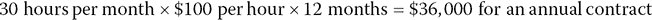

```
30 hours per month × $100 per hour × 12 months = $36,000 for an annual contract
```


这不是一条铁律——这只是我用来衡量报价的一种方法。我可能会根据以下因素调整费率：

*   公司规模
*   多年期合同
*   我对客户的感觉（非常主观）

重点是，前面的计算可以帮助你接近确定报价，但可能并不精确。至少它能为你如何开始收取服务费提供一些指导。

## 摘要

我读过一份报告，称美国只有少数公司通过每月活动积极开展网络钓鱼意识培训。

如果只有少数美国公司提供培训，而我的公司在过去三年中增长了 300%，那么当 20%、30% 或 50% 的美国公司开始积极开展培训时，会发生什么呢？

事实是，对专业、高质量的社会工程学渗透测试专业人员有巨大需求。我无法独自完成所有工作，所以不如尽可能多地帮助人们进入这个领域，为所有需要它的公司提供尽可能好的服务。

我不认为人类将不再在劳动力中存在的时间会到来。因此，人类的脆弱性将始终存在。此外，人们必须不断应对针对其同理心中心、恐惧中心和逻辑中心的攻击。这些攻击会消耗我们，并导致我们做出错误的决定。

我们将始终需要社会工程学专业人员来帮助公司学习如何抵御这些攻击。我认为将有大量的人工智能和技术来帮助抵御这些攻击，但永远不会有一个我们不需要人类帮助他人的时代。

也许你阅读这本书是因为你想进入社会工程学行业。或者你可能是一名现有的专业人士，阅读这本书是为了寻找新的技巧和窍门。或者你可能出于其他多种原因拿起了这本书。出于任何这些原因，你都应该真正专注于下一章，它将帮助你准备一份 `M.A.P.P.` 。

# 10

你有 `M.A.P.P.` 吗？

> 我非常相信要控制你能控制的，忘记你不能控制的，不要在不值得的事情上浪费精神能量。
>
> ——JOSH CITRON

我认为一本专注于培养专业社会工程师的书如果没有这一章就不算完整。你可以融合所有攻击、心理学、生理学和报告撰写来取得成就，但如果没有 `M.A.P.P.`，拼图中就缺了一大块。什么是 `M.A.P.P.`？它代表 *缓解与预防计划*。

为什么你需要缓解与预防计划？你如何帮助你的公司或客户制定一份？你可以针对社会工程学攻击缓解和规划什么？我将在本章中回答这些问题。

当我开始与客户取得进展时，我意识到一件重要的事。我的目标需要是一件非常奇怪的事情：做得足够好，以至于最终我会让自己失业。没错，你没看错。我需要帮助我的客户学习如何抵御社会工程学攻击，直到他们最终不再需要我。

你知道那些声称自己 *始终* 拥有 100% 成功率的渗透测试公司吗？对于客户来说，写支票给你却知道自己永远不会变得更好，这有多令人沮丧？或者无论他们变得多么好，社会工程师始终都会获胜？传达的信息是没有希望。他们所做的一切都无法堵住安全中的所有漏洞。最终你可能能理解为什么客户会说，“我们为什么要费心保护自己呢？”

在我顿悟时，我决定我必须帮助我的客户计划如何缓解攻击，以及如何变得擅长捕捉这些攻击，以至于最终他们只需要维护。如果你像我一样是一名专业的社会工程师，那么你需要本章才能成功。如果你是一家公司，本章将帮助你规划你的 `M.A.P.P.`。

当我意识到我需要改变自己的健康状况时，这让我深有感触。我自己尝试过很多方法，但都惨遭失败。在白帽黑客社区中，我见过几个做出了重大健康改变的人。我和其中一人交谈，询问他是如何做到的，他把我介绍给一个名叫 Josh Citron 的人。

Josh 想要进行视频聊天作为我们的第一次交谈。我真的不想——我想象他身材很好，而我最后想做的就是和他视频聊天，让他看到我胖乎乎的样子。更糟糕的是，我在网上搜索了他，不难找到他的一些照片。他是某种野兽-人类-嵌合体，能举起小型车辆并跑六英里。

现在，想象一下，如果在我与 Josh 的第一次会面中，他开口就说：“好吧，Chris。事情是这样的。如果你做我所说的一切，如果你听从每一句话，从不作弊，并继续付钱给我……好吧，你永远不会赢。你会一直胖下去，可能永远不会变强壮。那么，我们开始吧！”我可能会看着 Josh，觉得他 *疯了*！或者如果他在视频聊天中轻蔑地看着我，因为他只看到一个肥胖的懒汉而对我态度恶劣，我大概率不会继续和他合作。

然而，Josh 告诉我，如果我做他所说的一切，我会看到逐渐的变化，当我达到目标时，我们将转为仅维护计划。因为他也以尊严和尊重对待我，我准备好大干一场了。

Josh 帮助我制定了一份 `M.A.P.P.`，用于降低不良习惯的风险并建立新的更好的习惯。这不是某种激进的饮食，戒掉所有尝起来像食物的东西，只吃沙拉和悲伤。我改变了习惯，增强了决策能力，并获得了知识，以便在所有情况下做出最佳决策。

该过程可以直接应用于开发社会工程学和安全 `M.A.P.P.`。我制定了四个步骤，只要遵循，就会创建这个 `M.A.P.P.` 以及随之而来的所有好处：

*   步骤 1：学习识别社会工程学攻击
*   步骤 2：制定可操作且现实的政策
*   步骤 3：执行定期的现实世界检查
*   步骤 4：实施适用的安全意识计划

我向你保证：如果你遵循这些步骤，你 *将* 看到你想要的人群变化。这不会一夜之间发生——事实上，取决于人员流动率、企业文化等因素，可能需要几年或更长时间——但它 *确实* 有效。

你准备好开始了吗？

## 步骤 1：学习识别社会工程学攻击

我年轻时想学习如何战斗，所以我练了一门武术。我记得第一次见到我的教练。作为测试，他让我格挡他向我出的拳。在我看来，他凭空创造出指向我头部和身体每个部位的拳头。我一个拳头都格挡不了。

幸运的是，他并没有真的打我——他只是轻轻拍打我，但每一下都击中了我。快进一年：我成功格挡了大部分向我袭来的拳头。变化的是，我学会了识别攻击的样子和感觉，因此我不仅能识别，还能学会如何应对。

步骤 1 看似不言自明，但并非如此。你认为你公司里有多少人能定义网络钓鱼、语音钓鱼、短信钓鱼和冒充攻击？你认为有多少人意识到你的垃圾桶供应商的名称在攻击者手中有多危险？你认为你员工群体中有多少人知道什么是恶意软件、勒索软件和特洛伊木马？


别误会：我并不是说每个员工都必须成为社会工程学方面的“李小龙”，但每个人至少需要了解这场战斗可能涉及什么。理解攻击是什么、可能是什么样子，以及它们能对你造成什么影响，这一步至关重要。

你可能会坐在那里问：“那我们该怎么做呢？”这是个好问题。想象一下，如果我走进那个道场，教练对我说：“好吧，你想学打架？跟这个练了 20 年的五段专家上垫子，开干。”我会立刻跑出道场。如果他只是让我坐在电脑前 20 分钟，看一段关于武术的计算机培训视频（CBT），然后把我扔进擂台，我的反应也会类似。（放下叉子。我不是说计算机培训完全没用，但把它作为项目的主要部分是个错误。CBT 有其特定的作用，我会在本章后面讨论。）

我从教练那里得到的——也是你应该从社会工程学专家那里期待的——是教我如何识别并“承受”社会工程学形式的“打击”。我接受了关于站姿和身体位置的正确训练，然后被安排去击打重沙袋和轻沙袋。当教练觉得我准备好了，我就和一个不想伤害我的人进行对练；他想帮助我学习。

学习如何识别并知道这些攻击的存在，这一步会让你的团队遥遥领先于普通人。帮助你的员工群体理解他们所持有信息的价值——电子邮件可以用来入侵整个公司；电话可以用来获取密码和其他敏感细节；如果他们的移动设备被入侵，它可以用来攻击他们的家庭和工作网络；仅仅因为一个人面带微笑、友好，你就不能忽视徽章政策。

帮助你的员工群体了解可能的攻击，可以让他们足够开明，从而更加警觉。因为我天天都在做这件事，我有时会忘记并非每个人都知道这些攻击的存在。

我曾和一位朋友坐在一起，他告诉我他的祖母如何通过 MoneyGram 汇出了一大笔钱，因为有人打电话冒充她的孙子，说需要保释金。我说：“哦，不。她中了‘祖母诈骗’！”

他问：“什么？”

我解释说这种攻击 sadly 太常见了。他的反应是愤怒，他说：“如果你知道这些事情存在，为什么不警告你的朋友？”

哇，他说得对。我一直以为每个人都读过这些事情，但事实并非如此。我的警告能救他们吗？也许不能，但教训依然存在。

回想一下我与健身教练 Josh 的经历。在那次初次视频会议后，我有一段时间每周都要给他发送每日记录，而且有失败的日子。你知道 Josh `never` 做了什么吗？他从不像对待孩子一样责备我，从不让我感到内疚，从不放弃我。相反，他会说：“好吧，让我们下周做得更好。”

应用这一点并从中学习。不要假设关于这些攻击的知识只是常识。当某人没有知识时，并不意味着他们只是愚蠢、无能，并且活该失败。相反，要有同理心，想：“好吧，我们下次可以做得更好。我们怎么做？”这将真正帮助你让下一步更加成功。

## 步骤 2：制定可操作且现实的政策

Josh 让我开始做的事情之一是学习真正的食物份量是什么样子。他会告诉我一天应该摄入多少蛋白质、碳水化合物和脂肪，然后让我自己做决定。所以，我可以在一顿饭里吃完所有东西，但之后我会非常饿。

Josh 还教我不要依赖自己的眼睛。他曾让我把我认为合适的几种食物的量放在盘子里。然后我要称重。天哪，那远比我猜想的要多得多。这条规则，或者说“政策”，帮助我学会了关于改变决策习惯的宝贵经验。

在安全领域，`policy` 可能听起来像个坏词。大多数人讨厌制定政策、执行政策，以及/或者不得不遵守政策。我发现政策常常名声不好，是因为它们不合理或意图不明确。其他时候，政策过于严格，以至于似乎与人群建立了对抗关系。

找到平衡并不容易，但要想创建一个充满安全意识文化的安全环境，这是必不可少的。

什么是好的政策——既不过于严格，又可操作且现实？好的政策有几个方面，可以帮助你建立改进的坚实规则。

### 从政策中去除思考

太多时候，政策过于宽泛和笼统，以至于将太多思考或决策留给了尚未接受过这些攻击教育的人。现在，我不是说你应该把你的员工当成傻子。只要知道员工花在思考某件事上的时间越少越好。简单就是最好的。

举个例子：我的公司曾为一家大型金融机构进行过 vishing 工作，超过 80%的时间，我们都成功获取了目标的非常个人的细节。我们利用他们的同理心和信任，并利用了这些弱点。

这家公司值得称赞的是，他们有非常好的员工为他们工作，我们也不希望这种情况改变。如果缓解建议是“让你的员工更加多疑和不信任”，那该多糟糕呢？这家公司做了一件令人惊叹的事情。他们制定了一项真正可操作的政策：“你不得向未经身份验证的用户提供任何信息。”

他们没有止步于此。他们定义了什么是有价值的信息，以及如何正确验证用户身份。然后他们做了一件产生巨大影响的事情：如果问题没有得到正确回答，他们就禁用员工越过第一阶段的能力。例如：

| **攻击者：** || 你好。我是 Joe Smith。我需要我的账户信息。我有我的账户号码，但我忘记了密码。你能帮我吗？ |

| --- | --- |

| **客服：** || 我当然可以。不过，Joe，在我做之前，我需要你向我验证身份。你能……”客服会被指示提出一系列问题，将答案输入文本框，只有正确的答案才能解锁客服继续前进的能力。 |

我在政策之后进行了一些教育，然后我们再次测试。当客服配备了这项出色的政策、扎实的教育和知识后，他们变得无坚不摧。他们仍然是善良的人——事实上，至少有十几次，客服真的很难过他无法帮助我，并竭尽全力寻找方法但未能成功。政策和教育使客服能够在不必思考该做什么的情况下保持受保护。

### 移除同理心绕过的能力

这条指南并不是说“移除同理心”。我绝不会建议那样做。但是，你需要移除同理心促使绕过的能力。

我在英国有一位好朋友，Sharon Conheady。当她处于妊娠晚期时，她做了一次 SE 工作。她利用自己的怀孕来玩同理心那一套。

Sharon 装了一个大箱子，里面装满了看起来很重的东西。当她走向门口，故意表现出提着箱子很吃力的样子时，多个男人跑来帮她。他们不仅把箱子搬到了服务器房，而且根本没想过要检查她的身份证或徽章。毕竟，罪犯不可能怀孕，对吧？


这些家伙帮助一位孕妇做了正确的事。你绝不希望阻止人们表现出那种关心。相反，该公司制定了一项政策，教育员工应该始终帮助有需要的人，但在将任何人陪同至公司内任何地方之前，先检查其有效的身份徽章。

仅仅说“检查所有身份证”是不够的，因为当同理心启动时，那古老的杏仁核会关闭逻辑中心，导致人们仅基于情绪做出决定。教育、提醒和明确的指示有助于消除同理心旁路，确保流程安全。

### 使政策切实可行且可执行

我亲眼见过一些政策，上面写着“不要点击恶意链接”。你觉得这话怎么说？如果你觉得“好吧，这很棒——我要用这个”，我希望你放下这本书，慢慢用书的封底抽自己一巴掌。

现在你抽完了，继续读下去。

那种政策不好，因为它对员工来说不够详细。他们怎么知道什么是恶意链接？他们知道 `support-microsoft.com` 和 `Microsoft.com` 不是同一个东西吗？

该政策没有包含 `if` 子句。如果你点击了链接，那接下来怎么办？这项政策需要进一步补充，类似于：“如果与电子邮件、电话或现场人员进行了互动，并且你觉得有些不对劲，请将所有这些情况报告至 `xxxxxxx@company.com`。”

但等等，还有更多！现在你需要告诉员工*如何*正确报告——转发电子邮件、发送来电显示信息等等。你希望报告哪些细节？报告的后果是什么？

一个切实可行的政策能让员工从各个角度看待情况，而不会让他们心存疑问。在与一家公司合作时，我帮助围绕新的网络钓鱼政策开展了教育工作。大致如下：

> *网络钓鱼对我们公司和您个人都是一种威胁。恶意攻击者想要获取您的信息，他们可以通过基于电子邮件的攻击来实现。他们可能会使用带有 EXE、PDF、XLS 或 DOC 等扩展名的恶意文档。或者，他们可能会向您发送看起来不像其声称的网站链接，这些网站包含恶意软件或其他危险程序。*

> *如果您收到来自任何不确定来源的电子邮件，在采取行动之前，请通过点击电子邮件上的 FORWARD 并将该地址输入到 TO 部分，将其报告至 `abuse@company.com`。*

> *该部门的人员将在 24 小时内回复，告知您该电子邮件是否安全。*

> *如果您点击了链接或打开了附件，并且觉得可能具有恶意，还不算太晚。请将该电子邮件报告给滥用部门。*

当然，政策中还有更多信息以及指向内部培训和其他资源的链接。不过，你明白我的意思。一个好的政策是切实可行的，并对应采取和不应采取的行动给出明确的指示。

回到我的武术故事，这一步就像教练向我展示如何站立、如何摆放手臂和手、看向哪里，并解释*为什么*这些事情很重要。一个好的政策不仅能让人知道做什么，还能解释为什么。如果做得正确，最终你的员工群体会对这些事情形成肌肉记忆。

当这种情况发生时，你就准备好进入第三步的应用了。

## 第 3 步：进行定期的现实世界检查

每周，我都会向 Josh 发送一张表格，概述我的卡路里摄入量、运动、睡眠、体重以及许多其他细节。每天，我都会记录这些项目，知道他会看到它们。这种现实世界的检查能让我保持正轨。它也能帮助我牢记目标，并提醒 Josh 注意不一致或问题。

有一次，我出差频繁，停止了跟踪，试图凭感觉猜测。当 Josh 看到事实和数据不太吻合时，他向我提出了一系列问题，我们找到了问题的根源，以便纠正它并继续前进。这种现实世界的检查成就了有效计划与不成功计划之间的区别。

这正是第 3 步对你的安全计划的作用。你已经向员工介绍了这些攻击是什么。你已经为员工提供了遇到这些攻击时该怎么做的培训。你已经制定了政策，帮助他们在遭遇攻击时做出最佳决策。那么，所有这些信息记住了多少？当员工接受测试时，肌肉记忆会启动吗？找出答案的唯一方法是选择合适的安全顾问合作伙伴，并与他们一较高下。

选择你的顾问合作伙伴很重要。如果你是一名希望成为公司供应商的社会工程师，那么了解一家聪明的公司在寻找什么很重要。请记住，这不仅仅是关于始终 100% 正确或做过最惊人的黑客攻击——更重要的是你的知识以及你如何将其应用于帮助公司改进。

你如何知道你正在考察的合作伙伴是否合适？这里有几条建议：

*   **提出好问题。** 不要害怕要求讲述以前工作的故事，或者询问公司建议如何处理某些情况。答案是否符合你的核心价值观？

*   例如，我曾为一家公司提供咨询，他们问我会建议他们如何处理那些测试不及格的人。我的回答诚实而简单：我告诉他们，教育这些人了解他们做错了什么，在教育后重新测试他们，然后确定他们是否对组织构成威胁是至关重要的。但系统性地因为测试不及格而解雇人是个糟糕的主意。那个答案符合他们的信念体系，是个很好的匹配。在与一家聘请我进行社会工程师工作的公司的首次发现会议中，我经常被要求提供我计划使用的精确攻击场景。我通常告诉他们，在开发任何主题之前我需要先进行 OSINT，但随后会提供我在类似公司做过的一个例子作为参考。

*   如果你是寻找合作伙伴的公司，就带着好问题进入会议；如果你是回答这些问题的公司，就带着好答案。

*   **拥有合格的推荐人。** 找到允许你将其作为推荐人的公司可能很难，因为许多客户不希望宣传为他们提供的社会工程师服务。许多大型组织曾通过其供应商遭受过入侵。就我而言，我找到了三四个允许我将其作为潜在客户推荐人的客户。如果你能获得推荐人，我认为这是拼图中非常重要的一部分。它有助于从第三方了解与你想雇佣的公司合作是什么样子。

*   请记住，没有供应商会给你一个愤怒的客户作为推荐人。目标是了解他们如何与客户合作以及他们提供什么质量。

*   **明确界定规则。** 作为客户，最糟糕的事情莫过于以为渗透测试只会进行一层，然后发现渗透测试人员进行了五层，现在你必须向老板解释发生了什么。确保没有问题的最佳方法是为测试制定一套明确界定的规则，以免越过任何边界。明确界定的规则就像拳击手在对练比赛中穿戴的防护装备。

作为寻找渗透测试人员的客户，你在选择供应商时可能有几个喜欢使用的要求，但这三点是确保你选择最佳对练伙伴的良好起点。


一旦你选定了合作伙伴，就开始测试，然后利用结果来确定你需要哪些服务以及测试频率。一个好的合作伙伴可以帮助你确定所需内容，并且会对你的需求保持诚实（而不是基于金钱符号来决定）。

有些服务最好每月进行，例如网络钓鱼测试。其他服务更适合作为年度服务或半年度服务，例如渗透测试。没有一种放之四海而皆准的解决方案——这很大程度上取决于你的需求是什么，以及你希望如何实现预期目标。

另一个因素是你执行第 4 步的效果如何。

## 第 4 步：实施适用的安全意识计划

Josh 会发布自己进行某些锻炼、跑步以及参与其他健康活动的视频。他发布的视频是小小的教育片段，帮助他的计划对他培训的人来说更有意义。这就像应用安全意识计划一样。

也许你正坐在那里想：“你不是刚讲过安全意识吗？这是重复的观点吗？”嗯，不；其实不是。前面的所有步骤当然都是你安全意识计划的一部分，但这一步专门讲的是如何将前三个步骤应用得当，以创建真正可操作且适用的意识计划。

让我再讲一个故事来说明这一点。我曾有一个客户，我们对他进行了一连串的测试。我的 SE 团队投入了大量时间进行 OSINT，然后接着进行了语音钓鱼和网络钓鱼攻击。

我们发现，在语音钓鱼方面，公司里的人几乎具有超自然的能力来阻止我们。他们拒绝提供姓名，不肯提供分机号，甚至不确认某人是否在办公室。但当我们对他们进行网络钓鱼时，我们发现了一些严重的漏洞。

我们查看了他们一直在做的事情，发现他们对语音钓鱼和网络钓鱼都有一个强大的教育计划，但他们的语音钓鱼教育涵盖了所有要点。它教会员工关于攻击的知识，给他们提供带有实际可操作政策的真实场景，并在安全的环境中定期对他们进行测试。

然而，他们的网络钓鱼计划每年只包含几个基于计算机的视频模块。我本可以向他们推销一个全新的语音钓鱼和网络钓鱼培训计划，但他们不需要它。相反，我与他们合作改进他们的网络钓鱼计划，并鼓励他们对语音钓鱼计划*什么都不改*。换句话说，我帮助他们根据前三个步骤所做的工作，使其意识计划适应公司的具体情况。

下一个客户*不会*一样，下一个会不同，再下一个也会不同——所有客户都将是独特的。这就是为什么创建适用的计划需要认真的工作，不能被局限于模板或模块化的安全方法。

通过使安全意识计划适应客户的具体需求，你可以帮助他们的员工不仅学习不该做什么，还学习当坏事发生时或如果发生时应该做什么。适用的安全意识帮助员工理解并支持已建立的政策和计划。

这里是另一个基于我与 Josh 教练经验的例子。当 Josh 告诉我减少某种食物或增加某种活动时，我可以完全支持他做出这些改变，即使我不喜欢它们。为什么？

*   我看到这些改变带来的积极效果。

*   Josh 充分解释他正在做什么，让我清楚明白。

*   当我遇到挑战时，他会给我成功的可操作建议。

*   当我失败时（因为我会失败），Josh 不会像对待失败者一样责备我（这正是我感觉到的）。相反，他把我当作一个需要多一点帮助的人，并试图为下次想出一个更可靠的计划。

这个计划帮助我在改善健康方面积累了巨大的动力，而一个适用的安全计划也能为你的安全做到同样的事。不要假设因为*你*终于明白了，公司里的每个人也都明白了。他们可能需要更多时间来跟上。

## 把一切联系起来

回想一下那些黑暗的年代，那时你的手机还没有所有已知功能，包括带有 GPS 的完整世界地图。你还记得那么远吗？我记得。

我记得使用纸质地图来找路。就像第 1 步——学习识别攻击一样，我在地图上有一个起点。我寻找避开收费公路和乡间小路的最快路线，同时让我更接近目的地。

然后，就像第 2 步——拥有可操作的现实世界政策一样，我确保自己待在高速公路上，这样我知道可以最大限度地提高速度。

然后，就像第 3 步——定期的现实世界检查一样，我会定期检查我实际所在的道路，并将其与地图进行比较，以确保它们匹配。

最后，最后一部分是可操作的意识计划（第 4 步），这就像使用真实地图的最后一点；我安全、可靠地、按计划的时间从我的 A 点到达了 B 点。

在现实生活中拥有地图让我游历了美国的许多地方。在你的安全计划中拥有 M.A.P.P. 也能做到同样的事，帮助你思考你的缓解和预防计划。

只做一个步骤是不够的，就像仅仅在车里有一张实体地图无法让你从 A 点到达 B 点一样。你需要有一个计划，然后付诸行动才能使其奏效。

我不能保证你们每个人都会变成“安全界的 Josh”，但这四个步骤可以以积极的方式锻炼你的安全肌肉。（看我在这里做了什么？）

本章的其余部分描述了几个其他可以帮助你创建 M.A.P.P. 的事物。

## 必须保持更新

假设你已经掌握了这四个步骤。你能在门上贴一张写着“防黑客”的邮票吗？

嗯，你可以，但只有当你想在被黑客攻击时被嘲笑时才行。一般来说，遵循这些步骤会确保你*不是*易攻击的目标，并帮助保持你的人类网络免受攻击。这是一个好的位置，但总有你公司里的某个人可能会成为网络钓鱼、语音钓鱼、短信钓鱼或冒充攻击的受害者。如果发生这种情况，什么可以帮助你保持更安全？

确保你的计算机更新是最新的。我无法告诉你在例行安全审计中，我发现多少家公司使用的浏览器、PDF 阅读器、邮件客户端，甚至（天哪！）操作系统都落后了三四个版本。那些旧版本可能包含大量漏洞。保持系统更新可以保护你免受如果被黑客攻击且网络上有旧软件时可能发生的潜在泄露。

我写这些时非常清楚，这比说起来容易做起来难。我意识到可能存在需要时间、精力和金钱来升级的旧系统。但是，请记住，截至 2017 年，平均安全泄露给公司造成的损失为 362 万美元。而这仅仅是平均值！2017 年，有些泄露造成了 1000 万到 3 亿美元的损失。

我并不天真到说更新会拯救这些公司中的每一个免受泄露，但我试图表达一个观点。你可以在泄露之前承担成本（以保护自己免受泄露），或者之后（当你为后果付费时）。但如果你的安全观念类似于 图 10-1，我们可能需要进行更严肃的讨论。


**图 10-1** 这*不是*安全。

埋头沙里，*希望*掠食者看不见你，这不会成为事实。决定你想在什么时候付费：在泄露之前或之后。我投赞成票选择之前——虽然这可能会花费时间、金钱和压力，但它保护你的客户和声誉，并使你免受被泄露的尴尬。

## 让同行的错误成为你的老师


去 Google，输入关键词 `network breaches`，然后点击“新闻”标签页。我当天这样做时，看到的情况如 图 10-2 所示。

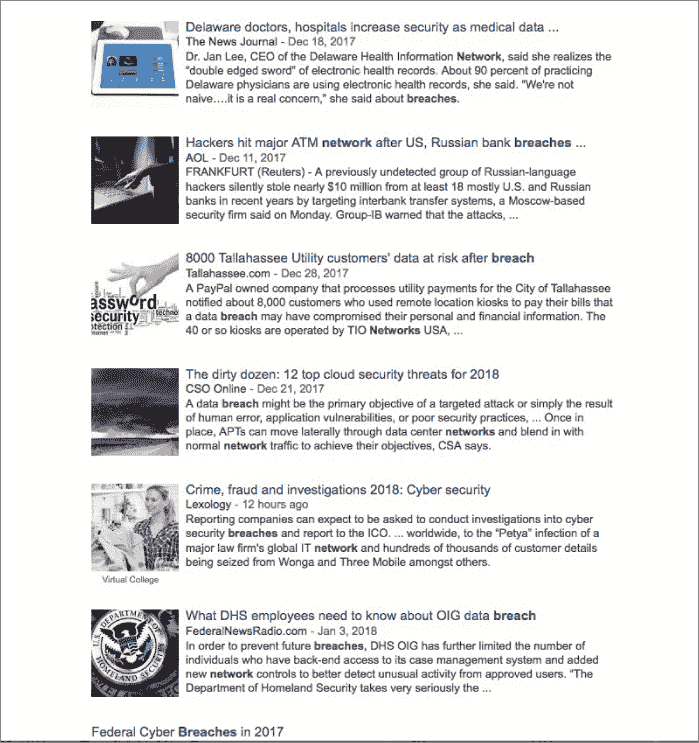

**图 10-2** 当前新闻的部分示例

这些报道中的每一个都包含关于违规事件的详细信息，包括其发生方式、原因以及被利用的漏洞（无论是人为因素、硬件、软件，还是所有这些）。了解影响其他公司的攻击，可以帮助你的公司保持安全。

当你看到某个当前的漏洞利用正在针对特定防火墙并已导致公司被攻破时，是时候检查该防火墙是否存在于你的网络中，以及是否已打补丁。当你看到商业电子邮件妥协（BEC）网络钓鱼诈骗在增加时，是时候通过教育和适当的政策来加强防御。无论你读到的违规事件的原因是什么，开始梳理当前威胁并将其与你的基础设施进行比较，以找出薄弱环节，这都是一个很好的教训。

外面有很多公司出售威胁建模服务来帮助你做到这一点，你可能需要他们的帮助。否则，最好自己开始建模，并确定可以在哪些方面增强、加强和巩固你当前的计划和协议，以保持对攻击的警惕。

## 建立安全意识文化

我将再次以 Josh 和他与我的训练为例来说明这一点。与 Josh 合作一段时间后，更容易识别出会使我的进度面临风险的行为和情况。例如，全天不计算卡路里，或者试图猜测份量而不是称重，这些通常是可能导致收益不足的小行为。另一方面，去吃无限量披萨自助餐，并试图说服自己吃两片后就停止，这将是一个重大挫折。

Josh 帮助我意识到，我全天做出的决定可以让我养成一种注重健康的生活方式。当一份 6 盎司的菲力牛排就足够时，我不需要一份 24 盎司的波特豪斯牛排。如果我想吃甜点，我需要确保我在白天早些时候做出更好的决定，这样我就不会毁掉整个计划。诸此类推。

这与在你的组织中建立安全意识文化有什么关系？关系重大！

通过适当的培训、提醒和奖励，你可以创造一种文化，让你的员工群体知道他们做出的微小决定可能会产生长期影响。并且他们会意识到，如果做出错误的选择，重大决定可能会造成毁灭性后果。

在我与 Josh 的合作中，奖励是减肥、感觉更好、看起来更好以及整体健康状况更好。这个奖励是我坚持该计划的良好动力。并非每个员工都会对“捕获网络钓鱼”或“报告语音钓鱼”感到同样的奖励。这并非因为他们不关心或讨厌公司——只是有些人太忙了，可能会将培训计划视为一种浪费时间的必要之恶。

那些人最难转变，但转变是可能的。在我合作过的一家公司中，一位部门经理明确表示他讨厌我们正在进行的测试。结果，他管理的 450 人的部门似乎成为公司最大的威胁之一。恶意软件、网络钓鱼和其他攻击经常在这个部门造成问题。

经理意识到他的员工没有遵守规定。他感到沮丧，并想采用羞辱和尴尬的方法，点名批评最严重的违规者。我从未见过该方法有效——通常，它会在经理和团队之间造成对抗关系。在那些情况下，如果有遵守，那也是出于恐惧、愤怒或怨恨。在与客户的会议上，我建议尝试与他们的呼叫中心团队玩一个快速游戏。我说我会给他们发送一个毛绒鱼玩偶，并希望他们宣布，每个月第一个 `不点击` 并 `举报` 网络钓鱼的人，将在他的或她的隔间里得到这个鱼玩偶。该人将被当月评为“网络钓鱼之王”。

现在，你可能坐在那里觉得这个想法听起来很荒谬。你说得对，它确实如此。但两个月后，你不会相信 450 名成年人之间为在他们的隔间里拥有那个毛绒玩具而展开的竞争。被评为“网络钓鱼之王”成为了一种荣誉的象征。

结果远不止是与我们的计划互动增加。因为员工们积极寻找网络钓鱼，举报率从平均 7% 上升到几个月内的 87% 以上。点击率在同一时间内从大约 57% 下降到 10% 以下。而最有成效的结果是，网络上发现的实际恶意软件下降了 79% 以上。

这个简单的改变创造了一种安全意识文化。员工们开始做出更好的决定，他们看到了变化，并有动力保持这种变化。

什么能为你的组织带来这种改变？在与你交谈之前，我无法确切告诉你需要什么，但这里有一些我多年来看到有效的想法：

*   `Rewards` 我看到过从前面提到的毛绒鱼玩偶到礼品卡抽奖等各种奖励，用于奖励连续 X 个月采取正确行动的人。当然，如果你的团队规模很大，奖励可能会很昂贵；或者如果奖励不实用或微不足道，可能缺乏激励作用。在一个组织中，他们试图每个季度给那些整个季度都保持在理想行为组中的人发放一张 5 美元的礼品卡。这份礼物太小，无法起到激励作用。奖励需要具有激励作用，但这并不意味着它必须是一台全新的 60 英寸平板电视或一年的薪水。它只需要是某种能代表你对所要求的行动和态度的赞赏之物。

*   `Positive Reinforcement` 我看到一些公司在内部网上列出那些在理想行为组中待了 X 个月的人的名单。有些公司在内部网页面上表彰连续 X 个月捕获网络钓鱼的“明星员工”。正向强化比羞辱和尴尬效果好得多，并且能出于正确的原因激励持续的期望行为。

*   `Extra Training` 在你开始指责我之前，让我解释一下我所说的“额外培训”是什么意思。我看到许多公司在名为“午餐与学习”的会议中取得了巨大成功。他们提供披萨或其他类型的食物（如果你邀请我，请准备沙拉或其他健康食物，这样 Josh 不会生我的气），并就某个安全主题进行简短的演讲、视频或演示，让与会者受益。当然，那些参加的人起初可能是为了免费食物，但我参加过的会议总是以许多人能够带走至少一条有用信息而告终。这也是你强化希望员工采取的概念和行动的绝佳机会。


# 自上而下的强化

这个方法似乎拥有近乎神奇的力量，仿佛你对整个群体施了魔法。当 CEO 让团队知道他/她也会每月与员工一起遭受网络钓鱼测试，并告知他/她的表现时，这传递了一个非常明确的信息：“我们是一起面对的……是认真的。”在我合作过的一个组织中，钓鱼测试计划最初的反应并不理想。在一个极端案例中，一名在收到钓鱼邮件时采取了所有错误行动的女性非常愤怒，她要求我接电话，并花了 10 分钟责骂我。她告诉我我是个多么糟糕的人，以及我需要重新审视我的人生道路。几个月后，这个庞大组织的 CEO 召开了一次全员大会。在会议上，CEO 提到了钓鱼测试计划；他解释说他也像其他人一样被钓鱼了，并且他正在学习需要更加警觉。仿佛某种神秘的护身符被挥洒在群体上，愤怒消失了，对我的社会工程（SE）团队的攻击性大大减少，我们看到了更高比例的合规性。有时，群体会觉得他们被特别挑出来显得愚蠢。这可能会导致对抗关系，而让公司的高层管理人员支持该计划真的能起到很大帮助。

以下是你应该牢记的另外两点：

## 保持耐心

不要假设因为你现在正确地培训了他们，你的员工群体就会立刻跟风。可能需要时间和持续的努力，才能让员工看到你的愿景并对其充满热情。

## 管理期望

这听起来熟悉吗？应该熟悉。这不仅可以帮助建立良好关系，还可以帮助你在公司中创建一种安全意识文化。仅仅因为你能识别钓鱼邮件、识别语音钓鱼电话或找出不属于这里的人，并不意味着每个员工都能如此迅速地做到同样的事。

通过保持耐心和管理期望，你将帮助员工与新的教育保持一致。

# 总结

尽管起初可能很难相信你能做到这一点，但你可以创建一种安全意识文化。你可能会看看你目前的“状态”，并认为这需要太多的努力或时间。然而，这种努力是值得的。拥有安全意识文化的回报远远超过了风险。

Josh 曾在一封发给我的电子邮件中说：“这是一场终身的旅程，而不是 3 到 12 个月的旅程。改变习惯很难，但我们都是在不断进步的作品。”

这并不意味着你应该一遍又一遍地做同样的事情，并希望它会变得更好。快速失败并继续前进很重要。尝试本章中的某些方法，如果不起作用，就不要继续做。意识到它不起作用，然后尝试新的东西。

Josh 不断改变我的计划，有时每周都会变。计划保持不变超过一个月的情况很少见。我不是说你需要如此频繁地调整，但这其中有一个教训。为了让我的计划有效，我必须每周与 Josh 进行沟通，让他了解我上周的完整情况。然后他会考虑我的出行、饮食选择、运动量，甚至我那周的个人问题水平。所有这些信息都帮助他判断是否需要做出改变，以保持进度在正轨上。我相信他进行了大量分析，并为他所做的决策制定了流程。

这直接关联到你如何将本章应用于你的 SE 意识计划。确保你全面了解你的组织——从测试的物理方面到员工群体的心理。尝试理解他们可能面临的压力，以及这些压力如何影响他们的决策。一旦你有了完整的图景，规划你的安全计划就会变得更容易。制定清晰的前进路径，启动计划，然后观察其进展。

我不能告诉你这会让你防黑客。我甚至无法预测你会看到多少成功率。但是，我可以保证你会看到改变。我可以保证你将开始创造一种文化，其中的人不仅知道外面有什么类型的攻击，还能够防御这些攻击。

你如何将本书中的所有知识应用到成为一名社会工程渗透测试人员，或者作为一家希望防御社会工程师的公司？最后一章将帮助将所有这些联系起来，我保证我甚至不会提到 Josh。（抱歉，Josh。你的 15 分钟名声结束了。）

# 11 现在怎么办？

> 限制自己更容易，但如果你这样做，你就永远无法达到你的真正潜力。

> ——CHRIS WITTY

当我回想过去八九年时，我无法预测会发生什么。我绝不会想到我会有一份成功的事业，做我热爱的事情，同时还有一个帮助保护儿童免受伤害的非营利组织。

这次冒险教会了我，塑造了我，并帮助我成长为现在的我。并非一切都完美，我还有很大的成长空间，我想这就是本章想要明确表达的观点。

社会工程没有银弹或魔法棒。你不能读完这些页面，然后认为如果你加一点良好关系，一点影响力，一点非语言沟通，再加一点信任，混合在一起，你就能成为完美的社会工程师。这需要工作、自我反思，然后是更多的工作。

不可避免地，人们问我如何进入这个行业以及如何成为一名职业社会工程师。这个问题的答案有很多方面，但在这一章中，我会告诉你我在潜在的社会工程师身上寻找什么。

## 成为社会工程师所需的软技能

我遇到过很多拥有出色技能的人，但他们无法胜任这份工作。他们根本无法在这个行业中前进。我也遇到过一些对自己完全没有信心的人，但他们最终成为了出色的社会工程师。

在这两类人中，有四个显著的特征，我认为如果你想将此作为职业道路，这些特征可以帮助你。我真心觉得它们对你的进步至关重要：

### 谦逊

毫无疑问，在这个领域表现出色的人具备的一个特质是谦逊。通常，谦卑或温顺被视为一种弱点，但我请你花点时间想想你生活中一个你认为真正谦逊的人。你想到那个人了吗？（附注：如果你说的是你自己，那你就错了。）

现在不要思考地回答这个问题：“那个人让我感觉如何？”对我来说，这是一种快乐、受尊重和重要的结合。难道这不比被认为是一个无所不知、无法被纠正的人更有力量吗——换句话说，就是一个不谦逊的人？

当我有幸与 Paul Ekman 博士合作时，我亲身体验到了这一点。因为他拥有如此强大的智力，我原本以为与他合作会很艰难和苛刻。然而，我发现他非常谦逊，愿意接受他人的意见，并愿意给予创作自由。当我需要纠正时，他很坚定，但也很有洞察力并能给予指导。

我见过在社会工程领域表现出色并且我很乐意与之合作的每一个人，都具有一定的谦逊和愿意被纠正的意愿。

### 动机

我认为工作是你每天去上班、完成任务，然后下班后就忘记它的事情。如果你想要一份工作，成为一名专业的社会工程师可能不是一个好选择。成为一名专业的社会工程师更像是一种职业生涯。它会改变你在工作和非工作环境下的样子。然而，所涉及的技能并非都天生具备，所以如果你想在这个行业中立足，你需要有动力去学习、成长和不断改进。

### 外向


现在等一下！在你把书扔进碎纸机并尖叫，“*我是个内向者！*”之前，请知道我并不是说你需要改变。我建议你调动一点外向性，并学会在工作时开启它。

你可能还记得在第 3 章，“通过沟通画像分析人群”中，我是一个强势的 *D*（直接型）沟通者。*D* 类型通常以“告知”为主，不善于引导。这是我自然倾向的方向，但当我开始更多地进行演讲和培训时，我意识到直接沟通对于这些任务来说，不如影响者（*I*）有效。我练习了一些 *I* 类型的沟通方式，并在培训中开始使用这些技巧。结果是，我不那么疲惫了，学生们也更喜欢培训了。

我建议你一次只练习一项技能，直到它成为你需要时可以随意从工具箱中拿出来使用的工具。尽管对你说“今天，我要和两个完全陌生的人开始交谈”可能很痛苦，但我建议你就这样做。过一段时间，这项任务会变得容易得多，你需要提升挑战难度。

在短时间内，你可以转向沟通的另一个方面，直到你能随心所欲地开启和关闭这些技能。

### 愿意尝试

对失败的恐惧是我看到的导致人们不擅长这份工作的最大原因之一。对某些人来说，这甚至会让人无法动弹。那些在成为专业社会工程师的道路上取得成功的人，都能够走出舒适区，并意识到有时失败是最好的老师。那些愿意尝试新事物的人似乎能够融入许多不同的群体，并更容易适应各种情况。我注意到，那些害怕新文化、新食物、新人和新体验的人，往往觉得这份工作最具压力和最令人疲惫。

### 它真的有效！

我见过一个原本认为自己永远无法成为社会工程师的人，应用了这四个特质，并成为了一名出色的 SE。我记得第一次见到他时。他走进我的教室，坐在教室后排，双手交叉放在膝上，低着头。

当我见到他时，我意识到他是一个极端的内向者。我很想知道他为什么会坐在*我的* SE 课堂上。是他的老板让他来的吗？是他的公司规定他必须在那里吗？我开始了课堂开始时的常规流程：我每天都会播放一段 Clutch（地球上最好的摇滚乐队）的音乐。当第一首歌的第一个和弦响起时，这位名叫 Ryan 的学生抬起了头，我看到他脸上明显露出了放松的神情。

我对自己说：“好吧，很好。他是 Clutch 的粉丝。”我向他自我介绍。在简短的交谈中，我发现并不是他的老板让他来的，也没有强制规定——他只是想挑战自己，走出舒适区，尝试新事物。我仍然感觉到他完全预料到这会太难。

在接下来的四天里，我看到 Ryan 展现出了惊人的愿意尝试我要求他做的每一件事的意愿。他有动力不放弃任何任务。随着一周的进行，他甚至变得更加外向了。我注意到的最大一点是，他经常来找我，要求我对他晚上的家庭作业提出更多建议、批评和评价。

课程结束时，Ryan 被全班同学评为“最具进步学生”奖。我告诉我的团队：“我打算一两年内雇佣 Ryan。”

然而，雇佣他证明并非易事。Ryan 已经是一个变了的人。他目前的公司看到了这些变化并奖励了他。他从首席渗透测试员转变为领导所有 SE 攻击的行动。他进行语音钓鱼、网络钓鱼，并闯入各个场所。最重要的是，他做得很好。

我花了三年时间才雇佣他，但现在 Ryan 负责我公司所有的 SE 工作。他仍然是内向的。他仍然喜欢计划（在我看来，计划得太多了），但他有动力，愿意尝试新事物，能够开启他的外向性（是的，这个词是我编造的），并且仍然经常寻求建议、帮助和咨询。

我知道总有一天我会为 Ryan 工作——我确信这一点。如果他能在 SE 领域取得成功，你也可以。你只需要我刚才描述的四个原则。

## 技术技能

也许我被问得最频繁的问题之一，就是关于 SE 需要什么样的技术相关课程。这个问题没有简单的答案，但让我试着为你指明正确的方向。

技术技能在这份职业中很重要，因为你将始终与技术打交道。了解如何使用简单的技术，例如 USB 键、启动机器和连接到 VPN，在帮助你制定借口以及在获得访问权限后，将大有裨益。

话虽如此，你是否必须成为一名专家级漏洞编写者？完全不需要。以下是我快速判断你应该具备多少技术能力的规则。你是一个人单干，还是与一群人组成团队工作？如果你是一个人单干，那么你可能希望具备一些强大的技术技能。如果你没有这些技能，这将严重限制你的服务范围。

另一方面，如果你将与一群人一起工作，你可以检查一下，看看你的某些队友是否具备所需的技能，这样你在某些方面可以比单独工作时更弱一些。在我的团队里，我们有技术人员和非技术人员很好地融合在一起工作。

如果你确定想要具备一些技术技能，以下是我认为重要的一些事项：

*   基础计算机知识

*   基础办公软件知识（例如 Word 和 Excel）

*   了解计算机的不同部件及其运作方式

*   能够在 Mac、Windows 和 Linux 操作系统中导航

*   了解网络的工作原理

*   了解如何设置邮件服务器

*   照片编辑技能

如果你打算在渗透测试中使用漏洞利用，你还需要以下技能：

*   了解像 Metasploit 和 Empire 这样的漏洞利用框架

*   能够阅读和理解代码

*   能够编写一些代码

## 教育

“要成为一名社会工程师，我应该拥有什么样的教育背景？”每次我被问到这个问题——频率远超你的想象——我都会告诉那个人，我觉得自己真的不具备在这个方面指导他们的资格。毕竟，我的大学经历以我编写一个战争拨号器，然后被院长和警察“请”离学校而告终。

尽管我的教育背景存疑，但我对哪些教育是有益的还是有一些看法。你不需要在这些方面成为大师，但我建议你对以下领域有基本了解：

*   **心理学** 关键是要记住，虽然你*不是*受过训练的心理学家或治疗师，但了解人类如何做决策是很重要的。

*   **语言、语法和写作** 你可以是地球上最好的社会工程师，但如果你不能写出一份清晰、写得好的报告，那么你的努力将永远得不到认可。一门能帮助你学习语言并增加专业词汇的高质量课程，我投赞成票。

*   **社会心理学** 了解人类在社会群体中如何互动，什么影响我们，以及这些群体如何影响我们，无疑会让你成为一名更好的社会工程师。

现在你可能会问，“等等，就这些？”嗯，就像我说的，我不是你的大学导师。我只是根据我的经验提供建议。如果你在这些方面没有正式教育，请不要认为你永远无法成功。你可以阅读书籍、访问网站、收听播客，并与拥有你所寻求知识的人交谈，以便对其中许多事物有基本的了解。


记住，最终目标不是成为心理学家、治疗师、语言学家或社会心理学家。你只需具备足够的知识，以便在看到某个原则发挥作用时能够识别出来。

## 职业前景

如果我能在这本书中加入一种万无一失的方法来确保你总能找到工作，我想我手里会有一本《纽约时报》畅销书。令人难过的事实是，没有快速的方法可以确保这一点，但我可以向你指点几条我见过有效的路径。

### 创办自己的公司

你可以开始向所在地区的公司销售社会工程学服务。如今，创办这类公司不像我开始时那么困难。（不客气。）

我开始时，主动提出免费发送五封（是的，只有五封）钓鱼邮件，只是为了让人们尝试一下。然而，潜在客户有时仍会拒绝这个提议。如今，人们希望在渗透测试和服务中看到社会工程学的应用。媒体、新闻和整个世界已经帮助公司意识到社会工程学所带来的威胁，因此这使你的工作变得更容易。

即使过去几年发生了变化，这条道路上仍然存在一些障碍。想想你要求公司允许你做什么：“请给我一份用户列表，让我对他们进行钓鱼或语音钓鱼。哦，还要让我闯入你们的公司并拿走东西。如果你愿意，我可以远程访问，顺便黑进你们的系统。”

大多数公司都会想知道你与谁合作，你是否有推荐人，谁了解你，以及其他细节，这些都会让起步变得非常困难。但还不要坐下来哭泣——你可以做一些事情来让自己出名。

在会议上发表演讲，或写几篇博客文章或文章，让人们阅读并评论。在这个领域拥有哪怕一个小小的公众名声，都能帮助你的企业成为提供服务的有力竞争者。我见过一些人通过在社区中制造一些声响而创办了成功的企业，尽管他们之前没有社会工程学方面的经验。他们来到 DEF CON，参加我在那里主办的社会工程学夺旗赛（SECTF）。在表现出色并获胜后，他们继续创办了提供社会工程学服务的成功公司。建立信誉帮助他们走上了这条道路。

### 被渗透测试公司雇佣

大多数渗透测试公司都提供某种形式的社会工程学服务。我见过一些人走通的一条路径是进入一家渗透测试公司工作。如果你刚毕业或没有经验，可能需要从基层做起。

不过，一旦进入公司，你就可以表明你愿意进行语音钓鱼、协助预设情境等等。当你做得出色时，公司会给你更多机会。如果你成功，你可能会利用这种方法迅速晋升。

然而，这条路可能需要几个月甚至几年。你可以主动提出帮助，但你的公司可能一段时间内不会使用你。你必须制定一个计划，决定你愿意尝试多久。

我的建议是，你要带着耐心和学习新技能的意愿走这条路，这些技能可能会在你在这个公司晋升或离开时帮助你。

### 被社会工程学公司雇佣

快速的谷歌搜索告诉我，有相当多的公司专注于社会工程学，但只有少数公司将其作为唯一的服务项目。我的公司就是一家只专注于社会工程学的公司，我们每月都会收到许多想为我们工作的人的请求。我很想雇佣他们所有人（如果他们合格的话），但我们只在需要人时才雇佣。（合乎逻辑，对吧？）

然而，这不应该阻止你主动询问。你可以联系这些公司，告诉他们你正在进入这个领域。分享你写过、讲过和/或做过的事情，并让公司知道你希望他们在有职位空缺时通知你。进入这些公司的潜在雇佣名单，可能会让你获得那份梦寐以求的工作。

无论你选择哪条路，这个领域都需要人才。社会工程学*不会*在短期内消失，对那些想要有所作为的熟练人才的需求将始终存在。

## 社会工程学的未来

我能认真说一会儿吗？除了谈论黑客攻击的报告——例如 Verizon DBIR 报告、思科的报告等——社会工程学正在被用于一些非常黑暗的地方。

每天，都有新的报告讲述人们离开家人和家园加入恐怖组织的事情。这是如何发生的？

当你分析这些故事时，你可以看到本书中提到的所有社会工程学要素。加入恐怖组织的人愤怒、情绪化，并寻找一个部落。然后一个部落出现，给他们答案和动力去“解决”他们的问题。人们感到被需要、被想要和被接受。新部落起初要求小事，建立信任和紧密的联系。这会持续到转变完成。

根据理查德·佛罗里达（Richard Florida）撰写的题为《外国 ISIS 战士的地理》（The Geography of Foreign ISIS Fighters）的文章（CityLab，2016 年 8 月，`www.citylab.com/equity/2016/08/foreign-fighters-isis/493622`），来自突尼斯、俄罗斯、沙特阿拉伯、土耳其和约旦的 19,000 多人离开家园加入 ISIS。在英国、法国、德国和美国等西方国家，数字较低（加入的人数不超过 2,000 人），但招募所使用的相同原则正在被采用。

另一个非常令人不安的趋势是，这些原则正被儿童掠食者用来引诱儿童。掠食者使用在线聊天工具，通过进入儿童的“部落”来开始一段关系。掠食者会寻找与父母争吵或家庭生活不美好的儿童，然后建立融洽关系，积极倾听，使用开放式问题，并提出最终成为儿童想法的想法和概念。

NCMEC（失踪和被剥削儿童国家中心）报告称，2017 年，美国有 465,676 名失踪儿童（`www.missingkids.com/KeyFacts`）。同年，在 FBI 协助处理的 25,000 起离家出走案件中，每七个儿童中就有一个是性贩卖的受害者。这些儿童中有许多被恋童癖者引诱过。

我知道这一切都非常黑暗，但我试图让你意识到，社会工程学不会消失。从企业攻击，到对你奶奶的个人攻击，再到恐怖组织的引诱和儿童掠食者，社会工程学将长期存在，并且越来越多地被使用。

我们需要人们站在好的一边，帮助保护、教育和赋能他人，让他们理解这些技能并学习如何防御这些攻击。我不向你保证这会很容易。不过，我向你保证，这是有回报的。

在我职业生涯的过去八年里，我有机会与全球数十家公司合作，这些公司在易受社会工程学攻击方面看到了巨大的降低。一家公司告诉我，他们网络上的恶意软件减少了 87%，并直接将其与我们的钓鱼教育联系起来。

另一家公司报告说，他们的代理人能够成功识别、阻止并报告针对其组织的一次活跃语音钓鱼攻击，这要归功于我们与他们进行的培训。

我的一名学生告诉我，他在我的五天课程中学到的知识挽救了他的婚姻。虽然撰写社会工程学课程时，挽救婚姻从来不是我的初衷，但我很高兴这名学生受到他所学到的关于沟通、融洽关系和影响力的知识的深远影响，并在家中应用了这些知识，帮助修复了他的关系。


我也部分负责拯救多名儿童免受剥削，无论是在我从事的企业工作中，还是在我与新成立的非营利组织“无辜生命基金会”（Innocent Lives Foundation）开展的工作中（`www.innocentlivesfoundation.org`）。运用我每天教授的那些技能来揭露那些侵害儿童的人，这不仅仅是有成就感。

最后——还有一个非常私人的备注——我能够教会我的孩子们这些同样的技能，这使他们更具自我意识，更不容易受到攻击，并且（以我不那么谦虚的观点）是我认识的最平衡、最了不起的人之一。

学习如何使用这些技能不仅在职业生涯中有成就感，在日常生活中也是如此。我希望这本书能激励你想要学习更多。如果你已经掌握了其中许多技能，那么我希望这本书至少能给你一两个值得思考的新想法。如果你是怀疑论者或爱好者，我希望这本书能就这些技能及其使用方法促进一些健康的讨论。

我欢迎你就此话题提出意见和看法。我鼓励你将这些技能作为日常工具箱的一部分。保持安全，保持安全。

# Index

*   18th-Floor Escapade, 85–86

    *   names, 91–93

    *   pretexting and, 88

*   419 scams, 224

*   **A**

*   accents, 111

*   alpha mode of the brain, 4–5

*   altruism, rapport building and, 118–119

*   amygdala, 183, 185

    *   triggering, 186–187

*   anger, 198–201

*   art, science and, 157–158

*   assistance themes, rapport building and, 111–112

*   assumptive questions, 181–182

*   attacks

    *   identification (M.A.P.P.), 259–260

    *   launching, 12

    *   planning, 11

*   authority, influence and, 137–142

*   **B**

*   Barnlund, D.C., *Communication Theory*, 64

*   Barraza, Jorge A., 214

*   Bazzell, Michael, 32

*   Behavioral Study of Obedience, 139–140

*   Benford, Robert D., 161

*   Berlo, David, 64

*   beta mode of the brain, 4–5

*   brain

    *   alpha mode, 4–5

    *   beta mode, 4–5

    *   dopamine, 8, 107

    *   oxytocin, 8, 106, 112

*   Bulwer-Lytton, Edward George, 157

*   business cards, 92

*   **C**

*   checkups (M.A.P.P.), 264–265

    *   questions to ask, 265

    *   referrals, 265

    *   rules, 265–266

*   Cialdini, Robert

    *   influence

        *   authority, 137–142

        *   concession, 131–134

        *   consistency and commitment, 142–146

        *   liking, 146–148

        *   obligation, 128–131

        *   reciprocity, 125–128

        *   scarcity, 134–137

        *   social proof, 148–150

    *   *Influence: The Psychology of Persuasion*, 123

*   classified items, 48

*   close-ended questions, 180

*   clusters, nonverbals and, 195

*   Comey, James, data collection on, 18–20

*   commitment, influence and, 142–146, 225

*   *Communication Theory*, 64

*   communications, 65–66

    *   body language, 67

    *   DISC system, 68–69

        *   applications, 76–77

        *   assessment, 72–75

        *   benefits, 75

        *   C communicator, 78

        *   conscientious/compliant style, 69, 78

        *   D communicator, 77

        *   direct/dominant style, 69, 70, 77

        *   I communicator, 77

        *   influencing style, 69, 77

        *   limitations, 79–80

        *   S communicator, 78

        *   supporter/steady style, 69, 78

    *   emotional content and, 187–190

    *   facial expressions, 67

    *   framing in, 159–161

        *   frame amplification, 161

        *   frame bridging, 161

        *   frame extension, 161

        *   frame transformation, 161

    *   nonverbals, 184–186

    *   pretext, 67

    *   Shannon-Weaver model, 63

    *   SMCR (Sender-Message-Channel-Receiver) model, 63

    *   speech, 67

*   concession, influence and, 131–134

*   confidence, physical reactions, 196

*   confidential items, 48

*   congruence, nonverbals and, 196

*   conscientious/compliant (DISC system) style, 69, 78

*   consistency, influence and, 142–146, 225

*   contempt, 203–205

*   context, nonverbals, 196–197

*   cortisol, 196

*   costs, data breaches, 1–2

*   credential harvesting, vishing and, 233–235

*   cultural differences, rapport building and, 115

*   **D**

*   d0xing, 35–43

*   Dark Reading, 12

*   data. *See also* OSINT (Open Source Intelligence)

    *   breaches, costs, 1–2

    *   collecting, 17–21

    *   metadata, 54–59

    *   yottabytes, 17

    *   zettabytes, 17

*   develop policies (M.A.P.P.), 261–264

*   DHEA (dehydroepiandrosterone), 196

*   direct/dominant (DISC system) style, 69, 70, 77

*   DISC system, 68–69

    *   applications, 76–77

    *   assessment, 72–75

    *   benefits, 75

    *   C communicator, 78

    *   conscientious/compliant style, 69, 78

    *   D communicator, 77

    *   direct/dominant style, 69, 70, 77

    *   I communicator, 77

    *   influencing style, 69, 77

    *   limitations, 79–80

    *   S communicator, 78

    *   supporter/steady style, 69, 78

*   disgust, 201–203

*   documentation, 21


*   *不要想一头大象* (Lakoff), 161

*   多巴胺, 8, 107

*   Dreeke, Robin, 66–67

*   Duchenne, Guillaume, *Mécanisme de la physionomie humaine*, 216

*   **E**

*   社会工程师教育, 281–282

*   教育性网络钓鱼, 229–230

*   自我 

    *   自我诉求, 引出和, 168–170

    *   关系建立和, 112–114

*   Ekman, Paul, 29, 96, 183–185, 197, 203 

    *   *揭露社会工程师*, 28

*   引出 

    *   自我诉求, 168–170

    *   虚假陈述, 172–174 

        *   以物易物和, 175

    *   知识, 174–176

    *   共同利益, 170–172

    *   借口和, 185

    *   问题, 177–179 

        *   假设性, 181–182

        *   封闭式, 180

        *   引导性, 180–181

        *   开放式, 179

*   情感内容. *另见* 非语言 

    *   基准线, 187–190

    *   沟通和, 187–190

*   *正常人的情绪* (Marston), 69

*   社会工程师就业, 250–251 

    *   费用, 253–254

    *   增加服务, 251–253

    *   渗透测试公司, 283–284

    *   自雇, 283

    *   社会工程公司, 284

*   期望, 关系建立和, 118–119

*   外向性, 社会工程师和, 279–280

*   **F**

*   虚假陈述, 引出和, 172–174 

    *   以物易物和, 175

*   恐惧 

    *   杏仁核和, 183 

        *   触发, 186–187

    *   特征, 205–206

    *   影响, 185–186

*   Florida, Richard, 285

*   FOCA (Fingerprinting Organizations with Collected Archives), 60

*   框架 

    *   沟通和, 159–161

    *   框架放大, 161

    *   框架连接, 161

    *   框架扩展, 161

    *   框架转换, 161

    *   否定框架, 165–166

    *   借口和, 161–162

    *   强化, 166–167

    *   词语 

        *   身体功能, 163

        *   脏话, 163

        *   在框架中定义, 164–165

        *   基于性别的谩骂, 163

        *   渗透测试, 164

        *   基于种族的谩骂, 163

        *   基于性取向的谩骂, 163

*   Frank, Mark, 189

*   Fraser, Scott C., 143

*   Freedman, Jonathan L., 143

*   Furneaux, Nick, 32, 35–43

*   **G**

*   性别, 借口和, 87

*   Google, 42 

    *   操作符 

        *   cache, 45

        *   filetype, 45

        *   info, 45

        *   intext, 44

        *   inurl, 44

        *   site, 44

    *   搜索技巧, 45

    *   爬虫, 43–44

*   语法知识, 282

*   贪婪, 224

*   **H**

*   黑客, 负面反应, 7

*   幸福, 215–220 

    *   腹部展示和, 218–219

*   希望, 224

*   人性黑客, 3–4

*   谦逊, 社会工程师和, 278

*   Hwang, Hyi Sung, 189

*   **I**

*   识别攻击 (M.A.P.P.), 259–260

*   冒充, 8–9, 241 

    *   设备采购, 245–246

    *   计划 

        *   攻击, 243

        *   信息收集, 242

        *   借口开发, 242–243

        *   记录合法性, 244

        *   报告, 243

    *   清理, 244–245

*   影响, 123 

    *   权威, 137–142

    *   让步, 131–134

    *   一致性和承诺, 142–146

    *   喜好, 146–148

    *   *与* 操纵, 150–156

    *   义务, 128–131

    *   互惠, 125–128

    *   稀缺性, 134–137

    *   社会认同, 148–150

*   *影响力：说服的心理学* (Cialdini), 123

*   影响 (DISC 系统) 风格, 69, 77

*   无辜生命基金会, 125, 286

*   *整合心理学：单位反应研究* (Marston), 69

*   IntelTechniques, 59–60

*   内向性, 社会工程师和, 279–280

*   **J**

*   Javor, Andrija, 107

*   **K**

*   Kelly, Paul, 96

*   **L**

*   Lakoff, George, *不要想一头大象*, 161

*   Langer, Ellen, 4

*   语言知识, 282

*   Lares Consulting, 63

*   Larkin, Tim, 187

*   引导性问题, 180–181

*   习得性无助, 153

*   从他人错误中学习 (M.A.P.P.), 270–271

*   Lee, Bruce, 2

*   喜好, 影响和, 146–148

*   Loftus, Elizabeth, 160

*   **M**

*   Maier, Steven F., 153

*   恶意社会工程, 223

*   Maltega, 60–61

*   操纵 

    *   *与* 影响, 150–156

    *   习得性无助和, 153

    *   原则, 152–153

*   M.A.P.P. (Mitigation and Prevention Plan), 257 

    *   攻击识别, 259–260

    *   检查 

        *   要问的问题, 265

        *   转介, 265

        *   规则, 265–266

    *   从他人错误中学习, 270–271

    *   政策制定, 261–264 

        *   可操作, 263–265

        *   决策和, 261–262

        *   共情绕过, 262–263


*   现实的，263–265

*   现实世界检查，264–266

*   安全意识文化，271–274

    *   安全意识文化 (M.A.P.P.) 

        *   正向强化，273

        *   奖励，272–273

        *   培训，273–275

*   安全意识计划，266–267

*   步骤，258 

    *   更新，268–270

*   Marston, William Moulton 

    *   *正常人的情绪*，69

    *   *整合心理学：单元反应研究*，69

    *   女性权利，69

*   Matsumoto, David, 189

*   内存 

    *   名片，92

    *   姓名，91–92

    *   合作伙伴，92

    *   记录设备，92

*   元数据，54–59

*   方法，艺术与科学，157

*   Milgram, Stanley, Behavioral Study of Obedience, 139–140

*   镜像神经元，111, 184

*   错误，从他人那里学习 (M.A.P.P.), 270–271

*   Mitnick, Kevin, 1

*   *道德分子* (Zak), 8, 106

*   动机，社会工程师与，278

*   Moulton, William, DISC 系统，68–69

*   共同利益，引出与，170–172

*   **N**

*   纳秒，7

*   NCMEC (National Center for Missing and Exploited Children), 285

*   网络入侵，M.A.P.P. 与，270–271

*   Nickerson, Chris, 63

*   尼日利亚诈骗，224

*   NOC (network operations center), 83–84

*   非语言行为，184–186 

    *   愤怒，198–201

    *   基础知识，196–197

    *   簇，195

    *   舒适与不适，198–220

    *   自信，196

    *   一致性，196

    *   轻蔑，203–205

    *   上下文，196–197

    *   厌恶，201–203

    *   恐惧，205–206

    *   幸福，215–220

    *   与情绪不一致，185–186

    *   儿童与，192–194

    *   说谎 *versus* 真相，189–190

    *   误解，190–194

    *   建立关系与，109–110

    *   阅读，187–188

    *   悲伤，211–215

    *   惊讶，206–211

    *   什么 *versus* 为什么，194

*   **O**

*   义务，影响与，128–131

*   O'Connor, Robert, 148–149

*   OilHater, 101–103

*   开放式问题，179

*   Operation Oil, 101–103

*   OSINT (Open Source Intelligence), 10–11, 226 

    *   汽车示例，30

    *   数据收集，17 

        *   Comey, James, 18–20

        *   元数据，54–59

        *   示例问题，19

    *   文档，21

    *   观察技能，22 

        *   着装，23

        *   条目，23

        *   入场要求，23

        *   出口，23

        *   大厅布置，24

        *   周界安全，23

        *   场景，23–27

        *   安全人员，23

    *   钓鱼，鱼叉式钓鱼，128

    *   预设情境，85–86

    *   机器人，52–54

    *   技能习得，27–31

    *   技术 

        *   dOx, 35–43

        *   Google, 43–50

        *   搜索引擎，34–35

        *   社交媒体，32–34

        *   摄像头，50

    *   语音钓鱼与，235–236

    *   工作空间示例，31

*   催产素，106, 112 

    *   信任与，8

*   **P**

*   合作伙伴，92

*   密码，48

*   渗透测试 

    *   文档，228

    *   作为社会工程师的就业，283–284

    *   冒充，241 

        *   设备采购，245–246

        *   规划，242–244

        *   清理，244–245

    *   钓鱼 

        *   教育性，229–230

        *   渗透测试钓鱼，230–231

        *   鱼叉式钓鱼，231–232

    *   预设文本，228–229

    *   报告，246–247 

        *   细节，248

        *   语法，248

        *   缓解措施，248–249

        *   专业性，247

    *   SE 框架，225, 227–228

    *   SMiShing, 240–241

    *   vishing 

        *   凭证收集，233–235

        *   完全妥协与，236–239

        *   用于 OSINT，235–236

    *   用词，164

*   Pennebaker, James, 34

*   渗透测试钓鱼，230–231

*   钓鱼，8. *另请参见* vishing (voice phishing) 

    *   通信与，96–97

    *   教育性，229–230

    *   渗透测试钓鱼，230–231

    *   鱼叉式钓鱼，128, 231–232

*   *Phishing Dark Waters: The Offensive and Defensive Sides of Malicious Emails*, 9

*   Pipl 网站，35–39

*   政策制定 (M.A.P.P.) 

    *   可操作的，263–265

    *   决策与，261–262

    *   共情绕过，262–263

    *   现实的，263–265

*   预设情境，6–7, 83 

    *   18 楼逃脱，85–86

    *   制定，11

    *   引出与，185

    *   执行，95 

        *   呼吸，96

        *   通信，96–98

        *   练习，96

        *   脚本，98

        *   拉伸，96

    *   框架与，161–162

    *   性别与，87

    *   目标，85–86

    *   走多远，88–90


* 即兴表演和，84–85

* 记忆力和 

    * 建立，93

    * 名片，92

    * 姓名，91–92

    * 合作伙伴，92

    * 练习，93

    * 录音设备，92

* 现实 `versus` 小说，87–88

* 支持，94–95

* 部落心态和，90

* 私钥，48

* 心理学知识，282

* Q

* 问题，177–179 

    * 假设性，181–182

    * 封闭式，180

    * 引导性，180–181

    * 开放式，179

    * 关系建立和，116

* 等价交换，关系建立和，117–118

* R

* 关系建立，105 

    * 口音，111

    * 适应非语言行为，109–110

    * 人为时间限制，108–109

    * 协助主题，111–112

    * 文化差异，115

    * 多巴胺，107

    * 自我悬置，112–114

    * 期望管理，119–120

    * 如何、为什么、何时问题，116

    * `The Moral Molecule` (Zak)，106

    * 催产素，106

    * 练习，120–121

    * 等价交换，117–118

    * 互惠利他主义，118–119

    * 较慢的语速，110–111

    * 同情，111–112

    * 验证他人，114–116

* 现实世界检查（M.A.P.P.），264–266

* 互惠 

    * 影响和，125–128

    * 互惠利他主义，关系建立和，118–119

* 录音设备，92

* 报告，12–13，246–247 

    * 细节，248

    * 语法，248

    * 缓解，248–249

    * 专业性，247

* Riedl, René，107

* 机器人，52–54

* Rochford, E. Burke Jr.，161

* RSA 私钥，48

* S

* 悲伤，211–215

* 稀缺性，影响和，134–137

* 科学与艺术，157–158

* SE（社会工程学） 

    * 圣经示例，3

    * 黑暗用途，284–285

    * 早期信息，1–2

    * 社会工程师就业，250–251 

        * 费用，253–254

        * 增加服务，251–253

    * 未来，284–286

    * 历史，2–3

    * 冒充，8–9

    * 恶意，223

    * 负面反应，7

    * 概述，6–10

    * 渗透测试，225–228

    * 钓鱼，8

    * 前文，6–7

    * SMiShing，8

    * 阶段，226

    * Vishing，8

* SE 金字塔 

    * 攻击发起，12

    * 攻击计划，11

    * OSINT（开源情报），10–11

    * 前文开发，11

    * 报告，12–13

* 搜索引擎 

    * 运算符，44–45 

        * cache，45

        * filetype，45

        * info，45

        * inurl，44

        * site，44

    * 爬虫，43

    * Spokeo，34–35

* SECTF4Kids，135

* 安全，数据泄露成本，1–2

* 安全意识（M.A.P.P.） 

    * 文化，271–272 

        * 正向强化，273

        * 奖励，272–273

        * 培训，273–275

    * 计划，266–267

* 自由职业社会工程师，283

* Seligman, Martin，153

* SET（社会工程师工具包），59

* Shannon, Claude，64

* Shannon-Weaver 通信模型，63

* Skinner, Lisa，189

* SMCR（发送者-信息-渠道-接收者）通信模型，63

* SMiShing，8，240–241 

    * 练习，96

* Snow, David A.，161

* SOC（安全运营中心），83–84

* 社会工程公司就业，284

* `Social Engineering: The Art of Human Hacking`，2，3

* `Social Engineering: The Science of Human Hacking`，4

* 社会工程师 

    * 教育，281–282

    * 职业前景 

        * 渗透测试公司，283–284

        * 自由职业，283

        * 社会工程公司，284

    * 软技能，277–278 

        * 外向性，279–280

        * 谦逊，278

        * 动机，278

        * 尝试意愿，279

    * 技术技能，280–281

* 社交媒体 

    * Facebook，33

    * LinkedIn，33

    * Twitter，34

* 社会认同，影响和，148–150

* 社会心理学知识，282

* `The Social-Engineer Podcast`，4 

    * Bazzell, Michael，32

    * Furneaux, Nick，32

    * Langer, Ellen，5

    * Pennebaker, James，34

    * Zak, Paul，8，106

* 反社会人格，110

* 社会工程师的软技能，277–278 

    * 外向性，279–280

    * 谦逊，278

    * 动机，278

    * 尝试意愿，279

* 矛头钓鱼，128，231–232

* 语速，关系建立和，110–111

* 支持者/稳定型（DISC 系统）风格，69，78

* 惊喜，206–211

* 同情，关系建立和，111–112

* T

* 技术 OSINT（开源情报） 

    * dOx，34–43

    * Google，43–50

    * 搜索引擎，34–35


# 索引

* social media, 32–34
* webcams, 50
* technical skills for social engineers, 280–281
* time constraints, rapport building and, 108–109
* Tompkins, Michael, 110
* tools
    * FOCA (Fingerprinting Organizations with Collected Archives), 60
    * IntelTechniques, 59–60
    * Maltega, 60–61
    * SET (Social Engineers Toolkit), 59
* top secret items, 48
* tribe mentality, 90, 103
    * rapport building
        * accommodating nonverbals, 109–110
        * artificial time constraints, 108–109
        * assistance themes, 111–112
        * dopamine, 107
        * ego suspension, 112–114
        * expectations management, 119–120
        * how, why, when questions, 116
        * `The Moral Molecule` (Zak), 106
        * oxytocin, 106
        * quid pro quo, 117–118
        * reciprocal altruism, 118–119
        * slower rate of speech, 110–111
        * sympathy, 111–112
        * validating others, 114–116
    * “The Tribe Mentality - THE BYSTANDER EFFECT,” 103–105
* trust, oxytocin and, 8
* U
* `Unmasking the Social Engineer: The Human Element of Security` (Ekman), 28, 183
* `Uta Hagan's Acting Class` DVD, 85
* V
* validation, rapport building, 114–116
* ventral displays, happiness and, 218–219
* vishing (voice phishing), 3, 8
    * credential harvesting, 233–235
    * full compromise and, 236–239
    * for OSINT, 235–236
* W
* war dialing, 282
* Weaver, Warren, 64
* webcams, 50
* WebMii, 38
* WHOIS, 42
* word whiskers, 110
* Worden, Steven K., 161
* writing knowledge, 282
* X-Y-Z
* yottabytes, 17
* Zak, Paul, 8, 146, 214
    * `The Moral Molecule`, 8, 106
* zettabytes, 17

# Social Engineering: The Science of Human Hacking

Published by  
John Wiley & Sons, Inc.  
10475 Crosspoint Boulevard  
Indianapolis, IN 46256  
`www.wiley.com`

Copyright © 2018 by John Wiley & Sons, Inc., Indianapolis, Indiana

Published simultaneously in Canada

ISBN: 978-1-119-43338-5  
ISBN: 978-1-119-43373-6 (ebk)  
ISBN: 978-1-119-43375-0 (ebk)

No part of this publication may be reproduced, stored in a retrieval system or transmitted in any form or by any means, electronic, mechanical, photocopying, recording, scanning or otherwise, except as permitted under Sections 107 or 108 of the 1976 United States Copyright Act, without either the prior written permission of the Publisher, or authorization through payment of the appropriate per-copy fee to the Copyright Clearance Center, 222 Rosewood Drive, Danvers, MA 01923, (978) 750-8400, fax (978) 646-8600. Requests to the Publisher for permission should be addressed to the Permissions Department, John Wiley & Sons, Inc., 111 River Street, Hoboken, NJ 07030, (201) 748-6011, fax (201) 748-6008, or online at `http://www.wiley.com/go/permissions.`

**Limit of Liability/Disclaimer of Warranty:** The publisher and the author make no representations or warranties with respect to the accuracy or completeness of the contents of this work and specifically disclaim all warranties, including without limitation warranties of fitness for a particular purpose. No warranty may be created or extended by sales or promotional materials. The advice and strategies contained herein may not be suitable for every situation. This work is sold with the understanding that the publisher is not engaged in rendering legal, accounting, or other professional services. If professional assistance is required, the services of a competent professional person should be sought. Neither the publisher nor the author shall be liable for damages arising herefrom. The fact that an organization or Web site is referred to in this work as a citation and/or a potential source of further information does not mean that the author or the publisher endorses the information the organization or website may provide or recommendations it may make. Further, readers should be aware that Internet websites listed in this work may have changed or disappeared between when this work was written and when it is read.

For general information on our other products and services please contact our Customer Care Department within the United States at (877) 762-2974, outside the United States at (317) 572-3993 or fax (317) 572-4002.

Wiley publishes in a variety of print and electronic formats and by print-on-demand. Some material included with standard print versions of this book may not be included in e-books or in print-on-demand. If this book refers to media such as a CD or DVD that is not included in the version you purchased, you may download this material at `http://booksupport.wiley.com`. For more information about Wiley products, visit `www.wiley.com`.

**Library of Congress Control Number:** 2018943781

**Trademarks:** Wiley and the Wiley logo are trademarks or registered trademarks of John Wiley & Sons, Inc. and/or its affiliates, in the United States and other countries, and may not be used without written permission. All other trademarks are the property of their respective owners. John Wiley & Sons, Inc. is not associated with any product or vendor mentioned in this book.

*My whole life that I live as a social engineer, a father, husband, boss, friend, and more doesn't happen without my amazing wife, Areesa. I love you more than words can say*.

*My son, Colin, watching you grow up in this world and become a security-minded young man, as well as working with me, makes all the work worthwhile. I love you*.

*Amaya, you have been the light of my life, my reason for smiles on dark days, and the cause of joy in my heart. I cannot put into words how much I love you and how truly proud I am of who you are as a person*.

# ABOUT THE AUTHOR


**CHRISTOPHER HADNAGY** is the CEO and Chief Human Hacker of Social-Engineer, LLC as well as the lead developer and creator of the world's first social engineering framework found at `www.social-engineer.org`. He is the founder and creator of the Social Engineering Village (SEVillage) at DEF CON and DerbyCon, as well as the creator of the popular Social Engineering Capture The Flag (SECTF). He is a sought-after speaker and trainer and has traveled the globe to deliver at many events including RSA, Black Hat, DEF CON, and even has debriefed the Pentagon on these topics. He can be found tweeting at @humanhacker.

## ABOUT THE TECHNICAL EDITOR


**MICHELE FINCHER** 是一家特种化工公司的信息安全意识负责人。她拥有超过 20 年的行为科学家、研究员和信息安全专业人员经验。她的专长在于理解安全决策背后的心理学，特别是在社会工程领域。

Michele 一直是执法机构、情报界和私营部门的各种技术和行为主题的培训师和演讲者，演讲场所包括 Black Hat Briefings、RSA、SourceCon、SC Congress、Interop 和 Techno Security。

Michele 拥有美国空军学院的人因工程学理学学士学位和奥本大学的咨询学理学硕士学位。她是认证信息系统安全专业人员（CISSP）。

# CREDITS

## PROJECT EDITOR
Charlotte Kughen

## TECHNICAL EDITOR
Michele Fincher

## PRODUCTION EDITOR
Athiyappan Lalith Kumar

## COPY EDITOR
Kathryn Duggan

## PRODUCTION MANAGER
Katie Wisor

## MANAGER OF CONTENT ENABLEMENT AND OPERATIONS
Pete Gaughan

## MARKETING MANAGER
Christie Hilbrich

## EXECUTIVE EDITOR
Jim Minatel

## PROJECT COORDINATOR, COVER
Brent Savage

## PROOFREADER
Nancy Bell

## INDEXER
Johnna VanHoose

## COVER DESIGNER
Wiley

## COVER IMAGE
Background © Floriana /iStockphoto; Author Photo © Amaya Hadnagy Photography, 2018

# ACKNOWLEDGMENTS

“就在几年前，我还和我的朋友兼导师 Mati Aharoni 坐在一起，决定启动 `www.social-engineer.org`。”

这是《社会工程：人性黑客的艺术》的开篇语。当我坐在这里再次阅读它们时，感觉几乎像一场梦；那朦胧的记忆让我觉得自己随时都会醒来。我回顾了过去十年，尤其是过去八年的旅程，这一切都在这本书中栩栩如生。

在过去八年里，我与 Paul Ekman 博士、Robin Dreeke、Neil Fallon 等人合作过。我有幸采访过 Robert Cialdini 博士、Amy Cuddy 博士、Dov Baron、Ellen Langer 博士、Dan Airely 博士等众多人士。我有幸与 Apollo Robins 一起演讲并会见了 Will Smith。我曾被飞往英国培训 MI-5 和 MI-6 的成员。我还受邀前往五角大楼，向 35 位将军、国家元首和其他官员汇报社会工程相关情况。

过去八年就像一场精彩的过山车之旅。但就像任何项目一样，没有什么是靠一个人独立完成的。这些经历、我的生活，以及我有幸结识和合作的人，都离不开一路上帮助过我的许多人。

我的妻子 Areesa 是我遇到过的最耐心、最美丽的女性之一。虽然她并不生活在我所处的这个世界，但她真正支持我、爱我，并给了我一个充满欢笑、冒险和永恒回忆的幸福生活。

当我的儿子 Colin 还小的时候，他想当医生，然后想当作家，又想当志愿者。有趣的是，他尝试过护理和写作，并且至今仍在做志愿者。他积极的态度和善良的精神是我的榜样。

我记得曾发誓绝不会让我的女儿 Amaya 涉足社会工程这个世界；我要保护她安全。她教会了我，保护她安全意味着教导她、包容她，并让她成为我生活的一部分。她给我的远比我给她的多。

虽然 Ekman 博士与本书没有直接关系，但他的善良、动力和慷慨是我的灵感来源。谢谢。

我想感谢并承认那些一直陪伴我旅程的人：

* Ping Look 是建议和帮助的无私且源源不断的供应者。
* Dave Kennedy 的友谊和支持意义重大。
* Innocent Lives Foundation 已成为这一过程不可或缺的一部分，所以我想感谢该组织的以下人员：
    * 我从未想过 Neil Fallon 和我会成为朋友（掐我一下）。但现在他帮助指导我、引导我并鼓励我。他真正提醒我要做回人。
    * Tim Maloney 的支持和保护在组建 ILF 方面占据了很大比例。他在这一过程中的友谊、信念和支持，是我无法充分感谢他的。
    * Casie Hall 对成为解决方案一部分的兴奋和热情具有感染力。
    * 我感谢 AJ Cook 对 ILF 的支持，以及她在拯救儿童的努力中如此易于合作。她的奉献精神堪称典范。
    * Aisha Tyler（哈！就连打这个名字都有点超现实。）的工作态度、善良和专注能力是我们都应该效仿的榜样。
* 我在 Social-Engineer, LLC 的团队非常出色。Colin、Mike、Cat、Ryan、Amanda、Kaz、Jenn 和 Karen——每个人都帮助我进步，并在这一过程中支持了我。
* 我发誓我的编辑 Charlotte 应该是我写书的代笔人。她捕捉了想法，并帮助我听起来更聪明。（那是一份艰难的工作！）
* 还有 Social-Engineer 播客的读者和粉丝、会议上的 SEVillages、我的其他书籍以及 SE-Events 的参与者——你们让我保持高标准，不害怕指出我的愚蠢错误，并让我不断努力做得更好。谢谢！

# WILEY END USER LICENSE AGREEMENT

访问 [`www.wiley.com/go/eula`](http://www.wiley.com/go/eula) 以获取 Wiley 的电子书 EULA。

