# Python 软计算与机器学习


Arcler Press 出版各种书籍和电子书。欲了解有关 Arcler Press 及其产品的更多信息，请访问我们的网站 www.arclerpress.com

# 关于编辑


Zoran Gacovski 博士在斯科普尔je电子工程学院获得博士学位。他的研究兴趣包括智能系统和软件工程、模糊系统、图形模型（Petri 网、神经网络和贝叶斯网络）以及 IT 安全。他已发表了 50 多篇期刊和会议论文，并曾担任知名期刊的审稿人。

在职业生涯中，他曾获得富莱特博士后研究员学金（2002年），在美国鲁格斯大学进行访问研究。他还获得过波罗自动化控制奥林匹克竞赛（2002年）最佳论文奖、美国国家科学基金会（NSF）资助，用于在美国鲁格斯大学进行人机交互领域的特定研究（2003年），以及德国学术交流中心（DAAD）资助，在德国不莱梅大学进行访问研究（2008年）。

目前，他是马其顿斯科普尔je欧洲大学的计算机工程教授。

## 第 15 章 使用图论描述符对 RNA 二级结构的多图模型进行分类 ................................................................................ 329

摘要 ......................................................................................................... 329

引言 ...................................................................................... 330

对偶图的图论指标............................................... 334

图论指标作为 RNA 拓扑描述符的评估 ................................................. 336

结果 .......................................................................................... 338

## 贡献者列表

- Taiwo Oladipupo Ayodele

英国，波尔特茅大学

- Manoel Fernando Alonso Gadi

英国，米尔顿·凯恩斯

- Alair Pereira do Lago

巴西，圣保罗大学，数学与统计学院，计算机科学系

- Jorn Mehnen

英国，克兰菲德大学，克兰菲尔德，贝德福郡 MK43 0AL，决策工程中心

- Meherwar Fatima

巴基斯坦，穆尔丹，妇女大学计算机与信息技术学院

- Maruf Pasha

巴基斯坦，穆尔丹，巴哈丁·扎卡里大学，信息技术系

- Nanxi Wang

中国，上海，上海星河双语学校

- Makhamisa Senekane

莱索托，马塞鲁，Botho大学梅鲁山区，计算学院

- Benedict Molibele Taele

莱索托，罗马，莱索托国立大学，物理与电子学系

- Hudson F. Golino

巴西，维托利亚·达康奎斯塔，东北部独立学院，研究生研究与扩展中心

- Cristiano Mauro Assis Gomes

巴西，贝洛奥里哲特，米纳斯吉拉斯联邦大学，心理学系

- Diego Andrade

巴西，贝洛奥里哲特，米纳斯吉拉斯联邦大学，心理学系

- John W. Shipman

- Tom De Smedt

比利时，安特卫普，2000 安特卫普，CLIPS 计算语言小组

- Walter Daelemans

比利时，安特卫普，2000 安特卫普，CLIPS 计算语言小组

- Andreas C. Müller

德国，波恩大学，第第六系，计算机科学学院

- Sven Behnke

德国，波恩大学第第六系，计算机科学学院

- Abhik Shah

美国，密歇根州安纽伯尔 MI48103，3320 G.G. Brown，化学工程系

- Peter Woolf

美国，密歇根州安纽伯尔 MI48103，3320 G.G. Brown，化学工程系

- Fabian Pedregosa

法国，91191 Gif sur Yvette – CEA Saclay, Bat 145, INRIA Saclay Neurospin, Parietal

- Gael Varoquaux

法国，91119 Gif sur Yvette – CEA Saclay, Bat 145, INRIA Saclay Neurospin, Parietal

- Alexandre Gramfort

法国，91119 Gif sur Yvette – CEA Saclay, Bat 145, INRIA Saclay Neurospin, Parietal

- Vincent Michel

法国，91119 Gif sur Yvette – CEA Saclay, Bat 145, INRIA Saclay Neurospin, Parietal

- Bertrand Thirion

法国，91119 Gif sur Yvette – CEA Saclay, Bat 145, INRIA Saclay Neurospin, Parietal

- Olivier Grisel

法国，75 020 巴黎，20 rue Soillelet，Nuxeo

- Mathieu Blondel

日本，657-8501，神户，田区，1-1 Rokkodai，神大学

- Peter Prettenhofer

德国，99421 魏玛，Bauhausstr. 11，包豪斯大学

- Ron Weiss

美国，纽约 NY 10011，79th Avenue，Google公司

- Vincent Dubourg

法国，63000 克莱蒙费尔朗，LaMI ’ BP 10448, EA 3867，Clermont Universe

- Jake Vanderplas

美国，华盛顿州 WA 98195，西雅图，Box 351580，华盛顿大学天文系

- Alexandre Passos

美国，马萨诸塞州 MA 01002，阿姆赫斯特，IESL Lab，UMass Amherst

- David Cournapeau

英国，剑桥，CB3 0FA，J.J. Thompson Avenue，Enthought 21

- Mathieu

法国，64000 Pau，Larribau

- Mathieu Perrot

法国，91119 Gif sur Yvette，CEA Saclay, Bat 145, LNAO Neurospin

- Javier Escalada

西班牙，33007 奥尔维亚，计算机科学系，`/n`（奥尔维亚大学）

- Francisco Ortin

西班牙，33007 奥尔维亚，计算机科学系，`/n`，奥尔维亚大学

- Robert M. Nowak

爱尔兰，科克，科克理工学院，电子系统

- Debra Knis

波兰，瓦尔绍夫，瓦尔绍夫理工大学

- Chelsea Ross

美国，约翰城，TN 37614，东田纳西州大学

## 前言

一种定义认为机器学习是一门允许计算机在没有显式编程的情况下学习的学科。机器学习面临的挑战在于如何准确地描述某些人类轻松解决的任务（例如人脸识别）。

在许多领域，人们不断收集数据是为了从中获得“某些知识”；例如医学（患者数据和治疗方案）、营销（用户/客户购买什么、对什么感兴趣、产品如何评分等）。这种规模的数据分析需要能够发现数据中既未知又显而见的模式和依赖关系的方法（数据挖掘）。

- 信息检索 (`IR`) 是尽可能快速找到现有信息。例如，网页浏览器在整个 WWW 中查找页面。
- 机器学习 (`ML`) 是一系列技术，能够精确地将现有知识泛化到新信息中。例如语音识别。
- 数据挖掘 (`DM`) 主要涉及揭示数据内部隐藏的内容，即以前未知的新的依赖关系。例如 CRM - 客户关系管理中的客户分析。

# 第一部分

软计算理论

> 版权所有：© 2010 作者及 Intech。本文是一篇根据知识共享 归名 3.0 许可协议分发的开放获取文章

## 基于 Python 的软计算与机器学习

……叠加的，具有属性和类等的层级结构。机器学习旨在生成足够简单、能够易于人类理解的分类表达式。这些表达式必须能够充分地模拟人类推理，以为决策过程提供洞察。与统计方法类似，在开发过程中可以利用背景知识，但假设运行是在没有人工干预的情况下进行的。

学习是指：

- 通过经验或学习获得知识、理解或精通；或获得（某物的）知识；或在（某些艺术实践）中获得技能
- 获得关于某方面的经验、能力或技能
- 记忆（某事），通过经验、示例或实践获得。

机器学习可以定义为构建计算机系统的过程，这些系统能够随着经验自动改进，并实现学习过程。机器学习仍然可以定义为通过推理、拟合或从示例中学习的过程从数据中自动学习理论：

- 通过构建良好的概率模型，从数据集中自动提取有用信息。
- 理想情况下适用于缺乏通用理论的数据量巨大的领域。

机器学习研究的一个主要重点是自动产生模型，模型是一种模式、计划、表示或设计，用于描述系统的主要工作原理，或概念，例如从公式函数或模式确定的用于执行数学运算并获得特定结果的规则（一种可用于生成物体或物体部分的模型）。

学习是一个**多层现象**（MANY-FACETED PHENOM，此处原文拼写可能为 phenomenon 的简称），由 Jaime 等人（Jaime G. Carbonell, 1983）描述，他们还指出学习过程包括获取新的陈述性知识、通过指令或练习培养运动和认知技能、将新知识组织成通用的、有效的表示，以及通过观察和实验发现新的事实和理论。对以多种表现形式的学习过程进行研究和计算机建模构成了机器学习的主题。尽管自“自组织系统”概念流行的早期以来，机器学习一直是人工智能领域关注的焦点，但由于早期神经网络方法的局限性导致了研究规模的暂时性下降。最近，新的符号化方法和知识密集型技术取得了令人前景的成果，这些技术反过来导致了当前机器学习研究的复兴。本书探讨了一些基础的方法学问题、现有技术，提出了机器学习技术的分类，并对主要研究方向进行了历史回顾。

## 机器学习概述

根据 Michie 等人（D. Michie, 1994）的观点，机器学习通常被认为包含基于逻辑或二进制运算的自动计算程序，这些程序通过一系列示例学习任务。在这里我们只关注分类，至于什么属于机器学习的范畴是存在争议的。注意力一直集中在决策树方法上，其中分类结果源于一系列逻辑步骤。在数据充足（尽管这可能意味着巨大的量！）的情况下，这些方法能够表示最复杂的问题。其他技术，如遗传算法和归纳逻辑程序（`ILP`）目前处于活跃开发中，在原则上允许我们处理更多类型的数据，包括属性数量和类型变化的情况，以及叠加了额外学习层且具有属性和类层级结构的情况。机器学习旨在生成足够简单、能够易于人类理解的分类表达式。这些表达式必须能够充分地模拟人类推理，以为决策过程提供洞察。与统计方法类似，在开发过程中可以利用背景知识，但假设运行是在没有人工干预的情况下进行的。根据 Jaime 等人（Jaime G. Carbonell, 1983）的观点，机器学习一直是人工智能不可或缺的一部分，其方法论与该领域的主要关注点同步进化。为了应对在模型 AI 系统中编码不断增加的知识量的困难，许多研究人员最近转向机器学习，将其作为克服知识获取瓶颈的手段。本书对机器学习进行了分类法学分析，主要按学习策略组织，其次按知识表示和应用领域组织。文中提供了一份历史综述，概述了从早期神经网络到目前知识密集型技术的各种机器学习方法的发展。

## 机器学习的目标

机器学习领域可以围绕三个主要研究领域组织：

- 任务导向型研究：面向解决预定义任务集合的学习系统的开发和分析（也称为“工程方法”）
- 认知模拟：对人类学习过程进行调查和计算机模拟（也称为“认知建模方法”）
- 理论分析：独立于应用领域之外，对可能的学习方法和算法空间进行理论探索。

尽管许多研究工作主要为了追求这些目标之一，但某一个目标的进展往往会促进另一个目标的进展。例如，为了研究可能的学习方法空间，一个合理的起点可能是考虑唯一已知的稳健学习行为示例，即人类（可能还有其他生物系统）。理论分析对人类学习进行的心理学调查可能暗示各种学习模型。在任务导向型研究中，获取特定形式知识的需求可能会产生新的理论分析，或提出问题：“人类是如何获得这种特定技能（或知识）的？”这些相互支持的目标的存在反映了整个人工智能领域，在该领域中专家系统研究、认知模拟和理论研究提供了一些（问题和想法的交叉肥化，Jaime G. Carbonell, 1983）。

## 应用学习系统

目前，指示计算机或计算机控制的机器人执行某项任务需要人们为该任务定义一个完整且正确的算法，然后费力地将算法程序到计算机中。这些活动通常涉及经过专门培训的人员所繁琐且耗时的工作。如今的计算机系统无法通过示例或类比类似的任务来学习执行任务。它们无法基于过去的错误进行显著改进，无法通过观察和模仿专家来获取新能力。机器学习研究努力通过新的方式教授计算机

## 机器学习概述

方法，并有望减轻将日益复杂的信息输入未来计算机的负担。今天应用的快速扩展和可用使得这种可能性更具吸引力和愿望。

## 知识获取

在处理任务导向的知识获取任务时，必须意识到，结果计算机系统必须与人类交互，因此应该紧密平行人类能力。工程方法不需要反映人类或生物性能的传统观点对机器学习并不真正适用。由于飞机是一种几乎纯工程方法的成功结果，与其生物对应物的相似性较小，人们可能会认为应用知识获取系统可以与任何能力的考虑分开。这一论点在这里并不适用，因为飞机不需要与学习机器交互，而另一方面必须与使用它们的人交互，并因此它们所获得的概念和技能——必须是人类理解的。

## 作为科学的机器学习

人类认知中的竞争者是学习机制，即获取事实、技能和更抽象概念的能力。因此，充分理解人类学习以便在计算机系统中重建这种学习行为，其本身就是一个值得的科学目标。此外，计算机可以为认知心理学提供巨大的帮助，它可以用于测试学习理论的一致性和完整性，并强制要求进入无意义循环论证或不可测试理论的细微过程层面（Bishop, 2006）。

对人类学习过程的研究也具有重要意义。洞察人类学习能力背后的原理可能会带来更有效的教育技术。机器学习研究的核心是开发智能计算机助手或计算机辅导系统，许多这些目标在机器学习领域是共同的。根据 Jaime 等人（Jaime G. Carbonell, 1983）的说法，计算机辅导开始整合从观察到的性能中推断学生能力模型的能力。推断

学生在特定领域的知识和技能范围允许对学生进行更有效且更具个性化的辅导 (Sleeman, 1983)。

机器学习的基本目标是探索可能的学习机制，包括发现不同的归纳算法、某些方法的理论局限性范围（似乎是学习者必须掌握的信息）、处理不完美训练数据的问题，以及生成适用于许多任务领域的通用技术。目前没有理由相信人类学习方法是获取知识和技能的唯一可能手段。事实上，常识表明，人类学习仅仅代表了可能学习方法这一未测空间中的一点——这一点是进化过程特别擅长应对我们所生存的般物理环境的。机器学习大部分理论工作都集中在通用学习方法的创建、表征和分析上，重点在于分析泛化能力和性能而非心理学合理性。

虽然理论分析提供了一种探索可能学习空间的方法，但以任务为向的方法提供了一个测试和改进功能性学习系统性能以及测试应用学习系统的工具；通过这种方法，可以确定特定方法的有效性权衡和局限性。通过这种方式，可能学习系统空间中的个体数据点得到了探索，空间本身也得到了更好的理解。

## 知识获取与技能精炼：学习有两种基本形式：

- 1) 知识获取
- 2) 技能精炼

当人们说某人学会了数学时，这意味着这个人获取了数学概念，理解了它们的含义以及它们相互以及与世界的关系。在这种情况下，学习的重要性在于知识的获取，包括物理系统及其行为的描述和模型，结合了各种表示形式，从简单的侵入心理模型、示例和图像到完全测试数学方程和物理定律。如果这些知识能解释更广泛的情况、更准确，并能更好地预测典型世界的行为，则认为该人学会了更多 (Allix, 2003)。这种形式的学习通常适用于各种情况，通常被认为是学习性的知识获取。

## 机器学习概述

因此，知识获取被定义为学习新任务，并具有在有效管理器中应用信息的能力。

第二种学习形式是通过实践逐渐提高运动和认知技能——通过实践学习。例如：

- 学习开车
- 学习弹键盘
- 学习骑自行车
- 学习弹钢琴

如果一个人掌握了如何执行上述活动的所有教科书知识，这代表了开发所需技能的初始阶段。因此，学习过程的大部分由通过反复练习和纠正与预期行为的偏差来驯化所学技能，并提高心理或运动协调或学习协调组成。这种学习通常被称为技能驯化。这在许多方面与知识获取不同。知识获取可能是一个意识过程，结果是创建新的代表性知识结构和心理模型；而技能驯化是从示例或反复练习中学习，不需要意识的努力。Jamie (Jaime G. Carbonell, 1983) 解释说，大多数人类学习似乎是这两种活动的混合，智力努力促进了前者，而运动任务练习了后者。目前的机器学习研究聚焦于知识获取方面，尽管一些研究（特别是涉及问题解决中的学习以及将声明性指令转换为有效动作的研究）涉及了两种类型学习的方面。虽然知识获取显然属于人工智能研究领域，但可以认为精炼使之更接近非符号过程，如在自适应控制系统中研究的那些过程。因此，两种形式的学习（基于知识的学习和精炼学习）都可以在人工智能模型中实现。

## 机器学习分类

有几个机器学习领域可以用来解决邮件管理问题，我们的方法实现了无监督机器学习学习方法。无监督学习是一种机器学习方法，其中算法仅从输入空间提供示例

## 软计算与 Python 机器学习


并对这些观测值拟合模型。例如，聚类算法将是无监督学习的一种。“无监督学习是一种机器学习方法，其中模型对观测值进行拟合。它与监督学习的区别在于没有先验输出。在无监督学习中，收集一个输入对象的的数据集。随后，无监督学习通常将输入对象视为一组随机变量。然后为数据集建立一个联合密度模型。根据罗塞尔 (Russell, 2003) 的说法，“无监督学习问题涉及在没有提供特定输出值的情况下学习输入中的模式”。(注：此处为原文逻辑衔接翻译)

在无监督学习问题中，我们只观察特征，而对结果没有测量值。我们的任务是描述数据是如何组织或聚类的。” 哈斯蒂 (Trevor Hastie, 2001) 解释道，“在无监督学习或聚类中，没有显式的老师，系统对输入模式形成聚类或‘自然分组’，自然’始终在聚类系统内部被显式或隐式地定义；对于给定的模式集或代价函数，不同的聚类算法会导致不同的聚类。通常用户会随时设定不同聚类的假设数量，但如何做到这一点？我们如何避免不适当的表示？”根据杜达 (Richard O. Duda, 2000)。

人工智能领域有各种分类。机器学习系统的分类有：

- 监督机器学习：监督学习是一种从训练数据学习函数的机器学习技术。训练数据由输入对象（通常为向量）和输出组成。函数的输出可以是连续值（称为回归），也可以预测输入对象的类别标签（称为分类）。监督学习器的任务是在看到数量训练示例后预测任何有效输入的值。为了实现这一点，学习器必须以一种‘合理’的方式从呈现的数据泛化到未见的情况（参见归纳偏差）。（与无监督学习对比。）监督学习是一种机器学习技术，算法首先获得包含输入和期望输出示例的训练数据；学习器应该能够从呈现的数据泛化到未见的示例。”米切尔 (Mitchell, 2006)。

# 机器学习概述

监督学习还意味着由“老师”给定 (X, Y) 对。我们知道（有时仅是近似知道）训练集中 $m$ 个样本的 $f$ 值，我们假设如果我们能找到一个与 $f$ 的成员一致的假设 $h$，那么这个假设对于 $f$ 将是一个很好的猜测。曲线拟合是函数监督学习的一个简单示例。假设我们被给定图 9 中实线所示的四个点的二维函数 $f$ 的值。我们希望从二次函数集合 $H$ 中提取一个函数 $h$ 来拟合这四个点。我们展示在 $x_1 \cdot x_2$ 平面上有一个二维抛物面拟合了这些点。这个抛物函数 $h$ 是我们在产生这四个样本的函数 $f$ 之上的假设。在这种情况下，在四个点 $h = f$，但我们不需要要求的示例。

无监督学习是一种不使用输入标签的机器学习类型。它与监督学习方法的区别在于后者使用人类准备的示例来学习任务（如分类或回归）。无监督学习意味着我们只被给定 Xs 和一些（最终的）性能反馈。我们仅有一个没有函数值的训练集。在这种情况下，通常的问题是以某种适当的方法将训练集划分子集。

- 推理学习：这是基于涉及的底层策略的分类。这些策略取决于学习系统对提供的信息进行推理的程度。

现在，学习策略通过学习者对提供的信息进行推理的程度来区分。例如，如果一个计算机系统执行邮件分类，它的知识增加了，但它可能没有对新信息进行任何推理，这意味着所有的认知努力都在分析师或程序员的一方。但如果机器学习分类器独立地发现新理论或采用

# 基于 Python 的软计算机器学习

新概念，这将执行非常非常实质性的推理。这被认为是通过观察从示例或实验中推导出知识。例如：当学生想要解决教科书中的统计问题时——这是一个涉及推理的过程，但解决方案并不是在没有老师或教科书指导的情况下发现一个新公式。因此，随着学习者能够执行的推理数量的增加，加在老师或环境身上的负担就会减轻。根据 Jaime (Jaime G. Carbonell, 1983)，(Anil Mathur, 1999) 指出，通过解释复杂任务中的每一步并向其展示相似任务通常是如何完成的来教一个人，这要困难得多。而编写一个计算机来执行复杂任务也比指导一个人执行该任务要困难得多；因为编程需要对所有先决细节进行显式规范，而接受指令的人可以利用先验知识和常识来填充大多数平庸的细节。

- **知识表示**：这是学习者根据知识表示类型所获得的一种技能形式。

## 现有的学习系统

还有许多其他采用多种策略和知识表示的现有学习系统，某些已经应用于多个领域。在基于知识的机器学习方法中，不使用推理，但学习者以各种方式展示知识的转换：

- **通过编程学习**：当编写算法或代码来执行特定任务时。例如，编写一段代码作为动物类型的猜谜游戏。此类程序可以被外部实体修改。

- **通过记忆学习**：这是通过记忆给定的事实或数据，而不从输入的信息或数据中得出任何推理。

- **从示例学习**：这是归纳学习的一种特殊情况。给定一组概念的正例和反例，学习者归纳出一个通用的概念描述，该描述涵盖所有正例且不包含任何反例。从示例学习是人工智能领域中被大量研究的方法。学习者执行的推理数量远大于从指令中学习，(Anil Mathur, 1999)，(Jaime G. Carbonell, 1983)。

- **从观察学习**：这是一种无监督学习方法，是一种非常通用的归纳学习形式，包括发现系统、理论形成任务、创建分类标准以形成分类层次结构，以及在没有外部老师帮助的情况下执行的类似任务。如前所述，无监督学习要求学习者比任何方法都执行更多的推理。学习者不会被提供一组数据或特定概念的实例。上述学习策略的分类应该有助于人们从底层机制、可用外部信息源以及它们对预组织知识的依赖程度来比较各种学习系统。更多内容请阅读第 3.2 节。

## 机器学习应用

分类学习系统的另一个方面是应用领域，它为机器学习提供了新的维度。以下是各种现有学习系统的应用领域。它们是：

1. 计算机编程
2. 游戏玩（象棋、扑克等）
3. 图像识别、语音识别
4. 医学诊断
5. 农业、物理学
6. 电子邮件管理、机器人技术
7. 音乐
8. 数学
9. 自然语言处理及更多领域。

基于 Python 的软计算与机器学习

## 参考文献

1. Allallix, N. M. (2003, April). Epistemology And Knowledge Management Concepts And Practices. Journal of Knowledge Management Practice.
2. Alpaydin, E. (2004). Introduction to Machine Learning. Massachusetts- USA: MIT Press.
3. Anderson, J. R. (1995). Learning and Memory. Wiley, New York, USA.
4. Anil Mathur, G. P. (1999). Socialization influences on preparation for later life. Journal of Marketing Practice: Applied Machine Science, 5 (6,7,8), 163 - 176.
5. Ashby, W. R. (1960). Design of a Brain, The Origin of Adaptive Behaviour. John Wiley and Son.
6. Batista, G. & C. (2003). An Analysis of Four Missing Data Treatment Methods for Supervised Learning. Artificial Intelligence, 17, 519-533.
7. Bishop, C. M. (1995). Neural Networks for Pattern Recognition. Oxford, England: Oxford University Press.
8. Bishop, C. M. (2006). Pattern Recognition and Machine Learning (Information Science and Statistics). New York, New York: Springer Science and Business Media.
9. Block H, D. (1961). The Perceptron: A Model of Brain Functioning. 34 (1), 123-135.
10. Carling, A. (1992). Introducing Neural Networks. Wilmslow, UK: Sigma Press.
11. D. Michie, D. J. (1994). Machine Learning, Neural and Statistical Classification. Prentice Hall Inc.
12. Fausett, L. (1994). Fundamentals of Neural Networks. New York: Prentice Hall.
13. Forsyth, R. S. (1990). The strange story of the Perceptron. Artificial Intelligence Review, 4 (2), 147-155.
14. Friedberg, R. M. (1958). A learning machine: Part, 1. IBM Journal, 2-13.
15. Ghrahami, Z. (2008). Unsupervised learning algorithms are designed to extract structure from data. 178, pp.
16. Haykin, S. (1994). Neural Networks: A Comprehensive Foundation. New York: Wiley.
17. Hinton, G. (1986). Learning representations by back-propagating errors. Nature, 323 (5065), 533-538.
18. Holland, D. W. (1975). Genetic algorithms as a search and testing technique. University of Michigan.
19. James, G. O. (1998). Machine learning and statistical learning. MIT Press.
20. Kohonen, T. (1982). Self-organizing maps. Springer.
21. Mitchell, T. M. (1997). Machine Learning. McGraw-Hill.
22. Nilsson, N. J. (1980). Artificial intelligence. Addison Wesley.
23. Patterson, A. K. (1990). Pattern recognition. Prentice Hall.
24. Russell, S. J., & Norvig, P. (2010). Artificial intelligence: A modern approach. Prentice Hall.
25. Sutton, R. S., & Barto, A. G. (1998). Reinforcement learning. MIT Press.
26. Widrow, B. W. (2007). Adaptive inverse control: A signal processing approach. Wiley-IEEE Press.
- 48. Y. Chali, S. R. (2009). 复杂问答：无监督学习方法与实验. 《人工智能研究杂志》, 1-47.
- 49. Yu, L. L. (2004, 10月). 通过相关性和冗余性分析进行高效特征选择. 《JMLR》， 1205-1224.
- 50. Zhang, S. Z. (2002). 数据挖掘的数据准备. 《应用人工智能》. 17, 375 - 381.

Taiwo Oladipupo Ayodele

英国波尔茅茅大学

## 机器学习：算法类型

机器学习算法根据算法的预期结果进行分类。常见的算法类型包括：

- 监督学习 --- 算法生成一个将输入映射到预期输出的函数。监督学习任务的一种标准表述是分类问题：学习者需要通过观察函数的若干个输入-输出示例，学习（近似）一个将向量映射到几个类之一的函数。
- 无监督学习 --- 对一组输入进行建模：没有标记示例可用。

引用：Taiwo Oladipupo Ayodele (2010年2月1日). “机器学习算法类型”, 《机器学习新进展》张雅根（编）, IntechOpen, DOI: 10.5772/9385.

- 半监督学习 --- 结合已标记和未标记的示例来生成合适的函数或分类器。
- 强化学习 --- 算法根据对世界的观察来学习如何行动的策略。每个动作都会对环境产生影响，环境提供引导学习算法的反馈。
- 归纳 --- 与监督学习相似，但不显式地构建函数：而是尝试根据训练输入、训练输出和新输入来预测新的输出。
- 学习学习 --- 算法根据以往经验学习其归纳偏差。

机器学习算法的性能和计算分析是统计学的一个分支，称为计算学习理论。

机器学习旨在设计允许计算机进行学习的算法。学习并不一定涉及意识，但学习是在数据中寻找统计规律性或其他模式的问题。因此，许多机器学习算法几乎不会记得人类可能如何处理学习任务。然而，学习算法可以对不同环境下学习的相对难度产生洞察。

### 监督学习方法

监督学习在分类问题中很常见，因为目标是让计算机学习我们创建的分类系统。数字识别再次是分类学习的常见常见例子。更广泛地说，分类学习适用于任何推导出分类有用且分类易于确定的问题。在某些情况下，如果代理能够自己推导出分类，则可能没有必要为问题的每个实例提供预定的分类。这将是分类背景下的无监督学习的一个示例。

监督学习往往对输入未定义概率。只要输入可用，就不需要这种模型，但如果某些输入值缺失，就无法对输出推出任何结论。无监督学习假设所有的观测都是由潜变量引起的，假设观测处于因果链的末端。监督学习和无监督学习的示例如图 1 所示：

## 机器学习算法的类型

监督学习

观测（输入）

无监督学习

潜变量

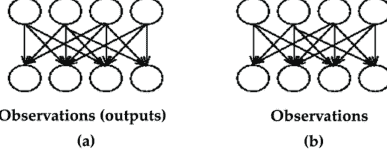

图 1：监督学习和无监督学习的示例。

监督学习是训练神经网络和决策树最常用的技术。这两种技术高度依赖于预定分类所提供的信息。在神经网络的情况下，分类被用于确定网络的误差，然后调整网络以使其最小化；在决策树中，分类用于确定哪些属性提供了解决分类谜题所需的最丰富信息。我们将更详细地查看这两个例子，但目前，只要知道这两个例子都得益于以预定分类形式形式的“监督”就足够了。

归纳性机器学习是从实例（训练集中的示例）中学习一组规则的过程，或者更广泛地说，创建一个可用于从新实例中进行泛化的分类器。将监督性机器学习应用于现实问题的过程描述如图 F 所示。第一步是收集数据集。如果有专家可用，那么他/她可以建议哪些字段（属性、特征）最具信息量。如果没有，那么最简单的方法就是“暴力法”，这意味着测量所有可用内容，希望孤立出正确的（信息丰富的、相关的）特征。然而，暴力法收集的数据集并不直接适用于归纳。它大多数情况下包含噪声和缺失值，因此需要重大的预处理，根据 Zhang 等 (2002)。

第二步是数据准备和预处理。根据情况，研究人员有许多方法可以处理缺失数据 (Batista, 2003)。Hodge 等 (2004) 最近引入了关于离群点（噪声）检测技术的综述。这些研究人员识别了

## 使用 Python 进行软计算与机器学习

实例选择不仅用于处理噪声，还用于应对从大型数据集学习的可行性。数据集中的实例选择是一个优化问题，试图在减少样本量的情况下保持数据挖掘质量。它减少了数据，使数据挖掘算法能够有效工作。从数据集中采样有多种程序。特征子集选择是识别并移除尽可能多的无关和冗余特征的过程 (Yu, 2004)。这降低数据的维度，使数据挖掘算法运行得更快、更有效。许多特征相互依赖的事实影响了监督机器学习分类模型的准确性。这个问题可以通过从基本特征构造新特征来解决。新生成的特征可能有助于创建更简洁准确的分类器。此外，有意义特征的发现有助于所提分类器的解释性，并对所学概念有更好的理解。使用隐马尔可夫模型和贝叶斯网络进行语音识别，在某些元素上也使用了监督，以便调整参数以如常一样最小化给定输入的误差。注意这里重要的一点：在分类问题中，学习算法的目标是最小化相对于给定输入的误差。这些输入通常被称为“训练集”，是代理尝试学习的示例。很好地学习训练集并不总是最好的做法。例如，如果我试图教你异或，但只向你展示包含一个真和一个假的组合，而从不显示全假或全真，那么你可能会学到答案总是真的。同样，在机器学习算法中，一个常见问题是过拟合数据，本质上是记忆训练集，而不是学习更通用的分类技术。正如你可能想象的，并不是所有的训练集都有正确的分类输入。如果使用的算法足够强大，能够记住不符合更一般原则的看似“特殊情况”，就会导致问题。这也会导致过拟合，寻找既强大到学习复杂函数又足够稳健到产生泛化结果的算法是一项挑战。

# 机器学习算法的类型 23

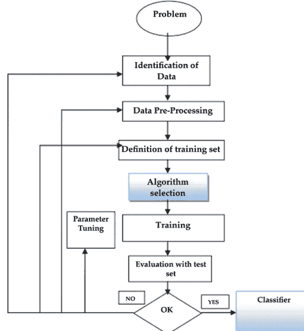

**图 2**：机器学习监督过程。

## 无监督学习


无监督学习似乎要困难得多：目标是让计算机学会如何去做某些我们没有告诉它如何做的事情！实际上，无监督学习有两种方法。第一种方法不是通过提供显式分类来教智能体，而是使用某种奖励系统来指示成功。请注意，这种类型的训练通常属于决策问题框架，因为其目标不是产生分类，而是做出获得奖励的决策。这种方法几乎可以推广到现实世界，在现实世界中，智能体可能会因某些动作而获得奖励，因执行其他动作而受到惩罚。通常，强化学习的形式可以用于无监督学习，智能体基于之前的奖励和惩罚进行判断，而不一定学习关于其动作如何影响世界的确切方式。在某种程度上，所有这些信息都是必要的，因为通过学习奖励函数，智能体只需要知道做什么，而不需要任何处理，因为它知道对于它可能采取的每个动作所期望实现的准确奖励。在计算所有可能性非常耗费时间的情况下（即使所有世界状态之间的转移概率都是已知），这可能非常有益。另一方面，通过试错来学习可能非常耗时。这种学习可能是强大的，因为它假设没有预先发现的示例分类。在某些情况下，例如，我们的分类可能不是最佳的。一个引人注目的例子是，关于双陆棋的传统观念被颠覆了，当时一系列计算机程序（neuro-gammon 和 TD-gammon）通过无监督学习学习，仅通过不断地自我对弈就变得比最优秀的人类象棋高手强大。这些程序发现了一些让双陆棋专家惊讶的原理，并且优于在预先分类示例上训练的双陆棋程序。

第二类无监督学习是聚类。目标不是最大化效用函数，而是简单地寻找训练数据中的相似性。假设发现的聚类将与直觉分类法合理匹配。例如，根据人口统计数据对个人进行聚类可能会导致富人聚在一类，而穷人聚在另一类。虽然算法不会为这些类分配名称，但它可以产生这些类，然后使用这些类将新示例分配到其中一个类中。这是一种数据驱动的方法，当有足够的数据时可以很好运行；例如，社交信息过滤算法（如 Amazon.com 用来推荐书籍的算法）是基于寻找相似的人群并将新用户分配到这些组的原则。在某些情况下，如社交信息过滤，关于聚类中其他成员的信息（例如他们读了什么）可能足以让算法产生有意义的结果。在其他情况下，聚类可能仅仅是人类分析师的有用工具。遗憾的是，无监督学习面临训练数据过拟合的问题。没有灵丹妙药可以避免这个问题，因为任何可以从输入中学习的算法都必须非常强大。

根据 Ghahramani (Ghahramani, 2008) 的观点，无监督学习算法旨在从数据样本中提取结构。结构的质量由代价函数衡量，通常通过最小化该函数来推断表征数据中隐藏结构的最优参数。可靠且稳健的推理需要保证提取出的结构对于数据源是典型的，也就是说必须从相同数据源的第二个样本集中提取出相似的结构。统计学和机器学习文献中，缺乏稳健性被称为过拟合。在本次演讲中，我为一类直方图聚类模型描述过拟合现象，这些模型在信息检索、语言学和计算机视觉应用中起着重要作用。具有尺度波动稳健性的学习算法源于学习过程中的大数偏差结果和最大熵原理。

无监督学习取得了许多成功，例如世界冠军级别的双陆棋，甚至能够驾驶的机器！当有足够的数据来形成类时，聚类是很有用的；当关于类的额外数据可以产生结果时，分类学习是强大的。线性分类器通常在分类速度是一个问题时使用，因为它通常是最快的分类器，特别是当 `vec{x}` 是稀疏时。两种技术都有价值，选择哪种取决于情况：解决的问题类型、分配了多少时间以及是否存在监督学习。

# 算法类型

在监督学习领域，它主要处理分类。这些是算法类型：

- 线性分类器
  - 逻辑回归
  - 朴叶斯分类器
  - 感感知机
  - 支持机
  - 二次分类器
  - K-Means 聚类
  - Boosting（提升）
  - 决策树
  - 随机森林
  - 神经网络
  - 贝叶斯网络

**线性分类器**：在机器学习中，分类的目标是将具有相似特征值的项目分组。Timothy 等人 (Timothy Jason Shepard, 1998) 指出线性分类器通过基于特征的线性组合值来实现分类决策。如果分类器的输入向量是实向量 `vec{x}`

```
$y = f(\vec{w} \cdot \vec{x}) = f\left(\sum_{j} w_j x_j\right)$
```

`vec{w}` 是权重实向量，`f` 是将两个向量的点积转换为所需输出的函数。权重向量 `vec{w}` 从一组标记样本中学习。通常 `f` 是一个简单的函数，将所有大于阈值的值映射到第一类，将所有值映射到第二类。复杂的 `f` 可能会给出项目属于某一类的概率。

对于二分类问题，可以将线性分类器的操作可视化为用一个超平面划分高维输入空间：平面一侧的所有点都被分类为“是”，而另一侧被分类为“否”。线性分类器通常在分类速度存在问题时使用，因为它通常是最快的分类器，特别是当 `vec{x}` 稀疏时。然而，决策树可能更快。此外，线性分类器在 `vec{x}` 的维度很大时通常效果非常好，例如在文档分类中，其中每个元素通常是文档中的单词数（因此文档-词矩阵）。在这种情况下，分类器应该经过良好的正则化。

- **支持机**：如 Luis 等人 (Luis Gonzalez, 2005) 所述，支持机 (SVM) 通过构建一个最优的 N 维超平面来执行分类

# 机器学习算法类型 27

将数据分为两类。SVM 模型与神经网络有紧密的联系。事实上，一个使用 sigmoid 核函数的 SVM 模型等同于一个双层感知器神经网络。

支持向量机（SVM）模型是经典多层感知器神经网络的近亲。通过使用核函数，SVM 成为多项式、径向基函数（RBF）和多层感知器分类器的另一种训练方法。在这些分类器中，网络权重是通过求解一个带有线性约束的二次规划问题找到的，而不是像标准神经网络训练那样通过求解非凸无约束最小化问题。

在 SVM 文献的术语中，预测变量被称为属性（attribute），而用于定义超平面的转换属性称为特征（feature）。选择最合适表示方法的任务被称为特征选择。描述一个案例（即一行的预测值值）的特征集合被称为向量（vector）。因此， SVM 建模的目标是找到一个最优超平面，将向量簇分开，使得目标变量的一类案例位于平面的的一侧，而另一类的案例位于平面的另一侧。靠近超平面的向量是支持向量。底图展示了 SVM 过程的概述。

## SVM 算法

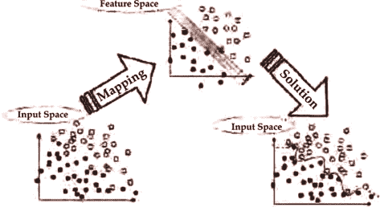

## 二维示例

在考虑 N 维超平面之前，让我们来看一个简单的 2 维示例。假设我们想要进行分类，并且我们的数据有一个具有两个类别的分类目标变量。同时假设有两个具有连续值的预测变量。如果我们使用一个预测变量的值作为 X 轴，另一个值作为 Y 轴来绘制数据点，我们可能会得到一张如下所示的图像。目标变量的一类由矩形表示，而另一类则由椭圆表示。

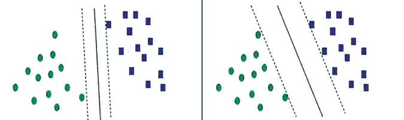

在这个理想化的示例中，一类的案例位于左下角，另一类的案例位于右上角；这些案例是完全分离的。SVM 分析试图找到一个 1 维超平面（即直线），根据它们的目标类别将案例分开。可能的直线有无限多条；上面显示了两条候选线。问题是哪条线更好，以及我们如何定义最优线。

平行于分离线绘制的虚线标记了分界线与距离线最近的向量之间的距离。虚线之间的距离被称为边界（margin）。限制边界宽度的向量（点）就是支持向量。接下来的图说明了这一点。

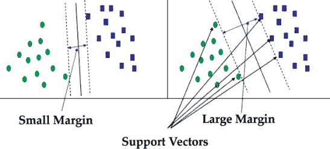

# 机器学习算法类型 29

SVM 分析（Luis Gonzalez, 2005）找到一条线（泛泛来说是超平面），其取向使得支持向量之间的边界最大化。在上面的图中，右面板中的线优于左面板中的线。

如果所有分析都由具有两个预测变量的双分类目标变量组成，并且点簇可以由直线划分，那么生活就会变得简单。遗憾的是，通常并非如此，SVM 必须处理：(a) 两个预测变量，(b) 用非线性曲线分离点，(c) 处理簇无法完全分离的情况，以及 (d) 处理超过两个类别的分类。

在本章中，我们将解释三种主要的机器学习技术及其示例，以及它们在现实中的表现。这些技术是：

- K-Means 聚类
- 神经网络
- 自组织映射（Self Organised Map）

## K-Means 聚类

k-means 聚类的基本步骤是并不复杂的。在开始时，我们确定聚类数量 `K`，并假设这些簇的中心。我们可以取任何随机对象作为初始中心，或者按顺序的前 `K` 个对象也可以作为初始中心。然后 K-means 算法将执行以下三个步骤，直到稳定（即没有对象移动）：

迭代直到稳定（即没有对象移动）：

1. 确定中心坐标
2. 确定每个对象到中心的距离
3. 根据最小距离对对象进行分组

图 3 显示了 K-means 流程图

## 使用 Python 进行软计算和机器学习

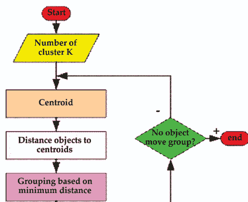

**图 3：** K-means 迭代。

K-means (Bishop C. M., 1995) 和 (Tapas Kanungo, 2002) 是解决著名的聚类问题最简单的无监督学习算法之一。该过程遵循了一种简单易便的方法，通过一定数量的簇（假设有 k 个簇）对给定数据集进行分类。

SVM 分析（Luis Gonzalez, 2005）找到一条线（泛泛来说是超平面），其取向使得支持向量之间的边界最大化。在图中，右面板中的线优于左面板中的线。

如果所有分析都由具有两个预测变量的双分类目标变量组成，并且点簇可以由直线划分，那么生活就会变得简单。遗憾的是，通常并非如此，SVM 必须处理：(a) 两个以上的预测变量，(b) 用非线性曲线分离点，(c) 处理簇无法完全分离的情况，以及 (d) 处理超过两个类别的分类。


假设我们有 n 个特征向量 $x_1, x_2, ..., x_n$，它们均来自同一类，并且知道它们落在 k 个紧凑的簇中，$k < n$。让 $mi$ 为簇 i 中向量的均值。如果簇分离良好，我们可以使用最小距离分类器将它们分离。也就是说，如果 $\|x-m_i\|$ 是所有 k 个簇中最小的，则 x 属于簇 $i$。这提示了寻找 k 均值的程序：

- 对均值 $m1, m2, ..., mk$ 做出初始猜测
- 直到任何均值不再发生变化
  - 使用估计的均值将样本分类到类中
  - 对于 i 从 1 到 k
    - 将 `m₁` 替换为类 i 所有样本的均值
  - end_for
- end_until

这是一个示例展示了均值 `m₁` 和 `m₂` 如何移动到两个类的中心。

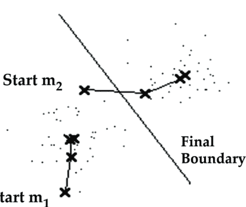

这是 k-means 过程的一个简单版本。它可以被看作是一种贪心算法，用于将 $n$ 个样本划分为 $k$ 类，以使得到类中心的平方距离之和最小。它确实存在一些缺点：

- 未指明均值的初始化方法。一种流行的起始方法是随机选择 $k$ 个样本。
- 产生的结果取决于均值的初始值，经常会找到次优划分。标准的解决方案是尝试多个不同的起始点。
- 可能会出现距离 m 最近的样本集为空，导致 `m₁` 无法更新。这是一个在实现中必须处理的困扰问题，但我们应该忽略它。
- 结果取决于用于测量 `||x - m||` 的度量。一种流行的解决方案是用每个变量的标准差对其进行归一化，尽管这并不总是理想。

## 使用 Python 进行软计算与机器学习

结果取决于 `k` 的值。

最后一个问题特别棘手，因为我们通常没有办法知道存在多少个类。在上面的示例中，对相同的数据应用相同的算法会产生以下 3 均值聚类。它比 2 均值聚类更好更差？

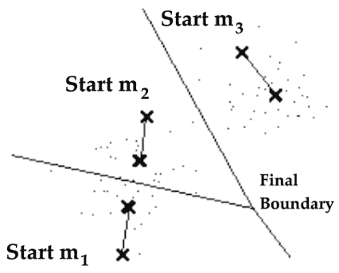

遗憾的是，没有通用的理论解决方案为任何给数据集找到最优类数。一种简单的方法是比较不同 `k` 类的多次运行结果，并根据给定的标准选择最好的一个。

## 机器学习算法的类型

神经网络（Bishop C. M., 1995）实际上可以同时执行多个回归和/或分类任务，尽管通常每个网络只执行一种。因此，在绝大多数情况下，网络将有一个输出变量，但在多状态分类问题中，这可能对应于多个输出单元。如果你定义了一个具有多个输出变量的单网络，它可能会受到交叉干扰（隐藏神经元学习时遇到困难，因为它们试图同时模拟至少两个函数）。最好的解决方案通常是为每个输出训练单独的网络，然后将它们组合成集成模型，以便它们可以作为一个单元运行。神经网络方法是：

## 使用 Python 进行软计算与机器学习

- 多层感知器：这可能是目前使用的最流行的网络架构，最初归功于 Rumelhart 和 McClelland (1986)，并在大多数神经网络教科书中有详尽讨论（例如，Bishop, 1995）。这是在之前的几节中简要讨论过的网络类型：每个单元对其输入进行加权和，并将此激活水平通过传递函数产生输出，且单元按分层前馈拓扑结构排列。该网络可以简单地解释为一种输入-输出模型，权重和阈值（偏置）是模型的自由参数。此类网络可以建模几乎任意复杂度的函数，层数和每层中的单元数决定了函数的复杂度。多层感知器 (`MLP`) 设计中的重要问题包括隐藏层的规范以及这些层中单元的数量（Bishop C. M., 1995), (D. Michie, 1994)。

输入和输出单元由问题定义（对于精确使用哪些单元，可能存在某些不确定性，我们稍后会回到这一点。然而，目前我们假设输入变量是直观选择的且都是有意义的）。要使用的隐藏单元数量远未明确。一个良好的起点是使用一个隐藏层，单元数量等于输入和输出单元总数的一半。同样，我们稍后将讨论如何选择合理的数字。

- 训练多层感知器：一旦选定了层数以及每层的单元数，就必须设置网络的权重和阈值，以最小化网络所产生的预测误差。这就是训练算法的作用。你收集的历史案例用于自动调整权重和阈值以最小化这种误差。这个过程等于将网络表示的模型拟合到可用的训练数据。网络特定配置的误差可以通过通过网络所有训练案例来确定，将生成的实际输出与期望的目标输出进行比较。这些差异通过误差函数合并以给出网络误差。最常见的误差函数是均方误差（用于回归问题），其中每个用例输出单元的个体误差被平方并相加，以及交叉熵函数（用于最大似然分类）。

## 机器学习算法的类型 35

在传统的建模方法（例如，线性建模）中，可以通过算法确定绝对最小化这种误差的模型配置。神经网络具有更强的（非线性）建模能力，付出的代价是，尽管我们可以调整网络来降低其误差，但我们永远无法确定误差可能更低。

这里一个有用的概念是误差曲面。网络的 $N$ 个权重和阈值（即模型的自由参数）中的每一个都被视为空间中的一个维度。$N+1$ 维度……（注：原文此处似乎有断句，按逻辑翻译）。

# 机器学习算法类型 37

这与在真实误差面上最小化误差相同——即底层且未知模型的误差面（Bishop C. M., 1995）。

这种区别最重要的表现就是过学习问题，或称过拟合。使用多项式曲线拟合而非神经网络来演示这个概念是最容易的，但其原理是完全相同的。

多项式是一个项仅包含常数和变量幂项的方程。例如：

```
y=2x+3
y=3x^2+4x+1
```

不同的多项式具有不同的形状，阶数越高（因此项数越多），其形状越趋于离心。给定一组数据，我们可能希望拟合一条多项式曲线（即一个模型）来解释这些数据。数据可能包含噪声，因此我们并不一定期望最好的模型能精确地通过所有点。低阶多项式可能不够灵活，无法贴近数据点；而高阶多项式实际上过于灵活，通过采用一种实际上与底层函数无关的高度极离心形状，精确地拟合了数据。见下方的图 4。

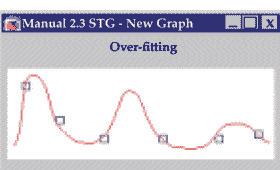

**图 4：** 高阶多项式示例。

神经网络面临相同的问题。具有更多权重的网络建模更复杂的函数，因此容易过拟合。权重较少的网络可能不够强大，无法为底层函数。例如，一个没有隐藏层的网络实际上建模了一个简单的线性函数。我们如何如何选择合适的网络复杂度？较大的网络几乎不可避免地最终获得较低的误差，但这可能意味着过拟合，而非良好的建模。

# 使用 Python 进行软计算机器学习

答案是针对一个独立的数据集（即选择集）来检查进度。某些用例被预留，并没有实际用于反向传播算法的训练。相反，它们被用于对算法的进度进行独立检查。网络在训练集和选择集上的初始性能通常是相同的（如果至少不相同，那么两个集之间的用例划分可能存在偏差）。随着训练的进行，训练误差会下降，在提供真实误差函数的情况下，选择误差随之下降。然而，如果选择误差停止下降，这表明网络开始过拟合数据，应该停止训练。当训练过程中发生此类过拟合时，被称为过学习。在这种情况下，通常建议减少隐藏单元的数量和/或隐藏层的数量，因为网络对于当前问题来说太强大了。相比之下，如果网络不够强大以建模底层函数，则可能发生过学习，且选择误差也不会下降到满意的水平。

与局部极小值的问题以及关于网络大小的决策意味着，使用神经网络通常涉及对大量网络进行实验，可能对每个网络进行多次训练（以避免被局部极小值欺骗），并观察各自的表现。这里性能的关键指导是：在所有条件相等的情况下，简单模型始终比复杂模型更优；在选择误差改进微乎其微的情况下，你也可以选择较小的网络而非较大的网络。

这种重复实验的方法存在一个问题：选择集在选择模型时起着关键作用，这意味着它实际上是训练过程的一部分。因此，它作为模型性能独立指南的可靠性就大打折扣——通过足够的实验，你可能恰好发现一个在选择集上表现良好的幸运网络。为了增加最终模型性能的信度，通常做法是（如果训练量允许）预留第三组用例——测试集。使用测试集数据对最终模型进行测试，以确保选择集和训练集上的结果是真实的，而非训练过程的产物。当然，为了正确履行这一角色，测试集只能使用一次——如果反过来用于调整和迭代训练过程，它实际上就变成了选择数据！

# 机器学习算法类型 39

考虑到我们通常比理想所需的子集数据少，这种分为多个子集的方法遗憾。我们可以通过重采样来解决这个问题。可以将可用数据划分为训练集、选择集和测试集来进行实验。这种子集划分有多种方法，包括随机（蒙特卡洛）重采样、交叉验证和自助法。如果我们做出设计选择，基于对不同子集示例的多次实验，使用神经网络的最佳配置，结果将更加可靠。我们随后可以利用这些实验来指导使用何种网络类型的决策，并使用新样本从头训练网络（消除任何采样偏差）；或者，我们可以保留采样过程中发现的最佳网络，但在集成中对它们的结果取平均，这减轻了采样偏差。

总结来说，网络设计（一旦选定了输入变量）遵循以下几个阶段：

- 选择初始配置（通常是一个隐藏层，隐藏单元的数量设置为输入单元和输出单元之和）。
- 对每种配置迭代地进行多次实验，保留最佳网络（从选择误差而言）。每种配置都需要多次实验，以避免在训练定位局部极小值时被欺骗，而且最好进行重采样。
- 在每次实验中，如果发生欠学习（网络未达到可接受的性能水平），尝试向隐藏层添加更多神经元。如果这没有帮助，尝试增加一个额外的隐藏层。
- 如果发生过学习（选择误差开始上升），尝试减少隐藏单元（并可能减少层）。
- 一旦你通过实验确定了有效的配置，重采样并生成新的网络。
- 数据选择：上述所有阶段都依赖于一个假设，具体来说，训练、验证和测试集必须具有代表性。计算机科学的老格言“垃圾进，垃圾出”在这里再不过如此适用了。

## 使用 Python 进行软计算与机器学习

在神经网络建模中如此。如果训练数据不具有代表性，那么模型的工作将受到损害。在最坏的情况下，它是没用的。对于可能损坏训练集的问题：未来不是过去。训练数据通常是历史性的。如果情况发生了变化，过去的关系可能不再适用。所有情况都必须被覆盖。神经网络只能从当前的案例中学习。如果收入超过 $100,000 的人具有信贷风险，而你的训练数据包含 $40,000 的人，你无法期望它在遇到其中一种情况时做出正确判断。外推对于任何模型都是危险的，但在这种情况下，某些类型的网络可能会做出非常糟糕的预测。

网络首先学习特征。一个经典的（可能是虚构的）插图是一个自动识别坦克的视觉项目。网络在一个包含坦克的样本和一个不的样本上进行训练。它获得了完美的 100% 分。在新的数据上测试时，它证明是无用的。原因是什么？坦克的照片是在阴雨天拍摄的；而非照片是在晴天拍摄的。网络学习的是区分（微不足道的）光强差异。为了工作，网络需要包含预期运行的所有天气和光条件的案例。不平衡数据集。由于网络最小化整体误差，集合中数据类型的比例至关重要。在包含 900 个好案例和 100 个坏案例的集合上训练的网络将使其决策偏向好案例，因为这允许算法降低整体误差（该误差受好案例的影响很大）。如果好坏案例在实际人口中的代表性不同，网络的决策可能是错误的。一个很好的例子将是疾病诊断。可能常规测试的患者中 90% 没有疾病。网络在一个 90/10 划分的可用数据集上进行训练。随后它被用于诊断有特定问题的患者，此时疾病的可能性为 50/50。网络将做出过度反应，无法识别某些不健康患者的疾病。相比之下，如果针对“投诉者”数据进行训练，网络可能会产生大量的假阳性。在这种情况下，数据集可能需要经过构建，以考虑数据的分布（例如，你可以复制大量的案例，或者移除一些大量的案例），或者网络的

# 机器学习算法类型 41

通过引入损失矩阵来修改决策（Bishop C. M., 1995）。通常，最佳方法是确保不同案例具有均匀的表示，然后据此解释网络的决策。

## 自组织映射

自组织特征图（Self Organizing Feature Map，简称 SOFM 或 Kohonen 网络）的使用方式与其他网络完全不同。所有其他网络都是为监督学习任务设计的，而 SOFM 网络主要是为无监督学习设计的（Haykin, 1999), (Patterson, 1996), (Fausett, 1994)（在监督学习中，训练数据集包含带有输入变量以及相关输出的案例（网络必须推出从输入到输出的映射），而在无监督学习中，训练数据集仅包含输入变量）。乍看之下似乎很奇怪。没有输出，网络能学习到什么呢？答案是 SOFM 网络试图学习数据的结构。

此外，Kohonen（Kohonen, 1997）解释说，其用途之一是探索性数据分析。SOFM 网络可以学习识别数据聚类，并将相似的聚类相关起来。用户可以建立对数据的理解，并将其用于完善网络。随着数据类的被识别，可以对它们进行标记，使网络能够执行分类任务。当输出类别立即可用时，SOFM 网络也可以用于分类——在这种情况下，它的优势在于能够突出类别之间的相似性。

第二个可能的用途是新颖性检测。SOFM 网络可以学习识别训练数据中的聚类并对其做出。如果遇到与之前案例不同的新数据，网络将无法识别它，这表明了新颖性。

SOFM 网络只有两层：输入层和径向单元输出层（也称为拓扑图层）。拓扑图层中的单元在空间中布局——通常是二维的（尽管 ST 神经网络也支持一维 Kohonen 网络）。

SOFM 网络（Patterson, 1996）使用迭代算法进行训练。从一组初始随机的径向中心开始，算法逐渐调整以反映训练数据的聚类。在某种程度上，这与子采样和 KMeans 算法相比，用于在 SOM 网络中分配中心，事实上 SOFM 算法可以用于为此类网络分配中心。然而，该算法还作用于另一个层面。

迭代训练过程还安排了网络，使得在输入空间中彼此靠近的中心代表的单元在拓扑图上也位于一起。你可以将网络的拓扑层设成一个粗糙的二维网格，它可以被折叠和扭曲到 N 维输入空间中，以尽可能保留原始结构。显然，任何在二维空间中表示 N 维空间的尝试都会导致细节丢失；然而，这种技术允许用户可视化化否则可能无法理解的数据，这将是值得的。

基本的迭代 Kohonen 算法简单地运行若干轮（epochs），每个轮次执行每个训练案例并应用以下算法：

- 选择获胜神经元（中心距离输入案例最近的神经元）；
- 调整获胜神经元使其更像输入案例（旧神经元中心与训练案例的加权和）。

该算法使用随时间衰减的学习率，用于执行加权和，并确保随着轮数的推移，变化变得越来越微妙。这确保了中心稳定到导致神经元获胜的案例的折中表示。拓扑排序属性通过算法中的邻域概念实现。邻域是围绕获胜神经元的神经元集合。邻域像学习率一样随着时间衰减，因此最初有大量的神经元属于邻域（几乎是整个拓扑图）；在后期阶段，邻域将变为零（即仅由获胜神经元本身）。在 Kohonen 算法中，神经元的调整实际上不仅应用于获胜神经元，还应用于当前邻域的所有成员。

这种邻域更新的效果是，最初网络的大部分区域被“拉向”训练案例——而且拉得相当厉害。网络形成了一种粗糙的拓扑排序，相似的案例激活拓扑图中的神经元簇。随着轮数的增加，学习率和邻域都会减少，因此可以在地图区域内划分出更精细的区别，最终导致单个神经元的微调。通常，训练被刻意分两个不同的阶段进行：高学习率和高邻域的较短阶段，以及低学习率和零或近零邻域的长阶段。

一旦网络被训练到能够识别数据中的结构，获胜频率数据表（记录在执行训练案例时每个神经元获胜的次数）就可以作为可视化工具来检查数据。可以查看地图上是否形成了不同的聚类。执行单个案例并观察拓扑图，以查看某些案例是否可以分配到聚类中（这通常涉及回到原始应用领域，以便建立聚类案例之间的关系）。一旦识别出聚类，拓扑图中的神经元就会被标记以指示它们的含义（有时也可以标记单个案例）。一旦以此方式构建了拓扑图，就可以向网络提交新案例。如果获胜神经元已标记了类名，网络就可以执行分类。如果没有，网络被视为未决定。

SOFM 网络在执行分类时还利用接受阈值。由于 SOFM 网络中神经元的激活水平是该神经元到输入案例的距离，接受阈值充当最大识别距离。如果获胜神经元的激活大于此距离，则 SOFM 被视为未决定。因此，通过对所有神经元进行标记并适当设置接受阈值，SOFM 可以作为新颖性检测器。

SOFM 网络受到大脑某些属性的启发（Kohonen（1997），大脑皮层实际上是一个巨大的平层（约 0.5 平方米；为了方便放入头骨内！）具有已知的拓扑属性（例如，手区域位于手臂旁边，可以在二维上进行映射）。

## 使用自组织映射分组数据

SOM 的第一部分是数据。上面是使用 SOM 时常用的 3 维数据示例。在这里颜色以三个维度表示（红、蓝、绿）。自组织映射的主意是将 N 维数据（在这里是颜色且为三维）投影到更容易理解的东西中（在这种情况下是二维地图）。

![img/e1ab17402154bec3fa9a787fe3ee232_69_0.png]

图 5：样本数据

在这种情况下，预计深蓝色和灰色会在良好的地图上彼此靠近，黄色则靠近红色和绿色。SOM 的第二个组件是权重向量。每个向量有两个分量，我在这里尝试显示下面的图像。权重向量的第一部分是数据。这与样本向量的维度相同，权重向量的第二部分是其自然位置。颜色的好处是可以通过显示颜色来展示数据，因此在这种情况下，颜色是数据，位置是屏幕上的 x,y 位置。

![img/e1ab17402154bec3fa9a787fe3ee232_69_1.png]

图 6：2D 数组权重向量

在这个示例中，使用了 2D 数组权重向量，看起来就像上面的图 5。这张图片是网格的倾斜视图，其中每个权重都有一个 N 维数组，并且每个权重在网格中都有其独特的位置。权重向量不一定排列在 2 维中，使用 1 维 SOM 已经做了大量工作，但权重的数据部分必须与样本向量的维度相同。权重有时被称为神经元，因为 SOM 实际上是神经网络。SOM 算法。SOM 的方法

# 机器学习算法类型 45

它们通过竞争样本的表示来来组织自己。神经元还被允许通过学习变得更像样本来改变自己，以便在下一次竞争中获胜。正是这种选择和学习过程使得权重组织成一张代表相似性的映射。

那么，有了这两个组件（样本向量和权重向量），如何排列权重向量，使其能够代表样本向量的相似性呢？这是通过使用这里显示的简单算法实现的。

```
Initialize Map
For t from 0 to 1
  Randomly select a sample
  Get best matching unit
  Scale neighbors
  Increase t a small amount
End for
```

**图 7**：SOM 算法示例。


构建 SOM 的第一步是初始化权重向量。从那里，你随机选择一个样本向量，并在权重向量图中搜索，找到哪个权重最能代表该样本。由于每个权重向量都有一个位置，因此靠近它的权重也是它的邻居。被选中的权重将获得奖励，使其变得更像随机选择的样本向量。除了这种奖励，该权重的邻居也会获得奖励，使其变得更像被选中的样本向量。从这一步开始，我们增加 `t` 的值，因为邻居的数量以及每个权重可以学习的量会随着时间减少。这个过程会重复多次，通常超过 1000 次。

在颜色的情况下，程序会首先从样本数组中选择一种颜色（例如绿色），然后搜索权重找到包含最绿色的位置。从那里，该权重周围的颜色将变得更绿。然后选择另一种颜色（如红色），继续该过程。这些过程是：

## A. 初始化权重

这里是初始化权重向量图的三种不同方法的截图。我们应该首先提到这里的调色板。在下面的 `Java` 程序中，显示了 6 种强度的红、蓝、绿，这实际上并不影响视觉体验。权重的实际值是浮点数，因此它们的范围比图 7 中显示的六个值大。

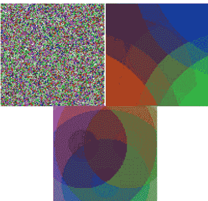

图 8：权重值。

初始化权重向量有多种方法。你可以看到的第一种是给每个权重向量的数据赋予随机值。左上方显示了一个具有随机红、蓝、绿值的像素屏幕。不幸的是，根据 Kohonen 的算法（Kohonen, 1997）计算 SOM 计算开销非常大，因此有一些权重初始化变体，以确保你已知不相似的样本离得很远。这样你只需要较少的迭代就能生成良好的映射，并节省一些时间。

除了随机初始化外，我们在这里还另外两种初始化权重的方法。这种方法仅仅是将红、蓝、绿、黑放在四个角，并让它们向中心逐渐淡出。另一种方法是让红、绿、蓝彼此之间以及与中心的距离相等。

# 机器学习算法类型 47

## B. 获取最佳匹配单元 (BMU)

这是一个非常简单的步骤，只需遍历所有权重向量，计算每个权重到所选样本向量的距离。距离最短的权重就是胜者。如果有多个权重距离相同，则在距离最短的权重中随机选择一个获胜者。确定其数学含义有多种不同的方法。最常用的方法是使用欧几得距离：

```
\sum_{i=0}^{n} x_i^2
```

其中 `x[i]` 是样本中第 `i` 个数据成员的值，`n` 是样本向量的维度数。

在颜色的情况下，如果我们选择了绿色，我们可以将值看作 3D 点，每个点都是一个轴。浅绿色 (3,6,3) 比位于 (0,6,0) 的红色更接近绿色。

浅绿 = Sqrt(3-0)^2+(6-6)^2+(3-0)^2 = 4.24

红色 = Sqrt(6-0)^2+(0-6)^2+(0-0)^2 = 8.49

因此绿色现在是最佳匹配单元，但计算距离并比较距离的操作是在整个映射上进行的，距离样本向量最短的权重即为胜者，也是 BMU。为了在该部分优化速度，`Java` 程序在这一部分没有计算平方根。

## C. 缩放邻居

### 1. 确定邻居

缩放邻居权重实际上有两个部分：确定哪些权重被视为邻居，以及每个权重可以变得多像样本向量。获胜权重的邻居可以使用许多不同的方法确定。是一些同心正方形，另一些六边形，我选择使用高斯函数，将每个值大于零的点都视为邻居。

如前所述，邻居的数量随着时间的推移而减少。这样做是为了让样本首先移动到它们可能所在的区域，然后它们竞争位置。这个过程类似于粗调后进行精调。用于减少影响半径的函数并不重要，只要它在减少即可，我们只是使用了一个线性函数。

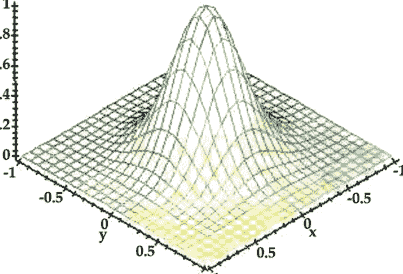

`f := (x, y) → e^{-6.6666666667 sqrt{x^2+y^2}}`

**图 9**：邻居确定的图。

图 8 显示了所使用的函数。随着时间的推移，基底向中心移动，因此邻居减少。初始半径设置得很高，接近映射的宽度或高度。

### 2. 学习

缩放邻居的第二部分是学习函数。获胜权重被奖励变得更像样本向量。邻居也会变得更像样本向量。这种学习过程的一个属性是，邻居离获胜权重越远，学习得就越少。这可以设置为任何你想要的。我选择使用高斯分布。该函数将返回一个介于 0 和 1 之间的值，每个邻居随后使用参数方程进行更改：

当前颜色*(1-`t`) + 样本向量*`t`

因此在第一次迭代中，最佳匹配单元的 `t` 为 1，因此该权重在该过程结束后具有与随机样本相同的值。就像邻居的数量会减少一样，权重可以学习的量也会随着时间而减少。在第一次迭代中，获胜权重变为样本，`t` 的完整范围为 0 到 1。随着时间的推移，获胜权重变得稍微像样本，`t` 的最大值减小。权重可以学习的速率会下降。为了视觉化表示这一点，在之前的图中，权重可以学习的量等于它们所在位置的高度。随着时间的推移，高度会降低，而基底会缩小。

因此，一旦确定了胜者，就会找到该权重的邻居，每个邻居以及获胜权重在内都会变得更像样本。

## 机器学习算法类型

## 确定 SOM 的质量

图 9 是程序使用 500 次迭代生成的另一个 SOM 示例。从乍看，你会注意到相似的颜色聚集在一起。然而，事实并非总是如此，正如你看到的，有些颜色被与它们完全不像的颜色所包围。对于颜色来说，这一点可能很容易指出，因为我们熟悉它；但如果我们使用更抽象的数据，我们该如何知道两个实体彼此靠近是意味着它们相似，还是仅仅是因为运气不好才在那里呢？

有一种非常简单的方法可以显示相似性在哪里，在哪里不存在。为了计算这一点，我们遍历所有权重

# 使用 Python 进行 50 软计算与机器学习

并确定邻居之间的相似性。这是通过计算权重向量与其每个邻居之间的距离来实现的。通过这些距离的平均值为该位置分配颜色。该过程位于 `Screen.java` 中，命名为 `public update_bw()`。

如果平均距离很大，说明周围的权重差异很大，则为权重位置分配深色。如果平均距离较小，则分配较浅的颜色。因此，在斑块中心颜色相同的区域，由于所有邻居的颜色相同，那里应该是白色的。在斑块之间存在相似性的区域，它们不应该是白色，而是浅灰色。在斑块物理上接近但完全不相似的区域，应该是黑色的。见下方的图 8

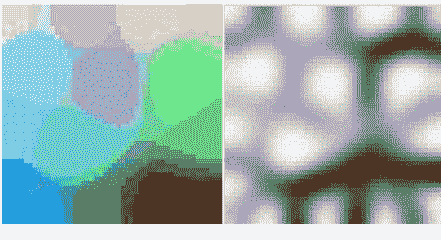

**图 11：** 权重颜色分配示例。

如上所示，黑色通道显示了地图上的颜色在物理上可能接近，但在权重实际值方面它们彼此非常不同。斑块之间的浅灰色区域代表真实的相似性。在上面的图片中，右下角的黑色被与其不相似的颜色包围。观察黑白相似性可以发现，黑色与其他颜色不相似，因为有黑色线条代表这两种颜色之间没有相似性。此外，在顶角有粉红色，附近是浅绿色，它们在现实中并不接近，但在彩色的 SOM（自组织映射）上是相邻的。观察黑白 SOM，它通过在两种颜色之间插入黑色清楚地显示了它们并不非常相似。

通过使用这些平均距离来制作黑白地图，我们实际上可以通过简单地相加这些平均值为每个 SOM 分配一个值，该值决定了图像表示样本相似性的优劣。

## 机器学习算法的类型

# SOM 的优点与缺点

自组织映射（SOM）具有以下优点：

- SOM 可能是最优点的一点是它们非常易于理解。它非常简单：如果它们靠在一起并且有灰色连接它们，那么它们就是相似的；如果它们之间有黑色沟槽，那么它们就是不同的。与多维缩放（Multidimensional Scaling）或 N-land 不同，人们可以迅速学会如何有效地使用它们。
- 另一个很棒的一点是它们工作效果非常好。正如我向你展示的，它们能很好地分类数据，然后很容易对其质量进行评估，因此你实际上可以计算地图有多好以及对象之间的相似性有多强。

这些是缺点：

- SOM 的一个问题是获取正确的数据。遗憾的是，你需要每个样本每个成员的每个维度的取值来生成地图。有时这仅仅是不可行的，而且获取所有这些数据通常非常困难，这是使用 SOM 的一个局限性特征，通常被称为“数据缺失”。
- 另一个问题是每个 SOM 都是不同的，并在样本向量之间发现不同的相似性。SOM 组织样本数据，使得在最终结果中样本通常被相似的样本包围，然而相似的样本并不总是相邻。如果你有很多种不同的紫色，并不总是能得到一个包含所有紫色的单一大聚类，有时聚类会被分裂，产生两组紫色。通过颜色我们可以看出两个聚类看起来完全不相关。因此，需要构建许多地图才能得到一张最终的优质地图。
- SOM 的最后一个主要问题是它们的计算开销很大，这是一个很大的缺点，因为随着数据维度的增加，降维可视化技术变得越来越重要，但遗憾的是时间也随之增加。为了计算那张黑白地图，用于计算距离的邻居越多，得到的相似地图越好，但算法需要计算的距离数量呈指数级增长。

## 参考文献

- 1. Allix, N. M. (2003, April). Epistemology And Knowledge Management Concepts And Practices. Journal of Knowledge Management Practice.
- 2. Alpaydin, E. (2004). Introduction to Machine Learning. Massachusetts, USA: MIT Press.
- 3. Anderson, J. R. (1995). Learning and Memory. Wiley, New York, USA.
- 4. Anil Mathur, G. P. (1999). Socialization influences on preparation for later life. Journal of Marketing Practice: Applied Marketing Science , 5 (6,7,8), 163 - 176.
- 5. Ashby, W. R. (1960). Design of a Brain, The Origin of Adaptive Behaviour. John Wiley and Son.
- 6. Batista, G. & C. (2003). An Analysis of Four Data Treatment Methods for Supervised Learning. Applied Artificial Intelligence , 17, 519-533.
- 7. Bishop, C. M. (1995). Neural Networks for Pattern Recognition. Oxford, England: Oxford University Press.
- 8. Bishop, C. M. (2006). Pattern Recognition and Machine Learning (Information Science and Statistics). New York, New York: Springer Science and Business Media.
- 9. Block H, D. (1961). The Perceptron: A Model of Brain Functioning. 34 (1), 123-135.
- 10. Carling, A. (1992). Introducing Neural Networks.
- 11. D. Michie, J. (1994). Fundamentals of Neural Networks.
- 12. Faustett, R. (1994). Machine Learning.
- 13. Forsyth, R. S. (1990). The strange story of the Perceptron. Artificial Intelligence , 4 (3), 147-155.
- 14. Friedberg, A. (1958). A learning machine.
- 15. Gahramani, Z. (2008). Unsupervised learning algorithms are designed to extract structure from data.
- 16. Gillies, D. (1996). Self-Organizing Maps.

 Machine Learning
- 17. Haykin, S. (1994). Neural Networks: A Comprehensive Foundation.
- 18. Hodge, V. A. (2004). A Survey of Outlier Methodologies. Artificial Intelligence Review , 22 (2), 85-126.
- 19. Holland, J. (1980). Adaptive Algorithms.
- 20. Hunt, E. B. (1996). Experiment in Induction.
- 21. Ian H. Witten, E. F. (2005). Data Mining Practical Machine Learning and Techniques (Second edition ed.).
- 22. Jaime G. Carbonell, R. (1983). A Historical and Methodological Analysis. Association for the Advancement of Artificial Intelligence , 4 (3), 1-10.
- 23. Kohonen, T. (1997). Self-Organizing Maps.
- 24. Luis Gonzalez, L. (2005). Unified dual for bi-class SVM approaches. Pattern Recognition , 38 (10), 1772-1774.
- 25. McCulloch, W. S. (1943). A logical calculus of the ideas immanent in nervous activity. Bull. Biophysics , 115-133.
- 26. Mitchell, T. M. (2006). The Discipline of Machine Learning. Machine Learning Department technical report CMU-ML-06-108, Carnegie Mellon University.
- 27. Mooney, R. J. (2000). Language in Logic. In L. N. Science, Learning for Semantic Interpretation: Scaling without Dumbing Down (pp. 219-234). Springer Berlin / Heidelberg.
- 28. Mostow, D. (1983). Transforming declarative advice into effective procedures in I.. S. Michalalski, Tioga Press.
- 29. Nilsson, N. J. (1982). Principles of Artificial Intelligence (Symbolic Computation / Artificial Intelligence). Springer.
- 30. Oltean, M. (2005). Evolving Evolutionary Algorithms Using Linear Genetic Programming, 13 (3), 387-4.
- 31. Orlitsky, A., Santhanam, N., Viswanathan, K., & Zhang, J. (2005). Convergence of profile based estimators. Proceedings of International Symposium on Information Theory. Proceedings. International Symposium on, pp. 1843 - 1847. Adelaide, Australia: IEEE.
- 32. Patterson, D. (1996). Artificial Neural Networks. Singapore: Prentice

## 基于 Python 的软计算与机器学习

- 33. R. S. Michalski, T. J. (1983). 从观察中学习：概念性聚类。TIOGA Publishing Co.
- 34. Rajesh P. N. Rao, B. A. (2002). 大脑的概率模型。MIT Press。
- 35. Rashevsky, N. (1948). 数学生物物理：生物学的物理-数学基础。芝加哥：大学大学出版社。
- 36. Richard O. Duda, P. E. (2000). 模式分类（第2版）。
- 37. Richard S. Sutton, A. G. (1998). 强化学习。MIT Press。
- 38. Ripley, B. (1996). 模式识别与神经网络。Cambridge University Press。
- 39. Rosenblatt, F. (1958). 感机：一种用于大脑信息存储和组织的概率模型。心理学评论, 65 (6), 386-408。
- 40. Russell, S. J. (2003). 人工智能：一种现代方法（第2版）。美国新泽西州上河市：Prentice Hall。
- 41. Ryszard S. Michalski, J. G. (1955). 机器学习：一种人工智能方法（第一卷）。Morgan Kaufmann。
- 42. Ryszard S. Michalski, J. G. (1955). 机器学习：一种人工智能方法。
- 43. Selfridge, O. G. (1959). 狂热主义：一种学习范式。思维过程的机械化。H.M.S.O., 伦敦。伦敦。
- 44. Sleeman, D. H. (1983). 为智能CAI 推断学生模型。机器学习。Tioga Press, s: ACM Press。


- 45. Timothy Jason Shepard, P. J. (1998). 使用多线性分类器进行决策融合。多传感器信息融合国际会议论文集。
- 46. Tom, M. (1997). 机器学习。机器学习, Tom Mitchell, 1997: McGraw Hill。
- 47. Trevor Hastie, R. T. (2001). 统计学习方法基础。美国纽约州州纽约市：Springer Science and Business Media。
- 48. Widrow, B. W. (2007). 自适应反向控制：一种信号处理方法。Wiley-IEEE Press。
- 49. Y. Chali, S. R. (2009). 复杂问答：无监督学习方法与实验。人工智能研究杂志, 1–47。
- 50. Yu, L. L. (2004, 10月). 通过相关性和冗余性分析进行高效特征选择。JMLR, 1205-1224。
- 51. Zhang, S. Z. (2002). 数据挖掘的数据准备。应用人工智能。17, 375-381。

# 第 3 章

## 针对偏斜数据的数据挖掘

Manoel Fernando Alonso Gadi¹, Alair Pereira do Lago², 和 Jorn Meinenen³

¹英国米尔顿凯斯

²巴西圣保罗大学计算科学学院，数学与统计学院

³英国克兰菲尔德大学决策工程中心，贝德福郡郡 MK43 0AL

在本章中，我们探讨了将机器学习技术应用于真实世界数据时经常会遇到的困难，这些数据通常表现出偏斜属性。工业中一个偏斜数据是固有问题的典型例子是金融数据中的欺诈检测。在下文中，我们将在适当的情况下提供示例，以有助于对偏斜数据进行挖掘。探讨的主题包括但不限于：数据准备、数据清洗、缺失值、特征构建、变量选择、数据偏斜、目标函数、底线预期预测、资源限制情况、参数优化、模型稳健性和模型稳定性。

引用：Manoel Fernando Alonso Gadi, Alair Pereira do Lago 和 Jorn Mehnen (2010年2月). “偏斜数据的数据挖掘”, 机器学习的新进展, Yang Zhang, IntechOpen, DOI: 10.5772/9382。

版权：© 2010 作者及 Intech。本文是根据知识共享署名许可 3.0 许可分发的开放文章。

## 引言

在许多场景下，例如在一个新的电子商务网站，欺诈专家只有在用户提出索赔后才开始调查程序。与其被动反应，不如欺诈专家在欺诈发生之前采取主动行动更好。在这个电子商务的案例中，我们对将卖家分类为本地客户或欺诈者感兴趣。如果卖家涉及欺诈交易，电子业务公司可以撤销其销售许可。这种决策需要某种程度的确定性，而这种确定性来自于经验。通常情况下，只有在欺诈检测专家处理了足够的投诉和足够的数据后，他/她才能对欺诈问题获得全局理解。经常，他/她在短时间内接触大量的案件。

## 数据准备

### 特征提取

数据准备最重要的任务之一是特征的构思。遗憾的是，这在很大程度上取决于应用（见第4和第5节的讨论）。例如，对于欺诈建模，从确定重要指标开始。用于模型的特征设计被称为特征提取（characteristics extraction）。

在评估中，我们对衡量这些特征在多大程度上：

- 覆盖（存在于）真实的欺诈案例；
- 以及多清晰地区分欺诈与非欺诈。

为了尽可能覆盖欺诈案例，人们可以验证有多少案例被特征集所覆盖。任何这些特征的判别能力可以通过其优势比（odds ratio）来评估。如果两个类别（在本例中为欺诈和非欺诈）的事件（新特征）概率分别为 `$p_f$`（第一类）和 `$p_n$`（第二类），则优势比为

`$OR = \frac{p_f/(1-p_f)}{p_n/(1-p_n)} = \frac{p_f(1-p_n)}{p_n(1-p_f)}$`

优势比等于1描述特征在两个类别（欺诈和非欺诈）中的概率相等。该比例大于/小于1，该特征出现在第一类/第二类中的概率越高。

### 数据清洗

在许多关于模型开发最佳实践的手书中，都有一个关于数据一致性检查（或数据清洗）的章节。其主要原因是避免由于数据不一致导致模型开发阶段所付出的努力浪费。

在这里，我们将数据一致性检查理解为一组基于专家知识或常识的专家规则。例如，在填写信用卡申请表中的出生日期部分时，常见的错误是将当前年份代替实际出生年份。在许多国家，16岁以下的人不能拥有信用卡。因此，检查这种不一致的一种简单方法是直接计算申请人的年龄并判断其是否在有效范围内。在拥有更多信息的情况下，可以应用更复杂的检查，例如匹配姓名与性别，或街道名称与邮政编码。

- 5. 最后，在工业环境中，当可用 `MIS`（管理信息系统）时，可以检查接受率或行数是否与报告一致？数据集从主机传输到 `Unix` 或 `Windows` 机器后损坏是非常常见的。

## 数据偏态 (DATA SKEWNESS)

当每个类别的出现百分比为100/n 时（n 是类别的数量），建模数据集就是完美平衡的。如果一个或多个类别与其他类别显著不同，则该数据集被称为偏态或不平衡。处理偏态数据可能非常棘手。在接下来的章节中，我们将根据实验和文献综述，探索处理偏态数据时可能出现的一些问题。此外，后续章节将解释分层抽样的必要性、如何谨慎处理缺失值，以及如何定义一个考虑每个类别不同成本的客观函数。

## 缺失值

在处理平衡数据时，缺失值的重要性较低，但在处理偏态数据时，它们可能变得极有害或非常有益。看这个示例乍看是有害的，但实际上揭示了一个非常强大的特征。

表 1 显示了一个名为“交易金额”的特征示例。通过查看表格的第一行，人们可能会认为缺失值数量很少（1.98%），并决定不再进一步调查。将其分为欺诈交易和合法交易，可以发现有 269 (32.5%) 的数据值数据项是欺诈，这几乎是我们数据集中整体欺诈率（1,559/41,707 = 3.74%）的 9 倍（见表 2）。

表 1: 欺诈/合法分布

| 人口 | 交易数 | 缺失数 | 缺失百分比 |
|---|---|---|---|
| 总计 | 41707 | 825 | 1.98% |
| 欺诈 | 1559 | 269 | 17.26% |
| 合法 | 40148 | 556 | 1.39% |

进一步调查发现，通过分析显示范围的欺诈率表明，所分析的特征有助于预测欺诈；在此基础上，缺失值似乎是该特征最强大的属性。

## 使用 Python 进行软计算与机器学习

表 2: 交易金额双变量分析

| 交易金额 | 欺诈数 | 交易数 | 欺诈率 |
|---|---|---|---|
| 缺失 | 269 | 825 | 32.61% |
| 0,100 | 139 | 14639 | 0.95% |
| 101,500 | 235 | 10359 | 2.27% |
| 501,1000 | 432 | 8978 | 4.81% |
| 1001,500 | 338 | 4834 | 6.99% |
| 5001,+inf | 146 | 2072 | 7.05% |
| 总计 | 1559 | 41707 | 3.74% |

在用平衡数据开发模型时，大多数情况下，可以认为避免对缺失值提供预测（作为单独属性或哑变量）是良好的做法，特别是当该属性最终主导模型时。涉及到不平衡数据（尤其是欺诈数据）时，某些欺诈者可能故意使用某些特定值来绕过系统的保护。在这种情况下，一种可能的解释可能是系统故障，即所有国际交易在传递到欺诈预防系统时没有被正确转换。这种漏洞可能被某些欺诈者发现并利用。当然，如果人们关注数据集中的任何缺失或常见值，这个错误将不会被察觉。

## 派生特征 (DERIVED CHARACTERISTICS)

新特征或派生特征的构建是建模最重要的部分之一，甚至是最重要的。自然界映射的一些重要现象可以用派生变量轻松解释。例如，在基础物理学中，速度是空间除时间的派生变量。在数据挖掘中，将日期转换为出生年龄，或者例如将学习年限转换为小学、中学、学位、硕士或博士是很常见的。生成派生特征的方法数不胜数。在以下，我们给出三个典型的示例：

- 转换特征：转换特征以获得相似性或泛化能力。例如，将出生日期转换为年龄，将开始公司关系的日期转换为账面时间，将教育年限转换为教育程度；
- 时间序列特征：基于给定特征的一组历史月份构建的新特征。例如，过去6个月内银行账户的平均余额，过去12个月内银行账户的最低余额，以及过去3个月内的最大欠款天数：
- 3. 交互：组合两个或多个不同特征（任何类型）以映射相互作用的。例如，平均信用额度利用率 = 平均利用率 / 信用额度。

## 分类（分组）

分类（离散化、分箱或分组）是任何应用于特征以将其转换为分类值的过程 (`Witten & Franku, 2005`)。例如，假设变量范围从 0 到 99，且区间内的所有值都是可能的。在这种情况下，有效的分类可以是：

- 1. 类别1：如果年龄在 1 到 17 之间；
- 2. 类别2：如果年龄在 18 到 30 之间；
- 3. 类别3：如果年龄在 31 到 50 之间；
- 4. 类别4：如果年龄在 51 到 99 之间。

此外，特征进行分类有三个主要原因：首先，增加泛化能力；其次，应用某些类型的方法，例如广义线性模型 (`GLM`) (`Witten & Franku, 2005`)，或使用证据权重 (`WoE`) 公式进行逻辑回归 (`Agterberg et al., 1993`)；第三，通过消除波动噪声增加模型的稳定性。分类方法包括：

- 1. 等宽：对应于将特征划分为等宽的组。在示例中，我们很容易将年龄分成5组，每组20个小数：0-19,20-39,40-59,60-79,80-99。
- 2. 分位数：这种方法对应于将特征划分为等量或等百分比的组。注意在这种情况下，组可能有不同的宽度。这可以在电子表格中完成
- 3. 双变量分组：这种方法对应于使用目标变量来寻找范围点。预计这样做创建的组信息值较低，但可以通过减少属性数量来提高泛化。

接下来，我们展示使用双变量对年龄特征进行分组的可能过程。为了视觉简单，该过程从等宽组开始，包含10个单位（见表3）。该过程包括消除非单调区间、合并相似赔率，并确保每个组有最小百分比。

表 3: 年龄双变量步骤 1/4

| 年龄 | 好样本 | 坏样本 | 赔率 | 总百分比 |
|---|---|---|---|---|
| 0-9 | 100 | 4 | 25.00 | 1.83% |
| 10-19 | 200 | 10 | 20.00 | 3.70% |
| 20-29 | 600 | 50 | 12.00 | 11.46% |
| 30-39 | 742 | 140 | 5.30 | 15.55% |
| 40-49 | 828 | 160 | 5.18 | 17.42% |
| 50-59 | 1000 | 333 | 3.00 | 23.50% |
| 60-69 | 500 | 125 | 4.00 | 11.02% |
| 70-79 | 300 | 80 | 3.75 | 6.70% |
| 80-89 | 200 | 100 | 2.00 | 5.29% |
| 90-99 | 100 | 100 | 1.00 | 3.53% |
| 总计 | 4570 | 1102 | 4.15 | 100.00% |

## 表 4：年龄双变量分析步骤 2/4

| 年龄 | 好样本 (goods) | 坏样本 (bads) | 优势率 (Odds) | 占比 (%tot) |
| :--- | :--- | :--- | :--- | :--- |
| 0-9 | 100 | 4 | 25.00 | 1.83% |
| 10-19 | 200 | 10 | 20.00 | 3.70% |
| 20-29 | 600 | 50 | 12.00 | 11.46% |
| 30-39 | 742 | 140 | 5.30 | 15.55% |
| 40-49 | 828 | 160 | 5.18 | 17.42% |
| 50-79 | 1800 | 538 | 3.35 | 41.22% |
| 80-89 | 200 | 100 | 2.00 | 5.29% |
| 90-99 | 100 | 100 | 1.00 | 3.53% |
| 总计 | 4570 | 1102 | 4.15 | 100.00% |

第一步的结果（消除无单调优势率的区间）见表 4。在此处，50-59 段（优势率为 3.00）、60-69 段（优势率为 4.00）和 70-79 段（优势率为 3.75）已被合并，如加粗所示。人们可能会注意到，合并 50-59 段和 60-69 段将产生一个优势率为 3.28 的组；因此需要与 70-79 段合并以产生单调的优势率。

## 表 5：年龄双变量分析步骤 3/4

| 年龄 | 好样本 (goods) | 坏样本 (bads) | 优势率 (Odds) | 占比 (%tot) |
| :--- | :--- | :--- | :--- | :--- |
| 0-9 | 100 | 4 | 25.00 | 1.83% |
| 10-19 | 200 | 10 | 20.00 | 3.70% |
| 20-29 | 600 | 50 | 12.00 | 11.46% |
| 30-49 | 1575 | 300 | 5.23 | 32.97% |
| 50-79 | 1800 | 538 | 3.35 | 41.22% |
| 80-89 | 200 | 100 | 2.00 | 5.29% |
| 90-99 | 100 | 100 | 1.00 | 3.53% |
| 总计 | 4570 | 1102 | 4.15 | 100.00% |

通过使用例如 0.20 作为最小允许优势率差异，表 5 展示了步骤的结果，其中 30-39 段（优势率为 5.30）和 40-49 段（优势率为 5.18）已被合并。这样做是为了增加模型的稳定性。人们可能会注意到，从开发阶段获取的优势率在模型的未来应用中变为期望优势率。因此，这些值将围绕期望波动。通过将这两个接近的优势率分组，可以试图避免由于随机波动导致优势率反转。

## 表 6：年龄双变量分析步骤 4/4

| 年龄 | 好样本 (goods) | 坏样本 (bads) | 优势率 (Odds) | 占比 (%tot) |
| :--- | :--- | :--- | :--- | :--- |
| 0-19 | 300 | 14 | 21.43 | 5.54% |
| 20-29 | 600 | 50 | 12.00 | 11.46% |
| 30-49 | 1575 | 300 | 5.23 | 32.97% |
| 50-79 | 1800 | 538 | 3.35 | 41.22% |
| 80-89 | 200 | 100 | 2.00 | 5.29% |
| 90-99 | 100 | 100 | 1.00 | 3.53% |
| 总计 | 4570 | 1102 | 4.15 | 100.00% |

在最后一步，如果我们假设总人口的 1.83% 是每组允许的最小百分比，这将迫使 0-9 段与其一个邻居之一合并；唯一的选择是与 10-19 段合并。表 6 显示了所有步骤完成后双变量分组过程的最终结果。

## 采样

随着计算机变得越来越强大，采样似乎正在失去关注和重要性。然而，在处理倾斜数据时，采样方法仍然极其重要（`Chawla et al., 2004`; `Elkan, 2001`）。这里我们给出两个理由来支持这一点：

首先，为了帮助确保开发过程中不发生过拟合，可以使用采样方法将原始数据集分为训练样本和留存样本。此外，分层采样有助于确保理想因素在训练和留存样本中具有相似的百分比。在我们的工作中（`Gadi et al., 2008`），例如，我们执行了随机采样过程来选择多个 70% 和 30% 的拆分。然而，在评估输出后，我们使用欺诈/合法标记重新执行了采样过程。

其次，为了改进模型预测，可以应用过采样或欠采样来考虑不同类别之间的不同成本。成本敏感程序根据其成本复制少数类（欺诈）类，以平衡假阳性和假阴性。在 `Gadi` 等人的研究 (`2008`) 中，我们通过应用成本敏感程序取得了有趣的结果。

良好实现成本敏感程序的两个优势是：

- 第一，它可以允许截断点变化到最优截断点；例如，在欺诈检测中，如果成本告诉我们，成本敏感程序会将欺诈概率低至 8% 的交易视为待调查的潜在欺诈。
- 第二，如果成本敏感程序考虑每笔交易的成本，此类算法可能通过考虑 `[事件概率] x [风险价值]` 的乘积来优化决策，并决定调查那些乘积更大的交易。

## 特征选择

特征选择，也称为特征选择、变量选择、特征削减、属性选择或变量子集选择，通常用于机器学习和统计技术，以选择相关特征的子集来构建健壮的模型（`Witten & Frank 2005`）。

决策树在训练过程中会执行特征选择，即只选择每个子种群中最强大的特征，排除掉所有弱效或高度相关的特征。贝叶斯网络通过因果关系规则链接不同的特征，排除掉不相关的特征（`Charniak 1991`）。逻辑回归不使用任何移除弱效特征的内在策略；但在许多实现方法中，前向法、后向法和逐步法总是可用的。在我们的测试中，我们应用了一种银行常用方法，即考虑信息价值大于阈值的特征。

## 目标函数

在定义目标函数时，为了比较不同的模型，我们在实验中发现两个事实尤为重要：

1. 学术和工业界使用的语言不同。在学术界，常用的指标是柯尔莫哥夫-斯米诺夫 (`KS`) (`Chakravarti et al., 1967`) 或接收者工作曲线 (`ROC` 曲线) (`Green & Swets, 1966`)；而在工业界，更常用的是命中率 (confidence) 和检出率 (cover)。优化具有两个结果的问题并不是一项简单任务（`Trautmann & Mehnen, 2009`）。在我们的欺诈工作中，我们通过计算一个结果避免了这种双目标函数问题。在不平衡的环境中，我们发现不仅类别之间的比例不同，类别之间的成本也不同。例如，在欺诈检测环境中，欺诈发生时的损失远大于致电客户确认其是否进行了该交易的成本。

## 预期底线预测

寻找最优模型在计算上可能是昂贵的，因为涉及许多参数。由于由于原因，模型开发者往往对次优模型感到满意。一个同样难以回答的问题是，我们离最优有多远。我们并不打算回答这个问题：我们想要提供一系列方法，帮助模型开发者在开发结束前估计最小接受性能。在估计预期次优底方面，我们发现了两个良好的选项：


- 第一种选项可以是朴素贝叶斯模型产生的成本。注意的是，朴素贝叶斯不需要分组、特征选择或参数调优。

- 第二种选项可以是考虑使用模型开发者所选方法开发的“快速粗略”模型的成本。

对于模型结果而言，指示事件发生的概率比提供简单的“是/否”响应更为重要。通过将结果设定为概率，可以对模型进行比较使用，并找到使得选择率等于容量率的阈值。在欺诈检测中，例如通过固定对 1000 笔交易进行调查，来比较不同模型的检测率和命中率。

## 参数优化

一旦我们拥有了数据和优化标准，就必须回答以下问题：

- 对于任何给定的应用，哪种分类方法产生产生模型？

- 应该使用哪个参数集？

例如，我们可以应用任何分类方法，如：神经网络 `NN`、贝叶斯网络 `BN`、朴素贝叶斯 `NB`、人工免疫系统 `AIS` 和决策树 `DT`、支持向量机 `SVM`、逻辑回归等。事实上，对于第一个问题没有最终且唯一的答案。例如，支持向量机被认为在处理大量特征时非常有效，且据报道，它在信息检索的分类问题中表现良好。然而，我们在欺诈数据上对 `SVM` 的经验并未达到我们的预期。对于许多参数集，该方法甚至没有收敛到最终模型，据报道这种行为在不平衡数据中并不罕见。

为了评估方法，可以使用许多因素，包括所选优化标准、可扩展性、分类时间和训练耗时，有时还通过更抽象的标准来理解该方法的工作原理。大多数时候，当一种方法发布或完成实现时，该方法取决于参数选择，这些选择可能会显著影响最终结果。通常情况下，默认参数是一个很好的起点。但在大多数时候，它们远未产生最佳模型。这与我们在计算机科学许多领域对许多方法的经验相吻合。这对于具有倾斜数据的分类问题尤尤为如此。

我们经常看到与已知方法的对比，这种对比是通过对所选方法应用一种特殊的参数变异策略（有时是参数优化），而没有对其他方法公平地执行相同的程序。通常情况下，对于其他方法，使用的是默认参数或在之前的某些工作中设置的参数集。因此，新提出的方法获胜并不意外。从乍一看，使用默认参数集似乎存在偏差，而且这种偏差也出现在出版物中。然而，使用默认集可能会受到原始训练集的影响，因此是不够公平的。

参数优化需要时间，而且很少进行。为了进行公平的比较，我们认为必须对所有比较的方法进行参数调优。这可以通过实现，例如，在预算允许的情况下通过对参数空间进行穷举搜索，或者进行类似于遗传算法 `GA` 中的采样（见图 1）。注意，在这种情况下，最终的参数集不能声称是最优的。

遗憾的是，这种采样程序并没有人们想象的那么简单。没有一种适用于所有问题的通用优化算法（无免费午定理 - Wolpert and Macready 1997 Wolpert & Macready (1997)）。即使如图 1 所示的遗传算法方案也可能需要调整参数。根据我们的经验，我们验证了概率计算中的简单错误可能会导致完全不同或具有误导性的结果。一个良好的遗传算法需要专家知识、对需要被 `GA` 优化的问题的了解、智能的设计以及资源。越多越好。这些考虑也意味着，涉及次优参数集的方法的比较，在很大程度上取决于每个参数采样执行得如何。

## 参数的稳健性

在进行参数优化后，使优化后的参数独立于训练集是有益的或理想的，即它们可以应用于同一问题的不同数据集。在这种情况下，我们可以称这种参数为稳健的。

当参数不稳健时，优化过程就不如预期那样强大，因为优化后的参数集没有或很少泛化能力。在这种情况下，在我们的实验中，我们发现牺牲一些预测能力以获得参数集的稳健性是一个很好的方法。注意，使用 `n` 折交叉验证的程序可能会产生一个与数据集更独立的参数集。然而，我们选择展示一种不同的方法，该方法在对过程中发生的情况进行更多控制的同时生成稳健的参数集。该程序基于从开发集中重复采样到训练样本和留存样本。然后，我们应用参数优化，并选择在所有拆分上平均表现最好的参数集。

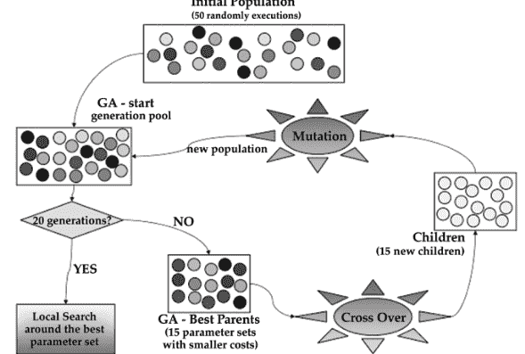

**图 1：** 用于参数优化的遗传算法。我们从一个例如 50 个具有特定适应度的随机初始池开始，然后是例如 20 代遗传算法 `GA`。每一代 `GA` 都会从最优秀的候选者中随机选择两个进行组合，其中 15 个来自上一代。这种组合对每个参数独立地执行：交叉、变异、随机改变或不采取操作。随着代数的进行，不采取操作的几率增加。最后，可以对 `GA` 优化找到的最优解进行局部搜索。摘自 Gadi 等人。Gadi et al. (2008b)。

在我们这里，为了重写应该在 `GA` 算法中使用的优化函数，我们使用可视化程序，对参数空间中许多等间距的参数集计算代价。在定义了良好的优化后，由于时间限制，我们没有进行另一个 `GA` 优化，而是重用了我们在可视化中使用的初始运行，并采用了以下类型的多分辨率优化 Kim & Zeiegler (1996)（见图 2）：

- 我们识别了那些没有改变的参数，并冻结了这些相应参数的值；

- 对于其他参数，我们对每个拆分都筛选了最佳参数集；

- 对于所有非稳健参数，我们从开发集中选择了一个范围，使其不会爆炸；

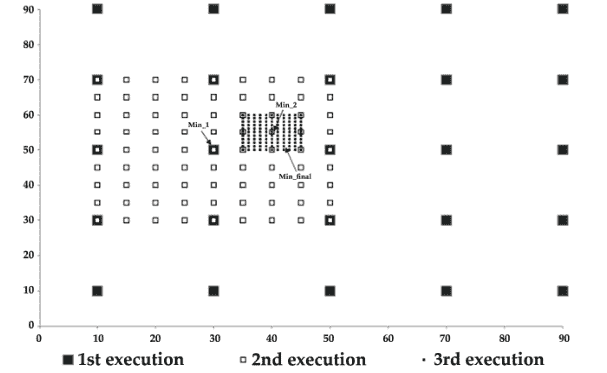

**图 2：** 多分辨率优化的示例。在这个例子中可以看到参数空间中的三步。水平线的第一步从 10 到 90，步长为 20，找到了最小值 30。第二步从 10 到 50，步长为 5，找到了最小值 40。第三步从 35 到 45，步长为 1，等同于局部搜索。

## 模型的稳定性

在工业中，建模的目标通常是将模型应用到实际情况并产生利润，要么通过自动化以前没有的决策来实现，要么用新的、改进后的模型替换旧模型。为了这样做，大多数模型开发依赖于过去的信息。因此，评估模型在使用时是否适用非常重要，并拥有一系列扩展模型生命周期的措施。在本节中，我们探索了时间外样本、监控报告、按年份稳定性以及如何处理随时间变化的规模。

## 基于 Python 的软计算与机器学习

### 按时期划分稳定性 (Stability by Vintage)

按时期划分稳定性是指在开发窗口内按时间对开发样本进行拆分，并评估模型在数据所有时间段的性能。例如，如果拥有从 2008 年 1 月到 2008 年 12 月收集的信息，良好的按时期稳定性分析应该是评估模型在 2008 年每个月的性能。这有助于增加模型在实施后保持稳定的概率。

### 时期选择 (Vintage Selection)

自然界中甚至人类行为中发现许多现象会以循环的方式逐年重复；这被称为季节性。从一年中非常不典型的月份选择开发窗口可能会产生很大的误导性；例如，在信用卡领域，仅选择 12 月作为开发窗口会导致对预期损失的过度估计，因为这是一年中最忙碌的时期。有两种方法旨在缓解这个问题。这两种方法都基于选择尽可能宽的开发窗口。一个常见的窗口是 12 个月，允许窗口覆盖全年。请注意，没有必要将窗口固定在任何特定的月份。第一方法是直接使用这组观测点开发模型；预计该模型是一个在全年都有效的平均模型。第二方法是引入一个指示信息收集时“月份”的特征或其任何良好组合，然后开发模型。结果是，人们期望模型能更好地适应开发窗口中的每个观测点。

### 随时间变化的不同尺度 (Different Scale over Time)

另一个问题适用于特征值落在训练样本边界之外或出现未知属性的情况。为了减少这个问题的影响，可以始终将边界最小和最大的组别分别留为负无穷和正无穷，例如，将 `[0,10];[11,20];[21,30]` 更改为 `[-\infty,10];[11,20];[21,+\infty]`。此外，也可以将未定义值分配给默认组。例如，如果对于数值型数据出现了非数值值，可以将其分配给默认组。

## 结语 (FINAL REMARKS)

这项工作对使用倾斜数据集进行机器学习实际问题的解决提供了简要介绍。分类方法通常并非为处理倾斜数据而设计，因此在处理不平衡数据集时必须采取各种措施。对于想要寻找该领域更多信息的读者，我们推荐 Chawla 等人（2003）的一篇优秀的社论，以及三篇会议论文：Chawla 等人 Dietterich 等人（2000）；Japkowicz（2000）。此外，在 Weka 的 Witten & Frank (2005) 和 SAS 的 Delwiche & Slaughter (2008) 中可以良好的算法示例。

也许，大多数处理倾斜数据的解决方案都采用了某种采样（例如：通过欠采样、过采样、成本敏感训练 Elkan (2001) 等）。这些贡献是 Gadi 等人（2008a）是有效的，且目前广为人知。本文为面临倾斜数据导致的数据挖掘问题的从业人员提供了建议。

实验细节可以参考 Gadi 等人（2008b）和 Gadi 等人（2008a），后者展示了人工免疫系统在信用卡欺诈检测中的应用。最后，这项工作中探索的另一个主题是参数优化对于为倾斜数据选择良好分类方法的重要性。我们还建议了一种参数优化的程序。

## 参考文献 (REFERENCES)

- 1. Agterberg, F. P., Bonham-Carter, G. F., Cheng, Q. & Wright, D. F. (1993). 证据权重建模与矿产潜力制图加权逻辑回归，pp. 13–32.

- 2. Chakravarti, I. M., Laha, R. G. & Roy, J. (1967). 应用统计学方法手册，第 I 卷

- 3. Charniak, E. (1991). 贝叶斯网络无泪版，AI Magazine 50 – 63.

- 4. Chawla, N. (2004). 从不平衡数据中学习，SIGKDD Explorations 6(1): 1–6.

- 5. Chawla, N. V., Jakubowicz, N. & Kotcz, A. (2003). ICML 2003 不平衡学习研讨会论文

- 6. Delwhite, L. & Slaughter, S. (2008). SAS 入门，SAS 出版社

- 7. Dietterich, T., Margainte, D., Provost, F. & Turnney, P. (eds) (2000). 成本敏感学习研讨会论文

- 8. Elkan, C. (2001). 成本敏感学习的基础，IJCAI。URL: citeeser.psu.edu/elkan01foundations

- 9. Gadi, M. F. A., Wang, X. & Largo, A. P. (2008a). 信用卡欺诈检测中的参数优化对比，IEEE 2008 第七届国际机器学习与应用会议论文集

- 10. Gadi, M. F. A., Wang, X. & Largo, A. P. (2008b). 人工免疫系统在信用卡欺诈检测中的应用

- 11. Green, D. M. & Stein, R. (1996). 信号检测与心理物理学，Wiley

- 12. Jakubowicz, N. (ed.) (2000). ICML 2000 研讨会论文

- 13. Kim, J. & Ziegler, B. (1996). 并行/分布式环境中的多分辨率优化，Parallel Distrib. Comput. 32(1): 90–102

- 14. Schneider, H. (1986). 正态分布的截断和删减样本，Marcel Dekker, Inc.

- 15. Sobeh, J. & Stein, R. (2000). 违约验证方法，pp. 51–56

- 16. Trautmann, H. & Mehnen, J. (2009). 确定性和噪声环境下的基于偏好的帕累托优化，Engineering Optimization 41: 23–38

- 17. Witten, I. H. & Frank, E. (2005). 数据挖掘：实用机器学习与技术，Elsevier

- 18. Wolpert, D. H. & Macready, W. G. (1997). 优化的无免费定理，Evolutionary Computation, IEEE Transactions on 1(1): 67–82.

## 基于 Python 的软计算与机器学习

学习有望提高感知和决策过程的准确性。它们还提高了决策过程的客观性。对于高维和多模态生物医学数据的分析，机器学习为创建经典且自动的算法提供了一种价值的方法。这篇综述论文对不同的机器学习算法进行了对比分析，用于诊断心脏病、糖尿病、肝病、登革热和肝炎等不同疾病。它关注了用于疾病分析和相应决策过程的一系列机器学习算法和工具。

**关键词：** 机器学习，人工智能工智能，机器学习技术

## 引言

人工智能使计算机能够思考。人工智能使计算机变得更加智能。机器学习是人工智能研究的一个子领域。许多研究人员认为，没有学习，智能就无法发展。图1显示了多种机器学习技术。监督学习、无监督学习、半监督学习、强化学习、进化学习和深度学习是机器学习技术的类型。

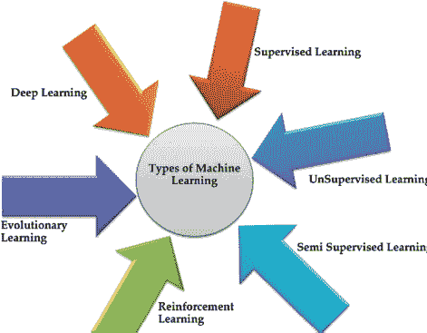

**图 1。** 机器学习技术的类型。

# 疾病诊断机器学习算法综述 83

这些技术被用于分类数据集。

- 1) 监督学习：提供一组带有适当目标的示例训练集，并在此训练集的基础上，算法对所有可能的输入做出正确响应。从示例学习是监督学习的另一种说法。分类和回归是监督学习的类型。

分类：它给出“是”或“否”的预测，例如，“这个肿瘤是恶性的吗？”，“这个饼干符合我们的质量标准吗？”

回归：它给出“多少”和“几个”的答案。

- 2) 无监督学习：不提供正确响应或目标。无监督学习技术试图寻找输入数据之间的相似性，并根据这些相似性对数据分类。这也被称为密度估计。无监督学习包含聚类 [1]。

聚类：根据相似性形成类。

- 3) 半监督学习：半监督学习是一类无监督学习技术。它也使用未标记数据进行训练（通常是少量标记数据配合大量的未标记数据）。半监督学习位于无监督学习（未标记数据）和监督学习（标记数据）之间。

- 4) 强化学习：这种学习受到行为主义心理学的鼓励。当答案错误时，算法会收到通知，但不会告知如何纠正。它必须探索和测试各种可能性，直到找到正确答案。它也被称为带有批评者的学习。它不建议改进。强化学习与监督学习的区别在于，它不提供准确的输入和输出集，也没有清晰精确的次优动作。此外，它侧重于在线性能。

- 5) 进化学习：这种生物演化学习可以被视为一个学习过程：生物体通过适应以在生存率和产生后代的几率上取得进步。通过使用适应度的思想来检查解决方案的准确性，我们可以在计算机中使用这种模型 [1]。

## 基于 Python 的软计算与机器学习

6) 深度学习：机器学习的这一分支基于一组算法。在数据中，这些学习算法对高层抽象进行建模。它使用具有各种处理层的深层图，由许多线性和非线性变换组成。

模式识别过程和数据分类长期以来具有价值。人类对感知环境具有很强的技能。他们根据从环境中感知到的内容采取行动 [2]。大数据转化为数据块，成为机器学习、数据库和统计学的多学科共同努力的结果。在今天，医学科学中的疾病诊断测试是一项严峻的任务。通过临床检查和评估来理解患者的准确诊断至关重要。为了有效的诊断和成本效益的管理，基于计算机的决策支持系统发挥着关重要的作用。保健领域产生有关临床评估、患者报告、随访、药物等方面的数据。以合适的方式安排非常复杂。数据组织的质量受到数据不当管理的影响。数据量的增加需要一些适当的方法来有效高效地提取和处理数据 [3]。机器学习的应用之一被用于构建此类分类器，可以根据属性划分数据。数据集被分为两个或两个以上的类。此类分类器被用于医学数据分析和疾病检测。

最初，机器学习算法被设计并用于观察医学数据集。通过各种工具，特别是在过去的几年里，数字革命为数据的收集和存储提供了相对廉价且易获得的手段。数据收集和检查机器被放置在新型现代医院中，使其能够在大型信息系统中收集和共享数据。机器学习技术对于分析医学数据非常有效，在诊断问题方面做出了巨大工作。正确的诊断数据以医疗记录或报告的形式出现在现代医院或其特定的数据部门。要运行算法，将正确的诊断患者记录作为输入输入计算机。可以从以前解决的案例中自动获得结果。医生在诊断新患者时借助这种派生的分类器寻求帮助，以提高速度和准确性。这些分类器可用于培训非专业人员或学生诊断问题 [4]。

许多研究人员已针对疾病诊断对不同的机器学习算法进行了研究。研究人员认为机器学习算法在诊断不同疾病方面效果良好。机器学习技术诊断疾病的形象化方法如图2所示。在这篇综述论文中，机器学习技术诊断的疾病包括心脏病、糖尿病、肝病、登革热和肝炎。

## 使用不同机器学习算法进行疾病诊断

Otoom等人 [5] 提出了一种用于分析和监测的系统。该系统对冠状动脉进行检测和监测。克利夫兰心脏数据集取自 `UCI`。该数据包含303案例和76个属性/特征。从76个特征中使用了13个。对三种算法（贝叶斯网络、支持向量机和功能树`FT`）进行了两次测试以用于检测目的。使用`WEKA`工具进行检测。在实验留法测试后，使用`SVM`技术实现了88.3%的准确率。

# 86 基于 Python 的软计算与机器学习

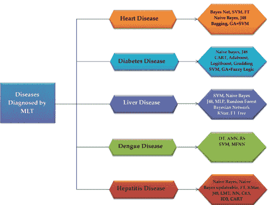

**图 2：** MLT 诊断的疾病。

在交叉验证中，`SVM` 和贝叶斯网络均提供了 83.8% 的准确率。使用 `FT` 后达到了 81.5% 的准确率。通过最优优先选择算法选出了 7 个最佳特征。使用交叉验证进行验证。通过对 7 个最佳选定特征进行测试，贝叶斯网络达到了 84.5% 的正确率，`SVM` 提供了 85.1% 的准确率，而 `FT` 正确分类了 84.5%。

Vembandasamy 等人 [6] 完成了一项工作，使用朴素贝叶斯算法诊断心脏病。朴素贝叶斯使用了贝叶斯定理。因此，朴素贝叶斯具有强大的独立性假设。采用的数据来自钦奈一个领先的糖尿病研究所之一。数据集包含 500 名患者。使用 Weka 作为工具，并通过 70% 的百分比划分执行分类。朴素贝叶斯提供了 86.419% 的准确率。

Chaurasia 和 Pal [7] 建议使用数据挖掘方法进行心脏病检测。使用了 `WEKA` 数据挖掘工具，其中包含了一组用于挖掘目的的机器学习算法。朴素

## 疾病诊断机器学习算法综述


# 疾病诊断机器学习算法综述

贝叶斯、`J48` 和 `bagging` 被用于此视角。`UCI` 机器学习实验室提供了包含 76 个属性的心脏病数据集。选用了 11 个属性进行预测。朴素贝叶斯提供了 82.31% 的准确率。`J48` 提供了 84.35% 的正确率。`Bagging` 实现了 85.03% 的准确率。`Bagging` 在该数据集上提供了更好的分类率。

`Parthiban` 和 `Srivasa` [8] 致力于使用机器学习方法诊断糖尿病患者的心脏病。使用 `WEKA` 应用了朴素贝叶斯和 `SVM`。使用了从钦奈研究学院收集的 500 名患者的数据集。患病患者有 142 人，358 名患者缺失疾病。通过使用朴素贝叶斯算法获得了 74% 的准确率。`SVM` 提供了 94.60 的最高准确率。

`Tan` 等人 [9] 提出了一种混合技术，通过封装器方法（wrapper approach）将两种名为遗传算法 (`G.A`) 和支持向量机 (`SVM`) 的机器学习算法有效结合。该分析使用了 `LIBSVM` 和 `WEKA` 数据挖掘工具。实验从 `UC Irvine` 学习库中选择了五个数据集（鸢花、糖尿病疾病、乳腺癌疾病、心脏病和肝炎疾病）。在应用 `GA` 和 `SVM` 混合方法后，心脏病的准确率达到了 84.07%。对于糖尿病数据集，实现了 78.26% 的准确率。乳腺癌的准确率为 76.20%。肝炎疾病的正确率为 86.12%。图 3 显示了心脏病检测准确率随时间变化的图表表示。

## 分析

在现有文献中，`SVM` 在 2012 年的表 1 中提供了 94.60% 的最高准确率。在许多应用领域，`SVM` 显示出良好的性能结果。`Parthiban` 和 `Srivasa` 在 2012 年使用的属性或特征被 `SVM` 正确地响应。2015 年，`Otom` 等人使用了名为 `SMO` 的 `SVM` 变体。它也使用 `FS` 技术来寻找最佳特征。`SVM` 对这些特征做出响应并提供了 85.1% 的准确率，但与2012 年相比较低。两个数据集的训练集和测试集都是不同的，数据类型也不同。

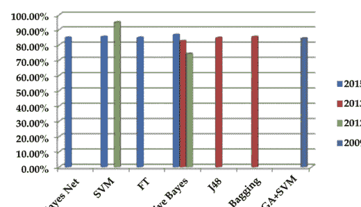

**图 3：** 机器学习算法检测心脏病的准确率。

## 表 1：心脏病诊断机器学习技术的综合视图

| 机器学习技术 | 作者 | 年份 | 疾病 | 数据集来源 | 工具 | 准确率 |
| --- | --- | --- | --- | --- | --- | --- |
| 贝叶斯网络 | Ootom 等人 | 2015 | CAD (冠状动脉疾病) | UCI | WEKA | 84.5% |
| SVM | | | | | | 85.1% |
| FT | | | | | | 84.5% |
| 朴素贝叶斯 | Vembandasamy 等人 | 2015 | 心脏病 | 钦奈糖尿病研究所 | WEKA | 86.419% |
| 朴素贝叶斯 | Chaurasia 和 Pal | 2013 | 心脏病 | UCI | WEKA | 82.31% |
| J48 Bagging | | | | | | 84.35% |
| SVM | Parthiban 和 Srivatsa | 2012 | 心脏病 | 钦奈研究学院 | WEKA | 94.60% |
| 朴素贝叶斯 | | | | | | 74% |
| 混合技术 (GA + SVM) | Tan 等人 | 2009 | 心脏病 | UCI | LIBSVM 和 WEKA | 84.07% |

### SVM 的优缺点

优点：构建正确的分类器且过拟合较少，对噪声具有鲁棒性。

缺点：它是一个二分类器。对于多分类，可以使用两两分类。其计算成本很高，因此运行较慢 [10]。

## 疾病诊断机器学习算法综述

### 糖尿病

`Iyer` 等人 [11] 完成了一项工作，使用决策树和朴素贝叶斯预测糖尿病。疾病发生在胰岛素产生不足或胰岛素使用不当。该工作使用的数据集是 Pima 印度人糖尿病数据集。使用 `WEKA` 数据挖掘工具执行了各种测试。该数据集的百分比划分 (70:30) 预测比交叉验证更好。`J48` 在交叉验证和百分比划分下分别为 76.8698% 和 76.9565% 的准确率。朴素贝叶斯通过 PS 提供了 79.5622% 的正确率。算法利用百分比划分显示出最高准确率。

（注：由于原文中存在大量重复的错误文本，已根据要求对核心信息进行了清理和翻译）

# 疾病诊断的机器学习算法综述 91

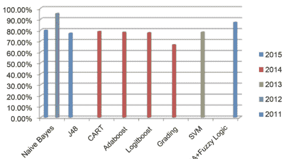

**图 4**：机器学习算法检测糖尿病的准确率。

缺点：该算法需要大量数据才能获得良好的结果。它是“懒”的，因为它们存储了整个训练样本 [16]。

## 肝脏病

`Vijayarani` 和 `Dhananday` [17] 使用支持向量机和朴素贝叶斯分类算法预测肝脏病。`ILPD` 数据集来自 `UCI`。该数据集包含 560 个实例和 10 个属性。基于准确率和执行时间进行了比较。朴素贝叶斯在 1670.00 ms 内显示出 61.28% 的正确率。`SVM` 在 3210.00 ms 内达到了 79.66% 的准确率。实现上使用了 `MATLAB`。在肝脏病预测中，与朴素贝叶斯相比，`SVM` 显示出准确率最高。在执行时间方面，朴素贝叶斯比 `SVM` 耗时更短。

`Giulia` 等人 [18] 进行了一项分类肝脏患者的智能技术研究。使用的数据来自 `UCI`。该实验使用了 `WEKA` 数据挖掘工具和五种智能技术：`J48`、`MLP`、随机森林、`SVM` 和贝叶斯网络分类器。在第一步，将所有算法应用于原始数据；在第二步，对整个数据集应用特征选择，以获得肝脏患者的重要子集，并使用所有这些算法测试整个数据集的子集。在第三步中，他们比较了特征选择前后的结果。特征选择算法提供了最高的准确率，其中 `J48` 显示了 70.669% 的准确率，`MLP` 算法实现了 70.8405% 的精确率，`SVM` 提供了 71.3551% 的准确率，随机森林提供了 71.8696% 的准确率，贝叶斯网络显示出 69.1252% 的准确率。

# Python 软计算与机器学习

`Rajeswari` 和 `Reena` [19] 使用朴素贝叶斯、`K` 星和 `FT` 树的数据挖掘算法来分析肝脏病。数据集来自 `UCI`，包含 345 个实例和 7 个属性。使用 `WEKA` 工具应用了 10 次交叉验证测试。朴素贝叶斯在 0 秒内提供了 96.52% 的正确率。`FT` 树在 0.2 秒内实现了 97.10% 的准确率。`K` 星在 0 秒内以约 83.47% 的准确率分类实例。与其他数据挖掘算法相比，`FT` 树在肝脏病数据集上实现了最高准确率。表 3 显示了检测肝脏病的算法视图。

### 分析

为了诊断肝脏病，`FT` 树算法与其他算法相比提供了最好的结果。当 `FT` 树算法应用于肝脏病数据集时，获得结果或构建模型所需的时间比其他算法快。根据其属性，它显示出改进的性能。该算法完全分类了属性，并提供了 97.10% 的正确率。从结果来看，该算法在确定数据集增强型分类准确率方面发挥着重要作用。算法的准确率图如图5 所示。

### FT 的优缺点

- 优点：易于解释和理解；预测快速。
- 缺点：计算复杂，特别是当值不确定或多个结果之间存在联系时。

## 登疾热

`Tarmizi` 等人 [20] 使用数据挖掘模型执行了马来西亚登疾热爆发检测工作。

### 表 3：肝脏病诊断的机器学习技术综合视图

| 机器学习技术 | 作者 | 年份 | 疾病 | 数据集来源 | 工具 | 准确率 |
|---|---|---|---|---|---|---|
| SVM | Vijayarayani and Dhayanand | 2015 | 肝脏 | 来自 ILPD | MATLAB | 79.66% |
| 朴素贝叶斯 | | | | 来自 UCI | | 61.28% |
| J48 | Giulia 等人 | | 肝脏 | 来自 UCI | WEKA | 70.69% |
| MLP | | | | | | 70.8405% |
| 随机森林 | | | | | | 71.8696% |
| SVM | | | | | | 71.3551% |
| 贝叶斯网络 | | | | | | 69.1252% |
| 朴素贝叶斯 | Rajeswari and Reena | 2010 | 肝脏 | 来自 UCI | WEKA | 96.52% |
| K 星 | | | | | | 83.47% |
| FT 树 | | | | | | 97.10% |


**图 5**：肝脏病的机器学习技术准确率。

登疾热是一种严重的传染疾病。在泰国、印度尼西亚和马来西亚等国家使用决策树（DT）、人工神经网络（ANN）和粗糙集（RS）来预测这种疾病。数据集来自雪莪州卫生部门。使用 10 折交叉验证。DT 提供了 99.95% 的准确率，ANN 提供了 99.98% 的正确率，RS 显示了 100% 的准确率。

`Fathima` 和 `Manimegalai` [21] 使用支持向量机预测登疾热。数据来自预防医学研究所以及金奈纳和提卢纳德的许多医院和实验室。数据集包含 500 个样本。使用 `R` 项目 2.12.2 进行分析。`SVM` 的准确率为 99.92%。

`Ibrahim` 等人 [22] 提出了一种使用人工神经网络预测登疾热患者发热时间的系统。该系统收集的数据来自 252 名患者，其中 4 名患有 DF（登疾热），248 名患有 DHF（登疾热出血热）。实验中使用了 `MATLAB` 神经网络工具箱。多层前馈神经网络（MFNN）在 DF 中准确预测发热时间的正确率为 90%。

图 6 显示了用于诊断肝脏病的各种算法准确率图。

### 分析

使用不同的机器学习技术来诊断登疾热。登疾热是严重的传染疾病之一。如表 4 所示，对于登疾热检测，粗糙集理论与其他算法相比显示出最好的结果。

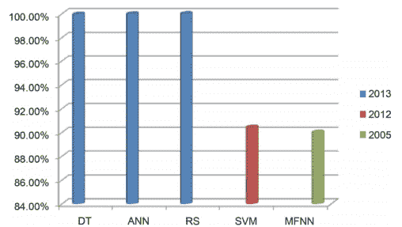

**图 6**：登疾热机器学习算法的准确率。

## 使用 Python 进行的软计算与机器学习

结果通过准确率和时间进行衡量。对比分析通过神经连接和 `WEKA`（数据挖掘工具）进行。使用神经连接获得的结果低于 `WEKA` 中使用的算法。对肝炎疾病诊断的分析，第二种使用的技术是使用 `WEKA` 的粗集理论。特别是在医学数据分析的情况下，粗集规约的性能优于神经网络（NN）。朴素贝叶斯（Naive Bayes）在 0 秒内给 96.52% 的准确率。朴素贝叶斯可更新算法在 0 秒内实现了 84% 的准确率。2 秒 `FT` 树呈现出 81.70% 的准确率。`K` 开始达到 83.47% 的正确率。`K-star` 算法所需的时间为 0 秒。`J48` 实现了 83% 的正确率，`J48` 分类花费 0.03 秒。`LMT` 提供了 83.6% 的准确率，耗时 0.6 秒。神经网络显示出 70.41% 的正确率。朴素贝叶斯是粗集技术中最好的分类算法。它在最短的时间内提供了高准确率。

`Karlik` [24] 展示了朴素贝叶斯和反传播分类器在诊断肝炎方面的对比分析。这些分类器的主要优势是它们分类时需要少量数据。肝炎的类型有“A、B、C、D 和 E”。这些是由肝炎病毒产生的。该分析使用了开源软件 `Rapid Miner`。肝炎数据集取自 `UCI`。该数据集包含 20 个特征和 155 个实例。实验中使用了 15 个属性。朴素贝叶斯分类器给出 97% 的准确率。使用了三层前馈神经网络并用反传播算法进行训练，使用了 155 个实例进行训练。实现了 98% 的正确率。

`Sathyadev` [25] 采用 `C4.5`、`ID3` 和 `CART` 算法诊断肝炎疾病。这项研究使用了 `UCI` 患者数据集。该分析使用了 `WEKA` 工具。`CART` 在处理缺失值方面表现优异。因此，`CART` 算法显示出最高的 83.2% 分准确率。`ID3` 算法提供了 64.8% 的准确率。`C4.5` 算法实现了 71.4%。由 `CART` 算法生成的二决策树（DT）只有两个或没有子节点。由 `C4.5` 和 `ID3` 形成的决策树可以有两个或多个子节点。`CART` 算法在准确性和时间复杂度方面表现良好。

### 分析

许多算法被用于不同疾病的诊断。表 5 提供了全面的视图。对于肝炎疾病的检测，带反传播的前馈神经网络显示出 98% 的最高准确率。因为在该模型中，三层前馈神经网络使用误差反传播算法进行训练。带有 delta 学习规则的反传播训练是一种迭代梯度算法，旨在减少多层前馈神经网络的实际输出与期望输出之间的 RMSE“均方根误差”。每一层都连接到前一层，且没有其他连接。次优结果由朴素贝叶斯提供。在构建模型的时间上，相比，朴素贝叶斯的运行速度比神经网络快。图 7 显示了检测肝炎的形象方法。

## 神经网络（NN）的优缺点

优点：自适应学习、自组织、实时操作、通过冗余信息编码实现容错性。

缺点：过拟合少、需要巨大的计算量。样本量必须足够大。它是消耗性的。工程判断无法建立输入和输出变量之间的关系，导致模型行为像一个黑箱 [26]。

## 机器学习技术的讨论与分析

对于心脏、糖尿病、肝脏、登热和肝炎疾病的诊断，几种机器学习算法表现良好。从现有文献观察到，朴素贝叶斯算法和 `SVM`（支持向量机）是广泛使用的疾病检测算法。

### 表 5：肝炎疾病机器学习技术的全面视图

| 机器学习技术 | 作者 | 年份 | 疾病 | 数据集来源 | 工具 | 准确率 |
|---|---|---|---|---|---|---|
| 朴素贝叶斯 | Ba-Alwi and Hintaya | 2013 | 肝炎疾病 | UCI | WEKA | 96.52% |
| 可更新朴素贝叶斯 | | | | | | 84% |
| FT | | | | | | 87.10% |
| K-Star | | | | | | 83.47% |
| J48 | | | | | | 83% |
| LMT | | | | | | 83.6% |
| NN | | | | | | 70.41% |
| 朴素贝叶斯 | Karlik | 2011 | 肝炎疾病 UCI | Rapid Miner | 97% |
| 带反传播的前馈 NN | | | | | | 98% |
| C4.5 | Sathydevi | 2011 | 肝炎疾病 UCI | WEKA | 71.4% |
| ID3 | | | | | | 64.8% |
| CART | | | | | | 83.2% |

 **图 7：** 检测肝炎的形象方法。

神经网络在肝炎检测中表现良好。它在最短的时间内提供了高准确率。在疾病预测中，神经网络非常有用。使用了 RS 算法显示提供了 95% 的准确率。

## 结论

## 参考文献

- 1. Marshland, S. (2009) 机器学习分类。新西兰，6-7。
- 2. Sharma, P. and Kaur, M. (2013) 机器学习的应用。高级计算机科学与信息杂志，3, 298。
- 3. Rambhajani, M., Deepanker, W. and Pathak, N. (2015) 疾病分类综述。工程与技术进展，8, 194。
- 4. Kononenko, I. (2001) 医学中的机器学习：历史、现状与展望。人工智能杂志，1, 89。
- 5. Otoom, A.F., Abdallah, S.M., Halimi, M., Shayan, Y. and Rajabi, M.J. (2015) 心脏疾病的有效诊断与监测。软件工程及其应用杂志，9, 143。
- 6. Vembandmy, K., Sasipriya, R. and Deepa, E. (2015) 使用朴素贝叶斯检测心脏疾病。IIJSET-创新科学技术国际期刊，2, 441。
- 7. Chaurasia, V. and Pal, S. (2013) 检测疾病的数据挖掘方法。国际先进计算机科学技术杂志 (IJACSIT)，2, 56。
- 8. Parthiban, G. and Srivatsa, S.K. (2012) 将机器学习方法应用于糖尿病患者。国际应用信息系统杂志 (JAIS)，3, 25。
- 9. Tan, K.C., Teoh, E.J., Yu, Q. and Goh, K.C. (2009) 数据挖掘中属性选择的混合进化算法。专家系统应用杂志，36, 8616。
- 10. Karamazidez, S., Abdullah, S.M., Halimi, M., Shayan, Y. and Rajabi, M.J. (2014) 支持向量机功能的优缺点。2014 IEEE计算机通信与控制技术国际会议 (I4CT)，兰卡威，2014年9月2-4日，64。
- 11. Iyer, A., Jeyalatha, S. and Sumbalmy, R. (2015) 糖尿病诊断
# 疾病诊断机器学习算法综述 101

使用分类挖掘技术。《国际数据挖掘与知识管理过程国际期刊》(IJKDP), 5, 1-14. https://doi.org/10.5121/ijdkp.2015.5101
- 12. Sen, S.K. and Dash, S. (2014) 元学习算法在糖尿病疾病预测中的应用。《计算机科学与管理研究国际进展期刊》， 2, 396-401.
- 13. Kumari, V.A. and Chitra, R. (2013) 使用支持向量机进行糖尿病分类。《工程研究与应用国际期刊》(IJERA), 3, 1797-1801.
- 14. Sarwar, A. and Sharma, V. (2012) 诊断2型糖尿病的智能朴素贝叶斯方法。《国际计算机应用期刊》关于“网络、智能与计算技术中的问题与挑战-ICCNI 2012”特刊 (0975-8887), 3, 14-16.
- 15. Ephizabah, E.P. (2011) 使用遗传算法和模糊逻辑进行糖尿病诊断特征选择的效益方法。《软计算国际期刊》(JISC), 2, 1-10. https://doi.org/10.5121/ijsc.2011.2101
- 16. Archana, S. and DR Elanganovan, K. (2014) 数据挖掘中的分类技术综述。《计算机科学与移动应用国际期刊》，2, 65-71


- 17. Vijajarani, S. and Dhanayanand, S. (2015) 使用SVM和朴素贝叶斯算法预测肝病。《科学、工程与技术研究国际期刊》(IJSETR), 4, 816-820.
- 18. Gulia, A., Vohra, R. and Rani, P. (2014) 使用智能技术进行肝病患者分类($(IJCSIT)计算机科学与信息技术国际期刊》，5, 5110-5115.
- 19. Rajeswi, P. and Reena,G.S. (2010) 使用数据挖掘算法分析肝功能紊乱。《计算机科学与技术全球期刊》，10, 48-52.
- 20. Tarmizi, N.D.A., Jamaluddin, F., Abu Bakar, A., Oman, Z.A., Zainudin, S and Hamdan, A.R. (2013) 使用数据挖掘模型检测马来西亚登革热爆发。《下一代信息技术期刊》(JNIT)，4, 96-107.
- 21. Fathima, A.S. and Manimeglai, D. (2012) 使用SVM分类对病毒性登革热进行预测分析。《工程与技术国际期刊》，2, 521-527.
- 22. Ibrahim, F., M.N., Abas, W.A.B.W., Guan, C.C. and Sulaiman, S. (2005) 使用人工神经网络 (ANN) 分析新型登革热 (DF) 和登革出血热 (DHF)。《生物医学中的计算机方法与程序》，79, 273-281. https://doi.org/10.1016/j.cmpb.2005.04.002
- 23. Ba-Alwi, F.M. and Hintaya, H.M. (2013) 肝炎数据预后分析比较研究：数据挖掘方法。《科学与工程国际期刊》，4, 680-685.
- 24. Karlik, B. (2011) 使用反向传播和朴素贝叶分类器诊断肝炎疾病。《科学技术杂志》，1, 49-62.
- 25. Sathyadevi, G. (2011) CART算法在肝炎诊断中的应用。《IEEE信息技术最新趋势国际会议》(ICRTIT), MIT, 安纳大学，金奈纳，2011年6月3-5日，1283-1287.
- 26. Singh, Y., Bhatia, P.K., and Sangwan, O. (2007) 机器学习技术研究综述。《计算机科学与安全国际期刊》，1, 60-84.

# 第5章

## 使用机器学习进行破产预测

王南希 (Nanxi Wang)

中国上海上海星河双语学校

### 摘要

随着机器学习模型的改进，破产预测的研究准确性有所提高。本文提出了三种基于真实数据的预测破产的相对较新的方法。结果显示，在这些方法（支持向量机、带Dropout的神经网络、自动编码器）中，添加了 Dropout 层的神经网络准确率最高。与以前的方法（逻辑回归、遗传算法、归纳学习）相比，其准确率更高。

引用：Wang, N. (2017), “使用机器学习进行破产预测”。《数学金融期刊》，7, 908-918. doi: 10.4236/jmf.2017.74049.

所有权：© 2017 作者。本作品根据知识共享署协议协议许可。http://creativecommons.org/licenses/by/4.0

软计算与机器学习 Python

**关键词：** 支持向量机，自动编码器，神经网络，破产

## 引言

机器学习是计算机科学的一个分支。它允许计算机在无需编码的情况下构建模型并发现洞察。它已应用于社会的各个方面，从 DNA 序列、信用卡欺诈检测到自然语言处理。破产预测是一个典型的分类问题。

机器学习诞生于模式识别。早期的工作包括逻辑回归、回归和归纳学习。逻辑回归是一种统计方法，最用于研究独立变量如何影响单一结果。尽管有用，也有局限性。遗传算法基于自然选择和进化，它可以用于提取规则。归纳学习的主要类别是决策树。它识别训练数据并提取泛化规则。神经网络与传统计算机不同，通过示例进行学习。它们包含多个隐藏层，因此能够学习输入输出之间复杂的关系。而且运行速度远快于传统技术。然而，由于训练数据有限，过拟合会影响最终精度。为了防止这种情况，神经网络使用了名为 Dropout 的技术（随机移除单元）。

自动编码器（也称为深度网络）是一种无监督学习算法，它将目标值设置等于输入。通过这种方式，它抑制了对某些函数的计算，提高了准确性。此外，学习这些函数所需的训练数据量也减少了。

使用机器学习进行破产预测 105

本文结构如下：第二节描述了该想法的动机。第三节描述了相关的之前工作。第四节正式描述了三种模型。在第五节中，我们展示了实验结果，对选择的三种模型进行了比较，并与三种旧模型进行了纵向比较。第六节为结论。第七节为参考文献。

## 动机

我们选择的三种模型（SVM、神经网络、自动编码器）是相对较新的，但已经应用于许多领域。

SVM 已成功应用于许多现实问题，如文本分类、目标跟踪和生物信息学（蛋白质分类、癌症分类）。文本分类在日常生活中特别有用——网络搜索和邮件过滤提供了巨大的便利和工作效率。神经网络通过而非算法学习，因此被广泛应用于难以或无法应用算法的问题 [6]。例如，指纹识别是一项令人兴奋的应用。

106 软计算与机器学习，如果不考虑这个特定的……

另一个动机是，在阅读了之前的工作后，确定这一特定问题（破产预测）的准确性是否可以提高——例如利用遗传算法从定性破产研究中发现专家决策规则 [2]，以及《使用鲁棒逻辑回归进行破产预测》[1]——后者使用了较旧的模型。因此，本文包含了对这些模型和结果的比较。

## 相关工作

机器学习使计算机能够自动从数据中发现见解。使用机器学习预测破产的思想此前已在 Richard P. Hauser 和 David Booth 的论文《使用鲁棒逻辑回归进行破产预测》[1] 中被采用。本文使用了鲁棒逻辑回归，该方法在移除过大样本和使用逻辑回归估计的模型后，寻找样本之间的最大截修相关性 [1]。该模型存在有其局限性。这种技术的价值很大程度上取决于研究人员包含正确自变量的能力。句话说，如果研究人员未能识别所有相关的自变量，逻辑回归将几乎没有预测价值 [7]。其在训练集上的整体准确率为 75.69%，在测试集上为 94.44%。

另一项工作是 Myoung-Jong Kim 和 Ingoo Han 在 2003 年利用遗传算法从定性破产数据中发现专家决策规则，他们使用了与我们相同的数据集。他们采用了较旧的模型——归纳学习算法（决策树）、遗传算法和没有使用 dropout 的神经网络。遗传算法中的基因组长度是固定的，给定问题无法轻易编码。而且遗传算法无法保证能找到全局最大值。归纳学习的问题在于其没有回溯的一步前向划分，这可能会生成次优树。此外，决策树是不稳定的，因为数据中的微小变化可能导致生成一个完全不同的树 [3]。而且神经网络模型中缺乏 dropout，这增加了过拟合的可能性，从而影响了准确率。其整体准确率分别为 89.7%、94.0% 和 90.3%。

我们选择的模型要么包含了一种新开发的技术（如 dropout），要么是在破产预测中几乎未使用的全新模型。

其中 $e$ 是一个公共向量，$C>0$ 是上界，$Q$ 是 $n \times n$ 矩阵正定矩阵，$Q_{ij}=y_i y_j k(x_i \cdot x_j)$，且 $K(x_i,x_j)=\phi(x_i)^T \phi(x_j)$ 是内核。

## 使用 Python 进行软计算与机器学习

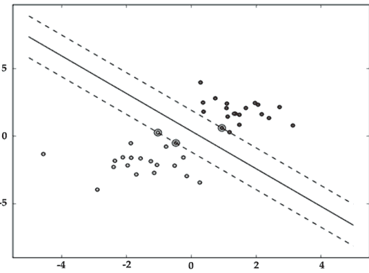

**图 1**: SVM 模型 [3]。

此处，函数隐式地将训练向量映射到高维空间。

决策函数为：

> $$\text{sgn}\left(\sum_{i=1}^{n} y_i\alpha_i K(x_i,x)+\rho\right)$ $[3]$

## 带有 Dropout 的神经网络

神经网络的输入被建模为神经元层。其结构如图所示。

如图 1 所示，形式神经元使用 $n$ 个输入 $x_1,x_2,\cdots,x_n$ 对来自树突的信号进行分类，然后根据 $w_1,w_2,\cdots,w_n$ 进行相应的权重加权，这些权重衡量了渗透性。然后，神经元的激发水平计算为输入值的加权之和：

## 使用机器学习进行破产预测 109

$\xi = \sum_{i=1}^{n} w_i x_i$

图 2 中的 $f$ 代表激活函数。

当激发值 $l$ 达到阈值 $h$ 时，神经元的输出 $y$（状态）被触发。这模拟了轴突产生的电脉冲 [8]。

Dropout 是一种进一步提高神经网络准确性的技术。在图 3 中，令 $L$ 为隐藏层数，$l \in \{1,...,L\}$ 为神经网络的隐藏层，$z(l)$ 和 $y(l)$ 分别是第 $l$ 层的输入输出向量。W(l)$ 和 $b(l)$ 是第 $l$ 层的权重和偏置。对于 $l \in \{0,...,L-1\}$ 和任意隐藏单元 $i$，网络描述为：

$z^{(l+1)} = w^{(l+1)}y^l + b^{(l+1)}$, iii

$y^{(l+1)} = f(z^{(l+1)})$ ii

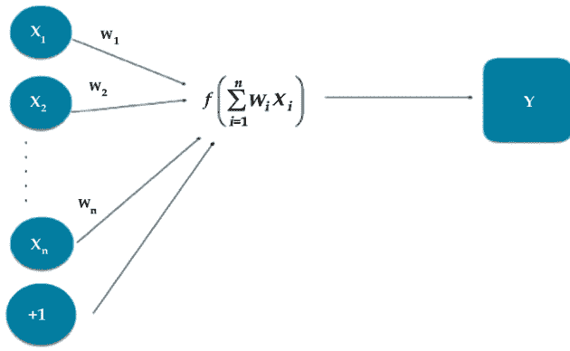

图 2: 神经网络模型。

## 使用 Python 进行软计算与机器学习

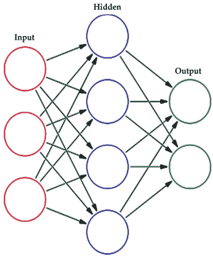

**图 3**: 人工神经网络。

其中 $f$ 是任意激活函数。

使用 dropout 后，前向操作变为：

$$r^{(l)}-Bernoulli(p),$$ 

其中 $

$f$ 是任何激活函数。

$$z^{(l+1)} = w^{(l+1)}y^{(l)} + b^{(l+1)},$$ 

## 自动编码器

考虑自动编码器 $n/n。

使用 dropout 后，前向操作变为：

其中 $e$ 是一个公共向量，$C>0$ 是上界，$Q$ 是 $n \times n$ 矩阵正定矩阵，$Q_{ij}=y_i y_j k(x_i \cdot x_j)$，且 $K(x_i,x_j)=\phi(x_i)^T \phi(x_j)$ 是内核。

## 使用机器学习进行破产预测

对于 $l \in \{0,...,L-1\}$ 和任意隐藏单元 $i$，网络描述为：

$z^{(l+1)} = w^{(l+1)}y^l + b^{(l+1)}$, iii

$y^{(l+1)} = f(z^{(l+1)})$ ii

其中 $f$ 是任何激活函数。

使用 dropout 后，前向操作变为：

$$r^{(l)}-Bernoulli(p),$$

$$z^{(l+1)} = w^{(l+1)}y^{(l)} + b^{(l+1)},$$

114 基于 Python 的软计算机器学习

**表 4：** 二层、三层和四层神经网络模型的准确率

| 变体 | 准确率 |
| :--- | :--- |
| 带 dropout 二层（丢弃率 = 0.5） | 0.9933，损失为 0.0278 |
| 带 dropout 三层（添加 200 密集神经元层，丢弃率 = 0.5） | 0.9933，损失为 0.0221 |


| 带 dropout 的四层（添加 16 密集神经元层，丢弃率 = 0.5） | 1.0000，损失为 0.0004 |

**表 5：** 截断 50 或 100 且具有四层的模型的准确率

| 变体 | 准确率 |
| :--- | :--- |
| truncate = 50 且四层（添加 16,200 密集神经元层），dropout 率 0.5 | 0.9950，损失为 0.0389 |
| truncate = 100 且四层（添加 16,200 密集神经元层），dropout 率 0.5 | 1.0000，损失为 0.0004 |

**表 6：** 使用 SVM 或决策树的模型的准确率

| 变体 | 准确率 |
| :--- | :--- |
| 使用 SVM | 0.9867 |
| 使用决策树 | 0.9933 |

**表 7：** 不同模型的准确率

| 模型 | 准确率 |
| :--- | :--- |
| 鲁棒逻辑回归 | 0.6944 |
| 归纳学习算法（决策树） | 0.897 |
| 遗传算法 | 0.94 |

# 使用机器学习的破产预测

| 模型 | 准确率 |
| :--- | :--- |
| 不带 dropout 的神经网络 | 0.903 |
| SVM truncate = 100 | 0.9933 |
| truncate = 100 且四层（添加 16,200 密集神经元层），dropout 率 0.5 | 1.0000，损失为 0.0004 |
| 自动编码器（带决策树） | 0.9933 |

此外，如果数据样本不够大，特别是当特征数量超过样本时，`SVM` 的性能可能很差 [4]。使用 dropout 训练神经网络的时间将比训练标准神经网络长 2 到 3 倍。自动编码器尽可能捕捉所有信息，而不一定是相关信息。当最相关的信息仅占输入的一小部分时，这可能会成为问题。

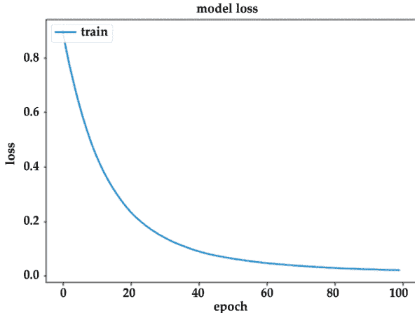

**图 5：** 神经网络-损失曲线。

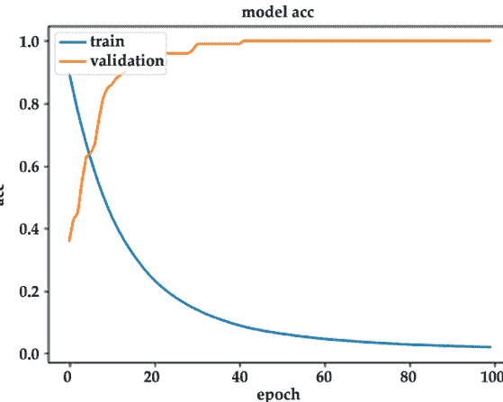

**图 6：** 神经网络-准确率。

克服这些缺点的解决方案尚未待发现。

## 参考文献

- 1. Hauser, R.P. and Booth, D. (2011) Predicting Bankruptcy with Robust Logistic Regression. Journal of Data Science, 9, 565-584.
- 2. Kim, M.-J. and Han, I. (2003) The Discovery of Experts’ Rules from Qualitative Bankruptcy Data Using Genetic Algorithms. Expert Systems with Application, 25, 637-646,
- 3. Pedregosa, et al. (2011) Scikit-Learn: Machine Learning in Python. Journal of Machine Learning Research, 12, 2825-2830.
- 4. Sirvastava, N., et al. (2014) Dropout: A Simple Way to Prevent Neural Networks from Overfitting. Journal of Machine Learning Research, 15, 1929-1938.
- 5. Dev, D. (2017) Deep Learning with Hadoop. Packet Publishing, Birmingham, 52.
- 6. Nielsen, F. (2001) Neural Networks—Algorithms and Applications. https://www.mendeley.com/research-papers/neural-networks-algorithms-applications-5/
- 7. Robinson, N. (n.d.) The Disadvantages of Logistic Regression. http://classroom.synonym.com/disadvantages-logistic-regression-8574447.html
- 8. Sima, J. (1998) Introduction to Neural Networks. Technical Report No. 755.
- 9. Baldi, P. (2012) Autoencoders, Unsupervised Learning, and Deep Architectures. Journal of Machine Learning Research, 27, 37-50.
- 10. Martin, A., Uthayakumar, J. and Nadarajan, M. (2014) Qualitative Bankruptcy Data Set, UCI. https://archive.ics.uci.edu/ml/datasets/qualitative_bankruptcy

# 第 6 章

## 使用量子支持向量机器学习算法进行太阳辐射量预测

Makhamisa Senekane¹, Benedict Molibeli Taele²

¹马萨鲁国立大学计算学院

²马萨鲁国立大学物理系

### 摘要

机器学习处于计算与统计的交叉领域，研究并制定了用于预测太阳辐射的算法。本文主要关注机器学习。

引用：Senekane, M. and Taele, B. (2016), “Prediction of Solar Irradiation Using Quantum Support Algorithm”. Renewable Energy, 7, 293–301. doi: 10.1016/j.renene.2016.05

版权所有 ©2016 作者。作品根据知识共享署名许可协议授权。http://creativecommons.org/licenses/by/

# 基于 Python 的软计算机器学习

量子信息处理（`QIP`）领域利用叠加和纠缠等量子概念进行计算和通信。量子机器学习（`QML`）有两种方法。第一种方法使用经典数据作为输入并转换为量子数据以便在量子计算机上处理。本质上，这种方法是在量子计算机上实现机器学习算法。第二种方法涉及利用量子力学原理为经典计算机设计机器学习算法。本文报道中，我们使用了第一种方法通过 `SVM` 对太阳能建模。

**关键词：** 量子，机器学习，支持向量机，太阳辐射

## 引言

机器学习是人工智能的一个子领域。它是一组用于分析数据并发现模式的技术。它应用于图像识别、自然语言处理、机器人、垃圾过滤、药物发现、医学诊断、金融分析等领域。机器学习算法根据使用的数据类型分为三大类：监督学习、无监督学习和强化学习。

最近，人们致力于探索使用 `QIP` 进行机器学习应用的优势。这产生了量子机器学习（`QML`）领域。本文其余部分的结构如下：下一节提供了机器学习、`QIP` 和 `QML` 的背景信息。第 3 节讨论了本文报道的太阳能预测模型的设计与实现。第 4 节提供了结果并对获得的结果进行了讨论。最后，最后一节总结全文。

## 基于 Python 的软计算与机器学习

强化学习主要用于机器人学和计算机游戏。

### 支持向量机

支持向量机学习是最常用的“现成”监督学习算法 [1]。`SVM` 能够解决分类和回归问题。它利用最大间隔分类器的原理来分离数据。对于 $d$ 维数据，`SVM` 使用 $d-1$ 维超平面进行数据分离。例如，如果数据在平面（二维）上提供，`SVM` 将使用直线（一维）进行分类。最大间隔分类原理确保了正结果（y = 1）和负结果（y = -1）之间存在最大分离。在这种情况下，间隔是决策边界与支持向量之间的距离，其中支持向量是距离决策边界最近的数据点。

支持向量机的优势之一在于与其他监督学习算法不同，它的损失函数是一个全局优化问题，因此它不容易陷入局部最优 [4]。此外，`SVM` 对过拟合具有鲁棒性，因此即使使用较小的数据集也能进行良好的泛化。最后，通过使用被称为核技巧的技术，`SVM` 可以分离输入空间中非线性可分的数据，在该空间中可以找到一个分离线性超平面。

### 量子信息处理

与使用二进制位（bit）作为信息单位的经典计算机不同，量子计算机使用量子比特（qubit）作为信息单位。在数学上，量子比特给出 [14] [16]

```
$|ψ⟩=α|0⟩+β|1⟩$
```
(1)

其中 α 和 β 是概率幅。这些幅满足以下条件

```
$|α|^2+|β|^2=1$
```
(2)

值得注意的是，量子比特作为二态系统的信息单位，可以推广到任意的 $d$ 态。这种泛化的信息单位被称为量子位（qudit） [16]。就像使用逻辑门进行计算的经典计算机一样，量子计算机也使用量子门对量子比特进行操作。本质上，对量子态 |$ψ⟩$（表示为列向量）的量子门操作是一种线性操作。因此，从数学上来说，量子信息处理利用向量、矩阵和张量，因此它涉及线性变换。

### 量子机器学习

机器学习通常以向量和矩阵的形式表示数据。量子信息处理（`QIP`）也是如此，这就是为什么 `QIP` 概念可以应用于机器学习。这产生了一个名为量子机器学习的新研究领域。量子机器学习可以有两种形式：一种是将经典机器学习算法转换为其对应的量子版本，并在量子信息处理器上实现；另一种取某些计算开销昂贵的经典机器学习子程序并在量子计算机上实现它们。

### 模型评估与验证

使用不同的指标来评估和验证模型。这些指标包括均方误差（`MSE`）、均方根误差（`RMSE`）、平均绝对误差（`MAE`）和 $R^2$ 误差。

#### 均方误差

均方误差是拟合优度的衡量指标之一。它衡量了数据线与数据点的接近程度。设 $n$ 为预测数量，$\widehat{Y}$ 为预测值向量，$Y$ 为观测值向量，`MSE` 为：

```
$MSE = \frac{1}{n}\sum_{i=1}^{n}(\widehat{Y}_i - Y_i)^2 \quad (3)$
```

#### 均方根误差

均方根误差也是拟合优度的一种指标，它是直线到数据点的平均欧几里得距离。其公式为

```
RMSE = \sqrt{\frac{1}{n}\sum_{i=1}^{n}(\tilde{Y}_i-Y_i)^2}
```

其中 $n$ 是预测数量，$\tilde{Y}$ 是预测值向量，$Y$ 是观测值向量。

#### 平均绝对误差

平均绝对误差衡量预测结果与观测值的接近程度。其公式为

```
MAE = \frac{1}{n}\sum_{i=1}^{n}|\tilde{Y}_i-Y_i|$
```

#### $R^2$ 误差

$R^2$ 误差也称为判定系数。它是方差程度的衡量标准。其公式为

```
$R^2 = 1 - \frac{SStot}{SStres}$
```

其中，对于观测值的平均值 $\bar{Y}$，`SStot` 给出

```
SStot = \sum_{i=1}^{n}(Y_i-\tilde{Y}_i)^2$
```

以及

```
SStres = \sum_{i=1}^{n}(\tilde{Y}_i-Y_i)^2$
```

### 实现

在这项工作中，利用剑桥大学数字技术小组（`DTG`）气象站的记录数据实现了量子支持向量机。该数据集包含五十个实例，即训练示例。这些实例代表了在 `DTG` 记录的时间间隔为三分钟的测量值。此外，该数据集包含三个特征，即温度、湿度和风速。

记录的经典信息转换为量子态，对于训练示例 $\dot{X}$ 和训练示例数量 $N$：

```
$$\tilde{x} = \frac{1}{N} \sum_{j=1}^{n} (\hat{x}) |j\rangle$$
(9)
```

随后是根据 [17] 所述优化量子支持向量超平面参数。优化通过将此优化问题还原为线性方程组来完成，然后使用求解线性方程组的量子算法（该算法使用矩阵逆）。这种量子算法已知比其经典算法具有指数级加速。

量子支持向量机是用 `Python` 语言实现的。

用于此任务的机器学习包是 `Scikit-learn` 版本 0.18.0。图形界面（`GUI`）部分是使用 `Orange` 数据挖掘软件实现的，版本为 3.3.8。该 `GUI` 有助于可视化数据集和结果。它还支持 `scikit-learn` 等 `Python` 包。然后记录结果并计算误差。以下是不同训练尺寸的误差：

- 均方误差 (`MSE`)，
- 均方根误差 (`RMSE`)，
- 平均绝对误差 (`MAE`)，
- 判定系数，$R^2$。

### 结果与讨论

数据集被分为不同的部分，一部分用于训练，另一部分用于交叉验证。表 1 显示了不同训练尺寸的误差。从表中可以观察到，最佳结果出现在训练尺寸为 70% 时。因此，本文选择了 70% 的训练尺寸。

下一步是分析三个特征（温度、湿度风速）的相关性。图 1 和图 2 显示了这些散点图。由于图中不是线性的，这意味着特征之间不相关，因此它们是独立的。最后，绘制了直方图，并在图 3 和图 4 中所示。这些结果强调了所提算法的鲁棒性。

结论 报告了一种使用量子支持向量机进行太阳能预测的算法。该算法是经典支持向量机的量子版本，已知具有唯一解，因此它收敛于全局最优。

表 1：不同训练尺寸的计算误差

| 训练尺寸 (%) | MSE | RMSE | MAE | R² |
|---|---|---|---|---|
| 60 | 3.629 | 1.905 | 1.435 | 0.978 |
| 66 | 3.098 | 1.760 | 1.283 | 0.826 |
| 70 | 2.643 | 1.626 | 1.171 | 0.852 |
| 75 | 2.992 | 1.730 | 1.259 | 0.835 |
| 80 | 3.014 | 1.736 | 1.257 | 0.835 |

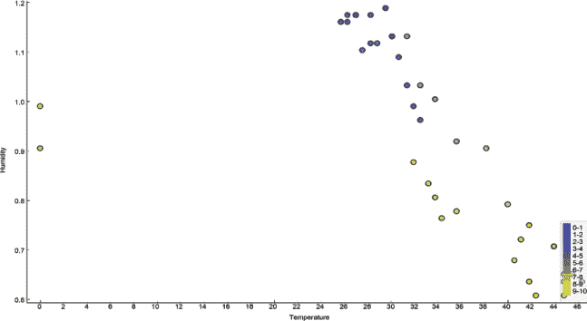

图 1：此图显示了温度（摄氏度）与湿度之间的关系。

# 使用量子支持向量...预测太阳辐射 ... 127

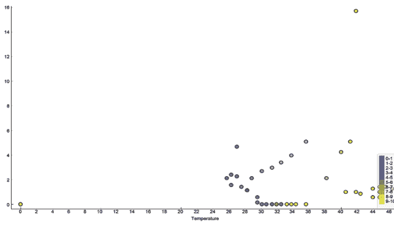

图 2：此图展示了温度（摄氏度）与风速（节）之间的关系。由于数据点呈现出非线性，可以观察到这两个特征是独立的。

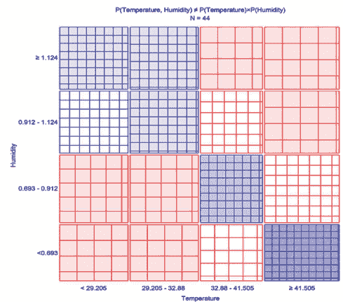

图 3：温度和湿度的散图。

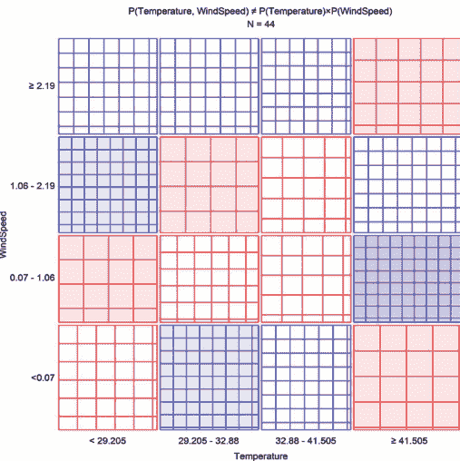

图 4：温度和风速的散图。这与神经网络等其他机器学习算法不同，因为它们可能会收敛到局部最优解。在本文报道的工作中，使用 `Python` 语言模拟了量子支持向量算法。使用了包含 49 个实例和三个特征（温度、湿度和风速）的数据集进行模拟。模拟结果强调了所提量子支持向量算法在太阳能预测方面的实用性。然而，在实现中，使用了通用优化算法。未来的工作应该探索其可行性。

使用量子支持向量预测太阳辐射 ... 129

## 参考文献

- 1. Russell, S., Norvig, P., Canny, J., Malik, J. 和 Edwards, D. (2010) 《人工智能：一种现代方法》。Prentice Hall, 纽约。
- 2. Rogers, S. 和 Girolami, M. (2015) 《机器学习入门》。CRC Press, 伦敦。
- 3. Sugiyama, M. (2015) 《统计机器学习导》。Morgan Kaufmann, 阿姆斯特丹。
- 4. Bishop, C.M., 等 (2006) 《模式识别与机器学习》。Springer, 纽约。
- 5. Garreta, R. 和 Moncelli, G. (2013) 《Scikit-Learn 机器学习》。Packt Publishing Ltd., 伯明翰。
- 6. Raschka, S. (2015) 《Python 机器学习》。Packt Publishing Ltd., 伯明翰。
- 7. Ivic, Z., Connelly, A., Vanderplas, J. 和 Gray, A. (2014) 《统计学、数据挖掘与机器学习》。Princeton University Press, 新 Jersey。
- 8. Lantz, B. (2013) 《使用 R 进行机器学习》。Packt Publishing Ltd., 伯明翰。
- 9. Wittek, P. (2014) 《量子学习：量子计算对数据挖掘意味着什么》。Academic Press, 马萨诸塞。
- 10. Schuld, M., Sinayskiy, I. 和 Petruccione, F. (2015) 《量子学习导论》。当代物理，56, 172-185。
- 11. Cai, X., Wu, D., Su, Z.E., Chen, M.C., Wang, X.L., Li, N.L., Lu, C.Y. 和 Pan, J.W. (2015) 《量子计算机上基于纠缠的机器学习》。物理评论快报，114, 10504。https://doi.org/10.1103/PhysRevLett.114.10504
- 12. Siegel, E. (2013) 《预测分析：预测谁会点击、购买或死亡》。John Wiley Sons, 霍霍肯。
- 13. Marsland, S. (2015) 《机器学习：算法视角》。CRC Press, 波顿。
- 14. Nielsen, M.A. 和 Chuang, I.L. (2010) 《量子计算与量子信息》。剑大学出版社, 剑桥。https://doi.org/10.1017/CBO9780511976
- 15. Lloyd, S., Mohseni, M. 和 Rebentrost, P. (2013) 《用于监督和无监督机器学习的量子算法》。arXiv:1307.0411


- 16. Wilde, M. (2013) 《量子信息理论》。剑大学出版社, 剑桥。https://doi.org/10.1017/CBO978111395
- 17. Li, Z., Liu, X., Xu, N. 和 Du, J. (2015) 《量子支持向量机的实验实现》。物理评论快报，114, 10504。https://doi.org/10.1103/PhysRevLett.114.10504

# 第 7 章

## 使用机器学习预测高中生的学业成就

Hudson F. Golino¹, Cristiano Mauro Assis², Diego Andrade²

¹研究生、研究与拓展中心，Faculdade Independente do Nordeste, 维托利亚达康奎斯坦, 巴西

²心理学系，米纳斯杰拉斯联邦大学, 贝洛奥里特, 巴西

## 摘要

本文介绍了一种较新的非线性方法用于预测高中生的学业成就，该方法整合了心理测量和机器学习的领域。样本由 135 名高中生组成（10 年级，50.34% 男性），年龄在 14 至 19 岁之间（M = 15.44, DP = 1.09），回答了三种心理测评工具：

**引用：** Golino, H., Gomes, C. & Andrade, D. (2014). “使用机器学习预测高中生的学业成就”。*心理学*，5, 2046。

**关键词：** 机器学习，评估，预测，学习方法，元认知

## 引言

机器学习是一门较新的科学领域，由一类用于预测、推断和发现新关系的计算和统计方法组成（Flach, 2012; Tibshirani, & Friedman, 2009）。有两个主要领域：无监督学习侧于发现模式和趋势，而监督学习侧于预测。如果结果是类别的，则称为分类；如果是数值，则称为回归。

有许多算法可以执行，特别是基于树的模型，对交互效应特别感兴趣（Hastie et al., 2009）。在心理学中使用基于树模型的主要优点是它们不需要对正态性、线性关系、同方差性、共线性或独立性做任何假设（Geerts, Irthum & Wehenkel, 2009）。最后，基于树的模型（特别是这些技术）可以带来高预测精度，因为它们被认为是预测精度方面最领先的方法（Flach, 2012; Ebert et al., 2009）。

使用机器学习预测高中生的学业成就 ... 133

以及 Golino & Gomes, 2014 的关系。在心理学中，基于树模型的应用日益增加（Elyan et al., 2012）；从 ADHD 诊断（Scott, Jackson, 2011）到自杀行为（Baca-García et al., 2007）、自适应抑郁（Kuroki & Tilley, 2012），到情绪（Tian et al., 2014）以及教育（Blanch & Aluja, 2013; Cortez & Silva, 2008）。为了预测类别，使用了随机森林模型。具有两个类的样本被随机分为两个集合（训练集和测试集）进行验证。随机森林在训练集上显示出准确率为 75%，特异性为 73.69%，灵回率为 68%。在测试集中，总体准确率为 68.18%，特异性为 63.63%。最重要的变量是 TDRI。最后，讨论了本研究对心理学领域的影响。

### 递归划分与集成技术

分类树将特征空间划分为若干互不斥的特定区域。每个区域都拟合一个特定的模型，为该空间指定一个类别。通过识别区域中的多数类将类别分配给该区域。

134 基于 Python 的软计算与机器学习

使用特征空间变量（预测器）的特定截断值将特征空间划分为两个区域，从而导致最纯的配置。然后，树的每个区域都根据其多数类对其进行相应的建模。一个或两个原始节点还会使用某些提供最佳拟合的给定预测器进一步划分为更多节点。这种划分过程一直持续，直到特征空间达到可能的最高纯度配置，其中 `$Rm$` 个区域或节点被归类为特定的 `$Cl$` 类。如果给出多个预测器，则用于划分节点的每个变量的选择将由能将特征空间划分为最高纯度配置的变量决定。在分类树中，第一次划分表示预测中最重要的变量（或特征）。让我们看看图 1，看看分类树看起来像什么样。

图 1 显示了 Golino 和 Gomes (2014) 提出的分类树，该树包含三个关于医学生学业成就（高和低）的预测器：元认知控制测试（TCM）、深度学习策略（DeepAp）以及归纳推理能力测试自评表（SA_TDRI）。预测中最重要的变量是 TCM，因为它是位于分类树第一次划分处的预测器。

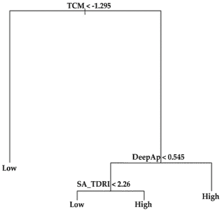

**图 1**：来自 Golino 和 Gomes (2014) 的分类树。

第一次划分指示将特征空间划分为两个最纯节点的变量。在图 1 所示的情况下，用于生长树的样本中，52.50% 的 TCM 分数小于 −1.295，被归类为学业成就低。其余 47.5% 的 TCM 分数大于 –1.295，并根据其在 DeepAp 和 SA_TDRI 上的得分分别被归为低成就类或高成就类。TCM 分数大于 –1.295 且 DeepAp 分数大于 .545 的人被归为高成就类。那些 TCM 分数大于 –1.295、DeepAp 分数小于 .545 且 TDRI 分数大于 2.26 的人情况也是如此。最后，TCM 分数大于 –1.295、DeepAp 分数小于 .545 但 SA_TDRI 分数小于 2.26 的参与者被归为低成就组。这种分类方法的总准确率为 72.50%，敏感性为 57.89%，特异性为 85.71%（Golino & Gomes, 2014）。

Geurts、Irrthum 和 Wenkel (2009) 认为由于其可解释性、灵性和易用性，树是机器学习中最流行的算法之一。可解释性指的是其易于理解的。这意味着用于将特征空间（预测器）映射到输出空间（因变量）的模型是容易理解的，因为它是一条如果-那么规则的路线图。图 1 的描述正展示了这一点。James, Witten, Hastie 和 Shibirani (2013) 指出，树比线性回归更容易解释，因为它比其他预测模型更反映人类的决策过程。灵活性意味着树技术适用于广泛的问题，处理不同类型的变量（包括名义、序数、间隔和比例标度），是非参数技术，并且不对正态性、线性或独立性做任何假设（Geurts et al., 2009）。此外，向模型中添加额外变量是合理的，这对于增量效度的研究尤为重要。它评估了哪个变量或变量组合能更好地预测给定结果，并计算出对结果预测最大的截断值。最后，易用性意味着基于树的技术在计算上既简单又强大。

尽管决策树具有这些优点，但它也存在两个相关的局限性。第一个被称为过拟合问题。由于特征空间通过递归二分划分与输出空间相连，树模型可能会从数据中学习过多，其建模方式可能导致依赖于样本。作为一种依赖于样本的模型，由于划分对于当前数据集非常合适，它在新的数据集上的表现往往会很差。Golino 和 Gomes (2014) 显示，尽管在训练样本中的总准确率为 72.50%，但图 1 所示的树在测试集上的表现很差，总准确率仅为 64.86%。两个数据集之间的差异是由于树对训练集的过拟合。

第二个问题正是过拟合的产物，被称为方差问题。训练集（用于首次生长分类树的特征和输出集合）中的预测误差可能与新测试集中的预测误差非常不同。在过拟合的情况下，误差从训练集到所用的测试集会表现出巨大的方差，Golino 和 Gomes (2014) 的结果所示。此外，分类树的预测准确性与其他经典的机器学习方法不同（James et al., 2013）。为了防止过拟合、解决方差问题并提高分类树的预测精度，可以使用名为集成树（ensemble trees）的策略。

集成树简单来说是多个模型的结合，根据每棵树的预测来执行分类任务。最著名的集成算法是随机森林（Random Forest）（Breiman, 2001a），用于提高预测精度、减少数据集之间的方差并避免过拟合。

该过程对原始数据集（带回抽样）和特征空间进行随机抽样以生长树。所选特征（变量）的数量小于特征空间的总元素数量。每棵树为特征空间的每个区域分配一个类别。然后，记录每棵树每个区域的类别并进行多数投票（Hastie et al., 2009; James et al., 2013）。多数投票简单就是所有树中出现次数最多的类别。由于随机森林不使用全部样本（仅使用部分，通常为 2/3），剩余的样本（称为袋外样本，OOB）被用于验证准确性。袋外误差可以被计算为袋模型测试误差的有效估计，因为“树没有拟合过该样本”（James et al., 2013: p. 323）。

正如 Breiman (2001a) 所指，在森林中，所选特征的数量保持不变，且通常设置为变量总数的平方根。由于随机森林对样本和预测器都进行了抽样，它被认为是对其他集成树的改进，即自助聚合技术（bootstrap aggregating）（Breiman, 2001b），或简单的 bagging。bagging 与随机森林相似，不同在于它没有对预测器进行抽样。因此，bagging 会相关的树（Hastie et al., 2009），这可能会影响预测质量。

为什么消除树的相关性如此重要？遵循 James et al. (2013) 创建的示例，假设我们的特征空间中有一个强预测器和一些中等强度的预测器。在 bagging 过程中，强预测器将出现在大多数树的顶部划分中，因为它是最区分数据中可用类别的变量。结果是，bagged 树之间非常相似，导致预测和误差高度相关。这与单棵树相比，可能不会导致方差的减少。

## 方法

### 参与者

样本由135名高中生（10年级学生，男生占50.34%）组成，年龄在14至19岁之间（M = 15.44，DP = 1.09），来自一所[根据评审流程已省略]的公立高中。样本通过方便抽样法选取，代表了十年级约90%的学生。学生们收到一封邀请知情同意的信，并确认他们将在计划日期参加回答所有测试工具。

### 测量与程序

#### 归纳推理发展测试 (TDRI) 及其自评量表 (SA_TDRI)

归纳推理发展测试（TDRI）由 Gomes 和 Golino (2009) 以及 Golino 和 Gomes (2012) 开发，基于 Common 的层次结构模型（Commons, 2008; Commons & Pekker, 2008; Commons & Richards, 1984）和 Fischer 的动态技能理论（Fischer, 1980; Fischer & Yan, 2002）来评估推理的发展阶段。这是一种纸笔测试，由66个项目组成，限时为100分钟。每个项目提供五个字母或一组字母（见图2），其中四个具有相同的规则，而一个具有不同的规则。任务是识别哪一个字母或哪一组字母具有不同规则。

Gomes 和 Golino (2012) 利用1459名巴西人（女性占52.5%）、年龄在5至86岁之间（M = 15.75, SD = 12.21）的回答，评估了TDRI的结构效度。结果显示其与 Rasch 模型拟合良好（INFIT均值 = .96；SD = .17），项目具有较高的区分信度（1.00），人员区分信度中等偏高（.82）。项目的难度分布形成了一个七聚类结构，聚类之间存在间隙，在95%置信区间水平上（t检验）呈现出统计学上的显著差异。验证性因子分析（CFA）显示具有七个一阶因子和一个一般因子的模型拟合良好[χ (61) = 8832.594, p = .000, CFI = .96, RMSEA = .059]。潜类分析显示最佳模型具有七个潜类（AIC: 263.380; BIC: 303.887; Loglik: -111.690）。TDRI测试的56个项目中的每一个项目都附带了一个自评量表。在该量表中，参与者被要求评估其在TDRI项目上的表现，通过报告其是否通过或未通过该项目。TDRI自评量表的评分程序如下：参与者在两种情况下获得1分：1) 如果参与者通过了第i个项目并报告通过了该项目；2) 如果参与者未通过第i个项目并报告未通过。相反，如果参与者的评估与其在第i个项目上的表现不符，则获得0分：1) 他/她通过了项目，但报告未通过；2) 他/她未通过项目。

#### 元认知控制测试 (TCM) 及其自评量表 (SA_TCM)

元认知控制测试（TCM）由 Golino 和 Gomes (2013) 开发，用于评估人们对逻辑-数学任务给出直觉答案的能力。任务基于 Shane Frederick 的认知反射测试（Frederick, 2005），由15个项目组成。Golino 和 Gomes (2013) 利用908名巴西人（女性占54.8%）、年龄在9至86岁之间（M = 27.70, SD = 11.90）的回答，评估了该测试的结构效度。结果显示其与 Rasch 模型拟合良好（INFIT均值 = 1.00；SD = .13），项目具有较高的区分信度（.99），人员区分信度中等偏高（.81）。TCM在每15个项目中的每一个项目后也附带了一个自评量表。该自评量表的评分方式与TDRI自评量表完全相同：不正确的评估获得0分，准确的评估获得1分。

#### 巴西学习策略量表 (EABAP)

巴西学习策略量表（EABAP）是一个由17个项目组成的自陈式问卷，由 Gomes 及其同事开发（Gomes, 2010; Gomes, Golino, Pinheiro, Miranda, & Soares, 2011）。其中九个项目用于测量深度学习策略，八个项目测量表面学习策略。每个项目都有一项关于学生在学习过程中行为的陈述。学生使用类似于李克特的量表（从(1)完全没有到(5)完全存在）来考虑描述的行为在其生活中出现的的程度。BLAS的信度、因子结构效度、预测效度和增量效度均是学习策略的良好指标。这些心理测量特性分别在Gomes等人(2010)、Gomes等人(2011)以及Golino (2012)中描述。（注：此处原文似乎重复了关于TDRI自评量表的描述，翻译保留了原文结构）。

### 数据分析

#### 估计学生在每项测试中的能力

潜类分析显示最佳模型具有七个潜类（AIC: 263.380; BIC: 303.887; Loglik: -111.690）。TDRI测试的56个项目中的每一个项目都附带了一个自评量表。在该量表中，参与者被要求评估其在TDRI项目上的表现，通过报告其是否通过或未通过该项目。TDRI自评量表的评分程序如下：参与者在两种情况下获得1分：1) 如果参与者通过了第i个项目并报告通过了该项目；2) 如果参与者未通过第i个项目并报告未通过。相反，如果参与者的评估与其在第i个项目上的表现不符，则获得0分：1) 他/她通过了项目，但报告未通过；2) 他/她未通过项目。

#### 定义成就类别（高 vs 低）

结果显示其与 Rasch 模型拟合良好（INFIT均值 = .96；SD = .17），项目具有较高的区分信度（1.00），人员区分信度中等偏高（.82）。项目的难度分布形成了一个七聚类结构，聚类之间存在间隙，在95%置信区间水平上（t检验）呈现出统计学上的显著差异。验证性因子分析（CFA）显示具有七个一阶因子和一个一般因子的模型拟合良好[χ (61) = 8832.594, p = .000, CFI = .96, RMSEA = .059]。潜类分析显示最佳模型具有七个潜类（AIC: 263.380; BIC: 303.887; Loglik: -111.690）。TDRI测试的56个项目中的每一个项目都附带了一个自评量表。在该量表中，参与者被要求评估其在TDRI项目上的表现，通过报告其是否通过或未通过该项目。TDRI自评量表的评分程序如下：参与者在两种情况下获得1分：1) 如果参与者通过了第i个项目并报告通过了该项目；2) 如果参与者未通过第i个项目并报告未通过。相反，如果参与者的评估与其在第i个项目上的表现不符，则获得0分：1) 他/她通过了项目，但报告未通过；2) 他/她未通过项目。

（注：原文后续部分存在大量内容重复，翻译已严格遵循原文行进行对应翻译）

### 机器学习程序

样本被随机分为两个大小相等的集合，即训练集和测试集，用于交叉验证。训练集用于生长树、以探索方式验证预测质量以及调整调节参数。使用训练集创建的每个模型都将应用于测试集，以验证其在新数据集上的表现。

由于单树通常会导致过拟合和数据集之间的高方差，我们仅通过R语言的`Random Forest`包（Liaw & Wiener, 2012）使用了随机森林算法（R Development Core Team, 2011）。如引言所述，随机森林有两个主要的调节参数：树的数量（`$n_{tree}$`）和变量的数量（`mtry`）。我们将`mtry`设为2，因为它是最接近预测变量总数（5）平方根的整数，并将`$n_{tree}$` 设置为10,000。为了验证在训练集（建模阶段）和测试集（交叉验证阶段）中的预测质量，使用了总准确率、灵敏度和特异性。

142 基于 Python 的软计算与机器学习

**表 1**：项目可靠性、项目拟合度、个体可靠性、个体拟合度及使用的工具

| 测试项目 | 项目可靠性 | 项目 INFIT (均值, 标准差) | 个体可靠性 | 个体 INFIT (均值, 标准差) | 模型 |
|---|---|---|---|---|---|
| 归纳推理能力测试 (TDRI) | 1.00 | .98, .17 | .85 | .98 | 二分类 Rasch 模型 |
| TDRI 自评测试 (SA TDRI) | .98 | .98, .11 | .79 | .97, .31 | 二分类 Rasch 模型 |
| 元认知控制测试 (TCM) | .99 | 1.00, .13 | .80 | .99 | 二分类 Rasch 模型 |
| TCM 自评测试 (SA TCM) | .98 | 1.02, .26 | .74 | .98, .20 | 二分类 Rasch 模型 |
| 巴西学习方法量表—深度学习项目 (DeepAP) | .99 | 1.00, .08 | .80 | 1.01, .69 | 部分评分 Rasch 模型 |
| 归纳推理能力测试 (TDRI) | 1.00 | .98, .17 | .85 | .98, .91 | 二分类 Rasch 模型 |

总准确率是正确分类的观测值的比例：

```
$Acc = \frac{1}{n|T_E|} \sum_{x_i \in T_E} (y_i = C_k)$
```


其中 `$n|T_E|$` 是测试集中观测值的数量。尽管总准确率是衡量整体预测质量的重要指标，但它并不是关于每个类别错误信息的有效衡量标准。例如，80% 的总准确率可能代表对 `C1` 类的预测无误，而对 `C2` 类却有 40% 的错误。在教育场景中，低成就类别的预测错误越低越好，因为面临学业失败风险的学生属于这一类。因此，灵敏度（Sensitivity）比总准确率和特异性（Specificity）更重要。灵敏度是指目标类别（例如 `C1` = 低成就）中正确分类的观测值数量占该类别总观测值的比例：

```
$Sens = \frac{\sum_{y_i \in T_E} 1(y_i = C_1)}{\sum_{y_i \in T_E} (C_1)}$
```

另一方面，特异性是非目标类别（例如 `C2` = 高成就）正确分类的观测值数量占该类别总观测值的比例：

$Spec = \sum_{x\in T_g}(y_i = C_2) / \sum_{x\in T_g}(C_2)$

最后，训练集中的模型将应用于测试集进行交叉验证。由于随机森林是一种黑箱技术——即只有基于多数投票的预测，而没有所谓的“典型树”来观察划分——为了确定哪些变量对预测重要，将使用一种重要性衡量标准：准确率的平均下降值。它表示当某个给定变量被排除在模型之外时，袋外样本（out-of-bag samples）准确率平均下降了多少（James et al., 2013）。

## 描述性分析程序

在估计学生在每个测试或量表中的能力后，将进行 `Shapiro-Wilk` 正态性检验，以发现哪些变量呈现正态分布。为了验证学生组别（高成就 vs. 低成就）之间是否存在统计学上的显著差异，将对正态分布变量进行双样本 `T` 检验，对非正态变量进行 `Wilcoxon` 秩和检验，显著性水平均设为 `.05`。为了估计差异的效应量，使用了 `R` 语言的 `compute` 软件包（Del Re, 2013）。该包用于计算效应量及其方差、置信区间、p 值以及基于显著性检验 p 值的共用语言效应量（CLES）指标。`McGraw` 和 `Wong` (1992) 开发了 `CLES` 指标，作为一个比其他效应量指标更直观的工具。它将效应转换为一种概率，即从一个分布中随机取的分数大于从另一个分布中随机取的概率（McGraw & Wong, 1992）。换句话之，它表示在随机选择两个群体时，一个群体的得分高于另一个群体的分数的百分比（Del Re, 2013）。

## 结果

### 描述性

巴西学习方法量表（深度学习）呈现正态分布（W = .99, p 值 = .64），而其他四个变量的 p 值均小于 .001。高成就组和低成就组在以下项目的中位数 Rasch 分上在 99% 水平上存在显著差异：归纳推理能力中位数 Rasch 分（$\tilde{X}_{High} = 2.14, \sigma^2_{High} = 5.80, \tilde{X}_{Low} = -1.47, \sigma^2_{Low} = 15.52, W = .359, p < .01$）、元认知控制测试中位数 Rasch 分（$\tilde{X}_{High} = -1.03, \sigma^2_{High} = 7.29, \tilde{X}_{Low} = -3.40, \sigma^2_{Low} = 4.37, W = .928, p < .01$）、TDRI 自评量表中位数 Rasch 分（$\tilde{X}_{High} = 2.03, \sigma^2_{High} = 3.01, \tilde{X}_{Low} = 1.16, \sigma^2_{Low} = 4.66, W = .152, p < .01$）、TCM 自评量表中位数 Rasch 分（$\tilde{X}_{High} = 1.07, \sigma^2_{High} = 4.18, \tilde{X}_{Low} = -1.08, \sigma^2_{Low} = 2.45, W = .954, p < .01$）以及巴西方法-深度方法中位数 Rasch 分（$\tilde{X}_{High} = 1.13, \sigma^2_{High} = .80, \tilde{X}_{Low} = .50, \sigma^2_{Low} = .61, \chi^2 = 37.3, p < .01$）。效应量、95% 置信区间、方差和共用语言效应量如表 2 所示。根据 Cohen (1988)，当效应量在 .20 到 .79 之间时被认为是小效应，大于 .80 则为大效应。只有归纳推理能力 Rasch 分的差异呈现了较大的效应量（d = .88）。共用语言效应量表示，如果随机选择两个群体，一个群体的得分高于另一个群体的得分的概率（McGraw & Wong, 1992）。如前所述，它表达了一个群体的得分比另一个群体得分高出的百分比（Del Re, 2013）。

### 机器学习结果

具有 10000 棵树的随机森林模型显示袋外错误率为 .29，总准确率为 75.00%，灵敏度为 68.00%，特异性为 73.69%。准确率的平均下降值显示归纳推理能力（TDRI）是预测最重要的变量，排除它时准确率平均下降 66.22%。第二重要变量是深度学习方法，其平均下降值为 28.45%。第三是元认知控制（19.68%），随后是 TCM 自评量表（5.78%）。图 4 显示了高成就预测误差（绿线）、袋外误差（红线）和低成就预测误差（黑线）随树的数量的变化。在达到 1700 棵树后，误差变得更加稳定。

在训练集中构建的预测模型应用于测试集进行交叉验证。其显示的总准确率为 68.18%，灵敏度为 72.72%，特异性为 63.63%。总准确率差异为 6.82%，灵敏度差异为 2.28%，特异性差异为 10.06%。

## 讨论

本文简要介绍了基于树的机器学习中递归划分的概念。基于树的模型对于研究心理和教育构念在预测学业方面的作用非常有用。与线性回归、逻辑回归以及结构方程模型等传统方法不同，基于树的模型不对数据的正态性和变量间的线性没有假设，不需要异方差、共线性或独立性（Geurts, Irrum, & Weenzel, 2009）。高预测因子与样本比例不会损害预测质量，且算法能很好地处理缺失值。

# 146 使用 Python 进行软性计算与机器学习

| TDRI 自评量表 (SA_TDRI) | .54 | .10, .99 | .05 | .02 | 64.92% |

| :--- | :--- | :--- | :--- | :--- | :--- |

| TCM 自评量表 (SA_TCM) | .65 | .17, 1.12 | .06 | .01 | 67.62% |

| EAB-AP (Deep-AP) | .75 | .27, 1.22 | .06 | .00 | 70.10% |


**图 3：** 各类别（高成就 vs 低成就）的测试得分平均值和 95% 置信区间。


**图 4：** 随机森林的袋外误差（红色）、高成就误差（绿色）和低成就误差（蓝色）。

# 使用...预测高中生的学术成就

基于树的模型在处理传统技术中的非线性交互效应方面更为适用。当将多棵树集成以进行预测时，通常会导致高准确率（Flach, 2012; Geurts et al., 2009），减少过拟合的概率并缩小数据集之间的差异。本文的重点是这种相对较的方法在教育心理学领域的应用，利用基于树的模型在广泛应用中的优势（Baca-Garcia et al., 2007; Eloyan et al., 2012; Gibbons et al., 2013; Kuroki & Tiley, 2012; Scott, Jackson & Bergman, 2011; Skogli et al., 2013; Tian et al., 2014; van der Wal & Kowalczyk, 2013）。在教育领域，Blanch 和 Aluja (2013)、Cortes 和 Silva (2008) 以及 Golino 和 Gomes (2014) 已应用基于树的模型，利用一组心理和社会人口统计变量来预测中等和高等教育学生的学术成就。对他们的方法和结果的讨论超出了本文的范围，因为我们关注的是机器学习的方法论方面。

在本文中，我们展示了测试和量表的 Rasch 分数能够显著区分高成就和低成就的 10 年级学生。归纳呈现出较大的效应量，而深度学习方法、元认知控制和自评表现出中等效应量。随机森林预测在训练集中实现了 75% 的总准确率、68% 的灵敏度和 73.69% 的特异性。测试结果略差，总准确率为 68.18%，灵敏度 72.72%，特异性 63.63%。预测中最重要的变量是归纳，当其在预测袋中被排除时，其关联的平均准确率为 66.22%。深度学习方法是第二重要的变量（平均准确率 28.45%），随其后的是元认知控制（19.68%）、TDRI 自评（19.50%）和 TCM 自评（5.78%）。这强化了之前的发现，即在传统技术的基础上，学习方法在解释学术表现方面具有超越智能的增量效度（Chamorro-Pruzmic & Furnham, 2008; Furnham Monsen & Ahmetoglu, 2009; Goses & Golino, 2012）。它也强化了元认知在解释学术成就方面相对于智能的增量效度（van der Stel & Veenman, 2008; Veenman & Bishizen, 2004）。

## 结论

机器学习模型在学术成就/表现预测中的应用，特别是基于树的模型，代表了对线性、逻辑回归以及结构方程模型等传统技术的创新补充（Blanch & Aluja, 2013）。除了前面提到的优点外，基于树的模型还可以帮助我们理解预测学术结果时心理教育变量之间的非线性交互。这些机器学习模型不仅在预测准确率方面代表了进步，在推理方面也代表了进步。未来的研究受益于采用更大、更广泛的样本，涉及不同学校的学生。未来调查随机森林模型调优参数的变化对预测准确率、灵敏度、特异性和变异性的影响也将非常有意义。

## 谢谢

感谢 Hudson F. Golino, Cristiano Mauro Assis Gomes, Diego Andrade (FAPEMIG) 支持作者。作者还收到了巴西国家教育研究学院 (INEP) 以及巴西科学、技术和创新发展委员会 (CNPq) 提供的资助。

## 参考文献

- 1. Baca-Garcia, E., Perez-Rodriguez, M., Saiz-Gonzalez, D., Basurte-Villamor, I., Saiz-Ruiz, J., Leiva-Murillo, J. M., & de Leon, J. (2007). 与自杀企图样本相关的变量。Progress in Neuro-Psychology and Biological Psychiatry, 31, 1312-1316. http://dx.doi.org/10.1016/j.npp.2007.05

- 2. Blanch, A., & Aluja, A. (2013). 能力、人格与学术表现的回归树。Personality and Individual Differences, 54, 703-708. http://dx.doi.org/10.1016/j.paid.2012.11

- 3. Breiman, L. (2001a). 随机森林。Machine Learning, 1, 5-32. http://dx.doi.org/10.1023/A-1993024

- 4. Breiman, L. (2001b). 袋自助法。Machine Learning, 24, 123-140. http://dx.doi.org/10.1007/BF0585

- 5. Breiman, J., Olshen, R., & Stone, C. (1984). 分类与回归树。纽约：Chapman & Hall。

- 6. Cohen, J. (1988). 行为科学统计功效分析（第2版）。Hillsdale：Erlbaum。

- 7. Commons, M. L., & Richards, F. A. (1984). 一般阶段。在 M. L. Commons, F. A. Richards (编), 超形式操作：青少年与成人发展（卷1, 141-157）。纽约：Praeger。

- 8. Commons, M. L., & Pekker, A. (2008). 层次复杂性模型及其与后形式行动的关系。World Futures, 64, 305-320. http://dx.doi.org/10.1080/026402081

- 9. Commons, M. L., & Pekker, A. (2008). 呈现层次复杂性理论。World Futures, 64, 375-382. http://dx.doi.org/10.1080/026402081

- 10. Cortez, P., & Silva, A. M. (2008). 使用数据挖掘预测中学表现。在 A. Brito & J. Teixeira (编), 第5届年度商务技术会议，波特，5-12。

- 11. Del Re, A. C. (2013). compute: 效应量。R 包版本0.2-2。http://cran.r-project.org/packages/compute

- 12. Eloyan, A., Muschelli, J., Nebel, M., Liu, H., Han, F., Zhao, T., Caffo, B., 等. (2012). 利用共振成像自动诊断注意力多动障碍。Frontiers in Systems Neuroscience, 6, 61. http://dx.doi.org/10.3389/fnys.2012.00061

- 13. Fischer, K. W. (1980). 认知发展理论：技能层次的控制与构建。Psychological Review, 87, 477-531. http://dx.doi.org/10.1037/0003-295X.87.6.477

- 14. Fischer, K. W., & Yan, Z. (2002). 动态技能理论的发展。在 R. Lickerlich, & D. Lewkowitz (编), 发展概念：来自实验室的启示。Hove：Psychology Press。

- 15. Flach, P. (2012). 机器学习：理解数据的算法艺术与科学。剑桥：Cambridge University Press. http://dx.doi.org/10.1017/CBO9780511973000

- 16. Frederick, S. (2005). 认知反射与决策。经济 Economic Perspectives, 19, 25-42. http://dx.doi.org/10.1257/0895330055719632

- 17. Geurts, P., Irthum, A., & Wehenkel, L. (2009). 计算生物系统中基于决策树方法的监督学习。Molecular Bioinformatics, 5, 1593-1605. http://dx.doi.org/10.1039/b907946g


- 18. Gibbons, R. D., Hooker, G., Finkelman, M. D., Weiss, D. J., Pilkonis, P. A., Frank, E., Moore, T., & Kupfer, D. J. (2013). 重度抑郁症计算机适应诊断测试 (CAD-MDD)：抑郁筛查工具。Journal of Clinical Psychiatry, 74, 669-674. http://dx.doi.org/10.4088/JCP.12m0838

- 19. Golino, H. F., & Gomes, C. M. A. (2012). 归纳推理发展测试的结构效度。在 K. Stålne (主席), 成人发展：过去、现在与研究的新议程，在欧洲成人发展研究协会会议上召开的专题会议，科布拉，2012年7月7-8日。

# 使用...预测高中中生的学术成就 ... 151

- 21. Golino, H. F., & Gomes, C. M. A. (2014). 预测大学生学术成就的四种机器学习方法：比较研究。Revista E-PSI, 4, 68-101.

- 22. Gomes, C. M. A., & Golino, H. F. (2009). 关于归纳推理发展测试（TDRI）的探索性研究。在 D. Collinvas (编), 巴西发展心理学协会集（第 VII届巴西发展心理学大会论文）：发展与人权 (pp. 77-79)。里得热亚内卢: http://www.abpd.psc.br/files/congressosAnteriores/AnaisVIIICIBCD.pdf

- 23. Gomes, C. M. A. (2010). 学生特征以及学习方法与学业成绩之间的关系。Psico, 41, 503-509.

- 24. Gomes, C. M. A., & Golino, H. F. (2012). 学习方法量表的增效性。Psicologia: Reflexão e Crítica, 25, 623-633. http://dx.doi.org/10.1590/S0190-0972-227210040001

- 25. Gomes, C. M. A., Golino, H. F., Pinheiro, C. A. R., Miranda, G. R., & Soares, J. M. T. (2011). 巴西方法学习量表（EABAP）的验证。Psicologia: Reflexão e Crítica, 24, 19-27. http://dx.doi.org/10.1590/S0102-79722101000014

- 26. Hardman, J., Paucar-Caceres, A., & Fielding, A. (2013). 使用随机森林算法预测学生在高等教育中的进展。Systems Research and Behavioral Science, 30, 194-203. http://dx.doi.org/10.1002/sres.2130

- 27. Hastie, T., Tibshirani, R., & Friedman, J. (2009). 统计学习方法：数据挖掘、推理与预测（第2版）。纽约：Springer。 http://dx.doi.org/10.1007/978-0-387-84858-7

- 28. James, G., Witten, D., Hastie, T., & Tibshirani, R. (2013). 基于 R 语言的统计学习导论。纽约：Springer。 http://dx.doi.org/10.1007/978-1-4614-7138-7

- 29. Kuroki, Y., & Tilley, J. L. (2012). 亚裔美国人社交行为的递归划分分析。亚洲裔美国心理学杂志, 3, 17-28. http://dx.doi.org/10.1037/a0026586

- 30. Liaw, A., & Wiener, M. (2012). 随机森林：Breiman 和 Cutler 用于分类和回归的森林。R 包版本 4.6-7。http://cran.r-project.org/packages/randomForest/

- 31. Linacre, J. M. (2012). Rasch 测量。贝弗顿：Winsteps。

32. Lin, K., & Wong, S. (1992). 英语学习对学业成就的影响。心理学报, 11, 361-365.

- 33. Scott, S., Bergman, B., & Jackson, R. (2011). 递归划分方法。心理学, 26, 830-843.

- 34. Tian, P., Gao, H., & Zhang, Y. (2013). 机器学习中的情绪。心理学, 55, 299-314.

- 35. Gomes, C. M. A., & Golino, H. F. (2014). 预测大学生学术成就的四种机器学习方法：比较研究。Revista E-PSI, 4, 68-101.

- 36. Hardman, J., Paucar-Caceres, A., & Fielding, A. (2013). 使用随机森林算法预测学生在高等教育中的进展。Systems Research and Behavioral Science, 30, 194-203.

## Python 2.7 教程

## 介绍

## SECTION III

## PYTHON LANGUAGE

### NUMERIC TYPES

Python 有不同类型的数字。任何没有小数点的数字都被视为整数（whole number）。如果涉及的任何数字包含小数点，则计算将使用浮点数。

#### 基本操作

这里是一些示例：

```python
>>> 99 + 1
100
>>> 1 - 99
-98
>>> 7 * 5
35
```

如果你想覆盖 Python 运算符的通常优先级，请使用括号：

```python
>>> (2+3)*4
20
```

这里有一个你可能意外的结果：

```python
>>> 1 / 5
0
```

你可能期望结果是 0.2 而不是零。然而，Python 有多种表示数字的方法。进行计算：

```python
>>> 1.0 / 4.0
0.25
>>> 1.0 / 3.0
0.3333333333333333
```

当一个表达式包含多个操作时，Python 定义了通常的操作顺序，使得优先级的操作（如乘法和除法）在加减法之前执行。在这个例子中，即使加法在乘法之后，

```python
>>> 2 + 3 * 4
14
```

两个数字之间的“`%`”运算符可以给你得到模。也就是说，表达式“`x % y`”返回 `x` 除以 `y` 的余数。

```python
>>> 13 % 5
3
>>> 5.72 % 0.5
```

# Python 2.7 编程教程 159

0.2199999999999975

```python
>>> print 5.72 % 0.5
```

0.22

指数运算表示为“`x ** y`”，意味着 `x` 的 `y` 次方。

```
>>> 2 ** 8
256
>>> 2 ** 30
1073741824
>>> 2.0 ** 0.5
1.414213562730951
>>> 10.0 ** 5.2
158489.31924611141
>>> 2.0 ** 100
1.267506002282294e+30
```

最后那个数字 `1.267506002282294e+30` 是指数法（或称科学计数法）的一个例子。这个数字读作“1.26765…乘以 10 的 10 次方”。同样，像 `1.66e-24` 这样的数字读作“1.66 乘以 10 的负 24 次”。

到为止，我们已经看到了整数类型（在 Python 中称为 `int`）和浮点类型（在 Python 中称为 `float` 类型）。Python 保证 `int` 类型支持 -2,147,483,648 到 2,147,483,647（包含）之间的值。

还有另一种名为 `long` 的类型，它可以表示更大的整数值。每当表达式的值超出 `int` 值的范围时，Python 会自动切换到这种类型。你会在这些值的末尾看到字母“L”，但它们的用法与普通整数一样。

```
>>> 2 ** 50
1125899906842624L
>>> 2 ** 100
126750600228229401496703205376L
>>> 2 ** 1000
1071508607186273220948425049060001181056140481170553360744375
03883703510512
493612249319837815695858127594672917553314682518714528569231
```

#### 赋值语句

到为止，我们一直在处理数值常量和运算符。你可以给一个值绑定一个名称，该值将在你的整个 Python 对话会话中一直存在。

Python 名称必须以字母或下划线 (`_`) 开头；名称的其余部分可以是字母、下划线或数字。名称是区分大小写的：名称 `Count` 和 `count` 是不同的名称。

例如，假设你想回答问题：“一百万秒等于多少天？”我们可以从给一百万的值绑定一个名称开始：

```
>>> sec = 1e6
>>> sec
1000000.0
```

这种类型的语句被称为赋值语句。要计算一百万秒中有多少分钟，我们将其除以 60。要将分钟转换为小时，我们除以 60。要将小时转换为天，除以 24，这就是最终答案。

```
>>> minutes = sec / 60.0
>>> minutes
16666.6666666666668
>>> hours=minutes/60
>>> hours
277.7777777777777
>>> days=hours/24.
>>> days
11.574074074074074
>>> print days, hours, minutes, sec
```

# Python 2.7 编程教程 161

11.574070741 277.7777777777777 16666.666666666668 1000000.0

你可以给一个值绑定多个名称。使用一系列用等号分隔的名称，如下所示。

```
>>> total = remaining = 50
>>> print total, remaining
```

赋值语句的一般形式如下：

`name_i = name_j = ... = expression`

以下是求值赋值语句的规则：

- 每个名称（即某些 Python 变量名）必须以字母或下划线 (`_`) 开头，其余字符必须是字母、数字或下划线字符。

- 表达式可以是任何 Python 表达式。

- 当计算该语句时，首先计算表达式，使其变为单个值。例如，如果表达式是 `(2+3)*4`，则结果的值为 20。

然后，所有名称都绑定到该值上。名称绑定到值意味着什么？当你在对话模式下使用 Python 时，你定义的名称和值存储在一个名为全局命名空间（`global namespace`）的区域中。这个区域就像一个两列表格，左侧是名称，右侧是值。这里有一个例子。假设你从一个全新的 Python 会话开始，并输入这一行：

```python
>>> i = 500
```

这里是执行该语句后全局命名空间的样子。

## 全局命名空间

| 名称 | 值 |
|---|---|
| i | 500 |


在图中，右侧出现的值显示了它的类型（整数），以及值 500。


## 全局命名空间

| 名称 | 值 |
|---|---|
| i | 500 |


在图中，右侧出现的值显示了它的类型（整数），以及值 500。在 Python 中，右侧出现的值显示了它的类型（整数），以及值 500。在，当你在对话模式下使用 Python 时，你定义的名称和值存储在一个名为全局命名空间的区域中。这个区域就像一个两列表格，左侧是名称，右侧是值。这里有一个例子。假设你从一个全新的 Python 会话开始，并输入这一行：

```python
>>> i = 500
```

这里是执行该语句后全局命名空间的样子。

| 名称 | 值 |
|---|---|
| i | 500 |


## 字符字符串基础

Python 拥有处理字符字符串的广泛功能。有两种类型：

- `str` 值是零或多个 8 位字符的字符串。你在北美键盘上看到的常见字符都使用 8 位字符。这种字符集的正式名称是 ASCII，代表美国信息交换标准代码。

这个字符集有一个惊人的属性：所有大写字母都被认为小于所有小写字母，因此字符串“Z”的排序在字符串“a”之前。

- Unicode 值是由零或多个 32 位 Unicode 字符组成的字符串。Unicode 字符集涵盖了几乎每种编写语言和几乎发明的每一个特殊字符。

我们将主要讨论对 `str` 值的操作，但大多数 Unicode 操作都是相似或相同，不同在于 Unicode 字面量前面带有一个字母 `u`：例如，“abc”是 `str` 类型，u“abc”是 `unicode` 类型。

### 字符串字面量

在 Python 中，你可以使用单引号（'...'）或双引号（"..."）包裹字符串常量。

```python
>>> cloneName = 'Clem'

>>> cloneName
'Clem'

>>> print cloneName
Clem

>>> fairName = "Future Fair"

>>> print fairName
Future Fair

>>> fairName
'Future Fair'
```

当在交互模式（conversational mode）下显示字符串值时，Python 通常会使用单引号。在内部，无论你使用哪种引号，值都是相同的。同样注意，`print` 语句只显示字符串的内容，而不会带任何引号。

要将整数（`int` 类型）值 `i` 转换为等等字符串，使用函数 `str(i)`：

```python
>>> str(-497)
'-497'

>>> str(000)
'0'
```

逆操作是将字符串 `$s$` 转换回整数，写为 `"int(s)"`：

```python
>>> int("-497")
-497
>>> int("-0")
0
>>> int ("0122 this ain’t no number")
Traceback (most recent call last):
File "stdin>", line 1, in ?
  ValueError: invalid literal for int(): 012this ain’t no number
```

上面的示例显示了尝试转换不是有效数字的字符串时发生的情况。要将包含基数为 `$B$` 的数字的字符串 `$s$`，使用形式 `"int(s, B)"`：

```python
>>> int ('0F', 16 )
15
>>> int ("101101", 2)
21
>>> int ("0177776", 8 )
65534
```

要获取单字符字符串 `$s$` 中包含的 8 位整数代码，使用函数 `"ord($s$)"`。反函数是将整数 `$i$` 转换为代码为 `$i$` 的字符，使用 `"chr($i$)"`。每个字符的数值由 `chr(ASCII 字符集)` 定义：

```python
>>> chr(97 )
'a'
>>> ord('a')
97
>>> chr(65)
'A'
>>> ord('A')
65
```

除了代码在 32 到 127（包含）范围内的打印字符外，Python 字符串还可以包含任何其他不可打印的特殊字符。例如，空字符（其官方名称为 NUL）是代码为零的字符。编写此类字符的一种方法是使用这种形式：

```
`\NN`
```

其中 N 是该字符的十六进制（基 16）代码：

```python
>>> chr(0)
```

```
`\x00`
```

```python
>>> ord('\x00')
```

你可能可能需要处理的另一个特殊字符是换行符，其官方名称为 LF（代表 "line feed"）。使用特殊转义序列 `"\n"` 来产生该字符。

```python
>>> s = "Two-line\nstring."
```

```python
>>> s
'Two-line\nstring.'
```

```python
>>> print s
Two-line
string.
```

如你所示，当在交互模式下显示换行符时，它显示为 `"\n"`，但当你打印它时，随后的字符将出现在下一行。该字符的代码是 10：

```python
>>> ord('\n')
10
```

```python
>>> chr(10)
\n
```

Python 还有许多其他此类转义序列。“转义序列”一术是指一种约定，即特殊字符（“转义字符”）会改变其后字符的含义。Python 的转义字符是反斜杠（\）。

| 输入 | 代码 | 名称 | 含义 |
|---|---|---|---|
| \b | 8 | BS | 退格 (backspace) |
| \t | 9 | HT | 制表符 (tab) |
| \" | 34 | " | 双引号 (Double quote) |
| \' | 39 | ' | 单引号 (Single quote) |
| \ | 92 | \ | 反斜杠 (Backslash) |

另一种获取包含换行符的字符串的方法：使用*三*对引号（单引号或双引号）包裹字符串。

> 注意，在 Python 的交互模式下，当你按下回车结束行时，Python 知道该行未完成，而不是显示通常“>>>”。

### 字符串索引

要从字符串中提取一个或多个字符，你需要知道字符串是如何编号的。

### 字符串方法

字符串的许多操作都是方法。以下章节描述了一些常用的方法。

`.center()`: 居中文本

给定字符串 `s`，为了产生在指定长度字段内居中的新字符串，使用此方法：

```python
>>> k = "Ni"
>>> k.center(5)
' Ni   '
```

```python
>>> "<->".center(12)
'    <->    '
```

注意在第一个示例中，我们要求 Python 在长度为 5 的字段内居中字符串 `"Ni"`。Python 随机添加剩余的空间。

`.ljust()` 和 `.rjust()`: 右侧填充长度

另一个实用的字符串方法是在给定长度的字段内左对齐。通用形式为：

`s.ljust(n)`

对于任何字符串 `s`，该方法返回一个包含 `s` 的字符并在之后添加足够空间以形成长度为 `n` 的新字符串。

```python
>>> "Ni".ljust(4)
'Ni  '
>>> "Too long to fit".ljust(4)
'Too long to fit'
```

注意 `.ljust()` 方法永远不会返回更短的字符串。如果长度不够，它只返回原始值。

有一个类似的方法可以将字符串值右对齐：

`s.rjust(n)`

该方法返回在值之前添加足够的空间。与 `.rjust()` 方法一样，它永远不会返回比原始短的字符串。

```python
>>> "Ni".rjust(4)
'  Ni'
>>> m = "floccinaucinihilipification"
>>> m.rjust(4)
'floccinaucinihilipification'
```

### `.strip()`, `.lstrip()`, 和 `.rstrip()`: 删除开头和结尾空白

有时你想从字符串中移除空白（空格、制表符和换行符）。对于字符串 `s`，使用这些方法可以移除开头和结尾空白：

- `s.strip()` 返回去除了任何开头或结尾字符的 `s`。
- `s.lstrip()` 仅移除开头空白。
- `s.rstrip()` 仅移除结尾空白。

```python
>>> spaceCase = '\n \t Moon \t\t '
>>> spaceCase
'
 \t Moon \t\t '
```

```python
>>> spaceCase.strip()
'Moon'
>>> spaceCase.lstrip()
'Moon \t\t '
>>> spaceCase.rstrip()
'\n \t Moon'
```

### `.count()`: 出现了多少次？

方法 `s.count(t)` 搜索字符串 `s` 查看字符串 `t` 在其中出现了几次。

```python
>>> chiq = "banana"
>>> chiq
'banana'
>>> chiq.count("a")
3
>>> chiq.count("b")
1
>>> chiq.count("x")
0
>>> chiq.count("an")
2
>>> chiq.count("ana")
1
```

注意，该方法不计算重叠出现。虽然字符串 `"ana"` 在字符串 `"banana"` 中出现了两次，但这些出现是重叠的，因此 `"banana".count("ana")` 只返回 1。

### `.find()` 和 `.rfind()`: 在长字符串中定位字符串

使用此方法在字符串 `s` 中搜索字符串 `t`：
`s.find(t)`

如果 `t` 匹配 `s` 的任何部分，该方法返回第一个匹配项开始的位置；否则，返回 -1。

```python
>>> chiq
'banana'
>>> chiq.find("b")
0
>>> chiq.find("a")
1
>>> chiq.find("x")
-1
>>> chiq.find("nan")
2
```

如果你需要找到子字符串最后一次出现，请使用类似的方法 `s.rfind(t)`，它返回最后一次匹配开始的位置，如果没有匹配则返回 -1。

```python
>>> chiq.rfind("a")
5
>>> chiq[5]
'a'
>>> chiq.rfind("n")
4
>>> chiq.rfind("b")
0
>>> chiq.rfind("Waldo")
-1
```

### `.startswith()` 和 `.endswith()`

你可以使用如下方法调用来检查字符串 `s` 是否以字符串 `t` 开头：
`s.startswith(t)`

如果 `s` 以匹配 `t` 的字符串开头，则返回 True；否则返回 False。

```python
>>> chiq
'banana'
>>> chiq.startswith("b")
True
```

有一个类似的方法 `s.endswith(t)`，用于测试字符串 `s` 是否以 `t` 结尾：

### `.lower()` 和 `.upper()`: 更改字母的大小

方法 `s.lower()` 和 `s.upper()` 分别用于将大写字符转换为 true，反之亦然。

```python
>>> poet = 'E. E. Cummings'
>>> poet.upper()
'E. E. CUMMINGS'
>>> poet.lower()
'e. e. cummings'
```

### 测试字符类型的谓词

使用本节中的字符串方法来测试字符串是否包含某些类型的字符。这些方法中的每一个都是谓词，也就是说它们会提出一个问题并返回 True 或 False 值。

- `s.isalpha()` 测试 `s` 的所有字符是否都是字母。
- `s.isupper()` 测试 `s` 的所有字母是否都是大写。（它会忽略任何非字母字符）。
- `s.islower()` 测试 `s` 的所有字母是否都是小写。（此方法也忽略非字母字符。）
- `s.isdigit()` 测试 `s` 的所有字符是否都是数字。

```python
>>> mixed = 'abcDEFghi'
>>> mixed.isalpha()
True
>>> mixed.isupper()
False
>>> mixed.islower()
False
>>> "ABCDGOLDFISH".isupper()
True
>>> "Imno goldfish".islower()
True
>>> "abc $%&*(".islower()
True
>>> "abC $%&*(".islower()
False
>>> paradise = "87801"
>>> paradise.isalpha()
False
>>> paradise.isdigit()
True
>>> "abc123".isdigit()
False
```

### `.split()`: 从字符串中拆分字段

`.split()` 方法用于在发现被称为分隔符（delimiter）的特定字符串时将字符串拆分成部分；它返回一个包含分隔符之间文本的字符串列表。例如，假设你有一个包含一系列由空格分隔的数字的字符串。对该字符串调用 `.split()` 方法且不带参数，将返回由空白包围的字符串部分列表。

```python
>>> line = "1.4 8.6 -23.49"
>>> line.split()
['1.4', '8.6', '-23.49']
```

你也可以指定分隔符作为 `.split()` 方法的参数。

```python
>>> s = 'farcical/aquatic/ceremony'
>>> s.split('/')
['farcical', 'aquatic', 'ceremony']
>>> 'a/b/c/'.split('/')
['a', 'b', 'c', '']
>>> 'Stilton,Wydale,Cheddar:Edam'.split(',')
['Stilton', 'Wydale', 'Cheddar:Edam']
```

你还可以提供第二个参数来限制从字符串中拆出的数量。

```python
>>> t = 'a/b/c/d'
>>> t.split('/', 1)
['a', 'b/c/d']
>>> t.split('/', 3)
['a', 'b', 'c', 'd']
```

## 字符串格式化 (String Format)

常见的字符串操作之一是将固定文本和变量值合并成单个字符串。例如，你可能有一个包含香蕉数量的变量，你想格式化类似“We have 27 bananas”这样的字符串。以下是方法：

```python
>>> bananas = 54
>>> "We have {} bananas".format(bananas)
'We have 54 bananas'
```

这里是字符串格式化的通用形式：
`"{n:type}".format(p0, ..., kn=en, ...)`

在这种形式下：

- `n` 是格式化字符串，指定所需文本的固定部分，并告诉变量部分位于何处以及外观。
- `.format()` 方法接收零或多个位置参数，后面紧跟零或多个关键字参数，其中每个 `kn` 是任何 Python 名称，每个 `en` 是任何表达式。
- 格式化字符串是普通文本和格式代码的混合。每个格式代码都包含在大括号中。包含数字的格式代码引用对应的位置参数，包含名称的格式代码引用对应的关键字参数。

示例：

```python
>>> "We have {0} bananas.".format(27)
'We have 27 bananas.'
>>> "We have {0} cases of {1} today.".format(42, 'peaches')
'We have 42 cases of peaches today.'
>>> "You'll have {count} new {thing} by {date}".format(count=27, date="St.within", thing="cooker")
"You'll have 27 new cooker by St.within"
```

你可以通过使用格式代码 `{N:type}` 来控制格式化，其中 `N` 是 `.format()` 方法的数字或名称。`type` 可以是单个代码，如字符串 `s`、整数 `d` 或浮点数 `f`。

```python
>>> "{0:d}".format(27)
'2700000'
>>> "{animal:s}".format(animal="sheep")
'sheep'
```

你也可以在类型代码之前包含字段大小。对于浮点值，你还可以通过 `.f` 后面跟所需的位数来指定精度。

```python
>>> "{bat:8s}".format(bat='fruit')
'fruit   '
>>> "{0:8f}".format(1.0/7.0)
'.142857'
>>> "{n:20.11f}".format(n=1.0/7.0)
'0.14285714286'
>>> "{silly:50.40f}".format(silly=5.3333)
'5.333300000000001261923897099379301017'
```

注意上面的最后一个例子，你可能会产生比原始数字更多的伪数字！要小心，因为那些数字完全是垃圾信息。当你指定精度时，该值将舍入到具有该精度的最近值。


`"{0:.1f}".format(0.999)`

'1.0'

`"{0:.1f}".format(0.99)`

'1.0'

`"{0:.1f}".format(0.9)`

'0.9'

`"{0:.1f}".format(0.96)`

'1.0'

`"{0:.1f}".format(0.9501)`

'1.0'

`"{0:.1f}".format(0.949999)`

'0.9'

我们有时需要对在程序运行期间未知的大小进行格式化。例如，假设我们想对名为 `ticket_no` 的变量中的票号进行格式化，使用左零填充，且宽度由名为 `how_wide` 的变量给出。可以这样实现：

```python
>>> how_wide = 8
```

```python
>>> ticket_no = 147
>>> "Ticket {num:0{w}d}".format(num=ticket_no, w=how_wide)
'Ticket 00000147'
```

在这里，在预期宽度的地方出现了 `"{w}"`。由于有一个等同于 `w=8` 的关键字参数，因此值 "8" 被用于宽度。

# 注意

字符串 `.format()` 方法自 Python 2.6 起才可用。如果你在查看旧代码，可能会看到一种使用 `"%%"` 运算符的不同技术。例如，`'Attila the %s' % 'Bun'` 会产生 `'Attila the bun'`。欲了解解释，请参见 Python 库文档。然而，旧的格式运算符已弃用。

## 序列类型

从数学上讲，Python 中的序列表示一个有序集合。
序列是容器类的一个示例：在其内部包含值的类。

| 类型名称 | 包含 | 示例 | 可变性 |
|---|---|---|---|
| `str` | 8 位字符 | "abc", 'abc', '"', '\n\x00' | 否 |
| `unicode` | 32 位字符 | u'abc', u'\u000c' | 否 |
| `list` | 任何值 | [23, "Ruth", 69.8], [] | 是 |
| `tuple` | 任何值 | (23, "Ruth", 69.8), (44,) | 否 |

`str` 和 `unicode` 用于存储文本，即字符字符串。

- `list` 和 `tuple` 用于包含零或多个任意类型值的序列。如果序列的内容可能会改变，请使用 `list`；如果内容不会改变，并且在某些需要 `tuple` 的地方，请使用 `tuple`。例如，如果你要格式化多个值，则字符串格式化运算符的右侧参数（见第 3.4 节，“字符串格式化方法”）必须是一个 `tuple`。
- 要创建一个列表，请使用如下形式的表达式：`[ expr1, expr_j, ... ]`，即在方括号 `[...]` 之间包含零或多个值的列表。
- 要创建一个元组，请使用如下形式的表达式：`( expr$_i, expr$_j, ... )` 即在*圆括号* `(…)` 中包含零或多个值的列表。
- 若要创建一个仅有一个元素 `$v$` 的元组，请使用特殊语法 `(v,)`。例如，`(43+1)` 是一个包含整数 44 的单元素元组。末尾的逗号用于将这种情况与表达式 `$(43+1)` 区分开来，后者产生的是整数 44，而不是元组。
- *可变性*：你不能改变不可变值的*部分*。例如，你不能将字符串的第一个字符从 `<a>` 更改为 `<b>`。但是，从其他字符串的片段构建新字符串是很容易的。

这里是一些计算器模式的示例。首先，我们创建一个名为 `s` 的字符串，一个列表 `L` 和一个名为 `t` 的元组：

```
>>> s = "abcd"
>>> L = [0, 1, 2, 3, 4, 5]
>>> t = ('x', 'y')
```

# 序列的函数和运算符

内置函数 `len(S)` 返回序列 `$S$` 中的元素数量。

```
>>> print len(s), len(L), len(t)
```

`max(S)` 返回序列 `$S$` 中的最大值，函数 `min(S)` 返回序列 `$S$` 中的最小值。

```
>>> max(L)
5
>>> min(L)
0
```
>>> max(s)
'e'

>>> min(s)
'a'
```

要测试成员性，请使用 `"in"` 运算符。对于值 `$v$` 和序列 `$S$`，如果 `$S$` 中至少有一个元素等于 `$v$`，则表达式返回布尔值 `True`；否则返回 `False`。

```
>>> 2 in L
True
>>> 77 in L
False
```

有一个反向运算符 `v not in S` 在 `$v$` 不等于 `$S$` 的任何元素时返回 `True`。

```
>>> 2 not in L
False
>>> 77 not in L
True
```

`"+"` 运算符用于连接两个相同类型的序列。

```
>>> s + "xyz"
'abcdexyz'
>>> L + [0, 1]
[0, 1, 2, 3, 4, 5, 0, 1]
```

```
>>> t + ('z',)
('x', 'y', 'z')
```

当 `"*"` 运算符出现在序列 `$S$` 和整数 `$n$` 之间时，得到一个包含 `$n$` 个 `$S$` 元素的新序列。

```
>>> "x" * 5
'xxxxx'
>>> "spam" * 8
'spamspamspamspamspam'
>>> [0, 1] * 3
[0, 1, 0, 1]
```

# 序列的位置索引

序列中的位置指的是值之间的位置。位置从左到右从 0 开始。也可以使用负数计数：-1 是最后一个元素的位置，-2 是倒数第二个元素的位置，依此类推。以下是字符串 "ijklm" 的所有位置。

| -5 | -4 | -3 | -2 | -1 |
|---|---|---|---|---|
| i | j | k | l | m |
| 0 | 1 | 2 | 3 | 4 |

要从序列中提取单个元素，请使用如下形式的表达式 `$S[i]$`，其中 `$S$` 是序列，`$i$` 是选择该位置元素的整数值。

```
>>> s[0]
'a'
>>> s[4]
'e'
>>> s[5]
Traceback (most recent call last):
File "<stdin>", line 1, in ?
IndexError: string index out of range
```

最后行是错误；在字符串中位置 5 之后没有内容。

## 序列切片

对于序列 `$S$` 以及该序列中的两个位置 `$B$` 和 `$E$`，表达式 `$S[B:E]$` 生成一个包含 `$S$` 在这两个位置之间的元素的新序列。

```
>>> L
[0, 1, 2, 3, 4, 5]
>>> L[2]
2
>>> L[4]
4
>>> L[2:4]
[2, 3]
>>> s = 'abcde'
>>> s[2]
'c'
>>> s[2:4]
'cd'
```

注意上面的示例，从位置 2 到位置 4 选择的元素不包括元素 `$L[4]$`。你可以省略起始位置以从序列开始到指定位置切片元素。你可以省略结束位置以指定一个延伸到序列末尾的切片。你甚至可以省略两者以获取整个序列的拷贝。

```
>>> L[:4]
[0, 1, 2, 3]
>>> L[4:]
[4, 5]
>>> L[:]
```

你可以通过在赋值语句的 `=` 左侧使用切片表达式，并在右侧提供替换列表来替换列表的一部分。切片选中的元素将被删除并由右侧的元素替换。在切片赋值中，替换元素的数量不需要等于被替换元素的数量。在这个示例中，`L` 的第二个和第三个元素被右侧的五个元素替换。

```
>>> L
[0, 1, 2, 3, 4, 5]
>>> L[2:4]
[2, 3]
>>> L[2:4] = [2, 3, 4, 5, 6]
>>> L
[0, 1, 2, 3, 4, 5, 6]
```

你可以通过在赋值的 `=` 左侧使用切片表达式，并在右侧提供替换列表来替换列表的一部分。

方法 `L.remove(V)` 移除 `L` 中第一个等于 `V` 的元素，如果存在。是其中之一。如果没有元素等于 `V`，该方法将抛出一个 `ValueError` 异常。

```
>>> menu1
['beans', 'kale', 'spam', 'spam', 'spam', 'tofu', 'trifle', 'sardines']
>>> menu1.remove('spam')
>>> menu1
['beans', 'kale', 'spam', 'spam', 'tofu', 'trifle', 'sardines']
>>> menu1.remove('spam')
>>> menu1
['beans', 'kale', 'spam', 'tofu', 'trifle', 'sardines']
```

Traceback (most recent call last):
File "stdin>", line 1, in ?
ValueError: list.remove(x): x is not in list

``` `list.sort()` 方法将列表的元素按升序排序。

```
>>> menu1
['beans', 'kale', 'spam', 'tofu', 'trifle', 'sardines']
>>> menu1.sort()
>>> menu1
['beans', 'kale', 'sardines', 'spam', 'tofu', 'trifle']
```

注意，`.sort()` 方法本身不返回任何值；它是在原地对列表的值进行排序。类似的方法是 `.reverse()`，它可以原地反转元素：

```
>>> menu1
['beans', 'kale', 'sardines', 'spam', 'tofu', 'trifle']
>>> menu1.reverse()
>>> menu1
['trifle', 'tofu', 'spam', 'sardines', 'kale', 'beans']
```

## `range()` 函数：创建等差数列

等差数列一术是指一个数字序列，其中任意两个相邻元素之间的差都是相同的。例如：[1, 2, 3, 4, 5]；[10, 20, 30, 40]；[88, 77, 66, 55, 44, 33]。

Python 内置的 `range(n)` 函数返回一个包含等差数列的列表。调用此函数有不同的方式。

要生成序列 `[0, 1, 2, ..., n-1]`，请使用形式 `range(n)`。

```
>>> range(6)
[0, 1, 2, 3, 4, 5]
>>> range(2)
[0, 1]
>>> range(0)
[]
```

注意，该序列永远不会包含参数 `n` 的值；它会提前一个值停止。

要生成序列 `[i, i+1, i+2, ..., n-1]`，请使用形式 `range(i, n)`：

```
>>> range(5,11)
[5, 6, 7, 8, 9, 10]
>>> range(1,5)
[1, 2, 3, 4]
```

要生成相邻值之间差值为 `d` 的等差数列，请使用三参数形式 `range(i, n, d)`。生成的序列将为 `[i, i+d, i+2d, ...]`，并在达到等于 `n` 的值之前停止。

```
>>> range( 10, 100, 10 )
[10, 20, 30, 40, 50, 60, 70, 80, 90]
>>> range( 100, 0, -10 )
[100, 90, 80, 70, 60, 50, 40, 30, 20, 10]
>>> range( 8, -1, -1 )
[8, 7, 6, 5, 4, 3, 2, 1, 0]
```

## 一个值可以有多个名称

在修改可变值（如列表）时，必须小心，因为可能有一个多个名称绑定到该值。这里有一个演示。

我们创建一个包含两个字符串的列表并为其绑定两个名称。

```
>>> menu1 = menu2 = ['kale', 'tofu']
```

```
>>> menu1
['kale', 'tofu']
>>> menu2
['kale', 'tofu']
```

然后我们使用切片选择 `menu1` 的所有元素创建一个新列表：

```
>>> menu3 = menu1[:]
>>> menu3
['kale', 'tofu']
```

现在看一看当我们修改 `menu1` 的列表时发生了什么：

```
>>> menu1.append('sardines')
>>> menu1
['kale', 'tofu', 'sardines']
>>> menu2
['kale', 'tofu']
>>> menu3
['kale', 'tofu']
```

如果我们向 `menu1` 添加了第三个字符串，为什么它也出现在 `menu2` 中呢？答案在于 Python 的赋值语句：评估形式为 `menu1 = menu2 = expr` 的赋值，其中 `menu1` 是变量，`expr` 是某个表达式，首先将 `expr` 还原为单个值，然后将每个名称绑定到该值。让我们按照示例一步步操作，查看每一步后的全局命名空间。首先我们创建一个列表并绑定两个名称：

```
>>> menu1=menu2=['kale', 'tofu']
| 名称 | 值 |
|---|---|
| menu1 | ['kale', 'tofu'] |
| menu2 | |
```

两个不同的名称 `menu1` 和 `menu2` 指向同一个列表。接下来，我们创建该列表的元素拷贝并将名称 `menu3` 绑定到拷贝上。

```
>>> menu3 = menu1[:]
>>> menu3
['kale', 'tofu']
```

| 名称 | 值 |
|---|---|
| menu1 | ['kale', 'tofu'] |
| menu2 | |
| menu3 | |

所以，当我们向 `menu1` 的列表添加第三个字符串时，名称 `menu2` 仍然绑定到同一个列表。

```
>>> menu1.append('sardines')
>>> menu1
['kale', 'tofu', 'sardines']
>>> menu2
['kale', 'tofu', 'sardines']
```

| 名称 | 值 |
|---|---|
| menu1 | ['kale', 'tofu', 'sardines'] |
| menu2 | |
| menu3 | |

这种行为在实践中很少成为问题，但重要的是两个或多个名称可以绑定到同一个值。如果你担心在其他名称绑定到同一个列表时修改它，始终可以使用切片表达式 `L[:]` 创建一个拷贝。

```
>>> L1 = ['bat', 'cat']
>>> L2 = L1
>>> L3 = L1[:]
>>> L1.append('hat')
>>> L2
['bat', 'cat', 'hat']
>>> L3
['bat', 'cat']
```

## 字典 (DICTIONARIES)

Python 的字典类型适用于许多查找应用。在数学术语中：Python 字典是零或多个有序对 (键, 值) 的集合，满足：

- 值可以是任何类型。
- 每个键在字典中只出现一次。
- 键不可变变的。特别是，键可以是列表或字典，或者包含列表或字典的元组等。

## 字典操作

这种思想是将值存储与某些键关联的字典中，以便以后可以使用键检索关联的值。

在 Python 中创建新字典的通用形式如下：`{k_j: v_j, k_l: v_l, ...}`。

要从字典 `d` 中检索与键 `k` 关联的值，使用这种形式的表达式：`d[k]`。

是一些交互示例：

```
>>> numberNames = {0:'zero', 1:'one', 10:'ten', 5:'five'}
>>> numberNames[10]
'ten'
>>> numberNames[0]
'zero'
>>> numberNames[999]
Traceback (most recent call last):
File "<stdin>", line 1, in =
KeyError: 999
```

注意，当你尝试检索字典中不存在的键的值时，Python 会抛出一个 `KeyError` 异常。

要为字典 `d` 中的键 `k` 添加或替换值，请使用使用这种形式的赋值语句：`d[k] = v`。


```
>>> numberNames[2] = "two"
>>> numberNames[2]
'two'
>>> numberNames
{0:'zero', 1:'one', 10:'ten', 2:'two', 5:'five'}
```

## 注意

字典内部对的顺序是未定义的。注意在上面的示例中，这些对出现的顺序并不是它们被添加的顺序。

可以使用字符串以及许多其他值作为键：

你可以使用 `"in"` 运算符测试键 `k` 是否存在字典 `d` 中，如下所示：

```
k in d
```

如果 `k` 是字典 `d` 中的键，则此操作返回 `True`，否则返回 `False`。

`"k not in d"` 结构是反向测试：如果 `k` 不是字典 `d` 中的键，则返回 `True`，如果是则返回 `False`。

```
>>> 1 in numberNames
True
>>> 99 in numberNames
False
```

```
>>> "forty-leven" in numberNames
True
>>> "elevenleven" in numberNames
False
```

```
>>> "forty-leven" not in numberNames
False
>>> "elevenleven" not in numberNames
True
```

Python 的 `del`（删除）语句可以从字典中移除键值对。

```
>>> numberNames
{0:'zero', 1:'one', 10:'ten', 2:'two', 5:'five'}
>>> del numberNames[10]
>>> numberNames
{0:'zero', 1:'one', 2:'two', 5:'five'}
```

```
>>> numberNames[10]
```

Traceback (most recent call last):

File "<stdin>", line 1, in ?

KeyError: 10

```

## 字典方法

任何 Python 字典都定义了一些有用的方法。要测试键 `k` 是否存在字典 `d` 中，使用此方法：

```
d.has_key(k)
```

这等同于表达式 `"k in d"`：如果键在字典中，则返回 `True`，否则返回 `False`。

```
>>> numberNames
{0:'zero', 1:'one', 2:'two', 5:'five'}
>>> numberNames.has_key(2)
True
```

```
>>> numberNames.has_key(10)
False
```

要获取字典 `d` 中所有键的列表，使用此表达式：
`d.keys()`

要获取字典 `d` 中所有值的列表，使用此表达式：
`d.values()`

可以使用此表达式同时获取所有的键和值，它返回一个包含二元素元组的列表，每个元组包含键和一个值，格式为 `(k, v)`。
`d.items()`

示例：

```
>>> numberNames
{0:'zero', 1:'one', 2:'two', 5:'five'}
>>> numberNames.keys()
[0, 1, 2, 5]
>>> numberNames.values()
['zero', 'one', 'two', 'five']
>>> numberNames.items()
```

## Python 2.7 编程教程

```
[(0, 'zero'), (1, 'one'), (2, 'two'), (5, 'five')]
>>> nameNo
{'forty-leven': 4011, 'two': 2, 'one': 1}
>>> nameNo.keys()
['forty-leven', 'two', 'one']
>>> nameNo.values()
[4011, 2, 1]
>>> nameNo.items()
[('forty-leven', 4011), ('two', 2), ('one', 1)]
```

这里是另一个有用方法：
`d.get(k)`
如果 `k` 是 `d` 中的键，该方法返回 `d[k]`。然而，如果 `k` 不是 `d` 中的键，该方法将返回特殊值 `None`。这个方法的用处在于，如果 `k` 不是 `d` 中的键，它不会被视为一个错误。

```
>>> nameNo.get("two")
2
>>> nameNo.get("eleven")
>>> huh = nameNo.get("eleven")
>>> print huh
None
```

注意，当你处于交互模式并输入一个导致结果为值 `None` 的表达式时，什么都不会被打印。但是，`print` 语句会像上面的示例那样在视觉上显示特殊值 `None`。还有另一种调用 `.get()` 方法的方法，接受两个参数：

```
d.get(k, default)
```

在这种形式下，如果 `k` 存在，则返回对应的值。然而，如果 `k` 不是 `d` 中的键，它将返回默认值。

这是另一个有用的字典方法。这与 `.get(key)` 方法的双参数形式类似，但它更进了一步：如果未找到键，它会在字典中存储一个默认值。

`d.setdefault(k, default)`

如果 `k` 存在于字典 `d` 中，该表达式返回值 `d[k]`。如果 `k` 不是一个键，由于你相当于执行了 `"d[k] = default"`，所以它会创建一个新的字典条目。

```
>>> nameNo.setdefault("two", "Unknown")
2
```

```
>>> nameNo["two"]
2
```

```
>>> nameNo.setdefault("three", "Unknown")
'Unknown'
```

```
>>> nameNo["three"]
'Unknown'
```

要合并两个字典 `d1` 和 `d2`，请使用此方法：

```
d1.update(d2)
```

该方法将 `d2` 中的所有键值对添加到 `d1` 中。对于在两个字典中都存在的键，此操作后的值将是 `d2` 中的值。

```
>>> colors = { 1: "red", 2: "green", 3: "blue" }
```

```
>>> moreColors = { 3: "puce", 4: "taupe", 5: "puce" }
```

```
>>> colors.update ( moreColors )
```

```
>>> colors
{1: 'red', 2: 'green', 3: 'puce', 4: 'taupe', 5: 'puce'}
```

注意在上面的示例中，键 `3` 同时于两个字典中，但在调用 `.update()` 方法后，键 `3` 关联的是 `moreColors` 中的值。

# 命名空间类似于字典

在第 2.2 节“赋值语句”中，我们首次遇到了命名空间的概念。当你以交互模式启动 Python 时，你定义的变量和函数存在于“全局命名空间”中。

稍后我们将看到，Python 除了全局命名空间外还有许多不同的命名空间。请记住，命名空间类似于字典：

- 名称类似于字典的键：每个键都是唯一的。
- 绑定到这些名称的值类似于字典中的值。它们可以是任何类型的任何值。

我们甚至可以使用用于说明字典的相同图示来说明命名空间。这里有一个小字典及其对应的图片：
`d = { 'name': 'Ben Jones', 'front9': 33, 'back9': 31 }`

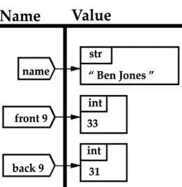

# 分支

默认情况下，Python 中的语句是顺序执行的。*分支*语句用于打破这种顺序执行模式。

- 有时，你只想在某些情况下执行特定的操作。这被称为*条件分支*。
- 有时，你需要重复地执行某些操作。这被称为*循环*。

在查看 Python 如何处理条件分支之前，我们需要先查看 Python 的布尔类型。

# 条件和 bool 类型

布尔代数是关于真/假决策的数学。Python 的布尔类型只有两个值：`True` 和 `False`。

布尔代数的典型用法是比较两个值。在 Python 中，如果 `$x < y$`，则表达式 `$x < y$` 为 `True`，否则为 `False`。

```
>>> 2 < 5
True
>>> 2 < 2
False
>>> 2 < 0
False
```

这里是六个比较运算符：

| 数学符号 | Python | 含义 |
| --- | --- | --- |
| < | < | 小于 |
| <= | <= | 小于或等于 |
| > | > | 大于 |
| >= | >= | 大于或等于 |
| = | == | 等于 |
| != | != | 不等于 |

用于比较相等性的运算符是 `"=" `。（`"="` 符号是一个运算符：它仅用于赋值。）这里有一些示例：

```
>>> 2 <= 5
True
>>> 2 == 2
True
>>> 2 <= 0
False
>>> 4.9 > 5
False
>>> 4.9 > 4.8
True
>>> 2 == 1
True
>>> 4 != 3
False
```

Python 有一个函数 `cmp(x, y)`，它用于比较两个值并返回：

- 如果 `x` 和 `y` 等，则返回零。
- 如果 `x < y`，则返回负数。
- 如果 `x > y`，则返回正数。

```
>>> cmp(2,5)
-1
>>> cmp(2,2)
0
>>> cmp(2,0)
1
```

`bool(x)` 将任何值转换为布尔值。此列表中的值是 `False`；任何其他值都是 `True`：

- 任何数值 0：`0`, `0L` 或 `0.0`。
- 任何空序列：`""`（字符串），`[]`（列表），`()`（元组）。
- `{}`（字典）。
- 特殊值 `None`.

```
>>> bool(0), bool(0L), bool(0.0)
```


注意在上面的示例中，键 `3` 同时于两个字典中，但在调用 `.update()` 方法后，键 `3` 关联的是 `moreColors` 中的值。

# 命名空间类似于字典

在第 2.2 节“赋值语句”中，我们首次遇到了命名空间的概念。当你以交互模式启动 Python 时，你定义的变量和函数存在于“全局命名空间”中。

稍后我们将看到，Python 除了全局命名空间外还有许多不同的命名空间。请记住，命名空间类似于字典：
- 名称类似于字典的键：每个键都是唯一的。
- 绑定到这些名称的值类似于字典中的值。它们可以是任何类型的任何值。

我们甚至可以使用用于说明字典的相同图示来说明命名空间。这里有一个小字典及其对应的图片：
`d = { 'name': 'Ben Jones', 'front9': 33, 'back9': 31 }`


# 分支

默认情况下，Python 中的语句是顺序执行的。*分支*语句用于打破这种顺序执行模式。
- 有时，你只想在某些情况下执行特定的操作。这被称为*条件分支*。
- 有时，你需要重复地执行某些操作。这被称为*循环*。

在查看 Python 如何处理条件分支之前，我们需要先查看 Python 的布尔类型。

# 条件和 bool 类型

布尔代数是关于真/假决策的数学。Python 的布尔类型只有两个值：`True` 和 `False`。

布尔代数的典型用法是比较两个值。在 Python 中，如果 `$x < y$`，则表达式 `$x < y$` 为 `True`，否则为 `False`。

```
>>> 2 < 5
True
>>> 2 < 2
False
>>> 2 < 0
False
```

这里是六个比较运算符：

| 数学符号 | Python | 含义 |
| --- | --- | --- |
| < | < | 小于 |
| <= | <= | 小于或等于 |
| > | > | 大于 |
| >= | >= | 大于或等于 |
| = | == | 等于 |
| != | != | 不等于 |

用于比较相等性的运算符是 `"=" `。（`"="` 符号是一个运算符：它仅用于赋值。）这里有一些示例：

```
>>> 2 <= 5
True
>>> 2 == 2
True
>>> 2 <= 0
False
>>> 4.9 > 5
False
>>> 4.9 > 4.8
True
>>> 2 == 1
True
>>> 4 != 3
False
```

Python 有一个函数 `cmp(x, y)`，它用于比较两个值并返回：
- 如果 `x` 和 `y` 等，则返回零。
- 如果 `x < y`，则返回负数。
- 如果 `x > y`，则返回正数。

```
>>> cmp(2,5)
-1
>>> cmp(2,2)
0
>>> cmp(2,0)
1
```

`bool(x)` 将任何值转换为布尔值。此列表中的值是 `False`；任何其他值都是 `True`：
- 任何数值 `0`：`0`, `0L` 或 `0.0`。
- 任何空序列：`""`（字符串），`[]`（列表），`()`（元组）。
- `{}`（字典）。
- 特殊值 `None`。

```
>>> bool(0), bool(0L), bool(0.0)
```

注意，当你处于交互模式并输入一个导致结果为值 `None` 的表达式时，什么都不会被打印。但是，`print` 语句会像上面的示例那样在视觉上显示特殊值 `None`。还有另一种调用 `.get()` 方法的方法，接受两个参数：

```
d.get(k, default)
```

在这种形式下，如果 `k` 存在，则返回对应的值。然而，如果 `k` 不是 `d` 中的键，它将返回默认值。

这是另一个有用的字典方法。这与 `.get(key)` 方法的双参数形式类似，但它更进了一步：如果未找到键，它会在字典中存储一个默认值。

`d.setdefault(k, default)`

如果 `k` 存在于字典 `d` 中，该表达式返回值 `d[k]`。如果 `k` 不是一个键，由于你相当于执行了 `"d[k] = default"`，所以它会创建一个新的字典条目。

```
>>> nameNo.setdefault("two", "Unknown")
2
>>> nameNo["two"]
2
>>> nameNo.setdefault("three", "Unknown")
'Unknown'
>>> nameNo["three"]
'Unknown'
```

## if 语句

`if` 语句的目的是在某些情况下执行特定的操作。这里是简单分支的通用形式：

```
if C:
    statement1
```

这是一个展示简单 `if` 语句控制流的图。

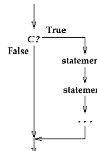

`if` 后面可以有任意数量的语句，但它们必须相同缩进。这组语句被称为一个块。

当 `if` 值为 `True` 时，执行该块；如果为 `False`，则跳过。

```
>>> half = 0.5
>>> if half > 0:
    print "True True"
```

有时你想在 `C` 为真时执行某些动作 `A`，但在 `C` 为假时执行不同的动作 `B`。这种构造的通用形式是：

```
if C:
    block A
else:
    block B
```

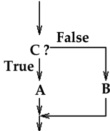

与单分支 `if` 一样，条件 `C` 被评估并转换为布尔。如果结果为 `True`，执行块 `A`；如果是 `False`，则执行块 `B`。

```
>>> half = 0.5
>>> if half > 0:
    ... print "Half is more than none."
    ... else:
    ... print "Half is not much."
```

有些人更喜欢水平的编码风格。有时你想根据多个条件执行三个或四个块中的一个。在这种情况下，Python 允许在 `if` 后面有任意数量的 `"elif` 子句"，在 `else` 之前有一个。这是 Python 语句最通用的形式：

```
if C_1:
    block_1
elif C_2:
    block_2
elif C_3:
    block_3
...
else:
    block_F
...
```

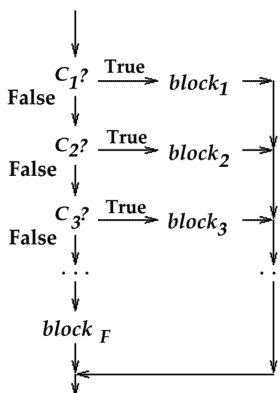

所以通常情况下，`if` 语句可以有零或多个 `elif` 子句，可选跟着一个 `else` 子句。示例：

```
>>> i = 2
>>> if i==1: print "One"
... elif i==2: print "Two"
... elif i==3: print "Three"
... else: print "Many"
...
```

你可以在块中包含块。这里有一个示例：

```
>>> x = 3
>>> if x >= 0:
...    if (x%2) == 0:
...        print "x is even"
...    else:
...        print "x is odd"
...    else:
...        print "x is negative"
```

# for 语句：循环

使用 Python 的 `"for"` 构造对序列中的每个成员执行某些重复操作。这是其通用形式：

```
for variable in sequence:
    block
```

## 使用 Python 进行软计算与机器学习

```python
variable = sequence [0]
block
variable = sequence [1]
block
variable = sequence [-1]
block
```

- 序列可以是任何求值为序列值的表达式，例如列表或元组。这里通常使用 `range()` 函数来生成整数序列。
- 依次遍历序列中的每个值，将变量设置为该值，并执行相应的代码块（`block`）。

与 `if` 语句一样，代码块由一个或多个语句组成，相对于 `if` 关键字的缩进量相同。

此示例打印从 1 到 5 所有数字的立方。

```python
>>> for n in range(1,6):
    print "The cube of {0} is {1}".format(n, n**3)
The cube of 1 is 1
The cube of 2 is 8
The cube of 3 is 27
The cube of 4 is 64
The cube of 5 is 125
```

如果你愿意，可以将循环体——即为序列中的每个元素执行的语句——与 `"for"` 语句写在同一行。如果体中有多个语句，请用分号隔开。

```python
>>> for n in range(1,6): print "{0}**={1}".format(n, n**3),
...
1**3=1 2**3=8 3**3=27 4**3=64 5**3=125
```

```python
>>> if 1 > 0: print "Yes";print "One is still greater than zero"
...
Yes
One is still greater than zero
```

这里是对特定值列表迭代的另一个示例。
```python
>>> for s in ('a', 'e', 'i', 'o', 'u'):
...
    word = "st" + s + "ck"
...
    print "Pick up the"
...
Pick up the stack
Pick up the steck
Pick up the stick
Pick up the steck
Pick up the stuck
```

## while 语句

当你想要只要条件 `C` 为真就执行代码块 `B` 时，使用此语句：

```python
while C:
    B
...
```

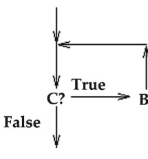

以下是 `while` 语句的执行方式。
- 求值 `C`。如果结果为真，跳转到步骤 2 。如果为假，循环结束，控制传递到 `B` 结束后的语句。
- 执行代码块 `B`。
- 返回步骤 1 。

这是一个简单的 `while` 循环示例。

```python
>>> i = 1
>>> while i < 100:
... print i,
... i=i* 2
...
1 2 4 8 16 32 64
```

这种结构具有变成无限循环的潜力，即永远不会终止的循环。确保循环体执行了某些最终会让循环终止的操作。

# 特殊分支语句：break 和 continue

有时你需要在不等待正常结束的情况下退出 `for` 或 `while` 循环。这里有两个特殊的 Python 分支语句可以做到这一点：
- 如果你在 `for` 或 `while` 循环内部任何地方执行 `break` 语句，控制将跳出循环并执行循环结束后的语句。
- 在 `for` 循环内部使用 `continue` 语句会将控制传回循环顶部，如果序列中有下一个值，则变量将设置为下一个值。（如果循环已经在使用序列，`continue` 的效果与 `break` 相同。）

这些是语句的示例。

```python
>>> i = 0
>>> while i < 100:
... i = i + 3
... if (i % 5 ) == 0:
... break
... print i,
...
3 6 9 12
```

在上面的示例中，当 `i` 的值达到 `15` 时（除以 `5` 余数为 `0`），`break` 语句退出循环。

```python
>>> for i in range(50, -1, -1):
... if (i % 100) != 0:
... continue
... print i,
......
```

# 如何编写自执行脚本

到目前为止，我们一直使用 Python 模式来演示所有功能。现在是时候学习如何编写一个完整的程序了。你的程序将位于名为 `script` 的文件中。创建脚本时，使用你喜喜欢的文本编辑器（`emacs`、`vi` 等均可），只需向其中输入 Python 语句。

如何使其变为可执行取决于你的操作系统。
- 在 Windows 平台上，确保你的脚本文件名以 `".py"` 结尾。如果安装了 Python，双击任何此类后缀的脚本都将使用 Python 运行脚本。
- 在 Linux 和 MacOS 下，脚本的第一行必须看起来像这样：

  `#!/usr/bin/python`

路径告诉操作系统去哪里寻找 Python。该路径通常是 `"/usr/local/bin/python"`，但你可以使用 `"which"` 命令来查找你电脑上的路径：

```bash
$ which python
/usr/local/bin/python
```

一旦你创建了脚本，还必须使用此命令使其变为可执行：`chmod +x script-name`

这是一个完整的脚本，针对典型的 Linux 安装配置。该脚本 `powersof2` 会打印一个表格，显示 `$n$` 在范围 `(1, 2, ..., 12)` 范围内 `$2^n$` 和 `$2^{-n}$` 的值。

```python
#!/usr/local/bin/python
print "Table of powers two"
for n in range(13):
    print "{0:>10d} {1:>15f}".format(n, 2**-n)
```

我们在 `bash` shell 环境下调用此脚本，其输出如下：

```bash
./powersof2
# Table of powers two
| n | 2^-n |
| :--- | :--- |
| 0 | 1.00000000000000 |
| 1 | 0.50000000000000 |
| 2 | 0.25000000000000 |
| 3 | 0.12500000000000 |
| 4 | 0.06250000000000 |
| 5 | 0.03125000000000 |
| 6 | 0.01562500000000 |
| 7 | 0.00781250000000 |
| 8 | 0.00390625000000 |
| 9 | 0.00195312500000 |
| 10 | 0.00097656250000 |
| 11 | 0.00048828125000 |
| 12 | 0.00024414062500 |
```

# Python 2.7 教程 213

... return 1
... else:
... return fact(n-1)
...
>>> for i in range(5):
... print i, fact(i)
```

```
0 1
1 1
2 2
3 6
4 24
```

```
>>> fact(44)
26582175174884476804362581101146158903196385280000000
```

# 函数参数列表特性

第 8 节“`def`: 定义函数”中显示的 `def` 通用形式过于简化。通常，函数的参数列表是四种参数的序列：
- 1. 如果参数只是一个名称，它被称为位置参数。可以有任意数量的位置参数，包括零个。
- 2. 你可以使用“`name=value`”的形式为参数提供默认值。此类参数被称为关键字参数。请参见第 8.3 节“关键字参数”。函数可以有任意数量的关键字参数，包括零个。

所有的关键字参数必须位于参数列表中的任何位置参数之后。
- 3. 有时，编写一个可以接受任意数量位置参数的函数是方便的。为此，使用如下形式的参数：
- 4. * name
函数只能有一个这样的参数，并且必须跟随任何位置参数或关键字参数。关于此特性的更多信息，请参见第 8.4 节“额外位置参数”。
- 5. 有时，编写一个可以接受任意关键字参数（而不只是特定关键字参数）的函数也是方便的。为此，使用这种形式的参数：
- 6. ** name
如果函数具有这种形式的参数，它它必须是参数列表的最后一项。关于此特性的更多信息，请参见第 8.5 节“额外关键字参数”。

## 关键字参数

如果你想让函数的某些参数变为可选的，你必须提供一个默认值。在参数列表中，这看起来像是“`name=value`”。

这是一个带有一个默认值参数的函数示例。如果你不带任何参数调用它，`name` 在函数内部的字符串值为‘`bleah`’。如果你带一个参数调用它，`name` 就是你提供的值。

```
>>> def report(mood='bleah'):
...     print("My mood today is", mood)
... 
>>> report()
My mood today is bleah
>>> report('hyper')
My mood today is hyper
```

如果你的函数有多个参数，并且调用者提供了多个参数，以下是它们的匹配方式：
- 函数提供的参数数量至少要与函数的位置参数数量相当。
- 如果调用者提供的位置参数多于函数的位置参数数量，参数将根据位置与关键字参数进行匹配。
- 以下是一些显示这种工作方式的示例。

```
>>> def f(a, b="green", c=3.5):
...     print a, b, c
... 
>>> f()
Traceback (most recent call last):
  File "stdin>", line 1, in ?
TypeError: f() takes at least 1 argument (0 given)
>>> f(47)
47 green 3.5
>>> f(47, 48)
```

```
47 48 3.5
```


```
>>> f(47, 48, 29)

47 48 29

>>> f(47, 48, 49, 50)

Traceback (most recent call last):

File "stdin>", line 1, in =

TypeError: f() takes at most 3 arguments (4)

>>>
```

这是另一个特性：函数的调用者可以提供所谓的“name=value”形式的关键字参数。如果函数中有一个具有匹配关键字的参数，则该参数将被设为 `value`。

- 如果调用者的调用者同时提供了位置参数和关键字参数，则所有位置参数必须在所有关键字参数之前。
- 关键字参数可以以任何顺序出现。
- 以下是一些使用关键字参数调用函数的示例。

```
>>> g(p0, p1, k0="K-0", k1="K-1")

...    print p0, p1, k0

>>> g(33,44)

33 44 K-0 K-1

>>> g(33,44,"K-9","beep")

33 44 K-9 beep

>>> g(55,66,k1="whirr")

55 66 K-0 whirr

>>> g(7,8,k0="click",k1="clank")

7 8 clank clank

>>>
```

# 额外位置参数

你可以这样声明函数，使其接受任何位置参数。要做到这一点，请在你的参数列表中使用“*name”形式的参数。

- 如果你使用这个特殊参数，它必须位于列表中所有位置参数和关键字参数之后。
- 当函数被调用时，该名称将绑定到一个元组 `tuple`，该元组包含调用者提供的任何位置参数，以及对应其他参数之外的参数。

这是一个此类函数的示例。

```
>>> def h(i, j=-99, *extras):

... print i, j, extras

...

>>> h(0)

0 -99 ()

>>> h(1,2)

1 2 ()

>>> h(3,4,5,6,7,8,9)

3 4 (5, 6, 7, 8, 9)

>>>
```

# 额外关键字参数

你可以这样声明函数，使其除了你声明的任何关键字参数外，还可以接受任意数量的关键字参数。

要做到这一点，将“**name”形式的参数放在你参数列表的最后。

当函数被调用时，该名称将绑定到一个字典 `dictionary`，该字典包含了传入的任何关键字类型参数，且这些名称与你函数的关键字类型参数不匹配。在该字典中，键是调用者使用的名称，值是调用者传递的值。

这是一个示例。

```
>>> def k(p0, p1, nickname='Noman', *extras, **extraKeys):

... print p0, p1, nickname, extras, extraKeys

>>> k(1,2,3)

1 2 3 () {}

>>> k(4,5)

4 5 Noman () {}

>>> k(1,2,nickname='Jack')

1 2 Jack () {}

>>> k(4,5,6,a=7)

4 5 Noman (6,) {'a': 7}

>>>
```

# 文档接口

Python 有一种首选的方法来记录函数。如果函数体的第一行是一个字符串，那么该字符串将与函数一起保存。通过使用 `f.__doc__` 这种表达式可以检索该字符串，其中 `f` 是函数名。

这是一个带有文档字符串的函数示例。

```python
def pythag(a, b):
    """返回边为 a 和 b 的直角形的斜边"""
    return (a*a + b*b)**0.5
```

```
>>> pythag(3,4)
5.0
>>> pythag(1,1)
1.414213562373095
>>> pythag.__doc__
'返回边为 a 和 b 的直角形的斜边'
```

当你开始构建复杂的程序时，应用这一总体原则至关重要：分而治之。换句话说，不要将你的程序构建为一个巨大的语句块，而是将其分成逻辑部分，再继续细分，直到部分足够小。

Python 有许多工具可以帮助你分而治之。在第 8 节“定义函数”中，我们学习了如何将一组语句封装成函数，以及如何调用该函数并检索结果。

## 使用 Python 进行科学计算和机器学习

早在在第 2.3 节“更多数学运算”中，我们就首次接触了另一个重要工具：Python 的模块系统。Python 没有内置计算平方根的函数，但有一个内置模块 `math`，其中包含一个计算平方根的 `sqrt()` 函数。

通常，模块是可以导入并在程序使用的函数包。你也可以创建自己的模块。让我们详细查看 Python 的模块系统。

- 在第 9.1 节“从模块导入项”中，我们学习如何从现有模块导入项。
- 第 9.2 节“导入整个模块”展示了使用模块项的方法。
- 第 9.4 节“构建你自己的模块”。

# 使用模块

在第 2.2 节“赋值语句”中，我们学习过有一个被称为“全局命名空间”的区域，Python 在存储你定义的变量的名称和值。

Python `dir()` 函数返回当前全局命名空间中定义的所有名称的列表。这是一个对话示例；假设你刚刚在对话模式下启动了 Python。

```python
>>> dir()
['__builtins__', '__doc__', '__name__']
>>> frankness = 0.79
>>> dir()
['__builtins__', '__doc__', '__name__', 'frankness']
>>> def oi():
    print "Oi!"

>>> dir()
['__builtins__', '__doc__', '__name__', 'frankness', 'oi']
>>> type(frankness)
<type 'float'>
```

# Python 2.7 编程教程 219

```python
>>> type(oi)
<type 'function'>
>>>
```

当 Python 启动时，总是会定义三个变量：`__builtins__`、`__doc__` 和 `__name__`。这些变量用于高级工作，我们现在不需要关心。

注意，当我们定义一个变量 `frankness` 时，下次调用 `dir()` 时，`frankness` 会出现在结果列表中。当我们定义一个函数 `oi` 时，它的名称也会被添加。注意，你也可以使用 `type(function)` 来查找任何已定义名称类型：`frankness` 的类型为 `float`，而 `oi` 的类型为 `function`。

现在让我们看看当我们将 `math` 模块导入到全局命名空间时会发生什么：

```python
>>> from math import *
>>> dir()
['__builtins__', '__doc__', '__name__', 'acos', 'asin', 'atan', 'atan2', 'ceil', 'cos', 'cosh', 'degrees', 'e', 'exp', 'fabs', 'floor', 'fmod', 'frankness', 'frexp', 'hypot', 'ldexp', 'log', 'log10', 'modf', 'oi', 'pi', 'pow', 'radians', 'sin', 'sinh', 'tan', 'tanh']
>>> sqrt(64)
8.0
>>> pi*10.0
31.415926535897931
>>> cos(0.0)
>>>
```

如你所示，我们定义的名称 `oi` 和 `frankness` 仍然在那里，但 `math` 模块所有的变量和函数现在都在全局命名空间中了，我们可以像使用 `sqrt()` 和 `pi` 那样使用它们。

通常情况下，这种形式的导入语句会将模块中的所有函数和变量复制到当前命名空间：

```python
from someModule import *
```

然而，你也可以选择要导入哪些项。使用这种形式的语句：

```python
from someModule import item1, item2, ...
```

其中关键字 `import` 后面跟着一个逗分隔分隔列表。

这是另一个例子。假设你刚刚启动了一个全新的 Python 会话，并且只想导入 `sqrt()` 函数和常量 `pi`：

```python
>>> dir()
['__builtins__', '__doc__', '__name__']
>>> math import sqrt, pi
>>> dir()
['__builtins__', '__doc__', '__name__', 'pi', 'sqrt']
>>> sqrt(25.0)
5.0
>>> cos(0.0)
Traceback (most recent call last):
File "stdin>", line 1, in <module>
NameError: name 'cos' is not defined
```

我们没有请求 `cos()` 函数，所以它不在全局命名空间中。

# 导入整个模块

某些模块内部包含几百个不同的项。在这种情况下，你可能不想让所有项弄乱你的全局命名空间。另一种导入模块的方法。这里是通用形式：

```python
import moduleName
```

该语句只向当前命名空间添加一个名称——模块本身的名称。然后你可以使用这种形式的表达式来引用该模块内的任何项：

```python
moduleName.itemName
```

这是一个示例，再次使用内置的 `math` 模块。假设你刚刚启动了一个新的 Python 会话，并且还没有向命名空间添加任何内容。

```python
>>> dir()
['__builtins__', '__doc__', '__name__']
```

```python
>>> import math
>>> dir()
['__builtins__', '__doc__', '__name__', 'math']
>>> type(math)
<type 'module'>
>>> math.sqrt(121.0)
11.0
>>> math.pi
3.1415926535897931
>>> math.cos(0.0)
1.0
```

如你所示，使用这种形式的导入只向命名空间添加一个名称，该名称的类型为 `module`。

我们还应该提到另一个的一个额外功能。如果你想导入整个模块 `$M_1$`，但你想用另一个名称 `$M_2$` 来引用它的内容，请使用这种形式的语句：

```python
import $M_1$ as $M_2$
```

一个示例：

```python
>>> dir()
['__builtins__', '__doc__', '__name__']
>>> import math as crunch
>>> dir()
['__builtins__', '__doc__', '__name__', 'crunch']
>>> type(crunch)
<type 'module'>
>>> crunch.pi
3.1415926535897931
>>> crunch.sqrt(888.888)
29.81422479287362
```

你可以将 Python 内置的 `dir()` 函数应用于模块对象，以查找其内部定义的名称：

```python
>>> import math
>>> dir()
['__builtins__', '__doc__', '__name__', 'math']
>>> dir(math)
['__doc__', '__file__', '__name__', 'acos', 'asin', 'atan', 'atan2', 'ceil', 'cos', 'cosh', 'degrees', 'e', 'exp', 'fabs', 'floor', 'fmod', 'frexp', 'hypot', 'ldexp', 'log', 'log10', 'modf', 'pi', 'pow', 'radians', 'sin', 'sinh', 'tan', 'tanh']
```

```python
>>> >>> treeFile.open('trees')
>>> for treeLine in treeFile:
...
    print treeLine.rstrip()
...
```

yew

oak

alligator juniper

与 `.readline()` 方法一样，当你以这种方式迭代文件的行时，这些行将包含换行符。如果上面的示例没有使用 `.strip()` 来修剪这些行，那么每行输出后面都会跟着一个空行，因为 `print` 语句会添加一个换行。

### 随机访问设备的文件定位

对于磁盘文件等随机访问设备，有一些方法可以让你找到文件中的当前位置，并移动到不同的位置。

- `F.tell()` 返回你在文件 `F` 中的当前位置。
例如，`F.seek(80, 1)` 将文件位置移动到文件起始之后 80 个字符处。
- `F.seek(N, 2)` 移动到相对于文件末尾 N 个字符的位置。例如，`F.seek(0, 2)` 将移动到文件末尾；`F.seek(-200, 2)` 将你的位置移动到文件末尾前 200 字节处。

```python
>>> treeFile = open ("trees")
>>> treeFile.tell()
0L
>>> treeFile.read(6)
'yew'noa'
>>> treeFile.tell()
6L
>>> treeFile.seek(1)
>>> treeFile.tell()
```

```python
1L
>>> treeFile.read(5)
'ew\noa'
>>> treeFile.tell()
6L
>>> treeFile.seek(1, 1)
>>> treeFile.tell()
7L
>>> treeFile.seek(-3, 1)
>>> treeFile.tell()
4L
>>> treeFile.seek(0, 2)
>>> treeFile.tell()
26L
>>> treeFile.seek(-3, 2)
>>> treeFile.tell()
23L
>>> treeFile.read()
'er\n'
```

## 写入文件

要创建一个磁盘文件，使用如下通用形式的语句打开文件：

```python
F = open (filename, "w")
```

第二个参数 `"w"` 指定写入权限。如果可能，Python 将创建一个同名的空文件。如果已存在同名文件，且你对它有写入权限，则现有文件将被删除。

要向你创建的文件写入内容，请使用此方法：

```python
F.write(s)
```

其中 `s` 是任何字符串表达式。

# 警告

你通过 `.write()` 方法发送到文件的数据在通过调用文件对象的 `.close()` 方法关闭它之前，可能不会真正出现在磁盘文件中。

这是由于一种名为“缓冲” `buffering` 的机制。Python 会累积你发送到文件的数据，直到达到一定的数量，然后它会通过写入操作将这些数据“刷新” `flush` 到物理文件中。Python 在你关闭文件时也会将数据刷新到文件。

如果你想确保写入到文件的数据在不关闭文件的情况下物理上确实存在于文件中，请对文件对象调用 `.flush()` 方法。

```python
>>> sports = open ("sportfile", "w")
>>> sports.write ( ('tennis\nrugby\nquoits\n')
>>> sports.close()
>>> sportFile = open ("sportfile")
>>> sportFile.readline()
'tennis\n'
>>> sportFile.readline()
'rugby\n'
>>> sportFile.readline()
'quoits\n'
','
```

这是一个演示 `.flush()` 方法作用的详细示例。

```python
>>> sporting = open('sports', 'w')
>>> sporting.write('golf\n')
>>> echo = open('sports')
>>> echo.read()
''
>>> echo.close()
>>> sporting.flush()
>>> echo = open('sports')
>>> echo.read()
'golf\n'
>>> echo.close()
>>> sporting.write('soccer')
>>> sporting.close()
>>> open('sports').read()
'golf\nsoccer'
```

# 面向对象编程

到为止，我们已经使用了 Python 的一些内置类型，如 `int`、`float`、`list` 和 `file`。

现在是时候探索 Python 更强大的功能了：创建你自己的类型。

这是一个大步，让我们从回顾编程语言的一些特性开始。

# 蜗牛赛技术简史

企业家 Malek 想要开发一种服务来帮助非营利组织筹资金。以下是蜗牛赛设计的方案：


在比赛开始时，蜗牛们背上用可降解墨水写着的名字被放在起线上，Malek 开始计时。当每只蜗牛越过终点时，Malek 记录它们的时间。

Malek 想编写一个 Python 程序来打印比赛结果。我们将回顾 1960 年左右的编程。

# 标量变量

1960 年左右的语言是 FORTRAN。很多工作是使用标量变量完成的，即每个变量持有一个数字。假设我们刚刚进行了蜗牛赛，Judy 用了 87.3 分钟，而 Kyle 用了 96.6 分钟。我们可以用这些值创建 Python 变量：

```python
judy = 87.3
kyle = 96.6
```

为了找到胜利者，可以使用语句：


```python
>>> if judy < kyle:
...     print "Judy wins with a time of", Judy
... elif kyle > judy:
...     print "Kyle wins with a time of", kyle
... else:
...     print "Judy and Kyle are tied with a time of", Judy
```

如果 Judy 和 Kyle 是两只蜗牛，这个程序将正常运行。Malek 将此放入脚本。在每次比赛后，他更改给出完成时间的两个行代码，然后运行脚本。这可行，但有很多问题：

- 准备比赛结果的人必须知道如何编辑脚本。
- 它并没有真正节省劳动。任何学生都可以查看时间并判断谁赢。
- 蜗牛的名字是程序的一部分，如果使用了不同的蜗牛，我们必须编写新程序。
- 如果有三只蜗牛怎么办？还有更多情况：三胜、三平和三并。如果 Malek 想同时赛十只蜗牛怎么办？太复杂了！

# 面向对象的数据结构：列表

让我们考虑涉及任意数量蜗牛比赛的通用问题。Malek 考虑到比赛中可能有数千名参赛者。此外，为了让运行成为可能，让我们编写一个通用脚本来读取每个人的结果。我们将使用非常简单的文本格式来编码比赛结果。这里有一个 Judy 和 Kyle 比赛的示例文件：

`87.3 Judy`

`96.6 Kyle`

这里有一个将处理该文件并报告胜利时间的脚本。脚本名为 `snailist.py`。首先读取名为 `results` 的结果文件并将其存储在列表中。`.split()` 方法用于将每行拆分为部分，第一部分包含经过的时间。

```python
#!/usr/local/bin/python
################################=====
# snailist.py: 结果脚本。
----------------------------------------------------
# 创建一个空列表来存储完成时间。
timeList = []

# 打开包含结果的文件。
resultsFile = open ('results')

# 遍历文件的行，存储每个完成时间。
for resultsLine in resultsFile:
    # 创建行的字段列表，例如 ['87.3', 'Judy\n']
    fieldList = resultsLine.split()

    # 将完成时间转换为浮点数并添加到 timeList。
    timeList.append(float(fieldList[0]))
```

此时，`timeList` 是一个浮点数列表。我们使用 `.sort()` 方法将列表按升序排序，这样胜利时间将位于第一个元素。

```python
# 将 timeList 按升序排序，然后将 ‘winningTime’ 设置为
# 最佳时间。
timeList.sort()
```

`print "The winning time is", timeList[0]`

尝试自己构建结果文件和脚本以验证它们是否工作。尝试一些有平局的情况。

这个脚本到目前为止是还可以的。然而，它有一个主要的缺点：它没有告诉你谁赢了！

# 面向对象的数据结构：元组列表

为了改进上面的脚本，让我们修改脚本，将每只蜗牛的时间和名称组合在一个双元素元组中，例如 `(87.3, 'Judy')`。

在改进后的脚本中，`timeList` 是元组列表，而不仅仅是时间列表。然后我们可以利用元组的一个有趣属性对列表进行排序。如果你比较两个元组，且它们的第一个元素不相等，则结果与比较它们的第一个元素的结果相同。然而，如果第一个元素相等，Python 会比较每个元组的第二个元素，依此类推，直到找到不相等的值，或发现所有元素都相等。

这是一个示例。记得 `cmp(a, b)` 函数比较任意值，如果 a 在 b 之前则返回负数，如果 a 在 b 之后则返回正数，如果它们被视为相等则返回零：

```python
>>> cmp(50,30)
1
>>> cmp(30,50)
-1
>>> cmp(50,50)
0
>>>
```

如果你比较两个元组且第一个元素不相等，则结果与比较它们前两个元素相同。例如：

```python
>>> cmp ( (50,30,30), (80,10,10) )
```

然而，如果第一个或第三个元素相等，Python 将会比较第二个元素，直到找到两个不相等的元素，或者发现所有元素都相等：

`>>> cmp ( (50,30,30), (80,10,10) )`

`-1`

`>>> cmp ( (50,30,30), (50,10,10) )`

`1`

`>>> cmp ( (50,30,30), (50,30,80) )`

`-1`

`>>> cmp ( (50,30,30), (50,30,30) )`

`0`

所以，看看当我们对一个包含蜗牛时间和名字的双元组列表排序会发生什么：

```python
>>> timeList = [ (87.3, 'Judy'), (96.6, 'Kyle'), (63.0, 'Lois') ]

>>> timeList.sort()

>>> timeList

[(63.0, 'Lois'), (87.29999999999999, 'Judy'), (96.59999999999999,

'Kyle')]
>>>
```

现在我们有了一个按照蜗牛完成顺序排序的列表。这里是我们修改后的脚本：

`#!/usr/local/bin/python`

```
################################################===============
# snailtuples.py: 第二个蜗牛比赛结果脚本。
#----------------------------------------------------------------------

#-
# 创建一个空列表来存储结果元组。
#-
timeList = []

#-
# 打开包含结果的文件。
#-
resultsFile = open ( 'results' )
```

```python
# 遍历该文件的每一行，存储每个完成时间。
# 注意 'resultsLine' 会被依次设置为文件中的每一行，
# 包括终止的换行符 ('\n')。
```

```python
for resultsLine in resultsFile:
    # 创建行中字段的列表，例如 ['87.3', 'Judy\n']
    # 我们使用 .split() 的第二个参数来限制字段数量
    # 最多两个；第一个参数 (None) 表示
    # 在任何有空白字符的地方分割该行。
    fieldList = resultsLine.split(None, 1)
```

```python
# 现在创建一个元组 (time,name) 并将其附加到 fieldList。
# 使用 .rstrip() 移除第二个字段中的换行符。
snailTuple = (float(fieldList[0]), fieldList[1].rstrip())
timeList.append( snailTuple )
```

```python
# 将 timeList 按升序排序。
timeList.sort()
```

```python
# 打印结果。
print "Finish Time Name"
print "------ ------------"
for position in range(len(timeList)):
    snailTuple = timeList[position]
    print("{0:4d} {1:6f}".format(position+1, snailTuple[0],
snailTuple[1]))
```

这里是使用我们原始双蜗牛结果文件的运行示例：

`Finish Time Name`

`------`

`1 87.3 Judy`

`2 96.6 Kyle`

让我们尝试一个包含带空格名字的较大结果文件，以测试一下脚本。这是输入文件：

`93.3 Queen Elizabeth I`

`138.4 Erasmus`

`88.2 Jim Ryun`

以及该运行的输出：

`Finish Time Name`

`1 88.2 Jim Ryun`

`2 93.3 Queen Elizabeth I`

`3 138.4 Erasmus`

## 抽象数据类型

前面的部分展示了你如何使用 Python 元组 `tuple` 将两个简单值组合成复合值。在这种情况下，我们使用了一个 2 元素的元组，其第一个元素是蜗牛的时间，第二个元素是名字。

我们可能会说这个元组是一个*抽象数据类型*，即将 Python 的基本类型（如浮点数和字符串）组合起来的方法。

下一步是将值和*函数*组合成抽象数据类型。从历史上看，面向对象编程就是这样产生的。“对象”是内部包含简单值的包。然而，通常情况下，这些包也可以包含函数。

在我们开始学习如何在 Python 中构建数据类型之前，让我们定义一些术语并观察一些现实示例。

### 类 Class

当我们试图在程序中表示现实世界的项目时，首先查看哪些项目是相似的，并将它们分成*类*。一个类是由一个或多个具有相同属性的东西定义的。

通过这些规则，可以很容易判断任何项目是否是某个类的成员。例如，罗马的喷泉符合所有规则：它是人造的，有水，位于户外，并且是装饰性的。日内瓦湖有水，但不是人造的，所以不是喷泉。

类的一个成员。例如，飞机类包括1903年的双翼飞机，圣路易斯的查尔斯·林德伯格越了大西洋。

实例 `instance` 始终是一个单一项目。“波音 747”是一个实例。

### 属性 Attribute

由于大多数应用程序的目的是记录，在程序内部我们经常跟踪实例的具体属性，我们称为属性。

我们可以根据它们是否变化将属性分为静态属性和动态属性。例如，飞机的翼展和型号不会改变，但它的位置和速度可以。

每个类都有可以在实例上执行的特征操作。例如，飞机的操作包括：制造；起飞；改变航向；着陆。

这里有一个显示某些类、实例、属性和操作的表：

| 类 | 实例 | 属性 | 操作 |
| :--- | :--- | :--- | :--- |
| 飞机 | Wright Flyer | 翼展 | 起飞 |
| 山峰 | Socorro Peak | 高度 | 爆发 |
| 时钟 | Skeen Library | 每天数量 | 装饰 |

### 重要 Important

你现在已经看到了面向对象编程中大部分术语的定义。Python 类和实例与这些现实世界的类和实例非常相似。Python 实例也有属性。

由于历史原因，方法是面向对象编程中“操作”的等价物。构造方法是创建新实例的 Python 名称。

那么什么是对象？这个术语以两种方式使用：

- 对象就是实例。
- 面向对象编程意味着使用类进行编程。

## Python 中的抽象数据类型

我们看到了如何使用双元素元组将蜗牛的名字组合在一起。然而，在现实世界中，我们可能需要跟踪实例的两个属性。

假设 Malek 想跟踪蜗牛的更多属性，例如它的天数。

### class SnailRun: 一个很好的示例类

让我们开始以面向对象的方式构建蜗牛比赛应用程序。假设我们跟踪蜗牛的所有信息是名字和完成时间。

这里是类定义的通用形式：

```
class ClassName:
    def method1(self, ...):
        block1
    def method2(self, ...):
        block2
    etc.
```

类声明以 `class` 关键字开头，后面跟着你定义的类名以及冒号 `:`。类的方法之后；每个方法都以 `def` 开头，就像你定义函数一样。

在我们查看类的构造之前，让我们看看它在实践中如何工作。在 Python 中创建实例，你使用类名就像调用函数一样，后面跟着括号中的参数列表。我们的 SnailRun 构造方法需要两个参数：蜗牛的名字和完成时间。一旦我们定义了类，就可以构建一个新的实例：

`judyRace9 = SnailRun ('judy', 87.3)`

要从实例获取蜗牛的名字和属性，我们使用实例名，后面跟着一个点 `.`，然后是属性名：

```
>>> judyRace9.name
'judy'
```

```
>>> print judyRace9.time
87.3
```

我们的示例类 SnailRun 将只有两个方法：

- 所有类都有名为 `__init__` 的构造方法。该方法用于创建新实例。
- 我们将写一个 `.show()` 方法来格式化实例的内容以便显示。

继续上面的示例，这里是使用 `.show()` 方法的示例：

```
>>> print judyRace9.show()
Snail 'judy' finished in 8.3.
```

这里是整个类定义：

`class SnailRun:`

```python
def __init__(self, snailName, finishTime):
```

# Python 2.7 教程 239

```python
self.name = snailName
self.time = finishTime
```

```python
def show ( self ):
    return ("Snail {0} finished in {1:1d} minutes.").format(
        self.name, self.time )
```

实例化 `Instantiation` 意味着构造一个新实例。以下是实例化的工作原理。

- 在 Python 程序的某个处，使用类名后跟括号和参数列表来构造一个新实例。我们称这些为 `(a_1, a_2, ...)`。
- Python 会创建一个新的命名空间 `namespace` 来存放实例的属性。在构造函数内部，这个命名空间被称为。
- 类的 `__init__` 构造函数方法会带有参数列表 `(self, a_1, a_2, ...)` 执行执行。

注意，如果构造函数接受 N 个参数，调用者只向它传递 N-1 个参数。

- 当构造函数完成后，实例将返回给调用者。从那时起，调用者可以通过 `"A.I"` 来引用属性 A。

让我们再次详细查看构造函数：

```python
def __init__ ( self, snailName, finishTime ):
    self.name = snailName
    self.time = finishTime
```

构造函数所做的只是获取蜗牛的名字和完成时间，并将这些值分别存储在实例命名空间中的 `.name` 和 `.time` 名称下。

## 重要

实例基本上是一个命名空间，也就是说，它是属性名称及其定义的容器。关于 Python 命名空间的其他示例，请参阅第 2.2 节“赋值语句”、第 5.3 节“命名空间就像字典”以及第 9.3 节“模块是一个命名空间”。

- 类的 `__init__` 构造函数方法会带有参数列表 `(self, a_1, a_2, ...)` 执行执行。

注意，如果构造函数接受 N 个参数，调用者只向它传递 N-1 个参数。

## 使用 Python 进行软计算与机器学习

注意，构造函数方法不包含也无法包含 `return` 语句。`self` 的值会被隐式返回给调用构造函数的语句。

对于类的其他方法，它们的定义也以特殊的参数 `self` 开始，该参数包含了实例命名空间。对于任何接受 N 个参数的方法，调用者只向其传递最后的 N 个参数。

在我们的示例类中，`.show()` 方法的定义有一个名为 `self` 的参数，调用者调用它时完全不带任何参数：

```python
>>> kyleRace3=SnailRun('Kyle', 96.6)
>>> kyleRace3.show()
```

蜗牛 ‘Kyle’ 在 96.6 分钟内完成。

# 实例生命周期

为了真正理解运行中的 Python 程序内部发生了什么，让我们跟随前一节中 SnailRun 类实例的创建。

为了复习，假设你正在使用交互模式，并创建了这样的变量：

```python
>>> badPi = 3.00
```

每当你启动 Python 时，它都会创建一个“全局命名空间”来存放你定义的名称和值。在上述语句之后，它的样子如下。

## 全局命名空间

| 名称 | 值 |
|---|---|
| badPi | float 3.0 |

接下来，假设你输入了上述的类定义。恰巧，类也是一个命名空间——它是方法的容器。因此，全局命名空间现在包含两个名称：变量 `badPi` 和类 `SnailRun`。以下是你定义类后的世界视图：


# 全局命名空间类 SnailRun

| 名称 | 值 |
|---|---|
| badPi | float 3.0 |
| SnailRun | class __init__ function |
| show function | |

接下来，像这样创建一个 SnailRun 类的实例：

```python
>>> j1 = SnailRun ('Judy', 87.3 )
```

以下是操作序列：

1. Python 创建了一个新实例。这个命名空间最初是类命名空间的副本：它包含了两个方法 `__init__()` 和 `.show()`。
2. 构造函数带有这些参数开始执行：
    - 名称 `self` 被绑定到实例命名空间。
    - 名称 `finishTime` 被绑定到浮点值 87.3。
3. 构造函数中的这条语句 `self.name = snailName` 在实例命名空间中创建了一个新属性 `.name`，并将其赋值为 'Judy'。
4. 构造函数中的下一条语句在实例命名空间中创建了一个属性名称 `.time`，并将其绑定到值 87.3。
5. 构造函数完成，在交互模式下，全局命名空间中的，变量 `j1` 被绑定到实例命名空间。

这是完成所有操作后的世界视图：

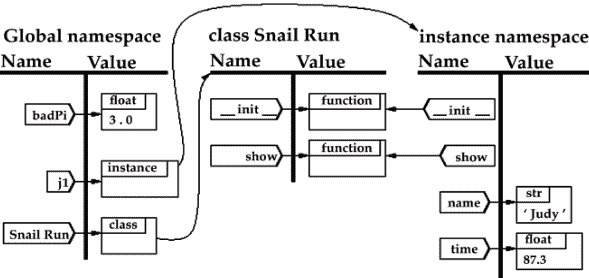

## 使用 Python 进行软计算与机器学习


# 特殊方法：排序蜗牛比赛数据

某些方法名称对 Python 具有特殊意义；这些特殊方法名称都以双下划线“__ __”开头。

类的构造函数方法 `__init__()` 是特殊方法的例子。当你像使用函数一样使用类名时，例如在 “`SnailRun('Judy', 67.3)`” 这样的表达式中，Python 会执行构造函数来构建新实例。

有一个完整的特殊方法列表。

- 如果 $x$ 小于 $y$，则返回一个负数；
- 如果 $x$ 大于 $y$，则返回一个正数；
- 如果 $x$ 等于 $y$，则返回零。

Python 2.7 编程教程 245

## 181. Blake

列表上的 `.sort()` 方法在排序时使用 Python 的 `cmp()` 函数来比较项目，而这反过来会调用我们类的 `__cmp__()` 方法按完成时间进行排序。

```
>>> race4.sort()
>>> for run in race4:
...     print run
...
67.3 Judy
76.5 Jim
88.8 Sally
181.4 Blake
```

关于实现了许多特殊方法的类的扩展示例，请参阅 `rational.py: 一个 Python 类示例`。该示例展示了如何定义一种新数字，并指定 `+` 和 `*` 等运算符如何作用于实例。

# 第 9 章：面向 Python 的模式模式

Tom De Smedt 和 Walter Daelemans

安特卫普大学 CliPS 计算语言学小组 2000 年 比利时安特卫普

## 摘要

Pattern 是一个适用于 Python 2,4+ 的包，具有网络挖掘（Google + Twitter + Wikipedia、网络爬虫、HTML DOM 解析器）、自然语言处理（标记器/n-gram 搜索、情感分析、WordNet）、机器学习（向量空间模型、k-means 聚类、Naive Bayes + k-NN + SVM 分类器）和网络分析（图中心性与可视化）功能。它文档齐全，并附带 30 多个示例和 350 多个单元测试。源代码采用 BSD 许可，可从 `http://www.clips.ua.ac.be/pages/pattern` 获取。

**关键词：** Python、数据挖掘、自然语言处理、机器学习、图网络

> **引用：** Tom De Smedt, Walter Daelemans, “Pattern for Python”, Journal for Machine Learning Research, Vol. 13 (6月), pp. 2063–2067, 2012.
> 
> **版权：** © 2012 作者及 Journal on Machine Learning Research。本文是一篇根据 Creative Commons Attribution 3.0 许可分发的开放获取文章。

## 引言

广域网（Wide Web）是一个巨大的语言信息集合。在过去的十年中，它作为机器翻译、意见挖掘和趋势检测等任务的价值资源而受到关注，被称为“网络语料库”（Kilgarriff and Grefette, 2003）。这种对 WWW 的利用带来了挑战，因为网络上充斥着代码（HTML 标记）并且缺乏元数据（语言识别、词性标记、语义标签）。

“Pattern”（BSD 许可）是一个用于网络挖掘、自然语言处理、机器学习和网络分析的 Python 包，侧重于易用性。它提供了一种在利用网络作为语料库时经常用到的工具的组合，在实际应用中，这通常需要将几个独立的工具链联起来。科学界存在几个带有用户面的工具包，例如用于机器学习的 ORANGE（Demsar et al., 2004）和用于图可视化的 GEPHI（Bastian et al., 2009）。相比之下，PATTERN 与如 NLTK（Bird et al., 2009）、PYBRAIN（Schaul et al., 2010）和 NETWORKX（Hagberg et al., 2008）等工具包相关，因为它倾向于集成到用户自己的程序中。此外，它并不专门针对某个领域，而是提供了通用的跨领域功能。

该包旨在对科学和非科学读者都有用。语法简单直观。函数名和参数的选择使得命令具有自言自明的解释性。文档假设读者没有先验知识。我们认为 PATTERN 作为学生的学习环境、Web 开发人员的快速开发框架，以及开发周期较短的研究项目非常有价值。


**图 1：** 示例工作流。从网络中挖掘文本，并根据语法和语义进行分析。

## 包概述

PATTERN 组织在独立的模块中，如图 1 所示。它提供了支持异步请求、缓存和重定向的 `pattern.web` 类，如 Google、Bing、Yahoo!、Twitter、Wikipedia 和 RSS 馈。`pattern.en` 提供了英语的词法解析器、基于 `unix.org/pdfminer` 的 `PDFMINER` 挖掘器、基于 `user.com/pdfminer` 的 PDF 解析器、基于 `python.org/parser` 的 HTML 解析器，以及基于 `crummy.com/beautifulsoup` 的 BeautifulSoup 解析器。`pattern.search` 允许对 Sentence 对象进行 n-gram 匹配，查询包括单词和短语。`pattern.vector` 使用 `Document` 和 `Corpus` 构建向量空间模型，计算 TF-IDF、距离度量和降维。`pattern.db` 提供了 CSV 文件、SQLite 和数据库的封装。`pattern.nl` 是荷兰语的轻量级实现。`pattern.graph` 使用 `Node` 构建数据结构。`pattern.metrics` 提供描述性统计函数，评估指标包括准确率、精确率和召回率、混淆矩阵、评分者一致性、字符串相似性。

## 示例脚本

作为一个示例，我们链联四个 PATTERN 模块，在 Twitter 上挖掘的形容词上训练 k-NN 分类器。首先，我们挖掘带有 `#win` 或 `#fail` 标签的推文（我们的类别），例如：“今天有一个甜的老女士减20美元”。我们对每条推文进行词性标记，保留形容词。我们将形容词向量分组到语料库并用它训练分类器。它预测“sweet”为 WIN，将“stupid”为 FAIL。结果取决于 Twitter 上当前的热点。

源代码如图 2 所示。其规模对许多真实场景具有代表性，尽管真实的分类器可能需要更多的训练数据和更严格的特征选择。

```
corpus.append(s, type=p)
```

```python
classifier = KNN()
for document in corpus:
    classifier.train(document)
print classifier.classify('sweet') # yields 'WIN'
print classifier.classify('stupid') # yields 'FAIL'd'
```

**图 2：** 用于 Twitter 消息训练的 k-NN 分类器示例源码。

## 案例研究

作为一个案例研究，我们使用 PATTERN 创建了一个荷兰语情感词汇（De Smedt and Daleemans, 2012）。我们挖掘了荷兰语书籍评论，并提取了频率最高的 1,000 个形容词。这些词被手动标注了积极性、消性和主观性评分。然后，我们使用分布扩展扩大了词汇。从 TWNC 语料库（Orelman et al., 2007）中，我们提取了频率最高的名词以及位于这些名词之前的词。这产生了一个包含 5,750 个形容词向量的向量空间，名词作为特征。对于每个标注的形容词，我们计算了 k-NN 并将其得分继承给邻近的形容词。该词汇被封装在 PATTERN 2.3 中。

# 文档

PATTERN 附带示例和单元测试。文档包含快速概述、安装说明，以及每个模块的包含 API 引用、用例示例和科学原理讨论的详细页面。该文档假设用户没有先验知识，除非具有 Python 编程背景。单元测试套件包含了一组用于测试准确性的语料库，例如 POLARITY DATA SET V2.0（Pang and Lee, 2004）。

## 源码

PATTERN 使用纯 Python 编写，这意味着我们为了开发速度和可读性牺牲了性能（即较慢的聚类算法）。该包运行在所有平台上，且没有依赖项（在使用 LSA 时使用 NumPy 外外）。源码附有开发者注释。它托管在 GitHub (`github.com`) 上，并使用 Git 版本控制系统。欢迎贡献。

源码在 BSD 许可证下发布，因此它可以被整合到专有产品中，或与其他开源包结合使用，如 SCRAPY（挖掘）、NLTK（自然语言处理）、PYBRAIN 和 PYML（机器学习）以及 NETWORKX（网络分析）。我们提供了一个指向 MBSP FOR PYTHON（De Smedt et al., 2010）的接口，这是一个基于 TIMBL 机器学习软件构建的健壮的基于内存的浅层解析器。PATTERN 解析器和 MBSP 的 API 是相同的。

## 致谢

开发资金由安特卫普大学的工业研究基金（IOF）资助。

## 参考文献

- 1. David Arthur and Sergei Vassvilitkii. k-means++: the advantages of careful seeding. Proceedingsof the Eighteenth Annual ACM-SIAM Symposium on Discrete Algorithms, pages 1027–1035, 2007.
- 2. Mathieu Bastian, Sebastian Heymann, and Mathieu Jacomy. Gephi: An open source software exploring and manipulating networks. Proceedings of the Third International ICWSM Conference, 2009.
- 3. Steven Bird, Ewan Klein, and Edward Lopez. Natural Language Processing with Python. O’ReillyMedia, 2009.
- 4. Ulrik Brandes. A faster algorithm for betweenness centrality. The Journal of Mathematical Sociology, 25(2):166–177, 2001.
- 5. Eric Brill. A simple rule-based part of speech tagger. Proceedings of the Third Conference on Applied Natural Language Processing, pages 152–155, 1992.
- 6. Chih-Chung Chang and Chih-Jen Li. LIBSVM: a library for support vector machines. ACM Transactions on Intelligent Systems and Technology, 2(3), 2011.
- 7. Damian Conway. An algorithmic approach to english pluralization. Proceedings of the Second Annual Perl Conference, 1998.
- 8. Tom De Smedt and Walter Daelemans. Vreseljk mooi! (terribly beautiful): A subjectivity lexicon for dutch adjectives. Proceedings of the 8th Language Resources and Evaluation Conference (LREC’12), pages 3568–3572, 2012.
- 9. Tom De Smedt, Vincent Van Asch, and Walter Daelemans. Memory-based shallow parser for python. CLIPS Technical Report Series, 2, 2010.
- 10. Janez Demsar, Ba Zupan, Gregor Leon, and Tom Curk: From experimental machine learning to interactive data mining. Knowledge Discovery in Databases, 3202:537–539, 2004.
- 11. Charles Elkan. Using the triangle inequality to accelerate k-means. Proceedings of the Twentieth International Conference on Machine Learning, pages 147–153, 2003.
- 12. Christiane Fellbaum. WordNet: An Electronic Lexical Database. MIT Press, Cambridge, 1998.
- 13. Jeroen Geertzen. Jeroen geertzen :: software & demos : Brill-nl, June 2010. URL `http://cosmion.net/jeron/software/brill_pos`.
- 14. Aric Hagberg, Daniel Schult, and Pieter Swart. Exploring network structure, dynamics, and function using networkx. Proceedings of the 7th Python in Science Conference, pages 11–15, 2008.
- 15. Adam Kilgarrff, Structured prediction for practitioners as well as researchers, in Python. Computational Linguistics, 29(3):333–347, 2003.
- 16. Roeland Ordel, Structured prediction for practitioners as well as researchers, in Python. Computational Linguistics ELRA Newsletter, 12:3–4, 2007.
- 17. Bo Pang and Lillian Lee. Sentiment analysis using summarization. Proceedings of the ACL, 271–278, 2004.
- 18. Tom Schaul, Justin Bayer, Daan Wierstra, Frank Sehne, and Jurgen Schmidhuber. Machine Learning Research, 743–746, 2010.

# 第 10 章

# PYSTRUCT - 在 Python 中学习结构化预测

Andreas C. Müller 和 Sven Behnke

德国波恩，计算机科学学院，第 VI 部门

## 摘要

结构化预测方法已成为许多机器学习应用的核心工具。尽管有越来越多的算法被开发出来，但可用的实现较少。

PyStruct 旨在为从业者和研究人员提供标准预测方法的通用实现。它用 Python 编写，并借鉴了科学社区的范式。

**关键词：** 结构化预测，结构向量机，条件随机场，Python

> *引用:* A. C. Müller, S. Behnke, "PyStruct - Learning Structured Prediction in Python", Journal of Machine Research, 15 (Jun), pp. 2055–2060, 2014.
> 
> **版权：** ©2014 作者及 Journal of Machine Research。本文根据 Creative Commons Attribution 3.0 许可开放

## 引言

近年来，结构化预测方法的研究非常丰富，并应用于语言处理和计算机视觉等领域。遗憾的是，公开的实现很少——许多应用是非免费的 (2009)。

PyStruct 旨在用高级 Python 提供一个高质量的实现和易于使用的接口。这使得从业者能够高效地测试一系列模型，使研究人员能够更容易地与基准进行比较（相比目前的实现）。PyStruct 使用 BSD 许可，允许修改和分发代码。通过采用科学社区建立的范式并重用常用的 scikit 库 (`Pedregosa et al., 2011`) 的接口，PyStruct 可以用于现有项目。在线文档和示例帮助新用户理解结构化预测背后的抽象。

# 结构化预测与软件实现

结构化预测可以定义为通过化输入 `x` 与可能的标签 `y` 之间的兼容性来做出预测 `f(x)` (`Nowozin and Lampert, 2011`)。大多数方法使用线性标签，导致：

```
f(x) = arg \max_{y \in Y} \theta^T \Psi(x, y).
```

在这里，`y` 是结构化标签，`$\Psi$` 是 `x` 和 `y` 的联合特征函数，`$\theta$` 是模型参数。结构化意味着 `y` 比单个输出标签复杂，例如句子中的单词或图像每个像素的标签。学习结构化预测意味着从训练数据学习参数 `$\theta$`。

使用上述公式，学习可以分解为三个子问题：

- 1. 对 `$\theta$` 优化目标函数。
- 2. 在联合特征函数 `$\Psi$` 中编码问题结构。

# PyStruct - 在 Python 中学习结构化预测 257

## 3. 求解方程 1 中的最大化问题。


后两个问题通常是紧密耦合的，方程 1 中的最大化通常通过利用 `Ψ` 的结构是可行的，而第一个问题被视为独立的。事实上，当 3. 无法精确完成时，`$\theta$` 的学习很大程度上取决于近似的质量。然而，将近似推理和学习视为联合优化问题目前出了该包的范围，我们实现了一种更模块化的设置。`PyStruct` 采用面向对象的方法，将依赖于任务的 2、3 实现与用于 1 的通用算法解耦。

估计 `$\theta$` 在学习器类中完成，这些类目前支持用于结构化支持向量机（SVM 等）的切割平面算法 (`SVMs et al. (2009)`)、用于 SVM 的子梯度方法 `Rattriff et al. (2007)`、块坐标下降 Frank-Wolfe (`BCFW`) (`Lacoste-Julien et al., 2012`)、结构化感知机以及隐变量 SVM (`Yu and Joachim, 2009`)。切割平面实现使用 `cvopt` 包 (`Andersen et al., 2012`) 进行二次优化。问题结构的编码通过模型类完成，这些模型类计算 `Ψ` 并编码问题结构。`Ψ` 的结构决定了方程 (1) 中最大化的困难程度，它是学习的关键因素。`PyStruct` 为许多情况实现了模型（对应于 `Ψ` 的特定形式），例如多类和多标签分类、具有常数或依赖于数据的成对势的条件随机场，以及几种隐变量模型。方程 1 中 `$y$` 的最大化通过外部库执行，如 `OpenGM` (`Kappes et al., 2013`)、`LibDAI` (`Mooij, 2010`) 等。这允许用户从广泛的优化算法中进行选择，包括（环路）置传播、图割、QPBO、对偶子梯度、TRWs 以及许多其他算法。对于无法进行精确推理的问题，`PyStruct` 允许使用线性规划松弛，并提供修改的损失和特征函数来处理连续标签。这种在 `Finley` 和 `Joachim (2008)` 中概述的方法允许在精确推理不可行时进行有原则的学习。当使用近似积分求解器时，学习可能会提前结束，在这种情况下，结果取决于所使用的推理方案和学习算法。

表 1 列出了 `PyStruct` 中实现的算法和模型，并将它们与其他公共结构化预测库进行了对比：`Dlib` (`King, 2009`)、`SVMstruct` (`Joachims et al., 2009`) 和 `CRFsuite` (`Okazaki, 2007`)。我们还提供了编程语言和项目许可。

## 258 使用 Python 进行软性计算和机器学习

表 1：结构化预测软件包的比较。CP 代表 SVVM 的切割平面优化，SG 代表 SVVM 的在线子梯度优化，LV 代表隐变量 SVVM，ML 代表最大似然学习，Chain 代表具有成对交互的链结构模型，Graph 代表具有成对交互的任意图，LDCRF 代表隐动态 CRF (`Moreency et al., 2007`)。`PyStruct` 本身采用 BSD 许可，但使用 GPL 许可的包 `cvxopt` 进行切割平面学习。

| 包 | 语言 | 许可 | CP | SG | LV | ML | Chain | Graph | LDCRF |
| :--- | :--- | :--- | :--- | :--- | :--- | :--- | :--- | :--- | :--- |
| `PyStruct` | Python | BSD1 | ✓ | ✓ | × | × | × | ✓ | ✓ |
| `SVMstruct` | C++ | non-free | ✓ | × | × | × | × | ✓ | × |
| `DLIB` | C++ | boost | ✓ | × | × | × | × | ✓ | ✓ |
| `CRFSstruct` | C++ | BSD | ✓ | × | × | × | × | × | × |

## 使用示例：语义图像分割

条件随机场是语义图像分割的重要工具。我们演示了如何在流行的 Pascal 数据集上在基于超像素的 CRF 上学习 `$n$`-松弛支持向量机 (`Tschantaridis et al., 2006`)。我们使用了来自 `Krähenbühl` 和 `Koltun (2012)` 的 TextBoost 生成的单位势。超像素由 SLIC 生成（每个样本（对应列表中的一个项目）表示为一个由输入特征和图表示组成的元组组）。

**列表 1**：定义和学习 CRF 模型的示例

```
1 model = crfs.EdgeFeatureGraphCRF(
2     class_weight=inverse_features, symmetric_edge_features=[0, 1],
3     antisymmetric_edge_features=[2], inference_method='qpbo')
4
5 svm = learners.NSlackSVM(model, C=0.01, n_jobs=-1)
6 svm.fit(X, Y)
```

源代码所示于列表 1。第 1-3 行声明了任意图的参数化边势。这里 `class_weight` 根据反类别频率重新加权汉明损失。成对交互有三个特征：常数特征、颜色相似性和相对位置。前两个声明为相对于边的方向是对称的，最后一个是反对称的。使用的推理方法是 QPBO-fusion 移动。第 5 行创建一个学习器对象，该对象将使用 `$n$`-松弛切割平面方法为给定模型学习参数，第 6 行执行实际学习。使用这种简单的设置，我们在验证集上达到了 30.3 的准确率。

## PyStruct - 在 Python 中学习结构化预测 259

**图 1**：`PyStruct` 和其他方法的运行时对比.(`https://example.com/image1.png`)

## 实验

虽然 `PyStruct` 关注易用性，但将其与其他库进行比较是非常重要的。在本节，我们比较了 `PyStruct` 与其他结构化预测的性能。结果如图 1 所示。

## 结论

本文介绍了 `PyStruct`，这是一个 Python 中的模块化结构化学习库。`PyStruct` 于于使用，提供了高效的实现。未来，我们计划整合其他范式，例如基于采样的学习。

## 感谢

作者感谢 `Vlad Niculae` 和 `Andre Martins` 对 `PyStruct` 的贡献。这项工作得到了研究学校的部分经费资助。

## 286 PyStruct - 在 Python 中学习结构化预测

## 参考文献

- 1. Radhak Achanta, Appu Shaji, Kevin Smith, Aurelien Fua, and Sabine S. SLIC superpixels. PAMI, 2012.
- 2. Martin S. Andersen, Joachim Dahl, and Lieven Vandenberg. CVXOPT: A python package for convex optimization. Available at `http://cvxopt.org/`, 2012.
- 3. Thomas Finley and Thorsten Joachim. 在精确推理不可行时训练结构化 SVM。In ICML, 2008.
- 4. Thorsten Joachims, Thomas Finley, and Chun-Man Yu. 结构化 SVM 的切割平面训练。JMLR, 77(1), 2009.
- 5. Jörg Kappes, Björn Andres, Jan Hellmann, Christoph Schnorr, Sebastian Noozinin, Sungwong Kim, et al. 离散能量最小化现代推理技术比较研究。In CVPR, 2013.
- 6. Davis E. King. Dib-lib: 一个机器学习工具包。JMLR, 10, 2009.
- 7. Philipp Krähenbühl and Vladlen Koltun. 具有高斯边势的全连接 CRF 中的高效推理。In NIPS, 2012.
- 8. Simon Castro-Julien, Mark Schmidt, and Francis Bach. 获取投影随机子梯度下降 O(1/t) 收敛率的简单方法。arXiv preprint arXiv:1212.2002, 2012.
- 9. Ofer Meshi, David Sontag, Tommi Jaakkola, and Amir Globerson. 通过对偶损失进行高效学习。In ICML, 2010.
- 10. Joris M. Mooij. libDAI: 用于图模型离散近似推理的免费开源 C++ 库。JMLR, 2010.
- 11. L-P Moreency, Ariadna Quattoni, and Trevor Darrell. 用于连续手势识别的隐动态判别模型。In CVPR, 2007.
- 12. Sebastian Noozinin and Christoph L. Lampert. 计算机视觉中的结构化学习与预测。Now Publishers Inc., 2011.
14. Fabian Pedregosa, Gaëël Varoquaux, Alexandre Gramfort, Vincent Michel, Bertrand Thirion, Olivier Grisel, Mathieu Blondel, Peter Prettenhofer, Ron Weiss, Vincent Dubourg, et al. Scikit-learn: Machine learning in Python. JMLR, 2011.
15. Nathan Ratliff, J. Andrew (Drew) Bagnell, and Martin Zinkevich. (Online) subgradient methods for structured prediction. In AISTATS, 2007.
16. Ioannis Tsochantaridis, Thorsten Joachims, Thomas Hofmann, Yasemin Altun, and Yoram Singer. Large margin methods for structured and interdependent output variables. JMLR, 6(2), 2006.
17. Michael Wick, Khashayar Rohimananesh, Kedar Bellare, Aron Culotta, and Andrew McCallum. Samplerank: Training factor graphs with atomic gradients. In ICML, 2011.
18. Chun-Nam John Yu and Thorsten Joachims. Learning structural SVMs with latent variables. In ICML, 2009.

# 第四节：使用 Python 进行机器学习

## 第 11 章

## 用于贝叶斯学习的 Python 环境：从知识和数据推断贝叶斯网络的结构

`Abhik Shah` 和 `Peter Woolf`

化学工程系 3320 G.G. Brown Ann Arbor, MI 48103, USA

## 摘要

在本文中，我们引入了 `PEBL`，这一个用于从数据和先验知识学习贝叶斯网络结构的 Python 库和应用程序，它提供了其他软件包包无法比拟的功能：使用干预数据的能力、对结构先验的灵活指定、隐藏变量的建模以及对并行处理的利用。`PEBL` 以 MIT 开源许可发布，可以从 Python 包索引（PyPI）安装，并可以在 `http://pebl-project.googlecode.com` 获取。

**引用：** `Abhik Shah`, `Peter Woolf`; “Python Environment for Bayesian Learning: Inferring the Structure of Bayesian Networks from Knowledge and Data", vol. 10 (Feb):159--162, 2009.

**版权：** © 2009 作者及《机器学习研究期刊》(Journal on Machine Learning Research)。本文是一篇根据知识共享署名 3.0 许可分发的开放文章

**关键词：** 贝叶斯网络，python，开源软件

## 引言

贝叶斯网络（BN）已成为许多领域的流行方法，因为它们可以使用噪声、不一致的数据模拟非线性、多模态的关系。虽然从数据学习 BN 结构已已常见，但仍然需要高质量的开源软件来满足各种用户的需求。用户需要易于使用；支持不同数据类型的学习；能够处理缺失值和隐藏变量；并能够利用各种计算集群和网格。研究人员需要一个框架来开发和测试新算法，并将其转换为可用的软件。我们开发了贝叶斯学习 Python 环境（`PEBL`）来满足这些需求。

## PEBL 特性

`PEBL` 为处理数据和 BN 提供了许多功能；下面列出了一些较为显著的功能。

## 结构学习

`PEBL` 可以从制表符分隔的文本文件中加载包含连续、离散和类别变量的数据，并执行最大熵离散化。根据干预收集的数据对于确定因果关系至关重要，但需要修改的评分程序（`Pe'er et al., 2001; Sachs et al., 2002`）。`PEBL` 使用 `BDe` 指标对网络评分，并使用 `Yoo` 等人 (`2002`) 描述的方法处理干预数据。

贝叶斯学习 Python 环境：推断结构 ... 267

```ini
[data]
filename = mydata.txt
[learner]
type = greedy.GreedyLearner
tumasks = 10
[taskcontroller]
type=xgrid.XgridController
[xgrid]
controller = grid.com
password = pass
[result]
output = /myoutput
```

```python
from pebl import data, result
from pebl.learner.xgrid import GreedyLearner
from pebl.taskcontroller.xgrid import XgridController

dataset = data.fromfile('mydata.txt')
runner = XgridController('grid.com', 'pass')
learners = [GreedyLearner(dataset) for i in range(10)]
result = runner.merge(learners).toml('/myoutput')
```

(a) Python 脚本 (b) PEBL 配置文件

**图 1：** 使用 `PEBL` 的两种方式：使用 Python 脚本和配置文件。两种方法都创建了带有默认参数的 10 个贪心学习器并在 Apple Xgrid 上运行。Python 脚本可以在交互式 shell 中输入、作为脚本运行或作为更大型应用程序的一部分包含。

`PEBL` 可以使用精确边缘际化和 Gibbs 采样处理缺失值和隐藏变量（`Heckman, 1998`）。Gibbs 采样器可以从之前挂起的状态恢复，允许对初步结果进行交互式检查，或使用用于确定满意收敛的人工策略。

贝叶斯分析的一个关键优势是使用先验知识的能力。`PEBL` 支持对指定为“硬”约束或“软”能量矩阵的边进行结构先验（`Imoto et al., 2003`），以及指定为 Python 函数或 lambda 表达式的任意约束。

`PEBL` 包含了贪心爬山和模拟退火学习器，并使得编写自定义学习器变得简单。`PEBL` 的高效实现消除了冗余计算。

# 便捷性与可扩展性

贝叶斯分析的一个关键优势是使用先验知识的能力。`PEBL` 支持对指定为“硬”约束或“软”能量矩阵的边进行结构先验（`Imoto et al., 2003`），以及指定为 Python 函数或 lambda 表达式的任意约束。

`PEBL` 包含了贪心爬山和模拟退火学习器，使得编写自定义学习器变得简单。`PEBL` 的高效实现消除了冗余计算。

贝叶斯学习 Python 环境：推断结构 ... 267

表 1：流行 BN 软件的功能对比

| 特性 | BNT | Causal Explorer | Deal | PEBL |
| :--- | :--- | :--- | :--- | :--- | :--- |
| 最新版本 | 2.0 | | 1.4 | | 0.9 |
| 许可证 | 学术 | | 学术 | MIT | Python |
| 脚本语言 | Matlab | | Matlab | | |
| 应用 | 是 | 否 | | |
| 干预数据 | 否 | 是 | | |
| 结构先验 | 是 | 否 | | |
| 缺失数据 | 否 | 是 | | |
| 并行执行 | 否 | 否 | | |

> 1 自定义学术非商业许可；
> 2 通过 Matlab 桥接。
> 3 对先验的约束。

虽然有许多处理 BN 的软件工具，但它们侧重于参数学习和推断，而不是结构学习。在少数学习结构的工具中，很少是开源的且提供了 `PEBL` 所包含的功能。如表 1 所示，处理干预数据、建模缺失值和隐藏变量、软性和任意概率以及利用并行平台的能力是 `PEBL` 特有的。然而，`PEBL` 目前尚未提供任何用于动态贝叶斯网络（DBN）的推断或学习功能。

## PEBL 开发

开源软件的优势不仅来自于软件许可，还源于开放开发模式。`PEBL` 的源代码仓库和问题跟踪托管在 Google Code 上，对所有人开放。`PEBL` 包含超过200个自动化单元测试，并要求每个源码提交和修复的错误都附带测试。

# 相关软件

虽然有许多处理 BN 的软件工具，但它们侧重于参数学习和推断，而不是结构学习。在少数学习结构的工具中，很少是开源的且提供了 `PEBL` 所包含的功能。

## 结论与未来工作

我们开发了一个从数据和先验知识学习 BN 的库和应用程序。`PEBL` 中发现的功能集是其他软件包无法比拟的，我们希望我们的开放开发模式能说服他人将 `PEBL` 作为 BN 算法研究的平台。

## 致谢

感谢 NIH 资助 `#U54 DA021519` 对项目的支持。


# 基于 Python 的软计算与机器学习

## 参考文献

- D. Ascher, P. F. Dubois, K. Hinsen, J. Hugunin, and T. Oliphant. 一个开源项目：Numerical python。技术报告 UCRL-MA-128569, 洛伦斯利弗国家实验室，2001年9月。
- D. M. Chickering, D. Geiger, and D. Heckerman. 贝叶斯网络的学习是 np-hard。技术报告 MSR-TR-94-17, 微软研究院，1994年11月。
- D. Heckerman. 贝叶斯网络学习教程。《图模型中的学习》，第301–354页。MIT出版社，1998年。
- S. Imoto, T. Higuchi, T. Goto, K. Tashiro, S. Kuhara, and S. Miyano. 结合微阵列和生物学知识通过贝叶斯网络估计基因网络。生物信息学会议，2003。CSB 2003。2003年 IEEE 会议，第104–113页，2003年。
- T. E. Oliphant. 用于科学计算的 Python。《科学与工程计算》，第10–20页，2007年。
- D. Pe'er, A. Regev, G. Elidan, and N. Friedman. 从受扰的表达谱中推断子网络。《生物信息学》，1(1):1–9，2001年。
- K. Sachs, D. Gifford, T. Jaakkola, P. Sorger, and D. Lauffenburg. 细胞信号通路建模的贝叶斯网络方法。《科学 STKE》，2002年。
- C. Yoo, V. Thorsson, and G. F. Cooper. 从实验和观察性 DNA 微阵列数据的混合发现基因调节通路中的因果关系。《Pac 生物计算》，7:498–509，2002年。

# 第 12 章

## Scikit-learn：Python 中的机器学习

Fabian Pedregosa, Gael Varoaux, Alexandre Gramfort, Vincent Michel, Bertrand Thirion, Olivier Grisel, Mathieu Blondel, Peter Prettenhofer, Ron Weiss, Vincent Dubourg, Jake Vanderplas, Alexandre Passos, David Cournnau, Mathieu Brucher, Matthieu Perrot, and Edouard Duchesnay

- *Parietal, INRIA Saclay Neurospin, Bat 145, CEA Saclay 91119 Gif sur Yvette – 法
- *Nuxeo 20 rue Soleilet 75 020 Paris – 法
- *Kobe University 1-1 Rokkodai, Nada Kobe 657-8501 – 日本
- *Bauhaus-Univers Weimar Bauhaus.str. 11 99421 Weimar – 德国
- *Google Inc 76 Ninth Avenue New York, NY 10011 – 美国
- *Clermont University, IFMA, EA 3867, LaMI BP 10488, 63000 Clermont-Ferrand – 法
- *Astronomy Department University of Washington, Box 351850 Seattle, WA 98195 – 美国
- *IESL Lab UMass Amherst MA 01002 – 美国
- *Enthought 21 J.J. Thompson Avenue Cambridge, CB 3FA – 英国

> 引用：F. Pedregosa, G. Varoaux, A. Gramfort, V. Michel, B. Thirion, O. Grisel, M. Blondel, P. Prettenhöfer, R. Weiss, V. Dubourg, J. Vanderplas, A. Passos, D. Cournapeau, M. Brucher, M. Perrot, E. Duchesnay; “Scikit-learn: Machine Learning in Python”，“机器学习研究期刊》，12 (10月): 2825–2830, 2011年。

版权：© 2011 作者及《机器学习研究期刊》。本文是根据知识共享署名 3.0 许可分发的开放文章

## 基于 Python 的软计算与机器学习

Total SA, CSTJF avenue Larribau 64000 Pau – 法

LNAO Neurospin, Bat 145, Cea Saclay 91191 Gif Yvette – 法

### 摘要

`Scikit-learn` 是一个 Python 模块，集成了一系列最先进的机器学习算法，适用于中等规模的监督和无监督问题。该软件包侧重于使用通用高级语言，为非专业人士引入机器学习。重点在于易用性、性能、文档和 API 的一致性。它的依赖项极少，并根据简化的 BSD 许可证分发，鼓励其在学术和商业环境中使用。源代码、二进制执行文件和文档可以从 `http://scikit-learn.sourceforge.net` 下载。

**关键词：** Python，监督学习，无监督学习，模型选择

### 引言

Python 编程语言正在成为最受欢迎的科学计算语言之一。得益于其高层交互式特性以及成熟的科学库生态系统，它是算法开发和探索性数据分析极具吸引力的选择（Dubois, 2007; Milmann and Avizais, 2017）。

`Scikit-learn` 构建在科学 Python 栈之上：`numpy`, `scipy` 和 `matplotlib`。这些库为高效的数组操作、数值例程和可视化提供了基础。`Scikit-learn` 为分类、回归、数据预处理、模型选择、降维和流水线提供了多种快速工具。

`Scikit-learn` 的目标是为机器学习算法提供简单且一致的接口。这是通过遵循几个原则实现的：

- 一致性：所有的估计器都具有相同的接口，便于在算法之间切换并构建流水线。
- 灵活性：该库设计用于各种上下文并与其他工具配合。
- 效率：算法尽可能高效地实现，通常使用 C 或 Cython 提高性能。
- 文档：该库文档详尽，提供了许多示例帮助用户学习。

`Scikit-learn` 是一个社区驱动的项目。我们欢迎新功能、改进和错误报告的贡献。

`Scikit-learn` 的核心组件是估计器（estimators）、转换器（transformers）、分类器（classifiers）和回归器。估计器是 `Scikit-learn` 中最重要的对象。它们遵循一致的接口：

- `fit(X, y)` 在训练数据上训练模型。
- `predict(X)` 在新数据上进行预测。
- `score(X, y)` 评估预测质量。

转换器用于数据转换，例如标准化、编码和降维。它们遵循类似的接口：

- `fit(X, y)` 学习转换参数。
- `transform(X)` 将转换应用到数据。

分类器和回归器用于监督学习的估计器类型。它们遵循与估计器相同的接口，并带有 `predict` 方法。

`Scikit-learn` 还提供了许多模型选择和评估工具，例如交叉验证、网格搜索和各种指标。这些工具帮助用户为数据找到最佳模型，并确保其良好地泛化到新数据。

### 底层技术

`Numpy`：`Scikit-learn` 的基础是 `numpy`。它提供了处理这些数组的多维对象和函数。

`Scipy`：`Scikit-learn` 还使用 `scipy` 进行许多数值例程，如优化、线性代数和信号处理。

`Cython`：使用 `Cython` 允许我们编写运行速度类似于 C++ 的 Python 代码。

### 代码设计

通过接口而非继承指定对象：在 `Scikit-learn` 中，我们不要求对象继承自基类。相反，我们依赖鸭子类型（duck typing）。如果对象具有所需的方法，就可以作为估计器使用。这使得 `Scikit-learn` 与其他的集成变得更容易。

重要的对象是交叉验证迭代器，它提供训练和测试索引对以划分输入数据，例如 `K` 折交叉（K-fold）、留一（leave one out）、分层交叉验证。

**模型选择：** `Scikit-learn` 可以使用交叉验证评估估计器的性能或选择参数，并可选地将计算分布到多个核心。这是通过将估计器封装在 `GridSearchCV` 对象中实现的，其中“CV”代表“交叉验证”（cross-validated）。在调用 `fit` 时，它会在指定的网格上选择参数，使得分最大化（底层估计器的 `score` 方法）。随后，`predict`、`score` 或 `transform` 将委托给调优后的估计器。因此，该对象可以透明地作为任何其他估计器使用。通过利用特定属性（如热重启或正则化路径），交叉验证对于某些估计器可能更高效（Friedman et al., 2010）。这通过特殊对象（如 `Lasso`）得到。最后，`Pipeline` 对象可以将多个转换器和一个估计器结合以创建一个更好的估计器，例如在拟合之前应用降维。它的行为类似于标准估计器，因此 `GridSearchCV` 会调优所有步骤的参数。

### 高级且高效：一些权衡

虽然 `scikit-learn` 专注于易用性，且大部分用高层语言编写，但它为了最大化计算效率进行了优化。在表 1 中，我们比较了 Python 中可用的主流机器学习工具包中实现的几种算法的计算时间。我们使用了 `Madelon` 数据集（Guyon et al., 2004），包含 4400 个实例和 500 个属性。该数据集很大，但足够让大多数算法运行。

**SVM：** 虽然所比较的所有包在后台都使用了 `libsvm`，但 `scikit-learn` 的性能可以用两个因素解释。首先，我们的绑定避免了内存拷贝，开销比原始的 `libsvm` Python 绑定少达 40%。其次，我们修补了 `libsvm` 以提高在密集数据上的效率，使用了更小的内存占用，并利用了现代处理器更好的内存对齐和流水线。修补版本还提供了独特的功能，例如为单个样本设置权重。

**LARS：** 通过迭代精炼残差而不是重新计算它们，相比参考的 R 实现获得了 2-10 倍的性能（Hastie and Efron, 2004）。`Pymvpa` 通过 `Rpy` 绑定使用此实现，但为内存拷贝付出了沉重代价。

**Elastic Net：** 我们对 `scikit-learn` 的坐标下降 `Elastic Net` 实现进行了基准测试。在中等规模问题上，它的性能与高度优化的 Fortran 版本 `glmnet`（Friedman et al., 2010）同一数量，但在大型问题上性能受到限制，因为我们没有使用 KKT 条件来定义活动集。

**kNN：** `k` 最近邻分类器的实现构建了样本的球树（Omohundo, 1989），但在高维空间中使用更高效的暴力搜索。

**PCA：** 对于中、大型数据集，`scikit-learn` 提供了一种基于随机投影的截断 `PCA` 实现（Rokhlin et al., 2009）。

**k-means：** `scikit-learn` 的 `k-means` 算法是用纯 Python 实现的。其性能受限于 `numpy` 数组操作会对数据进行多次遍历的事实。

### 结论

`Scikit-learn` 使用一致的、面向任务的接口暴露了广泛的机器学习算法（包括监督和无监督学习），从而能够针对特定应用轻松地比较各种方法。由于它依赖于科学 Python 生态系统，它可以轻松集成到传统统计数据分析范围之外的应用中。重要的是，这些用高层语言实现的算法可以作为特定用例方案的构建块，例如在医学影像中（Michel et al., 2011）。未来的工作包括在线学习，以扩展到大数据集。

# Scikit-learn: Python 中的机器学习

## 参考文献

- 1. D. Albanese, G. Merler, S. and Jurman, and R. Visintainer. MLPy: high-performance python package for predictive modeling. In NIPS, MLOSS Workshop, 2008.
- 2. C.C. Chang and C.J. Lin. LISVM: a library for support vector machines. http://www.csie.ntu.tw/cj/libsvm, 2001.
- 3. P.F. Dubois, Engineering. Python Batteries Included, volume 9 of Computing in Science & Engineering. IEEE/AIP, May 2007.
- 4. R.E. Fan, W. Chang, C.J. Hsieh, X.R. Wang, and C.J. Lin. LIBLINEAR: a library for large linear classification. The Journal of Machine Learning Research, 9:1871–1874, 2008.
- 5. J. Friedman, T. Hastie, and R. Tibshirani. Regularization paths for generalized linear models via coordinate descent. Journal of Statistical Software, 33(1):1, 2010.
- 6. I Guyon, S. R. Gunn, A. Ben-Hur, and D. Gror. Result analysis of the NIPS 2003 feature selection challenge, 2004.
- 7. M. Hanke, Y.O. Halchenko, P.B. Sederberg, S.J. Hanson, J.V. Hoxby, and S. Pollmann. MyPVA: A Python tool for multivariate analysis.
- 8. T. Hastie and E. Efron. Elastic Net. r-project/lars.
- 9. P. Michel, A. Behr, and F. Gehl. A supervised approach for fMRI. Neuroinformatics, 2011.
- 10. S. Omohindi. balltree construction. ICSI Technical Report TR-89-03.
- 11. V. Rokhlin. A randomized algorithm for principal component analysis. SIAM Journal on Matrix Analysis and Applications, 31(3):1100–1124, 2009.
- 12. S. Schaul, J. Widmer, and T. Schmiduber. PyBrain. Journal of Machine Learning Research, 11:743–746, 2010.
- 13. S. Sonnenburg, G. Ratsch, and C. Zen. SHUN machine learning toolbox. Journal of Machine Learning Research, 11:1799–1802, 2010.
- 14. S. Van der Walt, S.C Colbert, and G. Varoaux. The NumPy array: A structure for efficient numerical computation. Computing in Science and Engineering, 11, 2011.
- 15. T. Zito, N. Wilbert, L. Wiskott, and P. Berkes. Modular toolkit for data processing (MDP): A Python processing framework. Frontiers in Neuroinformatics, 2, 2008.

创建了一个用于从原生代码中自动提取模式的通用平台，能够处理大型二进制文件。其实现已经过并行化，为多核架构提供了重要的运行时优势。与单处理器执行相比，在最佳配置下，获得的平均性能提升达到了最大理论增益（4 倍）的 3.5 倍。

### 引言

许多软件工具通过分析程序来寻找预先定义的特定模式。当发现模式时，工具会执行相应的操作（例如，提高输入程序的质量、安全性或性能）。模式既定义于高层代码，也定义于二进制代码。分析高层模式的工具示例包括：重构工具、代码质量分析器或常见编程错误检测器。对于二进制代码，示例则包括：反汇器、加壳可执行文件识别器、作者身份分析器或恶意软件检测器。

在传统方法中，由专家识别软件工具需要寻找的模式。他或她的专业知识被用于定义应该搜索的代码模式（例如，为了改进应用程序）。相反，可以使用机器学习方法来构建模型，然后将这些模型应用于大型代码库，以有效地搜索和识别特定模式。这种方法方法允许对大量程序进行分析，有时可以检测到传统方法无法发现的模式。此外，这种方法还可以自动评估获取模式的准确性。

一个名为“大代码”（big code）的新兴研究课题近期出现 [1]。大代码基于这样一个观点：开源代码库（如 GitHub、SourceForge、BitBucket、CodeLex）可以利用机器学习和概率推理，创建新类型的编程工具和服务，以提高软件的可靠性和构建水平。大代码包含的研究方向之一是寻找外推模式、检测软件异常或计算同一程序中不同模式的共现性 [2]。


在程序中检测模式的一个示例（更多真实示例可参考 [2]）是 MLSEC 研究小组提出的漏洞发现方法 [3]。它可以协助安全分析师在审计源代码期间，从程序中提取抽象语法树（AST）并确定其中的结构模式。给定一个已知漏洞，它们的模式会被识别并外推到代码库中，从而向分析师建议可能遭受相同缺陷的函数。通过该方法，他们成功在 Linux 内核的源码中识别了 18 个此前未知的漏洞。

使用机器学习算法寻找代码模式的研究背景基于三个几点：首先，机器学习技术可以用于构建预测模型以识别数据中的模式；此外，这些技术不需要关于问题领域的特定领域知识 [4]。其次，现有的开源代码库为收集用于分析的海量模式库提供了新机会。第三，现有的大数据技术和平台促进了大型数据集的分析。

在处理原生代码时，需要一个平台来提取编译器生成的二进制模式（如果有）。这些信息对于提取二进制模式非常有价值，这些模式随后可能被机器学习算法用于创建预测工具。从一个小的二进制程序可以提取大量的模式，因为汇编指令的数量远多于源高层程序。因此，处理调试信息的需求，加上可能提取的海量模式，使得使用高度并行且高效的工具来提取这些模式至关重要。

一个能够从程序中提取模式的平台也应该是高度参数化的。平台需要检测的个体（生成数据集中的行）必须由用户定义。例如，我们可能对寻找函数、代码段、融合入口点或二进制代码区域的模式感兴趣。同样的参数化也要求用于指定每个个体的特征（数据集中的列）。例如，我们可以定义特征 `<mov> <generic ax>, <any>` 来表示将任何值移动到累加器寄存（ah, al, eax 或 rax）的汇编指令。如果该模式（特征或列）出现在二进制代码的一个区域（个体或行）中，则数据集中的对应值（行和列）将为 1。

从二进制代码中提取特征的传统方法是识别语法上固定的单元（例如 [5] 或基本块），并提取它们内部的二进制代码 [5]。然而，模式提取并不总是遵循这一方案。有时，需要提取非顺序模式，例如控制流图和数据依赖图的子图。在这种情况下，二进制提取平台应该允许将模式与代码片段关联。（注：原文此处存在大量重复句子，翻译时已按要求保留核心语意）。

# 284 基于 Python 的软计算与机器学习

本文介绍的平台被用于从原生代码中提取二进制模式，这些模式随后被用于改进这些反汇编器收集的某些高级信息。特别是，我们面临检测函数返回类型的问题。表2展示了我们的平台为该特定案例生成的数据集摘：个体（行）是模块中的函数；特征（列）是函数末尾发现的二进制模式序列（返回模式）以及调用函数后发现的二进制模式序列（调用后模式）；目标列是返回类型。请注意，本文的工作重点是平台本身，而不是改进反汇编的算法。

# 平台架构

该平台通过考虑有限二进制模式集（数据集中的特征或列）的出现，生成一个数据集来分类二进制代码片段（数据集中的个体或行）。所有的个体和模式（特征）都获取自一组二进制程序，这些程序由平台进行处理。

在我们的动机性示例中，数据集中的个体是函数；特征是平台提取的泛化汇编代码模式。分类变量（目标）是每个函数（个体）的返回类型（我们考虑了所有的 C 内置类型；对于复合类型（结构体、联合体、指针和数组），我们只考虑类型构造器，例如 `int*` 和 `char**` 被归类指针）。生成的数据集以后可以构建机器学习模型，根据二进制代码中发现的模式对返回类型进行分类。

该平台有两种工作模式。最通用的是如图1所示。系统接收用于生成二进制应用程序的高级源程序。在这种模式下，平台允许对高级程序进行插桩（instrumenting），并使用编译器产生的调试信息。当高级程序不可用时，我们提供了另一种处理二进制文件的配置，见第 3.6节。

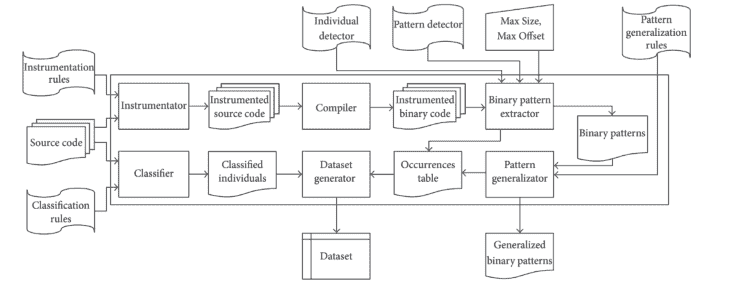

图 1：平台架构，接收高级代码。

## 插桩器 (Instrumentor)

该模块允许对输入的高级程序进行代码插桩。其目标是在输入程序中添加信息，以便更容易在编译器生成的相应二进制代码中找到模式。它也可以用于界定我们想要提取模式的生成的二进制代码部分（第3.2节），忽略程序的其余部分。请注意，一旦使用平台生成的数据集训练了机器学习模型，传递给模型的二进制文件将不包含这些插桩代码。因此，插桩模块不应用于提取以后从剥离后的二进制文件（stripped binaries）中无法识别的模式。

该模块遍历源程序的抽象语法树（AST）并评估用户提供的插桩规则。在遍历 AST 时，如果满足某个插桩规则的前置条件，则执行其相应的操作。该操作将用插桩代码修改 AST，这将成为编译器的新输入（图1中的下一个模块）。

在我们的动机性示例中，我们定义了算法 2 伪代码所示的插桩规则（在第 4.1 节中我们描述了如何实现它们）。对于程序中所有的返回语句，该规则在语句之前添加一个哑位标签（dummy label）。该标签包含函数标识符 (`id_func`)，后跟一个连续的数字（函数体可能有不同的返回语句）。该标签稍后将在二进制代码中被搜索（使用调试信息），以获知编译器为返回的高级语句生成的二进制指令。这些二进制指令将用于识别二进制模式（第3.2 节）。

# 算法 2：返回语句的插桩规则。

```
Function return_instrumentation(program)
for all stmt in program do
  if stmt is typereturn id_func((type_arg id_arg)*)stmt_body then
```

# 用于自动提取...模式的高效平台 ... 289

算法 6 显示了我们示例中使用的另一种模式检测器（Pattern Detector）。它将一个 CALL 指令之后的指令（我们称之为 call post）识别为模式。在这种情况下，与模式相关的个体（individual）不是该指令所属的函数，而是被调用的函数。同样，我们还指定了 CALL 之前的指令模式，称为 call pre，未在算法中显示。这两种模式的思路是：函数返回值的用法（call post）以及推入其模式的代码（call pre）可能对于推断函数签的的类型（返回类型和参数类型）具有价值。

## 算法 6：识别 call post 模式的模式检测器规则。

```
Function CALL_Post_pattern_detector(instruction)
  if instruction is CALL id_func then
    begin_instruction ← instruction
    for i = 0 to MaxSize + MaxOffset do
      instruction ← next(instruction)
    end
    return(id_func, (begin_instruction, instruction))
  end if
  return null
```

此时，该模块已提取了三种类型的模式：ret 模式（包括返回语句的汇编代码）、call pre 模式和 call post 模式（代表调用函数前后的代码）。每种模式都可能包含大量的连续二进制指令。然而，我们可能对大模式内部的一小部分连续指令感兴趣。因此，二进制提取模式（Binary Extraction Pattern）被设计为将找到的模式划分为子模式集合（原始模式的不同划分）。

获取子模式的算法由图 1 所示的 Max Size 和 Max Offset 参数化。该算法从长度为 1 条指令的子模式（size = 1）开始，其值逐渐增加，直到达到多达 Max Size 条的连续指令。此外，还会提取其他子模式，并在模式检测器检测到的指令与子模式之间留出偏移指令。上述的算法适用于 offset = 0。相同的算法也适用于 offset = 1 和 offset = -1（即检测到的指令之前和之后的第一条指令，它们不包含在子模式中）。offset 的绝对值一直增加到 Max Offset。

图 2 显示了 4 个示例子模式。从一个 call pre 模式中，显示了 size = 5 且 offset = 0，以及 size = 2 且 offset = -2 的子模式。从另一个 call post 模式中，图 2 显示了 size = 3 且 offset = 2，以及 size = 3 且 offset = 1 的子模式。

| mov edx, [ebp+var_8] | Size: 2 |

|---|---|

| push edx | Relative offset: -2 |

| mov eax, [ebp+var_C] | Pattern type: call pre |

| push eax | |

| call func710 | |

| add sp, 8 | |

| movzx ecx, [ebp+lb_1] | Size: 3 |

| push eax | Relative offset: +1 |

| call func1195 | Pattern type: call post |

| | |

**图 2：** 从 2 个模式中提取的 4 个子模式的示例。

模式检测器要完成的最后一个任务是将个体与其模式关联，并通过写入出现发生表（Occurrences Table）使这种关联显式化。这一过程产生与个体检测器（算法 4）发现的个体数量相等的表格行，并将它们与模式检测器函数（算法 5 和 6）为每个个体找到的每个子模式行进行关联。

## 模式生成器 (Pattern Generator)

子模式太具体了。例如，MOV eax,5 和 MOV ax,1 子模式被识别为两个不同的模式。然而，对于检测一个函数是否返回了值，它们可以被视为同一个模式，即字面量（literal）被赋值给了累加器寄存器（即 MOV <generic ax>,<literal>模式）。为此，模式生成器模块的目标是允许我们通过泛化它们来减少子模式的数量。

在二进制模式提取中，对汇编指令进行泛化（或归一化）的必要性之前的工作中已经被发现。在 [6] 中，*通配符* 匹配任意一条指令，而操作数的缺失意味着任何值。在后续工作中，他们还识别了忽略内存地址和字面值的必要性 [7]。Bao 等人提出的泛化使用正则表达式来泛化字面量甚至指令助记符 [5]。另一种更粗粒度的归一化忽略了所有汇编指令的操作数 [15]。

为了识别通用平台的泛化需求，我们分析了第 2 节描述的反汇编场景。这些泛化的某些示例所示表 1。首先，用户应该能够泛化指令操作数，包括字面量、寄存器、变量和内存地址。其次，平台应该允许泛化具有相同目的的指令。最后，用户可能需要泛化变长指令的子模式，例如函数调用者和被调用者的尾（epilogues）。

### 表 1：子模式的泛化示例

| 操作数 | 示例模式 | 泛化 |

|---|---|---|

| | mov 5,eax | mov <literal>;<generic ax> |

| | mov [exc],al | mov <exc>;<register> |

| | movsd xmm0,var_0 | movsd xmm0,<var> |

| | mov edx,eax,al | mov edx,<generic ax>;<any> |

| | call func1493 | call <address> |

| 助记符 | movzx eax,al | movss [esp+54h+var_2],xmm0 | <mov>[esp+54h+var_2],xmm0 |

| | movsd xmm0,var 3 | <mov> xmm0,<var> |

| | mov edx,[ebp+var_4] | <mov> edx,<var> |

| | movsx ecx,[ebp+var_5] | <mov> ecx,<var> |

| 指令组 | pop esp; mov esp,ebp; pop retn | <callee epilogue> |

| | mov esp,ebp; pop esp; retn | <callee epilogue> |

| | pop ebp; retn | <callee epilogue> |

| | call func123; add esp,8 | <caller epilogue> |

| | call func123 | <caller epilogue> |

### 表 2：用于预测函数返回类型的生成的示例数据集

| (返回模式) | (调用模式) | 返回类型 |

|---|---|---|

| <mov> <generic ax>; | <callee epilogue>; | target |

| <caller epilogue>; | ... | ... |

| func.730 | 0 | int |

| func.1195 | 1 | double |

| func.295 | 0 | long long |

# 用于自动提取...模式的高效平台 ... 291

## 分类器 (Classifier)

该模块旨在计算每个个体的分类器变量（即因变量）。输入是高层程序的表示；输出是每个个体与分类器变量值之间的映射。这些关联由用户用分类规则（Classification Rules）描述。

算法 8 显示了我们示例中的分类规则。我们遍历程序中的语句。对于每个函数，我们将其标识符与返回类型关联，返回类型是我们问题中的分类器变量（我们预测函数的返回类型）。

### 算法 8：将每个函数与其返回类型关联的分类规则。

```
function .classification(program)\ individuals ← {}
for all stmt in program do
  if stype is type_return id_func ((type_arg id_arg)* then
    individuals ← individuals[id_func ↦ type_return]
  end
end for
return individuals
```

## 数据集生成器 (Dataset Generator)

最后，数据集生成器从发生表（第 3.3 节）和个体分类（第 3.4 节）生成数据集：每个个体一行，每个子模式一列（泛化的或未泛化的），另一行作为分类器变量。数据集中的单元格是布尔值，表示子模式在个体中的出现情况。分类器或目标单元格可能有不同的值。表 2 显示了一个示例数据集。

## 处理二进制文件

如所述，该平台有两种工作模式。很多时候，我们没有用于生成原生代码的高层源程序，我们感兴趣在二进制文件中寻找模式。这种场景的不同示例包括作者身份、编译器和恶意软件检测。

## 算法 7：move 指令的模式泛化。

```
Function MOVE.generalization(instruction)
  if instruction.mnemonic in [mov, movzx, movsd, movsx]
    and instruction.operands[1].type = register
    and instruction.operands[1].value in [eax, ax, ah, al] then
    instruction.mnemonic ← <mov>
    instruction.operands[1].value ← <generic ax>
    instruction.operands[2].value ← <any>
  end
  return (instruction, next(instruction))
```

# 294 基于 Python 的软计算与机器学习

为了展示我们平台的第二种工作模式，我们以 Rosenblum 等人 [6] 的工作作为示例。他们从剥离符号（stripped）的二进制文件中提取模式，以检测函数入口点（FEP），现有的反汇器尚未无法完美检测到这些点 [5]。他们分析二进制文件中的连续字节，并将其表示为 3 组汇编指令。一旦提取出这些 组，他们将 FEP 识别问题建模为使用条件随机场（CRF）的结构化分类 [16]。初始的扁平模型随后通过证据丰富，即调用指令指示了调用者地址处存在 FEP。该模型比 GCC、ICC 和 MSVS 编译器更准确地检测 FEP [6]。

图 3 显示了当我们需要处理二进制文件且没有高级层程序时，架构的变化。白色元素与之前的架构相同。蓝色元素是对之前工作模式的修改。所有与处理高级层程序相关的模块都不存在。

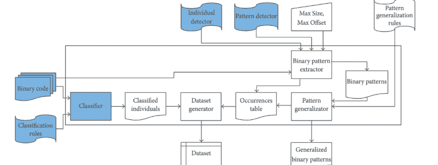

**图 3：处理二进制代码的平台架构。**

尽管二进制模式提取器（Binary Pattern Extractor）的行为相同，但检测个体和模式的规则是不同的。主要区别在于没有添加插桩代码，因为源代码不可用。取决于具体情况，调试信息也是不可用的（即使用了剥离了符号的二进制文件）。关于分类器（Classifier）模块，分类规则必须考虑纯二进制文件，而不是高级层程序表示。

# 用于...自动提取模式的高效平台 ... 295

在二进制文件 FEP 检测的示例中，该平台如何被用于生成对于创建 CRF 模型有效的数据集。输出数据集中的个体（行）是二进制文件中的指令偏移量；二进制代码中的每个 1、2 和 3 组（grams）都会创建一个特征（列），指示该模式在每个个体中的出现情况；此外添加了另一个 `call <offset>` 特征，将函数调用与 `<offset>` 个体关联。最后，如果该个体是 FEP，则分类器变量（目标）为 1，否则为 0（在调试信息可用的情况下）。

为了创建上述数据集，个体检测器（Individual Detector）创建的个体数量与二进制文件中的指令偏移量一样。模式检测器（Pattern Detector）为每个偏移量提取 1、2 和 3 组，并为每个不同的函数提取调用特征。在第二种情况下，特征并非与检测模式的偏移量关联，而是与被调用的偏移量（内存地址）关联（如算法 6 所示）。模式泛化通过 [6] 中描述的归一化过程完成。最后，分类规则使用调试信息将识别为 FEP 的个体设为 1，否则设为 0。

该平台配置（以及之前的配置）用于提取有效的数据集，以创建由 Rosenblum 等人提出的 CRF 模型，该配置可在 [17] 处下载。

# 表示非顺序模式


在二进制应用程序的分析中，通常需要检测非顺序模式，例如控制流子图和数据依赖子图。这些子图的检测可以用于许多不同的目的，例如上一小节描述的 `FEP` 检测问题。

尽管我们平台的二进制模式检测器模块（图 1 和图 3）旨在提取由连续二进制指令组成的模式，但其余模块可以用于以图的形式表示非顺序结构。这种功能由我们平台考虑顺序模式（特征）的多功能方式提供，允许定义不同的标准将这些特征关联到相应的个体上。

这种功能的一个示例体现在反编译器场景中。算法 5 显示了 `RET` 特征如何与检测到模式的函数（个体）关联（296 基于 Python 的软计算与机器学习）。在算法 5 中，这种关联由返回的元组中的第一个元素表示，该元素是 `RET` 指令所所属的函数 ID。因此，输出数据集在对应该函数（行或个体）和模式（列特征）的单元格中将设为 1。然而，`CALL` 模式以不同的方式与个体关联。算法 6 显示了该特征不是与检测到模式的函数关联，而是与被调用的函数关联。因此，使用生成的数据集训练的机器学习算法可能具有无关紧的模式（例如，函数内部必须存在 `RET` 模式，且在程序的任何部分存在一个调用相同函数的 `CALL` 模式）来识别函数返回的类型。

该功能的另一个示例是第 3.6 节描述的 `FEP` 实现问题。我们平台生成的数据集可以用于创建提出的 `CRF` 模型，该模型使用图进行结构预测和分类 [16]。这些图通过已经讨论过的特征与个体的灵活关联从数据集中获得。其实现和示例数据集可以在 [17] 中查看。

## 平台实现

我们实现了所提出的平台，并在 `http://www.reflection.uniovi.es/decompilation/download/2016/sp/` 免费提供。插桩器（`Instrumentator`）和分类器（`Classifier`）模块用 `C++` 实现，因为它们使用 `clang` [18] 处理 `C` 程序的高级表示。平台的其余部分用 `Python` 实现。对于反汇编服务，我们使用了 `IDAPython` [19]。

该实现高度并行化，在使用多核架构时提供了重要的性能优势。并行化遵循流水线方案，同时使用了数据并行和任务并行。图 4 显示了所遵循的具体方法。以下是并行化平台实现时所解决的问题。

### 用于...自动提取模式的高效平台 ... 297

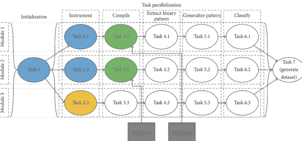

图 4：平台实现的并行化。

- (1) 数据并行化。我们将编译器中的每个模块（使用的 `obj` 文件）识别为并行工作的不同数据部分。这些 `obj` 文件可以组合成 `lib` 或 `exe` 文件以产生更大的模块。在图 4 的示例中，并行处理了三个不同的模块。
- (2) 任务识别。需要并行化的任务是平台架构（第 3 节）中识别为模块的任务。如图 4 所示，定义了一个额外的初始化任务用于初始化数据库并创建存放输入文件的临时文件夹。
- (3) 任务依赖。在识别任务后，我们使用有向无环图（`DAG`）定义了它们之间的依赖关系。这些依赖关系定义了何时任务何时可以并行运行，何时任务需要等待其他任务结束。如图 4 所示，插桩、编译、二进制模式提取、泛化和分类任务可以并行运行。对于同一份数据，必须等待前一个完成。初始化（开始时）和数据集生成（结束时）任务无法并行化。最后一个等待所有分类任务处理完所有数据。
- (4) 任务实现。任务应该映射到线程或进程。目前的实现使用 `Python` 语言来组合架构中的所有不同模块（用 `Python` 或 `C++` 实现）。由于大多数 `Python` 的实现使用全局解释器锁（`GIL`）来同步线程的执行 [20]，我们实现了

## 基于 Python 的软计算与机器学习

将任务视为进程，以便通过多核架构获得更好的性能提升 [21]。

- (5) 并发工作线程。为了对平台的并行化程度进行参数化，我们配置了其实现以不同数量的工作进程运行（第 4.2 节）。调度器分析任务 `DAG`（有向无环图），告诉每个工作线程下一个执行的任务。如图 4 所示，有两个工作线程并行运行。任务 1、2.1 和 2.2 已经执行；任务 3.1 和 3.2 分别由工作线程 1 和 2 运行；任务 2.3 是一个工作线程空闲后将执行的任务。
- (6) 任务间的通信。由于我们将任务实现为进程，它们之间的通信开销是很大的。然而，图 4 所示的任务间的依赖关系表明，一个任务的输出被作为下一个任务的输入。因此，这种数据通信是通过数据库实现的，并对数据库进行了适当配置以获得预期的运行性能。
- (7) 任务同步。工作线程应该在结束执行一个任务时指示调度器，调度器应该告诉它们下一个执行哪个任务。为了同步这一过程，我们使用了 `multiprocessing` 模块中的 `Queue` 对象。
- (8) 工具参数化。我们配置了 `IDA` 反汇器器以允许并发处理同一个输入文件。编译任务由一个 `Python` 类表示，可以参数化以使用不同的编译器、包管理器、编译器选项和自动化软件。使用的外部工具向标准输出写入信息（例如 `C` 编译器）。我们捕获这些消息并将其发送到并发日志器，添加进程的额外信息。

## 方法论

我们平台的运行性能取决于以下变量：(i) 编译（或程序）的独立模块数量。我们可以并行处理不同的程序，或同一程序的程序的不同模块，以创建一个数据集。(ii) 工作线程的数量：如所述，平台可以同时运行不同的任务。一个任务由一个工作线程运行。根据实际进程的数量，工作线程的数量对运行性能有显著的益处。(iii) 核心数的数量：我们在不同的多核计算机上运行我们的平台。(iv) 每个程序（模块）的大小，取决于其可能包含的个体数量。(v) 子模式提取：如第 3.2 节所述，会从发现的模式中自动提取不同的子模式。`Max Size` 和 `Max Offset` 参数对执行时间有影响。(vi) 模式的数量：所提平台通过用户指定的 `Pattern Detectors` 识别模式。我们根据定义的模式数量分析运行性能。

我们评估了这些变量对平台运行性能的影响，以及它们与并行化程度的关系。为了评估这一点，我们固定除一个以外的所有变量，并针对自由变量的不同值测量运行性能 [22]。此过程对所有变量重复进行。

我们通过预测二进制程序中返回类型的真实示例来评估该平台，使用它们的 `C` 源代码（我们系统的第一个工作方案，如图 1 所示）。我们提取 `return`、`call pre` 和 `call post` 模式，将它们划分为不同的子模式，并对发现的子模式进行泛化处理。

实验使用的程序是由一个 `C` 程序生成器合成生成的。这对于生成丰富的程序库非常有帮助。此外，我们能够生成同一个程序的不同配置，更改每个模块的个体（在我们的示例中为函数）数量。通过这种方式，我们不会引入测量不同程序带来的偏差。

为了更改核心数，所有测试都是在一个具有 4 个处理器和 8 GB 运行内存的 `Hyper-V` 虚拟机上进行的，该虚拟机运行更新后的 64 位版本 `Windows 8.1`。宿主机计算机为 3.60 GHz `Intel Core i7-4790`，配备 16 GB 运行内存，运行更新后的 64 位版本 `Windows 10`。测试在系统重启后执行，移除了额外的负载，并等待操作系统加载 [23]。

### 增加模块数量

在第一次实验中，我们将程序中的模块数从 1 增加到 8，同时固定核心数和工作线程数为 4。对于本次实验及后续实验，`Max Size` 的值为 4，`Max Offset` 为 0。我们还提取了 `return`、`call pre` 和 `call post` 模式。

要分析的程序有 10,000 个函数（个体），因此我们有 1 个包含 10,000 个函数的模块、2 个包含 5,000 个函数的模块，依此类推，直到 8 个每个包含 1,250 个函数的模块。因此，所有配置都具有 10,000 个函数的相同数据集，处理的程序也是相同的。

图 5 显示了并行化的益处。当模块数量增加到 4 个（核心数和工作线程数）时，处理程序的执行时间下降。在此时，平台处理程序的速度比具有一个模块的相同程序（即串行实现）快 3.33 倍。根据阿姆达尔法则，该配置的最大理论性能提升为 4 倍 [24]。

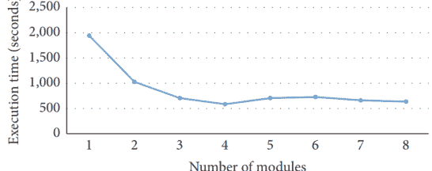

**图 5**：模块数量增加时的执行时间。

对于超过 4 个模块，没有显著益处，因为该配置下只有 4 个核心。此外，8 个程序并没有惩罚，表明程序数量高于核心数不会产生负面影响。

### 增加工作线程数

在这种情况下，我们将工作线程数从 1 增加到 8，固定核心数和模块数为 4。假设我们有一个 4 核计算机（见第 4.2 节），我们将工作线程数等于模块数。目标是在给定的计算机上获得更高的并行化水平。每个模块有 2,500 个函数。图 6 显示了随着工作线程的增加，执行时间如何减少。在 4 个工作线程时，平台比单线程执行快 3.5 倍。对于 5 个或更多工作线程，它们在等待任务完成。

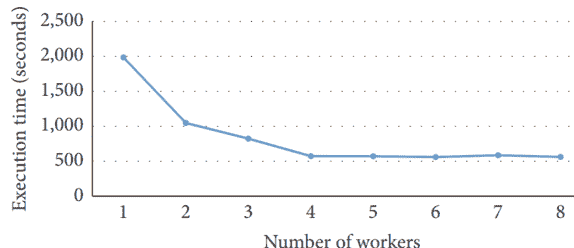

**图 6**：工作线程增加时的执行时间。

### 增加核心数

在这种情况下，我们更改虚拟机的核心数。固定工作线程和模块数为 4，我们将核心数从 1 增加到 4。由于我们使用了 4 核计算机，5 个或更多核心会导致性能的略微下降。每个模块有 2,500 个函数。

我们从图 7 中看到，4 核的比单核心运行快 3.7 倍。4 核的性能益处接近理论最大值 [24]。

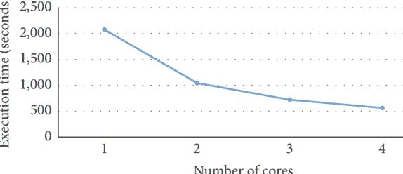

**图 7**：核心数增加时的执行时间。

### 同时增加模块和工作线程

此实验同时增加两个变量。旨在代表一个典型的用例。假设我们有一台多核计算机（在我们的案例中为 4 核），我们将工作线程数设置为模块数。目标是在指定的计算机上获得更高的并行化水平。因此，我们将模块和工作线程数从 1 增加到 16。函数数量始终为 10,000，均匀分布在不同的模块中。

图 8 显示了执行时间在 4 个模块和工作线程时减少（3.5 倍益处）。从 4 到 7，值之间的差异小于 1%（基本相同）。对于 8 及以后，由于上下文切换的成本，图中显示执行时间略有增加。因此，实验结果表明工作线程和模块的最佳值为核心数的两倍。

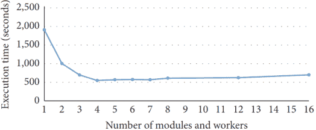

**图 8**：模块和工作线程增加时的执行时间。

### 增加函数数量

为了观察平台如何随程序增大增大，此实验将程序中的函数数量从 1,000 增加到 15,000。我们选择这个最大值是因为它是 `IDA` 反汇器支持的最大程序。核心数和工作线程均为 4。

图 9 显示了运行性能随函数数量（即程序大小）的线性增加。此外，它支持对具有 15,000 个函数的大型模块进行分析。

# 用于自动提取...中模式的高效平台 ... 303

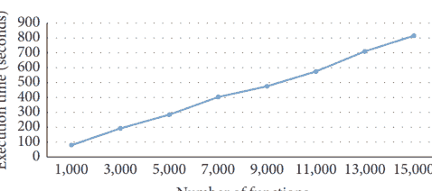

**图 9：函数数量增加时的执行时间。**

图 10 展示了相同数据的另一种视角。该图显示了每个函数的执行时间性能，随着程序中函数数量的增加。对于小型程序，存在初始化开销，导致处理若干个函数时的执行时间较高。随着程序规模的增长，这种初始化成本变得可以忽略不计。从 5,000 个函数开始，每个函数的执行时间趋敛（标准差低于 3.4%），表明该平台在处理大型输入程序时性能并没有下降。

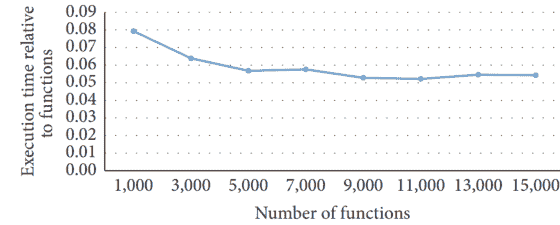

**图 10：每个函数的执行时间，随函数数量增加。**

### 增加 Max Offset 和 Max Size

我们修改了用于获取二进制子模式的 `Max Offset` 和 `Max Size` 参数值。我们使用了 4 个模块，每个模块实现 750 个函数。`Max Offset` 从 0 增加到 8，同时将 `Max Size` 固定为 4。我们采用相同的方法分析 `Max Size` 对运行时性能的影响，将其值从 1 增加到 8，并将 `Max Offset` 固定为 4。

图 11 显示了这两个变量。我们可以看到 `Max Offset` 对执行时间具有线性影响。图 11 所示的回归线斜率位 51，代表 `Max Offset` 每增加一个单位所付的成本（单位为秒）。对于 `Max Size`，得到的最佳回归结果是二次的（图 11）。用户应该注意这一点，这意味着选择高值的 `Max Size` 可能会导致执行时间更大幅的增加。

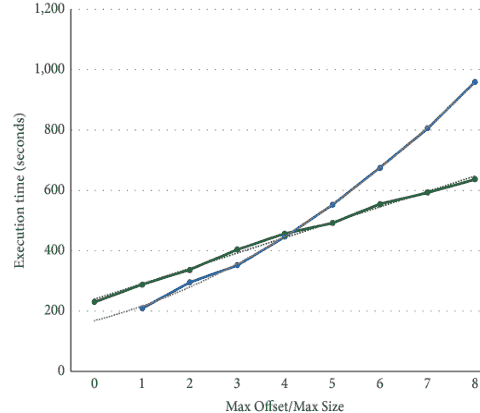

- `Max Offset`: `51.062(Max Offset) + 188.55`
- `Max Size`: `7.19(Max Size)^2 + 26.63(Max Size) + 135.25`

**图 11**：随 `Max Offset` 和 `Max Size` 参数增加的执行时间。

### 增加模式类型

最后一个要测量的变量是待识别模式的数量。模式由用户提供的 `Pattern Detection`（模式检测）函数指定。在我们的反汇编示例中，我们识别了 3 种模式：`return`（返回）、`call pre`（调用前）和 `call post`（调用后）。我们测量了这3 种模式的7 种不同组合的运行时性能。模块、线程、核心、`Max Size` 和 `Max Offset` 固定为 4，每个模块包含 750 个函数（总共 3,000 个）。

图 12 显示了结果。前 3 柱形显示了单独提取每个模式所消耗的执行时间。接下来的 3 柱形显示了并行两个模式的执行时间，与单独提取它们的成本相比。我们可以看到平台通过并行化获得了平均1.65倍的收益。当平台同时提取 3 种模式时，这种收益增加到 2.1 倍。

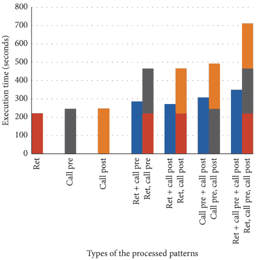

图 12：提取不同类型模式的执行时间。

### 真实场景下的执行时间

我们还测量了推断函数返回类型的这一特定场景的执行时间。如所述，这是反汇编器的一个现有问题。本节的目的不是介绍如何用机器学习解决这个问题，而是为了测量提取二进制模式和构建模型所需的执行时间。

为了预测函数返回的类型，我们在 `ret` 指令之前以及函数调用后的之后提取二进制代码模式。我们发现，为该问题构建准确模型所需的函数数量非常多，因此需要巨大的程序数据库。相反，我们实现了一个代码生成工具，考虑到语言语法及其类型系统编写合成 `C` 函数。通过这种方式，我们可以为语言中的所有不同类型（`C`内置类型加上复合类型的构造函数（结构体、联合体、指针和数组））生成任意数量的随机函数（及调用）。然后，将这些函数传递给我们的平台以生成输出数据集。随后，使用 `Weka` 构建 `J48` 分类器。

如所述，我们可以生成任意数量的 `C` 函数传递给我们的平台。因此，我们必须确定构建准确模型所需的函数数量。为此，我们使用了以下方法：为每种 `C` 类型创建 1000 个函数；用我们的平台在这些函数中提取二进制模式；并使用 `Weka` 和生成数据集通过 10 折分层交叉验证计算准确率。这些步骤在循环中重复，每种类型增加 1000 个函数。当最后 5 个准确值的变异系数低于 2% 时停止，这代表函数（个体）的增加并没有显著提高准确率。最后，我们构建模型。

按照上述方法，我们创建了一个包含 160,000 个函数的数据集。我们评估了其性能，相对于最大理论值获得了 3.5 倍的性能提升。

## 相关工作

存在许多旨在提取汇编模式的工作。`WEIGHT` 提供了另一种寻找函数点的方法。它们应用机器学习来识别模式，因此可以使用不同的编译器。通过分析训练二进制文件，提取过程从字节序列生成前缀树。前缀树表示可能的函数序列。然后，它们分配一个权重，代表从根到节点的路径是函数的概率。最后，使用加权前缀树对输入二进制文件进行分类。

除了汇编提取外，在其他情况下也需要处理二进制文件的其他部分。一个例子是检测加壳执行文件。为此，不仅需要识别汇编模式，还需要识别二进制文件中存在的其他类型信息，如头部模式、熵值和文件段的特征。`Ugarte-Pedreiro` 等提出了一种基于自定义学习的过程来解决这个问题，通过结构特征和启发式方法检测加壳执行文件。

关于反汇编，`Cifuentes` 等人识别了识别高层控制结构方面的现有局限性。他们定义了一种恢复跳转表及其目标地址的技术，并将其整合到 `DCC` 反汇编器中。`Phoenix` 反汇编器使用结构算法来检测控制流结构，能够比 `Hex-Rays` 反更多的结构。关于高层类型的反汇编，`Mycroft` 提出了一种基于约束的算法从二进制代码推断类型。另一种恢复方法是基于值传播的 `VSA` 算法。`Laika` 是一个使用贝叶斯无监督学习检测高层数据结构的系统。

## 结论


我们提出了一种用于二进制文件中自动提取模式的平台，能够分析二进制执行文件。该平台具有高度参数化，适用于不同的场景。该平台的实现已经过并行处理，以提高其在多核架构上的运行时性能。遵循了数据并行和任务并行方案。我们评估了其性能，与顺序执行相比获得了性能提升。

308 基于 Python 的软计算与机器学习

共 4 个因素。所展示的评估还记录了如何使用平台的不同参数以获得最佳性能。

我们目前正在使用所提平台来提取模式，这些模式随后被用于改进现有反编译器推断的信息。我们生成了高级信息的模式，并使用不同的机器学习算法来训练分类器。我们目前关注函数的返回类型，但我们希望将其应用于参数以及局部、全局变量。

我们计划使用聚类算法对从开源代码库中获取的大量程序生成的数据集进行处理。目标是根据程序内部发现的模式对应用程序（或部分）进行分类。获得的类别可能有助于识别执行常见输入/输出、网络以及计算密集型或多线程操作的代码。

该平台的实现、其源代码、本文中使用的 3 种不同配置（返回类型、函数或过程识别，以及二进制文件中的 FEPs 提取）以及评估中使用的所有示例均从 `http://www.reflection.uniovi.es/decompilation/download/2016/sp/` 下载。

## 致谢

本工作得到了欧盟（通过欧洲区域发展基金 ERDF）和阿斯图里利亚自治区（通过其科学、技术与创新计划，拨款 `GRUPIN14-100`）的资助。作者还收到了桑坦德银行通过对其国际卓越校园的支持提供的资金。

# 一用于自动提取...模式的高效平台

## 参考文献

- 1. 美国国防高级研究计划局，MUSE 愿景是通过挖掘“大代码”来提高软件的可靠性和构建，2014, `http://www.darpa.mil/news-events/2014-03-06a`.
- 2. F. Orton, J. Escalada, and D. Rodriguez-Prieto，“大代码：改进软件构建的新机会，”Journal of Software, 11, no. pp. 1083–1008, 2016.
- 3. F. Yamaguchi, M. Rottmann, and K. Rieck，“使用抽象语法树进行泛化漏洞外推，”收于 Proceedings of the 28th Annual Computer Security Applications Conference (ACSAC ‘12), pp. 359–368, ACM, Los Angeles, Calif, USA, December 2012.
- 4. E. Alpaydin, Introduction to Machine Learning, The MIT Press, 2nd edition, 2010.
- 5. T. Bao, J. Market, M. Woo, R. Turner, and D. Brumley，“Byteway:学习识别二进制代码中的函数，”收于 Proceedings of the 23rd USENIX Conference on Security Symposium (SEC ‘14), pp. 845–860, USENIX Association, San Diego, Calif, USA, August 2014.
- 6. N. Rosenblum, X. Zhu, B. Miller, and K. Hunt，“学习分析二进制，”收于 Proceedings of the 23rd National Conference on Artificial Intelligence—Volume 2 (AAAI ‘08), pp. 798–804, AAAI Press, 2008.
- 7. N. E. Rosenblum, B. P. Miller, and X. Xu，“从程序二进制文件中提取编译器溯源，”收于 Proceedings of the 9th ACM SIGPLAN-SIGSOFT Workshop on Program Analysis for Software Tools and Engineering (PASTE ‘10), pp. 21–28, ACM, Toronto, Canada, June 2010.
- 8. N. Rosenblum, B. P. Miller, and X. Xu，“恢复二进制代码的立足点，”收于 Proceedings of the 20th International Symposium on Software Testing and Analysis (ISSTA ‘11), pp. 100–110, ACM, Ontario, Canada, July 2011.
- 9. I. Santos, Y. K. Penya, J. Devesa, and P. G. Bringas，“基于 N-gram 的恶意软件检测文件签名，”收于 Proceedings of the 11th International Conference on Enterprise Information Systems (ICEIS ‘09), pp. 317–320, AIDSS, 2009.
- 10. C. Liangboonprong and O. Sornil，“基于 N-gram 序列模式特征的恶意软件家族分类，”收于 Proceedings of the 8th IEEE Conference on Industrial Electronics and Applications (ICIEA ‘13, pp. 777–782, June 2013.
310 基于 Python 的软计算与机器学习
- 11. V. Raychev, A. Vechev, and A. Krause，“从‘大代码’中预测程序属性，”收于 Proceedings of the 42nd Annual ACM SIGPLANSIGym Symposium on Principles of Programming Languages (POPL’15), pp. 111–124, 2015.
- 12. K. Troshina, A. Chernov, and Y. Derenevet，“C 分解：可能吗？”收于 Proceedings of the International Workshop on Program Understanding (PSI ‘09), pp. 18–27, Altai Mountains, Russia, 2009.
- 13. E. J. Schwartz, J. Lee, M. Woo, and D. Brum，“原生 x86 分解，”收于 Proceedings of the 22nd USENIX Security Symposium, pp. 353–368, Washington, DC, 2013.
- 14. A. Fokin, E. Chernov, A. Derenevet, and K. Troshina，“二进制代码中的 foothold 恢复，”收于 Proceedings of the 20th International Symposium on Software Testing and Analysis (ISSTA ‘11), pp. 100–110, ACM, Ontario, Canada, July 2011.
- 15. J. Fan, Y. Ye, and L. Chen，“基于 N-gram 的恶意软件检测，”Expert Systems with Applications, vol. 52, 2016.
- 16. I. Santos, X. Ugarte-Pedero, B. Sanz, C. Laorden, and P. G. Bringas，“基于机器学习的序列异常检测，”收于 Proceedings of the 16th International Conference on Machine Learning (ICML), pp. 282–289, Morgan Kaufmann, 2011.
- 17. J. Redondo, F. Fortin, 反射语言的 C 模式模式提取，`http://reflection.uniovi.es/decompilation/download/2016/sp/`.
- 18. LLVM, clang: C 语言的前端，`http://clang.org`.
- 19. D. Beazley, Python GIL，`https://github.com/idapy`.
- 20. D. Phillips, Python 3 面向对象编程，Packt Publishing, Birmingham, UK, 2015.
- 21. J. M. Redondo, F. Fortin, 动态语言的反射优化，Journal of Software Engineering, vol. 18, no. 6, pp. 759–783, 2011.
- 22. F. Orton, J. Escalada, and D. Rodriguez-Prieto，“大代码：改进软件构建的新机会，”Journal of Software, 11, no. pp. 1083–1008, 2016.
- 23. J. Fan, Y. Ye, and L. Chen，“恶意软件的集体分类，”Expert Systems with Applications, vol. 52, 2016.
- 24. G. M. Amdahl，“单处理器方法实现的大规模计算能力，”收于 Proceedings of the Spring Joint Computer Conference, pp. 483–485, Atlantic City, NJ, April 1967.
- 25. N. Rosenblum, X. Zhu, and B. P. Miller，“谁写了这些代码？识别二进制文件的作者，”收于 ESORICS 2011: 16th European Symposium on Research in Computer Security, Leuven, Belgium, September 12–14, 2011. Proceedings, vol. 6879 of Lecture Notes in Computer Science, pp. 172–189, Springer, Berlin, Germany, 2011.
- 26. E. R. Jacobson, N. Rosenblum, and B. P. Miller，“剥离二进制文件中的库标记，”收于 Proceedings of the 10th ACM SIGPLAN-SIGSOFT Workshop on Program Analysis for Software Tools (PASTE ’11), pp. 1–8, ACM, Szeged, Hungary, September 2011.
- 27. I. Santos, X. Ugarte-Pedero, B. Sanz, C. Laorden, and P. G. Bringas，“可执行文件的集体分类，”收于 Proceedings of the 8th Annual Collaboration, Electronic Messaging, Anti-Abuse and Spam Conference (CEAS ‘11), pp. 23–30, Perth, Australia, September 2011.
- 28. X. Ugarte-Pedero, I. Santos, and P. G. Bringas，“基于结构特征的可执行文件异常检测，”收于 Computational Intelligence in Security for Information Systems: 4th International Conference, CISIS 2011, Held at IWANN 2011, Torremolinos–Málaga, Spain, June 8–10, 2011. Proceedings, vol. 6694 of Lecture Notes in Computer Science, pp. 230–237, Springer, Berlin, Germany, 2011.
- 29. C. Cifuentes, D. Simon, and A. Fraboulet，“汇编到高级语言的翻译，”收于 Proceedings of the IEEE International Conference on Software Maintenance (ICSM) ’98, pp. 228–237, IEEE, Btesda, Md, USA, November 1998.
- 311 用于自动提取...模式的高效平台 311
- 24. G. M. Amdahl，“单处理器方法实现的大规模计算能力，”收于 Proceedings of the Spring Joint Computer Conference, pp. 483–485, Atlantic City, NJ, April 1967.
- 30. C. Cifuentes and M. Van Emmerik, “Recovery of jump table case statements from binary code,” Science of Computer Programming, vol. 40, no. 2-3, pp. 171–188, 2001.
- 31. A. Mycroft, “Type-based decompilation,” in Proceedings of the European Symposium on Programming (ESOP ‘99), pp. 208–223, 1999.
- 32. G. Balakrishnan and T. Reps, “Divine: discovering variables in executables,” in Verification, Model Checking, and Abstract Interpretation: 8th International Conference, VMCAI 2007, Nice, France, January 14–16, 2007. Proceedings, vol. 4349 of Lecture Notes in Computer Science, pp. 1–28, Springer, Berlin, Germany, 2007.
- 33. A. Cozzie, F. Stratton, H. Xue, and S. T. King, “Digging for data structures,” in Proceedings of the 8th Conference on Operating Systems Design and Implementation (OSDI ‘08), pp. 255–266, San Diego, Calif, USA, December 2008.

# 第 14 章

## 用于遗传数据分析应用程序中的多语言编程

Robert M. Nowak

华沙科技理工大学电子系统学院，Nowowiejska 15/19, 00-665 Warsaw, Poland

## 摘要

用于遗传数据分析的应用程序需要通过复杂的算法处理海量数据。这些解决方案需要高性能、灵活性以及可以通过浏览器访问的用户界面，而这些可以通过使用多种编程语言来实现。在这项研究中，我开发了一个免费提供的框架，用于构建分析遗传数据的数据的软件，该框架使用了 C++、Python、JavaScript 以及多个库。该系统被用于构建多个遗传数据处理应用程序，并缩短了开发的时间和成本。

**引用：** Robert M. Nowak, “Polyglot Programming in Applications Used for Genetic Data Analysis,” BioMed Research International, vol. 2014, Article ID 253013, 7 pages, 2014. doi:10.1155/2014/253013.

**版权：** © 2014 Robert M. Nowak. 本文根据知识共享署名许可协议发布的开放文章，该协议允许在任何媒介中进行不受限制的使用、分发和复制，只要正确引用了原始作品。

## 背景

用于遗传数据分析的计算机程序数量正在显著增加，但由于使用适当方法进行结果分析的重要性以及遗传数据量的指数级增长，这些程序仍然需要大量的改进。

遗传数据通常由一组字符串表示 [1]，其中每个字符串都是来自通用字母表的符号序列。这种字符串表示法被称为初级结构，它反映了存储遗传信息的分子（DNA 和 RNA）是核苷酸的生物聚合物，而蛋白质是多肽链。为了理解核苷酸或氨基酸之间的相互作用，需要考虑二级、三级和四级结构，但它们在计算机程序中的频率较低。二级结构包括 DNA 中核苷酸之间的氢键以及蛋白质中肽基团之间的 RNA 键，其中分子用图表示。三级结构指的是原子在三维空间中的位置，四级结构代表了分子更高层次的组织。基于序列或子序列之间的连接对分子表示进行了扩展，这表示了不同角度的相似性。此外，这些数据还辅以人类可读的描述，有助于理解序列的生物学意义、功能和/或结构。

遗传数据分析的可能候选解决方案众多，这意味着所使用的算法必须仔细选择 [2]。穷尽搜索算法必须由基于建模对象生物特性的启发算法支持。动态规划算法在该领域具有特殊性，它们允许我们在多项式时间内找到生物序列的最优对齐（即通过插入空隙来排列序列以识别相似区域 [1]），尽管搜索空间呈指数级增长。动态规划被用于搜索相似性（局部或全局）、生成多序列表示（图谱）以及使用马尔可夫模型检查序列。此外，回溯算法用于搜索基序（即识别遗传序列中的有意义模式），贪心算法用于检测基因组重排并按反转排序，分治算法用于执行空间高效的序列对齐，以及图算法用于 DNA 组装。

## 用于遗传数据分析应用程序中的多语言编程 315


应用于遗传数据的计算机程序的一个特点是，必须使用复杂算法分析大量数据，这意味着高性能至关重要。不同的用户和系统需求意味着软件的灵活性也很重要。最后，用户更倾向于可以使用浏览器访问的图形界面以及能够自动更新的应用程序。

科学家正日益参与软件开发中 [3]。他们应该使用软件工程实践和工具来避免常见错误并加速开发任务 [4]。带有开发决策说明的运行应用程序架构有助于开发新的计算机程序。生物和医学术语经过了简化，以邀请开发者讨论所提出的解决方案。

在这项研究中，我描述了 `bioweb` 框架，包括应用程序架构、编程语言、库和工具，用于开发处理遗传数据的应用程序。我提出了一个使用 `C++`、`Python` 和 `JavaScript` 的多语言平台。使用适当且经过测试的架构、库和工具可以降低系统开发的失败风险，同时减少成本和时间。使用适当的系统还有助于快速原型设计，这允许我们通过从终端用户（生物学家和医生）处获取所需信息来验证概念。

# 遗传数据分析应用中的多语言编程

## 结果

### 部署模型

选择了一种三层软件架构，其中表示层、数据处理层和数据存储层保持分离。多层模型使得计算机程序具有灵活性和重用性，因为应用程序有不同的职责。因此，将模型划分为通过定义良好的接口通信的层是有益的。层有助于分离不同的子系统，使代码更容易维护、整洁且结构良好。

对于三层架构考虑了四种可能的部署模型：桌面、数据库服务器、客户端和 Web 应用程序，如图 1 所示。桌面架构（图 1(a)）被拒绝，因为该框架的设计是为了支持多用户应用程序。由于缺乏供多个用户访问的中央数据服务器，协作功能在该架构中很难实现。

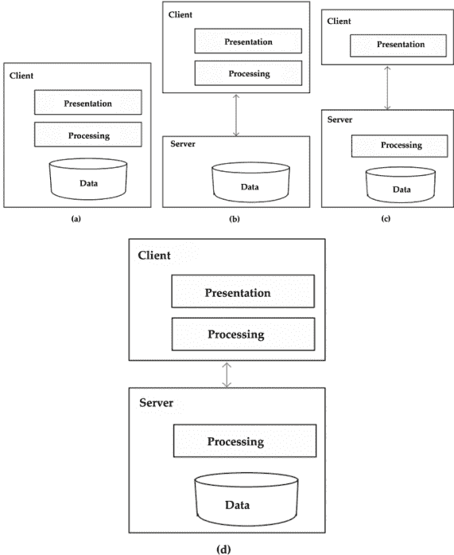

图 1：三层应用程序部署模型：桌面应用程序 (a)、数据库服务器 (b)、瘦客户端 (c) 和 Web 应用程序 (d)。该解决方案支持使用 Web 应用程序架构创建应用程序。共享数据库并在部署在客户端机器的数据处理模块的应用程序架构（图 1(b)）被拒绝，因为对客户端计算机性能有要求。另一个问题是当发生更改和添加时，需要在客户端侧更新软件。

……的构建，这非常耗时且需要对广泛平台的支持，因此开发成本很高。

将计算模块部署在服务器机器上，允许不同平台上的客户端执行这些模块，从而降低了开发成本。服务器的计算能力至关重要，因为它决定了计算时间，这意味着可以使用配置较低的客户端机器。优的解决方案是瘦客户端架构（如图1(c)所示）和Web应用程序架构（如图1(d)所示）。

如图1(c)和图1(d)所示，将计算模块部署在服务器机器上，允许在客户端端使用许多平台，从而降低了开发成本。重要的是，利用了服务器的计算能力，因此对于配置较低的客户端机器，计算时间相对较短。如果问题规模扩大或客户端数量增加，这些解决方案简化了扩展性问题，因为只需要准备服务器。

与瘦客户端架构的应用相比，Web应用程序具有优势，因为客户端包含了部分数据处理层，可以处理输出格式化、图表生成和用户输入验证等活动。基于客户端的处理减少了客户端与服务器之间的流量量和频率，减轻了服务器的负载，同时对用户的响应更快。该解决方案在客户端使用Web浏览器插件（如Flash）或HTML5/JavaScript程序。客户端模块在初始化期间下载，这有助于避免软件更新的问题。

### 架构与编程语言

所使用的软件使用的框架以及框架本身是使用`C++`、`Python`和`JavaScript`结合`HTML5`创建的。在单个项目中使用多种语言是常见现象，它是使用`PHP`、`NET`或`Java`的替代方案。所用语言组合有助于实现高性能、多功能性、可定制模块以及Web浏览器界面的生成。使用这些编程语言为基于`bioweb`的典型应用制作的模块如图2所示。

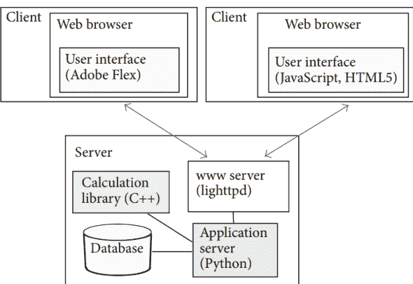

图2：使用各种编程语言为所提框架的典型应用制作的模块。

算法用`C++`实现。源代码被翻译（编译）成机器语言，这使得算法执行更高效，因为代码直接由处理器执行。该语言具有其他翻译成二进制代码的语言（`C`和`Fortran`）所缺乏的高级抽象。`C++`通过提供虚函数、多基继承以及异常支持面向对象编程，并方便了函数式和遗传编程，包括模板和lambda函数。标准`C++`库很紧凑但经过了良好测试且高效。它包含了对输入输出支持、字符串和字符串操作（如正则表达式），以及集合集合（如使用树或哈希表的`vector`、`list`和关联数组）。应该提到的是，`C++11`标准（ISO/IEC 14882:2011）引入了并发支持机制，因此可以利用具有多个处理器和/或多个核心的现代计算机的全功能。如果使用不支持`C++11`的旧版`C++`编译器，可能需要使用`Boost` [5]库：`Boost.Thread`用于创建可移植的多线程应用程序，`Boost.Regex`用于正则表达式，以及`Boost.Chrono`用于时间工具。此外，现代图形处理器单元（GPU）提供的向量计算在`C++`中可用，并应用了`OpenCL` [6]标准。

所提解决方案中的服务器应用程序使用了`Python`语言，主要因为与`C++`相比，这种开发更快。在计算过程中不构成瓶颈的模块应该用`Python`实现。`Python`是一种脚本语言，因此体积很小且语法简单、规则。该语言是动态类型检查的，使用统一的数据模型，并提供引用计数管理，因此没有内存泄漏问题。`Python`软件仓库（PIP）`https://pypi.python.org/pypi`包含超过30,000个包，可以使用许多现成的解决方案，特别是用于交换数据的包以及支持所用Web应用程序的包。需要注意的是，`Biopython`库 [7]提供了一组用`Python`编写的生物计算工具。

在`biow`中，`Boost.Python` [5]库实现了`C++`模块与`Python`模块之间的互操作性。其他解决方案，如直接从`Python`使用API、使用简化封装器和接口生成器（`SWIG`）生成代码、`C++`、`Pyrex`和`cyton`被认为用处较小，因为界面不够方便，且缺乏对遗传数据软件开发中所用技术的支持。`Boost.Python`使用`Python` API和元编程技术，允许将`C++`类、函数和对象暴露给`Python`，反之亦然，支持在`C++`代码内部使用`Python`。`BoostPython`允许通过简单的语法暴露元素并注册转换，且易于学习。

编译器和解释器的使用使得开发的软件更具活性。应用程序定制在任何情况下都要求使用解释器，更改设置不应要求重新构建软件。使用`Python`存储用户设置简化了应用的定制，因为设置不需要是名称和值的列表，并且可以使用`Python`控制指令。

客户端应用程序通过`HTTP`协议发送到标准端口，并由Web服务器通过进程间通信机制（例如`sockets`和命名管道）重传。

重传使用了`mod_fastcgi`和`socket`机制。考虑了三个开源`Python`库：来自PIP的`Flup`、`Web2py` `http://web2py.com`以及来自`http://www.djangoproject.com`的`Django`。这些库支持Web服务器网关接口（`WSGI`）。

`Flup`是一个简单的`WSGI`服务器，但其库很小（256KB），因此当接收到客户端的`http`请求时，其功能在`Python`函数层面上是有限的。更高级的库是`Web2Py`（9MB）和`Django`（22MB），其功能包含了参数转换、身份验证、授权以及使用对象映射的数据库支持。`Flup`、`Web2py`和`Django`都经过了本研究的测试，因为`Web2py`和`Django`的特征相似。然而，推荐`Django`因为它所有功能都是显式编写的。`Django`当前版本内部使用`Flup`配合`Lighttpd`；这种配置在所有流行的现代操作系统（Linux、Windows等）上都能正常工作。

`Bioweb`为客户端模块提供了两种竞争性解决方案，其中一种是基于`JavaScript`的`HTML5`，另一种是使用`Apache Flex`和`Adobe Flash`插件。`JavaScript HTML5`应用程序使用现代浏览器可用的`Ajax`技术，主要是`XMLHttpRequest`对象，因此用`JavaScript`开发的客户端应用程序可以在后台发送和检索数据。数据使用`JavaScript`对象格式（`JSON`）交换，`Python`标准库模块支持`JSON`编码器和解码器。`HTML5`标准包含了可缩矢量图形，改进了用户界面。`JavaScript`由Web浏览器解释并符合国际标准ISO/IEC 16262:2011。当前版本使用视图模型（MVVM）客户端`JavaScript`框架`AngularJS` [8]。

`Apache Flex`是一个免费提供的软件开发工具，支持构建使用`Adobe Flash`插件的应用程序。该插件在大多数浏览器上均可用，允许用户查看多媒体、矢量图形和动画。`Apache Flex`应用程序从服务器加载并在客户端执行。与服务器的通信使用动作消息格式

用于遗传数据分析的应用中的多语言编程 321

(`AMF`)，`Python`通过 `pyAMF` 库支持它。目前，该技术正被 `HTML5` 取代，网络浏览器直接支持 `HTML5`，因此建议在新的应用程序中使用 `HTML5` 和 `JavaScript`。

### 并行服务请求

该框架旨在创建同时为多个用户提供服务的软件。用户通过互联网独立地与服务器通信，且框架包含一个具有活动对象模式 [9] 实现的组件，以增强并发性并充分利用服务器资源。该组件是 `bioweb` 的一部分，如图 3 所示。

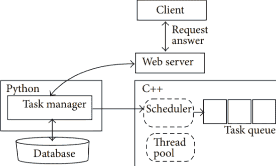

图 3：框架提供的活动对象实现。客户端请求被自动转换为命令，并由单独线程执行。

计算任务的执行与任务调用解耦，以增强并发性并简化多线程的使用，如图 4 所示。来自客户端应用程序的计算请求被转换为 `C++` 对象。这些对象是命令（使用了命令设计模式），包含了特定的参数以及算法和同步机制。命令存储在任务队列中，并由线程池中的单独执行执行。命令处理程序可以通过 `Python` 访问，因此用户可以检查当前的命令状态，即队列中等待执行的任务、已执行的任务和已完成的任务。该组件使用观察者（来自观察者设计模式）来支持命令进度通知。活动对象模块可以独立于 `bioweb` 使用；它作为 `C++` 库单独提供，其源文件可以在 `http://mt4cpp.sourceforge.net` 获得。

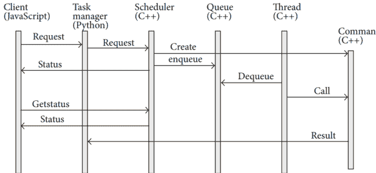

图 4：活动对象参与者之间的协作。客户端请求被转换为由 `Python` 侧的任务管理器和 `C++` 侧的调度器管理的命令。命令存储在队列中，并在有空闲线程可用时执行。客户端可以请求当前命令状态和命令进度。

### 测试

软件测试是开发过程中不可或缺的一部分。因此，在提出的框架中指定了支持这一过程的测试技术和库。考虑了三种类型的测试：单元测试、集成测试和系统测试。单元测试独立检查单个函数、过程和类。集成测试基于它们是在不同的编程语言中创建的考虑，检查模块之间的通信。系统测试在不了解软件内部结构的情况下，检查计算机程序的整体功能。

单元测试对 `C++` 模块使用 `Boost.Test` [5]，对 `Python` 代码使用标准的 `Python` 单元包，对用 `JavaScript` 编写的模块使用 `QUnit` [`unitjs.com`]。`C++` 单元测试在 `g++` 和 `msvc` 两种环境中进行。集成测试使用与单元测试相同的工具和库实现，但通过 `Boost.Python` 库导出到 `Python` 的 `C++` 模块的功能在 `Python` 中使用 `unitittest` 进行测试。

系统测试使用 `Python` 语言和 `Splinter` `http://splinter.iostream.info` 库。该工具自动执行浏览器操作，如访问 URL、导航、验证页面上下文、在页面中查找元素、测试鼠标和键盘事件、读取元素的测试属性以及其他任务。系统测试允许对测试场景进行自动评估，不需要任何手动测试员，从而减少了时间和成本。

### 讨论

为了加速新软件的创建，开发者可以使用专用框架。最流行的免费框架有 `Bioconductor` [11]、`MEGA` 工具 [12] 和 `OpenMS` [13]。另一方面，程序员可以使用通用编程语言和专用库，例如 `C++` 使用 `NCBI C++ Toolkit` [14]，`Python` 使用 `BioPython` [7]，`Java` 使用 `BioJava` [15] 以及 `BioWeka` [16]。所有这些解决方案都受到只能使用一种语言的限制，并且不支持浏览器的用户界面。

多语言环境在网络软件中很常见，即可以通过网络浏览器访问的软件，因为客户端软件（`JavaScript`、`HTML` 和 `CSS`）与服务器端有不同的职责。移动应用的普及和大数据的出现使得软件开发转向多种语言 [18]。这种趋势在生物信息学软件中显而易见，例如 `GBrowse` [19] 或 `GEMBASSY` [20]。`Bioweb` 为此类应用的构建提供了框架。有很多连接 `C++` 与 `Python` 或 `Python` 与 `JavaScript` 的应用开发框架。提出的解决方案类似，但结合了三种语言。

`bioweb` 很小，但它可以被扩展，并且可以使用专用库。该框架允许用户创建更小且独立的解决方案，这些解决方案更于管理和定制。它可以轻松扩展到使用 GPU 和/或计算集群，这在生产规模的分析中是需要的。

### 结论


bioweb 框架可以通过 `http://bioweb.sourceforge.net` 根据 GNU 库或较早通用许可许可证 3.0 (`LGPLv3`) 免费获得。`bioweb` 中使用的所有库和应用程序都是免费提供的，并用于商业软件。

该框架被用于创建了几个分析遗传数据的应用程序：`DNASynth` 用于合成人工基因（即编码肽的完全合成双链 DNA 分子），`theDNAMarkers` 用于分析 DNA

## 用于遗传数据分析应用程序中的多语言编程 325

混合物，用于蛋白质反向翻译的 `CodonHmm` 应用，用于存储和分析基因组的 `WebOmicsViewer` 应用，用于使用双端标签创建骨架的 `PETConn` 应用，以及用于下一代测序数据组装 DNA 的 `DNAAssembler`。这些应用程序的源代码可以在项目网站上获得。该遗传数据分析软件开发项目是在学术界完成的，支持时间有限且在设计和编程方面缺乏经验的学生。我发现敏捷方法 [22] 在该项目中运行良好，因为它们支持将生物和医学知识从应用程序用户处转移过来。它们让我们避免了信息的重复，并允许极简的文档处理过程，因为新用户可以较快地完成某项任务。特别是，使用了 `SCRUM (XP)` [24] 技术，即：`SCRUM` 角色（产品所有者、开发团队和 Scrum 主管）、`SCRUM` 迭代（计划会议、结束会议）、`SCRUM` 任务管理和优先级排序、`XP` 测驱动开发，以及 `XP` 编码和文档编写。

所展示框架仍在开发中；`Gunicorn` [25] Python HTTP Server 是此 Unix 平台上的 Flask，并加速了客户端与服务器之间的数据传输。

### 可用性与要求

(i) 项目主页：`http://biow.sourceforge.net`；

(ii) 操作系统：`OS Portable`；

(iii) 编程语言：`C++`、`Python` 和 `JavaScript`；

(iv) GNU 库或较宽通用公共许可证版本 3.0 (`LGPLv3`)；

(v) 入上手：要构建“Hello World”应用程序，请下载最新版本，从包中提取文件，按照 `README_EN`（主 `bioweb` 目录下的文本文件）描述安装额外软件，并在放置 `bioweb` 的目录中运行 `scons` 命令。要在本地启动 `scons`，请运行 `scons f=1`。

```
scons f=1
```

## 致谢

这项工作得到了华沙夫理工大学电子系统研究所法定研究的支持。作者感谢华沙夫理工大学电子与信息技术学院电子系的学生们，他们是该软件的早期用户，并感谢 Hanna Markiewicz 的校对。

326 基于 Python 的软计算与机器学习

## 参考文献

- 1. R. Durbin, Biological Sequence Analysis: Probabilistic Models of Proteins and Nucleic Acids, Cambridge University Press, Cambridge, UK, 1998.

- 2. N. C. Jones and P. Pevzner, An Introduction to Bioinformatics Algorithms, The MIT press, Cambridge, USA, 2004.

- 3. J. M. Osborne, M. O. Bernabeu, M. Bruna et al., “Ten simple rules for effective computational research,” PLoS Biology, vol. 10, no. 3, Article ID e1003506, 2014.

- 4. G. Wilson, D. Ariah, C. T. Brown et al., “Best practices for scientific computing,” PLoS Biology, vol. 12, no. 1, Article ID e1001745, 2014.

- 5. R. Nowak and A. Pajak, C++ Language: mechanisms, design patterns, libraries, BTC, Legionowo, Poland, 2010.

- 6. J. E. Stone, D. Gohara, and G. Shi, “OpenCL: a parallel programming standard for heterogeneous computing systems,” Computing in Science and Engineering, vol. 12, no. 3, Article ID 5457293, pp. 66–72, 2010.

- 7. P. J. A. Cock, T. Antao, J. T. Chang et al., “Biopy: freely available python tools for computational molecular biology and bioinformatics,” Bioinformatics, vol. 25, no. 11, pp. 1422–1423, 2009.

- 8. P. B. Darwin and P. Kozowski, AngularJS Web Application, Packt, Birmingham, UK, 2013.

- 9. R. G. Lavender and D. Schmidt, “Active object—an object pattern for concurrent programming.

- 10. Bower, a package manager for the web, `http://bower.io/`.

- 11. R. C. Gentleman, V. J. Carey, D. M. Bates et al., “Bioconductor: open source development for computational biology,” Genome Biology, vol. 5, no. 10, p R80, 2004.

- 12. S. Kimura, T. Tanaka, and M. Nei, “MEGA3:integrated software for molecular evolutionary analysis,” Briefings in Bioinformatics, vol. 5, no. 2, pp. 150–163, 2004.

- 13. M. Sturm, A. Bertsch, C. Gröpl et al., “OpenMS—an open-source framework for mass spectrometry,” BMC Bioinformatics, vol. 9, no. 1, article 163, 2008.

## 用于遗传数据分析应用程序中的多语言编程

- 14. D. Vakatov, The NCBI C++ toolkit book, 2004.

- 15. R. C. G. Holland, T. A. Down, M. Pocock et al., “BioJava: an open-source framework for bioinformatics,” Bioinformatics, vol. 24, no. 18, pp. 2096–2097, 2008.

- 16. J. E. Wewehr, M. Szugat, and R. Zimmer, “BioWeka: extending the Weka framework for bioinformatics,” Bioinformatics, vol. 23, no. 5, pp. 651–653, 2007.

- 17. M. Fourment and M. R. Gillings, “A comparison of common programming languages used in bioinformatics,” BMC Bioinformatics, vol. 9, article 82, 2008.

- 18. A. Binstock, The quiet revolution in programming. Dr. Dobb’s , 2013, `http://www.drdobs.com/architecture-and-design/the-quiet-revolution-in-programming/240152206`.

- 19. M. Wilkinson, “Gbrowse Moby: a Web-based browser for BioMoby services,” Source Code for Biology and Medicine, vol. 1, no. 1, article 4, 2006.

- 20. H. Itaya, K. Oshita, K. Arakawa, and M. Tomita, “GEMBASSY: an EMBOSS associated software package for comprehensive genome analyses,” Source Code for Biology and Medicine, vol. 8, article 17, 2013.

- 21. J. Gocks, A. Nekrutenko, J. Taylor et al., “Galaxy: a comprehensive approach for supporting accessible, reproducible, and transparent computational research,” Genome Biology, vol. 5, no. 10, p R80, 2004.

# 二级 RNA 结构多图模型的分类... 331

给定 RNA 分子的一级序列，有许多算法和工具可以预测最可能的生成二级结构集。最广泛使用的算法（如 Zucker 的 `Mfold` [3] 和 Vienna `RNAfold` [4]）通常基于最小自由能范式进行预测。虽然这些算法非常有益，但预测的最小自由能结构并不总是正确的，因此，一些人建议，实际的 RNA 二级结构可能没有全局自由能，只有局部自由能 [5]。表征 RNA 结构拓扑的其他方法仍然是一个活跃的追求领域。

本工作中使用的图表示可以在 `RAG` 数据库：`RNA-As-Graphs` [6] 中找到。二级 RNA 结构在 `RAG` 数据库中通过两种图论表示法进行建模，关于这两者差异的更多信息请参阅该数据库。在其中一种表示法中，由未配对碱基组成的二级结构区域（如接头、发夹和凸起）由顶点表示。连接的茎部（`stems`）被自然地表示为连接边。生成的图是一个连通的无环图，即一棵树。这种表示法的一个优势是，它们在图论中已过深入研究，提供了关于该模型的丰富信息。例如，根据 Harary 和 Prins 的生成函数 [7]，我们已知对于给定的顶点数量可以构建多少棵不同的树。这使得可以考虑整个空间，即所有可能的配置。遗憾的是，包含假结（`pseudoknot`）的二级 RNA 结构无法通过上述描述的树模型表示。然而，如果反转模型，将茎区域表示为顶点并将未配对碱基的连接链表示为边，则所有的二级 RNA 结构都可以建模，包括包含假结的结构。这种表示在 `RAG` 数据库中被称为对偶图（`dual graph`）。然而，生成的对偶图不再是简单图；相反，这种方法产生多图（`multigraph`）。与简单图不同，多图中两个顶点之间可以有多条边。而且与简单图不同，多图在理论研究研究较少。在之前的工作 [8] 中，本文作者与 Koessler 等人利用图论提供的知识，并利用二级 RNA 结构的树表示法建立了一个预测模型，用以识别给定的树结构是否为类 RNA 或非类 RNA。在这项工作中，我们现在考虑对偶图表示法。

## 332 使用 Python 进行软计算与机器学习

特别地，`RAG` 数据库中给所有阶为 2、3 和 4 的可能对偶图表示，相应的结构被归类为 (a) 表示已知结构或 (b) 不表示已知结构。那些不表示已知结构的进一步归类为：可能在未来表示某种结构（因为它们具有 RNA 结构的特征，使得这种结构可能在某点被识别），或者结构上非类 RNA。对于阶为 5 的对偶图，数据库包含 18 个已识别的结构，并指出有 108 个可能的 5 阶对偶图。这个数字是通过一种增长算法确定的。在这 108 个结构中，有 18 个被证实代表 RNA 结构，其余的 90 个结构在 Izzo 等人对数据库的最新更新中被归类为类 RNA 或非类 RNA [9]。这次更新了归类未验证结构的两种方法。每个结构的拉普拉斯特征值（Laplacian eigenvalues）通过线性回归进行转换，以获得每个结构的两个值，然后将这些值应用于两种聚类算法，即一种名为 `PAM` 的划分方法和一种 `k-最近邻` 算法 [9]。他们指出，通过这两种方法分别有 63 个是类 RNA，36 个是非类 RNA。由于数据库中仅提供了 18 个结构，目标是：(1) 组合地分析 `RAG` 数据库中 90 个 5 阶对偶图的结构；(2) 通过化学图论和数学图论的图论信息，预测这 90 个 5 阶对偶图中哪些是类 RNA 结构。

我们的发现与 Izzo 等人 [9] 的结果有显著不同。我们通过使用组合算法构建给定约束条件的所有可能图，发现可能的 5 阶对偶图有 118 个，而非 108 个。此外，我们证明了数据库中所有具有 5 个顶点的结构实际上都是类 RNA 的，而不是像 [9] 中指示的大约一半。我们认为这并不意外。在数据库的早期版本（2004 年）中，30 个可能的树图中有 8 个被归类为非类 RNA，但在更新后的版本（2011 年）中，只有 3 个图被列为非类 RNA。我们预计随着发现更多 RNA 分子，剩余的 3 个拓扑结构将被验证为 RNA 拓扑。例如，全基因范围内保守 RNA 二级结构的映射揭示了数千个功能性非编码 RNA 的证据 [10]。在后续章节中，我们将讨论对偶图表示以及我们使用的图论量。然后我们将讨论分析与训练以及结果。

## 二级 RNA 结构的对偶图表示

Gan 等人 [6] 使用树图和相应的对偶图得到了 RNA 二级结构的多表示。然而，我们的研究限制在 RNA 二级结构的多图。如前所述，对偶图可以表示所有类型的 RNA 二级结构，包括复杂的假结。当用对偶图表示 结构时，顶点表示茎（两个或更多互补碱基对），环形边表示 RNA 基序（发夹环、凸起、内环和接头）。对偶图可能包含多条边和环；然而，这些结构并非必需。由于双链 RNA 茎最多连接 2 条链，事实上，除了 (a) 一个度为 2 或 (b) 两个度为 3 外，所有顶点的度均为 4。由此推导出 n 阶对偶图的大小为 `2n-1` [6]。给定这些约束，我们使用构造图算法计算了 5 阶对偶图的数量。这 118 个图如图 6 所示。

## 对偶图模型的之前的结果

顶点为 4 或更少的对偶图表示在之前的工作中用于训练人工神经网络 (`ANN`)，以识别对偶图是否具有二级 RNA 的结构属性 [11]。特别地，我们利用图论中的图不变性和化学图论中的分子描述符对结构进行定量，并使用多层感知器人工神经网络验证了 `RAG` 数据库关于 4 阶对偶图分类的发现。从 11 个 4 阶类 RNA 图中随机选择了十个已证实为类 RNA 的结构。这些图加上十个归类为非类 RNA 的图组成了 `ANN` 的训练集。所有归类为类 RNA 的图都被神经网络预测为类 RNA。然而，其中一个表示已知拓扑结构的图，其预测的概率远低于集合中的其他图。自这项早期工作以来，`RAG` 数据库已经过更新，一个曾被认为是非类 RNA 的对偶图已被更改为已证实的 RNA [9]。这个特定的结构与神经网络预测为类 RNA 的结构相似，但概率较低。考虑到更新后的信息

对于 `RAG` 数据库，我们现在可以从训练集中移除预测错误的结构，并期望我们的结果证实这些新信息。因此，即使训练集中存在错误信息，基于图的指标也足以表征 4 阶 RNA 类双图的拓扑结构。

我们将这些发现扩展到 5 阶对偶图。在该工作中，我们不使用 `RAG` 数据库的预测分类。我们仅使用数据库中验证过的结构，其中包含 18 个 5 阶和 17 个 4 阶。我们将这些验证过的结构称为 RNA 图。剩余的 13 个 4 阶图和 100 个 5 阶图被未分类结构。

## 对偶图的图论指标

如前所述，`RAG` 数据库的对偶图表示法产生的是多图。我们首先用 `Python` 编程语言编写了一个程序，生成了 30 个 4 阶多图和 118 个 5 阶多图。该程序使用 `networkx` [12] 的多重结构实现了无色图，然后根据 RNA 二级结构约束生成了边。我们还基于 `networkx` 图对象用 `Python` 编写了几种计算拓扑指数和图不变数的算法。

为了利用丰富的图论指标来量化 RNA 模型的拓扑结构，我们注意到大多数此类指标是定义在简单图（`simple graphs`）上的，而简单图既没有重边也没有自环。考虑到对偶图表示包含这些特征，因此我们确定了每个对偶图的线图（`line graph`），并使用线图表示法来确定拓扑结构的图形指标，例如团数（边数和顶点团数）、独立数、直径和支配数。图 `G` 的线图定义为：其顶点集是 `G` 的边集的图，且如果 `G` 中对应的边相接，则这两个对应的顶点在线图中是相邻的。因此，线图中的顶点对应于 RNA 分子中未配对碱基的区域。使用线图允许利用图论描述符量化 RNA 分子的结构属性，即使是包含假结的结构。我们还用 `Python` 编写了一个生成多图线图的算法，并用该算法生成了 4 阶和 5 阶多图的 30+118 个线图。作者通过与 `RAG` 数据库对比以及通过人工检查和重建，对多图和线图进行了验证。


为了计算基于图的指标，我们使用了 Maple 中的 `GraphTheory` 包、`Python` 中的 `networkx` 包以及 `Cytoscape 2.8.2` 中的网络分析插件 [13]。许多不变数——如直径、半径和团数——在 3 个工具中的至少 2 个工具中都得到了计算结果。这使得我们能够验证每个软件工具的结果，或者识别图不变数和/或拓扑指数技术中的任何差异。我们使用的指标大多数（但并非所有）都可以在上述三个工具中的至少一个中找到。为了计算某些指标（特别是拓扑指数），我们需要确定图的距离矩阵。在简单图中，顶点到自身的距离为 0。然而，由于自环的存在，我们考虑了三种可能性：第一种是对角线为 0 的标准距离矩阵；在第二情况下，我们根据顶点是否有自环放置 0 或 1；在第三种情况下，我们不仅修改对角线，而且如果最短路径包含带有自环的顶点，我们将自环包含在相遇边的边计数中。因此，我们要求任何对环的遍历在遇到环时都包含该环。受近期使用图上随机游走结果的启发，我们修改了 Balaban 指数。为了找到对偶图中两个顶点 `u` 和 `v` 之间的距离，观察到如果 `u` 是带有自环的顶点且 `u` 和 `v` 之间有两条边，则会出现以下情况：(i) 遍历了从 `u` 到 `v` 的一条边；(ii) 遍历了从 `u` 到 `v` 的另一条边；(iii) 遍历环后遍历了其中一条边。

由于有四种可能性，因此每次遍历被分配了 1/4 的等权重。最短路径是遍历其中一条边，这可以通过两种方式发生。因此，`u` 到 `v` 的距离为 1/2。

随后，我们使用上述 3 种图论软件工具计算了大约 100 个多图和线图的不变数和指数，并对其进行了微调，以考虑自环和重边的存在。这些不变数根据已验证为代表已知 RNA 二级结构的图的值进行了归一化处理。

## 作为 RNA 拓扑描述符的图论指标评估

总不变数分为三类：拓扑指数、图论不变数和线图指标。为了比较不变数或指数在区分 RNA 图与其他图与的效能，不变数分别相对于 4 阶和 5 阶 RNA 图进行了归一化。特别是，对于每个不变数或指数，我们计算了 4 阶 RNA 图的均值和标准差，然后使用该均值和标准差根据公式对给定不变数或指数的所有 4 阶图的值进行归一化：

```
$I_{normalized} = \frac{I_{observed} - Mean_{RNA graphs}}{StDev_{RNA graphs}} (1)
```

图 1 用矩形显示了拓扑集合中每个归一化指数/不变数的 10% 分位数到 90% 分位数。对于跨越 4 阶 RNA 图的给定 4 阶指数，均值为 0，标准差为 1。4 阶未验证图的值以点的形式显示，因此矩形内的点表示位于 10% 到 90% 分位数之间。虚线对应于距离均值的标准差。通常情况下，如果给定不变数的未验证图值都在或位于矩形内（即点都在或位于矩形内），则该不变数将无法作为机器学习分类器的有效因子。例如，不变数 12–18 是 RNA 类与非 RNA类的类的预测器，仅因为 4 阶多图的值之间差异不足。使用不变数 12–18 在 4 阶多图上训练的支持向量机、神经网络和逻辑回归的分类效果均优于均匀随机分配，这可以通过受试者工作特征（ROC）分析得出，每种方法的曲线下面积约为 0.5。

## 使用...分类 RNA 二级结构多图模型 337


图 1：4 阶 RNA 多图的拓扑不变数。

相比之下，图2 中的不变数 2 到 7 是考虑简单图的 Balaban 指数变体，而不变数 24–32 是考虑多图的 Balaban 指数变体。与不变数 11–19 一样，其余拓扑指数的区分能力不足。遗憾的是，尽管 Balaban 指数及其变体具有更好的区分能力，但它们单独不足以表征被验证为 RNA 的图与不是 RNA 的图。


图 2：Balaban 指数的变体。

首先，我们发现团数的变体产生了另一个能够区分 RNA 图与未分类图的因子。观察图 2 中的不变数 4、5 和 6。其次，不变数和

基于线图（line graphs）的索引比多图的简单解释保留了更多多图中包含的信息，同时允许标准算法计算不变性。例如，在图 3 中，不变 7 到 12 分别是线图 4 的色指数、色数、循环色指数、循环色数和边的色指数。


**图 3：** 线图不变性。

不变 16 到 18 是聚类系数的变体，不变 33 是线图的网络中心性。不变 21 是直径，不变 27 是独立数，不变 28 是线图的最大度数。有趣的是，线图的 Balaban 指数（不变 4）并不是一个良好的判别器。

## 结果

目前已验证了 18 个阶数为 5 的多图。多种技术（包括聚类、机器学习和最近邻分析）以及多种不变性与索引的组合的共识表明，大多数（如果不是全部的话）未验证的图都是 RNA 类的。

例如，一种简单的机器学习方案是将未验证的图归为类 0，而将 18 个验证过的图归为类 1。然后对神经网络进行训练，并对剩余未分类的 RNA 图进行测试。绝情况下，如果不是全部，它们都被归类为与 18 个验证图属于同一类——也就是说，假设只有一个非 RNA 类的图被确认，这证明了所有图都是 RNA 类的，无论选择哪一个未验证的图作为 RNA 类。

回归、神经网络和支持向量机分析同样证实了上述观察结果。在每次运行中，几乎所有阶数为 5 的图都被预测为 RNA 类的，而那些预测为非 RNA 类的图在不同运行之间发生了变化。

随后，我们对阶数为 5 的图应用了多种不同的分类/聚类技术。使用了许多不同的不变性和索引子集，但分析建议的不变性集合（以及产生最佳结果的集合）是：

(i) 多图 Balaban 指数的四种到八种变体；
(ii) 团数；
(iii) 线图的色数；
(iv) 线图的边色数；
(vi) 线图的直径；
(vii) 线图的独立数；
(viii) 线图的最大度。

同样，还使用了总数据的许多不同划分，包括对已知为 RNA 类的阶数为 5 图进行限制。结果在这些变化中保持了一致性。

特别是，聚类倾向于将所有阶数为 5 的未验证图与 18 个验证为 RNA 类的图归为类（见图 4）。为了进一步研究，我们使用邻域分析对 100 个未验证的图进行排序，然后将其聚分为两组——距离 18 个验证结构最近的 50 个和最远的 50 个。距离 18 个验证图最近的 50 个与这 18 个图形成一个单一聚类（使用统计语言 `R` 中的双层聚类和层次聚类）。距离它们最远的 50 个同样与这 18 个聚在一起，但这种方式有点有趣。在确定了 5 聚类方案是最好的之后，我们发现其中一个类只包含 18 个验证过的阶数为 5 的图中的一个，且该图（在我们编号中为 105）与其他 17 个图的距离都很远，且与任何验证图的相关性不超过 `r=0.49645`。


**图 4：** 与 18 个验证为 RNA 类的图（红色）距离最远的 50 个图的聚类。

此外，这是一个较大的聚类，包含了 14 个阶数为 5 的图，可能，如果最终有被认为不是 RNA 类的阶数为 5 的图，它们将来自这个聚类。然而，结果似乎进一步支持了所有阶数为 5 的图都是 RNA 类的解释。

## 数据领域描述

这种解释促使我们将该问题视为一个数据领域描述问题，也称为单类分类问题。特别是，我们不是预测一个图是否为 RNA 类，而是探索这 18 个验证图在多大程度上量化了整个 RNA 类图集合。

为此，我们使用了与人工神经网络 [14] 相关的“认知学习”方法。虽然这通常用支持向量机 [15, 16] 执行，但我们的目标是检查阶数为 5 的 RNA 多图是如何分布在 18 个验证多图周围的。特别是，神经网络的分级响应可用于遗传算法，以不断优化神经网络的学习集。

假设给定一个训练集 `P`，它仅包含一类数据的示例，以及一个无偏数据测试集 `S`，该集合可能包含也不包含另一类的示例。该方法从一个先验假设开始：距离训练集中任何模式至少有几个标准差的模式是另一类模式的模式。该假设被用于生成一个具有大 sigma 模式的初始“负样本集” `N`，之后算法步骤如下：

- (1) 使用 `P U N` 训练神经网络。
- (2) 使用神经网络对集合 `S` 进行分类。分类结果为 [0, 1]。
- (3) 使用受试者工作特征 (ROC) 或类似方法寻找区分 `N` 和 `P` 的最优阈值。
- (4) 选择某些样本 `n`，确保其高于阈值。
- (5) 选择 `S` 中的某些样本移入 `N`，确保其低于阈值。
- (6) 将 `N` 中的某些样本移入 `P`。
- (7) 消除大 sigma 样本。

算法持续进行直到 `S` 为空，或者经过某些迭代次数。在实践中，`N`、`P` 和 `S` 基于阈值。

尽管该过程在实践中是受监督的，但目标是模拟通过强化实现的认知学习。理想情况下，如果 `P U` 有多个类，则会出现一个双类分类器。如果 `P U` 只有一个类，算法将持续运行直到所有样本都在 `P` 中。在领域描述问题中，最终集合（我们标记为 `$N_f$`）的显著性在于它与初始 `P` 有显著差异。后者是阶数为 5 的多图分类情况。在 10 次实验中，`N` 在若干迭代后变为空。然而，最终集合 `$N_f$` 在实验之间存在差异，并由 9 个图准确表示。`$N_f$` 中的图同样相似，每个图都包含一个顶点度数为 4 的三角形。此外，当算法开始丢失图时，倾向于保留那些包含至少一个度数为 3 或 4 的顶点的图，如图 5 所示。最后，`$N_f$` 集合与之前的聚类或最近邻结果没有明显关系，进一步表明所有阶数为 5 的多图都是 RNA 类。


**图 5：** 来自 `$N_r$` 的两个图。


`1, \lambda_2 = 0.7659320225    2, \lambda_2 = 0.414894541755    3, \lambda_2 = 0.448024782068    4, \lambda_2 = 0.458617334851    5, \lambda_2 = 0.607656553437`

`6, \lambda_2 = 0.566335370217    7, \lambda_2 = 0.633553869489    8, \lambda_2 = 0.651336059094    9, \lambda_2 = 0.654036704299    10, \lambda_2 = 0.829913513374`

# 使用...对 RNA 二级结构多图模型进行分类 343


`11, \lambda_2=2  12, \lambda_2=0.85866388345  13, \lambda_2=3  14, \lambda_2=1  15, \lambda_2=1`


`16, \lambda_2=1.7639320225  17, \lambda_2=1.7639320225  18, \lambda_2=2.20871215252  19, \lambda_2=1.3819660125  20, \lambda_2=0.48812712851`


`21, \lambda_2=1.3819660125  22, \lambda_2=1.3819660125  23, \lambda_2=0.540536899624  24, \lambda_2=1.4468568742  25, \lambda_2=1.5501025722`


`26, \lambda_2=0.557021352629  27, \lambda_2=1.458618733485  28, \lambda_2=0.850787113325  29, \lambda_2=1.3819660125  30, \lambda_2=1.14664568305`

(a)


`31, \lambda_2=1.14664568305  32, \lambda_2=1.48641485734  33, \lambda_2=0.829913513374  34, \lambda_2=0.919720252074  35, \lambda_2=1.3819660125`


`36, \lambda_2=0.548929277148  37, \lambda_2=2  38, \lambda_2=1.3819660125  39, \lambda_2=0.518805695908  40, \lambda_2=0.585786437627`

# 344 使用 Python 进行软计算与机器学习


`41, \lambda_1=0.60758656437  42, \lambda_2=1  43, \lambda_2=1.55878643763  44, \lambda_2=1  45, \lambda_2=1`


`46, \lambda_2=0.70599841775  47, \lambda_2=0.85866838445  48, \lambda_2=1.0967880749  49, \lambda_2=1  50, \lambda_2=2`


`51, \lambda_2=2  52, \lambda_2=3  53, \lambda_2=0.51880569908  54, \lambda_2=0.85866388445  55, \lambda_2=0.85866388445`


`56, \lambda_1=0.85866388445  57, \lambda_1=1  58, \lambda_2=1.38196601125  59, \lambda_2=0.54671329021  60, \lambda_2=0.956941570326`


`61, \lambda_1=1.70759841478  62, \lambda_2=1.85926793352  63, \lambda_2=2  64, \lambda_2=2.7639320225  65, \lambda_2=0.407137631949`

(b)


`66, \lambda_1=0.43844718791  67, \lambda_2=0.625322415937  68, \lambda_2=0.585786437627  69, \lambda_2=1.48342018255  70, \lambda_2=0.654036370429  71, \lambda_2=0.85866388445  72, \lambda_2=1.85926793352  73, \lambda_2=1.14664568305  74, \lambda_2=1  75, \lambda_2=1.6570322271`

# 对 RNA 二级结构多图模型进行分类... 345


# 346 使用 Python 进行软计算与机器学习


`111, \lambda_1=0.60758656437  112, \lambda_2=1  113, \lambda_2=1.55878643763  114, \lambda_2=1  115, \lambda_2=1`

(d)

## 结论

最合理的方法是使用基于图的方法对 RNA 二级结构进行分类。我们已经证明多图模型可以识别 RNA 的结构特征。未来的工作应侧于提高这些模型的准确性，并将其扩展到其他类型的 RNA 结构。

我们的研究结果表明，基于图的方法是 RNA 二级结构分析的有力工具。我们希望我们的工作对生物信息学领域的其他人员有所帮助。

我们已经证明多图模型可以有效地分类 RNA 二级结构，其性能优于现有的基于图的方法。

多图模型可用于识别 RNA 的结构特征。基于图的方法是种强大的工具。

## 参考文献

1. A. Hagberg, A. Schult, and P. Swart, “Exploring network structure, dynamics, and function using NetworkX,” in Proceedings of 7th Python in Science Conference (SciPy’08), G. Varoaux, T. Vaught


2. H. Gan, D. Fera, and J. Zorn, “RAG: RNA-As-Graphs database—concepts, analysis, and features,” Bioinformatics, vol. 20, no. 8, pp.1285–1291.

3. M. Zucker, “Mfold web server,” Nucleic Acids, vol. 31, no. 13, pp.3406–3415.

4. I. L. Hofacker, “Vienna RNA,” Nucleic Acids, vol. 31, no. 13, pp.3429–3431.

5. J. P. Abrahams, M. den Berg, and E. Pleij, “Prediction of RNA, including pseudoknots,” Nucleic Acids, vol. 18, no. 10, pp.3035–3040.

6. F. Harary and G. Prins, “The number of homeomorphically irreducible trees, and other species,” Acta Mathematica, vol. 101, no. 1-2, pp.141–162.

7. D. R. Koesseller, D. J. Knisley, and T. Haynes

8. J. A. Izzo, N. Kim, S. Elmetway, and T. Schlick, “RAG: an update to the RNA-As-Graphs resource,” Bioinformatics, vol. 12, article 219, 2011.

9. M. Guttman, I. Amit, M. Garber et al., “Chromatin structure reveals a thousand highly conserved large non-coding RNAs in mammals,” Nature, vol. 458, no. 7235, pp.223–227, 2009.

10. A. Rockies, predictive model which uses descriptors of RNA secondary structures derived from graph theory [M.S. thesis], East Tennessee University, 2011, http://libraries.etsu.edu/record=b2399936–S1a.

# 二级 RNA 结构多图模型分类... 349

and J. Millman, 编., p. 1115, Pasadena, Calif, USA, August 2008.

+   13. M. E. Smoot, K. Ono, J. Ruscheninski, P. L. Wang, and T. Ideker, “Cytoscape 2.8: 数据集成与网络可视化的新功能,” Bioinformatics, vol. 27, no. 3, Article ID btq675, pp. 431–432, 2011.

+   14. O. Boehm, D. Hardoon, and L. Manevitz, “通过遗传算法特征选择的一类神经网络对脑活动认知状态分类，”International Journal of Machine Learning and Cybernetics, vol. 2, no. 3, pp. 125–134, 2011.

+   15. D. Tax and R. Duin, “使用支持向量的数据领域描述，”欧洲人工神经网络研讨会议集 (ESANN’99), pp. 251–256, D-Facto Public, Brugge, Belgium, April 1999.

+   16. C. Elkan and K. Noto, “仅从正样本和未标记数据学习分类器，”第14届 ACM SIGDD 知识发现与数据挖掘国际会议 (KDD’08), pp. 213–220, ACM, New York, NY, USA, 2008.

+   17. Y. Karklin, R. F. Meraz, and S. R. Holbrook, “利用二级结构的图表示对非编码 RNA 进行分类，”生物计算研讨会, pp. 4–15, 2005.

+   18. D. Knisley and J. Knisley, “使用图不变性和神经网络预测蛋白质蛋白质相互作用，”计算生物与化学, vol. 35, no. 2, pp. 108–113, 2011.

# 索引

# A

# B

抽象语法树 (AST) 286

允许代码插桩 285

备用训练方法 27

二进制应用分析 295

机器学习模型应用 148

破产预测 103, 104, 106, 113

基础数据结构 273

贝叶斯网络 (BN) 69, 266

二进制模式提取器 287, 292, 294

人工免疫系统 (AIS) 69

人工智能 82, 100

人工神经网络 (ANN) 93, 102

自动计算程序 3, 5

自动提取 280, 282, 307, 310

避免常见错误 315

避免框架 273

巴西学习方法量表 132, 137, 139, 143

# C

经典机器学习 119

共同语言效应 143, 144, 145

共同语言效应量 (CLES) 143, 145

计算机辅助诊断 (CAD) 81

计算机控制机器人 6

计算机视觉应用 25

条件随机场 (CRF)

# 使用 Python 的软计算与机器学习 294

混淆矩阵 250

诊断正确的患者 84

成本效益管理 84

成本效益权衡 88

全局命名空间 161, 162, 191, 198, 218, 219, 220, 240, 241

图增长算法 332

图形用户界面 (GUI) 125

图形处理器 (GPU) 318

图表示 331, 332, 349

# D

数据挖掘算法 95

建模数据集 61

决策树 (DT) 69

数字技术小组 (DTG) 124

降维可视化技术 51

领域描述问题 340, 341

动态贝叶斯网络 (DBN) 269

动态规划语言 259

分层结构 4, 5

高品质的实现 256

人类分析师 24

人工干预 4, 5

# I

归纳逻辑程序 (ILP) 3, 5

归纳推理开发 (TDRI) 132, 137, 138

# J

JavaScript 对象表示法 (JSON) 320

# E

欧洲区域发展基金 (ERDEF) 308

进化学习与深度学习 82

# K

知识获取瓶颈 5

柯尔莫哥夫-斯尔米诺检验 (KS) 84

# F

自由能范式 331

完整的编程语言 292

函数入口点 (FEP) 294

可选函数 214

# L

语言语法 305

更大的网络 37

层软件架构 315

学习机制 7

学习过程 25, 48

合法交易 61

线性函数 37, 48

线性规划松弛 295

语言信息 248

# G

遗传算法 (GA) 70, 71

全局解释器锁 (GIL) 297

# 索引 353

逻辑回归 103, 104, 106, 113, 114, 133, 145

低概率 333

低阶多项式 37

模式匹配 249

模式识别 104

现象 62, 73, 74

使用鲁棒逻辑回归预测破产 106, 117

预测准确率 136

# M

机器学习 3, 4, 5, 6, 7, 9, 10, 11, 13, 14, 15

机器学习算法 272, 276

机器学习研究 6, 7

管理信息系统 (MIS) 59

数学运算 4

平均绝对误差 (MAE) 123, 125

均方误差 (MSE) 123

内存高效 104

元认知控制测试 (TCM) 132, 137, 139

多层前馈神经网络 (MFNN) 94

多层感知器 (MLP) 34

产生良好的性能 98

Python 社区 255, 256

Python 贝叶斯环境 (PEBL) 266

Python 编程语言 210, 211, 212, 222, 242, 272

Python 软件存储库 319

# Q

定性破产数据 106

定性破产数据库 112

量子计算 120

量子信息处理 (QIP) 120

量子机器学习 (QML) 119

# N

自然语言处理 98, 247, 248, 252, 256

自然语言处理 (NLP) 105

神经网络 26, 33, 37

正常终止 208

# R

随机森林模型 148

受试者工作 67

受试者工作 (ROC) 341

强化学习 83, 121

合适的网络复杂度 37

均方根误差 (RMSE) 123

# O

操作系统 209

跨时样本 (OOT) 433

# P

并行平台 269

# S

科学 Python 生态 276

独立网络 33

软件工具分析程序 269

软件分析程序 280

标准神经网络训练 27

结构方程建模 145

结构化预测方法 255

计算机科学的一个领域 104

合适的表示 27

支持向量分类 (SVC) 107

支持向量机 104, 113

支持向量机机器学习 122

支持向量机 (SVM) 27, 87

符号方法 5

# T

分类分析 5

传统方法 280

知识转换 12
