# 智能环境的软计算：技术与应用


## 前言

## 引言

由于计算机技术取得了重大进展并持续缩小，微型传感器和处理器现在可以在普通物品中找到。智能环境的梦想正因便携式电器和设备、泛在计算、无线传感器网络、无线移动通信、基于机器学习的决策、IPv6 支持、人机界面和代理技术等领域的令人难以置信的进步而成为现实。智能环境是一个网络化的微型世界，其中传感器启用的互联对象协同工作以改善人们生活的舒适度。“智能”和“环境”这两个术语都与独立获取知识并加以运用的能力有关。因此，智能环境是指具有学习并利用该信息以适应其居民需求并提升其在该环境中体验的能力的环境。将物联网（IoT）与智能环境相结合一直是多个研究项目的主题。通过使用户能够从远程位置监控环境，物联网与智能环境的整合扩展了智能设备的可能性。根据应用需求，物联网可与各种智能环境集成。智能城市、智能家居、智能电网、智能建筑、智能交通、智能医疗和智能产业是物联网智能环境工作可划分的主要类别。

尽管在确保实时监控的同时实现了物联网的进步，但决策分析在相关文献中尚未被探索以找到可持续或最优选项。例如，在智能环境相关文献中，对众多备选方案中的智能可持续城市进行评估然后排序尚未成为研究重点。政府和公共组织在可持续发展、经济增长和提高生活质量的政策和项目中优先考虑智能管理实践。因此，选择智能可持续城市应纳入可持续的经济、社会和环境目标，这显然是一个多准则决策（MCDM）问题。考虑到现有知识领域中的所有这些局限性，本书汇编了不同的
MCDM 技术，以评估、优先排序并在众多竞争者中选择最佳的智能环境。

我们所提议的书籍的竞争力体现在多个方面。例如，我们的书不仅局限于特定的智能环境主题。其内容还涵盖从废物管理和灾害响应系统到传统供应链管理。除了传统的基于人工智能的方法外，本书还强调了不同优化技术、决策分析（预测性和描述性）以及数据科学的贡献。本书将是文献中首部将工业工程视角与不同数字化（即智能）环境的计算智能相结合的著作。

## 目录

本书面向对多准则分析理论及其在管理与工程中应用感兴趣的本科生、研究生、研究人员和从业人员。本书开发智能机器，为智能应用中未建模或难以用数学建模的现实世界问题提供解决方案。本书可作为寻求在该领域获得深入知识的学生参考。新的研究人员可将本书作为起点。近年来，多准则分析已被机构和企业广泛用于决策目的。

本书共八章。以下是对这些章节的简要描述。

## 第1章：使用模糊 MCDM 方法评估智能可持续城市的创新框架

本章旨在界定智能可持续城市维度的优先次序，并提供智能可持续城市规划应投资和扩展的领域思路。此外，城市或国家管理者必须利用智能城市特征的优先次序（权重）相互比较，使其能够识别基准可能性。此外，通过使用城市比较数据，这些城市的官员应能够识别需要发展的领域。本章提出了一种多阶段评估智能可持续城市标准的方法。该方法基于应用分析网络过程方法和基于理想解的排序相似度技术（ANP-TOPSIS）。总体而言，本章为城市理解

了解其相对于其他城市的地位以及政策制定者需要加强的领域。

## 第2章：评估智能健康技术的概念设计与评估框架

通过改进的健康应用，正在发展的智能健康技术的采用和实施可能会改善生活条件。智能健康解决方案中最重要的成就是技术与以人为本系统的参与之间的平衡应用。糟糕的医疗保健技术有可能致人死亡。因此，在选择最合适的技术之前，应彻底分析将实施智能健康技术的地区。由于这些评估基于人们的愿望和期望，有时可能模糊不清且不精确。本章为医疗保健行业提出了关于智能健康技术选择和评估的范式。因此，智能健康技术评估被视为多准则决策（MCDM）问题。MCDM 领域包括实现满足多个竞争标准的决策场景“最佳适用”答案的思想和方法。它既是一种策略，也是一套程序或方法，帮助个人根据其价值判断做出可接受的选择。已提出一种用于评估智能健康技术的混合 MCDM 方法。对于此任务，我们发现模糊 AHP 和模糊 VIKOR 方法是解决此问题的最佳方法，用于优先考虑标准并对选定的备选方案进行排序。

## 第3章：评估智能灾害响应系统的智能方法

灾害管理是最重要的研究领域之一，因为它直接影响人类生活的质量。灾害管理最重要的基础之一是以保护居民免受其影响的方式应对灾难。由于智能灾害响应系统的重要性，必须使用量化这些系统在各种情况下有用性的标准来评估其性能。与其他决策困难一样，评估智能灾害响应系统是在不可预测环境下带来困难的决策挑战之一。为了考虑评估过程中的任何模糊性，本章提出了一个综合框架，用于在不确定环境中评估智能灾害响应系统的性能。基于一组标准的性能评估问题采用多准则决策（MCDM）。已提出一种用于评估智能灾害响应系统的混合方法。为此任务的目的，我们发现两种方法的整合：模糊决策试验和评估实验室（DEMATEL）和模糊基于平均解距离的评估（EDAS），它们是非常著名的用于优先考虑主要维度和其子指标并评估 MCDM 问题特定备选方案的方法。

## 第4章：分析物联网障碍（IoTBs）适应智能城市废物管理的促进范式

物联网支持的智能城市是满足城市化需求的可行选择；它能够通过改善交通、水管理、智能建筑、医疗保健和教育等公共服务，将社会转变为智能社区。本章旨在建立对影响智能城市废物管理的物联网障碍的了解并分析其程度或严重性，以便利益相关者能够采取主动措施顺利安装物联网支持技术。本章旨在了解欠发达国家智能城市的物联网采用情况以及可能遇到的不同实施问题。在服务和技术坚实支持下构建物联网网络，需要智能城市的综合废物管理控制策略。除了技术障碍之外，尚未提供实施物联网的明确标准化策略和智能城市活动的适当方向。本章旨在确定与智能城市垃圾管理相关的关键物联网障碍（IoTBs）及其强度。为实现这些目标，应用了多准则决策（MCDM）技术。IoTBs 是通过现有文献进行研究的，并由专家验证。模糊 DEMATEL 检查障碍之间的相互作用，以展示影响彼此的 IoTBs 的强度/强度以及管理智能城市废物管理方法。

## 第5章：基于智能数据的云服务性能评估与选择的融合方法

云计算是通过互联网分配计算资源的一种新方式。这种计算范式通过减轻企业与 IT 基础设施设置相关的低级活动，并允许他们以有限资源开始并根据需要扩展，从而为企业带来显著优势，释放出用于创新和创造商业价值的时间。选择云服务是多准则决策（MCDM）的示例，在该过程中，QoS 的多个方面在决策过程中发挥重要作用。因此，可能需要更有效的 MCDM 策略来应对客户需求并根据其能力对云服务进行排名。在本章中，我们提供了一种系统评估方法，用于从一系列多个可比选项中挑选理想的云服务，选择基于与云服务相关的 QoS 要求。使用此框架，客户可以根据其首选和其他多个因素评估多个云服务提供商。本章提出了一种用于评估多个云服务提供商（CSPs）的混合 MCDM 方法。该方法包括两种 MCDM 方法：熵方法和组合妥协解（CoCoSo）。所应用的方法是在 q-ROFS 环境下进行的，并使用 q-截面正交模糊数（q-ROFNs）。

## 第6章：智能校园可持续性指标性能优先排序的评估方法

高等教育机构迫切需要转向采用和建立利用空间软件的智能框架，以实现校园可持续性。此外，构建智能空间框架以分析高等教育机构校园的适当性和可持续性绩效的相关性和重要性源于全球格言“全球思考，本地行动”。另一个理由是国家特定方法，为政府和高等教育机构管理者提供完整的资讯库。本章通过评估与利益相关者意识程度和每个国家当地环境性质相符的基于空间指标的相对相关性，来解决这一研究空白。这种相对重要性将有助于开发一种方法，使智能大学校园能够客观地拥抱当地环境以实现智能城市。提出了一种 MCDM 融合方法，以优先考虑可持续性指标的性能并评估智能校园（SCs）的可持续性性能。所应用的方法是在 q-截面正交模糊集（q-ROFS）环境下进行的，并使用 q-截面正交模糊数（q-ROFNs）。所使用的方法包括两种方法：q-ROFS 熵和 q-ROFS 基于理想解相似性排序的技术（q-ROFS TOPSIS）。

## 第7章：智能供应链的可持续供应商选择

“可持续供应链管理技术”一词指的是可能帮助企业在可持续性的经济、环境和社会方面实现更多可持续性的战术活动集合。这类活动集中于实施可持续供应链管理的过程，这显著影响企业实现的可持续性绩效水平。它

普遍认为可持续供应链管理战略中最重要的方面之一是识别可持续供应商。这是因为供应商的活动对于帮助下游企业实现协作和持续的竞争优势至关重要。此外，供应商的选择可以被视为一个多准则决策（MCDM）过程，该过程包括两个阶段：准则权重的计算和供应商的排序。所使用的模型包含两种多准则决策（MCDM）方法：准则重要性通过准则间相关性（CRITIC）方法和组合距离评估（CODAS）方法。所使用的模型在IFS环境下进行并使用IFNs。首先，CRITIC方法对准则进行优先排序并确定其权重。然后，CODAS方法对最佳可用替代方案进行排序和选择。

## 第8章：分析和评估公共交通智能卡系统

集成票价系统的引入面临了若干挑战。在某些国家，正式的公共交通服务有时可能不可靠、不方便，甚至危险。因此，许多乘客更倾向于使用私营公司提供的替代交通方式。在过渡项目的规划阶段，应考虑智能卡系统的许多要素，包括每种交通方式的所有利弊，以确保系统以最有效的方式被采用。由于这种过渡的性质，它带来了矛盾的目标。因此，当前的问题领域适合应用多准则决策（MCDM）方法，因为需要一个可靠且理性的决策支持系统来支持当局对计划系统与现有系统之间差异的评估。决策者必须拥有独立的决策模型，以便清楚地了解转向智能系统可能实现的改进。因此，本章的目标是提供一个MCDM框架，该框架能够高效、准确地评估和比较各种票价系统的性能。该方法在直觉模糊环境下提出。所使用的方法包括两种MCDM方法，即直觉模糊准则重要性通过准则间相关性（IF-CRITIC）方法和直觉模糊偏好排序组织法富集评价II（IF-PROMETHEE II）方法。所使用的方法在直觉模糊环境下进行并使用直觉模糊数（IFNs）。

## 作者

**Mohamed Abdel-Basset** 是埃及扎加齐格大学计算机与信息学院的副教授。他的工作侧重于多目标和鲁棒元启发式优化技术的应用。他的当前研究兴趣包括优化、运筹学、数据挖掘、计算智能、应用统计学、决策支持系统、鲁棒优化、工程优化、多目标优化、群体智能、进化算法和人工神经网络。

**Ripon K. Chakrabortty** 是UNSW Canberra工程与信息技术学院决策分析硕士和工程科学硕士项目的项目协调员，也是决策支持与分析组的团队负责人。他的研究兴趣涵盖运筹学、项目管理、供应链管理、人工智能和信息系统管理等多个领域。许多组织资助了他的研究项目。

**Abdullah Gamal** 是埃及扎加齐格大学计算机与信息学院运筹学系的高级研究员。他的研究兴趣包括计算智能、优化、群体智能、进化算法以及中性集和逻辑。他目前从事多准则决策的应用工作。

## 1 使用模糊MCDM方法评估智能可持续城市的创新框架

### 1.1 引言

由于其规模和复杂性，可持续和智能城市的概念是当今公共政策中最重要的问题之一。在联合国人居署组织的第七届世界城市论坛（WUF7）期间，城市被视为可能为世界难题提供答案的主要因素。城市在可持续未来、平等和生活质量方面的相关性是该组织的重点。在WUF7宣言中增加了一个独特的章节，题为“在2015年后发展议程中整合可持续城市和人类住区关键议题的必要性”。自二十一世纪初以来，源于1990年代的“智能和可持续城市”理念的流行度持续增长。在全球城市增长的背景下，即使在亚洲、拉丁美洲和非洲，也存在许多人口超过2000万的超级大城市。它们负责全球GDP的80%以上。它们还使用全球80%的能源并产生至少70%的碳排放。

根据联合国人口基金2008年的预测，到2050年，全球70%的人口将生活在城市。据估计约有8.28亿人生活在不达标的住房中，这一数字持续上升。这些问题在城市规划、发展和运营中提出了若干问题。因此，在制定行动计划时，城市和国家管理者必须思考创新方法，以改善其城市的经济活动、能源消耗、环境状况和生活质量。由于它们利用ICT基础设施提供服务，因此多个城市被归类为智能城市。此外，创建可持续和智能城市需要为公民提供令人满意且灵活的就业和商业机会、安全且负担得起的住房、更民主的社会、透明的政府和富有成效的经济。它还包括投资公共交通、增加绿地比例，并通过参与式机制进行城市规划和治理，使所有居民都能参与其中。信息城市、可持续城市、人才城市、有线城市、数字城市和生态城市都与智能城市理念相关联。

加州智能社区研究所是首批关注城市如何建设以整合信息技术以及社区如何变得智能的团体之一。“智能和可持续城市”这一短语在城市规划领域常作为政策工具使用。政府和公共组织在可持续发展、经济增长和改善生活质量的政策和项目中优先考虑智能管理实践。因此，智能和可持续城市方法应纳入可持续的经济、社会和环境目标。评估智能和可持续城市特征和维度的成功程度也具有挑战性。许多学者近年来使用基于指标的方法来分析城市智能和可持续性的特征。他们还尝试使用这些策略将这些方面结合起来并评估全球城市。这些研究尝试使用各种加权技术和20到80个指标的多种智能和可持续城市特征来比较各种全球城市。

本章旨在确定智能和可持续城市维度的优先事项，并提供智能和可持续城市规划应投资和扩展的领域的思路。此外，城市或国家管理者需要利用智能城市特征的优先事项（权重）相互比较，使他们能够识别基准可能性。此外，通过使用城市比较数据，这些城市的官员应能够识别需要发展的领域。

### 1.2 数学预备

本节解释了模糊集合理论和模糊运算的几个关键属性，这些属性用于所提出的混合技术中处理信息不确定性。

#### 1.2.1 模糊集合理论

Zadeh（1975）提出了模糊集合理论作为表示人类认知过程模糊性或不精确性的数学框架。模糊集合理论背后的基本原理是每个元素

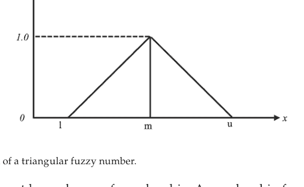

## 图1.1
三角模糊数的含义。

模糊集中的每个元素都有一个隶属度。将项目映射到某个区间内的隶属度、通常为[0,1]的隶属函数定义了模糊集。在模糊逻辑中，已使用了多种形式的模糊隶属函数。单调、三角和梯形是最常见的三种形状。由于模糊集是凸函数，梯形或梯形函数最接近它。然而，由于其计算简便，三角模糊数（TFN）在促进模糊环境中的表示和信息处理方面更有益。TFN也是专家语言评估最合适的特征，并且常用于模糊多准则决策（MCDM）研究（Patil and Kant 2014）。如图1.1所示，三角模糊数A表示为三个清晰数l、m和u的集合，其中“l”、“m”和“u”分别描述最低、中等和最高可能值。隶属函数在式（1.1）中说明。

μ_Ã(x) = { 0, x < l; (x - l)/(m - l), l ≤ x ≤ m; (u - x)/(u - m), m ≤ x ≤ u; 0, x > u } (1.1)

#### 1.2.2 模糊运算
假设有两个TFN Ã = (a^l, a^m, a^u) 和 B̃ = (b^l, b^m, b^u)，其中 a^l, a^m, a^u, b^l, b^m, b^u > 0。一些模糊运算如下所示：

加法：
à ⊕ B̃ = (a^l, a^m, a^u) ⊕ (b^l, b^m, b^u) = (a^l + b^l, a^m + b^m, a^u + b^u) (1.2)

### 减法：
$$\tilde{A} \ominus \tilde{B} = (a^l, a^m, a^u) \ominus (b^l, b^m, b^u) = (a^l - b^l, a^m - b^m, a^u - b^u) \quad (1.3)$$

### 乘法：
$$\tilde{A} \otimes \tilde{B} = (a^l, a^m, a^u) \otimes (b^l, b^m, b^u) = (a^l \times b^l, a^m \times b^m, a^u \times b^u) \quad (1.4)$$

### 除法：
$$\begin{cases} \tilde{A}^{-1} = (a^l, a^m, a^u)^{-1} = (1/a^l, 1/a^m, 1/a^u) \\ \tilde{B}^{-1} = (b^l, b^m, b^u)^{-1} = (1/b^l, 1/b^m, 1/b^u) \end{cases} \quad (1.5)$$

### 最大值：
$$\text{MAX}(\tilde{A}, \tilde{B}) = (\max(a^l, b^l), \max(a^m, b^m), \max(a^u, b^u)) \quad (1.6)$$

### 最小值：
$$\text{MIN}(\tilde{A}, \tilde{B}) = (\min(a^l, b^l), \min(a^m, b^m), \min(a^u, b^u)) \quad (1.7)$$

### 乘积之和：
$$\sum_{i=1}^{n} \oplus w_i \otimes \tilde{a}_i = \sum_{i=1}^{n} \oplus (w_1, w_2, ..., w_n) \otimes (\tilde{a}_1, \tilde{a}_2, ..., \tilde{a}_n) = w_1\tilde{a}_1 \oplus w_2\tilde{a}_2 \oplus ... w_n\tilde{a}_n \quad (1.8)$$

### 标量乘法：
$$\lambda \otimes \tilde{A} = \begin{cases} (\lambda a^l, \lambda a^m, \lambda a^u), & \text{if } \lambda \ge 0 \\ (\lambda a^u, \lambda a^m, \lambda a^l), & \text{if } \lambda < 0 \end{cases} \quad (1.9)$$

假设第$k$个决策者的权重是初始直接影响平均模糊矩阵，可通过收集式（1.10）中专家的评估信息获得。

$$x_{ij}^l = \sum_{k=1}^{k} \lambda_k x_{kij}^l, \quad x_{ij}^m = \sum_{k=1}^{k} \lambda_k x_{kij}^m, \quad x_{ij}^u = \sum_{k=1}^{k} \lambda_k x_{kij}^u \quad (1.10)$$

其中 $k$ 表示决策者的总数，且 $\lambda_k$ 满足 $\sum_{i=1}^{k} \lambda_k = 1$，其中 $\lambda = (\lambda_1, \lambda_2, ..., \lambda_k)$ 且 $\lambda_k \ge 0$。$x_{ij}^l$、$x_{ij}^m$ 和 $x_{ij}^u$ 分别表示评估信息的下限、中值和上限。

两个TFN之间的距离（即TFN $\tilde{a}$ 和TFN $\tilde{b}$）通过顶点技术获得，如式（1.11）所示。

$$\text{dst.}(\tilde{a},\tilde{b}) = \sqrt{\frac{1}{3}\left[(a^{l} - b^{l})^{2} + (a^{m} - b^{m})^{2} + (a^{u} - b^{u})^{2}\right]}\quad(1.11)$$

### 1.3 解决方案方法
在本部分，提出了一种评估智慧和可持续城市标准的分阶段方法。提出的方法基于分析网络过程方法和基于理想解相似性排序的技术（ANP-TOPSIS）方法的应用。一般而言，本章为城市提供了一些建议，以了解其相对于其他城市的位置，并了解政策制定者需要加强的领域。然后，这些城市通过考虑多个方面的多准则情景进行区分。因此，所提出的框架包括几个阶段，即由志愿者和专家进行的数据收集阶段、用于研究的标准权重确定阶段，最后是根据指定标准的重要性对指定城市进行排序的阶段。此外，所提出的方法采用模糊环境作为进行研究的外框架，使用TFN，如图1.2所示。

#### 1.3.1 ANP和TOPSIS的内涵
模糊ANP方法用于计算准则的最终权重并构建外部依赖关系，即属于不同组和准则的元素之间的关系。分析层次过程（AHP）最初由Saaty（Saaty 2001）建立，现在被称为ANP。虽然AHP在决策层级之间使用单向层次连接，但ANP允许决策层级和组件之间更通用的相互关系。ANP反馈方法用网络取代层次结构，其中各层级之间的相互作用难以表征为更高或更低、主导或从属、直接或间接。通过在决策系统中包含可能的相互作用、相互依赖和反馈，该技术评估网络结构簇之间及其内部项目之间的所有连接。它通过开发“超矩阵”来获得综合权重来处理组件之间的依赖关系。网络结构的节点象征一个具有内部元素的组件（或簇）与元素，

直线或弧定义两个组件之间的相互作用，环表示组件内部元素的内部依赖关系（Kumar et al. 2021）。ANP技术是合适的，因为本章问题中的部分（因素和准则）由于相互依赖而形成网络结构。ANP方法的优点包括

能够优先考虑组件的组或簇，以及它在依赖关系之外考虑独立性；即，它比AHP等其他方法更好地处理独立性（Ghosh, Das Chatterjee, and Dinda 2021）。ANP技术评估判断的一致性，并通过将问题分解为可以更彻底分析的更小组件来简化分配权重的过程。相反，ANP有几个缺点。由于该方法需要成对比较项目，因此无法孤立地检查一个元素并发现其缺点和优点。出于同样的原因，随着组件数量及其相互依赖性的增加，问题的复杂性呈指数增长。图1.3显示了ANP和AHP方法结构之间的差异。

TOPSIS技术由Hwang和Yoon于1981年创建（Yoon and Hwang 1985）。该策略的目标是找到适当和不适当解决方案之间的正负差距。TOPSIS方法是一种重要的MCDM方法，已被许多研究人员、政策制定者、利益相关者和各学科的学者使用。然而，由于它未能提供有关主题的简明信息并且包含模糊和未定义困难，该策略在现实世界解释中存在重大局限性。

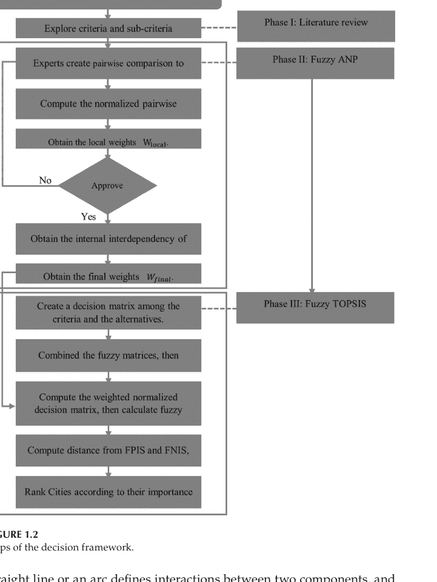

## 图1.2
决策框架的步骤。

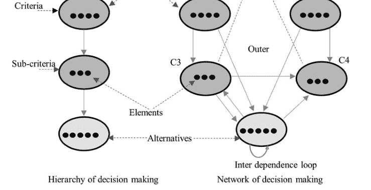

## 图1.3
AHP和ANP方法的细节。

模糊TOPSIS使用要检查的品质的基数信息。模糊正理想解（FPIS）与模糊负理想解（FNIS）到每个选项的距离是最重要的步骤之一。模糊TOPSIS在某种程度上不一致且不可靠。必须记住，模糊TOPSIS只收集和使用人类生成的数据。因此，信息“可靠、可信、无懈可击、确定、真实、可靠”的程度会影响感兴趣的值可能被近似的程度。尽管存在这些缺点，模糊TOPSIS仍然是一种流行的MCDM技术（Solangi, Longsheng, and Shah 2021）。

#### 1.3.2 建议的混合MCDM方法的计算步骤
- **步骤1：** 确定在研究领域专业化的志愿者群体。在这方面，已制定了一套标准，据此寻求专家。
- **步骤2：** 专家研究所研究问题的各方面，以确定影响智慧和可持续城市评估的最重要标准。
- **步骤3：** 选择用作问题替代方案的城市，以便从世界各大洲选择多个不同的城市。
- **步骤4：** 问题被绘制成几个不同的层级。之后，构建了准则相对于每个准则的内部和外部依赖结果（Liu et al. 2021）。
- **步骤5：** 确定专家在根据已选择的标准评估标准和替代方案时将使用的语言术语。因此，如表1.1所示，建立了不同的语言度量来评估每个标准的相对相关性。此外，如图所示

## 表1.1
用于加权标准的语言词汇及其对应的TFN

| 重要性 | 缩写 | TFN ⟨l_ij, m_ij, u_ij⟩ | 倒数 ⟨1/u_ij, 1/m_ij, 1/l_ij⟩ |
|---|---|---|---|
| 1 | ⟨EQI⟩ | ⟨1, 1, 1⟩ | ⟨1, 1, 1⟩ |
| 2 | ⟨EMI⟩ | ⟨1, 2, 3⟩ | ⟨1/3, 1/2, 1⟩ |
| 3 | ⟨MMI⟩ | ⟨2, 3, 4⟩ | ⟨1/4, 1/3, 1/2⟩ |
| 4 | ⟨MII⟩ | ⟨3, 4, 5⟩ | ⟨1/5, 1/4, 1/3⟩ |
| 5 | ⟨EIM⟩ | ⟨4, 5, 6⟩ | ⟨1/6, 1/5, 1/4⟩ |
| 6 | ⟨EVV⟩ | ⟨5, 6, 7⟩ | ⟨1/7, 1/6, 1/5⟩ |
| 7 | ⟨VEM⟩ | ⟨6, 7, 8⟩ | ⟨1/8, 1/7, 1/6⟩ |
| 8 | ⟨VPM⟩ | ⟨7, 8, 9⟩ | ⟨1/9, 1/8, 1/7⟩ |
| 9 | ⟨PMI⟩ | ⟨8, 9, 10⟩ | ⟨1/10, 1/9, 1/8⟩ |


## 表 1.2
### 评估备选方案的语言词汇及其对应的三角模糊数

| 语言词汇 | 缩写 | TFN ⟨l_ij, m_ij, u_ij⟩ |
|---|---|---|
| 极低 | ⟨ETL⟩ | ⟨1, 1, 3⟩ |
| 低 | ⟨LLO⟩ | ⟨1, 3, 5⟩ |
| 中等 | ⟨MOT⟩ | ⟨3, 5, 7⟩ |
| 高 | ⟨HIH⟩ | ⟨5, 7, 9⟩ |
| 极高 | ⟨EXG⟩ | ⟨7, 9, 11⟩ |

在表 1.2 中，开发了多种语言度量来根据相关性对备选方案进行评级。语言量表的价值在于它们允许专业人员在不受数值量表限制的情况下表达自己（Mardani Shahri, Eshraghniaye Jahromi, and Houshmand 2021）。

### 第 6 步：按每个专家创建准则之间及自身之间的成对比较矩阵（D），如式（1.12）所示，使用表 1.1 中的语言词汇，然后使用三角模糊数如式（1.13）所示。

D = 
C1 C2 ... Cn
C1 [ - e12 ... e1i ]
C2 [ 1/e21 - ... e2i ]
: [ 1/e31 1/e32 - ... ]
Cn [ 1/ej1 1/ej2 1/ej3 - ]
(1.12)

其中 (e_ij)，i, j =1, 2... n，且 e_ij 是第 i 个维度 C1, C2, ..., Ci 的准则相对于第 j 个维度 C1, C2, ..., Cj 的准则的评估。此外，矩阵的主对角线等于 1，使得 e_ii 等于 1。

D =
C1 C2 ... Cn
C1 [ - ⟨l12,m12,u12⟩ ... ⟨l1i,m1i,u1i⟩ ]
C2 [ 1/⟨u21,m21,l21⟩ - ... ⟨l2i,m2i,u2i⟩ ]
: [ 1/⟨u31,m31,l31⟩ 1/⟨u32,m32,l32⟩ - ... ]
Cn [ 1/⟨uj1,mj1,lj1⟩ 1/⟨uj2,mj2,lj2⟩ 1/⟨uj3,mj3,lj3⟩ - ]
(1.13)
其中 l、m 和 u 分别表征下限、中值和上限。

### 第 7 步：计算第 i 个准则相对于其它准则的比较几何平均值，使用式（1.14）。 $$ge_i = \left(\prod_{j=1}^{N} e_{ij}\right)^{1/n} \quad i=1,2,3\ldots N \tag{1.14}$$

### 第 8 步：通过应用式（1.15）计算第 i 个准则的模糊权重为三角模糊数。此外，模糊权重通过将每个模糊权重除以模糊权重的总和进行标准化，如式（1.15）所示。 $$w_i = ge_i \times (ge_1 + ge_2 + ge_3 + \ldots + ge_N)^{-1} \tag{1.15}$$

### 第 9 步：为每个专家分别创建的每个矩阵计算一致性比率（CR），以确认比较矩阵的可靠性，如式（1.16）所示，其中 $CI = \frac{\lambda_{max} - n}{n - 1}$，$\lambda_{max}$ 是加权和向量除以等效准则的平均值，$n$ 是准则的数量。RI 是由准则数量定义的随机指数（Saaty 2001）。 $$CR = \frac{CI}{RI} \tag{1.16}$$

### 第 10 步：通过应用所有参与者的最终权重的有序加权聚合（OWA）算子定义准则的最终权重。

### 第 11 步：根据式（1.15）中获得的权重计算排序向量。如果上述获得的权重通过一致性检验，则将设计为矩阵；局部权重矩阵可如式（1.17）所示获得。 $$W_{local} = [w_1,\ w_2,\ ...............,\ w_N]^T \tag{1.17}$$

### 第 12 步：如式（1.18）所示计算准则与其它准则集合之间的内部相互依赖性，然后获得未加权超矩阵 $W_s$，其由每个准则影响的排序向量组成。 $$W_s = \begin{bmatrix} w_{11} & w_{12} & \ldots & w_{1n} \\ w_{21} & w_{22} & \ldots & w_{2n} \\ \ldots & \ldots & \ldots & \ldots \\ w_{n1} & w_{n2} & \ldots & w_{nn} \end{bmatrix} \tag{1.18}$$

### 第 13 步：通过将式（1.17）中从专家比较准则矩阵获得的局部权重乘以式（1.18）中的准则相互依赖权重来计算准则的最终权重，如式（1.19）所示。

$W_{\text{final}} = \begin{bmatrix} w_{11} & w_{12} & \dots & w_{1n} \\ w_{21} & w_{22} & \dots & w_{2n} \\ \dots & \dots & \dots & \dots \\ w_{n1} & w_{n2} & \dots & w_{nn} \end{bmatrix} \times \begin{bmatrix} w_1,\ w_2,\dots\dots\dots\dots,\ w_n \end{bmatrix}^T \quad (1.19)$

### 第 14 步：创建专家确定的准则与所选备选方案之间的决策矩阵（X），如式（1.20）和（1.21）所示，分别使用语言词汇和三角模糊数，如表 1.2 所示。

$G = [g_{ij}]_{m\times n} = \begin{array}{c} A_1 \\ A_2 \\ \vdots \\ A_m \end{array} \begin{bmatrix} g_{11} & g_{12} & \dots & g_{1n} \\ g_{21} & g_{22} & \dots & g_{2n} \\ \dots & \dots & \dots & \dots \\ g_{m1} & g_{m2} & \dots & g_{mn} \end{bmatrix} \quad (1.20)$
$C_1\quad C_2\quad \dots\quad C_n$

$G = [g_{ij}]_{m\times n} = \begin{array}{c} A_1 \\ A_2 \\ \vdots \\ A_m \end{array} \begin{bmatrix} \langle l_{11},m_{11},u_{11}\rangle & \langle l_{12},m_{12},u_{12}\rangle & \dots & \langle l_{1n},m_{1n},u_{1n}\rangle \\ \langle l_{21},m_{21},u_{21}\rangle & \langle l_{22},m_{22},u_{22}\rangle & \dots & \langle l_{2n},m_{2n},u_{2n}\rangle \\ \dots & \dots & \dots & \dots \\ \langle l_{m1},m_{m1},u_{m1}\rangle & \langle l_{m2},m_{m2},u_{m2}\rangle & \dots & \langle l_{mn},m_{mn},u_{mn}\rangle \end{bmatrix} \quad (1.21)$
$C_1\quad C_2\quad \dots\quad C_n$

其中 $n$ 是准则的数量，$m$ 是备选方案的数量，且 $x_{ij}$ 是第 $i$ 个备选方案 $A_1, A_2, \dots, A_m$ 相对于第 $j$ 个准则 $C_1, C_2, \dots, C_n$ 的绩效评估。

### 第 15 步：通过结合所有专家的意见，应用式（1.22）计算所选准则和备选方案之间的最终组合决策矩阵。

$l_{ij} = \min_E \{l_{ijE}\},\; m_{ij} = \frac{1}{E} \sum_{e=1}^{E} \{m_{ij e}\}, \quad (1.22)$
$u_{ij} = \max_e \{u_{ij e}\}, \text{where } e \text{ is the number of experts}$

### 第 16 步：如式（1.23）所示确定标准化决策矩阵，对有益准则使用式（1.24），对非有益准则应用式（1.25）。

$S = [s_{ij}]_{m\times n}$  (1.23)

有益准则：$ \begin{cases} s_{ij} = \left( \dfrac{l_{ij}}{u_j^+}, \dfrac{m_{ij}}{u_j^+}, \dfrac{u_{ij}}{u_j^+} \right) \\ u_j^+ = \max_i u_{ij} \end{cases}$  (1.24)

非有益准则：$ \begin{cases} s_{ij} = \left( \dfrac{l_j^-}{l_{ij}}, \dfrac{l_j^-}{m_{ij}}, \dfrac{l_j^-}{u_{ij}} \right) \\ l_j^- = \min_i l_{ij} \end{cases}$  (1.25)

### 第 17 步：通过将获得的权重（$w_{\text{final}}$）与标准化决策矩阵（$s_{ij}$）相乘，计算加权标准化决策矩阵（$R$），如式（1.26）和（1.27）所示。

$R = [r_{ij}]_{m\times n}$  (1.26)

$r_{ij} = s_{ij} \times w_{\text{final}}$  (1.27)

### 第 18 步：分别使用式（1.28）和（1.29）计算 FPIS 和 FNIS。

$A^* = (r_1^*, r_2^*, \dots, r_n^*)$, where $r_j^* = \max_i \{r_{ij}\}$  (1.28)

$A^- = (r_1^-, r_2^-, \dots, r_n^-)$, where $r_j^- = \min_i \{r_{ij}\}$  (1.29)

### 第 19 步：使用式（1.11）计算每个备选方案到 FPIS 和 FNIS 的距离。然后，使用式（1.30）和（1.31）定义每个备选方案与 FPIS 或 FNIS 之间的距离。

$p_i^* = \sum_{j=1}^{N} p_r(r_{ij}, r_j^*), \quad i = 1,2,\dots,n, \; j = 1,2,\dots,m.$  (1.30)

$p_i^- = \sum_{j=1}^{N} p_r(r_{ij}, r_j^-), \quad i = 1,2,\dots,n, \; j = 1,2,\dots,m.$  (1.31)

### 第 20 步：使用式（1.32）计算每个备选方案的接近系数 C_j。最后，基于 C_j 值，按升序对备选方案进行评级。

C_j = \frac{p_j^-}{p_j^* + p_j^-} (1.32)

### 1.4 案例研究中建议方法的应用

本部分应用建议的模糊 ANP 和模糊 TOPSIS 方法来评估智慧和可持续城市。评估的城市如下：马德里、巴黎、柏林、莫斯科、香港、东京、悉尼、洛杉矶、迪拜和纽约，分别标记为 City₁、City₂、City₃、City₄、City₅、City₆、City₇、City₈、City₉ 和 City₁₀。我们将列出实施建议方法的步骤，从收集数据和确定评估智慧和可持续城市的准则开始。

### 第 1 步：已确定由三名智慧可持续领域专家组成的一组参与者。专家在整个研究和学习期间与作者合作。

### 第 2 步：已确定影响智慧和可持续城市评估的主要和子准则。确定的主要准则如下：智慧治理（SGC₁）、智慧经济（SCC₂）、智慧出行（SMC₃）、智慧生活（SLC₄）、智慧人群（SPC₅）和智慧环境（SEC₆）。确定的子准则如下：参与决策（PDC₁₋₁）、公共和社会服务（SSC₁₋₂）、透明治理（TGC₁₋₃）、创新精神（ISC₂₋₁）、创业精神（ENC₂₋₂）、生产力（PRC₂₋₃）、经济形象和商标（ETC₂₋₄）、劳动力市场灵活性（FLC₂₋₅）、国际嵌入性（IEC₂₋₆）、地方可达性（LAC₃₋₁）、可持续、创新和安全的运输系统（SNC₃₋₂）、（跨）国家可达性（IAC₃₋₃）、ICT 基础设施可用性（AVC₃₋₄）、文化设施（CFC₄₋₁）、健康状况（HCC₄₋₂）、个人安全（ISC₄₋₃）、住房质量（HQC₄₋₄）、教育设施（EFC₄₋₅）、旅游吸引力（TAC₄₋₆）、社会凝聚力（SCC₄₋₇）、资格水平（LQC₅₋₁）、灵活性（FLC₅₋₂）、公共生活参与（PPC₅₋₃）、终身学习亲和力（ALC₅₋₄）、世界主义/开放思想（COC₅₋₅）、社会和民族多元性（SPC₅₋₆）、创造力（CRC₅₋₇）、自然条件吸引力（ANC₆₋₁）、污染（POC₆₋₂）、环境保护（ENC₆₋₃）和可持续资源管理（SRC₆₋₄）。


第3步：十个可持续且智能的城市被选用于评估过程。这些城市来自世界各地不同的大洲和中东地区。

第4步：关于目标和标准的网络模型已构建，如图1.4所示。问题被划分为几个不同的层级。之后，针对每个标准，标准之间的内部和外部依赖性结果已构建。

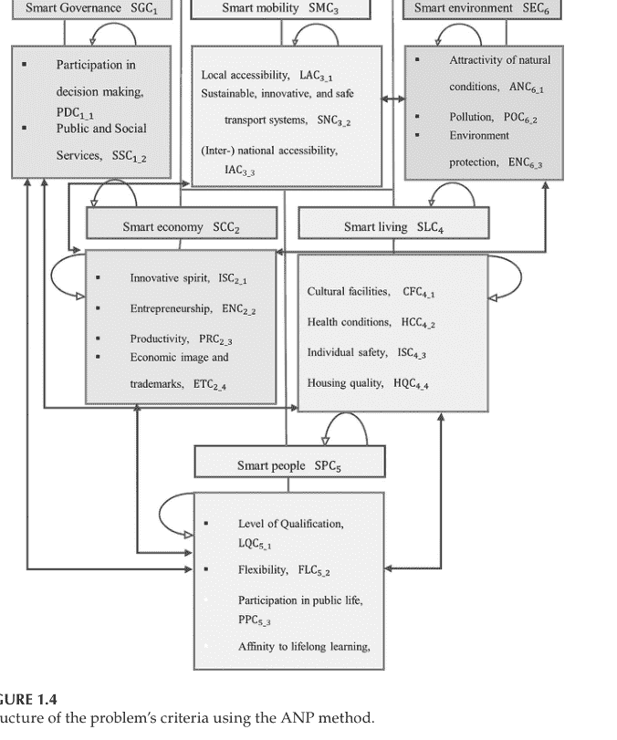

## 图1.4
使用ANP方法的问题标准结构。

第5步：专家在评估标准和备选方案时使用的语言词汇及其对应的TFN已在表1.1和表1.2中确定。

第6步：根据表1.1中的语言词汇并依据公式(1.12)，为每位专家分别构建了主要标准决策矩阵，以揭示每个标准对其他标准的影响，如表1.3所示。然后，根据表1.1中的TFN并依据公式(1.13)，为每位专家分别在主要标准之间构建了决策矩阵，以揭示每个标准对其他标准的影响，如表1.4所示。

第7步：专家创建的三个比较矩阵的几何平均值已使用公式(1.14)计算，如表1.5所示。

第8步：每个矩阵确定的六个主要标准的模糊权重已通过应用公式(1.15)分别计算，如表1.5所示。然后，每个矩阵的六个主要标准的权重通过将每个权重除以权重之和分别标准化，如表1.5所示。

第9步：为确认成对比较的一致性，已通过应用公式(1.16)分别计算每位专家构建的每个矩阵的CR。然后，确保表1.5中所有矩阵的一致性水平均小于0.1。

第10步：六个主要标准的最终权重已通过使用所有专家最终权重（即W_local）的有序加权聚合(OWA)算子计算，如表1.6所示，依据公式(1.17)。

第11步：根据计算六个主要标准局部权重(W_local)的前述步骤，已创建成对比较矩阵，以展示每位专家对每个标准与其对其他标准集的影响的内部相关性，如表1.7–1.18所示。然后，标准与其与其他标准的内部相互依赖性的最终权重根据公式(1.18)呈现在表1.19中。

第12步：六个主要标准的最终权重通过将表1.6中从专家标准比较矩阵计算得出的局部权重乘以表1.19中所示的标准相互依赖权重计算得出，最终权重根据公式(1.19)已在表1.19和图1.5中呈现。

第13步：根据使用ANP方法计算六个主要标准权重的先前步骤，为每个主要标准计算了子标准权重。计算智能治理标准子标准权重的部分结果呈现在表1.20–1.29中。之后，所有子标准的全局权重根据其受其主要标准权重值影响的程度计算，如表1.30和图1.6所示。

## 表1.3
所有专家使用语言词汇评估主要标准

| 专家₁ | SGC₁ | SCC₂ | SMC₃ | SLC₄ | SPC₅ | SEC₆ |
|---|---|---|---|---|---|---|
| SGC₁ | ⟨EQI⟩ | ⟨EIM⟩ | ⟨VEM⟩ | ⟨EIM⟩ | ⟨VPM⟩ | 1/⟨EVV⟩ |
| SCC₂ | 1/⟨EIM⟩ | ⟨EQI⟩ | ⟨VPM⟩ | ⟨PMI⟩ | ⟨PMI⟩ | 1/⟨VPM⟩ |
| SMC₃ | 1/⟨VEM⟩ | 1/⟨VPM⟩ | ⟨EQI⟩ | 1/⟨MMI⟩ | ⟨VPM⟩ | ⟨PMI⟩ |
| SLC₄ | 1/⟨EIM⟩ | 1/⟨PMI⟩ | ⟨MMI⟩ | ⟨EQI⟩ | ⟨EIM⟩ | 1/⟨EVV⟩ |
| SPC₅ | 1/⟨VPM⟩ | 1/⟨PMI⟩ | 1/⟨VPM⟩ | 1/⟨EIM⟩ | ⟨EQI⟩ | ⟨VPM⟩ |
| SEC₆ | ⟨EVV⟩ | ⟨VPM⟩ | 1/⟨PMI⟩ | ⟨EVV⟩ | 1/⟨VPM⟩ | ⟨EQI⟩ |

| 专家₂ | SGC₁ | SCC₂ | SMC₃ | SLC₄ | SPC₅ | SEC₆ |
|---|---|---|---|---|---|---|
| SGC₁ | ⟨EQI⟩ | ⟨EIM⟩ | ⟨EVV⟩ | ⟨EIM⟩ | ⟨VPM⟩ | 1/⟨EVV⟩ |
| SCC₂ | 1/⟨EIM⟩ | ⟨EQI⟩ | ⟨VPM⟩ | ⟨PMI⟩ | ⟨PMI⟩ | 1/⟨VPM⟩ |
| SMC₃ | 1/⟨EVV⟩ | 1/⟨VPM⟩ | ⟨EQI⟩ | ⟨MII⟩ | ⟨VPM⟩ | ⟨PMI⟩ |
| SLC₄ | 1/⟨EIM⟩ | 1/⟨PMI⟩ | 1/⟨MII⟩ | ⟨EQI⟩ | ⟨EIM⟩ | 1/⟨EVV⟩ |
| SPC₅ | 1/⟨VPM⟩ | 1/⟨PMI⟩ | 1/⟨VPM⟩ | 1/⟨EIM⟩ | ⟨EQI⟩ | ⟨VPM⟩ |
| SEC₆ | ⟨EVV⟩ | ⟨VPM⟩ | 1/⟨PMI⟩ | ⟨EVV⟩ | 1/⟨VPM⟩ | ⟨EQI⟩ |

| 专家₃ | SGC₁ | SCC₂ | SMC₃ | SLC₄ | SPC₅ | SEC₆ |
|---|---|---|---|---|---|---|
| SGC₁ | ⟨EQI⟩ | ⟨EIM⟩ | ⟨EVV⟩ | ⟨EIM⟩ | ⟨VPM⟩ | 1/⟨EVV⟩ |
| SCC₂ | 1/⟨EIM⟩ | ⟨EQI⟩ | ⟨VPM⟩ | ⟨PMI⟩ | ⟨PMI⟩ | 1/⟨VPM⟩ |
| SMC₃ | 1/⟨EVV⟩ | 1/⟨VPM⟩ | ⟨EQI⟩ | ⟨MII⟩ | ⟨VPM⟩ | ⟨PMI⟩ |
| SLC₄ | 1/⟨EIM⟩ | 1/⟨PMI⟩ | 1/⟨MII⟩ | ⟨EQI⟩ | ⟨EIM⟩ | 1/⟨VEM⟩ |
| SPC₅ | 1/⟨VPM⟩ | 1/⟨PMI⟩ | 1/⟨VPM⟩ | 1/⟨EIM⟩ | ⟨EQI⟩ | ⟨VPM⟩ |
| SEC₆ | ⟨EVV⟩ | ⟨VPM⟩ | 1/⟨PMI⟩ | ⟨VEM⟩ | 1/⟨VPM⟩ | ⟨EQI⟩ |

## 表1.4
所有专家使用TFN评估主要标准

| 专家₁ | SGC1 | SCC2 | SMC3 | SLC4 | SPC5 | SEC6 |
|---|---|---|---|---|---|---|
| SGC1 | <1,1,1> | <4,5,6> | <6,7,8> | <4,5,6> | <7,8,9> | <1/7,1/6,1/5> |
| SCC2 | <1/6,1/5,1/4> | <1,1,1> | <7,8,9> | <8,9,10> | <8,9,10> | <1/9,1/8,1/7> |
| SMC3 | <1/8,1/7,1/6> | <1/9,1/8,1/7> | <1,1,1> | <1/4,1/3,1/2> | <7,8,9> | <8,9,10> |
| SLC4 | <1/6,1/5,1/4> | <1/10,1/9,1/8> | <2,3,4> | <1,1,1> | <4,5,6> | <1/7,1/6,1/5> |
| SPC5 | <1/9,1/8,1/7> | <1/10,1/9,1/8> | <1/9,1/8,1/7> | <1/6,1/5,1/4> | <1,1,1> | <7,8,9> |
| SEC6 | <5,6,7> | <7,8,9> | <1/10,1/9,1/8> | <5,6,7> | <1/9,1/8,1/7> | <1,1,1> |

| 专家₂ | SGC1 | SCC2 | SMC3 | SLC4 | SPC5 | SEC6 |
|---|---|---|---|---|---|---|
| SGC1 | <1,1,1> | <4,5,6> | <5,6,7> | <4,5,6> | <7,8,9> | <1/7,1/6,1/5> |
| SCC2 | <1/6,1/5,1/4> | <1,1,1> | <7,8,9> | <8,9,10> | <8,9,10> | <1/9,1/8,1/7> |
| SMC3 | <1/7,1/6,1/5> | <1/9,1/8,1/7> | <1,1,1> | <3,4,5> | <7,8,9> | <8,9,10> |
| SLC4 | <1/6,1/5,1/4> | <1/10,1/9,1/8> | <1/5,1/4,1/3> | <1,1,1> | <4,5,6> | <1/7,1/6,1/5> |
| SPC5 | <1/9,1/8,1/7> | <1/10,1/9,1/8> | <1/9,1/8,1/7> | <1/6,1/5,1/4> | <1,1,1> | <7,8,9> |
| SEC6 | <5,6,7> | <7,8,9> | <1/10,1/9,1/8> | <5,6,7> | <1/9,1/8,1/7> | <1,1,1> |

| 专家₃ | SGC1 | SCC2 | SMC3 | SLC4 | SPC5 | SEC6 |
|---|---|---|---|---|---|---|
| SGC1 | <1,1,1> | <4,5,6> | <5,6,7> | <4,5,6> | <7,8,9> | <1/7,1/6,1/5> |
| SCC2 | <1/6,1/5,1/4> | <1,1,1> | <7,8,9> | <8,9,10> | <8,9,10> | <1/9,1/8,1/7> |
| SMC3 | <1/7,1/6,1/5> | <1/9,1/8,1/7> | <1,1,1> | <3,4,5> | <7,8,9> | <8,9,10> |
| SLC4 | <1/6,1/5,1/4> | <1/10,1/9,1/8> | <1/5,1/4,1/3> | <1,1,1> | <4,5,6> | <1/7,1/6,1/5> |
| SPC5 | <1/9,1/8,1/7> | <1/10,1/9,1/8> | <1/9,1/8,1/7> | <1/6,1/5,1/4> | <1,1,1> | <7,8,9> |
| SEC6 | <5,6,7> | <7,8,9> | <1/10,1/9,1/8> | <6,7,8> | <1/9,1/8,1/7> | <1,1,1> |

## 表1.5
所有专家的主要标准局部权重

| 专家₁ | (∏_{j=1}^{N} e_{ij})^{1/n} 1 | (∏_{j=1}^{N} e_{ij})^{1/n} 2 | (∏_{j=1}^{N} e_{ij})^{1/n} 3 | 模糊权重1 | 模糊权重2 | 模糊权重3 | 精确权重 | 归一化权重 | 权重 |
|---|---|---|---|---|---|---|---|---|---|
| SGC₁ | 2.140 | 2.482 | 2.834 | 0.261 | 0.352 | 0.450 | 0.355 | 0.346 | 0.331 |
| SCC₂ | 1.423 | 1.591 | 1.783 | 0.174 | 0.226 | 0.283 | 0.228 | 0.222 | 0.217 |
| SMC₃ | 0.761 | 0.723 | 1.012 | 0.093 | 0.103 | 0.161 | 0.119 | 0.116 | 0.160 |
| SLC₄ | 0.517 | 0.618 | 0.729 | 0.063 | 0.088 | 0.116 | 0.089 | 0.087 | 0.067 |
| SPC₅ | 0.336 | 0.375 | 0.423 | 0.041 | 0.053 | 0.067 | 0.054 | 0.053 | 0.052 |
| SEC₆ | 1.117 | 1.260 | 1.411 | 0.136 | 0.179 | 0.224 | 0.180 | 0.176 | 0.173 |

| 专家₂ | (∏_{j=1}^{N} e_{ij})^{1/n} 1 | (∏_{j=1}^{N} e_{ij})^{1/n} 2 | (∏_{j=1}^{N} e_{ij})^{1/n} 3 | 模糊权重1 | 模糊权重2 | 模糊权重3 | 精确权重 | 归一化权重 | 权重 |
|---|---|---|---|---|---|---|---|---|---|
| SGC₁ | 2.076 | 2.419 | 2.772 | 0.247 | 0.327 | 0.428 | 0.334 | 0.326 | 0.331 |
| SCC₂ | 1.423 | 1.591 | 1.783 | 0.169 | 0.215 | 0.275 | 0.220 | 0.215 | 0.217 |
| SMC₃ | 1.178 | 1.348 | 1.531 | 0.140 | 0.182 | 0.236 | 0.186 | 0.182 | 0.160 |
| SLC₄ | 0.352 | 0.408 | 0.482 | 0.042 | 0.055 | 0.074 | 0.057 | 0.056 | 0.067 |
| SPC₅ | 0.336 | 0.375 | 0.423 | 0.040 | 0.051 | 0.065 | 0.052 | 0.051 | 0.052 |
| SEC₆ | 1.117 | 1.260 | 1.411 | 0.133 | 0.170 | 0.218 | 0.174 | 0.170 | 0.173 |

| 专家₃ | (∏_{j=1}^{N} e_{ij})^{1/n} 1 | (∏_{j=1}^{N} e_{ij})^{1/n} 2 | (∏_{j=1}^{N} e_{ij})^{1/n} 3 | 模糊权重1 | 模糊权重2 | 模糊权重3 | 精确权重 | 归一化权重 | 权重 |
|---|---|---|---|---|---|---|---|---|---|
| SGC₁ | 2.076 | 2.419 | 2.772 | 0.247 | 0.326 | 0.426 | 0.333 | 0.326 | 0.331 |
| SCC₂ | 1.423 | 1.591 | 1.783 | 0.169 | 0.214 | 0.274 | 0.219 | 0.214 | 0.217 |
| SMC₃ | 1.178 | 1.348 | 1.531 | 0.140 | 0.182 | 0.235 | 0.186 | 0.182 | 0.160 |
| SLC₄ | 0.344 | 0.398 | 0.467 | 0.041 | 0.054 | 0.072 | 0.055 | 0.054 | 0.067 |
| SPC₅ | 0.336 | 0.375 | 0.423 | 0.040 | 0.050 | 0.065 | 0.052 | 0.051 | 0.052 |
| SEC₆ | 1.151 | 1.292 | 1.442 | 0.137 | 0.174 | 0.222 | 0.177 | 0.174 | 0.173 |

## 表1.6
主要标准的局部权重

| 障碍 | 专家1的权重 | 专家2的权重 | 专家3的权重 | W_local |
|---|---|---|---|---|
| SGC₁ | 0.346 | 0.326 | 0.326 | 0.331 |
| SCC₂ | 0.222 | 0.215 | 0.214 | 0.217 |
| SMC₃ | 0.116 | 0.182 | 0.182 | 0.160 |
| SLC₄ | 0.087 | 0.056 | 0.054 | 0.067 |
| SPC₅ | 0.053 | 0.051 | 0.051 | 0.052 |
| SEC₆ | 0.176 | 0.170 | 0.174 | 0.173 |


## 表 1.7

所有专家基于智能治理准则的成对比较矩阵

| 智能治理 | SGC₁ | SCC₂ | SMC₃ | SLC₄ | SPC₅ | SEC₆ |
|---|---|---|---|---|---|---|
| SGC₁ | ⟨EQI⟩ | ⟨EVV⟩ | ⟨PMI⟩ | ⟨VEM⟩ | ⟨VPM⟩ | 1/⟨MII⟩ |
| SCC₂ | 1/⟨EVV⟩ | ⟨EQI⟩ | 1/⟨PMI⟩ | ⟨VEM⟩ | ⟨PMI⟩ | 1/⟨VPM⟩ |
| SMC₃ | 1/⟨PMI⟩ | ⟨PMI⟩ | ⟨EQI⟩ | ⟨VEM⟩ | ⟨VPM⟩ | ⟨PMI⟩ |
| SLC₄ | 1/⟨VEM⟩ | 1/⟨VEM⟩ | 1/⟨VEM⟩ | ⟨EQI⟩ | ⟨EIM⟩ | 1/⟨MII⟩ |
| SPC₅ | 1/⟨VPM⟩ | 1/⟨PMI⟩ | 1/⟨VPM⟩ | 1/⟨EIM⟩ | ⟨EQI⟩ | 1/⟨VEM⟩ |
| SEC₆ | ⟨MII⟩ | ⟨VPM⟩ | 1/⟨PMI⟩ | ⟨MII⟩ | ⟨VEM⟩ | ⟨EQI⟩ |

## 表 1.8

所有专家智能治理准则的互依赖矩阵

| 智能治理 | (∏ e_ij)^{1/n} 1 | (∏ e_ij)^{1/n} 2 | (∏ e_ij)^{1/n} 3 | 模糊权重 1 | 模糊权重 2 | 模糊权重 3 | 精确权重 | 归一化权重 |
|---|---|---|---|---|---|---|---|---|
| SGC₁ | 2.637 | 3.018 | 3.447 | 0.248 | 0.319 | 0.414 | 0.327 | 0.320 |
| SCC₂ | 0.651 | 0.726 | 0.812 | 0.061 | 0.077 | 0.097 | 0.078 | 0.077 |
| SMC₃ | 2.540 | 2.821 | 3.107 | 0.239 | 0.298 | 0.373 | 0.303 | 0.297 |
| SLC₄ | 0.341 | 0.392 | 0.459 | 0.032 | 0.042 | 0.055 | 0.043 | 0.042 |
| SPC₅ | 0.172 | 0.192 | 0.218 | 0.016 | 0.020 | 0.026 | 0.021 | 0.020 |
| SEC₆ | 1.995 | 2.303 | 2.608 | 0.187 | 0.244 | 0.313 | 0.248 | 0.243 |

## 表 1.9

所有专家基于智能经济准则的成对比较矩阵

| 智能经济 | SGC₁ | SCC₂ | SMC₃ | SLC₄ | SPC₅ | SEC₆ |
|---|---|---|---|---|---|---|
| SGC₁ | ⟨EQI⟩ | ⟨EVV⟩ | ⟨MMI⟩ | 1/⟨EVV⟩ | ⟨VPM⟩ | 1/⟨MII⟩ |
| SCC₂ | 1/⟨EVV⟩ | ⟨EQI⟩ | 1/⟨PMI⟩ | ⟨VEM⟩ | ⟨PMI⟩ | 1/⟨VPM⟩ |
| SMC₃ | 1/⟨MMI⟩ | ⟨PMI⟩ | ⟨EQI⟩ | ⟨EIM⟩ | 1/⟨VPM⟩ | ⟨PMI⟩ |
| SLC₄ | ⟨EVV⟩ | 1/⟨VEM⟩ | 1/⟨EIM⟩ | ⟨EQI⟩ | ⟨EIM⟩ | 1/⟨MII⟩ |
| SPC₅ | 1/⟨VPM⟩ | 1/⟨PMI⟩ | ⟨VPM⟩ | 1/⟨EIM⟩ | ⟨EQI⟩ | 1/⟨VEM⟩ |
| SEC₆ | ⟨MII⟩ | ⟨VPM⟩ | 1/⟨PMI⟩ | ⟨MII⟩ | ⟨VEM⟩ | ⟨EQI⟩ |

## 表 1.10

所有专家智能经济准则的互依赖矩阵

| 智能经济 | $(\prod_{j=1}^N e_{ij})^{1/n}$ |  |  | 模糊权重 |  |  | 精确权重 | 归一化权重 |
|---|---|---|---|---|---|---|---|---|
| SGC₁ | 1.123 | 1.348 | 1.600 | 0.136 | 0.189 | 0.260 | 0.195 | 0.190 |
| SCC₂ | 0.651 | 0.726 | 0.812 | 0.079 | 0.102 | 0.132 | 0.104 | 0.101 |
| SMC₃ | 1.386 | 1.601 | 1.871 | 0.168 | 0.224 | 0.304 | 0.232 | 0.226 |
| SLC₄ | 0.661 | 0.774 | 0.914 | 0.080 | 0.108 | 0.148 | 0.112 | 0.109 |
| SPC₅ | 0.343 | 0.383 | 0.434 | 0.042 | 0.054 | 0.071 | 0.055 | 0.054 |
| SEC₆ | 1.995 | 2.303 | 2.608 | 0.242 | 0.323 | 0.424 | 0.329 | 0.320 |

## 表 1.11

所有专家基于智能出行准则的成对比较矩阵

| 智能出行 | SGC₁ | SCC₂ | SMC₃ | SLC₄ | SPC₅ | SEC₆ |
|---|---|---|---|---|---|---|
| SGC₁ | ⟨EQI⟩/⟨VEM⟩ | ⟨MMI⟩/⟨EVV⟩ | ⟨VPM⟩/⟨MII⟩ |  |  |  |
| SCC₂ | ⟨VEM⟩ | ⟨EQI⟩ | 1/⟨PMI⟩ | ⟨EVV⟩ | ⟨PMI⟩ | ⟨VEM⟩ |
| SMC₃ | 1/⟨MMI⟩ | ⟨PMI⟩ | ⟨EQI⟩ | ⟨EIM⟩ | 1/⟨VPM⟩ | ⟨PMI⟩ |
| SLC₄ | ⟨EVV⟩ | 1/⟨EVV⟩ | 1/⟨EIM⟩ | ⟨EQI⟩ | ⟨EIM⟩ | 1/⟨MII⟩ |
| SPC₅ | 1/⟨VPM⟩ | 1/⟨PMI⟩ | ⟨VPM⟩ | 1/⟨EIM⟩ | ⟨EQI⟩ | 1/⟨VEM⟩ |
| SEC₆ | ⟨MII⟩ | 1/⟨VEM⟩ | 1/⟨PMI⟩ | ⟨MII⟩ | ⟨VEM⟩ | ⟨EQI⟩ |

## 表 1.12

所有专家智能出行准则的互依赖矩阵

| 智能出行 | $(\prod_{j=1}^N e_{ij})^{1/n}$ |  |  | 模糊权重 |  |  | 精确权重 | 归一化权重 |
|---|---|---|---|---|---|---|---|---|
| SGC₁ | 0.607 | 0.723 | 0.859 | 0.073 | 0.100 | 0.136 | 0.103 | 0.101 |
| SCC₂ | 2.289 | 2.578 | 2.871 | 0.276 | 0.356 | 0.455 | 0.363 | 0.354 |
| SMC₃ | 1.386 | 1.601 | 1.871 | 0.167 | 0.221 | 0.297 | 0.228 | 0.223 |
| SLC₄ | 0.661 | 0.774 | 0.914 | 0.080 | 0.107 | 0.145 | 0.111 | 0.108 |
| SPC₅ | 0.343 | 0.383 | 0.434 | 0.041 | 0.053 | 0.069 | 0.054 | 0.053 |
| SEC₆ | 1.020 | 1.178 | 1.342 | 0.123 | 0.163 | 0.213 | 0.166 | 0.162 |

## 表 1.13

所有专家基于智能生活准则的成对比较矩阵

| 智能生活 | SGC₁ | SCC₂ | SMC₃ | SLC₄ | SPC₅ | SEC₆ |
|---|---|---|---|---|---|---|
| SGC₁ | ⟨EQI⟩ | 1/⟨VEM⟩ | ⟨MMI⟩ | 1/⟨EVV⟩ | ⟨VPM⟩ | ⟨MII⟩ |
| SCC₂ | ⟨VEM⟩ | ⟨EQI⟩ | 1/⟨PMI⟩ | ⟨EVV⟩ | ⟨PMI⟩ | ⟨VEM⟩ |
| SMC₃ | 1/⟨MMI⟩ | ⟨PMI⟩ | ⟨EQI⟩ | ⟨EIM⟩ | 1/⟨EIM⟩ | ⟨PMI⟩ |
| SLC₄ | ⟨EVV⟩ | 1/⟨EVV⟩ | 1/⟨EIM⟩ | ⟨EQI⟩ | ⟨EIM⟩ | 1/⟨MII⟩ |
| SPC₅ | 1/⟨VPM⟩ | 1/⟨PMI⟩ | ⟨EIM⟩ | 1/⟨EIM⟩ | ⟨EQI⟩ | 1/⟨VEM⟩ |
| SEC₆ | 1/⟨MII⟩ | 1/⟨VEM⟩ | 1/⟨PMI⟩ | ⟨MII⟩ | ⟨VEM⟩ | ⟨EQI⟩ |

## 表 1.14

所有专家智能生活准则的互依赖矩阵

| 智能生活 | (∏_{j=1}^{N} e_{ij})^{1/n} |  |  | 模糊权重 |  |  | 精确权重 | 归一化权重 |
|---|---|---|---|---|---|---|---|---|
| SGC₁ | 0.953 | 1.148 | 1.348 | 0.113 | 0.157 | 0.213 | 0.161 | 0.157 |
| SCC₂ | 2.289 | 2.578 | 2.871 | 0.271 | 0.353 | 0.454 | 0.359 | 0.349 |
| SMC₃ | 1.484 | 1.732 | 2.054 | 0.175 | 0.237 | 0.325 | 0.246 | 0.239 |
| SLC₄ | 0.661 | 0.774 | 0.914 | 0.078 | 0.106 | 0.145 | 0.110 | 0.107 |
| SPC₅ | 0.312 | 0.354 | 0.406 | 0.037 | 0.048 | 0.064 | 0.050 | 0.048 |
| SEC₆ | 0.619 | 0.727 | 0.865 | 0.073 | 0.099 | 0.137 | 0.103 | 0.100 |

## 表 1.15

所有专家基于智能人群准则的成对比较矩阵

| 智能人群 | SGC₁ | SCC₂ | SMC₃ | SLC₄ | SPC₅ | SEC₆ |
|---|---|---|---|---|---|---|
| SGC₁ | ⟨EQI⟩ | 1/⟨VEM⟩ | 1/⟨MII⟩ | 1/⟨EVV⟩ | ⟨VPM⟩ | ⟨MII⟩ |
| SCC₂ | ⟨VEM⟩ | ⟨EQI⟩ | 1/⟨EMI⟩ | ⟨EVV⟩ | ⟨PMI⟩ | ⟨VEM⟩ |
| SMC₃ | ⟨MMI⟩ | ⟨EMI⟩ | ⟨EQI⟩ | ⟨EIM⟩ | 1/⟨EIM⟩ | ⟨VPM⟩ |
| SLC₄ | ⟨EVV⟩ | 1/⟨EVV⟩ | 1/⟨EIM⟩ | ⟨EQI⟩ | ⟨EIM⟩ | 1/⟨MII⟩ |
| SPC₅ | 1/⟨VPM⟩ | 1/⟨PMI⟩ | ⟨EIM⟩ | 1/⟨EIM⟩ | ⟨EQI⟩ | 1/⟨VEM⟩ |
| SEC₆ | 1/⟨MII⟩ | 1/⟨VEM⟩ | 1/⟨VPM⟩ | ⟨MII⟩ | ⟨VEM⟩ | ⟨EQI⟩ |

## 表 1.16

所有专家智能人群准则的互依赖矩阵

| 智能人群 |  |  |  |  |  |  | 精确权重 | 归一化权重 |
|---|---|---|---|---|---|---|---|---|
| SGC₁ | 0.650 | 0.759 | 0.891 | 0.068 | 0.096 | 0.135 | 0.099 | 0.095 |
| SCC₂ | 2.798 | 3.313 | 4.060 | 0.292 | 0.417 | 0.615 | 0.441 | 0.422 |
| SMC₃ | 1.553 | 2.000 | 2.423 | 0.162 | 0.252 | 0.367 | 0.260 | 0.249 |
| SLC₄ | 0.661 | 0.774 | 0.914 | 0.069 | 0.097 | 0.138 | 0.102 | 0.097 |
| SPC₅ | 0.312 | 0.354 | 0.406 | 0.033 | 0.045 | 0.061 | 0.046 | 0.044 |
| SEC₆ | 0.630 | 0.742 | 0.884 | 0.066 | 0.093 | 0.134 | 0.098 | 0.093 |

## 表 1.17

所有专家基于智能环境准则的成对比较矩阵

| 智能环境 | SGC₁ | SCC₂ | SMC₃ | SLC₄ | SPC₅ | SEC₆ |
|---|---|---|---|---|---|---|
| SGC₁ | ⟨EQI⟩ | 1/⟨VEM⟩ | 1/⟨MII⟩ | 1/⟨EVV⟩ | ⟨VPM⟩ | ⟨MII⟩ |
| SCC₂ | ⟨VEM⟩ | ⟨EQI⟩ | 1/⟨EMI⟩ | ⟨VEM⟩ | ⟨PMI⟩ | ⟨VEM⟩ |
| SMC₃ | ⟨MMI⟩ | ⟨EMI⟩ | ⟨EQI⟩ | ⟨EIM⟩ | 1/⟨EIM⟩ | 1/⟨EIM⟩ |
| SLC₄ | ⟨EVV⟩ | 1/⟨VEM⟩ | 1/⟨EIM⟩ | ⟨EQI⟩ | ⟨EIM⟩ | 1/⟨MII⟩ |
| SPC₅ | 1/⟨VPM⟩ | 1/⟨PMI⟩ | ⟨EIM⟩ | 1/⟨EIM⟩ | ⟨EQI⟩ | 1/⟨VEM⟩ |
| SEC₆ | 1/⟨MII⟩ | 1/⟨VEM⟩ | ⟨EIM⟩ | ⟨MII⟩ | ⟨VEM⟩ | ⟨EQI⟩ |

## 表 1.18

所有专家智能环境准则的互依赖矩阵

| 智能环境 |  |  |  |  |  |  | 精确权重 | 归一化权重 |
|---|---|---|---|---|---|---|---|---|
| SGC₁ | 0.650 | 0.759 | 0.891 | 0.070 | 0.098 | 0.137 | 0.102 | 0.097 |
| SCC₂ | 2.884 | 3.400 | 4.152 | 0.309 | 0.439 | 0.640 | 0.463 | 0.443 |
| SMC₃ | 0.833 | 1.081 | 1.334 | 0.089 | 0.140 | 0.206 | 0.145 | 0.139 |
| SLC₄ | 0.661 | 0.774 | 0.914 | 0.071 | 0.100 | 0.141 | 0.104 | 0.099 |
| SPC₅ | 0.312 | 0.354 | 0.406 | 0.033 | 0.046 | 0.063 | 0.047 | 0.045 |
| SEC₆ | 1.145 | 1.372 | 1.648 | 0.123 | 0.177 | 0.254 | 0.185 | 0.177 |

## 表 1.19

六项主要准则的比较影响

| 准则 | SGC₁ | SCC₂ | SMC₃ | SLC₄ | SPC₅ | SEC₆ | 局部权重 | 最终权重 |
|---|---|---|---|---|---|---|---|---|
| SGC₁ | 0.320 | 0.190 | 0.101 | 0.157 | 0.095 | 0.097 | 0.331 | 0.195 |
| SCC₂ | 0.077 | 0.101 | 0.354 | 0.349 | 0.422 | 0.443 | 0.217 | 0.226 |
| SMC₃ | 0.297 | 0.226 | 0.223 | 0.239 | 0.249 | 0.139 | 0.160 | 0.236 |
| SLC₄ | 0.042 | 0.109 | 0.108 | 0.107 | 0.097 | 0.099 | 0.067 | 0.084 |
| SPC₅ | 0.020 | 0.054 | 0.053 | 0.048 | 0.044 | 0.045 | 0.052 | 0.040 |
| SEC₆ | 0.243 | 0.320 | 0.162 | 0.100 | 0.093 | 0.177 | 0.173 | 0.219 |

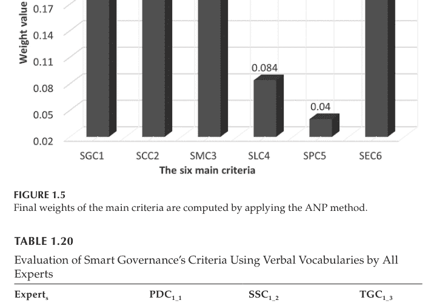

## 图 1.5

主要准则的最终权重是通过应用 ANP 方法计算得出的。

## 表 1.20

所有专家使用语言词汇对智能治理准则的评估

| 专家ₛ | PDC₁,₁ | SSC₁,₂ | TGC₁,₃ |
|---|---|---|---|
| PDC₁,₁ | ⟨EQI⟩ | ⟨EIM⟩ | ⟨VPM⟩ |
| SSC₁,₂ | 1/⟨EIM⟩ | ⟨EQI⟩ | ⟨EVV⟩ |
| TGC₁,₃ | 1/⟨VPM⟩ | 1/⟨EVV⟩ | ⟨EQI⟩ |


## 表 1.21
所有专家使用 TFNs 对智慧治理标准进行的评估

| 专家_s | PDC_1,1 | SSC_1,2 | TGC_1,3 |
|---|---|---|---|
| PDC_1,1 | ⟨1, 1, 1⟩ | ⟨4, 5, 6⟩ | ⟨7, 8, 9⟩ |
| SSC_1,2 | ⟨1/6, 1/5, 1/4⟩ | ⟨1, 1, 1⟩ | ⟨5, 6, 7⟩ |
| TGC_1,3 | ⟨1/9, 1/8, 1/7⟩ | ⟨1/7, 1/6, 1/5⟩ | ⟨1, 1, 1⟩ |

## 表 1.22
所有专家得出的智慧治理标准的局部权重

| 专家_s | (∏_{j=1}^N e_{ij})^{1/n} |  |  | 模糊权重 |  |  | 清晰权重 | 归一化权重 |
|---|---|---|---|---|---|---|---|---|
| PDC_1,1 | 1.849 | 1.944 | 2.030 | 0.512 | 0.562 | 0.614 | 0.563 | 0.561 |
| SSC_1,2 | 0.493 | 0.514 | 0.541 | 0.137 | 0.149 | 0.164 | 0.150 | 0.150 |
| TGC_1,3 | 0.963 | 1.000 | 1.038 | 0.267 | 0.289 | 0.314 | 0.290 | 0.289 |

## 表 1.23
所有专家基于参与决策标准的智慧治理两两比较矩阵

| 参与决策 | PDC_1,1 | SSC_1,2 | TGC_1,3 |
|---|---|---|---|
| PDC_1,1 | ⟨EQI⟩ | ⟨MII⟩ | 1/⟨VEM⟩ |
| SSC_1,2 | 1/⟨MII⟩ | ⟨EQI⟩ | ⟨MMI⟩ |
| TGC_1,3 | ⟨VEM⟩ | 1/⟨MMI⟩ | ⟨EQI⟩ |

## 表 1.24
所有专家基于参与决策的智慧治理互依赖矩阵

| 参与决策 | (∏_{j=1}^N e_{ij})^{1/n} |  |  | 模糊权重 |  |  | 清晰权重 | 归一化权重 |
|---|---|---|---|---|---|---|---|---|
| PDC_1,1 | 0.849 | 0.911 | 0.970 | 0.259 | 0.302 | 0.349 | 0.303 | 0.301 |
| SSC_1,2 | 0.858 | 0.953 | 1.049 | 0.262 | 0.316 | 0.378 | 0.318 | 0.316 |
| TGC_1,3 | 1.070 | 1.151 | 1.260 | 0.326 | 0.382 | 0.454 | 0.387 | 0.384 |

## 表 1.25
所有专家基于公共和社会服务标准的智慧治理两两比较矩阵

| 公共和社会服务 | PDC₁,₁ | SSC₁,₂ | TGC₁,₃ |
|---|---|---|---|
| PDC₁,₁ | ⟨EQI⟩ | ⟨PMI⟩ | ⟨VPM⟩ |
| SSC₁,₂ | 1/⟨PMI⟩ | ⟨EQI⟩ | ⟨EIM⟩ |
| TGC₁,₃ | 1/⟨VPM⟩ | 1/⟨EIM⟩ | ⟨EQI⟩ |

## 表 1.26
所有专家基于公共和社会服务标准的智慧治理互依赖矩阵

| 公共和社会服务 | (∏_{j=1}^{N} e_{ij})^{1/n} 1 | (∏_{j=1}^{N} e_{ij})^{1/n} 2 | (∏_{j=1}^{N} e_{ij})^{1/n} 3 | 模糊权重 1 | 模糊权重 2 | 模糊权重 3 | 清晰权重 | 归一化权重 |
|---|---|---|---|---|---|---|---|---|
| PDC₁,₁ | 1.956 | 2.040 | 2.117 | 0.537 | 0.585 | 0.636 | 0.586 | 0.584 |
| SSC₁,₂ | 0.858 | 0.907 | 0.953 | 0.236 | 0.260 | 0.286 | 0.261 | 0.260 |
| TGC₁,₃ | 0.514 | 0.541 | 0.574 | 0.141 | 0.155 | 0.172 | 0.156 | 0.156 |

## 表 1.27
所有专家基于透明治理标准的智慧治理两两比较矩阵

| 透明治理 | PDC₁,₁ | SSC₁,₂ | TGC₁,₃ |
|---|---|---|---|
| PDC₁,₁ | ⟨EQI⟩ | 1/⟨EIM⟩ | ⟨MII⟩ |
| SSC₁,₂ | ⟨EIM⟩ | ⟨EQI⟩ | ⟨VEM⟩ |
| TGC₁,₃ | 1/⟨MII⟩ | 1/⟨VEM⟩ | ⟨EQI⟩ |

## 表 1.28
所有专家基于透明治理标准的智慧治理互依赖矩阵

| 透明治理 | (∏_{j=1}^{N} e_{ij})^{1/n} 1 | (∏_{j=1}^{N} e_{ij})^{1/n} 2 | (∏_{j=1}^{N} e_{ij})^{1/n} 3 | 模糊权重 1 | 模糊权重 2 | 模糊权重 3 | 清晰权重 | 归一化权重 |
|---|---|---|---|---|---|---|---|---|
| PDC₁,₁ | 0.891 | 0.963 | 1.038 | 0.250 | 0.288 | 0.332 | 0.290 | 0.288 |
| SSC₁,₂ | 1.698 | 1.809 | 1.906 | 0.477 | 0.541 | 0.609 | 0.542 | 0.539 |
| TGC₁,₃ | 0.541 | 0.574 | 0.618 | 0.152 | 0.172 | 0.197 | 0.174 | 0.173 |

## 表 1.29
智慧治理标准的比较影响

| 标准 | PDC₁,₁ | SSC₁,₂ | TGC₁,₃ | 局部权重 | 最终权重 |
|---|---|---|---|---|---|
| PDC₁,₁ | 0.301 | 0.584 | 0.288 | 0.561 | 0.339 |
| SSC₁,₂ | 0.316 | 0.260 | 0.539 | 0.150 | 0.372 |
| TGC₁,₃ | 0.384 | 0.156 | 0.173 | 0.289 | 0.289 |

## 表 1.30
主要标准及其子标准的最终权重

| 主要标准 | 权重 | 子标准 | 局部权重 | 全局权重 |
|---|---|---|---|---|
| SGC₁ | 0.195 | PDC₁,₁ | 0.339 | 0.066 |
|  |  | SSC₁,₂ | 0.372 | 0.073 |
|  |  | TGC₁,₃ | 0.289 | 0.056 |
| SCC₂ | 0.226 | ISC₂,₁ | 0.096 | 0.022 |
|  |  | ENC₂,₂ | 0.102 | 0.023 |
|  |  | PRC₂,₃ | 0.214 | 0.048 |
|  |  | ETC₂,₄ | 0.139 | 0.031 |
|  |  | FLC₂,₅ | 0.257 | 0.058 |
|  |  | IEC₂,₆ | 0.192 | 0.043 |
| SMC₃ | 0.236 | LAC₃,₁ | 0.212 | 0.050 |
|  |  | SNC₃,₂ | 0.253 | 0.060 |
|  |  | IAC₃,₃ | 0.181 | 0.042 |
|  |  | AVC₃,₄ | 0.354 | 0.083 |
| SLC₄ | 0.084 | CFC₄,₁ | 0.076 | 0.006 |
|  |  | HCC₄,₂ | 0.145 | 0.012 |
|  |  | ISC₄,₃ | 0.185 | 0.016 |
|  |  | HQC₄,₄ | 0.141 | 0.011 |
|  |  | EFC₄,₅ | 0.158 | 0.013 |
|  |  | TAC₄,₆ | 0.119 | 0.009 |
|  |  | SCC₄,₇ | 0.176 | 0.015 |
| SPC₅ | 0.040 | LQC₅,₁ | 0.105 | 0.004 |
|  |  | FLC₅,₂ | 0.137 | 0.005 |
|  |  | PPC₅,₃ | 0.195 | 0.008 |
|  |  | ALC₅,₄ | 0.154 | 0.006 |
|  |  | COC₅,₅ | 0.132 | 0.005 |
|  |  | SPC₅,₆ | 0.129 | 0.005 |
|  |  | CRC₅,₇ | 0.148 | 0.006 |
| SEC₆ | 0.219 | ANC₆,₁ | 0.298 | 0.065 |
|  |  | POC₆,₂ | 0.267 | 0.058 |
|  |  | ENC₆,₃ | 0.243 | 0.053 |
|  |  | SRC₆,₄ | 0.192 | 0.042 |

用于评估智慧和可持续城市的选定子标准的全局权重

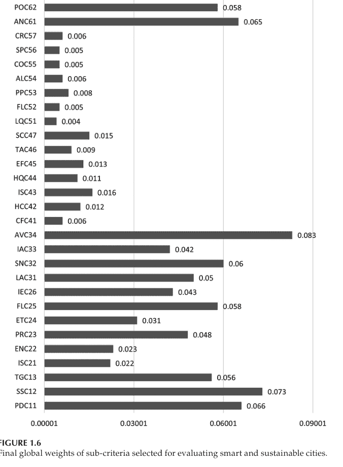

## 图 1.6
选定用于评估智慧和可持续城市的子标准的最终全局权重。

**步骤 14：** 在此阶段，评估过程中确定的城市将根据每个主要标准的子标准进行评估。首先，城市将根据智慧治理标准的子标准进行评估。

**步骤 15：** 决策矩阵是在智慧治理标准的子标准与专家选定的城市之间构建的，使用语言词汇根据公式 (1.20) 如表 1.31 所示，并使用 TFNs 根据公式 (1.21)。

**步骤 16：** 智慧治理标准的子标准与专家选定的城市之间的最终组合决策矩阵根据公式 (1.22) 在表 1.32 中呈现。

## 表 1.31
使用语言词汇根据智慧治理标准对十个城市的决策矩阵

| 专家_s | PDC_1,1 | SSC_1,2 | TGC_1,3 |
|---|---|---|---|
| City1 | ⟨MOT⟩\⟨MOT⟩\⟨MOT⟩ | ⟨LLO⟩\⟨LLO⟩\⟨LLO⟩ | ⟨LLO⟩\⟨LLO⟩\⟨LLO⟩ |
| City2 | ⟨MOT⟩\⟨HIH⟩\⟨EXG⟩ | ⟨LLO⟩\⟨LLO⟩\⟨LLO⟩ | ⟨LLO⟩\⟨LLO⟩\⟨LLO⟩ |
| City3 | ⟨MOT⟩\⟨MOT⟩\⟨MOT⟩ | ⟨HIH⟩\⟨HIH⟩\⟨HIH⟩ | ⟨EXG⟩\⟨EXG⟩\⟨EXG⟩ |
| City4 | ⟨ETL⟩\⟨ETL⟩\⟨ETL⟩ | ⟨LLO⟩\⟨LLO⟩\⟨LLO⟩ | ⟨LLO⟩\⟨LLO⟩\⟨LLO⟩ |
| City5 | ⟨LLO⟩\⟨LLO⟩\⟨LLO⟩ | ⟨LLO⟩\⟨ETL⟩\⟨MOE⟩ | ⟨ETL⟩\⟨ETL⟩\⟨ETL⟩ |
| City6 | ⟨HIH⟩\⟨HIH⟩\⟨HIH⟩ | ⟨HIH⟩\⟨HIH⟩\⟨HIH⟩ | ⟨MOT⟩\⟨MOT⟩\⟨MOT⟩ |
| City7 | ⟨ETL⟩\⟨ETL⟩\⟨ETL⟩ | ⟨LLO⟩\⟨LLO⟩\⟨LLO⟩ | ⟨LLO⟩\⟨LLO⟩\⟨LLO⟩ |
| City8 | ⟨ETL⟩\⟨ETL⟩\⟨ETL⟩ | ⟨LLO⟩\⟨LLO⟩\⟨LLO⟩ | ⟨LLO⟩\⟨LLO⟩\⟨LLO⟩ |
| City9 | ⟨EXG⟩\⟨EXG⟩\⟨EXG⟩ | ⟨EXG⟩\⟨EXG⟩\⟨EXG⟩ | ⟨EXG⟩\⟨EXG⟩\⟨EXG⟩ |
| City10 | ⟨MOT⟩\⟨MOT⟩\⟨MOT⟩ | ⟨HIH⟩\⟨HIH⟩\⟨HIH⟩ | ⟨MOT⟩\⟨MOT⟩\⟨MOT⟩ |

## 表 1.32
使用 TFNs 根据智慧治理标准对十个城市的组合决策矩阵

| 专家_s | PDC_1,1 | SSC_1,2 | TGC_1,3 |
|---|---|---|---|
| City1 | ⟨3, 5, 7⟩ | ⟨1, 3, 5⟩ | ⟨1, 3, 5⟩ |
| City2 | ⟨3, 7, 11⟩ | ⟨1, 3, 5⟩ | ⟨1, 3, 5⟩ |
| City3 | ⟨3, 5, 7⟩ | ⟨5, 7, 9⟩ | ⟨7, 9, 11⟩ |
| City4 | ⟨1, 1, 3⟩ | ⟨1, 3, 5⟩ | ⟨1, 3, 5⟩ |
| City5 | ⟨1, 3, 5⟩ | ⟨1, 3, 7⟩ | ⟨1, 1, 3⟩ |
| City6 | ⟨5, 7, 9⟩ | ⟨5, 7, 9⟩ | ⟨3, 5, 7⟩ |
| City7 | ⟨1, 1, 3⟩ | ⟨1, 3, 5⟩ | ⟨1, 3, 5⟩ |
| City8 | ⟨1, 1, 3⟩ | ⟨1, 3, 5⟩ | ⟨1, 3, 5⟩ |
| City9 | ⟨7, 9, 11⟩ | ⟨7, 9, 11⟩ | ⟨7, 9, 11⟩ |
| City10 | ⟨3, 5, 7⟩ | ⟨5, 7, 9⟩ | ⟨3, 5, 7⟩ |

步骤 17：标准化决策矩阵根据公式 (1.23) 计算，对于有益标准使用公式 (1.24)，对于非有益标准应用公式 (1.25)，如表 1.33 所示。

步骤 18：加权标准化决策矩阵根据公式 (1.26) 如所示计算，通过应用公式 (1.27)，结果在表 1.34 中创建。

步骤 19：FPIS 和 FNIS 通过应用公式 (1.28) 和 (1.29) 计算，如表 1.34 所示。

步骤 20：每个城市到 FPIS 和 FNIS 的距离通过应用公式 (1.11) 计算，如表 1.35 所示。此外，距离

## 表 1.33
根据智慧治理标准对十个城市的归一化决策矩阵

| 专家_s | PDC_1,1 |  |  |  | SSC_1,2 |  |  | TGC_1,3 |  |
|---|---|---|---|---|---|---|---|---|---|
| City_1 | 0.2727 | 0.4545 | 0.6364 | 0.0909 | 0.2727 | 0.4545 | 0.0909 | 0.2727 | 0.4545 |
| City_2 | 0.2727 | 0.6364 | 1.0000 | 0.0909 | 0.2727 | 0.4545 | 0.0909 | 0.2727 | 0.4545 |
| City_3 | 0.2727 | 0.4545 | 0.6364 | 0.4545 | 0.6364 | 0.8182 | 0.6364 | 0.8182 | 1.0000 |
| City_4 | 0.0909 | 0.0909 | 0.2727 | 0.0909 | 0.2727 | 0.4545 | 0.0909 | 0.2727 | 0.4545 |
| City_5 | 0.0909 | 0.2727 | 0.4545 | 0.0909 | 0.2727 | 0.6364 | 0.0909 | 0.0909 | 0.2727 |
| City_6 | 0.4545 | 0.6364 | 0.8182 | 0.4545 | 0.6364 | 0.8182 | 0.2727 | 0.4545 | 0.6364 |
| City_7 | 0.0909 | 0.0909 | 0.2727 | 0.0909 | 0.2727 | 0.4545 | 0.0909 | 0.2727 | 0.4545 |
| City_8 | 0.0909 | 0.0909 | 0.2727 | 0.0909 | 0.2727 | 0.4545 | 0.0909 | 0.2727 | 0.4545 |
| City_9 | 0.6364 | 0.8182 | 1.0000 | 0.6364 | 0.8182 | 1.0000 | 0.6364 | 0.8182 | 1.0000 |
| City_10 | 0.2727 | 0.4545 | 0.6364 | 0.4545 | 0.6364 | 0.8182 | 0.2727 | 0.4545 | 0.6364 |

## 表 1.34
根据智慧治理标准对十个城市的加权归一化决策矩阵

| 专家_s | PDC_1,1 |  |  |  | SSC_1,2 |  |  | TGC_1,3 |  |
|---|---|---|---|---|---|---|---|---|---|
| City_1 | 0.0925 | 0.1541 | 0.2157 | 0.0338 | 0.1015 | 0.1691 | 0.0263 | 0.0788 | 0.1314 |
| City_2 | 0.0925 | 0.2157 | 0.3390 | 0.0338 | 0.1015 | 0.1691 | 0.0263 | 0.0788 | 0.1314 |
| City_3 | 0.0925 | 0.1541 | 0.2157 | 0.1691 | 0.2367 | 0.3044 | 0.1839 | 0.2365 | 0.2890 |
| City_4 | 0.0308 | 0.0308 | 0.0925 | 0.0338 | 0.1015 | 0.1691 | 0.0263 | 0.0788 | 0.1314 |
| City_5 | 0.0308 | 0.0925 | 0.1541 | 0.0338 | 0.1015 | 0.2367 | 0.0263 | 0.0263 | 0.0788 |
| City_6 | 0.1541 | 0.2157 | 0.2774 | 0.1691 | 0.2367 | 0.3044 | 0.0788 | 0.1314 | 0.1839 |
| City_7 | 0.0308 | 0.0308 | 0.0925 | 0.0338 | 0.1015 | 0.1691 | 0.0263 | 0.0788 | 0.1314 |
| City_8 | 0.0308 | 0.0308 | 0.0925 | 0.0338 | 0.1015 | 0.1691 | 0.0263 | 0.0788 | 0.1314 |
| City_9 | 0.2157 | 0.2774 | 0.3390 | 0.2367 | 0.3044 | 0.3720 | 0.1839 | 0.2365 | 0.2890 |
| City_10 | 0.0925 | 0.1541 | 0.2157 | 0.1691 | 0.2367 | 0.3044 | 0.0788 | 0.1314 | 0.1839 |
| A* | 0.2157 | 0.2774 | 0.3390 | 0.2367 | 0.3044 | 0.3720 | 0.1839 | 0.2365 | 0.2890 |
| A- | 0.0308 | 0.0308 | 0.0925 | 0.0338 | 0.1015 | 0.1691 | 0.0263 | 0.0263 | 0.0788 |


## 表 1.35
距离每个备选方案到智能治理标准 FPIS 和 FNIS 的距离

| 专家_s | p_i* | | | Σ_{j=1}^m p(~r_i,~r_j) | p_i^- | | | Σ_{j=1}^m p(~r_i,~r_j) | C_i | 排名 |
|---|---|---|---|---|---|---|---|---|---|---|
| | PDC_1,1 | SSC_1,2 | TGC_1,3 | | PDC_1,1 | SSC_1,2 | TGC_1,3 | | | |
| City1 | 0.1233 | 0.2029 | 0.1576 | 0.4838 | 0.1068 | 0.0000 | 0.0429 | 0.1497 | 0.2363 | 6 |
| City2 | 0.0796 | 0.2029 | 0.1576 | 0.4401 | 0.1815 | 0.0000 | 0.0429 | 0.2244 | 0.3376 | 5 |
| City3 | 0.1233 | 0.0676 | 0.0000 | 0.1909 | 0.1068 | 0.1353 | 0.0429 | 0.2850 | 0.6956 | 2 |
| City4 | 0.2279 | 0.2029 | 0.1576 | 0.5884 | 0.0000 | 0.0000 | 0.0429 | 0.0429 | 0.0680 | 8 |
| City5 | 0.1849 | 0.1832 | 0.1943 | 0.5623 | 0.0503 | 0.0390 | 0.0000 | 0.0894 | 0.1371 | 7 |
| City6 | 0.0616 | 0.0676 | 0.1051 | 0.2344 | 0.1669 | 0.1353 | 0.0910 | 0.3932 | 0.6265 | 3 |
| City7 | 0.2279 | 0.2029 | 0.1576 | 0.5884 | 0.0000 | 0.0000 | 0.0429 | 0.0429 | 0.0680 | 8 |
| City8 | 0.2279 | 0.2029 | 0.1576 | 0.5884 | 0.0000 | 0.0000 | 0.0429 | 0.0429 | 0.0680 | 8 |
| City9 | 0.0000 | 0.0000 | 0.0000 | 0.0000 | 0.2279 | 0.2029 | 0.1943 | 0.6250 | 1.0000 | 1 |
| City10 | 0.1233 | 0.0676 | 0.1051 | 0.2960 | 0.1068 | 0.1353 | 0.0910 | 0.3330 | 0.5294 | 4 |

每个城市与 FPIS 或 FNIS 之间的距离是使用公式 (1.30) 和 (1.31) 计算的。

第 21 步：每个城市的接近系数通过应用公式 (1.32) 计算，如表 1.35 所示。最后，所有城市按升序排名，如表 1.35 和图 1.7 所示。

第 22 步：在此阶段，评估过程中确定的城市根据每个主要标准的子标准进行评估。其次，城市根据智能经济标准的子标准进行评估。

第 23 步：根据公式 (1.20) 如表 1.36 所示，使用语言词汇在智能经济标准的子标准与专家选定的城市之间构建了决策矩阵，并根据公式 (1.21) 使用 TFNs。

第 24 步：智能经济标准的子标准与专家选定的城市之间的最终组合决策矩阵根据公式 (1.22) 在表 1.37 中呈现。

第 25 步：标准化决策矩阵根据公式 (1.23) 计算，对于有益标准使用公式 (1.24)，对于非有益标准应用公式 (1.25)，如表 1.38 所示。

第 26 步：加权标准化决策矩阵根据公式 (1.26) 通过应用公式 (1.27) 计算，结果在表 1.39 中创建。

第 27 步：FPIS 和 FNIS 通过应用公式 (1.28) 和公式 (1.29) 计算，如表 1.39 所示。

第 28 步：每个城市到 FPIS 和 FNIS 的距离通过应用公式 (1.11) 计算，如表 1.40 所示。此外，每个城市与 FPIS 或 FNIS 之间的距离使用公式 (1.30) 和 (1.31) 计算。

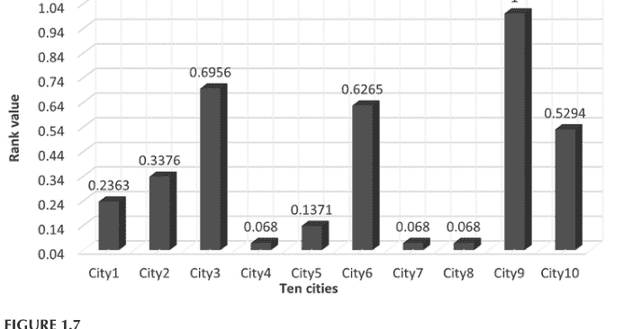

## 图 1.7
根据智能治理标准对十个城市的最终排名。

## 表 1.36
使用语言词汇的根据智能经济标准十个城市的决策矩阵

| 专家_k | ISC_2,1 | ENC_2,2 | PRC_2,3 | ETC_2,4 | FLC_2,5 | IEC_2,6 |
|---|---|---|---|---|---|---|
| City1 | <MOT><MOT><MOT> | <LLO><LLO><LLO> | <LLO><LLO><LLO> | <ETL><ETL><ETL> | <ETL><ETL><ETL> | <HIH><HIH><HIH> |
| City2 | <MOT><HIH><EXG> | <LLO><LLO><HIH> | <LLO><LLO><LLO> | <ETL><MOT><MOT> | <ETL><ETL><ETL> | <EXG><EXG><EXG> |
| City3 | <MOT><MOT><MOT> | <HIH><HIH><HIH> | <EXG><EXG><EXG> | <MOT><MOT><MOT> | <LLO><LLO><LLO> | <HIH><HIH><HIH> |
| City4 | <ETL><ETL><ETL> | <ETL><LOW><LOW> | <LLO><LLO><ETL> | <ETL><ETL><ETL> | <ETL><ETL><ETL> | <MOT><HIH><HIH> |
| City5 | <LLO><LLO><LLO> | <LLO><ETL><MOT> | <ETL><ETL><ETL> | <ETL><ETL><ETL> | <MOT><MOT><MOT> | <MOT><MOT><MOT> |
| City6 | <HIH><HIH><HIH> | <HIH><HIH><HIH> | <MOT><MOT><MOT> | <EXG><EXG><EXG> | <EXG><EXG><EXG> | <EXG><EXG><EXG> |
| City7 | <ETL><ETL><ETL> | <LLO><HIH><HIH> | <LLO><LLO><LLO> | <MOT><MOT><MOT> | <MOT><MOT><MOT> | <MOT><MOT><MOT> |
| City8 | <ETL><ETL><ETL> | <LLO><LLO><LLO> | <LLO><LLO><LLO> | <ETL><ETL><ETL> | <ETL><MOT><ETL> | <MOT><MOT><MOT> |
| City9 | <EXG><EXG><EXG> | <EXG><EXG><EXG> | <EXG><EXG><EXG> | <EXG><EXG><EXG> | <EXG><EXG><EXG> | <EXG><EXG><EXG> |
| City10 | <MOT><MOT><MOT> | <HIH><HIH><HIH> | <MOT><MOT><MOT> | <MOT><MOT><MOT> | <ETL><ETL><ETL> | <HIH><HIH><HIH> |

## 表 1.37
使用 TFNs 的根据智能经济标准十个城市的组合决策矩阵

| 专家_s | ISC_2_1 | ENC_2_2 | PRC_2_3 | ETC_2_4 | FLC_2_5 | IEC_2_6 |
|---|---|---|---|---|---|---|
| City1 | ⟨3, 5, 7⟩ | ⟨1, 3, 5⟩ | ⟨1, 3, 5⟩ | ⟨1, 1, 3⟩ | ⟨1, 1, 3⟩ | ⟨5, 7, 9⟩ |
| City2 | ⟨3, 7, 11⟩ | ⟨1, 3, 5⟩ | ⟨1, 3, 5⟩ | ⟨1, 3.67, 7⟩ | ⟨1, 1, 3⟩ | ⟨7, 9, 11⟩ |
| City3 | ⟨3, 5, 7⟩ | ⟨5, 7, 9⟩ | ⟨7, 9, 11⟩ | ⟨3, 5, 7⟩ | ⟨1, 3, 5⟩ | ⟨5, 7, 9⟩ |
| City4 | ⟨1, 1, 3⟩ | ⟨1, 3, 5⟩ | ⟨1, 3, 5⟩ | ⟨1, 1, 3⟩ | ⟨1, 1, 3⟩ | ⟨5, 7, 9⟩ |
| City5 | ⟨1, 3, 5⟩ | ⟨1, 3, 7⟩ | ⟨1, 1, 3⟩ | ⟨1, 1, 3⟩ | ⟨3, 5, 7⟩ | ⟨3, 5, 7⟩ |
| City6 | ⟨5, 7, 9⟩ | ⟨5, 7, 9⟩ | ⟨3, 5, 7⟩ | ⟨7, 9, 11⟩ | ⟨7, 9, 11⟩ | ⟨7, 9, 11⟩ |
| City7 | ⟨1, 1, 3⟩ | ⟨1, 3, 5⟩ | ⟨1, 3, 5⟩ | ⟨3, 5, 7⟩ | ⟨3, 5, 7⟩ | ⟨3, 5, 7⟩ |
| City8 | ⟨1, 1, 3⟩ | ⟨1, 3, 5⟩ | ⟨1, 3, 5⟩ | ⟨1, 1, 3⟩ | ⟨1, 1, 3⟩ | ⟨3, 5, 7⟩ |
| City9 | ⟨7, 9, 11⟩ | ⟨7, 9, 11⟩ | ⟨7, 9, 11⟩ | ⟨7, 9, 11⟩ | ⟨7, 9, 11⟩ | ⟨7, 9, 11⟩ |
| City10 | ⟨3, 5, 7⟩ | ⟨5, 7, 9⟩ | ⟨3, 5, 7⟩ | ⟨3, 5, 7⟩ | ⟨1, 1, 3⟩ | ⟨5, 7, 9⟩ |

## 表 1.38
根据智能经济标准的十个城市的归一化决策矩阵

| 专家_s | ISC_2_1 | ENC_2_2 | PRC_2_3 | ETC_2_4 | FLC_2_5 | IEC_2_6 |
|---|---|---|---|---|---|---|
| City1 | 0.27 0.45 0.64 | 0.09 0.27 0.45 | 0.09 0.27 0.45 | 0.09 0.09 0.27 | 0.09 0.09 0.27 | 0.45 0.64 0.82 |
| City2 | 0.27 0.64 1.00 | 0.09 0.27 0.45 | 0.09 0.27 0.45 | 0.09 0.33 0.64 | 0.09 0.09 0.27 | 0.64 0.82 1.00 |
| City3 | 0.27 0.45 0.64 | 0.45 0.64 0.82 | 0.64 0.82 1.00 | 0.27 0.45 0.64 | 0.09 0.27 0.45 | 0.45 0.64 0.82 |
| City4 | 0.09 0.09 0.27 | 0.09 0.27 0.45 | 0.09 0.27 0.45 | 0.09 0.09 0.27 | 0.09 0.09 0.27 | 0.45 0.64 0.82 |
| City5 | 0.09 0.27 0.45 | 0.09 0.27 0.64 | 0.09 0.09 0.27 | 0.09 0.09 0.27 | 0.27 0.45 0.64 | 0.27 0.45 0.64 |
| City6 | 0.45 0.64 0.82 | 0.45 0.64 0.82 | 0.27 0.45 0.64 | 0.64 0.82 1.00 | 0.64 0.82 1.00 | 0.64 0.82 1.00 |
| City7 | 0.09 0.09 0.27 | 0.09 0.27 0.45 | 0.09 0.27 0.45 | 0.27 0.45 0.64 | 0.27 0.45 0.64 | 0.27 0.45 0.64 |
| City8 | 0.09 0.09 0.27 | 0.09 0.27 0.45 | 0.09 0.27 0.45 | 0.09 0.09 0.27 | 0.09 0.09 0.27 | 0.27 0.45 0.64 |
| City9 | 0.64 0.82 1.00 | 0.64 0.82 1.00 | 0.64 0.82 1.00 | 0.64 0.82 1.00 | 0.64 0.82 1.00 | 0.64 0.82 1.00 |
| City10 | 0.27 0.45 0.64 | 0.45 0.64 0.82 | 0.27 0.45 0.64 | 0.27 0.45 0.64 | 0.09 0.09 0.27 | 0.45 0.64 0.82 |

第 29 步：每个城市的接近系数通过应用公式 (1.32) 计算，如表 1.40 所示。最后，所有城市按升序排名，如表 1.40 和图 1.8 所示。

第 30 步：在此阶段，评估过程中确定的城市根据每个主要标准的子标准进行评估。第三，城市根据智能移动标准的子标准进行评估。

第 31 步：根据公式 (1.20) 如表 1.41 所示，使用语言词汇在智能移动标准的子标准与专家选定的城市之间构建了决策矩阵，并根据公式 (1.21) 使用 TFNs。

## 表 1.39
根据智能经济标准的十个城市的加权归一化决策矩阵

| 专家_s | 值 |
|---|---|
| City_1 | 0.03 0.04 0.06 0.01 0.03 0.05 0.02 0.06 0.10 0.01 0.01 0.04 0.02 0.02 0.07 0.09 0.12 0.16 |
| City_2 | 0.03 0.06 0.10 0.01 0.03 0.05 0.02 0.06 0.10 0.01 0.05 0.09 0.02 0.02 0.07 0.12 0.16 0.19 |
| City_3 | 0.03 0.04 0.06 0.05 0.06 0.08 0.14 0.18 0.21 0.04 0.06 0.09 0.02 0.07 0.12 0.09 0.12 0.16 |
| City_4 | 0.01 0.01 0.03 0.01 0.03 0.05 0.02 0.06 0.10 0.01 0.01 0.04 0.02 0.02 0.07 0.09 0.12 0.16 |
| City_5 | 0.01 0.03 0.04 0.01 0.03 0.06 0.02 0.02 0.06 0.01 0.01 0.04 0.07 0.12 0.16 0.05 0.09 0.12 |
| City_6 | 0.04 0.06 0.08 0.05 0.06 0.08 0.06 0.10 0.14 0.09 0.11 0.14 0.16 0.21 0.26 0.12 0.16 0.19 |
| City_7 | 0.01 0.01 0.03 0.01 0.03 0.05 0.02 0.06 0.10 0.04 0.06 0.09 0.07 0.12 0.16 0.05 0.09 0.12 |
| City_8 | 0.01 0.01 0.03 0.01 0.03 0.05 0.02 0.06 0.10 0.01 0.01 0.04 0.02 0.02 0.07 0.05 0.09 0.12 |
| City_9 | 0.06 0.08 0.10 0.06 0.08 0.10 0.14 0.18 0.21 0.09 0.11 0.14 0.16 0.21 0.26 0.12 0.16 0.19 |
| City_10 | 0.03 0.04 0.06 0.05 0.06 0.08 0.06 0.10 0.14 0.04 0.06 0.09 0.02 0.02 0.07 0.09 0.12 0.16 |
| A* | 0.06 0.08 0.10 0.06 0.08 0.10 0.14 0.18 0.21 0.09 0.11 0.14 0.16 0.21 0.26 0.12 0.16 0.19 |
| A- | 0.01 0.01 0.03 0.01 0.03 0.05 0.02 0.02 0.06 0.01 0.01 0.04 0.02 0.02 0.07 0.05 0.09 0.12 |

## 表 1.40
距离每个备选方案到智能经济标准 FPIS 和 FNIS 的距离

| 专家_s | Σ_{j=1}^n p(~r_ij, ~r_j*) | Σ_{j=1}^n p(~r_ij, ~r_j-) | C_i | 排名 |
|---|---|---|---|---|
| City_1 | 0.508 | 0.097 | 0.1601 | 8 |
| City_2 | 0.433 | 0.188 | 0.3028 | 5 |
| City_3 | 0.279 | 0.328 | 0.5403 | 3 |
| City_4 | 0.538 | 0.067 | 0.1103 | 9 |
| City_5 | 0.503 | 0.106 | 0.1739 | 7 |
| City_6 | 0.114 | 0.488 | 0.8108 | 2 |
| City_7 | 0.451 | 0.156 | 0.2577 | 6 |
| City_8 | 0.573 | 0.032 | 0.0525 | 10 |
| City_9 | 0.000 | 0.600 | 1.0000 | 1 |
| City_10 | 0.389 | 0.213 | 0.3540 | 4 |

第 32 步：智能移动标准的子标准与专家选定的城市之间的最终组合决策矩阵根据公式 (1.22) 在表 1.42 中呈现。

第 33 步：标准化决策矩阵根据公式 (1.23) 计算，对于有益标准使用公式 (1.24)，对于非有益标准应用公式 (1.25)，如表 1.43 所示。


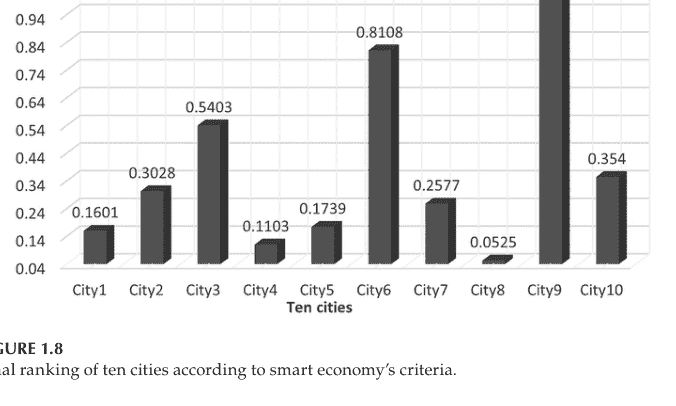

## 图 1.8

根据智慧经济标准对十个城市的最终排名。

步骤 34：加权标准化决策矩阵按式 (1.26) 计算，通过应用式 (1.27)，结果列于表 1.44。
步骤 35：FPIS 和 FNIS 通过应用式 (1.28) 和 (1.29) 计算，如表 1.44 所示。
步骤 36：每个城市到 FPIS 和 FNIS 的距离通过应用式 (1.11) 计算，如表 1.45 所示。此外，每个城市与 FPIS 或 FNIS 之间的距离使用式 (1.30) 和 (1.31) 计算。
步骤 37：每个城市的接近系数通过应用式 (1.32) 计算，如表 1.45 所示。最后，所有城市按升序排名，如表 1.45 和图 1.9 所示。
步骤 38：在此阶段，评估过程中确定的城市根据每个主要标准的子标准进行评估。第四，城市根据智慧生活标准的子标准进行评估。
步骤 39：决策矩阵在智慧生活标准的子标准与专家选定的城市之间构建，使用语言词汇根据式 (1.20) 如表 1.46 所示，并使用 TFNs 根据式 (1.21)。
步骤 40：专家选定的城市与智慧生活标准子标准之间的最终组合决策矩阵根据式 (1.22) 在表 1.47 中给出。
步骤 41：标准化决策矩阵根据式 (1.23) 计算，对有益标准使用式 (1.24)，对非有益标准应用式 (1.25)，如表 1.48 所示。

## 表 1.41

根据语言词汇使用智慧出行标准对十个城市的决策矩阵

| 专家 | LAC_{3,1} | SNC_{3,2} | IAC_{3,3} | AVC_{3,4} |
|---|---|---|---|---|
| City1 | ⟨EXG⟩⟨EXG⟩⟨EXG⟩ | ⟨HIH⟩⟨HIH⟩⟨HIH⟩ | ⟨HIH⟩⟨HIH⟩⟨HIH⟩ | ⟨EXG⟩⟨EXG⟩⟨EXG⟩ |
| City2 | ⟨EXG⟩⟨EXG⟩⟨EXG⟩ | ⟨LOW⟩⟨LOW⟩⟨LOW⟩ | ⟨LLO⟩⟨MOT⟩⟨MOT⟩ | ⟨MOT⟩⟨MOT⟩⟨MOT⟩ |
| City3 | ⟨MOT⟩⟨MOT⟩⟨MOT⟩ | ⟨HIH⟩⟨HIH⟩⟨HIH⟩ | ⟨EXG⟩⟨EXG⟩⟨EXG⟩ | ⟨LLO⟩⟨MOT⟩⟨MOT⟩ |
| City4 | ⟨LLO⟩⟨MOT⟩⟨MOT⟩ | ⟨EXG⟩⟨EXG⟩⟨EXG⟩ | ⟨MOT⟩⟨MOT⟩⟨MOT⟩ | ⟨MOT⟩⟨MOT⟩⟨MOT⟩ |
| City5 | ⟨EXG⟩⟨EXG⟩⟨EXG⟩ | ⟨MOT⟩⟨MOT⟩⟨MOT⟩ | ⟨EXG⟩⟨EXG⟩⟨EXG⟩ | ⟨MOT⟩⟨MOT⟩⟨MOT⟩ |
| City6 | ⟨LLO⟩⟨LLO⟩⟨LLO⟩ | ⟨EXG⟩⟨HIH⟩⟨EXG⟩ | ⟨MOT⟩⟨HIH⟩⟨EXG⟩ | ⟨LOW⟩⟨LOW⟩⟨LOW⟩ |
| City7 | ⟨EXG⟩⟨EXG⟩⟨EXG⟩ | ⟨HIH⟩⟨HIH⟩⟨HIH⟩ | ⟨HIH⟩⟨HIH⟩⟨HIH⟩ | ⟨EXG⟩⟨EXG⟩⟨EXG⟩ |
| City8 | ⟨EXG⟩⟨EXG⟩⟨EXG⟩ | ⟨LLO⟩⟨LLO⟩⟨LLO⟩ | ⟨LLO⟩⟨MOT⟩⟨MOT⟩ | ⟨MOT⟩⟨MOT⟩⟨MOT⟩ |
| City9 | ⟨EXG⟩⟨EXG⟩⟨EXG⟩ | ⟨MOT⟩⟨MOT⟩⟨MOT⟩ | ⟨EXG⟩⟨EXG⟩⟨EXG⟩ | ⟨MOT⟩⟨MOT⟩⟨MOT⟩ |
| City10 | ⟨LLO⟩⟨LLO⟩⟨LLO⟩ | ⟨EXG⟩⟨EXG⟩⟨EXG⟩ | ⟨MOT⟩⟨MOT⟩⟨MOT⟩ | ⟨LLO⟩⟨LLO⟩⟨LLO⟩ |

## 表 1.42

使用 TFNs 根据智慧出行标准对十个城市的组合决策矩阵

| 专家_s | LAC_3_1 | SNC_3_2 | IAC_3_3 | AVC_3_4 |
|---|---|---|---|---|
| City₁ | ⟨7, 9, 11⟩ | ⟨5, 7, 9⟩ | ⟨5, 7, 9⟩ | ⟨7, 9, 11⟩ |
| City₂ | ⟨7, 9, 11⟩ | ⟨1, 3, 5⟩ | ⟨1, 4.33, 7⟩ | ⟨3, 5, 7⟩ |
| City₃ | ⟨1, 4.33, 7⟩ | ⟨7, 9, 11⟩ | ⟨3, 5, 7⟩ | ⟨3, 5, 7⟩ |
| City₄ | ⟨7, 9, 11⟩ | ⟨3, 5, 7⟩ | ⟨7, 9, 11⟩ | ⟨3, 5, 7⟩ |
| City₅ | ⟨1, 3, 5⟩ | ⟨7, 9, 11⟩ | ⟨3, 5, 7⟩ | ⟨1, 3, 5⟩ |
| City₆ | ⟨3, 5, 7⟩ | ⟨3, 5, 7⟩ | ⟨5, 7, 9⟩ | ⟨5, 7, 9⟩ |
| City₇ | ⟨7, 9, 11⟩ | ⟨5, 7, 9⟩ | ⟨5, 7, 9⟩ | ⟨7, 9, 11⟩ |
| City₈ | ⟨7, 9, 11⟩ | ⟨1, 3, 5⟩ | ⟨1, 4.33, 7⟩ | ⟨3, 5, 7⟩ |
| City₉ | ⟨1, 3, 5⟩ | ⟨7, 9, 11⟩ | ⟨3, 5, 7⟩ | ⟨1, 3, 5⟩ |
| City₁₀ | ⟨3, 5, 7⟩ | ⟨3, 5, 7⟩ | ⟨5, 7, 9⟩ | ⟨5, 7, 9⟩ |

## 表 1.43

根据智慧出行标准对十个城市的归一化决策矩阵

| 专家_s | LAC_3_1 | SNC_3_2 | IAC_3_3 | AVC_3_4 |
|---|---|---|---|---|
| City₁ | 0.636 0.818 1.000 | 0.455 0.636 0.818 | 0.455 0.636 0.818 | 0.636 0.818 1.000 |
| City₂ | 0.636 0.818 1.000 | 0.091 0.273 0.455 | 0.091 0.394 0.636 | 0.273 0.455 0.636 |
| City₃ | 0.091 0.394 0.636 | 0.636 0.818 1.000 | 0.273 0.455 0.636 | 0.273 0.455 0.636 |
| City₄ | 0.636 0.818 1.000 | 0.273 0.455 0.636 | 0.636 0.818 1.000 | 0.273 0.455 0.636 |
| City₅ | 0.091 0.273 0.455 | 0.636 0.818 1.000 | 0.273 0.455 0.636 | 0.091 0.273 0.455 |
| City₆ | 0.273 0.455 0.636 | 0.273 0.455 0.636 | 0.455 0.636 0.818 | 0.455 0.636 0.818 |
| City₇ | 0.636 0.818 1.000 | 0.455 0.636 0.818 | 0.455 0.636 0.818 | 0.636 0.818 1.000 |
| City₈ | 0.636 0.818 1.000 | 0.091 0.273 0.455 | 0.091 0.394 0.636 | 0.273 0.455 0.636 |
| City₉ | 0.091 0.273 0.455 | 0.636 0.818 1.000 | 0.273 0.455 0.636 | 0.091 0.273 0.455 |
| City₁₀ | 0.273 0.455 0.636 | 0.273 0.455 0.636 | 0.455 0.636 0.818 | 0.455 0.636 0.818 |

步骤 42：加权标准化决策矩阵按式 (1.26) 所示计算，通过应用式 (1.27)，结果列于表 1.49。
步骤 43：FPIS 和 FNIS 通过应用式 (1.28) 和式 (1.29) 计算，如表 1.49 所示。
步骤 44：每个城市到 FPIS 和 FNIS 的距离通过应用式 (1.11) 计算，如表 1.50 所示。此外，每个城市与 FPIS 或 FNIS 之间的距离使用式 (1.30) 和 (1.31) 计算。
步骤 45：每个城市的接近系数通过应用式 (1.32) 计算，如表 1.50 所示。最后，所有城市按升序排名，如表 1.50 和图 1.10 所示。

## 表 1.44

根据智慧出行标准对十个城市的加权归一化决策矩阵

| 专家_s | LAC3,1_a | LAC3,1_b | LAC3,1_c | SNC3,2_a | SNC3,2_b | SNC3,2_c | IAC3,3_a | IAC3,3_b | IAC3,3_c | AVC3,4_a | AVC3,4_b | AVC3,4_c |
|---|---|---|---|---|---|---|---|---|---|---|---|---|
| City1 | 0.135 | 0.173 | 0.212 | 0.115 | 0.161 | 0.207 | 0.082 | 0.115 | 0.148 | 0.225 | 0.290 | 0.354 |
| City2 | 0.135 | 0.173 | 0.212 | 0.023 | 0.069 | 0.115 | 0.016 | 0.071 | 0.115 | 0.097 | 0.161 | 0.225 |
| City3 | 0.019 | 0.083 | 0.135 | 0.161 | 0.207 | 0.253 | 0.049 | 0.082 | 0.115 | 0.097 | 0.161 | 0.225 |
| City4 | 0.135 | 0.173 | 0.212 | 0.069 | 0.115 | 0.161 | 0.115 | 0.148 | 0.181 | 0.097 | 0.161 | 0.225 |
| City5 | 0.019 | 0.058 | 0.096 | 0.161 | 0.207 | 0.253 | 0.049 | 0.082 | 0.115 | 0.032 | 0.097 | 0.161 |
| City6 | 0.058 | 0.096 | 0.135 | 0.069 | 0.115 | 0.161 | 0.082 | 0.115 | 0.148 | 0.161 | 0.225 | 0.290 |
| City7 | 0.135 | 0.173 | 0.212 | 0.115 | 0.161 | 0.207 | 0.082 | 0.115 | 0.148 | 0.225 | 0.290 | 0.354 |
| City8 | 0.135 | 0.173 | 0.212 | 0.023 | 0.069 | 0.115 | 0.016 | 0.071 | 0.115 | 0.097 | 0.161 | 0.225 |
| City9 | 0.019 | 0.058 | 0.096 | 0.161 | 0.207 | 0.253 | 0.049 | 0.082 | 0.115 | 0.032 | 0.097 | 0.161 |
| City10 | 0.058 | 0.096 | 0.135 | 0.069 | 0.115 | 0.161 | 0.082 | 0.115 | 0.148 | 0.161 | 0.225 | 0.290 |
| A* | 0.135 | 0.173 | 0.212 | 0.161 | 0.207 | 0.253 | 0.115 | 0.148 | 0.181 | 0.225 | 0.290 | 0.354 |
| A- | 0.019 | 0.058 | 0.096 | 0.023 | 0.069 | 0.115 | 0.016 | 0.071 | 0.115 | 0.032 | 0.097 | 0.161 |

步骤 46：在此阶段，评估过程中确定的城市根据每个主要标准的子标准进行评估。第五，城市根据智慧人群标准的子标准进行评估。
步骤 47：决策矩阵在智慧人群标准的子标准与专家选定的城市之间构建，使用语言词汇根据式 (1.20) 如表 1.51 所示，并使用 TFNs 根据式 (1.21)。
步骤 48：专家选定的城市与智慧人群标准子标准之间的最终组合决策矩阵根据式 (1.22) 在表 1.52 中给出。
步骤 49：标准化决策矩阵根据式 (1.23) 计算，对有益标准使用式 (1.24)，对非有益标准应用式 (1.25)，如表 1.53 所示。
步骤 50：加权标准化决策矩阵按式 (1.26) 所示计算，通过应用式 (1.27)，结果列于表 1.54。
步骤 51：FPIS 和 FNIS 通过应用式 (1.28) 和 (1.29) 计算，如表 1.54 所示。
步骤 52：每个城市到 FPIS 和 FNIS 的距离通过应用式 (1.11) 计算，如表 1.55 所示。此外，每个城市与 FPIS 或 FNIS 之间的距离使用式 (1.30) 和 (1.31) 计算。
步骤 53：每个城市的接近系数通过应用式 (1.32) 计算，如表 1.55 所示。最后，所有城市按升序排名，如表 1.55 和图 1.11 所示。


## 表 1.45 智能出行标准下各备选方案到正理想解和负理想解的距离

| 专家_i | p*_LAC_3,1 | p*_SNC_3,2 | p*_IAC_3,3 | p*_AVC_3,4 | p*_sum | p-_LAC_3,1 | p-_SNC_3,2 | p-_IAC_3,3 | p-_AVC_3,4 | p-_sum | C_i | 排名 |
|---|---|---|---|---|---|---|---|---|---|---|---|---|
| City1 | 0.000 | 0.046 | 0.033 | 0.000 | 0.079 | 0.116 | 0.092 | 0.049 | 0.193 | 0.450 | 0.851 | 1 |
| City2 | 0.000 | 0.138 | 0.082 | 0.129 | 0.348 | 0.116 | 0.000 | 0.000 | 0.064 | 0.180 | 0.341 | 5 |
| City3 | 0.000 | 0.000 | 0.066 | 0.129 | 0.290 | 0.027 | 0.138 | 0.020 | 0.064 | 0.249 | 0.462 | 4 |
| City4 | 0.096 | 0.092 | 0.000 | 0.129 | 0.221 | 0.116 | 0.046 | 0.082 | 0.064 | 0.308 | 0.582 | 2 |
| City5 | 0.116 | 0.000 | 0.066 | 0.193 | 0.375 | 0.000 | 0.138 | 0.020 | 0.000 | 0.158 | 0.297 | 6 |
| City6 | 0.077 | 0.092 | 0.033 | 0.064 | 0.266 | 0.039 | 0.046 | 0.049 | 0.129 | 0.263 | 0.497 | 3 |
| City7 | 0.000 | 0.046 | 0.033 | 0.000 | 0.079 | 0.116 | 0.092 | 0.049 | 0.193 | 0.450 | 0.851 | 1 |
| City8 | 0.000 | 0.138 | 0.082 | 0.129 | 0.348 | 0.116 | 0.000 | 0.000 | 0.064 | 0.180 | 0.341 | 5 |
| City9 | 0.116 | 0.000 | 0.066 | 0.193 | 0.375 | 0.000 | 0.138 | 0.020 | 0.000 | 0.158 | 0.297 | 6 |
| City10 | 0.077 | 0.092 | 0.033 | 0.064 | 0.266 | 0.039 | 0.046 | 0.049 | 0.129 | 0.263 | 0.497 | 3 |

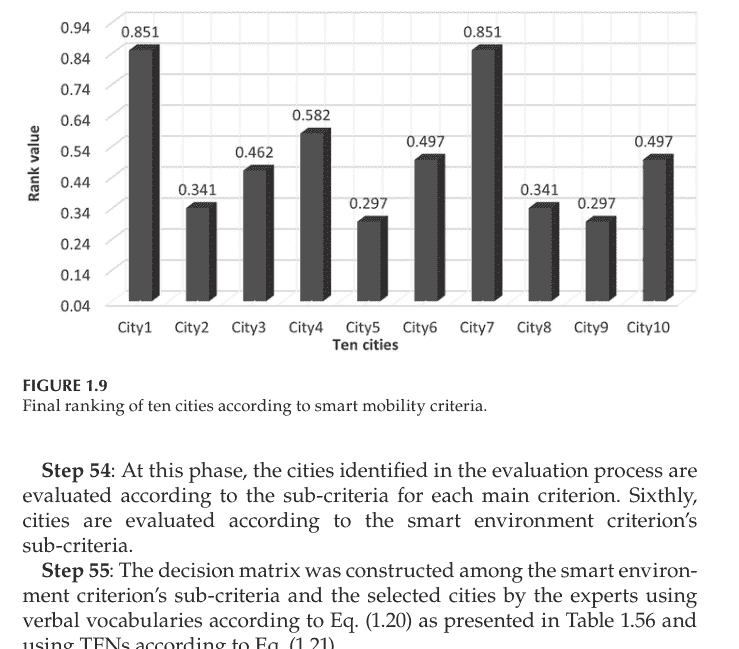

图 1.9
根据智能出行标准对十个城市的最终排名。

步骤 54： 在此阶段，在评估过程中确定的城市根据每个主要标准的子标准进行评估。第六，城市根据智能环境标准的子标准进行评估。

步骤 55： 决策矩阵根据公式 (1.20) 如表 1.56 所示，使用语言词汇在智能环境标准的子标准和专家选定的城市之间构建，并根据公式 (1.21) 使用 TFNs。

步骤 56： 智能环境标准的子标准与专家选定的城市之间的最终组合决策矩阵根据公式 (1.22) 在表 1.57 中呈现。

步骤 57： 标准化决策矩阵根据公式 (1.23) 计算，对于有益标准使用公式 (1.24)，对于非有益标准应用公式 (1.25)，如表 1.58 所示。

步骤 58： 加权标准化决策矩阵如公式 (1.26) 所示通过应用公式 (1.27) 计算，结果在表 1.59 中创建。

步骤 59： FPIS 和 FNIS 通过应用公式 (1.28) 和 (1.29) 计算，如表 1.59 所示。

步骤 60： 每个城市到 FPIS 和 FNIS 的距离通过应用公式 (1.11) 计算，如表 1.60 所示。此外，每个城市与 FPIS 或 FNIS 之间的距离通过使用公式 (1.30) 和 (1.31) 计算。

步骤 61： 每个城市的接近系数通过应用公式 (1.32) 计算，如表 1.60 所示。最后，所有城市按升序排名，如表 1.60 和图 1.12 所示。

**步骤 62：** 在此阶段，城市根据所有子标准进行评估，最终结果在表 1.61 和图 1.13 中呈现。

### 1.5 结果与讨论

在本部分，讨论了将所提出的方法应用于案例研究以评估若干智能可持续城市时获得的结果。最初，确定了六个主要标准和三十一个子标准来评估智能和可持续城市。根据六个主要标准的结果，很明显智能出行标准排名第一，权重为 0.236，其次是智能经济标准，权重为 0.226。相反，智能人群标准排名最后，权重为 0.040。

其次，对每个主要标准的子标准进行了评估，结果构建在表 1.30 中。根据智能治理标准的子标准，很明显公共和社会服务标准以 0.372 的权重位居标准排名之首，而透明治理标准以 0.289 的权重位居排名末位。根据智能经济标准的子标准，很明显劳动力市场灵活性标准以 0.257 的权重位居标准排名之首，而创新精神标准以 0.096 的权重位居排名末位。根据智能出行标准的子标准，很明显可用性

## 表 1.46 使用语言词汇的十个城市根据智能生活标准决策矩阵

| 专家 | CFC_{1,1} | HCC_{1,2} | ISC_{1,3} | HQC_{1,4} | EFC_{1,5} | TAC_{1,6} | SCC_{4,7} |
|---|---|---|---|---|---|---|---|
| City1 | <EXG>/<EXG>/<EXG> | <MOT>/<MOT>/<MOT> | <MOT>/<MOT>/<MOT> | <HIH>/<HIH>/<HIH> | <MOT>/<MOT>/<MOT> | <HIH>/<HIH>/<HIH> | <MOT>/<MOT>/<MOT> |
| City2 | <ETL>/<MOT>/<MOT> | <EXG>/<EXG>/<EXG> | <EXG>/<EXG>/<EXG> | <EXG>/<EXG>/<EXG> | <EXG>/<EXG>/<EXG> | <HIH>/<HIH>/<HIH> | <EXG>/<EXG>/<EXG> |
| City3 | <ETL>/<ETL>/<ETL> | <ETL>/<ETL>/<ETL> | <EXG>/<EXG>/<EXG> | <HIH>/<HIH>/<HIH> | <EXG>/<EXG>/<EXG> | <EXG>/<EXG>/<EXG> | <EXG>/<EXG>/<EXG> |
| City4 | <ETL>/<ETL>/<ETL> | <HIH>/<HIH>/<HIH> | <MOE>/<MOE>/<MOE> | <MOT>/<MOT>/<MOT> | <HIH>/<HIH>/<HIH> | <MOT>/<MOT>/<MOT> | <MOT>/<MOT>/<MOT> |
| City5 | <EXG>/<EXG>/<EXG> | <LLO>/<LLO>/<LLO> | <LLO>/<LLO>/<LLO> | <ETL>/<HIH>/<ETL> | <MOT>/<MOT>/<MOT> | <MOT>/<MOT>/<MOT> | <LLO>/<LLO>/<LLO> |
| City6 | <MOT>/<MOT>/<HIH> | <ETL>/<LLO>/<LLO> | <MOT>/<MOT>/<MOT> | <HIH>/<HIH>/<HIH> | <MOT>/<MOT>/<ETL> | <HIH>/<HIH>/<HIH> | <MOT>/<MOT>/<MOT> |
| City7 | <LLO>/<HIH>/<HIH> | <MOT>/<MOT>/<MOT> | <MOT>/<MOT>/<MOT> | <EXG>/<EXG>/<EXG> | <ETL>/<HIH>/<HIH> | <HIH>/<HIH>/<HIH> | <MOT>/<MOT>/<MOT> |
| City8 | <LLO>/<ETL>/<ETL> | <MOT>/<MOT>/<MOT> | <MOT>/<MOT>/<MOT> | <EXG>/<EXG>/<EXG> | <HIH>/<HIH>/<HIH> | <HIH>/<HIH>/<HIH> | <MOT>/<MOT>/<MOT> |
| City9 | <ETL>/<ETL>/<ETL> | <HIH>/<HIH>/<HIH> | <MOT>/<MOT>/<MOT> | <MOT>/<MOT>/<MOT> | <HIH>/<HIH>/<HIH> | <MOT>/<MOT>/<MOT> | <MOT>/<MOT>/<MOT> |
| City10 | <EXG>/<EXG>/<EXG> | <HIH>/<HIH>/<HIH> | <LLO>/<LLO>/<LLO> | <ETL>/<ETL>/<ETL> | <MOT>/<MOT>/<MOT> | <MOT>/<MOT>/<MOT> | <LLO>/<LLO>/<LLO> |

## 表 1.47 使用 TFNs 的十个城市根据智能生活标准组合决策矩阵

| 专家_s | CFC_{4,1} | HCC_{4,2} | ISC_{4,3} | HQC_{4,4} | EFC_{4,5} | TAC_{4,6} | SCC_{4,7} |
|---|---|---|---|---|---|---|---|
| City1 | ⟨7, 9, 11⟩ | ⟨3, 5, 7⟩ | ⟨3, 5, 7⟩ | ⟨5, 7, 9⟩ | ⟨3, 5, 7⟩ | ⟨5, 7, 9⟩ | ⟨3, 5, 7⟩ |
| City2 | ⟨1, 3.67, 5⟩ | ⟨7, 9, 11⟩ | ⟨7, 9, 11⟩ | ⟨7, 9, 11⟩ | ⟨7, 9, 11⟩ | ⟨5, 7, 9⟩ | ⟨7, 9, 11⟩ |
| City3 | ⟨1, 1, 3⟩ | ⟨1, 1, 3⟩ | ⟨7, 9, 11⟩ | ⟨5, 7, 9⟩ | ⟨7, 9, 11⟩ | ⟨7, 9, 11⟩ | ⟨7, 9, 11⟩ |
| City4 | ⟨1, 1, 3⟩ | ⟨5, 7, 9⟩ | ⟨3, 5, 7⟩ | ⟨3, 5, 7⟩ | ⟨5, 7, 9⟩ | ⟨3, 5, 7⟩ | ⟨3, 5, 7⟩ |
| City5 | ⟨7, 9, 11⟩ | ⟨5, 7, 9⟩ | ⟨1, 3, 5⟩ | ⟨1, 1, 3⟩ | ⟨3, 5, 7⟩ | ⟨3, 5, 7⟩ | ⟨1, 3, 5⟩ |
| City6 | ⟨3, 5, 7⟩ | ⟨1, 3, 5⟩ | ⟨3, 5, 7⟩ | ⟨5, 7, 9⟩ | ⟨1, 4.33, 7⟩ | ⟨5, 7, 9⟩ | ⟨3, 5, 7⟩ |
| City7 | ⟨5, 7, 9⟩ | ⟨1, 1.67, 5⟩ | ⟨3, 5, 7⟩ | ⟨7, 9, 11⟩ | ⟨1, 1, 3⟩ | ⟨5, 7, 9⟩ | ⟨3, 5, 7⟩ |
| City8 | ⟨1, 3, 5⟩ | ⟨3, 5, 7⟩ | ⟨3, 5, 7⟩ | ⟨7, 9, 11⟩ | ⟨5, 7, 9⟩ | ⟨5, 7, 9⟩ | ⟨3, 5, 7⟩ |
| City9 | ⟨1, 1, 3⟩ | ⟨5, 7, 9⟩ | ⟨3, 5, 7⟩ | ⟨3, 5, 7⟩ | ⟨5, 7, 9⟩ | ⟨3, 5, 7⟩ | ⟨3, 5, 7⟩ |
| City10 | ⟨7, 9, 11⟩ | ⟨5, 7, 9⟩ | ⟨1, 3, 5⟩ | ⟨1, 1, 3⟩ | ⟨3, 5, 7⟩ | ⟨3, 5, 7⟩ | ⟨1, 3, 5⟩ |

## 表 1.48 根据智能生活标准对十个城市的归一化决策矩阵

| 专家 | CFC_{1,1} 1 | CFC_{1,1} 2 | CFC_{1,1} 3 | HCC_{4,2} 1 | HCC_{4,2} 2 | HCC_{4,2} 3 | ISC_{1,3} 1 | ISC_{1,3} 2 | ISC_{1,3} 3 | HQC_{4,4} 1 | HQC_{4,4} 2 | HQC_{4,4} 3 | EFC_{4,5} 1 | EFC_{4,5} 2 | EFC_{4,5} 3 | TAC_{4,6} 1 | TAC_{4,6} 2 | TAC_{4,6} 3 | SCC_{4,7} 1 | SCC_{4,7} 2 | SCC_{4,7} 3 |
|---|---|---|---|---|---|---|---|---|---|---|---|---|---|---|---|---|---|---|---|---|---|
| City1 | 0.64 | 0.82 | 1.00 | 0.27 | 0.45 | 0.64 | 0.27 | 0.45 | 0.64 | 0.45 | 0.64 | 0.82 | 0.27 | 0.45 | 0.64 | 0.45 | 0.64 | 0.82 | 0.27 | 0.45 | 0.64 |
| City2 | 0.09 | 0.33 | 0.45 | 0.64 | 0.82 | 1.00 | 0.64 | 0.82 | 1.00 | 0.64 | 0.82 | 1.00 | 0.64 | 0.82 | 1.00 | 0.45 | 0.64 | 0.82 | 0.64 | 0.82 | 1.00 |
| City3 | 0.09 | 0.09 | 0.27 | 0.09 | 0.09 | 0.27 | 0.64 | 0.82 | 1.00 | 0.45 | 0.64 | 0.82 | 0.64 | 0.82 | 1.00 | 0.64 | 0.82 | 1.00 | 0.64 | 0.82 | 1.00 |
| City4 | 0.09 | 0.09 | 0.27 | 0.45 | 0.64 | 0.82 | 0.27 | 0.45 | 0.64 | 0.27 | 0.45 | 0.64 | 0.45 | 0.64 | 0.82 | 0.27 | 0.45 | 0.64 | 0.27 | 0.45 | 0.64 |
| City5 | 0.64 | 0.82 | 1.00 | 0.45 | 0.64 | 0.82 | 0.09 | 0.27 | 0.45 | 0.09 | 0.27 | 0.45 | 0.27 | 0.45 | 0.64 | 0.45 | 0.64 | 0.82 | 0.09 | 0.27 | 0.45 |
| City6 | 0.27 | 0.45 | 0.64 | 0.09 | 0.27 | 0.45 | 0.27 | 0.45 | 0.64 | 0.09 | 0.27 | 0.45 | 0.09 | 0.27 | 0.45 | 0.45 | 0.64 | 0.82 | 0.27 | 0.45 | 0.64 |
| City7 | 0.45 | 0.64 | 0.82 | 0.09 | 0.15 | 0.45 | 0.27 | 0.45 | 0.64 | 0.64 | 0.82 | 1.00 | 0.09 | 0.09 | 0.27 | 0.45 | 0.64 | 0.82 | 0.27 | 0.45 | 0.64 |
| City8 | 0.09 | 0.27 | 0.45 | 0.27 | 0.45 | 0.64 | 0.27 | 0.45 | 0.64 | 0.64 | 0.82 | 1.00 | 0.45 | 0.64 | 0.82 | 0.45 | 0.64 | 0.82 | 0.27 | 0.45 | 0.64 |
| City9 | 0.09 | 0.09 | 0.27 | 0.45 | 0.64 | 0.82 | 0.27 | 0.45 | 0.64 | 0.27 | 0.45 | 0.64 | 0.45 | 0.64 | 0.82 | 0.27 | 0.45 | 0.64 | 0.27 | 0.45 | 0.64 |
| City10 | 0.64 | 0.82 | 1.00 | 0.45 | 0.64 | 0.82 | 0.09 | 0.27 | 0.45 | 0.09 | 0.27 | 0.45 | 0.27 | 0.45 | 0.64 | 0.27 | 0.45 | 0.64 | 0.09 | 0.27 | 0.45 |


## 表 1.49 根据智慧生活标准对十个城市的加权归一化决策矩阵

| 专家 | CFC1,1 | HCC1,2 | ISC1,3 | HQC1,4 | EFC1,5 | TAC1,6 | SCC1,7 |
|---|---|---|---|---|---|---|---|
| 城市1 | 0.05 0.06 | 0.07 0.09 | 0.05 0.08 | 0.05 0.12 | 0.06 0.09 | 0.12 0.04 | 0.07 0.10 |
| 城市2 | 0.01 0.03 | 0.12 0.15 | 0.12 0.15 | 0.03 0.14 | 0.13 0.10 | 0.16 0.05 | 0.10 0.08 |
| 城市3 | 0.01 0.02 | 0.01 0.04 | 0.12 0.15 | 0.01 0.12 | 0.13 0.10 | 0.16 0.08 | 0.11 0.10 |
| 城市4 | 0.01 0.02 | 0.09 0.12 | 0.05 0.08 | 0.07 0.09 | 0.10 0.07 | 0.13 0.03 | 0.05 0.08 |
| 城市5 | 0.05 0.08 | 0.09 0.01 | 0.02 0.05 | 0.07 0.04 | 0.07 0.04 | 0.10 0.03 | 0.02 0.05 |
| 城市6 | 0.02 0.05 | 0.04 0.07 | 0.05 0.08 | 0.01 0.12 | 0.06 0.01 | 0.10 0.05 | 0.05 0.08 |
| 城市7 | 0.03 0.06 | 0.02 0.01 | 0.05 0.08 | 0.01 0.12 | 0.01 0.01 | 0.05 0.05 | 0.05 0.08 |
| 城市8 | 0.01 0.03 | 0.07 0.04 | 0.05 0.08 | 0.04 0.14 | 0.01 0.07 | 0.05 0.05 | 0.05 0.08 |
| 城市9 | 0.01 0.02 | 0.09 0.07 | 0.05 0.08 | 0.07 0.09 | 0.10 0.07 | 0.13 0.03 | 0.05 0.08 |
| 城市10 | 0.05 0.08 | 0.09 0.07 | 0.02 0.05 | 0.07 0.01 | 0.07 0.04 | 0.10 0.03 | 0.02 0.05 |
| A* | 0.05 0.08 | 0.07 0.09 | 0.05 0.08 | 0.04 0.12 | 0.07 0.04 | 0.10 0.05 | 0.05 0.08 |
| A- | 0.01 0.03 | 0.12 0.09 | 0.12 0.15 | 0.09 0.12 | 0.13 0.10 | 0.16 0.05 | 0.11 0.10 |

## 表 1.50 每个备选方案与智慧生活标准 FPIS 和 FNIS 的距离

| 专家_i | $\sum_{j=1}^{n} p(\tilde{r}_{ij}, \tilde{r}_j^*)$ | $\sum_{j=1}^{n} p(\tilde{r}_{ij}, \tilde{r}_j^-)$ | $C_i$ | 排名 |
|---|---|---|---|---|
| 城市$_1$ | 0.289 | 0.303 | 0.512 | 4 |
| 城市$_2$ | 0.062 | 0.530 | 0.896 | 1 |
| 城市$_3$ | 0.174 | 0.416 | 0.705 | 2 |
| 城市$_4$ | 0.332 | 0.259 | 0.438 | 5 |
| 城市$_5$ | 0.419 | 0.172 | 0.291 | 8 |
| 城市$_6$ | 0.357 | 0.245 | 0.408 | 6 |
| 城市$_7$ | 0.358 | 0.236 | 0.397 | 7 |
| 城市$_8$ | 0.276 | 0.317 | 0.535 | 3 |
| 城市$_9$ | 0.332 | 0.259 | 0.438 | 5 |
| 城市$_{10}$ | 0.419 | 0.172 | 0.291 | 8 |

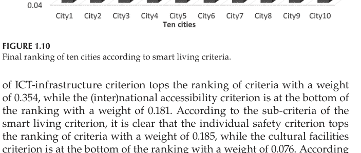

## 图 1.10 根据智慧生活标准对十个城市的最终排名。

信息通信技术基础设施标准以 0.354 的权重位居标准排名榜首，而（国际）可达性标准则以 0.181 的权重位居排名末位。根据智慧生活标准的子标准，很明显个人安全标准以 0.185 的权重位居标准排名榜首，而文化设施标准则以 0.076 的权重位居排名末位。根据智慧人群标准的子标准，很明显公众生活参与标准以 0.135 的权重位居标准排名榜首，而资格水平标准则位居榜尾的

## 表 1.51 使用语言词汇对十个城市根据智慧人群标准进行决策矩阵

| 专家 | LQC_{5,1} | FLC_{5,2} | PPC_{5,3} | ALC_{5,4} | COC_{5,5} | SPC_{5,6} | CRC_{5,7} |
|---|---|---|---|---|---|---|---|
| 城市1 | ⟨MOT⟩/⟨MOT⟩/⟨MOT⟩ | ⟨LLO⟩/⟨LLO⟩/⟨LLO⟩ | ⟨MOT⟩/⟨MOT⟩/⟨MOT⟩ | ⟨HIH⟩/⟨HIH⟩/⟨HIH⟩ | ⟨HIH⟩/⟨HIH⟩/⟨HIH⟩ | ⟨HIH⟩/⟨HIH⟩/⟨HIH⟩ | ⟨EXG⟩/⟨EXG⟩/⟨EXG⟩ |
| 城市2 | ⟨EXG⟩/⟨EXG⟩/⟨EXG⟩ | ⟨ETL⟩/⟨ETL⟩/⟨LOW⟩ | ⟨EXG⟩/⟨MOT⟩/⟨EXG⟩ | ⟨EXG⟩/⟨HIH⟩/⟨EXG⟩ | ⟨EXG⟩/⟨HIH⟩/⟨EXG⟩ | ⟨HIH⟩/⟨HIH⟩/⟨HIH⟩ | ⟨ETL⟩/⟨MOT⟩/⟨MOT⟩ |
| 城市3 | ⟨EXG⟩/⟨EXG⟩/⟨EXG⟩ | ⟨MOT⟩/⟨MOT⟩/⟨MOT⟩ | ⟨EXG⟩/⟨EXG⟩/⟨EXG⟩ | ⟨HIH⟩/⟨HIH⟩/⟨HIH⟩ | ⟨EXG⟩/⟨EXG⟩/⟨EXG⟩ | ⟨EXG⟩/⟨EXG⟩/⟨EXG⟩ | ⟨ETL⟩/⟨ETL⟩/⟨ETL⟩ |
| 城市4 | ⟨MOT⟩/⟨MOT⟩/⟨MOT⟩ | ⟨HIH⟩/⟨HIH⟩/⟨HIH⟩ | ⟨MOT⟩/⟨MOT⟩/⟨MOT⟩ | ⟨MOT⟩/⟨MOT⟩/⟨MOT⟩ | ⟨MOT⟩/⟨MOT⟩/⟨MOT⟩ | ⟨MOT⟩/⟨MOT⟩/⟨MOT⟩ | ⟨ETL⟩/⟨ETL⟩/⟨ETL⟩ |
| 城市5 | ⟨LLO⟩/⟨LLO⟩/⟨LLO⟩ | ⟨HIH⟩/⟨HIH⟩/⟨HIH⟩ | ⟨LLO⟩/⟨LLO⟩/⟨LLO⟩ | ⟨ETL⟩/⟨MOT⟩/⟨ETL⟩ | ⟨ETL⟩/⟨MOT⟩/⟨ETL⟩ | ⟨MOT⟩/⟨MOT⟩/⟨MOT⟩ | ⟨EXG⟩/⟨EXG⟩/⟨EXG⟩ |
| 城市6 | ⟨MOT⟩/⟨HIH⟩/⟨MOT⟩ | ⟨MOT⟩/⟨MOT⟩/⟨MOT⟩ | ⟨HIH⟩/⟨HIH⟩/⟨HIH⟩ | ⟨MOT⟩/⟨EXG⟩/⟨MOT⟩ | ⟨MOT⟩/⟨ETL⟩/⟨MOT⟩ | ⟨MOT⟩/⟨MOT⟩/⟨MOT⟩ | ⟨MOT⟩/⟨MOT⟩/⟨MOT⟩ |
| 城市7 | ⟨HIH⟩/⟨HIH⟩/⟨HIH⟩ | ⟨EXG⟩/⟨EXG⟩/⟨EXG⟩ | ⟨HIH⟩/⟨HIH⟩/⟨HIH⟩ | ⟨EXG⟩/⟨EXG⟩/⟨EXG⟩ | ⟨ETL⟩/⟨ETL⟩/⟨ETL⟩ | ⟨MOT⟩/⟨MOT⟩/⟨MOT⟩ | ⟨MOT⟩/⟨MOT⟩/⟨MOT⟩ |
| 城市8 | ⟨LLO⟩/⟨LLO⟩/⟨LLO⟩ | ⟨ETL⟩/⟨ETL⟩/⟨ETL⟩ | ⟨HIH⟩/⟨HIH⟩/⟨HIH⟩ | ⟨EXG⟩/⟨EXG⟩/⟨EXG⟩ | ⟨HIH⟩/⟨HIH⟩/⟨HIH⟩ | ⟨MOT⟩/⟨MOT⟩/⟨MOT⟩ | ⟨MOT⟩/⟨MOT⟩/⟨MOT⟩ |
| 城市9 | ⟨ETL⟩/⟨ETL⟩/⟨ETL⟩ | ⟨HIH⟩/⟨HIH⟩/⟨HIH⟩ | ⟨MOT⟩/⟨MOT⟩/⟨MOT⟩ | ⟨HIH⟩/⟨HIH⟩/⟨HIH⟩ | ⟨HIH⟩/⟨HIH⟩/⟨HIH⟩ | ⟨MOT⟩/⟨MOT⟩/⟨MOT⟩ | ⟨MOT⟩/⟨MOT⟩/⟨MOT⟩ |
| 城市10 | ⟨EXG⟩/⟨EXG⟩/⟨EXG⟩ | ⟨HIH⟩/⟨HIH⟩/⟨HIH⟩ | ⟨MOT⟩/⟨MOT⟩/⟨MOT⟩ | ⟨MOT⟩/⟨MOT⟩/⟨MOT⟩ | ⟨MOT⟩/⟨MOT⟩/⟨MOT⟩ | ⟨LLO⟩/⟨LLO⟩/⟨LLO⟩ | ⟨LLO⟩/⟨LLO⟩/⟨LLO⟩ |

## 表 1.52 使用 TFNs 对十个城市根据智慧人群标准进行组合决策矩阵

| 专家_k | CFC₁,₁ | HCC₄,₂ | ISC₁,₃ | HQC₁,₄ | EFC₁,₅ | TAC₄,₆ | SCC₁,₇ |
|---|---|---|---|---|---|---|---|
| 城市₁ | ⟨3,5,7⟩ | ⟨1,3,5⟩ | ⟨3,5,7⟩ | ⟨5,7,9⟩ | ⟨5,7,9⟩ | ⟨5,7,9⟩ | ⟨7,9,11⟩ |
| 城市₂ | ⟨7,9,11⟩ | ⟨1,1,6,7,5⟩ | ⟨7,9,11⟩ | ⟨7,9,11⟩ | ⟨7,9,11⟩ | ⟨7,9,11⟩ | ⟨1,3,6,7,5⟩ |
| 城市₃ | ⟨7,9,11⟩ | ⟨3,5,7⟩ | ⟨7,9,11⟩ | ⟨5,7,9⟩ | ⟨7,9,11⟩ | ⟨7,9,11⟩ | ⟨1,1,3⟩ |
| 城市₄ | ⟨3,5,7⟩ | ⟨5,7,9⟩ | ⟨3,5,7⟩ | ⟨5,5,7⟩ | ⟨3,5,7⟩ | ⟨3,5,7⟩ | ⟨1,1,3⟩ |
| 城市₅ | ⟨1,3,5⟩ | ⟨5,7,9⟩ | ⟨1,3,5⟩ | ⟨1,1,3⟩ | ⟨1,1,3⟩ | ⟨3,5,7⟩ | ⟨7,9,11⟩ |
| 城市₆ | ⟨3,5,7⟩ | ⟨3,5,7⟩ | ⟨7,9,11⟩ | ⟨3,5,7⟩ | ⟨1,4,4,3,7⟩ | ⟨3,5,7⟩ | ⟨3,5,7⟩ |
| 城市₇ | ⟨5,7,9⟩ | ⟨7,9,11⟩ | ⟨1,3,6,7,5⟩ | ⟨7,9,11⟩ | ⟨1,1,3⟩ | ⟨3,5,7⟩ | ⟨3,5,7⟩ |
| 城市₈ | ⟨1,3,5⟩ | ⟨1,1,3⟩ | ⟨1,1,3⟩ | ⟨7,9,11⟩ | ⟨5,7,9⟩ | ⟨3,5,7⟩ | ⟨3,5,7⟩ |
| 城市₉ | ⟨1,1,3⟩ | ⟨5,7,9⟩ | ⟨1,1,3⟩ | ⟨5,7,9⟩ | ⟨5,7,9⟩ | ⟨3,5,7⟩ | ⟨3,5,7⟩ |
| 城市₁₀ | ⟨7,9,11⟩ | ⟨5,7,9⟩ | ⟨7,9,11⟩ | ⟨3,5,7⟩ | ⟨3,5,7⟩ | ⟨1,3,5⟩ | ⟨1,3,5⟩ |

## 表 1.53 根据智慧人群标准对十个城市的归一化决策矩阵

| 专家_s | CFC1,1_1 | CFC1,1_2 | CFC1,1_3 | HCC1,2_1 | HCC1,2_2 | HCC1,2_3 | ISC1,3_1 | ISC1,3_2 | ISC1,3_3 | HQC1,4_1 | HQC1,4_2 | HQC1,4_3 | EFC1,5_1 | EFC1,5_2 | EFC1,5_3 | TAC1,6_1 | TAC1,6_2 | TAC1,6_3 | SCC1,7_1 | SCC1,7_2 | SCC1,7_3 |
|---|---|---|---|---|---|---|---|---|---|---|---|---|---|---|---|---|---|---|---|---|---|
| 城市1 | 0.27 | 0.45 | 0.09 | 0.27 | 0.45 | 0.64 | 0.45 | 0.64 | 0.27 | 0.45 | 0.64 | 0.82 | 0.45 | 0.64 | 0.82 | 0.45 | 0.64 | 0.82 | 0.64 | 0.82 | 1.00 |
| 城市2 | 0.64 | 0.82 | 0.09 | 0.15 | 0.45 | 1.00 | 0.82 | 1.00 | 0.64 | 0.64 | 0.82 | 1.00 | 0.64 | 0.82 | 1.00 | 0.45 | 0.64 | 0.82 | 0.09 | 0.33 | 0.45 |
| 城市3 | 0.64 | 0.82 | 0.27 | 0.45 | 0.64 | 0.27 | 0.82 | 1.00 | 0.64 | 0.45 | 0.64 | 0.82 | 0.64 | 0.82 | 1.00 | 0.64 | 0.82 | 1.00 | 0.09 | 0.09 | 0.27 |
| 城市4 | 0.27 | 0.45 | 0.45 | 0.64 | 0.82 | 0.82 | 0.45 | 0.64 | 0.27 | 0.27 | 0.45 | 0.64 | 0.27 | 0.45 | 0.64 | 0.45 | 0.64 | 0.64 | 0.09 | 0.09 | 0.27 |
| 城市5 | 0.09 | 0.27 | 0.45 | 0.45 | 0.64 | 0.45 | 0.27 | 0.45 | 0.09 | 0.09 | 0.27 | 0.27 | 0.09 | 0.27 | 0.27 | 0.45 | 0.64 | 0.64 | 0.64 | 0.82 | 1.00 |
| 城市6 | 0.27 | 0.45 | 0.27 | 0.45 | 0.64 | 0.64 | 0.82 | 1.00 | 0.64 | 0.27 | 0.45 | 0.64 | 0.39 | 0.64 | 0.64 | 0.27 | 0.45 | 0.64 | 0.27 | 0.45 | 0.64 |
| 城市7 | 0.45 | 0.64 | 0.64 | 0.82 | 1.00 | 0.45 | 0.33 | 0.45 | 0.09 | 0.64 | 0.82 | 1.00 | 0.09 | 0.27 | 0.27 | 0.27 | 0.45 | 0.64 | 0.27 | 0.45 | 0.64 |
| 城市8 | 0.09 | 0.27 | 0.09 | 0.09 | 0.27 | 0.64 | 0.09 | 0.27 | 0.09 | 0.64 | 0.82 | 1.00 | 0.64 | 0.82 | 0.82 | 0.45 | 0.64 | 0.64 | 0.27 | 0.45 | 0.64 |
| 城市9 | 0.09 | 0.27 | 0.45 | 0.64 | 0.82 | 0.82 | 0.09 | 0.27 | 0.09 | 0.45 | 0.64 | 0.82 | 0.45 | 0.64 | 0.82 | 0.45 | 0.64 | 0.64 | 0.27 | 0.45 | 0.64 |
| 城市10 | 0.64 | 0.82 | 0.45 | 0.64 | 0.82 | 0.82 | 0.82 | 1.00 | 0.64 | 0.27 | 0.45 | 0.64 | 0.27 | 0.45 | 0.64 | 0.09 | 0.27 | 0.45 | 0.09 | 0.27 | 0.45 |

## 表 1.54 根据智慧人群标准对十个城市的加权归一化决策矩阵

| 专家 | CFC1,1 | HCC1,2 | ISC1,3 | HQC1,4 | EFC1,5 | TAC1,6 | SCC1,7 |
|---|---|---|---|---|---|---|---|
| 城市1 | 0.03 / 0.05 | 0.04 / 0.06 | 0.09 / 0.05 | 0.12 / 0.07 | 0.10 / 0.13 | 0.06 / 0.08 | 0.11 / 0.09 |
| 城市2 | 0.07 / 0.09 | 0.02 / 0.06 | 0.16 / 0.12 | 0.20 / 0.10 | 0.13 / 0.15 | 0.08 / 0.11 | 0.05 / 0.01 |
| 城市3 | 0.07 / 0.09 | 0.06 / 0.09 | 0.16 / 0.12 | 0.20 / 0.07 | 0.10 / 0.13 | 0.08 / 0.11 | 0.01 / 0.01 |
| 城市4 | 0.03 / 0.05 | 0.09 / 0.11 | 0.09 / 0.05 | 0.12 / 0.04 | 0.07 / 0.10 | 0.04 / 0.08 | 0.01 / 0.01 |
| 城市5 | 0.01 / 0.05 | 0.09 / 0.11 | 0.05 / 0.02 | 0.09 / 0.01 | 0.01 / 0.04 | 0.04 / 0.08 | 0.09 / 0.12 |
| 城市6 | 0.03 / 0.05 | 0.06 / 0.09 | 0.16 / 0.12 | 0.20 / 0.04 | 0.07 / 0.10 | 0.04 / 0.08 | 0.04 / 0.07 |
| 城市7 | 0.05 / 0.07 | 0.11 / 0.14 | 0.07 / 0.02 | 0.09 / 0.10 | 0.13 / 0.15 | 0.04 / 0.11 | 0.04 / 0.07 |
| 城市8 | 0.01 / 0.03 | 0.01 / 0.04 | 0.02 / 0.02 | 0.05 / 0.07 | 0.13 / 0.15 | 0.01 / 0.11 | 0.04 / 0.07 |
| 城市9 | 0.01 / 0.01 | 0.09 / 0.11 | 0.02 / 0.02 | 0.05 / 0.04 | 0.10 / 0.13 | 0.01 / 0.08 | 0.04 / 0.07 |
| 城市10 | 0.07 / 0.05 | 0.09 / 0.11 | 0.16 / 0.12 | 0.20 / 0.04 | 0.07 / 0.10 | 0.04 / 0.11 | 0.01 / 0.04 |
| A* | 0.07 / 0.09 | 0.11 / 0.14 | 0.16 / 0.12 | 0.20 / 0.10 | 0.13 / 0.15 | 0.08 / 0.13 | 0.09 / 0.12 |
| A- | 0.01 / 0.03 | 0.01 / 0.04 | 0.02 / 0.02 | 0.05 / 0.01 | 0.01 / 0.04 | 0.04 / 0.04 | 0.01 / 0.01 |


## 表 1.55
每个备选方案到 FPIS 和 FNIS 的距离——智慧人群标准

| 专家_i | $\sum_{j=1}^{n} p(\tilde{r}_{ij}, \tilde{r}_j^*)$ | $\sum_{j=1}^{n} p(\tilde{r}_{ij}, \tilde{r}_j^-)$ | $C_i$ | 排名 |
|---|---|---|---|---|
| 城市$_1$ | 0.259 | 0.376 | 0.592 | 3 |
| 城市$_2$ | 0.202 | 0.479 | 0.703 | 1 |
| 城市$_3$ | 0.220 | 0.431 | 0.662 | 2 |
| 城市$_4$ | 0.379 | 0.253 | 0.400 | 8 |
| 城市$_5$ | 0.418 | 0.225 | 0.350 | 10 |
| 城市$_6$ | 0.314 | 0.324 | 0.508 | 5 |
| 城市$_7$ | 0.351 | 0.312 | 0.471 | 6 |
| 城市$_8$ | 0.399 | 0.244 | 0.379 | 9 |
| 城市$_9$ | 0.365 | 0.287 | 0.440 | 7 |
| 城市$_{10}$ | 0.291 | 0.393 | 0.575 | 4 |

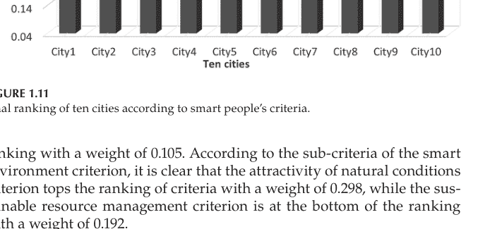

## 图 1.11
根据智慧人群标准对十个城市的最终排名。

权重为 0.105 的排名。根据智慧环境标准的子标准，很明显自然条件吸引力标准以 0.298 的权重位居标准排名之首，而可持续资源管理标准则以 0.192 的权重位居排名末尾。

第三，根据各子标准对主标准权重的影响计算了所有子标准的全局权重。很明显 ICT 基础设施可用性标准的权重最高，为

## 表 1.56 根据口头词汇使用智慧环境标准对十个城市的决策矩阵

| 专家_k | ANC_e,1 | POC_e,2 | ENC_e,3 | SRC_e,4 |
|---|---|---|---|---|
| 城市1 | ⟨HIH⟩⟨HIH⟩⟨HIH⟩ | ⟨HIH⟩⟨HIH⟩⟨HIH⟩ | ⟨EXG⟩⟨EXG⟩⟨EXG⟩ | ⟨EXG⟩⟨EXG⟩⟨EXG⟩ |
| 城市2 | ⟨LLO⟩⟨LLO⟩⟨LLO⟩ | ⟨LOW⟩⟨LOW⟩⟨LOW⟩ | ⟨MOT⟩⟨MOT⟩⟨MOT⟩ | ⟨MOT⟩⟨MOT⟩⟨MOT⟩ |
| 城市3 | ⟨MOT⟩⟨MOT⟩⟨LLO⟩ | ⟨HIH⟩⟨HIH⟩⟨HIH⟩ | ⟨LLO⟩⟨MOT⟩⟨MOT⟩ | ⟨LLO⟩⟨MOT⟩⟨MOT⟩ |
| 城市4 | ⟨EXG⟩⟨EXG⟩⟨EXG⟩ | ⟨EXG⟩⟨EXG⟩⟨EXG⟩ | ⟨MOT⟩⟨MOT⟩⟨MOT⟩ | ⟨MOT⟩⟨MOT⟩⟨MOT⟩ |
| 城市5 | ⟨EXG⟩⟨EXG⟩⟨EXG⟩ | ⟨MOT⟩⟨MOT⟩⟨MOT⟩ | ⟨EXG⟩⟨EXG⟩⟨EXG⟩ | ⟨MOT⟩⟨MOT⟩⟨MOT⟩ |
| 城市6 | ⟨LLO⟩⟨LLO⟩⟨LLO⟩ | ⟨EXG⟩⟨EXG⟩⟨EXG⟩ | ⟨MOT⟩⟨HIH⟩⟨MOT⟩ | ⟨LOW⟩⟨LOW⟩⟨LOW⟩ |
| 城市7 | ⟨EXG⟩⟨EXG⟩⟨EXG⟩ | ⟨EXG⟩⟨EXG⟩⟨EXG⟩ | ⟨HIH⟩⟨HIH⟩⟨HIH⟩ | ⟨HIH⟩⟨HIH⟩⟨HIH⟩ |
| 城市8 | ⟨EXG⟩⟨EXG⟩⟨EXG⟩ | ⟨EXG⟩⟨EXG⟩⟨EXG⟩ | ⟨LLO⟩⟨MOT⟩⟨MOT⟩ | ⟨LLO⟩⟨MOT⟩⟨MOT⟩ |
| 城市9 | ⟨EXG⟩⟨EXG⟩⟨EXG⟩ | ⟨MOT⟩⟨EXG⟩⟨MOT⟩ | ⟨EXG⟩⟨EXG⟩⟨EXG⟩ | ⟨EXG⟩⟨EXG⟩⟨EXG⟩ |
| 城市10 | ⟨LLO⟩⟨LLO⟩⟨LLO⟩ | ⟨LLO⟩⟨MOT⟩⟨MOT⟩ | ⟨MOT⟩⟨MOT⟩⟨MOT⟩ | ⟨MOT⟩⟨MOT⟩⟨MOT⟩ |

## 表 1.57
使用 TFNs 根据智慧环境标准对十个城市的组合决策矩阵

| 专家₅ | ANC₆₁ | POC₆₂ | ENC₆₃ | SRC₆₄ |
|---|---|---|---|---|
| 城市₁ | ⟨5,7,9⟩ | ⟨5,7,9⟩ | ⟨7,9,11⟩ | ⟨7,9,11⟩ |
| 城市₂ | (1,3,5) | (1,3,5) | ⟨3,5,7⟩ | ⟨3,5,7⟩ |
| 城市₃ | ⟨7,9,11⟩ | ⟨7,9,11⟩ | (1,3,5) | ⟨3,5,7⟩ |
| 城市₄ | (3,5,7) | ⟨3,5,7⟩ | ⟨5,7,9⟩ | ⟨3,5,7⟩ |
| 城市₅ | (1,3,5) | ⟨7,9,11⟩ | ⟨3,5,7⟩ | ⟨1,3,5⟩ |
| 城市₆ | ⟨3,5,7⟩ | ⟨3,5,7⟩ | ⟨5,7,9⟩ | ⟨5,7,9⟩ |
| 城市₇ | ⟨7,9,11⟩ | ⟨7,9,11⟩ | ⟨5,7,9⟩ | ⟨5,7,9⟩ |
| 城市₈ | ⟨7,9,11⟩ | ⟨7,9,11⟩ | ⟨1,4.33,7⟩ | ⟨1,4.33,7⟩ |
| 城市₉ | (1,3,5) | ⟨1,4.33,7⟩ | ⟨3,5,7⟩ | ⟨3,5,7⟩ |
| 城市₁₀ | ⟨3,5,7⟩ | ⟨7,9,11⟩ | ⟨5,7,9⟩ | ⟨7,9,11⟩ |

## 表 1.58
根据智慧环境标准对十个城市的归一化决策矩阵

| 专家₅ | ANC₆₁_a | ANC₆₁_b | ANC₆₁_c | POC₆₂_a | POC₆₂_b | POC₆₂_c | ENC₆₃_a | ENC₆₃_b | ENC₆₃_c | SRC₆₄_a | SRC₆₄_b | SRC₆₄_c |
|---|---|---|---|---|---|---|---|---|---|---|---|---|
| 城市₁ | 0.455 | 0.636 | 0.818 | 0.455 | 0.636 | 0.818 | 0.636 | 0.818 | 1.000 | 0.636 | 0.818 | 1.000 |
| 城市₂ | 0.091 | 0.273 | 0.455 | 0.091 | 0.273 | 0.455 | 0.273 | 0.455 | 0.636 | 0.273 | 0.455 | 0.636 |
| 城市₃ | 0.636 | 0.818 | 1.000 | 0.636 | 0.818 | 1.000 | 0.091 | 0.273 | 0.455 | 0.273 | 0.455 | 0.636 |
| 城市₄ | 0.273 | 0.455 | 0.636 | 0.273 | 0.455 | 0.636 | 0.455 | 0.636 | 0.818 | 0.273 | 0.455 | 0.636 |
| 城市₅ | 0.091 | 0.273 | 0.455 | 0.636 | 0.818 | 1.000 | 0.273 | 0.455 | 0.636 | 0.091 | 0.273 | 0.455 |
| 城市₆ | 0.273 | 0.455 | 0.636 | 0.273 | 0.455 | 0.636 | 0.455 | 0.636 | 0.818 | 0.455 | 0.636 | 0.818 |
| 城市₇ | 0.636 | 0.818 | 1.000 | 0.636 | 0.818 | 1.000 | 0.455 | 0.636 | 0.818 | 0.455 | 0.636 | 0.818 |
| 城市₈ | 0.636 | 0.818 | 1.000 | 0.636 | 0.818 | 1.000 | 0.091 | 0.394 | 0.636 | 0.091 | 0.394 | 0.636 |
| 城市₉ | 0.091 | 0.273 | 0.455 | 0.091 | 0.394 | 0.636 | 0.273 | 0.455 | 0.636 | 0.273 | 0.455 | 0.636 |
| 城市₁₀ | 0.273 | 0.455 | 0.636 | 0.636 | 0.818 | 1.000 | 0.455 | 0.636 | 0.818 | 0.636 | 0.818 | 1.000 |

数值为 0.083，其次是公共和社会服务标准，权重为 0.073，而资格水平标准以 0.004 的权重位居最后。

最后，根据每个主标准的各子标准的局部权重对智慧和可持续城市进行了排名。根据智慧治理标准子标准的局部权重，很明显迪拜市以 1.000 的权重位居排名最高，其次是柏林市，权重为 0.6956，而莫斯科、悉尼和洛杉矶市以 0.068 的权重并列最后，如表 1.35 和图 1.7 所示。此外，根据局部权重的

## 表 1.59
根据智慧环境标准对十个城市的加权归一化决策矩阵

| 专家^a | ANC_{e,1} | ANC_{e,1} | ANC_{e,1} | POC_{e,2} | POC_{e,2} | POC_{e,2} | ENC_{e,3} | ENC_{e,3} | ENC_{e,3} | SRC_{e,4} | SRC_{e,4} | SRC_{e,4} |
|---|---|---|---|---|---|---|---|---|---|---|---|---|
| 城市1 | 0.135 | 0.190 | 0.244 | 0.121 | 0.170 | 0.218 | 0.155 | 0.199 | 0.243 | 0.122 | 0.157 | 0.192 |
| 城市2 | 0.027 | 0.081 | 0.135 | 0.024 | 0.073 | 0.121 | 0.066 | 0.110 | 0.155 | 0.052 | 0.087 | 0.122 |
| 城市3 | 0.190 | 0.244 | 0.298 | 0.170 | 0.218 | 0.267 | 0.022 | 0.066 | 0.110 | 0.052 | 0.087 | 0.122 |
| 城市4 | 0.081 | 0.135 | 0.190 | 0.073 | 0.121 | 0.170 | 0.110 | 0.155 | 0.199 | 0.052 | 0.087 | 0.122 |
| 城市5 | 0.027 | 0.081 | 0.135 | 0.170 | 0.218 | 0.267 | 0.066 | 0.110 | 0.155 | 0.017 | 0.052 | 0.087 |
| 城市6 | 0.081 | 0.135 | 0.190 | 0.073 | 0.121 | 0.170 | 0.110 | 0.155 | 0.199 | 0.087 | 0.122 | 0.157 |
| 城市7 | 0.190 | 0.244 | 0.298 | 0.170 | 0.218 | 0.267 | 0.110 | 0.155 | 0.199 | 0.087 | 0.122 | 0.157 |
| 城市8 | 0.190 | 0.244 | 0.298 | 0.170 | 0.218 | 0.267 | 0.022 | 0.096 | 0.155 | 0.017 | 0.076 | 0.122 |
| 城市9 | 0.027 | 0.081 | 0.135 | 0.024 | 0.105 | 0.170 | 0.066 | 0.110 | 0.155 | 0.052 | 0.087 | 0.122 |
| 城市10 | 0.081 | 0.135 | 0.190 | 0.170 | 0.218 | 0.267 | 0.110 | 0.155 | 0.199 | 0.122 | 0.157 | 0.192 |
| A* | 0.190 | 0.244 | 0.298 | 0.170 | 0.218 | 0.267 | 0.155 | 0.199 | 0.243 | 0.122 | 0.157 | 0.192 |
| A- | 0.027 | 0.081 | 0.135 | 0.024 | 0.073 | 0.121 | 0.022 | 0.066 | 0.110 | 0.017 | 0.052 | 0.087 |

## 表 1.60
每个备选方案到 FPIS 和 FNIS 的距离——智慧环境标准

| 专家_s | p_i* ANC_{s,1} | p_i* POC_{s,2} | p_i* ENC_{s,3} | p_i* SRC_{s,4} | sum_{j=1}^n p(\tilde r_i, \tilde r_j) | p_i^- ANC_{s,1} | p_i^- POC_{s,2} | p_i^- ENC_{s,3} | p_i^- SRC_{s,4} | sum_{j=1}^n p(\tilde r_i, \tilde r_j) | C_i | 排名 |
|---|---|---|---|---|---|---|---|---|---|---|---|---|
| 城市1 | 0.054 | 0.049 | 0.000 | 0.000 | 0.103 | 0.108 | 0.097 | 0.133 | 0.105 | 0.443 | 0.812 | 2 |
| 城市2 | 0.163 | 0.146 | 0.088 | 0.070 | 0.466 | 0.000 | 0.000 | 0.044 | 0.035 | 0.079 | 0.145 | 10 |
| 城市3 | 0.000 | 0.000 | 0.133 | 0.070 | 0.202 | 0.163 | 0.146 | 0.000 | 0.035 | 0.343 | 0.629 | 5 |
| 城市4 | 0.108 | 0.097 | 0.044 | 0.070 | 0.319 | 0.054 | 0.049 | 0.088 | 0.025 | 0.226 | 0.414 | 7 |
| 城市5 | 0.163 | 0.000 | 0.088 | 0.105 | 0.356 | 0.000 | 0.146 | 0.044 | 0.000 | 0.190 | 0.348 | 8 |
| 城市6 | 0.108 | 0.097 | 0.044 | 0.035 | 0.285 | 0.054 | 0.049 | 0.088 | 0.070 | 0.261 | 0.478 | 6 |
| 城市7 | 0.000 | 0.000 | 0.044 | 0.035 | 0.079 | 0.163 | 0.146 | 0.088 | 0.070 | 0.466 | 0.855 | 1 |
| 城市8 | 0.000 | 0.000 | 0.110 | 0.087 | 0.196 | 0.163 | 0.146 | 0.031 | 0.024 | 0.363 | 0.649 | 4 |
| 城市9 | 0.163 | 0.120 | 0.088 | 0.070 | 0.441 | 0.000 | 0.034 | 0.044 | 0.055 | 0.113 | 0.204 | 9 |
| 城市10 | 0.108 | 0.000 | 0.044 | 0.000 | 0.153 | 0.054 | 0.146 | 0.088 | 0.105 | 0.393 | 0.720 | 3 |


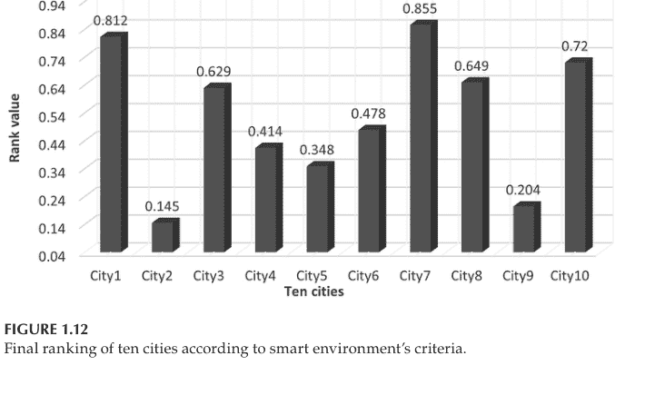

图 1.12
根据智能环境标准对十个城市的最终排名。

## 表 1.61

根据所有子标准，每个备选方案到 FPIS 和 FNIS 的距离

| 备选方案 | $\sum_{j=1}^{n} p(\tilde{r}_{ij}, \tilde{r}_i^*)$ | $\sum_{j=1}^{n} p(\tilde{r}_{ij}, \tilde{r}_i^-)$ | C_i | 排名 |
|---|---|---|---|---|
| City_1 | 0.284 | 0.294 | 0.509 | 10 |
| City_2 | 0.379 | 3.092 | 0.891 | 5 |
| City_3 | 0.235 | 4.383 | 0.949 | 2 |
| City_4 | 0.400 | 3.062 | 0.885 | 6 |
| City_5 | 0.439 | 1.876 | 0.810 | 8 |
| City_6 | 0.238 | 0.915 | 0.794 | 9 |
| City_7 | 0.296 | 2.011 | 0.872 | 7 |
| City_8 | 0.407 | 4.211 | 0.912 | 4 |
| City_9 | 0.226 | 4.391 | 0.951 | 1 |
| City_10 | 0.287 | 3.174 | 0.917 | 3 |

关于智能经济标准的子标准，很明显迪拜市在排名中最高，权重为 1.000，其次是东京市，权重为 0.8108，而洛杉矶市排名最后，权重为 0.0525，如表 1.40 和图 1.8 所示。然后，根据智能出行标准的子标准的局部权重，很明显马德里市和悉尼市在排名中最高，权重为 0.851，其次是莫斯科市，权重为 0.582，而香港市和迪拜市排名最后，权重为 0.297，如表 1.45 和图 1.9 所示。在此方面，根据智能生活标准的子标准的局部权重，很明显巴黎市在排名中最高，权重为 0.896，其次是柏林市，权重为 0.705，而香港市和纽约市排名最后，权重为 0.291，如表 1.50 和图 1.10 所示。之后，根据智能人群标准的子标准的局部权重，很明显巴黎市在排名中最高，权重为 0.703，其次是柏林市，权重为 0.662，而香港市排名最后，权重为 0.350，如表 1.55 和图 1.11 所示。最终，根据智能环境标准的子标准的局部权重，很明显悉尼市在排名中最高，权重为 0.855，其次是马德里市，权重为 0.812，而巴黎市排名最后，权重为 0.145，如表 1.60 和图 1.12 所示。

总之，根据根据 31 个子标准对所选城市的评估，很明显迪拜市是最可持续和最智能的城市，权重值为 0.951，其次是柏林市，权重为 0.949。相反，马德里是最不可持续和最不智能的城市，权重为 0.509，如表 1.61 和图 1.13 所示。

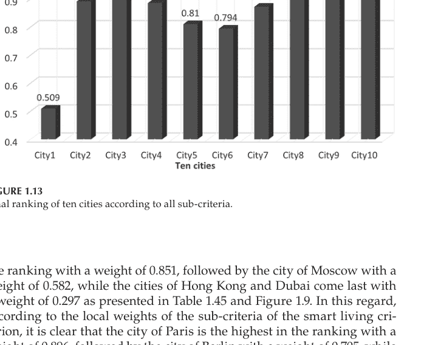

图 1.13
根据所有子标准对十个城市的最终排名。

### 1.6 总结

- 本章提供了智能城市的全面描述。
- 本章回顾了智能城市在智能城市特征和形成方面的特点。
- 本章在对大量研究文章进行全面分析后，提出了用于评估智能和可持续城市的最重要标准。
- 本章提出了一种用于多标准决策制定的混合方法，由两种模糊 ANP-模糊 TOPSIS 方法组成。
- 本章提出了一个实际案例研究，评估世界各地的一系列城市。

## 参考文献

Ghosh, Subrata, Nilanjana Das Chatterjee, and Santanu Dinda. 2021. “利用集成 DEMATEL-ANP 和 CA-Markov 模型的城市生态安全评估与预测：印度加尔各答都市区案例研究。” Sustainable Cities and Society 68: 102773. https://doi.org/10.1016/j.scs.2021.102773.

Kumar, Shashank, Rakesh D. Raut, Kirti Nayal, Sascha Kraus, Vinay Surendra Yadav, and Balkrishna E. Narkhede. 2021. “利用 ISM-ANP 识别农业供应链中工业 4.0 和循环经济采用障碍。” Journal of Cleaner Production 293: 126023. https://doi.org/10.1016/j.jclepro.2021.126023.

Liu, Xiahui, Qianwang Deng, Guiliang Gong, Xingdong Zhao, and Kexin Li. 2021. “基于灰色 DEMATEL-ANP 方法评估可持续产品-服务系统多维价值的相互作用。” Journal of Manufacturing Systems 60: 449–58. https://doi.org/10.1016/j.jmsy.2021.07.006.

Mardani Shahri, Majid, Abdolhamid Eshraghniaye Jahromi, and Mahmoud Houshmand. 2021. “在毕达哥拉斯模糊环境下使用聚类和 MCDM 集成方法进行失效模式与影响分析。” Journal of Loss Prevention in the Process Industries 72: 104591. https://doi.org/10.1016/j.jlp.2021.104591.

Patil, Sachin K, and Ravi Kant. 2014. “基于模糊 DEMATEL 和 FMCDM 的混合方法预测供应链知识管理采用成功。” Applied Soft Computing 18: 126–35. https://doi.org/10.1016/j.asoc.2014.01.027.

Saaty, Thomas L. 2001. “Decision Making with Dependence and Feedback: The Analytic Network Process : The Organization and Prioritization of Complexity,” 370. http://books.google.com/books?id=MGpaAAAAYAAJ&pgis=1.

Solangi, Yasir Ahmed, Cheng Longsheng, and Syed Ahsan Ali Shah. 2021. “评估并克服巴基斯坦可持续发展中的可再生能源障碍：集成的 AHP 和模糊 TOPSIS 方法。” Renewable Energy 173: 209–22. https://doi.org/10.1016/j.renene.2021.03.141.

Yoon, Kwangsun, and Ching-Lai Hwang. 1985. “基于多属性决策的制造厂选址分析：第一部分——单厂策略。” International Journal of Production Research 23 (2): 345–59. https://doi.org/10.1080/00207548508904712.

Zadeh, Lotfi Asker. 1975. “语言变量的概念及其在近似推理中的应用—I。” Information Sciences 8 (3): 199–249. https://doi.org/10.1016/0020-0255(75)90036-5.

## 2

## 评估智能健康技术的概念设计与评估框架

### 2.1 引言

个人和社会健康非常重要。它是幸福的核心。从经济角度来看，医疗保健是世界上最重要的行业之一。随着新数字技术的发展，现代医疗保健正在快速发展，更多疾病得以治愈。智能技术，如宽带互联网和移动通信技术、可穿戴电子设备、物联网、云计算、机器人等，为治疗方法提供了新的改进，因此医疗行业正在发生变化。智能健康是指利用智能技术监测居民健康状况来提供医疗服务。得益于这些智能技术的能力，人工智能和机器学习正成为健康专业人士在疾病预防、诊断、治疗和术后服务方面的关键助手。因此，智能技术处于健康技术研究和开发的最前沿。大学、健康机构和健康技术公司都在这一领域获得丰厚收益。每天，医疗保健中智能技术应用的数量都在增长。本章的目标之一是提供有关智能技术在医疗行业中使用方面的建议和信息。

通过改进的健康应用，开发智能健康技术的采用和实施可能会改善生活条件。智能健康解决方案中最重要的成就是技术与以人为本系统参与的平衡应用。利用智能健康技术提供有效医疗服务，例如通过大数据定制药物、治疗和护理中的机器人以及为医生提供人工智能帮助等。此外，智能健康帮助个人进行预防性护理

and therapeutic services while also improving their living situations. Individuals who may have limited access to health services now have access to these services because of smart health solutions.

Health is one of the most important areas where new digital technologies give these benefits. This area employs a variety of technologies, including cloud computing, the Internet of Things (IoT), big data, artificial intelligence (AI), and robots. The amount of data gathered in the area of health is quickly expanding because of the Internet of Things and the adoption of wearable health devices. Decision support systems that leverage big data analytics assist healthcare practitioners in making rapid and efficient judgments. Big data analytic tools and apps trigger new advances in patient behavior, treatment costs, and R&D. AI is also becoming one of the most widely employed technologies in the area of medicine. For instance, AI is used to analyze pathology data. With its capacity to access massive databases, AI assists clinicians in making therapy choices by scanning identical symptoms and their analysis findings in any nation across the globe.

Poor healthcare technology has the potential to kill people. As a result, the region in which smart health technology will be implemented should be thoroughly analyzed before the most appropriate technology is chosen. Because these assessments are based on people's desires and expectations, they might sometimes be hazy and imprecise. As a result, smart health solutions may be chosen based on carefully chosen parameters. This chapter also aims to present a paradigm for the healthcare industry in terms of smart health technology selection and assessment. As a result, smart health technology assessment is treated as a multi-criteria decision-making (MCDM) issue. The MCDM area comprises ideas and methods for achieving the “best suitable” answer for a decision scenario that fulfills several competing criteria. It is both a strategy and a set of procedures or approaches for assisting individuals who are confronted with various, non-uniform, and sometimes competing challenges in making choices that are acceptable to their own value judgments.

The mixed structure of smart health technology assessment includes a set of contradicting criteria. It is tough to decide on and assess the material that is of an unclear nature. A fuzzy linguistic term set technique is used to deal with the ambiguity in this MCDM situation. This method may be used to help professionals make better decisions in difficult and ambiguous circumstances. It enables professionals to quickly convey their thoughts using words rather than figures, allowing them to pick the best option. It provides more realistic outcomes. This chapter suggests an integrated fuzzy linguistic MCDM framework to assess smart health technologies. The fuzzy Analytic Hierarchy Process weights the criteria (AHP), and alternatives are ranked with the fuzzy VIseKriterijumska Optimizacija I Kompromisno Resenje (VIKOR) method.

## 2.2 MCDM Model

In this part, a hybrid MCDM approach to evaluating smart health technologies has been presented. For the purpose of this task, we find fuzzy AHP and fuzzy VIKOR methods to be the best approach to solve this problem, prioritize criteria, and rank selected alternatives. Figure 2.1 indicates the research approach guiding this study, where the AHP method is used as an initial development level of the analysis, which is then completed with the help of experts to compute the weights of the key criteria and their sub-criteria for the pairwise comparison matrix. Then, the fuzzy VIKOR method is used to select the best alternative to smart health technologies based on the available criteria. To take scholars, undergraduates, interested parties, and researchers through our analysis process and attempt to provide a comprehensive context for our work, we then provide a detailed description of the fuzzy AHP and fuzzy VIKOR methods used in this study.

### 2.2.1 Fuzzy Set Theory

Zadeh (1975) began by outlining the theory’s central concept. Each element in a fuzzy set must be given a membership degree based on fuzzy set theory. Each element’s membership degree is inside a particular interval, which is often [0, 1]. The most frequent fuzzy membership functions are monotone, triangular, and trapezoidal (Abdel-Basset, Gamal, and Teleb 2022). A triangular fuzzy number (TFN) is employed in most fuzzy settings owing to its ease of computation. TFN is also often used in most studies to represent a fuzzy number (Du and Li 2021). The membership grade function of a TFN B̃ = (B^l, B^m, B^u) is introduced as follows:

```
μ_\tilde{B}(x) = { (x - B^l)/(B^m - B^l) ; (B^u - x)/(B^u - B^m) ; 0 }
```

### 2.2.2 Fuzzy AHP

In the 1970s, T.L. Saaty created the AHP approach (Liu, Eckert, and Earl 2020). The AHP that Saaty represents is known as a traditional AHP. AHP is a great strategy since it uses consistency measure to improve decision-making learning. The AHP technique is an MCDM methodology that examines the issue at many levels of hierarchy. Using a pairwise comparison matrix, this approach has the ability to identify quantitative and qualitative variables (Solangi, Longsheng, and Shah 2021). The pairwise comparison is the foundation of the AHP approach. The preferences are

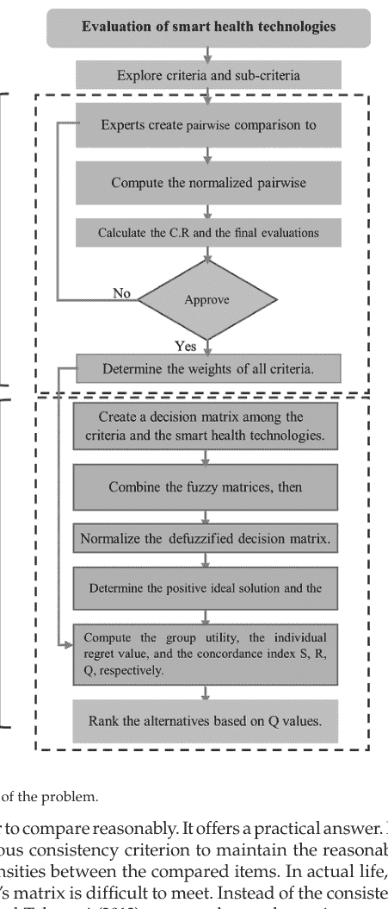

## FIGURE 2.1
问题的建议方案。

entered in order to compare reasonably. It offers a practical answer. However, there is a rigorous consistency criterion to maintain the reasonableness of preference intensities between the compared items. In actual life, this condition for Saaty’s matrix is difficult to meet. Instead of the consistency criterion, Jandová and Talasová (2013) portrayed a weak consistency condition. The weak consistency criteria are quite natural and appropriate for Saaty’s scale linguistic descriptions. Another difficulty with the AHP is that it

makes judgments based on true attributes. For example, in certain circumstances, human emotions are unreliable, and the analyst may be unable to apply accurate numerical values to examination judgments.

### 2.2.3 Fuzzy VIKOR

In MCDM, the VIKOR strategy is a more often used method for handling issues with many competing criteria. The low and simple computational steps are one of the reasons for this method’s high use for ranking alternatives compared to other MCDM approaches. The VIKOR technique offers and employs compromise solutions to rank alternatives based on incompatible and incommensurable criteria. According to some writers, using a compromise solution is the method’s greatest benefit and strength compared to other techniques. The VIKOR technique is a compromise approach for ranking alternatives based on incompatible and incommensurable criteria (Opricovic and Tzeng 2004). The compromise solution refers to an approach that seeks a ranking order by balancing anticipated and pessimistic alternatives. Like other MCDM techniques, the VIKOR method may be integrated with fuzzy set theory (Hosseini, Paydar, and Hajiaghaei-Keshteli 2021). In the present chapter, we apply this technique to rank some of the smart health technologies.

### 2.2.4 The Mathematical Steps of the Hybrid MCDM Framework

The main steps of the hybrid approach, which combines the fuzzy AHP and fuzzy VIKOR methods, are briefly introduced as follows:

- **Step 1:** 选择一组专家与作者分享评估智能健康技术所选问题的基本信息。在此之前，必须为专家的选择建立基本标准。首先，在所研究领域的工作年限不得少于5年。其次，参与专家的学术学位不得低于硕士学位。
- **Step 2:** 仔细研究该问题以确定研究的主要目标。还确定了影响该问题的主要和子标准。接下来，将一系列智能健康技术确定为备选方案。
- **Step 3:** 将问题分为几个层次。第一层代表问题的主要目标。第二层代表影响最佳备选方案选择的基本标准及其子因素。第三层代表所使用的备选方案，其根据问题确定。
- **Step 4:** 识别用于评估主要标准及其子标准的语言术语和相应的 TFN，如表 2.1 所示。还选择了语言术语和相应的 TFN 来对所选备选方案进行排序，如表 2.2 所示。


## 表 2.1

语言术语及其用于加权准则的对应三角模糊数

| 语言术语 | 含义 | 缩写 | TFN ⟨l_ij, m_ij, u_ij⟩ | 倒数 ⟨1/u_ij, 1/m_ij, 1/l_ij⟩ |
|---|---|---|---|---|
| 同等重要 | 1 | ⟨LMP⟩ | ⟨1, 1, 1⟩ | ⟨1, 1, 1⟩ |
| 同等到中度更重要 | 2 | ⟨EMP⟩ | ⟨1, 2, 3⟩ | ⟨1/3, 1/2, 1⟩ |
| 中度更重要 | 3 | ⟨MPM⟩ | ⟨2, 3, 4⟩ | ⟨1/4, 1/3, 1/2⟩ |
| 略微更重要到非常重要 | 4 | ⟨JVM⟩ | ⟨3, 4, 5⟩ | ⟨1/5, 1/4, 1/3⟩ |
| 极其重要 | 5 | ⟨XMM⟩ | ⟨4, 5, 6⟩ | ⟨1/6, 1/5, 1/4⟩ |
| 极其重要到非常非常重要 | 6 | ⟨XMV⟩ | ⟨5, 6, 7⟩ | ⟨1/7, 1/6, 1/5⟩ |
| 非常极其重要 | 7 | ⟨VXM⟩ | ⟨6, 7, 8⟩ | ⟨1/8, 1/7, 1/6⟩ |
| 非常极其重要到完全更重要 | 8 | ⟨VVP⟩ | ⟨7, 8, 9⟩ | ⟨1/9, 1/8, 1/7⟩ |
| 完全更重要 | 9 | ⟨PFM⟩ | ⟨8, 9, 10⟩ | ⟨1/10, 1/9, 1/8⟩ |

## 表 2.2

语言术语及其用于评估备选方案的对应三角模糊数

| 语言术语 | 缩写 | TFN ⟨l_ij, m_ij, u_ij⟩ |
|---|---|---|
| 极低 | ⟨XLL⟩ | ⟨1, 1, 3⟩ |
| 低 | ⟨LOO⟩ | ⟨1, 3, 5⟩ |
| 中等 | ⟨MDE⟩ | ⟨3, 5, 7⟩ |
| 高 | ⟨HHH⟩ | ⟨5, 7, 9⟩ |
| 极高 | ⟨EHH⟩ | ⟨7, 9, 11⟩ |

### 第 5 步：按照公式 (2.1) 由每位专业人士生成准则与其自身之间的成对比较矩阵 (G)，使用表 1.1 中的语言术语，然后按照公式 (2.2) 所示使用三角模糊数。

```
CC1   CC2   ...   CCn
G = CC1 (  -      x12    ...   x1i )
    CC2 ( 1/x21   -      ...   x2i )
    :   ( 1/x31  1/x32   -     ... )
    CCn ( 1/xj1  1/xj2  1/xj3  -   )
(2.1)
```

其中 $(x_{ij})$，$i, j=1, 2... n$，且 $x_{ij}$ 是关于第 $j$ 个元素 $CC_1, CC_2, ..., CC_j$ 对第 $i$ 个元素 $CC_1, CC_2, ..., CC_i$ 的准则评估。此外，矩阵的主对角线等于 1，使得 $x_{ij}$ 等于 1。

$G = \begin{array}{c|cccc} & CC_1 & CC_2 & \dots & CC_n \ \hline CC_1 & - & \langle l_{12}, m_{12}, u_{12}\rangle & \dots & \langle l_{1i}, m_{1i}, u_{1i}\rangle \ CC_2 & 1/\langle u_{21}, m_{21}, l_{21}\rangle & - & \dots & \vdots & 1/\langle u_{31}, m_{31}, l_{31}\rangle & 1/\langle u_{32}, m_{32}, l_{32}\rangle & - & \dots \ CC_n & 1/\langle u_{j1}, m_{j1}, l_{j1}\rangle & 1/\langle u_{j2}, m_{j2}, l_{j2}\rangle & 1/\langle u_{j3}, m_{j3}, l_{j3}\rangle & - \end{array}$ (2.2)

其中 $l$、$m$ 和 $u$ 分别表征下限、中值和上限。

### 第 6 步：使用公式 (2.3) 计算第 $i$ 个准则与其他准则比较的几何平均值。

$xe_i = \left( \prod_{j=1}^{N} x_{ij} \right)^{1/n} \quad i = 1,2,3,...,N$ (2.3)

### 第 7 步：通过应用公式 (2.4) 将第 $i$ 个准则的模糊权重计算为三角模糊数。此外，模糊权重通过将每个模糊权重除以模糊权重的总和进行标准化，如公式 (2.4) 所示。

$w_i = xe_i \times (xe_1 + xe_2 + xe_3 + \cdots + xe_N)^{-1}$ (2.4)

### 第 8 步：通过使用重心 (CoA) 技术 (Abdel-Basset, Gamal, and Teleb 2022) 将模糊数转换为清晰数来计算清晰权重，如公式 (2.5) 所示。

$w_{\text{crisp}} = \frac{l + m + u}{3}$ (2.5)

### 第 9 步：按照公式 (2.6) 所示，为每位专家分别生成的每个矩阵计算一致性比率 (CR)，以批准比较矩阵的可靠性，其中 $CI = \frac{\lambda_{\max} - n}{n - 1}$，$\lambda_{\max}$ 是加权和向量除以相应准则的平均值，$n$ 是准则的数量。RI 是由准则数量定义的随机指标 (Saaty 2001)。

$CR = \frac{CI}{RI}$ (2.6)

### 第 10 步：通过应用所有专家的最终权重的有序加权聚合 (OWA) 算子来计算准则的最终权重。

### 第 11 步：使用表 2.2 中的语言术语和三角模糊数，分别如公式 (2.7) 和 (2.8) 所示，生成已识别的准则与专家指定的智能健康技术之间的决策矩阵 (D)。

D = (x_{ij})_{m×n} =
A1 A2 ⋮ Am
CC1 CC2 … CCn
\begin{pmatrix}
x_{11} & x_{12} & … & x_{1n} \\
x_{21} & x_{22} & … & x_{2n} \\
⋮ & ⋮ & ⋱ & ⋮ \\
x_{m1} & x_{m2} & … & x_{mn}
\end{pmatrix}
(2.7)

D = (x_{ij})_{m×n} =
A1 A2 ⋮ Am
CC1 CC2 … CCn
\begin{bmatrix}
\langle l_{11},m_{11},u_{11}\rangle & \langle l_{12},m_{12},u_{12}\rangle & … & \langle l_{1n},m_{1n},u_{1n}\rangle \\
\langle l_{21},m_{21},u_{21}\rangle & \langle l_{22},m_{22},u_{22}\rangle & … & \langle l_{2n},m_{2n},u_{2n}\rangle \\
… & … & … & … \\
\langle l_{m1},m_{m1},u_{m1}\rangle & \langle l_{m2},m_{m2},u_{m2}\rangle & … & \langle l_{mn},m_{mn},u_{mn}\rangle
\end{bmatrix}
(2.8)

其中 n 是准则的数量，m 是智能健康技术数量，且 x_{ij} 是关于第 j 个准则 CC1, CC2, …, CCm 的第 i 个备选方案 A1, A2, …, An 的绩效评估。

### 第 12 步：通过结合所有专家的估计，使用公式 (2.9) 计算所选准则和备选方案之间的组合决策矩阵。

l_{ij} = min_e {l_{ije}}, m_{ij} = 1/e \sum_{e=1}^{E} {m_{ije}}, u_{ij} = max_e {u_{ije}}  (2.9)

其中 e 是参与专家的数量。

### 第 13 步：通过应用如公式 (2.5) 所示的 CoA 技术去除模糊数，将模糊组合决策矩阵非模糊化为清晰组合决策矩阵。

### 第 14 步：通过应用公式 (2.10) 计算所选准则和备选方案之间的归一化决策矩阵。

(T_{ij})_{m×n} = x_{ij} / \sqrt{\sum_{j=1}^{m} x_{ij}^2}  (2.10)

### 第 15 步：分别确定正理想解 A_j^* 和负理想解 A_j^-。如果 A_j 是有利准则，则 A_j^* = max(A_ij) 且 A_j^- = min(A_ij)。然后，如果 A_j 是不利准则，则

A_j^* = min(A_ij) and A_j^- = max(A_ij)  (2.11)

### 第 16 步：按照如下方式通过应用公式 (2.12) 计算群体效用 S_i，并通过应用公式 (2.13) 计算个体遗憾值 R_i：

S_i = sum_{j=1}^{n} w_j * (A_j^* - A_ij) / (A_j^* - A_j^-)  (2.12)

R_i = max [ w_j * (A_j^* - A_ij) / (A_j^* - A_j^-) ]  (2.13)

w_j 是所有子准则的权重。

### 第 17 步：通过应用公式 (2.14) 计算所选准则和备选方案之间的协调指数 Q_j。

Q_j = v [ (S_i - S^*) / (S^- - S^*) ] + (1 - v) [ (R_i - R^*) / (R^- - R^*) ]  (2.14)

其中 S^- = max_j S_j，S^* = min_j S_j，R^- = max_j R_j，R^* = min_j R_j，且 v ∈ [0, 1] 通常为 0.5。

### 第 18 步：根据通过应用公式 (2.14) 计算的 Q_j 值，按降序对智能健康技术进行排序。

### 第 19 步：通过 VIKOR 技术进行智能健康技术评估过程中的两个最终必要条件。情况 1：（充分优势）使用公式 (2.15)：

Q(A^2) - Q(A^1) ≥ 1 / (m - 1)  (2.15)

其中 A^1 根据 Q 评为最佳备选方案，A^2 评为第二，且 m 是替代方案的数量。情况 2（适当稳定性）：作为 Q 的分类，A^1 必须在 S 和 R 的排名中为最大值。如果其中一个条件未改变，则有一组解释如下：

- 如果情况 2 未改变，则 A^1 和 A^2 是折中解。
- 如果情况 1 未改变，则 $A^1$, $A^2$, ..., $A^m$ 是折中解，其中 $A^m$ 由公式 (2.16) 计算。

$Q(A^m) - Q(A^1) < \frac{1}{m-1}$

(2.16)

## 2.3 一个说明性示例

健康行业是受技术进步影响最大的行业之一。为跟上这一趋势，智能健康应用正在全球多个国家推出。在医疗保健领域，整合合适的智能技术至关重要。该领域的错误可能导致重大问题。在这方面，一家企业打算在医疗保健行业的智能技术领域投资。然而，他们意识到市场上存在多种类型的智能健康技术。他们旨在找出哪种智能技术最适合健康。该组织研究市场上几种智能技术，以获得最好的智能健康技术产品。他们决心以科学的方式推进工作。因此，建立了智能健康技术评估模型。学术研究和专家观点用于确定准则和备选方案。关于智能健康技术，有六个可供选择的选项：H₁ 代表“云计算”。H₂ 的主题是“智能传感器和物联网 (IoT)”。H₃ 代表“大数据”。H₄ 代表“3D 打印机”。H₅ 代表“人工智能”。H₆ 代表“机器人技术”。

- **云计算：** 健康专业人员可以通过三录仪设备扫描慢性病患者的生命数据，并使用云信息解决方案将其记录在信息系统中，从而远程监测个人。云计算健康应用的主要目标是在紧急情况下能够在数分钟内提醒医疗机构。
- **智能传感器和物联网 (IoT)：** 连接到移动设备的传感器准确读取并解释众多参数，然后将这些参数 relay 到医疗机构。通过这种方式，医疗从业者可以调节患者的治疗并在医院外监测健康状况。生物传感器用于将医疗数据发送到在线和移动应用。
- **大数据：** 健康服务提供商、卫生政策制定者、软件和硬件开发人员以及私营部门服务企业

都关注通过健康决策支持机制应用大数据分析。Wi-Fi 或 Bluetooth 可用于将获取的数据发送到中心。该技术可显著更早诊断医院感染，治疗可在标准方法之前 24 小时开始。

- **3D 打印机：** 该诊断工具由 3D 打印机打印并组装在智能手机上，可识别包括疟疾、HIV、*大肠杆菌* 细菌以及即食餐中过敏在内的疾病。
- **人工智能：** 人工智能的应用被用于许多不同的领域，包括医院自动化和公共卫生监测。此外，多个商业和政府医院以及学术医疗中心已实施了尖端技术解决方案，例如外科机器人。国内企业在健康技术市场中的参与度逐渐增加。在数据分析方面，AI 可协助选择合适的、个性化定制治疗方案。
- **机器人技术：** 由于医疗纳米技术的发展，目标是在给药后使纳米机器人能在患者的身体细胞水平发挥作用。在无线技术的帮助下，可吞咽和内置的设备使得能够监测身体对内部服用的智能药丸的反应。机器人手术在医疗保健行业中用于进行临床应用，假肢被用于为截肢肢体提供医疗解决方案，自动化机器人用于降低与员工相关的费用，送货机器人和清洁机器人也被使用。

## 2.3.1 问题基本信息的确定

**步骤 1：** 选择了三位专家小组与作者分享问题并确定问题的主要维度。此外，专家填写问卷以收集关于标准及其子标准的信息。最后，根据设定的标准选择了专家。

**步骤 2：** 问题已从各方面非常仔细地研究，主要目标是评估智能健康技术。此外，已识别的六个主要标准是技术基础标准 (TBC₁)、人本标准 (HBC₂)、系统基础标准 (SBC₃) 和组织基础标准 (OBC₄)。另外，定义了十二个子标准，分别是硬件技术 (HTC₁_₁)、软件技术 (STC₁_₂)、网络安全 (NSC₁_₃)、用户信息的隐私 (PIC2_1)、人机交互 (HCC2_2)、人类健康保护 (PHC2_3)、可用性 (USC3_1)、可及性 (ACC3_2)、成本 (COC3_3)、流程-技术兼容性 (PTC4_1)、组织的伦理理解 (EUC4_2) 以及法律与社会因素 (LSC4_3)。最后，确定了六种智能健康技术作为备选方案，分别是 H1、H2、H3、H4、H5 和 H6。

步骤 3：问题被划分为一个由三个层次组成的层次化问题，其中第一层代表目标，第二层代表标准及其子标准，第三层代表如图 2.2 所示使用的备选方案。

步骤 4：用于评估标准和对备选方案进行排序的语言变量和相应的 TFNs 如表 2.1 和 2.2 所示被确定。

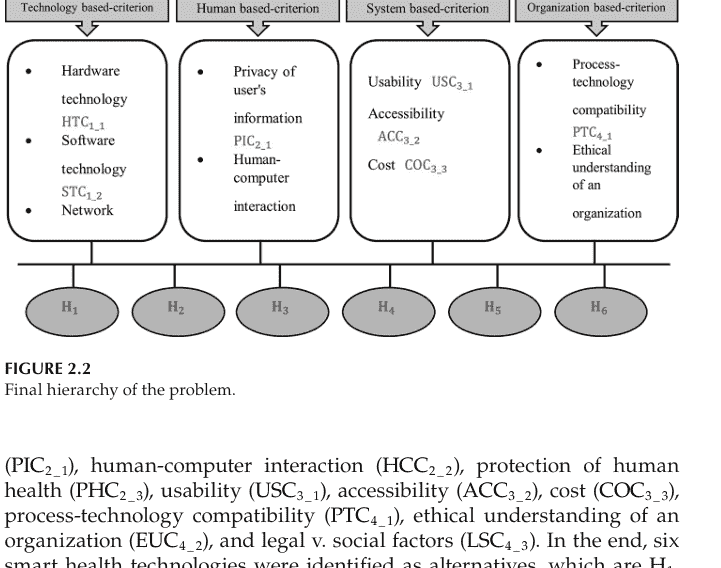

## 图 2.2

问题最终层次结构。

## 2.3.2 使用模糊 AHP 方法计算标准权重

步骤 5：通过三位专家使用语言术语按公式 (2.1) 生成标准与其自身的成对比较矩阵，如表 2.3 所示，然后使用 TFNs 按公式 (2.2) 生成，如表 2.4 所示。

步骤 6：通过应用公式 (2.3) 计算了第 i 个标准与其他标准相比的比较的几何平均值，如表 2.5 所示。

## 表 2.3

所有专家使用语言术语评估主要标准

| 专家 | TBC₁ | HBC₂ | SBC₃ | OBC₄ |
|---|---|---|---|---|
| 专家₁ |  |  |  |  |
| TBC₁ | ⟨LMP⟩ | ⟨XMM⟩ | 1/⟨VXM⟩ | ⟨XMM⟩ |
| HBC₂ | 1/⟨XMM⟩ | ⟨LMP⟩ | ⟨XMM⟩ | 1/⟨VVP⟩ |
| SBC₃ | ⟨VXM⟩ | 1/⟨XMM⟩ | ⟨LMP⟩ | 1/⟨MPM⟩ |
| OBC₄ | 1/⟨XMM⟩ | ⟨VVP⟩ | ⟨MPM⟩ | ⟨LMP⟩ |
| 专家₂ |  |  |  |  |
| TBC₁ | ⟨LMP⟩ | ⟨XMM⟩ | ⟨PFM⟩ | ⟨XMM⟩ |
| HBC₂ | 1/⟨XMM⟩ | ⟨LMP⟩ | ⟨XMM⟩ | 1/⟨VVP⟩ |
| SBC₃ | 1/⟨PFM⟩ | 1/⟨XMM⟩ | ⟨LMP⟩ | 1/⟨MPM⟩ |
| OBC₄ | 1/⟨XMM⟩ | ⟨VVP⟩ | ⟨MPM⟩ | ⟨LMP⟩ |
| 专家₃ |  |  |  |  |
| TBC₁ | ⟨LMP⟩ | ⟨XMM⟩ | 1/⟨VXM⟩ | ⟨XMM⟩ |
| HBC₂ | 1/⟨XMM⟩ | ⟨LMP⟩ | ⟨XMV⟩ | 1/⟨VVP⟩ |
| SBC₃ | ⟨VXM⟩ | 1/⟨XMV⟩ | ⟨LMP⟩ | 1/⟨MPM⟩ |
| OBC₄ | 1/⟨XMM⟩ | ⟨VVP⟩ | ⟨MPM⟩ | ⟨LMP⟩ |

## 表 2.4

所有专家使用 TFNs 评估主要标准

| 专家 | TBC₁ | HBC₂ | SBC₃ | OBC₄ |
|---|---|---|---|---|
| 专家₁ |  |  |  |  |
| TBC₁ | ⟨1, 1, 1⟩ | ⟨4, 5, 6⟩ | ⟨1/8, 1/7, 1/6⟩ | ⟨4, 5, 6⟩ |
| HBC₂ | ⟨1/6, 1/5, 1/4⟩ | ⟨1, 1, 1⟩ | ⟨4, 5, 6⟩ | ⟨1/9, 1/8, 1/7⟩ |
| SBC₃ | ⟨6, 7, 8⟩ | ⟨1/6, 1/5, 1/4⟩ | ⟨1, 1, 1⟩ | ⟨1/4, 1/3, 1/2⟩ |
| OBC₄ | ⟨1/6, 1/5, 1/4⟩ | ⟨7, 8, 9⟩ | ⟨2, 3, 4⟩ | ⟨1, 1, 1⟩ |
| 专家₂ |  |  |  |  |
| TBC₁ | ⟨1, 1, 1⟩ | ⟨4, 5, 6⟩ | ⟨8, 9, 10⟩ | ⟨4, 5, 6⟩ |
| HBC₂ | ⟨1/6, 1/5, 1/4⟩ | ⟨1, 1, 1⟩ | ⟨4, 5, 6⟩ | ⟨1/9, 1/8, 1/7⟩ |
| SBC₃ | ⟨1/10, 1/9, 1/8⟩ | ⟨1/6, 1/5, 1/4⟩ | ⟨1, 1, 1⟩ | ⟨1/4, 1/3, 1/2⟩ |
| OBC₄ | ⟨1/6, 1/5, 1/4⟩ | ⟨7, 8, 9⟩ | ⟨2, 3, 4⟩ | ⟨1, 1, 1⟩ |
| 专家₃ |  |  |  |  |
| TBC₁ | ⟨1, 1, 1⟩ | ⟨4, 5, 6⟩ | ⟨1/8, 1/7, 1/6⟩ | ⟨4, 5, 6⟩ |
| HBC₂ | ⟨1/6, 1/5, 1/4⟩ | ⟨1, 1, 1⟩ | ⟨5, 6, 7⟩ | ⟨1/9, 1/8, 1/7⟩ |
| SBC₃ | ⟨6, 7, 8⟩ | ⟨1/7, 1/6, 1/5⟩ | ⟨1, 1, 1⟩ | ⟨1/4, 1/3, 1/2⟩ |
| OBC₄ | ⟨1/6, 1/5, 1/4⟩ | ⟨7, 8, 9⟩ | ⟨2, 3, 4⟩ | ⟨1, 1, 1⟩ |

## 表 2.5

所有专家使用 AHP 技术的主要标准最终权重

| 专家₁ | $(\prod_{j=1}^{N}E_{ij})^{1/n}$ 1 | $(\prod_{j=1}^{N}E_{ij})^{1/n}$ 2 | $(\prod_{j=1}^{N}E_{ij})^{1/n}$ 3 | 模糊 l | 模糊 m | 模糊 u | 清晰权重 | 归一化权重 | 排名 | C.R. | 最终权重 |
|---|---|---|---|---|---|---|---|---|---|---|---|
| TBC₁ | 1.189 | 1.375 | 1.566 | 0.239 | 0.337 | 0.428 | 0.335 | 0.325 | 2 |  | 0.319 |
| HBC₂ | 0.522 | 0.595 | 0.670 | 0.105 | 0.146 | 0.183 | 0.145 | 0.140 | 4 |  | 0.143 |
| SBC₃ | 0.707 | 0.628 | 1.000 | 0.142 | 0.154 | 0.274 | 0.190 | 0.184 | 3 |  | 0.186 |
| OBC₄ | 1.257 | 1.480 | 1.732 | 0.249 | 0.363 | 0.474 | 0.362 | 0.351 | 1 |  | 0.352 |

专家₂
| 专家₂ | $(\prod_{j=1}^{N}E_{ij})^{1/n}$ 1 | $(\prod_{j=1}^{N}E_{ij})^{1/n}$ 2 | $(\prod_{j=1}^{N}E_{ij})^{1/n}$ 3 | 模糊 l | 模糊 m | 模糊 u | 清晰权重 | 归一化权重 | 排名 | C.R. | 最终权重 |
|---|---|---|---|---|---|---|---|---|---|---|---|
| TBC₁ | 1.125 | 1.291 | 1.456 | 0.229 | 0.320 | 0.400 | 0.316 | 0.307 | 2 |  | 0.319 |
| HBC₂ | 0.522 | 0.595 | 0.670 | 0.106 | 0.147 | 0.184 | 0.146 | 0.142 | 4 |  | 0.143 |
| SBC₃ | 0.760 | 0.669 | 1.057 | 0.155 | 0.166 | 0.290 | 0.204 | 0.198 | 3 |  | 0.186 |
| OBC₄ | 1.257 | 1.480 | 1.732 | 0.252 | 0.367 | 0.475 | 0.365 | 0.354 | 1 |  | 0.352 |

专家₃
| 专家₃ | $(\prod_{j=1}^{N}E_{ij})^{1/n}$ 1 | $(\prod_{j=1}^{N}E_{ij})^{1/n}$ 2 | $(\prod_{j=1}^{N}E_{ij})^{1/n}$ 3 | 模糊 l | 模糊 m | 模糊 u | 清晰权重 | 归一化权重 | 排名 | C.R. | 最终权重 |
|---|---|---|---|---|---|---|---|---|---|---|---|
| TBC₁ | 1.189 | 1.375 | 1.566 | 0.241 | 0.337 | 0.428 | 0.335 | 0.325 | 2 |  | 0.319 |
| HBC₂ | 0.552 | 0.622 | 0.696 | 0.112 | 0.153 | 0.190 | 0.152 | 0.147 | 4 |  | 0.143 |
| SBC₃ | 0.681 | 0.600 | 0.946 | 0.138 | 0.147 | 0.259 | 0.181 | 0.176 | 3 |  | 0.186 |
| OBC₄ | 1.257 | 1.480 | 1.732 | 0.250 | 0.363 | 0.473 | 0.362 | 0.352 | 1 |  | 0.352 |

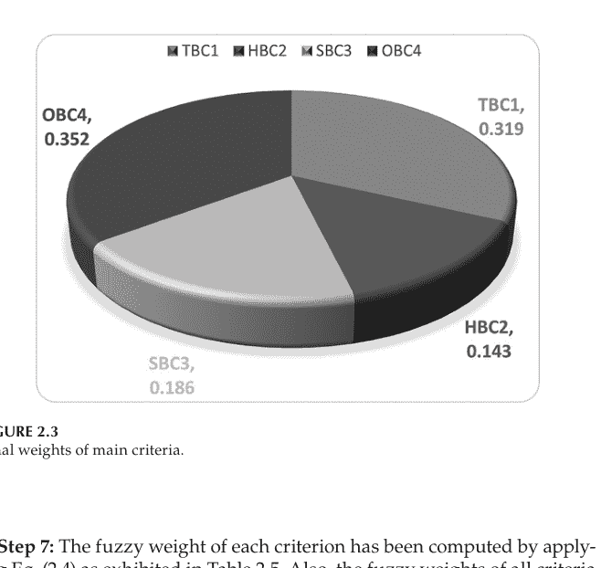

## 图 2.3

主要标准最终权重。

步骤 7：每个标准的模糊权重已通过应用公式 (2.4) 计算，如表 2.5 所示。此外，所有标准的模糊权重已通过模糊权重的总和进行归一化，如表 2.5 所示。在此方面，模糊权重通过应用 CoA 技术按公式 (2.5) 转换为清晰值，如表 2.5 所示。

步骤 8：每个专家创建的每个矩阵的 CR 已通过应用公式 (2.6) 检查，如表 2.5 所示。

步骤 9：三位专家的主要标准最终权重通过使用 OWA 算子进行聚合，如表 2.5 和图 2.3 所示。

步骤 10：将前面的步骤 (5–9) 应用于技术标准的子标准，结果在表 2.6–2.8 中提及。此外，技术标准子标准的最终权重在图 2.4 中绘制。

步骤 11：将前面的步骤 (5–9) 应用于人本标准的子标准，结果在表 2.9–2.11 中提及。此外，人本标准子标准的最终权重在图 2.5 中绘制。

步骤 12：将前面的步骤 (5–9) 应用于系统标准的子标准，结果在表 2.12–2.14 中提及。此外，系统标准子标准的最终权重在图 2.6 中绘制。


## 表 2.6

全体专家使用语言术语对技术准则子准则的评估

| 专家₁ | HTC₁₋₁ | STC₁₋₂ | NSC₁₋₃ |
|---|---|---|---|
| HTC₁₋₁ | ⟨LMP⟩ | ⟨XMM⟩ | 1/⟨EMP⟩ |
| STC₁₋₂ | 1/⟨XMM⟩ | ⟨LMP⟩ | ⟨VVP⟩ |
| NSC₁₋₃ | ⟨EMP⟩ | 1/⟨VVP⟩ | ⟨LMP⟩ |
| 专家₂ | HTC₁₋₁ | STC₁₋₂ | NSC₁₋₃ |
| HTC₁₋₁ | ⟨LMP⟩ | ⟨MPM⟩ | 1/⟨XMM⟩ |
| STC₁₋₂ | 1/⟨MPM⟩ | ⟨LMP⟩ | ⟨VXM⟩ |
| NSC₁₋₃ | ⟨XMM⟩ | 1/⟨VXM⟩ | ⟨LMP⟩ |
| 专家₃ | HTC₁₋₁ | STC₁₋₂ | NSC₁₋₃ |
| HTC₁₋₁ | ⟨LMP⟩ | 1/⟨XMM⟩ | ⟨VVP⟩ |
| STC₁₋₂ | ⟨XMM⟩ | ⟨LMP⟩ | 1/⟨VXM⟩ |
| NSC₁₋₃ | 1/⟨VVP⟩ | ⟨VXM⟩ | ⟨LMP⟩ |

## 表 2.7

全体专家使用 TFNs 对技术准则子准则的评估

| 专家₁ | HTC₁₋₁ | STC₁₋₂ | NSC₁₋₃ |
|---|---|---|---|
| HTC₁₋₁ | ⟨1, 1, 1⟩ | ⟨4, 5, 6⟩ | ⟨1/3, 1/2, 1⟩ |
| STC₁₋₂ | ⟨1/6, 1/5, 1/4⟩ | ⟨1, 1, 1⟩ | ⟨7, 8, 9⟩ |
| NSC₁₋₃ | ⟨1, 2, 3⟩ | ⟨1/9, 1/8, 1/7⟩ | ⟨1, 1, 1⟩ |
| 专家₂ | HTC₁₋₁ | STC₁₋₂ | NSC₁₋₃ |
| HTC₁₋₁ | ⟨1, 1, 1⟩ | ⟨2, 3, 4⟩ | ⟨1/6, 1/5, 1/4⟩ |
| STC₁₋₂ | ⟨1/4, 1/3, 1/2⟩ | ⟨1, 1, 1⟩ | ⟨6, 7, 8⟩ |
| NSC₁₋₃ | ⟨4, 5, 6⟩ | ⟨1/8, 1/7, 1/6⟩ | ⟨1, 1, 1⟩ |
| 专家₃ | HTC₁₋₁ | STC₁₋₂ | NSC₁₋₃ |
| HTC₁₋₁ | ⟨1, 1, 1⟩ | ⟨1/6, 1/5, 1/4⟩ | ⟨7, 8, 9⟩ |
| STC₁₋₂ | ⟨4, 5, 6⟩ | ⟨1, 1, 1⟩ | ⟨1/8, 1/7, 1/6⟩ |
| NSC₁₋₃ | ⟨1/9, 1/8, 1/7⟩ | ⟨6, 7, 8⟩ | ⟨1, 1, 1⟩ |

## 表 2.8
全体专家使用 AHP 技术对技术准则子准则的最终权重

| 专家组 | 子准则 | (∏ E_ij)^{1/n} 1 | (∏ E_ij)^{1/n} 2 | (∏ E_ij)^{1/n} 3 | 模糊权重 1 | 模糊权重 2 | 清晰权重 | 归一化权重 | 排名 | 最终权重 |
|---|---|---|---|---|---|---|---|---|---|---|
| 专家1 | HTC1-1 | 1.100 | 1.357 | 1.816 | 0.284 | 0.689 | 0.468 | 0.445 | 1 | 0.370 |
| 专家1 | STC1-2 | 1.053 | 1.169 | 1.310 | 0.271 | 0.497 | 0.380 | 0.361 | 2 | 0.364 |
| 专家1 | NSC1-3 | 0.481 | 0.630 | 0.754 | 0.124 | 0.286 | 0.203 | 0.194 | 3 | 0.266 |
| 专家2 | HTC1-1 | 0.694 | 0.844 | 1.000 | 0.193 | 0.380 | 0.283 | 0.274 | 3 | 0.370 |
| 专家2 | STC1-2 | 1.145 | 1.326 | 1.587 | 0.319 | 0.603 | 0.451 | 0.437 | 1 | 0.364 |
| 专家2 | NSC1-3 | 0.794 | 0.894 | 1.001 | 0.221 | 0.380 | 0.298 | 0.288 | 2 | 0.266 |
| 专家3 | HTC1-1 | 1.053 | 1.169 | 1.310 | 0.314 | 0.482 | 0.394 | 0.388 | 1 | 0.370 |
| 专家3 | STC1-2 | 0.794 | 0.894 | 1.001 | 0.227 | 0.368 | 0.300 | 0.296 | 3 | 0.364 |
| 专家3 | NSC1-3 | 0.873 | 0.957 | 1.046 | 0.260 | 0.384 | 0.320 | 0.316 | 2 | 0.266 |

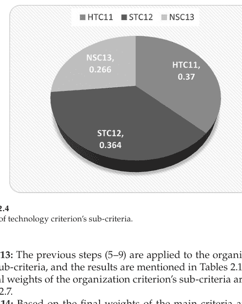

## 图 2.4

技术准则子准则的权重。

**步骤 13：** 前面的步骤（5–9）应用于组织准则的子准则，结果在表 2.15–2.17 中提到。此外，组织准则子准则的最终权重在图 2.7 中绘制。

**步骤 14：** 基于主要准则的最终权重和子准则的局部权重，子准则的全局权重在表 2.18 和图 2.8 中计算。

## 2.3.3 采用模糊 VIKOR 方法对智能健康技术进行排序

**步骤 15：** 已识别的准则与专家指定的智能健康技术之间的决策矩阵根据式 (2.7) 使用语言术语生成，如表 2.19 所示。 **步骤 16：** 选择的准则与指定的智能健康技术之间的组合决策矩阵通过应用式 (2.9) 计算，如表 2.20 所示。 **步骤 17：** 模糊组合决策矩阵通过应用式 (2.5) 中的 CoA 方法进行去模糊化，如表 2.21 所示。 **步骤 18：** 选择的准则与智能健康技术之间的归一化决策矩阵通过应用式 (2.10) 计算，如表 2.22 所示。 **步骤 19：** 正理想解和负理想解根据式 (2.11) 识别，如表 2.22 所示。

## 表 2.9

全体专家使用语言术语对人类准则子准则的评估

| 专家₁ | PIC₂₋₁ | HCC₂₋₂ | PHC₂₋₃ |
|---|---|---|---|
| PIC₂₋₁ | ⟨LMP⟩ | ⟨JVM⟩ | 1/⟨MPM⟩ |
| HCC₂₋₂ | 1/⟨JVM⟩ | ⟨LMP⟩ | ⟨VXM⟩ |
| PHC₂₋₃ | ⟨MPM⟩ | 1/⟨VXM⟩ | ⟨LMP⟩ |
| 专家₂ | PIC₂₋₁ | HCC₂₋₂ | PHC₂₋₃ |
| PIC₂₋₁ | ⟨LMP⟩ | ⟨XMM⟩ | 1/⟨XMM⟩ |
| HCC₂₋₂ | 1/⟨XMM⟩ | ⟨LMP⟩ | ⟨PFM⟩ |
| PHC₂₋₃ | ⟨XMM⟩ | 1/⟨PFM⟩ | ⟨LMP⟩ |
| 专家₃ | PIC₂₋₁ | HCC₂₋₂ | PHC₂₋₃ |
| PIC₂₋₁ | ⟨LMP⟩ | ⟨XMM⟩ | 1/⟨VVP⟩ |
| HCC₂₋₂ | 1/⟨XMM⟩ | ⟨LMP⟩ | ⟨PFM⟩ |
| PHC₂₋₃ | ⟨VVP⟩ | 1/⟨PFM⟩ | ⟨LMP⟩ |

## 表 2.10

全体专家使用 TFNs 对人类准则子准则的评估

| 专家₁ | PIC₂₋₁ | HCC₂₋₂ | PHC₂₋₃ |
|---|---|---|---|
| PIC₂₋₁ | ⟨1, 1, 1⟩ | ⟨3, 4, 5⟩ | ⟨1/4, 1/3, 1/2⟩ |
| HCC₂₋₂ | ⟨1/5, 1/4, 1/3⟩ | ⟨1, 1, 1⟩ | ⟨6, 7, 8⟩ |
| PHC₂₋₃ | ⟨2, 3, 4⟩ | ⟨1/8, 1/7, 1/6⟩ | ⟨1, 1, 1⟩ |
| 专家₂ | PIC₂₋₁ | HCC₂₋₂ | PHC₂₋₃ |
| PIC₂₋₁ | ⟨1, 1, 1⟩ | ⟨4, 5, 6⟩ | ⟨1/6, 1/5, 1/4⟩ |
| HCC₂₋₂ | ⟨1/6, 1/5, 1/4⟩ | ⟨1, 1, 1⟩ | ⟨8, 9, 10⟩ |
| PHC₂₋₃ | ⟨4, 5, 6⟩ | ⟨1/10, 1/9, 1/8⟩ | ⟨1, 1, 1⟩ |
| 专家₃ | PIC₂₋₁ | HCC₂₋₂ | PHC₂₋₃ |
| PIC₂₋₁ | ⟨1, 1, 1⟩ | ⟨4, 5, 6⟩ | ⟨1/9, 1/8, 1/7⟩ |
| HCC₂₋₂ | ⟨1/6, 1/5, 1/4⟩ | ⟨1, 1, 1⟩ | ⟨8, 9, 10⟩ |
| PHC₂₋₃ | ⟨7, 8, 9⟩ | ⟨1/10, 1/9, 1/8⟩ | ⟨1, 1, 1⟩ |

## 表 2.11
全体专家使用 AHP 技术对人类准则子准则的最终权重

| 专家 | 子准则 | V1 | V2 | V3 | V4 | V5 | V6 | 清晰权重 | 归一化权重 | 排名 | 最终权重 |
|---|---|---|---|---|---|---|---|---|---|---|---|
| 专家1 | PIC2-1 | 0.909 | 1.100 | 1.357 | 0.251 | 0.360 | 0.522 | 0.377 | 0.364 | 2 | 0.325 |
| 专家1 | HCC2-2 | 1.063 | 1.205 | 1.386 | 0.294 | 0.394 | 0.533 | 0.407 | 0.392 | 1 | 0.398 |
| 专家1 | PHC2-3 | 0.630 | 0.754 | 0.874 | 0.174 | 0.247 | 0.336 | 0.252 | 0.243 | 3 | 0.277 |
| 专家2 | PIC2-1 | 0.874 | 1.000 | 1.145 | 0.256 | 0.329 | 0.422 | 0.336 | 0.330 | 2 | 0.325 |
| 专家2 | HCC2-2 | 1.101 | 1.216 | 1.357 | 0.323 | 0.400 | 0.500 | 0.408 | 0.401 | 1 | 0.398 |
| 专家2 | PHC2-3 | 0.737 | 0.822 | 0.909 | 0.216 | 0.271 | 0.335 | 0.274 | 0.269 | 3 | 0.277 |
| 专家3 | PIC2-1 | 0.763 | 0.855 | 0.950 | 0.228 | 0.282 | 0.345 | 0.285 | 0.281 | 3 | 0.325 |
| 专家3 | HCC2-2 | 1.101 | 1.216 | 1.357 | 0.329 | 0.401 | 0.493 | 0.408 | 0.403 | 1 | 0.398 |
| 专家3 | PHC2-3 | 0.888 | 0.961 | 1.040 | 0.265 | 0.317 | 0.378 | 0.320 | 0.316 | 2 | 0.277 |

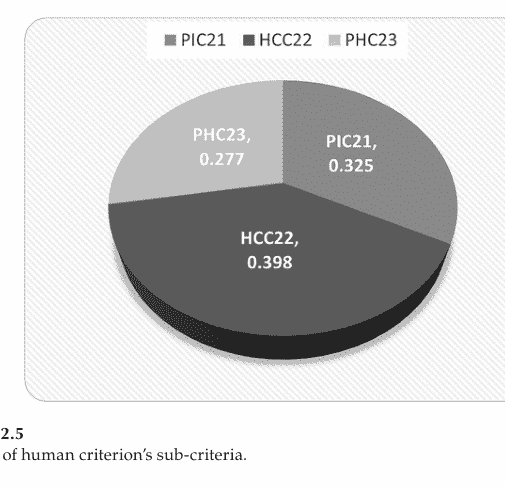

## 图 2.5

人类准则子准则的权重。

## 表 2.12

全体专家使用语言术语对系统准则子准则的评估

| 专家₁ | USC₃_₁ | ACC₃_₂ | COC₃_₃ |
|---|---|---|---|
| USC₃_₁ | ⟨LMP⟩ | ⟨JVM⟩ | ⟨EMP⟩ |
| ACC₃_₂ | 1/⟨JVM⟩ | ⟨LMP⟩ | ⟨VXM⟩ |
| COC₃_₃ | 1/⟨EMP⟩ | 1/⟨VXM⟩ | ⟨LMP⟩ |

| 专家₂ | USC₃_₁ | ACC₃_₂ | COC₃_₃ |
|---|---|---|---|
| USC₃_₁ | ⟨LMP⟩ | ⟨MPM⟩ | ⟨EMP⟩ |
| ACC₃_₂ | 1/⟨MPM⟩ | ⟨LMP⟩ | ⟨VXM⟩ |
| COC₃_₃ | 1/⟨EMP⟩ | 1/⟨VXM⟩ | ⟨LMP⟩ |

| 专家₃ | USC₃_₁ | ACC₃_₂ | COC₃_₃ |
|---|---|---|---|
| USC₃_₁ | ⟨LMP⟩ | ⟨MPM⟩ | ⟨EMP⟩ |
| ACC₃_₂ | 1/⟨MPM⟩ | ⟨LMP⟩ | ⟨PFM⟩ |
| COC₃_₃ | 1/⟨EMP⟩ | 1/⟨PFM⟩ | ⟨LMP⟩ |

## 表 2.13

全体专家使用 TFNs 对系统准则子准则的评估

| 专家₁ | USC₃₋₁ | ACC₃₋₂ | COC₃₋₃ |
|---|---|---|---|
| USC₃₋₁ | ⟨1, 1, 1⟩ | ⟨3, 4, 5⟩ | ⟨1, 2, 3⟩ |
| ACC₃₋₂ | ⟨1/5, 1/4, 1/3⟩ | ⟨1, 1, 1⟩ | ⟨6, 7, 8⟩ |
| COC₃₋₃ | ⟨1/3, 1/1, 1/1⟩ | ⟨1/8, 1/7, 1/6⟩ | ⟨1, 1, 1⟩ |
| 专家₂ | USC₃₋₁ | ACC₃₋₂ | COC₃₋₃ |
| USC₃₋₁ | ⟨1, 1, 1⟩ | ⟨2, 3, 4⟩ | ⟨1, 2, 3⟩ |
| ACC₃₋₂ | ⟨1/4, 1/3, 1/2⟩ | ⟨1, 1, 1⟩ | ⟨6, 7, 8⟩ |
| COC₃₋₃ | ⟨1/3, 1/1, 1/1⟩ | ⟨1/8, 1/7, 1/6⟩ | ⟨1, 1, 1⟩ |
| 专家₃ | USC₃₋₁ | ACC₃₋₂ | COC₃₋₃ |
| USC₃₋₁ | ⟨1, 1, 1⟩ | ⟨2, 3, 4⟩ | ⟨1, 2, 3⟩ |
| ACC₃₋₂ | ⟨1/4, 1/3, 1/2⟩ | ⟨1, 1, 1⟩ | ⟨8, 9, 10⟩ |
| COC₃₋₃ | ⟨1/3, 1/1, 1/1⟩ | ⟨1/10, 1/9, 1/8⟩ | ⟨1, 1, 1⟩ |

步骤 20：组效用 S_j 和个体遗憾值 R_j 通过应用式 (2.12) 和式 (2.13) 计算，如表 2.23 和 2.24 所示。

步骤 21：选择的准则与智能健康技术之间的协调指数 Q_j 根据式 (2.14) 计算，如表 2.24 所示。

步骤 22：智能健康技术根据 Q_j 值按降序排名，如表 2.24 和图 2.9 所示。此外，根据式 (2.15) 和 (2.16) 检查两个最终条件。

## 2.4 结果与讨论

本部分讨论了将所提模型应用于已识别的案例研究以评估智能健康技术所获得的结果。起初，根据三位专家的意见选定的六个主要准则的权重被确定。结果显示，组织准则在排名中最高，权重为 0.352，其次是技术准则，权重为 0.319，而人类准则在排名中最后，权重为 0.143。之后，根据三位专家的意见确定的技术准则子准则的权重被确定。研究结果显示 HTC₁₋₁ 是最高 in the

## 表 2.14
使用 AHP 技术由所有专家得出的系统准则子准则的最终权重

| 专家 | 子准则 | (∏_{j=1}^{N}E_{ij})^{1/n} 1 | (∏_{j=1}^{N}E_{ij})^{1/n} 2 | (∏_{j=1}^{N}E_{ij})^{1/n} 3 | 模糊权重 1 | 模糊权重 2 | 模糊权重 3 | 精确权重 | 归一化权重 | 排名 | 最终权重 |
|---|---|---|---|---|---|---|---|---|---|---|---|---|
| 专家1 | USC3-1 | 1.442 | 1.999 | 2.464 | 0.328 | 0.552 | 0.864 | 0.581 | 0.546 | 1 | 0.514 |
| 专家1 | ACC3-2 | 1.063 | 1.205 | 1.386 | 0.241 | 0.333 | 0.486 | 0.353 | 0.332 | 2 | 0.367 |
| 专家1 | COC3-3 | 0.347 | 0.415 | 0.551 | 0.079 | 0.115 | 0.193 | 0.129 | 0.121 | 3 | 0.119 |
| 专家2 | USC3-1 | 1.260 | 1.816 | 2.288 | 0.285 | 0.511 | 0.831 | 0.542 | 0.504 | 1 | 0.514 |
| 专家2 | ACC3-2 | 1.145 | 1.326 | 1.587 | 0.259 | 0.373 | 0.577 | 0.403 | 0.374 | 2 | 0.367 |
| 专家2 | COC3-3 | 0.347 | 0.415 | 0.551 | 0.078 | 0.117 | 0.200 | 0.132 | 0.122 | 3 | 0.119 |
| 专家3 | USC3-1 | 1.260 | 1.816 | 2.288 | 0.280 | 0.499 | 0.805 | 0.528 | 0.493 | 1 | 0.514 |
| 专家3 | ACC3-2 | 1.260 | 1.441 | 1.709 | 0.280 | 0.396 | 0.601 | 0.426 | 0.397 | 2 | 0.367 |
| 专家3 | COC3-3 | 0.322 | 0.382 | 0.500 | 0.072 | 0.105 | 0.176 | 0.118 | 0.110 | 3 | 0.119 |

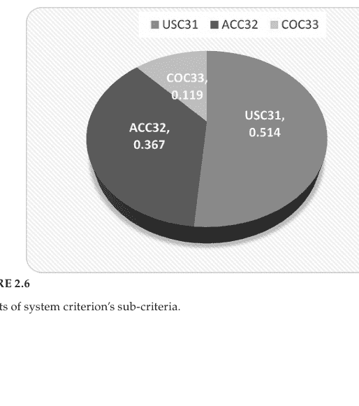

## 图 2.6
系统准则子准则的权重。

## 表 2.15
所有专家使用语言术语对组织准则子准则的评估

| 专家₁ | PTC₄₋₁ | EUC₄₋₂ | LSC₄₋₃ |
|---|---|---|---|
| PTC₄₋₁ | ⟨LMP⟩ | ⟨EMP⟩ | 1/⟨MPM⟩ |
| EUC₄₋₂ | 1/⟨EMP⟩ | ⟨LMP⟩ | ⟨VXM⟩ |
| LSC₄₋₃ | ⟨MPM⟩ | 1/⟨VXM⟩ | ⟨LMP⟩ |
| 专家₂ | PTC₄₋₁ | EUC₄₋₂ | LSC₄₋₃ |
| PTC₄₋₁ | ⟨LMP⟩ | ⟨XMM⟩ |  |
| EUC₄₋₂ | 1/⟨XMM⟩ | ⟨LMP⟩ | ⟨VXM⟩ |
| LSC₄₋₃ | ⟨XMM⟩ | 1/⟨VXM⟩ | ⟨LMP⟩ |
| 专家₃ | PTC₄₋₁ | EUC₄₋₂ | LSC₄₋₃ |
| PTC₄₋₁ | ⟨LMP⟩ | ⟨XMM⟩ | 1/⟨XMV⟩ |
| EUC₄₋₂ | 1/⟨XMM⟩ | ⟨LMP⟩ | ⟨PFM⟩ |
| LSC₄₋₃ | ⟨XMV⟩ | 1/⟨PFM⟩ | ⟨LMP⟩ |

## 表 2.16
所有专家使用 TFNs 对组织准则子准则的评估

| 专家₁ | PTC₄_₁ | EUC₄_₂ | LSC₄_₃ |
|---|---|---|---|
| PTC₄_₁ | ⟨1, 1, 1⟩ | ⟨1, 2, 3⟩ | ⟨1/4, 1/3, 1/2⟩ |
| EUC₄_₂ | ⟨1/3, 1/2, 1/1⟩ | ⟨1, 1, 1⟩ | ⟨6, 7, 8⟩ |
| LSC₄_₃ | ⟨2, 3, 4⟩ | ⟨1/8, 1/7, 1/6⟩ | ⟨1, 1, 1⟩ |
| 专家₂ | PTC₄_₁ | EUC₄_₂ | LSC₄_₃ |
| PTC₄_₁ | ⟨1, 1, 1⟩ | ⟨4, 5, 6⟩ | ⟨1/6, 1/5, 1/4⟩ |
| EUC₄_₂ | ⟨1/6, 1/5, 1/4⟩ | ⟨1, 1, 1⟩ | ⟨6, 7, 8⟩ |
| LSC₄_₃ | ⟨4, 5, 6⟩ | ⟨1/8, 1/7, 1/6⟩ | ⟨1, 1, 1⟩ |
| 专家₃ | PTC₄_₁ | EUC₄_₂ | LSC₄_₃ |
| PTC₄_₁ | ⟨1, 1, 1⟩ | ⟨4, 5, 6⟩ | ⟨1/7, 1/6, 1/5⟩ |
| EUC₄_₂ | ⟨1/6, 1/5, 1/4⟩ | ⟨1, 1, 1⟩ | ⟨8, 9, 10⟩ |
| LSC₄_₃ | ⟨5, 6, 7⟩ | ⟨1/10, 1/9, 1/8⟩ | ⟨1, 1, 1⟩ |

排名权重为 0.370，其次是权重为 0.364 的 STC₁_₂，而 NSC₁_₃ 以权重 0.266 排名最后。此外，根据三位专家的意见确定了人类准则子准则的权重。研究结果显示，HCC₂_₂ 以 0.398 的权重排名最高，其次是权重为 0.325 的 PIC₂_₁，而 PHC₂_₃ 以 0.277 的权重排名最后。在此方面，根据三位专家的意见确定了系统准则子准则的权重。研究结果显示，USC₃_₁ 以 0.514 的权重排名最高，其次是权重为 0.367 的 ACC₃_₂，而 COC₃_₃ 以 0.119 的权重排名最后。最终，根据三位专家的意见确定了组织准则子准则的权重。研究结果显示，EUC₄_₂ 以 0.422 的权重排名最高，其次是权重为 0.306 的 PTC₄_₁，而 LSC₄_₃ 以 0.272 的权重排名最后。

根据表 2.18 中的全局子准则权重，EUC₄_₂ 以 0.148 的权重位居第一，其次是权重为 0.118 的 HTC₁_₁，而 COC₃_₃ 以 0.026 的权重排名最后。

最后，根据模糊 VIKOR 方法分析了六种选定备选方案（智能健康技术）的排名结果，如表 2.24 所示。结果显示，H₂ 是排名最高的备选方案，其次是 H₁，而 H₄ 排名最后。

## 表 2.17
使用 AHP 技术由所有专家得出的组织准则子准则的最终权重

| 组 | 子准则 | 乘积下限 | 乘积中值 | 乘积上限 | 模糊 1 | 模糊 2 | 精确权重 | 归一化权重 | 排名 | 最终权重 |
|---|---|---|---|---|---|---|---|---|---|---|
| 专家1 | PTC_4-1 | 0.630 | 0.873 | 1.145 | 0.278 | 0.157 | 0.296 | 0.276 | 2 | 0.306 |
| 专家1 | EUC_4-2 | 1.259 | 1.518 | 1.999 | 0.482 | 0.313 | 0.530 | 0.493 | 1 | 0.422 |
| 专家1 | LSC_4-3 | 0.630 | 0.754 | 0.874 | 0.240 | 0.157 | 0.248 | 0.231 | 3 | 0.272 |
| 专家2 | PTC_4-1 | 0.874 | 1.000 | 1.145 | 0.332 | 0.257 | 0.339 | 0.333 | 2 | 0.306 |
| 专家2 | EUC_4-2 | 1.001 | 1.119 | 1.260 | 0.371 | 0.294 | 0.379 | 0.372 | 1 | 0.422 |
| 专家2 | LSC_4-3 | 0.794 | 0.894 | 1.001 | 0.297 | 0.233 | 0.302 | 0.296 | 3 | 0.272 |
| 专家3 | PTC_4-1 | 0.830 | 0.942 | 1.063 | 0.311 | 0.246 | 0.315 | 0.311 | 2 | 0.306 |
| 专家3 | EUC_4-2 | 1.101 | 1.216 | 1.357 | 0.401 | 0.326 | 0.408 | 0.402 | 1 | 0.422 |
| 专家3 | LSC_4-3 | 0.794 | 0.873 | 0.957 | 0.288 | 0.255 | 0.291 | 0.287 | 3 | 0.272 |

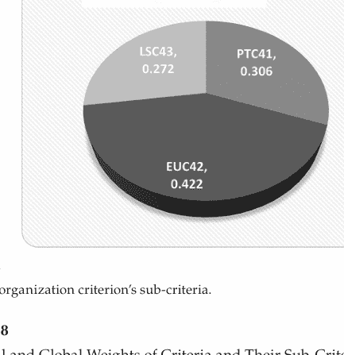

## 图 2.7
组织准则子准则的权重。

## 表 2.18
使用 AHP 方法得出的准则及其子准则的最终局部和全局权重

| 准则 | 基于技术的准则 TBC₁ |  |  | 基于人类的准则 HBC₂ |  |  |
|---|---|---|---|---|---|---|
| 权重 | 0.319 |  |  | 0.143 |  |  |
| 子准则 | HTC₁,₁ | STC₁,₂ | NSC₁,₃ | PIC₂,₁ | HCC₂,₂ | PHC₂,₃ |
| 局部权重 | 0.370 | 0.364 | 0.266 | 0.325 | 0.398 | 0.277 |
| 全局权重 | 0.118 | 0.116 | 0.085 | 0.046 | 0.057 | 0.039 |

| 准则 | 基于系统的准则 SBC₃ |  |  | 基于组织的准则 OBC₄ |  |  |
|---|---|---|---|---|---|---|
| 权重 | 0.186 |  |  | 0.352 |  |  |
| 子准则 | USC₃,₁ | ACC₃,₂ | COC₃,₃ | PTC₄,₁ | EUC₄,₂ | LSC₄,₃ |
| 局部权重 | 0.514 | 0.367 | 0.119 | 0.306 | 0.422 | 0.272 |
| 全局权重 | 0.095 | 0.068 | 0.026 | 0.107 | 0.148 | 0.095 |

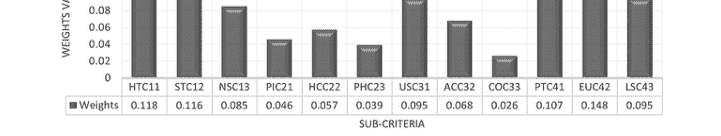

## 图 2.8
通过 AHP 方法得出的子准则的最终全局权重。

## 表 2.19
使用语言术语根据所有子准则对六种智能健康技术进行决策矩阵

| 专家_s | HTC₁,₁ | STC₁,₂ | NSC₁,₃ | PIC₂,₁ | HCC₂,₂ | PHC₂,₃ |
|---|---|---|---|---|---|---|
| H₁ | ⟨EHH⟩⟨EHH⟩⟨EHH⟩ | ⟨MDE⟩⟨MDE⟩⟨MDE⟩ | ⟨MDE⟩⟨MDE⟩⟨MDE⟩ | ⟨HHH⟩⟨HHH⟩⟨HHH⟩ | ⟨MDE⟩⟨MDE⟩⟨MDE⟩ | ⟨HHH⟩⟨HHH⟩⟨HHH⟩ |
| H₂ | ⟨XLL⟩⟨MDE⟩⟨MDE⟩ | ⟨EHH⟩⟨EHH⟩⟨EHH⟩ | ⟨EHH⟩⟨EHH⟩⟨EHH⟩ | ⟨EHH⟩⟨EHH⟩⟨EHH⟩ | ⟨EHH⟩⟨EHH⟩⟨EHH⟩ | ⟨HHH⟩⟨HHH⟩⟨HHH⟩ |
| H₃ | ⟨XLL⟩⟨XLL⟩⟨XLL⟩ | ⟨XLL⟩⟨XLL⟩⟨XLL⟩ | ⟨EHH⟩⟨EHH⟩⟨EHH⟩ | ⟨HHH⟩⟨HHH⟩⟨HHH⟩ | ⟨EHH⟩⟨EHH⟩⟨EHH⟩ | ⟨EHH⟩⟨EHH⟩⟨EHH⟩ |
| H₄ | ⟨XLL⟩⟨XLL⟩⟨XLL⟩ | ⟨HHH⟩⟨HHH⟩⟨HHH⟩ | ⟨MOE⟩⟨MOE⟩⟨MOE⟩ | ⟨MDE⟩⟨MDE⟩⟨MDE⟩ | ⟨HHH⟩⟨HHH⟩⟨HHH⟩ | ⟨MDE⟩⟨MDE⟩⟨MDE⟩ |
| H₅ | ⟨EHH⟩⟨EHH⟩⟨EHH⟩ | ⟨HHH⟩⟨HHH⟩⟨HHH⟩ | ⟨LOO⟩⟨LOO⟩⟨LOO⟩ | ⟨XLL⟩⟨XLL⟩⟨XLL⟩ | ⟨MDE⟩⟨MDE⟩⟨MDE⟩ | ⟨MDE⟩⟨MDE⟩⟨MDE⟩ |
| H₆ | ⟨MDE⟩⟨MDE⟩⟨MDE⟩ | ⟨LOO⟩⟨LOO⟩⟨LOO⟩ | ⟨MDE⟩⟨MDE⟩⟨MDE⟩ | ⟨HHH⟩⟨HHH⟩⟨HHH⟩ | ⟨MDE⟩⟨MDE⟩⟨MDE⟩ | ⟨HHH⟩⟨HHH⟩⟨HHH⟩ |

| 专家_s | USC₃,₁ | ACC₃,₂ | COC₃,₃ | PTC₄,₁ | EUC₄,₂ | LSC₄,₃ |
|---|---|---|---|---|---|---|
| H₁ | ⟨MDE⟩⟨MDE⟩⟨MDE⟩ | ⟨HHH⟩⟨HHH⟩⟨HHH⟩ | ⟨XLL⟩⟨XLL⟩⟨LOW⟩ | ⟨MDE⟩⟨MDE⟩⟨MDE⟩ | ⟨EHH⟩⟨EHH⟩⟨EHH⟩ | ⟨XLL⟩⟨XLL⟩⟨XLL⟩ |
| H₂ | ⟨EHH⟩⟨EHH⟩⟨EHH⟩ | ⟨LOO⟩⟨LOO⟩⟨LOO⟩ | ⟨MDE⟩⟨MDE⟩⟨MDE⟩ | ⟨MDE⟩⟨MDE⟩⟨MDE⟩ | ⟨EHH⟩⟨EHH⟩⟨EHH⟩ | ⟨HHH⟩⟨HHH⟩⟨HHH⟩ |
| H₃ | ⟨EHH⟩⟨EHH⟩⟨EHH⟩ | ⟨XLL⟩⟨XLL⟩⟨XLL⟩ | ⟨HHH⟩⟨HHH⟩⟨HHH⟩ | ⟨MDE⟩⟨MDE⟩⟨MDE⟩ | ⟨MDE⟩⟨MDE⟩⟨MDE⟩ | ⟨HHH⟩⟨HHH⟩⟨HHH⟩ |
| H₄ | ⟨MDE⟩⟨MDE⟩⟨MDE⟩ | ⟨EHH⟩⟨EHH⟩⟨EHH⟩ | ⟨HHH⟩⟨HHH⟩⟨HHH⟩ | ⟨LOO⟩⟨LOO⟩⟨LOO⟩ | ⟨XLL⟩⟨XLL⟩⟨XLL⟩ | ⟨MDE⟩⟨MDE⟩⟨MDE⟩ |
| H₅ | ⟨LOO⟩⟨LOO⟩⟨LOO⟩ | ⟨HHH⟩⟨HHH⟩⟨HHH⟩ | ⟨MDE⟩⟨MDE⟩⟨MDE⟩ | ⟨MDE⟩⟨MDE⟩⟨MDE⟩ | ⟨MDE⟩⟨MDE⟩⟨MDE⟩ | ⟨HHH⟩⟨HHH⟩⟨HHH⟩ |
| H₆ | ⟨MDE⟩⟨MDE⟩⟨MDE⟩ | ⟨HHH⟩⟨HHH⟩⟨HHH⟩ | ⟨MDE⟩⟨MDE⟩⟨MDE⟩ | ⟨MDE⟩⟨MDE⟩⟨MDE⟩ | ⟨LOO⟩⟨LOO⟩⟨LOO⟩ | ⟨EHH⟩⟨EHH⟩⟨EHH⟩ |


### 表 2.20
六种智能健康技术根据所有子准则使用三角模糊数的组合决策矩阵

| 专家ₛ | HTC₁₋₁ | STC₁₋₂ | NSC₁₋₃ | PIC₂₋₁ | HCC₂₋₂ | PHC₂₋₃ | USC₃₋₁ | ACC₃₋₂ | COC₃₋₃ | PTC₄₋₁ | EUC₄₋₂ | LSC₄₋₃ |
|---|---|---|---|---|---|---|---|---|---|---|---|---|
| H₁ | ⟨7, 9, 11⟩ | ⟨3, 5, 7⟩ | ⟨3, 5, 7⟩ | ⟨5, 7, 9⟩ | ⟨3, 5, 7⟩ | ⟨5, 7, 9⟩ | ⟨3, 5, 7⟩ | ⟨5, 7, 9⟩ | ⟨1, 1.67, 5⟩ | ⟨3, 5, 7⟩ | ⟨7, 9, 11⟩ | ⟨1, 1, 3⟩ |
| H₂ | ⟨1, 3.67, 5⟩ | ⟨7, 9, 11⟩ | ⟨7, 9, 11⟩ | ⟨7, 9, 11⟩ | ⟨7, 9, 11⟩ | ⟨5, 7, 9⟩ | ⟨7, 9, 11⟩ | ⟨1, 3, 5⟩ | ⟨3, 5, 7⟩ | ⟨3, 5, 7⟩ | ⟨7, 9, 11⟩ | ⟨5, 7, 9⟩ |
| H₃ | ⟨1, 1, 3⟩ | ⟨1, 1, 3⟩ | ⟨7, 9, 11⟩ | ⟨5, 7, 9⟩ | ⟨7, 9, 11⟩ | ⟨7, 9, 11⟩ | ⟨7, 9, 11⟩ | ⟨1, 1, 3⟩ | ⟨5, 7, 9⟩ | ⟨3, 5, 7⟩ | ⟨3, 5, 7⟩ | ⟨5, 7, 9⟩ |
| H₄ | ⟨1, 1, 3⟩ | ⟨5, 7, 9⟩ | ⟨3, 5, 7⟩ | ⟨3, 5, 7⟩ | ⟨5, 7, 9⟩ | ⟨3, 5, 7⟩ | ⟨3, 5, 7⟩ | ⟨7, 9, 11⟩ | ⟨5, 7, 9⟩ | ⟨1, 3, 5⟩ | ⟨1, 1, 3⟩ | ⟨3, 5, 7⟩ |
| H₅ | ⟨7, 9, 11⟩ | ⟨5, 7, 9⟩ | ⟨1, 3, 5⟩ | ⟨1, 1, 3⟩ | ⟨3, 5, 7⟩ | ⟨3, 5, 7⟩ | ⟨1, 3, 5⟩ | ⟨5, 7, 9⟩ | ⟨3, 5, 7⟩ | ⟨3, 5, 7⟩ | ⟨3, 5, 7⟩ | ⟨5, 7, 9⟩ |
| H₆ | ⟨3, 5, 7⟩ | ⟨1, 3, 5⟩ | ⟨3, 5, 7⟩ | ⟨5, 7, 9⟩ | ⟨1, 4.33, 7⟩ | ⟨5, 7, 9⟩ | ⟨3, 5, 7⟩ | ⟨5, 7, 9⟩ | ⟨3, 5, 7⟩ | ⟨3, 5, 7⟩ | ⟨1, 3, 5⟩ | ⟨7, 9, 11⟩ |

## 2.5 摘要

- 本章对智能健康技术进行了全面描述。
- 本章回顾了评估智能健康技术的重要性与需求。
- 在对大量研究文章进行全面分析后，本章提出了在评估智能和可持续健康技术时使用的最重要标准。
- 本章提出了一个综合的模糊语言 MCDM 框架来评估智能健康技术。模糊层次分析法对标准进行加权（AHP），而备选方案则通过模糊 VIseKriterijumska Optimizacija I Kompromisno Resenje（VIKOR）方法进行排序。
- 本章介绍了对世界各地多种智能健康技术进行评估的真实案例研究。

### 表 2.21
使用 CoA 方法的智能健康技术根据所有子准则的去模糊化决策矩阵

| 专家 | HTC_1,1 | STC_1,2 | NSC_1,3 | PIC_2,1 | HCC_2,2 | PHC_2,3 | USC_3,1 | ACC_3,2 | COC_3,3 | PTC_4,1 | EUC_4,2 | LSC_4,3 |
|---|---|---|---|---|---|---|---|---|---|---|---|---|
| H1 | 9.000 | 5.00 | 5.000 | 7.00 | 5.000 | 7.000 | 5.000 | 7.000 | 2.560 | 5.000 | 9.000 | 1.67 |
| H2 | 3.220 | 9.00 | 9.000 | 9.00 | 9.000 | 7.000 | 9.000 | 3.000 | 5.000 | 5.000 | 9.000 | 7.00 |
| H3 | 1.670 | 1.67 | 9.000 | 7.00 | 9.000 | 9.000 | 9.000 | 1.670 | 7.000 | 5.000 | 5.000 | 7.00 |
| H4 | 1.670 | 7.00 | 5.000 | 5.00 | 7.000 | 5.000 | 5.000 | 9.000 | 7.000 | 3.000 | 1.670 | 5.00 |
| H5 | 9.000 | 7.00 | 3.000 | 1.67 | 5.000 | 5.000 | 3.000 | 7.000 | 5.000 | 5.000 | 5.000 | 7.00 |
| H6 | 5.000 | 3.00 | 5.000 | 7.00 | 4.110 | 7.000 | 5.000 | 7.000 | 5.000 | 5.000 | 3.000 | 9.00 |

### 表 2.22
智能健康技术根据所有子准则的归一化决策矩阵

| 专家 | HTC_1,1 | STC_1,2 | NSC_1,3 | PIC_2,1 | HCC_2,2 | PHC_2,3 | USC_3,1 | ACC_3,2 | COC_3,3 | PTC_4,1 | EUC_4,2 | LSC_4,3 |
|---|---|---|---|---|---|---|---|---|---|---|---|---|
| H1 | 0.632 | 0.340 | 0.319 | 0.438 | 0.300 | 0.420 | 0.319 | 0.452 | 0.191 | 0.432 | 0.602 | 0.104 |
| H2 | 0.226 | 0.613 | 0.574 | 0.563 | 0.540 | 0.420 | 0.574 | 0.194 | 0.373 | 0.432 | 0.602 | 0.438 |
| H3 | 0.117 | 0.114 | 0.574 | 0.438 | 0.540 | 0.540 | 0.574 | 0.108 | 0.522 | 0.432 | 0.334 | 0.438 |
| H4 | 0.117 | 0.477 | 0.319 | 0.313 | 0.420 | 0.300 | 0.319 | 0.581 | 0.522 | 0.259 | 0.112 | 0.313 |
| H5 | 0.632 | 0.477 | 0.191 | 0.104 | 0.300 | 0.300 | 0.191 | 0.452 | 0.373 | 0.432 | 0.334 | 0.438 |
| H6 | 0.351 | 0.204 | 0.319 | 0.438 | 0.247 | 0.420 | 0.319 | 0.452 | 0.373 | 0.432 | 0.201 | 0.563 |
| 最佳 A_j* | 0.632 | 0.613 | 0.574 | 0.563 | 0.540 | 0.540 | 0.574 | 0.581 | 0.522 | 0.432 | 0.602 | 0.563 |
| 最差 A_j- | 0.117 | 0.114 | 0.191 | 0.104 | 0.247 | 0.300 | 0.191 | 0.108 | 0.191 | 0.259 | 0.112 | 0.104 |

### 表 2.23
用于计算六种智能健康技术群体效用和个体遗憾的决策矩阵

| 专家ₛ | HTC_1,1 | STC_1,2 | NSC_1,3 | PIC_2,1 | HCC_2,2 | PHC_2,3 | USC_3,1 | ACC_3,2 | COC_3,3 | PTC_4,1 | EUC_4,2 | LSC_4,3 |
|---|---|---|---|---|---|---|---|---|---|---|---|---|
| H1 | 0.000 | 0.063 | 0.057 | 0.013 | 0.047 | 0.020 | 0.063 | 0.019 | 0.026 | 0.000 | 0.000 | 0.095 |
| H2 | 0.093 | 0.000 | 0.000 | 0.000 | 0.000 | 0.020 | 0.000 | 0.056 | 0.012 | 0.000 | 0.000 | 0.026 |
| H3 | 0.118 | 0.116 | 0.000 | 0.013 | 0.000 | 0.000 | 0.000 | 0.068 | 0.000 | 0.000 | 0.081 | 0.026 |
| H4 | 0.118 | 0.032 | 0.057 | 0.025 | 0.023 | 0.039 | 0.063 | 0.000 | 0.000 | 0.107 | 0.148 | 0.052 |
| H5 | 0.000 | 0.032 | 0.085 | 0.046 | 0.047 | 0.039 | 0.095 | 0.019 | 0.012 | 0.000 | 0.081 | 0.026 |
| H6 | 0.064 | 0.095 | 0.057 | 0.013 | 0.057 | 0.020 | 0.063 | 0.019 | 0.012 | 0.000 | 0.121 | 0.000 |

### 表 2.24
备选方案的 S_i、R_i 和 Q_i 计算及排序

| 备选方案 | S_i | Rank (S_i) | R_i | Rank (R_i) | Q_i (v=0.5) | Rank (Q_i) |
|---|---|---|---|---|---|---|
| H1 | 0.4015 | 2 | 0.0950 | 2 | 0.2314 | 2 |
| H2 | 0.2058 | 1 | 0.0930 | 1 | 0.0000 | 1 |
| H3 | 0.4212 | 3 | 0.1180 | 4 | 0.4621 | 4 |
| H4 | 0.6639 | 6 | 0.1480 | 6 | 1.0000 | 6 |
| H5 | 0.4802 | 4 | 0.0950 | 3 | 0.3173 | 3 |
| H6 | 0.5198 | 5 | 0.1211 | 5 | 0.5984 | 5 |

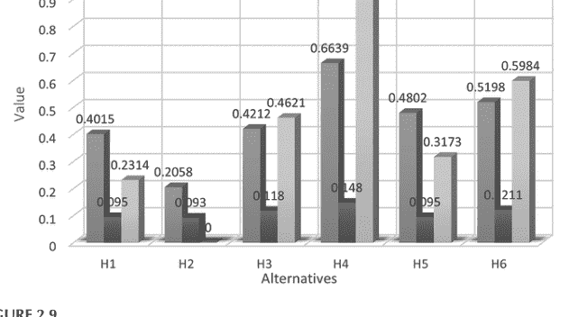

### 图 2.9
每个备选方案的 S、R 和 Q 的最终图表。

## 2.6 练习

- a. 你如何定义“智能健康技术”？为什么评估智能和可持续健康技术很重要？
- b. VIKOR 方法与 AHP 方法有何区别？在做决策时讨论它们的相对优势。
- c. 讨论智能健康技术在智能医疗保健的特征和形成方面的特点。
- d. 将模糊语言嵌入 MCDM 框架的关键步骤是什么？
- e. 讨论模糊 VIKOR 与模糊 AHP 方法之间的差异。

## 参考文献

Abdel-Basset, Mohamed, Abduallah Gamal, and Samir S. Teleb. 2022. “新城市造林的智能模糊决策系统：埃及新行政首都案例研究。” Intelligent Systems with Applications 14: 200085. https://doi.org/https://doi.org/10.1016/j.iswa.2022.200085.

- Du, Yuan-Wei, and Xiao-Xue Li. 2021. "复杂系统的分层 DEMATEL 方法." *Expert Systems with Applications* 167: 113871. https://doi.org/10.1016/j.eswa.2020.113871.
- Hosseini, Seyyed Mehdi, Mohammad Mahdi Paydar, and Mostafa Hajighaeei-Keshteli. 2021. "新冠肺炎疫情期间生态旅游中心的恢复解决方案：利用模糊 DEMATEL 和模糊 VIKOR 方法." *Expert Systems with Applications* 185: 115594. https://doi.org/https://doi.org/10.1016/j.eswa.2021.115594.
- Jandová, Vera, and Jana Talasová. 2013. "弱一致性：萨蒂分析层次结构中一致性的新方法." *Mathematica* 52 (2): 71–83.
- Liu, Yan, Claudia M. Eckert, and Christopher Earl. 2020. "主观判断决策的模糊 AHP 方法综述." *Expert Systems with Applications* 161: 113738. https://doi.org/https://doi.org/10.1016/j.eswa.2020.113738.
- Opricovic, Serafim, and Gwo-Hshiung Tzeng. 2004. "MCDM 方法的折中解：VIKOR 与 TOPSIS 的比较分析." *European Journal of Operational Research* 156 (2): 445–55. https://doi.org/https://doi.org/10.1016/S0377-2217(03)00020-1.
- Saaty, Thomas L. 2001. "具有依赖性和反馈的决策：分析网络过程：复杂性的组织与优先排序," 370. http://books.google.com/books?id=MGpaAAAAYAAJ&pgis=1.
- Solangi, Yasir Ahmed, Cheng Longsheng, and Syed Ahsan Ali Shah. 2021. "评估和克服巴基斯坦可持续发展中的可再生能源障碍：集成的 AHP 和模糊 TOPSIS 方法." *Renewable Energy* 173: 209–22. https://doi.org/https://doi.org/10.1016/j.renene.2021.03.141.
- Zadeh, Lotfi Asker. 1975. "语言变量的概念及其在近似推理中的应用—I." *Information Sciences* 8 (3): 199–249. https://doi.org/https://doi.org/10.1016/0020-0255(75)90036-5.


## 3
## 评估智能灾害响应系统的智能方法
### 3.1 引言
灾害管理是研究领域中最重要的领域之一，因为它直接影响人类生活质量。灾害管理最重要的基础之一是以保护居民免受其影响的生命为一致的方式应对灾难。因此，研究灾害响应系统被视为必须研究和改进的基本问题之一。对自然灾害做出不当响应会损害人类和经济生活。未获得足够援助的受灾者人数巨大。由于世界技术进步，可以在灾难发生前警告公民即将发生的灾难。此外，国家发展滞后的最重要原因之一是未得到充分处理的灾难的后果。由于自然灾难随着时间的推移而加剧，学者们对避免灾难和减轻其对居民生活负面影响的想法和创新越来越感兴趣。

物联网（IoT）是现代时期技术发展最具影响力的部分之一，因为它对经济学、医疗保健、政治、工业、农业等多个学科做出了重大贡献。无线传感器网络（WSN）是灾难检测领域最常用的技术解决方案之一；因此，它存在若干社会技术和经济缺陷。WSN 通过收集灾难现场的数据，帮助专业机构（警察、消防员和医生）应对和管理灾难。诸如社交媒体、基于位置的系统、射频识别和大数据分析（BDA）等众多技术协助灾害管理中的利益相关者。物联网已证明其能够为不同情况提供更有效、更智能、更灵活的灾害响应解决方案的能力。

此外，它已成为决策难题的非常有效的解决方案，也是数据挖掘科学等其他学科的支持系统。因此，重点关注基于物联网能力的智能灾害响应系统至关重要。

### 3.2 智能灾害响应系统
自然灾难的破坏性后果促使学者评估响应措施并创建保持最有效响应的有效技术。由于自然灾难的反复发生，人们对研究其在经济和社会层面的后果越来越感兴趣。这导致人们更加关注这些灾难的识别研究，以便响应中心变得更有效并减轻其对国家的影响。智能灾害响应系统是确保公民安全的重要要素，是智慧城市的主要方面之一。任何城市的灾难响应系统必须考虑多个因素。

- 灾害响应系统的首要组成部分由接收传感器信息并允许交换这些信息以获得援助的本地化社区组成。
- 灾害数据管理使灾害相关信息的学习成为可能，并在任何失真情况下通过中央服务器维护数据。

与传统灾害响应系统不同，智能系统通过更复杂的通信方法将传感器提供的信息有效地传达给反应团队，更有效地处理灾难。智能灾害响应系统的关键贡献是实时信息交换，这改善了对危机的及时反应。智能灾害响应系统根据合作参与者组成的社区的目标实时寻找合适的项目。在收集到本地灾难社区的数据后，集中式灾害管理系统会对数据进行详尽分析。

智能灾害反应系统包括本地管理器、对象应用程序和灾害响应社交网络。最初，灾害响应社交网络（如在线社交网络（OSN））使成员能够随时随地进行通信。智能灾害响应系统的第二个组成部分是本地管理器，称为超级节点。该系统由五个组件组成，如图 3.1 所示：对象管理器、对象数据管理器、社区管理器、覆盖管理器，

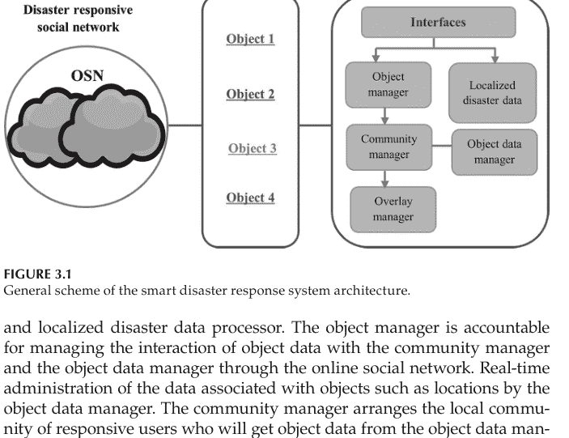

## 图 3.1
智能灾害响应系统架构的总体方案。

以及本地化灾害数据处理器。对象管理器负责通过在线社交网络管理对象数据与社区管理器和对象数据管理器之间的交互。对象数据管理器实时管理与对象（如位置）相关的数据。社区管理器安排将从对象数据管理器获取对象数据的响应用户的本地社区。在社区管理器的指导下，覆盖管理器为每个成员的账户创建网络配置文件，以便促进他们之间的通信。基于大数据分析和云计算，本地化灾害数据处理器控制项目的灾难信息并实时分析灾难情景。系统的第三部分是对象应用程序，包括覆盖控制器和灾难通信器。覆盖控制器是负责维护成员之间的覆盖连接以及本地管理器中覆盖管理器生成的配置文件的组件。与此同时，灾难通信器使用各种共享机制促进成员之间的通信，并确保每个人都能访问相关信息。

由于智能灾害响应系统的重要性，必须使用量化这些系统在各种情况下有用性的标准来评估其性能。与其他决策难题一样，评估智能灾害响应系统是在不可预测环境下带来困难的决策挑战之一。为了考虑评估过程中的任何模糊性，本研究旨在提出一个在不确定环境中评估智能灾害响应系统性能的综合框架。多准则决策（MCDM）用于基于一组标准的性能评估问题。

### 3.3 决策中的 MCDM 方法
本部分介绍了一种评估智能灾害响应系统的混合方法。为完成此任务，我们发现两种方法的整合：模糊决策试验和评价实验室（DEMATEL）和模糊基于平均解距离的评估（EDAS），它们是非常著名的用于优先考虑主要维度和其子指标以及评估 MCDM 问题特定替代方案的方法。图 3.2 显示了指导本研究的科研方法，其中模糊 DEMATEL 方法将用作分析的初始发展水平，然后在专家的帮助下完成，以计算主要维度和其子指标在成对比较矩阵中的权重。接下来，模糊 EDAS 方法用于根据所选标准评估智能灾害响应系统。我们在以下部分中简要概述了本研究中使用的方法。

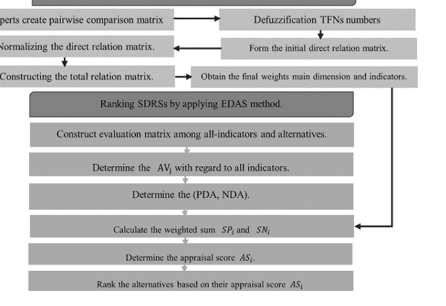

图 3.2
所应用方法的总体方案。


## 3.3.1 模糊 DEMATEL 方法

1973年，巴特尔纪念研究所日内瓦研究中心首次执行了 DEMATEL 程序（Gabus and Fontela, 1972）。DEMATEL 是一种扩展方法，用于构建和评估结构模型，以便分析复杂准则之间的影响关系。然而，在模糊环境中，由于识别困难，基于复杂要素做出判断是困难的。本研究使用了模糊 DEMATEL 方法进行更精确的分析。原始的 DEMATEL 技术寻求世界分裂和对立文明的综合解决方案。DEMATEL 技术最近在日本获得了流行，因为它能够务实地描绘错综复杂的因果联系（Chang, Chang, and Wu, 2011）。DEMATEL 方法特别基于有向图，它将涉及的组件划分为原因和效果组。有向图或有向图比无向图更有价值，因为它们说明了子系统之间的有向相互作用。有向图可以反映系统组件之间上下文关系的根本思想，其中值表示影响的大小（Wan et al., 2021）。因此，DEMATEL 能够将因果变量之间的联系转化为系统可理解的结构模型。DEMATEL 能够提供影响其他准则的最重要准则。DEMATEL 可以同时减少用于评估因素有效性的准则数量，使企业能够根据影响有向图地图提高某些因素的有效性。DEMATEL 方法将因果变量之间的联系转化为智能系统结构模型（Nasrollahi et al., 2021）。

## 3.3.2 模糊 EDAS 方法

2015年，Ghorabaee 等人提出了 EDAS 方法，其缩写为基于平均解距离的评估（Evaluation based on Distance from Average Solution）（Ghorabaee et al., 2015）。该方法的有效性通过将其与各种 MCDM 方法进行比较来评估，包括 Vise Kriterijumska Optimizacija I Kompromisno Resenje（VIKOR）、理想解相似性排序技术（Technique for Order Preference by Similarity to Ideal Solution，TOPSIS）、简单加性加权（Simple Additive Weighting，SAW）和复杂比例评估（Complex Proportional Assessment，COPRAS）。根据此测试，EDAS 方法可靠且显示出积极的结果。该策略对于比较标准非常有益。与 VIKOR 和 TOPSIS 等基于妥协的 MCDM 方法相比，在此方法中计算理想解和罕见解之间的距离以选择最佳选择是有利的（Kar et al., 2021）。在本章中，选择 EDAS 是由于其易用性和降低的计算需求，这两个是最重要的特征。

## 3.3.3 拟议方法的计算步骤

**步骤 1：** 确定一组专家以协助作者并分享有关评估智能灾害响应系统的信息。根据问题及其重要程度，在选择专家时做出某些考虑。设 E = {E1, E2, ..., EK} 为一组专家，其中 EK 表示第 k 个专家，k=1, 2, ..., K。K 是专家的总数。

**步骤 2：** 问题作为一个整体进行组织，以便显示问题的[content]
## 3.3.1 模糊 DEMATEL 方法

1973年，巴特尔纪念研究所日内瓦研究中心首次执行了 DEMATEL 程序（Gabus and Fontela, 1972）。DEMATEL 是一种扩展方法，用于构建和评估结构模型，以便分析复杂准则之间的影响关系。然而，在模糊环境中，由于识别困难，基于复杂要素做出判断是困难的。本研究使用了模糊 DEMATEL 方法进行更精确的分析。原始的 DEMATEL 技术寻求世界分裂和对立文明的综合解决方案。DEMATEL 技术最近在日本获得了流行，因为它能够务实地描绘错综复杂的因果联系（Chang, Chang, and Wu, 2011）。DEMATEL 方法特别基于有向图，它将涉及的组件划分为原因和效果组。有向图或有向图比无向图更有价值，因为它们说明了子系统之间的有向相互作用。有向图可以反映系统组件之间上下文关系的根本思想，其中值表示影响的大小（Wan et al., 2021）。因此，DEMATEL 能够将因果变量之间的联系转化为系统可理解的结构模型。DEMATEL 能够提供影响其他准则的最重要准则。DEMATEL 可以同时减少用于评估因素有效性的准则数量，使企业能够根据影响有向图地图提高某些因素的有效性。DEMATEL 方法将因果变量之间的联系转化为智能系统结构模型（Nasrollahi et al., 2021）。

## 3.3.2 模糊 EDAS 方法

2015年，Ghorabaee 等人提出了 EDAS 方法，其缩写为基于平均解距离的评估（Evaluation based on Distance from Average Solution）（Ghorabaee et al., 2015）。该方法的有效性通过将其与各种 MCDM 方法进行比较来评估，包括 Vise Kriterijumska Optimizacija I Kompromisno Resenje（VIKOR）、理想解相似性排序技术（Technique for Order Preference by Similarity to Ideal Solution，TOPSIS）、简单加性加权（Simple Additive Weighting，SAW）和复杂比例评估（Complex Proportional Assessment，COPRAS）。根据此测试，EDAS 方法可靠且显示出积极的结果。该策略对于比较标准非常有益。与 VIKOR 和 TOPSIS 等基于妥协的 MCDM 方法相比，在此方法中计算理想解和罕见解之间的距离以选择最佳选择是有利的（Kar et al., 2021）。在本章中，选择 EDAS 是由于其易用性和降低的计算需求，这两个是最重要的特征。

## 3.3.3 拟议方法的计算步骤

**步骤 1：** 确定一组专家以协助作者并分享有关评估智能灾害响应系统的信息。根据问题及其重要程度，在选择专家时做出某些考虑。设 E = {E1, E2, ..., EK} 为一组专家，其中 EK 表示第 k 个专家，k=1, 2, ..., K。K 是专家的总数。

**步骤 2：** 问题作为一个整体进行组织，以便显示问题的[content]
## 3.3.1 模糊 DEMATEL 方法

1973年，巴特尔纪念研究所日内瓦研究中心首次执行了 DEMATEL 程序（Gabus and Fontela, 1972）。DEMATEL 是一种扩展方法，用于构建和评估结构模型，以便分析复杂准则之间的影响关系。然而，在模糊环境中，由于识别困难，基于复杂要素做出判断是困难的。本研究使用了模糊 DEMATEL 方法进行更精确的分析。原始的 DEMATEL 技术寻求世界分裂和对立文明的综合解决方案。DEMATEL 技术最近在日本获得了流行，因为它能够务实地描绘错综复杂的因果联系（Chang, Chang, and Wu, 2011）。DEMATEL 方法特别基于有向图，它将涉及的组件划分为原因和效果组。有向图或有向图比无向图更有价值，因为它们说明了子系统之间的有向相互作用。有向图可以反映系统组件之间上下文关系的根本思想，其中值表示影响的大小（Wan et al., 2021）。因此，DEMATEL 能够将因果变量之间的联系转化为系统可理解的结构模型。DEMATEL 能够提供影响其他准则的最重要准则。DEMATEL 可以同时减少用于评估因素有效性的准则数量，使企业能够根据影响有向图地图提高某些因素的有效性。DEMATEL 方法将因果变量之间的联系转化为智能系统结构模型（Nasrollahi et al., 2021）。

## 3.3.2 模糊 EDAS 方法

2015年，Ghorabaee 等人提出了 EDAS 方法，其缩写为基于平均解距离的评估（Evaluation based on Distance from Average Solution）（Ghorabaee et al., 2015）。该方法的有效性通过将其与各种 MCDM 方法进行比较来评估，包括 Vise Kriterijumska Optimizacija I Kompromisno Resenje（VIKOR）、理想解相似性排序技术（Technique for Order Preference by Similarity to Ideal Solution，TOPSIS）、简单加性加权（Simple Additive Weighting，SAW）和复杂比例评估（Complex Proportional Assessment，COPRAS）。根据此测试，EDAS 方法可靠且显示出积极的结果。该策略对于比较标准非常有益。与 VIKOR 和 TOPSIS 等基于妥协的 MCDM 方法相比，在此方法中计算理想解和罕见解之间的距离以选择最佳选择是有利的（Kar et al., 2021）。在本章中，选择 EDAS 是由于其易用性和降低的计算需求，这两个是最重要的特征。

## 3.3.3 拟议方法的计算步骤

**步骤 1：** 确定一组专家以协助作者并分享有关评估智能灾害响应系统的信息。根据问题及其重要程度，在选择专家时做出某些考虑。设 E = {E1, E2, ..., EK} 为一组专家，其中 EK 表示第 k 个专家，k=1, 2, ..., K。K 是专家的总数。

**步骤 2：** 问题作为一个整体进行组织，以便显示问题的[content]
## 3.3.1 模糊 DEMATEL 方法

1973年，巴特尔纪念研究所日内瓦研究中心首次执行了 DEMATEL 程序（Gabus and Fontela, 1972）。DEMATEL 是一种扩展方法，用于构建和评估结构模型，以便分析复杂准则之间的影响关系。然而，在模糊环境中，由于识别困难，基于复杂要素做出判断是困难的。本研究使用了模糊 DEMATEL 方法进行更精确的分析。原始的 DEMATEL 技术寻求世界分裂和对立文明的综合解决方案。DEMATEL 技术最近在日本获得了流行，因为它能够务实地描绘错综复杂的因果联系（Chang, Chang, and Wu, 2011）。DEMATEL 方法特别基于有向图，它将涉及的组件划分为原因和效果组。有向图或有向图比无向图更有价值，因为它们说明了子系统之间的有向相互作用。有向图可以反映系统组件之间上下文关系的根本思想，其中值表示影响的大小（Wan et al., 2021）。因此，DEMATEL 能够将因果变量之间的联系转化为系统可理解的结构模型。DEMATEL 能够提供影响其他准则的最重要准则。DEMATEL 可以同时减少用于评估因素有效性的准则数量，使企业能够根据影响有向图地图提高某些因素的有效性。DEMATEL 方法将因果变量之间的联系转化为智能系统结构模型（Nasrollahi et al., 2021）。

## 3.3.2 模糊 EDAS 方法

2015年，Ghorabaee 等人提出了 EDAS 方法，其缩写为基于平均解距离的评估（Evaluation based on Distance from Average Solution）（Ghorabaee et al., 2015）。该方法的有效性通过将其与各种 MCDM 方法进行比较来评估，包括 Vise Kriterijumska Optimizacija I Kompromisno Resenje（VIKOR）、理想解相似性排序技术（Technique for Order Preference by Similarity to Ideal Solution，TOPSIS）、简单加性加权（Simple Additive Weighting，SAW）和复杂比例评估（Complex Proportional Assessment，COPRAS）。根据此测试，EDAS 方法可靠且显示出积极的结果。该策略对于比较标准非常有益。与 VIKOR 和 TOPSIS 等基于妥协的 MCDM 方法相比，在此方法中计算理想解和罕见解之间的距离以选择最佳选择是有利的（Kar et al., 2021）。在本章中，选择 EDAS 是由于其易用性和降低的计算需求，这两个是最重要的特征。

## 3.3.3 拟议方法的计算步骤

**步骤 1：** 确定一组专家以协助作者并分享有关评估智能灾害响应系统的信息。根据问题及其重要程度，在选择专家时做出某些考虑。设 E = {E1, E2, ..., EK} 为一组专家，其中 EK 表示第 k 个专家，k=1, 2, ..., K。K 是专家的总数。

**步骤 2：** 问题作为一个整体进行组织，以便显示问题的[content]
## 3.3.1 模糊 DEMATEL 方法

1973年，巴特尔纪念研究所日内瓦研究中心首次执行了 DEMATEL 程序（Gabus and Fontela, 1972）。DEMATEL 是一种扩展方法，用于构建和评估结构模型，以便分析复杂准则之间的影响关系。然而，在模糊环境中，由于识别困难，基于复杂要素做出判断是困难的。本研究使用了模糊 DEMATEL 方法进行更精确的分析。原始的 DEMATEL 技术寻求世界分裂和对立文明的综合解决方案。DEMATEL 技术最近在日本获得了流行，因为它能够务实地描绘错综复杂的因果联系（Chang, Chang, and Wu, 2011）。DEMATEL 方法特别基于有向图，它将涉及的组件划分为原因和效果组。有向图或有向图比无向图更有价值，因为它们说明了子系统之间的有向相互作用。有向图可以反映系统组件之间上下文关系的根本思想，其中值表示影响的大小（Wan et al., 2021）。因此，DEMATEL 能够将因果变量之间的联系转化为系统可理解的结构模型。DEMATEL 能够提供影响其他准则的最重要准则。DEMATEL 可以同时减少用于评估因素有效性的准则数量，使企业能够根据影响有向图地图提高某些因素的有效性。DEMATEL 方法将因果变量之间的联系转化为智能系统结构模型（Nasrollahi et al., 2021）。

## 3.3.2 模糊 EDAS 方法

2015年，Ghorabaee 等人提出了 EDAS 方法，其缩写为基于平均解距离的评估（Evaluation based on Distance from Average Solution）（Ghorabaee et al., 2015）。该方法的有效性通过将其与各种 MCDM 方法进行比较来评估，包括 Vise Kriterijumska Optimizacija I Kompromisno Resenje（VIKOR）、理想解相似性排序技术（Technique for Order Preference by Similarity to Ideal Solution，TOPSIS）、简单加性加权（Simple Additive Weighting，SAW）和复杂比例评估（Complex Proportional Assessment，COPRAS）。根据此测试，EDAS 方法可靠且显示出积极的结果。该策略对于比较标准非常有益。与 VIKOR 和 TOPSIS 等基于妥协的 MCDM 方法相比，在此方法中计算理想解和罕见解之间的距离以选择最佳选择是有利的（Kar et al., 2021）。在本章中，选择 EDAS 是由于其易用性和降低的计算需求，这两个是最重要的特征。

## 3.3.3 拟议方法的计算步骤

**步骤 1：** 确定一组专家以协助作者并分享有关评估智能灾害响应系统的信息。根据问题及其重要程度，在选择专家时做出某些考虑。设 E = {E1, E2, ..., EK} 为一组专家，其中 EK 表示第 k 个专家，k=1, 2, ..., K。K 是专家的总数。

**步骤 2：** 问题作为一个整体进行组织，以便显示问题的[content]
## 3.3.1 模糊 DEMATEL 方法

1973年，巴特尔纪念研究所日内瓦研究中心首次执行了 DEMATEL 程序（Gabus and Fontela, 1972）。DEMATEL 是一种扩展方法，用于构建和评估结构模型，以便分析复杂准则之间的影响关系。然而，在模糊环境中，由于识别困难，基于复杂要素做出判断是困难的。本研究使用了模糊 DEMATEL 方法进行更精确的分析。原始的 DEMATEL 技术寻求世界分裂和对立文明的综合解决方案。DEMATEL 技术最近在日本获得了流行，因为它能够务实地描绘错综复杂的因果联系（Chang, Chang, and Wu, 2011）。DEMATEL 方法特别基于有向图，它将涉及的组件划分为原因和效果组。有向图或有向图比无向图更有价值，因为它们说明了子系统之间的有向相互作用。有向图可以反映系统组件之间上下文关系的根本思想，其中值表示影响的大小（Wan et al., 2021）。因此，DEMATEL 能够将因果变量之间的联系转化为系统可理解的结构模型。DEMATEL 能够提供影响其他准则的最重要准则。DEMATEL 可以同时减少用于评估因素有效性的准则数量，使企业能够根据影响有向图地图提高某些因素的有效性。DEMATEL 方法将因果变量之间的联系转化为智能系统结构模型（Nasrollahi et al., 2021）。

## 3.3.2 模糊 EDAS 方法

2015年，Ghorabaee 等人提出了 EDAS 方法，其缩写为基于平均解距离的评估（Evaluation based on Distance from Average Solution）（Ghorabaee et al., 2015）。该方法的有效性通过将其与各种 MCDM 方法进行比较来评估，包括 Vise Kriterijumska Optimizacija I Kompromisno Resenje（VIKOR）、理想解相似性排序技术（Technique for Order Preference by Similarity to Ideal Solution，TOPSIS）、简单加性加权（Simple Additive Weighting，SAW）和复杂比例评估（Complex Proportional Assessment，COPRAS）。根据此测试，EDAS 方法可靠且显示出积极的结果。该策略对于比较标准非常有益。与 VIKOR 和 TOPSIS 等基于妥协的 MCDM 方法相比，在此方法中计算理想解和罕见解之间的距离以选择最佳选择是有利的（Kar et al., 2021）。在本章中，选择 EDAS 是由于其易用性和降低的计算需求，这两个是最重要的特征。

## 3.3.3 拟议方法的计算步骤

**步骤 1：** 确定一组专家以协助作者并分享有关评估智能灾害响应系统的信息。根据问题及其重要程度，在选择专家时做出某些考虑。设 E = {E1, E2, ..., EK} 为一组专家，其中 EK 表示第 k 个专家，k=1, 2, ..., K。K 是专家的总数。

**步骤 2：** 问题作为一个整体进行组织，以便显示问题的[content]
## 3.3.1 模糊 DEMATEL 方法

1973年，巴特尔纪念研究所日内瓦研究中心首次执行了 DEMATEL 程序（Gabus and Fontela, 1972）。DEMATEL 是一种扩展方法，用于构建和评估结构模型，以便分析复杂准则之间的影响关系。然而，在模糊环境中，由于识别困难，基于复杂要素做出判断是困难的。本研究使用了模糊 DEMATEL 方法进行更精确的分析。原始的 DEMATEL 技术寻求世界分裂和对立文明的综合解决方案。DEMATEL 技术最近在日本获得了流行，因为它能够务实地描绘错综复杂的因果联系（Chang, Chang, and Wu, 2011）。DEMATEL 方法特别基于有向图，它将涉及的组件划分为原因和效果组。有向图或有向图比无向图更有价值，因为它们说明了子系统之间的有向相互作用。有向图可以反映系统组件之间上下文关系的根本思想，其中值表示影响的大小（Wan et al., 2021）。因此，DEMATEL 能够将因果变量之间的联系转化为系统可理解的结构模型。DEMATEL 能够提供影响其他准则的最重要准则。DEMATEL 可以同时减少用于评估因素有效性的准则数量，使企业能够根据影响有向图地图提高某些因素的有效性。DEMATEL 方法将因果变量之间的联系转化为智能系统结构模型（Nasrollahi et al., 2021）。

## 3.3.2 模糊 EDAS 方法

2015年，Ghorabaee 等人提出了 EDAS 方法，其缩写为基于平均解距离的评估（Evaluation based on Distance from Average Solution）（Ghorabaee et al., 2015）。该方法的有效性通过将其与各种 MCDM 方法进行比较来评估，包括 Vise Kriterijumska Optimizacija I Kompromisno Resenje（VIKOR）、理想解相似性排序技术（Technique for Order Preference by Similarity to Ideal Solution，TOPSIS）、简单加性加权（Simple Additive Weighting，SAW）和复杂比例评估（Complex Proportional Assessment，COPRAS）。根据此测试，EDAS 方法可靠且显示出积极的结果。该策略对于比较标准非常有益。与 VIKOR 和 TOPSIS 等基于妥协的 MCDM 方法相比，在此方法中计算理想解和罕见解之间的距离以选择最佳选择是有利的（Kar et al., 2021）。在本章中，选择 EDAS 是由于其易用性和降低的计算需求，这两个是最重要的特征。

## 3.3.3 拟议方法的计算步骤

**步骤 1：** 确定一组专家以协助作者并分享有关评估智能灾害响应系统的信息。根据问题及其重要程度，在选择专家时做出某些考虑。设 E = {E1, E2, ..., EK} 为一组专家，其中 EK 表示第 k 个专家，k=1, 2, ..., K。K 是专家的总数。

**步骤 2：** 问题作为一个整体进行组织，以便显示问题的[content]
## 3.3.1 模糊 DEMATEL 方法

1973年，巴特尔纪念研究所日内瓦研究中心首次执行了 DEMATEL 程序（Gabus and Fontela, 1972）。DEMATEL 是一种扩展方法，用于构建和评估结构模型，以便分析复杂准则之间的影响关系。然而，在模糊环境中，由于识别困难，基于复杂要素做出判断是困难的。本研究使用了模糊 DEMATEL 方法进行更精确的分析。原始的 DEMATEL 技术寻求世界分裂和对立文明的综合解决方案。DEMATEL 技术最近在日本获得了流行，因为它能够务实地描绘错综复杂的因果联系（Chang, Chang, and Wu, 2011）。DEMATEL 方法特别基于有向图，它将涉及的组件划分为原因和效果组。有向图或有向图比无向图更有价值，因为它们说明了子系统之间的有向相互作用。有向图可以反映系统组件之间上下文关系的根本思想，其中值表示影响的大小（Wan et al., 2021）。因此，DEMATEL 能够将因果变量之间的联系转化为系统可理解的结构模型。DEMATEL 能够提供影响其他准则的最重要准则。DEMATEL 可以同时减少用于评估因素有效性的准则数量，使企业能够根据影响有向图地图提高某些因素的有效性。DEMATEL 方法将因果变量之间的联系转化为智能系统结构模型（Nasrollahi et al., 2021）。

## 3.3.2 模糊 EDAS 方法

2015年，Ghorabaee 等人提出了 EDAS 方法，其缩写为基于平均解距离的评估（Evaluation based on Distance from Average Solution）（Ghorabaee et al., 2015）。该方法的有效性通过将其与各种 MCDM 方法进行比较来评估，包括 Vise Kriterijumska Optimizacija I Kompromisno Resenje（VIKOR）、理想解相似性排序技术（Technique for Order Preference by Similarity to Ideal Solution，TOPSIS）、简单加性加权（Simple Additive Weighting，SAW）和复杂比例评估（Complex Proportional Assessment，COPRAS）。根据此测试，EDAS 方法可靠且显示出积极的结果。该策略对于比较标准非常有益。与 VIKOR 和 TOPSIS 等基于妥协的 MCDM 方法相比，在此方法中计算理想解和罕见解之间的距离以选择最佳选择是有利的（Kar et al., 2021）。在本章中，选择 EDAS 是由于其易用性和降低的计算需求，这两个是最重要的特征。

## 3.3.3 拟议方法的计算步骤

**步骤 1：** 确定一组专家以协助作者并分享有关评估智能灾害响应系统的信息。根据问题及其重要程度，在选择专家时做出某些考虑。设 E = {E1, E2, ..., EK} 为一组专家，其中 EK 表示第 k 个专家，k=1, 2, ..., K。K 是专家的总数。

**步骤 2：** 问题作为一个整体进行组织，以便显示问题的[content]
## 3.3.1 模糊 DEMATEL 方法

1973年，巴特尔纪念研究所日内瓦研究中心首次执行了 DEMATEL 程序（Gabus and Fontela, 1972）。DEMATEL 是一种扩展方法，用于构建和评估结构模型，以便分析复杂准则之间的影响关系。然而，在模糊环境中，由于识别困难，基于复杂要素做出判断是困难的。本研究使用了模糊 DEMATEL 方法进行更精确的分析。原始的 DEMATEL 技术寻求世界分裂和对立文明的综合解决方案。DEMATEL 技术最近在日本获得了流行，因为它能够务实地描绘错综复杂的因果联系（Chang, Chang, and Wu, 2011）。DEMATEL 方法特别基于有向图，它将涉及的组件划分为原因和效果组。有向图或有向图比无向图更有价值，因为它们说明了子系统之间的有向相互作用。有向图可以反映系统组件之间上下文关系的根本思想，其中值表示影响的大小（Wan et al., 2021）。因此，DEMATEL 能够将因果变量之间的联系转化为系统可理解的结构模型。DEMATEL 能够提供影响其他准则的最重要准则。DEMATEL 可以同时减少用于评估因素有效性的准则数量，使企业能够根据影响有向图地图提高某些因素的有效性。DEMATEL 方法将因果变量之间的联系转化为智能系统结构模型（Nasrollahi et al., 2021）。

## 3.3.2 模糊 EDAS 方法

2015年，Ghorabaee 等人提出了 EDAS 方法，其缩写为基于平均解距离的评估（Evaluation based on Distance from Average Solution）（Ghorabaee et al., 2015）。该方法的有效性通过将其与各种 MCDM 方法进行比较来评估，包括 Vise Kriterijumska Optimizacija I Kompromisno Resenje（VIKOR）、理想解相似性排序技术（Technique for Order Preference by Similarity to Ideal Solution，TOPSIS）、简单加性加权（Simple Additive Weighting，SAW）和复杂比例评估（Complex Proportional Assessment，COPRAS）。根据此测试，EDAS 方法可靠且显示出积极的结果。该策略对于比较标准非常有益。与 VIKOR 和 TOPSIS 等基于妥协的 MCDM 方法相比，在此方法中计算理想解和罕见解之间的距离以选择最佳选择是有利的（Kar et al., 2021）。在本章中，选择 EDAS 是由于其易用性和降低的计算需求，这两个是最重要的特征。

## 3.3.3 拟议方法的计算步骤

**步骤 1：** 确定一组专家以协助作者并分享有关评估智能灾害响应系统的信息。根据问题及其重要程度，在选择专家时做出某些考虑。设 E = {E1, E2, ..., EK} 为一组专家，其中 EK 表示第 k 个专家，k=1, 2, ..., K。K 是专家的总数。

**步骤 2：** 问题作为一个整体进行组织，以便显示问题的[content]
## 3.3.1 模糊 DEMATEL 方法

1973年，巴特尔纪念研究所日内瓦研究中心首次执行了 DEMATEL 程序（Gabus and Fontela, 1972）。DEMATEL 是一种扩展方法，用于构建和评估结构模型，以便分析复杂准则之间的影响关系。然而，在模糊环境中，由于识别困难，基于复杂要素做出判断是困难的。本研究使用了模糊 DEMATEL 方法进行更精确的分析。原始的 DEMATEL 技术寻求世界分裂和对立文明的综合解决方案。DEMATEL 技术最近在日本获得了流行，因为它能够务实地描绘错综复杂的因果联系（Chang, Chang, and Wu, 2011）。DEMATEL 方法特别基于有向图，它将涉及的组件划分为原因和效果组。有向图或有向图比无向图更有价值，因为它们说明了子系统之间的有向相互作用。有向图可以反映系统组件之间上下文关系的根本思想，其中值表示影响的大小（Wan et al., 2021）。因此，DEMATEL 能够将因果变量之间的联系转化为系统可理解的结构模型。DEMATEL 能够提供影响其他准则的最重要准则。DEMATEL 可以同时减少用于评估因素有效性的准则数量，使企业能够根据影响有向图地图提高某些因素的有效性。DEMATEL 方法将因果变量之间的联系转化为智能系统结构模型（Nasrollahi et al., 2021）。

## 3.3.2 模糊 EDAS 方法

2015年，Ghorabaee 等人提出了 EDAS 方法，其缩写为基于平均解距离的评估（Evaluation based on Distance from Average Solution）（Ghorabaee et al., 2015）。该方法的有效性通过将其与各种 MCDM 方法进行比较来评估，包括 Vise Kriterijumska Optimizacija I Kompromisno Resenje（VIKOR）、理想解相似性排序技术（Technique for Order Preference by Similarity to Ideal Solution，TOPSIS）、简单加性加权（Simple Additive Weighting，SAW）和复杂比例评估（Complex Proportional Assessment，COPRAS）。根据此测试，EDAS 方法可靠且显示出积极的结果。该策略对于比较标准非常有益。与 VIKOR 和 TOPSIS 等基于妥协的 MCDM 方法相比，在此方法中计算理想解和罕见解之间的距离以选择最佳选择是有利的（Kar et al., 2021）。在本章中，选择 EDAS 是由于其易用性和降低的计算需求，这两个是最重要的特征。

## 3.3.3 拟议方法的计算步骤

**步骤 1：** 确定一组专家以协助作者并分享有关评估智能灾害响应系统的信息。根据问题及其重要程度，在选择专家时做出某些考虑。设 E = {E1, E2, ..., EK} 为一组专家，其中 EK 表示第 k 个专家，k=1, 2, ..., K。K 是专家的总数。

**步骤 2：** 问题作为一个整体进行组织，以便显示问题的[content]
## 3.3.1 模糊 DEMATEL 方法

1973年，巴特尔纪念研究所日内瓦研究中心首次执行 DEMATEL 程序（Gabus and Fontela, 1972）。DEMATEL 是构建和评估结构模型以分析复杂准则间影响关系的扩展方法。在模糊环境中，因识别困难，基于复杂要素的判断较难。本研究采用模糊 DEMATEL 方法进行更精确分析。原始 DEMATEL 技术寻求世界分裂对立文明的综合解决方案。DEMATEL 近期在日本流行，因其能务实描绘错综因果联系（Chang, Chang, and Wu, 2011）。DEMATEL 方法基于有向图，将涉及组件划分为原因和效果组。有向图比无向图更有价值，因其说明子系统间有向相互作用。有向图可反映系统组件间上下文关系的基本思想，值表示影响大小（Wan et al., 2021）。因此 DEMATEL 能将因果变量联系转化为系统可理解的结构模型。DEMATEL 能提供影响其他准则的最重要准则。DEMATEL 可同时减少评估因素有效性的准则数量，使企业能依据影响有向图地图提高某些因素有效性。DEMATEL 方法将因果变量联系转化为智能系统结构模型（Nasrollahi et al., 2021）。

## 3.3.2 模糊 EDAS 方法

2015年，Ghorabaee 等人提出 EDAS 方法，缩写为基于平均解距离的评估（Evaluation based on Distance from Average Solution）（Ghorabaee et al., 2015）。方法有效性通过与多种 MCDM 方法比较评估，包括 Vise Kriterijumska Optimizacija I Kompromisno Resenje（VIKOR）、理想解相似性排序技术（Technique for Order Preference by Similarity to Ideal Solution，TOPSIS）、简单加性加权（Simple Additive Weighting，SAW）和复杂比例评估（Complex Proportional Assessment，COPRAS）。测试表明 EDAS 方法可靠且结果积极。该策略对比较标准很有益。与 VIKOR 和 TOPSIS 等基于妥协的 MCDM 方法相比，本方法计算理想解与罕见解距离以选优是有利的（Kar et al., 2021）。本章选择 EDAS 因其易用性和计算需求低，是其最重要特征。

## 3.3.3 拟议方法的计算步骤

**步骤 1：** 确定专家组协助作者并分享评估智能灾害响应系统信息。按问题及重要程度选择专家。设 E = {E1, E2, ..., EK} 为专家集，EK 表示第 k 个专家，k=1, 2, ..., K。K 为专家总数。

**步骤 2：** 将问题整体组织以显示主要目标。也选择最重要的影响维度及子指标。此外协商可进入评估过程的备选方案。

**步骤 3：** 识别语言术语及对应适当模糊数以优先关键维度及子指标，如表 3.1 所示。也识别语言术语及对应合适模糊数以评估所选备选方案，如表 3.2 所示。

**步骤 4：** 按各专家使用表 3.1 中的语义术语构建维度与其自身的成对比较矩阵 D 如式 3.1，然后使用三角模糊数 TFNs 如式 3.2 所示。

### 表 3.1
用于加权关键维度和其子指标的语义变量

| 语义变量 | 缩写 | TFN ⟨l_ij, m_ij, u_ij⟩ |
|---|---|---|
| 无影响 | ⟨NOE⟩ | ⟨0.00, 0.00, 0.25⟩ |
| 非常低影响 | ⟨VLE⟩ | ⟨0.00, 0.25, 0.50⟩ |
| 低影响 | ⟨LOE⟩ | ⟨0.25, 0.50, 0.75⟩ |
| 高影响 | ⟨HIE⟩ | ⟨0.50, 0.75, 1.00⟩ |
| 非常高影响 | ⟨VHE⟩ | ⟨0.75, 1.00, 1.00⟩ |

### 表 3.2
用于排序备选方案的语义变量

| 语义变量 | 缩写 | TFN ⟨l_ij, m_ij, u_ij⟩ |
|---|---|---|
| 非常差 | ⟨VEP⟩ | ⟨0.00, 0.00, 0.17⟩ |
| 差 | ⟨POO⟩ | ⟨0.00, 0.17, 0.33⟩ |
| 中等差 | ⟨MEP⟩ | ⟨0.17, 0.33, 0.50⟩ |
| 一般 | ⟨FAR⟩ | ⟨0.33, 0.50, 0.67⟩ |
| 中等好 | ⟨MEG⟩ | ⟨0.50, 0.67, 0.83⟩ |
| 好 | ⟨GOO⟩ | ⟨0.67, 0.83, 1.00⟩ |
| 非常好 | ⟨VEG⟩ | ⟨0.83, 1.00, 1.00⟩ |

D = \begin{bmatrix} D_1 & D_2 & \dots & D_n \\ D_1 & * & x_{12} & \dots & x_{1i} \\ D_2 & x_{21} & * & \dots & x_{2i} \\ \vdots & x_{31} & x_{32} & * & \dots \\ D_n & x_{j1} & x_{j2} & x_{j3} & * \end{bmatrix} (3.1)

其中 (x_{ij}), i, j = 1, 2... n，且 x_{ij} 是对第 i 个元素 D_1, D_2, ..., D_n 的维度相对于第 j 个元素 D_1, D_2, ..., D_j 的评估。也矩阵主对角线等于 1 使得 x_{ii} 等于 1。

D = \begin{bmatrix} D_1 & D_2 & \dots & D_n \\ D_1 & * & \langle l_{12}, m_{12}, u_{12} \rangle & \dots & \langle l_{1i}, m_{1i}, u_{1i} \rangle \\ D_2 & \langle l_{21}, m_{21}, u_{21} \rangle & * & \dots & \langle l_{2i}, m_{2i}, u_{2i} \rangle \\ \vdots & \langle l_{31}, m_{31}, u_{31} \rangle & \langle l_{32}, m_{32}, u_{32} \rangle & * & \dots \\ D_n & \langle l_{j1}, m_{j1}, u_{j1} \rangle & \langle l_{j2}, m_{j2}, u_{j2} \rangle & \langle l_{j3}, m_{j3}, u_{j3} \rangle & * \end{bmatrix} (3.2)

设 t_{kij} = (t_{kij}^l, t_{kij}^m, t_{kij}^u) 为第 k 个专家使用语义变量时 D_i 对 D_j 的初始直接影响信息，其中 t_{kij}^l, t_{kij}^m, t_{kij}^u 分别表示初始直接影响信息的下限、中限和上限。

**步骤 5：** 根据式 3.3 将所有专家创建的决策矩阵聚合为一个矩阵。\tilde{T} = t_{1ij} \oplus t_{2ij} \oplus ... \oplus t_{kij} / K (3.3)

**步骤 6：** 通过应用分级均值积分表示 GMIR 方法如式 3.4 所示，将模糊组合决策矩阵去模糊化为清晰组合决策矩阵以消除模糊三角数。GMIR 因消除分母零的优点而在本研究中使用。x_{ij}^{def} = (x_{ij}^l + 4 \times x_{ij}^m + x_{ij}^u) / 6 (3.4)

**步骤 7：** 通过应用式 3.5 和 3.6 构建所有维度的广义直接关系矩阵 G。

q = \frac{1}{\text{Max}_{1 \le i \le n} \sum_{j=1}^{n} x_{ij}} \quad (3.5)

G = q \times D \quad (3.6)

其中 D 为 n×n 的初步组合直接关系矩阵，q 为归一化系数。

**步骤 8：** 通过应用式 3.7 计算所有维度的总关系矩阵 T。

T = G \times (I - G)^{-1} \quad (3.7)

其中 I 为单位矩阵，元素 t_{ij} 象征元素 i 对 j 的直接和间接影响。因此 T 可指定每对系统影响的总关系矩阵。

**步骤 9：** 建立影响关系图 IRM；从矩阵 T 得到行和列之和，分别表示为 R 和 C，如式 3.8 和 3.9 所示。然后可计算水平轴向量 R+C 和垂直轴向量 R−C。IRM 通过计算有序对 (R+C, R−C) 得到。

T = [t_{ij}]_{n×n}, i, j = 1, 2, ..., n.

R = [\sum_{i=1}^{n} t_{ij}]_{1×n} \quad (3.8)

C = [\sum_{j=1}^{n} t_{ij}]_{n×1} \quad (3.9)

其中 R 和 C 分别表示总影响矩阵的总行和总列。R 和 C 分别表示总影响矩阵第 i 个维度的行和列总和。

**步骤 10：** 基于专家意见得到的 R 和 C 计算主要维度 D1, D2, ..., Dn 的权重。因此 R+C 应归一化。R+C 的值除以 R+C 值之和如式 3.10 所示。

w = \frac{R + C}{\sum_{i=1}^{n} R + C} \quad (3.10)


步骤 11：根据计算主维度的步骤，计算子指标的权重。基于主维度的权重和子指标的权重，计算智能灾害响应系统评估过程中使用的最终全局权重。

步骤 12：根据式 (3.11) 和 (3.12) 所示，使用语义术语和 TFNs 分别构建已识别的维度与专家指定的智能灾害响应系统之间的决策矩阵 (M)，如表 3.2 所示。

M = (y_ij)_{m×n} = 
      D1   D2   ...   Dn
SDRS1 [ y11  y12  ...  y1n ]
SDRS2   y21  y22  ...  y2n
   ⋮      ...  ...  ...  ...
SDRS_m  y_m1 y_m2 ... y_mn
(3.11)

M = (y_ij)_{m×n}
      D1          D2          ...          Dn
= [ SDRS1  ⟨l11,m11,u11⟩  ⟨l12,m12,u12⟩  ...  ⟨l1n,m1n,u1n⟩ ]
  SDRS2  ⟨l21,m21,u21⟩  ⟨l22,m22,u22⟩  ...  ⟨l2n,m2n,u2n⟩
    ⋮          ...          ...          ...          ...
  SDRS_m ⟨l_m1,m_m1,u_m1⟩ ⟨l_m2,m_m2,u_m2⟩ ... ⟨l_mn,m_mn,u_mn⟩ ]
(3.12)

其中 n 为维度的数量，m 为备选方案的数量，y_ij 为第 i 个备选方案 SDRS1、SDRS2...、SDRS_m 关于第 j 个维度 D1、D2...、D_n 的性能估计。

步骤 13：通过应用式 (3.3)，将所有专家就已识别的维度与指定的智能灾害响应系统创建的所有决策矩阵汇总为一个矩阵。

步骤 14：通过应用式 (3.4) 中所示的 GMIR 方法去除 TFNs，将模糊组合决策矩阵去模糊化为清晰组合决策矩阵。

步骤 15：根据 EDAS 技术定义，通过应用式 (3.13) 计算与所有子指标相关联的 AV_j。

AV_j = (∑_{i=1}^m y_ij)/m 其中 m 为备选方案的数量 (3.13)

步骤 16：计算正向偏离平均值 (PDA) 矩阵，其需根据矩阵的最小值和最大值进行计算，如式 (3.14) 和 (3.15) 所示。

PDA_ij = Max(0, (y_ij - AV_j)) / AV_j , 对于有利维度。 (3.14)

PDA_ij = Max(0, (AV_j - y_ij)) / AV_j , 对于非有利维度 (3.15)

步骤 17：计算负向偏离平均值 (NDA) 矩阵，其需根据矩阵的最小值和最大值进行计算，如式 (3.16) 和 (3.17) 所示。

NDA_ij = Max(0, (AV_j - y_ij)) / AV_j , 对于有利维度。 (3.16)

NDA_ij = Max(0, (y_ij - AV_j)) / AV_j , 对于非有利维度。 (3.17)

步骤 18：通过应用式 (3.18) 计算 PDA 的加权和 (SP_i)，并根据式 (3.19) 计算 NDA 的加权和 (SN_i)。

SP_i = Σ_{j=1}^{n} w_j PDA_ij (3.18)

SN_i = Σ_{j=1}^{n} w_j NDA_ij (3.19)

步骤 19：分别通过应用式 (3.20) 和 (3.21) 计算 SP_i 和 SN_i 的标准化值。

NSP_i = SP_i / max_i (SP_i) (3.20)

NSN_i = 1 - SN_i / max_i (SN_i) (3.21)

步骤 20：通过应用式 (3.22) 计算所有备选方案的评估分数 ASi。然后，根据评估分数 ASi 对备选方案进行排序，其中最高值表示最佳备选方案。

ASi = ½ (NSPi + NSNi), 其中 0 ≤ ASi ≤ 1 (3.22)

## 3.4 一个说明性示例

智能灾害响应系统的性能评估用于说明所建议的范式。在智慧城市的概念中，由于技术发展的迅速，人类存在变得更加智能。智慧城市关注的问题之一是灾难响应系统。将智能融入灾害响应系统已变得至关重要，以提高公民的生活质量并实现更有效的灾害响应系统。智能灾害响应系统与提供智能服务的多个智能系统相同。必须从多个角度评估智能系统的性能，以便评估系统的整体功能和用户满意度。在本章中，智能灾害响应系统的性能将基于三个维度进行评估：系统可用性、结果和数据管理以及用户活动。因此，在评估过程中使用了多个智能灾害响应系统，即 SDRS1、SDRS2、SDRS3、SDRS4、SDRS5、SDRS6 和 SDRS7。

### 3.4.1 模型实施

步骤 1：最初，选择了四位与智能系统和决策相关的专家，帮助作者完成问卷和数据汇编，并与作者合作。与专家的沟通进行了多次，包括线下访谈和通过互联网在线进行。

步骤 2：问题在目标、所使用的主维度、其子指标以及所使用的备选方案之间以层次形式组织，如图 3.3 所示。

步骤 3：识别出适合表达问题模糊性的语义术语和相应的 TFNs。首先，提出了一些变量以确定主维度和子指标的优先级和权重，如表 3.1 所示。其次，提出了一些变量以评估所选的智能灾害响应系统，如表 3.2 所示。

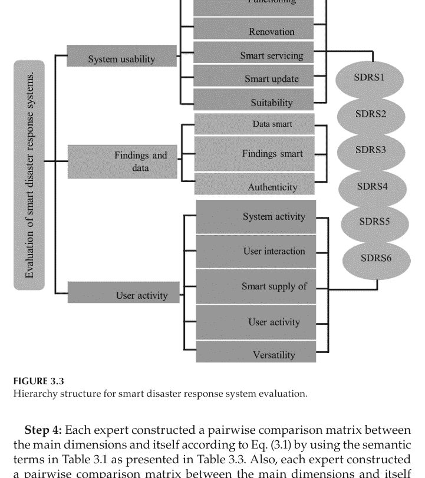

## 图 3.3

智能灾害响应系统评估的层次结构。

步骤 4：每个专家根据式 (3.1) 使用表 3.1 中的语义术语构建主维度与其自身之间的成对比较矩阵，如表 3.3 所示。此外，每个专家根据式 (3.2) 使用表 3.1 中的 TFNs 构建主维度与其自身之间的成对比较矩阵，如表 3.4 所示。

## 表 3.3

所有专家使用语义变量对主维度进行评估

| 专家_s | SUD₁ | FDD₂ | UAD₃ |
|---|---|---|---|
| SUD₁ | <NOE><NOE><NOE><NOE> | <HIE><HIE><VLE><HIE> | <VHE><HIE><VHE><LOE> |
| FDD₂ | <LOE><VLE><LOE><LOE> | <NOE><NOE><NOE><NOE> | <VLE><VLE><LOE><VLE> |
| UAD₃ | <HIE><HIE><HIE><VHE> | <LOE><LOE><LOE><LOE> | <NOE><NOE><NOE><NOE> |

## 表 3.4

所有专家使用 TFNs 对主维度进行评估

**Expert₁**
|  | SUD₁ | FDD₂ | UAD₃ |
|---|---|---|---|
| SUD₁ | ⟨0.00, 0.00, 0.25⟩ | ⟨0.50, 0.75, 1.00⟩ | ⟨0.75, 1.00, 1.00⟩ |
| FDD₂ | ⟨0.25, 0.50, 0.75⟩ | ⟨0.00, 0.00, 0.25⟩ | ⟨0.00, 0.25, 0.50⟩ |
| UAD₃ | ⟨0.50, 0.75, 1.00⟩ | ⟨0.25, 0.50, 0.75⟩ | ⟨0.00, 0.00, 0.25⟩ |

**Expert₂**
|  | SUD₁ | FDD₂ | UAD₃ |
|---|---|---|---|
| SUD₁ | ⟨0.00, 0.00, 0.25⟩ | ⟨0.50, 0.75, 1.00⟩ | ⟨0.50, 0.75, 1.00⟩ |
| FDD₂ | ⟨0.00, 0.25, 0.50⟩ | ⟨0.00, 0.00, 0.25⟩ | ⟨0.00, 0.25, 0.50⟩ |
| UAD₃ | ⟨0.50, 0.75, 1.00⟩ | ⟨0.25, 0.50, 0.75⟩ | ⟨0.00, 0.00, 0.25⟩ |

**Expert₃**
|  | SUD₁ | FDD₂ | UAD₃ |
|---|---|---|---|
| SUD₁ | ⟨0.00, 0.00, 0.25⟩ | ⟨0.00, 0.25, 0.50⟩ | ⟨0.75, 1.00, 1.00⟩ |
| FDD₂ | ⟨0.25, 0.50, 0.75⟩ | ⟨0.00, 0.00, 0.25⟩ | ⟨0.25, 0.50, 0.75⟩ |
| UAD₃ | ⟨0.50, 0.75, 1.00⟩ | ⟨0.25, 0.50, 0.75⟩ | ⟨0.00, 0.00, 0.25⟩ |

**Expert₄**
|  | SUD₁ | FDD₂ | UAD₃ |
|---|---|---|---|
| SUD₁ | ⟨0.00, 0.00, 0.25⟩ | ⟨0.50, 0.75, 1.00⟩ | ⟨0.25, 0.50, 0.75⟩ |
| FDD₂ | ⟨0.25, 0.50, 0.75⟩ | ⟨0.00, 0.00, 0.25⟩ | ⟨0.00, 0.25, 0.50⟩ |
| UAD₃ | ⟨0.75, 1.00, 1.00⟩ | ⟨0.25, 0.50, 0.75⟩ | ⟨0.00, 0.00, 0.25⟩ |

## 表 3.5

使用 TFNs 对主维度进行所有评估的汇总决策矩阵

| Expertₛ | SUD₁ | FDD₂ | UAD₃ |
|---|---|---|---|
| SUD₁ | ⟨0.00, 0.00, 0.25⟩ | ⟨0.38, 0.63, 0.88⟩ | ⟨0.56, 0.81, 0.94⟩ |
| FDD₂ | ⟨0.19, 0.44, 0.69⟩ | ⟨0.00, 0.00, 0.25⟩ | ⟨0.06, 0.31, 0.56⟩ |
| UAD₃ | ⟨0.56, 0.81, 1.00⟩ | ⟨0.25, 0.50, 0.75⟩ | ⟨0.00, 0.00, 0.25⟩ |

步骤 5：通过应用式 (3.3) 将所有专家创建的所有专家决策矩阵汇总为一个矩阵，如表 3.5 所示。然后，通过应用 GMIR 方法去除 TFNs，将模糊汇总决策矩阵去模糊化为清晰组合决策矩阵，如式 (3.4) 所示。

步骤 6：通过应用式 (3.5) 和 (3.6)，开发了主维度的广义直接关系矩阵，如表 3.6 所示。

步骤 7：根据式 (3.7) 计算了主维度的总关系矩阵，如表 3.7 所示。

步骤 8：主维度的 IRM 是基于根据式 (3.8) 和 (3.9) 计算并在表 3.7 和图 3.4 中呈现的 R 和 C 值创建的。此外，通过应用式 (3.10) 计算了主维度的最终权重，如表 3.7 和图 3.5 所示。


## 表 3.6
所有专家的主要维度广义关系矩阵

| 专家_s | SUD₁ | FDD₂ | UAD₃ |
|---|---|---|---|
| SUD₁ | 0.0285 | 0.4310 | 0.5405 |
| FDD₂ | 0.2302 | 0.0285 | 0.2121 |
| UAD₃ | 0.5473 | 0.3421 | 0.0285 |

## 表 3.7
所有专家的主要维度总关系矩阵

| 专家_s | SUD₁ | FDD₂ | UAD₃ | R_i | C_i | R_i + C_i | R_i - C_i | 性质 | 权重 |
|---|---|---|---|---|---|---|---|---|---|
| SUD₁ | 1.3544 | 1.6311 | 1.6659 | 4.6514 | 3.9221 | 8.5736 | 0.7293 | 原因 | 0.367 |
| FDD₂ | 0.9181 | 0.7510 | 0.8930 | 2.5621 | 3.9177 | 6.4798 | -1.3556 | 效应 | 0.277 |
| UAD₃ | 1.6497 | 1.5355 | 1.2823 | 4.4675 | 3.8412 | 8.3087 | 0.6262 | 原因 | 0.356 |

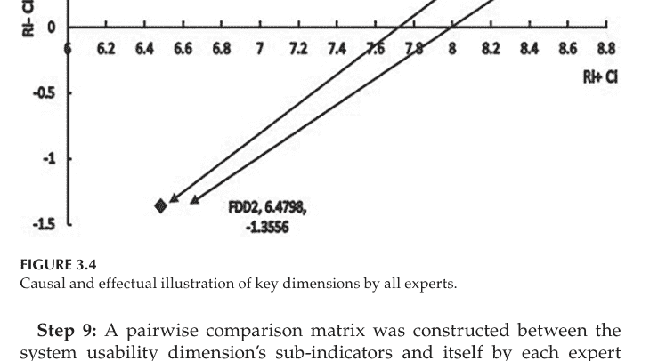

## 图 3.4
所有专家的关键维度因果关系示意图。

**步骤 9：** 每个专家根据公式 (3.1) 使用表 3.1 中的语义术语构建了系统可用性维度子指标与其自身的成对比较矩阵，如表 3.8 所示。此外，每个专家根据公式 (3.2) 使用表 3.1 中的 TFNs 构建了系统可用性维度子指标与其自身的成对比较矩阵，如表 3.9 所示。

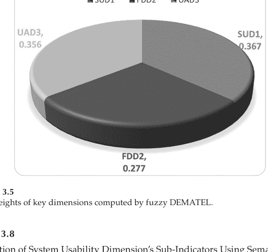

## 图 3.5
模糊 DEMATEL 计算的关键维度最终权重。

## 表 3.8
所有专家使用语义变量对系统可用性维度子指标的评估

**专家₁**
| 专家₁ | FOD₁₋₁ | RED₁₋₂ | SSD₁₋₃ | SUD₁₋₄ | SBD₁₋₅ |
|---|---|---|---|---|---|
| FOD₁₋₁ | ⟨NOE⟩ | ⟨HIE⟩ | ⟨VHE⟩ | ⟨VHE⟩ | ⟨LOE⟩ |
| RED₁₋₂ | ⟨HIE⟩ | ⟨NOE⟩ | ⟨VLE⟩ | ⟨LOE⟩ | ⟨HIE⟩ |
| SSD₁₋₃ | ⟨LOE⟩ | ⟨VHE⟩ | ⟨NOE⟩ | ⟨VHE⟩ | VLE |
| SUD₁₋₄ | ⟨NOE⟩ | ⟨VLE⟩ | ⟨HIE⟩ | ⟨NOE⟩ | ⟨HIE⟩ |
| SBD₁₋₅ | ⟨HIE⟩ | ⟨LOE⟩ | ⟨VHE⟩ | ⟨LOE⟩ | ⟨NOE⟩ |

**专家₂**
| 专家₂ | FOD₁₋₁ | RED₁₋₂ | SSD₁₋₃ | SUD₁₋₄ | SBD₁₋₅ |
|---|---|---|---|---|---|
| FOD₁₋₁ | ⟨NOE⟩ | ⟨HIE⟩ | ⟨VHE⟩ | ⟨VHE⟩ | ⟨LOE⟩ |
| RED₁₋₂ | ⟨HIE⟩ | ⟨NOE⟩ | ⟨HIE⟩ | ⟨LOE⟩ | ⟨HIE⟩ |
| SSD₁₋₃ | ⟨HIE⟩ | ⟨VLE⟩ | ⟨NOE⟩ | ⟨LOE⟩ | ⟨HIE⟩ |
| SUD₁₋₄ | ⟨NOE⟩ | ⟨VLE⟩ | ⟨HIE⟩ | ⟨NOE⟩ | ⟨HIE⟩ |
| SBD₁₋₅ | ⟨HIE⟩ | ⟨LOE⟩ | ⟨VHE⟩ | ⟨VLE⟩ | ⟨NOE⟩ |

**专家₃**
| 专家₃ | FOD₁₋₁ | RED₁₋₂ | SSD₁₋₃ | SUD₁₋₄ | SBD₁₋₅ |
|---|---|---|---|---|---|
| FOD₁₋₁ | ⟨NOE⟩ | ⟨HIE⟩ | ⟨VHE⟩ | ⟨VHE⟩ | LOE |
| RED₁₋₂ | ⟨HIE⟩ | ⟨NOE⟩ | ⟨HIE⟩ | ⟨VLE⟩ | ⟨HIE⟩ |
| SSD₁₋₃ | ⟨LOE⟩ | ⟨HIE⟩ | ⟨NOE⟩ | ⟨VHE⟩ | ⟨HIE⟩ |
| SUD₁₋₄ | NOE | VLE | ⟨HIE⟩ | ⟨NOE⟩ | ⟨HIE⟩ |
| SBD₁₋₅ | ⟨HIE⟩ | ⟨LOE⟩ | VHE | ⟨LOE⟩ | ⟨NOE⟩ |

(续)

## 表 3.8 (续)
所有专家使用语义变量对系统可用性维度子指标的评估

| 专家₄ | FOD₁₋₁ | RED₁₋₂ | SSD₁₋₃ | SUD₁₋₄ | SBD₁₋₅ |
|---|---|---|---|---|---|
| FOD₁₋₁ | ⟨NOE⟩ | ⟨HIE⟩ | ⟨VHE⟩ | ⟨VHE⟩ | ⟨LOE⟩ |
| RED₁₋₂ | ⟨HIE⟩ | ⟨NOE⟩ | VLE | ⟨LOE⟩ | ⟨HIE⟩ |
| SSD₁₋₃ | ⟨LOE⟩ | ⟨VHE⟩ | ⟨NOE⟩ | ⟨VHE⟩ | LOE |
| SUD₁₋₄ | ⟨LOE⟩ | ⟨HIE⟩ | ⟨HIE⟩ | ⟨NOE⟩ | ⟨HIE⟩ |
| SBD₁₋₅ | ⟨HIE⟩ | ⟨LOE⟩ | ⟨VHE⟩ | ⟨VLE⟩ | ⟨NOE⟩ |

步骤 10：所有专家创建的决策矩阵通过应用公式 (3.3) 聚合为一个矩阵，如表 3.10 所示。然后，通过应用公式 (3.4) 中的 GMIR 方法去除 TFNs，将模糊聚合决策矩阵去模糊化为清晰组合决策矩阵。

步骤 11：系统可用性维度子指标的广义直接关系矩阵通过应用公式 (3.5) 和 (3.6) 开发，如表 3.11 所示。

步骤 12：系统可用性维度子指标的总关系矩阵根据公式 (3.7) 计算，如表 3.12 所示。

步骤 13：系统可用性维度子指标的 IRM 基于 R 和 C 的值创建，该值根据公式 (3.8) 和 (3.9) 计算并呈现在表 3.12 和图 3.6 中。此外，系统可用性维度子指标的最终权重通过应用公式 (3.10) 计算，如表 3.12 和图 3.7 所示。

步骤 14：每个专家根据公式 (3.1) 使用表 3.1 中的语义术语构建了发现与数据管理维度子指标与其自身的成对比较矩阵，如表 3.13 所示。此外，每个专家根据公式 (3.2) 使用表 3.1 中的 TFNs 构建了发现与数据管理维度子指标与其自身的成对比较矩阵，如表 3.14 所示。

步骤 15：所有专家创建的决策矩阵通过应用公式 (3.3) 聚合为一个矩阵，如表 3.15 所示。然后，通过应用公式 (3.4) 中的 GMIR 方法去除 TFNs，将模糊聚合决策矩阵去模糊化为清晰组合决策矩阵。

步骤 16：发现与数据管理维度子指标的广义直接关系矩阵通过应用公式 (3.5) 和 (3.6) 开发，如表 3.16 所示。

## 表 3.9
所有专家使用 TFNs 对系统可用性维度子指标的评估

|  | FOD₁,₁ | RED₁,₂ | SSD₁,₃ | SUD₁,₄ | SBD₁,₅ |
|---|---|---|---|---|---|
| 专家₁ |  |  |  |  |  |
| FOD₁,₁ | (0.00, 0.00, 0.25) | (0.50, 0.75, 1.00) | (0.75, 1.00, 1.00) | (0.75, 1.00, 1.00) | (0.25, 0.50, 0.75) |
| RED₁,₂ | (0.50, 0.75, 1.00) | (0.00, 0.00, 0.25) | (0.00, 0.25, 0.50) | (0.25, 0.50, 0.75) | (0.50, 0.75, 1.00) |
| SSD₁,₃ | (0.25, 0.50, 0.75) | (0.75, 1.00, 1.00) | (0.00, 0.00, 0.25) | (0.75, 1.00, 1.00) | (0.00, 0.25, 0.50) |
| SUD₁,₄ | (0.00, 0.00, 0.25) | (0.00, 0.25, 0.50) | (0.50, 0.75, 1.00) | (0.00, 0.00, 0.25) | (0.50, 0.75, 1.00) |
| SBD₁,₅ | (0.50, 0.75, 1.00) | (0.25, 0.50, 0.75) | (0.75, 1.00, 1.00) | (0.25, 0.50, 0.75) | (0.00, 0.00, 0.25) |
| 专家₂ |  |  |  |  |  |
| FOD₁,₁ | (0.00, 0.00, 0.25) | (0.50, 0.75, 1.00) | (0.75, 1.00, 1.00) | (0.75, 1.00, 1.00) | (0.25, 0.50, 0.75) |
| RED₁,₂ | (0.50, 0.75, 1.00) | (0.00, 0.00, 0.25) | (0.50, 0.75, 1.00) | (0.25, 0.50, 0.75) | (0.50, 0.75, 1.00) |
| SSD₁,₃ | (0.50, 0.75, 1.00) | (0.00, 0.25, 0.50) | (0.00, 0.00, 0.25) | (0.25, 0.50, 0.75) | (0.50, 0.75, 1.00) |
| SUD₁,₄ | (0.00, 0.00, 0.25) | (0.00, 0.25, 0.50) | (0.50, 0.75, 1.00) | (0.00, 0.00, 0.25) | (0.50, 0.75, 1.00) |
| SBD₁,₅ | (0.50, 0.75, 1.00) | (0.25, 0.50, 0.75) | (0.75, 1.00, 1.00) | (0.00, 0.25, 0.50) | (0.00, 0.00, 0.25) |
| 专家₃ |  |  |  |  |  |
| FOD₁,₁ | (0.00, 0.00, 0.25) | (0.50, 0.75, 1.00) | (0.75, 1.00, 1.00) | (0.75, 1.00, 1.00) | (0.25, 0.50, 0.75) |
| RED₁,₂ | (0.50, 0.75, 1.00) | (0.00, 0.00, 0.25) | (0.50, 0.75, 1.00) | (0.00, 0.25, 0.50) | (0.50, 0.75, 1.00) |
| SSD₁,₃ | (0.25, 0.50, 0.75) | (0.50, 0.75, 1.00) | (0.00, 0.00, 0.25) | (0.75, 1.00, 1.00) | (0.50, 0.75, 1.00) |
| SUD₁,₄ | (0.00, 0.00, 0.25) | (0.00, 0.25, 0.50) | (0.50, 0.75, 1.00) | (0.00, 0.00, 0.25) | (0.50, 0.75, 1.00) |
| SBD₁,₅ | (0.50, 0.75, 1.00) | (0.25, 0.50, 0.75) | (0.75, 1.00, 1.00) | (0.25, 0.50, 0.75) | (0.00, 0.00, 0.25) |
| 专家₄ |  |  |  |  |  |
| FOD₁,₁ | (0.00, 0.00, 0.25) | (0.50, 0.75, 1.00) | (0.75, 1.00, 1.00) | (0.75, 1.00, 1.00) | (0.25, 0.50, 0.75) |
| RED₁,₂ | (0.50, 0.75, 1.00) | (0.00, 0.00, 0.25) | (0.00, 0.25, 0.50) | (0.25, 0.50, 0.75) | (0.50, 0.75, 1.00) |
| SSD₁,₃ | (0.25, 0.50, 0.75) | (0.75, 1.00, 1.00) | (0.00, 0.00, 0.25) | (0.75, 1.00, 1.00) | (0.25, 0.50, 0.75) |
| SUD₁,₄ | (0.25, 0.50, 0.75) | (0.50, 0.75, 1.00) | (0.50, 0.75, 1.00) | (0.00, 0.00, 0.25) | (0.50, 0.75, 1.00) |
| SBD₁,₅ | (0.50, 0.75, 1.00) | (0.25, 0.50, 0.75) | (0.75, 1.00, 1.00) | (0.00, 0.25, 0.50) | (0.00, 0.00, 0.25) |

## 表 3.10 所有专家对系统可用性维度子指标评估的聚合决策矩阵，使用 TFNs

| 专家_i | FOD_1,1 | RED_1,2 | SSD_1,3 | SUD_1,4 | SBD_1,5 |
|---|---|---|---|---|---|
| FOD_1,1 | <0.00, 0.00, 0.25> | <0.50, 0.75, 1.00> | <0.75, 1.00, 1.00> | <0.75, 1.00, 1.00> | <0.25, 0.50, 0.75> |
| RED_1,2 | <0.50, 0.75, 1.00> | <0.00, 0.00, 0.25> | <0.25, 0.50, 0.75> | <0.19, 0.44, 0.69> | <0.50, 0.75, 1.00> |
| SSD_1,3 | <0.31, 0.56, 0.81> | <0.50, 0.75, 0.88> | <0.00, 0.00, 0.25> | <0.63, 0.88, 0.94> | <0.31, 0.56, 0.81> |
| SUD_1,4 | <0.06, 0.13, 0.38> | <0.13, 0.38, 0.63> | <0.50, 0.75, 1.00> | <0.00, 0.00, 0.25> | <0.50, 0.75, 1.00> |
| SBD_1,5 | <0.50, 0.75, 1.00> | <0.25, 0.50, 0.75> | <0.75, 1.00, 1.00> | <0.13, 0.38, 0.63> | <0.00, 0.00, 0.25> |

## 表 3.11 所有专家的系统可用性维度子指标广义关系矩阵

| 专家_i | FOD_1,1 | RED_1,2 | SSD_1,3 | SUD_1,4 | SBD_1,5 |
|---|---|---|---|---|---|
| FOD_1,1 | 0.012393 | 0.223101 | 0.285570 | 0.285570 | 0.193355 |
| RED_1,2 | 0.223101 | 0.012393 | 0.193355 | 0.130886 | 0.223101 |
| SSD_1,3 | 0.166582 | 0.217152 | 0.012393 | 0.252848 | 0.166582 |
| SUD_1,4 | 0.047595 | 0.113038 | 0.223101 | 0.012393 | 0.223101 |
| SBD_1,5 | 0.223101 | 0.193355 | 0.285570 | 0.113038 | 0.012393 |

## 表 3.12 所有专家的系统可用性维度子指标总关系矩阵

| 专家_s | FOD_1,1 | RED_1,2 | SSD_1,3 | SUD_1,4 | SBD_1,5 | R_i | C_i | R_i + C_i | R_i - C_i | 性质 | 权重 |
|---|---|---|---|---|---|---|---|---|---|---|---|
| FOD_1,1 | 0.708 | 0.964 | 1.205 | 1.044 | 0.991 | 4.912 | 3.544 | 8.455 | 1.368 | 原因 | 0.204 |
| RED_1,2 | 0.780 | 0.669 | 0.986 | 0.800 | 0.877 | 4.111 | 3.940 | 8.051 | 0.171 | 原因 | 0.195 |
| SSD_1,3 | 0.729 | 0.832 | 0.829 | 0.885 | 0.839 | 4.115 | 4.939 | 9.054 | -0.825 | 效应 | 0.219 |
| SUD_1,4 | 0.519 | 0.619 | 0.830 | 0.541 | 0.729 | 3.238 | 4.094 | 7.331 | -0.856 | 效应 | 0.177 |
| SBD_1,5 | 0.809 | 0.856 | 1.089 | 0.825 | 0.734 | 4.313 | 4.171 | 8.483 | 0.142 | 原因 | 0.205 |


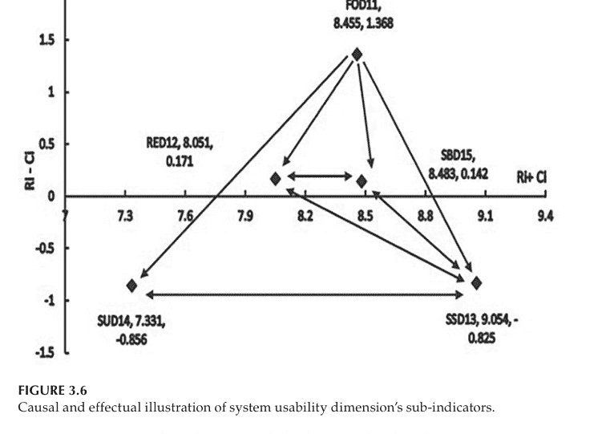

## 图 3.6
系统可用性维度子指标的因果与效应说明。

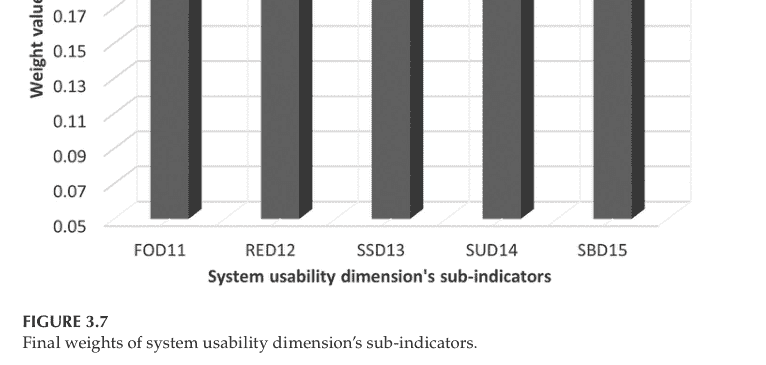

## 图 3.7
系统可用性维度子指标的最终权重。

## 表 3.13

使用语义变量对发现与数据管理维度子指标的评估

|  | DSD_{2_1} | FSD_{2_2} | AUD_{2_3} |
|---|---|---|---|
| DSD_{2_1} | <NOE><NOE><NOE><NOE> | <LOE><VHE><VLE><HIE> | <VHE><HIE><VHE><LOE> |
| FSD_{2_2} | <LOE><VLE><LOE><LOE> | <NOE><NOE><NOE><NOE> | <VLE><LOE><LOE><VLE> |
| AUD_{2_3} | <HIE><HIE><LOE><VHE> | <HIE><VLE><LOE><LOE> | <NOE><NOE><NOE><NOE> |

## 表 3.14

使用三角模糊数对发现与数据管理维度子指标的评估

| 专家1 | DSD_{2_1} | FSD_{2_2} | AUD_{2_3} |
|---|---|---|---|
| DSD_{2_1} | ⟨0.00, 0.00, 0.25⟩ | ⟨0.25, 0.50, 0.75⟩ | ⟨0.75, 1.00, 1.00⟩ |
| FSD_{2_2} | ⟨0.25, 0.50, 0.75⟩ | ⟨0.00, 0.00, 0.25⟩ | ⟨0.00, 0.25, 0.50⟩ |
| AUD_{2_3} | ⟨0.50, 0.75, 1.00⟩ | ⟨0.50, 0.75, 1.00⟩ | ⟨0.00, 0.00, 0.25⟩ |

| 专家2 | DSD_{2_1} | FSD_{2_2} | AUD_{2_3} |
|---|---|---|---|
| DSD_{2_1} | ⟨0.00, 0.00, 0.25⟩ | ⟨0.75, 1.00, 1.00⟩ | ⟨0.50, 0.75, 1.00⟩ |
| FSD_{2_2} | ⟨0.00, 0.25, 0.50⟩ | ⟨0.00, 0.00, 0.25⟩ | ⟨0.25, 0.50, 0.75⟩ |
| AUD_{2_3} | ⟨0.50, 0.75, 1.00⟩ | ⟨0.00, 0.25, 0.50⟩ | ⟨0.00, 0.00, 0.25⟩ |

| 专家3 | DSD_{2_1} | FSD_{2_2} | AUD_{2_3} |
|---|---|---|---|
| DSD_{2_1} | ⟨0.00, 0.00, 0.25⟩ | ⟨0.00, 0.25, 0.50⟩ | ⟨0.75, 1.00, 1.00⟩ |
| FSD_{2_2} | ⟨0.25, 0.50, 0.75⟩ | ⟨0.00, 0.00, 0.25⟩ | ⟨0.25, 0.50, 0.75⟩ |
| AUD_{2_3} | ⟨0.25, 0.50, 0.75⟩ | ⟨0.25, 0.50, 0.75⟩ | ⟨0.00, 0.00, 0.25⟩ |

| 专家4 | DSD_{2_1} | FSD_{2_2} | AUD_{2_3} |
|---|---|---|---|
| DSD_{2_1} | ⟨0.00, 0.00, 0.25⟩ | ⟨0.50, 0.75, 1.00⟩ | ⟨0.25, 0.50, 0.75⟩ |
| FSD_{2_2} | ⟨0.25, 0.50, 0.75⟩ | ⟨0.00, 0.00, 0.25⟩ | ⟨0.00, 0.25, 0.50⟩ |
| AUD_{2_3} | ⟨0.75, 1.00, 1.00⟩ | ⟨0.25, 0.50, 0.75⟩ | ⟨0.00, 0.00, 0.25⟩ |

## 表 3.15

使用三角模糊数对发现与数据管理维度子指标进行的所有评估的聚合决策矩阵

| 专家_s | DSD_{2_1} | FSD_{2_2} | AUD_{2_3} |
|---|---|---|---|
| DSD_{2_1} | ⟨0.00, 0.00, 0.25⟩ | ⟨0.38, 0.63, 0.81⟩ | ⟨0.56, 0.81, 0.94⟩ |
| FSD_{2_2} | ⟨0.13, 0.44, 0.69⟩ | ⟨0.00, 0.00, 0.25⟩ | ⟨0.13, 0.38, 0.63⟩ |
| AUD_{2_3} | ⟨0.50, 0.75, 0.94⟩ | ⟨0.25, 0.50, 0.75⟩ | ⟨0.00, 0.00, 0.25⟩ |

## 表 3.16

发现与数据管理维度子指标的广义关系矩阵

| 专家_s | DSD_2_1 | FSD_2_2 | AUD_2_3 |
|---|---|---|---|
| DSD_2_1 | 0.0285 | 0.4242 | 0.5405 |
| FSD_2_2 | 0.2942 | 0.0285 | 0.2600 |
| AUD_2_3 | 0.5063 | 0.5131 | 0.0285 |

## 表 3.17

所有专家对发现与数据管理维度子指标的总关系矩阵

| 专家_s | DSD_2_1 | FSD_2_2 | AUD_2_3 | R_i | C_i | R_i + C_i | R_i - C_i | 属性 | 权重 |
|---|---|---|---|---|---|---|---|---|---|
| DSD_2_1 | 2.0832 | 2.6229 | 2.4172 | 7.1234 | 6.1169 | 13.2403 | 1.0065 | Cause | 0.347 |
| FSD_2_2 | 1.5881 | 1.5497 | 1.5658 | 4.7037 | 6.8862 | 11.5898 | -2.1825 | Effect | 0.303 |
| AUD_2_3 | 2.4455 | 2.7135 | 2.1160 | 7.2751 | 6.0991 | 13.3742 | 1.1760 | Cause | 0.350 |

步骤 17：根据公式 (3.7) 计算了发现与数据管理维度子指标的总关系矩阵，如表 3.17 所示。

步骤 18：根据 R 和 C 的值创建了发现与数据管理维度子指标的 IRM，该值根据公式 (3.8) 和 (3.9) 计算，并在表 3.17 和图 3.8 中呈现。此外，发现与数据管理维度子指标的最终权重通过应用公式 (3.10) 计算，如表 3.17 和图 3.9 所示。

步骤 19：根据公式 (3.1)，每位专家使用表 3.1 中的语义术语，在表 3.18 中呈现，构建了用户活动维度子指标与其自身之间的成对比较矩阵。此外，根据公式 (3.2)，每位专家使用表 3.1 中的 TFNs，在表 3.19 中呈现，构建了用户活动维度子指标与其自身之间的成对比较矩阵。

步骤 20：通过应用公式 (3.3)，将所有专家创建的所有决策矩阵聚合为一个矩阵，如表 3.20 所示。然后，通过应用公式 (3.4) 中的 GMIR 方法去除 TFNs，将模糊聚合决策矩阵去模糊化为清晰的组合决策矩阵。

步骤 21：通过应用公式 (3.5) 和 (3.6)，开发了用户活动维度子指标的广义直接关系矩阵，如表 3.21 所示。

步骤 22：根据公式 (3.7) 计算了用户活动维度子指标的总关系矩阵，如表 3.22 所示。

步骤 23：根据 R 和 C 的值创建了用户活动维度子指标的 IRM，该值根据公式 (3.8) 和 (3.9) 计算，并在表 3.22 和图 3.10 中呈现。此外，用户活动维度子指标的最终权重通过应用公式 (3.10) 计算，如表 3.22 和图 3.11 所示。

步骤 24：根据计算主要维度的步骤，计算了子指标的权重。基于主要维度的权重和子指标的权重，计算了用于智能灾害响应系统评估过程的最终全局权重，并在表 3.23 中呈现。

步骤 25：通过应用公式 (3.11) 和 (3.12)，使用语义术语和 TFNs 分别如表 3.2 所示，构建了所有识别的子指标与专家指定的智能灾害响应系统之间的所有决策矩阵，结果形成表 3.24。

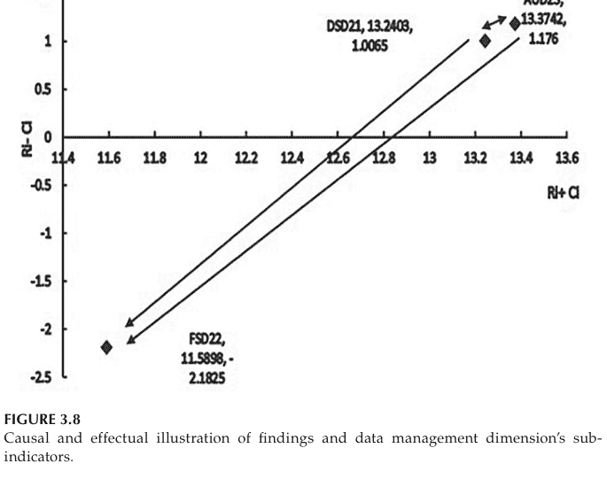

## 图 3.8
发现与数据管理维度子指标的因果与效应说明。

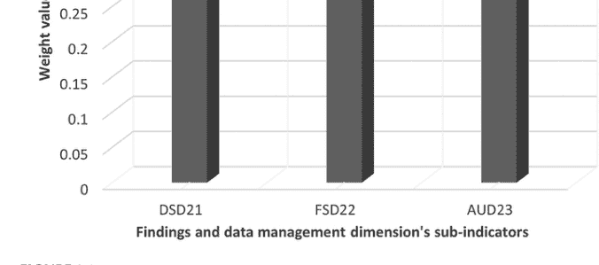

## 图 3.9
发现与数据管理维度子指标的最终权重。

## 表 3.18

所有专家使用语义变量对用户活动维度子指标的评估

| 专家 | SSD₃,₁ | UID₃,₂ | SRD₃,₃ | UCD₃,₄ | VED₃,₅ |
|---|---|---|---|---|---|
| 专家1 | SSD₃,₁ | UID₃,₂ | SRD₃,₃ | UCD₃,₄ | VED₃,₅ |
| SSD₃,₁ | ⟨NOE⟩ | ⟨HIE⟩ | ⟨VHE⟩ | ⟨NOE⟩ | ⟨LOE⟩ |
| UID₃,₂ | ⟨LOE⟩ | ⟨NOE⟩ | ⟨VLE⟩ | ⟨LOE⟩ | ⟨HIE⟩ |
| SRD₃,₃ | ⟨LOE⟩ | ⟨VLE⟩ | ⟨NOE⟩ | ⟨VHE⟩ | ⟨VLE⟩ |
| UCD₃,₄ | ⟨HIE⟩ | ⟨VLE⟩ | ⟨LOE⟩ | ⟨NOE⟩ | ⟨HIE⟩ |
| VED₃,₅ | ⟨HIE⟩ | ⟨LOE⟩ | ⟨VHE⟩ | ⟨LOE⟩ | ⟨NOE⟩ |
| 专家2 | SSD₃,₁ | UID₃,₂ | SRD₃,₃ | UCD₃,₄ | VED₃,₅ |
| SSD₃,₁ | ⟨NOE⟩ | ⟨HIE⟩ | ⟨VHE⟩ | ⟨VLE⟩ | ⟨LOE⟩ |
| UID₃,₂ | ⟨LOE⟩ | ⟨NOE⟩ | ⟨HIE⟩ | ⟨LOE⟩ | ⟨HIE⟩ |
| SRD₃,₃ | ⟨HIE⟩ | ⟨VLE⟩ | ⟨NOE⟩ | ⟨LOE⟩ | ⟨HIE⟩ |
| UCD₃,₄ | ⟨VLE⟩ | ⟨VLE⟩ | ⟨HIE⟩ | ⟨NOE⟩ | ⟨HIE⟩ |
| VED₃,₅ | ⟨HIE⟩ | ⟨LOE⟩ | ⟨VHE⟩ | ⟨VLE⟩ | ⟨NOE⟩ |
| 专家3 | SSD₃,₁ | UID₃,₂ | SRD₃,₃ | UCD₃,₄ | VED₃,₅ |
| SSD₃,₁ | ⟨NOE⟩ | ⟨HIE⟩ | ⟨VHE⟩ | ⟨LOE⟩ | ⟨LOE⟩ |
| UID₃,₂ | ⟨VHE⟩ | ⟨NOE⟩ | ⟨HIE⟩ | ⟨VLE⟩ | ⟨HIE⟩ |
| SRD₃,₃ | ⟨LOE⟩ | ⟨VHE⟩ | ⟨NOE⟩ | ⟨VHE⟩ | ⟨HIE⟩ |
| UCD₃,₄ | ⟨VLE⟩ | ⟨VLE⟩ | ⟨LOE⟩ | ⟨NOE⟩ | ⟨HIE⟩ |
| VED₃,₅ | ⟨HIE⟩ | ⟨LOE⟩ | ⟨VHE⟩ | ⟨LOE⟩ | ⟨NOE⟩ |
| 专家4 | SSD₃,₁ | UID₃,₂ | SRD₃,₃ | UCD₃,₄ | VED₃,₅ |
| SSD₃,₁ | ⟨NOE⟩ | ⟨HIE⟩ | ⟨VHE⟩ | ⟨NOE⟩ | ⟨LOE⟩ |
| UID₃,₂ | ⟨VHE⟩ | ⟨NOE⟩ | ⟨VLE⟩ | ⟨LOE⟩ | ⟨HIE⟩ |
| SRD₃,₃ | ⟨LOE⟩ | ⟨VLE⟩ | ⟨NOE⟩ | ⟨VHE⟩ | ⟨LOE⟩ |
| UCD₃,₄ | ⟨VLE⟩ | ⟨HIE⟩ | ⟨LOE⟩ | ⟨NOE⟩ | ⟨HIE⟩ |
| VED₃,₅ | ⟨HIE⟩ | ⟨LOE⟩ | ⟨VHE⟩ | ⟨VLE⟩ | ⟨NOE⟩ |

## 表 3.19

所有专家使用三角模糊数对用户活动维度子指标的评估

**专家1**
|  | SSD₃,₁ | UID₃,₂ | SRD₃,₃ | UCD₃,₄ | VED₃,₅ |
|---|---|---|---|---|---|
| SSD₃,₁ | ⟨0.00, 0.00, 0.25⟩ | ⟨0.50, 0.75, 1.00⟩ | ⟨0.75, 1.00, 1.00⟩ | ⟨0.00, 0.00, 0.25⟩ | ⟨0.25, 0.50, 0.75⟩ |
| UID₃,₂ | ⟨0.25, 0.50, 0.75⟩ | ⟨0.00, 0.00, 0.25⟩ | ⟨0.00, 0.25, 0.50⟩ | ⟨0.25, 0.50, 0.75⟩ | ⟨0.50, 0.75, 1.00⟩ |
| SRD₃,₃ | ⟨0.25, 0.50, 0.75⟩ | ⟨0.00, 0.25, 0.50⟩ | ⟨0.00, 0.00, 0.25⟩ | ⟨0.75, 1.00, 1.00⟩ | ⟨0.00, 0.25, 0.50⟩ |
| UCD₃,₄ | ⟨0.50, 0.75, 1.00⟩ | ⟨0.00, 0.25, 0.50⟩ | ⟨0.25, 0.50, 0.75⟩ | ⟨0.00, 0.00, 0.25⟩ | ⟨0.50, 0.75, 1.00⟩ |
| VED₃,₅ | ⟨0.50, 0.75, 1.00⟩ | ⟨0.25, 0.50, 0.75⟩ | ⟨0.75, 1.00, 1.00⟩ | ⟨0.25, 0.50, 0.75⟩ | ⟨0.00, 0.00, 0.25⟩ |

**专家2**
|  | SSD₃,₁ | UID₃,₂ | SRD₃,₃ | UCD₃,₄ | VED₃,₅ |
|---|---|---|---|---|---|
| SSD₃,₁ | ⟨0.00, 0.00, 0.25⟩ | ⟨0.50, 0.75, 1.00⟩ | ⟨0.75, 1.00, 1.00⟩ | ⟨0.00, 0.25, 0.50⟩ | ⟨0.25, 0.50, 0.75⟩ |
| UID₃,₂ | ⟨0.25, 0.50, 0.75⟩ | ⟨0.00, 0.00, 0.25⟩ | ⟨0.50, 0.75, 1.00⟩ | ⟨0.25, 0.50, 0.75⟩ | ⟨0.50, 0.75, 1.00⟩ |
| SRD₃,₃ | ⟨0.50, 0.75, 1.00⟩ | ⟨0.00, 0.25, 0.50⟩ | ⟨0.00, 0.00, 0.25⟩ | ⟨0.25, 0.50, 0.75⟩ | ⟨0.50, 0.75, 1.00⟩ |
| UCD₃,₄ | ⟨0.00, 0.25, 0.50⟩ | ⟨0.00, 0.25, 0.50⟩ | ⟨0.50, 0.75, 1.00⟩ | ⟨0.00, 0.00, 0.25⟩ | ⟨0.50, 0.75, 1.00⟩ |
| VED₃,₅ | ⟨0.50, 0.75, 1.00⟩ | ⟨0.25, 0.50, 0.75⟩ | ⟨0.75, 1.00, 1.00⟩ | ⟨0.00, 0.25, 0.50⟩ | ⟨0.00, 0.00, 0.25⟩ |

**专家3**
|  | SSD₃,₁ | UID₃,₂ | SRD₃,₃ | UCD₃,₄ | VED₃,₅ |
|---|---|---|---|---|---|
| SSD₃,₁ | ⟨0.00, 0.00, 0.25⟩ | ⟨0.50, 0.75, 1.00⟩ | ⟨0.75, 1.00, 1.00⟩ | ⟨0.75, 1.00, 1.00⟩ | ⟨0.25, 0.50, 0.75⟩ |
| UID₃,₂ | ⟨0.75, 1.00, 1.00⟩ | ⟨0.00, 0.00, 0.25⟩ | ⟨0.50, 0.75, 1.00⟩ | ⟨0.00, 0.25, 0.50⟩ | ⟨0.50, 0.75, 1.00⟩ |
| SRD₃,₃ | ⟨0.25, 0.50, 0.75⟩ | ⟨0.75, 1.00, 1.00⟩ | ⟨0.00, 0.00, 0.25⟩ | ⟨0.75, 1.00, 1.00⟩ | ⟨0.50, 0.75, 1.00⟩ |
| UCD₃,₄ | ⟨0.00, 0.25, 0.50⟩ | ⟨0.00, 0.25, 0.50⟩ | ⟨0.25, 0.50, 0.75⟩ | ⟨0.00, 0.00, 0.25⟩ | ⟨0.50, 0.75, 1.00⟩ |
| VED₃,₅ | ⟨0.50, 0.75, 1.00⟩ | ⟨0.25, 0.50, 0.75⟩ | ⟨0.75, 1.00, 1.00⟩ | ⟨0.25, 0.50, 0.75⟩ | ⟨0.00, 0.00, 0.25⟩ |

**专家4**
|  | SSD₃,₁ | UID₃,₂ | SRD₃,₃ | UCD₃,₄ | VED₃,₅ |
|---|---|---|---|---|---|
| SSD₃,₁ | ⟨0.00, 0.00, 0.25⟩ | ⟨0.50, 0.75, 1.00⟩ | ⟨0.75, 1.00, 1.00⟩ | ⟨0.00, 0.00, 0.25⟩ | ⟨0.25, 0.50, 0.75⟩ |
| UID₃,₂ | ⟨0.75, 1.00, 1.00⟩ | ⟨0.00, 0.00, 0.25⟩ | ⟨0.00, 0.25, 0.50⟩ | ⟨0.25, 0.50, 0.75⟩ | ⟨0.50, 0.75, 1.00⟩ |
| SRD₃,₃ | ⟨0.25, 0.50, 0.75⟩ | ⟨0.00, 0.25, 0.50⟩ | ⟨0.00, 0.00, 0.25⟩ | ⟨0.75, 1.00, 1.00⟩ | ⟨0.25, 0.50, 0.75⟩ |
| UCD₃,₄ | ⟨0.00, 0.25, 0.50⟩ | ⟨0.50, 0.75, 1.00⟩ | ⟨0.25, 0.50, 0.75⟩ | ⟨0.00, 0.00, 0.25⟩ | ⟨0.50, 0.75, 1.00⟩ |
| VED₃,₅ | ⟨0.50, 0.75, 1.00⟩ | ⟨0.25, 0.50, 0.75⟩ | ⟨0.75, 1.00, 1.00⟩ | ⟨0.00, 0.25, 0.50⟩ | ⟨0.00, 0.00, 0.25⟩ |

## 表 3.20

使用三角模糊数对用户活动维度子指标进行的所有评估的聚合决策矩阵

|  | SSD₃,₁ | UID₃,₂ | SRD₃,₃ | UCD₃,₄ | VED₃,₅ |
|---|---|---|---|---|---|
| SSD₃,₁ | ⟨0.00, 0.00, 0.25⟩ | ⟨0.50, 0.75, 1.00⟩ | ⟨0.75, 1.00, 1.00⟩ | ⟨0.19, 0.31, 0.50⟩ | ⟨0.25, 0.50, 0.75⟩ |
| UID₃,₂ | ⟨0.50, 0.75, 0.88⟩ | ⟨0.00, 0.00, 0.25⟩ | ⟨0.25, 0.50, 0.75⟩ | ⟨0.19, 0.44, 0.69⟩ | ⟨0.50, 0.75, 1.00⟩ |
| SRD₃,₃ | ⟨0.31, 0.56, 0.81⟩ | ⟨0.19, 0.44, 0.63⟩ | ⟨0.00, 0.00, 0.25⟩ | ⟨0.63, 0.88, 0.94⟩ | ⟨0.31, 0.56, 0.81⟩ |
| UCD₃,₄ | ⟨0.13, 0.38, 0.63⟩ | ⟨0.13, 0.38, 0.63⟩ | ⟨0.31, 0.56, 0.81⟩ | ⟨0.00, 0.00, 0.25⟩ | ⟨0.50, 0.75, 1.00⟩ |
| VED₃,₅ | ⟨0.50, 0.75, 1.00⟩ | ⟨0.25, 0.50, 0.75⟩ | ⟨0.75, 1.00, 1.00⟩ | ⟨0.13, 0.38, 0.63⟩ | ⟨0.00, 0.00, 0.25⟩ |


## 表 3.21
用户活动维度子指标的广义关系矩阵（所有专家）

| 专家₁ | SSD₃₋₁ | UID₃₋₂ | SRD₃₋₃ | UCD₃₋₄ | VED₃₋₅ |
|---|---|---|---|---|---|
| SSD₃₋₁ | 0.012393 | 0.223101 | 0.285570 | 0.095190 | 0.193355 |
| UID₃₋₂ | 0.217152 | 0.012393 | 0.193355 | 0.130886 | 0.223101 |
| SRD₃₋₃ | 0.166582 | 0.127911 | 0.012393 | 0.252848 | 0.166582 |
| UCD₃₋₄ | 0.113038 | 0.113038 | 0.166582 | 0.012393 | 0.223101 |
| VED₃₋₅ | 0.223101 | 0.193355 | 0.285570 | 0.113038 | 0.012393 |

## 表 3.22
用户活动维度子指标的总关系矩阵（所有专家）

| 专家ᵢ | SSD₃₋₁ | UID₃₋₂ | SRD₃₋₃ | UCD₃₋₄ | VED₃₋₅ | Rᵢ | Cᵢ | Rᵢ + Cᵢ | Rᵢ − Cᵢ | 性质 | 权重 |
|---|---|---|---|---|---|---|---|---|---|---|---|
| SSD₃₋₁ | 0.528 | 0.660 | 0.869 | 0.539 | 0.716 | 3.312 | 3.030 | 6.343 | 0.282 | 原因 | 0.205 |
| UID₃₋₂ | 0.681 | 0.472 | 0.786 | 0.544 | 0.721 | 3.204 | 2.792 | 5.996 | 0.413 | 原因 | 0.194 |
| SRD₃₋₃ | 0.597 | 0.534 | 0.577 | 0.605 | 0.640 | 2.954 | 3.767 | 6.721 | -0.813 | 效应 | 0.217 |
| UCD₃₋₄ | 0.514 | 0.480 | 0.654 | 0.365 | 0.628 | 2.641 | 2.614 | 5.255 | 0.028 | 原因 | 0.170 |
| VED₃₋₅ | 0.710 | 0.646 | 0.881 | 0.560 | 0.573 | 3.370 | 3.279 | 6.648 | 0.091 | 原因 | 0.215 |

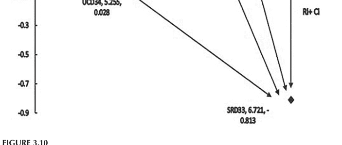

## 图 3.10
用户活动维度子指标的因果与效应说明。

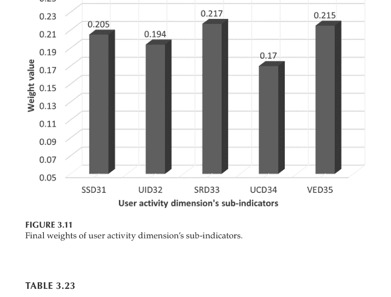

## 图 3.11
用户活动维度子指标的最终权重。

## 表 3.23
### 主要维度及其子指标的描述与权重

| 主要维度 | 主要维度权重 | 子指标 | 描述 | 子指标局部权重 | 子指标全局权重 |
|---|---|---|---|---|---|
| 系统可用性 SUD₁ | 0.367 | 功能优化，FOD₁_₁ | 运行优化和资源利用 | 0.204 | 0.075 |
| 系统可用性 SUD₁ | 0.367 | 改造，RED₁_₂ | 远程监控、故障预测和及时维护 | 0.195 | 0.072 |
| 系统可用性 SUD₁ | 0.367 | 智能服务，SSD₁_3 | 预测动态维护需求并安排预测性维护。 | 0.219 | 0.080 |
| 系统可用性 SUD₁ | 0.367 | 智能更新，SUD₁_4 | 提供智能系统服务、操作和更新 | 0.177 | 0.065 |

## 表 3.23（续）
### 主要维度及其子指标的描述与权重

| 主要维度 | 主要维度权重 | 子指标 | 描述 | 子指标局部权重 | 子指标全局权重 |
|---|---|---|---|---|---|
|  |  | 适用性，SBD1_5 | 在多种情境和条件下具有适应性和兼容性 | 0.205 | 0.076 |
| 发现与数据管理 FDD2 | 0.277 | 数据智能共享，DSD2_1 | 分享有用数据和信息以提高性能 | 0.347 | 0.096 |
|  |  | 发现与智能共享，FSD2_2 | 与消费者分享产品的成果。 | 0.303 | 0.084 |
|  |  | 真实性，AUD2_3 | 预测结果的可靠性和精确性，以及在特定情况和时间段内预测性能的质量 | 0.350 | 0.097 |
| 用户活动 UAD3 | 0.356 | 系统活动支持，SSD3_1 | 对产品/系统操作和活动进行用户培训 | 0.205 | 0.073 |
|  |  | 用户交互分析，UID3_2 | 监控和分析用户活动并推荐理想使用方式 | 0.194 | 0.069 |
|  |  | 智能活动资源供给，SRD3_3 | 预测资源需求、提供资源信息、有效分配资源并智能规划资源 | 0.217 | 0.077 |
|  |  | 用户活动环境，UCD3_4 | 检查活动环境、为服务提供信息支持、监控活动环境并预测其变化 | 0.170 | 0.060 |
|  |  | 多功能性，VED3_5 | 系统的可用性、服务的实用功能以及用户满意度水平 | 0.215 | 0.076 |

## 表 3.24
根据所有子指标使用语义术语的六个备选方案决策矩阵

| 专家 | FOD₁,₁ | RED₁,₂ | SSD₁,₃ | SUD₁,₄ | SBD₁,₅ |
|---|---|---|---|---|---|
| SDRS₁ | ⟨VGO⟩⟨VGO⟩⟨VGO⟩ | ⟨FAIR⟩⟨FAIR⟩⟨VGO⟩ | ⟨FAIR⟩⟨FAIR⟩⟨GOOD⟩ | ⟨GOOD⟩⟨GOOD⟩⟨GOOD⟩⟨GOOD⟩ | ⟨FAIR⟩⟨FAIR⟩⟨FAIR⟩⟨FAIR⟩ |
| SDRS₂ | ⟨POOR⟩⟨FAIR⟩⟨POOR⟩ | ⟨VGO⟩⟨VGO⟩⟨VGO⟩ | ⟨VGO⟩⟨VGO⟩⟨GOOD⟩ | ⟨VGO⟩⟨VGO⟩⟨GOOD⟩ | ⟨VGO⟩⟨VGO⟩⟨VGO⟩ |
| SDRS₃ | ⟨POOR⟩⟨POOR⟩⟨POOR⟩ | ⟨POOR⟩⟨GOOD⟩⟨POOR⟩ | ⟨VGO⟩⟨VGO⟩⟨GOOD⟩ | ⟨GOOD⟩⟨GOOD⟩⟨GOOD⟩ | ⟨GOOD⟩⟨VGO⟩⟨VGO⟩ |
| SDRS₄ | ⟨POOR⟩⟨POOR⟩⟨POOR⟩ | ⟨GOOD⟩⟨GOOD⟩⟨GOOD⟩ | ⟨FAIR⟩⟨FAIR⟩⟨GOOD⟩ | ⟨FAIR⟩⟨FAIR⟩⟨GOOD⟩ | ⟨GOOD⟩⟨GOOD⟩⟨GOOD⟩ |
| SDRS₅ | ⟨VGO⟩⟨VGO⟩⟨VGO⟩ | ⟨GOOD⟩⟨GOOD⟩⟨GOOD⟩ | ⟨MED⟩⟨MED⟩⟨GOOD⟩ | ⟨POOR⟩⟨POOR⟩⟨GOOD⟩ | ⟨FAIR⟩⟨FAIR⟩⟨FAIR⟩ |
| SDRS₆ | ⟨FAIR⟩⟨FAIR⟩⟨VGO⟩ | ⟨MED⟩⟨MED⟩⟨FAIR⟩ | ⟨FAIR⟩⟨FAIR⟩⟨GOOD⟩ | ⟨GOOD⟩⟨GOOD⟩⟨GOOD⟩ | ⟨FAIR⟩⟨FAIR⟩⟨FAIR⟩ |

| 专家 | DSD₂,₁ | FSD₂,₂ | AUD₂,₃ | SSD₃,₁ |
|---|---|---|---|---|
| SDRS₁ | ⟨FAIR⟩⟨FAIR⟩⟨FAIR⟩ | ⟨POOR⟩⟨POOR⟩⟨VGO⟩ | ⟨FAIR⟩⟨FAIR⟩⟨FAIR⟩ | ⟨VGO⟩⟨VGO⟩⟨VGO⟩ |
| SDRS₂ | ⟨VGO⟩⟨VGO⟩⟨VGO⟩ | ⟨FAIR⟩⟨FAIR⟩⟨FAIR⟩ | ⟨FAIR⟩⟨FAIR⟩⟨FAIR⟩ | ⟨VGO⟩⟨VGO⟩⟨VGO⟩ |
| SDRS₃ | ⟨VGO⟩⟨VGO⟩⟨VGO⟩ | ⟨GOOD⟩⟨FAIR⟩⟨GOOD⟩ | ⟨FAIR⟩⟨MED⟩⟨FAIR⟩ | ⟨FAIR⟩⟨FAIR⟩⟨VGO⟩ |
| SDRS₄ | ⟨VGO⟩⟨FAIR⟩⟨FAIR⟩ | ⟨GOOD⟩⟨GOOD⟩⟨GOOD⟩ | ⟨MED⟩⟨FAIR⟩⟨FAIR⟩ | ⟨POOR⟩⟨FAIR⟩⟨VGO⟩ |
| SDRS₅ | ⟨MED⟩⟨MED⟩⟨FAIR⟩ | ⟨FAIR⟩⟨FAIR⟩⟨FAIR⟩ | ⟨FAIR⟩⟨FAIR⟩⟨FAIR⟩ | ⟨FAIR⟩⟨MED⟩⟨VGO⟩ |
| SDRS₆ | ⟨FAIR⟩⟨FAIR⟩⟨FAIR⟩ | ⟨FAIR⟩⟨FAIR⟩⟨FAIR⟩ | ⟨FAIR⟩⟨FAIR⟩⟨FAIR⟩ | ⟨MED⟩⟨MED⟩⟨VGO⟩ |

| 专家 | UID₃,₂ | SRD₃,₃ | UCD₃,₄ | VED₃,₅ |
|---|---|---|---|---|
| SDRS₁ | ⟨VGO⟩⟨VGO⟩⟨GOOD⟩ | ⟨FAIR⟩⟨FAIR⟩⟨FAIR⟩ | ⟨FAIR⟩⟨FAIR⟩⟨GOOD⟩ | ⟨VGO⟩⟨VGO⟩⟨VGO⟩ |
| SDRS₂ | ⟨VGO⟩⟨VGO⟩⟨GOOD⟩ | ⟨VGO⟩⟨VGO⟩⟨FAIR⟩ | ⟨POOR⟩⟨POOR⟩⟨POOR⟩ | ⟨POOR⟩⟨FAIR⟩⟨VGO⟩ |
| SDRS₃ | ⟨FAIR⟩⟨FAIR⟩⟨FAIR⟩ | ⟨FAIR⟩⟨FAIR⟩⟨GOOD⟩ | ⟨GOOD⟩⟨GOOD⟩⟨GOOD⟩ | ⟨POOR⟩⟨POOR⟩⟨VGO⟩ |
| SDRS₄ | ⟨VGO⟩⟨VGO⟩⟨GOOD⟩ | ⟨POOR⟩⟨FAIR⟩⟨POOR⟩ | ⟨VGO⟩⟨VGO⟩⟨VGO⟩ | ⟨FAIR⟩⟨FAIR⟩⟨FAIR⟩ |
| SDRS₅ | ⟨GOOD⟩⟨GOOD⟩⟨GOOD⟩ | ⟨FAIR⟩⟨FAIR⟩⟨FAIR⟩ | ⟨FAIR⟩⟨FAIR⟩⟨VGO⟩ | ⟨VGO⟩⟨VGO⟩⟨FAIR⟩ |
| SDRS₆ | ⟨VGO⟩⟨VGO⟩⟨GOOD⟩ | ⟨MED⟩⟨MED⟩⟨FAIR⟩ | ⟨GOOD⟩⟨GOOD⟩⟨GOOD⟩ | ⟨MED⟩⟨MED⟩⟨FAIR⟩ |

**步骤 26：** 由所有专家创建的关于已识别维度和智能灾害响应系统的所有决策矩阵通过应用公式 (3.3) 聚合为一个矩阵，如表 3.25 所示。

**步骤 27：** 模糊组合决策矩阵通过根据公式 (3.4) 去除三角模糊数而去模糊化为清晰组合决策矩阵，结果形成于表 3.26。

**步骤 28：** 根据 EDAS 技术定义与所有子指标相关联的平均值 AVj 根据公式 (3.13) 计算，如表 3.27 所示。

**步骤 29：** PDA 矩阵根据公式 (3.14) 和 (3.15) 计算，如表 3.28 所示。

**步骤 30：** NDA 矩阵根据公式 (3.16) 和 (3.17) 计算，如表 3.29 所示。

**步骤 31：** PDA 的加权和 SPi 根据公式 (3.18) 计算，如表 3.30 所示，以及 NDA 的加权和 SNi，根据公式 (3.19)，如表 3.31 所示。

**步骤 32：** SPi 和 SNi 的标准化值根据公式 (3.20) 和 (3.21) 计算，如表 3.32 所示。

**步骤 33：** 所有替代方案的评估分数 ASi 通过应用公式 (3.22) 计算，如表 2.32 和图 3.12 所示。最终，根据其评估分数 ASi 对替代方案进行排序。

## 3.4.2 讨论
本部分讨论了对上一节所述案例研究中使用的解决方法应用所获得的结果的讨论。最初，使用模糊 DEMATEL 方法对三个主要维度进行优先排序。根据表 3.23 中呈现的结果，系统可用性维度具有最高优先级，权重为 0.367，其次是权重为 0.356 的用户活动维度，而发现与数据管理维度以权重 0.277 排在最后。

然后，根据表 3.23 中呈现的系统可用性维度子指标的局部权重结果，它们表明智能服务指标以权重 0.219 排名第一，其次是适用性指标，而智能更新指标以权重 0.177 排在最后。同样，根据表 3.23 中呈现的发现与数据管理维度子指标的局部权重结果，它们表明真实性指标以权重 0.350 排名第一，其次是数据智能共享指标，而发现与智能共享指标以权重 0.303 排在最后。同样，根据表 3.23 中呈现的用户活动维度子指标的局部权重结果，它们表明智能活动资源供给指标排名


## 表 3.25
根据所有子指标使用 TFNs 的六个备选方案的聚合决策矩阵

| 专家 | FOD₁,₁ | RED₁,₂ | SSD₁,₃ | SUD₁,₄ | SBD₁,₅ | DSD₂,₁ | FSD₂,₂ |
|---|---|---|---|---|---|---|---|
| SDRS₁ | ⟨0.83, 1.00, 1.00⟩ | ⟨0.33, 0.50, 0.67⟩ | ⟨0.42, 0.58, 0.75⟩ | ⟨0.67, 0.83, 1.00⟩ | ⟨0.33, 0.50, 0.67⟩ | ⟨0.33, 0.50, 0.67⟩ | ⟨0.21, 0.38, 0.50⟩ |
| SDRS₂ | ⟨0.37, 0.54, 0.67⟩ | ⟨0.71, 0.88, 0.92⟩ | ⟨0.79, 0.96, 1.00⟩ | ⟨0.79, 0.96, 1.00⟩ | ⟨0.83, 1.00, 1.00⟩ | ⟨0.83, 1.00, 1.00⟩ | ⟨0.33, 0.50, 0.67⟩ |
| SDRS₃ | ⟨0.21, 0.38, 0.50⟩ | ⟨0.08, 0.25, 0.42⟩ | ⟨0.79, 0.96, 1.00⟩ | ⟨0.67, 0.83, 1.00⟩ | ⟨0.79, 0.96, 1.00⟩ | ⟨0.83, 1.00, 1.00⟩ | ⟨0.67, 0.83, 1.00⟩ |
| SDRS₄ | ⟨0.21, 0.38, 0.50⟩ | ⟨0.59, 0.75, 0.92⟩ | ⟨0.33, 0.50, 0.67⟩ | ⟨0.42, 0.58, 0.75⟩ | ⟨0.67, 0.83, 1.00⟩ | ⟨0.33, 0.50, 0.67⟩ | ⟨0.67, 0.83, 1.00⟩ |
| SDRS₅ | ⟨0.83, 1.00, 1.00⟩ | ⟨0.59, 0.75, 0.92⟩ | ⟨0.30, 0.46, 0.63⟩ | ⟨0.00, 0.17, 0.33⟩ | ⟨0.33, 0.50, 0.67⟩ | ⟨0.17, 0.33, 0.50⟩ | ⟨0.33, 0.50, 0.67⟩ |
| SDRS₆ | ⟨0.46, 0.63, 0.75⟩ | ⟨0.21, 0.37, 0.54⟩ | ⟨0.42, 0.58, 0.75⟩ | ⟨0.67, 0.83, 1.00⟩ | ⟨0.33, 0.50, 0.67⟩ | ⟨0.33, 0.50, 0.67⟩ | ⟨0.33, 0.50, 0.67⟩ |

| 专家 | AUD₂,₃ | SSD₃,₁ | SRD₃,₃ | UCD₃,₄ | VED₃,₅ |
|---|---|---|---|---|---|
| SDRS₁ | ⟨0.33, 0.50, 0.67⟩ | ⟨0.53, 1.00, 1.00⟩ | ⟨0.33, 0.50, 0.67⟩ | ⟨0.42, 0.58, 0.75⟩ | ⟨0.83, 1.00, 1.00⟩ |
| SDRS₂ | ⟨0.33, 0.50, 0.67⟩ | ⟨0.83, 1.00, 1.00⟩ | ⟨0.71, 0.88, 0.92⟩ | ⟨0.00, 0.17, 0.33⟩ | ⟨0.37, 0.54, 0.67⟩ |
| SDRS₃ | ⟨0.33, 0.50, 0.67⟩ | ⟨0.46, 0.63, 0.75⟩ | ⟨0.42, 0.58, 0.75⟩ | ⟨0.67, 0.83, 1.00⟩ | ⟨0.21, 0.38, 0.50⟩ |
| SDRS₄ | ⟨0.21, 0.37, 0.54⟩ | ⟨0.21, 0.38, 0.50⟩ | ⟨0.00, 0.17, 0.33⟩ | ⟨0.83, 1.00, 1.00⟩ | ⟨0.33, 0.50, 0.67⟩ |
| SDRS₅ | ⟨0.33, 0.50, 0.67⟩ | ⟨0.46, 0.63, 0.75⟩ | ⟨0.33, 0.50, 0.67⟩ | ⟨0.46, 0.63, 0.75⟩ | ⟨0.71, 0.88, 0.92⟩ |
| SDRS₆ | ⟨0.33, 0.50, 0.67⟩ | ⟨0.34, 0.50, 0.63⟩ | ⟨0.30, 0.46, 0.63⟩ | ⟨0.67, 0.83, 1.00⟩ | ⟨0.21, 0.37, 0.54⟩ |

## 表 3.26 根据所有子准则的六个智能灾害响应系统的去模糊化决策矩阵

| 专家 | FOD1,1 | RED1,2 | SSD1,3 | SUD1,4 | SBD1,5 | DSD2,1 | FSD2,2 | AUD2,3 | SSD3,1 | UID3,2 | SRD3,3 | UCD3,4 | VED3,5 |
|---|---|---|---|---|---|---|---|---|---|---|---|---|---|
| SDRS1 | 0.97 | 0.50 | 0.58 | 0.83 | 0.50 | 0.97 | 0.37 | 0.50 | 0.97 | 0.94 | 0.50 | 0.58 | 0.97 |
| SDRS2 | 0.53 | 0.86 | 0.94 | 0.94 | 0.97 | 0.97 | 0.50 | 0.50 | 0.97 | 0.94 | 0.86 | 0.17 | 0.53 |
| SDRS3 | 0.37 | 0.25 | 0.94 | 0.83 | 0.94 | 0.97 | 0.83 | 0.50 | 0.62 | 0.50 | 0.58 | 0.83 | 0.37 |
| SDRS4 | 0.37 | 0.75 | 0.50 | 0.58 | 0.83 | 0.50 | 0.83 | 0.37 | 0.37 | 0.94 | 0.17 | 0.97 | 0.50 |
| SDRS5 | 0.97 | 0.75 | 0.46 | 0.17 | 0.50 | 0.33 | 0.50 | 0.50 | 0.62 | 0.83 | 0.50 | 0.63 | 0.86 |
| SDRS6 | 0.62 | 0.37 | 0.58 | 0.83 | 0.50 | 0.50 | 0.50 | 0.50 | 0.50 | 0.94 | 0.50 | 0.83 | 0.37 |

## 表 3.27 平均解 AVj 的确定

| 专家 | FOD1,1 | RED1,2 | SSD1,3 | SUD1,4 | SBD1,5 | DSD2,1 | FSD2,2 | AUD2,3 | SSD3,1 | UID3,2 | SRD3,3 | UCD3,4 | VED3,5 |
|---|---|---|---|---|---|---|---|---|---|---|---|---|---|
| SDRS1 | 0.97 | 0.50 | 0.58 | 0.83 | 0.50 | 0.50 | 0.37 | 0.50 | 0.97 | 0.94 | 0.50 | 0.58 | 0.97 |
| SDRS2 | 0.53 | 0.86 | 0.94 | 0.94 | 0.97 | 0.97 | 0.50 | 0.50 | 0.97 | 0.94 | 0.86 | 0.17 | 0.53 |
| SDRS3 | 0.37 | 0.25 | 0.94 | 0.83 | 0.94 | 0.97 | 0.83 | 0.50 | 0.62 | 0.50 | 0.58 | 0.83 | 0.37 |
| SDRS4 | 0.37 | 0.75 | 0.50 | 0.58 | 0.83 | 0.50 | 0.83 | 0.37 | 0.37 | 0.94 | 0.17 | 0.97 | 0.50 |
| SDRS5 | 0.97 | 0.75 | 0.46 | 0.17 | 0.50 | 0.33 | 0.50 | 0.50 | 0.62 | 0.83 | 0.50 | 0.63 | 0.86 |
| SDRS6 | 0.62 | 0.37 | 0.58 | 0.83 | 0.50 | 0.50 | 0.50 | 0.50 | 0.50 | 0.94 | 0.50 | 0.83 | 0.37 |
| AVj | 0.64 | 0.58 | 0.67 | 0.70 | 0.71 | 0.63 | 0.59 | 0.48 | 0.68 | 0.85 | 0.52 | 0.67 | 0.60 |

## 表 3.28 与平均值的正向距离的确定

| Experts_s | FOD_1,1 | RED_1,2 | SSD_1,3 | SUD_1,4 | SBD_1,5 | DSD_2,1 | FSD_2,2 | AUD_2,3 | SSD_3,1 | UID_3,2 | SRD_3,3 | UCD_3,4 | VED_3,5 |
|---|---|---|---|---|---|---|---|---|---|---|---|---|---|
| SDRS1 | 0.520 | 0.000 | 0.000 | 0.191 | 1.000 | 0.000 | 0.000 | 0.045 | 0.437 | 0.108 | 0.000 | 0.000 | 0.617 |
| SDRS2 | 0.000 | 0.483 | 0.410 | 0.349 | 0.373 | 0.544 | 0.000 | 0.045 | 0.437 | 0.108 | 0.659 | 0.000 | 0.000 |
| SDRS3 | 0.000 | 0.000 | 0.410 | 0.191 | 0.330 | 0.544 | 0.411 | 0.045 | 0.000 | 0.000 | 0.119 | 0.242 | 0.000 |
| SDRS4 | 0.000 | 0.293 | 0.000 | 0.000 | 0.175 | 0.000 | 0.411 | 0.000 | 0.000 | 0.108 | 0.000 | 0.451 | 0.000 |
| SDRS5 | 0.520 | 0.293 | 0.000 | 0.000 | 0.000 | 0.000 | 0.000 | 0.045 | 0.000 | 0.000 | 0.000 | 0.000 | 0.433 |
| SDRS6 | 0.000 | 0.000 | 0.000 | 0.191 | 0.000 | 0.000 | 0.000 | 0.045 | 0.000 | 0.108 | 0.000 | 0.242 | 0.000 |

## 表 3.29 与平均值的负向距离的确定

| Experts_s | FOD_1,1 | RED_1,2 | SSD_1,3 | SUD_1,4 | SBD_1,5 | DSD_2,1 | FSD_2,2 | AUD_2,3 | SSD_3,1 | UID_3,2 | SRD_3,3 | UCD_3,4 | VED_3,5 |
|---|---|---|---|---|---|---|---|---|---|---|---|---|---|
| SDRS1 | 0.000 | 0.138 | 0.130 | 0.000 | 0.292 | 0.204 | 0.371 | 0.000 | 0.000 | 0.000 | 0.035 | 0.132 | 0.000 |
| SDRS2 | 0.170 | 0.000 | 0.000 | 0.000 | 0.000 | 0.000 | 0.150 | 0.000 | 0.000 | 0.000 | 0.000 | 0.746 | 0.117 |
| SDRS3 | 0.420 | 0.569 | 0.000 | 0.000 | 0.000 | 0.000 | 0.000 | 0.000 | 0.081 | 0.411 | 0.000 | 0.000 | 0.383 |
| SDRS4 | 0.420 | 0.000 | 0.250 | 0.167 | 0.000 | 0.204 | 0.000 | 0.226 | 0.452 | 0.000 | 0.672 | 0.000 | 0.167 |
| SDRS5 | 0.000 | 0.000 | 0.310 | 0.756 | 0.292 | 0.475 | 0.150 | 0.000 | 0.081 | 0.022 | 0.035 | 0.057 | 0.000 |
| SDRS6 | 0.029 | 0.362 | 0.130 | 0.000 | 0.292 | 0.204 | 0.150 | 0.000 | 0.259 | 0.000 | 0.035 | 0.000 | 0.383 |

## 表 3.30 与平均值的正向距离加权和的确定

| Experts_s | FOD_1,1 | RED_1,2 | SSD_1,3 | SUD_1,4 | SBD_1,5 | DSD_2,1 | FSD_2,2 | AUD_2,3 | SSD_3,1 | UID_3,2 | SRD_3,3 | UCD_3,4 | VED_3,5 |
|---|---|---|---|---|---|---|---|---|---|---|---|---|---|
| SDRS1 | 0.039 | 0.000 | 0.000 | 0.012 | 0.000 | 0.000 | 0.000 | 0.004 | 0.032 | 0.007 | 0.000 | 0.000 | 0.047 |
| SDRS2 | 0.000 | 0.035 | 0.033 | 0.023 | 0.028 | 0.052 | 0.000 | 0.004 | 0.032 | 0.007 | 0.051 | 0.000 | 0.000 |
| SDRS3 | 0.000 | 0.000 | 0.033 | 0.012 | 0.025 | 0.052 | 0.035 | 0.004 | 0.000 | 0.000 | 0.009 | 0.015 | 0.000 |
| SDRS4 | 0.000 | 0.021 | 0.000 | 0.000 | 0.013 | 0.000 | 0.035 | 0.000 | 0.000 | 0.007 | 0.000 | 0.027 | 0.000 |
| SDRS5 | 0.039 | 0.021 | 0.000 | 0.000 | 0.000 | 0.000 | 0.000 | 0.004 | 0.000 | 0.000 | 0.000 | 0.000 | 0.033 |
| SDRS6 | 0.000 | 0.000 | 0.000 | 0.012 | 0.000 | 0.000 | 0.000 | 0.004 | 0.000 | 0.007 | 0.000 | 0.015 | 0.000 |

## 表 3.31 与平均值的负向距离加权和的确定

| Experts_s | FOD_1,1 | RED_1,2 | SSD_1,3 | SUD_1,4 | SBD_1,5 | DSD_2,1 | FSD_2,2 | AUD_2,3 | SSD_3,1 | UID_3,2 | SRD_3,3 | UCD_3,4 | VED_3,5 |
|---|---|---|---|---|---|---|---|---|---|---|---|---|---|
| SDRS1 | 0.000 | 0.010 | 0.010 | 0.000 | 0.022 | 0.020 | 0.031 | 0.000 | 0.000 | 0.000 | 0.003 | 0.008 | 0.000 |
| SDRS2 | 0.013 | 0.000 | 0.000 | 0.000 | 0.000 | 0.000 | 0.013 | 0.000 | 0.000 | 0.000 | 0.000 | 0.045 | 0.009 |
| SDRS3 | 0.032 | 0.041 | 0.000 | 0.000 | 0.000 | 0.000 | 0.000 | 0.000 | 0.006 | 0.028 | 0.000 | 0.000 | 0.029 |
| SDRS4 | 0.032 | 0.000 | 0.020 | 0.011 | 0.000 | 0.020 | 0.000 | 0.022 | 0.033 | 0.000 | 0.052 | 0.000 | 0.013 |
| SDRS5 | 0.000 | 0.000 | 0.025 | 0.049 | 0.022 | 0.046 | 0.013 | 0.000 | 0.006 | 0.001 | 0.003 | 0.003 | 0.000 |
| SDRS6 | 0.002 | 0.026 | 0.010 | 0.000 | 0.022 | 0.020 | 0.013 | 0.000 | 0.019 | 0.000 | 0.003 | 0.000 | 0.029 |

## 表 3.32 应用 EDAS 方法对六个智能灾害响应系统进行排序

| 备选方案 | SP_i | SN_i | NSP_i | NSN_i | AS_i | 排名 (AS) |
|---|---|---|---|---|---|---|
| SDRS₁ | 0.1420 | 0.1040 | 0.5354 | 0.4836 | 0.5095 | 3 |
| SDRS₂ | 0.2653 | 0.0789 | 1.0000 | 0.6080 | 0.8040 | 1 |
| SDRS₃ | 0.1851 | 0.1359 | 0.6978 | 0.3251 | 0.5114 | 2 |
| SDRS₄ | 0.1034 | 0.2014 | 0.3898 | 0.0000 | 0.1949 | 6 |
| SDRS₅ | 0.0974 | 0.1680 | 0.3671 | 0.1660 | 0.2666 | 4 |
| SDRS₆ | 0.0388 | 0.1439 | 0.1463 | 0.2857 | 0.2160 | 5 |

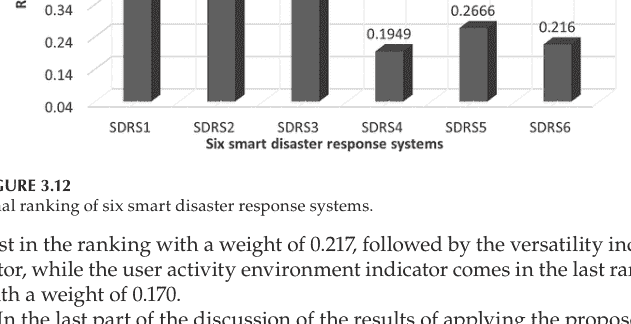

## 图 3.12 六个智能灾害响应系统的最终排名。

排名第一，权重为 0.217，其次是多功能性指标，而用户活动环境指标以 0.170 的权重排在最后。

在对所提出方法的应用结果进行讨论的最后部分，发现六个 SDRS 使用模糊 EDAS 方法进行了评估。表 3.32 中的结果表明 SDRS₂ 以 0.8040 的权重具有最高排名，其次是权重为 0.5114 的 SDRS₃，而 SDRS₄ 以 0.1949 的权重占据最后排名。

## 3.5 总结
- 本章提供了对灾害响应系统的全面描述。
- 本章回顾了评估灾害响应系统的重要性与需求。


- 本章在对多篇研究文章进行全面分析后，介绍了用于评估城市灾害响应系统最重要的标准。
- 本章提出了两种非常新的 MCDM 技术，即模糊 DEMATEL 和模糊 EDAS，用于评估城市的灾害响应系统。
- 本章介绍了一个真实案例研究，评估了世界各地多个智能灾害响应系统。

## 3.6 练习
- a. 你如何定义“智能灾害响应系统”？为什么对智能和可持续的灾害响应系统的评估很重要？
- b. DEMATEL 方法和 EDAS 方法有什么区别？在决策时讨论它们的相对优势。
- c. 从智慧城市的特征和形成角度讨论智能灾害响应系统的特点。
- d. 将模糊语言嵌入 MCDM 框架的关键步骤是什么？
- e. 讨论模糊 DEMATEL 和模糊 EDAS 方法之间的差异。
- f. 为什么需要 MCDM 方法来评估可持续的智能灾害响应系统？

## 参考文献
Chang, Betty, Chih-Wei Chang, and Chih-Hung Wu. 2011. “用于开发供应商选择标准的模糊DEMATEL方法。” *Expert Systems with Applications* 38(3): 1850–58. doi: 10.1016/j.eswa.2010.07.114.

Gabus, Andre, Emilio Fontela. 1972. 世界问题，在DEMATEL框架内的进一步思考的邀请. Battelle Geneva Research Centre.

Karatop, Buket, Büşra Taşkan, Elanur Adar, and Cemalettin Kubat. 2021. “基于模糊AHP-EDAS-模糊FMEA方法的土耳其可再生能源投资相关决策分析。” *Computers & Industrial Engineering* 151: 106958. doi: 10.1016/j.cie.2020.106958.

Keshavarz Ghorabaee, Mehdi, Edmundas Kazimieras Zavadskas, Laya Olfat, and Zenonas Turskis. 2015. “基于距离平均解评估新方法的多准则库存分类（EDAS）。” Informatica 26: 435–51.

Nasrollahi, Mahdi, Mohammad Reza Fathi, Seyed Mohammad Sobhani, Abolfazl Khosravi, and Asgar Noorbakhsh. 2021. “基于模糊DEMATEL和ISM的海水淡化供应链中弹性供应商选择标准的建模。” International Journal of Management Science and Engineering Management 16(4): 264–78. doi: 10.1080/17509653.2021.1965502.

Wan, Zheng, Anwei Nie, Jihong Chen, Jiawei Ge, Chen Zhang, and Qiang Zhang. 2021. “北极航道商业使用的关键障碍：基于模糊DEMATEL方法的中国视角。” Ocean & Coastal Management 208: 105630. doi: 10.1016/j.ocecoaman.2021.105630.

Zhao, Huiru, and Sen Guo. 2015. “为可持续发展而对中国可再生能源电力的外部效益评估。” Sustainability. doi: 10.3390/su7054783.

## 4
## 分析物联网障碍（IoTBs）适应智能城市废物管理的促进范式

### 4.1 引言
智慧城市被誉为发展中国家城市化带来的问题的潜在解决方案。在过去二十年里，智慧城市的相关性不断提高，其进步技术被视为新兴国家必不可少的先决条件。众多研究试图描述智慧城市的概念，其中大多数将其概念化为旨在创建可持续社区的多维系统。智慧城市需要 ICT 和互联网技术的结合，以多种形式改变其设计，如复杂的基础设施、交通、环境、医疗保健和政府，以创建可持续的生态系统。智慧城市是 ICT 技术、可持续性以及技术、社会和经济绩效指标的汇聚。关键利益相关者包括政府、服务提供商、政策制定者、民众和开发商。物联网（IoT）是推动全球智慧城市项目最重要的技术突破。物联网支持的技术充当了大都市社区发展的催化剂，以改善基础设施、废物管理、交通和人类生活质量。物联网技术应提供升级的服务并改造智慧城市中的现有流程。网络、可扩展性、异构性、覆盖范围和终端用户交互构成了物联网支持的智慧城市架构的基础。

联合国预测，到2050年，约三分之二的世界人口将实现城市化（Mishra et al., 2022）。因此，需要基础设施和其他深远的服务来满足城市化人口的需求。假设一个城市的人口以每年3-5%的速度增长。在这种情况下，每十年产生的垃圾量将翻一番，给智慧城市带来严峻的局面，并为收集、处置和回收带来巨大的财务负担。先前的研究表明，废物管理是城市人口面临的一个重要问题，发展可持续环境对于减轻对城市生活的危险是必要的。

发达国家和发展中国家都使用互联网技术来促进可持续增长和经济发展。尽管存在多个要素，智慧城市的发展是经济增长日益重要的一部分，也是满足人民需求的手段。发达国家可以获得现代技术、充足的资源以及发展智慧城市的稳定框架；此外，现有的智慧城市帮助并指导他们采取行动。然而，新兴国家的情况则大不相同。由于财务、技术和经济限制，欠发达国家难以开展智慧城市发展计划。发展中国家渴望建设智慧城市，以改善其公民和社区的生活条件。发展中国家的运作条件与发达国家不同；因此，有必要建立一个结构框架，以帮助发展中国家在智慧城市中启动和实施物联网支持的生态系统。

智慧城市需要应用物联网原则，因为它连接物品并在应对严峻环境时与人们智能互动。智慧城市中的有效垃圾管理是最重要的物联网服务之一，其重要性每天都在增长。以前，废物管理使用诸如地理信息系统（GIS）、更好的路由和调度以及其他技术等技术和模型来优化垃圾收集、储存和处置程序。这些技术缺乏创新，而物联网技术可以弥补这一点。先前的研究并未将利益相关者视为物联网支持的废物管理技术的重要要素（政策制定者、智慧城市规划者、市政管理等），而是将其视为独立实体。

物联网支持的智慧城市是满足城市化需求的可行选择；它能够通过改善交通、水管理、智能建筑、医疗保健和教育等公共服务，将社会转变为智慧社区。物联网技术的采用面临各种障碍，包括可扩展性、安全问题、异构性、架构和治理等。 在废物管理的背景下，对物联网实践和实施的研究很少；这些研究大多集中在为垃圾收集技术设计和优化物联网技术。除了垃圾收集外，有必要研究影响智慧城市废物管理的因素。本章旨在建立对影响智慧城市废物管理的物联网障碍的了解并分析其水平或严重程度，以便利益相关者能够采取积极措施顺利安装物联网支持的技术。

本章是对欠发达国家智慧城市物联网采用情况以及可能遇到的不同实施问题的理解努力。物联网网络的建设在服务和技术的坚实支持下，需要智慧城市的综合废物管理控制策略。除了技术障碍之外，尚未提供实施物联网的明确标准化策略和智慧城市活动的适当方向。本章旨在确定与智慧城市垃圾管理相关的关键物联网障碍（IoTBs）及其强度。为实现这些目标，应用了多准则决策（MCDM）技术。IoTBs 是通过当前文献进行研究的，并由专家验证。模糊 DEMATEL 检查障碍之间的相互作用，以展示影响彼此并管理智慧城市废物管理方法的 IoTBs 的强度/强度。

### 4.2 物联网障碍与智慧城市中的废物管理
先前的研究强调了物联网在各个行业采用的障碍（Sharma et al., 2020）。为了满足新兴国家智慧城市的需求，研究影响智慧城市废物管理的 IoTBs 至关重要。阻碍物联网采用的障碍已分为三个主要组，如图 4.1 所示。

- **安全和隐私问题 (IoTB₁)**
  可以理解的是，系统可能会遇到多种威胁，例如跨站脚本或侧信道，从而导致漏洞。此外，由于多租户，安全风险和数据丢失可能会增加。根本挑战是在确保终端用户及其个人数据的安全和隐私的同时，实现网络设备之间的互操作性并通过自适应行为为其提供最佳服务（Papadakis et al., 2021）。物联网系统使用诸如 RFID、NFC 等网络技术，以及 ZigBee、Z-wave 等协议，还有许多其他技术，这可能导致通信标准之间的兼容性。在这种意义上，数据隐私和安全对智慧城市中物联网的废物管理能力产生不利影响，因为它可能披露市政公司对个人家庭数据的访问。
- **缺乏监管规范、政策和指南 (IoTB₂)**
  缺乏监管规范和政策将导致不安全的标准和在执行操作时出现错误的指导。法律框架需要健全以支持物联网实施。


## 智能城市废物管理中的物联网障碍

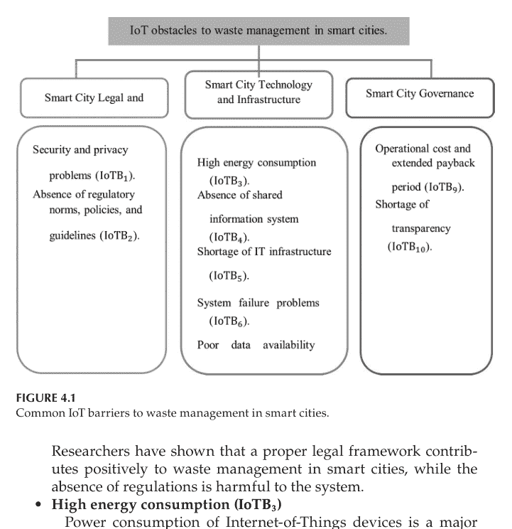

## 图 4.1

智能城市废物管理中常见的物联网障碍。

研究人员已表明，适当的法律框架对智能城市的废物管理有积极贡献，而缺乏法规则对系统有害。

- **高能耗 (IoTB₃)**
  物联网设备的功耗是一个主要问题。对于物联网部署，配备 RFID 但无电池的设备将被青睐。随着物联网设备需求的不断增长，预计价值链的能源成本将继续上升。
- **缺乏共享信息系统 (IoTB₄)**
  这些障碍限制了智能城市中端到端废物管理可见性的提供。关于物联网支持基础设施的先前研究主要集中在智能垃圾桶和传感器上，但有必要在设备、应用程序和服务提供商之间配置集成的信息系统平台，例如 DSS、PLM 和地理空间技术，以实现实时数据和信息交换。
- **IT 基础设施短缺 (IoTB₅)**
  智能城市的信息技术（IT）基础设施必须构建以满足其需求。如果没有适当的架构先到位，则无法实施更新的技术（Elahi et al., 2019）。
- **系统故障问题 (IoTB₆)**
  数据可能因个人无法控制的原因而损坏，例如服务器崩溃或故障。数据完整性是指对数据和系统的保护。数据会定期更新，并且最终用户始终可以以原始格式访问数据。
- **数据可用性差 (IoTB₇)**
  数据的即时可访问性确保人们能够立即获取信息。物联网支持的系统旨在随时向消费者提供数据。数据可用性不足可能会阻碍信息流动。
- **规划者之间技术知识短缺 (IoTB₈)**
  当局和政策制定者可能缺乏必要的组织能力和专业技能，这将影响废物管理系统。
- **运营成本和延长投资回收期 (IoTB₉)**
  由于专家、智能设备、安装、维护以及向工人传授信息的培训成本高昂，成本是物联网利益相关者的主要问题。
- **透明度短缺 (IoTB₁₀)**
  在物联网支持的系统中，供应的设施责任可能既模糊又透明。智能城市技术增加了居民社会孤立的可能性。

## 4.3 数据收集与方法论

本部分介绍用于分析智能城市废物管理中物联网障碍、优先级排序和加权的模糊 DEMATEL 方法。图 4.2 说明了指导研究的分析方法，其中模糊 DEMATEL 方法将用作分析的初始开发水平，然后在专家的帮助下完成，以计算智能城市废物管理中物联网障碍的权重。然后，我们按如下方式简要概述研究中使用的<|message|> 方法。

### 4.3.1 模糊 DEMATEL 技术

DEMATEL 分析是一种全面的方法，可用于研究复杂系统的组成部分。在 20 世纪 70 年代初，两位在美国一家重要实验室工作的研究人员 Gabus 和 Fontela 最先提出了这一概念（Hasheminezhad, Hadadi, and Shirmohammadi, 2021）。DEMATEL 分析基于图论和矩阵论，这使得复杂问题可以通过可视化技术进行分析和解决（Li and Xu, 2021）。该方法首先利用系统各组成部分之间存在的逻辑关系构建初始直接关系矩阵。接下来，它确定每个组成部分对其他组成部分的影响程度，最后确定各组成部分的中心性和因果性。DEMATEL 分析可以得出系统的易于消化的结构模型，以简单的方式绘制已识别要素之间的联系。许多不同组成部分之间的联系可以分解为原因和效果的分组，并且可以从因果图中获得这种联系的可理解的视觉表示。此外，DEMATEL 是一种非常适合且有效的确定复杂系统中若干不同组成部分相互依赖性的方法（Hosseini, Paydar, and Hajiaghaei-Keshteli, 2021）。研究结果可以帮助改善流程行业中存在的管理和决策问题，还可以帮助优先考虑已发现的方面。

使用 DEMATEL 技术分析复杂系统中事故的原因，该技术区分了组成部分的特征，具有多种不同的好处。这些优点包括以下内容：该技术使用系统因素将系统因素分为影响系统和受系统影响的因素。由于影响因素对其他变量具有巨大而全面的影响，因此可以通过对元素之间联系进行量化来推断其重要性。专家确定直接关系矩阵后，进行 DEMATEL 分析，以便确定每个元素对其他因素的影响程度。

## 图 4.2

应用方法的总体方案。

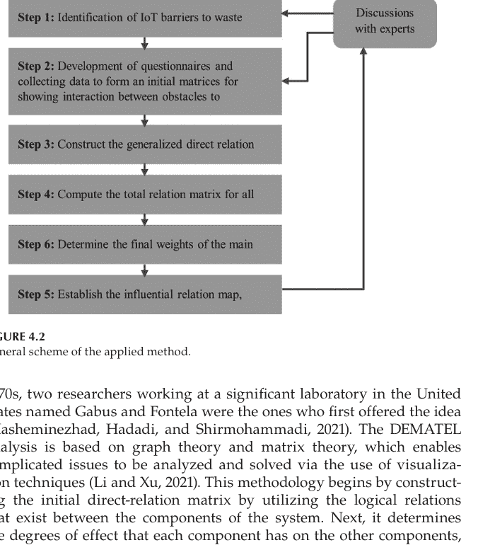

## 表 4.1

用于加权智能城市废物管理中物联网障碍的语言变量

| 语言变量 | 缩写 | TFN ⟨l_ij, m_ij, u_ij⟩ |
|---|---|---|
| 无影响 | ⟨NFL⟩ | ⟨0.00, 0.00, 0.25⟩ |
| 非常低影响 | ⟨VLF⟩ | ⟨0.00, 0.25, 0.50⟩ |
| 低影响 | ⟨LFL⟩ | ⟨0.25, 0.50, 0.75⟩ |
| 高影响 | ⟨HFL⟩ | ⟨0.50, 0.75, 1.00⟩ |
| 非常高影响 | ⟨VHL⟩ | ⟨0.75, 1.00, 1.00⟩ |

### 4.3.2 模糊 DEMATEL 技术的实施步骤

- **步骤 1：** 确定一组专家以协助作者并分享有关分析智能城市废物管理中物联网障碍的信息。设 Ex = {Ex₁, Ex₂, ..., Ex_K} 为一组专家，其中 Ex_K 表示第 K 个专家，k = 1, 2, ..., K。K 为专家的总数。
- **步骤 2：** 从各方面研究问题并确定其主要目的。此外，还研究了在评估过程中用作标准的障碍。
- **步骤 3：** 确定语言变量和相应的适当三角模糊数（TFNs）以优先考虑智能城市废物管理中的物联网障碍，如表 4.1 所示。
- **步骤 4：** 每个专家使用表 4.1 中的语言变量，然后使用 TFNs 如 Eq. (4.2) 所证明的那样，按 Eq. (4.1) 建立障碍与其自身之间的成对比较矩阵（B）。

B = 
    B₁ B₂ ... Bₙ
    B₁ [* x₁₂ ... x₁ᵢ]
    B₂ [x₂₁ * ... x₂ᵢ]
    ⋮ [x₃₁ x₃₂ * ...]
    Bₙ [xⱼ₁ xⱼ₂ xⱼ₃ *]  (4.1)

其中 $(x_{ij})$, $i, j = 1, 2, ..., n$, 且 $x_{ij}$ 是对 $i^{th}$ 元素 $B_1, B_2, ..., B_i$ 相对于 $j^{th}$ 元素 $B_1, B_2, ..., B_j$ 的障碍的估值。此外，矩阵的主对角线等于 1，使得 $x_{ij}$ 等于 1。

B = \begin{bmatrix} B_1 & B_2 & \dots & B_n \\ B_1 & * & \langle l_{12}, m_{12}, u_{12} \rangle & \dots & \langle l_{1i}, m_{1i}, u_{1i} \rangle \\ B_2 & \langle u_{21}, m_{21}, l_{21} \rangle & * & \dots & \langle l_{2i}, m_{2i}, u_{2i} \rangle \\ \vdots & \langle u_{21}, m_{21}, l_{21} \rangle & \langle u_{32}, m_{32}, l_{32} \rangle & * & \dots \\ B_n & \langle u_{j1}, m_{j1}, l_{j1} \rangle & \langle u_{j2}, m_{j2}, l_{j2} \rangle & \langle u_{j3}, m_{j3}, l_{j3} \rangle & * \end{bmatrix} \tag{4.2}

设 $f_{kij} = (f_{kij}^l, f_{kij}^m, f_{kij}^u)$ 是第 K 个专家通过应用语言变量得出的 $B_i$ 对 $B_j$ 的初始直接效应信息，其中 $f_{kij}^l, f_{kij}^m, f_{kij}^u$ 分别指初始直接效应信息的下限、中限和上限。
- **步骤 5：** 根据 Eq. (4.3) 将所有专家创建的所有决策矩阵收集到一个矩阵中。

$\tilde{F}_{ij} = f_{1ij} \oplus f_{2ij} \oplus \dots \oplus f_{kij} / K$ \tag{4.3}
- **步骤 6：** 通过应用 Eq. (4.4) 对 $\tilde{F}$ 进行标准化，构建所有智能城市废物管理中物联网障碍的广义直接关系矩阵 $\tilde{U}$。

$\tilde{U}_{ij} = \tilde{F}_{ij} / r = (f_{ij}^l / r, f_{ij}^m / r, f_{ij}^u / r) = (U_{ij}^l, U_{ij}^m, U_{ij}^u)$ \tag{4.4}

其中 $\tilde{U}_{ij}$ 是 $B_i$ 对 $B_j$ 的标准化直接效应信息，其中 $U_{ij}^l, U_{ij}^m, U_{ij}^u$ 分别指归一化直接效应矩阵的下限、中位数限和上限。$r$ 为 $Max_{1 \le i \le n} \sum_{j=1}^n U_{ji}^u$，且 $Max_i$ 表示第 $i^{th}$ 个物联网障碍的最大值。
- **步骤 7：** 通过应用 Eq. (4.5) 计算所有物联网障碍的总关系矩阵 $\tilde{T}$。 $\tilde{T} = \lim_{k \to \infty} (\tilde{U}^1 \oplus \tilde{U}^2 \oplus \dots \oplus \tilde{U}^K) = \tilde{U} \times (1 - \tilde{U})^{-1}$ \tag{4.5}


## 第 8 步：通过计算矩阵 T~ 的行和列之和构建影响关系图 (IRM)，分别表示为向量 R~ 和 C~ ，如式 (4.6) 和 (4.7) 所示。IRM 将通过计算有序对 (R~+C~, R~-C~) 来计算。

R~ = (R~_i)_{1x n} = [ sum_{j=1}^{n} T~_{ij} ]_{1x n} (4.6)

C~ = (C~_i)_{1x n} = [ sum_{i=1}^{n} T~_{ij} ]_{1x n} (4.7)

其中 R~ 和 C~ 分别表示总效应矩阵的行和列之和。R~_i 和 C~_i 分别表示第 i 个障碍的行和列之和。

## 第 9 步：通过应用分级均值积分表示 (GMIR) 方法 (Zhao and Guo 2015) 去除三角模糊数，将 (R~+C~, R~-C~) 非模糊化为清晰值 ((R~+C~)^{def}, (R~-C~)^{def})，如式 (4.8) 所示。

x_{ij}^{def} = (x_{ij}^{l} + 4 x_{ij}^{m} + x_{ij}^{u}) / 6 (4.8)

## 第 10 步：通过将总效应矩阵中呈现的所有数字的平均值相加并除以矩阵中存在的项目数来计算阈值 (alpha)，如式 (4.9) 所示。

alpha = sum_{i=1}^{n} sum_{j=1}^{n} T_{ij} / n^2 (4.9)

其中 n^2 表示总效应矩阵中的全部元素数量。

## 第 11 步：通过应用式 (4.10) 计算智能城市废物管理中第 i 个物联网障碍的权重 w_i。

w_i = [ ((R~+C~)^{def})^2 + ((R~-C~)^{def})^2 ]^{1/2} / sum_{i=1}^{n} [ ((R~+C~)^{def})^2 + ((R~-C~)^{def})^2 ]^{1/2} (4.10)

## 4.4 模型实施

本章对行业专业人士进行了半结构化访谈，对智能城市的发展计划进行了广泛评估，并分析了废物管理报告和数据库。本章的目标是建立一个整体模型。本章采用定性研究技术，因为其主要目的是利用行业专业人士的专业知识和经验以及先前研究的成果，构建智能城市废物管理中物联网采用障碍的研究框架。

### 第 1 步：
本章中，我们应用模糊 DEMATEL 方法分析智能城市废物管理中的物联网障碍。本章中模糊 DEMATEL 方法的实施与前一章不同。与前一章不同，本章从一开始就应用了模糊 DEMATEL 方法的所有步骤，而不进行非模糊化。

### 第 2 步：
我们组建了一个由四名领域专家组成的专家小组，并请求他们协助评估智能城市废物管理中物联网采用的障碍。来自 IT 领域的两名专家、一名来自智能城市开发项目和一名来自废物管理的专家构成了三名专家。两名科学家验证了所述的采用障碍。他们的大部分时间都花费在创建智能城市项目和建设基础设施上。

### 第 3 步：
已创建语言变量和相应的适当 TFNs 以优先考虑智能城市废物管理中的物联网障碍，如表 4.1 所示。

### 第 4 步：
根据式 (4.1) 使用如表 4.2 所示的语言变量，由所有专家创建了障碍与其自身之间的成对比较矩阵，然后根据式 (4.2) 使用 TFNs，如表 4.3 所示。

## 表 4.2

使用语言变量对所有专家进行智能城市废物管理中物联网障碍的评估

| Expert₁ | IoTB₁ | IoTB₂ | IoTB₃ | IoTB₄ | IoTB₅ | IoTB₆ | IoTB₇ | IoTB₈ | IoTB₉ | IoTB₁₀ |
|---|---|---|---|---|---|---|---|---|---|---|
| IoTB₁ | ⟨NFL⟩ | ⟨HFL⟩ | ⟨VLF⟩ | ⟨HFL⟩ | ⟨LFL⟩ | ⟨VLF⟩ | ⟨HFL⟩ | ⟨VHL⟩ | ⟨LFL⟩ | ⟨LFL⟩ |
| IoTB₂ | ⟨LFL⟩ | ⟨NFL⟩ | ⟨HFL⟩ | ⟨VLF⟩ | ⟨NFL⟩ | ⟨VLF⟩ | ⟨LFL⟩ | ⟨LFL⟩ | ⟨VLF⟩ | ⟨LFL⟩ |
| IoTB₃ | ⟨VHL⟩ | ⟨LFL⟩ | ⟨NFL⟩ | ⟨LFL⟩ | ⟨VLF⟩ | ⟨LFL⟩ | ⟨HFL⟩ | ⟨HFL⟩ | ⟨LFL⟩ | ⟨HFL⟩ |
| IoTB₄ | ⟨NFL⟩ | ⟨HFL⟩ | ⟨LFL⟩ | ⟨NFL⟩ | ⟨NFL⟩ | ⟨VLF⟩ | ⟨NFL⟩ | ⟨LFL⟩ | ⟨HFL⟩ | ⟨LFL⟩ |
| IoTB₅ | ⟨VLF⟩ | ⟨VLF⟩ | ⟨HFL⟩ | ⟨VLF⟩ | ⟨NFL⟩ | ⟨LFL⟩ | ⟨VLF⟩ | ⟨LFL⟩ | ⟨NFL⟩ | ⟨VLF⟩ |
| IoTB₆ | ⟨VLF⟩ | ⟨LFL⟩ | ⟨LFL⟩ | ⟨LFL⟩ | ⟨HFL⟩ | ⟨NFL⟩ | ⟨NFL⟩ | ⟨HFL⟩ | ⟨VLF⟩ | ⟨LFL⟩ |
| IoTB₇ | ⟨NFL⟩ | ⟨VHL⟩ | ⟨VLF⟩ | ⟨LFL⟩ | ⟨VHL⟩ | ⟨NFL⟩ | ⟨NFL⟩ | ⟨LFL⟩ | ⟨NFL⟩ | ⟨LFL⟩ |
| IoTB₈ | ⟨LFL⟩ | ⟨HFL⟩ | ⟨LFL⟩ | ⟨VHL⟩ | ⟨HFL⟩ | ⟨VLF⟩ | ⟨VLF⟩ | ⟨NFL⟩ | ⟨HFL⟩ | ⟨HFL⟩ |

## 表 4.2（续）

使用语言变量对所有专家进行智能城市废物管理中物联网障碍的评估

| Expert₁ | IoTB₁ | IoTB₂ | IoTB₃ | IoTB₄ | IoTB₅ | IoTB₆ | IoTB₇ | IoTB₈ | IoTB₉ | IoTB₁₀ |
|---|---|---|---|---|---|---|---|---|---|---|
| IoTB₉ | ⟨LFL⟩ | ⟨NFL⟩ | ⟨LFL⟩ | ⟨VHL⟩ | ⟨NFL⟩ | ⟨NFL⟩ | ⟨LFL⟩ | ⟨VLF⟩ | ⟨NFL⟩ | ⟨LFL⟩ |
| IoTB₁₀ | ⟨LFL⟩ | ⟨LFL⟩ | ⟨NFL⟩ | ⟨VHL⟩ | ⟨HFL⟩ | ⟨HFL⟩ | ⟨HFL⟩ | ⟨LFL⟩ | ⟨HFL⟩ | ⟨NFL⟩ |
| Expert₂ | IoTB₁ | IoTB₂ | IoTB₃ | IoTB₄ | IoTB₅ | IoTB₆ | IoTB₇ | IoTB₈ | IoTB₉ | IoTB₁₀ |
|---|---|---|---|---|---|---|---|---|---|---|
| IoTB₁ | ⟨NFL⟩ | ⟨HFL⟩ | ⟨VLF⟩ | ⟨HFL⟩ | ⟨LFL⟩ | ⟨VLF⟩ | ⟨HFL⟩ | ⟨VHL⟩ | ⟨LFL⟩ | ⟨LFL⟩ |
| IoTB₂ | ⟨LFL⟩ | ⟨NFL⟩ | ⟨HFL⟩ | ⟨VLF⟩ | ⟨LFL⟩ | ⟨VLF⟩ | ⟨LFL⟩ | ⟨LFL⟩ | ⟨VLF⟩ | ⟨HFL⟩ |
| IoTB₃ | ⟨VHL⟩ | ⟨LFL⟩ | ⟨NFL⟩ | ⟨LFL⟩ | ⟨VLF⟩ | ⟨LFL⟩ | ⟨HFL⟩ | ⟨HFL⟩ | ⟨LFL⟩ | ⟨HFL⟩ |
| IoTB₄ | ⟨NFL⟩ | ⟨HFL⟩ | ⟨LFL⟩ | ⟨NFL⟩ | ⟨NFL⟩ | ⟨VLF⟩ | ⟨HFL⟩ | ⟨LFL⟩ | ⟨HFL⟩ | ⟨LFL⟩ |
| IoTB₅ | ⟨VLF⟩ | ⟨VLF⟩ | ⟨HFL⟩ | ⟨HFL⟩ | ⟨NFL⟩ | ⟨LFL⟩ | ⟨VLF⟩ | ⟨LFL⟩ | ⟨NFL⟩ | ⟨VLF⟩ |
| IoTB₆ | ⟨VLF⟩ | ⟨LFL⟩ | ⟨LFL⟩ | ⟨LFL⟩ | ⟨HFL⟩ | ⟨NFL⟩ | ⟨HFL⟩ | ⟨HFL⟩ | ⟨VLF⟩ | ⟨LFL⟩ |
| IoTB₇ | ⟨NFL⟩ | ⟨VHL⟩ | ⟨VLF⟩ | ⟨LFL⟩ | ⟨VHL⟩ | ⟨NFL⟩ | ⟨NFL⟩ | ⟨LFL⟩ | ⟨NFL⟩ | ⟨LFL⟩ |
| IoTB₈ | ⟨HFL⟩ | ⟨HFL⟩ | ⟨LFL⟩ | ⟨VHL⟩ | ⟨HFL⟩ | ⟨VLF⟩ | ⟨VLF⟩ | ⟨NFL⟩ | ⟨HFL⟩ | ⟨HFL⟩ |
| IoTB₉ | ⟨LFL⟩ | ⟨NFL⟩ | ⟨LFL⟩ | ⟨VHL⟩ | ⟨NFL⟩ | ⟨NFL⟩ | ⟨LFL⟩ | ⟨VLF⟩ | ⟨NFL⟩ | ⟨LFL⟩ |
| IoTB₁₀ | ⟨LFL⟩ | ⟨LFL⟩ | ⟨NFL⟩ | ⟨VHL⟩ | ⟨HFL⟩ | ⟨HFL⟩ | ⟨HFL⟩ | ⟨LFL⟩ | ⟨HFL⟩ | ⟨NFL⟩ |
| Expert₃ | IoTB₁ | IoTB₂ | IoTB₃ | IoTB₄ | IoTB₅ | IoTB₆ | IoTB₇ | IoTB₈ | IoTB₉ | IoTB₁₀ |
|---|---|---|---|---|---|---|---|---|---|---|
| IoTB₁ | ⟨NFL⟩ | ⟨HFL⟩ | ⟨VLF⟩ | ⟨HFL⟩ | ⟨LFL⟩ | ⟨VLF⟩ | ⟨HFL⟩ | ⟨VHL⟩ | ⟨LFL⟩ | ⟨LFL⟩ |
| IoTB₂ | ⟨VLF⟩ | ⟨NFL⟩ | ⟨HFL⟩ | ⟨VLF⟩ | ⟨NFL⟩ | ⟨VLF⟩ | ⟨HFL⟩ | ⟨LFL⟩ | ⟨VLF⟩ | ⟨LFL⟩ |
| IoTB₃ | ⟨VHL⟩ | ⟨LFL⟩ | ⟨NFL⟩ | ⟨LFL⟩ | ⟨VLF⟩ | ⟨LFL⟩ | ⟨HFL⟩ | ⟨HFL⟩ | ⟨LFL⟩ | ⟨HFL⟩ |
| IoTB₄ | ⟨NFL⟩ | ⟨HFL⟩ | ⟨LFL⟩ | ⟨NFL⟩ | ⟨NFL⟩ | ⟨VLF⟩ | ⟨NFL⟩ | ⟨LFL⟩ | ⟨HFL⟩ | ⟨LFL⟩ |
| IoTB₅ | ⟨VLF⟩ | ⟨VLF⟩ | ⟨HFL⟩ | ⟨VLF⟩ | ⟨NFL⟩ | ⟨LFL⟩ | ⟨VLF⟩ | ⟨LFL⟩ | ⟨NFL⟩ | ⟨VLF⟩ |
| IoTB₆ | ⟨VLF⟩ | ⟨LFL⟩ | ⟨LFL⟩ | ⟨LFL⟩ | ⟨HFL⟩ | ⟨NFL⟩ | ⟨NFL⟩ | ⟨HFL⟩ | ⟨VLF⟩ | ⟨LFL⟩ |
| IoTB₇ | ⟨NFL⟩ | ⟨VHL⟩ | ⟨VLF⟩ | ⟨LFL⟩ | ⟨VHL⟩ | ⟨NFL⟩ | ⟨NFL⟩ | ⟨LFL⟩ | ⟨NFL⟩ | ⟨LFL⟩ |
| IoTB₈ | ⟨LFL⟩ | ⟨HFL⟩ | ⟨HFL⟩ | ⟨VHL⟩ | ⟨HFL⟩ | ⟨VLF⟩ | ⟨VLF⟩ | ⟨NFL⟩ | ⟨HFL⟩ | ⟨HFL⟩ |
| IoTB₉ | ⟨HFL⟩ | ⟨NFL⟩ | ⟨LFL⟩ | ⟨VHL⟩ | ⟨NFL⟩ | ⟨NFL⟩ | ⟨LFL⟩ | ⟨VLF⟩ | ⟨NFL⟩ | ⟨LFL⟩ |
| IoTB₁₀ | ⟨LFL⟩ | ⟨LFL⟩ | ⟨NFL⟩ | ⟨VHL⟩ | ⟨HFL⟩ | ⟨HFL⟩ | ⟨HFL⟩ | ⟨LFL⟩ | ⟨HFL⟩ | ⟨NFL⟩ |
| Expert₄ | IoTB₁ | IoTB₂ | IoTB₃ | IoTB₄ | IoTB₅ | IoTB₆ | IoTB₇ | IoTB₈ | IoTB₉ | IoTB₁₀ |
|---|---|---|---|---|---|---|---|---|---|---|
| IoTB₁ | ⟨NFL⟩ | ⟨HFL⟩ | ⟨VLF⟩ | ⟨HFL⟩ | ⟨LFL⟩ | ⟨VLF⟩ | ⟨HFL⟩ | ⟨VHL⟩ | ⟨LFL⟩ | ⟨LFL⟩ |
| IoTB₂ | ⟨VLF⟩ | ⟨NFL⟩ | ⟨HFL⟩ | ⟨VLF⟩ | ⟨NFL⟩ | ⟨HFL⟩ | ⟨LFL⟩ | ⟨LFL⟩ | ⟨VLF⟩ | ⟨VLF⟩ |
| IoTB₃ | ⟨VHL⟩ | ⟨LFL⟩ | ⟨NFL⟩ | ⟨LFL⟩ | ⟨VLF⟩ | ⟨LFL⟩ | ⟨HFL⟩ | ⟨HFL⟩ | ⟨LFL⟩ | ⟨HFL⟩ |
| IoTB₄ | ⟨NFL⟩ | ⟨HFL⟩ | ⟨LFL⟩ | ⟨NFL⟩ | ⟨NFL⟩ | ⟨VLF⟩ | ⟨NFL⟩ | ⟨LFL⟩ | ⟨HFL⟩ | ⟨LFL⟩ |
| IoTB₅ | ⟨VLF⟩ | ⟨VLF⟩ | ⟨HFL⟩ | ⟨VLF⟩ | ⟨NFL⟩ | ⟨LFL⟩ | ⟨VLF⟩ | ⟨HFL⟩ | ⟨NFL⟩ | ⟨VLF⟩ |
| IoTB₆ | ⟨VLF⟩ | ⟨VLF⟩ | ⟨LFL⟩ | ⟨LFL⟩ | ⟨HFL⟩ | ⟨NFL⟩ | ⟨NFL⟩ | ⟨HFL⟩ | ⟨VLF⟩ | ⟨VLF⟩ |
| IoTB₇ | ⟨NFL⟩ | ⟨VHL⟩ | ⟨VLF⟩ | ⟨VLF⟩ | ⟨VHL⟩ | ⟨NFL⟩ | ⟨NFL⟩ | ⟨LFL⟩ | ⟨NFL⟩ | ⟨LFL⟩ |
| IoTB₈ | ⟨LFL⟩ | ⟨HFL⟩ | ⟨LFL⟩ | ⟨VHL⟩ | ⟨HFL⟩ | ⟨VLF⟩ | ⟨VLF⟩ | ⟨NFL⟩ | ⟨HFL⟩ | ⟨HFL⟩ |
| IoTB₉ | ⟨LFL⟩ | ⟨NFL⟩ | ⟨LFL⟩ | ⟨VHL⟩ | ⟨NFL⟩ | ⟨NFL⟩ | ⟨LFL⟩ | ⟨VLF⟩ | ⟨NFL⟩ | ⟨LFL⟩ |
| IoTB₁₀ | ⟨LFL⟩ | ⟨LFL⟩ | ⟨NFL⟩ | ⟨VHL⟩ | ⟨HFL⟩ | ⟨HFL⟩ | ⟨HFL⟩ | ⟨LFL⟩ | ⟨HFL⟩ | ⟨NFL⟩ |

## 表 4.3

使用 TFNs 对所有专家进行智能城市废物管理中物联网障碍的估值

| Expert₁ | IoTB₁ | IoTB₂ | IoTB₃ | IoTB₄ | IoTB₅ |
|---|---|---|---|---|---|
| IoTB₁ | ⟨0.00, 0.00, 0.25⟩ | ⟨0.50, 0.75, 1.00⟩ | ⟨0.00, 0.25, 0.50⟩ | ⟨0.50, 0.75, 1.00⟩ | ⟨0.25, 0.50, 0.75⟩ |
| IoTB₂ | ⟨0.25, 0.50, 0.75⟩ | ⟨0.00, 0.00, 0.25⟩ | ⟨0.50, 0.75, 1.00⟩ | ⟨0.00, 0.25, 0.50⟩ | ⟨0.00, 0.00, 0.25⟩ |
| IoTB₃ | ⟨0.75, 1.00, 1.00⟩ | ⟨0.25, 0.50, 0.75⟩ | ⟨0.00, 0.00, 0.25⟩ | ⟨0.25, 0.50, 0.75⟩ | ⟨0.00, 0.25, 0.50⟩ |
| IoTB₄ | ⟨0.00, 0.00, 0.25⟩ | ⟨0.50, 0.75, 1.00⟩ | ⟨0.25, 0.50, 0.75⟩ | ⟨0.00, 0.00, 0.25⟩ | ⟨0.00, 0.00, 0.25⟩ |
| IoTB₅ | ⟨0.00, 0.25, 0.50⟩ | ⟨0.00, 0.25, 0.50⟩ | ⟨0.50, 0.75, 1.00⟩ | ⟨0.00, 0.25, 0.50⟩ | ⟨0.00, 0.00, 0.25⟩ |
| IoTB₆ | ⟨0.00, 0.25, 0.50⟩ | ⟨0.25, 0.50, 0.75⟩ | ⟨0.25, 0.50, 0.75⟩ | ⟨0.25, 0.50, 0.75⟩ | ⟨0.50, 0.75, 1.00⟩ |
| IoTB₇ | ⟨0.00, 0.00, 0.25⟩ | ⟨0.75, 1.00, 1.00⟩ | ⟨0.00, 0.25, 0.50⟩ | ⟨0.25, 0.50, 0.75⟩ | ⟨0.75, 1.00, 1.00⟩ |
| IoTB₈ | ⟨0.25, 0.50, 0.75⟩ | ⟨0.50, 0.75, 1.00⟩ | ⟨0.25, 0.50, 0.75⟩ | ⟨0.75, 1.00, 1.00⟩ | ⟨0.50, 0.75, 1.00⟩ |
| IoTB₉ | ⟨0.25, 0.50, 0.75⟩ | ⟨0.00, 0.00, 0.25⟩ | ⟨0.25, 0.50, 0.75⟩ | ⟨0.75, 1.00, 1.00⟩ | ⟨0.00, 0.00, 0.25⟩ |
| IoTB₁₀ | ⟨0.25, 0.50, 0.75⟩ | ⟨0.25, 0.50, 0.75⟩ | ⟨0.00, 0.00, 0.25⟩ | ⟨0.75, 1.00, 1.00⟩ | ⟨0.50, 0.75, 1.00⟩ |

| Expert₁ | IoTB₆ | IoTB₇ | IoTB₈ | IoTB₉ | IoTB₁₀ |
|---|---|---|---|---|---|
| IoTB₁ | ⟨0.00, 0.25, 0.50⟩ | ⟨0.50, 0.75, 1.00⟩ | ⟨0.75, 1.00, 1.00⟩ | ⟨0.25, 0.50, 0.75⟩ | ⟨0.25, 0.50, 0.75⟩ |
| IoTB₂ | ⟨0.00, 0.25, 0.50⟩ | ⟨0.25, 0.50, 0.75⟩ | ⟨0.25, 0.50, 0.75⟩ | ⟨0.00, 0.25, 0.50⟩ | ⟨0.25, 0.50, 0.75⟩ |
| IoTB₃ | ⟨0.25, 0.50, 0.75⟩ | ⟨0.50, 0.75, 1.00⟩ | ⟨0.50, 0.75, 1.00⟩ | ⟨0.25, 0.50, 0.75⟩ | ⟨0.50, 0.75, 1.00⟩ |
| IoTB₄ | ⟨0.00, 0.25, 0.50⟩ | ⟨0.00, 0.00, 0.25⟩ | ⟨0.25, 0.50, 0.75⟩ | ⟨0.50, 0.75, 1.00⟩ | ⟨0.25, 0.50, 0.75⟩ |
| IoTB₅ | ⟨0.25, 0.50, 0.75⟩ | ⟨0.00, 0.00, 0.25⟩ | ⟨0.25, 0.50, 0.75⟩ | ⟨0.00, 0.00, 0.25⟩ | ⟨0.00, 0.25, 0.50⟩ |
| IoTB₆ | ⟨0.00, 0.00, 0.25⟩ | ⟨0.00, 0.00, 0.25⟩ | ⟨0.50, 0.75, 1.00⟩ | ⟨0.00, 0.25, 0.50⟩ | ⟨0.25, 0.50, 0.75⟩ |
| IoTB₇ | ⟨0.00, 0.00, 0.25⟩ | ⟨0.00, 0.00, 0.25⟩ | ⟨0.25, 0.50, 0.75⟩ | ⟨0.00, 0.00, 0.25⟩ | ⟨0.25, 0.50, 0.75⟩ |
| IoTB₈ | ⟨0.00, 0.25, 0.50⟩ | ⟨0.00, 0.25, 0.50⟩ | ⟨0.00, 0.00, 0.25⟩ | ⟨0.50, 0.75, 1.00⟩ | ⟨0.50, 0.75, 1.00⟩ |
| IoTB₉ | ⟨0.00, 0.00, 0.25⟩ | ⟨0.25, 0.50, 0.75⟩ | ⟨0.00, 0.25, 0.50⟩ | ⟨0.00, 0.00, 0.25⟩ | ⟨0.25, 0.50, 0.75⟩ |
| IoTB₁₀ | ⟨0.50, 0.75, 1.00⟩ | ⟨0.50, 0.75, 1.00⟩ | ⟨0.25, 0.50, 0.75⟩ | ⟨0.50, 0.75, 1.00⟩ | ⟨0.00, 0.00, 0.25⟩ |

| Expert₂ | IoTB₁ | IoTB₂ | IoTB₃ | IoTB₄ | IoTB₅ |
|---|---|---|---|---|---|
| IoTB₁ | ⟨0.00, 0.00, 0.25⟩ | ⟨0.50, 0.75, 1.00⟩ | ⟨0.00, 0.25, 0.50⟩ | ⟨0.50, 0.75, 1.00⟩ | ⟨0.25, 0.50, 0.75⟩ |
| IoTB₂ | ⟨0.25, 0.50, 0.75⟩ | ⟨0.00, 0.00, 0.25⟩ | ⟨0.50, 0.75, 1.00⟩ | ⟨0.00, 0.25, 0.50⟩ | ⟨0.00, 0.00, 0.25⟩ |
| IoTB₃ | ⟨0.75, 1.00, 1.00⟩ | ⟨0.25, 0.50, 0.75⟩ | ⟨0.00, 0.00, 0.25⟩ | ⟨0.25, 0.50, 0.75⟩ | ⟨0.00, 0.25, 0.50⟩ |
| IoTB₄ | ⟨0.00, 0.00, 0.25⟩ | ⟨0.50, 0.75, 1.00⟩ | ⟨0.25, 0.50, 0.75⟩ | ⟨0.00, 0.00, 0.25⟩ | ⟨0.00, 0.00, 0.25⟩ |
| IoTB₅ | ⟨0.00, 0.25, 0.50⟩ | ⟨0.00, 0.25, 0.50⟩ | ⟨0.50, 0.75, 1.00⟩ | ⟨0.50, 0.75, 1.00⟩ | ⟨0.00, 0.00, 0.25⟩ |
| IoTB₆ | ⟨0.00, 0.25, 0.50⟩ | ⟨0.25, 0.50, 0.75⟩ | ⟨0.25, 0.50, 0.75⟩ | ⟨0.25, 0.50, 0.75⟩ | ⟨0.50, 0.75, 1.00⟩ |
| IoTB₇ | ⟨0.00, 0.00, 0.25⟩ | ⟨0.75, 1.00, 1.00⟩ | ⟨0.00, 0.25, 0.50⟩ | ⟨0.25, 0.50, 0.75⟩ | ⟨0.75, 1.00, 1.00⟩ |
| IoTB₈ | ⟨0.50, 0.75, 1.00⟩ | ⟨0.50, 0.75, 1.00⟩ | ⟨0.25, 0.50, 0.75⟩ | ⟨0.75, 1.00, 1.00⟩ | ⟨0.50, 0.75, 1.00⟩ |
| IoTB₉ | ⟨0.25, 0.50, 0.75⟩ | ⟨0.00, 0.00, 0.25⟩ | ⟨0.25, 0.50, 0.75⟩ | ⟨0.75, 1.00, 1.00⟩ | ⟨0.00, 0.00, 0.25⟩ |
| IoTB₁₀ | ⟨0.25, 0.50, 0.75⟩ | ⟨0.25, 0.50, 0.75⟩ | ⟨0.00, 0.00, 0.25⟩ | ⟨0.75, 1.00, 1.00⟩ | ⟨0.50, 0.75, 1.00⟩ |


## 表 4.3（续）

采用 TFNs 的所有专家对智能城市废物管理中物联网障碍的估值

| 专家₂ | IoTB₆ | IoTB₇ | IoTB₈ | IoTB₉ | IoTB₁₀ |
|---|---|---|---|---|---|
| IoTB₁ | ⟨0.00, 0.25, 0.50⟩ | ⟨0.50, 0.75, 1.00⟩ | ⟨0.75, 1.00, 1.00⟩ | ⟨0.25, 0.50, 0.75⟩ | ⟨0.25, 0.50, 0.75⟩ |
| IoTB₂ | ⟨0.00, 0.25, 0.50⟩ | ⟨0.25, 0.50, 0.75⟩ | ⟨0.25, 0.50, 0.75⟩ | ⟨0.00, 0.25, 0.50⟩ | ⟨0.50, 0.75, 1.00⟩ |
| IoTB₃ | ⟨0.25, 0.50, 0.75⟩ | ⟨0.50, 0.75, 1.00⟩ | ⟨0.50, 0.75, 1.00⟩ | ⟨0.25, 0.50, 0.75⟩ | ⟨0.50, 0.75, 1.00⟩ |
| IoTB₄ | ⟨0.00, 0.25, 0.50⟩ | ⟨0.50, 0.75, 1.00⟩ | ⟨0.25, 0.50, 0.75⟩ | ⟨0.50, 0.75, 1.00⟩ | ⟨0.25, 0.50, 0.75⟩ |
| IoTB₅ | ⟨0.25, 0.50, 0.75⟩ | ⟨0.00, 0.25, 0.50⟩ | ⟨0.25, 0.50, 0.75⟩ | ⟨0.00, 0.00, 0.25⟩ | ⟨0.00, 0.25, 0.50⟩ |
| IoTB₆ | ⟨0.00, 0.00, 0.25⟩ | ⟨0.50, 0.75, 1.00⟩ | ⟨0.50, 0.75, 1.00⟩ | ⟨0.00, 0.25, 0.50⟩ | ⟨0.25, 0.50, 0.75⟩ |
| IoTB₇ | ⟨0.00, 0.00, 0.25⟩ | ⟨0.00, 0.00, 0.25⟩ | ⟨0.25, 0.50, 0.75⟩ | ⟨0.00, 0.00, 0.25⟩ | ⟨0.25, 0.50, 0.75⟩ |
| IoTB₈ | ⟨0.00, 0.25, 0.50⟩ | ⟨0.00, 0.25, 0.50⟩ | ⟨0.00, 0.00, 0.25⟩ | ⟨0.50, 0.75, 1.00⟩ | ⟨0.50, 0.75, 1.00⟩ |
| IoTB₉ | ⟨0.00, 0.00, 0.25⟩ | ⟨0.25, 0.50, 0.75⟩ | ⟨0.00, 0.25, 0.50⟩ | ⟨0.00, 0.00, 0.25⟩ | ⟨0.25, 0.50, 0.75⟩ |
| IoTB₁₀ | ⟨0.50, 0.75, 1.00⟩ | ⟨0.50, 0.75, 1.00⟩ | ⟨0.25, 0.50, 0.75⟩ | ⟨0.50, 0.75, 1.00⟩ | ⟨0.00, 0.00, 0.25⟩ |

| 专家₃ | IoTB₁ | IoTB₂ | IoTB₃ | IoTB₄ | IoTB₅ |
|---|---|---|---|---|---|
| IoTB₁ | ⟨0.00, 0.00, 0.25⟩ | ⟨0.50, 0.75, 1.00⟩ | ⟨0.00, 0.25, 0.50⟩ | ⟨0.50, 0.75, 1.00⟩ | ⟨0.25, 0.50, 0.75⟩ |
| IoTB₂ | ⟨0.00, 0.25, 0.50⟩ | ⟨0.00, 0.00, 0.25⟩ | ⟨0.50, 0.75, 1.00⟩ | ⟨0.00, 0.25, 0.50⟩ | ⟨0.00, 0.00, 0.25⟩ |
| IoTB₃ | ⟨0.75, 1.00, 1.00⟩ | ⟨0.25, 0.50, 0.75⟩ | ⟨0.00, 0.00, 0.25⟩ | ⟨0.25, 0.50, 0.75⟩ | ⟨0.00, 0.25, 0.50⟩ |
| IoTB₄ | ⟨0.00, 0.00, 0.25⟩ | ⟨0.50, 0.75, 1.00⟩ | ⟨0.25, 0.50, 0.75⟩ | ⟨0.00, 0.00, 0.25⟩ | ⟨0.00, 0.00, 0.25⟩ |
| IoTB₅ | ⟨0.00, 0.25, 0.50⟩ | ⟨0.00, 0.25, 0.50⟩ | ⟨0.50, 0.75, 1.00⟩ | ⟨0.00, 0.25, 0.50⟩ | ⟨0.00, 0.00, 0.25⟩ |
| IoTB₆ | ⟨0.00, 0.25, 0.50⟩ | ⟨0.25, 0.50, 0.75⟩ | ⟨0.25, 0.50, 0.75⟩ | ⟨0.25, 0.50, 0.75⟩ | ⟨0.50, 0.75, 1.00⟩ |
| IoTB₇ | ⟨0.00, 0.00, 0.25⟩ | ⟨0.75, 1.00, 1.00⟩ | ⟨0.00, 0.25, 0.50⟩ | ⟨0.25, 0.50, 0.75⟩ | ⟨0.75, 1.00, 1.00⟩ |
| IoTB₈ | ⟨0.25, 0.50, 0.75⟩ | ⟨0.50, 0.75, 1.00⟩ | ⟨0.50, 0.75, 1.00⟩ | ⟨0.75, 1.00, 1.00⟩ | ⟨0.50, 0.75, 1.00⟩ |
| IoTB₉ | ⟨0.50, 0.75, 1.00⟩ | ⟨0.00, 0.00, 0.25⟩ | ⟨0.25, 0.50, 0.75⟩ | ⟨0.75, 1.00, 1.00⟩ | ⟨0.00, 0.00, 0.25⟩ |
| IoTB₁₀ | ⟨0.25, 0.50, 0.75⟩ | ⟨0.25, 0.50, 0.75⟩ | ⟨0.00, 0.00, 0.25⟩ | ⟨0.75, 1.00, 1.00⟩ | ⟨0.50, 0.75, 1.00⟩ |

| 专家₃ | IoTB₆ | IoTB₇ | IoTB₈ | IoTB₉ | IoTB₁₀ |
|---|---|---|---|---|---|
| IoTB₁ | ⟨0.00, 0.25, 0.50⟩ | ⟨0.50, 0.75, 1.00⟩ | ⟨0.75, 1.00, 1.00⟩ | ⟨0.25, 0.50, 0.75⟩ | ⟨0.25, 0.50, 0.75⟩ |
| IoTB₂ | ⟨0.00, 0.25, 0.50⟩ | ⟨0.50, 0.75, 1.00⟩ | ⟨0.25, 0.50, 0.75⟩ | ⟨0.00, 0.25, 0.50⟩ | ⟨0.25, 0.50, 0.75⟩ |
| IoTB₃ | ⟨0.25, 0.50, 0.75⟩ | ⟨0.50, 0.75, 1.00⟩ | ⟨0.50, 0.75, 1.00⟩ | ⟨0.25, 0.50, 0.75⟩ | ⟨0.50, 0.75, 1.00⟩ |
| IoTB₄ | ⟨0.00, 0.25, 0.50⟩ | ⟨0.00, 0.00, 0.25⟩ | ⟨0.25, 0.50, 0.75⟩ | ⟨0.50, 0.75, 1.00⟩ | ⟨0.25, 0.50, 0.75⟩ |
| IoTB₅ | ⟨0.25, 0.50, 0.75⟩ | ⟨0.00, 0.25, 0.50⟩ | ⟨0.25, 0.50, 0.75⟩ | ⟨0.00, 0.00, 0.25⟩ | ⟨0.00, 0.25, 0.50⟩ |
| IoTB₆ | ⟨0.00, 0.00, 0.25⟩ | ⟨0.00, 0.00, 0.25⟩ | ⟨0.50, 0.75, 1.00⟩ | ⟨0.00, 0.25, 0.50⟩ | ⟨0.25, 0.50, 0.75⟩ |
| IoTB₇ | ⟨0.00, 0.00, 0.25⟩ | ⟨0.00, 0.00, 0.25⟩ | ⟨0.25, 0.50, 0.75⟩ | ⟨0.00, 0.00, 0.25⟩ | ⟨0.25, 0.50, 0.75⟩ |
| IoTB₈ | ⟨0.00, 0.25, 0.50⟩ | ⟨0.00, 0.25, 0.50⟩ | ⟨0.00, 0.00, 0.25⟩ | ⟨0.50, 0.75, 1.00⟩ | ⟨0.50, 0.75, 1.00⟩ |
| IoTB₉ | ⟨0.00, 0.00, 0.25⟩ | ⟨0.25, 0.50, 0.75⟩ | ⟨0.00, 0.25, 0.50⟩ | ⟨0.00, 0.00, 0.25⟩ | ⟨0.25, 0.50, 0.75⟩ |
| IoTB₁₀ | ⟨0.50, 0.75, 1.00⟩ | ⟨0.50, 0.75, 1.00⟩ | ⟨0.25, 0.50, 0.75⟩ | ⟨0.50, 0.75, 1.00⟩ | ⟨0.00, 0.00, 0.25⟩ |

## 表 4.3（续）

采用 TFNs 的所有专家对智能城市废物管理中物联网障碍的估值

| 专家₁ | IoTB₁ | IoTB₂ | IoTB₃ | IoTB₄ | IoTB₅ |
|---|---|---|---|---|---|
| IoTB₁ | ⟨0.00, 0.00, 0.25⟩ | ⟨0.50, 0.75, 1.00⟩ | ⟨0.00, 0.25, 0.50⟩ | ⟨0.50, 0.75, 1.00⟩ | ⟨0.25, 0.50, 0.75⟩ |
| IoTB₂ | ⟨0.00, 0.25, 0.50⟩ | ⟨0.00, 0.00, 0.25⟩ | ⟨0.50, 0.75, 1.00⟩ | ⟨0.00, 0.25, 0.50⟩ | ⟨0.00, 0.00, 0.25⟩ |
| IoTB₃ | ⟨0.75, 1.00, 1.00⟩ | ⟨0.25, 0.50, 0.75⟩ | ⟨0.00, 0.00, 0.25⟩ | ⟨0.25, 0.50, 0.75⟩ | ⟨0.00, 0.25, 0.50⟩ |
| IoTB₄ | ⟨0.00, 0.00, 0.25⟩ | ⟨0.50, 0.75, 1.00⟩ | ⟨0.25, 0.50, 0.75⟩ | ⟨0.00, 0.00, 0.25⟩ | ⟨0.00, 0.00, 0.25⟩ |
| IoTB₅ | ⟨0.00, 0.25, 0.50⟩ | ⟨0.00, 0.25, 0.50⟩ | ⟨0.50, 0.75, 1.00⟩ | ⟨0.00, 0.25, 0.50⟩ | ⟨0.00, 0.00, 0.25⟩ |
| IoTB₆ | ⟨0.00, 0.25, 0.50⟩ | ⟨0.00, 0.25, 0.50⟩ | ⟨0.25, 0.50, 0.75⟩ | ⟨0.25, 0.50, 0.75⟩ | ⟨0.50, 0.75, 1.00⟩ |
| IoTB₇ | ⟨0.00, 0.00, 0.25⟩ | ⟨0.75, 1.00, 1.00⟩ | ⟨0.00, 0.25, 0.50⟩ | ⟨0.00, 0.25, 0.50⟩ | ⟨0.75, 1.00, 1.00⟩ |
| IoTB₈ | ⟨0.25, 0.50, 0.75⟩ | ⟨0.50, 0.75, 1.00⟩ | ⟨0.25, 0.50, 0.75⟩ | ⟨0.75, 1.00, 1.00⟩ | ⟨0.50, 0.75, 1.00⟩ |
| IoTB₉ | ⟨0.25, 0.50, 0.75⟩ | ⟨0.00, 0.00, 0.25⟩ | ⟨0.25, 0.50, 0.75⟩ | ⟨0.75, 1.00, 1.00⟩ | ⟨0.00, 0.00, 0.25⟩ |
| IoTB₁₀ | ⟨0.25, 0.50, 0.75⟩ | ⟨0.25, 0.50, 0.75⟩ | ⟨0.00, 0.00, 0.25⟩ | ⟨0.75, 1.00, 1.00⟩ | ⟨0.50, 0.75, 1.00⟩ |

| 专家₁ | IoTB₆ | IoTB₇ | IoTB₈ | IoTB₉ | IoTB₁₀ |
|---|---|---|---|---|---|
| IoTB₁ | ⟨0.00, 0.25, 0.50⟩ | ⟨0.50, 0.75, 1.00⟩ | ⟨0.75, 1.00, 1.00⟩ | ⟨0.25, 0.50, 0.75⟩ | ⟨0.25, 0.50, 0.75⟩ |
| IoTB₂ | ⟨0.50, 0.75, 1.00⟩ | ⟨0.25, 0.50, 0.75⟩ | ⟨0.25, 0.50, 0.75⟩ | ⟨0.00, 0.25, 0.50⟩ | ⟨0.00, 0.25, 0.50⟩ |
| IoTB₃ | ⟨0.25, 0.50, 0.75⟩ | ⟨0.50, 0.75, 1.00⟩ | ⟨0.50, 0.75, 1.00⟩ | ⟨0.25, 0.50, 0.75⟩ | ⟨0.50, 0.75, 1.00⟩ |
| IoTB₄ | ⟨0.00, 0.25, 0.50⟩ | ⟨0.00, 0.00, 0.25⟩ | ⟨0.25, 0.50, 0.75⟩ | ⟨0.50, 0.75, 1.00⟩ | ⟨0.25, 0.50, 0.75⟩ |
| IoTB₅ | ⟨0.25, 0.50, 0.75⟩ | ⟨0.00, 0.25, 0.50⟩ | ⟨0.50, 0.75, 1.00⟩ | ⟨0.00, 0.00, 0.25⟩ | ⟨0.00, 0.25, 0.50⟩ |
| IoTB₆ | ⟨0.00, 0.00, 0.25⟩ | ⟨0.00, 0.00, 0.25⟩ | ⟨0.50, 0.75, 1.00⟩ | ⟨0.00, 0.25, 0.50⟩ | ⟨0.00, 0.25, 0.50⟩ |
| IoTB₇ | ⟨0.00, 0.00, 0.25⟩ | ⟨0.00, 0.00, 0.25⟩ | ⟨0.25, 0.50, 0.75⟩ | ⟨0.00, 0.00, 0.25⟩ | ⟨0.25, 0.50, 0.75⟩ |
| IoTB₈ | ⟨0.00, 0.25, 0.50⟩ | ⟨0.00, 0.25, 0.50⟩ | ⟨0.00, 0.00, 0.25⟩ | ⟨0.50, 0.75, 1.00⟩ | ⟨0.50, 0.75, 1.00⟩ |
| IoTB₉ | ⟨0.00, 0.00, 0.25⟩ | ⟨0.25, 0.50, 0.75⟩ | ⟨0.00, 0.25, 0.50⟩ | ⟨0.00, 0.00, 0.25⟩ | ⟨0.25, 0.50, 0.75⟩ |
| IoTB₁₀ | ⟨0.50, 0.75, 1.00⟩ | ⟨0.50, 0.75, 1.00⟩ | ⟨0.25, 0.50, 0.75⟩ | ⟨0.50, 0.75, 1.00⟩ | ⟨0.00, 0.00, 0.25⟩ |

第 5 步：根据公式（4.3），所有专家创建的所有决策矩阵被汇总为一个单一矩阵，如表 4.4 所示。

第 6 步：根据公式（4.4），针对下限、中位数和上限构建了智能城市废物管理中所有物联网障碍的广义直接关系矩阵，如表 4.5 所示。

第 7 步：根据公式（4.5），计算了智能城市废物管理中所有物联网障碍的总关系矩阵的下限、中位数限和上限，结果形成于表 4.6。

第 8 步：根据公式（4.6）和（4.7）分别计算行和列之和 R̃ 和 C̃ 构建了 IRM，如表 4.7 所示。

## 表 4.4

采用 TFNs 的所有专家对智能城市废物管理中物联网障碍的聚合估值

| 专家₁ | IoTB₁ | IoTB₂ | IoTB₃ | IoTB₄ | IoTB₅ |
|---|---|---|---|---|---|
| IoTB₁ | ⟨0.00, 0.00, 0.25⟩ | ⟨0.50, 0.75, 1.00⟩ | ⟨0.00, 0.25, 0.50⟩ | ⟨0.50, 0.75, 1.00⟩ | ⟨0.25, 0.50, 0.75⟩ |
| IoTB₂ | ⟨0.13, 0.38, 0.63⟩ | ⟨0.00, 0.00, 0.25⟩ | ⟨0.50, 0.75, 1.00⟩ | ⟨0.00, 0.25, 0.50⟩ | ⟨0.00, 0.00, 0.25⟩ |
| IoTB₃ | ⟨0.75, 1.00, 1.00⟩ | ⟨0.25, 0.50, 0.75⟩ | ⟨0.00, 0.00, 0.25⟩ | ⟨0.25, 0.50, 0.75⟩ | ⟨0.00, 0.25, 0.50⟩ |
| IoTB₄ | ⟨0.00, 0.00, 0.25⟩ | ⟨0.50, 0.75, 1.00⟩ | ⟨0.25, 0.50, 0.75⟩ | ⟨0.00, 0.00, 0.25⟩ | ⟨0.00, 0.00, 0.25⟩ |
| IoTB₅ | ⟨0.00, 0.25, 0.50⟩ | ⟨0.00, 0.25, 0.50⟩ | ⟨0.50, 0.75, 1.00⟩ | ⟨0.00, 0.25, 0.50⟩ | ⟨0.00, 0.00, 0.25⟩ |
| IoTB₆ | ⟨0.00, 0.25, 0.50⟩ | ⟨0.13, 0.44, 0.69⟩ | ⟨0.25, 0.50, 0.75⟩ | ⟨0.25, 0.50, 0.75⟩ | ⟨0.50, 0.75, 1.00⟩ |
| IoTB₇ | ⟨0.00, 0.00, 0.25⟩ | ⟨0.75, 1.00, 1.00⟩ | ⟨0.00, 0.25, 0.50⟩ | ⟨0.13, 0.44, 0.69⟩ | ⟨0.75, 1.00, 1.00⟩ |
| IoTB₈ | ⟨0.31, 0.56, 0.81⟩ | ⟨0.50, 0.75, 1.00⟩ | ⟨0.31, 0.56, 0.81⟩ | ⟨0.75, 1.00, 1.00⟩ | ⟨0.50, 0.75, 1.00⟩ |
| IoTB₉ | ⟨0.25, 0.50, 0.75⟩ | ⟨0.00, 0.00, 0.25⟩ | ⟨0.25, 0.50, 0.75⟩ | ⟨0.75, 1.00, 1.00⟩ | ⟨0.00, 0.00, 0.25⟩ |
| IoTB₁₀ | ⟨0.25, 0.50, 0.75⟩ | ⟨0.25, 0.50, 0.75⟩ | ⟨0.00, 0.00, 0.25⟩ | ⟨0.75, 1.00, 1.00⟩ | ⟨0.50, 0.75, 1.00⟩ |

| 专家₁ | IoTB₆ | IoTB₇ | IoTB₈ | IoTB₉ | IoTB₁₀ |
|---|---|---|---|---|---|
| IoTB₁ | ⟨0.00, 0.25, 0.50⟩ | ⟨0.50, 0.75, 1.00⟩ | ⟨0.75, 1.00, 1.00⟩ | ⟨0.25, 0.50, 0.75⟩ | ⟨0.25, 0.50, 0.75⟩ |
| IoTB₂ | ⟨0.13, 0.38, 0.63⟩ | ⟨0.25, 0.50, 0.75⟩ | ⟨0.25, 0.50, 0.75⟩ | ⟨0.00, 0.25, 0.50⟩ | ⟨0.25, 0.50, 0.75⟩ |
| IoTB₃ | ⟨0.25, 0.50, 0.75⟩ | ⟨0.50, 0.75, 1.00⟩ | ⟨0.50, 0.75, 1.00⟩ | ⟨0.25, 0.50, 0.75⟩ | ⟨0.50, 0.75, 1.00⟩ |
| IoTB₄ | ⟨0.00, 0.25, 0.50⟩ | ⟨0.13, 0.19, 0.63⟩ | ⟨0.25, 0.50, 0.75⟩ | ⟨0.50, 0.75, 1.00⟩ | ⟨0.25, 0.50, 0.75⟩ |
| IoTB₅ | ⟨0.25, 0.50, 0.75⟩ | ⟨0.00, 0.25, 0.50⟩ | ⟨0.31, 0.56, 0.81⟩ | ⟨0.00, 0.25, 0.50⟩ | ⟨0.00, 0.25, 0.50⟩ |
| IoTB₆ | ⟨0.00, 0.25, 0.50⟩ | ⟨0.00, 0.00, 0.25⟩ | ⟨0.50, 0.75, 1.00⟩ | ⟨0.00, 0.25, 0.50⟩ | ⟨0.25, 0.43, 0.69⟩ |
| IoTB₇ | ⟨0.00, 0.00, 0.25⟩ | ⟨0.13, 0.19, 0.44⟩ | ⟨0.25, 0.50, 0.75⟩ | ⟨0.00, 0.00, 0.25⟩ | ⟨0.25, 0.50, 0.75⟩ |
| IoTB₈ | ⟨0.00, 0.25, 0.50⟩ | ⟨0.00, 0.25, 0.50⟩ | ⟨0.00, 0.00, 0.25⟩ | ⟨0.50, 0.75, 1.00⟩ | ⟨0.50, 0.75, 1.00⟩ |
| IoTB₉ | ⟨0.00, 0.00, 0.25⟩ | ⟨0.25, 0.50, 0.75⟩ | ⟨0.00, 0.25, 0.50⟩ | ⟨0.00, 0.00, 0.25⟩ | ⟨0.25, 0.50, 0.75⟩ |
| IoTB₁₀ | ⟨0.50, 0.75, 1.00⟩ | ⟨0.50, 0.75, 1.00⟩ | ⟨0.25, 0.50, 0.75⟩ | ⟨0.50, 0.75, 1.00⟩ | ⟨0.00, 0.00, 0.25⟩ |

第 9 步：根据公式（4.8）应用 GMIR 方法对（Ṙ + ẼC, Ṙ − ẼC）进行去模糊化，如表 4.7 所示。

第 10 步：根据公式（4.10）计算了智能城市废物管理中物联网障碍的权重，如表 4.7 和图 4.3 所示。

第 11 步：根据公式（4.8）对智能城市废物管理中所有物联网障碍的总关系矩阵的下限、中位数限和上限进行去模糊化，然后根据公式（4.9）通过将总效应矩阵中呈现的所有数字的平均值相加并除以矩阵中存在的项目数来计算 α，如表 4.8 所示并如图 4.4 所示。


## 表 4.5

所有专家对智慧城市废物管理中物联网障碍的广义关系矩阵

### 下元素矩阵
| 专家_s | IoTB₁ | IoTB₂ | IoTB₃ | IoTB₄ | IoTB₅ | IoTB₆ | IoTB₇ | IoTB₈ | IoTB₉ | IoTB₁₀ |
|---|---|---|---|---|---|---|---|---|---|---|
| IoTB₁ | 0.000 | 0.143 | 0.000 | 0.143 | 0.071 | 0.000 | 0.143 | 0.214 | 0.071 | 0.071 |
| IoTB₂ | 0.037 | 0.000 | 0.143 | 0.000 | 0.000 | 0.037 | 0.071 | 0.071 | 0.000 | 0.071 |
| IoTB₃ | 0.214 | 0.071 | 0.000 | 0.071 | 0.000 | 0.071 | 0.143 | 0.143 | 0.071 | 0.143 |
| IoTB₄ | 0.000 | 0.143 | 0.071 | 0.000 | 0.000 | 0.000 | 0.037 | 0.071 | 0.143 | 0.071 |
| IoTB₅ | 0.000 | 0.000 | 0.143 | 0.000 | 0.000 | 0.071 | 0.000 | 0.089 | 0.000 | 0.000 |
| IoTB₆ | 0.000 | 0.037 | 0.071 | 0.071 | 0.143 | 0.000 | 0.000 | 0.143 | 0.000 | 0.071 |
| IoTB₇ | 0.000 | 0.214 | 0.000 | 0.037 | 0.214 | 0.000 | 0.037 | 0.071 | 0.000 | 0.071 |
| IoTB₈ | 0.089 | 0.143 | 0.089 | 0.214 | 0.143 | 0.000 | 0.000 | 0.000 | 0.143 | 0.143 |
| IoTB₉ | 0.071 | 0.000 | 0.071 | 0.214 | 0.000 | 0.000 | 0.071 | 0.000 | 0.000 | 0.071 |
| IoTB₁₀ | 0.071 | 0.071 | 0.000 | 0.214 | 0.143 | 0.143 | 0.143 | 0.071 | 0.143 | 0.000 |

### 中值元素矩阵
| 专家_s | IoTB₁ | IoTB₂ | IoTB₃ | IoTB₄ | IoTB₅ | IoTB₆ | IoTB₇ | IoTB₈ | IoTB₉ | IoTB₁₀ |
|---|---|---|---|---|---|---|---|---|---|---|
| IoTB₁ | 0.000 | 0.133 | 0.044 | 0.133 | 0.089 | 0.044 | 0.133 | 0.178 | 0.089 | 0.089 |
| IoTB₂ | 0.068 | 0.000 | 0.133 | 0.044 | 0.000 | 0.068 | 0.089 | 0.089 | 0.044 | 0.089 |
| IoTB₃ | 0.178 | 0.089 | 0.000 | 0.089 | 0.044 | 0.089 | 0.133 | 0.133 | 0.089 | 0.133 |
| IoTB₄ | 0.000 | 0.133 | 0.089 | 0.000 | 0.000 | 0.044 | 0.034 | 0.089 | 0.133 | 0.089 |
| IoTB₅ | 0.044 | 0.062 | 0.133 | 0.044 | 0.000 | 0.089 | 0.044 | 0.100 | 0.000 | 0.044 |
| IoTB₆ | 0.044 | 0.078 | 0.089 | 0.089 | 0.133 | 0.000 | 0.000 | 0.133 | 0.044 | 0.077 |
| IoTB₇ | 0.000 | 0.178 | 0.044 | 0.078 | 0.178 | 0.000 | 0.034 | 0.089 | 0.000 | 0.089 |
| IoTB₈ | 0.100 | 0.133 | 0.100 | 0.178 | 0.133 | 0.044 | 0.044 | 0.000 | 0.133 | 0.133 |
| IoTB₉ | 0.089 | 0.000 | 0.089 | 0.178 | 0.000 | 0.000 | 0.089 | 0.044 | 0.000 | 0.089 |
| IoTB₁₀ | 0.089 | 0.089 | 0.000 | 0.178 | 0.133 | 0.133 | 0.133 | 0.089 | 0.133 | 0.000 |

### 上元素矩阵
| 专家_s | IoTB₁ | IoTB₂ | IoTB₃ | IoTB₄ | IoTB₅ | IoTB₆ | IoTB₇ | IoTB₈ | IoTB₉ | IoTB₁₀ |
|---|---|---|---|---|---|---|---|---|---|---|
| IoTB₁ | 0.032 | 0.127 | 0.064 | 0.127 | 0.095 | 0.064 | 0.127 | 0.127 | 0.095 | 0.095 |
| IoTB₂ | 0.080 | 0.032 | 0.127 | 0.064 | 0.032 | 0.080 | 0.095 | 0.095 | 0.064 | 0.095 |
| IoTB₃ | 0.127 | 0.095 | 0.032 | 0.095 | 0.064 | 0.095 | 0.127 | 0.127 | 0.095 | 0.127 |
| IoTB₄ | 0.032 | 0.127 | 0.095 | 0.032 | 0.032 | 0.064 | 0.080 | 0.095 | 0.127 | 0.095 |
| IoTB₅ | 0.064 | 0.064 | 0.127 | 0.064 | 0.032 | 0.095 | 0.064 | 0.103 | 0.032 | 0.064 |
| IoTB₆ | 0.064 | 0.088 | 0.095 | 0.095 | 0.127 | 0.032 | 0.032 | 0.127 | 0.064 | 0.088 |
| IoTB₇ | 0.032 | 0.127 | 0.064 | 0.088 | 0.127 | 0.032 | 0.056 | 0.095 | 0.032 | 0.095 |
| IoTB₈ | 0.103 | 0.127 | 0.103 | 0.127 | 0.127 | 0.064 | 0.064 | 0.032 | 0.127 | 0.127 |
| IoTB₉ | 0.095 | 0.032 | 0.095 | 0.127 | 0.032 | 0.032 | 0.095 | 0.064 | 0.032 | 0.095 |
| IoTB₁₀ | 0.095 | 0.095 | 0.032 | 0.127 | 0.127 | 0.127 | 0.127 | 0.095 | 0.127 | 0.032 |

## 表 4.6

所有专家对智慧城市废物管理中物联网障碍的总关系矩阵

### 下元素矩阵
| 专家ₛ | IoTB₁ | IoTB₂ | IoTB₃ | IoTB₄ | IoTB₅ | IoTB₆ | IoTB₇ | IoTB₈ | IoTB₉ | IoTB₁₀ |
|---|---|---|---|---|---|---|---|---|---|---|
| IoTB₁ | 0.120 | 0.365 | 0.172 | 0.379 | 0.246 | 0.080 | 0.289 | 0.390 | 0.239 | 0.257 |
| IoTB₂ | 0.129 | 0.140 | 0.222 | 0.153 | 0.117 | 0.094 | 0.178 | 0.202 | 0.103 | 0.189 |
| IoTB₃ | 0.342 | 0.344 | 0.173 | 0.372 | 0.225 | 0.163 | 0.337 | 0.385 | 0.267 | 0.353 |
| IoTB₄ | 0.095 | 0.269 | 0.175 | 0.170 | 0.102 | 0.057 | 0.152 | 0.190 | 0.241 | 0.194 |
| IoTB₅ | 0.075 | 0.093 | 0.204 | 0.111 | 0.076 | 0.108 | 0.072 | 0.183 | 0.075 | 0.094 |
| IoTB₆ | 0.092 | 0.172 | 0.185 | 0.230 | 0.246 | 0.065 | 0.100 | 0.270 | 0.119 | 0.192 |
| IoTB₇ | 0.079 | 0.334 | 0.135 | 0.172 | 0.315 | 0.071 | 0.136 | 0.205 | 0.095 | 0.183 |
| IoTB₈ | 0.226 | 0.361 | 0.266 | 0.468 | 0.294 | 0.101 | 0.191 | 0.223 | 0.324 | 0.332 |
| IoTB₉ | 0.144 | 0.153 | 0.156 | 0.348 | 0.101 | 0.050 | 0.179 | 0.131 | 0.116 | 0.183 |
| IoTB₁₀ | 0.182 | 0.299 | 0.182 | 0.445 | 0.317 | 0.217 | 0.292 | 0.283 | 0.300 | 0.190 |

### 中值元素矩阵
| 专家ₛ | IoTB₁ | IoTB₂ | IoTB₃ | IoTB₄ | IoTB₅ | IoTB₆ | IoTB₇ | IoTB₈ | IoTB₉ | IoTB₁₀ |
|---|---|---|---|---|---|---|---|---|---|---|
| IoTB₁ | 0.242 | 0.487 | 0.339 | 0.520 | 0.357 | 0.252 | 0.413 | 0.515 | 0.367 | 0.419 |
| IoTB₂ | 0.250 | 0.268 | 0.329 | 0.338 | 0.211 | 0.220 | 0.304 | 0.350 | 0.254 | 0.332 |
| IoTB₃ | 0.424 | 0.479 | 0.309 | 0.520 | 0.350 | 0.309 | 0.444 | 0.515 | 0.392 | 0.484 |
| IoTB₄ | 0.179 | 0.358 | 0.281 | 0.278 | 0.180 | 0.186 | 0.237 | 0.321 | 0.320 | 0.314 |
| IoTB₅ | 0.214 | 0.299 | 0.316 | 0.303 | 0.186 | 0.227 | 0.236 | 0.336 | 0.191 | 0.268 |
| IoTB₆ | 0.239 | 0.346 | 0.313 | 0.388 | 0.329 | 0.170 | 0.225 | 0.400 | 0.266 | 0.329 |
| IoTB₇ | 0.181 | 0.426 | 0.266 | 0.350 | 0.361 | 0.167 | 0.244 | 0.343 | 0.202 | 0.324 |
| IoTB₈ | 0.352 | 0.495 | 0.401 | 0.580 | 0.396 | 0.270 | 0.356 | 0.380 | 0.426 | 0.473 |
| IoTB₉ | 0.240 | 0.249 | 0.265 | 0.426 | 0.180 | 0.139 | 0.281 | 0.280 | 0.197 | 0.304 |
| IoTB₁₀ | 0.312 | 0.440 | 0.300 | 0.551 | 0.392 | 0.326 | 0.403 | 0.438 | 0.398 | 0.328 |

### 上元素矩阵
| 专家ₛ | IoTB₁ | IoTB₂ | IoTB₃ | IoTB₄ | IoTB₅ | IoTB₆ | IoTB₇ | IoTB₈ | IoTB₉ | IoTB₁₀ |
|---|---|---|---|---|---|---|---|---|---|---|
| IoTB₁ | 0.472 | 0.680 | 0.571 | 0.690 | 0.571 | 0.482 | 0.650 | 0.693 | 0.584 | 0.648 |
| IoTB₂ | 0.450 | 0.499 | 0.540 | 0.541 | 0.437 | 0.429 | 0.536 | 0.572 | 0.475 | 0.558 |
| IoTB₃ | 0.585 | 0.680 | 0.561 | 0.694 | 0.571 | 0.532 | 0.678 | 0.724 | 0.610 | 0.705 |
| IoTB₄ | 0.404 | 0.581 | 0.512 | 0.507 | 0.428 | 0.410 | 0.519 | 0.566 | 0.531 | 0.555 |
| IoTB₅ | 0.408 | 0.497 | 0.514 | 0.504 | 0.407 | 0.420 | 0.471 | 0.546 | 0.415 | 0.495 |
| IoTB₆ | 0.451 | 0.570 | 0.537 | 0.589 | 0.539 | 0.402 | 0.492 | 0.622 | 0.494 | 0.570 |
| IoTB₇ | 0.382 | 0.563 | 0.467 | 0.532 | 0.501 | 0.369 | 0.472 | 0.546 | 0.421 | 0.531 |
| IoTB₈ | 0.565 | 0.704 | 0.632 | 0.720 | 0.620 | 0.507 | 0.621 | 0.635 | 0.639 | 0.704 |
| IoTB₉ | 0.426 | 0.461 | 0.471 | 0.556 | 0.397 | 0.351 | 0.498 | 0.498 | 0.410 | 0.515 |
| IoTB₁₀ | 0.536 | 0.657 | 0.551 | 0.699 | 0.608 | 0.544 | 0.653 | 0.674 | 0.616 | 0.594 |

## 表 4.7

所有专家 R_i 和 C_i 的最终结果

| 专家_s | R^l | R^m | R^U | C^l | C^m | C^U | R_i | C_i | R_i + C_i | R_i - C_i | 性质 | 权重 |
|---|---|---|---|---|---|---|---|---|---|---|---|---|
| IoTB1 | 2.536 | 3.911 | 6.041 | 1.484 | 2.631 | 4.679 | 4.037 | 2.781 | 6.818 | 1.255 | 原因 | 0.100 |
| IoTB2 | 1.526 | 2.856 | 5.038 | 2.532 | 3.848 | 5.892 | 2.998 | 3.970 | 6.968 | -0.971 | 效应 | 0.102 |
| IoTB3 | 2.960 | 4.226 | 6.341 | 1.869 | 3.120 | 5.356 | 4.368 | 3.284 | 7.652 | 1.084 | 原因 | 0.112 |
| IoTB4 | 1.646 | 2.655 | 5.012 | 2.849 | 4.253 | 6.031 | 2.879 | 4.315 | 7.195 | -1.436 | 效应 | 0.105 |
| IoTB5 | 1.092 | 2.575 | 4.677 | 2.038 | 2.941 | 5.079 | 2.678 | 3.147 | 5.825 | -0.468 | 效应 | 0.085 |
| IoTB6 | 1.670 | 3.004 | 5.267 | 1.005 | 2.267 | 4.447 | 3.159 | 2.420 | 5.579 | 0.739 | 原因 | 0.082 |
| IoTB7 | 1.724 | 2.863 | 4.785 | 1.927 | 3.143 | 5.590 | 2.993 | 3.348 | 6.342 | -0.355 | 效应 | 0.093 |
| IoTB8 | 2.786 | 4.129 | 6.347 | 2.460 | 3.877 | 6.075 | 4.275 | 4.008 | 8.283 | 0.268 | 原因 | 0.121 |
| IoTB9 | 1.562 | 2.559 | 4.581 | 1.879 | 3.013 | 5.196 | 2.730 | 3.188 | 5.917 | -0.458 | 效应 | 0.087 |
| IoTB10 | 2.706 | 3.889 | 6.132 | 2.167 | 3.573 | 5.875 | 4.065 | 3.723 | 7.788 | 0.343 | 原因 | 0.114 |

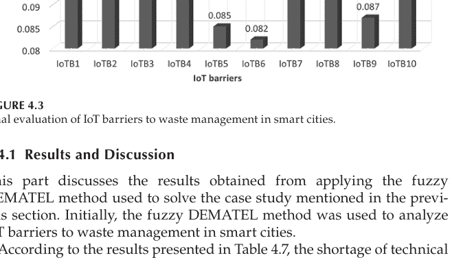

## 图 4.3

智慧城市废物管理中物联网障碍的最终评估。

## 4.4.1 结果与讨论

本部分讨论了应用模糊 DEMATEL 方法解决前一节所述案例研究所获得的结果。最初，模糊 DEMATEL 方法被用于分析智慧城市废物管理中的物联网障碍。

根据表 4.7 所示的结果，规划者之间技术知识短缺障碍是权重为 0.367 的最高障碍，其次是权重为 0.356 的透明度不足标准，而系统故障问题障碍以权重 0.277 位居最后。


## 表 4.8

阈值 (α) = 0.342 的最终结果

| 专家 | IoTB₁ | IoTB₂ | IoTB₃ | IoTB₄ | IoTB₅ | IoTB₆ | IoTB₇ | IoTB₈ | IoTB₉ | IoTB₁₀ |
|---|---|---|---|---|---|---|---|---|---|---|
| IoTB₁ | 0.260 | 0.499 | 0.350 | 0.525 | 0.374 | 0.262 | 0.432 | 0.524 | 0.382 | 0.430 |
| IoTB₂ | 0.263 | 0.286 | 0.347 | 0.341 | 0.233 | 0.234 | 0.321 | 0.362 | 0.266 | 0.346 |
| IoTB₃ | 0.437 | 0.490 | 0.328 | 0.524 | 0.366 | 0.322 | 0.465 | 0.528 | 0.407 | 0.499 |
| IoTB₄ | 0.202 | 0.380 | 0.302 | 0.298 | 0.209 | 0.202 | 0.270 | 0.340 | 0.342 | 0.334 |
| IoTB₅ | 0.223 | 0.298 | 0.330 | 0.304 | 0.204 | 0.240 | 0.248 | 0.345 | 0.209 | 0.277 |
| IoTB₆ | 0.250 | 0.355 | 0.329 | 0.395 | 0.350 | 0.191 | 0.249 | 0.415 | 0.279 | 0.347 |
| IoTB₇ | 0.197 | 0.433 | 0.278 | 0.350 | 0.376 | 0.184 | 0.264 | 0.354 | 0.221 | 0.335 |
| IoTB₈ | 0.366 | 0.508 | 0.417 | 0.585 | 0.416 | 0.281 | 0.373 | 0.396 | 0.444 | 0.488 |
| IoTB₉ | 0.255 | 0.268 | 0.281 | 0.435 | 0.203 | 0.159 | 0.300 | 0.291 | 0.219 | 0.319 |
| IoTB₁₀ | 0.328 | 0.453 | 0.322 | 0.558 | 0.416 | 0.344 | 0.426 | 0.452 | 0.418 | 0.349 |

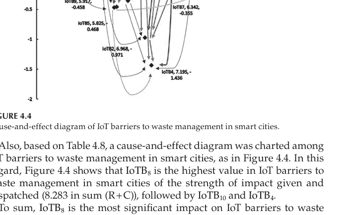

## 图 4.4

智能城市废物管理中物联网障碍的因果图。

此外，基于表 4.8，在智能城市废物管理中物联网障碍之间绘制了因果图，如图 4.4 所示。在此方面，图 4.4 显示 IoTB8 是智能城市废物管理中物联网障碍中影响强度给予和派发的值最高者（R+C 之和为 8.283），其次是 IoTB10 和 IoTB4。总体而言，IoTB8 对智能城市废物管理中物联网障碍的影响最为显著。此外，IoTB2、IoTB4、IoTB5、IoTB7 和 IoTB9 的 R−C 值均为负值；这表明这些障碍受其他障碍的影响。

## 4.5 摘要

- 本章对智能城市中的废物管理进行了全面描述。
- 本章强调了在智能废物管理中采用物联网（IoT）的一些障碍。
- 本章回顾了评估在智能废物管理中采用物联网（IoT）障碍的重要性与需求。
- 在对多篇研究文章进行全面分析后，本章提出了评估在智能废物管理中采用物联网（IoT）障碍的最重要标准。
- 本章提出了一种模糊 DEMATEL 技术，用于评估城市中智能废物管理采用物联网（IoT）的障碍。
- 本章在评估智能废物管理中采用物联网（IoT）障碍的同时，呈现了一个真实案例研究。

## 4.6 练习

- a. 你如何定义“智能废物管理”？为什么评估智能和可持续的废物管理系统很重要？
- b. 智能废物管理与智能灾害响应系统之间有什么区别？在做出决策时讨论它们的相对优势。
- c. 为什么在废物管理中采用物联网被视为障碍？为什么评估这些障碍很重要？
- d. 从智能城市的特征和形成角度讨论智能废物管理的特点。
- e. 为什么需要采用 MCDM 方法来评估在智能废物管理中采用物联网（IoT）的障碍？

## 参考文献

Elahi, Haroon, Guojun Wang, Tao Peng, and Jianer Chen. 2019. “关于智能城市中智能助手的透明度和问责制。” *Applied Sciences*. doi: 10.3390/app9245344.

Hasheminezhad, Araz, Farhad Hadadi, and Hamid Shirmohammadi. 2021. “基于模糊 COPRAS 和模糊 DEMATEL 方法的两次客运列车碰撞风险因素调查与优先排序。” *Soft Computing* 25(6): 4677–97. doi: 10.1007/s00500-020-05478-3.

Hosseini, Seyyed Mehdi, Mohammad Mahdi Paydar, and Mostafa Hajiaghaei-Keshteli. 2021. “新冠肺炎疫情期间生态旅游中心的恢复解决方案：利用模糊 DEMATEL 和模糊 VIKOR 方法。” *Expert Systems with Applications* 185: 115594. doi: 10.1016/j.eswa.2021.115594.

Li, Jishuo, and Kaili Xu. 2021. “一种结合模糊 DEMATEL 和云模型的方法，用于过程工业的风险评估以提高系统可靠性。” *Quality and Reliability Engineering International* 37(5): 2110–33. doi: 10.1002/qre.2848.

Mishra, Arunoday Roy, Pratibha Rani, Abhijit Saha, Ibrahim M Hezam, Dragan Pamucar, Minja Marinovi, and Kiran Pandey. 2022. “使用费马模糊组合妥协解法评估智能城市废物管理物联网（IoT）障碍的适应性。” *IEEE Access* 10: 37109–30. doi: 10.1109/ACCESS.2022.3164096.

Papadakis, Nikos, Nikos Koukouelas, Ioannis Christakis, Ilias Stavrakas, and Dionisis Kandris. 2021. “一种基于物联网的参与式防盗系统，用于提升智能城市公共安全。” *Smart Cities*. doi: 10.3390/smartcities4020047.

Sharma, Manu, Sudhanshu Joshi, Devika Kannan, Kannan Govindan, Rohit Singh, and Harsh Chandra Purohit. 2020. “智能城市废物管理物联网（IoT）采用障碍：印度背景。” *Journal of Cleaner Production* 270: 122047. doi: 10.1016/j.jclepro.2020.122047.

Zhao, Huiru, and Sen Guo. 2015. “为可持续发展而对中国可再生能源电力的外部效益评估。” *Sustainability*. doi: 10.3390/su7054783.

## 5

## 基于智能数据的云服务性能评估与选择的融合方法

### 5.1 引言

云计算是通过互联网分配计算机资源的一种新方式。这种计算范式通过减轻企业与 IT 基础设施设置相关的低级活动，并允许其以有限的资源开始并根据需要扩展，从而为企业带来显著优势，释放出用于创新和创造商业价值的时间。分布式计算的出现推动了云计算的发展，而云计算至今仍在蓬勃发展。云计算是互联网计算中的一种新范式，具有适应性，并改变了计算、存储和服务解决方案的实现方式。云计算使得提供三种主要服务模型成为可能：基础设施即服务（IaaS）、软件即服务（SaaS）和平台即服务（PaaS）。这些模型已开发出来以满足每个客户的具体需求。云计算通常分为三类：公有云、私有云和混合云。部署方法决定了这些类别。

在当今世界，将应用程序、数据和/或基础设施迁移到云中几乎肯定是一个困难的过程。云计算的使用受到若干障碍的阻碍，阻止其提供所有承诺的利益。这些挑战是由于现有应用程序、数据和/或基础设施具有某些要求和设置，云提供商必须满足这些要求和设置。这些挑战可分为三类。从组织的角度来看，组织中的每个系统都有自己的配置性能和影响工作负载参数的元素。此外，每个云服务提供商都提供具有多种特征的服务，例如性能、价格和安全选项供选择。因此，企业可能难以选择提供最适合其需求的特性和能力的云服务提供商。

从最基本的形式来看，云计算是通过网络提供虚拟服务。这些服务随后可由世界各地的用户按使用量付费使用，付款金额由客户期望的服务质量（QoS）决定。由于云固有的灵活性和敏捷性，像 Microsoft、Amazon 和 Google 这样的顶级软件公司现在有机会将现有运营迁移到云上并因此扩大其客户群。鉴于可供选择的云服务提供商数量众多，客户在选择满足其 QoS 要求的最佳云服务提供商时拥有各种选择也就不足为奇了。由于云计算取得了巨大进展以及使用人数的增加，有必要在全球范围内开发高效且准确的云服务选择方法。这是因为提高客户与服务提供商之间的信任水平需要双方做出适当的云服务提供商选择，以满足其要求。在这种情况下，用于评估云服务的关键绩效指标（KPI）由云服务测量倡议联盟（CSMIC）制定的服务测量指数（SMI）提供。

选择云服务是多准则决策制定（MCDM）的一个例子，在该过程中 QoS 的多个方面在决策过程中发挥重要作用。因此，可能需要更有效的 MCDM 策略来应对客户需求并根据其能力对云服务进行排名。在本章中，我们提供了一种系统评估方法，用于从多个相似选项中挑选理想的云服务，选择基于与云服务相关的 QoS 要求。使用该框架，客户可以根据其首选选择和其他多个因素评估多个云服务提供商。

### 5.2 数学预备

### 5.2.1 概念

直觉模糊集（IFSs）、皮塔哥拉斯模糊集（PFSs）和 q-截面正交模糊集（q-ROFSs）等术语将在本部分讨论，同时包括相关的概念、技术和基本定义。


## 5.2.1.1 直觉模糊集 (IFSs)

IFSs 最早由 Atanassov 于 1986 年提出，作为模糊集理论的扩展。IFSs 通过隶属度等级和非隶属度等级区分，二者之和必须小于或等于 1。这一点在解释 5.1 中有详细说明，可参见 Atanassov (1999) 和 Alkan and Kahraman (2021)。

### Explanation 5.1:
设 Y 为常数集。Y 中的一个 IFS ~E 是一个具有以下指定公式的对象：

~E = { (Y, U~E(Y), v~E(Y)) | Y ∈ Y } (5.1)

其中函数 U~E: Y → [0, 1] 表示组件对集合 ~E 的隶属度，v~E: Y → [0, 1] 表示组件对集合 ~E 的非隶属度，条件为：

0 ≤ U~E(Y) + v~E(Y) ≤ 1, for ∀ Y ∈ Y (5.2)

不确定度计算如下：

π~E(Y) = 1 - U~E(Y) - v~E(Y) (5.3)

### Explanation 5.2:
设 ~A = (U~A, v~A) 和 ~B = (U~B, v~B) 为两个直觉模糊数 (IFNs)；则这两个 IFNs 的加法和乘法运算如下：

~A ⊕ ~B = (U~A + U~B - U~A U~B, v~A v~B) (5.4)
~A ⊗ ~B = (U~A U~B, v~A + v~B - v~A v~B) (5.5)

## 5.2.1.2 毕达哥拉斯模糊集 (PFSs)

为了扩展 IFS 的能力，Yager 提出了 PFSs (Yager, 2013)。它有两个不同的隶属度，分别称为隶属度和非隶属度。在 PFSs 中，考虑隶属度等级和非隶属度等级之和；在 IFSs 中，仅考虑隶属度等级。在 PFSs 中，可能存在多个隶属度等级和非隶属度等级。PFSs 的说明如解释 5.3 所述。

### Explanation 5.3:
设 Y 为常数集。Y 中的一个 PFS ~P 是一个具有以下假设公式的对象：

~P = { (Y, U_P(Y), v_P(Y)) | Y ∈ Y } (5.6)

其中函数 $\mathcal{U}_p: Y \to [0,1]$ 表示组件 $Y \in Y$ 对集合 $\tilde{P}$ 的隶属度，$\vartheta_p: Y \to [0,1]$ 表示组件 $Y \in Y$ 对集合 $\tilde{P}$ 的非隶属度，条件为：

$$0 \le (\mathcal{U}_p(Y))^2 + (\vartheta_p(Y))^2 \le 1, \text{ for } \forall \ Y \in Y \tag{5.7}$$

模糊度计算如下：

$$\pi_p(Y)=\sqrt{1-\mathcal{U}_p(Y)^2-\vartheta_p(Y)^2} \tag{5.8}$$

### Explanation 5.4:
设 $\tilde{P}_1=(\mathcal{U}_{P_1},\vartheta_{P_1})$ 和 $\tilde{P}_2=(\mathcal{U}_{P_2},\vartheta_{P_2})$ 为两个毕达哥拉斯模糊数 (PFNs)；则这两个 PFNs 的加法和乘法运算如下：

$$\tilde{P}_1 \oplus \tilde{P}_2 = \left(\sqrt{\mathcal{U}_{P_1}^2+\mathcal{U}_{P_2}^2-\mathcal{U}_{P_1}^2\mathcal{U}_{P_2}^2},\vartheta_{P_1}\vartheta_{P_2}\right) \tag{5.9}$$

$$\tilde{P}_1 \otimes \tilde{P}_2 = \left(\mathcal{U}_{P_1}\mathcal{U}_{P_2},\sqrt{\vartheta_{P_1}^2+\vartheta_{P_2}^2-\vartheta_{P_1}^2\vartheta_{P_2}^2}\right) \tag{5.10}$$

## 5.2.1.3 q-阶正交对模糊集 (q-ROFSs)

2018 年，Yager 提出了 q-ROFSs，其中给出了隶属度和非隶属度等级。使用 q-ROFS 时，隶属度和非隶属度等级的 q$^{th}$ 次幂之和不得超过 1 (Yager, 2017)。从图 5.1 不难看出，q-ROFSs 的隶属度范围远高于 IFSs 和 PFSs。q-ROFSs 的说明如解释 5.5 所述。

### Explanation 5.5:
Yager 将有限论域 $Y = Y_1,Y_2,...,Y_n$ 中的 q-ROFS $\tilde{Q}$ 定义如下 (Yager, 2017)：

$$\tilde{Q} = \{\left(Y,\mathcal{U}_Q(Y),\vartheta_Q(Y)\right) | Y \in Y\} \tag{5.11}$$

其中函数 $\mathcal{U}_Q: Y \to [0,1]$ 描述组件 $Y \in Y$ 对集合 $\tilde{Q}$ 的隶属度，$\vartheta_Q: Y \to [0,1]$ 描述组件 $Y \in Y$ 对集合 $\tilde{Q}$ 的非隶属度，条件为：

$$0 \le \mathcal{U}_Q(Y)^q + \vartheta_Q(Y)^q \le 1, \text{ for } \forall \ Y \in Y \tag{5.12}$$

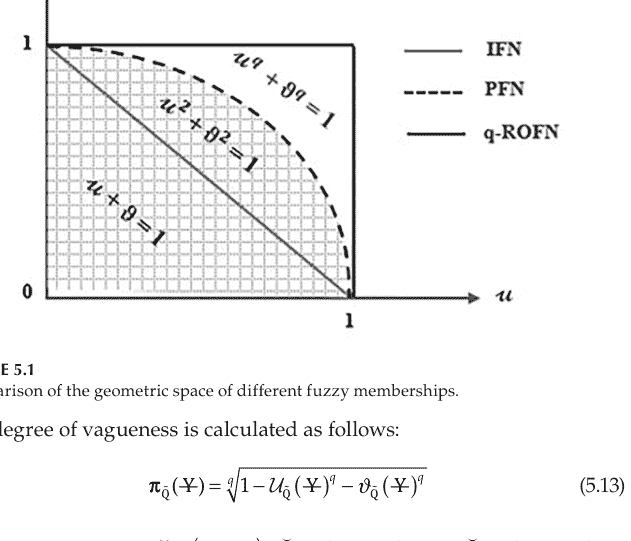

## FIGURE 5.1

不同模糊隶属度的几何空间比较。

模糊度计算如下：

$\pi_{Q}(Y)=\sqrt[q]{1-\mathcal{U}_{Q}(Y)^{q}-\vartheta_{Q}(Y)^{q}}$ (5.13)

### Explanation 5.6:
设 $\tilde{Q}=(\mu_{Q},\vartheta_{\tilde{Q}})$, $\tilde{Q}_{1}=(\mu_{\tilde{Q}_{1}},\vartheta_{\tilde{Q}_{1}})$, 和 $\tilde{Q}_{2}=(\mu_{\tilde{Q}_{2}},\vartheta_{\tilde{Q}_{2}})$ 为三个 q-ROFNs；则其运算可描述如下 (Yager, 2017)：

$\tilde{Q}_{1}\cap\tilde{Q}_{2}=(\min\{\mu_{\tilde{Q}_{1}},\mu_{\tilde{Q}_{2}}\},\max\{\vartheta_{\tilde{Q}_{1}},\vartheta_{\tilde{Q}_{2}}\})$ (5.14)
$\tilde{Q}_{1}\cup\tilde{Q}_{2}=(\max\{\mu_{\tilde{Q}_{1}},\mu_{\tilde{Q}_{2}}\},\min\{\vartheta_{\tilde{Q}_{1}},\vartheta_{\tilde{Q}_{2}}\})$ (5.15)
$\tilde{Q}_{1}\oplus\tilde{Q}_{2}=\left((\mu_{\tilde{Q}_{1}}^{q}+\mu_{\tilde{Q}_{2}}^{q}-\mu_{\tilde{Q}_{1}}^{q}\mu_{\tilde{Q}_{2}}^{q})^{\frac{1}{q}},\vartheta_{\tilde{Q}_{1}}\vartheta_{\tilde{Q}_{2}}\right)$ (5.16)
$\tilde{Q}_{1}\otimes\tilde{Q}_{2}=\left(\mu_{\tilde{Q}_{1}}\mu_{\tilde{Q}_{2}},(\vartheta_{\tilde{Q}_{1}}^{q}+\vartheta_{\tilde{Q}_{2}}^{q}-\vartheta_{\tilde{Q}_{1}}^{q}\vartheta_{\tilde{Q}_{2}}^{q})^{\frac{1}{q}}\right)$ (5.17)
$\lambda\tilde{Q}=\left((1-(1-\mu_{Q}^{q})^{\lambda})^{\frac{1}{q}},\vartheta_{Q}^{\lambda}\right),\lambda>0$ (5.18)

$\tilde{Q}^{\lambda} = \left( \mathcal{U}_{\tilde{Q}}^{\lambda}, \left(1 - \left(1 - \vartheta_{\tilde{Q}}^{q}\right)^{\lambda} \right)^{\frac{1}{q}} \right), \lambda > 0 \quad (5.19)$

### Explanation 5.7:
设 $\tilde{Q} = (\mathcal{U}_{\tilde{Q}}, \vartheta_{\tilde{Q}})$ 为一个 q-ROFN；则 $\tilde{Q}$ 的评分函数 S($\tilde{Q}$) 可由 Wang et al. (2019) 给出，$\tilde{Q}$ 的准确度函数 A($\tilde{Q}$) 可由 Liu and Wang (2018) 给出，分别如式 (5.20) 和 (5.21) 所示。

S($\tilde{Q}$) = $\frac{1}{2}\left(1 + \mathcal{U}_{\tilde{Q}}^{q} - \vartheta_{\tilde{Q}}^{q}\right)$ \quad (5.20)

A($\tilde{Q}$) = $\mathcal{U}_{\tilde{Q}}^{q} + \vartheta_{\tilde{Q}}^{q}$ \quad (5.21)

### Explanation 5.8:
设 $\tilde{Q}_i = (\mathcal{U}_{\tilde{Q}_i}, \vartheta_{\tilde{Q}_i})$ (i=1, 2, ..., n) 为 q-ROFNs 集合，$\omega = (\omega_1, \omega_2, ..., \omega_n)^T$ 为 $\tilde{Q}_i$ 的权重向量，且 $\sum_{i=1}^n \omega_i = 1$ 且 $\omega_i \in [0,1]$。q-阶正交对模糊加权平均 (q-ROFWA) 和 q-阶正交对模糊加权几何 (q-ROFWG) 算子可由 Liu and Wang (2018) 表示，分别如式 (5.22) 和 (5.23) 所示。

q-ROFWA($\tilde{Q}_1, \tilde{Q}_2, ..., \tilde{Q}_n$) = $\left( \left(1 - \prod_{i=1}^n \left(1 - \mathcal{U}_{\tilde{Q}_i}^q\right)^{\omega_i} \right)^{\frac{1}{q}}, \prod_{i=1}^n \vartheta_{\tilde{Q}_i}^{q \omega_i} \right)$ \quad (5.22)

q-ROFWG($\tilde{Q}_1, \tilde{Q}_2, ..., \tilde{Q}_n$) = $\left( \prod_{i=1}^n \mathcal{U}_{\tilde{Q}_i}^{\omega_i}, \left(1 - \prod_{i=1}^n \left(1 - \vartheta_{\tilde{Q}_i}^q\right)^{\omega_i} \right)^{\frac{1}{q}} \right)$ \quad (5.23)

### Explanation 5.9:
Darko and Liang (2020) 建立了加权 q-阶正交对模糊 Hamacher 平均 (Wq-ROFHA) 算子，如式 (5.24) 和 (5.25) 所示。设 $\tilde{Q}_i = (\mathcal{U}_{\tilde{Q}_i}, \vartheta_{\tilde{Q}_i})$ (i=1, 2, ..., n) 为 q-ROFNs 集合，$\omega = (\omega_1, \omega_2, ..., \omega_n)^T$ 为 $\tilde{Q}_i$ 的权重向量，且 $\sum_{i=1}^n \omega_i = 1$ 且 $\omega_i \in [0,1]$。

Wq-ROFHA($\tilde{Q}_1, \tilde{Q}_2, ..., \tilde{Q}_n$) = $\omega_1(\tilde{Q}_1) \oplus \omega_2(\tilde{Q}_2) \oplus \cdots \oplus \omega_n(\tilde{Q}_n)$ \quad (5.24)
= $\bigoplus_{i=1}^n \omega_i (\tilde{Q}_i)$

Wq-ROFHA($\tilde{Q}_1, \tilde{Q}_2, ..., \tilde{Q}_n$)
$= \sqrt[q]{\frac{\prod_{i=1}^n\left(1+(\gamma-1)(\mathcal{U}_{\tilde{Q}_i})^q\right)^{\omega_i} - \prod_{i=1}^n\left(1-(\mathcal{U}_{\tilde{Q}_i})^q\right)^{\omega_i}}{\prod_{i=1}^n\left(1+(\gamma-1)(\mathcal{U}_{\tilde{Q}_i})^q\right)^{\omega_i} + (\gamma-1)\prod_{i=1}^n\left(1-(\mathcal{U}_{\tilde{Q}_i})^q\right)^{\omega_i}}}$, 
$\frac{\sqrt[q]{\gamma}\prod_{i=1}^n(\vartheta_{\tilde{Q}_i})^{\omega_i}}{\sqrt[q]{\prod_{i=1}^n\left(1+(\gamma-1)(1-(\vartheta_{\tilde{Q}_i})^q)\right)^{\omega_i} + (\gamma-1)\prod_{i=1}^n(\vartheta_{\tilde{Q}_i})^{q\omega_i}}}$ (5.25)

其中 $\gamma>0$, $q\ge0$.

### Explanation 5.10:
Darko and Liang (2020) 提出了加权 q-阶正交对模糊 Hamacher 几何平均 (Wq-ROFHGM) 算子，如式 (5.26) 和 (5.27) 所示。设 $\tilde{Q}_i = (\mathcal{U}_{\tilde{Q}_i}, \vartheta_{\tilde{Q}_i})$ (i=1, 2... n) 为 q-ROFNs 集合，$\omega = (\omega_1, \omega_2, ..., \omega_n)^T$ 为 $\tilde{Q}_i$ 的权重向量，且 $\sum_{i=1}^n \omega_i = 1$ 且 $\omega_i \in [0,1]$。

Wq-ROFHGM($\tilde{Q}_1, \tilde{Q}_2, ..., \tilde{Q}_n$) = $\omega_1(\tilde{Q}_1) \oplus \omega_2(\tilde{Q}_2) \oplus \cdots \oplus \omega_n(\tilde{Q}_n)$
$= \bigoplus_{i=1}^n \omega_i(\tilde{Q}_i)$ (5.26)

Wq-ROFHGM($\tilde{Q}_1, \tilde{Q}_2, ..., \tilde{Q}_n$) =
$\frac{\sqrt[q]{\gamma}\prod_{i=1}^n(\mathcal{U}_{\tilde{Q}_i})^{\omega_i}}{\sqrt[q]{\prod_{i=1}^n\left(1+(\gamma-1)(1-(\mathcal{U}_{\tilde{Q}_i})^q)\right)^{\omega_i} + (\gamma-1)\prod_{i=1}^n(\mathcal{U}_{\tilde{Q}_i})^{q\omega_i}}}$, 
$\frac{\sqrt[q]{\prod_{i=1}^n\left(1+(\gamma-1)(\vartheta_{\tilde{Q}_i})^q\right)^{\omega_i} - \prod_{i=1}^n\left(1-(\vartheta_{\tilde{Q}_i})^q\right)^{\omega_i}}}{\sqrt[q]{\prod_{i=1}^n\left(1+(\gamma-1)(\vartheta_{\tilde{Q}_i})^q\right)^{\omega_i} + (\gamma-1)\prod_{i=1}^n\left(1-(\vartheta_{\tilde{Q}_i})^q\right)^{\omega_i}}}$ (5.27)

其中 $\gamma>0$, $q\ge0$.


## 5.3 模型

本节介绍了用于评估多个云服务提供商（CSP）的混合 MCDM 方法的步骤。该方法由两种 MCDM 方法组成：熵方法和组合妥协解（CoCoSo）。应用的方法在 q-ROFS 环境下进行，并使用 q-截面正交模糊数（q-ROFNs）。图 5.2 显示了用于评估多个 CSP 的方法的步骤。该方法分为三个部分：数据聚合、使用熵技术确定准则权重，以及使用 CoCoSo 技术根据其重要性排列所使用的备选方案。在此方面，我们提供了本章案例研究应用中所使用方法的简要概述。本节分为以下几个部分。

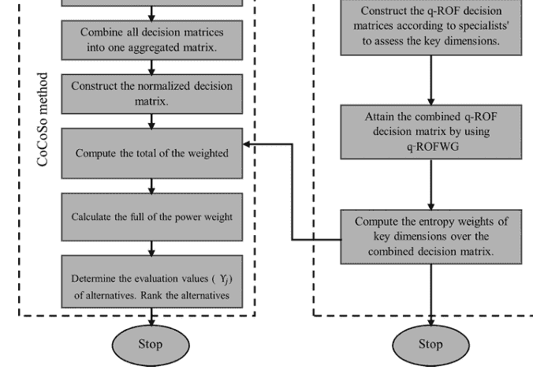

图 5.2

应用方法选择云服务的示意图。

### 5.3.1 熵方法

Shannon 和 Weaver 于 1947 年提出了熵权重技术的想法，这是一种评估决策过程中发生的价值离散的加权方法（Chodha et al., 2022）。熵权重方法用于确定准则和特征的客观权重。每当需要计算不确定信息（熵）时，都会使用概率论（Vaid et al., 2022）。它独立评估每个答案参数的重要性，而不考虑决策者的偏好。从熵权重测量系统的角度来看，更高的权重指数值被认为比较低的权重指数值具有更大的价值。该方法首先确定目标（决策矩阵），然后确定归一化决策矩阵、准则或属性发生的概率、准则或属性的熵值、每个响应产生的差异程度，最后是熵权重。

### 5.3.2 CoCoSo 方法

在 CoCoSo 技术中，选项根据源自加权和模型（WSM）和加权乘积模型（WPM）的妥协方法进行排序（Deveci, Pamucar, and Gokasar, 2021）。通过妥协，确定了备选方案排序所基于的最终准则函数。它表明，当初始选择矩阵中选项的评级具有一致值时，妥协策略的组合会产生客观结果。然而，当极值出现在初始选择矩阵中最重要准则的位置时，WSM 和 WPM 函数的值会发生急剧变化（Torkayesh et al., 2021）。这导致所评估选项的准则价值函数不成比例地上升。第一选择矩阵中的极值可能因多种原因而产生，包括但不限于所检查选项之间不成比例的差异、测量错误以及有偏的专家判断（故意或偶然）。WSM 和 WPM 聚合的另一个缺点是它们忽略了准则之间的相互关系和相互影响。

### 5.3.3 应用方法的计算步骤

本章所呈现问题中使用的方法的计算步骤如下所示：

**步骤 1：** 目标案例从各个方向仔细研究，并确定影响云服务提供商评估的最重要的关键维度。然后，与一些专家协商以帮助作者汇编解决问题的所需数据。据此，已根据选择专家（SP）的一些标准设定，例如科学学位和工作年限。此外，还确定了与专家沟通的最合适方式。

**步骤 2：** 基于专家调查和以往研究，确定影响云服务提供商选择的最重要的主要维度。D_j = {D1, D2, ..., Dn}，其中 j=1, 2, ..., n。设 ω = (ω1, ω2, ..., ωn) 为用于识别维度权重的向量集合，其中 ωj > 0 且 ∑_{j=1}^n ωj = 1。

**步骤 3：** 确定可在评估过程中使用的最重要的可用备选方案，同时根据专家的意见准备这些备选方案的最终列表。组 CSP_i = {CSP1, CSP2, ..., CSPm}，其中 i=1, 2..., m 个替代方案，由组 D_j = {D1, D2, ..., Dn} 的 n 个决策维度进行评估，其中 j=1, 2..., n。

**步骤 4：** 在研究案例研究的主要维度并确定影响问题最重要的方面后，所使用的所有各方以层次结构的形式组织。

**步骤 5：** 根据专家进行的评估过程，这需要存在语言术语，帮助他们进行各种评估，无论是确定主要维度的权重还是像表 5.1 和 5.2 中那样排列所选备选方案。

**步骤 6：** 形成反映专家偏好（SP）的判断矩阵，以利用表 5.1 中呈现的语言术语评估每个专家的维度，然后利用表 5.3 中展示的 q-ROFNs。

### 表 5.1
语言术语及其用于评估因子的等效 q-ROFNs

| 语言术语 | 缩写 | u | ϑ |
|---|---|---|---|
| 极低 | EXL | 0.11 | 0.99 |
| 非常低 | VEL | 0.22 | 0.88 |
| 低 | LOW | 0.33 | 0.77 |
| 中低 | MLO | 0.44 | 0.66 |
| 中等 | MED | 0.55 | 0.55 |
| 中好 | MEW | 0.66 | 0.44 |
| 好 | WEL | 0.77 | 0.33 |
| 非常好 | VRL | 0.88 | 0.22 |
| 极好 | EWL | 0.99 | 0.11 |

### 表 5.2
语言术语及其用于评级替代方案的等效 q-ROFNs

| 语言术语 | 缩写 | $\mathcal{U}$ | $\vartheta$ |
|---|---|---|---|
| 极少 | EDL | 0.11 | 0.99 |
| 非常少 | VRL | 0.22 | 0.88 |
| 少 | LTT | 0.33 | 0.77 |
| 中间少 | TNL | 0.44 | 0.66 |
| 中间 | INE | 0.55 | 0.55 |
| 中间大 | ING | 0.66 | 0.44 |
| 大 | GRE | 0.77 | 0.33 |
| 非常大 | VEG | 0.88 | 0.22 |
| 极大 | EGT | 0.99 | 0.11 |

### 表 5.3
基于 q-ROFN 的关于专家的准则评估矩阵

| 维度 | SP$_1$ | SP$_2$ | SP$_3$ | SP$_4$ |
|---|---|---|---|---|
| D$_1$ | $[u_{1SP_1}, \vartheta_{1SP_1}]$ | $[u_{1SP_2}, \vartheta_{1SP_2}]$ | $[u_{1SP_3}, \vartheta_{1SP_3}]$ | $[u_{1SP_4}, \vartheta_{1SP_4}]$ |
| D$_2$ | $[u_{2SP_1}, \vartheta_{2SP_1}]$ | $[u_{2SP_2}, \vartheta_{2SP_2}]$ | $[u_{2SP_3}, \vartheta_{2SP_3}]$ | $[u_{2SP_4}, \vartheta_{2SP_4}]$ |
| $\vdots$ | $\vdots$ | $\vdots$ | $\vdots$ | $\vdots$ |
| D$_n$ | $[u_{nSP_1}, \vartheta_{nSP_1}]$ | $[u_{nSP_2}, \vartheta_{nSP_2}]$ | $[u_{nSP_3}, \vartheta_{nSP_3}]$ | $[u_{nSP_4}, \vartheta_{nSP_4}]$ |

步骤 7：合并维度与权重的评估。通过应用 Eq. (5.23) 中呈现的 q-ROFWG，对不同的专家评估进行了聚合。此时，$(\omega_j)_{1\times n}$ 引入第 $j^{th}$ 维度的 q-ROF 权重。

步骤 8：通过应用 Eqs. (5.28) 和 (5.29) 计算所收集专家评估的所有 q-ROFN 的熵值。

kE$_{q,ij}(y) = \frac{1}{\sqrt{2}} \left( \left((\mathcal{U}(y))^q\right)^2 + \left((\vartheta(y))^q\right)^2 + \left((\mathcal{U}(y))^q + (\vartheta(y))^q\right)^2 \right)^{0.5} \tag{5.28}

EN$_{q,ij}(y) = 1 - kE_{q,ij}(y) = 1 - \left( \left((\mathcal{U}(y))^q\right)^2 + \left((\vartheta(y))^q\right)^2 + \left((\mathcal{U}(y))^q + (\vartheta(y))^q\right)^2 \right)^{0.5} \tag{5.29}

步骤 9：根据 Eq. (5.30) 基于熵值计算关键维度权重。

ω_j = (1 - ξ_j) / Σ_{j=1}^n (1 - ξ_j) ; j = 1,2,...,n. (5.30)

其中 ξ_j = Σ_{i=1}^m EN_{q,ji} / Σ_{i=1}^m Σ_{j=1}^n EN_{q,ij} 表示 q-ROF 熵值。

步骤 10：由每个专家分别（SP_s）生成确定的关键维度与可用备选方案之间的评估判断矩阵，以评估云服务提供商，利用表 5.2 中呈现的语言术语，然后应用表 5.2 中的 q-ROFNs，如表 5.4 所示。

步骤 11：将每个专家分别（SP_s）确定的关键维度与可用备选方案之间的评估判断矩阵聚合为一个矩阵，以评估云服务提供商，通过应用 Eq. (5.23) 中展示的 q-ROFWG，如表 5.5 所示。

### 表 5.4
基于 q-ROFN 的按维度表示的替代方案判断评估矩阵

| 维度 | 替代方案 |  |  | |
|---|---|---|---|---|
|  | CSP₁ | CSP₂ | ... | CSPₘ |
| D₁ | [u₁₁SP , ϑ₁₁SP] | [u₁₂SP , ϑ₁₂SP] | ... | [u₁mSP , ϑ₁mSP] |
| D₂ | [u₂₁SP , ϑ₂₁SP] | [u₂₂SP , ϑ₂₂SP] | ... | [u₂mSP , ϑ₂mSP] |
| ⋮ | ⋮ | ⋮ | ⋱ | ⋮ |
| Dₙ | [uₙ₁SP , ϑₙ₁SP] | [uₙ₂SP , ϑₙ₂SP] | ... | [uₙmSP , ϑₙmSP] |

### 表 5.5
基于 q-ROFN 的按维度表示的备选方案聚合评估矩阵

| 维度 | 备选方案 |  |  | |
|---|---|---|---|---|
|  | CSP₁ | CSP₂ | ... | CSPₘ |
| D₁ | [u₁₁ , ϑ₁₁] | [u₁₂ , ϑ₁₂] | ... | [u₁m , ϑ₁m] |
| D₂ | [u₂₁ , ϑ₂₁] | [u₂₂ , ϑ₂₂] | ... | [u₂m , ϑ₂m] |
| ⋮ | ⋮ | ⋮ | ⋱ | ⋮ |
| Dₙ | [uₙ₁ , ϑₙ₁] | [uₙ₂ , ϑₙ₂] | ... | [uₙm , ϑₙm] |


**步骤 12：** 利用公式 (5.31) 计算标准化组合 q-ROF 评估判断矩阵 ($\tilde{S}$)。

$\tilde{S} = (\tilde{s}_{ij})_{m\times n} = [\tilde{U}_{ij}, \tilde{v}_{ij}] = \begin{cases} (\tilde{u}_{ij}, \tilde{v}_{ij}) & \text{if } i \in B \\ (\tilde{v}_{ij}, \tilde{u}_{ij}) & \text{if } i \in \check{C} \end{cases}$ (5.31)

其中 B 表示优势维度的组，$\check{C}$ 表示成本维度的组。

**步骤 13：** 利用 Wq-ROFHA 因子根据公式 (5.24) 和公式 (5.25) 所示计算所有云服务提供商的整体加权可比性妥协 ($\alpha$)。

**步骤 14：** 利用 Wq-ROFHGM 因子根据公式 (5.26) 和 (5.27) 所示计算所有云服务提供商的可比性妥协的完整幂权重 ($\beta$)。

**步骤 15：** 利用公式 (5.20) 通过每个备选方案的 Wq-ROFHA 和 Wq-ROFHGM 因子的值计算所有云服务提供商（备选方案）的得分值。

**步骤 16：** 利用公式 (5.32)、(5.33) 和 (5.34) 计算云服务提供商（备选方案）的比例权重。

$\gamma_{ja} = \frac{\alpha_j + \beta_j}{\sum_{j=1}^{n} (\alpha_j + \beta_j)}$ (5.32)

$\gamma_{jb} = \frac{\alpha_j}{\min(\alpha_j)} + \frac{\beta_j}{\min(\beta_j)}$ (5.33)

$\gamma_{jc} = \frac{\varphi\alpha_j + (1-\varphi)\beta_j}{\varphi\max(\alpha_j) + (1-\varphi)\max(\beta_j)}, \; 0 \le \varphi \le 1,$ (5.34)

其中 $\gamma_{ja}$ 表示 WSM 和 WPM 得分。然后，$\gamma_{jb}$ 指 WSM 和 WPM 的总比较得分。此外，$\gamma_{jc}$ 表示 WSM 和 WPM 得分的既定决策。

**步骤 17：** 利用公式 (5.35) 计算所有云服务提供商（备选方案）的评估值 ($\gamma_j$) 。然后，根据评估值 ($\gamma_j$) 的最有潜力得分对所选备选方案进行评级。

$\gamma_j = \sqrt[3]{\gamma_{ja}\gamma_{jb}\gamma_{jc}} + \frac{\gamma_{ja} + \gamma_{jb} + \gamma_{jc}}{3}$ (5.35)

## 5.4 模型实现

所应用的方法通过关于云服务选择的现实世界问题进行了测试，展示了其效率和准确性。本章的主要目标是识别在众多不同质量方面优于当前可访问的其他云服务的云服务，然后将其选为最合适的选项。我们团队使用了文章中使用的真实数据集（Jatoth、Gangadharan 和 Fiore，2017）。Cloud Harmony 数据集用于在预定时间内在多个动态启动的虚拟机（VM）上运行基准程序，以便提供各种云服务的性能评估。此外，该数据集还测量了基于不同虚拟核心的大型云服务的 CPU、内存、磁盘性能和 I/O 一致性的值。在收集数据时，我们未能考虑逻辑上不一致的数据，这些数据被定义为超出范围或具有非常高值的数据。

步骤 1： 问题从各个方面进行了研究，并确定了主要目标，即评估一些云服务提供商以及影响最佳云服务提供商选择的主要维度。此外，确定了四位专家与作者合作，并分配了四个权重以确定每位专家的[content]
**步骤 12：** 利用公式 (5.31) 计算标准化组合 q-ROF 评估判断矩阵 ($\tilde{S}$)。

$\tilde{S} = (\tilde{s}_{ij})_{m\times n} = [\tilde{U}_{ij}, \tilde{v}_{ij}] = \begin{cases} (\tilde{u}_{ij}, \tilde{v}_{ij}) & \text{if } i \in B \\ (\tilde{v}_{ij}, \tilde{u}_{ij}) & \text{if } i \in \check{C} \end{cases}$ (5.31)

其中 B 表示优势维度的组，$\check{C}$ 表示成本维度的组。

**步骤 13：** 利用 Wq-ROFHA 因子根据公式 (5.24) 和公式 (5.25) 所示计算所有云服务提供商的整体加权可比性妥协 ($\alpha$)。

**步骤 14：** 利用 Wq-ROFHGM 因子根据公式 (5.26) 和 (5.27) 所示计算所有云服务提供商的可比性妥协的完整幂权重 ($\beta$)。

**步骤 15：** 利用公式 (5.20) 通过每个备选方案的 Wq-ROFHA 和 Wq-ROFHGM 因子的值计算所有云服务提供商（备选方案）的得分值。

**步骤 16：** 利用公式 (5.32)、(5.33) 和 (5.34) 计算云服务提供商（备选方案）的比例权重。

$\gamma_{ja} = \frac{\alpha_j + \beta_j}{\sum_{j=1}^{n} (\alpha_j + \beta_j)}$ (5.32)

$\gamma_{jb} = \frac{\alpha_j}{\min(\alpha_j)} + \frac{\beta_j}{\min(\beta_j)}$ (5.33)

$\gamma_{jc} = \frac{\varphi\alpha_j + (1-\varphi)\beta_j}{\varphi\max(\alpha_j) + (1-\varphi)\max(\beta_j)}, \; 0 \le \varphi \le 1,$ (5.34)

其中 $\gamma_{ja}$ 表示 WSM 和 WPM 得分。然后，$\gamma_{jb}$ 指 WSM 和 WPM 的总比较得分。此外，$\gamma_{jc}$ 表示 WSM 和 WPM 得分的既定决策。

**步骤 17：** 利用公式 (5.35) 计算所有云服务提供商（备选方案）的评估值 ($\gamma_j$) 。然后，根据评估值 ($\gamma_j$) 的最有潜力得分对所选备选方案进行评级。

$\gamma_j = \sqrt[3]{\gamma_{ja}\gamma_{jb}\gamma_{jc}} + \frac{\gamma_{ja} + \gamma_{jb} + \gamma_{jc}}{3}$ (5.35)

## 5.4 模型实现

所应用的方法通过关于云服务选择的现实世界问题进行了测试，展示了其效率和准确性。本章的主要目标是识别在众多不同质量方面优于当前可访问的其他云服务的云服务，然后将其选为最合适的选项。我们团队使用了文章中使用的真实数据集（Jatoth、Gangadharan 和 Fiore，2017）。Cloud Harmony 数据集用于在预定时间内在多个动态启动的虚拟机（VM）上运行基准程序，以便提供各种云服务的性能评估。此外，该数据集还测量了基于不同虚拟核心的大型云服务的 CPU、内存、磁盘性能和 I/O 一致性的值。在收集数据时，我们未能考虑逻辑上不一致的数据，这些数据被定义为超出范围或具有非常高值的数据。

步骤 1： 问题从各个方面进行了研究，并确定了主要目标，即评估一些云服务提供商以及影响最佳云服务提供商选择的主要维度。此外，确定了四位专家与作者合作，并分配了四个权重以确定每位专家的[content]
**步骤 12：** 利用公式 (5.31) 计算标准化组合 q-ROF 评估判断矩阵 ($\tilde{S}$)。

$\tilde{S} = (\tilde{s}_{ij})_{m\times n} = [\tilde{U}_{ij}, \tilde{v}_{ij}] = \begin{cases} (\tilde{u}_{ij}, \tilde{v}_{ij}) & \text{if } i \in B \\ (\tilde{v}_{ij}, \tilde{u}_{ij}) & \text{if } i \in \check{C} \end{cases}$ (5.31)

其中 B 表示优势维度的组，$\check{C}$ 表示成本维度的组。

**步骤 13：** 利用 Wq-ROFHA 因子根据公式 (5.24) 和公式 (5.25) 所示计算所有云服务提供商的整体加权可比性妥协 ($\alpha$)。

**步骤 14：** 利用 Wq-ROFHGM 因子根据公式 (5.26) 和 (5.27) 所示计算所有云服务提供商的可比性妥协的完整幂权重 ($\beta$)。

**步骤 15：** 利用公式 (5.20) 通过每个备选方案的 Wq-ROFHA 和 Wq-ROFHGM 因子的值计算所有云服务提供商（备选方案）的得分值。

**步骤 16：** 利用公式 (5.32)、(5.33) 和 (5.34) 计算云服务提供商（备选方案）的比例权重。

$\gamma_{ja} = \frac{\alpha_j + \beta_j}{\sum_{j=1}^{n} (\alpha_j + \beta_j)}$ (5.32)

$\gamma_{jb} = \frac{\alpha_j}{\min(\alpha_j)} + \frac{\beta_j}{\min(\beta_j)}$ (5.33)

$\gamma_{jc} = \frac{\varphi\alpha_j + (1-\varphi)\beta_j}{\varphi\max(\alpha_j) + (1-\varphi)\max(\beta_j)}, \; 0 \le \varphi \le 1,$ (5.34)

其中 $\gamma_{ja}$ 表示 WSM 和 WPM 得分。然后，$\gamma_{jb}$ 指 WSM 和 WPM 的总比较得分。此外，$\gamma_{jc}$ 表示 WSM 和 WPM 得分的既定决策。

**步骤 17：** 利用公式 (5.35) 计算所有云服务提供商（备选方案）的评估值 ($\gamma_j$) 。然后，根据评估值 ($\gamma_j$) 的最有潜力得分对所选备选方案进行评级。

$\gamma_j = \sqrt[3]{\gamma_{ja}\gamma_{jb}\gamma_{jc}} + \frac{\gamma_{ja} + \gamma_{jb} + \gamma_{jc}}{3}$ (5.35)

## 5.4 模型实现

所应用的方法通过关于云服务选择的现实世界问题进行了测试，展示了其效率和准确性。本章的主要目标是识别在众多不同质量方面优于当前可访问的其他云服务的云服务，然后将其选为最合适的选项。我们团队使用了文章中使用的真实数据集（Jatoth、Gangadharan 和 Fiore，2017）。Cloud Harmony 数据集用于在预定时间内在多个动态启动的虚拟机（VM）上运行基准程序，以便提供各种云服务的性能评估。此外，该数据集还测量了基于不同虚拟核心的大型云服务的 CPU、内存、磁盘性能和 I/O 一致性的值。在收集数据时，我们未能考虑逻辑上不一致的数据，这些数据被定义为超出范围或具有非常高值的数据。

步骤 1： 问题从各个方面进行了研究，并确定了主要目标，即评估一些云服务提供商以及影响最佳云服务提供商选择的主要维度。此外，确定了四位专家与作者合作，并分配了四个权重以确定每位专家的[content]
**步骤 12：** 利用公式 (5.31) 计算标准化组合 q-ROF 评估判断矩阵 ($\tilde{S}$)。

$\tilde{S} = (\tilde{s}_{ij})_{m\times n} = [\tilde{U}_{ij}, \tilde{v}_{ij}] = \begin{cases} (\tilde{u}_{ij}, \tilde{v}_{ij}) & \text{if } i \in B \\ (\tilde{v}_{ij}, \tilde{u}_{ij}) & \text{if } i \in \check{C} \end{cases}$ (5.31)

其中 B 表示优势维度的组，$\check{C}$ 表示成本维度的组。

**步骤 13：** 利用 Wq-ROFHA 因子根据公式 (5.24) 和公式 (5.25) 所示计算所有云服务提供商的整体加权可比性妥协 ($\alpha$)。

**步骤 14：** 利用 Wq-ROFHGM 因子根据公式 (5.26) 和 (5.27) 所示计算所有云服务提供商的可比性妥协的完整幂权重 ($\beta$)。

**步骤 15：** 利用公式 (5.20) 通过每个备选方案的 Wq-ROFHA 和 Wq-ROFHGM 因子的值计算所有云服务提供商（备选方案）的得分值。

**步骤 16：** 利用公式 (5.32)、(5.33) 和 (5.34) 计算云服务提供商（备选方案）的比例权重。

$\gamma_{ja} = \frac{\alpha_j + \beta_j}{\sum_{j=1}^{n} (\alpha_j + \beta_j)}$ (5.32)

$\gamma_{jb} = \frac{\alpha_j}{\min(\alpha_j)} + \frac{\beta_j}{\min(\beta_j)}$ (5.33)

$\gamma_{jc} = \frac{\varphi\alpha_j + (1-\varphi)\beta_j}{\varphi\max(\alpha_j) + (1-\varphi)\max(\beta_j)}, \; 0 \le \varphi \le 1,$ (5.34)

其中 $\gamma_{ja}$ 表示 WSM 和 WPM 得分。然后，$\gamma_{jb}$ 指 WSM 和 WPM 的总比较得分。此外，$\gamma_{jc}$ 表示 WSM 和 WPM 得分的既定决策。

**步骤 17：** 利用公式 (5.35) 计算所有云服务提供商（备选方案）的评估值 ($\gamma_j$) 。然后，根据评估值 ($\gamma_j$) 的最有潜力得分对所选备选方案进行评级。

$\gamma_j = \sqrt[3]{\gamma_{ja}\gamma_{jb}\gamma_{jc}} + \frac{\gamma_{ja} + \gamma_{jb} + \gamma_{jc}}{3}$ (5.35)

## 5.4 模型实现

所应用的方法通过关于云服务选择的现实世界问题进行了测试，展示了其效率和准确性。本章的主要目标是识别在众多不同质量方面优于当前可访问的其他云服务的云服务，然后将其选为最合适的选项。我们团队使用了文章中使用的真实数据集（Jatoth、Gangadharan 和 Fiore，2017）。Cloud Harmony 数据集用于在预定时间内在多个动态启动的虚拟机（VM）上运行基准程序，以便提供各种云服务的性能评估。此外，该数据集还测量了基于不同虚拟核心的大型云服务的 CPU、内存、磁盘性能和 I/O 一致性的值。在收集数据时，我们未能考虑逻辑上不一致的数据，这些数据被定义为超出范围或具有非常高值的数据。

步骤 1： 问题从各个方面进行了研究，并确定了主要目标，即评估一些云服务提供商以及影响最佳云服务提供商选择的主要维度。此外，确定了四位专家与作者合作，并分配了四个权重以确定每位专家的[content]
**步骤 12：** 利用公式 (5.31) 计算标准化组合 q-ROF 评估判断矩阵 ($\tilde{S}$)。

$\tilde{S} = (\tilde{s}_{ij})_{m\times n} = [\tilde{U}_{ij}, \tilde{v}_{ij}] = \begin{cases} (\tilde{u}_{ij}, \tilde{v}_{ij}) & \text{if } i \in B \\ (\tilde{v}_{ij}, \tilde{u}_{ij}) & \text{if } i \in \check{C} \end{cases}$ (5.31)

其中 B 表示优势维度的组，$\check{C}$ 表示成本维度的组。

**步骤 13：** 利用 Wq-ROFHA 因子根据公式 (5.24) 和公式 (5.25) 所示计算所有云服务提供商的整体加权可比性妥协 ($\alpha$)。

**步骤 14：** 利用 Wq-ROFHGM 因子根据公式 (5.26) 和 (5.27) 所示计算所有云服务提供商的可比性妥协的完整幂权重 ($\beta$)。

**步骤 15：** 利用公式 (5.20) 通过每个备选方案的 Wq-ROFHA 和 Wq-ROFHGM 因子的值计算所有云服务提供商（备选方案）的得分值。

**步骤 16：** 利用公式 (5.32)、(5.33) 和 (5.34) 计算云服务提供商（备选方案）的比例权重。

$\gamma_{ja} = \frac{\alpha_j + \beta_j}{\sum_{j=1}^{n} (\alpha_j + \beta_j)}$ (5.32)

$\gamma_{jb} = \frac{\alpha_j}{\min(\alpha_j)} + \frac{\beta_j}{\min(\beta_j)}$ (5.33)

$\gamma_{jc} = \frac{\varphi\alpha_j + (1-\varphi)\beta_j}{\varphi\max(\alpha_j) + (1-\varphi)\max(\beta_j)}, \; 0 \le \varphi \le 1,$ (5.34)

其中 $\gamma_{ja}$ 表示 WSM 和 WPM 得分。然后，$\gamma_{jb}$ 指 WSM 和 WPM 的总比较得分。此外，$\gamma_{jc}$ 表示 WSM 和 WPM 得分的既定决策。

**步骤 17：** 利用公式 (5.35) 计算所有云服务提供商（备选方案）的评估值 ($\gamma_j$) 。然后，根据评估值 ($\gamma_j$) 的最有潜力得分对所选备选方案进行评级。

$\gamma_j = \sqrt[3]{\gamma_{ja}\gamma_{jb}\gamma_{jc}} + \frac{\gamma_{ja} + \gamma_{jb} + \gamma_{jc}}{3}$ (5.35)

## 5.4 模型实现

所应用的方法通过关于云服务选择的现实世界问题进行了测试，展示了其效率和准确性。本章的主要目标是识别在众多不同质量方面优于当前可访问的其他云服务的云服务，然后将其选为最合适的选项。我们团队使用了文章中使用的真实数据集（Jatoth、Gangadharan 和 Fiore，2017）。Cloud Harmony 数据集用于在预定时间内在多个动态启动的虚拟机（VM）上运行基准程序，以便提供各种云服务的性能评估。此外，该数据集还测量了基于不同虚拟核心的大型云服务的 CPU、内存、磁盘性能和 I/O 一致性的值。在收集数据时，我们未能考虑逻辑上不一致的数据，这些数据被定义为超出范围或具有非常高值的数据。

步骤 1： 问题从各个方面进行了研究，并确定了主要目标，即评估一些云服务提供商以及影响最佳云服务提供商选择的主要维度。此外，确定了四位专家与作者合作，并分配了四个权重以确定每位专家的[content]
**步骤 12：** 利用公式 (5.31) 计算标准化组合 q-ROF 评估判断矩阵 ($\tilde{S}$)。

$\tilde{S} = (\tilde{s}_{ij})_{m\times n} = [\tilde{U}_{ij}, \tilde{v}_{ij}] = \begin{cases} (\tilde{u}_{ij}, \tilde{v}_{ij}) & \text{if } i \in B \\ (\tilde{v}_{ij}, \tilde{u}_{ij}) & \text{if } i \in \check{C} \end{cases}$ (5.31)

其中 B 表示优势维度的组，$\check{C}$ 表示成本维度的组。

**步骤 13：** 利用 Wq-ROFHA 因子根据公式 (5.24) 和公式 (5.25) 所示计算所有云服务提供商的整体加权可比性妥协 ($\alpha$)。

**步骤 14：** 利用 Wq-ROFHGM 因子根据公式 (5.26) 和 (5.27) 所示计算所有云服务提供商的可比性妥协的完整幂权重 ($\beta$)。

**步骤 15：** 利用公式 (5.20) 通过每个备选方案的 Wq-ROFHA 和 Wq-ROFHGM 因子的值计算所有云服务提供商（备选方案）的得分值。

**步骤 16：** 利用公式 (5.32)、(5.33) 和 (5.34) 计算云服务提供商（备选方案）的比例权重。

$\gamma_{ja} = \frac{\alpha_j + \beta_j}{\sum_{j=1}^{n} (\alpha_j + \beta_j)}$ (5.32)

$\gamma_{jb} = \frac{\alpha_j}{\min(\alpha_j)} + \frac{\beta_j}{\min(\beta_j)}$ (5.33)

$\gamma_{jc} = \frac{\varphi\alpha_j + (1-\varphi)\beta_j}{\varphi\max(\alpha_j) + (1-\varphi)\max(\beta_j)}, \; 0 \le \varphi \le 1,$ (5.34)

其中 $\gamma_{ja}$ 表示 WSM 和 WPM 得分。然后，$\gamma_{jb}$ 指 WSM 和 WPM 的总比较得分。此外，$\gamma_{jc}$ 表示 WSM 和 WPM 得分的既定决策。

**步骤 17：** 利用公式 (5.35) 计算所有云服务提供商（备选方案）的评估值 ($\gamma_j$) 。然后，根据评估值 ($\gamma_j$) 的最有潜力得分对所选备选方案进行评级。

$\gamma_j = \sqrt[3]{\gamma_{ja}\gamma_{jb}\gamma_{jc}} + \frac{\gamma_{ja} + \gamma_{jb} + \gamma_{jc}}{3}$ (5.35)

## 5.4 模型实现

所应用的方法通过关于云服务选择的现实世界问题进行了测试，展示了其效率和准确性。本章的主要目标是识别在众多不同质量方面优于当前可访问的其他云服务的云服务，然后将其选为最合适的选项。我们团队使用了文章中使用的真实数据集（Jatoth、Gangadharan 和 Fiore，2017）。Cloud Harmony 数据集用于在预定时间内在多个动态启动的虚拟机（VM）上运行基准程序，以便提供各种云服务的性能评估。此外，该数据集还测量了基于不同虚拟核心的大型云服务的 CPU、内存、磁盘性能和 I/O 一致性的值。在收集数据时，我们未能考虑逻辑上不一致的数据，这些数据被定义为超出范围或具有非常高值的数据。

步骤 1： 问题从各个方面进行了研究，并确定了主要目标，即评估一些云服务提供商以及影响最佳云服务提供商选择的主要维度。此外，确定了四位专家与作者合作，并分配了四个权重以确定每位专家的[content]
**步骤 12：** 利用公式 (5.31) 计算标准化组合 q-ROF 评估判断矩阵 ($\tilde{S}$)。

$\tilde{S} = (\tilde{s}_{ij})_{m\times n} = [\tilde{U}_{ij}, \tilde{v}_{ij}] = \begin{cases} (\tilde{u}_{ij}, \tilde{v}_{ij}) & \text{if } i \in B \\ (\tilde{v}_{ij}, \tilde{u}_{ij}) & \text{if } i \in \check{C} \end{cases}$ (5.31)

其中 B 表示优势维度的组，$\check{C}$ 表示成本维度的组。

**步骤 13：** 利用 Wq-ROFHA 因子根据公式 (5.24) 和公式 (5.25) 计算所有云服务提供商的整体加权可比性妥协 ($\alpha$)。

**步骤 14：** 利用 Wq-ROFHGM 因子根据公式 (5.26) 和 (5.27) 计算所有云服务提供商的可比性妥协的完整幂权重 ($\beta$)。

**步骤 15：** 利用公式 (5.20) 和每个备选方案的 Wq-ROFHA 与 Wq-ROFHGM 因子值计算所有云服务提供商的得分值。

**步骤 16：** 利用公式 (5.32)、(5.33) 和 (5.34) 计算云服务提供商的比例权重。

$\gamma_{ja} = \frac{\alpha_j + \beta_j}{\sum_{j=1}^{n} (\alpha_j + \beta_j)}$ (5.32)

$\gamma_{jb} = \frac{\alpha_j}{\min(\alpha_j)} + \frac{\beta_j}{\min(\beta_j)}$ (5.33)

$\gamma_{jc} = \frac{\varphi\alpha_j + (1-\varphi)\beta_j}{\varphi\max(\alpha_j) + (1-\varphi)\max(\beta_j)}, \; 0 \le \varphi \le 1,$ (5.34)

其中 $\gamma_{ja}$ 表示 WSM 和 WPM 得分，$\gamma_{jb}$ 指 WSM 和 WPM 的总比较得分，$\gamma_{jc}$ 表示 WSM 和 WPM 得分的既定决策。

**步骤 17：** 利用公式 (5.35) 计算所有云服务提供商的评估值 ($\gamma_j$)，然后按评估值 ($\gamma_j$) 的最优得分对备选方案进行排序。

$\gamma_j = \sqrt[3]{\gamma_{ja}\gamma_{jb}\gamma_{jc}} + \frac{\gamma_{ja} + \gamma_{jb} + \gamma_{jc}}{3}$ (5.35)

## 5.4 模型实现

所用方法以云服务选择这一现实问题进行测试，体现了其效率和准确性。本章旨在从多个质量维度识别出优于现有服务的云服务并选为最优方案。团队使用了文献 Jatoth、Gangadharan 和 Fiore 2017 中的真实数据集。Cloud Harmony 数据集通过在动态启动的虚拟机上运行预定时间的基准程序来评估不同云服务的性能，并测量基于不同虚拟核心的大型云服务的 CPU、内存、磁盘性能和 I/O 一致性。数据收集时未考虑逻辑不一致的数据，即超出范围或数值过高的数据。

步骤 1： 从各方面研究问题，确定主要目标为评估若干云服务提供商及影响最佳提供商选择的主要维度。确定四位专家与作者合作，权重分别为 0.2、0.3、0.3、0.2。参数主观选取以体现专家乐观与悲观态度，本例中 q=5 以体现模糊性。

步骤 2： 根据专家意见和既往研究，确定影响最佳云服务提供商选择的五个主要维度：CPU 利用率、磁盘 I/O 一致性、磁盘利用率、内存利用率和成本，缩写分别为 CUTD1、DIOD2、SKUD3、MEMD4、COSD5。

步骤 3： 确定待评估的云服务提供商清单：Azure、Soft Layer、Amazon、HP、Century Link、Google、Rackspace、Joynet、Linode、GoGrid、City Cloud，缩写分别为 CSP1 至 CSP10。

步骤 4： 绘制问题层次结构，展示主要目标、影响维度及备选方案，如图 5.3 所示。

步骤 5： 选择语言术语及等效 q-ROFNs 以优先化所用维度，如表 5.1；并定义评估所选 CSP 的语言术语及等效 q-ROFNs，如表 5.2 所示。

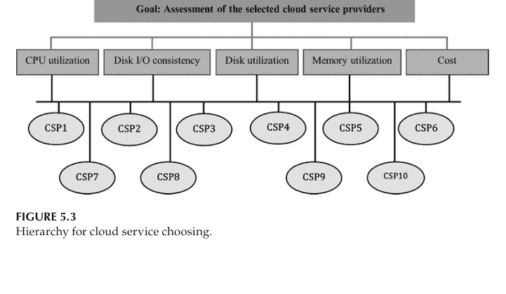

### FIGURE 5.3

云服务选择的层次结构。

步骤 6： 形成呈现专家偏好的判断矩阵，以语言术语评估各专家的维度，如表 5.6 所示。

步骤 7： 依据公式 (5.23) 应用 q-ROFWG 合并不同专家评估，如表 5.6 所示。

步骤 8： 依据公式 (5.28) 和 (5.29) 计算所收集专家评估所有 q-ROFNs 的熵值，如表 5.6 所示。

步骤 9： 依据公式 (5.30) 计算基于熵值的关键维度权重，如表 5.6 和图 5.4 所示。

步骤 10： 由各专家单独生成在确定关键维度与可用备选方案之间的评估判断矩阵以评估 CSP，先用语言术语如表 5.7，再用表 5.2 的 q-ROFNs 如表 5.8 所示。

步骤 11： 将各专家单独的评估判断矩阵通过公式 (5.23) 应用 q-ROFWG 聚合为一个矩阵，结果见表 5.9。

步骤 12： 应用公式 (5.31) 计算标准化组合 q-ROF 评估判断矩阵 ($\tilde{S}$)，如表 5.10 所示。

步骤 13： 利用 Wq-ROFHA 因子依据公式 (5.24) 和 (5.25) 计算所有 CSP 的整体加权可比性妥协 ($\alpha$)，如表 5.11 所示。

步骤 14： 利用 Wq-ROFHGM 因子依据公式 (5.26) 和 (5.27) 计算所有云服务提供商的可比性妥协的完整幂权重 ($\beta$)，如表 5.11 所示。

### TABLE 5.6
*每位专家的关键因素语言术语及组合关键因素权重*

| 关键因素 | SP₁ | SP₂ | SP₃ | SP₄ | 综合结果 | kEᵢⱼ(y) | ENᵢⱼ(y) | ξⱼ | ωⱼ |
|---|---|---|---|---|---|---|---|---|---|
| CUTD₁ | WEL | VRL | EWL | VRL | [0.887, 0.253] | 0.549576 | 0.450424 | 0.139094 | 0.215 |
| DIOD₂ | MED | MEW | MEW | WEL | [0.656, 0.461] | 0.133121 | 0.866879 | 0.267698 | 0.183 |
| SKUD₃ | WEL | VRL | VRL | VRL | [0.856, 0.260] | 0.460183 | 0.539817 | 0.166699 | 0.208 |
| MEMD₄ | MEW | LOW | VRL | MLO | [0.538, 0.551] | 0.144820 | 0.855180 | 0.264085 | 0.184 |
| COSD5 | MED | WEL | WEL | EXL | [0.488, 0.856] | 0.474032 | 0.525968 | 0.162422 | 0.209 |

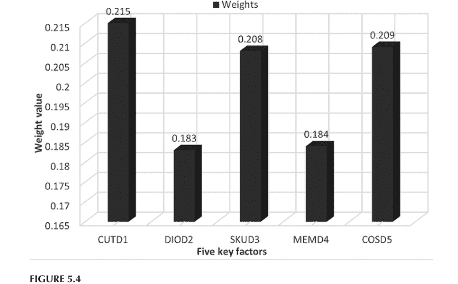

### FIGURE 5.4

用于加权云服务提供商的关键因素最终权重。

步骤 15： 利用公式 (5.20) 和各备选方案的 Wq-ROFHA 与 Wq-ROFHGM 因子值计算所有 CSP 的得分值，如表 5.12 所示。

步骤 16： 利用公式 (5.32)、(5.33) 和 (5.34) 计算 CSP 的比例权重，如表 5.13 所示。

步骤 17： 依据公式 (5.35) 计算所有 CSP 的评估值 ($\gamma_i$)，如表 5.13 和图 5.5 所示，按评估值 ($\gamma_i$) 的最优得分对所选 CSP 排序。

## 5.5 结果与讨论

本部分讨论应用熵-CoCoSo 方法使用 q-ROFNs 得到的结果。首先用熵方法对所用维度进行优先排序。评估结果显示 CPU 利用率维度权重最高为 0.215，其次是成本维度权重 0.209，磁盘 I/O 一致性维度权重最低为 0.183。


## 表 5.7

使用语言术语对 CSP 的关键因素进行评估

| CSPₛ | SPₛ | CUTD₁ | DIOD₂ | SKUD₃ | MEMD₄ | COSD₅ |
|---|---|---|---|---|---|---|
| CSP₁ | SP₁ | VEG | VEG | VEG | VEG | ING |
| CSP₁ | SP₂ | VEG | VEG | VEG | GRE | VEG |
| CSP₁ | SP₃ | GRE | GRE | GRE | GRE | GRE |
| CSP₁ | SP₄ | GRE | GRE | GRE | VEG | EGT |
| CSP₂ | SP₁ | GRE | LTT | EDL | VEG | LTT |
| CSP₂ | SP₂ | VEG | LTT | EDL | GRE | GRE |
| CSP₂ | SP₃ | GRE | LTT | EDL | GRE | TNL |
| CSP₂ | SP₄ | GRE | LTT | EDL | EGT | VEG |
| CSP₃ | SP₁ | GRE | VEG | VEG | VEG | GRE |
| CSP₃ | SP₂ | VEG | VEG | VEG | GRE | EGT |
| CSP₃ | SP₃ | GRE | GRE | GRE | GRE | VEG |
| CSP₃ | SP₄ | GRE | GRE | GRE | VEG | EGT |
| CSP₄ | SP₁ | VEG | VEG | VEG | VEG | LTT |
| CSP₄ | SP₂ | VEG | VEG | VEG | GRE | GRE |
| CSP₄ | SP₃ | GRE | GRE | GRE | GRE | TNL |
| CSP₄ | SP₄ | GRE | GRE | GRE | EGT | VEG |
| CSP₅ | SP₁ | GRE | VEG | VRL | VEG | GRE |
| CSP₅ | SP₂ | VEG | VEG | GRE | GRE | EGT |
| CSP₅ | SP₃ | GRE | GRE | TNL | GRE | VEG |
| CSP₅ | SP₄ | GRE | GRE | VRL | VEG | EGT |
| CSP₆ | SP₁ | GRE | VEG | VEG | VEG | GRE |
| CSP₆ | SP₂ | VEG | VEG | VEG | GRE | EGT |
| CSP₆ | SP₃ | GRE | GRE | GRE | GRE | VEG |
| CSP₆ | SP₄ | GRE | GRE | GRE | VEG | EGT |
| CSP₇ | SP₁ | ING | GRE | GRE | GRE | VRL |
| CSP₇ | SP₂ | GRE | GRE | VEG | VEG | TNL |
| CSP₇ | SP₃ | GRE | GRE | VEG | VEG | INE |
| CSP₇ | SP₄ | GRE | GRE | EGT | VEG | GRE |
| CSP₈ | SP₁ | TNL | GRE | VEG | VEG | VRL |
| CSP₈ | SP₂ | ING | VEG | VEG | VEG | TNL |
| CSP₈ | SP₃ | INE | GRE | VEG | VEG | INE |
| CSP₈ | SP₄ | INE | GRE | EGT | VEG | GRE |
| CSP₉ | SP₁ | INE | GRE | VEG | TNL | VRL |
| CSP₉ | SP₂ | VEG | VEG | VEG | TNL | TNL |
| CSP₉ | SP₃ | ING | GRE | VEG | TNL | INE |
| CSP₉ | SP₄ | GRE | GRE | VEG | TNL | GRE |
| CSP₁₀ | SP₁ | TNL | GRE | GRE | INE | VRL |
| CSP₁₀ | SP₂ | ING | VEG | GRE | INE | TNL |
| CSP₁₀ | SP₃ | INE | GRE | GRE | INE | INE |
| CSP₁₀ | SP₄ | INE | GRE | GRE | INE | GRE |

## 表 5.8

使用 q-ROFNs 对 CSP 的关键因素进行评估

| CSP_s | SP_s | CUTD₁ | DIOD₂ | SKUD₃ | MEMD₄ | COSD₅ |
|---|---|---|---|---|---|---|
| CSP₁ | SP₁ | [0.88, 0.22] | [0.88, 0.22] | [0.88, 0.22] | [0.88, 0.22] | [0.66, 0.44] |
| CSP₁ | SP₂ | [0.88, 0.22] | [0.88, 0.22] | [0.88, 0.22] | [0.77, 0.33] | [0.88, 0.22] |
| CSP₁ | SP₃ | [0.77, 0.33] | [0.77, 0.33] | [0.77, 0.33] | [0.77, 0.33] | [0.77, 0.33] |
| CSP₁ | SP₄ | [0.77, 0.33] | [0.77, 0.33] | [0.77, 0.33] | [0.88, 0.22] | [0.99, 0.11] |
| CSP₂ | SP₁ | [0.77, 0.33] | [0.33, 0.77] | [0.11, 0.99] | [0.88, 0.22] | [0.33, 0.77] |
| CSP₂ | SP₂ | [0.88, 0.22] | [0.33, 0.77] | [0.11, 0.99] | [0.77, 0.33] | [0.77, 0.33] |
| CSP₂ | SP₃ | [0.77, 0.33] | [0.33, 0.77] | [0.11, 0.99] | [0.77, 0.33] | [0.44, 0.66] |
| CSP₂ | SP₄ | [0.77, 0.33] | [0.33, 0.77] | [0.11, 0.99] | [0.99, 0.11] | [0.88, 0.22] |
| CSP₃ | SP₁ | [0.77, 0.33] | [0.88, 0.22] | [0.88, 0.22] | [0.88, 0.22] | [0.77, 0.33] |
| CSP₃ | SP₂ | [0.88, 0.22] | [0.88, 0.22] | [0.88, 0.22] | [0.77, 0.33] | [0.99, 0.11] |
| CSP₃ | SP₃ | [0.77, 0.33] | [0.77, 0.33] | [0.77, 0.33] | [0.77, 0.33] | [0.88, 0.22] |
| CSP₃ | SP₄ | [0.77, 0.33] | [0.77, 0.33] | [0.77, 0.33] | [0.88, 0.22] | [0.99, 0.11] |
| CSP₄ | SP₁ | [0.88, 0.22] | [0.88, 0.22] | [0.88, 0.22] | [0.88, 0.22] | [0.33, 0.77] |
| CSP₄ | SP₂ | [0.88, 0.22] | [0.88, 0.22] | [0.88, 0.22] | [0.77, 0.33] | [0.77, 0.33] |
| CSP₄ | SP₃ | [0.77, 0.33] | [0.77, 0.33] | [0.77, 0.33] | [0.77, 0.33] | [0.44, 0.66] |
| CSP₄ | SP₄ | [0.77, 0.33] | [0.77, 0.33] | [0.77, 0.33] | [0.99, 0.11] | [0.88, 0.22] |
| CSP₅ | SP₁ | [0.77, 0.33] | [0.88, 0.22] | [0.22, 0.88] | [0.88, 0.22] | [0.77, 0.33] |
| CSP₅ | SP₂ | [0.88, 0.22] | [0.88, 0.22] | [0.77, 0.33] | [0.77, 0.33] | [0.99, 0.11] |
| CSP₅ | SP₃ | [0.77, 0.33] | [0.77, 0.33] | [0.44, 0.66] | [0.77, 0.33] | [0.88, 0.22] |
| CSP₅ | SP₄ | [0.77, 0.33] | [0.77, 0.33] | [0.22, 0.88] | [0.88, 0.22] | [0.99, 0.11] |
| CSP₆ | SP₁ | [0.77, 0.33] | [0.88, 0.22] | [0.88, 0.22] | [0.88, 0.22] | [0.77, 0.33] |
| CSP₆ | SP₂ | [0.88, 0.22] | [0.88, 0.22] | [0.88, 0.22] | [0.77, 0.33] | [0.99, 0.11] |
| CSP₆ | SP₃ | [0.77, 0.33] | [0.77, 0.33] | [0.77, 0.33] | [0.77, 0.33] | [0.88, 0.22] |
| CSP₆ | SP₄ | [0.77, 0.33] | [0.77, 0.33] | [0.77, 0.33] | [0.88, 0.22] | [0.99, 0.11] |
| CSP₇ | SP₁ | [0.66, 0.44] | [0.77, 0.33] | [0.77, 0.33] | [0.77, 0.33] | [0.22, 0.88] |
| CSP₇ | SP₂ | [0.77, 0.33] | [0.77, 0.33] | [0.88, 0.22] | [0.88, 0.22] | [0.44, 0.66] |
| CSP₇ | SP₃ | [0.77, 0.33] | [0.77, 0.33] | [0.88, 0.22] | [0.88, 0.22] | [0.55, 0.55] |
| CSP₇ | SP₄ | [0.77, 0.33] | [0.77, 0.33] | [0.99, 0.11] | [0.88, 0.22] | [0.77, 0.33] |
| CSP₈ | SP₁ | [0.44, 0.66] | [0.77, 0.33] | [0.88, 0.22] | [0.88, 0.22] | [0.22, 0.88] |
| CSP₈ | SP₂ | [0.66, 0.44] | [0.88, 0.22] | [0.88, 0.22] | [0.88, 0.22] | [0.44, 0.66] |
| CSP₈ | SP₃ | [0.55, 0.55] | [0.77, 0.33] | [0.88, 0.22] | [0.88, 0.22] | [0.55, 0.55] |
| CSP₈ | SP₄ | [0.55, 0.55] | [0.77, 0.33] | [0.99, 0.11] | [0.88, 0.22] | [0.77, 0.33] |
| CSP₉ | SP₁ | [0.55, 0.55] | [0.77, 0.33] | [0.88, 0.22] | [0.44, 0.66] | [0.22, 0.88] |
| CSP₉ | SP₂ | [0.88, 0.22] | [0.88, 0.22] | [0.88, 0.22] | [0.44, 0.66] | [0.44, 0.66] |
| CSP₉ | SP₃ | [0.66, 0.44] | [0.77, 0.33] | [0.88, 0.22] | [0.44, 0.66] | [0.55, 0.55] |
| CSP₉ | SP₄ | [0.77, 0.33] | [0.77, 0.33] | [0.88, 0.22] | [0.44, 0.66] | [0.77, 0.33] |
| CSP₁₀ | SP₁ | [0.44, 0.66] | [0.77, 0.33] | [0.77, 0.33] | [0.55, 0.55] | [0.22, 0.88] |
| CSP₁₀ | SP₂ | [0.66, 0.44] | [0.88, 0.22] | [0.77, 0.33] | [0.55, 0.55] | [0.44, 0.66] |
| CSP₁₀ | SP₃ | [0.55, 0.55] | [0.77, 0.33] | [0.77, 0.33] | [0.55, 0.55] | [0.55, 0.55] |
| CSP₁₀ | SP₄ | [0.55, 0.55] | [0.77, 0.33] | [0.77, 0.33] | [0.55, 0.55] | [0.77, 0.33] |

## 表 5.9

CSP 的综合评估矩阵

| CSP_s | CUTD₁ | DIOD₂ | SKUD₃ | MEMD₄ | COSD₅ |
|---|---|---|---|---|---|
| CSP₁ | [0.823, 0.295] | [0.823, 0.295] | [0.823, 0.295] | [0.823, 0.295] | [0.817, 0.342] |
| CSP₂ | [0.801, 0.318] | [0.330, 0.770] | [0.110, 0.990] | [0.832, 0.301] | [0.564, 0.630] |
| CSP₃ | [0.801, 0.318] | [0.823, 0.295] | [0.823, 0.295] | [0.832, 0.301] | [0.909, 0.248] |
| CSP₄ | [0.823, 0.295] | [0.823, 0.295] | [0.823, 0.295] | [0.832, 0.301] | [0.817, 0.342] |
| CSP₅ | [0.801, 0.318] | [0.823, 0.295] | [0.394, 0.780] | [0.812, 0.303] | [0.909, 0.284] |
| CSP₆ | [0.801, 0.318] | [0.823, 0.295] | [0.823, 0.295] | [0.812, 0.303] | [0.909, 0.284] |
| CSP₇ | [0.747, 0.365] | [0.770, 0.330] | [0.877, 0.259] | [0.857, 0.260] | [0.458, 0.713] |
| CSP₈ | [0.555, 0.562] | [0.801, 0.311] | [0.901, 0.211] | [0.880, 0.220] | [0.458, 0.715] |
| CSP₉ | [0.715, 0.438] | [0.801, 0.311] | [0.880, 0.220] | [0.440, 0.660] | [0.458, 0.714] |
| CSP₁₀ | [0.555, 0.562] | [0.801, 0.311] | [0.770, 0.330] | [0.550, 0.550] | [0.458, 0.714] |

## 表 5.10

CSP 的归一化评估矩阵

| CSP_s | CUTD₁ | DIOD₂ | SKUD₃ | MEMD₄ | COSD₅ |
|---|---|---|---|---|---|
| CSP₁ | [0.823, 0.295] | [0.823, 0.295] | [0.823, 0.295] | [0.823, 0.295] | [0.817, 0.342] |
| CSP₂ | [0.801, 0.318] | [0.330, 0.770] | [0.110, 0.990] | [0.832, 0.301] | [0.564, 0.630] |
| CSP₃ | [0.801, 0.318] | [0.823, 0.295] | [0.823, 0.295] | [0.832, 0.301] | [0.909, 0.248] |
| CSP₄ | [0.823, 0.295] | [0.823, 0.295] | [0.823, 0.295] | [0.832, 0.301] | [0.817, 0.342] |
| CSP₅ | [0.801, 0.318] | [0.823, 0.295] | [0.394, 0.780] | [0.812, 0.303] | [0.909, 0.284] |
| CSP₆ | [0.801, 0.318] | [0.823, 0.295] | [0.823, 0.295] | [0.812, 0.303] | [0.909, 0.284] |
| CSP₇ | [0.747, 0.365] | [0.770, 0.330] | [0.877, 0.259] | [0.857, 0.260] | [0.458, 0.713] |
| CSP₈ | [0.555, 0.562] | [0.801, 0.311] | [0.901, 0.211] | [0.880, 0.220] | [0.458, 0.715] |
| CSP₉ | [0.715, 0.438] | [0.801, 0.311] | [0.880, 0.220] | [0.440, 0.660] | [0.458, 0.714] |
| CSP₁₀ | [0.555, 0.562] | [0.801, 0.311] | [0.770, 0.330] | [0.550, 0.550] | [0.458, 0.714] |

## 表 5.11

CSP 的 α_j 和 β_j 值

| CSP_s | Wq-ROFHA 因子 α | Wq-ROFHA 因子 β | Wq-ROFHGM 因子 α | Wq-ROFHGM 因子 β |
|---|---|---|---|---|
| CSP₁ | 0.822 | 0.305 | 0.164 | 0.307 |
| CSP₂ | 0.706 | 0.541 | 0.084 | 0.873 |
| CSP₃ | 0.846 | 0.291 | 0.167 | 0.295 |
| CSP₄ | 0.823 | 0.306 | 0.165 | 0.308 |
| CSP₅ | 0.818 | 0.366 | 0.143 | 0.588 |
| CSP₆ | 0.843 | 0.299 | 0.167 | 0.300 |
| CSP₇ | 0.796 | 0.361 | 0.144 | 0.536 |
| CSP₈ | 0.806 | 0.364 | 0.137 | 0.559 |
| CSP₉ | 0.755 | 0.426 | 0.127 | 0.586 |
| CSP₁₀ | 0.686 | 0.473 | 0.122 | 0.577 |


表 5.12
CSPs 的 α_i 和 β_j 得分值

| CSP_s | α_i | β_j |
|---|---|---|
| CSP₁ | 0.7585 | 0.4285 |
| CSP₂ | 0.5823 | 0.1056 |
| CSP₃ | 0.7777 | 0.4364 |
| CSP₄ | 0.7588 | 0.4282 |
| CSP₅ | 0.7260 | 0.2775 |
| CSP₆ | 0.7718 | 0.4334 |
| CSP₇ | 0.7176 | 0.3040 |
| CSP₈ | 0.7207 | 0.2890 |
| CSP₉ | 0.6644 | 0.2705 |
| CSP₁₀ | 0.6063 | 0.2724 |

表 5.13
CSPs 的比较显著性及最终评级

| CSP_s | γ_fa | γ_fb | γ_fc | γ_j | Rank |
|---|---|---|---|---|---|
| CSP₁ | 0.149 | 5.3596 | 0.9777 | 2.9952 | 3 |
| CSP₂ | 0.0666 | 2.0000 | 0.5666 | 1.3003 | 10 |
| CSP₃ | 0.1175 | 5.4669 | 1.0000 | 3.0577 | 1 |
| CSP₄ | 0.1149 | 5.3571 | 0.9777 | 2.9942 | 4 |
| CSP₅ | 0.0972 | 3.8746 | 0.8266 | 2.2771 | 7 |
| CSP₆ | 0.1167 | 5.4284 | 0.9927 | 3.0359 | 2 |
| CSP₇ | 0.0989 | 4.1111 | 0.8415 | 2.3833 | 5 |
| CSP₈ | 0.0977 | 3.9736 | 0.8317 | 2.3205 | 6 |
| CSP₉ | 0.0905 | 3.7019 | 0.7700 | 2.1574 | 8 |
| CSP₁₀ | 0.0851 | 3.6204 | 0.7238 | 2.0828 | 9 |

其次，使用 CoCoSo 方法对研究中使用的十个云服务提供商进行排名。根据表 5.13 和图 5.5 的结果发现，Amazon 提供商以 3.0577 的权重位居第一，其次是权重为 3.0359 的 Google 提供商，而 Soft Layer 提供商以 1.3003 的权重位居最后。

## 5.6 摘要

- 本章对云计算及其相关优势进行了全面描述。
- 本章回顾了评估云计算的云服务性能和智能数据选择的重要性及需求。
- 在对大量研究文章进行全面分析后，本章介绍了用于评估云计算的云服务性能和智能数据选择的最重要的标准。
- 本章提出了用于评估多个云服务提供商（CSPs）的混合 MCDM 方法的步骤。该混合方法由两种先进的 MCDM 技术组成：熵和组合妥协解（CoCoSo）。
- 本章在评估云计算的云服务性能和智能数据选择时呈现了一个真实案例研究。

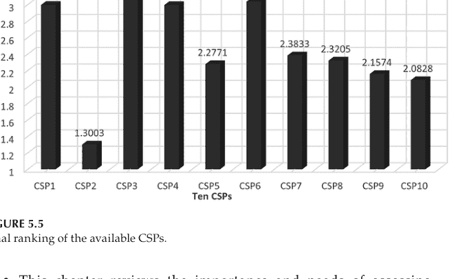

## 图 5.5

可用 CSPs 的最终排名。

## 5.7 练习

- a. 你如何定义“云计算”？为什么对多个云服务提供商的评估对云计算很重要？
- b. 熵方法和 CoCoSo 方法之间有什么区别？在做决策时讨论它们的相对优势。
- c. 为什么在云计算中采用物联网被认为是一种障碍？为什么评估这些障碍很重要？
- d. 从智能城市的特征和形成角度讨论云计算中云服务提供商的特征。
- e. 为什么需要 MCDM 方法来评估云计算的云服务性能和智能数据选择？

## 参考文献

Alkan, Nurşah, and Cengiz Kahraman. 2021. “使用 q-Rung 正交对模糊 TOPSIS 方法评估政府应对 COVID-19 大流行的策略。” Applied Soft Computing 110: 107653. doi: 10.1016/j.asoc.2021.107653.

Atanassov, Krassimir T. 1999. “直觉模糊集。” In: Intuitionistic Fuzzy Sets, pp. 1–137. Physica, Heidelberg.

Chodha, Varun, Rohit Dubey, Raman Kumar, Sehijpal Singh, and Swapandeep Kaur. 2022. “使用 TOPSIS 和熵 MCDM 技术选择工业电弧焊接机器人。” Materials Today: Proceedings 50: 709–15. doi: 10.1016/j.matpr.2021.04.487.

Darko, Adjei Peter, and Decui Liang. 2020. “一些 Q-Rung 正交对模糊 Hamacher 聚合算子及其在改进 EDAS 方法的多属性群决策中的应用。” Engineering Applications of Artificial Intelligence 87: 103259. doi: 10.1016/j.engappai.2019.103259.

Deveci, Muhammet, Dragan Pamucar, and Ilgin Gokasar. 2021. “基于模糊幂 Heronian 函数的 CoCoSo 方法用于实时交通管理中自动驾驶汽车优势的优先排序。” Sustainable Cities and Society 69: 102846. doi: 10.1016/j.scs.2021.102846.

Jatoth, Chandrashekar, Gagan Roy Gangadharan, and Ugo Fiore. 2017. “使用改进的数据包络分析法和改进的超效率数据包络分析法评估云服务效率。” Soft Computing 21(23): 7221–34. doi: 10.1007/s00500-016-2267-y.

Liu, Peide, and Peng Wang. 2018. “一些 Q-Rung 正交对模糊聚合算子及其在多属性决策中的应用。” International Journal of Intelligent Systems 33(2): 259–80. doi: 10.1002/int.21927.

Torkayesh, Ali Ebadi, Dragan Pamucar, Fatih Ecer, and Prasenjit Chatterjee. 2021. “用于评估东欧医疗保健部门的集成 BWM-LBWA-CoCoSo 框架。” Socio-Economic Planning Sciences 78: 101052. doi: 10.1016/j.seps.2021.101052.

Vaid, Sanjay Kumar, Gopal Vaid, Swapandeep Kaur, Raman Kumar, and Manpreet Singh Sidhu. 2022. “多准则决策理论的应用与 VIKOR-WASPAS-熵方法：静音发电机组案例研究。” Materials Today: Proceedings 50: 2416–23. doi: 10.1016/j.matpr.2021.10.259.

Wang, Jie, Guiwu Wei, Jianping Lu, Fuad E Alsaadi, Tasawar Hayat, Cun Wei, and Yi Zhang. 2019. “多属性决策中的一些 Q-Rung 正交对模糊 Hamy 均值算子及其在企业资源规划系统选择中的应用。” International Journal of Intelligent Systems 34(10): 2429–58. doi: 10.1002/int.22155.

Yager, Ronald R. 2013. “毕达哥拉斯模糊子集。” In 2013 Joint IFSA World Congress and NAFIPS Annual Meeting (IFSA/NAFIPS), pp. 57–61. doi: 10.1109/IFSA-NAFIPS.2013.6608375.

Yager, Ronald R. 2017. “广义正交对模糊集。” IEEE Transactions on Fuzzy Systems 25(5): 1222–30. doi: 10.1109/TFUZZ.2016.2604005.

## 6

## 智能校园可持续性指标性能优先排序的评估方法

### 6.1 引言

城市居民的生活质量是智能城市倡议的首要关注点。为了实现这一目标，重点已放在多个不同的领域，包括经济、运营、社会、环境、健康、行政和政府方面，同时始终坚持为公民提供有效和实用服务的原则。尽管如此，由于属于这一类别的项目数量庞大，智能城市的开发过程 notoriously 困难。出现了许多不可预见的问题，这通常导致正在进行的项目被放弃，或者最多导致这些倡议得到更适度的重新解释。非常频繁地，智能城市所剩下的只是它的名字或其创立背后的想法。一个中等规模、拥有单一校园的大学是一个足够复杂的环境，能够高度反映中等规模的城市。它也努力为其社区实现与智能城市中预期的相同生活质量。

我们设想智能大学是一个大学模型，通过对信息技术进行密集、全球化、高效和可持续的使用来改善生活质量，以为整个大学社区提供服务。这个想法基于上面讨论的因素。我们可以断言，大学校园是智能城市倡议的适当模型。大学校园具有代表性，除了作为开发我们城市可行项目的范例、指南和案例研究外，部分结果本身就有用，可以有效地提高大量公民的生活质量。这是因为智能城市倡议的结果将基于从大学校园中学到的经验教训。智能大学的规划和执行可能对任何机构的校园产生有益影响。另一方面，这带来了实质性的障碍；因此，这样的倡议有时无法实现。为了成功协调智能大学项目，整个事业必须首先分解为一系列更小、更易管理的项目。这些项目可能分布在数个财政年度，由不同的团队领导，并融合各种技术应用。即使项目成功完成，最终结果往往是服务的分散，这些服务无法相互连接或产生新的增值服务；最终，会复制和维护各种各样的技术和服务。

由于缺乏可持续实践，大学校园内部对不可再生资源的高度依赖导致某些机构具有较大的碳足迹。例如，全国大多数公立学院的电力来源来自石油。大学层面的绝大多数教育机构现在参与着各种具有挑战性的活动。一些机构由分布在州或其他地缘政治领土各地的多个校园组成。相反，其中许多机构已超出最初总体规划的范围，而该规划本应指导其校园扩张的分阶段计划。在过去几十年中引发讨论和争论的一些困难包括高等教育机构校园与邻近社区之间对土地、住房和必要基础设施的需求。在解决这些问题方面可能取得的成功与机构负责人和社区领导人表现出的意愿程度以及创造性、智能空间策略的部署成正比。研究表明，能够实施新技术和由智能技术驱动的创新解决方案的城市将能够克服其问题。相反，那些无法做到的人面临更多挑战，同时进展甚微。

除非高等教育机构采用智能校园可持续性模式和评估程序，否则大多数校园将使用更高比例的本地石油，其他严重困难将在不久的将来加剧。评估过程中有限的数据访问所带来的障碍也将被解决。指标将基于可以通过地理方式获得的环境维度，并纳入智能空间技术的软件中。高等教育机构迫切需要转向采用和建立利用空间软件的智能框架，以实现校园可持续性。此外，建立基于智能空间的框架以分析其适当性和

高等教育机构校园的可持续性绩效源于世界性的格言“想全球，行本地”。另一个理由是国家特定方法，它为政府和高等教育机构管理者提供完整的资讯库。本章通过评估与利益相关者认知程度以及每个国家当地情境性质相契合的基于空间的指标的相对相关性，来解决这一研究空白。这种相对重要性将有助于开发一种方法，使智慧大学校园能够拥抱当地环境，从而客观地实现智慧城市。

## 6.2 方法论

在本部分，提出了 MCDM 混合方法以优先考虑可持续性指标的绩效并评估智慧校园（SCs）的可持续性绩效。所应用的方法在 q-截面正交模糊集（q-ROFS）环境下进行，并使用 q-截面正交模糊数（q-ROFNs）。所使用的方法包括两种方法：q-ROFS 熵和 q-ROFS 基于理想解相似度的偏好排序法（q-ROFS TOPSIS）。图 6.1 显示了用于评估多个 SCs 的方法的步骤。在此方面，我们提供了本章案例研究中使用的方法的简要概述。本节分为以下几个部分。

### 6.2.1 熵方法

Shannon 熵，最初由 Shannon 创立，是熵权重方法的基石（Shannon 1948）。熵是特定系统信息无序程度的度量，并且有潜力充分利用原始材料中所包含的信息。虽然它过度依赖客观数据，无法准确反映专家的知识和实践经验，但熵权重可以指示指标提供的有用信息（Xu et al. 2018）。因此，结果有时可能与现实和个人理解不一致。Shannon 熵是概率论中发展起来的概念，被表述为信息不确定性的度量（Delgado and Romero 2016）。由于熵的概念非常适合评估对比准则的相对强度，以反映决策所提供的平均内在信息，因此它是我们的目标的优秀且简单的选择。

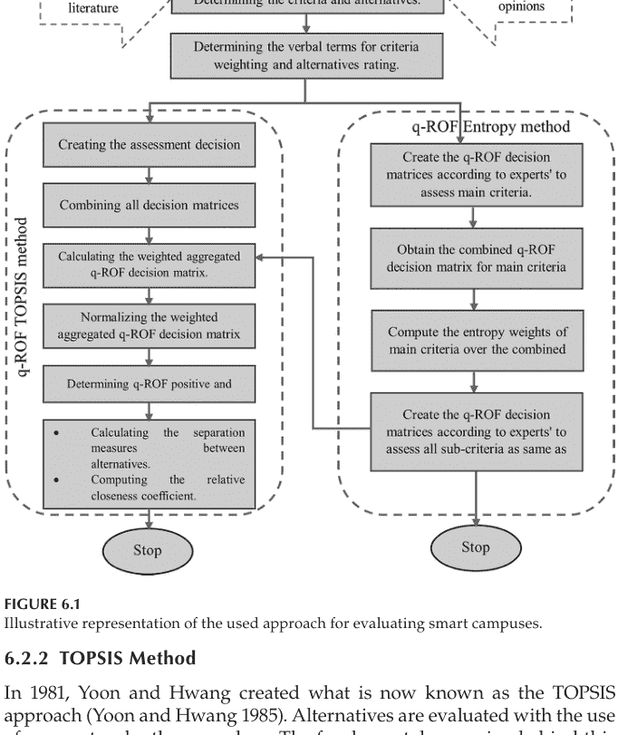

图 6.1
用于评估智慧校园的所用方法的说明性表示。

### 6.2.2 TOPSIS 方法

1981 年，Yoon 和 Hwang 创立了现在被称为 TOPSIS 方法的方法（Yoon and Hwang 1985）。该程序使用参数来评估备选方案。该方法的基本推理是找到总体上最有效的正负解。距离最佳正解最远的备选方案被认为是最优备选方案。理想备选方案最接近最佳负解。TOPSIS 根据备选方案与正理想解（PIS）和负理想解（NIS）同时的接近程度为选择方案分配权重。PIS 优先考虑“越多越好”类型的准则，同时对“越少越好”类型的准则赋予较低权重，而 NIS 优先考虑“越多越好”类型的准则，同时对“越少越好”类型的准则赋予较低权重。距离 PIS 被降至最小，而距离 NIS 被增加到最大可能水平。由于该方法验证了大量适当的品质，因此是目前使用最广泛的排名系统之一（Bouslah et al. 2022）。因此，由于其广泛的实用性，它已被广泛用于各种情况下的实际选择问题。

### 6.2.3 所用方法的计算步骤

本部分详细介绍了识别智慧校园可持续性指标并提供安排一些智慧校园步骤的详细步骤。

Step 1: 对问题进行详细研究，以达到重要点和弱点，并确定影响智慧校园可持续性指标识别和智慧校园评估的最重要的主要方面。在此方面，一些专家已同意帮助作者收集数据以解决该问题。因此，已为选择专家制定了一些规则，例如学术学位和工作年限。还就与专家沟通的方式达成了一致，无论是线上还是线下。

Step 2: 基于专家调查和以往研究，确定影响智慧校园选择的最重要的主要准则和子准则。C_j = {C1, C2, ..., Cn}，其中 j=1, 2...n。设 w = (w1, w2, ..., wn) 为用于识别准则权重的向量集，其中 w_j > 0 且 ∑_{j=1}^n w_j = 1。

Step 3: 确定可在评估过程中使用的最重要可用备选方案，同时根据专家的意见准备这些备选方案的最终列表。组 SC_i = {SC1, SC2, ..., SCm}，其中 i=1, 2..., m 个备选方案，由组 C_j = {C1, C2, ..., Cn} 的 n 个决策度量进行衡量，其中 j=1, 2, ..., n。

Step 4: 根据对问题的研究，其维度在主要目标、子准则和所选备选方案之间以层次形式组织。

Step 5: 识别有助于专家评估主要准则和子准则的语言变量，如表 6.1 所示。还识别有助于评估备选方案的语言术语，如表 6.2 所示。

Step 6: 创建判断矩阵以反映专家的偏好（E_s），通过每个专家使用表 6.1 中呈现的语言术语来衡量主要准则，然后使用表 6.3 中呈现的 q-ROFNs。

## 表 6.1

语言术语及其用于评估准则的等效 q-ROFNs

| 语言术语 | 定义 | 𝒰 | ϑ |
|---|---|---|---|
| 极低 | EXT | 0.11 | 0.99 |
| 非常低 | VLO | 0.22 | 0.88 |
| 低 | LOW | 0.33 | 0.77 |
| 中等偏低 | MOL | 0.44 | 0.66 |
| 中等 | MOD | 0.55 | 0.55 |
| 中等偏好 | MOW | 0.66 | 0.44 |
| 良好 | WLL | 0.77 | 0.33 |
| 非常好 | VEW | 0.88 | 0.22 |
| 极好 | EWL | 0.99 | 0.11 |

## 表 6.2

语言术语及其用于分类备选方案的等效 q-ROFNs

| 语言术语 | 定义 | 𝒰 | ϑ |
|---|---|---|---|
| 极少 | EXL | 0.11 | 0.99 |
| 非常少 | VEL | 0.22 | 0.88 |
| 少 | LEL | 0.33 | 0.77 |
| 中等偏少 | MEL | 0.44 | 0.66 |
| 中等 | MED | 0.55 | 0.55 |
| 中等偏大 | MEG | 0.66 | 0.44 |
| 大 | GRE | 0.77 | 0.33 |
| 非常大 | VRG | 0.88 | 0.22 |
| 极大 | ETG | 0.99 | 0.11 |

## 表 6.3

评估准则的矩阵基于相对于专家的 q-ROFN

| 准则 | E₁ | E₂ | E₃ | E₄ |
|---|---|---|---|---|
| C₁ | [𝒰₁E₁, ϑ₁E₁] | [𝒰₁E₂, ϑ₁E₂] | [𝒰₁E₃, ϑ₁E₃] | [𝒰₁E₄, ϑ₁E₄] |
| C₂ | [𝒰₂E₁, ϑ₂E₁] | [𝒰₂E₂, ϑ₂E₂] | [𝒰₂E₃, ϑ₂E₃] | [𝒰₂E₄, ϑ₂E₄] |
| ⋮ | ⋮ | ⋮ | ⋮ | ⋮ |
| Cₙ | [𝒰ₙE₁, ϑₙE₁] | [𝒰ₙE₂, ϑₙE₂] | [𝒰ₙE₃, ϑₙE₃] | [𝒰ₙE₄, ϑₙE₄] |

Step 7: 聚合准则权重的估值。不同的专家估值通过应用 Eq. (6.1) 中的 q-ROFWG 进行合并。此时，$(w_j)_{1\times n}$ 引入第 j 个准则的 q-ROF 权重。可以参考上一章（第 5 章）中 Eq. (6.1） 的含义。

$$\text{q-ROFWG}(\tilde{Q}_1,\tilde{Q}_2,\dots,\tilde{Q}_n)=\left(\prod_{i=1}^{n}u_{\tilde{Q}_i}^{w_i},\left(1-\prod_{i=1}^{n}(1-\vartheta_{\tilde{Q}_i}^{q})^{w_i}\right)^{\frac{1}{q}}\right)\tag{6.1}$$

Step 8: 通过应用 Eqs. (6.2) 和 (6.3) 计算所有收集的专家评估的 q-ROFN 的熵值。

$$\mathbb{K}E_{q,i,j}(x)=\frac{1}{\sqrt{2}}\left(\left((\mathcal{U}(x))^{q}\right)^{2}+\left((\vartheta(x))^{q}\right)^{2}+\left((\mathcal{U}(x))^{q}+(\vartheta(x))^{q}\right)^{2}\right)^{0.5}\tag{6.2}$$ 

$$\mathbb{E}N_{q,i,j}(x)=-\mathbb{K}E_{q,i,j}(x)=1-\left(\left((\mathcal{U}(x))^{q}\right)^{2}+\left((\vartheta(x))^{q}\right)^{2}+\left((\mathcal{U}(x))^{q}+(\vartheta(x))^{q}\right)^{2}\right)^{0.5}\tag{6.3}$$

Step 9: 根据 Eq. (6.4) 基于熵值计算主要准则权重。

$$w_j=\frac{1-\xi_j}{\sum_{j=1}^{n}(1-\xi_j)};\;j=1,2...n.\tag{6.4}$$ 

其中 $\xi_j=\frac{\sum_{i=1}^{m}\mathbb{E}N_{q,i,j}}{\sum_{i=1}^{m}\sum_{j=1}^{n}\mathbb{E}N_{q,i,j}}$ 指的是 q-ROF 熵值。

Step 10: 在此方面，子准则的权重与主要准则的权重以相同的步骤计算。基于主要准则的权重，计算子准则的全局权重。

Step 11: 通过每个专家单独 $(E_s)$ 构建评估决策矩阵，在确定的子准则和可用备选方案之间评估智慧校园，利用表 6.2 中呈现的语言术语，然后应用表 6.2 中的 q-ROFNs 如表 6.4 所示。

Step 12: 通过应用 Eq. (6.1) 中的 q-ROFWG 将每个专家单独 $(E_s)$ 在确定的子准则和可用备选方案之间评估智慧校园的评估决策矩阵聚合为一个矩阵，如表 6.5 所示。


## 表 6.4
基于 q-ROFN 的备选方案在所有子标准方面的判断评估矩阵

| 子标准 | SC₁ | SC₂ | ... | SCₘ |
|---|---|---|---|---|
| C₁ | [𝒰₁₁ᴱ, ϑ₁₁ᴱ] | [𝒰₁₂ᴱ, ϑ₁₂ᴱ] | ... | [𝒰₁ₘᴱ, ϑ₁ₘᴱ] |
| C₂ | [𝒰₂₁ᴱ, ϑ₂₁ᴱ] | [𝒰₂₂ᴱ, ϑ₂₂ᴱ] | ... | [𝒰₂ₘᴱ, ϑ₂ₘᴱ] |
| ⋮ | ⋮ | ⋮ | ⋱ | ⋮ |
| Cₙ | [𝒰ₙ₁ᴱ, ϑₙ₁ᴱ] | [𝒰ₙ₂ᴱ, ϑₙ₂ᴱ] | ... | [𝒰ₙₘᴱ, ϑₙₘᴱ] |

## 表 6.5
基于 q-ROFN 的备选方案在子标准方面的聚合评估矩阵

| 子标准 | SC₁ | SC₂ | ... | SCₘ |
|---|---|---|---|---|
| C₁ | [𝒰₁₁, ϑ₁₁] | [𝒰₁₂, ϑ₁₂] | ... | [𝒰₁ₘ, ϑ₁ₘ] |
| C₂ | [𝒰₂₁, ϑ₂₁] | [𝒰₂₂, ϑ₂₂] | ... | [𝒰₂ₘ, ϑ₂ₘ] |
| ⋮ | ⋮ | ⋮ | ⋱ | ⋮ |
| Cₙ | [𝒰ₙ₁, ϑₙ₁] | [𝒰ₙ₂, ϑₙ₂] | ... | [𝒰ₙₘ, ϑₙₘ] |

## 表 6.6
加权聚合评估矩阵

| 子标准 | SC₁ | SC₂ | ... | SCₘ |
|---|---|---|---|---|
| C₁ | [𝒰₁₁, ϑ₁₁] | [𝒰₁₂, ϑ₁₂] | ... | [𝒰₁ₘ, ϑ₁ₘ] |
| C₂ | [𝒰₂₁, ϑ₂₁] | [𝒰₂₂, ϑ₂₂] | ... | [𝒰₂ₘ, ϑ₂ₘ] |
| ⋮ | ⋮ | ⋮ | ⋱ | ⋮ |
| Cₙ | [𝒰ₙ₁, ϑₙ₁] | [𝒰ₙ₂, ϑₙ₂] | ... | [𝒰ₙₘ, ϑₙₘ] |

步骤 13：计算加权聚合 q-ROF 评估判断矩阵（R̃）。加权聚合 q-ROF 决策矩阵（R̃）是通过将权重 w_j 与表 6.6 中呈现的聚合 q-ROF 决策矩阵相乘得到的。

步骤 14：使用公式（6.5）计算归一化组合 q-ROF 评估判断矩阵（Ã）。

à = (ã_ij)_{m×n} = [ũ_ij, ṽ_ij] = { (ũ_ij, ṽ_ij) if i ∈ B ; (ṽ_ij, ũ_ij) if i ∈ C } (6.5)

其中 B 表示效益标准组，C 表示成本标准组。

步骤 15：基于归一化决策矩阵，根据公式（6.6）和（6.7）确定 q-ROF 正理想解和 q-ROF 负理想解。

Ã_ij^* = {⟨C_1, (U_1^*, ϑ_1^*)⟩, ⟨C_2, (U_2^*, ϑ_2^*)⟩, ..., ⟨C_n, (U_n^*, ϑ_n^*)⟩} (6.6)

Ã_ij^- = {⟨C_1, (U_1^-, ϑ_1^-)⟩, ⟨C_2, (U_2^-, ϑ_2^-)⟩, ..., ⟨C_n, (U_n^-, ϑ_n^-)⟩} (6.7)

步骤 16：通过应用公式（6.8）和（6.9）分别计算每个备选方案相对于 Ã^* 和 Ã^- 的距离来计算分离度量。

d(A_i, A^*) = ( 1/(2n) Σ_{j=1}^n ( |U_ij^q - (U_j^*)^q|^2 + |ϑ_ij^q - (ϑ_j^*)^q|^2 ) )^{1/2} (6.8)

d(A_i, A^-) = ( 1/(2n) Σ_{j=1}^n ( |U_ij^q - (U_j^-)^q|^2 + |ϑ_ij^q - (ϑ_j^-)^q|^2 ) )^{1/2} (6.9)

步骤 17：通过应用公式（6.10）计算备选方案的相对接近系数（CC_i）。然后，按 CC_i 值的降序对备选方案进行排序。

CC_i = d(A_i, A^-) / [ d(A_i, A^*) + d(A_i, A^-) ] (6.10)

## 6.3 案例研究
大学通过将自己树立为可持续发展[content]
## 表 6.4
基于 q-ROFN 的备选方案在所有子标准方面的判断评估矩阵

| 子标准 | SC₁ | SC₂ | ... | SCₘ |
|---|---|---|---|---|
| C₁ | [𝒰₁₁ᴱ, ϑ₁₁ᴱ] | [𝒰₁₂ᴱ, ϑ₁₂ᴱ] | ... | [𝒰₁ₘᴱ, ϑ₁ₘᴱ] |
| C₂ | [𝒰₂₁ᴱ, ϑ₂₁ᴱ] | [𝒰₂₂ᴱ, ϑ₂₂ᴱ] | ... | [𝒰₂ₘᴱ, ϑ₂ₘᴱ] |
| ⋮ | ⋮ | ⋮ | ⋱ | ⋮ |
| Cₙ | [𝒰ₙ₁ᴱ, ϑₙ₁ᴱ] | [𝒰ₙ₂ᴱ, ϑₙ₂ᴱ] | ... | [𝒰ₙₘᴱ, ϑₙₘᴱ] |

## 表 6.5
基于 q-ROFN 的备选方案在子标准方面的聚合评估矩阵

| 子标准 | SC₁ | SC₂ | ... | SCₘ |
|---|---|---|---|---|
| C₁ | [𝒰₁₁, ϑ₁₁] | [𝒰₁₂, ϑ₁₂] | ... | [𝒰₁ₘ, ϑ₁ₘ] |
| C₂ | [𝒰₂₁, ϑ₂₁] | [𝒰₂₂, ϑ₂₂] | ... | [𝒰₂ₘ, ϑ₂ₘ] |
| ⋮ | ⋮ | ⋮ | ⋱ | ⋮ |
| Cₙ | [𝒰ₙ₁, ϑₙ₁] | [𝒰ₙ₂, ϑₙ₂] | ... | [𝒰ₙₘ, ϑₙₘ] |

## 表 6.6
加权聚合评估矩阵

| 子标准 | SC₁ | SC₂ | ... | SCₘ |
|---|---|---|---|---|
| C₁ | [𝒰₁₁, ϑ₁₁] | [𝒰₁₂, ϑ₁₂] | ... | [𝒰₁ₘ, ϑ₁ₘ] |
| C₂ | [𝒰₂₁, ϑ₂₁] | [𝒰₂₂, ϑ₂₂] | ... | [𝒰₂ₘ, ϑ₂ₘ] |
| ⋮ | ⋮ | ⋮ | ⋱ | ⋮ |
| Cₙ | [𝒰ₙ₁, ϑₙ₁] | [𝒰ₙ₂, ϑₙ₂] | ... | [𝒰ₙₘ, ϑₙₘ] |

步骤 13：计算加权聚合 q-ROF 评估判断矩阵（R̃）。加权聚合 q-ROF 决策矩阵（R̃）是通过将权重 w_j 与表 6.6 中呈现的聚合 q-ROF 决策矩阵相乘得到的。

步骤 14：使用公式（6.5）计算归一化组合 q-ROF 评估判断矩阵（Ã）。

à = (ã_ij)_{m×n} = [ũ_ij, ṽ_ij] = { (ũ_ij, ṽ_ij) if i ∈ B ; (ṽ_ij, ũ_ij) if i ∈ C } (6.5)

其中 B 表示效益标准组，C 表示成本标准组。

步骤 15：基于归一化决策矩阵，根据公式（6.6）和（6.7）确定 q-ROF 正理想解和 q-ROF 负理想解。

Ã_ij^* = {⟨C_1, (U_1^*, ϑ_1^*)⟩, ⟨C_2, (U_2^*, ϑ_2^*)⟩, ..., ⟨C_n, (U_n^*, ϑ_n^*)⟩} (6.6)

Ã_ij^- = {⟨C_1, (U_1^-, ϑ_1^-)⟩, ⟨C_2, (U_2^-, ϑ_2^-)⟩, ..., ⟨C_n, (U_n^-, ϑ_n^-)⟩} (6.7)

步骤 16：通过应用公式（6.8）和（6.9）分别计算每个备选方案相对于 Ã^* 和 Ã^- 的距离来计算分离度量。

d(A_i, A^*) = ( 1/(2n) Σ_{j=1}^n ( |U_ij^q - (U_j^*)^q|^2 + |ϑ_ij^q - (ϑ_j^*)^q|^2 ) )^{1/2} (6.8)

d(A_i, A^-) = ( 1/(2n) Σ_{j=1}^n ( |U_ij^q - (U_j^-)^q|^2 + |ϑ_ij^q - (ϑ_j^-)^q|^2 ) )^{1/2} (6.9)

步骤 17：通过应用公式（6.10）计算备选方案的相对接近系数（CC_i）。然后，按 CC_i 值的降序对备选方案进行排序。

CC_i = d(A_i, A^-) / [ d(A_i, A^*) + d(A_i, A^-) ] (6.10)

## 6.3 案例研究
大学通过将自己树立为可持续发展的典范和孵化器，在社会中培育可持续发展文化方面发挥着关键作用。因此，评估机构的可持续性融合对其对可持续发展的贡献至关重要。本研究基于前一节确定的可持续性标准，对阿拉伯国家之一的公立部门的一些大学进行了评估。因此，确定了六个智能校园以便根据本章使用的方法进行评估，具体如下：SC₁、SC₂、SC₃、SC₄、SC₅ 和 SC₆。

步骤 1：研究了该问题，并确定了其主要目标，即确定智能校园的可持续性指标并评估智能校园。为此，根据选择参与专家的标准选择了四位专家。每位专家的权重值确定如下：0.25、0.25、0.25 和 0.25。此外，通过面对面访谈和在线会议联系了专家。此外，参数被主观选择以代表专家对乐观和悲观的看法。在此实例中，使用 q=5 来进一步说明模糊性。

步骤 2：已确定影响智能校园选择的主要标准，即环境标准、政府标准、移动标准和经济标准。此外，还定义了子标准，即污染空气和水标准、自然资源管理标准、环境保护工具标准、智能建筑标准、能源效率标准、透明度标准、税收标准、服务效率标准、IT 工具标准、连接性和本地交通标准、区域连接标准、产业多元化标准、生态高效旅游标准、绿色集群标准、支持绿色经济标准以及税收激励和援助标准。

步骤 3：用于评估过程的六个备选方案为 SC₁、SC₂、SC₃、SC₄、SC₅ 和 SC₆。

步骤 4：问题的维度在主要目标、主要标准和子标准之间以层次形式组织起来，另外还包括所选备选方案，如图 6.2 所示。

步骤 5：已确定一组语言术语，供专家在优先考虑主要标准及其子标准时使用，如表 6.1 所示。此外，还确定了一组语言术语，供专家在评估备选方案时使用，如表 6.2 所示。

步骤 6：根据表 6.3 创建了根据专家偏好（Eₛ）使用表 6.1 中呈现的语言术语衡量每位专家的主要标准的判断矩阵，如表 6.7 所示。

步骤 7：通过应用公式（6.1）中呈现的 q-ROFWG 聚合了不同的专家估值，如表 6.7 所示。

步骤 8：通过应用公式（6.2）和（6.3）计算了所收集专家评估的所有 q-ROFN 的熵值。

步骤 9：根据公式（6.4）根据熵值计算了主要标准权重，如表 6.7 和图 6.3 所示。

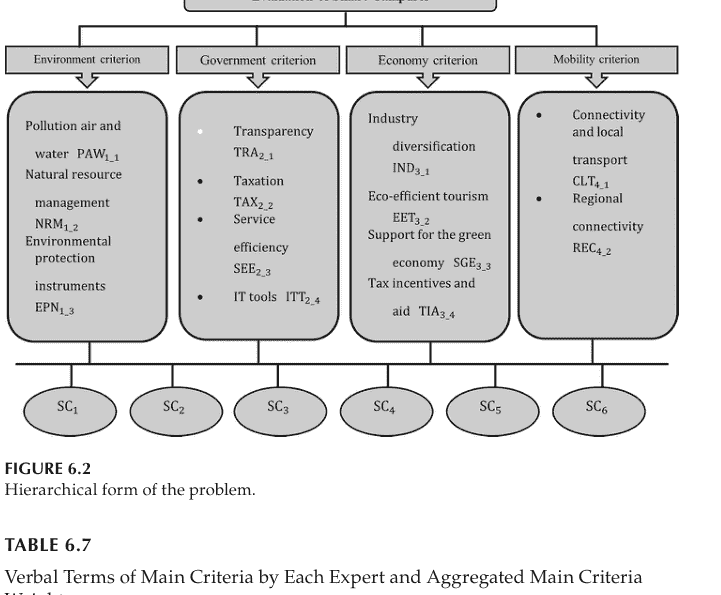

## 图 6.2
问题的层次形式。

## 表 6.7
### 各专家对主要标准的语言术语及聚合主要标准权重

| 主要标准 | E1 | E2 | E3 | E4 | 聚合结果 | E E_q,i,j(ψ) | E N_q,i,j(ψ) | ξ_i | ω_j |
|---|---|---|---|---|---|---|---|---|---|
| ENV1 | WLL | VEW | VEW | EWL | [0.877, 0.262] | 0.51807 | 0.48193 | 0.20804 | 0.264 |
| GOV2 | MOL | EWL | EWL | WLL | [0.759, 0.508] | 0.27059 | 0.72941 | 0.31487 | 0.228 |
| ECO3 | LOW | EXT | MOD | WLL | [0.310, 0.902] | 0.60001 | 0.39999 | 0.17266 | 0.276 |
| MOB4 | MOD | WLL | EWL | VEW | [0.779, 0.425] | 0.29476 | 0.70524 | 0.30443 | 0.232 |

步骤 10：根据表 6.3 创建了根据专家偏好（Eₛ）使用表 6.1 中呈现的语言术语衡量每位专家环境标准子标准的判断矩阵，如表 6.8 所示。

步骤 11：通过应用公式（6.1）中呈现的 q-ROFWG 聚合了环境标准子标准的不同专家估值，如表 6.8 所示。

步骤 12：通过应用公式（6.2）和（6.3）计算了所收集专家评估的环境标准子标准的所有 q-ROFN 的熵值。

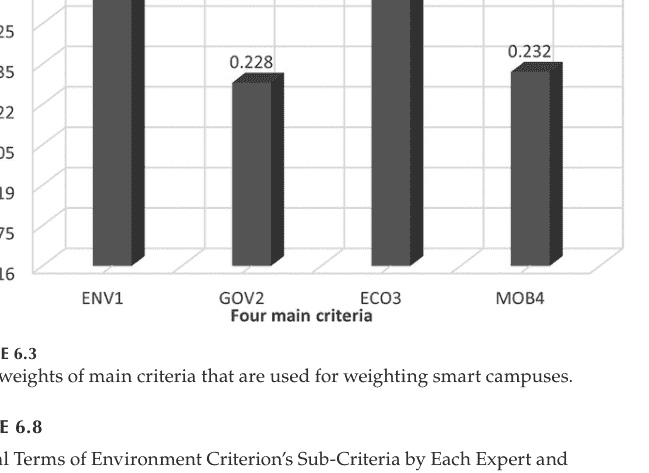

## 图 6.3
用于加权智能校园的主要标准最终权重。

## 表 6.8
### 各专家对环境标准子标准的语言术语及聚合权重

| 环境标准子标准 | E₁ | E₂ | E₃ | E₄ | 聚合结果 | κ_Eq,i,j(y) | EN_q,i,j(y) | ξ_j | (ω)_j |
|---|---|---|---|---|---|---|---|---|---|
| PAW₁,₁ | WLL | VEW | VEW | VEW | [0.851, 0.267] | 0.44729 | 0.55271 | 0.19859 | 0.200 |
| NRM₁,₂ | VLO | MOL | MOD | MOW | [0.433, 0.733] | 0.21985 | 0.78015 | 0.28031 | 0.180 |
| EPN₁,₃ | WLL | MOL | EXT | VLO | [0.301, 0.910] | 0.62439 | 0.37561 | 0.13496 | 0.216 |
| SMB₁,₄ | VLO | MOL | MOW | VEW | [0.487, 0.726] | 0.21670 | 0.78330 | 0.28144 | 0.180 |
| ENE₁,₅ | EWL | EWL | VEW | VEW | [0.933, 0.193] | 0.70856 | 0.29144 | 0.10471 | 0.224 |

步骤 13：根据公式（6.4）根据熵值计算了环境标准子标准权重，如表 6.8 和图 6.4 所示。

步骤 14：根据表 6.3 创建了根据专家偏好（Eₛ）使用表 6.1 中呈现的语言术语衡量每位专家政府标准子标准的判断矩阵，如表 6.9 所示。

步骤 15：通过应用公式（6.1）中呈现的 q-ROFWG 聚合了政府标准子标准的不同专家估值，如表 6.9 所示。


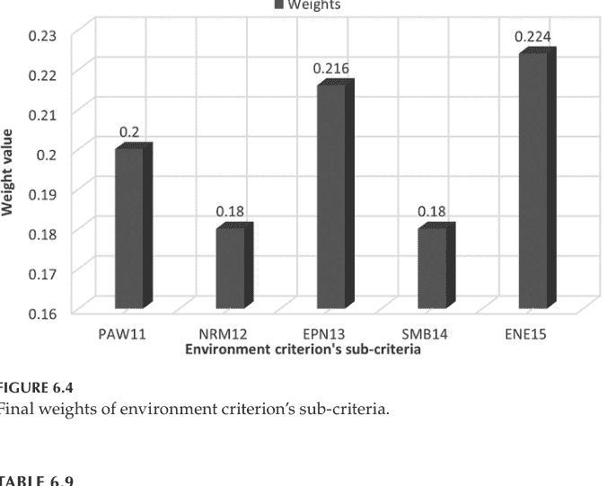

## 图 6.4

环境准则子准则的最终权重。

## 表 6.9

各专家对政府准则子准则的语言术语及聚合权重

| 政府准则的子准则 | E₁ | E₂ | E₃ | E₄ | 聚合结果 | κ_Eq,i,j(y) | EN_q,i,j(y) | ξ_i | ω_j |
|---|---|---|---|---|---|---|---|---|---|
| TRA₂₋₁ | VLO | MOD | VEW | EWL | [0.570, 0.711] | 0.21808 | 0.78192 | 0.34656 | 0.218 |
| TAX₂₋₂ | MOL | EWL | LOW | WLL | [0.577, 0.640] | 0.14967 | 0.85033 | 0.37688 | 0.208 |
| SEE₂₋₃ | MOL | EXT | MOD | WLL | [0.378, 0.888] | 0.55516 | 0.44484 | 0.19716 | 0.268 |
| ITT₂₋₄ | EWL | EWL | EWL | VEW | [0.961, 0.170] | 0.82087 | 0.17913 | 0.07940 | 0.307 |

步骤 16：通过应用公式 (6.2) 和 (6.3) 计算了所收集专家对政府准则子准则评估的全部 q-ROFN 的熵值。

步骤 17：根据公式 (6.4) 计算了基于熵值的政府准则子准则权重，如表 6.9 和图 6.5 所示。

步骤 18：根据表 6.3 创建了根据表 6.1 使用语言术语的各专家对经济准则子准则的偏好 (E_s) 的判断矩阵，如表 6.10 所示。

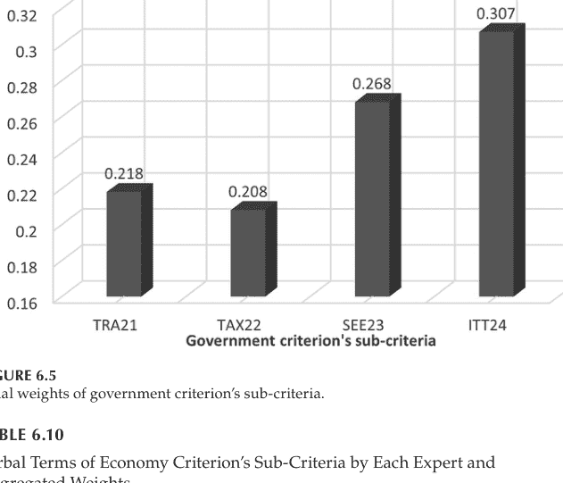

## 图 6.5

政府准则子准则的最终权重。

## 表 6.10

各专家对经济准则子准则的语言术语及聚合权重

| 经济准则的子准则 | E₁ | E₂ | E₃ | E₄ | 聚合结果 | κ_Eq,i,j(y) | EN_q,i,j(y) | ξ_j | ω_j |
|---|---|---|---|---|---|---|---|---|---|
| IND₃₋₁ | VLO | MOD | MOL | MOW | [0.433, 0.733] | 0.21985 | 0.78015 | 0.26462 | 0.245 |
| EET₃₋₂ | MOL | EWL | MOW | WLL | [0.686, 0.520] | 0.17389 | 0.82611 | 0.28021 | 0.240 |
| SGE₃₋₃ | MOL | VLO | MOD | WLL | [0.450, 0.731] | 0.21915 | 0.78085 | 0.26486 | 0.245 |
| TIA₃₋₄ | WLL | WLL | EWL | VEW | [0.848, 0.291] | 0.43895 | 0.56105 | 0.19031 | 0.270 |

步骤 19：通过应用公式 (6.1) 中给出的 q-ROFWG 聚合了经济准则子准则的各不同专家估值，如表 6.10 所示。

步骤 20：通过应用公式 (6.2) 和 (6.3) 计算了所收集专家对经济准则子准则评估的全部 q-ROFN 的熵值。

步骤 21：根据公式 (6.4) 计算了基于熵值的经济准则子准则权重，如表 6.10 和图 6.6 所示。

步骤 22：根据表 6.3 创建了根据表 6.1 使用语言术语的各专家对移动性准则子准则的偏好 (E_s) 的判断矩阵，如表 6.11 所示。

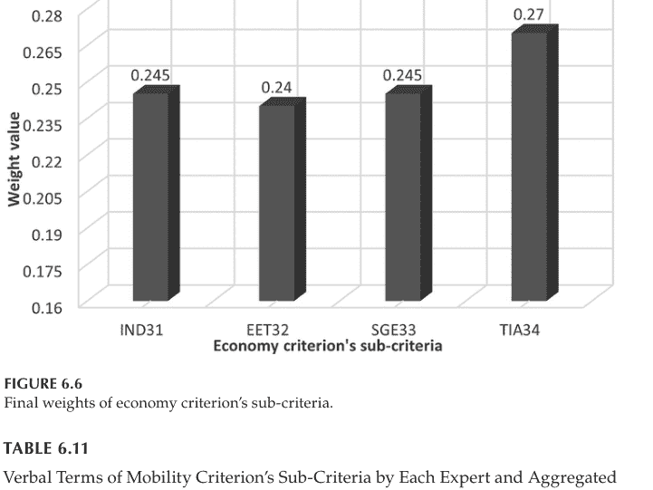

## 图 6.6

经济准则子准则的最终权重。

## 表 6.11

各专家对移动性准则子准则的语言术语及聚合权重

| 移动性准则的子准则 | E₁ | E₂ | E₃ | E₄ | 聚合结果 | κ_Eq,ij(y) | EN_q,ij(y) | ξ_j | ω_j |
|---|---|---|---|---|---|---|---|---|---|
| CLT₄₋₁ | VEW | MOD | WLL | MOW | [0.704, 0.448] | 0.18289 | 0.81711 | 0.48998 | 0.510 |
| REC₄₋₂ | MOL | MOD | EWL | WLL | [0.655, 0.541] | 0.14948 | 0.85052 | 0.51002 | 0.490 |

步骤 23：通过应用公式 (6.1) 中给出的 q-ROFWG 聚合了移动性准则子准则的各不同专家估值，如表 6.11 所示。

步骤 24：通过应用公式 (6.2) 和 (6.3) 计算了所收集专家对移动性准则子准则评估的全部 q-ROFN 的熵值。

步骤 25：根据公式 (6.4) 计算了基于熵值的移动性准则子准则权重，如表 6.11 和图 6.7 所示。

步骤 26：在计算主要准则的最终权重并计算子准则的局部权重后，计算了用于评估备选方案的子准则的最终全局权重，如表 6.12 和图 6.8 所示。

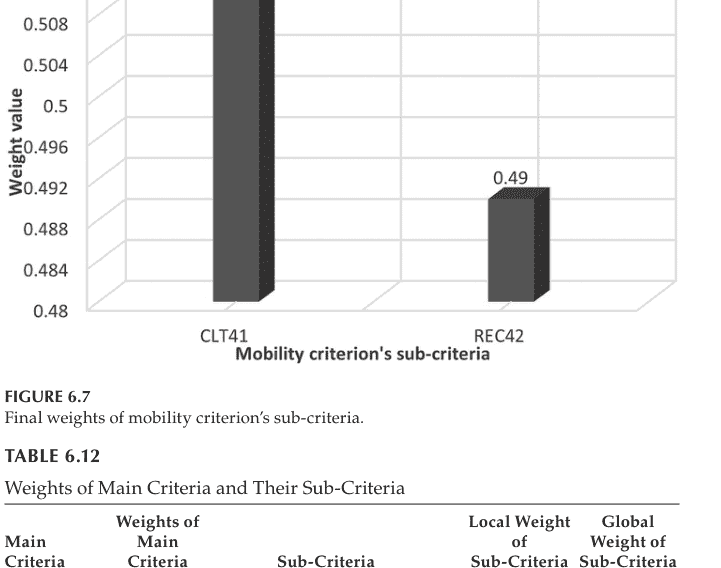

## 图 6.7

移动性准则子准则的最终权重。

## 表 6.12

主要准则及其子准则的权重

| 主要准则 | 主要准则权重 | 子准则 | 子准则局部权重 | 子准则全局权重 |
|---|---|---|---|---|
| 环境 ENV₁ | 0.264 | 空气和水污染，PAW₁₋₁ | 0.200 | 0.054 |
|  |  | 自然资源管理，NRM₁₋₂ | 0.180 | 0.048 |
|  |  | 环境保护工具，EPN₁₋₃ | 0.216 | 0.057 |
|  |  | 智能建筑，SMB₁₋₄ | 0.180 | 0.048 |
|  |  | 能源效率，ENE₁₋₅ | 0.224 | 0.059 |
| 政府 GOV₂ | 0.228 | 透明度，TRA₂₋₁ | 0.218 | 0.049 |
|  |  | 税收，TAX₂₋₂ | 0.208 | 0.047 |
|  |  | 服务效率，SEE₂₋₃ | 0.268 | 0.061 |
|  |  | IT工具，ITT₂₋₄ | 0.307 | 0.069 |
| 经济 ECO₃ | 0.276 | 产业多元化，IND₃₋₁ | 0.245 | 0.068 |
|  |  | 生态高效旅游，EET₃₋₂ | 0.240 | 0.066 |
|  |  | 绿色经济支持，SGE₃₋₃ | 0.245 | 0.068 |
|  |  | 税收激励与援助，TIA₃₋₄ | 0.270 | 0.075 |
| 移动性 MOB₄ | 0.232 | 连通性与本地交通，CLT₄₋₁ | 0.510 | 0.118 |
|  |  | 区域连通性，REC₄₋₂ | 0.490 | 0.113 |


## 图 6.8

所有子准则的最终全局权重。

步骤 27：为评估智慧校园，利用表 6.2 中给出的语言术语，创建了各专家单独 (Eₛ) 的由确定的子准则与可用备选方案之间的评估决策矩阵，然后根据表 6.4 应用表 6.2 中的 q-ROFNs，如表 6.13 所示。

步骤 28：为评估智慧校园，通过应用公式 (6.1) 中的 q-ROFWG，将各专家单独 (Eₛ) 的由确定的子准则与可用备选方案之间的评估决策矩阵聚合为一个矩阵，根据表 6.5 如表 6.14 所示。

步骤 29：计算了加权聚合 q-ROF 评估判断矩阵 (R̂)。加权聚合 q-ROF 决策矩阵 (R̂) 是通过将权重 wⱼ 与聚合 q-ROF 决策矩阵相乘得到的，根据表 6.6。

步骤 30：使用公式 (6.5) 计算了归一化组合 q-ROF 评估判断矩阵 (Ã)，如表 6.15 所示。

步骤 31：根据公式 (6.6) 和 (6.7)，基于归一化决策矩阵确定了 q-ROF 正理想解和 q-ROF 负理想解，如表 6.16 所示。

步骤 32：根据公式 (6.8) 和 (6.9) 计算了分离度量以获得每个备选方案的距离，如表 6.17 所示。

步骤 33：根据公式 (6.10) 计算了备选方案的相对接近系数 (CCᵢ)，如表 6.18 和图 6.9 所示。六个智慧校园按 CCᵢ 值降序排列，如图 6.9 所示。

## 表 6.13

使用语言术语的六个备选方案相对于所有子准则的决策矩阵

| 专家 | PAW₁₋₁ | NRM₁₋₂ | EPN₁₋₃ | SMB₁₋₄ | ENE₁₋₅ |
|---|---|---|---|---|---|
| SC₁ | ⟨VEL⟩⟨VEL⟩⟨VEL⟩ | ⟨GRE⟩⟨GRE⟩⟨GRE⟩ | ⟨GRE⟩⟨GRE⟩⟨GRE⟩ | ⟨VRG⟩⟨VRG⟩⟨VRG⟩ | ⟨GRE⟩⟨GRE⟩⟨GRE⟩ |
| SC₂ | ⟨MEL⟩⟨GRE⟩⟨GRE⟩ | ⟨VEL⟩⟨VEL⟩⟨GRE⟩ | ⟨VEL⟩⟨VEL⟩⟨VRG⟩ | ⟨VEL⟩⟨VEL⟩⟨VRG⟩ | ⟨VEL⟩⟨VEL⟩⟨VEL⟩ |
| SC₃ | ⟨MEL⟩⟨MEL⟩⟨LEL⟩ | ⟨MEL⟩⟨MEL⟩⟨GRE⟩ | ⟨LEL⟩⟨VEL⟩⟨VRG⟩ | ⟨VRG⟩⟨VRG⟩⟨VRG⟩ | ⟨VRG⟩⟨VEL⟩⟨VEL⟩ |
| SC₄ | ⟨MEL⟩⟨MEL⟩⟨VEL⟩ | ⟨VRG⟩⟨VRG⟩⟨GRE⟩ | ⟨GRE⟩⟨GRE⟩⟨GRE⟩ | ⟨GRE⟩⟨GRE⟩⟨VRG⟩ | ⟨VRG⟩⟨VRG⟩⟨VRG⟩ |
| SC₅ | ⟨VEL⟩⟨VEL⟩⟨VEL⟩ | ⟨VRG⟩⟨VRG⟩⟨GRE⟩ | ⟨MED⟩⟨MED⟩⟨GRE⟩ | ⟨MEL⟩⟨MEL⟩⟨MEL⟩ | ⟨GRE⟩⟨GRE⟩⟨GRE⟩ |
| SC₆ | ⟨VRG⟩⟨VRG⟩⟨VRG⟩ | ⟨MEL⟩⟨MEL⟩⟨VEL⟩ | ⟨LEL⟩⟨MED⟩⟨MED⟩⟨GRE⟩ | ⟨MEL⟩⟨MEL⟩⟨MEL⟩ | ⟨VRG⟩⟨VRG⟩⟨VRG⟩ |

| 专家 | TRA₂₋₁ | TAX₂₋₂ | SEE₂₋₃ | ITT₂₋₄ | IND₃₋₁ |
|---|---|---|---|---|---|
| SC₁ | ⟨GRE⟩⟨GRE⟩⟨CRE⟩ | ⟨GRE⟩⟨GRE⟩⟨GRE⟩ | ⟨MEL⟩⟨MEL⟩⟨VEL⟩ | ⟨GRE⟩⟨GRE⟩⟨GRE⟩ | ⟨VEL⟩⟨VEL⟩⟨VEL⟩ |
| SC₂ | ⟨GRE⟩⟨GRE⟩⟨GRE⟩ | ⟨GRE⟩⟨GRE⟩⟨GRE⟩ | ⟨GRE⟩⟨GRE⟩⟨GRE⟩ | ⟨GRE⟩⟨GRE⟩⟨GRE⟩ | ⟨VEL⟩⟨VEL⟩⟨VEL⟩ |
| SC₃ | ⟨MED⟩⟨MED⟩⟨MED⟩ | ⟨VRG⟩⟨VRG⟩⟨VRG⟩ | ⟨VRG⟩⟨VRG⟩⟨VRG⟩ | ⟨GRE⟩⟨GRE⟩⟨GRE⟩ | ⟨CRE⟩⟨GRE⟩⟨VEL⟩ |
| SC₄ | ⟨GRE⟩⟨GRE⟩⟨GRE⟩ | ⟨GRE⟩⟨GRE⟩⟨GRE⟩ | ⟨VRG⟩⟨VRG⟩⟨GRE⟩ | ⟨MED⟩⟨MED⟩⟨GRE⟩ | ⟨MEL⟩⟨MEL⟩⟨VEL⟩ |
| SC₅ | ⟨GRE⟩⟨GRE⟩⟨GRE⟩ | ⟨LEL⟩⟨MED⟩⟨MED⟩ | ⟨GRE⟩⟨GRE⟩⟨GRE⟩ | ⟨GRE⟩⟨GRE⟩⟨GRE⟩ | ⟨GRE⟩⟨GRE⟩⟨LEL⟩ |
| SC₆ | ⟨MED⟩⟨MED⟩⟨MED⟩ | ⟨MED⟩⟨MED⟩⟨MED⟩ | ⟨GRE⟩⟨GRE⟩⟨GRE⟩ | ⟨GRE⟩⟨GRE⟩⟨GRE⟩ | ⟨MED⟩⟨MED⟩⟨VEL⟩ |

| 专家 | EET₃₋₂ | SGE₃₋₃ | TIA₃₋₄ | CLT₄₋₁ | REC₄₋₂ |
|---|---|---|---|---|---|
| SC₁ | ⟨LEL⟩⟨VEL⟩⟨VEL⟩⟨VRG⟩ | ⟨GRE⟩⟨GRE⟩⟨VRG⟩ | ⟨GRE⟩⟨GRE⟩⟨GRE⟩ | ⟨GRE⟩⟨GRE⟩⟨VRG⟩ | ⟨VEL⟩⟨VEL⟩⟨VEL⟩ |
| SC₂ | ⟨VEL⟩⟨VEL⟩⟨VEL⟩⟨VRG⟩ | ⟨VEL⟩⟨VEL⟩⟨VRG⟩ | ⟨LEL⟩⟨VEL⟩⟨VEL⟩⟨GRE⟩ | ⟨MEL⟩⟨MEL⟩⟨MEL⟩ | ⟨MEL⟩⟨GRE⟩⟨CRE⟩⟨VEL⟩ |
| SC₃ | ⟨GRE⟩⟨GRE⟩⟨GRE⟩⟨GRE⟩ | ⟨GRE⟩⟨GRE⟩⟨GRE⟩ | ⟨GRE⟩⟨GRE⟩⟨VRG⟩ | ⟨VRG⟩⟨VRG⟩⟨VRG⟩ | ⟨MEL⟩⟨MEL⟩⟨VEL⟩ |
| SC₄ | ⟨VEL⟩⟨VEL⟩⟨VEL⟩⟨VRG⟩ | ⟨LEL⟩⟨VEL⟩⟨VEL⟩⟨VRG⟩ | ⟨MEL⟩⟨MEL⟩⟨MEL⟩ | ⟨VEL⟩⟨VEL⟩⟨VEL⟩ | ⟨CRE⟩⟨GRE⟩⟨GRE⟩ |
| SC₅ | ⟨VRG⟩⟨VRG⟩⟨VRG⟩⟨VRG⟩ | ⟨VEL⟩⟨VEL⟩⟨VEL⟩⟨VRG⟩ | ⟨GRE⟩⟨GRE⟩⟨GRE⟩ | ⟨GRE⟩⟨GRE⟩⟨GRE⟩ | ⟨VEL⟩⟨VEL⟩⟨MED⟩ |
| SC₆ | ⟨VEL⟩⟨VEL⟩⟨VEL⟩⟨VRG⟩ | ⟨VEL⟩⟨VEL⟩⟨VEL⟩⟨VRG⟩ | ⟨MED⟩⟨MED⟩⟨MED⟩ | ⟨VRG⟩⟨VRG⟩⟨VRG⟩ | ⟨MED⟩⟨MED⟩⟨GRE⟩ |


## 表 6.14
智能校园综合评估矩阵

| 专家ₛ | PAW₁_₁ | NRM₁_₂ | EPN₁_₃ | SMB₁_₄ | ENE₁_₅ |
|---|---|---|---|---|---|
| SC₁ | [0.220, 0.880] | [0.770, 0.330] | [0.796, 0.314] | [0.880, 0.220] | [0.770, 0.330] |
| SC₂ | [0.489, 0.725] | [0.301, 0.845] | [0.311, 0.845] | [0.311, 0.845] | [0.220, 0.880] |
| SC₃ | [0.409, 0.697] | [0.506, 0.626] | [0.344, 0.817] | [0.880, 0.220] | [0.311, 0.845] |
| SC₄ | [0.370, 0.758] | [0.851, 0.267] | [0.770, 0.330] | [0.796, 0.314] | [0.880, 0.220] |
| SC₅ | [0.220, 0.880] | [0.851, 0.267] | [0.619, 0.520] | [0.440, 0.660] | [0.770, 0.330] |
| SC₆ | [0.880, 0.220] | [0.370, 0.758] | [0.527, 0.631] | [0.440, 0.660] | [0.880, 0.220] |

| 专家ₛ | TRA₂_₁ | TAX₂_₂ | SEE₂_₃ | ITT₂_₄ | IND₃_₁ |
|---|---|---|---|---|---|
| SC₁ | [0.770, 0.330] | [0.770, 0.330] | [0.370, 0.758] | [0.770, 0.330] | [0.220, 0.880] |
| SC₂ | [0.770, 0.330] | [0.770, 0.330] | [0.770, 0.330] | [0.770, 0.330] | [0.220, 0.880] |
| SC₃ | [0.550, 0.550] | [0.880, 0.220] | [0.880, 0.220] | [0.770, 0.330] | [0.563, 0.704] |
| SC₄ | [0.770, 0.330] | [0.770, 0.330] | [0.880, 0.220] | [0.598, 0.522] | [0.370, 0.758] |
| SC₅ | [0.770, 0.330] | [0.527, 0.631] | [0.770, 0.330] | [0.770, 0.330] | [0.623, 0.601] |
| SC₆ | [0.550, 0.550] | [0.550, 0.550] | [0.770, 0.330] | [0.770, 0.330] | [0.437, 0.727] |

| 专家ₛ | EET₃_₂ | SGE₃_₃ | TIA₃_₄ | CLT₄_₁ | REC₄_₂ |
|---|---|---|---|---|---|
| SC₁ | [0.355, 0.817] | [0.796, 0.314] | [0.770, 0.330] | [0.796, 0.314] | [0.220, 0.880] |
| SC₂ | [0.320, 0.845] | [0.311, 0.845] | [0.344, 0.817] | [0.440, 0.660] | [0.489, 0.725] |
| SC₃ | [0.770, 0.330] | [0.770, 0.330] | [0.796, 0.314] | [0.880, 0.220] | [0.370, 0.758] |
| SC₄ | [0.311, 0.845] | [0.344, 0.817] | [0.440, 0.660] | [0.220, 0.880] | [0.770, 0.330] |
| SC₅ | [0.880, 0.220] | [0.311, 0.845] | [0.770, 0.330] | [0.563, 0.704] | [0.301, 0.845] |
| SC₆ | [0.961, 0.170] | [0.311, 0.845] | [0.550, 0.550] | [0.880, 0.220] | [0.598, 0.522] |

## 表 6.15
归一化聚合决策矩阵

| 专家ₛ | PAW₁_₁ | NRM₁_₂ | EPN₁_₃ | SMB₁_₄ | ENE₁_₅ |
|---|---|---|---|---|---|
| SC₁ | [0.220, 0.880] | [0.770, 0.330] | [0.796, 0.314] | [0.880, 0.220] | [0.770, 0.330] |
| SC₂ | [0.489, 0.725] | [0.301, 0.845] | [0.311, 0.845] | [0.311, 0.845] | [0.220, 0.880] |
| SC₃ | [0.409, 0.697] | [0.506, 0.626] | [0.344, 0.817] | [0.880, 0.220] | [0.311, 0.845] |
| SC₄ | [0.370, 0.758] | [0.851, 0.267] | [0.770, 0.330] | [0.796, 0.314] | [0.880, 0.220] |
| SC₅ | [0.220, 0.880] | [0.851, 0.267] | [0.619, 0.520] | [0.440, 0.660] | [0.770, 0.330] |
| SC₆ | [0.880, 0.220] | [0.370, 0.758] | [0.527, 0.631] | [0.440, 0.660] | [0.880, 0.220] |

| 专家ₛ | TRA₂_₁ | TAX₂_₂ | SEE₂_₃ | ITT₂_₄ | IND₃_₁ |
|---|---|---|---|---|---|
| SC₁ | [0.770, 0.330] | [0.770, 0.330] | [0.370, 0.758] | [0.770, 0.330] | [0.220, 0.880] |
| SC₂ | [0.770, 0.330] | [0.770, 0.330] | [0.770, 0.330] | [0.770, 0.330] | [0.220, 0.880] |
| SC₃ | [0.550, 0.550] | [0.880, 0.220] | [0.880, 0.220] | [0.770, 0.330] | [0.563, 0.704] |
| SC₄ | [0.770, 0.330] | [0.770, 0.330] | [0.880, 0.220] | [0.598, 0.522] | [0.370, 0.758] |
| SC₅ | [0.770, 0.330] | [0.527, 0.631] | [0.770, 0.330] | [0.770, 0.330] | [0.623, 0.601] |
| SC₆ | [0.550, 0.550] | [0.550, 0.550] | [0.770, 0.330] | [0.770, 0.330] | [0.437, 0.727] |

| 专家ₛ | EET₃_₂ | SGE₃_₃ | TIA₃_₄ | CLT₄_₁ | REC₄_₂ |
|---|---|---|---|---|---|
| SC₁ | [0.355, 0.817] | [0.796, 0.314] | [0.770, 0.330] | [0.796, 0.314] | [0.220, 0.880] |
| SC₂ | [0.320, 0.845] | [0.311, 0.845] | [0.344, 0.817] | [0.440, 0.660] | [0.489, 0.725] |
| SC₃ | [0.770, 0.330] | [0.770, 0.330] | [0.796, 0.314] | [0.880, 0.220] | [0.370, 0.758] |
| SC₄ | [0.311, 0.845] | [0.344, 0.817] | [0.440, 0.660] | [0.220, 0.880] | [0.770, 0.330] |
| SC₅ | [0.880, 0.220] | [0.311, 0.845] | [0.770, 0.330] | [0.563, 0.704] | [0.301, 0.845] |
| SC₆ | [0.961, 0.170] | [0.311, 0.845] | [0.550, 0.550] | [0.880, 0.220] | [0.598, 0.522] |

## 表 6.16
正负理想解

| 准则 | q-ROF 正理想解 | q-ROF 负理想解 |
|---|---|---|
| PAW₁_₁ | [0.880, 0.220] | [0.220, 0.880] |
| NRM₁_₂ | [0.851, 0.267] | [0.301, 0.845] |
| EPN₁_₃ | [0.796, 0.314] | [0.311, 0.845] |
| SMB₁_₄ | [0.880, 0.220] | [0.311, 0.845] |
| ENE₁_₅ | [0.880, 0.220] | [0.220, 0.880] |
| TRA₂_₁ | [0.770, 0.330] | [0.550, 0.550] |
| TAX₂_₂ | [0.880, 0.220] | [0.527, 0.631] |
| SEE₂_₃ | [0.880, 0.220] | [0.370, 0.758] |
| ITT₂_₄ | [0.770, 0.330] | [0.598, 0.522] |
| IND₃_₁ | [0.623, 0.601] | [0.220, 0.880] |
| EET₃_₂ | [0.961, 0.170] | [0.311, 0.845] |
| SGE₃_₃ | [0.796, 0.314] | [0.311, 0.845] |
| TIA₃_₄ | [0.796, 0.314] | [0.344, 0.817] |
| CLT₄_₁ | [0.880, 0.220] | [0.220, 0.880] |
| REC₄_₂ | [0.770, 0.330] | [0.220, 0.880] |

## 表 6.17
备选方案的分离度量

|  | SC₁ | SC₂ | SC₃ | SC₄ | SC₅ | SC₆ |
|---|---|---|---|---|---|---|
| d (Aᵢ, A⁺) | 0.25775 | 0.43433 | 0.42385 | 0.60108 | 0.53302 | 0.41208 |
| d (Aᵢ, A⁻) | 0.60706 | 0.42532 | 0.43156 | 0.23670 | 0.38077 | 0.48673 |

## 表 6.18
备选方案的接近系数和排序

| | SC₁ | SC₂ | SC₃ | SC₄ | SC₅ | SC₆ |
|---|---|---|---|---|---|---|
| CCᵢ | 0.70195 | 0.49475 | 0.50466 | 0.28253 | 0.41669 | 0.54153 |
| 排名 | 1 | 4 | 3 | 6 | 5 | 2 |


## 图 6.9
智能校园的最终排名。

## 6.4 结果与讨论
本部分讨论了使用所采用的方法解决智能校园评估问题所获得的结果。首先，使用 q-ROF 熵方法计算主要准则的权重。根据关于主要准则所获得的结果，发现经济准则以 0.276 的权重排名第一，其次是环境准则，权重为 0.264，而政府准则以 0.228 的权重排名最后，如表 6.12 所示。在此方面，根据环境准则子准则的权重结果，发现能源效率准则以 0.224 的权重排名第一，其次是环境保护工具准则，权重为 0.216，而自然资源管理准则和智能建筑准则以 0.180 的权重并列最后，如表 6.12 所示。此外，根据政府准则子准则的权重结果，发现信息技术工具准则以 0.307 的权重排名第一，其次是服务效率准则，权重为 0.268。相比之下，税收准则以 0.208 的权重排名最后，如表 6.12 所示。然后，根据经济准则子准则的权重结果，发现税收激励和援助准则以 0.270 的权重排名第一，其次是产业多元化准则和支持绿色经济准则，权重均为 0.245，而生态高效旅游准则以 0.240 的权重排名最后，如表 6.12 所示。最后，根据移动性准则子准则的权重结果，发现连通性和地方交通准则以 0.510 的权重排名第一，而区域连通性准则以 0.490 的权重排名最后，如表 6.12 所示。

其次，使用了 q-ROF TOPSIS 方法对本章案例研究中使用的备选方案进行排序，如前一节所述。根据所获得的结果，发现 SC₁ 占据第一名，其次是 SC₆，而 SC₄ 占据最后一名，如表 6.18 和图 6.9 所示。

## 6.5 摘要
- 本章对智能校园及其相关优点进行了全面描述。
- 本章回顾了评估智能校园可持续性绩效指标的重要性及需求。
- 本章在对多篇研究文章进行全面分析后，提出了评估智能校园的最重要准则。
- 本章提出了评估智能校园可持续性指标的混合 MCDM 方法的步骤。所应用的方法是在 q-截面正交配对模糊集（q-ROFS）环境下进行的，并使用 q-截面正交配对模糊数（q-ROFNs）。
- 混合方法由两种方法组成：q-ROFS 熵和 q-ROFS 基于理想解相似度的排序偏好技术（q-ROFS TOPSIS）。
- 本章在评估智能校园可持续性指标时呈现了一个真实的案例研究。


## 6.6 练习
- a. 你如何定义“智慧校园”？为什么对智慧校园进行可持续性绩效指标评估很重要？
- b. 熵方法和 TOPSIS 方法之间有什么区别？在做决策时讨论它们的相对优势。
- c. 为什么为智慧校园确定可持续性绩效指标会面临挑战？
- d. 结合可持续且智慧校园的特征和形成，讨论智慧校园的特点。
- e. 为什么需要采用 MCDM 方法来评估智慧校园的可持续性标准？

## 参考文献
Bouslah, Kais, Vicente Liern, Jamal Ouenniche, and Blanca Pérez-Gladish. 2022. “基于多阶段非加权 TOPSIS 对企业财务和多样性绩效进行排名。” International Transactions in Operational Research. https://doi.org/10.1111/itor.13143.

Delgado, Alexi, and Inmaculada Romero. 2016. “利用集成灰色聚类和熵权法的环境冲突分析：秘鲁采矿项目的案例研究。” Environmental Modelling & Software 77: 108–21. https://doi.org/10.1016/j.envsoft.2015.12.011.

Shannon, Claude Elwood. 1948. “通信的数学理论。” The Bell System Technical Journal 27 (3): 379–423. https://doi.org/10.1002/j.1538-7305.1948.tb01338.x.

Xu, Hongshi, Chao Ma, Jijian Lian, Kui Xu, and Evance Chaima. 2018. “基于集成 K-Means 聚类算法和改进熵权法的中国海口地区城市洪涝风险评估。” Journal of Hydrology 563: 975–86. https://doi.org/10.1016/j.jhydrol.2018.06.060.

Yoon, Kwangsun, and Ching-Lai Hwang. 1985. “基于多属性决策的制造厂选址分析：第一部分——单厂策略。” International Journal of Production Research 23 (2): 345–59. https://doi.org/10.1080/00207548508904712.

## 第7章：智能供应链的可持续供应商选择
### 7.1 引言
近年来消费者对按时交付的高水平服务与高水平质量的需求出现，给过去不存在的困难带来了挑战。企业正寻求在其供应链内建立战略合作伙伴关系，以提高其在此行业成功的机会。在此背景下，分析并选择供应商以实现组织的战略目标的过程发挥着至关重要的作用。在 1980 年之前，供应商选择主要由价格因素驱动。然而，近年来，除了经济原因外，环境和社会问题在供应商选择中也需要同时进行评估。环境标准被纳入是因为全球范围内对环境污染的担忧日益增加。纳入环境因素的另一个原因是它将减少可获取资源的数量。

此外，过去几年，由于市场的全球化，许多不同行业的竞争水平急剧增长，导致需求不稳定。还有一个问题是，在不同时期获取各种供应商的渠道并不相同。此外，根据条件，只有少数潜在供应商能够满足生产商的需求。为了在这种环境中蓬勃发展和扩张，制造商需要采取全方位的战略。中小企业雇用了超过 60% 的劳动力，它们是整个社会就业机会的主要来源。中小企业占全球所有企业的 99% 以上。建立可持续供应链和保持中小企业可持续增长都是国家经济稳定的重要保障。

由于它们通常资源不足，中小企业非常依赖外部来源提供的补充资源。采购过程的有效性和产品质量都取决于供应商的表现。中小企业从对供应商选择的精心关注中受益匪浅，这带来了市场竞争力的提高和持续的可持续增长。然而，关于可持续供应商选择的许多研究都是针对大型企业进行的。中小企业的谈判杠杆和风险缓解能力与大型企业不同。这是因为规模、资金和市场限制都起着作用。大型企业可能拥有可靠的制造能力和提供高质量商品的能力。尽管如此，它们利用规模经济来推高中小企业在交易过程中产生的额外费用。此外，资源较少的中小企业在选择供应商时应强调对供应商的监控过程。

先进智能技术（如物联网（IoT）、大数据分析（BDA）和人工智能（AI）技术）的最新发展和实施，使得供应链中的所有组成部分都可以被感知、诊断、解释、预测、控制和优化，这加速了传统供应链向智能供应链的转变。尖端智能技术的使用导致创建了一个不仅设计为快速响应，而且个性化以实现适应的供应链。它通过将智能技术用作改善可持续供应链管理实践的关键促进因素，提供增强的经济、环境和社会可持续性。智能技术的使用实现了这一点。

“可持续供应链管理技术”这一短语指的是可能帮助公司在可持续性的经济、环境和社会方面实现更高可持续性的一系列战术活动。这类活动集中于实施可持续供应链管理的过程，这显著影响公司实现的可持续性绩效水平。普遍认为，可持续供应链管理战略中最重要的方面之一是识别可持续供应商。这是因为供应商的活动对于帮助下游企业实现协作和持续的竞争优势至关重要。这是因为供应商的活动为组织供应链提供原始投入。此外，供应商的选择可以被视为多标准决策（MCDM）的过程，该过程包括两个阶段：标准的权重计算和供应商的排序。

### 7.2 数学预备
本部分更详细地讨论了直觉模糊集（IFSs）的基本方面，例如其运算和概念。Atanassov（1999）开发了 IFSs，它是传统模糊集的扩展。由隶属度和非隶属度定义的 IFSs 使决策者能够更灵活地表达其观点。如解释 7.1 所述，IFS 中元素的隶属度和非隶属度之和等于或小于一。由于其特性，IFS 已在各个领域中的实际问题中得到有效应用。

**解释 7.1：** 设 X 为非空集合。X 中的直觉模糊集 $\tilde{I}$ 是一个具有以下指定公式的对象：

$$\tilde{I}=\{(x, \mathcal{U}_I(x), \vartheta_I(x)) \mid x \in X\}$$ (7.1)

其中函数 $\mathcal{U}_I : X \to [0, 1]$ 指定组件属于集合 $\tilde{I}$ 的隶属度，而 $\vartheta_I : X \to [0, 1]$ 指定组件不属于集合 $\tilde{I}$ 的非隶属度，且条件为：

$$0 \le \mathcal{U}_I(x) + \vartheta_I(x) \le 1, \text{ for } \forall x \in X$$ (7.2)

不确定度计算如下：

$$\pi_I(x) = 1 - \mathcal{U}_I(x) - \vartheta_I(x)$$ (7.3)

**解释 7.2：** 设 $\tilde{A} = (\mathcal{U}_{\tilde{A}}, \vartheta_{\tilde{A}})$ 和 $\tilde{B} = (\mathcal{U}_{\tilde{B}}, \vartheta_{\tilde{B}})$ 为两个直觉模糊数（IFNs）；则两个 IFNs 的某些运算定义如下。

$$\tilde{A} \oplus \tilde{B} = (\mathcal{U}_{\tilde{A}} + \mathcal{U}_{\tilde{B}} - \mathcal{U}_{\tilde{A}}\mathcal{U}_{\tilde{B}}, \vartheta_{\tilde{A}}\vartheta_{\tilde{B}})$$ (7.4)

$$\tilde{A} \otimes \tilde{B} = (\mathcal{U}_{\tilde{A}}\mathcal{U}_{\tilde{B}}, \vartheta_{\tilde{A}} + \vartheta_{\tilde{B}} - \vartheta_{\tilde{A}}\vartheta_{\tilde{B}})$$ (7.5)

$$\lambda \tilde{A} = \big((1 - (1 - \mathcal{U}_{\tilde{A}})^{\lambda}), \vartheta_{\tilde{A}}^{\lambda}\big), \lambda > 0$$ (7.6)

$$\tilde{A}^{\lambda} = (\mathcal{U}_{\tilde{A}}^{\lambda}, (1 - (1 - \vartheta_{\tilde{A}})^{\lambda})), \lambda > 0$$ (7.7)


说明 7.3：两个 IFN Ã 和 B̃ 的减法 ⊖ 和除法 ⊘ 运算如式 (7.8) 和 (7.9) 中假设的那样是良好定义的 (Du, 2021)。

à ⊖ B̃ = { ⟨0, ϑ_Ã/ϑ_B̃⟩, 如果 𝒰_à ≤ 𝒰_B̃, ϑ_à ≤ ϑ_B̃; ⟨(𝒰_Ã-𝒰_B̃)/(1-𝒰_B̃), ϑ_Ã/ϑ_B̃⟩, 如果 0 ≤ ϑ_Ã/ϑ_B̃ ≤ (1-𝒰_Ã)/(1-𝒰_B̃) < 1; ⟨(𝒰_Ã-𝒰_B̃)/(1-𝒰_B̃), (1-𝒰_Ã)/(1-𝒰_B̃)⟩, 如果 𝒰_à ≥ 𝒰_B̃, (1-𝒰_Ã)/(1-𝒰_B̃) < ϑ_Ã/ϑ_B̃; ⟨0,1⟩, 如果 𝒰_à ≤ 𝒰_B̃, ϑ_à > ϑ_B̃ } (7.8)

à ⊘ B̃ = { ⟨𝒰_Ã/𝒰_B̃,0⟩, 如果 𝒰_à ≤ 𝒰_B̃, ϑ_à ≤ ϑ_B̃; ⟨𝒰_Ã/𝒰_B̃, (ϑ_Ã-ϑ_B̃)/(1-ϑ_B̃)⟩, 如果 0 ≤ 𝒰_Ã/𝒰_B̃ ≤ (1-ϑ_Ã)/(1-ϑ_B̃) < 1; ⟨(1-ϑ_Ã)/(1-ϑ_B̃), (ϑ_Ã-ϑ_B̃)/(1-ϑ_B̃)⟩, 如果 (1-ϑ_Ã)/(1-ϑ_B̃) < 𝒰_Ã/𝒰_B̃, ϑ_à ≥ ϑ_B̃; ⟨1,0⟩, 如果 𝒰_à > 𝒰_B̃, ϑ_à ≤ ϑ_B̃ } (7.9)

说明 7.4：设 Ĩ = (𝒰_Ĩ, ϑ_Ĩ) 为一个 IFN；则 Ĩ 的得分函数 S(Ĩ) 和准确度函数 H(Ĩ) 可如式 (7.10) 和 (7.11) 中定义 (Chen and Tan, 1994)。

S(Ĩ) = 𝒰_Ĩ - ϑ_Ĩ (7.10)

H(Ĩ) = 𝒰_Ĩ + ϑ_Ĩ (7.11)

说明 7.5：设 Ã = (𝒰_Ã, ϑ_Ã) 为一个 IFN；则该数的去模糊化函数 ℑ(Ã) 如式 (7.12) 所建立。

ℑ(Ã) = 𝒰_Ã + ( 𝒰_Ã ϑ_Ã e^{(1-𝒰_Ã-ϑ_Ã)} / 2 )² , 其中 ℑ(Ã) ∈ [0,1]. (7.12)

说明 7.6. 设 $\tilde{A}_i = (u_{\tilde{A}_i}, v_{\tilde{A}_i})$ $(i=1, 2, ..., n)$ 为 IFN 集合，且 $w = (w_1, w_2, ..., w_n)^T$ 为 $\tilde{A}_i$ 的权重向量且 $\sum_{i=1}^n w_i = 1$；则直觉模糊加权平均 (IFWA) 运算符如式 (7.13) 所建立：

$$\text{IFWA}(\tilde{A}_1, \tilde{A}_2, ..., \tilde{A}_n) = \left(\left(1 - \prod_{i=1}^n (1 - u_{\tilde{A}_i})^{w_i}\right), \prod_{i=1}^n v_{\tilde{A}_i}^{w_i}\right) \tag{7.13}$$

说明 7.7. 设 $\tilde{A}_i = (u_{\tilde{A}_i}, v_{\tilde{A}_i})$ $(i=1, 2, ..., n)$ 为 IFN 集合，且 $w = (w_1, w_2, ..., w_n)^T$ 为 $\tilde{A}_i$ 的权重向量且 $\sum_{i=1}^n w_i = 1$；则直觉模糊加权几何 (IFWG) 运算符如式 (7.14) 所建立 (Xu and Yager, 2006)：

$$\text{IFWG}(\tilde{A}_1, \tilde{A}_2, ..., \tilde{A}_n) = \left(\prod_{i=1}^n u_{\tilde{A}_i}^{w_i}, 1 - \prod_{i=1}^n (1 - v_{\tilde{A}_i})^{w_i}\right) \tag{7.14}$$

## 7.3 方法论

在本部分，介绍了用于解决选择最佳可持续资源问题的模型。所用模型由两种多准则决策方法组成，即通过准则间相关性获取准则重要性 (CRITIC) 方法和基于组合距离的评估 (CODAS) 方法。所用模型在 IFS 环境下进行并使用 IFNs。首先，CRITIC 方法对准则进行排序并确定其权重。然后，CODAS 方法对最佳可用备选方案进行排序和选择。图 7.1 显示了用于评估若干可持续供应商的方法的步骤。在此方面，我们提供了本章案例研究中使用的方法的简要概述。本节分为以下几个部分。

### 7.3.1 CRITIC 方法

CRITIC 是一种基于相关性的方法，使用分析测试来检索决策准则背后的信息。众所周知，Diakoulaki、Mavrotas 和 Papayannakis (1995) 最先引入 CRITIC 以在 MCDM 问题中获取客观权重。它基于评估矩阵分析捕获评估准则提供的所有偏好数据。换句话说，客观权重是通过衡量每个评估准则的内在信息来确定的。除了准则的标准差外，生成客观权重的过程还考虑了准则与其他准则之间的联系 (Peng, Zhang, and Luo, 2020)。


## 图 7.1
问题的整体框架。

### 7.3.2 CODAS 方法

CODAS 方法被开发用于通过使用与反理想点的汉明距离和欧几里得距离来衡量备选方案的整体绩效 (Keshavarz Ghorabaee et al., 2016)。它是一种前沿且非常有效的方法，用于解决与 MCDM 相关的问题。在该方法中，欧几里得距离被认为是在评估程序中最重要的标准。在最基本的形式中，CODAS 通过结合出租车距离和欧几里得距离来计算备选方案的评估等级。这是为了提供尽可能准确的结果。基于反理想点，计算欧几里得距离（主要度量）和出租车距离（次要度量）以评估哪种方案最合适 (Bolturk and Kahraman, 2018)。在此背景下，涉及更高距离的备选方案是推荐的。

### 7.3.3 计算步骤

在本部分，介绍了本章中提出的可持续供应商 (SS_i) 评估和选择问题的详细步骤。

步骤 1：从各个方面研究问题，以确定影响识别主要因素及其子因素从而影响可持续供应商识别的重要点。联系一些专家与作者分享有关问题的信息汇总。在此方面，专家是根据一些标准选择的，例如学术学位和工作年限。同时，商定了沟通方式，是在线还是通过访谈。

步骤 2：确定替代方案、相关因素及其子因素以构建应用框架。集合 SS_i = {SS_1, SS_2, ..., SS_m} 具有 i=1, 2, ..., m 个备选方案，由 n 个决策因素 F_j = {F_1, F_2, ..., F_n} 衡量，其中 j=1, 2, ..., n。设 w = (w_1, w_2, ..., w_n) 为用于确定因素及其子因素权重的向量集合，w_j > 0 且 ∑_{j=1}^n w_j = 1。专家引入为 E_1, E_2, ..., E_k，他们是各自领域的专家以做出判断。

步骤 3：根据对问题的研究，其维度在目标、主要因素、子因素和所选可持续供应商之间以层次形式组织。

步骤 4：有助于专家评估主要因素和子因素的语义术语在表 7.1 中识别。也识别有助于评估备选方案的语义术语，如表 7.2 所示。

步骤 5：根据专家意见 (E_k) 构建决策矩阵，使用表 7.1 中建立的语义术语由每个专家评估主要因素，然后使用 IFNs 如表 7.3 所示。

步骤 6：汇总准则权重上的评价。单独的专家评价通过应用式 (7.14) 中给出的 IFWG 进行汇总，如

## 表 7.1
语义术语及其用于评估因素的等效 IFNs

| 语义术语 | 缩写 | U | ϑ |
|---|---|---|---|
| 绝对低 | ABL | 0.10 | 0.85 |
| 很低 | VLO | 0.20 | 0.75 |
| 低 | LOW | 0.30 | 0.65 |
| 中低 | MEL | 0.40 | 0.55 |
| 近似 | APP | 0.50 | 0.45 |
| 中高 | MEH | 0.60 | 0.35 |
| 高 | HIG | 0.70 | 0.25 |
| 很高 | VEH | 0.80 | 0.15 |
| 绝对高 | ABH | 0.90 | 0.05 |

## 表 7.2
语义术语及其用于排序备选方案的等效 IFNs

| 语义术语 | 缩写 | U | ϑ |
|---|---|---|---|
| 绝对低值 | ABV | 0.10 | 0.85 |
| 很低值 | VLV | 0.20 | 0.75 |
| 低值 | LOV | 0.30 | 0.65 |
| 中低值 | MLV | 0.40 | 0.55 |
| 近似值 | APV | 0.50 | 0.45 |
| 中高值 | MHV | 0.60 | 0.35 |
| 高值 | HIV | 0.70 | 0.25 |
| 很高值 | VEV | 0.80 | 0.15 |
| 绝对高值 | AHV | 0.90 | 0.05 |

## 表 7.3
根据专家 Eₖ 的基于 IFNs 的决策矩阵

| 因素 | SS₁ | SS₂ | ... | SSₘ |
|---|---|---|---|---|
| F₁ | [U₁₁ₖᶠ, ϑ₁₁ₖᶠ] | [U₁₂ₖᶠ, ϑ₁₂ₖᶠ] | ... | [U₁ₘₖᶠ, ϑ₁ₘₖᶠ] |
| F₂ | [U₂₁ₖᶠ, ϑ₂₁ₖᶠ] | [U₂₂ₖᶠ, ϑ₂₂ₖᶠ] | ... | [U₂ₘₖᶠ, ϑ₂ₘₖᶠ] |
| ⋮ | ⋮ | ⋮ | ⋱ | ⋮ |
| Fₙ | [Uₙ₁ₖᶠ, ϑₙ₁ₖᶠ] | [Uₙ₂ₖᶠ, ϑₙ₂ₖᶠ] | ... | [Uₙₘₖᶠ, ϑₙₘₖᶠ] |


## 表 7.4

基于 IFNs 的聚合决策矩阵

| 因素 | 备选方案 |  |  |  |
|---|---|---|---|---|
|  | SS₁ | SS₂ | ... | SSₘ |
| F₁ | [𝒰₁₁ᶠ, 𝓋₁₁ᶠ] | [𝒰₁₂ᶠ, 𝓋₁₂ᶠ] | ... | [𝒰₁ₘᶠ, 𝓋₁ₘᶠ] |
| F₂ | [𝒰₂₁ᶠ, 𝓋₂₁ᶠ] | [𝒰₂₂ᶠ, 𝓋₂₂ᶠ] | ... | [𝒰₂ₘᶠ, 𝓋₂ₘᶠ] |
| ⋮ | ⋮ | ⋮ | ⋱ | ⋮ |
| Fₙ | [𝒰ₙ₁ᶠ, 𝓋ₙ₁ᶠ] | [𝒰ₙ₂ᶠ, 𝓋ₙ₂ᶠ] | ... | [𝒰ₙₘᶠ, 𝓋ₙₘᶠ] |

如表 7.4 所示。此时，(w_j)_{1×n} 引入第 j 个因素的 IFNs 权重

第 7 步：定义因素之间的相关等级。为此，判断矩阵首先通过应用公式 (7.15) 和 (7.16) 进行去模糊化，同时考虑因素类型，可为盈利性和非盈利性。然后，利用公式 (7.17) 计算每个因素的标准差，并通过应用公式 (7.18) 确定每个因素与其他因素的相关关系。

```
φ_ij = [1 - (𝒰_ij × 𝒰_- + 𝓋_ij × 𝓋_- + π_ij × π_-)/(𝒰_ij² ∨ 𝒰_-² + 𝓋_ij² ∨ 𝓋_-² + π_ij² ∨ π_-²)] / [1 - (𝒰_- × 𝒰_+ + 𝓋_- × 𝓋_+ + π_- × π_+)/(𝒰_-² ∨ 𝒰_+² + 𝓋_-² ∨ 𝓋_+² + π_-² ∨ π_+²)], (7.15)
 i = 1,2,...,m; j = 1,2,...,n, for positive attributes.

φ_ij = [1 - (𝒰_ij × 𝒰_+ + 𝓋_ij × 𝓋_+ + π_ij × π_+)/(𝒰_ij² ∨ 𝒰_+² + 𝓋_ij² ∨ 𝓋_+² + π_ij² ∨ π_+²)] / [1 - (𝒰_- × 𝒰_+ + 𝓋_- × 𝓋_+ + π_- × π_+)/(𝒰_-² ∨ 𝒰_+² + 𝓋_-² ∨ 𝓋_+² + π_-² ∨ π_+²)], (7.16)
 i = 1,2,...,m; j = 1,2,...,n, for negative attributes.

σ_j = sqrt( sum_{i=1}^m (φ_ij - bar φ_j)^2 / m ), j = 1,2,...,n. (7.17)

r_ik = sum_{i=1}^m (φ_ij - bar φ_j)(φ_ik - bar φ_k) / sqrt( sum_{i=1}^m (φ_ij - bar φ_j)^2 sum_{i=1}^m (φ_ik - bar φ_k)^2 ), j = 1,2,...,n; k = 1,2,...,n. (7.18)
```

其中 𝒰₋、𝒰₊、ϑ₋ 和 ϑ₊ 分别为隶属度和非隶属度的最低和最高等级。

**第 8 步：** 通过每个因素的标准差及其与其他因素的相关性应用公式 (7.19) 计算因素权重。然后，对因素的客观权重进行标准化，并通过应用公式 (7.20) 计算每个因素的权重。

$$F_j = \sigma_j \sum_{k=1}^{n} (1 - r_{jk}),\ j = 1,2,...,n.\tag{7.19}$$ 

$$w_j = \frac{F_j}{\sum_{j=1}^{n} F_j}\tag{7.20}$$

**第 9 步：** 在此方面，子因素的权重与主要因素的权重按相同步骤计算。基于主要因素的权重，计算子因素的全局权重。

**第 10 步：** 由每个专家分别 (Eₖ) 创建由确定的子因素和选定的备选方案组成的估值决策矩阵，以评估可持续供应商，利用如表 7.2 所示的语义术语，然后应用表 7.2 中的 IFNs，如表 7.5 所示。

**第 11 步：** 将每个专家分别 (Eₖ) 对定义的子因素和可用备选方案进行评估可持续供应商的评估决策矩阵，通过应用如公式 (7.14) 所示的 IFWG 聚合为一个矩阵，如表 7.6 所示。

**第 12 步：** 通过应用公式 (7.12) 去除 IFNs，将模糊聚合决策矩阵去模糊化为清晰的组合决策矩阵，如表 7.7 所示。

**第 13 步：** 根据公式 (7.21) 计算归一化决策矩阵。

## 表 7.5

基于 IFNs 的备选方案关于所有子因素的决策矩阵

| 因素 | 备选方案 |  |  |  |
|---|---|---|---|---|
|  | SS₁ | SS₂ | ... | SSₘ |
| F₁ | [𝒰'₁₁ₖ, ϑ'₁₁ₖᶠ] | [𝒰'₁₂ₖ, ϑ'₁₂ₖᶠ] | ... | [𝒰'₁ₘₖ, ϑ'₁ₘₖᶠ] |
| F₂ | [𝒰'₂₁ₖ, ϑ'₂₁ₖᶠ] | [𝒰'₂₂ₖ, ϑ'₂₂ₖᶠ] | ... | [𝒰'₂ₘₖ, ϑ'₂ₘₖᶠ] |
| ⋮ | ⋮ | ⋮ | ⋱ | ⋮ |
| Fₙ | [𝒰'ₙ₁ₖ, ϑ'ₙ₁ₖᶠ] | [𝒰'ₙ₂ₖ, ϑ'ₙ₂ₖᶠ] | ... | [𝒰'ₙₘₖ, ϑ'ₙₘₖᶠ] |

## 表 7.6

基于 IFNs 的备选方案关于子因素的聚合决策矩阵

| 因素 | SS₁ | SS₂ | ... | SSₘ |
|---|---|---|---|---|
| F₁ | $[U'_{11}, \vartheta'_{11}]$ | $[U'_{12}, \vartheta'_{12}]$ | ... | $[U'_{1m}, \vartheta'_{1m}]$ |
| F₂ | $[U'_{21}, \vartheta'_{21}]$ | $[U'_{22}, \vartheta'_{22}]$ | ... | $[U'_{2m}, \vartheta'_{2m}]$ |
| ⋮ | ⋮ | ⋮ | ⋱ | ⋮ |
| Fₙ | $[U'_{n1}, \vartheta'_{n1}]$ | $[U'_{n2}, \vartheta'_{n2}]$ | ... | $[U'_{nm}, \vartheta'_{nm}]$ |

## 表 7.7

备选方案关于子因素的去模糊化决策矩阵

| 因素 | SS₁ | SS₂ | ... | SSₘ |
|---|---|---|---|---|
| F₁ | x₁₁ = $[U'_{11}, \vartheta'_{11}]$ | x₁₂ = $[U'_{12}, \vartheta'_{12}]$ | ... | x₁ₘ = $[U'_{1m}, \vartheta'_{1m}]$ |
| F₂ | x₂₁ = $[U'_{21}, \vartheta'_{21}]$ | x₂₂ = $[U'_{22}, \vartheta'_{22}]$ | ... | x₂ₘ = $[U'_{2m}, \vartheta'_{2m}]$ |
| ⋮ | ⋮ | ⋮ | ⋱ | ⋮ |
| Fₙ | xₙ₁ = $[U'_{n1}, \vartheta'_{n1}]$ | xₙ₂ = $[U'_{n2}, \vartheta'_{n2}]$ | ... | xₙₘ = $[U'_{nm}, \vartheta'_{nm}]$ |

$\mathcal{N}_{ij} = \begin{cases} \dfrac{X_{ij}}{\max_i X_{ij}} & \text{if } j \in N_b \\ \dfrac{\min_i X_{ij}}{X_{ij}} & \text{if } j \in N_c \end{cases} \tag{7.21}$

其中 N_b 特征为优势，N_c 特征为非优势因素。

第 14 步：根据公式 (7.22) 计算加权归一化决策矩阵。

$\mathcal{R}_{ij} = w_j \times \mathcal{N}_{ij} \tag{7.22}$

第 15 步：通过应用公式 (7.23) 确定负理想解点。

$\mathcal{NS} = [\mathcal{NS}_j]_{1\times m}$

$\mathcal{NS}_j = \min_i \mathcal{R}_{ij} \tag{7.23}$

**第 16 步：** 根据公式 (7.24) 和 (7.25) 计算备选方案与负理想解的欧几里得距离和出租车距离。

E_i = sqrt( sum_{j=1}^{m} (R_{ij} - NS_j)^2 )  (7.24)

T_i = sum_{j=1}^{m} |R_{ij} - NS_j|  (7.25)

**第 17 步：** 通过应用公式 (7.26) 创建比较估值矩阵。

R_a = [h_{ik}]_{n x n}

h_{ik} = (E_i - E_k) + (psi(E_i - E_k) × (T_i - T_k))  (7.26)

**第 18 步：** 通过应用公式 (7.27) 计算评估分数并对备选方案进行排序。然后，按 H_i 值的降序对备选方案进行排序。

H_i = sum_{k=1}^{n} h_{ik}  (7.27)

## 7.4 模型实施

在本部分，我们介绍一个公司选择可持续供应商问题的案例研究以及应用该方法的步骤。

### 7.4.1 案例研究

我们在与复合产品公司合作时使用了我们的供应商选择和订单分配策略。复合材料具有多种应用，包括但不限于航空航天领域、过渡线路维护和隔热。在该行业内，公司活动包括提供咨询服务、创建生产项目并实施这些设计。在决定与哪些供应商合作时，价格和质量被考虑在内。考虑到多个可持续性因素，该组织的管理层计划改进公司评估供应商和向供应商分配订单的方式。为实现这一目标，该组织的经理和专家确定了产品的供应商，并根据全球可持续性标准清单选择了适当的标准。

### 7.4.2 应用所用模型的步骤

**第 1 步：** 问题已从各个维度进行研究，并确定了问题的首要目标，即确定最佳可持续供应商，同时确定影响最佳可持续供应商选择的最重要因素。此外，三位专家同意参与数据收集和填写问卷，每位专家的影响权重确定为 0.3、0.4 和 0.3。

**第 2 步：** 已确定一组备选方案用于评估过程如下：SS₁、SS₂、SS₃、SS₄、SS₅ 和 SS₆。据此，已确定影响可持续供应商选择的主要因素：经济、环境和社会。影响问题解决的子因素也已确定，即智能技术降低成本因素、基于大数据分析的产品质量提升因素、智能客户交付因素、供应灵活性改善因素、数字化绿色设计因素、基于数字平台的绿色采购因素、绿色智能制造因素、绿色智能物流因素、智能工作环境因素、智能氛围中员工提升因素以及鼓励智能技术的社会活动因素。

**第 3 步：** 问题的维度在目标、主要因素、子因素和选定的可持续供应商之间以层次形式组织，如图 7.2 所示。

**第 4 步：** 开发了一组语义术语，以帮助专家评估和优先考虑主要因素及其子因素，如表 7.1 所示。此外，还提供了一组语义术语，以帮助专家评估案例研究中选定的可持续供应商，如表 7.2 所示。

**第 5 步：** 根据专家意见 (E₃) 构建决策矩阵，以使用表 7.1 中建立的语义术语按每个专家评估主要因素，如表 7.8 所示，然后根据表 7.3 使用 IFNs，如表 7.9 所示。

**第 6 步：** 主要因素的不同专家估值通过应用公式 (7.14) 中提出的 IFWG 进行聚合，根据表 7.4 如表 7.10 所示。

**第 7 步：** 主要因素的标准差通过使用公式 (7.17) 计算，如表 7.11 所示。每个因素的相关关系


## 图 7.2

问题维度的层次结构。

## 表 7.8

基于语义术语的每个专家的各主要因素决策矩阵

| 主要因素 | 专家₁ |  |  | 专家₂ |  |  | 专家₃ |  |  |
|---|---|---|---|---|---|---|---|---|---|
| | EOF₁ | ENF₂ | SCF₃ | EOF₁ | ENF₂ | SCF₃ | EOF₁ | ENF₂ | SCF₃ |
| SS₁ | APP | VEH | MEH | ABH | MEL | HIG | VEH | VEH | MEL |
| SS₂ | MEH | HIG | APP | ABH | HIG | APP | ABH | MEH | APP |
| SS₃ | ABH | VEH | MEL | MEH | APP | MEL | ABH | ABH | MEH |
| SS₄ | ABH | MEL | MEH | ABH | MEL | APP | APP | HIG | MEH |
| SS₅ | MEL | MEL | MEH | MEL | HIG | MEH | MEL | APP | APP |
| SS₆ | VEH | HIG | MEL | VEH | HIG | MEH | ABH | HIG | VEH |

## 表 7.9
基于 IFNs 的每个专家的各主要因素决策矩阵

| 供应商 | 专家₁ EOF₁ | 专家₁ ENF₂ | 专家₁ SCF₃ | 专家₂ EOF₁ | 专家₂ ENF₂ | 专家₂ SCF₃ | 专家₃ EOF₁ | 专家₃ ENF₂ | 专家₃ SCF₃ |
|---|---|---|---|---|---|---|---|---|---|
| SS₁ | [0.90, 0.05] | [0.80, 0.15] | [0.60, 0.35] | [0.90, 0.05] | [0.40, 0.55] | [0.70, 0.25] | [0.80, 0.15] | [0.80, 0.15] | [0.40, 0.55] |
| SS₂ | [0.60, 0.35] | [0.70, 0.25] | [0.50, 0.45] | [0.90, 0.05] | [0.70, 0.25] | [0.50, 0.45] | [0.90, 0.05] | [0.60, 0.35] | [0.50, 0.45] |
| SS₃ | [0.90, 0.05] | [0.80, 0.15] | [0.40, 0.55] | [0.60, 0.35] | [0.50, 0.45] | [0.40, 0.55] | [0.90, 0.05] | [0.90, 0.05] | [0.60, 0.35] |
| SS₄ | [0.90, 0.05] | [0.40, 0.55] | [0.60, 0.35] | [0.90, 0.05] | [0.40, 0.55] | [0.50, 0.45] | [0.50, 0.45] | [0.70, 0.25] | [0.60, 0.35] |
| SS₅ | [0.40, 0.55] | [0.40, 0.55] | [0.60, 0.35] | [0.40, 0.55] | [0.70, 0.25] | [0.60, 0.35] | [0.40, 0.55] | [0.50, 0.45] | [0.50, 0.45] |
| SS₆ | [0.80, 0.15] | [0.70, 0.25] | [0.40, 0.55] | [0.80, 0.15] | [0.70, 0.25] | [0.60, 0.35] | [0.90, 0.05] | [0.70, 0.25] | [0.80, 0.15] |

## 表 7.10

使用 IFNs 的所有专家基于主要因素的聚合决策矩阵

| 主要因素 | EOF₁ | ENF₂ | SCF₃ |
|---|---|---|---|
| SS₁ | [0.87, 0.08] | [0.61, 0.34] | [0.57, 0.38] |
| SS₂ | [0.80, 0.15] | [0.67, 0.28] | [0.50, 0.45] |
| SS₃ | [0.77, 0.18] | [0.69, 0.26] | [0.45, 0.50] |
| SS₄ | [0.75, 0.19] | [0.47, 0.48] | [0.56, 0.39] |
| SS₅ | [0.40, 0.55] | [0.53, 0.41] | [0.57, 0.38] |
| SS₆ | [0.83, 0.12] | [0.70, 0.25] | [0.58, 0.37] |

## 表 7.11

所有专家基于主要因素的归一化决策矩阵

| 主要因素 | EOF₁ | ENF₂ | SCF₃ |
|---|---|---|---|
| SS₁ | 1.00000 | 0.59197 | 0.89096 |
| SS₂ | 0.84864 | 0.86304 | 0.38273 |
| SS₃ | 0.78238 | 0.94225 | 0.00000 |
| SS₄ | 0.75982 | 0.00000 | 0.83490 |
| SS₅ | 0.00000 | 0.27753 | 0.91455 |
| SS₆ | 0.91556 | 1.00000 | 1.00000 |
| 标准差 | 0.36250 | 0.40235 | 0.39399 |

## 表 7.12

主要因素之间关系的相关系数

| 主要因素 | EOF₁ | ENF₂ | SCF₃ | 权重 |
|---|---|---|---|---|
| EOF₁ | 1.0000 | 0.4657 | -0.1706 | 0.253 |
| ENF₂ | 0.4657 | 1.0000 | -0.4447 | 0.326 |
| SCF₃ | -0.1706 | -0.4447 | 1.0000 | 0.421 |

因素与其他因素之间的关系通过应用公式 (7.18) 确定，如表 7.12 所示。

第 8 步：主要因素的权重通过应用公式 (7.19) 根据各因素的标准差及其与其他因素的相关性计算得出。然后，主要因素的客观权重被标准化，并通过应用公式 (7.20) 计算出每个因素的权重，如表 7.12 所示，并在图 7.3 中绘制。

第 9 步：根据专家意见 (E₃) 的决策矩阵由每个专家使用表 7.1 中建立的语义术语构建，以评估经济因素的子因素，如表 7.13 所示，然后根据表 7.3 使用 IFNs，如表 7.14 所示


## 图 7.3

主要因素的最终权重。

第 10 步：经济因素子因素的各专家不同评价通过应用公式 (7.14) 中给出的 IFWG 根据表 7.4 聚合，如表 7.15 所示。

第 11 步：经济因素子因素的标准差通过利用公式 (7.17) 计算，如表 7.16 所示，且每个因素与其他因素的相关关系通过应用公式 (7.18) 确定，如表 7.17 所示。

第 12 步：经济因素子因素的权重通过应用公式 (7.19) 根据各因素的标准差及其与其他因素的相关性计算得出。然后，经济因素子因素的客观权重被标准化，并通过应用公式 (7.20) 计算出每个因素的权重，如表 7.17 所示，并在图 7.4 中绘制。

第 13 步：根据专家意见 (E3) 的决策矩阵由每个专家使用表 7.1 中建立的语义术语构建，以评估环境因素的子因素，如表 7.18 所示，然后根据表 7.3 使用 IFNs，如表 7.19 所示。

第 14 步：环境因素子因素的各专家不同评价通过应用公式 (7.14) 中给出的 IFWG 根据表 7.4 聚合，如表 7.20 所示。

第 15 步：环境因素子因素的标准差通过利用公式 (7.17) 计算，如表 7.21 所示，

## 表 7.13

基于经济因素子因素的每个专家的决策矩阵

| EOF_i | 专家1 CDS_{1,1} | 专家1 PEB_{1,2} | 专家1 SDC_{1,3} | 专家1 ISF_{1,4} | 专家2 CDS_{1,1} | 专家2 PEB_{1,2} | 专家2 SDC_{1,3} | 专家2 ISF_{1,4} | 专家3 CDS_{1,1} | 专家3 PEB_{1,2} | 专家3 SDC_{1,3} | 专家3 ISF_{1,4} |
|---|---|---|---|---|---|---|---|---|---|---|---|---|
| SS1 | APP | VLO | MEH | APP | ABH | HIG | HIG | VEH | VEH | APP | MEL | MEH |
| SS2 | MEH | LOW | APP | VEH | ABH | LOW | APP | MEL | ABH | HIG | APP | LOW |
| SS3 | ABH | HIG | MEL | APP | MEH | VEH | MEL | HIG | ABH | ABH | MEH | VEH |
| SS4 | ABH | MEL | MEH | VLO | ABH | MEL | APP | ABH | APP | HIG | MEH | VLO |
| SS5 | MEL | MEL | MEH | MEH | MEL | HIG | MEH | MEH | MEL | APP | APP | ABH |
| SS6 | VEH | HIG | MEL | ABH | VEH | HIG | MEH | MEL | ABH | HIG | VEH | HIG |

## 表 7.14

基于经济因素子因素的每个专家使用 IFNs 的决策矩阵

**表 7.14 基于经济因素子因素的每个专家使用 IFNs 的决策矩阵**

| EOF1 | 专家1 CDS1,1 | 专家1 PEB1,2 | 专家1 SDC1,3 | 专家1 ISF1,4 | 专家2 CDS1,1 | 专家2 PEB1,2 |
|------|----------------|----------------|----------------|----------------|----------------|----------------|
| SS1 | [0.90,0.05,0.35] | [0.20,0.30,0.75] | [0.60,0.50,0.35] | [0.50,0.80,0.45] | [0.90,0.90,0.05] | [0.70,0.25,0.25] |
| SS2 | [0.60,0.90,0.35] | [0.30,0.65,0.65] | [0.40,0.40,0.55] | [0.80,0.15,0.15] | [0.90,0.05,0.05] | [0.30,0.25,0.65] |
| SS3 | [0.90,0.05,0.05] | [0.70,0.25,0.25] | [0.40,0.40,0.55] | [0.50,0.50,0.45] | [0.60,0.60,0.35] | [0.80,0.15,0.15] |
| SS4 | [0.90,0.05,0.05] | [0.40,0.55,0.55] | [0.60,0.60,0.35] | [0.20,0.75,0.75] | [0.90,0.05,0.05] | [0.40,0.55,0.55] |
| SS5 | [0.40,0.55,0.55] | [0.40,0.55,0.55] | [0.60,0.60,0.35] | [0.60,0.35,0.35] | [0.40,0.55,0.55] | [0.70,0.25,0.25] |
| SS6 | [0.80,0.15,0.15] | [0.70,0.25,0.25] | [0.40,0.55,0.55] | [0.90,0.05,0.05] | [0.80,0.15,0.15] | [0.70,0.25,0.25] |

| EOF1 | 专家2 SDC1,3 | 专家2 CDS1,1 | 专家2 PEB1,2 | 专家3 ISF1,4 |
|------|----------------|----------------|----------------|----------------|
| SS1 | [0.80,0.15,0.15] | [0.50,0.45,0.45] | [0.50,0.45,0.45] | [0.60,0.35,0.35] |
| SS2 | [0.90,0.05,0.05] | [0.70,0.25,0.25] | [0.70,0.25,0.25] | [0.30,0.65,0.65] |
| SS3 | [0.90,0.05,0.55] | [0.90,0.05,0.05] | [0.90,0.05,0.05] | [0.80,0.15,0.15] |
| SS4 | [0.50,0.45,0.45] | [0.70,0.25,0.25] | [0.70,0.25,0.25] | [0.20,0.75,0.75] |
| SS5 | [0.40,0.55,0.55] | [0.50,0.45,0.45] | [0.50,0.45,0.45] | [0.90,0.05,0.05] |
| SS6 | [0.90,0.05,0.05] | [0.40,0.55,0.55] | [0.40,0.55,0.55] | [0.70,0.25,0.25] |


## 表格 7.15

基于经济因素子因素的所有专家使用 IFNs 的聚合决策矩阵

| EOF₁ | CDS₁,₁ | PEB₁,₂ | SDC₁,₃ | ISF₁,₄ |
|---|---|---|---|---|
| SS₁ | [0.48, 0.46] | [0.76, 0.19] | [0.49, 0.46] | [0.64, 0.31] |
| SS₂ | [0.51, 0.43] | [0.48, 0.47] | [0.57, 0.38] | [0.45, 0.49] |
| SS₃ | [0.81, 0.14] | [0.83, 0.12] | [0.62, 0.32] | [0.66, 0.29] |
| SS₄ | [0.75, 0.19] | [0.47, 0.48] | [0.56, 0.39] | [0.37, 0.57] |
| SS₅ | [0.40, 0.55] | [0.53, 0.41] | [0.57, 0.38] | [0.68, 0.27] |
| SS₆ | [0.83, 0.12] | [0.70, 0.25] | [0.58, 0.37] | [0.60, 0.34] |

## 表格 7.16

基于经济因素子因素的所有专家的归一化决策矩阵

| EOF₁ | CDS₁,₁ | PEB₁,₂ | SDC₁,₃ | ISF₁,₄ |
|---|---|---|---|---|
| SS₁ | 0.18245 | 0.80448 | 0.00000 | 0.87495 |
| SS₂ | 0.27226 | 0.00886 | 0.60073 | 0.28502 |
| SS₃ | 0.96590 | 1.00000 | 1.00000 | 0.94122 |
| SS₄ | 0.82989 | 0.00000 | 0.49224 | 0.00000 |
| SS₅ | 0.00000 | 0.17834 | 0.57061 | 1.00000 |
| SS₆ | 1.00000 | 0.64259 | 0.65468 | 0.76871 |
| 标准差 | 0.44003 | 0.43254 | 0.32318 | 0.40683 |

## 表格 7.17

经济因素子因素之间关系的相关系数

| EOF₁ | CDS₁,₁ | PEB₁,₂ | SDC₁,₃ | ISF₁,₄ | 权重 |
|---|---|---|---|---|---|
| CDS₁,₁ | 1.0000 | 0.3474 | 0.5555 | -0.2027 | 0.287 |
| PEB₁,₂ | 0.3474 | 1.0000 | 0.1015 | 0.7057 | 0.226 |
| SDC₁,₃ | 0.5555 | 0.1015 | 1.0000 | 0.0701 | 0.208 |
| ISF₁,₄ | -0.2027 | 0.7057 | 0.0701 | 1.0000 | 0.280 |

并且通过应用公式 (7.18) 确定了每个因素与其他因素的相关关系，如表 7.22 所示。步骤 16：环境因素子因素的权重是通过应用公式 (7.19) 根据每个因素的标准差及其与其他因素的相关性计算得出的。然后，对环境因素子因素的客观权重进行标准化，并且各因素的权重


## 图 7.4

经济因素子因素的最终权重。

各因素的权重通过应用公式 (7.20) 计算得出，如表 7.22 所示，并在图 7.5 中绘制。

步骤 17：根据专家意见（E3）构建的决策矩阵用于由每个专家评估社会因素的子因素，使用表 7.1 中建立的语义术语，如表 7.23 所示，然后根据表 7.3 使用 IFNs，如表 7.24 所示。

步骤 18：社会因素子因素的各专家独立评价通过应用公式 (7.14) 中给出的 IFWG 进行聚合，根据表 7.4 如表 7.25 所示。

步骤 19：社会因素子因素的标准差通过利用公式 (7.17) 计算得出，如表 7.26 所示，并且每个因素与其他因素的相关关系通过应用公式 (7.18) 确定，如表 7.27 所示。

步骤 20：社会因素子因素的权重通过应用公式 (7.19) 根据每个因素的标准差及其与其他因素的相关性计算得出。然后，对社会因素子因素的客观权重进行标准化，并通过应用公式 (7.20) 计算每个因素的权重，如表 7.27 所示，并在图 7.6 中绘制。

步骤 21：子因素的全局权重通过将主要因素的权重乘以子因素的局部权重计算得出，如表 7.28 所示，并在图 7.7 中绘制。

## 表格 7.18
每个专家的环境因素子因素的决策矩阵

| ENF2 | Expert1 GDD_2,1 | Expert1 GPP_2,2 | Expert1 GSM_2,3 | Expert1 GSL_2,4 | Expert2 GDD_2,1 | Expert2 GPP_2,2 | Expert2 GSM_2,3 | Expert2 GSL_2,4 | Expert3 GDD_2,1 | Expert3 GPP_2,2 | Expert3 GSM_2,3 | Expert3 GSL_2,4 |
|---|---|---|---|---|---|---|---|---|---|---|---|---|
| SS1 | APP | VEH | MEH | APP | ABH | HIG | HIG | VEH | VEH | APP | MEL | MEH |
| SS2 | MEH | VEH | APP | VEH | ABH | VEH | APP | MEL | ABH | HIG | APP | LOW |
| SS3 | ABH | HIG | MEL | APP | MEH | VEH | MEL | HIG | ABH | ABH | ABH | VEH |
| SS4 | ABH | MEL | ABH | VLO | ABH | MEL | APP | ABH | APP | HIG | ABH | VLO |
| SS5 | MEL | VEH | ABH | MEH | MEL | HIG | ABH | MEH | MEL | VEH | APP | ABH |
| SS6 | VEH | HIG | MEL | ABH | VEH | HIG | MEH | MEL | ABH | HIG | VEH | HIG |

## 表格 7.19
每个专家使用 IFNs 的环境因素子因素的决策矩阵

| ENF_i | SS_j | Expert1 GDD2,1 | Expert1 GPP2,2 | Expert1 GSM2,3 | Expert1 GSL2,4 | Expert2 GDD2,1 | Expert2 GPP2,2 |
|---|---|---|---|---|---|---|---|
| ENF2 | SS1 | [0.90,0.05] | [0.80,0.15] | [0.60,0.35] | [0.50,0.45] | [0.90,0.05] | [0.70,0.25] |
| ENF2 | SS2 | [0.60,0.35] | [0.80,0.15] | [0.50,0.45] | [0.80,0.15] | [0.90,0.05] | [0.80,0.15] |
| ENF2 | SS3 | [0.90,0.05] | [0.70,0.25] | [0.40,0.55] | [0.50,0.45] | [0.60,0.35] | [0.80,0.15] |
| ENF2 | SS4 | [0.90,0.05] | [0.40,0.55] | [0.90,0.05] | [0.20,0.75] | [0.90,0.05] | [0.40,0.55] |
| ENF2 | SS5 | [0.40,0.55] | [0.80,0.15] | [0.90,0.05] | [0.60,0.35] | [0.40,0.55] | [0.70,0.25] |
| ENF2 | SS6 | [0.80,0.15] | [0.70,0.25] | [0.40,0.55] | [0.90,0.05] | [0.80,0.15] | [0.70,0.25] |

| ENF_i | SS_j | Expert2 GSM2,3 | Expert2 GSL2,4 | Expert3 GDD2,1 | Expert3 GPP2,2 | Expert3 GSM2,3 | Expert3 GSL2,4 |
|---|---|---|---|---|---|---|---|
| ENF2 | SS1 | [0.70,0.25] | [0.80,0.15] | [0.80,0.15] | [0.90,0.05] | [0.50,0.45] | [0.40,0.55] |
| ENF2 | SS2 | [0.50,0.45] | [0.40,0.55] | [0.90,0.05] | [0.70,0.25] | [0.50,0.45] | [0.40,0.55] |
| ENF2 | SS3 | [0.40,0.55] | [0.70,0.25] | [0.90,0.05] | [0.90,0.05] | [0.50,0.45] | [0.40,0.55] |
| ENF2 | SS4 | [0.50,0.45] | [0.90,0.05] | [0.90,0.05] | [0.60,0.35] | [0.40,0.55] | [0.90,0.05] |
| ENF2 | SS5 | [0.90,0.05] | [0.60,0.35] | [0.40,0.55] | [0.60,0.35] | [0.90,0.05] | [0.80,0.15] |
| ENF2 | SS6 | [0.60,0.35] | [0.40,0.55] | [0.90,0.05] | [0.40,0.55] | [0.90,0.05] | [0.70,0.25] |

## 表格 7.20

基于环境因素子因素的所有专家使用 IFNs 的聚合决策矩阵

| ENF₂ | GDD₂,₁ | GPP₂,₂ | GSM₂,₃ | GSL₂,₄ |
|------|--------|--------|--------|--------|
| SS₁ | [0.48, 0.46] | [0.76, 0.19] | [0.49, 0.46] | [0.64, 0.31] |
| SS₂ | [0.51, 0.43] | [0.73, 0.22] | [0.57, 0.38] | [0.45, 0.49] |
| SS₃ | [0.81, 0.14] | [0.80, 0.15] | [0.71, 0.24] | [0.66, 0.29] |
| SS₄ | [0.75, 0.19] | [0.47, 0.48] | [0.71, 0.24] | [0.37, 0.57] |
| SS₅ | [0.40, 0.55] | [0.69, 0.25] | [0.75, 0.19] | [0.68, 0.27] |
| SS₆ | [0.83, 0.12] | [0.70, 0.25] | [0.58, 0.37] | [0.60, 0.34] |

## 表格 7.21

基于环境因素子因素的所有专家的归一化决策矩阵

| ENF₂ | GDD₂,₁ | GPP₂,₂ | GSM₂,₃ | GSL₂,₄ |
|------|--------|--------|--------|--------|
| SS₁ | 0.18245 | 0.88462 | 0.00000 | 0.87495 |
| SS₂ | 0.27226 | 0.80979 | 0.30497 | 0.28502 |
| SS₃ | 0.96590 | 1.00000 | 0.81488 | 0.94122 |
| SS₄ | 0.82989 | 0.00000 | 0.83710 | 0.00000 |
| SS₅ | 0.00000 | 0.69050 | 1.00000 | 1.00000 |
| SS₆ | 1.00000 | 0.70660 | 0.33236 | 0.76871 |
| 标准差 | 0.44003 | 0.35336 | 0.39115 | 0.40683 |

## 表格 7.22

环境因素子因素之间关系的相关系数

| ENF₂ | GDD₂,₁ | GPP₂,₂ | GSM₂,₃ | GSL₂,₄ | 权重 |
|------|--------|--------|--------|--------|---------|
| GDD₂,₁ | 1.0000 | -0.2086 | 0.1339 | -0.2027 | 0.306 |
| GPP₂,₂ | -0.2086 | 1.0000 | -0.3702 | 0.7523 | 0.212 |
| GSM₂,₃ | 0.1339 | -0.3702 | 1.0000 | -0.0153 | 0.270 |
| GSL₂,₄ | -0.2027 | 0.7523 | -0.0153 | 1.0000 | 0.213 |

**步骤 22：** 由专家分别（E₃）针对确定的子因素和选定的可持续供应商的估值决策矩阵是通过利用表 7.2 中展示的语义术语创建的，根据表 7.5 如表 7.29 所示。

**步骤 23：** 每个专家分别（Eₖ）针对定义的子因素和选定的可持续供应商的评估决策矩阵通过应用公式 (7.14) 中展示的 IFWG 聚合为一个矩阵，根据表 7.6 如表 7.30 所示。然后，聚合的


### 图 7.5
环境因素子因素的最终权重。

### 表 7.23
基于语义术语的每个专家的社会因素子因素决策矩阵

| SCF3 | 专家1 |  |  | 专家2 |  |  | 专家3 |  |  |
|---|---|---|---|---|---|---|---|---|---|
|  | SOE3_1 | EIS3_2 | SAE3_3 | SOE3_1 | EIS3_2 | SAE3_3 | SOE3_1 | EIS3_2 | SAE3_3 |
| SS1 | APP | VEH | MEH | ABH | MEL | HIG | VEH | VEH | HIG |
| SS2 | MEH | HIG | APP | ABH | HIG | APP | ABH | MEH | APP |
| SS3 | ABH | VEH | MEL | MEH | APP | MEL | ABH | ABH | HIG |
| SS4 | ABH | MEL | VLO | ABH | MEL | APP | APP | HIG | MEH |
| SS5 | MEL | MEL | VLO | MEL | HIG | MEL | MEL | APP | APP |
| SS6 | VEH | HIG | MEL | VEH | HIG | MEH | ABH | HIG | VEH |

决策矩阵通过应用公式 (7.12) 根据表 7.7 进行了解模糊化。

步骤 24：归一化决策矩阵根据公式 (7.21) 计算，如表 7.31 所示。

步骤 25：加权归一化决策矩阵根据公式 (7.22) 计算，如表 7.32 所示。然后，负理想解根据公式 (7.23) 确定，如表 7.32 所示。

步骤 26：欧几里得距离和出租车距离根据公式 (7.24) 和 (7.25) 计算，如表 7.33 所示。

### 表 7.24
使用直觉模糊数的每个专家的社会因素子因素决策矩阵

| SCF3 | 专家1 SOE3_1 | 专家1 EIS3_2 | 专家1 SAE3_3 | 专家2 SOE3_1 | 专家2 EIS3_2 | 专家2 SAE3_3 | 专家3 SOE3_1 | 专家3 EIS3_2 | 专家3 SAE3_3 |
|---|---|---|---|---|---|---|---|---|---|
| SS1 | [0.90, 0.05] | [0.80, 0.15] | [0.60, 0.35] | [0.90, 0.05] | [0.40, 0.55] | [0.70, 0.25] | [0.80, 0.15] | [0.80, 0.15] | [0.70, 0.25] |
| SS2 | [0.60, 0.35] | [0.70, 0.25] | [0.50, 0.45] | [0.90, 0.05] | [0.70, 0.25] | [0.50, 0.45] | [0.90, 0.05] | [0.60, 0.35] | [0.50, 0.45] |
| SS3 | [0.90, 0.05] | [0.80, 0.15] | [0.40, 0.55] | [0.60, 0.35] | [0.50, 0.45] | [0.40, 0.55] | [0.90, 0.05] | [0.90, 0.05] | [0.70, 0.25] |
| SS4 | [0.90, 0.05] | [0.40, 0.55] | [0.20, 0.75] | [0.90, 0.05] | [0.40, 0.55] | [0.50, 0.45] | [0.50, 0.45] | [0.70, 0.25] | [0.60, 0.35] |
| SS5 | [0.40, 0.55] | [0.40, 0.55] | [0.20, 0.75] | [0.40, 0.55] | [0.70, 0.25] | [0.40, 0.55] | [0.40, 0.55] | [0.50, 0.45] | [0.50, 0.45] |
| SS6 | [0.80, 0.15] | [0.70, 0.25] | [0.40, 0.55] | [0.80, 0.15] | [0.70, 0.25] | [0.60, 0.35] | [0.90, 0.05] | [0.70, 0.25] | [0.80, 0.15] |

### 表 7.25
所有专家使用直觉模糊数的社会因素子因素聚合决策矩阵

| SCF3 | SOE3_1 | EIS3_2 | SAE3_3 |
|---|---|---|---|
| SS1 | [0.87, 0.08] | [0.61, 0.34] | [0.67, 0.28] |
| SS2 | [0.80, 0.15] | [0.67, 0.28] | [0.50, 0.45] |
| SS3 | [0.77, 0.18] | [0.69, 0.26] | [0.47, 0.48] |
| SS4 | [0.75, 0.19] | [0.47, 0.48] | [0.40, 0.54] |
| SS5 | [0.40, 0.55] | [0.53, 0.41] | [0.35, 0.60] |
| SS6 | [0.83, 0.12] | [0.70, 0.25] | [0.58, 0.37] |

### 表 7.26
所有专家的社会因素子因素归一化决策矩阵

| SCF3 | SOE3_1 | EIS3_2 | SAE3_3 |
|---|---|---|---|
| SS1 | 1.00000 | 0.59197 | 1.00000 |
| SS2 | 0.84864 | 0.86304 | 0.48490 |
| SS3 | 0.78238 | 0.94225 | 0.40066 |
| SS4 | 0.75982 | 0.00000 | 0.17260 |
| SS5 | 0.00000 | 0.27753 | 0.00000 |
| SS6 | 0.91556 | 1.00000 | 0.72918 |
| 标准差 | 0.36250 | 0.40235 | 0.36394 |

### 表 7.27
社会因素子因素之间关系的关联系数

| SCF3 | SOE3_1 | EIS3_2 | SAE3_3 | 权重 |
|---|---|---|---|---|
| SOE3_1 | 1.0000 | 0.4657 | 0.7931 | 0.300 |
| EIS3_2 | 0.4657 | 1.0000 | 0.5600 | 0.437 |
| SAE3_3 | 0.7931 | 0.5600 | 1.0000 | 0.263 |


### 图 7.6
社会因素子因素的最终权重。

步骤 27：相对评价矩阵根据公式 (7.26) 计算，如表 7.34 所示。在此方面，评估分数根据公式 (7.27) 计算，如表 7.34 所示。然后，可持续供应商按 H_i 值的降序排名，结果在图 7.8 中绘制。

## 7.5 结果与讨论
本部分解释并分析了应用用于解决可持续供应商选择问题的模型所获得的结果。所使用的模型由两种 MCDM 方法组成，即 IF CRITIC 方法和

### 表 7.28
主要因素及其子因素的权重

| 主要因素 | 主要因素权重 | 子因素 | 子因素局部权重 | 子因素全局权重 |
|---|---|---|---|---|
| 经济 EOF₁ | 0.253 | 通过智能技术降低成本, CDS₁,₁ | 0.287 | 0.073 |
|  |  | 基于大数据分析的产品质量提升, PEP₁,₂ | 0.226 | 0.057 |
|  |  | 智能客户交付, SDC₁,₃ | 0.208 | 0.053 |
|  |  | 供应灵活性改善, ISF₁,₄ | 0.280 | 0.071 |
| 环境 ENF₂ | 0.326 | 数字化的绿色设计, GDD₂,₁ | 0.306 | 0.101 |
|  |  | 基于数字平台的绿色采购, GPP₂,₂ | 0.212 | 0.069 |
|  |  | 绿色智能制造, GSM₂,₃ | 0.270 | 0.088 |
|  |  | 绿色智能物流, GSL₂,₄ | 0.213 | 0.069 |
| 社会 SCF₃ | 0.421 | 智能工作环境, SOE₃,₁ | 0.300 | 0.126 |
|  |  | 智能氛围中的员工提升, EIS₃,₂ | 0.437 | 0.183 |
|  |  | 鼓励智能技术的社会活动, SAE₃,₃ | 0.263 | 0.110 |


### 图 7.7
所有子因素的最终全局权重。

### 表 7.29
使用语义术语的六个可持续供应商根据所有子因素的决策矩阵

| 专家 | CDS₁,₁ | PEP₁,₂ | SDC₁,₃ | ISF₁,₄ | GDD₂,₁ | GPP₂,₂ |
|---|---|---|---|---|---|---|
| SS₁ | APP, ABH, VEH | VLO, HIG, LOW, APP | MEH, HIG, MEL | APP, VEH, MEH | APP, ABH, VEH | VEH, HIG, VEH, APP |
| SS₂ | MEH, ABH, ABH | LOW, HIG | APP, APP, APP | VEH, MEL, LOW | MEH, ABH, ABH | VEH, HIG |
| SS₃ | ABH, MEH, ABH | HIG, VEH, ABH | MEL, MEL, MEH | APP, HIG, VEH | ABH, MEH, ABH | HIG, VEH, ABH |
| SS₄ | ABH, ABH, APP | MEL, MEL, HIG | MEH, APP, MEH | VLO, ABH, VLO | ABH, ABH, APP | MEL, MEL, HIG |
| SS₅ | MEL, MEL, MEL | MEL, HIG, APP | MEH, MEH, APP | MEH, MEL, ABH | MEL, MEL, MEL | VEH, HIG, VEH |
| SS₆ | VEH, VEH, ABH | HIG, HIG, HIG | MEL, MEH, VEH | ABH, MEL, HIG | VEH, VEH, ABH | HIG, HIG, HIG |

| 专家 | GSM₂,₃ | GSL₂,₄ | SOE₃,₁ | EIS₃,₂ | SAE₃,₃ |
|---|---|---|---|---|---|
| SS₁ | MEH, HIG, MEL | APP, VEH, MEH | APP, ABH, VEH | VEH, MEL, VEH | MEH, HIG |
| SS₂ | APP, APP, APP | VEH, MEL, LOW | MEH, ABH, ABH | HIG, HIG, MEH | APP, APP, APP |
| SS₃ | MEL, MEL, ABH | APP, HIG, VEH | ABH, MEH, ABH | VEH, APP, ABH | MEL, MEL, HIG |
| SS₄ | ABH, APP, ABH | VLO, ABH, VLO | ABH, MEL, APP | MEL, MEL, HIG | VLO, APP, MEH |
| SS₅ | ABH, ABH, APP | MEH, MEH, ABH | MEL, MEL, MEL | MEL, HIG, APP | VLO, MEL, APP |
| SS₆ | MEL, MEH, VEH | ABH, MEL, HIG | VEH, VEH, ABH | HIG, HIG, HIG | MEL, MEH, VEH |

### 表 7.30
六个可持续供应商根据所有子因素的聚合决策矩阵

| SS | CDS₁,₁ | PEP₁,₂ | SDC₁,₃ | ISF₁,₄ | GDD₂,₁ | GPP₂,₂ |
|---|---|---|---|---|---|---|
| SS₁ | [0.48, 0.46] | [0.76, 0.19] | [0.49, 0.46] | [0.64, 0.31] | [0.48, 0.46] | [0.76, 0.19] |
| SS₂ | [0.51, 0.43] | [0.48, 0.47] | [0.57, 0.38] | [0.45, 0.49] | [0.51, 0.43] | [0.73, 0.22] |
| SS₃ | [0.81, 0.14] | [0.83, 0.12] | [0.62, 0.32] | [0.66, 0.29] | [0.81, 0.14] | [0.80, 0.15] |
| SS₄ | [0.75, 0.19] | [0.47, 0.48] | [0.56, 0.39] | [0.37, 0.57] | [0.75, 0.19] | [0.47, 0.48] |
| SS₅ | [0.40, 0.55] | [0.53, 0.41] | [0.57, 0.38] | [0.68, 0.27] | [0.40, 0.55] | [0.69, 0.25] |
| SS₆ | [0.83, 0.12] | [0.70, 0.25] | [0.58, 0.37] | [0.60, 0.34] | [0.83, 0.12] | [0.70, 0.25] |

| SS | GSM₂,₃ | GSL₂,₄ | SOE₃,₁ | EIS₃,₂ | SAE₃,₃ |
|---|---|---|---|---|---|
| SS₁ | [0.49, 0.46] | [0.64, 0.31] | [0.87, 0.08] | [0.61, 0.34] | [0.67, 0.28] |
| SS₂ | [0.57, 0.38] | [0.45, 0.49] | [0.80, 0.15] | [0.67, 0.28] | [0.50, 0.45] |
| SS₃ | [0.71, 0.24] | [0.66, 0.29] | [0.77, 0.18] | [0.69, 0.26] | [0.47, 0.48] |
| SS₄ | [0.71, 0.24] | [0.37, 0.57] | [0.75, 0.19] | [0.47, 0.48] | [0.40, 0.54] |
| SS₅ | [0.75, 0.19] | [0.68, 0.27] | [0.40, 0.55] | [0.53, 0.41] | [0.35, 0.60] |
| SS₆ | [0.58, 0.37] | [0.60, 0.34] | [0.83, 0.12] | [0.70, 0.25] | [0.58, 0.37] |

IF CODAS 方法。在这方面，模型已分为两部分应用。第一部分涉及主要因素及其子因素的评估。第二部分涉及案例研究中选定的六个可持续供应商的评估。

根据表 7.12 的结果，很明显社会因素以 0.421 的权重排名第一，其次是环境因素，权重为 0.326，而经济因素以 0.253 的权重排名最后。

根据表 7.28 中经济因素子因素的结果，很明显通过智能技术降低成本因素以 0.287 的权重排名第一，其次是供应灵活性改善因素，权重为 0.280，而智能客户交付因素以 0.208 的权重排名最后。

根据表 7.28 中环境因素子因素的结果，很明显数字化的绿色设计因素以 0.306 的权重排名第一，其次是绿色智能制造因素，权重为 0.270，而基于数字平台的绿色采购因素以 0.212 的权重排名最后。

根据表 7.28 中社会因素子因素的结果，很明显智能氛围中的员工提升因素以 0.437 的权重排名第一，其次是智能工作环境因素，权重为 0.300，而鼓励智能技术的社会活动因素以 0.263 的权重排名最后。


表 7.31
六个可持续供应商根据所有子因素的归一化决策矩阵

| Expert_s | CDS₁,₁ | PEB₁,₂ | SDC₁,₃ | ISF₁,₄ | GDD₂,₁ | GP₂,₂ | GSM₂,₃ | GSL₂,₄ | SOE₃,₁ | EIS₃,₂ | SAE₃,₃ |
|---|---|---|---|---|---|---|---|---|---|---|---|
| SS₁ | 0.5889 | 0.9190 | 0.7985 | 0.9436 | 0.5889 | 0.9548 | 0.6679 | 0.9436 | 1.0000 | 0.8725 | 1.0000 |
| SS₂ | 0.6340 | 0.5895 | 0.9195 | 0.6778 | 0.6340 | 0.9256 | 0.7692 | 0.6778 | 0.9205 | 0.9572 | 0.7579 |
| SS₃ | 0.9829 | 1.0000 | 1.0000 | 0.9735 | 0.9829 | 1.0000 | 0.9385 | 0.9735 | 0.8858 | 0.9820 | 0.7183 |
| SS₄ | 0.9145 | 0.5858 | 0.8977 | 0.5494 | 0.9145 | 0.6087 | 0.9459 | 0.5494 | 0.8739 | 0.6876 | 0.6112 |
| SS₅ | 0.4971 | 0.6597 | 0.9135 | 1.0000 | 0.4971 | 0.8789 | 1.0000 | 1.0000 | 0.4751 | 0.7743 | 0.5300 |
| SS₆ | 1.0000 | 0.8520 | 0.9304 | 0.8958 | 1.0000 | 0.8852 | 0.7783 | 0.8958 | 0.9557 | 1.0000 | 0.8727 |

表 7.32
六个可持续供应商根据所有子因素的加权归一化决策矩阵

| Expert_s | CDS₁,₁ | PEB₁,₂ | SDC₁,₃ | ISF₁,₄ | GDD₂,₁ | GP₂,₂ | GSM₂,₃ | GSL₂,₄ | SOE₃,₁ | EIS₃,₂ | SAE₃,₃ |
|---|---|---|---|---|---|---|---|---|---|---|---|
| SS₁ | 0.0430 | 0.0524 | 0.0423 | 0.0670 | 0.0595 | 0.0659 | 0.0588 | 0.0651 | 0.1260 | 0.1597 | 0.1100 |
| SS₂ | 0.0463 | 0.0336 | 0.0487 | 0.0481 | 0.0640 | 0.0639 | 0.0677 | 0.0468 | 0.1160 | 0.1752 | 0.0834 |
| SS₃ | 0.0717 | 0.0570 | 0.0530 | 0.0691 | 0.0993 | 0.0690 | 0.0826 | 0.0672 | 0.1116 | 0.1797 | 0.0790 |
| SS₄ | 0.0668 | 0.0334 | 0.0476 | 0.0390 | 0.0924 | 0.0420 | 0.0832 | 0.0379 | 0.1101 | 0.1258 | 0.0672 |
| SS₅ | 0.0363 | 0.0376 | 0.0484 | 0.0710 | 0.0502 | 0.0606 | 0.0880 | 0.0690 | 0.0599 | 0.1417 | 0.0583 |
| SS₆ | 0.0730 | 0.0486 | 0.0493 | 0.0636 | 0.1010 | 0.0611 | 0.0685 | 0.0618 | 0.1204 | 0.1830 | 0.0960 |
| 负理想 | 0.0363 | 0.0334 | 0.0423 | 0.0390 | 0.0502 | 0.0420 | 0.0588 | 0.0379 | 0.0599 | 0.1258 | 0.0583 |

## 表 7.33
欧几里得距离和出租车距离

| 专家_i | E_i | T_i |
|---|---|---|
| SS1 | 0.10382 | 0.26572 |
| SS2 | 0.08523 | 0.20974 |
| SS3 | 0.11577 | 0.35533 |
| SS4 | 0.07705 | 0.16152 |
| SS5 | 0.05915 | 0.13713 |
| SS6 | 0.11915 | 0.34237 |

## 表 7.34
所选可持续供应商的相对评估矩阵和最终排名

| 专家_i | SS1 | SS2 | SS3 | SS4 | SS5 | SS6 | H_i | 排名 |
|---|---|---|---|---|---|---|---|---|
| SS1 | 0.0000 | 0.0188 | -0.0117 | 0.0273 | 0.0458 | -0.0151 | 0.0651 | 3 |
| SS2 | -0.0184 | 0.0000 | -0.0297 | 0.0083 | 0.0265 | -0.0330 | -0.0463 | 4 |
| SS3 | 0.0122 | 0.0314 | 0.0000 | 0.0402 | 0.0591 | -0.0034 | 0.1395 | 2 |
| SS4 | -0.0262 | -0.0081 | -0.0372 | 0.0000 | 0.0180 | -0.0406 | -0.0941 | 5 |
| SS5 | -0.0435 | -0.0257 | -0.0542 | -0.0178 | 0.0000 | -0.0575 | -0.1987 | 6 |
| SS6 | 0.0156 | 0.0348 | 0.0034 | 0.0436 | 0.0625 | 0.0000 | 0.1599 | 1 |


## 图 7.8
所选可持续供应商的最终排名。

其次，使用 IF CODAS 方法对可持续供应商进行排名。根据表 7.34 的结果，很明显 SS₆ 排名第一，其次是 SS₃，而 SS₅ 排名最后。

## 7.6 摘要
- 本章全面描述了智能供应链及其相关优势。
- 本章回顾了评估智能供应链网络可持续供应商的重要性与需求。
- 在对多篇研究文章进行全面分析后，本章提出了评估智能供应链可持续供应商的最重要标准。
- 本章提出了评估智能供应链可持续供应商的混合 MCDM 方法的步骤。
- 该混合 MCDM 方法由准则重要性通过准则间相关性（CRITIC）和基于组合距离的评估（CODAS）方法组成。
- 本章在评估供应商时提出了一个实际案例研究。

## 7.7 练习
- a. 你如何定义“智能供应链”？为什么对智能供应链的可持续供应商评估很重要？
- b. 准则重要性通过准则间相关性（CRITIC）与基于组合距离的评估（CODAS）方法之间有什么区别？在决策时讨论它们的相对优势。
- c. 为什么在智能供应链网络中选择可持续供应商会面临挑战？
- d. 讨论可持续供应商在可持续和智能供应链的特征和形成方面的特点。
- e. 为什么在智能供应链框架中需要 MCDM 方法来评估供应商的可持续性标准？

## 参考文献
Atanassov, Krassimir T. 1999. “直觉模糊集。” In: Intuitionistic Fuzzy Sets, pp. 1–137. Physica, Heidelberg,

Bolturk, Eda, and Cengiz Kahraman. 2018. “区间值直觉模糊 CODAS 方法及其在波浪能设施选址问题中的应用。” Journal of Intelligent & Fuzzy Systems 35: 4865–77. doi: 10.3233/JIFS-18979.

Chen, Shyi-Ming, and Jiann-Mean Tan. 1994. “基于模糊集理论处理多准则模糊决策问题。” Fuzzy Sets and Systems 67(2): 163–72. doi: 10.1016/0165-0114(94)90084-1.

Diakoulaki, Danae, Georges Mavrotas, and Lefteris Papayannakis. 1995. “确定多准则问题中的客观权重：CRITIC 方法。” Computers & Operations Research 22(7): 763–70. doi: 10.1016/0305-0548(94)00059-H.

Du, Wen Sheng. 2021. “基于汉明距离的直觉模糊集的减法和除法运算。” Information Sciences 571: 206–24. doi: 10.1016/j.ins.2021.04.068.

Keshavarz Ghorabaee, Mehdi, Edmundas Kazimieras Zavadskas, Zenonas Turskis, and Jurgita Antucheviciene. 2016. “一种新的基于组合距离的评估（CODAS）方法用于多准则决策。” Economic Computation and Economic Cybernetics Studies and Research 50(3): 25–44.

Peng, Xindong, Xiang Zhang, and Zhigang Luo. 2020. “基于 CoCoSo 和 CRITIC 的毕达哥拉斯模糊 MCDM 方法及用于 5G 行业评估的评分函数。” Artificial Intelligence Review 53(5): 3813–47. doi: 10.1007/s10462-019-09780-x.

Xu, Zeshui, and Ronald R Yager. 2006. “基于直觉模糊集的一些几何聚合算子。” International Journal of General Systems 35(4): 417–33. doi: 10.1080/03081070600574353.

## 8
## 第8章：分析和评估公共交通智能卡系统
### 8.1 引言
关于公共交通扩张的选择是一个困难的问题，因为它在经济和环境方面都将产生短期和长期的重大影响。决策者需要考虑许多物理和无形变量，并研究许多潜在的改进。全球对公共交通的需求正在增长，使得拥有标准化和互联的公共交通网络比以往任何时候都更加重要。由于人口增长、汽油价格上涨、碳排放量增加以及全球变暖，公共交通的使用者越来越多。近年来，越来越多的国家采用非接触式智能卡系统作为公共交通服务中的支付方式。这些国家通过在全国范围内整合智能卡系统，或在特定城市以中小规模整合智能卡系统来实现这一目标。特别是，在疫情期间，非接触式支付系统的相关性增加，因为它们能够消除与现金和键盘直接接触的需要，从而降低感染 COVID-19 病毒的风险。传统的纸质车票和磁卡正被智能卡系统取代，智能卡系统是可存储数据并在必要时对其进行处理的电子设备。这些系统便携且耐用。这些系统需要在所有公共交通枢纽中配备自动票务收取和管理系统，并在全市提供一致的服务。工业 4.0 的标准也鼓励经济体使用现有的技术，例如物联网（IoT）。物联网使众多创新领域成为可能，而这些创新为将智能卡集成到公共交通网络中提供了许多机会。在许多国家，使用非接触式旅行智能卡

变得更加普遍，涵盖几乎所有形式的交通方式并形成一体化的公共交通系统。这些智能卡也被称为城市卡。

票务自动收取系统为客户和运营商提供便捷可靠的服务。提供高效且有效的公共交通系统是实现成功和维持城市交通可持续性的关键组成部分。利用公共交通很重要，因为它有助于减少高峰时段的交通拥堵，缩短出行总时间，并改善乘客体验。因此，鼓励公共交通管理部门投资于提升公共交通服务质量的技术。因此，致力于实现类似目标的交通管理部门正试图将智能卡系统纳入公共交通的票价收取流程。整合这些系统通过减少支付、售票和上车等流程所花费的时间来提高服务质量。这间接防止了交通车辆在等待支付流程时怠速行驶造成的过量碳排放。

为了构建高效的全国一体化交通系统，必须部署诸如使用智能卡之类的智能系统。智能交通系统的完整目的是增强交通系统的运营，从而支持在各方面提高效率和生产力的目标。这种改进将通过使用智能交通系统得以实现。一体化交通系统的目标是实现各种交通方式之间的无缝协作，并建立一个清晰透明的系统，为所有类型的交通提供标准化的费用和运营条件。得益于高效的票价支付和管理系统，客户将受益于既安全又快速支付的环境，这也将增加公共交通的使用率。由于客户满意度提高以及支付和运营过程中的时间节省，采用智能系统有助于提高公共交通系统的利用率。这种改进是由公共交通系统使用率的提高带来的。

然而，一体化票价系统的引入面临着若干挑战。在某些国家，正式的公共交通服务有时可能不可靠、不方便，甚至危险。因此，许多乘客更倾向于使用私营公司提供的替代交通方式。在过渡项目的规划阶段，应考虑智能卡系统的许多要素，包括每种交通方式的所有利弊，以确保系统以最有效的方式被采用。由于这种过渡的性质，它带来了矛盾的目标。因此，当前的问题领域适合应用多准则决策（MCDM）方法，因为需要一个可靠且理性的决策支持系统来帮助管理部门评估计划系统与现有系统之间的差异。对于决策者来说，拥有独立的决策模型至关重要，以便清楚了解转向智能系统可能实现的改进。因此，本章的目的是提供一个高效且准确的 MCDM 框架，以评估和比较各种票价系统的性能。

## 8.2 方法论

本节提出了一种方法论，用于解决分析和评估公共交通智能卡系统的问题。该方法论还是在直觉模糊环境下提出的。所使用的方法论由两种 MCDM 方法组成，即直觉模糊准则重要性通过准则间相关性（IF-CRITIC）方法和直觉模糊偏好排序组织法用于富集评价 II（IF-PROMETHEE II）方法。所使用的方法论是在直觉模糊环境下进行的，并使用直觉模糊数（IFNs）。该方法论分为三个阶段。第一阶段表达数据的收集以及最终备选方案和评价标准的识别。第二阶段是使用 IF-CRITIC 方法确定用于评估所选备选方案的标准的优先级和权重的阶段。第三阶段是使用 IF-PROMETHEE II 方法根据其标准对可用备选方案进行排序的阶段。图 8.1 显示了用于分析和评估公共交通智能卡系统的所用方法论的步骤。此外，我们还提供了所用方法论中使用的方法的简要概述。本节分为以下几个部分。

### 8.2.1 PROMETHEE 方法

PROMETHEE 的 MCDM 方法是一种众所周知且广泛使用的方法。Brans 最先设计了该方法论，随后 Vincke 和 Brans 进一步完善了它（Brans and Vincke 1985）。与其他多准则技术相比，PROMETHEE 排序策略相当简单（Brans, Vincke, and Mareschal 1986）。PROMETHEE 是一种超排序方法，它是一种使用二元关系通过弱偏好比较备选方案的方法论


## 图 8.1
问题的总体示意图

(Agrawal 2021)。PROMETHEE 中使用的短语示例有“at least as”和“as good as”。为了成功实施 PROMETHEE，需要两种不同的信息。首先是权重，然后是决策者的偏好函数（Chai and Ngai 2020）。在研究领域应用最广泛的两种 PROMETHEE 变体是 PROMETHEE I 和 PROMETHEE II。相反，PROMETHEE I 仅给出决策备选方案的部分排序，而 PROMETHEE II 给出所有选项的完整排序。在本次研究中，PROMETHEE II 被设计用于通过确定供应商提供的备选方案的详尽排序来获得可信的结果。PROMETHEE II 方法适用于解决 MCDM 问题（Goswami and Behera 2021）。

### 8.2.2 数学模型

在本部分，介绍了所用方法论的步骤，从数据收集步骤到确定标准权重和排列备选方案的步骤。

Step 1: 案例需从各个维度进行研究，并确定影响理解问题要点。之后，识别影响问题的标准以评估公共交通智能卡系统并选择最佳方案。另与一些专家达成一致，由作者参与数据的汇编和必要事项的建议。在这方面，已采用了一些选择专家的标准，例如学术学位和工作年限。

Step 2: 定义备选方案和相关标准以建立应用方法。集合 SMSi = {SMS1, SMS2, ..., SMSm} 具有 i=1, 2 ... m 个备选方案，由 n 个决策标准 Cj = {C1, C2, ..., Cn} 衡量，其中 j=1, 2, ..., n。设 w = (w1, w2, ..., wn) 为用于定义标准权重的向量集合，wj > 0 且 Σj=1^n wj = 1。

专家为 E1, E2, ..., EK，他们是各自领域的专家以做出判断。

Step 3: 在研究问题并识别其最重要的维度后，问题的所有主要和子方面，包括主要目标、所用标准和所选备选方案，均以层次形式组织，以以有组织和经审核的形式展示问题。

Step 4: 提供一些语言术语以帮助专家参与对标准的评价意见表达，如表 8.1 所示。另提供一些语言术语以帮助评价和排列备选方案，如表 8.2 所示。

Step 5: 根据专家的估计（Ek）构建决策矩阵，通过利用表 8.1 中创建的语言术语对每个专家评估的标准进行评价，然后使用 IFNs 如表 8.3 所示。

Step 6: 通过应用直觉模糊加权几何（IFWG）合并对标准权重单独的专家评价，该方法在 Eq. (8.1) 中提出（Xu and Yager 2006），如表 8.4 所示。此时，(wj)1×n 表示第 j 个标准的 IFNs 权重。

## 表 8.1
### 用于评估因素的语言术语及其等效直觉模糊数

| 语言术语 | 缩写 | U | ϑ |
|---|---|---|---|
| 绝对低 | ABL | 0.10 | 0.85 |
| 很低 | VLO | 0.20 | 0.75 |
| 低 | LOW | 0.30 | 0.65 |
| 中低 | MEL | 0.40 | 0.55 |
| 近似 | APP | 0.50 | 0.45 |
| 中高 | MEH | 0.60 | 0.35 |
| 高 | HIG | 0.70 | 0.25 |
| 很高 | VEH | 0.80 | 0.15 |
| 绝对高 | ABH | 0.90 | 0.05 |


## 表 8.2

语言术语及其用于评级备选方案的等效直觉模糊数

| Linguistic Terms | Abbreviations | $\mathcal{U}$ | $\vartheta$ |
|---|---|---|---|
| Absolutely low value | ABV | 0.10 | 0.85 |
| Very low value | VLV | 0.20 | 0.75 |
| Low value | LOV | 0.30 | 0.65 |
| Medium low value | MLV | 0.40 | 0.55 |
| Approximate value | APV | 0.50 | 0.45 |
| Medium high value | MHV | 0.60 | 0.35 |
| High value | HIV | 0.70 | 0.25 |
| Very high value | VEV | 0.80 | 0.15 |
| Absolutely high value | AHV | 0.90 | 0.05 |

## 表 8.3

根据专家 E_k 的基于直觉模糊数的决策矩阵

| Criteria | Alternatives |  |  |
|---|---|---|---|
|  | SMS$_1$ | SMS$_2$ | ... | SMS$_m$ |
| C$_1$ | $[\mathcal{U}_{11k}^C, \vartheta_{11k}^C]$ | $[\mathcal{U}_{12k}^C, \vartheta_{12k}^C]$ | ... | $[\mathcal{U}_{1mk}^C, \vartheta_{1mk}^C]$ |
| C$_2$ | $[\mathcal{U}_{21k}^C, \vartheta_{21k}^C]$ | $[\mathcal{U}_{22k}^C, \vartheta_{22k}^C]$ | ... | $[\mathcal{U}_{2mk}^C, \vartheta_{2mk}^C]$ |
| $\vdots$ | $\vdots$ | $\vdots$ | $\ddots$ | $\vdots$ |
| C$_n$ | $[\mathcal{U}_{n1k}^C, \vartheta_{n1k}^C]$ | $[\mathcal{U}_{n2k}^C, \vartheta_{n2k}^C]$ | ... | $[\mathcal{U}_{nmk}^C, \vartheta_{nmk}^C]$ |

## 表 8.4

基于直觉模糊数的组合决策矩阵

| Criteria | Alternatives |  |  |
|---|---|---|---|
|  | SMS$_1$ | SMS$_2$ | ... | SMS$_m$ |
| C$_1$ | $[\mathcal{U}_{11}^C, \vartheta_{11}^C]$ | $[\mathcal{U}_{12}^C, \vartheta_{12}^C]$ | ... | $[\mathcal{U}_{1m}^C, \vartheta_{1m}^C]$ |
| C$_2$ | $[\mathcal{U}_{21}^C, \vartheta_{21}^C]$ | $[\mathcal{U}_{22}^C, \vartheta_{22}^C]$ | ... | $[\mathcal{U}_{2m}^C, \vartheta_{2m}^C]$ |
| $\vdots$ | $\vdots$ | $\vdots$ | $\ddots$ | $\vdots$ |
| C$_n$ | $[\mathcal{U}_{n1}^C, \vartheta_{n1}^C]$ | $[\mathcal{U}_{n2}^C, \vartheta_{n2}^C]$ | ... | $[\mathcal{U}_{nm}^C, \vartheta_{nm}^C]$ |

IFWG($\widetilde{SMS}_1,\widetilde{SMS}_2,...,\widetilde{SMS}_n$) = $\left( \prod_{i=1}^{n} \mathcal{U}_{\widetilde{SMS_i}}^{w_i}, \left(1-\prod_{i=1}^{n}(1-\vartheta_{\widetilde{SMS_i}})^{w_i}\right) \right)$ (8.1)

第 7 步：描述准则之间的相关程度。为此，决策矩阵主要通过利用式 (8.2) 和式 (8.3) 进行去模糊化，同时考虑准则的性质，准则可以属于优势和非优势类别。然后，利用式 (8.4) 计算每个准则的标准差，并通过应用式 (8.5) 确定每个准则与其他准则的相关关系。

φ_ij = [1 - (U_ij × U_- + ϑ_ij × ϑ_- + π_ij × π_-)/(U_ij² ∨ U_-² + ϑ_ij² ∨ ϑ_-² + π_ij² ∨ π_-²)] / [1 - (U_- × U_+ + ϑ_- × ϑ_+ + π_- × π_+)/(U_-² ∨ U_+² + ϑ_-² ∨ ϑ_+² + π_-² ∨ π_+²)], (8.2)
i = 1,2,...,m; j = 1,2,...,n, for positive attributes

φ_ij = [1 - (U_ij × U_+ + ϑ_ij × ϑ_+ + π_ij × π_+)/(U_ij² ∨ U_+² + ϑ_ij² ∨ ϑ_+² + π_ij² ∨ π_+²)] / [1 - (U_- × U_+ + ϑ_- × ϑ_+ + π_- × π_+)/(U_-² ∨ U_+² + ϑ_-² ∨ ϑ_+² + π_-² ∨ π_+²)], (8.3)
i = 1,2,...,m; j = 1,2,...,n, for negative attributes

σ_j = sqrt( sum_{i=1}^{m} (φ_ij - overline{φ_j})² / m ), j = 1,2,...,n. (8.4)

r_jk = [ sum_{i=1}^{m} (φ_ij - overline{φ_j})(φ_ik - overline{φ_k}) ] / [ sqrt( sum_{i=1}^{m} (φ_ij - overline{φ_j})² ) sqrt( sum_{i=1}^{m} (φ_ik - overline{φ_k})² ) ], j = 1,2...n; k = 1,2...n. (8.5)

其中 $\mathcal{U}_-$, $\mathcal{U}_+$, ϑ_-, 和 ϑ_+ 分别是隶属度和非隶属度的最低和最高等级。

第 8 步：通过利用式 (8.6) 根据每个准则的标准差及其与其他准则的相关性计算准则权重。然后，对准则的客观权重进行标准化，并通过应用式 (8.7) 计算每个准则的权重。

C_j = σ_j sum_{k=1}^{n} (1 - r_jk), j = 1,2...n. (8.6)

w_j = C_j / sum_{j=1}^{n} C_j (8.7)

**第 9 步：** 通过每个专家具体地（E_k）构建已识别准则与所选备选方案之间的评判矩阵，以应用表 8.2 中呈现的语言术语来分析和评估智能卡系统，然后根据表 8.5 应用表 8.2 中的直觉模糊数。

**第 10 步：** 通过每个专家具体地（E_k）将已识别准则与所选备选方案之间的评判矩阵收集到一个单一矩阵中，以分析和评估智能卡系统，通过应用式 (8.1) 中呈现的 IFWG 如表 8.6 所示。

**第 11 步：** 通过应用式 (8.8) 根据表 8.7 将直觉模糊组合评判矩阵去模糊化为清晰组合决策矩阵，从而去除直觉模糊数。式 (8.8) 也在前一章中详细提及。为了更好地理解，建议读者阅读第 7 章，特别是对应式 (7.5) 的解释。

$\mathfrak{I}(\widetilde{SMS})=\mathcal{U}_{SMS}+\left(\frac{\mathcal{U}_{SMS}\vartheta_{SMS}e^{(1-\mathcal{U}_{SMS}-\vartheta_{SMS})}}{2}\right)^{2},\text{ where }\mathfrak{I}(\widetilde{SMS})\in[0,1]\quad(8.8)$

## 表 8.5

基于直觉模糊数的按准则划分的替代方案决策矩阵

| Criteria | SMS₁ | SMS₂ | ... | SMSₘ |
|---|---|---|---|---|
| C₁ | [𝒰₁₁ₖᶜ, ϑ₁₁ₖᶜ] | [𝒰₁₂ₖᶜ, ϑ₁₂ₖᶜ] | ... | [𝒰₁ₘₖᶜ, ϑ₁ₘₖᶜ] |
| C₂ | [𝒰₂₁ₖᶜ, ϑ₂₁ₖᶜ] | [𝒰₂₂ₖᶜ, ϑ₂₂ₖᶜ] | ... | [𝒰₂ₘₖᶜ, ϑ₂ₘₖᶜ] |
| ⋮ | ⋮ | ⋮ | ⋱ | ⋮ |
| Cₙ | [𝒰ₙ₁ₖᶜ, ϑₙ₁ₖᶜ] | [𝒰ₙ₂ₖᶜ, ϑₙ₂ₖᶜ] | ... | [𝒰ₙₘₖᶜ, ϑₙₘₖᶜ] |

## 表 8.6

基于直觉模糊数的按准则划分的替代方案组合决策矩阵

| Criteria | SMS₁ | SMS₂ | ... | SMSₘ |
|---|---|---|---|---|
| C₁ | [𝒰₁₁ᶜ, ϑ₁₁ᶜ] | [𝒰₁₂ᶜ, ϑ₁₂ᶜ] | ... | [𝒰₁ₘᶜ, ϑ₁ₘᶜ] |
| C₂ | [𝒰₂₁ᶜ, ϑ₂₁ᶜ] | [𝒰₂₂ᶜ, ϑ₂₂ᶜ] | ... | [𝒰₂ₘᶜ, ϑ₂ₘᶜ] |
| ⋮ | ⋮ | ⋮ | ⋱ | ⋮ |
| Cₙ | [𝒰ₙ₁ᶜ, ϑₙ₁ᶜ] | [𝒰ₙ₂ᶜ, ϑₙ₂ᶜ] | ... | [𝒰ₙₘᶜ, ϑₙₘᶜ] |

## 表 8.7

按子因素划分的备选方案去模糊化决策矩阵

| Criteria | Alternatives |  |  | |
|---|---|---|---|---|
|  | SMS₁ | SMS₂ | ... | SMSₘ |
| C₁ | x₁₁ = [u₁₁ᶜ, θ₁₁ᶜ] | x₁₂ = [u₁₂ᶜ, θ₁₂ᶜ] | ... | x₁ₘ = [u₁ₘᶜ, θ₁ₘᶜ] |
| C₂ | x₂₁ = [u₂₁ᶜ, θ₂₁ᶜ] | x₂₂ = [u₂₂ᶜ, θ₂₂ᶜ] | ... | x₂ₘ = [u₂ₘᶜ, θ₂ₘᶜ] |
| ⋮ | ⋮ | ⋮ | ⋱ | ⋮ |
| Cₙ | xₙ₁ = [uₙ₁ᶜ, θₙ₁ᶜ] | xₙ₂ = [uₙ₂ᶜ, θₙ₂ᶜ] | ... | xₙₘ = [uₙₘᶜ, θₙₘᶜ] |

第 12 步：根据式 (8.9) 对优势准则计算归一化决策矩阵，根据式 (8.10) 对非优势准则计算归一化决策矩阵。

$$X_{ij}=\frac{[x_{ij}-Min(x_{ij})]}{[max(x_{ij})-Min(x_{ij})]}$$ (8.9)

$$X_{ij}=\frac{[max(x_{ij})-x_{ij}]}{[max(x_{ij})-Min(x_{ij})]}$$ (8.10)

第 13 步：计算第 i 个替代方案与其他替代方案的评价差异。

第 14 步：根据式 (8.11) 和式 (8.12) 计算归一化决策矩阵的偏好函数 P_j(a, b)。

$$P_j(a,b)=0\text{ if }R_{aj}\le R_{bj}$$ (8.11)

$$P_j(a,b)=(R_{aj}-R_{bj})\text{ if }R_{aj}>R_{bj}$$ (8.12)

第 15 步：根据式 (8.13) 计算加权偏好矩阵，并根据式 (8.14) 计算组合偏好函数。

$$w_j p_j(a,b)$$ (8.13)

$$\pi(a,b)=\frac{\sum_{j=1}^{n} w_j p_j(a,b)}{\sum_{j=1}^{n} w_j},\text{ where }p_j(a,b)\text{ is the preference function}$$ (8.14)

第 16 步：根据式 (8.15) 计算第 i 个备选方案的流出排序（离开或乐观），根据式 (8.16) 计算第 i 个备选方案的流入排序（进入或悲观）。

φ⁺ = 1/(M−1) Σ_{b=1}^m π(a,b),  a ≠ b;  (8.15)

φ⁻ = 1/(M−1) Σ_{b=1}^m π(b,a),  a ≠ b;  (8.16)

其中 m 指替代方案的数量。

第 17 步：根据式 (8.17) 计算每个替代方案的净超额流。然后，按 φ(SMS) 值降序对替代方案进行分类。

φ(SMS) = φ⁺(SMS) − φ⁻(SMS)  (8.17)

## 8.3 模型实施

本章的目的是区分和验证文献中描述的智能卡系统的一些益处。这将通过使用对立准则准确比较旧票价和智能卡系统来实现。鉴于此，MCDM 分析不仅考虑了传统系统，还考虑了另外四种智能卡系统，每种系统都有一组独特的功能。为了进行客观分析，无接触智能卡的技术参数已得到标准化。

第 1 步：研究了该问题，并确定了主要目标，即分析和评估智能卡系统，以及确定影响最佳智能卡系统选择的主要准则。此外，四位专家同意参与数据收集，并为每位专家确定了有效权重分别为 0.2、0.3、0.3 和 0.2。

第 2 步：已确定了一组五个备选方案用于评估过程，包括传统票价系统和四个智能卡系统，即传统票价系统、智能卡系统 1、智能卡系统 2、智能卡系统 3 和智能卡系统 4，分别用以下缩写 SMS₁、SMS₂、SMS₃、SMS₄ 和 SMS₅ 表示。此外，还定义了一组准则来评估所选备选方案，如表 8.8 中所述。


## 表 8.8

准则描述

| 准则 | 描述 |
|---|---|
| 交易时间, RRC₁ | 个体用户与系统交互所花费的时间（以秒为单位）。 |
| 停留时间, DTC₂ | 公共交通车辆在某站停靠时车门保持打开的时间（以秒为单位）。 |
| 准点表现, OTC₃ | 用于衡量不同交通提供者按时到达各自目的地的能力的指标。它也是一个可能评估向消费者提供的实时信息是否存在以及该信息的正确性的指标。 |
| 客流量, RSC₄ | 在任何给定时间使用某种交通方式的总人数。它衡量服务的易用程度。 |
| 服务可靠性, SRC₅ | 该系统性能指标计算系统满足一组预定性能要求的可能性。 |
| 服务覆盖范围, SOC₆ | 可能从所提供的服务中受益的人的百分比。该指标与系统可用的不同实现数量相关。 |
| 安全, STC₇ | 考察个人对各种支付方式的感受，考虑到个人信息的保护以及金融交易中数据和隐私保护的重要性。 |
| 安全性, SEC₈ | 评估已部署到基础设施上的安全机制的程度，以及这些系统运行的效率。 |
| 换乘时间/延误, TTC₉ | 公共交通乘客在旅程中使用一种以上交通方式和/或路线组合所花费的平均时间（以分钟为单位）。 |
| 旅行时间可靠性, TRC₁₀ | 预计旅行时间的准确性是根据出发和到达时间的频率分布计算得出的。 |

**步骤 3：** 基于问题的各方面、其目标、其标准和其备选方案，问题的层次形式如 图 8.2 所示构建。 **步骤 4：** 如表 8.1 所示，提供了一些语言术语以帮助专家评估标准。此外，如表 8.2 所示，还提供了一些语言术语以帮助专家排列备选方案。 **步骤 5：** 决策矩阵根据专家的估计（E₄）创建，用于由每个专家利用表 8.1 中创建的语言术语评估标准，如表 8.9 所示，然后根据表 8.3 使用 IFNs，如表 8.10 所示。 **步骤 6：** 各专家对标准的单独估值通过在公式（8.1）中应用 IFWG 算子进行组合，根据表 8.4 如表 8.11 所示。


## 图 8.2

问题各方面的层次结构。

## 表 8.9

基于语言术语的每个专家主要标准的决策矩阵

| 专家 | SMS | RRC₁ | DTC₂ | OTC₃ | RSC₄ | SRC₅ | SOC₆ | STC₇ | SEC₈ | TTC₉ | TRC₁₀ |
|---|---|---|---|---|---|---|---|---|---|---|---|
| 专家₁ | SMS₁ | ABL | VLO | APP | ABL | VEH | MEH | MEL | MEL | VLO | APP |
| 专家₁ | SMS₂ | MEL | ABH | MEH | MEH | MEL | MEH | VEH | MEL | ABL | HIG |
| 专家₁ | SMS₃ | HIG | LOW | MEL | ABH | HIG | ABL | VLO | VEH | VEH | VLO |
| 专家₁ | SMS₄ | MEL | HIG | ABL | ABL | ABH | LOW | APP | ABH | APP | VLO |
| 专家₁ | SMS₅ | HIG | HIG | MEH | MEH | MEL | MEH | APP | MEL | LOW | VEH |
| 专家₂ | SMS₁ | ABL | MEL | APP | ABL | VEH | MEH | MEL | MEL | VLO | APP |
| 专家₂ | SMS₂ | APP | ABH | APP | MEH | MEL | MEH | VEH | LOW | ABL | HIG |
| 专家₂ | SMS₃ | HIG | LOW | MEL | ABH | VEH | ABL | VLO | VEH | VEH | VLO |
| 专家₂ | SMS₄ | MEL | HIG | ABL | VLO | ABH | LOW | APP | ABH | APP | VLO |
| 专家₂ | SMS₅ | HIG | HIG | MEH | MEH | MEL | APP | APP | MEL | LOW | VEH |
| 专家₃ | SMS₁ | ABL | HIG | APP | ABL | VEH | MEH | APP | MEL | VLO | APP |
| 专家₃ | SMS₂ | MEH | ABH | APP | MEH | MEL | MEH | VEH | LOW | ABL | HIG |
| 专家₃ | SMS₃ | HIG | LOW | MEL | ABH | ABH | ABL | VLO | VEH | VEH | VLO |
| 专家₃ | SMS₄ | MEL | HIG | ABL | APP | ABH | LOW | APP | ABH | APP | VLO |
| 专家₃ | SMS₅ | HIG | HIG | MEH | MEH | MEL | MEH | APP | MEL | LOW | VEH |
| 专家₄ | SMS₁ | ABL | VLO | APP | ABL | VEH | MEH | MEL | MEL | VLO | APP |
| 专家₄ | SMS₂ | LOW | ABH | HIG | MEH | MEL | MEH | VEH | MEL | ABL | HIG |
| 专家₄ | SMS₃ | HIG | LOW | MEL | ABH | VEH | ABL | VLO | VEH | VEH | VLO |
| 专家₄ | SMS₄ | MEL | HIG | ABL | VLO | ABH | LOW | APP | ABH | APP | VLO |
| 专家₄ | SMS₅ | HIG | HIG | MEH | MEH | MEL | HIG | APP | MEL | LOW | VEH |

## 表 8.10
使用 IFNs 的每个专家主要标准的决策矩阵

| 专家 | SMS | RRC1 | DTC2 | OTC3 | RSC4 | SRC5 | SOC6 | STC7 | SEC8 | TTC9 | TRC10 |
|---|---|---|---|---|---|---|---|---|---|---|---|
| 专家1 | SMS1 | [0.10,0.85] | [0.20,0.75] | [0.50,0.45] | [0.10,0.85] | [0.80,0.15] | [0.60,0.35] | [0.40,0.55] | [0.40,0.55] | [0.20,0.75] | [0.50,0.45] |
| 专家1 | SMS2 | [0.40,0.55] | [0.90,0.05] | [0.60,0.35] | [0.60,0.35] | [0.40,0.55] | [0.60,0.35] | [0.80,0.15] | [0.40,0.55] | [0.10,0.85] | [0.70,0.25] |
| 专家1 | SMS3 | [0.70,0.25] | [0.30,0.65] | [0.40,0.55] | [0.90,0.05] | [0.70,0.25] | [0.10,0.85] | [0.20,0.75] | [0.80,0.15] | [0.80,0.15] | [0.20,0.75] |
| 专家1 | SMS4 | [0.40,0.55] | [0.70,0.25] | [0.10,0.85] | [0.10,0.85] | [0.90,0.05] | [0.30,0.65] | [0.50,0.45] | [0.90,0.05] | [0.50,0.45] | [0.20,0.75] |
| 专家1 | SMS5 | [0.70,0.25] | [0.70,0.25] | [0.60,0.35] | [0.60,0.35] | [0.40,0.55] | [0.60,0.35] | [0.50,0.45] | [0.40,0.55] | [0.30,0.65] | [0.80,0.15] |
| 专家2 | SMS1 | [0.10,0.85] | [0.40,0.55] | [0.50,0.45] | [0.10,0.85] | [0.80,0.15] | [0.60,0.35] | [0.40,0.55] | [0.40,0.55] | [0.20,0.75] | [0.50,0.45] |
| 专家2 | SMS2 | [0.50,0.45] | [0.90,0.05] | [0.50,0.45] | [0.60,0.35] | [0.40,0.55] | [0.60,0.35] | [0.80,0.15] | [0.30,0.55] | [0.10,0.85] | [0.70,0.25] |
| 专家2 | SMS3 | [0.70,0.25] | [0.30,0.65] | [0.40,0.55] | [0.90,0.05] | [0.80,0.15] | [0.10,0.85] | [0.20,0.75] | [0.80,0.15] | [0.80,0.15] | [0.20,0.75] |
| 专家2 | SMS4 | [0.40,0.55] | [0.70,0.25] | [0.10,0.85] | [0.20,0.75] | [0.90,0.05] | [0.30,0.65] | [0.50,0.45] | [0.90,0.05] | [0.50,0.45] | [0.20,0.75] |
| 专家2 | SMS5 | [0.70,0.25] | [0.70,0.25] | [0.60,0.35] | [0.60,0.35] | [0.40,0.55] | [0.50,0.45] | [0.50,0.45] | [0.40,0.55] | [0.30,0.65] | [0.80,0.15] |
| 专家3 | SMS1 | [0.10,0.85] | [0.70,0.25] | [0.50,0.45] | [0.10,0.85] | [0.80,0.15] | [0.60,0.35] | [0.50,0.45] | [0.40,0.55] | [0.20,0.75] | [0.50,0.45] |
| 专家3 | SMS2 | [0.60,0.35] | [0.90,0.05] | [0.50,0.45] | [0.60,0.35] | [0.40,0.55] | [0.60,0.35] | [0.80,0.15] | [0.30,0.55] | [0.10,0.85] | [0.70,0.25] |
| 专家3 | SMS3 | [0.70,0.25] | [0.30,0.65] | [0.40,0.55] | [0.90,0.05] | [0.90,0.05] | [0.10,0.85] | [0.20,0.75] | [0.80,0.15] | [0.80,0.15] | [0.20,0.75] |
| 专家3 | SMS4 | [0.40,0.55] | [0.70,0.25] | [0.10,0.85] | [0.50,0.45] | [0.90,0.05] | [0.30,0.65] | [0.50,0.45] | [0.90,0.05] | [0.50,0.45] | [0.20,0.75] |
| 专家3 | SMS5 | [0.70,0.25] | [0.70,0.25] | [0.60,0.35] | [0.60,0.35] | [0.40,0.55] | [0.50,0.45] | [0.50,0.45] | [0.40,0.55] | [0.30,0.65] | [0.80,0.15] |
| 专家4 | SMS1 | [0.10,0.85] | [0.20,0.75] | [0.50,0.45] | [0.10,0.85] | [0.80,0.15] | [0.60,0.35] | [0.40,0.55] | [0.40,0.55] | [0.20,0.75] | [0.50,0.45] |
| 专家4 | SMS2 | [0.30,0.65] | [0.90,0.05] | [0.70,0.25] | [0.60,0.35] | [0.40,0.55] | [0.60,0.35] | [0.80,0.15] | [0.40,0.55] | [0.10,0.85] | [0.70,0.25] |
| 专家4 | SMS3 | [0.70,0.25] | [0.30,0.65] | [0.40,0.55] | [0.90,0.05] | [0.80,0.15] | [0.10,0.85] | [0.20,0.75] | [0.80,0.15] | [0.80,0.15] | [0.20,0.75] |
| 专家4 | SMS4 | [0.40,0.55] | [0.70,0.25] | [0.10,0.85] | [0.20,0.75] | [0.90,0.05] | [0.30,0.65] | [0.50,0.45] | [0.90,0.05] | [0.50,0.45] | [0.20,0.75] |
| 专家4 | SMS5 | [0.70,0.25] | [0.70,0.25] | [0.60,0.35] | [0.60,0.35] | [0.40,0.55] | [0.70,0.25] | [0.50,0.45] | [0.40,0.55] | [0.30,0.65] | [0.80,0.15] |


## 表 8.11

基于所有专家的各主要准则的汇总决策矩阵

|  | RRC₁ | DTC₂ | OTC₃ | RSC₄ | SRC₅ | SOC₆ | STC₇ | SEC₈ | TTC₉ | TRC₁₀ |
|---|---|---|---|---|---|---|---|---|---|---|
| 专家₅ SMS₁ | [0.10, 0.85] | [0.36, 0.68] | [0.50, 0.45] | [0.10, 0.85] | [0.80, 0.15] |  |  |  |  |  |
| 专家₅ SMS₂ | [0.46, 0.49] | [0.90, 0.05] | [0.55, 0.37] | [0.60, 0.35] | [0.40, 0.55] |  |  |  |  |  |
| 专家₅ SMS₃ | [0.70, 0.25] | [0.30, 0.65] | [0.40, 0.55] | [0.90, 0.05] | [0.81, 0.18] |  |  |  |  |  |
| 专家₅ SMS₄ | [0.40, 0.55] | [0.70, 0.25] | [0.10, 0.85] | [0.23, 0.79] | [0.90, 0.05] |  |  |  |  |  |
| 专家₅ SMS₅ | [0.70, 0.25] | [0.70, 0.25] | [0.60, 0.35] | [0.60, 0.35] | [0.40, 0.55] |  |  |  |  |  |
| 专家₆ SMS₁ |  |  |  |  |  | [0.60, 0.35] | [0.43, 0.55] | [0.40, 0.55] | [0.20, 0.75] | [0.50, 0.45] |
| 专家₆ SMS₂ |  |  |  |  |  | [0.60, 0.35] | [0.80, 0.15] | [0.34, 0.59] | [0.10, 0.85] | [0.70, 0.25] |
| 专家₆ SMS₃ |  |  |  |  |  | [0.10, 0.85] | [0.20, 0.75] | [0.80, 0.15] | [0.80, 0.15] | [0.20, 0.75] |
| 专家₆ SMS₄ |  |  |  |  |  | [0.30, 0.65] | [0.50, 0.45] | [0.90, 0.05] | [0.50, 0.45] | [0.20, 0.75] |
| 专家₆ SMS₅ |  |  |  |  |  | [0.59, 0.37] | [0.50, 0.45] | [0.40, 0.55] | [0.30, 0.65] | [0.80, 0.15] |

## 表 8.12

基于所有专家的各主要准则的归一化决策矩阵

|  | RRC₁ | DTC₂ | OTC₃ | RSC₄ | SRC₅ | SOC₆ | STC₇ | SEC₈ | TTC₉ | TRC₁₀ |
|---|---|---|---|---|---|---|---|---|---|---|
| SMS₁ | 0.000 | 0.107 | 0.808 | 0.000 | 0.802 | 1.000 | 0.399 | 0.113 | 0.148 | 0.515 |
| SMS₂ | 0.613 | 1.000 | 0.902 | 0.639 | 0.000 | 1.000 | 1.000 | 0.000 | 0.000 | 0.840 |
| SMS₃ | 1.000 | 0.000 | 0.610 | 1.000 | 0.825 | 0.000 | 0.000 | 0.824 | 1.000 | 0.000 |
| SMS₄ | 0.513 | 0.674 | 0.000 | 0.170 | 1.000 | 0.409 | 0.515 | 1.000 | 0.587 | 0.000 |
| SMS₅ | 1.000 | 0.674 | 1.000 | 0.639 | 0.000 | 0.982 | 0.515 | 0.113 | 0.297 | 1.000 |
| 标准差 | 0.414 | 0.423 | 0.398 | 0.402 | 0.486 | 0.456 | 0.357 | 0.465 | 0.396 | 0.464 |

步骤 7：主要准则的标准差利用公式 (8.4) 计算，如表 8.12 所示，并且每个准则与其他准则的相关关系通过应用公式 (8.5) 确定，如表 8.12 所示。

步骤 8：主要准则权重通过各准则的标准差及其与其他准则的相关性利用公式 (8.6) 计算。然后，对主要准则的目标权重进行归一化，并利用公式 (8.7) 计算每个准则的权重，如表 8.13 所示，并在图 8.3 中绘制。

步骤 9：由每个专家具体 (Eₖ) 针对已识别的准则与所选备选方案之间的评价判断矩阵是通过应用表 8.2 中的语言术语根据表 8.5 构建的，用于分析和评估智能卡系统，如表 8.14 所示。

## 表 8.13

主要准则之间关系的相關系数

|  | RRC₁ | DTC₂ | OTC₃ | RSC₄ | SRC₅ | SOC₆ | STC₇ | SEC₈ | TTC₉ | TRC₁₀ | 权重 |
|---|---|---|---|---|---|---|---|---|---|---|---|
| RRC₁ | 1.00 | 0.14 | 0.13 | 0.88 | -0.38 | -0.42 | -0.21 | 0.22 | 0.50 | 0.06 | 0.0828 |
| DTC₂ | 0.14 | 1.00 | 0.05 | -0.03 | -0.65 | 0.49 | 0.90 | -0.31 | -0.58 | 0.53 | 0.0885 |
| OTC₃ | 0.13 | 0.05 | 1.00 | 0.31 | -0.77 | 0.61 | 0.22 | -0.88 | -0.51 | 0.83 | 0.0889 |
| RSC₄ | 0.88 | -0.03 | 0.31 | 1.00 | -0.37 | -0.44 | -0.23 | 0.08 | 0.46 | 0.03 | 0.0827 |
| SRC₅ | -0.38 | -0.65 | -0.77 | -0.37 | 1.00 | -0.64 | -0.64 | 0.77 | 0.60 | -0.91 | 0.1443 |
| SOC₆ | -0.42 | 0.49 | 0.61 | -0.44 | -0.64 | 1.00 | 0.72 | -0.89 | -0.97 | 0.87 | 0.1093 |
| STC₇ | -0.21 | 0.90 | 0.22 | -0.23 | -0.64 | 0.72 | 1.00 | -0.57 | -0.84 | 0.63 | 0.0798 |
| SEC₈ | 0.22 | -0.31 | -0.88 | 0.08 | 0.77 | -0.89 | -0.57 | 1.00 | 0.85 | -0.92 | 0.1228 |
| TTC₉ | 0.50 | -0.58 | -0.51 | 0.46 | 0.60 | -0.97 | -0.84 | 0.85 | 1.00 | -0.79 | 0.1009 |
| TRC₁₀ | 0.06 | 0.53 | 0.83 | 0.03 | -0.91 | 0.87 | 0.63 | -0.92 | -0.79 | 1.00 | 0.1000 |


## 图 8.3

准则的最终权重。

步骤 10：由每个专家具体 (Eₖ) 针对已识别的准则与所选备选方案之间的评价判断矩阵通过应用 IFWG 如公式 (8.1) 所示根据表 8.6 合并为单一矩阵，以分析和评估智能卡系统，如表 8.15 所示。

步骤 11：直觉模糊组合评价判断矩阵通过应用公式 (8.8) 去模糊化以去除 IFNs，根据表 8.7，如表 8.16 所示。

步骤 12：标准化决策矩阵针对有利准则根据公式 (8.9) 计算，针对不利准则根据公式 (8.10) 计算，如表 8.17 所示。之后，第 i 个替代方案与其他替代方案的评价差异性被计算，如表 8.18 所示。步骤 13：标准化决策矩阵的偏好函数根据公式 (8.11) 和 (8.12) 计算，如表 8.19 所示。步骤 14：加权偏好函数矩阵通过应用公式 (8.13) 计算，聚合偏好函数通过应用公式 (8.14) 计算，如表 8.20 所示。此外，分组偏好矩阵如表 8.21 所示计算。步骤 15：第 i 个备选方案的流出排序根据公式 (8.15) 计算，第 i 个备选方案的流入排序根据公式 (8.16) 计算，如表 8.22 所示。

## 表 8.14

使用语言术语的五种智能卡系统按准则的决策矩阵

| 专家 | SMS | RRC1 | DTC2 | OTC3 | RSC4 | SRC5 | SOC6 | STC7 | SEC8 | TTC9 | TRC10 |
|---|---|---|---|---|---|---|---|---|---|---|---|
| 专家1 | SMS1 | ABL | VLO | APP | ABL | VEH | MEH | MEL | MEL | VLO | APP |
| 专家1 | SMS2 | MEL | ABH | MEH | MEH | MEL | MEH | VEH | MEL | ABL | HIG |
| 专家1 | SMS3 | HIG | LOW | MEL | ABH | HIG | ABL | VLO | VEH | VEH | VLO |
| 专家1 | SMS4 | MEL | HIG | ABL | ABL | ABH | LOW | APP | ABH | APP | VLO |
| 专家1 | SMS5 | HIG | HIG | MEH | MEH | MEL | MEH | APP | MEL | LOW | VEH |
| 专家2 | SMS1 | ABL | MEL | APP | ABL | VEH | MEH | MEL | MEL | VLO | APP |
| 专家2 | SMS2 | APP | ABH | APP | MEH | MEL | MEH | VEH | LOW | ABL | HIG |
| 专家2 | SMS3 | HIG | LOW | MEL | ABH | VEH | ABL | VLO | VEH | VEH | VLO |
| 专家2 | SMS4 | MEL | HIG | ABL | VLO | ABH | LOW | APP | ABH | APP | VLO |
| 专家2 | SMS5 | HIG | HIG | MEH | MEH | MEL | APP | APP | MEL | LOW | VEH |
| 专家3 | SMS1 | ABL | HIG | APP | ABL | VEH | MEH | APP | MEL | VLO | APP |
| 专家3 | SMS2 | MEH | ABH | APP | MEH | MEL | MEH | VEH | LOW | ABL | HIG |
| 专家3 | SMS3 | HIG | LOW | MEL | ABH | ABH | ABL | VLO | VEH | VEH | VLO |
| 专家3 | SMS4 | MEL | HIG | ABL | APP | ABH | LOW | APP | ABH | APP | VLO |
| 专家3 | SMS5 | HIG | HIG | MEH | MEH | MEL | MEH | APP | MEL | LOW | VEH |
| 专家4 | SMS1 | ABL | VLO | APP | ABL | VEH | MEH | MEL | MEL | VLO | APP |
| 专家4 | SMS2 | LOW | ABH | HIG | MEH | MEL | MEH | VEH | MEL | ABL | HIG |
| 专家4 | SMS3 | HIG | LOW | MEL | ABH | VEH | ABL | VLO | VEH | VEH | VLO |
| 专家4 | SMS4 | MEL | HIG | ABL | VLO | ABH | LOW | APP | ABH | APP | VLO |
| 专家4 | SMS5 | HIG | HIG | MEH | MEH | MEL | HIG | APP | MEL | LOW | VEH |

## 表 8.15

五种智能卡系统按准则的汇总决策矩阵

|  | RRC₁ | DTC₂ | OTC₃ | RSC₄ | SRC₅ |
|---|---|---|---|---|---|
| SMS₁ | [0.10, 0.85] | [0.36, 0.68] | [0.50, 0.45] | [0.10, 0.85] | [0.80, 0.15] |
| SMS₂ | [0.46, 0.49] | [0.90, 0.05] | [0.55, 0.37] | [0.60, 0.35] | [0.40, 0.55] |
| SMS₃ | [0.70, 0.25] | [0.30, 0.65] | [0.40, 0.55] | [0.90, 0.05] | [0.81, 0.18] |
| SMS₄ | [0.40, 0.55] | [0.70, 0.25] | [0.10, 0.85] | [0.23, 0.79] | [0.90, 0.05] |
| SMS₅ | [0.70, 0.25] | [0.70, 0.25] | [0.60, 0.35] | [0.60, 0.35] | [0.40, 0.55] |
|  | SOC₆ | STC₇ | SEC₈ | TTC₉ | TRC₁₀ |
|---|---|---|---|---|---|
| SMS₁ | [0.60, 0.35] | [0.43, 0.55] | [0.40, 0.55] | [0.20, 0.75] | [0.50, 0.45] |
| SMS₂ | [0.60, 0.35] | [0.80, 0.15] | [0.34, 0.59] | [0.10, 0.85] | [0.70, 0.25] |
| SMS₃ | [0.10, 0.85] | [0.20, 0.75] | [0.80, 0.15] | [0.80, 0.15] | [0.20, 0.75] |
| SMS₄ | [0.30, 0.65] | [0.50, 0.45] | [0.90, 0.05] | [0.50, 0.45] | [0.20, 0.75] |
| SMS₅ | [0.59, 0.37] | [0.50, 0.45] | [0.40, 0.55] | [0.30, 0.65] | [0.80, 0.15] |

## 表 8.16

五种智能卡系统按准则的去模糊化汇总决策矩阵

|  | RRC₁ | DTC₂ | OTC₃ | RSC₄ | SRC₅ | SOC₆ | STC₇ | SEC₈ | TTC₉ | TRC₁₀ |
|---|---|---|---|---|---|---|---|---|---|---|
| SMS₁ | 0.1020 | 0.3738 | 0.5140 | 0.1020 | 0.8040 | 0.6122 | 0.4446 | 0.4134 | 0.2062 | 0.5140 |
| SMS₂ | 0.4740 | 0.9006 | 0.5621 | 0.6122 | 0.4134 | 0.6122 | 0.8040 | 0.3516 | 0.1020 | 0.7085 |
| SMS₃ | 0.7085 | 0.3105 | 0.4134 | 0.9006 | 0.8154 | 0.1020 | 0.2062 | 0.8040 | 0.8040 | 0.2062 |
| SMS₄ | 0.4134 | 0.7085 | 0.1020 | 0.2379 | 0.9006 | 0.3105 | 0.5140 | 0.9006 | 0.5140 | 0.2062 |
| SMS₅ | 0.7085 | 0.7085 | 0.6122 | 0.6122 | 0.4134 | 0.6029 | 0.5140 | 0.4134 | 0.3105 | 0.8040 |

## 表 8.17

五种智能卡系统按准则的归一化决策矩阵

|  | RRC₁ | DTC₂ | OTC₃ | RSC₄ | SRC₅ | SOC₆ | STC₇ | SEC₈ | TTC₉ | TRC₁₀ |
|---|---|---|---|---|---|---|---|---|---|---|
| SMS₁ | 0.0000 | 0.1073 | 0.8075 | 0.0000 | 0.8018 | 1.0000 | 0.3987 | 0.1126 | 0.1485 | 0.5149 |
| SMS₂ | 0.6135 | 1.0000 | 0.9019 | 0.6389 | 0.0000 | 1.0000 | 1.0000 | 0.0000 | 0.0000 | 0.8402 |
| SMS₃ | 1.0000 | 0.0000 | 0.6103 | 1.0000 | 0.8252 | 0.0000 | 0.0000 | 0.8241 | 1.0000 | 0.0000 |
| SMS₄ | 0.5134 | 0.6744 | 0.0000 | 0.1702 | 1.0000 | 0.4087 | 0.5149 | 1.0000 | 0.5869 | 0.0000 |
| SMS₅ | 1.0000 | 0.6744 | 1.0000 | 0.6389 | 0.0000 | 0.9818 | 0.5149 | 0.1126 | 0.2970 | 1.0000 |


## 表 8.18 备选方案之间的评估差异（智能卡系统）

| 差异 | RRC1 | DTC2 | OTC3 | RSC4 | SRC5 | SOC6 | STC7 | SEC8 | TTC9 | TRC10 |
|---|---|---|---|---|---|---|---|---|---|---|
| SMS1 - SMS2 | -0.613 | -0.893 | -0.294 | -0.639 | 0.802 | 0.000 | -0.601 | 0.113 | 0.148 | -0.325 |
| SMS1 - SMS3 | -1.000 | 0.107 | 0.197 | -1.000 | -0.023 | 1.000 | 0.399 | -0.712 | -0.852 | 0.515 |
| SMS1 - SMS4 | -0.513 | -0.567 | 0.808 | -0.170 | -0.198 | 0.591 | -0.116 | -0.887 | -0.438 | 0.515 |
| SMS1 - SMS5 | -1.000 | -0.567 | -0.192 | -0.639 | 0.802 | 0.018 | -0.116 | 0.000 | -0.149 | -0.485 |
| SMS2 - SMS1 | 0.613 | 0.893 | 0.294 | 0.639 | -0.802 | 0.000 | 0.601 | -0.113 | 0.148 | 0.325 |
| SMS2 - SMS3 | -0.387 | 1.000 | 0.292 | -0.361 | -0.825 | 1.000 | 1.000 | -0.824 | -1.000 | 0.840 |
| SMS2 - SMS4 | -0.100 | 0.326 | 0.902 | 0.469 | -1.000 | 0.591 | 0.485 | -1.000 | -0.587 | 0.840 |
| SMS2 - SMS5 | -0.387 | 0.326 | 0.098 | 0.000 | 0.000 | 0.018 | 0.485 | -0.113 | -0.297 | -0.160 |
| SMS3 - SMS1 | 1.000 | -0.107 | -0.197 | 1.000 | 0.023 | -1.000 | -0.399 | 0.712 | 0.852 | -0.515 |
| SMS3 - SMS2 | 0.387 | -1.000 | -0.292 | 0.361 | 0.825 | -1.000 | -1.000 | 0.824 | 1.000 | -0.840 |
| SMS3 - SMS4 | 0.487 | -0.674 | 0.610 | 0.830 | -0.175 | -0.409 | -0.515 | -0.176 | 0.413 | 0.000 |
| SMS3 - SMS5 | 0.000 | -0.674 | -0.390 | 0.361 | 0.825 | -0.982 | -0.515 | 0.712 | 0.703 | -1.000 |
| SMS4 - SMS1 | 0.513 | 0.567 | -0.808 | 0.170 | 0.198 | -0.591 | 0.116 | 0.887 | 0.438 | -0.515 |
| SMS4 - SMS2 | -0.100 | -0.326 | -0.902 | -0.469 | 1.000 | -0.591 | -0.485 | 1.000 | 0.587 | -0.840 |
| SMS4 - SMS3 | -0.487 | 0.674 | -0.610 | -0.830 | -0.175 | 0.409 | 0.515 | -0.176 | -0.413 | 0.000 |
| SMS4 - SMS5 | -0.487 | 0.000 | -1.000 | -0.469 | 0.175 | 1.000 | 0.000 | 0.887 | -0.290 | -1.000 |
| SMS5 - SMS1 | 1.000 | -0.567 | 0.192 | 0.639 | -0.802 | 0.000 | -0.116 | 0.000 | 0.149 | 0.485 |
| SMS5 - SMS2 | 0.387 | -0.326 | -0.098 | 0.000 | 0.000 | -0.018 | -0.485 | 0.113 | 0.297 | 0.160 |
| SMS5 - SMS3 | 0.000 | 0.674 | 0.390 | -0.361 | -0.825 | 0.982 | 0.515 | -0.712 | -0.703 | 1.000 |
| SMS5 - SMS4 | 0.487 | 0.000 | 1.000 | 0.469 | -1.000 | 0.573 | 0.000 | -0.887 | -0.290 | 1.000 |

## 表 8.19 五种智能卡系统的偏好矩阵

| 差异 | RRC1 | DTC2 | OTC3 | RSC4 | SRC5 | SOC6 | STC7 | SEC8 | TTC9 | TRC10 |
|---|---|---|---|---|---|---|---|---|---|---|
| SMS1 - SMS2 | 0.0000 | 0.0000 | 0.0000 | 0.0000 | 0.8018 | 0.0000 | 0.0000 | 0.1126 | 0.1485 | 0.0000 |
| SMS1 - SMS3 | 0.0000 | 0.1073 | 0.1972 | 0.0000 | 0.0000 | 1.0000 | 0.3987 | 0.0000 | 0.0000 | 0.5149 |
| SMS1 - SMS4 | 0.0000 | 0.0000 | 0.8075 | 0.0000 | 0.0000 | 0.5913 | 0.0000 | 0.0000 | 0.0000 | 0.5149 |
| SMS1 - SMS5 | 0.0000 | 0.0000 | 0.0000 | 0.0000 | 0.8018 | 0.0182 | 0.0000 | 0.0000 | 0.0000 | 0.0000 |
| SMS2 - SMS1 | 0.6135 | 0.8927 | 0.0944 | 0.6389 | 0.0000 | 0.0000 | 0.6013 | 0.0000 | 0.0000 | 0.3253 |
| SMS2 - SMS3 | 0.0000 | 1.0000 | 0.2916 | 0.0000 | 0.0000 | 1.0000 | 0.0000 | 0.0000 | 0.0000 | 0.8402 |
| SMS2 - SMS4 | 0.1000 | 0.3256 | 0.9019 | 0.4687 | 0.0000 | 0.5913 | 0.4851 | 0.0000 | 0.0000 | 0.8402 |
| SMS2 - SMS5 | 0.0000 | 0.3256 | 0.0000 | 0.0000 | 0.0000 | 0.0182 | 0.4851 | 0.0000 | 0.0000 | 0.0000 |
| SMS3 - SMS1 | 1.0000 | 0.0000 | 0.0000 | 1.0000 | 0.0235 | 0.0000 | 0.0000 | 0.7115 | 0.8515 | 0.0000 |
| SMS3 - SMS2 | 0.3865 | 0.0000 | 0.0000 | 0.3611 | 0.8252 | 0.0000 | 0.0000 | 0.8241 | 1.0000 | 0.0000 |
| SMS3 - SMS4 | 0.4866 | 0.0000 | 0.6103 | 0.8298 | 0.0000 | 0.0000 | 0.0000 | 0.0000 | 0.4131 | 0.0000 |
| SMS3 - SMS5 | 0.0000 | 0.0000 | 0.0000 | 0.3611 | 0.8252 | 0.0000 | 0.0000 | 0.7115 | 0.7030 | 0.0000 |
| SMS4 - SMS1 | 0.5134 | 0.5671 | 0.0000 | 0.1702 | 0.1982 | 0.0000 | 0.1162 | 0.8874 | 0.4384 | 0.0000 |
| SMS4 - SMS3 | 0.0000 | 0.0000 | 0.0000 | 0.0000 | 1.0000 | 0.0000 | 0.0000 | 1.0000 | 0.5869 | 0.0000 |
| SMS4 - SMS5 | 0.0000 | 0.6744 | 0.0000 | 0.0000 | 1.1748 | 0.4087 | 0.5149 | 0.1759 | 0.2899 | 0.0000 |
| SMS5 - SMS1 | 1.0000 | 0.5671 | 0.1925 | 0.6389 | 0.0000 | 0.0000 | 0.1162 | 0.8874 | 0.1486 | 0.4851 |
| SMS5 - SMS3 | 0.3865 | 0.0000 | 0.0981 | 0.0000 | 0.0000 | 0.0000 | 0.0000 | 0.1126 | 0.2970 | 0.1598 |
| SMS5 - SMS4 | 0.0000 | 0.6744 | 0.2897 | 0.0000 | 0.0000 | 0.9818 | 0.5149 | 0.0000 | 0.0000 | 1.0000 |
| SMS5 - SMS4 | 0.4866 | 0.0000 | 1.0000 | 0.4687 | 0.0000 | 0.5731 | 0.0000 | 0.0000 | 0.0000 | 1.0000 |

## 表 8.20 五种智能卡系统的加权偏好矩阵

| 差异 | RRC₁ | DTC₂ | OTC₃ | RSC₄ | SRC₅ | SOC₆ | STC₇ | SEC₈ | TTC₉ | TRC₁₀ | 聚合偏好 |
|---|---|---|---|---|---|---|---|---|---|---|---|
| Wj * P(SMS₁ - SMS₂) | 0.000 | 0.000 | 0.000 | 0.000 | 0.115 | 0.000 | 0.000 | 0.014 | 0.015 | 0.000 | 0.1443 |
| Wj * P(SMS₁ - SMS₃) | 0.000 | 0.010 | 0.018 | 0.000 | 0.000 | 0.109 | 0.032 | 0.000 | 0.000 | 0.051 | 0.2195 |
| Wj * P(SMS₁ - SMS₄) | 0.000 | 0.000 | 0.072 | 0.000 | 0.000 | 0.064 | 0.000 | 0.000 | 0.000 | 0.051 | 0.1878 |
| Wj * P(SMS₁ - SMS₅) | 0.000 | 0.000 | 0.000 | 0.000 | 0.115 | 0.002 | 0.000 | 0.000 | 0.000 | 0.000 | 0.1174 |
| Wj * P(SMS₂ - SMS₁) | 0.051 | 0.079 | 0.008 | 0.053 | 0.000 | 0.000 | 0.048 | 0.000 | 0.000 | 0.033 | 0.2724 |
| Wj * P(SMS₂ - SMS₃) | 0.000 | 0.089 | 0.026 | 0.000 | 0.000 | 0.109 | 0.080 | 0.000 | 0.000 | 0.084 | 0.3880 |
| Wj * P(SMS₂ - SMS₄) | 0.008 | 0.029 | 0.080 | 0.039 | 0.000 | 0.064 | 0.039 | 0.000 | 0.000 | 0.084 | 0.3437 |
| Wj * P(SMS₂ - SMS₅) | 0.000 | 0.029 | 0.000 | 0.000 | 0.000 | 0.002 | 0.039 | 0.000 | 0.000 | 0.000 | 0.0698 |
| Wj * P(SMS₃ - SMS₁) | 0.083 | 0.000 | 0.000 | 0.083 | 0.003 | 0.000 | 0.000 | 0.088 | 0.086 | 0.000 | 0.3429 |
| Wj * P(SMS₃ - SMS₂) | 0.032 | 0.000 | 0.000 | 0.030 | 0.119 | 0.000 | 0.000 | 0.101 | 0.101 | 0.000 | 0.3833 |
| Wj * P(SMS₃ - SMS₄) | 0.040 | 0.000 | 0.054 | 0.069 | 0.000 | 0.000 | 0.000 | 0.000 | 0.042 | 0.000 | 0.2053 |
| Wj * P(SMS₃ - SMS₅) | 0.000 | 0.000 | 0.000 | 0.030 | 0.119 | 0.000 | 0.000 | 0.088 | 0.071 | 0.000 | 0.3073 |
| Wj * P(SMS₄ - SMS₁) | 0.043 | 0.050 | 0.000 | 0.014 | 0.029 | 0.000 | 0.009 | 0.109 | 0.044 | 0.000 | 0.2985 |
| Wj * P(SMS₄ - SMS₂) | 0.000 | 0.000 | 0.000 | 0.000 | 0.144 | 0.000 | 0.000 | 0.123 | 0.059 | 0.000 | 0.3263 |
| Wj * P(SMS₄ - SMS₃) | 0.000 | 0.060 | 0.000 | 0.000 | 0.025 | 0.045 | 0.041 | 0.022 | 0.000 | 0.000 | 0.1926 |
| Wj * P(SMS₄ - SMS₅) | 0.000 | 0.000 | 0.000 | 0.000 | 0.144 | 0.000 | 0.000 | 0.109 | 0.029 | 0.000 | 0.2824 |
| Wj * P(SMS₅ - SMS₁) | 0.083 | 0.050 | 0.017 | 0.053 | 0.000 | 0.000 | 0.009 | 0.000 | 0.015 | 0.049 | 0.2764 |
| Wj * P(SMS₅ - SMS₂) | 0.032 | 0.000 | 0.009 | 0.000 | 0.000 | 0.000 | 0.000 | 0.014 | 0.030 | 0.016 | 0.1006 |
| Wj * P(SMS₅ - SMS₃) | 0.000 | 0.060 | 0.035 | 0.000 | 0.000 | 0.107 | 0.041 | 0.000 | 0.000 | 0.100 | 0.3429 |
| Wj * P(SMS₅ - SMS₄) | 0.040 | 0.000 | 0.089 | 0.039 | 0.000 | 0.062 | 0.000 | 0.000 | 0.000 | 0.100 | 0.3308 |

## 表 8.21 分组偏好矩阵

|  | SMS₁ | SMS₂ | SMS₃ | SMS₄ | SMS₅ |
|---|---|---|---|---|---|
| SMS₁ | * | 0.1443 | 0.2195 | 0.1878 | 0.1174 |
| SMS₂ | 0.2724 | * | 0.3880 | 0.3437 | 0.0698 |
| SMS₃ | 0.3429 | 0.3833 | * | 0.2053 | 0.3073 |
| SMS₄ | 0.2985 | 0.3263 | 0.1926 | * | 0.2824 |
| SMS₅ | 0.2764 | 0.1006 | 0.3429 | 0.3308 | * |

## 表 8.22 备选方案的最终评级

| 备选方案 | 流出流 φ⁺ (SMS) | 流入流 φ⁻ (SMS) | φ (SMS) | 排名 |
|---|---|---|---|---|
| SMS₁ | 0.1673 | 0.2976 | -0.1303 | 5 |
| SMS₂ | 0.2685 | 0.2386 | 0.0299 | 2 |
| SMS₃ | 0.3097 | 0.2857 | 0.0240 | 3 |
| SMS₄ | 0.2749 | 0.2669 | 0.0080 | 4 |
| SMS₅ | 0.2627 | 0.1942 | 0.0684 | 1 |

第 16 步：每个替代方案的净超额流通过利用公式（8.17）计算得出，如表 8.22 所示，并在图 8.4 中展示。最终，替代方案按 φ(SMS) 值的降序分类，如表 8.22 所示，并在图 8.5 中展示。

## 8.4 结果与讨论

本部分讨论了应用所用方法分析并评估公共交通智能卡系统所获得的结果。所使用的方法分为两部分。第一部分是指定义标准的优先级和权重。第二部分是指根据指定标准对备选方案进行排序。

最初，根据确定标准优先级的所获结果，如表 8.13 所示，并在图 8.3 中展示，发现服务可靠性 SRC₅ 标准的权重最高


## 图 8.4

备选方案价值的最终形式（净超越流）。


## 图 8.5

所选智能卡系统的最终排名。

为 0.1443，其次是安全性 SEC₈ 准则，权重为 0.1228，而安全性 STC₇ 准则的权重最低，为 0.0798。

最后，根据表 8.22 所示并在图 8.5 中显示的公共交通智能卡系统排名结果可知，SMS₅ 排名最高，其次是 SMS₂，而 SMS₁ 排名最后。

## 8.5 摘要

- 本章全面描述了智能卡系统及其相关优点。
- 本章回顾了评估公共交通智能卡系统的重要性与需求。
- 在对多篇研究文章进行全面分析后，本章提出了评估公共交通智能卡系统最重要的标准。
- 本章提出了评估公共交通智能卡系统的混合 MCDM 方法的步骤。
- 该混合 MCDM 方法由直觉模糊准则间相关性准则重要性（IF-CRITIC）和直觉模糊偏好排序组织法富集评价 II（IF-PROMETHEE II）方法组成。
- 本章在评估智能卡系统的同时呈现了一个实际案例研究。

## 8.6 练习

- a. 你如何定义“智能卡系统”？为什么对公共交通的智能卡系统进行评估是必要的？
- b. 直觉模糊准则间相关性准则重要性（IF-CRITIC）与直觉模糊偏好排序组织法富集评价 II（IF-PROMETHEE II）方法之间有何差异？在决策时讨论其相对优势。
- c. 决定智能卡系统时面临哪些挑战？
- d. 讨论智能卡系统在可持续公共交通的特征和形成方面的特点。
- e. 为什么需要 MCDM 方法来评估公共交通的智能卡系统？

## 参考文献

Agrawal, Nishant. 2021. “面向供应商选择的 多准则决策：PROMETHEE II 方法的探索。” Benchmarking: An International Journal. https://doi.org/10.1108/BIJ-02-2021-0071.

Brans, Jean Pierre, and Ph. Vincke. 1985. “注—一种偏好排序组织方法。” Management Science 31 (6): 647–56. https://doi.org/10.1287/mnsc.31.6.647.

Brans, Jean Pierre, Ph. Vincke and Bertrand Mareschal. 1986. “如何选择项目以及如何对项目进行排序：PROMETHEE 方法。” European Journal of Operational Research 24 (2): 228–38. https://doi.org/https://doi.org/10.1016/0377-2217(86)90044-5.

Chai, Junyi, and Eric W T. Ngai. 2020. “供应商选择中的决策技术：近期成果及未来展望。” Expert Systems with Applications 140: 112903. https://doi.org/https://doi.org/10.1016/j.eswa.2019.112903.

Goswami, Shankha Shubhra, and Dhiren Kumar Behera. 2021. “通过整合模糊 AHP 和 PROMETHEE 决策方法对市场上最佳智能手机型号的评估。” Decision 48 (1): 71–96. https://doi.org/10.1007/s40622-020-00260-8.

Xu, Zeshui, and Ronald R. Yager. 2006. “基于直觉模糊集的若干几何聚合算子。” International Journal of General Systems 35 (4): 417–33. https://doi.org/10.1080/03081070600574353.

## 索引

注：粗体页码指表格，斜体页码指图表。

分析层次过程（AHP） 5, 7
    模糊，多准则决策模型 61–63
分析网络过程（ANP） 6–7,
    14
    反馈方法 5, 7
分析网络过程方法
    以及偏好相似度理想解排序技术（ANP-TOPSIS）
    5
    内涵 5–8, 6
解析层次过程（AHP） 60
人工智能（AI） 59, 60, 69
自动化系统，
    收费 234

大数据 68–69

加州智能社区研究所 2
云计算 68, 151
云服务测量倡议联盟（CSMIC） 152
云服务性能评估
    167, 168–171, 171
CoCoSo 方法 159
熵方法 159
起源 152
直觉模糊集 153
数学预备 152–157
模型 158–163
模型实现 164, 165, 166,
    167
毕达哥拉斯模糊集 153–154
q-ROFSs 154–157, 155
云服务提供商（CSPs） 158, 172
评估 168–170
比较显著性及最终评级 171

CoCoSo 方法 参见 组合妥协解
    （CoCoSo）方法
基于组合距离的评估（CODAS）方法
智能供应链的可持续供应商选择 204–205
组合妥协解（CoCoSo）方法 159
社区经理 95
准则权重计算，采用
    模糊 AHP 方法 70–76
计算，云 68
传统灾害响应系统 94
通过准则间相关性的准则重要性
    （CRITIC）方法
智能供应链的可持续供应商选择 203–204
CSMIC 参见 云服务测量倡议联盟
    （CSMIC）
CSPs 参见 云服务提供商
    （CSPs）
客户期望的服务质量（QoS） 152

数据收集与方法
    133–137, 134
    模糊 DEMATEL 技术
    133–137, 135
决策，多准则决策方法用于
    96, 96–103, 98
决策试验与评价实验室（DEMATEL）
    方法，模糊 96–97, 133–137,
    135
决策支持系统 60

DEMATEL 方法 参见 决策试验与评价实验室（DEMATEL）方法
灾害数据管理 94
灾害管理 93
灾害响应系统 93
传统 94
智能 95
智能 94–95, 95

EDAS 参见 基于平均解距离的评估（EDAS）
有效医疗服务 59
熵方法
云服务性能评估 159
智能校园可持续性指标 177
基于平均解距离的评估（EDAS）方法，模糊 96, 97

收费自动化系统 234
FNIS 参见 模糊负理想解（FNIS）
FPIS 参见 模糊正理想解（FPIS）
模糊 AHP 方法
使用其计算准则权重 70–76, 71, 72, 73, 74, 75, 76
多准则决策模型 61–63
模糊决策试验与评价实验室（DEMATEL）方法 96–97, 131
数据收集与方法 133–137, 134
模糊基于平均解距离的评估（EDAS）方法 96, 97
模糊语言术语集技术 60
模糊负理想解（FNIS） 8
模糊运算 3–5
模糊正理想解（FPIS） 8
模糊集理论 2–3, 3

多准则决策模型 61
模糊 TOPSIS 8
模糊 VIKOR 方法 61, 63
使用其对智能健康技术进行排名 76–90, 77–78, 79, 80–89, 82, 85, 90

地理信息系统（GIS） 130

医疗服务，有效 59
医疗保健技术 60
健康产业 68
混合多准则决策
方法 8, 8–13, 9
模型 63–68, 64

识别关键物联网障碍（IoTBs） 131
以及智能城市中的废物管理 131–133
IFNs 参见 直觉模糊数（IFNs）
IF-PROMETHEE II 方法 235
IFSs 参见 直觉模糊集（IFSs）
基于指标的方法 2
基础设施即服务（IaaS） 151
集成票价系统 234
集成运输系统 234
智能灾害响应系统 95
智能交通系统 234
物联网（IoT） 68, 93, 129
赋能智能城市 130
直觉模糊通过准则间相关性的准则重要性（IF-CRITIC）方法 235
直觉模糊数（IFNs） 235
直觉模糊富集评价组织法 II（IF-PROMETHEE II）方法 235
直觉模糊集（IFSs） 153, 201
IoT 参见 物联网（IoT）
IoTBs 参见 识别关键物联网障碍（IoTBs）

关键绩效指标（KPIs） 152
毕达哥拉斯模糊集（PFSs） 153–154
机器学习 59
q-截面正交模糊数（q-ROFNs）
数学预备 152–157
  起源 152
  直觉模糊集 153
  毕达哥拉斯模糊集 153–154
  q-ROFSs 154–157, 155
多准则决策（MCDM） 3, 7, 60–68, 62, 95, 131, 152, 200
  用于评估因素 160
  方法，混合 8, 8–13, 9
  判断评估矩阵 162
  模糊 AHP 61–63
  用于评级替代品 161
  模糊集理论 61
  针对专家 161
  模糊 VIKOR 63
  q-截面正交模糊集（q-ROFSs） 154–157, 155
  混合多准则决策框架 63–68, 64
机器人技术 69
多准则决策（MCDM）方法用于决策 96–103
机器人手术 69
所提方法的计算步骤 98–103
SCs 参见 智能校园（SCs）
模糊 DEMATEL 方法 96–97
传感器，智能 68
模糊 EDAS 方法 96, 97
服务测量指数（SMI） 152
纳米机器人 69
香农熵 177
网络结构的节点 5–6
智能与可持续城市评估案例研究方法 13–56, 14, 16–26, 23, 27, 28–45, 31, 35, 40, 45, 50, 55, 56
在线社交网络（OSN） 94
ANP 与 TOPSIS 的内涵 5–8
序贯加权聚合（OWA） 10
模糊运算 3–5
PFSs 参见 毕达哥拉斯模糊集（PFSs）
模糊集理论 2–3, 3
平台即服务（PaaS） 151
混合多准则决策方法 8, 8–13, 9
PROMETHEE 方法，公共交通智能卡系统 235–236
数学预备 2–5
公共交通
解决方案方法 5–13, 6
  优势 234
智能校园（SCs），可持续性指标 175–177, 178, 195–196
  需求 233
案例研究 177–189, 185, 185–190, 187, 189–191, 191, 192–195
公共交通，智能卡系统 233–235, 254–255
方法的计算步骤 179–183, 180, 182
  数学模型 236–242, 237, 238, 240, 241
熵方法 177
  方法论 235–242, 236
TOPSIS 方法 178–179
  模型实现 242–254, 243, 244, 244–253, 247, 253, 254
公共交通智能卡系统 233–235, 254–255
PROMETHEE 方法 235–236
  PROMETHEE 方法 235–236
公共交通管理机构 234
智能城市 129

- 智慧城市（续）
  - 物联网（IoT）使能的 130
- 智慧城市、IoTBs 与废物管理 131–133, 132
  - 缺乏监管规范、政策和指南（IoTB₂） 131–132
  - 缺乏共享信息系统（IoTB₄） 132
  - 高能耗（IoTB₃） 132
  - 模型实施 138, 138–146, 142, 143, 146, 146, 147
  - 运营成本和延长回收期（IoTB₉） 133
  - 数据可用性差（IoTB₇） 133
  - 安全和隐私问题（IoTB₁） 131
  - IT 基础设施短缺（IoTB₅） 132–133
  - 规划者之间技术知识短缺（IoTB₈） 133
  - 透明度不足（IoTB₁₀） 133
  - 系统故障问题（IoTB₆） 133
- 智能灾害响应系统 94–95, 95, 121–126, 122–126
  - 模型实施 103–121, 104, 104–110, 106, 107, 111, 112, 113, 114, 115–120, 117, 118
  - 性能评估 103
- 智能健康应用 68
- 智能健康技术
  - 评估 60
  - 模糊 VIKOR 方法 76–90, 77–78, 79, 80–89, 82, 85, 90
- 智能管理实践 2
- 智能传感器 68
- 智能供应链，可持续供应商选择 225–231, 226, 227–230, 230
  - 案例研究 210–211
  - CODAS 方法 204–205
  - 计算步骤 205–210, 206–209
  - CRITIC 方法 203–204
  - 数学预备 201–203
  - 方法论 203–210, 204
  - 模型实施 210
- 应用所用模型的步骤 211–225, 212, 212–214, 215, 216–218, 219, 220–226, 225, 226
- 智能技术 59, 68, 176, 200
- SMI 参见 服务测量指数（SMI）
- 软件即服务（SaaS） 151
- 超级节点 94
- 决策支持系统 60
- 智慧校园可持续性指标的绩效 175–177, 178, 195–196
  - 案例研究 177–189, 185, 185–190, 187, 189–191, 191, 192–195
  - 该方法的计算步骤 179–183, 180, 182
  - 熵方法 177
  - TOPSIS 方法 178–179
- 智能供应链的可持续供应商选择 225–231, 226, 227–230, 230
  - 案例研究 210–211
  - CODAS 方法 204–205
  - 计算步骤 205–210, 206–209
  - CRITIC 方法 203–204
  - 数学预备 201–203
  - 方法论 203–210, 204
  - 模型实施 210
  - 应用所用模型的步骤 211–225, 212, 212–214, 215, 216–218, 219, 220–226, 225, 226
- 可持续供应链管理技术 200
- 基于理想解相似性排序法（TOPSIS）方法 7
  - 模糊 8
- 智慧校园可持续性指标 178–179
- TFNs 参见 三角模糊数（TFNs）
- 3D 打印机 69
- 交通系统
  - 综合 234
  - 智能 234

垃圾收集技术 130

三角模糊数（TFNs） 3,5,17,61,135

联合国人口基金 1

VIseKriterijumska Optimizacija I Kompromisno Resenje (VIKOR) 方法 60, 61, 63

模糊 61

使用模糊方法对智能健康技术进行排序 76–90, 77–78, 79, 80–89, 82, 85, 90

使用模糊 VIKOR 方法对智能健康技术进行排序 76–90, 77–78, 79, 80–89, 82, 85, 90

智慧城市中的废物管理 131–133

加权乘积模型（WPM） 159

加权求和模型（WSM） 159

无线传感器网络（WSN） 93

世界城市论坛（WUF7） 1

## Taylor & Francis 电子书

www.taylorfrancis.com

Taylor & Francis 电子书的单一目的地，具有增强的功能和改进的用户体验，以满足客户的需求。

90,000 多本获奖学术内容的电子书，涵盖人文、社会科学、科学、技术、工程和医学，由全球编辑和作者网络撰写。

## TAYLOR & FRANCIS 电子书提供：

- 为图书馆客户提供简化的体验
- 所有电子书内容的单一发现点
- 在书籍和章节级别均提供改进的搜索和发现功能
