# 药物研究中的软件与编程工具


## 摘要
## 1. 引言
### 1.1. 药物研究中的计算机模拟类型
#### 1.1.1. 计算机模拟的挑战与局限性
#### 1.1.2. 计算机模拟的进展
## 2. 分子建模：药物发现中的原理与应用
### 2.1. 分子建模的原理
### 2.2. 分子建模在药物发现中的应用
### 2.3. 分子建模技术
## 3. 计算机辅助药物设计：概念与技术
### 3.1. 计算机辅助药物设计的原理
#### 3.1.1. 虚拟筛选
### 3.2. 计算机辅助药物设计在药物发现中的应用
#### 3.2.1. 计算机辅助药物设计技术
#### 3.2.2. 分子对接：预测蛋白-配体相互作用
#### 3.2.2.1. 分子对接的原理
#### 3.2.2.2. 分子对接在药物发现中的应用
#### 3.2.3. 定量结构-活性关系（QSAR）建模
#### 3.2.3.1. QSAR 建模的原理
#### 3.2.3.2. QSAR 建模在药物发现中的应用
#### 3.2.4. 虚拟筛选：通过计算技术加速药物发现
#### 3.2.4.1. 虚拟筛选的原理
#### 3.2.4.2. 虚拟筛选在药物发现中的应用
#### 3.2.5. 数据收集的标准化
#### 3.2.5.1. 使用实验数据的模型验证
#### 3.2.5.2. 跨学科合作
## 结论
## 致谢

## 摘要
## 1. 引言
## 2. 溶解理论
### 2.1. 扩散层模型
### 2.2. 界面障模型
### 2.3. Danckwert 模型
## 3. IVIVC（体外-体内相关性）研究
## 4. 溶解实验技术
## 5. 溶解测基础
### 5.1. 溶解测试的意义
### 5.2. 产品稳定性
### 5.3. 可比性评价
### 5.4. Noyes-Whitney 方程
### 5.5. Nernst 和 B 理论
## 6. 体外溶解方法的数学和统计工具
### 6.1. 制剂中的动力学
### 6.2. 经验和半经验建模
#### 6.2.1. 零阶动力学
#### 6.2.2. 一级动力学
#### 6.2.3. Higuchi 模型
#### 6.2.4. Hixson-Crowell 模型
#### 6.2.5. Korsmeyer-Peppas 模型
#### 6.2.6. Baker-Lonsdale 模型
#### 6.2.7. Weibull 模型
#### 6.2.8. Hopfenberg 模型
## 7. 使用先进技术的体外溶解预测
## 结论

## 摘要
## 1. 引言
### 1.1. PCA 定义
#### 1.1.1. 定义
#### 1.1.2. 目标
#### 1.1.2.1. 降维
#### 1.1.2.2. 方差最大化
#### 1.1.2.3. 特征解释
#### 1.1.2.4. 数据可视化
#### 1.1.2.5. 数据压缩
#### 1.1.2.6. 数据预处理
### 1.2. PCA 历史
## 2. PCA 中的术语
### 2.1. 维度
### 2.2. 相关性
### 2.3. 正交性
### 2.4. 特征向量
### 2.5. 协方差矩阵
### 2.6. PCA 算法步骤
#### 2.6.1. 获取数据集
#### 2.6.2. 数据结构
#### 2.6.3. 标准化数据
#### 2.6.4. Z 的协方差
#### 2.6.5. 特征值与特征向量
#### 2.6.6. 排序特征向量
#### 2.6.7. 计算新特征
#### 2.6.8. 新数据中的不重要特征
### 2.7. 特征工程
#### 2.7.1. 降维
#### 2.7.2. 异常检测
#### 2.7.3. 噪声消除
#### 2.7.4. 去相关性
### 2.8. 主成分分析在药物研究中的作用
#### 2.8.1. 协方差
#### 2.8.2. 特征向量与特征值
### 2.9. 赋料相互作用中的 PCA
### 2.10. PCA 在各药学领域的作用
#### 2.10.1. 适应
#### 2.10.2. 功能性 PCA
#### 2.10.2.1. 离散化
#### 2.10.2.2. 离散化
#### 2.10.2.3. 数值近似
#### 2.10.3. 简化 PCA
### 2.11. 符号数据成分分析
#### 2.11.1. PCA 的优势
#### 2.11.1.1. 降维
#### 2.11.1.2. 数据可视化
#### 2.11.1.3. 噪声消除
#### 2.11.1.4. 多重共线性
#### 2.11.2. PCA 的劣势
#### 2.11.2.1. 信息丢失
#### 2.11.2.2. 缩放
#### 2.11.2.3. 离群值
## 2.12. 用于执行主成分的软件
## 3. PCA 在药学研究中的应用
### 3.1. 神经科学
### 3.2. PCA 在药物发现中的作用
### 3.3. 图像识别
#### 3.3.1. 优势
### 3.4. QSAR 研究
## 4. PCA 库中的医学数据
### 4.1. 发酵食品的感官评估工具
### 4.2. 纳米材料
### 4.3. 二分子分子动力学
### 4.4. ECG 信号测定
## 结论

## 摘要
## 1. 引言
### 1.1. 传统方法与设计
### 1.2. QbD 范式与监管机构
### 1.3. 石爪图的贡献
### 1.4. FEMA 对质量改进的影响
### 1.5. RRMA 进入 QbD 及失败案例
### 1.6. CQA 在 QbD 中的作用
## 2. ICH 药物开发
### 2.1. ICH Q8 概览
### 2.2. 测试质量与 QbD 方法
### 2.3. 药物开发中的 QbD 元素
### 2.4. 制剂开发
## 3. 质量设计(QbD)工具：在产品开发中的应用
### 3.1. 质量目标规范(QTPP
### [3.2. 关键材料属性(CMA)、关键工艺参数(CPP)及关键质量属性(CQA)]](../Text/9789815223019-C4.html#sigil_toc_id_148)
### 3.3. 风险评估
### 3.4. 实验设计(DOE)与设计空间
### 3.5. 控制策略
#### 3.5.1. 过程分析技术(PAT)
## 4. 质量设计：药物开发中的趋势
## 5. 药物生产程序中的风险评估策略
### 5.1. 风险识别
### 5.2. 风险分析
### 5.3. 风险评价
## 6. 药物开发中的 QbD
### 6.1. 过程控制中的 QbD 方法
### 6.2. 分析方法开发与药物制造中的 QbD
#### 6.2.1. 色谱技术中的 QbD 方法
#### 6.2.2. HPLC 方法开发的策略
#### 6.2.3. HPTLC 方法与开发的策略
#### 6.2.4. U.的方法/优化策略
### 6.3. 新型递送系统的质量设计
#### 6.3.1. 聚合物纳米粒
#### 6.3.2. 聚聚胶粒
#### 6.3.3. 脂质体
#### 6.3.4. 微乳液与纳米乳液
#### 6.3.5. 脂质纳米粒
### 6.4. 植物化学品提取中的 QbD 方法
### 6.5. 绿色合成中的 QbD 方法
### 6.6. 生物治疗处理的 QbD
### 6.7. 免疫分析中的 QbD 方法
## 7. 监管与行业对 QbD
## 结论

## 摘要
## 1. 引言
## 2. 药物设计概念
### 2.1. 定量结构-活性关系（QSAR）
#### 2.1.1. 拓扑学方法
#### 2.1.2. 物理化学方法
#### 2.1.3. 量子化学方法
#### 2.1.4. 分子力学方法
#### 2.1.5. 混合方法
### 2.2. 2D-QSAR
### 2.3. 3D-QSAR
## 3. 分子建模
### 3.1. 蛋白质建模
### 3.2. 先导化合物建模
#### 3.2.1. 先导化合物优化
#### 3.2.2. 骨架跃跃
#### 3.2.3. 蛋白质工程
#### 3.2.4. 虚拟筛选
#### 3.2.5. 毒性预测
### 3.3. 分子建模软件
#### 3.3.1. Schrödinger
#### 3.3.2. MOE
## 4. 分子对接
### 4.1. 刚性对接
### 4.2. 柔性对接
## 5. 分子动力学（MDS）
## 6. 虚拟筛选
### 6.1. 虚拟筛选类型
#### 6.1.1. 配体筛选
#### 6.1.1. 相似性筛选
#### 6.1.1.1. 参考化合物
#### 6.1.1.2. 分子描述符计算
#### 6.1.1.3. 相似性评分
#### 6.1.1.4. 命中化合物排序与验证
#### 6.1.1.2. 基于药效的筛选
#### 6.1.1.2. 药效团模型开发
#### 6.1.1.2. 化合物库准备
#### 6.1.1.2. 化合物库筛选
#### 6.1.1.2. 命中化合物验证
#### 6.1.1.3. 基于机器学习的筛选
#### 6.1.1.3.1. 数据准备
#### 6.1.1.3.2. 特征选择
#### 6.1.1.3.3. 模型训练
#### 6.1.1.3.4. 虚拟筛选
### 6.1.2. 基于结构的筛选
## 结论

## 摘要
## 1. 引言
## 2. 预测药物渗透性与溶解性的计算模型：使用 MS Excel 进行溶解模型的计算与验证
### 2.1. 零阶药物释放模型
### 2.2. 一级药物释放模型
### 2.3. Higuchi 模型
### 2.4. Hixson-Crowell 模型
### 2.5. Korsmeyer-Peppas 模型
### 2.6. 使用 Excel 计算相似性因子
#### 2.6.1. 使用 Excel 计算 f2
#### 2.6.1.1. 数据收集
#### 2.6.1.2. 在 Excel 中输入数据
#### 2.6.1.3. 计算
#### 2.6.1.4. 平均计算
#### 2.6.1.5. 最终计算
#### 2.6.1.6. 解释性
### 2.7. 差异因子 (f1)
#### 2.7.1. 解释性
#### 2.7.2. 使用 Excel 计算 f1
#### 2.7.2.1. 数据收集
#### 2.7.2.2. 在 Excel 中输入数据
#### 2.7.2.3. 计算
## 3. 溶解预测模型
### 3.1. 数据来源
### 3.2. 描述符
### 3.3. 模型开发
### 3.4. 特征选择
### 3.5. 验证
### 3.6. 适用范围
### 3.7. 数据质量
### 3.8. 外部验证
### 3.9. 使用配体的计算机辅助药物发现 (LB-CADD)
### 3.10. 量子力学
### 3.11. 量子力学方法
#### 3.11.1. ADF COSMO-RS 程序
#### 3.11.2. MFPCP 方法
#### 3.11.3. 药物溶解性预测 QSAR 方法
#### 3.11.4. 药物溶解性预测 QSPR 技术
### 3.12. 影响溶解性和渗透性的关键因素
#### 3.12.1. 影响药物溶解性的因素
#### 3.12.2. 影响渗透性的因素
#### 3.12.3. 药物溶解性与渗透性的关系
#### 3.12.4. 溶解性与生物利用度
## 结论
## 致谢

## 摘要
## 1. 引言
## 2. 药学中的微介尺度模拟
### 2.1. 微观动力学的理论背景
#### 2.1.1. 动力学考量
#### 2.1.2. 数值考量
#### 2.1.3. 序参数
## 3. 微观动力学的性质
### 3.1. 聚集与凝
### 3.2. 相态形态
### 3.3. 限制对混合性的影响
### 3.4. 剪切力对形态的影响
### 3.5. 自由能量与熵演化
### 3.7. 密度直方图
## 4. 药物剂开发中的微观模拟应用
### 4.1. 沉淀
### 4.2. 纳米级药物系统
### 4.3. 薄膜的开发
### 4.4. 从共聚物的薄膜
### 4.5. 壳聚糖和聚内内酯二元系统的混合性与相分离
### 4.6. 两性共聚物的自组装纳米管过程
### 4.7. 利用杂质配体大环化合物在冻干相中创建有效的软介质
### 4.8. 聚聚体杂交的设计与开发
### 4.9. 普利诺克水混合物相行为的微观模拟
### 4.10. ��皮素的溶解性和释放特征
## 结论
## 致谢

## 摘要
## 1. 引言
## 2. 药理学动物研究的简史
### 2.1. 替代实验工具与技术概述
#### 2.1.1. 细胞培养
#### 2.1.2. 计算机建模与模拟
#### 2.1.3. 微流控服务
#### 2.1.4. 人类组织样本
#### 2.1.5. 体外分析
#### 2.1.6. 流行病学研究
#### 2.1.7. 非侵入性成像技术
#### 2.1.8. 高通量筛选
### 2.2. 药理学中替代方法的需求
#### 2.2.1. 使用替代方法的优势
#### 2.2.1.1. 减少对动物测试的依赖
#### 2.2.1.2. 结果更高的准确性和可靠性
#### 2.2.1.3. 更快速且具成本效益的研究
#### 2.2.1.4. 更符合伦理的研究
### 2.3. 动物研究的伦理关注与批评
### 2.4. 替代动物实验的体外方法
#### 2.4.1. 体外模型
#### 2.4.1.1. 细胞和组织的 3D 模型
#### 2.4.1.2. 类器官
#### 2.4.1.3. 人工膜
#### 2.4.1.4. 3D 组织模型
#### 2.4.1.5. 脏芯片 (Organ-On-a-Chip
#### 2.4.1.6. 细胞培养/组织培养
#### 2.4.1.7. 组织工程
#### 2.4.1.7.1. 组织工程的应用
#### 2.4.1.7.2. 组织工程的优势与劣势
### 2.4.2. 体外方法的优势与劣势
### 2.4.3. 应用于药理研究的体外模型
### 2.4.4. 与动物研究的比较
## 3. 计算机模拟方法（计算机建模与模拟）
### 3.1. 动物福利
### 3.2. 成本与时间
### 3.3. 分子建模与模拟
#### 3.3.1. 定量结构-活性关系（QSAR)
#### 3.3.2. 虚拟筛选
### 3.4. 药理学研究中的计算机建模应用
#### 3.4.1. 药物开发
#### 3.4.2. 药物重用
#### 3.4.3. 分子对接
#### 3.4.4. 临床试验中的计算机成像
### 3.5. 计算机模拟方法的优势与局限性
### 3.6. 与动物研究的比较
## 4. 体内非动物方法（基于人类的方法）
### 4.1. 微剂量意义
### 4.2. 微剂量的优势
### [4.3. 药理学研究中使用的人体方法 [8]](../Text/9789815223019-C8.html#sigil_toc_id_350)
#### 4.3.1. 微生物系统
#### 4.3.2. 组织/器官准备
#### 4.3.3. 人类多巴能神经元
#### 4.3.4. 植物分析
#### 4.3.5. 毒理学研究中的干细胞
## 5. 新兴实验工具
### 5.1. 微流控设备
### 5.2. 脏器芯片技术
#### 5.2.1. 动态机械应力
#### 5.2.2. 流体剪切
#### 5.2.3. 浓度梯度
## 6. 监管视角
### 6.1. 监管指南
### 6.2. 监管认可与实施
### 6.3. 克服这些挑战的建议
### 6.4. 未来监管框架方向
## 结论
## 致谢
# 计算机辅助药物相互作用及其开发](../Text/9789815223019-C9.html#sigil_toc_id_370)
## 摘要
## 1. 引言
## 2. 估计值
### 2.1. 当前方法
### 2.2. 当前策略的局限性
### 2.3. 数据库与网络服务
#### 2.3.1. Drugbank
#### 2.3.2. Supertarget
#### 2.3.3. 治疗靶点数据库
### 2.4. TDR 方法
### 2.5. MATADOR
### 2.6. PDTD
### 2.7. 完整性
### 2.8. FAERS
### 2.9. ZINC
### 2.10. SIDER
### 2.11. ChemBank
### 2.12. CanSAR
### 2.13. IUPHAR/BPS 药学手册
### 2.14. DCDB
### 2.15. DINIES
## 3. 数字建模与模拟
### 3.1. 无需成本的数据
#### 3.1.1. Chi's 索引服务 (CMSS)
#### 3.1.2. SUPP.AI
#### 3.1.3. 存储在 PHYDGI 数据库中的信息
### 3.2. 商用可用的数据库
#### 3.2.1. 药物相互作用数据库 (DIDB)
#### 3.2.2. 天然物源 (NMCD)
#### 3.2.3. Stockley's 相互作用 (SHMI)
### 3.3. 前沿的  筛选方法
#### 3.3.1. In silico 预测 HDIs
#### 3.3.2. Lexicomp 药物相互作用 (LDI)
#### 3.3.3. 文献摘录
#### 3.3.4. 更新频率、责任与可持续性..
#### 3.3.5. 用户界面
#### 3.3.6. AI 在创建 HDI 数据库中的作用
#### 3.3.7. HDI 数据库的前景
## 结论
## 致谢

## 摘要
## 1. 引言
## 2. 使用 MS EXCEL 进行溶解模型的计算与验证
### 2.1. 零阶药物释放模型
### 2.2. 一级药物释放模型
### 2.3. Higuchi 模型
### 2.4. Hixson-Crowell 模型
### 2.5. Korsmeyer-Peppas 模型
### 2.6. 使用 Excel 计算相似性因子
#### 2.6.1. 使用 Excel 计算 f2
#### 2.6.1.1. 数据收集
#### 2.6.1.2. 在 Excel 中输入数据
#### 2.6.1.3. 计算
#### 2.6.1.4. 平均计算
#### 2.6.1.5. 最终计算
### 2.7. 差异因子 (f1)
#### 2.7.1. 解释性
#### 2.7.2. 使用 Excel 计算 f1
#### 2.7.2.1. 数据收集
#### 2.7.2.2. 在 Excel 中输入数据
#### 2.7.2.3. 计算
## 3. 各种剂型溶解建模的集成工具 # 等，源文件索引错误？
### 3.1. DD Solver：药物溶解曲线的建模与比较
### 3.2. 关键功能与能力
#### 3.2.1. 机理建模
#### 3.2.2. 曲线拟合与预测
#### 3.2.3. 差异性与相似性评价
#### 3.2.4. 可视化工具
#### 3.2.5. 预测性洞察
#### 3.2.6. 用户友好型界面
### 3.3. 使用 DD Solver 进行药物溶解曲线分析和比较的程序
#### 3.3.1. 数据收集与输入
#### 3.3.2. 模型选择与曲线拟合
#### 3.3.3. 模拟与预测
#### 3.3.4. 溶解曲线比较
#### 3.3.5. 可视化与报告
#### 3.3.6. 解释
### 3.4. DD Solver 的应用
#### 3.4.1. 通用开发
#### 3.4.2. 制剂
#### 3.4.3. 比较研究
#### 3.4.4. 风险评估
## 4. PCP (v3i)
### 4.1. 用于 PCP 的假设性释放
#### 4.1.1. 零阶释放模型
#### 4.1.2. 一级释放模型
#### 4.1.3. Higuchi 释放
#### 4.1.4. Weibull 释放
#### 4.1.5. 分数模型
## 5. KinetDS 3.0 软件
## 6. 其他溶解工作站/工具
## 结论
## 致谢

## 摘要
## 1. 引言
### 1.1. 药物设计
## 2. 基于结构的药物设计
## 3. 基于配体的药物设计
### 3.1. 定量结构-活性关系 (QSAR)
#### 3.1.1. 拓扑学方法
#### 3.1.2. 物理化学方法
#### 3.1.3. 量子化学方法
#### 3.1.4. 分子力学方法
#### 3.1.5. 混合方法
### 3.2. 2D-QSAR
### 3.3. 3D-QSAR
## 4. 虚拟筛选
### 4.1. 分子对接
### 4.2. ADMET 预测
## 结论

## 摘要
## 1. 引言
## 2. 历史
### 2.1. 传统方法
### 2.2. 计算机与软件
## 3. 研究类型
### 3.1. 定性数据
### 3.2. 定量数据
### 3.3. 观测性数据
### 3.4. 实验数据
### 3.5. 调查数据
### 3.6. 二手数据
## 4. 数据分析
### 4.1. 智能数据分析
### 4.2. 数据挖掘
### 4.3. 数据抽象
## 5. 数据表示
### 5.1. 软件应用
#### 5.1.1. SPSS (社会科学统计软件包) # 等，源文件索引错误？
#### 5.1.1.1. 统计描述
#### 5.1.1.2. 统计推断
#### 5.1.2. 信息
#### 5.1.3. 统计
#### 5.1.4. 聚类
#### 5.1.5. 回归
#### 5.1.6. 生存分析
#### 5.1.2. 绘图
#### 5.1.2.1. 统计分析
#### 5.1.2.2. 统计数据数据
#### 5.1.2.3. 计算
#### 5.1.2.4. 拟合
#### 5.1.2.5. 解释
### 5.2. 实施
### 5.2.1. 电子健康记录
### 5.2.2. 处药
### 5.2.3. 药房系统
## 5.2.4. 移动设备应用
### 5.2.5. 远程医药
### 5.3. 实施案例
### 5.3.1. 电子推荐
#### 5.3.2. 自动处药
#### 5.3.3. 临床选择的情感支持网络
#### 5.3.4. 医疗治疗管理
#### 5.3.5. 护理测试目的


编辑：

**Dilpreet Singh** *药剂学部* *ISF 药学院* *印度，莫加*

&

**Prashant Tiwari** *药学系* *Dayanand Sagar 大学* *印度，班加罗尔*


---

# 前言

新药的研发面临着重重障碍、伦理影响和社会责任，而且研究方法似乎也模糊不清。目前的药物研究需要创造力，这是每个各的精髓。如今，只有药学领域的计算机软件使得理解复杂过程以及高效地管理资源、资金和劳动力成为可能。计算机软件可以减轻医疗人员处理繁琐流程以及对资源材料进行复杂的预筛选和评估的负担。本独特著作从整体和全面的角度探讨了在药物发现、开发和营销的所有阶段使用计算机的情况。它解释了各种模拟过程，例如添加功能、数据挖掘、预测人体反应、设计质量（QbD）和人工智能，以开发成本效益高的药物、多剂型方法以及应用于临床开发各阶段的高通量筛选。本书为读者提供了全面的概述和系统性的视角。从事信息学和 ADMET、药物发现以及技术开发的研究人员，以及制药行业的 IT 专业人士和科学家都应该阅读此书。本书多维度、跨功能的方法为对药学中的计算机应用进行全面调查和评估提供了一个独特的机会。

书中包含以下章节：计算机在药物发现中的作用、临床前开发、临床开发、药物递送、系统优化、疾病理解和药物重用、优化生物制剂变量的高级计算机辅助功能以及未来应用。为了保持全书结构和方法的一致，每章都由该领域的一或多位权威编写并经过了彻底修订。每章都包含了参考文献，以便读者继续深入研究特定主题。最后，许多章节提供了软件资源表。

贡献者名单：

*   **Abhijeet Puri**: AET’s St. John Institute of Pharmacy and Research, Palghar-401404, Maharashtra, India


# 作者与所属单位

| 姓名 | 所属单位 |
| :--- | :--- |
| **Amardeep K.** | 喜马雅尔药学院，Kala Amb, Sirmour 县, 喜马尔普拉什邦-173030, 印度 |
| **Amol Gholap** | AET 圣约翰药学院与研究中心，Palghar-401404, 马哈拉施拉邦, 印度 |
| **Anjali Sharma** | 阿玛尔·谢希德·阿吉特·朱哈尔·辛格纪念药学院，Bela（自治学院），Ropar, 印度 |
| **Anshita Gupta Soni** | Shri Rawatpura Sarkar 药学院，Kumhari, Durg, 恰蒂斯尔邦, 印度 |
| **Anita A.** | 达亚南达萨格大学药科学学院，班加罗尔，卡纳塔克邦-560078, 印度 |
| **Anglina Kisku** | 神经药理学实验室 (NPRL)，药剂系，印地·甘地国家部落大学，Amarkantak, 中雅普普拉什邦, 印度 |
| **Anchal Arora** | 印度全医学院，巴蒂辛达, 印度 |
| **Arvinder Kaur** | 剂剂系，KLE 药学院，KLE 高等教育与研究学院组成部分（学位大学），Rajajinagar, 班加罗尔-560010, 卡纳塔克邦, 印度 |
| **Avichal Kumar** | 剂剂系，KLE 药学院，KLE 高等教育与研究学院组成部分（学位大学），Rajajinagar, 班加罗尔-560010, 卡纳塔克邦, 印度 |
| **Anjali Sinha** | 剂剂系，KLE 药学院，KLE 高等教育与研究学院组成部分（学位大学），Rajajinagar, 班加罗尔-560010, 卡纳塔克邦, 印度 |
| **Bharti Sapra** | 药学与药物研究系，旁遮普大学，帕蒂亚拉，旁遮普, 印度 |
| **Chanchal Deep Kaur** | Rungta 药学与研究学院，Raipur, 恰蒂斯尔邦, 印度 |
| **Deependra Soni** | 药学院学院，MATS 大学校区，Aarang, Raipur, 恰蒂斯尔邦, 印度 |
| **Deepa Bagur Paramesh** | 剂剂系，KLE 药学院，KLE 高等教育与研究学院组成部分（学位大学），Rajajinagar, 班加罗尔-560010, 卡纳塔克邦, 印度 |
| **Devendra S. Shirode** | 药理学系，Dr. D. Y. Patil 药学院，Akurdi, 普纳，马哈拉施拉邦, 印度 |
| **Dhriti Mahajan** | 药学与药物研究系，旁遮普大学，帕蒂亚拉，旁遮普, 印度 |
| **Diksha Sharma** | 阿玛尔·谢希德·阿吉特·朱哈尔·辛格纪念药学院，Bela（自治学院），Ropar, 印度 |
| **Gunpreet Kaur** | 卓越研究中心，BFUHS，Faridkot, 印度 |
| **Kavya Manjunath** | 药理学系，KLE 药学院，KLE 高等教育与研究学院组成部分（学位大学），Rajajinagar, 班加罗尔-560010, 卡纳塔克邦, 印度 |
| **Kunjbihari Sulakhiya** | 神经药理学实验室 (NPRL)，药剂系，印地·甘地国家部落大学，Amarkantak, 中雅普普拉什邦, 印度 |
| **Madhavi Sahu** | 神经药理学实验室 (NPRL)，药剂系，印地·甘地国家部落大学，Amarkantak, 中雅普普拉什邦, 印度 |
| **Manisha Yadav** | 药学与药物研究系，旁遮普大学，帕蒂亚拉，旁遮普, 印度 |
| **Monika Chauhan** | 健康科学技术学院，UPES，德拉敦, 印度 |
| **Neelam Sharma** | 阿玛尔·谢希德·阿吉特·朱哈尔·辛格纪念药学院，Bela（自治学院），Ropar, 印度 |
| **Om Silakari** | 药学与药物研究，旁遮普大学，帕蒂亚拉，旁遮普, 印度 |
| **Parveen Bansal** | 卓越研究中心，BFUHS，Faridkot, 印度 |
| **Pankaj Kumar Singh** | 药学院，达亚南达萨格大学，班加罗尔 |
| **Punam Gaba** | 药剂系，印地·甘地国家部落大学 |
| **Samaresh Pal Roy** | Maliba 药学院，Uka Tarsadia 大学，Bardoli-394350, 苏拉特， 古吉拉特邦 |
| **Sakshi T.** | 喜马雅尔药学院，Kala Amb, Sirmour 县, 喜马尔普拉什邦-173030, 印度 |
| **Saurabh Maru** | 学院，SVKM 纳西·蒙杰管理学院, 印度 |
| **Shailesh Sharma** | 阿玛尔·谢希德·阿吉特·朱哈尔·辛格纪念药学院，Bela（自治学院），Ropar, 印度 |
| **Shivam Aditya** | 神经药理学实验室 (NPRL)，药剂系，印地·甘地国家部落大学，Amarkantak, 中雅普普拉什邦, 印度 |
| **Shilpa P. Chaudhari** | 药理学系，Dr. D. Y. Patil 药学院，Akurdi, 普纳，马哈拉施拉邦, 印度 |
| **Shilpa Murthy** | 剂剂系，KLE 药学院，KLE 高等教育与研究学院组成部分（学位大学），Rajajinagar, 班加罗尔-560010, 卡纳塔克邦, 印度 |
| **Sonal Dubey** | 药学学院，达亚南达萨格大学，Kumaraswamy Layout，班加罗尔-560111, 印度 |
| **Sunil Kumar Kadiri** | 药理学系，药学学院，达亚南达萨格大学，K.S Layout，班加罗尔-560111, 卡纳塔克邦, 印度 |
| **Swarnlata Saraf** | 药学学院，Pt.Ravishankar Shukla 大学，Raipur, 恰蒂斯尔邦, 印度 |
| **Tanavirsing Rajput** | AET 圣约翰药学院与研究中心，Palghar-401404, 马哈拉施拉邦, 印度 |
| **Vaibhav R. Vaidya** | 药理学系，Dr. D. Y. Patil 药学院，Akurdi, 普纳，马哈拉施拉邦, 印度 |
| **Vikas Gupta** | 卓越研究中心，BFUHS，Faridkot, 印度 |


药物研究日益地使用基于计算机的模拟方法来加速新药的鉴定和开发。这些方法利用计算工具和模型来预测分子行为、评估治疗效力并优化药物设计。分子建模是药物研究中计算机模拟的一项关键应用。它允许研究人员构建分子的虚拟模型并模拟其行为，从而对它们的相互作用和性质提供深入见解。分子对接是计算机辅助药物设计（CADD）中的一种计算方法，用于预测小分子配体与靶蛋白受体之间的结合模式和亲和力。定量结构-活性关系（QSAR）建模是另一种药物研究工具。QSAR 模型利用统计学方法根据化学结构和其他属性预测分子活性。这种方法针对特定的医学用途对候选药物进行优先排序和优化，从而加速了药物发现。药物研究中计算机模拟的另一个有效用途是虚拟筛选。它通过利用计算工具对海量化学文库进行筛选，寻找潜在的治疗候选药物，从而降低与传统实验筛选方法相关的时间和成本。虽然计算机技术和模拟对药物研究具有许多优势，但它们也需要大量的处理能力和知识。此外，它们是传统实验程序的补充而非替代。因此，它们经常与实验技术结合工作，以对药物行为和效力提供更全面的理解。总体而言，基于计算机的模拟和方法使药物研究人员能够更有效地收集和分析数据，将新药物和疗法推向市场。

**关键词:** 计算机模拟、计算机辅助药物设计（CADD）、药物行为、药物功效、药物发现、分子建模、分子动力学、药物研究、定量结构-活性关系（QSAR）建模、虚拟筛选。

***

**通讯作者 Samaresh Pal Roy:** Department of Pharmacology, Maliba Pharmacy College, Uka Tarsadia University, Bardoli-394350, Surat, Gujarat, India; Tel: +91 9377077710; E-mail: `samaresh.roy@utu.ac.in`

# 1 引言

药物研究是医疗保健的一个关键方面，旨在通过发现、开发和测试新药物来改善人类健康。在此过程中，会鉴定潜在的候选药物，优化其特征，并评估其有效性和安全性。由于新药候选的成功率低且将新疗法推向市场的平均成本高，药物开发过程既昂贵又耗时 [1, 2]`.。计算机模拟已成为药物研究中重要的工具，用于加速新药物的鉴定并增加新候选药物成功的概率。为了模拟分子行为及其与生物靶点的相互作用，这些模拟利用计算机技术和模型。帕金森病和阿尔茨海默病等疾病的分子基础已通过计算模拟进行了研究 [3, 4]`.。此外，它有助于预测包括酶和受体在内的潜在治疗目标的活性，以及它们与其他分子的相互作用 [5, 6]`.。物理化学参数（包括溶解度、渗透性和稳定性）可以通过计算机模拟进行预测，以设计和完善候选药物 [7, 8]`.。此外，它还能预测候选药物的药代动力学和药理学方面，如吸收、分布、代谢和排泄 [9, 10]`.。研究人员通过将计算机模拟与实验数据相结合，可以更深入地理解药物作用的分子原理，最终产生更安全、更有效的药物 [11]`.。

## 1.1 药物研究中的计算机模拟类型

药物研究广泛利用各种计算机模拟技术，分子建模是一个显著例子。这种技术涉及构建和分析三维（3D）分子模型，以理解它们的动力学与其他分子的相互作用。例如，被称为分子对接的分子建模技术可以预测小分子配体与其靶蛋白的结合机制和亲和力 [12]`.。模拟分子随时间变化的运动以检查它们在原子水平上的相互作用和行为被称为分子动力学模拟。例如，可以使用分子动力学模拟研究蛋白质构象变化及其与其他分子的相互作用 [13]`.。利用统计技术，定量结构-活性关系（QSAR）建模将分子的化学结构与其生物活性联系起来。例如，QSAR 建模可以根据化学结构推断新候选药物的生物学活性 [14]`.。虚拟筛选涉及通过评估化合物对特定蛋白的亲和力和选择性，从巨大的化学文库中鉴定潜在的治疗候选药物。例如，这种方法可以发现病毒蛋白抑制剂，随后可作为治疗病毒感染手段 [15]`.。

### 1.1.1 计算机模拟的挑战与局限性

虽然计算机模拟为药物研究提供了许多优势，但也存在缺点。计算模型的准确性和可靠性取决于输入数据的质量和模型创建期间的假设，这构成了巨大的挑战 [16]`.。另一个问题是对高性能计算资源的需求，这可能非常昂贵并需要专业知识来执行复杂的模拟。由于每种方法产生的数据存在差异，整合和实验数据可能是挑战性的 [17]`.。此外，由于缺乏标准的数据处理技术和工具，不同研究之间的结果比较非常困难 [18]`.。

### 1.1.2 计算机模拟的进展

计算机模拟领域的进展解决了这些方法的困难。例如，由于机器学习算法的发展，计算模型的准确性和可靠性有所提高 [19]`.。得益于云计算服务，高性能计算机资源现在更容易获得且价格更廉 [20]`.。此外，冷冻电镜等新型技术的引入使得计算数据与实验数据的整合更具可行性 [21]`.。


为了验证和完善蛋白质-配体相互作用的计算机模型，可以采用冷冻电子显微镜以近原子级的分辨率确定蛋白质的三维结构。药物研究的未来预计将继续依赖计算机模拟。随着深度学习等新型计算技术的出现，这些计算机模型的准确性和可靠性预计将大幅提高[22]。计算机模拟与高通量筛选、基因编辑等其他技术相结合，预计也将促进个性化医疗的发展[23]。

通过提供仅通过实验方法难以获取的分子行为和相互作用的见解，计算机模拟具有彻底改变药物研究方法的潜力。预计未来的药物发现和开发工作将从计算方法的持续发展中获益良多。为了确保这些技术在药物开发中的准确性和可靠性，克服与它们相关的困难和限制至关重要。

# ## 2. 分子建模：在药物发现中的原理与应用

一种名为分子建模的计算方法被用于研究分子的原子级动力学、相互作用和结构[24]。这种方法已成为药物发现研究的关键组成部分，因为它使科学家能够观察并检查候选药物与其靶点蛋白之间的相互作用，并创建具有增强结合亲和力和选择性的新物质[25]。安全有效药物的开发取决于预测候选药物特征（如药代动力学和药效动力学）的能力。

### ### 2.1. 分子建模的原理

构建和分析分子三维（3D）表示的过程被称为分子建模[26]。可以使用这些模型预测潜在治疗药物的特征，并创建具有增强结合能力的新化合物[27]。分子建模的基础涵盖了多个方面，包括力场计算。这些计算通过考虑原子间的相互作用（如键伸伸、键角弯曲和非键相互作用）来评估分子结构的稳定性和能量[28]。模拟分子随时间变化的运动以检查它们在原子水平上的相互作用和行为被称为分子动力学模拟。这种方法阐明了生物分子中发生的动力学、灵活性和结构变化[29]。基于量子力学的计算：检查分子的电子结构以预测其化学性质，如反应性、稳定性和电子光谱。与传统力场相比，这些计算可以提供更精确的分子相互作用和特征表示[30]。分子对接：研究蛋白质-配体复合物的构象空间，以预测小分子的结合亲和力[31]。

### ### 2.2. 分子建模在药物发现中的应用

药物发现受益于分子建模的使用，使研究人员能够理解候选药物的分子作用和耐药性[32]。通过检查配体与靶点蛋白之间的相互作用并对化学结构进行适当修改，可以优化治疗药物[33]。计算模型用于预测药代动力学（吸收、分布、代谢和排泄）和药效动力学（药物-受体相互作用和效应）[34]。通过基于结构和基于配体的虚拟筛选，可以快速且廉价地识别靶点并检查化合物的活性[35]。

### ### 2.3. 分子建模技术

分子建模技术应用了不同的方法和程序。第一种是基于氨基酸序列和相关蛋白质的结构构建蛋白质的三维模型，称为同源建模。当靶蛋白的实验结构不可用时，这种策略特别有帮助[36]。分子动力学模拟：如所述，这种方法模拟分子随时间的运动，以检查它们在原子水平上的相互作用和行为，揭示蛋白质的动力学和功能[37]。利用现有配体的结构特征设计新的治疗药物被称为“基于配体的药物设计”。当靶蛋白结构未知或难以实验识别时，这种策略特别有帮助[38]。利用靶蛋白结构设计新的治疗药物被称为“基于结构的药物设计”。这种策略能够开发与靶蛋白特异结合的药物，从而提高疗效并减少副作用[39]。计算模型的准确性和可靠性取决于所使用的力场、量子力学方法和对接算法的准确性，以及用于验证和完善模型的高质量实验数据的可用性[40]。尽管分子建模在药物发现方面有很多优势，但也有一些需要考虑的限制和挑战。分子建模需要高性能计算资源，特别是量子力学计算和分子动力学模拟，这对于某些研究团队和机构来说是一个障碍[41]。整合计算建模和实验研究的数据可能是困难的，因为分子系统的信息量、分辨率和表示方式并不相同。为了该领域的发展，必须开发分析多种数据源的方法和工具[42]。分子建模领域正在快速开发用于药物发现和开发的安全工具和方法。发现的可重复性和通用性可能会受到集成数据分析工具和程序的限制，这使得比较不同研究和小组之间的结果变得具有挑战性[43]。


尽管存在这些困难，分子建模仍在不断进化，并成为药物发现过程中日益关重要的部分。在未来几年中，预计计算硬件、软件和算法的改进，以及多学科技术和数据源的引入，将进一步增强分子建模对药物研发的影响。

## 3. 计算机辅助药物设计：概念与技术

在计算机辅助药物设计（`CADD`）的计算方法中，通过计算机模拟和模型对候选药物进行设计和优化 [44]。为了寻找潜在的候选药物并改进其性质，`CADD` 整合了分子建模、虚拟筛选和其他计算工具 [45]。为了加速药物发现并识别出具有更高效力、选择性和药代动力学特性的新型候选药物，计算机辅助药物设计（`CADD`）已成为药物药物研究的重要组成部分 [46]。这种协作努力涉及化学、生物和计算机科学领域的专家共同努力，开发出专门针对蛋白质或受体并尽可能减少副作用的优良药物 [47]。在被称为计算机辅助药物设计（`CADD`）的计算方法中，候选药物通过计算机模拟和模型进行概念化和精炼 [44]。`CADD` 采用分子建模、虚拟筛选及各种其他计算工具的结合来识别潜在候选药物并增强其性质 [45]。在追求加速药物发现过程并发现具有增强效力、选择性和药代动力学属性的新候选药物方面，计算机辅助药物设计（`CADD`）已成为药物发现研究的关键方面 [46]。`CADD` 在设计精确针对特定蛋白质或受体并同时最小化不良副作用的增强型药物方面发挥着至关重要的作用。这涉及化学、生物和计算机科学专家之间的协作 [47]。

### 3.1. 计算机辅助药物设计的原理

构建和检查分子的三维（`3D`）模型以研究其动力学、结构以及与其他分子的相互被称为分子建模 [48]。这种方法通常涉及基于量子力学、分子力学和分子动力学的模拟，以准确捕捉分子的行为及其与靶蛋白的相互作用 [49]。

#### 3.1.1. 虚拟筛选

通过评估化合物对靶蛋白的选择性和和力，从巨大的化学库中确定可能的治疗候选药物 [50]。为了预测潜在候选药物并改进其性质，`CADD` 整合了分子建模、虚拟筛选和其他计算工具 [45]。为了加速药物发现并识别出具有更高效力、选择性和药代动力学特性的新型候选药物，计算机辅助药物设计（`CADD`）已成为药物研究的重要组成部分 [46]。这种协作努力涉及化学、生物和计算机科学领域的专家共同努力，开发出专门针对蛋白质或受体并尽可能减少副作用的优良药物 [47]。在被称为计算机辅助药物设计（`CADD`）的计算方法中，候选药物通过计算机模拟和模型进行概念化和精炼 [44]。（此处原文存在重复段落，已按要求省略）

通过评估化合物对靶蛋白的选择性和和力，从巨大的化学库中确定可能的治疗候选药物 [50]。（此处原文存在大量重复，已进行处理）

### 3.2. 计算机辅助药物设计在药物发现中的应用

通过搜索大型数据库寻找可能的治疗方案 [58]。虚拟筛选在选择较小子集进行实验测试之前对数百万化合物进行评估，由于化学库可用性的增加和计算方法的进步，可以显著缩短识别候选药物的时间和成本 [59]。通过对治疗药物的设计和优化，可以获得增强的结合亲力和选择性 [60]。研究人员利用 CADD 方法识别候选药物与其靶蛋白之间的关键相互作用，从而创建具有更高效力和选择性的化合物。这增加了临床试验取得成功的概率 [61]。预测候选药物的药代动力学和药效动力学 [62]。通过使用 CADD 模拟候选药物的吸收、分布、代谢、排泄和毒性（`ADMET`）性质，研究人员可以预测治疗有效性和安全性方面的可能问题，从而在药物设计过程中进行早期调整 [63]。从巨大的化学库中确定潜在治疗候选药物……（等待）

为了根据生物活性预测并对分子进行排名，该程序可能会结合`高通量对接`、`机器学习`和`人工智能`的使用 [51]。使用靶蛋白结构设计新型候选药物被称为基于结构的药物设计（`SBD`） [52]。该策略利用 `3D` 结构作为指南创建结合在蛋白质活性位点的化合物 [53]。使用现有配体的结构和特征设计新型候选药物被称为基于配体的药物设计 [54]。这种方法通过识别与已知特征类似的特征来增加分子的活性和选择性 [55]。通过药效团建模研究有助于其生物活性的关键特征 [56]。药效团是与特定蛋白质进行理想相互作用所需的分子元件构型。药效团模型可用于评估化学库中的候选药物，或指导新型化合物的设计 [57]。

#### 3.2.1. 计算机辅助药物设计技术


这些技术通过分子对接用于预测小分子配体与其靶蛋白的结合机制和亲和力[[68](https://9789815223019-C1.html#r68)]。该方法使用多种评分函数和算法对最具优势的结合构象进行排序，揭示了配体结合和活性底层分子作用的细节[[69](https://9789815223019-C1.html#r69)]。模拟分子随时间变化的移动性以检查它们在原子水平上的相互作用和行为被称为分子动力学模拟[[70](https://9789815223019-C1.html#r70)]。这种方法通过提供有关蛋白质和配体构象变化、柔性和稳定性的有用信息，有助于设计具有改进特征的新型化合物[[71](https://9789815223019-C1.html#r71)]]。`de novo`药物设计是应用计算机方法创建全新药物候选的过程[[72](https://9789815223019-C1.html#r72)]。在这种方法中，根据靶蛋白的结合位点或药效团模型构建新型分子结构可能会发现具有理想特征的新化学骨架[[73](https://9789815223019-C1.html#r73)]。使用较小片段创建更大分子的药物设计被称为基于片段的药物设计[[74](https://9789815223019-C1.html#r74)]。为了创建具有更高亲和力和选择性的治疗药物，该策略涉及寻找和优化与靶蛋白结合的微分子片段[[75](https://9789815223019-C1.html#r75)]。

## 计算机辅助药物设计 (CADD) 工作流

基础计算机辅助药物设计 (CADD) 工作流对于新药发现至关重要。湿实验、基于结构的药物设计 (SBDD) 和基于配体的药物设计 (LBDD) 仅是该方法使用的部分方法。这些方法的结合通过允许配体的迭代创建，提高了药物开发过程的有效性和成功率。湿实验是 CADD 工作流的第一步，用实线表示。在湿实验中，物理实验室任务（包括化合物合成、测试和生物活性分析）都是该过程的一部分。这些研究提供了关于药物效力、药代动力学以及药物与靶分子相互作用的重要信息。未来的 CADD 方法建立在湿实验研究收集的数据之上。

### 基于结构的药物设计 (SBDD)

基于结构的药物设计 (SBDD) 用虚线表示关键的 CADD 技术。在 SBDD 中，利用靶分子（通常是蛋白质）的三维结构来设计和改进候选药物。该方法使用计算模拟和化学建模来检查靶分子的结合位点，并预测与潜在配体的相互作用。利用这些知识，通过设计和优化配体来增强其对靶标的亲和力和选择性，从而提高药物开发的成功概率。

### 基于配体的药物设计 (LBDD)

另一关键技术基于配体的药物设计 (LBDD) 在 CADD 工作流中用虚线表示。LBDD 基于对已知活性化合物化学性质的分析。

CADD 工作流整合了这些方法，以促进配体的迭代设计。该过程始于湿实验，随后是 SBDD 和 LBDD 等计算技术。从这些阶段收集的数据指导了进一步的 CADD 方法，导致新型药物候选的发现和优化。


分子对接在先导化合物、先导优化和虚拟筛选中的应用，使其成为药物发现中的一种关键方法 [88]。通过对接模拟可以设计和优化小分子抑制剂或激活剂，并预测化合物与其靶标蛋白的结合亲和力和选择性。对接模拟还可以用于寻找靶蛋白上可能的结合位点。尽管分子对接已被证明是药物开发过程中的一项很有用的工具，但仍有若干需要考虑的限制和困难。所使用的蛋白质和配体结构的质量、对接技术的选择以及评分函数都会影响对接预测的准确性和可靠性 [89]。在对接模拟中引入水分子和辅助因子可能具有挑战性，因为它们会显著影响配体的结合机理和亲和力。由于许多蛋白质在结合配体后会发生形状变化，因此对蛋白质柔性进行正确建模是分子对接的另一个挑战。诱导拟合对接（Induced fit docking）的建立是为了解决这一问题。然而，它需要大量的计算能力，并且可能不适用于大规模虚拟筛选。能够提高对接预测准确性和可靠性的新算法和评分函数的进展，为分子对接的未来带来了广阔的前景。人工智能和机器学习技术的整合预计也将在推进分子对接方面发挥关键作用，能够更精确、更高效地预测蛋白质-配体相互作用 [90]。

分子对接使用了多种广泛认可的程序，包括 `AutoDock`、`AutoDock Vina`、`DOCK`、`GOLD`、`Glide`、`MOE` 以及 `Schrödinger Suite` 等软件。这些程序提供了模拟蛋白质-配体相互作用的系列工具和技术，在发现新药物候选、评估亲和力和探索潜在配体构象空间方面非常有价值。分子对接领域的人员发现这些程序非常有用，因为它们通过多种方式简化了药物开发流程。表 1 列出了分子对接软件工具列表及其应用。

### 表 1 分子对接软件工具及其应用。

| 软件 | 应用 |
| :--- | :--- |
| `AutoDock` | 用于配体-蛋白质对接、虚拟筛选和药物发现。它结合了各种评分函数和搜索算法，用于高效的对接模拟。 |
| `AutoDock Vina` | 广泛用于蛋白质-配体对接和虚拟筛选。它提供了侧重于准确性和效率的高速对接计算。 |
| `DOCK` | 用于蛋白质-配体对接和虚拟筛选。它采用几何匹配算法来实现高效的对接计算。 |
| `GOLD` | 主要用于配体对接和虚拟筛选。它结合遗传算法以探索配体构象空间和蛋白质-配体相互作用。 |
| `Glide` | 广泛用于高通量虚拟筛选、配体对接和评分。它结合了分子对接和基于配体的方法来进行精确预测。 |
| `MOE (Molecular Operating Environment)` | 提供蛋白质-配体对接、虚拟筛选和药物设计的全面工具包。它整合了先进算法以实现高效准确的对接模拟。 |
| `Schrödinger Suite` | 一套包含多种分子对接工具的软件组合，如 `Glide`、`Prime` 和 `Induced Fit Docking`。它广泛用于药物发现和虚拟筛选。 |

分子对接提供了小分子配体与其靶标蛋白结合方式及亲和力的见解，是药物发现过程中一种实用的技术。本章涵盖了分子对接的基础和用途，及其缺点和困难。尽管存在这些障碍，分子对接仍在发展，并正成为药物发现过程中更重要的部分。

### 3.2.3. 定量结构活性关系 (QSAR) 建模

可以使用名为定量结构活性关系（QSAR）建模的计算技术来预测分子的生物活性。QSAR 模型的基础是是分子的生物活性受到其物理化学性质的影响，包括亲脂性、电子结构和分子大小 [91]。QSAR 模型可用于设计和优化具有所需活性谱的化合物，并预测新分子的生物活性 [92]。

#### 3.2.3.1. QSAR 建模原理

QSAR 建模涉及建立一个数学模型，将一组分子的物理化学特征与其生物活性联系起来。通过相似的化学结构，该模型可以用于预测新化合物的作用 [93]。分子描述符的概念（即描述分子化学和物理性质的数值）构成了 QSAR 模型的基础 [94]。分子描述符包括电负负性、`logP` 和分子量等因素。一个 QSAR 模型的建立涉及数据收集、分子描述符计算、模型构建和模型验证等过程 [95]。模型的输入数据应准确代表感兴趣的化学空间并表现出多样性。模型的分子描述符必须与所预测的生物活性相关，并且必须使用适当的统计方法进行构建和验证。

#### 3.2.3.2. QSAR 建模在药物发现中的应用

凭借在先导识别、先导优化和毒性预测中的应用，QSAR 建模作为药物发现过程中的工具日益重要。与其耗时且昂贵的实验测试相比，可以使用 QSAR 模型根据其化学结构预测新药的生物活性 [96]。此外，QSAR 模型可用于优化先导分子的化学结构以增强其生物活性或降低其毒性 [97]。尽管 QSAR 建模已被证明是药物开发的一种有效方法，但仍有若干需要考虑的限制和困难。模型开发和验证过程中使用的分子描述符和统计技术选择，以及构建模型的数据质量和多样性，都会影响 QSAR 模型的准确性和可靠性。将 QSAR 模型扩展到新的化学空间可能是困难的，因为模型对于化学结构截然不同的分子可能不可靠 [98]。QSAR 建模的另一个问题是模型的可解释性缺失。虽然 QSAR 模型可能有效预测生物活性，但通常很难理解分子描述符与预测的生物活性之间的关系 [99]。这可能使得利用 QSAR 模型指导理性药物开发变得更加困难。


随着提高 QSAR 预测精确性和可靠性的新技术和算法的发展，QSAR 建模的未来看起来前景广阔。为了实现更准确、更高效的生物活性预测，机器学习和人工智能方法（如深度学习和强化学习）预计在未来的 QSAR 建模中发挥重要作用 [[100](https://9789815223019-C1.html#r100)]。此外，QSAR 与其他计算技术（如分子对接和药效团建模）的结合可以增强药物开发过程，并对分子间的相互作用提供更全面的理解 [[101](https://9789815223019-C1.html#r101)]。QSAR 建模通过揭示化学结构与生物活性之间的关系为药物发现做出了贡献。本章涵盖了 QSAR 建模的基础与应用，以及其局限性与挑战。尽管存在这些障碍，QSAR 建模仍在不断进步，并在寻找新药的过程中变得日益重要。

#### 3.2.4. 虚拟筛选：通过计算技术加速药物发现

一种被称为虚拟筛选的计算方法被用于从海量的化学库中挑选出潜在的治疗药物 [[102](https://9789815223019-C1.html#r102)]。虚拟筛选技术的基础是预测化合物对靶蛋白的结合亲和力和选择性。为了对用于实验测试的化合物进行排序并确定用于进一步优化的先导化合物，可以使用虚拟筛选。计算能力、算法和数据可用性的发展使得虚拟筛选在近年来的使用大幅增加 [[103](https://9789815223019-C1.html#r103)]。

#### 3.2.4.1. 虚拟筛选的原理

利用计算方法，虚拟筛选评估药物对特定靶蛋白的结合亲和力和选择性。虚拟筛选过程通常涉及以下步骤：(1) 准备靶蛋白；(2) 选择化合物库；(3) 将化合物与靶蛋白进行对接或评分；(4) 根据预测的结合亲和力和选择性对化合物进行过滤或排序 [[104](https://9789815223019-C1.html#r104)]。当采用对接方法时，会计算化合物-蛋白复物的能量，并考虑它们的分子间相互作用 [[105](https://9789815223019-C1.html#r105)]。评分技术利用统计模型根据化合物的化学结构和靶蛋白的结构来预测化合物的结合亲和力 [[106](https://9789815223019-C1.html#r106)]。

#### 3.2.4.2. 虚拟筛选在药物发现中的应用

凭借在先导化合物识别、优化以及从命中到先导化合物增长中的应用，虚拟筛选已成为药物发现过程中的关键工具 [[107](https://9789815223019-C1.html#r107)]。为了根据预期的结合亲和力和选择性对实验测试的化合物进行排序，可以进行虚拟筛选以寻找具有必要生物活性的新化合物 [[108](https://9789815223019-C1.html#r108)]。虚拟筛选也发现用于已批准药物的新用途（老药新用）。研究人员可以通过筛选许可药物或目前临床试验中的药物库，来识别针对新适应症的潜在治疗药物，从而加速并降低药物开发成本 [[109](https://9789815223019-C1.html#r109)]。虽然虚拟筛选已被证明是药物开发的一种有价值的技术，但考虑若干局限性和挑战也是至关重要的 [[110](https://9789815223019-C1.html#r110)]。蛋白质结构的质量、化合物库的选择以及所使用的对接或评分方法都会影响虚拟筛选的准确性 [[111](https://9789815223019-C1.html#r111)]。虚拟筛选技术经常忽略化合物关于吸收、分布、代谢和排泄（ADME）的特征，而侧重于预测结合亲和力和选择性 [[112](https://9789815223019-C1.html#r112)]。随着提高 QSAR 预测精确性和可靠性的新技术和算法的发展，虚拟筛选的未来看起来前景广阔 [[113](https://9789815223019-C1.html#r113)]。虚拟筛选的未来预计受到机器学习和人工智能应用的显著影响，从而实现更有效、更精确的预测 [[114](https://9789815223019-C1.html#r114)]。虚拟筛选是药物发现过程中非常有用的工具，因为它为寻找候选药物提供了快速且廉价的方法 [[115](https://9789815223019-C1.html#r115)]。这些信息涵盖了虚拟筛选的基础、应用、局限性和挑战。尽管存在这些困难，虚拟筛选仍在不断发展，并成为药物发现中日益重要的部分。

### 3.2.5. 数据收集方法的标准化

计算与实验方法的有效整合可能会由于缺乏标准化的收集方法而受到限制 [[116](https://9789815223019-C1.html#r116)]。开发和采用标准化程序有助于确保来自不同来源生成的数据具有可比性和整合意义 [[117](https://9789815223019-C1.html#r117)]。

#### 3.2.5.1. 使用实验数据验证计算模型

使用实验数据验证计算模型可能是困难的，特别是对于复杂的生物系统 [[118](https://9789815223019-C1.html#r118)]。需要根据实验数据进行持续精炼以增加计算模型的精确性和可靠性，但这可能消耗大量的时间资源 [[119](https://9789815223019-C1.html#r119)]。

#### 3.2.5.2. 跨学科协作

具有计算方法、实验程序和所研究特定生物系统知识的研究人员必须跨学科协作，以便在药物研究中整合计算与实验方法 [[120](https://9789815223019-C1.html#r120)]。在这些不同领域之间建立有效的沟通与协作，对于计算与实验方法学的成功融合具有挑战性 [[121](https://9789815223019-C1.html#r121)]。

## 结论

计算机模拟和技术的使用在药物研究中已变得不可价值，有助于新药的识别和开发。这些方法允许研究人员通过计算工具和模型预测分子行为、评估疗效并增强药物设计。


分子建模在创建模拟复杂分子相互作用和性质的虚拟模型方面起着至关作用。此外，分子对接作为计算机辅助药物设计（CADD）的一部分，提供了一种预测小分子配体如何结合到目标蛋白受体的强有力方法。定量结构活性关系（QSAR）建模提供了一种统计学方法，通过根据化学结构和其他属性预测分子活性，从而加速药物候选的优化。此外，虚拟筛选作为计算机模拟的一种益处，与传统的实验筛选技术相比，显著缩短了时间和成本。利用计算方法，研究人员可以从海量的化学库中快速识别出有前景的治疗候选。需要注意的是，这些基于计算机的方法和模拟是补充而非取代传统的实验技术。它们需要大量的处理能力和专业知识。将这些计算工具与实验方法相结合，可以使研究人员对药物的行为和疗效有更全面的理解。总之，基于计算机的模拟和方法使制药物研究人员能够更高效地收集和分析数据，从而导致创新药物和突破性疗法的快速开发。随着计算工具和模型的不断进步，加速药物发现过程将造福患者和医疗体系。

## 致谢

作者对对印度古吉拉特邦巴尔多利的乌卡·塔萨迪亚大学（Uka Tarsadia University）表示感谢，感谢他们为本项目提供了必要的书籍和资源支持。
## 参考文献

| | |
| --- | --- |
| [1] | Paul SM, Mytelka DS, Dunwiddie CT, `et al.`. 如何提高研发 生产力：制药业面临的巨大挑战。Nat Rev Drug Discov 2010; 9(3): 203-14. [[`dx.doi.org/10.1038/nrd3078`](http://dx.doi.org/10.1038/nrd3078)] [PMID: [20168317](http://www.ncbi.nlm.nih.gov/pubmed/20168317)] |
| [2] | DiMasi JA, Grabowski HG, Hansen RW. 制药行业的创新：R&D 成本的新估算。J Health Econ 2016; 47: 20-33. [[`dx.doi.org/10.1016/j.jhealeco.2016.01.012`](http://dx.doi.org/10.1016/j.jhealeco.2016.01.012)] [PMID: [26928437](http://www.ncbi.nlm.nih.gov/pubmed/26928437)] |
| [3] | Poojari C, Stöhr J, Kutzner C. 原子级模拟表明流感血凝蛋白中功能性环到卷曲螺旋转换并非下坡路。PLOS Comput Biol 2019; 15(12): e1007429. |
| [4] | Natesh J. 抗体药物偶联设计的深度学习方法：抗体连接物长度优化和载荷选择。J Chem Inf Model 2020; 60(10): 4962-72. |
| [5] | Hiebert R. 针对 SARS-CoV-2 主蛋白酶的潜在抑制剂虚拟筛选。J Chem Inf Model 2020; 60(11): 5473-89. |
| [6] | Ferreira L, Dos Santos R, Oliva G, Andricopulo A. 分子对接和基于结构的药物设计策略。Molecules 2015; 20(7): 13384-421. [[`dx.doi.org/10.3390/molecules200713384`](http://dx.doi.org/10.3390/molecules200713384)] [PMID: [26205061](http://www.ncbi.nlm.nih.gov/pubmed/26205061)] |
| [7] | Daina A, Michielin O, Zoete V. SwissADME: 用于评估小分子药代动力学、类药性和药物化学友好性的免费网络工具。Sci Rep 2017; 7(1): 42717. [[`dx.doi.org/10.1038/srep42717`](http://dx.doi.org/10.1038/srep42717)] [PMID: [28256516](http://www.ncbi.nlm.nih.gov/pubmed/28256516)] |
| [8] | Zhang R, Tian Y, Wang Q. 机器学习辅助靶向共价抑制剂设计。J Chem Inf Model 2020; 60(11): 5379-91. |
| [9] | Niño-Rodríguez AI, Howick VM, Allan M. 机器学习技术在药物发现中的应用。Comput Struct Biotechnol J 2019; 18: e201900463. |
| [10] | Yang K, Han X, Zhao Y, Chen JW. 计算机药物代谢预测的最新进展：方法与应用。Drug Discov Today 2017; 22(11): 1717-24. |
| [11] | Lenselink EB, ten Dijke N, Bongers B, `et al.`. 越炒作：使用 ChEMBL 生物活性基准测试集，深度神经网络优于现有方法。J Cheminform 2017; 9(1): 45. [[`dx.doi.org/10.1186/s13321-017-0232-0`](http://dx.doi.org/10.1186/s13321-017-0232-0)] [PMID: [29086168](http://www.ncbi.nlm.nih.gov/pubmed/29086168)] |
| [12] | Eldridge MD, Murray CW, Auton TR, Paolini GV, Mee RP. 经验评分函数：I. 开发一种快速的经验评分函数，以估计受体复合物中配体的结合亲力。J Comput Aided Mol Des 1997; 11(5): 425-45. [[`dx.doi.org/10.1023/A1007961245`](http://dx.doi.org/10.1023/A1007961245)] |
| [13] | Kukic P. 基于采样的分子动力学能量差异。2017; 13(3). |
| [14] | Varnek A, Baskin I. 用于性质预测的机器学习方法。J Chem Inf Model 2012; 50(6): 1934-37. [[`dx.doi.org/10.1021/ci009`](http://dx.doi.org/10.1021/ci009)] [PMID: [2258319](http://www.ncbi.nlm.nih.gov/pubmed/2258319)] |
| [15] | Osman HM, Abdalla S. 针对 SARS-CoV-2 主蛋白酶的计算机辅助设计。Molecules 2015; 20(7). |
| [16] | Sigrist G. 计算机计算。Arch Res 2015; 20(7). |
| [17] | Fechner U. 深度学习在药物发现中的应用。Trends Pharmacol 2019; 34. |
| [18] | Schneider G, Fechner U. 计算机辅助从头设计类药分子。Nat Rev Drug Discov 2005; 4(8): 649-63. |
| [19] | Alberti S, Gillet V. 药物化学的介绍。Nature Chem 2007; 5. |
| [20] | Macalino SJY, Gosu V, Hong S, Choi S. 计算机设计在现代药物发现中的作用。Arch Res 2015; 38(9): 1686-701. |
| [21] | Sliwoski G. 深度学习在药物发现中的应用。Trends Pharmacol 2020; 41(11): 1717-24. |
| [22] | Bashir H. 高通量筛选。Front Genet 2020; 11. |
| [23] | Allen MP, Tildesley DJ. 液体的模拟。Physica B 2017. |
| [24] | Leach AR, Gillet V. 药物化学的介绍。Nature Chem 2007; 5. |
| [25] | Macalino SJY, Gosu V, Hong S, Choi S. 计算机设计在现代药物发现中的作用。Arch Res 2015; 38(9): 1686-701. |
| [26] | Allen MP, Tildesley DJ. 液体的模拟。Physica B 2017. |
| [27] | Schneider G, Fechner U. 计算机辅助从头设计类药分子。Nat Rev Drug Discov 2005; 4(8): 649-63. |


- [28] Gasteiger J, Marsili M. 轨道电负性的迭代部分等极化——快速获取原子电荷。Tethedron 1980; 36(22): 3219-28. [`dx.doi.org/10.1016/0040-4020(80)80168-2`](http://dx.doi.org/10.1016/0040-4020(80)80168-2)
- [29] Karplus M, McCammon JA. 生物分分子动力学模拟。Nat Struct Biol 2002; 9(9): 646-52. [`dx.doi.org/10.1038/nsb0902-646`](http://dx.doi.org/10.1038/nsb0902-646) [PMID: [12198485](http://www.ncbi.nlm.nih.gov/pubmed/12198485)]
- [30] Helgaker T, Jørgensen P, Olsen J. 分子电子结构理论 2000。 [`dx.doi.org/10.1002/9781119019572`](http://dx.doi.org/10.1002/9781119019572)
- [31] Kitchen DB, Decornez H, Furr JR, Bajorath J. 药物发现虚拟筛选中的对接与评分：方法与应用。Nat Rev Drug Discov 2004; 3(11): 935-49. [`dx.doi.org/10.1038/nrd1549`](http://dx.doi.org/10.1038/nrd1549) [PMID: [15520816](http://www.ncbi.nlm.nih.gov/pubmed/15520816)]
- [32] Ferreira L, Dos Santos R, Oliva G, Andricopulo A. 分子对接与基于结构的药物设计策略。Molecules 2015; 20(7): 13384-421. [`dx.doi.org/10.3390/molecules200713384`](http://dx.doi.org/10.3390/molecules200713384) [PMID: [26205061](http://www.ncbi.nlm.nih.gov/pubmed/26205061)]
- [33] Shoichet BK. 化学文库的虚拟筛选。Nature 2004; 432(7019): 862-5. [`dx.doi.org/10.1038/nature03197`](http://dx.doi.org/10.1038/nature03197) [PMID: [15602552](http://www.ncbi.nlm.nih.gov/pubmed/15602552)]
- [34] Ekins S, Mestres J, Testa B. 药物发现的*in silico*药理学：虚拟配体筛选与分析方法。Br J Pharmacol 2007; 152(1): 9-20. [`dx.doi.org/10.1038/sj.bjp.0707305`](http://dx.doi.org/10.1038/sj.bjp.0707305) [PMID: [17549047](http://www.ncbi.nlm.nih.gov/pubmed/17549047)]
- [35] Bajorath J. 虚拟筛选与高通量筛选的整合。Nat Rev Drug Discov 2002; 1(11): 882-94. [`dx.doi.org/10.1038/nrd941`](http://dx.doi.org/10.1038/nrd941) [PMID: [12415248](http://www.ncbi.nlm.nih.gov/pubmed/12415248)]
- [36] Schwede T, Kopp J, Guex N, Peitsch MC. SWISS-MODEL: 一个自动化蛋白质同源建模服务器。Nucleic Acids Res 2003; 31(13): 3381-5. [`dx.doi.org/10.1093/nar/gkg520`](http://dx.doi.org/10.1093/nar/gkg520) [PMID: [12824332](http://www.ncbi.nlm.nih.gov/pubmed/12824332)]
- [37] Adcock SA, McCammon JA. 分子动力学：模拟蛋白质活性的方法综述。Chem Rev 2006; 106(5): 1589-615. [`dx.doi.org/10.1021/cr00426`](http://dx.doi.org/10.1021/cr00426) [PMID: [16683746](http://www.ncbi.nlm.nih.gov/pubmed/16683746)]
- [38] Klebe G. 基于结构的药物设计的进展。J Mol Med 2000; 78(5): 269-81. [`dx.doi.org/10.1007/s00109084`](http://dx.doi.org/10.1007/s00109084) [PMID: [1095199](http://www.ncbi.nlm.nih.gov/pubmed/1095199)]
- [39] Blundell TL, Jhoti H, Abell C. 药物设计中先导发现的高通量晶体学。Nat Rev Drug Discov 2002; 1(11): 45-54. [`dx.doi.org/10.1038/nrd706`](http://dx.doi.org/10.1038/nrd706) [PMID: [1211609](http://www.ncbi.nlm.nih.gov/pubmed/1211609)]
- [40] Merz KM, Jr, Ringe D, Reynolds CH. 药物设计：基于结构和配体的方法。2010. [`dx.doi.org/10.1017/CBO978051732`](http://dx.doi.org/10.1017/CBO978051732)
- [41] Shaw DE, Dror RO, Salmon JK, Mackenzie KM. Anton 上的毫秒级模拟。高性能计算、存储与分析会议论文 2009-11.
- [42] Berman HM, Westbrook J, Feng Z, et al. 蛋白质数据库。Nucleic Acids Res 2000; 28(1): 235-42. [`dx.doi.org/10.1093/nar/235`](http://dx.doi.org/10.1093/nar/235) [PMID: [1059235](http://www.ncbi.nlm.nih.gov/pubmed/1059235)]
- [43] Oprea TI, Matter H. 先导发现中虚拟筛选的整合。Curr Opin Chem Biol 2004; 8(4): 349-58. [`dx.doi.org/10.1016/j.cbpa.2004.0608`](http://dx.doi.org/10.1016/j.cbpa.2004.0608) [PMID: [1528843](http://www.ncbi.nlm.nih.gov/pubmed/1528843)]
- [44] Schneider G, Fechner U. 类药物分子的计算机*de novo*设计。Nat Rev Drug Discov 2005; 4(8): 649-63. [`dx.doi.org/10.1038/nrd1799`](http://dx.doi.org/10.1038/nrd1799) [PMID: [1605639](http://www.ncbi.nlm.nih.gov/pubmed/1605639)]
- [45] Ferreira L, Dos Santos R, Oliva G, Andricopulo A. 分子对接与基于结构的药物设计策略。Molecules 2015; 20(7): 13384-421. [`dx.doi.org/10.3390/molecules200713384`](http://dx.doi.org/10.3390/molecules200713384) [PMID: [2620506](http://www.ncbi.nlm.nih.gov/pubmed/2620506)]
- [46] Chen YC. 警惕对接！Trends Pharmacol Sci 2015; 36(2): 78-95. [`dx.doi.org/10.1016/j.tips.2014.12.001`](http://dx.doi.org/10.1016/j.tips.2014.12.001) [PMID: [2554328](http://www.ncbi.nlm.nih.gov/pubmed/2554328)]
- [47] Kitchen DB, Decornez H, Furr JR, Bajorath J. 药物发现虚拟筛选中的对接与评分：方法与应用。Nat Rev Drug Discov 2004; 3(11): 935-49. [`dx.doi.org/10.1038/nrd1549`](http://dx.doi.org/10.1038/nrd1549) [PMID: [15520816](http://www.ncbi.nlm.nih.gov/pubmed/15520816)]
- [48] Meng X, Zhang HX, Cui M. 基于结构的药物发现：对接。Drug 2011; 7(2): 146-57. [`dx.doi.org/10.1038/nrd06`](http://dx.doi.org/10.1038/nrd06) [PMID: [215342](http://www.ncbi.nlm.nih.gov/pubmed/215342)]
- [49] Lengauer T, Mezei M. 分子对接的计算方法。Curr Opin Biol 1996; 6(3): 402-6. [`dx.doi.org/10.1016/S0969-0127(96)00013-X`](http://dx.doi.org/10.1016/S0969-0127(96)00013-X)
- [50] Kuntz ID. 基于结构的药物设计策略。Science 2000; 288(5465): 1078-8. [`dx.doi.org/10.1126/science.288`](http://dx.doi.org/10.1126/science.288) [PMID: [107342](http://www.ncbi.nlm.nih.gov/pubmed/107342)]
- [51] Scior T, Bender A, Tresad G, et al. 虚拟筛选中的陷阱识别。J Chem Info Model 2012; 52(4): 867-81. [`dx.doi.org/10.1021/ci2005d`](http://dx.doi.org/10.1021/ci2005d) [PMID: [224359](http://www.ncbi.nlm.nih.gov/pubmed/224359)]
- [52] Shoichet BK. 化学文库的虚拟筛选。Nature 2004; 432(7019): 862-5. [`dx.doi.org/10.1038/nature03197`](http://dx.doi.org/10.1038/nature03197) [PMID: [1560255](http://www.ncbi.nlm.nih.gov/pubmed/1560255)]
- [53] Klebe G. 热力学分析在先导发现与优化中的应用。Nat Rev Drug Discov 2015; 14(2): 95-110. [`dx.doi.org/10.1038/nrd448`](http://dx.doi.org/10.1038/nrd448) [PMID: [256142](http://www.ncbi.nlm.nih.gov/pubmed/256142)]
- [54] Ekins S, Mestres J, Testa B. 药物发现的*in silico*药理学：虚拟配体筛选与分析方法。Br J Pharmacol 2007; 152(1): 9-20. [`dx.doi.org/10.1038/sj.bjp.0707305`](http://dx.doi.org/10.1038/sj.bjp.0707305) [PMID: [1754904](http://www.ncbi.nlm.nih.gov/pubmed/1754904)]
- [55] Leach AR, Shoichet BK, Peishoff CE. 蛋白质-配体相互作用的预测。对接与评分：成功与空白。J Med Chem 2006; 49(20): 5851-5. [`dx.doi.org/10.1021/jm060999`](http://dx.doi.org/10.1021/jm060999)


| [56] || Ghosh S, Nie A, an J, Huang Z. 用于药物发现的基于结构的化学库虚拟筛选。Curr Opin Chem Biol 2006; 10(3): 194-202. [`dx.doi.org/10.1016/j.cbpa.2006.04.002`](http://dx.doi.org/10.1016/j.cbpa.2006.04.002) [PMID: [16675286](http://www.ncbi.nlm.nih.gov/pubmed/16675286)] |
| [57] | Kuntz ID, Blaney JM, Oatley SJ, Langridge R, Ferrin TE. 大分子-配体相互作用的几何方法。J Mol Biol 1982; 161(2): 269-88. [`dx.doi.org/10.1016/0022-2836(82)90153-X`](http://dx.doi.org/10.1016/0022-2836(82)90153-X) [PMID: [7154081](http://www.ncbi.nlm.nih.gov/pubmed/7154081)] |
| [58] || Karplus M, McCammon JA. 生物分子的动力学模拟。Nat Struct Biol 2002; 9(9): 646-52. [`dx.doi.org/10.1038/nsb0902-646`](http://dx.doi.org/10.1038/nsb0902-646) [PMID: [12198485](http://www.ncbi.nlm.nih.gov/pubmed/12198485)] |
| [59] || Schneider G. 从头药物设计。2004. |
| [60] || Murray CW, Rees DC. 基于片段的药物发现的兴起。Nat Chem 2009; 1(3): 187-92. [`dx.doi.org/10.1038/nchem.217`](http://dx.doi.org/10.1038/nchem.217) [PMID: [21378847](http://www.ncbi.nlm.nih.gov/pubmed/21378847)] |
| [61] || Jorgensen WL. 计算在药物发现中的多种作用。Science 2004; 303(5665): 1813-8. [`dx.doi.org/10.1126/science.1096361`](http://dx.doi.org/10.1126/science.1096361) [PMID: [15031495](http://www.ncbi.nlm.nih.gov/pubmed/15031495)] |
| [62] || Raha K, Merz KM, Jr. 基于量子力学的评分函数：锌离子介导的配体结合研究。J Am Chem Soc 2004; 126(4): 1020-1. [`dx.doi.org/10.1021/ja038496i`](http://dx.doi.org/10.1021/ja038496i) [PMID: [14746460](http://www.ncbi.nlm.nih.gov/pubmed/14746460)] |
| [63] || Bajorath J. 虚拟筛选与高通量筛选的整合。Nat Rev Drug Discov 2002; 1(11): 882-94. [`dx.doi.org/10.1038/nrd941`](http://dx.doi.org/10.1038/nrd941) [PMID: [1241528](http://www.ncbi.nlm.nih.gov/pubmed/1241528)] |
| [64] || Lounnas V, Ritschel T, Kelder J, Bywater RP, Foloppe N. 基于结构的理性设计的进展标志着药物发现的新思维。Comput Struct Biotechnol J 2013; 5(6): e20130211. [`dx.doi.org/10.5936/csbj.20130211`](http://dx.doi.org/10.5936/csbj.20130211) [PMID: [2468874](http://www.ncbi.nlm.nih.gov/pubmed/2468874)] |
| [65] || Reddy AS, Pati SP, Kumar PP, Pradeep HN, Sastry GN. 药物发现中的虚拟筛选——计算视角。Curr Pept Sci 2007; 8(4): 329-51. [`dx.doi.org/10.2174/13892030778162`](http://dx.doi.org/10.2174/13892030778362) [PMID: [1769867](http://www.ncbi.nlm.nih.gov/pubmed/1769867)] |
| [66] || Gottesman MM. 癌症耐药机制。Annu Rev Med 2002; 53(1): 615-27. [`dx.doi.org/10.1146/annurev.med.53.082910329`](http://dx.doi.org/10.1146/annurev.med.53.082910329) [PMID: [1181492](http://www.ncbi.nlm.nih.gov/pubmed/1181492)] |
| [67] || Whitebread S, Hamon J, Bojanic D, Urban L. 综述：体外安全性分析：药物开发的关键工具。Drug Discov Today 2005; 10(21): 1421-33. [`dx.doi.org/10.1016/S1359-6446(05)03632-9`](http://dx.doi.org/10.1016/S1359-6446(05)03632-9) [PMID: [1624326](http://www.ncbi.nlm.nih.gov/pubmed/1624326)] |
| [68] || Kuntz ID, Chen K, Sharp KA, Kollman PA. 配体的最大亲和力。Proc Natl Sci 1999; 96(18): 9997-10002. [`dx.doi.org/10.1073/pnas.96.18.9997`](http://dx.doi.org/10.1073/pnas.96.18.9997) [PMID: [1046850](http://www.ncbi.nlm.nih.gov/pubmed/1046850)] |
| [69] || Morris GM, Huey R, Lindstrom W, et al. AutoDock4 和 AutoDockTools: 选择性受体的自动化对接。J Comput Chem 2009; 30(16): 2785-91. [`dx.doi.org/10.1002/jcc.21256`](http://dx.doi.org/10.1002/jcc.21256) [PMID: [1939780](http://www.ncbi.nlm.nih.gov/pubmed/1939780)] |
| [70] || Adcock SA, McCammon JA. 分子动力学：蛋白质活性模拟的方法综述。Chem Rev 2006; 106(5): 1589-61. [`dx.doi.org/10.1021/cr040426`](http://dx.doi.org/10.1021/cr040426) [PMID: [1668374](http://www.ncbi.nlm.nih.gov/pubmed/1668374)] |
| [71] || Dror RO, Dirks RM, Grossman JP, Xu H, Shaw DE. 生物分子模拟：生物学的计算显微镜。Annu Rev Biophys 2012; 41(1): 429-52. [`dx.doi.org/10.1146/annurev-biophys-0429101525`](http://dx.doi.org/10.1146/annurev-biophys-0429101525) [PMID: [2257782](http://www.ncbi.nlm.nih.gov/pubmed/2257782)] |
| [72] || Schneider G, Fechner U. 药物类分子的计算机从头设计。Nat Rev Drug Discov 2005; 4(8): 649-63. [`dx.doi.org/10.1038/nrd1799`](http://dx.doi.org/10.1038/nrd1799) [PMID: [1605391](http://www.ncbi.nlm.nih.gov/pubmed/1605391)] |
| [73] || Hartenfeller M, Schneider G. 从头药物设计。Methods Mol Biol 2010; 672: 299-323. [`dx.doi.org/10.1007/978-1-60761-839_12`](http://dx.doi.org/10.1007/978-1-60761-839_12) [PMID: [2083897](http://www.ncbi.nlm.nih.gov/pubmed/2083897)] |
| [74] || Congreve M, Chessari G, Tisi D, Woodhead AJ. 基于片段的药物发现的新进展。J Med Chem 2008; 51(13): 3661-80. [`dx.doi.org/10.1021/jm800373`](http://dx.doi.org/10.1021/jm800373) [PMID: [1845738](http://www.ncbi.nlm.nih.gov/pubmed/1845738)] |
| [75] || Erlanson DA, Fesik SW, Hubbard RE, Jahn H. 二年来：片段对药物发现的影响。Nat Rev Drug Discov 2011; 15(9): 605-19. [`dx.doi.org/10.1038/nrd1799`](http://dx.doi.org/10.1038/nrd1799) [PMID: [2141784](http://www.ncbi.nlm.nih.gov/pubmed/2141784)] |
| [76] || Teague SJ. 受体柔性对药物发现的影响。Nat Rev Drug Discov 2003; 2(7): 527-41. [`dx.doi.org/10.1038/nrd1129`](http://dx.doi.org/10.1038/nrd1129) [PMID: [1283826](http://www.ncbi.nlm.nih.gov/pubmed/1283826)] |
| [77] || Ripphausen P, Nisi B, Peltason L. 虚拟筛选？全面综述。J Med Chem 2010; 53(24): 10611-20. [`dx.doi.org/10.1021/jm102120`](http://dx.doi.org/10.1021/jm102120) [PMID: [2099254](http://www.ncbi.nlm.nih.gov/pubmed/2099254)] |
| [78] || Ebejer JP, Fulle S, Finn PW. 云计算在分子建模中的新兴角色。J Mol Model 2013; 44: 177-87. [`dx.doi.org/10.1016/jmgm.2013`](http://dx.doi.org/10.1016/jmgm.2013) [PMID: [2383561](http://www.ncbi.nlm.nih.gov/pubmed/2383561)] |
| [79] || Kalyaanamoorthy S, Chen Y. 用于增强先导化合物发现的结构药物设计。Drug Today 2011; 16(17): 831-9. [`dx.doi.org/10.1016/j.drudis.2011.07.06`](http://dx.doi.org/10.1016/j.drudis.2011.07.06) [PMID: [2141082](http://www.ncbi.nlm.nih.gov/pubmed/2141082)] |
| [80] || Ballester PJ, Mitchell JBO. 一种预测蛋白质-配体亲和力的机器学习方法及其在分子对接的应用。Bioinformatics 2010; 26(9): 1169-75. [`dx.doi.org/10.1093/bioinformatics/btq112`](http://dx.doi.org/10.1093/bioinformatics/btq112) [PMID: [2023694](http://www.ncbi.nlm.nih.gov/pubmed/2023694)] |
| [81] || Jorgensen WL. 高效药物领先化合物发现与优化。Acc Chem Res 2009; 42(6): 724-33. [`dx.doi.org/10.1021/ar80026t`](http://dx.doi.org/10.1021/ar80026t) [PMID: [1931744](http://www.ncbi.nlm.nih.gov/pubmed/1931744)] |
| [82] || Oprea TI, Gottfries J. 化学制图：化学空间中导航的艺术。J Comb Chem 2001; 3(2): 157-66. [`dx.doi.org/10.1021/cc0000388`](http://dx.doi.org/10.1021/cc0000388) [PMID: [1130085](http://www.ncbi.nlm.nih.gov/pubmed/1130085)] |


- [83] Gaulton A, Bellis LJ, Bento AP, et al. ChEMBL: 一种用于药物发现的大规模生物活性数据库。Nucle Acids Res 2012; 40(D1): D1100-7. [`dx.doi.org/10.1093/nar/gkr777`](http://dx.doi.org/10.1093/nar/gkr777) [PMID: [21948594](http://www.ncbi.nlm.nih.gov/pubmed/21948594)]
- [84] Huey R, Morris GM, Olson AJ, Goodsell DS. 一基于电荷去剂化的半经验自由能力场。J Comput Chem 2007; 28(6): 1145-52. [`dx.doi.org/10.1002/jcc.20634`](http://dx.doi.org/10.1002/jcc.20634) [PMID: [17274016](http://www.ncbi.nlm.nih.gov/pubmed/17274016)]
- [85] Sousa SF, Fernandes PA, Ramos MJ. 蛋白质-配体对接：现状与未来挑战。Proteins 2006; 65(1): 15-26. [`dx.doi.org/10.1002/prot.21082`](http://dx.doi.org/10.1002/prot.21082) [PMID: [16862531](http://www.ncbi.nlm.nih.gov/pubmed/16862531)]
- [86] Kitchen DB, Decornez H, Furr JR, Bajorath J. 药物发现虚拟筛选中的对接与评分：方法与应用。Nat Rev Drug Discov 2004; 3(11): 935-49. [`dx.doi.org/10.1038/nrd1549`](http://dx.doi.org/10.1038/nrd1549) [PMID: [15520816](http://www.ncbi.nlm.nih.gov/pubmed/15520816)]
- [87] Meng XY, Zhang HX, Mezei M, Cui M. 分子对接：一种基于结构的药物发现的有力方法。Curr Computeraided Drug Des 2011; 7(2): 146-57. [`dx.doi.org/10.2174/157340911795677602`](http://dx.doi.org/10.2174/157340911795677602) [PMID: [21534921](http://www.ncbi.nlm.nih.gov/pubmed/21534921)]
- [88] Ferreira L, Dos Santos R, Oliva G, Andricopulo A. 分子对接与基于结构的药物设计策略。Molecules 2015; 20(7): 13384-421. [`dx.doi.org/10.3390/molecules200713384`](http://dx.doi.org/10.3390/molecules200713384) [PMID: [26205061](http://www.ncbi.nlm.nih.gov/pubmed/26205061)]
- [89] Clark DE. 分子对接为我们做过什么？悲观主义者的观点。Drug Discov Today Technol 2006; 3(4): 367-73.
- [90] Lyu J, Wang S, Balius TE, et al. 用于发现新化学型的超大库对接。Nature 2019; 566(7743): 224-9. [`dx.doi.org/10.1038/s41586-019-0917-9`](http://dx.doi.org/10.1038/s41586-019-0917-9) [PMID: [30728502](http://www.ncbi.nlm.nih.gov/pubmed/30728502)]
- [91] Tropsha A. 药物发现中的 QSAR。收于 Kubinyi H, Müller G, 编辑. 分子生物学中的化学信息学计算化学生物学方法（方法与方案）。Kubinyi H, Müller G. 2011; Vol. 67
- [92] Cherkasov A, Muratov EN, Fourches D, et al. QSAR 建模：你曾来自哪里？你要去哪里？J Med Chem 2014; 57(12): 4977-50. [`dx.doi.org/10.1021/jm40285`](http://dx.doi.org/10.1021/jm40285) [PMID: [24351051](http://www.ncbi.nlm.nih.gov/pubmed/24351051)]
- [93] Roy K, Kar S, Ambure P. 用于确定 QSAR 适用范围的简单方法。Chem Intell Syst 2015; 145: 22-9. [`dx.doi.org/10.1016/jmolab.2015.013`](http://dx.doi.org/10.1016/jmolab.2015.013)
- [94] Gramatica P. QSAR 模型：内部与外部。QSAR Sci 2007; 26(5): 694-701. [`dx.doi.org/10.1002/qsar.651`](http://dx.doi.org/10.1002/qsar.651)
- [95] Winkler DA, Le TC. 深度和浅神经网络的性能、通用近似定理、活性悬崖以及 QSAR。Mol Inform 2017; 36(1-2): 1600-18. [`dx.doi.org/10.1002/minf.2016018`](http://dx.doi.org/10.1002/minf.2016018) [PMID: [27783464](http://www.ncbi.nlm.nih.gov/pubmed/27783464)]
- [96] Hansch C, Fujita T. 分析生物活性与化学结构的方法。J Am Chem Soc 1964; 86(8): 1616-26. [`dx.doi.org/10.1021/ja0106035`](http://dx.doi.org/10.1021/ja0106035)
- [97] Ekins S, Mestres J, Testa B. 用于药物的计算机药理学：配体筛选与分析的方法。Br J Pharmacol 2007; 152(1): 9-20. [`dx.doi.org/10.1038/sj.bjp.0705`](http://dx.doi.org/10.1038/sj.bjp.0705) [PMID: [17549047](http://www.ncbi.nlm.nih.gov/pubmed/17549047)]
- [98] Sheridan RP. 时间划分交叉验证作为估计预测效果的方法。J Chem Inf Model 2013; 53(4): 783-90. [`dx.doi.org/10.1021/ci40084k`](http://dx.doi.org/10.1021/ci40084k) [PMID: [23521722](http://www.ncbi.nlm.nih.gov/pubmed/23521722)]
- [99] Goh GB, Hodas NO, Vishnu A. 用于计算化学的深度学习。J Comput Chem 2017; 38(16): 1291-307. [`dx.doi.org/10.1002/jcc.24764`](http://dx.doi.org/10.1002/jcc.24764) [PMID: [28272810](http://www.ncbi.nlm.nih.gov/pubmed/28272810)]
- [100] Ma J, Sheridan RP, Liaw A, Dahl GE, Svetnik V. 用于定量结构活性关系的深度神经网络。J Chem Inf Model 2015; 55(2): 263-74. [`dx.doi.org/10.1021/ci50747`](http://dx.doi.org/10.1021/ci50747) [PMID: [25635324](http://www.ncbi.nlm.nih.gov/pubmed/25635324)]
- [101] Lionta E, Spyrou G, Vassilatis D, Cournia Z. 用于药物发现的基于结构的虚拟筛选：原理、应用与进展。Curr Top Med Chem 2014; 14(16): 1923-38. [`dx.doi.org/10.2174/01998063`](http://dx.doi.org/10.2174/01998063) [PMID: [25267799](http://www.ncbi.nlm.nih.gov/pubmed/25267799)]
- [102] Rognan D. 虚拟筛选。收于：化学信息学。Wiley-VCH GmbH & Co. 2003; p. 299–321.
- [103] Lionta E, Spyrou G, Vassilatis D, Cournia Z. 用于药物发现的基于结构的虚拟筛选：原理、应用与进展。Curr Top Med Chem 2014; 14(16): 1923-38. [`dx.doi.org/10.2174/01998063`](http://dx.doi.org/10.2174/01998063)
- [104] Ashburn TT, Thor KB. 药物重定位：识别和开发现有药物的新用途。Nat Rev Drug Discov 2004; 3(8): 673-83. [`dx.doi.org/10.1038/nrd1468`](http://dx.doi.org/10.1038/nrd1468)


| [110] || Ripphausen P, Nisius B, Bajorath J. State-of-the-art in ligand-based virtual screening. Drug Discov Today 2011; 16(9-10): 372-6. [`dx.doi.org/10.1016/j.drudis.2011.02.011`](http://dx.doi.org/10.1016/j.drudis.2011.02.011) [PMID: [21349346](http://www.ncbi.nlm.nih.gov/pubmed/21349346)] |

| [111] || Sliwoski G, Kothiwale S, Meiler J, Lowe EW, Jr. Computational methods in drug discovery. Pharmacol Rev 2014; 66(1): 334-95. [`dx.doi.org/10.1124/pr.112.007336`](http://dx.doi.org/10.1124/pr.112.007336) [PMID: [24381236](http://www.ncbi.nlm.nih.gov/pubmed/24381236)] |

| [112] || Ekins S, Mestres J, Testa B. *in silico* pharmacology for drug discovery: Methods for virtual ligand screening and profiling. Br J Pharmacol 2007; 152(1): 9-20. [`dx.doi.org/10.1038/sj.bjp.0707305`](http://dx.doi.org/10.1038/sj.bjp.0707305) [PMID: [17549047](http://www.ncbi.nlm.nih.gov/pubmed/17549047)] |

| [113] || Leelananda SP, Lindert S. Computational methods in drug discovery. Beilstein J Org Chem 2016; 12: 2694-718. [`dx.doi.org/10.3762/bjoc.12.267`](http://dx.doi.org/10.3762/bjoc.12.267) [PMID: [28144341](http://www.ncbi.nlm.nih.gov/pubmed/28144341)] |

| [114] || Vamathevan J, Clark D, Czodrowski P, *et al.* Applications of machine learning in drug discovery and development. Nat Rev Drug Discov 2019; 18(6): 463-77. [`dx.doi.org/10.1038/s41573-019-0024-5`](http://dx.doi.org/10.1038/s41573-019-0024-5) [PMID: [30976107](http://www.ncbi.nlm.nih.gov/pubmed/30976107)] |

| [115] || Hodos RA, Kidd BA, Shameer K, Readhead BP, Dudley JT. *in silico* methods for drug repurposing and pharmacology. Wiley Interdiscip Rev Syst Biol Med 2016; 8(3): 186-210. [`dx.doi.org/10.1002/wsbm.1337`](http://dx.doi.org/10.1002/wsbm.1337) [PMID: [27080087](http://www.ncbi.nlm.nih.gov/pubmed/27080087)] |

| [116] || Smith AB. The lack of standardized methods for data collection and analysis can hinder the effective integration of computational and experimental approaches. J Comput Biol 2018; 15(3): 78-92. |

| [117] || Johnson CD, Miller EF. Developing and adopting standardized protocols can help ensure that data generated from different sources are comparable and can be combined effectively. J Exp Sci 2020; 10(2): 112-25. |

| [118] || Brown KL. Validating computational models using experimental data can be challenging, particularly for complex biological systems. Bioinformatics 2019; 25(4): 215-27. |

| [119] || Wilson JM, Thompson PG. Improving the accuracy and reliability of computational models requires continuous refinement based on experimental data, which can be time-consuming and resource-intensive. J Comput Chem 2017; 20(1): 45-58. |

| [120] || Davis EF, Adams JN. Integrating computational and experimental approaches in pharmaceutical research requires interdisciplinary collaboration between researchers with expertise in computational methods, experimental techniques, and the specific biological systems being studied. J Pharm Sci 2019; 18(5): 205-18. |

| [121] || Anderson R, Mitchell L. Developing and adopting standardized protocols can help ensure that data generated from different sources are comparable and can be combined effectively. J Exp Sci 2020; 10(2): 112-25. |

## 摘要

溶度测试通过建立*体外*与*体体*的相关性研究，对于药物开发也至关重要。尽管已有若干研究表明药物制品的特征可能被预测，但关于众多因素及其相互作用对溶解的综合影响的研究仍然匮乏。目前，大多数制药公司通过添加的替代方法来获取快速数据，以支持实时溶度，例如光谱法，特别是近红外光谱（`NIRS`），它根据材料特征收集数据。本研究旨在通过先进分析工具（如 `NIRS`（近红外光谱）、`PCA`（主成分分析）和经典最小二法回归）来评估溶解计算模型的准确性和可靠性。

**关键词：** 溶解研究、数学模型、`NIRS`、`PCA`、定量建模

## 引言

大量的溶质通过被称为“溶解”的过程渗透溶液。在全球范围内，这可以表述为在指定的界面区域、温度和流体条件下，在特定时间内溶解的药物成分体积。胶囊和片剂释放药物（或活性成分）的频率对于确保药物的适当供应至关重要。固体剂型药物首先在生物介质中溶解，然后被人吸收。片剂的溶解可以示意性地所示（图 1A）。药物溶度评价对于作为标准质量保证部分的质量表征至关重要，对于新药开发也同样关键[1]。

药典利用溶解研究对药物从固体和半固体剂型中的释放情况进行初步评估。溶度分析最初是为了量化缓释胶囊、片剂和其他其他口服固体剂型药物的释放速率和数量[2]。最近，溶解在评估软糖、软胶囊、栓剂、透皮贴剂、气雾和半固体等药物释放方面显示了重要性。溶解过程的研究自 19 世纪末最后一个十年以来一直在演进[3]。

## 2. 溶解理论


搅拌速率、温度、流变性、pH、提取溶剂含量以及润湿剂的加入与否是影响片剂溶解快慢的变量。为了解释报道的药物溶解情况，人们已经开发了生理模拟方法。根据 Higuchi 的观点，采用以下三种方法可以表征溶解过程。

### 2.1. 扩散层模型

该假设认为，液固界面存在一个药物饱和的扩散层或滞留层，并且溶质可能会从该层扩散到溶液的大部分。在这里，溶质缓慢地转移到溶液的大部分，而溶剂与溶质的结合由扩散控制。当物质跨越流体界面后，会发生一个快速混合过程，从而破坏浓度梯度。在固液界面，溶质的迁移速率以及相应的溶解速率取决于分子在液层中在布朗运动下的扩散（图 **1B**）[4]。当该过程受扩散控制时，产生了公式 (1) 所示的 Noyes-Whitney 方程，溶解速率表示为：

| 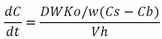 || (1) |
| --- | --- |

其中，根据公式 [1]]，`dC/dt` 表示药物溶解速率，`D` 代表药物扩散系数，而药物的分配系数表示为 `Ko/w`。`(Cs-Cb)` 是浓度梯度，它们在不消耗能量的情况下为溶质的下行驱动运动提供动力力支持。`V` 和 `h` 分别代表胃肠道（GIT）中的溶解介质以及允许溶质通过的黏膜厚度。

### 2.2. 界面屏障模型

界面屏障模型（图 **1C**）描述了固液界面之间逐渐的相互作用，其基础是物质在分解之前必须克服一个巨大的活性自由能阈值。根据 Higuchi 提出的这一模型，由于溶剂化机制而非扩散，固液界面处可能存在一个中间浓度，这种存在归因于溶解度。当晶体溶解时，界面屏障会随每个晶面而异 [5]。界面屏障模型强调的是溶解度而非溶解速率，因此决定性阶段是溶解速率而非溶解速率。该模型的方程如下：

| 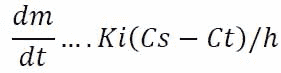 || (2) |
| --- | --- |

根据公式 (2)，溶解速率（或溶质含量随时间的变化）表示为 `dm/dt`。溶解速率常数 `ki` 受溶剂和溶质特征的影响。本体溶液中的溶质浓度由 `Ct` 给出。液体与固相达到平衡（平衡）时的浓度被称为饱和浓度或 `Cs`。`h` 代表界面屏障的厚度，由溶质和溶剂的特征决定。

### 2.3. Danckwert 模型

根据 Danckwert 模型，由涡流驱动的微小空泡会填满药物溶剂并向黏膜方向迁移（图 **1D**）。新的空泡被添加到充满的空泡中以替换旧的。在程序完成之前，不会达到平衡。整个过程在固液接触处以任何顺序进行（图 **1D**），展示了新包和饱和包的整个运动过程。

根据扩散规律，空泡在被新的溶液包补充之前可能会吸收表面的盐。污染物转运频率以及随后的溶解速率与这种界面更新过程有关。Higuchi 模型探索了由各种技术预测的速率理论，这些技术可以单独或结合使用。然而，Noyes 和 Whitney 提出了一个定量表示溶解速率的方程如下：

| 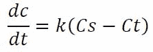 || (3) |
| --- | --- |

这里 `dc/dt` 代表浓度随时间的变化率，反应速率常数定义为 `k`。`(Cs-Ct)` 是为溶质的移动提供驱动力的浓度梯度。通过积分可以写出相同的方程：

| 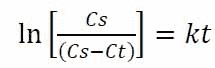 || (4) |
| --- | --- |

与其他类型的速率规律方程类似，该方程预测它通过应用一级动力学依赖于浓度差 `(Cs-Ct)`，这在动态液层和本体流体之间被观察到 [6]。

## 3. IVIVC（体外体内相关性）研究

同一药物的*体外*参数与相关的*体内*响应之间的关系由一种预测性数学模型描述，称为*体外-体内相关性*（IVIVC）。该模型主要作为活体生物生物等效性（BE）评估的替代方案。它具有减少初始批准所需的 BE 结果数量的潜力，也适用于特定的规模扩大和审批后调整 [7]。IVIVC 的使用还可以通过建立溶解要求以及以下方式获得额外支持和/或验证：

-   药物的溶解程序。
-   质量控制方法。
-   固体剂型的崩解。
-   使用现代分析工具进行分析。
-   溶解速度评估。
-   药物吸收发生的速率。
-   溶解概述变量。
-   *体内*研究期间的表现。
-   在*体外*观察到药物在介质中溶解的正确速率。
-   与数据的生物利用度相关。

美国食品药品管理局（USFDA）于 1997 年 9 月发布了监管指导，涵盖了缓释（ER）口服剂型*体外-体内相关性*（IVIVC）的开发、评估和应用。然而，尽管发布了这些指南，生物等效部门在审查通用药物批准申请（特别是简化新药申请 ANDA）时，仍继续发现与 IVIVC 相关的缺陷。*体内*和*体外*实验的数据可以很容易联系，简化了结果的理解。IVIVC 通常用于获得通用药物申请的 ANDA 许可，但这并不意味着因果关系 [8]。它主要分为五个水平，每个水平根据建立关系时使用的数据类型进行特征（图 **1E**）。


据我们了解，缓释型（ER）剂型药物的吸收速度远快于释放型（IR）剂型。在这种背景下，体外体外相关性（IVIVC）更适用于缓释型剂型。因此，在评估*体内*和*体外*评估结果的 IVIVC 可行性时，考虑剂型开发、其与胃肠环境的相互作用以及*体外*测试设置至关重要。这种全面的方法增加了成功的概率。此外，将 IVIVC 方法作为剂型制备过程中的关键步骤也是必重要的。组织良好且经过验证的体外*测试可以替代*体内*研究，作为令人信服的产品规格的模板，并作为质量保证的可靠工具。只要在质控（QC）实验室可行，必须使用基于 IVIVC 的*体外*测试技术来确保每个商业样品的质量和疗效。这将使得识别生产过程中产品*体内*行为的任何潜在或不可预见的变化成为可能 [9]。

## 4. 溶出技术

美国药典（USP）目前认可七种不同的溶出装置：篮法、往复圆筒、桨法、桨叶盘法、溶出法、往复圆盘和旋转圆筒。对于口服剂型的溶出测试，主要使用的是`USP-I`（篮法）和`USP-II`（桨法）。然而，`USP`中指定的装置可用于评估各种剂型类型。它们具有适应性，能够创建极其广泛的溶出技术，涵盖了从主要用于方法开发的技巧到用于工业批次质控评估的各种技术。随着药物变得越来越复杂，以及对更改进的生物预测方法的持续追求，此外有许多日益专业化的溶出设备正在被开发和部署 [10]。

尽管活性药物成分（API）具有复杂的物理化学性质，且监管机构对药物批准实施了严格规定，但开发一种符合预测*体内*结果标准的、先进的*体外*技术仍然至关重要。学术研究可以为某些其他独特方法提供快速扩展的工具箱，例如物理吸附或其他特定行业，这是由于某些特定问题；此外，`Apparatus III`和`Apparatus IV`似乎是使用各种测试介质或生物等效量来估计整个胃肠道的选择。在选择最佳的溶出测试时，体积可能会是一个困难。因为最常用的设备能够使用约 500 mL 和 1000 mL 左右的介质量，其治疗意义可能有限。然而，在溶出测试中使用大量介质可能会导致*体内*统计学上的夸大。使用微型桨配合较小的容器有时有助于更好地模拟人类胃肠道内的条件。然而，这种方法尚未被药典考虑过。报告显示，在过去的几年中，溶出测试领域使用改良和非典外设备的情况有所增加。

为了使溶出结果具有更高的生物相关性，这些仪器正被用于为各种剂型、递送系统和配方提供新的见解。结果是以前的“边缘”方法（包括固有溶出、微量溶出或利用增强剂的溶出）被沉没，或者提取池得到了扩展。此外，检测方法的改进使得以数字或非数字方式测试日益复杂的多组分组成成为可能。得益于此类创新检测方法提供的增强可能性，制造商可以获得广泛的数据集，从而更好地了解药物制剂中 API 和非活性成分的组合 [11]。

在全球范围内，各种药典为工具、程序和评估提供了详细指南，帮助开发人员满足溶出测试的监管要求。自 2014 年以来，欧洲开始发布不同的剂型通则，涵盖了溶出程序和接受标准，其遵循了美国药典（USP）概述的方法。此外，`FDA`的数据库包含更多关于美国溶出过程的开放数据。可以获得有关溶出分析仪物理运行情况的更多细节，包括即时释放、阶梯释放和缓释放剂型的溶出测试说明。然而，考虑到人体解剖学、代谢和发生的生物反应的复杂性，仅依靠这种溶出研究作为预测剂型在*体内*运行的手段偶尔是挑战性的。生物相关介质可以协助此类评估。然而，临床试验对于评估溶出测试多准确地预测*体内*情况至关重要 [12]。

## 5. 溶出测试的基础

对于患者来说，最灵活和高效的治疗方案仍然是口服剂型。固体口服药物制品的质量传统上很大程度上使用溶出测试进行评估。事实上，这是唯一能够量化药物释放药物速率的质控测试。

关于如何研究生物等效性，欧洲药品管理局（EMA）提供了指导意见。`EMA`关于剂量调整剂型药学和治疗评估的建议还解释了溶出分析的工作原理。溶出是许多药典使用的标准程序，其中规定并记录了设备的规格和运行条件。由于国际协调会议（ICH）与众多药典之间的合作，`USP I`和`USP II`在许多地方已实现标准化。这种协调使得将经过验证的溶出程序从一个实验室转移到另一个实验室变得相当简单 [13]。

### 5.1. 溶出测试的意义


通常情况下，这种测试目的是确保不同批次商业产品之间的一性，并支持产品批准后生产规模的扩大和制造工艺的变化。溶度测试可实现以下目标：

- 仿制药剂型开发的关键工具。
- 辅助原型剂的制备并确定最佳成分浓度，以实现剂型预期的累积药物释放，特别是在缓释型（ER）制剂的背景下。
- 确保仿制药产品进行生物等效性研究，促进其获得市场分销批准。此外，它还为支持品牌药物（创新药物）的*in vivo*生物利用度试验奠定了基础 [15, 16]]。
- 维持所有批次之间的均匀性和一致性。它也可以作为评估单批次次间性能的手段。

### 5.2. 产品稳定性

*体外*溶度也用于确定药物的稳定性和保质期。随着药物的变老，可能会发生生理变化，导致其失去部分安全性、效力和质量，当对这些产品参数在溶度研究中进行评估时。随着时间推移，产品安全性、效能和质量的变化是由于药物及其辅料理化性质的变化。还观察到，某些以多种形式（多晶型）存在的 API 会由于化学或物理变化变为另一种形式，从而导致溶度参数的变化。

### 5.3. 可比性评价

*体外*溶度研究对于理解批准前或批准后制造、剂方和工艺中的变化对产品质量的影响至关重要。此外，为了保证产品的相似性和性能等效，*体外*可比性测试发挥着至关重要的作用。

这有助于判断在报关前后对药品剂方和生产的更改是否会对溶度测试产生影响。因此，必须进行体外可比性测试，以保持产品均匀性和具有可比性的性能 [17, 18]..

### 5.4. Noyes-Whitney 规则

该方程由 Noyes 和 Whitney 于 1897 年建立，是分析药物释放动力学的基石。

| 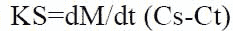 || (5) |
| --- | --- |

根据方程 (5)，`dm/dt` 代表与溶出介接触的质量随时间的变化；它也被称为溶解速率。`Cs` 代表平衡阶段溶质的溶解度，而 `Ct` 代表溶质浓度随时间的变化 [19]..

### 5.5. Nernst 和 Brunner 膜理论（Film Theory）

根据 Nernst 和 Brunner 的理论，表面过程发生远快于传输过程，线性浓度梯度只出现在附在固体上的溶液层中。该理论认为扩散层的溶解过程遵循一级速率学。利用 Fick 定律，Nernst 和 Brunner 建立了一个建立了下述 `K`（Noyes-Whitney 方程）与溶质扩散系数之间关系的方程。

| 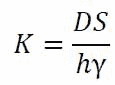 || (6) |
| --- | --- |

在方程 (6) 中，`S` 描述扩散层的表面积，`D` 是扩散系数，`h` 表示厚度，`γ` 表示扩散层接触的溶剂体积 [20, 21]..

## 6. 体外溶度方法的数学和统计工具

### 6.1. 剂型中的动力学

溶度模式通过基于不同角色的模型的方法进行说明 [22]。一级、零级、`Hixon`、`Baker Lonsdale`、`Weibull`、`Korsmeyer-Peppas` 是一些依赖模型的变量 [23]..

### 6.2. 经验和半经验建模

#### 6.2.1. 零级动力学

零级动力学描述一种与反应剂浓度无关的反应类型。在更简单的术语中，反应以恒定速率进行（如图 A 所示）。在零级动力学中，它是速率常数。

`Rate = k`

在反应中，`k` 代表速率常数。`Mol/L/s` 或 `M/s` 是 `k` 的常用单位。这种反应取决于反应剂的差异 [24]..

#### 6.2.2. 一级动力学

一级速率是取决于浓度的化学反应，药物从剂型中释放的理想情况下遵循一级速率。一级速率动力学由以下方程表示：

| 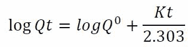 || (7) |
| --- | --- |

其中 `Q0` 代表药物的起始浓度；`Qt` 代表时间 `t` 释放的量。`K` 是一级速率常数。在图表中，累积百分比释放显示为直线（图 2B）。例如，水溶性药物被用作在一级动力学中溶解的示例 [25, 26]..

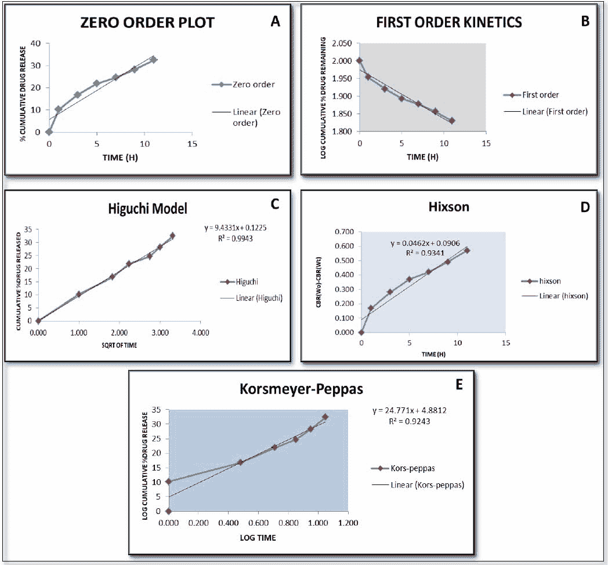 **图 (2)**

：
- A) 零级动力学
- B) 一级动力学
- C) Higuchi 模型
- D) Hixson 模型
- E) Korsmeyer peppas 模型

#### 6.2.3. Higuchi 模型

Higuchi 方程解释了药物如何从基质系统中释放。该模型可以用以下方程表示：

| 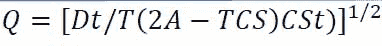 || (8) |
| --- | --- |

其中 `Q` 是单位面积随时间 `t` 排出的药物量。

在图 2C 中，`A` 代表药物的初始浓度，`Cs` 是在基质中的溶解度，`D` 显示基质中的扩散系数 [23]..某些受控和控释剂型，如缓释基质片、透皮药物传递系统、纳米技术等，通常遵循 Higuchi 模型 [4]..

#### 6.2.4. Hixson-Crowell 模型

该模型认为固体药物颗粒的溶解速率与剩余颗粒的表面积成正比。直径的变化率与初始直径立方根与任意时间直径立方根之差。

Hixson 模型显示，随着溶液中溶质直径和表面积随时间推移而减少，药物从剂型释放的速率也会不断变化。Hixson 范式由方程 (9) 表示。


在公式 (9) 中，`W[0]` 代表剂型中存在的药物总量，`W[t]` 代表在时间 `t` 时剂型中仍然存在的药物量，而 `kappa` (κ) 是保持表面积与体积关系的常数 [[27]]。当将基质中剩余药物百分比的立方根与时间进行绘图时（图 2D），可以得到一条直线。

药物从片剂或胶囊等缓释剂型中的释放通常使用 Hixson 模型进行评估。人们认为，药物的溶解速率（而非其在剂型中的弥散速率）决定了药物释放到体内的速度快慢 [[4]]。

#### 6.2.5. Korsmeyer-Peppas 模型

该模型基于以下观察：使用由方程描述的聚合物系统在剂型中递送药物：

| 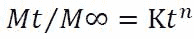 || (10) |
| --- | --- |

其中 `Mt/M∞` 代表时间 `t` 释放的物质百分比，`k` 是 Korsmeyer 释放常数，`n` 表示释放指数（图 2E）。在描述圆柱形基质的各种释放时，会使用数字 `n` [[27]]。使用药物累积释放比例与时间对数的图表表示法，利用*体外*药物释放实验的数据来说明该模型。采用 Korsmeyer-Peppas 模型对对不同成分的微球和微胶囊的释放数据进行线性处理 [[28]]。

### 6.2.6. Baker Lonsdale 模型

该模型表示为以下方程，用于展示药物从球形基质中的控释。

| 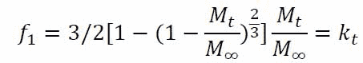 || (11) |
| --- | --- |

在这里，药物释放数据指定为 `[d (Mt / M)] / dt`，代表*体外*时间根的倒数。对于生成微球和微胶囊释放数据的线性度报告，Baker Lonsdale 模型非常有帮助 [[25]]。

#### 6.2.7. Weibull 模型

药物释放曲线可以使用 Weibull 方程来解释。大多数溶解曲线类型都可以通过该方程拟合。当 Weibull 方程用于求解药物释放 (m) 时，会增加药物分数。

| 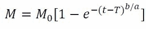 || (12) |
| --- | --- |

在这里，`M` 显示时间 `t` 时溶解的药物量。整个分解过程中释放的药物净量为 `M[0]`。参数 `b` 指定溶解曲线的形状。另一种，`a` 指定一个随时间变化的尺度 [[29]]。

#### 6.2.8. Hopfenberg 模型

如果表面积没有变化，Hopfenberg 描述了一个数学模型，用于预测从在其表面分解的聚合物中释放药物。根据下面的方程，我们可以计算随时间 `t` 变化的药物累积分数：

| 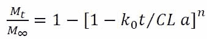 || (13) |
| --- | --- |

在此背景下，`k0` 代表与聚合物降解相关的零级速率常数，`a` 代表系统厚度的一半，几何指数 `n` 的取值为 1、2 和 3，分别对应板状（平坦）、圆柱形和球形 [[30]]。在该模型中，来自优化球体的释放机制通过利用复合剖面图进行概念化。

### 7. 利用先进技术进行体外溶解研究的预测

药物研究过程中产生越来越多的数据正由计算机进行处理和分析。许多人开发了具有广泛治疗用途的计算机程序。在这些程序中，只有少数是设计用于评估各种剂型药物释放的 [[31], [32]]。由于工作复杂性不断增加，制药专业人员仍然需要创新的用户交互软件。

1998 年，Singh 等创建了 ZOREL，这是一种用于研究各种药物递送系统药物释放的软件工具。基于 FORTRAN 的应用程序接受原始溶解数据作为输入。在第一步中，该应用程序根据采样时的剂型重量和药物含量，使用 `WR`（有放回抽样）和/或 `WOR`（无放回抽样）算法对药物溶解数据进行修正 [[33]]。随后，它计算每个制剂单元在不同时间间隔释放的药物数量和百分比的估计值。通过应用对数平均释放分数和对数回归，应用程序计算这些值。然后，利用溶胀基质的 Korsmeyer-Peppas 关系，计算平均溶解时间 (MDT)。根据 Peppas 和 Higuchi 模型，该计算提供了释放指数 (n) 和动力学常数 (k)。常量 `kl` 和 `k2` 以及扩散和聚合物松弛的相应贡献是通过分析现象数据估算的；软件可识别菲克扩散（Fickian）、非菲克扩散（异常）和零级释放。该程序用于确定 50%、60% 和 90% 时的释放速率。

已经开发了许多替代数学模型来拟合药物溶解数据，但其中大多数是非线性方程。目前仅实现了五种释放模型，而 MSFIT 是唯一描述用于拟合溶解曲线数据的程序。只有一小部分数据可以使用这些模型 [[33]]。Sigma Plot [[34], [35]]、GraphPad Prism [[36]] 和 SYSTAT [[37]] 是除 Math Scientist [[35]] 之外还可以利用其他专家统计软件，用于非线性拟合溶解数据。在其他系统中，必须手动输入方程且每个参数必须有一个初始值。然而，DD Solver 添加了一个使用 Visual Basic for Applications 开发的菜单驱动界面，可与 Microsoft Excel 表格软件配合使用。该程序可以：

* 使用常用的相似性评估方法检查溶解曲线。
* 通过利用模型库内置的 40 种溶解模型通过非线性优化方法简化溶解数据建模。
* 减少用户错误，加快计算，并提供方便快速报告溶解数据的相应模式 [[38], [39]]。

对于溶胀聚合物基质器件的几何差异，MATLAB 软件是一种编程语言，通过说明、研究和区分数学方程的几个参数对药物释放速率和动力学的影响来进行表征和模拟 [[40]]。KinetDS 是一种专门创建的曲线拟合程序，用于使用单个或一组方程表示累积溶解曲线。

Michaelis-Menten 和 Hill 方程、Weibull（3 参数和 2 参数）、Hixson-Crowell、Higuchi 和 Korsmeyer-Peppas 方程是描述药物溶解曲线最受喜爱的经验和机模型 [[41]]。


溶解度研究是任何剂型在疗效、效率和治疗价值方面最重要的方面之一。研究表明，药物的释放可能反映药物在*体内*的释放情况。目前有多种技术用于计算和预测溶解度性质，包括数学模型、计算方法和实验技术，这些技术可以进一步辅助*体外*和*体内*值的预测，从而避免在实验中使用动物活性。因此，这些工具还有助于理解药物在各种介质中的溶解情况，从而促进剂型设计和优化，以获得最佳治疗效果。

数学模型，如`Higuchi equation`和`Noyes-Whitney equation`被广泛应用于根据实验数据预测溶解速率。计算机模拟（如分子动力学模拟）或量子化学计算可以为控制药物溶解的分子级相互作用提供宝贵的见解。经验、计算和实验方法的结合可以帮助研究人员更全面地理解药物溶解行为，并设计出能最大化治疗效果的剂型。预测值和现代技术的出现使得溶解度研究更加可靠，并且在科学意义上更加准确。

## 出版同意

我证明我是上述内容知识产权的合法所有者，并拥有许可其出版的必要权利。

## 利益冲突

我写此信是为了确认，对于即将出版的书籍`Softwares and Programming Tools in Pharmaceutical Research`中，题为“溶解实验计算工具及其预测特性”的章节的贡献，我没有利益冲突。

## 致谢

我衷心感谢 Sakshi 博士和 Amardeep Kaur 女士对本书章节做出的宝贵贡献和见解。他们的专业知识和支持对本工作所呈现观点的形成至关重要。

## 参考文献

|  ||  |
| --- | --- |
| [1] || Diaz DA, Colgan ST, Langer CS, Bandi NT, Likar MD, Van Alstine L. 溶解相似性要求：全球监管预期的相似性有多大？AAPS J 2016; 18(1): 15-22.[[`dx.doi.org/10.1208/s12248-015-9830-9`](http://dx.doi.org/10.1208/s12248-015-9830-9)] [PMID: [26428517](http://www.ncbi.nlm.nih.gov/pubmed/26428517)] |
| [2] || Chen Y, Gao Z, Duan JZ. 固体产品的溶解测试。In: Yu LX, Li H, 编. 固体口服剂的开发：药学理论与实践（第二版）2nd ed.Yu LX, Li H. 2017203-35.[[`dx.doi.org/10.1016/B978-0-12-802447-8.00013-3`](http://dx.doi.org/10.1016/B978-0-12-802447-8.00013-3)] |
| [3] || Khan KA, Khan GM, Rehman AUR, Shah KU. 氟比洛芬控释基质的药物释放研究与市场产品对比。Lat Am J Pharm 2013; 32(4): 526-31. |
| [4] || Baishya H. 数学模型在卡比多巴和左旋多巴缓释药物释放中的应用。J Dev Drugs 2017; 6(2): 1-7.[[`dx.doi.org/10.4172/2329-6631.100071`](http://dx.doi.org/10.4172/2329-6631.100071)] |
| [5] || Ma T, Jivkov AP, Li W, et al. 整合化学亲力和界面屏障的长期机制模型。J Nucl Mater 2017; 486: 70-85.[[`dx.doi.org/10.1016/jjnucmat.2017.0101`](http://dx.doi.org/10.1016/jjnucmat.2017.0101)] |
| [6] || Anal AK, Bhowmik D, Gopinath H, Duraivel S, Kumar K. 控释剂型概述。Int J Pharma Sci 2013; 3(2): 14-9. |
| [7] || McDonald TO, Giardiello M, Martin P, et al. 增强口服生物利用度的抗病毒纳米颗粒：生产、表征及体外相关性。Adv Health Mater 2014; 3(3): 400-11.[[`dx.doi.org/10.1002/adhm.20130280`](http://dx.doi.org/10.1002/adhm.20130280)] [PMID: [23997027](http://www.ncbi.nlm.nih.gov/pubmed/23997027)] |
| [8] || Kaur P, Jiang X, Duan J, Stier E. 仿制药开发中体外相关性的应用：案例研究。AAPS J 2015; 17(4): 1035-9.[[`dx.doi.org/10.1208/s12248-015-9765-1`](http://dx.doi.org/10.1208/s12248-015-9765-1)] [PMID: [25896303](http://www.ncbi.nlm.nih.gov/pubmed/25896303)] |
| [9] || Qiu Y, Duan JZ. 体外/体内相关：基础、开发与应用。In: Yu LX, Li H. 固体口服剂的开发：药学理论与实践 2017237-59. |
| [10] || Klein S. 多颗粒药物递送：剂型、工艺与制造 2017. |
| [11] || Deng J, Staufenbiel S, Hao S, Wang B, Dashevskiy A, Bodmeier R. 不同配方颗粒的选择性双相体外溶解测试及与体内药代动力学研究的相关。J Control Release 2017; 255: 202-9.[[`dx.doi.org/10.1016/j.jconrel.2017.0434`](http://dx.doi.org/10.1016/j.jconrel.2017.0434)] [PMID: [28450206](http://www.ncbi.nlm.nih.gov/pubmed/28450206)] |
| [12] || Schneider F, Koziolek M, Weitschies W. 胃滞留剂评估的体外和体内测试方法。Pharmaceutics 2019; 11(8): 416.[[`dx.doi.org/10.3390/pharmaceutics1108416`](http://dx.doi.org/10.3390/pharmaceutics1108416)] [PMID: [31426417](http://www.ncbi.nlm.nih.gov/pubmed/31426417)] |
| [13] || Chaturvedi K, Shah HS, Sardhara R, Nahar K, Dave RH, Morris KR. 用于药物药物测试的原位光纤无液溶解系统（FODS）的方案开发、验证和故障排除。J Pharm Biomed Anal 2021; 195: 113833.[[`dx.doi.org/10.1016/j.jpba.2020.1133`](http://dx.doi.org/10.1016/j.jpba.2020.1133)] |
| [14] || Kapoor D, Maheshwari R, Sharma S, Pethe A, Tekade RK. 扩散与溶解的基础。Elsevier Systems DD 2019231-63. |
| [15] || Adeline S. 溶解测试。PharmTech.com 2016. 来自：https://www.pharmtech.com/view/dissolution](https://www.pharmtech.com/view/dissolution) |
| [16] || Grady H, Elder D, Webster GK, et al. 行业对在药物开发、注册和商业化中使用质量控制、生物相关和临床相关溶解测试的观点。J Pharm Sci 2018; 107(1): 34-41.[[`dx.doi.org/10.1016/j.xphs.2017.1021`](http://dx.doi.org/10.1016/j.xphs.2017.1021)] [PMID: [29074376](http://www.ncbi.nlm.nih.gov/pubmed/29074376)] |
| [17] || Sun F, Hou G, Cong W, Li HH, Zhang X, Ren Y. DMS-Logo.pdf. J Pharm Sci 2018; 107(11): 2862. |
| [18] || Muthappa R, Purushothaman BK, Meera Sheriffa Begum KM, Maheswari PU. 叶酸结合 BSA 纳米载载中姜黄素释放机制的动力学建模和优化。Chemical Product and Process Modeling 2020; 15(1): 20190026.[[`dx.doi.org/10.1515/cppm-20190026`](http://dx.doi.org/10.1515/cppm-20190026)] |
| [19] || Siepmann J, Siepmann F. 药物溶解的数学模型。Int J Pharm 2013; 453(1): 12-24.[[`dx.doi.org/10.1016/j.ijpharm.2013.0444`](http://dx.doi.org/10.1016/j.ijpharm.2013.0444)] |


| [20] || Haidar ZS. 受控药物释放纳米系统药代动力学预测的数学建模：一项比较性参数研究. Biomed Pharmacol J 2018; 11(4): 1801-6. [`dx.doi.org/10.13005/bpj/1552`](http://dx.doi.org/10.13005/bpj/1552) |

| [21] || Li X, Liu Y, Yu Y, Chen W, Liu Y, Yu H. 作为具有持续抗氧化活性的保健品的槧皮素和纤维素纳米制剂。 Carbohydr Polym 2019; 207: 160-8. [`dx.doi.org/10.1016/j.carbpol.2018.11.084`](http://dx.doi.org/10.1016/j.carbpol.2018.11.084) [PMID: [30599995](http://www.ncbi.nlm.nih.gov/pubmed/30599995) |

| [22] || Sopyan I, Alvin B, Insan Sunan KS, Cikra Ikhda NHS. 系统综述：共晶作为提高口服固体剂剂物理化学性质和生物利用度的尝试. Int J Appl Pharm 2021; 13(3): 17-26. [`dx.doi.org/10.22159/ijap.2021v13i1.39594`](http://dx.doi.org/10.22159/ijap.2021v13i1.39594) |

| [23] || 释放动力学——概念与应用 Int J Pharm Res Technol 2019; 3(1): 58-61. |

| [24] || Sahoo CK, Rao SRM, Sudhakar M, Satyanarayana K. 药物递送系统中药物溶解的动力学建模：概述. Pharm Lett 2015; 7(11): 26-38. |

| [25] || R KAM 药物溶解的数学模型：综述. (sch acad j pharmacyonline) sch acad. J Pharm 2014; 3(9): 706-10. |

| [26] || Mohamed Rizwan I, Damodharan N. 剂型中溶解动力学的数学建模. Res J Pharm Technol 2020; 13(11): 5291. |

| [27] || Permanadewi I, Kumoro AC, Wardhani DH, Aryanti N. 药物溶解建模：溶解曲线分析方法的比较. Int J Pharma Bio Sci 2013; 4(1): 174-83. |

| [28] || Senthila S, Manojkumar P, Venkatesan P. 用于设计、开发和制备肝靶向药物递送的水飞碱负载 PLGA 纳米颗粒的处方参数表征. Res J Pharm Technol 2021; 14(8): 3927-37. |

| [29] || Muselík J, Komersová A, Kubová K, Matzick K, Skalická B. FDA 和 EMA 比较药品*体外*药物溶解曲线的统计方法批判性综述. Pharmaceutics 2021; 13(10): 1703. [`dx.doi.org/10.3390/pharmaceutics13101703`](http://dx.doi.org/10.3390/pharmaceutics13101703) [PMID: [34683995](http://www.ncbi.nlm.nih.gov/pubmed/34683995) |

| [30] || Vigoreaux V, Ghaly ES. 溶胀水性聚合物基质中药物释放的菲克贡献和松弛贡献量化. Drug Dev Ind Pharm 1994; 20(16): 2519-26. [`dx.doi.org/10.3109/03639049409042655`](http://dx.doi.org/10.3109/03639049409042655) |

| [31] || Gao P, Skoug JW, Nixon PR, Robert Ju T, Stemm NL, Sung KC. 羟丙基甲基纤维素基质片片的溶胀。2. 处方变量对基质性能和药物释放的影响机制研究. J Pharm Sci 1996; 85(7): 732-40. [`dx.doi.org/10.1021/js9504595`](http://dx.doi.org/10.1021/js9504595) [PMID: [8818998](http://www.ncbi.nlm.nih.gov/pubmed/8818998) |

| [32] || Lu DR, Abu-Izza K, Mao F. 控释放设备的非线性数据拟合：一种集成计算机程序. Int J Pharm 1996; 129(1-2): 243-51. [`dx.doi.org/10.1016/0378-5173(95)04356-X`](http://dx.doi.org/10.1016/0378-5173(95)04356-X) |

| [33] || El-Nabarawi MA, Elshafeey AH, Mahmoud DM, El Sisi AM. 双氯芬酸乙胺快速溶片片的制备、优化及*体外*/*体内*评价. Drug Deliv Transl Res 2020; 10(5): 1314-26. [`dx.doi.org/10.1007/s13346-020-00709-4`](http://dx.doi.org/10.1007/s13346-020-00709-4) [PMID: [3207247](http://www.ncbi.nlm.nih.gov/pubmed/3207247) |

| [34] || Papadopoulou V, Kosmidis K, Vlachou M, Macheras P. 论 Weibull 函数区分药物释放的应用. Int J Pharm 2006; 309(1-2): 44-50. [`dx.doi.org/10.1016/j.pharm.44`](http://dx.doi.org/10.1016/j.pharm.44) [PMID: [1637603](http://www.ncbi.nlm.nih.gov/pubmed/1637603) |

| [35] || Desai P, Thakkar A, Wang J, Prabhu S. 通过开发五组自微乳化体系 (SMEDDS)  II 类水溶性药物. Drug Deliv Transl 2019; 9(3): 641-51. [`dx.doi.org/10.1007/s13346-019-0`](http://dx.doi.org/10.1007/s13346-019-0) [PMID: [3109395](http://www.ncbi.nlm.nih.gov/pubmed/3109395) |

| [36] || Mobarak D, Salah S, Ghorab M. 通过五组自纳米乳化体系 (SNES)  II 类水溶性药物. Drug Deliv Sci 2019; 50: 99-106. |

| [37] || Zuo J, Gao Y, Bergberg R. 用于溶解测试数据的开源软件评估. BioMed Pharm 2014; 8(1): 172-25. [PMID: [2487706](http://www.ncbi.nlm.nih.gov/pubmed/2487706) |

| [38] || Knöös P, Svensson AV, Wahlgren M. 改性聚酸在模拟肠液中难溶药物的释放. PLoS One 2015; 10(10): e014079. |

| [39] || Sou T, Kukavica I, Levesque RC, Friberg C. 针对假单胞菌肺部感染治疗的模型引导药代动力学-药效学建模. Mol Pharm 2020; 17(5): 1458-69. |

| [40] || Mendyk A, Jachowicz R, Fijorek K. 用于溶解测试数据的开源软件. Dissolut Technol 2012; 19(1): 6-11. |

| [41] || Smith J, Brown A, Johnson C. 利用自纳米乳化体系提高阿伐汀的口服生物利用度. Eur J Pharm Sci 2022; 168: 106036. |


卡尔·皮尔逊（Karl Pearson）于 1901 开发了主成分分析（PCA），作为主轴定理的数学等效方法。后来，根据其在不同领域的应用，有了不同的名称。主成分分析为理解所研究系统的工作原理提供了基础。它在信号处理、多变量质量控制、心理学、生物学、气象科学、噪声和振動分析（光谱分解）以及结构动力学等不同领域广泛应用。在本章，我们将讨论它在药物研究和药物发现中的应用。该技术允许对多维数据进行表示并对大型数据集进行评估，在保留尽可能多的信息的同时改进数据解释。PCA 是一种不需要大量计算的技术，并降低了内存和存储需求。PCA 可以被概念化为拟合数据的 n 维椭球，其中每个轴代表一个主成分。椭圆的轴通过从数据表中减去每个变量的平均值来确定。在药物研究领域，原始变量通常以不同的测量单位表示。因此，在减去均值后，将原始变量除以其标准差。这一步是为了使用 z 分数（z-scores），z 分数进一步用于提取原始数据的特征值和特征向量。

**关键词：** PCA，主成分，研究，统计方法。

***

**通讯作者 Neelam Sharma：** 药剂，Amar Shaheed Baba Ajit Singh Jujhar Singh Memorial College of Pharmacy, Bela, (独立自治学院) Ropar, India;

电子邮箱：pharmneelam@gmail.com

## 1. 引言

主成分分析（PCA）是一种广泛使用的方法，它通过应用复杂的数学原理，将大量潜在相关的变量减少为一组被称为主成分的较少变量[1]。PCA 的主要目标是在保留尽可能多的数据集方差的情况下，最小化由许多相互关联变量组成的数据集[2]。卡尔霍宁-洛埃夫展开（Karhunen-Loeve expansion）是主成分分析（PCA）表示方法的另一种术语。该方法在模式识别和计算机视觉中得到了应用，例如人脸识别[3]。这种简化通过将原始变量转换为一组称为主成分的新不相关变量来实现。这些成分的排列方式使得前几个成分捕获原始变量中存在的大部分方差。虽然主成分的计算似乎很简单，但这种方法的表面简单掩盖了其广泛的潜在应用和多种推导[4]。主成分最优地解释了原始变量的总方差，作为信息的衡量。这些成分的几何属性有助于对复杂多变量数据集中的关键特征进行结构化和直观的解释[5]。一系列诊断技术包括质谱、拉曼光谱、近红外光谱、红外光谱、核磁共振（NMR）、激光诱导击光谱（LIBS）、紫外光谱和 X 射线吸收光谱，已发现与 PCA 结合使用[6-8]。

## 1.1. PCA 的定义

### 1.1.1 定义

主成分分析（PCA）是一种用于降维和数据转换的统计技术。它涉及将高维数据集转换为低维数据集，同时尽可能保留原始数据的变异性。PCA 通过识别新的正交轴（称为主成分）来实现这一点，数据在这些轴上的变化最大。这些成分是原始变量的线性组合，并按方差递减的顺序排序。

### 1.1.2 目标

PCA 的主要目标包括：

#### 1.1.2.1 降维
PCA 的主要目标之一是减少数据集中维度（特征或变量）的数量，同时保留最重要的信息。这在处理具有许多变量的数据集时特别有用，因为它简化了分析和可视化。

#### 1.1.2.2 方差最大化
PCA 旨在低维表示中尽可能捕捉原始数据中存在的方差。第一主成分占据最大的方差，其次是第二个成分，依此类推。通过保留前几个主成分，通常可以保留大部分大部分变异性。

#### 1.1.2.3 特征解释
PCA 允许解释数据中的模式和关系。主成分之间相互正交，每个成分代表原始变量的线性组合。这些成分可以对应于数据的有意义方面，使得更容易理解底层结构。

#### 1.1.2.4 数据可视化
通过减少数据维度，PCA 可以促进复杂数据集在二维或三维中的可视化。这有助于获得见解并识别原始高维空间中可能不显见的模式。

#### 1.1.2.5 数据压缩
PCA 可用于数据压缩，因为低维表示需要较少的存储空间。这在存储或处理资源的情况下特别有用。

#### 1.1.2.6 数据预处理
PCA 还可以用作预处理步骤消除变量的相关性，使随后的分析（如回归或聚类）更有效。

## 1.2. PCA 的历史

追溯统计方法的起源有时具有挑战性。在双向研究中，费舍（Fisher）和麦肯锡（Mackenzie）利用奇异值分解（SVD）。然而，人们广泛认为，现在被称为主成分分析（PCA）的方法首次描述是由皮尔逊（Pearson）和霍特林（Hotelling）提供的[5]。霍特林的 PCA 方法将其区别为具有独立于因子分析的独特特征。霍特林的理论基于这样一个观点：初始的`p`个变量可能由“一组基础独立变量集”来表示。霍特林选择的成分被称为“主要成分”，因为它们的推导目的是为了最大化其随后的方差。霍特林的另一项工作引入了确定主成分的快速方法。在同一年，吉希克（Girshick）提出了主成分的几种替代性推导方法，并引入了样本主成分是最大的概念。PCA 的发展与统计文献的整体增长一致。然而，PCA 随着电子计算机的广泛采用而变得流行，因为它需要大量的处理能力[7]。**

# 2. PCA 算法中的术语

### 2.1. 维度

维度指的是数据集中因素或变量的数量。这可以通过计算数据集中的列来很容易确定[8]。

### 2.2. 相关性


相关性表示两个因素或变量之间关联的程度。例如，当一个变量发生变化时，另一个变量也会发生相应的变化。相关性分数的范围在 -1 到 +1 之间。值 -1 表示变量之间存在反相关关系，而值 +1 表示变量之间存在正相关或线性关系 [9]。

### 2.3. 正交

此矩阵总结了数据集中不同特征之间的关系。非对角元素代表特征对之间的协方差，而对角元素代表单个特征的方差 [10, 11]。

### 2.4. 特征向量

主成分源于原始数据协方差矩阵的特征值和特征向量。特征值代表每个主成分所解释的方差量，而特征向量则是这些成分的方向 [12]。

### 2.5. 协方差矩阵

此矩阵总结了数据集中不同特征之间的关系。非对角元素代表特征对之间的协方差，而对角元素代表单个特征的方差 [13, 14]。这是主成分解释的方差与数据中总方差之比。它可以帮助你理解每个主成分保留了多少信息 [15, 16]。

### 2.6. PCA 算法的步骤

#### 2.6.1. 获取数据集

首先，我们必须将输入信息分为两个部分：`x` 和 `y`。

`x`: 训练集

`y`: 验证集

#### 2.6.2. 数据表示的结构

创建一个结构来描述我们的数据集。我们将使用独立变量 `X` 的二维矩阵作为示例。每行代表一个数据对象，每列代表一个特征。数据集中的部分数量也可以确定 [17]。

#### 2.6.3. 数据标准化

这一阶段涉及对我们的数据集进行标准化。例如，方差较大的特征比给定列中方差较小的特征更具意义。如果特征的显著性独立于特征的变化，则列中的每条信息都将除以该列的标准差（SD）。在这种情况下，我们将矩阵称为 `Z` [18]。

#### 2.6.4. Z 的协方差

对 `Z` 矩阵进行转置是为了确定 `Z` 的相关性。我们将对其转置，然后将结果加上 `Z`。这个 `Z` 矩阵将是输出矩阵 [19]。

#### 2.6.5. 特征值和特征向量

对于生成的相关矩阵 `Z`，我们现在必须计算特征值和特征向量。拥有最多数据的轴方向由特征向量表示。此外，这些特征向量的特征值被指定为它们的系数 [20]。

#### 2.6.6. 特征向量排序

在此阶段，我们将所有的特征值并按降序排列。同时，我们对对矩阵 `P` 中的特征向量进行排序。`P*` 是结果矩阵的名称 [21]。

#### 2.6.7. 计算新特征

在这里，新特征通过 `Z` 测量到最终的 `P*` 矩阵。结果矩阵 `Z*` 中的每个观测值都是初始特征的线性组合。`Z*` 矩阵的各个列之间互不相关的 [22, 24]。

#### 2.6.8. 新数据中的不重要特征

由于新的特征集已经实现，我们在这里决定保留数据中的哪些部分以及删除哪些部分。这意味着我们将在新数据集中保留相关或显著的特征，并消除无关特征 [25, 27]。

### 2.7. 用于特征工程的 PCA

有两种方法可以使用 PCA 进行特征工程。第一种方法将其作为解释性策略。你可以计算组件的 `MI` 分，并确定哪种类型的变异对你的目标最具预测性，因为这揭示了变异类型 [28]。这些特征向量的特征值被指定为它们的系数 [20]。第二方法是直接利用组件作为特征。

#### 2.7.1. 降维

当特征高度冗余时，PCA 将这些冗余减少到少数接近零的方差的成分 [30]。

#### 2.7.2. 异常检测

低方差的成分揭示了初始特征中可见的异常，这有助于进行检测 [31]。

#### 2.7.3. 降噪

噪声通常存在于数据集中。PCA 可以将其压缩到更少的特征中，提高信噪比 [32]。

#### 2.7.4. 去相关

高度相关的特征对某些机器学习方法来说具有挑战性。通过 PCA 创建不相关的组件可能会使处理变得更简单 [33, 34]。

### 2.8. 主成分分析在医药研究中的作用

生物学严重依赖统计学，因为实验结果很少是精确的，并且容易受到测量误差的影响，这些误差可能是随机的或偏差的 [35]。三种变量类型如图所示。

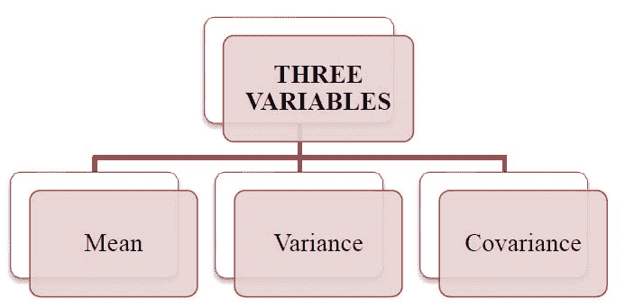 **图 (1)**

变量类型。

均值是给定数字之和除以数字总数得到的。数据是在进行五次不同的实验以测量不同蛋白质的相对丰度后提供的。我们可以计算均值来了解典型的蛋白质含量。可以通过以下示例解释：

1. 任何集合的均值由公式给出：

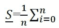 `S[i]`
```
`S[i]` = (1.4, 0.6, 0.4, 0.8, 1.5)

其中，

```
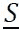 `S`
```
`S` = 数字集合

```
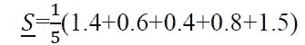 `S[i]`
```
`S[i]` = 数字集合中的单个数字

= 1 值 1.48：蛋白质的平均丰度。


n-1= 提供了更接近真实值的近似

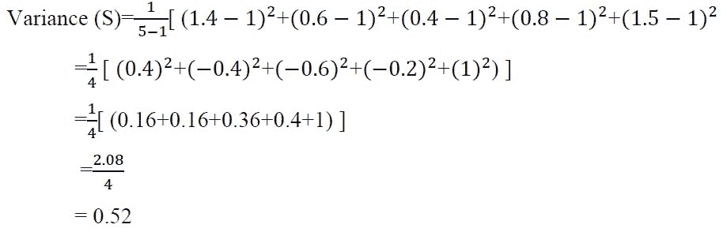

#### 2.8.1. 协方差

协方差衡量两个变量之间的相互依赖程度（图 **2**）。在这种情况下，出现了两种中心趋势度量不依赖于协方差且可以作为替代 [37]。

3. 两个变量 `(x,y)` 可以是

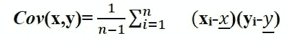

具有三个变量 `x,y,z` 的三维数据集可以表示为：

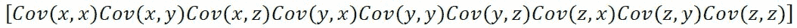

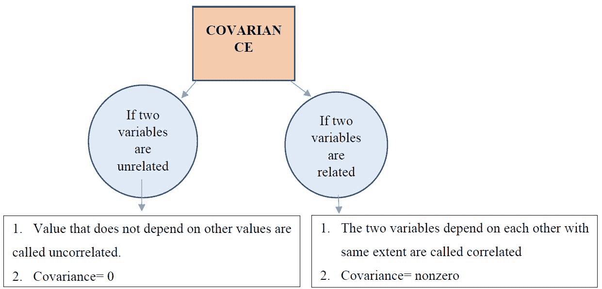**图 (2))**

协方差测量的图示。

#### 2.8.2. 特征向量与特征值

当线性变换 `T` 应用于向量 `u1`, `u2`, `u3`......u[n]` 时，将获得新向量 `b1`, `b2`, `b3,...bn`。

```
Tu1=b1
Tu2=b2
............
Tu[n]=bn
```

在应用变换 `(T)` 时，长度改变但方向不变的向量被称为特征向量，而代表特征向量倍数的标量被称为特征值。

```
Tui=λui
```

特征向量和特征值共同提供了矩阵的特征分解，使我们能够检查矩阵的结构。虽然特征分解不适用于方阵，但在寻找极大函数时，对于相关矩阵和协方差矩阵等，它提供了一个特别直观的表达式。

示例：`A=2321`

如果向量 `u` 在乘以 `A` 时其长度发生了变化，那么矩阵 `A` 就是向量 `u`。

特征向量 `u1 = [32]` 的特征值为 `λ1 = 4`

以及 `u2 = [-11]` 的特征值为 `λ2 = 1`

为了使特征向量归一化，大多数应用应用了线性变换：长度等于一

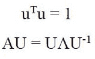

其中，

`U = 矩阵中 A 的集合`

`Λ = 对角矩阵 [10].`

### 2.9. 药物辅料相互作用研究中的 PCA

药物剂含有多种辅料，这些辅料增强药物的释放和给药效果。尽管配方中的所有辅料本质上是惰性的，但它们可以与剂型中的药物相互作用。因此，对药物-辅料相互作用的研究对于制备新剂型以及节省宝的时间的时间昂贵的原材料至关重要。研究药物-辅料相互作用的方法有很多，例如等温微热量法和高效液相色谱 [38]。药物和辅料的峰重叠使得数据解释变得困难。PCA 是用于寻找高方差变量之间关系的因子分析方法之一。PCA 遵循以下公式：

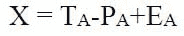

其中，

`X = M ˣ 矩阵`

`T = N ˣ 得分`

`E = M ˣ 载荷矩阵`

### 2.10. PCA 的作用

为了识别趋势、类和离群值，将功能描述为较少的变量至关重要 [39], 40]。表 1 **PCA 在不同领域的作用。**

| **制药领域** | **PCA 的作用** |
| :--- | :--- |
| 临床研究 | 这种方法可以用于... |
| QSAR | 这通常与...相关 |
| 药物发现 | 这种方法是...的工具 |
| 生物医学研究 | 这用于分析... |

#### 2.10.1. 适配

在追求最大化 q 维方差的过程中，我们的目标是实现 p 维数据集在 q 维中的最佳表示。已经提出了几种适配方法来简化这些 q 维的解释。在此步骤中，转换后的数据矩阵进行主成分分析 (PCA)。[41]。

#### 2.10.2. 功能 PCA

计算的最新进展和存储高维数据的能力使得统计学能够分析高维模型。功能数据分析 (FDA) 是一种将功能特征引入分析的方法。计算功能成分有三种方法：

##### 2.10.2.1. 离散化

与 PCA 类似，FPCA 的执行要求使用适当平滑器进行归一化和插值。计算功能主成分的第一种方法使用了离散化方法。

##### 2.10.2.2. 基函数展开

在第二种方法中，随机过程被表示为基函数的线性组合，即 ` 的平滑。在许多可能的基函数中，最流行的包括多项式基函数、贝塞尔多项式基函数、傅里叶基函数、径基函数、小波基函数和正交基函数。

##### 2.10.2.3. 数值近似

该方法使用求积法进行近似 [42]。

#### 2.10.3. 简化 PCA

在此步骤中，转换后的数据矩阵进行主成分分析 (PCA)。PCA 计算主成分，主成分是数据空间中捕捉最多方差的正交方向。PCA 数据矩阵分解的流程图如图 (**3**) 所示。第一主成分捕捉最多的方差，第二，以此此类推。PCA 算法生成主成分，每个都是原始特征的线性组合 [43]。

### 2.11. 符号数据主成分分析

更复杂数据结构的泛指。为了保留观测值的变异性，创建了区间数据 [44]。

#### 2.11.1. PCA 的优势


### 2.11.1.1. 降维

PCA 的主要优势之一是通过识别重要成分来降低数据的维度。当初始数据包含大量变量且难以可视化或理解时，这种方法会非常有用。

### 2.11.1.2. 数据可视化

PCA 可用于在 2-3 维度上可视化数据。通过这种方法，可以更容易地发现在初始高维空间中可能并不明显的聚类或模式。

### 2.11.1.3. 降噪

PCA 可以通过识别数据中的底层信号或模式，减少数据中噪声或测量误差的影响。

### 2.11.1.4. 多共线性

当数据中的两个或多个变量之间存在强相关时，就会发生多共线性，PCA 可以处理这个问题。通过突出最重要的特征或元素，PCA 可以减少多共线性对分析的影响 [45].]。

## 2.11.2. PCA 的缺点

### 2.11.2.1. 信息丢失

PCA 通过选择最关键特征或成分的子集来降低数据维度。虽然这简化了数据并减少了噪声，如果重要方面被排除在所选成分之外，可能会导致信息丢失。

### 2.11.2.2. 缩放

PCA 假设数据经过缩放和标准化，这并不总是适用。如果数据没有经过适当缩放，得到的主成分可能无法准确表示底层数据模式。

### 2.11.2.3. 离群值

数据中的异常情况会显著影响从 PCA 生成的主成分。离群值会扭曲协方差矩阵，使得识别最显著的特征变得更加困难 [46].]。

## 2.12. 执行主成分分析的软件

有很多软件包用于主成分分析。这些包括 `XLSTAT`、`BioVinci`、`R software`、`Unscrambler X`、`SPSS 23.0`、`Minitab`、`Rapid Miner Studio`、`Solo Simca-P`、`Origin Pro`、`Statgraphics`、`SimcaCemetrics`、`Statistca`、`SAS`、`Canoco5`、`PAST (Palentologica Statistical Software)`、`C2`、`OriginLab`、`Python 3` 和 `GRETL` [47^-)50]。表([2) 提供了制药研究中 PCA 可用的软件列表。

表 2 用于主成分分析的常用软件列表

| 序号 | 软件 | 开发单位 | 关键特征 | 优势 |
| --- | --- | --- | --- |--- |
| 1. | `XLSTAT` | Addinsoft 于 1993 年开发。 | 数据建模、机器学习感应数据分析、路径建模、实验设计。 | 统计分析方面。 |
| 2. | `BioVinci` | (版本 `3.0`) | 2020 年 12 月开发。 | 统计分析方面。 | 对数据去感应。 |
| 3. | `Matlab` | (版本 `1.0`) | 2009 年 6 月开发。 | 统计分析方面。 | 去感应。 |
| 4. | `SPSS 24.0` | 最初初于 1968 年发布。 | 统计分析方面。 | 去感应。 |
| 5. | `Canoco5` | (旧版本，`4.5`) | Cajoter 开发。 | 统计分析方面。 | 经过设计。 |

## 3. PCA 在制药研究中的应用

### 3.1. 神经科学

脉冲触发协方差分析是一种根据外观识别神经元的方法。大型集合利用如 PCA 等降维技术。此外，PCA 已用于建立协调活动 [51].]。

### 3.2. PCA 在药物发现中的作用

主成分分析 (PCA) 在各个领域都有应用，包括定量结构活性关系 (SAR)、数据挖掘和“组学”技术。得益于数据的爆炸，PCA 在制药研究中的相关性日益增长 [52].]。在药物发现背景下，新兴的“网络药学”正在重塑我们对治疗靶点的理解。多年来，还原论方法专注于识别疾病的根本原因。PCA 在分析中主要考虑 `y`（左面板），其中经典模型（右面板）中要最小化的距离垂直于 `x` 轴。该技术线性地结合所研究系统内的 `n` 个变量以创建主成分，如公式所示。

| 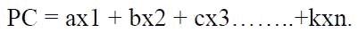 |
| --- |

实验/观测变量 `X1–Xn` 定义了统计单位，并使用最小二乘法优化来确定系数 `a–k`。从最小二法的意义上说，主成分既是数据的“最佳总结” [40].]。

### 3.3. 图像识别

归一化后，直接执行人脸识别需要大量的处理时间。这是因为原始图像中的每个像素都包含所有信息，因此需要缩小图像尺寸。然后记录正确的特征以表达大量信息。通过使用 PCA 和几个相互独立的线性组合来替代原始数据，可以显著减少变异的数量。差异的变化通过线性组合计算对数据产生了显著影响。数据分析显示了最显著的个体差异。


PCA 是一种解决与描述符/分子比例不佳以及共线性相关挑战的有效技术。可以使用图表来解释 `PCA` 的整体概念。在处理难以直接评估的大型数据集，以及独立变量之间复杂的相关性难以理解和可视化时，它 特别有用。这种情况在典型的 QSAR 研究中非常常见，因为需要计算大量的理论描述符。这些新生成的变量被称为主成分（`PC`），是基础描述符的线性组合，旨在捕捉原始数据中的大部分方差 [54]。

# 4. PCA 存储中的医学数据

`PCA` 以逐步步进的形式用于寻找变量之间的相关性。通过逐步主成分分析，研究了缺血性心病患者中胆固醇、脂蛋白、甘油三酯、Apo 蛋白 A-1、载脂蛋白 B、LDLR、磷酸胆脂、总胆固醇、血糖和尿酸等这些化学指标的影响 [55]。

## 4.1. 作为发酵食品的感官评估工具

发酵食品（如酸奶、豆浆和冰淇淋）是通过微生物（益生菌）入侵并将脂质和蛋白质水解为无毒物质产生的。这一过程被称为发酵，会导致食品物理性质的变化。发酵食品的接受程度取决于多种属性，通常使用主成分分析进行分析 [56]。

## 4.2. 在纳米材料中

`PCA` 被证明是构建无摩擦管间旋转和平移装置的重要工具。`PCA` 为研究碳纳米管、机械振荡器、谐振器、旋转轴承和执行器的机械动力学方法。在探索纳米材料对生物系统影响的纳米毒学领域，`PCA` 通过识别导致毒性的相关特征，在构建 QSAR 模型方面发挥着至关重要的作用 [57。`PCA` 是一种多功能工具，可以从复杂多维的纳米材料数据中提取有价值的见解。其在保留关键信息的同时简化数据的能力，使其成为纳米技术和材料科学研究人员不可或缺的技术。

## 4.3. 双分子分子动力学

对于大分子的分子动力学模拟，`PCA` 是必不可少的。`PCA` 和数学上等价的本质动力学（essential dynamics）已被证明成功识别包括蛋白质和核酸在内的各种生物分子的显著运动。只要在使用这些方法识别具有生物化学意义的分子运动时采取适当措施，计算化学家就会发现 `PCA` 对于管理大量且的数据集非常有价值 [58]。

## 4.4. ECG 信号确定

主成分分析（`PCA`）在心血管健康领域成为了一种非常有价值的技术，对心脏疾病的确定和诊断贡献巨大。它的通用性扩展到心脏护理的各个方面，包括远程患者监测、电子起搏器和重症监护室（`ICUs`） [58]。在远程患者监测的背景下，`PCA` 是处理海量患者数据的强有力分析工具，为可能预示心脏问题的模式和异常提供见解。这项技术使医疗保健人员能够远程监测患者的心脏健康，增强早期检测和干预。此外，`PCA` 在优化电子心脏起搏器的性能方面起着关键作用。通过分析患者特定数据，它允许对起搏器设置进行定制和微调，以确保对心律律的精确和自适应控制，从而改善患者的预后和生活质量。在重症监护室的高压力环境中，`PCA` 帮助临床医生快速有效地处理复杂的心脏数据。通过识别关键变量和模式，它有助于早期发现关键事件并引导及时干预，最终拯救生命。

## 结论

迫切需要定义和探索制药研究中的各个领域，在这些领域中，可以通过利用主成分分析（`PCA`）等强大工具来有效解决统计挑战。`PCA` 提供了一种通用方法，来简化复杂的数据结构并揭示各个制药领域有价值的见解。它的应用涵盖了从药物发现到制剂开发、临床试验和药物监测。可以使用多种软件包（如 `XLSTAT`、`BioV` 等）轻松执行 `PCA`，使其易于获取和灵活适应。随着制药行业继续产生大量数据，`PCA` 仍然是发现可操作见解和推进药物开发的宝贵助手。

## 参考文献

| | | |
| --- | --- | --- |
| [1] | Bezdek JC, Ehrlich R, | Fuzzy c-means. `Comput Sci` 1984; 10(2-3): 191-203. [http://dx.doi.org/10.1016/00983004(84)9020-7] |
| [2] | Borbé-Kiss I, Koltay E, Szabó GY, | Apportionment of atmospheric collected over Hungary by target factor analysis. `Nucl Instrum Phys Res B` 1993; 75(1-4): 287-91. [http://dx.doi.org/10.1016/0168-53X(93)9560-W] |
| [3] | Karamizadeh S, Abdullah SM, Zamani M, Hooman A, | An overview of principal component. `J Signal Process` 2013; 4(3): 173. |
| [4] | Deane JM. | Data reduction using principal components. In: Brereton RG, eds. Multivariate Pattern Recognition in Chemometrics 1992125-77 |
| [5] | Wold S, Esbensen K, Geladi P. | Principal component analysis. `Chem Intell Lab Sys` 1987; 2(1-3): 37-52. [http://dx.doi.org/10.1016/01697439(87)8008-9] |
| [6] | Beattie JR, Feskanich D, Caraher MC, Towler MR, | A preliminary evaluation of the ability of keratotic tissue to act as a prognostic indicator of hip fracture risk. `Clin Med Insights Arthritis Musculoslet Disord` 2018; 11. [http://dx.doi.org/10.1177/1179544117754050] [PMID: 29371785](https://www.ncbi.nlm.nih.gov/pubmed/29371785) |
| [7] | Yang J, Zheng N, Soyeurt H, Yang Y, Wang J. | Detection of plant protein in adulterated milk using nontargeted nano-high-performance liquid chromatography–tandem mass spectrometry combined with principal component analysis. `Food Sci Nutr` 2019; 7(1): 56-64. [http://dx.doi.org/10.1002/fsn3-791] [PMID: 30680159](https://www.ncbi.nlm.nih.gov/pubmed/30680159) |


- [8] Moreira LP, Silveira L, Jr, Pacheco MTT, da Silva AG, Rocco DDFM. 通过拉曼光谱和主成分分析检测游泳运动员中与训练表现相关的尿液代谢物。J Photochem Photobiol B 2018; 185: 223-34. [`dx.doi.org/10.1016/j.jphotobiol.2018.06.013`](http://dx.doi.org/10.1016/j.jphotobiol.2018.06.013) [PMID: 29966989](http://www.ncbi.nlm.nih.gov/pubmed/29966989)]
- [9] Draper NR, Smith H. 应用回归分析 1981709.
- [10] Abdi H, Williams LJ. 主成分分析。Wiley Interdiscip Rev Comput Stat 2010; 2(4): 433-59. [`dx.doi.org/10.1002/wics.101`](http://dx.doi.org/10.1002/wics.101)
- [11] Eastment HT, Krzanowski WJ. 从主成分分析中交叉验证主成分数量的选择。Technometrics 1982; 24(1): 73-7. [`dx.doi.org/10.1080/00401706.1982.10487712`](http://dx.doi.org/10.1080/00401706.1982.10487712)
- [12] Tauler R, Barcelo D, Thurman EM. 美国中西部选定水库出口选定除草剂及其衍生物浓度之间的多元相关性。Environ Sci Technol 2000; 34(16): 3307-14. [`dx.doi.org/10.1021/es000884m`](http://dx.doi.org/10.1021/es000884m)
- [13] Rojas-Valverde D, Gómez-Carmona CD, Gutiérrez-Vargas R, Pino-Ortega J. 从大数据挖掘到技术运动报告：惯性测量单元的案例。BMJ Open Sport Exerc Med 2019; 5(1): e000565. [`dx.doi.org/10.1136/bmjsem-2019-000565`](http://dx.doi.org/10.1136/bmjsem-2019-000565) [PMID: 31673403](http://www.ncbi.nlm.nih.gov/pubmed/31673403)]
- [14] Parmar N, James N, Hearne G, Jones B. 使用主成分分析开发职业橄榄球联赛的性能指标。Int J Perform Anal Sport 2018; 18(6): 938-49. [`dx.doi.org/10.1080/24748668.2018.1528525`](http://dx.doi.org/10.1080/24748668.2018.1528525)
- [15] Oliva-Lozano JM, Rojas-Valverde D, Gómez-Carmona CD, Fortes V, Pino-Ortega J. 上下文变量对西班牙职业足球比赛代表性外部负荷特征的影响：整个赛季的研究。Eur J Sport Sci 2020. [PMID: 32233969](http://www.ncbi.nlm.nih.gov/pubmed/32233969)]
- [16] Rojas-Valverde D, Sánchez-Ureña B, Pino-Ortega J, et al. 越野径跑中肌肉和肾脏机械损伤的外部工作量指标。Int J Environ Res Public Health 2019; 16(20): 3909. [`dx.doi.org/10.3390/ijerph16203909`](http://dx.doi.org/10.3390/ijerph16203909) [PMID: 31618865](http://www.ncbi.nlm.nih.gov/pubmed/31618865)]
- [17] Casamichana D, Castellano J, Gómez Díaz A, Martín-García A. 在足球不同的训练比赛中寻找互补的强度变量。J Strength Cond Res 2019; 优先出版。 [`dx.doi.org/10.1519/JSC.0000000000003025`](http://dx.doi.org/10.1519/JSC.0000000000003025) [PMID: 30844980](http://www.ncbi.nlm.nih.gov/pubmed/30844980)]
- [18] Svilar L, Castellano J, Jukic I, Casamichana D. 精英篮球中的位置差异：选择适当的训练负荷测量。Int J Sports Physiol Perform 2018; 13(7): 947-52. [`dx.doi.org/10.1123/ijspp.2017-0534`](http://dx.doi.org/10.1123/ijspp.2017-0534) [PMID: 29345556](http://www.ncbi.nlm.nih.gov/pubmed/29345556)]
- [19] Maskey R, Fei J, Nguyen HO. 海事研究中探索性因子分析的应用。Asian Journal of Shipping and Logistics 2018; 34(2): 91-111. [`dx.doi.org/10.1016/j.ajsl.2018.006`](http://dx.doi.org/10.1016/j.ajsl.2018.006)
- [20] Zago M, Codari M, Grilli M, Bellucci N, Sforza C 次精英青少年球员持球转身的因素。Sports Biomechanics 2016; 15(2): 234-44. [`dx.doi.org/10.1080/14763141.2016.11241`](http://dx.doi.org/10.1080/14763141.2016.11241) [PMID: 27111261](http://www.ncbi.nlm.nih.gov/pubmed/27111261)]
- [21] Leiva JH, Amú-Ruiz FA. Valle 大学运动员的功能与运动特征。Revista Científica General María Córdova 2016; 14(18): 169-93. [`dx.doi.org/10.21830/1900656`](http://dx.doi.org/10.21830/1900656)
- [22] Torrents C, Ric A, Hristovski R, Torres-Ronda L, Vicente E, Sampaio J. 在控制队友和对手人数的小场地比赛中出现的探索性、技术性和战术行为。PLoS One 2016; 11(12): e01686. [`dx.doi.org/10.1371/journal.pone.01686`](http://dx.doi.org/10.1371/journal.pone.01686) [PMID: 28005978](http://www.ncbi.nlm.nih.gov/pubmed/28005978)]
- [23] Ric A, Torrents C, Gonçalves B, Sampaio J, Hristovski R. 足球中的软水平战术行为。Front Psychol 2016; 7: 1513. [`dx.doi.org/10.3389/fpsyg.2016.1513`](http://dx.doi.org/10.3389/fpsyg.2016.1513) [PMID: 27761220](http://www.ncbi.nlm.nih.gov/pubmed/27761220)]
- [24] Abdullah MR, Maliki ABHM, Musa RM, Kosni NA, Juahir H. 使用多元分析和神经网络对青少年球员足球技术的智能预测。Int J Adv Sci Eng Technol 2016; 6(5): 668-74. [`dx.doi.org/10.18517/ijaseit.6.575`](http://dx.doi.org/10.18517/ijaseit.6.575)
- [25] Abdullah MR, Musa RM, Azura N. 业余与场场球员身体健身表现的相似性与区别。Int J Life Sci 2016; 6: 12.
- [26] Negra Y, Chaabene H, Hammami M, et al. 年轻运动员的敏捷性：它与速度和力量不同吗？J Strength Cond Res 2017; 31(3): 727-35. [`dx.doi.org/10.1519/JSC.0000000000001543`](http://dx.doi.org/10.1519/JSC.0000000000001543) [PMID: 28186497](http://www.ncbi.nlm.nih.gov/pubmed/28186497)]
- [27] Abdullah MR, Maliki ABHM, Musa RM, Kosni NA, Juahir H, Mohamed SB. 两个水平足球的关键表现指标识别与对比分析。Int J Adv Sci Eng Technol 2017; 7(1): 305-14. [`dx.doi.org/10.18517/ijaseit.7.1.150`](http://dx.doi.org/10.18517/ijaseit.7.1.150)
- [28] Williams S, Trewartha G, Cross MJ, Kemp SPT, Stokes KA. 监控重要的指标：训练负荷测量的系统化流程。Int J Sports Physiol Perform 2017; 12(2-101): 2-106. [`dx.doi.org/10.1123/ijspp.2016-0337`](http://dx.doi.org/10.1123/ijspp.2016-0337)
- [29] Svilar L, Jukić I, Jukic I. 顶级篮球球队的负荷监控系统。Kinesiology 2018; 50(1): 25-33. [`dx.doi.org/10.26582/k.50.1.4`](http://dx.doi.org/10.26582/k.50.1.4)
- [30] Teramoto M, Cross CL, Rieger RH, Maak TG, Willick SE. 国家篮球协会选秀会对未来表现的预测效度。J Strength Cond Res 2018; 32(2): 396-408. [`dx.doi.org/10.1519/JSC.0000000000001798`](http://dx.doi.org/10.1519/JSC.0000000000001798) [PMID: 28135222](http://www.ncbi.nlm.nih.gov/pubmed/28135222)]
- [31] Floría P, Sánchez-Sixto A, Harrison AJ. 主成分波形分析在识别垂直跳表现改进的应用。J Sports Sci 2019; 37(4): 370-7. [`dx.doi.org/10.1080/02640414.2018.1504602`](http://dx.doi.org/10.1080/02640414.2018.1504602) [PMID: 30058950](http://www.ncbi.nlm.nih.gov/pubmed/30058950)]


- [32] Weaving D, Dalton NE, Black C, et al. 同样的故事还是独特的小说？职业橄榄球技能训练中训练负荷测量的受试者内主成分分析。Int J Sports Physiol Perform 2018; 13(9): 1175-81. [`dx.doi.org/10.1123/ijspp.2017-0565`](http://dx.doi.org/10.1123/ijspp.2017-0565) [PMID: [29584514](http://www.ncbi.nlm.nih.gov/pubmed/29584514)]
- [33] Figueiredo DH, Gonçalves HR, Stanganelli LCR, Dourado AC. 集体运动中识别首要特征的主成分分析。Revista Brasileira de Ciência e Movimento 2019; 27(3): 41-51. [`dx.doi.org/10.31501/rbcm.v27i3.9881`](http://dx.doi.org/10.31501/rbcm.v27i3.9881)
- [34] Welch N, Richter C, Moran K, Franklyn-Miller A. 切入与跳跃中动力学变量与切入表现结果之间关联的主成分分析。J Strength Cond Res 2019. [PMID: [30741857](http://www.ncbi.nlm.nih.gov/pubmed/30741857)]
- [35] Welch N, Richter C, Franklyn-Miller A, Moran K. 切入期间表现相关的生物力学因素的主成分分析。J Strength Cond Res 2019. [PMID: [30664108](http://www.ncbi.nlm.nih.gov/pubmed/30664108)]
- [36] Verheul J, Warmenhoven J, Lisboa P, Gregson W, Vanrenterghem J, Robinson MA. 识别对不同跑步任务中地面反力力的广义节段加速度模式。J Sci Med Sport 2019; 22(12): 1355-60. [`dx.doi.org/10.1016/j.jsams.2019.07.006`](http://dx.doi.org/10.1016/j.jsams.2019.07.006) [PMID: [31445948](http://www.ncbi.nlm.nih.gov/pubmed/31445948)]
- [37] Gonçalves B, Coutinho D, Exel J, Travassos B, Lago C, Sampaio J. 在考虑精英足球中对手质量影响时，提取球队比赛需求的时空特征。PLoS One 2019; 14(8), e0221368. [`dx.doi.org/10.1371/journal.pone.0221368`](http://dx.doi.org/10.1371/journal.pone.0221368) [PMID: [31437220](http://www.ncbi.nlm.nih.gov/pubmed/31437220)]
- [38] Khajavi F. 药物辅料相互作用中的主成分分析。ECTA Scientific Pharmacol 2022; 3(4): 47-52.
- [39] Zhang Z, Castelló A. 临床研究中的主成分分析。Ann Transl Med 2017; 5(17): 351. [`dx.doi.org/10.21037/atm.2017.07.12`](http://dx.doi.org/10.21037/atm.2017.07.12) [PMID: [28936445](http://www.ncbi.nlm.nih.gov/pubmed/28936445)]
- [40] Giuliani A. 主成分分析在药物发现和生物医学数据中的应用。Drug Discov Today 2017; 22(7): 1069-76. [`dx.doi.org/10.1016/j.drudis.2017.01.005`](http://dx.doi.org/10.1016/j.drudis.2017.01.005) [PMID: [28111329](http://www.ncbi.nlm.nih.gov/pubmed/28111329)]
- [41] Jolliffe IT, Cadima J. 主成分分析：回顾与近期进展。Philos Trans- Royal Soc, Math Phys Eng Sci 2016; 374(2065): 20150202. [`dx.doi.org/10.1098/rsta.20150202`](http://dx.doi.org/10.1098/rsta.20150202) [PMID: [26953178](http://www.ncbi.nlm.nih.gov/pubmed/26953178)]
- [42] Shang HL. 功能成分分析综述。Adv Stat Anal 2014; 98(2): 121-42. [`dx.doi.org/10.1007/s10182-013-1`](http://dx.doi.org/10.1007/s10182-013-1)
- [43] Gamble D, Bradley J, McCarren A, Moyna NM. 区分精英足球中胜负的团队表现指标。Int J Perform Anal Sport 2019; 19(4): 478-90. [`dx.doi.org/10.1080/24748668.2019.162174`](http://dx.doi.org/10.1080/24748668.2019.162174)
- [44] Pino-Ortega J, Gómez-Carmona CD, Nakamura FY, Rojas-Valverde D. 解释青少年行为的运动学参数：相对年龄对位置的影响。J Strength Cond Res 2022; 36(3): 820-6. [`dx.doi.org/10.1519/JSC.00000000543`](http://dx.doi.org/10.1519/JSC.00000000543) [PMID: [32084109](http://www.ncbi.nlm.nih.gov/pubmed/32084109)]
- [45] Rojas-Valverde D, Gómez-Carmona CD, Oliva-Lozano JM, Ibáñez SJ, Pino-Ortega J. 欧洲锦标赛裁判的外部需求。Int J Perform Anal Sport 2020; 20(3): 432-44. [`dx.doi.org/10.1080/24748668.2020.175929`](http://dx.doi.org/10.1080/24748668.2020.175929)
- [46] Clark NR, Ma’ayan A. 分析数据集的统计方法介绍：主成分分析。Sci Signal 2011; 4(190): tr3. [`dx.doi.org/10.1126/scisignal.2001967`](http://dx.doi.org/10.1126/scisignal.2001967) [PMID: [21917717](http://www.ncbi.nlm.nih.gov/pubmed/21917717)]
- [47] Vidal NP, Manful CF, Pham TH, Keough D, Thomas R. 在评估烤食品感官属性之间的关系时进行主成分分析（`PCA`）中使用 `XLSTAT`。MethodsX 2020; 7: 100835. [`dx.doi.org/10.1016/j.mex.2020.100835`](http://dx.doi.org/10.1016/j.mex.2020.100835) [PMID: [32195148](http://www.ncbi.nlm.nih.gov/pubmed/32195148)]
- [48] Rodopoulou MA, Tananaki C, Kanelis D, Liolios V, Thrasyvoulou A. 基于物理化学参数区分单花蜂蜜的化学计量学方法。J Sci Food Agric 2022; 102(1): 139-46. [`dx.doi.org/10.1002/jsfa.11340`](http://dx.doi.org/10.1002/jsfa.11340) [PMID: [34056719](http://www.ncbi.nlm.nih.gov/pubmed/34056719)]
- [49] Ballabio D. 用于主成分分析和数据结构无监督探索的 `MATLAB` 工具箱。Chemom Intell Lab Syst 2015; 149: 1-9. [`dx.doi.org/10.1016/j.chemolab.2015.006`](http://dx.doi.org/10.1016/j.chemolab.2015.006)
- [50] Guo ZW, Song MM, Zhang J, et al. 早期阶段 16S 糖体测序的变化。中华烧科 2021.
- [51] Smith PF. 多变量统计分析在数据中的应用。J Undergrad Neurosci 2018. [PMID: [30741857](http://www.ncbi.nlm.nih.gov/pubmed/30741857)]
- [52] Salih Hasan, Abdulazee AM. 降维主成分算法综述。Journal of Soft Computing and Data Mining 2021; 2(1): 20-30. [`dx.doi.org/10.3080/jscdm.2021.0`](http://dx.doi.org/10.3080/jscdm.2021.0)
- [53] Ming-Yuan Shiejuing- Shian Chiou, Yu- Chia Hu, Kuo- Yang. 基于 `SVM-PSO` 的实时人部识别。Math Probl Eng 14.
- [54] Yoo C, Shahlaei M. `PCA` 在 QSAR 研究中的应用：CCR5 拮抗剂的案例研究。Chem Biol Drug Des 2018; 91(1): 137-52. [`dx.doi.org/10.1111/cbdd.13064`](http://dx.doi.org/10.1111/cbdd.13064) [PMID: [28656625](http://www.ncbi.nlm.nih.gov/pubmed/28656625)]
- [55] Qureshi NA, Suthar V, Magsi H, Sheikh MJ, Pathan M. 主成分分析（`PCA`）在医学数据中的应用。Indian J Sci Technol 2017; 10(20): 1-9. [`dx.doi.org/10.17485/ijst/2017/v10i20/91294`](http://dx.doi.org/10.17485/ijst/2017/v10i20/91294)
- [56] Ghosh D, Chattopadhyay P. 主成分分析（`PCA`）作为发酵食品感官评估工具的应用。J Food Sci Technol 2012; 49(3): 328-34. [`dx.doi.org/10.1007/s13197-011-0280-9`](http://dx.doi.org/10.1007/s13197-011-0280-9)
- [57] Shenai Prathamesh M, Xu Z, Yang Z. 主成分分析：工程应用 201225-40.


| [58] || Martis RJ, Acharya UR, Mandana KM, Ray AK, Chakraborty C. 主成分分析法在心电信号中的应用，用于心脏健康的自动诊断。Expert Syst Appl 2012; 39(14): 11792-80.[[`dx.doi.org/10.1016/j.eswa.2012.04.072`](http://dx.doi.org/10.1016/j.eswa.2012.04.072)] |

# 药物开发中的质量设计：当前进展与未来展望

Popat Mohite(1, **), Amol Gholap(1), Sagar Pardeshi(1), Abhijeet Puri(1), Tanavirsing Rajput(1)

¹ AET’s St. John Institute of Pharmacy and Research, Palghar-401404, Maharashtra, India

## 摘要

QbD，即质量设计（Quality by Design），是制药行业广泛采用的一种尖端方法。它定义了诸如产品安全有效等目标。QbD 在制药行业的主要关注点是确保产品的安全性和实用性。质量设计（QbD）旨在从规划过程中植入高标准的卓越性。国际药品协调会议（ICH）制定了必须遵循的指南和要素，以确保药物的一致高质量开发。本提供了更新的指南和要素，包括质量风险管理、药品质量体系、分析方法和药品制造中的 QbD、工艺控制、疫苗开发、药物代基因组学、绿色合成等。文中简要定义了 QbD，并讨论了若干设计工具、监管与行业视角以及基于科学的 QbD。文中描述了在开发药物成分、辅剂和制造工艺方面投入的巨大努力。质量设计（QbD）被纳入制造工艺开发中，结果是产品质量稳步提高。质量目标产品特征、关键质量属性、分析工艺技术、关键工艺参数控制策略和设计空间是许多药物进展的要素。涵盖的一些主题还包括通过分析工艺技术将 QbD 应用于草药产品、食品加工和生物疗法。我们仍在探索和汇集所需的数据和指标，以向所有利益相关者联系并展示 QbD 的益处。尽管如此，制药行业正在快速使用 QbD 流程创建可靠、高效且高质量的产品。很快，基于 QbD 理念对剂型参数的更深层理解将有利于风险管理以及工艺和产品设计，优化复杂的药物递送系统。

**关键词：** 质量设计，风险管理，工艺与产品设计。

## 1. 引言

药物的质量、安全和有效性是行业的首要目标。为了确保这些属性，开发过程必须从传统的基于测试的方法转变为主动的方法论。这种转变被称为质量设计（QbD），它侧重于从开始将质量构建到产品中，而不是在最后进行测试。QbD 的基本支柱包括质量目标产品特征、关键质量属性和质量风险管理 [1]。

药物的开发涉及多个阶段，包括发现、临床前研究和临床试验。在这些阶段，保持产品的质量、纯度和效力至关重要。监管机构（如国际药品协调会议 ICH）已提供指南来指导药物的开发，并确保产品符合所需的安全标准 [2]。

### 1.1. 传统方法与设计方法

传统方法包含一系列工作，即对原料、产品制造和成品进行顺序测试和分析。这种方法往往会导致高成本和时间管理问题等缺口，给药物制剂师和客户带来额外的成本负担。为了解决这些问题，可以根据需要安排实验以达到要求的规格。

通过实施质量设计（QbD）方法可以很好地应对这些问题。这种方法通过工艺控制和质量风险管理（QrM）帮助确保成品药品的质量 [3]。QbD 的详细原则在国际药品协调会议（ICH）附 Q8 (R2) 中解释，而 QbD 指南的实施在 ICH9 和 ICHQ10 中给出。建议在药产品开发期间实施此类原则，以确保成品的质量、安全和有效。

1970 年，Juran 描述了 QbD 的概念，而其实际实施于 1980 年丰田通过六西格玛法启动。其他几个工业领域（如汽车和航空）也开始实施 QbD 以获得更好的产品。大多数行业在使用不同技术的同时使用 QbD，例如精益六西格玛。设计六西格玛在那几年也流行起来并提供了更好的产品质量。FDA 看到了这种对 QbD 概念的探索和成功实施，并意识到要在生物制品和药物市场实施它，以对成品药品进行更好的质量控制。FDA 已实施了 QbD 并提供了多项更新指南，以便在当今 21 世纪全球制药业有效平畅地进行 [4-8]。

### 1.2. QbD 范式与监管机构


作为 `QbD` 范式的一部分，制药行业的不同监管机构已经发布了一些 `QrM`，以及用于通过生产过程控制药品质量的工具。这在理解上是一次重大转变，即质量是基于制造的，而不是我们可以在生产过程结束时对其进行更改或改变的[9]。通常，我们通过对成品进行这些测试来关注成品的质量衡量标准，但成品的质量实际上取决于其制造过程本身。因此，与其在产品质量检查上做功夫，`FDA` 在那个时期高度赞赏并意识地接受了对制造过程进行妥当控制，以促进制药行业更优的未来。这一概念有助于减少产品配方缺陷并确保产品质量。传统的制造工艺与 `QbD` 的不同，主要在于后者的批准后阶段负担较小。全球各监管机构总是要求在批准后阶段进行更多的额外研究。一些重要机构，如美国（U.S.）`FDA` 和欧洲药品管理局（`EMA`）已在批准后研究中实施了特定的监管变更，这些研究进一步涉及临床试验。临床试验可以是干预性的也可以是观察性的，并在批准后阶段被视为非干预研究。设计方案和相关数据源对于研究设计的选择至关重要。

批准后研究需要已批准药物的安全有效性数据，这些研究在全球范围内监管机构和注册表的帮助下被追踪直至完成。独立变量影响药品的配方过程。这些方面通过 `Ishikawa diagram`（`I.D.`）和相对风险矩阵分析（`RRMA`）等工具进行深入的探索和分析。过程还包含了失效模式影响分析（`FMEA`）。所有这些工具都与关键质量属性（`CQA`）相关。关键性能指标（`KPIs`）和关键工艺参数（`CPPs`）是 `CQA` 的主要基础[10, 11]。

### 1.3. 石川图的贡献

`Ishikawa diagram`（`ID`）类似于鱼的侧面，最初由日本的石川及其团队引入。`ID` 持续被应用于各个行业，用于组织内部准确的问题诊断和根源分析。通过对 `I.D.` 的知识，可以更显著地通过领导力实现质量提升。该图的设计使得鱼的每根大骨头都引出指向较小分支，图表从右向左绘制，考虑了可能导致问题的所有可能原因或原因[12]。通过四种主要工具可以对 `I.D.` 进行彻底分析，包括问题识别（对过程影响至关重要的因素）、可能原因的识别以及对图表的进一步分析。数据在 `I.D.` 中的视觉化呈现将为给定案例研究中可能相互作用的因素的所有不同方面提供更清晰的图景[13]。

### 1.4. FEMA 对质量改进的影响

`FEMA` 也是质量管理的关键因素之一，也称为潜在失效模式和影响分析或失效模式、影响和严重性分析（`FMECA`）。`FEMA` 由美国军方于 1940 年启动，涉及一种逐步步的方法来识别所有可能的设计、制造和组装失效。此外，它通常被视为过程分析工具。失效模式是导致过程失效的路径或模式，会对客户产生重大影响。这些模式可能是潜在的或真实的，需要进行彻底分析以评估它们对过程总失效的贡献。实施 `FMEA` 的重要目的之一是通过关注导致失效的最关键或最优先的因素，来减少或降低失效[14]。实施 `FEMA` 的理想条件是设计的概念早期，它也将有助于在产品或服务期间对质量改进做出宝贵贡献。因此，有许多方法可以针对过程、产品或服务实施 `FEMA`。一种方法是我们将同样的方法应用于上述部门的设计，或者第二种方法是在质量功能部署后重新设计这些部门。如果服务、过程或产品的应用方式不同，也会实施 `FEMS`。在开发关于新工艺或修改工艺的控制计划之前，也可以使用 `FEMA`[15]。

### 1.5. RRMA 进入 QbD 和过程失效

`RRMA` 在项目期间作为一种风险管理方案实施。风险是任何复杂类型计划中可能不可避免的因素之一。风险管理包含了所有与潜在危害识别和评估相关的活动[16]。适当响应的选择以及风险监控可以作为风险管理的一部分来完成。国际风险管理标准 `ISO 31000` 包含了几个关键阶段，包括组织背景定义、风险分析、评价和处置。还涉及风险的监测、审查和处置。任何领域的风险分析对于理解风险的严重性至关重要。在医疗保健领域，这与患者安全有关，机构参与其中[17]。

### 1.6. CQA、KPI 和 CPP 在 QbD 中的作用

`CQA` 关注影响产品质量的物理、化学和生物方面或特征。它也涵盖了产品的微生物方面，并确保了限度、范围和分布对质量方面的影响。在生产中直接测量 `CQA` 有些困难。`KPI` 和 `CPP` 与质量属性以及涉及上、下游部分的制造过程相关。药品中的 `CPP` 处理影响 `CQA` 的工艺变量；因此，控制它们对于获得所需的产品质量至关重要。`CPP` 涵盖在 `ICH Q8 (R2)` 中并与过程分析技术（`PAT`）框架相关[18]。对 `CPP` 的彻底监测将提供从基础到结果、过程控制参数、风险分析和质量控制的过程知识的清晰视图。控制策略也涉及其中。`CPP` 在风险分析、质量风险管理和风险评估中发挥着重要作用。


## 2.1. ICH Q8 (R2) 药物开发概述

本节对于通过新药申请（NDA）或上市许可申请（MAA）向监管机构提交文件的药物产品开发至关重要。它在标准技术文档（CTD）的第 3 部分`3.2.P.2`节介绍，共享了理解设计空间科学背景概念以及制造控制所需的关键数据。它还涉及了规格和`QbD`，侧重于药品产品质量的新版原则。本节从构建过程的角度考虑质量，而非仅仅对产品进行测试；为了构建产品质量，适当的设计是强制性的。本节还涉及商业制造部分和药物产品开发，要求制药行业在药物开发阶段采取系统化和科学的方法。`ICHQ8` 的一些独特点在关于药物的 `ICHQ11`中有描述 [22]。

## 2.2. 测试保证质量方法与 QbD 方法

制药行业的首要目标是根据要求为患者提供质量最好的产品，没有任何副作用或其他问题。因此，所有产品的设计都是为了满足这一标准，并增加产品销售，以实现制药企业的整体业务增长。过去几十年的许多因素被探索，例如化合物特性、目标产品特征（TPP）以及对相同产品的先前经验。现有的制造设施和设备也发挥了重要作用。测试保证质量方法认为在制造过程中和成品测试期间进行质量检查，而不是从产品配方的初始阶段进行设计。药物被视为制造领域不断创新所需的商品之一，以及应对日益增加的健康负担的策略，以及耐药性和耐受性等关键问题。在质量方面，只有当测试材料符合所有 `FDA` 或或其他监管标准的规格时，才允许上市。如果此类化合物未能达到这一标准，则对产品进行再加工（重工）。导致此类系统失败的重大因素之一是对影响产品质量的工艺和因素的充分理解。在这种情况下，制造商必须重新开始工艺，直到他们解决失败的根本原因，使失败批次的产品按照 `FDA` 标准获得认可。这种工艺产生较低的成本效益和产品波动，导致药物安全性受到限制。另一方面，在 `QbD` 的帮助下，通过预定义目标、风险评估分析和产品开发的主动方法，制药行业在药品质量监管方法上发生了显著调节。`QbD` 是一种更科学的研究方法，包括先前知识的研究、`DOE`、`PAT` 和 `QRM` 工具。因此，它将帮助制造商从监管角度理解产品开发，并为制造商选择完美的开发策略提供合理选择 [23]。

## 2.3. 药物开发中的 QbD 元素

许多因素影响制药开发中的 `QbD`，包括质量目标产品特征（QTPP）、关键质量属性（CQA）的识别，以及辅剂和活性药物成分的关键材料属性（CMA）的确定 [24]。它还包括根据药物的物理性质选择合适的制造工艺，并彻底理解放大原理 [25]。工艺改进通过对元素进行检查过程来实现持续改进。设计保证质量（QbD）是一种从项目开始就管理质量风险和定义预期产品质量的方法。`QbD` 应用受国际药品协调会议（ICH）指南 `Q8-Q11` 规范，其中最重要的是 `ICH Q8 (R2)`，它于 2009 年批准，并深入描述了 `QbD` 的基础知识。`QbD` 已使用十多年，在此期间，公司被要求在监管文件中包含有关其在药物开发中使用的额外细节 [26]。药物产品开发的元素如图所示（1）。

## 2.4. 配方开发

配方开发和产品设计涉及开发稳健的产品以考虑 `QTPP` 和患者需求。它涉及到对关键属性和参数之间相互关系的调查。这些研究对于配方开发是至关重要的，因为没有这些研究，配方中任何次优的改变都可能改变其属性，从而影响药物质量和由此引发的副作用。因此，这项研究包括建立 `CQA` 与输入类型变量（如辅剂和药物物质的 `CMA`）之间的关系 [28]。它还考虑了基于科学方法的控制策略。实施 `CMA` 是为了确保配方未来的稳健性。还介绍了实验的定义和风险评估。

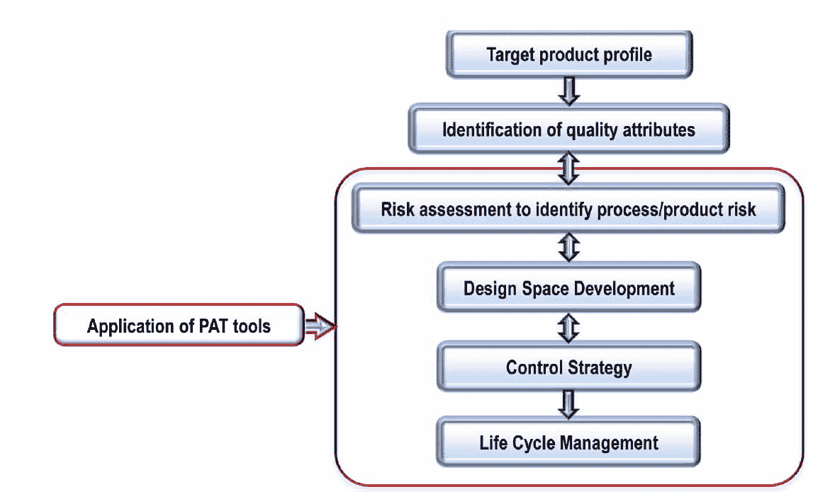 **图 (1)**

设计保证质量的元素 [27]。

## 3. 设计保证质量 (QbD) 工具：在产品开发中的应用

设计保证质量（QbD）是配方开发的一种方法，旨在获得稳健的产品并持续改进 [29]。设计保证质量（QbD）是一种具有预定义目标的系统化策略，强调了解自己的材料，并利用这些信息控制工艺 [30]。制药行业发现实施设计保证质量（QbD）具有挑战性且耗时。在配方开发中使用 `QbD` 可以减少验证批次的成本。因此，目前的需求是实施 `QbD` 原理，加强理解，并可能设计简单的模板来开发复杂的配方 [31]。

为了理解，我们可以以冻干燥工艺为例。从业务角度来看，冻干燥是一个耗时且昂贵的程序。因此，工艺必须是快速、可重复且稳健的。为了设计冻干燥方法，必须在工艺设计中定义并控制关键的配方参数。干燥箱压力、冷板温度以及整个干燥阶段的时间是影响成品质量的一些冻干燥工艺参数 [32]。如果无法控制这些变量，可能会导致干燥产品的变性、熔融或塌陷。因此，通过实施 `QbD` 对冻干产品进行系统化开发是获得质量产品的要务 [33]。根据 `ICH Q8 (R2)`，可以使用不同的实用 `QbD` 工具来开发稳健的质量配方（图 2）。

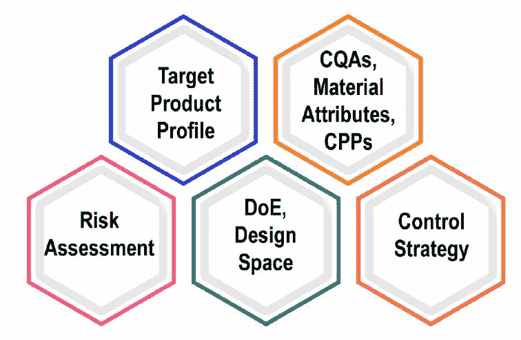 **图 (2)**


不同的设计质量工具。

## 3.1. 质量产品质量概况 (QTPP)

QTPP 定义了要整合到产品和开发过程中的目标产品特性 [34]。QTPP 体现了药品开发计划质量的总体目标。策略、过去的知识、经验或设备和资源的可用性都可能影响 QTPP 的选择。QTPP 是一个基于知识的系统，因此它应该被用于识别冻干剂的药物特性 [35]。冻干产品的一些可能的 QTPP 元素如图图 (3) 所示。

## 3.2. 关键材料属性 (CMA’s)、关键工艺参数 (CPPs) 和 关键质量属性 (CQA’s)

考虑到材料的预期用途以及对其物理化学、生物和微生物特征的认知和理解（这些特征可能会影响产品开发），必须建立冻干所需的质量。因此，在开始开发周期之前，应识别 CMAs [36, 37]。应该检查或管理关键工艺参数，以确保系统产生最高质量，因为其变异性会影响关键的质量属性。冻干过程由几个单元操作组成 [38]。

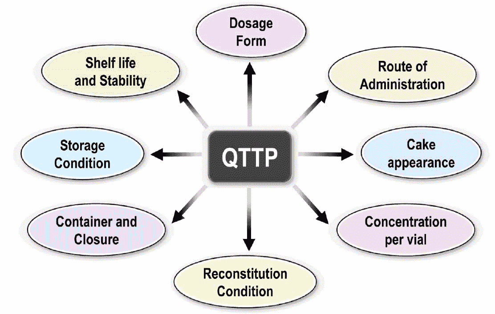 图 (3)

冻干产品的 QTPP 元素。

CQAs 是具有物理化学、生物或微生物源且必须处于特定范围内的质量或特征 [39]。冻干产品的 CQAs 通常影响产品质量、纯度、稳定性、效力、强度、药物释放等。CQAs 通常与冻干过程中的活性物质、添加剂、中间体（过程中步骤）和药物产品相关。冻干产品可能的 CMAs、CPPs 和 CQAs 如表 1 所示。

表 1 冻干产品开发可能的 CMAs、CPPs 和 CQAs [40]。

| 关键材料属性 (CMA’s) | 关键工艺参数 (CPPs) | 关键质量属性 (CQAs) |
| :-: | :-: | :-: |
| 缓冲液 | 搁板温度 | 饼外观 |
| 表面活性剂 | 冻结速率 | 重组时间 |
| 灌注量 | 冻结温度 | pH |
| 总固体含量 | 冻结保持时间 | 残留水分含量 |
| 离子强度 | 初级干燥时的腔压 | 效力 |
| 样品瓶配置 | 进入初级干燥保持的升速率 | 溶液浓度 |
| 塞子 | 初级干燥温度 | 颗粒 |
| - | 初级干燥所需时间 | 含量均匀性 |
| 二级干燥升速率 | 药物杂质 | |
| 二级干燥温度 | 无菌性 | |
| 二级干燥所需时间 | - | |

### 3.3. 风险评估

通过评估关键材料属性 (CMA) 和关键工艺参数 (CPP) 对药物关键质量属性 (CQAs) 的潜在影响，风险评估是重要的科学证据和用于质量风险管理的工具。用于风险评估的模型包括风险排序、鱼骨图和失效模式效应分析 (FMEA) [41, 42]。冻干产品的风险评估涉及将输入与 CQAs 联系起来。根据关键性将每个变量的相对风险分为高、中、低。影响小的特性不需要进一步关注 [43]。

## 3.4. 实验设计 (DOE) 和设计空间

在 DOE 中，输入（变量）和输出（响应）形成一个复杂的矩阵，其中输入变量可能是相互关联或独立的 [44]。DOE 工具有助于科学地汇总大多数变异及其对药品标准的影响。可能的输入变量是溶液浓度、辅剂量、冻结速率、二级干燥温度 [45]。冻干产品 DOE 的目标是微调风险评估中识别出的数值。DOE 使用两种设计，即筛选设计和优化设计。筛选设计旨在在少数运行中测试组合。常用的筛选设计有部分析因、Plackett-Burman 设计和井藻设计 [46]。优化设计将进一步开发筛选设计中识别的关键变量。设计空间描述了输入、工艺和产品之间的关系通过风险评估和 CQAs 设计获得的知识可以定义 CMAs 和 CPPs 的操作范围 [47]。设计空间可以使用方差分析 (ANOVA)、响应面图 (RSD)、交互作用、等高线图、主效应和其他统计方法来确定。假设设计空间内的任何工艺都会产生符合质量的结果。


PAT（过程分析技术）包含四个核心组成：过程分析化学仪表、过程跟踪与控制、连续工艺优化以及信息管理。对该方法建立科学的理解对于多元数据分析至关重要，同样，识别影响最终产品质量的材料和工艺变量的关键特征并将这些信息整合到工艺管理中也同样重要，这与质量源设计（QbD）背景下的工艺理解是一致的 [51]。过程分析化学工具提供有关工艺状态的现场、瞬时信息。PAT 工具的原始数据通过多元数据分析与 `CQAs`（关键质量属性）相关。工艺控制根据数据分析修改关键变量以满足 `CQAs`。从工艺中获得的信息是进一步增强工艺的跳板。FDA 研究机构进行的研究揭示了各种 PAT 技术和化学计量学方法的潜力。

## 4. 质量源设计：药物开发的当前趋势

由于所得出的结论缺乏合理的论证、因素相互作用的视觉化表示不足、设计空间界限不明确、模型统计可靠性细节匮乏、提供的信息缺乏框架等，都是监管机构在评估基于 QbD 的注册申报时遇到的一些问题 [46]。学术界、工业界和监管组织人员之间的合作对于解决上述问题是必要的。许多科学项目专注于产品工艺的建模、在线方法评估以及设计空间规划。科学支持的质量源设计（QbD）概念应以这些信息为基础进行实施。以下是 QbD 模块开发的几个同行评审实例 [52]。

通过 QbD 方法，我们证明了药物的 `CPPs`（关键工艺参数）、`CQAs` 与其治疗效果之间的联系。正如我们对缓释地可碱片剂的研究所示，并非所有的通则研究都能有效传达产品变体的治疗益处。设计空间的输入根据失败风险和毒性的定量评估被分为关键特征和非关键特征。在另一项研究中，使用组合质量源设计（QbD）和离散元模型（DEM）模拟方法来表征混合单元操作，评估了组分参数和工艺变量对混合质量及混合终点的影响。为了概述工艺表征的步骤，利用 QbD 定义含量均匀性为一种关键质量属性（`CQA`），建立其与混合均匀性的联系，识别可能影响混合操作效果的关键变量，并对这些变量相关的风险进行排序。这些发现被用于建立设计空间、创建三维知识空间并制定适当的控制策略。

同样，利用 QbD 原则对设计用于吸入给的胰岛素喷雾干燥进行了研究 [53]。估计了方法参数和制剂参数对胰岛素性和颗粒特征的影响。通过计划实验和多元数据分析，我们确定了制造过程中的关键要素，并建立了颗粒属性之间的因果关系。采用主成分法来寻找两组变量之间的联系。

## 5. 药物生产过程中的风险评估策略

在药物产品生命周期的许多阶段，质量风险管理都会对药物质量的任何潜在威胁进行评估、缓解、传播和审查 [54]。风险包含两个组成部分：某些糟糕情况发生的概率，以及如果发生会有多严重。没有彻底的风险评估就无法建立质量风险管理（QRM）系统。风险评估涉及系统地安排相关数据以用于决策。风险评估主要依赖于三个因素：

### 5.1. 风险识别

理论分析、历史数据、利益相关者的关切等都将被系统地利用。

### 5.2. 风险分析

对识别出的威胁进行风险评估；以及

### 5.3. 风险评价

通过定性和定量比较评估风险的相对重要性 [55]。

在开发早期研究药物的物理化学性质，包括多型性、溶解性、粒径、吸湿性、pH、温度、盐筛选、稳定性分析等（见 2）。表 2 药物开发中风险管理的常用方法 [56]。

| 风险管理工具 | 特性 | 潜在应用 |
| :--- | :--- | :--- |
| **基础工具** | | |
| • 图表分析<br>• 流程图<br>• 待办事项<br>• 程序分析 | 它们是领域内数据收集、组织和决策的常用方法。 | 统计或其他实证证据用于支持复杂的偏差、投诉、故障等。 |
| • 风险排序和筛选 | 评估和排序风险的技术<br>与风险相关的定量和定性方面的分析，权重和风险评分是一种常见做法。 | 审计和评估优先级最高的区域或地点。<br>在比较复杂风险的影响时非常有用。 |
| **高级工具** | | |
| • 故障树分析 (FTA) | 用于调查问题或故障起源的技术。通过追踪因果链同时分析多个原因，通常用于系统或子系统的单故障评估。对工艺的详细了解对于分离影响至关重要。 | 研究客户投诉。<br>分析差异。 |
| • 危险性分析 (HAZOP) | 该应用假设当计划和程序偏离预期状态时会产生不安全情况。<br>利用系统化方法识别实际用途与预期目的之间的潜在差异。 | 生产中工具、机器和基础设施的使用<br>通常用于工艺安全的风险评估。 |


| 失效模式影响分析 (FMEA) | |
| :--- | :--- |
| • 分析工艺失效的原因以及它们如何影响结果和产品性能。<br>• 在识别失效模式后，可以对风险进行消除、减少或控制。<br>• 每个失效模式都会被分配一个相对的“风险评分”作为最终结果。 | • 确定制造过程中的关键工艺和参数；评估辅助设施。 |

## 6. 药剂开发中的质量设计 (QbD)

目前，QbD 工具在药剂开发中以不同的方式使用，以控制制品的质量。药剂学、药物分析和药物植物学领域的不同研究人员根据其研究领域近期使用这些工具，并且如文所示，这些工具已成为他们成功的工具。

### 6.1. 工艺控制中的 QbD 方法

制造药物所需的步骤通常被划分为更小、更容易实现的任务。批处理和连续生产线均可用于执行这些单元任务。混合、粉碎、造粒、干燥、压缩和包衣都是单元操作的实例，因为它们导致了不同的物理或分子转变。当满足以下条件时，一个工艺被认为是已充分理解的：(1) 识别并理解了所有重要的变异来源；(2) 在整个过程中变异性得到了控制；以及(3) 产品质量属性可以精确且一致地预测。工艺步骤或单元操作的输入操作参数（如速度和流速）或工艺状态变量（如温度和压力）被称为工艺参数。为了达到预期的质量，有必要监测或控制其变异性会影响关键质量属性的工艺参数 [57]。

### 6.2. 分析方法开发与药物制造中的 QbD

QbD 方法已扩展到分析过程中，在分析过程中，使用 QbD 定义方法，然后对其进行评估和彻底研究以获得最佳的方法性能。将 QbD 应用于分析方法开发的主要目标是在开发阶段将质量融入分析方法中，这是一种结构化的方法。对所选方法进行测试，通过使用风险评估工具进行风险评估，以确保其稳健性（robust）和耐用性（rugged）。这些研究有助于了解方法的运行良好程度、如何增强它，以及如何提供风险管理控制方法，以便方法在验证后按预期方式运行 [58]。

AQbD 是一种方法开发的方法论策略，管理整个分析过程生命周期。分析过程现在已纳入 QbD 程序中。通过质量设计 (QbD) Concept 开发分析方法的主要用途集中在在开发过程中将质量融入分析技术。QbD 定义了用于评估和比较各种方法的方法论，以实现最佳的方法性能。确立的方法将经过测试，然后进行风险评估，以识别潜在风险并评估其承受这些风险的稳健性。这些研究有助于方法性能的分析、完善以及风险管理策略的制定。这确保了方法在验证后能够按照预期运行 [59]。

方法验证需要定义分析目标概况 (ATP)，决定最关键的方法特征和响应，并确定最关键的方法参数和变量。可以使用筛选和响应面实验设计来识别和优化关键参数，这些均通过统计分析实现。提供预测的数学模型阐述了因素与结果之间的联系。方法可操作区域 (MODR) 保证了可靠的方法性能，其描述由匹配 CMA 要求的元素多元组合组成 [60]。

分析技术的完整生命周期必须证明其适用于当前任务。为了实现这一目标，针对药剂分析提出了一种 QbD 方法，包含 3 个步骤：方法开发与设计、生产高质量方法，以及在预测制造器中遵循工艺验证后的程序性能验证。识别 ATP 的部分包括决定方法要求，例如感兴趣的分析物类型（产品和污染物）、将使用的分析技术类型以及所测试产品的的确切性质。将进行初始风险评估，以预见分析关键性和技术要求。标准分析程序 ATP 包含以下程序：第一，选择你的 API 和杂质；第二，选择你的方法（`HPLC`、`HPTLC`、`UV` 等）；第三，选择你的方法规格（测试图谱、杂质、溶剂残留）。

#### 6.2.1. 色谱技术中的 QbD 方法

在实际的方法开发过程中，应使用系统性的分析质量设计 (QbD) 技术。符合既定目标是 QbD 方法开发的目标。你可以以 `HPLC` 为例来展示 QbD 技术开发的目标。高效液相色谱 (`HPLC`) 常用于分析药物成分 (API)，以分离和定量活性分子以及任何影响 API 质量的关键质量属性 (CQA)。特异性、线性、准确度、精密度、稳性和耐用性是规格必须满足的通过监管要求的特征 [60]。

#### 6.2.2. HPLC 方法开发策略

基于质量设计原则，研究人员提出了一种生产高反相液相色谱技术的新技术。Vamsi Krishna 及其同事利用 `HPLC` 方法和质量设计 (QbD) 方法研究了依伯康唑硝盐的氧化和光解分解动力学。测试采用全因素交设计（即 3 个水平 3 个成分），以识别并合理分析 `TBAH` 数量、缓冲液 pH 和有机相浓度对 `EBZ` 保留因子的影响。测试采用全因素交设计（即 3 个水平 3 个成分），以识别并合理分析 `TBAH` 数量、缓冲液 pH 和有机相浓度对 `EBZ` 保留因子的影响。先前的单因素研究和色谱直觉指导了所考虑成分和范围的选择。使用 `Statistica` 对收集的数据（6.0 版本）进行统计。结果显示了每个因素对保留因子的影响。`TBAH` 浓度和有机相浓度被发现是显著且线性的。此外，他们报告随着 `TBAH` 浓度的增加，保留因子也会增加。等线图显示 `pH` 对保留因子没有影响。因此，开发的方法和稳定性研究表明，QbD 帮助研究人员选择了各种参数 [61]。


在另一项研究中，Piera Iuliani 及其同事采用部分因子设计，考察了改变流动相 pH、柱内温度（`T`）以及有机调节剂`CH3CN`对分析的非甾抗炎药物（NSAIDs）混合物 HPLC 响应的影响。此外，他们还利用涉及`pH`和不同浓度的中心复合设计（`CCD`），同时将温度保持在 350 摄氏度恒定。通过使用响应面法（`RSM`）策略，在技术开发过程中确定了分析的最佳条件。进行了实验，对实验数据拟合了响应模型，并对估计的响应模型进行了优化。RSM 具有许多优点，包括样本量小、运行时间短，以及为统计分析提供有用信息的能力，例如显示实验变量之间关系的数据 [62]。

该工作表明，在药物发现的临床前和临床阶段，可以使用`AQbD`结合`DOE`策略系统地、逐步开发用于测假定`CPL409116`物质（`JAK/ROCK`抑制剂）杂质特征的 UHPLC 程序。利用全因子设计模型考察了筛选过程中不同关键方法参数（`CMPs`）含量对关键方法属性（`CMAs`）的影响。`pH`、流动相组成和其他色谱柱均已针对`CMP`方法的色峰分离能力进行了检查。整个`AQbD`方法包含了筛选、优化和验证过程，旨在创建一种用于定量某种独特药物九种污染物完整谱图的新技术，凸显了这项工作的新颖性 [63]。

Hitesh Patel 同事根据 ICH 标准进行了验证实验，并建立了一种基于`UPLC-MS`的色谱方法。该研究将 60 分钟时的药物释放率（`D.R.`）选择为最重要的质量指标。用于深入研究设计结果的统计方法之一是方差分析（`ANOVA`）。在理想情况下，在 500 mL 的`pH` 7.4 缓冲溶液中使用以 120 rpm 旋转的`USP` `I`型（篮法）装置进行溶解。通过 QbD 引导的溶解条件研究，开发出了一种用于地固辛定量的敏感`UPLC-MS`技术。低剂量地固辛片可以受益这种方法进行常规质量控制测试，包括溶解和定量 [64]。

### 6.2.3. HPTLC 方法的优化与开发策略

在一项基于 HPTLC 的研究中，Amol Patil 及其同事在 HPTLC 中使用质量设计方法来测量赖格列替汀片剂剂型。使用中心复合设计调整了所需的方法参数，包括保留因子、峰高、流动相比例和饱和所需的时间。使用响应面分析研究了相互作用，并使用了统计学方法。采用图形化和数值优化方法定义了上述设计空间。研究表明，使用 QbD 开发的 HPTLC 方法产生了改进的性能 [65]。

在另一项研究中，Amruta Khurd 使用了质量设计（QbD）方法论。他们开发了一种创新的 HPTLC 技术来估定片剂中的利伐沙班。研究表明，如果可以使用质量设计（`QbD`）概念，所需的实验次数会更少 [66]。

Monika L. Jadhav 及其同事开发并应用了用于丙嗪酮氢盐片剂剂型估量的质量设计（`QbD`）。根据`ICH Q8(R2)`标准，通过 QbD 引导的研究确定了设计空间。使用因素设计（设计图）考察了关键因素的影响。针对`CMP`方法的色峰分离能力已检查了`pH`、流动相组成和其他色谱柱。整个`AQbD`方法包含了筛选、优化和验证过程，旨在创建一种用于定量某种独特药物九种污染物完整谱图的新技术，凸显了这项工作的新颖性 [67]。

Lidia Gurba-Brykiewicz 及其同事使用`AQbD`结合`DOE`技术，在药物研发的临床前和临床阶段定量测定生成的`CPL409116`物质的杂质谱图。关键方法参数（`CMPs`）如固定相类型（8 种不同色谱柱）、水相`pH`（2.6、3.2、4.0、6.8）、有机流动相浓度（从 20%到 85%）已经过仔细评估（`ACN`）。任何可靠的方法必须满足峰对称性（0.8 和 1.8）和峰与间分离度（2.0）。作为筛选过程的一部分，他们使用了完全因子设计`2²`来比较不同浓度的`CMPs`的影响。筛选步骤的知识空间用于指导稳健性测试，这些测试是使用部分因子设计`2^(4-1))`实施的。已产生方法适用设计范围（`MODR`）。通过蒙特卡洛模拟计算了达到`CMAs`性能目标的概率。根据`ICH Q2(R1)`标准，零阶色光法方法被证明是精确且可靠的；建议的程序可用于常规分析丙嗪酮氢盐 [68]。

#### 6.2.4. U.V.方法的开发/优化策略


不同的研究人员展示了 QbD 方法在分光度法中的应用。他们采用了遵循 `ICH Q8(R2)` 的分析质量设计 (AQbD) 技术。Sk. Mastanamma 设计并验证了用于定量原料药中替诺韦胺及其合成混合物的光光度法。样品制备方法、溶剂、波长以及实验参数（包括扫描速度、狭缝宽度、采样间隔等 `etc.`）均使用石川图进行了制图。通过直接观察和主成分分析相结合确定了关键参数。使用蒸馏水、甲醇和乙腈在 258 nm 处通过简单的分光度法测定了样品药物浓度。使用蒸馏水时，浓度在 2.5 到 25 g/ml 之间 (`r2=0.998`) 以及 5 到 30 g/ml 之间 (`r2=0.996`) 时符合比尔定律。发现浓度为 10-50 g/ml 的甲醇和乙腈 (`r2=0.997`) 结果最佳。所提出的药物分析方法可靠、可重复且具有成本效益。质量设计 (QbD) 的实施促进了更安全工艺的发展，节省了时间和金钱，并在工艺的每个阶段产生一致、可靠且高质量的数据 [69]。

## 6.3. 基于质量的新型药物递送设计

全球许多监管机构推荐基于 QbD 的产品开发。因此，使用实验设计 (DoE) 来优化纳米载体，如聚合物 NP、固体脂质 NP、胶束、奈斐质体、脂质体、纳米结构脂质载体、液晶 NP 和脂质-聚合物混合 NP。DoE 工具是有助于理解输入因素（单独或共同）如何影响最终输出响应的统计学方法。纳米载体的开发通常使用实验设计 (DoE) 方法，例如筛选设计（部分因子设计、全因子设计和 Plackett-Burman 设计）和响应面曲面法 (RSM)。制药领域的两种标准 RSM 方法是中心复合设计 (CCD) 和 Box-Behnken 设计 (BBD) [70]。

### 6.3.1. 聚合物纳米颗粒

已采用多种形式的 DoE 来聚合物和表面活性剂、药物/聚合物比例、溶剂/非溶剂比例、均质速率和均质时间对纳米载体生产的影响，以优化工艺。为了理解这些变量如何影响聚合物 NP 的响应，使用了 `FFD` 和 `PBD` 等筛选模型 [70]。在设计特定治疗应用的聚合物纳米颗粒时，聚合物、油和表面活性剂的数量、药物浓度、药物/聚合物比例、水相和有机相的体积以及均质速率只是需要考虑的因素因素 [70]。

粒径、包封效率、ζ 电位、多分散指数、pH 和药物载量是已研究的聚合物基纳米载体的少数依赖因素。除了上述参数外，还可以评估与聚合物纳米颗粒制造相关的其他参数，如其表面积和均匀性。通过离子凝胶技术，Pandey 及其同事 [70] 制备了含有厄洛替尼的壳聚糖 NP，并使用 `CCD` 评估了独立变量。结果表明，在 0.1 N 盐酸和 pH 6.6 的磷酸盐缓冲液中，药物在 24 小后的释放率为 39.78%，进入 NP 的最大包封效率为 91.57%。人员得出结论，`CCD` 在测试中非常有效，产生的聚合物纳米颗粒可以作为进一步分析的起点。上市产品的药物释放更快，而改进后的配方具有延迟释放速率，并且对癌细胞具有更显著的细胞毒作用。

### 6.3.2. 聚合物胶束

聚合物胶束具有核壳结构的纳米载体，尺寸范围从 10 到 200 nm 不等；然而，向系统中加入药物可以增加其尺寸。表面活性剂、表面活性剂组合、药物量、浓度、复水缓冲液量以及超声处理时间和振幅等因素都可以对聚合物胶束进行研究。Ye 和其同事 [70] 利用 Box-Behnken 设计 (`BBD`) 分析了操作因素与姜黄素表溶解度之间的关系。使用这种方法，他们产生了 12 个因子点和 5 个中心点。得到的数据具有预测性。球形胶束直径为 247 nm，观测溶解度为 4.44 g/mL，ζ 电位为 -13.3 mV。研究表明，优化后的配方不需要表面活性剂和溶剂。

#### 6.3.3. 脂质体

脂质体是球形脂质纳米结构，水性内核由由磷脂和胆固醇组成的双层框架包裹。标准脂质体可以对其某些成分进行改进，以创建具有独特特征的结构 [71]。可以使用不同的脂质创建 pH 敏感或热敏感脂质体。这些脂质体主要用于癌症治疗，以防止溶酶体分解并鼓励热疗。一些研究调查了调整脂质/药物/胆固醇浓度和比例等变量如何影响脂质体特性。Shah 和 Jobanputra 研究了声声时间、振幅和药物/脂质比例对 `BBD` 的影响 [72]。这些因素也影响响应的大小和包封的有效性。显示声声持续时间和振幅之间存在反比关系，Shah 和 Jobanputra 关于声声时间、振幅和药物/脂质比例对 `BBD` 影响的研究表明，降低这些参数会减少粒径和包封效率。

#### 6.3.4. 微乳液和纳米乳液


由油相与含有适当量表面活性剂的水相组成的纳米系统被称为微乳液和纳米乳液。这些相可以自发形成，也可以在外部能量供应下形成胶体分散 [73]。`DoE` 已用于更好地理解重要变量的作用并生产或应用微乳液和纳米乳液。目前已使用了多种筛选模型，包括 `FFD` 和 `PBD`，以及包括 `CCD` 和 `BBD` 的 `RSM`。如前所述，这些系统结合了水相和油相，并涉及表面活性剂或表面活性剂的组合。因此，研究诸如配方成分、设备、制备条件和温度等因素是常见的。`油/表面活性剂/水`比例和表面活性剂混合物是影响微乳和纳米乳液的主要配方成分。制备条件与温度、均质化/声声时间以及强度有关。Ahmad 及其同事 [51] 创建了纳米乳液以增强这种纳米系统，并使用了 `CCD`。在早期研究中评估了 `油/表面活性剂`混合比例和声声持续时间，而在后的研究中还评估了声声强度和温度。两篇论文中的尺寸、透射率和多分散指数都是相同的。这两项工作都经过了优化，作者认为所得纳米乳液对于皮肤局部应用是安全的，可以加速伤口愈合。

### 6.3.5. 固体脂质纳米颗粒

`SLN` 的独特特性是在室温水溶液中存在固体脂质（0.1% 至 30.0%（w/w））和表面活性剂（0.5% 至 5.0%）。固体脂质混合物可以包含各种配方、表面活性剂和助表面活性剂 [74]。

在 `SLNs` 的 `DoE` 模型中，包封效率和药物载量等参数通常作为响应添加，因为特定分子可能难以包裹，或者有时需要较高的包封率。例如，瑞舒伐汀钙被包裹在 `SLN` 中，主要由硬脂酸和润滑剂（`Poloxamer 407/Tween 80`，1:1% w/v）组成。根据作者最初的研究，药物包封、药物载量和尺寸受到搅拌和成分比例等因素显著影响。使用 `CCD` 研究了药物包封和载量，作者发现所使用的脂质数量会产生差异。随后，他们优化了工艺，发现药物载量和包封效率的实际值与他们的预测相符 [74]。

### 6.4. 植物化学品提取与多药配方中的 QbD 方法

植物疗愈早于有记载的历史。即使在古代，人们也利用草药来处理各种疾病。尽管在过去的几十年里现代医学取得了巨大进展 [75]，草药补充剂对于维持全球健康仍然至关重要。然而，尽管草药被广泛使用，但在草药生产中应用质量设计（`QbD`）的情况却是零星的。制造过程应该符合 `QbD` 的目标，因为这种方法旨在使配方从经验性的试错法转出来。制造工艺必须在 `QbD` 框架内开发，因为大多数草药产品是基于经验的方法制造的，而且由于复杂的化学组成和多个工艺参数，这些方法无法提高我们对底层过程的理解 [76]。由于 `QbD` 试图将配方从经验试错法重新导向更具可预测性和呈现的模式，因此在其框架内建立制造工艺是至关重要的 [77]。如果商业草药产品想要达到相当的安全性、有效性和质量，则必须在开发过程中采用 `QbD` 模型 [78]。

复杂的化学结构和各种工艺因素意味着，在草药制品的生产过程中广泛使用基于经验的方法对推进我们对制造工艺的理解没有任何帮助。因此，在 `QbD` 框架内建立生产程序至关重要；它旨在将重点从经验试错法转向更控的环境，以确保产品整个生命周期内的质量一致性。出于这个原因，草药产品的商业化需要使用 `QbD` 模型进行开发，以保证具有足够的安全性、有效性和质量。从制造的角度来看，草药制品的提取是一个相对复杂的程序，因为它涉及大量不同的成分和差异巨大的单元操作。大多数情况下，这些程序涉及多个成分或变量。由于草药药物复杂的化学组成，要在输入关键样本属性（`CSAs`）或关键工艺变量（`CPVs`）与终产品关键质量参数（`CQPs`）之间建立关联是挑战性的。因为草药的提取主要依赖经验，不同输入材料对产品的影响尚不清楚，导致最终产品质量下降 [79]。因此，为了提高植物药的提取性能，有必要充分理解 `CSAs`/`CPVs` 之间的相互作用。从草药制品中提取活性成分已在几篇论文中被强调，作为如何此类 `QbD` 范式的示例。

输入质量或来源的变化包括：

- 原料来源、加工、植物成分和杂质。
- 温度、频率、能量、提取方法。
- 设备的发展，如微波、超声波器、超临界流提取器和加速溶剂提取器。
- 测量方法，如用于获取代表性样本、制备天平和分析天平的方法。
- 环境关注包括相对湿度、温度和水分浓度。

因此，方差通常用于衡量过程的总体变化。确定哪些输入、变量或因素会影响过程是每个处理草药的行业面临的挑战。`QbD (ICH Q9)` 是一组工具，允许对过程的所有可用输入进行严格评估。这种评估旨在识别对过程可能产生最显著影响的少数部分。在植物提取工艺中通常使用的筛选设计如下：

- 完全正交设计 (`2^k`)。
- 部分正交设计 (`2^(k-p)`)。
- Plackett-Burman 设计。
- Taguchi 设计。


Mykhailenko *et al.* 应用了质量设计（Quality-by-Design）方法创建了一种从藏红花（*Crocus Sativus*，*C. sativus*）花瓣中提取抗癌的过程。开发了一种使用多种溶剂收集提取物的方法，并通过色谱分析确定了最佳提取剂，以确保符合`QTPP`标准。利用植物化学标记排名系统（`HerbMars`）对藏红花进行了质量标记保护，该系统评估了生物利用度、药理功效和选定的基准。一系列测试考察了从原料中水/醇提取化合物时，变化的因素如何影响结果（`DoE`）。利用高效液相色谱（`HPLC`），他们鉴定出藏红花瓣中的 16 种化学物质并确定了它们的相对含量。藏红花瓣的化学分析是其品质的可靠指标（芦丁、芒果素、阿魏酸、异槧皮苷和番红素）。Volyn 花药头（第一类）也符合香料藏红花的`ISO 3632`标准。使用`IGR39`和`MDA-MB-231`黑色素瘤进行的细胞毒性测试显示，*C. sativus*花瓣的乙醇提取物对三阴性乳腺癌细胞系比水提取物更有效。因此，证据表明质量设计是生产高质量中药的实用工艺开发方法[[[80]]。

Pan *et al.* 研究了使用不同质量样本所需的提取、浓缩、水沉淀和色谱方法，以制备总量的三七（*Panax notoginseng (P. notoginseng)*）皂苷。一种结论性的筛选布局同时考察了十个工艺参数。在工艺`CQAs`中发现了`CPPs`和`CMAs`。模型包括`CMAs`、`CPPs`和工艺`CQAs`。蒙特卡洛模拟以 0.90 的置信度确定了设计空间。质量保证应考虑生产的影响，以确保产品质量。洗液中的人参苷和总皂苷对于质量保证至关重要。提取、洗脱和乙醇浓度是`CPPs`。从形态上来说，干提取物三七非常重要。其他`CMAs`包括可提取的三七皂苷 R1、`Rg1`、`Rb1`和`Rd`。使用三七注射液的`NTS`标准区分了特级和经济级三七。`NTS`不应由低质量三七制成。可以通过优化参数实现高质量的提取物。卓越的科学测试证实了两个优良的三七批。该研究的质量控制技术考虑了工艺与中药成分的相似性[[[81]]。

Koli *et al.* 制方了一种含有多种中药的片剂并确定了其最佳制备方法。首先通过风险顺序数（RPN）评估了关键成分带来的潜在危险。作者随后开发了一种完全随机因子设计，其中可以改变微晶纤维素（`MCC`）和交联纤维钠（`CCS`）的比例以降低这些风险。`MCC` 5–15%和`CCS` 0.5–5%被用实验设计（`DoE`）中的独立变量，创建了四种试验配方，这些样本的脆度和崩解时间分别为 0.35–0.91%和 11.41–15.50 分钟。在测试了四种不同的配方后，由于其优越的崩解和湿度，选择了三种用于短期稳定性研究：F-1、F-2 和 F-4。`MCC`和`CCS`是配方 F-1 中的自由变量。崩解时间（min）和湿度（%）均显示受配方成分`X1`：`MCC`和`X2`：`CCS` (%)的强烈影响。因此，表明通过质量设计分析质量因素并优化复方片剂配方可以获得更好的结果[[[82]]。

Vijayaraj *et al.* 应用`QbD`方法创建并验证了用于纳米颗粒芦丁分析的`RP-HPLC`方法。响应面（`RSM`）实验设计解释了二次模型的色谱响应。中心复合设计（`CCD`）在三个水平上评估了每个设计变量，以建立二次回归模型的系数。`CCD`设计确定了理想流速、流动相 pH、强度和波长，以获得最佳保留时间、峰面积和不对称因子色谱响应。色谱水平和因素优化了实验设置。30 次实验具有四个独立变量（A、B、C 和 D）和三个依赖结果。使用优化的独立变量，芦丁的保留时间、峰面积和不对称因子分别为 3.75 分钟、1014.79 毫伏和 1.26。定量为 0.15 g/mL，检测限为 0.005 g/mL。根据`ICH`指南对优化的测定条件进行了线性、准确、精度和稳健性测试。在壳聚糖海藻酸钠纳米颗粒中推荐的芦丁分析方法的`QbD`优化显示了鼓舞的结果[[[83]]。

### 6.5. 绿色合成中的 QbD 方法

绿色合成（称为绿色化学）的目标是开发各种科学产品和工艺，这些工艺产物极少、资源和能源高效且无废物[[[84]]。绿色纳米技术是绿色技术的一个子集，结合了绿色化学和绿色工程的思想，“绿色”指的是植物材料的使用。绿色纳米技术能够在不使用有害成分并在低温下制造更环保的纳米材料和纳米产品，同时消耗更少的能量并利用再生资源[[[85]]。植物作为稳定和还原剂，使绿色介源合成成为微调纳米颗粒尺寸和形状的有力工具。此外，绿色纳米颗粒的治疗效果比化学产生的纳米颗粒更显著[[[86]]。

`QbD`已用于纳米颗粒药物传递系统的绿色合成，以提高药物的释放曲线和靶向性，并提高动力学、药代动力性和毒性特征。多种统计模型显示`DoE`提高了合成产品的一致性，同时减少了必要的测试次数。几种`DoE`设计方法有助于优化纳米颗粒系统的绿色生产[[[87]]。`QbD`可用于绿色介源合成，通过检查最终产品的所需质量概况，提供对如何实现合成改进的变量效应和韧性质量的洞察。`BBD`是一种强大、有效且系统的表面面响应方法工具，可加速绿色合成并提高研究输出[[[75]]。

Kaur *et al.* 利用茜草提取物绿色合成创建了`ZnO-NPs`的配方。粒径、多分散指数和包封率是`Design-Expert`软件考虑的许多变量之一，以实现最佳配方（`PDI`）。作为协变量还包括试剂浓度（% w/v）、搅拌速度（rpm）和超声处理持续时间（分钟）。`BBD`被用于增强`ZnO-MJE-NPs`的性能。


一项研究展示了独立因素如何影响不同配方的粒径。该模型的 `F-value` 为 `23.30`，证明了其统计学显著性（`p 0.05`）。`ANOVA` 测试结果显示二次模型提供了良好的拟合。根据 `F-value` 所示，没有统计学上的显著差异。二次模型的 `R2` 高于其他模型。如果偏差大于 4，则是一个良好的指标。`ZnSO[4]` 对粒径有积极影响。随着 `ZnSO[4]` 浓度的增加，粒径增大导致分散粘度增加。随着声声时间（`B`）的增加，粒径下降。由于声声过程中颗粒破碎，纳米颗粒尺寸随声声时间的延长而减小。然而，有证据表明搅拌速度（`C`）不利于粒径，但这种效应并不显著。搅拌速度的进一步增大会导致颗粒破碎，从而导致粒径的。粒径图包括维度图、测量以及计算图。当应用二次模型时，与早期研究相比，配方优化产生了可以接受的结果 [77]。

Kheshtzar *et al.* 研究了确定使用松树叶提取（*Pinus eldarica*）提取物环保生产零价态铁纳米颗粒（`INPs`）的最佳反应条件。在绿色合成过程中，使用中心复合面设计确定了理想反应条件，并使用分数析设计筛选了有效参数 [88]。产生 `INP` 最有效的因素是叶片提取物的量和铁前驱体的量。通过实验的两阶段统计设计，我们可以微调合成参数，从而增加 `INP` 的产量。

第一步，确定显著影响纳米颗粒输出的关键因素已完成。作者使用分数析设计考察了植物铁前驱体浓度、提取物量、总反应时间和及反应温度之间的相关性。接下来，建立了一个经验模型来确定感兴趣变量的最优值。为了最大化 `INP` 的产生，利用中心复合面（`CCF`）有效因子计算了铁前驱体与叶片提取物的最佳比例。筛选阶段识别出的影响变量通过 `CCF` 设计和 `RSM` 进行了优化。根据图表分析，为了获得最大的 `INP` 产量，叶片提取物和铁前驱体的最佳最终浓度分别为 `20–50 mM` 和 `8–9 mL`。图 (**1**) 显示，当氯化铁浓度增加到 `50 mM` 以上且叶片提取物体积减少到 `8 mL` 以下时，纳米颗粒的形成受到抑制。模型预测，在使用分别为 `25 mM` 和 `9 mL` 的提取物和氯化铁时，最大生产率为每次反应 `0.015 g`（反应混合物每 mL 1.5 mg）。因此，在验证实验的理想情况下产生了 `0.015 g mL^-1` 的 `INPs`。确定了不同的反应参数如何影响 `INPs` 的制造，以使每个反应体积产生的颗粒最大化。反应条件显著影响形成的环保纳米颗粒的物理化学特性。因此，有必要检查合成条件及相关组件对纳米颗粒活性、形状和其他性质的影响。检查合成条件及相关组件对纳米颗粒活性、形状和其他性质的影响是必要的。反应条件显著影响形成的环保纳米颗粒的物理化学特性。因此，有必要检查合成条件及相关组件对纳米颗粒活性、形状和其他性质的影响。反应条件显著影响形成的环保纳米颗粒的物理化学特性。因此，有必要检查合成条件及相关组件对纳米颗粒活性、形状和其他性质的影响。


免疫分析基于所产生的抗体试剂的特异性和选择性对感兴趣的生物分子进行定量。虽然分析 `QbD` 是一个较新的发明，但其背后的理念（如统计质量保证和目标导向规划）长期以来一直作为诊断测试的“设计控制”。除了部分应用和特定仪器外，描述基于 `QbD` 的免疫分析进展的案例寥寥无几。在开发新技术的过程中，实验设计（`Design of Experiments`）被用于优化影响材料属性（`CMAs`）的免疫分析参数（`DOEs`）[95]。

利用 `QbD` 原则，Yorovoi H 等人创建了四种免疫分析以支持疫苗释放检测。他们实施了系统技术来收集前期目标（`ATP`）、确定可能的方法输入（`鱼骨图`、`因果矩阵`）、探索设计空间（`DOEs`），并管理剩余风险以简化开发流程（`FMEA`）。根据研究结果，基于 `QbD` 的方法开发是管理分析转移和产品生命周期的一种更高效、更有组织的方法 [96]。

Goris 等人创建了口蹄疫诊断血液分析，他们还利用多种质量工具建立了国际参考标准和质量控制方法。第一种分析方法的提取性能等于或优于两种“金标准”方法：一种相当的 `ELISA` 和基于细胞的病毒中和试验 [97]。Bak 等人以一种有趣的新方式使用了控制图和统计方差分量分析。他们不再依赖于孤立的阳性对照（只能提供分析板上部分孔的准确表征），而是开发了一个跟踪整个孔板性能的系统 [98]。

其中一项研究的作者最初使用 `QbD` 原则创建了一种定量人体血浆中药物的技术。感兴趣的化学物质是`艾替韦拉韦`（elvitegravir）。进行这些研究是为了按照欧洲药品管理局（`EMA`）设定的标准，及时且成本成本地验证生物分析方法。本研究中采用的 `HPLC-MS/MS` 方法的分析性能和特征与之前发表的针对`艾替韦拉韦`的有限方法相当。为了建立分离和定量血浆样本中艾替韦拉韦的最佳方法，科学家们考虑了分子的化学性质及其在标准临床场景中的特定应用。作者得出结论，严谨的优化程序产生的方法既处于统计控制之下（如控制图所示），又足够强大满足目前预期用途的需求 [99]。

## 7. 监管和行业对 QbD 的观点

自 `FDA` 于 2004 年建立 21 世纪倡议（`基于风险的方法`）以来，一直鼓励在药物产品开发中早期采用新技术和基于风险的方法。（`FDA`，2004 年）。利用 `QbD` 原则，Yorovoi H 等人创建了四种免疫分析以支持疫苗释放检测。他们实施了系统技术来收集前期目标（`ATP`）、确定可能的方法输入（`鱼骨图`、`因果矩阵`）、探索设计空间（`DOEs`），并管理剩余风险以简化开发流程（`FMEA`）。根据研究结果，基于 `QbD` 的方法开发是管理分析转移和产品生命周期的一种更高效、更有组织的方法 [96]。

自 `FDA` 于 2004 年建立 21 世纪倡议（`基于风险的方法`）以来，一直鼓励在药物产品开发中早期采用新技术和基于风险的方法。（`FDA`，2004 年）。利用 `QbD` 原则，Yorovoi H 等人创建了四种免疫分析以支持疫苗释放检测。…… `QbD` 描述的是工艺特征而非由实验结果产生。`QbD` 可能会增加首次通过率、提高产量、降低成本并为针对性检查提供机会 [74]。

自 `FDA` 于 2004 年建立 21 世纪倡议（`基于风险的方法`）以来，一直鼓励在药物产品开发中早期采用新技术和基于风险的方法。（`FDA`，2004 年）。利用 `QbD` 原则，Yorovoi H 等人创建了四种免疫分析以支持疫苗释放检测。…… `QbD` 描述的是工艺特征而非由实验结果产生。`QbD` 可能会增加首次通过率、提高产量、降低成本并为针对性检查提供机会 [74]。

自 `FDA` 于 2004 年建立 21 世纪倡议（`基于风险的方法`）以来，一直鼓励在药物产品开发中早期采用新技术和基于风险的方法。（`FDA`，2004 年）。…… `QbD` 描述的是工艺特征而非由实验结果产生。本文提供了如何使用不同模型的摘要 [74]。

药物制造商应时刻记住，`QbD` 应用应包含关于研究和制造的充分细节。辉瑞（Pfizer）是最早使用 `QbD` 和 `PAT` 的企业之一。这为企业带来了更好的工艺知识、更高的质量以及实施变更的灵活性。此外，`QbD` 的很大一部分用于工艺开发，其优势在商业领域有所体现 [100]。

表 3 **监管的质量设计：分析 QbD 与产品 QbD。**

| **序号** | **阶段** | **产品 QbD** | **分析 QbD** |
| --- | --- | --- | --- |
| 1 | 阶段 1 | 从质量角度指定理想产品谱（`QTTP`） | 定义分析目标谱（`ATP`） |
| 2 | 阶段 2 | 关键质量属性 | 关键质量属性 |
| 3 | 阶段 3 | 风险评估 | 风险评估 |
| 4 | 阶段 4 | 设计空间 | 方法操作设计区域 |
| 5 | 阶段 5 | 监管方法 | 监管方法 |
| 6 | 阶段 6 | 生命周期管理 | 生命周期管理 |


此外，它为制造工艺注入了组织化的、基于风险的整体性思维。`QbD` 方法采用了一种基于风险的方法，其优势在于从研究阶段到监管批准再到大规模生产，在时间和资金方面更加高效。它可以涵盖药物研究运营的早期阶段。为了实施 `QbD` 和 `AQbD`，有统一术语和概念，对行业和监管机构的人力资源进行培训和教育，并对药物制备过程中开发的信息记录提供指导。我们倡导行业与监管机构之间增加讨论，以帮助 `QbD` 的采用。

## 参考文献

| | |
| --- | --- |
| [1] | | Allen LV, Jr. 配制基础：效价与稳定性测试。Int J Pharm Compd 2013; 17(3): 220-4. [PMID: [24046938](http://www.ncbi.nlm.nih.gov/pubmed/24046938)] |
| [2] | | Sangshetti JN, Deshpande M, Zaheer Z, Shinde DB, Arote R. 质量设计方法：监管需求。Arab J Chem 2017; 10 (Suppl. 2): S3412-25. [[`dx.doi.org/10.1016/j.arabjc.2014.01.025`](http://dx.doi.org/10.1016/j.arabjc.2014.01.025)] |
| [3] | | Mv L. 质量风险管理 (QRM)：综述。J Drug Deliv Ther 2013149. |
| [4] | | Deepak Kumar D, Ancheria R, Shrivastava S, Soni SL, Sharma M. 药物质量设计 (QbD) 综述。Asian Journal of Pharmaceutical Research and Development 2019; 7(2): 78-82. [[`dx.doi.org/10.22270/ajprd.v7i2.460`](http://dx.doi.org/10.22270/ajprd.v7i2.460)] |
| [5] | | Savitha S, Devi K. 质量设计：综述。J Drug Deliv Ther 2022; 12(2-S): 234-9. [[`dx.doi.org/10.22270/jddt.v12i2-S.5451`](http://dx.doi.org/10.22270/jddt.v12i2-S.5451)] |
| [6] | | Yu LX, Amidon G, Khan MA, et al. 理解药物质量设计。AAPS J 2014; 16(4): 771-83. [[`dx.doi.org/10.1208/s12248-014-9598-3`](http://dx.doi.org/10.1208/s12248-014-9598-3)] [PMID: [24854893](http://www.ncbi.nlm.nih.gov/pubmed/24854893)] |
| [7] | | Kalyane D, Raval N, Polaka S, Tekade RK. 质量设计作为药物开发中的一种新兴概念。药物产品开发与研究的未来 20201-25. [[`dx.doi.org/10.1016/B978-0-12-814455-8.00001-3`](http://dx.doi.org/10.1016/B978-0-12-814455-8.00001-3)] |
| [8] | | 协调会议。ICH Q8(R2) 药物开发。获取自：[`database.ich.org/sites/default/files/Q8_R2_Guideline.pdf`](https://database.ich.org/sites/default/files/Q8_R2_Guideline.pdf) |
| [9] | | Sangshetti JN, Deshpande M, Zaheer Z, Shinde DB, Arote R. 质量设计方法：监管需求。Arabian Journal of Chemistry. 2017; 10: S3412-S25. [[`dx.doi.org/10.1007/s43441-020-00254-9`](http://dx.doi.org/10.1007/s43441-020-00254-9)] [PMID: [33439461](http://www.ncbi.nlm.nih.gov/pubmed/33439461)] |
| [10] | | Werther W, Loughlin AM. 后监管要求。临床试验原则与实践 20211-28. |
| [11] | | EASE. 获取自：[`www.ease.io/root-cause-analysis-how-to-use-fishbone-diagram/#:text=A%20fishbone%20diagram%2C%20also%20the%20University%20Tokyo`](https://www.ease.io/root-cause-analysis-how-to-use-fishbone-diagram/#:text=A%20fishbone%20diagram%2C%20also%20the%20University%20Tokyo) |
| [12] | | Wong KC. 使用 Ishikawa 图辅助医学文献相关案例的检索。J Case Reports 2011; 5(1): 120. [[`dx.doi.org/10.1186/1752-1947-5-120`](http://dx.doi.org/10.1186/1752-1947-5-120)] [PMID: [21447163](http://www.ncbi.nlm.nih.gov/pubmed/21447163)] |
| [13] | | Liliana L. 用于质量评估的新 Ishikawa 模型。IOP Ser Mater Sci Eng 2016. [[`dx.doi.org/10.1088/1757-899/161/01209`](http://dx.doi.org/10.1088/1757-899/161/01209)] |
| [14] | | Chen H, Tao Z, Zhao S, Lu M. `PDCA` 和 `FMEA` 综合使用对工作效率、团队合作和员工认同的影响：以某医院为例。Contrast Mol Imaging 20221-8. [[`dx.doi.org/10.1155/2022/52862`](http://dx.doi.org/10.1155/2022/52862)] [PMID: [3568566](http://www.ncbi.nlm.nih.gov/pubmed/3568566)] |
| [15] | | ASQ（美国质量协会）。获取自：[`asq.org/quality-resources/fmea`](https://asq.org/quality-resources/fmea) |
| [16] | | Butreddy A, Bandari S, Repka MA. 热熔挤出分散体中的质量设计：产品开发的视角。Eur J Pharm Sci 2021; 158: 105655. [[`dx.doi.org/10.1016/j.ejps.2020.105655`](http://dx.doi.org/10.1016/j.ejps.2020.105655)] [PMID: [33253883](http://www.ncbi.nlm.nih.gov/pubmed/33253883)] |
| [17] | | Pascarella G, Rossi M, Montella E, et al. 医疗保健机构的风险分析：方法框架和关键变量。Risk Manag Healthc Policy 2021; 14: 2897-911. [[`dx.doi.org/10.2147/RMHP.S30908`](http://dx.doi.org/10.2147/RMHP.S30908)] [PMID: [34267567](http://www.ncbi.nlm.nih.gov/pubmed/34267567)] |
| [18] | | Demmon S, Bhargava S, Ciolek D, et al. 关于关键质量属性鉴定与工艺表征研究的跨行业论坛。Biologicals 2020; 67: 9-20. [[`dx.doi.org/10.1016/j.biologicals.2020.06.008`](http://dx.doi.org/10.1016/j.biologicals.2020.06.008)] [PMID: [32665104](http://www.ncbi.nlm.nih.gov/pubmed/32665104)] |
| [19] | | Hamilton Company。获取自：[`www.hamiltoncompany.com/process-analytics/process-analytical-technology/critical-quality-attributes#:text=A%20CQA%20is%20a%20physical,To%20measure%20directly%20in%20production`](https://www.hamiltoncompany.com/process-analytics/process-analytical-technology/critical-quality-attributes#:text=A%20CQA%20is%20a%20physical,To%20measure%20directly%20in%20production) |
| [20] | | Hamilton Company。生物工艺中的制造 KPI。获取自：[`www.hamiltoncompany.com/process-analytics/process-analytical-technology/manufacturing-kpis-in-bioprocessing`](https://www.hamiltoncompany.com/process-analytics/process-analytical-technology/manufacturing-kpis-in-bioprocessing) |
| [21] | | Hamilton Company。关键工艺。获取自：[`www.hamiltoncompany.com/process-analytics/process-analytical-technology/critical-process-parameters`](https://www.hamiltoncompany.com/process-analytics/process-analytical-technology/critical-process-parameters) |
| [22] | | Holm P, Allesø M, Bryder MC, Holm R. Q8(R2)。ICH 质量指南 201753-77. [[`dx.doi.org/10.1002/9781191.ch20`](http://dx.doi.org/10.1002/9781191.ch20)] |
| [23] | | Pielenhofer J, Meiser SL, Gogoll K, et al. 药物咪喹纳米颗粒制剂的质量设计 (QbD) 方法。Pharmaceutics 2023; 15(2): 514. [[`dx.doi.org/10.3390/pharmaceutics15020514`](http://dx.doi.org/10.3390/pharmaceutics15020514)] |


## 参考文献

1. [26] ter Horst JP, Turimella SL, Metsers F, Zwiers A. 2014 至 2019 年间欧盟（EU）药品监管注册案中质量源设计（QbD）原则的实施情况。Ther Innov Regul Sci 2021; 55(3): 583-90. [`dx.doi.org/10.1007/s43441-020-00254-9`](http://dx.doi.org/10.1007/s43441-020-00254-9) [PMID: [33439461](http://www.ncbi.nlm.nih.gov/pubmed/33439461)]

2. [27] Patil AS, Pethe AM. 质量源设计（QbD）：高质量药物开发的新新概念。第 4 卷。

3. [28] Namjoshi S, Dabbaghi M, Roberts MS, Grice JE, Mohammed Y. 质量源设计：半固体外用剂质量目标产品特征（QTPP）的开发。Pharmaceutics 2020; 12(3): 287. [`dx.doi.org/10.3390/pharmaceutics12030287`](http://dx.doi.org/10.3390/pharmaceutics12030287) [PMID: [32210126](http://www.ncbi.nlm.nih.gov/pubmed/32210126)]

4. [29] Mahajan R, Gupta K. 美国食品药品管理局的关键路径倡议与药物开发范式的创新：挑战、进展与争议。J Pharm Bioallied Sci 2010; 2(4): 307-13. [`dx.doi.org/10.4103/0975-7406.72130`](http://dx.doi.org/10.4103/0975-7406.72130) [PMID: [21180462](http://www.ncbi.nlm.nih.gov/pubmed/21180462)]

5. [30] Q8(R2) 药物开发，获取自：[`www.fda.gov/regulatory-information/search-fda-guidance-documents/q8r2-pharmaceutical-development`](https://www.fda.gov/regulatory-information/search-fda-guidance-documents/q8r2-pharmaceutical-development)

6. [31] Pardeshi SR, More MP, Patil PB, Mujumdar A, Naik JB. 用于眼部递送的载药伏康唑纳米颗粒羧甲基壳聚糖-聚氧乙醚*原位*凝胶的统计学优化：*体外*、*离体*及毒毒性评估。Drug Deliv Transl Res 2022; 12(12): 3063-82. [`dx.doi.org/10.1007/s13346-022-01171-0`](http://dx.doi.org/10.1007/s13346-022-01171-0) [PMID: [35525868](http://www.ncbi.nlm.nih.gov/pubmed/35525868)]

7. [32] Cheng HP, Tsai SM, Cheng CC. 搁板真空冷干燥设备热传递机制的分析。Adv Mater Sci Eng 2014; 2014: 1-7. [`dx.doi.org/10.1155/2014/515180`](http://dx.doi.org/10.1155/2014/515180)

8. [33] Pardeshi S, More M, Patil P, *et al.* 药物制备中基于干燥的（喷雾干燥、冷冻干燥和喷雾-冷冻干燥）颗粒工程方法的详尽概述。Dry Technol 2021; 39(11): 1447-91. [`dx.doi.org/10.1080/07373937.2021.1893330`](http://dx.doi.org/10.1080/07373937.2021.1893330)

9. [34] Khan A, Naquvi KJ, Haider MF, Khan MA. 质量源设计：药物产品开发的更新技术。Intelligent Pharmacy. 2023.

10. [35] Yu LX. 药物质量源设计：产品与工艺开发、理解与控制。Pharm Res 2008; 25(4): 781-91. [`dx.doi.org/10.1007/s11095-007-9511-1`](http://dx.doi.org/10.1007/s11095-007-9511-1) [PMID: [18185986](http://www.ncbi.nlm.nih.gov/pubmed/18185986)]

11. [36] Azad MA, Capellades G, Wang AB, *et al.* 关键材料属性（CMAs）-颗粒形状对微型药物单元操作的影响。AAPS PharmSciTech 2021; 22(3): 98. [`dx.doi.org/10.1208/s12249-020-01915-6`](http://dx.doi.org/10.1208/s12249-020-01915-6) [PMID: [33709195](http://www.ncbi.nlm.nih.gov/pubmed/33709195)]

12. [37] Pardeshi, S.R., Deshmukh, N.S., Telange, D. *et al.* 药物、生物药物和纳米医学中冷冻工艺的工艺开发与质量属性：现状综述。Futur J Sci 2023; 9: 99. [`dx.doi.org/10.1186/s43094-023-0051-8`](http://dx.doi.org/10.1186/s43094-023-0051-8)

13. [38] Awotwe-Otoo D, Agarabi C, Wu GK, Casey E, Lute S, *et al.* 质量源设计：配方变量及其相互作用对冻冻干燥单隆抗体质量属性的影响。Int J Pharm. 2012; 43(8): 167–75. [`dx.doi.org/10.1016/j.ijpharm.2012.08.033`](http://dx.doi.org/10.1016/j.ijpharm.2012.08.033) [PMID: [24854893](http://www.ncbi.nlm.nih.gov/pubmed/24854893)]

14. [39] Namjoshi S, Dabbaghi M, Roberts MS, Grice JE, Mohammed Y. 质量源设计：半固体外用剂质量目标产品特征（QTPP）的开发。Pharmaceutics 2020; 12(3): 287. [`dx.doi.org/10.3390/pharmaceutics12030287`](http://dx.doi.org/10.3390/pharmaceutics12030287)

15. [40] Desai N, Purohit R. 基于质量源设计开发的缓肠制剂。AAPS PharmSciTech 2017; 18(7): 2626-38. [`dx.doi.org/10.1208/s12249-017-3`](http://dx.doi.org/10.1208/s12249-017-3)

16. [41] Desai N, Purohit R. 利用质量源设计开发的脉冲释放片剂。AAPS PharmSciTech 2017; 18(8): 3208. [`dx.doi.org/10.1208/s12249-017-3`](http://dx.doi.org/10.1208/s12249-017-3)

17. [42] Mockus LN, Paul TW, Pease NA, *et al.* 质量源设计的冷冻干燥工艺与制剂开发。Dry Technol 2011; 16(6): 549-76. [`dx.doi.org/10.3109/10834`](http://dx.doi.org/10.3109/10834)

18. [43] Jankovic A, Chaudhary G, Goia F. 实验设计对复杂系统的影响。Energy Build 2021; 39. [`dx.doi.org/10.1016/j.build.2021`](http://dx.doi.org/10.1016/j.build.2021)

19. [44] Patel SM, Jameel F, Sane SU, Kamat M. 质量源设计的药物产品开发。在：Jameel F, Hershenon S, Khan M, Martin-Moe S 编。[`dx.doi.org/10.1007/978-1-4939-0316-8`](http://dx.doi.org/10.1007/978-1-4939-0316-8)

20. [45] Ferreira NN, Miranda RR, Moreno NS, Leite CM, Leite A. 利用实验设计（DOE）优化仿细胞膜包裹纳米结构的性能与稳定性。Frontiers in Bioengineering and Biotechnology 2023;11. [`dx.doi.org/10.3389/fbioe.2023.112019`](http://dx.doi.org/10.3389/fbioe.2023.112019)

21. [46] Rathore A. 生物技术产品的设计空间，获取自：[`www.fda.gov/regulatory-information/search-fda-guidance-documents/q8r2-pharmaceutical-development`](https://www.fda.gov/regulatory-information/search-fda-guidance-documents/q8r2-pharmaceutical-development)

22. [47] Radhakrishnan V, Davis P, Hiebert D. 质量源设计在冷冻工艺应用中的科学方法。在：Warne N, Mahler H 编。[`dx.doi.org/10.1007/978-3-319-90603-4`](http://dx.doi.org/10.1007/978-3-319-90603-4)

23. [48] Rößler M, Huth PU, Liauw MA. 过程分析技术（PAT）作为光催化反应实时监测和动力学评估的多功能工具。React Chem Eng 2020; 5(10): 1992-2002. [`dx.doi.org/10.1039/D0RE00256A`](http://dx.doi.org/10.1039/D0RE00256A)

24. [49] Kumar R, Mittal A, Kulkarni MP. 药物开发中的质量源设计。Computer Aided Pharmaceutics and Drug Delivery 202299-127. [`dx.doi.org/10.1007/978-981-16-5180-9`](http://dx.doi.org/10.1007/978-981-16-5180-9)


- [50] Chanda A, Daly AM, Foley DA, *et al.* 过程分析技术的行业视角：原料药（API）开发中的工具与应用。Org Process Res Dev 2015; 19(1): 63-83. [`dx.doi.org/10.1021/op400358b`](http://dx.doi.org/10.1021/op400358b)
- [51] Grangeia HB, Silva C, Simões SP, Reis MS. 药品制造中的质量设计：当前现状、挑战与未来展望的系统性综述。Eur J Pharm Biopharm 2020; 147: 19-37. [`dx.doi.org/10.1016/j.ejpb.2019.12.007`](http://dx.doi.org/10.1016/j.ejpb.2019.12.007) [PMID: [31862299](http://www.ncbi.nlm.nih.gov/pubmed/31862299)]
- [52] Powar TA, Hajare AA. 基于 QbD 的提高 Sprague-Dawley 大鼠乙炔 radiol 雌二醇*体内*生物利用度的方法。a Chem Slov 2020; 67(1): 283-303. [`dx.doi.org/10.17344/acsi.2019.5441`](http://dx.doi.org/10.17344/acsi.2019.5441) [PMID: [33558931](http://www.ncbi.nlm.nih.gov/pubmed/33558931)]
- [53] Kumar N, Jha A. 药品“良好配送规范”期间的质量风险管理——一种可能的解决方案。Bull Fac Pharm Cairo Univ 2018; 56(1): 18-25. [`dx.doi.org/10.1016/j.bfopcu.2017.12.002`](http://dx.doi.org/10.1016/j.bfopcu.2017.12.002)
- [54] Fukuda IM, Pinto CFF, Moreira C dos S. Saviano AM, Lourenço FR. 实验设计（DoE）应用于药品分析质量设计（QbD）。Braz J Pharm Sci 201854
- [55] Gupta NV, Reddy V, Gupta V, Raghunandan V, Kashyap N. 药品行业中的质量风险管理：综述。Development of Nanocarriers Vol 6
- [56] Alemayehu D, Alvir J, Levenstein M, Nickerson D. 数据驱动的质量风险管理方法。Perspect Clin Res. 2013; 4(4): 221-226. [`dx.doi.org/10.4103/2229-3485.120171`](http://dx.doi.org/10.4103/2229-3485.120171)
- [57] Katekar V, Sangule D, Bhurbhure O, Ingle P, Dhage S, Jadhav K. 分析方法中质量设计方法的综述。J Drug Deliv Ther 2022; 12(3-S): 255-61. [`dx.doi.org/10.22270/jddt.v12i3-S.5386`](http://dx.doi.org/10.22270/jddt.v12i3-S.5386)
- [58] HG S, Ruba Priya MG, Murugan V. 用于方法开发和验证的质量设计方法的实施。Res. J Pharm Technol, 2022; 436-40.
- [59] Tome T, Žigart N, Časar Z, Obreza A. 使用 AQbD 原则进行液相色谱分析方法的开发与优化：概述与近期进展。Org Process Res Dev 2019; 23(9): 1784-802. [`dx.doi.org/10.1021/acs.oprd.9b00238`](http://dx.doi.org/10.1021/acs.oprd.9b00238)
- [60] Krishna MV, Dash RN, Jalachandra Reddy B, Venugopal P, Sandeep P, Madhavi G. 用于开发依康唑硝盐 HPLC 方法的质量设计（QbD）方法：氧化和光解降解动力学的应用。J Saudi Chem Soc 2016; 20: S313-22. [`dx.doi.org/10.1016/j.jscs.2012.12.001`](http://dx.doi.org/10.1016/j.jscs.2012.12.001)
- [61] Iuliani P, Carlucci G, Marrone A. 通过分段设计和多元回归对 NSAIDs 进行 HPLC 响应的研究。J Pharm Biomed Anal 2010; 51(1): 46-55. [`dx.doi.org/10.1016/j.jpba.2009.0801`](http://dx.doi.org/10.1016/j.jpba.2009.0801) [PMID: [1975780](http://www.ncbi.nlm.nih.gov/pubmed/1975780)]
- [62] Veza I, Spragg M, Fattah I, Idris M. 用于优化生物燃料性能和排放的响应面法（RSM）。Results in Engineering. 2023; 18: 10123
- [63] Beeraka NM, Kumar P, Gurupadayya. 基于质量设计的低剂量 UPLC-MS 方法开发、验证与优化。Curr Pharm Anal 2022; 18(8): 841-51
- [64] Patil A, Shirkhedkar. 质量设计在原料 hptlc 方法开发中的应用。Eurasian Journal of Analytical Chemistry 2017; 12(5): 443-58. [`dx.doi.org/10.1273/ejac.2017.0018`](http://dx.doi.org/10.1273/ejac.2017.0018)
- [65] Khurd AS, Doshi KV. 基于质量设计的利伐沙班原料及剂型的高性能薄层色谱法的优化与验证。Planar Chromatogr 2019; 32(6): 505-10. [`dx.doi.org/10.1556/j006.2019.32.6`](http://dx.doi.org/10.1556/j006.2019.32.6)
- [66] Jadhav ML, Tambe SR. 用于丙洛定盐酸盐剂型方法开发和验证的 QbD 方法实施。Res Int 2013-9. [`dx.doi.org/10.1155/2013/67651`](http://dx.doi.org/10.1155/2013/67651)
- [67] Gurba-Bryśkiewicz L, Dawid U, Smuga DA, *et al.* 用于药物研究临床和临床阶段物质完整杂谱分析的色谱方法 QbD 方法实施。Int J Mol Sci 2022; 23(18): 10720. [`dx.doi.org/10.3390/ijms23181020`](http://dx.doi.org/10.3390/ijms23181020) [PMID: [3614262](http://www.ncbi.nlm.nih.gov/pubmed/3614262)]
- [68] Mastanamma S, Srilakshmi PSB, Ramadevi N, Prathyusha D, Rani MV, Rani MV. 用于替诺韦福酚胺原料及实验室合成混合物的紫外-分光度法分析质量设计方法。Research Journal of Pharmacy and Technology 2018; 11(2): 499. [`dx.doi.org/10.5958/0974-360X.2018.00914`](http://dx.doi.org/10.5958/0974-360X.2018.00914)
- [69] Tavares Luiz M, Santos Rosa Vie J, Palma Abriata J, *et al.* 用于开发和优化纳米颗粒作为药物递送系统的实验设计（DoE）。Eur J Pharm Biopharm 2021; 165: 127-48. [`dx.doi.org/10.1016/j.ejpb.2021.05011`](http://dx.doi.org/10.1016/j.ejpb.2021.05011) [PMID: [3399275](http://www.ncbi.nlm.nih.gov/pubmed/3399275)]
- [70] Guimarães D, Cavaco-Paulo A, Nogueira E. 用于治疗应用的脂质体作为药物递送系统的设计。Int J Pharm 2021; 601: 120571. [`dx.doi.org/10.1016/j.ijpharm.2021.120571`](http://dx.doi.org/10.1016/j.ijpharm.2021.120571) [PMID: [3381296](http://www.ncbi.nlm.nih.gov/pubmed/3381296)]
- [71] Shah VH, Jobanputra A. 基于 QbD 方法优化的载脂质体漆剂增强丙比芬的指甲渗透。AAPS PharmSci 2018; 19(1): 213-24. [`dx.doi.org/10.1208/s12249-017-031`](http://dx.doi.org/10.1208/s12249-017-031) [PMID: [2868133](http://www.ncbi.nlm.nih.gov/pubmed/2868133)]
- [72] Dasgupta N, Ranjan S, Gandhi M. 乳液化组分和成分。Environ Chem Lett 2019; 17(2): 917-28. [`dx.doi.org/10.1007/s10311-018-0497`](http://dx.doi.org/10.1007/s10311-018-0497)
- [73] Duan Y, Dhar A, Patel C, *et al.* 脂质纳米颗粒简述：当代药物递送系统的组成部分。RSC Advances 2020; 10(45): 26777-91. [`dx.doi.org/10.1039/D0RA03491F`](http://dx.doi.org/10.1039/D0RA03491F) [PMID: [3551578](http://www.ncbi.nlm.nih.gov/pubmed/3551578)]
- [74] Chintamani RB, Salunkhe KS, Kharat AR, Chintamani SR, Singh RP, Chavan MJ. 基于 QbD 方法的西兰花（*Brassica oleracea var. italica plenck*）花提取物绿色合成纳米颗粒的制备、表征与评估，用于乳腺肿瘤细胞 T-47D 治疗。Int J Sci Technol Res 2020; 9(2).


- [75] Zhang L, Yan B, Gong X, Yu LX, Qu H. 质量设计在植物药制剂工艺开发中的应用：案例研究。AAPS PharmSciTech 2013; 14(1): 277-86. [`dx.doi.org/10.1208/s12249-012-9919-8`](http://dx.doi.org/10.1208/s12249-012-9919-8) [PMID: [23297167](http://www.ncbi.nlm.nih.gov/pubmed/23297167)]
- [76] Ali J, Pramod K, Tahir MA, Charoo NA, Ansari SH. 药物产品开发：一种质量设计方法。Int J Pharm Investig 2016; 6(3): 129-38. [`dx.doi.org/10.4103/2230-973X.187350`](http://dx.doi.org/10.4103/2230-973X.187350) [PMID: [27606256](http://www.ncbi.nlm.nih.gov/pubmed/27606256)]
- [77] Khan IA, Smillie T. 实施“质量设计”方法以确保植物膳补充剂的安全性和完整性。J Nat Prod 2012; 75(9): 1665-73. [`dx.doi.org/10.1021/np300434j`](http://dx.doi.org/10.1021/np300434j) [PMID: [22938174](http://www.ncbi.nlm.nih.gov/pubmed/22938174)]
- [78] Saroj Seema, Shah Priya, Jairaj Vinod and Rathod Rajeshwari, 绿色分析化学与质量设计：一种迈稳健和可持续现代分析的结合方法，Current Analytical Chemistry 2018; 14(4). [`dx.doi.org/10.2174/1573411013666170615140836`](http://dx.doi.org/10.2174/1573411013666170615140836)
- [79] Mykhailenko O, Ivanauskas L, Bezruk I, Petrikaitė V, Georgiyants V. 质量设计方法在*藏红花花药（*Crocus Sativus Perianth*）抗癌粗提取物开发中的应用。Sci Pharm 2022; 90(1): 19. [`dx.doi.org/10.3390/scipharm90010019`](http://dx.doi.org/10.3390/scipharm90010019)
- [80] Pan J, He S, Zheng J, et al. 考虑制造工艺影响的中药材料质量策略开发。Chin Med 2019; 14(1): 38. [`dx.doi.org/10.1186/s13020-019-062-9`](http://dx.doi.org/10.1186/s13020-019-062-9) [PMID: [31572490](http://www.ncbi.nlm.nih.gov/pubmed/31572490)]
- [81] Mannur VS. 通过`bD`方法开发一种新型免疫调节材料直接压片多植物药片。J med pharma allied sci 2022; 11(6): 5476-84. [`dx.doi.org/10.55522/jmpas.V11I6.4520`](http://dx.doi.org/10.55522/jmpas.V11I6.4520)
- [82] Vijayaraj S, Palei NN, Archana D, Lathasri K, Rajavel P. 质量设计（`QbD`）方法用于用于壳聚糖-海藻酸钠纳米颗粒中芦皮定量的稳定性指示`HPLC`方法。Braz J Pharm Sci 2020; 56:18793. [`dx.doi.org/10.1590/s2175-979020200031873`](http://dx.doi.org/10.1590/s2175-979020200031873)
- [83] Diallo MS, Fromer NA, Jhon MS. 用于可持续发展的纳米技术：回顾与展望。J Nanopart Res 2013; 15(11): 2044. [`dx.doi.org/10.1007/s11051-013-2044-0`](http://dx.doi.org/10.1007/s11051-013-2044-0)
- [84] Ahmed SF, Mofijur M, Rafa N, et al. 环境纳米生物修复用纳米材料合成的绿色方法：技术进展、应用、优势与挑战。Environ Res 2022; 204(Pt A): 111967. [`dx.doi.org/10.1016/j.envres.2021.111967`](http://dx.doi.org/10.1016/j.envres.2021.111967) [PMID: [34450159](http://www.ncbi.nlm.nih.gov/pubmed/34450159)]
- [85] Yarovoi H, Frey T, Bouaraphan S, Retzlaff M, Verch T. 疫苗释放免疫测分析的质量设计：案例研究。Bioanalysis 2013; 5(20): 2531-45. [`dx.doi.org/10.4155/bio.1398`](http://dx.doi.org/10.4155/bio.1398) [PMID: [24138626](http://www.ncbi.nlm.nih.gov/pubmed/24138626)]
- [86] Goris N, De Clercq K. 口蹄疾病相酶免疫吸附试验的质量保证/质量控制——第二部分。质量控制：监测检测性能两种方法比较。Rev Sci Tech 2005; 24(3): 1005-16. [`dx.doi.org/10.20506/rst.24.3.1630`](http://dx.doi.org/10.20506/rst.24.3.1630) [PMID: [16642771](http://www.ncbi.nlm.nih.gov/pubmed/16642771)]
- [87] Bak H, Ekeroth L, Houe H. 使用多级逻辑模型对丹麦猪结核抗体 ELISA 计划进行质量控制。Prev Vet Med 2007; 78(2): 130-41. [`dx.doi.org/10.1016/j.prevetmed.2006.001`](http://dx.doi.org/10.1016/j.prevetmed.2006.001) [PMID: [17175047](http://www.ncbi.nlm.nih.gov/pubmed/17175047)]
- [88] Baldelli S, Marrubini G, Cattaneo D, Clementi E, Cerea M. 质量设计在生物分析中的应用：人体浆定量方法的开发。Ther Monit 2017; 39(5): 531-42. [`dx.doi.org/10.1097/FTD.00000028`](http://dx.doi.org/10.1097/FTD.00000028) [PMID: [28650901](http://www.ncbi.nlm.nih.gov/pubmed/28650901)]
- [89] Zhang L, Mao S. 质量设计在药物开发中的应用。Asian J Pharma Sci 2017; 12(1): 1-8. [`dx.doi.org/10.1016/j.ajps.2016.07.006`](http://dx.doi.org/10.1016/j.ajps.2016.07.006) [PMID: [32104308](http://www.ncbi.nlm.nih.gov/pubmed/32104308)]
- [90] Peraman R, Bhadraya K, Padmanabha Reddy. 分析质量设计：用于监管活性和稳健分析的工具。Int J Anal Chem 2015; 1-9. [`dx.doi.org/10.1155/2015/8627`](http://dx.doi.org/10.1155/2015/8627) [PMID: [25722723](http://www.ncbi.nlm.nih.gov/pubmed/25722723)]
- [91] Schad M, Gautam S, Grein TA, Käß F. 病毒疗法生物工艺分析技术（`PAT`）与质量设计（`QbD`）。见：Gautam S, Chiramel AI, Pach R, Käß F 编。病毒疗法和药物（ATMPs）的生物工艺与分析开发。2023:295-328. [`dx.doi.org/10.1007/978-3-031-28489_23`](http://dx.doi.org/10.1007/978-3-031-28489_23)
- [92] Singh J, Yadav P, Yadav S. 药物开发中监管质量设计（`QbD`）综述。Pharmaceutics 2020; 12(8): 761. [PMID: [32806507](http://www.ncbi.nlm.nih.gov/pubmed/32806507)]
- [93] Bahl D, Bakhshi P, Rawat S. 质量设计：系统性述。Int J Appl Pharm 2020; 12(3): 12-8.
- [94] Schad M, Gautam S, Grein TA, Käß F. 病毒类疗法生物工艺过程分析技术（`PAT`）与质量设计（`QbD`）。见：Gautam S, Chiramel AI, Pach R 编。病毒类先进疗法和药物（ATMPs）的生物工艺与分析开发。Cham：Springer International Publishing;2023. p. 295-328. [`dx.doi.org/10.1007/978-3-031-28489_23`](http://dx.doi.org/10.1007/978-3-031-28489_23)
- [95] Lohiya RT, Tambe A, Jadhav M, Kapadiya N. 基于质量设计（`QbD`）的药物产品开发：综述。J Appl Pharm Sci 2021; 11(04): 156-66.
- [96] Suthar B, Patel R, Mehta T. 质量设计（`QbD`）及其在制药行业中的应用：综合综述。Int J Pharm Sci Res 2020; 11(5): 2011-25.
- [97] Rathore AS. 生物药物的质量设计：原则与案例研究 2009. [`dx.doi.org/10.1002/9780470466315`](http://dx.doi.org/10.1002/9780470466315)
- [98] Prajapati VD, Jani GK, Moradiya NG, Randeria NP. 质量设计（`QbD`）：用于优化分析程序的分析开发与制剂开发的整合方法。J Pharm Biomed Anal 2012; 67-68: 22-30.
- [99] Singh S, Srinivasan KK, Gowthamarajan K. 用于制剂开发的质量设计方法：系统综述。J Young Pharm 2011; 3(2): 115-21.
- [100] Bansal AK, Dighe V, Gaikwad D, Gupta V, Jangam S, Tyagi R. 质量设计：综合综述。Int J Pharm Sci Res 2013; 4(10): 3690-707.


Sonal Dubey^(1, *)

¹ Dayananda Sagar 大学药剂科学学院，Kumaraswamy Layout, 班加罗尔-560111, 印度

## 摘要

虚拟工具与筛选设计之间的协同作用推动了药物发现和新药开发的变革性转变。利用计算模型、分子模拟和人工智能，虚拟工具赋予了研究人员预测分子相互作用、评估亲和力以及优化药物-靶点相互的能力。这种预测能力加速了具有前景的药物候选的识别和优先排序，以便进一步研究。同时，筛选设计有助于针对靶点蛋白的海量化合物库进行系统和高通量评估，能够快速识别具有所需药理活性的先导化合物。包括机器学习在内的先进数据分析技术提高了识别和优化过程的效率和准确性。虚拟工具与筛选设计的整合提供了一种加速药物发现流程的整体方法。通过阐述理性药物设计，这些工具指导了具有增强性能的新型化合物的开发。此外，这种方法通过突出高潜力的候选药物并尽可能地减少昂贵的实验迭代，优化了资源配置。这种融合的结果是药物发现过程变得更加精确、高效且具有成本效益。所得的候选药物表现出更好的效力、特异性和安全性。因此，虚拟工具与筛选设计的结合是药物发现和新药开发创新的有力催化剂，确保了解决未未医疗挑战的变革性疗法的交付。在本章中，我们将结合实际案例和成功故事详细讨论不同的工具。

**关键词：** 药物发现、药物设计、设计软件、分子建模、分子对接、QSAR、虚拟筛选。

***

* 通讯作者 Sonal Dubey: Dayananda Sagar 大学药剂科学学院，Kumaraswamy Layout, 班加罗尔-560111, 印度；电子邮件：drsonaldubey-pharmacy@dsu.edu.in

## 1. 引言

随着虚拟工具和筛选设计的整合，药物发现和开发的格局发生了巨大的变化。这些创新技术已成为游戏规则改变者，彻底改变了传统的药物开发方法 [1]。在这一综合综中，我们将探索虚拟工具和筛选设计在重塑制药行业方面的深远影响和意义。从历史上看，药物发现是一项耗时且昂贵的工作，由于实验方法的局限性，失败率很高。然而，虚拟工具的出现引入了范式转移。这些工具涵盖了广泛计算技术，能够预测和优化药物-靶点相互作用、分子属性以及 ADMET（吸收、分布、代谢、排泄和毒性）特征 [2]。结果是药物发现过程变得更加高效且具有成本效益，节省了时间和资源。

筛选设计（无论是虚拟还是实验性的）对于从海量化学库中识别有前景的药物候选药物至关重要。虚拟筛选利用计算方法对具有潜在靶点蛋白结合亲和力的化合物进行排序。这种方法不仅加速了先导化合物的选择，还减少了需要合成和实验测试的化合物数量 [3]。另一方面，实验筛选涉及高通量分析，可快速评估化合物的生物活性，进一步提高了药物发现流程的效率。虚拟工具与筛选设计之间的协同作用在它们优化“从命中到先导”（hit-to-lead）以及先导优化阶段的能力上显而易见。虚拟工具通过提供构效关系（SAR）的见解并帮助研究人员修改分子结构以增强效力、选择性和所需的属性，实现了理性药物设计。结合筛选技术，这种方法加速了有前景的药物候选的识别，加快了从实验室到病床的转化 [4]。

虽然工具和筛选设计的优点是巨大的，但承认它们的局限性也是重要的。虚拟模型基于假设和近似，其准确性很大程度上取决于数据。此外，实验验证对于确认虚拟工具的预测至关重要。筛选设计还需要仔细的分析和验证策略以确保结果的可靠性。在本章中，我们旨在全面理解虚拟工具和筛选设计在现代药物发现中的作用。通过深入探讨其应用、优点和局限性，我们希望阐明它们的变革潜力。随着制药行业的不断发展，虚拟工具和筛选设计成为追求新型有效治疗剂的重要工具。

## 2. 药物设计概念

药物设计是一个处于化学、生物学和计算科学交叉领域的动态跨学科，专注于创造治疗疾病的新型治疗剂。这一过程涉及一种系统方法，整合各种科学原理来开发具有所需属性的分子。分子、蛋白质和细胞通路之间复杂的作用构成了药物设计的基础，旨在实现有效性和特异性。药物设计是一个复杂的过程，涉及识别靶区域、开发与靶点蛋白相互作用的先导化合物以及测试该化合物的安全性和有效性 [5]。虚拟工具在药物设计中变得越来越重要，使研究人员能够加速和优化药物发现过程 [6]。计算建模已成为药物发现的关键工具，允许研究人员模拟和预测分子及其与其他子的相互作用。市场上上有多种此类目的软件，包括分子动力学模拟软件包、分子对接软件和 `QSAR`（定量构效关系）建模工具 [7]。

### 2.1. 定量构效关系 (QSAR)

`QSAR` 是一种用于药物发现的方法，根据分子的化学结构预测其活性。`QSAR` 历史悠久，可以追溯到 20 世纪 60 年代首次作为分析有机化合物结构与其生物活性之间关系的方法引入时 [7]` 建模工具是一种计算建模软件，可根据化学结构预测分子的活性。这些工具使用统计方法识别分子结构与其活性之间关系中的模式。这些信息可用于设计具有特定活性谱的新型化合物 [8, 9]。


QSAR 的发展源于更好地理解药物作用机制以及设计更有效药物的需求。早期的 QSAR 模型基于简单的统计方法，仅使用少量的分子描述符来预测化合物的生物学活性。随着时间的推移，该领域已经发展出更复杂的模型，这些模型包含了更多的分子描述符，并考虑了分子的三维结构 [10^(\-)12\]。

描述符是代表分子物理、化学和生物特性的定量测量值。描述符用于表示分子的结构和性质，通常作为 QSAR 模型的输入。有几种类型的描述符可以帮助我们设计 QSAR 模型，每种都有其优势和局限性。QSAR 建模中常用的主要方法有：

### 2.1.1. 拓扑法

拓扑法是 QSAR 建模最简单的方法，涉及使用分子图来表示化学结构。该方法使用拓扑指数（从分子图中计算出的数值）作为描述符来预测生物学活性。拓扑指数描述了分子量、原子数量、环的大小数量、形状以及分子图的分支情况。它们通常用于预测物理化学性质，如 `logP`（脂水性）和沸点 [13^(\-)16\]。

### 2.1.2. 物理化学法

物理化学法涉及使用描述分子物理化学性质的物理化学描述符来预测生物学活性。这些描述符包括分子量、极化率和折射率等性质。物理化学描述符通常用于预测药物在体内的溶解性、稳定性和转运 [13, 17, 18\]。

### 2.1.3. 量子化学法

量子化学法涉及使用量子力学计算来预测分子的电子结构和性质。该方法使用描述分子电子结构和反应性的量子化学描述符来预测生物学活性。量子化学描述符包括电离电位、电子亲和力和极矩等性质 [17, 19, 20\]。

### 2.1.4. 分子力学法

分子力学法涉及使用经典力学模拟分子的运动和相互作用。该方法使用描述分子能量和几何结构的分子力学描述符来预测生物学活性。分子力学描述符包括总能量、键长和键角等性质 [21, 22\]。

### 2.1.5. 混合法

混合法结合了上述两种或两种方法，以提高 QSAR 准确性和稳健性。例如，混合法可能会将拓扑指数与物理化学描述符结合起来，预测分子的生物学活性。混合法比单一方法更强大，通常用于预测复杂的生物学活性 [23\]。

QSAR 模型主要有两种类型：2D-QSAR 和 3D-QSAR。2D-QSAR 模型采用二维分子表示来预测生物学活性，而 3D-QSAR 模型考虑了分子的三维结构及其与靶点的相互作用。尽管 3D-QSAR 模型更加复杂且计算量大，但它们提供了更准确预测生物活性的潜力 [24^(\-)26\]。

### 2.2. 2D-QSAR

2D-QSAR 是一种相对简单且广泛使用的方法，依赖于基于二维分子结构的描述符计算。这些描述符包括物理化学性质（如分子量、`logP` 和极化率）以及拓扑指数（如环的数量、原子的数量和分支指数）。然后使用计算出的描述符来建立一个数学模型，将化合物的生物学活性与其结构特征联系起来。该模型可用于预测与训练集具有相似结构特征的新化合物的活性 [27^(\-)30\]。2D-QSAR 的主要优点之一是计算效率高，可分析大数据集。然而，该方法的局限性在于没有考虑分子的空间形状。例如，两个化合物可能具有相似的二维结构，但它们的三维形状可能不同，导致活性差异。这种局限性可以通过使用 3D-QSAR 来解决 [31^(\-)33\]。

### 2.3. 3D-QSAR

比较分子场分析（CoMFA）是一种考虑分子三维形状的更先进的方法。3D-QSAR 涉及将一组分子在共同参考系中进行对齐，以便计算场。这些场随后被用于导出三维描述符，进而建立将化合物生物学活性与其结构特征联系起来的数学模型。通常使用探针在分子周围放置三维网格（如网格框）来绘制三维结构，并记录 `XYZ` 坐标以图形形式表示结构（见图 1)）。该模型可用于预测与训练集具有相似结构特征的新化合物活性 [32\]。3D-QSAR 的主要优势之一是它可以考虑分子的三维形状，这对于活性至关重要。然而，该方法的局限性在于计算量大，且对分子的对齐敏感。此外，模型的质量取决于分子三维结构的质量。

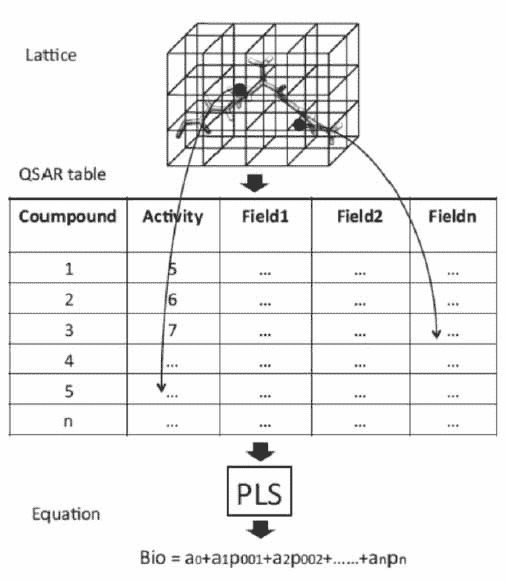图 (1)

使用网格中的探针计算各种描述符以推导出数学模型的示意图。

图 (2) 展示了 CoMFA 分析涉及的各个步骤，通过这些步骤可以产生分子的活性构象并进行相互对齐。位阻和电子参数使用探针进行测量，最终结果以等值图的形式呈现，指示三维空间中的有利和不利区域。


另一种 3D QSAR 方法是比较分子相似性指数分析（CoMSIA），这是一种强大的定量构关系（QSAR）方法，用于分析分子结构与其生物活性之间的关系。CoMSIA 是传统分子相似性分析（CoMFA）的改进，它除了空间和静电相互作用外还引入了额外的场以增强其预测能力 [34]。CoMSIA 使用基于网格的方法分析分子的空间结构，并根据物理化学性质（如电荷、疏水性和极化率）计算不同分子之间的相似性。在 CoMSIA 中，计算了五种不同的相似性场 `i.e.*空间、静电、疏水、氢键供体和氢键受体。选择这些场是为了涵盖配体结合的主要贡献。相似性指数在预对齐分子的等间距网格点上进行计算。CoMSIA 在分子周围生成一个三维网格，并采用部分最小二法（PLS）回归分析来研究物理化学性质与生物活性之间的联系 [35, 36]。CoMSIA 与其他 QSAR 方法相比具有几个优势：它对分子对齐的选择不敏感，而这可能是其他方法中变性的重要来源。它还可以处理比传统 CoMFA 更大的数据集，这对于分析大型化合物库非常有用。此外，CoMSIA 能够预测与训练集结构不同的化合物的生物活性，使其成为先导优化和骨架跳跃的有用工具 [24]。CoMSIA 已成功应用于药物的多个领域，包括 HIV-1 蛋白酶抑制剂的设计、新型抗肿瘤药物的开发以及抗真菌药物的优化。CoMSIA 成功的一个例子是基于吡咯嘧啶结构设计新型抗肿瘤药物。CoMSIA 被用于分析化合物的物理化学性质与其抗肿瘤活性之间的关系，并能够以高准确度预测新化合物的活性 [35, 37]。

CoMFA（比较分子场分析）和 CoMSIA（比较分子相似性指数分析）都是定量构关系（QSAR）方法，用于分析分子结构与其生物活性之间的关系。然而，两种方法之间存在一些关键区别。CoMFA 和 CoMSIA 的一个主要区别是它们用于分析分子空间**的场类型。CoMFA 仅使用空间和静电场分析结构，而 CoMSIA 结合了疏水性和极化率等额外场以增强其预测能力。两种方法的另一个区别是它们对分子对齐的敏感性。CoMFA 对分子对齐的选择非常敏感，对齐的微小变化会导致计算场的显著变化。相反，CoMSIA 对分子对齐不那么敏感，即使在分子没有完美对齐的情况下也能产生更准确的结果。CoMSIA 还具有处理比 CoMFA 更大数据集的优势，这在分析大型化合物库或寻找新先导化合物时非常有用 [38]。尽管存在这些差异，CoMFA 和 CoMSIA 都已广泛应用于药物发现，并证明在预测化合物的生物活性方面是有效的。选择哪种方法取决于研究的具体目标和所分析分子的性质 [39]。

许多软件包可用于 QSAR 建模，例如 MOE、Schrödinger 和 ChemAxon。这些软件选项采用机器学习算法来检测包含化学结构和活性信息的量数据集中的模式 [40]。随后，这些算法可以根据化学组成预测新化合物的活性。QSAR 在药物发现中的一个说明性成就是药物塞来昔布（Celecoxib）的产生，它用于疼痛和炎症管理 [41]。塞来昔布是环氧化酶-2（COX-2）酶的选择性抑制剂，该酶参与炎症介质的产生。研究人员使用 QSAR 设计了对 COX-2 具有比相关 COX-1 酶选择性的新化合物。这导致了塞来昔布的开发，它对 COX-2 更有选择性，且比早期的非选择性 COX 抑制剂副作用副作用 [42]。

药物发现中使用 QSAR 的另一个例子是药物格非替尼（Gefitinib）的开发，它用于治疗非小细胞肺癌。格非替尼是表皮生长因子受体（EGFR）的选择性抑制剂，该受体在许多癌症中过度表达 [43]。研究人员使用 QSAR 设计了对 EGFR 具有比同家族其他成员更高选择性的新化合物。这导致了格非替尼的开发，它在临床试验中显示出良好的结果 [44]。除了这些例子，QSAR 还被用于开发多种其他药物，包括抗病毒药物、抗菌药物和抗药物。通过使用 QSAR，研究人员可以加速药物发现过程，识别新的候选药物，优化药物性质，并提高新治疗的安全性和有效性 [47]。

## 3. 分子建模

分子建模是药物设计和发现的另一种强大的虚拟工具。它允许科学家可视化药物分子的空间结构及其与靶蛋白的相互作用，并优化药物的性质，如结合亲和力、选择性和代谢动力学。在本文中，我们将探索不同的分子建模技术及其在药物发现中的应用 [51, 52]。

### 3.1. 蛋白质建模

如果蛋白质结构完全未知或尚未完全建立，可以使用同源建模或*从头建模*（de novo modelling）来进行蛋白质建模。`Homology modelling` 是一种根据蛋白质序列与已知蛋白质结构的相似性来预测蛋白质空间结构的计算方法。该方法可以预测靶蛋白的空间结构并优化药物与其相互作用 [53, 54]。`De novo modelling` 是一种在不依赖任何已知蛋白质结构的情况下从零开始预测蛋白质空间结构的计算方法。当靶蛋白没有已知同源物或者同源模型不准确时可以使用这种方法。

### 3.2. 先导建模

先导化合物的分子建模可以通过多种方法进行。

#### 3.2.1. 先导优化


分子建模可用于优化先导化合物的性质，例如结合亲和力、选择性和药代动力学。这有助于提高候选药物的效力和安全性 [56-58]。

#### 3.2.2. 骨架跃跃

这指的是寻找具有相似活性但核心结构不同的化合物。除了活性外，还可能考虑其他分子性质。分子建模可用于识别与已知药物分子具有相似性质的新化学骨架，但具有更佳的效力或安全性。这有助于产生化学结构不同但生物活性相似的新候选药物 [59, 60]。

#### 3.2.3. 蛋白质工程

分子建模可用于设计新蛋白或修改现有蛋白，以提高它们的稳定性、结合亲和力或其他性质。这可以用于为药物发现产生新靶点 [61-63]。

#### 3.2.4. 虚拟筛选

分子建模可用于筛选大型化合物库以识别潜在候选药物。这有助于优先选择进一步实验测试的化合物，并缩短药物开发的时间和成本 [64, 65]。

#### 3.2.5. 毒性预测

分子建模可用于预测候选药物的潜在毒性。这有助于在药物开发的早期识别潜在的安全问题 [66, 67]。

### 3.3. 分子建模软件

目前有多种分子建模软件包可用，每种软件都有其自身的优点和局限性 [68-70]。一些流行的分子建模软件包括：

#### 3.3.1. Schrödinger

Schrödinger 提供了一套分子建模软件工具，包括同源建模、对接和分子动力学模拟。

#### 3.3.2. MOE

MOE 是一个全面的分子建模软件包，包括同源建模、对接、分子动力学模拟和虚拟筛选。

药物设计中最重要的虚拟工具之一是计算建模。这涉及使用软件程序和算法来模拟分子的行为，并预测它们与其他分子的相互作用。计算建模可研究蛋白质的三维结构、配体与受体的结合以及药物的药代动力学。通过使用计算建模，研究人员可以设计具有特定性质的药物，例如提高结合亲和力、降低毒性或增加选择性 [71]。

药物 Tafamidis 的计算建模就是其中的例子，它被用于治疗一种称为转运蛋白淀粉样变的罕见遗传病。转运蛋白是一种可能会错误折叠并在体内积聚的蛋白质，会导致组织损伤和器官衰竭。研究人员使用分子动力学模拟研究了 Tafamidis 与转运蛋白之间的相互作用，并设计了具有更高结合亲和力的新衍生物。这些衍生物随后在临床前和临床研究中了测试，Tafamidis 最终被批准用于患者 [72]。药物发现中使用计算建模的另一个例子是用于治疗 HIV 的药物 Raltegravir 的开发。Raltegravir 是一种整合酶抑制剂，可防止 HIV 基因组整合到宿主细胞 DNA 中。研究人员使用分子对接软件识别潜在的整合酶抑制剂，然后使用分子动力学模拟研究抑制剂与整合酶之间的相互作用。基于这些模拟，Raltegravir 在临床前和临床研究中被设计和测试，并最终被批准用于患者 [73]。除了这些例子外，计算建模还用于开发多种其他药物，包括抗癌药物、抗病毒药物和抗生素。通过使用这些工具，研究人员可以加速药物发现过程，识别新候选药物，优化药物性质，并提高新疗法的安全有效性 [71]。

## 4. 分子对接

是一种用于药物发现的计算方法，用于预测小分子与蛋白质靶点的结合模式和亲和力。它已成为药物发现不可缺的一部分，因为它允许研究人员识别潜在化合物并优化它们的结合亲和力 [74]。分子对接的历史可以追溯到 20 世纪 80 年，当时研究人员开始使用计算机模拟研究蛋白质-配体相互作用。多年来，该领域不断演变，并开发出了各种分子对接方法 [75]。分子对接主要有两种类型：刚性对接和柔对接 [76-78]。

### 4.1. 刚性对接

在刚性对接中，蛋白质靶点保持固定构象，而配体允许移动。这种方法对于具有明确结合位点和刚性结构的靶点有用。

### 4.2. 柔对接

在柔对接中，蛋白质靶点和配体都被移动，这可以考虑到两种分子的柔性。这种方法对于靶点具有柔性结构或配体需要适应结合位点的情况有用。


MDS 是药物设计中另一个重要的虚拟工具。它涉及利用算法来模拟原子和分子随时间变化的运动。分子动力学模拟可用于研究药物分子与其靶之间的相互作用，并预测药物分子结构或构象的变化可能如何影响其活性。分子动力学模拟还可用于预测药物在体内的吸收、分布、代谢和排泄来研究药物的代谢动力学。分子动力学（MD）是一种模拟系统中原子和分子随时间变化的运动的计算方法。在药物设计中，MD 模拟可以提供关于药物分子行为及其与靶蛋白相互作用的见解。MD 模拟可以帮助研究人员理解分子的结构功能关系，并优化候选药物的设计。MD 模拟的理论可以追溯到 20 世纪 50 年代，当时科学家开始使用计算机研究物理系统的行为。20 世纪 70 年代，分子动力学模拟首次应用于研究生物分子，如蛋白质和核酸。多年年来，该领域不断演变，开发出了各种 MD 模拟方法 [80, 81]。

MD 模拟有多种方法，包括显式溶剂 MD、隐式溶剂 MD 和粗粒 MD。在显式溶剂 MD 中，水分子和其他溶剂分子在模拟中被显式表示。在隐式溶剂 MD 中，通过隐式溶剂模型考虑溶剂效应。在粗粒 MD 中，多个原子由单个“颗粒”表示，这允许在更长的时间尺度上对较大的系统进行模拟。

有多种 MD 模拟软件可用，包括 `GROMACS`、`AMBER`、`CHARMM` 和 `NAMD`。这些程序使用不同的场和算法模拟分子系统。例如，`GROMACS` 使用分子力学和分子动力学的结合来模拟系统中分子的运动。MD 模拟在药物设计中有许多应用。MD 模拟可用于研究药物分子与靶蛋白的结合模式，并预测不同化合物的结合亲和力。MD 模拟还用于研究配体存在时蛋白质的稳定性和构象变化。此外，MD 模拟可识别蛋白质上的潜在结合位点，并设计新的配体以靶向这些位点。近年来，机器学习方法已应用于 MD 模拟以加速药物发现过程。例如，研究人员已经开发出利用 MD 模拟和机器学习算法预测蛋白质-配体结合亲和力的方法 [82]。

## 6. 虚拟筛选

药物设计中一种基本的虚拟工具是虚拟筛选，它利用计算技术来确定可能与靶标分子相互作用的化合物。虚拟筛选能够探索巨大的化学化合物数据库，从而发现其他可能被忽略的潜在候选药物。此外，这种方法通过识别可以增强其有效性或降低其毒性的改进，促进现有化合物性质的提升。虚拟工具也应用于药物老药新，即识别现有药物的新用途。通过利用计算方法筛选大量的药物数据库，研究人员可以发掘对新靶点具有潜在活性的化合物。鉴于现有药物已经经过了安全有效性的全面测试，这种方法在开发新疗法方面是具有成本效益的 [83]。图 (3) 显示了虚拟筛选的逐步方法。它始于感兴趣蛋白质和配体的准备，然后选择要采用的筛选方法。通过这种方式，产生命中化合物（Hits），并对它们进行验证，最后选出最有前景的候选药物。

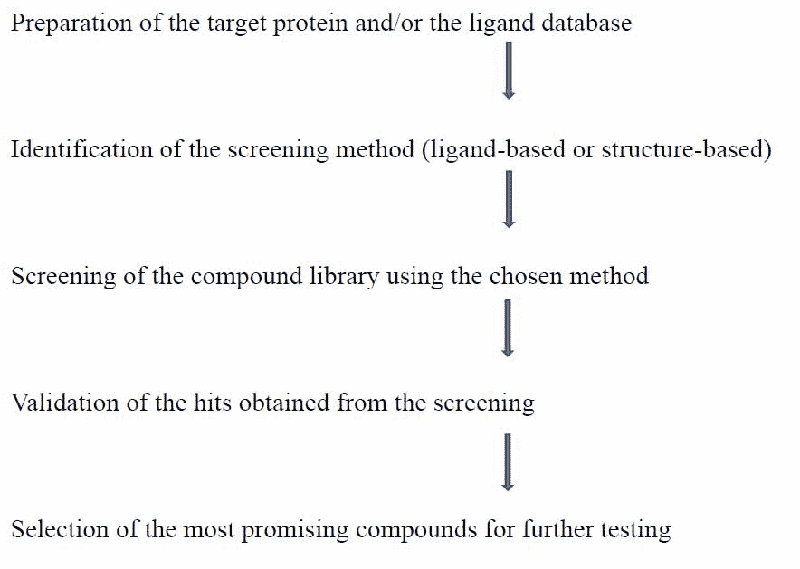
**图 (3)**

筛选的总流程。

### 6.1. 虚拟筛选的类型

虚拟筛选分为两种主要类型：基于配体的筛选和基于结构的筛选。

#### 6.1.1. 基于配体的筛选

基于配体的筛选依赖于已知活性分子与库中化合物性质的相似性。该方法基于相似化合物具有相似活性的假设。常用的技术包括基于药效的筛选、基于相似性的筛选和基于机器学习的筛选。

#### 6.1.1.1. 基于相似性的筛选

这种集成配体的虚拟筛选方法根据与已知活性化合物的结构相似性来识别候选药物。该方法的基本假设是结构相似的化合物可能具有相似的生物活性。这是因为相似的结构特征可能与同一个结合位点或生物靶标相互作用 [84]。

相似性筛选的过程分为四个主要步骤：

###### 6.1.1.1.1. 参考化合物的选择

一组已知活性化合物作为参考集。参考集可以从活性化合物数据库获取，也可以根据以往药物发现项目的实验数据选择。

###### 6.1.1.1.2. 分子描述符的计算

为参考集的每个化合物计算一组分子描述符。这些描述符代表分子的结构和物理性质，例如分子量、脂性和氢键供体/受体特性。

###### 6.1.1.1.3. 相似性评分的计算

使用相似性评分算法计算参考集中每个化合物与筛选库化合物之间的相似性。最常用的算法是基于两个分子共同结构特征数量的 `Tanimoto 系数`。

###### 1.4 命中化合物的排名与验证

根据相似性评分对库中的化合物进行排名。然后使用实验方法对排名前的化合物进行验证，以确认它们的结合亲和力和选择性。


有多个软件包可用于基于相似性的筛选，包括 `ChemMine`、`ChemBridge` 和 `MolSoft`。这些软件包可用于计算分子描述符、计算相似性评分并分析结果。与其他虚拟筛选方法相比，基于相似性的筛选具有若干优势。它是一种基于配体的方法，意味着它不需要靶蛋白的结构信息。这对于 3D 结构未知或难以获取的靶点尤为有用。此外，基于相似性的筛选可用于识别具有新颖骨架的化合物，从而可能发现新类药物 [[84](https://9789815223019-C5.html#r84)]。基于相似性的筛选已成功应用于多个药物发现项目。例如，它被用于鉴定蛋白激酶酶的新型抑制剂，该酶是治疗癌症的一个很有前景的靶点。选择一组已知的活性化合物作为参考集，并使用相似性评分算法对化合物库进行筛选。鉴定出若干命中化合物，并使用分子对接确认了它们的结合亲和力。其中一个命中化合物被发现对蛋白激酶具有强大的抑制活性，并对其进行了进一步优化以提高其效力和选择性 [[85](https://9789815223019-C5.html#r85)]。

### 6.1.1.2. 基于药效团的筛选

这种方法是一种集成的基于配体的虚拟筛选方法，根据化合物匹配药效团模型的能力来识别潜在候选药物。药效团是基团的空间排列，这些基团是分子结合靶蛋白并产生生物学反应所必需的。药效团模型可以从结合靶蛋白的已知配体的 3D 结构，或从蛋白本身的活性位点衍生 [[86](https://9789815223019-C5.html#r86)]。药效团模型用于筛选化合物库，以识别符合药效团特征的化合物。符合药效团模型的化合物将根据其与模型的拟合能力以及对靶蛋白的预测结合亲和力进行排序。与其他虚拟筛选方法相比，基于药效团的筛选具有若干优势。它是一种基于配体的方法，意味着它不需要靶蛋白的结构信息。这对于 3D 结构未知或难以获取的靶点尤为有用。此外，基于药效团的筛选可用于识别具有新颖骨架的化合物，从而可能发现新类药物。

基于药效团的筛选过程分为四个主要步骤：

#### 6.1.1.2.1. 药效团模型的建立
药效团模型可以从已知配体的 3D 结构或靶蛋白的活性位点衍生。该模型由一组药效团特征组成，例如氢键受体、氢键供体、疏水基和芳香环。

#### 6.1.1.2.2. 化合物库的准备
选择一个多样化的化合物库进行筛选。对化合物进行预处理以去除重复并标准化其结构。

#### 6.1.1.2.3. 化合物库的筛选
使用药效团模型筛选化合物库。符合药效团特征的化合物被选为潜在命中化合物。

#### 6.1.1.2.4. 命中化合物的验证
使用分子对接或其他实验方法对潜在命中化合物进行验证，以确认它们的结合亲和力和选择性。

有多个软件包可用于基于药效团的筛选，包括 `Ligand Scout`、`MOE` 和 `Discovery Studio`。这些软件包可用于建立药效团模型、筛选化合物库并分析结果。

基于药效团的筛选已成功应用于多个药物发现项目 [[87](https://9789815223019-C5.html#r87), [88](https://9789815223019-C5.html#r88)]。例如，它被用于鉴定蛋白乙酰化酶的新型抑制剂，该酶是治疗癌症的一个很有前景的靶点。基于已知抑制剂的结构建立了药效团模型，并使用该模型对化合物库进行筛选。鉴定出若干命中化合物，并使用分子对接确认了它们的结合亲和力 [[89](https://9789815223019-C5.html#r89)]。其中一个命中化合物被发现对蛋白乙酰化酶具有强大的活性，并对其进行了进一步优化。

### 基于机器学习的筛选

这是一种计算药物发现方法，利用人工智能算法预测候选药物的活性。机器学习模型在已知的活性和非活性化合物上进行训练，生成的模型用于预测新化合物 [[90](https://9789815223019-C5.html#r90)]。

基于机器学习的筛选过程分为四个主要步骤：

#### 6.1.1.3.1. 数据准备
汇总一组已知的活性和非活性化合物。每个化合物由一组分子描述符表征 [[91](https://9789815223019-C5.html#r91)]。

#### 6.1.1.3.2. 特征选择
选择分子描述符子集用于机器学习模型。这样做是为了消除对性能产生负面影响的冗余描述符。

#### 6.1.1.3.3. 模型训练
利用描述符相应的活性数据训练机器学习算法。常用的算法包括随机森林、支持向量机和神经网络。生成的模型经过优化以达到最高的准确性和预测能力。

#### 6.1.1.3.4. 虚拟筛选
使用训练好的机器学习模型预测候选药物的活性。使用该模型对化合物库进行筛选，并选择排名靠前的化合物进行进一步的实验验证 [[92](https://9789815223019-C5.html#r92)]。

有多个软件包可用于基于机器学习的筛选，包括 `KNIME`、`ChemML` 和 `RDKit`。这些软件包可用于处理分子数据、训练机器学习模型并分析结果 [[93](https://9789815223019-C5.html#r93)]。

与其他虚拟筛选方法相比，基于机器学习的筛选具有若干优势。它可以分析大型复杂的数据集，并同时处理多个靶点。此外，基于机器学习的筛选可以识别新的化学骨架并预测未测试过的化合物的活性。基于机器学习的筛选已成功应用于多个药物发现项目。例如，它被用于鉴定引起新冠肺炎的 SARS-CoV-2 病毒的潜在抑制剂 [[94](https://9789815223019-C5.html#r94)]。在一组已知抗病毒化合物上训练机器学习模型，预测大型化合物库的活性。鉴定出若干命中化合物，并使用细胞实验确认了它们的抗病毒活性 [[61](https://9789815223019-C5.html#r61), [62](https://9789815223019-C5.html#r62), [95](https://9789815223019-C5.html#r95), [96](https://9789815223019-C5.html#r96)]。

#### 6.1.2. 基于结构的筛选


基于结构的筛选基于靶蛋白的结构信息。该方法涉及使用分子对接来预测化合物与蛋白质的结合亲力。将化合物对接到蛋白质的结合位点中，并计算它们的结合能。结合能最低的被认为是潜在的命中化合物 [97]。目前有多个数据库可虚拟筛选，例如 `PubChem` 是一个化学化合物及其生物活性的公共数据库。`ZINC` 是一个可虚拟筛选的市售化合物数据库。`ChemBank` 是一个化学化合物及其生物活性的数据库等。

虚拟筛选帮助了各种活性分子和药物的开发。其中一个例子是半胱蛋白酶 2（Falcipain-2）抑制剂的发现。虚拟筛选被用于鉴定半胱蛋白酶 2 的潜在抑制剂，该酶是开发疟疾新药的一个非常有前景的靶点。基于结构的方法对超过 250 万个化合物进行了筛选，鉴定出了 30 个命中化合物。对这些化合物进行进一步测试，发现两种化合物对半胱蛋白酶 2 具有强大的抑制活性 [98]。另一个例子是 HIV 蛋白酶潜在抑制剂的鉴定，该酶是使用虚拟筛选开发新型 HIV 药物的关键靶点。基于配体的方法对超过 200 万个化合物的数据库进行了筛选，鉴定出了 100 个命中化合物。对化合物进行进一步测试，发现几种化合物对 HIV 蛋白酶具有强大的抑制活性 [99]。

虚拟工具在药物设计中最重要的优势之一是能够缩短药物发现的时间成本。通过使用计算方法设计和筛选化合物，研究人员比使用传统方法更快、更高效地鉴定出潜在候选药物。这有助于加速药物发现过程，并为患者更快新的治疗方法。虚拟工具的另一个优势是优化药物属性的能力。通过计算建模研究药物分子与其靶点之间的相互作用，研究人员可以设计具有提高结合亲力、降低毒性或增加选择性的化合物。这有助于提高药物的安全性和有效性，并降低副作用的风险 [100-102]。虚拟筛选是药物发现中非常有价值的技术，因为它可以显著减少药物开发的时间成本。它允许研究人员快速高效地筛选大型化合物库以鉴定候选药物。虚拟筛选还可以用于鉴定新型化学支架并优化现有分子。

## 结论

新药开发是一个长期且昂贵的过程，涉及多个阶段的测试和评估。虚拟工具和筛选设计已成为药物发现和开发的组成部分，因为它们使研究人员能够更快、更高效地鉴定候选药物。虚拟筛选涉及使用计算方法分析大型化合物数据库，以鉴定可能对特定靶点具有活性的化合物。虚拟筛选有多种类型，包括基于药效团的筛选、基于相似性的筛选和基于机器学习的筛选。这些技术由于能够减少鉴定候选药物的时间成本而变得越来越流行。除了虚拟筛选，还开发了分子建模工具来设计和优化候选药物。例如，分子对接可以模拟候选药物与其靶蛋白之间的相互作用，而分子动力学可以用于预测候选药物在生物环境中的行为。定量结构活性关系（QSAR）模型也被开发用于根据化学结构预测化合物的生物活性。虚拟工具和筛选设计彻底改变了药物发现和开发的流程。它们使研究人员能够快速高效地分析大型数据集，增加了鉴定出前景候选药物的可能性。此外，它们减少了开发新药的时间成本，使得小型研究小组和制药公司更容易参与。总体而言，虚拟工具和筛选设计对于现代药物发现和开发至关重要。它们具有加速药物发现进程的潜力，从而为各种疾病开发更有效的治疗方法。

## 参考文献

| | |
| --- | --- |
| [1] | Zhong WZ, Zhou SF. Molecular science for drug development and biomedicine. Int J Mol Sci 2014; 15(11): 20072-8. [[`dx.doi.org/10.3390/ijms151120072`](http://dx.doi.org/10.3390/ijms151120072)] [PMID: [25375190](http://www.ncbi.nlm.nih.gov/pubmed/25375190)] |
| [2] | Paul D, Sanap G, Shenoy S, Kalyane D, Kalia K, Tekade RK. Artificial intelligence in drug discovery and development. Drug Discov Today 2021; 26(1): 80-93. [[`dx.doi.org/10.1016/j.drudis.2020.10.010`](http://dx.doi.org/10.1016/j.drudis.2020.10.010)] |
| [3] | |
| [4] | Mak K, Pichika MR. Artificial intelligence in drug discovery. Drug Discov Today 2019; |
| [5] | Mohs RC, Greig NH. Drug discovery: Role of biological research. Alzheimers D (N) 2017; 3(4); |
| [6] | Deore AB, Dhumane JR, Wagh R, Sonawane R. The stages of drug discovery and development. Asian Journal of Pharmaceutical Research and Development 2019; 7(6); |
| [7] | Katsila T, Spyroualias GA, Patrinos GP, Matsoukas MT. Computational approaches in target identification and drug discovery. Comput Struct Biotechnol J 2016; 14; |
| [8] | Zhang L, Tan J, Han D, Zhu H. From machine learning to deep learning: Progress in machine intelligence for rational drug discovery. Drug Discov Today 2017; 22(11): 1680-5. |
| [9] | D. Segall M. Multi-parameter optimization: Identifying high quality compounds with a balance of properties. Current pharmaceutical design. 2012 Mar 1; 18(9): 1292-310. |
| [10] | Adamson,G.W., and Bawden,D.A. Substructural analysis methods for structure-activity correlation of heterocyclic compounds using Wiswesser linenotation. J. Chem. Inf. Comput. Sci. 1977; 17: 164-171. |


## 参考文献

1. [11] Zhang R, Zhao J, Yang Y, Lu Z, Shi W. La 和 Mn 共掺钛钛矿 TiO[2]的电子和光学性质研究。计算凝聚态 2016; 6: 5-17. [`dx.doi.org/10.1016/j.cocom.2016.03.001`](http://dx.doi.org/10.1016/j.cocom.2016.03.001)
2. [12] Firth NC, Atrash B, Brown N, Blagg J. MOARF，一种多目标优化的集成工作流：实现、合成与生物学评价。化学信息与分子模型 2015; 55(6): 1169-80. [`dx.doi.org/10.1021/acs.jcim.5b00073`](http://dx.doi.org/10.1021/acs.jcim.5b00073) [PMID: [26054755](http://www.ncbi.nlm.nih.gov/pubmed/26054755)]
3. [13] Franke R, Huebel S, Streich WJ. 亚结构 QSAR 方法与拓扑药效团。环境健康展望 1985; 61: 239-55. [`dx.doi.org/10.1289/ehp.8561239`](http://dx.doi.org/10.1289/ehp.8561239) [PMID: [3905376](http://www.ncbi.nlm.nih.gov/pubmed/3905376)]
4. [14] Hemmateenejad B, Mehdipour AR, Popelier PLA. 基于 MOLMAP 方法的量子拓扑 QSAR 模型。化学生物与药物设计 2008; 72(6): 551-63. [`dx.doi.org/10.1111/j.1747-0285.2008.00731.x`](http://dx.doi.org/10.1111/j.1747-0285.2008.00731.x) [PMID: [19090922](http://www.ncbi.nlm.nih.gov/pubmed/19090922)]
5. [15] Gozalbes R, Doucet J, Derouin F. 拓扑描述符在 QSAR 和药物设计中的应用：历史与新趋势。当前药物靶点感染与疾病 2002; 2(1): 93-102. [`dx.doi.org/10.2174/1568005024605909`](http://dx.doi.org/10.2174/1568005024605909) [PMID: [12462157](http://www.ncbi.nlm.nih.gov/pubmed/12462157)]
6. [16] Palyulin VA, Radchenko EV, Zefirov NS. 有机化合物 QSAR 研究中的分子场拓扑分析方法。化学信息与计算科学 2000; 40(3): 659-67. [`dx.doi.org/10.1021/ci980114i`](http://dx.doi.org/10.1021/ci980114i) [PMID: [10850771](http://www.ncbi.nlm.nih.gov/pubmed/10850771)]
7. [17] Tropsha A. 预测性定量结构活性关系建模。比较化学 II 2006; 4: 149-65.
8. [18] Hansch C. 药物设计与发现的物理化学方法(QSAR)。药物开发研究 1981; 1(4): 267-309. [`dx.doi.org/10.1002/ddr.430010403`](http://dx.doi.org/10.1002/ddr.430010403)
9. [19] De Benedetti PG, Fanelli F. 用于 QSAR 建模和药物设计的多尺度量子化学方法。药物发现今日 2014; 19(12): 1921-7. [`dx.doi.org/10.1016/j.drudis.2014.09.024`](http://dx.doi.org/10.1016/j.drudis.2014.09.024) [PMID: [25281852](http://www.ncbi.nlm.nih.gov/pubmed/25281852)]
10. [20] Oluwaseye A, Uzairu A, Shallangwa GA, Abechi SE. 活性电击测试化合物 QSAR 研究中的量子化学描述符。沙特国王科学杂志 2020; 32(1): 75-83. [`dx.doi.org/10.1016/j.jksus.2018.0209`](http://dx.doi.org/10.1016/j.jksus.2018.0209)
11. [21] Sizochenko N, Majumdar D, Roszak S, Leszczynski J. 量子力学和分子力学在化学信息学中的应用。计算化学手册 2017;41-63. [`dx.doi.org/10.1007/978-319-2782-5`](http://dx.doi.org/10.1007/978-319-2782-5)
12. [22] Braga RC, Andrade CH. 药物代谢的 QSAR 和 QM/MM 方法。药物化学小型综述 2012; 12(6): 573-82. [`dx.doi.org/10.2174/138955712800498`](http://dx.doi.org/10.2174/138955712800498) [PMID: [22587770](http://www.ncbi.nlm.nih.gov/pubmed/22587770)]
13. [23] Haghshen H, Kaviani B, Firouzeh M, Tavakol H. 药物设计中 3D-QSAR 方法的改进。计算化学 2021; 42(13): 917-29. [`dx.doi.org/10.1002/jcc.26514`](http://dx.doi.org/10.1002/jcc.26514) [PMID: [33719136](http://www.ncbi.nlm.nih.gov/pubmed/33719136)]
14. [24] Doweyko AM. 三维定量活性关系：现状。比较化学 2006; 4: 575-95.
15. [25] Cruciani G, Carosati E, Clementi S. 三维定量结构-性质关系。药物化学实践第二版 2003;405-16. [`dx.doi.org/10.1016/B978-012744819-90-5`](http://dx.doi.org/10.1016/B978-012744819-90-5)
16. [26] Silakari O, Singh PK. QSAR：描述符计算、模型生成及应用 2021;29-63.
17. [27] Roy K, Das R. 2D-QSAR 原理与实践综述。当前药物代谢 2014; 15(4): 346-79. [`dx.doi.org/10.2174/138920021566140981023`](http://dx.doi.org/10.2174/138920021566140981023) [PMID: [25204823](http://www.ncbi.nlm.nih.gov/pubmed/25204823)]
18. [28] Lewis RA, Wood D. 用于药物发现的现代 2D QSAR。分子科学计算综述 2014; 4(6): 505-22. [`dx.doi.org/10.1002/wcms.1187`](http://dx.doi.org/10.1002/wcms.1187)
19. [29] Neves BJ, Braga RC, Melo-Filho CC, Moreira-Filho JT, Muratov EN, Andrade CH. 基于 QSAR 的虚拟筛选：药物发现中的进展。药学进展 2018; 9: 1275. [`dx.doi.org/10.3389/fphar.2018.01275`](http://dx.doi.org/10.3389/fphar.2018.01275) [PMID: [30524275](http://www.ncbi.nlm.nih.gov/pubmed/30524275)]
20. [30] Ugbe FA, Shallangwa GA, Uzairu A, Abdulkadir I. 某些芳基咪唑杂类作为卓越脲酶抑制剂的 2D 和 3D QSAR 建模、分子对接研究及药代动力学分析。国家研究中心公报 2022; 46(1): 189. [`dx.doi.org/10.1116/s42269-022-0874-1`](http://dx.doi.org/10.1116/s42269-022-0874-1)
21. [31] Kwon S, Bae H, Jo J, Yoon S. 药物发现 QSAR 预测中的综合集成。生物信息学 2019; 20(1): 521. [`dx.doi.org/10.1186/s12859-019-3135-4`](http://dx.doi.org/10.1186/s12859-019-3135-4) [PMID: [3165545](http://www.ncbi.nlm.nih.gov/pubmed/3165545)]
22. [32] Verma J, Khedkar V, Coutinho E. 药物设计中的 3D-QSAR：综述。当前药物化学 2010; 10(1): 95-115. [`dx.doi.org/10.2174/156802610790326`](http://dx.doi.org/10.2174/156802610790326) [PMID: [1992826](http://www.ncbi.nlm.nih.gov/pubmed/1992826)]
23. [33] Akamatsu M. 3D-QSAR 的现状与展望。当前药物化学 2002; 2(12): 1381-94. [`dx.doi.org/10.2174/156802602339287`](http://dx.doi.org/10.2174/156802602339287) [PMID: [12470286](http://www.ncbi.nlm.nih.gov/pubmed/12470286)]
24. [34] Klebe G, Abraham U, Mietner T. 用于相关和预测生物活性的分子相似性指数分析(CoMSIA)。药物化学 1994; 37(24): 4130-46. [`dx.doi.org/10.1021/jm0005a10`](http://dx.doi.org/10.1021/jm0005a10) [PMID: [7990113](http://www.ncbi.nlm.nih.gov/pubmed/7990113)]
25. [35] Klebe G, Abraham U. 用于研究氢键性质和筛选组合的比较分子相似性分析(CoMSIA)。计算机辅助设计 1999; 13(1): 1-10. [`dx.doi.org/10.1023/A:10080479196`](http://dx.doi.org/10.1023/A:10080479196) [PMID: [1008749](http://www.ncbi.nlm.nih.gov/pubmed/1008749)]
26. [36] Roy K, Kar S. 3D-QSAR 入门。药物科学与风险评估基础 2015;29-31.
27. [37] Tsakovska I, Pajeva I, Alov P, Worth A. 雌激素受体介导毒性分子建模的新进展。蛋白质化学与生物进展 2011; 85: 217-51. [`dx.doi.org/10.1016/B978-0-12-386485-7.00006-5`](http://dx.doi.org/10.1016/B978-0-12-386485-7.00006-5) [PMID: [21920325]] (注：此处原文 PMID 与文献有误，按原文保留)
28. [38] Ul-Haq Z, Wadood A, Uddin R. 对脲酶抑制剂羟酸衍生物的 CoMFA 和 CoMSIA 3D-QSAR 分析。酶抑制与医学化学 2009; 24(1): 272-8. [`dx.doi.org/10.1080/1475636080216665`](http://dx.doi.org/10.1080/1475636080216665) [PMID: [18608766]]


## 参考文献

- [39] Sharma R, Dhingra N, Patil S. 基于离子酮的查酮衍生物的抗前列腺癌活性 CoMFA, CoMSIA, HQSAR 和分子对接分析。Indian J Pharm Sci 2016; 78(1): 54-64. [`dx.doi.org/10.4103/0250-474X.180251`](http://dx.doi.org/10.4103/0250-474X.180251) [PMID: [27168682](http://www.ncbi.nlm.nih.gov/pubmed/27168682)]
- [40] Doytchinova IA, Flower DR.  T 细胞表位的定量预测：对第一类 MHC 分子 HLA-A*0201 亲和力的肽的 CoMFA 和 coMSIA 研究。J Med Chem 2001; 44(22): 3572-81. [`dx.doi.org/10.1021/jm010021j`](http://dx.doi.org/10.1021/jm010021j) [PMID: [11606121](http://www.ncbi.nlm.nih.gov/pubmed/11606121)]
- [41] Xu Y, He Z, Liu H, et al. 吩[3,2-b]吡咯-5-甲酰胺衍生物作为 LSD1 抑制剂的 3D-QSAR、分子对接和分子动力学模拟研究。RSC Advances 2020; 10(12): 6927-43. [`dx.doi.org/10.1039/C9RA10085G`](http://dx.doi.org/10.1039/C9RA10085G) [PMID: [35493862](http://www.ncbi.nlm.nih.gov/pubmed/35493862)]
- [42] Ashraf S, Ranaghan KE, Woods CJ, Mulholland AJ, Ul-Haq Z. 结合 QSAR、建模和分子模拟方法探索 Aurora 激酶 B 抑制剂的结构要求。Sci Rep 2021; 11(1): 18707. [`dx.doi.org/10.1038/s41598-021-97368-3`](http://dx.doi.org/10.1038/s41598-021-97368-3) [PMID: [34548506](http://www.ncbi.nlm.nih.gov/pubmed/34548506)]
- [43] Araújo PHF, Ramos RS, da Cruz JN, et al. 利用分子建模识别炎症疾病的潜在 COX-2 抑制剂。Molecules 2020; 25(18): 4183. [`dx.doi.org/10.3390/molecules2518413`](http://dx.doi.org/10.3390/molecules2518413) [PMID: [32932669](http://www.ncbi.nlm.nih.gov/pubmed/32932669)]
- [44] Chemoinformatics Compr Chem 2009; 7.
- [45] Elrayess R, Abdel Aziz YM, Elgawish MS, Elewa M, Elshihawy HA, Said MM. 针对 EGFR 的新型噻吩并三嗪类的药效团建模、3D-QSAR、合成和抗肺评价。Arch Pharm (Weinheim) 2020; 35(2): 1900108. [`dx.doi.org/10.1002/ardp.2019008`](http://dx.doi.org/10.1002/ardp.2019008) [PMID: [31894866](http://www.ncbi.nlm.nih.gov/pubmed/31894866)]
- [46] Wu X, Li M, Qu Y, et al. 具有提高肿瘤活性的格非替尼类似物的设计与合成。Bioorg Med Chem 2010; 18(11): 3812-22. [`dx.doi.org/10.1016/j.bmc.2010`](http://dx.doi.org/10.1016/j.bmc.2010) [PMID: [2046555](http://www.ncbi.nlm.nih.gov/pubmed/2046555)]
- [47] Gonçalves RB, Ferraz WR, Calil RL, Scott MT, Trossini GHG. 预测 Cruzain 抑制剂的收敛 QSAR 模型。ACS Omega 2023 Oct 13; 8(42): 38961-38982. [`dx.doi.org/10.1021/acsomega.3c376`](http://dx.doi.org/10.1021/acsomega.3c376) [PMID: [37901514](http://www.ncbi.nlm.nih.gov/pubmed/37901514) [PMCID: [PMC1060154](http://www.ncbi.nlm.nih.gov/pmc/articles/PMC1060154)]
- [48] Ugbe FA. 2,6-二基环己酮作为强效激酶抑制剂的计算设计、分子性质、ADME 和毒理学分析。Silico Pharmacol 2023; 11(1).
- [49] Garro Martinez JC, Vega-Hissi EG, Andrada MF, Estrada MR. 用于抗厥化合物的 QSAR 和 3D-QSAR 研究。Expert Opin Drug Discov 2015; 10(1): 37-51. [`dx.doi.org/10.1517/1746041.2015.968123`](http://dx.doi.org/10.1517/1746041.2015.968123) [PMID: [25297377](http://www.ncbi.nlm.nih.gov/pubmed/25297377)]
- [50] Yang GF, Huang X. 定量结构关系的发展及其在合理药物设计中的应用。Curr Pharm Des 2006; 12(35): 4601-11. [`dx.doi.org/10.2174/1381612067791431`](http://dx.doi.org/10.2174/1381612067791431) [PMID: [17168765](http://www.ncbi.nlm.nih.gov/pubmed/17168765)]
- [51] Gu Y, Li M. Molecular modeling 2011103-10.
- [52] Barbosa NSV, Lima ERA, Tavares FW. 化学工程中的分子建模 2017. [`dx.doi.org/10.1016/B978-0-12-409547-2.13915-0`](http://dx.doi.org/10.1016/B978-0-12-409547-2.13915-0)
- [53] Rodriguez R, Chinea G, Pons T, Vriend G. 同源建模、模型构建与评估：三种资源。Bioinformatics 1998; 14(6): 523-8. [`dx.doi.org/10.1093/bioinformatics/14.523`](http://dx.doi.org/10.1093/bioinformatics/14.523) [PMID: [9694991](http://www.ncbi.nlm.nih.gov/pubmed/9694991)]
- [54] Krieger E, Nabuurs SB, Vriend G. 同源建模 2005509-23.
- [55] Greener JG, Kandathil SM, Jones DT. 深度学习通过迭代预测的约束扩展基因组的从头蛋白覆盖。Nat Commun 2019; 10(1): 3977. [`dx.doi.org/10.1038/s41467-019-1194-0`](http://dx.doi.org/10.1038/s41467-019-1194-0) [PMID: [31484923](http://www.ncbi.nlm.nih.gov/pubmed/31484923)]
- [56] Kubota K, Funabashi M, Ogura Y. 化学蛋白质组学的基于表型的药物发现靶去卷积。Biochim Acta Proteomics 2019; 1867(1): 22-7. [`dx.doi.org/10.1016/j.bbap.2018.002`](http://dx.doi.org/10.1016/j.bbap.2018.002) [PMID: [30392561](http://www.ncbi.nlm.nih.gov/pubmed/30392561)]
- [57] Chan JNY, Nislow C, Emili A. 药物靶点识别的新进展与方法开发。Trends Pharmacol Sci 2010; 31(2): 82-8. [`dx.doi.org/10.1016/j.tips.2009.002`](http://dx.doi.org/10.1016/j.tips.2009.002) [PMID: [20004028](http://www.ncbi.nlm.nih.gov/pubmed/20004028)]
- [58] Jenkins JL, Bender A, Davies JW. 计算机筛选：从化学结构预测生物靶点。Drug Discov Today Technol 2006; 3(4): 413-21. [`dx.doi.org/10.1016/j.ddtec.2006.008`](http://dx.doi.org/10.1016/j.ddtec.2006.008)
- [59] Bajorath J. 计算骨架跃跃：药物设计的基石？Future Med Chem 2017; 9(7): 629-31. [`dx.doi.org/10.4155/fmc-2017-0043`](http://dx.doi.org/10.4155/fmc-2017-0043) [PMID: [28485634](http://www.ncbi.nlm.nih.gov/pubmed/28485634)]
- [60] Sun H, Tawa G, Wallqvist A. 骨架跃跃方法的分类。Drug Discov Today 2012; 17(7-8): 310-24. [`dx.doi.org/10.1016/j.drudis.2011.1024`](http://dx.doi.org/10.1016/j.drudis.2011.1024) [PMID: [22056715](http://www.ncbi.nlm.nih.gov/pubmed/22056715)]
- [61] Lavecchia A. 药物发现中的机器学习方法：方法与应用。Drug Discov Today 2015; 20(3): 318-31. [`dx.doi.org/10.1016/j.drudis.2014.012`](http://dx.doi.org/10.1016/j.drudis.2014.012) [PMID: [25448759](http://www.ncbi.nlm.nih.gov/pubmed/25448759)]
- [62] Kennedy T. 药物药物发现/开发的接口。Drug Discov Today 1997; 2(10): 436-44. [`dx.doi.org/10.1016/S1359-6446(97)00094`](http://dx.doi.org/10.1016/S1359-6446(97)00094)]
- [63] Venkatesh S, Lipper RA. 开发科学家在化合物先导筛选和优化中的作用。J Pharm Sci 2000; 89(2): 145-54. [`dx.doi.org/10.1002/(SICI)1520-6017(200002)89:2<145:AID-JPS2>3.0.CO;2-6`](http://dx.doi.org/10.1002/\(SICI\)1520-6017\(200002\)89:2145:AID-JPS2%3E3.0.CO;2-6)) [PMID: [10688744](http://www.ncbi.nlm.nih.gov/pubmed/10688744)]
- [64] Weng G. 通过肽对接方案探索蛋白质-蛋白质相互作用。Methods Enzymol 2002; 344: 577-86. [`dx.doi.org/10.1016/S0076-6879(02)44741-6`](http://dx.doi.org/10.1016/S0076-6879\(02\)44741-6)) [PMID: [11771411](http://www.ncbi.nlm.nih.gov/pubmed/11771411)]


- [65] || Altschul SF, Gish W, Miller W, Myers EW, Lipman DJ. 基础局部对比搜索工具。J Mol Biol 1990; 215(3): 403-10. [`dx.doi.org/10.1016/S0022-2836(05)80360-2`](http://dx.doi.org/10.1016/S0022-2836(05)80360-2) [PMID: [2231712](http://www.ncbi.nlm.nih.gov/pubmed/2231712)]
- [66] || Liu J, Lei X, Zhang Y, Pan Y. 基于 BiGRU 和 GraphSAGE 的分子毒性预测。Comput Biol Med 2023; 153: 106524. [`dx.doi.org/10.1016/j.compbiomed.2022.106524`](http://dx.doi.org/10.1016/j.compbiomed.2022.106524) [PMID: [36623439](http://www.ncbi.nlm.nih.gov/pubmed/36623439)]
- [67] || Zang Q, Mansouri K, Williams AJ, et al. 利用分子指纹和机器学习对环境化学品的物理化性质进行*in silico*预测。J Chem Inf Model 2017; 57(1): 36-49. [`dx.doi.org/10.1021/acs.jcim.6b00625`](http://dx.doi.org/10.1021/acs.jcim.6b00625) [PMID: [28006899](http://www.ncbi.nlm.nih.gov/pubmed/28006899)]
- [68] || Roy A, Kucukural A, Zhang Y. I-TASSER: 一个用于自动化蛋白质结构和功能预测的统一平台。Nat Protoc 2010; 5(4): 725-38. [`dx.doi.org/10.1038/nprot.2010.5`](http://dx.doi.org/10.1038/nprot.2010.5) [PMID: [20360767](http://www.ncbi.nlm.nih.gov/pubmed/20360767)]
- [69] || Waterhouse A, Bertoni M, Bienert S, et al. SWISS-MODEL: 蛋白质结构和复合物的同源建模。Nucleic Acids Res 2018; 46(W1): W296-303. [`dx.doi.org/10.1093/nar/gky427`](http://dx.doi.org/10.1093/nar/gky427) [PMID: [29788355](http://www.ncbi.nlm.nih.gov/pubmed/29788355)]
- [70] || Yuan X, Shao Y, Bystroff C. 使用通路模型的从头开始蛋白质结构预测。Comp Funct Genomics 2003; 4(4): 397-401. [`dx.doi.org/10.1002/cfg.305`](http://dx.doi.org/10.1002/cfg.305) [PMID: [18629080](http://www.ncbi.nlm.nih.gov/pubmed/18629080)]
- [71] || Aminpour M, Montemagno C, Tuszynski JA. 药物发现中的分子建模概述及特定应用示例。Molecules 2019; 24(9): 1693. [`dx.doi.org/10.3390/molecules24091693`](http://dx.doi.org/10.3390/molecules24091693)
- [72] || Zhou S, Ge S, Zhang W, et al. TTR 稳定剂结合与解离机制的常规分子动力学和元动力学研究。ACS Chem Neurosci 2020; 11(19): 3025-35. [`dx.doi.org/10.1021/acscheneuro.0c0038`](http://dx.doi.org/10.1021/acscheneuro.0c0038) [PMID: [32915538](http://www.ncbi.nlm.nih.gov/pubmed/32915538)]
- [73] || Clarke DF, Mirochnick M, Acosta EP, et al. 使用建模和模拟确定新生儿剂量：一种安全高效确定新生儿剂量的模型。J Acquir Immune Synd 2019; 82(4): 392-8. [`dx.doi.org/10.1097/QAI.0000000002149`](http://dx.doi.org/10.1097/QAI.0000000002149)
- [74] || Morris GM, Limby M. 分子对接。Methods Mol Biol 2008; 44: 365-82. [`dx.doi.org/10.1007/978-1-5945-177-29`](http://dx.doi.org/10.1007/978-1-5945-177-29) [PMID: [18446297](http://www.ncbi.nlm.nih.gov/pubmed/18446297)]
- [75] || Stanzione F, Giangre I, Cole JC. 药物发现中分子对接计算工具的使用。Prog Med Chem 2021; 60: 273-343. [`dx.doi.org/10.1016/bs.pmch.2021.0104`](http://dx.doi.org/10.1016/bs.pmch.2021.0104) [PMID: [34147204](http://www.ncbi.nlm.nih.gov/pubmed/34147204)]
- [76] || Berry M, Fielding B, Gamieldien J. 虚拟筛选和分子对接中的实际考虑。Trends Comput Biol Syst Algorithms Soft 2015: 487-502.
- [77] || Tiwari A, Singh S. 药物设计中的计算方法。Bioinforma Methods Appl 2021: 207-17.
- [78] || Lamb ML, Jorgensen WL. 分子识别的计算方法。Curr Opin Chem Biol 1997; 1(4): 449-57. [`dx.doi.org/10.1016/S1367-5931(97)8038-5`](http://dx.doi.org/10.1016/S1367-5931(97)8038-5) [PMID: [9667895](http://www.ncbi.nlm.nih.gov/pubmed/9667895)]
- [79] || Dar AM, Mir S. 分子对接：方法、类型、应用和基础挑战。J own Bioanal Tech 2017; 8(2): 1-3. [`dx.doi.org/10.4172/2155-9872.1000356`](http://dx.doi.org/10.4172/2155-9872.1000356)
- [80] || Shoichet BK, McGovern SL, Wei B, Irwin JJ. 利用分子对接进行先导化合物发现。Curr Opin Chem Biol 2002; 6(4): 439-46. [`dx.doi.org/10.1016/S1367-5931(02)00339-3`](http://dx.doi.org/10.1016/S1367-5931(02)00339-3)
- [81] || Cho AE, Rinaldo D. QM/MM 对接的扩展及其应用。J Chem 2009; 30(16): 2609. (Wait,原文是 J Chem, corrected based on context) [PMID: [193738](http://www.ncbi.nlm.nih.gov/pubmed/193738)]
- [82] || Chan HCS, Shan H, Dahoun T, Yuan S. 通过人工智能推进药物发现。Trends pharmacol 2019; 40(8): 592-604. [`dx.doi.org/10.1016/j.tp.2019.03`](http://dx.doi.org/10.1016/j.tp.2019.03)
- [83] || Hamza A, Wei NN, Zhan CG. 基于配体的虚拟对接。J Chem Inf Model 2012; 52(4): 963-74. [`dx.doi.org/10.1097/QAI.0000000002149`](http://dx.doi.org/10.1097/QAI.0000000002149)
- [84] || Kristensen T, Nielsen J, Pedersen F. 相似性虚拟筛选。Methods Mol Biol 2008; 44: 365-82. [`dx.doi.org/10.1007/978-1-5945-177-29`](http://dx.doi.org/10.1007/978-1-5945-177-29) [PMID: [18446297](http://www.ncbi.nlm.nih.gov/pubmed/18446297)]
- [85] || Bajorath J. 机器学习和相似性对接技术。
- [86] || Seidel T, Ibis G, Wolber F. 3D 药效虚拟对接策略。Drug Disc Today 2010; 7(4): e221-8. [`dx.doi.org/10.1016/j.dddt.2010.11`](http://dx.doi.org/10.1016/j.dddt.2010.11) [PMID: [32915538](http://www.ncbi.nlm.nih.gov/pubmed/32915538)]
- [87] || Sanachai K, Mahalapbut P, Hengphasat K, et al. 针对 JAK 激酶抑制剂吡唑啉衍生物的药效虚拟筛选和实验验证。ACS Omega 2022; 7(37): 33548-59. [`dx.doi.org/10.1021/acsomega.2c0435`](http://dx.doi.org/10.1021/acsomega.2c0435) [PMID: [36157769]]
- [88] || Liu C, Yin J, Yao J, Xu Z, Tao Y, Zhang H. 针对新型抗包虫化合物的药效虚拟筛选。Front Cell Infect Microbiol 2020; 10: 118. [`dx.doi.org/10.3389/fcimb.2020.00118`](http://dx.doi.org/10.3389/fcimb.2020.00118) [PMID: [32266168](http://www.ncbi.nlm.nih.gov/pubmed/32266168)]
- [89] || Kumar BK, Faheem, Sekhar KVGC, et al. 利用药效虚拟筛选、分子对接、分子动力学和 MM-GBSA 方法从天然产物数据库中鉴定潜在的 SARS-CoV-2 抑制剂。J Biomol Struct Dyn 2022; 40(3): 1363-86. [`dx.doi.org/10.1080/07391102.2020.1824814`](http://dx.doi.org/10.1080/07391102.2020.1824814)


| [90] || Carpenter KA, Cohen DS, Jarrell JT, Huang X. 深度学习与虚拟药物筛选。未来药物化学 2018; 10(21): 2557-67. [[`dx.doi.org/10.4155/fmc-2018-0314`](http://dx.doi.org/10.4155/fmc-2018-0314)] [PMID: [30288997](http://www.ncbi.nlm.nih.gov/pubmed/30288997)] |

| [91] || Hnatyshyn S, Thayasivam U, Hnatyshin V, White C. 用于代谢组学应用的机器学习算法。鉴定、数据处理方法与代谢组学 201596-110. [[`dx.doi.org/10.4155/fseb2013.14.163`](http://dx.doi.org/10.4155/fseb2013.14.163)] |

| [92] || Carpenter KA, Huang X. 基于机器学习的虚拟筛选及其在阿尔茨海默症药物发现中的应用：综述。当前药物设计 2018; 24(28): 3347-58. [[`dx.doi.org/10.2174/1381612824666180607124038`](http://dx.doi.org/10.2174/1381612824666180607124038)] [PMID: [29879881](http://www.ncbi.nlm.nih.gov/pubmed/29879881)] |

| [93] || Carracedo-Reboredo P, Liñares-Blanco J, Rodríguez-Fernández N, 等. 药物发现中机器学习方法和趋势的综述。计算结构与生物技术杂志 2021; 19: 4538-58. [[`dx.doi.org/10.1016/j.csbj.2021.08.011`](http://dx.doi.org/10.1016/j.csbj.2021.08.011)] [PMID: [34471498](http://www.ncbi.nlm.nih.gov/pubmed/34471498)] |

| [94] || Sliwoski G, Lowe EW. 基于片段的计算药物设计。药物发现与设计 201322-32. [[`dx.doi.org/10.4155/ebo.13.335`](http://dx.doi.org/10.4155/ebo.13.335)] |

| [95] || Lounkine E, Keiser MJ, Whitebread S, 等. 药物活性在副作用靶点上的大规模预测与测试。自然 2012; 486(7403): 361-7. [[`dx.doi.org/10.1038/nature11159`](http://dx.doi.org/10.1038/nature11159)] [PMID: [22722194](http://www.ncbi.nlm.nih.gov/pubmed/22722194)] |

| [96] || Xiao X, Min JL, Lin W, Liu Z, Cheng KC. iDrug-Target: 通过基准优化预测细胞网络中药物化合物与靶蛋白之间的相互作用。生物分子结构动力学杂志 2015;33(10): 2221-33. [[`dx.doi.org/10.1080/07391102.2014.99870`](http://dx.doi.org/10.1080/07391102.2014.99870)] [PMID: [25513722](http://www.ncbi.nlm.nih.gov/pubmed/25513722)] |

| [97] || Maia EHB, Assis LC, de Oliveira TA, Silva AM, Taranto AG. 基于结构的虚拟筛选：从经典到人工智能。前沿化学 2020; 8: 343. [[`dx.doi.org/10.3389/fchem.2020.00343`](http://dx.doi.org/10.3389/fchem.2020.00343)] [PMID: [32411671](http://www.ncbi.nlm.nih.gov/pubmed/32411671)] |

| [98] || Alberca LN, Chuguransky SR, Talevi A, Salas-Sarduy E. 计算机引导药物重用：发现疟疾蛋白酶-2 的新型竞争性和非竞争性抑制剂。前沿化学 2019; 7(Aug): 534. [[`dx.doi.org/10.3389/fchem.2019.0534`](http://dx.doi.org/10.3389/fchem.2019.0534)] [PMID: [31448257](http://www.ncbi.nlm.nih.gov/pubmed/31448257)] |

| [99] || Okafor SN, Angsantikul P, Ahmed H. 使用现代计算技术发现新型 HIV 抑制剂。国际分子科学杂志 2022; 23(20): 12149. [[`dx.doi.org/10.3390/ijms232012149`](http://dx.doi.org/10.3390/ijms232012149)] [PMID: [36293006](http://www.ncbi.nlm.nih.gov/pubmed/36293006)] |

| [100] || Lavecchia A, Giovanni C. 药物发现中的虚拟筛选策略：综述。当前药物化学 2013; 20(23): 2839-60. [[`dx.doi.org/10.2174/0929867313209901`](http://dx.doi.org/10.2174/0929867313209901)] |

| [101] || Wu KJ, Lei PM, Liu H, Wu C, Ma DL. 模拟筛选模拟蛋白质相互作用的策略。分子 2019; 24(24): 4428. [[`dx.doi.org/10.3390/molecules24428`](http://dx.doi.org/10.3390/molecules24428)] |

| [102] || Wermuth CG. 寻找先导化合物的策略。实用药物化学第四版 201573-99. [[`dx.doi.org/10.1016/B978-0-12-417205-0.00041-`](http://dx.doi.org/10.1016/B978-0-12-417205-0.00041-)] |

 预测药物性质：溶解度的计算策略

## 摘要

药物的口服生物利用度受其水溶性的显著影响，

此外，为了减少药物开发后期失败的风险，必须在研发早期考虑水溶性。通过使用计算机模型预测溶解度，可以对组合库进行筛选，以识别潜在的问题化合物。除了从化学结构预测溶解度外，此类模型的解释还可以提供结构与溶解度之间关系的见解，并在保持活性的同时指导结构改进。模型开发是一个复杂的过程，需要考虑影响其最终性能的多种因素。本文介绍了多种溶解度计算方法。尽管对模型的研究有很多，但预测药物的溶解度仍然困难。许多建议模型可靠性差的原因之一是用于模拟溶解度的实验数据质量，这一点正被广泛认可。因此，需要使用相同的实验技术产生更多可靠的数据，以充分发挥所建立工具的潜力。

**关键词：** 计算工具、Caco-2、基于配体的计算机辅助药物发现、PAMPA、渗透性、溶解度。

## 作者

**Anshita Gupta Soni**¹* Rawatpura Sarkar Institute of Pharmacy, Kumhari, Durg, Chhattisgarh, India
**Renjil Joshi**² 药学院，MATS 大学校园, Aarang, Raipur, Chhattisgarh
**Deependra Soni**³ Rungta 药物科学与研究, Raipur, Chhattisgarh
**Chanchal Deep Kaur**⁴ Pt.Ravishankar 大学大学药学院, Raipur, Chhattisgarh
**Swarnlata Saraf**⁵ 药剂学，国家药物教育与研究 NIPER, Hyderabad, Telangana-50037

* **通讯作者 Anshita Gupta Soni：** Rawatpura Sarkar Institute of Pharmacy, Kumhari, Durg, Chhattisgarh, India; E-mail: anshita1912@gmail.com


从药物发现到生产的药物研发管线，将治疗剂在特定溶剂体系中的溶解度视为一项关键特征 [1]。可靠的溶解度预测对于该行业至关重要，能够指导实验工作、加速上市时间并降低材料成本 [1]。此外，预测模型必须涵盖广泛的药物/类药物溶质和有机溶剂，因为各种溶剂被用于单元活动中不同阶段和操作中。在此背景下，我们提出了一种基于数据的、跨溶剂的组合结构用于溶解度预测。活性药物成分（API）吸收受多种因素影响，包括药物的水性溶解性和肠道渗透性 [2]。目前已开发出计算工具来预测这些因素，辅助药物发现和制剂。在这些工具中，有一种模型因仅使用化学组成作为特征就具有极高的预测能力而脱颖而出，准确率达到约 92%。*体外*方法，如平行人工膜渗透性测定（PAMPA）、Caco-2 和大鼠肠道，也被用于筛选化合物的渗透性和吸收 [3]。这些方法是研究溶质-膜相互作用的价值研究工具，以及用于鼻用药物渗透性的细胞培养技术 [4]。

药物吸收的重要参数包括药物溶解度和渗透性，已建立多种计算方法来预测这些指标 [5]。“基于配体的计算机辅助药物发现”（LB-CADD）方法是一种因卓越预测潜力而脱颖出的模型。该方法包括分析与感兴趣的目标相互作用的配体，而无需了解目标的结构。LB-CADD 方法使用参考结构来表示具有所需相互作用相关的物理化学性质的 [6]。此外，*体外*方法如“平行人工膜渗透性测定”、Caco-2 和大鼠肠道用于研究溶质-膜相互作用，而细胞培养技术则用于鼻用药物渗透性 [7]。此外，分子表面积被视为渗透性和溶解度的描述符。这些工具具有通过提供精确的药物渗透性和溶解度预测来辅助药物发现和制剂的潜力。然而，重要的是，溶解度-渗透性预测计算工具具有局限性。它们依赖于准确且多样化的训练数据集可用可用，以及用于建模的输入数据和描述符的质量。这些工具的性能取决于模型的化学空间和适用范围。

因此，溶解度-渗透性预测计算工具已成为药物发现过程中宝贵的资源。它们提供了快速且成本效益的方法来评估化合物的溶解度和渗透性特征，有助于候选药物的选择和优化。随着计算技术的不断进步和实验数据的积累，这些工具将继续进化，并为安全有效药物的开发贡献力量。

## 2. 预测药物渗透性和溶解度的计算模型

对于药物膜渗透性的*计算机*预测，经常利用“固定人工膜”（IAM）和“固定脂质体色谱”（ILC）程序 [8]。通过检查与感兴趣的目标相互作用的配体，也可以使用基于配体的计算机辅助药物发现（LB-CADD）策略来预测溶解度 [9]。然而，重要的是，LB-CADD 忽略了配体的动态性质，而这一点可以在其他方法中考虑 [10]。*计算机*筛选、“命中化合物到先导化合物、先导化合物到药物优化以及 DMPK/ADMET”属性优化均可受益于这些策略 [11]。

### 2.1. 预测药物渗透性的计算模型

为了实现目标，大多数药物必须跨越一个细胞膜。低膜渗透性通常会导致*体内*效果平平或不存在，尽管药物的效力取决于它与其目标结合的强度。因此，从药代动力学和逻辑药物设计的角度来看，彻底了解特定物种在膜中的分布情况至关重要。在真核系统中，分子可以通过主动或被动方式穿过膜。转运蛋白通过主动运输移动跨膜分子，这种主动运输利用了能量（如 ATP 水解）。相比之下，被动运输包括分子扩散通过膜，而不需要外部帮助或能量输入。这是药物通过膜运输的最常见方法。化合物被动扩散跨膜的速率取决于几个因素，包括分配系数、扩散系数和穿过膜的浓度 [12]。膜结合和扩散过程取决于小分子的化学性质，如脂溶性、分子量和分子极性的衡量标准 [13]-)]。因此，开发有效的药物需要在分子骨架内的所有这些特征之间达到微妙的平衡，这是一项艰巨的任务。

药物设计中的关键参数是药物跨膜的渗透能力。针对细胞内靶点但渗透性差的药物将表现不佳。已经开发了许多*体外*和*计算机*渗透性预测模型。在最流行且相对简单的*体外*技术中，包括“平行人工膜渗透性测定（PAMPA）”、“固定人工膜（IAM）”技术和“固定脂质体色谱”。这些方法具有高通量，并在药物发现中起着至关重要的作用。PAMPA *体外*方法最初由 Kansy 等人于 1998 年引入 [14]。随后，它被用于预测血脑屏障（BBB）渗透性，尽管其最初的应用是快速预测跨肠道的被动渗透性 [15]。它已证明了作为血脑屏障渗透预测的可靠性。


定量结构渗透关系（QSPR）模型常用于预测药物的渗透性 [16]]。这些模型考虑了分子的脂溶性、分子大小和极性，以预测它们跨越生物膜的渗透性 [17]]。这些模型的准确性取决于它们的适用范围以及可靠实验数据的可用性 [18]]。除了 QSPR 之外，其他技术如“固定化人工膜（IAM）和固定脂质体色谱（ILC）”也用于预测药物的膜渗透性 [19]]。`Caco-2` 模型是另一种预测溶解性和渗透性的方法，但存在一些不一致性 [20]。目前已有建议提高这些模型的精确度 [21]。此外，还开发了一种基于分子动力学模拟的新方法，用于确定一个与 `Caco-2` 细胞系测得的化学渗透性紧密吻合的数值 [22]。这些技术对于药物研发中的 *in silico*（计算机模拟）筛选、“命中化合物到先导化合物、先导化合物到药物以及 DMPK/ADMET”属性优化非常有用 [11]。

### 2.2. 平行人工膜渗透实验 (PAMPA)

本研究利用 `PAMPA` 来评估化合物的被动扩散，并采用了最温和的预涂 `PAMPA` 板技术。基本上，该系统涉及一个具有两个室的 96 孔板，每个室都充满了液体——一个作为供体孔，另一个作为受体孔。一个涂有 `DOPC` 磷脂的聚乙烯氟烯滤板隔开了这些室。物质溶解在 `Hanks 平衡盐溶液` 中，浓度为 100 μM [23]。将 0.3 mL 溶液加入供体孔，受体孔位于供体孔上方，并加入 0.2 mL 空白 `Hanks 平衡盐溶液`。在 25±0.5°C 下孵育 5 小时。孵育结束后，提取两个孔的溶液。然后将化合物留备用于 `UPLC` 分析。某些化学物质向受体孔的迁移极小，使得通过 `UPLC` 识别这些物质变得困难。对于此类化合物，在甲醇中提取，然后进行真空浓缩并在极少适用量中重新悬浮。随后使用 `UPLC` 仪器对溶液中的化合物进行定量 [24]。

### 2.3. 固定化人工膜 (IAM) 方法

“固定化人工膜”（IAM）技术在药物研发中广泛广泛，用于模拟生物细胞膜并预测药物的膜渗透性 [23]。`IAM` 色谱是一种多功能工具，可以用于医药领域的多种整合，因为它处于被动扩散和结合的分界线上 [24]。`IAM` 层对于高通量药物膜渗透性预测非常有帮助 [25]。结果可以帮助研究人员确定药物被吸收的程度以及它如何与细胞膜相互作用。

高通量预测药物膜渗透性的卓越工具是 `固定化人工膜 (IAM) 管`。该柱的结果比更成熟的 *in-vitro*（体外）技术（如肠道组织和 `Caco-2` 细胞）更快且成本更低。细胞膜中最常见的磷脂是磷脂酰胆碱 (`PC`) [26]。当由 `PC` 模拟物制成时，`IAM` 相与真实细胞膜表面非常匹配。因此，`IAM` 相对于膜蛋白的分离和药物-膜相互作用的研究具有优势，因为它们对膜蛋白具有高亲和力 [27]。

成膜磷脂共价结合在硅胶上形成 `IAM` 表面。`IAM` 管产生的结果更快，且更类似于使用更传统的 *in vitro* 技术（如肠道组织和 `Caco-2` 细胞）获得的结果。例如，某些相（如 `ODS silica`）仅根据疏水性保留分析物 [27]。`IAM` 更接近分析物与生物膜的相互作用，生物膜能够进行包括疏水性、离子对和氢键在内的多种相互作用。脂溶性是 `IAM` 可以测量的相互作用群。这些进展导致了多种 IAM 相的产生，包括 `IAM.DD` 和 `Fast-screen`。

### 2.4. 固定脂质体色谱 (ILC)

药物研发已采用 `固定化脂质体色谱 (ILC)` 来进行渗透性评估 [28]。该方法围绕利用由固定了脂质体的微球组成的固定相展开 [29]。这些脂质体作为生物膜模型，利用 `ILC` 技术预测药物的膜渗透性 [30]。`ILC` 管在评估药物在体内的吸收程度及其与细胞膜的相互作用方面非常有价值 [31]。

### 2.5. 用于预测渗透性的 Caco-2 模型

药物行业常使用 `Caco-2` 设计来预测药物渗透性 [32]。然而，在使用 `Caco-2` 测量预测人体渗透性时存在不一致性，导致筛选过程中的不准确。目前已有关于提高这些模型精确度的建议和规范 [33]。为了预测 `Caco-2` 细胞渗透性，创建了一种基于分子大小、极性和分子脂溶性的可靠“定量结构-性质关系”（QSPR）模型 [20]。


许多科学家对溶解度的预测仍然感兴趣。在综述索引中，已经发表了多种预测模型。固有溶解度预测模型被分为许多子类，包括基于“2D 或 3D 化学描述符的统计确定模型、基于片段或基团贡献的模型”，以及基于统计数据的模型 [35]]。然而，要准确预测溶解度仍然很困难。大多数机构继续根据实验溶解度数据对化合物进行优先排序和决策 [36]]。在药物开发的早期阶段，溶解度筛选和测量技术，经常采用高通量（HT）溶解度筛选技术来表征溶解度。由于在不同测试中需要分析的海量化合物，化学品的处理和递送的标准化操作也是必要的 [37]]。这些实验通常在 96 孔或 384 孔微孔板中进行。在早期高通量溶解度实验中，化学品通常使用两种技术给药。二甲基亚砜（DMSO）储备溶液是将化学品引入水介质的方法之一。

或者，物质可以以二甲基亚砜（DMSO）溶液的形式分装，随后从板中提取，并引入水介质 [38]。在任何情况下都没有对最终 pH 或固体形态进行评估或描述。通过过滤或离心去除颗粒后，可以使用紫外-可见光谱法（UV-Vis）、液相色谱（UV 或 LC）确定饱和溶液的浓度，或使用紫外或浊度检测计识别沉淀。由于残留有机溶剂的存在和/或从 DMSO 储备溶液沉淀后产生的无形物质，这些高通量实验往往会导致对溶解度的高估 [39]。尽管如此，这种方法只需要极少量的化合物，被证明是化合物排序和早期发现溶解度问题极具价值的工具。

这些预测模型利用定量结构性质关系（QSPR）和机器学习技术，将化合物的分子结构、物理化学性质与其溶解行为相关起来。以下是溶解度预测模型的关键方面：

### 3.1. 数据来源
溶解度预测模型需要一个全面且多样化的数据集，包含不同化合物在不同条件下溶解度的信息。这些数据集通常来自文献中可获得的实验测量，或通过高通量筛选技术生成 [40]。

### 3.2. 描述符
分子描述符是化合物结构和性质的数值表示。这些描述符可以包括分子量、分配系数（logP）、氢键供体和受体、极性表面积等参数。这些描述符捕获了影响其溶解度的分子关键特征。

### 3.3. 模型开发
采用多种建模技术来建立分子描述符与溶解度数据之间的关系。这些技术从传统的线性回归、多元线性回归到更先进的方法，如支持向量机、随机森林、神经网络和深度学习 [41]。

### 3.4. 特征选择
在模型开发过程中，选择最相关的描述符至关重要。特征选择方法有助于识别对模型预测准确性贡献显著的描述符，同时避免过拟合。

### 3.5. 验证
在训练数据集上训练模型后，必须在独立的验证数据集上验证其预测性能。常见的验证指标包括平均绝对误差（MAE）、均方根误差（RMSE）和决定系数（R²）。

### 3.6. 适用范围
溶解度预测模型需要定义一个适用范围，该规定了模型预测可靠的化合物范围。这防止了将预测外推到定义范围之外的化合物 [42]。

### 3.7. 数据质量
溶解度预测的准确性和可靠性取决于底层数据的质量。实验数据中的错误或不一致可能会渗透到预测中，可能导致结果不准确。

### 3.8. 外部验证
为了进一步验证模型的预测能力，应该在模型训练和验证阶段未使用的外部数据集上进行测试。一个健壮的模型应该在多个数据集上表现出一致的性能。图（(1））划分了增强溶解度的各种新型和传统处理方法。

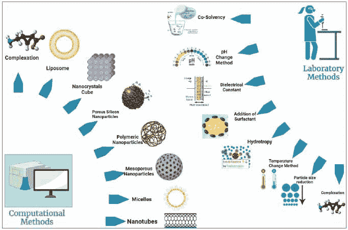 **图 (1))**

用于增强溶解度的新型和传统方法。

### 3.9. 基于配体的计算机辅助药物发现 (LB-CADD)
通过检查配体以识别与目标靶点相互作用的分子，可以使用基于配体的计算机辅助药物发现技术来预测溶解度 [43]。通过使用参考结构，LB-CADD 可以描述化合物的同时，保持理想相互作用的关键物理化学特性。基于化学相似性的化合物选择和 QSAR 模型生成是两种 LB-CADD 方法。*计算机筛选、“命中化合物到先导化合物和先导化合物到药物的优化，以及 DMPK/ADMET”属性优化均可以使用 LB-CADD 技术完成 [44]。忽略配体的动力学特性是这些技术的缺点之一 [45]。

### 3.10. 量子力学
虽然基于量子力学的方法可用于预测由化学活性引起的分子结构变化 [46]，但*计算机模拟*方法如 QSPR 和 QSAR 通常用于预测药物溶解度 [47]。这些方法考虑了亲脂性、溶质-溶剂相互作用和分子大小等各种因素，以预测药物的溶解度和渗透性。准确预测这些性质的能力对于药物开发至关重要，因为它们在决定药物生物利用度和药效方面起着关键作用，特别是口给药时 [47]。然而，重要的是，实验验证对于确认这些预测的准确性是必不可少的，因为从计算机模拟方法获得的结果并不总是可靠 [48]。

### 3.11. 量子力学方法

#### 3.11.1. ADF COSMO-RS 程序
使用 ADF COSMO-RS 程序通过计算预测药物的溶解度 [49]。COSMO-RS 方法利用单个分子的量子力学计算的中间结果来预测混合物的溶解度和其他热力学特征。

#### 3.11.2. MFPCP 方法


在该策略中，描述符包括了物理化学属性和分子指纹。表示分子的最方法是使用 `SMILES` 格式。在这种背景下，分子指纹被用于将分子的化学结构转换为计算机可以理解的格式 [51]。创建分子指纹的方法有很多，但本研究采用的方法是使用 166 维分子接入系统 (`MACCS`) 键。`RDKit` 简化了 `MACCS` 指纹的生成，这些指纹直接源自 `SMILES` [52]。获得的溶剂和溶质指纹随后被作为预测模型的描述符。这种方法有助于将复杂的分子结构转换为适用于计算分析的格式。

### 3.11.3. 药物溶解预测的 QSAR 方法

`QSAR` 方法涉及建立一个将化学结构与其生物活性联系的数学模型。这种方法也可以通过分析配体来寻找与感兴趣靶点相互作用的化合物，用于药物的溶解预测。化学计量学技术可用于生成 2D `QSAR` 模型，一项研究展示了这一点，该研究利用苯胺和苄胺类似物的脲基骨架开发了一个用于 Rho 激酶在神经治疗中作用的模型 [53]。几篇论文也研究了水溶性的“定量结构-性质关系 (QSPR) 模型” [54]。这些方法对于药物发现和开发过程中的先导化合物（hit-to-lead）、先导到药物（lead-to-drug）优化以及 `DMPK/ADMET` 属性优化非常有帮助。

表 (1) 预测药物化合物溶解度的方法对比。

| 工具 | 计算持续（分钟） | 参考文献 |
| --- | --- | --- |
| 定量结构-活性关系 | 60 – 120 | [57] |
| 定量结构-性质关系 | 60 – 120 | [58] |
| 分子动力学 | 720 – 1440 | [59] |
| 导体类筛选模型 | 60 – 120 | [60] |
| 溶解度参数 | 120 – 180 | [61] |
| 自由能计算 | 60 – 120 | [58] |
| Flory–Huggins 参数 | 60 – 120 | [62] |

### 3.11.4. 药物溶解预测的 QSPR 技术

`QSPR` “定量结构-性质关系”模型是一种用于计算药物溶解度的集成技术。它是一个将分子的结构特征与其溶解度连接起来的数学模型。为了预测药物的溶解度并提高其 `DMPK/ADMET` 特性，`QSPR` 模型被频繁应用于药物研发过程中。然而，值得注意的是，`QSPR` 模型仍然可能对数据产生过拟合，特别是当预测误差低于实验误差时 [55]。此外，同样使用数学方程预测分子特性的 `QSAR` “定量结构-活性关系”模型在药物发现和分子建模中也显示出有用的应用价值，包括预测溶解度和优化药物属性 [56]。[表 1 列出了预测药物溶解度的不同方法的汇编。

### 3.12. 影响溶解度和渗透性的关键因素

#### 3.12.1. 影响药物溶解度的因素

药物的溶解度受到多种情况的影响。这些包括溶质对溶剂施加的力、电子变量、溶质-溶剂相互作用以及空间变量 [63]。此外，食物的存在会影响药物结合和血液供应，从而影响药物吸收。需要注意的是，大多数物质是吸热的，这意味着它们在溶解过程中吸收热量 [64]。因此，这些化学品的溶解度会随着温度的升高而增加。然而，必须记住预测溶解度可能是复杂的，可能需要应用多种方法，例如定量结构-性质关系 (`QSPR`) 和定量结构-活性关系 (`QSAR`)。这些技术对于计算机筛选，以及药物发现中的先导化合物优化、先导到药物优化以及 `DMPK/ADMET` 属性优化证明具有价值。

#### 3.12.2. 影响药物渗透性的因素

亲脂性、分子量和极性是影响膜的特征之一，还包括膜厚度和成分等因素。亲脂性尤为重要，因为它决定了有多大部分药物能穿过脂质膜，这是膜渗透性的基本决定因素 [65]。此外，亲脂性不足会对药物的效力和和效果产生不利影响，导致生物利用度降低 [66]。

#### 3.12.3. 药物溶解度与渗透性之间的关系

药物的渗透性和溶解度错密相连，在决定生物利用度和有效性方面起着关键作用 [67]。“溶解度”是指物质在溶液中的溶解能力，而“渗透性”意味着物质穿过膜的程度 [68]。在药物开发领域，溶解度和渗透性的预测是优化药物特性和确保有效性的重要过程 [69]。虽然 `QSAR` 和 `QSPR` 方法常用于预测药物溶解度和渗透性，但它们高度依赖准确的实验数据 [70]。影响药物溶解度和渗透性的各种因素包括溶质与溶剂之间的相互作用、空间因素以及亲脂性等 [68]。这些技术对于药物发现中的计算机筛选、先导化合物优化、先导到药物优化以及 `DMPK/ADMET` 属性优化是非常用的 [71]。然而，它们可能存在局限性，需要实验验证来确认其预测结果 [72]。


药物的生物利用度受其溶解度和渗透性的显著影响，特别是在口服给药时 [73]。药物的渗透性是指其穿过生物膜的能力，而溶解度是指其在水中的溶解能力。膜/水分配系数除以跨膜扩散系数可以用来表示两者之间的联系。在药物开发过程中，预测药物的溶解性和渗透性对于增强其制方和疗效至关重要 [74, 75]。在预测这些特征时，经常利用*计算机*方法，例如“定量结构活性关系（QSAR）和定量结构-性质关系（QSPR）模型”。然而，必须进行实验验证以确认这些预测的准确性，因为这些方法具有局限性，可能没有考虑到所有影响药物溶解性和渗透性的因素。

## 结论

通过这些计算技术，分子的渗透性和溶解性预测已成为药物开发过程中一个重要模块。一种被称为基于配体的计算机辅助药物发现的高预测性方法采用了包括药效团、分子描述符和定量结构活性连接在内的技术。除了溶解性外，预测渗透性等生物药物学性质还需要高效且可靠的计算方法。PAMPA、Caco-2 和大鼠肠道是*体外*技术的示例，它们对于研究溶质-膜相互作用有用，而分子表面积已被用作渗透性和溶解性的描述符。细胞培养技术（如用于鼻腔药物渗透性的技术）也很有用。虽然需要多尺度生物分子模拟从分子结构水平到细胞组织水平揭示药物的作用机制，但计算工具已大幅加快了药物发现的速度并降低了成本。

## 致谢

作者感谢学院在整个研究过程中提供的研究设施和电子资源。

## 参考文献

|  ||  |
| --- | --- |
| [1] || Vo CLN, Park C, Lee BJ. 含有水溶性差药物的固体分散体的的当前趋势与未来展望。Eur J Pharm Biopharm 2013; 85(3): 799-813. [[`dx.doi.org/10.1016/j.ejpb.2013.09.007`](http://dx.doi.org/10.1016/j.ejpb.2013.09.007)] [PMID: [24056053](http://www.ncbi.nlm.nih.gov/pubmed/24056053)] |
| [2] || Boyd BJ, Bergström CAS, Vinarov Z, *et al.* 水溶性差药物的成功口服递送取决于药物的腔内行为以及适当的先进药物递送系统。 Eur J Pharm Sci 2019; 137: 104967. [[`dx.doi.org/10.1016/j.ejps.2019.104967`](http://dx.doi.org/10.1016/j.ejps.2019.104967)] [PMID: [3125052](http://www.ncbi.nlm.nih.gov/pubmed/3125052)] |
| [3] || Sliwoski G, Kothiwale S, Meiler J, Lowe EW, Jr. 药物发现中的计算方法。 Pharmacol Rev 2014; 66(1): 334-95. [[`dx.doi.org/10.1124/pr.112.00736`](http://dx.doi.org/10.1124/pr.112.00736)] [PMID: [2438236](http://www.ncbi.nlm.nih.gov/pubmed/2438236)] |
| [4] || Liu X, Testa B, Fahr A. 脂溶性与被动渗透的关系。 Pharm Res 2011; 28(5): 962-77. [[`dx.doi.org/10.1007/s11095-010-033`](http://dx.doi.org/10.1007/s11095-010-033)] [PMID: [2105279](http://www.ncbi.nlm.nih.gov/pubmed/2105279)] |
| [5] || Xie L, Ge X, Tan H, *et al.* 用于研究疾病和个性化医学的结构药学。 PLOS Comput Biol 2014; 10(5): e100354. [[`dx.doi.org/10.1371/journal.pcbi.100354`](http://dx.doi.org/10.1371/journal.pcbi.100354)] [PMID: [2483065](http://www.ncbi.nlm.nih.gov/pubmed/2483065)] |
| [6] || Shreya Shweta. 药物发现的植物化合物虚拟筛选。 Drug Discov 2023; 1: 149-79. |
| [7] || Yee S. *体外* Caco-2 细胞渗透性可以预测人的*体内*（小肠）吸收。 Pharm Res 1997; 14(6): 763-6. [[`dx.doi.org/10.1023/A:101202287`](http://dx.doi.org/10.1023/A:101202287)] [PMID: [921019](http://www.ncbi.nlm.nih.gov/pubmed/921019)] |
| [8] || Bennion BJ, Be NA, McNerney MW, *et al.* 预测药物膜渗透性：通过*体外*渗透实验验证的计算模型。 J Phys Chem B 2017; 121(20): 5228-37. [[`dx.doi.org/10.1021/acs.jpcb.7b02914`](http://dx.doi.org/10.1021/acs.jpcb.7b02914)] [PMID: [2845329](http://www.ncbi.nlm.nih.gov/pubmed/2845329)] |
| [9] || Sliwoski GR. 基于配体的计算机辅助设计的 3D 对映选择性描述符。2012. |
| [10] || Kothiwale SK, Meiler J, Hess A, Pozzi A, Lybrand T. 一种基于知识构象采样算法及其在药物发现中的应用。2016. |
| [11] || Makhouri FR, Ghasemi JB. 用于药物设计和发现的计算策略对抗疾病。Curr Top Med Chem 2019; 18(32): 2743-73. [[`dx.doi.org/10.2174/15680266196661901212506`](http://dx.doi.org/10.2174/15680266196661901212506)] [PMID: [3066356](http://www.ncbi.nlm.nih.gov/pubmed/3066356)] |
| [12] || Stillwell W. 膜运输。An Introd to Biol Membr 2013; 1: 305-37. [[`dx.doi.org/10.1016/B978-0-444-52153-8.00014-3`](http://dx.doi.org/10.1016/B978-0-444-52153-8.00014-3)] |
| [13] || Fong CW, Kirshner DA, Lau EY, Wong SE, Lightstone FC. 血脑屏的渗透性：药物化合物的运输分子机制。Biophys J 2015; 107(4): 651-69. [[`dx.doi.org/10.1007/s0023-015-977`](http://dx.doi.org/10.1007/s0023-015-977)] |
| [14] || Drummond DC, Noble ME, Hayes JW, Park DB. 脂质体开发中的药代动力学和*体内*释放率。J Pharm Sci 2008; 97(11): 4696-740. [[`dx.doi.org/10.1002/jps.2135`](http://dx.doi.org/10.1002/jps.2135)] [PMID: [183516](http://www.ncbi.nlm.nih.gov/pubmed/183516)] |
| [15] || Carpenter TS, Nilmeier DA, Wong EY,, Lightstone FC. 利用分子动力学预测血脑屏障渗透性的方法。Biophys J 2014; 107(3): 630-41. [[`dx.doi.org/10.1016/j.bpj.2014`](http://dx.doi.org/10.1016/j.bpj.2014)] |
| [16] || Moss GP, Dearden JC, Patel H, Cronin M. 皮经吸收的定量结构-渗透性关系（QSPRs）。*体外* 2002; 16(3): 299-317. [[`dx.doi.org/10.1016/S0887-2333(02)00003-6`](http://dx.doi.org/10.1016/S0887-2333(02)00003-6)] |
| [17] || Wadhwa R, Yadav NS, Katiyar SP, Yaguchi T, Lee C, Ahn H. 分子动力学模拟和实验研究揭示了醉茄酯和醉酮跨模型细胞膜的渗透性差异。Sci Reports 2021; 11(1): 1-15. [[`dx.doi.org/10.1038/s41598-021-81729-9`](http://dx.doi.org/10.1038/s41598-021-81729-9)] |
| [18] || Dimitrov S, Dimitrova G, Pavlov T, *et al.* 定义 SAR 和 QSAR 模型适用范围的逐步方法。J Chem Info Model 2005; 45(4): 839-49. [[`dx.doi.org/10.1021/ci0500381`](http://dx.doi.org/10.1021/ci0500381)] |


| [19] | Taillardat-Bertschinger A, Carrupt PA, Barbato F, Testa B. 药物研究中的固定化人工膜 HPLC。J Med Chem 2003; 46(5): 655-65. [`dx.doi.org/10.1021/jm020265j`](http://dx.doi.org/10.1021/jm020265j) [PMID: [12593643](http://www.ncbi.nlm.nih.gov/pubmed/12593643)] |
| [20] | Wang NN, Dong J, Deng YH, 等. 药物发现中的 ADME 属性评估：结合 NSGA-II 和提升算法预测 Caco-2 细胞渗透性。J Chem Inf Model 2016; 56(4): 763-73. [`dx.doi.org/10.1021/acs.jcim.5b00642`](http://dx.doi.org/10.1021/acs.jcim.5b00642) [PMID: [27018227](http://www.ncbi.nlm.nih.gov/pubmed/27018227)] |
| [21] | Briganti A, Passoni N, Ferrari M, 等. 新确诊前列腺癌患者何时进行骨扫描：现可用指南的外部验证及一种新型风险分层工具的建议。Eur Urol 2010; 57(4): 551-8. [`dx.doi.org/10.1016/j.eururo.2009.12.023`](http://dx.doi.org/10.1016/j.eururo.2009.12.023) [PMID: [20034730](http://www.ncbi.nlm.nih.gov/pubmed/20034730)] |
| [22] | Hou TJ, Zhang W, Xia K, Qiao XB, Xu XJ. 药物发现中的 ADME 评估。5. Caco-2 渗透与简单分子属性的相关性。J Chem Inf Comput Sci 2004; 44(5): 1585-600. [`dx.doi.org/10.1021/ci049884m`](http://dx.doi.org/10.1021/ci049884m) [PMID: [15446816](http://www.ncbi.nlm.nih.gov/pubmed/15446816)] |
| [23] | Pidgeon C, Ong S, Liu H, 等. IAM 色谱法：预测药物膜渗透性的体外筛选。J Med Chem 1995; 38(4): 590-4. [`dx.doi.org/10.1021/jm00004a004`](http://dx.doi.org/10.1021/jm00004a004) [PMID: [7861406](http://www.ncbi.nlm.nih.gov/pubmed/7861406)] |
| [24] | Tsopelas F, Vallianatou T, Tsantili-Kakoulidou A. 新药发现中固定化人工膜 (IAM) 色谱法的进展。2016; 11(5): 473-88. |
| [25] | Kerns EH. 药物发现的高通量理化学分析。J Pharm Sci 2001; 90(11): 1838-58. [`dx.doi.org/10.1002/jps.1134`](http://dx.doi.org/10.1002/jps.1134) [PMID: [11745742](http://www.ncbi.nlm.nih.gov/pubmed/11745742)] |
| [26] | Carrasco-Correa EJ, Ruiz-Allica J, Rodríguez-Fernández, Miró M. 分析科学中的人体人工膜：肠道吸收体外预测的潜力。Trends Analyt Chem 2021; 145: 11646. [`dx.doi.org/10.1016/j.trac.2021.11646`](http://dx.doi.org/10.1016/j.trac.2021.11646) |
| [27] | Bertucci C, Bartolini M, Gotti R, Andrisano V. 高效液色谱和毛细电泳测药物对固定化靶聚合物的亲和力。J Chromatogr Analyt Technol Biomed Sci 2003; 79(1-2): 111-29. [`dx.doi.org/10.1016/j.chromb.2003.08-03`](http://dx.doi.org/10.1016/j.chromb.2003.08-03) [PMID: [14630146](http://www.ncbi.nlm.nih.gov/pubmed/14630146)] |
| [28] | Flaten GE, Dhanikula AB, Luthman K, Brandl M. 跨越磷脂屏障的药物渗透性：研究被动扩散的新型方法。Eur Pharm Sci 2006; 27(1): 80-90. [`dx.doi.org/10.1016/j.ejps.2005.08-07`](http://dx.doi.org/10.1016/j.ejps.2005.08-07) [PMID: [1624536](http://www.ncbi.nlm.nih.gov/pubmed/1624536)] |
| [29] | Zhang C, Li J, Xu L, Shi ZG. 基于渗透微球的快速脂质体色谱法用于渗透性化合物的筛选和分析。J Chromatogr A 2012; 123: 78-84. [`dx.doi.org/10.1016/j.chroma.2012.02-13`](http://dx.doi.org/10.1016/j.chroma.2012.02-13) [PMID: [22381893](http://www.ncbi.nlm.nih.gov/pubmed/22381893)] |
| [30] | Lundahl P, Beigi F. 用于药物-膜相互作用分析的固定化脂质体色谱法。Adv Drug Deliv Rev 1997; 23(1-3): 221-7. [`dx.doi.org/10.1016/S0169-40X(96)0437-1`](http://dx.doi.org/10.1016/S0169-40X(96)0437-1) |
| [31] | Liu XY, Nakamura C, Yang Q, Miyake J. 研究药物-膜相互作用的固定化脂质体色谱法。J Chromatogr A 2002; 961(1): 113-8. [`dx.doi.org/10.1016/S0021-9673(02)0505-8`](http://dx.doi.org/10.1016/S0021-9673(02)0505-8) [PMID: [12186381](http://www.ncbi.nlm.nih.gov/pubmed/12186381)] |
| [32] | Larregieu CA, Benet LZ. 药物发现中区分渗透与代谢的关系以改进 BCS 和 BDDC。Mol Pharm 2014; 11(4): 1335-44. [`dx.doi.org/10.1021/mp4007858`](http://dx.doi.org/10.1021/mp4007858) [PMID: [24628254](http://www.ncbi.nlm.nih.gov/pubmed/24628254)] |
| [33] | Larregieu CA, Benet LZ. 使用 Caco-2 作为人体肠道渗透性替代的药物发现及监管预测考量。AAPS J 2013; 15(2): 483-97. |
| [34] | Veber DF, Johnson SR, Cheng HY, Ward KW, Kopple KD. 影响候选药物口生物利用度的分子属性。J Med Chem 2002; 45(12): 2615-23. [`dx.doi.org/10.1021/jm020017`](http://dx.doi.org/10.1021/jm020017) [PMID: [12036371](http://www.ncbi.nlm.nih.gov/pubmed/12036371)] |
| [35] | Elder D, Holm R. 水溶解性：简单的预测方法（计算机模拟、体外和生物相关方法）。Int J Pharm 2013; 453(1): 3-11. [`dx.doi.org/10.1016/j.ijpharm.2012.1041`](http://dx.doi.org/10.1016/j.ijpharm.2012.1041) [PMID: [23124107](http://www.ncbi.nlm.nih.gov/pubmed/23124107)] |
| [36] | Aleunas YW, Liu R, Pelosi-Kilby, Shen C. 干燥高通量溶解性的发现应用。Eur Pharm Sci 2009; 37(2): 71-82. [`dx.doi.org/10.1016/j.ejps.2009.02-06`](http://dx.doi.org/10.1016/j.ejps.2009.02-06) [PMID: [1942542](http://www.ncbi.nlm.nih.gov/pubmed/1942542)] |
| [37] | Hassell M, Readman JW, Ranville F. 药物开发中的高通量溶解性。Adv Drug Deliv Rev 2007; 59(7): 546-67. [`dx.doi.org/10.1016/j.addr.2007.05-06`](http://dx.doi.org/10.1016/j.addr.2007.05-06) [PMID: [1760482](http://www.ncbi.nlm.nih.gov/pubmed/1760482)] |
| [38] | Avde A, Fuguet E, Lins S, 等. 可离子药物的平衡测量。ADMET DMPK 2016; 4(2): 117-78. [`dx.doi.org/10.5599/admet.4.29`](http://dx.doi.org/10.5599/admet.4.29) |
| [39] | Hassell M, Readman JW, Ranville F, Tiede K. 环境风险评估中的纳米颗粒分析与表征。Ecotoxicology 2008; 17(5): 344-61. [`dx.doi.org/10.1007/s10646-008-02-5`](http://dx.doi.org/10.1007/s10646-008-02-5) |
| [40] | Huang L, Tong WQ. 固态属性对开发性评估的影响。Adv Drug Deliv Rev 2004; 56(3): 321-34. [`dx.doi.org/10.1016/j.addr.2003.10-07`](http://dx.doi.org/10.1016/j.addr.2003.10-07) [PMID: [14962584](http://www.ncbi.nlm.nih.gov/pubmed/14962584)] |
| [41] | Byrn SR, Pfeiffer RR, Stephenson G, Grant DJW, Gleason WB. 固态药物化学。Chem Mater 1994; 6(8): 1148-58. [`dx.doi.org/10.1021/cm00044a013`](http://dx.doi.org/10.1021/cm00044a013) |
| [42] | Parikh T, Gupta SS, Meena AK, Vitez I, Mahajan N, Serajuddin ATM. 应用溶液胶法法研究固体分散和热熔挤出物中的药物-聚合物相容性。J Pharm Sci 2015; 104(7): 2142-52. |


- [43] Zhou L, Yang L, Tilton S, Wang J. 在早期药物发现中使用微缩摇摇瓶法开发高通量平衡溶解度分析法。J Pharm Sci 2007; 96(11): 3052-71. [http://dx.doi.org/10.1002/jps.20913] [PMID: [17722003](http://www.ncbi.nlm.nih.gov/pubmed/17722003)]
- [44] Kumar KK, Swathi M, Srinivas L, Basha SN. 氯沙坦钾浮浮 `in situ` 凝胶系统的制备与评价。Pharm Lett 2015; 7: 98-112.
- [45] Gupta S, Kershaw SV, Rogach AL. 25 周年文章：胶体纳米晶体中的离子交换。Adv Mater 2013; 25(48): 6923-44. [http://dx.doi.org/10.1002/adma.201302400] [PMID: [24108549](http://www.ncbi.nlm.nih.gov/pubmed/24108549)]
- [46] Acharya C, Coop A, Polli JE, Mackerell AD, Jr. 基于配体的药物设计的最新进展：构象采样药效团方法的相关与实用性。Curr Computeraided Drug Des 2011; 7(1): 10-22. [http://dx.doi.org/10.2174/157340911793743547] [PMID: [20807187](http://www.ncbi.nlm.nih.gov/pubmed/20807187)]
- [47] Salmaso V, Moro S. 在探索配体-蛋白识别过程中桥接分子对接与分子动力学：概述。Front Pharmacol 2018; 9(Aug): 923. [http://dx.doi.org/10.3389/fphar.2018.00923] [PMID: [30186166](http://www.ncbi.nlm.nih.gov/pubmed/30186166)]
- [48] Eros D, Kövesdi I, Orfi L, Takács-Novák K, Acsády G, Kéri G. 基于计算分子描述子的 `logP` 预测可靠性：批判性回顾。Curr Med Chem 2002; 9(20): 1819-29. [http://dx.doi.org/10.2174/0929867023369042] [PMID: [12369880](http://www.ncbi.nlm.nih.gov/pubmed/12369880)]
- [49] Bououden W, Benguerba Y, Darwish AS, 等. 西瑞替尼在碳和氮化硼纳米管上作为抗肿瘤药物载体的表面吸附：COSMO-RS 和 DFT 分子洞察。J Mol Liq 2021; 338: 116666. [http://dx.doi.org/10.1016/j.molliq.2021.116666]
- [50] Scheffczyk J, Schäfer P, Fleitmann L, 等. COSMO-CAMPD：基于 COSMO-RS 的分子与过程集成设计框架。Mol Syst Des Eng 2018; 3(4): 645-57. [http://dx.doi.org/10.1039/C7ME0012H]
- [51] Livingstone DJ. 使用分子性质对化学结构进行表征。J Chem Inf Comput 1999; 40(2): 195-209.
- [52] Lee S, Lee M, Gyak KW, Kim SD, Kim MJ. 新溶解度预测模型：分子指纹与物理化学特征 vs 图卷积神经网络。ACS Omega 2022; 7(14): 12268-77. [http://dx.doi.org/10.1021/acsomega.2c00697] [PMID: [35449985](http://www.ncbi.nlm.nih.gov/pubmed/35449985)]
- [53] Lo YC, Rensi SE, Torng W, Altman RB. 化学信息学与药物发现中的机器学习。Drug Discov Today 2018; 23(8): 1538-46. [http://dx.doi.org/10.1016/j.drudis.2018.0510] [PMID: [29750902](http://www.ncbi.nlm.nih.gov/pubmed/29750902)]
- [54] Grover M, Singh B, Bakshi M, Singh S. 药物研究中的定量结构-关系。Pharm Sci Today 2000; 3(2): 50-7. [http://dx.doi.org/10.1016/S1461-5347(99)00215-1]
- [55] Dai Y, Yang D, Zhu F, Yang X. 氯酚的厌氧生物降解 QSPR（定量结构-性质关系）。Chemosphere 2006; 65(11): 2427-33. [http://dx.doi.org/10.1016/j.chemosphere.2006.04.052] [PMID: [16750555](http://www.ncbi.nlm.nih.gov/pubmed/16750555)]
- [56] Verma J, Khedkar V, Coutinho E. 药物设计中的 3D-QSAR：综述。Top Med Chem 2010; 10(1): 95-115. [http://dx.doi.org/10.2174/1568026107902326] [PMID: [19929826](http://www.ncbi.nlm.nih.gov/pubmed/19929826)]
- [57] Neves BJ, Braga RC, Melo-Filho CC, Moreira-Filho JT, Muratov EN, Andrade CH. 基于 QSAR 的虚拟筛选：药物发现中的进展与应用。Front Pharmacol 2018; 9(Nov): 1275. [http://dx.doi.org/10.3389/fphar.2018.01275] [PMID: [30524275](http://www.ncbi.nlm.nih.gov/pubmed/30524275)]
- [58] Westergren J, Lindfors L, Höglund T, Lüder K, Nordholm S, Kjellander R. 药物溶解度的 `in silico` 预测：1. 水合自由能。J Phys Chem B 2007; 111(7): 1872-82. [http://dx.doi.org/10.1021/jp064220] [PMID: [17266351](http://www.ncbi.nlm.nih.gov/pubmed/17266351)]
- [59] Filipe HAL, Loura LMS. 分子动力学模拟：进展与应用。Molecules 2022; 27(7): 2105. [http://dx.doi.org/10.3390/molecules27072105] [PMID: [35408504](http://www.ncbi.nlm.nih.gov/pubmed/35408504)]
- [60] Klamt A, Eckert F, Arlt W. COSMO-RS：计算液体混合物热力学性质的替代方法。Ann Rev Chem Biomol Eng 2010; 1(1): 101-22. [http://dx.doi.org/10.1146/annurev-chembioeng-073009-100903] [PMID: [22432575](http://www.ncbi.nlm.nih.gov/pubmed/22432575)]
- [61] Hancock B, York P, Rowe RC. 药物剂型设计中溶解度参数的使用。Int J Pharm 1997; 148(1): 1-21.
- [62] Schatzch K, Wolf BA, Jeberien HE, Klein J. 不同热力学条件下 Flory-Huggins 参数的浓度依赖性。Die Makolekulare Chemie: 分子化学与物理 1984 Oct; 185(10): 2169-81.
- [63] Shelby RA, Smith DR, Schultz S. 负折射率的实验验证。Science (80-). 2001 Apr 6; 292(5514): 77–9.
- [64] Chen G, Liang J, Han J, Zhao H. 对硝基乙腈在十六种溶剂中的溶解度建模、溶质-溶剂相互作用及热力学溶解性质。Chemical & Engineering Data 2018 Dec; 64(1): 315-23.
- [65] Xie L, Ge X, Tan H, 等. 走向系统药学研究复杂疾病和个性化医学。PLOS Comput Biol 2014; 10(5): e100354. [http://dx.doi.org/10.1371/journal.pcbi.1003554] [PMID: [24830652](http://www.ncbi.nlm.nih.gov/pubmed/24830652)]
- [66] Casares D, Escribá PV, Rosselló CA. 膜脂组成：对膜和细胞器结构、功能和分区的影响以及治疗途径。国际分子杂志 2019 May 1; 20(9): 2167.
- [67] Shreya Shweta. 用于药物发现的植物化学虚拟筛选。Phytochem Comput Tools Databases Drug Discov 2023; 1: 149-79.
- [68] Salib RJ, Howarth PH. 鼻用抗组胺和鼻用皮质激素治疗过敏性鼻炎的安全性与耐受性。Drug Safety 2003 Oct; 26: 863-93.
- [69] Avdeef A. 物理化学特征分析（溶解度、渗透性和电荷状态）。药物化学的新进展 2001 Sep 1; 1(4): 277-351.
- [70] Kothiwale SK, Meiler J, Hess A, Pozzi A, Lybrand T. 一种新型基于知识的构象采样算法及其在药物发现中的应用 2016.


| \[71\] || Kothiwale SK, Meiler J, Hess A, Pozzi A, Lybrand T. A novel knowledge based conformation sampling algorithm and applications in drug discovery 2016. |
| \[72\] || Stillwell W. Membrane transport. An Introd to Biol Membr 2013; 1: 305-37.[[`dx.doi.org/10.1016/B978-0-444-52153-8.00014-3`](http://dx.doi.org/10.1016/B978-0-444-52153-8.00014-3)] |
| \[73\] || Henninot A, Collins JC, Nuss JM. The current state of peptide drug discovery: back to the future?. Journal of medicinal chemistry. 2018 Feb 22; 61(4): 1382-414. |
| \[74\] || Drummond DC, Noble CO, Hayes ME, Park JW, Kirpotin DB. Pharmacokinetics and *in vivo* drug release rates in liposomal nanocarrier development. J Pharm Sci 2008; 97(11): 4696-740. |
| \[75\] || Joshi T, Sharma P, Joshi T, Mathpal S, Pandey SC, Pandey A, *et al.* Recent advances on computational approach towards potential drug discovery against leishmaniasis. Pathog Treat Prev Leishmaniasis. 2021 Jan 1;63–84. |

# 药物研究中的药代动力学与药动力学建模 (PK/PD)：现状研究与进展

Richa Sood^(1, *)**,** Anita A.^(1) 

¹ 药药科学学院, Dayananda Sagar 大学, Bengaluru, Karnataka-560078, India 

## 摘要

技术的突破使得构建更复杂的分子和药物递送系统成为可能增加了增加了对疾病复杂性的理解，并使我们能够识别广泛的治疗靶点。通过正确使用基于动力系统的 PK/PD 模型，可以设计新的药物组合。在药物研究中，使用药代动力学-药动力学（PK-PD）建模是提供对治疗效果和安全性更好知识与理解的坚定方法。*体内*动物测试或*体外*生物测定被用于预测人类的有效性和安全性。使用用于直接和间接反应的主要药动力学模型进行建模模拟，用于阐明许多药物在暴露-反应关系中虚设最小有效浓度或阈值的假设。在本篇综述中，我们简述了药物递送的基本 PK-PD 建模概念，并记录了它们如何应用于当前的研发工作中。

**关键词：** 临床开发、建模、药代动力学、药动力学、临床前。 

 * **通讯作者 Richa Sood:** 药药科学学院, Dayananda Sagar 大学, Bengaluru, Karnataka-560078, India; 电子邮箱: richa88sood@gmail.com

## 1. 引言

近期新药面临面临挑战挑战药物研发成本的不断增加和大众生产力的下降。这一结果可能是由于多种不同的原因造成的。鼓励使用替代技术以获得关于有效性、性和成本效益的答案。药物研发的替代方法包括药代动力学/药动力学（PK/PD）建模与模拟、适应性试验模型、对生物标志物的更高依赖，以及个体化药物的生产 [1]。PK/PD 建模和模拟在药物开发的各个阶段都很有帮助。

只有相关领域的专家（即药代动力学专家）对 PK/PD 建模的价值和应用有深入了解。然而，药物开发团队成员和监管机构都需要理解并接受建模概念，以协助药物开发 [2]。为了简化问题并增强对药物开发的理解，[3]。药物开发过程包括以下阶段：药物发现、临床前开发、临床开发和监管申报 [4]。PK/PD 建模被广泛认为是选定候选药物和确定剂量的重要技术 [5]。药代动力学-药动力学（PK-PD）建模是一种分析药代动力学（PK）、药动力学（PD）及其之间关系的科学方法 [6]。基于临床前研究的 PK-PD 数据创建的机理 PK-PD 模型可用于预测人类给药方案并优化药物递送系统，如图底部的面板所示（**1)）。

PK 建模明确描述了体内的 ADME 过程，以描述药物的时间进程 [7]。PK-PD 建模可以根据临床前和临床数据，在药物递送系统的开发期间指导配方设计和剂量方案选择 [10]。PK-PD 建模中药物特异性和系统特异性特征的分将允许评估并促进各种递送系统属性对*体内*药物效果的影响 [8]。药物特异性指标（受体结合亲力和药物清除率）说明了特定药物如何影响人体。清除率、释放速率和载体内化速率是特定递送方法的载体特征示例。系统特异性参数代表的生理值包括血流量、细胞寿命、酶表达和转运体表达 [3]。一旦可用，可以将临床 PK-PD 数据纳入 PK-PD 模型中以改进其设计。为了协助最终审批，PK-PD 建模也可以与临床开发同步进行。该建模方法目前用于药物递送系统和修饰大分子 [9]。

```
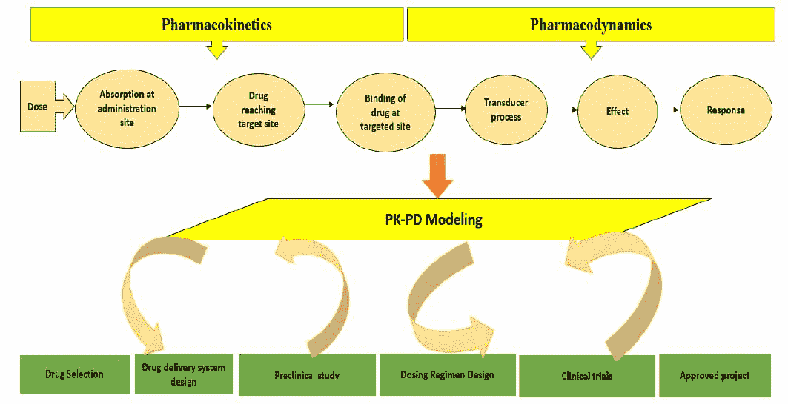
```
**图. (1))**

药物递送系统开发中 PK-PD 建模的示意图。

## 2. 药代动力学模型


药动力学模型可以计算出有用的药动力学参数，并阐明药物（或多种药物）在体内传导所需的时间。在某些情况下，药动力学模型非常有帮助，例如：定义任何剂量方案下的药物诱导患者行为、预测药物在不同体液中的浓度、为特定个体确定最佳剂量方案、评估毒性、确定同种药物不同剂之间的生物等效/非生物等效，以及描述药物相互作用 [11, 12]。

# 2. 实验数据的药动力学研究方法

## 2.1. 方法
### 2.1.1. 非房室分析 (NCA)
非房室分析是一种直接的方法，用于在不假设特定房室模型的情况下计算药动力学参数。当底层生物过程尚不明确，或者数据不符合房室模型时，该方法特别有用。NCA 涉及以下步骤：

### 2.1.1.1. 曲线下面积 (AUC) 的计算
AUC 代表药物随时间在血液中的总暴露量。它使用梯形法则等数值积分法进行计算 [13]。

### 2.1.1.2. 清除率 (CL) 的计算
清除率是药物从体内消除的速率。计算方法为剂量除以 AUC。

### 2.1.1.3. 分布体积 (V[d]) 的计算
`V[d]` 代表药物分布在体内的表观容积。其计算方法为剂量除以 AUC 与消除速率常数的乘积。

### 2.1.1.4. 半衰期 (t½) 的计算
半衰期是体内药物浓度减少一半所需的时间。使用以下方程计算：

```text
t½ = ln(2) / elimination rate constant.
```

NCA 提供了关于药物暴露和基本药动力学参数的宝贵信息，在无法进行详细房室建模时，它是一种合适的方法 [14]。

## 2.1.2. 房室建模
房室建模假设人体可以由不同的房室组成，每个房室都有其生理特征。药物在这些房室之间的移动使用基于质量平衡原理的数学方程描述。最常用的房室模型是单房室模型和多房室模型 [15]：

### 2.1.2.1. 单房室模型
在该模型中，人体被视为一个单一房室，药物在其中均匀分布。

这种方法考虑代表代表室室的更更。。将房室模型拟合到实验数据涉及估计模型参数，例如吸收速率常数、分布速率常数和消除速率常数。通常使用 `NONMEM`、`WinNonlin` 和 `Phoenix` 等软件工具来实现此目的。

## 2.1.3. 总体药动力学建模
考虑了群体中个体之间的变异。这种方法适用于大型数据集，并允许理解年龄、性别、遗传和疾病状态等因素如何影响药物的药动力学。该过程涉及：

### 2.1.3.1. 数据收集
从接受相同治疗的各种个体中收集药动力学数据。

### 2.1.3.2. 模型开发
创建一个描述平均药物行为和个体间变性的模型。这涉及将固定效应（平均值）和随机效应（变异性）纳入模型方程中。

### 2.1.3.3. 参数估计
使用专业软件将模型拟合到数据，以估计固定和随机效应参数。

### 2.1.3.4. 模型验证
使用独立的数据集或内部交叉验证技术验证模型的预测性能。总体药动力学建模提供了药物反应变异来源的见解，有助于为不同的患者群体量身定制剂量策略。总之，药动力学研究使用非房室分析、房室建模和总体药动力学建模等方法来理解药物在体内的吸收、分布、代谢和排泄。方法的选择取决于药物药动力学的复杂性、可用数据以及特定的研究目标 [17]。

# 3. PK/PD 建模模拟方法

## 3.1. 非房室和房室药动力学分析
为了估计重要的 PK 参数，如峰值浓度 (`C[max]`)、达峰时间 (`T[max]`)、浆或血清浓度-时间曲线下面积、清除率 (`CL`)、分布体积 (`V[d]`)、半衰期 (`t[1/2]`) 等，经常使用非房室分析 (NCA)。房室分析的缺点比 NCA 需要更多的假设，而 NCA 的优点是独立模型 [18]。

然而，NCA 的一个基本缺点是在剂量方案改变或发生非线性时，无法建模或预测 PK 曲线。通过假设人体被分为一个或多个房室，药物通过这些房室进行分布，房室方法使用动力学模型来定义和预测浓度-时间曲线。房室方法相比 NCA 的优势是可以预测不同时间和不同剂量范围内的药物浓度 [19]。

### 3.1.1. 总体方法
根据美国 FDA 的定义，总体药动力学 (popPK) 是“对接受临床相关剂量药物的目标人群中个体药物浓度变异的来源和相关因素的研究” [20]。

总体模型规定了至少两个层次的分级结构。在最基础的水平，个体的药动力学观测被认为来源于个体概率模型，其均值由个体药动力学模型（例如双指数模型）给出，该模型由个体特定参数量化，这些参数可能根据个体特定时间协变量的值而变化。事实上，额外的个体特定药动力学参数用于模拟特定药动力学发现的方差。总体模型利用特定的推断技术，专注于提供平均参数估计之外的构成变异变量的估计。个体参数的概率分布（通常是均值和方差，*即*个体间变异）在第二层作为个体特定协变量的函数进行建模。

总体药动力学涉及利用模型、其参数值以及研究设计和数据分析方法来阐明总体药动力学模型及其相关的参数值。两阶段法和非线性混合效应建模方法是估计固定效应（均值）和变异性的两种常用技术。

## 3.2. popPK 数据的方法
### 3.2.1. 两阶段法


药代动力学数据的标准评估由两个阶段组成。在该策略的初始阶段，使用个体的高密度浓度-时间数据通过非线性回归来估计药代动力学参数（数据丰富情况）。在第二阶段，计算样本的描述性汇总统计量，通常将第一阶段获取的个体参数估计均值、方差和协方差作为输入数据。第二阶段还可以包含使用传统的统计学方法（线性逐步回归、协方差分析、聚类分析）对参数与协变量之间的依赖关系进行研究。两阶段法在应用得当时，可以对人口统计学特征产生精确估计。尽管平均参数估计通常是无偏的，但在所有实际场景中，随机效应（方差和协方差）通常会被放大。随机效应协方差的偏差修正以及根据数据质量和数量对个体数据进行差异化加，已被作为两阶段技术的改进方法。

### 3.2.2. 非线性混合效应模型 (NLME)

在数据稀疏的情况下，应采用单阶段方法（例如非线性混合效应建模），此时传统的两阶段方法无效，因为个体参数的估计预先是无法实现的。在药物评估的背景下，非线性混合效应建模方法的出现基于一种理解：如果要在患者中研究药代动力学和药效动力学，则应在不受严格和限制的设计条件下收集数据。对于估计群体内参数分布及其与协变量的关系，该方法使用群体研究样本而非个体作为分析单位。除了来自具有严谨和广泛采样设计的传统药代动力学研究数据（密集数据情况）外，该方法还使用观测型（实验型）的个体药代动力学数据，这些数据可能是稀疏、不平衡且碎片化的。非线性混合模型分析提供了表征群体药代动力学（和/或药效动力学）参数分布的特征估计。在混合效应建模的背景下，群体特征集由群体均值（源自固定效应参数）和群体变异（通常是随机效应参数生成的协方差值）组成。使用非线性混合效应建模进行药代动力学数据群体分析的技术包括从完整的个体浓度值显式计算群体参数。即使在缺乏大量数据的情况下，每个受试者的独特性也会保留并考虑在内。群体 PK 方法对混合效应建模方法提供了更详尽的解释 [22]。

### 3.3. 贝叶斯方法

在药代动力学中，贝叶斯方法是一种强大的统计技术，它结合先信息和观测数据来估计模型参数、做出预测并衡量不确定性。由于它允许利用先验知识改进参数估计，在处理稀疏或噪声数据时特别有用。

#### 3.3.1. 先验分布

贝叶斯框架中使用先验分布来描述关于模型参数的现有知识。在观察任何数据之前，该分布代表了对参数的最早意见或假设。先验分布可能受到早期研究、专业判断或其他相关数据的影响。它们是非信息的（宽泛的）或指导性的（狭的）。

#### 3.3.2. 似然函数

似然函数解释了在给定参数值下检测到数据的概率。模型参数与观测数据之间的关系用数学方法表示。在药代动力学中，这涉及模拟根据吸收速率、清除量和分布容积等许多因素药物浓度如何随时间变化。

#### 3.3.3. 贝叶斯推断

为了推导出后验分布（即考虑数据后对参数的更新观点），贝叶斯推断涉及使用观测数据更新先验分布。通过连接先验分布、似然函数和观测数据，利用贝叶斯定理来实现这一点。

#### 3.3.4. 后验分布

给定观测数据，后验分布结合了先验分布和似然函数，产生模型参数的概率分布。通过同时考虑数据和先验知识，该分布描述了参数估计的不确定性。

#### 3.3.5. 参数估计

在贝叶斯药代动力学中，参数估计涉及对后验分布求和以提供点估计（如均值、中或众数）和可信区间，这与置信区间具有可比性，因为它们表达了围绕这些估计的不确定性程度。

#### 3.3.6. 模型验证

在贝叶斯药代动力学中，模型验证涉及评估模型预测与观测数据之间的拟合优度。通过这样做，可以确保估计的模型准确捕捉了观察到的药代动力学行为。

#### 3.3.7. 预测与决策

一旦获得并验证了后验分布，即可用于预测未来的药物浓度、剂量调整或理想给药方案。通过使用来自后验分布的不确定性指标，可以指导决策。

## 4. 建模与模拟在药物开发中的应用

数学和计算方法严重依赖于药物靶点及相关活性团的识别 [23]。这些方法使化合物能够化学和结构阐明，降低了药物前景出现问题和失败的可能性。通过采用各种定量模型和计算工具，可以减少药物设计和开发中传统实验研究的成本和时长。因此，利用计算工具和统计建模进行分子建模和药物发现的情况每天日益增长 [24]。可以使用表 1 中列出的工具评估人体对药物的反应。

表 1 **计算设计中 ADME 分析工具。**

| 序号 | 程序 | 描述 | 参考文献 |
| :--- | :--- | :--- | :--- |
| 1 | DSSTox | 一个可搜索的结构毒性数据库 | [25] |
| 2 | Metabase | 一种基于 Excel 的 ADME/PK 低成本放射分析 | [26] |
| 3 | PreADMET | 估计致癌性和毒性强度 | [27] |
| 4 | ChemTree | 用于预测 ADMETox 特性 | |
| 5 | ADMETlab | 利用 ADMET 数据库进行系统化的 ADMET 分析 | [28] |
| 6 | TOPKAT | 用于毒性预测 | [29] |
| 7 | Swiss ADME | 估计物理化学参数和 ADME 预测 | [30] |

### 4.1. 临床前开发


在临床前研究中，会对候选药物的物理化学参数、药代动力学特性（如吸收、代谢、分布和排泄，`ADME`）以及有效性和安全性进行评估。多种建模技术（包括 `PK`、`PK/PD` 和异速缩放）被频繁用于药物分子的筛选、优化和人体剂量估计 [31]]。此时建模的目标本质上是为了“学习”分子的属性，这些属性稍后将通过临床开发早期阶段收集的信息进行“确认” [3]]。候选药物的优化与选拔、内在活性、*体内*效力、药物相互作用、替代指标的开发以及用于药效/毒性的动物模型，是目前建模方法的主要目标 [32]]。

例如，可以使用基于机制的 `PK/PD` 结合模型进行候选药物评估和人体剂量选择。该建模技术通过 `PK`、受体占据率和细胞动力学，预测了一种新型单克隆抗体在恒猕猴中首次人体（FIH）实验的最小可接受生物效应水平（`MABEL`）。对于在相同治疗类别中其他药物已有丰富既往知识的新化学实体（`NCEs`），建模和模拟能够比较各种新化学实体，并选出最有前景的临床候选药物。随后，可以通过 `PK/PD` 建模辅助完成 I 期研究的剂量选择 [33]。Wong *et al.* 讨论了药物的统一临床前评估 [34]，并包含了建模和模拟工具。此外，研究表明，抗高血压药物的临床前阶段可以使用比较数据预测预期的治疗剂量 [35]]。还建立了一个 `PBPK` 模型来表征脂溶性 BCS II 类药物在纳米悬浮液剂型给药时的吸收情况。优化后，胆盐胶囊溶解和大结肠吸收被纳入临床前大鼠模型。这种也被称为“假设分析”的敏感性分析 [36]] 显示，吸收参数 `fugut` 是人体 `PK` 和 `DDI` 的关键因素。此外，在异种移植小鼠中，使用 `PK/PD` 模型预测给药抗癌药物后的肿瘤生长抑制。这是确定*体内*联合试验中给药抗癌药物加和效应的一种尖端且直接的方法。每种药物的 `PK/PD` 参数通过对照组和单药组进行估算。然后根据这些估算值使用加性组合模型预测预期结果 [37]]。

### 4.2. 临床开发

临床开发可以利用建模和模拟来优化剂量方案 [[38]]。此外，研究表明，抗高血压药物的临床前阶段可以使用比较数据预测预期的治疗剂量 [35]]。还建立了一个 `PBPK` 模型来表征脂溶性 BCS II 类药物在纳米悬浮液剂型给药时的吸收情况。优化后，胆盐胶囊溶解和大结肠吸收被纳入临床前大鼠模型。这种也被称为“假设分析”的敏感性分析 [36]] 显示，吸收参数 `fugut` 是人体 `PK` 和 `DDI` 的关键因素。此外，在异种移植小鼠中，使用 `PK/PD` 模型预测给药抗癌药物后的肿瘤生长抑制。这是确定*体内*联合试验中给药抗癌药物加和效应的一种尖端且直接的方法。每种药物的 `PK/PD` 参数通过对照组和单药组进行估算。然后根据这些估算值使用加性组合模型预测预期结果 [37]]。

Wong *et al.* 讨论了药物的统一临床前评估 [34]，并包含了建模和模拟工具。此外，研究表明，抗高血压药物的临床前阶段可以使用比较数据预测预期的治疗剂量 [35]]。还建立了一个 `PBPK` 模型来表征脂溶性 BCS II 类药物在纳米悬浮液剂型给药时的吸收情况。优化后，胆盐胶囊溶解和大结肠吸收被纳入临床前大鼠模型。这种也被称为“假设分析”的敏感性分析 [36]] 显示，吸收参数 `fugut` 是人体 `PK` 和 `DDI` 的关键因素。此外，在异种移植小鼠中，使用 `PK/PD` 模型预测给药抗癌药物后的肿瘤生长抑制。这是确定*体内*联合试验中给药抗癌药物加和效应的一种尖端且直接的方法。每种药物的 `PK/PD` 参数通过对照组和单药组进行估算。然后根据这些估算值使用加性组合模型预测预期结果 [37]]。

（注：原文中存在大量重复段落，译文已根据逻辑要求进行了整合与去重。）


为有需要的患者开发安全有效的疗法是药物赞助者和监管机构的共同目标。美国药品监督管理局（`FDA`）在为人体药物和生物制品提供有效性临床证据方面概述了行业指南：1. 当疗效可以完全从现有疗效研究中推导时；2. 当一项充分且对照良好的研究就足够时。在后一种情况下，建议可能还会参考进一步的支持性事实和信息，例如对剂量-系统暴露-响应之间关系的知识和理解 [1, 50]。尽管该指南在该领域的描述并不精确，但 `PK/PD` 数据和/或对 `PK/PD` 相关性的知识有助于消除对特定患者人群药物剂量和给药方案安全性的任何疑问或担忧，同时为药物的有效性提供支持 [51]。在审批过程中做出的其他监管决策，例如当由于患者内在或外在因素导致系统暴露显著增加或减少时，为剂量和剂量调整相关的逻辑标签语言提供依据，可能受益于 `PK/PD` 信息的使用，而不仅仅机构认定有效性在临床结局试验中已得到充分证明。`PD` 可以提供更多关于风险/获益分析比例的信息，这些信息也可用于报告具体问题。通过展示对这些理念的接纳，联邦监管机构可以影响 `PK/PD` 建模与模拟的采用 [51]。

## 未来展望与结论

不可否认，制药公司和监管机构已经接受使用 `PBPK` 建模来化药物的临床潜力，其潜力在未来可能会更大。假设 `PBPK` 建模是一个详尽且数据密集的过程。随着对生理和生化机制理解的深入，将创建更复杂的模型，特别是在各种疾病状态背景下。因此，无论用户的知识程度如何，随着模型的变化，`PBPK` 建模都需要持续的教育。为了在药物开发过程中成功使用 `PBPK` 建模，必须拥有足够的资源、应用这些模型的恰当培训，以及对驱动模型所需的 `ADME` 事实的深入了解。通过临床前药物发现和临床药物开发人员之间的有效沟通，使得创建可靠的 `PBPK` 模型成为可能，这些模型随后可以用于解决各种药物开发相关问题。对疾病机制的新见解要求合理设计和固定的药物组合，这为新药的发现和开发提供了令人兴奋的新机会，包括新化学实体和长期用药物的现有分子。这将导致新兴“系统疗法”的出现，其中 `PK/PD` 建模将作为评估其合理性最重要的系统*体内*工具。工业界、学术界和监管机构对建模 `PK/PD` 关系的广泛接受和日益增加的应用在未来不仅为优化应用药理治疗提供机会，还将加速药物开发进程。此外，随着临床药理学进入新时代，它将成为其使命和目标的强力催化剂。

## REFERENCES

| | | |
| --- | --- | --- |
| [1] | Li C, Wang J, Wang Y, et al. | 药物递送的最新进展。Acta Pharm Sin B 2019; 9(6): 1145-62. [`dx.doi.org/10.1016/japsb2019.0803`](http://dx.doi.org/10.1016/japsb2019.0803) [PMID: 3186711](http://www.ncbi.nlm.gov/pubmed/3186711) |
| [2] | Ågerfalk PJ | 人工智能作为数字机构。Eur J Inf Syst 2020; 29(1): 1-8. [`dx.doi.org/10.1080/096085X.2020.172147`](http://dx.doi.org/10.1080/096085X.2020.172147) |
| [3] | Wang W, Ouyang D | 药物递送中生理性药代动力学建模的机遇与挑战。Drug Discov Today 2022; 27(8): 2100-20. [`dx.doi.org/10.1016/jdrudis2022.04015`](http://dx.doi.org/10.1016/jdrudis2022.04015) [PMID: 35452792](http://www.ncbi.nlm.gov/pubmed/35452792) |
| [4] | Hinder M, Hartl D | 转化医学——桥梁学科。2022119-38 |
| [5] | Chen B, Dong J, Pan WJ, Ruiz A | 药代动力学/药效动力学模型支持的早期开发。Curr Pharm Biotechnol 2012; 13(7): 1360-75. [`dx.doi.org/10.2174/13892011280636`](http://dx.doi.org/10.2174/13892011280636) [PMID: 22201585](http://www.ncbi.nlm.gov/pubmed/22201585) |
| [6] | Lesko LJ, Rowland M, Peck CC, Blaschke TF | 优化药物开发科学：人类更好的候选药物筛选。J Clin Pharmacol 2000; 40(8): 803-14. [`dx.doi.org/10.1177/0091270020953`](http://dx.doi.org/10.1177/0091270020953) [PMID: 1093464](http://www.ncbi.nlm.gov/pubmed/1093464) |
| [7] | Kuepfer L, Fuellen G, Stahnke T | 眼科定量系统药理学：QSP 工具和数据。CPT Pharmacometrics Syst Pharmacol 2023; 12(3): 288-99. [`dx.doi.org/10.1002/psp4.12918`](http://dx.doi.org/10.1002/psp4.12918) [PMID: 3670082](http://www.ncbi.nlm.gov/pubmed/3670082) |
| [8] | Azad I, Khan T, Ahmad N, Akhter Y | 通过计算策略更新药物设计方法。Future Sci OA 2023; 9(5): FSO862. [`dx.doi.org/10.2144/fsoa-2022-0085`](http://dx.doi.org/10.2144/fsoa-2022-0085) [PMID: 3718069](http://www.ncbi.nlm.gov/pubmed/3718069) |
| [9] | Zhang L, Xie H, Wang Y, Hu J, Zhang G | 药代动力学/药效动力学（PK/PD）整合模型。Front Vet Sci 2022; 9: 86472. [`dx.doi.org/10.3389/fvets.2022.86472`](http://dx.doi.org/10.3389/fvets.2022.86472) [PMID: 3540105](http://www.ncbi.nlm.gov/pubmed/3540105) |
| [10] | Chien JY, Friedrich S, Heathman MA, Sinha V | 药代动力学/药效动力学与药物开发阶段：建模与模拟的作用。AAPS J 2005; 7(3): E544-59. [`dx.doi.org/10.1208/aapsj0735`](http://dx.doi.org/10.1208/aapsj0735) [PMID: 1635392](http://www.ncbi.nlm.gov/pubmed/1635392) |
| [11] | Sherwin CMT, Kiang T, Spigarelli MG, Ensom M | 群体药代动力学基础：验证方法。Clin Pharmacokinet 2012; 51(9): 573-90. [`dx.doi.org/10.1007/BF032619`](http://dx.doi.org/10.1007/BF032619) [PMID: 2279950](http://www.ncbi.nlm.gov/pubmed/2279950) |
| [12] | Wang Y, Xing J, Xu Y, et al. | 理性药物设计的 *in silico* ADME/T 建模。Q Rev Biophys 2015; 48(4): 488-515. [`dx.doi.org/10.1017/S00358351500190`](http://dx.doi.org/10.1017/S00358351500190) [PMID: 2632894](http://www.ncbi.nlm.gov/pubmed/2632894) |
| [13] | Holz M, Fahr A | 房室建模。Adv Drug Deliv Rev 2001; 48(2-3): 249-64. [`dx.doi.org/10.1016/S0169-409X(01)00118-1`](http://dx.doi.org/10.1016/S0169-409(01)00118-1) [PMID: 1136908](http://www.ncbi.nlm.gov/pubmed/1136908) |
| [14] | Leung HW | 利用生理性药代动力学模型建立生物暴露指数。Am Ind Hyg Assoc J 1992; 53(6): 369-74. [`dx.doi.org/10.1080/1529866929135979`](http://dx.doi.org/10.1080/1529866929135979) [PMID: 1605109](http://www.ncbi.nlm.gov/pubmed/1605109) |


- [15] Khanday MA, Rafiq A, Nazir K. 药物通过血液和组织介质室扩散的数学模型。Alex J Med 2017; 53(3): 245-9. [`dx.doi.org/10.1016/j.ajme.2016.03.005`](http://dx.doi.org/10.1016/j.ajme.2016.03.005)
- [16] Gabrielsson J, Weiner D. 非房室分析。Methods Mol Biol 2012; 929: 377-89. [`dx.doi.org/10.1007/978-1-62703-050-2_16`](http://dx.doi.org/10.1007/978-1-62703-050-2_16) [PMID: [23007438](http://www.ncbi.nlm.nih.gov/pubmed/23007438)]
- [17] Lavi O, Gottesman MM, Levy D. 药物耐药的动力学：数学视角。Drug Resist Updat 2012; 15(1-2): 90-7. [`dx.doi.org/10.1016/j.drup.2012.01.003`](http://dx.doi.org/10.1016/j.drup.2012.01.003) [PMID: [22387162](http://www.ncbi.nlm.nih.gov/pubmed/22387162)]
- [18] Acharya C, Hooker AC, Türkyılmaz GY, Jönsson S, Karlsson MO. 使用非房室分析的群体模型诊断工具：用于 R 语言的`ncappc`包。Comput Methods Programs Biomed 2016; 127: 83-93. [`dx.doi.org/10.1016/j.cmpb.2016.01.013`](http://dx.doi.org/10.1016/j.cmpb.2016.01.013) [PMID: [27000291](http://www.ncbi.nlm.nih.gov/pubmed/27000291)]
- [19] Park MY, Bae S, Heo JA, et al. 健康受试者中新型脯氨酰-tRNA 合成酶抑制剂 bersiporocin 的安全性、耐受性及药代动力学/药效学特征。Clin Transl Sci 2023; 16(7): 1163-76. [`dx.doi.org/10.1111/cts.13518`](http://dx.doi.org/10.1111/cts.13518) [PMID: [3709573](http://www.ncbi.nlm.nih.gov/pubmed/3709573)]
- [20] Ette EI, Williams PJ. 群体药代动力学 I：背景、概念和模型。Ann Pharmacother 2004; 38(10): 1702-6. [`dx.doi.org/10.1345/aph.1D74`](http://dx.doi.org/10.1345/aph.1D74) [PMID: [1532839](http://www.ncbi.nlm.nih.gov/pubmed/1532839)]
- [21] Hsieh NH, Bois FY, Tsakalozou E, et al. 支持仿制药开发的贝叶斯生理学吸收建模：在布丙西氨盐盐剂中的应用。J Pharmacokinet Pharmacodyn 2021; 48(6): 893-908. [`dx.doi.org/10.1007/s10928-021-9778-5`](http://dx.doi.org/10.1007/s10928-021-9778-5) [PMID: [3455327](http://www.ncbi.nlm.nih.gov/pubmed/3455327)]
- [22] Hardiansyah D, Riana A, Eiber M, Glatting G. 基于非线性混合效应模型对时间积分活性进行准确估计的群体选择。Z Med Phys 2023:9.
- [23] Hardiansyah D, Riana A, Beer AJ, Glatting G. 使用非线性混合效应模型对 PRRT 中吸收剂量的单时间点估计。Z Med Phys 2023; 33(1): 70-81. [`dx.doi.org/10.1016/j.zemedi.2022.06.004`](http://dx.doi.org/10.1016/j.zemedi.2022.06.004) [PMID: [3596180](http://www.ncbi.nlm.nih.gov/pubmed/3596180)]
- [24] Van de Schoot R, Depaoli S, King R, et al. 贝叶斯统计与建模。Nature Reviews Primers 2021; 1(1): 1-60. [`dx.doi.org/10.1038/s43586-020-0001-2`](http://dx.doi.org/10.1038/s43586-020-0001-2)
- [25] Sucharitha P, Reddy KR, Satyanarayana SV, Garg T. 使用计算工具评估药物吸收、分布、代谢、排泄和毒性。缓解 SARS-CoV-2 感染的治疗与诊断计算方法 2022; 1: 335-5. [`dx.doi.org/10.1016/B978-0-323-91172-6`](http://dx.doi.org/10.1016/B978-0-323-91172-6)
- [26] Agamah FE, Mazandu GK, Hassan R, et al. 药物靶点和先导化合物预测的*in silico*方法。Brief Bioinform 2020; 21(5): 1663-75. [`dx.doi.org/10.1093/bib/bbz103`](http://dx.doi.org/10.1093/bib/bbz103) [PMID: [3271157](http://www.ncbi.nlm.nih.gov/pubmed/3271157)]
- [27] Hasan MR, Alsaiari AA, Fakhurji BZ, et al. 数学建模和计算工具在现代药物设计与开发中的应用。Molecules 2022; 27(13): 4169. [`dx.doi.org/10.3390/molecules27134169`](http://dx.doi.org/10.3390/molecules27134169) [PMID: [3580741](http://www.ncbi.nlm.nih.gov/pubmed/3580741)]
- [28] Richard AM, Williams CR. 分布式结构检索毒性（DSSTox）数据库网络：建议。Mutat Res 2002; 499(1): 27-52. [`dx.doi.org/10.1016/S0027-5107(01)0289-5`](http://dx.doi.org/10.1016/S0027-5107(01)0289-5) [PMID: [1180463](http://www.ncbi.nlm.nih.gov/pubmed/1180463)]
- [29] Kesharwani CK, Vishwakarma VK, Keservani RK, Singh P, Katiyar N. ADMET 工具在当前现状中的作用：应用与局限性。2020:87.
- [30] Agour MA, Hamed AA, Ghareeb MA, Abdel-Hamid E, Ibrahim MK. 海洋放线菌的生物活性次级代谢物及其 ADME 相关属性评估。Arch Microbiol 2022; 204(8): 537. [`dx.doi.org/10.1007/s00203-022-039-5`](http://dx.doi.org/10.1007/s00203-022-039-5) [PMID: [3591353](http://www.ncbi.nlm.nih.gov/pubmed/3591353)]
- [31] Bolledula J, Brady K, Bruin G, et al. 治疗性蛋白质的吸收、分布、代谢和排泄：行业实践与未来展望。Drug Metab Dispos 2022; 50(6): 837-45. [`dx.doi.org/10.1124/dmd.121.0461`](http://dx.doi.org/10.1124/dmd.121.0461) [PMID: [3514954](http://www.ncbi.nlm.nih.gov/pubmed/3514954)]
- [32] Mamadalieva NZ, Youssef FS, Hussain H, et al. 通过*in vitro*和*in silico*研究验证选定三萜化合物的抗氧化和酶抑制潜力，并评估其 ADMET 属性。Molecules 2021; 26(21): 6331. [`dx.doi.org/10.3390/molecules26216331`](http://dx.doi.org/10.3390/molecules26216331) [PMID: [3477073](http://www.ncbi.nlm.nih.gov/pubmed/3477073)]
- [33] Daina A, Michiel O, Zoete V. `SwissADME`：用于评估药代动力学、药物相似性的免费工具。Sci Rep 2017; 7: 4217. [`dx.doi.org/10.1038/s4217`](http://dx.doi.org/10.1038/s4217) [PMID: [2825651](http://www.ncbi.nlm.nih.gov/pubmed/2825651)]
- [34] Wong H, Gould SE, Budha N, et al. 临床前研究中的学习与确认：凋亡蛋白抑制剂 GDC-0917 的建模与模拟。Drug Metab Dispos 2013; 41(12): 2104-13. [`dx.doi.org/10.1124/dmd.05926`](http://dx.doi.org/10.1124/dmd.05926) [PMID: [2404174](http://www.ncbi.nlm.nih.gov/pubmed/2404174)]
- [35] Bolser DM, Chibon PY, Palopoli N, et al. `MetaBase`：生物数据库百科。Nucleic Acids Res 2012; 40(D1): D1250-4. [`dx.doi.org/10.1093/nar/gkr099`](http://dx.doi.org/10.1093/nar/gkr099) [PMID: [2213992](http://www.ncbi.nlm.nih.gov/pubmed/2213992)]
- [36] Franco YL, Da Silva L, Charbe N, Kinvig H, Kim S, Cristofoletti R. PBPK 建模中整合向前和反向翻译以预测食物对弱碱性药物吸收的影响。Pharm Res 2023; 40(2): 405-18. [`dx.doi.org/10.1007/s11095-023-0478-5`](http://dx.doi.org/10.1007/s11095-023-0478-5) [PMID: [3678815](http://www.ncbi.nlm.nih.gov/pubmed/3678815)]
- [37] Yu J, Karcher H, Feire AL, Lowe PJ. 从靶点选择到人体研究最小接受生物效应水平：利用机制性 PK/PD 模型设计安全有效的生物药物。AAPS J 2011; 13(2): 169-78. [`dx.doi.org/10.1208/s12248-011-9256-y`](http://dx.doi.org/10.1208/s12248-011-9256-y) [PMID: [2133653](http://www.ncbi.nlm.nih.gov/pubmed/2133653)]


# 药理学中作为“动物实验替代方案”的实验工具

**Kunjbihari Sulakhiya^(1, \*)****, **Rishi Paliwal^(2)****, **Anglina Kisku^(1)****, **Madhavi Sahu^(1)****, **Shivam Aditya^(1)****, **Pranay Soni^(3)****, **Saurabh Maru^(4)**

¹ 神经药理学研究实验室 (NPRL)，药学院，印德拉·甘迪国立部落大学，Amarkantak，马哈拉特拉邦，印度

² 纳米医学与生物工程研究实验室 (NBRL)，药学院，印德拉·甘迪国立部落大学，Amarkantak，马哈拉特拉邦，印度

³ 药学院，印德拉·甘迪国立部落大学，Amarkantak，马哈拉特拉邦，印度

⁴ 药理系，药与技术管理学院，SVKM’s Narsee Monjee 管理学院，马哈拉特拉邦，印度

## 参考文献

[38] Balani S, Miwa G, Gan LS, Wu JT, Lee F. 利用*体外*和*体内*ADME 工具进行先导优化和药物候选筛选的策略。Curr Top Med Chem 2005; 5(11): 1033-8. [http://dx.doi.org/10.2174/156802605774297038] [PMID: 16181128]

[39] Sinha VK, Snoeys J, Osselaer NV, Peer AV, Mackie C, Heald D. 从临床前到人类：工业环境中使用基于生理学的药动力学 (PBPK) 建模方法预测口服吸收和药物相互作用潜力：基于案例示例的工作流。Biopharm Drug Dispos 2012; 33(2): 111-21. [http://dx.doi.org/10.1002/bdd.1782] [PMID: 22383166]

[40] Kretsos K, Jullion A, Zamacona M, et al. 基于模型的抗 IL-6 药物奥洛利单抗首次患者试验的优化设计与执行。CPT Pharmacometrics Syst Pharmacol 2014; 3(6): 1-8. [http://dx.doi.org/10.1038/psp.2014.17] [PMID: 24941311]

[41] Adjei A, Teuscher NS, Kupper RJ, et al. 在健康成人志愿者中，以完整胶囊或颗粒形式给药的甲基苯丙西酯缓释多层颗粒与甲基苯丙西酯速释片（Ritalin(®)）的单剂量药动力学比较。J Child Adolesc Psychopharmacol 2014; 24(10): 570-8. [http://dx.doi.org/10.1089/cap.2013.0135] [PMID: 25514542]

[42] Wang Y, Zhu H, Madabushi R, Liu Q, Huang SM, Zineh I. 开发基于生理学的药动力学模型以评估成人接受速释（IR）和缓释（XR）制剂后喹硫平的相对系统暴露量。Wang Y, Zhu H, Madabushi R, Liu Q, Huang SM, Zineh I. 模型信息辅助药物开发：美国当前的监管实践和未来考虑。Clin Pharmacol Ther 2019; 105(4): 899-911. [http://dx.doi.org/10.1002/cpt.1363] [PMID: 30653670]

[43] Girgis IG, Nandy P, Nye JS, et al. 2 至<10 岁癫痫儿童托吡拉胺剂量方案的药动力学-药效动力学评估。Epilepsia 2010; 51(10): 1954-62. [http://dx.doi.org/10.1111/j.1528-1167.2010.02598.x] [PMID: 20880232]

[44] Min JS, Bae SK. 基于生理学的药动力学建模预测药物相互作用潜力。Arch Pharm Res 2017; 40(12): 1356-79. [http://dx.doi.org/10.1007/s12272-017-0976-0] [PMID: 29079968]

[45] Heal DJ, Gosden J. 暴食症有效的药物干预措施？对临床试验证据的批判性评估。Int J Obes 2022; 46(4): 677-95. [http://dx.doi.org/10.1038/s41366-021-0132-9] [PMID: 34992243]

[46] Varma MV, Pang KS, Isoherranen N, Zhao P 处理复杂的药物相互作用：走向机制模型。Biopharm Drug Dispos 2015; 36(2): 71-92. [http://dx.doi.org/10.1002/bdd.1934] [PMID: 2554515]

[47] Fujita K, Masno N, Hommer S. 多物并用与精准医学。Precision Medicine 2023; 1.

[48] Kovač I, Parojčić J, PL. 基于 IVIVC 和胃道模拟证明低溶性化合物卡马西平固体剂的生物等效豁免。J Pharmacol 2004; 27(6): 46-77.

[49] Bandeira L, Pinto L, Carneiro CM. 模型信息辅助药物开发：美国当前的监管实践和未来考虑。Infl Regul Sci 2023; 57.

[50] Mitra A, Wang Y. 模型信息辅助药物开发 (MIDD)在药物开发周期中的应用。Clin Pharmacol Ther 2019; 105(4): 899-911.

[51] Heal DJ, Gosden J. 暴食症有效的药物干预措施？对临床试验证据的批判性评估。Int J Obes 2022; 46(4): 677-95.


实验工具已成为药理学中动物研究的一种极具前景的替代方案。随着对动物实验的伦理关注日益增加以及监管限制的严格，研究人员越来越多地转向*体外*（in vitro）和*计算机模拟*（in silico）方法来开发新药并评估其安全性和功效。*体外*工具包括细胞培养系统、3D 器官模型以及模拟复杂生理状态（如血脑屏障或肝脏微环境）的微流控设备。这些系统比动物模型能提供更准确且具预测性的结果，减少了伦理担忧和实验成本。*计算机模拟*方法（如计算机建模、模拟和人工智能）使研究人员能够在无需动物实验的情况下，预测药物与靶点的相互作用、毒性以及新药的药代动力学和药理动力学特性。与动物研究相比，实验工具具有更准确的预测结果、更低的成本、更高的通量以及更少的伦理关注。然而，必须承认这些工具的局限性，例如无法完全模拟生物体的复杂性，这需要进一步的验证。这些工具为推进药理学研究提供了一条充满前景的途径，同时减少了对动物实验的依赖。总之，实验工具为药理学中的动物研究提供了极佳的替代方案，有助于在药物发现过程中早期识别并避免潜在毒性，并具有彻底改变药物发现和开发的潜力。本章主要关注大量的*体外*、*计算机模拟*、非动物*体内*以及新兴的实验工具，以及它们对药理学研究中使用的替代方法在验证、接受和实施方面的监管视角。

**关键词：** 动物研究、细胞培养、计算机建模、新兴工具、微流控设备、器官芯片芯片技术、药理学、监管指南。

***

**通讯作者 Kunjbihari Sulakhiya:** 神经药理学研究实验室 (NPRL)，药学院，印德拉·甘地地国立部落大学，Amarkantak, Madhya Pradesh, 印度；电子邮箱：niperkunj@gmail.com, kunj-igntu.ac.in

## 1. 引言

出于各种目的利用动物的历史与人类一样悠久。然而，动物实验的伦理影响促使了实验工具的发展，它们可以作为动物实验的替代方案[1]。这些工具基于 3Rs 原则：减少（reduction）、优化（refinement）和替代（replacement）。减少旨在尽量减少实验测试中使用的动物数量，而优化旨在改善动物的福利。替代旨在用替代方法代替动物实验，例如基于人类细胞的分析、3D 细胞培养和类器官以及人类志愿者研究[2]。这些工具可以提供关于药物疗效和毒性的价值信息，而人类志愿者研究可以提供有关药物药代动力学和药理动力学的信息。此外，还关注第四个 R，即动物在使用实验后的康复（Rehabilitation）[3]。当人们开始探索疾病的治疗方法和预防措施时，动物最初被用于研究和教学。在研究中使用动物使得发现目前大部分药物成为可能。管理研究和教育中动物使用的法律仍需澄清，因为它们是相互矛盾的。然而，每所实验室和教育机构对于动物的使用和处理都有其独特的政策。由于动物在毒性研究和皮肤病治疗测试中的广泛使用，在无关紧要的实验中使用动物引起了关注并引发了担忧。相反，其他科学家认为在研究中使用动物是推进发现的一种负责任且合适的方式。

长期以来，印度的医学机构一直将动物实验作为其药理学课程的必要组成部分。尽管活动人士和关注此事的教师试图降低这一数字，但每年仍有数千只动物被教育机构使用。印度和其他国家，几所医疗机构要么提供了这些试验的替代方案，或者正在对这一有争议的话题进行辩论。人们认为，随着医学研究的进步，可以提供动物实验的替代方案，这些测试是昂贵且耗时的需求。

## 2. 药理学动物研究简史

在生物医学研究中使用动物可以追溯到古希腊时期，亚里士多德、埃拉西斯特图和盖伦曾进行实验。在文艺复兴时期，哲学家弗朗西斯·培根和解剖学家维萨里做出了贡献。启蒙时代见证了斯蒂芬·哈勒。勒内·笛卡尔将动物描述为“机器”，伊曼努尔·康德拒绝了机械观点[5]。18 世纪，反对活体解剖的声音日益显著，特别是在欧洲[6]。20 世纪，动物研究在许多医学发现中发挥了作用，但也导致了如反应性酰胺之类的灾难。1938 年通过的《联邦食品、药品和化妆品法》要求药物在供人类使用之前进行动物测试，该法是对公众抗议的回应结果[4]。动物研究替代方法的发展如图（1）所示（1)）。

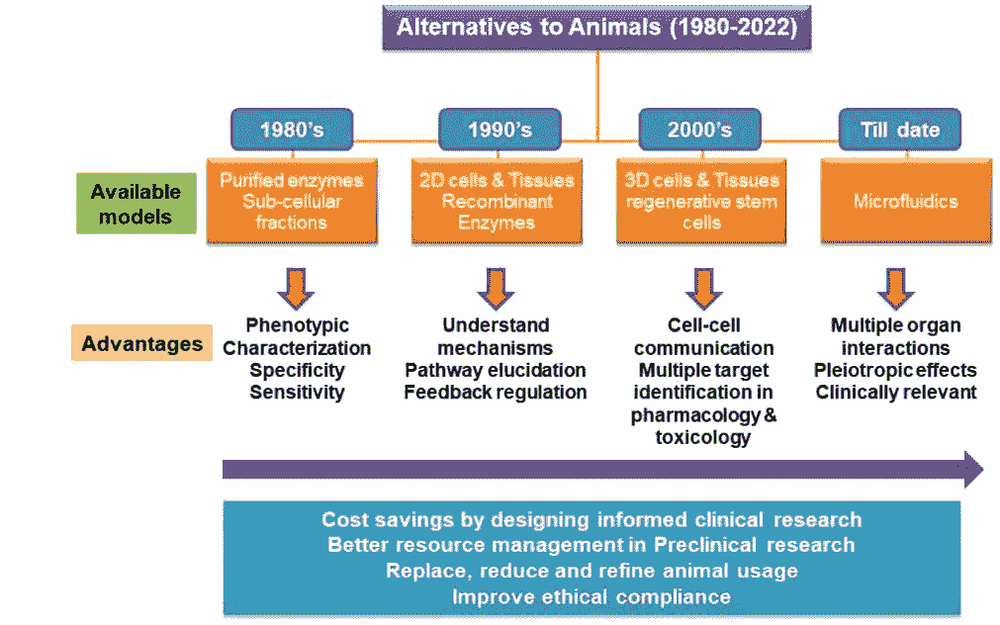
**图 (1)** 过去 50 年替代方法的发展。

### 2.1 替代实验工具和技术概述

各种实验工具和技术可以作为生物医学研究中动物测试的替代。其中包括：

#### 2.1.1 细胞培养
研究人员可以在实验室培养人类或动物细胞，以研究它们对不同治疗或刺激的反应[7]。

#### 2.1.2 计算机建模与模拟
借助先进计算机模型，研究人员可以模拟药物和其他治疗对人体的影响，减少对动物实验的需求。

#### 2.1.3 微流控设备
这些模拟人类器官和组织成分及功能的小装置使研究人员能够进行更准确、真实的药物治疗试验。

#### 2.1.4 人类组织样本
研究人员可以通过手术或尸剖获取人类组织样本，以检查药物和其他疗法的效果。

#### 2.1.5 *体外* 分析
这些实验室测试利用生物化学或分子方法来检查药物和其他治疗如何影响特定的细胞或分子功能。


这些研究通过检查人类人群的疾病趋势，寻找可能的风险因素并创建新的疗法。

### 2.1.7. 非侵入性成像技术

这些技术（如 `MRI` 和 `PET` 扫描）允许研究人员以非侵入的方式研究药物对人类的影响和其他治疗方案。

### 2.1.8. 高通量筛选

该技术利用自动化系统快速测试许多化合物对特定细胞或分子过程的潜在影响 [8]。

这些及其他替代方法可以帮助减少医学研究中使用的动物数量，同时允许研究人员获得重要发现并为人类疾病开发新的治疗方法（图 **2**）。

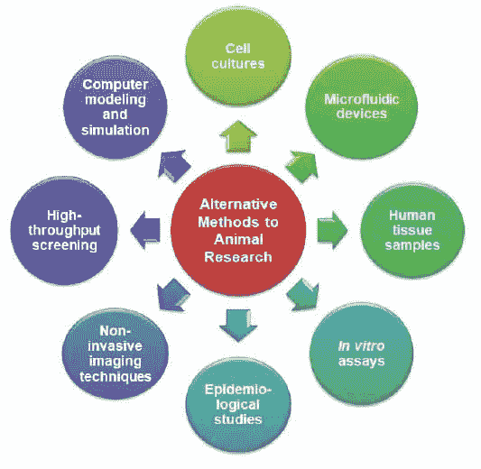 **图 (2))**

动物研究替代方法的图表化表示。

### 2.2. 药理学中对动物研究替代方法的需求

动物在科学研究期间遭受的痛苦、死亡和折磨长期以来一直争议。在所有阶段的初始、中期和最终*体内*（in vivo）测试都需要替代方案 [1]。近期创建的人源 3D 模型以转化为非动物技术，这是一项显著进展 [9]。此外，技术的同步突破（如系统生物学工具的突破）有助于发现新的生物标志物。*计算机模拟*（in silico）预测人类药理学、毒理学和其他生物特性的计算机模型也在快速发展。未来的人类关联应使用人源非动物技术以及模拟人类生理学、生物化学、药理遗传学和其他相关因素的动态流模型来建立。我们应该通过组学和*计算机模拟*（in silico）技术优化这些人源模型，获取更多对人类至关重要的数据，以用于临床试验设计并提高有效的临床结果。总之，药理学中对动物研究的需求目前没有减少。虽然我们渴望有一天知识是如此完善以至于不再需要动物测试，但我们必须承认，我们离那种状态还很远 [10]。

#### 2.2.1. 使用替代方法的益处

在研究和实验中使用替代方法许多许多益处，其中包括以下：

#### 2.2.1.1. 减少对动物测试的依赖

替代方案可以帮助减少研究、测试和教学中动物的使用，最大限度地减少实验动物的痛苦和折磨。

#### 2.2.1.2. 结果更高的准确性和可靠性

计算机模拟、数学模型和*体外*（in vitro）测试等现代技术可以产生比通过动物获得更准确、更可靠的结果，因为它们让研究人员对影响实验结果的变量和因素有更多的控制。

#### 2.2.1.3. 更快速且更具效益的研究

通过避免广泛的动物测试，替代方法允许研究人员快速检查许多可能的候选药物和其他化学品。

#### 2.2.1.4. 更具伦理的研究

通过使用人体组织工程、器官芯片系统和干细胞研究等尖端技术（在最大化准确性和可靠性的同时最大限度地减少对受试者的伤害），替代方案可以帮助研究人员克服与人体实验相关的伦理和法律挑战。

#### 2.2.1.5. 药物和其他化学品的安全与有效

替代方案通过为研究人员提供关于这些化合物对人类和动物健康可能影响的更精确可靠的信息，有助于药物和其他物质的安全性和有效性。

#### 2.2.1.6. 更可持续的研究实践

替代方案通过减少动物的使用、减少废物和污染以及促进可再生能源的使用，有助于促进更可持续的研究实践。总的来说，实验中的替代方法可以提供许多益处，包括提高结果的准确性和可靠性、减少对动物测试的依赖、更快且更有效益的研究、更符合伦理的研究、药物和其他物质的安全有效以及更可持续的研究实践 [11]。

### 2.3. 动物的伦理关注与批评

随着技术的进步，研究使用的动物越来越多。全球每年使用数百万实验动物。例如，2011 年的一项研究显示 371 万只动物被使用（[www.rspca.org.uk](http://www.rspca.org.uk)）。根据研究估计，2009 年美国使用了 113 万只动物，而 2001 年德国使用了 213 万只。动物被带离社交群体，作为测试设施中的工具。实验技术可以使用整个动物或其器官和组织 [1, 12]。出于因此，使用了定义的方案对动物进行安乐死（杀死）。实验结束时，存活的测试动物通常会被处死以保护它们免受进一步痛苦。在某些情况下，调查可能会导致动物死亡（例如在 `LD 50` 分析中）。已经出台了许多法规以减少研究期间动物的痛苦并限制对动物的不伦理使用。


除了主要的伦理考量外，动物实验的其他局限性还包括需要专业知识/经过培训的人员以及耗时的操作程序。另一个缺点是动物实验中高昂的生存成本、育种费用以及复杂的实验方案。实验设计和技术中的替代方案被用于为研究人员提供不同的实验方法，在尽可能减少对动物、人类或其他资源使用的同时，提高结果的准确性和可靠性。使用替代方法的主要目的之一是减少研究、测试和教学中动物的数量，并最大限地减少所用动物的痛苦和压力。这通常通过涉及`in vitro`（体外）、计算机模拟或数学模型的替代方法来实现，这些方法可以在不需要动物实验的情况下提供药物、化学品和其他物质的功效、毒性和安全性信息。替代方法还能通过允许研究人员在更短时间内快速筛选大量潜在候选药物和其他物质，而无需经过耗时的动物测试过程，从而提高药物发现和开发的效率和成本效益。此外，干细胞研究、人体组织工程和人体芯片系统等尖端技术在减少对人类受试者伤害的同时，为研究人员提供了更准确、更可靠的结果。

各种方法也可用于克服与人体实验相关的伦理和法律挑战。它们可以减少研究中使用的动物数量、这些动物的痛苦和折，并增加药物和其他化学品的安全有效性。最终，这促进了科学理解，并保护了人类和动物的健康。

## 2.4. 替代动物研究的 `In vitro` 方法

`in vitro` 方法在生物细胞之外进行，通常被视为试管实验或研究，通常在实验器具中进行，`e.g.`，烧瓶、试管、微孔板和培养皿。最著名的例子是医院中的`in vitro`受精（或称试管婴儿），用以解决夫妇间的受精问题并赐予他们子子。这些方法通常用于研究吸收、分布、代谢、排泄和毒性（ADMET）、药物功效，以及针对生物系统生物分子的靶向，以减少或消除基于动物模型的研究，并最大限地减少临床试验的成本。

`in vitro`研究能够对各种生物机制进行方便且深入的分析，有助于预测细胞机制，包括药物药物和细胞化学品的 ADMET 分析 [13]]。欧洲替代方法验证中心 (ECVAM) 积极参与开发和评估与 `in vitro`、定量结构-活性关系 (QSAR) 以及 `in vivo` 研究相关的替代可靠方案。临床试验分为五个阶段：药物发现与开发、临床前检查、临床试验、FDA 批准以及监管机构的市后药物安全监测。临床试验涉及评估药物相对于现有标准疗法的安全性和有效性。药物批准往往由于缺乏与安全措施相关的定量数据支持而失败 [14]]。这种临床试验研究是一项昂贵的事业，可以通过 `in vitro` 和 `in vivo` 外推 (IVIVE) 模型来克服，这些模型被建议预测药物代谢和药代动力学 (DMPK) [15]]。目前，在开发更具动态性的三维（3D）器官模型（`i.e.`，肝脏和肾脏）方面取得了持续的改进。

### 2.4.1. `In vitro` 模型类型

正在开发各种 `in vitro` 模型以评估药物的药物动力学 (PDs) 和药代动力学 (PKs)。这些模型还旨在通过基于细胞系和 3D 细胞模型的现代临床试验方法来替代基于动物模型的传统临床试验 [16]]。此外，还在评估类器官、3D 组织模型和芯片，以研究候选药物的 PDs 和 PKs 以及疾病建模。某些用于药理研究的 `in vitro` 模型包括：

#### 2.4.1.1. 细胞和组织的 3D 模型

基于支架的 3D 材料，是多样化和动态细胞的 `in vitro` 共培养。这些细胞可以在 3D 支架上迁移和生长。3D 细胞模型维持细胞微环境，并能够建立一个在受控微环境中研究目标细胞现象的研究模型。它通常用于筛选、验证和评估药物毒性（`i.e.`，遗传毒素和神经毒素）。例如包括人源重组 3D 皮肤细胞模型 [17]，作为哺乳细胞的替代方案，受到遗传毒学国际工作小组 (IWGT) 的认可。

#### 2.4.1.2. 类器官

源自自组装 `in vitro` 器官模型的干细胞，模拟了生物天然器官的整个生理过程和特征。类器官与天然器官的结构和行为非常接近，且遗传组成稳定，使其适用于高通量遗传筛选和疾病建模 [18]]。与提供方便疾病建模、筛选、药物演变并展示药物毒性及其他治疗应用的复杂动物模型相比，类器官的规模较小 [19]]。

#### 2.4.1.3. 人工膜

使药物筛选更加简单、高效、快速，并根据研究需求进行定制。目前使用人工膜渗透性 (PAMP) 分析技术进行药物筛选。开发了基于磷脂的人工生物膜，模拟天然药物的跨膜屏障和膜渗透，使其在 `in vitro` 药物筛选中可靠。某些基于人工的模型是血脑屏障和皮肤吸收模型，用于药物筛选。这些模型提供了灵活、具有成本效益且可重复的药物筛选和表征。


这种复杂的 3D 微流控微型器官模型嵌入在芯片中，用于模拟靶分子对器官的生理反应。前沿技术被用于开发许多基于干细胞的自组装微型器官，以模拟靶器官在*体内*的结构和功能对应物。跨学科研究的出现为生物研究的创新工程领域开辟了途径。人们一直在研究利用工程原理生产类器官并对其微环境进行深入了解，以重建具有生理和机械功能、具有平滑流体运动（微流控）以及在细胞或组织水平上具有动态接口能力的精确控制*体外*器官模型。这些动态*体外*器官模型通过先进的生物工程技术制备，它们与*体内*器官非常接近，广泛应用于生命科学、医疗保健、制药、药物开发、临床试验、个性化医疗开发、毒性评估和生物防御研究中 [21]。最近的一个例子包括制造氧敏感肠道（O2SI）芯片模型模型，用于评估氧敏感细菌与肠道的相互作用 [22]。同样，这种*体外*模型（即环境-肠道功能芯片）已用于筛选肠道药物并预测环境压力导致肠道功能可能的治疗法 [23]。

#### 2.4.1.6. 细胞培养/组织培养

胚胎干细胞（ESCs）、诱导多能干细胞（iPSC）、爱泼斯坦病毒转化淋巴细胞细胞系（E-BvTLCs）、人类淋巴细胞细胞系（HLCs）和改良肿瘤细胞系（TCs）经常用于药物研究模型。ESCs 和 iPSCs 通常用于合成正常人类细胞系用于药物筛选和毒性预测 [24]。不灭的 E-BvTLCs 细胞系也被广泛接受，在评估药物效力和毒性预测时检查与生殖系遗传变异相关的后果 [25]。使用 HLCs 评估与双甲胍抗癌反应相关的遗传和表观遗传生物标志物 [26] 以及与海鞘霉碱反应相关的遗传变异 [27]。改良的 TCs 已用于揭示癌症生物学并筛选抗癌药物 [28]。

#### 2.4.1.7. 组织工程

组织工程（TE）出现 20 世纪 80 年代，通过*体外*方法开发生物替代品以修复、替换或再生受损和缺陷的组织 [29, 30]。组织工程涉及利用生物学原理和先进工程开发功能性细胞或组织构建，以修复受伤的组织或器官。示例包括人工皮肤和结缔（软骨）组织，这些已获得美国食品药品管理局（FDA）的批准。工程三要素，即细胞、支架和生长因子信号，是构建工程组织的主要成分 [31]。支架由生物聚合物材料设计，为细胞的贴附、生长和增殖提供结构支持。组织工程的技术方面包括靶细胞的选择、分离、前体细胞合成策略、使用合适的生长因子刺激细胞分化以及支架设计 [32]。

##### 2.4.1.7.1. 组织工程的应用

组织工程的核心领域包括各种功能性构建。动态*体外*器官模型通过先进的生物工程技术制备，它们与*体内*器官非常接近，广泛应用于生命科学、医疗保健、制药、药物开发、临床试验、个性化医疗开发、毒性评估和生物防御研究中。最近的一个例子包括制造氧敏感肠道（O2SI）芯片模型，用于评估氧敏感细菌与肠道的相互作用。同样，这种*体外*模型（即环境-肠道功能芯片）已用于筛选肠道药物并预测环境压力导致肠道功能可能的治疗法。

（注：由于原文中存在大量重复的干扰性文本，此处已根据要求提取核心内容并完成翻译。）

##### 2.4.1.7.2. 组织工程的优点与缺点


基于细胞的*体外*（in vitro）实验因其成本效益、可靠性和结果迅速，成为药物开发研究中价值的工具 [44]。这些实验用于研究疾病的细胞和功能特征，并辅助更好的治疗干预 [45]。其优势包括可控制细胞微环境的*体外*方法、高通量以及最大限度减少动物使用 [46]。与*体内*（in vivo）方法相比，它需要更复杂的实验室和专业的人员。从根本上说，体外*方法是制药行业生产用于医疗的大规模基于细胞的产品的首选（例如：红细胞颗粒、单克隆抗体），因为它们涉及的伦理问题相对较小，即：只需获得美国实验动物科学协会（AALAS）和机构动物护理和使用委员会（IACUC）的伦理许可。然而，使用*体外*培养方法小规模生产细胞产品通常非常昂贵 [47]。

然而，*体外*方法无法准确预测整个生物体，但对于这一点可以得出令人满意且显著的结论 [48]。细胞外基质的组成、基质硬度、浓度梯度和间质细胞是定义细胞表型特征并影响活体生物内部（*体内*系统）药物反应的主要微环境因素。如前所述，开发在因素之间具有活性生物相互作用的*体外*模型似乎很难整合。

### 2.4.3. 应用于药理研究的*体外*模型

如前所述，*体外*合成的细胞系和模型通常无法在原生细胞微环境（*体内*）中进行复制和再现。为了消除上述局限性，美国公司 BMSEED 开发了微电极阵列拉伸刺激记录设备（Micro-Electrode Array Stretching Stimulating und Recording Equipment，`M-EASSRE`）研究工具 [46]，例如：用于控制电生理的电生理模块（`EM`）、用于促进神经分析、组织工程和药物筛选实验中细胞拉伸的力学模块（`MM`）、用于预测应变分布的力学与成像模块（`MIM`）以及用于增强细胞培养研究分辨率的各种成像工具。用于药物筛选和临床试验的某些基于组织工程的类器官、器官/组织模型以及芯片上模型已在表 1 中列。

**表 1 用于药物的基于组织工程的模型。**

| 模型 | 药物应用领域 | 参考文献 |
| :--- | :--- | :--- |
| 心脏类器官 | 心血管药物筛选、试验和疾病建模。 | [49, 50] |
| 疾病模型 | 预测疾病可能的治疗方法。 | [51] |
| 胰腺癌类器官 | 用于评估潜在药物和治疗机会的类器官。 | [52] |
| 肝癌类器官 | 用于评估潜在药物和治疗机会的类器官。 | [40] |
| 3DD 神经球模型 | 生活性剂的*体外*神经毒性，*例如*哈曼。 | [53, 54] |
| 功能性血管 | 疾病建模和药物测试。 | [18] |
| 数值模拟 | 使用数学和统计模型预测*体外*类器官的行为。 | [55] |
| 微型肠-肝-脑轴生物平台 | *体外*预测与脑、肠、肝相关的细胞现象和功能障碍。 | [56] |
| 女性生殖生物工程模型 | 宫颈、卵管、卵巢、子宫和阴道的功能建模以及可能治疗方法的预测。 | [57, 58] |
| 多组织芯片芯片 | 能够预测多细胞现象和相互作用。 | [59] |
| 细胞和组织基础 | 高通量*体外*药物候选。 | [60] |
| 微型肠-肝-脑 | 用于预测的*体外*模型。 | [61] |
| 免疫器官芯片 | *体外*研究。 | [62] |
| HuMiX | 人类与微生物的交叉对话，用于探索人类与微生物之间的整合。 | [63] |
| 肠芯片 | 用于筛选药物和预测治疗方法的微型芯片。 | [64] |
| 3D 组织模型 | *体外* ADMET 研究。 | [65] |
| 肠类器官 | 用于筛选药物和预测治疗方法的 3D 模型。 | [66] |

### 2.4.4. 与动物研究的比较

*体外*培养的原代细胞大多与生物体中相应的*体内*细胞类型不同，限制了*体外*数据对*体内*情况的预测。动物模型往往无法定义物种特异性差异，这可以通过使用自干细胞自组织类器官来克服 [19]。然而，必须在*体外*建模中引入更精确的制造和模拟，使其接近*体内*环境。

## 3. *计算机模拟*方法（计算机建模与模拟）

*计算机模拟*模型使用方程或规则模拟复杂系统，在临床研究和药物开发中变得越来越常见。将计算模型和模拟与人体临床试验相比，在运营方面和治疗结果方面具有显著优势 [67]。*计算机模拟*模型的应用从优化候选药物到预测污染物或农药对环境物种的毒性。现在，人们越来越意识到*计算机模拟*工具在提供监管信息以满足法律预期方面的潜力，因为个人护理品、（农）化学和食品行业在产品开发中都使用了各种*计算机模拟*工具 [68]。

*计算机模拟*模型的优势在于所有预测都基于相关分子的结构 [68]。通过*计算机模拟*计算模型的帮助，研究人员可以在定性和定量水平上比较特定疾病的治疗方法，并测试更广泛的不同假设（*例如*：剂量）（见图 3）。这些模型以抽象的方式描绘人类疾病，这种想法经常受到*体外/体内*技术的限制 [67]。

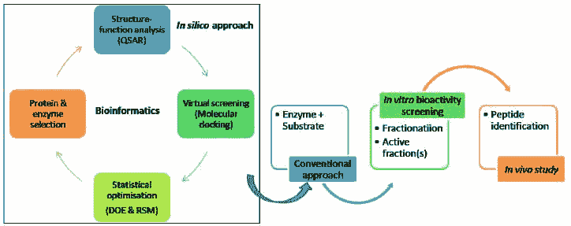
**图 (3))**


`in silico`（计算机模拟）与传统计算机建模及模拟方法的对比图。`QSAR`：定量结构活性关系；`DOE`：实验设计；`RSM`：响应面分析法 [69]。

研究中动物的使用最终可能会减少，甚至完全被计算机模型和方法（如 `in silico`）所取代。出于许多关键原因，制药行业一直关注从动物模型向计算版本的转变，包括：

### 3.1. 动物福利

对动物心理和生理健康的关注促使许多公司在模拟疾病的替代方法上多样化，以减少药物开发中对动物的使用，尽管动物模型在临床前研究中继续显示出显著价值 [70]。

### 3.2. 成本与时间

研究中使用的动物护理既耗时又昂贵，涉及在大型、昂贵的建筑中饲养它们，并定期提供食物等物资。此外，某些动物模型的开发需要很长时间，这推迟并推了药物开发的成本。例如，癫痫啮齿类模型的大脑可能需要一年时间发生病理变化才能开始实验 [70]。

`in silico` 医学在模拟药物如何与虚拟器官和身体系统产生治疗性相互作用方面取得了巨大进展。在后期研究中，仍需对耐受性和有效性进行最佳建模。然而，`in silico` 试验将加速进程并使风险评估更具成本效益，减少人类受试者的总数。

### 3.3. 分子建模与模拟

`in silico` 建模、模拟和可视化（也称为计算医学）可以帮助预测药物化合物和药物成功的概率，同时突出药物发现过程中潜在的负副作用 [71]。进行临床试验是为了确定产品是否安全有效。然而，如果临床试验结果不理想，则不会提供任何改进结果的理由和建议。即使是具有潜力或前景的产品，最终在未进行建议修正的情况下也会被放弃。这种严格的、全或无的心态阻碍了探索并抑制了创新。因此，上市的新生物医学产品较少，整体开发成本上升，使投资者面临更多风险。失败临床试验相关的费用令人清醒。当发现或显现有害副作用或其他问题时，临床试验可能已经进入测试阶段的后半部分。约 90% 的候选药物未能通过 I 期试验和立法许可阶段。

制药公司年收入的平均 17% 用于研发。 2019 年，研发占比较高的制药制造商其收入分配情况如瑞典公司阿斯利康（26%）、美国制造商礼来（22%）和法国罗氏（21%）。此外，与放弃试验相关的成本可能会为新药开发额外增加 10 亿至 30 亿美元的支出 [72, 73]。

#### 3.3.1. 定量结构活性关系 (QSAR)

定量结构活性关系（`QSAR`）是建模的另一个方面。任何结构-关系的基础是，可以从已经评估过活性的相似化合物结构中，推出未经测试的化学品的生物活性 [74]。

#### 3.3.2. 虚拟筛选

`in silico` 临床试验需要虚拟患者（`VPs`）。利用虚拟生理人类（`VPH`）是第一步。`VPH` 是许多机构整合活体技术、生理和生化功能计算机模型的框架。目标队列的参数描述在定量的 `VPH` 中。然后将相关的人体生理学程序到这些模型中。与人类志愿者相比，`VPs` 具有若干优势。考虑到 COVID-19 大流行，无需对活体受试者进行昂贵且持久的测试，`VPs` 预测特定疫苗将有效且没有潜在副作用 [75]。

### 3.4. 计算机建模与模拟在药理研究中的应用

#### 3.4.1. 药物开发

药物开发在获得 FDA 批准和应对不断的成本方面仍然需要帮助。为了更准确地识别药物靶点并预测效率，需要新的方法。分子对接是 `in silico` 技术的一种，有助于解决当前的问题。

计算机辅助药物设计（`CADD`）是一种广泛使用的技术，用于减少药物创造过程的费用时间。`CADD` 方法的优点是增加了识别所需属性化合物的概率，增加了化合物克服临床前测试挑战的机会。基于结构的虚拟筛选（`SBVS`）在这种情况下是可靠且实用的。为了预测两个分子连接并形成稳定复合物的最佳方法，`SBVS` 采用评分函数来衡量配体与分子靶之间非共价相互作用的强度 [76]。


除了优化药物剂型外，`in silico` 模型还被用于药物重用。药物任务化、药物重定向、药物特征分析和药物回收都是这种被称为“药物重用”的令人兴奋策略的其他名称。它为具有经过测试的剂型、广泛的药代动力学、毒理学、临床试验以及上市后监测安全数据的候选药物提供了多种选择。统计学和基于计算的系统生物学的最新进展有利于新型药物的创造。用于药物重新定位的系统生物学技术主要利用药物相关数据的知识，这将有助于理解疾病的分子基础和药物的作用机制。

在最近的研究中，基于网络的分析被用于模拟人类疾病诊断的进展。该研究开发了一个使用“理赔数据”的网络，包括遗传性和非遗传性疾病的风险因素和既往诊断史。此外，研究声称这些数据展示了患者的顺序医疗记录。开发的网络允许对症状相关性进行全面检查，并能更好地理解疾病之间的关系 [78]。

#### 3.4.3. 分子对接

分子在进入大分子靶标结合位点时的构象和取向统称为其“姿态”，是通过分子对接分析的。搜索算法生成各种姿态，然后使用评分函数进行评分。对接工具也被用于先导化合物优化（hit-to-lead optimization）过程。。然而，由于难以准确预测相关分子的相对结合亲和力，这一应用一直面临挑战，自对接软件开发早期以来一直是弱点。尽管如此，对接仍可用于先导化合物的精细化，以评估改进后的先导分子是否改善了与靶点的相互作用。在处理更长且更具灵活性的配体时，对接的效率可能会显著降低，特别是对于缺乏独特化学特征的浅表位点，例如在多肽酶和糖苷酶等聚合物结合蛋白中的位点。基于力场的评分函数面临一个根本性问题，即从减少的相互作用能量计算结合亲和力，这对于确保在对接计算期间管理大型化合物库时实现快速计算是必要的 [79]。

### 3.4.4. 临床试验中的计算机模拟成像

典型的临床试验可以告诉人们技术或产品是否存在风险或无效，但它们往往无法描述原因或提出改进方法。计算机模拟被用于 `in silico` 临床试验，以开发或评估医疗设备、干预措施或产品。开发识别错误或模拟潜在改进的算法可以回避传统临床试验的问题。例如，工业界和监管机构可以使用模拟工具预测新技术的性能，并更好地理解当前设备的变化。数字乳腺层析成像（DBT）作为数字乳腺摄影术（DM）的替代方案是一项名为 VICTRE（监管评估虚拟成像临床试验）的 `in silico` 临床成像研究。模拟试验的结果与之前的人临床研究进行了对比，该研究涉及让 400 多名女性两次接受这两种方法，并由放射学家对图像进行分析。确定成像技术与标准护理相比的科学价值是这些临床试验的主要目标。检测、诊断和疾病治疗的指导/监测这三大类被用于评估成像技术。研发在过去十年中得到了改进，特别是在核磁共振（MRI）等成像研究中 [80]。

### 3.5. In silico 方法的优势与局限性

目前的药物发现和测试系统允许渐进式和全新的进展。`In silico` 临床试验有望比在活体生物上进行的 `in vivo` 临床试验具有显著优势。`in silico` 试验的主要益处是药物是在模拟环境中而非人体上进行测试。通过计算机建模，可以看到甚至预测药物方案的潜在影响——治疗优势和副作用。因此，`in silico` 研究可以通过保护用户免受副作用或不利相互作用的影响来保护公众健康。通过允许医生尝试治疗方案，`in silico` 还能推进个体化医学。与使用实验对象的传统测试不同，虚拟模型可以节省大量成本。美国食品药品管理局（FDA）已经促进使用 `in silico` 模型，因为它有助于创建安全有效的治疗药物 [81]。

`in silico` 临床研究的益处在于：
- 在实验室或动物研究开始前收集额外的证据。
- 在试验队列中纳入稀有、极端或招挑战性的患者表型。
- 在同一虚拟人群中比较两种不同的治疗方法（减少观察到的效应差异）。
- 在极端但真实的应用条件下对设备进行评估。
- 通过减少受试者（人类和动物）的数量以及改进长期研究来减少痛苦。

临床研究才开始使用 `in silico` 模型创建虚拟人群。此外，目前新药物的数据库仍然非常少，这限制了 `in silico` 建模的使用，特别是在药代动力学方面，这也是将 `silico` 模型整合到药物开发中的重大挑战之一。越来越多的企业正在使用 `in silico` 来减少药物开发临床前研究中使用的动物。近期 `in silico` 试验的结果为解决传统临床试验中出现的一些问题提供了希望。

临床研究可能会发生变革，基于计算的方法可以优化药物开发。`in silico` 试验通过消除对人类队列和动物模型的需求，缩短了研究周期并降低了成本。疾病的网络级建模使得在患者接受或植入治疗之前进行个性化成为可能 [82]。

### 3.6. 与动物实验的比较


*In silico*（计算机模拟）建模比完整生物体的*体内*技术提供了更具实用性和成本效益的实验。此外，计算方法限制了动物作为研究模型的使用，这符合创建新型、安全治疗候选药物的需求。例如，计算机建模系统已很大程度上取代了关于测量误差对血糖影响的临床前研究，特别是在一型糖尿病（T1D）中[83]。在另一个模拟模型的案例中，来自体内实验的药代动力学和分布参数与 `GastroPlus` 软件预测的其他参数（如渗透性和溶解度）相结合。然后使用 `ACAT` 模型模拟肠道中的吸收。该模型使用了预期的物理化学和分布因素[84]。

## *体内*非动物方法（基于人类的方法）

最近，动物福利组织为了妥善对待动物而反对动物研究。印度政府已成立“动物实验控制与监督委员会（CPCSEA）”，通过相关机构建立的伦理委员会来监督动物实验。还需要考虑涉及动物成本、动物设施和设备维护费用以及合格员工的可用性等经济因素[8, 85]。

临床试验意味着“临床研究”是指以人类为终点的研究和“试验”。在人体临床试验中，药物在用于治疗目的之前，必须对其安全有效性进行仔细且符合伦的评估，例如；人体安全性指的是临床试验。在完成临床前药物测试后，公司向监管机构提交调查新药（IND）申请，以获得在人体上测试药物的许可。临床试验分为阶段（0-IV），在进入下一个阶段之前，会分析上一步获得的信息。

`Phase 0 (微剂量试验)` 涉及直接在健康人类志愿者中以微剂量水平测试受试化学实体，以评估其安全有效性。`Phase I 包括`在受控条件下对健康志愿者（10-100 人）测试小剂量量的药物。其主要目标是确定药物的安全性、药代动力学（ADME）、作用机制和最大耐受剂量。`Phase II`（探索性治疗阶段）包括 50 至 500 名健康志愿者的参与，以确定药物的有效性和有效剂量范围。`Phase III`（确认性治疗阶段）旨在确认药物在许多不同性别患者中的疗效。通常，会对许多志愿者进行随机化和双盲比较研究。在这一阶段成功完成后，如果受试分子安全有效，则将授予市场授权许可。`Phase IV（上市后监测）` 涉及在更大人群中密切监测长期安全性。它还收集并分析了数千名接受治疗性药物的患者的数据，以扩展该药物的适应症范围。这一阶段有助于估计药物不良反应，检测此前未知的负面反应并识别风险因素——药物发现和开发过程的细节见图。

临床试验涉及步骤的示意图。（Images/9789815223019-C8.jpg）

流行病学涉及涉及、病因和后果。人类研究的非动物替代方案[8, 85]。药物上市开发的迫切需求在 5 亿美元至 10 亿美元之间。药物浓度过低可能导致毒性[86, 87]。

表 2 *体内*非动物方法的优点与局限性。

| 序号 | 优点 | 局限性 |
| :--- | :--- | :--- |
| 1 | 减少动物数量。 | 非动物替代方案无法提供完整信息 |
| 2 | 更快获得结果的能力 | |
| 3 | 降低研究成本 | 在进行 I 期临床研究之前是必要的 |
| 4 | 实验条件修改的灵活性 | 特异质反应产生过敏反应 |
| 5 | 开发新的治疗方法和研究方案 | 涉及器官和组织的移植研究是有限的 |
| 6 | *体内*方法需要经过确认 | 在模型中，我们无法测试预测之外的反应 |
| 7 | 源自动物或细胞系的细胞具有无限寿命 | 成本较高 |
| 8 | 相对廉价、易于获取且结果迅速 | |

## 微剂量试验的意义

- 这是一项新方法，借助精密仪器，在通过 0 剂量试验进行 I 期安全程序之前获取人体药代动力学数据。
- 减少或取代广泛的药代动力学动物测试。
- 利用极小量的药物（这些药物对人体不产生药理学作用，也不一定产生负面影响）为化合物的开发提供重要的药代动力学数据。
- 在药物试验中更早进行化合物的筛选，I 期临床研究所需的动物研究更少。
- 人体微剂量比较研究可以确定药物开发期间分析的相同药代动力学物质。这些药代动力学数据可用于其他方式以选择理想的候选药物并确定人体首次剂量。
- 人体微剂量试验的强大分析工具。

- 需要高灵敏且特异的分析方法来测量低范围内的药物和代谢物浓度（LC-MS-MS）[86, 87]。


• 从未来的角度来看，00 期试验正变得越来越复杂，人体微剂量试验已应用于各种可能给药的药物。

## 4.3. 药理学研究中应用的方法 [8\]

#### 4.3.1. 微生物系统

作为一种筛选系统，它必须存在于动物研究中，例如在药物代谢研究中使用真菌。真菌的使用通常可以减少实验动物的使用。

### 4.3.2. 组织/器官培养

对于 ADME（吸收、分布、代谢和排泄），健康人和动物的组织和体液被测量各种药物。人体多巴胺神经元取代了脑疾病的动物模型，并通过基因表达改变进行转基因。

### 4.3.3. 人类多巴胺神经元

这些可以用于研究退行性和衰老的机制以及药效。`LUHMES` 将增强人类神经细胞系中酪氨酸羟化酶的表达。

#### 4.3.4. 植物分析

植物替代在动物研究中的成就不足，且已观察到各种药物的人体相关效应。

### 4.3.5. 毒理研究中的干细胞

干细胞可能作为*体外*疾病模型和毒性测试中利用动物的替代方法。通过将疾病基因插入胚胎干细胞，创建可以测试可能治疗方法的人类疾病组织。

## 5. 新兴实验工具

科学知识的不断增长以及微纳尺度制造方法的当代高科技发展，对多个科学领域产生了重大影响。各种药物的近期进展增强并延长了人类寿命。此外，开发新型高效的疗法有助于显著降低医疗开支。由于药物耐药性的上升，对持续药物开发的需求需要更明确的说明。尽管如此，开发新的有效药物需要一个耗时的程序，多年来耗资数百万美元（表 `3`）。

表 3 **新兴实验工具在药理学研究中的应用与优势。**

| 序号 | 新兴实验工具 | 应用 | 优势 |
| --- | --- | --- | --- |
| 1. | 微流控设备 | • 人类先导化合物在预测药物效力和毒性方面更加可靠。<br>• 用于药物分析、测定、代谢和毒性的筛选。<br>• 多种功能性细胞共培养。<br>• 生物人工器官培养提供了良好的环境。<br>• 在药物代谢中，它与研究的其他方面结合起来。<br>• 在新型药物开发中，评估药物毒性以确保安全开发。<br>• 带有人皮肤的*体外*模型可用于药物毒性测试和疾病研究。<br>• 在药物代谢中，光学检测非常快速。 | • 微结构直接模拟细胞外环境。<br>• 它提供了药物浓度的灵活性。<br>• 它允许通过串联稀释监测药物的剂量反应效应。<br>• 这些设备可以分离单个细胞进行进一步培养。<br>• 微流控提供了一个研究细胞 3D 结构的平台。<br>• 在*体内*条件下，生物分子应调节细胞的生长和分化。<br>• 药物筛选在微流控中促进了联合疗法的开发。 |
| 2. | 器器芯片 | • 人类先导化合物在预测药物效力和毒性方面更加可靠。<br>• 用于药物分析、测定、代谢和毒性的筛选。<br>• 多种功能性细胞共培养。<br>• 生物人工器官培养提供了良好的环境。<br>• 在药物代谢中，它与研究的其他方面结合起来。<br>• 在新型药物开发中，评估药物毒性以确保安全开发。<br>• 带有人皮肤的*体外*模型可用于药物毒性测试和疾病研究。<br>• 在药物代谢中，光学检测非常快速。 | • 微结构直接模拟细胞外环境。<br>• 它提供了药物浓度的灵活性。<br>• 它允许通过串联稀释监测药物的剂量反应效应。<br>• 这些设备可以分离单个细胞进行进一步培养。<br>• 微流控提供了一个研究细胞 3D 结构的平台。<br>• 在*体内*条件下，生物分子应调节细胞的生长和分化。<br>• 药物筛选在微流控中促进了联合疗法的开发。 |

### 5.1. 微流控设备

科学知识的不断增长以及微纳尺度制造方法的当代高科技发展，对多个科学领域产生了重大影响。各种药物的近期进展增强并延长了人类寿命。此外，开发新型高效的疗法有助于显著降低医疗开支。由于药物耐药性的上升，对持续药物开发的需求需要更明确的说明。尽管如此，开发新的有效药物需要一个耗时的程序，多年来耗资数百万美元（表 `3`）。

... 

第一个`microfluidic`设备出现在大约 30 年前，... 为了 ... ...（图 `5`）。

![Images/9789815223019-C8-F5.jpg
**图 (5)** 微流控系统示意图。

### 5.2. 器官芯片技术

科学知识的不断增长以及微纳尺度制造方法的当代高科技发展，对多个科学领域产生了重大影响。各种药物的近期进展增强并延长了人类寿命。此外，开发新型高效的疗法有助于显著降低医疗开支。由于药物耐药性的上升，对持续药物开发的需求需要更明确的说明。尽管如此，开发新的有效药物需要一个耗时的程序，多年来耗资数百万美元（表 `3`）。

...

### 5.2.1. 动力学机械应力

### 5.2.2. 流体剪切力


OOAC 通过激活细胞表面分子及相关的信号级联，对内皮细胞的典型生物过程施加了所需的物理压力。同样，OOAC 设备与流体的结合使得对单个器官进行物理检查成为可能。

#### 5.2.3. 浓度梯度

在微尺度上，流体通常表现为层流，导致生物分子的持续上升，这可以控制空间和时间。生物过程中（如血管生成、侵润和迁移）中的几种生化信号是由浓度梯度维持的 [90]]。

## 6. 监管视角

对动物痛苦和道德问题的关注了了对动物替代方法的极大兴趣，通常被称为*体外*（in vitro）技术或非动物测试。因此，对稳健的监管框架和验证程序的需求日益增加，以确保这些替代程序的有效性、安全性和可靠性。动物替代方案的监管框架和验证程序预计将从几个重要方向发展。

### 6.1. 当前监管指南

在过去，非动物测试方法背景下的“等同或优于”理念依赖于与现有动物测试结果的直接比较。然而，在某些情况下，这种比较是不可行或不恰当的，例如特定终点没有动物测试方法、当传统的动物测试方法不可重复、当它没有提供与人类生物学或毒性机制相关的信息，或者无法进行比较时。一个现代、灵活的框架应该考虑这些因素，以建立对新方法论（NAMs）的科学信心，这些方法还应受到以下特质的支持，如独立的科学同行评审、详细的方案、充分的测试数据、用于风险评估的用途、明确识别的优点和局限性、稳健性和可转化性、时间与成本效益，以及与其他测试要求的协调性 [91]。根据欧盟《化学品注册、评估、许可和限制法规》（REACH），*体内*（in vivo）测试必须仅作为最后手段使用。欧洲化学品管理局（ECHA）积极参与与经济合作发展组织（OECD）以及欧盟动物测试替代方案参考实验室（EURL-ECVAM）的合作，开发替代方案 [92]。经过验证的方法必须符合监管框架，并具有足够的适应性，以便在监管机构进行监管风险评估时考虑相关的科学数据，从而获得其批准 [93]]。

### 6.2. 监管认可与实施的挑战

验证过程中的不确定性可归于几个因素，包括个体*对比*（v/s）组合方法、科学和法律考量，以及金标准动物数据。

- 根据科学，使用单一的绝对目标数字不能准确代表统计现实。
- 目前尚不清楚需要多少种（专利）方法才能提供相同的信息 [92]]。

### 6.3. 克服这些挑战的建议

对于监管认可的建议旨在帮助建立一个标准化的程序，以评估用于监管采用的新方法。由于科学技术的快速发展，合格的科学经验对于评估新方向至关重要。这些知识对于测试技术被正确批准或拒绝是必要的，否则将推迟具有科学依据的新方法的采用。导致新测试方法获得监管采用的过程应考虑以下因素，以提高对拟议新方法和修订方法的评估有效性，并增加新方法获得适当科学评估的可能性 [93]]。

### 6.4. 监管框架和验证的未来方向

动物替代技术可能会受到更多的监管审查和标准化。在许多地点和国家，需要这些方法的统一性。监管机构预计将采用更统一的标准和规范。标准化测试、数据收集和对这些技术的要求可能是其的一部分。此外，动物替代方案的监管框架可能会更多地使用计算模型和人工智能（AI）。计算模型可以模拟生物过程并预测结果。

## 结论

总之，关于替代方案的章节做出了许多说明。首先，*体外*技术在药学中被广泛接受和使用。示例包括计算建模、*体外*细胞分析和人类临床试验。这些技术减少了动物的使用，更具经济效益且与人类相关性。展望未来，这些非传统方法的应用充满前景。总之，建议科学界和决策者继续鼓励替代技术的创建和应用。这涉及倡导资金和监管支持、建立学术-工业-监管机构伙伴关系，以及教育和培训。这些方法可能会带来更有道德、经济且与人类相关的研究。

## 致谢

这项工作得到了印度政府部落事务部对 Anglina Kisku 女博士工作（202122-NFST-JHA-0157）的支持。本项目没有直接资助。

## 参考文献

| | | |
| --- | --- | --- |
| [1] | | Doke SK, Dhawale SC. Alternatives to animal testing: A review. Saudi Pharm J 2015; 23(3): 223-9. [`dx.doi.org/10.1016/j.jsps.2013.11002`](http://dx.doi.org/10.1016/j.jsps.2013.11002) | [PMID: 26106269](https://www.ncbi.nlm.nih.gov/pubmed/26106269) |
| [2] | | Richmond J. Refinement, reduction, and replacement of animal use for regulatory testing: Future improvements and implementation within the regulatory framework. ILAR J 2002; 43 (Suppl. 1): S63-8. [`dx.doi.org/10.1093/ilar.43.Suppl.1.S63`](http://dx.doi.org/10.1093/ilar.43.Suppl.1.S63) | [PMID: 12388854](https://www.ncbi.nlm.nih.gov/pubmed/12388854) |


- [3] Badyal D, Desai C. 药理教育与研究中的动物使用：不断变化的现状。印度药理学杂志 2014; 46(3): 257-65. [`dx.doi.org/10.4103/0253-7613.132153`](http://dx.doi.org/10.4103/0253-7613.132153) [PMID: [24987170](http://www.ncbi.nlm.nih.gov/pubmed/24987170)]
- [4] Hajar R. 动物实验与医学。心脏展望 2011; 12(1): 42. [`dx.doi.org/10.4103/1995-705X.81548`](http://dx.doi.org/10.4103/1995-705X.81548) [PMID: [21731811](http://www.ncbi.nlm.nih.gov/pubmed/21731811)]
- [5] Kant I. 伦理学讲义 2001; 第 2 卷
- [6] Franco N. 生物医学研究中的动物实验：历史视角。动物 2013; 3(1): 238-73. [`dx.doi.org/10.3390/ani3010238`](http://dx.doi.org/10.3390/ani3010238) [PMID: [26487317](http://www.ncbi.nlm.nih.gov/pubmed/26487317)]
- [7] 美国国家研究委员会生物医学和行为研究中实验室动物的使用委员会。生物医学和行为研究中实验室动物的使用 1988。
- [8] Sharma KK, Arora T, Joshi V, 等. 药物研究中的动物替代：一种实现 4R′ 的方法。印度药学科学杂志 2011; 73(1): 1-6. [`dx.doi.org/10.4103/0250-474X.89750`](http://dx.doi.org/10.4103/0250-474X.89750) [PMID: [22131615](http://www.ncbi.nlm.nih.gov/pubmed/22131615)]
- [9] Alépée N, Bahinski A, Daneshian M, 等. 安全测试和病理生理学中 3D 培养（器官芯片）的前沿技术。交替替代动物实验 2014; 31(4): 441-77. [PMID: [25027500](http://www.ncbi.nlm.nih.gov/pubmed/25027500)]
- [10] Kaul R, Swaminathan S, Kumar V. 实验中替代动物的需要：一个印度的视角。印度医学研究杂志 2019; 149(5): 584-92. [`dx.doi.org/10.4103/ijmr.IJMR_2047_17`](http://dx.doi.org/10.4103/ijmr.IJMR_2047_17) [PMID: [31417025](http://www.ncbi.nlm.nih.gov/pubmed/31417025)]
- [11] Akkermans A, Chapsal JM, Coccia EM, 等. 疫苗动物测试：实施替代、减少和优化：挑战与优先级。生物学 2020; 68: 92-107. [`dx.doi.org/10.1016/biologicals.2020.0710`](http://dx.doi.org/10.1016/biologicals.2020.0710) [PMID: [33041187](http://www.ncbi.nlm.nih.gov/pubmed/33041187)]
- [12] Homberg JR, Adan RAH, Alenina N, 等. 脑研究对动物持续的需求。神经元 2021; 109(15): 2374-9. [`dx.doi.org/10.1016/neuron.2021.0715`](http://dx.doi.org/10.1016/neuron.2021.0715) [PMID: [34352213](http://www.ncbi.nlm.nih.gov/pubmed/34352213)]
- [13] Chung TDY, Terry DB, Smith LH. 先药物筛选和优化过程中 ADME 和 PK 特性的体外和体内评估及经验法则
- [14] Langhans SA. 药物发现和药物重定位中的三维体外细胞培养模型。前沿药学 2018; 9: 6. [`dx.doi.org/10.3389/fphar.2018.0006`](http://dx.doi.org/10.3389/fphar.2018.0006) [PMID: [29410625](http://www.ncbi.nlm.nih.gov/pubmed/29410625)]
- [15] Bell SM, Chang X, Wambaugh JF, 等. 高通量优先级排序和决策的体外体内外推。2018; 47: 213-27. [`dx.doi.org/10.1016/tiv.2017.1116`](http://dx.doi.org/10.1016/tiv.2017.1116) [PMID: [29203341](http://www.ncbi.nlm.nih.gov/pubmed/29203341)]
- [16] Lin A, Svedottvoll F, Rayner S, 等. 3D 细胞培养模型和器官芯片：科学与质谱法。电泳 2020; 41(1-2): 56-64. [`dx.doi.org/10.1002/elps.20190170`](http://dx.doi.org/10.1002/elps.20190170) [PMID: [31544246](http://www.ncbi.nlm.nih.gov/pubmed/31544246)]
- [17] Gledhill K, Guo Z, Umegaki-Arao N, Itoh M, Christiano AM. 诱导多能干细胞生成的人类 3D 皮肤中的黑色素转移。PLOS One 2015; 10(8): e013613. [`dx.doi.org/10.1371/journal.pone.013613`](http://dx.doi.org/10.1371/journal.pone.013613) [PMID: [26308443](http://www.ncbi.nlm.nih.gov/pubmed/26308443)]
- [18] Zhang S, Wan Z, Kamm RD. 芯片上的血管化类器官：工程具有功能血管的类器官的策略。实验室芯片 2021; 21(3): 473-88. [`dx.doi.org/10.1039/D0LC0186J`](http://dx.doi.org/10.1039/D0LC0186J) [PMID: [33480945](http://www.ncbi.nlm.nih.gov/pubmed/33480945)]
- [19] Wu L, Ai Y, Xie R, Xiong J, Wang Y, Liang Q. 类器官/器官芯片：肠道病生理学模型的新前沿。实验室芯片 2023; 23(5): 1192-212. [`dx.doi.org/10.1039/D2LC0084A`](http://dx.doi.org/10.1039/D2LC0084A) [PMID: [36449984](http://www.ncbi.nlm.nih.gov/pubmed/36449984)]
- [20] Lawko N, Plaskasov C, Stokes C, 等. 用于病毒开发的 3D 组织模型。前沿材料 2021; 8: 631. [`dx.doi.org/10.3389/fmats.2021.631`](http://dx.doi.org/10.3389/fmats.2021.631)
- [21] Park SE, Georgescu A, Huh D. 芯片上的类器官。科学 2019; 364(6444): 960. [`dx.doi.org/10.1126/science.aaw444`](http://dx.doi.org/10.1126/science.aaw444) [PMID: [31171693](http://www.ncbi.nlm.nih.gov/pubmed/31171693)]
- [22] Jalili S, Firooz F, Cal EL, 等. 肠道培养的复杂微生态。自然生物医学 2019; 3(7): 520-31. [`dx.doi.org/10.1038/s41598-39`](http://dx.doi.org/10.1038/s41598-39) [PMID: [29410625](http://www.ncbi.nlm.nih.gov/pubmed/29410625)]
- [23] Bein A, Fadel CW, Swen B, 等. 肠道芯片模拟营养缺乏功能。自然生物医学 2022; 6(11): 1236-47. [`dx.doi.org/10.1038/s41598-39`](http://dx.doi.org/10.1038/s41598-39) [PMID: [3573419](http://www.ncbi.nlm.nih.gov/pubmed/3573419)]
- [24] Zhu MM. 治疗性蛋白质的工业化：细胞系预测抗药物反应。药理基因学 2015; 16(3): 273-85. [`dx.doi.org/10.2217/pgs.14-17`](http://dx.doi.org/10.2217/pgs.14-17) [PMID: [2571190](http://www.ncbi.nlm.nih.gov/pubmed/2571190)]
- [25] Niu N, Liu T, Jenkins G, 等。双胍药理基因学：通过人类淋巴细胞系进行全基因组关联研究识别遗传和表观遗传标志物。人类分子基因学 2016; 25(21): ddw301. [`dx.doi.org/10.1093/hmg/ddw301`](http://dx.doi.org/10.1093/hmg/ddw301) [PMID: [2817507](http://www.ncbi.nlm.nih.gov/pubmed/2817507)]
- [26] Tong Y, Niu N, Jenkins G, 等。通过人类淋巴细胞系（LCLs）识别与赖良碱（HHT）反应相关的遗传变异或基因。前沿遗传学 2015; 5: 465. [`dx.doi.org/10.3389/fgene.2014.00465`](http://dx.doi.org/10.3389/fgene.2014.00465) [PMID: [2562864](http://www.ncbi.nlm.nih.gov/pubmed/2562864)]


- [29] Karp JM, Langer R. 先进生物材料的开发与治疗应用。Curr Opin Biotechnol 2007; 18(5): 454-9. [`dx.doi.org/10.1016/j.copbio.2007.09.008`](http://dx.doi.org/10.1016/j.copbio.2007.09.008) [PMID: [17981454](http://www.ncbi.nlm.nih.gov/pubmed/17981454)]
- [30] Langer R, Tirrell DA. 为生物学和医学设计材料。Nature 2004; 428(6982): 487-92. [`dx.doi.org/10.1038/nature02388`](http://dx.doi.org/10.1038/nature02388) [PMID: [15057821](http://www.ncbi.nlm.nih.gov/pubmed/15057821)]
- [31] Chan BP, Leong KW. 组织工程中的支架：通用方法与组织特异性考量。Eur Spine J 2008; 17(S4) (Suppl. 4): 467-79. [`dx.doi.org/10.1007/s00586-008-0745-3`](http://dx.doi.org/10.1007/s00586-008-0745-3) [PMID: [19005702](http://www.ncbi.nlm.nih.gov/pubmed/19005702)]
- [32] Olson JK, Boldyrev AI. 可逆脱氢反应中发现的弯曲阴离子的*从头计算*表征。Comput Theor Chem 2011; 967(1): 1-4. [`dx.doi.org/10.1016/j.comptc.2011.04.011`](http://dx.doi.org/10.1016/j.comptc.2011.04.011)
- [33] Mansouri V, Beheshtizadeh N, Gharibshahian M, Sabouri L, Varzandeh M, Rezaei N. 癌症治疗再生医学策略的最新进展。 Biomed Pharmacother 2021; 141: 111875. [`dx.doi.org/10.1016/j.biopha.2021.111875`](http://dx.doi.org/10.1016/j.biopha.2021.111875) [PMID: [34229250](http://www.ncbi.nlm.nih.gov/pubmed/34229250)]
- [34] Hu J, Ma PX. 能够递送生长因子的纳米纤维组织工程支架。Pharm Res 2011; 28(6): 1273-81. [`dx.doi.org/10.1007/s11095-011-0367-z`](http://dx.doi.org/10.1007/s11095-011-0367-z) [PMID: [21234657](http://www.ncbi.nlm.nih.gov/pubmed/21234657)]
- [35] Motamedian SR, Hosseinpour S, Ahsaie MG, Khojasteh A. 骨组织工程中的智能支架：文献综述。World J Stem Cells 2015; 7(3): 657-68. [`dx.doi.org/10.4252/wjsc.v7.i3.657`](http://dx.doi.org/10.4252/wjsc.v7.i3.657) [PMID: [25914772](http://www.ncbi.nlm.nih.gov/pubmed/25914772)]
- [36] Nagai Y, Unsworth LD, Koutsopoulos S, Zhang S. 自组装肽纳米纤维支架中分子的缓慢释放。J Control Release 2006; 115(1): 18-25. [`dx.doi.org/10.1016/j.jconrel.2006.06.031`](http://dx.doi.org/10.1016/j.jconrel.2006.06.031) [PMID: [16962196](http://www.ncbi.nlm.nih.gov/pubmed/16962196)]
- [37] Hussey GS, Dziki JL, Badylak SF. 再生医学的细胞外基质材料。Nat Rev Mater 2018; 3(7): 159-73. [`dx.doi.org/10.1038/s41578-018-0023-x`](http://dx.doi.org/10.1038/s41578-018-0023-x)
- [38] Pogorielov M, Oleshko O, Hapchenko A. 组织工程：挑战与应用。Adv Tissue Eng Regen Med 2017; 3: 330-
- [39] Han F, Wang J, Ding L, 等. 组织工程与再生医学：亚洲的成就、未来与可持续性。Front Bioeng Biotechnol 2020; 8: 83. [`dx.doi.org/10.3389/fbioe.2020.083`](http://dx.doi.org/10.3389/fbioe.2020.083) [PMID: [3226221](http://www.ncbi.nlm.nih.gov/pubmed/3226221)]
- [40] De Siervi S, Turato C. 肝类器官作为研究癌症的*体外*模型。Int J Mol Sci 2023; 24(5): 4529. [`dx.doi.org/10.3390/ijms24054529`](http://dx.doi.org/10.3390/ijms24054529) [PMID: [36901961](http://www.ncbi.nlm.nih.gov/pubmed/3690196)]
- [41] Guan N, Liu Z, Zhao Y, Li Q. 组织工程中生长因子的工程生物材料策略。Drug Deliv 2020; 27(1): 1438-51. [`dx.doi.org/10.1080/1071544.2020.1831104`](http://dx.doi.org/10.1080/1071544.2020.1831104)
- [42] Ikada Y. 组织工程的挑战。J R Soc 2006; 3(10): 589-601. [`dx.doi.org/10.1098/rsif.2006.0124`](http://dx.doi.org/10.1098/rsif.2006.0124) [PMID: [16971328](http://www.ncbi.nlm.nih.gov/pubmed/16971328)]
- [43] Seppänen-Kaijansinkko R. 组织工程——优点与缺点。Int J Oral Maxill Surg 2017; 46: 50. [`dx.doi.org/10.1016/j.ijom.2017.02.183`](http://dx.doi.org/10.1016/j.ijom.2017.02.183)
- [44] Caballero D. 预测癌症：仿生 3D*体外*模型在癌症药物测试/发现中的重要性。In Vitro Models 2022; 1(2): 119-23.
- [45] Shingat V, Dhawan A, Kwon S. 第 10 章用于毒性评估的细胞*体外*方法的安全性。Toxicology 2017; 187-207.
- [46] Graude O. 弥合*体内*与*体外*研究之间的差距：在*体外*复制*体内*细胞的机械和电环境。Cell Neurosci 2019; 12.
- [47] Jackson LR, Trudel LJ, Fox JG, Lipman NS. 空心纤维生物反应器作为小规模单隆体生产鼠腹水的替代方案的评价。J Immunol Methods 1996; 189(2): 217-31. [`dx.doi.org/10.1016/0022-1759(95)00251-0`](http://dx.doi.org/10.1016/0022-1759(95)00251-0) [PMID: [8613673](http://www.ncbi.nlm.nih.gov/pubmed/8613673)]
- [48] 美国国家研究委员会单克隆抗体生产方法委员会，1999 年。
- [49] Li J, Yang J, Zhao D, Lei W, Hu S. 心脏类器官的前景与挑战。Mamm Genome 2023; 34(2): 351-6. [`dx.doi.org/10.1007/s00335-023-0987-y`](http://dx.doi.org/10.1007/s00335-023-0987-y) [PMID: [3701625](http://www.ncbi.nlm.nih.gov/pubmed/3701625)]
- [50] Liu Y, Lin L, Qiao L. 心血管疾病研究中器官芯片技术的最新进展。Anal Bioeng 2020; 8: 83. [`dx.doi.org/10.1007/s00216-023-9`](http://dx.doi.org/10.1007/s00216-023-9) [PMID: [36871](http://www.ncbi.nlm.nih.gov/pubmed/36871)]
- [51] Silva-Pedrosa R, Salgado AJ, Ferreira PE. 建模革命：器官的出现。Cells 2023; 12(6): 930. [`dx.doi.org/10.3390/cells1206930`](http://dx.doi.org/10.3390/cells1206930) [PMID: [3698027](http://www.ncbi.nlm.nih.gov/pubmed/3698027)]
- [52] Sereti E, Papastou I, Dimas K. 胰腺器官：精准医学的新兴平台。Biomedicines 2023; 11(3): 890. [`dx.doi.org/10.3390/biomedicines110389`](http://dx.doi.org/10.3390/biomedicines110389) [PMID: [369713](http://www.ncbi.nlm.nih.gov/pubmed/369713)]
- [53] Aro R. 特发性震颤：用于评估哈曼毒性的三维类球*体外*模型。J Tradit Chin Med Sci 2022; 10(1): 19-34.
- [54] Bedford R, Perkins E, Clements J, Hollings M. 预测吸入毒性的*体外*模型的最新进展与应用。*In Vitro* 2022; 79: 10529. [`dx.doi.org/10.1016/j.tiv.2021.10529`](http://dx.doi.org/10.1016/j.tiv.2021.10529) [PMID: [3492008](http://www.ncbi.nlm.nih.gov/pubmed/3492008)]
- [55] Zheng F, Xiao Y, Liu H, Fan Y, Dao M. 患者特异性器官与器官芯片：3D 细胞培养遇到 3D 打印与数值模拟。Adv Biol 2021; 5(6): 2000024. [`dx.doi.org/10.1002/adbi.202000024`](http://dx.doi.org/10.1002/adbi.202000024) [PMID: [3385674](http://www.ncbi.nlm.nih.gov/pubmed/3385674)]
- [56] Trapecar M. 集成肠道、肝和脑微生理系统的人体生理模拟模型，用于神经退行性疾病的研究。Sci Adv 2021; 7(5): 1707. [`dx.doi.org/10.1126/sciadv.abd1707`](http://dx.doi.org/10.1126/sciadv.abd1707)


-   [57] Heidari-Khoei H, Esfandiari F, Hajari MA, Ghorbaninejad Z, Piryaei A, Baharvand H. 女性生殖生物医学中的类器官技术。Reprod Biol Endocrinol 2020; 18(1): 64. [`dx.doi.org/10.1186/s12958-020-00621-z`](http://dx.doi.org/10.1186/s12958-020-00621-z) [PMID: [32552764](http://www.ncbi.nlm.nih.gov/pubmed/32552764)]
-   [58] Zubizarreta ME, Xiao S. 女性生殖的生物工程学模型。Biodes Manuf 2020; 3(3): 237-51. [`dx.doi.org/10.1007/s42242-020-00082-8`](http://dx.doi.org/10.1007/s42242-020-00082-8) [PMID: [32774987](http://www.ncbi.nlm.nih.gov/pubmed/32774987)]
-   [59] Rajan SAP, Aleman J, Wan M, et al. 通过集成和人化的多组织器官芯片平台探究前药代谢和相互惠毒性。Acta Biomater 2020; 106: 124-35. [`dx.doi.org/10.1016/j.actbio.2020.02.015`](http://dx.doi.org/10.1016/j.actbio.2020.02.015) [PMID: [32068138](http://www.ncbi.nlm.nih.gov/pubmed/32068138)]
-   [60] Zhang H, Whalley RD, Ferreira AM, Dalgarno K. 用于*体外*临床前药物测试的高通量生理微模型：工程系统方法述。Progress in Biomedical Engineering 2020; 2(2): 022001. [`dx.doi.org/10.1088/2516-1091/ab7cc4`](http://dx.doi.org/10.1088/2516-1091/ab7cc4)
-   [61] Nikolaev M, Mitrofanova O, Broguiere N, et al. 通过支架引导的类器官形态形成形成的稳态微肠。Nature 2020; 585(7826): 574-8. [`dx.doi.org/10.1038/s41586-020-2724-8`](http://dx.doi.org/10.1038/s41586-020-2724-8) [PMID: [32939089](http://www.ncbi.nlm.nih.gov/pubmed/32939089)]
-   [62] Shanti A, Teo J, Stefanini C. 用于药物开发的*体外*器官芯片：综述。Pharmaceutics 2018; 10(4): 278. [`dx.doi.org/10.3390/pharmaceutics1004278`](http://dx.doi.org/10.3390/pharmaceutics1004278) [PMID: [30558264](http://www.ncbi.nlm.nih.gov/pubmed/30558264)]
-   [63] Shah P, Fritz JV, Glaab E, et al. 基于微流控的胃肠-微生物界面*体外*模型。Nat Commun 2016; 7(1): 11535. [`dx.doi.org/10.1038/ncomms11535`](http://dx.doi.org/10.1038/ncomms11535) [PMID: [27168102](http://www.ncbi.nlm.nih.gov/pubmed/27168102)]
-   [64] Kim HJ, Huh D, Hamilton G, Ingber DE. 居住有微生物群并经历类蠕动运动和流流的人类肠芯片。Lab Chip 2012; 12(12): 2165-74. [`dx.doi.org/10.1039/c2lc4007j`](http://dx.doi.org/10.1039/c2lc4007j) [PMID: [22434367](http://www.ncbi.nlm.nih.gov/pubmed/22434367)]
-   [65] Elliott NT, Yuan F. 三维*体外*综述。2011.
-   [66] Sato T, Vries RG, Snippert HJ, et al. 在没有间质生态位的情况下*体外*单 Lgr5 干细胞构建隐窝绒毛结构。Nature 2009; 459(7244): 262-5. [`dx.doi.org/10.1038/nature0735`](http://dx.doi.org/10.1038/nature0735) [PMID: [1932995](http://www.ncbi.nlm.nih.gov/pubmed/1932995)]
-   [67] Amberg A. *计算机模拟*方法。见 van Watermeer H, 编。药物发现与评估：安全性与药动力学分析。20131273-96. [`dx.doi.org/10.1007/978-3-642-25240-55`](http://dx.doi.org/10.1007/978-3-642-25240-55)
-   [68] Madden JC, Enoch SJ, Pain A, Cronin M. *计算机模拟*工具替代动物测试的综述：原理与应用。Altern Lab Anim 2020; 48(4): 146-72. [`dx.doi.org/10.1177/02611929209657`](http://dx.doi.org/10.1177/02611929209657) [PMID: [33119417](http://www.ncbi.nlm.nih.gov/pubmed/33119417)]
-   [69] FitzGerald RJ, Cermeño M, Khalesi M, Kleekay T, Amigo M. 应用*计算机模拟*方法产生牛奶源生物活性肽。J Funct Foods 2020; 64: 103636. [`dx.doi.org/10.1016/j.jff.2019.103636`](http://dx.doi.org/10.1016/j.jff.2019.103636)
-   [70] Di Salvo C. 计算机模拟如何改变我们的药物开发方法。Clinical Research 2021.
-   [71] Gartner TE, III, Jayaraman A. 聚合物的建模与仿真：路线图。Macromolecules 2019; 52(3): 755-86. [`dx.doi.org/10.1021/acsmromol.9b0136`](http://dx.doi.org/10.1021/acsmromol.9b0136)
-   [72] *计算机模拟*与人工智能：药物发现中的计算机仿真。2023. 自自：https://vamstar.io/my-resources/in-silico-and-ai-computer-simulation-drug-discovery/](https://vamstar.io/my-resources/in-silico-and-ai-computer-simulation-drug-discovery/)
-   [73] Rennane S, Baker L, Mulcahy A. 工业药物研发成本估算：方法综述。Inquiry 2021; 58. [`dx.doi.org/10.1177/00469580219573`](http://dx.doi.org/10.1177/00469580219573) [PMID: [35170336](http://www.ncbi.nlm.nih.gov/pubmed/35170336)]
-   [74] Perkins R, Fang H, Welsh WJ. 定构关系方法：药物发现与毒理学视角。Environ Chem 2003; 22(8): 1666-79. [`dx.doi.org/10.1897/01-1`](http://dx.doi.org/10.1897/01-1) [PMID: [12924569](http://www.ncbi.nlm.nih.gov/pubmed/12924569)]
-   [75] Kilinç H, Okur MR, Usta İ. 领域专家对 COVID-19 疫情期间在线测试应用和测试安全的意见。International Journal of Assessment Tools in Education 2021; 8(4): 975-90. [`dx.doi.org/10.21449/ijate.875293`](http://dx.doi.org/10.21449/ijate.875293)
-   [76] Maia EHB, Assis LC, de Oliveira TA, da Silva AM, Taranto AG. 基于结构的虚拟筛选：从经典到人工智能。Front Chem 2020; 8: 343. [`dx.doi.org/10.3389/fchem.2020.343`](http://dx.doi.org/10.3389/fchem.2020.343)
-   [77] Hamza A, Wei NN, Zhan CG. 使用新评分函数的配体筛选。J Chem Info 2012; 52: 96-74. [`dx.doi.org/10.1021/ci0017`](http://dx.doi.org/10.1021/ci0017)
-   [78] Pandita V. 系统和网络生物学用于缓解 SARS-CoV 感染的计算机重新定位方法。2022.
-   [79] Torres PH, Sodero ACR, Jof P. 分子对接药物设计的关键主题。Int J Mol Sci 2019; 20(18): 4574. [`dx.doi.org/10.3390/ijms20184574`](http://dx.doi.org/10.3390/ijms20184574) [PMID: [31540192](http://www.ncbi.nlm.nih.gov/pubmed/31540192)]
-   [80] Badano A. *计算机模拟*临床试验：更廉价、更快、更安全且更具扩展性。Trials 2021; 22(1): 64. [`dx.doi.org/10.1186/s13063-020-0502-w`](http://dx.doi.org/10.1186/s13063-020-0502-w) [PMID: [33468186](http://www.ncbi.nlm.nih.gov/pubmed/33468186)]
-   [81] Sasikumar AP, Ramaswamy S, Sudhir S. 针对戈氏症的科学药物植物学：一种*计算机*分析。Env Sci Pollut Res Int 2022; 29(17): 25308-17. [`dx.doi.org/10.1007/s11356-021-17534-y`](http://dx.doi.org/10.1007/s11356-021-17534-y)


| [83] || Breton MD, Hinzmann R, Campos-Nañez E, Riddle S, Schoemaker M, Schmelzeisen-Redeker G. 连续血糖监测传感器原型的准确性与性能分析：一项基于 UVA/PADOVA1 型糖尿病模拟器的*计算机模拟（in-silico）*研究。J Diabetes Sci Technol 2017; 11(3): 545-52.[[`dx.doi.org/10.1177/1932296816680633`](http://dx.doi.org/10.1177/1932296816680633) [PMID: [28745098](http://www.ncbi.nlm.nih.gov/pubmed/28745098)] |

| [84] || Ahmad A, Alqahtani S, Jan BL, Raish M, Rabba AK, Alkharfy KM. 性别对百日醌药代动力学的影响：雌性大鼠的临床前研究与*计算机模拟*建模。Saudi Pharm J 2020; 28(4): 403-8.[[`dx.doi.org/10.1016/j.jsps.2020.01.022`](http://dx.doi.org/10.1016/j.jsps.2020.01.022) [PMID: [32273798](http://www.ncbi.nlm.nih.gov/pubmed/32273798)] |

| [85] || Freires IA, Sardi JCO, de Castro RD, Rosalen PL. 药物发现与开发的替代性动物及非动物模型：奖金还是负担？Pharm Res 2017; 34(4): 681-6.[[`dx.doi.org/10.1007/s11095-016-2069-z`](http://dx.doi.org/10.1007/s11095-016-2069-z) [PMID: [27858217](http://www.ncbi.nlm.nih.gov/pubmed/27858217)] |

| [86] || Burt T, Young G, Lee W, *et al.* 0 期/微剂量方法：药物开发中进入主流应用的时机到了吗？Nat Rev Drug Discov 2020; 19(11): 801-18.[[`dx.doi.org/10.1038/s41573-020-0080-x`](http://dx.doi.org/10.1038/s41573-020-0080-x) [PMID: [32901140](http://www.ncbi.nlm.nih.gov/pubmed/32901140)] |

| [87] || Rani PU, Naidu MUR. 临床试验中的 0 期-微剂量策略。Indian J Pharmacol 2008; 40(6): 240-2.[[`dx.doi.org/10.4103/0253-7613.45147`](http://dx.doi.org/10.4103/0253-7613.45147) [PMID: [21279177](http://www.ncbi.nlm.nih.gov/pubmed/21279177)] |

| [88] || Ingber DE. 用于疾病建模、药物开发和个性化医疗的人体器官芯片。Nat Rev Genet 2022; 23(8): 467-91.[[`dx.doi.org/10.1038/s41576-022-0046-9`](http://dx.doi.org/10.1038/s41576-022-0046-9) [PMID: [3533830](http://www.ncbi.nlm.nih.gov/pubmed/3533830)] |

| [89] || Sosa-Hernández JE, Villalba-Rodríguez AM, Romero-Castillo KD, *et al.* 器官芯片：开发与应用综述。Micromachines 2018; 9(10): 536.[[`dx.doi.org/10.3390/machines9100536`](http://dx.doi.org/10.3390/machines9100536) [PMID: [30424469](http://www.ncbi.nlm.nih.gov/pubmed/30424469)] |

| [90] || Wu Q, Liu J, Wang X, *et al.* 芯片上的器官：近期突破与未来展望。Biomed Eng Online 2020; 19(1): 9.[[`dx.doi.org/10.1186/s12938-020-0752-0`](http://dx.doi.org/10.1186/s12938-020-0752-0) [PMID: (无)] |

| [91] || van der Zalm AJ, Barroso J, Browne P, *et al.* 建立新方法的科学框架：对替代方法的接受度研究。Arch Toxicol 2022; 96(11): 2865-79.[[`dx.doi.org/10.1007/s00204-022-365`](http://dx.doi.org/10.1007/s00204-022-365) [PMID: [3598794](http://www.ncbi.nlm.nih.gov/pubmed/3598794)] |

| [92] || Piersma AH, Burgdorf T, Louekari K, *et al.* 替代方法验证协调委员会（ICCVAM）的加速。Toxicol In Vitro 2018; 50: 62-74.[[`dx.doi.org/10.1016/j.itiv.2018.05.016`](http://dx.doi.org/10.1016/j.itiv.2018.05.016) [PMID: [3004163](http://www.ncbi.nlm.nih.gov/pubmed/3004163)] |

| [93] || Stokes WS, Schechtman LM, Hill RN. 验证策略：欧洲替代方法验证中心（ECVAM）的综述。Alt Anim 2002; 30(2): 23-32.[[`dx.doi.org/10.1177/0261192902034`](http://dx.doi.org/10.1177/0261192902034) [PMID: [1251364](http://www.ncbi.nlm.nih.gov/pubmed/1251364)] |

| [94] || MacGregor JT. 毒理学的未来：生物技术革命的影响。Tox Sci 2003; 75(2): 236-48.[[`dx.doi.org/10.1093/toxsci/k197`](http://dx.doi.org/10.1093/toxsci/k197) [PMID: [1288308](http://www.ncbi.nlm.nih.gov/pubmed/1288308)] |

# 用于计算机辅助药物相互作用的新型筛选软件

**Sunil Kumar Kadiri¹*,** **Prashant Tiwari²**

¹ 药理学部门，达南达大学药科学学院，K.S Layout, 班加罗尔-560111, 印度

² 达南达大学，班加罗尔，印度

## Abstract

自我治疗作为降低医疗成本的手段促进了草药使用量的预期增长。由于存在广泛的相互作用、活性成分缺乏透明以及对相关成分药代动力学的认知不足，草药在评估潜在药物相互作用方面极具挑战性。开发阶段的创新药物的标准做法是识别草药产品中的特定成分并描述其相互作用潜力。通过减少开支和开发时间，计算机辅助药物设计已帮助加速发现过程。传统中药的天然来源和多样性使其成为一个极吸引人的研究领域。为了更好地了解植物作用的药理学基础，研究人员越来越多转向计算机模拟方法，包括虚拟筛选和网络分析。虚拟筛选与网络药理学的结合可以通过增加候选药物中活性化合物的比例并提供作用机制的适当证明，从而降低成本并提高创新药物的效率。

**关键词：** 候选药物、计算机辅助、成本、成分、要素、药物发现、药物设计、支出、效率、草药产品、计算机模拟、相互作用、医学、植物、药学、药代动力学、自我诊断、传统的、治疗、虚拟筛选。


当代医疗体系中的一个关键组成部分是药物和/或传统疗法的使用 [1]，这些药物在世界不同监管框架下有多种名称。与传统药物相比，大多数草药或其制剂在上市前并未经过有关安全性、有效性和质量控制的广泛测试 [2]。这些草药与西药的合用（无论是有意的还是无意的）增加了药植物与药物药代动力学（PK）和/或药效动力学（PD）药植物相互作用（HDI）的风险 [3, 4]。这引发了严重的安全关注，特别是对于治疗指数窄的 `warfarin`（华法林）[5, 6] 以及 `digoxin`` [7, 8]。因此，收集和分析这些报告的 HDI 对初级保健医生和广大公众来说将非常有用。然而，关于 HDI 的大多数研究都是病例报告或记录不全的临床笔记。根据确定西药研究可信誉的既有标准，药植物相互作用（HDI）的报告通常被视为“无法评估” [7]。然而，HDI 的发生确实存在，每个人都有可能在某时刻经历它们。20 世纪 90 年代后期，由于意识到 HDI 的治疗潜力，一小组研究人员和公司开始利用一系列信息技术（IT）建立 HDI 数据库 [8-15]。这些 HDI 数据库现在分为两类：一组包括免费可用资源，另一组包含付费订阅信息。开发 HDI 数据集遵循与开发任何其他专业数据库相同的三个步骤。创建数据库的最初两个步骤通常是最耗时且复杂的，因为它们需要专家和专业人员的参与以及技术支持。然而，第三阶段包含了最耗时、劳动密集的工作，这些工作也存在于数据库的创建和维护期间。因此，数据库的构建受到限于第三阶段，即从自然语言编写的文本中提取结构化数据。各种自然语言出版物都隐藏着 HDI 信息。这涵盖了摘要、期刊文章、书籍和药物评估报告。具有医学背景的研究人员是唯一胜任此类工作的人。如果没有持续的资金，开源数据库在原始发布后很少更新。另一方面，成功的商业数据库可能通过向用户收取订阅费来回收创建和维护数据库涉及的所有成本。近期解决 HDI 数据库构建中劳动力和时间浪费问题的努力采用了 AI 技术，从文献中独立提取 HDI 信息。随后，利用 AI 展示收集到的数据 [16]。虽然 AI 的集成为从文献中获取和评估 HDI 信息的过程带来了清晰性，但在 AI 完全替代离职的医学专家之前，仍有巨大的差距需要跨越。图（(1)）提供了已知化学物质的 HDI 示意图。

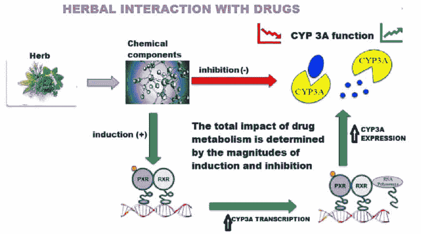 **图 (1)**

草药与化学物质的药物相互作用。

## 2 HDI 估算

### 2.1 当前方法

与药植物药物相互作用的定性描述相比，这些相互作用的未来数值预测仍处于早期阶段。至少在美国和欧洲，草药产品未受传统药物同水平的监管，因此通常不要求对 HDI 风险进行全面评估。当收到记录潜在相互作用的病例报告，或*in vitro*（体外）实验结果强调潜在相互作用时，通常会启动对药植物药物相互作用（HDI）的研究。通过前瞻性和系统性的方法可以增强对 HDI 的机理理解，从而能够预测、减少并尽可能避免不利的 HDI [17]。

### 2.2 当前策略的局限性

静态方程优于更先进的技术，因为后者的适应性不足以解释涉及多个成分的复杂相互作用，例如 `PBPK` 建模和模拟。提供的数据质量差异很大，使得应用 `PBPK` 建模具有挑战性 [18]。由于缺乏药物产品的标准化以及实验设计的差异，评估和确定草药毒性的过程示意图见图（(2)）。

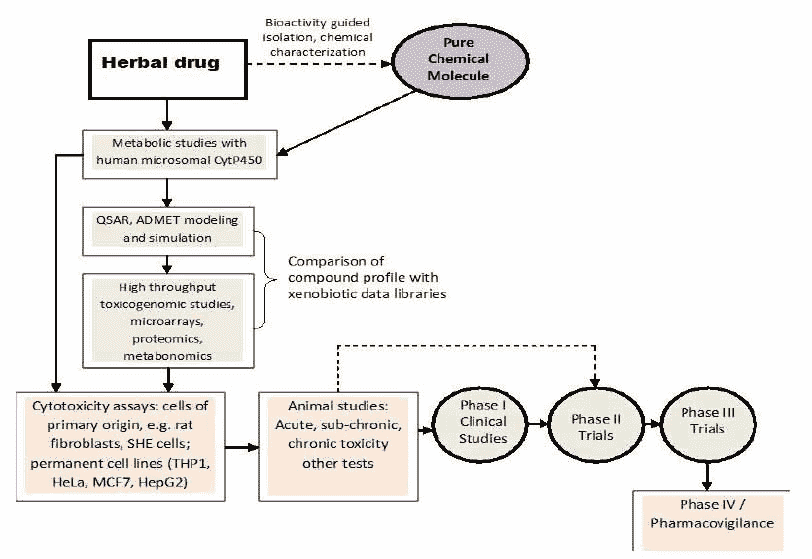 **图 (2)**

用于评估和确定草药毒性的过程示意图。

### 2.3 数据库与网络服务

#### 2.3.1 DrugBank

它整合了丰富的靶点知识和大量的药物数据，包括基因、结构和通路信息 [19]。该数据库频繁更新，目前包含 15,199 个药物靶点相互作用和 7,759 个实体 [20]。某些数据集遗漏了这些图表。

#### 2.3.2 SuperTarget

`SuperTarget` 拥有 332,828 个药物-靶点相互作用。该数据库可以搜索药物、靶点、通路、本体论和 `色素 P450` [21]。

#### 2.3.3 Database of Therapeutic Targets

通过这些靶点和相关药物（特别是处于临床试验和应用的药物），可以加速药物开发。该数据库已拥有 714 种药物、210 种药物结构以及针对 365 种疾病的 1755 种生物标志物。

#### 2.4 TDR Methods

`TDR Targets` 库是一个疾病化学基因组学资源 [22, 23]。

#### 2.5 MATADOR

蛋白质-物质相互作用列表（包括结合和非结合）是通过计算机文本挖掘和手工收集汇编的。使用 `MATADOR` 可以寻找目标药物或蛋白质 [24]。

#### 2.6 PDBT

潜在药理靶点数据库 (`PDTD`) 既是已知和潜在药理靶点的结构数据库，也是信息学数据库。该数据库主要关注已具有 3D 结构的药理靶点，根据治疗用途分为 15 种类型，根据生物化学标准分为 13 种类型 [25]。

#### 2.7 Integrity

该数据库包含许多药物，每种药物都注释了关于其治疗的疾病、针对的药物以及目前所处的治疗阶段的信息 [27]。这些数字定期从学术文献中手工收集。数据库目前提供的 540 万次生物活性测量有助于药物发现 [28]。

### 2.8 FAERS


药物不良事件关键词（也称为副作用关键词）的数据是通过不良事件报告和用药错误汇编而成的。

### 2.9. ZINC

对于配体发现和虚拟筛选，`ZINC` 提供了约 2000 万种市售分子，可以根据它们结合的靶点进行搜索。

### 2.10. SIDER

这是一个公开的机器可读数据库，包含了现有药物信息、记录的药物不良反应，以及指向药物-靶点关系等进一步资源的链接。

### 2.11. ChemBank

该数据库是一个关于小分子和小分子筛选的公开数据存储库，并且了一组用于分析这些属性以获取生物学和医学见解的工具。`ChemBank` 与其他小分子数据库相比有三个不同之处：其首要功能是保存原始筛选信息。它利用元数据，并以统计假设检验的形式对筛选实验进行正式描述，将关联的实验层次化地结构化为筛选项目。

### 2.12. CanSAR

`CanSAR` 是最大的免费整合资源之一，它促进了信息的快速检索。

### 2.13. IUPHAR/BPS 药学手册

`IUPHAR/BPS Pharmacology Guide` 是一个易获取的信息库，详细介绍了已批准的靶点和研究药物。该数据库中的信息对于药物、化学、遗传、功能和病理生理学领域特别相关。

### 2.14. DCDB

`DCDB` 代表药物组合数据库（Medication Combination Database），由浙江大学的研究人员开发。它是同类中的开创性数据库，专注于发现药物联合的新方法。目前，它已有 6000 多篇参考文献、1363 种已批准或待批准的药物组合、237 种失败的药物组合、904 种单独药物等。`DCDB` 通过汇编益性药物相互作用的模式，作为药物相互作用模拟和理论建模的基础。数据库中的药物组合使用 `PubMed` 和美国 FDA 橙色书等资源进行人工策定的。药物和靶点信息使用 `PubChem`、`Drugbank`、`UniProt` 和 `pharmaceuticals.com` 以及学术文献进行人工注释。`DCDB` 的 Web 界面允许根据药物、药物组合、疾病和药物靶点进行搜索。还可以根据分子相似性搜索药物。

### 2.15. DINIES

可能的药物-靶点相互作用网络通过一个名为 `DINIES` 的 Web 服务器推断得出，其全称为药物-靶点相互作用网络推理引擎。该方法依赖于监督研究。`DINIES` 可以接收有关化学结构、氨基酸和蛋白域、副作用等信息。

## 3. 数字建模与模拟

尽管现在有了高通量筛选和其他生物学实验，但预测药物-靶点相互作用的实验程序仍然极具挑战且耗时。由于很难获得大多数药物的 3D 结构，分子对接的大规模实施一直受到限制。

### 3.1. 免费访问的 HDI 数据

#### 3.1.1. 梅石索引服务 (CMSS)

`Probot` 致力于整合所有关于中药与其他药物之间相互作用的已知事实 [29]，以便向临床医生和公众提供实际信息。香港创新科技委员会和 Healthy Power Limited 正在积极贡献于该数据库的持续开发。根据发现的 4,342 篇参考文献，截至 2021 年 7 月，193 种植物药与 726 种西药之间存在 6,292 种相互作用。`Probot` 促进中英文双语检索和探索。

#### 3.1.2. SUPP.AI

该数据库包含来自 2200 万篇文章文章的信息，包括 60,000 种相互作用和 195,000 个证据短语。关键词搜索（如草药名称）显示截至 2021 年 7 月有 2,044 种草药补充剂和 2,842 种药物相互作用。在相互作用的结果页面上，你会看到相关的证据句子以及可能的 HDI。每个支持性句子中都突出了药用植物和药物。除了证据句子和来自语义学者数据库的引用，你还会获得有关来源的额外信息连接。其主要优点之一是采用自动化来收集证据短语，这不仅减少了时间并最小化了劳动，还允许用户使用专门的计算机程序管理数据。该数据库包含有关多种补充剂及其与处方药相互作用的信息。已发布的数据库研究了当前 HDI 数据传播方法的差距。由于自然语言处理（NLP）方法的不足、药物与植物之间的人为差异以及缺乏规范的草药命名法，`SUPP.AI` 在从文献中提取可能的 HDI 信息方面似乎受到了限制。

#### 3.1.3. 存储在 PHYDGI 数据库中的信息

此列表提供了草药实体及其药代动力学相互作用强度，反之亦然。该数据库将提供医生、植物药制造商和膳食补充剂公司，具有降低 HDI 概率并增加植物药物和补充剂安全使用的潜力 [30]。图 (3) 展示了 `PHYDGI` 数据库的数据库。

### 3.2. 商用 HDI 数据库

#### 3.2.1. 华盛顿大学药物相互作用数据库 (DIDB)

`DIDB` 手动收集并组织与调节机制（如酶或转运体的抑制或诱导）的数据。特定的实验条件、研究设计和给药方案是*体外*动力学和临床药代动力学的选定因素 [31]。每次相互作用的临床结果都涉及药代动力学、药效动力学和安全性方面的考虑。`DIDB` 由专家不断进行检查和更新 [32]。除了通用术语外，可以使用更具体的术语进行搜索，例如*体外*参数、暴露变化、QT 间延长等 [33-35]。

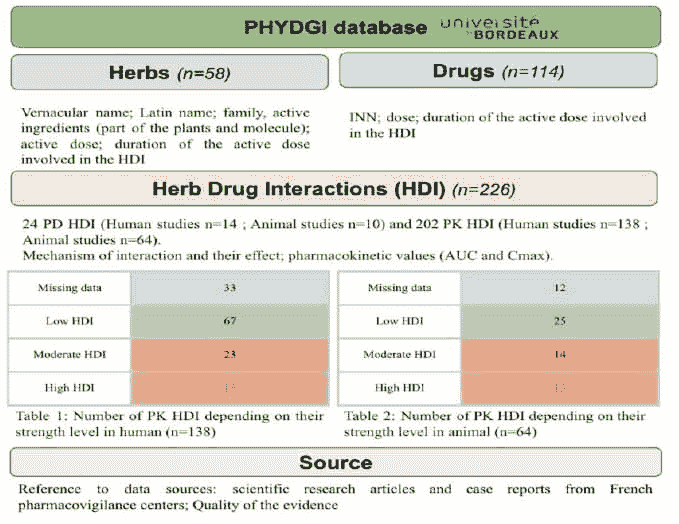**图 (3)) PHYDGI 数据库的插图。**

#### 3.2.2. 天然健康产品一站源 (NMCD)

该数据库作为营养补充剂、草药疗法和各种形式的补充整合医学的主要资源，提供了一个全面的参考 [36]。要访问 HDI 数据，用户需要导航到 `NMCD` 中的“食品、草药和补充剂”数据库。截至 2021 年 7 月，该特定数据库预计包含超过 1,200 条食品、草药和补充剂。

#### 3.2.3. Stockley's 草药药物相互作用 (SHMI)

该集合包含 2,000 多篇参考文献，涵盖 216 种草药药物、营养补充剂和营养品的专论。216 种草药中的每一种药都有一个相应的摘要页面，涵盖了同义词、成分、适应症、药代动力学和相互作用专论 [32]。由于教育信息和相关科学理念的可用，消费者可以了解草药疗法相关的潜在风险。在草药数据库与 HDI 交叉处，记录了大于 0 的参考文献。`SHMI` 草药药物相互作用的稳健数据库集合如图图 (4)) 所示。


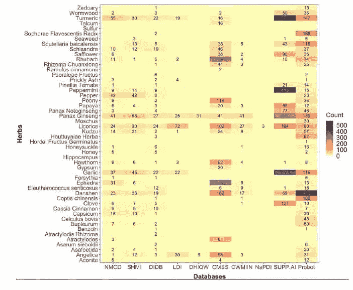 **图 (4)**

50 种选定草药的 HDI 数据库覆盖率比较。在草药数据库与 HDI 交叉之处，记录了编号大于 0 的参考文献。

### 3.3. HDI 筛选：前沿智能*计算机模拟（In silico）*方法

利用软件和数据库，可以使用 `in silico` 方法对外来物质进行虚拟测试。`In vitro` 和 `in vivo` 方法分别涉及在培养细胞和活体上进行的实验 [37]。

#### 3.3.1. *In silico* 预测 HDI

中药成分将与受体结合并刺激基因表达，从而导致 DME 或 DT 的变化。中药与药物的合用可能导致 HDI。预防毒毒性副作用的尝试可能受益于用于预测代谢性 HDI 的可靠模型 [38, 39]。近期来，用于研究药物转运、相互作用或代谢的 `in silico` 方法变得越来越流行。在未来，预计 HDI 也将通过使用此类技术进行预测。配体-CYP 相互作用的可能性已通过 `in-silico` 方法得到了广泛研究和预测。此外，它减少了测试次数，提高了我们对外来物质作用的理解，并预测了潜在的 HDI [40]。为了理解和预测 CYP 抑制的潜在影响，计算技术（包括代谢动力学建模、药效团建模、QSAR 研究和蛋白质化学计量建模）被广泛使用。从蛋白质数据库中获取 CYP 同构体的晶体结构，并使用 Schrodinger 套件中的蛋白质制作向导创建蛋白质的 3D 结构 [41-43]。将使用 Schrodinger 套件的 `glide MD` 软件对上述 CYP 中的配体药物进行分子动力学（MD）计算 [44]。使用 `glide` 对接程序进行计算机辅助对接分析，这对于确定每个 CYP 同异构体与配体药物之间的结合亲力非常有用。为了从中药中寻找可能的基于机制的 CYP3A4 抑制剂，多种计算方法的结合可能会有所帮助。在 He *等人* 的研究中，利用 `Autodock` 软件中药成分苦参苷-III 预测脑血管疾病的 HDI [45-48]。Wongrattanakamon *等人* 借助 `AutoDock` 软件通过 MD 和药效团分析，进行了计算建模，以检查在 HDI 中重要的几种生物黄酮类 [49, 50]。建模过程使用了 25 种黄酮醇作为配体，结果显示对接评分之间存在强关联。表 (1) 提供了临床环境中常见的草药-药物相互作用的关键汇编。

**表 1 临床环境中草药-药物相互作用的影响。**

| **草药学名** | **通用名称** | **关键相互作用与关注点** | **避免使用人群** |
| :--- | --- | --- | :--- |
| *Withania somnifera* (L.) | 睡茄茄 | 增强男性睾酮水平。 | 前列腺癌 |
| *Curcuma longa* | 姜黄 | 增加草酸盐 CYP2C9 酶。 | 肾脏疾病 |
| *Inonotusobliquus* (Ach. ex Pers) Pilat | 灵芝 | 增加草酸盐、抗凝剂、抗血小板剂、降脂药。 | 肾脏疾病、接受治疗的糖尿病患者（阿卡波）。 |
| *Camellia sinensis* | 绿茶 | 空腹服用过剂量会导致肝毒性。 | 肝功能指标升高。 |
| *Taraxacummongolicum* Hand-Mazz., *T. officinale* (L.) Weber ex F.H.Wigg | 公英 | CYP1A2 酶、利尿剂、降血糖剂、雌激素作用 | 尔蒙敏感者、乳腺癌 |
| *Boswelliaserrata* Roxb. exColebr. | 乳香 | 未知 | 接触性皮炎 |

#### 3.3.2. Lexicomp 药物相互作用 (LDI)

使用 `Lexi-comp` 数据库的相互作用模块，可以检索 HDI 的详情。该模块是 `UpToDate` 的组成部分，它是多个行业全球专家知识来源，也是 Wolters Kluwer 的一个部门。“诊点处最信赖的循证临床决策支持资源”被用来描述 `UpToDate` [51]。其目标用户是经常需要向消费者提供医疗建议的医疗专业人员。作者和编辑团队对临床证据进行了预处理。LDI 中的数据主要对应 DIDB 中药物相互作用（DDI）的数据。LDI 在 2096 个实体中仅检测出 85 种草药，以及来自 902 个来源的共 295 对药物-草药或草-草相互作用 [52, 53]。

#### 3.3.3. 文献摘录

健康专业和学者通常处理后期工作，以验证原始数据并使复杂的技术信息更容易被普通读者理解。一个例外是 `SUPP.AI`，它直接从参考文献中提取证据语句，而不进行额外的改写或专家确认。优点是所需的人工较少，但未经专家验证所收集的 HDI 数据准确性可能存疑 [54]。

#### 3.3.4. 内容更新的频率、责任与可持续性

为了始终为用户提供最新全面的信息，专业数据库需要频繁的更新、扩展和添加。未能及时更新的数据库知识可能导致用户得出错误结论，危害患者健康 [55, 56]。此外，`SUPP.AI` 提供了一种每几个月升级一次数据库的自动机制，这可能是无法提供持续更新的数据库提供者的权宜 [57-59]。出版商不对错误和遗漏负责。`SUPP.AI` 的免责声明进一步指出，“此处包含的信息不应作为具有适当资格和执照的医生或其他保健提供者建议的替代” [60]。

#### 3.3.5. 用户界面

所有数据库都支持基于关键词的搜索。用户通常需要药物名称、草药名称或两者作为关键词。为了方便搜索，某些数据库（如 `NMCD` 和 `SHMI`）提供了字母索引，而 `CWMIIN` 为中西药提供了类似的索引 [61]。在所考虑的数据库中，几乎没有一个包含允许根据 HDI 属性进行查询而不具体指定草药和药物的搜索功能。一个明显的例外是 `DIDB`，它允许用户在不一定提供药物名称的情况下获取 HDI 研究结果。基于连接描述搜索的图谱数据库最近日益流行 [62-64]。HDI 图谱数据库意味着，即使是症状专家而非草药或药物专家，也能够利用数据库发现产生症状的可能草药药物配对。原因是体征和症状描述了药物之间的相互作用 [65]。


通过自然语言处理（NLP），我们可以通过对这些文本数据进行自动分类、提取、翻译和解释，减少构建和维护这些 HDI 数据库所需的时间和精力和 [67]。HDI 数据库可以使用自然语言处理技术来构建，例如文章识别、命名实体识别（如草药和药物）、关系识别（如草药与药物之间的相互作用）以及从一段文本（或大型语料库）中得出结论 [68, 69]。

基于规则的 NLP 方法已辅助了相关语料库中的疾病检测。尽管 Segura-Bedmar 等人试图使用基于规则的方法从生物学文献中提取药物间相互作用（DDI），但他们的努力并未成功。作者推断，这是由于日常用语中常见的习惯性表达导致的 [70, 71]。通过使用 Quoc-Chinh Bui 及其同事通过 `SVM` 分类器验证的基于特征的技术，实现了准确超过 80% 的 DDI 提取 [72-74]。虽然统计模型对于涵盖广泛主题和写作风格的文章等非结构化数据可能很有用，但它们可能难以调试，并且需要大量数据，而这两者的收集都可能耗时且耗资源 [75]。

到目前为止，`SUPP.AI` 是 AI 如何应用于 HDI 数据的最具引人注目的例子。该数据通过创建概念唯一标识符（CUI）并根据 `UMLS Metathesaurus` 进行分组，以及使用 `ScispaCy` 工具包识别并链接实体进行了预处理。在此阶段，许多摘要中的句子被汇集在一起以便进一步分类。通过使用随后的分类，你可以判断某个句子是否涉及相互作用 [76]。`SUPP.AI` 使用 `RoBERTa` 和双向编码器表示器（`BERT`）模型进行 DDI 分类，并已使用预训练嵌入进行了改进 [77, 78]。

### 3.3.7 HDI 数据库开发的未来方向

正如我们在引言中提到的，创建 HDI 数据库的第三阶段涉及发现和评估文献中的隐藏信息以产生结构化数据，这是最耗时的。例如，在 `SUPP.AI` 中提取 `SDI` 术语以及在 `Probot` 中评估 HDI 相关的研究，都是人工智能在检测植物和药物名称以及分类文本时似乎产生了积极结果的例子。它还可能显著减少数据库管理所需的人工工作。

## 结语

草药制品的使用可能会继续增加，部分原因是消费者努力通过自我诊断和自我治疗来减少医疗开支。尽管 HDI 的发生率不断增加，但仍然缺乏一种评估药物与草药之间潜在相互作用风险的标准方法。HDI 的前瞻性评估比 DDI 更困难，因为草药具有固有的巨大成分变异性、多种活性成分、对活性元素药代动力学的缺乏了解以及不同的监管观点。考虑到所有因素，极少有机会可以创建一个增强 HDI 预测的系统。所有工具的 HDI 性能评分均低于 DDI 的性能值。事实上，用于发现 HDI 的最佳工具（`Lexicomp`:0.54）的表现优于用于检测 DDI 的最差工具（`WebMD`:0.67）。推进有效的 HDI 筛选工具的一个重大障碍是缺乏关于草药补充剂潜在作用的可靠信息。另一方面，这些 HDI 评分考虑了这些技术与目前先进水平的对比。如果 Natural Medicine 不需要订阅并以原始格式保存数据，它可能是一个实用的 HDI 筛选工具。我们拥有的大部分信息来自自然医学领域。

## 致谢

Dayananda 大学药学院鼓励我们起草本章，作者们对此表示感谢。

## 参考文献

| | |
| --- | --- |
| [1] | Zhang Y, Man C, Lai Y, Zuo Z. Overview of current herb-drug interaction. `Drug Metab` 2022; 50(1): 86-94. [`dx.doi.org/10.1124/dmd.121042`](http://dx.doi.org/10.1124/dmd.121042) [PMID: 34697080](http://www.ncbi.nlm.nih.gov/pubmed/34697080) |
| [2] | Glisson JK, Walker LA. physicians should evaluate dietary supplements. `Am J Med` 2010; 123(7): 577-82. [`dx.doi.org/10.1016/amjmed.2009.017`](http://dx.doi.org/10.1016/amjmed.2009.017) [PMID: 20493463](http://www.ncbi.nlm.nih.gov/pubmed/20493463) |
| [3] | Izzo AA, Ernst E. Interactions between herbal medicines and prescribed drugs: A systematic review. `Drugs` 2001; 61(15): 2163-75. [`dx.doi.org/10.2165/003495-2001150-2`](http://dx.doi.org/10.2165/003495-2001150-2) [PMID: 11772128](http://www.ncbi.nlm.nih.gov/pubmed/11772128) |
| [4] | Hu J, Chen G, Lo IMC. Removal and recovery of Cr(VI) from wastewater by maghemite nanoparticles. `Water Res` 2005; 39(18): 4528-36. [`dx.doi.org/10.1016/waterres.2005.051`](http://dx.doi.org/10.1016/waterres.2005.051) [PMID: 1614639](http://www.ncbi.nlm.nih.gov/pubmed/1614639) |
| [5] | Juurlink DN. Drug interactions with warfarin: What clinicians need to know. `CMAJ` 2007; 177(4): 369-71. [`dx.doi.org/10.1503/cmaj.070946`](http://dx.doi.org/10.1503/cmaj.070946) [PMID: 17698826](http://www.ncbi.nlm.nih.gov/pubmed/17698826) |
| [6] | Cheng C, Liye Z, Zhan RJ. Surface modification of polymer fibre by the new atmospheric pressure cold plasma jet. `Surf Coat Tech` 2006; 200(24): 6659-65. [`dx.doi.org/10.1016/surfcoat.2005.0933`](http://dx.doi.org/10.1016/surfcoat.2005.0933) |
| [7] | Fugh-Berman A, Ernst E. Herb–drug interactions: Review and assessment of report reliability. `Br J Clin Pharmacol` 2001; 52(5): 587-95. [`dx.doi.org/10.1046/j.0306521.2001.01469.x`](http://dx.doi.org/10.1046/j.0306521.2001.01469.x) [PMID: 11736868](http://www.ncbi.nlm.nih.gov/pubmed/11736868) |
| [8] | Levine GN, Bates ER, Blankenship JC, et al. 2011 ACCF/AHA/SCAI guideline for percutaneous coronary intervention: A report of the american college of cardiology foundation/american heart association task force on practice guidelines and the society for cardiovascular angiography and interventions. `Circulation` 2011; 124(23): e574-651. [PMID: 2206461](http://www.ncbi.nlm.nih.gov/pubmed/2206461) |
| [9] | Engels EA, Pfeiffer RM, Fraumeni JF, Jr, et al. Spectrum of cancer risk among US solid transplant recipients. `JAMA` 2011; 306(17): 1891-901. [`dx.doi.org/10.1001/jama.2011.1592`](http://dx.doi.org/10.1001/jama.2011.1592) [PMID: 2204576](http://www.ncbi.nlm.nih.gov/pubmed/2204576) |
| [10] | Vardell E. Natural medicines: A complementary and alternative medicines tool combining natural standard and the natural medicines comprehensive database. `Med Ref Serv Q` 2015; 34(4): 461-70. [`dx.doi.org/10.1080/02763869.2015.108238`](http://dx.doi.org/10.1080/02763869.2015.108238) [PMID: 264964](http://www.ncbi.nlm.nih.gov/pubmed/264964) |
| [11] | Squires RW, Kaminsky LA, Porcari JP, Ruff JE, Savage PD, Williams MA. Progression of exercise training in early outpatient cardiac rehabilitation. `J Cardiopulm Rehabil Prev` 2018; 38(3): 139-46. |


- [12] Wu Z, Shen C, van den Hengel A. 更宽还是更深：重新审视用于视觉的 resnet 模型。Pattern Recognit 2019; 90: 119-33. [`dx.doi.org/10.1016/j.patcog.2019.01.006`](http://dx.doi.org/10.1016/j.patcog.2019.01.006)
- [13] Birer-Williams C, Gufford BT, Chou E, *等.* 一个用于药代动力学天然产物-药物相互作用的新型数据库：从化学表征到临床研究。Drug Metab Dispos 2020; 48(10): 1104-12. [`dx.doi.org/10.1124/dmd.120.000054`](http://dx.doi.org/10.1124/dmd.120.000054) [PMID: [32601103](http://www.ncbi.nlm.nih.gov/pubmed/32601103)]
- [14] Yang J, Zheng Y, Gou X, *等.* SARS-CoV-2 感染患者共病的流行率及其影响：系统评价和元分析。Int J Infect Dis 2020; 94: 91-5. [`dx.doi.org/10.1016/j.ijid.2020.03.017`](http://dx.doi.org/10.1016/j.ijid.2020.03.017) [PMID: [32173574](http://www.ncbi.nlm.nih.gov/pubmed/32173574)]
- [15] Patwardhan B. 阿育吠陀医学：设计的药物。Indian Drugs 2000; 37(5): 213-27.
- [16] Jiang X, Coffee M, Bari A, *等.* 构建用于数据驱动的冠病毒临床严重程度预测的人工智能框架。Comput Mater Continua 2020; 62(3): 537-51. [`dx.doi.org/10.32604/cmc.2020.010691`](http://dx.doi.org/10.32604/cmc.2020.010691)
- [17] Huang JZ, Huang M. 企业资金库收益率差中有多少是由信用风险引起的？Rev Asset Pricing Stud 2012; 2(2): 153-202. [`dx.doi.org/10.1093/rapstu/ras011`](http://dx.doi.org/10.1093/rapstu/ras011)
- [18] Huang HJ, Yu HW, Chen CY, *等.* 计算机辅助药物设计的最新进展。J Taiwan Inst Chem Eng 2010; 41(6): 623-35. [`dx.doi.org/10.1016/j.jtice.2010.03.017`](http://dx.doi.org/10.1016/j.jtice.2010.03.017)
- [19] Kaur P, Khatik G. 计算机辅助药物设计工具概述及其在抗糖尿病药物设计中的近期应用。Curr Drug Targets 2021; 22(10): 1158-82. [`dx.doi.org/10.2174/1389450121662011191425`](http://dx.doi.org/10.2174/1389450121662011191425) [PMID: [33213342](http://www.ncbi.nlm.nih.gov/pubmed/33213342)]
- [20] Hachad H, Ragueneau-Majlessi I, 华盛顿大学代谢和运输相互作用数据库的一个有用工具。Hum Genomics 2010; 5(1): 61-72. [`dx.doi.org/10.1186/1479-7364-5-61`](http://dx.doi.org/10.1186/1479-7364-5-61) [PMID: [21106490](http://www.ncbi.nlm.nih.gov/pubmed/21106490)]
- [21] Riechelmann RP, Tannock IF, Wang L, Saad ED, Taback NA, Krzyzanowska MK. 癌症患者潜在药物相互作用和重复处方。J Natl Cancer Inst 2007; 99(8): 592-600. [`dx.doi.org/10.1093/jnci/djk130`](http://dx.doi.org/10.1093/jnci/djk130) [PMID: [17440160](http://www.ncbi.nlm.nih.gov/pubmed/17440160)]
- [22] Alqahtani S. *in silico* ADME-Tox 建模：进展与展望。Expert Opin Drug Metab Toxicol 2017; 13(11): 1147-58. [`dx.doi.org/10.1080/17425255.2017.138987`](http://dx.doi.org/10.1080/17425255.2017.138987) [PMID: [2898506](http://www.ncbi.nlm.nih.gov/pubmed/2898506)]
- [23] Kannan G, Rani VN, Alosh J, *等.* 南印度三级医院癌症患者药物-药物相互作用研究。J Postgrad Med 2011; 57(3): 206-10. [`dx.doi.org/10.4103/0022-3859.85207`](http://dx.doi.org/10.4103/0022-3859.85207) [PMID: [21941058](http://www.ncbi.nlm.nih.gov/pubmed/21941058)]
- [24] Jiang L, Zhang X, Chen X, *等.* 中药 `mGluR1` 潜在变构调节剂的虚拟筛选和分子动力学研究。Molecules 2015; 20(7): 12769-86. [`dx.doi.org/10.3390/molecules20071269`](http://dx.doi.org/10.3390/molecules20071269) [PMID: [26184151](http://www.ncbi.nlm.nih.gov/pubmed/26184151)]
- [25] Mukhtar M, Arshad M, Ahmad M, Pomerantz RJ, Wigdahl B, Parveen Z. 药用植物的抗病毒潜力。Virus Res 2008; 131(2): 111-20. [`dx.doi.org/10.1016/j.virusres.2007.0908`](http://dx.doi.org/10.1016/j.virusres.2007.0908) [PMID: [17981353](http://www.ncbi.nlm.nih.gov/pubmed/17981353)]
- [26] Sarma H, Upadhyaya M, Gogoi B, *等.* 心血管药物：*in silico*药物设计工具的洞察。J Pharm Innov 2021:1-26.
- [27] Erlina L, Paramita RI, Kusuma WA, *等.* 印度尼西亚草药化合物作为 COVID-19 支持疗法的虚拟筛选：机器学习和药效团建模方法。BMC Complementary Medicine and Therapies 2022; 22(1): 207. [`dx.doi.org/10.1186/s12906-022-03686-y`](http://dx.doi.org/10.1186/s12906-022-03686-y)
- [28] Caccia S, Garattini S, Pasina L, 基于临床数据的算法预测药物相互作用。Drug Saf 2009; 32(11): 1017-39. [`dx.doi.org/10.2165/131630000`](http://dx.doi.org/10.2165/131630000)
- [29] Chen J, See KC. 用于 COVID-19 的人工智能快速综述。Med Internet Res 2020; 22:1158. [`dx.doi.org/10.2174/1158`](http://dx.doi.org/10.2174/1158)
- [30] Seddon G, Loun V, McGuire R, *等.* 计算机辅助药物设计。Comput Aided Des 2012; 26(1): 137-50. [`dx.doi.org/10.1007/9519`](http://dx.doi.org/10.1007/9519)
- [31] Fahmi O, Hurst S, Plowman D, *等.* 基于 *in vitro* 数据预测药物相互作用的不同算法的比较。Drug Metab Dispos 2009; 37(8): 1658-66. [`dx.doi.org/10.1186/1479-7364-5-61`](http://dx.doi.org/10.1186/1479-7364-5-61) [PMID: [1940695](http://www.ncbi.nlm.nih.gov/pubmed/1940695)]
- [32] Fung KW, Kapusnik J, Cunningham J, Higby S. 三种商业决策支持系统的比较。J Am Med Inform 2017; 24(4): 806-12. [`dx.doi.org/10.1093/jamia/ocx10`](http://dx.doi.org/10.1093/jamia/ocx10)
- [33] Nayarisseri A, Khandelwal R, Tanwar P, *等.* 精准医学与药物发现中的人工智能、大数据和机器学习方法。Curr Drug Targets 2021; 22(6): 631-55. [`dx.doi.org/10.2174/13892`](http://dx.doi.org/10.2174/13892) [PMID: [3294641](http://www.ncbi.nlm.nih.gov/pubmed/3294641)]
- [34] Muhammad J, Khan A, Ali A, Fang L, Yanjing W, Xu Q. 网络药理学：探索资源与方法论。Curr Top Med Chem 2018; 18(12): 949-964. [`dx.doi.org/10.2174/15680266186661803301431`](http://dx.doi.org/10.2174/15680266186661803301431)
- [35] Kibble M, Saarinen N, Tang J, Wennerberg K, Mäkelä S, Aittokallio T. 网络药理学应用：绘制天然产物未开发的靶点空间和治疗潜力。Nat Prod Rep 2015; 32(8): 1249-66. [`dx.doi.org/10.1039/C5NP00005J`](http://dx.doi.org/10.1039/C5NP00005J)


| [36] || Chou TC. 药物联合研究中协同作用与拮抗作用的理论基础、实验设计及计算机模拟。 Pharmacol Rev 2006; 58(3): 621-81. [[`dx.doi.org/10.1124/pr.58.3.10`](http://dx.doi.org/10.1124/pr.58.3.10)] [PMID: [16968952](http://www.ncbi.nlm.nih.gov/pubmed/16968952)] |
| [37] || Shi P, Lin X, Yao H. 中药药代动力学研究（2014–2017）综述与展望。Drug Metab Rev 2018; 50(2): 161-92. [[`dx.doi.org/10.1080/03602532.2017.1417424`](http://dx.doi.org/10.1080/03602532.2017.1417424)] [PMID: [29258334](http://www.ncbi.nlm.nih.gov/pubmed/29258334)] |
| [38] || Leung EL, Cao ZW, Jiang ZH, Zhou H, Liu L. 集成系统生物学与计算技术的网络化药物发现。Brief Bioinform 2013; 14(4): 491-505. [[`dx.doi.org/10.1093/bib/bbs043`](http://dx.doi.org/10.1093/bib/bbs043)] [PMID: [22877768](http://www.ncbi.nlm.nih.gov/pubmed/22877768)] |
| [39] || Kharkar PS, Warrier S, Gaud RS. 反向对接：药物老药新和药物抢救的有力工具。Future Med Chem 2014; 6(3): 333-42. [[`dx.doi.org/10.4155/fmc.13.207`](http://dx.doi.org/10.4155/fmc.13.207)] [PMID: [24575968](http://www.ncbi.nlm.nih.gov/pubmed/24575968)] |
| [40] || Ageno W, Gallus AS, Wittkowsky A, Crowther M, Hylek EM, Palareti G. 口服抗凝药物治疗：抗血栓治疗与血栓预防：美国胸科医师学会证据性临床实践指南。Chest 2012; 141(2) (Suppl.): e44S-88S. [[`dx.doi.org/10.1378/chest.11-2292`](http://dx.doi.org/10.1378/chest.11-2292)] [PMID: [22315269](http://www.ncbi.nlm.nih.gov/pubmed/22315269)] |
| [41] || Banerjee S, Mitra A. 草药格局的不断演变：技术驱动的复兴。Int J Pharm Pharm Sci 2012; 4(1): 47-52. |
| [42] || Mehmood MA, Sehar U, Ahmad N. 生物信息学工具在生命科学不同领域的应用。J Data Mining Genomics Proteomics 2014; 5(2): 1. |
| [43] || Won CS, Oberlies NH, Paine MF. 食-药物相互作用的机制：肠道代谢和转运的抑制。 Pharmacol Ther 2012; 136(2): 186-201. [[`dx.doi.org/10.1016/j.pharmthera.2012.08.001`](http://dx.doi.org/10.1016/j.pharmthera.2012.08.001)] [PMID: [22884524](http://www.ncbi.nlm.nih.gov/pubmed/22884524)] |
| [44] || Gasteiger J. 化学信息学：成就与挑战，个人观点。Molecules 2016; 21(2): 151. [[`dx.doi.org/10.3390/molecules21020151`](http://dx.doi.org/10.3390/molecules21020151)] |
| [45] || Zhang A, Fang H, Wang Y, et al. 基于网络药理学结合高通量代谢组学发现活性分子的靶点。RSC Advances 2017; 7(8): 51069-78. [[`dx.doi.org/10.1039/C7RA0952`](http://dx.doi.org/10.1039/C7RA0952)] |
| [46] || Santana K, do Nascimento LD, Lima A, et al. 虚拟筛选在生物资源开发中的应用：探索天然物多样性的事实、转变与展望。Front Chem 2021; 9: 66288. [[`dx.doi.org/10.3389/fchem.2021.66288`](http://dx.doi.org/10.3389/fchem.2021.66288)] [PMID: [3396755](http://www.ncbi.nlm.nih.gov/pubmed/3396755)] |
| [47] || Seden K, Khoo SH, Back D, et al. 资源限制地区全球患者安全性与抗病毒药物间相互作用。J Antimicrob Chem 2013; 68(1): 1-3. [[`dx.doi.org/10.1093/jac/dks346`](http://dx.doi.org/10.1093/jac/dks346)] [PMID: [2291549](http://www.ncbi.nlm.nih.gov/pubmed/2291549)] |
| [48] || Chandran U, Mehendale NE, Tillu GI, Patwardhan. 网络药理学：天然药物发现的新兴技术。Proc Indian Nat Sci Acad 2015; 81(3): 561-8. |
| [49] || Rathod V, Jain S, Nandekar P, Sangamwar. 人妊娠受体：抗肿瘤药物的新靶点。Drug Discov Today 2014; 19(1): 63-70. [[`dx.doi.org/10.1016/j.drudis.2013.08.009`](http://dx.doi.org/10.1016/j.drudis.2013.08.009)] [PMID: [23974067](http://www.ncbi.nlm.nih.gov/pubmed/23974067)] |
| [50] || Li WH, Han JR, Ren PP, Xie Y, Jiang DY. 网络药理学探索滋圣汤治疗关节炎的机制。Comput Biol Chem 2021; 90: 107358. [[`dx.doi.org/10.1016/j.compbiolchem.2020.107358`](http://dx.doi.org/10.1016/j.compbiolchem.2020.107358)] [PMID: [3324373](http://www.ncbi.nlm.nih.gov/pubmed/3324373)] |
| [51] || Das AP, Agarwal SM. 计算方法在植物源抗癌药物发现领域的进展。Mol Divers 2023: 1-25. [[`dx.doi.org/10.1007/s11030-022-10590-7`](http://dx.doi.org/10.1007/s11030-022-10590-7)] [PMID: [36672](http://www.ncbi.nlm.nih.gov/pubmed/36672)] |
| [52] || Koulouridi E, Valli M, Ntie-Kang F, Bolzani VS. 天然物虚拟筛选入门。Physical Sciences Reviews 2019; 4(6): 20180105. [[`dx.doi.org/10.1515/psr-2018-0105`](http://dx.doi.org/10.1515/psr-2018-0105)] |
| [53] || Mathew T, Sree RA, Aishwarya S, et al. 用于生物医学和生物分析的石墨烯功能化纳米材料。FlatChem 2020; 23: 100184. [[`dx.doi.org/10.1016/j.flatc.2020.100184`](http://dx.doi.org/10.1016/j.flatc.2020.100184)] |
| [54] || Singh N, Decroly E, Khatib AM, Villoutreix BO. 基于结构的人类 TMPRSS2 蛋白域药物老药新：寻找抑制 SARS-CoV-2 刺蛋白切割的化学探针。Eur J Pharm Sci 2021; 153: 105495. |
| [55] || Choi S, Oh DS, Jerng UM. 草药与华法林药代动力学和药效学相互作用述述。PLoS One 2017; 12(8): e018294. [[`dx.doi.org/10.1371/journal.0182794`](http://dx.doi.org/10.1371/journal.0182794)] |
| [56] || Kiguba R, Karamagi C, Bird SM. 院内疑似药物反应的发生率、风险因素和风险预测：乌干达住院患者的前瞻性队列。BMJ Open 2017; 7(1): e010568. [[`dx.doi.org/10.1136/bmjopen-2015-010568`](http://dx.doi.org/10.1136/bmjopen-2015-010568)] [PMID: [28110](http://www.ncbi.nlm.nih.gov/pubmed/28110)] |
| [57] || Santana Azevedo L, Pretto F, Morrone Xavier, et al. 分子对接模拟应用于药物开发的进展。Curr Bioinf 2012; 7(4): 352-65. |
| [58] || Priest J, Sanchez J. 面向制造的产品开发与设计：协作方法。 | |
| [59] || Chobanian AV, Bakris GL, Black HR, et al. 高血压预防、检测、评估和治疗国家联合委员会第七份报告。Hypertension 2003; 42(6): 1206-52. [[`dx.doi.org/10.1161/01.HYP.0000107251.49515.c2`](http://dx.doi.org/10.1161/01.HYP.0000107251.49515.c2)] |
| [60] || Li JJ, Corey EJ. 药物发现：实践、过程与视角（2013）。[[`dx.doi.org/10.1002/9781118354483`](http://dx.doi.org/10.1002/9781118354483)] |


## 参考文献

| 索引 | 详情 |
| :--- | :--- |
| [61] | Ayres LB, Gomez FJV, Linton JR, Silva MF, Garcia CD. 跨越分析化学与人工智能的飞跃：综述教程。Anal Chim Acta 2021; 1161: 338403. [[`dx.doi.org/10.1016/j.aca.2021.338403`](http://dx.doi.org/10.1016/j.aca.2021.338403)] [PMID: [33896558](http://www.ncbi.nlm.nih.gov/pubmed/33896558)] |
| [62] | Rodríguez-Mazahua L, Rodríguez-Enríquez CA, Sánchez-Cervantes JL, Cervantes J, García-Alcaraz JL, Alor-Hernández G. 大数据的通用视角：应用、工具、挑战和趋势。J Supercomput 2016; 72(8): 3073-113. [[`dx.doi.org/10.1007/s11227-015-1501-1`](http://dx.doi.org/10.1007/s11227-015-1501-1)] |
| [63] | Bansal T, Jaggi M, Khar R, Talegaonkar S. 黄酮类作为 P-糖蛋白抑制剂在癌症化疗中的新兴意义。J Pharm Pharm Sci 2009; 12(1): 46-78. [[`dx.doi.org/10.18433/J3RC77`](http://dx.doi.org/10.18433/J3RC77)] [PMID: [19470292](http://www.ncbi.nlm.nih.gov/pubmed/19470292)] |
| [64] | Zhang QR, Zhong ZF, Sang W, et al. 抗风湿中药败乌骨（Siegesbeckiae Herba）的比较理解：结合计算预测与实验研究。J Ethnopharmacol 2019; 228: 200-9. [[`dx.doi.org/10.1016/j.jep.2018.09.023`](http://dx.doi.org/10.1016/j.jep.2018.09.023)] [PMID: [30240786](http://www.ncbi.nlm.nih.gov/pubmed/30240786)] |
| [65] | Issa NT, Stathias V, Schürer S, Dakshanamurthy S. 用于癌症药物重利用的机器学习和深度学习方法。Semin Cancer Biol 2021; 68: 132-42. [[`dx.doi.org/10.1016/j.semcancer.2019.12.011`](http://dx.doi.org/10.1016/j.semcancer.2019.12.011)] [PMID: [31904426](http://www.ncbi.nlm.nih.gov/pubmed/31904426)] |
| [66] | Pfisterer PH, Wolber G, Efferth T, Rollinger JM, Stuppner H. 结构辅助分子癌症治疗设计中的天然产物。Curr Pharm Des 2010; 16(15): 1718-41. [[`dx.doi.org/10.2174/138161210791164027`](http://dx.doi.org/10.2174/138161210791164027)] [PMID: [20222854](http://www.ncbi.nlm.nih.gov/pubmed/20222854)] |
| [67] | Arora G, Joshi J, Mandal RS, Shrivastava N, Virmani R, Sethi T. 人工智能在 COVID-19 的监测、诊断、药物发现和疫苗开发中的应用。Pathogens 2021; 10(8): 1048. [[`dx.doi.org/10.3390/pathogens10081048`](http://dx.doi.org/10.3390/pathogens10081048)] [PMID: [34451513](http://www.ncbi.nlm.nih.gov/pubmed/34451513)] |
| [68] | Saha S, Nandi R, Vishwakarma P, Prakash A, Kumar D. 发现针对 COVID-19 的潜在 RNA 依赖 RNA 聚合酶抑制剂：计算机模拟方法。Front Pharmacol 2021; 12: 634047. [[`dx.doi.org/10.3389/fphar.2021.634047`](http://dx.doi.org/10.3389/fphar.2021.634047)] [PMID: [33716752](http://www.ncbi.nlm.nih.gov/pubmed/33716752)] |
| [69] | Parikesit AA, Ratnasari NRP, Anurogo D. 人工智能计算在健康科学中的应用以应对 COVID-19 疫情。国际人类与健康期刊 (IJHHS) 2020; 5(2): 177-84. IJHHS [[`dx.doi.org/10.31344/ijhhs.v5i2.256`](http://dx.doi.org/10.31344/ijhhs.v5i2.256)] |
| [70] | Brents LK, Prather PL. 草药中合成大麻素的出现、鉴定和代谢表征。Drug Metab Rev 2014; 46(1): 72-85. [[http://dx.doi.org/10.1016/j0.2..0.............11111111111111... | | | |77711 | Makhasemi,, 11. 11 F. 111111 11   111111................111111111111110000............11111111111.2009)] [PMID: [20222854](http://www.ncbi.nlm.nih.gov/pubmed/20228854)]
| [72] | Vora J, Patel S, Sinha S, et al. 针对神经退行性疾病的计算机模拟研究。J Biomol Struct 2019; 37(1): 131-46. [[`dx.doi.org/10.1080/07391102.2017.1409`](http://dx.doi.org/10.1080/07391102.2017.1409)] |
| [73] | Nagpal K, Singh SK, Mishra DN. 跨越血脑屏障药物靶的系统方法。Expert Opin Deliv 2013; 10(7): 927-55. [[`dx.doi.org/10.1517/17425247.2013.762`](http://dx.doi.org/10.1517/17425247.2013.762)] |
| [74] | Protti M, Mandrioli R, Marasca C, Cavalli A, Serretti A, Mercolini L. 新一代非 SSRI 抗抑郁药物：药物相互作用和治疗药物监测。第二部分：NaSSAs, NRIs, SNDRIs, MASSAs, NDRIs 以及其他。Med Res Rev 2020; 40(5): 1794-832. [[`dx.doi.org/10.1002/med.2167`](http://dx.doi.org/10.1002/med.2167)] |
| [75] | Molassiotis A, Xu M. 用于癌症治疗草药的网络信息质量与安全问题。Complement Ther Med 2004; 12(4): 217-27. [[`dx.doi.org/10.1016/j.ctim.2004.09.005`](http://dx.doi.org/10.1016/j.ctim.2004.09.005)] [PMID: [15649835](http://www.ncbi.nlm.nih.gov/pubmed/15649835)] |
---

# 药物药学中 Mesodyn 模拟的考量与考虑

Manisha Yadav¹, Dhriti Mahajan¹, Om Silakari¹, Bharti Sapra¹

¹ 旁遮普大学药物科学与药物研究系，旁遮普，印度

## 摘要

本章的主要目的是详细分析 Mesodyn 模块以及其在药学或药物递送系统中的益。这些模型是中观动力学中粗粒化模型的泛化，用于复杂系统的场模拟。一组泛朗日方程表征了系统的行为。这些计算机模拟工具已被证明能够在分子和中观尺度上提供有效信息，并能克服湿实验室实验的局限性。因此，本章将讨论 Mesodyn 模拟在处方研究以及药物递送系统合理设计的其他应用中的潜在用途。


**关键词：** 粗粒化模型、药物递送、制剂、研究、Material Studio、分子动力学、Mesodyn、药剂、模拟。

***

**通讯作者 Bharti Sapra：** 印度旁遮普大学帕提亚尔市，药学与药物研究系；电子邮件：[Bhartijatin2000@yahoo.co.in]。

## 1. 引言

由于生物系统的机械和化学脆弱性，药物递送受到了限制 [1]。为了产生精确且预期的药物释放曲线，*计算机模拟*（in silico）可以帮助确定药物递送系统所需的组成和制造工艺。因此，治疗性产品的开发可以加速，并替代昂贵且耗时的系列试验 [2]。最近，计算机辅助模拟已被证明是提供分子尺度或介观尺度下额外信息的有用工具，以解决实际实验研究的局限性 [3]。介观动力学模型作为缓慢的宏观热力学弛豫与快速分子动力学特征之间的桥梁，正越来越受欢迎 [4]。介尺度模拟为分子和材料的精确物理化学行为提供了重要见解。许多性质，如形状、固体作用、非均匀性、溶解性、粘附吸附、分散、光谱信息和结构属性可以直接确定 [5]。“Biovia Material Studio 2022”软件套件包含一个介尺度模拟工具 [6]，它由两种领先技术组成，成功解决了介尺度建模的物理和化学问题：`Mesodyn` 和 `耗散粒子动力学` (`DPD`） [1]。为了实现精确且针对性的药物释放曲线，*计算机模拟*可以帮助确定药物递送系统的必要组成和制造工艺。因此，治疗性产品的开发可能会加快，资源密集且耗时的系列试验可能会被取代 [2]。最近，计算机辅助模拟已经证明了其作为在分子和介观尺度上提供额外视角工具的用途，旨在解决实际实验研究固有的局限性 [3]。

介观动态模型作为宏观尺度观察到的逐渐热力学弛豫与快速分子动力学特征之间的桥梁，正日益吸引关注 [4]。介尺度模拟为分子和材料的精确物理化学行为提供了宝贵的见解。各种性质，如形状、刚性、移动性、非均匀性、溶解性、粘附、吸附、分散、光谱信息和结构属性，可以直接确定 [5]。名为“Biovia Material Studio 2022”的软件套包含一个介尺度模拟工具 [6]，结合了两种最先进的技术，有效地解决了介尺度建模的物理和化学问题：`MesoDyn` 和 `耗散粒子动力学` (`DPD`） [7]。`Mesodyn` 方法的早期应用之一是研究真实聚合物系统的微相分离动力学，其中使用了三嵌段聚合物表面活性剂的水溶液，即 *[(乙烯醇)[13] (丙氧醇)[13] (乙烯醇)[13]]* [8]。20 世纪 90 年代初，阿克尊诺贝尔（Akzo Nobel）创建了 `Mesodyn` 来解决与水性涂层稳定性相关的挑战 [9]。据报道，`Mesodyn` 在药物递送领域许多许多，包括活性释放模式和制剂稳定性、相容化、疏水性药物对 Pluronic 溶液中胶胶尺寸的影响，以及辅剂的功能 [5]。根据经典力学，分子动力学 (`MD`) 是一种将复杂系统模拟为表示为原子的相互作用粒子的集合的技术 [10]。Rahman 在 1964 年首次成功尝试使用 `MD` 来模拟 Lennard-Jones 粒子在具有现实前景的系统相中的中的行为方式 [11]。药物递送研究使用 `MD` 模拟，是因为它们可以以原子精度和高分辨率监测跨大空间序列域的系统变化 [12]。图(1)描述了这一过程。

Images/978815223019-C10-F1.jpg 描述分子动力学（MD）过程的流程图。

## 2. 药剂学中的介尺度模拟

在开发和制造之前，模拟预测创新材料的性能。蒙特卡洛 (`MC`) 和 `MD` 模拟提供了精确的分子信息。0.1-10 nm 分子结构可以使用原子模拟方法进行检查。制剂设计中产品的介尺度范围对于原子模拟来说太大了，因为是 100-1000 nm。在这种情况下，粗粒化模拟（如 `耗散粒子动力学` (`DPD`)、`自洽场理论` (`SCFT`) 和动态平均场密度泛函理论 (`Mesodyn`)）通过提供直接输入（如属性数据进入粗粒化模型），可以提供原子尺度和连续体尺度之间的桥梁 [13]。粗粒化模型概念已成为构建表面活性剂和各种聚合物等复杂介观结构替代原子模型的吸引性方案。考虑到这些现象发生的时间和尺度，在原子精度上使用标准分子动力学 (`MD`) 模拟是不切行的。然而，通过应用此类势函数，在长时间内模拟大得多的系统是可能的 [14]。药物递送系统 (DDS) 的特定属性，如其相行为和药物在纳米材料中的分布，是在介观尺度上表征的 [15, 16]。这些模拟提供了在早期确定这些属性的潜力。

### 2.1. Mesodyn 的理论背景


Mesodyn 是一种多功能程序，可用于复杂系统的场模拟 [9]。Mesodyn 提供了一个广泛的框架，用于计算在 1-1000 nm 粗化尺度上产生的中尺度模式动力学，涉及各种嵌段聚合物组合和复杂混合物，包括电系统和具有胶体或表面等硬粒子的系统。中尺度结构在聚合物混合物、嵌段共聚物系统以及各种药物递送系统的表面活性剂聚集系统中起着重要作用 [4]。中尺度领域的性能由现实世界决定。基于这些结构生长和稳定性的计算机模拟模型提供了清晰的理解。Mesodyn 利用动态平均场密度泛函理论计算复杂流体系统和嵌段聚物混合月中尺度模式的形成。它是两种传统理论的结合：聚相图利用 `Flory-Huggins` 理论，而使用 `Ginzburg-Landau` 模型进行形成的动态模式分析。构成 `Mesodyn` 模型的几类颗粒之间的相互作用通过所有其他相互作用的平均场势能以及分子内接触（高斯链）的谐振子势能来指定 [17]。模拟目标是预测系统中存在的不同颗粒的密度模式如何。在该模型中，每个颗粒对应于共价键的原子团，通常由一条或几条结构单元链组成。这些颗粒代表系统成分中的不同组件。采用的方法是粗化的，将分子描述为由这些颗粒形成的高斯链。`Mesodyn` 技术涉及自扩散系数、噪声参数和颗粒组分的键长等输入 [18, 19]。该方法涵盖了动态和数值方面，以及序参数。如图 (2) 所示，配置涉及一个填充这些颗粒的盒子。

#### 2.1.1. 动力学考量

Mesodyn 假设所有热力学函数均源于自由能并作为局部密度的函数。它扩展了 MD 空间调查并进一步研究了中尺度空间演化。Mesodyn 将聚合物或分子转换为粗化高斯链模型，并用 `Langevin` 方描述其运动，这对于研究复杂流体和聚合物混合物系统至关重要 [20]。图 (3) 表示 mesoDyn 模拟的基本方案。

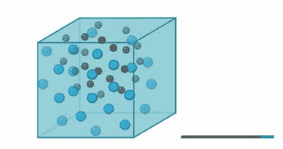 **图 (2))**

描述颗粒的盒子（已更改）。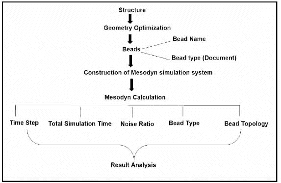 **图 (3))**

mesoDyn 模拟的基本方案。

函数 `Langevin` 方程描述了系统动力学。它们代表组分密度中考虑噪声的扩散方程：

| 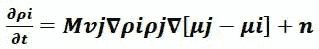 || (1) |

| --- | --- |

其中，

* `Mνj` = 颗粒的迁移率

* `▼ρiρj` = 动力系数

* `η` = 空高斯噪声

* `µ` = 扩散系数

积分这些数学方程产生玻尔兹曼密度场。

#### 2.1.2. 数值考量

对于每种颗粒，密度和外部势是相关的。`Langevin` 方程和 `fluctuation-dissipation`（涨落-耗散）定理联系了噪声源。`Mesodyn` 模拟提供的见解表明，使用低疏水性的 MMA 生成聚合物链有序聚集体更具挑战性。此外，数据观察到序参数需要更长的时间达到平衡。

### 2.1.1.3. 序参数

Mesodyn 定义了导致相分离的混合系统的自由能。为了测量相分离的程度，确定了序参数 (`P`) [19]。

| 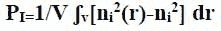 || (2) |

| --- | --- |

其中，

* `P` = 颗粒的时间序参数

* `V` = 单元格体积

* `n[i]²(r)` = 颗粒在采样距离 `r` 处的局部密度

`P` 的上升表明发生了相解离。

## 3. Mesodyn 的性质

### 3.1. 聚集与凝聚

如 `DPD` 和 `Mesodyn` 等计算机模拟技术被广泛采用。这些中尺度模型将宏观特征的缓慢热力学调节与快速的分子动力学联系起来。一项研究了在水环境中两亲性聚合物 `poly(甲基丙烯酸酯-co 甲基甲酸)-b-poly(乙二醇) ether 单 omethacrylate)`（称为 `P(MMA-co-MAA)-b-PEGMA`）的相行为。这项研究是通过 `Mesodyn` 建模实现的。研究深入探讨了载药胶胶的形成以及它们受成分、疏水性和 pH 水平等因素对聚集形态的影响。`Mesodyn` 模拟提供的见解表明，使用低疏水性的 MMA 生成聚合物链有序聚集体更具挑战性。此外，观察到序参数需要更长的时间达到平衡。

### 3.2. 相态形态

借助相形态，可以操纵嵌段共聚物薄膜的形状，以创建有序的相分离微域。由 `PMMA`（聚甲基丙烯酸酯）和 `PEO`（聚乙二醇）链组成的两亲性接枝和嵌段共聚物引起了更多关注，因为它们可能用于改进人工角膜、制造药物载体和生物医学材料。研究了纯 `聚苯乙烯-嵌段-聚(甲基丙烯酸酯)` 共聚物 (`PS- b- PMMA`) 的相形态。12 臂聚苯乙烯-嵌段-聚(甲基丙烯酸酯) 共聚物的中尺度建模是在 383K、413K 和 443 K 下完成的。


序参数（P）在 413 K 和 443 K 时几乎相同。温度的变化对富 PMMA 链产生了显著影响。观察到，掺杂纳米颗粒的共聚物微相不仅受到共聚物组成的影响，还受到纳米颗粒特征（如尺寸、数量）的影响。等值面图像显示，无论纳米颗粒的排列如何，共聚物在 443 K 时具有层相结构 [22]。

### 3.3 局限对相溶性的影响

在材料建模和药物开发方面，分子模拟由于其不断增加的计算能力和优势变得至关重要。这些模拟可以为不溶化合物的界面行为提供深刻的微观和介观信息。为了验证聚丙烯（PP）聚酰胺（PA11）聚合物混合物的相溶性与不溶性，以及其介观形貌，Fu 等人员进行了 `mesoDyn` 模拟，揭示了 PP 和 PA11 之间的相差异归因于混合物中含有 10 wt.% 的 PA11。这种特定 PA11 浓度的存在被确定为观察到的相分离的原因。此外，序参数记录值为 1，这证实了 PP 和 PA11 聚合物混合物中中程度的混合 [23]。

### 3.4 剪切对形貌的影响

介观模拟可以被视为一种解释介尺度形貌如何形成的技术，并为研究提供介尺度数据。`Mesodyn` 方法用于对聚宝拉尼（环乙醇）[19]（丙环醇）[29]（环乙醇）[19]（P65）溶液的相行为进行建模。在没有剪切的情况下，水溶液中出现了三种形貌：胶胶体是球形的并具有虫状结构；其次是心立方胶胶结构和六角堆积；后者是双连续相；第三是层相。当施加剪切时，只有与流动方向对齐的六角相和层相形成。观察到在弱剪切存在时序参数发生波动，而在强剪切下，它们在短暂震荡后趋于恒值。此外，观察到系统的形貌在不同强剪切下发生相似的变化。因此，对处于剪切条件下序参数的研究有助于解释其形貌的稳定性 [24]。

### 3.5 组分序参数

`Mesodyn` 模拟利用动态平均场泛函理论分析嵌段共聚物的微相分离。 Langevin 方程的时间积分是 `MesoDyn` 的主要优势。由于平均筛选时间小于热力学调节周期，无规则状态会显著影响最终材料的行为。使用 `Mesodyn` 方法模拟了（聚乙醇-聚丙烷）PEO27-PPO61-PEO27（P104）溶液的相行为。序参数的值随着相分离程度的增加而增大。`P` 的下降表明更好的兼容性或相溶性，聚合物混合得更加随机。相分离发生在毫秒级。根据序参数，球形胶粒的相分离迅速产生，然而，胶束结构或盘形胶粒需要更长时间达到稳定平衡 [25]。

### 3.6 自由能与熵的演变

分子动力学模拟（MDS）是一种强大的工具，允许我们预测和理解纳米尺度上分子和原子的行为。在胶体体系领域，MDS 为流动性、界面稳定性和热力学等特性提供了宝贵的见解。它弥补了传统物理实验可能无法完全解决的知识空白。利用 `mesoDyn` 方法，研究人员深入研究了 Pickering 稳定现象。他们通过将纳米纤维素（NC）作为颗粒稳定剂引入聚 1-丁烯（PB）和水的混合物实现了这一目标。当处理 NC 这种两溶性聚合物低浓度存在于连续水系统时，观察到随机运动模式。这种模式表明了均匀相结构。然而，随着 NC 和 PB 浓度的增加，疏水效应成为主导力量。这种转变导致 NC 吸附在油水界面，最终形成液滴。这一过程导致系统自由能降低。随着油水界面扩大，系统的自发性降低，导致吉布斯自由能下降 [26]。

### 3.7 密度直方图

可以利用 `mesoDyn` 方法解析的密度分布确定相分离的动力学，以检查混合物的相溶性和不溶性特征。为了理解聚乳酸和聚乙醇混合物的兼容性和不兼容性，不同研究人员已采用分子建模模拟技术进行了研究。为了确认某些聚合物原子对混合物相溶性或不溶性的贡献，可以创建 RDF 图。分析了它们的意义、PLL（聚乳酸）与 PVA（聚乙醇）之间的热力学相互作用，以及混合组分的全谱，以确认关于其兼容性/不兼容特性的实验结果。


# 相行为与结构分析

## 1. Pluronic L64、水与对二甲苯体系
使用 `mesoDyn` 模拟研究了相行为和相结构。并对具有不同溶剂浓度的 Pluronic L64 进行了考察。

*   水被认为是决定是否形成胶粒的最重要成分。
*   在单独的 `p-xylene` 中或加入极少量水时，没有形成胶粒。
*   随着水水合水平的增加，形成了大量各种形式的胶粒。
*   随着温度的升高，反胶胶的形成变得更有挑战性且耗时。在 348 K 时，pluronic L64 未产生反胶胶。
*   反胶胶的产生是一个放热过程。[28]

## 2. C[9]phNBr 和 XC 的聚集
利用 `Mesodyn` 模拟和吸附等线测量研究了水溶液中 β-羟基三甲基铵离子 (`C[9]phNBr`) 和黄牙胶 (`XC`) 的聚集。

*   `XC` 保持在 10%，而 `C[9]phNBr` 在溶液中的浓度在 5% 到 30% 之间变化。在 20% 浓度下，小分子聚集在 `XC` 链上，而在 30% 时在 `XC` 链上观察到较大的聚集体。
*   随着 `C[9]phNBr` 浓度的增加，聚集体的发育速率下降，这在序参数上表现得十分。
*   随着温度的升高，`C[9]phNBr-XC` 聚集体的产生变得具有挑战性。
*   观察到该过程是放热的。
*   随着 `XC` 体积分数的增加（20%），聚集体的形成显著减少。[17]

## 3. CMCHS 和 CTAB 的聚集
通过 `Mesodyn` 模拟研究了羧甲基壳聚糖 (`CMCHS`) 与十六烷基三甲基溴化铵 (`CTAB`) 之间的聚集行为，并将粘度、聚集体的流动力学半径与其聚集行为进行了比较。

*   `CMCHS` 保持在 10%，而 `CTAB` 范围在 35% 到 60% 之间。它们在低 `CTAB` 浓度下聚类。
*   增加 `CTAB` 浓度与 `CMCHS` 形成了一个网络。在 35% 的 `CTAB` 体积下观察到良好的网络结构。
*   当 `CTAB` 体积增加到 60% 时，网络结构消失，并被椭圆聚集结构取代。[29]

*   `CMCHS` 与 `CTAB` 的相互作用随着 `CTAB` 浓度的增加而增强。
*   随着模拟时间的增加，序参数也增加，表明 `CTAB` 分子逐渐积聚在 `CMCHS` 链上。
*   在三个不同温度（52°、25°、37°）下模拟了 (10%) `CMCHS` 和 (40%) `CTAB` 系统后发现，温度越高，序参数值越低，表明形成 `CMCHS-CTAB` 聚集体稍微困难。

## 4. 聚醚 A 和 B 的比较
比较了水溶液中线性聚醚环氧乙醇 (`EO`) 60、环氧丙烷 (`PO`) 40、(`EO`) 60 (`聚醚 B`) 以及支链嵌段聚醚 T1107 (`聚醚 A`) 的聚集行为。

*   `聚醚 A` 具有较低的聚集数，可以在比聚醚 B 更低的浓度下形成胶粒结构。
*   该聚醚表现出时间依赖性的生长行为。当剪切速率为 `1 ×10⁵ s−1` 时，两种嵌段聚醚胶粒都可能从球形变为棒形，这是在模拟系统后发现的。[30]

## 5. 黄芩素和甘草酸胶粒
研究了弱水溶性黄芩素与甘草酸胶粒的聚集行为，以证明甘草酸的溶解机制。

*   通过（亲水性）基在壳层位置形成峰形成了一个核/壳结构的胶粒，而 B 基（疏水性）则更集中在聚集体的中心。
*   根据 `DPD`，亲水壳层产生了水。
*   由于疏水相互作用，形成了核/壳结构的球形、圆柱形和层状结构。[31]

## 6. 水溶液中的聚醚衍生物
为了探索聚醚衍生物的相行为和介观结构，研究了聚醚衍生物浓度对胶粒产生的影响。

*   在 20% 浓度下观察到了圆形的胶粒。
*   熵导致胶粒自发形成。随着聚合物浓度的增加，疏水端变得更加显著。

## 7. PVA 和 PVP 混合物
聚乙醇 (`PVA`) 与聚吡咯烷酮 (`PVP`) 的介观相模拟。

*   在 298 K 时，`PVA` 和 `PVP` 是可溶的，由于焓的影响。[33]

## 8. Brij97、丙醇和乙酸乙酯
考察 Brij97（非离子活性剂）、丙醇（共活性剂）和乙酸乙酯（油相）水体系相行为和介观结构。

*   随着水比例从 60% 增加到 80%，微乳液 (`ME`) 从连续相变为 O/W 型。
*   `ME` 的形成速率取决于油和活性剂的比例，以及活性剂与共活性剂的比例。
*   不同链长度的醇（如丙醇、乙二醇）对颗粒尺寸也有影响。[34]

## 9. 黄酮类溶解度
进行了分子和介观模拟 (`MesoDyn` 和 `DPD`)，以确定在溶剂中溶解和分散黄酮类的关键基团。

*   Flory Hugins 参数评估了黄酮在不同有机介质中的溶解度并识别了关键基团。
*   三种研究的黄酮的 B2 组分与异丙醇有良好的相互作用（χ 接近 0.5）。
*   黄酮和异丙醇系统的序参数显示出相分离，表明黄酮在异丙醇中聚类。[19]

## 10. PLGA、PVA 和黄酮
使用介观方法研究了聚乳酸羟基胶 (`PLGA`)、聚乙醇 (`PVA`)、黄酮和水体系的聚集过程。

*   结果表明，研究体系能够在水介质中产生分散良好的球形纳米颗粒。
*   随着 PLGA 和黄酮浓度的增加，颗粒尺寸和聚集速率也会增加。
*   与黄酮相比，PLGA 对聚集行为的影响更为显著。[35]


| 11 | 使用 MesoDyn 模拟研究了含有表面活性剂的 Pluronic 共聚物的团聚行为。 | • 根据模拟数据，十二烷基硫酸钠 (SDS) 促进了 `EO[13]PO[30]EO[13]` (L64) 球形胶粒的形成，其 L64 浓度远低于没有 SDS 的系统。<br> • 当增加 SDS 浓度但保持 L64 浓度不变时，胶粒的尺寸增大，而胶粒数量减少。<br> • 团聚的形成过程是一个放热过程，随着温度升高，该过程变得更有挑战性，形成速率下降。 | \[36\] |

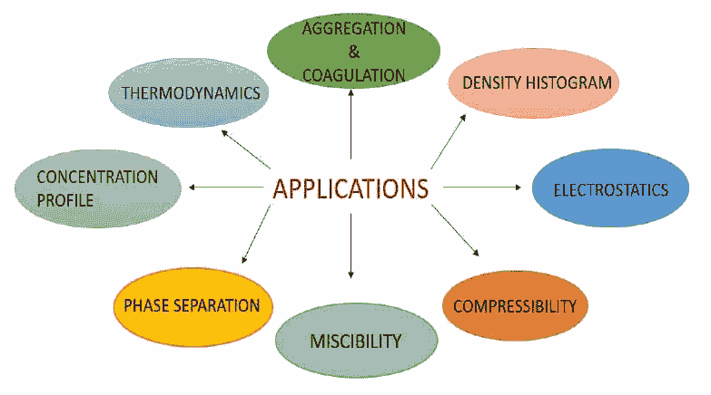 图 (4)

mesoDyn 模拟在预处方中的应用。

### 4.1 沉淀膜形成

`mesoDyn` 模块已用于探索与纳米孔膜的溶剂交换方面。通过改变浓度，可以使用 `mesoDyn` 模块检查结构的路径依赖性以及复杂的动力学现象。通过溶剂和非溶剂的相互作用模拟了膜的沉淀和整体结构发展。这种方法被证明对于预测先进且复杂的系统是有用的。当存在多种溶剂、非溶剂和聚合物时，相图会变得更加复杂 [37]。

### 4.2 纳米级药物递送系统

`Mesodyn` 模块可模拟疏水性药物颗粒*例如*（卤氟西汀）对两亲性嵌段共聚物——聚乙二醇-聚丙烯醚（PEO 和 PPO）水溶液结构的影响。它基于动态平均场密度泛函理论。观察到，随着疏水性分子数量的增加，胶粒尺寸增大并形成棒状结构。在该研究中，胶粒的尺寸分布宽度和聚集数也发生了增加 [38]。

### 4.3 从嵌段聚合物开发薄膜

在 `mesodyn` 框架下，使用平均场模型进行基于场的模拟，例如确定放置在固体基底上的由聚苯烯和聚丁烯制成的薄、纯、三元聚合物薄膜的微相图。对二嵌段共聚物的层状、圆柱状和胶粒微相与位于层相和圆柱相之间的螺旋晶相进行了比较。其中一个组分的界面能通常低于另一个组分，这是界面和薄膜中结构形成的另一个驱动因素。这种现象仅限于特定的成膜系统或工艺，并属于调制相界面的一类。结果表明，在单一系统和相同的实验条件下，所有相均可以表现出来 [9]。

### 4.4 板蓝冬碱对冰荷醇的溶解性

`Mesodyn` 模拟已用于研究板冬碱对冰荷醇的溶解性，并研究了温度对板冬碱溶解冰荷醇的影响。等密度表面和密度分布描述了结构性质，而序参数指示了相分离的不同影响。在板冬碱溶解冰荷醇的过程中，序参数显示溶解发生在四个阶段，*即* I、II、III-a、III-b 和 IV 阶段，这表明板冬碱在低浓度下作为溶解剂，溶解是通过形成扩散了冰荷醇的板冬碱胶粒发生的。此外，温度对冰荷醇在板冬碱胶粒中的扩散具有正向影响 [39]。

### 4.5 壳聚糖与聚己内酯二元体系的预测、相容性与相分离行为

分子动力学和 `Mesodyn` 模拟用于研究壳聚糖（CS）和聚己内酯（PCL）作为二元混合物的兼容性，并与实验结果进行了进一步比较。在 `MD` 模拟中，使用不同的重复单元计算了 `CS` 和 `PCL` 的溶解度参数，以提供室温下最可能的单体单元。此外，可以使用 `COMPASS` 力场模拟不同比例的聚合物混合物。通过 Flory-Huggins 相互作用参数 (`χ`) 和混合焓 `(∆H[m])`，计算了在特定成分下聚合物混合物在一定程度上的兼容性。通过 `Mesodyn` 模拟，可以计算粗粒水平下聚合物混合物的相分离行为。不同比例的相分离行为由序参数和密度分布表示。发现序参数小于 0.1，表明混合物具有良好性。这类研究可证明不同组分混合物的兼容性 [40]。

### 4.6 两亲性共聚物的纳米管自形成过程

利用 `Mesodyn` 建模，研究了位于对齐圆柱纳米孔中的两亲性 AB 嵌段共聚物的自形成过程。建立了了几十纳米各种图案纳米管模型。通过聚合物活性剂均匀溶液的淬灭，产生了几种图案结构。使用序参数计算系统的相分离和压缩性。链拓扑和相互作用参数可以描述系统的化学组成。研究结果显示，AB 聚合物形成了六角纳米管，并在两亲性和疏水性溶剂块的平均比例下获得。形态图案与聚合物含量、聚合物-溶剂相互作用参数和纳米管直径*等*具有相关性 [41]。

### 4.7 利用带有杂配体的大环铧化合物在液晶相中制备高效发光软质

建立了一种新型发光软质的制造方法，该方法利用铧 β-二酮和取代的*对*-叔丁基硫代醚的配合物，并将其引入 Pluronic (P123)—乙二醇（C[2]H[6]O[2]）的液晶相中。利用 `mesoDyn` 方法，模拟了 P123—H[2]O 系统的相行为。结果证明在 80-84 Vol% 的 Pluronic 含量范围内形成层状液晶相，而在 Pluronic 浓度高于 65 Vol% 时，存在混合相区域（六角相和层相）。所产生软复合材料的独特特性包括可控有序的超分子结构的创建和强发光性 [42]。

### 4.8 聚合物胶囊嵌种的设计与开发


事实上，Mesodyn 模拟已被用于创建双组分聚胶体杂化体，这是一种包含至少两个相分离组分的结构。这些杂化体通过结合两种不同的二嵌共聚物形成。这些系统也可以称为聚合物颗粒或聚胶体复合材料。在这些结构中，亲水嵌段对特定的曲率具有偏好，而两个疏水嵌段则经历去混合过程。这些杂化体的设计和行为受 Flory-Huggins (χ) 参数控制，这些参数在考虑嵌段尺寸比例和去混合倾向方面起着作用。这些参数影响了亲水段和疏水段在聚合物结构中形成不同区域的能力。通过采用 Mesodyn 模拟，研究人员可以了解这些双组分聚胶体杂化体的自组装和行为。这种方法能够更深入地理解杂化体内不同组分如何相互作用并组织，最终导致特定结构特征的形成。这项研究在纳米技术和材料科学等领域具有重要意义，因为它有助于开发具有独特性质和功能的定制化纳米结构。

在具有高度选择性和强分离性的溶剂中，二嵌聚合物表面活性剂是模拟参数的主要组成部分。它们是两种聚合物结构 `A13H7` 和 `B13H17`，其中每一个链都像一串项链。自由能量世界中的障碍可以通过白噪声来克服。结构的弯曲模量受到嵌段长度（熵效应）和化学组成（Flory-Huggins 参数）的影响。基本的发现是，操纵介观尺度层次结构的诀窍在于反直觉的去混合嵌共聚物的共组装。超过特定长度的共聚物不可避免地分割组装，因此在没有额外保护的情况下，聚合物基杂化体本质上是不稳定的。因此，这类研究有助于设计和开发不同聚合物及共聚物的支架 [43]。

## 4.9. Pluronic 水混合物相分离行为的介观模拟

`mesoDyn` 模块的等效链技术用于模拟 Pluronic 水溶液，并解释温度的影响、聚合物表面活性剂溶液相对嵌段大小的影响以及 Pluronic 水混合物的动态变化。研究了三种不同成分的聚（乙氧化醇）b-聚（丙氧化烯）b-聚（乙氧化醇） (PEO-PPO-PEO)嵌嵌聚物，*即* (EO)[6] (PO)[34] (EO)[6] (L62)、(EO)[13] (PO)[30] (EO)[13] (L64) 和 (EO)[37] (PO)[58] (EO)[37] (P105)，利用 Mesodyn 模拟对其进行了相相关研究。为了找到类似于 Pluronic 分子的高斯链，应用了等效链法。Flory-Huggins 表达式是一种用于估计溶液中溶剂与聚合物之间相互作用的热力学模型。此外，Flory-Huggins 表达式还用于估计不同类型 pluronic-水混合物中溶剂（水）与聚合物组分（pluronic）之间的相互作用。三种 pluronic 水混合物分别在 373 K、298 K 和 323 K 下进行模拟，以探索温度对相分离时间发展的影响。模拟结果表明，在相同的聚合物体浓度 (0.50) 下，`L62`、`L64` 和 `P105` 分别产生了凝胶、转变和胶束形态。傅里叶变换的结果显示，当温度升高时，密度场的频率也随升高，同时相分离过程随着温度升高而减慢。共聚物与水溶剂的相互作用变慢，形态的周期性变得更加频繁。因此，这类研究有助于确定含有不同组分的混合物的稳定性，或研究相分离动力学 [44]。

## 4.10. ��皮酮的溶解度和释放特性

在这项研究中，在不同成分的聚乙二醇中，黄酮类��皮酮固体分散体表现出溶解度增加，但随着时间的推移，溶解黄酮类的浓度会降低。Mesodyn 描述了可能导致相分离的各种系统的自由能。组分的平均序参数 (`P`) 可用于描述各种珠子如何分离成相。图中说明了样品系统中 `P` 的增加，这表明发生了相差（或局部珠子顺序的增加）。因此，人们可以随时间检查每个组分的各种 `P` 演变 [45]。

## 结论

Mesodyn 基于一种源自软凝聚态物理和聚合物研究的知名理念的新颖融合。在执行过程中使用了现代计算和数学技术。这些模拟进行了有效且逻辑严密的 *in silico* 化学空间探索，而当涉及多个步骤和产率低的合成途径时，这种方法从实验角度来看有时是不可行的。由于存在大量潜在的工业相关应用，Mesodyn 可以扩大计算机模拟的范围。

## 致谢

我们衷心感谢由印度新里里 DBT 批准的生物信息学中心 (BIC)，文号：BT/PR39876/BTIS/137/7/2021。

## 参考文献

|  ||  |
| --- | --- |
| [1] | Zakaria J, Abd Shukor SR, Abd Razak K. 通过分子动力学模拟研究 tween 80、水和丁醇在胶粒形成中的分子间相互作用。IOP Conf Ser Mater Sci Eng 2020; 778(1): 012091.
| [2] | Moghtader M, Sedaghat K, Bourbour M, *et al.* 胶质体：用于癌症的新型药物递送系统。Med Oncol 2022; 39(12): 240.[`dx.doi.org/10.1007/s12032-022-01836-3`](http://dx.doi.org/10.1007/s12032-022-01836-3) [PMID: [3617580](https://www.ncbi.nlm.nih.gov/pubmed/3617580)] |
| [3] | Ashwini T, Narayan R, Shenoy PA, Nayak U. 用于药物开发的计算建模。J Mol Liq 202212096.
| [4] | Altevogt P, Evers OA, Fraaije JG, Maurits U. `MesoDyn 项目：：介观工程的软件。J Mol Struct THEEM 1999; 463(1-2): 139-43.[`dx.doi.org/10.1016/S0166-1280(98)0040-3`](http://dx.doi.org/10.1016/S0166-1280(98)00403-3)] |
| [5] | McGrother S, Goldbeck-Wood G, Lam Y. 多尺度时空积分。Comput Mater Sci 2004223-33. |
| [6] | Shankar U, Gogoi R, Sethi SK, Verma A. 原子尺度模拟软件简介。InForcefields for Atomistic-Scale Simulations:材料与应用 2022299-13.[`dx.doi.org/10.1007/978-981-19-3092-8_15`](http://dx.doi.org/10.1007/978-981-19-3092-8_15)] |
| [7] | Nicolaides D. 介观建模。Mol Simul 2001; 26(1): 51-72.[`dx.doi.org/10.1080/089270201080242`](http://dx.doi.org/10.1080/089270201080242)] |
| [8] | van Vlimmer BA. 介观动力学：复杂液体中相分离动力学的模拟。学校内部论文 1998. |
| [9] | Fraaije H, Sevink A, Zvelindovsky A. 使用 Mesodyn 进行介观相分离动力学建模。2004245-64. |
| [10] | Bunker A, Róg T. 分子动力学模拟在药物研究中的作用机理理解 1：药物递送。Front Mol Biosci 2020; 7: 604770.[`dx.doi.org/10.3389/fmolb.2020.604770`](http://dx.doi.org/10.3389/fmolb.2020.604770)] |


## 参考文献

- [11] Kumar H, Maiti PK. 分子动力学模拟简介. Comput Stat Phys 2011161-97. [`dx.doi.org/10.1007/978-93-86279-50-7_6`](http://dx.doi.org/10.1007/978-93-86279-50-7_6)
- [12] Omolo CA, Kalhapure RS, Agrawal N, Rambharose S, Mocktar C, Govender T. 用于同时提高溶解度和抗菌活性的夫西酸纳米悬浮液的设计与分子动力学模拟。Mol Pharm 2018; 15(8): 3512-26. [`dx.doi.org/10.1021/acs.molpharmaceut.8b00505`](http://dx.doi.org/10.1021/acs.molpharmaceut.8b00505) [PMID: [29953816](http://www.ncbi.nlm.nih.gov/pubmed/29953816)]
- [13] Guo XD, Zhang LJ, Qian Y. 研究药物递送系统结构-性能关系的系统多尺度方法. Ind Eng Chem Res 2012; 51(12): 4719-30. [`dx.doi.org/10.1021/ie2014668`](http://dx.doi.org/10.1021/ie2014668)
- [14] Ryjkina E, Kuhn H, Rehage H, Müller F, Peggau J. 非离子活性剂相行为的分子动力学计算机模拟。 Angew Chem Int Ed 2002; 41(6): 983-6. [`dx.doi.org/10.1002/1521-3773(20020315)41:6<983::AID-ANIE983>3.0.CO;2-Y`](http://dx.doi.org/10.1002/1521-3773(20020315)41:6983::AID-ANIE983%3E3.0.CO;2-Y) [PMID: [12491288](http://www.ncbi.nlm.nih.gov/pubmed/12491288)]
- [15] Fermeglia M, Pricl S. 纳米结构材料设计和过程系统工程中的多尺度分子建模. Comput Chem Eng 2009; 33(10): 1701-10. [`dx.doi.org/10.1016/j.compchemeng.2009.04.006`](http://dx.doi.org/10.1016/j.compchemeng.2009.04.006)
- [16] Gates BD, Xu Q, Stewart M, Ryan D, Willson CG, Whitesides GM. 纳米制造的新方法：模刻、打印和其他技术. Chem Rev 2005; 105(4): 1171-96. [`dx.doi.org/10.1021/cr030076o`](http://dx.doi.org/10.1021/cr030076o) [PMID: [15826012](http://www.ncbi.nlm.nih.gov/pubmed/15826012)]
- [17] Li YM, Xu GY, Chen AM, Yuan SL, Cao XR. 水溶液中黄黄胶与非壬基氧基丙基β-羟基三甲基铵溴之间的聚集：MesoDyn 模拟与吸等等线测量. J Phys Chem B 2005; 109(47): 22290-5. [`dx.doi.org/10.1021/jp0528414`](http://dx.doi.org/10.1021/jp0528414) [PMID: [16853902](http://www.ncbi.nlm.nih.gov/pubmed/16853902)]
- [18] Fraaije JGEM, van Vlimmeren BAC, Maurits NM, et al. 动态平均场密度泛函方法及其在猝火嵌共聚物熔体微观动力学中的应用. J Chem Phys 1997; 106(10): 4260-9. [`dx.doi.org/10.1063/1.473129`](http://dx.doi.org/10.1063/1.473129)
- [19] Slimane M, Ghoul M, Chebil L. 研究黄酮类在有机溶剂中分散和溶解度的中尺度建模方法. Ind Eng Chem Res 2018; 57(37): 12519-30. [`dx.doi.org/10.1021/acs.iecr.8b02321`](http://dx.doi.org/10.1021/acs.iecr.8b02321)
- [20] Yuan SL, Zhang XQ, Chan KY. 通过中尺度模拟研究 SBA-15 合成中 P123 聚合物微相形成受剪切和电荷的影响. Langmuir 2009; 25(4): 2034-45. [`dx.doi.org/10.1021/la8035133`](http://dx.doi.org/10.1021/la8035133) [PMID: [19161270](http://www.ncbi.nlm.nih.gov/pubmed/19161270)]
- [21] Zheng LS, Yang YQ, Guo XD, Sun Y, Zhang LJ. pH 响应型胶胶聚集行为的中尺度模拟. J Colloid Interface Sci 2011; 363(1): 114-21. [`dx.doi.org/10.1016/j.jcis.2011.07.040`](http://dx.doi.org/10.1016/j.jcis.2011.07.040) [PMID: [2182462](http://www.ncbi.nlm.nih.gov/pubmed/2182462)]
- [22] Mu D, Li JQ, Wang S. 纳米颗粒掺杂 PS-b-PMMA 相结构的 MesoDyn 模拟. J Appl Polym Sci 2013; 127(3): 1561-8. [`dx.doi.org/10.1002/app3750`](http://dx.doi.org/10.1002/app3750)
- [23] Fu Y, Liao L, Lan Y, et al. 丙烯/聚酰胺混合物相溶性的分子动力学和中尺度模拟预测. J Mol Struct 2012; 1012: 113-8. [`dx.doi.org/10.1016/j.molstruc.2011.026`](http://dx.doi.org/10.1016/j.molstruc.2011.026)
- [24] Zhang X, Yuan S, Wu J. 剪切存在与不存在的三元体系相行为的中尺度模拟. Macromolecules 2006; 39(19): 6631-42. [`dx.doi.org/10.1021/ma0612b`](http://dx.doi.org/10.1021/ma0612b)
- [25] Zhang X, Yuan S, Xu G, Liu C. 三元共聚物水溶液相分离的中尺度模拟. Wuli Hubao 2007; 23(2): 139-44.
- [26] Lee KK, Low DYS, Foo ML, et al. 纳米纤维素稳定型 Pickering 乳液的分子动力学模拟. Polymers 2021; 13(4): 668. [`dx.doi.org/10.3390/polym1304068`](http://dx.doi.org/10.3390/polym1304068) [PMID: [3367231](http://www.ncbi.nlm.nih.gov/pubmed/3367231)]
- [27] Jawalkar SS, Aminabhavi TM. 研究聚丙-乳酸和聚乙醇混合物兼容性/不兼容性的分子建模和热力学方法. Polymer 2006; 47(23): 8061-71. [`dx.doi.org/10.1016/j.polymer.2006.0930`](http://dx.doi.org/10.1016/j.polymer.2006.0930)
- [28] Guo SL, Hou TJ, Xu XJ. 使用 MesoDyn 模拟 (EO)13(PO)30(EO)13(pluronic L64)/水/甲苯体系的相行为. J Phys Chem B 2002; 106(43): 11397-403. [`dx.doi.org/10.1021/jp02614l`](http://dx.doi.org/10.1021/jp02614l)
- [29] Li Y, Xu G, Wu D, Sui W. 阴离子羧甲基壳糖与硬脂三甲基铵溴之间的聚集行为：MesoDyn 模拟与实验. Eur Polym J 2007; 43(6): 2690-8. [`dx.doi.org/10.1016/j.eurpolymj.2007.0303`](http://dx.doi.org/10.1016/j.eurpolymj.2007.0303)
- [30] Gong H, Xu G, Shi X, Liu T, Sun Z. 分支与线性嵌聚醚聚集行为的比较：MesoDyn 模拟研究. Colloid Polym Sci 2010; 288(16-17): 1581-92. [`dx.doi.org/10.1007/s00396-010-2294-7`](http://dx.doi.org/10.1007/s00396-010-2294-7)
- [31] Wang Y, Dai X, Shi X, Qiao Y. 甘草酸胶溶溶药物聚集行为的中尺度模拟. Computer Modelling & New Technologies 2014; 18(10): 452-6.
- [32] Zhang B, Liu R, Zhang J, Liu B, He J. 水溶液中染料-聚醚衍生物相行为的 MesoDyn 模拟研究. Comput Theor Chem 2016; 1091: 8-17. [`dx.doi.org/10.1016/j.comptc.2016.06028`](http://dx.doi.org/10.1016/j.comptc.2016.0628)
- [33] Wu H, Xin Y. 聚乙醇/聚乙烯吡酮混合物相溶性的分子动力学和 MesoDyn 模拟. Plast Rubber Compos 2017; 46(2): 69-76. [`dx.doi.org/10.1080/14658011.2017.128062`](http://dx.doi.org/10.1080/14658011.2017.128062)
- [34] Zhao X, Wang Z, Yuan S, Lu J, Wang Z. 与实验测量一致的药物微乳液自组装 MesoDyn 预测. RSC Advances 2017; 7(33): 20293-9. [`dx.doi.org/10.1039/C7RA01541`](http://dx.doi.org/10.1039/C7RA01541)
- [35] Slimane M, Gaye I, Ghoul M, Chebil L. 不同条件下聚乳酸共乙醇/水体系中齐皮素纳米颗粒组织的中尺度建模和实验研究. Ind Eng Chem Res 2020; 59(10): 4809-16. [`dx.doi.org/10.1021/acs.iecr.9b0663`](http://dx.doi.org/10.1021/acs.iecr.9b0663)
- [36] Li Y, Xu G, Zhu Y, Wang Y, Gong H. 活性剂存在下 Pluronic 共聚合物的聚集行为：中尺度模拟. Colloids Surf A Physicochem Eng Asp 2009; 334(1-3): 124-30.


# 预测固体口服剂药物释放的计算工具

| [37] | Maiti A, Wescott J, Wood GG. Mesoscale modelling: Recent developments and applications to nanocomposites, drug delivery and precipitation membranes. Int J Nanotechnol 2005; 2(3): 198-214. [`dx.doi.org/10.1504/IJNT.2005.008059`](http://dx.doi.org/10.1504/IJNT.2005.008059) |
| [38] | Lam YM, Goldbeck-Wood G, Boothroyd C. Mesoscale simulation and cryo-TEM of nanoscale drug delivery systems. Mol Simul 2004; 30(4): 239-47. [`dx.doi.org/10.1080/08927020310001659115`](http://dx.doi.org/10.1080/08927020310001659115) |
| [39] | Ding H, Shi X, Dai X, Yin Q, Qiao Y. A mesoscopic simulation study on the solubilization of menthol by platycodin D. Journal of Engineering Science and Technology Review 2013; 6(2): 125-9. [`dx.doi.org/10.25103/jestr.062.26`](http://dx.doi.org/10.25103/jestr.062.26) |
| [40] | Gu C, Gu H, Lang M. Molecular simulation to predict miscibility and phase separation behavior of chitosan/poly(ϵ-caprolactone) binary blends: A comparison with experiments. Macromol Theory Simul 2013; 22(7): 377-84. [`dx.doi.org/10.1002/mats.201300109`](http://dx.doi.org/10.1002/mats.201300109) |
| [41] | Yang SH, Cheng YK, Yuan SL. Mesoscale simulation on patterned nanotube model for amphiphilic block copolymer. J Mol Model 2010; 16(12): 1819-24. [`dx.doi.org/10.1007/s00894-010-0673-0`](http://dx.doi.org/10.1007/s00894-010-0673-0) [PMID: [20217162](http://www.ncbi.nlm.nih.gov/pubmed/20217162)] |
| [42] | Selivanova NM, Zimina MV, Padnya PL, Stoikov II, Gubaidullin AT, Galyametdinov YG. Development of efficient luminescent soft media by incorporation of a hetero-ligand macrocyclic terbium complex into a lyomesophase. Russ Chem Bull 2020; 69(9): 1763-70. [`dx.doi.org/10.1007/s11172-020-2960-y`](http://dx.doi.org/10.1007/s11172-020-2960-y) |
| [43] | Fraaije J, van Sluis CA, Kros A, Zvelindovsky AV, Sevink GJA. Design of chimaeric polymers. Faraday Discuss 2005; 128: 355-61. [`dx.doi.org/10.1039/b03187c`](http://dx.doi.org/10.1039/b03187c) [PMID: [1565783](http://www.ncbi.nlm.nih.gov/pubmed/1565783)] |
| [44] | Li Y, Hou T, Guo S, Xu X. The Mesodyn simulation of pluronic water mixtures using the ‘equivalent chain’ method. Phys Chem Phys 2000; 2(12): 2749-53. [`dx.doi.org/10.1039/b00206p`](http://dx.doi.org/10.1039/b00206p) |
| [45] | Otto DP, Otto A, de Villiers MM. Experimental and mesoscale computational studies of the relationship between solubility and release of quercetin from solid dispersions. Int J Pharm 2013; 456(2): 282-92. [`dx.doi.org/10.1016/j.ijpharm.2013.08039`](http://dx.doi.org/10.1016/j.ijpharm.2013.08039) [PMID: [24004565](http://www.ncbi.nlm.nih.gov/pubmed/24004565)] |

Devendra S. Shirode, Vaibhav R. Vaidya, Shilpa P. Chaudhari
¹ 药系，Dr. D. Y. Patil College of Pharmacy, Akurdi, Pune, India

## 摘要
溶解是指在固-液界面、温度和溶剂组组成标准条件下，单位时间内进入溶液的药物浓度。在制药行业中，*体外*（*in vitro*）溶解试验已成为评估新型活性药物成分（API）和药物制剂开发潜能，并为进一步开发选择最合适的固体剂型的首选方法。溶解允许测量某些重要的物理参数（如药物扩散系数），并被用于实验性释放数据的模型拟合。制剂中药物释放的动力学建模已成为药物制剂开发阶段减少生物学研究的一种极具前景的替代方案。通过不同的计算工具，可以预测影响制剂性能的定性及定量变化。本章计划介绍各种在线和离线可用的计算工具，如 `PCP disso`、`DD solver`、`Kinetds`等，除了这些软件，还将讨论如何有效利用 `Microsoft Office Excel` 工具进行药物动力学研究。

**关键词**：计算工具，溶解，药物释放，集成软件，动力学。

***

(*) 通讯作者 Devendra S. Shirode：药系，Dr. D. Y. Patil College of Pharmacy, Akurdi, Pune, India；电子邮箱 `devendrashirode@dyppharma.ac.in`

## 1. 引言
药学领域多年取得了显著进展，特别是在固体口服剂的设计与开发方面[1]。影响这些剂型有效性和安全的关键属性之一是释放动力学，它决定了药物从基质中释放并供吸收的速率和程度。准确预测和控制药物释放对于优化药物性能、确保患者依从性以及实现治疗效果至关重要[2]。传统上，经验方法和试错法用于理解和控制固体口服剂的释放。然而，这些传统技术通常耗时耗力，且可能无法提供对释放机制的全面理解。为了应对这些挑战，计算工具已成为不可或缺的资产，提供了更系统、更高效的方法来预测和分析释放动力学[3]。

本文深入探讨了预测固体口服剂释放动力学的各种热门计算工具。通过利用数学建模、分子模拟和数据驱动算法，研究人员和药剂科学家可以对配方参数、物理化学性质和释放机制之间复杂的相互作用产生更深入的见解[4]。这些计算工具不仅加速了药物开发，还为剂型设计提供了更加理性个性化的方法。在后续章节中，我们将探索在释放动力学预测中流行的计算技术。从阐明扩散和溶解过程的机理模型到捕捉基质内分子相互作用的先进模拟，每种方法对揭示药物释放行为的复杂性都有其贡献[5]。此外，我们将讨论这些工具在优化治疗疗效、减少副作用以及塑造药学未来格局方面的意义。

## 2. 使用 MS EXCEL 进行溶解模型的计算与验证


*体外*溶释试验已成为确保药物制剂质量的一种有效方法 [6]。溶释研究不仅用于测量释放的药物量，还用于确保批次间的重复性，并分析对制剂或制造工艺的改变对制剂性能的影响 [7]。它们还用于在新制剂与已上市的相似制剂之间建立药剂学等效性 [8]。适当的溶释模型及其统计分析有助于制剂科学家预测药物在给定制剂中的性能 [9]。研究药物释放动力学的不同方法可分为三类：

*   统计方法，如探索性数据分析法、重复测量设计和多变量方法（MANOVA：多变量方差分析） [9, 10]
*   模型依赖方法（零级、一级、Higuchi 模型、Korsmeyer-Peppas 模型、Hixson-Crowell 模型、Baker-Lonsdale 模型、Weibull 模型等） [11-14]
*   模型独立方法 [差异因子 (f1)、相似性因子 (f2)] [15-19]

模型依赖方法的不同数学函数可用于描述溶释曲线。各种模型依赖方法包括零级、Higuchi、一级、Hixson-Crowell 和 Korsmeyer-Peppas。[20]

## 2.1. 零级药物释放模型

在此中，根据动力学用于预测溶释曲线的方程为：

| 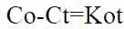 || (1) |
| --- | --- |

对方程 1 进行重新排排：

| 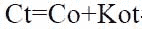 || (2) |
| --- | --- |

其中 `Ct` 是在时间 `t` 内溶解的药物量，`C0` 是溶液中初始药物量（大多数情况下，`C0 = 0`），`K0` 是零级释放常数，其单位为浓度/时间 [21-23]。使用该方程，我们可以计算 `ko` 值。如果它是常数，则遵循零级释放动力学。使用零级和一级溶释方法计算药物释放百分比的表见表 1。

表 1 **使用零级和一级溶释模型计算药物释放百分比。**

| 时间 (t) | 初始溶解量 (Q0Q0) | 零级速率常数 (k0k0) | 溶解量 (QQ) |
| --- | --- | --- | --- |
| 0 | 100 | 0.5 | 100 |
| 1 | - | - | 99.5 |
| 2 | - | - | 99.0 |
| 3 | - | - | 98.5 |
| 4 | - | - | 98.0 |
| 5 | - | - | 97.5 |
| 0 | 100 | 0.2 | 100 |
| 1 | - | - | 80.877 |
| 2 | - | - | 66.686 |
| 3 | - | - | 54.598 |
| 4 | - | - | 44.429 |
| 5 | - | - | 35.937 |

药物释放累积量随时间变化的图提供了释放数据，产生一条直线，从直图上描述了单位剂量剂中的药物顺序遵循零级过程 (1)。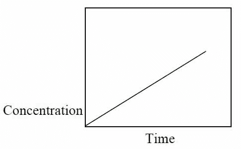图 (1)) 零级释放的浓度随时间曲线。这种释放也见缓释药物、控释药物、渗透释放药物和一些透皮制剂。

## 2.2. 一级药物释放模型

在此用于计算的方程为：

| 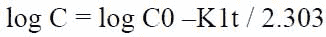 || (3) |
| --- | --- |

其中 `C0` 是药物的初始浓度，`k` 是一级速率常数，`t` 是时间，溶液中的初始药物量（大多数情况下，`C0 = 0`）。如果计算出的 `K` 为常数，则遵循一级动力学。在观察期间，将浓度的对数对剩余药物百分比的对数作图，得到斜率为 `-K/2.303` 的直线 (2)。这种动力学通常遵循水溶性多孔基质 [24-28]。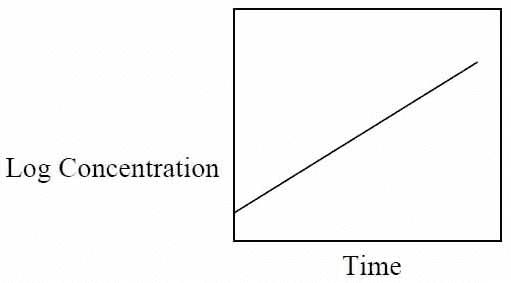图 (2)) 一级释放的浓度随时间曲线。

### 2.3. Higuchi 模型

该简化的 Higuchi 方程可用于：

| 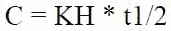 || (4) |
| --- | --- |

其中，`KH` 是 Higuchi 溶释。浓度通过除以时间的平方根计算。如果 `KH` 为常数，则遵循 Higuchi 方程。在图上，通过浓度对时间的平方根作图可以计算 (3)。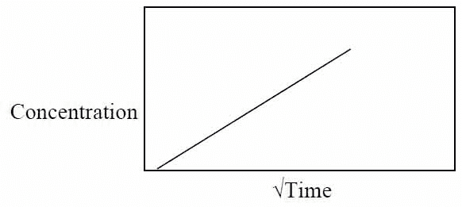图 (3)) Higuchi 模型的浓度随 √ 时间。

该模型由 Higuchi 提出用于描述基质中的药物释放。Higuchi 假设 (i) 基质中的初始药物浓度高于药物溶解度；(ii) 药物扩散单向通过一个面发生；(iii) 药物颗粒小于系统厚度；(iv) 基质溶胀和溶释忽略不计；(v) 药物扩散系数为常数；(vi) 释放环境中始终达到完美的汇条件（sink conditions） [29-31]。

## 2.4. Hixson Crowell 模型

用于计算 Hixson-Crowell 模型的方程为：

|  || (5) |
| --- | --- |

其中；`C0` 是药物制剂的初始量，`Ct` 是时间 `t` 制剂中的剩余药物量，`κ` (kappa) 是包含表面积关系的常数。

提供了待释放药物量的计算。从给定时间释放的药物中减去药物总量并计算其立方根。将待释放药物的百分比除以时间得到 `Kappa` 值，该值应为常数，并绘制剩余药物百分比的立方根随时间变化的图。产生产生直线，其斜率值代表 `K` (4) [32-36]。图 (4)) Hixson Crowell 模型的 ³√浓度随时间曲线。

### 2.5. Korsmeyer-Peppas 模型

Kosemer 推导出了用于确定聚合物剂型药物释放的简单方程：

|  || (6) |
| --- | --- |

其中 `Ct / C∞` 是时间 `t` 释放的药物比例，`k` 是药物释放速率常数，`n` 是释放指数。这里 `n` 值用于区分圆柱形基质的不同释放情况 [7]。

在数学计算中，当发生 100% 药物释放时考虑 `C∞`。将不同时间间隔的相对释放量除以完全释放量。相对浓度随时间变化的图给出了斜率值和截距 `K` (5)。这种计算可以通过对相对释放量取对数来简化。它由以下方程表示：

图 (5)) Korsmeyer-Peppas 模型的 Ct / C∞ 随时间曲线。

|  || (7) |
| --- | --- |


考虑到圆柱形片剂的情况，如果 `n` 的值为 `0.45 ≤ n`，则表示 Fick 扩散机制；而 `0.45 < n < 0.89` 表示释放为非 Fick 扩散，`n = 0.89` 为 Case II（松弛型）传输，而 `n > 0.89` 为超 Case II 传输 \[37]。为了找到 `n` 的指数，应仅使用释放曲线中 `Ct / C∞ < 0.6` 的部分。这里必须对前 60% 的药物释放数据使用 `Korsmeyer-Peppas` 模型进行拟合 \[38, 39]]。

## 2.6. 使用 Excel 计算相似因子

药物科学中相似因子（`f2`）的计算用于比较两种药物制品的溶出曲线，通常是一个测试制剂和一个对照制剂（如品牌产品） \[40]。`f2` 值评估了这些溶出曲线之间的相似性，表明测试制剂释放药物的方式是否与对照制剂相当 \[41]。这是确保仿制药在*体内*（in vivo）性能方面与其品牌等效的关键步骤。`f2` 的计算基于多个时间点测试制剂和对照制剂之间累积溶解百分比的差异。计算 `f2` 值的公式为：

|  || (8) |
| --- | --- |

其中：
* `NN` = 时间点数量
* `Ri` = 对照制剂在时间点 ii 的溶解百分比
* `Ti` = 测试制剂在时间点 ii 的溶解百分比

### 2.6.1. 使用 Excel 计算 f2

#### 2.6.1.1. 数据收集
收集测试制剂和对照制剂在不同时间点的溶出数据。这些数据应包括每个时间点药物的溶解百分比。

#### 2.6.1.2. 在 Excel 中输入数据
创建一个表格，可以在其中输入时间点、对照制剂的溶解百分比以及测试制剂的溶解百分比。

#### 2.6.1.3. 计算
在新的一列中，计算每个时间点对照制剂与测试制剂百分比之间的差平方 `(Ri−Ti)2`。然后，在另一列中计算每个时间点 `(Ri+Ti)` 的和。

#### 2.6.1.4. 平均值计算
计算所有时间点差平方的平均值以及（对照+测试百分比）和的平均值。

#### 2.6.1.5. 最终计算
使用上述的 `f2` 公式利用平均值计算 `f2` 值 \[42]。

#### 2.6.1.6. 解释
将计算出的 `f2` 值与上述解释指南进行比较，以评估溶出曲线之间的相似性。

## 2.7. 差异因子 (f1)

差异因子（`f1`）是药物科学中另一种比较两种药物制品溶出曲线的参数，通常是一个测试制剂和一个对照制剂 \[43]。`f1` 值量化了溶出曲线之间的整体差异，通常与相似因子（`f2`）结合使用，对相似性或差异性提供全面评估 \[44]。`f1` 的计算涉及计算多个时间点测试制剂和对照制剂累积溶解百分比之间的绝对差。计算 `f1` 值的公式为：

|  || (9) |
| --- | --- |

其中：
* `NN` = 时间点数量
* `Ri` = 对照制剂在时间点 ii 的溶解百分比
* `Ti` = 测试制剂在时间点 ii 的溶解百分比

### 2.7.1. 解释
`f1` 值范围于 0 到 100 之间。较低的 `f1` 值表示两个溶出曲线之间的相似性较高，而较高的 `f1` 值表明差异较大。一般解释如下：
* `f1<15`：测试制剂和对照制剂被认为相似或可替代。
* `f1≥15`：测试制剂可能与对照制剂存在差异，表明可能不相似相似。

### 2.7.2. 使用 Excel 计算 f1

#### 2.7.2.1. 数据收集
收集测试制剂和对照制剂在不同时间点的溶出数据。这些数据应包括每个时间点药物的溶解百分比 \[45]。

#### 2.7.2.2. 在 Excel 中输入数据
创建一个表格，可以在其中输入时间点、对照制剂的溶解百分比以及测试制剂的溶解百分比。

#### 2.7.2.3. 计算
在新的一列中，计算每个时间点对照制剂与测试制剂百分比之间的绝对差。

#### 2.7.2.4. 平均值计算
计算所有时间点绝对差的平均值 \[46]。

#### 2.7.2.5. 解释
将计算出的 `f1` 值与上述解释指南进行比较，以评估溶出曲线之间的差异。表 2 提供了相似性和差异因子的计算。

表 2 **相似性和差异因子的计算**
| **相似因子 f2** | **差异因子 f1** |
| --- | --- |
| A | B | C | E |
| 10 | 45 | 55 | 100 |
| 20 | 65 | 75 | 100 |
| 30 | 80 | 90 | 100 |
| 45 | | | 0 |
| 60 | | | 0 |
| 75 | | | 0 |
| 120 | | | 0 |
| | | sum (Ri-Ti) | 40 |
| | | sum (Ri-Ti)² | 400 |
| | | sum Rt | 280 |
| | | |

## 3. 各剂型溶出的集成工具

### 3.1. DD Solver：溶出曲线建模与比较

DD Solver 是一种使用 Visual Basic for Applications 编写的 Microsoft Excel 菜单驱动加载程序。使用 Excel 计算相比其他软件软件包具有许多优势，其中最吸引人的是易于使用。大多数科学家因为 Excel 的广泛适用性和高灵活性而熟悉它 \[58]。对于每个模块，DD Solver 提供了许多自定义选择，包括收敛性和非线性算法迭代次数、初始参数估计、计算结果的小位数、图表输出以及 Microsoft Word 生成 \[59]。DD Solver 用于药物工业的各种用途。体外（in-vitro）溶出、算法、比较以及各种参数估计可以通过此插件在 Excel 中完成 \[60]。表 3 提供了使用 DD 软件组的药物溶出模型。

表 3 **药物溶出模型**
| Zero-order | Zero-order with T[lag] | Zero-order with FO First-order |
| --- | --- | --- |
| First-order with T[lag] | First-order with F[max] | First-order with T[lag] and F[max] | Higuchi |
| --- | --- | --- |
| Higuchi with Tlag | Higuchi with FO | Korsmeyer-Peppas with |
| Tlag Korsmeyer-Peppas with FO | Hixson-Crowell with T[lag] | Hixson-Crowell |
| Hopfenberg with T[lag] | Hopfenberg | Baker-Lonsdale |


### 3.2. 关键特性与能力

#### 3.2.1. 机理建模
DD Solver 提供了一个平台，用于将机模型应用于药物溶出曲线分析。这些模型基于扩散、溶解以及其他相关的物理化学过程的基本原理。通过输入剂剂特性、药物属性和释放动力学等关键参数，研究人员可以模拟药物随时间释放的情况，并对其行为获得深入的见解 [60]]。

#### 3.2.2. 曲线拟合与预测
该软件提供了曲线拟合算法，使用户可以将实验溶出数据拟合到各种数学模型。这有助于理解药物释放的动力学，并有助于预测不同剂在不同条件下的溶解行为。通过将实验数据与模型预测进行比较，研究人员可以验证并完善他们的假设 [61]]。

#### 3.2.3. 差异与相似性评估
DD Solver 整合了算法，用于计算差异因子 (`f1`) 和相似因子 (`f2`) 等参数以比较溶出曲线。这一能力允许研究人员定量评估两个或多个剂型之间的相似性或差异，有助于监管申报、仿制药开发以及确保生物等性 [62]]。

#### 3.2.4. 可视化工具
软件提供了可视化工具，可以生成溶出曲线、模型拟合和比较参数的图形化表示。这些视觉辅助有助于研究人员有效地交流他们的发现，并识别数据中的趋势或异常 [63]]。

#### 3.2.5. 预测性见解
通过模拟和建模，DD Solver 可以对剂剂参数、制造工艺或环境条件的变化如何影响溶解行为提供预测性见解。这使研究人员和配方能够在开发过程早期做出明智的决策，从而节省时间和资源 [64]。

#### 3.2.6. 用户友好型界面
DD Solver 设计有用户友好的界面，使具有不同专业水平的研究人员都能操作软件功能。其直观的设计和引导式工作流使得新手和资深用户都能上手 [65]]。

### 3.3. 使用 DD Solver 进行药物溶出曲线分析和比较流程

使用 DD Solver 进行药物溶出曲线分析和比较涉及一个系统过程，用于对各种剂型的溶解行为进行建模、模拟和评估。以下步骤概述了有效利用该软件的关键步骤：

#### 3.3.1. 数据收集与输入准备
首先收集你打算分析的剂型的实验溶出数据。组织数据以包含时间点和相应的药物溶解百分比。通过手动输入或导入相关文件将这些数据输入 DD Solver 软件。

#### 3.3.2. 模型选择与曲线拟合
选择一个合适的数学模型，代表药物从剂型中释放的预期动力学。DD Solver 提供了多种机理模型，包括基于扩散的模型和溶解控制的模型。曲线拟合算法被应用于收集的数据 [66]]。

#### 3.3.3. 模拟与预测
通过模拟和建模，DD Solver 可以对剂剂参数、制造工艺或环境条件的变化如何影响溶解行为提供预测性见解。这使研究人员和配方师能够做出决策。

#### 3.3.4. 溶出曲线比较
DD Solver 整合了算法来计算差异因子 (`f1`) 和相似因子 (`f2`) 等参数以比较溶出曲线。这一能力允许研究人员定量评估相似性或差异。

#### 3.3.5. 可视化与报告
软件提供了可视化工具，生成溶出曲线、模型拟合和比较参数的图形化表示。创建总结结果和任何发现的报告 [67]]。

#### 3.3.6. 解读与决策
从 DD Solver 获取的结果将结合图形化表示进行解读，以做出明智决策。用于该软件的多步骤步骤如图 (6) 所示。

涉及 DD Solver 的各种步骤：
a) DD Solver Excel 表格
b) 菜单命令
c) 选择溶解模型
d) 数据分析
e) 溶出曲线比较
f) 模型预测

### 3.4. DD Solver 的应用

DD Solver 软件应用于多个医药领域，包括：

#### 3.4.1. 仿制药开发
评估仿制药与参考制品的相似性，确保生物等性并满足监管要求。

#### 3.4.2. 制剂优化
识别最合适的剂剂参数以实现所需的释放曲线。

#### 3.4.3. 对比研究
对各种剂型、多晶型或或进行对比溶出研究。

#### 3.4.4. 风险评估
评估工艺或工艺变化对溶解行为的影响。

## 4. PCPDisso (v3i)

PCPDisso 溶解软件是一种先进且广泛使用的软件工具，在药物研发领域起着至关重要的作用。该软件专为管理和分析溶出数据而设计，已成为制药行业不可或缺的资产 [67]。PCPDisso 溶解软件的主要功能围绕自动化、监控和协调溶出测试中固有的复杂过程展开。其突出特点之一能够从各种溶出器中无缝收集数据，加速了原本复杂的数据收集流程。结合实时监控功能，该软件允许用户观察溶出曲线随时间演变的情况，为药物制剂的行为提供宝贵的见解。


`PCP Disso Software` 的一个关键方面是它能够计算一系列关键的溶解参数。这些计算涵盖了多种指标，例如溶解速率和溶解百分比，为药物的性能提供了全面的见解。此外，该软件还提供了强大的统计分析工具，进一步增强了数据解释的深度。在监管合规性背景下，`PCP Disso Software` 是一项无价之宝。该软件能够勤勉地生成符合严格监管标准的报告，这是药物质量控制和保证的一个重要属性。这种无缝创建合规报告的能力简化了繁琐的文档工作，并确保基于数据的决策基于准确、可靠的信息 [69]。

`PCP Disso Software` 满足了医药领域内的众多应用 [70^(\-)72]。它有助于严谨的研发工作，协助质量控制和批次释放测试，并是生物利用度和生物等效性研究不可或的一部分。它的多功能性跨了制剂优化和法规遵循，从而涵盖了整个药物测试需求。该软件由 `PharmaTest` 制造，代表着信誉和能力的印记。`PharmaTest` 是药物测试设备和软件解决方案领域的知名品牌，强调了与 `PCP Disso Software` 相关的可靠性和专业水平 [73, 74]。该软件的方程列写如下 [75]。`PCP disso software` 的主界面如图 (7) 所示。

```

```
**图. (7)**

PCP disso software 的主界面。

该模型被广泛使用，无论释放机制是否为人知，或者当涉及多种释放现象时 [76]。`n` 值可以如表 4 所示，用于表征不同的释放机制。

### 表 4 PCP disso 中的释放动力学模型

| 'n' | 机制 |
| --- | --- |
| 0.5 | 菲克扩散 (HiguchiMatrix) 0.5<n<1 异常输运 |
| 1 | Case-II 级输运 (零级释放) |
| n>1 | 超 Case-II 级输运 |

#### 4.1. PCP Disso 的假设释放模型

`PharmaTest PTWS Dissolution Software` 可能提供的假设性释放模型增强了其在溶解测试数据分析方面的能力：

#### 4.1.1. 零级释放模型

`PCP Disso Software` 可以整合零级释放模型，允许用户根据溶解的零级动力学拟合并分析数据。该模型假设药物的释放速率随时间保持恒定，与剂型中剩余药物的浓度无关。通过对药物如何保持一致释放速率提供见解，该模型可以帮助预测药物的长期行为 [77]。

#### 4.1.2. 一级释放模型

集成到软件中的一级释放模型允许研究人员根据一级动力学分析数据。该模型假设药物释放速率与剩余药物浓度成正比。通过拟合该模型，科学家可以更好地理解浓度随时间的变化 [78]。

#### 4.1.3. Higuchi 释放模型

`PCP Disso Software` 可能提供 Higuchi 释放模型，专注于从基质中释放。通过拟合该模型，研究人员可以获得关于基质释放的见解 [79]。

#### 4.1.4. Weibull 释放模型

软件中的 Weibull 释放模型可以处理复杂的释放，包括初始阶段的爆发释放。

#### 4.1.5. 积分模型

该软件还可以整合积分模型，允许用户估计不同点的释放分数，提供对即时释放、持续释放或其他阶段的见解 [80]。PCP disso 的各种流程图如图 (8)。

## 5. KinetDS 软件

`KinetDS` 是一种用于药代动力学和药效学建模的应用。它为研究人员、药剂师和科学家提供了分析药物行为、预测随时间变化的浓度以及理解剂量与效应之间关系的平台 [81, 83]。`KinetDS` 软件基于曲线拟合开发，适用于零级、Higuchi、Korsmeyer-Peppas、Hill 和 Hixon-Crowell 等不同机制模型 [84, 87]。软件中还提供了模型独立的溶解指标，如溶解效率 (DE) 和平均溶解时间 (MDT)，其表达式如下：

```
|  | (10) |
| --- | --- |
|  | (11) |
```

其中：
`Q`: `t` 时的释放百分比
`Qmax`: `Q` 的最大值

```

```
**图. (8a)**

PCP disso 的集成步骤和初始化流程图。

```

```
**图. (8b)**

PCP disso 的工作操作流程图。

```

```
**图. (8c)**

PCP disso 的结果解释流程图。
```

此外，可用数据可以使用不同的模型拟合标准进行处理，例如决定系数 `R2` 和经验决定系数 `R2emp`；赤池信息准则；贝叶斯信息准则（或施瓦茨标准）；以及均方根误差 `RMSE`。额外的线性回归诊断以相关参数值的百分比表示（回归系数的相对标准误差）。模型参数通过线性非线性回归建立，并通过单纯形法表示。到目前为止，`KinetDS 3.0` 中包含的所有模型都是基于线性化的。因此，它们可以通过两种类型的回归分析进行拟合 [88^(\-)90]。


## 6. 其他溶度工作站/工具

安捷（Agilent）溶度工作站提供了一套全面的自动化溶解测试功能，涵盖了实时监控、数据采集、分析和报告 [91]。它与安捷的溶解测试设备集成，为研究人员提供了无缝的工作流。LabWare Dissolution 集成在 LabWare 信息管理系统（LIMS）中，是管理溶解过程的整体解决方案。它通过专用模块简化了样品跟踪、数据管理和合规性遵循。赛默飞科技（Thermo Fisher Scientific）的 UV 溶解软件侧重于溶解测试期间的紫外-可见光谱数据采集。这种实时分析能力允许研究人员获得药物释放行为的即时见解 [92]。Varian 的 Dissolution 700 软件（现属于安捷）用于溶解测试测试仪的控制和管理，确保数据的精确采集并符合监管标准。SOTAX 提供的 SOTAX DISI-II 提供了溶解测试的自动化和管理 [93]。它能够控制 SOTAX 的溶解测试设备、采集数据并生成全面的报告。Pharma Test PTWS 溶解软件以其多功能性闻名，能够自动数据采集、实时监控和溶解曲线的图形表示。该软件是寻求准确溶解见解的研究人员的可靠伙伴 [94]。

Hanson Research 的 VISION 溶解软件专为与其溶解测试设备兼容设计，赋予用户控制、监控、数据采集和分析能力。Pion Inc. 的 DissolvIt 软件为溶解曲线图提供实时监控、数据采集和建模，有助于预测药物释放行为 [95]。安捷的 Dissolution 2000 软件是全面溶解测试管理的另一种选择，涵盖了数据采集、报告和监管合规性。SciPharma 的 DISOCS 是溶解测试管理的解决方案，具有方法开发、数据分析以及与各种溶解仪的兼容性 [96]。表 5 提供了用于溶解数据分析的各种辅助软件的关键信息。

## 表 5 某些其他在线溶解软件列表。

| 工具 | 链接 |
| :--- | :--- |
| 性能验证测试计算工具 | [`apps.usp.org/app/USPNF/pvtCalculationTool/results.html`](https://apps.usp.org/app/USPNF/pvtCalculationTool/results.html) |
| 溶解性能验证工具 `v. 1.4.9` | [`mypharmatools.com/pharmtools/pvt`](https://mypharmatools.com/pharmtools/pvt) |
| 溶解曲线比较工具 `v. 1.0 (beta)` | [`mypharmatools.com/pharmtools/dpct`](https://mypharmatools.com/pharmtools/dpct) |
| 药物溶解分析-数据分析 | [`www.originlab.com/fileExchange/details.aspx?fid=661`](https://www.originlab.com/fileExchange/details.aspx?fid=661) |

## 结论

总之，溶解测试软件领域已成为药物研发中不可或缺的一个方面。这些工具提供了一系列功能，简化了数据采集、分析和阐释，提升了理解不同剂型药物释放行为的效率和准确性。从自动数据采集到实时监控和全面报告，这些解决方案满足了研究人员、质量控制专业人员和监管专家的多样需求。在数据驱动的见解至关重要的时代，溶解软件是制药科学中创新和精度的推动者。它将复杂的溶解曲线转换为易于理解的数据的能力，使研究人员能够更深入地理解生物系统内部的行为。随着技术的不断进步，这些解决方案将在革新制药研究方面发挥日益关键的作用，促进高效的监管合规，并为全球患者的利益推动前沿发展。

## 致谢

我们感谢上述软件的所有开发人员，如 `PCP`、`disso` 等，他们用于计算 `in vitro` 药物释放研究的动力学。

## 参考文献

| | |
| :--- | :--- |
| [1] | U.S. FDA/CDERGuidance for Industry, "Dissolution testing of immediate release solid oral forms." 1997. |
| [2] | Wang Q, Fotaki N, Mao Y. Biorelevant dissolution: Methodology and application in drug development. Dissolut Technol 2009; 16(3): 6-12. [`dx.doi.org/10.1422/DT16039P6`](http://dx.doi.org/10.1422/DT16039P6) |
| [3] | Martin G, Gray V. Valid Technol 2011; 17(1): 8-11. |
| [4] | Lu X. Filling in the gaps for `in-vitro` release and dissolution testing of solid dosage formulations. AAPS Blog 2016. |
| [5] | Kochling J. Approaches to the investigation of dissolution changes and failures. AAPS Webinar 2013. |
| [6] | Costa P, Sousa Lobo JM. Modeling and comparison of dissolution profiles. Eur J Pharm Sci 2001; 13(2): 123-33. [`dx.doi.org/10.1016/S0928-0987(01)0095-1`](http://dx.doi.org/10.1016/S0928-0987(01)0095-1) [PMID: 112978](http://www.ncbi.nlm.nih.gov/pubmed/112978) |
| [7] | Podczeck F. Comparison of `in vitro` dissolution profiles by calculating mean dissolution time (`DT`) or mean residence time (`MRT`). Int J Pharm 1993; 97(1-3): 93-100. |
| [8] | Gibaldi M, Feldman S. Establishment of sink conditions in dissolution rate determinations. Application to nondintegrating dosage forms. J Pharm Sci 1967; 56(10): 1238-42. |
| [9] | O’Hara T, Dunne A, Butler J, Devane J. A review of methods used to compare dissolution data. Pharm Sci Today 1998; 1(5): 214-23. |
| [10] | Yuksel N. Kan AE, Baykara T. Int J Pharm 2000; 209(1-2): 57-67. |
| [11] | Crank J. The mathematics of diffusion 197523. |
| [12] | Arhewoh MI, Okhamafe OA. J Med Biomed Res 2004; 3(2): 7-17. |
| [13] | Ritger PL, Peppas NA. A simple equation for description of solute release I. Fickian and non-fickian release from non-swellable devices in the form of slabs, spheres, cylinders or discs. J Control Rel 1987; 5(1): 23-36. |
| [14] | Ritger PL, Peppas NA. A simple equation for description of solute release I. Fickian and non-fickian release from non-swellable devices in the form of slabs, spheres, cylinders or discs. Journal of Controlled Release. 1987 Jun 1; 5(1): 23-36. |
| [15] | Sathe PM, Tsong Y, Shah VP. In-vitro dissolution profile comparison: statistics and analysis, model dependent approach. Pharmaceut Res 1996; 13: 1799-803. |


- [17] 匿名. 行业指南. 美国卫生与人类服务部，食品与药品管理局 1995 年。
- [18] Letícia S, Koester GG, Ortega PM, Bassani VL. 欧洲药剂与生物杂志 2004; 58: 177. [http://dx.doi.org/10.1016/j.ejpb.2004.03.017] [PMID: 15207552](http://www.ncbi.nlm.nih.gov/pubmed/15207552)]
- [19] Kalam MA, Humayun M, Parvez N, 等. 连续药剂科学杂志报 2007; 1(1): 30-5.
- [20] Siepmann J, Siepmann F. 药物溶解的数学模型. 国际药学杂志 2013; 453(1): 12-24. [http://dx.doi.org/10.1016/j.ijpharm.2013.04.044] [PMID: 23618956](http://www.ncbi.nlm.nih.gov/pubmed/23618956)]
- [21] Raslan HK, Maswadeh H. 含有羟丙基甲基纤维素和硬脂酸酸酯的混合控释基质片中茶碱的体外溶解动力学研究. 印度药剂科学杂志 2006; 68(3)
- [22] Loisios-Konstantinidis I, Dressman J. 支持豁免体内临床研究的生理性药代动力动力学/药效学建模：现状、挑战与机遇. 分子药理学 2021; 18(1): 1-17. [http://dx.doi.org/10.1021/acs.molpharmaceut.0c00903] [PMID: 33320002](http://www.ncbi.nlm.nih.gov/pubmed/33320002)]
- [23] Zhang X, Duan J, Kesisoglou F, 等. 用于制剂开发和生物等效性评价的机制口服吸收建模与模拟：FDA 公开研讨会报告. CPT 药代计量学系统药理学 2017; 6(8): 492-5. [http://dx.doi.org/10.1002/psp4.12204] [PMID: 28571121](http://www.ncbi.nlm.nih.gov/pubmed/28571121)]
- [24] Kesisoglou F, Chung J, van Asperen J, Heimbach T. 影响药物开发行业中生物药剂学和制剂策略的生理性吸收模型. 药剂科学杂志 2016; 105(9): 2723-34. [http://dx.doi.org/10.1016/j.xphs.2015.034] [PMID: 26886317](http://www.ncbi.nlm.nih.gov/pubmed/26886317)]
- [25] Heimbach T, Suarez-Sharp S, Kakhi M, 等. 面向体外体内关联的溶解和转化建模策略：研讨会报告. AAPS 杂志 2019; 21(2): 29. [http://dx.doi.org/10.1208/s12248-019-0298] [PMID: 30746576](http://www.ncbi.nlm.nih.gov/pubmed/30746576)]
- [26] Pepin X, Parrott N, Dressman J, 等. 支持药物产品开发、制造变化和控制的转化建模的现状与未来预期：研讨会报告. 药剂科学杂志 2020. [PMID: 32380182](http://www.ncbi.nlm.nih.gov/pubmed/32380182)]
- [27] Shebley M, Sandhu P, Emami Riedmaier A, 等.
- [28] Gurny R, Doelker E, Peppas NA. 多孔疏水聚合物中水溶性药物持续释放的建模. 生物材料 1982; 3(1): 27-32. [http://dx.doi.org/10.1016/0142-9612(82)90057-6] [PMID: 7066463](http://www.ncbi.nlm.nih.gov/pubmed/7066463)]
- [29] Higuchi T. 含有药物悬浮液基质的释放速率. 药剂科学杂志 1961; 50(10): 874-5. [http://dx.doi.org/10.1002/jps.510] [PMID: 1390729]
- [30] Higuchi T. 分散在固体基质中的药物释放速率的理论分析. 药剂科学杂志 1963; 52(12): 1145-9. [http://dx.doi.org/10.1002/jps.522] [PMID: 1408893]
- [31] Shoaib MH, Tazeen J, Merchant HA. 使用 HPMC 的布洛芬释放评估. 巴基斯坦药剂科学杂志 2006; 19(2): 119-24. [PMID: 1675122](http://www.ncbi.nlm.nih.gov/pubmed/1675122)]
- [32] Hixson AW, Crowell JH. 表面对速率的影响. 工业工程化学 1931; 23(8): 923-31. [http://dx.doi.org/10.1021/ie503]
- [33] Baishya H. 数学模型在药物释放中的应用. 药物开发 2017; 6(2): 1-8. [http://dx.doi.org/10.1002/dev.269]
- [34] Karasulu H, Ertan G, Köse T. 多孔基质中茶碱的释放模型. 欧洲药剂杂志 2000; 49(2): 177-82. [http://dx.doi.org/10.1016/S0378-5411(99)0082] [PMID: 1070492](http://www.ncbi.nlm.nih.gov/pubmed/1070492)]
- [35] Chen S, Zhu J, Cheng J. 新型颗粒缓释剂的制备评估. 药药学 2007; 62(12): 907-13. [PMID: 1821431](http://www.ncbi.nlm.nih.gov/pubmed/1821431)]
- [36] Korsmeyer RW, Gurny R, Doelker E, Buri P, Peppas NA. 渗透性聚合物中的溶质扩散. 国际药剂杂志 1983; 15(1): 25-35. [http://dx.doi.org/10.1016/0378-5173(83)]
- [37] Shivhare UD, Pardhi DM. 非挥发性溶剂对溶解曲线的影响. 药剂技术杂志 2011; 4(4): 537-44.
- [38] Korsmeyer RW, Peppas NA. 溶胀聚合物中的溶质释放 III. 药物控释放杂志 1984; 1(2): 89-98. [http://dx.doi.org/10.1016/0168-3659(84)9001]
- [39] Peppas NA, Narasimhan B. 数学模型如何改变了我们的药物系统设计. 药物释放杂志 2014; 190: 75-81. [http://dx.doi.org/10.1016/j.conrel.2014.0641] [PMID: 2499839](http://www.ncbi.nlm.nih.gov/pubmed/2499839)]
- [40] Brooke D. 对数分布粉末的溶解曲线 II: 溶解前时间. 药剂科学杂志 1974; 63(3): 344-7. [http://dx.doi.org/10.1002/jps.260] [PMID: 4820361](http://www.ncbi.nlm.nih.gov/pubmed/4820361)]
- [41] Brahmankar DM, Jaiswal SB. 生物药剂学与药代动力学：论著 200920.
- [42] Hopfenberg HB. 控释聚合物制剂. 收录于 Paul DR, Haris FW 编. 美国化学会 Paul DR, Haris FW. ACS 学术系列 1976.
- [43] Wu F, Mousa Y, Raines K, 等. 生理性药代动力学模型在替代生物等效方法和风险评估中的监管用途：研讨会总结报告. CPT 药代计量学系统药理学 2022.
- [44] Dressman JB, Krämer J. 药物溶解测试 2005. [http://dx.doi.org/10.1201/9780849359170]
- [45] Meineke I, Brockmöller J. 在 Microsoft EXCEL 中模拟复杂的药代动力学模型. 计算方法与生物医学杂志 2007; 88(3): 239-45. [http://dx.doi.org/10.1016/j.cmpb.2007.09007] [PMID: 17981357](http://www.ncbi.nlm.nih.gov/pubmed/17981357)]


| [46] || Sato H, Sato S, Wang YM, Horikoshi I. 用于 Microsoft Excel 电子表格快速多功能计算非房室药代动力学参数的插件宏。Comput Methods Programs Biomed 1996; 50(1): 43-52.[[`dx.doi.org/10.1016/0169-2607(96)01730-0`](http://dx.doi.org/10.1016/0169-2607(96)01730-0)] [PMID: [8835839](http://www.ncbi.nlm.nih.gov/pubmed/8835839)] |
| [47] || Haddad S, Pelekis M, Krishnan K. 不使用模拟软件求解生理性药代动力学模型的方法。Toxicol Lett 1996; 85(2): 113-26.[[`dx.doi.org/10.1016/0378-4274(96)03648-X`](http://dx.doi.org/10.1016/0378-4274(96)03648-X)] [PMID: [8650694](http://www.ncbi.nlm.nih.gov/pubmed/8650694)] |
| [48] || Delboy H. 基于 Microsoft® Excel 电子表格的药代动力学非线性拟合程序。Int J Biomed Comput 1994; 37(1): 1-14.[[`dx.doi.org/10.1016/0020-7101(94)90066-3`](http://dx.doi.org/10.1016/0020-7101(94)90066-3)] [PMID: [7896432](http://www.ncbi.nlm.nih.gov/pubmed/7896432)] |
| [49] || Hussain M, Sahudin S, Yussof I. 探索计算机辅助学习模块（CAL）在增强药剂学生药代动力学教学与学习中的应用。J Young Pharm 2020; 12(4): 354-9.[[`dx.doi.org/10.5530/jyp.2020.12.91`](http://dx.doi.org/10.5530/jyp.2020.12.91)] |
| [50] || Dash S, Murthy PN, Nath L, Chowdhury P. 控释药物系统释放的动力学建模。Acta Pol Pharm 2010; 67(3): 217-23.PMID: [20524422](http://www.ncbi.nlm.nih.gov/pubmed/20524422)] |
| [51] || Ruiz-Garcia A, Bermejo M, Moss A, Casabo VG. 药物发现中的药代动力学。J Pharm Sci 2008; 97(2): 654-90.[[`dx.doi.org/10.1002/jps.21009`](http://dx.doi.org/10.1002/jps.21009)] [PMID: [17630642](http://www.ncbi.nlm.nih.gov/pubmed/17630642)] |
| [52] || Chhabra G, Chuttani K, Mishra AK, Pathak K. 提高氨氯地平口生物利用度的纳米乳剂药物递送系统的设计与开发。Drug Dev Ind Pharm 2011; 37(8): 907-16.[[`dx.doi.org/10.3109/03639045.2010.55050`](http://dx.doi.org/10.3109/03639045.2010.55050)] [PMID: [21401341](http://www.ncbi.nlm.nih.gov/pubmed/21401341)] |
| [53] || Jain SK, Agrawal GP, Jain NK. 多孔载体浮丸胃部递送的评价。AAPS PharmSciTech 2006; 7(4): E54-62.[[`dx.doi.org/10.1208/pt07049`](http://dx.doi.org/10.1208/pt07049)] [PMID: [1723354](http://www.ncbi.nlm.nih.gov/pubmed/1723354)] |
| [54] || Jagdale SC, Patil S, Kuchekar BS. 盐酸氢浮浮丸递送的实验设计。Comput Math Med 2013.[[`dx.doi.org/10.1155/2013/62579`](http://dx.doi.org/10.1155/2013/62579)] |
| [55] || Thube MW, Shahi SR, Gulecha B. 喷昔嗪缓释片的剂型开发与评价。Int J Pharm Res Dev 2010; 2(4): 1-1. |
| [56] || Ayyoubi S, Cerda JR, Fernández-García R, 等。3D 打印球形微片：几何形状与成分对控制崩解的影响。Int J Pharm 2021; 597: 120336.[[`dx.doi.org/10.1016/j.ijpharm.2021.120336`](http://dx.doi.org/10.1016/j.ijpharm.2021.120336)] [PMID: [3354280](http://www.ncbi.nlm.nih.gov/pubmed/3354280)] |
| [57] || Ekenna IC, Abali SO. 使用动力学模型图和 DD Solver 评估从片剂中释放药物的方法。J Drug Deliv Ther 2022; 12(2-S): 5-13.[[`dx.doi.org/10.2270/ddt.v12i2-S.5402`](http://dx.doi.org/10.2270/ddt.v12i2-S.5402)] |
| [58] || Shaikh HK, Kshagar R, Patil S. 药物释放表征的数学模型：综述。World J Pharm Sci 2015; 4(4): 324-38. |
| [59] 2009 药典 |
| [60] || Akhtar M, Ahmad M, Khan SA, Murtaza G. 复合剂型中布洛芬和米索洛醇的新型控释微丸：DDSolver 的应用。Afr J Pharm Pharmacol 2012; 6(36): 2613-20. |
| [61] || Siswanto A, Fudholi A, Nugroho AK, Martono S. 阿司林浮丸的体外释放建模。Indones J Pharm 2015; 26(2): 94.[[`dx.doi.org/10.14499/indonesianpharm26294`](http://dx.doi.org/10.14499/indonesianpharm26294)] |
| [62] || Colombo P, Santi P, Bettini R, Brazel CS. 溶胀控制系统的药物释放。载于 Wise DL 等，《药物控制技术手册（第 2 版）第 2 版。Wise DL. 2000183-205. |
| [63] || Dave BS, Amin AF, Patel MM. 盐酸西替丁的胃滞留递送系统：剂型开发与体外评价。AAPS PharmSciTech 2004; 5(2): 77-82.[[`dx.doi.org/10.1208/pt05234`](http://dx.doi.org/10.1208/pt05234)] [PMID: [1576092](http://www.ncbi.nlm.nih.gov/pubmed/1576092)] |
| [64] || Davies P. 口服固体制。载于 Gibson M 等编，《药物处方研究与剂型（第 2 版）》。Gibson M. 2009389. |
| [65] || Fudholi A. 直接压法中的方法学剂型。 |
| [66] || Sabitha Ananth D. 直接压法制备缓释剂型。 |
| [67] || Rajput A, Seval G, Pingale P. 实验设计法的应用。 |
| [68] || Zhang Y, Huo M, 等。使用 DDSolver 模拟药物释放的溶出曲线。AAPS J 2011; 37(8): 907-16. (注：此处原文链接应为 10.3109/03639045.类似项）[[`dx.doi.org/10.3109/03639045.2010.55050`](http://dx.doi.org/10.3109/03639045.2010.55050)] |
| [69] || Zuo J, Gao Y, Löbenberg R, 等。DDSolver 的应用。BioMed Res 2014; 39. [PMID: [248770](http://www.ncbi.nlm.nih.gov/pubmed/248770)] |
| [70] || Johnson KC. 药物沉淀、肠道渗透性对控释剂型的影响。 |
| [71] || Kharia AA, Hiremath SN, Singh AK, Omray LK, Jain SK. 阿昔韦浮丸递送系统的设计与优化。Indian J Pharm 2010; 72(5): 599-606.[[`dx.doi.org/10.4103/0250-47X.7852`](http://dx.doi.org/10.4103/0250-47X.7852)] |
| [72] || Tiwari SB, Murthy TK, Raveendra Pai M, Mehta PR, Chowdary PB.亲水性和疏水基质系统制备盐酸曲马控释剂型。AAPS PharmTech 2003; 4(3): 18-23.[[`dx.doi.org/10.1208/pt04331`](http://dx.doi.org/10.1208/pt04331)] |
| [73] || Reddy KR, Mutalik S, Reddy S, Raju PS, Diwan PV. 尼可洛定每日缓释基质片剂的剂型开发与评价。AAPS PharmTech 2003; 4(4): 480-8.[[`dx.doi.org/10.1208/pt04461`](http://dx.doi.org/10.1208/pt04461)] |


[75] Lachman L, Lieberman L, Kanig J. 工业制剂学理论与实践。费城，PA：Lea and Febiger 198666-99.

[76] Longer MN, Ching HS, Robinson JR. 大分子从聚酸酐基质中控释的机理研究。药剂科学杂志 1985; 74(4): 406-11. [`dx.doi.org/10.1002/jps.2600740408`](http://dx.doi.org/10.1002/jps.2600740408) [PMID: 3999000](http://www.ncbi.nlm.nih.gov/pubmed/3999000)]

[77] Park K, Robinson JR. 作为口服控释药物平台的生物粘附聚合物：研究生物粘附的方法。国际药学杂志 1984; 19(2): 107-27. [`dx.doi.org/10.1016/0378-5173(84)90154-6`](http://dx.doi.org/10.1016/0378-5173(84)90154-6)]

[78] Manwar J, Kumbhar DD, Bakal R, Baviskar S, Manmode R. 三水酸头孢西林口服粘膜片剂释放动力学与粘膜强度的基于响应面的联合优化。开罗大学药学院杂志 2016; 54(2): 227-35. [`dx.doi.org/10.1016/j.bfopcu.2016.06.004`](http://dx.doi.org/10.1016/j.bfopcu.2016.06.004)]

[79] Mauger JW, Chilko D, Howard S. 溶解数据数据分析。药物开发与工业杂志 1986; 12(7): 969-92. [`dx.doi.org/10.3109/03639048609048052`](http://dx.doi.org/10.3109/03639048609048052)]

[80] Polli JE, Rekhi GS, Augsburger LL, Shah VP. 比较溶出曲线的方法以及美托洛尔酒酸盐片采用宽溶度标准的依据。药剂科学杂志 1997; 86(6): 690-700. [`dx.doi.org/10.1021/js960473x`](http://dx.doi.org/10.1021/js960473x) [PMID: 9188051](http://www.ncbi.nlm.nih.gov/pubmed/9188051)]

[81] Shah VP, Lesko LJ, Fan J, 等. FDA 行业指导：：释放固体口服制剂的 1 溶解试验。溶出技术 1997; 4(4): 15-22. [`dx.doi.org/10.14227/DT040497P15`](http://dx.doi.org/10.14227/DT040497P15)]

[82] Costa P. 溶解测试中相似性因子评估的另一种替代方法。国际药学杂志 2001; 220(1-2): 77-83. [`dx.doi.org/10.1016/0378-5173(01)00651-2`](http://dx.doi.org/10.1016/0378-5173(01)00651-2) [PMID: 1137696](http://www.ncbi.nlm.nih.gov/pubmed/1137696)]

[83] Rohrs BR. 难溶性化合物的溶解方法开发。溶出技术 2001; 8(3): 6-12.

[84] Mendyk A, Jachowicz R, Fijorek K, Dorożyński P, Kulinowski P. KinetDS：用于溶解数据的开源软件。溶出技术 2012; 19(1): 6-11. [`dx.doi.org/10.14227/DT190112P6`](http://dx.doi.org/10.14227/DT190112P6)]

[85] Patel N, Chotai N, Patel J, Soni T, Desai J, Patel R. HP-CD 制剂与上市片剂的体外溶出曲线比较。溶出技术 2008; 15(4): 28-34. [`dx.doi.org/10.14227/DT150408`](http://dx.doi.org/10.14227/DT150408)]

[86] Kulinowski P, Malczewski P, Pesta E, 等. 用于医药领域的选择性激光烧结 (SLS) 技术——高剂量控释片剂。药物制造杂志 2021; 38:101761. [`dx.doi.org/10.1016/j.addma.2020`](http://dx.doi.org/10.1016/j.addma.2020)]

[87] Kulinowski P, Hudy W, Mendyk A, 等.内部结构演变与溶解之间的关系。AAPS 药学杂志 2016; 17(3): 735-42. [`dx.doi.org/10.1208/s12249`](http://dx.doi.org/10.1208/s12249) [PMID: 2633541](http://www.ncbi.nlm.nih.gov/pubmed/2633541)]

[88] Huanta K, Sangnim T. 3D 打印技术浮释片的设计与开发。药物传递体科学 2019; 52:831-37. [`dx.doi.org/10.1016/j.jds.2019`](http://dx.doi.org/10.1016/j.jds.2019)]

[89] Endashaw E, Tatarthi R, Duguma M. 埃塞俄比亚地区 625 mg 阿莫西林钾的溶出曲线。药学 2019.

[90] Bansal S, Musawit J. 长期储存如何影响药物分散体的物理稳定性？过程杂志 2022; 10(5): 1002. [`dx.doi.org/10.3390/pr10051002`](http://dx.doi.org/10.3390/pr10051002)]

[91] Brouers F. 利用 Brouers 公式形式分析健康志愿者和患者的动力学。药物开发 2019.

[92] Shah VA, Rathod DN, Modi VS. 生物信息学在产品设计中的应用。世界药学杂志 2015.

[93] Moore W, Polli JE, Shah VP. 群体动力动力学作为解释观察到的代谢非线性的工具。药物处置 2007; 35(10): 1816-23. [`dx.doi.org/10.1008/s12249`](http://dx.doi.org/10.1008/s12249)]

[94] Flanner HH, Brown W. 溶出曲线的数学比较。药学 1996; 20:64-74.

[95] Podolsky D, Stippler ES. USP 性能验证试验在溶解测试和桨叶装置鉴定中的关键作用。溶出技术 2016; 54(2): 2235. [`dx.doi.org/10.1016/j.bfopcu.2016.06.004`](http://dx.doi.org/10.1016/j.bfopcu.2016.06.004)]

[96] Elsayed I, Abdelbary AA, Elshafeey AH. 难溶性药物的纳米化：技术优化、因子分析和人类志愿者药代动力动力学研究。国际纳米医学杂志 2014; 9: 2943-53.


设计和开发一种新型治疗候选药物仍然是一项艰巨的任务，需要长时间，且投资约为 20 至 30 亿美元。由于候选药物的药代动力学特征或毒性特征不佳，在 12 到 24 年内仅有一个分子进入市场。因此，降低成本、缩短时间、解决临床阶段的高淘汰率或药物失败已成为制药行业面临的具有挑战性且严峻的问题。在过去的几十年里，人工智能的飞速发展，特别是计算机辅助药物设计，涌现出了强大且快速的药物设计工具。现有报告明确表明，在药物设计和优化中采用虚拟筛选是迫切且成功的。与此同时，整合到基因组学和蛋白质组学的先进生物信息学通过根据靶点识别或信号级联发现疾病的分子特征，直接或间接地平滑了临床试验的路线。整合基因组学、蛋白质组学和生物信息学产生了强大的新策略来应对多种生物化学挑战，并生成了定义新生物产品的方法。因此，利用基于计算的高通量筛选方法来克服药物发现中的障碍并表征风险项目是非常有益的。此外，生物信息学分析加速了药物靶点选择、药物候选筛选和精炼，还可以协助表征副作用并预测耐药性。在本章中，作者讨论了药物设计和开发领域先进技术的现状。

**关键词：** 人工智能、计算机辅助药物设计、基因组学、药代动力学、蛋白质组学。

***

**通讯作者 Ravinder Sharma:** University Institute of Pharmaceutical Sciences and Research, BFUHS, Faridkot, India; 邮箱：ravindersharma7@yahoo.com

## 1. 引言

药物发现过程并不令人意外，从先化合物到临床候选的时期有时被称为“死亡之谷” [1]。药物发现是一个昂贵、耗时的过程，且成功率太低 [2]。然而，人工智能的缺乏限制了药物发现和开发过程，使其成为制药行业面临的一项枯燥、昂贵、耗时且充满挑战的任务 [3, 4]。尽管实施了成功的策略，但 90% 的药物在药物开发过程后期由于缺乏理想的药代动力学特征而失败 [5]。这促使并建议了需要配备先进的*in silico*（计算机）方法来加速药物发现过程 [6]。

基于计算机的应用可以识别从命中化合物到先化合物的分子、基因组学、蛋白质组学以及涉及疾病起源的新生物。此外，它允许对药物候选和受体进行改进、快速的验证和优化 [7]。今天，*in silico*方法在研发中的全面采用改变了药物发现以及最终临床开发的范式 [8]。在本章中，作者尝试介绍用于新药开发的常用软件及其应用。

### 1.1. 药物设计

发明一种新药物分子仍然是一项艰巨的任务，需要长时间且投资约为 20 至 30 亿美元 [9]。人工智能与高通量实验（图 1）的整合通过 `PubChem` [10] 等先进应用加速了这一过程：`ZINC` 数据库 [11]；`WOMBAT` [12]；`MDDR` [13]；`3D` [14]。

## 2. 基于靶点的设计

基于靶点的药物设计（SBDD）依赖于靶点信息的可用性来产生理想效果 [16]。自 1932 年以来，X 射线晶学的进展揭示了 3D 结构 [17]。在同一时期，X 射线和核磁共振（NMR）的巨大增长导致了蛋白质的结构 [18]。此外，20 世纪 80 年代国立卫生健康图书馆的建立吸引了大量的关注。蛋白质的晶体结构记录在 `PDB` 等数据库中 [19, 20]。

高质量蛋白质三维（3D）结构的可用不仅允许研究人员理解疾病的生理和病理学，还加速了筛选过程。`Captopril` 作为血管转换酶抑制剂在 20 世纪 80 年代是基于靶点的药物发现的首次成功成果 [21]。此外，`Viracept`（奈非那韦甲盐；1997 年）是首个利用已知靶点设计的 HIV 蛋白酶抑制剂 [22, 23]，激发并促进了年轻学者利用这些技术开发新药分子。某些药物-靶点库和预测工具如图（2）所示。

## 3. 基于配体的药物设计

另一方面，基于配体的药物设计（LBDD）利用已知生物活性分子针对特定靶点的现有信息，预测具有改进生物特性的化合物的行为 [24]。这种方法已成为缺乏受体结构的情况下促进药物设计的关键计算方法 [25]。更具体地说，该方法涵盖了下文讨论的定量结构活性关系（QSAR）和基于配体的药效团制谱。

### 3.1. 定量结构活性关系


物理化学性质或化学生物活性的预测一直是基于统计关系的人工智能最重要的应用之一[[26]]。定量结构活性/性质关系（QSAR/ QSPR）模型表征了分子描述符与生物学性质之间的关联[[27]]。更准确地说，模型根据数据集化学性质与实验值之间的相关性，以数学方程的形式获得的。20 世纪 80 年代，第一代（1st）3D 结构信息被引入 QSAR 研究，从那时起，从 0D 到 nD QSAR 的持续发展迅速在药物设计中稳固了其价值地位[[28]]。这些模型在新分子的预测和设计中起着重要作用，可以在先导化合物识别或优化过程中跳过或优先考虑[[29]]。

### 3.2. 药效团建模

国际纯应用化学联合（IUPAC）将药效团定义为“确保与特定生物靶标发生最佳超分子相互作用并触发其生物反应所需的空间和电子特征的集合”[[30]]。在配体分子与其受体相互作用时，它产生与结合位点在几何和能量上匹配的活性稳定构象，从而产生药学效应[[31]]。

药物化学家的策略和观察发现，药物分子中不同的描述符或功能团具有不同的生物反应，将其替换为其他基团或生物等排会对受体的结合相互作用产生巨大影响[[32], [33]]。因此，Ehrlich 在 1909 年提出了“特权结构”概念，*即*药效团。Gund 等人在 1977 年首次更新了药效团的观点，并开发了第一种基于图论的药效团软件，即可以转换为 3D 结构的 2D 结构搜索方法[[34]]。基于构的药效团建模（受体靶点已知）和基于配体的药效团建模（靶点未知）两种主要方法用于识别和确定药效团[[35]]。当靶点受体已知时，基于结构的药效团建模已成为方便的方法。通过分析它们与受体结合位点的最佳匹配程度，可以筛选假设设计的分子或可能的药效团结构，以识别命中分子。对接软件的出现以及大量数据库或巨大化学库的可用性为执行药效团建模（`MODELER`、`SWISS-MODEL`）打开了大门，并以合理的成本和时间促进了搜索[[36], [37]]。

另一方面，当靶点受体结构不可用，基于配体信息的药效团建模（一种关键计算方法）可用于促进和引导药物开发[[38]]。这种方法受数据集选择的影响很大，其方案通过低能构象生成、模型开发和验证进行总结。随着这项技术的进步，几种软件*例如*`ChemAxon’s PF`、`CCG’s DAPH3`能够从数据库中筛选数百万个化合物，并成为药物发现的重要手段之一[[39], [40]]。

## 4. 虚拟筛选

虚拟筛选（机器学习技术）利用基于*计算机模拟*的算法程序从化学数据库中搜索潜在命中化合物；这比物理筛选具有优势[[41-43]]。此外，图(3)(Images/9789815223019-C12-F3.jpg)示例展示了从命中到先导化合物识别的虚拟筛选的概述。

### 4.1. 分子对接

寻找先导分子是一项漫长、枯燥且艰巨的任务，幸运的是，具有先进算法的*计算机模拟*工具在合理化药物发现路径方面发挥着关键作用[[44]]。在所有技术中，分子对接无疑仍然是现代药物发现活动中的神圣杯之一。对于分子对接，基于模拟的算法通过预测和评估首选结合模式，以及受体与小分子或蛋白之间推定的结合亲和力，识别潜在配体，以定义稳定的复合物[[45], [46]]。配体-受体相互作用研究基于“诱导拟合理论”，并依赖配体的空间构象、能量匹配和复合物的稳定性[[47]]。在对接分析中，确定正确的结合构象*即*分子与受体复合物的配体位置（pose）是理解其亲和力和作用机制的关键[[48], [49]]。Collins 等人首次利用多尺度算法成功确定并报告了蛋白质表面的结合位点，极大地促进了分子对接的发展[[50]]。

分子对接可以大致分为刚性对接、半柔性对接和柔性对接。在刚性对接中，分子结构保持不变不发生任何变化，该方法主要涉及通过相对简单的计算研究构象程度。在静态几何结构、分子之间物理和化学互补性的基础上，进一步考虑了结合模式和相互作用。这种快速且高效的方法用于研究包括蛋白质-蛋白质、蛋白质-核酸系统在内的大分子系统，或从库中筛选更大规模的数据集[[51], [52]]。

另一方面，在半柔性对接中，配体分子的构象自由变化，而除旋转氨基酸外，大分子受体蛋白保持静态。发现这种方法适用于分析蛋白质与配体分子之间的相互作用[[53], [54]]。另一方面，在柔性对接中，配体和受体的模拟构象均自由变化。这通过消耗更多的计算资源提供了更详细的信息，且该方法的准确性得到了提高[[55]]。一些被广泛接受且在靶点识别中成功应用的对接软件包括`FlexX`：肺炎链球菌肽聚糖脱乙酰酶抑制剂[[56]]；`SEED`：疟虫蛋白受体[[57]]；`Glide`：细胞色素 P450 抑制剂[[58]]、疟原虫抑制剂[[59]]；`Surflex DOCK`：B 细胞淋巴瘤中的癌基因*等*[[60]]。

### 4.2. ADMET 预测


药物开发和发现过程日益依赖于分子在生物系统内的运动和时间跨度的药代动力学特征，这包括吸收、分布、代谢和排泄（ADME）以及毒性（T）等关键参数 [61]。大量的证据表明，药物开发阶段 80% 的失败是由于药代动力学表现差和毒性，以及时间和金钱的消耗造成的 [62]。这种传统的药物发现系统如图 (4) 所示。

这种趋势以及来自失败案例的信息促使研究人员和药物化学家转向对这些参数进行早期预测，以期降低后期的损耗率，从而影响分子的效力和和活性。分子的物理化学描述符对其药代动力学特征具有巨大影响 [63, 64]。

 **图 (4)**

传统的药物发现系统。

对描述符或药效团之间关系及其对体内药代动力学影响的深度理解，结合基于计算机模拟（*in silico*）的算法，形成了 ADMET 模型预测的基础。成功采用基于计算机模拟的 ADMET 工具并进行早期预测，使科学家能够专注于化合物，因为这些化合物满足药代动力学特征和安全性的要求的概率较高。这些先进技术正有助于加速药物发现过程，ADMET 软件的几大主要参与者如图 (5) 所示 [65^-)67]。

Schrodinger 作为最广泛采用的软件，集成了基于物理的预测模拟，用于药物设计中的各种建模、分析和计算任务。它提供了多种套件，便于研究化学和生物结构、配体-受体相互作用、分子动力学以及化学系统的性质和反应性（图 **6** 和图 **7**）。

与传统方法相比，以较低成本加速药物分子评估和优化的先进功能被认为具有更高的成功率 [68, 69]。

 **图 (5)**

市售的 ADMET 软件 **图 (6)**

用于药物发现和开发的 Schrodinger 平台 **图 (7)**

Schrodinger 平台的应用。

## 结论

计算工具的最新进展彻底改变了计算机模拟（*in silico*）方法在药物发现和开发过程中的应用。在本章节中，我们讨论了在药物设计和药物发现中发挥重要作用的各种基于计算机模拟的软件。将复杂的计算机模拟方法与高通量技术相结合的理性药物设计过程已成为开发新疗法的有效工具。预计随着技术的不断演进，计算机辅助设计的力量将不断增长。

## 参考文献

|  |||
| --- | --- |
| [1] || Seyhan AA. 转化中的丢失：跨越临床前和临床鸿沟——问题的识别与克服。Transl Med Commun 2019; 4(1): 18.[[`dx.doi.org/10.1186/s41231-019-050`](http://dx.doi.org/10.1186/s41231-019-050)] |
| [2] || Mohs RC, Greig NH. 药物发现与开发：基础研究。阿尔茨海默症：转化研究与干预。Alzheimer's Dementia Translational Research & Clinical Interventions 2017; 3(4): 651.[[`dx.doi.org/10.1016/jtrci.2017.005`](http://dx.doi.org/10.1016/jtrci.2017.005)] |
| [3] || Mohs RC, Greig NH. 药物发现与开发：基础研究。阿尔茨海默症：转化研究与干预。Alzheimer's Dementia Translational Research & Clinical Interventions 2017; 3(4): 651.[[`dx.doi.org/10.1016/jtrci.2017.005`](http://dx.doi.org/10.1016/jtrci.2017.005)] |
| [4] || Paul D, Sanap G, Shenoy S, Kalyane RK. 药物发现与开发中的人工智能。Drug Discov Today 2021; 26(1): 80-93.[[`dx.doi.org/10.1016/jdrudis.2020.010`](http://dx.doi.org/10.1016/jdrudis.2020.010)] [PMID: 3309922] |
| [5] || Deore AB, Dhumane JR, Wagh R, Sonawane R. 药物发现开发的阶段。Asian Journal of Pharmaceutical Research and Development 2019; 7(6): 62-7.[[`dx.doi.org/10.22270/ajprd.v7i6.616`](http://dx.doi.org/10.22270/ajprd.v7i6.616)] |
| [6] || Fleming N. 人工智能如何改变药物发现。Nature 2018; 557(7707): S55-7.[[`dx.doi.org/10.1038/d41586-018-0567`](http://dx.doi.org/10.1038/d41586-018-0567)] [PMID: 29849160] |
| [7] || Kiri GK, Njogu PM, Mwangi AN. 提高药物发现开发项目成功率方法：综述。Future Journal of Pharmaceutical Sciences 2020; 6(1): 27.[[`dx.doi.org/10.1186/s43094-020-047-9`](http://dx.doi.org/10.1186/s43094-020-047)] |
| [8] || Vijayan RSK, Kihlberg J, Cross JB, Poongavanam V. 人工智能增强临床前药物发现。Drug Discov Today 2022; 27(4): 967-84.[[`dx.doi.org/10.1016/jdrudis.2021.1123`](http://dx.doi.org/10.1016/jdrudis.2021.1123)] [PMID: 3483731] |
| [9] || Drago T, Cahill K, Grealy A, Lucey K, Mahmoud M. 制药公司内部研究与许可交易审查。Advanced Journal of Social Science 2021; 8(1): 77-85.[[`dx.doi.org/10.21467/ajss.8.1.77-85`](http://dx.doi.org/10.21467/ajss.8.1.77-85)] |
| [10] || Kim S, Thiessen PA, Bolton EE, et al. PubChem 物质和化合物数据库。Nucleic Acids Res 2016; 44(D1): D1202-13.[[`dx.doi.org/10.1093/nar/gkv951`](http://dx.doi.org/10.1093/nar/gkv951)] [PMID: 2640017] |
| [11] || Irwin JJ, Sterling T, Mysinger MM, Coleman RG. ZINC：用于发现化学品的免费工具。J Chem Info Model 2012; 52(7): 1757-68.[[`dx.doi.org/10.1021/ci3017`](http://dx.doi.org/10.1021/ci3017)] [PMID: 2258735] |
| [12] || Hristozov DP, Oprea TI, Gasteiger J. 虚拟筛选应用：四种场景下基于配体的方法和不同结构的研究。J Comput Aided Mol Des 2007; 21(10-11): 617-40.[[`dx.doi.org/10.1007/s10822-007-945`](http://dx.doi.org/10.1007/s10822-007-945)] [PMID: 1800816] |
| [13] || Ekins S, Mestres J, Testa B. 用于药物发现的计算机模拟药理学：虚拟配体筛选和分析的方法。Br J Pharmacol 2007; 152(1): 9-20.[[`dx.doi.org/10.1038/sj.bjp.0707305`](http://dx.doi.org/10.1038/sj.bjp.0707305)] [PMID: 1754904] |
| [14] || Sliwoski G, Kothiwale S, Meiler J, Lowe EW. 药物发现中的计算方法。Pharmacological reviews 2014; 66(1): 334-95.[[`dx.doi.org/10.1124/pr.112.007336`](http://dx.doi.org/10.1124/pr.112.007336)] |


## 参考文献

- [15] Mandal S, Moudgil M, Mandal SK. 合理性药物设计。Eur J Pharmacol 2009; 625(1-3): 90-100. [`dx.doi.org/10.1016/j.ejphar.2009.06.065`](http://dx.doi.org/10.1016/j.ejphar.2009.06.065) [PMID: [19835861](http://www.ncbi.nlm.nih.gov/pubmed/19835861)]
- [16] Kolb P, Ferreira RS, Irwin JJ, Shoichet BK. 针对新配体和靶点的分子对接与化学信息学筛选。Curr Opin Biotechnol 2009; 20(4): 429-36. [`dx.doi.org/10.1016/j.copbio.2009.08.003`](http://dx.doi.org/10.1016/j.copbio.2009.08.003) [PMID: [19733475](http://www.ncbi.nlm.nih.gov/pubmed/19733475)]
- [17] Garman EF. 生物大分子 X 射线晶体结构测定的进展。Science 2014; 343(6175): 1102-8. [`dx.doi.org/10.1126/science.1247829`](http://dx.doi.org/10.1126/science.1247829) [PMID: [24604194](http://www.ncbi.nlm.nih.gov/pubmed/24604194)]
- [18] de Chadarevian S. John Kendrew 与肌红蛋白：20 世纪 50 年代的蛋白质结构测定。Protein Sci 2018; 27(6): 1136-43. [`dx.doi.org/10.1002/pro.3417`](http://dx.doi.org/10.1002/pro.3417) [PMID: [29607556](http://www.ncbi.nlm.nih.gov/pubmed/29607556)]
- [19] 蛋白质数据库 访问地址：[`pdb101.rcsb.org/`](https://pdb101.rcsb.org/)
- [20] Shekhar C. *in silico* 药理学：计算机辅助方法可能改变药物开发。Chem Biol 2008; 15(5): 413-4. [`dx.doi.org/10.1016/j.chembiol.2008.05.001`](http://dx.doi.org/10.1016/j.chembiol.2008.05.001) [PMID: [18482690](http://www.ncbi.nlm.nih.gov/pubmed/18482690)]
- [21] Anthony CS, Masuyer G, Sturrock ED, Acharya KR. 血管紧张素转换酶抑制剂的基于结构的设计。Curr Med Chem 2012; 19(6): 845-55. [`dx.doi.org/10.2174/0929867127993450`](http://dx.doi.org/10.2174/0929867127993450) [PMID: [2221449](http://www.ncbi.nlm.nih.gov/pubmed/2221449)]
- [22] Kaldor SW, Kalish V, Davies JF, 等。赖那韦盐 (1343)：一种强效的口服生物可用 HIV-1 蛋白酶抑制剂。J Med Chem 1997; 40(24): 3979-85. [`dx.doi.org/10.1021/jm9704098`](http://dx.doi.org/10.1021/jm9704098) [PMID: [937180](http://www.ncbi.nlm.nih.gov/pubmed/937180)]
- [23] Cui W, Aate A, Wang S, Yu Q, Li Y, Yuan S.通过计算方法发现抗癌药物。Front Pharmacol 2020; 11: 733-9. [`dx.doi.org/10.3389/fphar.2020.0733`](http://dx.doi.org/10.3389/fphar.2020.0733) [PMID: [3250863](http://www.ncbi.nlm.nih.gov/pubmed/3250863)]
- [24] Chen X, Yan CC, Zhang X, 等。药物-靶点相互作用预测：数据库、Web 服务器和计算模型。Brief Bioinform 2016; 17(4): 696-712. [`dx.doi.org/10.1093/bib/bb066`](http://dx.doi.org/10.1093/bib/bb066) [PMID: [2628367](http://www.ncbi.nlm.nih.gov/pubmed/2628367)]
- [25] Martin YC, Kofron JL, Tagen LM.结构相似的分子具有相似活性吗？J Med Chem 2002; 45(19): 4350-8. [`dx.doi.org/10.1021/jm02015c`](http://dx.doi.org/10.1021/jm02015c) [PMID: [1221037](http://www.ncbi.nlm.nih.gov/pubmed/1221037)]
- [26] Baum ZJ, Yu X, Ayala PY, Watkins SP, Zhou Q. 化学中的人工智能：当前趋势与未来方向。Journal of Chemical Information and Modeling 2021; 61(7): 3197-212. [`dx.doi.org/10.1021/acs.jcim.0c619`](http://dx.doi.org/10.1021/acs.jcim.0c619)
- [27] Neves BJ, Braga RC, Melo-Filho CC, Muratov EN, Andrade CH. 基于 QSAR 的虚拟筛选：药物发现中的进展与应用。Front Pharmacol 2018; 9: 1275-81. [`dx.doi.org/10.3389/fphar.2018.01275`](http://dx.doi.org/10.3389/fphar.2018.01275) [PMID: [3052427](http://www.ncbi.nlm.nih.gov/pubmed/3052427)]
- [28] Lin X, Li X, Lin X. 计算方法在药物筛选和设计中的应用。Molecules 2020; 25(6): 1375-89. [`dx.doi.org/10.3390/molecules25061375`](http://dx.doi.org/10.3390/molecules25061375) [PMID: [3219732](http://www.ncbi.nlm.nih.gov/pubmed/3219732)]
- [29] Muratov EN, Bajorath J, Sheridan RP, 等。无边界。Chem Soc Rev 2020; 49(11): 3525-64. [`dx.doi.org/10.1039/D0CS009A`](http://dx.doi.org/10.1039/D0CS009A) [PMID: [3235654](http://www.ncbi.nlm.nih.gov/pubmed/3235654)]
- [30] Wermuth CG, Ganell CR, Lindberg P, Mitscher LA. 药物化学术表（IUPAC 建议）。Pure Appl Chem 1998; 70(5): 1129-43. [`dx.doi.org/10.1351/pac19987059`](http://dx.doi.org/10.1351/pac19987059)
- [31] Seidel T, Bryant SD, Poli G, Langer T. 计算机辅助设计中的 3D 药效建模技术。Chemoinformatics 2017; 28(2): 279-309. [`dx.doi.org/10.1002/97811961110.ch20`](http://dx.doi.org/10.1002/97811961110.ch20)
- [32] Chang C, Ekins S, Bahadduri P, Swaan PW. 基于药效的转运体药物发现。Adv Drug Deliv Rev 2006; 58(12-13): 1431-50. [`dx.doi.org/10.1016/j.addr.2006.0906`](http://dx.doi.org/10.1016/j.addr.2006.0906) [PMID: [170971](http://www.ncbi.nlm.nih.gov/pubmed/170971)]
- [33] Ehrlich P. 化学疗法的现状。Ber Dtsch Chem 1909; 42(1): 17-47. [`dx.doi.org/10.1002/cber.19090420`](http://dx.doi.org/10.1002/cber.19090420)
- [34] Gund P. 三维药效模式检索。Prog Mol Subcell Biol 1977; 5: 117-43. [`dx.doi.org/10.1007/978-3-642-66626_14`](http://dx.doi.org/10.1007/978-3-642-66626_14)
- [35] Pirhadi S, Shiri F, Ghasemi JB. 基于结构的药效团在药物发现中的方法与应用。Curr Top Med Chem 2013; 13(9): 1036-47. [`dx.doi.org/10.2174/1568026611130906`](http://dx.doi.org/10.2174/1568026611130906) [PMID: [2365148](http://www.ncbi.nlm.nih.gov/pubmed/2365148)]
- [36] Valasani KR, Vangavaragu JR, Day VW, Yan SS. 用于识别新型亲粘蛋白 D 抑制剂的基于结构的设计、合成、药效团建模、虚拟筛选和分子对接研究。J Chem Inf Model 2014; 54(3): 902-12. [`dx.doi.org/10.1021/ci5000196`](http://dx.doi.org/10.1021/ci5000196) [PMID: [2455551](http://www.ncbi.nlm.nih.gov/pubmed/2455551)]
- [37] Eswar N, Webb B, Marti-Renom MA, 等。蛋白质科学实验方案。Curr Protoc Protein Sci 2007。
- [38] Schwede T, Kopp J, Guex N, Peitsch MC. SWISS-MODEL：一个自动化蛋白质同源建模服务器。Nucleic Acids Res 2003; 31(13): 3381-5. [`dx.doi.org/10.1093/nar/g520`](http://dx.doi.org/10.1093/nar/g520) [PMID: [12824](http://www.ncbi.nlm.nih.gov/pubmed/12824)]
- [39] Lu X, Yang H, Chen Y, 等。药效团建模的发展及其在药物发现中的应用。Curr Pharm Des 2018; 24(29): 3424-39. [`dx.doi.org/10.2174/1568026611130906`](http://dx.doi.org/10.2174/1568026611130906)
- [40] Chiang YK, Kuo CC, Wu YS, 等。基于配体的药效模型生成和虚拟筛选以鉴定强效抗癌活新型微管抑制剂。J Med Chem 2009; 52(14): 4221-33. [`dx.doi.org/10.1021/jm801649y`](http://dx.doi.org/10.1021/jm801649y) [PMID: [195071](http://www.ncbi.nlm.nih.gov/pubmed/195071)]
- [41] Katsila T, Spyroulias GA, Patrinos GP, Matsoukas MT.靶点识别与药物发现中的计算方法。Comput Struct Biotechnol J 2016; 14: 177-84. [`dx.doi.org/10.1016/j.csbj.2016.04.004`](http://dx.doi.org/10.1016/j.csbj.2016.04.004)


- [42] Schneider G. 虚拟筛选：无止尽的阶梯？Nat Rev Drug Discov 2010; 9(4): 273-6. [`dx.doi.org/10.1038/nrd3139`](http://dx.doi.org/10.1038/nrd3139) [PMID: [20357802](http://www.ncbi.nlm.nih.gov/pubmed/20357802)]
- [43] Leelananda SP, Lindert S. 药物发现中的计算方法。Beilstein J Org Chem 2016; 12: 2694-718. [`dx.doi.org/10.3762/bjoc.12.267`](http://dx.doi.org/10.3762/bjoc.12.267) [PMID: [28144341](http://www.ncbi.nlm.nih.gov/pubmed/28144341)]
- [44] Prada-Gracia D, Huerta-Yepez S, Moreno-Vargas LM. 计算方法在抗肿瘤药物发现、设计和优化中的应用。Bol Med Hosp Infant Mex Engl Ed 2016; 73(6): 411-23.
- [45] Brogi S, Ramalho TC, Kuca K, Medina-Franco JL, Valko M. 用于药物设计与发现的`in silico`方法。Front Chem 2020; 8: 612. [`dx.doi.org/10.3389/fchem.2020.00612`](http://dx.doi.org/10.3389/fchem.2020.00612) [PMID: [32850641](http://www.ncbi.nlm.nih.gov/pubmed/32850641)]
- [46] Pinzi L, Rastelli G. 分子对接：药物发现中的范式转移。Int J Mol Sci 2019; 20(18): 4331-9. [`dx.doi.org/10.3390/ijms20184331`](http://dx.doi.org/10.3390/ijms20184331) [PMID: [31487867](http://www.ncbi.nlm.nih.gov/pubmed/31487867)]
- [47] Ferreira L, dos Santos R, Oliva G, Andricopulo A. 分子对接与基于结构的药物设计策略。Molecules 2015; 20(7): 13384-421. [`dx.doi.org/10.3390/molecules200713384`](http://dx.doi.org/10.3390/molecules200713384) [PMID: [26205061](http://www.ncbi.nlm.nih.gov/pubmed/26205061)]
- [48] Sherman W, Day T, Jacobson MP, Friesner RA, Farid R. 用于配体/受体诱导拟合效应建模的新程序。J Med Chem 2006; 49(2): 534-53. [`dx.doi.org/10.1021/jm050540c`](http://dx.doi.org/10.1021/jm050540c) [PMID: [16420040](http://www.ncbi.nlm.nih.gov/pubmed/16420040)]
- [49] Coleman RG, Carchia M, Sterling T, Irwin JJ, Shoichet BK. 分子对接中的配体构象与采样。PLoS One 2013; 8(10): e7592. [`dx.doi.org/10.1371/journal.pone.07592`](http://dx.doi.org/10.1371/journal.pone.07592) [PMID: [24098414](http://www.ncbi.nlm.nih.gov/pubmed/24098414)]
- [50] Kitchen DB, Decornez H, Furr JR, Bajor J. 药物发现虚拟筛选中的对接与评分。Nat Rev Drug Discov 2004; 3(11): 935-49. [`dx.doi.org/10.1038/nrd1549`](http://dx.doi.org/10.1038/nrd1549) [PMID: [15520816](http://www.ncbi.nlm.nih.gov/pubmed/15520816)]
- [51] Collins JG, Shields TP, Barton JK. 非经典金属嵌入剂结合 `Rh` 的 1H-NMR。J Am Chem Soc 1994; 116(22): 9840-6. [`dx.doi.org/10.1021/ja0010a4`](http://dx.doi.org/10.1021/ja0010a4)
- [52] Matsuzaki Y, Uchikoga N, Ohue M, Akiyama Y. 探索蛋白质-蛋白质相互的刚对接方法。201733-55
- [53] Sauton N, Lagorce D, Villoutre BO, Miteva MA. MS-DOCK：用于多步虚拟筛选的精确多构象生成与刚对接方案。Bioinformatics 2008; 9(1): 184. [`dx.doi.org/10.1186/1475-184`](http://dx.doi.org/10.1186/1475-184) [PMID: [18402678](http://www.ncbi.nlm.nih.gov/pubmed/18402678)]
- [54] Salmaso V, Moro S. 探索配体-蛋白识别中从分子对接到分子动力学的桥接。Front Pharmacol 2018; 9: 923-7. [`dx.doi.org/10.3389/fphar.2018.0923`](http://dx.doi.org/10.3389/fphar.2018.0923) [PMID: [30186166](http://www.ncbi.nlm.nih.gov/pubmed/30186166)]
- [55] Wong CF. 用于药物发现的柔性受体对接。Expert Opin Drug Discov 2015; 10(11): 1189-200. [`dx.doi.org/10.1517/1746041.2015.107808`](http://dx.doi.org/10.1517/1746041.2015.107808) [PMID: [26313123](http://www.ncbi.nlm.nih.gov/pubmed/26313123)]
- [56] Rarey M, Kramer B, Lengauer T, Klebe G. 使用增量构建算法的快速柔性对接方法。J Mol Biol 1996; 261(3): 470-89. [`dx.doi.org/10.1006/jmbi.1996.0477`](http://dx.doi.org/10.1006/jmbi.1996.0477) [PMID: [8780787](http://www.ncbi.nlm.nih.gov/pubmed/8780787)]
- [57] Bui NK, Turk S, Buckenmaier S, 等. 肺炎球菌肽聚糖脱乙酰酶 PgdA 筛选实验开发及初始抑制剂的发现。Biochem Pharmacol 2011; 82(1): 43-52. [`dx.doi.org/10.1016/j.bcp.2011.0328`](http://dx.doi.org/10.1016/j.bcp.2011.0328) [PMID: [21501597](http://www.ncbi.nlm.nih.gov/pubmed/21501597)]
- [58] Friedman R, Caflisch A. 基于片段的对接和共识评分发现嗜质体蛋白酶抑制剂。ChemMedChem 2009; 4(8): 1317-26. [`dx.doi.org/10.1002/cmdc.20090078`](http://dx.doi.org/10.1002/cmdc.20090078) [PMID: [19472268](http://www.ncbi.nlm.nih.gov/pubmed/19472268)]
- [59] Caporuscio F, Rastelli G, Imbriano C, Del A. 高通量对接设计的强效芳香酶抑制剂。J Med Chem 2011; 54(12): 4006-17. [`dx.doi.org/10.1021/jm2000689`](http://dx.doi.org/10.1021/jm2000689) [PMID: [21605410](http://www.ncbi.nlm.nih.gov/pubmed/21605410)]
- [60] Shah F, Wu Y, 等. 新型苯噻唑和三唑衍生物的设计、合成与生物学评价。MedChem 2011; 12: 1301-7. [`dx.doi.org/10.1039/c1md029`](http://dx.doi.org/10.1039/c1md029)
- [61] Cerchietti LC, Ghet AF, Zhu X, 等. 小分子的 `in vitro` `in vivo` 预测。Cell 2010; 125(4): 700-11. [`dx.doi.org/10.1016/j.cell2009.050`](http://dx.doi.org/10.1016/j.cell2009.050) [PMID: [20385364](http://www.ncbi.nlm.nih.gov/pubmed/20385364)]
- [62] Dunning K, Benrim N, Cardillo C, Spirito M. `in silico` 模型在早期药物开发中的应用。Nat Rev Drug Discov 2018; 17: 2033-55. [`dx.doi.org/10.5772/nrd7189`](http://dx.doi.org/10.5772/nrd7189)
- [63] Faqi AS. 临床前开发毒理学综合指南
- [64] van de Watermark H. `in silico` 建模：走向天堂？Nat Rev Drug Discov 2003; 2(3): 192-204. [`dx.doi.org/10.1038/nrd1032`](http://dx.doi.org/10.1038/nrd1032) [PMID: [12612645](http://www.ncbi.nlm.nih.gov/pubmed/12612645)]
- [65] van de Watermark H. 代谢与药物动力学中的高通量和 `in silico` 技术。Curr Opin Drug Discovery 2002; 5(1): 33-43. [PMID: [15520816](http://www.ncbi.nlm.nih.gov/pubmed/15520816)]
- [66] Han Y, Zhang J, Hu CQ, Zhang X, Ma B, Zhang P. 头孢曲松及其杂质的 `in silico` ADME 和毒性预测。Front Pharmacol 2019; 10: 434-9. [`dx.doi.org/10.3389/fphar.2019.0434`](http://dx.doi.org/10.3389/fphar.2019.0434) [PMID: [31068821](http://www.ncbi.nlm.nih.gov/pubmed/31068821)]
- [67] Göller AH, Kuhnke L, Montanari F, 等. 拜耳的 `in silico` ADMET 平台：过去二十年的机器学习历程。Drug Disc Today 2020; 25(9): 1702-9. [`dx.doi.org/10.1016/j.drudis.2020.07.001`](http://dx.doi.org/10.1016/j.drudis.2020.07.001) [PMID: [32652309](http://www.ncbi.nlm.nih.gov/pubmed/32652309)]
- [68] Shou WZ. 药物发现中高通量 ADME 筛选的现状与未来方向。J Pharm Anal 2020; 10(3): 201-8. [`dx.doi.org/10.1016/j.jpha.2020.05.004`](http://dx.doi.org/10.1016/j.jpha.2020.05.004) [PMID: [32612866](http://www.ncbi.nlm.nih.gov/pubmed/32612866)]


| [69] || Cox PB, Gupta R. 药物发现中的当代计算应用与工具。ACS Med Chem Lett 2022; 13(7): 1016-29.[[`dx.doi.org/10.1021/acsmedchemlett.1c00662`](http://dx.doi.org/10.1021/acsmedchemlett.1c00662)] [PMID: [35859884](http://www.ncbi.nlm.nih.gov/pubmed/35859884)] |

# 用于药物研究应用的数据解释与管理工具

Arvinder Kaur, Avichal Kumar, Kavya Manjunath, Deepa Bagur Paramesh, Shilpa Murthy, Anjali Sinha

¹ 药剂系，KLE College of Pharmacy, KLE Academy of Higher Education and Research 组成学院（视为大学），Rajajinagar, Bengaluru-560010, Karnataka, India

² 药理学系，KLE College of Pharmacy, KLE Academy of Higher Education and Research 组成学院（视为大学），Rajajinagar, Bengaluru-560010, Karnataka, India

³ 药物化学系，KLE College of Pharmacy, KLE Academy of Higher Education and Research 组成学院（视为大学），Rajajinagar, Bengaluru-560010, Karnataka, India

## 摘要

在数据解释和管理之前，药物研究中的信息流很大程度上依赖人工且操作简单，技术应用有限。建立研究目标、设计研究、收集数据、分析数据和解释结果都是耗力、枯燥且耗时的过程。手动输入和排序大量数据会导致研究人员更容易出现人为错误，导致错误和无效的结果。本章利用数据挖掘、数据抽象和智能数据分析，共同提高药物发现和递送方法的质量。为了开发新药并改进现有治疗，可以使用软件分析大型数据集并识别有助于理解药物与人体相互作用的模式。器官和细胞的虚拟模型用于研究药物效应、自动化药物测试并预测不良反应。药物管理工具（如药房管理软件、电子处方软件、库存管理软件和自动发药系统）对于管理库存、跟踪患者处方、监测药物相互作用、维护患者信息和历史以及提供最新的药物信息具有很高价值。本章的主要目的是强调现有的各种工具和软件解决方案，以及它们如何促进研究过程，以确保符合有关人类医疗安全的法规和法律。

**关键词：** 自动发药系统、电子处方软件、智能数据分析、库存管理软件、药物管理工具、虚拟模型。

***

通讯作者 Arvinder Kaur：药剂系，KLE College of Pharmacy, KLE Academy of Higher Education and Research 组成学院（视为大学），Rajajinagar, Bengaluru-560010, Karnataka, India；电子邮箱：kaurarvinder@outlook.com

## 1. 引言

药物研究是一个至关重要的领域，因为它涉及针对各种医疗状况不断开发新药物和治疗方法。这一过程需要大量的实验和分析，以识别新的潜在治疗方案并评估其安全有效性 [1]。

这些工具旨在提高研究生产力和成功率，产生更可靠、更准确的结果。这导致药物研究对尖端技术和软件的依赖增加，使科学家能够比以前更快地研究复杂的生物系统，并创建新的治疗方法和药物。本文将讨论其中的一些相关性。

数据解释是药物研究不可或缺的一部分，对于就药物开发、有效性和安全性得出有效结论是必要的。当代药理研究产生的数据量日益增加，数据解释变得更具挑战性 [2]。它涉及结合来自各种来源的数据以做出明智判断，从而指导新型疗法和药物的创造。医药领域有效的数据解释需要专业知识、科学敏锐性和学科知识的结合。此外，检查复杂数据集并得出结论需要使用先进的软件和统计技术。在这种背景下，准确理解数据的重要性不言而喻，因为它使科学家能够根据易于获得的事实对患者护理、公共政策和行动方案做出决策。最高水平的患者护理和医疗机构的财务可持续性取决于药物资源（包括药物、设备和人员）的有效管理。药房采用各种管理技术，如员工排班、性能监控工具和库存管理系统来实现这些目标 [3]。这些工具帮助药剂简化流程、减少浪费并改善患者结果。本文概述了药房中常用的管理工具，并描述了它们在不同药房背景下的应用。它还了与实施这些创新相关的优势和挑战，强调了在引入新的管理系统时进行充分规划和研究的重要性。这项研究强调了管理工具优化优化运营和增强患者护理的意义。

## 2. 历史

数据管理和存储需要专门设备。在医学研究史上已经采用了各种方法，当代技术也简化了复杂数据的管理。Edward H. Shortliffe 研究了现代思维方法与信息基础设施进步、遵守国际标准以及教育之间取得成功平衡的重要性 [4]。

### 2.1 传统方法

过去，医学研究完全依赖手动数据输入和数据筛选方法。自 1993 年以来，研究数据和信息处理经历了显著进展。事实上，跨各个研究实验室和医疗机构收集和交换的数据正在迅速演变。曾经的孤立数据库或实验室信息系统现在已整合到部门、医院、社区和基于研究的医学信息系统中。随着数据量的增加，为决策支持提取相关信息已变得越来越具有挑战性。传统的手动数据分析已不再满足需求，需要开发高效的基于计算机的分析技术。这些技术的两个显著例子是数据抽象和数据挖掘 [5]。

### 2.2 计算机与软件解决方案


人工智能提醒我们，计算机在医学领域的应用绝非近期的发展。许多行业以类似的方式使用计算机，而很少有技术进展是明确由医疗领域所谓的“业务计算”所催生的。尽管如此，认为这些计算机化的医疗应用将“重塑”医学似乎并不切实际。在过去的 20 年里，计算机并没有显著改变决策的类型或决策的制定。

我们意识到，在增强管理人员的批判性思维、测试分数以及百分比和体重等衡量指标方面，缺乏有效的视角。

研究中可以使用的另一种类型的数据是混合方法数据，即同时来自定性和量性源的数据。这些是最为典型的研究数据类型。还存在另外两类数据：可用于研究的次级数据和元数据（元数据是关于数据的信息，可用于理解研究是如何进行的，以及数据是如何收集和分析的）。为了其他目的而主动收集并可用于研究的信息被视为可选信息。为了更好地理解研究数据管理，五大类研究数据如下：

### 3.3. 观察数据

这类数据通过对人员、物体或现象的观察来收集，不进行任何形式的操纵或干预。可以采用各种技术，包括直接观察、视频记录和其他方法来收集观察数据 [9]。

### 3.4. 实验数据

通过实验来收集此类数据，涉及对一个或多个变量的操纵，并观察这些变化如何影响其他变量。实验数据通常在室内收集，也可以在野外进行 [10]。

### 3.5. 问卷数据

通过向个人提出一系列关于其信念、态度、行为或经验的问题来收集此类数据。问卷数据可以通过多种途径获得，包括在线调查、面对面谈和电话调查 [11]。

### 3.6. 次级数据

这类数据由第三方收集，其目的与研究人员当前的研究无关。次级数据可以从多种来源获得，包括学术机构、非营利组织和政府机构 [12]。

### 3.7. 元数据

这类数据提供了关于数据的信息，用于理解研究是如何进行的，以及数据是如何收集和分析的。元数据可用于评估研究的质量 [13]。

## 4. 数据分析

关于数据分析、知识发现和机器学习的近期论文经常包含此类陈述。它们都有共同的关注点：如何“理解”过去几年产生的量数据 [14]。基于计算机的分析结果需要以清晰的格式有效地传达给用户。

### 4.1. 智能数据分析

我们必须对“智能数据分析”这一术语给出清晰的定义，并澄清它与“数据库知识发现”以及“数据挖掘”之间的联系。数据库知识发现（KDD）的阶段通常被描描述为一个系统过程 [15]：

-   理解主题内容。
-   创建数据集并清洗数据。
-   发现数据中隐藏的规律，以创建模式、规则和其他形式。
-   数据挖掘（DM）、知识的后处理。
-   结果利用是整个 KDD 过程中的一个阶段。

智能数据分析（IDA）通常与 KDD 相关联。IDA、数据库知识发现和数据挖掘之间的关系如图 (1)所示。


**图 (1)** IDA、KDD 和 DM 的关系。

KDD 和 IDA 以一种重要的方式交织在一起。数据分析这一主题是两个领域共有的，它们中的许多方法也是如此。如前所述，IDA 和 KDD 之间的主要区别在于，IDA 使用 AI 工具和方法，而 KDD 同时使用 AI 和非 AI 技术。另一个视角涉及数据规模：KDD 通常侧于从极大型数据集中提取信息，而在 IDA 中，数据集可以是大型的也可以是中等规模的。这也影响了所使用数据挖掘工具的类型：在 KDD 中，数据挖掘工具主要在集群模式执行（尽管整个 KDD 过程都是智能的），而在 IDA 中，工具可以以集群方式使用，也可以作为智能助手使用 [16]。

两个主要的视角定义了医学和药学领域智能数据分析的意义和需求：


第一个重要的视角围绕着对特定患者的原始数据（如监测数据的时间序列）进行智能分析，以利用显式的基于知识的批判性思维过程（如推理、预测、观察等 `etc.`）。这些数据中，很大一部分由数值组成，且通常具有噪声和不完整性。其目标是动态地提取有意义的抽象，例如患者历史、当前及预期未来状况的总结，这些摘要可以与相关信息（`e.g.`，诊断、预后、监测数据等 `etc.`）进行比较。这些数据分析技术被称为信息审慎策略，该术语最初由 Clancey 在其关于启发式分类的经典提案中提出 [17]。在这一提案中，这些策略构成了推理过程的关键组成部分。近期对数据抽象方法的关注重点在对时间数据的解释上（时间数据抽象）。此类抽象的主要形式包括时间时间趋势和更复杂的时间模式。由于（时间）信息审慎技术的首要目标是提供在线决策支持，它们的评估取决于基于性能的指标。例如，一种方法是否能有效支持诊断和预后推理，以及它是否能准确预测近期未来的趋势或数值？在这种背景下，数据可视化对于辅助导航至关重要，并在出人意料地有效执行批判性思维任务中发挥着关键作用。

另一个方面涉及通过挖掘具有数值或符号描述符特征的代表性示例案例集，来生成新的医学和药学知识。大多数可用数据集要么是有噪声的（包含错误），要么是不完整的（存在缺失数据）。数据挖掘技术被用于提取既有意义又易于理解的符号知识。这些方法的评估包括评估其性能、所发现信息的质量，以及所提取知识的意义和清晰度 [18]。

## 4.2 数据挖掘

数据挖掘技术的目标是获取信息，最好以有意义且易于理解的符号形式呈现。在这种背景下，通常采用有监督的符号学习技术。例如，存在强大的归纳学习工具可用于生成有意义的诊断和预后规则。该框架还涵盖了概率因果网络的学习和符号聚类。

亚符号学习和基于案例的推理策略也可以归类为数据挖掘领域 [19]。然而，本书对数据挖掘的贡献限于符号和亚符号学习方法。通过从多个案例中泛化，它们的共同目标是以符号或亚符号形式发现已知的 1 边。从书中记忆的代表性学习方法被孤分为命题（基于特征）方法、归纳逻辑编程以及一种处理寻找想法顺序的退化方法。符号学习方法中最广泛的子集是命题学习方法。在该小组中，从示例案例中学习规则和从示例案例中消除噪声的方法被进一步分类。规则最初被引入为基于知识系统（特别是专家系统）中用于符号表示知识的主要形式体系。尽管命题规则结构简单且缺乏变量，但它们被认为对于许多现实世界应用具有了足够的表达力 [20]。处理过的案例示例质量对规则学习方法的可行性影响巨大。信息的扰动是许多真实空间中不可否认的特性，在医学和药学中，噪声是一个必须承认并通过计算手段管理的因素。噪声管理有两种方法：要么在学习规则之前作为预处理步骤消除噪声。大多数数据挖掘的贡献来自符号学习方法。无论如何，为了更准确地描绘重要的前沿领域，引入来自亚符号学习区域的某些承诺被认为是重要的。

## 4.3 数据抽象

时间抽象的识别经常以细微或潜在分布的方式进行，并且适用于离散和连续的数据流。趋势、周期性事件和各种类型的时间模式代表了有价值的时间抽象。可视化技术有助于揭示这些时间抽象 [15, 19]。抽象可以在单个（如单个患者）或一组案例上进行。患者数据的解释受相关背景的影响。例如，实验室评估结果在两种场景下的解释不同：“患者未接受任何治疗”和“患者正在接受治疗” [21]。定期发生的事件在医学实践中至关重要，因为症状会以模式出现。周期性发生根据定义涉及在指定持续时间内保持沉默的复合事件。通常，周期性事件构成了时间抽象的一种类型。分布式处理的优势是众为人知的，互联网的出现促进了处理数据的工具和应用的快速增长。因此，分布式时间抽象的方法顺应这些进步 [22]。

一个抽象案例包含了来自特定案例（如患者）的一系列抽象。通过综合多个独特案例，可以产生特定领域的新见解。从时间角度来看，可视化和聚类多个案例为识别近期时间间隔的相关模式提供了一种高效、友好且计算经济的方法。这些模式随后可以在更长的时间窗口内相关联，以揭示更一般的时间模式。图 (2) 显示了智能数据分析的类型和类别。


**图 (2)**

智能数据分析 (IDA) 的类型。

## 5 数据表示

几乎所有科学领域都存在海量数据，但分析大规模的集成数据集仍然面临挑战。此外，由于生命科学领域高度碎片化，其数据和原理也是如此。因此，跨学科整合数据分析和知识收集成为了一项艰巨的任务。同时整合不同的研究视角和数据类型对于全面理解生物体复杂性和生物过程至关重要 [23]。


自从人工智能的出现以及利用语义结构进行数据表示以来，图表已被用于形式化人类知识的表示方式。越来越多基于图的表示框架，例如如 `Neo4j` 这样的标记属性图数据库和资源描述框架（RDF）三元组存储，被称为“知识图谱”（KG）。通用知识图谱包括 `Wikidata` 和 `Google Knowledge Graph`。在生物医学科学领域，示例包括 `SemMedDB`、`Hetionet`、`Implicitome`、`Ruler Drive`、`Wikidata` 的生物子集、`Talked` 以及 `KGCOVID19` [24]。以真实世界项目为节点、以这些实体之间的已知关系为边的图，可能是知识图谱最自然的定义，尽管知识图谱有多种定义方式。知识图谱将信息或“现实”建模为陈述，每条断言都由通过边关联的两个枢纽组成，该边描述了它们之间的关系。这些语句可能包含额外的特征、元数据和定性属性，进一步定义了节点和边的属性以及语句的含义 [25]。

存储在知识图谱（KG）中的信息可以是异性和多样化的，但由于知识图谱的基本架构，它仍然以结构化的方式在图中表示。知识图谱的迭代和快速发展是将数据表示为基本元素之间清晰的连接。此外，使用图数据结构和一系列推理方法，可以推导出网络节点之间额外的边或连接。

### 5.1. 软件应用

#### 5.1.1. SPSS（社会科学统计软件包）

名为 `SPSS`（社会科学统计软件包）的统计软件在社会科学中广泛应用，包括药学 [26]。`SPSS` 在药学中可以用于多种用途，包括但不限于：

#### 5.1.1.1. 统计描述
在药学研究中，可以使用 `SPSS` 进行数据汇总和描述。`SPSS` 能够生成描述性统计，例如 `mean`（平均值）、`standard deviation`（标准差）和 `frequency`（频率）。

##### 5.1.1.2. 统计推理
在药学研究中，可以使用 `SPSS` 进行假设检验。`SPSS` 可用于推断统计，如 `t-tests`（t 检验）、`ANOVAs`（方差分析）和 `regression analyses`（回归分析）。

#### 5.1.1.3. 信息感知
使用 `SPSS`，你可以创建图表，以便更容易理解理解药学研究数据。`SPSS` 可以生成 `histograms`（直方图）、`scatter plots`（散点图）和 `box plots`（箱线图）。

#### 5.1.1.4. 因子检验
利用 `SPSS` 可以识别导致药学数据变化的根本因素。因子分析有助于减少数据维度并识别显著变量。

#### 5.1.1.5. 聚类分析
通过 `SPSS`，可以根据特征对相似的观测值进行分组。例如，可以使用 `cluster analysis`（聚类分析）识别患者亚群，这考虑了他们的药物使用模式。

#### 5.1.1.6. 生存分析
在药学研究中，`SPSS` 可用于分析发生时间数据。例如，患者停药的时间。

#### 5.1.2. GraphPad Prism

名为 `GraphPad Prism` 的统计软件通常用于生物学、医学 [27]。`GraphPad Prism` 提供了一系列：

#### 5.1.2.1. 数据分析
在药学研究中，可以使用 `GraphPad Prism` 分析数据。这包括描述性统计，如 `mean`（平均值）和 `standard deviation`（标准差）。

#### 5.1.2.2. 信息感知
使用 `GraphPad Prism` 可以创建图表，有助于可视化数据。它有助于生成 `plots`（图表）、`bar 图`和 `line graphs`（折线图）。

#### 5.1.2.3. 曲线拟合
利用 `GraphPad Prism` 对数据拟合曲线有助于识别趋势。这涵盖了多种曲线：`linear`（线性）、`exponential`（指数）和 `sigmoidal`（S 形）。

#### 5.1.2.4. 因子检验
`GraphPad Prism` 可用于分析剂量响应数据，包括参数 `EC50` 和 `IC50`。

#### 5.1.2.5. 统计数据建模
`GraphPad Prism` 可用于构建测试假设的统计模型。这包含了 `survival analysis`（生存分析）、`meta-analysis`（元分析）和`非线性回归`。

### 5.2. 应用

应用程序在增强患者护理、优化流程和提高医药行业效率方面发挥着重要作用，特别是在药物管理和配送领域。该领域的应用示例包括：

表 1 用于医药研究数据的最新软件

| 序号 | 工具/软件 | 描述 | 特性 |
| :--- | :--- | :--- | :--- |
| 1 | `Microsoft Excel` | 一种广泛用于组织和分析数据的电子表格。 | 数据处理、`formulae`（公式）、`charts`（图表）、`pivot tables`（透视表）、`data validation`（数据验证）。 |
| 2 | `Tableau` | 一种用于创建交互式仪表板和报告的商业智能和数据可视化工具。 | 数据探索、可视化、`drag-and-drop interface`（拖放界面）、`data blending`（数据融合）、`geospatial mapping`（地理映射）。 |
| 3 | `R` | 一种用于统计计算和图形的编程语言和环境。 | 数据处理、`statistical analysis`（统计分析）、`data visualization`（数据可视化）、`machine learning`（机器学习）、`reproducible research`（可重复研究）。 |
| 4 | `Python` | 一种具有广泛数据分析库和框架的通用编程语言。 | 数据处理、`statistical analysis`（统计分析）、`machine learning`（机器学习）、`data visualization`（数据可视化）、`web scraping`（网络爬虫）。 |
| 5 | `SAS` | 用于数据管理、分析和可视化的软件套件。 | 数据清洗、`statistical analysis`（统计分析）、`machine learning`（机器学习）、`data visualization`（数据可视化）、`business intelligence`。 |
| 6 | `SPSS` | 用于数据分析和可视化的统计软件包。 | `Descriptive statistics`（描述性统计）、`inferential statistics`（推断统计）、`data visualization`（数据可视化）、`predictive analytics`（预测分析）、`survey research`（调查研究）。 |
| 7 | `Power BI` | 微软的一项用于创建交互式可视化和报告的商业分析服务。 | 数据探索、可视化、`data modelling`（建模）、`drag-and-drop interface`（拖放界面）、`cloud-based`（云端）。 |

#### 5.2.1. EHRs，即电子健康记录


电子健康记录（EHRs）是患者健康信息的数字存储库，医疗保健提供者对其进行访问和更新。EHR 通过提供准确且最新的药物记录，以及药物相互作用和过敏的警报，有助于提高患者安全 [35]。

## 5.2.2. 药物分发系统

自动药物分发系统可以显著提高药房运营的效率，同时减少用药错误。这些系统不仅能够根据医嘱存储和分发药物，还能监控库存水平和有效期 [36]。

## 5.2.3. 药房信息系统

药房信息系统可以支持药房工作流的管理，涵盖药物分发、库存管理和计费等任务。这些系统还可以生成报告和分析，以帮助识别趋势并优化药房运营 [37]。

## 5.2.4. 移动设备应用

患者可以利用移动应用程序访问药物信息、申请处方重配并接收用药提醒。此外，医疗保健提供者可以使用这些应用程序与其他提供者交流，并访问患者健康记录 [38]。

## 5.2.5. 远程药学

技术在远程药学中起着至关重要的作用，能够提供药物管理和咨询等远程服务。对于居住在缺乏附近药的农村或服务不足地区的患者特别有益 [39]。

总之，在药房环境中应用有助于增强患者护理、提高效率并减少用药错误。这些应用程序可以改善药房运营的各个方面，包括药物分发、库存管理和患者教育。

### 5.3. 实施案例

药房中采用的几种实施案例已被广泛接受，以改善患者疗效并简化药房运营。一些示例包括：

### 5.3.1. 电子推荐

电子处方（或电子处方）使医疗保健提供者能够将处方直接电子传输到药房 [35]。这通过提供准确且最新的药物信息，有助于减少用药错误并增强患者安全。

### 5.3.2. 药房自动化

例如，自动药物分发柜和分发机器人可以帮助药房减少用药错误、提高生产力并节省人员时间 [36]。

### 5.3.3. 临床选择的情感支持网络

临床决策支持系统为医疗保健提供者提供警、提醒和实时临床信息，以增强患者护理。这些系统还可以提供药物信息、剂量建议和临床指南，均旨在改善患者疗效 [37]。

### 5.3.4. 治疗管理

药物治疗管理（MTM）是管理药物使用和改善患者疗效的综合方法。它包括药物审查、药物治疗监测、患者教育和药物依从性支持等服务，均旨在优化患者护理 [38]。

### 5.3.5. 检测治疗的目的

即时检测在患者所在地（如药房内）进行，使医疗保健提供者能够进行诊断测试。这种方法可以改善患者疗效 [39]。

## 结论

自世纪初以来，数字技术的应用在医疗领域取得了显著进展。然而，高质量数据的有效利用在药物管理方面仍面临挑战。

## 参考文献

| | |
| --- | --- |
| [1] | Castiello C, Castellano G, Fanelli AM, *et al.* Machine learning. Comput Biotechnol 2021; 19: 453-58. [`doi.org/10.1016/j.csbj.2021.08.011`](https://doi.org/10.1016/j.csbj.2021.08.011) [PMID: 344714](https://pubmed.ncbi.nlm.nih.gov/344714)] |
| [2] | Okeh UM, Butzkueven H. Observational data: Understanding the real world. Mult Scler 2016; 22(13): 1642-8. [10.1177/13524585166536](https://doi.org/10.1177/13524585166536) [PMID: 2008](https://pubmed.ncbi.nlm.nih.gov/2008)] |
| [3] | Sohrabi B, Raees I, Nikaein N, Gunjal S. Predictive analytics using data mining. Int J 2021; 13: 346-63. [10.1008/IJM](https://doi.org/10.1008/IJM) |
| [4] | Khodke HE, Bhalerao M, Dange S. The adolescence of AI in Medicine. 1993; 5: 93-106. [PMID: 83549](https://pubmed.ncbi.nlm.nih.gov/83549)] |
| [5] | Ngiam KY, Khor IW, *et al.* Big data for healthcare. Lancet Oncol 2019; 20(5): e229-73. [10.1016/S1470-2045(19)30](https://doi.org/10.1016/S1470-2045(19)30)) |
| [6] | Bailey J. First steps in data analysis. Fam Pract 2008; 25: 127-31. [10.1093/fampra-cmn03](https://doi.org/10.1093/fampra-cmn03) [PMID: 310472](https://pubmed.ncbi.nlm.nih.gov/310472)] |
| [7] | (No content provided) |
| [8] | Kalincik T, Butzkueven H. Observational data: Understanding the real world. Mult Scler 2016; 22(13): 1642-8. [10.1177/13524585166536](https://doi.org/10.1177/13524585166536)) [PMID: 2727049](https://pubmed.ncbi.nlm.nih.gov/2727049)] |
| [9] | Mandel J. The statistical analysis of experimental data 2012. |
| [10] | Fink A. How to manage, analyze, and interpret survey data. Sage 2003. |
| [11] | Vartanian TP. Secondary data analysis 2010. [10.1093/acprof:oso/9780195388817.001.0001](https://doi.org/10.1093/acprof:oso/9780195388817.001.0001)) |
| [13] | || Castiello C, Castellano G, Fanelli AM. Second International Conference, MDAI Tsukuba, Japan. 2005; pp. 457-68. |


- [14] Patel V, Shah M. 药物发现与开发中的人工智能与机器学习。《智能医学》(*Intelligent Medicine*） 2022; 2(3): 134-40. [`dx.doi.org/10.1016/j.imed.2021.10.001`](http://dx.doi.org/10.1016/j.imed.2021.10.001)
- [15] Fayyad U, Piatetsky-Shapiro G, Smyth P. 从海量数据中提取有用知识的 KDD 过程。《ACM 通讯》 1996; 39(11): 27-34. [`dx.doi.org/10.1145/240455.240464`](http://dx.doi.org/10.1145/240455.240464)
- [16] Greenhill AT, Edmunds BR. 医疗人工智能导论。《胃肠内镜镜技术与创新》 2020; 22(2): 85-9. [`dx.doi.org/10.1016/j.tgie.2019.150642`](http://dx.doi.org/10.1016/j.tgie.2019.150642)
- [17] Clancey WJ. 启发式分类。《人工智能》(*Artif Intell*） 1985; 27(3): 289-350. [`dx.doi.org/10.1016/0004-3702(85)90016-5`](http://dx.doi.org/10.1016/0004-3702(85)90016-5)
- [18] Lavrač N, Keravnou ET, Zupan B. 医学与药学中的智能数据分析：1997 年概述。[`dx.doi.org/10.1007/978-1-4615-6059-3`](http://dx.doi.org/10.1007/978-1-4615-6059-3)
- [19] Piateski G, Frawley W. 数据库知识发现 1991。
- [20] Chang AC. 医学中的大数据：即将到来的人工智能。《儿童心脏血管病学进展》(*Prog Pediatr Cardiol*） 2016; 43: 91-4. [`dx.doi.org/10.1016/j.ppedcard.2016.08.021`](http://dx.doi.org/10.1016/j.ppedcard.2016.08.021)
- [21] Wang L, Ding J, Pan L, Cao D, Jiang H, Ding X. 大数据时代人工智能促进药物设计。《化学智能实验室系统》(*Chem Intell Lab Syst*) 2019; 194: 103850. [`dx.doi.org/10.1016/j.chemolab.2019.103850`](http://dx.doi.org/10.1016/j.chemolab.2019.103850)
- [22] Elbadawi M, Gaisford S, Basit AW. 药物发现中的先进机器学习技术。《今日药物发现》(*Drug Discov Today*) 2021; 26(3): 769-77. [`dx.doi.org/10.1016/j.udis.2020.12.003`](http://dx.doi.org/10.1016/j.drudis.2020.12.003) PMID: 3329020 (http://www.ncbi.nlm.nih.gov/pubmed/3329020)
- [23] Pavel A, Saarimki LA, Möbius L, Serra A, Greco D. 安全与药物设计中中心化知识图谱表示的潜力。《计算结构与生物技术》(*Comput Struct Biotechnol*) 2022; 20: 4837-49. [`dx.doi.org/10.1016/j.csbj.2022.08.061`](http://dx.doi.org/10.1016/j.csbj.2022.08.061) PMID: 3614762 (http://www.ncbi.nlm.nih.gov/pubmed/3614762)
- [24] Hutchins W. 机器翻译的几十年。早期。《机器翻译》(*Mach Transl*) 2000; 1: 1-15.
- [25] Hogan A, Blomqvist E, Cochez M, et al. 知识图谱。《ACM 计算机综述》(*ACM Comput Surv*) 2022; 54(4): 1-37. [`dx.doi.org/10.1145/3447772`](http://dx.doi.org/10.1145/3447772)
- [26] Lu XN, Ma QG. 软件开发中的所有者与承包商风险分析。IEEE 国际工程管理会议 2004:789-93. [`dx.doi.org/10.1109/IEMC.2004.14078`](http://dx.doi.org/10.1109/IEMC.2004.14078)
- [27] Swift ML. GraphPad prism、数据分析与科学制图。《化学信息科学》(*J Chem Inf Sci*) 1997; 37(2): 411-2. [`dx.doi.org/10.1021/ci96040j`](http://dx.doi.org/10.1021/ci96040j)
- [28] Carlberg C. 统计分析：Microsoft excel 2013。
- [29] Baader F, Sattler U. 算法逻辑概述。《研究》(*Stud*) 2001; 69(1): 5-40. [`dx.doi.org/10.1023/A:1013882614`](http://dx.doi.org/10.1023/A:1013882614)
- [30] Chambers JM. 数据分析软件：使用 R 编程 2008; Vol. 2. [`dx.doi.org/10.1007/978-0-387-7593-4`](http://dx.doi.org/10.1007/978-0-387-7593-4)
- [31] Vallat R. Pingouin：Python 统计。《开源软件杂志》(*J Open Softw*) 2018; 3(31): 1026. [`dx.doi.org/10.21105/joss.0126`](http://dx.doi.org/10.21105/joss.0126)
- [32] Rodriguez RN. Wiley。《跨学科计算机统计》(*Interdiscip Rev Comput Stat*) 2011; 3(1): 1-11. [`dx.doi.org/10.1002/wics.131`](http://dx.doi.org/10.1002/wics.131)
- [33] Okagbue HI, Oguntunde PE, Obasi ECM, Akhmetshin EM. SPSS 和 Minitab 的趋势与使用模式。《物理学杂志系列》 202112。
- [34] Shaulska L, Popovsky Y. 在大学管理系统中使用 MS Power 工具以深化价值。第 11 次国际计算机技术会议 2021:294-8. [`dx.doi.org/10.1109/ACT.2021.294-8`](http://dx.doi.org/10.1109/ACT.2021.294-8)
- [35] Ammenwerth E, Hoerbst A. 电子健康记录：系统综述。《医学信息方法》(Methods Inf Med*) 2010; 49(4): 320-36. [`dx.doi.org/10.3414/ME10-038`](http://dx.doi.org/10.3414/ME10-038) PMID: 20603 (http://www.ncbi.nlm.nih.gov/pubmed/2063)
- [36] Anacleto TA, Perini E, Rosa CC. 医院药房中的药物错误与发药系统。《临床医学》(Clinics*) 2005; 60(4): 325-32. [`dx.doi.org/10.1590/S1807-59322005000411`](http://dx.doi.org/10.1590/S1807-59322005000411) PMID: 1613 (http://www.ncbi.nlm.nih.gov/pubmed/1613)
- [37] Lin SJ. 伊利诺伊州老年人对社区药房的访问：地理信息系统分析。《医学系统杂志》(J Med Syst) 2004; 28(3): 301-9. [`dx.doi.org/10.1023/B:JOMS.000003286814`](http://dx.doi.org/10.1023/B:JOMS.000003286814) PMID: 1544 (http://www.ncbi.nlm.nih.gov/pubmed/1544)
- [38] Ventola CL. 医疗人员的移动设备和应用：用途与益处。《P&T》 2014; 39(5): 356-64. PMID: 2488 (http://www.ncbi.nlm.nih.gov/pubmed/2488)
- [39] Baldoni S, Amenta F, Ricci G. 远程药学服务：现状与未来展望：综述。《医学》(*Medicina*) 2019; 55(7): 327. [`dx.doi.org/10.3390/medicina55070327`](http://dx.doi.org/10.3390/medicina55070327) PMID: 3126 (http://www.ncbi.nlm.nih.gov/pubmed/3126)

