# 软件安全：概念与实践


# 前言

采用 Palatino 字体排版

SPi India Ltd 制作

*在没有*

*Nazir Ahmad Khan*

*Areeba Suhel Ahmad* 的情况下

# 概念与实践

《软件安全：概念与实践》本书旨在建立安全原则和技术，帮助开发者在开发周期的早期检测并衡量安全性。显而易见，安全问题是因为缺乏内置的安全功能。因此，将安全集成到开发中已变得困难。在开发过程中开发的安全性增加了复杂性和耗时。另一方面，尽早发现安全危害有助于降低成本并增加终端用户的信心。在设计阶段进行的更改成本较低，因为该阶段提供了蓝图。因此，这在近年来已成为关注焦点。根据 Gary McGraw 的说法，近一半的安全问题是在设计阶段发现的。讽刺的是，在整个开发周期中，设计阶段很少受到关注。此外，由于设计缺陷可能未被检测到，维护成本可能达到软件生命周期总成本的 90%。在整个设计过程中衡量安全性是面向对象开发的关键步骤。面向对象的设计安全性可以使用适当的方法论和指标进行评估。鉴于在整个设计阶段解决安全的重要性，必须开发一种安全措施，例如软件安全衡量标准。在缺乏安全指标开发的情况下，需要以书籍的形式建立一个框架。本书将通过协助开发生命周期中的安全开发和验证，帮助从业人员解决未来的困难。安全性被描述为一套法律、法规和程序，用于管理组织敏感信息的管理、保护和传输。机密性、完整性、真实性、可用性和不可否赖性是其中一些术语。通过在开发过程中关注软件安全，你可以使其免受未经授权的使用、访问、披露和修改。攻击者并非所述事件的唯一责任者；软件设计者和开发者也应承担责任。攻击者并不是凭空制造安全漏洞；而是利用软件缺陷。漏洞是在开发过程中引入的软件缺陷。即使只存在一个漏洞也可能导致财务和声誉损害。软件安全指的是在软件开发周期的每个阶段解决安全问题的过程。它是创建即使在受到攻击也能执行所需功能的软件的概念。因此，它的核心在于生产安全的软件，这意味着设计安全的软件并教会软件从业人员、架构师和用户如何这样做。


本书的目标是在软件开发生命周期的早期描述软件和安全原则，以便使安全保障工作在所有阶段都能得到优化。本书的目的是在软件开发的设计阶段提供一种识别安全问题、风险和威胁的方法。组织可以利用这些度量标准来深入洞察处于开发中软件的安全性。安全指标、架构和估算模型是规范开发者和组织所定义目标的软件安全方面的示例。此外，本书所提出的目标是为高等教育产出与管理和治理相关的安全知识，这些知识可用于识别各个阶段的问题并在当地进行解决，从而节省金钱、时间和精力。其他贡献还包括一种针对软件开发的系统分阶段方法，例如开发流程和测试流程。

## 核心特性

本书关注软件安全及其在实践中的保障，其设计旨在满足读者的需求。与其他书籍相比，其关键特征包括以下内容：

*   **广泛的读者群体**：与通常仅针对软件安全从业人员考虑而设计的软件安全书籍不同，本书面向更广泛的读者群体，包括学术界人士和从业人员。
*   **安全保障嵌入**：软件安全保障的概念被建模为阶段嵌入式活动，而不是将其视为独立的、开发后的活动。
*   **基于目标的学习**：本书的每章都从一组目标开始，学生应朝着这些目标努力努力，而不是让学生无所适从。
*   **复习题**：每章结束都有三种类型的复习题，包括客观题、简答题和具有启发性的描述性问题。
*   **关键术语**：每章末尾都有关键术语列表，由于这些术语通常指的是某些抽象概念，可用于更佳、更简洁的交流。
*   **参考文献**：每章末尾都有该章节概念的关键参考文献列表，使用户能够找到与章节内容相关的深度信息。
*   **有用链接**：每章末尾都附有有用网站地址列表，以便快速查阅所需主题。


人类未知的一切皆由全能者教导。获取知识是一个永无止尽的过程。人类从摇篮到坟墓，一生都在获取知识。生命的意义在于探索那条肥沃的知识之路，在面对许多复杂的秘密和后果后，知识作为学习的赐予进入我们的生活。全能者赋予了人类存在希望和理性的思考，使其通过唯物主义区分对错，并将自己描述为宇宙中最非凡的创造。在这片全能者守护的广阔知识海洋中，这本书仅仅是一个微不足道的贡献。

我感谢新德里 `NSUT` 的 Ram Shringar Rao 教授提供的精神支持、鼓励和咨询。我感谢勒克纳瑙 `DIT`、`BBAU` 的 Alka 博士在书籍内容起草期间提供的精神支持和鼓励。我还要感谢我所有的朋友和同事提供的精神支持。我诚挚地感谢国内外所有的专家，在专家评审过程中通过他们的宝贵意见给予我荣幸。

最后但同样重要的是；我不能忘记向我的母亲、妻子、孩子、兄弟姐妹表达感激之意。我疏忽了对他们的一些责任，感谢他们即使在最糟糕的情况下也表现出的包容。相反，他们一直是我灵感的慰藉的来源。

感谢所有对书籍章节评审做出贡献的人以及编辑团队。作者还对策划编辑 Gauravjeet Singh Reen 先生表示感谢，他在确定书籍提案的过程中详尽地审查了大量资源。

`Suhel Ahmad Khan`

# 作者

`Suhel Ahmad Khan` 是印度马德亚普拉什邦阿马尔坎塔克因迪拉·甘迪国家部落大学（一所中央大学）计算机系的助理教授。他拥有 13 年的教学和研究经验。他的兴趣领域是软件工程、软件安全、安全测试、数据挖掘和网络安全。他完成了一项由新德里 `UGC` 资助的重大研究项目。他在 `IEEE`、`Elsevier`、`IGI Global` 和 `Springer` 等会议和知名期刊上发表了大量论文。`Khan 博士` 是 `IAENG`、`ISOC-USA`、`IACSIT` 和 `UACEE` 等多个专业机构的活跃成员。他于 2012 年获得了由新德里 `UGC` 资助的博士项目国家奖学金。

`Rajeev Kumar` 是印度海得拉巴印度行政学院的助理教授。他在印度勒克纳的 `Babasaheb Bhimrao Ambedkar University` 获得信息技术博士学位。自从从 2012 年开始研究以来，他在耐久性工程方面开展了理论和实践工作，并在多个领域使用了耐用性概念。他有 8 年的研究和教学经验。他在 `IEEE`、`Elsevier`、`IGI Global`、`Springer` 等知名国际期刊和会议上发表了 50 多篇研究论文。他的兴趣领域包括耐久性工程、安全工程和计算技术。

`Raees Ahmad Khan`（`IEEE`、`ACM`、`CSI` 等成员）是印度勒克纳 `Babasaheb Bhimrao Ambedkar University`（一所中央大学）的教授。他拥有超过 20 年的教学和研究经验。他在 `IEEE`、`Springer`、`Elsevier`、`Hindawi` 和 `IGI Global` 等会议和知名期刊上发表了 300 多篇研究论文，影响因子良好。他不仅用英文出版了多部专著和合著，还用中文出版。他的研究兴趣涵盖软件工程的不同领域。

# 1 软件与安全概念

DOI: [`10.1201/978100330526`](https://dx.doi.org/10.1201/978100330526)

> 当你能够衡量你自己并用数字表示出来时，你对它就有了了解；但当你无法衡量它、当你无法表达它时，你的知识是贫乏且令人不满的：这可能是知识的开始，

> 威廉·汤姆森，又名开尔文勋 (Thomson, 1894)

安全具有多方面的特质。控制重要属性的数字检索是基本前提。“软件安全”是指对软件引发的威胁以及管理这些威胁的研究。良好的软件安全实践利用了软件工程原则开发的最佳实践，并在开发周期早期将安全纳入开发中，以学习和理解常见问题。在安全目标的预览中，需要讨论更相关的问题：我们将保护什么？从谁那里保护？伤害如何带给我们？攻击者可以采取哪些直接和间接的方式来破解我们？多少安全才足够？非常需要知道“影响有多大”并探索测量的可能性。开尔文勋爵的一句名言“如果我们无法衡量，我们就无法控制”，为安全估计和影响分析提供了一种理念。安全评估是风险管理过程中不可或缺的组成部分。近期不安全软件导致的悲剧和混乱允许攻击者通过识别导致高成本的应用程序漏洞来破坏安全。手机安全的案例有助于理解应用程序漏洞如何在恶意活动下导致违背预期功能。这一快速发展的行业正在强制执行许多措施，包括密码保护策略、多种设备锁定方法、远程擦除和硬件加密，以防止设备上的恶意应用程序。

2011 年 3 月 1 日，“Google 官方安卓市场”上的第三方应用程序报告了一起包含名为 `DroidDream` 的木马的盗窃案。2020 年 3 月，再次报告了一个名为 `Dridex` 的木马，并进入了十大恶意软件列表，它可能负责下载如 `BitPaymer` 和 `DoppelPaymer` 等勒索软件。此类案例在我们的应用程序中出现的可用性问题正成为软件开发行业的首要关注问题。识别、缓解和软件改进与软件安全工程学科相关的首要关注点。


在软件上使用各种参数应用安全估算技术可能会对最终产品的安全性产生深刻影响。高度认为安全分析可以识别软件的优势和劣势，并为改进成本效益分析提供具体基础。应用程序中安全漏洞的存在是软件开发不可或的一部分，可能会导致违反安全需求。这可能导致软件应用程序信息的未经授权泄露、数据的破坏或修改。从与软件安全相关的文献综述中可以看出，攻击者通过熟悉的软件缺陷导致了软件超过 90% 的安全相关问题。安全泄露导致的中断可能会危及生命和环境，严重损害工业和社会基础设施，侵犯隐私，或损害整个业务部门的生存能力。因此，开发高质量且安全的软件应用程序以在当今市场中获得竞争优势至关重要。在应用程序开发早期检测安全漏洞具有极佳的商业价值，并能减少应用程序及其数据的整体安全风险 [5]。

由于程序活动功能标准化的稳健性，安全问题在研究人员、安全专业人员、行业趋势和数字技术领域正日益凸显。迫切需要软件设计安全，通过管理不超过接受标准的复杂性，来维持模型在财务可行性和用户友好性方面的有效性。因此，复杂性被视为具有负面影响的设计安全关键因素之一。在开发软件时，可以通过对设计活动进行适当观察、测量安全特征以及其对软件的影响，利用估算理论的概念来检查软件安全 [6, 7]。

定量方法是比概念方法更先进的策略，通过可靠的机制开发和展示现有及新开发的产品，评估安全措施的实际影响。必须评估性能和保护水平。不良威胁是软件漏洞的根源。它们会影响隐私、可用性、完整性以及应用程序安全的其他领域，如身份验证、授权和拒绝服务。没有量化就无法进行预测。因此，安全测量对于估计应用程序的免疫力和弹性变得迫在眉。

## 1.1 目标

本章旨在：

* 理解并描述通义的安全。
* 认识安全评估的需求、重要性和意义。
* 定义并理解安全、其属性、组件和类型。
* 了解与软件安全过程相关的各种误解的事实。
* 列举并认识许多软件安全问题。
* 可视化软件安全的不同视角。
* 识别软件安全因素。
* 认识软件安全模型和指标的重要性和意义。

## 1.2 安全：概述

1987 年《计算机安全法案》（145）的颁布（后成为第 100-235 号公法）扩大了对计算机安全保护的解释，并增加了对问题性计算机安全的意识。20 世纪 90 年代后期，NSA 与 NIST 的合资企业关注了联邦机构采购计算机的新计算机安全标准。该合资企业还考虑了欧洲社区《信息技术安全评估标准（ITSEC）》的要求，这些标准正作为国际安全标准受到考虑。这一联盟成果被公认为“通用标准（Common Criteria）”，它是今天计算机保护文档的基础。由于 DARPA 资金不足，国家研究委员会发布了一份名为《风险中的计算机》的报告，表达了对美国计算机安全状况的担忧，并对需要额外的相应安全结构提出了建议。委员会的报告还建议发布一套明确定义基本质量和安全要求的完整集合，通常被接受为“通用系统安全原则（GASSP）” [2, 5, 6]。

作为全球性的发明，已从各种声誉良好的团体如“国际信息系统安全认证联盟会（ISC)²）”、“国际标准组织（ISO）”、“内部审计师协会（IIA）和“国际通用标准工作”获得了认可、贡献和背书。“信息系统安全协会（ISSA）”在 IISF 同步遵守的情况下决定获得所需的方向，以确认并认可此类重要组织的工作，即“通用接受的信息安全原则（GAISP）”。GAISP 拥有广泛的监管体系，为全球信息安全提供了可靠且合理的框架。最终的 GAISP 将提供三个级别的援助，指导所有技术和管理层的安全专业人员。这些相互作用的值涉及一般原则、一般功能原则和详细的责任原则。“国际信息系统安全认证联盟会或 (ISC)²”涵盖了通用知识结构中的以下十领域：

1. 信息安全系统管理
2. 访问控制系统方法论
3. 密码技术
4. 物理安全
5. 企业安全架构
6. 应用安全
7. 网络与电信
8. 安全法律、调查与伦理
9. 业务连续性计划
10. 操作安全

根据安全专家 Guru Gary McGraw 的说法：

> 软件安全关于理解软件引发的安全风险以及如何管理它们。良好的软件安全实践利用了良好的软件工程实践。它涉及在软件生命周期早期考虑安全，了解并理解常见问题（包括基于语言的缺陷和陷阱），为安全而设计，并对所有软件产物进行彻底、客观的风险分析和测试。

专家们认为软件安全是一个知识密集型领域 [5, 6]。

## 1.3 安全：软件视角

主要的安全原则是管理那些有权使用物理或知识产权的人。我们的社会日益依赖信息技术，迹象之一是便携设备的使用日益增加。关于移动应用程序威胁和漏洞的报告指出，移动应用的下载次数超过 2050 亿次。Juniper Research 的一项研究引用称，全球约 40% 的人口使用移动应用程序，数量接近二十亿。这些巨大的数字中包含了漏洞：iOS 移动应用程序约为 38%，安卓应用程序中约为 43%。大多数安全问题与不安全的数据存储有关。与不安全存储直接相关的服务漏洞包括密码保护、个人数据隐私和财务凭证保护。黑客利用约 89% 的漏洞访问手机并在恶意软件的帮助下窃取数据。报告提供了一个重要的数字，以理解安全机制薄弱的原因：


- 60% 的客户端漏洞具有可利用性
- 89% 的漏洞可以在不需要物理接触权限的情况下实施利用
- 56% 的漏洞可以在不需要管理员权限的情况下实施利用

美国国土安全部于 2013 年 7 月 23 日发布了一份关于运行 Android 操作系统（OS）的移动设备已知威胁报告。报告指出，约 44% 的 Android 用户正在使用 2.3.3 到 2.3.7 版本，这些版本被称为“`Gingerbread`”。它首次于 2011 年发布，在之前的版本中存在大量的安全漏洞。针对移动操作系统的已识别安全威胁较少，例如“短信（文本）木马”、“rootkit”和“虚假 Google Play 域名”。智能手机用户总是尝试不断更新他们的移动操作系统。“Mac OS X”和“iPhone OS”始终要求用户能够输入密码或 PIN 码登录其计算机、iPhone 或 iPod Touch。最著名的移动操作系统 Android 拥有较高的市场份额，其开源架构使其成为恶意软件攻击的主要目标 \[8, 9\]。

在过去的 20 年里，企业和政府通过建立依赖软件的新合作伙伴关系提高了效率产量。从上述观察得出的结论是，安全评估已成为软件开发生命周期（SDLC）所有阶段的关键组件。这是因为不同类型的病毒、间谍软件、黑客攻击和网络欺骗出现在日常生活。从客户的角度来看，保护计算机和独特信息免受威胁是关重要的。软件的最大安全措施确保了安全进出 `(www)` 世界网。安全估计是风险管理过程中的关键要素。由于软件不安全导致的普遍失败和侵占会导致支出增加，并允许入侵者违反安全边界的应用可用漏洞。

基于智能手机的行业正在快速增长，相关公司正在实施“强密码策略、设备锁定、远程擦除和硬件加密”，以避免设备中的恶意应用程序。然而，设计中的各种漏洞会导致系统安全要求的破坏，并导致数据未经授权的披露、破坏或修改。安全专家 Gary McGraw 指出风险管理、软件安全触点和知识是软件安全的重要支持。任何软件系统如果缺少这三个基本支柱，就意味着安全性是不完整的。任何领域中适应某些独特个性的知识无法超越后代人的相似知识。这就是为什么人们抑制了对尚未在世的名人巨大知识的理解。

从各种来源收集的信息应该进行传播，为个人和组织产生利润。这些知识在通过整合方法使用时将提高生产力。安全文献表明，原则、策略、政策、各种漏洞、利用程序、攻击模式和历史风险评估是软件安全知识的继承部分。这些知识组件为安全软件提供了巨大的支持。非常要求对软件安全专业人员进行彻底的安全知识培训，进行广泛且详细的覆盖以处理安全问题和复杂情况。这将为高层管理提供一个平台，能够以非常系统、凝聚且合乎逻辑的方式，围绕软件安全的三个支柱来制定安全政策 \[10, 11\]。

来自 Cigital 的 Steven Lavenhar 的社论提供了一种观察：成本效益分析被认为是通过减少应用程序中的软件缺陷（包括安全缺陷）来改进整个 SDLC 的有效手段。由“`软件工程研究所 (SEI)`”进行并分析的审查指出，约 60% 的组织受到质量保证不足的影响。开发生命周期阶段纠正缺陷的成本与开发时间和成本成正比。如果弱点持续时间较长，它们将导致不受控制的复杂性且修复成本更高，如图 1.1

图 1.1 生命周期周期阶段纠正缺陷的成本。

项目经理可以通过在整个 SDLC 中处理安全来实现最短可能的进度。这可以成功实现，特别是在早期阶段，以增加软件第一次变得更安全的概率。连接性、复杂性和扩展性是导致大多数安全问题的三个主要因素。Barry Boehm 发表的一项研究表明，20% 的软件模块负责 80% 的错误。另一项针对不同 IBM 项目的研究发现，57% 的错误发生在仅 7% 的模块中。脆弱的模块更复杂且结构化程度较低。越早发现并尝试解决漏洞，修复问题就越容易 \[11\]。

没有什么是可以保证绝对安全的。因此，安全应该被反映为一个相对现象。安全目标始终关注我们要保护什么以及从谁那里保护？我们该如何摆脱攻击者？我们应该采用什么技术或方法来保护我们的软件？

前面的讨论强调了确定影响分析程序以及其是否可以被衡量的基本洞察。一位名叫开尔文勋（Lord Kelvin）的著名科学家表示：“如果我们无法测量，我们就无法控制”。这个令人震惊的思想根据最著名的格言“预防胜于治疗”提供了后续的预防步骤。在开发者面临预期后果之前，采取主动措施或预防措施是不可或缺的。互联网设施的增长和普及将为开发者和入侵者提供双重作用，提供访问服务的机会和便利。他们试图寻找漏洞区域或进入点以破坏应用程序。一旦他们实现了目的，恶意代码就会迅速扩散以获取系统的控制。由于应用程序运行未符合预期或超过了平均强度，安全问题成为研究人员和安全专业人员优先考虑议程。在开发生命周期中结合安全机制以构建安全的产品或应用程序，是根据交易、在线销售、购买、账单和银行等各种应用程序安全事件增加而报告的最显著趋势 \[12, 13, 14 和 15\]。


软件安全是一个综合属性，只有通过不同的质量属性才能进行适当的管理。软件安全的理念涵盖了传统和基础的可靠性属性。软件安全的关键组件包括身份验证、授权、审计、机密性、完整性、可用性、隐私性和不可否认性。由于安全属性的多维性，在单个步骤中识别安全价值对于产品或服务的长期可持续性而言并非可行的解决方案。它衡量了在整个开发过程中该应用程序或软件软件包中使用的所有参数值和属性。例如，机密性、完整性和可用性（CIA）被广泛用于评估信息安全系统。这些安全属性的进一步论证以及它们在软件应用开发中的参与将在第 1.3.1 节 \[12, 14, 16, 17, 18, 19 和 20\]进行讨论：

1. **机密性**：机密性是指未经授权的信息泄露。它还限制了正确方向的信息访问，并防止向未经授权的用户泄露信息。机密性作为一种安全策略，确保没有人可以访问此系统之外的数据或信息，这进一步确保了此处实施了保护技术。机密性是隐私的一个更广泛的概念，限制了对个人个人信息的访问。它需要设计的可信绑定机制及其所有支持服务和相关组件。它确保没有信息泄露的机会。它加强了数据被保护且入侵者无法侵犯数据神圣性的机制。

2. **完整性**：完整性是信息资源可信度的概念。它允许可能的授权的更改，以确保在信息更改期间必须在源级别或源级别确保设计或信息的恰当性。它指的是信息的真实性和保证的真实性。研究人员还发现组件的分解、抽象、行为、层次结构最大深度和耦合会影响设计的完整性。在信息安全中，完整性意味着数据不能在不察觉的情况下被修改。系统和数据完整性是指信息受到防止不当修改的要求。如果由于故意或意外行为对数据或系统进行未经授权的更改，完整性就会丢失。如果系统或数据完整性的丢失未被，继续使用受感染的系统或损坏的数据可能会导致错误、欺诈或错误的决策。此外，完整性破坏可能是针对系统可用性或机密性进行成功攻击的第一步。由于这些原因，完整性的丢失降低了系统的保证性。完整性表达了一个数量、属性或函数在应用给定的变换时保持不变的本质。

3. **可用性**：可用性是指提供正确服务的就绪状态，也可以定义为系统或组件在需要使用时的运行程度。对于任何信息系统为了实现其目的，信息必须在需要时是可用的。这意味着用于存储和处理信息的计算系统单元、用于保护信息的安全控制单元以及用于访问信息的通信通道必须正常运行。假设一个任务关键型系统对终端用户不可用。在这种情况下，例如系统功能和操作有效性可能会导致生产时间损失，从而阻碍终端。在类级别提供了一种极佳的结构化机制。它将整个结构分解为设计良好的单元，以获得更好的重用性和安全性。它通过将服务和请求之间的功能权限分解到类层次结构中，减少了设计的复杂度。它加强了数据不受入侵者侵害的安全机制。

4. **身份验证**：身份验证是指验证访问 Web 或基于窗口的软件应用程序的用户凭据，如用户 ID、密码、访问代码和事务 ID。软件应用程序涵盖了不同的需求和动机。通过为单个用户或多个用户创建单独或组合的登录应用程序，并为相应的 ID 生成有效令牌，相应地构建了验证真实用户的机制。每当未经过验证的用户尝试访问应用程序并违反身份验证程序时，将拒绝后续请求以中断入侵者。持续尝试伪登录会将用户重定向到上一个阶段或将其锁定。这充当了金石测试的作用，用于识别有效用户和入侵者。

组件的行为始终绑定着面向对象（OO）设计的真实性。行为表现为净功能努力，这些努力作为入口或退出准则，用以控制或执行类中应用方法的方向。身份验证机制（一种可信的识别机制）始终被用于提供用户识别的证明。用户必须被识别为个人、程序、进程或直接或间接与真实规范相关的实体。对于面向对象设计中的安全考虑，类实体始终通过共享方法或属性来确认识别过程，遵循针对执行环境的可信绑定机制。

5. **授权**：授权确认活动可以由经过验证的集合初始化操作。经过验证单元的源可能是基本用户、计算机系统、网络设备或具有合法链接的任何远程源。这种机制能够为其各自的用户提供保护感并防止恶意移动。有一些实用的技术可用于授权估计，以控制数据篡改和信息泄露威胁。其理念是根据用户的业务上下文限制设计应用程序，指明受影响较大的应用程序。`.NET` 环境首先在检索数据库敏感列时检查已批准的权利声明（claims）。

6. **不可否认性**：无法覆盖数据传输意味着数据发送者或接收者无法否认其对过程的进一步参与。在不可否认的情况下，数据传输处理是数据传输的一种特殊情况，其中接收数据传输涉及在数据集中创建并保存请求的更改。为了验证否认，有必要检查否认相关的监控数据的净影响。对于受不可否认影响的每次数据传输的要求是，因为始终对发送者、接收者以及任何更改或传输的数据范围使用信任授权。


始终使用可信机制来提供追溯性和审计。该可信机制确保了审计数据的持久化，以便日后无法否认认证和数据传输手段。在每次数据传输之前，都有对数据的绝对定义以及将数据与发送者绑定的 `identification`（标识）。在每次数据接收之前，都有对数据的绝对定义以及将数据与接收者绑定的标识。在可信机制之外，没有其他机制可以设置任何控制数据的值，以指示每个可信机制是否正确执行，或任何控制数据的值是否由可信机制生成。如果上述任何要求或机制失败，不可否认性就会失效。

## 7. 隐私

根据对隐私机制的理解，它提供了其信息应当如何披露。在支持隐私机制时，最好检查对隐私要求的净影响。它在访问用户个人信息时始终表现像一个可信的机密机制。安全需求包括可靠的数据传输、强的用户和过程认证、对过程的强否认，以及对特定数据字段的用户个人信息的访问。使用任何现有的数据控制隐私和机密机制访问用户信息，确认了所有用户定义的访问范围。对于描述每个用户使用范围的已组织数据的所有修改，都采用了可靠的不可推回方法。值得注意的是，这种需求涵盖了对用户、数据和过程的一致数据传输和可靠认证的需求。除了可靠机制外，没有其他机制可以定义任何监控每个可信机制运行正常的数据或由可信机制确定的数据值。

## 1.3.2 安全特性

由于复杂性、连接性和扩展性的增加，软件正变得更容易受到攻击。软件的安全在其生命周期中的各个阶段面临威胁，同时也受到与组织没有关系的内部和外部人员无意或故意选择及行为的影响。研究人员和从业者正投入大量努力开发安全软件，重点关注对“高完整性软件”的研究。尽管付出了所有努力，具有高度安全性的软件很少。无论安全在何时是事实性要求，安全设计在何时作为实施团队的组成部分可用，都无法保证完全影响将符合安全软件开发周期的目标。它涉及复杂的流程，影响业务用户、项目经理、软件开发人员以及信息安全专业人员开发功能性和安全产品方面的初步贡献。但要理解安全重要性并实现对安全的需求，必须识别并探索显著特性。这些特性在后续章节中描述 [16, 17, 18, 19 和 20]。

### 1.3.2.1 信任能力

信任的基本属性建立了信任方与受托方之间的一系列平衡。它将像所有参与者之间的生理信念。信任总是试图通过对称和非对称通信与其参与者建立强大的关系。漏洞可能导致利益相关者之间的信任比例降低。信任是一段旅程，而不是终点。物理和逻辑组件、声誉和人类认知对信任具有相互影响。透明度是信任的首选。信任的影响可以通过定量或定性的方式评估。

### 1.3.2.2 缺陷对安全的影响

软件缺陷能够损害安全。缺陷可能会引入破坏预期功能的安全漏洞。入侵者可以利用缺陷获得未经授权的访问。

### 1.3.2.3 渗透方法

“安全”一词应从更广泛的意义上进行探讨。安全的渗透性包含了安全的多维性质，必须在每个维度上进行探索以了解实际影响。

### 1.3.2.4 无故障运行

安全是能够在恶意条件下运行应用程序的属性。安全措施负责将故障的影响降至最低。

### 1.3.2.5 韧性

安全的另一个重要属性是建立攻击韧性机制。不同的安全因素（包括认证和授权）为应用程序和系统开发提供了保护机制。测试你的系统以确定其在预定威胁下具有多少韧性是一种活动。

### 1.3.2.6 符合性：按照特定标准操作

软件开发人员的第一步是识别软件开发的预存在和非功能需求。系统提供的基本功能需求称为功能需求，而非功能需求是额外的需求，例如时间、性能、可用性、可扩展性和可靠性限制。软件对其功能需求的符合程度与软件的要求一致。

### 1.3.2.7 运行防御的鲁棒性

计算机科学中鲁棒性的定义了计算机系统如何处理执行期间的错误。在这种情况下，对错误输入进行适当管理是非常理想的。计算机科学中存在最新的趋势，包括鲁棒编程、鲁棒机器学习和鲁棒网络安全，正在探索一个新的研究维度。鲁棒性也可以通过故障注入技术进行验证。

### 1.3.2.8 可信度

安全软件的可信度是指它为了特定目的而执行，在需要时进行了近期的新更改，且没有意外的副作用、行为或可被利用的弱点。可信度的定义展示了依赖性，包括可用性、可靠性、可维护性、可审计性和生存性。增强安全可信度的操作灵活性术是指允许人员、过程和信息系统适应变化模式的一系列程序。

### 1.3.2.9 损害控制

需要一种回归方法来发现属于损害控制范围的应用程序未识别缺陷。在这种情况下，必须识别可能的损害方式并采取相应行动以减轻损害。在检测并恢复损害原因后，系统将恢复无错误阶段。

### 1.3.2.10 缺陷消除


从文献中可以明显看出，现有 60–90% 的计算机缺陷是由软件故障引起的。通常，软件故障是因为设计人员在误解规范或犯错时产生的设计故障。为了容忍系统中的缺陷，必须识别其影响。迫切需要使用多种缺陷识别机制来确定应用程序设计中的错误状态。故障的显现将在系统的某处产生错误。

## 1.3.3 安全类型

安全对于内心的平静至关重要。OSSTMM 3 中的“安全与开放方法论研究所 (ISECOM)”将安全定义为一种保护形式，在资产和威胁之间进行区分。计算机安全是信息技术的基础分支之一，涉及分布式或独立系统上的数据保护。由于每个组织都依赖于计算机，安全技术需要不断改进。图 1.2 所示的不同计算机安全类型所示。

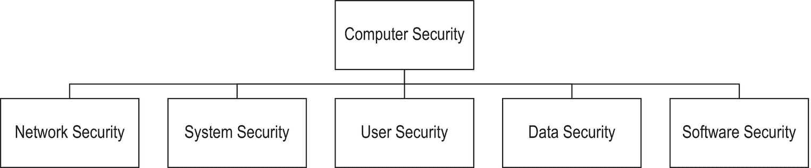

图 1.2 计算机安全分类。

1. **网络安全**：它是计算机科学的前沿领域之一，其专业方向涉及计算机网络及其基础设施设置的安全。网络管理员或系统管理员是两个关键职位的人。他们负责实施安全策略、分配硬件和软件形式所需的资源，并建立保护网络资源免受未经授权访问的机制以及为经过验证的用户提供足够的服务。网络安全系统通常依赖于层级安全并包含多个组件，包括网络监控、安全软件以及硬件和设备。所有组件共同工作以增强计算机网络的整体安全性。

2. **系统安全**：（操作系统）负责控制包含敏感数据的系统资源的访问。因此，系统必须对此类数据提供某种程度的保护，并控制管理这些保护的系统部分的访问。系统安全涉及这些安排的所有方面。

3. **用户安全**：用户安全指的是站点策略组件和用户策略如何配置用户环境，为他们的程序和数据提供安全。

4. **数据安全**：这项研究负责通过任何手段（无论是意外还是故意）进行数据保护。正在使用各种机制，通过物理安全、管理控制和逻辑控制来保护我们的数据，或限制未经授权的修改、破坏或披露的访问。

5. **软件安全**：此行动将探索保护软件免受恶意攻击的想法。它将在通过各种软件漏洞和利用这些漏洞的攻击开发的潜在风险下继续正常运行，包括缓冲区溢出、SQL 注入、会话劫持等。这是一项开发和实施软件的倡议，为软件管理的数据和资源提供适当的保护环境。

## 1.3.4 安全神话

自然，在软件安全这样一个错综复杂且模糊的领域，神话会泛滥。过去几年，人们讨论了关于软件安全及其在软件应用程序中的适用性、用法和特征的各种神话。其中少数被识别并讨论，并展示了事实。

### 1.3.4.1 安全神话：1

#### 1.3.4.1.1 无需担心安全；我已经付出了足够的背诵来控制它

安全越充足越好。但并不意味着你是安全的。没有人可以破坏用户的敏感、关键和机密信息。在任何方面都不可能获得 100%的安全。你必须在人类行为的语言学接受度和技术接受度之间的带宽上付出代价。

**事实**：不同安全专家的意见完全不同；安全越高越好。安全专家、多本书作者（包括最新的《*谎言者与离群值》）布鲁斯·施耐德（Bruce Schneider）解释了为什么经常被讨论的安全概念（即“永远不够”）是无关的。施耐德解释说，更多的安全并不一定更好。你可以获得最大，但要付出特定的代价。有时额外的安全成本超过其价值。独裁式软件开发包含了最优安全与有限成本和资源之间的权衡。

### 1.3.4.2 安全神话：2

#### 1.3.4.2.1 好消息！我安装了防病毒软件，我现在免受病毒侵害了

计算机用户的一个共同观点是，安装防病毒软件会让他们免受病毒侵害。如今，部署解决方案来保护我们的机密和关键信息是强制性的。防病毒软件在这个保护领域起着至关重要的作用，但有一个限制。在计算机上安装防病毒软件就像为特定疾病接种疫苗。

**事实**：注意！在没有适当更新的情况下安装防病毒软件就像服用疾病的过期药。建议注意，如果受到信任的内部人员滥用，防病毒软件将毫无帮助。为了维护计算机的纯洁，你必须及时更新防病毒软件并定期扫描系统以删除不可靠的附件。

### 1.3.4.3 安全神话：3

#### 1.3.4.3.1 安装软件补丁将修复所有安全漏洞

软件行业有许多观点认为在软件开发后部署安全补丁以修复安全问题。软件补丁是处理安全问题的一步，但这并不是一种完整且强制的方法论。

**事实**：在补丁可用时立即安装它们总是一个好计划；然而，补丁产生的问题可能与它们解决的问题一样多。为了发挥最大的效力，补丁需要与通良好习惯和安全计算相结合。

### 1.3.4.4 安全神话：4

#### 1.3.4.4.1 软件安全始终是一个加密问题

默认情况下，软件开发者理解安全是一种属性或功能，而在开发者眼中，加密是最常见的安全手段。这种想法是，你可以慷慨地给你的计划撒上魔法加密仙子，它就是安全的。

**事实**：首先，安全被定义为系统属性，而不是在添加一个或多个功能后就会变得安全的某种。其次，加密很难精确。不仅数学上很复杂，功能性加密也具有巨大的歧义结果，容易引起误解。加密可以用于通过各种替换访问标准安全功能，包括身份管理、强健的身份验证和符合支付卡行业（PCI）的标准。

### 1.3.4.5 安全神话：5

#### 1.3.4.5.1 软件安全是发现代码行中 Bug 的工具

每个 Bug 对软件安全都至关重要。实现层面的一半安全问题归因于 Bug。

**事实**：一半的 Bug 在实现层面识别出来，这是事实。另一半在设计层面加载了不同类型的错误。你不仅必须修复这些 Bug，而且要教育你的开发者，让他们了解前十大设计缺陷以及避免这些缺陷的前备知识。

### 1.3.4.6 安全神话：6

#### 1.3.4.6.1 仅保护高风险软件应用程序

开发高风险应用程序的组织需要完全关注，以避免在开发期间出现漏洞。


**事实**：另一个极其盛行的安全迷信，需要立即采取行动以予以打破。仅对优先事项或高风险项目进行风险分析将无得其法。即使对其他项目采用相同的策略，其投入程度也绝不会为零。需要提供一种替代机制，以降低低风险项目的成本分析比例。

### 1.3.4.7 安全迷信： 7

#### 1.3.4.7.1 我们没有软件安全问题

IBM 在 2014 年发布的《网络安全情报指数》中有一份报告指出，95% 的安全漏洞都是由人为错误造成的。因此迫切需要培训员工，让他们了解处理安全合规时所扮演的角色，以及不合规的后果。

**事实**：这种迷信或错误印象足以导致任何机构的覆灭。目前拥有此类借口的组织，要么是还没有按照国际应用程序开发合规标准进行 Web 应用开发，要么其应用程序尚未面临过任何攻击。这种疏忽将导致客户的信任和信心遭受不可弥补的损害。

## 1.3.5 安全规划

主要的安全关注点包括开发者群体缺乏意识、敏感性、教育、培训和关注；日益增长的威胁、多样性、复杂性、快速增加的代码量、开放性和连接性。忽视所有这些所谓的固执态度，根源在于对安全性本身的自满。安全仍然被视为一种开发后的活动，并且只有在吃过亏或面临严重的损害风险后才成为事后考量。尽管这种态度看起来代价不起，但至少从现在起，为了更安全的未来，我们需要与大量的遗留软件共存。我们只能尽一切所可行的方法，例如以零散的方式进行打补丁。

软件安全保障（SSA）可以被认为是确保软件在设计和开发过程中能够在预期的安全水平上方便运行的过程。它必须持续执行，以防止因资产、控制和保护的“丢失、不准确、篡改、不可用或误用”而导致任何潜在危害。此外，实施系统流程以在软件中建立安全弹性至关重要，主要是作为一种产品，并尽可能在生命周期的后期消除威胁。有必要通过保护保密性、完整性和可用性这三个核心属性，来防止蓄意的破坏或强制故障。

似乎需要一种范式的转移！更好的流程可以带来更好的产品。软件的开发必须针对高潜在的恶意环境，而不是易于安全的环境。安全不能是事后考量——除非是因为不可行性但需要逆向工程。通过采用“仅限预防”的策略作为主要方法，可以通过高度形式化的安全敏感软件开发生命周期（SDLC）阶段来确保安全。实践中需要建立标准。并且，通过对安全功能型、CIA 敏感型和形式化建模需求的主动实践，可以设计出高免疫的“软件组件”，无论其关键性、用途和范围如何 [21, 22 和 23]。 

## 1.4 软件安全保障

软件安全保障是一种辅助设计并实现工具以保护该软件设计的信息和资源的实践。软件本身就是一种资源，因此应该给予适当的安全保护。获得理性保障的基础是，软件将持续展示所有确保运行中的软件的全部属性，尽管发生了受赞助（蓄意的）缺陷，软件仍能保持功能一致性。保护这些文档最敏感的属性包括质量、可靠性、易用性、互操作性、安全性和容性。显然，这种软件需要抵御大多数攻击，并抵御它无法承受的大多数攻击。它需要在无法承受的攻击发生后，尽快识别损坏并恢复正常运行，或者保持耐心。安全保障是一种软件特性，被称为软件安全保障（或简称软件保障）。SSA 行动主要分为两种类型：

* 确保系统处理的信息具有适当的敏感性类别，并根据系统的预期规范开发安全需求。
* 另一个重点必须是用于软件维护和管理的工具、数据以及安全软件。

一些最易理解的关键趋势性安全元素，首先包括安全开发、漏洞修复、披露实践，以及独立的安全验证和确认。这些之外的 SSA 倡议基于几种次要手段：威胁建模、组件重构、密码学、漏洞/弱点数据库和枚举、静态/动态分析器、沙箱、质量控制策略等。然而，所有这些手段既没有达到目的，在有效性和效率方面也无法兼顾 [1, 2, 13, 21, 23]。

## 1.5 软件安全模型

一种简单的软件安全方法要求将安全视为软件质量的附加特性。问题在于，传统的质量保证设计用于根据规范验证一组功能。然而，软件安全比实现良好的安全功能需要更多的严谨。现实是，针对已有的质量问题实现高质量结果的特定程序，并不保证在安全问题上获得良好结果。最终的安全不是高质量的衍生品；它需要对安全改进投入更高的关注。软件安全评估技术帮助从事安全领域的软件专业人士和人员评估他们的策略和程序，并提供一个流程来相对于可访问策略建立其安全计划的现状，并实现改进目标。

为了安全改进所采取的倡议以及改进优化的资源配置，各种安全研究是可用的，包括《构建安全成熟度模型：显著的 BSIMM》。BSIMM 开发者团队负责处理已获得的安全倡议，并为想要开发自己软件安全倡议的其他人员提供支持。如果软件安全的业务目标包含知情的风险管理评估——即为所有参与软件安全的人明确什么是“要完成的准确包含内容”、通过标准可重复流程降低成本以及提高代码质量，那么 BSIMM 是适的 [5, 6 和 7]。


Bharat B. Madan 致力于软件系统安全属性的建模与测量。`Semi-markov model` 被开发用于如 `SITAR system` 等具有抗入侵能力的系统，以便对安全属性进行建模和测量。该模型用于确定导致计算系统可用性的稳态概率。这允许使用多种入侵防御策略来保护抗入侵能力，并产生诸如隐私、泄露、数据完整性和拒绝服务攻击等多种效果。所提的研究评估了由于违反各种安全功能导致安全泄露的可能性 [12]。

Michael Yanguo Liu 分享了一种用于衡量面向服务的软件系统安全架构的开创性思想。在他的中，Liu 基于标准的面向服务的软件模型识别了内部安全属性和某些特征。此外，还提出了一种用于对后续安全指标进行分类和正式评估的结构。Liu 开发了一种名为 `System Interaction Impact Model (USIE)` 的测量抽象范式，该模型用于发现和分析与面向服务的软件架构相关的安全问题 [25]。

David Gilliam 等人提供了一种识别应用程序中软件弱点的全面机制。将基于模型的方法与基于时间逻辑特征的特征测试相结合，可以在整个生命周期的阶段提供可靠的验证。Anders Bond 提出了另一项关于安全测量的研究，而 Niels Paulson 则讨论了衡量分布式信息系统中组件安全性的框架。该框架揭示了组件安全的目的、优势和缺点。所提的研究提出了一种方法，将影响安全组件的各种特征（如它们运行的环境）与特定功能相结合 [26]。

## 1.6 软件安全测量与指标

对于软件安全的测量，正在使用安全指标进行量化。软件指标是量化在软件产品开发过程中所开发的软件的若干属性的一项努力。它为检查特定条目的安全控制状态提供了一种改进的程序。估计技术与安全参数以及安全系统中所有一致组件直接相关。确保安全的必要手段是资产安全、运行稳定以及对民用安全的支持。战略型公司和以结果为导向的方案以开发更安全的软件并减少威胁和漏洞而闻名。20 世纪 90 年代后期，一门独立于计算机网络安全的学科——软件安全开始兴起。研究人员开始更加关注学习战术编程技能，并研究程序员可能贡献或无意中破坏计算机系统安全性的行为。什么类型的漏洞和缺陷会导致安全问题？我们如何有系统地识别问题？[28 和 29]

对技术保护信息资源免受恶意风险或损害的最终依赖增加了责任水平。软件安全评估不力导致了软件安全行业的经济失败和声誉损害。安全现在已成为软件行业的最前沿。安全监控和改进是软件安全工程中的关键问题。安全测量和嫁接策略的重新分析将使程序的优缺点变得更容易，并为风险、成本和效益分析提供来源。此类工作作为一个整体，对知识领域有直接贡献，可能对以下方面直接或间接地至关重要：

* 开发角色和职责的统一理解，消除企业级软件安全目标和愿景的缺陷。
* 设计和开发特定的指南，消除开发者智力中的猜测，并解决安全分析师之间的一致性。
* 建立通用的风险框架，作为政府努力的一部分，以便在项目管理或投资组合层面一致地计算风险影响。
* 安全目标目标逻辑表明，声明的目标对于所有假设、威胁和组织策略都是可感知的。
* 它可能有助于估计软件安全并提供软件项目的成本估算，这有助于评估和规划新活动。
* 它可能有助于决定各种软件开发技术的效果，特别是通过对包括内部质量、可维护性在内的若干固有质量进行量化评估，对复用技术进行影响分析。
* 安全目标逻辑揭示了产品或环境的需求必须是可追踪的。

由于其抽象性，测量具有挑战性。有不同的方法可以衡量这些抽象概念并创建现实指标。它可以作为设计过程中不可或缺的一部分，支持开发者改进产品。根据预定义的条件，可能非常需要识别组件安全的积极和负面因素。对这些识别出的组件进行影响分析将使识别程序的优缺点变得更加容易。另一个大挑战是使用此类措施来改进安全设计。为了实现这一目的，我们非常需要基于软件开发阶段的各种指标 [23 和 27]。

## 1.7 结论

软件面临的严峻威胁比以往任何时候都严重！如果是这样，原因是什么？Gary McGraw 的仔细考虑引起了对“无处不在”、“输入统一”等术语的关注。无疑，当前时代正成为软件密集型系统。在计算和通信的主导下，技术正在快速融合。软件不可避免地集成或嵌入以满足不断扩张的功能需求。这种情况使得“可靠软件组件”的演进成为一个非常有根据的基础，以革命而非进化的方式重新审视软件安全。

## 术语

软件、安全、软件安全、软件安全特性、安全组件、安全类型、软件安全保障、软件安全模型、软件安全测量与指标、安全神话

## 要点回顾

1. 在早期阶段对安全进行量化提供了依据。量化安全有助于解决安全目标与成本之间的权衡。研究人员和从业人员强烈假设定性分析的结果不再可用，且在软件开发后期进行的更改比早期进行的更改更昂贵。
2. 软件安全评估被认为是改进软件安全的重要组成部分。3. 软件安全评估对于开发和实施安全产品，减少恶意客户或用户暴露安全漏洞的可能性。4. 引入安全的终极目标是验证强度并防止漏洞进入程序。


7. 它已发展成为确保软件安全性和可靠性的关键方法。

## 选择题

1. 安全是一个 \_\_\_\_\_\_\_\_\_\_\_\_\_\_\_\_\_\_\_\_\_\_\_\_\_\_\_\_\_\_\_\_\_\_\_\_\_\_\_\_\_\_\_\_\_\_\_\_\_。
2. 安全估计是 \_\_\_\_\_\_\_\_\_\_\_\_\_\_\_\_\_\_\_\_\_\_\_\_\_\_\_ 的不可组成部分。
3. \_\_\_\_\_\_\_\_\_\_\_\_\_\_\_ 包含了原则、指南、规则、漏洞、利用、攻击模式和历史风险评估。
4. \_\_\_\_\_\_\_\_\_\_\_\_\_\_ 负责通过任何手段（无论意外还是故意）进行数据保护。
5. \_\_\_\_\_\_\_\_\_\_\_ 将探索保护软件免受恶意攻击的想法。
6. 安全估计是 \_\_\_\_\_\_\_\_\_\_ 过程中的重要组成部分。
    1. 风险估计
    2. 软件开发
    3. 软件设计
    4. SRS 设计
7. 安全相关故障是：
    1. 随机的
    2. 故意的
    3. 两者皆是
    4. 无
8. 连接到广域网的系统中防火墙用于：
    1. 避免火在网络中传播
    2. 阻止黑客未经授权的访问
    3. 扫描各种文件中的病毒
    4. 火通过电缆网络传播
9. 信息系统设计中的安全用于：
    1. 检查系统以确保其按给定的规范构建
    2. 防止数据和程序遭受意外或故意损失
    3. 确保系统处理数据以及结果的可靠性
    4. 确保隐私保护
10. 我们所说的信息系统测试，是指：
    1. 正确地测试信息系统
    2. 根据规范确定系统性能
    3. 确定系统运行状态最优
    4. 确保系统的正常运行

## 简答题

1. 什么是软件安全？为什么在开发阶段的任何阶段都不可能忽略安全？
2. 软件测量在软件开发过程中起什么作用？
3. 描述安全早期估计对安全开发过程重要性。
4. 列出各种安全组件。
5. 写出本章未列出的事实的五个安全误区（Security Myths）。
6. 从风险角度描述软件安全的概念。
7. 简述不同的安全特性并给出合适的示例。
8. 软件安全保障（Software Security Assurance）是安全软件过程的关键术语。请用适当的活动证明这一点。
9. 软件安全指标在测量中起什么作用？请列出至少五个用于此目的的安全指标。
10. 安全模型如何工作为特定领域的研究建立理论背景？请谈谈你的见解。

## 论述题

1. 在软件开发初期是不可能忽略安全的。提供相关的研究文章并结合你自己的观点证明你的答案。
2. 研究软件安全的文献并写一篇关于软件安全估计的论文。务必包含案例研究。
3. 回顾有关软件安全属性的文献。带有合理的理由收集不同的安全属性。
4. 对软件安全估计模型进行一项比较研究。
5. 写一篇关于“软件安全评估”的研究综述论文。如何弥合学术与工业界问题之间的差距？
6. 我们如何衡量安全？提出一种可以用于衡量软件安全性的安全指标。
7. 对不同软件开发阶段的现有安全估计框架写一篇批判性综述。
8. 描述安全评估过程，并讨论评估结果如何支持组织内的倡议？
9. 为什么我们强调安全开发是一种集成方法？这个核心理念的好处是什么？
10. 软件安全保障规划所涵盖的安全的预期用途是什么？

## 参考文献

1. R. Lehtinen, 《计算机安全基础》。O’Reilly Publication, 2006 年 6 月, ISBN: 13-978-0-59-600669-3.
2. M. Bishop, 《计算机安全：艺术与科学》。 Addison Wesley, 2002, ISBN: 0-201-44099-7.
3. [在线], 获取地址：`http://www.msnbc.msn.com/id/38790670/ns/technology_and_science-Security/?gt1=43001` (2020 年 12 月 20 日访问)。
4. I. Mkpong-Ruffin, “软件开发设计阶段软件安全的定量风险评估模型”，提交给亚拉巴马州奥伯恩大学研究生学院的博士学位论文，2009 年 5 月 09 日。
5. G. McGraw, 《软件安全：构建安全》。 Addison Wesley, 2006, ISBN: 978-0-321-35670-3.
6. G. McGraw, “从零开始：DIMACS 安全研讨会”，IEEE Security & Privacy, 第 1 卷, 2003 年 3 月–4 月, 第 59-66 页。
7. G. McGraw, 《安全》，IEEE Security & Privacy, 2004。
8. C. J. Berg, 《高保障设计》，Addison Wesley, 2005。
9. J. Viega, 《安全误区：计算机行业不想知道的事实》。Wiley Media, 2009.
10. S. Lawrence Allen, S. Bam and N. Mead, 《安全工程：项目指南》。Addison Wesley, 2008, ISBN: 978-1-60551-2.
11. G. McGraw, 《构建安全软件》，2005。
12. B. B. Madan, K. Vaidathan and S. Trivedi, “系统安全性的建模与量化”，国际可靠系统与网络会议 (DSN), 2002, 第 505-514 页。
13. G. H. Walton, T. A. Long and R. Linger, “安全属性计算基础”，技术报告 CMU/SEI-TR-021, 2006。
14. A. Ben, R. Abercrombie and A. Mill, “安全威胁及其影响”，CSIIRW, 2009.
15. S. Pfeger and R. Cunningham, “为什么衡量安全很难”，IEEE Computer and Reliability, 2010, 第 8 卷, 第 46-54 页。
16. G. Booch, 《面向对象的分析与设计》。Pearson Education, 2007。
17. M. K. Reiter and S. G. Stubblebine, “身份验证的可接受指标”，Murray Hill, NJ: AT & T Labs, 研究, 1997, 第 10-20 页。
18. K. Renaud, “Web 身份验证质量的量化：易用性视角”，Journal of Web Engineering, 2003, 第 3 卷, 第 94-123 页。
19. C. Mallow, “身份验证方法与技术”，giac.org/cissp-papers/2.pdf
20. M. Jakobsson, L. Yang and S. Wetzel, “基于性能的身份验证安全性量化”，ACM, 2008, 第 61-69 页。
21. L. Gong, “增加身份验证服务的可用性和安全性”，IEEE Journal on Selected Areas in Communication, 第 11 卷(5), 1993 年 6 月, 第 657-662 页。


22. 微软认证, 可访问：[`msdn.microsoft.com/en-us/library/ee817656.aspx`](http://msdn.microsoft.com/en-us/library/ee817656.aspx) (访问于 2020 年 7 月 18 日)。
23. 授权, 可访问：[`en.wikipedia.org/wiki/Authorization`](http://en.wikipedia.org/wiki/Authorization) (访问于 2021 年 10 月 21 日)。
24. C. Wang and W. A. Wulf, “走向安全测量框架”，*国家信息系统安全会议论文集*，巴尔的摩，1997 年 10 月 7 日至 10 日，第 522–533 页。
25. M. Yanguo Liu, “面向服务的软件架构的定量安全分析”，博士论文，维多利亚大学电子与计算机工程系，20088 年。
26. D. P. Gilliam, T. L. Wolfe, J. S. Sherif and M. Bishop, “软件生命周期软件安全检查表”，*第 12 届 IEEE 国际启用技术研讨会：协作企业基础设施 (WETICE’03) 论文集*，1080-1383/03, IEEE, 2003 年。
27. I. Flechais, M. Sasse and S. M. V. Hailes, “将安全带回家：一种安全且易用系统的开发方法”，*NSPW’03*，ACM，2003 年 8 月，第 18–21 页。
28. D. Verdon and G. McGraw, “软件设计中的风险分析”，*IEEE 安全与隐私*，1540-7793/04，2004 年，第 32–37 页。
29. Y. Deng, J. Wang and J. P. Tsai, “软件安全系统架构的形式化分析”，IEEE，2001 年，第 426–434 页。doi: [10.1109/ISADS.2001.917448](http://dx.doi.org/10.1109/ISADS.2001.917448)。

## 有用链接

* [`msdn.microsoft.com/en-us/library/ee817656.aspx`](http://msdn.microsoft.com/en-us/library/ee817656.aspx)
* [`en.wikipedia.org/wiki/Authorization`](http://en.wikipedia.org/wiki/Authorization)
* [`techbeacon.com/security/secure-development-lifecycle-essential-guide-safe-software-pipelines`](https://techbeacon.com)
* [`www.microsoft.com/en-us/securityengineering/sdl`](https://www.microsoft.com)
* [`www.synopsys.com/blogs/software-security/secure-sdlc/`](https://www.synopsys.com)
* [`www.sei.cmu.edu/about/divisions/cert/index.cfm`](https://www.sei.cmu.edu)

# 2 软件安全问题

DOI: [10.1201/9781003330516-2](https://dx.doi.org/10.1201/9781003330516-2)

> 冲突性质的改变需要一种新方法。
> 位于博客

互联网的快速增长以及信息技术的整合已得到全球范围的认可 [1]。软件是任何计算机系统的关键组件。计算机安全泄露的主要原因源于以非逻辑方式开发的意之外行为领域。《华尔街日报》发布的信息指出，“云端因配置不当导致的数据丢失比任何时候都多” [2 和 3]。计算机安全咨询公司 Bishop Fox 的合伙人 Vincent Liu 提到用户设置允许访问的配置错误，这与其在云端信息的可见性有关 [4, 5 和 6]。这些缺陷可以被恶意入侵者轻易利用。这是通过针对缺陷和漏洞导致安全成功快速增长的突破的方式之一。

从关于软件及其安全的文献中可以看出，有两个方面始终协同工作：一个是构建具有受控操作能力的安全软件，另一个是为已部署的应用程序管理软件风险，如图 2.1 所示 [7, 8]。这两个现象虽然听起来相似，但有很大不同，其区别在于一个是提供开发阶段的机会，另一个是为已部署的应用提供风险管理，如安全工程理念所示 [10, 11 和 12]。软件缺陷导致重大安全问题的情况是显而易见的。


图 2.1 软件组件

确保安全的最佳方法是在开发期间控制威胁 [13, 14, 15 和 16]。黑客或入侵者通过在用户系统中安装不同类型的恶意软件来利用这些漏洞。软件不安全性的来源有很多种，包括：

* 特是连接的软件具有更大的不安全性来源
* 开发团队的错误假设
* 第三方提供的软件组件


软件是一个领域，它包含了更广泛的领域和能更有效地影响其安全的因素。若干内部因素会影响软件安全并导致漏洞。此外，以同样的顺序，软件设计是软件安全中的一个关键功能 [29, 30 和 31]。安全的软件设计可以提供最高水平的软件安全性。影响软件安全的内部原因是那些将基于设计的质量和属性与软件代码或功能中的缺陷相关联的因素，例如错误代码行、错误的 API 调用定义、各种角色的访问管理问题以及许多其他类似问题。所有这些都是通过其内部功能能有效影响软件安全的属性。

这种影响导致了软件对这些因素的依赖性。因此，这些因素的细微变化或缺陷都可能导致软件陷入可被利用的境地 [32, 33, 34 和 35]。在软件开发过程中，需要更多关注各种内部因素，以获得更好的安全性并减少数据泄露。可用性、完整性、机密性、持久性、可扩展性、兼容性等许多设计问题在软件开发阶段需要更多关注 [36, 37 和 38]。许多研究人员正专注于这些因素，并根据它们对软件安全的有效性对这些属性进行分类。

此外，软件内部存在缺陷始终是极其有害的，因为缓解它们需要复杂的修复过程和时间。此外，为了更清楚地理解这个概念，让我们来看一个例子——有一个银行软件，该软件的访问管理允许收银员访问与贷款批准相关的文档，这些是银行的机密财产 [39, 40 和 41]。收银员需要获取与客户 A 相关的财务文档信息，那么收银员将更容易提取信息并在没有适当授权的情况下将其用于为自己牟利。这种这种情况无疑为银行造成了数据泄露局面。

根据安全专家导师 Gary McGraw 的说法，软件的预留功能在恶意攻击下表现正常属于软件安全领域，该领域是软件工程的一个子集 [42, 43, 44 和 45]。安全专家正在讨论三个主要组件，它们以整体的形式直接负责破坏导致预期结果的逻辑现象。这三个影响趋势对软件的增长、评估及其开发过程具有巨大影响。研究表明，随着这些因素在应用开发过程中兴起，恶意代码的可用性变得日益显著。这三位一体的问题如下：

* 连接性
* 可扩展性
* 复杂性

## 2.2.1 连接性

在互联网时代，计算机系统以快速的方式相互连接，以满足它们的日常需求，如银行业、阅读、销售和购买、游戏以及在社交媒体上与朋友联系。这是负责通过互联网连接增加节点数量的方式之一，更多的连接可能导致更易产生错误的环境 [46 and 47]。这是黑客或入侵者发现连接介质中应用程序弱点或漏洞以攻破信息的正确位置。随着连接性的增加，由于应用程序、通道、媒体以及信息或资源共享等匿名原因，攻击向量存在增加的可能性。

随着连接性的增加，由于匿名原因（如应用程序、通道、媒体和信息或资源共享），攻击向量存在增加的可能性。这种观点是由于由于系统之间的连接不受限制，用户和服务器端面临更大的风险。互联网有助于个人连接 PC 并访问敏感信息。连接性是与软件结构直接相关的某些东西。连接性是赋予软件运行能力的属性。通过软件连接属性，应用程序连接到主机，用户执行各种操作，如数据提取、存储、处理等。软件连接问题为软件用户和所有者造成了可怕的局面 [48 and 49]。大多数连接问题与网络安全问题有关，这为各种利用情况创造了门径。脆弱的网络安全产生了软件连接问题，此外，这种情况为攻击者执行利用和攻击并窃取或篡改软件价值数据创造了机会。此外，连接问题导致了软件的数据可用性问题。数据可用性是软件的基本功能，确保授权用户在需要可以使用。总而言之，我们可以说连接性在某种程度上取决于软件安全性，软件连接的缺陷可能导致应用程序遭受严重的网络攻击。

每家企业都将自动化以应对业务竞争和快速服务。这是现在的需求，但这些类型的需求会产生更多错误的结果 [50]。

### 2.2.2 可扩展性


可扩展性

另一个对安全产生负面影响并导致安全问题的另一个原因是可扩展性。可扩展性可以解释为考虑到未来增长，对某些实现进行自我扩展的能力。如果我们为现有应用程序添加新功能或对现有功能进行任何进一步修改，它就具有可扩展性。由于兼容性问题，现有应用程序并不强制要求能够接受根据近期使用情况发起的更新或扩展。处理此类问题的一种方法是推广这类应用程序，通过动态可加载设备驱动程序和模块提供更简单的方法来维护扩展性。最好的例子体现在网络浏览器中，它们通过脚本和 Applet 等提供邮件客户端、文字处理器和其他不同应用程序的服务支持。

可扩展性是一种软件功能，赋予软件扩展其属性和用途的能力，它还能帮助软件衡量为了适应未来而扩展其功能需要投入多少精力和成本。可扩展的软件是指其内部结构和信息访问控制不受最新或更改功能的影响（或几乎不受影响）。例如，当创建者或开发者更改软件行为时，重新编译或更改原始源代码可能是徒劳的。软件是一个始终随着未来发展可能性而不断发展的的产品。可扩展性是指这种软件质量的步骤或能力，但另一方面，它也会导致软件出现一些被利用的可能性以及软件安全的原因。开发是一个并非 100% 准确的过程，情况每秒都在演变和变化，这导致了软件扩展性的不频繁。不可扩展的软件是软件行业无法接受的。

有时系统并没有充分考虑到可扩展性方法，在部署后，弥补遗留系统与当前场景下改进功能之间的差距变成了一项技术挑战。有很多理由可以解释为什么软件专业人员对应对可扩展设计和实现不感兴趣。其原因如下：

* 它增加了软件的复杂性。
* 由于复杂性增加，给开发、测试和部署带来了困难。
* 由于复杂性提高，可扩展部分需要额外的关注，实施将花费额外时间，这会更加耗时且不符合成本效益。
* 可扩展系统的另一个大挑战是，需要更多时间来理解系统扩展性的方法，这在后期阶段的实施和未来扩展中是必要的。
* 有时，它会降低系统性能。

## 可扩展机制的分类

瑞士洛桑尼联邦理工学院（EPFL）的研究员 Matthias Zenger 在 2004 年其题为《可扩展软件组件的编程语言抽象》的工作中定义了可扩展机制的分类。该工作揭示了三种不同的可扩展形式。其类型和定义采用自研究文章如下：

* 白盒扩展性
* 灰盒扩展性
* 黑盒扩展性

## 白盒扩展性

存在一种主要的、灵活且限制最少的扩展形式，它负责通过修改或添加源代码来扩展软件系统。它被称为白盒扩展性。

### 开箱扩展性

另一种在本质上具有侵入性并直接黑入（修改）原始源代码的可扩展形式被称为开箱扩展性。

### 玻璃盒扩展性

第三种可扩展形式被称为玻璃盒扩展性。它允许从真实系统开始对单独的扩展部分进行修改，且这种方式不会影响原始系统。源代码以原始形式可见，但不能被修改。如果你想扩展，可以查看并进一步修改与原始版本分离的扩展版本，而不影响原始版本。

## 灰盒扩展性

在这种情况下，程序员根据进一步抽象的文档获得扩展系统专门化接口的选项。该接口注册了所有可改进的抽象，并指示了扩展与父系统之间的关系。

## 黑盒扩展性

黑盒扩展性指的是一种行为，即当无法获取系统架构和执行的内部事实时，软件系统可以是无处的。

黑盒可扩展系统仅通过其接口规范进行安排和完成。

## 复杂性

现代信息系统的快速增长导致了名为复杂性的主要安全原因。这种复杂性由于体积的不受控膨和巨大的存储容量而出现在软件中。Windows XP 本身包含至少 4000 万行代码，由于规模巨大，复杂性会自动形成。由于代码行数增加带来的复杂性，追踪应用程序中的缺陷并不容易。有很多原因，包括网络连接的增加、代码的复杂性、攻击的复杂性以及对良好性质的访问，这在很大程度上转变为避免漏洞是一项困难任务的系统。这种复杂性导致了灾难性且日益增加的安全漏洞，这会对大多数软件开发组织造成了严重损害。复杂性并非理解事情的唯一因素，但适当的复杂性会让欣赏一切变得复杂。复杂性不应超过确保的限制。软件安全需要为了软件的发展成为强制性关注点，但应用程序或系统的复杂性绝不应超过财务可行性、用户友好性的标准接受水平，否则产品的整体市场价值可能会丢失。因此，具有负面影响的复杂性可以被认为是主要的安全因素之一。其影响和后果如图 2.2 所示。

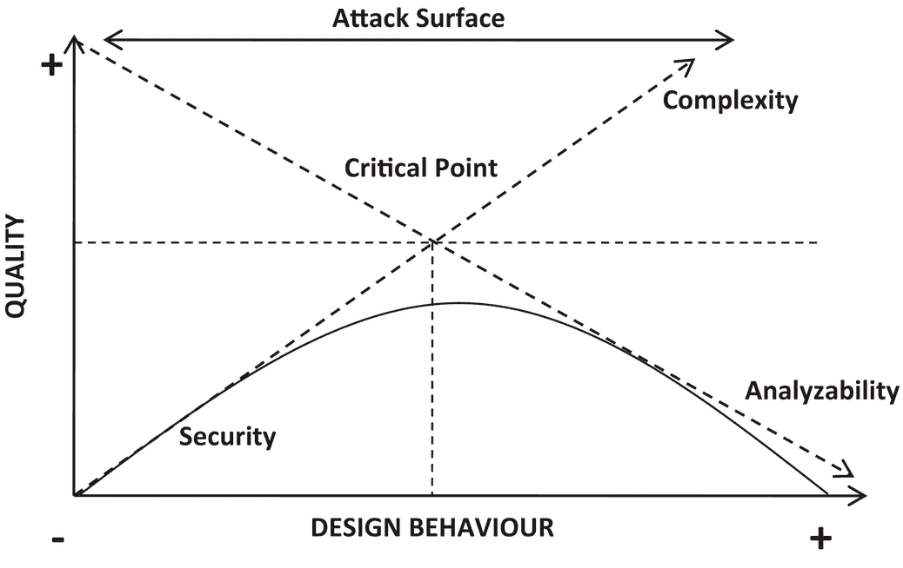


复杂度是一个涵盖了程序众多属性的术语，所有这些属性都会影响内部的协作。在软件中，随着元素数量的增加，它们之间的协作数量将呈指数级增长，并达到一个难以感知和看到每一个协作的程度。这在软件设计中造成了复杂度。这种复杂度为新开发者理解软件功能和工作流带来了模糊性。复杂度问题会导致各种安全威胁，如数据处理错误、互操作性相关问题等。软件安全受到软件复杂性的影响，同时也继承了软件的功能。软件结构的多方面性质使得如果不利用复杂性测量和衡量措施，就很难进行全面调查。复杂度分析对软件开发来说是一个长远有益的过程，它可以为软件带来理想的改进，例如代码质量提升、维护成本降低、兼容性问题减少以及许多其他基于功能的益处。此外，可以说，复杂的软件对于所有者和用户来说都是头疼的问题。行业需要压缩复杂度并增加软件的实用性。

复杂性的本质总结为所有复杂系统中频繁出现的五个特征。一直到最低的基础组件级，复杂系统由构成复杂层级的子系统组织。对复杂系统中史前组件本质的发现、系统中包含哪些组件的选择等，具有较强的主观性，从根本上取决于系统管理者的结论。组件内部的关联通常比组件间的链接更强。这种信息会导致组件高频动态的脱离。它涉及到组件的内部组织，以及连接组件间交互的低频动态。许多复杂系统是以简洁的表达方式实现的。这进一步规定了复杂系统具有共同模式。一个简单的功能性系统是从零开始设计复杂系统的基础，而且它绝不会独立存在并运行。简单系统是一个从流程开始的平台。随着系统的演化，被认为复杂的对象变成了原始对象，复杂系统基于这些原始对象构建的，而这些原始对象无法被妥善地设计。应该根据第一原则，然后根据系统的实际行为进行开发。

## 2.3 软件安全的持续性因素

可持续属性是指那些在软件运行期间增强并支持软件安全及其维护的属性。确保软件频繁且日常维护安全性和持续性是一项重大的工作。目前有一些方法和属性可以确保有效且持续的软件安全。软件安全持续性因素的概念尝试提供高度推荐软件开发者和维护人员使用的因素，以便在更高效、更时期内应用安全。为了更清楚、更容易地理解这一情景，我们将重要因素进行分类，并在后续标题中进行描述，以提供软件安全持续性因素的思路和概述。

黑客利用恶意代码，利用漏洞来破解应用程序软件或系统。随着软件通过最新的联网应用程序不断扩展，由于复杂性和普遍性的日益增加，最常见的软件风险无异于火上加油。可以通过在软件生命周期的早期集成软件安全最佳实践来提高安全性，通过理解关键和常见的威胁、进行安全设计，以及发布所有软件产物以进行全面的风险分析和测试。软件安全是一项带有安全属性的设计、开发和测试软件的行动方案，它能够分类并暴露软件本身的问题。在这种方向上，安全专业人员试图开发能够忍受持续攻击的软件。开发者可以对适用软件安全的最佳实践有清晰的理解，并对软件安全问题产生重大影响。虽然包括复杂度、连接性和扩展在内的三个问题继续对应用程序产生负面影响，但我们必须开始更准确地解决这些问题。软件安全的三位一体问题可能适用于风险管理、软件安全触点和知识。通过渐进和演化的方式正确应用这三个支柱，可以获得现实且具有成本效益的软件安全计划。

### 2.3.1 风险管理

风险管理是一项总结和定量分析组织及软件内部可能风险的行动方案，以实现更好的开发和策略制定。执行程序过程中持续存在的风险是处理编程安全任何方式的基本组成部分。编程安全风险包含了验证期间发现的旧缺陷风险、缺乏流程带来的风险以及与人员相关的风险。一个普遍风险是，执行层结构有助于检测编程安全。

风险广义结构是通向确保安全的基本思维方式。风险管理过程是一个与软件开发生命周期相关的步骤，并增强了软件开发过程中安全的重要性。对于这种描述背后的动机，请将风险视为一种处理迭代风险审查的方法，这种审查深度融入了整个产品改进生命周期。图 2.3

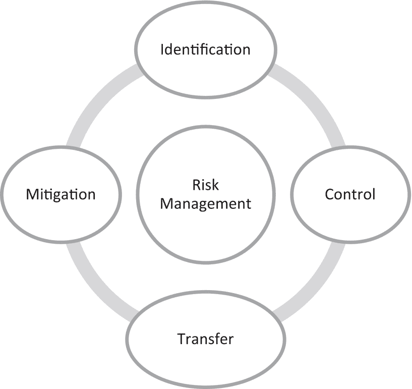

图 2.3 风险管理的要素

软件专家在提高安全性时报告了许多主要问题。专家和行业研究人员始终参与其中，为安全软件产品寻找正确的解决方案。风险是一个可以破坏定义技术的问题。风险管理不仅用于减少新威胁出现的概率，还通过程序交付提高性能。安全风险管理计划是一种理论安排，用于审查用于风险管理的安全程序开发。安全风险监控和管理是一个集成到安全设计中的相关过程，用于开发安全应用程序。风险管理技术支持整个软件开发过程中的风险管理活动。

通过执行风险管理并在并在发生前考虑不同的可能风险或事件，组织可以拨资金并确保未来。这是因为 CEO 的计划是一项严肃风险，允许组织制定一种方法来与预期威胁的边界保持战略距离。有效的风险管理过程包含风险识别、评估和缓解三个步骤。它是一个赋予 IT 管理员识别和修复可能的组织风险的能力的过程。


风险评估，管理层正担心调查针对框架攻击可能导致的潜在不幸，并对这些不幸与可能减少这些不幸的安全策略成本之间进行权衡。分层安全方法可以促进管理层进行风险管理。此外，组织中的风险管理过程包含图 2.4 所示的以下步骤：

*   `System Categorization`：此步骤包含硬件、软件、系统接口、信息和数据、人员等的分类。此外，该步骤提供了有关系统边界、系统功能、关键性以及信息和数据状况的信息。
*   `Threat Identification`：在此步骤中，检查人员识别组织先前的的网络攻击统计数据及其影响和资源，然后该步骤还通过各种工具检查组织的各种资产。在完成所有识别程序后，该步骤最后给出一个威胁声明。
*   `Vulnerability Identification`：此步骤将之前的审计报告、审计期间的意见、系统安全需求和测试结果关联。该步骤最后提供一份潜在漏洞列表。
*   `Control Analysis`：在此步骤中，检查人员分析组织当前的控制和访问管理配置，并审查计划的控制策略。此类分析提供了一份控制措施和计划控制措施列表，有助于风险管理。此分析提供了一份控制措施和计划控制措施列表，有助于管理风险。
*   `Likelihood Determination`：这是风险管理中一个重要且最关键的步骤。在此步骤中，检查人员评估识别出的威胁、漏洞和组织的控制策略，然后为后续步骤对其评分。
*   `Impact Analysis`：此步骤识别对组织资产产生影响的各种风险，如数据完整性、数据机密性、数据可用性等。影响分析负责由结果评估人员对组织不同领域的影响进行评分，涵盖了所有潜在的威胁、漏洞和控制策略。
*   `Risk Determination`：此步骤是一个里程碑，所有各种识别过程的发现都汇聚在一起，检查人员识别可能的概率风险，并针对组织中的每个识别出的风险做出缓解或忽略风险的决策。
*   `Control and Recommendation`：在此步骤中，检查人员根据安全视角，为组织推荐更有效、更具建设性的控制策略。
*   `Results Documentation`：这是风险管理过程的最后一步，该步骤为组织提供一份记录的风险管理过程报告，让组织对其安全和需求以及现状有理想的理解。

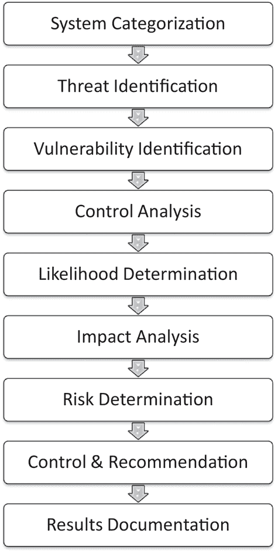

图 2.4 风险管理过程。

风险管理过程应用于整个开发过程，以区分和减轻风险。基于政策和方向的安全风险管理过程有不同的重点。风险管理对于软件开发人员和组织是一项重要且具有挑战性的任务，但有效的风险管理过程可以根据相关组织的风险评估报告为软件开发提供有效的安全策略。

### 2.3.2 交互点

可持续安全（Sustainable security）是一个用于描述软件潜在长期安全措施的术语，这些措施为软件提供了持久且兼容的安全措施和特征。可持续安全是一个用于描述软件潜在长期安全措施的术语，这些为软件提供了持久且兼容的安全措施和特征。

当这两个因素结合时，可持续安全因素如图 2.5 所示。

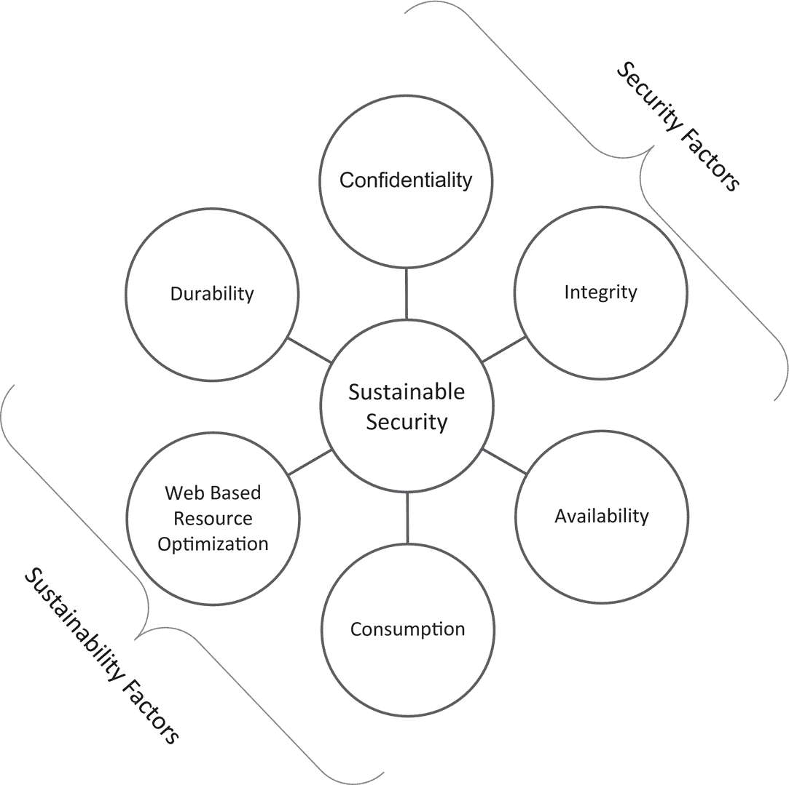

图 2.5 可持续安全因素。

此外，为了更有效地理解，参考图 2.3 中的示例。描述了三个安全因素（`机密性`、`完整性`和`可用性`）以及三个可持续因素（`消耗`、`资源优化`和`持久性`）。当开发人员关注这六个因素时，我们就可以说开发的软件是安全的。

此外，这种类型的描述和软件开发产生了高度持久的安全性，可以用于不同的情况。这种能力减少了软件在资源过低或过高时发生崩溃的概率。可持续安全开发非常重要且被高度推荐。软件的可持续安全开发是一种新而有效的方法，为软件提供了额外的安全能力。这种能力可以帮助组织和企业投入更少的资源获得相同的结果。

确保安全的最佳方法是在软件开发周期中通过适当的对齐，促进最有效的最佳实践或触点。这是安全专家将重要功能整合到软件中的合适方式。从开发开始就应该考虑安全设计，并在应用程序实施之前对安全功能进行测试和验证。通过建立一个遵循纪律流程（包括安全）的系统，可以准确地识别和管理成本。服务和维护成本可以减少，修复时间可以大大缩短。结论是，将安全整合到软件开发生命周期中，在降低成本和减少维护的安全开发方面提供了显著成果。

这种机制提供了对实现和架构层面的常见风险的理解，以修复漏洞和设计缺陷。安全触点的常见观察和大量覆盖如图 2.6 所示。

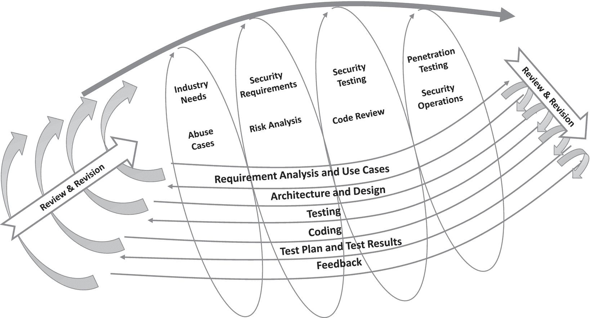

图 2.6 软件安全触点。

### 2.3.3 认知

由于缺乏经验的安全专业和从业人员，软件安全领域仍处于婴儿阶段。这对所有人来说都是一个极具挑战性的问题。现有的知识最佳实践和培训计划正作为一个平台，支持那些尚未极端层面解决问题的系统。这些处理措施的适当结合可以促进对软件系统设计和架构信息的深入理解，从而允许开发和维护过程的实现。这种软件将为安全实践奠定坚实的基础。


知识是事实的集合。在名为`Building Security In`的书中揭示了关于知识和信息的一种卓越理性说明。它解释了信息与知识之间的区别，两者并非同一物。知识是在工作上下文中使用流程和程序的信息。`C`和`C++`包含了针对潜在安全漏洞的检查清单通知。构建在静态分析工具中的类似信息就是知识。根据安全专家`Gary McGraw`的说法，软件安全知识被分为七类知识目录，包括：

*   原则
*   指南
*   规则
*   漏洞
*   利用程序
*   攻击模式
*   历史风险

此外，这些目录进一步被分为三个知识类别，如下并在图 2.7 中所示。

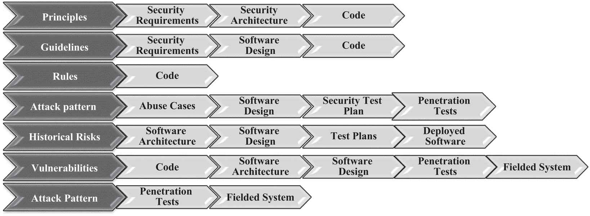

图 2.7 知识目录到各种软件工制品和软件安全最佳实践的映射

*   规范性知识
*   诊断性知识
*   历史性知识

它可以在应用开发生命周期的任何阶段实施。应用此类知识的最佳方法是根据他们的技能领域对其进行教育或培训。软件开发中的各种参与者，包括软件架构师、人员、测试人员和安全分析师，必须意识到关键软件安全问题。对知识的探索将帮助这些人员意识到安全漏洞的关键原因及其优化的合理解决方案。无论您获得的软件开发视角如何，这都是一种演进实践。

## 2.4 风险管理框架的演进

风险管理的演进强调了众多组织要素的重要性，这些要素影响了组织层面和个人信息系统层面信息安全风险管理的有效性。风险管理框架（`RMF`）是一系列原则，规定了美国政府 IT 系统必须如何进行设计、保护和监控。在各种子框架中，`NIST` 明确地描述了风险管理方法。`NIST` 是开发和培养用于安全开发的信息风险管理过程的主要构建模块。以下是一些建议：

*   最核心的一项标题为`NIST SP 800-37 Rev.1`的文档，它将 `RMF` 描述为为新的 IT 系统构建和工程化数据安全过程的 6 步流程，并建议每个联邦机构在启用新系统时遵循的最佳实践和程序。
*   贯穿系统开发生命周期的风险评估和风险缓解机制在由 `NIST SP 800-30` 发布的补充文档中描述，该文档标题为`开展风险评估指南`。
*   另一份由 `NIST SP 800-37` 发布的支持性文档，讨论了风险管理框架。
*   最后，`NIST SP 800-39` 在其名为`管理信息安全风险`的技术报告中规定了 `RMF` 合规性所需的层级、全组织范围的风险管理方法。
*   `NIST` 风险管理框架包含了全面的、灵活的、基于风险的方法，管理组织风险的步骤如下：`Prepare（准备）`、`Categorize（分类）`、`Select（选择）`、`Implement（实施）`、`Assess（评估）`、`Authorize（授权）`、`Monitor（监控）` [51, 52, 53, 54]。

## 2.5 Protracted Cigital 的管理框架

从文献可以看出，有许多技术可用于估计风险。Protracted Cigital 的风险管理框架（`RMF`）是安全专业人员最重要的框架之一。它包含了业务背景。管理风险的最佳方法是在整个项目中使用适当的缓解技术。Protracted Cigital 的 `RMF` 是一个持续循环，在图 2.8 中提到。换句话说，整体进展可以在多个级别运行。

受 `RMF` 管理的六项活动如下：

*   第一层：识别业务背景。
*   第二层：业务和技术风险分类。
*   第三层：综合并对风险排序，构建排序集。
*   第四层：定义风险缓解策略。
*   第五层：根据观察进行进一步审查。
*   第六层：执行所需的修复并验证正确性。

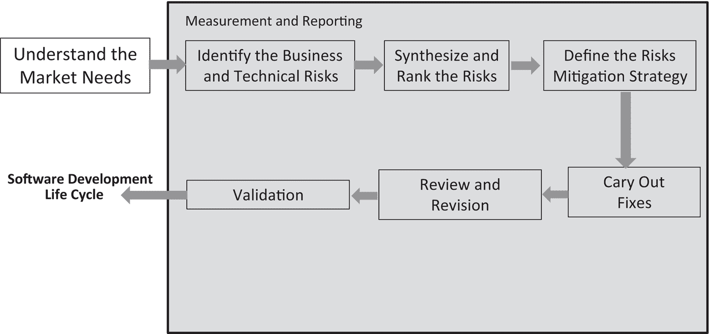

图 2.8 Protracted Cigital 风险管理框架

其他额外阶段（包括主要阶段）负责收集所有最具可行性的业务需求。来自上阶段的验证信息将应用于进一步的软件开发过程中，从而产生更安全的产品。

### 2.5.1 第一阶段：理解

这是 `RMF` 的第一阶段。每个评估都需要理解在何处执行，以及评估期间需要关注哪些类型的活动。为了理解检查人员执行的业务相关信息和数据，这是风险管理的第一阶段，他们在这里总结并理解业务性质、资产及其对业务的重要性。


业务风险会直接损害客户的至少一个业务目标。此类风险的区分与识别有助于解释并衡量特定事件直接影响业务目标的可能性。业务风险的影响包括直接金钱损失、品牌或声誉受损、违反客户或行政合规要求、引入义务以及开发成本的增加。业务风险的严重程度应根据财务或项目管理标准进行传达。这些标准包括但不限于：百分比 (`%`)、直接成本、利润水平以及开发成本。

业务风险的区分与识别有助于表征并引导特定专业技术，用于在不同的程序需求中提取、估计和缓解程序风险。对业务风险的可识别识别提供了一个基础，允许用业务术语对程序风险进行衡量和描述。

让管理层为业务服务于风险的方法在于将专业风险以重要的方式联系到业务背景中。因此，识别和深入理解风险的能力至关重要。发现和感知专业风险是一项高能力任务，通常需要长时间的理解。此外，在此阶段，分析人员提取可能为组织业务带来风险的潜在威胁技术点，并对其进行映射。技术风险是一个导致系统陷入可能被利用的状态，并为组织创造了危险的境地。在组织中减轻技术风险对于适当管理风险至关重要。该框架提供了一种方法和模型，通过适当的系统路径在同一过程中管理业务风险和技术风险。

*   识别挑战业务目标安全所面临的风险。
*   针对财务损失和业务其他关键问题的业务风险影响分析。
*   需要用财务或项目管理术语表述业务风险的严重性。
*   技术风险与业务目标的映射。
*   为业务风险的定量或定性评估提供支持。
* 业务风险的定量或定性评估支持用于影响分析，并有助于基准测试。

### 2.5.3 阶段 3：综合

风险排序可能会揭示安全领域新的威胁和漏洞。任何运行系统始终存在风险的可能性，但最重要的任务是首先发现风险，并根据其严重性和危害性进行排序。这有助于在识别与业务目标相关的风险时，对提出的问题做出适当反应。这一阶段有助于发现所有类型的风险及其可能性。适当的影响分析将有助于根据严重程度对风险进行优先级排序和排名。研究人员根据需要定期开发不同的指标来确定影响、可能性、风险和严重程度，但这些矩阵必须随时间推移在理论和经验上进行验证，以缓解当前状况。

识别和理解风险至关重要，但这些程序并不能让公司缓解或管理风险。这些步骤只是初步步骤，为分析人员提供一个场景构思。综合是在适当理解和识别之后执行的一个重要步骤。这一步骤包括风险的优先级排序。风险的排序和综合可以将管理过程转化为一个基于结果的过程。风险排序产生了一个关于风险对组织资产影响的概念，提供了影响分析的收益。理解风险的严重性是风险管理中最核心的过程，因为从业务角度理解风险对于分析人员来说是一项重大工作。

### 2.5.4 阶段 4：缓解

如果你有一个问题但完全没有主意，这值得投入吗？因此，识别和深入理解风险的能力至关重要。发现和感知专业风险是一项高能力任务，通常需要长时间的理解。此外，在此阶段，分析人员提取可能为组织业务带来风险的潜在威胁技术点，并对其进行映射。技术风险是一个导致系统陷入可能被利用的状态，并为组织创造了危险的境地。在组织中减轻技术风险对于适当管理风险至关重要。该框架提供了一种方法和模型，通过适当的系统路径在同一过程中管理业务风险和技术风险。

### 2.5.5 阶段 5：验证

验证的动机非常明确。它回答了以下问题：`所有人员都在正确的方向上吗？` 此时执行缓解策略。识别所有可能导致问题的产产物，包括设计中的架构缺陷、需求冲突、编码错误或测试中的问题。

### 2.5.6 阶段 6：审查与修订

审查和修订步骤在所有阶段都是常见的，因为人们可以在整个开发周期中进入审查和修订步骤。这一步骤是非正式且本质的，因为审查和修订使框架更易管理。如果需要，在所有阶段进行评估和修改，以开发更精细的指南。

## 2.6 安全工程：一种包容性方法


在当今世界，开发者面临着用户的压力，要求他们在应用开发过程中关注更好的安全设计。程序安全性的破坏可能关乎生死。据报告显示，在 2008 年那场导致 154 人死亡的致命西班牙飞机空难事故背后，存在一种名为木马的恶意软件。这些事件的发生纯粹是因为恶意软件。2010 年 1 月，由于美国纽约国家银行在遭到入侵并访问了网上银行服务器后，超过 8,300 名客户的身份卡被盗取。漏洞的存在是许多软件失败的根源，并给政府和私营机构造成重大的财务和声誉损失。`Code Red Worm`蠕虫造成的损失估计已达 26 亿美元，而`Nachi Worm`蠕虫则导致加拿大航空和 CSX 铁路的运营受到严重影响。由于信息系统的广泛适用，软件安全已成为每个软件工程过程中至关重要的组成部分。

软件专业人员需要强调导致软件质量不良的原因，这导致了大多数安全问题。现代系统的设计者必须主动考虑安全问题。缺陷是安全系统下降的主要原因。安全架构设计人员必须建立一种具体的机制，在开发和部署阶段解决设计层面的缺陷和实现漏洞。对知识领域直接参与的整个观察，在以下方面可能被直接或间接地地证明是重要的：

*   此软件可以帮助更好地理解系统的设计和架构，从而理解开发和维护过程。
*   这有助于在软件开发的早期识别并减少软件设计中现有的漏洞，帮助实现安全产品。
*   这有助于估算软件项目的成本，有助于预测程序的安全性，并预测和计划新的活动。

### 2.6.1 软件安全优先：社会视角

通过互联网连接的普及性以及资源向各处的分布，构建了一个复杂的计算基础设施。为这一计算基础设施提供最大的安全性是每个人的责任。不同技术形式的软件安全可用性在图 2.9 中所示。

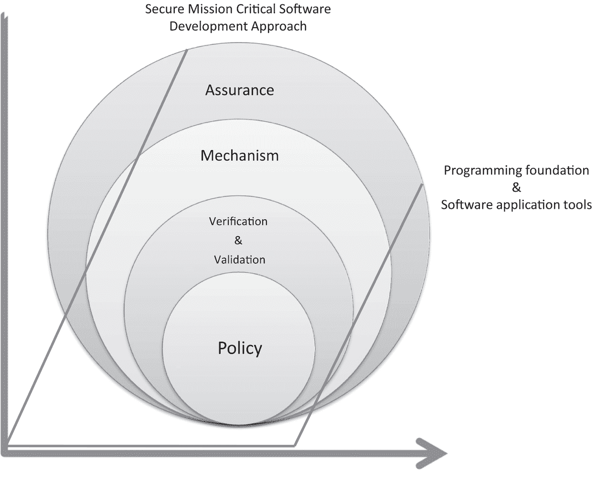

图 2.9 不同技术形式的软件安全可用性。

*   **工程与技术领域的软件安全**

信息无论属于全球的哪个部分，只需点击鼠标即可获得。从网上银行、交易到在线买卖等密集的面向安全型服务正在毫无犹豫地进行。这些服务需要信息和资产的隐私性。当安全密集型信息随处漂浮时，任何具有恶意的人都可以滥用这些信息。这可能会给组织或个人造成伤害。此外，软件的安全漏洞可能关乎生死。据报告显示，在 2008 年那场导致 154 人死亡的致命西班牙飞机空难事故背后，存在一种名为木马的恶意软件。从文献可以看出，软件现在已涵盖每个领域，包括土木工程、汽车部门、机械行业、配备电子和硬件组件的嵌入式系统、导弹技术等。这就是为什么软件安全将始终是关键基础设施影响最大且最重要的因素。

*   **业务领域的软件安全**

信息无论属于全球的哪个部分，只需点击鼠标即可获得。从网上银行、交易到在线买卖等密集的面向安全型服务正在毫无犹豫地进行。这些服务需要信息和资产的隐私性。当安全密集型信息随处漂浮时，任何具有恶意的人都可以滥用这些信息。这可能会给组织或个人造成伤害。此外，软件的安全漏洞可能关乎人的生死。

*   **教育领域的软件安全**

信息无论属于全球的哪个部分，只需点击鼠标即可获得。从网上银行、交易到在线买卖等密集的面向安全型服务。据报告显示，在 2008 年那场导致 154 人死亡的致命西班牙飞机空难事故背后，存在一种名为木马的恶意软件。从文献可以看出，软件现在已涵盖每个领域，包括土木工程、汽车部门、机械行业、配备电子和硬件组件的嵌入式系统、导弹技术等。

### 2.6.2 安全工程

更好且有效的安全工程基于四个基础。这些基础是`policy`（策略）、`methodology`（方法）、`validity`（有效性）和`reward`（奖励）。

软件工程是一个涵盖整个软件开发周期的课题。软件工程通过各种模型和研究结果告诉开发者如何系统地开发软件和应用程序。与此同时，近年来频繁的网络威胁和攻击为软件开发者确保产品安全带来了严峻且具有挑战性的任务。安全工程是软件开发生命周期（SDLC）的一种先进新方法，为开发者为安全开发软件提供了一条路径。

安全工程主要关注软件的安全设计。安全工程强烈建议，如果开发者在软件设计阶段就确保了安全措施，那么与开发后进行安全措施相比，软件将要安全得多。

`policy`可以从文档和法律角度确保数据和软件的安全性。`methodology`是工程的主要部分，定义了方法的技术性以及在软件中应用的方法，以确保各种类型的安全方面。第三个基础`validity`用于确保软件中应用的安全方法是否恰当。简单来说，`validity`用于验证所选定和实施的安全保障方法是否良好且有效。最后，`reward`用于为员工和资产提供动力，使他们为有助于组织确保软件安全的业务而工作。

## 2.7 结论

安全是一个复杂且多维的理论。毫无疑问，有许多不同的方法可以感知与业务目标相关的安全和风险。主要目标是在早期发现与软件相关的问题。识别出的安全问题可能与安全措施相关，以便进行更好的估算和预防。所提的安全支柱有助于在风险管理、最佳实践和知识的框架内解决安全问题。安全是一个关键问题，学习更多安全知识以获得最佳的服务支持是每个人的责任。


在当前时代，软件安全是一个比其他领域受到更多关注的话题。这种情况背后的原因是软件在每项工作中被频繁且在全球范围内采用。“接受度越高，风险越大”；这是软件工程研究人员总结的一句格。目前，这一陈述对于软件安全非常适用。过去 10 年的网络攻击统计数据证明了这一观点，并描述了由于各种进步和隐性网络攻击，软件安全处于高风险之中。此外，为了保护软件，在设计阶段应用安全方法至关重要。设计阶段是软件各个方面都开放的，开发者可以在此实施其安全措施。本章概述了当前的软件安全现状及其对于安全和无网络攻击行业的重要性。本章简述的风险管理告诉我们如何衡量与软件安全相关的潜在风险和威胁。这些潜在风险因素在从源头（设计阶段）开发安全软件方面起着关键作用。简之，本章指出安全工程是当前时代最重要且有效的话题，在软件开发中需要作为一种主动方法额外关注。

## 关键术语

软件安全、连接性、可扩展性、复杂度、风险管理框架、触点、知识。

## 思考点

*   安全是一个多维属性。为了确保更好的流程，通常会使用精确规范且具有前瞻性的框架、方法或路线图，并证明其非常有成效。显而易见，有必要提出一种具有指导性的安全评估技术或框架，使其能够易于衡量设计安全性并最大限度地减少漏洞。
*   每种类型的安全都是组织每个功能性或非功能性活动的重要考虑因素，这意味着“业务流程安全是任何企业成功的关键”。许多硬件和软件安全工具旨在组织在线活动期间提供安全测试，但仍然需要强有的安全系统来承担数据交易的风险和暴露。
*   现状下的企业正关注开发传统的安全工具或资源，以抵抗安全压力，并保护其业务流程免受恶性手段的影响。
*   专家正试图从漏洞、威胁和后果方面对风险因素进行描述。然而，开发者——所有这些贡献的实际和直接用户——并不熟悉关注安全的行为和交付物。
*   为了使专家所做的所有贡献有效解决安全问题，需要确定威胁、攻击、漏洞、入侵、错误、失败、风险、资产损害与漏洞优先级安全索引之间的因果关系。

## 选择题

1.  进入系统进行处理并在之后保持准确的完整数据被称为：
    *   a) 完整性
    *   b) 安全
    *   c) 病毒
    *   d) 意外删除
2.  不准确的数据输入、蠕虫和病毒、欺诈和硬件故障属于以下哪：
    *   a) 数据安全
    *   b) 用户
    *   c) 软件
    *   d) 数据完整性
3.  病毒是如何传播的？
    *   a) 通过防火墙
    *   b) 从互联网下载受感染的程序和文件
    *   c) 乱码信息
    *   d) 安装防病毒
4.  什么是安全控制？
    *   a) 旨在确保攻击成功的控制
    *   b) 旨在检测和击退攻击的控制
    *   c) 旨在支持从问题恢复的控制
    *   d) a–c 中提到的所有控制
5.  具有价值且必须受到保护的系统资源被称为
    *   a) 资产
    *   b) 控制
    *   c) 漏洞
    *   d) 以上皆非
6.  具有导致损失或伤害潜力的情况被称为
    *   a) 攻击
    *   b) 威胁
    *   c) 漏洞
    *   d) 控制
7.  特定危害可能导致的最坏损害的评估被称为
    *   a) 风险
    *   b) 危害概率
    *   c) 危害程度
    *   d) 意外事故
8.  什么威胁了生产软件的质量和及时性？
    *   a) 已知风险
    *   b) 业务风险
    *   c) 项目风险
    *   d) 技术风险
9.  下列哪项是对项目计划威胁的系统性尝试？
    *   a) 风险识别
    *   b) 性能风险
    *   c) 支持风险
    *   d) 风险预测
10. 计算机系统中可能被利用以导致损失或伤害的弱点被称为
    *   a) 漏洞
    *   b) 攻击
    *   c) 威胁
    *   d) 暴露

## 短答题

1.  安全软件的影响性属性有哪些？
2.  写下可靠性（dependability）与安全性（security）之间的区别。
3.  定义尺寸、复杂度、可追踪性和安全性。
4.  探索攻击抗性、攻击容性和攻击恢复力。
5.  如何影响软件的安全属性？
6.  如何断言并指定所需的安全属性？
7.  将软件安全描述为一种多学科的努力。
8.  定义软件架构和设计的通用目标。
9.  定义架构软件安全。
10. 触点（touch point）是什么意思？

## 述题

1.  描述改进框架。
2.  探索成熟路径。
3.  提供构建软件的步骤机制。
4.  描述最新的安全趋势和问题。
5.  生成安全实践的映射。
6.  为该领域的学者和研究人员探索全局视角。
7.  描述风险的概念。
8.  定义安全原则。
9.  结合示例定义安全指南。
10. 证明你的答案。RMF 是一个循环。

## 参考文献

1.  `Mad Mark’s Blog`。访问地址：`http://kohi10.wordpress.com/`（访问于 2011 年 06 月 06）。
2.  访问地址：`http://www.msnbc.msn.com/id/387906/ns/technology_and_science/?gt1=43001`
3.  `J. Viega and G. McGraw`, Building Secure Software. Addition Wesley, 2005.
4.  `O. A. Alhmi, Y. K. Malaiya and I. Ray`, “Security Vulnerabilities in Software Systems: A Quantitative Perspective”, Data and Applications Security, LNCS 3654, 2005, pp. 281–294, doi: `10.1007/1153576`。
5.  `S. Ardi, D. Byres and N. Shahmehri`, “Towards a Structured Unified Process for Software Security”, Proc. ACM, ICSE Workshop on Software Engineering for Secure Systems (SESS’06), ACM, 20–21May2006, pp. 3–9, doi: `10.1145/1137627.1137630`。
6.  `S. T. Halkidis, A. Chatzigeorgiou and G. Stephanides`, “A Qualitative Evaluation of Security Patterns”, ICICS, LNCS 3269, 2004, pp. 132–144. 访问地址：`http://arnetminer.org/viewpub.do?pid=314748`。


7. `G. McGraw`, “软件安全”, IEEE Security & Privacy, 2(2), 2004, pp. 80–83, doi:[10.1109/MSECP.2004.1281254](http://dx.doi.org/10.1109/MSECP.2004.1281254).

8. `A. Alkussayer` 和 `W. H. Allen`, “一种基于场景的软件架构安全评估框架”, 计算机科学与信息技术国际会议 (ICCSIT’10), IEEE, 2010 年 7 月 9–11 日, pp. 687–695, doi: [10.1109/ICCSIT.2010.5564015](http://dx.doi.org/10.1109/ICCSIT.2010.5564015).

9. `I. Chowdhury` 和 `M. Zulkernine`, “将复杂度、耦合和内聚指标作为漏洞的早期指标”, 体系架构期刊, 57(3), 2011 年 3 月, pp. 294–313, doi: [10.1016/j.sysarc.2010.06.003](http://dx.doi.org/10.1016/j.sysarc.2010.06.003).

10. `S. Heelan`, “漏洞检测系统——思考赛博格而非机器人”, IEEE Security & Privacy, IEEE, 2011 年 5 月–6 月, pp. 74–77.

11. `I. Chowdhury`, `B. Chan` 和 `M. Zulkernine`, “源代码结构的安全指标”, 第四届安全系统软件工程国际研讨会 (SESS’08), ACM, 2008 年 5 月, pp. 57–64, doi: [10.1145/1370905.1370913](http://dx.doi.org/10.1145/1370905.1370913).

12. `A. Ozment`, “改进漏洞发现模型”, ACM 研讨会：保护质量 (QoP’07), ACM, 2007 年 10 月 29 日, pp. 6–11, doi:[10.1145/1314257.1314261](http://dx.doi.org/10.1145/1314257.1314261)

13. `J. Bansia` 和 `G. C. Davis`, “一种面向对象设计质量评估的分层模型”, IEEE 软件工程汇, 28(1), 2002, pp. 4–17.

14. `A. Blyth` 和 `G. L. Kovacich`, 信息环境中的信息保证安全. Springer, 2006.

15. `M. Merkow` 和 `J. Breithaupt`, 信息安全原理与实践. Prentice Hall, 2006.

16. `M. Bishop`, 计算机安全：艺术与科学. Pearson, 2005.

17. `D. Geer Jr.`, `K. S. Hoo` 和 `A. Jaquith`, “信息安全：为什么未来属于量化者”, IEEE Security & Privacy, IEEE, 1(4), 2003 年 7 月–8 月, pp. 24–32, doi: [10.1109/MSECP.2003.121953](http://dx.doi.org/10.1109/MSECP.2003.121953)

18. `R. Merkowski` 和 `D. Raju`, “基于自顶向下的软件安全量化”, 软件工程方法论, 2004.

19. `S. Savola` 和 `J. Holappa`, “移动自组网络中的安全性测量”, IEEE, 2005 年 5, pp. 192–201.

20. `M. Merkow` 和 `J. Martin`, “信息安全保障”, IEEE, 2005 年 5, pp. 42–49.

21. `B. Cousigne`, “安全的十大最佳实践”, [`www.techpublic.com/`](http://www.techpublic.com/)

22. `S. Madman` 和 `T. Neubauer`, “安全业务管理：路线图”, 第一届可用性与可靠性国际会议 (ARES), 2006.

23. `J. Whyte`, “软件开发中的敏捷性”, CERT® 研究报告, 2009, pp. 64–65.

24. `C. Perrin`, “设计简单性是开源安全的关键要素”, [`www.techpublic.com/design-simplicity-is-important-element-of-security/4943?tag=mantle`](http://www.techpublic.com/design-simplicity-is-important-element-of-security/4943?tag=mantle)

25. `G. Allen`, “安全开发”, 2008.

26. `J. Du`, “安全量化”, 2009.

27. `Y. Yang` 和 `Q. Wang`, “安全方法论”, 2009.

28. `M. Paul`, “十大最佳实践”, ISC. [`www.isc.org/`](https://www.isc.org/)

29. `J. McGovern` 和 `G. Peterson`, “提升企业安全的快速、简单且便宜的方法”, ACM 通讯, 10, 2011.

30. `J. Process`, “流程如何带来安全”, 2009.

31. `K. Goertze`, “软件安全”, [`buildsecurity.us.gov/`](https://buildsecurity.us.gov/)

32. `M. Schumacher` 和 `U. Roig`, “安全工程”, 2001. [`www.uml.cn/`](http://www.uml.cn/)

33. `R. T. Mercuri`, “成本分析”, 2003.

34. `T. Klemen` 和 `S. Biffl`, “安全业务管理”, 2006.

35. `M. Merkow` 和 `L. Raghavan`, “软件安全”, 2010.

36. `R. Sassoon`, `M. G. Jaatun` 和 `J. Jensen`, “地狱之路是由善意铺就的：一个（不）安全的软件开发的故事”, 可用性与可靠性国际会议 (ARES’10), 2010.


44. N. Moha, “面向对象架构中设计缺陷的检测与修正”, *Proc. Workshop. Object Oriented Reengineering(WOOR’03)*, 2003 年 7 月 21 日，第 949–950 页。[`www.etud.iro.umontreal.ca/~mohanaou/paper/ECOOP06/Moha06-DS\_ECOOP.pdf`](http://www.etud.iro.umontreal.ca)

45. B. Alshammari, C. Fidge and D. Corney, “面向对象设计的安全指标”, 第 21 次澳大利亚软件工程会议论文，IEEE Press，2010 年 4 月 6–9 日，第 55–64 页，doi:[10.1109/ASWEC2010.34](http://dx.doi.org/10.1109/ASWEC2010.34)。

46. B. Alshammari, C. Fidge and D. Corney, “面向对象设计的安全指标”, 第 9 次国际高质量软件会议论文集，IEEE Press，2009 年 8 月 24–25 日，第 11–20 页，doi:[10.1109/QSIC2009.11](http://dx.doi.org/10.1109/QSIC2009.11)。

47. C. Wang and W. A. Wulf, “安全测量框架”, 国家信息安全会议论文 (NISSC’97)，1997 年，第 522–533 页。[`csrc.nist.gov/nissc/1997/proceedings/522.pdf`](http://csrc.nist.gov)

48. S. L. Pfleeger and R. Cunningham, “为什么安全测量很困难”, 《安全与隐私》，IEEE，2010 年 7 月–8 月，第 46–54 页，doi:[10.1109/MSP2010.60](http://dx.doi.org/10.1109/MSP2010.60)。

49. A. J. Wang, “信息安全模型与指标”, 第 43 次 ACM 东南会议会议集，ACM，2005 年，第 178–184 页，doi:[10.1145/167253.167295](http://dx.doi.org/10.1145/167253.167295)。

50. D. Verdon and G. McGraw, “软件设计中的风险分析”, 《安全与隐私》，IEEE，2(4)，2004 年 7 月–8 月，第 79–84 页，doi:[10.1109/MSP2004.55](http://dx.doi.org/10.1109/MSP2004.55)。

51. [`www.sciencedirect.com/topics/computer-science/security-risk-management`](https://www.sciencedirect.com)

52. [`csrc.nist.gov/projects/risk-management/about-rmf`](https://csrc.nist.gov)

53. [`nvlpubs.nist.gov/nistpubs/Legacy/SP/nistspecialpublication800-30r1.pdf`](https://nvlpubs.nist.gov)

54. [`nvlpubs.nist.gov/nistpubs/Legacy/SP/nistspecialpublication800-39.pdf`](https://nvlpubs.nist.gov)

55. [`nvlpubs.nist.gov/nistpubs/SpecialPublications/NIST.SP.800-37r1.pdf`](https://nvlpubs.nist.gov)

## 有用链接

* [`www.wsj.com/articles/an-unexpected-security-problem-in-the-cloud-150570061`](https://www.wsj.com)
* [`indiatoday.intoday.in/story/atms-shut-down-india-wanna-cry-ransomware-attack/1/954284.html`](http://indiatoday.intoday.in)
* Cigital. ITS4 [`www.cigital.com/its4/`](http://www.cigital.com)
* D. Wheeler. Flawfinder [`www.dwheeler.com/flawfinder/`](http://www.dwheeler.com)
* Secure Software. RATS [`www.securesoft.com/rats.php/`](http://www.securesoft.com).
* [`www.studytechno.com/touchpoints-of-software-security.html`](http://www.studytechno.com)
* [`dinus.ac.id/repository/docs/ajar/Sommerville-Software-Engineering-10ed.pdf`](https://dinus.ac.id)
* [`www.cl.cam.ac.uk/~rja14/Papers/SEv2-c01.pdf`](https://www.cl.cam.ac.uk)


此类威胁包括通过非物理交互导致计算机和组织遭受利用的安全漏洞 \[3]]。这种类型的威胁会导致信息丢失、业务运营的中断和延迟、敏感数据的损坏和篡改，以及间谍活动、身份欺骗等其他网络安全威胁。以下术语描述了针对组织和计算机系统的各种流行且重大的非物理威胁，如图图 3.3 所示。

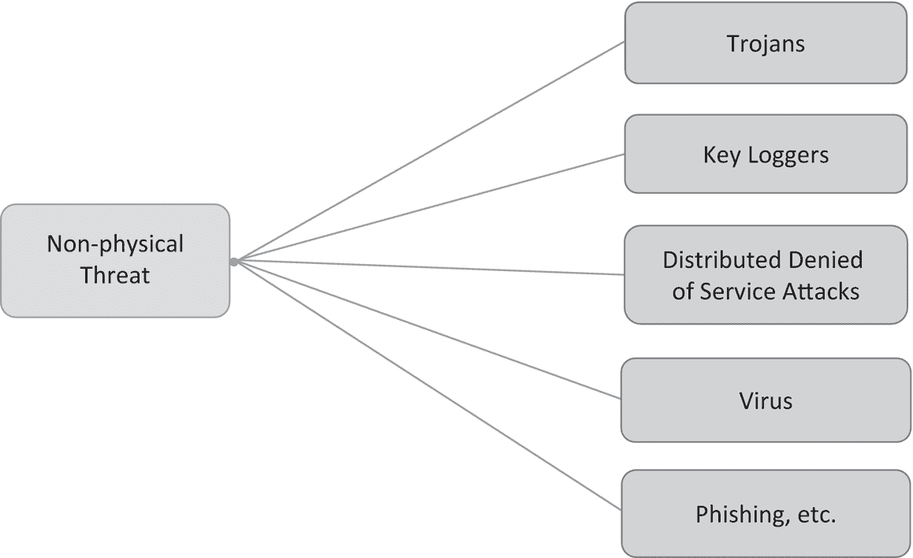

图 3.3 非物理威胁。

*   木马 (Trojans)
*   键盘记录器 (Key loggers)
*   分布式拒绝攻击 (Distributed Denial of Service Attacks)
*   病毒 (Virus)
*   钓鱼等等

这些都是安全的潜在非物理威胁，也是导致组织陷入被利用局面的原因。缓解这些威胁需要技术知识以及逻辑措施。有必要缓解并防止这些威胁，确保组织运营在没有任何威胁和中断的情况下运行。

然而，简而言之，缓解这两类威胁是安全管理中最受关注且最重要的目标。此外，为了更有效、更清晰地理解安全威胁场景，我们需要更简洁、具描述性地集中并理解信息安全基础。

### 3.2.3 常见威胁

数据安全方法和系统在某些特殊攻击情况下是无效的。这类攻击可以直接或间接地影响信息存储点、交易点和通信点。漏洞的产生仅是因为持续的非标准补丁和不同的平台兼容性问题。由于应用程序结构复杂且代码行数巨大，准确提取可能的漏洞是一项挑战性任务。此外，还存在一些一次扫描无法发现的潜在威胁，且在识别中较为罕见。

计算机系统的专门攻击者也是伟大的采用者。因为良好的攻击部署需要精通系统理解和行为分析；因此，对于攻击者来说，了解操作系统在何显示警告和查看选项是一项非常重要的工作。特殊的网络攻击者总是伟大的观察者。根据《当前与未来：计算机犯罪与信息战争的 CSI 入南》中的一项持续研究，在 80% 的组织中，组织员工是信息安全最关注的实体。

导致信息安全泄露的最大且最主要的问题仍未解决，并需要解决方案，这些未解决的泄露和攻击向量导致了约 66% 的数据泄露事件。组织的每项资产和软件由于缺乏责任和理解而导致被利用。未更新的 IT 基础设施也导致了企业 13% 的泄露事件。数据安全管理完全是一项组织工作，需要管理机构的高度关注。此外，未知原因导致了 10% 的泄露问题。此外，从组织的角度来看，将组织的每项资产视为潜在威胁并在组织内定期评估泄露风险是非常重要且有意义的。

此外，事件清楚表明，也存在物理威胁会对组织安全造成危害。存在物理盗窃、自然灾害以及如停电等各种突发意外事件。还存在结合物理和数字平台的攻击，并在组织中实施并成功部署攻击。这些攻击针对组织最宝贵、最重要的信息，并进行长时间攻击。为了管理和防止这种攻击，专家专门对其进行了分类。

## 3.3 安全威胁

威胁的分类如下：具有对组织造成损害或损失潜力的威胁被视为严重威胁。

*   针对业务的威胁被视为业务威胁。此类威胁与工资发放有关。例如，假设有一个有工资发放的组织，那么对于财务部门来说至关重要。
*   第二类威胁是直接影响软件的系统威胁。由于其技术属性，威胁在软件开发中更容易被捕获。
*   作为下一种威胁，存在基于自然的威胁，与各种类型的自然灾害有关。
*   威胁分类中存在技术威胁。技术威胁是由于系统中简单的技术故障引起的潜在威胁。
*   意外的随机威胁包括停电、火灾相关问题等许多。

### 3.3.1 基于常见漏洞的安全威胁

安全漏洞是一个与网络安全的各种类型攻击向量和攻击方法相关的话题。有各种可用的技术和方法执行。作者在图 3.4 和后续章节中提供了描述性介绍：

*   **跨站脚本 (Cross-site scripting)**：这是一种利用基于网站的漏洞并执行异常有害访问分级的攻击方法。作为这种攻击的一个过程，攻击者通过发送各种基于语法的命令来渗透网站，然后找到一个可以被利用的点。在理解利用点后，攻击者向托管网站发送一些恶意命令，欺骗服务器执行其命令并获得所需操作的权限。这些攻击与终端用户的输入功能相关并将其作为武器。
*   **注入攻击 (Injection-based attacks)**：基于字符的注入攻击利用软件和应用程序的输入功能并将其作为向量。注入攻击基于查询响应系统的方法工作。简单来说，如果终端用户向主机系统输入任何类型的查询，它将作为后端命令执行，并根据输入的查询尝试操作连接的数据库。


- **恶意文件包含**：这种攻击利用文件作为攻击向量，并执行在这些文件中编写的恶意代码。一个设计不当、结构混乱且准备不足的 Web 应用程序始终可能在预先通知的情况下自动激活输入的脚本和文件功能。攻击者利用此问题作为武器，部署与恶意文件相关的攻击。如果 URL 或文件的输入脚本具有恶意功能和属性，那么恭喜你，你的系统已被攻破。

- **基于对象的引用**：这是一种访问控制缺乏管理时的一种访问控制问题。由于管理不当，还导致了各种其他的访问控制漏洞和攻击手段。

- **跨站请求伪造 (CSRF)**：这种攻击将端用户作为受害者和向量。攻击者诱导用户进入一个意想不到的境地，使端用户被迫执行攻击者想要执行的操作并被黑掉。在此类攻击中，攻击者最大的进展和武器是社会工程，他们首先了解并观察受害者的本质，例如他们的爱好、兴趣和社交活动，然后通过发送他们感兴趣的恶意趣味话题来欺骗他们。如果受害者点击该链接，攻击者就成功欺骗了用户并轻易攻破了系统。

- **信息泄露和不当错误处理**：错误处理是最受关注的话题，但遗憾的是被开发者在应用程序开发主题忽视了。任何浏览器、网站或服务器的错误都会显示与系统相关的重要细节。这些细节可以被黑客利用执行跨站脚本攻击并轻松利用服务器。为了定义错误，任何应用程序中都有错误，如内存溢出错误、`404` 错误等许多。由于这些错误作为配置泄露点具有敏感性，管理这些错误是最重要的任务。

- **身份验证和会话管理损坏**：会话管理和认证中断是专家防止的最关键且最具挑战性的任务。一些细小的技术漏洞会导致整个应用程序陷入会话劫持或被利用的局面，攻击者克隆或劫持已验证用户的会话，并在主机服务器面前表现得像已验证的用户。

- **不安全的加密存储**：这是一种由于利用加密密钥导致的存储层破解攻击。糟糕的加密密钥会被攻击者利用良好的攻击向量。这种攻击执行小规模的破解并导致与信息泄露相关的事件。

- **不安全的通信**：这种漏洞可能会导致软件中的劫持、篡改、机密性破坏或身份盗窃相关问题。不安全的通信是由缺乏任何安全协议（如 `HTTP`）的加密会话管理造成的。这种通信建立的失败会导致服务器与服务器或客户端与服务器之间的关系陷入严重的完整性丢失或安全丢失局面。

- **未限制 URL 访问**：这种漏洞通过在系统中不受限制地允许 URL 操作，为强制浏览提供了空间。这种漏洞具有破坏你的浏览器的潜力，这关联有关你个人活动的机密备注和信息，在某些情况下还包括密码。这种漏洞能够绕过受害者的各种常用网站，只需点击即可劫持受害者的各种会话。这种攻击的可能性引发了对不安全网络浏览的担忧。

### 导致服务器陷入麻烦或被利用局面的漏洞向量：
- 结构不当的应用程序
- 操作系统文件和操作
- 不安全且定时备份配置
- 缺乏备服务器
- 糟糕的数据存储方法

### 导致与端用户相关的错误的漏洞向量：
- 不安全的浏览
- 软件处理不当
- 缺乏社会工程学意识

### 安全策略和人员漏洞包括：
- 用户权限过大和未经授权的设备
- 钓鱼
- 未加密的笔记本电脑和移动介质

### 应用程序漏洞包括：
- 即时消息应用
- 点对点共享应用

### 网络设备漏洞包括：
- VoIP 服务器和电话

### 零日攻击

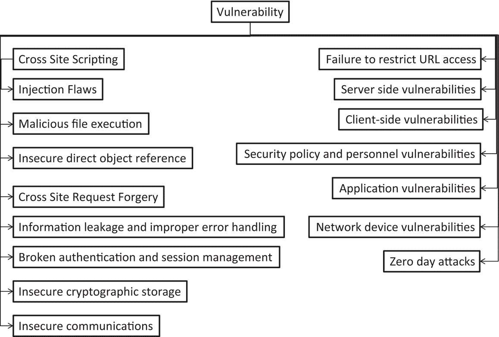

图 3.4 漏洞分类。

### 3.3.2 基于安全风险的安全威胁

- **未能涵盖安全基础**：过去一年攻击者使用的常见漏洞和暴露揭示了基础安全措施的匮乏。网络犯罪分子使用不足十种漏洞就能黑入组织及其系统，因为他们不需要更多。

- **不理解产生企业安全风险的原因**：公司往往无法理解“他们对攻击的脆弱性、关键资产的价值，以及潜在攻击者的特征或复杂程度”。安全风险并不总是显而易见的。以下类别可以为刻意绘制映射并计划长期缓解风险提供一些指导。

- **与策略相关的问题**：建立一套统一的法规和规则是任何企业在工作模型中最受关注且最重要的工作。攻击者不仅渗透 IT 行业，而且经常针对非技术部门，因为这些部门的安全标准低且发生泄露事件的可能性高。这种情况导致高层管理人员陷入麻烦，迫使他们制定能够保护其知识产权的高质量安全策略标准。此外，策略的制定至关重要，但这些策略的优先级以及它们在组织基础设施中的严格部署也是现在企业需要关注的最重要步骤。为了向观众简述经典的安全策略，作者列出了在策略开发期间需要注意的点：
    - 风险评估是组织日常安全优先级最高且第一步。
    - 需要一个融合了安全属性的电子治理模型。
    - 组织中的每一步都需要预定义的规则集。
    - 需要技术基础设施升级和适当的例行评估。
    - 需要对第三方工具进行评估以识别风险水平。
    - 需要安全的监管以频繁解决漏洞。

- **将合规性与安全性混淆**：企业必须处理的另一个风险是合规性与安全策略之间的混淆。确保符合公司规则并不等同于保护公司免受网络攻击，除非该规则确实整合了对安全的明确关注。企业风险管理要求公司里的每位经理都能访问与其相关的安全系统部分。正如我们的 CEO 一所说的，安全是全公司的责任。因此，经理（以及其他人）应该监督数据如何流过系统，并知道如何防止机密信息泄露到网络犯罪分子的基础设施中。


### 碳基生命体——最脆弱的环节：
还有其他因素可能成为企业安全风险。它们是技术性较低的一种。人为因素在公司信息安全防御的强弱（或程度）中起着重要作用。事实证明，高职位的人（如高管和管理人员）成为恶意内部人员的可能性较低。低级员工往往会大大削弱你的安全性。请注意如何设置和监控他们的访问权限。正如你最近的统计数据所示，滥用权限是恶意内部人员导致数据泄露的首要原因。

### 财务、人力和技能问题：
不断成长的植物总是需要妥善照顾；同样，初创企业或成长中的业务需要良好的照顾和管理。在这类问题中，财务因素占据着地位，并能迅速改变业务状况。此外，安全性也是需要关注的，还需要高预算的基础设施来实现适当的应用。此外，除了财务挑战外，还面临技能人才证明的挑战。世界上有许多待业的毕业生，但在涉及技能型工人时，数量却很匮乏。因此，为了应对这种局面，企业所有者会在资源和基础设施上做出妥协，尝试在现有资金和资源下经营业务。总而言之，这项挑战性任务对任何人来说都绝非易事。

### 安全意识及其培训：
经过培训的员工对业务总是有利的。安全是需要额外关注的，为了防止企业遭受严重损害，企业需要针对每种新的攻击类型和风险可能性对员工进行意识培训。此外，为了培训员工，有很多参考书籍和最佳实践可以指导企业如何完美地对员工进行安全培训以确保安全。

### 糟糕的恢复计划：
在当今时代成为大型且不断发展的企业，你需要勇气和资源来频繁面对巨大的网络威胁和攻击。为了让业务应对网络攻击，对于任何类型的错误和意外，管理并拥有一个良好的恢复计划至关重要。这些计划是企业确保业务安全的方式。

### 意外之外的演进风险：
这些风险与恶意软件有关，并告诉我们它们的危害影响。恶意软件是攻击者的主要武器，他们经常尝试在互联网上部署恶意软件，以尽可能地传播漏洞。这就是为什么现在的企业需要一种特殊的保护因素来防止业务和组织中的恶意软件及其攻击。该因素需要具备防止和限制组织基础设施之外恶意活动的能力，并根据常规持续监督企业每个潜在的威胁部分。网络攻击比例的增加及其统计数据描绘了企业面临的严峻形势，它们需要额外的安全措施来防止这种数字化带来的极易被利用的局面。

### 3.3.3 软件安全风险

攻击者有多种方式对你的产品、流程、业务或应用程序造成伤害或破坏。风险与与业务逻辑交互的各种方式直接相关。有时它是安全的，你不需要立即关注，但由于恶意或脆弱实体的存在，它可能会伤害你。这种伤害可能会破坏你的声誉，也可能不会产生坏后果。要确定风险的影响，你需要对每个威胁、攻击或弱点实现其技术追求的可能性进行评估。对技术、行为和操作活动的整体观察可以让你判断风险对图 3.5 中所示业务、流程或应用程序的影响和严重程度。


图 3.5 软件安全风险估计模型。

风险分析有很多方法。开放 Web 应用安全项目 (OWASP) 基于应用安全的标准方法提出了标准的风险估计模型。

`Risk = Likelihood × Impact`

进一步，将定义的因素结合起来以确定可能发生于所示任务的风险的整体安全性。图 6

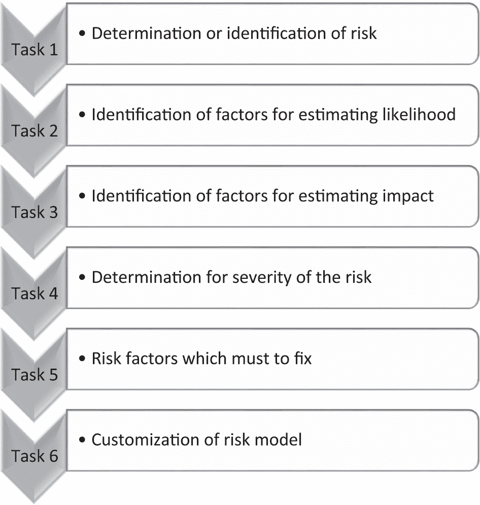

图 6 风险评估步骤。

3.1 常见漏洞枚举 (CWE) 攻击者有多种方式伤害或破坏你的产品、流程、业务或应用程序。3.3.1 常见漏洞枚举 (CWE) 包含了许多导致损害的因素。表格 3

| 排名 | ID | 名称 | 评分 |
| :--- | :--- | :--- |
| 1 | CWE-79 | 跨站脚本 | 46.82 |
| 2 | CWE-119 | 越界 | 46.17 |
| 3 | CWE-20 | 输入验证不当 | 33.47 |
| 4 | CWE-125 | 越界读 | 26.50 |
| 5 | CWE-400 | 不可资源消耗 | 23.73 |
| 6 | CWE-89 | SQL 注入 | 20.69 |
| 7 | CWE-200 | 敏感信息泄露 | 19.16 |
| 8 | CWE-416 | 使用后释放 | 18.87 |
| 9 | CWE-352 | 跨站请求伪造 (CSRF) | 17.29 |
| 10 | CWE-78 | 命令注入 | 16.44 |
| 11 | CWE-190 | 整数溢出或绕回 | 15.81 |
| 12 | CWE-22 | 路径限制不当（路径遍历） | 13.67 |
| 13 | CWE-476 | 空指针解引用 | 8.35 |
| 14 | CWE-287 | 身份验证不当 | 8.17 |
| 15 | CWE-434 | 危险文件无限制上传 | 7.38 |
| 16 | CWE-732 | 关键资源权限分配错误 | 6.95 |
| 17 | CWE-94 | 代码生成控制控制 | 6.53 |
| 18 | CWE-522 | 凭据保护不足 | 5.49 |
| 19 | CWE-611 | XML 外部实体引用限制不当 | 5.33 |
| 20 | CWE-798 | 使用硬编码凭据 | 5.19 |
| 21 | CWE-502 | 不信数据序列化 | 4.93 |
| 22 | CWE-269 | 权限管理不当 | 4.87 |
| 23 | CWE-400 | 不可资源消耗 | 4.14 |


| [24] || CWE-306 || 关键功能缺乏认证 | 3.85 |
| [25] || CWE-862 || 缺乏授权 | 3.77 |

## 3.4 安全威胁分类

安全威胁是一个视角性的问题。简单来说，对于软件和安全开发，存在各种安全威胁。不同的研究人员对安全威胁分类有不同的意见和建议。由于这种多样性，对于安全专家来说，威胁的分类是一项复杂且具有挑战性的任务。在安全领域，利用了各种类型的安全威胁分组。威胁特征描述之所以重要的动力源于：如果我们必须确保数据框架资产，我们需要知道我们要保护这些资产的来源和威胁 `[4, 5]`。为了更容易地理解安全威胁，我们对各种研究人员讨论的具有安全意义的各种潜在风险进行了分类和分析。

### 3.4.1 错误

错误在软件安全中具有极高的性。错误会导致系统出现意外延迟和数据处理不当，从而导致组织内部严重的漏洞和局面损失。此外，为了更容易、更特别地理解错误，我们可以将其分为`图 3.7`所示两个基本部分。

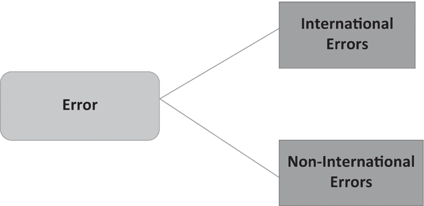

图 3.7 错误类型。

1. 故意错误
2. 非故意错误

1. `故意错误`
故意错误是员工或用户试图出于损害组织和造成损失的意图来利用并进行数据不当数据的错误类型。这是一种信息丢失可能性较高且处于危险状况的情况。通过以前的一些例子证明，软件信息中的故意错误会给业务和软件造成严重损失。

2. `非故意错误`
这是员工或用户在意外情况下执行的错误类型。简单来说，我们可以说，当在没有任何意图和理由的情况下，仅由于偶然情况进行数据处理不当，这就被称为非故意错误。

### 3.4.2 欺诈与盗窃

欺诈和盗窃是导致组织和软件遭受严重利用和损失的其他类型的危害或威胁。欺诈是一种欺骗活动，旨在将组织员工引入陷阱，并从中提取信息、收入和其他敏感资产。欺诈可能导致业务或软件中的盗窃局面。软件或组织安全中存在两种欺诈和盗窃类型，如`图 3.8`所示。

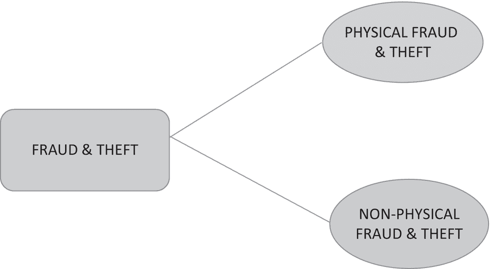

图 3.8 欺诈与盗窃类型。

1. 物理欺诈与盗窃
2. 非物理欺诈与盗窃

1. `物理欺诈与盗窃`
这是攻击者或入侵者物理上场以执行威胁活动的一种欺诈和盗窃类型。对于这类威胁，入侵者的物理存在是必要的。这种威胁与硬件盗窃、硬性信息拷贝、组织资产和其他活动有关。

2. `非物理欺诈与盗窃`
这种威胁是通过与组织资产的非物理交互执行的。例如，考虑对服务器黑客攻击，这是非物理欺诈和盗窃的完美例子。攻击者从数千公里之外向员工发送钓鱼邮件，并诱骗员工处于下载附件并在没有任何物理交互的情况下被入侵者黑客攻击的局面。

### 3.4.3 隐私威胁

这是软件安全和组织安全中一种新兴的威胁。数据库存储和管理着大量数据，但这些数据库的安全状况并不完全跟时代。这种情况对软件安全和业务信息造成了可利用的隐私危害。有必要限制访问并管理这些数据库的安全性，并定期更新安全性。

此外，在描述了这些针对软件和组织安全的基础威胁后，有必要理解组织内部的信息安全概念。此外，为了更容易地理解组织和软件的信息安全状况，我们将针对信息安全的入侵情况分为四种基本类型。

1. `物理安全入侵`：
这种入侵与 DoS 攻击、有线通信监听以及各种其他类似的物理访问入侵有关。这些攻击的简要描述在`图 3.9`中。

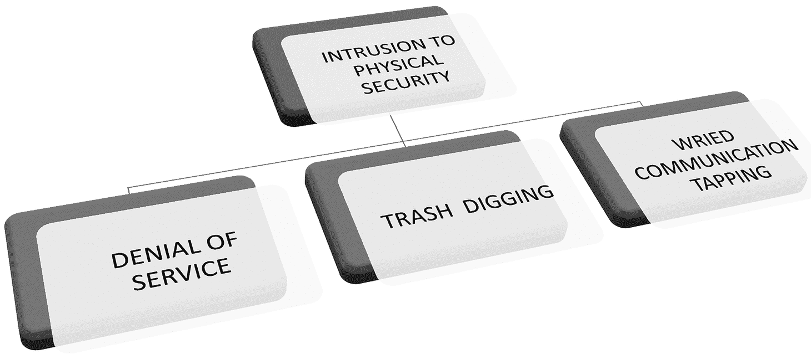

图 3.9 物理入侵。

2. `个人安全入侵`：
这种类型的攻击包括针对软件或组织安全中个人信息安全的威胁`[6, 7, 8, 9 and 10]`。对个人数据安全的攻击属于此类入侵。社交工程学、勒索、密码破解和任何其他类型的攻击都属于这一类。这些攻击的描述性表示在`图 3.10`中。

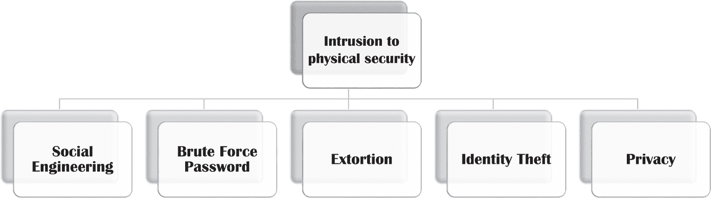

图 3.10 隐私入侵。

3. `通信和信息安全入侵`：
这种类型的攻击与对数据和通信媒介的入侵有关。例如，对数据的攻击和对软件的攻击俗被称为数据和通信入侵`[10]`。入侵的描述性表示在`图 3.11`中。

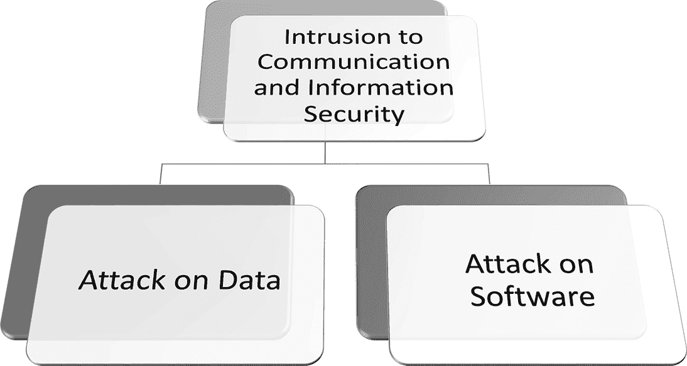

图 3.11 通信与信息安全。

4. `操作安全入侵`：
这些类型的入侵相关的违规与应用层安全有关。这些违规包括欺骗、欺诈、搜索和许多其他类似的攻击。这些攻击的图形化表示在`图 3.12`中。

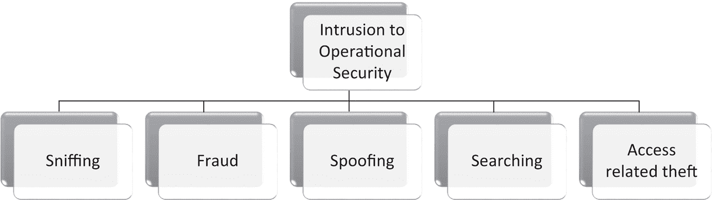

图 3.12 操作安全入侵。

总之，证明了软件、业务和信息安全有各种安全威胁分类。需要根据每个组织理解这些威胁，并根据识别出的威胁采取适当的安全措施。

## 3.5 威胁影响分析

威胁影响调查是风险评估过程的重要组成部分，正如确保强大的业务连续性和灾难恢复一样`[11, 12]`。如果没有对信息损失的影响和潜在危险概念的正确理解，很难理解这些风险并正确决定如何最有效地管理它们。


通常情况下，这类分析旨在评估资源和环境以及如何影响组织。为了应用这种分析，必须对资源及其影响进行适当评估，以产生有效的影响力结果 [12]。要使影响分析获得有效结果，本质上要求在此评估中评估组织的每一个潜在风险。这种分析还需要额外的投入、资源，以及在企业环境中正确部署的技术。

在威胁的影响分析过程中，将组织不断增长的领域考虑进来是具有挑战性的。为了更准确地理解这一点，请记住影响总是基于组织的资源和当前可用环境计算的。额外的投入和业务增长的巨大可能性要求具有挑战性的影响分析，并在分析过程中导致障碍。Garvey [13] 提供了一个基于多准则决策的框架，通过关联未来扩展来分析影响。该框架还产生了一个标准的评分量表，为评估员提供了自由评估的评分技能，以便对威胁进行评分。

风险评估是一项优先级和程度分析的任务 [14]。风险的影响继承了组织的潜在威胁并根据给定的评分参数对其进行缩放。执行风险影响分析作为确保组织风险的一种是一项具有挑战性且复杂的工作。此外，为了从组织的角度使其容易且可接受，需要根据给定的参数对风险进行评分，并据此对威胁进行缩放。

业务的扩张会导致组织进入不同的风险影响分析视角。风险的影响会变得更高，因为业务中增加了一些新属性，这些属性需要适当的风险评估和保证。业务中增加的每一个新属性都有其自身的特性、影响和妥协可能性，这些需要在组织的风险评估中表现出来，以进行适当且有效的影响分析 [13]。此外，影响始终基于想象和最佳实践。新功能还要求评估它们作为风险的未来潜力，以及作为组织中探索向量的范围。在识别所有这些因素后，分析并从数量和定性的角度描绘威胁和风险对组织的影响是一项至关重要的任务。

此外，进行威胁影响分析需要考虑四个初始步骤及其重要性。首先，我们需要识别组织的目录信息和整个物理资产列表，以了解现状和安全态势。在下一步，我们需要理解可能导致严重漏洞被利用或在组织内部充当威胁的潜在威胁。作为下一步，评估员需要从定量和定性的角度对这些潜在威胁进行评估。这种评估告诉我们威胁的严重性及其对组织安全的影响。在完成所有这些之后，我们需要确保执行此影响分析的风险管理框架是有效。这些是在威胁影响分析过程中需要考虑的简单且总结性的步骤。该主题的图示说明描述在图 3.13 中。

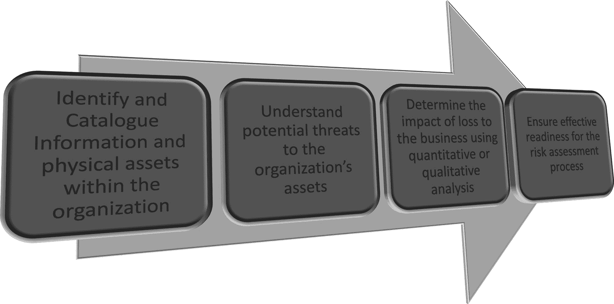

图 3.13 威胁影响分析。

## 3.6 保护与缓解策略

当前的网络时代对于信息或数据具有额外且特殊的地位 [15]。互联网的每一个方面都在从其层面产生、使用和存储数据以及信息。科学家们有意识地开发了各种方法和技术，以系统地管理这些数据。由于目前互联网上海量的数据，首先想到的属性就是安全。安全在这种种情况下是最昂贵且本质的东西。为了解决这个问题，有各种预防和缓解策略可用。

然而，你能做什么来阻止程序员并减轻数据渗透危害？对于专家来说，解决数据泄露和安全担忧不是一项容易的任务 [16]。此外，这不是一个可以个人利用的过程。对于使用的各种操作和资源，需要适当且可靠的安全和防御技术。从组织的角度来看，安全策略利用这些资源在网络边缘这种可怕的情况下确保数据安全。

此外，有一个大量的措施列表，继承了不同方面的威胁缓解策略。为了使其总结、简单且清晰，作者将这些策略归类为结论性主题并在后续的标题中讨论它们。作者还通过一张图像说明了缓解策略的基本功能，为读者提供了一个理想解决方案，说明缓解策略是否有助于保护、识别、缓解或其他任何术语。各种识别出的缓解策略将在后续章节中提到。

### 3.6.1 每日软件更新和升级

这是一个有效的步骤，有助于组织每天识别和保护其系统 [17]。系统配置和资产的每日频繁升级可以引导业务进入安全的架构，并在组织内部提供无破损的环境，如图 3.14 所示。通过这种缓解策略提供的基本功能是对软件受攻击的识别和保护。


图 3.14 缓解策略的基本功能。

### 3.6.2 账户隐私与权限安全

管理组织和软件的访问控制系统可以防止基于权限的软件暴露。这种情况会导致组织和软件陷入一些与收入和声誉相关的严重问题 [17]。为了管理软件内的权限安全，需要保护软件中的访问工作流并创建基于限制的访问管理。这种缓解策略也有助于软件的识别和保护，如图 3.15 所示。

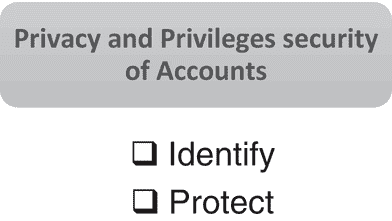

图 3.15 缓解策略的功能。

### 3.6.3 员工安全培训

这些缓解措施最为有效且高效。员工是组织中最脆弱、风险最高的资产，很容易通过有效的社会工程学攻击被触发 [18]。提供有效良好的安全培训可以为识别、管理和保护基础设施提供有效的应对措施，如图 3.16 所示。

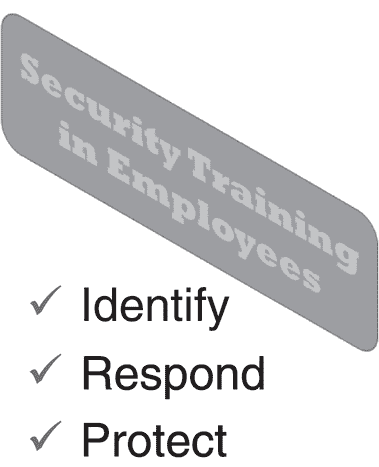

图 3.16 安全培训。

### 3.6.4 经常寻找网络漏洞


网络漏洞是导致被利用的主要原因。每日识别网络漏洞是安全缓解策略中最必要且最有效的部分。这就是为什么作者将这种缓解策略放在了优先位置。该缓解策略提供了识别、响应和恢复功能，如图 3.17

图 3.17 网络漏洞

### 3.6.5 多因素身份认证的实现

这种安全管理策略为组织应对安全威胁的措施提供了额外的安全保护层，如图 3.18

图 3.18 实现多因素身份认证

总而言之，我们可以说这些之前讨论的缓解策略为软件威胁和风险提供了有效的理想解决方案。管理安全威胁是一项挑战性任务，但维护上述策略可以帮助组织有效应对遭受被利用的情况。此外，为了理解这些策略策略的提供的基本功能状况，我们提供了表 3.2，该表说明了不同的缓解策略及其相关的基本功能。

表 3.2 不同缓解策略的基本功能

| 策略/功能 | 识别 | 响应 | 保护 | 恢复 |
| :--- | :--- | :--- | :--- | :--- |
| 每日进行软件更新和升级 | ✓ | | ✓ | |
| 账户的隐私和权限安全保护 | ✓ | | ✓ | |
| 员工的安全培训 | ✓ | ✓ | ✓ | |
| 频繁寻找网络漏洞 | ✓ | ✓ | | ✓ |
| 实现多因素身份认证 | ✓ | | ✓ | |

## 3.7 结论

软件威胁具有多样性和快速性。当前的数字化时代为各种安全威胁打开了大门，导致组织每天面临被利用的局面。作为安全专家，管理这种情况是一项具有挑战性且复杂的工作。作者试图描绘出目前有效渗透到软件开发策略及其资源的总结状态。软件开发威胁的现状表明，需要首先在安全开发蓝图中对各种威胁进行分类，然后分析它们的影响，之后进行缓解，以产生有效且安全的软件和组织系统。本章旨在提供与各种威胁及其对安全开发影响相关的简短有效的状况意识。随后，它提供了解决组织安全中问题的有效缓解策略信息。作者坚信，这种有效的研究为读者提供了恰当的路径，并让读者意识到可能导致组织陷入数据泄露危险的各种威胁。

## 关键术语

*   **资产 (Asset)**：组织需要保护和保存的，且对业务具有某些价值的东西。资产可能是该系统使用的软件或信息。
*   **攻击 (Attack)**：软件和任何系统通过某些漏洞或后门被利用的情况。
*   **威胁 (Threat)**：可能的业务或软件漏洞/后门，未来可能导致组织或系统陷入被利用的局面（目前尚未）。
*   **漏洞 (Vulnerability)**：可能导致被利用并使业务遭受巨大损失和损害的弱点或风险点。
*   **风险 (Risk)**：风险是对损失的预期，未来可能发生也可能不发生的潜在问题。
*   **恶意软件 (Malware)**：与恶意属性相关的应用程序，旨在用于在系统中执行某些有害操作。
*   **社会工程 (Social Engineering)**：理解、观察和分析受害者的社交、个人和私人活动，这些活动可以被用作攻击受害者的手段。

## 注意事项

*   攻击者的动机
*   利用的根源
*   网络和网络包分析
*   补丁管理
*   终端用户培训
*   身份验证
*   入侵检测
*   隐私侵犯/盗窃
*   勒索软件
*   网络钓鱼

## 选择题

1.  Q1 以下所有都不是真实威胁的例子：
    a) 黑客
    b) 病毒
    c) 垃圾邮件
    d) 蠕虫
2.  Q2 根据 CIA 三要素模型，以下哪项不被考虑？
    a) 机密性 (Confidentiality)
    b) 完整性 (Integrity)
    c) 授权 (Authorization)
    d) 可用性 (Availability)
3.  Q3 当你使用这个词时，意味着你在保护数据免受：
    a) 机密性
    b) 完整性
    c) 泄露 (disclosure)
    d) 可用性
4.  Q4 组织维护数据可用性的常用方法是：
    a) 数据集群
    b) 数据备份
    c) 数据恢复
    d) 修改
5.  Q5 当数据流过大导致系统无法处理时，发生的攻击：
    a) 数据库崩溃
    b) DoS (拒绝服务攻击)
    c) 数据溢出
    d) 缓冲区溢出
6.  Q6 从以下选项中，哪哪项对信息的威胁？
    a) 灾难
    b) 窃听
    c) 信息泄露
    d) 未更改的密码
7.  Q7 从以下选项中，哪哪项不是信息的漏洞？
    a) 洪水
    b) 存储介质的处置
    c) 未更改的密码
    d) 完成最新的补丁和更新
8.  Q8 损害机密信息属于：
    a) Bug
    b) 威胁
    c) 漏洞
    d) 攻击
9.  Q9 对任何信息的可能的威胁不能被：
    a) 减少
    b) 转移
    c) 保护
    d) 忽略
10. Q10 是为了保护价值信息免受未经授权的访问、记录或破坏而采取的做法和预防：
    a) 网络安全
    b) 数据库安全
    c) 信息安全
    d) 物理安全
11. Q11 公司的每个员工都需要具备网络安全的基础知识以及黑客类型及其实现：
    a) 正确
    b) 错误
12. Q12 近年来成为一种流行的攻击，攻击者的目标是组织的董事成员、高级官员和管理委员会成员：
    a) 间谍软件
    b) 勒索软件
    c) 广告软件
    d) 共享软件
13. Q13 如果你在公司的系统/笔记本电脑上工作，突然弹出一个窗口要求你更新安全应用程序，你必须忽略它：
    a) 正确
    b) 错误
14. Q14 在互联网上收集免费可用的信息是信息收集类型的一种示例：
    a) 主动
    b) 被动
    c) 主动和被动
    d) 非被动


# 15. Q15 `scanning`（扫描）是一种识别网络内系统漏洞的自动过程：

1. a) 网络
2. b) 端口
3. c) 漏洞
4. d) 系统

## 简答

1. Q16 软件安全中存在哪些类型的各种威胁？
2. Q17 什么是故意错误和非故意错误？
3. Q18 为什么员工安全培训对组织安全是必要的？
4. Q19 个人安全受入侵是指什么意思？
5. Q20 物理欺诈盗窃与非物理盗窃有什么区别？

## 简述题

1. Q21 什么是威胁缓解策略？请结合示例进行定义。
2. Q22 威胁的影响分析是什么？它是如何继承自风险管理的？
3. Q23 定义影响软件或组织安全的各种威胁类型并举例说明。

## 参考文献

1. [在线], 来源：[`www.guru99.com/potential-security-threats-to-your-computer-systems.html`](https://www.guru99.com)
2. [在线], 来源：[`www.logpoint.com/en/understand/types-of-cyber-threats/`](https://www.logpoint.com)
3. M. Jouini, L. B. A. Rabai, and A. B. Aissa, “信息系统安全威胁分类”，Procedia Computer Science, 32, 2014, 489–496. doi:[10.1016/j.procs.2014.05.452](http://dx.doi.org/10.1016/j.procs.2014.05.452)
4. G. Sandro, H. Željko, 信息系统安全威胁分类.Journal of Information and Organizational Sciences. 31, pp: 51–61, 2007.
5. M. Alhabeeb, A. Almuhaideb, P. D. Le, and B. Srinivasan, “信息安全威胁分类金字塔”,2010 IEEE 第 24 次高级信息网络与应用国际会议论文，Perth, WA, 2010, pp. 208–213. doi: [10.1109/WAINA.2010.39](http://dx.doi.org/10.1109/WAINA.2010.39)
6. R. Kumar, M. Zaroor, M. Alenezi, A. Agrawal, and R. A. Khan, “通过基于模糊的决策过程衡量软件的安全持久性”，International Journal of Computational Intelligence Systems, 12(2), 2019, pp. 627–642. doi: [10.2991/ijcis.d.190513.001](http://dx.doi.org/10.2991/ijcis.d.190513.001)
7. R. Kumar, A. Baz, H. Alhakami, W. Alhakami, M. Baz, A. Agrawal, and R. A. Khan, “用于评估软件可用性安全性的迟疑模糊决策分析混合模型”,IEEE Access, 8(4), 2020, pp. 72694–72712. doi: [10.1109/ACCESS.2020.2987941](http://dx.doi.org/10.1109/ACCESS.2020.2987941)
8. R. Kumar, A. K. Pandey, A. Baz, H. Alhakami, W. Alhakami, M. Baz, A. Agrawal, and R. A. Khan, “用于评估医疗信息安全有害因素影响的基于模糊的对称多准则决策程序”，Symmetry, 12 (664), 2020, pp. 1–23. Multidisciplinary Digital Publishing Institute (MDPI). doi: [10.3390/sym12040664](http://dx.doi.org/10.3390/sym12040664)
9. A. K. Pandey, A. K. Tripathi, M. Alenezi, A. Agrawal, R. Kumar, and R. A. Khan, “通过恶意软件分析产生高效安全代码的框架”,International Journal of Advanced Computer Science and Applications, 11 (2), 2020, pp. 497–503, The Science and Information (SAI) Organization Limited. doi: [10.14569/IJACSA.2020.0110263](http://dx.doi.org/10.14569/IJACSA.2020.0110263)
10. A. K. Pandey, A. I. Khan, Y. B. A. Alam, M. M. Agrawal, A. Kumar, and R. A. Khan, “医疗数据完整性的关键问题：分析与建议”,IEEE Access, 8, 2020, pp. 15847–15865.
11. J. Kaur, A.I. Khan, Y.B. Abushark, M.M. Alam, S.A. Khan, A. Agrawal, R. Kumar, and R.A. Khan, “通过自适应神经模糊推理系统对医疗 Web 应用程序进行安全风险评估：设计视角”,Risk ManagHealthc Policy 13, 2020, pp.355–371. doi: [10.2147/RMHP.S233706](http://dx.doi.org/10.2147/RMHP.S233706)
12. [在线], 来源：[`www.mitre.org/publications/systems-engineering-guide/acquisition-systems-engineering/risk-management/risk-assessment-and-prioritization`](https://www.mitre.org)
13. P.R. Garvey,风险管理分析方法：系统工程视角，Boca Raton, London, New York: Chapman-Hall/CRC Press, Taylor & Francis Group (UK), 2008, ISBN: 158488637.
14. K. Sahu and R. Shree, “软件安全：风险评估”,Journal of Computer Science & Engineering. 3, pp: 1–41, 2015.


指标是软件或系统属性的可量化测量。它是为了了解投资对流程或产品影响的一种努力。它对于定量或定性地确定增加的问责制、合规性和安全估算非常有帮助。根据 RSA 会议的报告，50% 的人认为当前的指标对安全变更、IT 风险、威胁预防以及人员/流程/技术的有效性提供的价值有限。69% 的人认为当前的指标与业务目标不一致。安全是多维的、突发的且不可还原的。这是一项通过安全指标实现安全保障定量和客观基础的努力。信息基础设施保护协会（I3P）报告称，安全指标将成为未来十年影响最大的研究领域 [[[1, 2]]。

大多数情况下，安全问题的出现是因为缺乏不可忽视的安全投入。安全估算与警觉性的运用密切相关。管理员需要确定衡量什么，理清使其变得合理且重要的因素，并制定出可重复的配方，以显示安全的预览状态以及其随时间推移的变化。科学家和行业专家正为确保安全做出巨大努力。然而，它在很大程度上可能会受到延迟安全评估的负面影响，这强烈倾向于安全和质量认证标准。为了有益的软件开发，应该接受对提前和准确安全评估的投入。在整个软件开发生命周期中，拥有可能稳健的提前方法和精确的安全评估似乎是不可避免的 [[[3, 4 and 5]]。

指标专家和学者对利用单一和协调指标对软件安全进行估计/评估有不同观点。尽管如此，分析师坚定认为，单一协调的安全指标可能导致整体的安全比例，而不是通过单一度量的范围对安全进行主观且不可避免的情绪翻译，后者只能给出明智的估算。人们明确感觉到，行业人士（包括专家）并不希望有各种碎片化的安全工作，而是对综合性衡量更感兴趣。安全衡量是安全方法、流程和产品的比例。安全管理员正在寻找一种能够计算风险和降低风险可行性的魔法公式，但安全衡量并非异常简单。 [[[11, 12, 25, 26]]。

现有的可用安全指标可能适用于开发初期。需要建立一个安全开发框架，以建立一套微小的指标体系或协调指标。

此外，这种培训由于某些原因可能变得非常有成效，包括：

* 在生命周期的早期阶段（设计和配置文档）发现基础阶段的漏洞；
* 降低更改成本 – 晚期发现和缓解漏洞比早期发现要贵得多；
* 从软件初始阶段进行安全监控是有益的；
* 对所应用的方法和流程进行定量分析；
* 更准确的资产分配规划取决于框架预期的错误倾向。


强调安全量化指标的可用性有限，A.J.A. Wang 表示，“安全测量在很大程度上是随意的，且安全指标通常是定性的”。S. L. Pfleeger 等人认为，某些当前的测量有助于描绘系统的不可侵犯性和强度，但仍需要更多的研究。长期以来，估计一直是良好科学的基石。事实上，指标使我们能够深入地了解周围的世界，并在其中做更多事情。量化测量是构建安全软件的骨干。它的行为在目标安全和可实现的安全水平之间起着平衡轮的作用。基于量化评估，很容易处理影响。基于某些指标的影响分析是应对该问题的更合适的机制，通过量化系统相关问题的某些特性，执行决定性指标作为对策措施的真正实现者。

衡量标准是相对于规范进行观察的测量。它有助于选择其他替代方案。它增强了软件工程师的访问能力，并在软件开发过程中区分风险。在估算安全性时，拥有能够表征真实重要性的选项是至关重要的。安全指标是相关测量的排列，能够根据遭受伤害、不幸或报复性攻击的机会来评估机会水平。对编程安全相关著作的全面审计发现，有效表征安全测量的领域过于年轻，甚至无法考虑一个范围内公认的定义。安全测量处于青少年期的背后问题是，目前的编程安全仍然是一个高度多样化的领域，尚缺乏全面且广泛公认的方法。在表征和提出安全测量方面已经做了大量工作。文献中存在不同的安全测量，并被安全网络广泛利用。大多数拟议的指标未能达到评估这些措施的设定目标，就像实验性地表征等效性一样。许多考虑被集中在所传递框架的运行安全、分解缺陷率、已知和未修补的漏洞以及框架配置上。安全测量很难评估，因为该学科本身仍处于发展的早期阶段。目前还没有通用的术语，可遵循的存档最佳实践较少。安全测量指的是对信任的量化估计，展示了框架在多大程度上满足安全需求 `[6–10]`。

## 4.3 定义良好的安全指标

没有测量，就不可能调整安全策略和实施机制以增强安全性。指标是软件安全从业人员估计强度、水平，以及应对他们所面临的安全问题的准备工作更具权威性的工具。指标同样有助于识别框架漏洞，为组织补救活动提供方向，并提高组织内部的安全意识。随着时间的推移，它们提供了重要的模式，并在跟踪执行和引导资源开始执行改进活动方面具有价值。许多创建者已经推荐了识别良好指标的各种方法，这些方法在 `图 4.1`、`4.2` 和 `4.3` 中引用。良好安全指标的属性应包含以下内容：`[7, 19, 25, 26 and 27]`。


| 安全泄露成本 | `CSB` | 该指标评估了安全泄露的总体费用。它衡量了与安全故障相关的真实业务损失。 |
| 人工与材料 | `TM` | 该指标对分配给安全功能的时间和材料进行估值。它展示了维护安全计划的实际商业成本。 |
| 安全合规性 | `SC` | 该指标估计了与安全规则的一致性。它产出了协调安全计划目标的一致性水平指标。 |
| 静态分析工具有效性指标 | `SATEM` | 该指标将实际缺陷数量与工具的误报率和漏报率相结合，然后根据目标组加载结果，以进行后续估计。 |
| 预测性未发现漏洞密度指标 | `PUVDM` | 该指标是`Vulnerability Discovery Rate`测量的外推。它对未知或理论上的漏洞提供了衡量。 |
| 缺陷严重性及严重性复杂度指标 | `FSCM` | 这些指标将详细的软件缺陷评为基本、高、中或低严重程度。它还判断了已识别漏洞和错误的数量、严重程度与包含它们的代码的不可预测性之间是否可能建立直接联系。 |
| Web 应用程序安全评分向量 (S-vector) | `SSV` | 该指标用于根据 Web 应用程序对特殊能力、基本保护和程序策略的要求进行评分，从而为应用程序创建一个通用安全评分。Martin 在他关于基于自顶向下 McCall 类方法的软件安全评估的论文中记录了另一种测量方案。 |
| 不变性指标 | `IM` | 该指标表征了可能的黑客进行非法代码更改的难度。 |
| 物理难度指标 | `PDM` | 该指标衡量代码修改的物理难度。 |
| 校验和效率指标 | `CEM` | 通过此指标衡量`checksum`算法的效率。 |
| 自检有效性指标 | `SVM` | 该指标表征了预期黑客进行非法代码调整的难度。 |
| 多样性指标 | `DM` | 该指标评估代码的多样性。 |
| 版本数量 | `NoV` | 这些指标统计相似系统的不同变体。代码在每个版本中都是复杂的，但实用性保持不变。 |
| 多样性因子 | `DF` | 这些指标统计相似系统的不同版本。代码在每种形式中都是复杂的，但实用性保持不变。 |
| 多复性指标 | `MM` | 该测量评估相似工具的调用次数。机制使用得越频繁，绕过它就越困难。 |
| 多复性因子 | `MF` | 该指标量化了实现组件的代码调整难度。 |
| 使用频率 | `FoU` | 该指标衡量工具使用的频繁程度。 |
| 隔离指标 | `IM` | 该指标用于评估工具与应用程序其他部分及框架的隔离。 |
| 代码隔离 | `CI` | 该指标调查实现工具的代码部分的物理断离开离。 |
| 数据隔离 | `DI` | 该指标处理实现工具的数据部分。 |
| 数据重用 | `DR` | 该指标倾向于衡量系统在未使用时更改其运行边界的难度。 |
| 上下文隔离 | `CI` | 所提的指标处理由特定情境提供的隔离。 |
| 可中断性指标 | `IM` | 这些提议的指标旨在保护工具免受干扰攻击。 |
| 强制介质 | `MM` | 所提的指标调查每次可以使用时所使用的组件。 |
| 介质因子 | `MF` | 该指标建立了组件的成功使用与其可能用途之间的比例。 |
| 介质效率 | `ME` | 该指标衡量使用的生产率，考虑到这种效率与工具在整个框架中的状况有关。 |
| 介质数量 | `NoM` | 对于每个使用组件的功能，此指标衡量其使用的次数。 |
| 审计能力指标 | `AAM` | 该指标旨在调查产品是否留下了其使用的可审计痕迹。 |
| 拒绝访问列表 | `LAD` | 负责评估系统在拒绝进入或某些活动时的表现。 |
| 报警触发指标 | `AMT` | 该指标评估警报触发系统的表现。 |
| 非标准行为检测 | `NSBD` | 该指标针对评估此类框架的效率，区分主体行为偏离正态的情况。 |
| 授权访问列表 | `LGA` | 该指标通过跟踪许可请求来分析框架的表现。 |
| 访问向量 | `AV` | 它量化了漏洞被滥用的方式，例如在本地或远程。攻击者攻击数据资源的距离越远，漏洞评分越高。 |
| 访问复杂度 | `AC` | 在攻击者访问目标框架后，它衡量滥用漏洞所需的攻击复杂度。所需的复杂度越低，漏洞评分越高。 |
| 身份验证 | `AU` | 它衡量攻击者为了滥用漏洞必须验证目标的次数。所需的验证用例越少，漏洞评分越高。 |
| 机密性影响 | `CC` | 它计算了攻击者为了利用漏洞必须验证目标的次数。所需的确认用例越少，漏洞评分越高。 |
| 完整性影响 | `IC` | 它量化了有效滥用漏洞对完整性的影响。扩展的影响性影响会增加漏洞评分。 |
| 可用性影响 | `AC` | 它量化了有效滥用漏洞对可用性的影响。扩展的可用性影响会增加漏洞评分。 |

安全指标是软件安全领域的一个新兴领域。许多产品项目、专家和专业人员创建了安全衡量标准。这些衡量标准与开发生命周期的各个阶段相关。对于软件开发的各个阶段，都可以对安全指标进行有效的审计。需求阶段、计划阶段、编码/执行阶段、测试阶段和支持阶段的安全指标见下方 [16] (Table 4.2, Table 4.3, Table 4.4 和 Table 4.5)。

### 表 4.2 需求阶段的安全指标 (#ch4.xhtml#R_table4_2)

| 安全指标 | 缩写 | 描述引用 [13, 14] |
| --- | --- | --- |
| 最低优先级安全需求数量 | `NLPSR` | 需求比其他需求小的安全需求数量，且这些需求不会对框架产生很大影响，或者没有影响。 |
| 高优先级安全需求数量 | `NPSR` | 该指标衡量需求比其他需求更大的安全需求数量，并考虑由于攻击框架而对框架产生最大影响或摧毁框架的需求。 |
| 记录的安全需求偏差数量 | `SRRD` | 该指标用于提供偏离安全需求的数量。 |


| 安全需求阶段 | SRS | 它给出了由于安全需求缺陷或不准确而导致的安全错误数量。 |
| 安全需求收集指标 | SRI | 它提供了关于先决社会事件和调查阶段的标记，阐明了安全需求对安全泄露/违规数量的影响。 |
| 安全需求总数 | TNSR | 它预期衡量在调查阶段识别/发现的安全需求数量。 |
| 安全需求比例 | RoSR | 这给出了直接影响安全的需求与所有先决总数之间的比例。`Rsr = SRI/IRI` 其中 `SR` 表示系统的安全需求集合。`R` 表示分配给系统的整个需求集合。 |
| 遗漏的安全需求数量 | NoSR | 它衡量了在检查阶段未被衡量的安全需求数量。 |

### Table 4.3  设计阶段的安全指标

| 安全指标 | 缩写 | 描述参考 [13, 14 和 15, 18]] |
| --- | --- | --- |
| 安全编码维度百分比 | PSCA | 这显示了根据计划在编码期间所考虑的安全视角水平。 |
| 编码标准使用率 | PCS | 它显示了编码指南的利用情况，以确保事件的发生，并在代码在使用期间维护安全规范的思想。 |
| 安全错误数量 | NSE | 该测量展示了作为整体编码错误和来自其他库代码错误的缺陷传达情况。 |
| 停顿率 | SR | 该测量预期衡量循环中非演进语句行数占循环总行数的比例。`SR` 用于计算循环中非演进语句行/循环总行数。 |
| 耦合损坏传播 | CCP | 其特征是带有依赖于第一次调用参数的调用的子方法数量。 |
| 关键元素比例 | CER | 它预期给出项目中基本信息组件占该项目组件总数量的比例。它量化了有害数据源污染程序的方式。`CER` 负责测量`对象中关键数据元素/对象中元素总数`。 |
| 精确率 = P | 它与真实的缺陷部分与预期为缺陷的片段总数有关。`Precision = TP/TP + FP` 其中 `TP` 和 `FP` 分别代表真正和假正。 |
| 召回率 = Rc | 其特征是真实的损坏部分占所有缺陷片段的比例。`Recall = TP/TP + FN` 其中 `TP` 是真正，`FN` 是假负。 |
| F 值 | | | 用于将精确率和召回率连接为调和平均数。`F - measure = \frac{2 \times \mathit{Recall} \times \mathit{Precision}}{\mathit{Recall} + \mathit{Precision}}` |
| 准确率 | | | 用于衡量预测的总体准确性。`Acc = \frac{TP + TN}{TP + TN + FP + FN}` |
| 对安全有直接影响的实施错误比例 | Reerr | 它给出了直接影响安全的数量与安全执行过程中错误总数之间的比例。`Rserr = Nerr/Nerr` |

| 安全指标 | 缩写 | 描述 |
| --- | --- | --- |
| 安全编码维度百分比 | PSCA | 这表示根据设计在编码期间考虑的安全维度的百分比。 |
| 编码标准使用率 | PCS | 安全开发通过在代码实现期间识别安全标准来使用编码标准。 |
| 安全错误数量 | NSE | 指标值负责统计编码错误和其他库代码以指示总缺陷。 |
| 停顿率 | SR | 提议指标值是循环中非演进语句行数与循环总行数之间的简单比例。`SR` 用于计算循环中非演进语句行/循环总行数 |
| 耦合损坏传播 | CCP | 被定义为基于原始调用参数调用的子方法数量。 |
| 关键元素比例 | CER | 提议指标值通过计算对象中关键数据元素与对象元素总数之间的比例来获得，以衡量可能感染程序的恶意输入。`CER` 负责统计对象中的关键数据元素/对象中的元素总数 |
| 精确率 | | 这是真实的缺陷组件与预测为缺陷的组件总数之间的比例。`Precision = TP/TP + FP` 其中 `TP` 和 `FP` 是真正和假正。 |
| 召回率 | | 被定义为真实的缺陷组件与缺陷组件总数之间的比例。`Recall = TP/TP + FN` 其中 `TP` 和 `FN` 是真正和假负。 |
| F 值 | | 用于将精确率和召回率结合为调和平均数。`F - measure = \frac{2 \times \mathit{Recall} \times \mathit{Precision}}{\mathit{Recall} + \mathit{Precision}}` |
| 准确率 | | 用于衡量预测的总体准确性。`Acc = \frac{TP + TN}{TP + TN + FP + FN}` |
| 对安全有直接影响的实施错误比例 | Reerr | 衡量直接影响安全的数量与安全实施中错误总数的比例。`Rserr = Nerr/Nerr` |

### Table 4.4  测试阶段的安全指标

| 安全指标 | 缩写 | 描述参考 [13, 14]] |
| --- | --- | --- |
| 测试的安全需求 | SRCT | 它倾向于显示经过测试的需求与收集的安全需求数量(NSRG)之间的比例。 |
| 过程有效性 | PE | 安全漏洞数量(NVD) 与通过安全测试的数量(MST)之间的比例。`PE = (N[VD])/ (M[ST])` |
| 安全测试率 | STR | 显示通过安全测试的模块占比例。`STR = (M[ST])/M` |
| 安全测试用例失败率 | Rtcp | 这计划给出未能区分执行错误的数量与旨在识别安全问题的用例数量之间的比例。`Rtcp = |TF|/|TP|+|TF|` |

### Table 4.5 维护阶段的安全指标

| 安全指标 | 缩写 | 描述参考 [13, 14]] |
| --- | --- | --- |
| 完成安全变更平均时间 | MTCSC | 这旨在给出交付安全漏洞的数量与框架补丁总数之间的比例。`MTCSC = MTTSF + MTTR` |
| 安全异常变更百分比 | PCSE | 它通过带有安全排除的完成变更数量占完成变更总数的百分比来进行评估。 |
| 发布解决安全漏洞的补丁比例 | Rp | 这意味着交付安全漏洞的数量与补丁总数之间的比例。`Rp = Nsp/Np` |


| 报告的安全事件数量 || Nsr | 它预计将量化人们所担忧的安全事件的数量。 |

## 4.5 安全指标开发流程

成功的指标开发过程有助于决定要衡量的内容。指标开发计划是一项有效的机制，可以根据合理的理由评估组织过去和当前的安全投资。它还将为未来努力的决策过程提供见解。它表明了良好的理解性、共同的信念，确保了计划的有效性和对任务的支持，而这说明通过安全指标的辅助，已经创建并实施了相应的安全策略。在开发安全指标流程时，应采取以下步骤：

1. 必须讨论并明确定义指标开发计划的目标和目的。
2. 如果有任何相关的可用指标，必须通过各个方面检查指标的有效性。
3. 在矩阵值与核心利益相关者之间建立强相关性。
4. 生成指标的有效方法。
5. 为适当的验证和目标建立基准（Benchmarks）。
6. 基于试运行前和试运行后的指标报告。
7. 如果需要任何升级的稳定举措，请准备一份有效的执行计划。
8. 建立正式的项目评审机制。

在缺乏区分和创建安全衡量的标准系统的情况下，这给人一种印象，即在开发生命周期的早期就尝试计划此类改进周期以立即执行安全衡量是非常有价值的。这有助于针对特定组织和不同的利益相关者群体定制安全指标。它最终评估了这些指标与整体安全计划预设目标关联的有效程度。

## 4.6 安全指标开发框架

安全指标开发框架是在软件开发的各个阶段对软件安全进行定量或定性可靠估计的机制。对编程安全进行可靠的定量或主观评估极具吸引力，而且通过在不同阶段创建安全衡量可以非常有效地实现。衡量指标的开发周期包括六个阶段，每个阶段都有指导性步骤，并在图 4.4 中以图形式描绘。该系统是基于规划优秀安全指标的必要和基本部分提出的。主要阶段从概念化开始。为理想的指标进行安排被视为一项重大任务。它被推进为一个后续阶段，随后是改进、假设性批准、试运行批准和打包阶段。人们已试图象征性地表达规划安全指标的精髓，并使该结构具有指导性，随后是对每个阶段的简要描述，其中包含了指标开发中所述的步骤。

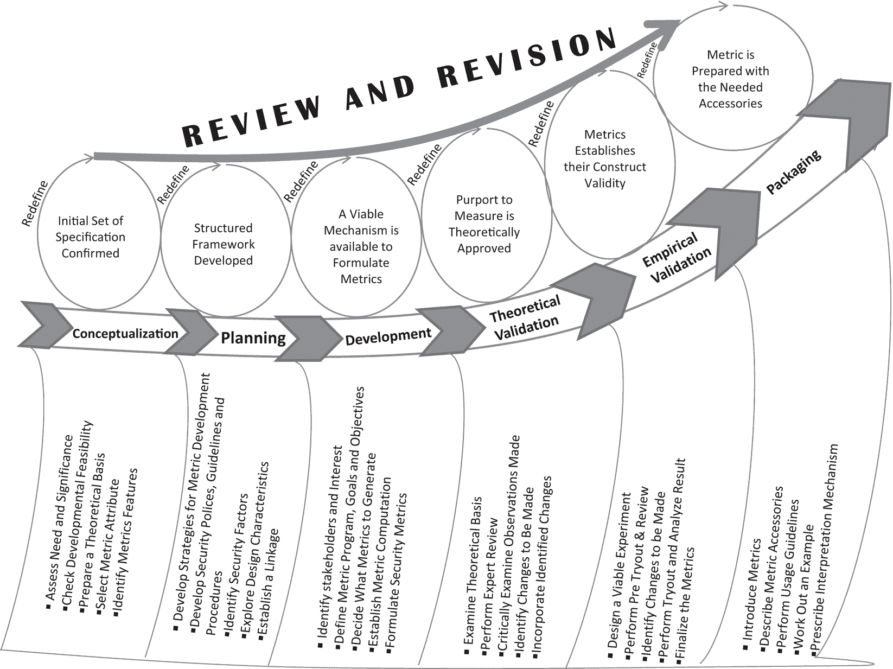

图 4.4 安全指标开发框架。

### 4.6.1 前提

当该框架被提出用于衡量对象所在计划安全，且接受不确定性作为关键边界时，考虑了以下前提：

* 可能可以使用所需指标的特性基本安排来界定其演变的理由。
* 确保收集优秀计划具有的通常公认的属性的一致性/遵循。
* 需要一种协调的方法来识别和保持与软件开发生命周期阶段相关的所有安全特定问题。
* 识别策略和指南作为软件安全衡量的源泉。
* 确保以某种方式控制可能影响基于结果预测的所有偶然和中间因素。

### 4.6.2 通用指南

在遵循安全评估循环之前的规则可以记录如下：

* 确保收集所提方案中基本和吸引特性的常规安排的一致性/识别。
* 识别并保持在不同阶段要衡量的所有安全组件。
* 将识别出的属性与其特征属性正确连接起来，以形成相关的衡量。
* 对于每一个重要级别的安全因素，没有通用的定义。
* 用于改进框架的安全属性集在特定情况下已通过操作进行了表征。[17\]

### 4.6.3 概念化

当该框架被提出用于衡量对象所在计划安全，且接受不确定性作为关键边界时，考虑了以下前提：

通过逻辑筛选来解决问题并优化方案是概念化阶段的首要挑战。初步想法通过各种参数进行评估，以实现相关事实。事实必须经过逻辑验证，并为指标的独特开发建立坚实的理论基础。

### 4.6.4 规划

此阶段有助于找到解决方案。它为设计人员和开发人员根据路线图提供了全面的指导。通过仔细审查安全策略和程序来消除异常。识别因素并调查设计属性。安全因素与设计属性之间的关联得到了维护。

### 4.6.5 开发

迫切需要建立一种行的机制来制定指标。这是软件安全设计中的一个基本方面。围绕已报告目标的指标可能有助于缓解漏洞。指标计划目标和目的得到了表征。最后建立了指标计算。

### 4.6.6 理论验证

验证的基础是检查开发的模型和指标是否衡量了它们应该衡量的内容。首先，负责处理涉及的活动或步骤。理论验证旨在通过文献调查和分析确保性。其次，所用指标的值是证明设计构造的准确指标，并为实证研究提供基础。

### 4.6.7 实证验证

第二步“实验验证”是用敏感信息进行试验，以证明创建的模型是理想属性的合法比例。批准环节认为一致性、操作性和充足性是模型开发过程的隐藏因素，三种正确特性的混合（大师直觉、真实的框架估计和假设性结果/调查）是合法水平的重要要求。


这是指标开发过程的最后一步。在此阶段，开发的指标被配备了成为功能性产品所需的必要设施。定义了指标，并讨论了它们的所有组成部分。规定了使用指南，并附有简要概述。最后，建议了一种实施技术。

## 4.7 结论

构建假设结构以及对安全测量改进的反思的参与部分得出的结论：

*   合理系统的安全测量改进结构可以被评估为系统各个安全属性的累积。
*   需要少量的测量安排来覆盖所有安全相关问题的部分。
*   指标应当经过表征，以便不同的人在不同时间或地点对相似框架获得相似的属性。
*   改进措施有助于评估编程的性质并为产品项目提供估值，从而促进新活动的评估和安排。
*   在整个软件安全评估衡量措施期间，应该进行非正式调查和更新。

为了对预期安全评估提供巨大的改进，有关安全指标开发体系的一些关键问题如下：

*   所提系统建立了一种将可量属性与软件安全联系起来的方法，进一步建立了不同安全问题与其元素之间的关系。
*   所提框架可以为软件项目的安全排序提供理由。
*   所提框架可以被用软件安全领域分析师的视角来源，以创建通过开发生命周期衡量安全的其他哲学方法。
*   行业专家可以使用所提框架为他们的产品打上安全分。
*   业务专家可能利用所提框架根据安全情况对业务进行排名，例如质量确认或评分。

## 术语

软件安全、安全指标、安全指标框架、安全指标开发过程。

## 思考点

1. 开发能够抵抗攻击的安全编程是当前形势日益增长的需求。
2. 没有评估就什么也无法预期。因此，对安全和漏洞进行评估对于预测产品的易感性和活性至关重要。
3. 在初始阶段对软件安全进行量化有助于安全的评估和评价，并为评估安全创新提供基础。安全评估有助于平衡安全目标和成本。
4. 安全指标是相关测量的排列，能够根据遭受伤害或不幸恶意攻击的风险评估机会水平。
5. 安全测量可行性模型理解先决条件的充分程度，这一水平取决于安全测量的动态能力。由于可行性水平强调了安全测量的可信度、可用性、估计方法以及与计划用途的适用性。

## 选择题

1. 入侵者是最常见的安全威胁类型，如下：
    * a) 账户访问
    * b) 数据访问
    * c) 黑客
    * d) 计算机访问
2. 在风险识别方面，必须识别出什么？
    * a) 所有威胁
    * b) 后果
    * c) 漏洞
    * d) 以上所有
3. 什么正危及软件的质量和时效性？
    * a) 业务风险
    * b) 后果
    * c) 漏洞
    * d) 以上所有


2. S. Islam 和 P. Falcarin,“软件安全需求的衡量”，第 10 届国际网络智能系统会议 (CIS), IEEE, 2011, 第 70–75 页, ISBN 978-1-4673-0687-4, DOI: [10.1109/CIS.2011.6169137](http://dx.doi.org/10.1109/CIS.2011.6169137).

3. G. McGraw 和 B. Potter,“软件安全测试”,IEEE Security & Privacy, 2(5), 2004, 81–85.

4. D.S. Herrmann, 《安全与隐私指标完全指南》，Auerbach 出版, ISBN: 0-8493-5402-1, 2007.

5. M. Swanson, N. Bartol, J. Sabato, J. Hash, 和 L. Graffo, “信息技术系统安全指标指南”，NIST 特别出版物 800–55, 国家标准技术研究院, 2003.

6. J. A. Chaula, L. Yngstrom, 和 S. Kowalski, “安全指标与信息系统安全的演进”，*第 4 届南非信息安全年度会议*,2004.

7. S. C. Payne, 《安全指标指南》，SANS Institute 信息安全作业版本 1.2e, 2006, 网络引用：[`www.sans.org/white-papers/55/`](https://www.sans.org), 最后访问时间 2022 年 6 月 20 日。

8. P. Goodman, 《软件指标：成功 IT 管理的最佳实践》，Rothstein Associates Inc., 2004 年 8 月.

9. [B. Alshammari, C. Fridge, 和 D. Corney], “开发安全系统：现有方法的比较研究”,软件工程讲义录, 2(2), 2016 年 5 月, 139–146 页, DOI: [10.7763/LNSE.2016.V4.239](http://dx.doi.org/10.7763/LNSE.2016.V4.239).

10. R. M. Savola, “软件密集型系统的安全指标开发方法”，信息安全及其应用进展，计算机与信息科学通讯, 36, Springer, 2009, 11–16 页.

11. J. A. Wang, H. Wang, M. Guo, 和 M. Xia, “软件系统的安全指标”，*ACMSE 议集*, 2009 年 3 月 19–21 日, 美国南卡罗来纳州克利姆森.

12. P. K. Manadhata 和 J. M. Wing, “一种攻击面指标”，技术报告。卡内基·梅隆大学（CMU）计算机学院, 2005, CMU-CS-05-155.

13. S. Jain 和 M. Ingle, “安全指标与软件开发进展”,工程研究与应用期刊, 4(5), ISSN: 2248–9622, 2014, (版本 7), 161–167 页.

14. K. Sultan, A. En-Nouaary, 和 A. H-Lhadj, “整个软件开发生命周期软件风险评估目录”，*国际信息安全与保障会议论文*, IEEE, 2008, 第 461–465 页.

15. I. Chowdhury, B. Chan, 和 M. Zulkerine, “源代码结构安全指标”，*第四次面向安全系统的软件工程国际研讨会议论文*, ACM, 2008, 第 57–64 页.

16. S.A. Ansar, R.A. Khan 和 Alka, “软件安全指标的分阶段审查”,网络通信与数据知识工程 (第 15–25 页), 2018 年 1 月. DOI: [10.1007/978-981-10-4600-1_2](http://dx.doi.org/10.1007/978-981-10-4600-1_2).

17. A. Agrawal 和 R. A. Khan, 安全指标开发框架（早期阶段）。《美国软件与应用期刊*, 2(6), 2013.

18. V. Nguyen 和 L. Tran, “基于依赖图预测软件脆弱组件”,*第 6 届国际会议*, 2010. DOI: [10.1145/18539](http://dx.doi.org/10.1145/18539).

19. O. S. Sayari, “一种良好的安全衡量方法”,*第 30 届会议*,2006.

20. S. Naqvi, “监控对自适应系统安全的影响”,硕士论文, 2005.

21. A. Alhazmi, Y. Malaiya 和 I. Ray, “分布式系统安全的量化”, *联合 IFIP WG 11 会议*, 康涅狄格州托福, 2005.

22. R. R. Barton, W. Hery 和 P. Liu, “用于 Web 应用的 S-向量”,工作报告, 宾夕法尼亚州立大学, 州立, 2004.

23. J. Hallberg, “使用概率模型的安全增长指标”,*第 44 届国际测试与评估会议 (TASE)*, 0-7695-2856/07,2007.

24. C. Cowan, “安全是如何衡量的?”,*软件工程进展会议 (ICSEA 2007)*, 弗吉尼亚州亚历山大, 2007.

25. F. Stevens, 《基于概率模型的入侵容性系统验证》，硕士论文, 伊利诺伊大学, 厄巴纳-坎槟, 2004. 网络引用：[`www.perform.illinois.edu/people/fabrice-stevens/`](https://www.perform.illinois.edu/people/fabrice-stevens), 最后访问时间 2022 年 7 月.

26. A. Ozment, “安全指标”,*第四次面向安全系统的软件工程国际研讨会议*, ACM, 2008, 第 224–231 页.

27. R. Savola, “面向信息通信行业的安全指标分类法”,*软件工程国际会议*,2007.

28. D. A. Chapin, “相对脆弱性”, *信息系统控制*,2005.

29. B. Alshammari, “相对脆弱性”,*第 10 届国际网络智能系统会议 (CIS)*, IEEE, 2003, 第 25–29 页.

30. S. Martin, “基于自上而下的类 McCall 方法的软件评估”,IEEE, 1988, 第 414–418 页.


* [软件安全指标策略](https://www.bsimm.com/framework/governance/software-security-metrics-strategy.html)](https://www.bsimm.com)
* [PCI 合规性](https://www.securitymetrics.com/pci)](https://www.securitymetrics.com)
* [向董事会推销安全指标](https://misti.com/infosec-insider/selling-security-metrics-to-the-board-of-directors)](https://misti.com)

# 5 软件安全估算

DOI: `[10.1201/9781003330516-5](https://dx.doi.org/10.1201/9781003330516-5)`

> 简单比复杂更难：你必须努力让你的思维变得纯净，使其变得简单。但最终是值得的，因为一旦你到达了那里，你就可以移山填海。
>
> 史夫·乔布斯

当下是一个数字化时代；每一个部门和行业都受到基于软件的数字自动化系统的监管。技术被应用于你日常生活中使用的和运行的每一个方面，从你的手机、无线手环到自动停车场 `[1]`。在世界最核心的领域，世界感受到了软件和 IT 业的爆炸性影响，而人们日常生活中对安全设计的需求，使得构建新的设计和新的安全技术变得迫不缓，以便在各种应用中实施先进技术。安全工程师的工作发生快速变化，这反映了技术的发展，以及该领域不断发展的新型专业化，同时也受到雇主优先考虑事项和实践经验的影响 `[2]`。这种全球性的技术使用和适应为这些系统产生了高风险因素，这些系统通常用于日常生活中的交易、控制，以及存储敏感的公共和私有数据。软件安全是一种依赖于主动方法的机制，即：为了让软件开发人员实现高水平保护，需要采取构建和执行信息安全要素的主动安全方法 `[3]`。此外，软件开发的主动方法意味着承认了软件的主要成功影响以及对软件的保护。

在任何行业，数字化在今天不仅重要，也是任何行业增加收入的最佳方式 `[4]`。数字革命的关键优势是快速的通信以及在可控的成本和时间投入下便捷的访问。在组织的任何数字化呈现中，软件都起着核心作用。通过其安全架构，软件被构建以满足公司的结构需求。然而，在数据泄露事故中，日益增长的软件依赖也导致了可疑的增长。一项网络安全评估研究显示，接近 54% 的机构承认其组织在去年记录了至少一次违规行为 `[4, 5]`。研究还指出，数据比例可能会更高，因为许多企业没有报告违规行为。许多企业认为，此类披露会影响客户的信任，导致收入损失并损害品牌形象。在另一篇文章中，英国航空报告称其软件故障问题在 2019 年受到了阻碍 `[6, 7]`。该故障导致约 100 架飞机被取消，同时其他 200 条航线的航班计划被中断。这种场景增加了对生产和维护增强安全应用程序的需求，以保护用户和组织数据。数据泄露的实例给开发人员带来了巨大的压力，要求他们构建不受不受攻击保护的安全软件。安全是一项困难且动态的挑战，因为确保和维持稳定性的保护具有复杂性。

软件安全是一种动态衡量标准，因为它依赖于多个变量和策略。分析这些因素以处理保护是一项至关重要的工作。因此，开发人员专注于从上构建稳定的应用程序以实现这一目标。从设计阶段开始，开发人员一直试图整合安全特性并识别软件中的潜在风险。此外，为了解决这一问题，本章有效地尝试描述软件中产生漏洞和可利用可能的各种因素。

## 5.1 目标

* 理解并描述安全概念、其不同技术以及在安全路径上遇到的障碍。
* 识别影响安全的因素。
* 强调一种可以为研究人员提供额外帮助的设计技术。
* 识别影响对象设计脆弱性的直接因素。
* 发现用于减少脆弱性的标准框架。
* 描述一种评估安全保障和状况的系统方法。
* 提供关于不同安全技术的信息。
* 强调一种让读者可以将本章知识应用于其专业领域的方法。
* 识别开发阶段软件的不同威胁和漏洞。

## 5.2 安全估算

安全保障的执行水平需要软件安全评估 `[7]`。某些危险利用硬件和软件的缺陷或弱点影响可用性、完整性、机密性和不可否认性，以及安全的不同部分，例如身份验证、保护和加密。安全策略和估算团队可以在结构阶段协作工作。


构建安全软件取决于对安全软件计划标准的使用。这些标准将在本部分中进行检查，而结构是软件确认的主要原因。软件安全确认有了许多定义，理解这一概念至关重要。增加软件合法性确定性的原因在于，要确保软件能够可靠地显示所有所需的属性，以保证在存在受支持漏洞的情况下，软件能够持续运行。从务实角度来说，此类软件必须具备抵御大多数攻击的能力，在那些无法避免的攻击情况下能够承受预期的攻击强度，并在发生任何无法避免或无法承受的攻击后，能够尽快修复损害并恢复到正常的活动水平。

此外，安全的软件理论只有通过安全的软件架构和设计才能实现。为了更清晰、更有描述性地理解安全软件的概念，作者在以下标题中对安全软件的不同属性进行了分类 [10, 11]]：

*   `机密性`：它指的是系统或软件在任何代价下维护信息隐私的能力。
*   `完整性`：这种能力指的是防止信息被未经授权的篡改和修改的软件质量。
*   `可用性`：这是一种帮助软件管理数据持续可用性并维持对数据授权的访问的能力。
*   `身份验证`：在软件中识别经过授权的用户身份的过程。
*   `授权`：这是一个识别授予任何用户访问权限的过程。
*   `审计`：管理软件用户之间数据交易的历史记录和移动。
*   `不可否认性`：它赋予软件管理每个用户问责制的能力。这意味着如果用户的活动是真实的，则任何用户无法否认其在软件上的活动。

这些都是安全软件的各种属性，在维护软件间安全方面起着关键作用。但这些并不是能够防止软件安全的全部实现手段。事实上，还有其他类型的安全软件模型，它们可以增强软件的安全性性能并管理软件架构中的数据安全。以下编写了一些重要且关键的模型。

### 访问控制模型

此类模型帮助软件开发人员管理软件内部数据的访问 [12]]。

*   `Bell-LaPadula 机密性模型`——该模型直接继承软件属性的安全性并在其基础上运行。Bell-LaPadula 运行的两个规则是：简单安全属性和安全属性。“不读上”由简单安全属性规定，即高分类级别的对象不会被特定分类级别的主体读取。“不写下”是安全属性，即高分类级别的主体不会向低分类级别写入内容。
*   `取授权（Take Grant）`——在此类访问控制中，授权用户根据某些特殊条件或时间，将其权利授予访客用户或其他用户作为授权。这种访问控制系统基于流管理的权限运行，即被授予的用户仅拥有真实授权用户允许的权限，且不能超出其权限范围，同时所有管理权限对授权用户始终可用。
*   `基于角色的访问控制（RBAC）` 在此类访问管理系统中，每个用户或端节点都根据其在组织基础设施中的职责和角色拥有自己的权限和权利。这些是预提供的权限。
*   `MAC（强制性访问控制）`——这是一种根据策略限制访问的自动化系统。
*   `DAC（任意性访问控制）`——与 MAC 相反，所有者有权分配权限。

### 完整性模型

此类系统提供了软件质量保障和原始性管理 [13]]。

*   `Biba 完整性模型`——这是一个确保任何类型系统完整性的模型。它根据两条规则运行，以防止数据从低级到高级的未经授权的修改。
*   `Clark-Wilson`——该模型也基于两条规则策略运行，第一条规则是对象相关的分类，第二条是数据的分类。

### 信息流模型

两个通信点之间的数据交易通过此类系统进行考虑 [14]]。

`中国墙模型`——此类模型为系统中的数据交易提供了安全性。该系统运行在无介质模型上。简单来说，在此类系统中，没有可用的限制一段时间内数据的介质策略。

### 估算模型

几乎每个发达国家和发展中国家都有自己的评估安全的估算政策和标准。美国有自己的；加拿大有自己的；欧盟也有自己的高数据标准标准。芬兰当局增加了一项极其有效实用的数据扫描和验证策略，随后被全球几乎每个国家采用。软件的安全估计是一个指标、模型和属性的结合过程。


* 高层设计图 (HLD)/低层设计图 (LLD)

## 第 2 阶段：安全评估流程

* 识别安全因素
* 身份/设计指标
* 验证套件指标套件
* 量化安全因素
* 评估安全

## 第 3 阶段：输出流程

* 定性分析
* 整体安全分析

作为本标题下提议模型的工作文化，第一阶段是初始水平的评估，评估人员在此开发评估所需的基础流程图和图表。此外，作为评估的第二步，评估人员应用采用的方法识别安全因素并评估安全性。在识别所有这些必要信息后，作为最重要的第三阶段，评估人员从数字和概念上对整个安全性进行分析。

## 不同安全模型

数据和其安全性确保了系统的标准。在信息仅通过物理文档访问的情况下，物理安全的焦点已转向数字信息。在任何情况下，了解物理安全的标准对于评估至关重要。特别是在信息共享时，识别出这些关键标准。显然，需要一种强大的防御机制来应对身份盗窃、未经授权的访问等类型的攻击。具体而言，最基本的安全措施是防止机密泄露。作者深信，只有通过应用安全标准才能实现机密性。此外，应用安全标准对于管理现有系统的安全性矩阵也非常重要。提供了多种安全评估和分析模型。

## 隐私管理模型

该框架的最重要目标是以下列点：

* 通过评估忽视系统的安全和隐私标准，概述可能的漏洞。
* 选择并采用特殊类型的工具和技术，以扩展组织的安全性。

这种类型的评估框架本质上用于评估现有系统的有效性，是有益的。

## NIST 安全框架

当你想针对安全或危险措施绘制循环时，基于 NIST 的关联是一个显著的关联，它对可能的安全主题提供了巨大的分布，见 `ch5.xhtml#fig5_2`。这种类型的评估框架为评估人员获取系统的安全性各个方面提供了能力。用简单的话说，该框架易于访问并理解每个安全需求，并在最终评估中报告它们。如果你一直想建立自己的安全系统，请考虑这一点。通常，评估的必要步骤与此模型相关，框架中关联的每个步骤都有其特定的功能和需求。


图 5.2 NIST 安全框架

## 软件保障成熟度模型

该框架的开发和管理是为了评估软件安全性并清晰地量化标准。如果你正在处理软件安全性，这是一个有帮助的资产。与其浪费时间衡量措施，不如利用这一重要数据源。模型的主要属性和意义记录并显示在 `ch5.xhtml#fig5_3`。

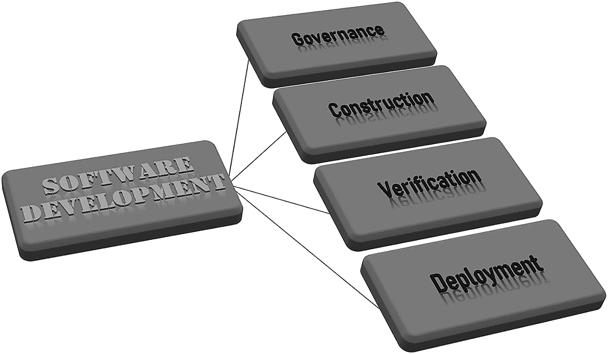

图 5.3 SAMM 模型

* 通过评估理解企业的当前标准和技术。
* 在识别软件安全标准和政策之后，现在是根据当前评估制定新政策的时候。
* 开发有助于组织安全的补充材料。
* 定期评估并识别组织安全中的漏洞。

### 5.2.2 安全风险评估

风险评估是一个产生关于安全可能漏洞的潜在报告的过程 `[15]。此过程应用多种标准和分析技术来评估组织安全中的潜在漏洞点。该过程与考虑的组织每个节点和资产相关，并在安全因子中应用安全标准化。这些相关因素是组织项目、项目执行所需的时间、工作流程以及许多相同点。

当风险评估报告未能建立适当的安全因子和分类时，就需要应用更标准、系统化的评估过程。

1. **识别**：对组织的基础资产和功能进行评估。
2. **评估**：在可能的威胁标准下对组织的每个过程、资产和功能进行评分，以量化其影响和未来可能性。
3. **缓解**：对资产和其他组织属性进行评分后，这是一个修复风险的步骤，与其严重程度相比规模更大。
4. **预防**：此评估阶段关联组织在识别和缓解风险后采取的可能应对措施和预防技术。

### 5.2.2.1 风险评估的意义

为了确保组织软件风险评估模型非常有帮助。风险评估过程为组织提供了一条理想路径来保护以下资产：

* 组织资产分析和严重程度识别。
* 组织中每个特定资产的风险配置。
* 组织评估风险因素可能对其带来什么样的损害也非常重要。
* 风险报告和评估评分对业务决策及其未来使用具有重要意义。
* 风险评估在员工管理方面也有重要贡献，员工评估报告帮助组织识别组织中的可能员工。

这是组织安全的一个重要点，风险评估和报告不仅是在组织生命中进行一次。该过程是一个常规循环过程，每次都结合组织的各个方面。风险评估的定期检查对组织非常有益。

### 5.2.2.2 软件安全风险评估

风险定义了一个涉及暴露危险的情况。它意味着对偏离预期来源的未来不安全。可以通过信息系统通过识别、估计和优先考虑操作和组织行为的风险来对其评估。对上述逻辑构造的合理评估可以表示为风险评估的公式。

```
Risk = Asset * Threat * Vulnerability
```


用于收集风险评估信息的各种可用方法如下：

* 对数据所有者和其他员工进行访谈
* 分析系统和其他其他基础设施
* 审阅文档和其他相关源以收集信息

图 5.4 所示的风险评估迫切需要以下步骤：

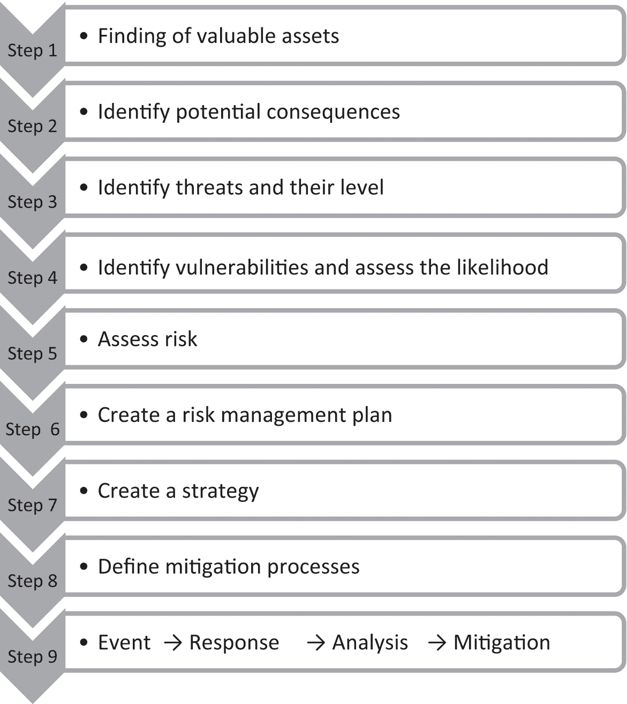

图 5.4 风险评估步骤。

1. **第 1 ：** 找出组织最有价值、需要免受威胁侵害的所有资产。这些包括：
    * 数据服务器
    * 客户凭据
    * 交易数据
    * 贸易协议文档
    * 网站
2. **第 2 ：** 现在找出可能损害我们资产的潜在后果，包括数据丢失和法律后果。
3. **第 3 ：** 下一步是识别威胁及其影响水平。示例例如下：
    * 系统故障
    * 恶意行为
    * 自然灾害
    * 意外的人为操作
4. **第 4 ：**** 必须识别所有可能损害资产的弱点。首先识别漏洞并评估其发生概率，以了解影响以及可以应用哪些缓解机制来最大限地减少损害。
5. **第 5 ：**** 风险评估将规定产生的漏洞是否有可能被利用导致资金损失。通过使用逻辑公式，我们可以将这些风险分为不同的严重程度（如高、中、低），并对其成本进行估算。
6. **第 6 ：**** 图 5.5 展示了一个根据威胁、漏洞、资产和后果、风险及其解决方案理解风险管理计划的示例。
    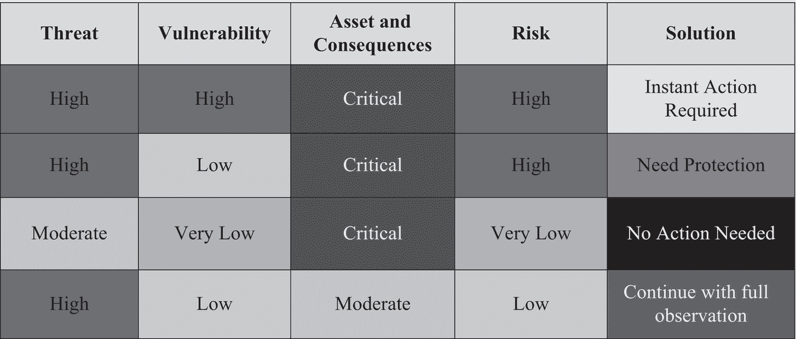
    图 5.5 风险管理计划示例。
7. **第 7 ：** 制定信息技术基础设施改进的政策，以减少最显著的漏洞并获得管理层的批准。
8. **第 8 ：** 这一步骤迫切需要缓解过程，通过识别危害最小的后果来改进信息技术安全基础设施。
9. **第 9 ：**** 图 5.6 展示了一个针对服务器故障的简单缓解过程示例。

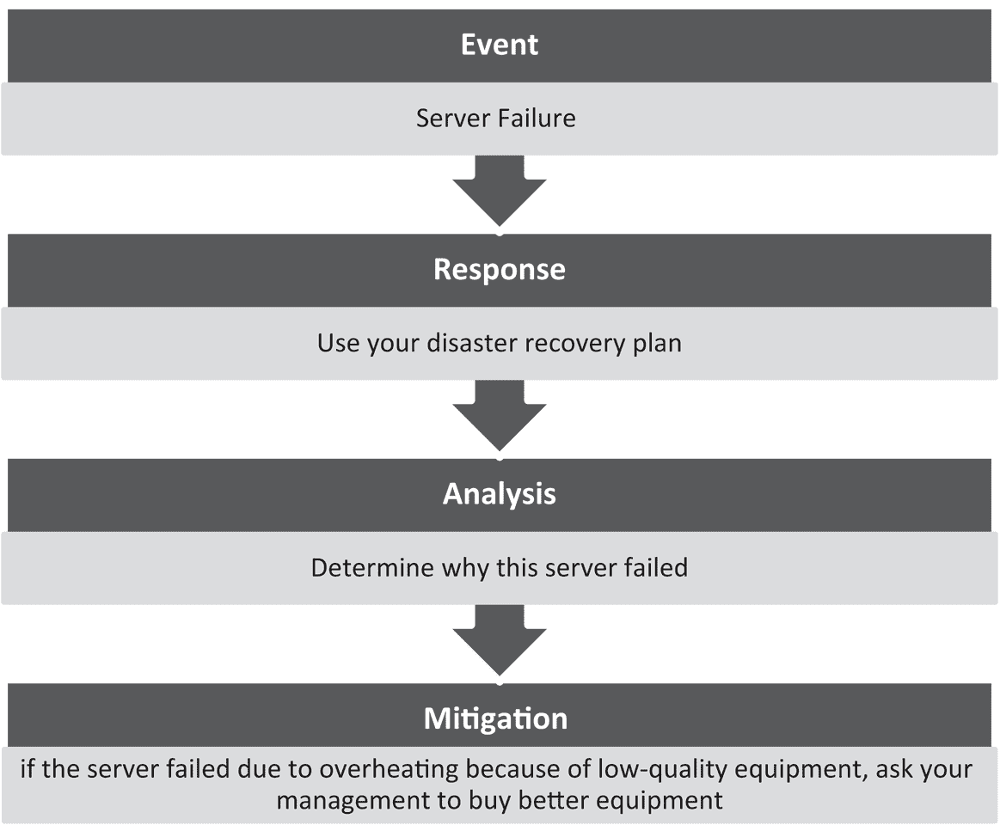

图 5.6 简单缓解过程示例。

### 5.2.3 漏洞评估

这是一个包含对组织漏洞进行评估的过程。漏洞通常是指组织中在未来具有潜在的破坏性利用可能的问题点。漏洞点和问题会根据业务和组织的性质而变化。根据资源和环境需求，每个组织的漏洞潜能性也是不同且多样化的。在基础设施水平较低的数字化过程中，漏洞的增长率是一个高度关注的问题。技术结构和设计中的漏洞为组织安全提供了被利用的可能性。

漏洞评估模型可以对安全产生以下重大贡献：

* 对组织基本资产和功能的评估。
* 组织中每个特定资产的风险状况。
* 组织评估风险因素可能给组织带来什么样的危害也是非常重要的。
* 风险报告和评估评分对业务政策制定及其未来使用有重大贡献。
* 风险评估在员工管理方面也有重要贡献，员工评估报告有助于组织识别组织内部可能的有害性员工。

在讨论了漏洞的基础知识后，现在讨论漏洞的特征变得重要且具有意义，这可以为安全架构提供理想的概述。

从安全角度分类漏洞有以下可能性：

* 代码语法错误或代码的小型 Bug。
* 导致整个系统结构处于危险的设计级流程，需要反向设计寻求解决方案。

### 5.2.4 漏洞评估框架

如上所述，漏洞评估是一个高度敏感的过程，直接影响组织安全及其管理。漏洞评估是多个阶段中的一个步骤，关联了从启动到管理的分类。漏洞评估框架是一个循环过程的结合，包含了从初始构思到常规监控阶段。为了强调所有方面并对过程提供简要描述，作者在图 5.7 中详细描述了其功能。

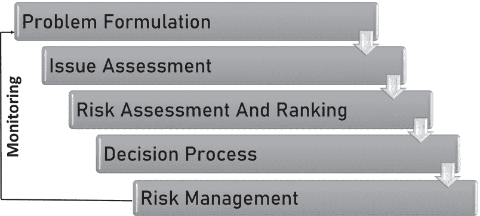

图 5.7 漏洞评估模型。

漏洞评估是风险和威胁评估的结合版本。

### 5.2.4.1 风险评估

风险评估是一个产生关于安全可能漏洞潜在报告的过程。该过程应用各种标准和分析技术，以评估组织安全中的潜在漏洞点。该过程将组织的每个节点和资产纳入考虑范围，并在安全因素中应用安全标准化。

### 5.2.4.2 风险最小化或管理

这是一个利用评估评分并根据风险严重程度进行分类的过程。危害较大的风险点被归为高严重，低可能的风险点被归为低严重。在评分后，人员根据具体的评分应用管理和缓解方案。

#### 5.2.4.3 监控与自适应管理

该阶段在循环过程中汇总风险的定期检查和管理。


*   选择并采用某些特殊类型的工具和技术，这些技术能够对系统进行额外的安全扩展，并防止未来的漏洞被利用。

这类框架本质上用于评估现有系统，并对评估安全的有效性具有重要益处。

*   软件保证成熟度模型 (Software Assurance Maturity Model)

该框架的开发和管理用于估计软件的安全性，并以数字形式清晰地量化其安全标准。当你将安全性作为软件属性来处理时，这是一个非常有用的资产。盲目猜测是无意义的，因此请利用这一重要的数据源，而不是浪费时间。文中列出了该模型的主要属性和意义。

*   通过评估了解企业当前的安全标准和技术。
*   在识别出软件安全标准和策略后，现在是根据当前评估开发新策略的时候。
*   开发补充材料，以帮助组织内开发的安全指标。
*   定期评估并识别组织安全中的安全漏洞。

## 5.3 安全画像分析 (Security Profiling)

软件画像分析（Profiling）是软件开发生命周期过程中必须具备。它为设计人员理解由于某些原因而隐藏的软件其他属性和功能打开了门。软件在开发完成后会出现许多可用功能和用途，但遗憾的是软件没有能力妥善编译其平台和工具。这种情况通常会导致软件崩溃。对软件进行适当的画像分析和分类是一个补充步骤，它其中关联了风险建模和评估。出色的画像分析可以为行业产生有效且实用的软件，为开发者开发基于画像方法的软件铺开翅膀。图 5.8 描述了一个包含以下组件的画像分析计划。

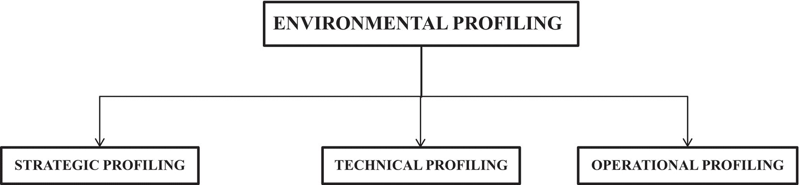

图 5.8 画像分析计划。

### 5.3.1 环境画像 (Environmental Profiling)

评估人员和分析师总是需要识别组织的物理、虚拟和非物质组件以进行评估。由于资产的多样性，在识别过程中妥善分类和收集每一件资产总是是困难的。环境画像通过将每个环境需求整合在一个地方，为组织结构提供了额外的组件，这对于每种评估和开发都是很有用的，如图 5.9 所示。

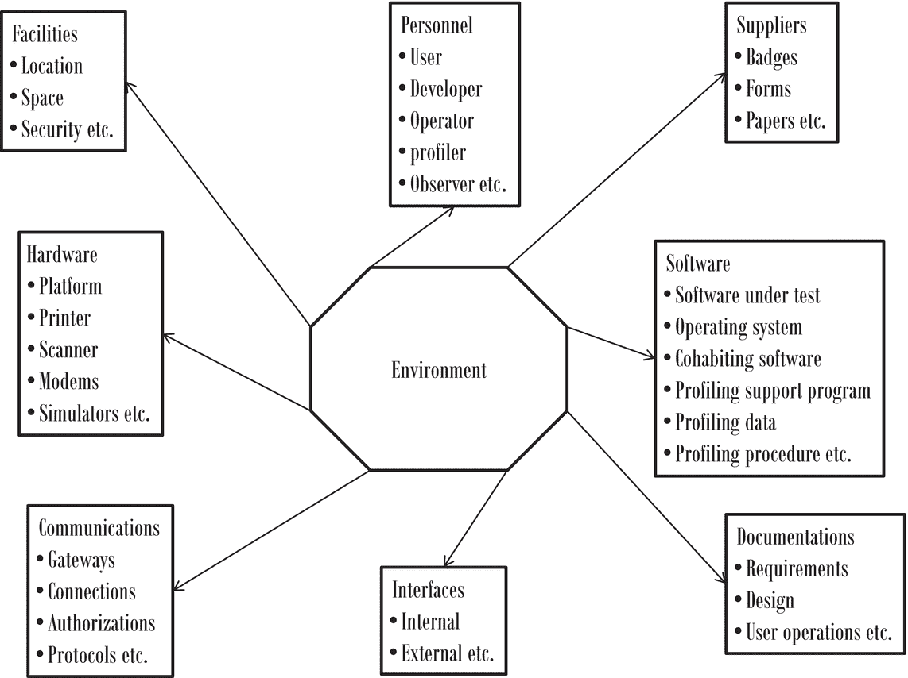

图 5.9 环境画像。

环境画像是由画像分析团队执行的流程，它关联了评估人员以及组织的各项需求和评估需求。这种情况和过程确保了资产的更新状态，并确保环境需求与组织需求高度兼容。标准的画像分析流程和所采用的安全画像分析方法有一套自己的预定义规则，用于将组织中的环境画像关联。下面描述了某些步骤：

*   需要特殊的画像分析工具；
*   任何其他画像分析需求；
*   捕获或画像过程不意损害组织需求，也不在其中执行任何非预期活动，

为了让开发者更容易操作和采用，专家尝试在他们采用的画像中提供更真实的感受，他们采用高配置的工具和方法来执行画像分析，并在真实开发过程的比较中衡量其敏感性。用更简单的话来理解这个概念，假设如果一个系统设计用于不同平台上的兼容工作，那么在它的画像部分，系统将决定是将所有兼容平台都纳入画像中，还是仅与风险平台一起运行。

### 5.3.2 战略画像 (Strategic Profiling)

本节包含了理解安全领域画像概念所需的所有信息和需求。战略画像是一个强调整个画像分析过程，并开发其流程所需需求和框架的流程。在每个阶段进行画像分析应结合特定阶段的语境进行解释，每个步骤都有其自己的输入和输出标准，以及在框架中确保操作顺畅运行的路径。本章的这部分简要提供了画像分析的完整概念及其需求，同时也提出了与开发相关的画像分析步骤。

考虑软件的各个方面和功能对于画像分析步骤本质上是必要的。这些考量开发出了一种系统性的画像策略，可以减少无效结果并提供一种战略性成果，以优先实现组织安全。

画像策略的标准是开发完成的，并在其开始之前作为预处理发送到战略画像部分。需要设置一些里程碑或验证点，以提供关于哪些过程已完成，哪些尚未完成。例如，假设有一个项目涉及检查某些过程，其中仅对 80% 的过程进行了画像分析，其余过程处于待命状态。现在，为了给评估人员提供一个清晰且系统化的流程，需要一个里程碑差距来提供操作运行状态的信息。图 5.10 阐述了战略决策的一些典型影响。

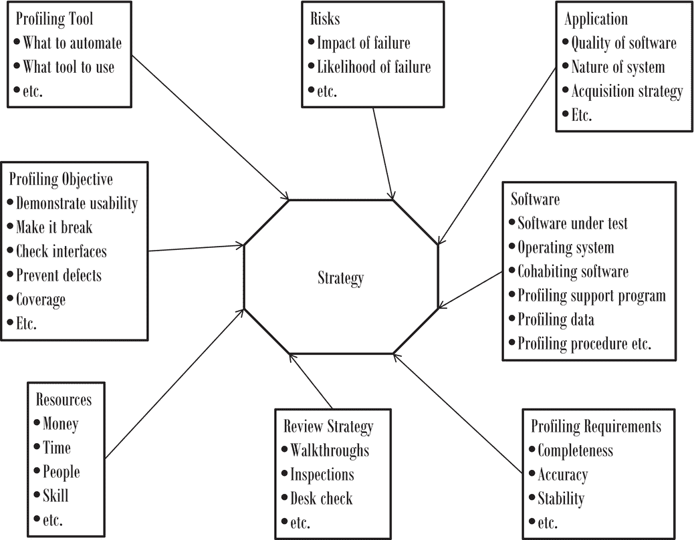

图 5.10 战略画像。

### 5.3.3 技术画像 (Technical Profiling)

画像规范中需要解决的另一个主要问题是适当工具的选择和自动化。工具是画像团队最重要且最有益的因素，赋予他们额外的力量。良好的工具选择有助于他们产生非常有效的结果，但如果工具选择错误，在画像分析中也会产生许多反面影响。有很多应用程序和工具具有其重用说明，说明要以冷静的心态使用它们，并在有额外时间的空平台上运行，因为良好的物品需要很长时间来创建。此外，为了选择工具，对评估需求进行分类总是重要的。工具完全基于需求，而且没有任何工具可以允许用户实现其所有需求，因为需求具有多样性。这种情况为评估人员创造了条件，他们必须同时使用一种一种同类工具，以获得不同的视角和结果，从而获得出色的结果。

### 5.3.4 运营画像 (Operational Profiling)

这是一个画像步骤，关联了每项画像操作的信息并根据常规循环流程对其进行监控。运营信息的关联包含了关于画像操作的所有类型信息以及它们是运行状态还是待命状态，如图 5.11 所示。为了运营画像制作文档，评估人员需要准备测试结果报告、日志以及许多需要额外精力和时间投入文档。画像行业有一句流行说法，测试只需要 40% 的精力，其余所有的精力都需要借用资源和测试后程序。

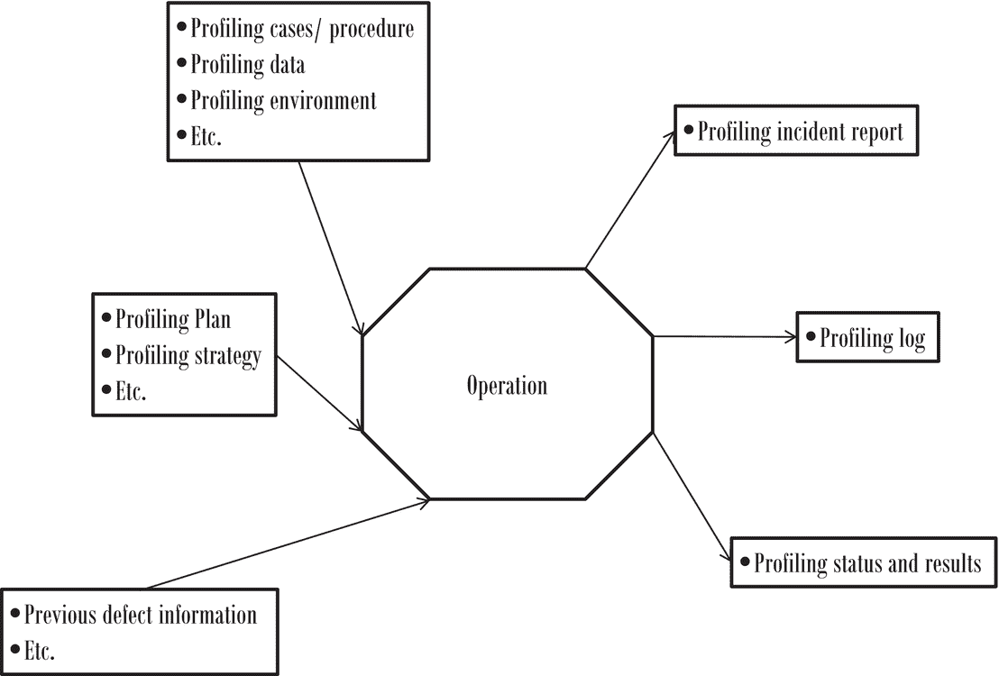

图 5.11 运营画像。


为了针对你的发现收集证据，你必须关联每项测试结果；如果使用了工具进行测试，它们会自动记录输入和结果。此外，对于手动测试过程，测试人员必须准备好带有经过验证的输入数据集的结果文档，以确保其有效性和准确性。

## 5.4 操作能力

性能分析测试是一个对所考虑数据集始终存有疑问的过程。测试人员始终需要携带每个具体的测试证据，以便在案卷中验证他们的结果。一个良好的评估和演进过程包含了有关组织的所有信息，并拥有针对组织平台中测试得出的每项结果的证据。

* 过去数据/过去经验
* 可访问的文档/知识
* 假设
* 已知风险

软件项目估计的四个基本步骤是：

* 估算开发项的规模。
* 估算以人月或小时为单位的工作量。
* 估算以月为单位的时间表。
* 估算以货币计算的项目成本。

### 软件估计观察

* 估计不需要是项目中的一次性任务。它可能发生在：
    * 获取项目期间。
    * 安排项目期间。
    * 项目执行过程中根据需要出现时。
* 项目程度必须在评估周期开始之前感知。拥有记录的项目数据将很有用。
* 任务衡量可以提供可验证的视角，并为定量评估的年龄做出重要贡献。
* 安排需要专业的主管和产品组来制定基础任务，因为它促进了义务和责任。
* 过去的经验可以非常有帮助。
* 至少使用两种评估程序来得出评估结果并适应随后的特征。参考下一节中的分解技术以了解如何调整评估。
* 计划应该是迭代的，并允许在长期内根据更多细节已知时进行更改。

通常使用的项目估计方法是分解技术。分解方法采用划分和克服的策略。通过将项目拆分为重要的功能或相关的软件工程活动，以分步方式进行规模、工作量和成本的评估。

1. **步骤 1：** 理解要制造软件的范围。
2. **步骤 2：** 生成软件规模的估算。
    * 从范围说明开始。
    * 将产品分解为每个都可以单独评估的能力。
    * 计算每个能力的规模。
    * 通过将规模属性应用于你的标准效率衡量标准，推断工作量和报价。
    * 汇总工作评估以创建整个项目的总体估算。
3. **步骤 3：** 生成工作量和成本的估计。你可以通过将项目分解为相关的编程设计活动得出工作量和报价。
    * 识别完成任务需要执行的任务组。
    * 将任务拆分为可以估计的任务。
    * 估计完成每个任务所需的工作量（以小时/天计）。
    * 汇总任务分配的工作量评估，以交付任务的估值。
    * 从数据库获取每个任务的成本单位（即成本/单位工作量）。
    * 记录每个任务的总工作量和成本。
    * 汇总每个任务的工作量和报价，创建整个项目的总工作量和报价。
4. **步骤 4：** 协调估值：将步骤 3 的后续结果与步骤 2 得到的属性进行比较。如果两组估值一致，那么你的数字是非常可靠的。此外，如果出现不同的估值，则需要进一步检查是否——
    * 项目范围未被充分感知或被误解。
    * 能力和额外工作的分解不准确。
    * 用于评估策略的历史信息对于应用不合适、过时或已发生扭曲。
5. **步骤 5：** **确定**差异的原因并随后调整估值。

## 5.5 安全测量过程

没有估计，我们就无法构建高质量的软件或改进你的周期。估计对于实现预测、进度和周期改进的核心管理目标至关重要。DeMaro 一句经常被引用的名言：“你无法管理你无法量化的东西！”所有的周期改进必须基于对你过去过哪里、现在在哪里的估计，并正确利用信息来预测你将去哪里。收集良好的衡量标准并正确使用它们通常会导致衡量的改进！

### 5.5.1 衡量标准、指标和指示

产品估计是软件项目、产品或周期的任何部分的量化衡量标准、属性或措施。它是与产品周期和产品不同组成部分相关的原始数据。表 5.1 提供了了一些有益的板面衡量示例。

表 5.1 示例管理指标

| 领域 | 衡量标准 |
| --- | --- |
| 要求 | CSCI 要求，CSCI 设计稳定性 |
| 性能 | 输入/输出总线带宽，处理器内存利用率，处理器吞吐量利用率 |
| 时间 | 要求分配状态，初步设计状态码和单元测试状态，集成状态 |
| 成本 | 人月工作量，软件规模 |

开发了不同的方法和规则来评估软件的各种功能，为开发专家提供了一个理想的状况分析情况：

* 监控需求，
* 预测开发资源
* 跟踪开发进度
* 理解维护成本。

衡量标准用于通过过去的执行或早期的估值查看你程序的当前状态，并从程序内部以前的信息中获取。它们显示了属性增加或减少的趋势，仅相对于相似衡量的过去估计值。它们还显示了对预设限制的遵守或违背，例如允许的静态缺陷。衡量标准对于决定“业务策略”（资源如何被使用和消耗）也很有价值。


看板的衡量结果将是估计值，有助于评估安全部门在持续实现获取计划方面的进展，或合同工人在持续实现其软件开发计划方面的进展。看板衡量模式支持了对未来进展、早期问题发现以及计划变更真实性的估算。项目贷分预计将出现在项目衡量中，这些衡量决定了客户对交付项目或服务的满意度。从客户的角度来看，项目贷分可以是可靠性、便利性、实用性、专业支持、响应能力、问题空间信息和理解以及可行性（针对困难领域的创新解决方案）。项目属性预计用于评估软件质量要素，例如：效率、完整性、可靠性、生存性、便利性、正确性、可行性、真实性、扩展性、适应性、紧凑性、重用性和互操作性。周期衡量用于检查创建和交付软件项目所需的关联、设备、方法和技术。周期属性用于确定每个开发阶段（从需求分析到客户验收）以及每个阶段投入的资源（资金、人员和时间）的状态。

从业务角度来看，通常使用五类衡量指标来量化软件的数量和性质。在开发过程中使用专门的缺陷衡量指标。随后收集销售者的交易衡量指标，其中包含了客户满意度、保证和声誉。

### 5.5.2 技术指标

技术指标用于判断代码是否整体组织良好、设备和软件的使用说明书是否充分、文档是否完整、正确且最新。专门指标还描述了框架执行的外部属性。

`Defect Metrics`（缺陷指标）用于发现框架不会错误地处理数据、不会异常终止，且不会发生与产品级框架相关的各种故障。

`End-user satisfaction metrics`（用户满意度指标）用于描述使用框架获得的价值。

`Warranty Metrics`（保证指标）反映了根据情况修复软件缺陷相关的特定收益和成本。这些衡量受缺陷程度、客户提交投诉的意愿以及软件工程师配合客户的准备和能力的影响。

`Reputation Metrics`（声誉指标）用于评估客户对产品的明显满意度，可能会产生最大的价值，因为它会极大影响软件的采购。声誉可能与实际满意度完全不同：

- 因为单个客户可能只使用任何软件包提供的功能的一部分；以及
- 因为营销和宣传对购买者软件质量看法的影响大于实际使用。

## 5.6 结论

软件挑战是一个具有多样性且节奏不断的问题。当前的数字时代为一系列安全威胁打开了大门，每天导致企业遭受利用。作为一名安全专家，管理这种情况是一项复杂且艰巨的任务。作者试图通过进行漏洞评估来审查 `SDLC` 内部先前安全措施的有效性。例如，一个正确教授开发人员进行安全编码并开展安全架构和源代码审查的组织，可能比一个不说话的组织更脆弱。软件生产风险的现状表明，首先识别并继评估各种威胁的影响，然后尽量减少威胁，以确保软件和组织结构是高效且稳定的。本的章节旨在以简明且有效的方式提高对各种威胁及其对安全开发影响的意识。这为解决组织安全领域安全问题的缓解方法提供了有用信息。作者坚信，这样成功的研究为读者提供了合适的方向，并让读者意识到实体在侵害风险中面临的各种威胁。

## 关键术语

- **Auditing**（审计）：记录系统上的历史事件。
- **Attack**（攻击）：软件和任何系统通过某些漏洞或缺陷被利用的情况。
- **Threat**（威胁）：可能导致业务或软件漏洞/缺陷，未来可能导致组织或系统进入被利用的境地（目前尚未发生）。
- **Vulnerability**（漏洞）：可能导致利用并导致业务遭受巨大损失损害的弱点或风险点。
- **Track**（跟踪）：监控风险和缓解计划。
- **Control**（控制）：拥有权威授予的所有权利和权限。
- **Confidentiality**（机密性）：信息免受未经授权间谍窥探的隐私。
- **Auditing**（审计）：记录系统上的历史事件。

### 记住的点

- 软件构建是一种设计控制，涉及软件创建的所有部分。
- 当你更改现有的软件框架以满足新需求时，就会软件开发。变化是持续的，软件必须不断演进以保持价值。
- 风险管理是一个为业务安全提供支持，并帮助组织识别和减轻潜在的业务和技术风险的过程。
- 安全工程是一种前瞻性的综合方法，与 SDLC 结合并产生可持续且安全的软件。

## 复习题

1. 定义软件安全时需要注意的哪些点？
2. 漏洞分析的意义是什么？
3. 安全软件的基本安全属性是什么？
4. 为什么软件安全是最受关注的话题？
5. 我们是否需要在软件开发周期的每个阶段审查安全性？
6. 安全软件的基本安全属性是什么？
7. 风险分析的意义是什么？
8. 为什么需要安全工程？

## 选择题

1. 根据 CIA 三要素模型，以下元素中哪一个不被视为三要素之一？
   1. 机密性 (Confidentiality)
   2. 完整性 (Integrity)
   3. 真实性 (Authenticity)
   4. 可用性 (Availability)

2. 当你使用单词 `_\_\_\_\_` 时，意味着你正在保护你的数据不泄露。
   1. 机密性 (Confidentiality)
   2. 完整性 (Integrity)
33. 授权
   4. 可用性 (Availability)

3. 维护组织数据可用性的常用方法是 `_\_\_\_\_\_\_\_\_\_`。
   1. 数据聚类 (Data clustering)
   2. 数据备份 (Data backup)
   3. 数据恢复 (Data recovery)
   4. 数据篡改 (Data Altering)

4. 当出现系统无法处理的海量数据流时，会发生 `_\_\_\_\_`攻击。
   1. 数据库崩溃攻击 (Database crash attack)
   2. `DoS(DenialofService)`攻击
   3. 数据溢出攻击 (DataoverflowAttack)
   4. 缓冲区溢出攻击 (Buffer overflow attack)

5. 在下列选项中，哪一个不是信息安全的威胁？
   1. 灾难 (Disaster)
   2. 窃听 (Eavesdropping)
   3. 信息泄露 (Information leakage)
   4. 未更改默认密码 (Unchanged default password)

6. 在下列选项中，哪一个不是信息安全的漏洞？
   1. 洪水 (Flood)
   2. 未删除数据的情况下处置存储介质 (Without deleting data, disposal of storage media)
   3. 未更改默认密码 (Unchanged default password)
   4. 未进行最新的补丁和更新 (latest patches and updates not done)

7. 损害机密信息属于 `_\_\_\_\_\_\_\_\_`。
   1. 缺陷 (Bug)
   2. 威胁 (Threat)
   3. 漏洞 (Vulnerability)
   4. 攻击 (Attack)


8. `\_\_\_` 是为了保护价值信息免受未经授权访问访问记录、泄露或破坏而采取实践和注意事项：

1. `NetworkSecurity`
2. `DatabaseSecurity`
3. `InformationSecurity`
4. `Physical Security`

9. 公司的每个员工都必须具备网络安全、攻击类型及其实现方式的基本知识。

1. `True`
2. `False`

10. `\_\_\_\_\_\_\_\_\_\_\_\_\_` 近年来成为一种流行的攻击手段，攻击者目标是组织的董事成员、高级官员和管理委员会成员：

1. `Spyware`
2. `Ransomware`
3. `Adware`
4. `Shareware`

11. 如果你在公司的系统/笔记本电脑上工作，突然弹出一个窗口要求你更新安全应用程序，你必须忽略它。

1. `True`
2. `False`

12. 哪个属性不属于 CIA 三要素模型？

1. `Confidentiality`
2. `Integrity`
3. `Authenticity`
4. `Availability`

13. 风险管理过程用于识别和减轻潜在的组织风险？

1. `True`
2. `False`

14. 安全工程是软件工程的一个支持过程？

1. `True`
2. `False`

15. 机密性指的是持续的数据可用性？

1. `True`
2. `False`

16. 与 NIST 安全模型相关的步骤是？

1. `6`
2. `5`
3. `4`
4. `12`

## 简答题

1. 为什么软件安全非常重要？
2. 组织在管理软件安全方面最初采取哪些步骤？
3. 软件中的可扩展性问题如何定义？
4. 什么是 `NIST`？
5. 为什么安全工程是一种包容性方法？
6. 软件安全中存在哪些类型的各种威胁？
7. 什么是故意错误和非故意错误？
8. 为什么员工安全培训对组织安全是必要的？
9. 个人安全入侵是指什么？
10. 物理欺诈盗窃与非物理盗窃有什么区别？

## 论述题

1. 什么是威胁缓解策略？请举例说明。
2. 什么是威胁的影响分析？它是如何从风险管理中继承的？
3. 定义影响软件或组织安全的各种威胁类型并给出示例。
4. 什么是安全工程？它为什么重要？
5. 描述各种软件安全模型。

## 参考文献

1. G. McGraw, Software Security: Building Security. Boston,MA: Addison Wesley Professional, 2006.
2. M.A. Sasse and I. Flechais, “Usable Security Why Do We Need It? How Do We Get It?”, 2005. 在线获取：[`www.researchgate.net/publication/316236669`](https://www.researchgate.net) (访问于 2019 年 11 月 15 日)。
3. J. Ryoo, B. Malone, P.A. Laplante, and P. Anand, “The Use of Security Tactics in Open Source Software Projects”, IEEE Transactions on Reliability 65, 2015, 1195–1204.
4. G. Pedraza-Garcia, H. Astudillo, and D. Correal, “A Methodological Approach to Apply Security Tactics in Software Architecture Design”, *Proceedings of the 2014 IEEE Colombian Conference on Communications and Computing (COLCOM)*, Bogota, Colombia, 2014 年 6 月 4–6 日, pp. 1–8.
5. F. Osses, G. Márquez, M.M. Villegas, C. Orellana, M. Visconti, and H. Astudillo, “Security Tactics Selection Poker (TaSPeR) a Card Game to Select Security Tactics to Satisfy Security Requirements”, *Proceedings of the 12th European Conference on Software Architecture: Companion Proceedings*, Madrid, Spain, 2018 年 9 月 7 日, pp. 1–7.
6. J. Kaur, A. I. Khan, Y. B. Abushark, M. M. Alam, S. A. Khan, A. Agrawal, R. Kumar and R. A. Khan, “Security Risk Assessment of Healthcare SoftwareThrough Adaptive Neuro-Fuzzy Inference System: A Design Perspective”, Risk Management and Healthcare Policy, 13, 2020, pp. 355–371. doi: [10.2147/RMHP.S233706](http://dx.doi.org/10.2147/RMHP.S233706)
7. [在线], 线地址：[`www.mitre.org/publications/systems-engineering-guide/acquisition-systems-engineering/risk-management/risk-impact-assessment-and-prioritization`](https://www.mitre.org)
8. P.R. Garvey, Analytical Methods for Risk Management: A Systems Engineering Perspective. Boca Raton, London, New York: Chapman-Hall/CRC Press, Taylor & Francis Group (UK), 2008, ISBN: 1584886374.
9. [在线], 线地址：[`www.atlantic.net/hipaa-compliant-hosting/how-to-best-mitigate-cybersecurity-risks-and-protect-your-data/`](https://www.atlantic.net)
10. [在线], 线地址：[`www.3pillarglobal.com/insights/mitigation-strategies-to-address-it-security-risks`](https://www.3pillarglobal.com)


随着互联网的快速扩张，信息通信技术（ICT）的融合体现在我们社会的许多显著发展中。信息通信系统的使用增加，使得从安全、成本和软件功能角度来看，可靠性方面取得了显著的进展。与计算机和软件相关的安全问题反复、广泛且严重。在一个受不对称网络攻击困扰的时代，关于系统可靠性、完整性和安全性的声明也必须包含对已软件基本安全性的要求。软件安全是一个仍需明确描述的概念。在开发衡量软件安全的方法时，理解软件的本质至关重要。最合适的方法是寻找包括机密性、完整性、可用性、验证和授权在内的不同维度。文献表明，大多数情况下软件的复杂性是导致安全缺陷的原因。在给定的接受水平下，越复杂的应用程序越难以识别，入侵者利用管理不足的复杂度来违反安全问题。

`architecture`（架构）术语是一个多面的概念，在信息技术领域有多种描述。架构指的是应用的概念本质、关于设计的主要决策以及表征应用的关键抽象。本章的不同章节探讨了企业的背景特性和不同视角。它是应用本质和核心的总结。我们所说的架构是指对系统所做的主要设计决策。有多种类型的架构，如下：

* 业务架构
* 信息技术（IT）架构
* 信息安全架构
* 应用（软件）架构
* 安全架构

架构估计通过软件开发过程的几个阶段得以保留。它们可用于在初步设计阶段对比和识别架构备选方案的稳定性和局限。也可以通过对现有系统进行估计，为维护或不中断开发做准备。评估有助于软件开发人员确保软件架构能够胜任质量需求，目前已经提出了许多评估软件架构的方法。这些方法可以被分为四大类，即：基于经验、基于模拟、基于数学建模和基于场景。

## 6.1 目标

本章目标：

* 增进对软件架构的理解。
* 认识从风险角度看，安全估计算的必要性、重要性和意义。
* 定义并理解安全架构、模型、过程和组件。
* 列举并实现许多软件安全估算模型和技术。
* 可视化软件安全评估的不同视角。
* 意识到软件安全架构的重要性和意义。

## 6.2 软件架构

随着代码行的增加，软件的复杂性也随之增加。软件足够的复杂性本身就是一种危机。它反映了在软件属性超过某些阈值后，对软件质量和安全性的负面影响。软件架构通过与方法论和模型的适当整合，并控制方法和技术，为处理设计复杂性提供了优化解决方案。Perry 和 Wolf 写的一篇 [1] 的研究论文讨论了软件架构的基础，它定义软件架构是所有相关组件的汇集、各种结构和底层原理。

```
Software Architecture = {Elements, Form, Rationale}
```

Garlan & Shaw 关于软件架构的另一项研究 [2] 产生了以下定义：`软件架构是计算组件（或简单称为组件）以及对这些组件之间交互的描述，即连接器`。安全架构是软件工程学科的一个子集。基于上述对安全架构的观察，它是特定软件系统组件和连接器之间良好的关联。抽象和封装是有助于在软件系统各个组件之间建立关联和交互的关键属性。图 6.1 显示了软件架构的演变。

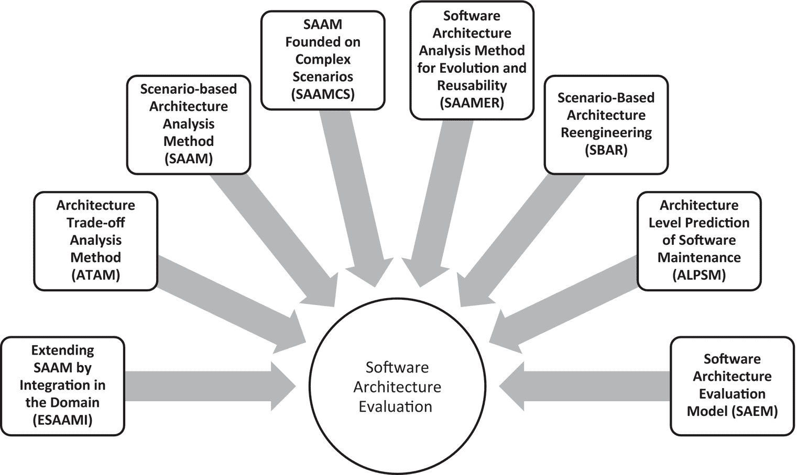

图 6.1 软件架构演变。

### 6.2.1 架构评估的基本属性

对软件开发的重要属性的识别被称为软件架构。各种质量属性（包括效率、性能、可维护性等）对软件架构有深远影响。对于基于健康软件架构的质量属性实现，这一点显而易见。对于基于质量属性评估软件架构，复杂的方法是先前提。几项关于质量特性和/或权衡方法的估计研究特别值得关注。关于参考同时使用多个属性的软件架构评估方法的发表文章数量日益增加。已经说明了许多估计软件架构的技术，以帮助开发人员构建能够满足系统要求的软件架构。这些属性对于在软件开发领域、使用软件线方法开发实时系统领域软件的组织至关重要。然而，工业系统通常对系统的许多质量特性有要求。因此，追踪多个属性特性（如性能、维护性、可测试性和移植性）的架构评估技术将更有价值。本研究关注软件架构评估的基本属性，这些属性关注了一个以上的质量属性：[3, 4 和 5\]

* 性能
* 可用性
* 修改性
* 可靠性
* 安全性
* 功能性
* 可移植性
* 可变性
* 子能力
* 概念完整性

架构评估的输出：

* 按优先级陈述的质量属性需求
* 质量属性映射
* 风险和非风险

## 6.3 安全架构与模型


安全架构是软件工程领域一个被广泛接受的扩展。架构化描述了指向相应软件系统的所有相关组件和连接器。功能组件的合理性通过软件设计层面的封装来管理。加强安全的本质需求取决于我们在何时以及何地使用安全控制的恰当性。这些安全控制有助于解决与可重复设计过程相关的潜在风险。在特定场景下，这种统一的安全设计过程描述了安全架构。设计设计规范来实现组件之间适当的稳定性，标志着它们之间强的关系和依赖关系。首先，安全架构和设计是一个多级领域。它在基础层级管理硬件和软件以获得安全系统。下一级保留逻辑模型，高层则通过量化保留评估方法，以了解安全的实际影响。`图 6.2`中软件安全架构的关键属性如下：`[4, 5]`。

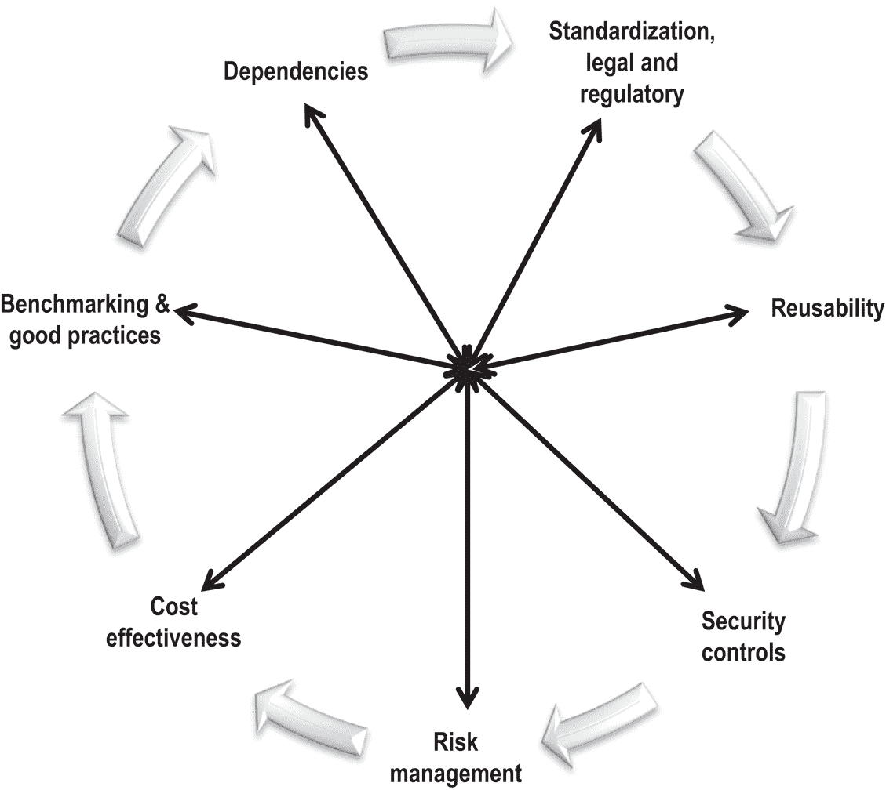

图 6.2 软件安全架构的关键属性。

*   依赖关系
*   标准化、法律与法规
*   可重用性
*   安全控制
*   风险管理
*   成本效益
*   基准测试与良好实践

### 6.3.1 安全模型

安全是影响软件质量的最关键的因素之一，需要不断升级以增强软件产品和过程的寿命。增强安全性是软件开发早期阶段实现安全长寿的极具重要的举措`[6]`。关于这方面已经进行了许多研究，下面提到了了一些相关的观察，以理解安全及其相关问题，其解决方案列在`表 6.1`中。

表 6.1  针对安全的各种评估与估计模型

| 序号 | 安全模型 | 特性 | 关键属性 | 参考文献 |
| --- | --- | --- | --- | --- |
| 1 | 格模型 | 多级和多侧边安全 | 它是一种数学框架基础，构建在元素集、分级排序信息之上，并具有元素的最小上界和最大下界属性。 | `[7, 8]` |
| 2 | 状态机模型 | 完整性评估 | 一种对各种输入或序列行为的数学建模。它描述了变量、各种转换状态以及维护系统完整性的相应函数。 | | |
| 3 | 非干扰模型 | 状态分析 | 一个安全域内的用户操作不能影响另一个安全域的用户。 | | |
| 4 | Bell–LaPadula 机密模型 | 多级状态分析、访问的机密方面 | 不同的分类级别必须通过适当身份验证以获得必要的安全许可。信息的机密性必须通过各种规则保护，包括`不读上规则、不写下规则、强星属性规则、平静原则`。 | | |
| 5 | Biba 完整性模型 | 完整性评估 | 为了保持完整性，`不读下规则、不写上规则`允许从较高层级写入。 | | |
| 6 | Clark–Wilson 完整性模型 | 信息完整性 | 该模型通过职责分离防止未经授权的用户进行进一步修改。特别源自不同的供应商。 | | | |
| 7 | 访问控制矩阵 | 访问控制 | 一种在任何操作系统中常用的模型。 | | | |
| 8 | 信息流模型 | 多级状态分析、授权检查 | 信息是主要来源，应被划分分类中。 | | | |
| 9 | Graham–Denning 模型 | 多级状态分析、访问控制 | 读取、授予和传输的创建、删除和访问权限。 | | | |
| 10 | Harrison–Ruzzo–Ullman 模型 | 访问权限完整性 | 一种基于算法的安全模型，探索系统的潜力和限制以确认系统的安全性。 | | | |
| 11 | Brewer–Nash (中国墙) | 多级状态分析、访问控制 | 用户访问权限根据其先前的操作进行动态控制。这将有助于保护不同用户之间的利益冲突。基于流的信息系统在出现任何利益冲突时停止流动。 | | | |
| 12 | Take Grant 模型 | 机密模型 | 基于机密性的安全模型执行四个最重要的操作，包括获取、授予、创建和撤销。 | | | |
| 13 | Wang &Wulf 模型 | 提出的安全测量框架并对软件安全进行定量评估 | 在 SM 框架的辅助下，首先定义软件安全，然后选择不同的单元和范围，使用估计方法并对指标进行验证。 | `[8]` |
| 14 | 用户系统交互影响 (USIE)模型 | 一种用于面向服务架构 (SOA) 的软件安全定量分析框架 | 该模型通过影响后续的内部属性来分析和缓解软件的可攻击性。正在提出内部安全指标以预测软件可攻击性因素的影响。该系列指标已有理论验证。必须建立内部安全指标与可攻击性之间的相关性，并进行实证验证以验证有效安全指标与软件可攻击性概念之间的关系。 | `[9]` |
| 15 | M.U.A. Khan 模型 | SDLC 交付物的安全量化方法。 | 安全漏洞的各个方面被暴露，并展示了量化的结果以了解实际影响分析。识别出的漏洞如下：
*   找出错误数量
*   跟踪漏洞数量
*   建立错误与漏洞之间的相关性
*   为消除错误提出安全需求
*   识别风险
*   实施安全需求的成本分析
*   资产、资产价值及损害 | `[10]` |


| ID | Type | Title | Description | Author |
| :--- | :--- | :--- | :--- | :--- |
| 16 | B B Madan 模型 | 软件系统安全属性的建模与量化 | 一种用于入侵容忍系统安全属性建模与量化的半马尔可夫模型。这种安全量化分析描述了攻击者行为，并利用可靠性理论、确定性、指数、超指数、亚指数、Weibull 分布、伽马分布和对数逻辑斯分布等常用分布函数，解决了安全属性的半马尔可夫过程。这对于研究稳态可用性和平均安全故障时间很有帮助。 | [11] |
| 17 | 模糊推理系统 | 通过实现定义建模过程 | 所提的研究识别了现有优先级划分技术在安全属性分析方面的局限性。建议需要优先级划分技术来识别最利用不充分的属性并阻止其导致进一步的不不安全性。所提的框架以安全模型作为输入，并使用模糊推理系统使用语言术语。 | Davoud Mougouei [12] |
| 18 | 多维缩放 | 安全威胁 | 通过专家访谈、调查和对已的安全威胁（包括安全性能下降、身份盗窃和数据丢失）进行检查，识别安全威胁-响应对。在个人安全行为的帮助下，考虑了安全行为与性能之间的映射，并使用多维缩放对其进行分析。 | Robert E. Crossler[13] |
| 19 | 基于调查的报告 | 批判性地审查了安全和软件架构 | 为了软件安全需求的自动化目的，进行了一项新颖工作。所提工作展示了针对分布式应用程序安全需求和软件保护方法的精确审查。还讨论了用于保护智能家居免受攻击的架构视图。 | Friedrich Praus et al. 2016[14] |
| 20 | 基于调查的报告 | 探讨了安全失败的主要原因 | 讨论了任何组织都至关重要的部分——软件安全保障计划，及其四个主要支持点，包括重点关注安全意识和教育、安全开发实践与程序、安全测试自动化以及持续的安全保障计划。 | Sarah Vonnegut 2016 [15] |
| 21 | 基于安全问题的技术报告兼论文 | 集成到开发周期中的软件安全保障计划 | 软件工程中软件安全保障计划的基本需求是产生无漏洞的软件。研究人员整合了利益相关者建议的软件保障计划学习课程。在开发应用软件时应严格遵循此规定。 | Robert Evans 2015[16] |
| 22 | 基于安全问题的技术报告 | 提供了指南 | 本报告确认了如何构建有效的评估计划。它讨论了在软件生命周期开发阶段实施的用于评估的安全和隐私控制程序。这将为从风险管理的角度在软件系统开发阶段期间分析和评估软件系统的安全性和隐私提供指南。 | 美国国家标准与技术研究院 (NIST) 2014[17] |
| 23 | 基于安全问题的研究论文 | 安全补丁管理框架 | 提出了安全补丁管理框架，包括基于权威标准的供应商通知、跟踪、风险评估、封装和部署，这与软件开发生命周期（SDLC）中的缺陷管理过程相似。它使用了软件开发的最佳实践，对开发过程有用，包括策略、风险管理和标准化。 | Michael Hoehl 2013[18] |
| 24 | 基于安全目标和威胁的研究论文 | 给出了在软件开发过程中早期集成安全性的框架。 | 提出了一个安全开发框架，通过纳入安全开发生命周期来克服后期软件开发工作带来的影响，并与早期软件开发策略进行了比较。作者识别了一个通过在开发所有阶段中引入安全需求来消除这一问题的框架。该研究还对影响安全需求的设计属性进行了优先级排序，并准备了一份安全设计模板。 | Kakali Chatterjee et al.2013[19] |
| 25 | 模型驱动的方法论 | 提出了一个通过评估增强安全性的开发框架 | 作者在研究中提出了由于设计复杂性导致的安全问题。作者描述了在开发最后阶段为软件内置安全性的成本和时间很高。因此，本研究侧重于在软件设计期间确保软件安全。设计复杂性会引入漏洞，因此本文建议在设计中考虑复杂性属性以提高软件安全性。在这项工作中，作者从面向对象因素的影响的角度识别了安全复杂度因素。它提供了一个开发框架，将设计复杂度属性整合到开发中以增强安全性。该框架包含了确保软件安全需要遵循的前提和通用指南。随后通过实验的定量研究对该框架进行了验证，并给出了包含机密性、完整性和可用性量化的三个模型。 | S. A. Khan[20] |
| 26 | 基于漏洞评估的模型驱动方法论 | 提出了一个最小化漏洞的框架 | 软件设计中的漏洞缺陷是安全问题的主要原因。提出了一种面向对象的设计框架，以通过安全指标应对脆弱的设计。设计的复杂性以及机密性、完整性和可用性等属性在软件安全保障中起着主要作用。 | Alka Agarwal et al. 2011[21] |

## 6.4 安全架构过程

它将为执行人员在整个 IT 景观中做出可靠的选择提供支持。业务目标必须进行战略性设计，以对组织提供最大的支持。涉及许多组件，包括培训、技术、身份和配置管理以及适用于安全领域的元素等，在图 6.3 描述了计划的安全架构。

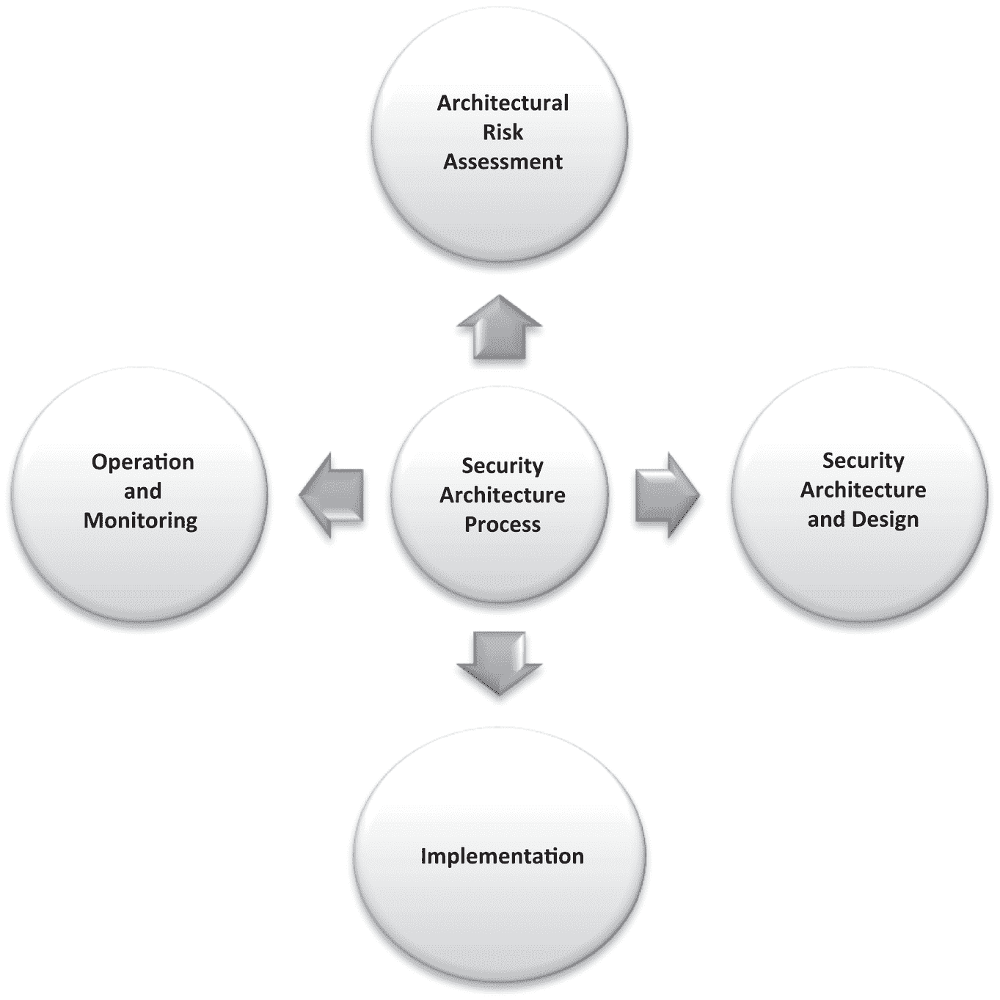

图 6.3 安全架构过程。

### 架构风险评估

架构风险评估负责对各种安全风险与其相关的软件组件进行优先级排序和分配。它还负责发现易受攻击的脆弱区域或高风险区域。通过架构风险评估，可以很容易识别出以下信息：

1. 信息分类
2. 潜在风险识别
3. 安全审计

### 安全架构与设计

该部分负责在架构层面设计和开发各种安全服务，这些服务是业务相关风险的主要来源。

### 实现


本节讨论了安全服务的各种方式及过程实现。它将提供有关服务与组件之间实际功能、其操作以及控制机制的完整概述。它将确保在实际运行时中，所实现的服务根据受保障的安全策略、标准、安全架构决策和风险管理进行细致管理。

### 运行与监控

此步骤负责安全威胁和漏洞缓解，并提供建议性措施来解释其影响和运行状态。适当的监控将有助于找到全面的解决方案。

## 6.5 安全架构过程的组件

人员、过程和有效工具的结合是保护组织资产的安全架构的三个熟练组件。从安全架构的定义可以明显看出，策略必须驱动性能预期，并与图 6.4 所示的关于架构实施和执行的管理决策保持一致。

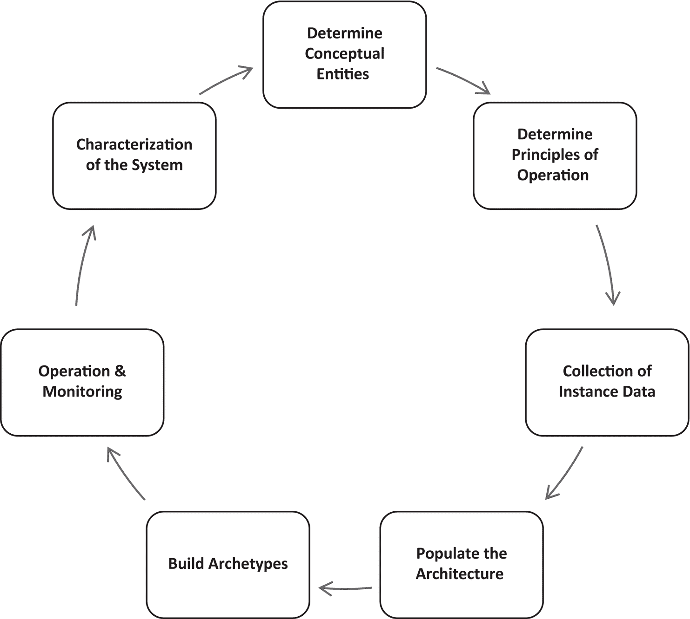

图 6.4 安全架构过程的组件。

**系统表征**：识别特征是大多数问题解决活动的首要步骤。该阶段负责概念、关键解决方案以及相关事实的开发。初始阶段的主要意图是识别更符合用户需求、信息敏感性和未来威胁的因素。

**确定概念实体**：用户需求指的是客户对软件安全的要求或期望。识别出的因素被进一步视为关键元素，并有助于为安全架构过程制定路线图。

**确定运行原则**：下一步负责理解为了实现成功的运行能力而建立的理论假设。这负责检查可能的选项、各种范围、信息的可用性和支持工具。这种行动将成为必然，因为它可以启发开发者构建一个比比预期的更具警觉性的模型。

**收集实例数据**：过程的这一阶段考虑了信息或数据在理论和实证可行性模式，用于安全架构过程的分析和开发。它还负责探索数据与开发过程中最佳实践以及提议机制的兼容性，重点关注揭示每个独立实体的内部结构，以及决定实体间相互作用的外部因素。

**填充架构**：另一个步骤也强调收集最适合安全架构开发范式的显着特征或固有特性。

**构建原型**：在选择了优化的前提信息后，下一步负责构建安全架构。实质概念也是设计属性，可以通过检查内部和外部布局、关系和功能进行彻底分析。通常接受的安全属性集将根据开发过程的要求重新排列。

**运行与监控**：这将确保运行的适用性是完整、正确的，并在某种程度上提供持续的结果。它有助于确保设计阶段的架构依赖性和一致性分析。它有助于探索运行特性的各个维度，包括性能及其相关功能，以及非运行特性，包括修改性和业务相关的特征，如上市时间 [22, 23 和 24]]。

## 6.6 软件安全最佳实践

Saltzer 和 Michael Schroeder 针对真实世界场景的安全措施，为了构建安全软件的全面高级安全原则进行了研究观察。这将有助于开发者构建和部署安全软件。有许多详细的设计实践，它们是安全设计原则的最佳指南。这些实践将帮助无论平台或语言，做出架构级的软件决策。非常需要利用安全专业人员的优势，根据软件架构和设计提出最合适的问题，以避免最常见和严重的缺陷。本文所述概念的新颖性是安全设计的关键原则。安全设计原则建立在简单、分离和限制的思想之上。表 6.2 给出的汇总列表将作为最佳安全原则，需要安全架构师和设计师更多关注，以减少安全问题带来的软件风险 [23, 24, 25, 26, 27, 28 和 29]。

### 表 6.2 软件安全最佳实践对比图

| Reddwine and Davis | John Viega and Gary McGraw | Saltzer and Schroeder | P. Razvan | D. Wheeler |
| --- | --- | --- | --- | --- |
| 滥用案例 | 保护最弱的环节 | 最小权限原则 | 相关性和最弱环节 | 验证所有输入 |
| --- | --- | --- | --- | --- |
| 安全需求 | 实践深度防御 | 失败安全 | 清晰 | 避免缓冲区溢出 |
| 风险分析 | 失败安全 | 保护最弱的环节 | 质量 | 安全接口 |
| 外部评审 | 遵循最小权限原则 | 深度防御 | 涉及所有利益相关者 | 分离数据和控制 |
| 基于风险的安全测试 | 模块化 | 权限分离 | 技术流程 | 最小化权限 |
| 静态分析 | 保持简单 | 机制经济性 | 失败操作 | 最小化组件功能 |
| 风险分析 | 促进隐私 | 最小共同机制 | 深度防御 | 安全配置并使用安全默认 |
| 渗透测试 | 极难隐藏秘密 | 拒绝信任 | 适当权限原则 | 安全加载初始化值 |
| 安全破坏 | 拒绝信任 | 绝不假设你的秘密是安全的 | 与用户交互 | 失败安全 |
| | | 拒绝信任 | 使用你的社区资源 | 心理接受性 | 第三方软件 | 建立信任路径 |
| | | 深度防御 | 完全访问 | 操纵敏感数据 | 信任边界 | 使用内部一致性 |
| | | 促进隐私 | | 自限制资源 | 防止跨站恶意内容 |
| | | | | 声明式与程序式 | 阻止语义攻击 |
| | | | | 评审是你的最好的盟友 | 谨慎处理数据类型 |
| | | | | | 谨慎调用其他资源 |
| | | | | | 谨慎地回传信息 | 始终“跳出框架”思考 |

## 6.7 结论


软件架构是开发过程中一个极具挑战性的阶段。安全泄露不仅会导致财务损失，还会损害软件设计与开发行业的信任和完整性。开发一个具有必要功能和更高效率的系统以缓解恶意入侵者的攻击，这涉及到安全的设计和部署。在设计阶段解决安全问题的目的是保护应用程序免受外部威胁和攻击。安全性应该从一开始就纳入软件开发周期，并一直持续到产品上市。目前迫切需要通过保护感知的不受控共生本质，减少缺陷发生的频率以增强安全性。人们正通过分析整个软件开发过程并考虑复杂性，减少缺陷频率来提高安全性。

## 关键术语

- 软件架构、安全架构与模型、安全架构流程、软件安全风险、OWASP 前 10 漏洞、前 25 个常见弱点枚举、软件安全风险估计

## 记忆要点

- 信息技术领域的一个多功能概念，包含许多细节，我们将其称为 `architecture`（架构），它具有用于规范和决策过程的关键抽象。
- 软件架构描述是互联元素、形式和证明的示例。
- 通过架构模式分类法对系统的完整设计实施强制性转换，包括数据为型、数据流、调用与返回、面向对象和分层架构。
- 经济性、可见性、间距、对称性和涌现性是为软件专业人员提供架构决策支持的最合适因素。
- 常见弱点枚举 (`CWE`) 负责详细说明整个软件开发过程中实践中最有效的问题。

## 复习题

1. `architecture` 术语是一个多面的概念，在信息技术领域有各种描述。请结合适当的案例解释这一概念。
2. 我们所说的架构是指对系统做出的主要设计决策。请结合合适的案例讨论不同类型的架构。
3. 可视化软件安全估计的不同视角及其对软件开发的相对影响分析。
4. 描述软件架构评估的关键质量。
5. 根据威胁、漏洞、资产以及相对于风险的后果，讨论风险管理计划的解决方案。

## 选择题

1. 哪种模型负责提出信息机密性的问题？
    1. Bell-LaPadula 模型
    2. Biba 模型
    3. Clark-Wilson 模型
    4. 机密性模型
2. 风险估计模型的第一步是什么？
    1. 确定风险的严重性
    2. 风险识别
    3. 影响估计
    4. 风险模型的定制
3. 用户系统交互效应 (`USIE`) 模型在开发早期通常被接受用于 \_\_\_\_\_\_\_\_\_\_\_。
    1. 安全估计
    2. 风险识别
    3. 风险分析
    4. 安全验证
4. 用户系统交互效应 (`USIE`) 模型具有 \_\_\_\_\_\_\_\_\_\_\_ 在架构层面进行定量评估的能力。
    1. 面向对象
    2. 基于对象
    3. 面服务
    4. 基于功能
5. 用户系统交互效应 (`USIE`) 模型通过安全措施的适当抽象使用内部指标进行预测是为了：
    1. 软件量化
    2. 软件可分析性
    3. 服务安全
    4. 软件可攻击性

## 简答题

1. 证明架构指的是应用的概念本质。
2. 软件架构评估中引起关注超过一个质量属性的本质属性有哪些？
3. 讨论架构评估的输出。
4. 软件安全架构的关键属性有哪些？
5. 架构风险评估需要哪种信息？
6. 安全架构流程的各个组件是什么？
7. 2017–2018 年开放 Web 应用安全项目（OWASP）的前 10 个漏洞是什么？

## 述题

1. 定义各种安全评估和估计模型。
2. 简述用户系统交互效应 (`USIE`) 模型的案例。
3. 软件安全风险估计是指什么？详细讨论各种模型。
4. 讨论常见弱点枚举 (`CWE`)，它负责提供软件开发期间经历的影响最大的问题细节。
5. 什么是风险？讨论风险评估涉及的步骤。
6. 结合服务器故障定义的简单缓解过程示例进行说明。
7. 提供 OWASP 前 10 漏洞的完整列表及其在不同时间段发布的对比图。

## 参考文献

1. D. E. Perry and A. L. Wolf, “软件架构研究基础”, *ACM Sigsoft Software Engineering* Notes, 第 17 第 4 期, 1992 年 10 月 第 40 页
2. David Garlan and Mary Shaw, “软件架构导论”. 在 V. Ambriola 和 G. Tortora (编), 软件工程与知识工程进展, 软件工程与知识工程系列, 第 2 卷, 世界科学出版社, 新加坡, 第 1–39 页, 1993 年。
3. [`www.techopedia.com/definition/72/security-architecture`](https://www.techopedia.com)
4. [`www.orbussoftware.com/resources/videos/iserver-product-videos/security-architecture/`](https://www.orbussoftware.com)
5. [`www.opensecurityarchitecture.org/cms/foundations`](http://www.opensecurityarchitecture.org)
6. [`owasp.org/www-community/OWASP_Risk_Methodology`](https://owasp.org)
7. [`media.techtarget.com/searchSecurity/downloads/29667C05.pdf`](https://media.techtarget.com), 最后访问日期：2022 年 6 月 15 日。
8. C. Wang and W. A. Wulf, “迈向安全测量框架”, *国家信息系统会议论文*, 巴尔摩, 10 月 7–10 日, 1997, 第 522–533 页。
9. M. Yanguo Liu, “面向服务架构的安全定量分析”, 维多利亚大学电子与计算机工程系, 2008 年。
10. M. U. A. Khan 和 M. Zulkernel, “安全开发的需求与设计方法综述”, *技术报告 2009–562*, 皇后大学计算机学院, 加拿大, 2009 年 8 月。
11. B. B. Madan, K. Gǒseva-Popstan, K. Vaidyanathan and K. S. Trivedi, “软件系统安全属性建模与量化”, *可靠系统与网络国际会议 (DSN’02)*, IEEE, 2002 年, 第 505–514 页。
12. D. Mougouei, PAPS: 安全需求优先级与部分选择的可扩展框架, 康奈大学图书馆, 2017 年, 出版编号, arXiv:170600166。
13. R. Crossler and F. Bélanger, “个人安全行为的扩展视角：保护动机理论和统一安全实践 (USP) 工具”, 信息系统进展, ACM SIGMIS, 45(4), 2014 年, 第 51–71 页。
14. F. Praus, W. Kastner and P. Palensky, “建筑自动化中的软件安全需求”, 安全 2016 - 安全、保护与可靠性, 2016, 第 217–228 页。


15. S. Vonnegut, 需要了解的应用安全新闻, 2016, 可访问 [`www.checkmarx.com/2016/04/21/need-know-appsec-news-stories-april-2016/`](https://www.checkmarx.com) 最后访问于 2018 年 4 月。

16. R. Evans, 将安全集成到本科软件工程课程中, UN 士学位论文, 600, 2015.

17. B. E. A. Plans, 联邦信息系统和组织的安全与隐私控制评估, NIST 特殊出版, 800, 53A, 2014.

18. M. Hoehl, 构建全面的企业安全补丁管理计划的框架, STI 研究生研究, SANS, 2013.

19. K. Chatterjee, D. Gupta and A. De, “安全软件开发的框架”,CSI ICT 学刊, (1),2013, pp. 143–157.

20. S. A. Khan and R. A. Khan. “量化安全的框架：复杂性视角”,国际信息与教育技术杂志, 2 (5), 2012, p. 439.

21. A. Agrawal and R. A. Khan, “漏洞最小化框架：面向对象设计视角”,计算机与通信技术, 2011, pp. 499–504.

22. SaaS 行业市场报告：全球关键趋势与增长预测. 2018. 访问地址：[`financesonline.com/2018-saas-industry-market-report-key-global-trendsgrowth-forecasts/`](https://financesonline.com) 最后访问于 2018 年 9 月 4 日。

23. P. Razvan, “安全开发的最佳实践”,2001 年 10 月。

24. S. T. Redwine, Jr. and N. Davis, “生产安全软件的过程”,*国家网络安全峰会*,2004 年 3 月。

25. J. Viega and G. McGraw, “构建安全软件”,Addison-Wesley, 2002. ISBN 0-201-72152-x.

26. P. Martin and C. Gail, “关注图：使用结构化程序依赖发现和描述关注点”,ICSE 会论文, 2002.

27. H. Michael, “安全系统始于了解你的威胁 – 第一部分”,[http://security.devx.com/upload/free/Features/zones/security/articles/2000/09sept00/mh0900[2]-1.asp](http://security.devx.com), 访问于 2007 年 4 月 20 日。

28. D. Evans and D. Larochelle, “常见漏洞与暴露数据库中报告的缺陷”,IEEE Software,2002 年 1 月。

29. D. A. Wheeler, “Linux 和 Unix 安全编程 HOWTO”,*GNU 自由文档许可证*,2003 年 3 月。

## 有用链接

* [`www.cloudflare.com/learning/security/threats/owasp-top-10/`](https://www.cloudflare.com)
* [`github.com/OWASP/www-project-top-ten/blob/master/index.md`](https://github.com)
* [`www.veracode.com/security/owasp-top-10`](https://www.veracode.com)
* [`sucuri.net/guides/owasp-top-10-security-vulnerabilities-2020/`](https://sucuri.net)

# 7 软件安全保障

DOI: [10.1201/9781003330516-7](https://dx.doi.org/10.1201/9781003330516-7)

> 对于一个没有通过定量方法得出、缺乏数据支持、且主要由经理直觉证明的估计，要做出有力、合理且具有职业风险的辩护是非常困难的。
>
> **弗雷·布鲁克斯**

《国防授权法》（NDAA）纳入了一项关于软件安全的政策（在软件安全方面）。软件保障是一系列确保安全的观察结果，它是构建应用程序的基础。软件安全保障是一种确保软件在存在缺陷的情况下仍能运行的机制。


*   输入、更新、处理和输出是企业用于可持续措施的核心组成部分。此外，企业内部的政策、程序和系统性措施旨在为效率、风险降低、安全性扩展性、成本降低、合规性以及整个软件开发生命周期中的透明度提供并维持维持特定水平。

*   它是整个软件开发生命周期中对风险管理技术的应用。

*   它是一种在整个软件开发生命周期中成功执行和实施软件安全策略与标准的技术。

*   负责供应商环境中软件安全的可靠性。

*   旨在提高所有开发软件安全性的软件安全倡议。

国家信息安全术语中的软件安全保障是指在软件整个生命周期中，有意或无意作为软件工作目标而设计或插入的信任水平，并确保软件无漏洞。图 7.1 显示了不同类型的漏洞如何通过软件利用来破坏安全保障 [2, 3 和 4]。

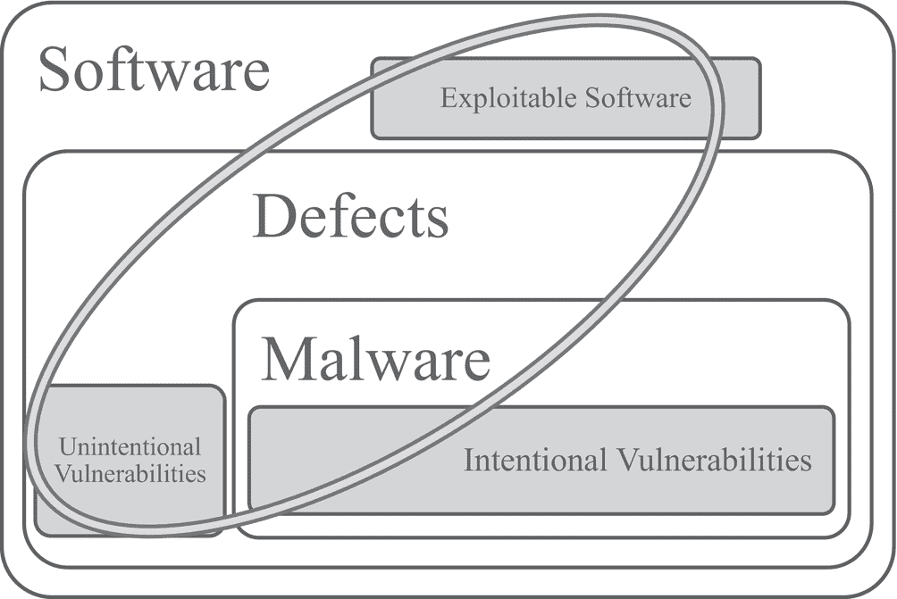

图 7.1 可利用的软件与漏洞。

## 7.2.1 目标

软件安全保障的基本目标是确保软件的设计和开发能够降低对组织带来的风险。风险可能包括数据完整性、数据泄露、数据误用、网站劫持等。组织确保软件在整个软件开发生命周期（SDLC）中安全构建的潜力。重要特征如下：

*   建立软件安全
*   建立软件安全小组
*   制定策略、策略和标准
*   集成 SDLC 检查点
*   分析应用组合并建立指标
*   开展培训和意识活动

## 7.2.2 职责

软件安全保障是一项至重要的管理职责。软件中的漏洞可能会在安全可靠的信息、稳健的流程和报告方面产生缺陷。管理层的职范围始终努力缓解此类导致敏感信息泄露的漏洞。安全保障计划的职责是识别对软件有直接或间接影响的优先级，并对成本和价值建立控制。

*   **断言 (Assertion)**：软件安全过程确保先决的控制机制，并从防御关键流程和数据管理中获得力量。有效的文档是断言外部或内部行为的可靠来源。
*   **成本与重要性 (Cost and Significance)**：漏洞管理的重要方式是在预期损失与漏洞发生率之间提供适当的平衡。这种适用性将为人员提供一种重要的思维方式，以在客户信息、业务最佳实践与规则、业务与支持的监管政策以及组织声誉之间取得平衡。
*   **风险评估 (Risk evaluation)**：评估标准是成功评审的重要组成部分。开发降低漏洞发生率的机制是针对成功的攻击优先修复漏洞，并以概率方式估计损失。
*   **漏洞管理 (Vulnerability management)**：这是保护您的应用程序尽快发现弱点的最佳方法。这些管理技能在风险和威胁之间提供了巨大的缓冲空间。这种现象为消除风险准备了适当的行动。
*   **安全性标准化 (Security standardization)**：标准化背后的概念提供了一种万无一失的机制，特别是在设计或编码阶段控制软件漏洞发生的可能性。可用的安全评估自动化工具可以验证并防止应用程序中的预期漏洞，以确保功能正确。
*   **评估工具 (Assessment tools)**：控制其阈值内功能的最佳方法是通过启用评审、监控以及可的定性或定量评估机制来提供特定的审计 [3, 4 和 5]。

### 7.3 建立软件安全保障计划

若干增加的安全漏洞事件及其财务困境是安全背景发生重大变化的已知有效指标。需要重新振兴一系列软件安全保障计划，根据图 7.2 所示的安全标准，强化治理、构建、验证和部署的概念。有许多技术可以缓解软件异常以确保其按照执行的预期功能，但安全保障计划通过合规、响应和安全提供可持续性 [5, 6, 7, 8, 9 和 10]。

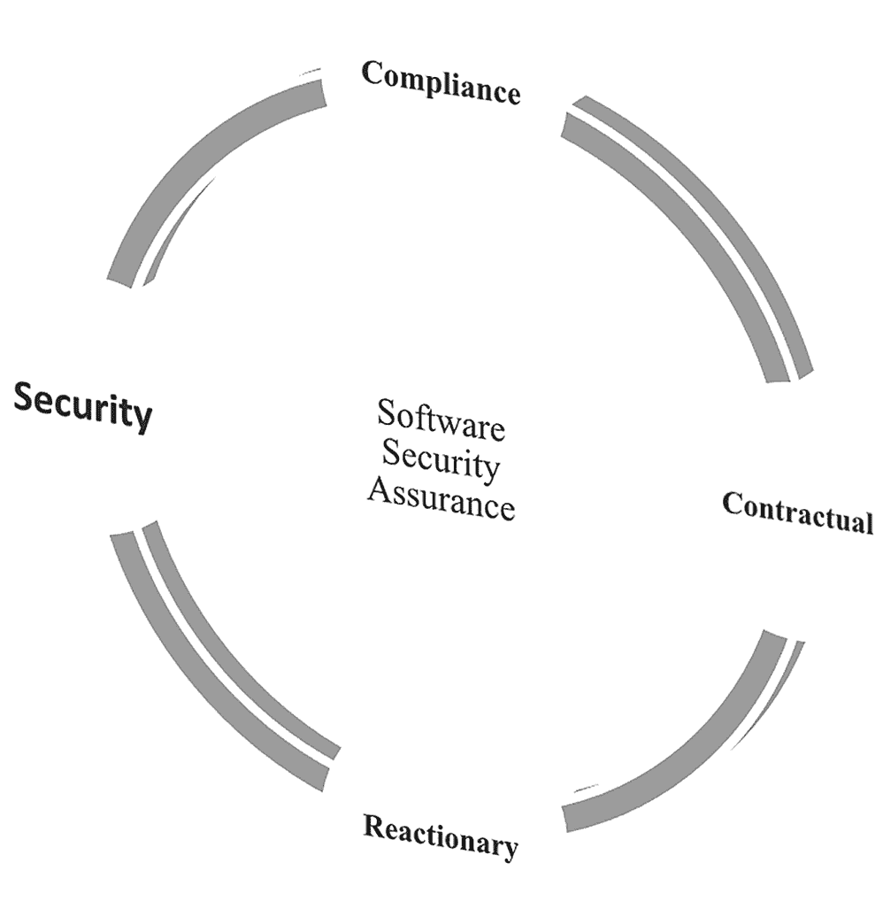

图 7.2 软件安全保障计划。

对上述参考文献的表明，早期的安全标准化、架构评审、漏洞管理和软件保障计划中的指标是赋予导向和降低预期风险的关键因素。此外，此类活动由于许多原因可能被证明非常有成效，包括图 7.3 中提到的内容。

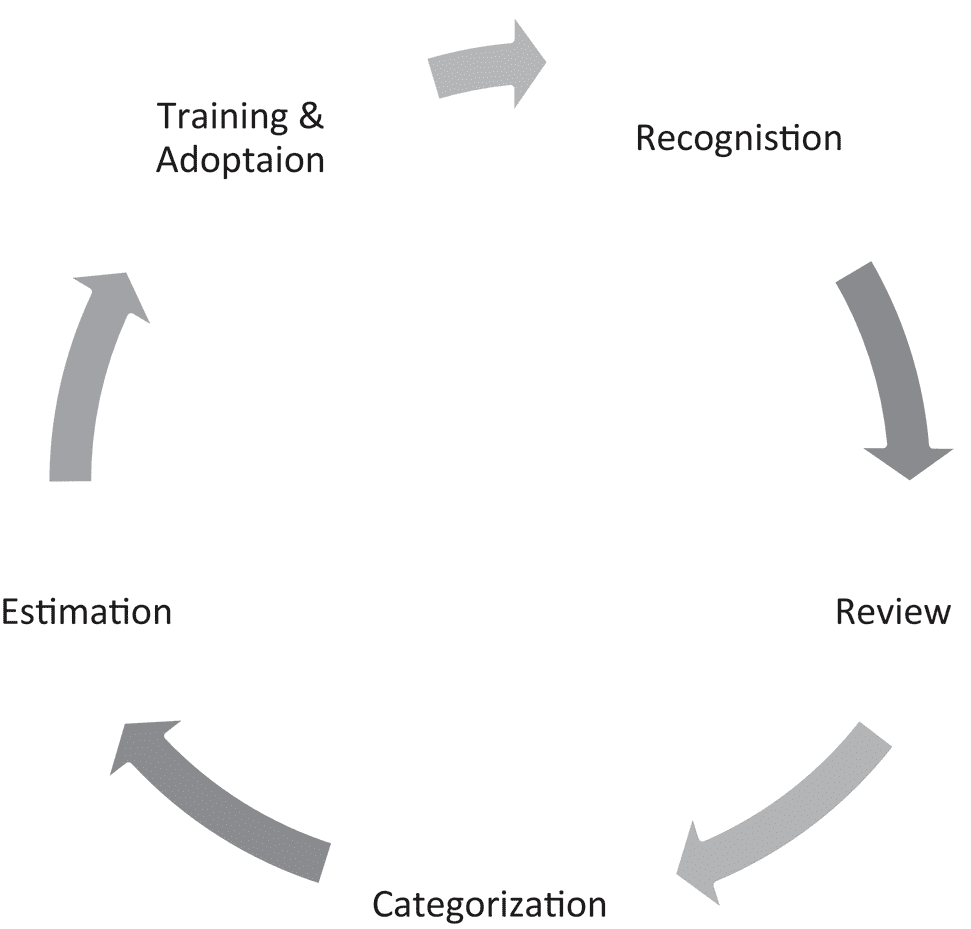

图 7.3 涉及安全保障计划的组件。

*   根据预定义的安全标准和安全架构设定目标。
*   为编码、安全测试和架构评审提供稳健的评审机制。
*   通过环境加固漏洞管理和渗透测试弥补差距以建立保障计划。
*   定量或定性测量提供了管理或控制的重要理由。
*   安全估计指标为部署技术、政策和准则提供了重要方式。
*   根据系统及其组成部分的预期错误发生情况对资源分配进行精确调度。

### 7.3.1 识别

识别是基于某些影响环境对任何问题或机会的优雅解决方案。为了根据需求和架构视角建立精细的安全标准化，需要反复扫描环境以修复异常，无论它们对决策过程有内部还是外部影响。这将为针对安全失败根源改进实际状况提供最佳支持。必须评估的识别影响因素如下：

*   安全策略和程序


* 处理安全要求的标准
* 漏洞管理

### 7.3.2 审查

回归审查部分有助于弥合构建或识别平台之间的差距，这些平台针对不一致的安全需求进行安全架构的细化改进。这种审查机制有助于在通过代码审查、安全测试和架构分析进行验证和确认后，提供安全保障以持续修复安全问题。该审查机制与以下实体保持高度一致性：

* 容错机制
* 侵入检测机制
* 安全评估
* 效率与有效性检查

### 7.3.3 分类

为了维持安全保障，需要根据技术规范和控制方法将所有先决信息归为一类。这将为高层管理提供最佳支持，帮助其在整个软件组合中尽快识别标准和流程，以证明关键情况下的必要性。这将产生一种分类的、可衡量的、一致的方法，以针对声誉采取重大安全解决方案。在分类时必须评估以下术语，以相应地维持事件：

* 针对既定标准的漏洞可能性
* 根据敏感性对数据进行分类
* 通常无法达到可接受的安全保障水平的系统/流程/指标/单位

### 7.3.4 估计

定量或定性评估是针对特定基准确定实际场景的有效方法。这将通过不同的研究人员、学者、行业专家和高层管理人员，根据建议的指标控制与运营、功能、法律和监管合规相关的安全问题，产生深刻理解。该规定提供了一种根据可用性控制和改进倡议的方法。此外，这种观察对许多原因可能非常有益，包括：

* 这降低了变更成本，因为漏洞的后期检测和缓解比以前昂贵得多。
* 这助于对开发中的软件进行更好的安全监控。
* 这将支持软件从业人员对流程进行实证完善。
* 这有助于减少开发安全软件的努力。

### 7.3.5 培训与适应

估计提供了针对评估基准重新思考的可能性。这提供了一种通过适当调整安全参数和属性来控制问题的方法。它有助于缩小实际与预测数据之间的差距。这将确保安全漏洞的比例处于最小化。它有助于建立新的策略和培训计划，以满足预期的安全保障目标。在以下方面非常有帮助：

* 安排培训政策和合规要求，涵盖安全保障的所有相关问题。
* 需要开发安全指标以了解实际影响。
* 准备战略指南以最小化影响，并引导用户和开发者实现更大的可持续性。

## 7.4 信息安全保障框架

信息安全保障框架用于衡量安全保障计划，并促进企业战略规划以控制组织的风险。通过识别特定的领域和特征来维护安全且韧的环境，是此类全面信息安全保障框架的重要贡献。目前有多种信息安全保障框架，包括 ISO 27001、NIST 特别出版物 800-53、AICPA Trust 服务原则与标准、COBIT（信息和相关技术控制目标）、HITRUST CSF 以及 PCI DSS（PCI 安全标准委员会），它们共同包含一些共同标准多个合规要求。这一标准化框架涵盖了图 7.4 所示的安全风险和保障计划下的所有信息安全问题。该安全框架应该是精简，并与安全保障需求、内部审计和/或合规所青的精确覆盖区域及相关行业价值相结合[6, 7 和 8, 11, 12, 13, 14 和 15]。

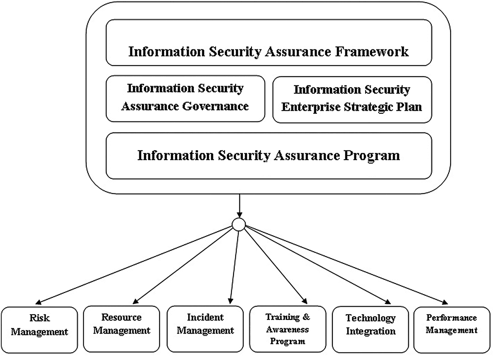

图 7.4 信息安全保障框架。

### 7.4.1 风险管理

信息安全保障框架的核心组件之一是风险管理。它通过正确识别漏洞来降低风险。与风险管理直接相关的三个主要部分是数据保护、应用支持和供应商管理。该组件使安全团队能够从更全面的方面重新思考整个领域的风险。图 7.5 中的该框架有助于团队认识到不同领域的各种风险，并定位用于全面风险评估的片段。在任何风险管理中，管理和保障工作都是必不可少的早期阶段。以下组件有助于控制风险管理过程。

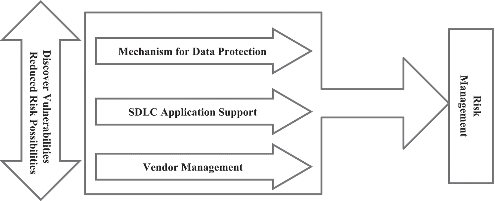

图 7.5 风险管理分析。

* **数据保护机制**

数据保护的概念与风险管理直接相关。它批判地检查数据是否被正确处理以及基本权利是否得到保护。真实性在保护数据集方面起着关重要的作用。它涉及谁访问了信息以及在发生任何更改时如何保护这些信息。这种机制创建了一个防止网络恶意攻击者的保护环境。保护将分方面进行，包括静态数据和传输中数据。

* **SDLC 应用支持**

应用支持与服务相关。它使软件开发应用服务能够为客户提供相关的业务流程。以下属性对于更好的支持至关重要：

* 领域知识
* 应用适用性
* 最大技术支持
* 工具知识

* **供应商管理**

它是风险管理的替代方案之一，对供应商的活动进行观察。定期审计是控制财务下降的有效方法。不同业务性质的供应商风险评估因素如下：

* 战略
* 
* 声誉
* 安全

### 7.4.2 资源管理

资源是指什么？这是一个基本问题，但答案非常简单。任何任务的完成高度依赖于资源。它可以是材料、设施、人力或其他。但关于资源的明显问题是它们是否可以被有效利用？这需要战略规划来实现有效利用。在信息安全保障背景下，所有资源与风险降低计划之间的可靠伙伴是受控管理的关键条件。图 7.6 中的以下因素需要探索以获得更好的理解：

* **先决条件的满足**

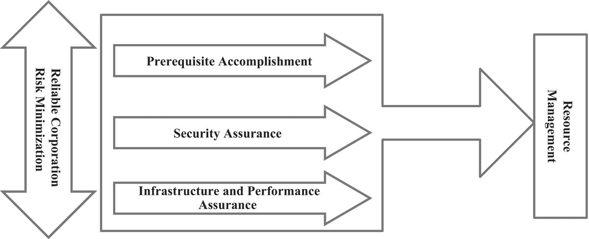

图 7.6 资源管理分析


高度要求所有资源必须在需要时以一种非常有效且高效的方式可用。在软件方面，先决条件的满足可能涉及财务、人力专业知识、信息技术、软件需求、硬件知识以及安全保障的变量。需要了解与满足先决条件直接或间接相关的各个方面的知识：

*   资源调度
*   分解
*   资源分配
*   资源依赖
*   分配
*   利用
*   基础安全结构保障

基础安全结构保障意味着在适当的观察下已完全实现了预定义的安全需求。任何过程的特定活动都成功实现。有很多方法可以确定需要考虑的因素。

*   信息技术系统
*   安全与业务策略
*   安全需求
*   目标环境
*   基础设施与性能保障

基础设施的增长是任何开发的基础基石。性能评估与这种增长直接相关。性能与用户体验相关。性能问题需要适当的支持和时间来进行缓解和增强。可以通过衡量应用程序和架构满足客户性能的能力来评估性能风险。

### 7.4.3 事件管理

安全保障计划中最具挑战性的阶段之一是事件管理。它需要高质量的培训计划来处理日常生活中的安全事件。图 7.7 讨论了事件管理的各种组成部分。这些涉及不同的安全泄露、威胁和漏洞响应。所有问题都通过适当的数字取证进行验证，并且必须收集数字证据以供记录。

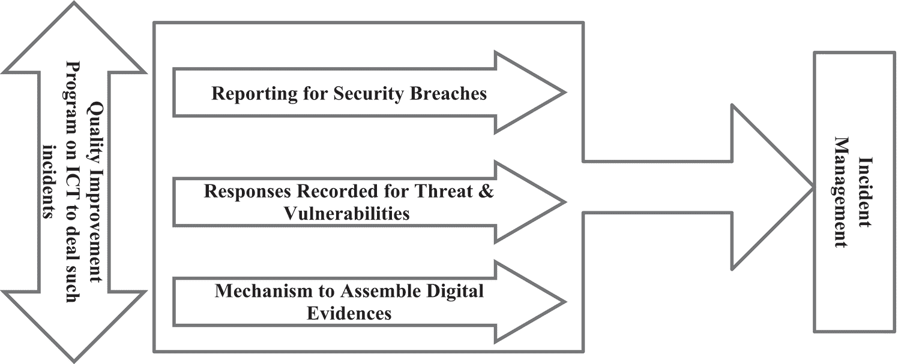

图 7.7 事件管理分析

*   安全泄露报告

违报告属于安全泄露报告的范畴。这种违反有充分理由，包括对数据、网络、应用程序和支持设备的未经授权访问。安全泄露事件绕过了底层安全机制。当个人或应用程序非法进入私人、机密或未经授权的逻辑 IT 边界时，就会发生安全违反。以下关键角色是安全泄露报告中的活跃组成部分。

*   安全攻击的早期
*   违反安全策略
*   通过防火墙进行保护
*   需要安全管理员

### 7.4.3.1 威胁与漏洞响应

漏洞是软件安全设计中的缺陷，威胁可以利用这些缺陷。它们可以利用这些漏洞获取未经授权的访问。软件设计缺陷为黑客突破安全提供了切入点。根据资产、威胁和漏洞的定义，研究人员开发了下述风险公式：

> *资产 (A) 是我们试图保护的对象。*
> *威胁 (T) 是我们试图防范的对象。*
> *漏洞 (V) 是我们保护工作中的弱点或差距。*
> *风险 (R) 是资产、威胁和漏洞的交集。*

> `R = A + T + V`

### 7.4.3.2 数字证据的收集

收集证据是建立犯罪与数字数据之间相关性的主要任务。数字取证人员能够根据数字证据重现犯罪情节，以识别受害者和犯罪。这些行为在同一个流程中探索了收集、识别和保护数字证据的作用。以下问题属于本节。

*   数字数据收集
*   数字数据识别
*   数字数据分析
*   数字数据保护
*   证据的完整性

### 7.4.4 培训与意识计划

培训和意识计划是安全保障框架的一个重要部分。最好的保护方法是教育他们关于威胁、漏洞、攻击性质以及社会和技术影响的知识。图 7.8 关注于下提到的培训和意识实践：

*   针对新人的基础培训计划
*   技术进步培训计划
*   定期对 IT 人员进行教育


图 7.8 培训与意识计划组成

*   针对新人的基础培训计划

安全开发是一个非常专业的领域。它需要针对新人的独特计划以提供对安全威胁的完整认知。

*   技术进步培训计划

它需要具有更深影响的适当计划。安全开发公司应在专家帮助下启动桥课程以提升员工。这需要各种计划，包括：

*   入职培训
*   引导计划
*   关于最新技术的桥课程
*   定制培训

*   定期对 IT 人员进行教育

再次，我们的责任是定期对 IT 人员进行教育，以确保该领域的一致性。这确保了员工获得最新知识，并鼓励后辈学习更多。

### 7.4.5 技术集成

专业人员如何注入技术以升级社会是技术集成的高级阶段。图 7.9 关注技术集成路线图。主要步骤是减少技术重叠的差距。

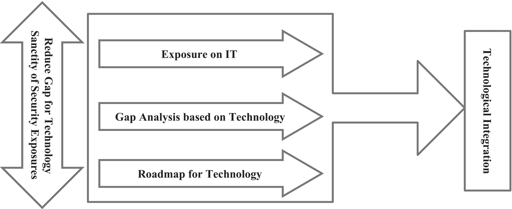

图 7.9 技术集成组成

技术集成的使用有助于增强、扩展或丰富最新的科学方法。技术集成指的是在软件开发和业务过程中有针对地选择技术工具的过程。

*   信息技术接触

技术集成的主要基石是了解技术的最新维度。它提供了一种有效高效的方法来访问业务的不同技术方面。各种活动有助于结合技术以实现最佳社会用途。它在多个方面提供帮助，包括：

*   链接信息技术
*   知识管理
*   战略实验
*   动态建模

技术差距分析

执行差距分析是一个为了更好地理解技术优点的概念。最好分析资源以优化分配。这有助于根据目标受众的利益对问题排序。差距分析需要以下步骤：

*   对特定领域进行差距分析
*   识别潜在情况
*   分析现有场景
*   弥补差距的综合计划
*   差距分析报告
*   技术路线图


技术路线图勾勒了技术将如何、何时、为何以及如何实施，以为各自组织带来最大利益。路线图提供了关于将实施哪些技术方面的最终解决方案。视觉化技术路线图需要以下步骤：

*   定义目标
*   规划
*   方法论
*   测量
*   实时分析
*   验证

### 7.4.6 性能管理

性能被理解为组织对其预设目标的完成情况。必须从定性或定量的角度对其进行评估，以了解实际状况并进行进一步改进。“如果你想控制，就必须测量”是开尔文勋爵（Lord Kelvin）的一句名言，这在性能管理案例中同样适用。非常需要使用专用指标来衡量影响。如果没有可用指标，研究人员首先必须开发相应的指标，并在经过适当验证后使用这些指标。在实践中，指标应符合 SMART 原则。性能管理的组成要素如图图 7.10](#ch7.xhtml#fig7_10）所示。

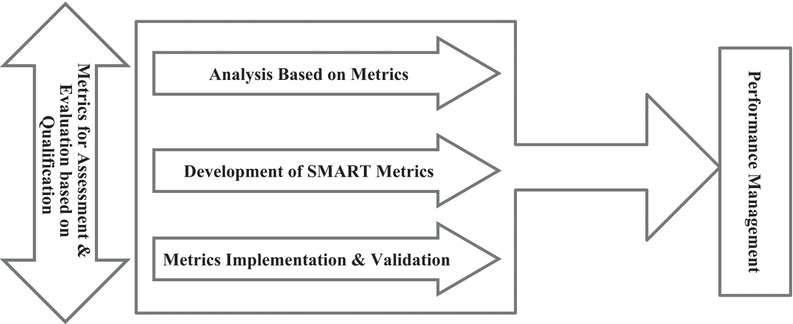

图 7.10 性能管理的组成部分。

*   具体的
*   可衡量的
*   可实现的
*   现实的
*   与时间相关的
*   `Metric Analysis`

指标是分析过去和现在的最佳工具。定量的性质有助于检查情景。关键的观察对预测未来性能非常有帮助。正如美国国家标准与技术研究院（NIST）所讨论的，指标是通过收集、分析和报告相关的性能相关数据，来促进决策并提高性能和问责制的工具。通过指标分析可以实现以下目标：

*   任务关键性评估
*   攻击风险分析
*   确保业务连续性
*   最大限度地减少故障原因
*   事件的影响分析
*   预防性测量
*   `Metrics Development`

指标开发的目的是什么？原因显而易见。指标是旨在改进性能和决策过程的支持性工具。它确保了性能评估过程中的不同标准，包括数据收集、分析和报告。在指标开发时，必须确保以下点：

*   可见性
*   问责制
*   管理
*   支持
*   `Metrics Implementation and Validation`

从其他文献中可以看出，已实施的指标应通过统计工具进行验证以获得良好的相关性。关于软件指标的最新研究表明，可以使用测量的属性从理论和经验上对软件指标进行验证。

## 7.5 网络安全保障框架

德勤咨询（Deloitte Advisory）网络保障框架用于理解组织中的网络风险。目前还没有标准化的框架可以处理图 7.11, 12 和 13, 14\]


图 7.11 完整的网络安全保障框架。

## 7.6 结论

从其他文献中可以看出，已实施的指标应通过统计工具进行验证以获得良好的相关性。关于软件指标的最新研究表明，可以使用测量的属性从理论和经验上对软件指标进行验证。

## 关键术语

安全、性能管理、网络安全、信息管理。

## 注意点

1.  \_\_\_\_\_\_\_\_\_\_\_\_\_\_\_\_\_\_\_\_\_\_\_\_\_\_\_\_\_\_\_\_
2.  \_\_\_\_\_\_\_\_\_\_\_\_\_\_\_\_\_\_\_\_\_\_\_\_\_\_\_\_\_\_\_\_
3.  \_\_\_\_\_\_\_\_\_\_\_\_\_\_\_\_\_\_\_\_\_\_\_\_\_\_\_\_\_\_\_\_
4.  \_\_\_\_\_\_\_\_\_\_\_\_\_\_\_\_\_\_\_\_\_\_\_\_\_\_\_\_\_\_\_\_
5.  \_\_\_\_\_\_\_\_\_\_\_\_\_\_\_\_\_\_\_\_\_\_\_\_\_\_\_\_\_\_\_\_
6.  \_\_\_\_\_\_\_\_\_\_\_\_\_\_\_\_\_\_\_\_\_\_\_\_\_\_\_\_\_\_\_\_
7.  \_\_\_\_\_\_\_\_\_\_\_\_\_\_\_\_\_\_\_\_\_\_\_\_\_\_\_\_\_\_\_\_
8.  \_\_\_\_\_\_\_\_\_\_\_\_\_\_\_\_\_\_\_\_\_\_\_\_\_\_\_\_\_\_\_\_
9.  \_\_\_\_\_\_\_\_\_\_\_\_\_\_\_\_\_\_\_\_\_\_\_\_\_\_\_\_\_\_\_\_
10. \_\_\_\_\_\_\_\_\_\_\_\_\_\_\_\_\_\_\_\_\_\_\_\_\_\_\_\_\_\_\_\_

## 单选题

1.  什么是安全？
2.  什么是网络安全？
3.  网络安全保障框架的组成部分是什么？
4.  信息安全框架的组成部分是什么？
5.  定义安全性能目标。
6.  定义网络保障的作用和职责。
7.  安全的主要优缺点是什么？
8.  性能管理的关键特征有哪些？
9.  什么是风险？
10. 如何计算风险？

1.  `Threat`
2.  `Vulnerability`
3.  Impact
4.  `Risk`

## 简答题

1.  什么是安全？
2.  什么是网络安全？
3.  网络安全保障框架的组成部分是什么？
4.  信息安全框架的组成部分是什么？
5.  定义安全性能目标。
6.  定义网络保障的作用和职责。
7.  安全的主要优缺点是什么？
8.  性能管理的关键特征有哪些？
9.  什么是风险？
10. 如何计算风险？

## 论题

1.  如何分类组织中的信息安全风险？
2.  人何时成为信息安全？
3.  什么是运营风险和通信风险？
4.  信息安全和网络安全之间的区别是什么？
5.  信息保障等同于网络安全吗？


6. R. A. Khan and S. U. Khan,“软件安全保障模型的初步结构”，发表于 *第 113 届全球软件工程国际会议 (ICGSE ‘18) 论文集*。美国计算机协会, 纽约, NY, 美国, 2018, pp. 137–140, doi: [10.1145/3196369.3196385](http://dx.doi.org/10.1145/3196369.3196385).

7. R. Ng, “企业信息安全保障与风险管理的全方位方法”，发表于 *信息安全与保障研究手册*, 2009, p.13, IGI Global, Roy Ng (加拿大约尔森大学). doi: [10.4018/978-1-59904-855-0.ch005](http://dx.doi.org/10.4018/978-1-59904-855-0.ch005).

8. M. Wong, “ICT 安全保障标准化的挑战”，*ICT 标准化期刊*, 第 6 期, 2014, pp. 187–200, doi: [10.13052/jicts2245-800X.226](http://dx.doi.org/10.13052/jicts2245-800X.226).

9. [`www.opentext.com/file\_source/OpenText/en\_US/PDF/opentext-product-security-assurance-program.pdf`](https://www.opentext.com), 最后访问日期：2022 年 3 月 5 日。

10. [`centva.issa.org/wp-content/uploads/2012/10/Software\_Security-Cigital-Sept.2012.pdf`](https://centva.issa.org), 最后访问日期：2021 年 12 月 10 日。

11. [`www2.deloitte.com/content/dam/Deloitte/ca/Documents/risk/risk-en-cybersecurity-the-role-of-internal-audit-updated.pdf`](https://www2.deloitte.com), 最后访问日期：2022 年 7 月 20 日。

12. [`www2.deloitte.com/content/dam/Deloitte/de/Documents/risk/Risk-Cyber-Intelligence-Center-A-new-approach-to-Cyber-Security-Juni-2017.pdf`](https://www2.deloitte.com), 最后访问日期：2022 年 7 月 20 日。

13. [`www.researchgate.net/publication/331518888\_An\_Assurance\_Framework\_for\_Independent\_Co-assurance\_of\_Safety\_and\_Security`](https://www.researchgate.net), 最后访问日期：2021 年 11 月 20 日。

14. [`www.secura.com/uploads/factsheets/Cybersecurity-Assurance-Services.pdf`](https://www.secura.com), 最后访问日期：2021 年 11 月 20 日。

15. [`safecode.org/publication/SAFECode\_Principles\_for\_Software\_Assurance\_Assessment.pdf`](https://safecode.org), 最后访问日期：2022 年 3 月 15 日。

## 有用链接

* [`www.threatanalysis.com/2010/05/03/threat-vulnerability-risk-commonly-mixed-up-terms/`](https://www.threatanalysis.com)
* [`community.synopsys.com/s/article/Software-Security-Metrics-Development`](https://community.synopsys.com)
* [`www.ahia.org/assets/Uploads/pdfUpload/WhitePapers/CyberAssuranceWhitePaper.pdf`](https://www.ahia.org).
* [`www.isaca.org/Journal/archives/2012/Volume-2/Pages/Fundamental-Concepts-of-IT-Security-Assurance.aspx`](https://www.isaca.org)
* [`assets1.dxc.technology/security/downloads/DXC-Security-Threat\_and\_Vulnerability\_Management\_Offering\_Overview.pdf`](http://assets1.dxc.technology)
* [`www.qgcio.qld.gov.au/documents/information-security-assurance-and-classification-guideline`](https://www.qgcio.qld.gov.au)

# 8 安全软件开发过程

DOI: [10.1201/9781003330516-8](https://dx.doi.org/10.1201/9781003330516-8)

> 科学或技术的核心在于利用科学的力量让人们的生活更美好、降低成本、提高舒适度、提高生产力等。
> — 纳拉亚纳·穆尔蒂 (Narayana Murthy)

工程或技术的核心在于利用科学的力量让人们的生活更美好、降低成本、提高舒适度、提高生产力等。

由于软件开发的复杂性，安全问题会影响质量。不安全的软件会损害组织形象并破坏客户关系。在开发周期中加强安全实践可以提高质量。因此，可以假设在整个软件生命周期中加强安全实践可以实现可靠的设计。基于上述陈述，本章尝试制定安全软件开发的指南。1。

## 8.1 目标

本节特别关注：

* 测试的概述。
* 理解测试的需求和意义。
* 展示测试对提高软件质量的作用。
* 确认软件测试与软件评估之间的关系。
* 获取有关测试问题的各种事实。
* 不同类型的软件。
* 确保测试的重要性。

测试目标包括：

* 识别软件缺陷。
* 执行程序以寻找漏洞。
* 建立高概率发现未发现错误的测试用例。
* 确保系统。
* 确定质量程度和需求的实现情况。

一个良好的测试应该能够最短的时间和精力和识别不同类型的错误。软件测试证明了软件按照规范运行。测试期间收集的数据揭示了应用程序代码中的缺陷。然而，测试只能衡量质量，而不能提高质量。然而，在编码前制定测试方案确实可以提高质量，因为编码人员可以使用这些信息。软件测试可能是繁琐且昂贵的。

## 8.2 安全开发

安全缺陷是安全设计不可或缺的一部分。安全开发包括可靠、稳定、无错误且无漏洞的软件开发过程。由于复杂性、连接性和扩展性的增加，软件更容易受到攻击。内部外部人员的无意或故意选择都威胁到软件在开发不同阶段的安全。在开发生命周期的各个阶段包含安全和其他非功能需求是保护软件免受缺陷的最佳方法。多年来，为了创建“高完整性软件”进行了大量研究，从业人员和研究人员为创建安全软件付出了努力。然而，尽管付出了所有努力，只有少数程序在设计时具有高水平的安全性。无论何时安全是一个确立的标准且安全规划指南作为输入提供给实施团队，无法保证最终结果将符合安全标准。2, 3。


安全软件的开发生命周期由复合程序组成，这些程序涉及业务客户、应用程序开发人员、项目经理以及信息安全专业人员的参与，以便有效构建安全可靠的产品。研究表明，在早期发现缺陷或漏洞的纠正成本远低于在后期或软件投入运行后的成本。设计中与安全相关的缺陷无法在代码中进行诊断，必须通过威胁建模和设计时的滥用仿真进行验证。如果在后期阶段发现缺陷，则必须更改之前阶段的所有操作以解决问题。与在开发生命周期早期识别并修复漏洞相比，这种做法投入了更多的精力和时间`[4–6]` 。因此，将安全功能尽早纳入生命周期有助于降低软件开发成本。考虑到开发安全软件的重要性，这强调了进行变革的必要性，以创建一个从开始就默认考虑软件安全性的系统。开发安全软件的目标是识别、实施、对齐并维护在安全性在整个系统生命周期中都至关重要的软件系统。创建安全软件最高效的方法是将开发生命周期的进展与有助于安全设计、定位和保护的原则及实践相结合。对创建软件涉及的技术缺乏清晰理解，可能成为不安全使用软件的引导`[7–10]`。

## 8.3 微软安全开发生命周期

这是一个最初由微软开发并测试的用于其产品安全开发的过程。2008 年，该公司决定公开共享他们的流程以及对这种安全开发方法的评审。该模型的意义在于它提供了一个理想的工作步骤，以实现更好、更有效的产品安全。这种安全开发模型已经了各种公司和组织的测试和验证。该模型的补充部分是它涵盖了安全的几乎每个方面，并提供了数据留存和处置。`Figure 8.1]` 描述了一个逐步的工作流程。该图说明了软件开发人员根据微软安全开发生命周期执行的预定义的七步骤，以生产安全产品`[11 and 12]`。

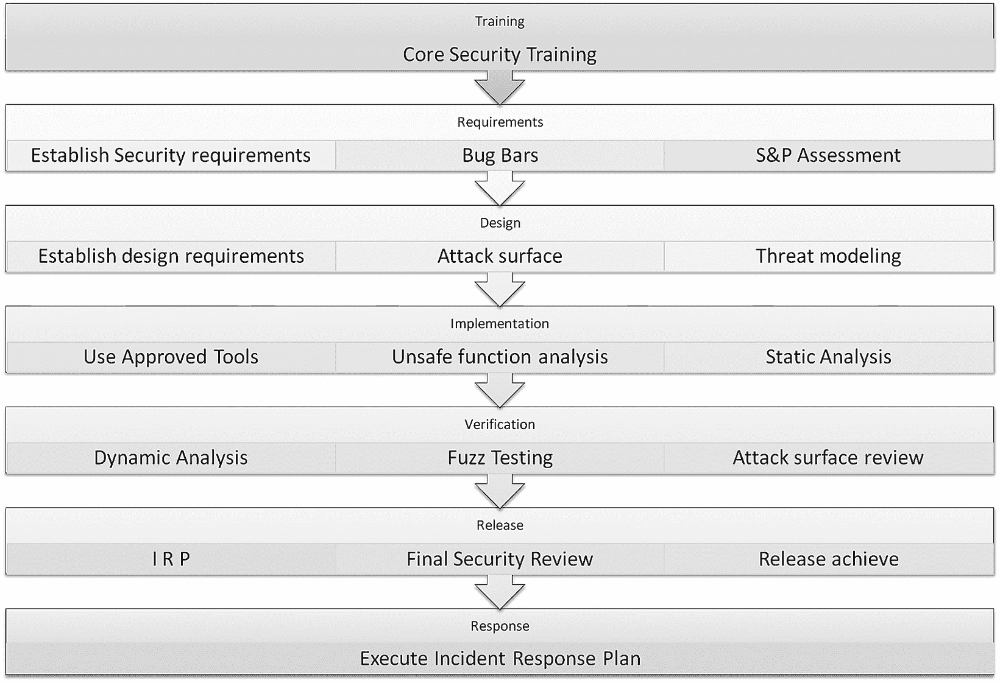

图 8.1 微软安全开发生命周期。

## 8.4 OWASP 软件保证成熟度模型

这是一个由 OWASP 管理和开发的开源模型。由于其开源性质，该模型汇集了大型公司以及个人开发人员的贡献。这种情况为更优、更大的开发打开了大门，并根据实际需求进行及时更新。与微软安全开发过程一样，该模型也提供了一个逐步的安全开发过程，公司可以采纳该过程来生产有效且安全的产品。这种方法论关联了各种安全方面，并为与方法相关的每一步提供了三个成就`[11, 12 and 13]`。`Figure 8.2]` 展示了该方法的简要说明。

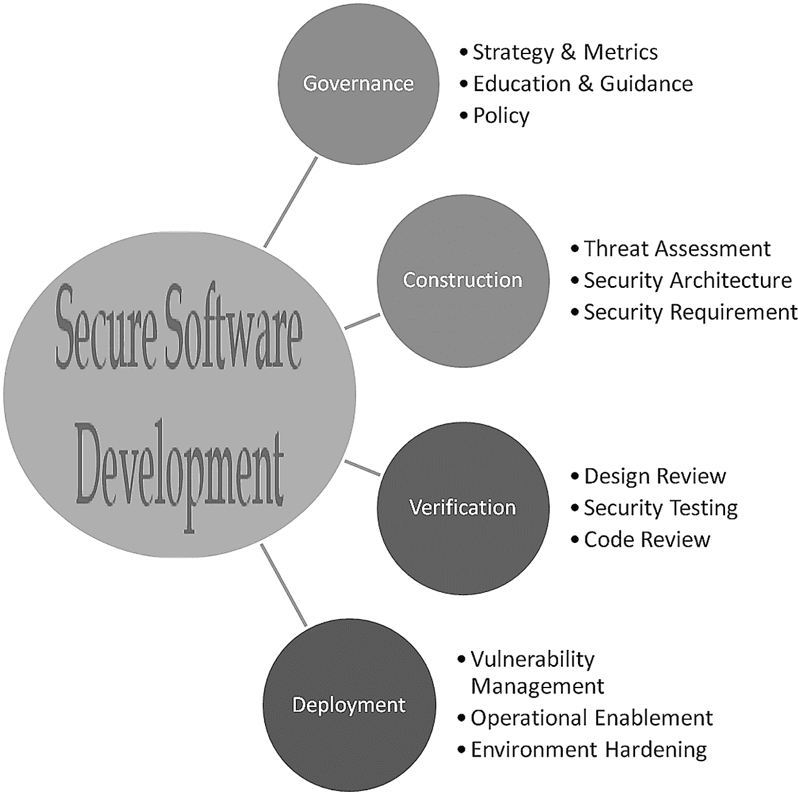

图 8.2 OWASP 软件保证成熟度模型。

这是两种流行且最有效的安全开发方法，通过采用可以获得有效的成果。此外，为了更多地了解安全开发（及其作者类别），下面列出了其一些益处。

*   高安全性：在 `SDL` 中，对弱点的持续观察会带来更好的应用程序质量，并缓解业务风险。
*   低成本：在 `SDL` 中，对缺陷的早期思考总上减少了识别和修复它们所需的精力。
*   改进小组在安全编码演练中获得持续的准备。
*   安全方法在各个小组之间变得更具预测性。
*   客户会更信任你，因为他们看到你对他们的安全性付出了额外的关注。
*   当 `SDL` 应用于内部编程工具时，内部安全性会得到提高。

## 8.5 集成安全开发框架

软件开发实践通常不是为了测试可能被攻击者利用的漏洞而设计的。事实上，开发安全软件过程需要仔细考虑安全开发周期每个阶段的安全问题。众所周知，安全应该是系统的一部分，而不是后期可以添加到系统中的附加组件。后期添加充分的保护是非常麻烦，因为蓝图可能本身就不安全。额外的安全措施可以通过影响应用程序功能和接口的意外更改来提供向后兼容性。此外，提供额外的安全需要大量的资源和时间。因此，安全不太在后期添加到系统中。鉴于安全在软件开发过程中的性，开发考虑整个生命周期安全性的技术是非常重要的。目标是为构建更安全、更可靠的软件提供一套指导原则。所提出的方案是具体的，并在`Figure 8.9]` 所示的每一步为软件开发人员提供简单的安全指导。它涵盖了一个六步骤的开发过程，并讨论了每一步中创建更安全软件所需的步骤。开发阶段包括需求、设计、编码、测试、部署和维护。相应阶段的所有操作将在后续章节中进行讨论`[14–19]`。

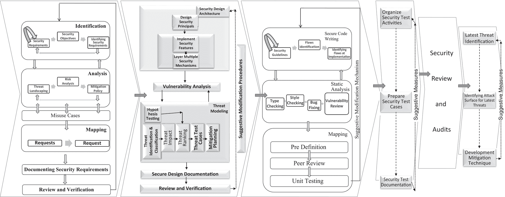

图 8.9 开发过程。

### 8.5.1 安全需求阶段

实现安全需求在网络环境中变得更加重要。许多研究人员和行业从业者一直在表达在软件开发过程中早期关注安全需求的观点。然而，具有安全需求的配方多年来被证明是非常具有挑战性的。`Figure 8.3` 形象地展示了安全需求阶段的步骤。每一步由`Table 8.1` 所示的特定操作组成。步骤描述定义如下：

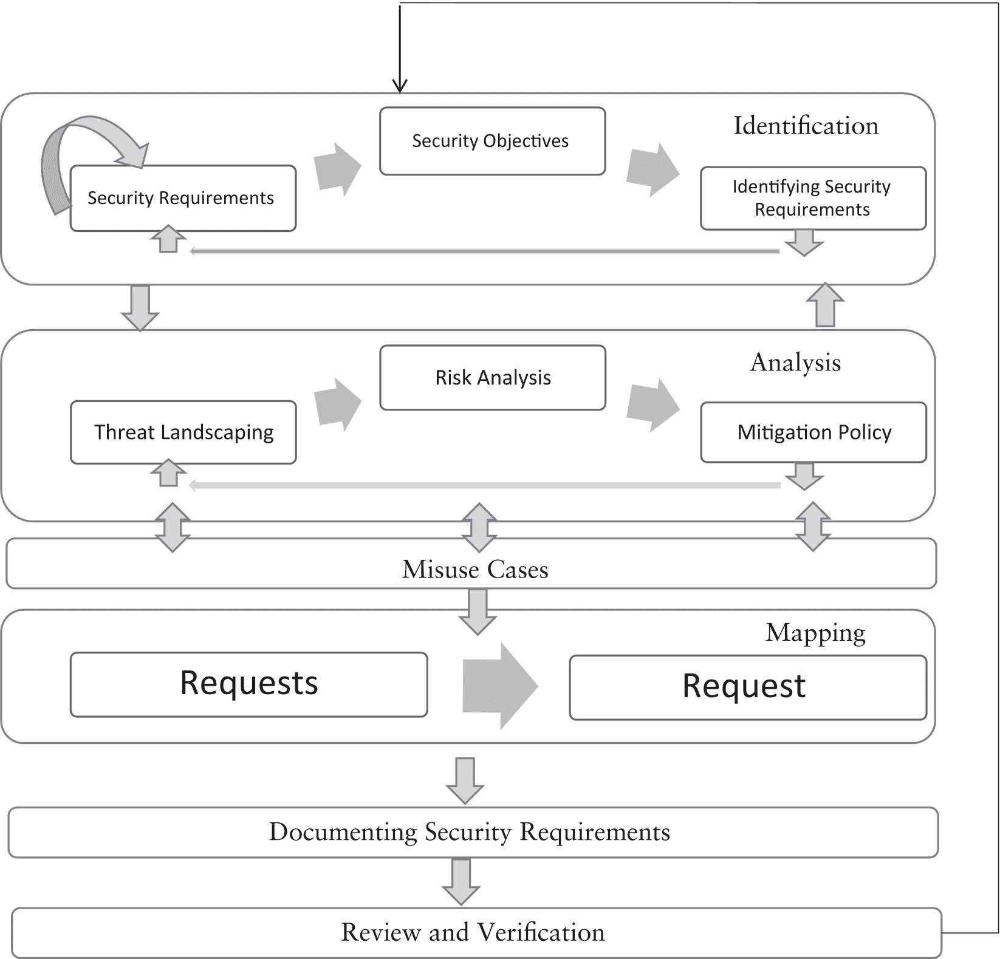

图 8.3 涉及安全需求阶段。

表 8.1 安全需求规范所有阶段的规范性操作

| 步骤 | 需要执行的监管程序 |
| :--- | :--- |
| 识别 | 从多个角度演示、分析、优先级排序并陈述安全需求<br>概述安全目标<br>在功能和非功能需求的支持下，确定满足所有安全目标的安全需求<br>突出软件的非功能安全需求 |
| 分析 | 设计期间的威胁分析<br>安排危险布局<br>为每个识别出的安全需求记录滥用用例<br>衡量可能攻击的滥用用例的强度 |


- 在开发需求时，冒着评估风险来处理安全问题

### 映射
- 将所有定义的非功能性安全需求与功能需求进行对比
- 与可利用的用例进行映射
- 将所有负面和无效的请求转换为积极且有强制性的请求

### 文档化
- 在结论记录中包含需求、目标和安全需求
- 威胁态势、风险可能性及缓解策略示例

### 评审与验证
- 检查文档是否符合规定的目标和需求
- 审查安全需求文档验收测试的所有文档参数

**识别**：这一步定义了安全需求，包括利益相关者的安全和韧性需求，并满足他们的韧性与生存需求。许多软件安全问题源于对安全需求的定义不足或错误。安全目标是为了是为了满足特定需求而设计的。事实上，安全目标是影响需求隐私性、真实性和可用性的主要目标和局限性。安全需求被定义为满足安全目标所需的适当内容。应该更强调识别非功能性安全需求，因为这有助于减少或消除软件中的缺陷。

**分析**：一旦设定了安全目标并确定了实现这些目标的安全需求，下一步将侧重于分析这些需求，而不包括其结构和性能事实。安全目标本质上是对特定安全环境中典型的威胁。检测期间的威胁应经过仔细分析。需求规范的不断变化导致了威胁态势设计中严重比例更高、环境更不可预测。必须分析与各种安全问题相关的风险。确定系统不应该做什么通常比确定它应该做什么更困难。在这种背景下，相关的响应与所谓的“误用用例”非常相似，它们负责系统不应做的事，因此在满足安全需求方面非常有价值。

**映射**：非功能性安全需求在识别阶段通常被局限并描述为软件功能。非功能性安全需求在识别阶段通常被捕获并说明为软件功能。这些非功能性安全需求必须经过功能定义才能包含在软件中并进行相应的测试。映射非功能性安全需求使安全需求成为分析过程中不可或缺的一部分。

**文档化**：本节负责交付输出。通过与安全目标共同澄清所需的描述来完成适当的文档编制。此规范文档包含了特定的需求，安全威胁和相关风险必须通过特定的缓解计划进行识别和列出。

**评审与验证**：起草安全需求规范文档的主要目的是根据安全需求确认陈述的目标，如果需要进一步修订。安全文档的接受性应使用多种参数进行验证，包括准确性、可行性、可持续性、优先级排序、透明度和可验证性。根据评估结果，决定是认可相同内容还是进行修订。

### 8.5.2 安全设计阶段

安全模式通常根据安全需求的性质和潜在威胁来选择。然而，并非所有安全模型在此阶段都是可的。最大安全模型在设计阶段被识别。设计阶段是开发生命周期中最创新的部分。因此，设计阶段具有许多安全影响。下面给出的大纲对应于解释安全设计阶段相关步骤的观察。每一步都包含特定的操作，如`图 8.4`所示。这些活动在`表 8.2`中描述 [20]。

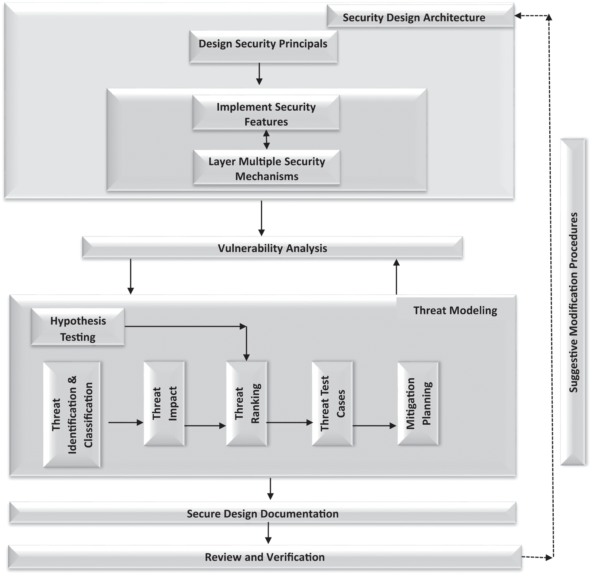

图 8.4 安全设计涉及的步骤。

表 8.2 安全设计每一步涉及的操作

| 步骤 | 需要执行的操作 |
| --- | --- |
| 安全设计架构化 | - 确定软件架构的安全前景<br>- 识别最可行进行安全增强的关键组件<br>- 需要讨论最相关的程序、本质上具有强功能的语言，部署最小权限机制并识别攻击面；<br>- 根据识别的最新威胁及其优先级，实现对安全设计架构的反思。 |
| 威胁建模 | - 解决基于安全设计架构的不需要的软件功能带来的风险<br>- 识别设计中环境较不安全的脆弱部分<br>- 威胁枚举及其优先级排序<br>-  {适当的安全机制制定缓解威胁的计划<br>- 识别攻击者可以轻易突破的软件缺陷<br>- 需要编写文档以建立历史信息集，其中必须包含基于识别的最新威胁的类型、描述、目标、防御策略和风险管理计划<br>- 需要进行适当评估，以根据威胁设定优先级并进行相应的影响分析<br>- 基于攻击面执行分析。 |
| 文档化产物 | - 安全设计对适当文档的紧迫需求<br>- 针对“威胁识别、风险描述和风险缓解”执行防御策略<br>- 文档化威胁对其严重性的影响分析和优先级排序。 |
| 评审与修订 | - 必须评审设计文档，以验证根据预期需求必须协商的所有安全问题<br>- 检查是否需要修订，根据需要执行修订。 |

**安全设计架构化**：从安全角度解释软件架构。这一步涉及通过识别实现安全功能所需的关键组件来设计设计架构。安全设计架构是一种提议使用强健编写语言、权限和最小攻击区域的风格。早期集成包括记录安全需求、安全设计原则以及对技术和非技术安全审计的需求，以创建安全设计架构。

**威胁建模**：威胁建模是一种常用方法，有助于识别正在开发的应用程序的威胁。软件始于分类和设定安全目标。它将应用程序转换为物理和逻辑结构。威胁建模是为了扩展设计阶段不可或缺的安全管理。考虑威胁的程序增强了使用其他技术无法观察到的潜在设计问题。软件设计人员和架构师尝试在进入设计之后之前尽可能地减少任何识别出的安全问题。详细的威胁建模是设计设计架构技术安全行为的最佳方式。它包含四个主要步骤，包括功能转换、分类和威胁排名，以及缓解计划。


## 安全设计文档：此步骤包括对已识别威胁的安全设计进行记录，并展示这些威胁，包括风险、预防方法和威胁管理计划。文档还包含根据可能产生的影响优先级排序的威胁信息。

## 评审与验证：此步骤检查安全设计文档。安全设计文档从一开始就对其进行审查，以确保设计的安全性。这些审查通常发生，并从高级设计审查开始，最终深入到程序的所有元素。

### 8.5.3 安全编码阶段

编码错误导致了 80% 的系统渗透。这显然可以被归类为安全问题。不当的编码会导致安全问题和不必要的长期成本。巨大的市场压力使得软件开发人员被迫在截止日期前完成工作。由于缺乏安全意识，他们无法为安全编码包含适当的指令。图 8.5 说明了安全编码阶段涉及的步骤。每一步都涉及某些特定的活动，如表 8.3 所示。这些活动将在后续章节 `[21]` 中进行解释。

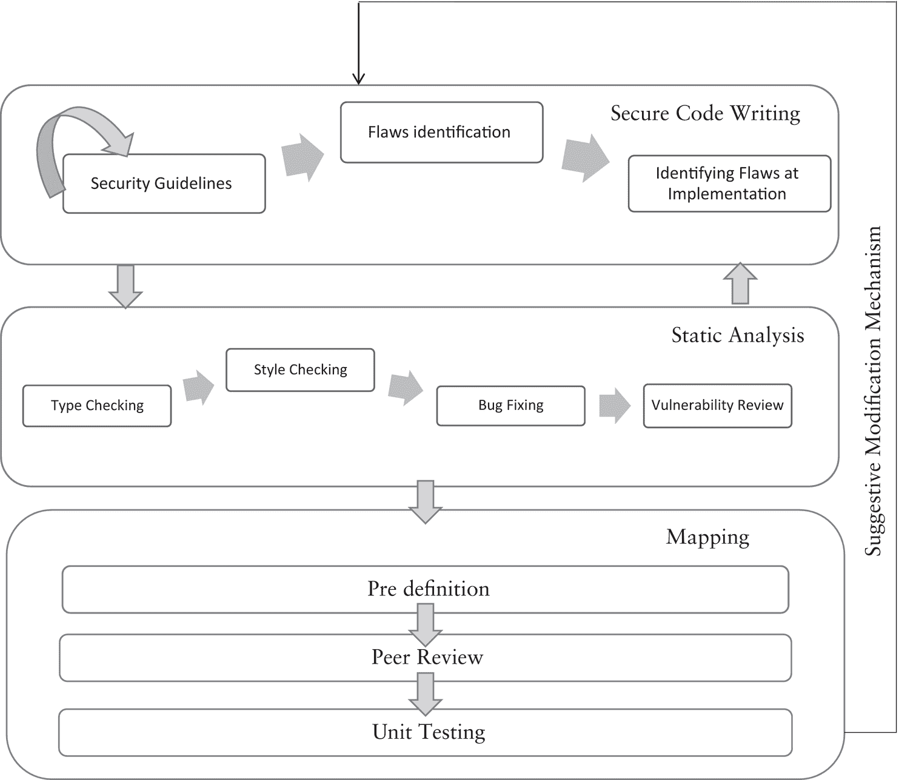

图 8.5 安全编码阶段涉及的步骤。

表 8.3 安全编码每个步骤涉及的动作

| 步骤 || 需要执行的动作 |
| --- | --- |
| 安全编码 || |
| * 为了正确识别实现层的安全缺陷 | * 要求通过实现层的各种安全漏洞对软件应用程序进行影响分析 | * 识别与安全相关的编程错误率 | * 安全指南在识别应用程序缺陷方面的作用 |
| --- | --- |
| 静态分析 || |
| * 高度需要用于安全的自动化工具以获得更高的误报率 | * 使用此类机制或工具捕获困扰许多软件程序的常见漏洞 | * 自动化工具应作为手动代码的支持机制，而不是安全缺陷的替代品 |
| --- | --- |
| 代码评审 || |
| * 通过检查代码来验证软件安全的基础 | * 在对功能进行监控的同时进行安全检查 | * 针对识别应用程序中的安全缺陷及其纠正机制进行评审并提供反馈 | 确定评审范围、覆盖范围、标准、安全需求和评审流程 |

**安全编码**：程序员在编写安全代码时应识别实现层面的缺陷。在早期阶段开发的产物将指导程序员制定安全代码。程序员在编写代码时必须遵循安全指南，以处理实现层的错误。

**静态分析**：它主要负责使用最流行的工具（包括二进制代码或二进制分析工具）监控软件的通用漏洞。静态分析工具在集成阶段提供最大的支持，以监控完成的软件模块的功能性缺陷。必须密切关注错误的发生，并使用错误跟踪系统进行纠正。这些工具的先进性要求开发人员分析可能包含误报的大量后果。

**代码评审**：必须通过安全代码评审建立软件安全的决定性意见。有必要根据编写的代码来检查功能行为。

### 8.5.4 安全测试

安全测试与功能测试完全不同，但两者同等重要。安全测试要求系统在正常情况下寻找漏洞。因此，将测试计划同安全开发一起公开至关重要。该图说明了 `表 8.4]` 中的相关步骤。


图 8.6 安全测试涉及的步骤。

表 8.4 安全测试每个步骤涉及的动作

| 步骤 || 需要执行的动作 |
| --- | --- |
| 安全测试活动 || |
| * 主要职责是使用设计文档和威胁建模了解攻击及相应影响 | 发现并对与攻击相关的区域进行排序 | 对攻击面进行分类 | 识别未知实体可以攻击的脆弱代码部分 | 根据影响的严重程度进行优先级排序和排名 |
| --- | --- |
| 安全测试用例 || |
| * 为成功的软件攻击准备测试用例 | 需要对测试用例进行优先级排序 | 需要分析业务流程的所有假设和模型 | 在动态层面使用测试用例 | 在测试环境中针对每个设计的测试用例执行测试 |
| --- | --- |
| 安全测试文档 || |
| * 每个安全测试用例都需要适当的文档记录 | 关于安全测试用例优先级排序和排名的讨论 | 指出通过动态分析和适当文档记录出的所有漏洞的优先级列表 |

### 8.5.5 安全部署阶段


在软件安装到运行环境后，对系统的缺陷和易感性保持关注至关重要。在识别出新开发的原型后，必须将其纳入需求阶段，以便在后续发布进行额外的安全增强。在安装或部署阶段，需要进行应用程序安全监控，并制定响应机制。有两种后续方法，包括静态分析和同行评审，以减轻已确认的安全漏洞。图 8.7 显示了部署阶段涉及的步骤说明性视图。该阶段的每个步骤包含了表 8.5](#ch8.xhtml#table_5)中提到的某些活动。这些活动在表 8.5](#ch8.xhtml#table_5)中进行了详细说明 22]。


图 8.7 安全审查审计步骤 

表 8.5 安全部署每个步骤涉及的操作

| 步骤 | 需要执行的操作 |
| --- | --- |
| 最终安全审查与审计 | 代码审查以跟踪任何未识别的安全漏洞 |
| | 评审分析以减少部署资源和时间 |
| | 检查软件的整体状态 |
| | 确保整个开发过程中涉及安全最佳实践 |

**最终安全审查与审计**：此步骤包括执行最终的安全评估，以确保通过之前阶段识别出的安全风险已修复，或者有改进机制来应对这些风险。安全领域的专家还尝试消除残留的安全漏洞。安全检查确保了整个开发阶段都考虑了安全最佳实践。

### 8.5.6 安全维护

软件管理员必须首先完全理解软件的安全状态。在安装后，任何跳过了测试的缺陷可能会再次出现，并按优先级进行设置。在此阶段会检测到新风险。图 8.8 显示了安全维护阶段涉及的步骤说明性视图。该阶段的每个步骤包含了图 8.8](#ch8.xhtml#fig_8)所示的某些活动。这些活动在表 8.6](#ch8.xhtml#table_6)中详细描述 23]]。


图 8.8 安全维护阶段涉及的步骤

表 8.6 安全维护每个步骤涉及的操作

| 步骤 | 需要执行的操作 |
| --- | --- |
| 新威胁 | 发现系统遇到的最新威胁 |
| | 对最新威胁进行优先级排序并进行其影响分析 |
| | 需要针对更新记录处理最新威胁 |
| | 为识别出的最新威胁准备缓解计划 |
| 攻击面区域 | 识别最新威胁和攻击面区域 |
| | 在识别威胁的特定区域审查漏洞 |
| 缓解技术 | 扩展安全区域以发现最新威胁 |
| | 软件保护计划以避免安全泄露 |

**新威胁识别**：软件无法完全安全，新威胁会源源不断地出现。因此，需要投入精力使软件免受此类安全的影响。维护团队应该关注系统安装后遇到的新威胁，以便及时处理它们，并避免和妥善处理任何安全泄露。

**攻击面区域**：安装后，有必要意识到应用程序软件中易受攻击的脆弱区域。这些区域在部署安全机制时需要额外的预防以避免被利用。

**开发缓解技术**：在软件安装后处理安全漏洞可能是一项艰巨的任务，因为编写补丁是应对威胁的唯一途径。因此，发布安全补丁是为了加固软件以防御新威胁和漏洞。

## 8.6 结论

在整个软件开发周期中增强安全对齐的工作是设计稳健且安全软件的唯一途径。将安全活动早期整合到开发过程中可以降低软件开发成本。由于软件设计可能从根本上不安全，后期更新相应的安全性是非常复杂的，甚至是不可能的。此外，它还可能更改属性和应用程序接口，从而影响后兼容性。本章提出的框架是本课程中的一次尝试。所提出的框架性质上非常具体，要求在开发生命周期期间观察关键活动以创建安全软件。在每个阶段成功整合上述活动可以减少精力和时间，同时交付安全的软件。

## 关键术语

安全开发、安全软件开发框架、需求阶段加固、设计阶段安全、设计架构加固、编码阶段安全、安全测试阶段、安全部署阶段、安全维护

## 思考点

*   基于安全软件开发并强调持续安全关注的首要观察，能够在早期通过发现和减少漏洞来构建安全机制。
*   必须在软件开发的主要阶段包含安全保障机制，因为安全考虑必须与所有利益者共享。
*   这对减少整体风险非常有帮助。
*   执行分析对于有效的活动和政策是必要的。
*   在整个开发过程中确保安全最佳实践得到落实是必要的。

## 选择题

1. 由于软件开发过程的复杂性，安全问题会极大影响软件的 _\_\_\_\_\_\_\_\_\_\_\_\_\_。
   * a) 安全
   * b) 安全
   * c) 质量
   * d) 性

2. 软件测试涉及检查和确认满足其设计和开发的 _\_\_\_\_\_\_\_\_\_\_\_\_\_ 需求的应用程序或程序。
   * a) 业务和技术
   * b) 仅业务
   * c) 仅技术
   * d) 以上都不是

3. 安全漏洞是 _\_\_\_\_\_\_\_\_\_\_\_\_\_\_\_\_\_\_\_\_\_ 的不可或缺部分。
* a) 安全需求
   * b) 安全设计
   * c) 安全测试
   * d) 安全维护

4. \_\_\_\_\_\_\_\_\_\_\_\_\_\_\_\_\_ 包括一个可靠、稳定、无错误且无漏洞的软件开发过程。
   * a) 安全规划
   * b) 软件开发
   * c) 安全开发
   * d) 软件保障

5. 由于增加了 _\_\_\_\_\_\_\_\_\_\_\_、连接性和可扩展性，软件现在更容易受到攻击。
   * a) 治理
   * b) 可测试性
   * c) 易用性
   * d) 复杂度


## 6. 软件规范文档包含了特定的要求的 \_\_\_\_\_\_\_\_\_\_\_\_\_\_ 以及相关的 \_\_\_\_\_\_\_\_\_\_\_\_\_\_\_\_\_\_\_\_\_\_。

1. a) 漏洞与响应
2. b) 身份验证与授权
3. c) 缺陷与错误
4. d) 安全威胁与风险

## 7. 详细的威胁建模是设计 \_\_\_\_\_\_\_\_\_\_\_\_\_\_\_\_\_\_\_ 技术安全行为的最佳方式。

1. a) 安全特性
2. b) 设计架构
3. c) 缺陷
4. d) 安全分析

## 8. 详细的威胁建模包含四个主要步骤，包括功能转换、\_\_\_\_\_\_\_\_\_\_\_\_\_\_\_\_\_\_\_、威胁排名以及缓解计划。

1. a) 分类
2. b) 关联
3. c) 耦合
4. d) 内聚

## 9. 在检查代码的 \_\_\_\_\_\_\_\_\_\_\_\_\_\_\_ 期间，必须进行安全代码审查。

1. a) 计划
2. b) 设计
3. c) 编码
4. d) 功能

## 10. 在安装或部署阶段，制定应用安全监控和响应计划。

1. a) 计划与执行
2. b) 监控与响应
3. c) 设计与编码
4. d) 效率与功能

## 简题

1. 什么是安全软件开发过程？
2. 安全缺陷如何导致软件开发不可靠？
3. 写出安全需求阶段识别过程的监管程序？
4. 为了安全设计，威胁建模应该采取哪些行动？
5. 安全设计阶段应该执行哪些操作？
6. 安全编码阶段需要哪些步骤？
7. 你对静态分析了解什么？
8. 你对代码审查了解什么？
9. 请通过适当示例描述安全代码编写。
10. 你对安全测试了解什么？

## 论述题

1. 你对安全维护了解什么？讨论安全维护期间每个步骤的视角活动。
2. 你对安全部署了解什么？讨论安全部署期间每个步骤的视角活动。
3. 你对安全测试了解什么？讨论安全测试期间每个步骤的视角活动。
4. 什么是安全编码阶段？讨论安全编码期间每个步骤的视角活动。
5. 什么是安全设计阶段？讨论安全设计期间每个步骤的视角活动。
6. 详细讨论安全软件开发过程的视角框架。
7. 与安全开发相关的主要组件有哪些？重点阐述每个组件的特定功能。
8. 写出安全开发过程的主要目标。
9. 为什么早期设计方法比后期开发方法要好得多？请提供具体原因。
10. 什么是安全需求阶段？讨论安全需求阶段每个步骤的视角行动。

## 参考文献

1. J. Du, Y. Yang and Q. Wang, “软件安全需求方法论理解分析”，第三届 IEEE 国际安全软件集成与可靠性提升会议，2009 年，第 141–149 页。
2. M. Paul, “安全软件开发的十项最佳实践”，`(ISC)2`。[`www.isc2.org/uploadedFiles/%28ISC%292_Public_Content/Certification_Programs/CSSLP/ISC2_WPIV.pdf`](https://www.isc2.org)
3. C. Wysopal. “将安全构建到您的软件开发周期中”，SC Magazine，2008 年 1 月 30 日。[`www.scmagazineus.com/building-security-into-yoursoftware-development-lifecycle/article/104705/`](http://www.scmagazineus.com)
4. C. Perrin, “设计简单性是开源安全的重要元素”，IT Security，2011 年 1 月 10 日。
5. J. Allen, “衡量软件安全”，节选自 2009 年 CERT 研究年度报告，卡内基梅隆大学，第 64–65 页，2010 年。[www.cert.org/archive/pdf/research-rpt-2009/allen-meassoft-sec.pdf](http://www.cert.org)
6. B. Whyte and J. Harrison, “安全软件开发”，软件安全失败：谁应该纠正以及如何做，Issue V1.0 2008 年 6 月。
7. M. S. Merkow and L. Raghavan, “面向开发者的软件安全”，2010 年 9 月 27 日。[`www.csoonline.com/article/618463/software-security-fordevelopers`](http://www.csoonline.com)
8. “敏捷软件开发不会产生安全软件”，View Point，2011 年 3 月 4 日。[`agilescout.com/agile-software-development-doesn’t-create-secure-software/`](http://agilescout.com)
9. “过程模型如何帮助将安全引入软件开发”，(ISC)2 政府顾问委员会执行作家小组，2010 年 3 月 4 日。
10. K. M. Goertze, “软件安全引言”，US CERT，2009 年。[`buildsecurityin.us-cert.gov/bsi/547-BSI.html`](https://buildsecurityin.us-cert.gov)


# 9 软件安全测试

DOI: [10.1201/9781003330516-9](https://dx.doi.org/10.1201/9781003330516-9)

> 程序测试可以是显示漏洞存在的非常有效的方法，但对于证明漏洞不存在则是毫无意义的。
> 埃德格·迪杰斯特拉 (Edsger Dijkstra)

随着安全事件的增加，企业主对应用程序失效的认识加深，许多应用因软件检测到的安全问题而被拒绝。这些日益增长的问题是安全测试领域的新兴，而安全测试在软件测试人员的世界中起着关键作用。安全测试负责识别应用程序潜在的弱点。这些漏洞可能导致意外的功能，并存在关键或敏感信息被盗取或破坏的概率。它可能便利入侵者通过利用应用程序的漏洞访问系统。传统的安全测试方法无法在早期有效地限制漏洞和逻辑错误。此外，传统的软件测试实践没有给开发者足够的时间修复不断出现的问题 [1]。

设计的松散性导致了潜在攻击的发生。软件开发生命周期的设计阶段受到各种问题的损害，包括加密滥用、访问控制损坏以及特权块的 API。许多常见的安全问题，包括缓冲区溢出问题、跨站脚本（XSS）、SQL 注入攻击、缺失参数处理失败以及未定义参数处理不当，是实现层的重大问题。开发层面能够处理诸如不安全的配置管理、源代码的不当包含以及针对过度身份验证尝试的暴力破解攻击等安全问题。迫切需要从软件开发的各个层级解决所有安全问题，并且必须策略性地解决这些问题。在软件开发过程中并行引入安全测试对应对安全问题具有显著成效。因此，开发一个专注于开发生命周期的集成安全测试框架是紧急需求。另一个问题是安全的工业化，这是该领域安全专家和学者的主要困扰。这是一个行业需要安全工业化的时代。这将有助于从安全措施改进、产品改进和安全管理策略改进方面提高安全性 [1, 2]。

## 9.1 目标

检查安全测试活动中涉及的内容已变得必要甚至困难，这使其变得昂贵且紧迫。每项行动需要准备哪些要求；如何增加时间；最后，如何明亮可以节省时间的区域以便其清晰可见。如果能在测试过程中识别并实施了最佳活动，通过使用创新的测试技术可以节省大量时间。这里讨论了在设定目标的情况下，从不同角度对安全测试过程最有利的以下优先活动：

*   审查安全规则、指南和规章。
*   分析用于实现安全性的可用安全最佳实践。
*   创建安全请求和攻击场景。
*   审查在测试生命周期中集成安全性的过过（程）。
*   开发分阶段的安全测试流程。
*   设计用于采纳安全测试流程水平的指南。
*   提出完成逻辑测试的指南，以验证所实施安全措施的恰当功能。
*   识别与组织安全策略中定义的允许服务之间的偏差。

## 9.2 软件测试

软件测试是一个评估软件应用程序功能的过程，目的是发现所开发的软件是否满足特定需求。这是一种通过对无缺陷环境进行适当验证来识别缺陷以生产质量产品的努力。它验证了预期的功能行为是否符合实际需求。在软件测试过程中，识别错误或缺失需求的目的是针对实际需求进行验证的，而这些需求必须通过差距分析进行验证。通常，软件测试广泛分为功能测试和非功能测试。

基于风险的方法作为估计系统架构现实实际状况的基础，并提供了攻击者动机的衡量标准——如何突破软件安全以获得财务利益。测试人员的首要任务是由于对风险进行强制性测试来暴露损失或损坏的机会。这将有助于衡量风险的严重性以及入侵者可以轻易破坏的可能攻击中心区域。根据安全考虑，它是系统测试下的分阶段过程，其中对`评估对象` (`TOE`) 进行测试。这种演示是迈向安全软件的重要步骤 [2, 3]。

## 9.3 安全测试

软件系统中的安全漏洞从本地实现错误到高层的设计错误不等，是最难处理的缺陷类型，这类缺陷几乎总是会导致安全风险。安全测试的目标是尽早检测漏洞，并确保最终产品的性和可靠性。漏洞评估/检测技术为安全测试提供了宝贵的方法论。本章对不同的安全测试工具进行了详细调查和分析，以便对漏洞扫描和检测进行全面调查。

随着技术的进步，安全测试是一个相对新的概念，确保软件在敌对条件下运行受控。在安全领域，安全测试仍然是一个相对新的话题。本章讨论了不同安全测试工具的类型、问题和支持。它对源代码和字节码分析、Web 和 Web 服务分析、基于网络的分析等不同类别的安全漏洞测试工具进行了全面调查。

在早期阶段识别和防止弱性和漏洞可以确保系统在已知策略和机制约束范围内运行。软件安全测试、代码审查和风险分析是识别软件弱点和漏洞的一些有效方法。软件安全的目的是通过实施安全漏洞检测技术或安全测试工具，发现漏洞并防止它们进入产成品。当确认最终软件产品持有所有预期的安全适用异常处理和功能排除时，这种努力是可以接受的。安全测试中需要考虑的四个关键点如下 [3–6]：

1.  **网络安全**：它包括检测网络基础设施（包括资源和策略）中的漏洞。
2.  **系统软件安全**：侧重于检测应用程序运行所依赖的软件中的弱点。
3.  **客户端应用安全**：侧重于保护客户端或浏览器不受任何可能的操纵。


### 4. 服务端应用安全
它侧重于加强服务器代码及其相关技术，以防止任何入侵。

安全测试通常涉及执行复杂的步骤。但是，像上述那样的简单测试也可以暴露漏洞和最严重的安全风险。

### 9.4 软件安全测试流程
安全测试被认为是开发软件安全性的基本资源。软件安全测试确保了软件产品在开发和执行过程中的安全性，从而最大限度地减少安全错误未失控并被客户或恶意用户发现的概率。验证应用程序的健壮性并防止安全弱点进入应用，是安全测试的主要职责。它被公认为确保可信性和软件安全的关键机制。在任何敌对状态下，都必须在识别出预期的安全相关异常、错误、异常和故障后，确保功能运行以验证软件安全测试的有效性。对于任何组织实践环境，它都以双重方式工作。第一层负责基础工作（包括合规性以抵御使用），另一层确保组织充分理解并实施了安全策略。根据上述讨论，重点强调了一些相关的观察结果，以便将安全测试纳入更高的优先级 [7–10]。

* 识别导致数据丢失的应用程序漏洞
* 允许保护环境以阻止入侵者破坏应用程序
* 验证软件对于保持安全行为和状态更改的可信度
* 负责识别应用程序内部可利用的缺陷和弱点
* 负责为特定的服务改进系统
* 在软件开发的设计阶段消除安全缺陷
* 构建降低成本和预防潜在安全风险的机制

根据预定功能确定系统行为是安全测试流程面临的主要挑战。在给定的一组策略和程序的限制内，为了维护安全保障而实现可操作性，是安全测试的常用方法。安全专家 Guru Gary McGraw 题为《基于风险的安全测试》的研究文章通过识别系统风险，为攻击者的行为提供了清晰的理解和模拟方法。承认风险并在预期攻击可能成功的代码关注区域上执行相应的软件安全测试。

## 9.5 集成方法
如果不解决设计中的系统在设计阶段初始阶段如何防御攻击的问题，安全测试将是不完整的。适当的安全测试需要对所有方面进行测试，而不仅仅是实现部分。测试过程负责为预期系统免受攻击提供保护。强有缓解程序对于确保安全起着至关作用。贯穿整个开发周期的集成机制安全测试提出了软件质量的全面视角，并防御如图 9.1 所示的识别出的安全威胁。测试人员必须在需求提取阶段的安全分析早期阶段就使用其知识。必要的更改可以在编码人员开始流程之前尽早引入。如果在整个开发阶段忽略安全测试，应用程序可能会产生危险的漏洞，并在开发阶段将产生许多漏洞扩散，使组织面临巨大风险。因此，为了扩展对软件质量的视角，采用集成安全测试方法对于识别开发进度中每个阶段的漏洞并同时最大限度地减少漏洞至关重要。将软件测试集成到开发过程中将减少损害成本和潜在风险。因此，必须像图 9.2 所示，为每个阶段制定软件安全测试策略。


图 9.1 软件安全测试的集成框架


图 9.2 软件安全测试流程中包含的安全活动

审视什么使得安全测试活动如此独特且重要已变得既至关重要又具有挑战性。在每个事件中寻找必须做的事情以优化时间是非常建议的。在测试过程中实施最佳活动通过创新的测试机制可以节省大量时间。此外，指定优先事项的积极持续的安全测试方法可以在以下方面证明其巨大的优势 [10–13]。

* 良好的安全测试机制将引导更可靠的软件
* 以正确的方式安排并明智实施适当的安全测试流程将显著减少时间和精力，同时提高质量
* 开发规范的安全测试流程将以最短的时间产出高质量的产品
* 通过动态安全测试行动可以积极利用自动化过程
* 由于实施了准确的安全测试活动，软件收益的可能性显著增加。

上述优势强调了从不成熟和临时性的方法转向完整安全测试流程的需求。活跃的安全测试过程涉及广泛的技能和行动，包括分类、汇编和文档，以及支持资源。在这种视角下，测试行为必须优先考虑，旨在向最终用户交付最终的安全收益。因此，这强调了迫切需要一种通用的软件安全测试程序，该程序可以集成到软件开发生命周期的每个阶段，以开发安全软件。下图显示了安全测试生命周期流程，作为一个与开发活动紧密连接的独立过程。上述七个阶段均在下文中进行了描述。

### 9.5.1 安全测试策略和测试计划


此阶段需要准备合适的安全测试计划，以便使安全测试与安全需求相关联，并规定每个测试阶段的准入和退出标准。测试计划应当区分需要测试的项目和功能、需要实现的测试类型、执行测试的人员、执行分析所需的资源和进度安排，以及围绕计划的风险。准备安全测试策略和策略涉及的步骤见图 9.3。


图 9.3 安全测试策略与测试计划的视角活动。

### 9.5.2 设计安全测试用例

此阶段负责安全测试用例和测试脚本的构思、验证和修改。正向、负向、真实场景和边界条件是执行测试用例的四个主要方面。高度要求根据预定义的测试用例标准配置实际先决条件以执行安全测试用例。准备安全测试设计涉及的步骤见图 9.4。


图 9.4 设计安全测试用例的视角活动。

### 9.5.3 执行安全测试用例

此阶段要求按照连贯的顺序和明确的输入数据执行安全测试脚本。结果应该经过审查，输出应记录在测试表中。在海量的测试用例汇中，应根据多种理由和非主观标准来确定它们的实施优先级。必须记录测试结果，并对失败实例及其缺陷进行记录。之后，应对对安全测试计划和测试用例进行评估和改进。执行安全测试用例的拟议步骤见图 9.5。


图 9.5 执行安全测试用例的规范性步骤。

### 9.5.4 捕获安全测试结果

在成功执行安全测试用例后，必须修复识别出的缺陷并进行重新测试。随后可以宣布结果为通过或未成功。应充分记录测试观察。此外，必须创建一个测试日志，包含有关测试执行的重大事实的历史备注。最后，应组织一份测试摘要，将测试活动的结果简写与一个或多个测试设计需求连接起来，并根据此类发现提供估计。有关执行测试用例的细节见图 9.6。


图 9.6 捕获安全测试结果涉及的视角步骤

### 9.5.5 捕获安全测试指标

必须识别安全测试指标，以支持专门评估项目工作，满足指标组和软件经理的关注。这些人员负责改进开发和测试过程中的软件安全测试工作。这些这些安全测试指标能够根据项目状态报告为项目经理和测试团队负责人提供精确信息。大多数基本参数易于计算，主要由测试分析师以某种形式跟踪。测量的安全测试指标将原始指标数据转换为更具功能的信息。捕获测试指标涉及的步骤见图 9.7。


图 9.7 捕获安全测试矩阵涉及的视角步骤

### 9.5.6 定性评估

在此阶段总结了用于评估产品质量的产品质量测量参数。选择了一些通用接受的参数进行评估。从这些量化结果中，创建一份关于工作质量的报告，随后提供给最终用户。提出基于定性评估的解释和建议性措施。图 9.8 描述了定性评估的规范性步骤。


图 9.8 定性评估涉及的视角步骤

### 9.5.7 安全测试结束报告

成功实现预期目标的预期安全结果将得到良好的记录和存档。这些项目相关的知识将根据测试符合情况和退出标准作为项目规划的参考。时间、测试暴露、预算、软件应用、关键业务目标、质量、保留结果、结果和观察的涉及步骤都是退出标准。测试测试结束文档需要准备一份在项目结束时必须执行的活动清单。

## 9.6 软件安全测试工具

软件应用程序和互联网服务的数量指数级增长，所有信息只需点击即可获取，这需要一种有效的安全机制，以自动或半自动的方式来测试和验证正确的功能。它们将敏感信息传输到服务器，可以通过互联网或内网通过 Web 应用程序访问。在大多数情况下，强大的安全测试机制需要处理恶意入侵者并发现潜在漏洞。它有助于确认在不安全行为和状态变化方面的软件可靠性。它还探索可利用的缺陷和漏洞，以减少软件安全风险并提高安全测试效率。各种类型的安全测试工具有助于安全专业人员评估软件服务可能的漏洞。这意味着应用程序中存在漏洞反映了应用程序可能在任何时候被破解。程序漏洞越多，就越容易受到攻击。表 9.1 名为“安全测试工具”，分析了工具的类型、性质、安全问题和语言支持、来源以及工作阶段。不同类型的测试工具可用于发现开发过程中每个阶段的漏洞。


# 表 9.1 安全测试工具：重顾 [14], [15], [16], [17], [18], [19], [20], [21], [22], [23], [24], [25], [26], [27], [28], [29], [30], [31], [32], [33], [34], [35], [36], [37], [38], [39], [40], [41], [42], [43], [44], [45], [46], [47], [48], [49], [50], [51], [52], [53] and [54]

| 工具名称 | 工具类型 | 支持的语言/基于 | 安全问题 | 阶段分析/使用模式 | 来源 |
| :--- | :--- | :--- | :--- | :--- | :--- |
| RATS | 扫描工具 | C, C++, Perl, php & python 等语言 | `BOF`, `TOCTOU`, `RC` | 源代码层面 | Secure software/fortify software/HP |
| beSTROM | 模糊测试工具 | 内部软件应用及设备 | 异常 | 不适用 | Beyond security |
| Zed Attack Proxy | 自动化扫描/渗透测试工具 | JAVA 及 Web 应用程序 | 安全漏洞 | 源代码 | 开源 |
| nCircle Certified PCI Scan Services | 扫描 | 基于网络的软件应用程序 | PCI 数据安全标准相关条件 | 不适用 | nCircle |
| Fortify360 | 扫描/检测 | 软件应用层 | 漏洞披露 | 静态代码分析/运行时观察 | Fortify software/HP |
| Perimeter Check | 漏洞评估 | 为服务器/网站/防火墙/路由器提供服务的语言 | 安全漏洞：中断中断/数据窃取/系统破坏 | 外部网络设备 | Security Metrics Inc. |
| Core Impact Pro | 漏洞评估/扫描及渗透测试软件 | 软件应用/Web 应用程序/服务器及设备 | 确认可利用的漏洞/分层防御效率指标/验证合规性 | 将安全测试最佳实践纳入六步流程 | Core Security Technologies |
| C5 Compliance Platform | 识别/评估/总结 | 异构系统 | 安全漏洞 | XML 规范 | Secure Elements Inc |
| Security Metrics Appliances | 检测/防御 | 集成软硬件设备 | 漏洞评估 | 通过输入 IP 和 DNS 创建用于测试的网络清单 | Security metrics |
| SARA | 远程自扫描、API 设施安全分析工具 | 基于 Unix | 第三方应用的 API & 插件设施 | API, 插件设施 | Advance Research Corp. |
| Found Stone | 漏洞管理软件工具/漏洞评估 | 软件应用层 | 硬件设备，软件产品/托管服务 | 不适用 | McAfee |
| NetIQ security analyzer | 漏洞扫描/评估产品 | Windows/solaris/Linux | 间隔内的多平台漏洞扫描/评估 | 不适用 | 不适用 |
| Seeker | 漏洞检测 | AJAX/adobe flex & Air/RIA/.Net/J2EE/HTTPS | Web 安全测试，用于定位并揭示源代码风险区域和代码关联 | 源代码 | Quotium technologies |
| Zero day scan | 安全扫描服务 | Web 应用程序 | Web 端 XSS、SQL 注入漏洞 | Web 端 | Web 端 |
| App Scan | 安全漏洞 | HTML 文档 | 安全漏洞 | | Web 端 |
| Klocwork | 漏洞检测 | C,C#, .Net/J2EE/HTTPS | Web 安全测试，用于定位并揭示源代码风险区域和代码关联 | 源代码 | Quotium technologies |
| Detection | | | | | | 源代码 | Klocwork |
| Astree | 运行时错误 | C | Astrée 分析结构化 C 以分析内存 | | 通过抽象解释进行运行时分析 | | |
| Find Bugs | 安全漏洞 | Java | 复杂的 Web 应用程序安全服务检查常规动态测试 | | |
| CQual | 格式字符串漏洞 | C, 基于 Java 的 | 检测常见的 Web 应用程序漏洞 | 通过类型推断识别格式字符串漏洞 | Ashcraft and Engler |
| Eau Claire | 安全漏洞识别 | C | Eau Claire 检查数组边界和空指针引用 | 代码级 | B.V. Chess, |
| Splint | 安全漏洞和编码错误 | C | Splint 命令行程序 | 通过适当观察检查源代码 | David Evans |
| SecureCFM | 源代码 | Linux & windows | 负责 ColdFusion 源代码 (CFML) 审计，识别跨站脚本 | 源代码 | Dimitri During |
| ITS4 | 扫描安全漏洞 | C,C++ | ITS 4 扫描源代码中的恶意函数调用。`BOF`, `FSP`, `SE`, `TOCTOU`, `弱随机数生成` | 开源 | John Viega, J.T. Bloch, Yoshi Kohno, Gary McGrawReliable Software |
| AcunetixWVS | 漏洞扫描器/检测 | Windows | | | 商业 | Acunetix |
| Burp Suite | 安全漏洞扫描器 | HTML 文档 | 分析应用程序依赖的不可预测的令牌或其他项目的不确定性程度 | 商业/免费（功能受限） | PortSwiger |
| GamaScan | 安全漏洞扫描器 | Windows | 与模拟 Web 应用程序攻击相关的常规动态测试服务 | 商业 | GamaSec |
| Grabber | Web 应用程序扫描器 | Windows, Linux, UnixPython, Beautiful Soup and PyXML | 对网站/脚本进行自动验证，只告诉你是什么漏洞……而不是如何解决 | 开源 | Romain Gaucher |
| Grendel-Scan | Web 应用程序安全测试工具 | Windows, Linux 和 Macintosh | 检测常见的 Web 应用程序漏洞，并具有旨在通过自动化测试模块辅助手动渗透测试的功能 | 开源 | David Byrne |
| Hailstorm | 云端和 Web 应用程序的安全评估 | Windows | 云端和 Web 安全，SDLC 级别的风险管理 | 商业 | Cenzic |


| 工具名称 |  | 平台 | 特性/漏洞 | 许可证 | 开发/维护者 |
| :--- | :--- | :--- | :--- | :--- | :--- |
| `N-Stealth` | Web 应用程序安全扫描器、审计、网络、Web | Windows, Linux | Web 服务器安全检查、备份安全检查、跨站脚本 | | 商业 | N-Stalker |
| `Netsparker` | Web 应用程序漏洞扫描器 | Windows | `SQL Injection`、跨站脚本。`Netsparker` 可识别：基于错误的 SQL 注入、布尔型 SQL 注入、盲注（基于时间）SQL 注入 | | 商业 | Mavituna Security |
| `Nikto` | Web 服务器扫描器 | Unix/Linux | Web 服务器扫描器，执行标准和服务器类型显式检查。捕获 cookies | | 开源 | CIRT |
| `ParosPro` | Web 安全审计 | Windows | 允许公司根据针对各种安全漏洞设计的插件进行评估 | | 商业 | MileSCAN/启安信 |
| `QualysGuard` | 不适用 | 不适用 | 不适用 | | 商业 | Qualys |
| `Retina` | 网络安全扫描器 | Windows/Unix | 主要针对 Unix 的广泛漏洞数据库，良好的报告模块 | | 商业 | eEye Digital Security |
| `ScanDo` | Web 应用程序扫描器，扫描所有类型的 Web 应用程序，包括 Flash、JavaScript、ASP、XML 和 Web 服务 | Windows | 自动识别软件生命周期中所有阶段的漏洞。随着应用程序的演变评估风险水平 | | 商业 | KaVaDoInc |
| `Securityk.QA Toolbar` | Web 应用程序安全 | Windows | 在软件开发生命周期（SDLC）的 QA 阶段，QA 可以基于工具栏执行安全/回归测试。工具栏可以每页执行多个应用程序安全测试，生成包含已识别问题和缓解策略的 HTML 报告 | | 商业 | iSec Partners |
| `Sentinel` | 不适用 | 不适用 | 不适用 | | 商业 | White Hat Security |
| `Wapiti` | Web 应用程序漏洞扫描器/安全审计 | Windows, Unix/Linux 和 Macintosh | 文件处理错误、数据库注入（`PHP/JSP/ASP SQL Injections` 和 `XPathInjections`）、`XSS`（跨站脚本）注入、LDAP 注入、命令执行检测（`HTTP Response Splitting`、会话固定……） | | 开源 | Informática Gesfor/MicolasSurribas |
| `WebApp360` | Web 应用程序漏洞，如（`XSS`）和 SQL 注入 | Windows | 不适用 | | 商业 | nCircle |
| `WebInspect` | 自动化漏洞扫描 | Windows | 动态黑盒测试工具，通过实际执行攻击检测漏洞 | | 商业 | HP |
| `Wikto` | `Wikto` 是一种 Web 服务器评估工具。用于 Web 服务器指纹识别、目录和链接提取 | Windows | 针对`SQL injections`，寻找面向互联网的 Web 服务器中的漏洞 | | 开源 | Sensepost |
| `NTOSpider` | 安全扫描器 | Windows/forms | 评估站点暴露风险，确定威胁优先级，通过漏洞和威胁暴露生成高质量的图形 HTML 报告和安全态势 | cookies、脚本、SQL 字符串和 ODBC 连接器、身份验证、applet/对象、隐藏字段等 | | | 商业 | NT Objectives |
| `Vega` | Web 安全扫描器 | 攻击模块用 `JavaScript` 编写 | 识别 Web 应用程序中的`SQL injection`、跨站脚本(`XSS`)和其他漏洞。它包含一个用于交互式 Web 应用程序调试的拦截代理 | | 免费开源 | SubgraphInc |
| `MileScanParosPro` | 漏洞扫描/安全审计平台 | 基于 Web 的应用程序语言 | 通过网络爬虫收集站点层级。基于插件的漏洞扫描 | | 不适用 | Milescan Technologies |
| `Aribisec Web Analyzer` | 安全扫描器 | HTML 代码 | 扫描潜在的恶意链接 | 分析站点结构、内容和配置 | 免费和付费版 |
| `Skipfish` | 安全扫描器 | 不适用 | 不适用 | | 不适用 | Michal Zalewski/Google |
| `Websecurify` | 漏洞检测器 | Windows, Mac OS, Linux 等 | 使用高级浏览器自动化、发现和模糊技术识别 Web 漏洞以及 OWASP Top 10 漏洞 | | 商业/免费 | GNUCITIZEN/web securify |
| `Samurai Web Testing Framework` | Web 渗透测试框架 | Linux | 不适用 | | 开源/免费 | Inguardians Inc. |
| `Arachni` | 扫描器 | HTTP 响应 | 能通过 Web 应用程序的动态特性检测扫描期间的变化 | | 开源/免费 | TasosLaskos |
| `Sparse` | 最初构建用于寻找`kernelCode`中的代码错误 | C | 不适用 | | 不适用 | 不适用 |
| `Flawfinder` | 安全缺陷（缺陷）识别 | 支持 Python（Unix, Windows, OS/2, Amiga 支持的语言：`C`, `C++` | 缓冲区溢出、格式字符串问题、shell 执行、不安全的临时文件、竞争条件、访问违规 | | 源代码 | David A. Wheeler |
| `MOPS` | 识别能够有限状态自动(FSA)建模的安全问题 | Unix 程序平台语言：`C` | 对象文件嵌入了控制流图，并通过封装链接器进行执行。MOPS 工作在基础`C`源码上，但也可以确保源码 RPM 静态（编译时）分析工具 | Hao Chen, David Wagner |
| `WebKing` | 不适用 | Windows/Linux/Solaris | 不适用 | | 商业 | Parasoft |
| `WebScanService` | 不适用 | 不适用 | 不适用 | | 商业 | German Web Security |
| `Websecurify` | 不适用 | Windows, Mac OS, Linux 等 | | | | 商业/免费 | GNUCITIZEN/web securify |
| `Web Scarab` | 漏洞扫描器（基于 Web 的应用） | XML 格式 | `Sql injection`、CSS、Cookie 中毒、参数篡改 | | 开源 | GNU |
| `W3af` | Web 安全框架 | Python | 盲注 SQL 注入、缓冲区溢出漏洞、多个 CORS 配置错误、不安全的 DAV 配置、CSRF 漏洞 | | 开源, GPLv2 | Andres Rcho |

 结论

将分阶段的安全测试与开发周期相结合已变得至关重要，以便尽早检测故障，减少开发成本、交付时间和重工作量。为了实现这一目标，提出了一个由七步组成的约束框架，该框架对于识别威胁和防止迁移至关重要。

## 术语

*   软件测试
*   安全测试
*   安全测试流程
*   安全测试策略和计划
*   设计安全测试用例
*   执行安全测试用例
*   捕获安全测试结果
*   捕获安全测试指标
*   定性评估
*   安全测试总结报告
*   安全测试工具

## 记忆点

*   安全测试负责识别应用程序中的可能漏洞。
*   声明的模糊性可能导致无意行为，并导致关键或敏感信息的被盗取或破坏。
*   软件测试活动在生产可靠系统方面负有主要责任，并消耗大量资源，包括时间、金钱。

## 选择题

1.  安全测试负责识别应用程序可能的\_\_\_\_\_\_\_\_\_\_\_\_\_\_。


# 问题

1. a) 缺点
   b) 优势
   c) 文档
   d) 参数

2. `\_\_\_\_\_\_\_\_\_\_\_\_\_\_` 的脆弱性导致了潜在攻击的发生。
   a) 需求
   b) 代码
   c) 设计
   d) 部署

3. `\_\_\_\_\_\_\_\_\_\_\_\_\_\_` 是一种评估软件应用程序功能的过程，目的是揭示开发的软件是否满足特定需求。
   a) 软件设计
   b) 软件测试
   c) 软件编码
   d) 软件维护

4. 它验证了功能的预期行为是否符合实际需求。这是正确的还是错误的？
   a) 正确
   b) 错误

5. 安全测试的目标是尽早检测 `\_\_\_\_\_\_\_\_\_\_\_\_\_\_` 并确保最终产品的安全性和可靠性。
   a) 漏洞
   b) 调试
   c) 测试
   d) 错误

6. 漏洞评估/检测技术为 `\_\_\_\_\_\_\_\_\_\_\_\_\_\_\_\_\_\_\_\_` 提供了有价值的方法论。
   a) 软件测试
   b) 安全测试
   c) 软件设计
   d) 安全设计

7. 软件安全测试、代码审查和 `\_\_\_\_\_\_\_\_\_\_\_\_\_\_\_\_\_\_\_\` 是识别软件缺陷和漏洞的一些有效方法。
   a) 风险分析
   b) 漏洞评估
   c) 风险缓解
   d) 风险暴露

8. 软件安全测试确认了软件产品的安全开发和执行，从而减少了 `\_\_\_\_\_\_\_\_\_\_\_\_\_\_` 释放并被客户或恶意用户的概率。
   a) 安全错误
   b) 安全风险
   c) 软件风险
   d) 软件错误

9. 健壮性的验证以及防止安全缺陷进入应用程序是 `\_\_\_\_\_\_\_\_\_\_\_\_\_\_` 的主要责任。
   a) 安全测试
   b) 软件测试
   c) 软件可靠性
   d) 软件可信性

10. 安全专家 Guru Gary McGraw 题为“基于风险的安全测试”的研究文章通过识别系统风险，为攻击者的行为提供了清晰的理解和模拟方法。
    a) 基于风险的安全测试
    b) 带风险的安全测试
    c) 风险分析与软件测试
    d) 风险分析与安全测试

## 简答题

1. 你对软件测试如何理解？
2. 为什么软件测试是软件开发中最重要的活动？
3. 为什么软件开发需要安全测试？
4. 你对安全漏洞如何理解？
5. 安全测试中需要考虑的其他四个关键点是什么？
6. 详细解释基于风险的安全测试。
7. 讨论将安全测试纳入更高优先级的的相关观察。
8. 你对测试用例和测试过程如何理解？
9. 简述安全测试用例和安全计划。
10. 什么是软件测试工具？请解释其中几个。

## 论述题

1. 软件测试如何与软件保障相关？软件测试对提高软件质量有多大贡献？
2. 请提供一个指南，选择一组足以揭示程序中潜在故障的最小测试用例。
3. 测试投入的计划不当如何影响整体测试？
4. 准备一个指南，用于选择合适的软件测试方法论。
5. 安全测试如何与软件保障相关？安全测试对提高软件安全性有多大贡献？
6. 详细讨论拟议的软件安全测试框架。
7. 写出可以纳入软件开发周期中的安全测试视角阶段。
8. 讨论安全策略和测试计划的机制。
9. 讨论设计安全案例和执行安全案例的机制。
10. 详细描述各种软件安全工具，并根据其可用性进行分类。

## 参考文献

1. G. Kavitha Jayaraman, Incorporating Security in Testing Life Cycle, Cognizant Technology Solutions, 2009.
2. Risk-Based Software Testing, Software Assurance Pocket Guide: Development, Volume III, Version 0.5 September 1, 2009.
3. B. Potter and G. McGraw, “Security Testing, IEEE Security & Privacy, 2004, pp. 32–36.
4. S. Turpe, “Security Testing: Turning Practice into Theory,” IEEE International Conference on Software Testing, Verification and Validation (ICSTW08), IEEE Computer Society, 2008.
5. H. Song, W. Liang, Changyou and Y. Hong, “A Security Testing Method Based on Typical Defects,” 2010 International Conference on Computer Application and System Modelling (ICASSM 2010), IEEE Computer Society, pp. V5-153.
6. SOA Test Methodology, Torry Harris Business Solution.
7. A. Marback, H. Do, K. He, S. Kondamarri and D. Xu, “A Threat Model based Approach to Security Testing,” Software: Practice and Experience, 2012, Published Online in Wiley Library, doi: 10.1002/spe.2111.
8. T.-Y. Gu, Y.-S. Shi and Y.-U. Fang, Research on Software Testing. World Academy of Science, Engineering and Technology, 2010, pp. 647–651.
9. Available at: www.cert.org
10. S. Paithis, “The Future of Software Security,” pp. 61–62.
11. Software Security Testing, Software Assurance Pocket Guide: Development, Volume III, Version 1.0 (May 21, 2012).
12. L. Lazic and N. Mastorakis, “Cost Effective Software Test Metrics,” WSEAS Transactions on Computers, 7(6), June 2008, pp. 599–619.
13. S. A. Khan, R. A. Khan and R. Choudhary, “Software Security Testing Process”, 6th International Conference on Software, Knowledge, Information Management and Applications, Chengdu University, China, 9–11 September.
14. http://www.securesoftware.com/resources/download_rats.html
15. https://www.fortify.com/ssa-elements/threat-intelligence/rats.html
16. https://www.owasp.org/index/OWASP_Zed_Attack_Proxy_Project
17. http://www.ncircle.com/pdf/resources/nCircle-DS-PCIScanSvc-1001-06.pdf
18. S. Balasubramanium, “Stride Towards Better Application Security”, Utah State University, Master Thesis, All graduate Thesis and Dissertation Paper 210, 2008.
19. https://www.securitymetrics.com
20. www.coresecurity.com


...


*   它还可以在设计阶段检测出缺陷，允许我们精准定位漏洞。
*   它可以用于评估软件安全性并为软件项目生成成本估算，从而更容易地对新业务进行估计和规划。
*   它可能有助于根据生产力、质量、交付周期、可维护性等定量标准，判断软件开发的有效性。

## 10.3 安全测试用例优化框架

评估一个信息系统是否保护了数据以及是否按预期运行，被称为安全测试。这是确保系统在系列策略和流程的限制内运行的最流行的方法。Gary McGraw 的基于风险的安全测试其动力在于理解并模拟攻击者的策略。软件安全测试人员可以通过识别系统中的风险并基于这些风险生成测试，从而正确地关注攻击可能成功的代码部分 [[1, 3, 4]。安全测试有助于检测可能导致敏感数据丢失或攻击者进入系统的缺陷。

由于安全事件数量的增加，以及所有者对因安全漏洞而失效的应用程序意识日益增强，安全测试已进入软件测试人员的世界。安全测试的核心在于识别程序所有潜在的缺陷和漏洞，这些漏洞可能导致极敏感数据的丢失或被窃、入侵者对程序的破坏，或允许任何入侵者访问系统 [5]。传统的安全测试方法无法在早期检测漏洞和逻辑问题。这还导致后期发现问题时产生高昂成本。在传统测试中，开发人员修复漏洞的时间非常短。由于安全性是软件产品整个生命周期中的一个重要方面，因此不能被忽视。任何漏洞、设计缺陷或设计原则或指标的缺失都可能危及软件的整体安全性。以下是一些最关键的点：

*   开发安全软件不仅仅是简单的保护敏感和机密数据；还需要开发一套事件方案，能够抵御为安全软件系统设定的基准标准。
*   这将有助于制定创建坚不可摧且高效的软件的路线图。
*   为了实现这一标准，必须对测试用例结构进行升级，以便检测更多缺陷并减少软件故障。
*   目前已经有若干复杂的软件应用程序，通过利用优化的安全测试框架，未来可以生产具有更高复杂性和最高安全性的软件系统。
*   这种优化的框架允许对安全问题进行早期识别和快速做出反应。因此，安全测试用例优化框架对于最大化和维护软件系统的防御能力同时保持低开发成本至关重要。
*   软件安全测试用例优化框架是一个新领域，未来在这一领域可以取得更多进展，帮助开发韧性软件应用程序。

在开发中软件进行安全测试的整个操作范围范围内，测试用例优化是至关重要的 [6]。测试特定层级软件代码所需的方法和属性在整个过程中至关重要，优化测试套件以满足测试区域和被测代码的要求也是如此。然而，对测试用例优化的研究已经揭示了两个关键困难。首先，现有的测试用例优先级算法忽略了同时对多个测试套件进行优先排序潜力。其次，目前的测试用例优先级系统对具有相同权重分的所有测试用例进行排序，忽略了属性权重与特定目标漏洞组之间的最佳相关性。因此，没有应用系统的算法。工业级软件系统对于测试人员和开发者来说是出了名的棘手，因为它们规模巨大，在短时间内对其进行评估几乎是不可能的。

这些系统通常比单一测试套件更突出，特别是软件集成测试 [7]，这需要仔细注意所用排序方法的细微差别。由于企业使用的软件系统复杂且规模巨大，首要任务是识别漏洞并权衡质量以提高故障检测率。如下文讨论所示，修复威胁和漏洞、减少不规则性和不符合标准的情况，以及在开发生命周期早期削减不必要的复杂性，都能导致高安全性最终产品的开发。在图 10.1 所示的“安全测试用例优化框架的设计与开发”指导下，研究的主要目标是设计一种机制，在设计阶段早期预测安全性。


图 10.1 安全测试用例框架

考虑到前面威胁中提到的安全性，可以得出结论，应该努力解决这些困难。提供了一个评估软件漏洞的合适测试框架，这迫切需要在设计阶段处理安全问题 [7, 8, 9, 10 和 11]。构建软件的组织在开发更安全的软件方面取得了巨大增长。然而，如今的关键需求是使用安全测试框架在设计早期发现漏洞。通过实施建议的框架可以实现漏洞的早期检测，将在生产过程中节省大量的时间和资金。安全测试方法基于七个原则：安全测试计划规范、安全属性识别、安全属性评估、测试用例执行、结果捕获、优化和验证。根据需要进行评审和修订。

### 10.3.1 安全测试计划规范

它是安全测试框架开发的一部分。系统最初检测最薄弱的领域，然后创建一个确保基于角授权、密码控制、访问级别管理等功能的安全测试计划 [7, 8]。目标是创建一个结合安全属性映射并根据企业需求提供更好结果的测试策略。安全测试计划规范的环境、战略、技术和操作组件分为四个部分。设施的物理特性，如硬件、通信和系统软件、使用模式或接口以及或其他软件用品，包含在环境规范中。


在技术规范的案例中，针对特定困难妥善选择相关工具和自动化方案以减轻测试人员的工作负担是一个大问题。由于不同的潜在工具用户可能有其他需求，同一个工具可能会被多次选择。在操作规范过程中，将对执行的所有所选测试用例得到的结果进行观察和记录。在自动化测试中，输入和结果都将被记录。待测试的特征、待测试对象、将进行的测试类型、执行测试所需的资源和时间表，以及相关风险，都应在上述高级测试计划中确定。因此，实施这项技术有助于节省手动搜索符合消费者预期的测试数据所需的时间 [9]\。早期检测技术的使用也大大减少了数据泄露的风险，有助于提高安全测试的质量。

### 10.3.2 安全属性的识别

在安全测试期间，识别安全方面至关重要。对于软件开发人员和测试人员来说，这些特征充当了路线图。已尝试识别用于软件设计量化的安全属性。识别安全属性的目标是针对软件测试期间发现的特定类型漏洞问题的关键特征。这可以通过安全属性的量化来实现，从而允许工程师及早发现软件系统缺陷，并跟踪测试过程中任何时间漏洞的数量。在建立测试计划时，所有与安全相关的因素都应被考虑进来。

### 10.3.3 安全属性的评估

在此过程中，使用软计算技术来识别每个特征之间的相关性。这可以通过彻底的文献综述和咨询专家来实现。将根据权重对安全质量进行优先级排序和排名，以进行逐案测试并识别软件中的差距或其他漏洞。在创建全面且无一失的安全测试框架时，根据其针对的漏洞分析安全质量至关重要。如果以及当发现时，可以使用安全特征的组合为在测试的任何一点解决安全问题创建一个可行且实用的框架。

### 10.3.4 测试用例执行与结果捕获

漏洞检测旨在定位盔甲上的裂缝或计划中的脆弱部分或弱点。此时已构建了详尽的安全功能设计。这将通过完成用用例和替代用例场景来实现，以理解并制定一个应对和保护软件结构免受威胁和漏洞的计划。通过进行彻底测试，可以以系统的方法识别这些危险。在程序开发过程中，这将有助于设计人员为潜在风险制定缓解措施，并引导他们关注易受攻击的软件系统部分。运行测试用例以改进安全测试，通过对所有模块运行测试来发现漏洞。使用测试来识别或捕获风险或后果将导致开发出安全的设计。故障的定位、软件失败的分类以及各种缺陷的分布都是这种认知过程的优点。发现的结果将被记录以供进一步处理。

### 10.3.5 优化

在此过程中，通过检查生产软件的许多领域并执行最佳安全测试以及验证最终程序，可以对用例进行优先级排序，该程序应符合用户的预期并具有适用性。优化的第一步是消除所有模块中由缺陷引起的冗余，开发指标，并最后使用优先级排序方法发现减少安全风险的最短途径。此外，测试用例优先级使用混合技术进行优化。主要目标是汇总所有最佳安全测试和验证活动及过程，开发出基于优先级的减少故障的集成最佳路径，并执行它们以创建一个更针对用户且更安全的软件系统。此外，它将识别核心数据中的漏洞并降低系统的基础设施成本。这将协助设计人员制定策略保护系统免受潜在威胁，并帮助他们专注于系统中可能被黑客攻击的区域。

### 10.3.6 验证

为了验证结果，研究人员在此使用了两种方法，包括理论和实证方法。理论验证基于关键专家意见。另一方面，实证验证基于假设测试。

### 10.3.7 审查与修订

如果需要，可以在所有阶段进行审查与修订以带来更精细的指南。

## 10.4 测试用例评估

软件日益复杂和扩展性阻碍了安全结构和相关的安全测试操作，给开发人员和研究人员开发更好的软件方法带来了独特挑战。通过对测试程序的最优使用，出现问题的模块测试套件可以得到修复。将在软件开发过程中节省时间和金钱 [10, 11]\。

人员已利用 `ACO` 技术针对软件开发的各个子系统/领域。尚未应用于安全测试。因此，建议的主题考虑使用 `ACO` 技术来解决与优化安全测试相关的挑战。基于 `ACO` 的算法比标准测试技术更有优势，因为它更以结果为导向并降低了软件系统开发成本。

### 10.4.1 案例研究：移动钱包

如今，基于设备的移动钱包被广泛使用。这些可以使用各种技术将支付信息从设备（如手机）发送到商户的销售点 (`POS`)。磁力安全传输 (`MST`)、近场通信 (`NFC`)、快速响应码 (`QR`)、低功耗蓝牙 (`BLE`)、`SMS` 和互联网都是从移动设备发送支付数据到 `POS` 的移动通信技术的示例。登录、`资料更新`、账单支付与充值`、加值`、mPIN 修改`、转账`和`交易详情`是所提移动钱包案例研究的七个模块，如图 10.2 所示。


第二个模块（M2）是个人资料更新，它允许经过验证的用户对其账户进行更改，例如更新地址、银行账户和 Aadhaar 绑定等。这些数据极其重要，其他人都无法对其修改或访问。客户可以在第三模块（M3）中利用其在线钱包中的额外资金来支付账单，例如能源账单、信用卡账单、税费缴纳、燃气账单、手机充值、DTH 充值以及在线零售交易等。如果用户的钱包余额不足，他们可以使用组件模块（M4）的第四种方法进行充值。可以使用借记卡或信用卡、网银或联系人请求。信用卡/借记卡网络的移动支付并没有改变这些支付的这种方式；它们仍然基于标准的基于卡的卡支付系统。

用户可以在第五个模块（M5）中修改四位 `mPIN`。更新请求通过向用户的注册手机号发送 `OTP`（一次性密码）来验证，从而验证交易。在第六模块（M6）中，资金可以传输到与用户配置文件指定的银行账户、联系人或手机。第七模块（M7）将提供个人在线交易的完整细节；这些细节可能包括最近的交易细节、上个月的交易细节或用户定义的特定期间的细节。

## 10.4.2 测试用例采样及其执行

软件安全测试用例是根据用例和备用用例提取的场景，如图 10.3 所示。提取这些测试用例是为了研究系统中的故障，深入分析软件系统可能经历的安全威胁或违规的类型，分析软件系统的可靠性和依赖性，以及它是否能够承受各种环境中发生的故障等。


图 10.3 移动支付钱包系统用例图

为了研究软件系统在备用测试用例场景下的行为，测试人员必须考虑所有以各种方式挑战软件系统安全的可能能量源，以找到软件结构中的弱环节或漏洞。针对每个安全属性，每个模块将开发 7 个测试用例。因此，我们总共得到了 49 个测试用例。在表 10.1 中，显示了在使用应用过程中与 7 个安全属性可能发生的 10 故障，即身份验证、授权、机密性、可用性、完整性、不可否认性和复原性。

表 10.1 故障描述

| 故障 | 描述 |
| --- | --- |
| Flt1 | RNG（随机数生成）失败 |
| Flt2 | 网络错误 |
| Flt3 | 段错误 |
| Flt4 | 文件/数据未找到 |
| Flt5 | 数据丢失 |
| Flt6 | 无限循环 |
| Flt7 | 通信错误 |
| Flt8 | 配置错误 |
| Flt9 | 服务故障 |
| Flt10 | 耦合故障 |

### 10.4.2.1 模块-1：登录

用户使用此模块登录系统。它通过接受用户名和 `mPIN` 作为登录凭据来验证用户，并在输入错误凭据时抛出错误。此模块可以研究包含测试用例 1–7 的登录备用用例场景。在测试用例 1 中，如果系统尝试从内存的错误分段读取数据，则会抛出 `flt3`。在测试用例 2 中，验证可能由于输入错误的 `mPIN` 而失败，或者可能找不到匹配输入的 `mPIN` 的文件，从而抛出 `flt2` 和 `flt4`，或者连接不佳将引发 `flt7`；同样，当服务不可用时会发生 `flt9`。在应用程序启动阶段，当用户输入错误的参数时，将根据测试用例 3 中的 `flt8` 抛出配置错误。对于测试用例 4，网络中断或文件读取可能导致 `flt2`、`flt4` 和 `flt9`。在应用程序成功启动后，如果信息无法传递到下一个模块，则在测试用例 5 中发生 `flt10`。

此外，如果用户无法向服务器验证其数字签名，将发生 `flt1`，导致通信间隙。因此，在测试用例 6 中会发生 `flt7`。最后，在测试用例 7 中，应用程序可能因为 `flt8` 无法启动或由于 `flt6` 而停止。表 10.2 显示了每个测试用例覆盖的故障。

表 10.2 针对模块-1 各安全属性的示例测试用例及识别的故障

| 各安全属性/故障对应的测试用例 | Flt1 | Flt2 | Flt3 | Flt4 | Flt5 | Flt6 | Flt7 | Flt8 | Flt9 | Flt10 |
| --- | --- | --- | --- | --- | --- | --- | --- | --- | --- | --- |
| --- | | | | | | | | | | |
| 授权 (Authorization) | | | | | | | | | | |
| 身份验证 (Authentication) | | | | | | | | | | | |
| 机密性 (Confidentiality) | | | | | | | | | | |
| 可用性 (Availability) | | | | | | | | | | | |
| 完整性 (Integrity) | | | | | | | | | | | |
| 不可否认性 (Non-repudiation) | | | | | | | | | | | |
| 复原性 (Resilience) | | | | | | | | | | | |

*(注：根据原文表格结构，此处为对应关系映射，翻译时保持了逻辑对齐)*

通过这七个模块的结果映射，消除输出中可能存在的冗余。因此，每个安全属性都获得了一个组合用例，如表 10.3 所示。此外，这些组合用例样本是根据故障覆盖和执行时间决定的。

表 10.3 各安全属性、故障及执行时间的示例测试用例

| 序号 | 组合用例 | 安全期间覆盖的故障总数 | 故障所属的模块 | 单位总执行时间 |
| --- | --- | --- | --- | --- |
| 1 | CTC1 (授权) | | | | 7 |
| 2 | CTC2 (身份验证) | | | | 4 |
| 3 | CTC3 (机密性) | | | | 5 |
| 4 | CTC4 (可用性) | | | | 4 |
| 5 | CTC5 (完整性) | | | | 4 |
| 6 | CTC6 (不可否认性) | | | | 5 |
| 7 | CTC7 (复原性) | | | | 4 |
| 其中 CTC：组合测试用例，Flt：故障，M1, M2 …M7 为模块。 | | | | |

寻找故障覆盖的最优化排序是工业/组织的最高要求。现在我们应用 ACO 技术来解决测试用例优化期间出现的此类问题。如果可以提前终止测试，重新排序测试套可以更有效地发现故障 [11, 12]。


安全回归测试套件 `CTC` 包含七个组合测试用例，其基本顺序为 `{CTC1, CTC2, CTC3, CTC4, CTC5, CTC6, CTC7}`，其执行时间如 表 10.9 所示。在此过程中，组合测试用例 `CTC1` 可以在七分钟内获得两个故障 `{flt1, flt3}`，`CTC2` 在四分钟内发现四个故障 `{flt2,flt4,flt7,flt9}`，`CTC3` 在五分钟内获得四个故障 `{flt1, flt5, flt7, flt8}`。组合测试用例 `CTC4` 和 `CTC5` 分别在四分钟内获得三个故障，分别为 `{flt2, flt4, flt9}` 和 `{flt3, flt6, flt10}`。组合测试用例 `CTC6` 在五分钟内发现两个故障 `{flt1, flt7}`，而 `CTC7` 在四分钟内发现三个故障 `{flt3, flt6, flt8}`。

表 10.9 总体改进

|  || 改进 || 百比 |
| --- | --- | --- |
| 无序排序对比基于 ACO 的排序 || 0.757–0.700 || 0.057 || 7.53 % |
| 反序排序对比基于 ACO 的排序 || 0.757–0.685 || 0.072 || 9.51 % |
| --- | --- | --- | --- |
| 随机排序对比基于 ACO 的排序 || 0.757–0.585 || 0.172 || 22.72 % |
| 优选排序对比基于 ACO 的排序 || 0.757–0.742 || 0.015 || 2.00 % |

组合测试套件是通过删除冗余后从所有七个测试用例场景得到的。问题是基于由 `n` 个组合测试用例组成的集合 `T` (Test Suite) 中获取的测试用例的最大故障分析能力，选择优化的安全测试用例优先级，找到子集 `S`，它由 `m` 个测试用例（m<n）组成，这些测试用例经过选择和优化。该问题可以描述为无向图 `G (V,E)`，其中 `V` 是节点集，`E` 是图中边的集。`WTi` 是第 `it h` 条边的权重。它描述了沉积在边 `ei ϵ E` 上的费素足迹，反映了在时间约束 `MAX_TIME` 范围内所选路径上的故障覆盖率 `Flti`。初始时，所有边的权重均设置为零。

### 10.4.2.2 基于 ACO 算法的假设

应用基于 ACO 算法优化安全测试用例的假设如下：

* 原始测试套件，`T = {t1, t2…… t49}`
* 组合测试套件，`CTC = {CTC1, CTC2,…….., CTC7}`
* 所有故障集合，`F = {flt1, flt2……flt10 }`
* `CTC` 中的每个组合测试用例 `CTCi`;`i = 1, 2,…7` 覆盖了 `F` 中的部分或全部故障。
* 每次迭代后，蚂的最小执行时间将加到当前执行时间。一旦当前执行时间超过 `MAX_TIME`，算法将根据一个常量来限制算法（`MAX_TIME = 84 minutes`）。
* 用于搜索测试用例空间的人工蚁数量为 7，即 `An1` 到 `An7`（与组合测试用例的数量相等）。
* `WTi` 是每条边 `i` 的权重，假设为在边上的费素量。
* 蚂跨越最佳路径后沉积的费素。
* 费素沉积率假设为 `1` 或 100%。
* 费素蒸发率假设为 `WTi` 的 `k%`（k=10），在每个循环后减少。

## 10.5 安全测试用例的优化

图 10.4 显示了基于迭代方式优化安全测试用例的流程图。


图 10.4 方法的流程图

### 10.5.1 用于优化测试用例优先级的 ACO 算法

1. **第 1 步**：初始化参数并生成蚁。
2. **第 2 步**：将蚁放在起始节点 `i`，即初始 `CTC`。
3. **第 3 步**：查找初始 `CTC` 的的所有故障。
4. **第 4 步**：使用过程 `SELECT_TEST_CASE()` 选择测试用例并查找故障。
5. **第 5 步**：重复步骤 4 直到覆盖所有故障。
6. **第 6 步**：如果覆盖了所有故障，发送下一个蚁。重复此步骤直到所有蚁访问一次。
7. **第 7 步**：更新对应最小执行时间的蚂的费素值。
8. **第 8 步**：更新当前执行时间。
9. **第 9 步**：如果当前执行时间小于 `MAX_TIME`，则重复第 2 到第 8 步。
10. **第 10 步**：如果当前执行时间超过 `MAX_TIME`，获取最优路径并终止算法。

基于 ACO 的算法在每次迭代中的执行情况见 表 10.5、表 10.6、表 10.7 和 表 10.8。


| 1. || `CTC1` | `CTC7` | `CTC5` | `CTC2` | `CTC2` |
| --- | --- | --- | --- | --- | --- |
| 2. || `CTC2` | `CTC6` | `CTC7` | `CTC3` | `CTC5` |
| 3. || `CTC3` | `CTC5` | `CTC2` | `CTC5` | `CTC1` |
| 4. || `CTC4` | `CTC4` | `CTC3` | `CTC7` | `CTC3` |
| 5. || `CTC5` | `CTC3` | `CTC4` | `CTC4` | `CTC7` |
| 6. || `CTC6` | `CTC2` | `CTC1` | `CTC6` | `CTC4` |
| 7. || `CTC7` | `CTC1` | `CTC 6` | `CTC1` | `CTC6` |

表 10.8 通过不同技术用用例优化结果

| || 无排序 | 反向排序 | 随机排序 | 优排序 | 基于 ACO 的排序 |
| --- | --- | --- | --- | --- | --- |
| APFD 指标结果 | 0.700 | 0.685 | 0.585 | 0.742 | 0.757 |
| --- | --- | --- | --- | --- | --- |
| 70.00 % | 68.50 % | 58.50 % | 74.20 % | 75.70 % |

第二次迭代后，基于 ACO 的算法的输出如表 10.7 所示，相应的邻接矩阵如表 10.8 所示。

### 10.5.2 通过不同技术获取结果

基于 ACO 技术的框架与传统方法（如无排序、反向排序、随机排序和组合测试用例的优排序）的比较结果在表 10.8 所示。由 Elbaum 提出的指标平均故障检测百分比（APFD）被用于量化测试套件的故障检测率，这对于衡量每个测试套件执行百分比的故障检测率具有重要意义[13, 14]]。为了验证，可以将多种优化的优先级标准应用于测试套件，以实现目标，即使用最佳且最短的路径在最短时间内检测到故障[15, 16, 17 和 18]]。从各种方法获得的所有结果都在`APFD` 指标的帮助下进行了计算和比较，如下：

```
APFD = 1 − {(Tf1+Tf2+….+Tfm)/mn} + (1/2*n)
```

其中 `n` 是测试用例的数量，`m` 是故障的数量。（`Tf1`,.,.,Tfm`）是显示故障的第一个测试 `T` 的位置。

## 10.6 上文解释

表 10.9 显示了从安全测试角度优化的测试用例排序。此外，还使用了许多技术来优化测试用例，包括无排序、反向排序、随机排序、优排序和基于 ACO 的排序。表 10.8 显示了它们结果的整体改进。通过`APFD`指标获得的结果表明，基于 ACO 的排序优于传统的排序技术。上述比较以及通过`APFD` 指标获得的结果证明了 ACO 技术在早期故障检测方面提供了最好的结果。因此，很明显，ACO 技术优于其他方法。

## 10.7 自动化安全测试

自动化测试负责在软件开发期间发现软件程序中的任何缺陷或漏洞。自动化测试可以在开发过程中进行，从而缩短开发时间。这通过利用自动化技术和充分的扫描发现程序中的漏洞。这将防御那些使用自动化脚本来利用特定漏洞的入侵者。这些自动化脚本可以自动发现并修补应用程序中的漏洞。这些自动化安全测试程序可以在任何环境中运行（包括在线应用程序），并生成这些应用程序中发现的漏洞列表报告。这些自动化安全测试方法对于渗透测试和安全审计员发现漏洞更有用，开发者和管理员在软件发布前经常使用它们。自动化测试与手动测试之间的差异讨论在表 10.10 中[19, 20]。

表 10.10 自动化测试与手动测试的差异

| 手动测试 | 自动化测试 |
| --- | --- |
| 深度测试 | 使用自动化测试工具执行测试套件 |
| --- | --- |
| 由安全专家执行 | 增加组织知识 |
| 工具如 `Ranorex Studio`, `Kobiton`, `ZAP`, `LambdaTest`, `Avo Assure` | 不安全配置 |
| 未集成到流程 | 补充安全工作 |
| 工具如 `Jira`, `Bugzilla`, `Mantis`, `ZAP`, `NUnit`, `Citrus`, `LoadRunner`, `SonarQube` | 容易 |

表 10.11 OWASP 前十大漏洞

| 前十大 Top 10 | 2017–2018 | 2013 | 2007 | 2004 |
| --- | --- | --- | --- | --- |
| A1 | 注入 | 跨站脚本 (XSS) 漏洞 | 未验证输入 |
| A2 | 身份认证会话管理 | 身份认证会话管理 | 注入 | |
| A3 | 敏感数据泄露 | 跨站脚本 (XSS) | 注入 | |
| A4 | XML 外部实体 (XXE) | 不安全直接引用 | 不安全对象引用 | 跨站脚本 (XSS) |
| A5 | 访问控制 | 安全配置错误 | 跨站请求攻击 | 缓冲区溢出 |
| A6 | 安全配置错误 | 敏感数据泄露 | 信息泄露和错误处理 | 注入 |
| A7 | 跨站脚本 (XSS) | 功能级访问控制 | 身份认证会话管理 | 错误处理 |
| A8 | 不安全反序列化 | 跨站请求攻击 | 不安全加密存储 | 不安全存储 |
| A9 | 使用已知漏洞的组件 | 使用已知漏洞的组件 | 不安全通信 | 拒绝服务 |
| A10 | 日志记录和监控 | 未验证的重定向和转发 | 限制 URL 访问 | 不安全配置管理 |

*自动化安全测试的最佳实践*

- 需要进行全面的安全审计以确定产品的重大风险。
- 从简单到复杂的流程缓慢启动的直接任务。
- 对于重复性和真实世界的实体任务最可行。
- 海量数据

*自动化测试执行的特定领域*

- 代码分析工具
- 适当配置扫描
- 应用层测试

### 10.7.1 自动化测试工具列表

各种自动化测试工具有商业化的，也有开源的。虽然开源软件更稳定且架构更先进，但在客户支持和技术改进方面往往逊于商业替代方案。以下是工具列表：

- `Contrast Security`: `Contrast Security` 是一种在应用程序内部运行的安全工具，用于识别潜在缺陷。

- `Burp Intruder`: `Burp Intruder` 是一种基础设施扫描器，用于确保应用程序与环境正确交互。


## 安全工具

*   **OWASP ZAP**: `OWASP ZAP` 是一种本质开源的基础设施扫描器。其功能与 `Burp Intruder` 类似。
*   **Veracode**: `Veracode` 指一种代码分析工具，用于发现应用程序结构中的漏洞。
*   **BDD Security**: `BDD Security` 是一个测试自动化框架，用户可以使用自然语言语法将安全功能描述为特性（features）。
*   **Mitten**: `Mitten` 是一个使用 Python 编程语言的开源测试自动化框架。
*   **Microsoft Azure Advisor**: `Microsoft Azure advisor` 是一种基于云的顾问服务，根据个人需求提供建议。
*   **GauntIT**: `GauntIT` 是一个对于习惯 Ruby 开发人员的测试自动化框架。

保护资产有几项最佳实践。迭代方法是将自动化测试技术集成到产品流水线中最可接受的方法之一。在最后时刻进行大量的安全相关测试是必要的，这会导致生产延迟。以下是提高生产率的一些建议：

*   集成自动化测试流程以处理潜在漏洞
*   将大型项目拆分为较小部分部分
*   代码依赖性分析
*   针对恶意攻击进行测试
*   开发所需的最佳实践培训

## 10.8 影响与重要性

安全测试是一种将最优安全测试集成到软件应用程序中以识别漏洞或缺陷的技术。其目标是识别易受站点并记录已完成的缓解工作。因此，安全测试的准确性越高，漏洞风险越低。维护软件安全和客户机密性有助于企业与消费者之间保持合理的信任。健壮的安全测试框架有助于发现完整的安全和隐私问题，并保护软件免受未经授权的访问、恶意攻击和其他各种有害漏洞的影响。开放 Web 安全项目（Open Web Application Security Project）致力于传播应用程序安全信息。它每隔二到三年识别一次十大最严重的应用程序安全风险。他们的努力是让安全风险在社会中更加可见，以便每个利益相关者都能意识到负面影响并制定具体的保护机制。这要求应用开发社区做出更多贡献，更新以进行更深的影响分析和解决方案。它使用 `OWASP Risk Rating Methodology` 使用的评分标准提供了关于风险可能性和技术影响的基本信息。根据 `OWASP`，表 10.11 中提到了一些最严重的安全关注问题。

## 10.9 结论

安全软件开发对安全测试和用例优化的要求日益增长。此外，缺陷会导致成本并引起生产延迟，也可能危及人的生命。当使用当前的软件系统时，必须确保功能是可靠且安全的。在当今的数字服务世界，提高软件安全性是区分产品的关键因素。如果你希望你的业务成功，就必须确保你的产品是安全的。这不是一种优势，而是公司成功的必要条件。研究人员和业内人士一致认为安全软件至关重要，但关于如何、何时以及何地量化安全的话题仍处于进行中。

本文涵盖了优化软件安全测试套件的所有策略。我们使用了 `ACO` 技术来更有效地对测试用例进行排序。我们在安全测试套件中使用 `ACO` 技术进行早期缺陷识别并修复了这些问题，因为它提供了可能的顺序。只有当研究通过验证并实现了预定目标时，新方法才会被社会或行业接纳。

## 关键术语

*   `Security testing`（安全测试）
*   `ACO`

## 注意事项

*   `Security testing` 识别软件中的漏洞和缺陷。
*   `Security testing` 目标是发现漏洞和弱点。
*   `Security testing` 确保应用程序没有数据（隐患）。

## 选择题

1.  以下哪项是安全测试？
    *   a) `Phishing`（钓鱼）
    *   b) `Bulling`（欺凌）
    *   c) `Soliciting`（招揽）
    *   d) `All`（全部）
2.  以下哪项可以认为是计算机威胁？
    *   a) `DoS`（拒绝服务）
    *   b) `Phishing`（钓鱼）
    *   c) `Stalk`（跟踪）
    *   d) `Both`（都是）

3.  以下哪项不是 ACID 属性？
    *   a) `Consistency`（一致性）
    *   b) `Isolation`（隔离性）
    *   c) `Durability`（持久性）
    *   d) `Availability`（可用性）
4.  以下哪项是数据库中的漏洞？
    *   a) `DELETE`
    *   b) `DROP`
    *   c) `SQL injection`（SQL 注入）
    *   d) `All`（全部）
5.  以下哪项应该包含在渗透测试范围内？
    *   a) `DNS server`（DNS 服务器）
    *   b) `Mail server`（邮件服务器）
    *   c) `Communication links`（通信链路）
    *   d) `All`（全部）

## 简答题

*   什么是安全测试？
*   列出安全测试的属性？
*   什么是 `penetration testing`（渗透测试）？
*   说明保护密码的两种技术？
*   `ACO` 的全称是什么？

## 描述题

*   定义并讨论可能导致漏洞的因素列表。
*   详细讨论安全测试优化。
*   安全测试的阶段有哪些？

## 参考文献

1.  `G. McGraw`, “Software Security,” `IEEE Security & Privacy`, 2(2), pp. 80–83, 2004.
2.  可用于：`https://www.veracode.com/state-of-softwaresecurityreport`
3.  `J. Alsalam, S. Banerjee, G. Musick and R. Saftoiu`, “Computer Security and Rootkits”, *White Paper*. `http://.cs.washington.edu/courses/csep590/05au/whitepaper_turnin/whitepaper_rev12_final.pdf`
4.  `G. D. Everett and R. McLeod`, Software Testing- Testing Across the Entire Development Life Cycle, Hoboken, New Jersey: John Wiley & Sons, Inc., IEEE Press, 2007.
5.  `E. E. Ogheneovo`, “Software Dysfunction: Why Do Software Fail?`, `Journal of Computer and Communications`, 2, pp. 25–35, 2014.


8. I. Schie Ferdecker, J. Grossmann and M. Schneider “基于模型的安全测试”,基于模型的测试会议 (EPTCS 80), 80, pp. 1–12, 2012.

9. Gu Tian-yang, Shi Yin-Sheng and Fang You-Yuan, “软件安全测试研究”,国际计算机、电气、自动化与信息工程期刊, 4, pp. 1446–1450, 2010.

10. G. Rothermel, R. J. Untch and C. Chu, “回归测试测试用例优先级排序”,IEEE 软件工程汇, 27(10), pp. 929–948, 2001.

11. T. L. Graves, M. J. Harrold, M. J. Kim, A. Porter and G. Rothermel, “回归测试选择技术的实证研究”,ACM 软件工程与方法期刊, 10(2), pp: 184–208, 2001.

12. U. Waheed, “Web 应用程序开发的安全回归测试框架”,学位论文,奥斯陆大学, pp. 1–106, 2014.

13. S. Elbaum, A. G. Malishevsky and G. Rothermel, “回归测试测试用例优先级排序”,软件测试与分析国际会议, pp. 102–112, 2000 年 8 月.

14. S. Elbaum, G. Rothermel, S. Kanduri, A. G. Malishevsky, “选择高效益的测试用例优先级排序技术”,软件质量期刊, 12(3), pp. 185–210, 2004.

15. G. Rothermel, R. H. Untch, C. Chu and M. J. Harrold, “测试用例优先级排序：实证研究”,软件维护国际会议论文集,英国牛津, pp. 179–188, 1999.

16. K. R. Walcott, M. L. Soffa, G. M. Kapfhammer and R. S. Robert, “感知时间的测试套件优先级排序”, 2006 年软件测试与分析国际会议论文集 (ISSTA ’06). 计算机协会,美国纽约州纽约市, 1–12. [`doi.org/10.1145/1146238.1146240`](https://doi.org/10.1145/1146238.1146240), 2006.

17. J. Ning, C. Zhang, P. Sun and Y. Feng, “多目标优化蚁群算法对比研究”,MDPI Information, 2018 年 12 月, 1–19.

18. L. Li, S. Ju and Y. Zhang, “用于旅行商问题的改进蚁群优化算法”,2008 年智能计算技术与自动化国际会议 (ICICTA), 2008, pp. 76–80, doi: 10.1109/ICICTA.2008.265.

19. R. Kumar, S. A. Khan and R. A. Khan, “软件安全测试：一个相关的框架”,全球计算机科学研究期刊 (JGRCS), 5(3), pp: 23–27, 2014 年 3 月.

20. B. D. R. Marino, H. M. Haddad, “应用开发的安全漏洞与缓解策略”,IEEE 信息技术会议：新一代 (ITNG’09), IEEE, pp. 235–240, 2009. 

## 有用链接

* [`www.wisdomjobs.com/e-university/security-testing-interview-questions.html`](https://www.wisdomjobs.com)
* [`www.educba.com/security-testing-interview-questions/`](https://www.educba.com)
* [`www.geeksforgeeks.org/software-testing-security-testing/`](https://www.geeksforgeeks.org)

# 11 实现安全：案例研究

DOI: [10.1201/9781201978120](https://doi.org/10.1201/9781201978120)

## 11.1 目标

成功完成本章后，学生将能够熟练完成以下任务：

* 理解安全估计的概念
* 讨论安全与设计复杂性的视角
* 理解设计复杂性对面向对象软件的重要性
* 理解安全与复杂度之间的相关性
* 理解对安全指标和模型的需求
* 安全估计的背景解释
* 量化与影响分析的案例

## 11.2 概念

任何应用的感知复杂度与代码行直接相关。这是衡量软件的主要指标之一。随着代码层面行数的增加，情况会变得难以理解。在软件开发的设计层面，足够的复杂度也会导致问题更难以理解且更难于分析。复杂度必须控制在限制范围内，且不能超过详细设计中确定的特定限制。

## 11.3 实现视角

通过适当调整设计属性及其与安全因素之间的关系来实现优化。设计复杂度与安全性之间始终存在平衡。感知设计复杂度超出了广泛接受的范围，会导致模型在财务可行性、产品可用性和整体市场价值方面的有效性降低。


* 文献揭示了关于量化的事实，即对不同版本的设计进行比较，并根据观察和评估选择最安全的版本将是很有帮助的。
* 它展示了在不同版本的面向对象软件中，哪种设计具有更多漏洞。

该研究成果将从以下方面协助研究人员：

* 所提的案例研究将鼓励使用各种方法开发一个安全量化的视角化框架，包括回归法、马尔可夫链分析、模糊估计技术、使用 `ML` 进行预测分析、自动化安全估计等，这些具有良好接受度的方法将以实现良好的安全性和更优的安全漏洞检测模型。
* 探索基于指标的方法，以制定合适的指标，为构建改进或完善的原则提供基础。
* 有助于使用模糊技术进行安全评分和排名，以确定可用指标的阈值，并为更新指标制定计划，以实现准确的量化解释。
* 这些方法有助于设定安全基准值，以为组织标准化流程。

## 11.4 一种集成方法

本文讨论了两个案例研究，分别从面向对象设计的视角，针对漏洞识别与缓解以及通过复杂性进行 CIA（机密性、完整性、可用性）评估的安全量化 [4, 5]。它们如下：

1. 一个关于软件漏洞检测与分析框架（`SVDA`）安全估的案例研究具有不同的分层结构。它可以在软件设计阶段的任何地方起着至关重要的作用。框架可能包括实际程序、特定的编程接口以及块图或基本骨架和编程工具流程图。框架通常比协议更全面，比结构更具规范性。漏洞是人与其周围社会服务、机构以及维护和挑战这些服务的文化价值之间产生的一种关系。换句话说，漏洞的概念通过关注给定社会情境下关系的整体，表达了灾难的多维性。它将处于与环境力量融合的状态中。漏洞的持续增加可能会导致更高的被利用率。通过实施预防性方法来构建安全可靠的软件，可以减少有形和无形成本。所提框架在设计阶段检测并分析漏洞。
2. 另一个案例研究被用于从复杂性角度衡量面向对象软件的安全值。这项研究对于面向对象软件视角的设计和架构信息都更有利，有助于全面的开发和避免维护问题。

### 11.4.1 漏洞视角案例研究

从文献中明显看出，由于软件开发过程中留下的安全漏洞，软件变得更加脆弱，并对安全构成威胁。`venerability`（脆弱性）一词表示设计阶段的缺陷，可能会被利用并导致软件应用程序产生非预期后果。安全软件开发最具挑战性的任务之一是防止 `SDLC` 每个阶段产生漏洞。为了生产安全软件，必须执行多个过程，并必须调查每个阶段的反思，以适当估计安全影响。这是开发生命周期所有阶段的持续过程。图 11.1 中提出了一个用于估计设计阶段漏洞的框架。


图 11.1 软件漏洞检测与分析框架 (SVDA)。

### 11.4.2 流程

所提框架在设计阶段检测并分析漏洞。每次，设计阶段的输出都会根据给定的安全清单进行验证，该清单由安全专业人员通过严谨分析开发，以开发安全软件。如果该阶段输出符合安全基本要素，则该阶段被认为是安全的。如果不符合，则结果假设具有漏洞生命周期输入，并进行适当检查以检测漏洞。以反馈的形式，记录的建议作为输入发送到设计阶段，从那里接收脆弱的输出作为输入。重复该精确过程，直到特定阶段的结果变得安全。所提框架的设计目的是防止软件开发中的漏洞产生。所提框架 `SVDA` 分为三大类，以满足设计阶段设定的目标，包括漏洞检测、漏洞分析与解决以及建议措施的文档记录。

**阶段 I：漏洞检测**：首先识别和检测软件开发过程中的漏洞是显而易见的事。在主要阶段分析脆弱输入并检测漏洞。漏洞检测涉及以下各个步骤：

* **研究**：根据产品的性质，有必要根据过去的经验，随机检查识别识别威胁和攻击的所有可能性。
* **验证**：此阶段负责评估应用程序中漏洞造成的损害。这种评估将评估漏洞被利用后的潜在损害，并有助于通过分析找出环境的实际影响。
* **报告**：此阶段将报告异常，并为开发生命周期的下一阶段进行进一步调查。

**阶段 II：漏洞分析与解决**：此阶段负责漏洞分析、起源以及用于缓解的相关原因。该阶段涉及的步骤如下：

* **漏洞分类**：分类探索了分析和起源：漏洞何时引入的？何时首次被检测到？这将更容易、更廉价地处理由相同类型漏洞引起的问题，意味着更少的工作和资金。
* **漏洞优先级排序**：漏洞的优先级排序有助于根据特定标准确定顺序或排名。它有助于诊断漏洞对软件产生的最大和最小影响，并相应地解决。以下是支持在此基础上进行排序的少数示例：
    * 如果被利用的预期损害。
    * 缓解的严重程度和成本。
    * 检测的努力。
* **提取直接和间接原因**：分类完成后，将相似类型的漏洞归为类，对每个漏洞的分析重点将有助于确定其直接和间接原因。这种分析将有助于解决漏洞并根据其原因采取某些行动。
* **识别安全活动**：这将更容易确定哪些安全活动最适合处理特定的漏洞。
* **选择合适的安全活动**：各种因素影响安全活动，包括应用成本、对 `SDLC` 的影响以及缓解的漏洞数量。


# 第三阶段：建议性措施文档

上述阶段负责从上述阶段的研究中提取建议。对响应进行系统性收集将揭示开发过程如何以及为何通过最小化原因来解决应用程序中的漏洞。

## 11.4.3 框架实现

所提的框架 `[6]` 完全在设计阶段实现，并考虑了漏洞的传播。其核心思想是研究面向对象设计属性（包括继承、耦合、封装和内聚）对漏洞传播的贡献。最初，在漏洞检测阶段，识别设计阶段的漏洞或其成因。在漏洞分析与解决阶段，计算与面向对象设计属性相关的各种指标。基于这些指标值的分析，对设计属性进行进一步处理以提高安全性提出建议。建议指令是根据漏洞分析与解决阶段的结果生成的。

### 第一阶段：漏洞/成因检测

漏洞是可能随时被利用的系统性缺陷，并倾向于违反安全规范。软件漏洞被描述为“易受攻击性”，这意味着软件中每个受到攻击的实体都被被认为是脆弱的。从面向对象设计的角度来看，如果一个属性具有以下一个或多个特征，则认为它是脆弱的：

* 为外部应用程序提供访问点
* 处理机密数据
* 需要内部网络连接
* 允许用户身份验证和控制。

上述功能是面向对象设计漏洞的主要来源。

### 第二阶段：漏洞分析与解决

面向对象设计具有核心实体，包括类、对象、方法和属性。这些基本实体负责通过封装、多态、耦合、内聚、抽象和继承等基本设计特征来组织形成软件设计。从文献可以清楚地看出，衡量这些值对于最小化漏洞及其传播或控制漏洞传播至关重要。你可以通过消除导致广告软件漏洞的功能并使用更多阻止漏洞扩散的函数来减少漏洞。

漏洞分析与解决阶段推导了用于计算这些指标的指标和算法（针对每个设计属性，即继承、耦合、内聚和封装）。该阶段分别针对继承、耦合、封装和内聚提出了以下指标：属性漏洞率 (`AVR`) `[7]`、耦合引发漏洞传播因子 (`CIVPF`) `[8]`、漏洞限制能力 (`VCC`) `[9]` 和脆弱关联 (`VA`) `[10]`。每个指标的定义如下：

#### 11.4.3.1 指标 1：属性漏洞率 (AVR)

在面向对象设计中，如果一个类由一个或多个脆弱属性（参见定义 1 和定义 2）组成 `[11]`，该类就是脆弱的。由于继承的传递性，脆弱类会将漏洞传播给其后代。从在数学上，类 `C` 的漏洞传播 (`VP`) 记为 `VP(C)`，包含层次结构中直接或间接继承的类。

```
Vulnerability Propagation (VP) of class C, denoted by VP(C), contains classes in the hierarchy that directly or indirectly inherit
```


另一个指标的开发是评估由耦合引起的漏洞传播因子。在这一案例研究中，定义了两个类，例如 `Class A` 是根漏洞类，而 `Class B` 如下文所示与 `class A` 有各种关联：

- `Class B` 可以从 `Class A` 继承漏洞属性
- `Class B` 的某些方法可以调用 `Class A` 的漏洞方法
- `B` 的某些方法可以作为参数传递给 `A` 的漏洞属性
- 漏洞类 `A` 是类 `B` 的某一个属性的类型。

根据上述假设，`Class A` 和 `Class B` 将被识别为耦合引起的漏洞传播，而 `Class B` 被视为一个诱导漏洞类。

基于上述观察，在第一种情况下出现了不同的情况，即 `Class B` 的属性之一类型为 `A`，其中 `Class` 是一个诱导漏洞类。耦合引起的漏洞传播根据其传播类型被定义为弱漏洞传播。

“面向对象设计的耦合诱导漏洞传播因子 (CIVPF) 是通过所有根漏洞类产生的总诱导漏洞传播数与该设计中类总数之比。”

$$\mathit{CIVPF} = \frac{Total\ induced\ vulnerability\ propagation}{{No}.{of\ classes\ in}\ OOD}$$

### 11.4.3.5 计算 CIVPF 指标的算法开发

该工作的目标是研究漏洞是如何从根漏洞类传播到其他的。所有通过其漏洞属性与根漏洞类通信的类将是强漏洞。设计中与强漏洞类通信的其他类是弱漏洞，且漏洞传播在后续的通信中会变得越来越弱。如果设计中有 `n` 个漏洞属性，且有 `M` 个类由于 `n` 个属性成为根漏洞类（`n≥ M`，其中一个类拥有多个属性），则耦合诱导漏洞传播因子可以如下所示进行评估。

由于 `n` 个漏洞属性，从根漏洞类 `Ci` 的面向对象设计的整体耦合引起漏洞传播 (CIVP) 值用 `P` 表示如下：

$$\mathit{CIVP} = P1 + P2\overset{dot}{+}\ldots Pn$$

因此，$\mathit{CIVP} = {\sum_{i = 1}^{n}\mathit{Pi}}$

所以，耦合诱导漏洞传播因子为：

$\left. \mathit{CIVPF} = \mathit{CIVP}/N = {\sum_{i = 1}^{n}\left. \mathit{Pi}/N \right.}\ \right.$ 其中，`N` 是面向对象设计中的类总数。

### 11.4.3.6 计算 CIVPF 的算法原理

基于面向对象设计的案例研究显示，类总数 `N` 包含 `M` 个根漏洞类。取 `Class_list [1…N]` 作为输入以持有设计类，队列 `VUL [1…M]` 包含漏洞根类。根据设计中的漏洞属性，算法生成一个诱导漏洞图。漏洞根类可能有多个漏洞属性，因此有可能产生多个作为不同顶点的诱导漏洞图，因为生成的漏洞图被称为视为根漏洞类。

算法维护了几个额外的数据结构，包括三个列表，即 `parent_list`、`atr_list`、`atr_type` 和一个队列 `IVC`。

`parent_list` 包含诱导漏洞类的所有父类。`atr_list` 是对应于类的所有属性（自身的、继承的和导入的）的列表。类 `C` 的列表 `atr_type` 由类 `C` 向其属性声明的所有类型组成。队列 `IVC` 包含所有的诱导漏洞类。

### 11.4.3.7 CIVPF 分析

非常需要对 CIVPF 指标进行分析以探索两个更合适的情况。

设 `Li` 代表从根漏洞类 `Ci` 到其他类的总耦合引起漏洞传播，则由于 `p` 个漏洞属性，面向对象设计的整体耦合引起漏洞传播可以给出：

`CIVP[OOD] = L1 + L2 + ….. + Lp`

因此，

(11.2)

$${CIVP}_{OOD} = \mspace{9mu}{\sum_{i = 1}^{p}{Li}}$$

所以，耦合诱导漏洞传播因子为：

(11.3)

$$\left. {CIVPF} = {CIVP}_{OOD}/M = {\sum_{i = 1}^{p}\left. Li/M \right.} \right.$$

其中，`M` 是面向对象设计中的类总数。在下一节中描述了计算 CIVPF 的算法。

### 11.4.3.8 指标-3：类的漏洞限制能力 (VCC)

需要另一个指标来通过探索耦合和继承的概念来处理软件的复杂性。身份泄露有助于了解类中其他类的存在。漏洞类可能有机会通过不学习设计中的其他类来更有效地封装漏洞。

它将通过更多地泄露其身份来计算较低的漏洞限制能力。估计面向对象设计类的漏洞限制能力 (VCC) 的公式如下：

*类的漏洞限制是写保护和访问限制 (WPAR) 与该类泄露身份的次数之比*。

$$VCC_{VulClass} = \frac{WPAR}{Total\ Identity\ Disclosure\ Count}$$

面向对象设计中类的 WPAR 可以通过受保护（具有访问限制）漏洞属性的数量与类漏洞属性总数的比例来计算。

$$\mathit{WPAR} = \frac{Number\ of\ Vulnerable\ Attributes}{Total\ Number\ of\ Vulnerable\ Attributes\ in\ the\ Class}$$

### 11.4.3.9 指标-4：面向对象设计的漏洞限制能力

需要另一个指标来通过探索耦合和继承的概念来处理软件的复杂性。身份泄露有助于了解类中其他类的存在。漏洞类可能有机会通过不学习设计中的其他类来更有效地封装漏洞。

它将通过更多地泄露其身份来计算较低的漏洞限制能力。在面向对象设计的情况下，安全性或漏洞限制能力等于所有漏洞类 VCC 的平均值。

$$VCC\_OOD = \frac{\sum_{i = 1}^{m}VCC\_Class(i)}{m}$$

其中，`m` 是漏洞类的数量。

***计算 VCC 指标的算法开发***

该案例研究包含 N 类中的 M 类。提出了一种算法来计算每个漏洞类的 VCC，借此计算漏洞限制能力 (VCC)。

### 11.4.3.10 VCC 分析

### 11.4.3.11 指标-5：方法的漏洞关联

方法关联的漏洞属性越多，该方法就越脆弱。漏洞方法在通信时会将漏洞传播到其他类。

*漏洞类中方法的漏洞关联可以定义为方法的漏洞属性数量与类漏洞属性总数之比*。

在数学上，方法的漏洞关联 (`VA_method`) 可以给出：

$$VA\_Method = \frac{Number\ of\ Vulnerable\ attributes\ Associated\ with\ the\ Method}{Total\ Number\ of\ Vulnerable\ Attributes\ in\ the\ Class}$$

### 11.4.3.12 指标-6：类的漏洞关联

类的漏洞关联是类传播能力的指标。具有更多高漏洞密度方法的类具有在整个设计中传播漏洞的能力。

*类内部的漏洞关联可以定义为类中每个方法的漏洞关联之和与该类方法数量之比*。

在数学上，类的漏洞关联 (`VA_class`) 可以给出：


$$VA\\\_\\mathit{Class} = \\frac{\\Sigma\\mspace{15mu}{Vulnerable\\ Association\\ of\\ Each\\ Method}}{Total\\ Number\\ of\\ Methods\\ in\\ the\\ Class}$$

### 11.4.3.13 计算 VA 指标的算法开发

提出了一种用于计算面向对象设计脆弱关联（VA）的算法，如算法-5 所示。该算法的输入是一个脆弱类队列 `VUL`。每当从队列 `VUL` 头部获取一个类时，都会计算其所有关联方法的 `VA`，然后对该类进行相同的计算。该过程一直持续到 `VUL` 队列的末尾。最后，计算面向对象设计的 `VA`。`Algorithm-5`：计算 VA 的算法。

### 11.4.3.14 VA 的分析

### 11.4.3.15 指标-7：设计的脆弱关联

与计算方法的脆弱关联（`VA_Method`）和类的脆弱关联（`VA_Class`）类似，面向对象设计的脆弱关联定义和计算如下：

`面向对象设计的脆弱关联（VA_OOD）是设计中每个类的脆弱关联总和与设计中脆弱类数量之比`。

从数学上讲，面向对象设计的脆弱关联（`VA_OOD`）可以为：

$$VA\\\_ OOD = \\frac{\\Sigma\\ {Vulnerable\\ Association\\ of\\ Each\\ Class}}{Total\\ Number\\ of\\ Vulnerable\\ Classes\\ in\\ the\\ Design}$$

**第三阶段 -建议**：对所提指标的分析表明，为了获得更好的面向对象设计，无论软件性质如何，必须遵循以下建议：

*   `属性脆弱性比例`（`AVR`）必须最小化，即脆弱类的继承关系应保持尽可能低。
*   `耦合引起的脆弱性传播因子`（`CIVPF`）必须最小化，即通过其脆弱属性产生的脆弱类耦合必须降至最低。
*   每个脆弱类的`脆弱性限制能力`（`VCC`）必须最大化，即脆弱属性必须尽可能紧密地封装在脆弱类中。
*   `脆弱关联`（`VA`）必须最小化，即脆弱类中脆弱元素的内聚性应保持尽可能低。

根据上述指南，为开发更安全的软件以最小化脆弱性传播，对设计者提出了以下建议：

*   保持脆弱类的继承关系尽可能低。
*   如果存在脆弱类的继承，请确保子类不会不必要地使用脆弱属性和方法。
*   尽可能避免脆弱类之间的耦合。
*   除非必要，否则必须避免其他方法调用脆弱方法。
*   除非必要，不应将脆弱属性作为参数传递给其他方法。
*   除非必要，类中属性的类型不应声明为脆弱类。
*   不应将脆弱类作为参数传递给非脆弱类的方法。
*   除非必要，非脆弱类的任何方法的返回类型不应为脆弱类。
*   必须维护脆弱属性的私有性，它不能在多个类中被声明。脆弱方法也同样遵循类似的原则。
*   不应赋予脆弱属性开放访问权限。脆弱属性的可见性选项必须尽可能严格。
*   除非必要，脆弱属性必须保持为受保护写入，即除非需要，否则只有读取方法可以与脆弱属性关联。
*   如果脆弱属性有写入方法，且根据设计决策在其他地方不需要，则其可见性必须保持为私有。

### 11.4.4 框架验证

使用一个 ATM（自动取款机）的面向对象设计对框架进行验证。设计的类层次结构见图 11.4。最初，计算设计的所有建议指标，即 `AVR`、`CIVPF`、`VCC` 和 `VA`。然后根据建议对设计进行重构。重新收集指标并之前之前的指标进行比较。比较显示 ATM 设计的安全性有了显著提高。


#### 1. 识别脆弱属性

从可用设计中发现设计包含 22 个类，即：`(ATM, Console, ReceiptPrinter, session, withdrawal, enquiry, deposit, status, message, balances, cashDispenser, Network, OperatorPanel, Card, Account)`。对 ATM 设计的分析得出存在四个脆弱属性：`pin`、`totalBal`、`availableBal` 和 `cents`。

*   为用户提供入口。
*   检查用户的真实性。
*   作为用户之间的通信媒介。
*   处理机密信息。

#### 2. 指标收集

在识别脆弱属性和类后，收集了设计的指标 `AVR`、`CIVPF`、`VCC` 和 `VA` 的值。每个指标分别显示了由于继承、耦合、封装导致的脆弱性传播/限制。

##### 11.4.4.1 设计 AVR 计算

在计算指标`属性脆弱性比例`（`AVR`）的值时，会为每个脆弱属性生成脆弱树。脆弱树显示了由于脆弱属性导致的脆弱性传播。对应四个脆弱属性生成四个脆弱树。对应 `totalBal`、`availableBal`、`cents` 和 `pin` 的脆弱树分别见图 11.5、图 11.6 和图 11.7。

对应脆弱属性 `totalBal`、`availableBal` 和 `cents` 的树只有一个节点。这表明具有这些属性的类比具有 `pin` 作为脆弱属性的类传播的脆弱性更少。对应脆弱属性 `pin` 的脆弱树见图 11.8，它有五个节点，而其他的只有一个。总结来说，脆弱树中的节点越多，说明相应的脆弱属性传播脆弱性的概率就越大。设计的 `AVR` 计算过程和结果见表 11.1。


图 11.8 对应漏洞属性 `pin` 的漏洞树

表 11.1 设计的 AVR 计算与结果 

|  || **漏洞集** || **漏洞集并集** || **类数量** || **AVR** |
| --- | --- | --- | --- | --- |
| **Balances/Total Bal** || 1 || 7 || 22 || 0.318 |
| --- | --- | --- | --- | --- |
| **Balances/Available Bal** || 1 | |
| **Money/Cents** || 1 | |
| **Transaction/Pin** || 5 |

#### 11.4.4.2 设计的 CIVPF 计算

在计算耦合诱导漏洞传播因子 (`CIVPF`) 指标的值时，会为每个漏洞属性生成漏洞图。漏洞图显示由于漏洞属性导致的漏洞传播。漏洞图为减少漏洞传播提供了帮助。针对识别出的四个漏洞属性生成了四个漏洞图。对应 `totalBal`、`availableBal`、`cents` 和 `pin` 的漏洞图分别显示在 图 11.9、图 11.10 和 图 11.11 中。


图 11.9 对应漏洞属性 `totalBal` 的漏洞图


图 11.10 对应漏洞属性 `availableBal` 的漏洞图


图 11.11 对应漏洞属性 `Cents` 的漏洞图

对应漏洞属性 `totalBal`、`availableBal`、`cents` 和 `pin` 的图分别具有 5、5、8 和 18 个节点，如 图 11.12 所示。对应漏洞属性 `totalBal`、`availableBal`、`cents` 和 `pin` 的漏洞链接数量分别为 5、5、7 和 23。与漏洞属性相关的漏洞链接越多，说明由于该漏洞属性导致的漏洞传播越多。根据分析，漏洞属性 `pin` 在整个设计中传播的漏洞比其他漏洞属性多。原因是对应漏洞属性 `pin` 的漏洞图具有 23 个漏洞链接。每个漏洞属性相关的链接数量以及 AVR 的计算结果如 表 11.2 所示。


图 11.12 对应漏洞属性 `pin` 的漏洞图

表 11.2 CIVPF 计算 

| 漏洞类/漏洞属性 ↓ || Li | ∑ Li | 类数量 | CIVPF |
| --- | --- | --- | --- | --- |
| **Session/pin** || 23 | 40 | 22 | 1.818 |
| --- | --- | --- | --- | --- |
| **Balances/Total Bal** || 5 | | | | |
| **Balances/Available Bal** || 5 | | | | |
| **Money/Cents** || 7 | | | | |


基于复杂性的安全量化框架（SQFC）是一个包含五个阶段的研究：安全设计与概念化、因子识别、量化、验证以及评审与修订。

## 11.4.5.1 框架

所提的框架通过开发三种安全属性模型来实现，包括机密性、完整性和可用性量化模型（`CQM^(OOD)`、`IQM^(OOD)`、`AQM^(OOD)`）。这些模型被用于开发单一的指标——即面向对象设计的安全量化模型（`SQM^(OOD)`），以量化面向对象设计的安全性。这些量化模型是使用针对面向对象设计构建的多元回归技术开发的。框架的实现和模型开发详细描述如下：

## 11.4.5.2 前提

在考虑将复杂性视为设计阶段量化面向对象软件安全性的关键参数时，框架开发考虑了以下前提：

* 公公认的软件安全属性集（包括机密性、完整性和可用性）必须在开发生命周期的早期识别。
* 识别影响安全属性及其行为的复杂性因素，这些因素具有良好的影响，并且从面向对象软件的角度来说是最佳实现的。
* 检查基于软件安全并将复杂性作为关键因素进行评估的可能性，以及其集成测量方法。
* 评估在设计阶段发现错误的所有可能性。
* 使用一组通用的目标指标及其特征，以根据指标派生值支持评估和进一步的开发。

## 11.4.5.3 通用指南

在开始评估过程之前，必须遵循以下指南：

* 确保合规性以收集所提方法的标准的一组必要和理想特征，是非常理想的。
* 确保所有针对面向对象设计的待测量的安全和复杂性因素都已得到充分识别和持久。
* 需要确保在识别的属性与其相关指标之间建立适当的相关性。

## 11.4.5.4 框架开发

基于复杂性的安全量化框架（`SQF^C`）的开发包含了五个阶段，每个阶段都有指导性步骤，并在图 11.14 中描述如下：


图 11.14 面向对象设计复杂性的安全量化框架 (SQF^C).

**安全设计与概念化**：此阶段负责相关问题的可能解决方案、其事实分析以及稳定实施的可能性。此阶段负责根据安全设计最佳实践的以及基于设计参数和相关指标的综合规则来开发安全设计。安全设计与概念化通过此阶段完成以下活动：

* `访问需求与重要性`：本节将识别需求及其重要性，这是基于复杂性视角的初步阶段。
* `探索开发可行性`：这负责基于可用性检查将复杂性作为关键因素进行评估的可能性。
* `理论基础`：通过最佳实践设定框架的理论可行性。
* `指标属性选择`：该部分负责根据设计参数选择指标属性。

**因子识别**：此阶段负责识别影响安全属性的因子。通过此阶段完成以下活动：

* `安全设计与概念化`
* `因子识别`

**量化**：此阶段的目的是基于模型估计安全性。通过此阶段完成以下活动：

* `复杂性因子与设计构建的相关性`
* `复杂性因子与安全属性的相关性`

**验证**：验证旨在确定模型和指标是否测量了它们应该测量的内容。执行以下步骤：

* `量化`

**评审与修订**：这是一个非正式阶段，被指定为第五阶段，可以进入之前的任何阶段。这种规定的主要理念是足够的透明，然后进行更彻底的检查。另一方面，可以在任何步骤实施非正式评审和修订。

## 11.4.5.5 框架实现

主要阶段负责安全设计与概念化，并根据量化回归验证其开发可行性。重点是突出面向对象开发的安全性分析，以及对每个实体复杂性以及实体间交互外部复杂性的反思。第二步是因子识别的最关键部分 [12, 13]。

## 11.4.5.6 复杂性因子与设计构建的相关性

在检查面向对象设计构建与复杂性因子之间的上下文关系后，发现设计构建会影响某些复杂性因子，其行为必须通过复杂性属性的派生设计质量指标进行评估，如图 11.15 所示。


图 11.15 复杂性属性派生设计指标

## 11.4.5.7 复杂性因子与安全属性的相关性

图 11.16 展示了复杂性因子与安全属性之间的相关性。作为研究部分的安全属性细节如下：


图 11.16 复杂性因子与安全属性的相关性


**完整性**：该机制确保信息不会被未经授权的人篡改，且这种修改对于授权用户是不可检测的。

**可用性**：确保系统在给定时刻处于运行并具备功能的机制，通常通过冗余提供；可用性丧失通常被称为“拒绝服务”，属于可用性范畴。

### 11.4.5.8 模型开发

通用质量模型 \[14, 15 和 16\]被用于开发面向对象的机密性定量模型（CQMOOD）。涉及的步骤如下：

1. 识别设计阶段对机密性有影响的复杂度因素
2. 识别面向设计的特征
3. 建立它们之间的相关性

### 11.4.5.9 面向对象设计机密性定量模型 (CQM^(OOD)) 的开发

根据机密性与复杂度之间的关系，比例衡量对设计阶段显著影响安全的单个因素的相对重要性。使用多元回归技术获取系数。该技术在因变量和多个自变量之间建立关系，如作者之前的的工作所示 \[17, 18 和 19]]。

此外，针对最小机密性指标集拟合了一个多元回归模型，如公式 (11.3) 所示 \[11, 20, 21 和 22]\]。

(11.11)

```
Confidentiality = α + β1 × CP + β2 × TSS + β3 × MDH
```

### 11.4.5.10 面向对象设计完整性定量模型 (IQM^(OOD)) 的开发

将采用相同的程序，结合上述对在线购物管理系统设计阶段的研究来量化完整性。完整性定量模型的开发是在面向对象设计的帮助下进行的，并使用公式评估完整性的标准值 \[13, 23, 24 和 25]\]。

此外，针对最小完整性指标集拟合了一个多元回归模型，如公式 (11.6) 所示。

(11.12)

```
Integrity = α + β1 × CP + β2 × TSS + β3 × HLA
```

### 11.4.5.11 面向对象设计可用性定量模型 (AQM^(OODC)) 的开发

同样的研究考虑了可用性量化，可用性标准值来自给定公式。针对最小可用性指标集拟合了一个多元回归模型 \[1, 26, 27]\]。

此外，`RC` 是类层次结构中的风险类集。`TC` 用于计算总类数。

(11.13)

```
Availability = α + β1 × TSS + β2 × MPSR
```

### 11.4.5.12 面向对象设计安全性定量模型 (SQM^(OOD)) 的开发

安全性定量模型的开发也基于多元回归技术，如图 11.17 所示，其中使用在线购买系统的类层次结构来量化安全性值。对于计算出的机密性、完整性和可用性值，仅使用在线购买系统的五个版本类层次作为案例研究。再次重复该过程以通过 MR 技术寻找安全性值。


图 11.17 安全性定量建模。

(11.14)

```
Security = α + β1 × Confidentiality + β2 × Integrity + β3 × Availability
```

(11.15)

```
Security = α — 0.401 − 0.133 × Confidentiality + 0.605 × Integrity + 1.172 × Availability
```

### 11.4.5.13 验证 SQM^(OOD)

验证过程对于检查模型其实际用途的有效效率是必要的。所有提出的模型都通过样本留出（sample-outs）进行了验证。表 11.6 和 11.7 显示了与安全性指标相关的值以及基于计算的相对 R 值，以检查有效性。为了接受模型，检查模型的有效性是非常理想的。通过 2 样本 t 检验检查了模型的有效性。结果描述了置信区间。

表 11.6 安全性指标计算

| 类图 | 机密性值 | 完整性值 | 可用性值 |
| :--- | :--- | :--- | :--- |
| CD1 | 0.477 | 0.623 | 0.542 |
| CD2 | 0.763 | 0.354 | 0.626 |
| CD3 | 0.533 | 0.395 | 0.639 |
| CD4 | 0.504 | 0.527 | 0.590 |
| CD5 | 0.489 | 0.604 | 0.522 |

表 11.7 SQMOOD 摘要

| R | R 方 | 调整后 R 方 | 估计误差 |
| :--- | :--- | :--- | :--- |
| .998 | .995 | .982 | 0.0056 |

## 11.5 可分析性：案例研究

该研究通过将软件系统分解为各种组件，影响了其许多质量方面。有许多方法来处理导致不安全的感知复杂度。分解复杂的软件设计有助于提高可分析性。可分析性是可维护性的一个重要术语。根据可分析性的定义，它负责修复缺陷和诊断故障原因。

采用了针对面向对象软件可分析性量化的研究。可维护性具有许多关键组件：可分析性、可更改性、稳定性和测试性，如图 11.18 所示。这一关键组件对缺陷识别和故障恢复的可维护性具有深刻影响。面向对象设计构造与可分析性因素之间的上下文关系已经建立。提供了一种量化可分析性的方法。该研究将提供实证验证和统计显著性。


主要目标是采用面向对象的设计并实现它们，以开发一个可靠、适应性强且灵活的软件系统。可维护性的引入将为软件产品的质量改进机制提供合理依据。

### 11.5.3 将可维护性属性与面向对象设计属性映射

通过将软件可维护性与设计属性联系起来进行系统化开发，可以为设计权衡的客观决策提供可靠依据，并为设计人员提供一个基于系统属性的预测分析平台。最终目标是通过量化评估评估各种权衡和系统的整体性能。

面向对象编程指标是考虑的因素之一，旨在为软件开发生命周期中的面向对象分析和设计提供可靠的指导。面向对象指标可以用作质量指示来检查源代码。测试工程师可以从大量的面向对象指标中进行选择。但测试人员面临的问题是如何为他的测量选择一组合适的指标集，因为没有哪一个单一指标可以涵盖面向对象设计的所有方面。

因此，要解决的问题不是指标的短缺，而是选择符合每个软件项目独特需求的指标。若干面向对象指标利用了从结构化编程指标中学习到的信息，通过改进此类衡量来满足面向对象编程的目标。

对各种研究人员和实践者提出的指标进行全面审查表明，面向对象指标最终依赖于`class`（类）。因此，开发一套基于类的指标似乎是好的，这些指标可以预测包含面向对象设计所有方面的分析性。它考虑了封装、继承、耦合和内聚。从而，它可以根据所有这些因素和相关指标指示整个类的分析性，相关指标如表 11.8

| 来源思想 | 指标 | 面向对象结构 |
| --- | --- | --- |
| 传统指标 | 圈复杂度 | 方法 |
| 代码行 | 方法 |
| 注释百分比 | 方法 |
| 面向对象指标 | 每类加权方法 | 类/方法 |
| 类的响应 | 类/消息 |
| 方法缺乏内聚 | 类/内聚 |
| 对象间的耦合 | 耦合 |
| 继承树深度 | 继承 |
| 子类数量 | 继承 |
| UML 类图结构复杂度 | 关联总数 (NAssou) | 关联 |
| 聚合总数 (NAgg) | 关联 |
| 依赖总数 (NDep) | 继承 |
| 泛总数 (NGen) | 继承 |
| 聚合层级总数 (NAggh) | 继承 |
| 泛层级总数 (NGenh) | 继承 |
| 最大继承深度 (MaxDIT) | 继承 |
| 最大聚合深度 (MaxHagg) | 继承 |
| 类总数 (Nc) | 类 |
| 属性总数 (Na) | 类/方法 |
| 方法总数 (Nm) | 方法 |

### 11.5.4 类图适用指标的计算

该案例研究提出了以下四个指标来从类图中计算这些值。表 2 中使用的数据来自 Genero 等人展示的数据集 [28]]。这些值也可以通过使用 UML 记法的简单类图来计算 [29]]。为封装提出的指标 (NM) 是通过识别的类操作进行计数的。类层次结构将为继承指标 (Max DIT) 提供指标值。耦合和内聚的值通过耦合指标 (Assoc) 和内聚指标 (NA) 计算。以下四个指标的详细值已计算并列表 11.9

| 类图 | NM | Max DIT | N Assoc | NA |
| --- | --- | --- | --- | --- |
| C1 | 26 | 1 | 2 | 18 |
| C2 | 35 | 1 | 3 | 22 |
| C3 | 26 | 2 | 0 | 9 |
| C4 | 38 | 4 | 0 | 17 |
| C5 | 76 | 2 | 10 | 42 |
| C6 | 98 | 4 | 12 | 56 |
| C7 | 79 | 3 | 11 | 44 |
| C8 | 69 | 5 | 1 | 32 |
| C9 | 84 | 3 | 14 | 42 |
| C10 | 47 | 2 | 6 | 34 |

第一步是识别出精确的指标，以建立面向对象设计属性与软件分析性之间的联系，这如图 11.19
```

图 11.19 分析性量化模型

(11.16)

Y = α + β1 × X1 + β2 × X2 + β3 × X3 + … βn × Xn

其中 Y 定义为因变量，X1, X2…Xn 被用作自变量，自变量的系数通过 β1, β2…βn 定义。


斯皮尔曼等级相关系数 `r[s]` 被用于分析基于指标设计的复杂度评估与评估者基于项目实施的评估之间关系的重要性 [29, 30]。它提供了一种非参数显著性检验，适用于适用于没有精确比例缩放的排名数据，并可用于发现非线性相关性。对于 `n` 个项目的两个独立评估 `X1` 和 `X2`，`X1` 和 `X2` 的值根据它们在评估中的相对大小从 1 到 `n` 进行评分。针对每一对 `X1` 和 `X2`，确定其相对排名中的等级差异 `d`。所有 `d²` 的和用用 `∑d²` 表示，在计算机[s]中使用以下公式：

(11.18) 

$$1.0 \leq r_{s} \leq + 1.0\quad r_{s} = 1 - \frac{6\Sigma d^{2}}{n\left( {n^{2} - 1} \right)}$$

* `r[s]`= 等级相关系数
* `n`= 成对观测值的数量
* `∑`= 表示“总和”的符号
* `d`= 每对观测值之间的等级差异。

### 11.5.7 上下文解释

表 11.10 显示了确定的指标集之间的相关性值如何决定基于设计和实现的十个项目的可分析性排名。表 11.10 检查了相关系数 `r[s]` 大于 (.817) 的指标集 – 评估者的配对。表 11.10 中的相关性值揭示了使用所建议指标集评估的可分析性指标之间存在显著联系。

表 11.10 项目指标集与评估者排名相关性分析

| || **P1** || **P2** || **P3** || **P4** || **P5** || **P6** || **P7** || **P8** || **P9** || **P10** |
| --- | --- | --- | --- | --- | --- | --- | --- | --- | --- | --- |
| **计算值** || **2** || **3** || **1** || **4** || **5** || **10** || **8** || **6** || **9** || **7** |
| --- | --- | --- | --- | --- | --- | --- | --- | --- | --- | --- |
| **已知值** || **3** || **3** || **1** || **4** || **6** || **6** || **6** || **5** || **5** || **4** |
| **∑d**^(**2**) || 1 || 0 || 0 || 0 || 1 || 16 || 4 || 1 || 16 || 9 |
| **r**[**s**] || .99 || 1 || 1 || 1 || .99 || .90 || .97 || 1 || .90 || .94 |
| **r**[**s**]**> .817** || √ || √ || √ | √ || √ | √ | √ | √ || √ || √ |

用于衡量面向对象设计可分析性的推荐指标通过面向对象软件的结构和功能数据进行了验证。几个功能相似的项目也说明了指标集从设计信息中评估整体可分析性的能力。模型对整体项目可分析性的估计显示了...


评估过程在给定的数据集上实施，质量执行人员发现该过程运行正常，且行业正在通过改进设计属性来逐步提高其安全水平。

## 11.8 社会影响

软件安全漏洞对人类来说可能是关乎生死的问题。据报告显示，在 2008 年那场致命的西班牙飞机坠毁事故背后，存在恶意软件（或特木马），导致了 154 人丧生。这些事件的发生完全是因为恶意软件。2010 年 1 月，纽约萨福尔克县国家银行（Suffolk County National Bank）的安全性被攻破，访问了托管在线银行系统的服务器后，超过 8300 名客户的登录凭据被盗。漏洞的存在是许多软件失败的根源，并在政府和私营组织在资金和声誉方面造成了巨大损失。`Code Red Worm` 造成的损失估计为 26 亿美元，而 `NachiWorm` 则导致了加拿大航空和 CSX 铁路的运营受到非常严重的影响。

由于信息系统的广泛适用性，软件安全已成为每个软件工程过程的关键组成部分。软件安全指标是用于评估软件开发过程中引入的与安全相关的缺陷的衡量标准。大多数安全测量要么在系统级或代码级对安全进行量化。然而，这使得识别和解决由软件设计错误引起的漏洞非常困难且昂贵。此外，针对面向对象软件质量的各种研究已经开发了关注其不同属性的指标，如可理解性和重用性。尽管安全是质量的一个非常重要的属性，但面向对象设计的安全性量化很少受到关注。所引的工作在解决软件开发生命周期早期的安全问题方面做了一些贡献。这可能帮助安全专家发现易危软件，并采取必要措施减轻这些风险，以防止严重后果。报告中提出的可能有助于行业专业人士理解开发生命周期中的软件安全。报告中介绍的工作可以为其他研究人员和从业者在开发期间尽早量化安全性奠基础。

## 11.9 结论

研究中提出了一种软件开发生命周期的漏洞最小化框架。该框架专门针对面向对象软件的设计阶段。识别阶段的实施通过生成检查清单，以识别某个属性是否存在漏洞。在漏洞分析与解决阶段的实施过程中，开发了一组包括 `AVR`、`CIVPF`、`VCC` 和 `VA` 在内的漏洞指标。通过对第二阶段开发的指标进行分析产生建议。最后，通过最小化面向对象设计的漏洞来完成框架的验证。这项工作通过在线购物和在线购买管理系统的案例研究，探索了面向对象设计视角的安全性量化模型（`SQM^(OOD)`）的开发。在开发了包括机密性、完整性和可用性在内的安全属性模型后，安全性量化将成功完成。这些模型通过 `t-test` 验证以检查其有效性。

## 关键术语

软件安全；机密性、完整性、可用性、指标、量化模型。

## 记忆点

* 每家软件公司都希望确保其安全协议达到标准。这一点毫无疑问。然而，在当今复杂的 IT 环境中，企业使用的软件比以往任何时候都多，网络攻击日益增加，确保软件真正安全可能是困难的。
* 计算机安全软件现在易于获取，它帮助企业和终端用户确保他们在使用适当的软件和工具来保持安全。
* 在构建安全时实施程序以协助其在攻击面前保持功能（或抵抗力）的概念被称为软件安全。这意味着在软件发布之前，必须对其进行软件安全测试，以查看它能多有效地抵御恶意攻击。
* 按一下按钮，软件安全威胁就会消失。员工教育是确保软件安全和减少安全漏洞数量的关键方面。
* 最明显且最重要的安全 KPI 之一是停留时间（dwell time）。它指的是威胁者在被检测和移除之前访问网络的时间。这非常重要，因为公司等待控制攻击的时间越长，成本越高。

## 选择题

1. 什么是安全控制？
    1. a) 旨在确保攻击不成功的控制
    2. b) 旨在检测和击退攻击的控制
    3. c) 旨在从问题中恢复的控制
    4. d) 以上所有
2. 在下列哪中，一个人被另一个人或一组人不断跟踪/追逐？
    1. a) 钓鱼攻击
    2. b) 欺凌
    3. c) 跟踪
    4. d) 身份盗用
3. 术 ‘CHAP’ 代表 \_\_\_\_\_\_\_\_\_\_
    1. a) 电路硬件认证协议
    2. b) 挑战硬件认证协议
    3. c) 挑战握手认证协议
    4. d) 电路握手认证协议
4. 下列哪项指的是与在线环境和数字媒体平台相关的适当、伦理行为？
    1. a) 网络低
    2. b) 网络伦理
    3. c) 网络安全
    4. d) 网络防护
5. 下列哪项指的是用于验证消息完整性的技术？
    1. a) 数字签名
    2. b) 解密算法
    3. c) 协议
    4. d) 消息摘要

## 简答题

1. 什么是软件安全性量化？
2. 漏洞和安全性量化之间有什么区别？
3. 安全指标的属性有哪些？
4. 解释 CIA 三要素。
.. 解释对称与非对称加密。

## 论述题

1. `VA`（漏洞评估）和 `PT`（渗透测试）的区别是什么？
2. 定义并讨论安全工具和技术？
3. 可分析性如何影响安全性？
4. 复杂性与安全性成反比？给出你的观点。
5. 安全改进如何提高质量？证明之。

## 参考文献

1. S. Chandra and R. A. Khan, “可用性状态转移模型”,ACM SIGESOFT SEN, ACM, 36(3), May 2011, DOI: [10.1145/1968587.1968603](http://dx.doi.org/10.1145/1968587.1968603).
2. Y. Chen, B. Boehm and L. Sheppard, “基于攻击路径的驱动安全威胁建模”,Proc. 40th Annual Hawaii International Conference on System Sciences(HICSS’07), IEEE, 3–6 January 2007, p. 280a, DOI: [10.1109/HICSS.2007.601](http://dx.doi.org/10.1109/HICSS.2007.601).
3. P. Manadhata and J. M. Wing, “一种攻击面指标”,CMU-CS-05-155, July 2005. 可于: [`www.cs.cmu.edu/%7Ewing/publications/CMU-CS-05-155.pdf`](http://www.cs.cmu.edu)


4. S. Chandra and R. A. Khan, “面向对象的软件安全生命周期——设计阶段视角”，“软件工程期刊 2(1), 39–46, ISSN: 1819-4311.

5. K. Mustafa, R. A. Khan, “质量指标开发框架”，“计算机科学杂志 1(3), 2005, 437–444, ISSN: 1549–3636

6. M. Dowd and John Mcdonald, *软件安全评估艺术：识别与预防软件漏洞*, Addison Wesley Professional, ISBN: 978-0-321-44442-4.

7. S.A. Khan and R.A. Khan, “保障面向对象的设计安全：复杂度视角”，“国际计算机应用期刊 8(13), 2010 年 10 月, 8–12.

8. G. H. Walton, T. A. Longstaff and R.C. Linder, “软件安全属性的计算评估”,*IEEE*, 1997.

9. R. G. Dromey, *软件产品质量：理论、模型与实践*, Software Quality Institute, 访问地址: [`www.sqi.gu.edu.au/docs/sqi/misc/SPQ-Theory.pdf`](http://www.sqi.gu.edu.au)

10. S. Chandra and R. A. Khan, “软件安全指标识别框架 (SSM)”。计算、通信与控制进展国际会议, ICAC3’09, ACM.

11. S. Chandra and R. A. Khan, “面向对象类层次结构的机密性检查”，“网络安全 2010(3), 2010 年 3 月, 16–20.

12. L. W. Henry, “面向对象范式的维护指标”，“第一届国际软件指标研讨会论文集 1993 年 5 月, pp. 52–60.

13. S. Chandra and R.A. Khan, “类层次结构完整性检查方法”，“工程最新趋势国际期刊 2(4), 2009 年 11 月, 83–85.

14. F. Copigneaux and S. Martin, “基于自顶向下的 McCall 类方法的软件安全评估”，“第四届航天计算机安全应用会议论文, IEEE Press, 1988, pp. 414–418, DOI: [10.1109/ACSAC.1988.11352](http://dx.doi.org/10.1109/ACSAC.1988.11352)

15. J. Alves-Foss and S. Barbosa, “计算机安全漏洞评估”，“*ACM SIGOPS 操作系统评论* ACM, 29(3), 1995 年 7 月, pp. 3–13, DOI: [10.1145/20626.20629](http://dx.doi.org/10.1145/20626.20629)

16. S. A. Butler, “安全属性评估：成本效益方法”，“国际软件工程会议 (ICSE 2002) 论文集, ACM Press, 2002, pp. 232–240, DOI: [10.1145/58139.58130](http://dx.doi.org/10.1145/58139.58130)

17. A. Agrawal and R.A. Khan, “为了减少面向对象设计的漏洞而评估并改进封装”，“*计算智能与技术国际会议, CIIT-2011* (LNCS Springer-Verlag 出版)。

18. A. Agrawal and R.A. Khan, “内聚对安全的影响评估——面向对象的设计视角”，“巴西计算机学会杂志, (通信), 76(2), 2014, 144–155.

19. R. A. Khan and K. Mustafa, “面向对象设计的基于指标的可测试性模型 (MTMOOD”, SIGSOFT 工程笔记, 34(2), pp: 1–6.

20. 嵌入式与无处系统的软件技术, Springer, 第 1 版, 2007 年 11 月.

21. W. Li and S. Henry, “面向对象指标”,技术报告.

22. A. Epping and C. Lott, “软件设计是否影响维护性”，“第 19 届软件工程研讨会, 1993 年 12 月, 30. DOI:[10.111.6](http://dx.doi.org/10.111.6)

23. B. Lilburne, “Web 应用指标”,技术报告: CIT/08.

24. M. Perepleteikov, C. Ryan, and Z. Tari, “服务内聚对面向服务软件分析性的影响”，“IEEE 服务期刊, 第 3 卷第 2 期, pp. 89–103, 2010 年 4-6 月, doi: [10.1109/TSC.2010.23](http://dx.doi.org/10.1109/TSC.2010.23)

25. A. L. Wang and E. Arisholm, “任务顺序对面向对象软件维护性的影响”，“信息与软件, 2008, DOI:[10.1016/j.infsof2008.03.005](http://dx.doi.org/10.1016/j.infsof2008.03.005)

26. M. Genero, J. Olivas, M. Piattini, and F. Romero, “面向对象开发早期阶段类图指标用性的对照实验”，“ADIS 2001 研支持会”.

27. S. R. Chidamber and C. F. Kemerer, “向面向对象设计的指标集”, OOPSLA, ACM, 1991, pp. 197–211.

28. J. Bansia, “面向对象设计质量评估的分层模型”，“IEEE 软件工程汇, 28(1), 2002 年 1 月.

29. S. A. Khan and K. Mustafa, “面向对象设计的实证验证”，“信息与安全杂志, 9, 2015, 9–18.


实践始于原始事实的收集，并将其处理具有特定目的的信息以减少不确定性，然后转化为知识，以便更好地利用优选解决方案。这是一种自由分享更多信息的理念。知识管理系统可以定制为信息系统，通过进一步的分类、获取、整合和传播来促进组织知识的发展 [1]。知识管理阶段在图 12.1 中给出。


图 12.1 知识管理系统的阶段。

## 12.1 目标

在成功完成本章后，学生将能够实现以下：

*   理解知识和知识管理系统
*   了解知识管理的各个各个方面
*   列举并理解安全知识管理的通用观点
*   了解安全知识管理
*   与知识管理系统相关的安全问题
*   意识到与知识管理相关的各种安全问题
*   阐述治理与安全的概念
*   列举并理解治理与安全的通用观点
*   描述有效的安全治理与管理
*   列举并理解企业软件安全框架的通用观点
*   确定企业软件安全框架
*   理解安全如何影响项目计划和管理行动
*   了解衡量产品和开发过程以实现成功软件开发的目的
*   理解组织保护个人信息的法律义务和伦理责任
*   制定印度电子治理框架和规则的策略

# 12.2 安全知识管理 (SKM)

从业务角度看，组织内部知识管理系统的最终用途必须视为提高人力资源利用率和利润最大化。安全始终是知识管理系统（KMS）的主要关注点之一。可以通过对服务进行适当的身份验证和授权来保护。在安全语言的帮助下，安全知识系统的访问位于跨组织的多个源，作为协作努力智力内容库的网关。通过跨组织平台传输的知识对于数字权利管理变得更加重要。负责安全知识管理系统的另外两个因素是访问控制和身份管理 [1, 2]。

在安全和隐私方面保持知识管理的原则是极令人羡慕的。组织必须建立此类基于成本效益解决方案的策略以确保电子客户的隐私。将重要信息仅传递给真实的接收者，并根据访问配置需求来构建产生收入的服务是极其必要的。知识管理系统正受到各种问题的保护，包括威胁、攻击、安全策略，以及通过身份验证、入侵检测、访问控制和加密等各种安全方法进行的执行。包括通信、协作和内容在内的三个 C 是描述安全知识管理（SKM）的首要元素。安全知识管理的一些重要方面在图 12.2 中列出如下：

*   知识概念与获取管理器
*   知识表示管理器
*   知识操纵与维持管理器
*   知识分布与传输管理器
*   用于访问控制和身份的安全语言
*   数字权利保护
*   安全内容


图 12.2 知识管理系统的架构。

### 12.2.1 知识管理系统的安全关注

知识管理是一个通过结构化知识来分配组织经验和资源以增强竞争力的来源。实现安全是知识管理中最具挑战性的任务之一。数据挖掘、多媒体和协作网络是知识管理深度融合的各个专业领域。因此，要求向与安全知识管理执行高度相关的此类领域引入安全机制以缩小差距。安全策略、流程和指标是安全知识管理的最终要求。安全策略必须根据知识的创建、提炼、存储、共享和利用来制定，以应对各种安全关注。云端知识管理应用被用作案例，以理解图 12.3 所示的安全关注。与知识管理步骤相关的各种安全问题列如下：

*   数据问题
*   机密性问题
*   访问控制问题
*   网络攻击问题
*   可用性问题
*   可靠性问题
*   信任问题
*   隐私问题


图 12.3 通过云端知识管理应用理解安全关注。

从上述讨论中，需要通过提出某些问题来了解知识收集过程，包括：

*   知识应该多久编写一次？
*   机构应该多久执行一次策略？
*   为了安全知识分配需要实施哪些安全程序？

业务方法与安全知识管理策略之间存在最终联系。业务策略执行不力可能会对安全知识管理策略的成功实施产生更深负面影响。它需要安全的工作流程来实现知识管理的顺利运行 [3, 4 和 5]。

### 12.2.2 安全知识和专业知识的重要性


安全知识管理的理念包含双重环境，兼顾了组织中的安全原则和信息安全原则。基于这一论点，我们跨越了知识、数据、信息和智慧之间的鸿沟，特别关注一个不寻常的问题：我们是在获取知识、监督安全知识，还是两者兼顾？该环境的主要部分维护了知识资产的正确性和安全可用性。它通过加密、防火墙、入侵检测及无数其他工具，防止机机性、完整性、保证性和不可否赖性引起的安全操作问题，并维护功能的适用性。另一方面，有必要利用这种能力监控安全知识、安全知识管理、验证和变更能力，并针对即时威胁变化维持良好的安全状况。从上述讨论显而易见，七个关键术语负责软件安全知识的衡量，这包含了知识类的直接和间接包含，包括历史、视角和诊断，如下的图 12.4, 7, 8 和 9\]


图 12.4 软件安全知识组件。

这种实现有助于防范潜在的意外措施，并为在模糊信息背景下识别和评估其的发生率提供可靠的基准。随着安全威胁的增加，组织关于安全的信息的感知复杂性正呈指数级增长。攻击数量、复杂性和可能响应的不断增加。因此，有充分的理由预期信息管理和安全信息管理的需求将继续保持重要性。

如图 12.5\]


图 12.5 软件安全知识组件与相关 SDLC 产物的关系。

## 12.3 安全治理

“信息审计与控制协会（ISACA）”成立于 20 世纪 60 年代后期的 ITIT 信息审计师协会，现在是一个拥有超过 70,000 名安全专业人员的全球组织，它规定治理负责：

> *董事会和执行管理层的一系列责任和实践，其目的是提供战略方向、确保实现目标、确定风险得到适当管理，并验证企业的资源得到了负责任的使用*。

组织化行为是有效安全治理和管理成功的关键。治理为业务运营设定了明确的预期，并随后引导组织实现这些预期。治理的行动从高层部门延伸到所有业务部门和项目。治理促进了组织处理几乎任何业务问题的方法，包括安全。“Security”一词的广泛使用已纳入信息、软件；应用、网络、网络安全以及信息软件安全保证领域。其中涉及多种因素，包括在任何组织中建立和维持安全基石的行动、信念、行为和能力。它应该被推荐作为不可商越的先决条件，以加强业务中充分的安全。信息安全治理的 NIST 模型旨在建立和维护框架结构，并为安全策略提供保证。它支持业务目标在包性方面管理风险，并对齐专注于业务政策和驱动责任的规则和法规。来自 Cigitel 的 John Steven 发表的一篇题为《采用企业软件安全框架》的文章，讨论了针对企业软件安全的软件引发风险的决策过程。治理的能力不仅在于追踪追溯提交至软件风险管理的流程，而且在成本效益和预算之间起到纽带作用。跨企业决策的一致性可以提高自信度并降低风险 \[11, 12, 13, 14 和 15\]。

### 12.3.1 有效的安全治理与管理

由“国际会计师联合会（IFAC）”和“信息审计与控制协会（ISACA）”指导的企业治理定义如下：

> *企业治理是董事会和执行管理层的一系列责任和实践，其目的是提供战略方向、确保实现目标、确定风险得到适当管理，并验证组织的资源得到了负责任的使用*。

根据“卡内基·梅隆大学（CMU）软件工程学院（SEI）”，有效安全治理的 11 个基本特征讨论如下：

1. **全企业范围的问题**：它要求对组织层面出现的所有问题进行适当管理，包括水平、垂直或跨部门的问题，涵盖了 5P，即人员、流程、产品、政策和程序。
2. **关键持有者的责任**：应该建立责任制，以保护每个利益相关者的社会经济基础设施和资源。
3 ** **业务必要性**：早期软件安全领域处于婴儿阶段，但日益增长的业务威胁证明这是一个严重的问题，安全业务需求与业务目标、风险管理和业务政策相齐。
4. **风险暴露分析**：风险暴露分析负责预测实际影响。它将为构建缓解合规性、运营中断、经济损失和声誉损害的策略提供支持。
5. **确定角色和责任**：业务职责划分有助于为相关责任人员提供最佳的可视化报告。
6. **政策执行**：高度需要结构化和表达安全需求政策及程序，通过适当的管理、培训、审查和实践提供技术解决方案。
7. **充足的专用资源**：为了维护企业安全的核心能力，需要充足的资源，包括 IT 专家和资源。


8. **熟练的人**：对于具有明确目标并具备访问数字资产和安全态势知识的组织，评估易于理解、有计划的指导，熟练的人非常有价值。

9. **开发生命周期的需求**：通过由涵盖所有阶段的开发生命周期模型驱动的有效管理、指标和合规性政策，确保解决方案按计划执行。

10. **衡量服务**：战略、资本和运营规划被视为安全不可或缺的组成部分，支持通过适当的方向和控制来实现既定预期。

11. **审查与审计**：对操作和管理实践进行适当的细致审查和审计。

### 12.3.2 有效与无效的安全治理

正在准备一份比较表，用以说明安全治理中有效与无效的活动和程序。[16 和 17]] 这些信息将为研究人员提供表 12.1 中提到的安全治理领域的所有准则和禁忌的支持。

表 12.1 有效与无效安全治理比较表

| 有效实践 | 无效实践 |
| :--- | --- |
| 执行委员会负责处理对组织至关重要的安全信息，这些信息需要根据性能和安全事件进行定期更新。 | 执行委员会不负责安全事件报告及其缓解工作，仅关注治理和利润。 |
| 需要建立常设委员会来处理安全事件及其缓解计划和法规 | 仅在需要临时/随机的基础上处理 |
| 定期审查 | 仅在发生重大问题时进行 |
| 年度审计和报告生成 | 无审计计划 |
| 需要与可接受的风险水平正确对齐，且其战略目标应体现在安全策略和程序中 | 安全计划未能充分反映组织捕获的安全需求和数字资产的状况 |
| 与 CIO、CFO、CSO、HR 以及 CEO/CTO 召开跨组织会议，以制定有效的安全战略计划并应对近期泄露事件。 | CTO/CIO 负责处理所有技术问题。 |
| 定期审查风险，并必须记录在案，业务部门和业务领导授权拒绝或接受其业务操作性。 | 所有与安全相关的问题必须由技术部门处理。 |
| 关键系统和数字资产有明确的所有者和详细的安全需求。 | 数字系统和资产未妥善记录，或未对可能影响运营和利润的潜在安全风险进行分析。 |
| 对已知影响的授权更改零容忍 | 变更管理流程无效。 |
| 必须根据安全策略和程序对员工建立问责机制。 | 尽管有此类机制，实际上上无法执行，或未按常规建立问责机制。 |
| 实施标准的安全实践适用于在早期提供业务支持。 | 给予的支持极少。 |
| 根据安全事件并经过适当的研究，使用适当的产品、工具、服务和咨询 | 组织并非仅仅因为使用了产品、工具、服务、管理和顾问就是安全的。 |
| 持续改进 | 临时/随机的实践 |
| 及时采取并审查建议性措施。 | 在报告重大安全事件后才进行审计和审查。 |

### 12.3.3 企业级软件安全框架

毫无疑问，企业级软件安全是一项创新方法，旨在协调适当的资源（包括人力资源和知识）、相关技术以及软件开发活动，以构建在企业级软件安全框架（ESSF）结构下的安全软件。[10]]

**关于企业级软件安全框架**：在预定义的角色、职责、各种相关活动、交付物以及在良好的通信计划下的成功部署衡量标准下，构建一个有效的软件安全框架，这种组织化的方法非常有价值。企业级软件和数据架构是 ESSF 定义的目标状态的重要支柱。因此，定义并过渡到安全的企业架构是该框架任务之一。

**知识管理、培训**：结构化的安全信息集合可能包括指南、原则、设计和攻击模式、威胁模型、代码行为，以及最终的参考架构和安全开发环境。该能力的补充组成部分是课程的设计和交付。主题包括协助保障活动以及安全信息。这一方向还包括在考虑软件安全概念以及新旧课程的背景下，对现有课程进行现代化改造。

**安全触点**：正式或非正式地定义职责和行动以使开发过程可访问，有助于开发人员为任何自定义软件开发过程、以及现场外包和商业就绪验证过程提供安全保障。这种能力定义了软件保障的机制[10]]

**保障**：从对企业安全的文献综述可以看出，将安全需求转换为安全软件设计具有防御威胁和攻击的能力。通过正确执行安全触点，对软件进行架构风险评估可以提供强度和保障。建立信任的活动密切取决于教育的知识和能力，以确定寻找的对象。工具的实施可以在短期内作为这项工作的一部分。这包括购买、配置和部署动态分析助手以及静态分析工具。例如，您的组织可能已经实现了一种渗透测试产品。

**治理**：在考虑有效软件安全框架时，治理是指量化软件相关风险并为软件改进和发布提供客观决策过程的能力。它将为解决与规划和预算相关的问题提供空间。治理还应应用于基础设施衡量项目的范围和保障活动的深度、带有严重性分析的报告风险，以及软件安全知识和技能的发展。

## 12.4 安全项目管理

本节描述了安全如何影响项目计划和管理行动，并建议了将安全实践引入定义的软件开发生命周期（SDLC）的多种方法。持续风险管理和定期风险估计是指导项目经理确定在生命周期每个活动中应纳入哪些安全程序以及到何种程度的核心关注。软件安全需求涉及项目规划和监控，特别是与项目特征相关：[18, 19, 20 和 21]\]

* 项目范围
* 软件安全实践对项目计划的影响
* 所需工具、知识和专业技能
* 估计资源的性质和时长


*   了解项目及相关的产品风险

### 12.4.1 项目范围

安全对项目规模的影响涉及多个方面，在规划和执行项目时应考虑这些因素。这些参数影响整个软件开发生命周期（SDLC）的各个环节，并在发布前必须对最终的软件和系统进行特定处理：

*   统计各种威胁及其造成的损害范围
*   需要强有力的机制来应对入侵者
*   以足够的容量响应攻击
*   根据指定的活动系统标准为安全需求提供保障

### 12.4.2 项目计划的反思

显而易见，安全风险的性质和后果会影响项目规划和资源。减少低风险影响和概率的措施可以由项目经理自行决定，并辅以连贯的管理。

*   需要熟练的协助和详尽的系统审查流程来管理高到中等风险的影响程度。
*   根据要求的性能和预期功能，高耦合可能会导致产品开发的复杂性增加。
*   共享服务有可能涉及各种风险。
*   更高的信任水平和风险的组合意味着对共享服务的风险必须包含所有完整性、隐私和可用性问题。

### 12.4.3 工具、知识和专业技能

至少，软件开发环境的安全性应与所产软件计划的安全水平相当。高度观察到，需要适当的监控和配置来包含用于运行目的开发制品。在开发这些控制措施时，你可能需要专用工具来帮助你生产或测试安全的软件。

### 12.4.4 估计所需资源的性质和时长

### 12.4.5 项目和产品风险

### 12.5 软件安全衡量


*   我们目前的开发实践是否足以防止安全漏洞的传递？
*   流程中的哪些步骤或行动可能导致安全威胁？
*   缺陷中有多少与安全需求相关的？缺陷分类方案中包含安全类别吗？
*   开发者在多大程度上遵守了安全相关的流程和实践？
*   在中间业务产品（如需求、架构和设计说明、测试计划）中在多大程度上解决了安全问题？是否定义并规划了安全需求及其实施措施？
*   哪些软件组件最容易受到攻击？是否识别并修复了安全漏洞？

## 12.5.1 安全开发的过程措施

一个为开发过程实施安全措施的流程框架应该解决以下问题：

*   适用于 `SDLC` 的安全策略的可用性
*   策略合规性
*   策略随时间推移的有效性和效率

### 12.5.2 安全开发的产品措施

根据产品的范围，由衡量目标引发的安全问题可以采取以下任何形式之一：

*   根据隐私政策、法律后果、从威胁评估识别出的风险以及其他来源，确定的范围和完整性安全需求
*   反映特定安全需求的安全架构
*   可以遵循安全要求的安全设计标准
*   可以评估和衡量的完整性安全编码应用

## 12.6 实践的成熟度

安全作为一个治理和管理问题出现出现，通常发生在提供和雇用它的机构部门。目前，在软件和系统开发生命周期的早期对此类问题的关注很少，但在详细设计、编码和测试期间，对该问题的关注越来越多。如果我们认为生命周期早期将安全视为治理和管理问题、风险管理问题和项目管理问题，可能会产生更可靠、漏洞更少的软件，从而减少喷气机、消防员以及大多数 IT 和系统运行维护组织的风险 [17]。实践的成熟度包括对以下内容的妥善处理：

*   在整个组织范围内提供一致的领导和管理行动至关重要。
*   在这方面需要业务专家、人力资源、律师、审计、风险和财务管理以及 IT、软件和系统开发团队的优先考虑和参与。
*   从组织角度提供安全作为企业级治理管理问题的观点。

## 12.7 保护信息

主要目标是整合安全，特别是对于经理而言，将信息作为所有利益相关者中的关键参与者的成本效益分析。组织的声誉与所发布信息的真实性和违规行为直接相关。观察到以下几点：

*   客户期望组织仔细保护他们的隐私和信息。
*   他们日益认识到与意外泄露相关的身份盗窃风险。

### 12.7.1 审计的角色

作为美国某大型基础设施项目的一部分，`内部审计学会 (IIA)` 在 2000 年举办了六届会议，以更好地理解其在管理和维护信息安全方面的领导作用。`信息系统审计控制协会 (ISACA)` 及其伙伴组织 `IT 治理协会 (ITGI)` 发布了一份关于信息技术和信息安全管理的综合指南 [17]。题为《信息安全治理：董事会和高级管理层指南 [ITGI 2006]》的报告解决了以下问题：

*   信息安全管理相关问题
*   重要性问题
*   责任问题

同一报告还解释了如何从信息安全管理方面评估组织的成熟度点。

### 12.7.2 运营韧性与收敛

CERT 与 `金融服务技术联盟 (FSTC)` 合作，探索了安全、业务连续性和 IT 运营管理在运营风险管理中关键作用方面的收敛。其目标是“提高组织的运营韧性——根据需要适应不断变化的运营风险环境的能力”。许多组织描述了它们在确保业务可持续性、风险管理、运营与技术、合规与信息安全以及监控支持的同时，实现组织韧性的努力。这种组合获取产品和业务线，并包括人员、业务流程、基础设施、应用程序、信息和对象。成功的指标包括以下结果：

*   停机风险更低
*   中断后的恢复时间更短
*   提高维护客户预期无限信任和关注精度的能力
*   提高符合法规和内部服务阶段阶段的概率

### 12.7.3 法学视角

路线图的序言说明如下：多学科团队成员在他们的文章中强调了与行业、政府政策、技术方面和学术水平相关的各种关注。他们展示了一份路线图，能够弥补网络安全难题与更新程序之间的差距，这些程序与公有和私有部门监管要求以及其他执法机构的标准最佳实践直接相关 [17]。管理涉及以下步骤：

- 策略开发、治理和审计的结构布局
- 包括网络、信息和应用程序在内的数字资产
- 数字资产安全的结构和所有权价值框架
- 符合隐私、安全和网络犯罪法律、法规、指南、标准和协议
- 风险和各种安全计划，且必须经过认证
- 风险管理计划并对数字资产及其相应的风险水平进行分类和排序

### 12.7.4 软件工程视角

新知识定义了设计安全软件领导和管理原则的不同方面。它描述了在软件开发生命周期期间执行的一系列安全软件开发活动和实践 [10, 17]`。描述了企业软件安全计划的组成部分解决了以下问题：

*   工作环境
*   通过增加四个常见错误进行变更管理：
    *   依赖测试
    *   没有衡量的控制
    *   没有评估的学习
    *   缺乏高层投入
*   建立改进计划
*   建立指标计划，并在业务中实施三步走：
    *   点和计划
    *   组装和试点
    *   发布和开发
*   持续改进
*   包含 `COTS` 的企业信息架构


* 采用安全的开发生命周期

## 12.8 印度的电子治理框架：e-Kranti：国家电子治理计划 (NeGP) 2.0

在 2006 年，“国家电子政府计划（NeGP）”被制定并批准实施，具体如图 12.6 所示。在此之前，中央政府和州政府的各个部门和机构已在实施电子政府项目方面做了努力。NeGP 旨在印度构建一个全面的结构，并为电子政府提供强劲动力。在过去的 8 年里，NeGP 的实施取得了显著进展。截至目前，如图 12.8 所示，31 个任务模式（MMP）项目中已有 24 个供公民、企业和其他利益相关者使用。这些项目提供的 252 项服务中，已有 222 项正在进行中[22]。


图 12.6 印度的电子治理计划。


图 12.8 NeGP 项下的任务模式（MMP）项目详情。

NeGP 的分析提出了几个需要立即关注的实施问题。从分析中可以看出，迫切需要对现有 NeGP 结构进行重大改进。显而易见，固有的缺陷和威胁会不利于各种 MMP 的实现，并导致不尽人意的结果。机遇体现了电子政府在改进向公民和其他利益相关者提供公共服务交付方面的巨大潜力。NeGP 2.0 理念“E-Kranti”正是在上述背景下开发的。e-Kranti 的结构是基于过去 8 多年通过执行 NeGP 所取得的理解。尽管如此，它根据对分析的当前 NeGP 的优势、缺点、能力和威胁，推荐了最新的并在很大程度上修订了交付和服务模型。电子治理的重要支柱和交互类型如图 12.7 所示。


图 12.7 电子治理的支柱和交互类型。

### 12.8.1 愿景、使命和目标

电子政府（NeGP 2.0）的主要目标是加速电子政府的实施，以实现 NeGP 愿景：

> 为地区普通人提供所有公共设施，并确保这些服务在合理成本下的有效性、透明度和信誉。满足普通人的基本需求。

E-Kranti 的愿景是“通过转型电子治理来转型治理”。

E-Kranti 的使命是“通过多种模式下的集成和互操作系统，以电子方式为公民提供所有公共服务，确保这些服务在负担得起的价格下高效、透明且可靠”。

### 12.8.2 e-Kranti 的目标

* 通过转型和结果为导向的电子政府计划重新思考 NeGP
* 扩大以公民为中心的服务组合
* 优化基于基础 ICT（信息通信技术）和服务基础设施
* 为电子政府应用的快速原型设计和集成提供设施
* 接入并推广新技术
* 开发和推广灵活的应用模型

### 12.8.3 e-Kranti 的原则

下面描述了 e-Kranti 的各种原则，NeGP 项下的任务模式（MMP）项目详情如图 12.8 所示。

**转型，而非翻译**

变革可以有多种形式，例如向分发点的更新过程中进行重大变化，具有新功能、预定义的服务水平、采用创新技术、自给自足的退出。为服务模型推广创新的业务模式和服务，是确保财务可持续性的首要属性。

**集成化服务，而非独立服务**

NeGP 内部和外部的大多数电子政府项目其实施目的是为了向公民提供特定服务，但从实施部门/机构的角度来看，仅实现了特定部门业务操作的自动化。在现有模型中，为了获得特殊的电子服务，公民或企业需要提供证明材料，通常随附服务申请。其中一些附件是由提供电子服务的部门之外的组织提供的。解决方案在于开发和实施一套全面且集成的服务。在此过程中需要`GPR`。

**按需基础设施**

除了政府对企业（G2B）和政府对政府（G2G）的供应外，基础设施已建立了数据中心、全州共享网络和政府接入端口，使政府更接近公民。预计光纤网络、国家数据中心（NDC）、国家信息基础设施（NII）和国家知识网络（NKN）也将发挥重要作用。

**默认云**

云计算可以转型技术方法、部署和管理，带来更高的成本效率、更快的创新、采用以及向业务模式的转变。

**移动优先**

DeitY 的 Mobile Seva 项目在构建基于云的移动分发网关（MSDG）方面取得了成就，通过短信、移动应用、USSD 和 IVRS 等多种模式交付电子服务。它已吸引了 1000 多个政府部门提供广泛的政府服务。Mobile Seva 将供范围内所有政府部门使用。

**强制性原则和协议**

电子治理原则对于确保信息交换、电子政府应用之间的无缝数据互操作性，以及向公民和企业提供集成服务至关重要。

**语言本地化**

为了让电子政府的利益惠及公众，电子政府服务将用当地语言提供。

**国家 GIS**

**电子数据的安全与存储**

在线应用和电子服务必须遵守规定的安全措施。


*   NeGP 未能成功产生预期影响，特别是在农村地区。
*   严重的超时问题。
*   在原则和互操作性方面的突出显示不足。
*   流程工程化程度较低。
*   对任务方法缺乏关键性关注。
*   沿用过时的程序导致了进度受阻和热情受灭。
*   缺乏针对电子政府（e-Gov）的专门人力资源。
*   对 PPP（公私合营）模式的采用不足。
*   监控和评估流程薄弱。
*   需要为及时执行和产生高质量响应建立问责机制。
*   农村地区连接性问题差。

### 机遇

*   过去七年技术环境的显著进展为今天开发的更高效、更具成本效益且敏捷的解决方案提供了便利。
*   `cloud`（云）的启动鼓励各机构采用共享软件、平台和基础设施服务的概念。
*   采用基于 `OpEx`（运营支出）的新业务模式。
*   通过彻底重组，现在可以实现服务质量的主导地位，转向目前为止广泛实践的增强机制。
*   承认许多电子政府专业人员跟踪正在运行的应用迫切需求。
*   迫切需要建立一个电子治理能力建设的国际机构。

### 威胁

*   允许 NeGP 按照目前的方向并按目前的速度推进可能会导致群体不满，从而导致电子治理失去对公共部门变革的需求。
*   如果没有任何更新或新活力的参与，可访问的电子政府项目将变得过时或低效。
*   需要弥补 IT 连接的差距。
*   印度软件开发专业人员能够通过开发此类内部电子政府项目，作为质量开发和业务部署的基准，在全球软件开发中占据领先地位。
*   印度人应该带头利用最新技术进行开发工作，因为技术更新是 NeGP 的基本要求。 \[23\]

### 表 12.2 NeGP 下 MMP 项目下的服务详细信息

| 序号 | 拟议的 MMPS | 类别 | 责任部门 | 关键组件 |
| --- | --- | --- | --- | --- |
| 1 | `e-Sansad` | 中央级 | 印度议会、人民议院秘书处 | 法案、公报公告。预算、议会提问数据库、议会会议、出版物 |
| 2 | `e-Vidhaan` | 州级 | 印度议会、人民议院秘书处 | 与州议会同上 |
| 3 | `Financial Inclusion` | 整合 | 金融服务 | 通过战略性使用 ICT（信息通信技术）加强地区的银行和保险服务 |
| 4 | `Roads and Highways Information System (RAHI)` | 整合 | 交通与公路部 | 与道路和公路相关的集成公民为中心的服务 |
| 5 | `Agriculture 2.0` | 州级 | 农业部 | 针对园艺和渔业的特定部门服务，针对合作社和化肥测试实验室的治理及以公民为中心的服务 |
| 6 | `NGIS` | 整合 | 科学与技术部 | 集成 GIS 平台 |
| 7 | `Rural Development` | 州级 | 农村发展部 | 包括 `NREGA` 在内的农村发展服务组合 |
| 8 | `Social Benefits` | 整合 | 社会正义与赋权部担任领导，其他福利部门担任共同所有者 | 在线福利计划，针对 NGO 的集成电子服务 |
| 9 | `Women and Child Development` | 州级 | 妇女与儿童发展部 | 集成儿童发展计划，与健康 MMP 整合 |
| 10 | `Common IT Roadmap for Para Military Forces` | 中央级 | 内政部 (MHA) | |
| 11 | `e-Bhasha Takniki` | 整合 | DeitY | 语言本地化 |

## 12.9 数字化印度倡议

数字印度（Digital India）是由印度政府启动的一项计划，旨在确保政府服务能够触及。该计划由三个主要部分组成：创建安全的韧性数字基础设施、交付服务以及全民数字素养。通过增强基础设施和互联网连接，使商业或非商业组织受益。它是 `BharatNet`、`Make in India`、`Startup India`、`Standup India`、工业园区、`Bharatmala` 和 `Sagarmala` 等关键政府计划的促进者和受益者。专家通过九大支柱将数字印度推向新的高度，如图 12.9 所示。[24\]


图 12.9 数字化印度的支柱

## 12.10 结论

无论 `SDLC` 包含范围如何，如果没有知识丰富的、专注于领导者——业务领导者、项目经理和技术领导——就无法实现软件安全和系统安全。本节提供了指南和最佳实践，以帮助项目经理应对更安全的开发挑战。主要建议如下：

*   意识到在软件开发过程中解决安全问题应成为一种文化规范。
*   让经理更好地理解安全问题，如管理问题，以及应对不合规后果所需的特征和行动。
*   开发框架来解决企业的安全问题，并立即消除某些陷阱和障碍。
*   根据风险管理、建立的风险水平和风险评估来确定什么是适当的安全。
*   实施持续的面向业务的风险管理框架，并评估 `SDLC` 内可接受和不可接受的风险水平。
*   遵循指南，将安全性纳入传统的项目管理活动中，包括在生命周每个阶段使用特定的安全触点。
*   将安全性作为软件测量过程的一部分，包括建议的过程测量。

## 关键术语

知识与安全、知识管理系统、安全知识管理、安全治理、有效的安全治理与管理、企业软件安全框架、安全项目管理、实践成熟度

## 要点

*   识别企业内部功能和流程之间的安全风险和依赖关系，并开发管理的业务流程解决方案来解决这些风险和依赖关系。
*   所述的五个紧迫性融合展示了作为更广泛融合努力来解决安全问题的价值。

## 练习题

1.  **\_\_\_\_\_\_\_\_\_\_\_\_\_\_\_\_\_\_** 是对商业或非商业组织使用的各种信息的有效处理。

    1.  a) 安全系统

    2.  b) 知识管理

    3.  c) 安全框架

    4.  d) 安全管理


## 2. 知识管理是一个系统性过程，通过增强信息的可用性来提高生产力，并改进目标的 \_\_\_\_\_\_\_\_\_\_\_\_\_\_\_\_\_\_\_。

* a) 安全需求规范
* b) 安全需求分析
* c) 安全系统
* d) 决策制定

## 3. \_\_\_\_\_\_\_\_\_\ 始终是知识管理系统（KMS）的主要关注问题之一。

* a) 知识
* b) 安全
* c) 决策制定
* d) 风险

## 4. 可以跨组织平台传输的知识对于 \_\_\_\_\_\_\_\_\_\_\_\_\_\_\_\_\_ 的管理变得更加重要。

* a) 知识产权
* b) 安全最佳实践
* c) 数字权利
* d) 风险预防指南

## 5. 负责安全知识管理系统的另外两个因素是\_\_\_\_\_\_\_\_\_\_\_\_\_\_\_ 和 \_\_\_\_\_\_\_\_\_\_\_\_\_\_\_\_。

* a) 访问控制与身份管理
* b) 授权与身份认证
* c) 安全与隐私
* d) 完整性与可用性

## 6. 在知识管理涉及的步骤中，哪些安全问题没有被强调？

* a) 机密性问题
* b) 可靠性问题
* c) 访问控制问题
* d) 项目管理问题

## 7. 哪不是电子政（e-Governance）中的交互类型？

* a) G2G，即政府对政府
* b) G2B，即政府对企业
* c) B2C，即企业对客户
* d) G2E，即政府对员工

## 8. 截至目前，在 31 个 MMP 中，国家电子政计划（NeGP）下共有多少为公民、企业和其他利益相关者服务的任务模式（MMP）项目？

* a) 24
* b) 22
* c) 21
* d) 26

## 9. 以下中哪一个不是集成类别下正在运行的 MMP 项目？

* a) e-Bhasha Takniki
* b) NGIS
* c) 道路与公路信息系统 (RAHI)
* d) e-Vidhaan

## 10. 哪项是安全治理的无效做法？

* a) 定期审查
* b) 临时性处理
* c) 持续改进
* d) 零容忍

## 简答题

1. 你如何理解安全知识管理？
2. 讨论安全知识管理的各个重要方面。
3. 在知识管理方面强调了哪些安全问题？
4. 描述安全知识和专业知识重要性。
5. 什么是安全治理？
6. 定义安全项目管理及其组成部分。
7. 定义 e-kranti 的愿景和目标。
8. e-kranti 的优点和缺点是什么？
9. e-kranti 的机遇和威胁是什么？
10. 电子政的支柱是什么？

## 述题

1. 解释安全知识管理系统的安全关注点，并讨论基于云知识管理系统的框架。
2. 定义安全知识管理系统的架构。
3. 解释软件安全知识组件与软件开发生命周期（SDLC）产物之间建立的联系。
4. 简要解释有效的安全治理和管理。
5. 基于安全治理的有效和无效做法进行比较研究。
6. 详细解释企业软件安全框架。
7. 详细讨论印度的电子政框架和 e-kranti 概念。
8. e-kranti 的原则是什么？请讨论。
9. 详细定义关于企业软件安全的软件工程视角。
10. 讨论国家电子政计划及其所有相关组件的简要描述。

## 参考文献

1. Yogesh Kumar Mittal, Santanu Roy and Manu Saxena, “知识管理在增强信息安全方面的作用”，IJCSI 国际计算机科学期刊，7(6), 页: 320–324, 2010 年 11 月。
2. Eliot Rich, Finn Olav Sveen and Matthew Jager, “克服安全知识管理的组织挑战”，“第二届安全知识管理会议论文集，2006 年》，纽约布鲁克林，2006 年。
3. Thanyatida Gunadham and Pramote Kuacharoen, “云计算知识管理系统的安全关注”，“信息技术与统计国际会议”，2016 年。
4. B. K. Samanthula, Y. Elmehdwi, G. Howser and S. Madria, “通过联邦实现安全数据共享和查询处理框架”...


22. [`www.meity.gov.in/divisions/national-e-governance-plan`](https://www.meity.gov.in)。 最后访问时间：2022 年 8 月 30 日。

23. [`negd.gov.in/mission-mode-projects`](https://negd.gov.in)。 最后访问时间：2021 年 7 月 10 日。

24. [`www.digitalindia.gov.in/`](https://www.digitalindia.gov.in)。 最后访问时间：2021 年 6 月 25 日。

## 有用链接

* [`blog.trendmicro.com/vmware-bug-provides-escape-hatch/`](http://blog.trendmicro.com) [访问于：2010 年 2 月 17 日]。
* [`www.wired.com/threatlevel/2008/04/nsa-releases-se/`](http://www.wired.com) [访问日期：2010 年 2 月 17 日]。
* [`www.informationweek.com/news/security/cybercrime/showArticle.jhtml`](http://www.informationweek.com)? articleID¼188702216 [访问日期：2010 年 2 月 17 日]。
* [`www.wired.com/dangerroom/2008/11/army-bans-usb-d/`](http://www.wired.com) [访问日期：2010 年 2 月 17 日]。
* [`www.army.mil/-news/2007/04/19/2758-army-releases-new-opsec-regulation/`](http://www.army.mil) [访问日期：2010 年 2 月 17 日]。
* NIST 访问控制系统评估。NIST IR 7316，应用 Take-Grant 保护模型，[`csrc.nist.gov/publications/nistir/7316/NISTIR-7316.pdf`](http://csrc.nist.gov) [访问日期：2010 年 3 月 27 日]。
* [`ntrs.nasa.gov/archive/nasa/casi.ntrs.nasa.gov/19920018318\_1992018318.pdf`](http://ntrs.nasa.gov) [访问日期：2010 年 3 月 27 日]。
* [www.cs.nmt.edu/_doshin/t/s06/cs589/pub/2.GD-Protection-PP.pdf](http://www.cs.nmt.edu) [访问日期：2010 年 2 月 17 日]。
* [`www.cs.unibo.it/babaoglu/courses/security/resources/documents/harrison-ruzzoullman`](http://www.cs.unibo.it).pdf [访问日期：2010 年 2 月 17 日]。
* [`www.nic.in/servicecontents/remote-sensing-gis/`](https://www.nic.in) [最后访问时间：10]。

## 软件估算的研究趋势

DOI: `10.1201/978102330516`

随着软件和 Web 应用被应用于每一个领域，软件估算的安全性比以往任何时候都更为重要。在本章中，我们将回顾其目标和研究趋势。在本章结束时，读者将能够：

* 识别软件估算的研究趋势。
* 描述不同的安全问题。

## 13.1 目标

软件估算有巨大的需求，因为它会导致安全性和漏洞的增加。该策略的主要目标是：

* 使软件和 Web 应用安全。
* 确保在存在漏洞的情况下保证软件质量。
* 尽可能使软件无缺陷。

## 13.2 多维度方法

在软件开发生命周期中，安全性被认为是组织的主要资产。软件增强业务运营、促进决策并部署安全信息。不同的安全估算方法如下：

* 用例点法（Use Case Point）：这种评估技术依赖于用例图来衡量成本、规模和努力。它将用例图组件转换为实现安全编程项目所需的工作量。
* 非算法估算（Non-Algorithmic Estimation）：这是一种基于以往开发的比较方法。它可以分类为专家判断、类比法、目标定价法、自上而下和自下而上以及宽带德尔菲法。
* 算法估算（Algorithmic Estimation）：这是一种对方程的数学计算。包括源代码行、对象点、功能点、构造性成本模型一（COCOMO-I）和 `COCOMO-II`。
* 贝叶斯信念网络（Bayesian Belief Network）：这包括一个概率组织，用于捕捉真实信息中因素之间的概率连接。该策略的优点是不依赖于已知精确的记录信息。它需要相关任务的边界信息来进行评估。
* 敏捷安全估算（Agile security estimation）：这种方法面临许多挑战。估算的主要挑战在于软件开发的投入。敏捷开发方法是一种著名的先进技术，它强调与客户的合作、工程师之间的沟通、快速交付以及需求的变更。


`Planning Poker`（计划扑牌）是一种依赖同事间合作与共识的评估策略。它由 Greening 和 Cohn 提出，用于改进敏捷开发，例如 scrum [2]。在 `Planning poker` 会议开始初，首先强调敏捷开发，包括一组来自不同控制领域的工程师。每个团队成员都会获得一套带有数值的排列好的扑克牌，理想情况下是 `Fibonacci` 排列，代表了不同的安全风险等级。它包含连续和非连续的序列。非线性排列反映了在处理较小单元时风险性较小，而在处理更大的单元时风险性更显著。敏捷改进是对客户或产品所有者视角下效用性的简要描述。

# 13.3 安全估算的研究趋势

## 安全估算的研究趋势

在本章的这一部分，我们讨论了通过不同方法/途径进行信息安全估算。

*   `Analytic Hierarchy Process and Fuzzy Comprehensive Method`：这是一种多准则决策方法；该方法为软件评估因素赋予权重。此外，在获得因素权重后，我们评估软件的安全性 [6]。它包含如图 13.1 所示的步骤。

    

    图 13.1 安全估算模型

*   `Bayesian prioritization procedure`：它允许利用信息增益方法处理缺失信息或碎片数据。多维能力的整合一直是贝叶斯研究广泛应用的主要限制 [7]。计算决策的反向传播并评估需求向量。该方法依赖领导者之间存在共识的早期假设。这种方法提供了领导者之间的联系，与传统的领导方法相比，其正则性更高。这种技术还适用于缺失的成对比较网络实例，这是复杂动态问题中的典型问题。

*   `Fuzzy ANP-TOPSIS –`：`模糊层次网络过程`（`F.ANP`）用于优先考虑权重，而模糊对称技术`理想解贴优排序法`（`TOPSIS`）用于对因素进行排序 [8]。

*   `Fuzzy AHP-TOPSIS –`：`模糊层次分析法`（`F.AHP`）与模糊理想解贴优排序法（`TOPSIS`）的集成方法用于确定安全准则的影响。`Fuzzy-AHP` 应用于评估 `AHP` 网络中标准的权重以及它们之间的相互依赖关系 [9]。`TOPSIS` 技术被用于评估给定准的排名。

# 13.4 安全研究问题列表

## 趋势 1：网络安全网 (Cyber-Security Mesh)

一种名为 `cyber-security mesh`（网络安全网）的现代安全架构概念框架使分散的企业能够在最需要的地方扩展并提供安全。随着 COVID-19 带来的数字化业务加速，许多数字资产——以及人员——现在更频繁地出现在传统的公司基础设施之外。此外，网络安全专业人员预计要保护大量的新技术和数字化转型。组织必须在保持安全的同时迈向未来。这要求安全方案具有适应性、敏捷性、可扩展性和可组合性。

## 趋势 2：精通安全的董事会 (Cyber-Savvy Boards)

由于极其公开的安全漏洞事件增加以及勒索软件导致业务中断频率的增加，董事会更加关注网络安全。他们将其视为业务的重大风险，并建立专门委员会来解决网络安全问题。这些委员会通常由具有安全知识的董事会成员（例如前首席信息安全官 [`CISO`）或外部顾问运营。这意味着 `CISOs` 可以预期更严格的审查、更高的标准和更多的资源。准备好由于你需要加强彼此之间的沟通，你的董事将提出更具挑战性的问题。

## 趋势 3：供应商整合 (Vendor Consolidation)

安全高管拥有的工具太多了，这是目前安全的现状。在 2020 年 CISO 效能调查中，Gartner 发现 78% 的 CISO 拥有 16 个更多网络安全供应商，12% 的拥有 46 个或更多。过安全供应商导致安全复杂化并需要更多的人员。大多数组织将供应商整合视为提高安全性的方法，但实施需要多年时间。

## 趋势 4：身份优先安全 (Identity-First Security)

向云应用和混合办公的转型已将身份整合为边界。虽然身份优先安全并非新鲜事，但随着攻击者开始关注身份和访问管理系统以试图静默持久化，它最近变得更加至关重要。渗透中最常用的方法是滥用凭据。`Active Directory`（活动目录）和身份基础设施正受到国家级攻击者的成功攻击。身份是一种关键的物理隔离网络横向移动策略。尽管更多人使用多因素身份认证，但它并不是万能药。身份基础设施需要妥善设置、维护和严密监督。

## 趋势 5：管理机器身份成为关键能力

随着数字化转型进程的推进，构成现代应用的非人类实体数量剧增。因此，管理机器 ID 已成为安全运营的关键组成。所有现代应用程序都是通过 `API` 连接的服务构建。由于供应商对关键数据的 `API` 访问可能被攻击者利用，这些服务都需要经过验证和严密监控。企业级机器身份管理的工具和方法仍在开发中。但如果公司制定了管理机器身份、证书和密钥的企业级计划，其数字化转型将更加安全。

## 趋势 6：“远程办公”现已成为“办公”

根据 2021 年 Gartner CIO 调查，64% 的员工现在可以在家里工作，且有五分之一的人实际上在这样做。这种过去仅限高级员工、高管和销售人员使用的模式现在已广泛使用。超过 75% 的知识工作者预计未来处于混合办公条件下这使得混合（或远程）办公成为一种长期趋势。

## 趋势 7：突破与攻击模拟 (Breach and Attack Simulation)


为了帮助组织评估其安全态势，一个新市场正在兴起。突破与攻击模拟（`BAS`）评估组织应对外部威胁的防御能力，允许对安全程序进行持续测试和验证。此外，它提供了专门的评估，并强调了对敏感数据等贵重资产的危害。为了帮助安全组织发展，`BAS` 还提供了培训。

### 13.4.8 趋势 8：隐私增强计算技术

隐私增强计算方法能够在数据在使用过程中对其进行保护（而非在静态或传输状态下），使得即使在不可信的情况下也能实现安全的数据处理、共享、跨界传输和分析。这项技术正迅速从学术研究转向创造实际价值的现实应用。这是因为使得在数据泄露风险更低的情况下进行新型计算和共享成为可能。

## 13.5 安全估计的前景

基于上述章节的现有研究，进一步的研究可能涵盖以下领域：

* 软件安全估计的未来前景可能包括软件开发流程的设计，涵盖安全事件、监管问题、客户与投资者的关注点、培训定义、目标受众识别、交付频率以及管理层的支持。
* 未来的探索可能包括建立安全意识运动，该运动旨在解决诸如攻击公开数据缺失、难以澄清预期代表行为、防止数据安全信息过度淹/覆盖、庞大通用的员工群体以及信息去中心化等问题。
* 未来的探索可能会针对高级领导者制定可行的培训计划，重点关注计算水平；设计关注编程安全实践的管理；以及关注技术方面的编程工程师培训。
* 未来的工作可能包括将获取的测试结果与其他框架产生的信息进行协调，并将其扩展到不同的领域或组织以进行类似的分析。
* 少数未来建议可能关注意识培养工作，让学生通过活动、项目、屏保、横幅、测试、非正式交流等方式传播安全意识。
* 未来可以进行识别有效网络犯罪治理核心领域的研究，例如对系统进行定期渗透测试、为员工设计并实施定期的安全教育和意识计划，以及接收和发布来自高层的定期沟通。
* 处理与`软件开发生命周期`（`SDLC`）相关的内部人员安全问题的工作可以作为未来的工作，例如定期的安全意识培训、及时的企业安全估计以及安全的系统管理。
* 设计意识、培训和认证计划，例如专注于在 `SDLC` 中构建安全的“认证安全生命周期专家”认证计划，可能是相关领域创新工作的一部分。
* 未来的工作可能包括规划编程安全意识培训，涵盖开发组织中的员工和职业职能，如首席级、董事会级以及晋升和安全级别，并考虑针对不同需求开设基础、中级和高级课程。
* 进一步的研究可能会探索意识在促进自我协调方面的作用。此外，应当考虑采用基于文本的任务而非基于代码的任务，以解决专业技能变化的问题。
* 验证在较高开发水平上选择更具“主动性”的板技术趋势，通过对“板方法性质”和“项目属性”的测量来建立执行结构的不稳定性基础，这可能是研究的重点领域之一。
* 未来的研究目标可能是发现一种引导警告消息的组件，其最终目的是只到达应该知道该通知的接收者，从而减少信息量并防止意识过载。
* 未来可以接受研究以考虑 `SDLC` 中不同合作伙伴之间建立意识的不同状态。可以对这些传播意识的方法进行定位，以提高其有效性。

上述研究方向讨论了以下公认领域：

* 通过问卷和访谈获取意识
* 通过调查获取意识
* 通过教育与培训获取意识
* 通过活动获取意识
* 通过学术与工业工具获取意识
* 通过实验与测试获取意识
* 通过模拟与游戏获取意识
* 通过在线社区获取意识
* 通过学术与工业互动获取意识

## 13.6 结论

在信息技术（`IT`）时代，软件和基于 Web 的应用程序始终处于攻击者的恐惧和攻击之中。研究发现表明安全评估已迫在眉睫。当 `SDLC` 存在可能危及整个系统的漏洞时，安全担忧的巨大程度随之增加。随后，开发并实施了一些模型结构，可以在组织成员（内部人员）之间就模型及其实现的安全性产生理解。本章从介绍性概述开始，然后检查了作为评估方法的实现意识的各种策略。同时，还确定了不同的关键分析领域，以便在严格领域进行额外评估。本书通过提供对当前文献以及重点研究点进行简洁而全面的综述，对希望在安全问题方面进行研究的学生和研究人员提供帮助。本章可以作为通过本章学习研究主题的安全估计分析师的基础。建立一个创建和促进意识的稳健框架可以纳入未来的工作，并结合 `SDLC` 阶段和不同的公开意识技术的内外部部分进行有效准备。在该阶段也可以进行测量并将其加入计划以对特征进行评估。这将有助于组织从 `SDLC` 最早阶段开始就在正确的代表范围内开展意识工作。

## 关键术语

软件安全估计、`fuzzy AHP`、`fuzzy ANP`、`fuzzy TOPSIS`、`SDLC`。

## 注意事项

* 软件安全估计非常需要这样一个系统，以便准确、及时地完成任务。
* 软件安全被认为是组织的主要资产。
* 用例点（Use Case Point）提供了一种基于用例图的估计方法，用于估计面向对象的软件的规模、成本和工作量。
* 层次分析法和模糊综合法是一种多准则决策方法；该方法给出软件估计因素的权重。
* 贝叶斯优先级程序能够利用数据增强 dc 技术处理缺失数据或不完整信息。
* `F–ANP` 用于评估准的权重，`fuzzy-Symmetrical TOPSIS` 用于确定安全因素的影响。


*   `F–AHP` 用于评估准则权重，`fuzzy-Symmetrical TOPSIS` 用于确定安全因素的影响。

## 单选题

1. `COCOMO II` 是现代经验估算模型套的一个示例，它需要以以下形式表示的规模信息：
    - a. 功能点
    - b. 代码行数
    - c. 对象点
    - d. 以上任意一项

2. 在敏捷软件开发估算技术中，重点是完成每个……所需的时间：
    - a. 增量 (Increment)
    - b. 场景 (Scenario)
    - c. 任务 (Task)
    - d. 用例 (Use-case)

3. 下列哪项不是安全模型的元素之一？
    - a. 犯罪背景
    - b. 外部接口需求
    - c. 运行规则
    - d. 安全策略目标

4. 安全正确性检查应该包含以下哪些项活动？
    - a. 审计 (Audits)
    - b. 部署 (Deployments)
    - c. 检查 (Inspections)
    - d. 测试 (Testing)

5. 下列哪项不是安全案例（security case）的元素之一？
    - a. 论证 (Arguments)
    - b. 缺陷报告 (Bug reports)
    - c. 主张 (Claims)
    - d. 证据 (Evidence)

6. 安全估算技术的趋势趋势是：
    - a. AHP
    - b. 模糊-AHP-TOPSIS
    - c. 模糊-ANP-TOPSIS
    - d. 以上所有

7. 网络犯罪（cybercrime）一词是指：
    - a. 任何利用计算机危害或试图危害国家安全的犯罪
    - b. 利用计算机网络实施财务或身份欺欺诈
    - c. 窃取数字信息
    - d. 任何涉及计算机和网络的犯罪

8. 哪种安全估算技术是最好的？
    - a. 贝叶斯排序
    - b. 神经网络
    - c. 模糊 ANP-TOPSIS
    - d. 模糊 AHP-TOPSIS

9. 安全估算技术在安全评估中是有效的：
    - a. 是
    - b. 否

10. 在 SDLC（软件开发生命周期）阶段，哪种类型的意识可以构建软件安全？
    - a. 设计意识
    - b. 培训
    - c. 声明计划
    - d. 以上所有

## 简答题

1. 什么是安全估算？举例说明。
2. 什么是软件安全？如何确保软件安全？
3. 写出安全软件开发中使用的步骤。
4. 讨论层次分析法（AHP）技术。
5. 结合图表讨论软件安全估算模型。

## 参考文献

1. S. Bagheri and A. Shameli-Sendi, “Software Project Estimation Using Improved Use Case Point,”2018 IEEE 16th International Conference on Software Engineering Research, Management and Applications (SERA), Kunming, 2018, pp. 143–150, doi: [10.1109/SERA.2018.8477225](http://dx.doi.org/10.1109/SERA.2018.8477225).
2. M. Cohn, Agile Estimating and Planning, Pearson Education, 2006
3. M. Mehrtash, M. Raoofat, M. Mohammadi, and H. Zareipour, “Fast Stochastic Security-Constrained Unit Commitment Using Point Estimation Method,” International Transactions on Electrical Energy Systems, *26*(3), 2016, 671–688.
4. T. L. Saaty, Multicriteria Decision Making: The Analytic Hierarchy Process, 2nd Edition, RSW Pub., Pittsburgh, 1990.
5. H. J. Hwang and H. S. Hwang, “Computer-aided Fuzzy-AHP Decision Model and Its Application to School Food Service Problem,” International Journal of Innovative Computing, Information and Control, 2(1), 2006, 125–137.
6. I. Nakaoka, M. Matsumura, J. I. Kushida and K. Kamei, “A Proposal of Group Decision Support System for Kansei Commodity Purchase Using SOM and its Applications,” International Journal of Innovative Computing, Information and Control, 5, 12(B), 2009, 4915–4926.
7. I. Syamsuddin and J. Hwang, The use of AHP in Security Policy Making: An Office Calc, Journal of Software, 5(10), 2010, 1162–1169.
8. M. Y. Huang, “Research on Information Security Evaluation of Internet of Electronic Commerce Based on AHP,” Advanced Materials Research, 517–518, 2011,
9. X. Zhang, G. Huang, and X. Zhang, Information Security Risk Assessment: Group Decision Making, Proc. of IEEE 2nd World Congress, 135–160.

## 有用链接
* [www.informit.com/articles/aspx](http://www.informit.com/articles/aspx)

## 索引

### A
* AHP-based, 209, 212–214, 216, 220
* Agile, 294
* Analysis, 182, 230
* Analytic Hierarchy Process, 295
* Analyability, 252
* Architecture, 122, 124, 135
* Attack Surface, 171
* Attribute, 228
* Authentication, 7, 97
* Authorization, 7, 97
* Automated Testing, 217, 218
* Availability, 7, 97, 248, 249
* Availability Quantification Model, 251
* Average Percentage of Fault, 214

### B
* Bayesian prioritization, 295
* Bell–LaPadula Confidentiality, 125
* Biba Integrity Model, 125
* Breadth-First Search (BFS), 229

### C
* Capturing Security Metrics, 183, 187
* Capturing Security Result, 183, 187
* Clark–Wilson Integrity Model, 126
* Class Diagram, 254
* Client-side Application Security, 181
* Cloud-based knowledge management, 268
* Code review, 168, 169
* Complexity, 28, 29, 224, 225
* Complexity factors, 248, 258
* Computation of VPF Metric, 229
* Computing VA Metric, 236
* Confidentiality, 7, 97, 248, 249
* Confidentiality Quantification Model, 251
* Connectivity, 25, 26
* Coupling Induced Vulnerability Factor (CIVPF), 231


* e-Kranti, 280–282
* 电子治理框架, 280, 281
* 实证验证, 87, 126, 208, 220, 248, 253, 256
* 加密, 269
* 企业软件安全框架, 273
* 错误, 60
* 安全属性评估, 207
* 执行安全测试用例, 183, 185
* 可扩展性, 26, 27, 28

## F
* 防火墙, 269
* 欺诈与盗窃, 60, 61
* 模糊分析网络过程, 295
* 模糊综合方法, 295

## G
* 治理, 271, 274
* Graham–Denning 模型, 126

## H
* Harrison–Ruzzo–Ullman 模型, 126

## I
* 安全属性识别, 207
* 事件管理, 149
* 效力不足的安全治理, 272, 273
* 信息安全保障框架, 146
* 基础设施与性能保障, 149
* 完整性, 7, 97, 248, 251
* 完整性定量模型, 251
* 入侵检测, 269

## K
* 知识, 265
* 知识管理系统, 266, 274

## L
* 栅模型, 125

## M
* 可维护性, 253
* 手动测试, 217
* 微软安全开发生命周期, 161
* 缓解技术, 171, 173
* MMP 项目, 286
* 移动支付钱包, 209

## N
* 国家电子治理计划, 280–283
* 网络漏洞, 66
* 网络安全, 181
* 神经网络方法, 294
* 非干涉模型, 125
* 不否否性, 8, 97

## O
* 优化, 206, 208
* 安全测试用例的优化, 213
* OWASP 软件保障模型, 162
* OWASP 漏洞, 219

## P
* 性能管理, 153, 156
* 隐私, 9

## Q
* 定性评估, 183, 187

## R
* 资源管理, 148
* 风险评估, 33, 36, 56, 64, 102–104, 106, 129, 130, 147, 148, 274, 287
* 风险估计, 19, 24, 58, 102, 103, 134, 274
* 风险评估, 147
* 风险管理, 148
* 风险框架, 36, 64
* 基于风险的测试, 182, 204

## S
* 安全编码, 167, 169
* 安全开发, 160, 277
* 安全框架, 163
* 安全知识管理, 266, 268
* 安全维护, 171
* 安全管理, 274
* 安全保障, 14, 15, 139, 140
* 安全架构设计, 165
* 安全需求阶段, 163
* 安全架构与设计, 130
* 安全架构过程, 129, 131
* 安全最佳实践, 30, 132, 133, 170, 203
* 安全组件, 16, 20, 86, 151
* 安全组件, 6
* 安全估计, 295, 298
* 安全治理, 271
* 安全知识, 269
* 安全测量, 16, 18, 73, 75, 76, 78, 85, 89, 113, 259
* 安全指标, 76
* 安全模型, 125
* 安全分析, 108, 109
* 安全定量, 251
* 安全评审, 170
* 状态机模型, 125
* 静态分析, 167, 169
* 可持续因素, 30
* 系统软件安全, 181


* 测试用例优化，205
* 测试用例采样，210
* 理论验证，87, 208, 248
* 威胁，50
* 威胁与漏洞响应，150
* 威胁建模，166

## U
* 用用例，294
* 用户系统交互影响 (USIE) 模型，126

## V
* 供应商管理，148
* 漏洞，225, 226, 227
* 漏洞评估，105, 106, 115, 190
* 漏洞封控能力 (VCC)，233
* 漏洞封控能力，234
* 漏洞管理，142
* 设计脆弱性关联，237
* 设计脆弱性关联，238
