# 软件透明度：软件驱动社会时代的供应链安全


    4. 图 3.4


2. 
3. 扉
6. 关于作者
7. 关于编辑
8. 致谢
9. 前言
10. 引言
11. 开始阅读


# 前言

我们许多人都会记得 2021 年 12 月，那是段蜷缩在小笔记本电脑前、处理 `Log4j` 危机的日子。这个由 `Apache Software Foundation` 开发的开源 Java 日志框架中的漏洞，被官方和软件专家均评为严重级。无论通过补丁还是其他缓解措施，它也并不是最难处理的漏洞。然而，大多数组织面临的真正挑战是：这东西到底在哪儿？

在我们开启探索如何如何实现软件物料清单（`SBOMs`）的旅程时，花一点时间了解为什么我们起初不具备这种能力、我们是如何开始取得进展的，以及这种透明性的价值，是非常有用的。有一些不那么体面的原因导致很少组织愿意分享，包括不想暴露于前面提到的开源许可证合规风险之中。坦率地说，许多组织并不愿意承认其技术债的规模，也不愿承担建立基础内部基础设施和流程以跟踪其依赖数据所需的成本。此外，必须承认，开启这段 SBOM 之旅并非易事——它需要汇集技术专业知识、对多样化软件生态系统的理解以及对激励机制的赏识。但在过去的五年里，我们已经取得了巨大的进展。

追踪软件中包含的内容的想法并不新鲜。学术界自 20 世纪 90 年代以来一直在讨论这个问题。21 世纪 0 年代，早期的理念讨论在软件世界的各个角落进行。未能考虑到开源许可证曾导致许多大公司陷入了严重的法律困纷。收集和利用供应商数据是重工业质量革命中不可或缺的一部分，这场革命可以追溯到 20 世纪 40 年代后期，而德明和“丰田革命”在几十年后启发了 `DevSecOps` 和现代软件革命。

事实上，我们的供应链没有获得更好的透明度，这确实非常令人惊叹。我经常用 `Twink`（最初由 `Audra Hatch` 和 `Josh Corman` 提出）的例子来提出一个问题：为什么我们对一种不可生物解零食成分的了解，竟然比对运行在我们公司、政府和关键基础设施中的软件成分要了解得得多？


我们首先需要对 SBOM 是什么达成共识。许多专家对此都有大致的理解；这些理念在 2018 年至 2020 年间，通过美国国家电信和信息管理局（`NTIA`）召集的开放、国际化“多方利益者流程”进行了反复辩论和完善。社区定义了 SBOM 的基础概念，并列出了其核心用例。随后，我们需要一种机器可读的方法来跨越供应链传达这些信息。幸运的是，软件世界的某些领域领先了我们一步，因此我们能够调整 Linux 基金会的软件包数据交换标准（`SPDX`）和开放世界应用安全项目（`OWASP`）的 `CycloneDX`，以符合这些模型。

下一步是创建用于生成和使用这些机器可读数据的工具。软件世界在泛实现 SBOM 方面取得了巨大进展，生态系统中不断涌现出新工具。我们正看到更多针对特定行业和技术的工具，因为工业控制系统（`ICSs`）和运营技术（`OT`）固件领域的需求与传统企业软件有所不同，而后者与云原生世界相比又有其独特的特性和集成方式。生成工具已开始成熟，新工具不断涌现，以帮助组织从运营和战略层面使用这些数据。（这也是我工作的乐趣之一，此前在 `NTIA`，现在于网络安全和基础设施安全局 [`CISA]`，能够与初创公司和开源创新者会面，寻找满足软件市场真实需求的方法。）

当然，三足鼎立的第三要素——除了技术和市场——是政府。美国政府近年来一直关注供应链安全，但我们的全球合作伙伴也表现出了浓厚的兴趣并进行了政策创新。SBOM 在 2021 年 5 月进入了网络安全政策的主舞台，当时总统签署了《提高国家网络安全》行政命令（`EO`），其中宣布向美国政府的供应商将向购买者提供 SBOM。在本书出版之际，这些法规的最终细节预计将出炉。这与美国食品药品监督管理局（`FDA`）的医疗器械法规、美国其他监管机构的活动以及全球范围内出现的拟议法规相辅相成。

既然你手里拿着或屏幕上看着这本书，你可能不需要被说服软件供应链透明化的价值。但你可能需要说服他人、在你的组织或软件生态系统的某个角落进行宣传、争取预算，或说服你的供应商共享数据。尽管通常的信息安全供应商喜欢夸大其词，但 SBOM 中的“SB”并不代表“银弹（silver bullet）”。SBOM 是一个数据层。我们仍在构建工具和流程，将这些数据转化为智能，并最终转化为行动。正如常见漏洞与披露（`CVE`）标识符并不能真正修复你网络上的漏洞——而 `CVEs` 现在已成为我们全球漏洞生态系统中不可或缺的一部分——SBOM 也将成为软件安全和质量领域不可或缺的一部分。

软件供应链的透明化有助于软件的整个生命周期。对于我们构建软件的人来说，SBOM 是理解我们流程并确保我们没有构建不符合“安全设计（secure-by-design）”的产品或在已知风险下发布产品的强大工具。对于我们选择或购买软件的人来说，我们为什么要使用一个并不清楚自己交付了什么的供应商？我们为什么要可能采用一个在在使用之前就已经过时的软件？对于我们运行软件的人来说，如果没有 SBOM，我们如何能应对新发现的风险，或为构建在已终结或停止支持软件上的系统制定计划？当然，我们中的许多人兼任这三个角色。随着 SBOM 变得越来越无处不在，识别并构建更多此类数据的用途似乎是不可避免的。

软件透明化运动得到了许多卓越的贡献，他们倡导 SBOM 的理念，构建了工具并辩论了关键的边缘案例。作者 Hughes 和 Turner 很好地捕捉了这些进展——包括他们自己的成果——并在我们从 SBOM 概念转向实践的过程中解释了其中的细节和细微差别。虽然我预计全球的从业者将学习并使用这本书，为他们的组织和客户取得巨大成功，但我矛盾的是，随着越来越多的人开始使用作者所愿景的可互性自动化来构建和管理软件，并遵循他们所设定的路线，这本书的核心价值实际上应该是短暂的。届时， SBOM 将不再是新颖亮眼的东西，而是成为所有软件制造、销售和使用过程中自然、自动化的部分。

那时，我们就可以转向下一个挑战。

Allan Friedman 博士

Allan Friedman 是网络安全和基础设施安全局的高级顾问和战略师。他协调围绕软件物料清单（`SBOM`）的全球跨部门社区努力。他曾担任 `NTIA` 的网络安全倡议主管，领导了漏洞披露、SBOM 以及其他安全主题的开拓性工作。在加入联邦政府之前，Friedman 在哈佛大学计算机科学系、布鲁金斯学院和乔治·华盛顿大学工程学院担任了十多年的知名信息安全和技术政策学者。他是畅销书籍《网络安全与网络战：每个人都需要了解的知识》的合著者，拥有斯斯莫尔学院的计算机科学学位和哈佛大学博士学位。

# 引言

我们生活在一个软件触及社会各个层面的时代。软件涉及了从关键基础设施、数字商务到国家安全的每一个领域。事实上，在写此文时，世界经济论坛（`WEF`）预测到 2022 年底，60% 的全球国内生产总值（`GDP`）将与数字系统相关（www3.weforum.org/docs/WEF_Responsible_Digital_Transformation.pdf）。然而，同一份 WEF 报告发现，只有 45% 的人信任驱动现代经济和社会的技术。这种不信任感可以追溯到多年著名的数字数据泄露，以及软件供应链透明度方面的长期问题。

软件供应链攻击绝非新现象，对代码信任的担忧可以追到 Ken Thompson 在 1984 年发表的论文《对信任的反思（Reflections on Trusting Trust）》，在文中他讨论了无法信任自己未创建的代码。虽然从外部源获取的代码可能不可信或具有恶意的观点是事实，但随着近年来软件供应链攻击的加速，这一说法的表现形式愈演愈烈。受各种动机驱动的恶意攻击者意识到，与其针对单个实体，他们可以破坏广泛使用的软件（无论是专源还是开源），从而对整个消费者生态系统产生级联影响。


随着这些事件的加速发生，各机构加大了对软件供应链挑战、复杂性及事件的理解力度，并实施了相应的安全措施以缓解相关风险。云原生计算基金会（CNCF）编制了一份追溯到 2003 年的供应链破坏事件目录（`http://github.com/cncf/tag-security/tree/main/supply-chain-security/compromises`）。该目录记录了通过各种方式发生的供应链攻破事件，例如被利用的开发者工具、开发人员疏忽、恶意维护者，甚至是攻击链攻击（即通过多个攻破事件串联起来以实施攻击）。

在本文讨论的一些里程碑式案例（如 `SolarWinds`、`Log4j` 等）发生之前，美国国家情报总监办公室（ODNI）于 2017 年发布了一份论文（`http://dni.gov/files/NCSC/documents/supplychain/20190327-Software-Supply-Chain-Attacks02.pdf`），将 2017 年称为软件供应链攻击的分水岭。该文档列出了 2017 年发生的几起重大软件供应链攻击，这些攻击不仅影响了支持美国政府的机构，还影响了商业领导者，其中一些源于国家级行为者。ODNI 的论文指出，许多软件开发和分发渠道缺乏适当的安全。ODNI 还描述了由于某些机构的网络卫生水平提高，一些恶意行为者正转向上游。对于恶意行为者而言，转向上游并规模化地攻破下游软件消费者，通常比针对某个特定机构更具效率。某些软件供应链攻击可能是无差别的，针对任何消费者；而另一些则可能在了解某些下游消费者身份的情况下，寻找特定的上游软件生产商。

不可否认，数字化赋能系统带来了前所未有的效率、生产力和创新。尽管如此，这些同样数字化连接且由软件赋能的系统现在创造了才开始被充分理解的系统性风险。人们说，复杂的相互依赖会加剧系统性风险，而很难否认当前的软件生态系统和现代数字系统绝不复杂。恶意行为者也意识到针对软件供应链的价值，技术研究领域的领导者 Gartner 预测，到 2025 年，约有 45% 的机构将遭受软件供应链攻击。有人认为这一估计可能低了，Sonatype 等机构发布的一份 2022 年报告（`http://sonatype.com/state-of-the-software-supply-chain/introduction`）显示，过去三年中软件供应链攻击量每年增长了 742%。

随着重大软件供应链攻击的增加，我们现在已经看到了政府以及私营部门组织所付出的雄心努力。在美国，白宫发布了第 `14028` 号行政命令，“提高国家网络安全”（`http://whitehouse.gov/briefing-room/presidential-actions/2021/05/12/executive-order-on-improving-the-nations-cybersecurity`），其中包含一个章节专门用于增强软件供应链安全。该命令还包含一个关于涉及机构（包括联邦政府）在消费软件时普遍缺乏透明度的章节。

在书中，我们将更详细地讨论相关的软件供应链事件、行业活动、新兴解决方案，以及在保障供应链安全方面面临的重大挑战。

## 为什么这至关重要？

在我们深入研究软件供应链威胁的细节以及新兴框架和指导之前，我们最初应该讨论为什么这是一个影响现代社会每个方面的关键问题。如前所述，数字平台正迅速触及全球经济产出的半以上。驱动这些数字平台和系统的是软件，其中大部分是开源软件（OSS）组件。OSS 的使用在现代软件生态系统中无处不在。最近的一项研究（`http://synopsys.com/content/dam/synopsys/sig-assets/reports/rep-ossra-2022.pdf`）发现，97% 的现代软件代码库包含 OSS，而且它们不仅包含 OSS，超过一半的代码库本身就是 OSS。

OSS 现在已从根本上整合到社会最关键的基础设施和系统中。研究表明，交通、金融服务和制造业等行业的代码库超过 90% 包含 OSS。同样的趋势也存在电信和医疗保健等行业。在美国，国防部（DoD）发布了一份名为《软件开发与开源软件》的备录（`http://dodcio.defense.gov/Portals/0/Documents/Library/SoftwareDev-OpenSource.pdf`）。该备录是其更广泛的软件现代化战略（`https://dodcio.defense.gov/portals/0/documents/library/softwaredev-opensource.pdf`）的一部分，它将 OSS 称为“软件定义世界的基石，对于更快速、更有韧性地交付软件至关重要，这也是他们软件现代化努力的关键”。软件现代化战略指出，“安全且快速地交付韧性软件的能力是一个将定义未来冲突的竞争优势。”

软件的创新性使用不仅像国防部强调的那样对国家安全至关重要，对于整个社会也是至关重要的。在美国众议院科学、太空和技术委员会举行的一个名为“保障数字公地：提高开源软件生态系统的健康”的听证会上（`www.congress.gov/event/117th-congress/house-event/114727`），多位选民官员和行业专家作证了韧性 OSS 生态系统的重要性。比尔·福斯特议员将 OSS 称为数字生态系统的“隐藏劳动力”。海利·史文斯议员表示，“充满活力的开源生态系统是美国竞争力和增长的引擎”。在 2022 年由白宫举办的开源安全峰会上，强调了大多数主要的软件软件包都包含 OSS，包括国家安全社区使用的软件（`www.whitehouse.gov/briefing-room/statements-releases/2022/01/13/readout-of-white-house-meeting-on-software-security`）。

许多人开始论证，OSS 是社会如此重要的一个方面，以至于它应该被视为关键基础设施，将其与州际公路、电网、水处理以及我们社会的其他基本方面进行比较（`http://hbr.org/2021/09/the-digital-economy-runs-on-open-source-heres-how-to-protect-it`）。该论点还认为，将 OSS 指定为关键基础设施将带来额外的资源、跨部门协调、公众意识和对话。

尽管 OSS 无处不在，且对国家安全、商业行业和社会具有重要性，但可以认为其安全问题被忽视了。在一篇名为《开源安全：数字基础设施是如何建立在纸牌屋上的》的文章（`http://lawfareblog.com/open-source-security-how-digital-infrastructure-built-house-cards`）中，研究人员 Chinmay Sharma 认为，OSS 及其相关的漏洞在所有关键基础设施部门中普遍存在，由于缺乏资源和激励，对社会构成了系统性风险。


这种对关注的缺失并未被恶意行为者忽视，正如某些研究指出的，2021 年软件供应链攻击的同比（YoY）增长率高达 650%。这并非独特现象，2020 年的增长率也超过了 400%。这种急剧的增长也反映在云原生计算基金会（CNCF）的《供应链受破坏清单》等来源中。

软件供应链攻击的这一增长还得到了大西洋理事（Atlantic Council）等机构的研究支持，见其白皮书《打破信任：不安全软件供应链中的危机阴影](（`http://atlanticcouncil.org/wp-content/uploads/2020/07/Breaking-trust-Shades-of-crisis-across-an-insecure-software-supply-chain.pdf`）。他们的研究显示，软件供应链攻击激增，其中第三方应用程序和开源软件（OSS）是主要的攻击向量。该报告记录了过去十年中超过 100 次软件供应链攻击，涉及诸如劫持更新、恶意依赖项、受损的软件开发平台以及账户被破解等无数向量。这不仅证明了恶意行为者持续且不断地使用软件供应链攻击，还表明了由于现代软件生态系统的复杂性，恶意行为者可以利用多样化的攻击向量来损害下游软件消费者的利益。正如报告所示，这些攻击不仅影响了数百万用户，而且正迅速成为现代数字社会中国家间冲突和对抗的标准化方法。国家情报总监（ODNI）在其 2017 年的出版物（`http://dni.gov/files/NCSC/documents/supplychain/20190327-Software-Supply-Chain-Attacks02.pdf`）中也强调了来自恶意国家行为者的关注。

被针对的不仅仅是开源组件。恶意行为者还针对托管服务提供商（MSPs）、云服务提供商（CSPs）以及其他几个实体，这些实体在现代软件生态系统中都扮演着各种角色。

恶意行为者已经意识到，针对软件供应链组件或供应商产生巨大的下游影响是有成的，这比逐个针对相同数量的受害者效率更高。在本书中，我们将讨论从软件供应链威胁背景、重大事件、新兴指南、技术能力和最佳实践，到我们未来将走向何方的一切内容。

## 本书涵盖了什么？

本书涵盖了与软件透明度和软件供应链安全相关的新兴讨论和挑战的主题。这包括关于软件供应链威胁的详细背景、现有方法，以及创新的工具、技术和流程在应对这一指数级增长威胁方面的兴起。讨论将包括这些威胁对社会几乎所有方面的影响，以及为各种利益相关者提供如何应对这些威胁的实务指导。它将涵盖新兴法规及其影响，以及对我们作为行业和社会未来走向的预测。

*   **第 1 章: 软件供应链威胁背景**：本章概述了核心主题，例如攻击者的动机、软件供应链攻击的剖析以及相关的里程碑案例。
*   **第 2 章: 现有方法——传统的供应商风险管理**：本章回顾了现有的软件安全方法，如传统的供应商风险管理、应用程序安全模型以及哈希和代码签名等方法。
*   **第 3 章: 漏洞数据库和评分方法**：本章讨论了现有和新兴的漏洞数据库，以及用于对软件和应用程序漏洞进行评分和优先级排序的常用方法。
*   **第 4 章: 软件物料清单的兴**：本章讨论了 `SBOM` 概念的起源，包括早期的失败与成功，以及对其成熟化做出贡献的美国联邦和行业组织。
*   **第 5 章: 软件透明度的挑战**：本章关注与软件透明度相关的挑战，例如开源与专有代码之间的差异。
*   **第 6 章: 云与容器化**：本章回顾了 IT 的演进，包括云和容器化，以及与软件即服务（SaaS）相关的复杂性。
*   **第 7 章: 现有的商业指南**：本章讨论了针对私营部门软件透明度和供应链安全的现有新兴商业指南。
*   **第 8 章: 现有的政府指南**：本章讨论了针对政府部门软件透明度和供应链安全的现有政府指南。
*   **第 9 章: 运营技术中的软件透明度**：本章讨论了与软件透明度和运营技术（OT）相关的独特方面，以及对更广泛供应链的影响。
*   **第 10 章: 针对供应商的实用指南**：本章重点为软件供应商提供实用指南，帮助他们满足新兴指南和最佳实践，并促进他们在增强供应链方面的作用。
*   **第 11 章: 针对消费者的实用指南**：本章为软件消费者提供特色，包括是否真的需要 `SBOM`、如何使用它以及如何完善组织的供应链管理。
*   **第 12 章: 软件透明度预测**：本章涵盖了未来的软件透明度预测，包括新兴法规的影响以及我们作为行业和社会的未来走向。

## 谁将从书中受益最多？

本书将使各种技术和网络安全专业人员受益，例如首席安全官（CISO）、技术官（CTO）、高级技术和安全人员、安全工程师和架构师、软件开发者以及开源软件爱好者。它也将使关注安全软件采购和采购的采购人员以及旨在理解新兴软件供应链指南和要求的审计人员受益。对软件和社会相关的最佳实践和威胁感兴趣的研究人员和政策制定者也将受益。

## 特色功能

**定义**：在书中，我们将解释本特色功能中可能是新的或非标准的术语含义。

**注意**：内联框被用于进一步扩展主题的某些方面，而不会中断叙述流。

### 如何联系作者

Chris Hughes 可以通过电子邮件 `chris.matthew.hughes@gmail.com` 联系他，也可以通过 LinkedIn `http://linkedin.com/in/resilientcyber` 或在 Twitter 上 [@ResilientCyber](https://twitter.com/resilientcyber?lang=en) 联系。

Tony Turner 可以通过 `tony@opswright.com` 联系他，也可以通过 LinkedIn `http://linkedin.com/in/tonyturnercissp` 联系。


如果您认为在书中发现了错误，请及时告知我们。在 John Wiley & Sons，我们深知为客户提供准确内容是多么重要，但即使我们尽了最大努力，也可能出现错误。

为了提交您可能的勘误，请通过电子邮件发送至我们的客户服务团队，邮箱为 `wileysupport@wiley.com`，主题为“Possible Book Errata Submission”（可能的书籍勘误提交）。

# 第 1 章：软件供应链威胁背景

本章概述了核心议题，例如攻击者的动机、软件供应链攻击的剖析以及相关的里程碑案例。让我们先开始讨论攻击者实施供应链攻击的动机。

## 攻击者的动机

供应链攻击以绕过传统边界防御的方式进行，这使其对攻击者极具吸引力。组织已经在防火墙、入侵防护和访问控制方面投入了巨资。这些保护措施是针对直接组织基础设施的“推式”攻击的防御措施。供应链攻击营造了一种更倾向于“拉式”的场景，即信息技术（IT）的合法用户请求恶意的软件更新，导致用户在知情的情况下损害了其组织。由于这些请求源于信任的用户，且来自企业边界内部，或发送了已通过第三方风险管理流程审核的信任实体，这些更新被信任了。组织实际上是自毁了自己。

当您在探索防御攻击所需的控制措施时，仅将单层视为有效的防御措施是不够的。正如网络基础设施管理员意识到他们需要监控出流量或实施基于主机的控制一样，这种深度防御（特别是关注边界之外）的转变是至关重要的。由于云、移动、社交媒体和现代应用程序基础设施等多种原因，边界的概念也必须演变。它不再是一个静态的边界，而需要被视为信任区域之间的隔离层，无论它们位于您的网络边缘，还是作为应用程序或访问控制机制内部逻辑屏障。因此，我们的控制措施和产生的威胁建模必须考虑整个攻击面，并探索每个交互点和信任关系。

供应链攻击还起到了力量倍增器的作用。通过识别关键依赖或广泛使用的软件，攻击者可以将恶意代码注入到任何使用该代码的环境中。这种情况已经屡次发生，并且类似于“水池攻击”的概念，即攻击者攻破目标群体广泛使用的网站，例如工业控制系统（ICS）集成商使用的可编程逻辑控制器（PLC）网络论坛。如果攻击者能够攻破访问该论坛的每个用户，理论上他们就可以获得对这些集成商服务的任何关键基础设施实体的访问。同样，集成商使用的任何软件一旦被攻破，可能会在这些软件安装的环境中引入违背且恶意的功能，即使在这些顾问转到下一个项目很久之后也是如此。

这一切意味着软件供应链攻击对攻击者来说是非常有利回报的。网络间谍活动中存在一种经济因素，这种因素极大受益于可重复的漏洞和供应链攻击的低准入门成本。此外，近期许多攻击看到了通过软件供应链部署勒索软件的情况，这不仅使得易于攻破，还为勒索软件运营者带来了直接的财务收益，并增加了关注业务中断组织的日益增长的担忧。

## 威胁模型

威胁建模是一个经常被引用的话题，而且根据作者的经验，大多数组织在实践中很少执行。作为一个行业，我们经常以相当通用的方式讨论威胁，而从未探索过对这些威胁进行适当建模所需的软件或系统上下文。然而，这些活动的核心是对攻击面（即交互点）的定义，以及对可能出现问题问题的探索。

为了确保我们提供最大的清晰度，我们将定义几个关键术语：

* **威胁 (Threat)**：威胁是产生不理想结果的负面事件。威胁可能是自然发生的、本质上良性的或明显的恶意的。例如，您的业务计费系统未能捕交易条目，或者数据中心被龙卷风摧毁。
* **威胁主体 (Threat Agent)**：威胁主体是导致威胁发生的实体。示例包括黑客、恶意内部人员、不满的业务伙伴、被攻破的顾问，甚至是天气模式。人们注意到威胁归因往往是错误的，对攻击模式的假设可能会导致偏差。例如，如果您认为倾向于勒索软件的国家是一个可能的威胁主体，但实际上面对的是一个专注于间谍活动的实体，这将如何改变您的安全态？
* **威胁行为 (Threat Action)**：这是威胁主体采取的最终导致威胁发生的行动。例如，黑客之类的威胁主体可能会贿赂系统管理员重配置系统，导致产生财务影响的威胁。
* **威胁模型 (Threat Model)**：是以某种方式记录系统和威胁，以便对与风险相关的决策进行建模。威胁建模有不同的目标，包括通用网络风险管理、系统设计和分析，甚至是共享模型。

### 威胁建模方法论

有多种威胁建模方法论。让我们从讨论 STRIDE 开始。

### STRIDE

STRIDE 是一种非常常用的威胁方法，用于帮助确定可能出现的问题，尽管它不是唯一的方法。STRIDE 分为与缩写对应的助记法：

* **欺骗 (Spoofing)**：仿充另一个用户或系统组件以获取其对系统的访问。
* **篡改 (Tampering)**：以某种方式更改系统或数据，使其对预期用户变得不可用。
* **否认 (Repudiation)**：对给定用户或进程所采取的行动进行合法的否认。
* **信息泄露 (Information Disclosure)**：向未经授权的方释放信息（例如数据泄露）。
* **拒绝服务 (Denial of Service)**：使预期用户无法使用系统。
* **权限提升 (Elevation of Privilege)**：在未经授权的情况下授予用户或进程对系统的额外访问。

大多数供应链攻击都是运行系统的结果，而像 STRIDE 等传统模型是为针对系统的直接攻击设计的，而不是当管理员请求此前认为良好的应用程序更新，结果发现是恶意的时所产生的间接影响。

### STRIDE-LM

洛克希德马丁（Lockheed Martin）的研究人员通过增加一个名为“横向移动”（lateral movement）的第七维度扩展了 STRIDE 方法论。虽然 STRIDE 对系统设计有用，但它并不能满足网络防御者的需求。STRIDE-LM 为防御者提供了一种机制，能够在初始攻破点之外设计更有效的防御措施。


在评估威胁模型对软件供应链攻击的适用性时，请问自己该模型的设计初衷，以及它将如何适用于特定场景。例如，许多供应链攻击通过恶意更新滥用维护阶段，或通过滥用信任来规过规避了旨在检测软件初始入口点的控制措施。同样，由于软件供应链固有的单点故障，这些行为的下游影响可能在原始的 `STRIDE` 方法论中无法得到有效建模。当我们探索书中的里程碑案例时，你将开始看到横移动如何为建模提供额外的上下文，并使得 `STRIDE-LM` 对针对供应链的攻击更具适用性。

#### 开放世界应用安全项目 (OWASP) 风险评分方法论

OWASP 方法论被用作定量评分模型，通过利用技术威胁和业务影响标准来推导出得分，从而评估特定风险。其核心采用了一种非常标准的“影响 × 概率”计算方法，但有趣的地方在于方程的这两个部分是如何生成的。以下描述试图捕括该公式的基础，但需要注意的是，在实际使用中，因素发生变化或对某些重要因素应用权重的情况并不罕见。例如，在关键基础设施中，我们发现许多实体希望在业务影响中增加第五个“安全”因素，并往往赋予比其他因素更高的权重。

<math display="block" xmlns="http://www.w3.org/1998/Math/MathML"><mrow><mstyle mathvariant="bold" vsize="normal"><mi>L</mi><mi>i</mi><mi>k</mi><mi>e</mi><mi>l</mi><mi>i</mi><mi>h</mi><mi>o</mi><mi>o</mi><mi>d</mi></mstyle><mo>=</mo><mi>A</mi><mi>V</mi><mi>G</mi><mfenced><mrow><mstyle mathvariant="bold" vsize="normal"><mi>T</mi><mi>h</mi><mi>r</mi><mi>e</mi><mi>a</mi><mi>t</mi></mstyle><mi mathvariant="normal">&#160;</mi><mstyle mathvariant="bold" vsize="normal"><mi>A</mi><mi>g</mi><mi>e</mi><mi>n</mi><mi>t</mi></mstyle><mo>+</mo><mstyle mathvariant="bold" vsize="normal"><mi>V</mi><mi>u</mi><mi>l</mi><mi>n</mi><mi>e</mi><mi>r</mi><mi>a</mi><mi>b</mi><mi>i</mi><mi>l</mi><mi>t</mi><mi>y</mi></mi></mrow></mfenced></mrow></math> 

其中 `Threat Agent` = `skill`、`motive`、`opportunity` 和 `size`；`Vulnerability` = `ease of discovery`、`ease of exploit`、`awareness` 和 `intrusion detection`。

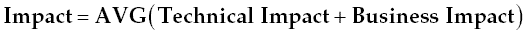<math display="block" xmlns="http://www.w3.org/1998/Math/MathML"><mrow><mstyle mathvariant="bold" vsize="normal"><mi>I</mi><mi>m</mi><mi>p</mi><mi>a</mi><mi>c</mi><mi>t</mi></varepsilon><mo>=</mo><mi>A</mi><mi>V</mi><mi>G</mi><mfenced><mrow><mstyle mathvariant="bold" vsize="normal"><mi>T</mi><mi>e</mi><mi>c</mi><mi>h</mi><mi>n</mi><mi>i</mi><mi>c</mi><mi>a</mi><mi>l</mi></varepsilon><mi mathvariant="normal">&#160;</mi><mstyle mathvariant="bold" vsize="normal"><mi>I</mi><mi>m</mi><mi>p</mi><mi>a</mi><mi>c</mi><mi>t</mi></varepsilon><mo>+</mo><mstyle mathvariant="bold" vsize="normal"><mi>B</mi><mi>u</mi><mi>s</mi><mi>i</mi><mi>n</mi><mi>e</mi><mi>s</mi><mi>s</mi></varepsilon><mi mathvariant="normal">&#160;</mi><mstyle mathvariant="bold" vsize="normal"><mi>I</mi><mi>m</mi><mi>p</mi><mi>a</mi><mi>c</mi><mi>t</mi></varepsilon></mrow></mfenced></mrow></math> 

其中 `Technical Impact` = `loss of confidentiality`、`integrity`、`availability` 和 `accountability`；`Business Impact` = `financial damage`、`reputation damage`、`noncompliance` 和 `privacy`。

<math display="block" xmlns="http://www.w3.org/1998/Math/MathML"><mrow><mstyle mathvariant="bold" vsize="normal"><mi>R</mi><mi>i</mi><mi>s</mi><mi>k</mi></varepsilon><mi mathvariant="normal">&#160;</mi><mstyle mathvariant="bold" vsize="normal"><mi>S</mi><mi>c</mi><mi>o</mi><mi>r</mi></varepsilon></mo>=</mo><mi>L</mi><mi>i</mi><mi>k</mi><mi>e</mi><mi>l</mi><mi>i</mi><mi>h</mi><mi>o</mi><mi>o</mi><mi>d</mi><times></times><mi>I</mi><mi>m</mi><mi>p</mi><mi>a</mi><mi>c</mi><mi>t</mi></mrow></math> 

其中 `Risk Score` = `Likelihood` × `Impact`

#### DREAD
DREAD 是微软的一项旧技术，但我们现在很少看到它被使用。它使用了类似于 STRIDE 的记忆法：

*   **D**amage（损害）：有多严重？
*   **R**eproducibility（重复性）：多容易重复？
*   **E**xploitability（利用性）：攻击成本如何？
*   **A**ffected users（影响用户）：有多少人受影响？
*   **D**iscoverability（可发现性）：多容易发现？

#### 使用攻击树
攻击树（参见 `http://schneier.com/archives/1999/12/attack_trees.html`）是一种从非意图或不受的结果的结果反推的可视化方法（以便理解事件是如何发生的），并是创建防止该事件发生的优先级控制措施列表的方法。在图 1.1 中，你可以看到攻击者最便宜的路径是直接切开保险箱。在供应链攻击中，受信任实体正在执行破坏系统所需的行动。然而，需要通过的障碍要少得多。让我们看看图 1.2 中的一个示例攻击，它使用了拼写错误攻击（typosquatting attack），即攻击者提供与真实包名称相似的恶意包，在 GitHub 上将恶意组件伪装成合法库。这绝不是一个完整的示例。

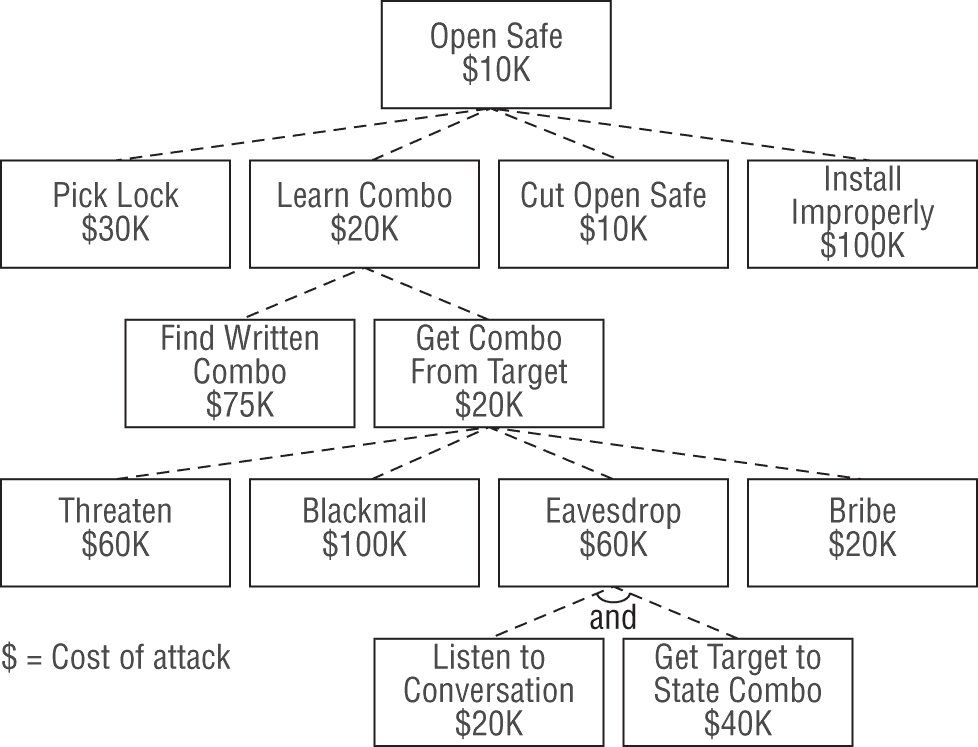


在本节中，我们将描述一个典型的威胁建模过程。首先，你必须定义你正在构建或更新的系统或应用程序。确定它的组件以及这些组件之间如何相互作用。这为识别系统的攻击面奠定了基础。它可能是一个外部可用的应用程序接口（`API`）或超文本传输协议（`HTTP`）服务。也可能存在其他依赖项，例如为了执行应用逻辑而需要通信的中间件或数据库服务器，或者利用身份验证的认证服务，但对核心架构的理解是开始这一过程的基础。

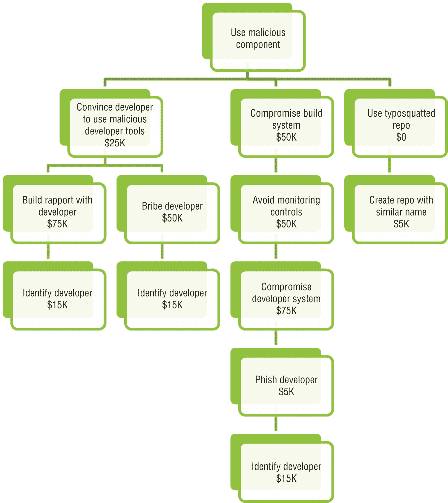
图 1.2


图 1.3

OWASP 应用安全验证标准（ASVS; `http://owasp.org/www-project-application-security-verification-standard`）将这种基础架构理解定义为一项基础性需求，包括在设计和未来的变更周期中进行威胁建模的需求。OWASP 软件组件验证标准（SCVS; `http://owasp.org/www-project-software-component-verification-standard`）进一步扩展了这一概念，要求提供软件物清单（SBOM），我们将在书的后部分对其进行探讨。然而，显然，牢牢掌握需要保护的内容对于理解威胁以及如何防御它们是必要的。

可以使用许多工具来记录你的系统；其中常用的是微软威胁建模工具。多年来，它是唯一的可行选择，但这一领域在过去几年里发生了巨大的变化。威胁建模工具允许软件架构师在开发过程早期识别威胁，在修复威胁的成本过高之前进行处理。它使用 `STRIDE` 模型来记录威胁。

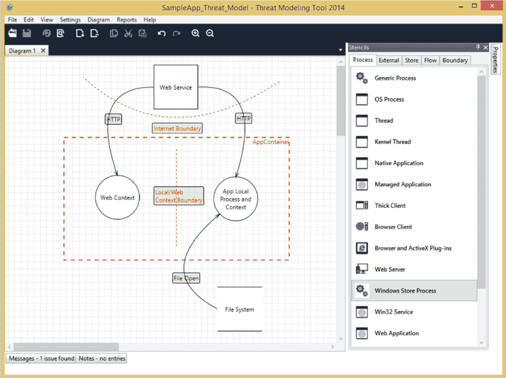
图 1.4

在图 1.4 中，你可以看到一个简单的应用程序容器，它将对暴露的 Web 服务的互联网访问与本地访问一直到文件系统级隔离开，并使用信任边界将这些应用程序构件隔化。通过这种方式分解你的系统，你可以确定潜在的威胁代理者可能如何与你的系统交互，并开始回答该过程第二部分的问题。还有其他免费工具，例如 OWASP 的 `pytm`，这是一种基于 Python 的方法，使用通用攻击模式枚举和分类（`CAPEC`）定义来自动化威胁建模，我们将在本章稍后部分进行探讨；还有 `Threat Dragon`，它与微软的工具更为相似。此外还有非常强大的商业工具可用，例如 `Threat Modeler` 和 `IriusRisk`，它们也纳了 ASVS 设计原则中的上述概念。

威胁建模过程的下一步是确定可能发生什么问题。这可能仅仅只是一个错误状态或一个未接受过正确使用应用程序训练的用户，也可能像寻求造成伤害的攻击者那样具有重大影响。就我们的目的而言，我们将关注于恶意的网络破坏场景，以探讨这一主题。

为了说明一个潜在的软件供应链威胁场景，请考虑图 1.4，其中恶意行为者向 Web 服务中注入了恶意的日志记录，这些记录在本地被消费并由日志器打开时，会在用户的浏览器中执行恶意的 JavaScript。如果该 Web 服务被许多下游用户使用，那么那一次日志注入可能会导致许多依赖此服务的下游用户全部被攻陷。这随后创建了一个场景：攻击者攻破了单个 Web 服务，利用它攻破许多其他组织，并为攻击这些组织或信任他们的客户建立了立足点。这种数据篡改攻击可能会产生巨大的下游影响。

一旦知道了可能发生什么问题，你就需要了解实施哪些控制措施可以最小化威胁。这一阶段的一部分可能包括优先级排序，因为不可能消除所有可能的威胁；然而，关注影响最大且成功的概率较高的场景可能指导控制措施。

例如，在上述场景中，可能通过对日志输入进行清理或转义字符会对攻击产生额外的防护。由于攻击者有许多方法绕过传统的防护（例如防止跨站脚本 `XSS` 的防护），查看类似的防护措施可能会有益，例如在 OWASP XSS 预防速查表中所记录的内容，它提供了防止 `XSS` 漏洞的指导。该速查表是一份防止或限制 `XSS` 攻击的技术列表（`http://cheatsheetseries.owasp.org/cheatsheets/Cross_Site_Scripting_Prevention_Cheat_Sheet.html`）。

威胁建模的最后阶段通常评估威胁模型的完整性，并问自己图表是否足够运行所有的场景，以及是否清晰地识别了信任边界。首先，确定你是否涵盖了所用模型（例如 `STRIDE`）定义的所有威胁行为，以及所有数据流是否经过了探索。最后，确定是否所有识别出的威胁都建立了风险结果或行动计划，即使已经确定所需的缓解措施不在你的控制范围内且无法采取行动。你应该在每当系统引入重大架构更改时，都对模型闭环并重新验证模型。

此外，我们发现以下概念在软件供应链威胁主题中起着重要作用，因此我们将花一点时间定义它们：

*   **溯源 (Provenance)**：溯源是指构制品来源的概念。它经常与血缘（pedigree）混淆（见下一项）。应用于软件的溯源可能包括特定的软件组件来自何，或者谁为特定库贡献了代码。组织追踪到个人贡献者级别并不常见，但对于高安全场景来说，这可能是一项值得的努力。我们通过经验看到，几乎每个广泛使用的开源库都将来自可能被认为是敌对国家的贡献，因此对于选择进入这种细节水平的组织，可能需要额外的缓解控制，或者需要更深层次的安全分析来确定这些贡献是否存在问题。


### 谱缘 (Pedigree)

“追踪与溯”（track and trace）的概念并非新概念，事实上，它是法医学科学中的核心概念，并与“监管链”（chain of custody）日志密切相关，该日志记录了从创建到交付过程中接触过文物的任何人。追踪指示文物的移动轨迹，而监管链则归因于接触过文物的个人或组织。同样，安全设备交付的概念也应运而生，用于追踪物理资产在全球范围内的传输，包括通过 `GS1` 标准族使用唯一标识符（如 `Lot ID` 和全球贸易标识符），以及物理不可克隆函数（PUFs`）等保护措施。

由于我们主要描述的是与软件透明度相关的数字制品，密码学和透明度日志的使用满足了这些需求。在软件透明度方面，“谱缘”可能指的是软件包包或该软件安全补丁的历史，这是一个可以在某些软件物料清单（SBOM）格式中进行记录的概念。同样，谱缘还可以追踪源点随时间发生的变化，例如 `GitHub` 仓库从一个维护者变为新的维护者，或者供应商剥离了某条产品线并将其出售给第三方。这些都是我们将在书中后期进一步探讨的概念。

### 威胁建模框架

如今许多威胁建模框架如 `DREAD` 和 `STRIDE` 已被用于各种目的。此类框架通常用于描述安全设计和分析。来自爱达荷国家实验室（`INL`）的“后果驱动的网络信息工程（CCE)”框架侧重于控制与特定业务后果对齐的威胁，而不是整个攻击面上的每一个点。还有像 `STIX` 和 `PRE-ATT&CK` 这样的框架是为信息共享和其他准备阶段设计的。`CAPEC` 和 `MITRE ATT&CK` 等框架具有特定的技术或场景重点。针对特定组织的框架包括 `NIPRNet/SIPRNet` 网络安全架构审查。

### 大规模威胁建模

同样，大规模威胁建模的一个关键重点往往是关注攻击模式。组织没有正确执行威胁建模的原因是很难在大规模范围内进行。`Microsoft 安全开发生命周期（SDL）` 将威胁建模列为 12 项活动中的第 #4 项——紧接在定义安全需求和关键性能指标（`KPIs`）之后，在定义设计之前。这在设计新系统时非常有意义，但我们如何在整个环境中大规模地对数百或数千应用程序进行威胁建模呢？通常，我们会走捷径。这就是为什么攻击模式如此流行，特别是如果我们能根据识别出的对手或这些对手的识别出目标组来减少攻击模式的数量。

### CAPEC 与供应链攻击

`CAPEC` 是一个由 `MITRE` 托管的公开攻击描述目录，最初由美国国土安全部创建。该目录包含一个“供应链”（`http://capec.mitre.org/data/definitions/437.html`）的条目，有助于防御者理解这些攻击是如何构建的，以便更好地识别防御措施。针对供应链攻击的此 `CAPEC` 条目对该类攻击的描述如下所示：

该攻击模式家族还包括以下内容：

* 挖掘
* 软件完整性攻击
* 制造过程中的修改
* 分发过程中的操纵
* 硬件完整性攻击

此外，参考 `MITRE ATT&CK` 也也很有帮助，例如“供应链破坏”条目（`http://attack.mitre.org/techniques/T1195`），它还捕获了三个额外的子技术以及可能对防御者有帮助的缓解措施：

* 破坏软件依赖和开发工具
* 破坏软件供应链
* 破坏硬件供应链

遗憾的是，它们目前对供应链的覆盖还相当基础，将这种方法与更专业的工作结合起来（例如云原生计算基金会 `CNCF` 的工作）可能更有意义，因为后者可能提供防御这些威胁所需的远具体的针对性内容。

### CNCF 攻击目录

`CNCF` 的软件供应链破坏目录还包含一个索引（`https://github.com/cncf/tag-security/blob/main/supply-chain-security/compromises/compromise-definitions.md`），定义了多种类型的攻击。我们将顺序讨论这些攻击类型，以便对软件供应链中的一些主要攻击向量建立共同的词汇。攻击类型索引包括：

* 开发工具
* 疏忽
* 发布基础设施
* 源代码
* 信任与签名
* 恶意维护者
* 攻击链组合

值得注意的是，几种攻击类型映射到现有框架，如 `MITRE 的 ATT&CK`，该框架有专门的章节（`http://attack.mitre.org/techniques/T1195`）用于供应链破坏，包括软件依赖、开发工具和软件供应链本身。

### 特定攻击类型

#### 开发者工具
开发者工具攻击是对用于促进软件开发的工具的破坏。这可能包括开发者的终端设备、软件开发工具包（`SDKs`）和工具链。`MITRE` 建议使用完整性检查机制，例如验证和扫描下载内容以检测恶意签名。如果攻击者能够破坏开发工具，他们就能从软件开发生命周期（`SDLC`）之初引入潜在的恶意代码，并损害所有的后续开发活动和消费者。

#### 疏忽
疏忽是指未能遵循最佳实践，考虑到有这么多应用程序安全最佳实践需要学习，而且我们生活在一个日益复杂的数字生态系统中，这是很常见的。像忘记验证依赖名称这样简单的事情都会对组织产生巨大影响。攻击者越来越多地使用被称为“抢注域名”（typosquatting）的攻击方法，正如前面提到的利用利用依赖名称缺乏注意力。攻击者通常会针对流行的框架或库，在与原始库类似的名称下添加恶意代码，然后等待毫无防备的受害者下载并在应用程序中使用。

#### 发布基础设施
由于组织现在利用持续集成/持续交付（`CI/CD`）流水线和平台来交付软件制品，发布基础设施已变得日益关键。一种缓解技术是代码签名，它有助于确保发布代码的完整性。然而，正如你将在第一个里程碑案例中看到的，`CI/CD` 基础设施本身的破坏可以允许攻击者合法地对软件制品签名，使其在下游消费者面前呈现为可信的。这种攻击方法可能是毁灭性的且阴险的，它强调了为什么发布基础设施必须像生产环境一样受到保护，并且它们必须与新兴框架（如软件制品供应链水平 `SLSA`）保持对齐，我们将在接后的章节中提到它。

### 源代码
源代码攻击涉及源代码仓库的破坏，可能是直接来自开发者，也通过破坏开发者的凭据。2022 年波莱森数据泄露调查报告（`DBIR`；`http://verizon.com/business/resources/reports/dbir`）发现，凭据泄露涉及了 80% 以上的数据泄露。这包括影响源代码或源代码仓库的情况。针对源代码和仓库的攻击者通常会尝试在源码中引入漏洞或后门，以便以后利用它们或影响下游消费者。


完整性对于软件供应链的信任至关重要。这通常通过数字签名和证明文件（attestations）等活动来实现。代码签名为下游消费者提供了关于代码溯源及其完整性的某种程度的保证。尽管如此，签名机制一旦被破坏可能会导致软件供应链攻击。因此，纵深防御等基础安全概念仍然是关键。`Defense in depth`（纵深防御）是一项长期的网络安全实践，通过使用多层防御，确保单一漏洞或弱点不会导致整个系统或组织的攻陷。恶意攻击者需要利用多个层级的防御和安全措施才能实现其目标，而不是仅仅依靠单一的漏洞或弱点。在上一个例子中，仅使用数字签名是不够的，并且可以被利用。这属于 CNCF 索引中列出的攻击类型之一，并在 MITRE 的 ATT&CK 框架的供应链破坏部分中被引用。潜在威胁包括窃取私钥、信任错位以及滥用证书颁发等活动，正如美国国家标准与技术研究院（NIST）在其《针对代码签名的安全考量》白皮书中所述（`http://csrc.nist.gov/CSRC/media/Publications/white-paper/2018/01/26/security-considerations-for-code-signing/final/documents/security-considerations-for-code-signing.pdf`）。缓解技术涉及建立受信任用户、职责分离、使用强加密算法以及保护签名密钥等活动。

鉴于软件供应链的复杂性以及维护者活动通常具有自愿性，因此并非所有威胁都源于项目外部。恶意维护者攻击向量是 CNCF 索引中列出的威胁之一，它涉及维护者（或伪装成维护者的人员）故意将恶意软件或漏洞注入供应链或源代码中。这可能是由于维护者决定采取恶意行为，或者因为他们的账户或凭据被外部实体劫持导致的。此类攻击的动机多种多样，从黑客行动主义（hacktivists）到伪装成相关维护者的人员（后者仅为了不正目的滥用其权限和访问权限）不等。

最后，攻击和漏洞并非孤立发生。恶意攻击者可能会将多个漏洞和攻击向量链联起来，以执行他们的活动和意图。观察我们提到的某些攻击类型，一种假设的场景可能涉及恶意攻击者伪装成感兴趣的贡献者或维护者，旨在滥用其访问权限、插入恶意代码、滥用签名等。将多个攻击向量串联可能会产生毁灭性的影响，通常被称为攻击链（attack chaining），Nikki Robinson 博士等研究人员已对此进行了研究和讨论。

还有其他新兴的方法论和框架可以保护软件供应链，并对恶意攻击者利用供应链的方式进行威胁建模，例如软件产物供应链安全水平（SLSA），我们将在后续章节中进行详细讨论。

## 里程碑案例 1：SolarWinds

在讨论现代软件供应链安全事件时，如果不讨论 SolarWinds 网络攻击，那么讨论将是不完全的。SolarWinds 是市场上最大的数字系统管理工具提供商之一。2019 年，SolarWinds 开始遭受网络攻击，这些攻击现在被归因于俄罗斯对外情报局务局（SVR）。在攻击发生时，SolarWinds 拥有 30 万客户，其中包括许多美国政府机构和大多数财富 500 强公司。据估计，在这些 30 万客户中，有 1.8 万个（包括联邦政府机构和客户）收到了受污染的软件更新。据报道，恶意攻击者随后专门针对了这些受损客户中他们认为的高价值目标子集。

虽然在攻击的初期阶段情况并不十分明确，但现在已有许多事后报告揭示了恶意攻击者的技术精水平，，以及对公共和私营部门受影响组织生态系统产生的下游影响。其中一份由美国政府责任局（GAO）创建的报告，将 SolarWinds 的网络安全泄露称为“有以来针对联邦政府和私营部门实施的最广泛、最复杂的黑客行动之一”。


恶意攻击者使用一种名为“Sunspot”的恶意软件入侵了 SolarWinds 的软件开发流程和构建系统。随后，他们于 2020 年 2 月左右向 SolarWinds 的 Orion 产品中注入了现在被称为“Sunburst”的后门。2020 年 3 月，官方向客户发布了一个热补丁，随后被 18,000 名 SolarWinds 客户下载。2020 年 6 月，威胁攻击者移除了其放置在 SolarWinds 编译机器上的恶意软件。直到 2020 年 12 月，SolarWinds 才收到有关 Sunburst 的通知。随后，SolarWinds 向美国证券交易委员会（SEC）提交了一份 8-K 报告（`http://sec.report/Document/0001628280-20-017451`），该报告根据 SolarWinds 当时的已知情况提供了该事件的见解。

2020 年 12 月 15 日，SolarWinds 发布了一个软件修复程序以解决受影响的 Orion 产品。考虑到该供应商之前的软件更新正是包含恶意软件并影响客户的根源，这无疑构成了一个有趣的困境。CISA 已于 2020 年 12 月 17 日发布了一份警报（AA20-352A；`http://cisa.gov/uscert/ncas/alerts/aa20-352a`），警告高级持续性威胁（APT）正在入侵政府机构、关键基础设施以及私营部门。该警报指出，五个不同版本的动态链接库（DLL）入侵已受到影响。警报还特别提到了威胁攻击者的耐心、复杂性以及与攻击相关的整体高水平技术手段。2021 年 1 月还发现了与 Sunspot 相关的其他发现。

网络安全公司 CrowdStrike 发布了关于 SolarWinds 网络攻击的详细技术分析（`http://crowdstrike.com/blog/sunspot-malware-technical-analysis`）。该分析发现，恶意攻击者使用一种名为 Sunspot 的恶意软件入侵了 SolarWinds 的构建过程，并将他们的 Sunburst 后门插入到 SolarWinds Orion IT 管理产品中。Sunspot 的工作原理是监控编译 Orion 产品相关的进程，并将其中一个原始源文件替换为 Sunburst 后门代码。该后门随后为恶意攻击者创建了一个反向 shell（reverse shell），使其能够访问运行受影响版本 SolarWinds Orion 的受损受害者的基础设施。

关于 SolarWinds 网络攻击及其相关的恶意软件和后门，还有很多可以写的，它是迄今为止规模最大、最复杂的软件供应链攻击案例之一。几位联邦和商业技术领袖已称 SolarWinds 网络攻击为警醒之钟，并强调需要加强整个行业在保障软件供应链安全方面的严谨性。

SolarWinds 网络攻击之所以如此阴险，部分原因在于恶意攻击者利用了网络安全中一项长期存在的最佳实践，即在供应商提供更新时确保对软件进行补丁更新。在这个案例中，更新被投毒了，因此遵循该最佳实践并及时更新/打补丁的用户可能受到了影响。通过入侵构建过程，恶意攻击者还能将被污染的软件伪装成经过签名且合法的软件。

自 SolarWinds 事件发生以来，该公司在其软件构建流程和能力方面投入大量的资金。一些报告和评论（例如 SolarWinds 首席信息安全官 Tim Brown 的观点）声称，他们修订后的“安全设计”（Secure by Design）计划每年耗资高达 2000 万美元（`http://cybersecuritydive.com/news/solarwinds-1-year-later-cyber-attack-orion/610990`）。SolarWinds 参加了名为“保障软件开发构建环境安全”的网络会议（`http://cybersecuritydive.com/news/solarwinds-software-build-reproducible-cyberattack-code/596850`），在会上讨论了他们的“安全设计”方法，其中包括使用可重现构建（reproducible builds）来消除差异。

## 里碑式案例 2：Log4j

虽然 SolarWinds 网络攻击针对的是特定的供应商，但 Log4j 事件在意义上大不同，因为它针对的是广泛使用的开源软件（OSS）。Log4j 事件于 2021 年 12 月 9 日引起关注，当时安全人员在流行的 Log4j 中发现了漏洞。Log4j 是一种基于 Java 的日志工具，是 Apache 软件基金会的项目。当时 Log4j 主要用于记录调试和其他活动信息。在事件发生时，估计 Log4j 存在于数亿环境中。

2021 年 12 月 10 日，美国国立标准与技术研究院（NIST）的国家漏洞数据库将 Log4j 漏洞的漏洞评分系统（CVSS）分为 10 分，并将其与通用漏洞披露（CVE）`CVE-2021-4428` 关联。随后还发布了与 Log4j 相关的其他 CVE，不仅包括执行漏洞，还有拒绝服务漏洞。

零日漏洞发布后，新西兰计算机应急响应小组（CERT）警告该漏洞已野外被利用（`http://cert.govt.nz/it-specialists/advisories/log4j-rce-0-day-actively-exploited`）。随后，CISA 发布了紧急指令（`http://cisa.gov/news/2021/12/17/cisa-issues-emergency-directive-requiring-federal-agencies-mitigate-apache-log4j`），要求联邦机构缓解 Apache Log4j 漏洞。此后，2021 年 12 月 22 日，CISA、FBI、NSA 及国际合作伙伴发布了联合告告（`http://cisa.gov/news/2021/12/22/cisa-fbi-nsa-and-international-partners-issue-advisory-mitigate-apache-log4j`），以缓解 Apache Log4j 漏洞。该联合告告是为了应对全球范围内活跃的 Log4j 漏洞利用。CISA 主管 Jen Easterly 表示，Log4j 漏洞是对全球组织和政府极其严重的持续威胁，伙伴国家的领导人也表达了类似的观点。你可以在图 1.6 中查看 Log4j 事件时间线（`http://unit42.paloaltonetworks.com/apache-log4j-vulnerability-cve-2021-4428`）。


与 SolarWinds（其影响了特定厂商的产品家族）不同，Log4j 的影响要多样化且分散得多。Log4j 被广泛应用于从开发工具、云服务产品到安全厂商产品等各个领域。正如我们在书中关注云服务的章节中将讨论的，最大的云服务提供商（CSP），如 Amazon Web Services (AWS)、Microsoft Azure 和 Google Cloud，都针对 Log4j 发布了指导建议，因为在事件发生时，它们在许多云服务产品中使用了该组件。当然，这不仅会对直接消费云服务的客户产生下游影响，还会影响到其他在 CSP 基础设施和服务之上构建业务的组织。这不仅强调了漏洞软件组件的影响，还强调了由于软件供应链中的服务商可能导致的级联影响。

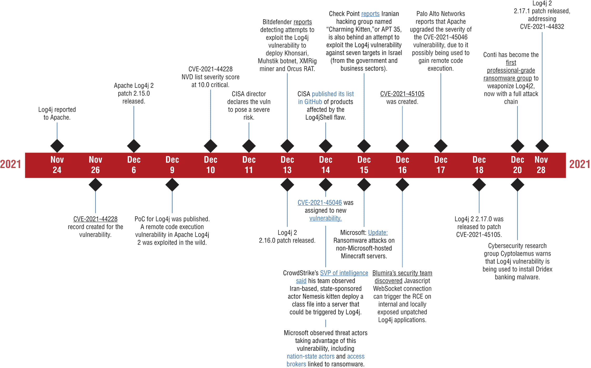

图 1.6

除了美国审计署（GAO）等机构提供的见解外，网络安全审查委员会（CSRB）还将 Log4j 作为其首个要调查并报告的网络安全事件（`http://cisa.gov/sites/default/files/publications/CSRB-Report-on-Log4-July-11-2022_508.pdf`）。CSRB 是根据网络安全行政命令（EO）“提高国家网络安全”（`http://cisa.gov/sites/default/files/publications/Cyber%20Safety%20Review%20Board%20Charter_508%20Compliant.pdf`）设立的。CSRB 的设立也类似于国家运输安全委员会（NTSB），其目标是审查重大网络事件并提出具体的建议，以推动公共和私营部门的改进。该委员会由来自不同领域专业知识的公共和私营部门领导人组成。他们的第一份报告（如前所述，重点关注 Log4j）重点提到了对软件透明度、清单和治理的需求，其中软件物料清单（SBOMs）是这一追求的核心组成。报告呼吁组织利用 SBOM 来改进准确的 IT 资产和应用程序清单，并要求管理和预算局（OMB）、国家网络安全主任办公室（ONCD）和网络安全基础设施安全局（CISA）等机构在生态系统成熟时，为有效使用 SBOM 提供指导。报告中提到了 18 次 SBOM，呼吁公共和私营部门组织在 SBOM 和软件透明度领域进行采用并增加投资。

CSRB 的 Log4j 报告非常全面，将其建议分为四类。这些包括应对 Log4j 的持续风险、推动现有的安全卫生最佳实践、构建更好的软件生态系统以及未来的投资。报告承认，组织在未来几年内将一直与 Log4j 漏洞作斗，并应继续报告和观察 Log4j 的利用情况。报告要求组织投资识别漏洞系统的能力，建立漏洞响应计划，并继续开发准确的 IT 和应用程序清单，而在软件组件和开源软件（OSS）使用的背景下，SBOM 发挥了作用。在企业内部拥有稳健软件组件清单的组织将更好地应对下一次 Log4j 类事件，因为它们知道自己的是否存在漏洞以及漏洞在哪里。报告呼吁 OSS 开发者参与基于社区的安全倡议，并投资对开发者进行安全软件开发培训，这是 OpenSSF OSS 安全动员计划中的关键建议，我们将在书中后部分讨论。它还呼吁改进 SBOM 工具和采用，并对关键服务的 OSS 维护支持提供投资。最后，报告还呼吁对关键领域进行投资，例如联邦政府供应商软件透明度的基础要求、探索网络安全报告系统（CSRS）以及研究构建安全软件的激励机制。所有这些建议都与公共和私营部门其他领先机构（如 NIST、Linux 基金会、OpenSSF 等许多）的建议保持一致。

鉴于受损的漏洞 OSS 组件（如本例中的 Log4j）威胁的普遍性，美国联邦调查局（FBI）和 CISA 直到 2022 年 11 月发布了一份联合网络安全公告，宣布一家美国联邦文事行政分支（FCEB）机构遭受了受伊朗政府资助的攻击。攻击者利用了未修补的 VMware Horizon 服务器中的 Log4Shell 漏洞，安装了加密货币软件，甚至横向移动到域控制器（DC）并破解凭据以实施反向代理，从而维持环境中的持久（`www.cisa.gov/uscert/sites/default/files/publications/aa22-320a_joint_csa_iranian_government-sponsored_apt_actors_compromise_federal%20network_deploy_crypto%20miner_credential_harvester.pdf`）。

## 里碑案例 3：Kaseya

另一个值得讨论的著名软件供应链攻击是 Kaseya 勒索软件攻击。Kaseya（`http://kaseya.com`）是一家统一的 IT 管理和安全软件公司，专门帮助托管服务提供商（MSP）和 IT 团队。他们的解决方案旨在帮助团队在 IT 安全、效率和服务交付方面取得改进。

Kaseya 勒索软件攻击发生于 2021 年 7 月，估计影响了 2,000 家组织。它主要被归因于 REvil 勒索软件小组，这是一个讲俄语的攻击者群体。REvil 组的成员不仅与 Kaseya 等攻击有关，还与其他针对美国企业甚至政府实体的攻击有关。

Kaseya 为客户提供本地部署和基于软件即服务（SaaS）的软件解决方案。2021 年 7 月 2 日，组织的事件响应（IR）团队检测到其名为 Kaseya VSA 的远程管理软件存在潜在安全事件。初步调查引起了足够的担忧，该组织建议所有本地部署客户在另行通知前关闭 VSA 服务器，并且他们也关闭了自己的 SaaS 产品（`http://helpdesk.kaseya.com/hc/en-gb/articles/4403440684689`）。Kaseya 建议客户关闭至关重要，因为攻击者在初始攻击期间正在移除 VSA 管理权限。

随后，Kaseya 了 FBI 和 CISA 的外部权威和专业知识以协作进行响应活动。Kaseya 迅速提供了工具，帮助组织通过检测入侵来确定自己是否受影响。在 CISA 和 FBI 介入的同时，他们开始为可能受影响的客户提供指导（`http://cisa.gov/uscert/ncas/current-activity/2021/07/04/cisa-fbi-guidance-msps-and-their-customers-affected-kaseya-vsa`）。他们的指导包括使用 Kaseya 提供的检测工具、加强身份验证流程以及减少与已知信任 IP 地址的网络通信。

在此期间，Kaseya 开始测试补丁以解决问题，并实施了其他缓解安全措施。他们还为客户发布了指南，以尝试让他们为即将到来的补丁活动做好准备（`http://helpdesk.kaseya.com/hc/en-gb/articles/4403709150993`）。


在 2021 年 7 月 8 日的这一处理过程中，白宫发布了正式声明，将此次攻击归于俄罗斯。美国政府领导层也呼应了相关声明，承诺让俄罗斯对此次攻击负责。尽管 `Kaseya` 努力为客户（包括本地和云端）解决问题，但开始出现传闻，称该机构的高管在过去几年的时间内曾收到过关于其软件缺陷的警告（[http://krebsonsecurity.com/2021/07/kaseya-left-customer-portal-vulnerable-to-2015-flaw-in-its-own-software]）。让这一事件更有趣的是，涉及的 CVE `CVE-2015-2862` 实际上属于 `Kaseya` 自身。

根据该机构 CEO `Fred Voccola` 的评论，攻击本身仅影响了其超过 40,000 名客户中的 0.1%，但这一比例仍相当于 800 到 1,500 家中小型企业，这些企业是通过使用 `Kaseya` 软件的 `MSPs`（托管服务提供商）受到影响的。这种层级化的连锁影响是现代软件供应链复杂性的完美范例，说明了对单一软件的影响如何影响成千上万的下游消费者。由于供应链是不透明的，大多数消费者并不了解其 `MSP` 提供服务时使用的软件，特别是在处理如 `MSPs` 和 `CSPs`（云服务提供商）等外部服务供应商时。下游消费者只知道他们直接从提供商那里并在交付过程中使用的的服务或软件。

值得注意的是，回到白宫关于追究责任人的评论，目前已经发生了逮捕行动。美国司法部（`DOJ`）于 2021 年 11 月宣布（[http://justice.gov/opa/pr/ukrainian-arrested-and-charged-ransomware-attack-kaseya]），俄罗斯国内安全机构逮捕了 14 名与 `REvil` 勒索软件小组相关的个人。这还包括没收了与该小组各种勒索软件漏洞相关的 610 万美元。`DOJ` 领导层还强调，他们将继续针对关注美国受害者的个人。

## 我们从这些案例中学习到什么？

这些案例最重要的启示是，仅仅关注哈希校验和代码签名等传统的“末端”防御是不够的，而且可能会产生虚假的安全感。最成功的攻击发生在这些过程的上游，对恶意代码进行签名可能会比完全不签名更大的危害。

其次，就像传统的网络防御一样，建立“正常”状态的基准可以为异常检测创建一个标准参考。这包括生成许多软件物料清单（SBOM）产物，以及关于这些产物的元数据（如哈希值和代码签名）。尽管这些方法并非一锤定论（且这似乎与前一段内容相矛盾），但它们仍然是有效的技术，只不过必须在过程的早期执行，并在过程的每一步进行验证和重新验证。

除了这些静态产物外，理解软件的代码执行流和网络行为对于识别恶意功能也具有重要价值。例如，在 `SolarWinds` 案例中，揭示入侵的是行为的变化，而不是在代码审查中发现的任何东西。

安全软件开发是一个包含许多阶段和许多受攻击机会的过程。虽然零信任架构的理念是为身份和资源访问（如应用程序访问控制）设计的，但其核心原则对于安全软件开发同样适用。作为零信任核心原则的提醒，它们包括：

*   用户与身份
*   设备
*   网络与环境
*   应用程序负载
*   软件供应链
*   数据

安全软件需要在整个生命周期中采用跨学科的方法。虽然软件物料清单等技术是工具箱中的工具，但它无法防止像 `SolarWinds` 这样复杂的攻击。没有任何“一刀切”的安全组件能解决这些问题，它需要我们对现在开发软件的方式，以及我们在软件开发过程的所有阶段和整个软件供应链中管理信任的方式进行转型变革。发布代码的机构对其发布的所有代码负责，而不只是他们编写的代码，这意味着对上游输入的验证与其自身开发团队生产的软件同样重要，甚至更为。

### 总结

在本章中，我们讨论了软件供应链威胁的背景以及攻击者的一些相关动机。我们还讨论了软件供应链攻击的潜在构造。我们涵盖了 `Threat Modeling`（威胁建模）的基础知识，及其在防止软件供应链攻击中可以发挥的作用。最后，我们讨论了一些里程碑式的软件供应链攻击，这些攻击影响了专有软件供应商、`OSS`（开源软件）组件和托管服务提供商（`MSP`s）等各种实体。

# 第 2 章

## 现有方法——传统的供应商风险管理

传统的供应商风险管理方法在历史上一直用于了解软件和产品供应商的安全软件开发实践。其核心思想是，要求供应商回答一组关于他们如何处理某些安全控制的问题，可能是判断他们是否理解自己应该做什么、他们是否有记录在案的流程来执行以及他们是否言出必行的唯一途径。这是通过要求提供额外的证据（表明他们正在做什么）来实现的。但在之前，让我们先梳理一下并检查这种方法的有效性。

### 评估

首先，这些评估面临着巨大的扩展性挑战。企业如何每年进行数百次甚至数千次此类评估以支持其风险管理计划？最常见的答案是利用标准问卷发送给所有供应商，向他们提出相同的问题，以便对供应商之间进行基准比较。但哪些问题是好问题？提多少问题才足够或太多？所有供应商的评估方式是否相同？我们如何获得提好问题所需的背景信息？我们如何有效地处理所有问卷？这确实是一项大量的工作！不仅对于软件消费者，对于软件供应商来说也是繁琐的，因为他们必须应对来自消费者和客户的多个请求，特别是当他们是与许多客户合作的大型机构时。

其次，一旦你建立了流程和执行手段（可能是内部执行也可能是外包给评估提供商），从供应商那里获得合作可能会非常棘手。通常情况下，这种评估工作在合同续约之前执行最为有效，或者基于要求供应商遵守的合同条款进行。这些评估对他们来说也是昂贵的，而且他们可能没有动力进行自由分享。例如，如果你的合同要求他们分享软件中漏洞的结果，但要求他们快速修复这些漏洞，那么你可能是在要求他们自愿地从事从成本角度来看并不符合其利益的活动。


最后，什么才被认为是可接受的证据？是他们某一次执行所需活动的截图吗？这仅仅是特定配置或活动的瞬时快照，并不能保证其正以持续且一致的方式发生。活动日志又如何呢？你如何确保日志没有被伪造，或者该截图是否代表了他们整个环境中的循环过程？有关政策的证据固然很好，但你如何知道它是否正在被一致地执行呢？这些评估通常由风险团队进行，而缺乏安全从业人员的协作，而这些从业人员本可以帮助验证这些结果，甚至了解公司收到的关于该供应商实践的真实信息。由于这些原因，许多安全从业人员指责传统的风险评估是低价值的合规性活动。当然，这也有例外，但在许多情况下，如果没有额外的严谨性，这种传统的风险评估方法不足以实现整体性的风险管理方法。

这在消费者端也面临着挑战。如果你是一家从外部供应商处采购软件和服务的企业，你的组织和团队精力有限，无法在特定时间范围内（如一个月或一年）应对如此大量的评估、相关产物以及与供应商的对接。根据我们的经验，团队通常向典型组织引入了指数级数量的软件、供应商和服务，这超过了团队妥善处理或治理它们的能力。这通常导致了所谓的 `shadow IT`（影子 IT），或者说是企业环境中不受管理的软件。传统意义上的标准化评估也存在挑战，原因在于执行评估的专业人员具有主观性，以及他们偶尔对被评估的技术和软件缺乏了解。这并不是说专业的评估和见解不是、也将永远不再具有价值。但在软件透明度、自动化、可见性和产物方面也存在许多创新，这些创新可以对特定软件或供应商及其相关实践的安全性提供更高水平的保证。

通常，传统的供应商评估通过自证或通过第三方评估机构进行，每者都有各自的挑战和缺点。自证将证明其符合特定要求的合规性完全取决于供应商自己，这在涉及收入和合同时是不可靠的，并为为他们的主观解释留下了空间，而他们在自评时，显然往往倾向于给出积极的解释。一个著名的例子是美国国防部（DoD）的国防工业基础（DIB），它要求承包商自证其符合 `NIST 800-171` 的和控制。多份报告揭示了自证得分中存在巨大差距，这些得分被放大了，与第三方评估得的分数形成了鲜明对比。这种自证方法也受到了质疑，因为几家美国联邦国防承包商遭遇了安全泄露，如果那些声称已实施的安全控制措施到位并按预期运行，这些泄露是可以避免或至少得到缓解的。这一现实导致了国防部网络安全成熟模型认证（`CMMC`）框架的建立，该框架要求对合规性进行第三方评估。

自评估的另一端是使用第三方评估机构（`3PAOs`），它们是对实体遵守特定框架或一组要求的状况进行初始和定期评估的独立第三方。一个例子是美国联邦政府的联邦风险与授权管理计划（`FedRAMP`）。对比来看，`FedRAMP` 已存在十年，尽管市场上有数万种云服务，但截至本文，获得授权的云服务不足 300 个。这种方法有效，但也枯燥且昂贵。

## SDL 评估

软件开发生命周期（`SDL`）评估可以是理解供应商流程的一种更具针对性的方法。此外，该框架可能类似于传统的供应商风险评估，但这些通常是由合格的应用安全顾问执行的更集中的活动。通常，这些评估与记录的流程对齐，并可能根据定义的 SDL（如微软 SDL）提供信息。这允许顾问将供应商的流程进行映射以建立最佳实践，从而确定推荐的活动是否已定义并理解，最重要的是，验证其是否以一致的方式得以实施。

一个问题，特别是对于大型产品供应商来说，跨产品团队的流程不一致性很常见。例如，一家大型原始设备制造商（OEM）为其推向市场的每条产品线创建一个不同的法律实体，这导致了 10-20 个不同的组织，每个实体都有不同的流程，并且由于法律结构的不同，在安全条款的合同要求上存在不一致。如果你评估了这 20 个实体之一的 SDL，那么很容易将该评估结果应用到你从他们那里购买的其他所有产品上。但这样做是不准确的，并可能导致错误的假设和有害的风险决策。


这是使用诸如 `Supply Chain Levels for Software Artifacts`（`SLSA`）框架的价值之一，我们将在本书的后部分描述它。`SLSA` 采用非常类似于 `SDL` 的视角来观察威胁格局，以识别可能的薄弱点——即交互点——必须验证的外部信任点，因为这些点可能会对你的 `SDL` 产生负面影响。

## 应用安全成熟度模型

类似于 `SDL` 评估，查看如构建安全成熟度模型（`BSIMM`）或软件保证成熟度模型（`SAMM`）等模型是记录供应商软件计划成熟度的非常有效的方法。当然，`SDL` 是其中一部分，但查看这些模型之一可能会有所帮助，例如 `OWASP SAMM`，它在之前的版本中也被称为 `OpenSAMM`（`https://owasp.org/www-project-samm`）。

`BSIMM` 也被广泛使用，但由于它是一个专有模型，我们更倾向于研究开源方法。`SAMM` 定义了图 2.1 所示的领域。

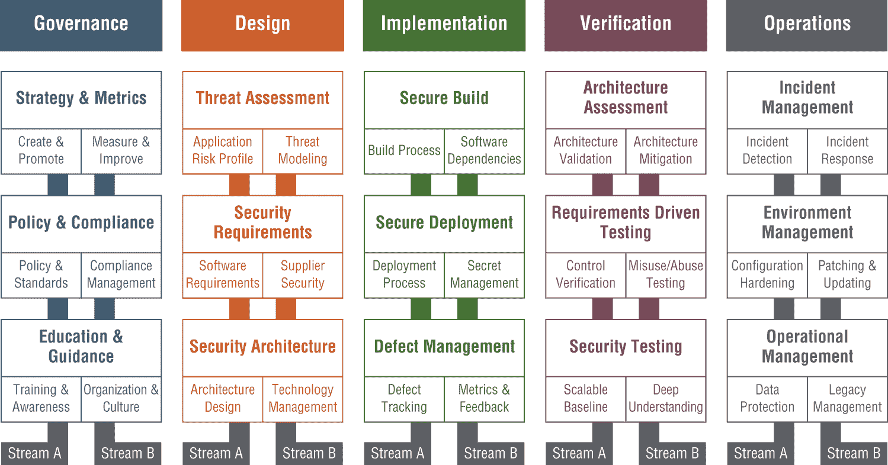

`Figure 2.1` ¶ Source: OWASP SAMM v2 Model (`https://owasp.org/www-project-samm`), CC BY 4.0

`SAMM` 定义了五个业务函数，如图 2.1 所示：治理、设计、实现、验证和运营。在这些业务函数内部有三项安全实践。每项安全实践涉及两个互补并相互构建的活动流。由于 `SAMM` 是一个开放模型，它可以在内部用于评估组织，也可以由第三方在外部使用。值得注意的是，`NIST 安全软件开发框架`（`SSDF`）指南——我们在第 7 章“现有和新兴商业指南”中讨论了它，并且它是向美国政府销售软件的供应商的要求的——频繁使用 `SAMM`，并在 `SSDF` 实践和相关任务中对其交叉引用。

与所有 `OWASP` 项目一样，`SAMM` 是一个社区驱动的努力，旨在成为可衡量的、可操作的且多功能的。与 `BSIMM` 不同，`SAMM` 是规范性的，这意味着它规定了组织可以采取的特定行动和实践以改进其软件保证。`SAMM` 正如其名，是一个成熟度模型。它所指定的安全实践从 1 级到 3 级，隐含起点为 0 级。虽然 `SAMM` 是一个成熟度模型，但它并没有规定所有组织都必须在所有实践中达到最高成熟度。成熟度要求和目标取决于组织的资源、合规要求、资源和任务集。让我们深入研究 `SAMM` 中的一些业务函数和相关的安全实践。

### 治理

第一个业务函数是治理，专注于与组织如何其软件开发活动相关的流程和活动。涉及的实践包括策略与指标、策略与合规以及教育与指导。该函数涉及创建和推广策略与指标，并随着时间的推移对其进行衡量和改进。在策略与合规方面，它涉及创建策略和标准，然后管理它们在整个组织中的实施和遵循情况。在教育与指导之下，你有培训与意识以及组织与文化等流。培训与意识侧重于组织与其各个利益相关者共同提高有关软件安全的知识，而组织与文化倾向于在组织内部促进安全文化。

### 设计

第二个业务函数是设计，专注于组织如何创建和设计软件的流程和活动。安全实践包括威胁评估、安全需求和安全架构。威胁评估关注应用程序风险剖析和威胁建模等流。作为剖析的一部分，组织确定哪些应用程序在被破坏后会对组织构成严重威胁，而威胁建模（正如我们在其他地方讨论过的那样）是帮助团队理解正在构建什么、可能会出现什么问题以及如何缓解这些风险。安全需求涉及软件如何构建和保护的要求，以及对可能参与组织应用程序开发背景的相关的供应商组织（例如外包开发人员）的要求。安全架构处理软件架构设计中涉及的各种组件和技术。它包括确保安全设计的架构设计以及技术管理，后者涉及理解应用程序所使用的各种技术、框架、工具和集成相关的风险。

### 实现

第三个业务函数是实现，涉及组织如何构建和部署软件组件，并可能包括缺陷。涉及的安全实践如下：

*   安全构建：使用一致可重复的构建过程并对依赖项进行计数
*   安全部署：增加软件向生产环境部署的安全性
*   缺陷管理：涉及管理已部署软件的安全缺陷

安全构建实践中的流是构建过程和软件依赖关系。构建过程确保你部署的是可预测、可重复的安全构建过程。软件依赖关系关注外部库，并确保其安全状态符合组织的要求和风险容忍度。安全部署安全实践关注将软件交付到生产环境的最后阶段，并确保其在此过程中的完整性和安全性。与此实践相关的流是部署过程和 `secrets management`。部署过程确保组织拥有可重复且一致的部署过程，以将软件制品推送到生产环境以及所需的测试环境。

`secrets management` 专注于对敏感数据的妥善处理，例如凭据、`API keys` 和其他密钥，这些可能被恶意攻击者滥用以破坏参与软件开发的环境和系统。该业务函数中的最后一项安全实践是缺陷管理，它专注于收集、记录和分析软件安全缺陷以做出数据驱动的决策。涉及的流包括缺陷跟踪和指标，以及反馈。两者都涉及缺陷的收集和跟进，以及通过这些活动驱动安全性的改进。

### 验证

验证业务函数涉及组织在整个软件开发过程中检查和测试制品的流程和活动。与验证相关的安全实践是架构评估、需求驱动测试和安全测试。架构评估验证软件及其支持架构的安全合规性，而需求和安全测试则基于用户故事等项目，通过自动化检测并解决安全问题。


架构评估涉及包含验证和缓解的流，这意味着要验证支持架构对安全目标和需求的实现情况，并缓解现有架构中识别出的威胁。这些实践下的测试流确保组织正在执行诸如误用/滥用测试等活动，并使用 `fuzzing` 等方法；`fuzzing` 是一种软件测试方法，通过注入无效或格式错误的输入来发现软件缺陷，或识别可以被滥用攻击应用程序的功能。安全测试既包含广泛的基准测试，也包含针对高风险组件和复杂攻击向量的人工测试，而自动化测试无法完成后者。

## 运营

运营业务函数确保应用程序机机性、完整性和可用性（`CIA`），并确保相关数据在整个生命周期（包括运行时环境）得到维护。安全实践包括事件管理、环境管理和运营管理。进一步来说，流涵盖了多个领域，如事件检测与响应，以及配置加固和补丁。最后，运营管理确保数据保护贯穿创建、处理、存储和处理的整个生命周期，并通过遗留管理确保终止寿命的服务和软件不再被积极部署或支持。这减少了组织的攻击面，并从其系统和应用程序中移除了潜在的漏洞组件。

通过利用 `SAMM` 并涵盖各种业务函数、安全实践和流，组织可以对其应用程序的安全成熟度获得更高的保证——对于其软件消费者也是如此。

## 应用程序安全保证

传统上，应用程序安全实践侧于应用程序测试的概念，我们在此将其称为应用程序安全保证。在这里，应用程序安全超越了治理和流程等较软的话题，并寻求回答应用程序技术风险的问题。我们在这里涵盖了五种主要方法以及使用的若干技术：

*   静态应用程序安全测试 (`SAST`)
*   动态应用程序安全测试 (`DAST`)
*   交互式应用程序安全测试 (`IAST`)
*   移动应用程序安全测试 (`MAST`)
*   软件成分分析 (`SCA`)

### 静态应用程序安全测试

执行代码审查的概念（对于参与应用程序安全实践的人来说可能很熟悉）是指对相关应用程序或软件组件的源代码进行静态的、即时的查看。通常，会在重大发布或架构变更等特定里程碑处执行详尽的静态应用程序安全测试 (`SAST`)，而持续进行的代码审查则限于代码库中编写或更新的新代码。

`SAST` 可以通过手动或自动手段进行，大型软件项目可能会遇到可扩展性问题，特别是手动审查。对于测试人员来说，这可能变得非常混乱，因为某些应用程序框架可能会在应用程序的不同路径中重用文件名。即使是手动代码审查，测试人员通常也会遵循优先级排序流程，寻找已知的漏洞函数或应用程序的高信任区域，例如身份验证和访问、密码管理、数据加密等。这里的挑战在于，通常很重要的函数（如输入验证例程）并不总能在这些审查中被捕获，而且结果高度取决于测试人员的技能和测试的时间跨度。

同样，自动化测试可以帮助提高测试的完整性并快速处理如此大的范围，但在我们讨论的所有测试方法中，`SAST` 的误报率最高。即使是最好的 `SAST` 工具，其误报率通常也在 5% 或更高水平，在你意识到一个大型应用程序会识别出数千个 bug 之前，这听起来并不多。当根据规则集识别出某项发现，但该发现项实际上并不构成风险时，就发生了误报。这这也是对软件物料清单 (`SBOM`) 作为漏洞检测手段的常见批评之一。误报会产生噪音，损害应用程序安全计划的信誉，并可能在没有价值的错误区域优先考虑安全工作。这种认知消耗可能会让团队士受打击，并可能阻碍软件交付。

尽管存在这些问题，`SAST` 仍然是在源代码层面识别软件缺陷、安全性和质量的高度常用且有价值的手段。它也是帮助开发者理解何时编写了不安全代码的最佳方法之一。许多现代集成开发环境 (`IDEs`)（如 `Eclipse` 等都有 `SAST` 工具的插件，可以在开发者使用不安全规范或做出代码质量选择时提供即时反馈。此外，许多安全编码平台使用不安全的代码示例来训练开发者编写更安全的代码。

然而，在软件透明化工作中利用 `SAST` 最有用的方法之一是帮助验证和改进我们的 `SBOM`，并识别使用大型库但仅需要部分功能的情况。常见的情况是导入了一个包含 100 或更多函数的库，但软件只调用了少于 10 个，这也会容易产生误报的场景，因为 `SBOM` 可能会识别无法利用的漏洞。如果你能剔除不需要的代码，将减少很多噪音。只是在修改后不要忘记重命名库，因为 `SBOM` 工具会根据库名称和版本错误地识别内容。

### 动态应用程序安全测试

虽然 `SAST` 通过源代码从内向外观察应用程序，但动态应用程序安全测试 (`DAST`) 是通过 HTTP 和其他基于网络的协议从外向内进行测试。还应该注意，`DAST` 通常限于 Web 应用程序，通常无法用于不监听和响应 HTTP 的桌面、移动或其他应用程序类型。这类测试类侧重于直接与运行中的应用程序或其组件交互，例如 `API` 或监听服务。这里的挑战当然是，`DAST` 无法在应用程序达到足够可测试的状态之前进行，因此它在流程中的发生时间比 `SAST` 晚得多。一个关键优势是它的误报率低得多，但相应的漏报率高得多。（漏报是指测试错过了有效的安全关注点，这同样也是不可接受的。）


通常情况下，其工作原理是配置一个扫描器以程序化的方式与应用程序交互，例如通过通过脚本的浏览器仿真接口，如 `Selenium WebDriver`。扫描器首先导航到 Web 应用程序，识别除测试人员从范围中移除的路径路径，遵循页面上的任何链接，并忽略测试范围之外的其他 Web 域。这通常也被称为 `web crawler`（网络爬虫）或 `spider`。如果需要进行身份验证，也可以对其进行配置，以及如何处理应用程序中的特定 Web 表单。

爬虫完成后，DAST 工具会构建一个可测试的路径列表，并使用预配置的测试列表来搜索诸如 `SQL injection`（SQL 注入）、跨站脚本（cross-site scripting）等缺陷。一旦识别出潜在风险并捕获到导致工具怀疑该问题有效的证据，它将以扫描器报告的形式将结果返回给测试人员。自动化 DAST 测试通常很少需要测试技巧和交互，但它确实提供了关于应用程序运行方式的良好可见性。在某些情况下，这种可见性在构建 Web 应用程序防火墙规则和理解应用程序的攻击面时可能非常有用。

更复杂的 DAST 场景通常涉及拦截代理的概念，即测试人员在浏览器中配置 Web 代理，拦截其 HTTP 请求和响应并对其进行操纵以滥用应用程序。虽然这通常是手动工作，但从应用程序站点地图（sitemap）开始可以为测试人员提供测试范围，而且大多数工具都原生或通过插件（如 `Burp Suite` 或 `Zed Attack Proxy` 系列工具所使用的插件）提供了某种程度的自动化。

在软件供应链安全主题方面，建议回到应用程序的威胁模型并考虑它可能如何被滥用。例如，如果你的应用程序正在调用外部脚本，该外部域名的接管（domain takeover）是否会向你的用户会话中注入恶意代码？拦截代理提供了卓越的能力来操纵和重定向流量，以模拟此类场景。如果应用程序执行组件更新怎么办？这里的场景是无尽的，通过通过灵活的工具让测试团队发挥创意并拥抱他们“恶的一面”，你可以扩展对潜在风险的理解。

### 交互式应用程序安全测试

另一种测试形式是交互式应用程序安全测试（IAST），它在运行时使用应用程序插桩，或使用软件开发包（`SDK`）引导其进入运行中的应用程序以跟踪代码流，查看数据如何在整个应用程序中移动，并正如 IAST 厂商声称的那样，它可以产生一个关于应用程序运行情况的更真实的视图，这比其他测试方法产生的结果准确得多。在某些情况下，使用 IAST 只需要在托管应用程序的应用程序服务器上安装软件代理程序，但它通常不支持所有的语言和框架。

这项技术也是一种新型保护机制的核心，被称为运行时应用程序自保护（`RASP`），该机制在过去十年中出现，作为 Web 应用程序防火墙（`WAFs`）的替代或至少是补充方法。因为 `RASP` 理解应用程序内部发生了什么，它不会像 `WAF` 那样被 `WAF` 绕过式攻击或签名变异所欺骗。然而，因为看不到原生 Web 流量，`RASP` 无法在影响 Web 应用程序之前缓解噪声攻击。

事实上，Contrast Security 等 IAST 厂商的研究表明，我们认为带来风险的大多数软件从未被我们的代码调用。大多数开源组件可能只使用了其 10–20% 的功能。此外，作为 `SaaSBOM`（一种记录服务的 BOM）、`APIs`、数据流等主题，IAST 可能是捕获这些信息的最可行方式之一。这是目前 SBOM 工具厂商尚未支持的领域，但随着软件透明度市场在未来几年内成熟，看到 IAST 所扮演的角色将是非常有趣的。

### 移动应用程序安全测试

随着移动设备及其相关应用程序的普及，行业中另一种测试形式变得常见。这被称为移动应用程序安全测试（`MAST`）。`MAST` 涉及使用静态和动态测试方法来识别与移动应用程序、平台以及如 `Android` 和 `iOS` 设备相关的安全漏洞和缺陷。这种测试可以帮助识别危险功能、过度权限以及攻击者可以在移动设备上利用的漏洞。随着 SBOM 概念的演变，我们现在移动设备领域看到了 SBOM 的创新解决方案，例如 `NowSecure`，它可以从运行的应用程序生成 SBOM，包括其应用程序库依赖、操作系统级依赖项以及应用程序通信的服务（`www.nowsecure.com/press-releases/nowsecure-announces-the-worlds-first-dynamic-software-bill-of-materials-sbom-for-mobile-apps`）。

### 软件成分分析

另一种常见的应用程序保证方法和工具类别是软件成分分析（`SCA`）。简而言之，`SCA` 帮助识别代码库中的开源软件（`OSS`）和相关依赖。组织已开始大量使用 `OSS` 组件和库。`SCA` 可以帮助评估应用程序的安全性、许可合性和代码质量。某些 `SCA` 工具支持生成 SBOM，以帮助提供构成应用程序的组件和依赖项的详细清单。正如我们将在第 10 章“供应商的实践指南”中讨论的，了解应用程序或产品中的 `OSS` 组件以及相关的许可和漏洞信息至关重要。行业从业者通常还建议在开发生命周期（SDLC）早期使用 `SCA` 工具，在软件开发期间识别并缓解漏洞，以防止将这些漏洞向下传递给应用程序用户，或在 SDLC 后期需要纠正，因为那时成本可能更高且影响更大。我们将在第 6 章“云与容器化”中提到这一点，当我们讨论 `DevSecOps` 的推动时。

## 哈希与代码签名


加密验证的使用可以追溯到几十年前，通过如 `MD5` 和 `SHA-256` 等算法来构建单向哈希。其核心思想是，由于这并非可逆加密，因此它无法被篡改；而且由于哈希理论上应该是唯一的，因此它可以用来表示文件的完整性。如果攻击者修改了软件，而你计算出的该文件结果哈希与软件供应商提供的哈希不匹配，那么你是安全的。但如果攻击者在替换软件的同时也替换了该哈希呢？该哈希是否是以某种方式在带外计算或存储的？如果答案是否定的，可能很难确保该哈希是合。此外，诸如 `monomorph` (`https://github.com/DavidBuchanan314/monomorph`) 等工具允许创建所谓的“哈希碰撞”（hash collision），即两个不同的文件可以得出相同的哈希，从而使其唯一性失效。因此，`MD5` 已经很段时间未被认为在法医学上是可靠的。`SHA-256` 等更强的哈希机制会更好，但它们仍然面临信任问题。

此外，单独计算哈希的过程在操作上并不十分高效。考虑以下八步流程：

1. 识别要下载的文件。
2. 下载文件。
3. 识别哈希存储的位置。
4. 下载哈希文件。
5. 确定哈希方法。
6. 下载并安装哈希文件。
7. 通过工具运行计算。
8. 将输出结果与软件进行对比。


为了促进安全软件工具之间的互操作性，CVE 被提作为一个标准化列表，旨在列举所有已知漏洞，为漏洞分配标准的唯一名称，并保持开放且无限制的共享。

这项工作已持续 20 多多年，成为行业支柱，有来自 35 多个国家的 200 多机构参与，CVE 系统代表了超过 200,000 个漏洞。参与组织被称为 CVE 编号机构（CNAs；`www.cve.org/PartnerInformation/ListofPartners`）。CNA 的示例包括软件供应商、开源软件项目、漏洞赏金服务提供商和研究人员。他们获得 CVE 的授权，为漏洞分配唯一的 CVE ID，并将 CVE 记录发布到 CVE 列表中。组织可以申请成为 CNA，但必须满足特定要求，例如拥有公开的漏洞披露政策、公开的漏洞披露渠道并同意 CVE 使用条款（`www.cve.org/Legal/TermsOfUse`）。

在第 1 章“软件供应链威胁背景”中，我们讨论了国家漏洞数据库（NVD），尽管 NVD 和 CVE 之间有紧密合作，但它们是不同的工作。CVE 起于 MITRE，现在是一项协作的社区驱动的努力。另一方面，NVD 是由美国标准与技术研究院（NIST）启动的。这两个项目都由美国国土安全部和网络安全基础设施安全局（CISA）赞助，并供公众免费使用。CVE 表现为一组漏洞记录，包括编号、描述和公共引用；而 NVD 是一个与 CVE 列表同步的数据库，以确保公布的 CVE 与 NVD 记录之间保持对等。NVD 提供了额外信息，如修复方案、严重性评分和影响评估。NVD 还通过高级元数据和字段使得 CVE 可供搜索。

CVE 由若干个具有不同重点领域的工作组组成，包括自动化、战略规划、协调和质量。这些工作组努力改进整个 CVE 程序，并增强其对社区的价值和质量。除了工作组，CVE  true CVE 程序委员会，以确保计划符合全球网络安全和技术社区的需求（`www.cve.org/Resources/Roles/Board/General/Board-Charter.pdf`）。该委员会监督计划，引导其战略方向，并在社区中进行推广。

理解 CVE 程序 程序时需要掌握的一些基本术语包括：

*   漏洞 (Vulnerabilities)
*   CVE 标识符 (CVE identifier)
*   范围 (Scope)
*   CVE 列表 (CVE list)
*   CVE 标识符 (CVE identifiers)
*   范围 记录 (Scope CVE record)

CVE 将漏洞定义为软件、固件或硬件中的缺陷，这些缺陷由于可被利用的弱引起，会对受影响组件的机密性、完整性和可用性（CIA 要素）产生不利影响。CVE 标识符（CVE IDs）是 CVE 程序为特定漏洞分配的唯一字母数字标识符，允许对其对其进行自动化和共同讨论。范围是 CVE 程序内组织具有明确责任的硬件或软件集合。CVE 列表是经 CVE 程序识别或报告给该程序的 CVE 记录总目录。CVE 记录提供了与 CVE ID 关联的漏洞描述性数据，并由 CNA 提供。CVE 记录可以被预留、发布或拒绝。`Reserved`（预留）是 CNA 预留时的初始状态，`published`（发布）是 CNA 填充数据成为 CVE 记录时，`rejected`（拒绝）是 CVE ID 和记录不应再使用但留在 CVE 列表中供未来参考无效 CVE 记录。

CVE 记录也遵循一个定义的生命周期。该生命周期包括发现、报告、请求、预留、提交和发布阶段（参见图 3.1）。最初，由单个组织发现新漏洞，向 CVE 程序或参与者报告，并请求预留一个 CVE ID，同时 CVE 程序参与者提交相关细节。最后，该 CVE 记录被发布供公众下载和查看，以便在需要启动适当的响应活动。

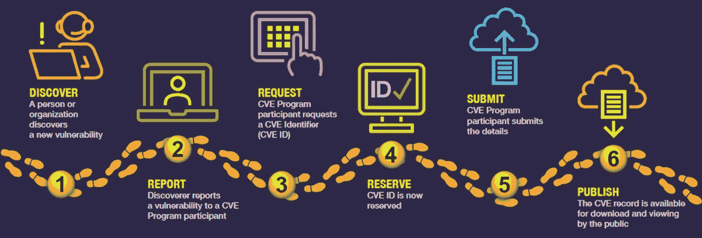

图 3.1 ¶ 来源：MITRE 公司. `www.cve.org/About/Process`，最后访问于 2023 年 3 月 27 日

自程序启动以来，CVE 程序和 CVE 记录列表呈线性增长。查看已发布的 CVE 记录指标（`www.cve.org/About/Metrics`），截至本文，每季的 CVE 记录从数百条增长到每季度 6,000 多个。这是由于该计划日益受欢迎、安全研究人员的增加、软件供应商参与度的提高，以及网络安全整体增长和可见性的提升。

## 国家漏洞数据库

漏洞有助于推动降低生产商和消费者风险的活动，并提供有关漏洞的广泛行业知识。虽然行业内存在多个漏洞数据库，但正如前面提到的，最著名的例子是 NIST 的国家漏洞数据库（NVD；`https://nvd.nist.gov`）。NVD 是一个全面的网络安全漏洞数据库，整合了所有美国政府漏洞资源并提供了行业引用。

NVD 正式于 2005 年形成（`https://nvd.nist.gov/general/brief-history`）。NVD 的起源可以追溯到 1999 年，其前身是：互联网攻击分类工具包（ICAT）。ICAT 是作为攻击脚本数据库开发的。ICAT 最初涉及 SANS 学院的学生，他们作为分析师参与该项目。ICAT 曾面临一些资金挑战，但在 SANS 以及 NIST 员工的努力下得以维持。在发展到 10,000 个漏洞之前，它获得了国土安全部（DHS）的额外资金，以创建一个重命名为现今 NVD 的漏洞数据库。随着项目的演进，NVD 随后采纳了目前仍流行的漏洞数据和评分标准，例如常见漏洞评分系统（CVSS）和通用平台命名（CPE；`https://nvd.nist.gov/products/cpe`）。

截至本文，NVD 包含超过 200,000 个漏洞，随着新漏洞的出现，这一数字仍在增长。NVD 被全球对漏洞数据感兴趣的专业人士以及寻求关联漏洞发现细节的供应商使用。

NVD 通过分析在 CVE 字典中发布的 CVE 来促进这一过程。通过引用 CVE 字典并进行额外分析，NVD 生成生成漏洞的重要元数据，包括 CVSS 评分、常见弱点枚举（CWE）类型以及以 CPE 形式存在的适用性说明。需要注意的是，NVD 员工并不进行漏洞测试，而是利用供应商和第三方安全研究人员的见解和信息来协助创建属性。随着当前信息的出现，NVD 经常修订元数据，例如 CVSS 评分和 CWE 信息。


NVD 集成了来自 CVE 计划的信息，这是一个漏洞字典，我们将在本章稍后的“CPE”节中对其进行讨论。NVD 在新发布的 CVE 集成到 NVD 后，会通过严谨的分析过程进行评估，该过程包括审查涵盖互联网上公开可用信息的 CVE 参考资料。`CVEs` 会被分配一个或多个 `CWE` 标识符以帮助对漏洞分类，还会通过 `CVSS` 为漏洞分配可利用性和影响指标。通过 `CPEs` 提供适用性声明，以确保通过这些声明识别特定的软件、硬件或系统版本。这有助于组织根据漏洞是否影响了其使用的特定硬件和软件来采取适当行动。一旦完成初始分析和评估，任何分配的元数据（如 `CWEs`、`CVSSs` 和 `CPEs`）将由高级分析师作为质量保证方法进行审核，然后发布在 NVD 网站和相关数据馈上。

NVD 为组织和个人提供了丰富的数据馈（`https://nvd.nist.gov/vuln/data-feeds`）和 API（`https://nvd.nist.gov/developers/start-here`）用于消费已发布的漏洞数据。API 允许相关方以比手动查看数据馈更自动化、更具可扩展性的方式程序化地消费漏洞信息。NVD API 频繁更新并支持搜索，还具有其他优势（例如数据匹配），它们经常被安全产品供应商使用，作为其产品服务的一部分提供漏洞数据。

## 软件身份格式

推动软件供应链安全和软件透明化的一个基本方面，是需要有效的方法来识别软件组件，包括拥有足够的信息来唯一标识每个软件组件。然而，这种需求远非简单的问题，因为软件领域由成千上万不同的软件供应商、部门和社区组成。国家电信和信息管理局（NTIA）在其名为《软件识别挑战与指南》的白皮书（`www.ntia.gov/files/ntia/publications/ntia_sbom_software_identity-2021mar30.pdf`）中关注这个问题，该白皮书是通过 NTIA 多利益相关者流程产生的。NTIA 指出，短期内需要从功能上识别软件组件，但未来还需要对多个现有的识别系统进行合理化。这样做将缓解一些挑战，并帮助行业围绕统一的解决方案形成合。为了控制围绕软件组件识别的一些困惑，NTIA 建议尽可能使用现有的识别系统，但指出这并非总是可能的，这导致一些人采用“尽力而为”的识别方法。

尽管整个行业的软件生产者和消费者都在广泛推动软件物料清单（SBOM）的采用和集成，但在 SBOM 组件识别方面，目前还没有权威来源。软件供应商通常根据其组织的需求和相关活动来定义和识别软件组件。由于组件识别不是一个静态事件，可能会因为项目分叉、采纳以及组织收购等因素而变化，这进一步剧了问题。

尽管如此，行业内和 NTIA 认同一些主要的软件识别标准，例如 `CPEs`、软件识别标签（`SWIDs`）和包 URL（`PURLs`），接下来我们将查看这些内容。

### CPE

通用平台枚举（`CPE`）是一种用于描述和识别应用程序、操作系统和硬件设备的类的结构化命名方案。`CPE` 经过了多次迭代，截至编写时最新版本为 `2.3`（`https://cpe.mitre.org/`）。`CPE` 解决了以标准化方式引用 IT 平台的需求，同时具有机器可读性以便处理。最新的 `CPE` 规范 `2.3` 将 `CPE` 标准拆分为栈中的一组独立规范，包括：

- `Name`
- `Name matching`
- `Dictionary`
- `Applicability language`

`name` 是 `CPE` 规范的基础，用于为 IT 产品分配名称。`Name matching` 用于对源 `CPE name` 和目标 `CPE name` 进行一对一比较。它决定了两个实体之间是否存在通用关系。例如，IT 资产管理工具可以收集有关已安装或存在的软件信息。`dictionary` 定义了创建和管理 `CPE 字典` 的标准化方法，这些字典是 `CPE names` 的仓库（`https://csrc.nist.gov/projects/cpe`）。栈中的最后一个规范是 `applicability language`，它定义了通过构建复杂的逻辑表达式来描述 IT 平台的标准化方法。`CPE` 规范提供的示例之一是一个操作系统，例如 `Windows XP`，它运行着 `Microsoft Office 2007`，并且操作系统上有特定的配置，例如激活的无线网卡。

### 软件识别标签

###识别（`SWID`）标签是国际标准组织认可的格式，是一种描述软件产品的结构化元数据格式（`https://csrc.nist.gov/projects/software-identification-swid`）。`SWID` 使用数据元素来识别软件产品，以及在产品生产和分发中过作用的版本、组织或个人，以及软件产品组成的组件。某些软件资产管理和安全流程将 `SWID` 作为软件资产漏洞评估、缺失补丁或特定配置管理评估活动的一部分。它也可以作为验证软件完整性的一部分或作为安全运营活动的一部分。

NIST 在其出版物 `NISTIR 8060` 中详细描述了 `SWID` 标签的使用，标题为《可互操作软件识别（SWID）标签创建指南》（`https://nvlpubs.nist.gov/nistpubs/ir/2016/NIST.IR.8060.pdf`）。NTIA 在其出版物《现有 SBOM 格式和标准调查》（`www.ntia.gov/files/ntia/publications/sbom_formats_survey-version-2021.pdf`）中也讨论了 `SWID`。`SWID` 标签被各种标准组织使用，如可信计算组织（TCG）和互联网工程任务组（IETF）。作为一种标准，`SWID` 有助于定义软件产品的生命周期。`SWID` 使用四种标签：

- `Primary`
- `Patch`
- `Corpus`
- `Supplemental`


`primary` 标签用于识别和描述安装在计算设备上的软件产品，而 `patch` 标签则代表对已安装软件产品进行的增量更改。`Corpus` 标签代表预安装状态下的可安装软件产品，例如关于安装包的元数据或软件更新。`Supplemental` 标签可用于向任何引用的 SWID 标签添加信息。软件管理工具可以使用它们来添加元数据，而无需更改其他标签格式。要可视化 SWID 标签的生命周期功能，请参见图 3.2，该图展示了前述提到的 NTIA 出版示例。

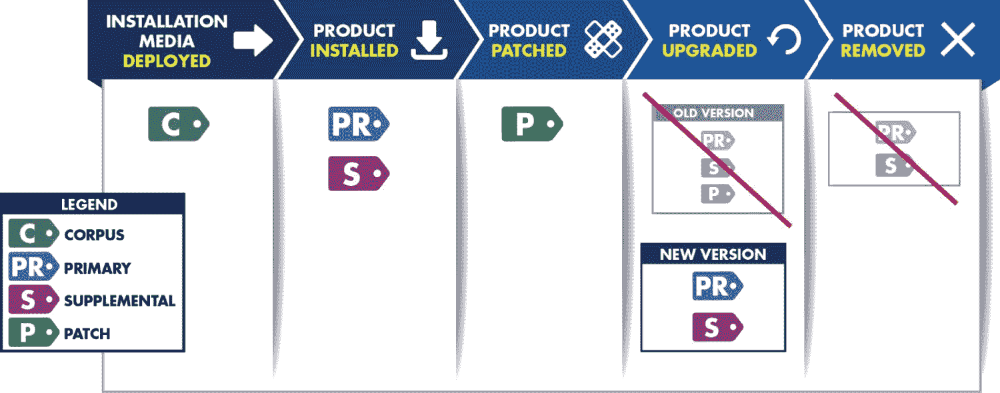

图 3.2 ¶ 来源：NTIA SBOM 格式调查, 美国商务部, 公有领域

我们在讨论 SBOM 格式时包含了 SWID，但由于其主要用例是关注软件识别，且缺乏其他格式提供的某些丰富上下文，SWID 没有获得像 SPDX 和 CycloneDX 等其他主要 SBOM 格式相同的关注。然而，需要注意的是 CycloneDX 原生支持用于软件识别的 SWID。

### PURL

包 URL (PURL; `https://archive.fosdem.org/2018/schedule/event/purl/attachments/slides/2298/export/events/attachments/purl/slides/2298/meet_purl_FOSDEM_2018_narrow.pdf`) 有助于解决与软件包命名规范和协议相关的问题。现代软件开发涉及消耗和产生大量的 NPM 和 Rubygems 等软件包。然而，每个包管理器和生态系统在软件包的识别、定位和置备方面使用了不同的命名规范和方法。

为了应对这一挑战，nexB (`www.nexb.com`)——一家提供 ScanCode、VulnerableCode、软件成分分析 (SCA) 以及免费开源软件 (FOSS) 安全扫描工具的公司——开发了 PURL 规范 (`https://github.com/package-url/purl-spec`)。PURL 项目的目标是标准化跨包管理器、工具和更广泛软件生态系统的识别和定位软件包的方法。PURL 由六个数据元素组成：

* Scheme (方案)
* Type (类型)
* Namespace/name (命名空间/名称)
* Version (版本)
* Qualifiers (限定符)
* Subpath (子路径)

某些元素是可选的，而另一些是必需的。这形成了一个如 `pkg:bitbucket/birkenfeld/pygments-main@244fd47e07d1014f0aed9c` 的 URL 字符串。`Scheme` 是常量值 `pkg` 的 URL 方案。`Type` 是必需元素，指示包类型，例如 `maven` 或 `NPM`。`Namespace`（如 `Maven` 和 `Docker`）是可选元素。`Name` 是显示包名称的字段；`version` 是可选数据元素。`Qualifiers` 提供额外的上下文，例如操作系统、架构或 `subpaths`。


2021 年，Google Security 发布了（`https://security.googleblog.com/2021/02/launching-osv-better-vulnerability.html`）开源漏洞（OSV）项目（`https://osv.dev`），其目标是“改进针对开源软件开发者和消费者的漏洞分级工作”。该项目演变自 Google Security 早期名为“认知、预防、修复”（`https://opensource.googleblog.com/2021/02/know-prevent-fix-framework-for-shifting-discussion-around-vulnerabilities-in-open-source.html`）的工作。OSV 致力于提供有关漏洞在何处引入以及在何处被修复的数据，以便软件消费者能够理解他们如何受到影响，以及如何缓解任何风险。OSV 的目标包括：最大限度地减少维护者发布漏洞时所需的工作量，并提高下游消费者漏洞查询的准确性。OSV 通过强健的 API 和漏洞数据查询，为开源包消费者实现了分级工作流的自动化。它还减轻了软件维护者在尝试跨可能影响下游消费者的提交和分支提供受影响版本的准确列表时所付出的负担。

Google Security 团队发布了博客，展示了 OSV 如何将 SBOM（软件物清单）与漏洞连接起来，这是因为 OSV 能够以专门用于映射到开源包版本和提交哈值的格式来描述漏洞。它还聚合了来自多种来源的信息，例如 GitHub 告数据库（GHSA）和全球安全数据库（GSD）。甚至有一个名为 `spdx-to-osv` 的 OSS 工具（`https://github.com/spdx/spdx-to-osv`），它可以根据软件软件包数据交换（SPDX）文档中列出的信息创建 OSS 漏洞 JavaScript 对象表示（JSON）文件。

OSV 不仅仅是发布在 OSV.dev 上的一个数据库；它还是一个架构和 OSV 格式。OSV 指出，虽然有很多漏洞数据库，但缺乏标准化的交换格式（`https://ossf.github.io/osv-schema`）。如果组织希望获得广泛的漏洞数据库覆盖，它们必须面对一个现实：每个数据库都有自己独特的格式和架构。这一事实阻碍了软件消费者采用多个数据库，也阻碍了软件生产者向多个数据库发布信息。OSV 旨在提供一种所有漏洞数据库都能共同遵循的格式，允许它们之间更广泛的互操作性，并减轻使用多个漏洞数据库的软件消费者、生产者和安全研究人员负担。OSV 以 JSON 编码格式运行，包含多种字段细节，如 ID、发布（published）、撤回（withdrawn）、相关性（related）、摘要（summary）和严重性（severity）等。

## 全球安全数据库

尽管 CVE 程序被广泛采用，但许多人指出该程序及其方法在无法跟上动态技术格局方面存在问题。随着云计算的出现，如云安全联盟（CSA；`https://cloudsecurityalliance.org`）等组织已成为现代云驱动 IT 时代提供指导和研究的声誉良好的行业领导者。CSA 的显著努力之一是创建了全球安全数据库（GSD），它将自己描述为解决现代问题的现代方法，并称 CVE 是一种过时的方法，未能跟上现代复杂的 IT 态势。这项工作由 Josh Bressers 和 Kurt Seifried 牵头，他们都在红帽公司以及漏洞识别和治理方面拥有丰富的经验和专业知识，在 Kurt 的情况下，他甚至担任过 CVE 委员会成员。

Kurt 在 CSA 标题为“我们为什么创建了全球安全数据库”（`https://cloudsecurityalliance.org/blog/2022/02/22/why-we-created-the-global-security-database`）的博客中，列出了创建 GSD 的几个原因以及为什么 CVE 等其他程序未能达标。博客追溯了漏洞识别的起源，即早于 CVE 的一个被称为 BugTraq IDs 的程序，该程序要求相关方订阅并阅读可用的漏洞信息。他描述了 CVE 程序的增长情况，该程序最初每年只有一千个发现，在 2011 年开始下降之前达到了 8,000 个 CVE 的峰值。文章还展示了我们之前讨论过的 CNA（编号颁发机构）的增长。然而，尽管 CNA 的数量在增加，Kurt 指出，近 25% 的 CNA 至少处于活跃状态了一年。2017 年，发布和分配的 CVE 数量达到顶峰，除了 2020 年的激增，CVE 分配活动一直保持平稳，如你在图 3.3 中所示。

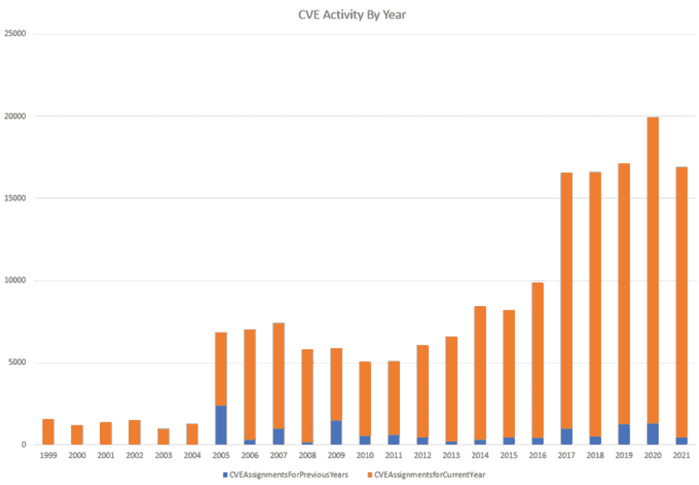

**图 3.3** ¶ Source: “Why We Started the Global Security Database”（`https://cloudsecurityalliance.org/blog/2022/02/22/why-we-created-the-global-security-database`）。Cloud Security Alliance, last accessed March 27, 2023

文章描述了 Josh 和 Kurt 曾参与的早期工作，例如分布式弱性记录（Distributed Weakness Filing）项目，并讨论了即使 Linux 内核也参与了这项工作。Linux 项目拒绝与 CVE 程序合作，Greg Kroah-Hartman 在题为“内核配方 2019——CVE 已经死亡！”的演讲中（`www.youtube.com/watch?app=desktop&v=Hee9jLjM`）详细讨论了这一点。在视频中，Greg 指出，由于应用并回传到用户的修复数量，CVE 程序无法很好地适用于内核。Greg 解释说，Linux CVE 的平均“请求修复”时间为 100 天，这表明对 Linux CVE 的关注不足，从更广泛的层面来看，Linux 项目运行太快，无法适应严格管理的 CVE 流程。

GSD 的公告描述了服务如何“吞噬世界”，现代软件和应用程序绝大多数以服务的形式交付，考虑到云计算各种模式的普及，这一点是难以反驳的，特别是对于软件即服务（SaaS）等应用。作者解释说，CVE 程序在覆盖服务类应用程序方面缺乏一致的方法。

作者和 GSD 领导者引用的其他变化之一是 Python（20 万个）或 NPM（130 万个）等包的爆炸式增长。另一种观点认为，CVE 程序在涉及供应商使用 OSS 包（例如使用 Log4j）时缺乏透明度、社区访问、参与以及数据支持。

如果你兴趣参与开放且社区驱动的 GSD 活动，可以在 GSD 首页（`https://globalsecuritydatabase.org`）了解更多，或通过 Slack 或邮件列表（`https://groups.google.com/a/groups.cloudsecurityalliance.org/g/gsd?pli=1`）等渠道。

## 通用漏洞评分系统

虽然 CVE 程序提供了识别和记录漏洞的方法，NVD 丰富了 CVE 并将其现在强大的数据库中，但通用漏洞评分系统（CVSS）负责评估安全漏洞的严重性并分配严重性评分。CVSS 试图捕捉软件、硬件和固件漏洞的计算特征。它提供了一种行业标准的漏洞严重性评分方法，该方法独立于平台和供应商，并且对于得出分数的特征和方法论完全透明。


CVSS 起于 21 世纪初国家基础设施咨询委员会（NIAC）的研究，`CVSS` 版本 1 出于 2005 年初。虽然 NIAC 的研究促成了 `CVSS` 的诞生，但 NIAC 在 2005 年选定了事件响应与安全团队论坛（FIRST）来在在未来领导并管理 `CVSS` 倡议。FIRST 是一家位于美国的非营利组织，为计算机安全事件响应团队提供如 `CVSS` 等资源。虽然 `CVSS` 由 `FIRST` 所有并运营，但其他组织只要遵循 `FIRST` 的 `CVSS` 规范指南，就可以使用或实施 `CVSS`。`CVSS` 经历了多次迭代，包括 2005 年初的原始 `CVSS`、2007 年的 `CVSS` v2 以及 2015 年的 `CVSS` v3。截至本文，`CVSS` 处于 `v3.1` 规范。`CVSS` 由三个核心指标组组成，如图图 3.4 所示。

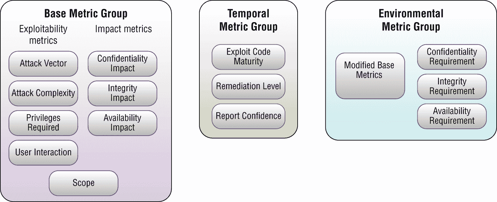

Figure 3.4 ¶ Source: Forum of Incident Response and Security Teams, CVSS v3.1 Specification Document (`www.first.org/cvss/specification-document`), last accessed March 27, 2023

如前所述，`CVSS` 包含三组指标：基础指标（base）、时间指标（temporal）和环境指标（environmental）。基于在部署环境中始终保持不变的内在特征的漏洞严重性，无论部署环境如何，都假设了最坏的情况。另一方面，时间指标会调整基础分，以考虑随时间变化的因素，包括漏洞利用的实际可用性。环境指标则根据计算环境的特定情况（包括用于降低风险的缓解措施）同时调整基础和时间严重性评分。基础分由拥有产品的组织或第三方（如安全研究人员）分配。这些是已发布的评分/指标，因为它们在分配后保持不变。由于发布方可能不托管或运行环境的完整上下文，也不具备已有的潜在缓解措施，因此如果需要，将由 `CVSS` 消费者通过时间场环境评分来调整分数。根据这些因素做出明智调整的成熟组织，能够根据考虑到其特定环境和涉及控制措施的更准确风险计算，更好地优先考虑漏洞管理活动。

进一步深入研究每个指标组，基础指标组涉及随时间变化的内在特征，除非出现新信息，否则与该组所处的环境无关。基础指标组包含可利用性指标和影响指标。可利用性指标包括攻击向量或复杂度以及所需的权限等。这些指标围绕受影响组件及其被利用的难易程度展开。在可利用性的另一侧是影响指标，它使用了传统的网络安全 CIA 三元模型。这涉及到漏洞被利用的后果以及对受影响组件的影响。

### 基础指标 (Base Metrics)

基础指标包含一些假设，例如攻击者对系统及其防御机制的了解程度。截至本文，`CVSS` 3.1 是现有版本，`CVSS` 4 0 正在开发。我们的讨论将从 `CVSS` 3.1 的视角出发。如前所述，基础指标还包括特定的可利用性和影响指标。在可利用性指标中，你有如攻击向量和复杂度、所需的权限、用户交互和范围（scope）等因素。

攻击向量指标旨在提供有关恶意攻击者可能利用方法的背景。由于利用所需的物理距离等因素会影响该指标的评分，根据现实，除非少数情况下，物理接近受影响组件的恶意攻击者数量可能少于具有逻辑访问权限的人。攻击向量指标包括 `network`（网络）、`adjacent`（相邻）、`local`（本地）或 `physical`（物理）等值。从网络角度来看，攻击向量可以限于局域网、远程利用，或可能限于整个互联网。另一方面，`adjacent` 将被限于特定的物理或逻辑范围，例如共享蓝牙网络/范围或处于同一本地子网。`local` 涉及访问系统键盘或控制台等因素，但也可能包括远程 SSH 访问。`local` 可能还需要用户交互，例如通过网络钓鱼攻击和社交工程。最后，`physical` 指标值意味着恶意攻击者需要物理接触受影响组件以利用该漏洞。

虽然攻击向量指标基于攻击者拥有的可用路径和方法，但攻击复杂度涉及恶意攻击者无法控制的条件，可能包括受影响组件上存在特定配置等示例。攻击复杂度分为 `low`（低）或 `high`（高）。`low` 是允许恶意攻击者重复性地成功利用受影响组件的情况，而 `high` 则更为微妙，要求恶意攻击者收集知识、准备目标环境或将自己注入网络路径（例如通过路径攻击式攻击）。

所需的权限指标描述了攻击者成功利用漏洞必须具备的权限级别。不需要权限的情况将产生最高的基础分指标，而如果利用需要恶意攻击者具有管理员级别的访问权限，则分数会较低。所需的权限值为：

*   `None`：不需要访问系统或组件
*   `Low`：需要基本用户能力
*   `High`：需要对受影响组件具有管理员级别的访问权限才能利用

用户交互指标描述了除恶意攻击者之外的人类用户必须参与的程度，以允许成功攻破。某些漏洞可以在恶意攻击者之外的任何人都参与的情况下成功执行，而另一些则需要额外用户的参与。该指标非常直观，可能值为 `none`（无）或 `required`（需要）。

最后一个可利用性指标是 `scope`（范围），它描述了受影响组件的利用超出自身安全范围并影响其他资源和组件的潜力。该指标需要理解受影响组件在其权限范围内影响其他资源的程度，从更根本地说说，首先哪些组件是在其权限下的。存在两个指标值：`unchanged`（未改变）或 `changed`（已改变），代表利用对由另一个安全机构管理的组件产生的影响程度。

在基础指标中，还有影响指标，由传统的 CIA 三元模型表示。CVSS 建议分析人员将其影响预测与恶意攻击者可能造成的实际影响保持合理一致。如果你熟悉 NIST 关于 CIA 的风险管理框架指南，你会发现其中的相似之处。CIA 指标值为 `none`（无）、`low`（低）或 `high`（高）。`none` 意味着对 CIA 无影响，`low` 意味着 CIA 的部分损失，`high` 意味着 CIA 的完全丢失，并在与漏洞利用相关的给定场景中可能产生最具破坏性的潜在影响。

### 时间指标 (Temporal Metrics)


如前所述，时间指标会随时间发生变化，例如由于活跃的漏洞利用推高了分数，或者可用补丁导致 CVSS 分数下降。请记住，这些因素与行业相关，并不特定于用户的环境或组织可能实施的特定缓解措施。时间指标包括利用代码成熟度、修复水平和报告置信度。

利用代码成熟度基于相关漏洞利用技术的当前状态以及利用该漏洞代码可用性。这通常被称为“实地”（in-the-wild）利用，一个著名的例子是 CISA 的“已知受利用漏洞目录”（`www.cisa.gov/known-exploited-vulnerabilities-catalog`），该目录定期更新已知被活跃利用的漏洞，并要求联邦机构修复已可利用的漏洞。此列表已经包含了数百个漏洞，以及各种软件和硬件利用漏洞，这些漏洞可能适用于许多组织。随着新发现并确认已知被活跃利用的漏洞，该列表会定期更新。漏洞利用代码成熟度指标包括：未证明的、概念验证（PoC）、功能性的、高以及未定义。这些指标代表了从没有利用代码或仅处于理论阶段到完全功能化、自主且无需手动触发的各种情况。

修复水平指标有助于推动漏洞优先排序工作，涉及通过官方可用修复方案实施变通措施等可能性。潜在指标值包括：不可用、变通措施、临时修复和官方修复。修复漏洞可能是可能的，或者在官方修复发布、验证并经过消费和实施审核之前，可能需要非官方的变通措施。

最后一个时间指标是报告置信度，涉及对漏洞报告及其相关技术细节的实际置信度。例如，初始报告可能来自未经证的来源，但可能会成熟并经过供应商或声誉良好的安全研究人员的验证。潜在指标值包括：未知、合理和已确认，代表了对报告的漏洞及细节置信度的不断增加。这些因素会影响漏洞的整体评分。

### 环境指标

对于特定组织的语境，这是环境指标发挥作用的地方。对于每个软件使用者来说，它看起来都不同，因为每个环境都是唯一的，并且有一系列可能影响环境评分的因素，例如其技术栈、架构和特定的缓解控制。

环境指标有助于组织根据其运行环境的特定因素调整基础分。修改围绕 CIA 三元组（CIA triad）展开，允许分析师根据每个 CIA 维度在组织业务功能或任务中所扮演的角色分配值。修改后的基础指标是由于用户环境的特殊性而覆盖基础指标的结果。值得注意的是，这些修改需要对基础和时间指标因素有深入了解，以便进行准确的修改，从而不会低估漏洞对组织带来的风险。

### CVSS 评分标准

CVSS 使用定性严重性评分标准，范围从 0.0 到 10.0，如图 3.5

所有各种 CVSS 评分指标和方法产生所谓的*向量字符串*（vector string），CVSS 规范定义为“一种特定格式的文本字符串，包含分配给每个指标的每个值，并始终与漏洞一起一起”。向量字符串由指标组、指标名称、可能的值以及是否为强制性组成。这最终形成一个呈现为“攻击向量：网络，攻击复杂度：低，所需权限：高，用户交互：无，范围：未更改，机密性：低，完整性：低，可用性：无”的向量字符串。

计算指标需要对可能的字段、值和其他因素深入了解。我们强烈建议访问 CVSS v3.1 规范了解更多关于公式和指导的信息(`www.first.org/cvss/v3.1/specification-document`）。

### 批判

尽管 CVSS 被广泛使用和采用，但它并非没有批评。安全研究人员兼作者 Walter Haydock 在他的“Deploying Securely”博客（`www.blog.deploy-securely.com`）中，文章[CVSS：一种评估风险的（不恰当的）行业标准]（`www.blog.deploy-securely.com/p/cvss-an-inappropriate-industry-standard`）中对 CVSS 提出了指责。在文章中，Walter 认为 CVSS 不适用于评估网络安全风险。他引用了行业领袖的多篇文章，这些文章证明了为什么不应仅使用 CVSS 进行风险评估，尽管行业正是为了这一目的而使用它（`https://pt-br.tenable.com/blog/why-you-need-to-stop-using-cvss-for-vulnerability-prioritization`）。正如 Walter 的文章或其他文章指出的，CVSS 通常用于帮助组织根据评估利用难易程度和发生时的影响水平，优先考虑缓解或修复哪些漏洞。Tenable 等机构的研究指出，被 CVSS 评分为高或关键的漏洞中，超过 50% 可能永远被利用（`https://pt-br.tenable.com/research`）。事实表明，75% 的被评为高或关键的漏洞从未真正发布过相关的漏洞利用代码，但安全团队仍然优先考虑这些漏洞。这意味着组织正在浪费有限的时间和资源去优先考虑那些可能（如果会）被利用的漏洞，而不是处理具有活跃利用代码的漏洞。


基于对 CVSS 的批判，一些人提议使用漏洞预测评分系统（EPSS）或结合 CVSS 和 EPSS，以使漏洞指标变得更具操作性和效率。与 CVSS 类似，EPSS 由 FIRST 管理。EPSS 以其是一项开放且数据驱动的工作为荣，旨在估计软件漏洞在野外被利用的概率。CVSS 关注漏洞的固有特性，最终得出严重性评分。尽管如此，仅凭严重性评分并不能指示利用的可能性，这对于漏洞管理专业人员来说是关键信息，他们需要优先考虑漏洞修复和缓解工作，以最大限度地发挥降低组织风险的影响。

EPSS 有一个向公众开放的特别小组（SIG），供感兴趣参与该工作的人。EPSS 是志愿者驱动的，由研究人员、安全从业人员、学者和政府人员领导，但尽管有这种行业协作方法，FIRST 仍有权根据其需要更新模型及相关指导。目前，该小组拥有来自 RAND、Cyentia、弗吉尼亚科技大学和 Kenna Security 等组织的主席和创建者。EPSS 有几篇论文深入了攻击预测、漏洞建模与披露以及软件利用等相关主题（`www.first.org/epss/papers`）。

## EPSS 模型

EPSS 旨在帮助安全从业人员及其组织改进漏洞优先排序工作。在当今的数字环境中，识别出的漏洞数量呈指数级增长，由于系统和社会数字化程度的提高、对数字产品审查机制以及研究和报告能力的提升等因素，这一数字还在增长。EPSS 指出，组织每月只能修复 5% 到 20% 的漏洞。现实情况也是，发布的漏洞中，少于 10% 的已知在野外被利用。长期的人力问题也在起作用，例如年度 (ISC)² 网络安全劳动力研究（`www.isc2.org/News-and-Events/Press-Room/Posts/2021/10/26/ISC2-Cybersecurity-Workforce-Study-Sheds-New-Light-on-Global-Talent-Demand`），显示全球网络安全专业人才缺口超过两百万（参见图 3.6）。


图 3.6 ¶ Source: EPSS Model (`www.first.org/epss/model`)，最后访问于 2023 年 3 月 27 日

这些因素要求组织采用连贯且有效的方法优先考虑风险最高的漏洞，以避免浪费有限的资源和。EPSS 模型通过创建漏洞在未来 30 天内被利用的概率评分提供支持，评分范围在 0 到 1 之间，或 0% 到 100% 之间。为了提供这些评分和预测，EPSS 使用来自各种来源的数据，例如 MITRE CVE 列表、有关 CVE 的数据（如发布后的天数），以及来自 AlienVault 和 Fortinet 等安全供应商的野外利用活动观察。

EPSS 团队发布数据以支持其不仅使用 CVSS 评分，还使用 EPSS 评分数据来产生更有效的漏洞修复工作。例如，许多组织规定具有特定 CVSS 评分或更高（如 7 及以上）的漏洞必须修复。但这种方法仅根据 CVSS 评分对漏洞修复进行优先排序，而不考虑该漏洞是否已知被利用。将 EPSS 与 CVSS 结合更为有效，因为这样组织不仅仅仅根据严重性评分优先考虑漏洞，还根据它们是否已知正被积极利用，让组织能够处理对其构成风险最大的 CVE。

EPSS 关注两个核心指标：效率和覆盖率。效率指标查看组织利用资源解决已修复漏洞百分比的熟练程度。EPSS 指出，将组织的大部分资源用于修复大多数已知的被利用的漏洞，比仅根据 CVSS 严重性评分修复随机漏洞更有效率。覆盖率指标查看已修复的被利用漏洞的百分比。

为了展示其提议方法的效率，EPSS 在 2021 年使用 CVSS v3 基础分进行了一项研究：EPSS v1 和 EPSS v2 数据。他们考虑了 30 天的期限来确定 CVE 的总数、修复的 CVE 数量以及被利用的 CVE 数量。如图 3.6 所示，有几点脱颖而出。首先，现实情况是大多数 CVE 根本没有被修复。其次，修复的被利用 CVE 的数量仅是总修复 CVE 的子集。这意味着组织没有修复大多数 CVE，而在他们修复的 CVE 中，许多并没已知被积极利用，并且可能并不构成最大的风险。这也表明 EPSS v2 通过最大化已修复的被利用漏洞的百分比，进一步提高了漏洞修复工作的效率。当组织面临网络安全从业人员面临资源挑战时，让资源集中在对组织构成风险最大的漏洞上，以实现投资回报的最大化至关重要。EPSS 试图帮助组织更有效地利用其有限资源，并提高降低组织风险的有效性。

## EPSS 批判

与 CVSS 类似，EPSS 也并非没有业界和学术界的批判。一篇题为《暂不要依赖 EPSS》（`https://insights.sei.cmu.edu/blog/probably-dont-rely-on-epss-yet`）的文章来自卡内基隆大学的软件工程学院（SEI）。SEI 最初发布了一篇名为《改进 CVSS》的论文，对不久后产生的 EPSS 基础 CVSS 提出了某些尖利的批判（`https://resources.sei.cmu.edu/library/asset-view.cfm?assetid=53838`）。

文章提出的主要批判包括 EPSS 的不透明以及数据和输出的问题。文章讨论了 EPSS 的开发流程、治理或目标受众并不明确。文章指出 EPSS 依赖于先有的 CVE ID，这意味着对于软件供应商、事件响应团队或赏金小组等实体来说，EPSS 将无法帮助，因为这些小组处理的许多漏洞还没有 CVE ID，且可能永远不会获得。还有一个问题是，在处理零日漏洞时 EPSS 将无法帮助，因为尽管缺乏已知 CVE ID，它们在利用开始时就已经具有可见性。

文章作者还对 EPSS 的开放性和透明度表示担忧。尽管 EPSS 自称为是一项开放且数据驱动的工作——并且如前提到的还有一个 SIG——但 EPSS 及其管理组织 FIRST 仍有权随时更改网站和模型，而无需解释。现实情况也是，即使是 SIG 成员也无法访问底层 EPSS 模型使用的代码或数据。SIG 本身对模型没有监督或治理，而且更新或修改模型的过程对 SIG 成员、更不用说公众是不透明的。文章指出，EPSS 模型和数据也可能从公共贡献和使用中撤回，因为它们由 FIRST 管理和治理。


文章表明，EPSS 关注的是漏洞在未来 30 天内被利用的概率。但要实现这一预测，需要一些基础条件。这些条件包括：NVD 中存在 `CVE ID` 及其关联的 `CVSS v3` 向量值、与活跃的 `CVE ID` 漏洞尝试利用相关的入侵检测系统 (IDS) 签名、来自 AlienVault 或 Fortinet（它们为 EPSS 提供数据）的贡献，最后是与未来 30 天关联的模型本身。正如作者指出的，拥有 `CVE ID` 的漏洞中只有 10% 带有相应的 IDS 签名，这意味着 90% 具有 `CVE ID` 的漏洞可能无法被检测到利用行为。这还导致了对 Fortinet 和 AlienVault 在 IDS 传感器及相关数据的依赖，这种情况可以通过更广泛的安全供应商社区的进一步参与来缓解。

## CISA 的观点

随着围绕漏洞优先级和管理的讨论愈演愈烈，像 CISA 这样的机构对该话题发表了见。在 2022 年 11 月发表的一篇题为转型漏洞管理格局的文章中，CISA 执行助理局长 Eric Goldstein 讨论了现代数字格局的复杂性以及漏洞发现的加速速度。

根据文章，CISA 概述了推进漏洞管理生态系统的三个关键步骤：

1. 扩大通用安全公告框架 (CSAF) 的使用，以实现自动化机器可读的安全公告。
2. 加强对漏洞可利用性交换 (VEX) 的采用，这有助于软件消费者理解特定产品何时受到受可利用漏洞的影响。
3. 帮助组织使用利益相关者特定漏洞分类 (SSCV) 和 CISA 的已知已利用漏洞 (KEV) 等工具，优先考虑漏洞管理资源的分配。

我们将在本节中更深入地讨论其中的每一个步骤。

### 通用安全公告框架

CISA 列表首位是使用 `CSAF` 来实现机器可读安全公告的自动化。正如 CISA 指出的，每当发现并公布新漏洞时，软件供应商都必须评估其产品并验证其适用性；如果适用，则决定必须采取什么措施进行修复，并将此类信息传给其客户群体。在供应商执行这些操作的同时，恶意攻击者也在这样做，他们试图在供应商直接修复（例如在 SaaS 语境下）或发布补丁并让终端用户应用（在传统本地软件语境下）之前，积极利用该漏洞。随着与 `CVE` 相关的漏洞发现和公布速度的不断加快，迫切需要自动化并加速这一活动，将这些信息传递给软件消费者——这正是机器可读性和自动化发挥作用的地方。

`CSAF` 由 OASIS 通用安全公告框架 (CSAF) 技术委员会领导。`OASIS` 是一个非营利联盟，旨在帮助创建和推广各种最佳实践和标准。`OASIS` 为想要进一步了解 `CSAF` 的人员提供了一些优秀的资源，包括他们的“什么是通用安全公告框架 (CSAF)？”视频（`www.youtube.com/watch?app=desktop&v=vQ_xY3lmZOc”）或极其详尽的 `CSAF 2.0` 规范（`https://docs.oasis-open.org/csaf/csaf/v2.0/csaf-v2.0.html`）。

根据规范定义，“`CSAF` 支持将有关产品、漏洞以及利益方之间影响和修复状态的安全公告作为结构化信息进行创建、更新和互操作交换。”这些公告以 `JSON` 格式提供。

传统上，安全公告以 `PDF` 文件和网站等静态文档的形式发布，供人类阅读。这种方式的挑战在于，在恶意攻击者利用漏洞之前进行修复，漏洞发现和公布速度的加快构成了压力，这使得机器和自动化的需求变得至关重要。这种情况与网络安全的其他领域有几个相似之处，这些领域越来越多地采用机器可读的制品，例如带有开放安全控制评估语言 (OSCAL) 的治理、风险与合规 (GRC) 工具，以及随着基础设施即代码和合规即代码出现而传统 IT。现代技术格局的运行速度太快了，人类已无法充当中介媒介。

`CSAF` 还致力于提供一套强大的工具集（`https://oasis-open.github.io/csaf-documentation`），例如 `CSAF Parser`、`Visualizer`、`Trusted Provider` 和 `Aggregator`，这仅是工具包的一个部分。值得注意的是，截至本文编写，这些工具仍在开发中，可能缺少某些功能，例如 `CSAF Parser` 尚不支持 `CSAF 2.0`。这些每个工具都配有 `GitHub` 仓库、文档和代码库，以帮助组织和采用者更好地利用 `CSAF`，并作为软件消费者或生产者将其网络安全和漏洞管理活动的一部分投入运营。

`CSAF` 架构文档主要涉及三类信息：

*   该文档的框架、聚合和引用信息
*   `CSAF` 公告创建者认为相关的产品信息
*   与所讨论产品（项）相关的漏洞信息

`CSAF` 还原生支持引用行业标准内容的架构，例如平台数据以及漏洞分类和评分。示例包括 `CPE`、`CVSS` 和 `CWE`，每种内容都有一个供使用的架构。

有了这些基本概述，很容易看出 `CSAF` 如何帮助开启机器可读安全公告时代，这种公告可以自动化，并有助于加速安全公告的创建、分发和摄取，从而使软件提供者和消费者受益，并为软件系统的安全风险做出快速决策。要了解更多信息，可以查看规范本身，或观看一些可用的 `CSAF` 视频（`https://oasis-open.github.io/csaf-documentation`）。

### 漏洞可利用性交换

在围绕 `CSAF` 的讨论的基础上，CISA 的第二个关键步骤是 `VEX` 的广泛采用。我们在第四章“软件物料清单的崛起”中讨论过 `VEX`，因此我们在这里简要介绍。从高层次来说，`VEX` 允许软件供应商声明特定漏洞是否影响产品，以及是否*未*影响产品。现实是组织面临网络安全人才短缺，`VEX` 允许组织将精力和资源优先投入到存在风险的漏洞，而不是可能无法利用且无风险的漏洞。`VEX` 文档正成为 `SBOM` 的紧密伙伴，为提供软件产品 `SBOM` 中包含漏洞的可利用性提供说明，并且可以在 `SBOM` 内部之外生成。此外，由于漏洞会被定期发现和公布，即使没有发布新软件，也可能出现新漏洞，这使得某些情况下 `VEX` 的节奏与 `SBOM` 不同。

行业不仅在 `SBOM` 领域，在 `VEX` 领域的规范和工具方面也持续不断地出现创新。例如，2023 年初，软件供应链领导者 `Chainguard` 宣布，通过与 `HPE` 和 `TestifySec` 等伙伴合作，他们创建了 `OpenVEX` 规范。`OpenVEX` 设计目标是极简、合规、互操作和可嵌入。更多信息可以在 `OpenVEX` 的 `GitHub` 仓库中找到（`https://github.com/openvex/spec`）。


# 利益相关者特定漏洞分类与已知被利用漏洞

行业内的一项持续需求是帮助组织优先处理产生风险最大的漏洞。

美国网络和基础设施安全局（CISA）编制并发布了已知被利用漏洞（KEV）目录，并通过一项强制性运营指令（BOD）`www.cisa.gov/binding-operational-directive-22-01` 要求联邦机构修复 KEV。CISA 建议商业机构如果受到这些 KEV 的影响，也采取相同措施。该目录以网页形式发布，同时也提供 `CSV` 或 `JSON` 文件格式。组织和个人还可以订阅 KEV 目录更新快报，当有新的 KEV 加入目录时，该快报将发送电子邮件通知。

漏洞进入 KEV 目录的标准包括如下：

* 必须已分配了 `CVE ID`。
* 根据可靠证据，该漏洞正在野外环境中被活跃利用。
* 该漏洞有明确的修复指导，例如供应商提供的补丁或更新。

正如我们之前讨论的，`CVE` 程序虽由 CISA 赞助，但由 `MITRE` 运营，`MITRE` 是一家联邦资助的研究开发中心（FFRDC）。`CVE 程序`的目的是识别、定义和编编公开披露的漏洞。`CVE ID` 由`CVE 编号机构`分配，具有三种可能的状态：`reserved`（保留）、`published`（已发布）或`rejected`（已拒绝）。

CISA 的 KEV 目录并不将利用性本身作为纳入目录的标准。相反，必须有可靠证据表明该漏洞已被尝试利用或已成功利用。例如，可能有证据表明恶意攻击者试图在目标上执行代码但失败了，或者仅仅在`蜜罐系统`（honeypot system）上执行，蜜罐系统是一种通过观察来暴露恶意活动的机制。与尝试利用不同，成功利用意味着恶意攻击者成功利用了目标系统上的漏洞代码，从而允许他们对系统或网络执行某种未经授权的动作。CISA 特别指出，`PoC` 利用程序不会进入 KEV 目录，因为虽然研究人员可能展示了某些内容*可能*被利用，但没有证据表明它在野外环境中已被利用，甚至被尝试过利用。

纳入 KEV 目录的第三个标准是有明确的修复指导。这意味着组织可以采取明确行动来修复 KEV 风险。这些行动可能包括应用供应商更新，在潜在的严重情况下，如果没有可用更新或产品已到期（不再更新或支持），则将受影响的产品完全从网络中移除。CISA 还承认，在缺乏相关更新和补丁的情况下，组织通常会寻求实施`缓解措施`（防止漏洞被利用）或`通变方案`（workarounds），后者是指通过手动更改来在补丁可用之前保护受影响的系统免受利用。

在利用 KEV 指南的基础上，CISA 正在努力通过利益相关者特定漏洞分类（SSVC）帮助组织优先分配漏洞管理资源。SSVC 是通过 CISA 和卡内基梅隆大学的 `SEI` 合作创建的。`SEI` 对单一使用 `CVSS` 等来源的批评并不陌生，他们于 2018 年发布了题为《走向改进 CVSS》的相当严厉的白皮书，在书中指出了广泛使用的 `CVSS` 在漏洞优先级评定方面的若干缺点（`https://resources.sei.cmu.edu/library/asset-view.cfm?assetid=538368`）。另一个值得提及的讽刺是，尽管提倡使用 `SSVC` 等框架，但像 CISA 这样的联邦机构仍在强制使用 `CVSS`，尽管他们正积极与 `SEI` 等已指出其缺陷和不足的组织建立合作（`www.blog.deploy-securely.com/p/revealing-the-governments-approach`）。

正如 CISA 的 SSVC 指南所述，`SSVC` 是一种自定义的决策树模型，旨在帮助美国政府及其关联实体优先处理漏洞响应，但也可以供他人使用。`SSVC` 包含四种可能的决策，如图图 3.7

图 3.7

指南建议组织了解漏洞的范围，因为这将影响决策树——例如，漏洞是遍布于整个企业，还是关键系统的一部分。

在使用 `SSVC` 并遍历决策树时，组织应该考虑几个因素。这些因素包括利用状态，使用如国家漏洞数据库（NVD）或信息共享与分析中心（ISACs）等来源。这些来源通常提供关于漏洞是无利用证据、具有 `PoC` 还是正在野外环境中被活跃利用的见解。

接下来，组织需要理解利用漏洞的技术影响。这里可以与 `CVSS` 的严重性基础分概念进行类比。潜在值包括 `partial`（部分），即恶意攻击者对系统的控制或影响有限；以及 `total`（完全），意味着他们对与漏洞相关的软件或系统的行为具有完全控制权。

另一个关键考虑因素是利用是否可以自动化的。对于恶意攻击者来说，使用可以自动化的利用程序比使用需要手动干预和实施的程序更容易扩大其恶性活动的规模。这里的决策值是简单的“是”或“否”。如果答案是“是”，那么恶意攻击者就可以自动化洛希德·马丁网络杀伤链的第 1–4 （`www.lockheedmartin.com/en-us/capabilities/cyber/kill-chain.html`）：侦察、武器化、投送和利用。指南提到，除了自动化之外，还必须考虑漏洞链，因为可能需要或可以将多个漏洞或弱点结合起来实现成功利用。

从技术影响转移后，是考虑任务普遍性，即对任务关键功能（MEFs）或相关实体的影响。`SSVC` 指南将这些定义为“与完成组织法律或执行章程规定的使命直接相关的功能”。组织通过业务连续性计划（BCP）等练习识别 `MEFs`。决策值包括 `minimal`（最小）、`support`（支持）或 `essential`（关键）。`essential` 指漏洞组件直接为一个 `MEF` 或实体提供能力，且利用会导致任务失败。另一方面，`support` 意味着漏洞组件支持 `MEFs` 但不是直接支持。最后，`minimal` 是不适用关键或支持的情况。

决策树的下一步是公共福祉影响，即受影响组件或系统对人类的影响程度。`SSVC` 使用了疾病控制与预防中心（CDC）对福祉的定义：人类身体、社会、情感和心理健康。这里的决策根据影响进行划分，影响可以是实质性的或不可逆的，以及伤害类型，范围可以从身体到心理，甚至是财务的。

最后是考虑缓解状态，它衡量了及时缓解漏洞的困难程度。考虑的因素包括

* 缓解措施是否公开可用
* 进行所需的系统更改的难度
* 是否存在修复程序或需要通变方案


指南强调，缓解措施的价值不应改变 `SSVC` 决策的优先级，但应该积极跟踪并考虑 `SSVC`。图 3.8 是决策树的一个示例，但它也可以以表格的形式表示。

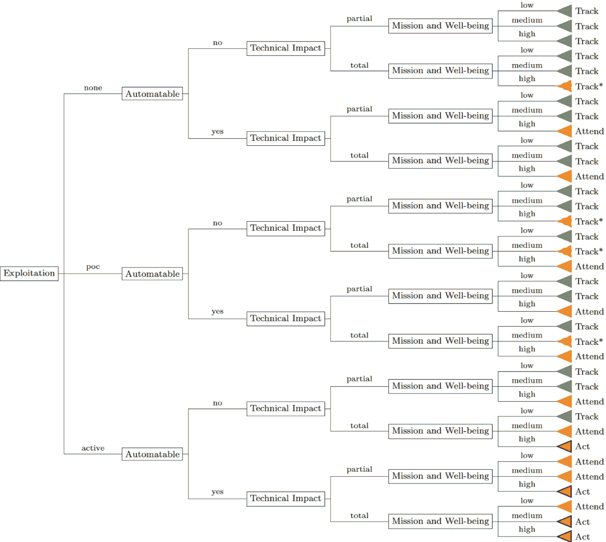

图 3.8

## 向前推进

CISA 指南优先考虑此类步骤，例如使用 `CSAF` 自动化安全公告，以及利用 `VEX` 等资源告知软件消费者漏洞可利用性的影响。然而，显而易见，这需要主观的网络安全专业知识，特别是在复杂的决策树中。自动化在减少组织和网络安全团队认知负担方面发挥着关键作用，但仍然需要网络安全和软件专业知识来理解漏洞所带来的广泛的企业和系统背景，以及如何优先组织资源来解决这些问题。

### 总结

在本章中，我们查看了行业漏洞数据库和评分方法。这包括传统的漏洞数据库及其潜在局限性，以及跨越漏洞生态系统的新兴数据库。我们还研究了常见的软件标识格式及其带来的挑战，以及正在提出的以缓解某些挑战的解决方案。我们还探索了漏洞如何进行分类、评分和通信。在下一章中，我们将关注软件物料清单 (`SBOM`) 以及 `VEX` 等辅助产物的兴起。

# 第 4 章：软件物料清单的兴起

本章讨论了 `SBOM` 概念的起源，包括早期的失败与成功，以及对其成熟做出贡献的美国联邦和行业组织。我们还将深入探讨 `SBOM` 格式的某些细节、特定字段以及漏洞可利用性交换（`VEX`）的出现。

## 法规中的 SBOM：失败与成功

虽然行业内可能正掀起波 `SBOM` 动能，但为了达到这一点已经经历了多年的努力，涉及各种政府和行业组织的参与。最值得注意的是，近期 `SBOM` 的动能发生于国家电信和信息管理局 (`NTIA`)。

尽管如此，虽然 `NTIA` 以及如 `Log4j` 和 `SolarWinds` 等事件在近期围绕 `SBOM` 的动能中可能发挥了关键作用，但早期涉及 `Apache Struts 2` 和 `OpenSSL` 相关漏洞的事件导致了法律的引入，如 2014 年网络供应链管理与透明度法案 的工作由 `NTIA` 倡导。自 2018 年以来，`NTIA` 一直致力于促进软件组件透明度。2018 年 7 月，`NTIA` 与多个利益相关者举行了会议（`http://ntia.doc.gov/federal-register-notice/2018/notice-071918-meeting-multistakeholder-process-promoting-software`），讨论软件组件透明度主题、挑战和潜在解决方案。

这些早期会议涉及 `Allan Friedman 博士`，他当时担任 `NTIA` 的网络安全倡议主任。自早期以来，`Friedman` 一直是围绕 `SBOM` 和软件透明度的行业对话中的一位重要人物，与上述 `Josh Corman` 一样，他现在担任网络安全和基础设施管理局 (`CISA`) 的高级顾问和战略师，继续帮助领导软件透明度和 `SBOM` 的推进。

`NTIA` 意识到现代软件是由许多来自开源和商业行业的组件及库创建的（`http://ntia.gov/blog/2018/ntia-launches-initiative-improve-software-transparency`）。它承认创建并维护这些组件及其相关漏洞的清单是非常具有挑战性的。该组织与其利益相关者社区一直在寻求理解软件组件清单、实践以及相关的政策和市场挑战。

在努力过程中，`NTIA` 产生了一系列关于软件透明度和 `SBOM` 的完善文档和指南（见 `http://ntia.gov/SBOM`）。这些包括向不熟悉的人介绍 `SBOM`、提高对 `SBOM` 的理解、`SBOM` 的实施以及相关的技术资源。

基于网络安全行政命令 (`EO`) 第 4 节“增强软件供应链安全”，第 (F) 小节要求 `NTIA` 在网络安全 `EO` 发布后 60 天内发布 `SBOM` 的最小要素。`NTIA` 随后在 2021 年 7 月发布了《软件物料清单 (SBOM) 的最小要素》（`http://ntia.doc.gov/files/ntia/publications/sbom_minimum_elements_report.pdf`）。该指南规定了最小要素，定义了思考这些最小要素的范围，并描述了软件供应链透明的 `SBOM` 用例。`NTIA` 的指南指出，系统共享和组件元数据的跟踪有助于支持供应链透明。

在本节中，我们将分解 `NTIA` 的最小要素指南。他们的指南包含并详细说明了三类要素：

*   数据字段
*   自动化支持
*   实践和流程


| 组件名称 | 原始供应商为软件单元分配的名称 |
| :--- | :--- |
| 组件版本 | 供应商用于指定软件与之前识别的版本相比的更改标识符 |
| 其他唯一标识符 | 用于识别组件或作为相关数据库的查找键的其他标识符 |
| 依赖关系 | 刻画上游组件 `X` 被包含在软件 `Y` 中的关系 |
| SBOM 数据作者 |创建此组件 SBOM 数据的实体名称 |
| 时间戳 | SBOM 数据组装的日期和时间记录 |

来源：`ntia.doc.gov/files/ntia/publications/sbom_minimum_elements_report.pdf`。美国商务部，公有领域。

组织可以使用这些数据字段将组件与其他数据源进行进行映射，这一过程被称为 `enrichment`（富化）。如表 4.1 所示，其意图是提供基础信息，如组件供应商、组件名称及其版本，然后将组件与相关的上游组件关联起来。这通常被称为 `dependency relationship`（依赖关系），因为大多数软件都包含第三方代码，导致了第一方代码和第三方代码之间的依赖关系，以构建组件和应用程序。值得注意的是，NTIA 的指南讨论了一些挑战，例如，供应商和软件供应商之间版本控制方法的巨大差异。

除了数据字段外，NTIA 确定的 SBOM 另一个核心组件是对自动化支持的需求。。对 SBOM 普及和采纳的怀疑者指出，需要强大的工具和自动化支持，以确保 SBOM 的采纳在大规模下能够准确且成功。对自动化的支持使组织能够将 SBOM 集成到其现有的漏洞管理、供应链风险管理和网络安全计划中。NTIA SBOM 指南讨论了三种主要的 SBOM 格式，这些将在“SBOM Formats”章节中介绍。

最后，NTIA SBOM 指南涵盖了实践和流程，重点关注 SBOM 在组织运营和采用中的机制。讨论的主要实践和流程包括以下内容：

* 频率（Frequency）
* 深度（Depth）
* 已知未知（Known unknowns）
* 分发与交付（Distribution and delivery）
* 访问控制（Access control）
* 错误处理（Accommodation of mistakes）

### 频率
`Frequency` 与创建新 SBOM 的频率有关。NTIA 的指南强调，每`every` 次新的软件构建或发布 `必须` 创建新的 SBOM。如果软件供应商获了有关组件的额外细节（包括纠正之前通信的错误），也需要创建新的 SBOM。

### 深度
`Depth` 是 SBOM 应该深入依赖树到多深。NTIA 指南指出，SBOM 至少应包含所有顶层组件，并列出传递依赖。`Transitive dependencies`（传递依赖）可以定义为软件运行、编译或测试所必需的组件。虽然列出所有传递依赖并不总是切实际或可行，但指南指出，应该提供足够的信息，以便在必要时寻找传递依赖。在深度方面，不同的组织和行业可能存在不同的需求，即使是由于内部政策或监管要求，且 SBOM 消费者将尝试对其软件产品指定深度，特别是在处理涉及合同和法律层面的专有软件供应商时。

### 已知未知
`known unknowns` 的概念围绕着 SBOM 作者在关于进一步依赖关系的通信中保持清晰的需求。在某些情况下，并非所有依赖都是已知的，这在指南中被称为“已知未知”。SBOM 作者可以告知这些数据已知是不完整的，从而告知软件消费者，其使用的软件中可能存在未处理的未知风险。

### 分发与交付
`Distribution and delivery` 涉及确保应被 SBOM 通知的实体能够及时获得 SBOM，并具有适当的权限和访问控制。SBOM 采纳的这一领域仍在不断发展，无疑将使用多种方法。分发和交付的方法取决于取决于涉及软件和系统的性质，例如嵌入式系统或在线服务，每种对终端用户的分发和部署方式都不同。对于美国政府，网络安全行政令（Cybersecurity EO）规定：“直接为购买者提供或通过在公共网站上发布产品的软件物料清单 (SBOM)”。

### 访问控制
`Access control` 是整个行业 SBOM 采纳和使用的关键部分。随着软件生产商交付 SBOM 的实践持续标准化，对共享数据的容忍度将会有不同水平。有些实体可能希望信息公开透明，包括开源维护者，甚至是像 JupiterOne (`http://jupiterone.com`) 这样的私有软件公司，他们已经在 `http://jupiterone.com/sbom` 发布了他们的 SBOM。然而，某些软件供应商，特别是那些认为其 SBOM 敏感或对客户有特定需求的供应商（例如国防或国家安全社区的成员），可能希望在特定条款和条件下并结合特定的访问控制提供此类信息。这是 SBOM 和软件透明度的一个领域，将继续发展和成熟。

### 错误处理
最后，指南中提到了 `accommodation of mistakes`（错误处理）的实践。简而言之，这意味着允许遗漏或错误。软件供应链安全的内部实践在整个行业仍在成熟中，错误和疏忽肯定会发生。这是一条双向道路，软件生产者能够在适当的情况下提供额外的见解或澄清，而软件消费者也能理解最初可能并非完美。通过这种相互协作，可以提高整个软件供应链的卫生。

NTIA 对 SBOM 对话和采纳的贡献远超“最低元素”指南，如前提到的，包括消除迷信（`http://ntia.gov/files/ntia/publications/sbom_myths_vs_facts_nov2021.pdf`）、解释视频和常见问题解答（`http://ntia.gov/files/ntia/publications/sbom_faq_-_20201116.pdf`）。他们被引用最多的出版之一是 SBOM 框架文档（`http://ntia.gov/files/ntia/publications/ntia_sbom_framing_2nd_edition_20211021.pdf`），它涵盖了从与软件透明度和系统风险相关的问题陈述到什么是 SBOM、SBOM 流程和用例，以及 NTIA 用于生成其指南的多利益相关者流程概述。

虽然 NTIA 充当了加强 SBOM 采纳以及更广泛的软件供应链透明度对话的基础催化剂，但这一努力一直在持续演进，现在得到了 CISA (`http://cisa.gov/sbom`) 的支持。这无疑部分归功于 Allan Friedman 从 NTIA 加入了 CISA，因为他是 SBOM 采纳和使用最有力的倡导者之一。CISA 正努力通过其社区参与、开发和进展的活动，推动 SBOM 工作超越 NTIA 的早期努力，其总体目标是在行业中实现 SBOM 的规模化和运营化。


在本文写作期间，CISA 最受关注的 SBOM 事件和社区活动是 2021 年 12 月举行的 `SBOM-a-Rama`。这是一个为期两天的活动，第一天侧重于 SBOM 能力的现状，第二天侧重于如何让 SBOM 的采用和使用更具扩展性和效率。参与者包括一系列公共和私营部门的领导者，例如众议员 James Langevin、长期的 SBOM 和软件透明度倡导者 Josh Corman，以及来自开放源代码应用安全项目（OWASP）、Linux 基金会（Linux Foundation）等组织的代表。

讨论内容涵盖了基础性话题，例如 SBOM 是什么以及为什么重要、领先的 SBOM 格式如 `SPDX` 和 `CycloneDX`，以及跨医疗保健、能源和汽车行业的早期概念验证（PoC）尝试。活动两天的录像和演示文稿可在 `http://cisa.gov/cisa-sbom-rama` 获取。在随后的章节中，我们将深入探讨领先 SBOM 格式等主题。

## 行业努力：国家实验室

作为 `NTIA` SBOM 工作坊的一部分，成立了几个 `PoC` 小组，以解决特定行业的需求。医疗保健 `PoC` 已经过至少三次迭代，汽车 `PoC` 以及其他几个小组也已成立。其中一些对公众开放，而另一些仅受邀请。在许多情况下，即使是公共工作组对解决方案提供者如何支持这些工作也有限制。一个专注于能源用例的 `PoC` 由爱达荷国家实验室（`INL`; `http://inl.gov/sbom-poc`）建立，最初由 `INL` 的 Virginia Wright 和 Tom Alrich 组成，后者是一位著名的供应链和北美电力可靠性协会关键基础设施保护（`NERC CIP`）合规顾问兼行业博主，现在被许多人视为 SBOM 专家。Tom 的角色现在已由 Allan Friedman 取代，但该工作组对教育和讨论与关键基础设施相关问题的开放性值得关注。

从能源 `PoC` 收集的材料是公开可用中保存最完备的资料之一，仅次于 `NTIA` 官方网站（`www.ntia.gov/SBOM`）。这里提供了之前会议的完整录像，以及许多其他与 SBOM 主题相关的参考文献、链接和主题。虽然重点一直是能源用例，但这项努力的基础性教育方面为任何想要熟悉这些主题的人提供了一个丰富的起点。

国家实验室在能源部（`DoE`）的指导下，从研究和思想领导力的角度发挥着重要作用，涵盖了从气候变化到绿色能源进展以及网络安全的各个方面。例如，一项名为“用于优化安全和能源管理的区块链”（`http://netl.doe.gov/BLOSEM`）的研究计划关注了区块链技术的多种用例，其中许多聚焦于供应链安全。一些显著的例子包括使用区块链识别交付给公用事业的设备是否为预期的设备、配置和设定点值的完整性检查，以及是的，SBOM 和硬件物清单（`HBOMs`）的安全分发和区块链互操作性。

这项工作由电网现代化倡议（Grid Modernization Initiative）赞助，这是一个 `DoE` 协作项目，由电力传输和能源可靠性办公室以及能源效率和可再生能源办公室资助，由国家可再生实验室（`NREL`）和国家能源技术实验室（`NETL`）执行并运行该计划。还有许多其他行业伙伴，包括太平洋西北国家实验室（`PNNL`）等。`PNNL` 共同领导区块链用例的发展，利用了其在电网网络安全方面的专业知识，以及运行现有联邦资助电力区块链的经验。

此外，通过“韧性工业控制系统网络测试”（`CyTRICS`）计划（`http://cytrics.inl.gov`），在确定如何最好表示系统组件（包括硬件和软件）方面出了巨大努力。这些努力某种是封闭的，仅对产品供应商开放，但此处创建的生态系统为 SBOM 作为系统描述符的主题提供了一个基础用例。此外，`CyTRICS` 为关键基础设施的产品安全和供应链信息创建了一个通用框架和存储库，尽管尚未转向商业用途，但它是公私合作如何为软件透明度领域创造创新机会的范例。

## SBOM 格式

在标准化和完善 SBOM 采用的努力中，包括汇聚几种主要的 SBOM 格式。截至目前，三种主要的 SBOM 格式是软件识别（`SWID`）标签、`CycloneDX` 和软件软件包数据交换（`SPDX`）。这三种 SBOM 格式各有其优缺点和主要用例。`CycloneDX` 和 `SPDX` 也分别由不同的组织支持，`CycloneDX` 受益于 `OWASP` 的支持，而 `SPDX` 由 Linux 基金会倡导。如所述，过去几年围绕 SBOM 的大部分公共对话是由 `NTIA` 和 SBOM 格式等努力引导的，标准也不例外。`NTIA` 发布了《SBOM 格式与标准》白皮书（`http://ntia.gov/files/ntia/publications/ntia_sbom_formats_and_standards_whitepaper_-_version_20191025.pdf`），识别了软件透明度中的问题并评估了现 SBOM 格式。该白皮书于 2019 年发布，关于这些 SBOM 格式（特别是 `CycloneDX` 和 `SPDX`）的讨论一直在演变。虽然 `NTIA` 文档等来源早期就提到 `SWID` 是一种 SBOM 格式，但它并没有专门满足 `NTIA` 对 SBOM 的最小元素要求，例如根据 `SWID` 要求的 SBOM 生成时间戳。此外，一个正转向大规模采用 SBOM 的组织——美国陆军已明确表示将不使用 `SWID` 格式的 SBOM，而是要求使用 `CycloneDX` 或 `SPDX`（`https://sam.gov/opp/0b824ec63e2541e082c58c65b6e1702d/view`）。

`NTIA` 小组关注的一些关键领域是，需要记录可操作且具有行动性的机器可读格式，同时承认并不要求单一格式，并引导一个各种格式可以并存的生态系统。每种领先的 SBOM 格式都以不同的表示方式和文件格式呈现信息。表 4.2 (c04-0002) 是三种格式均以 NTIA SBOM 最小元素为基准的示例。

Table 4.2 三种 SBOM 格式

| 属性 | SPDX | CYCLONEDX | SWID |
| --- | --- | --- | --- |
| 作者名称 | (2.8) Creator: | metadata/authors/author | `<Entity> @role (tagCreator), @name` |
| --- | --- | --- | --- |
| 时间戳 | (2.9) Created: | metadata/timestamp | `<Meta>` |
| 供应商名称 | (3.5) Package Supplier: | Supplier publisher | `<Entity> @role (softwareCreator/publisher), @name` |
| 组件名称 | (3.1) PackageName: | name | `<softwareIdentity> @version` |
| 版本字符串 | (3.3) PackageVersion: | version | `<softwareIdentity> @version` |
| 组件哈希 | (3.10) PackageChecksum: / (3.9): PackageVerificationCode: | Hash`"alg"` | `Payload>/../<File> @[hash-algorithm]:hash` |
| 唯一标识符 | (2.5) SPDX Document Namespace: / (3.2) SPDXID: | `bom/serialNumber component/bom-ref` | `<softwareIdentity> @taqgID` |
| 关系 | (7.1) Relationship: | | |


描述：包含： ||（包含在嵌套组件/子组件和/或依赖图中） || `<link> @rel, @href` |

来源：`ntia.gov/files/ntia/publications/ntia_sbom_framing_2nd_edition_20211021.pdf`。美国商务部，公有领域

### 软件识别 (SWID) 标签

SWID 主要用于软件库存和权限管理。它通过查找软件内部的 SWID 标签来工作。SWID 标签格式由国际标准化组织（`ISO`）和国际电工委员会（`IEC`）的标准 `ISO/IEC 19770-2` 定义，本文当时的最新版本为 `ISO/IEC 19770-2:2015`。

SWID 标签文档由结构化的数据元素集组成，用于识别软件产品，包括产品版本、参与产品生产和分发的组织/个人，以及构成软件产品的构件。它们还可以用于建立各种软件产品之间的关系。

SWID 经常被软件资产管理 (`SAM`) 和安全工具使用，帮助自动化处理整个软件开发生命周期 (SDLC) 中与软件相关的管理开销。

SWID 规范涵盖了多个角色和利益相关者，例如标签生产者、平台提供商、软件供应商、标签工具供应商和标签消费者。这些利益相关者在广泛的软件生态系统中未使用 SWID 执行各种用例和任务。

尽管在早期 NTIA 文档中被认可为 SBOM 格式，但行业已聚集于 `CycloneDX` 和 `SPDX` 这两个领先的 SBOM 格式。SWID 通常被认为更像 `CPE` 而不是 SBOM 格式。

### CycloneDX

当 `SPDX` 受到 Linux Foundation 等组织的组织的推崇时，`CycloneDX` (`http://cyclonedx.org`) 正由长期安全社区领袖 `OWASP` 领导。`CycloneDX` 是一种自定义的“用于应用安全领域和供应链组件分析的轻量级 SBOM 标准”（参见图 4.1）。`CycloneDX` 的核心团队包括 Patrick Dwyer、Jeffry Hesse 以及软件供应链领袖、Dependency Track 创建者 Steve Springett，后者担任该小组主席（`http://dependencytrack.org`）。除了 `OWASP` 的支持外，`CycloneDX` 还来自洛克希德马丁、Contrast Security、Sonatype 等的支持。

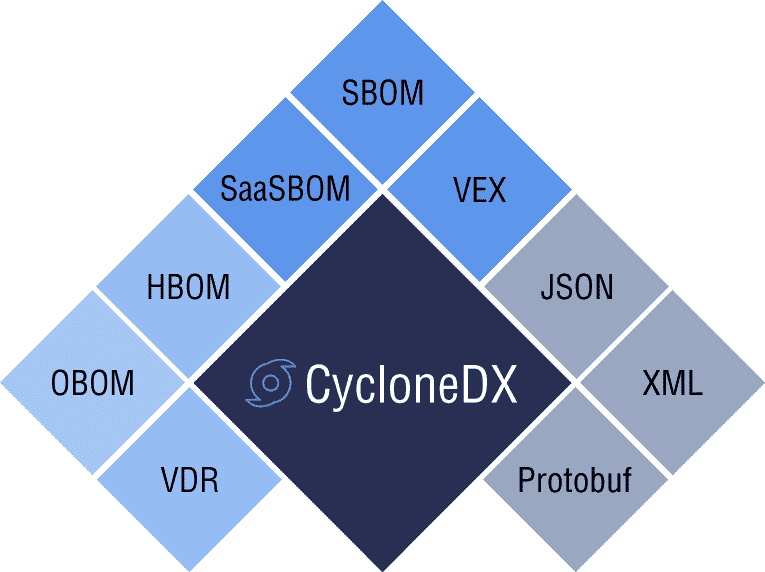

图 4.1

`CycloneDX` 的独特之处在于，它从一开始就被设计为一种 BOM 格式，并能够满足各种用例，包括软件服务 BOM (`SaaSBOM`)。`CycloneDX` 支持软件之外的无数用例。

`CycloneDX` 还支持引用其他系统和 BOM 中的组件、服务和漏洞，采用嵌套和分层方法，这与涉及硬件、云和 SaaS 的现代软件生态系统的复杂性相一致。`CycloneDX` 将此能力称为 BOM-Link。它同时在 `JSON` 和 `XML` 格式中支持此能力。用户可以引用外部 BOM 的 URL 甚至是 `BOM-Link` URI（后者使用序列号和版本号用于外部 BOM）。

此外，`CycloneDX` 允许对所有第一和第三方组件进行完整且准确的库存统计，以便识别风险。它通过健壮的组件类型和类别列表来实现，这些类型扩展到了软件和应用程序之外，进入设备甚至服务。它通过三个字段识别漏洞：

* `CPE`：可用于操作系统、应用程序和硬件设备漏洞的规范
* `SWID`：可用于已安装软件的规范
* `PURL`：可用于软件软件包元数据的规范

`CycloneDX` 通过哈希值和密码学支持对其用于 BOM 的关联组件进行完整性验证。随着通过 `Sigstore` 及其配套的 `Cosign` 等项目推动软件供应链安全成熟，软件签名日益成为一种最佳实践。`CycloneDX` 支持针对扩展标记语言 (`XML`) 和 JavaScript 对象表示法 (`JSON`) 的封装签名，而目前 `Cosign` 尚不支持该功能。`CycloneDX` 还支持*溯源* (provenance)，即表示获取组件的作者和供应商的能力。基于溯源的概念，`CycloneDX` 可以通过通信组件的祖先、后代和变体来描述组件的谱系，从而支持组件的血缘 (pedigree)。对于高保证软件供应链的需求，溯源、血缘和数字签名的实现代表了强大的供应链能力，并受到 `NIST` 网络安全供应链风险管理 (`C-SCRM`) 等指南的建议。

`CycloneDX` 还提供对漏洞可利用性交换 (`VEX`) 的支持，提供了软件产品和组件中已知漏洞的可利用性洞察，并可由软件生产者进行通信。我们将在“漏洞可利用性交换 (VEX) 和漏洞披露”章节中深入探讨 VEX。

### 软件软件包数据交换 (SPDX)

作为一个项目，`SPDX` 的形成目的是创建一个用于软件软件包信息的通用数据交换格式，以便共享和收集。`SPDX` 在领先的 SBOM 格式中支持的文件格式最多，包括 `RDF`、`XLSX`、`SPDX`、`JSON` 和 `YAML`。`SPDX` 旨在通过能够描述一组软件包、文件或代码片段来成为动态规范。与 `SWID` 类似，`SPDX`也是目前已获得 ISO 认证的三大格式之一（`http://linuxfoundation.org/press/featured/spdx-becomes-internationally-recognized-standard-for-software-bill-materials`），这意味着它已满足 `ISO` 定义的所有标准化和质量保证要求。这一成就由 Linux Foundation 在 2021 年 9 月宣布。该公告还强调了英特尔、微软、西门子、索尼等参与 SPDX 社区的大型公司对 SPDX 的采用。

目前的 `SPDX` 规范版本为 `2.3`（`http://spdx.github.io/spdx-spec`）。要被视为有效的 SPDX 文档，必须存在特定的字段和章节，这些在 SPDX 规范本身中定义。

SPDX 文档由各种字段和数据组成，例如文档创建信息、软件包信息、文件信息、片段信息、许可信息、关系和注释。文档创建信息用于在使用处理工具工作时的向前和向后兼容。软件包信息用于描述不同的实体，如产品、容器和组件等，并可用于分组相同上下文的相关项。文件信息包括文件元数据，如名称、校验和许可和版权信息。代码片段是可选的，主要用于数据源自不同的原始源或关联另一个许可。SPDX 还支持文档、软件包和文件的关系。最后，注释允许评审人员将他们的评审活动信息包含在 SPDX 文档中。

SPDX 还提供了“SPDX Lite”配置，它是 SPDX 规范的子集，目的是在适应特定行业工作流的同时，平衡对整体 SPDX 标准和规范的遵循。Lite 配置侧关注来自文档创建和软件包信息部分的字段，以及相关的基础信息。


SolarWinds 网络安全事件（http://cisa.gov/news/2020/12/13/cisa-issues-emergency-directive-mitigate-compromise-solarwinds-orion-network）的后续影响，结合《网络安全行政命令》（Cybersecurity EO），使得软件供应链安全话题以及与之相关的 `SBOM` 成为了安全对话的焦点中心。再加上 Log4j 漏洞（http://cisa.gov/sites/default/files/publications/CSRB-Report-on-Log4-July-11-2022_508.pdf）导致无数组织忙于措措地确定受影响范围，`SBOM` 现在被认为是现代网络安全漏洞计划的关键组件，其采用率正准备快速增长（http://cisa.gov/sites/default/files/publications/VEX_Use_Cases_April2022.pdf）。

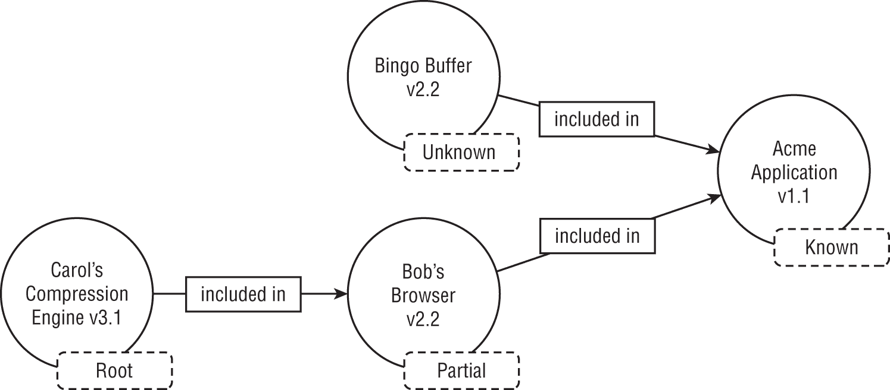

图 4.2

如上面的图 4.2 所示，`SBOM` 树可以描述上游关系断言以展示组件及其关系，包括说明来源是否未知。

使用 `SBOM` 最受推崇的优点之一是识别潜在漏洞组件的能力。领先的 `SBOM` 平台和工具（如 `Dependency Track`）通过将组件相关的漏洞关联到使用 `SBOM` 分析软件组件的用户，来实现这一点。`Dependency Track` 和其他工具通过查询来源，例如国家漏洞数据库（`NVD`；http://nvd.nist.gov）、Sonatype OSS Index（http://ossindex.sonatype.org）、`VulnDB`（http://vulndb.cyberriskanalytics.com）或 `OSV`（http://osv.dev）来促进这一过程。然而，并仅仅因为软件中的某个组件存在漏洞，并不意味着该组件是可利用的。这就是 `VEX` 发挥用场的地方。

### VEX 加入讨论

根据 NTIA 指南（http://ntia.gov/files/ntia/publications/vex_one-page_summary.pdf）的定义，`VEX` 的主要用例是

这是一种冗长的说法，意味着 `VEX` 为漏洞增加了上下文，以告知风险管理活动提供信息。与其他领先的 `SBOM` 以及软件供应链透明度与安全指南一样，`VEX` 诞生于 NTIA 的软件组件透明度多利益相关者流程。尽管如此，值得注意的是，指南指出，虽然 `VEX` 是为了特定的 `SBOM` 用例开发的，但它并不局限于与 `SBOM` 使用，也不一定要求必须使用。

正如本书其他地方提到的，仅仅存在漏洞并不意味着它是可利用的。了解这一信息至关重要，因为漏洞管理计划和活动以及组织正在进行风险管理。在网络安全风险管理中，组织寻求根据其自身的风险容忍度识别、分析、评估和应对网络安全威胁。这导致组织根据风险发生的概率和严重对风险进行优先级排序。如果不知道漏洞是否可利用的，将无法准确预测其发生的概率。

### VEX：增加上下文和清晰度

那么，`VEX` 究竟是如何解决这一挑战的呢？它赋予了软件供应商发布 `VEX` 的能力，VEX 是关于特定产品中漏洞状态的断言。`VEX` 支持以下四个主要状态选项：

*   `Not Affected`（不受影响）：关于此漏洞不需要任何修复。
*   `Affected`（受影响）：建议采取行动修复或处理此漏洞。
*   `Fixed`（已修复）：这些产品版本包含该漏洞的修复。
*   `Under Investigation`（调查中）：尚不清楚这些产品版本是否受漏洞影响。将在后续发布中提供更新。

以 `SBOM` 本身为例，我们看到向机器可读的制品和文档的推动，这使得更好的自动化、准确性和速度。我们在合规领域也看到了类似的趋势，例如 NIST 的开放安全控制评估语言（`OSCAL`；http://pages.nist.gov/OSCAL--`http://pages.nist.gov/OSCAL），它将传统的纸质安全控制和授权文件带来了机器可读格式。

`VEX` 正在做类似的事情，避免了通过电子邮件发送安全公告或漏洞细节及建议的需求，而是将这些信息带入机器可读格式，以促进自动化和现代化安全工具的使用，这些工具的运行速度比人类和手动活动更接近当前的威胁格局。随着软件供应链透明度和安全要求的推动，不难想象这样一个世界：企业软件清单可以在仪表板和工具中可视化，以及与之相关的漏洞和漏洞的实际利用性，这一切都由 `SBOM` 和随附 `VEX` 数据支持。这与现代生态系统形成了鲜明对比，在现代生态系统中，大多数组织对其消费和部署的软件组件或与其相关的漏洞并没有准确的清单。尽管事实是，现代软件大部分由开源软件（`OSS`）组件组成，某些估计比例高达 80–90%。

指南还指出，虽然 `VEX` 可以由软件供应商编写，也可以由第三方编写，让用户处于决定如何使用数据的位置。这很容易看到某些场景，安全研究人员和漏洞供应商可能会尝试其产品服务的一部分为产品生成 `VEX`。

### VEX 与 VDR

除了 `VEX` 概念外，漏洞公告或漏洞披露报告（`VDRs`）话题增加了一些困惑，但实际上是一个非常简单的话题。`VDR` 在漏洞存在时通知你，并包含已知和未知漏洞。此外，`VDR` 提供了关于漏洞的额外元数据、发现者、有关公开利用的信息以及其他信息。ISO 29147 标准以及 NIST 800-161r1 文档概述了 `VDR` 的以下元素，如下：

### VDR 元素大纲

1.  `General`（通用）：关于公告的信息，有助于目标受众理解公告是否适用于他们。
2.  `Identifiers`（标识符）：这些是公告本身的唯一标识符，例如供应商使用的唯一编号，或漏洞标识符如 `CVE`，或产品标识符如 `CPE` 或 `PURL`。在与 `SBOM` 关联方面，此属性可能是连接多个断言的最佳属性之一。
3.  `Date and Time`（日期和时间）：初始公告以及任何更新的日期时间。比较 `VDR` 时间戳与其他断言时，确定 `VDR` 是在之前还是之后，以及它是否比其他关于产品的断言包含更多更新的信息可能会有用。
4.  `Authenticity-Signed`（真实性签名）：虽然未包含在 ISO 标准中，但 NIST 已经了对签名断言的需求，签名可能是以任何信任级别将多个断言链接在一起的最佳方式之一。
5.  `Title`（标题）：简短的标题应具有足够的唯一性，以便清晰理解公告涵盖的内容，包括产品名称和版本或 `CWE` 类别。
6.  `Overview`（概述）：对标题进行扩展，提供足够的细节让读者理解公告对其产品的适用性。
7.  `Affected Products`（受影响产品）：应清楚说明受 `VDR` 影响的产品，并提供足够的信息让读者理解其产品是否受影响。这可能包括用于测试的在线脚本链接，或可以使用的特定元数据，例如文件哈希、字符字符串或唯一版本指示器。


### 8. 受影响组件
虽然这未包含在 ISO 标准中，但在 NIST 文档中已详细说明。理想情况下，我们在此处记录组件级别的详细信息，这些信息可以与 SBOM 结合，并以与受影响产品（Affected Product）类似的方式使用——例如，关于组件需要如何实现或使用才会产生漏洞的描述。仅存在漏洞组件可能不足以满足漏洞触发条件。

### 9. 目标受众
公告的目标受众是谁？开发者？终端用户？虽然这是 VDR 中的一个可选字段，但它可以用于传达关于其使用的额外背景信息。

### 10. 本地化
公告可能针对特定地区和特定语言发布。本节允许任何需要传达的特定地区信息或背景，即使仅仅是翻译。

### 11. 描述
描述应传达额外信息，例如软件弱点的类型以及在什么条件下可以被利用，并可能包含外部引用，如 `CWE` 分类器。

### 12. 影响
这通常涉及技术影响，例如机密性、完整性或可用性的丢失，类似于 `CVE` 或 `CVSS` 子分中发现的内容。

### 13. 严重性
使用标准的严重性量表（如 `CVSS`）或使用的供应商严重性量表，对漏洞的严重程度提供量化衡量。无论你对 `CVSS` 评分怎么看，这都是整个行业衡量严重性的方式，也是最可能被使用的指标。

### 14. 修复措施
VDR 应指示如何修复、补补或重新配置漏洞，或者至少应提供一种允许缓解漏洞风险的规避方案（workaround）。在许多情况下，初始 VDR 可能不包含修复指导，但一旦获知更多关于如何降低利用风险的信息，应尽快进行更新。

### 15. 参考文献
可能会有许多外部引用，指向 `CVE`、供应商知识库、产品页面、研究人员博客或其他在 VDR 内部引用时有用的支持性信息。

### 16. 致谢
应该向参与漏洞检测、研究、缓解以及漏洞报告生命周期其他阶段的研究人员和机构致谢。这完全是自愿的。

### 17. 联系信息
提供足够的信息，让产品用户联系供应商以获取更多信息。

### 18. 修订历史
必须清楚地说明这是原始公告还是更新。如果是更新，则应维护版本历史，并与 VDR 内部的日期和时间保持一致。

### 19. 使用条款
最后，公告是一篇受许可的文章，应该包含版权信息和使用条款。例如，在许多情况下，它仅允许获得许可的产品所有者使用，或者可能完全禁止重新分发。

然而，你会发现，虽然 VDR 告知用户某个问题，但它并没有告知用户某些情况*不是*问题。这是一个重要的区别，因为与 VDR 类似，针对 `SBOM` 的分析报告可能会产生大量的误报。

## 向前发展

正如我们所讨论的，SBOM 倡议从 NTIA 转移到了网络安全基础设施局 (`CISA`)，这与 SBOM 推广者和领 Allan Friedman 的离开同步。自他离开后，`CISA` 发布了两个额外的 `VEX` 文档。其中是 *VEX 用例文档*，另一个是漏洞可利用性交换 (`VEX`) 状态说明（`http://cisa.gov/sites/default/files/publications/VEX_Status_Justification_Jun22.pdf`）。


VEX 代表了协助 SBOM 变得可操作的关键一步，它通过提供产品供应商关于其产品中存在漏洞的可利用性的上下文洞察和断言，实现了这一目标。通过同时使用为 VEX 文档定义的最小元素以及相关的 `Not Affected`（未受影响）理由字段（如果适用），软件生产商能够赋能软件消费者做出基于风险的决策，从而作为更广泛的网络安全计划的一部分，驱动其漏洞管理活动。

## 与其他证明一同使用 SBOM

SBOM 仅仅是证明（attestation）的一种类型；它是一份包含对其所提声明证据的文档。通过附带在这些声明之上的加密验证的质量和真实性，它得到了加强。正因如此，通过数字签名将 SBOM 链接起来的概念变得可行，并允许不完整的 SBOM 仍然提供价值，因为它们可以与其他 SBOM 结合，每增加一个额外的证明都会为第一个 SBOM 添加保证信息。然而，我们还希望探索其他同样可以包含在 SBOM 中以构建证据包的证明类型。

### 源真实性

源真实性是一个在 NERC CIP 合规性要求 `CIP 010` 和 `CIP 013` 中被重点关注的概念，其核心思想是你可以使用文件哈希或代码签名材料来验证文件本身，但同样重要的是验证对文件出处（provenance）的信任。它试图回答诸这样的问题：文件来自哪里？它是一个信任的实体吗？它是我们认为的同一个实体吗？该实体是否以某些意想不到的方式被破坏或修改了？

解决方案供应商开始解决此问题的常用方法之一是查看与获取软件文件的 Web 域名相关的传输层安全（`TLS`）证书信息，并确保证书有效，同时也确保证书是受信任的。它是否有合理的有效期？它最近是否以不寻的方式发生了变化？公司名称是否符合预期？也许昨天它还是 `Microsoft Corp.`，但今天就变成了 `Microsoft, Inc.`。这可能是一个值得调查的现象。最重要的是，建立正常基准并识别异常，有助于组织识别源的真实性或识别针对该源的破坏尝试。

DNS 信息是另一个可能需要验证的内容。域名是否已更改为一组新的 IP 地址，或地理位置已位于世界的不同部分？由于内容分发网络（`CDNs`）可能会根据互联网健康状况或请求者位置从世界各地提供流量，因此要以高置信度对此进行探索变得困难。有些人甚至建议，互联网路由劫持（例如多年来的 `BGP` 劫持）可能被用于提供恶意文件。这同样变得极其难以验证，但这些场景在进行威胁建模时变得非常有趣。

通过对这些标准进行检查，并产生一个可以与正在生成的 SBOM 进行加密绑定的证明文件，我们可以进一步丰富 SBOM 中已包含的源出处数据。

### 构建证明

关于构建环境的证明对于增强软件制品的保证也非常有用。这些可以包括关于构建系统本身的信息，甚至是对构建活动中使用的流程或控制措施的验证。

考虑到在软件制品供应链安全等级（`SLSA`）框架中，攻击目标之一是构建系统。如果攻击者可以破坏构建系统，你又如何信任在该服务器上构建的任何东西？理想情况下，构建服务器应与生产环境进行良好隔离，并作为极其敏感的资产进行适当加固。验证服务器是否符合安全技术实施指南（`STIGs`）等加固指导，STIGs 是安全模板，提供了额外的保证，证明构建服务器不太可能是入侵源。一些诸如 `TestifySec` 这样的供应链供应商将这些证明作为其自动化流程的一部分，甚至可以应用构建策略，要求构建通过 `STIG` 检查后才能成功。

同样，你可能已经实施了一些流程，例如在构建进行之前需要多名开发者同意代码提交。这些构建证明可以捕获上游过程所需的任何安全需求。支持此点的工具示例之一是开源项目“Witness”，它可以创建证明并执行策略以确保构建的完整性（https://www.testifysec.com/blog/attestations-with-witness）。

## 依赖管理与验证

随着开发者对外部源软件组件的消耗不断增加，对这些库、包、组件或依赖（通常被称为依赖）的管理也日益增加。正如我们所讨论的，集成依赖是为了为开发者和组织节省时间和资源，并加速上市。这里存在一个不可避免的现实：你使用的依赖越多，需要管理的也就越多。

依赖通常在两种语文中讨论，即直接依赖或传递依赖。直接依赖是指你的应用程序直接引用并使用的组件。传递依赖是你的依赖本身所使用的组件，形成了依赖的依赖的情况。两种类型的依赖都有相关的风险和考虑因素。虽然其处处很多，但随着依赖（无论是直接还是传递）数量的增加，潜在风险也随之增加。这些风险包括许可问题，但从安全角度来看，它们还包括漏洞、恶意代码和攻击向量的可能性。

这一点被 `Endor Labs` 的《依赖管理现状》等报告所指出。该报告发现，95% 的漏洞存在于传递依赖中，这增加了开发者评估和解决问题的难度。与此同时，报告还发现，50% 的最流行的包在 2022 年没有发布，30% 的包最后发布是在 2018 年之前，导致了过旧且可能存在漏洞的代码（https://www.endorlabs.com/blog/introducing-the-state-of-dependency-management-report）。


话虽如此，组织可以采取若干最佳实践来缓解与依赖管理相关的某些挑战和风险。这些建议包括优先考虑哪些依赖项必须优先于更新，并参考项目关键性或安全风险等因素。另一项建议（当然，这往往是说易行难）是通过完全删除来使未使用的依赖项最小化，仅保留代码所需的依赖项。未能这样做会导致代码膨肿、攻击面增加以及管理开销挑战。在许多情况下，你还可以自动化软件依赖更新，这可以最大限度地减少与依赖管理相关的手动工作。这种情况中最流行的例子之一是 `Dependabot`，它可以帮助自动化 `Ruby`、`JavaScript`、`Python` 等多种编程语言的依赖更新。`Dependabot` 得到了 `GitHub` 和 `GitLab` 等最大的持续集成平台的支持。

除了自动化之外，组织还应该建立软件依赖管理策略。为组织的开发者建立依赖管理指南，可以确保组织内部遵循标准化方法并实施治理，正如微软的 `S2C2F` 或 `NIST` 的软件供应链风险管理 (`C-SCRM` 800-161) 文档框架中所引用的那样，我们在第 6 章“云与容器化”中涵盖了这些内容。建立标准的策略和流程有助于监控安全问题、提高应用性能并确保许可合规性。

软件依赖并不会消失，软件包、库和组件的大规模复用在整个行业中正不断加速。这不可避免地导致了对适当软件依赖管理和验证流程的需求。未能实施结构化方法将导致安全风险得不到解决，从而给开发团队带来负担，可能阻碍交付并为许可违规留下隐患。

## Sigstore

软件供应链安全的一个基本方面涉及对完整性、透明性和保证的需求。这正是 `Sigstore` 派上用场的地方。正如本书反复提到的，在 `SolarWinds` 和 `Log4j` 等重大事件之后，我们看到人们对软件供应链产生了极大的关注。此外还有《网络安全行政令》(Executive EO) 以及 `NIST` 在其《网络安全供应链风险管理 (C-SCRM) 800-161》文档中更新的指南，以及来自 `CISA` 的指南。我们还看到了白宫的关注，他们在 2022 年初举办了“软件供应链安全峰会”。从该峰会出来，`Linux Foundation` 和 `OpenSSF` 发布了《OSS 安全动员计划》，其中一项任务专注于使用数字签名来增强对软件供应链的信任。该任务重点关注了名为 `Sigstore` 的技术的采用和演进。

`Sigstore` 是一个用于软件签名、验证和保护的标准。正如我们讨论过的，软件的使用在每个垂直行业和业务类别中都无处不在。然而，虽然我们使用软件的方式正在改变世界，但确保我们从整个生态系统中消费的软件达到所需的完整性水平的方法仍然缺失。软件供应链往往缺乏数字签名的使用，即使在某些情况下，通常也使用传统的数字签名技术，这些技术可能难以实现自动化、扩展和审计。

`Sigstore` 最初于 2021 年 3 月通过 `Red Hat` 和 `Google` 的合作，并作为 `Linux Foundation` 的一个项目发布，旨在解决有关软件来源或构建方式的问题。`Sigstore` 特别寻求改进软件供应链的完整性活动和验证活动。

正如 `Sigstore` 的共同创建者 `Dan Lorenc` 所说，`Sigstore` 是“一个为软件去中心化提供的免费签名服务，实现了由透明技术支持的轻松签名”。正如 `Red Hat` 的 `Sigstore` 项目创始人 `Luke Hinds` 在博客《介绍 Sigstore》中中（`https://next.redhat.com/2021/03/09/introducing-sigstore-for-software`）中提到的，该项目启动时基于一些真实的假设，例如极少数项目实现了代码签名，以及密钥管理是一项困难活动的现实。从那里，小组向自己提出了一系列“如果……”的问题，例如“如果密钥不需要撤销或存储怎么办？”以及“如果所有签名事件都是公开的怎么办？”

### 采用

自发布以来，`Sigstore` 持续获得越来越多的采用和兴趣。尽管在 2021 年初才刚刚发布，但 `Sigstore` 已经受到了一些最大的开源（OSS）项目的关注，其中之一就是 `Kubernetes` 项目。`Kubernetes` 是市场上最大且采用最广泛的容器编排平台。它宣布将 `Sigstore` 标准化，并在其 `1.24` 版本中使用它（`https://blog.sigstore.dev/kubernetes-signals-massive-adoption-of-sigstore-for-protecting-open-source-ecosystem`）。这使得 `Kubernetes` 的消费者能够确保他们使用的发行版本是其预期的内容。作为对此的支持，正如之前提到的，`OpenSSF` 的《OSS 安全动员计划》有一个专门针对数字签名的章节，重点关注将 `Sigstore` 作为解决软件供应链缺口的解决方案进行采用。2022 年初，`Sonatype`宣布 `Maven Central` 将采用 `Sigstore` 作为解决软件供应链中溯源问题的解决方案（`https://blog.sonatype.com/maven-central-and-sigstore`）。

### Sigstore 组件

那么，`Sigstore` 到底是什么？它是如何工作的？为什么重要？它的建立是为了帮助解决开源供应链中存在的某些缺口，以及我们处理开源组件的完整性、数字签名和真实性验证。这至关重要，因为据估计 90% 的 IT 领导者正在使用开源（参见 `www.soocial.com/open-source-adoption-statistics`），组织正在优先招聘开源人才，而且我们已经看到了几次严重的软件供应链事件。`Sigstore` 汇集了多个开源工具，如 `Fulcio`、`Cosign` 和 `Rekor`，以协助数字签名、验证和代码溯源检查。*代码溯源*（Code provenance）是指能够显示代码来源及其所有者的所有权链的能力。`Uber` 的隐私与安全团队发布了一篇优秀的博客，讨论了他们如何处理通代码溯源的路径（`https://medium.com/uber-security-privacy/code-provenance-application-security-77ebfa4b6bc5`）。


让我们深入了解 `Sigstore`的一些核心组件，首先从 `Fulcio` (`https://github.com/sigstore/fulcio`) 开始。`Fulcio` 是一个专注于代码签名的根证书颁发机构（CA）。它是免费的，并发行与 `OpenID Connect (OIDC)` 相关的证书，通常使用开发者已经关联的现有标识。随着云原生架构和容器部署的快速采用和增长，签名容器已成为一项关键的安全最佳实践（www.csoonline.com/article/3656702/managing-container-vulnerability-risks-tools-and-best-practices.html）。密钥管理是一项繁杂的活动，通常由云领域的 `CSPs` 或第三方供应商作为托管服务提供。`Sigstore` 通过支持 `Cosign` 帮助缓解了这种复杂性，并通过使用“无密钥签名”或使用瞬时/临时密钥缓解了部分密钥管理挑战（www.chainguard.dev/unchained/zero-friction-keyless-signing-with-kubernetes#:~:text=Keyless%20enables%20this%20signing%20process,Let's%20Encrypt%20did%20for%20TLS）。尽管使用了瞬时密钥，你仍然可以通过 `Fulcio` 的时间戳服务确保签名的有效性（www.chainguard.dev/unchained/busting-5-sigstore-myths）。

这就是 `Cosign` 发挥用场的地方因为它支持多种签名选项，并能够无缝支持生成密钥对以及对容器制品进行签名以存储在容器仓库中。它让云原生环境能够通过公钥验证容器，并确保容器是由信任源签名。在构建期间对镜像制品进行数字签名并验证这些签名，是`云原生计算基金会 (CNCF)` 云原生安全白皮书中强调的关键安全最佳实践（https://github.com/cncf/tag-security/blob/main/security-whitepaper/v2/CNCF_cloud-native-security-whitepaper-May2022-v2.pdf）。

接下来是 `Rekor` (`https://docs.sigstore.dev/rekor/overview`)，它是作为软件维护和构建活动的一部分的一个不可变且防篡改的账本。它赋能软件消费者检查元数据，并对其消费的软件以及整个生命周期中涉及的活动做出知风险的决策。回到我们之前关于软件溯源的点，开发者可以使用 `Rekor` 通过透明日志为软件溯源做出贡献。

另一个值得关注的是新兴的指南，例如`软件制品供应链安全水平 (SLSA` (`https://slsa.dev/spec/v0.1/levels`)）和 `NIST 安全软件开发框架 (SSDF)` (`https://csrc.nist.gov/publications/detail/sp/800-218/final`)。`SLSA` 第 3 级强调了审计软件溯源的来源和完整性的需求，正如之前提到的，`Sigstore` 支持这一点。`SSDF` 中提到的特定实践也指向了提供溯源和验证机制的需求。这一点意义重大，因为联邦政府正转向要求向政府出售软件的生产者按照 `SSDF` 中概述的实践进行证明（www.nextgov.com/cybersecurity/2022/02/nist-suggests-agencies-accept-word-software-producers）。

### 提交签名

在现代开发背景下，签名提交正成为确保代码完整性和真实性的重要实践。`Sigstore` 提供了促进这一点的工具，特别是通过与 `GitHub` 和 `GitLab` 等 Git 平台的集成。Git 经常使用如 `GNU Privacy Guard (GPG)` 等方法来促进提交签名。`GitHub` 提供了关于如何管理签名验证和签名提交的文档（https://docs.github.com/en/authentication/managing-commit-signature/signing-commits）。

### SBOM 的批评与担忧

如果我们不涵盖 `SBOM` 采用的一些常见批评、担忧和挑战，将是失职的。这些担忧最集中的来源之一是 `NTIA` 发布的一份 `FAQ`（www.ntia.doc.gov/files/ntia/publications/sbom_faq_-_fork_october_22_meeting.pdf）中的“常见误解与担忧”章节，但在其他地方也被提及。

#### 攻击者的可见性

围绕 `SBOM` 的一个担忧是它们可能会成为所谓的“攻击者路线图”。这可以更广泛地定义为“隐性安全”的争论，这场争论在网络安全行业已经持续了很久。隐性安全通常被总结为将秘密性作为提供系统或组件安全的主要方法，而不是特定的安全控制和良好的安全工程。我们的个人经验由资深行业思想领袖 `Daniel Miessler` 做了很好的总结，他区分了良好的隐性与坏的隐性，并指出：“判断隐性是好是坏的关键在于它是被作为良好安全之上的一个层使用的，还是作为替代方案使用的。前者是好的。后者是坏的。”（https://danielmiessler.com/study/security-by-obscurity）。


关于 SBOM 是“攻击者的路线图”这一问题，NTIA 指出，由于预先知并非攻击的必要条件，因此恶意攻击者并不 SBOM。NTIA 还指出，恶意攻击者已经拥有了识别软件组件的工具，并且不受此类此类操作的限制，这与守法的软件伦理用户不同。NTIA 表示，SBOM 将“营造公平竞争环境”，让防御者获得恶意攻击者已经具备的某种洞察力和透明度。恶意攻击者能够使用二进制分析工具来理解软件组成和组件构成。这一点并不存在争议；然而，拥有 SBOM 使软件消费者处于更优越的地位，以理解与软件使用相关的初始风险，以及与所用软件中软件组件相关的新型和新兴漏洞。如果说有什么意义的话，SBOM 有助于平衡目前倾斜的竞争局面，即恶意攻击者拥有了可见性，而防御者目前尚没有。

## 知识产权

围绕 SBOM 的另一个常见关注点是知识产权和源代码。NTIA 对此表示了反驳，认为 SBOM 不要求组织披露源代码，源代码可以根据软件提供者的意愿共享（如果有的话）。SBOM 专注于用于构建某个软件的软件组件，而不是披露源代码本身。软件组件代表了画面的部分内容，但并不意味着代码如何运行的完整路线图。NTIA 的指南指出，在软件方面，了解第三方成分与了解整个执行配方之间存在显著差异，更不用第三方组件并非使用它们的软件供应商的知识产权，而是属于创建这些组件的上游实体，且这些实体受在创建时分配给它们的任何适当许可的约束。值得注意的是，尽管正在推动增加 SBOM 的采用，但所有相关来源都建议妥善保护 SBOM 本身，这符合长期以来最小权限访问控制和“按需知”的安全最佳实践。诸如 OMB 的 22-18 号备忘录（要求联邦机构可能要求软件供应商提供 SBOM 等产物）也要求，如果供应商没有公发布这些产物，机构应安全地存储。

## 工具与运营化

在广泛采用 SBOM 的最合理的担忧中，是缺乏广泛的工具来促进 SBOM 的创建、分发、摄入、富化、分析和运营。许多人现在认为，有足够的工具可以辅助创建 SBOM，我们在书中讨论了其中几种。然而，截至本文写作，处理分发、摄入、富化和分析等额外活动的工具仍处于成熟阶段。正如我们提到的，美国国土安全部（DHS）和网络安全基础设施安全局（CISA）等组织正在该领域进行创新；在商业领域，我们也看到许多商业公司投入研发（R&D）并开发产品来填补这一空白。著名的例子包括由前 Google 工程师创立的 Chainguard，他们在 2022 年筹集了 500 万美元。其他著名例子包括 Endor Labs、TestifySec 以及其他公司，包括 Google 在内的行业领导者，他们正在提供创新的以软件供应链为核心的管理型服务，帮助组织管理其 OSS 的摄入和使用。再次，引用美国联邦领域，OMB 的 22-18 号备忘录也要求，如果供应商没有公开发布这些产物，机构应安全地存储。

### 总结

在本章中，我们涵盖了 SBOM 的兴起以及从 NTIA 到 CISA 的早期努力。我们还讨论了各种 SBOM 格式、VEX 概念的出现，以及一些常见的 SBOM 批评和随着 SBOM 采用的增加将继续演变的领域。

# 第 5 章

## 软件透明化的挑战

在国家电信和信息管理局（NTIA）软件物料清单（SBOM）倡议的讨论早期，设备 SBOM 的话题作为一个复杂的因素出现。目前的共识是，对于许多组织来说，SBOM 是一个非常新的概念，使其复杂化是不必要的。毕竟，设备软件和固件不就是软件吗？

## 固件与嵌入软件

我们将这一类别分为几个讨论领域：作为操作系统的固件、用于嵌入设备的固件，以及 SBOM 在特定设备场景（如医疗设备）中使用的主题。

### Linux 固件

作为操作系统的固件，特别是涉及 Linux 固件的部分是最容易理解的，但重要的是这些是复杂的 SBOM。Linux 本质上是由成千上万软件产品组合而成的操作系统。因此，要获得该软件透明度所需的清晰度可能是挑战性的。但这是该领域最容易解决的问题之一。我们看到的许多 Linux 工具往往不只是为了运行一个 `rpm` 命令，除非该镜像经过了大规模的逆向工程处理，或者在构建过程中在每个软件对象级别生成了 SBOM。现实情况是，Linux 操作系统的构建方式非常碎片化，依赖单一实体产生高保真度的可见性可能是一个挑战。

### 实时操作系统固件

实时操作系统（RTOS）固件往往更具挑战性，因为传统意义上的 RTOS 并没有文件系统。在许多情况下，RTOS 更像二进制文件而不是 Linux 风格的固件镜像。对于 RTOS 作者来说，这是一个可以解决的问题，我们过去也见过 VxWorks 的公开 SBOM。然而，对于遗留或专有的 RTOS——例如为某些不使用 QNX 或 VxWorks 等流行 RTOS 的工业控制系统生产的 RTOS——这个问题往往是一个盲点。对于遗留软件或供应商无法提供所需的可见性的情况，逆向工程可能是唯一可行的方法。


嵌入式固件通常是高度优化的且占用空间小的代码。这可能是运行在片上系统（SoC）或系统 BIOS 上的代码，在许多情况下，它表现为此类低级代码，以至于人类难以对该固件进行分析。此外，由于为了优化和减少固件的内存占用，代码中许多字符串和符号被剥离，因此识别软件组件的传统方法可能非常困难。当与可信执行环境（TEE）等高安全区域结合时，这些代码大部分运行在保护区域内，这不仅增加了安全性，还创建了抽象，可能会增加你对软件如何运行以及在何处运行的理解难度。在尝试理解软件组件的可利用性，或攻击者可能（或可能）影响软件的执行时，情况尤为如此。

## 设备特定 SBOM

在考虑 SBOM 如何在受严格监管的环境中（最重要的是医疗设备）被使用时，重要的是，认证是在设备层级指定的。美国食品药品监督管理局（FDA）可能会将胰岛素泵认证为一种设备，而医疗设备的 SBOM 通常只深一层。这通常看起来更像是一个软件清单，而不是完整的 SBOM。由于这些设备受到严格监管且变化发生频率较低，SBOM 及产生的分析往往更具静态。但大多数人应该担心的是，这些设备的功能可能并不依赖于运行在设备上的代码，而是取决于影响它们的云基础设施和其他外部依赖。对于许多物联网（IoT）设备来说确实如此，外部应用程序接口（API）、位于世界偏远地区的支持基础设施或其他外部依赖创建了巨大的风险。尽管这些设备看起来是极其静态且成熟的技术足迹，但输入和信任关系的可变性为软件透明度和供应链用例制造了盲点。此外还存在与不同设备接收更新相关的挑战。某些设备可能通过空中传输（OTA）、网络甚至通过 USB 优存盘接收更新。这可能导致在任何给定时间，相同的设备型号可能具有不同的 SBOM。

## 开源软件与专有代码

在软件世界中，代码有两种主要形式——开源软件（OSS）和专有软件——这使得软件供应链中软件透明度的讨论变得复杂。OSS 的不同之处在于，任何人都可以查看、使用并对 OSS 代码做出贡献。虽然在某些情况下存在所谓的“源码可用”专有软件（源代码可以查看甚至进行修改，而不被视为开源），但专有代码通常不对所有人开放、使用或贡献，它通常由软件和技术供应商或组织控制，这些组织为了其各种业务目的（无论是内部还是外部）开发软件。任何人使用 OSS 代码的能力包括专有软件生产者，而这正是他们经常所做的。一些估计预测，97% 的软件至少包含一些 OSS 代码（`www.synopsys.com/content/dam/synopsys/sig-assets/reports/rep-ossra-2022.pdf`）。OSS 不仅包含几乎所有的代码库中，它往往可以占代码库的近 80%。

在软件对话中，`digital commons`（数字公社）一词经常使用，它是常用术语 `commons`（公共）的子集。公共被认为是有助于管理资源生产和集体行动的社会机构（`https://policyreview.info/concepts/digital-commons`）。在这种背景下，数字公社是公共的一个子集，其资源涉及数据、信息以及数字领域涉及文化和知识。当软件开发者应用现有的 OSS 许可，授予其他用户某些版权法专属于授予他们的权利（例如编辑和重新分发代码的能力）时，代码通常变为 OSS。一旦发生这种情况，任何对项目拥有数字访问权限的人都可以对项目和代码进行复制、使用、更改并提出贡献建议。

软件产品通常与多种类型的软件许可绑定，通过条款、支持协议、限制和成本来帮助管理它们的使用。软件许可不仅定义了软件分发和使用的定义，通常还列出了终端用户在安装、保修和责任等方面的权利。在对 OSS 和专有软件的讨论中，OSS 软件许可通常赋予用户修改和重用源代码的能力，以及对源代码本身的实际访问。然而，专有软件许可通常不提供修改和重用代码的能力，而且显然不提供对源代码本身的直接访问。存在软件未被许可覆盖的情况，被视为公有领域软件或私有无许可软件，例如可能仍需要版权保护的业务应用程序。未能遵守软件许可要求可能会产生影响，例如允许版权所有者起诉，或让违规者甚至面临禁令。

常见的软件许可类型包括：

-   **宽容型（Permissive）**：这些许可对如何修改或分发软件的限制最少，但可能要求在后续分发的版权信息中注明出处。常见示例包括 Apache、BSD 和 MIT 许可。
-   **弱左拷贝（Weak Copyleft）**：通常称为 GNU 语言通用公共许可证（`www.gnu.org/licenses/lgpl-3.0.en.html`），它允许以最小义务链接到 OSS 库，并且整个工作都可以在后续的许可类型（即使是专有的）下分发，且要求极低。
-   **公有领域许可（Public Domain License）**：任何人都可以不受任何限制地使用和修改软件；这种许可类型并不常见。
-   **左拷贝（Copyleft）**：左拷贝许可也称为 `reciprocal licenses`（互惠许可），它们可能比其他某些许可类型更具商业限制性。左拷贝允许开发者修改许可代码并将其整合到其他项目中，甚至修改专有代码并分发它，但必须在相同的许可下进行。原始软件和修改部分将包含在新项目中，这使得这种许可对具有商业利益的开发者来说较无吸引力。
-   **商业/专有（Commercial/Proprietary）**：这些许可类型用于限制复制、修改和分发代码的能力。被认为是限制性最强的软件许可类型之一，商业/专有许可防止未经授权的使用软件，并对商业利益提供了最大的保护。


抛开许可考虑不谈，开源软件（OSS）的使用无处不在，正如之前提到的，即使在专有软件和产品中也是如此。原因显而易见，例如节省开发时间、利用现有工作、降低成本以及缩短上市时间。开源代码的使用让开发者和团队能够专注于更具价值的活动，例如开发自定义代码或功能，并关注使命和业务目标。正如本书引言中所提到的，开源代码存在于几乎每一个环境中，包括关键基础设施部门，如能源、金融、通信、医疗保健和国防工业基础。虽然从表面上看，考虑到开源软件所带来的创新和社区重视，其普及性似乎是合情理的，但它也带来了挑战。研究发现，88% 的代码库包含超过两年没有进行过新开发的开源组件，81% 的代码库包含至少一个漏洞，而近 90% 的代码库包含不是最新版本的开源软件。

这意味着，过时、维护不当且存在漏洞的开源软件存在于社会的几乎各个方面，包括关键基础设施部门。

在专有软件方面，存在着独特的挑战。虽然开源软件通常会在国家漏洞数据库（`NVD`）等资源中被分配常见漏洞与暴露（`CVEs`），并且可以使用漏洞扫描器等工具进行搜索和扫描以识别已知漏洞，但专有代码可能会困难一些，并可能需要其他技术来识别漏洞。此外，专有软件的源代码通常不公开，使得评估和分析并不简单。对 SBOM（软件物料清单）的推动将产生一种局面：软件生产商和供应商将开始提供 SBOM，以明了他们产品中的开源组件以及与这些开源组件相关的漏洞。

开源软件与专有软件在漏洞披露和修复方面存在明显差异。在专有软件方面，供应商通常拥有合同文件和协议，允许他们向软件用户告知漏洞和风险的潜在影响。对于开源软件，情况并非如此。由于开源软件通常对所有人开放访问、使用、重用和修改，要通过一个中心化的通知或机制通知所有受开源项目或组件中漏洞影响的人员要困难得多。将开源组件作为依赖项集成到其他项目和代码中，进一步加剧了这一问题。这使得软件消费者充分了解其环境中的软件，并意识到与这些软件组件相关的任何通知、漏洞和风险至关重要。

人们经常认为开源软件可能比专有软件更安全，因为代码对所有人可见，可供审查和分析。开源社区中被称为“林纳斯定律”的常用格言认为：“只要眼睛足够多，所有漏洞都是浅的。”这似乎是直观的，因为如果有足够的软件开发者和安全专家查看代码，漏洞和漏洞出现的概率可能会降低。虽然这对于 `Linux` 和 `Kubernetes` 这样极其流行的开源项目可能是事实，但这一格言在更广泛的开源生态系统中并不得成立。有数百万个开源项目，虽然有些项目拥有健壮繁荣的维护者和贡献者生态系统，但其他项目通常由一个小小组甚至单个人维护。一些研究显示，近四分之一的开源项目只有单一贡献者（`https://dl.acm.org/doi/abs/10.1145/3510003.3510216`），更令人惊讶的是，近 95% 的项目贡献者少于 10 人。

## 用户软件

与设备固件或用于管理网络和安全的企业级产品相比，用户软件的概念往往带来了一个完全不同的视角。用户软件通常被认为不是关键的，因此不值得我们关注，但用户软件和常用工具经常是针对用户的攻击目标。考虑到任何软件都是以用户权限运行，且许多组织仍然允许其用户以本地管理员权限运行，这很清楚，软件本身不需要设计为管理功能即可具备管理员实用性。

作为第 14028 号行政命令的一部分，NIST 的众多交付成果之一是对“关键软件”的定义。这种设计是为了确保这些新的 SBOM 要求将范围限制在最关键的应用程序上。这在表面上很有道理，直到你意识到软件本身不是关键的，但其使用方式可能是。NIST 将关键软件定义为：

*   被设计为以提升权限或管理权限运行的软件

*   对网络或计算资源具有直接或特权访问的软件


*   设计用于控制数据或操作技术的访问
*   执行对信任至关重要的功能 (`www.nist.gov/itl/executive-order-improving-nations-cybersecurity/critical-software-definition-faqs#Ref_FAQ3`)
*   在正常信任边界之外运行并具有特权访问权限

如 `Adobe Reader` 或 `Notepad++` 等用户软件并不真正符合上述任何标准，但当你考虑到潜在的威胁场景时——例如用户频繁地解析和查看可信度存疑外部文档——这具有引入风险或作为攻击向量的潜力。特别是 Adobe，它对钓鱼场景中的攻破并不并不陌生，尽管它可能不符合“关键软件”的定义，但它提供了同样可信的攻击路径。

对于所有这些用户软件而言，最大的挑战可能在于解决这些挑战时所需的巨大范围和可扩展性。在 2021 年 12 月 `Log4j` 漏洞披露后的漏洞事件响应中，本书的作者之一收到了一个包含超过百万个 `CPE`（即唯一产品版本）的列表，并被问了一个问题：“这些中有多少会受到 `log4shell` 漏洞的影响？” 该机构意识到，软件用于何处并不重要——只要像 `log4shell` 漏洞利用那样，任何可以被如此轻易利用的漏洞实例，都可以被轻易扩展到许多更关键的目标中。

这是供应链攻击如何允许攻击者以有趣的方式跨越边界的绝佳案例。这些不是直接攻击；通过信任我们的内部用户而不妥善验证他们的行为、过度宽松的访问特性等，即使是最看似无害的软件也会为攻破创建门径。我们该如何应对这些规模化带来的挑战呢？在实现这一目标之前，可能需要时间对书中介绍的大部分指导意见进行标准化。我们希望在未来的某个时刻，这些软件供应链的最佳实践将变得如此司空见常，以至于这与食品检查员确保超市里所有食品的食用安全没有区别，但我们也理解，从务实角度来看，作为一个行业和社会整体，我们还有很长的路要走。

## 遗留软件

如果我们观察从开源生态系统中产出的所有解决供应链关注问题的伟大项目（包括现代应用开发框架和工具），它描绘了一幅关于我们未来方向的特别乐观的图景。但对于遗留软件来说，这意味着什么呢？

特别是在关键基础设施或国防领域——系统的使用寿命通常为 20-30 年或更久——以及在软件生产过程中没有使用包管理器、源代码已不可用、原始开发者已经退休，或者更糟糕的是已经离开了人世的情况下，我们有一组不同的问题需要理解。在某些情况下，软件已经停止支持，或者可能会应用定期的自定义补丁。在这些场景下，频繁的反向工程可能是确定软件成分的唯一可行方案。但让我们来看另一个关于专有软件的挑战，在我们处理遗留软件时，这个问题变得更加有趣。

曾经几何，几乎所有的软件都是专有的。它们通常与学术界共享或其他出于其他信息共享的原因，但很大程度上当我们考虑到现在对 `OSS` 的定义时，直到过去 25 年左右，它才成为一个具有定义许可的化概念。存在一些例外，例如 `glibc`（`GNU C library`）和 `GNU 编译器集合 (GCC)`，其 `C` 编译器可以追溯到 1987 年。但将 30 多年前构建的软件与今天构建的软件进行比较，我们发现现代软件中可被识别和理解的组件要多得多。

为什么开源概念如此重要？因为今天的大多数应用安全工具并没有考虑生产专有软件时投入了什么。如今市场上绝大多数的 `SBOM` 工具只会根据已知的开源组件告知你的软件是否存在漏洞。对于包含极少或没有开源组件的遗留软件来说，这是一个巨大的盲点。事实上，这些许多相同的 `SBOM` 工具只有在构建你的软件时使用包管理器时才有用。虽然 `Linux` 使用包管理已超过 20 多年，但像 `Python` 和 `Node.js` 等现代语言使用当前迭代工具仅有 10 年左右。现代 `SBOM` 工具是针对今天使用的工具开发的，而不是针对几十年前使用但现在仍在许多环境中广泛使用的工具。例如，包安装器 `pip` 是在 2014 年引入 `Python 2.7.9` 的。

如果源代码不可用，静态分析工具就无法对其进行评估。如果没有运行时进行插桩，使用现代交互式应用安全测试 (`IAST`) 工具进行验证将变得困难。而且在研究人员无法访问源代码的情况下，可以说没有公开的 `CVEs` 来理解这些专有代码何时存在极其严重的漏洞。事实上，在许多情况下，了解软件是如何构建的几乎肯定是一个黑盒，唯一的幸存是如果软件存在漏洞且它不是一个新风险。缺点是，这些是地球上最关键的软件，运行着导弹发射井、核反应堆、水处理厂等。

## 安全传输

供应链风险管理的核心是信任的概念或对信任的验证。这是对软件来源或出处的信任。信任它不包含超过我们预期风险容忍度的组件或库。信任它在到达我们这里时未发生任何变化。信任我们即将安装的是我们打算安装的产品。

安全传输机制有几种不同的类型，但我们讨论的是`传输层安全 (TLS)`，它是`安全套接字层 (SSL)` 的继者。`TLS` 的任务是将比特从 A 点移动到 B 点，并以高度的信任执行此操作，以确保内容保持机密且完整性未被破坏——信任共享信息的端点正是我们认为的那些，并且位和字节在未被更改的情况下到达。虽然 `TLS` 也用于加密和保护我们数据流的机密性，但这让透明工作变得更加困难。然而，它也让操纵该数据流变得困难得。。这是我们在透明度和安全之间建立有意识权衡的领域之一。你无法再看到发生了什么，但如果你信任来源且数据没有改变——无法改变——那么你就信任到达目的地的内容。

遗憾的是，这些信任决策的根源是证书机构 (`CA`) 基础设施。这种机制建立了一个运行在互联网上的信任网。它是一个相当集中的生态系统，因为 `CA` 的被攻破可能会导致其颁发的 `TLS` 证书，甚至是代码签名证书被攻破。然而，`CA` 创造了一种合理的保证，认为执行这些攻击所需的难度对于大多数组织的威胁模型来说是足够的，因此基于 `TLS` 的决策被安全的。正如前面提到的，攻击者通常会滥用加密通道来隐藏自己的恶意流量。但由于现代 `TLS` 协议的特性，特别是使用了如“完美前向安全”等概念的协议，破解并重新建立加密传输变得困难，甚至不可能，对于防御者也是如此。但它将攻破的可能性范围缩小到了 A 点和 B 点，并消除了中间 30 多个网络跳跃作为攻破点。


同样，我们需要能够信任用于风险决策的决策证明文件（attestations）。我们如何知道 `SBOM` 或构建证明是合法的？透明性日志和基于区块链的账本为交易的一端（即 A 点）提供了透明度和信任，在某些实现中，也许可以实现端到端。但我们如何知道传输过网络的数据保持未变呢？幸运的是，利用 `TLS` 隧道也有助于回答这些问题。

但如果软件和证明不是通过这种方式受到保护的呢？这意味着它们是不安全的吗？即使许多现代 Linux 发行版也没有通过这种方式保护存储库流量，而是依靠 `GNU Privacy Guard` (`GPG`) 级别的签名来确保软件的完整性。你需要在这里确定自己的风险承受能力，但足以说，即使在 2023 年，如果你要求所有软件传输都通过 `TLS` 进行，你将不得不排除大量的企业软件无法使用。

在 `TLS` 的使用变得更加普及之前，我们认为对于除最关键软件以外的所有软件，这可能只是“有则更好”。尽管如此，尽管实施 `TLS` 面临着一些挑战，但“零信任”（`Zero Trust`）等运动的势头正在主将端到端加密视为组织应该应用的最佳实践和实施方案。

进一步，组织正日益努力采用双向 `TLS` (`mTLS`)，它使用与 `TLS` 相同的协议，但执行的是双向验证而非单向。通过这样，在建立连接和进行数据交换之前，服务器和客户端的身份都会经过验证。

### 总结

总而言之，尽管推动软件透明化背后有巨大的动力，但仍然有几个问题需要解决，而且解决这些问题可能具有挑战性。我们在本章讨论了其中一些问题，例如嵌入式软件和遗留软件、`OSS` 及其各种许可类型，以及对传输数据安全性的需求。尽管如此，这些各个领域在社区和生态系统供应商内部也开发了各自的创新和解决方案。继续解决这些挑战将有助于无论软件位于何处都能弥补软件透明度的差距。在接下来的章节中，我们将讨论云、容器和 `Kubernetes` 等技术在软件供应链和透明度讨论中扮演的角色，以及它们相关的一些挑战。

# 第 6 章：云与容器化

虽然在传统的本地基础设施中追求软件物清单（`SBOMs`）和软件透明度具有挑战性，但在处理云服务和云原生架构时，挑战大不相同。在本章中，我们将讨论围绕云和容器化增长的一些指标，以及云计算背景下的软件透明度和供应链安全方面的考量。

在讨论技术时，拥有一套共享的词汇通常会有帮助。尽管如此，云计算最常用的定义来自 `NIST 800-145` (`https://nvlpubs.nist.gov/nistpubs/Legacy/SP/nistspecialpublication800-145.pdf`)，它指出：

进一步扩展之，这些特征包括按需自服务、广泛的网络访问、资源池化、快速弹性和可衡量的服务。云还带有三种服务模型：基础设施即服务（`IaaS`）、平台即服务（`PaaS`）和软件即服务（`SaaS`）。这些每服务模型都有其独特的共享责任模型，以及对软件如何交付给下游消费者的相关影响。云计算有四种主要的部署模型：私有云、社区云、公有云和混合云，每种模型对多租户和安全等主题都有影响。

与云计算相关的这些独特模型仍然以某种形式涉及软件，并要求下游消费者对他们所消费的服务和相关软件的安全性具有某种程度保证。

## 共享责任模型

如果没有对共享责任模型（`SRM`）的介绍，任何关于云安全和风险的对话都是不完整的。许多业务领袖仍然问：“云安全吗？”，这是一个错误的问题。更合适的问题是：“我们作为安全团队和组织，是否在保护我们自己云消耗的份额？”

绝大多数云数据泄露和外泄都是客户造成的，IT 研究和咨询公司 `Gartner` 预测，到 2025 年，大约 99% 的云安全失败将是客户的责任（`www.gartner.com/smarterwithgartner/is-the-cloud-secure`）。因此，让所有安全从业人员理解他们的责任是至关重要的。

### 共享责任模型详解

`SRM` 划分了你作为云客户负责什么，以及你的云服务提供商（`CSP`）负责什么。在 `IaaS` 模型中，`CSP` 负责云“本身”的安全——考虑物理设施、公用事业、电缆、硬件等。客户负责云“内部”的安全——意味着网络控制、身份和访问管理、应用程序配置和数据安全。

### 共享责任模型的职责

尽管如此，这种责任划分可能会根据你使用的服务模型而改变。在基础层面，`NIST` 对云计算的定义解释了三种主要的云服务模型：

*   **基础设施即服务 (`IaaS`）：** 在 `IaaS` 模型下，`CSP` 负责物理数据中心、物理网络和物理服务器/托管。
*   **平台即服务 (`PaaS`）：** 在 `PaaS` 模型中，`CSP` 承担了更多责任，例如打补丁（客户在历史上这方面表现通常很糟糕，且这是安全事件的主要途径）和维护操作系统。
*   **软件即服务（`SaaS`）：** 在 `SaaS` 中，客户只能在应用程序配置设置内进行更改，其他所有控制权留给 `CSP`。（`Gmail` 是一个基本的例子。）值得注意的是，即使在 `SaaS` 背景下，在 `SaaS` 治理和安全方面仍有很多工作要做，我们将在本章稍后部分深入讨论。

每种模型都有权衡，客户放弃控制权以换取更多包式管理的体验，由 `CSP` 处理更多的运营活动，让客户专注于核心竞争力。许多组织发现这种范式很有吸引力，因为管理计算和基础设施通常不是它们的核心业务，相反，它们通常是为交付核心服务和产品而必须执行的活动。

每个 `CSP` 都有不同版本的 `SRM`。图 6.1 是微软 Azure `SRM` 的一个示例(`https://docs.microsoft.com/en-us/azure/security/fundamentals/shared-responsibility`）。

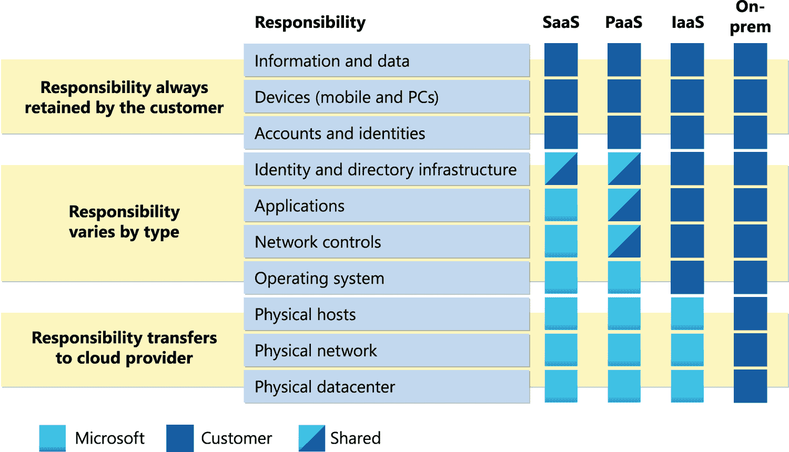

**图 6.1**](#c06.xhtml#R_c06-fig-0001)

虽然 `SRM` 涉及合同和财务影响等非安全问题，它还包含若干安全考量。安全从业人员必须根据他们消费的服务以及组织的实现和架构，理解他们在 `SRM` 中对什么负责。


还记得几乎所有的云数据安全事件都发生在责任共担模型（SRM）的客户侧吗？这就是理解 SRM 并确保你履行了模型中自身职责的主要原因之一。另一件我们再强调一遍也不是，虽然存在责任分担，但你不能外包问责。作为一个组织，你最终仍然数据的所有者，即使你决定向客户或利益相关者提供服务和业务时使用第三方（如云服务商 CSP），你仍对这些数据及其所属的利益相关者承担责任。尽管对于涉及其客户数据泄露的 CSP 可能会面临合同方面的后果，但客户将在声誉、品牌和监管方面遭受后果。

你的职责取决于你属于哪一类主要的安全角色视角：技术安全执业人员或安全高管。技术安全执业人员（如云安全工程师或云安全架构师）必须了解你的组织使用了哪些云服务；如何安全地构建这些解决方案；以及哪些配置、设置和控制属于你的管辖范围，你可以影响它们并引导其走向更稳健的安全态势。一个关于公司表现不足的显性例子是，云原生供应商 `SysDig` 在其 2023 年的《云原生安全与使用报告》中发现，云环境中授予的权限有 90% 未被使用。这与行业对零信任的推动背道而驰，并为攻击者滥用受损的账户留下了大量机会（`https://sysdig.com/press-releases/sysdig-2023-usage-report`）。

技术安全专业人员应该熟悉其组织使用的平台和服务，并理解如何安全地实施它们。云安全工程师/架构师经常与工程和开发团队合作。如果你不能引导他们采用安全的解决方案或无法发现风险配置（记住，这些配置构成了大多数云数据事件的原因），你可能会让你的组织面临巨大的风险。

向你的 CSP 寻求安全资源。例如，亚马逊云服务（`AWS`）提供了极其丰富的安全文档数据库，并按类别（例如计算、存储、安全、身份和合规）进行分类，你可以在其中找到与组织使用的每项服务相关的特定信息。这包含了广泛的信息，从如何安全地配置服务到你可以操纵哪些配置，再到疑故障排除指南。

安全高管的关键考虑因素包括：服务使用情况清单（你必须知道组织内部使用了什么，否则无法确保其安全）、确保你使用的服务符合适用的监管框架，以及理解合同/法律方面，例如 CSP 服务水平协议（`SLAs`），特别是在事件响应规划等方面。作者之一参与出版的此类资源是云安全联盟的云事件响应框架（`https://cloudsecurityalliance.org/artifacts/cloud-incident-response-framework`）。

许多组织与 CSP 建立伙伴关系并分担责任。这包括确保你使用的服务符合你必须遵守的监管框架。超大规模 CSP 使这些信息清晰可见，`AWS` 和 `Microsoft Azure` 提供了“范围服务”页面，你可以在那里确定哪些服务符合哪些框架，哪些仍在审批过程中，或尚待评估和分析。这有助于确保你的团队不仅在云端构建稳健安全的架构和工作负载，而且使用符合适用框架的服务，以避免合规或监管问题，并使用那些他们已提供保障的服务。

所有级别的安全执业人员都应该努力在他们的云环境中实施安全标准和最佳实践。这可能意味着为各自的环境实施来自来自互联网安全中心（`CIS`）的安全最佳实践（`www.cisec.org/blog/foundational-cloud-security-with-benchmarks`）。

处理 SRM 时的一项基础产物是客户责任矩阵（`CRM`），它列出了由 CSP 提供的控制以及哪些责任留给了客户。寻找 `CRM` 并了解更多信息的地方是联邦风险与授权管理计划（`FedRAMP`）。`FedRAMP` 是一个处理美国联邦政府云产品授权的计划（`www.fedramp.gov/updated-Control-summary-cis-and-customer`）。

`CRM` 是安全执业人员使用的一个关键工具。在 SRM 中，安全控制完全由 CSP 提供、混合模式（责任由双方承担）或完全留给客户。这些通常分别被称为 `CRM` 类型。

使用云服务可以将某些安全控制和活动的责任转移给 CSP，让组织专注于其核心竞争力。它创建了一种安全专业人员必须理解并妥善处理的责任关系。记住，大多数云数据泄露将发生在 SRM 的客户侧，归根结底，你对组织的声誉负有全部责任，而 CSP 代表了另一个在追求软件透明度和软件供应链安全时必须被考虑在账的第三方。

## 云原生安全的 4 Cs

一种背景化云原生生态系统的辅助方法是通过 Kubernetes 文档中描述的“云原生安全的 4 Cs”，Kubernetes 是图 6.2 所示的容器编排器，本文对此讨论。

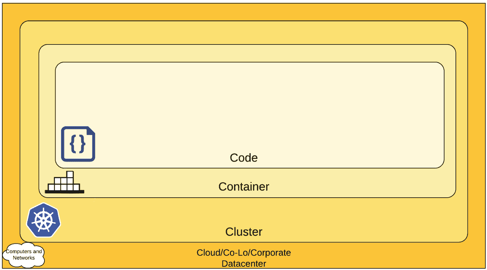

**Source: `https://kubernetes.io/docs/concepts/security/overview/#:~text=The%204C’s%20of%20Cloud%20Native%20security%20are,Clusters%2C%20Containers%2C%20and%20Code.Kubernetes Documentation`, The Kubernetes Authors, CC BY 4.0`**

在这种特定的容器及其编排的语境下，你拥有云、集群、容器和代码，每一层在各种形式的基础设施以及部署在其上的代码方面，本质上都依赖于其上方（或之前）的层。


如前所述，根据 NIST 定义，云范式有三种公认的服务模型。云消费的主要方法之一是 `IaaS`，组织利用 `CSP` 的物理设施、公用事业、人员和基础设施在上面部署操作系统和应用程序。在这种范式中，`CSP` 负责底层基础设施、公用事业、设施、人员和通用资本支出 (`CapEx`) 成本。领先的 `CSPs` 为网络、计算和存储等关键领域提供强大的云服务以供消费。然而，这些服务仍然是由软件驱动的，正如大多数现代基础设施是那样的。这意味着它们仍然容易受到软件相关漏洞和攻击的影响。虽然在 `IaaS` 模型中，云消费者从底层基础设施中被抽离出来，但并不意味着他们能够完全免于可能影响该设施的风险和威胁。这正是 `Log4j` 漏洞案例发生的情况。主要的 `CSPs`——[`AWS`](https://aws.amazon.com/security/security-bulletins/AWS-2021-006)、[`Azure`](https://msrc-blog.microsoft.com/2021/12/11/microsofts-response-to-cve-2021-44228-apache-log4j2) 和 [`Google Cloud`](https://cloud.google.com/log4j2-security-advisory)——都发布了与 `Log4j` 对其云服务影响相关的公告。

这些 `CSPs` 与广大的 IT 行业一样，使用大量的开源库和组件来支持其多样化的云服务组合。查看上述 `CSPs` 的公告可以发现，单一的开源软件供应链破坏影响了它们的整个云原生服务组合，而且并不止于此。这些 `CSPs` 拥有数十亿美元的收入，支持数千个组织和数百万个人。当组织在这些 `CSP` 产品之上构建并交付应用程序和服务业务时，底层服务产品中的软件供应链破坏或漏洞不仅会影响消费这些组织，还会影响他们的业务伙伴、客户和利益相关者。对于之前提到的超大规模 `CSPs`，这些客户甚至包括美国最关键和最敏感的工作负载，因为 `CSPs` 被美国国防部 (`DoD`)、情报社区和联邦民事行政分支 (`FCEB`) 机构等组织使用。

这一现实要求对云客户消费的服务以及驱动这些服务的相关软件提供保证。虽然已经建立了一些成熟的计划，例如 `FedRAMP` 或 [`SOC2`](https://us.aicpa.org/interestareas/frc/assuranceadvisoryservices/aicpasoc2report)，但它们传统上并没有从细粒度的角度审视软件，即去清点和理解驱动现代云原生服务产品的底层软件供应链，以及与该软件相关的风险。这些计划关注的是更传统的风险评估方法，例如 `CSP` 的策略和流程、底层计算实例的漏洞扫描结果以及渗透测试。随着软件供应链日益成为 IT 和网络安全领导者关注的焦点，我们可能会看到一种转变，即如 `FedRAMP` 这样的授权计划开始要求 `CSPs` 为其面向软件的托管服务产品提供 `SBOMs` 等项目。美国联邦政府已经通过发布管理和预算局 (`OMB`) 备忘录 22-18 ([www.whitehouse.gov/wp-content/uploads/2022/09/M-22-18.pdf]) 显示了这一意图，该备忘录可能会让机构向向联邦政府销售软件的第三方软件供应商（当然包括云提供商）要求包括 `SBOMs` 在内的制品。它还要求第三方软件供应商提供自证，证明他们遵循安全软件开发实践，例如 `NIST` 的安全软件开发框架 (`SSDF`) 以及其他关于软件供应链安全的 `NIST` 指南。

然而，考虑到 `AWS`、`Azure` 和 `Google` 等超大规模 `CSPs` 的广度和规模，这是具有挑战性的，它们无疑拥有驱动其云服务的巨大软件库存。这与目前很大程度上基于第三方评估组织 (`3PAOs`) 方法形成对比，在那种方法中，第三方评估服务提供商并提供与提供者内部实践和安全流程相关的制品和证明。云和托管服务产品通常努力将某些底层复杂性从消费者抽离出来，以换用户的体验和便利。值得注意的是，在之前提到的 `OMB` 22-18 备忘录中，允许软件生产者对其使用安全开发实践进行自证。然而，如果机构认为有必要，也允许他们要求 `3PAO`。尽管如此，考虑到当前的格局、工具和组织能力，要在每个云服务上规模化地这样运作是不现实的。

虽然 `IaaS` 不可避免地涉及软件，但关于软件供应链安全的讨论在云原生架构的其他方面要成熟得多，例如容器、`Kubernetes`、代码以及日益增长 `SaaS`。

## 容器

从物理服务器和虚拟机 (`VMs`) 等传统计算模型继续，云原生生态系统广泛使用容器。因此，当涉及到容器及其相关的编排系统（如 `Kubernetes`）时，讨论容器和相关的软件供应链问题是非常关重要的。

随着计算抽象的成熟，我们看到了从虚拟机 (`VMs`) 向容器的转变。根据行业领导者 `Docker` 的定义，容器是“一种标准的软件单元，封装了代码及其所有依赖项，以便应用程序从一个计算环境到另一个环境快速、可靠地运行。”与每个都需要一个操作系统的虚拟机相比，容器要轻量得多、动态且可移植得多（见图 6.3](#c06.xhtml#c06-fig-0003)）。

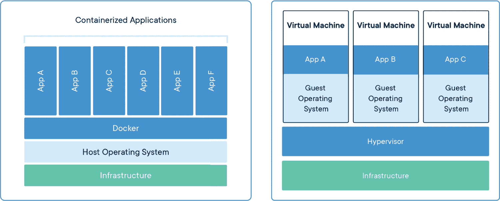

**图 6.3** 来源：`www.docker.com/resources/what-container`，最后访问日期 2023 年 3 月 27 日

容器的主要优点之一是允许开发者将软件代码、相关库和依赖项封装成轻量级制品。这种制品是可移植的，能够在各种支持容器部署的托管环境和基础设施上运行。

这种打包对于移植性和效率等活动非常有益，但它也为不安全或有漏洞的依赖项包含并在其中大规模复制打开了大门。这种情况经常发生，在 `DockerHub`、`Google Container Registry` 等公共容器镜像仓库中，容器镜像可供任何人消费和重复。

事实上，帕洛 Alto Unit 42 威胁研究小组在 2021 年的一项研究中对 1500 多个公共可用容器镜像进行调查发现，96% 的镜像存在已知漏洞，且根据 `CVSS` 等来源的严重程度评分，91% 的镜像至少包含一个严重或高危漏洞（`CVSS`）。


这项研究还指出，镜像拥有的依赖项越多，其平均漏洞数量就可能越高。因此，诸如减少攻击面或将依赖项和代码减少到仅容器和应用程序运行所需的程度等努力，被广泛认为是安全领域的最佳实践。

与其他形式的应用程序和软件交付一样，容器的部署也需要透明度。在容器上使用 `SBOMs` 可以让你看到容器镜像中的每一个构件，这有助于识别软件供应链中的漏洞，并在整个软件开发生命周期中进行修复。这涵盖了源码、构建、测试（staging）、部署和运行阶段。漏洞可能会在开发周期的任何阶段被引入，因此在整个过程和阶段生成 `SBOM` 可以实现镜像在整个生命周期内的可可见性，并监控任何引入风险的更改。

尽管漏洞镜像广泛存在，但创新的工具正在涌现，帮助提供容器及其包含的软件组件和依赖的透明度。像 Anchore 等领先供应商已经生产了允许组织生成 `SBOMs` 的开源工具。Anchore 的 `SBOM` 工具名为 `Syft`，以其强大的功能集和语言支持著称。其特性包括为容器镜像、文件系统等生成 `SBOMs`；支持开放容器规范（`OCI`）和 Docker 镜像格式；以及使用 `in-toto` 框架支持签名的 `SBOM` 证明的能力。（证明是一个我们在书中其他部分讨论的概念，例如第 11 章，“消费者的实用指南”。）

`Syft` 支持第 4 章“软件材料清单的崛起”中讨论的主流 `SBOM` 格式，如 `CycloneDX` 和 `SPDX`。另一个流行的开源扫描器是来自 Aqua Security 团队的 `Trivy`。它支持针对容器镜像、文件系统、Git 仓库和 Kubernetes 资源识别 `CVEs`、操作系统包和依赖项，以支持 `SBOM` 以及声明式基础设施代码中的配置错误。

容器领导者 Docker 甚至增加了原生的 `SBOM` 能力。2022 年初，Docker 宣布可以简单地从 Docker Desktop 的命令行界面运行 `docker sbom`，为任何 Docker 镜像生成 `SBOM`（[www.docker.com/blog/announcing-docker-sbom-a-step-towards-more-visibility-into-docker-images](https://www.docker.com/blog/announcing-docker-sbom-a-step-towards-more-visibility-into-docker-images)）。该能力是与开源社区和 Anchore 团队合作开发的，使用了我们之前讨论过的 `Syft` 项目。Docker 团队解释说，此附加功能旨在提高供应链信任度，查看镜像包含的内容，并为开发者提供便利，以免阻碍生产力或速度。

从软件供应链的角度来看，容器及其相关生态系统存在许多需要考虑的潜在攻击向量和风险。虽然很难列举每一个攻击向量，但我们在这里将确实查看一些主要的向量，包括基础镜像、操作系统、Git 仓库、应用程序代码和依赖项以及开源组件。由于云原生环境中参与开发、安全和运维的团队很多，加上保护容器的各种安全层，容器安全也变得更加复杂。这涉及容器镜像及其包含的软件、容器与宿主机操作系统之间的交互，以及运行在编排平台上的其他容器。还存在与容器网络、存储以及容器部署到的生产运行环境（通常位于 Kubernetes 集群之上）相关的攻击向量和风险。

在讨论基础镜像时，就像软件供应链中的任何上游组件一样，所有下游消费者和用户都会受到供应链上游引入风险的影响。基础镜像是容器软件供应链中的关键一步，因为运行在容器上的软件应用程序会继承构建应用时的基础镜像中包含的任何安全债和漏洞。多个容器安全指南来源推荐的关键最佳实践是使用加固的基础镜像。通常，这意味着基础镜像已经过加固以减少漏洞，并被剥离到仅包含运行所需的精简内容。这通常被称为*攻击面削减*，即移除可能被利用来破坏容器及其驻留应用程序的不必要组件。一些最流行的基础镜像包括 Alpine、Ubuntu 和 Debian。

在最小化容器攻击面的推动下，出现了被称为“无发行版（distroless）”的容器镜像。distroless 容器镜像仅包含应用程序及其运行运行时依赖项，从而移除了包管理器、shell 或通常随常见 Linux 发行版一起出现的其他程序。最小化容器攻击面经常被 NIST 等机构在其《应用程序容器安全指南》（[`https://csrc.nist.gov/publications/detail/sp/800-190/final`](https://csrc.nist.gov/publications/detail/sp/800-190/final)）以及行业领袖 Liz Rice 在其书籍《容器安全》（O'Reilly Media, 2020）中引用为最佳实践，该书中讨论了其他容器安全建议中的攻击面削减。除了减少攻击面外，distroless 镜像还有许多优势，例如减少由于虚假 `CVEs` 导致的扫描器噪声、减轻溯源负担，并且在尺寸上更具效率，正如 Google 的 Container Tools Distroless GitHub 页面（[`https://github.com/GoogleContainerTools/distroless`](https://github.com/GoogleContainerTools/distroless））所示。

软件供应链安全初创公司 Chainguard 引入了 `Wolfi`，这是一套 distroless 镜像，在 CVE 方面比大多数传统容器镜像都要安全得多（[wwwwww.chainguard.dev/unchained/introducing-wolfi-the-first-linux-un-distro](https://www.chainguard.dev/unchained/introducing-wolfi-the-first-linux-un-distro)）。Chainguard 还开始追求内存安全的容器镜像，这与 NSA 等来源关于推动行业转向更安全的内存安全语言和生态系统的广泛建议相一致。

与其他开源组件一样，组织通常从开放互联网获取容器镜像，而在容器领域，最流行的来源之一是 Docker Hub（[`https://hub.docker.com`](https://hub.docker.com)）。正如名称所示，Docker Hub 由 Docker 运行，用于供团队和组织查找并共享容器镜像。为了直观体现 Docker Hub 及其镜像的流行，截至目前该网站上有 20 个镜像的下载量超过了十亿次。尽管如此，与其他任何软件组件一样，这些容器镜像的镜像文件中通常包含多个漏洞，如果组织在使用之前不进行尽职调查，就会继承这些漏洞和技术债。正如前面提到的，研究确定 Docker Hub 上公开的镜像中超过 90% 包含已知漏洞，其中极高比例的镜像至少包含一个严重或高危漏洞。


软件供应链链供应商 Chainguard 等组织的进一步研究，使用了容器漏洞扫描工具 `Trivy`、`Snyk` 和 `Grype`，评估了 Docker Hub 上下载量最前的一些基础镜像（https://uploads-ssl.webflow.com/6228fdbc6c97145dad2a9c2b/624e2337f70386ed568d7e7e_chainguard-all-about-that-base-image.pdf）。Chainguard 发现，`Node`、`Debian`、`Ubuntu` 和 `Red Hat UBI` 等领先镜像内部都包含了大量的技术债。这些镜像的漏洞数量从 28 个到 800 个不等，取决于具体的镜像和所使用的扫描器。漏洞严重程度从低级到严重，只有 `Alpine: 3.15.0` 镜像在使用的三个漏洞扫描器中均不包含已知漏洞。正如研究提到的，`Alpine` 与其他镜像相比得分高的原因是它是一个以安全为导向的基础镜像，包含的软件包少于 10 个。这是减少攻击面以及从安全角度出发创建基础镜像以降低组织风险的典型范例。显然，容器化应用程序的每一层都可能增加风险配置，但建议从适当安全且最小化的基础镜像开始。

基础镜像不仅是一个关注点，组织还越来越多地采用建立内部加固容器库，这些容器经过了攻击面减少和加固，并由受信任实体进行签名。这降低了团队从公共来源拉取容器镜像的潜在风险，他们转而可以使用内部批准并存储的、符合组织安全和合规要求的镜像。这种做法最可见且被引用的例子之一是美国国防部（`DoD’s`）的 `Iron Bank`（https://p1.dso.mil/products/iron-bank），这是一个加固、批准且授权的容器镜像仓库，供美国空军（`USAF`）及更广泛的 `DoD` 使用。美国联邦民用机构也利用了这些加固镜像并效仿此，建立了了自己的用于使用和部署的安全容器镜像内部仓库。

公共的 `Git` 仓库是容器软件供应链中可能引入风险的另一个途径。虽然与镜像相关的 `CVEs` 是衡量容器安全性的极佳指标，但了解它们的来源仓库是另一个能让组织对内在或潜在风险有深入理解的标准。一个关注公共 `GitHub` 项目及其仓库相关配置和活动的热门项目是 `OpenSSF Scorecard` 倡议，我们将在第 7 章 中讨论它，标题为“现有和新兴的商业指南”。

应用程序代码、依赖项和 `OSS` 组件也都会对容器镜像的漏洞概况产生风险。因此，在将它们引入运行时环境之前，使用应用程序安全最佳实践很重要，例如实施静态应用安全测试（`SAST`）和软件成分分析（`SCA`）扫描，对通过持续集成/持续交付（`CI/CD`）流水线的容器进行扫描。这些工具可以帮助识别容器内代码中的漏洞，并在其进入生产环境（恶意攻击者可能利用漏洞）之前进行修复。

尽管如此，虽然将安全左移（shifting left）并在流水线或生产前的构建期间识别漏洞是非常优秀的实践，但它们并不能消除运行时容器分析和监控的需求。流水线可能会漏掉漏洞，或者在部署后可能出现新漏洞，因此组织除了流水线可见性外，还需要容器运行时监控。正如云原生基金会（`CNCF`）在其《云原生安全最佳实践白皮书》（https://cncf.io/blog/2022/05/18/announcing-the-refreshed-cloud-native-security-whitepaper）中提到的，云原生工作负载在整个生命周期内（包括运行时）都需要安全控制。如果具备适当的工具和可见性，安全团队就可以感知运行时环境中的漏洞，更新容器镜像并重新部署不再存在漏洞的镜像。

需要指出，现代应用程序绝大部分由开源代码和组件组成。安全领军企业 `Snyk` 等组织发现，80% 的应用程序代码是由 `OSS` 组成的（https://snyk.io/wp-content/uploads/Snyk-Docker-Container-Security.pdf）。这些开源代码当然包含直接依赖和间接依赖，每种依赖都包含各自的漏洞。除了 `OSS` 代码和组件外，容器镜像分层创建，每一层在工具、库和额外组件方面都代表了引入风险的可能。通过治理和控制添加到容器文件的额外代码和层，组织可以控制所引入的风险。

在处理容器时，另一个关键关注点是主机基础设施本身。如前所述，这意味着 `Kubernetes` 集群作为编排器运行，但也存在对底层 `VMs` 等担忧。这些担忧包括 `VM` 的加固、其选定的操作系统以及与主机实例相关的网络控制。我们将在下一节中进一步探讨。

## Kubernetes

容器编排通常被定义为自动化运行容器化负载和服务的运维工作。虽然有多种潜在的容器编排工具供选择，但 `Kubernetes` 在采用和使用方面无疑是行业领导者（https://kubernetes.io）。

`Kubernetes` 起于 `Google` 的一个容器编排项目，并在采用和使用上经历了迅速增长。`CNCF` 2021 年的一项调查显示，96% 的受访者表示在使用 `Kubernetes`，其中 70% 的人表示在生产环境中使用 `Kubernetes`（www.cncf.io/wp-content/uploads/2022/02/CNCF-AR_FINAL-edits-15.2.21.pdf）。全球估计有 390 万 `Kubernetes` 开发者，人数呈剧增趋势。在类似的 `Red Hat` 调查中（www.redhat.com/en/enterprise-open-source-report/2022?intcmp=701f200000tjyaAAA），85% 的 IT 领导者同意 `Kubernetes` 对其云原生应用策略极其或非常重要。

如前所述，`Kubernetes` 的起源于 `Google` 期的内部项目，特别是 2003 年的 `Borg` 系统。该项目演变为名为 `Omega` 的项目，这是 `Google` 在 2013 年推出的另一个集群管理系统。最后，2014 年 `Google` 开源了 `Borg` 并将其引入 `Kubernetes`。从那时起 `Kubernetes` 的采用和增长不断加速，出现了更多的版本功能以及丰富的爱好者生态系统。相关的行业活动如 `KubeCon`（一个围绕 `Kubernetes` 和云原生生态系统的会议）汇聚了行业领导者的参与，并展示了该领域的一些新兴功能和创新。

尽管 `Kubernetes` 快速增长，但仍有软件供应链组织与 `Kubernetes` 及其相关技术的使用和实施相关。`Kubernetes` 架构由 `Kubernetes` 集群内的多个组件组成。这些组件之一是 `Kubernetes` API 服务器。`Kubernetes` API 服务器验证并配置 `Kubernetes` 对象的数据，包括 pod、服务、复制控制器和其他 `Kubernetes` 实体。


2022 年，每天积极扫描整个整个 IPv4 空间的 Shadow Server 组织发现了 380,000 个公开暴露的 Kubernetes API 服务器（[www.shadowserver.org/news/over-380-000-open-kubernetes-api-servers]）。他们的研究指出，在他们发现的已知 Kubernetes 实例中，有 84% 是公开暴露的并返回了 `HTTP 200 OK` 响应。许多安全和 Kubernetes 专家指出，这并不意味着这些集群是不安全或存在漏洞的，通常归因于云服务提供商（CSP）提供的托管 Kubernetes 服务的默认配置。然而，这确实表明了微小的配置错误就会暴露集群、容器以及运行在上面的代码。真实的配置错误允许恶意攻击者破坏集群及其工作负载，并可能横向移动到其他组织的资产。

### Kubernetes 中的供应链威胁

与 Kubernetes 供应链威胁相关的另一个因素是，Kubernetes 是通过清单文件（manifest files）实现的。这些是声明式的 YAML 或 JavaScript 对象表示法（`JSON`）配置文件，描述了 Kubernetes 集群应如何运行，定义了各种 Kubernetes API 对象的预期状态。这意味着它们是用代码编写的，并且像其他传统代码和配置文件一样可以保存、存储和共享。

管理具有多种资源的复杂 Kubernetes 部署是一项复杂的任务。通常，组织会使用 `Helm charts`，这是一种用于描述一组相关 Kubernetes 资源的文件包格式。`Helm charts` 与 Kubernetes 资源一样，通常以 YAML 格式描述。它们存储、共享并存在于 `Artifact Hub` 等地方，`Artifact Hub` 是一个基于 Web 的应用程序，能够查找、安装和发布包括 Kubernetes 在内的各种 CNCF 项目的包和配置。

虽然使用现有的 `Helm charts` 和配置文件可以加速实施和部署，但这样做也带来了传统软件代码具有的风险，例如恶意或有漏洞的代码或配置。例如，Palo Alto 的研究小组 `Unit 42` 在其“2021 年下半年”的白皮书中研究了 Kubernetes 和 Helm（[https://paloaltonetworks.com/prisma/unit42-cloud-threat-research-2h21.html]）。研究人员利用一个名为 `helm-scanner` 的工具评估了 `Artifact Hub` 上的 `Helm charts` 和 YAML 文件，发现超过 99% 的 chart 容器存在不安全配置，几乎 10% 的配置至少有一个关键或极不安全的配置。

研究人员还指出，与代码一样，`Helm charts` 通常对其他 chart 有依赖，他们在 chart 中识别出的配置错误中有 62% 是由于依赖的 chart 导致的。他们还指出，依赖数量越高，平均配置错误数量就越高。这些配置错误包括特权容器和不安全的网络配置等项目。因此，尽管现代应用程序和工作负载通常部署在由 Kubernetes 管理的容器上，但 Kubernetes 的配置文件和 chart 往往被复制和共享，自身带有漏洞和配置错误，可能会威胁到这些集群上的所有工作负载。

### 攻击向量与安全最佳实践

在 Kubernetes 环境中，配置和声明式清单存在自身的风险，但恶意攻击者通常针对 Kubernetes 编排的工作负载，并利用容器镜像的生命周期渗透 Kubernetes 供应链。这些攻击向量可能包括基础镜像、应用程序代码和依赖项、仓库、OSS 组件以及相关资源。如果恶意分子能够让恶意代码在容器化工作负载上运行（特别是在没有适当 Kubernetes 安全配置的情况下），他们不仅可以影响单个工作负载，还可以影响集群中的其他潜在工作负载，或者更广泛地影响组织的企业系统，具体取决于架构和配置。在 Kubernetes 环境下确保适当的供应链安全意味着确保你已经建立了安全的 Kubernetes 架构和配置。

组织从这一方面开始的一些建议当然是 Kubernetes 文档和最佳实践，还应利用行业指南，来源例如 Kubernetes CIS 基准（[www.cisecurity.org/benchmark/kubernetes]）或 Kubernetes 防御信息系统局（`DISA`）安全技术实施（`STIG`）。这些指导源侧重于保护 Kubernetes 架构的核心组件，如主节点、控制器、调度器等。它们还包含了有关实施安全策略基于角色的访问控制（`RBAC`）、网络策略和密钥管理。未能实施这些安全实践和配置可能会损害集群内的工作负载，并可能允许横向移动到连接的其他系统。

组织通常还会使用云服务提供商的托管 Kubernetes 服务，例如 Google 的 Kubernetes Engine (`GKE`) 或 Amazon 的 Elastic Kubernetes Service (`EKS`）。使用这些托管 Kubernetes 服务减轻了“自建” Kubernetes 的管理开销。然而，使用托管 Kubernetes 服务并非没有问题。在 CSP 环境中某些某些安全配置，例如身份和访问管理（`IAM`）、加密和密钥管理、网络以及运行工作负载的节点元数据服务，加上信任和依赖云提供者的固有本质。

学习保护 Kubernetes 集群的最佳资源之一是 Kubernetes 文档（[https://kubernetes.io/docs/tasks/administer-cluster/securing-a-cluster]）。`CIS Kubernetes Benchmark`、`DISA Kubernetes STIG` 和 `NSA Kubernetes Security Guide` 等来源也是可靠的资源，但用户还应更广泛地确保他们所使用的云平台的云原生安全最佳实践也得到了解决。

### 加固工具

组织可以使用工具确保 Kubernetes 集群和部署根据上述指南以及 Kubernetes 安全最佳实践进行加固。示例包括 Aqua Security 的 `kube-bench`（[https://github.com/aquasecurity/kube-bench]），这是一个开源工具，用于检查部署的 Kubernetes 配置是否符合 `CIS Kubernetes Benchmark`。与 Kubernetes 本身一样，`kube-bench` 使用 YAML 编写测试，可以根据基准的演进进行修改。另一个来自 Aqua 的著名工具是 `kube-hunter`，它用于寻找 Kubernetes 集群的安全弱点。`kube-hunter` 可以在机器或终端上运行，并使用 IP 进行远程扫描。此外，它可以在集群内的机器上运行，甚至作为集群中的一个 pod 运行。`kube-hunter` 的一个独特之处是它不仅支持审计/评估模式，还支持主动猎取模式，后者可以改变集群状态以利用发现的漏洞。正由于后者的原因，`kube-hunter` 文档特别规定，不应在你不拥有的集群上使用此工具，这包括消费托管的 Kubernetes 服务。


想要理解与 Kubernetes 相关的各种攻击策略和技术的组织也可以利用相关资源，例如微软的 Kubernetes 威胁矩阵（`www.microsoft.com/en-us/security/blog/2020/04/02/attack-matrix-kubernetes`），该资源如图 6.4

图 6.4

该资源与 MITRE ATT&CK 类似，可以帮助组织理解其环境的攻击面，以及恶意攻击者使用的各种策略。微软在他们的威胁矩阵中采取了类似的方法，但针对 Kubernetes 进行了定制，包括暴露 Kubernetes 密钥和利用集群内部网络等许多活动，如[图 6.4](#c06.xhtml#c06-fig-0004）所示。这些策略涵盖了从初始访问（Initial Access）阶段一直到影响（Impact）阶段，与 MITRE ATT&CK 非常相似。

另一个类似的资源是 Kubernetes MITRE ATT&CK 矩阵（`www.weave.works/blog/mitre-attack-matrix-for-kubernetes`），该资源由 Weaveworks 推广。它使用了与微软威胁矩阵相似的阶段，并包含一个收集阶段（collection phase），该阶段重点关注攻击者用于收集信息的技术，特别是从私有仓库中收集镜像。尽管 Weaveworks 和微软的矩阵之间存在差异和相似之处，但这两项资源都能帮助组织理解针对 Kubernetes 攻击的各个阶段，以及恶意攻击者可能用于利用 Kubernetes 环境和编排工作负载的相关策略。除了实施之前讨论的资源（如 CIS 基准、DoD STIGs 和 Kubernetes 威胁矩阵）外，组织还应该考虑采用新兴框架，例如下一节将讨论的软件制品供应链安全水平（SLSA）。

Kubernetes 还支持各种多租户模型，利用其集群和命名空间的结构来提高云原生工作负载的效率、成本效益和可扩展性（`www.weave.works/blog/mitre-attack-matrix-for-kubernetes`）。对于将工作负载部署到 Kubernetes 的组织来说，了解他们正在使用的租户模型以及潜在的安全和合规问题至关重要，特别是如果发生安全事件或数据泄露，由于由于安全习惯不佳且爆炸半径控制不当，这些事件可能会对跨租户产生级联影响。为了详细查看云原生环境中多租户的风险，云安全领导者 Wiz 发布了他们所谓的“PEACH 框架”，这是一个助记法，包含了权限（privilege）、加密（encryption）、认证（authentication）、连接加固（connectivity）以及卫生（hygiene）等因素。该框架可以适用于 Kubernetes 部署以及更的多租户云环境（`www.datocms-assets.com/75231/1671033753-peach_whitepaper_ver1-1.pdf`）。

Kubernetes 生态系统中也支持 SBOM（软件物料清单）。最值得注意的是，这包括 OSS Kubernetes bom 工具，它利用为 Kubernetes 编写的代码为其项目生成 SBOM（`https://github.com/kubernetes-sigs/bom`）。Kubernetes bom 工具支持从文件、镜像以及 tar 包中的 Docker 镜像（将一组文件打包成单个文件）中创建 SBOM。你还可以从仓库拉取镜像并使用 `bom` 工具对其进行分析。它以软件软件包数据交换（SPDX）SBOM 格式生成这些产物，并可以导出 in-toto 溯源证明。in-toto 是一个超越“最后一公里”或最终产物关注点的框架，旨在确保软件产品从启动到端用户安装的全过程完整性，使得执行了哪些步骤、由谁执行以及按什么顺序执行变得透明（`https://in-toto.io/in-toto`）。这些来自 in-toto 的溯源证明允许对软件生产的任何方面生成可验证的声明。使用 Kubernetes bom 工具通过简单的 `bom generate` 命令即可创建 SPDX 清单。

## 无服务器模型

在虚拟机和容器的计算抽象和演进的基础上，某些组织根据其用例进一步推进了采用历程，并开始使用所谓的无服务器（serverless）模型。从高层来说，无服务器模型允许开发团队构建和运行云原生应用程序，而无需管理底层服务器。在 IaaS、PaaS 和 SaaS 的云范式中，在不需要管理基础设施和服务器方面与 PaaS 和 SaaS 有某些相似之处，但主要区别在于，在无服务器模型中，开发者不是从 SaaS 提供者那里消耗应用程序，而是将自己的代码部署到云平台，并由云提供商托管和执行。云提供商处理底层基础设施，包括管理开销，例如对运行代码的服务器和实例进行扩展和补丁。

最流行的示例之一是 AWS 的 Lambda 服务，它让你能够在无需配置或管理服务器的情况下运行代码。代码在高度的计算基础设施模型中运行，并处理实例的底层日志。Google 和 Microsoft Azure 等其他云提供提供了类似的无服务器能力。

在软件供应链安全方面，即使在无服务器模型中仍然存在担忧。在无服务器模型中运行的代码仍然可能包含 OSS 组件或漏洞代码，这将给运行无服务器架构的组织带来风险。此外，如前所述，在云中的底层函数即服务（FaaS）和基础设施也由软件驱动，每个部分都包含各种软件组件，可能包括 OSS。

## SaaSBOM 与 API 的复杂性

为包含实体（如本地交付的软件或容器镜像）创建 SBOM 可能是复杂的。为云和 SaaS 这样具有众多相互关系的动态且快速变化的环境创建 SBOM 则是另一个层面的困难。

关于 SaaS 的 SBOM 概念讨论已经出现，它被称为 SaaSBOM。云和 SaaS 引入了由供应商管理的部署模型，消费者不拥有或控制底层物理基础设施、托管环境、操作系统甚至应用程序。应用程序仅仅是作为服务被消费，消费者对可以进行的应用程序配置和修改的控制有限。

更正式的定义是 NIST 800-145 对云计算的定义：


SBOM 的普及和流行在 2021 年初日益增长，行业内的许多从业者开始思考，这种对 SBOM 的推动如何在高度动态且复杂的环境中运作，例如 SaaS（另一种应用使用方式，与传统的软件交付和消费不同）。本书的作者之一于 2021 年 9 月共同发表了一篇名为《SaaS 软件清单的必要性》（The Case for a SaaS Bill of Materials）的文章(`www.csoonline.com/article/3632149/the-case-for-a-saas-bill-of-material.html`）。正如文章提到的，在 SaaS 背景下定义究竟什么是软件是一项挑战。现代 SaaS 通常构建在现有的 IaaS 和 PaaS 环境之上，这些环境通常由其他云服务供应商（CSP）所有。这些底层 IaaS 和 PaaS 通常以“代码形式”定义，并包含物理和虚拟组件，而所有这些组件都包含了自己的软件。由于涉及大量的代码和软件组件，以及包含的各种关系和所有权实体，在 SaaS 背景下定义软件导致了复杂的局面。尽管如此，行业许多人正围绕着服务和数据流背景下的 SaaSBOM 形成关注焦点。CISA 的 SBOM 工作组包含一个云工作小组，那里的许多专业人士都主张这一立场。SaaS 的 SBOM 使用在在云安全联盟（CSA）的出版物《面向云客户的 SaaS 治理最佳实践》中被提及，本书的作者之一领导了该出版物（`https://cloudsecurityalliance.org/artifacts/saas-governance-best-practices-for-cloud-customers`）。

进一步增加挑战的是，供应商通常使用工具来维护和操作底层云环境以及运行在其之上的 SaaS。其中最著名的工具是 `Ansible`、`Chef` 和 `Terraform`，它们都帮助配置、部署和治理 SaaS 所依赖的云基础设施。当然，还有其他系统和软件用于促进 SaaS 的交付，例如 CI/CD 流水线和 IAM 软件。

所有这些实体由软件组成，并且往往动态且快速地变化，使得定义它们确切的软件组件组成具有挑战性。建议的方法包括让 SaaS 供应商确定 SaaS 应用所依赖的全部技术组件（可能仅限于其控制范围），以便向应用消费者提供 SaaSBOM。尽管具有挑战性，但这种方法可能是可行的，因为 SaaS 提供商至少应该能够并理解其直接控制的应用交付中使用的组件。

正如我们所暗示的，这并没有解决为 SaaS 应用消费者提供底层 IaaS 和 PaaS 供应商软件及系统详细 SBOM 的挑战，而所有这些都是 SaaS 应用的关键依赖项。

### CycloneDX SaaSBOM

我们并不是唯一意识到行业 SBOM 采用和成熟度这一具有挑战性方面的人。行业领先的 SBOM 格式之一 `CycloneDX`（一个由开放全球应用安全项目即 OWASP 管理的项目）提出了他们自己的 SaaSBOM 模型，如图 6.5

`图 6.5 ¶ 来源：OWASP Foundation, Inc. `https://cyclonedx.org/capabilities/saasbom`, 最后访问日期 2023 年 3 月 27 日

CycloneDX SaaSBOM 信息承认，现代软件依赖于许多外部服务，甚至可能完全由服务组成。因此，他们致力于使 `CycloneDX` 能够表示各种服务类型，包括微服务、`FaaS`、系统系统（SoS）以及 SaaS。`CycloneDX` 指出，SaaSBOM 可以作为基础设施即代码 (`IaC`) 的补充，后者也为复杂系统提供了逻辑表示。在 `IaC` 的情况下，这包括云架构组件，如网络、计算和访问控制，所有这些都以代码模型定义。

`CycloneDX` 声 SaaSBOM 可以提供类似的逻辑表示，包括所有服务、服务依赖关系、相关的 URL，甚至服务与系统之间的数据定向流。

如前所述，SaaS 由每种架构中一系列独立的应用程序和服务组成，用于向消费者交付应用。`CycloneDX` 的 SaaSBOM 能力允许将服务和软件组件清单到单个 BOM 或独立的 BOM 中。由于云和 SaaS 涉及动态服务和部署场景的现实，`CycloneDX` 建议对于大型系统将 SaaSBOM 从 SBOM 中解耦。SaaSBOM 可以表示为一个带有许多关联 SBOM 的单一实体，这些 SBOM 代表了协同工作以交付 SaaS 应用的关联服务。

由于每个独立服务显然都有其独特的独特漏洞，`CycloneDX` 还支持在 BOM 中引用来自其他系统和 BOM 的组件、服务和漏洞的能力。这被称为 BOM-Link (`https://cyclonedx.org/capabilities/bomlink`)，并支持两种通用场景：从一个 BOM 引用另一个 BOM，以及从一个 BOM 引用另一个 BOM 中的特定组件或服务。

`CycloneDX` 还建议将漏洞可利用性交换（VEX）与 BOM 解耦，因为在系统清单发生变化之前，BOM 可能不会改变，而 VEX 的变化可能会更频繁，因为可能会出现与已存在且正在使用的软件组件相关的新漏洞。

### 工具与新兴讨论

正如我们讨论中显而易见的，实施 SaaSBOM，或者泛义上与云的复杂且动态世界相关的 SBOM 并非易事。考虑到人类无法跟上软件清单及其相关漏洞的快速变化，这不可避免地需要新的流程和工具来促进其广泛采用。

因此，人们日益呼吁就云和 SaaS SBOM 背景下的工具和能力进行进一步讨论。2022 年 7 月，CISA 举行了一系列针对多个主题的听证会，其中包括“云与在线应用程序”(`www.federalregister.gov/documents/2022/06/01/2022-11733/public-listening-sessions-on-advancing-sbom-technology-processes-and-practices`)。这些活动并非为了寻求共识，但对话被用于就 SaaS 和云应用的 SBOM 主题促进开放对话。


随着云和云原生架构的兴起并持续流行，另一个趋势随之出现：从传统的瀑布式软件开发转向 DevOps 时代，或者更最近的 DevSecOps 时代。在不进行哲学辩论的情况下，DevOps 可以总结为一组弥合软件开发与运维之间鸿沟的实践，或者在 DevSecOps 的情况下，即软件开发、安全和 IT 运维之间的融合。这一运动的起源可以追溯到 2000 年初，当时 Patrick Debois、Andrew Shafer、Gene Kim 和 Jez Humble 等对生态系统做过贡献的人。这与云计算的演进相契合，组织越来越多地使用云原生技术，通过敏捷和 DevOps 方法论来促进业务成果达成。为了更好地理解 DevOps，我们推荐如《DevOps 手册》（第 2 版，IT Revolution Press，2021 年）或《凤凰项目》（第 5 周年版，IT Revolution Press，2018 年）等书籍。

在本其他章节涉及的许多技术，如云、`SaaS`、`CI/CD`、`Kubernetes`、容器和基础设施即代码，都对成功的 DevSecOps 之旅和实施发挥了作用。在软件供应链安全和 DevSecOps 的背景下，一个健壮的工具生态系统应运而生。快速查看 CNCF 地图（`https://landscape.cncf.io`）可以看到 `CI/CD`、自动化与配置以及调度与编排等领域存在各种丰富的工具，这些工具在现代 DevSecOps 环境中都起着重要作用。值得强调，尽管工具和技术促进了成功的 DevOps 转型，但 DevOps 并不是工具或技术；它是一种方法和一组实践。许多工具被采用以支持 DevOps，一些常用方法（如 `CI/CD`）允许集成工具来应对软件供应链的挑战。

`Syft` 和 `Grype` 等工具通常用于工具链中，以实现创建 `SBOMs`，并对这些 `SBOMs` 进行扫描，以发现与部署到生产环境之前通过工具链的软件组件相关的漏洞。DevOps 使用源码管理 (`SCM`）和 `Git` 仓库、`CI/CD` 流水线、`GitOps` 风格声明式部署等。所有这些工具和方法论都汇聚在一起，实现了从源代码到运行时的迭代软件交付。它们还让团队和组织能够利用工具对源代码、容器镜像、不安全的 `IaC` 或 `Kubernetes` 配置中涉及的组件获得更好的可见性，这最终云原生部署架构，每种架构都有自己的软件供应链关注点。

`NIST` 等组织开始主张 DevSecOps 实践有助于识别、评估和缓解软件供应链的风险（`www.nccoe.nist.gov/sites/default/files/2022-07/dev-sec-ops-project-description-draft.pdf`）。《软件供应链和 DevOps 安全实践》白皮书中阐述的观点旨在为安全的 DevOps 环境提供基于风险的建议。它还寻求与其他 NIST 指南（如 `SSDF` 和 `800-161/C-SCRM`）保持一致。该指导采用了以 `CI/CD` 流水线为中心的方法将软件供应链安全集成到 DevSecOps 环境中。

敏捷和 DevOps 的一个基本方面是远离传统的瀑布式软件开发，专注于更具迭代性和增量性的软件交付。有些人可能会认为，敏捷和 DevOps 的增量性质可能有助于管理软件供应链安全问题。随着组织增量地生产和发布软件，工具链可用于识别软件组件、关联漏洞、聚合这些指标，并赋能组织做出与软件供应链问题相关的知风险的决策。通过使用 DevSecOps 工具并强调安全“左移”（或在 `SDLC` 中更早的阶段），可以在软件组件被引入运行环境之前识别出漏洞。许多人声称这种方法从成本角度来看更高效，而且减少了被利用的可能性，因为如果漏洞在早期被发现并修复，恶意攻击者就无法在生产环境中利用该漏洞。

DevSecOps 不仅提供了在 `SDLC` 中更早发现漏洞软件组件的机会并提供了改进的透明度，高能力的 DevSecOps 团队还能对软件供应链问题和事件做出更好的响应。研究支持这些主张，特别是由 `Google` 运营的 DevOps 研究与评估 (`DORA`) 团队。在《2022 年加速的 DevOps 状态报告》中，`DORA` 团队发现，部署前安全扫描等实践对于发现漏洞依赖是有效的，这导致生产应用程序中的漏洞减少（`https://services.google.com/fh/files/misc/2022_state_of_devops_report.pdf`）。

随着 `DORA` 团队多年来的研究，他们创建了特定的指标，这些指标现在被认为是 `DORA` 指标。他们用于衡量软件开发团队性能的四个关键指标如下：

*   **部署频率 (Deployment Frequency)**：组织成功发布到生产环境的频率。
*   **变更交付时间 (Lead Time for Changes)**：从提交到生产环境所需的时间。
*   **变更失败率 (Change Failure Rate)**：导致生产环境故障的部署百分比。
*   **服务恢复时间 (Time to Restore Service)**：组织从生产环境故障中恢复所需的时间。这也被称为平均恢复时间 (`MTTR`)。

这四个指标支持两个关键主题：部署频率和变更交付时间对应的“速度”，以及失败率和恢复时间对应的“稳定性”。这些指标有助于衡量团队按照业务/任务需求发布软件的能力，同时确保这些发布不会损害系统的韧性。起初，认为移动快速的团队是稳定的可能看起来反直觉，但正如业内专家所言，正是要在不损害稳定的情况下进行软件开发和交付，帮助这些团队在该领域表现卓越。

### 总结

总结来说，2022 年 DevOps 状态报告、`DORA` 团队的软件制品供应链水平 (`SLSA`) 以及 `NIST` 的 `SSDF` 识别了与软件供应链安全的流程和实践。我们探讨了 DevOps 和 DevSecOps 不仅仅是工具，它们是一系列文化实践和方法论。在本章中，我们讨论了云原生范式下软件透明度相关的复杂性和细微差别。这包括云的基础服务模型、云原生的 4 个 C，以及 `SaaS` 背景下的 `SBOMs`。我们还讨论了使用成熟 DevSecOps 实践的组织如何获得更安全的软件供应链成果。


随着围绕软件供应链安全的讨论日趋成熟，许多机构已开始为行业提供强有力的指导、框架和资源，以增强其防御此类攻击的安全态势。在接下来的章节中，我们将讨论其中一些资源以及提供这些资源的机构，其中包括云原生计算基金会（CNCF）、美国国家安全局（NSA）和美国国立标准与技术研究院（NIST）等。

## 软件制品供应链安全分级 (SLSA)

随着软件供应链攻击的增加，显然需要一个全面的端到端框架，来定义软件供应链攻击及其缓解方法。2021 年 6 月，Google 开源安全团队启动了“软件制品供应链安全分级标准”（Supply Chain Levels for Software Artifacts，简称 SLSA）计划（`https://security.googleblog.com/2021/06/introducing-slsa-end-to-end-framework.html`）。该计划的目标是确保软件制品在整个软件供应链生命周期中保持完整性。

SLSA 包含四个级别，每个级别提供更高水平的完整性保证，但同时也对实施者的成熟度和严谨性提出了相应要求。受其特定行业和监管或安全需求的驱动，不同组织有各种需求来引导它们追求的 SLSA 级别。与其他安全工作一样，SLSA 是一个需要投入时间和努力才能实现的过程。图 7.1 展示了四个级别并对其进行了描述。

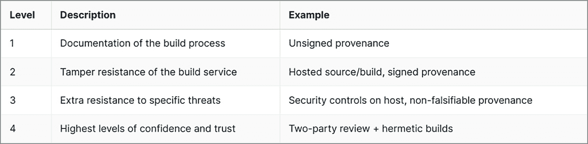

`图 7.1` ¶ 源：Linux Foundation，`https://slsa.dev/spec/v0.1/levels`，访问于 2023 年 3 月 27 日

SLSA 提供了一个框架涵盖了从原始开发者到下游消费者和用户的整个软件路径，包括软件与源代码仓库、构建系统、包仓库的交互以及之间的所有步骤。图 7.2 指示了软件供应链中的每一个点，恶意攻击者可以在这些点破坏下游消费者在生产环境中使用的软件制品完整性。

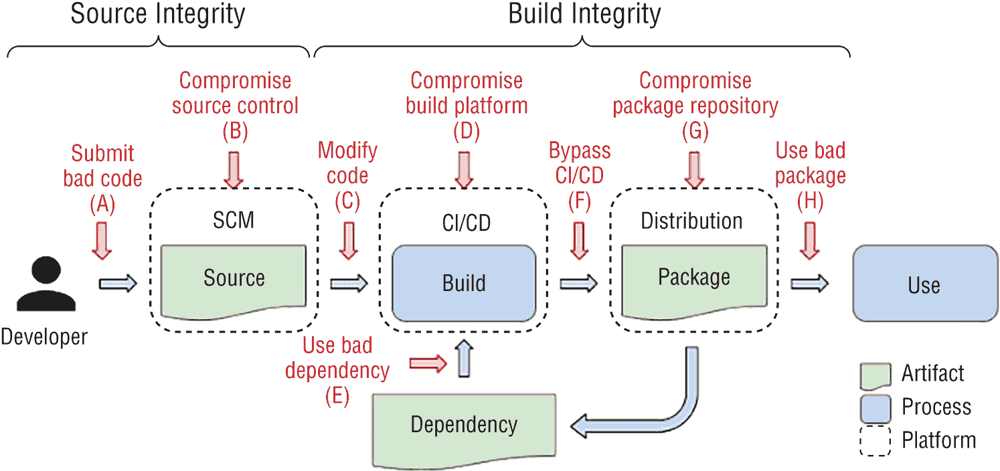

`图 7.2` ¶ 源：`https://security.googleblog.com/2021/06/introducing-slsa-end-to-end-framework.html`，Google

如果恶意攻击者可以在源代码仓库处提交坏代码，可能会在整个构建过程中执行的下游活动中引入漏洞。引入坏代码并不是与源代码管理相关的唯一担忧，因为源代码管理（SCM）系统本身也可能受到攻击和破坏，从而影响存储在其中的代码以及其所促进的下游构建和分发活动。

这种威胁适用于自托管和云端提供的 SCM。在自托管场景下，自托管 SCM 的组织负责从基础设施和托管角度对其安全负责责任；而在云端场景下，云服务提供商（CSP）拥有底层基础设施和平台的责任，并在某种程度上，如果应用是作为软件服务（SaaS）交付的，也拥有应用本身的责任。

与 SCM 破坏相关的攻击树由研究 François François Proulx 在文章《SLSA Dip—直击问题源头！》（`https://medium.com/boostsecurity/slsa-dip-source-of-the-problem-a1dac46a976`）中描述。图 7.3 展示了恶意攻击者可以用来破坏 GitHub 等 SCM 仓库的示例攻击向量。

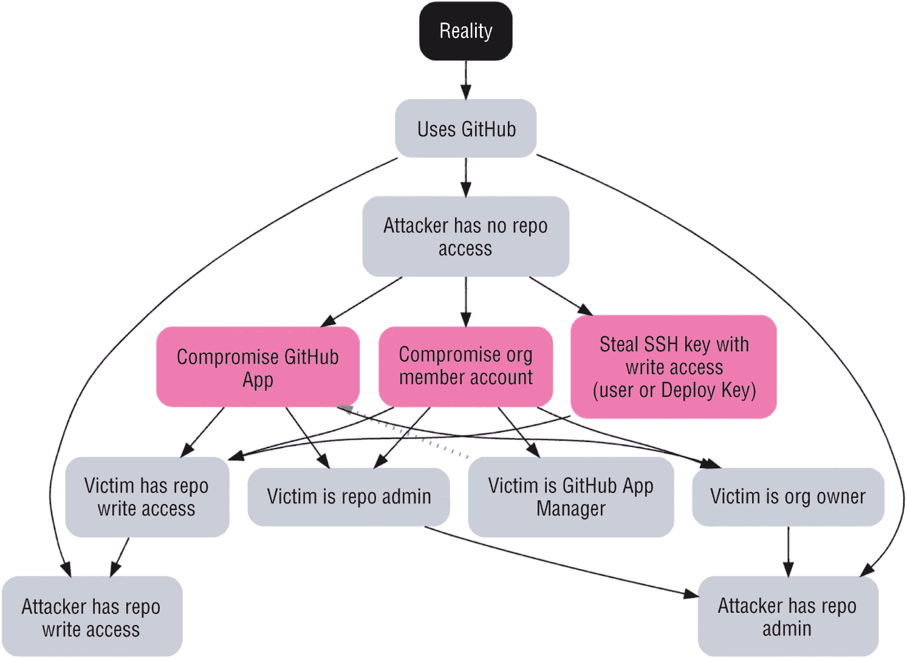

`图 7.3`

继续潜在的软件供应链威胁模型，恶意攻击者可以使用批准的构建过程和基础设施，但引入与 SCM 中应使用的代码不匹配的代码。这是一个代码出处信息（code provenance）对于确保所使用的代码来自预期源且未经过篡改或完整性攻击至关重要的示例。SLSA 将出处定义为“关于软件制品的可验证信息，描述了某物是在何、何时以及如何产生的”。你移动到 SLSA 级别越高，对出处的要求就越严苛。

构建平台是软件供应链的另一个关键部分，也是攻击者极具吸引力的目标。这种攻击向量曾用于 SolarWinds 事件，导致构建系统遭到破坏，并在恶意软件被插入到 SolarWinds Orion IT 管理产品的软件构建中。随后，该软件被下游 SolarWinds 客户下载并安装，其中包括超过 18,000 个机构，其中许多是政府实体，这一事实无疑促成了我们之前提到的后续网络安全行政命令（EO）。该攻击在我们第 1 章的里程碑案例章节中讨论过。

另一个潜在的攻击途径是恶意攻击者可以注入良性依赖，随后对其修改以产生恶意行为。一个真实案例是 `event-stream` 包，有人自愿接管维护工作，结果添加了恶意依赖 `flatmap-stream`。此影响巨大，因为 `event-stream` 每周下载量超过 190 万次！

恶意攻击者还利用机会上传下游消费者下载并受到影响的恶意包。最著名的例子是 Codecov 事件，涉及恶意攻击者使用受损的凭据向 Codecov 的云存储上传恶意包。从此，Codecov 漏洞影响了数百个网络。如果消费者使用了出处方法，就能识别出下载的制品并非来自源代码仓库。

SLSA 还强调证明（attestations），将其定义为“关于软件制品或一组软件制品的认证声明（元数据）”（`https://slsa.dev/attestation-model`）。

SLSA 给出了表示软件证明的通用模型，如图 7.4

`图 7.4`


Google 在 SLSA 框架的一个命名巧妙的后续工作中，与花旗银行、普渡大学等合作伙伴共同宣布了一项名为“用于理解构制品构的图”（GUAC）的开源软件（OSS）计划，如图图 7.5

`图 7.5`

虽然所有信息都是有用的，但 GUAC 计划指出需要结合并综合所有信息，以获得软件供应链风险的全景。GUAC 将各种元数据源整合到图数据库和关系中，这有利于审计和风险管理等现有的用例，也有助于赋能开发者。

根据 Google 的公告，GUAC 关注四个关键领域：

*   收集 (Collection)
*   摄入 (Ingestion)
*   整理 (Collation)
*   查询 (Query)

收集包括如 `OSV` 和 `GSD` 甚至内部仓库的源。摄入允许接入构制品、项目和资源等游数据源。整理取来自各种源的原始元数据并将其组装成标准化的图，以显示项目/开发者、漏洞和软件版本等实体之间的关系。最后，查询能力能够对组装的图和相关元数据进行搜索，查询如 SBOM、项目评分卡、漏洞等构制品。见图 7.6。

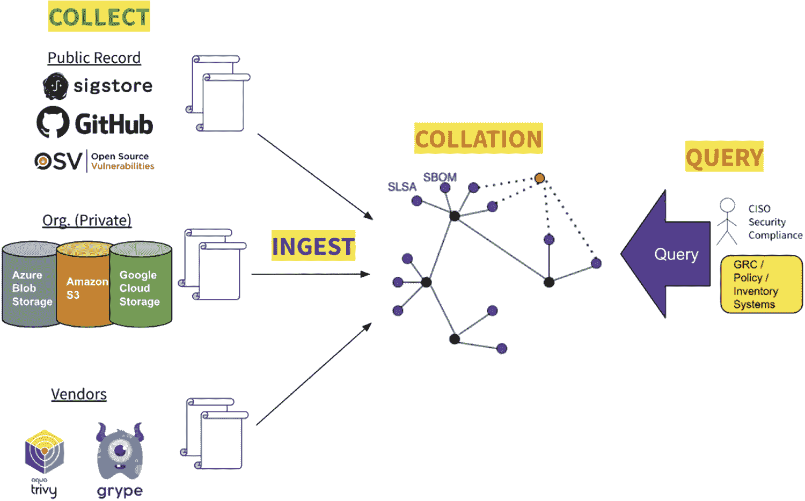

`图 7.6`

如图 7.6 所示，收集、摄入、整理和查询使各种角色和用例受益，例如治理、风险和合规（GRC）及政策专业人员、首席信息安全官（CISO），甚至是开发者。正如公告提到的，理解特定开源软件漏洞的影响需要汇总和分析跨企业及更广泛生态系统的海量数据。GUAC 旨在让所有这些信息具有可操作性，重点于赋能用户回答以下三个基本问题：

1. 我们如何防止供应链遭到攻击？
2. 是否已采取了正确的保护措施？
3. 如果发生事件，我们的组织是否受到了影响？

这三个问题涉及三个主题领域如图图 7.7 所示：

*   主动（Proactive）
*   预防（Preventive）
*   响应（Reactive）

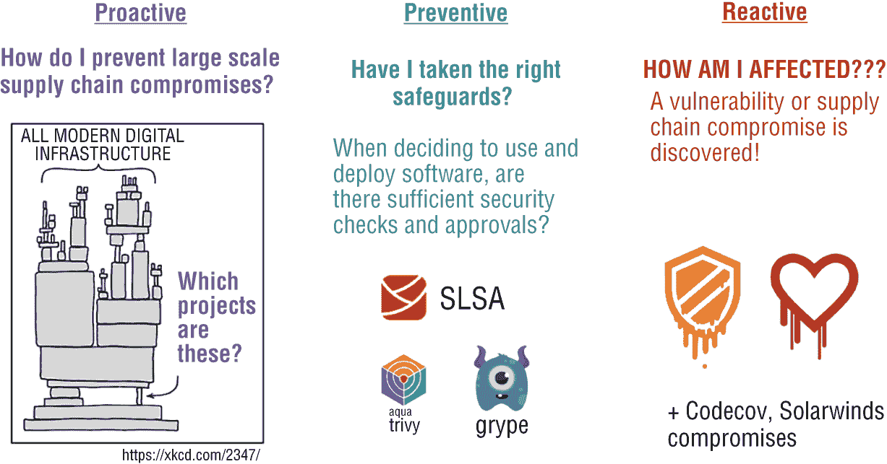

`图 7.7`

主动旨在理解你软件供应链中最关键的组件，以及你主要的弱点和暴露点。预防侧重于确保正在部署的应用符合组织的政策和要求。响应则让你的组织能够在漏洞出现时理解自身在何处受到了影响。

## CIS 软件供应链安全指南

随着行业软件供应链实践的不断成熟，我们看到了来自 NIST（美国国家标准与技术研究院）、开源安全基金会（OpenSSF）和互联网安全中心（CIS）等小组的指导。在本节中，我们将讨论最近发布的《CIS 软件供应链安全指南》（`https://github.com/aquasecurity/chain-bench/blob/main/docs/CIS-Software-Supply-Chain-Security-Guide-v1.0.pdf`）。该指南是与 Aqua Security 合作创建的，Aqua Security 创建了一个名为 `chain-bench` 的开源工具，帮助你审计软件供应链栈以符合 CIS 指南的合规性（`https://github.com/aquasecurity/chain-bench`）。

CIS 软件供应链安全指南基准旨在提供一套与平台无关的高级最佳实践集，这些实践随后可以用于为 GitHub、GitLab 等平台构建特定于平台的指导。

该指南由五个核心领域组成：

*   源代码
*   构建流水线
*   依赖项
*   构制品
*   部署

它还遵循了从源码到部署的软件供应链阶段，并涉及了贯穿过程中存在的各种潜在威胁向量。正如你在图 7.8 中所示，它让人想起了另一个新兴框架 SLSA，以及现有的开源全球范围应用安全项目（OWASP）软件组件验证标准（SCVS）框架。


`图 7.8`

该指南总共在五个类别中涵盖了 100 多项建议。让我们逐一介绍五个类别，强调每个领域的相关性以及其中包含的一些重点建议。

### 源代码

正如提到的，指南遵循软件供应链生命周期，因此源代码无疑处于列表的首位，因为它是该生命周期的第一个阶段。正如指南所述，源代码是后续流程/阶段的真实来源。

在处理源代码安全时，你不仅要保护代码，还要保护源码管理系统，后者可能被恶意者利用来破坏代码本身。指南指出，保护源代码涉及从开发者、代码中的敏感数据到源码管理平台的一切。

源代码类别本身分为以下子类：

*   代码更改
*   仓库管理
*   贡献访问
*   第三方
*   代码风险

这些子类包含了关键建议，均与源代码安全有关。在代码更改子类中，一些著名示例包括确保代码更改在版本控制中被跟踪、扫描代码合并的风险，以及确保代码更改需要两个强身份验证的用户批准。此类控制措施旨在确保更改可追踪、在允许代码更改前缓解风险，并确保具有适当验证措施的用户进行同行/双人代码审查。

在仓库管理子类中，建议采取安全控制，例如确保在公共仓库中发布 `SECURITY.md` 文件并清理不活跃的仓库。这些措施有助于保护仓库的完整性，引导安全和漏洞反馈，并防止仓库泛滥和缺乏治理。


控制贡献访问是用于验证代码完整性得到保障的另一项基础措施。在“贡献访问”子章节中，建议的控制措施包括要求对代码贡献进行多因素身份验证（MFA）、对存储库实施最小权限访问控制，以及将 Git 访问限制在特定的白名单 IP 地址。采取这些步骤可以提高代码贡献过程和源代码的安全性，确保只有那些获得授权、经过适当身份验证且来自批准 IP 地址的人员才能获得访问。

代码库中的第三方应用程序对组织构成了风险。这些包括与第三方工具集成以增强功能或能力以及提高开发者生产力。采取相关措施，如确保管理员批准已安装的应用程序、移除过时的应用程序以及实施最小权限控制，将大有成效。在“第三方”子章节中，这些基础控制措施可以最大限度地减少组织的攻击面，并在第三方应用程序被攻破时限制影响范围。

缓解代码风险是组织在处理源代码安全时必须执行的一项活动。在“代码风险”子章节中，建议采取风险控制措施，例如扫描代码以发现敏感数据（如密钥和密钥泄露），特别是在云原生 DevOps 环境中。还包括需要通过静态应用安全测试（SAST）扫描代码中的漏洞，并采用使用软件成分分析（SCA）以及新兴的 SBOM 工具和实践来查找开源软件（OSS）组件中的漏洞。

### 构建流水线

根据 CIS 指南的定义，构建流水线用于获取源代码原始文件并运行一系列任务以获得最终产物作为输出。这等同于存储并最终部署的软件/应用程序最新版本。构建流水线部分包括构建环境、构建工作节点、流水线指令和流水线完整性。指南强调，许多建议与自托管构建平台而非服务的 SaaS 服务有关。尽管如此，如基于 SaaS 的服务也有其独特的风险，我们已经在第 6 章“云与容器化”中提到过这些风险。

对于构建环境，指南建议的控制措施包括：将流水线专门用于单个存储库、使用不可变的流水线基础设施和配置，并确保记录构建环境的活动。这些控制确保组织避免配置漂移和配置偏差、出现问题时缺乏可见性/日志的问题，并在创建构建环境期间促进自动化，从而最大限度地减少人工操作的风险。这些控制有助于避免由于人为错误导致的数据泄露，以及恶意攻击者可能利用的配置错误。

构建工作节点（称为 `runners`）是流水线操作基础设施的核心组件，也是那些试图制造破坏的目标。工作节点可以检出代码、执行测试，甚至将代码推送到注册，所有这些都可能被用于恶意。此处的安全控制包括单次使用的构建工作节点、工作节点之间的职责分工以及实施运行时安全。这些活动尝试监控运行时事件的恶意行为模式，将构建工作节点的潜在攻击限制在其分配的职责而非更广泛的环境中，并最小化数据泄露的风险。

流水线指令用于将源代码转换为最终产物。当指令被篡改时，可能被执行恶意活动。安全控制包括将构建步骤定义为代码、清晰定义输入和输出，以及自动扫描流水线的配置错误。这些控制确保构建步骤是不可变且可重复的，并具有预期的输入/输出，且扫描可以识别配置错误以避免后门或遭到破坏。

维护流水线完整性是一项关键控制，包括验证流水线、必要的依赖项及其产生的产物均符合预期且未被更改。该领域的关键控制措施包括：尝试确保产物在发布时进行签名、在使用之前验证依赖项，并确保流水线产生可重复的产物。这些控制验证了产物由受信任实体签名，依赖项在消费前已经过审查，且流水线一致地产生产物以确保没有发生篡改。指南还建议不仅为软件或构建过程的每个组件生成 SBOM，还要确保 SBOM 经过签名以进一步证明其有效性。这些建议与 NIST 和 OpenSSF 的指导保持一致，并利用了如 `Sigstore` 等技术，我们在第 4 章“软件物清单的兴起”中关于 SBOM 和软件签名的讨论涵盖了这些技术。

### 依赖项

CIS 指南承认了依赖项在软件供应链中的基础作用。它强调了这样一个事实：依赖项通常来自如 `Log4j` 等第三方源，并在被利用时会导致巨大破坏。事实上，来自 Sonatype 和 EndorLabs 等研究显示，七个漏洞中有六个源于传递依赖。

第三方软件包需要适当的治理和使用，包括建立信任和妥善管理它们的努力。第三方软件包不仅影响你的软件，还会影响软件的下游消费者，正如 `Log4j` 事件及其引发的受影响供应商的一系列通知所证明的那样。此处的安全控制包括验证第三方产物和开源库、要求第三方供应商提供 SBOM，以及要求/验证构建过程的签名元数据。

指南要求对软件包进行验证以了解如何以及是否使用它们，这包含了策略和技术控制的结合，例如建立组织范围内的依赖项使用指南、扫描软件包的已知漏洞以及关注所有权的变更。这些控制有助于治理软件包的使用，同时确保现有软件包没有漏洞，并跟踪可能导致新所有者进行恶意活动的影响。

### 产物

根据 CIS 指南的定义，产物是存储在软件包注册表中的已版本软件。指南强调在整个生命周期内保护产物，从创建一直到部署到环境中。

需要进行验证控制措施，例如确保产物由流水线签名，并在分发前进行加密，并控制谁可以执行解密。此类控制确保了产物的完整性和机密性，仅限于授权查看产物解密副本的人员。


必须对制品实施基础的访问控制。这一领域通常涉及存储制品的注册表，确保制品在交付给客户之前没有通过无数种攻击向量被篡改。控制措施包括限制允许上传新制品的许可数量，并为用户访问实施 `MFA`（多因素身份验证）。这样做实现了将用户管理从包注册表分离到外部身份验证机制/服务器的目标。

包注册表是攻击面的另一个组件，也是组织制品存储的地方。虽然目标是保护制品，但如果不保护存储这些制品的注册表，就无法实现目标。控制措施包括对包注册表的配置更改进行审计，并对注册表中的制品进行密码学验证。

来源可追溯性（或代码出处）是另一项日益受到关注的最佳实践。它是确保组织及其客户都理解制品的来源，且其来自可信源的过程。通过 `SBOMs` 和元数据等方法确保制品包含其来源信息至关重要。组织还应该使用代理注册表来代理来自公共注册表的内部包的请求。此建议符合 `NIST` `800-161r1` 附录 F（`https://nvlpubs.nist.gov/nistpubs/SpecialPublications/NIST.SP.800-161r1.pdf`），该标准要求建立已验证组件的内部注册表。`NIST 800-161` 附录 F 有其独立的网页（`www.nist.gov/itl/executive-order-14028-improving-nations-cybersecurity/software-security-supply-chains`）。

## 部署

最后是开发阶段——软件供应链的最后一个阶段，在此制品被部署到运行时环境中。此阶段的控制措施包括部署配置和部署环境。

对于部署配置，建议将部署配置文件与源代码分离，跟踪部署配置更改，并使用扫描器来保护“基础设施即代码”（`IaC`）清单。部署配置中的错误配置或漏洞可能会导致部署环境变得脆弱。

部署环境的建议包括使部署自动化且可复现，并将访问限制在需要的人员范围内。这些建议确保了部署是不可变的，避免了配置偏差，并通过限制访问来最小化威胁。

尽管软件供应链安全仍然是一个不断发展的发展的领域，但 `CIS` 指南结合书中提到的其他组织的指导，为网络安全领域这一历史上充满阴影的区域提供了明灯。软件供应链是一个极其复杂且脆弱的生态系统，由于其影响了无数组织、消费者、供应商和行业，呈现出系统性风险。请务必关注后续针对特定平台的 `CIS` 基准，这些基准是基于《CIS 软件供应链指南》中引用的控制措施和建议构建的。

## CNCF 软件供应链最佳实践

软件供应链安全讨论中经常提到的另一个行业指导来源是 `CNCF` 的《软件供应链最佳实践》白皮书（`https://github.com/cncf/tag-security/blob/main/supply-chain-security/supply-chain-security-paper/CNCF_SSCP_v1.pdf`）。该白皮书于 2021 年发布，涵盖了源代码、材料、流水线、制品和部署的安全性。它引用 `SolarWinds` 事件作为推动对软件供应链关注的关键问题，并围绕四个基本原则构建：

*   供应链中的每一步都必须是可靠的。
*   供应链中的每一步都必须使用自动化。
*   构建环境必须经过适当定义和安全保护。
*   供应链环境中的所有实体必须存在双向认证。

该白皮书还承认，不同组织和行业之间存在各种保证角色和风险偏好。并非所有组织都有相同的保证要求；在国防部（`DoD`）运行的武器系统其安全要求将比不处理敏感数据的简单 Web 应用程序严格得多。组织可以根据其特定的风险忍度和保证要求，利用白皮书中的建议来缓解软件供应链风险。

白皮书使用了 `Low`（低）、`Moderate`（中等）和 `High`（高）三个保证级别。`Low`-保证环境是指那些为保护产品完整性（或安全性）投入开发时间较少的环境。“Moderate`包含了符合大多数部署要求的合理保证要求，并作为本文的基准。最后，高保证环境要求制品未被篡改、抵抗未经授权的更改，并采用高保真的证明和验证过程。

如 `图 7.9` 所示，白皮书将与原材料、产品和制造相关的传统供应链进行了类比。它指出，正如技术从精益生产中采用 `Agile`（敏捷）和 `DevOps` 实践一样，软件供应链可以利用制造领域的见解。

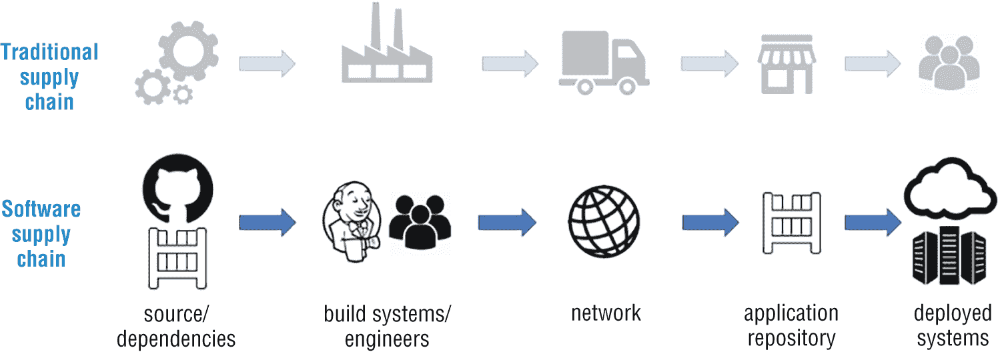

`图 7.9` ¶ 来源：CNCF 供应链最佳实践白皮书（`https://github.com/cncf/tag-security/blob/main/supply-chain-security/supply-chain-security-paper/CNCF_SSCP_v1.pdf`）。GitHub

尽管如此，尽管与制造供应链有相似之处，白皮书也强调了一些关键差异。主要事实是，软件供应链是无形的，并包含了虚拟和数字组件，这些组件不像物理领域中的组件那样可见。其他关键差异包括由于其以技术为中心的性质，软件供应链将会并继续更快速地演进。最后是复用的存在以及数字供应链的复杂性。许多人经常使用“层层叠龟”这句话，意味着在大多数情况下它是无限递归的，具有多层直接和传递依赖。许多产品和供应链是其他产品或供应链的一部分或组件。

CNCF 的指导强调了一些关键主题，如验证、自动化、控制环境中的授权和安全身份验证。这些主题对于确保整个软件供应链生命周期的稳健保证至关重要，并以其各种建议和推荐控制措施贯穿全文。


验证是确保从一个阶段到下一个阶段完整性的关键，而自动化有助于实现可重复且不可变的过程。对机器和人类实体的权限进行优化（rightsizing），可以确保每个实体和阶段只能执行其显式定义且所需的活动。虽然这是一项长期的安全最佳实践，但这种最小权限原则在行业推行零信任的过程中也受到了强调，因此在这方面两者具有相似之处。

最后，安全身份验证确保了供应链中实体之间的相互身份验证，并使用与环境及相关组织保证水平相匹配的验证方法。该指南涵盖了供应链的五个阶段——源代码安全、材料安全、构建流水线安全、制品安全和部署安全，我们将在后续章节中讨论其中的每一个部分。

### 源代码安全

软件供应链源于源代码。创建和保护这些源代码是一项基础性活动，具有影响整个下游供应链完整性的潜力。CNCF 的指南指出，在任何平台或供应商中，身份访问管理（`IAM`）都是最关键的攻击向量，它适用于所有访问代码库的人类和机器实体。这一观点得到了报告的证实，例如 Verizon 的《2022 年数据泄露调查报告》（`DBIR`；`www.verizon.com/business/resources/reports/dbir`），报告显示超过 60% 的数据泄露涉及凭据破解。

源代码安全建议涵盖了上述五个主题。这些包括验证活动，例如实施签名提交（signed commits），以确保源代码提交或修改的完整性和不可否认性。虽然有一些更传统的方法，如 `GNI Privacy Guard`（`GPG`）密钥或安全/多用途互联网邮件扩展（`S/MIME`）证书，但也有创新的新兴解决方案，例如 `GitSign`（`https://github.com/sigstore/gitsign`），它使用 `Sigstore` 来促进“无密钥”签名。由于减少了与传统签名和密钥管理相关的开销，这种对制品和元数据签名的方法越来越具有吸引力。

自动化也可用于保护源代码及关联仓库。其中一个领域是密钥泄露问题。在这种语境下，密钥是指凭据文件、安全 Shell（`SSH`）密钥、访问令牌和应用程序接口（`API`）密钥等项。密钥泛滥（secret sprawl）即敏感凭据的扩散和分布是一个严重问题，特别是在云原生 DevSecOps 环境中，这些环境包含了声明式方法，并存在在各种清单和配置文件中提交密钥的机会。

专注于密钥管理的公司 `GitGuardian` 产了许多高信息价值的报告，例如《2022 年密钥泛滥状态报告》（`www.gitguardian.com/state-of-secrets-sprawl-report-2022`），该报告深入探讨了这一问题。一些令人警觉的指标包括：2021 年平均每位应用安全工程师检测到的密钥超过 3000 次，2021 年有超过 600 万个公开泄露的密钥，是 2020 年的两倍。本书的作者之一写了一篇文章，涵盖了密钥管理现状以及不当实践可能产生的影响（`www.csoonline.com/article/3655688/keeping-secrets-in-a-devsecops-cloud-native-world.html`）。这些泄露的密钥可能赋予恶意攻击者访问权限，并在整个环境中造成破坏。该问题似乎也没有好转，`GitGuardian`发布的《2023 年密钥泛滥状态报告》发现，公开 GitHub 仓库中又泄露了超过 1000 万个新密钥。2022 年密钥也以某种形式涉及了安全事件，影响了行业中一些著名组织，如 Uber、NVIDIA、Microsoft 和 Slack（`www.gitguardian.com/state-of-secrets-sprawl-report-2023`）。

为源代码仓库实施受控环境提供了一个通过相应控制降低多种风险的机会，包括建立并遵守管理代码提交的贡献策略。与早先优化权限的建议一致，也有机会将角色和关联权限与组织内的职能职责对齐。组织可以进一步利用基于上下文的访问控制机制，该机制通过检查时间段和设备状态等因素来提供动态的、基于时间的访问，这在零信任环境中很常见。在许多网络安全领域经常被提出的另一项基本建议是强制执行职责分离，使请求的作者不能同时担任其审批者。

身份验证是一项帮助实体（无论是人类还是机器）获取代码库初始访问权限的活动。这里的一些建议包括：强制在访问仓库时执行 `MFA`，以及使用 `SSH` 密钥方便开发者访问。这些密钥应具有关联的轮换策略，以确保在密钥被破解时，限制其在恶意访问和活动方面的负面影响能力。对于机器或服务实体，组织应采用短期和瞬时的凭据。这些凭据允许机器和服务（如流水线代理程序）访问，但由于密钥在不断被生成、使用和丢弃，也能减轻凭据破解的影响。如前，凭据破解是恶意攻击者最常见的攻击向量之一，因此使用短期凭据可以减轻这种影响。

### 材料安全

在软件供应链背景下，CNCF 指南将材料视为依赖和库（无论是直接还是间接）。本节与本书的核心概念最为相关，该概念关注软件供应链的透明度和安全性。指南提到，某些高保证环境可能需要仅使用受信任的仓库，同时阻止对其他仓库的访问。值得提到，`NIST 800-161r1` 指南建议为开发建立已知受信任组件的内部仓库，我们将在第章](#c08.xhtml）“现有和新兴政府指南”中讨论，该章节涵盖了 `NIST` 的 800-161r1 指南。

CNCF 指南强调，组织在处理其使用的二级和三级软件时应使用风险管理方法。虽然对于组织和开源项目发布漏洞代码的常见漏洞与披露（`CVEs`）是惯做法，但指南指出 `CVEs` 也是一种滞后指标，意味着它们在漏洞被发现并发布后才告知消费者；此时他们正在使用的代码已经存在漏洞了。组织利用其他指标也同样重要，这些指标可以告知消费者与运行健康状况等指标相关的项目和代码的风险。其中一个项目是 `OpenSSF` 的 `Scorecard` 项目，我们将在接下来的章节“OpenSSF Scorecard”中进行讨论。


组织会从外部实体消耗软件组件，因此验证这些第三方库和组件至关重要，这包括使用校验和和验证签名等方法。组织也可以（并且应该）使用如 `SCA` 和 `SBOM` 生成等方法，来确定所消耗软件中是否存在任何漏洞的开源组件。一旦组织使用了 `SCA` 和 `SBOM`，它们就可以开始作为更广泛的软件资产清单工作的一部分，跟踪其消耗的 `OSS` 组件与所属系统之间的依赖关系。组织可以开始生成一个供应链清单，该清单不仅涵盖 `OSS` 组件，还涵盖整个组织使用的软件供应商、供源和来源。

该指南警告的另一个风险是恶意代码可能包含在编译后的软件中，例如二进制文件或 tar 包，这些文件是经过编译的，而不是源代码或文本格式。出于这个原因，该指南建议组织从源代码构建其库，而不是直接使用已经编译的软件，因为后者可能被恶意攻击者篡改。与创建软件供应链清单的建议类似，该指南建议组织建立一个受信任的包管理器和仓库清单，并控制对它们的访问，以限制从未批准来源引入代码。

组织还应该利用自动化来保障从外部获取的材料的安全。这一领域包括扫描软件的漏洞、许可影响，以及识别与摄入软件相关的直接依赖和间接依赖。

### 保护构建流水线

`CNCF SSCP` 指南将制造背景下的流水线与软件供应链生态系统中的构建流水线之间了类比，甚至将构建流水线称为“软件工厂的心脏”。流水线组装了前面讨论的许多材料，来源于源代码控制仓库和第三方提供者。这些构建流水线由各种组件组成，如构建步骤、工作节点、工具和流水线编排器，我们还将在后后的章节“安全软件工厂参考架构”中讨论其中的每一个组件。

保障构建流水线的安全需要加固构建步骤和相关的输出内容，以确保构建流水线及其过程都不会被篡改。恶意攻击者知道，如果他们能够攻破构建流水线，就可以向下游消费者分发恶意软件，而这些消费者并不会意识到上游构建过程已被篡改。

`CNCF` 建议了一些关键步骤来保障构建流水线的安全：

* 使用单一仓库存储所有构建组件
* 记录步骤及相关的输入/输出
* 使用制品和元数据签名等方法来确保构建过程的完整性

组织还应对其构建流水线和基础设施进行威胁建模和自动化安全测试，就像对待其他生产系统和环境一样。直地说，从安全角度来看，你的构建系统应该被视为生产系统，因为它们的输出最终会进入运行时环境。如果这些输出被篡改，生产运行时环境也会随之被破坏。

虽然 `CNCF` 的出版物中没有特别引用，但关于该主题的一个极佳指南来源是新成立 `OWASP Top 10 CI/CD Security Risks` 项目。正如该项目所述，CI/CD 环境、过程和系统是现代软件交付的核心。项目指出，滥用 CI/CD 环境导致了如 `SolarWinds`、`Codecov` 等多次重大安全事件，影响了数千下游消费者和组织（https://owasp.org/www-project-top-10-ci-cd-security-risks）。

指南指出了现代构建环境的核心组件，如流水线编排器、构建工作节点以及从安全的制品仓库中获取源（参见图 7.10）。这些实体协作执行诸如构建和链接依赖项、构建应用程序、测试并将其发布到安全的存储仓库，并最终部署等步骤。破坏这些过程和实体会对部署环境产生下游影响。

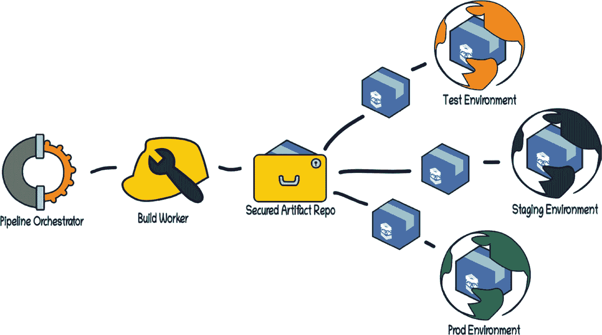

`Figure 7.10` ¶ Source: `https://project.linuxfoundation.org/hubfs/CNCF_SSCP_v1.pdf`. The Linux Foundation

验证是指南强调的另一个关键活动。这一领域包括诸如使用加密技术验证策略遵循情况、在使用前验证环境和依赖项，以及验证构建工作节点的运行时安全，如图 7.10 所示。指南将产生端到端的加密保证作为一种方案。

另一个重点是在高保证级别和高风险环境中使用可重现构建。总而言之，可重现构建能够根据给定的输入创建可以进行加密证明的输出。这意味着恶意或无意的修改可以被识别并处理。这种实践出现在其他指南来源中（如 `SLSA`），而且正如许多人指出的，这并不是一项简单的任务，在时间和资源方面可能成本高昂。这就是为什么它是一种保留给高保证环境的做法。

其他值得关注的实践和能力包括：

* 自动化创建构建环境
* 在不同的基础设施环境中分发构建任务
* 使用自动化跨团队和项目标准化流水线
* 调备安全的编排环境以托管软件工厂（见接接的章节“CNCF 的安全软件工厂参考架构”）

### 保障制品

在构建阶段完成后，会产生制品、软件以及与之相关的元数据。可以使用多种方法来保障这些制品的安全并确保其完整性，例如签名，`CNCF` 建议这种方法，且应该在制品生命周期的每个阶段进行签名。

`CNCF` 指南建议组织通过对构建过程中的每一步进行签名并验证生成的签名来执行验证。他们引用了 `The Update Framework (TUF)` 以及 `SPIFFE` 和 `SPIRE` 作为示例，这些项目可用于支持整个过程所需的证明。`SPIFFE` 和 `SPIRE` 旨在为现代和异构基础设施提供一个统一的身份控制平面。`SPIFFE` 和 `SPIRE` 的支持包括保障微服务通信、启用安全的身份验证以及零信任安全模型的跨服务身份验证（https://spiffe.io）。组织可以通过使用 `TUF` 和 `Notary` 来管理制品签名以及相关元数据和输出的存储，从而拥抱自动化。


组织还应该采取措施限制特定实体能够签署的产物，并对这些能力进行时间绑定，同时将其与定期审查相关联。时间绑定涉及对凭据和访问的有效性设置时间限制。一旦生成了产物，在发布之前，组织应对其进行加密，并使用只有授权平台和消费者才有能力解密的格式进行加密。遵循这些步骤可以确保产物在整个各个生命周期阶段都具有完整性，并确保终端消费者或接收者（无论是个人还是非人员实体）已具备适当的范围权限和访问控制。

## 部署安全

CNCF SSCP 白皮书的最后部分是`Securing Deployments`（部署安全）章节。CNCF 强调了 `TUF` 在此活动中的重要性，以及能够检测并防止恶意活动的必要性。

验证被视为软件产物部署后必须发生的关键活动，这意味着接收软件产物的客户端可以验证其完整性，还可以验证相关的元数据。这意味着如果如果创建了 `SBOM`，他们就可以验证该 `SBOM` 的签名，并验证该签名是否由授权实体签署的。

## CNCF 的安全软件工厂参考架构

对许多人来说，与软件生产相关的`factory`（工厂）一词可能看起来很奇怪。大多数人仍然将`factory` 与钢铁、汽车或消费电子产品等物理材料的收集、处理和制造联系起来。然而，的是的是驱动大多数现代工厂环境的软件，其生产方式日益呈现出与工厂的某些相似之处。`software factory`（软件工厂）一词通常指的是为了高效、可重复且安全的方式生产软件所需的工具、资产和流程的集合。

这一术语在公共和私部门都得到了应用，并获得了 `MITRE` 和 `VMware` 等组织的认可。美国国防部（`DoD`）拥有一个由 29 个软件工厂组成的稳健生态系统，最著名的包括 `Kessel Run`、`Platform One` 和 `Army Software Factory`。软件工厂结构也扩展到了美国联邦民用机构，例如`医疗保健和医疗服务中心 (CMS)` 计划下的 `batCAVE`。该术语也得到了 `CNCF` 等行业领先机构的认可，他们发布了其 `Secure Software Factory Reference Architecture`（安全软件工厂参考架构）。让我们仔细查看一下。

### 安全软件工厂参考架构

CNCF 将软件供应链定义为“在编写、测试、打包和分发应用程序软件给终端消费者时执行的一系列步骤”。软件工厂是聚合的逻辑结构，它促进了软件的交付，并且在正确执行时，确保了安全是该应用程序交付过程的一个关键组件。

`CNCF Secure Software Factory (SSF)` 参考架构（`https://github.com/cncf/tag-security/blob/main/supply-chain-security/secure-software-factory/Secure_Software_Factory_Whitepaper.pdf`）指导基于之前的 CNCF 出版，例如`Cloud Native Security Best Practices`（`https://github.com/cncf/tag-security/tree/main/security-whitepaper`）和 `Software Supply Chain Best Practices`（`https://github.com/cncf/tag-security/blob/main/supply-chain-security/supply-chain-security-paper/CNCF_SSCP_v1.pdf`）。该参考架构强调了关注安全的开源工具。它还围绕软件供应链白皮书中的四个总体原则展开：

*   深度防御
*   签名与验证
*   产物元数据分析
*   自动化

每个原则都是确保从起点和代码到生产的安全软件交付的保障。

该参考架构还明确，其重点不在代码扫描和签名等关注领域，而是更深入地关注代码出处和构建活动。这种关注的理由是，下游活动如静态应用程序安全测试/动态应用程序安全测试（`SAST/DAST`）依赖于对出处的验证，以及你接收内容的实体身份是否是可信实体。这些身份可能是与人类用户关联的身份，也可能是机器身份。签名与验证其来自可信源相结合是确保出处的关键。

安全软件工厂（`SSF`）中的每个实体都有依赖关系，无论这些是与广泛的组织 `IAM`、源代码管理有关，还是下游消费者对 SSF 本身提供的所用产物的证明和签名的依赖。

SSF 包含多个组件，其中一些被认为是核心组件、管理组件和发布组件。核心组件负责接收输入并使用它们创建输出产物。管理组件专注于确保 SSF 的运行与您的策略一致。最后，发布组件将工厂的产品安全地移动到下游消费。

### 核心组件

这些核心组件包括您的调度和编排平台、流水线框架和工具，以及构建环境。所有 SSF 组件都使用平台和相关的编排来执行其活动。流水线和相关工具允许促进构建软件产物的工作流。该指南强调，流水线应遵守与您的负载相同的要求。这旨在指出流水线是您的攻击面的一部分，可能会被利用来影响下游消费者，就像在 `SolarWinds` 事件中发生的那样。这种强调得到了如 `SLSA` 等新兴框架的呼应。

最后，您有你的构建环境，您的源代码在其中被转换为机器可读的软件产品，称为 `artifacts`（产物）。成熟的构建环境正致力于就构建过程中使用的输入、操作和工具提供自动化证明，以验证构建过程及相关输出/产物的完整性。

诸如 `TestifySec`（`www.testifysec.com`）等组织正在创新，以确保组织能够检测到流程篡改或构建破坏。一个著名的例子是 `Witness` 项目，它旨在防止构建材料被篡改并验证从源到目标构建过程的完整性（`https://github.com/testifysec/witness`）。

### 管理组件

管理组件包括策略框架以及证明者和观察者。在 SSF 背景下，您的策略框架是帮助规范组织和安全要求的工具，例如 `IAM`、分配的工作节点和授权的容器镜像。由于风险承受能力的不同以及大量相关的监管框架，这些策略对于每个组织来说都不同。随着我们观察零信任的推进，策略框架变得尤为关重要。

确定谁在什么背景下允许做什么，是执行零信任原则（如最小权限访问控制）的关键。您不希望部署由未经授权的人员推送的容器，甚至是来自我们不信任或未由我们信任的源签名的容器，等等。

### 发布组件


完善 SSF 中识别的关键组件的是你的分发组件，包括制品存储库和准入控制器。你的流水线过程的输出会生成制品，这些制品被存储在你的制品存储库中。这些制品可能包括容器镜像、Kubernetes 清单、SBOM 以及相关的签名。我们越来越多地看到，人们倾向于使用 `Sigstore` 等解决方案不仅对代码，还对 SBOM 和证明进行签名。这在之前讨论过的 Linux 基金/OpenSSF OSS 安全动员计划中得到了强调（`www.csoonline.com/article/3661631/the-open-source-software-security-mobilization-plan-takeaways-for-security-leaders.html`）。在你的制品存储库之后，你还有准入控制器，它们负责确保只有经过授权的工作负载才能被你的调度和编排组件运行。这些控制器可以执行策略，例如允许哪些源被引入构建中，哪些组件被允许部署到节点主机上，并确保所使用的组件是可信且可验证的。

### 变量与功能

SSF 指南理解到 SSF 的输入和输出会有所不同。输入包括源代码、软件依赖项、用户凭据、加密材料和流水线定义等项目。输出包括软件制品、公共签名密钥和元数据文档。白皮书还讨论了 SSF 功能，例如项目如何通过 SSF，并最终提供安全的输出和制品，这些输出经过证明并具有某种程度的保证，以与下游消费者建立信任。

### 总结

乍看之下，SSF 参考架构似乎很复杂，这是因为其确实复杂。在现代云原生环境中交付软件涉及许多移动部分以及随之而流程，以确保消费和产生的内容都能以与组织风险容忍度相匹配的保证水平完成。

这种复杂性也强调了将所有内容整合在一起是多么具有挑战性，同时也强调了该系统充满了失误和配置错误的机会，从而对整个生态系统中的消费者产生级联的下游影响，而所有这些系统在现代经济中都是由软件驱动的。人们常说，防御者必须一直正确，而恶意攻击者只需要正确一次即可。在充满人员配置挑战和认知过载的复杂云原生环境中，这可能类似于在一堆针中寻找某根特定的针，而不是在草堆中。

## 微软安全供应链消费框架

作为开源软件（OSS）最大的贡献者和消费者之一，微软也创建了一个名为安全供应链消费框架（`S2C2F`）的软件供应链安全框架，这并不意外。微软于 2022 年 8 月首次正式宣布 `S2C2F`，但表示他们早在 2019 年就开始内部使用它来保护自身的开发实践。更进一步的是，微软在 2022 年 11 月通过让行业开源领袖 OpenSSF 正式采纳它，将 `S2C2F` 贡献给了 OSS 社区（`www.microsoft.com/en-us/security/blog/2022/11/16/microsoft-contributes-s2c2f-to-openssf-to-improve-supply-chain-security`）。

让我们稍微深入了解该框架，看看它涵盖了什么以及旨在实现什么。微软表示，该框架的目标是概述安全消费 OSS 依赖的核心概念，并实施安全消费 OSS 的核心实践。与许多框架类似，该框架强调了 OSS 在软件生态系统及更广泛行业中在驱动生产力和创新方面所起的关键作用。微软表示，该指南分为两个部分：

* 与解决方案无关且以成熟度为导向的部分，面向安全高管等个人人员
* 实现部分，侧重于实际软件开发人员及其安全同仁，这使其在组织层面具有信息参考价值，同时在战术层面仍具有可操作性

`S2C2F` 有三个高级目标：

* 提供一个强大的 OSS 治理计划
* 提高 OSS 中已知漏洞的平均修复时间（`MTTR`）
* 防止消费受损和恶意的 OSS

三个框架目标与以下三个核心概念协同工作：

* 规模
* 持续过程改进
* 所有制品输入的控制

[图 7.11](https://github.com/ossf/s2c2f/blob/main/Secure_Supply_Chain_Consumption_Framework_(S2C2F).pdf) 展示了这些目标和概念。（注：此处为图片说明）

[图 7.11](https://github.com/ossf/s2c2f/blob/main/Secure_Supply_Chain_Consumption_Framework_(S2C2F).pdf) 源自：https://github.com/ossf/s2c2f/blob/main/Secure_Supply_Chain_Consumption_Framework_(S2C2F).pdf

虽然核心概念表面上听起来很简单，但在开发软件的大型环境中，它们可能是极其复杂且令人敬畏的。正如 `S2C2F` 指出的，现代软件开发者以各种方式消费 OSS。开发标准的消费方式并让开发者遵循这些方式使得保护 OSS 可能。

在整个组织的开发团队中引入治理和结构化的 OSS 方法至关重要。孤立实施的实践和成熟度并不是高效的，而且无法应对现代企业广泛的攻击和风险面。因此，`S2C2F` 也围绕“规模”作为一个核心概念。指南指出的一个具体示例是提倡使用集中的内部存储库，这在 NIST 的软件供应链指南 `800-161 r1` 中也是一项建议。

正如框架指出的，一旦某个开发者决定从内部存储库之外提取 OSS 组件，这种模型就会崩溃，而且内部存储库本身需要开销和管理，这具有相应的负担和成本。`S2C2F` 的设计正如他们所说的，是为了在大规模范围内保护 OSS 消费，而无需采用我们涵盖的其他指南中所倡的中心化方法。这种思想对于支持或采取更去中心化方法的组织应该产生共鸣。

`S2C2F` 是跨能力成熟度路线图的工具和需求组合，专注于通过治理实现安全的 接入。`S2C2F` 指南讨论了常见的 OSS 供应链威胁，涵盖了威胁本身，还涵盖了攻击发生的真实案例，然后将其映射到特定的 `S2C2F` 要求。`S2C2F` 提供的示例从 OSS 代码或容器中的意外漏洞到仓库和软件包中的故意后门和恶意活动。该指南引用了 Google 的软件供应链威胁，涵盖了来自源源、构建、部署/运行时以及依赖项的威胁（`https://cloud.google.com/software-supply-chain-security/docs/attack-vectors`）。列出的威胁还包括更温和的来源，例如已停止且不再修复漏洞的 OSS 组件，以及维护者未能未能消费者期望的时间内修复漏洞。


如所述，S2C2F 包含了一套解决方案与供应商无关的实践，可以帮助组织保障其开源软件（OSS）的使用安全。合规、安全和工程经理以及首席信息安全官（CISO）可以参考这些实践，以识别组织在安全 OSS 使用和治理方面的差距。现在让我们逐一查看这些实践以及其具体含义。

## 摄入 (Ingestion)
提到的第一项实践是摄入。正如 S2C2F 指出的，保护软件供应链的第一步是控制产物输入，包括软件包和源代码产物。该实践旨在让组织在外部 OSS 源被破坏或不可用的情况下仍能交付资产。软件包产物包括 Linux 软件包仓库或 Open Container Initiative (`OCI`) 注册表等。组织需要代理这些外部源并保存所需的副本。在源代码产物方面，该实践主张在内部镜像外部源代码仓库并在本地缓存包，以便组织能够在不利情况下继续运行，从而体现业务连续性。它还允许组织进行安全扫描，甚至向上游提交修复方案，或者在希望而非向上游提交的情况下在本地修复代码。

## 扫描 (Scanning)
在摄入之后，下一项实践是扫描，其目标是确保消费组织和个人对与 OSS 组件相关的漏洞具有可见性。正如 S2C2F 所述，信任是通过对所消费组件的安全态获得可见性来建立的。通过扫描摄入的 OSS 组件，组织可以识别配置错误、漏洞代码、已知漏洞或可能增加潜在攻击面的冗余代码。组织可以使用许多开源和私有扫描工具来完成这项实践。

## 资产盘点 (Inventory)
一旦组织摄入并扫描了 OSS 组件，他们就需要对其进行资产盘点，以便了解这些 OSS 组件在生产环境中的存在位置。S2C2F 使用的一个完美例子是 `Log4J` 事件。拥有准确 OSS 组件清单的组织比缺乏此类清单的组织有更好的能力来应对该事件。随着 OSS 组件中出现其他关键漏洞，拥有清单的组织可以通过修复或分类处理漏洞或被破坏的组件及系统来快速做出响应。

## 更新与补丁 (Update and Patching)
对摄入的组件进行扫描和点是一个很好的开始，但正如我们所知，软件会像牛奶一样老化——这意味着不可避免需要对生产环境中的组件进行更新和打丁。因此，下一项实践是具备根据需要更新组件的能力。众所周知，当漏洞被公开时，通常是组织修复或缓解漏洞的能力与恶意攻击者利用该漏洞的能力之间的一场竞跑。

出于此原因，在整个企业的 OSS 范围内大规模更新和对漏洞组件进行补丁实践至关重要。这里的另一个考虑因素是，OSS 组件通常由志愿者维护，没有与漏洞修复相关的服务水平协议（`SLAs`）。因此，如果 OSS 维护者没有直接提供修复，消费者必须做好实施虚拟补丁和其他缓解措施的准备。

## 审计 (Auditing)
拥有围绕 OSS 摄入和使用的标准化流程是一回事，但你必须能够对你的环境进行审计，以识别偏离流程或对组织构成风险的组件。因此，指南中的下一项实践是审计。这意味着组织可以审计其 OSS 组件，并验证它们是否通过了标准化的摄入、扫描和盘点流程；否则，治理就会开始崩溃。

## 强制 (Enforcement)
虽然审计很好，但组织必须能够对发现的未治理的 OSS 组件采取行动。因此，强制是指南中的下一项实践。如果开发者绕过既定流程，从不受信的源引入未治理的 OSS 组件，那么组织必须能够纠正这种偏差。指南提供的示例是强制重定向 `DNS` 流量，或在构建过程中建立关卡，以便在引入未验证的 OSS 组件时中断构建。恶意攻击者越来越多地尝试破坏构建过程或基础设施，以导致被破坏的二进制文件和产物。

## 重建 (Rebuild)
指南中的下一项是具备能够从源代码重新构建每个部署的 OSS 产物的实践。如果恶意攻击者能够在构建期间插入带有后门的恶意 OSS 包，或对生成的二进制文件进行未经授权的更改，这可能会变得关键。

S2C2F 强调，对于关键产物或业务关键的高价值资产，可能需要为用于创建生产服务或应用程序版本的每一个产物创建一个从原始源代码开始的监管链（chain of custody）。这项实践侧重于让那些依赖关键 OSS 组件的开发者能够摄入源代码、重新构建它、根据需要进行修改（如签名），然后缓存重新构建的产物供内部使用。

## 可复现构建 (Reproducible Builds)
这项实践直接指向可复现构建
S2C2F 的最后一项实践是能够修复问题并向上游贡献。S2C2F 表示：“我可以在收到损害通知后的 3 天内私下补丁、构建和部署任何外部产物，并秘密地将修复提交给上游维护者。”这是一项非常成熟的实践，因为它将责任从对维护者的严格依赖转变为软件消费者成为 OSS 项目或组件的活跃贡献者。这正是我们在文本其他部分提到的研究人员所倡导的行为，例如 Chinmayi Sharma 题为《数字公社的悲剧》（A Tragedy of the Digital Commons）的研究。

尽管如此，指南指出这仅适用于极端情况和临时风险缓解，即当上游维护者无法在组织可接受的风险窗口内提供公共修复时。这似乎是对允许维护者采取适当行动的认可，同时也愿意在适当的情况下提供帮助，这正是 OSS 社区的精神。S2C2F 还倡导组织以多种方式向 OSS 社区贡献，例如直接或通过基金会提供资金支持、参与赏金计划、倡导最佳实践以及积极参与关键项目。


第 1 级包含基础活动，例如内部缓存包、进行基础清单和基础扫描，以及更新环境中的 OSS。第 2 级在此基础上，通过缩短漏洞组件修复的平均恢复时间（`MTTR`）并执行事件响应。第 3 级涉及已知恶意或不可信组件及来源的拒绝列表，扫描 OSS 组件中存在的恶意软件，并强制执行溯源性（provenance）。最后，第 4 级被认为是目标水平，这意味着大多数组织都无法达到这一成熟度，行业中资源最丰富且最敏感的组织除外。此级别的活动包括在受信任的构建基础设施上重新构建 OSS，并为重新构建的 OSS 组件创建并对 SBOM 进行数字签名。

虽然这四个成熟度级别以及相关的能力或要求很有帮助，但组织需要了解如何根据这些级别对自身或他人进行评估。`S2C2F` 提供了两个高级别的步骤：准备评估，然后实际执行评估。准备工作涉及确保组织乐意与开发和工程团队沟通，以询问指南中讨论的工具、能力和工作流。指南随后提供了一系列可以作为评估部分的示例问题。这些问题涉及理解目前项目是如何消耗 OSS 的、来源何，以及前述核心概念、目标和框架成熟度级别中讨论的现有治理和安全实践。

评估完成后，组织应该对其在框架建议的能力和实践方面的当前成熟度水平有更好的理解。这种理解使组织能够制定改进计划，以解决在评估过程中发现的缺陷或薄弱环节。然后，组织可以根据各自的目标和风险承受能力，采取针对性的投资和计划，以改进它们认为最关键的能力和实践。

`S2C2F` 在一个矩阵表格中列出了框架的要求，该表格包含了实践、要求 ID、成熟度级别、要求标题以及实施该实践对组织的相关收益。由于工具是核心组件并满足各种要求和成熟度级别，指南还提供了工具可用性和建议，包括现有的免费工具、来自 `Microsoft` 的工具以及 `Microsoft` 正在开发的拟议工具。

`S2C2F` 指南是供应链安全对话中欢迎的补充，而 `Microsoft` 为 `OpenSSF` 贡献框架展示了 `Microsoft` 对 OSS 社区的承诺以及对帮助行业解决问题的决心。

## OWASP 软件组件验证标准

与政府机构创建的框架（如 `NIST` 的安全软件开发框架 `SSDF`）不同，`OWASP` 的软件组件验证标准（`SCVS`）是一项专注于软件供应链的社区驱动工作。它主要通过识别在整个软件供应链生命周期中可以实施的相关活动、控制和最佳实践来降低软件供应链的风险。`OWASP` 的 `SCVS` 在整个 `NIST SSDF` 指南中也被引用，将在第 8 章中讨论。`SCVS` 1.0 版本于 2020 年发布，由 `Steve Springett` 以及其他几个贡献者和评审员领导。

`SCVS` 分六个控制族，每个族包含针对软件组件验证和过程各个方面的多个控制：

*   清单 (Inventory)
*   SBOM
*   构建环境 (Build Environment)
*   包管理 (Package Management)
*   组件分析 (Component Analysis)
*   血缘与溯源 (Pedigree and Provenance)

### SCVS 级别

与 `SLSA` ，`SCVS` 使用级别——级别越高，要求越严格。`SCVS` 有三个级别。第 1 级用于低保证需求。第 2 级用于中等敏感的情况。第 3 级由于任务关键用于高保证环境。让我们深入查看这些级别，以理解一些基础控制。

#### 第 1 级

正如 `SCVS` 指南所述，第 1 级为所有后续级别奠定了基础。与其他框架类似，第 1 级包含一些基础活动，最重要的是拥有清单。在软件世界中，这越来越多涉及到为了追求可重复构建的持续集成（`CI`）。流行的 `CI` 平台包括 `CircleCI`、`Jenkins`、`GitLab` 和 `GitHub` 等。持续集成涉及开发者将他们所有的代码副本合并到共享存储库中。`CI`既涉及技术也涉及开发者频繁整合代码的文化实践。最后，第 1 级要求使用可用工具对第三方组件进行分析。

#### 第 2 级

`OWASP` 所述，`SCVS` 的第 2 级关注在其环境中已具备某种程度风险管理成熟度的软件密集型组织。第 2 级在第 1 级确定的控制措施的基础上，引入了更多的利益相关者和方，例如可能参与合同和采购等领域的非技术专业人员。

#### 第 3 级

第 3 级是 `SCVS` 级别中最严格的，专注于整个软件供应链的可审计性和端到端透明度。这一级别通常留给监管最严格和最敏感的行业，以及最成熟的组织。

### 清单

准确的清单长期以来一直是关键的安全控制措施，正如 `SANS` 和 `CIS` 关键安全控制框架等来源所引用的。尽管被引用，它长期以来一直是组织努力解决的挑战，因此看到清单作为 `SCVS` 标准中列出的第一个控制族并不意外。在 `SCVS` 的背景下，重点是拥有一个创建软件时使用的所有组件的清单，并倡导跨越单个应用程序、组织范围内的清单，以及加强与软件获取相关的软件透明度的控制措施。`SCVS` 类似于更广泛的软件透明度推动，主张拥有组织范围内的软件清单，这包括第一方和第三方软件组件，包括 OSS 代码。


## 清单（Inventory）族的第 1 级关注关键活动，例如在构建时获知直接和间接组件，以及使用包管理器管理第三方二进制组件。第 1 级包括以机器可读格式拥有全面的第三方组件清单，并为公开和商用的应用程序生成 SBOM。第 2 级在这些控制的基础上，还要求新软件采购提供 SBOM。这种控制示例扩展了网络安全从业人员的范围，并开始涉及其他非技术利益相关者，例如采购人员，他们可以开始在采购时要求提供这些产物。

# 清单族的第 3 级开始增加更严谨的控制，例如对持续维护所有系统的 SBOM，并了解整个清单中的组件类型。第 3 级不仅要求了解组件类型，还需要了解组件的功能，更重要的是了解所有组件的源点。这在涉及软件供应链时通常被称为 `provenance`（来源/可追溯性）。

## 软件物料清单 (Software Bill of Materials)

软件物料清单（`SBOM`）是 SCVS 框架内的关键组成部分和安全控制族。SCVS 规定，具有成熟开发实践的组织在其构建流水线活动中创建 `SBOMs`，并采用机器可读格式。SCVS 承认存在多种 `SBOM` 格式，例如 `CycloneDX` 和 `SPDX`，组织需要与最符合其用例的格式对齐，也可能需要支持多种格式，以满足功能和合同要求，并能够与多样化的供应商生态系统协作。

`SBOM` 族的第 1 级制定了一些基础控制，例如拥有结构化且机器可读的 `SBOM`、为 `SBOMs` 分配唯一标识符以及使用时间戳等元数据。在这些控制的基础上，SCVS 要求 `SBOMs` 对其所描述的所有组件具有完整且准确的清单，并分析 `SBOMs` 是否存在与组件相关的任何漏洞。最后，还要求确保组件标识尽可能从原生生态系统中派生，并对 `SBOMs` 中包含的组件拥有准确的许可信息。

在第 1 级要求的基础上，`SBOM` 族的第 2 级增加了控制，例如不仅要求 `SBOMs` 由发布者、供应商或认证机构签名，还要执行签名验证活动。第 2 级还要求 `SBOMs` 拥有应用程序所有测试组件的准确清单，以及关于 `SBOM` 所描述的资产或软件的元数据。最后，要求 `SBOM` 中定义的组件在适用情况下具有有效的 `SPDX` 许可 ID 或表达式。

第 3 级为 `SBOM` 活动族增加了更多控制。这些包括以机器可读格式（如 `PURL`）识别组件的源点，以及为 `SBOM` 中定义的软件组件拥有有效的版权声明。此外，第 3 级要求为 `SBOM` 中定义的组件提供详细的来源（provenance）和传承（pedigree）信息，并对 `SBOM` 中定义的组件使用 `SHA-256` 等文件哈希。

## 构建环境 (Build Environment)

SCVS 承认现代构建环境的复杂性，包括源代码和包仓库、CI/CD 过程、测试活动，以及使软件构建和交付可能的网络基础设施和服务。正如 SCVS 所提到的，构建环境和流水线中的每个实体和活动都为恶意攻击者提供了可能的攻击向量，同时也为传统故障和配置错误提供了可能。这可能通过 `SLSA` 等其他框架得到了得好的阐述，它们说明了现代流水线中的各种攻击向量和潜在的受损点。

构建环境控制族是 SCVS 中最大的部分，有 20 多项控制与之相关。第 1 级涉及基础控制，例如拥有可重复的构建过程和文档。它还涉及此类控制，例如确保构建流水线只能从源代码进行构建，使用版本控制系统并确保二进制文件是已知且定义的。（等待，根据文本纠正：“确保构建流水线只能从源代码进行构建，使用版本控制系统并确保二进制文件是已知且定义的”）。最后，第 1 级要求对所有第一、第三方组件拥有哈希值。

构建环境的第 2 级开始增加活动，例如不允许在执行构建的任务之外修改构建内容。第 2 级还要求在构建流水线上强制身份验证和授权以及默认拒绝设置。考虑到构建流水线本身可能由于过时的系统和软件而被破坏，第 2 级要求为构建流水线建立维护周期。最后，第 2 级要求通过带外方式访问并交付所有组件的哈希值。

第 3 级的最终要求包括此类项，例如要求修改构建流水线系统设置时的职责分离，并保留所有系统和构建作业变更的可验证审计日志。还要求监控编译器、版本控制系统（`VCSs`）、开发工具和软件开发包（`SDKs`）的篡改和恶意代码。控制要求识别并从应用程序中移除使用的直接和间接组件，这有助于减少攻击面。

## 包管理 (Package Management)

SCVS 指出，现代开源（OSS）组件通常发布到特定生态系统的包仓库中，例如 `Maven`、`.NET` 和 `NPM`。组织日益被引导建立内部仓库，不仅包括第一方组件，还包括受信任的第三方组件，`NIST 800-161r1` 和 `NSA Secure Guidance for Developers` 等指南都建议了这种方法。SCVS 注意，包管理器在构建过程中经常被调用，使用它们有许多业务和技术优势，但也存在安全考量。


在软件包管理（Package Management）系列中，将控制级别提升至第 2 级需要对包仓库进行强身份验证，包括使用多因素身份验证（MFA）。鉴于近期发生的 MFA 泄露或滥用事件（`www.yubico.com/resources/glossary/phishing-resistant-mfa/?gclid=Cj0KCQjwj7CZBhDHARIsAPPWv3fXCG329UPlV7Oz3WZvIvcdHfJeDqo60tPOHaa9KsNcXZ2BZK5N_voaAvhqEALw_wcB` `www.malwarebytes.com/blog/news/2022/08/twilio-data-breach-turns-out-to-be-more-elaborate-than-suspected#:~:text=Earlier%20this%20month%2C%20messaging%20service,more%20elaborate%20than%20originally%20assumed`），组织可能希望特别关注防钓鱼的 MFA。除了强身份验证外，第 2 级还要求确保包仓库具备进行安全事件报告的能力并向发布者通知安全问题。相关控制措施要求包仓库能够验证地将组件版本与版本控制系统（VCS）中的源代码建立关联，并要求在将包发布到生产仓库时进行代码签名。

最后，软件包管理系列中的第 3 级增加了若干额外的控制措施。这些包括确保包仓库组件在发布时使用了 MFA 并实现了自动化的安全事件报告（包括对用户安全问题的通知）。此外还要求包仓库在发布组件之前进行软件成分分析（SCA），并将结果提供给软件组件消费者以及分析和保障人员。

### 组件分析 (Component Analysis)

SCVS 的第五类控制系列是组件分析，它是识别使用开源软件（OSS）和第三方组件带来的潜在风险区域的过程，这不仅包括直接组件，还包括间接组件。组织需要了解其在应用程序和系统中使用的 OSS 及第三方组件相关的任何固有风险。开源软件和第三方软件的使用无处不在，现代应用程序中很大一部分是由 OSS 和第三方软件组件构成的。组织必须了解他们正在使用的组件，以及与这些组件相关的任何漏洞和风险。

为了了解漏洞，组织最常用的参考来源是 NIST 国家漏洞数据库（NVD），用以查找已知漏洞。除了已知漏洞外，组织还应该熟悉其他数据，包括组件版本新旧程度、组件类型、功能和数量等术语。这意味着要理解组件是否过时或结束寿命（EOL）并可能存在漏洞，以及理解组件类型及其对升级和风险的任何影响。组织应该了解组件的功能以识别重复组件，并仅使用高质量的组件以使风险最小化。组织还应该了解其清单中的组件数量，因为管理组件蔓延（component sprawl）变得越来越困难。最后，组织必须了解与其使用的组件相关的许可证类型，因为可能存在分发要求、限制和冲突，从而产生业务风险。

组件分析系列的第 1 级涉及诸如能够使用代码检查工具（linters）和静态分析分析组件等活动。重点是自动化操作，例如识别与组件相关的已公开漏洞，以及识别正在使用的非指定组件版本或过时组件。组织还必须具备自动化流程，用于识别使用的组件数量以及与组件相关的许可。

第 2 级进一步这些这些步骤，确保通过代码检查和静态分析对组件进行分析，包括使用主版本或次版本修订的要求，并自动化识别正在使用的组件类型的过程。第 3 级的关键区别在于自动化识别组件的可利用性、生命终止/支持状态的过程。

### 血缘与来源 (Pedigree and Provenance)

最后一个控制系列是血缘与来源，这至关重要，因为如果不知道软件的来源及其质量，就很难产生信任或理解它。血缘与来源系列的第 1 级涉及获取修改组件的来源并了解其相关风险。在第 1 级的基础上，第 2 级增加了控制措施，以确保组织拥有修改组件的文档血缘。第 3 级的唯一控制措施涉及拥有源代码和二进制文件的监管链链。

### 开源策略 (Open Source Policy)

虽然这不是 SCVS 中的一个正式控制系列，但该指南对组织更广泛地使用 OSS 提出了建议。尽管 OSS 在组织生产和消费的应用中泛滥使用，但许多组织在治理这方面的安全成熟度不高。

SCVS 建议组织建立由跨职能利益相关者支持并执行的 OSS 策略。这些策略应涵盖与 OSS 相关的关键考虑因素，例如了解组件年龄、设置使用组件的要求、通过自动化能力保持组件更新。组织还应该建立排除已知漏洞组件的指南，或者至少明确可接受风险的立场。某些组织可能还会由于漏洞、国家安全或其他因素制定一份禁止组件清单。

如前所述，虽然 OSS 的使用极其普遍，但许多组织尚未花时间在正式政策和指南中将其对 OSS 的立场法化。我们已经开始看到一些组织在领先，他们超越了政策范畴，建立了开源项目办公室（OSPOs）（`www.linuxfoundation.org/resources/open-source-guides/creating-an-open-source-program`），以帮助治理和驱动组织在其生产及消费的软件中使用 OSS。

## OpenSSF Scorecard

每个人都熟悉 Marc Andreessen 提出的那句“软件正在吞噬世界”（`https://a16z.com/2011/08/20/why-software-is-eating-the-world`），这已经可以追溯到十多年前了。软件驱动着现代社会的几乎每一个方面，无论是在个人还是职业领域，它对现代经济甚至国家安全至关重要——这一点不容置疑。鉴于这一现实，也可以说 OSS 吞噬了软件行业。根据 Linux 基金会等机构的估计，自由和开源软件（FOSS）构成了任何现代软件解决方案或产品的 70 到 90%（`www.linuxfoundation.org/blog/blog/a-summary-of-census-ii-open-source-software-application-libraries-the-world-depends-on`）。现代软件不仅主要由 OSS 组件组成，IT 领导者也倾向于与同样向 OSS 社区贡献的供应商合作（`www.redhat.com/en/enterprise-open-source-report/2022`）。


开源软件（OSS）泛滥使用的许多原因，包括灵活性、成本效益、通过社区驱动的项目实现创新，以及通过审查代码和让更多“眼睛（eyeballs）”关注代码来提高安全性，特别是对于大型开源项目而言。尽管如此，开源软件也并非无忧可无，包括受影响代码的漏洞和 CVE。`CVE` 是密锐公司（MITRE）设立的一个项目，旨在“识别、定义和列举公开披露的网络安全漏洞”（`cve.mitre.org`）。然而，正如 CNCF 软件供应链最佳实践白皮书所提到的，`CVEs` 是一个“滞后指标”，意味着 `CVEs` 是已公开披露的漏洞的枚举。它们只是与软件相关的潜在风险和漏洞之一。

出于这一原因，建议组织利用其他方法来评估其所使用的特定开源项目的安全状态，其中最受注目的项目之一是 OpenSSF 的 Scorecard 项目（`http://openssf.org`），我们将在接下来讨论它。

### 开源项目的安全评分卡片

2020 年底，OpenSSF 宣布了其名为“Scorecard”的项目，旨在为开源项目自动生成安全评分，以帮助消费者和组织就其开源消费做出知晓风险的决策。组织正在大量使用开源依赖项，但确定消费这些依赖项的风险在很大程度上仍然是手动活动，特别是在软件生态系统的规模操作中。Scorecard 项目试图通过其自动化启发式方法和安全检查来缓解部分负担，评分分范围为 0–10 分（见 图 7.13）。

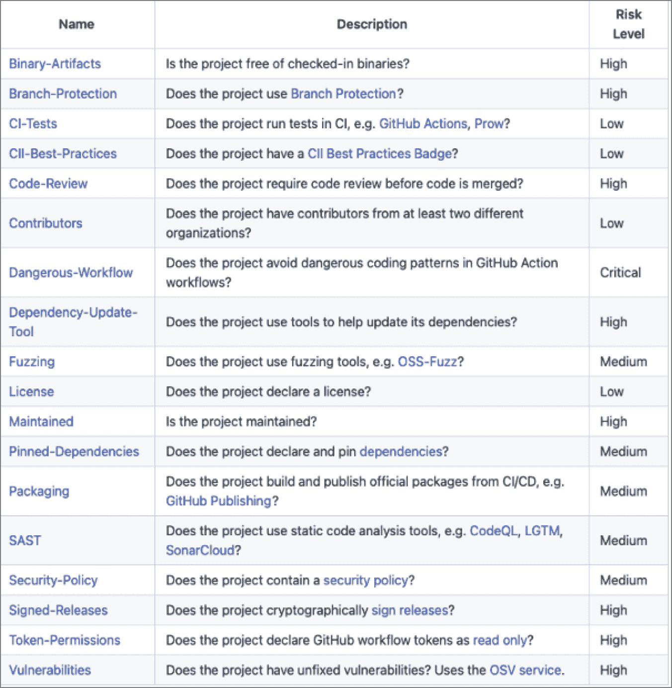

Figure 7.13

Scorecard 项目的目标并不低；他们根据直接依赖关系扫描一百万个最关键的开源项目，并每周将结果发布到公共数据集中。除了利用这个公开的数据集外，组织还可以通过 `GitHub Actions` 针对自己的 GitHub 项目运行 `Scorecard`。每当仓库发生变化时，`GitHub Actions` 就会运行并向这些项目的维护者提供警报。

Scorecard 项目使用严重（Critical）、高（High）、中（Medium）和低（Low）的评分分级，这是许多安全从业人员熟悉的严重程度分。Scorecard 项目对其目标的所有项目运行一组标准检查列表，无论是公共项目，还是您在自己的 GitHub 仓库中原生使用它。对于感兴趣的人，您可以深入了解其中一些检查项的内容。它们包含了基础的安全实践，例如使用分支保护和对发布版本进行加密签名。为了检测未修复漏洞的存在，Scorecard 项目使用了 `OSV Vulnerability Database`（`http://osv.dev`），这是一个专门用于开源软件的分布式漏洞数据库，它使用 `OpenSSF OSV` 格式。`OSV` 的核心是使用 `OSV` 架构对其他漏洞数据库进行聚合，例如 `GitHub Security Advisories` 和 `Global Security Database` 等。`OSC` 还支持通过 API 和命令行界面（`CLI`）工具来扫描格式为 `CycloneDX` 或 `SPDX` 格式的 `SBOMs`，这我们在第 3 章“漏洞数据库和评分方法论”中讨论过。

### 组织如何利用 Scorecard 项目？

如前所述，组织正在广泛使用开源软件。然而，对开源消费进行尽职调查、治理和风险管理的做法仍处于起步阶段。我们看到一种强大的推动，以增强软件供应链的韧性和成熟组织的软件供应链安全实践，包括 NIST 的《系统和组织网络安全供应链风险管理实践》、NIST 的 `SSDF`、OpenSSF 开源安全移动计划、`SLSA` 以及许多其他最佳实践和指导来源的涌现。所有这些都涉及了治理组织对开源软件消费的需求，并确保这种消费符合组织的风险承受能力。

虽然这在表面听起来很简单，但在组织所消费的整个庞大的开源项目和组件生态系统中执行这一操作绝非易事。OpenSSF 的 Scorecard 项目提供了一种自动化方式，可以获取超过百万个领先开源项目的安全和风险洞察，并允许组织原生地在他们自己的软件和项目中使用该项目。

组织可以通过 `CLI` 对他们不拥的项目使用 `Scorecard`，还可以针对 `npm`、`PyPi` 或 `RubyGems` 等项目使用包管理器。`Scorecard` 也以 `Docker container` 的形式提供，并可以通过此路径进行部署。

Scorecard 项目每两周活动一次，并有一个活跃的 Slack 频道。它由来自 Google、Datto 和 Cisco 等公司的协调员领导。自成立以来，`Scorecard` 的人气日益增长，被列为拥有超过 3,000 个星标（Stargazers），即收藏了该项目的用户。随着组织继续推动其开源消费治理实践的成熟，该项目将不可增长。组织和个人贡献者也有机会参与该项目，包括提交检查项以供评分评估考虑。组织还可以自定义对 `Scorecard` 的使用，仅运行可能与其组织或行业特定安全需求一致的特定检查。

Scorecard 提供了一项关键能力，能够自动执行一套稳健的评估标准，对于组织而言，无论是对其消费的公共项目还是想要评估的内部项目，手动操作都是不可能的。众所周知，尽管开源软件带来了价值和创新，但大多数自由开源（FOSS）项目都人手不足，并由无报酬的志愿者贡献者领导。这并不是说组织不应该使用开源项目，而是说他们对消费的项目以及这些项目带来的风险应该保持严谨性。Scorecard 项目以易于能力恰恰符合了这一需求。它在评估开源项目的安全顾虑时，这些顾虑与最佳实践（如签名、`SAST` 等）保持一致，而这些已受到公共和私营安全领导者的倡导。

## 前行之路

尽管开源软件提供了巨大的收益，但许多担忧和研究发现，FOSS 开发者在很大程度上并不考虑安全。Linux Foundation OpenSSF 和哈佛大学创新实验室的一项研究显示，平均 FOSS 开发者仅花费约 2.3%的时间来改进代码的安全（`www.darkreading.com/application-security/open-source-developers-still-not-interested-in-secure-coding`）。这要求消费开源的组织采取各种措施，例如在消费之前对开源组件进行审查，并使用 `SBOMs` 来了解与其开源消费相关的漏洞以及这些组件位于企业内部的位置，以便更好地应对下一次类似 Log4j 类型的情况。


为了获得更具体的指导，组织可以参考 NIST 建议的开源软件控制实践，这些实践是为了响应网络安全行政命令 (EO) 14028 —— 提高国家网络安全。这些实践包含了基于组织成熟度的分级能力：基础级（Foundational）、维持级（Sustaining）和增强级（Enhancing）。这些层级中包含了多种能力，例如使用 SCA 源码审查来识别漏洞组件、优先使用带有内置防护机制的语言，以及在将 OSS 组件引入生产环境之前，自动化完成收集、存储、扫描并进入加固的内部仓库的过程。

现在应该显而易见，对于安全使用开源软件（OSS）或任何软件来说，并没有万能药或灵丹妙药。尽管如此，通过合理的人员、流程和技术（按此顺序排列），组织可以在享受 OSS 处的同时，降低降低其带来的风险。

### 总结

在本章中，我们讨论了有关软件供应链安全的现有和新兴指南。这包括诸如 SLSA 等此类工作，以及来自微软、CNCF 等机构的资源。在下一章中，我们将讨论来自政府实体的现有和新兴指南。

# 第 8 章：现有和新兴政府指南

在本章中，我们将讨论来自政府和公共部门组织的解决软件供应链安全的现有和新兴出版物。这些出版物建立在上一章讨论的现有商业指南之上，并考虑了国防部 (DoD)、美国联邦行政机构 (FCEB) 以及国家安全局 (NSA) 等机构的一些独特需求。

## 系统和组织的网络安全供应链风险管理实践

2020 年初，美国标准与技术研究院（NIST）首次发布了特别出版 (SP) 800-161《系统和组织的网络安全供应链风险管理 (C-SCRM) 实践》。然而，正如书中讨论的许多其他资源一样，网络安全行政命令 (EO) 14028 要求对原始的 NIST C-SCRM 出版物进行更新。网络安全命令第 4(b)、4(c) 和 4(d) 节专门关注软件供应链问题，正如此，NIST 在 800-161 修订版附录 F 中发布了他们的响应和指导，即《响应行政命令 14028 关于发布增强软件供应链安全指南的召》。NIST 未将该指南嵌入更广泛的 800-161 文档，而是将其作为独立资源发布在网上（`www.nist.gov/itl/executive-order-14028-improving-nations-cybersecurity/software-security-supply-chains`）。

在深入研究 NIST 提供的具体指南之前，我们应该回顾一下命令第 4 节的细节。第 4 节要求商务部长通过 NIST 与政府、工业界和学术界合作，确定现有或开发新的标准、工具和最佳实践，以符合命令第 4 节的要求。该节包含了评估开发者和供应商软件及安全实践的准则。此外，该评估被要求在命令发布后的 30 天内完成。在此之后，在命令发布后 180 天内，NIST 主席被授权发布指南。在命令发布后一年内，NIST 主席被授权发布额外的指南。

NIST 还提供了一幅地图，用来说说明 800-37r2、800-53r5 以及稍后讨论的安全开发框架 (SSDF) 等各种出版物之间的关系。该指南可供联邦机构使用。


### 关键软件

NIST 根据命令提出的一项关键要求之一是定义 `关键软件`。NIST 对关键软件的定义是“任何具有或直接依赖于一个或多个具有以下属性组件的软件”：

*   设计为以特权或管理权限运行
*   对网络或计算资源具有直接或特权访问
*   设计用于控制对数据或操作技术的访问
*   执行对信任至关重要的功能
*   在正常信任边界之外运行并具有特权访问

任何人阅读此列表都能很快认同，这是一组复杂的准则，会使大多数软件都可能变得关键。因此，让我们详细解读一下之前列出的某些准则。首先，必须定义`直接软件依赖`。NIST 将直接软件依赖定义为直接集成到所讨论的特定软件中或该软件运行必需的其他软件组件，如库和包（`www.nist.gov/itl/executive-order-improving-nations-cybersecurity/critical-software-definition-faqs#Ref_FAQ2`）。他们还规定这不包括其他独立产品的接口或服务。`对信任至关重要`可能是另一个令人困惑的短语。NIST 澄清，这意味着用于安全功能的软件类别，例如网络控制、终端安全和网络保护（`www.nist.gov/itl/executive-order-improving-nations-cybersecurity/critical-software-definition-faqs#Ref_FAQ3）。


NIST 还建议，关键软件需求的实施阶段最初应重点关注提供关键安全功能的独立、或在被破坏时可能导致重大潜在危害的独立本地部署软件，后续阶段则关注云端、混合云和源代码管理等其他软件。

NIST 进一步提供了一份他们认为关键的软件类别清单，以及将其纳入清单的理由。该列表包括`身份 (Identity)`、`凭证与访问管理 (ICAM)`、`操作系统`、`Web 浏览器`、`终端安全`、`网络控制`等类别。理由是，这些关键访问和功能如果存在漏洞并被利用，可能会损害系统的安全性和完整性。

对于希望深入了解 NIST 定义的关键软件相关讨论的人来说，请查看[关键软件定义 FAQ 页面](https://www.nist.gov/itl/executive-order-improving-nations-cybersecurity/critical-software-definition-faqs)，该页面回答了一些常见问题和关注点。

# 关键软件的安全措施

除了定义关键软件之外，NIST 还对他们所谓的 `EO-Critical Software` 提供了安全措施方面的指导。NIST 利用来自社区的立场文件、虚拟研讨会以及来自网络和基础设施安全局 (CISA) 和管理和预算局 (OMB) 等来源的投入，来确定哪些安全措施适用于关键软件。

NIST 为安全措施定义的主要范围是关键软件的`使用`，而不是开发和获取。尽管如此，还有其他指导来源，例如处理软件开发的 `SSDF`，以及本身更广泛涵盖 `C-SCRM` 和软件获取的 `800-161r1`。关键软件安全措施的目标是保护软件及其相关平台免受未经的访问和使用。它还努力防止利用，并保护软件和平台所用数据的机密性、完整性和可用性。

NIST 承认可能会发生，因此组织必须能够检测、响应并从事件中恢复。此外，组织必须改进可能影响关键软件和平台的人为操作和行为。这种承认至关重要，因为 Verizon 2022 年数据泄露调查报告 (DBIR) 等来源显示，超过 60% 的数据泄露涉及人为因素，但组织仅将其安全预算的 3% 用于人为因素。

NIST 的指导进一步定义了一系列稳健的安全实践和流程，可用于保护关键软件。它也承认该清单并非详尽或全涵盖的，并将随着风险格局的变化随时间不断增长和演变。

现在，让我们深入研究 NIST 的某些安全措施，看看 NIST 定义的关键软件基础安全措施有哪些。值得注意的是，NIST 对关键软件安全措施的讨论引用了许多来源，例如其他 NIST 出版物，以及来自 CISA、OMB、NSA 等等的资源。

多因素身份认证 (MFA) 是列出的最早建议之一。认证因素通常包括以下内容：

* 你所知道的
* 你拥有的
* 你所特征的，例如用户名和密码
* 物理令牌
* 生物识别源

MFA 是公共和私营部门组织经常引用的安全最佳实践。这种认证类型通过添加认证因素（包括短信验证码、电话、通过移动设备上的身份验证应用程序批准，甚至是个人身份验证 (PIV) 或通用访问卡 (CAC) 等形态，以及诸如 `YubiKeys` 等流行示例）超越了用户名和密码等基础认证措施。（有关 `YubiKeys` 的更多信息，请访问 `www.yubico.com`。）取决于次级认证源，添加这些因素可以使恶意攻击者破解凭据变得异常困难。

值得注意的是，即使是 MFA 也并非无懈可击，可能会被短信网络钓鱼 (https://thehackernews.com/2022/08/twilio-suffers-data-breach) 等方法破解。因此，NIST 的指导要求不仅是对管理员，而且是对所有用户都要使用防钓鱼的 MFA。这有时被称为`防钓鱼` MFA，而密码、短信和安全问题等认证方法通常不被认为是防钓鱼的。防钓鱼 MFA 的一些核心原则包括认证器与用户身份之间的强绑定、消除共享密钥以及确保响应仅发送给信任方。防钓鱼 MFA 的示例包括 `FIDO2` 和 `PIV` 智能卡（www.yubico.com/resources/glossary/phishing-mfa）。

在对所有用户实施 MFA 的建议的基础上，NIST 还建议唯一标识并认证每个服务，并遵循最小权限访问原则。这些控制确保了正确的访问控制，并可以限制恶意活动的攻击半径。最小权限访问控制也是更广泛的零信任推动的一个基本原则，正如 NIST 在其 `800-207` 出版物《零信任架构》中所定义的那样（https://nvlpubs.nist.gov/nistpubs/SpecialPublications/NIST.SP.800-207.pdf）。

虽然最小权限访问控制可以限制恶意活动的影响，N 的另一项建议也可以，即采用边界保护（如网络分段）并使用软件定义边界。边界划分的作用是确保系统和环境某一区域的事件不会对整个系统甚至其连接的外部系统产生级联影响。

为了实现保护关键软件和软件平台用数据的机密性、完整性和可用性这第二个目标，NIST 提供了一系列组织可以遵循的关键控制和实践，包括建立和维护数据清单。如果不对拥有的数据进行合理的清单，组织是不可能保护其数据的。网络安全领域有一句流行说法：“你无法防御你不知道存在的东西。”

与之前讨论的网络级访问控制一样，组织的数据和资源也应该通过使用细粒度访问控制来确保安全。NIST 建议使用符合 NIST 加密标准的加密技术来保护静态数据（https://nvlpubs.nist.gov/nistpubs/SpecialPublications/NIST.SP.800-175Br1.pdf）。传输中的数据也是如此；NIST 的建议是不仅使用加密，在可能的情况下使用双向认证。


双向认证是指双方同时对彼此进行身份验证，使用支持的认证协议，例如互联网密钥交换 (`IKE`)、安全外壳 (`SSH`) 和传输层安全协议 (`TLS`)。这样做可以确保数据在传输过程中经过加密，从而使得(1) 数据不会暴露给可能获取其数据的未授权方；(2) 它们可以缓解某些类型的攻击，例如路径攻击、重放攻击和欺骗攻击。这些类型的攻击包括恶意者试图捕获传输中的数据、对其进行复制，或在交换中模拟有效实体。针对这一目标，NIST 的最新建议不仅是备份数据，还要进行备份恢复演练并做好数据恢复的准备。它承认，尽管存在加密和双向认证等控制措施，仍然可能发生损害组织数据的事件——而且当这些事件发生时，组织必须具备从有效备份中恢复数据的能力。

NIST 定义的关键软件安全的第三个目标，是需要识别并维护关键软件平台以及位于这些平台上的软件，以保护其免受利用。该领域的控制措施包括建立和维护软件资产清单。互联网安全中心 (CIS) 等机构也在其《CIS 关键安全控制措施》指南 (`www.cisecurity.org/controls`) 中建议进行软件资产清单盘点。

对软件进行盘点和管理可以实现更好的软件治理和控制，以确保只有授权的软件在系统上被安装和执行。当然，软件清单不仅涵盖软件产品的泛层级清单，还深入到了组件级清单，即在本书中广泛讨论的软件物料清单 (`SBOMs`)。除了拥有软件清单外，组织还应确保其正在使用补丁管理最佳实践，确保其正在识别、记录并缓解已知漏洞，并在记录在案的变更控制过程中执行这些操作。软件平台以及更广泛的通用软件，还需要配置管理最佳实践。这些最佳实践包括实施加固的安全配置，以及监控平台和软件是否存在未经授权的更改。

如前所述，NIST 意识到，尽管实施了这些最佳实践和安全控制措施，事件仍然且将会发生。因此，第四个目标包括能够快速检测、响应并从影响关键软件和平台的威胁及事件中恢复。

为了实现预期的响应和恢复能力，组织必须正确记录有关任何安全事件的所有必要信息。为了实施日志最佳实践，组织应利用如 NIST 的《计算机安全日志管理指南》以及针对其产品和平台的特定厂商指南 (`https://nvlpubs.nist.gov/nistpubs/Legacy/SP/nistspecialpublication800-92.pdf`)。关键软件必须进行持续监控，这可以结合端点安全防护产品或服务（通常称为端点检测与响应 (`EDR`) 工具）来实现。EDR 工具有助于识别、审查并最小化攻击攻击面以及对已知威胁的暴露，控制哪些软件可以执行，并在事件发生时协助进行恢复。组织必须对关键软件和平台实施网络安全防护，以从堆栈的所有层检测并帮助防止威胁，同时为安全运营人员和其他响应事件的人员提供任何必要的遥测数据。为了有效进行事件响应，NIST 建议根据其特定的角色和职责对所有安全运营和事件响应团队成员进行培训。

最后一个目标侧重于加强对有助于关键软件和平台安全的人类行为的理解和执行，这是一个以人为本的目标。该目标包括根据角色和职责对关键软件和平台的用户进行培训，包括通常具有高权限的管理员。最后，它建议对所有关键软件和平台的用户和管理员进行广泛的安全意识培训，并衡量培训的有效性以驱动改进并获得更好的结果。

## 软件验证

NIST 网络行政命令（Cyber EO）第 4 节指南的另一个关键组件涉及发布指南，建议供应商对其源代码测试的最低标准。它包括手动测试和自动化测试，例如代码审查工具、静态应用安全测试 (`SAST`)、动态应用安全测试 (`DAST`) 和渗透测试。与该行政命令第 4 节指南的其他部分类似，NIST 采取从社区收集立场文件 (`www.nist.gov/itl/executive-order-improving-nations-cybersecurity/enhancing-software-chain-security`) 并举办研讨会 (`www.nist.gov/itl/executive-order-improving-nations-cybersecurity/enhancing-software-chain-security`) 的方法。

NIST 强调，确保软件安全构建的一个关键方面是开发人员在软件开发周期 (`SDLC`) 早期进行频繁且彻底的测试。验证由 NIST 定义为

引用 `SSDF`，NIST 指出，对于识别漏洞和验证是否符合安全要求是必要的。

在深入研究拟议的验证测试方法之前，值得注意的是 NIST 指出，虽然网络行政命令在测试中使用“供应商”一词，但开发人员经常从外部源获取软件，因此在使用其他来源软件时也将进行自己的验证。

在发布的指南中，NIST 建议了 11 种测试类型和方法，以及我们很快将讨论的补充技术 (`https://nvlpubs.nist.gov/nistpubs/ir/2021/NIST.IR.8397.pdf`)。宏观而言，NIST 的指南讨论了需要确保开发的软件按照开发者的预期运行，同时在整个生命周期内尽可能没有漏洞。获得这种保证涉及各种活动，如威胁建模、自动化测试 (`SAST`/`DAST`)、动态分析、修复不可接受的缺陷或发现，以及对任何相关的库、包和服务使用类似的技术。虽然其中的许多活动在上一章涵盖商业指南的章节中已提到，但我们在这里将从 NIST 定义的视角进行简要介绍。

### 威胁建模

NIST 建议在 `SDLC` 早期使用威胁建模来识别设计层面的安全问题。你将对系统获得概念性的理解和可视化，并开始对潜在攻击进行分析，以及相关的目标和体现在潜在威胁中的利用方法。通过威胁建模，组织试图识别潜在威胁、弱点和漏洞，然后定义与这些匹配的缓解计划。NIST 指出了国防部 (`DoD`) DevSecOps 参考架构图（见图 8.2），作为威胁建模如何作为系统开发和规划活动的一部分 DevSecOps 方法论的示例。


DevSecOps 不是线性的活动（例如瀑布模型），威胁建模也不应是。它应该作为频繁且迭代的系统和软件交付的一部分来进行。

### 自动化测试

NIST 在其指南中明确指出，自动化测试可以简单到仅使用脚本来自动化静态分析，也可以复杂到自动化创建整个环境（包括运行测试和验证测试的成功）。组织可以使用简单工具对 Web 启用应用程序和领域进行测试，也可以使用涉及模块和子系统的更复杂工具。相关建议包括自动化验证，以确保静态分析不会报告新的漏洞，确保测试是迭代运行的且结果是准确的，并使用自动化来减少对人工分析和投入的需求，因为这些工作既耗费资源又容易出错。使用 `Git` 和 `CI/CD` 流水线等现代开发系统的组织可以在提交（commits）和拉取请求（pull requests）时使验证过程自动化且可重复的。

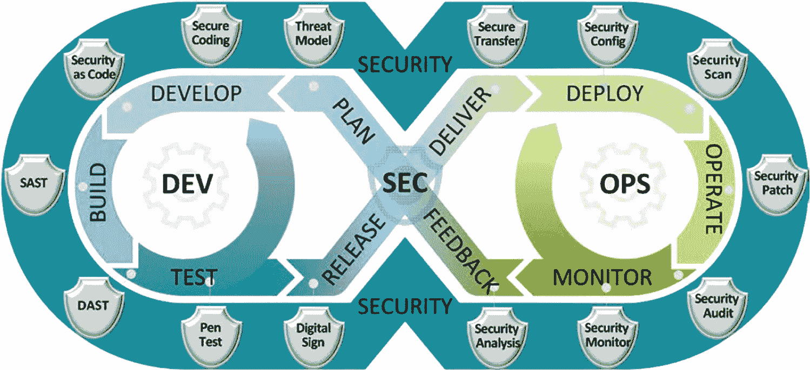

`图 8.2` ¶ 来源：DoD 企业 DevSecOps 参考设计 v1.0 (`https://dodcio.defense.gov/Portals/0/Documents/DoD%20Enterprise%20DevSecOps%20Reference%20Design%20v1.0_Public%20Release.pdf?ver=2019-09-26-115824-583`, 美国国防部, 公有领域)

### 基于代码的静态分析与动态测试

NIST 区分了基于代码的静态分析与基于执行的测试，并分别提供了示例，例如 `SAST` 和 `DAST`。基于代码的静态分析是对按原生格式编写的代码进行推理，而动态分析则涉及基于执行的动态测试和分析，这包含了程序的执行。与前述自动化测试的 DevSecOps 方法类似，NIST 建议在代码编写后立即以迭代的小分块形式进行静态代码分析。这种方法比等到在最终产品上执行 `SAST` 更高效且有效，因为可以在软件开发生命周期（SDLC）的更早阶段解决缺陷和漏洞。

### 检查硬编码密钥

NIST 建议使用启发式工具查找应用程序代码中的硬编码密钥。这些密钥可能涉及凭据、加密密钥、API 密钥和访问令牌（access tokens）。由于云原生环境中 API、令牌和凭据的广泛使用，这特别具有挑战性，本书的作者之一在一篇名为“在 DevSecOps 云原生世界中保持密钥”的文章（`www.csoonline.com/article/3655688/keeping-secrets-in-a-devsecops-cloud-native-world.html`）中提到过这个问题。研究表明，泄露的凭据涉及大量的数据泄露，因此组织应该加强其密钥管理能力以消除这些风险。

### 使用语言提供的检查和保护

在指南中，NIST 还建议使用各种编程语言（无论是编译型还是解释型）所提供的构建前检查。NIST 还强调某些语言不是`内存安全的`，通过这种方式可以防止程序员引入与应用程序内存使用方式相关的特定类型错误，并建议强制内存安全。除了使用内置的强制功能外，组织还可以使用静态分析器或“代码检查工具”（linters）来查找危险函数和参数。值得注意的是，上一章讨论的 OpenSSF 开源安全动员计划等其他指南建议行业向内存安全的语言迁移，远离那些在内存安全方面具有较高固有风险的旧语言。

### 黑盒测试用例

与之前讨论的测试类型不同，黑盒测试不与特定的代码绑定，而是关注功能需求并验证软件**不应该**做的事情。这些测试包括拒绝服务和输入边界等，并且在没有源代码分析和威胁建模所需的内部知识和假设的情况下进行。

### 基于代码的测试用例

基于代码的测试用例涉及代码本身的细节。这可能涉及测试软件可以处理的项目数量和交互，并通过测试用例对其进行验证。NIST 建议执行语句覆盖率至少达到 80% 的测试套件。

### 历史测试用例

当 NIST 指南使用 `historical test cases` 一词时，它指的是通常所说的`回归测试`。回归测试在成熟的安全团队中非常流行，他们实施测试来验证之前发现并修复的漏洞已**不存在**。这种测试很重要，因为可能会出现配置和卫生漂移等情况，不安全的配置和系统状态可能会再次出现。回归测试有助于验证这种情况并未发生。

### 模糊测试 (Fuzzing)

NIST 推荐的另一种软件验证方法是`fuzzing`或模糊测试，这是一种自动化测试方法，通过向软件中注入无效、畸形或意外的输入来识别缺陷和漏洞。一旦这些输入被注入系统，模糊测试工具就会监控系统的响应，例如崩溃或泄露不应暴露的信息。开放全球应用安全项目（OWASP）为想要了解更多信息的人提供了全面的模糊测试页面：`https://owasp.org/www-community/Fuzzing`。

### Web 应用扫描

Web 应用扫描通常被称为动态应用安全测试 (`DAST`) 或交互式应用安全测试 (`IAST`)，适用于提供 Web 服务的软件。两种工具执行的操作与模糊测试相似，但它们都是在扫描 Web 应用时查找异常或失败。世界上流行的 Web 应用扫描器是 OWASP Zed Attack Proxy (`ZAP`；`www.zaproxy.org`）。

### 检查包含的软件组件

NIST 最后的建议开发者测试清单标准是检查包含的软件组件。NIST 指明，该活动的目标是确保包含的代码至少与本地开发的代码一样。正如我们在书中反复讨论的，软件成分分析 (`SCA`) 等工具可以识别软件正在使用的 OSS 库、包和依赖项。这些工具查询 NIST 的国家漏洞数据库 (`NVD`) 等漏洞数据库，以查找这些组件中的`已知`漏洞。由于大多数现代软件由 OSS 组件组成，这一活动尤为重要。

NIST 还为我们讨论的所有技术提供了额外的背景和补充信息，如果你想进一步更多关于此类测试技术及其如何成功实施的细节，这些内容值得深入研究。

## NIST 安全软件开发框架


正如本书的几个章节讨论的那样，网络安全行政命令（EO）14028 对零信任、云计算以及当然还有软件供应链安全等领域产生了深远影响。作为网络安全行政命令的一部分，政府被要求“仅购买开发安全的软件”。该命令指示美国国立标准技术研究院（NIST）发布指南，识别能够增强软件供应链安全性的实践。NIST 正做到了这一点。NIST 与业界合作，发布了《安全软件开发框架》（SSDF） 1.1 版本，以及其他软件供应链安全指南。本节将深入讨论 `SSDF`、它是什么以及它为什么重要。

`SSDF` 指出，很少有 `SDLC` 模型明确解决软件安全问题。行业内许多人熟悉的一个常用短语是，在涉及网络安全时，它是“**事后补上去的，而不是内置的**”（bolted on, not baked in）。在开发数字系统时，网络安全往往是事后考虑的，而且通常在 `SDLC` 的后期才进行处理，而不是在从之初就将安全最佳实践和要求集成到软件和系统中。值得注意的是，2022 年发布的 `SSDF` 版本 1.1 是基于 2020 年 4 月的原始 `SSDF` 版本。为了促进 `SSDF` 的更新，NIST 与来自公私部门的参与者召了研讨会，并收到了 150 多立场文件供 `SSDF` 更新参考。

`SSDF` 的目标读者包括软件生产商（如产品供应商、政府软件开发人员和内部开发团队）以及软件采购者或消费者。虽然 `SSDF` 是专门为联邦机构创建的，但它包含的最佳实践和任务适用于所有行业的软件开发团队，并可被许多不同的组织使用。同样值得注意的是，`SSDF` 不是规定性的，而是描述性的；它并没有具体说明如何实现每项实践，而是关注安全软件的结果，并允许组织实施实践以促进这些结果的产生。考虑到保护软件的方法无穷尽，以及每个生产和消费软件的组织所具有的人员、流程和技术，这种做法是合理的。指南还明确，在决定使用哪些实践以及投入哪些资源来实现这些实践时，应当考虑组织的风险容忍度等因素。

NIST 为从生产商和供应商处采购软件或包含软件产品的联邦机构定义了最低建议。这些建议包括几项关键条款，有助于确保政府不会采购不安全的软件和产品。在机构采购软件时，NIST 建议他们使用 `SSDF` 术语来组织围绕安全软件开发要求的通信。NIST 还建议供应商在整个 `SDLC` 中证明其遵循 `SSDF` 开发实践。一个经常引起争议的话题是证明（attestation），即某事的证据或证明。通常，从流程的角度来看，证明可以由亲自进行（也称为自证明 `self-attesting`），也可以由独立的第三方进行，例如第三方评估组织（3PAO）。

使用 `3PAO` 增加了证明的可信度，因为是由理论上的第三方而非被评估方来做出的。尽管如此，`3PAO` 合规机制也带来了时间和成本方面的额外开销，以配合其潜在的严谨性增加。例如，`FedRAMP` 是面向联邦市场提供服务的云服务供应商（`CSPs`）的授权流程，它要求 `CSPs` 第三方评估。

然而，截至本文写作，尽管该计划已存在 10 年，但大约只有 250 个获得 `FedRAMP` 授权的云服务产品。如果在 `SSDF` 下对软件生产商也采取 `3PAO` 模式，无疑会在限制获得授权向政府销售软件的合格供应商方面产生类似的影响。然而，NIST 在其指南中指出，取决于机构和软件消费者的风险容忍度，在某些情况下可能需要进行第三方证明。批评者敦促政府机构不要采取这种方法，因为这会对 `SSDF` 的采用产生影响，并指出了其他类似计划的延迟案例，例如国防部（DoD）的网络安全成熟模型认证（`CMMC`），该计划经历过多次挫折（``````
https://insidedefense.com/daily-news/delay-publicly-releasing-cmmc-process-guide-attributed-potential-national-security
````）。

### SSDF 详情

如所述，NIST 的 `SSDF` 旨在倡导使用基础且公认的安全软件开发最佳实践。`SSDF` 的独特之处之一是，它并不是完全从零创建指南，而是使用了许多已知的且已实施的成熟指南来源，例如 Synopsys 的构建安全成熟度模型（`BSIMM`）和 OWASP 的软件保障成熟度模型（`SAMM`）等。

`SSDF` 健壮的安全软件开发实践被分为四个不同的组：

*   准备组织 (PO)
*   保护软件 (PS)
*   生产安全的软件 (PW)
*   响应漏洞 (RV)

在这些实践中，你有定义实践的元素，例如 `Practice`（实践）、`Task`（任务）、`Notional Implementation Example`（假设实施示例）和 `Reference`（引用），后者将实践映射到任务。如前所述，SSDF 的最新版本涵盖了网络安全命令的要求，因此它还包含了对特定 EO 4e 要求的映射。使用 `SSDF` 实践的预期目标是减少软件发布中包含的漏洞数量，以及这些漏洞在未被检测到或缓解的情况下被利用的影响。

#### 准备组织 (PO)

为安全软件开发准备组织工作，是任何寻求开发安全软件的组织的逻辑第一步。该组中的实践涵盖了定义软件开发的安全需求，包括对组织软件开发基础设施的要求以及组织开发的软件必须满足的安全需求。当然，这些需求必须传达给向组织提供重用商业软件组件的所有第三方。

定义角色和职责是组织必须采取的另一个基本步骤。它包括 `SDLC` 所有部分的角色，并为这些角色中的人员提供适当的培训。指南强调需要获得高层管理或授权官员对安全开发的承诺，并确保参与流程的人员知晓这一承诺。这通常被称为获得高层支持（`executive buy-in`）。

现代软件交付涉及支持工具链，工具链通过自动化来减少与软件开发相关的人工工作，并带来更一致、准确和可重复的结果。该领域的任务涉及指定为了降低风险必须使用的工具和工具类型，以及它们如何相互集成。组织还应该定义使用工具链的推荐安全实践，并确保工具配置正确以支持安全软件开发实践。


组织还应该定义并使用软件安全检查的标准。这包括实施流程和工具，以在整个软件开发生命周期（SDLC）中保护信息。工具链可用于自动提供安全决策支持，并生成有关漏洞管理的指标。

最后，组织应该为软件开发建立安全的环境。这通常表现为创建不同的环境，如开发环境（Development）、测试环境（Testing）、阶段环境（Staging）和生产环境（Production）。这些环境经过隔离，以限制损害影响其他环境的影响范围（爆炸半径），并允许根据不同环境满足不同的安全需求，同时还能改进配置管理并对配置漂移（即实际配置与预期配置不一致的情况）进行控制。

这些环境可以通过 `MFA`、条件条件访问控制或最小权限访问控制等方法来安全保障，并确保在各个开发环境中的所有活动都经过记录和监控，以实现更好的检测、响应和恢复。保障环境还意味着开发人员和其他人员与环境交互时使用的终端也经过了加固，以确保它们不会引入风险。你会发现，这些建议与当前的零信任指南和最佳实践之间有若干相似之处。

## 保护软件 (PS)

从保护组织转向保护软件本身 (`PS`)。这一组的实践涉及保护代码免受未经授权的更改、验证代码完整性以及保护每个软件版本。

保护所有形式的代码免受未经授权的更改和篡改，对于确保代码不会以故意或无意的形式被修改并损害其完整性关关。代码的存储方式应根据其安全需求符合最小权限访问控制，这与 `OSS` 代码或专有代码有所不同。组织可以采取措施，例如使用支持版本控制、提交签名、以及由代码所有者和维护者进行审查的代码仓库，以防止未经授权的更改和篡改。代码还可以进行签名，通过诸如加密哈希值等方法来确保其完整性。

不仅需要维护代码的完整性，还必须有方法让软件消费者验证这种完整性。这就是像在安全性良好的网站上发布哈希值等实践大显用场的地方。代码签名应获得受信任数字证书颁发机构的支持，软件消费者可以借此作为对签名可靠性或信任的衡量。

最后，每个软件发布版本都应该受到保护和保存。它可以用于识别、分析和消除与特定发布相关的漏洞。它还便于在发布版本被破坏时进行回滚，并将软件和应用程序恢复到“已知良好”状态。保护和保存软件发布版本允许消费者理解代码的来源以及代码来源的关联完整性。

## 生产安全的软件 (PW)

既然需求已经规范化，开发环境以及访问它们的终端也得到了解决，组织就可以专注于生产安全的软件。这并不是说这些实践在组织或计划的整个生命周期内不是并发发生的，而是它们确实在相互依赖的基础上构建的，同时也需要根据需要进行重新审视和修订。

你会注意到，在 `SSDF` 的 `PO` 部分，已经定义并记录了安全需求。现在，软件必须设计为满足这些安全需求。在此时，组织可以使用风险建模方法（如威胁建模和攻击面映射）来评估正在开发的的软件的安全风险。组织可以对开发团队进行威胁建模等方法的培训，以赋能开发团队使其能够理解他们开发的系统和软件所面临的威胁，以及减少这些风险的措施。通过使用数据分类方法，组织可以优先对高敏感和高风险领域进行更严格的评估，以进行风险缓解和修复。组织还应该定期审查软件设计，以确保其符合组织定义的安全和合规要求。这不仅包括内部开发的软件，还包括从第三方采购或消费的软件。根据所消费软件的性质，组织可能与软件设计师合作纠正未满足安全需求的问题，但这不适用于 `OSS` 这种没有合同或相关协议（如 `SLAs`）的情况。

鼓励组织复用现有的安全软件，而不是重复功能。这种复用具有许多益处，例如降低开发成本、加速能力交付以及减少向环境中引入新漏洞的风险。大型企业组织经常遇到代码蔓延，即代码不受控制的增长，特别是在代码即代码的时代，基础设施甚至云环境安全都可以定义代码。这种代码即代码的方法支持模块化、复用、配置即代码以及加固的代码模板和清单，这些可以在组织内部甚至外部安全地使用。尽管如此，正如第六章“云与容器化”中所提到的，如果这些清单和代码模板包含漏洞，现在它们也会大规模地复制，因此需要适当的治理和严谨性。

复用现有软件的组织或组织内部团队应确保对安全和误配置问题进行审查和评估，并了解与所复用代码相关的来源信息。`SSDF` 提出的另一个建议是，在内部创建并维护安全的软件组件和仓库供开发复用，这类似于 `NIST 800-161r1` 中的建议。

组织创建的源代码应符合组织采用的行业倡导的安全编码实践。这些实践包括验证所有输入、避免不安全的函数和调用以及使用工具识别代码中的漏洞。

## 响应漏洞 (RV)

尽管组织可能定义了安全需求、准备了环境，并努力生产安全的软件，漏洞不可避免地会出现。现实情况是，在开发阶段识别所有漏洞是不可能的，而且随着时间的推移，漏洞会被发现。正如我们讨论过的，软件存在的时间越久，被研究人员、恶意攻击者或其他发现的可能性就越大。


机构应持续对漏洞进行识别和确认。这包括监控漏洞数据库、使用威胁情报源，以及对所有软件组件进行自动化审查以识别任何新漏洞。这些实践至关重要，因为从代码最初被扫描和检查的那一刻起，新的漏洞就不可避免地会产生。机构还应该建立围绕漏洞披露和修复的策略，并如前文提到的，定义必要的角色和职责，以便在漏洞出现时对其进行处理。在漏洞披露方面，团队通常会努力建立产品安全事件响应团队（PSIRTs），我们将在第 10 章“供应商实务指南”中对对其进行深入讨论。

机构不仅需要识别和确认漏洞的方法，还需要一种与漏洞所带来的风险相匹配的方法来修复漏洞。这意味着要建立一套流程来评估、优先排序并修复软件漏洞。通过使用工具和治理，机构可以做出基于风险的决策，例如修复、接受，或者在某些情况下如果可行，则转移风险。生产软件的机构还需要建立完善的方法，向软件消费者开发并发布安全公告，帮助他们理解软件的漏洞以及对他们作为消费者的潜在影响，以及在可能的情况下解决该漏洞所需的步骤。

最后，机构应该采取步骤通过分析识别漏洞的根源，这通过解决根源而非仅仅解决单个漏洞，有助于减少未来漏洞的发生频率。

从我们讨论的大量安全软件开发任务和实践可以看出，任何具有相当规模的机构都无法始终正确地执行所有这些实践。尽管如此，机构可以利用 `SSDF` 作为指南，将其安全软件开发实践规范化，有助于确保在整个开发生命周期（SDLC）中采取适当措施确保软件安全。

## NSA：软件供应链安全指南系列

2022 年，美国安全局（NSA）联合网络和基础设施安全局（CISA）以及国家情报总办公室（ODNI），开始发布有关软件供应链安全的指南。这是一个包含三个部分的系列，关注开发者、供应商和客户的角度，每部分都根据其在软件供应链中的角色和活动提供了特定的指南。

该系列通过 NSA 所称的“持久安全框架（ESF）”提供，这是一个由 NSA 和 CISA 领导的公私部门跨领域工作小组，旨在提供应对国家关键基础设施高优先级威胁的指导。

我们将在后续章节中讨论每份出版物及其具体的建议。该指南的发布方式与软件生命周期相同，即从开发者、供应商和客户流向；因此，它将按照发布的顺序进行介绍。

在接下来的章节中，我们将查看 NSA 的软件供应链安全指南、其各个部分及其核心结论。该出版物的公告（`www.nsa.gov/Press-Room/News-Highlights/Article/Article/3146465/nsa-cisa-odni-release-software-supply-chain-guidance-for-developers`）强调了开发者在创建安全软件方面扮演的角色，并指出该出版物旨在帮助开发者采纳政府和行业建议以来实现这一目标。第二份和第三份发布重点关注供应商和软件消费者，考虑到它们在更广泛的软件供应链及其韧性中扮演的独特角色。

从高层次来看，这些文件分为三个部分：

* 软件开发人员安全指南
* 供应商推荐实践指南
* 消费者推荐实践指南

该指南指出了开发者、供应商和客户在更广泛的软件供应链生态系统中扮演的独特角色（见图 8.3）。

### 软件开发人员安全指南

NSA 指南系列的首个是“开发人员推荐实践指南”。软件供应链攻击并非新现象，例如云原生计算基金会（CNCF）等来源提供了了追溯到 2003 年的供应链破坏清单。还有 IQT Labs 的软件供应链破坏——活动数据集（`https://github.com/IQTLabs/supply-chain-compromises`），这代表了 IQT Labs 对公开的软件供应链破坏数据的尝试。虽然软件供应链攻击已有 20 年的历史，但其发生频率正在加速，例如由 Dan Geer、Bentz Tozer 和 John Speed Meyers 撰写的 USENIX 文章《良好的衡量：从量化角度看软件供应链安全》（`www.usenix.org/system/files/login/articles/login/winter20_17_geer.pdf`），见图 8.4。

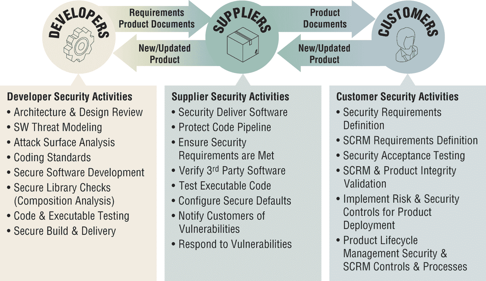

**图 8.3**

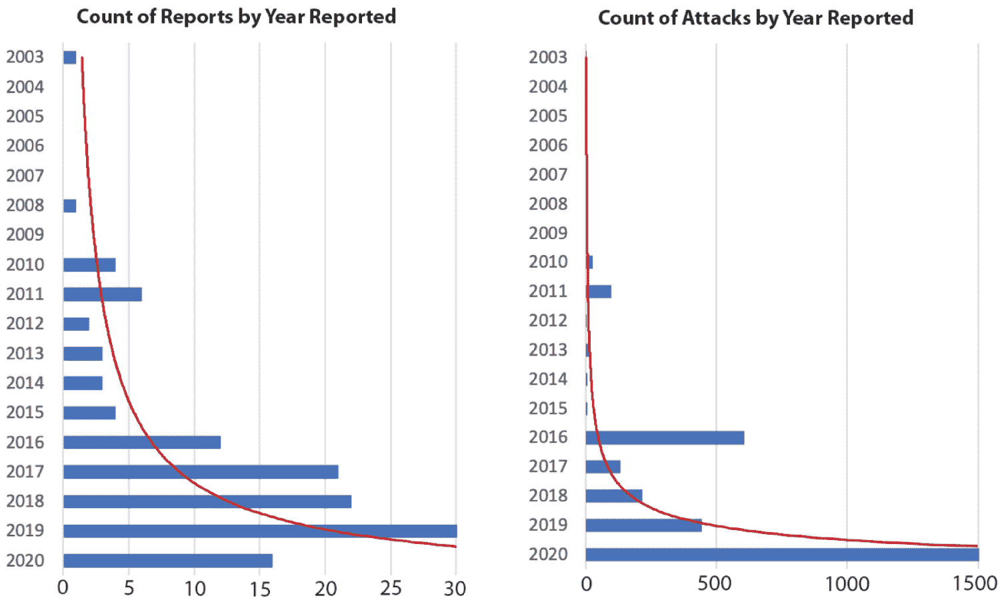

**图 8.4**

在软件生产者的视角下，他们是供应商，为客户提供功能和能力，而这些功能和能力是由开发者驱动和创建的。这不可避免地让供应商及其开发团队处于市场速度（公共部门为任务速度）与安全韧性软件或产品严谨性之间的对立点。

安全软件始于 SDLC，NSA 的指南引用了许多团队可以使用的选择，例如 NIST 的 `SSDF`（`https://csrc.nist.gov/Projects/ssdf`）、卡内基梅隆大学（CMU）的安全软件开发生命周期过程（`https://resources.sei.cmu.edu/asset_files/whitepaper/2013_019_001_297287.pdf`），以及 OpenSSF 安全软件开发课程（`https://openssf.org/training/courses`）等。

该指南不仅强调使用安全的软件开发过程，还要产生供软件生产商和消费者验证的实质性文件和证明。

这些过程和活动包括威胁建模、`SAST`、`DAST` 和 `pen testing` 等最佳实践，以及使用数字签名等安全发布活动。一个显著例子是 `Sigstore` 的日益采用，这是一个用于签名、验证和保护软件的标准。

#### 安全产品标准与管理

生产安全产品的核心是建立组织安全开发策略和程序，并配备相应的预算和进度，以促进安全产品开发。这无疑会产生潜在的摩擦，当人们只关注市场速度或存在资源限制时，因为实施某些安全最佳实践的时间、专业知识和努力不可避免地会产生成本。


为了向美国国防部（DoD）正在进行的一些优秀 DevSecOps 工作学习，国家安全局（NSA）的指南使用了国防部《DevSecOps 基础知识手册》（`https://dodcio.defense.gov/Portals/0/Documents/Library/DoDEnterpriseDevSecOpsFundamentals.pdf`）中的安全软件开发流程图。然而，与国防部的示例不同（该示例将 Dev、Sec 和 Ops 视为无限循环中的三个实体），NSA 的示例将其在指南引言中讨论的三个实体叠加在了一个图表上：

* 开发者
* 供应商
* 客户

这些实体并非对软件开发过程贡献的组织团队（如国防部示例所示），而是参与生产和消费安全韧性软件产品的实体，且其范围超出了单一的组织边界，暗示了其预期的软件供应链背景。

NSA 的指南提供了若干个在开发和交付软件产品时可能发生的威胁示例：恶意攻击者、引入有漏洞的第三方组件、对构建过程的利用，以及便于产品传输给客户的交付机制遭到破坏。软件生产商应建立关注安全的流程来降低这些风险，例如创建威胁模型、定义发布标准，并记录和发布其发布软件的安全程序和流程。指南中还提供了许多其他值得审查的示例。

虽然这些做法并非新事，但推荐的一些实践正变得越来越流行。例如，威胁建模一直被 Adam Shostack、Robert Hurlbut 等许多行业领袖倡导了多年（`Threat modeling` 是指考虑可能出现什么问题以及如何防止它们）。关于威胁建模有许多优秀的指导来源，如《威胁建模宣言》和 OWASP 威胁建模项目。

威胁建模可以贯穿整个软件开发生命周期，NIST 建议对联邦政府使用的关键软件进行此类建模。NIST 根据网络安全行政命令（EO）要求定义关键软件，可以在其关于关键软件的软件供应链指南页面（`www.nist.gov/itl/executive-order-improving-nations-cybersecurity/critical-software-definition`）找到更多指导。像 OWASP 的 Threat Dragon 等工具可以作为寻求启动的组织的开源（OSS）选项，并可以协助完成数据流图、威胁排名和建议缓解措施等活动。

NSA 的指南强烈建议制定安全测试计划和发布标准。测试计划和需求通常包括常见的安全测试方法，如 SAST/DAST、第三方软件的 SCA 以及渗透测试。生态系统中存在多种开源和厂商工具来执行这些测试方法。这些工具也日益集成到持续集成/持续交付（CI/CD）流水线中，以实现 `shift-left`（左移）安全工作，在软件开发生命周期（SDLC）更早的阶段进行测试，有人认为这样做更具经济效益且有效。“左移”是一个常用术语，强调有必要将安全提前到 SDLC 的早期阶段，并在漏洞和缺陷引入生产环境或运行时环境之前捕捉它们。

拥有这些工具和测试方法使组织能够确定其发布标准。这些标准可能包括：漏洞超过组织的风险容忍度、缺乏安全开发实践，或者在对软件透明度呼声增加的背景下（特别是在公共部门），生成、关联和验证 SBOM（软件物料清单）。

虽然建立既定的发布标准以降低下游软件消费者的风险至关重要，但这并非易事，并且需要承认：

* 广泛存在的漏洞评分方法论（如通用漏洞评分系统 `CVSS`）并非万无一失。
* 工具会产生大量的虚假警报，从而阻碍开发速度。
* 许多已发布的常见漏洞和披露（`CVEs`）是不可被利用的。

要深入了解 `CVSS` 的问题，请查看位于 `https://dl.acm.org/doi/pdf/10.1145/3491263` 的文章《CVSS: Ubiquitous and Broken》。在降低漏洞的同时过滤噪音并保持速度，是一门精细的艺术，需要有效的人员、流程和技术的协同工作。安全研究人员兼作家 Walter Haydock 在 `www.blog.deploy-securely.com/p/security-release-criteria` 上讨论了虽然意良好但效果不佳的安全发布标准的某些危险。

NSA 建议组织应建立成熟且代码化的产品支持和漏洞处理政策与流程。这包括建立漏洞提交系统、产品安全事件响应团队（`PSIRT`），以及通过安全协议（如安全超文本传输协议/传输层安全 `HTTPS/TLS`）对现场软件进行安全交付。

鉴于软件漏洞不可避免地源于编写代码的个人和团队，评估和培训至关重要。首先需要定义涵盖细节的政策，例如谁需要培训、频率是多少，以及决定应涵盖哪些主题。培训通常包括安全软件开发、安全代码审查以及软件验证和漏洞测试等主题。同样重要的是，确保组织的安全程序和流程被视为“活文档”，随着团队和组织不断从事后回顾中汲取教训而不断进化和成长。

之前讨论的所有缓解措施和最佳实践（如威胁建模、安全测试计划和发布标准）在 NSA 指南中都已专门映射到 `NIST SSDF`，我们将在本章中讨论。建议向公共部门客户销售软件的组织最好熟悉 NIST 的 `SSDF`，因为很快就会要求他们的软件生产活动与其保持一致。

## 开发安全代码

从安全产品标准和管理转向，还需要开发安全代码。这一过程始于最开始的决策，例如编程语言的选择，以及考虑保护数字系统和数据的基础知识，例如故障安全默认和最小权限访问控制。

组织应警惕内部威胁，无论是无意的还是蓄意恶意的，这两者都可能修改或利用源代码。这可能是由于开发人员培训不当，或工程师故意在产品中植后门导致的；而通过诸将功能映射到需求等活动，可以缓解一些引入风险的功能膨胀（feature creep）。工程师可能正经历使其更容易受到勒索和妥协的遭遇遭遇，或者他们可能会添加方便自己生活但导致产品不安全的开发功能。NSA 还警告了受破坏的远程开发系统。随着远程办公范式的普及和网络边界的消失，远程开发端点成为恶意攻击者的首要目标。此外，组织在终端卫生方面面临难题，特别是在自带设备（`BYOD`）环境中。第三方开发团队也可能攻击向量。其他常见的攻击向量包括孤立账户和凭据，当用户离开团队和组织时，其账户仍然活跃并可能被攻击。这一现实要求组织建立成熟的帐户和访问控制政策及流程。


尽管这些场景可能会给开发工作带来巨大破坏并导致产品不安全，但组织可以采取措施来降低不安全代码的风险。这包括使用身份验证的源码提交流程、如我们之前讨论的那样进行漏洞扫描，以及加固实际开发环境，这些方法可能会根据组织的运营情况而异。

NSA 展示的某一点以及 `NIST` 等实体在其`800–161/软件供应链`指南中强调的这一点，是创建一个安全的仓库流程流。这种工作流模式（参见图 8.5）允许组织在选择外部软件组件的同时，实施如 `SCA` 等扫描来确定组件构成和漏洞问题。这种工作流有助于开发者和开发团队审查外部软件组件，并确保建立内部安全仓库，以提供经过验证的组件供内部软件开发使用。

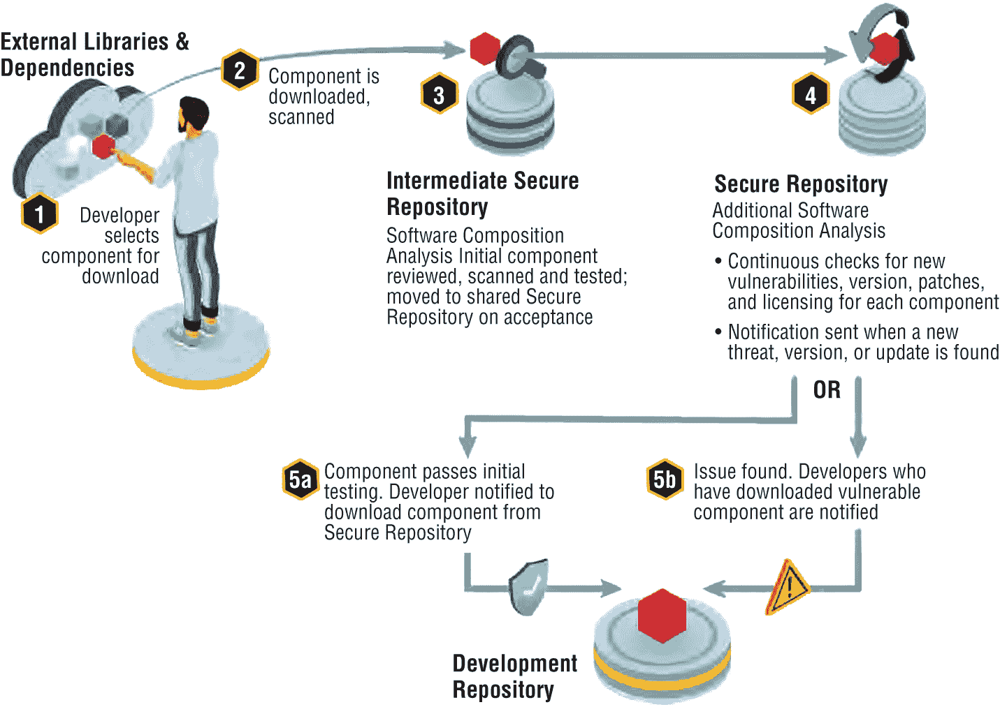

图 8.5 ¶ 来源：`https://media.defense.gov/2022/Sep/01/2003068942/-1/-1/0/ESF_SECURING_THE_SOFTWARE_SUPPLY_CHAIN_DEVELOPERS.PDF`，美国网络安全部门，公共领域

使用之前讨论过的 `SAST` 和 `DAST` 等工具应与安全发布标准保持一致，并适当识别和缓解漏洞。团队还应该进行每日构建，包括安全测试和回归测试，以确保缺陷或恶意更改被识别并处理。正如我们提到的，开发者可能会添加功能来让生活更方便，但这可能导致后门。随着远程开发的普及，NSA 建议组织加固其开发环境。这意味着不仅要加固构建环境，还要加固参与开发活动或工作流的端点或系统——在这些系统中，可以通过虚拟私有网络 (`VPN`) 访问、`MFA`、`EDR` 软件等控制措施在某种程度上降低远程开发风险。

应使用安全开发实践来生成、测试和保护源代码。这包括上述加固开发环境的活动，并涉及使用安全的开发构建配置以及安全的第三方软件工具链和组件。

组件和软件将集成到交付的产品中，因此，要遵循成熟且安全的代码集成实践。这包括测试第三方组件是否包含 `NIST` 国家漏洞数据库 (`NVD`) 中列出的 `CVE`，并在执行代码集成时使用安全依赖分析器。

当客户报告缺陷或漏洞时，开发团队必须准备好响应这些事件和报告。这包括一个接收报告的公开流程，以及内部用于审查、诊断和帮助解决问题的流程。其他团队也有可能添加外部开发扩展，这些扩展本身可能会引入漏洞。来自解决方案团队或增值值商 (`VARs`) 的扩展也应通过安全实践进行开发，并应提供 `SBOMs` 以显示任何未包含在内的包和/或组件。

#### ***验证第三方组件***

开源 (OSS) 增加了第三方治理的挑战。正如 Sonatype 的 2021 年供应链状况（`www.sonatype.com/resources/state-of-the-supply-chain-2021`）报告所指，我们看到开发者对 OSS 组件的下载量同比增长了 73%（超过 2.2 万亿），同时通过依赖混乱、拼写攻击和恶意代码注入等方法进行的软件供应链攻击同比增长了 650%，其中每一种我们都在第 2 章，“现有方法——传统风险管理”中讨论过。

在选择和集成第三方组件或 OSS 软件时，组织需要理解与之相关的任何固有风险和漏洞。他们可以选择诸如建立已知信任供应商列表以及经过审查的第三方组件等路径。考虑因素包括组件本身的质量，还包括 `SBOM` 等支持产物的质量，以及组件所有对漏洞报告的历史响应能力。组织还应该理解不能忽视组件维护。供应商可能会发布更新以解决已报告的漏洞，例如，如果你是下游消费者，则应确保更新该组件。

NSA 建议从已知的信任供应商处获取组件。虽然我们拥有丰富的软件生产者和提供者生态系统，但在安全方面，这并不意味着他们是平等的。软件供应链领军人物（如 Joshua Corman）一直主张模仿汽车制造并使用更好的组件，详见他在 `www.youtube.com/watch?app=desktop&v=jkoFL7hGiUk` 的 USENIX 演讲“持续加速：为什么一切事都需要供应链方法”。

#### 加固构建环境

除了加固开发环境和系统外，构建环境本身也必须加固。构建环境能够实现可重复的交付物，但当被破坏时，将成为交付受损软件的高效方法，例如 SolarWinds 案例。


恶意攻击者利用各种漏洞利用手段破坏构建链，例如渗透网络、扫描漏洞，以及构建并随后部署漏洞利用。这些漏洞利用或恶意代码现在可以在用户不知情的情况下，高效地分发给下游软件消费者。

美国国家安全局（NSA）的指南建议，不仅是构建流水线，任何参与开发和构建过程的系统都应该被锁定并免受未经授权的网络活动影响，并且使用安全配置。此外还呼吁实施版本控制、网络分段以及对任何访问和活动的审计和记录等控制措施。

在这些措施的基础上，NSA 建议高级措施包括 `hermetic`（密封性）和 `reproducible builds`（可重复构建）等项目。密封性构建是完全声明式的、不可变的，并且能够在没有网络访问的情况下运行，它们还可以包含哈希验证。可重复构建验证了二进制产品是从相同的源码构建的，尽管元数据存在差异。在这里，可重复性意味着它们能够识别出导致相同比特输出的输入产物。目前还存在新兴的框架，例如 `in-toto` (`https://github.com/in-toto/in-toto`)，它通过验证链中的每个任务都是按计划执行、仅由授权人员执行，并且产品在传输过程中未被篡改，来保护软件供应链的完整性。

NSA 定义的若干流程和实践不仅基于 `SLSA` 框架，还基于另一个新兴框架，即来自 OWASP 的软件组件验证标准（SCVS）。

虽然软件签名正被日益采用并认可，是确保软件供应链安全的关键部分（随着 `Sigstore` 等努力在 `Kubernetes` 等主要项目（`www.sigstore.dev`）中的采用率不断增长），但也存在`被利用的签名服务器`的可能性。加密签名有助于保护软件产物的完整性，并为消费者提供保证。然而，如果签名服务器和机制本身被破坏，这些保证将不再可靠或有用，并被认为已被利用。这允许恶意攻击者合法地对潜在恶意的产物和输出进行签名，并被毫无防备的软件消费者摄取。为了降低这种风险，NSA 建议采取诸如强多因素身份认证（MFA）和签名基础设施的物理访问控制、在隔离的网络段上进行签名以及加强实际签名基础设施等措施。值得注意的是，某些实践（如密封性构建）可能会限制时间戳权威（TSAs）的使用，而这对于判断签名是否发生在相关证书有效期内是必要的。查看近期事件，例如影响 `Twillio` 以及许多其他软件即服务（SaaS）提供者的事件（`www.darkreading.com/remote-workforce/twilio-hackers-okta-credentials-sprawling-supply-chain-attack`），说明仅有 MFA 是不够的，组织应该实施防钓鱼形式的 MFA，例如 `YubiKeys`。

### 交付代码

最后，让我们考虑软件供应商通过分发系统交付代码的行为。软件开发者应该使用二进制成分分析来验证其交付的软件内容，以及任何相关的元数据。通过使用 `SCA` 工具，组织可以确保不包含未知来源的软件，并确保没有敏感数据（如密钥）包含在交付的最终产物中。再次，已呼吁在交付给软件消费者的软件包中包含一个 `SBOM`（软件物料清单）。

恶意攻击者可能尝试利用战术在软件软件包和更新通过软件分发系统时破坏它们。这可能包括通过路径攻击（on-path attacks）尝试注入恶意代码或漏洞以备日后利用。组织可以使用安全的传输机制，以及在产品和软件组件层面都使用哈希和数字签名来缓解这些风险。

最后，存在通过仓库、包管理器和/或其他方法直接破坏分发系统的可能性，以确保损坏的软件包交付给客户。软件开发团队和组织可以通过保护所有形式的代码免受未经授权的访问（包括仓库和包管理器），以及对分发系统使用适当的传输层安全加密等措施来缓解这些威胁。

## NSA 附录

在结束本章这部分之前，值得注意的是 NSA 的指南包含一套强大且价值价值附录（参见图 8.7），涵盖了以下内容：

*   **交叉索引（A Crosswalk）**：讨论的威胁场景与 NIST 的 `SSDF` 之间的路径，将特定的实践和措施映射到开发者、供应商或客户的 `SSDF`。
*   **依赖项（Dependencies）**：由供应商、第三方供应商或客户提供的、可能有利于供应商和开发者的依赖项和产物（参见图 8.7）。

    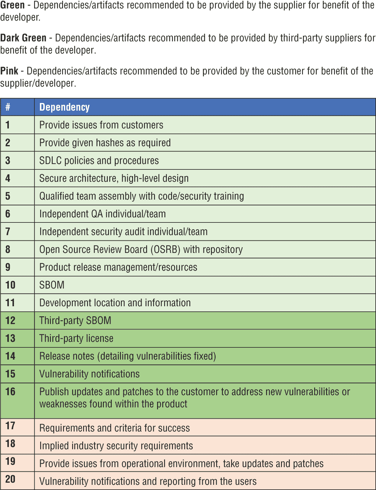

    **图 8.7**
*   **供应链水平与产物（SLSA）**：对 `SLSA` 是什么及其各种要求、描述和级别的详细阐分。
*   **产物与检查清单（Artifacts and Checklists）**：产物示例、描述和用途，例如产品就绪检查清单、设计文档和构建日志。指南提供了这些产物能提供什么价值以及提供给谁示例。
*   **信息性资源（Informative Resources）**：来自以下来源的一系列强大的参考文献：
    *   构建安全成熟度模型 (`BSIMM`)
    *   国防部信息技术首席官 (`DoD CIO`)
    *   网络安全行政命令 (`EO`)
    *   开放全球应用安全项目 (`OWASP`)

这些参考文献中的许多项在文中被作为现有指南的示例引用。

## 供应商推荐实践指南

在《开发者推荐实践指南》首次发布的基础上，NSA 系列的后续是针对供应商的指南。供应商（在此语境下为厂商）通常“负责在客户和软件开发者之间进行联系”。这意味着供应商有责任通过合同协议、软件发布和通知受影响的软件客户等机制，确保软件的完整性和安全性。

NSA 指南定义了软件供应商的一些职责：

*   维护安全交付软件的完整性
*   验证软件包和更新
*   保持对已知漏洞的意识
*   接受客户对问题或新发现漏洞的报告，并通知开发者进行修复


准备让一个组织成为软件供应商的某些基本要求，包括创建必要的政策和流程，以确保他们能够安全地交付软件。仅仅创建政策和流程是不够的；它们应该在组织内广泛传传，并是参与 `SDLC` 的关键利益相关者所熟悉的内容。

当组织没有明确定义政策和流程，且其团队不熟悉如何实施这些流程时，他们就缺乏通知客户新漏洞的方法，并且无法产品的整个生命周期内提供支持。

为了避免这些问题，可以使用几种缓解措施，包括对镜像和代码进行签名，并通过哈希值验证交付的内容确实是收到的内容。供应商还需要规范化的流程，通过安全通信通道对受影响的软件进行补丁和更新。

## 保护软件

建立适当的策略流程是一回事——组织还必须执行真正的工作，保护软件免受未经授权的访问、修改，甚至删除。各种威胁可能会在这一方面出现，从而在软件交付给客户之前损害其构建和交付。例如，恶意代码可以在交付给客户之前注入到代码中，导致存在后门的情况，从而损害客户。

为了防止此类风险，NSA 建议采取以下若干缓解措施：

* 实施基于角色的访问控制 (`RBAC`)
* 为开发者执行端点保护措施
* 进行代码审查
* 在交付给客户期间对代码进行数字签名，这包括使用符合联邦信息处理标准 (`FIPS`) 140 的密钥，或者在必要时使用硬件安全模块 (`HSMs`)

NSA 的指导意见还建议供应商应建立机制，在整个 `SDLC` 过程中通过对代码进行数字签名来验证软件发布版本的完整性。这有助于与软件客户建立信任，并实现来源溯源的目标。当供应商未能采取这些措施时，就会发生如软件交付前的恶意篡改等威胁，正如我们在之前讨论的一些过去攻击中看到的那样。虽然代码签名有助于信任和溯源，但它要求在签名代码之前有一个可验证的构建过程作为检查点，这正是 NSA 所建议的。否则，你仅仅是让潜在恶意或被破坏的代码签名并伪装成合法代码，就像 `SolarWinds` 的情况一样。NSA 甚至建议镜像生产构建环境，以独立编译和打包代码，然后比较两个构建环境的哈希值，我们在其他指南中（如 `SLSA` 的可重构建）以及 `SolarWinds` 现在采取的措施中见过这一点。

当然，代码签名需要有效的密钥管理，因此 NSA 建议供应商将私钥安全地存储在 `HSMs` 上，以降低代码签名密钥被盗或篡改的风险，并通过最小权限访问控制和基础设施控制来保护处理密钥材料的系统。

组织还需要如何归档旧版本软件的策略并满足与之相关的留存要求。策略可能取决于行业的监管要求和/或组织的特定需求。正如 NSA 的指导意见所指出的，归档软件对多种用途是有益的，例如灾难恢复、数字取证，甚至在发生恶意活动时恢复之前已知的良好软件版本。

然而，存在各种威胁软件发布版本归档和保护的风险，例如不安全或不可访问的存储介质，或者归档审查不频繁，导致错误的保证感，当需要恢复或访问归档软件发布版本时，这种安全感可能无法实现。

为了缓解某些威胁，NSA 的指导意见建议涉及持久存储的缓解措施，将访问限制为只读。虽然组织可能从磁带和网络驱动器等旧介质转向云端，但他们需要考虑云存储的风险。组织还应该建立特定的归档策略，并努力利用可用技术实现其自动化。

## 生产安全的软件

生产安全的软件需要在整个 `SDLC` 过程中遵循安全设计原则。这就是为什么在指导意见的这一部分，NSA 列出了诸潜在威胁，例如开发者未采用安全开发实践、缺乏进行风险评估的适当培训，以及未完全理解设计运行需求。

为了缓解这些风险，NSA 建议了威胁建模等活动，NIST 也对关键软件建议了这一点。NSA 还建议确保完全理解预期的运行环境，并将安全设计规范包含在软件需求中。

`SaaS` 由于其运行模式，为生产安全的软件带来了一些独特的风险。NSA 提供的某些特定示例包括无意中将漏洞代码引入代码库并可能触发自动构建，或者单一 `SaaS` 解决方案的不同模型之间存在不同的安全需求。这些风险可以通过在 `SaaS` 供应商与其分商之间建立、执行和验证共同的安全需求来缓解。

正如我们讨论过的，大多数现代软件都包含了大量的第三方供应商软件和组件。因此，NSA 的指导意见强调需要验证第三方软件供应商也符合现有的安全要求，并且提供的组件超出组织的风险容忍度。在使用第三方供应商时存在各种威胁，例如缺乏足够的合同协议导致风险和漏洞；未能考虑第三方供应商的所有权、控制权和历史表现；以及未向第三方供应商显式表达安全需求。

为了避免这些问题，NSA 建议了如下缓解措施：

* 验证第三方是否符合安全要求
* 使用合同协议来沟通和执行安全需求
* 建立流程以缓解第三方供应商可能引入的风险（无论是无意还是故意的）


# NSA 指南
NSA（国家安全局）指南指出的其他相关威胁包括：未正确配置编译和构建过程、未能对可读代码进行审查和分析以及未对可执行代码进行严谨测试。这些威胁可能导致恶意软件引入组件、构建过程受到损损、在软件审查期间未评估安全需求，以及对可执行代码的漏洞测试和扫描不足。NSA 建议供应商采取此类措施，例如从客户处获取清晰的安全需求集，对于涉及美国联邦政府的实体，了解如 `FedRAMP` 或 `OMB` 策略等治理和合规性要求，并对构建流水线中的所有关键软件组件和系统进行威胁建模。

遵循构建安全护栏的行业主题，NSA 指南强调软件需要具备默认安全设置。未能做到这一点可能导致此类威胁，例如软件在未经过正确配置的情况下被安装、限制管理访问以及未记录管理活动。

为了缓解这些威胁，NSA 建议供应商记录所有管理操作并保留至少 30 天，为管理访问建立 `MFA`，并禁用软件不需要的服务和功能。

## 响应漏洞
最后，一旦组织准备就并制定了保护和生产高安全性软件的措施，它们需要一种响应漏洞的机制。正如许多从业人员所信的，事件或漏洞的发生不是是否会发生的问题，而是何时发生的问题。漏洞几乎是不可避免的，因此供应商拥有响应漏洞的机制至关重要。

为了响应漏洞，供应商需要标准的流程来持续识别、分析和修复漏洞。未能做到这一点会导致各种威胁，包括 NSA 指南提供的示例，例如发布带有已知或未公开漏洞的软件、缺乏消除已知漏洞的充分措施，或使用来源不明的组件。

为了缓解这些问题，NSA 建议实施一套稳健的活动，如下：

* 建立跨学科的漏洞评估团队
* 建立流程进行 `fuzzing` 和 `SCA` 等活动以监控漏洞
* 建立 `PSIRT`，包括一个面向公众的 `PSIRT` 网页，供客户或外部研究人员报告与产品相关的漏洞

NSA 还建议跟踪所有已知的安全问题和漏洞，包括相关的 `CVSS` 评分以及对产品或组件的具体影响。遵循行业承认 `OSS` 第三方组件风险的趋势，NSA 建议供应商使用 `SBOMs` 来了解第三方 `OSS` 组件及其相关的漏洞。此外，还应制定企业指南，在识别出问题和漏洞时如何升级这些组件，以防止将这些风险向下传递给客户。这一建议与我们分享的观点一致。

NSA 指南还特别指出，采用 `SaaS` 工具和产品可能会引入影响组织安全态势的风险。我们已经在第 6 章 的 `SaaS` 中详细讨论了这些内容，因此在这里不再过多重复，只需强调针对使用 `SaaS` 的供应商的一些关键 NSA 建议。这些包括对 `SaaS` 应用实施严格的策略（例如 `SaaS` 治理）、实施身份访问管理 (`IAM`) 控制机制，以及开发成熟的安全评估，以解决 `CSP` 与云客户（在此指供应商）之间的安全差距。

如前所述，NSA 供应商的指南与之前的开发者指南一样，有几个附录，包括所提威胁场景与 `NIST` `SSDF` 的交叉对应表。

## 客户建议实践指南
NSA 指南强调，威胁评估是评估和管理特定产品和供应商风险的关键。他们提供的可能影响客户的示例包括：收到未经过评估的产品、发现在初始评估期间被忽略的漏洞，以及所有权变更导致潜在的未知外部影响。

指南指出，客户的一个关键关注点是缺乏产品组件的可见性，以便进行适当的评估并做出明明的风险决策。这包括嵌入组件、库、模块等，所有这些与关于软件透明度以及理解软件组件清单的更广泛讨论相关，包括在评估软件供应商的产品时。

NSA 指出，客户在供应链中的角色始于采购。它始于组织需求以及相关的监管考量。

为了缓解在采购期间未确保考虑到安全需求而面临的风险，NSA 建议客户采取多种措施：

* 更新组织需求和安全需求
* 确保为个人岗位分配了安全职责
* 独立验证原始软件及任何更新的哈希值和签名
* 建立采购安全 (`ACQSEC`) 团队，以管控供应商的外国所有、控制或影响 (`FOCI`)

这些活动通常在信息请求 (`RFIs`) 或征求建议 (`RFPs`) 期间发生，客户有机会确定是否满足了安全和 `SCRM` 需求（参见图 8.8）。


Contracts- 合同是客户在处理软件供应链和供应商时用于降低风险的关键机制。这种机制要求客户将供应链需求集成到合同语言中，例如工作说明书 (`SOWs`) 以及 `RFIs` 和 `RFPs`。此外，它还要求有一支受过良好培训的采购团队，他们具备处理软件供应链安全关注点和所需的知识，并能够引导合同语言向所需的方向发展。

## 潜在威胁与风险
NSA 指南强调的某些潜在威胁和风险包括：与受外国控制的供应商，或拥有可能引入风险的分包商的供应商签订合同协议。这种情况还可能导致更广泛的问题，即合同缺乏 `SCRM` 要求（例如要求软件供应商提供 `SBOM`）。当客户未对供应商进行适当的尽职调查，且供应商的软件产品被破坏时，也可能发生这种情况，特别是当`hashes` 和 `signatures` 等支持性制品提供了虚假的安全感时。

## 缓解策略
为了降低这些风险，NSA 建议采取此类实践，例如要求产品来源的可可见性，并对参与产品开发的流程和支持基础设施的安全性卫生状况进行自证明。这些自证明应包括对安全开发实践的总结，以及由负责开发流程和基础设施安全的供应商官员签署的签名。还应包括交付产品的 `Hashing/signatures`。客户还应努力在要求中增加对供应商采购、产品所有权以及上游供应商的透明度和可见性的要求。

此外，客户应要求供应商以标准的 `SBOM` 格式（例如 `SPDX` 或 `CycloneDX`）发送所有制品，为软件升级提供 `SBOMs`，并就与供应商所有权、位置和外国控制相关的关键属性提供持续报告。客户应要求供应商通知他们网络事件、调查、缓解措施，以及对所消费产品或相关开发环境的任何影响。

## 部署与验收
客户的另一个关键方面是将软件产品实际部署到其环境和系统中。这从验收供应商提供的产品开始，并要求客户在验收前采取预防措施。如果客户不采取适当的预防措施，可能会出现接受非订单产品等风险，还可能遭受产品篡改的影响，或接受缺少配套文档和制品的产品。客户应建立政策和机制来缓解供应商产品受破坏的风险。方法包括：客户验证用于分发的供应商基础设施的安全性；通过 `hashes` 和 `signatures`（包括其组件）验证交付产品的完整性；以及根据交付的产品对 `SBOM` 进行核对。

## 功能测试与治理
功能测试被列为软件客户的一个关键考虑因素。功能测试通常涉及为产品创建测试和测试环境，以及执行和报告相关测试的过程。如果没有进行功能测试，客户可能会面临威胁，例如产品功能在不知情的情况下发生，或包含未验证或未知组件。客户可以通过保存和存储测试及测试环境以备未来参考和使用，并针对评估的产品核对 `SBOM` 内容来避免此类威胁。

### 配置控制委员会
NSA 建议客户作为有效 IT 服务管理 (`ITSM`) 的一部分建立配置控制委员会 (`CCB`)，以执行诸如审查功能和保证发现、确定软件风险以及对产品使用做出通过/拒绝决策。尽管如此，威胁可能通过糟糕的 `CCB` 实施和流程发生，例如 `CCB` 接收来自供应商的不准确或不完整的产品报告，或者 `CCB` 受各种因素影响，或缺乏对产品和技术的领域知识以做出明智决策。为了缓解这些风险，客户应确保其 `CCB` 由领域专家组成或能够获得这些家的支持。客户还应确保将组织的 `SCRM` 要求集成到其 `CCB` 过程中并对其进行记录，且交付给 `CCB` 的报告通过安全通信通道进行。

## 生命周期管理
产品采用过程中其他对客户构成风险的阶段包括产品集成、发布、升级和生命周期结束 (`EoL`) 阶段。客户需要拥有充分文档化的流程，以便在这些每个阶段使用软件产品，以避免与产品集成破坏相关的风险。恶意行为者可能会在恶意功能激活之前禁用防御措施（正如 `SolarWinds` 等案例中发生的那样），产品开发者可能会有意或无意地向产品中引入后门，使客户面临风险。

## 结束 (EoL) 考虑因素
客户对产品集成、发布和升级采取措施是不够的；客户不能忽视产品的生命周期结束 (`EoL`) 阶段。该阶段的发生有很多，包括客户决定使用替代产品、不再需要产品或供应商不再提供支持。然而，产品集成通常与客户环境中的信任关系相关，并涉及凭据、权限、网络访问等。客户可以通过确保与供应商及其产品相关的凭据、权限和访问从客户环境中适当移除来缓解这些风险。此外，客户还可以采取此类措施，例如从应用程序白列表中移除供应商产品，甚至通过网络和安全工具显式拒绝软件产品。安全运营 (`SecOps`) 团队通常处于有利位置，可以创建并实施缓解客户环境中 `EoL` 产品相关风险的计划。

## 培训与监控
正如 NSA 指南指出的，客户必须解决的另一个关键领域与软件产品安全部署和使用相关的培训和赋能。这一点得到了几项安全研究的支持，这些研究经常将客户的配置错误归为引入风险并导致客户数据泄露的关键攻击向量。即使供应商的软件并非刻意恶意的或不安全的，或者由于恶意行为者的参与，客户如果不遵循与软件使用相关的厂商指南和行业最佳实践，也可能在不知情的情况下使自己处于风险。恶意行为者通常并不关心风险和攻击向量是如何实现的，而只关心它们是否存在以及是否可以被利用。

最后，也是最重要的一点，NSA 指南认为，供应链风险管理 (`SCRM`) 运营对于降低组织与供应链相关的总体风险至关重要。成熟的 `SCRM` 团队和流程可以帮助客户维护网络和基础设施中软件及产品的安全基准，并实施有效的持续监控，以观察引入风险的产品变化和安全事件。


如果没有有效的 SCRM（供应链安全风险管理）运营，客户可能会成为恶意软件的受害者，这些软件会规避安全和监控工具，且缺乏适当的日志记录来进行有效的持续监控。`NSA` 以一套强有力的与 SCRM 运营相关的建议结束了客户指南，这些建议包括对所有已部署的安全代理启用完整性保护、部署带外安全工具进行监控，以及根据软件产品的特定风险和威胁，结合对手情报和威胁情报来实施威胁建模。

显而易见，并非所有组织（特别是中小型企业 SMB）都能采取所有这些措施，但许多软件客户可以通过实施 `NSA` 客户指南中概述的实践和流程，开始迈向软件产品安全消费的成熟道路。

### 总结

在本章中，我们讨论了 `NSA` 客户指南中概述的实践和流程，这涵盖了与政府部门的 `SBOM` 相关的建议。虽然某些 `SBOM` 的要求可能仅适用于政府机构，但理解其如何影响运营技术（OT）仍然是至关重要的。在接下来的章节，我们将讨论运营技术中的软件。

# 第 9 章：运营技术中的软件

运营技术（OT）运行着世界上最关键的基础，从水处理厂到制造设施、机场和电站。由于这些 `OT` 环境通常是隔离的（物理隔网），许多软件更新、证书吊销列表（`CRL`）的验证以及传输层安全（`TLS`）是非常困难的。

我们讨论了软件物料清单（`SBOM`）、漏洞可利用性报告（VEX）以及哈希值。运营技术（OT）的一个引人入胜的方面是，这些系统可以逃避传统的虚拟边界并产生现实世界的冲击。如果这种软件被用于导弹制导系统，而士兵的生命取决于它，那么这同样被认为是致命的。在 `OT` 中，软件缺陷导致生命损失的风险可能是灾难性的。

在过去的几年中，已经多次出现勒索软件导致医疗服务延迟的报告。在德国 2020 年，曾暗示一名患者死亡是由勒索软件造成的。虽然这在很大程度上没有证据，但根据皮信基金会的研究（`www.pewtrusts.org/en/research-and-analysis/blogs/stateline/2022/05/18/ransomware-attacks-on-hospitals-put-patients-at-risk`），可以清楚地看到这些事件具有导致生命损失的风险。随着我们的软件控制社会和远程医疗系统提供了增强医疗服务的机会，它们也为攻击者提供了新机会。同样，对电网的攻击也在增加。我们已经亲眼看到俄罗斯等国家的军事战略如何利用网络和物理攻击相结合来瘫痪一个国家。例如，通过消除其生产饮用水或提供电力的能力，国家公民的健康可能会受到损害。

震网病毒（Stuxnet）攻击可能是通过软件执行物理结果的最佳案例之一。虽然分析显示最初的攻击是由感染的 USB 盘引发的，但正是恶意软件导致了伊朗核富集能力的巨大延迟。


也许对 Stuxnet 攻击最彻底的分析是由 Langner, Inc. 完成的，这是一家工业控制系统（ICS）资产管理公司，在 ICS 安全领域拥有深厚的专业背景。他们在 2013 年（并在 2017 年进行了后续更新）发布了论文《杀死离心机》（`www.langner.com/wp-content/uploads/2017/03/to-kill-a-centrifuge.pdf`），该论文描述了攻击最终是如何实施的，以及它对伊朗核富集计划及其他行业意味着什么，而我们正寻求防止未来针对关键基础设施的攻击。

Stuxnet 的目的是降低离心机的效率。虽然感染发生在多个地点，但人们广泛认为纳坦兹（Natanz）强化设施是最初的目标。2010 年夏天，人们发现离心机的故障数量异常，但程度并不足以引起怀疑。这显而易见，这种复杂程度的设计具有某种程度的隐蔽性，因为它同样可以被设计成完全摧毁离心机。

据认为最初感染是通过 Windows 机器感染促成的，这些机器很可能是控制工程师用于编程和管理负责富集计划的西门子软件及设备的移动资产。恶意软件直到几年后才被杀毒软件供应商识别为恶意软件，当时它利用了多个零日漏洞。在初始感染之前，它没有在网络中传输，因此分析网络流量和依赖反恶意软件解决方案防止传播的传统措施在很大程度上无效。

但值得注意的是，除了使用传统方法检测和防止感染面临的挑战外，该恶意软件的设计逻辑还能够隐蔽地降低系统性能，并最终为压力系统所使用的转子引入脆弱性。通过交替慢速和快速循环，它通过测试系统的物理限制，推向了系统设计范围的边界。这种类型的逻辑行为变化表明，合法的代码更改如何给系统带来重大后果。

## 遗留软件风险

同样，正如我们之前讨论过的，许多软件都非常老旧，在验证遗留产品方面面临着类似的挑战。OT 系统的一个关键特征是需要韧性。正如著名的 ICS 安全专家 Daniel Ehrenreich 所言说的那样，这些环境关注的是安全、可靠性和生产力，而不是机密性、完整性和可用性（`www.cisa.gov/uscert/sites/default/files/ICSJWG-Archive/QNL_JUN_21/Understanding%20ICS%20Cyber-Attacks%20and%20Defense%20Measures_S508C.pdf`）。

那么，我们如何实现这些目标呢？我们很大程度上通过详尽的工程设计，并结合极其强大的安全工程文化来实现，其中系统特征针对安全影响进行威胁建模。诸如 ISA84（`www.isa.org/technical-topics/safety`）等标准在这些环境中被大量应用，且安全作为设计驱动因素比网络安全更为常见。对于关键基础设施公司来说，每场会议都以“安全时刻”活动开始，让员工思考安全问题；安全帽和保护装备是常态，考虑其他根本不是选项。此外，这些环境倾向于非常静态，因为更改意味着风险。一旦工程师执行了工厂验收测试（`FAT`）以确保系统按设计运行，并执行了安全和控制的现场验收测试（`SAT`），该系统在很大程度上被认为“锁定更改”，意味着不应进行任何额外更改。会发生正常的，例如对可编程逻辑控制器（`PLC`）进行微小更改，对非关键或冗余系统进行某些补丁更新，并可能排队处理新任务，但通常不会发生重大更改。

虽然这限制了引入安全控制的能力，但也降低了由于计划更改导致供应链破坏而引发故障的概率。缺乏更改加上对环境是隔离的或“物理隔绝”的认知（尽管事实可能并非如此），有时会导致虚假的安全感。但事实确实是，减少更改事件降低了依赖混淆攻击对 OT 系统产生影响的概率，至少在出现计划更改之前是这样。这里的另一个复杂之处是，对于真正的物理隔绝系统或没有互联网访问的站点，验证软件的真实性和安全性可能是挑战性的。软件通常是通过工程师的笔记本电脑手动带入设施的，而不是从受信任的站点下载。在某些情况下（如核设施），通常需要基于自助服务终端的反恶意软件扫描功能，但正如我们在 Stuxnet 示例中看到的，这不太可能是一种有效的方法。

无论是否缺乏更改，2000 年初的传统观念是，OT 系统非常复杂且具有专有性，以至于工厂之外的人不知道它们是如何运作的。当时极极攻击工具，且文档几乎空白，无法帮助攻击者攻击可能存在的数种潜在 ICS 协议。OT 协议栈日益的数字化转型和标准化，以及互联网社区内部的信息共享，削弱了这种“基于模糊的安全”的价值。现在，`Metasploit` 等框架中已有稳定的漏洞利用工具和攻击工具，每年在迈阿密海滩举行的 `S4 ICS Security Conference` 有 `Pwn2Own` 等 ICS 黑客竞赛以及许多类似的活动。

格局正在发生，保护软件的新方法很大程度上忽略了遗留软件领域。大多数软件供应链安全进展都应用于软件即服务（`SaaS`）、容器和现代软件开发框架，但对于专注于 ICS 固件漏洞发现的逆向工程工具之外，对于解决遗留软件问题并不感兴趣。那么，挑战就变成了我们如何处理一个停止支持的产品——一个供应商已经倒闭的产品。

## 控制系统阶梯逻辑和设置点

可编程逻辑控制器（`PLC`）、远程终端单元（`RTU`）以及类似的 OT 设备运行基础自动化程序，通常使用阶梯逻辑、功能块图或其他方法编程。它们描述了一系列输入和输出，并包含用于决策的逻辑或参数。它可能只是简单的开关，也可能包含条件逻辑，例如使用诸如温度、转速、电压、压力或其他与逻辑关联的辅助传感器输入。程序通常会定义一个接受范围，并使用设置点（setpoint）的概念来识别正常（或不正常）状态。


在讨论动能软件影响时，值得讨论的是什么构成漏洞。我们是否需要一个漏洞利用程序或 Metasploit 模块来造成破坏？如果一个简单的数据完整性条件就能触发灾难性的影响呢？我们不需要一个通用漏洞与披露（`CVE`），但也许我们可以操纵传感器数据，使其报告虚假状态。或者，我们也可以操纵定义“正常”状态的设定值。如果我们知道超压事件的故障条件发生在 500 磅/平方英寸（`PSI`），设定值安全地低于它的 350 `PSI`，但由于未经授权的更改将设定值修改为 1,000 `PSI`，这在导致锅炉爆炸时，可能比该系统遭受 `Log4Shell` 漏洞利用更具灾难性。

可编程逻辑控制器（`PLCs`）通常包含基础安全机制，例如决定设备处于运行状态还是程序状态的物理钥匙，后者是进行更改所必需的。例如，影响施耐德电气（Schneider Electric）Triconex 安全安全仪表系统的 `Trisis` 恶意软件是已知的针对安全系统的攻击之一。该攻击之所以能够实施，部分原因是设备被设置为程序模式以便可以进行更改，另一部分原因是该组织并不完全理解“正常”是什么样的，并且忽略了故障。但作者们见过某些情况，在许多 OT 设备上可以实施固件更改，从而绕过用于编程控制的物理钥匙。虽然最佳实践是保持设备处于运行状态，但这并不能保证固件的联合供应链受损不会在未来促进类似的攻击。

在 `Triton` 案例中，攻击通过多阶段活动输送，正如爱达荷国家实验室运营技术环境网络安全中心（`CyOTE`）所记录的那样，该中心旨在解决一种围绕可观测指标进行分拣以及根据这些指标采取行动的方法论。`CyOTE` 在对 `Triton` 的案例研究（`https://cyote.inl.gov/cyote/wp-content/uploads/sites/2/2023/01/Triton-CyOTE-Case-Study.pdf`）中，建立了如下事件链：

*   第 1 步—IT 网络利用：此步通过配置不当的防火墙允许访问 IT 网络实现的。
*   第 2 步—从 IT 网络渗透到 OT 网络：OT 网络内部的一个工程工作站被攻破并部署了载荷，模仿合法的 Triconex 应用程序 `trilog.exe`。
*   第 3 步—OT 攻击能力开发：攻击者随后建立了控制点，识别用于进一步攻击的目标系统，包括建立目标安全仪表系统（`SIS`）的运行状态。
*   第 4 步—OT 攻击能力交付：未经授权的代码多次传输到 Triconex 设备，首先是测试，最终注入了恶意 shellcode 和改变设备行为的新阶形逻辑。
*   第 5 步—辅助攻击—隐藏：利用规避检测的机制，恶意软件禁用了随机访问存储/只读存储（`RAM`/`ROM`）检查，并且仅针对程序模式下的设备，但是在感染修改了固件允许在运行状态下也能执行之后。
*   第 6 步—OT 攻击执行和影响：结果是完全禁用了系统的安全控制，并根据程序逻辑提供了选择性禁用或保留的选项。

虽然这种攻击遵循先攻破 IT 后移动到 OT 的传统方法，但软件和固件验证的缺失可能导致下游影响。对于关键基础设施组织来说，有很多启训，例如需要分段、有效的监控和基准设定。

## ICS 攻击面

如前所述，与企业 IT 相比，ICS 的攻击面被最小化。然而，仍有数千个 ICS 资产暴露在互联网上，其中许多身份验证弱或缺失。流行的攻击面扫描网站 `Shodan` 有整个页面专门用于识别这些系统（`www.shodan.io/explore/category/industrial-systems`）。你可以从查看该网站看到，即使搜索特定的 ICS 产品也会产生数千条结果，其中许多存在漏洞并被用于关键工艺。


随着拜登政府在资助可再生能源进展和基础设施改进方面的努力，分布式能源（DER）正迅速成为一个热门话题，因为未来几年内将有数十亿美元投入到电网中的可再生能源中。这些系统是小型发电和储能系统，例如屋顶太阳能电池板以及我们看到 `NextEra Energy` 投资的大型太阳能电场、风力涡电机以及连接到配电级电网的电池储能系统。智能电网通过实现电网与这些分布式资源之间的实时通信和控制，允许这些 `DERs` 的集成。这种连接性的增强与传统的不连接且孤立的电网基础设施形成了鲜明对比，而这些设备在现场的暴露风险为电网运营商带来了新的网络安全挑战。

`DER` 中基于逆变器的技术（如太阳能电池板和风力涡电机）正成为智能电网日益重要的部分。这些技术将 `DERs` 产生的直流（DC）转换为电网可以使用的交流（AC），并还能提供电压和频率控制等电网服务。逆变器和其他 `DER` 控制系统连接到互联网，可以进行远程控制和监控。这会增加攻击面，并为网络攻击产生潜在的漏洞。

除了 `DER` 之外，高级计量基础设施（`AMI`）用于向公用企业和消费者实时测量并通信能源使用的详细信息，这使得更准确的计费和需求响应计划的实施成为可能。此外，高级分析和机器学习算法用于分析智能电网产生量数据以检测模式、预测设备故障并优化电网运行。

复杂性的增加为检测到风险情况时进行动态纠正提供了新能力，但也为软件引入灾难性后果带来了新机会。问题的提前预警时间可能会更短，特别是由于 `DER` 资源的依赖依赖性，以及诸如针对电池容量和放电的新型攻击模式，这些模式可能会在电网运营商未准备好时造成能源短缺。这正是基于逻辑的攻击可能成为寻求影响我们今天正在设计的新型改进电网的对手的新常态。

随着这种复杂性的出现，产生了对技术标准化的需求。`IEC 61850` 是一项国际标准，定义了电力系统变电站自动化系统中使用的通信协议和数据模型。它在智能电网发挥着关键作用，为构成电网的不同设备和系统相互通信提供了一种通用语言和框架。`IEC 61850` 的主要优势之一是它能够集成来自不同供应商的不同设备和系统，从而更高效、更具成本地部署智能电网技术。`IEC 61850` 还为不同设备和系统提供了通用数据模型，便于不同系统之间交换信息并对电网收集的数据进行高级分析。

当我们开始观察构成智能电网的物联网设备的扩散时，我们的安全态可能看起来非常像典型的物联网攻击面。`Gonda Lamberink` 在 2021 年的一篇文章探讨了与物联网及特别是智能电网相关的供应链风险面（www.power-grid.com/executive-insight/securing-smart-grid-supply-chains-with-a-zero-trust-mindset）。

在文中，`Lamberink` 要求采用基于零信任的心态来降低智能电网的风险，这特别有趣，因为在传统电网中，隐含信任是经常的情况。大多数系统没有认证，通信没有加密（要求零或低延迟），网络收敛时间是传统的安全技术无法跟上的。智能电网暴露性的增加意味着传统的“围墙花园”方法无法保护这一基础设施。

此外，当我们关注与这些环境一致的标准框架时，传统的 `NERC CIP` 和 `IEC 62443` 标准集仍然适用，但许多人也在寻找 `NIST` 等其他机构更传统的物联网框架。

### 总结

在本章中，我们讨论了软件的动能效应以及对物理产生的影响。我们还涵盖了与遗留软件和逻辑相关的风险。我们扩展了 `ICS` 攻击面及其对关键基础设施、防御和社会的影响，以及智能电网扮演的角色。在接下来的章节中，我们将为供应商和消费者提供一些实用指南。

# 第 10 章 供应商实用指南

虽然我们已经讨论了许多来自私营和公共部门的行业指南来源，但接下来的章节将努力为供应商和消费者提供一些实用指南。这包括对我们讨论过的来源的综合，以及基于作者专业经验的行业最佳实践和建议。

并非所有的建议、最佳实践和流程对于所有供应商来说都是可行的。就像多样化的软件消费者生态系统一样，软件供应商在资源、知识和限制方面也处于一个光谱。取决于行业、业务关系、监管要求和合同条款，软件消费者和供应商之间往往存在对立，这决定了什么会被或不会实施、提供或披露，以及在什么情况下进行。

## 漏洞披露与响应 PSIRT

我们在本书的其他章节中已经讨论了许多如 `NIST` 的安全软件开发框架（`SSDF`）之类的行业框架，因此在这里将其作为示例也是合理的。

如前所述，`SSDF` 要求组织实施良好的实践以帮助安全软件开发。它将这些实践分为四个组：组织准备、软件保护、生产安全的软件以及响应漏洞。在所有四个组中，都有一个核心主题是组织和供应商能够既披露又响应影响其消费者的漏洞。这一点在建立有关漏洞披露和修复活动的政策等领域中得到了强调。建立这些政策和流程为软件供应商带来了许多关键益处，例如能够向研究人员告知他们的漏洞管理实践，并向供应商报告他们可能发现的潜在漏洞。


任何在网络安全或软件开发领域深耕足够久的人都知道，漏洞的出现并非是否的问题，而是何时发生的问题。因此，对于组织而言，在向软件消费者披露漏洞时，拥有代码化的安全响应流程和成熟的能力至关重要。这在传统是通过静态通知措施实现的，例如网站、电子邮件和 PDF 文档。然而，正如我们在文中其他地方讨论过的样，行业现在正向自动化的机器可读通知告警转变。这种趋势最显著地体现在诸如通用安全公告框架 (CSAF) 和漏洞可利用性交换 (VEX) 等渠道。许多人认为 VEX 是 SBOM 的文档，它可以显示与供应商软件和产品相关的漏洞的实际可利用性。CSAF 旨在允许利益相关者自动化安全漏洞信息的创建和消费，并努力支持 VEX，尽管在本文写作时，该能力仍在成熟中。另一个值得注意的例子是 CycloneDX，我们讨论过的行业领先 SBOM 格式，它也有一个他们所谓的“漏洞清单”（Bill of Vulnerabilities，`https://cyclonedx.org/capabilities/bov`），允许在系统和漏洞情报源之间共享漏洞数据。

CSAF 和 VEX 等方法与标准的出现，表明行业正持续推动着流程从传统的静态漏洞公告和通知流程转向机器可读和自动化的流程，这使得过程更加高效、更不易出错，并最终也更具可扩展性。

建立漏洞披露计划 (VDP) 是软件供应商成熟的标志，可以与消费者建立信任，同时使他们能够感知正在发生的漏洞和事件，并能够在漏洞被恶意攻击者利用之前，采取补救措施处理与其环境中产品相关的漏洞。它也正成为某些行业（如美国联邦部门）的一项强制要求，即第三方软件提供商需要自证明其符合 SSDF 实践，例如存在 VDP。

建立一个对安全研究人员有响应能力且与消费者进行开放、有效沟通的 VDP，可以建立消费者的信任，并帮助缓解供应商的风险，这些风险可能表现为由于实践不当导致的监管后果或声誉损害等财务影响。虽然你可能发现自己处于软件供应商的地位，但不可避免的现实是，当你向自己的下游消费者提供软件和产品时，你可能也是一个软件消费者，或者在某种程度上使用了第三方。这意味着你需要采取措施来了解自己的供应链以及供应商所采取的安全措施。这可能表现为对你在软件中使用的第三方软件组件进行证明和审查。如果是专有供应商，你可以使用合同措施来强制执行组织或下游消费者所需的严谨性。如果组件是通过开源软件（OSS）提供的，你需要像我们在其他地方讨论的以及 NIST 等机构建议的那样实施 OSS 治理。这样做会给你的下游消费者带来风险，并可能带来业务挑战，因为精明的消费者会对传递给他们的不安全软件产生反对，无论是通过寻求你的安全软件开发实践，还是要求 SBOM 等可以暴露产品或应用程序中嵌入风险的文件。

## 产品安全事件响应团队 (PSIRT)

另一个结合 SSDF 和产品供应商行业最佳实践的关键建议是实施产品安全事件响应团队 (PSIRT)。PSIRT 类似于网络安全事件响应团队 (CSIRT)，但它不是面向内部并关注于组织的基础设施和系统，PSIRT 是以产品为中心的，关注组织产品的漏洞和威胁。PSIRT 在 NIST SSDF 的“响应漏洞”（RV）组中出现，并被列为实施示例，允许组织处理对漏洞报告和事件的响应，并处理组织利益相关者（包括内部和外部）之间的通信。

无论你是想建立一个新的 PSIRT 团队，还是评估现有团队的成熟度以识别改进差距，一个非常棒的资源是来自 FIRST 的 PSIRT 成熟度文档，FIRST 是领导 CVSS 和 EPSS 的同一组织，我们在其他章节中讨论过（`www.first.org/standards/frameworks/psirts/psirt_maturity_document`）。FIRST 的 PSIRT 成熟度文档为 PSIRT 团队提供了三个基准成熟度级别，从基础（Basic）、中期（Intermediate）和主动（Proactive）级别（见图 10.1）。让我们简要查看每个成熟级别，以理解每个级别对应的能力。

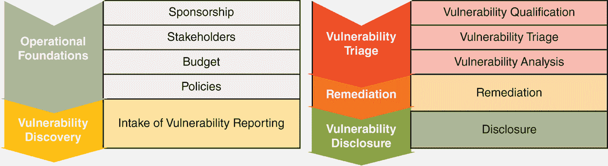

**图 10.1** 来源：`www.first.org/standards/frameworks/psirts/psirt_maturity_document`

在深入研究 PSIRT 的级别之前，最基础的步骤之一是创建 PSIRT 宪章，捕获 PSIRT 的使命声明、利益相关者、所属/赞助组织以及范围。

在基础（Basic）级别，PSIRT 可能正处于建立阶段，并试图达到基础功能水平。这需要高管赞助、利益相关者识别以及预算和基准程序。这意味着 PSIRT 需要组织领导层的支持；识别出内部和外部的利益相关者；为初始的人员配备和建立准备预算；并创建策略和流程来代码化 PSIRT 将如何从根本上运作。

FIRST 文档提供的示例策略和流程包括漏洞管理、信息处理和修复服务水平协议（SLA）。除此之外，PSIRT 还需要一些基本能力来满足其意图。这包括创建漏洞报告的能力，这涉及发布联系信息以及如何向组织的 PSIRT 报告漏洞。

然而，接收漏洞报告只是第一步；在此基础上，PSIRT 需要分拣和分析漏洞报告的能力。这涉及关键步骤，例如对漏洞报告进行鉴定，询问漏洞是否有效以及是否应该接受或拒绝。FIRST 建议 PSIRT 记录关键漏洞信息并采用机器可读格式以提高效率和扩展性。他们引用的资源包括常见漏洞报告框架 (CVRF)、CSAF 以及常见漏洞和披露 (CVE) 计划，后者最终由 NIST 的国家漏洞数据库 (NVD) 支持，并能够向消费者传递漏洞信息，通常通过集成并查询 NVD 以获取 CVE 等漏洞数据的漏洞扫描工具来实现。


一旦 `PSIRT` 确认某个漏洞为有效并被接受，他们就需要进入漏洞分析阶段。这涉及到理解漏洞的工作原理、如何被利用、哪些版本的产品和服务会受到该漏洞的影响，以及利用漏洞泛而言可能产生什么后果。后果将取决于环境以及可能存在也可能不存在的缓解措施，而由于消费者对自己的运行环境有内在的了解，这部分通常留给消费者自己来决定。

在分析过程中，PSIRT 通常会进行优先级排序和评分。FIRST 的文档建议使用 `CVSS`，考虑到其与 `CVSS` 的关系，这种建议是逻辑性的；但正如我们在其他地方讨论过的，`CVSS` 也遭到了学术界和工业界的许多项严厉批评。尽管有这些批评，`CVSS` 在行业内被广泛采用。如果 PSIRT 选择了另一种评分方法，正如 FIRST 所指出的那样，他们可能需要向通常熟悉 `CVSS` 的消费者解释这一决定。

现在漏洞已经过确认并分析，供应商需要修复该漏洞。修复可能涉及诸许多活动，如代码修复和产品补丁，或为消费者提供缓解漏洞风险的指导；或者从理论上讲，根据 PSIRT 及其供应商公司内部同行的成本效益分析，选择完全不修复该漏洞。

最后，漏洞披露的基础成熟水平涉及通知产品或服务的消费者有关漏洞。这种通知理想情况下伴有有关如何修复漏洞，或在没有代码修复或解决方案的情况下如何缓解漏洞的指导。FIRST 还建议对最初向供应商通报漏洞的安全研究人员或实体表示表彰。这为报告方提供了归属说明，并在社区中建立了了信任。

在超越基础和奠基性的成熟水平之后，PSIRT 将进展到成熟度等级 2 或中间级。在此阶段，PSIRT 开始提供更全面的服务，与组织内部和外部更多的利益相关者接触，并使现有的基础能力成熟（参见图 10.2）。

正如 FIRST 所提到的，中间级别的 PSIRT 对其利益相关者有清晰的理解，建立了流程，并能够优化对漏洞的分析和响应。中间级别的 PSIRT 还能使用工具来改进其漏洞摄取和处理能力。FIRST 建议中间级别的 PSIRT 开始了解发布产品中的各个组件，并将这些数据记录在产品清单或物料清单中，如果产品以软件为中心，通常称为 `SBOM`。

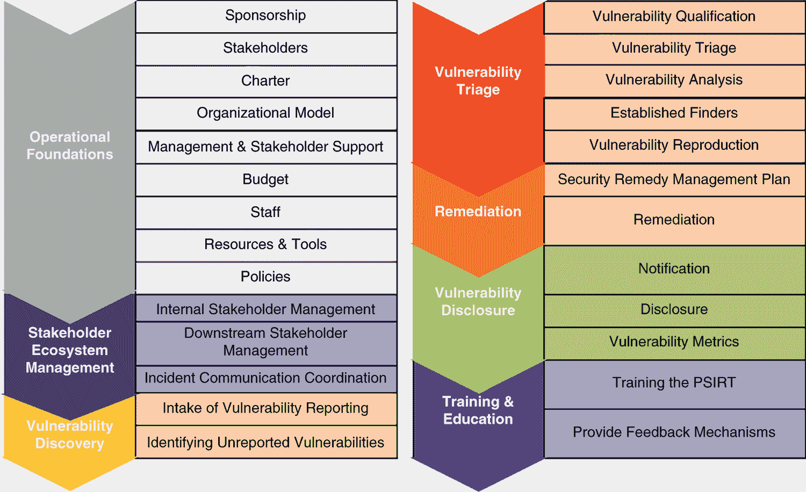

`图 10.2`

拥有 `BOM` 不仅有助于软件组件的可可视化以及面向下游消费者通信的漏洞管理，还能让组织了解可能需要与哪些第三方进行接触，例如 `OSS` 项目。

FIRST 的指南指出，更成熟的 PSIRT 具有明确的角色和职责，以理解每个利益相关者在漏洞分检和分析活动中的定位，并开始与可能向 PSIRT 报告漏洞或缺陷的安全研究人员建立关系。这种关系的建立通过建立功能性流程和工具（如工单系统）来促进漏洞报告过程。

除了使用 `CVSS` 和严重性评分外，PSIRT 通常还会成熟到使用通用弱点枚举 (`CWE`) 来对漏洞进行标记。正如第 3 章“漏洞数据库和评分方法”所述，`CWE` 是一个由 `MITRE` 管理的系统，提供了一份软件和硬件弱点列表。

紧扣 DevSecOps 的主题，FIRST 提到高级 PSIRT 的另一个标志是与开发团队保持紧密的集成和关系，以理解产品路线图和即将推出的功能。PSIRT 还优化了他们的工具来处理漏洞摄取、分析和报告流程。PSIRT 还积极影响了组织产品和服务的软件开发生命周期，确保漏洞分析和扫描是嵌入开发工作流和生命周期中的标准化活动。


PSIRT 了解其运营的生态系统也至关重要，这不仅包括下游的消费者，还包括上游的提供商。这种意识需要伴随着在软件供应链的每一个方向上，都存在着清晰且具有可操作性的沟通与预期。

最后，考虑到 PSIRT 在处理漏洞和产品缺陷方面的专业知识，PSIRT 可以开始教授他人。这可以体现在对产品安全和漏洞管理实践的内部培训和交流中，不仅可以优化 PSIRT 的性能，还能优化其所支持的开发和产品团队的性能。这不仅改进了产品和 PSIRT 的运营，理想情况下还能为下游消费者带来更安全的产品，而这正是终极目标。

## 分享还是不分享？达到什么程度才算过度？

软件供应商在追求软件透明度的过程中，可能会发现自己一直在问一个问题：他们究竟需要共享什么，或者他们是否应该共享这些数据。虽然这种决策过程和分析方法对于每个组织来说都是不同的，但有一点是明确的：由于软件供应链攻击日益增加，消费者以及更广泛行业对未知且可能不安全的软件组件消费风险的担忧，消费者、客户、政府机构和监管机构对软件透明度的推动正在持续增长。

决定供应商可能被要求或被迫共享内容的因素由多种因素驱动，例如合同语言、消费者需求以及适用的监管要求。某些消费者或行业可能要求或请求供应商提供软件组件的第一方列表，而另一些则可能要求或请求在实际可行范围内，提供软件和产品中涉及的详尽传递依赖列表。以 `NTIA SBOM Minimum Elements Report` 为例，在 `depth`（深度）方面，报告指出：“SBOM 应包含所有主要（顶层）组件，并列出它们所有的传递依赖项。至少必须列出所有顶层依赖项，并提供足够详细的信息以递归查找传递依赖项。”

显然，这一要求仅适用于符合 NTIA 最低元素要求的美国联邦生态系统中的实体，但它也可以作为一个实用的指南。需要注意的是，寻找传递依赖项所涉及的工作量可能是巨大的，因此，不向消费者提供这种深度的供应商将负担留给了消费者，而这对于所有消费者来说负担将是指数级增长的，而不是由供应商直接完成并传给他们的客户群体。在识别传递依赖项方面，除了将工作留给消费者之外，仅向消费者提供顶层依赖会导致他们对与传递依赖项相关的漏洞和风险一无所知。正如我们在其他章节讨论过的 `Endor Labs` 的《依赖管理现状》报告中所述，该报告发现 95% 的漏洞依赖是传递依赖项。这意味着，如果 SBOM 未包含传递依赖项，那么除非消费者自己费诸努力识别它们，否则大多数漏洞将无法传达给消费者或可见。这并没有涵盖对依赖（无论是直接还是传递）是否可达且可利用的细致分析和细节，但它至少为与应用程序或产品相关的所有依赖及其漏洞提供了进一步的背景，而不仅仅是顶层细节。

提供 SBOM 的软件供应商的另一个关键考虑因素是，他们提供的 SBOM 是否有用，以及是否包含足够的元数据以使其对下游消费者具有价值。有助于此项活动的一个早期新兴工具是 `SBOM Scorecard` 项目，由 eBay 提供（`https://github.com/eBay/sbom-scorecard`）。

另一个新兴选择是 `OWASP SCVS` 项目的一个项目，我们在第 6 节“云与容器化”中讨论过。虽然该项目仍在进行中，但它致力于帮助组织评估 BOM 是否符合组织策略、格式和分类法。

随着行业对 SBOM 采用的持续，此类工具以及 `SBOM Scorecard` 将是必不可少的。正如我们讨论过的，目前 SBOM 的深度、完整性和准确性程度不一，组织将希望确保与其基于组织或法规的特定要求保持一致，以确保他们分发的 SBOM 满足需求（`https://scvs.owasp.org/bom-maturity-model`）。

该工具可用于确定某些关键标准，例如 SBOM 是否合规、是否提供了其生成的信息，以及与包相关的信息（如 ID、许可和版本信息）。

我们在第 4 节“软件物料表的崛起”中讨论了 NTIA 定义的 SBOM 最低元素。考虑到联邦部门可能被要求符合这些元素，这些元素对于供应商和消费者都是重要的。一个实用工具是 `ntia-conformance-checker`（`https://github.com/spdx/ntia-conformance-checker`）。

在这些工具的基础上，还有 `Chainguard` 等组织的努力，通过其 `Chainguard Labs` 尝试，他们在 2022 年底对一组公开的开源 SBOM 进行了调查以确定其质量和内容，使用了我们所讨论的方法（`www.chainguard.dev/unchained/are-sboms-any-good-preliminary-measurement-of-the-quality-of-open-source-project-sboms`）。

虽然他们的研究发现某些开源 SBOM 包含了质量数据，但许多并没有。没有符合最低元素要求，很大一部分缺少许可信息。虽然这不是好消息，但也应该与行业对 SBOM 的采用（包括生成、要求和质量）仍处于早期阶段的现实形成对比。然而，拥有这些早期研究和工具有助于供应商了解差距并确保提供给下游消费者的 SBOM 是高质量且有用的。软件组件清单、透明度以及如 SBOM 等努力都是围绕数据展开的。没有高质量的数据，供应商和消费者都缺乏足够的洞察来做出基于风险的决策，并推动有助于增强软件供应链状态的组织成果。

## 拷贝权、许可忧虑与“按现状”代码

（注：此处原文为英文标题，下文为翻译）

正如我们在第 5 节“软件透明度的挑战”中讨论过的，许可也是许多供应商的一个主要关切点，特别是当它涉及开源软件及其所应用的许可时。许多软件供应商可能关心的一种许可方法被称为 `Copyleft`（拷贝权）。拷贝 left 在很大程度上被理解为使程序或软件免费的许可方法，并要求程序的所有后续修改和扩展版本也必须是免费。


随着对软件透明度的推动，某些供应商可能对版权侵权问题产生额外担忧，包括违反 Copyleft（共同左版）许可软件的规定。虽然供应商本应该采取措施确保其目前没有违反许可协议，但 `SBOMs` 等措施的额外透明度将揭示供应商产品和软件中的 OSS 组件。许可情况的可见性不仅对供应商显而易见，对于作为自由开源软件（FOSS）项目维护者和贡献者的消费者也是如此。版权所有者（如 `FOSS` 项目创建者和维护者）是能够根据感知到的版权侵权行为（如 Copyleft）发起法律行动的实体。

供应商应确保采取额外步骤对其软件组件的使用进行盘点，并确保其在产品和软件中可能使用的 `FOSS` 软件没有违反任何适用的版权，以避免潜在的法律挑战、问题以及伦理问题。

正如前一节所述的，`SBOM` 数据不足（包括缺乏许可信息）将使供应商处于无法完全理解其许可合规性的境地。供应商需要确保他们了解其 `FOSS` 使用的完整范围，以及涉及其软件版本的任何组件的相关许可要求。

除了法律关注之外，许可还是一个潜在的安全关注问题。鉴于大多数 `OSS` 的自愿性质，许多维护者按原样提供其项目和代码。这意味着他们可能无法或不愿修复下游消费者提出的问题。因此，使用 `OSS` 的消费者和组织必须准备好分叉（fork）项目，并开始承担修复他们识别的问题或漏洞的责任，因为 `OSS` 维护者并没有承担责任或响应的义务。行业中的许多人仍然不理解这一点，看到对 `OSS` 维护者提出不切实际的期望来解决问题或提供支持的情况并不罕见，因为在大多数情况下，并没有任何规定要求他们这样做。

虽然 `OSS` 项目和组件的使用经历了巨大的增长，但某些组织似乎误解了 `OSS` 的动态。在涉及软件供应链安全时，大多数 `OSS` 维护者不应被视为“供应商”。您的组织通常与他们没有业务或合同关系，您是按原样使用他们的代码，而对维护、更新或响应没有任何期望。因此，在产品、应用程序和服务中使用 `OSS` 的组织需要了解其 `OSS` 使用的程度，并在需要时准备好对组件的责任。

这种动态在 `OSS` 维护者 Thomas Depierre 的一篇博客中得到了很好的体现，标题为“我不是供应商”（`www.softwaremaxims.com/blog/not-a-supplier）。Depierre 指出，尽管 `FOSS` 在数字经济中无处不在，`OSS` 维护者并不是传统意义上的“供应商”，下游消费者无法向他们提出任何要求。

## 开源项目办公室

正如我们所讨论的，各种形状、规模和行业的组织都拥抱了 `OSS`。金融、医疗和制造业——甚至国家安全——现在使用 `OSS` 来驱动他们最关键的应用和活动。这包括软件供应商，他们通常将 `OSS` 作为其产品和应用程序开发的一部分。

然而，这种广泛的采用也带来了陷阱：根据 Sonatype 的《软件供应链状态报告》，软件供应链攻击增加了近 800%。

随着 `OSS` 采纳率的快速增长，各已开始建立开源项目办公室（`OSPOs`），以帮助制定有关 `OSS` 使用和贡献的策略，并促进与更广泛的 `OSS` 社区的协作。这些 `OSPOs` 通常承担关键职责，例如培养 `OSS` 战略、领导其执行以及促进整个企业范围内 `OSS` 产品和服务的使用（`www.linuxfoundation.org/resources/open-source-guides/creating-an-open-source-program`）。

随着组织继续采用和使用 `OSS`，他们如果从开始实施 `OSPO` 将受益匪浅。`OSPO` 可以帮助解决我们在前一节中讨论的一些问题，以及我们接下来将讨论的一些问题。

虽然供应商和经常进行自身内部开发活动的企业消费者都能从 `OSPO` 中获益，但我们将从软件供应商的角度进行讨论，他们通常在自己的产品和软件中频繁使用 `OSS`（`https://fossa.com/blog/building-open-source-program-office-ospo`）。

`OSPO` 在领导 `OSS` 管理和战略方面的独特地位，使其成为组织处理 `OSS` 安全和治理方法中的关键参与者，这一角色变得越来越至性。研究表明，现代应用程序包含 500 多个 `OSS` 组件。鉴于如此广泛的使用，意识到一些关于 `OSS` 组件的令人震惊的统计数据是非常重要的。

根据 Synopsys 2022 年的一项调查，81% 的组件包含至少一个漏洞，88% 的组件在过去两年内没有新开发，且 88% 的使用的组件不是最新版本。所有这些指标汇成了一个令人震惊的现实：组织正在大量使用过时且不安全的组件。这意味着在现代企业环境中，我们拥有巨大的攻击面，这些表面治理良好且充满了恶意攻击者的路径（`www.synopsys.com/content/dam/synopsys/sig-assets/reports/rep-ossra-2022.pdf`）。

到此时，读者应该熟悉美国网络安全行政命令（`EO`），包括第 4 节“增强软件供应链安全”。由于该 `EO` 的影响，`NIST` 生成了全面的软件供应链指南，包括开源软件控制措施（我们在这里讨论这些内容），以及 `OSPOs` 如何倡导其实施（`www.nist.gov/itl/executive-order-14028-improving-nations-cybersecurity/software-security-supply-chains-open`）。

`NIST` 将其 `OSS` 控制措施分为三个成熟层级：基础能力、维持能力和增强能力。这些控制措施包括诸如使用 `NIST` 安全软件开发框架（`SSDF`）的方面，以及确保通过安全渠道从可信源获取 `OSS` 组件。现代企业环境的现实是，大多数组织对自己的 `OSS` 使用没有完全的可见性和治理，更不用说对其相关漏洞进行持续监控。这是 `OSPO` 发挥作用的完美范例：作为有效使用商业 `OSS` 产品和服务的倡导者，负责对 `OSS` 相关漏洞保持警惕，并确保这些安全实践被编码到组织的政策和流程中。

`NIST` 建议的 `OSS` 安全控制还包括建立已知且经过审核的 `OSS` 组件内部仓库，开发者可以使用这些组件来降低组织风险。与其允许开发者在不了解漏洞和风险的情况下自由拉取并使用所有 `OSS` 组件，不如通过内部仓库创建一个稳健的 `OSS` 组件库，这可以在提高开发速度的同时，降低因使用存在漏洞 `OSS` 组件带来的组织风险。


NIST SSDF 的另一项关键建议是实施支持性工具链，包括指定 `CI/CD` 流水线中必须包含哪些工具以降低风险。例如，可以将软件成分分析（`SCA`）和 `SBOM` 工具集成到现代 `CI/CD` 工具链中，以确保企业对流经工具链并进入生产环境的漏洞开源软件（OSS）组件具有完全可见。这也有助于推动“安全左移（shift security left）”，确保安全扫描在软件开发周期的更早阶段进行，并在漏洞引入生产环境之前进行识别和修复，因为在生产环境中，它们可能会被恶意者利用。OSPO（开源软件计划办公室）可以在这一领域倡导并规范的政策和流程包括漏洞扫描和 `SBOM`，还包括启用签名功能，这有助于创建不可更改的记录和日志，以支持软件开发活动的完整性和可审计性。

NIST 提出的最成熟层级——增强能力——包括优先使用安全的编程语言，并最终实现将 OSS 组件的收集、存储和扫描自动化到前述的加固内部库中。这可能是帮助降低风险的同时又不阻碍开发团队速度的关键步骤，因为如果速度受阻，开发人员为了完成任务无疑会绕过组织的政策和流程。

OSPO 中常见的角色包括开发者关系、倡导和推广。虽然这些小组通常在公司开发团队中建立热忱和兴趣，但他们的工作通常也关乎建立关键关系。这些关系可以被利用来鼓励人们对新兴 OSS 安全最佳实践产生认同，尽管许多组织在其应用程序、软件和产品中广泛使用 OSS，但仍尚未实施这些最佳实践。这创造了多处收益，例如确保组织最大限地减少使用不安全的依赖项，并产生更安全的应用程序（无论是用于内部还是外部目的）。

研究（如 Chinmayi Sharma 的研究）表明，软件供应商是 OSS 的主要受益者，因此处于帮助解决 OSS 供应链风险的最佳位置。这使得软件供应商能够更深入地参与 OSS 社区、扫描漏洞并向 OSS 项目贡献以缓解这些漏洞。这将是对现有模式的转变，在该模式下，OSS 社区很大程度上承担了这一负担，而缺乏软件供应商社区对等的参与和贡献。软件供应商从其产品和服务中使用 OSS 中获益良多，通过实施和完善 OSPO，他们既可以很好地了解其 OSS 使用情况及相关风险，也可以向他们高度依赖的社区做出贡献。

这使得 OSPO 处于领先范式转变的完美位置，并最终增强更广泛的 OSS 供应链安全。OSS 导致了几乎每个行业的创新和能力。OSPO 现在处于领先这些行业及相关组织更深入地参与 OSS 社区的前沿，同时解决 OSS 由于参与和投资脱节而带来的当前系统性风险。通过对供应商软件中使用的 OSS 组件进行更好的治理和安全管理，有助于减少传递给供应商软件下游消费者的风险。

## 跨产品团队的一致性

如果不在组织的各个产品团队中实施一致性，那么推动软件透明化以及提供诸如 `SBOM` 和证明（attestations）等产物可能是无效的。对于非常大的组织或具有全球业务的组织，拥有多个产品团队并不罕见，其中某些团队拥有自己的工具和 `SDLC` 流程。

作者们至少知道一家自动化制造商，他们为每条产品线创建一个新的法律实体。因此，从本质上讲，有几十或数百个法律实体，都在以非常相似的名称生产软件。

## 手工工作与自动化与准确性

供应商必须考虑的一个关键点是：自动化角色与所提供信息的准确性需求之间的对比。对于大型公司，特别是那些具有快速部署计划的公司，进行软件保证变成了一项可扩展性挑战。在某些情况下，自动化可能无法识别某个组件。例如，在运行时动态加载组件或未在 `Dockerfile` 中包含该组件的 `Docker` 镜像可能需要手动识别该组件。但确定对于 `SBOM` 的初始捕获来说什么是“足够好”可能会有所帮助。

如果供应商能够产生一个置信水平超过特定标准（例如 80%）的 `SBOM` 或其他产物，这对于该产物的消费者来说是否足够？错误总是有可能的，而且在自动化该过程时，这种偏差可能会增加。如果不是 80%，你的预期置信水平是多少？你的客户是谁？你是否与他们讨论过现实预期？你是否有一个流程来更新和修正之前错误的供应链产物？通知你的客户？根据这些新信息更新分析？如果产物是正确的，但发现了新的分析结果（如新的 `CVE`）怎么办？你产生的产物不仅必须正确，分析出的见解也必须正确。

我们的一种常见问题（特别是在反向工程生成的 `SBOM` 中）是未能理解分析的内容。识别组件有多种技术，但某些技术并不比文件内的字符串匹配更精细。注释中写“cve_x 在组件版本 1.2.3 中已修复”可能会被解释为安装的组件是 1.2.3，而实际上是 2.0。对每个版本进行详尽的反向工程练习是不现实的，因此在这些情况下你的置信水平是多少？它可能低于 80%。根据作者的经验，它通常接近 60%。因此，理解产物的创建方法可能也需要考虑在内。


生成 SBOM 的阶段是否重要？设计、构建和部署可能会为同一个应用程序产生实质性不同的 SBOM。早期阶段的 SBOM 对最终消费者可能并无帮助，而试图获取构建过程中完美自动化的 SBOM 可能是一项徒劳的努力。或许对于供应商的内部软件安全保障实践来说，这已经足够了，而“完美”可以留给最终交付给客户的内容。这使得许多手动工作被推到了最后，作为一种质量保证流程，并提供了一个纠正任何检测到的偏差的机会。

### 总结

在本章中，我们鼓励消费者对软件供应链安全挑战以及 SBOM 的角色进行更**广泛**、更**深入**的思考。我们解释了为什么组织需要（或渴望）供应商提供 SBOM，更广泛地说，需要供应商提供软件透明度，并推荐了如何利用 SBOM 以及规模化管理 SBOM 的潜在用例。我们还讨论了，虽然 SBOM 可能有助于解决软件供应链安全和透明度方面的某些挑战，但它远非灵丹妙药，在工具、自动化、标准化和成熟度方面还有很长的路要走。在下一章中，我们将讨论软件透明度预测、国际努力，以及社会在软件供应链安全方面的发展方向。

# 第 11 章：面向消费者的实用指南

软件供应商的另一面是软件消费者。这些消费者正试图理解不断涌出的指南、最佳实践和要求，这些内容不可避免地涉及供应商与消费者之间关系中推拉锯的动态平衡。每个人都有不同的视角、动机和目标，并且可能存在不同的监管要求。虽然某些软件消费者可能是拥有强大网络安全人员和专业知识的大型企业，但情况并非总是如此，因为许多消费者是中小型企业（SMB），有限或没有内部网络安全专业知识和资源。这些较小的组织通常必须依赖外部托管服务提供商和合作伙伴，并在进行安全软件消费时，仅根据其资源优先考虑现实的活动。在本章中，我们将为消费者提供一些实用指南，这些建议建立在第 7 章“现有及新兴的商业指南”和第 8 章“现有及新兴的政府指南”的许多建议之上。

## 广而深入的思考

虽然本关于消费者指南的章节包含了与软件物料（SBOM）相关的讨论和建议，但我们想要强调，SBOM 仅仅是软件供应链安全更广泛讨论中的一种新兴工具和资源。然而，考虑到行业内对其的高度关注，我们认为有必要提供一些相关的指南。

正如我们在 `SolarWinds`、`Log4j` 和 `Kaseya` 等里程碑案例中所过的，与软件供应链相关的风险可能与专有软件供应商、开源软件（OSS）组件、托管服务提供商以及云服务提供商等有关。

此外，从 `NIST`、`CNCF`、`NSA` 等来源的现有及新兴指南中可以看出，软件供应链最佳实践和消费者的考量涉及关键活动，包括了解其供应商、在这些关系中的共同责任、围绕软件消费的组织治理，以及伴随工具的内部实践和流程，以确保软件的安全消费、开发和使用，从而满足组织独特的业务和任务需求。

此外，正如第 4 章“软件物料清单的兴起”中“SBOM 的与关注”节节讨论的，在 SBOM 工具化和运营方面仍有许多问题待解决，以帮助组织成功摄入、分析、丰富和存储 SBOM，将其作为软件供应链以及更广泛的网络安全供应链风险管理（C-SCRM）活动的一部分。此外，根据各种机构的研究和现有的工具评估，必须对如 OSS 项目等某些社区的 SBOM 现状和成熟度提供一些见解。

正如我们在书中提到的，取决于行业和相关的监管因素，SBOM 的采纳率和 SBOM 数据的深度在整个生态系统中各不相同，因为在没有业务利益或监管或采购/收购要求的情况下，供应商并不一定有动力向消费者提供这些产品。由于这些原因，我们想要强调，虽然 SBOM 在推动软件透明度和软件供应链安全方面很有用，但不应被视为“银弹”，这在网络安全的几乎任何领域都是如此。这是一个复杂的问题集，没有单一的解决方案，因此有了长期存在的术语“深度防御”。IT 系统面临的威胁涉及用户、端点、数据、复杂的相互依赖系统等，这导致没有单一的解决方案或技术可以解决所有相关的挑战和威胁。

## 我真的需要 SBOM 吗？

随着围绕 SBOM 的所有炒作和困惑，某些软件消费者可能在问自己是否真的需要 SBOM。虽然软件行业在过去十年中在未使用 SBOM 的情况下存在，但这并不意味着没有挑战，而且随着 OSS 和第三方组件的使用增加，这些挑战正在加速。

软件行业内部的供应商和消费者对 SBOM 的兴趣增长巨大，这看起来并不是一个会放缓的趋势。根据 Linux 会的《软件物料清单（SBOM）状态与网络安全准备情况》等调查，SBOM 的使用在 2022 年增加了 66%，并预计几乎 88% 的组织将在 2023 年在某种程度上使用 SBOM（`www.linuxfoundation.org/research/the-state-of-software-bill-of-materials-sbom-and-cybersecurity-readiness`）。

现代软件和应用程序主要由 OSS 和第三方软件组件组成，如果不使用 SBOM 或进行严谨的活动（如软件成分分析 `SCA`），消费者对所消费的软件组件或依赖关系就没有深入的了解。这意味着消费者目前以及传统上在消费供应商软件时，几乎不了解涉及的组件或其漏洞、可利用性以及它们对组织及其合作伙伴、客户和利益相关者可能带来的风险。正如第 2 章“现有方法——传统的供应商风险管理”中所讨论的，传统的采购/收购和供应商风险评估流程尚未达到软件组件清单和风险管理的深度。


消费者随后面临着可能存在漏洞的软件，而他们完全并不知道这些软件存在漏洞。除非从供应商处获得相关软件的 SBOM 以显示其包含的组件，否则消费者将无法与这些组件相关的漏洞进行关联，无法向供应商查询这些漏洞的可利用性，也无法独立地评估和验证其漏洞的可利用性。SBOM 带来的透明度有助于缓解大多数软件消费者目前面临的可见性和意识方面的缺口。

消费者使用 SBOM 的另一个原因是，诸如国家漏洞数据库（`NVD`，我们在其他章节中讨论过它）之类的数据库虽然显示了产品级的漏洞，但通常缺乏对产品所涉及组件以及与这些特定组件相关的漏洞的详细洞察。消费者不能简单地依赖旧方法，即严格使用 `NVD` 和产品的通用平台枚举（`CPE`）名称来获取产品内漏洞组件的可见性或感知。

正如我们所讨论过的，其他漏洞数据库正在涌现，它们对开源软件（OSS）漏洞提供了更好的能力，并支持包 URL（`PURL`），这可能是识别组件级漏洞的一种更有效的方法（`https://github.com/package-url/purl-spec`）。

### SBOM 与组件识别

正如你所记得，我们讨论过 SBOM 论坛在其白皮书《漏洞管理中组件识别操作化的建议》中的努力，该白皮书呼吁 `MITRE` 和 `NVD` 采用 `PURL` 来识别开源软件和商业软件。在某种程度上，这将有助于解决 `NVD` 在产品相关组件级漏洞方面的现有缺口。正如白皮书指出的，在这一命名挑战解决或至少显著改进之前，全规模自动化和 SBOM 的有效性将受到限制。

虽然供应商可能会经常主动识别其组件和产品中的漏洞、修复这些漏洞并通知消费者，但情况并非总是如此。拥有组件可见性允许消费者保持对组件级漏洞的关注，并在消费者识别出新组件漏洞时通知供应商（如果之前没有收到供应商的通知，将是理想情况）。它还赋予消费者在供应商未积极提供相关背景信息的情况下查询已识别漏洞的可利用性的权利。正如我们很快将讨论的，它还使消费者能够在已知漏洞且供应商尚未发布修复或补丁（甚至可能永远不会发布）的情况下，实施虚拟补丁等方法。

这使得供应商承担了责任，因为他们知道消费者已经意识到并关注组件漏洞。现实情况是，识别和修复漏洞是有成本的，供应商并不一定有动力将此活动优于其他产生收入的活动（例如产品和功能开发）。

### 资产清单与安全控制

多年来，资产清单一直是 `SANS` 和网络安全中心（`CIS`）指导等等来源中的安全最佳实践和关键控制措施。然而，随着行业意识到单个软件组件不仅对一个组织而且对整个行业造成的风险，讨论重点已成熟为软件资产清单，现在是软件组件资产清单。

考虑到组织采用所有安全控制或同等优先考虑其实施是不切行的，`CIS` 提供了一份与生态系统中最常见的攻击相关的关键安全控制列表。`CIS` 表示，该列表是每个寻求改进其安全防御的企业的“必做、优先执行”的起点（`www.cisecurity.org/controls`）。

`CIS` 关键安全控制措施映射到其他行业框架，例如支付卡行业数据安全标准（`PCI DSS`）、健康保险可移植性与责任法案（`HIPAA`）、北美电力可靠性协会关键基础设施保护（`NERC CIP`）以及联邦信息安全现代化法案（`FISMA`），所有这些框架在某种程度上也讨论了软件清单的必要性。虽然传统上指的是应用程序，但随着软件供应链攻击和漏洞软件组件的激增，它正日益转向更细粒度的软件资产清单。

正如 `CIS` 指南所出的，软件资产的清单和控制是防止攻击的关键基础。恶意攻击者经常寻找他们可以利用的漏洞软件版本。这可能对组织产生各种影响，包括横向移动到其他企业资产，甚至可能导致级联场景，即他们从初始目标组织跳出，转向业务合作伙伴、客户或其他目标组织有访问权限的其他组织。

在没有稳健且准确的软件资产清单的情况下，消费者将无法确定其环境中是否存在或漏洞组件在哪里，或者是否存在其他与许可等相关的担忧。

### 事件响应与采购

除了在软件组件资产清单方面发挥关键作用外，SBOM 还有助于消费者的其他用例，例如事件响应团队。例如，在 `Log4j` 事件之后，正如我们讨论过的那样，网络安全审查委员会（`CSRB`）报告说，某些联邦机构花费了数万小时调查该事件，并试图在其企业环境中寻找漏洞的 `Log4j` 组件。

虽然无论背景如何，大型复杂环境中的事件响应不可避免需要时间，但如果事件与 `Log4j` 等漏洞软件组件有关，且您的组织缺乏全面的软件组件清单，要确定您的组织在何处以及在何种程度上漏洞将极其困难。

采购和收购是消费者角度来看 SBOM 有价值的另一个例子。由于消费者通常会通过流程来审查新的应用程序和供应商，以供其企业使用或促进业务流程，因此了解这些供应商可能带来的潜在风险至关重要。

组织使用诸如请求漏洞扫描、渗透测试报告、`SOC 2` 等合规证明文件等方法来帮助他们判断使用特定厂商或供应商的适用性并不罕见。然而，从历史上来看，这些活动并不包含软件组件清单数据，导致消费者对所包含产品的软件组件构成在很大程度上不了解，而且对供应商可能在其产品中使用的第三方软件组件相关的漏洞一无所知。

通过向供应商索取 SBOM 和漏洞可利用性交换（`VEX`）文档，消费者能够了解供应商产品相关的任何漏洞、其可利用性以及这些产品对组织安全态势可能产生的影响，而避免在采购和收购过程中进展得太远。


对于消费者而言，另一个关键的 SBOM 考虑因素是确保与供应商合作，以消费者可以支持的格式接收 SBOM（例如，如果他们的内部工具和能力倾向于 `SPDX` 或 `CycloneDX`，而不是同时支持两者的能力）。消费者可以使用合同条款等方法，要求供应商根据其个人需求和能力提供特定格式。消费者还可以利用其合同条款不仅定义他们所需的 SBOM 格式，还定义其频率、交付方式、所需字段等。这方面的示例包括美国联邦部门，他们正围绕美国国家电信和信息管理局 (`NTIA`) 定义的 SBOM 最小元素进行工作，这些元素定义了所需的字段和内容。

## 我该如何处理它？

太棒——你已经从软件供应商那里收到了 SBOM，或者开始根据内部开发工作自己创建它们了。现在，你该如何处理这些 SBOM 以让它们产生价值并具有操作性？

正如我们之前讨论过的，SBOM 对于多种用例具有价值，例如漏洞管理、依赖卫生、事件响应、许可和采购。要使其具有操作性的关键在于将 SBOM 集成到你的组织政策和流程中，并让相关的利益相关者参与，他们可以帮助根据各自的角色和职责使这些产物产生价值。

虽然行业已经迅速看到了我们在第 4 章中讨论过的帮助创建 SBOM 的工具的普及，但在接入、分析、增强、存储和报告 SBOM 及其相关的大规模数据方面，行业仍然有相当多的成熟工作要做。

这种成熟也适用于其他挑战，例如遗留软件或云环境。对于后者，由于云环境的复杂性以及服务与提供商之间复杂的依赖关系，行业对于云上下文下的 SBOM 应该什么样尚未达成统一共识。

如果没有在创建或接收 SBOM 后如何处理它们的连贯计划，组织将面临可能提供漏洞、风险和依赖洞察的产物，但除非通过组织利用技术以及支持性的政策和流程使其具有操作性，否则它们将不会产生价值。正如我们讨论过的，SBOM 有巨大的用例，但组织必须有一套计划来妥善利用它们，以避免在个人和组织层面增加额外的认知负担，却只获得极小的投资回报。

## 大规模接收和管理 SBOM

虽然从个体来看，SBOM 的概念及其用于阐明产品中涉及的软件组件的使用是合理的。然而，在大型企业环境中，跨越数百或数千个开发团队和许多第三方软件供应商进行大规模操作这一想法可能很快变得望而却畏。组织如何管理所有这些大规模数据？你如何确保拥有一种稳健且全面的方法来持续处理 SBOM，以驱动围绕风险、采购以及我们讨论过的其他用例的决策？

消费者可以通过多种方法接收或获取 SBOM。扩展这些选项的一个有用资源是 `NTIA` 题为“共享和交换 SBOM”的白皮书，该白皮书源于 `NTIA` 关于软件组件透明度的多利益相关者流程，我们在其他章节中讨论过（`https://ntia.gov/sites/default/files/publications/ntia_sbom_sharing_exchanging_sboms-10feb2021_0.pdf`）。

在 `NTIA` 指南背景下，SBOM 交换包括广告或发现以及访问。广告或发现涉及发布和定位 SBOM，或注册端点以接收 SBOM 更新。

访问位于检索或传输 SBOM 本身过程的另一端。示例包括网站、电子邮件、文件传输协议 (`FTP`)、应用程序编程接口 (`APIs`) 或源代码管理 (`SCM`) 系统。指南中的某些示例扩展了供应商产品文献或包装中包含的 URL，消费者可以导航到此处查看 SBOM。虽然这对于理解产品涉及的初始组件可能有用，但很容易看出随着产品更新和新组件的引入，挑战将出现在何处。这需要确保产品的 URL 保持更新，以涵盖各个版本的最新组件。

软件包管理工具也可以促进 SBOM 的分发和检索，表现为软件仓库顶层目录中的 SBOM，或作为容器清单文件的 SBOM。

`NTIA` 提供的另一个示例是建立 SBOM 的发布和订阅系统。该系统创建了这样一种情况：上游供应商可以定期发布 SBOM，下游消费者手动或通过自动化获取。这种情况使得向下游消费者提供的软件组件组成信息实现持续流动。

SBOM 围绕 `JSON` 和 `XML` 两种数据交换格式构建，这实现了规模化至关重要的机器读性和自动化。虽然这些产物可以被人类理解，但使用计算机接入并解析 SBOM 数据要高效得多且易于扩展。它还可以通过漏洞分析或与数据库和其他存储系统集成来实现增强。它可以帮助将 SBOM 数据集成到现有的组织工具和工作流中，根据软件组件和漏洞数据做出更明智的决策。

现代企业环境涉及多个内部开发团队以及大量的外部和第三方软件供应商。鉴于行业建议在每次软件发布时创建和接收新的 SBOM，很容易看出为什么基于静态的产物和交付机制在大多数现代技术环境中是不具扩展性和逻辑性的。

大型企业组织已经并将继续开发围绕 `APIs` 和自动化的原生能力，以促进 SBOM 的大规模创建、接入、增强、分析和存储。我们将看到托管服务提供商 (`MSPs`) 和供应商持续增长，提供辅助 SBOM 使用和治理的平台，以服务那些不想在内部完成或缺乏相关资源和专业知识的组织。其中某些可能采取托管组织的形式，作为供应商和消费者之间受信任的第三方或中介。


正如 NTIA 在其《软件消费者策略手册：SBOM 的获取、管理与使用》指南（`www.ntia.gov/files/ntia/publications/software_consumers_sbom_acquisition_management_and_use_-_final.pdf`）中所指出的，组织通常可以通过将数据馈入其组织工作流，从而充分利用 SBOM。这使得 SBOM 从一个被孤立查看的单一构件，重新定义为一组可以被解析、提取并加载到其他自动化组织流程中的数据集合。这种重新定义可以通过内部开发的开源软件（OSS）工具或商业工具提供商来促进，这些工具可以易于从 SBOM 中提取数据。

该指南指出，多种商业解决方案和特定的行业用例（涵盖医疗设备、车队管理等）目前正向采用 SBOM 转变。这种趋势产生了这样局面：SBOM 数据的子集（如特定组件、供应商、版本和其他数据）可以针对特定的用例和目的，为跨整个组织的环境提供相关的洞察。这将允许组织将 SBOM 数据与其他相关数据和洞察相结合，以改进各种业务和任务决策。

当涉及软件消费者接收和存储 SBOM 时，除非软件供应商另有授权，否则消费者方面应当对安全存储和访问控制有所预期。许多软件供应商理解地会对广泛公开其 SBOM 感到担忧，因为这会暴露其应用程序和产品中的漏洞，这些漏洞可能被恶意攻击者利用。

理想情况下，供应商正在积极解决其产品中的漏洞，但与任何组织一样，许多供应商面临着时间、预算和专业知识等资源方面的限制，这意味着拥有完全没有漏洞的产品通常是不可能或不切实际的。因此，那些由供应商提供 SBOM 的消费者应采取适当措施来保护其构件和数据，以避免未经授权的访问或泄露。例如 OMB 22-18 备忘录，要求特定的美国联邦机构实施适当的信息保护机制，并共享其从第三方软件供应商处接收的 SBOM 等构件。

## 减少噪音

拥有 SBOM 是一个很好的开始，但如果没有关于漏洞实际**可利用性**的上下文信息，它在很大程度上将成为额外的噪音，增加消费者及其各种利益相关者的负担。因此，获取有关软件组件（如可利用性）的粒度信息是关键。

此前在 第 4 章 中讨论过的漏洞可利用性交换（VEX）正迅速成为从业人员社区中 SBOM 的不可或缺的伴随文档。原因是，如果没有可利用性的上下文，软件消费者将没有任何指导或洞察来帮助驱动其作为漏洞管理一部分的漏洞优先级排序活动。当软件消费者被赋予了有关其漏洞可利用性的信息时，他们可以更好地理解应用程序的哪些组件需要额外的关注并构成了实际风险。

这种赋能和上下文创建了这样局面：尽管 VEX 可能会随初始 SBOM 一起出现，但即使通过 SBOM 通的底层软件组件没有发生变化，也可能发生额外的 VEX 文档和通信。这是因为新漏洞不断被发现和报告，而与 VEX 相关的软件并未发生变化。对于现有的软件组件可能会发现新漏洞，这意味着需要向软件消费者提供新的 VEX，以告知他们该新漏洞的可利用性。开源的、行业驱动的努力（如 `OpenVEX` 规范）已开始在行业中产生势头，旨在满足 CISA 等其他机构讨论的 VEX 要求和用例，并提供一种最小的、与格式无关的方法来创建、合并和证明 VEX 文档，以通信与 SBOM 和软件相关的漏洞的可利用性（`https://github.com/openvex/spec`）。

一种物清单（BOM）格式是 `CycloneDX`，它在提供与漏洞组件相关的上下文方面具有强大的支持，有助于消费者更好地优先考虑其漏洞管理工作。`CycloneDX` 提供了 SBOM 之外的其他功能，包括支持 VEX 以传达产品中所用漏洞组件的可利用性。它还可以支持漏洞披露报告（`VDRs`）以通信影响组件和服务的已知和未知漏洞，甚至还有漏洞清单（`BoV`），可用于系统和漏洞情报源之间共享漏洞数据。

最后，考虑到我们拥有复杂的软件、服务和组件现代生态系统，`CycloneDX` 提供了对所谓的 `BOM-Link` 的支持，这使我们能够引用其他系统 BOM 中的组件、服务或漏洞。

消费者应当坚决要求供应商提供诸如 VEX 文档之类的伴随构件，以对其产品和应用程序中漏洞组件的可利用性提供洞察。未能这样做将使消费者在尝试处理其消费软件中的漏洞时，面临大量的工作和猜测。

使用使用之前讨论的 VEX 和其他方法外，软件消费者还可以利用我们讨论过的 NVD 以外的行业漏洞数据库，如 `OSV`、`OSS Index` 等，并结合漏洞预测评分系统（`EPSS`）和威胁情报来丰富漏洞数据，以提高漏洞洞察的真实性，并对对组织风险最大的漏洞。

## 差异化的工作流——我不能直接应用补丁吗？

正如我们在前面的节中所讨论的，现实情况是尽管供应商的软件和产品中存在漏洞，但这些漏洞通常没有消费者可以直接应用的修复或补丁。这可能是由于供应商面临的资源限制、补丁和修复时间表、竞争的功能待办列表，或仅仅是缺乏软件供应商或项目的进一步支持和维护。

例如，来自 `Aberdeen Strategy & Research` 等小组的研究发现，在 2020 年发现的 20000 多个漏洞中，供应商在年底前没有对近 20% 的漏洞发布补丁。这包括数千个具有公开可用利用程序的漏洞。现实情况是，就像历史上即使为漏洞应用程序提供了补丁也难以应用的软件消费者一样，供应商在发布其产品和软件中已知漏洞的补丁方面往往跟不上速度。

结果，这导致了消费者必须采取其他措施来应对这些漏洞或缺陷带来的风险，而这些措施并不涉及直接对供应商的软件进行补丁。通常，这会转化为行业所指的 `虚拟补丁`，它由开放应用安全项目（`OWASP`）定义为“一种防止已知漏洞被利用的安全策略执行层”（`https://owasp.org/www-community/Virtual_Patching_Best_Practices`）。


在 Web 应用程序的情况下，这通常涉及能够拦截事务和数据流，并确保试图利用已知漏洞的恶意流量无法到达 应用程序。这通常以 Web 应用防火墙（`WAFs`）的形式出现，它们通常被用于保护 Web 应用程序免受恶意攻击，例如旨在利用应用程序缺陷和漏洞的跨站脚本（`XSS`）或 SQL 注入。

大量研究表明，在一半的公开漏洞中，供应商尚未提供相应的补丁。这表明人们正积极尝试与消费者社区就已知漏洞和风险进行快速沟通，但不可避免地也造成了漏洞公开而无补丁可用的局面，消费者无法修复风险。

除了供应商端补丁可用性的限制外，通常还存在业务或任务限制，导致即使供应商提供了补丁，传统的补丁方案也不总是可行的。例如，可能担心将任务或业务关键系统下线，或者可能会干扰组织产生收入的系统。组织还可能会推迟应用厂商和供应商提供的可用补丁，直到计划中的维护窗口，在此期间通过使用虚拟补丁（virtual patch）来缓解风险。

正是在这些情况下，虚拟补丁技术才对软件消费者派上用场。除了 WAF 等方法外，软件消费者还可以根据所讨论漏洞的具体细节，对环境、系统和配置进行更改，以降低漏洞的可利用性或影响。

虽然某些组织可能已经有了成熟的虚拟补丁方法，但许多其他组织往往还没有。一个非常有用的资源是来自 OWASP 的“虚拟补丁备备表。它提出了一种包含六步骤的虚拟补丁方法论，包括准备、识别、分析、虚拟补丁创建、实施/测试以及恢复/后续。让我们接下来来看每一个步骤。

### 准备（Preparation）

准备阶段涉及让组织做好准备，在需要处理漏洞或入侵之前建立虚拟补丁流程。正如 OWASP 所指出的，事件发生可能是紧张、混乱的时期，在混乱中建立流程无异于自取灾难。组织必须确保他们通过邮件列表和公开漏洞公告等来源监控来自供应商和厂商的警报。你可能记得我们讨论过这是第 9 章“运营技术中的软件透明度”中的关键能力。消费者还需要获得预先授权，以跳过传统的组织补丁和治理流程，尽可能快地应用虚拟补丁。消费者需要在事件或活动发生 `prior` 部署他们的虚拟补丁工具，以便能够快速响应。最后，他们需要建立 `HTTP` 审计日志来监控 Web 流量字段，如 `request URI` 以及请求和响应头与正文。这些数据将使消费者能够识别适用流量并在后续阶段做出响应。

### 识别（Identification）

一旦消费者准备好实施虚拟补丁，就可以开始识别其环境中的漏洞。OWASP 将识别定义为主动或被动。在主动方面，组织通过渗透测试、自动化 Web 评估等方法，或通过审查应用程序的源代码来识别缺陷，主动评估其 Web 安全态。被动识别是除最成熟的组织之外的所有组织的常态，涉及通过收到厂商联系等方法来识别漏洞。

### 分析（Analysis）

在分析阶段，涉及多项活动以确保组织能够妥善响应。除了正确识别和跟踪漏洞外，组织必须理解漏洞的影响级别。并非所有漏洞都是平等的，它们的严重程度各不相同。组织需要捕获哪些特定版本受到了影响，然后确定这些版本的软件存在于何处。虽然软件的版本和存在是关键，但组织还必须记录允许漏洞被利用所需的特定配置。对于某些漏洞，这可能仅仅是其存在如此简单，而另一些可能需要特定的配置或环境因素存在才能被利用漏洞。最后，OWASP 建议捕获公告中可能提供的概念证明（`PoC`）利用代码。

### 虚拟补丁创建（Virtual Patch Creation）

你已经完成了准备、识别了漏洞并进行了分析，现在你准备好创建虚拟补丁了。OWASP 定义了虚拟补丁遵循的两个总体原则，包括无误报和无漏报。这意味着你不希望阻止合法流量，因为可能会对任务、业务、收入、客户等产生负面影响。此外，你不希望出现漏报，即允许恶意流量通过，这可能是由于恶意活动规避了检测。

虚拟补丁可以手动或自动创建。在手动方面，可能看起来创建白名单来执行输入验证，并拒绝任何不符合定义标准的内容。另一种手动方法是使用基于攻击和漏洞的相关规则和标准的黑名单，以拦截任何符合标准的流量。OWASP 指出，这种方法虽然可行，但并不理想。在这种情况下，漏报的可能性更高，恶意活动规避特定标准并溜进去的可能性存在。


OWASP 的虚拟补丁快速备（Virtual Patching Cheat Sheet）指出，允许名单和黑名单两种方法各有优劣。黑名单更容易/更快制定，但也存在更大的规避风险。允许名单的限制更严格，但要求更加精确，因为任何不符合要求的内容都会被拦截，包括合法的业务流量和任务导向型流量，这可能会导致组织中断。这类情况可能会损害业务部门对安全部门的信任，并危及未来快速应用虚拟补丁的权限。

除了手动创建虚拟补丁的过程外，某些情况下也可以实现自动化虚拟补丁。OWASP 指出了几个示例，例如 OWASP 的 ModSecurity 核心规则集 (CRS) 脚本、ThreadFix 虚拟补丁以及直接导入 WAF 设备。这些选项使用了诸如方法，从工具中导入 `XML` 漏洞数据并转换为虚拟补丁以保护系统。虽然这些补丁是理想的，也是扩展虚拟补丁实践的关键部分，但它们通常还需要一些人工干预、调优和监督以确保有效性。

### 实现与测试

一旦创建了虚拟补丁，组织必须开始测试并实施它，以保护组织免受试图利用相关漏洞的恶意攻击者的侵害。组织在此阶段可以使用各种应用程序，如 Web 浏览器、命令行界面 (`CLI`) 和代理服务器等。OWASP 建议最初在“仅记录日志”配置中测试虚拟补丁，以免拦截合法的用户流量，并确保虚拟补丁的有效性。一旦完成并验证，虚拟补丁就可以拦截可能恶意的流量。如果它与之前定义的允许或阻止列表一致，则可以完全实施，同时具有其不会阻碍业务及其运营的保证。

### 恢复与跟进

OWASP 识别的虚拟补丁最后一个阶段是恢复和跟进阶段。该阶段涉及的活动，如更新组织工单系统中的数据、定期重新评估以及运行虚拟补丁告警报告。妥善更新工单系统允许组织衡量与虚拟补丁漏洞管理相关的指标，并为未来的事件收集相关数据。重新评估可用于确定何时以及可以可以移除补丁（例如，如果 Web 应用程序源代码已直接修复）。报告可用于虚拟补丁被触发时提供信息，从而对潜在的恶意活动和试图影响组织的流量提供洞察。

### 长期思考

需要记住的一点是，虚拟补丁可以被视为创可贴——解决永久性问题的临时方案。虽然它是保护无法直接修复或由于担心业务中断和任务影响而无法修复的漏洞应用程序的极佳方法，但虚拟补丁应被视为临时修复措施。组织必须意识到，恶意攻击者也可以使用各种创意方法绕过 `WAF`。例如，在 2022 年，应用安全公司 Claroty 证明了他们可以使用 `JSON` 混淆数据库命令，并规避 WAF 工具的检测，从而绕过 WAF 领域五个最受欢迎的供应商（`www.darkreading.com/application-security/popular-wafs-json-bypass`）。

这一现实意味着，组织必须制定长期计划以从源头上修复应用程序漏洞，并建立健全的安全架构和工程实践（如零信任），以降低恶意攻击者绕过虚拟补丁机制时横向移动的风险，或进一步限制爆炸半径和业务影响。

### 总结

在本章中，我们为软件消费者提供了实用的指导，包括从广泛和深入的角度思考其软件消费的范围，以及与之相关的各种来源和潜在攻击向量。我们还讨论了 `SBOMs` 的出现及其从软件消费者的角度来看其相关性，同时强调了寻求将 `SBOMs` 作为其网络安全供应链风险管理 (`C-SCRM`) 策略和流程运营的软件消费者，需要解决的某些潜在差距和改进领域。我们讨论了软件消费者必须准备好使用虚拟补丁等方法来解决漏洞，特别是在涉及其 `OSS` 消费时，以及在处理可能未及时解决漏洞的供应商时。在下一章中，我们将概述我们作为行业和整个社会的去向，以及对软件透明度运动未来前景的某些预测。

# 第 12 章 软件透明度预测

到目前，应该得很清楚，软件透明度话题以及加强更广泛软件供应链安全态的努力绝非转瞬即逝。我们正看到全球公共部门和私营部门在法规、工具、技术和框架方面付出了大量努力。

由于软件供应链攻击的指数级增长（包括我们讨论过的里程碑案例）、新兴框架的出现以及漏洞数据库和评分生态系统成熟度的提高，软件供应链安全正是一个经历巨大关注和创新的领域。

在本章中，我们讨论了可能在这一创新中发挥重要作用的新兴法规、要求和潜在解决方案，并探索我们下一步可能走向何方。

## 新兴努力、法规与要求

在新兴法规和要求方面，现在应该很清楚，全球政府正意识到软件对其机构、部门以及整个社会的至关重要性。软件已与现代社会的几乎每个方面密不可分，编织在从简单的日常休闲活动到最关键的基础设施和国家安全的每一个环节中。在整书中，我们引用了民选官员、国防领导者和科技巨头的证词，强调了软件对于现代社会中每个关键行业和部门有多么重要。

政府终于开始承认对软件的社会依赖，并开始投资将开源软件 (`OSS`) 视为一种公共利益，因为它在现代社会的每个方面都具有普遍性。德国最近努力建立一个主权技术基金来支持 `OSS` (`https://sciencebusiness.net/news/germany-launch-sovereign-tech-fund-secure-digital-infrastructure`)。他们的领导层对 `OSS` 在现代数字基础设施中的重要性发表了评论，尽管其生态系统脆弱。

在英国，一个名为 OpenUK 的小组在 2022 年发起了“开源安全夏季”。参与该计划的领导者强调了现代国家关键基础设施建立在 `OSS` 之上的现实。该努力关注于由于国家关键基础设施对它的依赖，需要对 `OSS` 进行安全维护（`https://openuk.uk/launching-the-openuk-summer-of-open-source-software-security`）。


另一项值得关注的立法是《2022 年开源软件安全法》，该法案于 2022 年 9 月提交美国参议院。该法案规定了网络安全和基础设施安全局（`CISA`）在开源软件（OSS）安全方面的职责。`CISA` 的职责包括开展行业外展与参与、支持联邦保障 `OSS` 安全的工作，以及与非联邦实体协调以确保 `OSS` 的长期安全。`CISA` 被要求发布一个框架，该框架将涵盖政府、行业和 `OSS` 社区本身，专注于保障 `OSS` 安全以及与之相关的最佳实践。该法案还包含了关于关键基础设施评估研究和试点的语言条款，以确定 `OSS` 在美国关键基础设施中扮演的角色（``www.congress.gov/bill/117th-congress/senate-bill/4913`）。

虽然其中一些参考内容，以及我们之前讨论过的国防部（`DoD`）`OSS` 备忘录等项目，可能会让人认为对使用和治理 `OSS` 的推动和兴趣正在加速，但来自战略与国际研究中心（`CSIS`）等机构在 2023 年初发布的报告指出，美国政府几十年来一直在发布与 `OSS` 相关的政策。该报告引用了 1999 年至 2022 年间全球范围内提出的 669 项 `OSS` 政策倡议（参见图 12.1）。

尽管如此，`OSS` 的加速使用（在我们讨论过的代码库中占比达 97%）加之针对软件供应链的攻击增加，正引发政府和工业界对保障软件供应链安全的兴趣——而且这种兴趣将持续下去。

在美国，我们看到了在保障软件供应链方面极其巨大的政府活动。虽然各种努力正在进行中，但行政命令（`EO`）14028 号“提高国家网络安全”的发布无疑加速了这一现实。该 `EO` 的第 4 节“增强软件供应链安全**”专门关注这一挑战，并要求美国各级政府实体制定指南、要求等，以应对跨越软件供应链的风险。

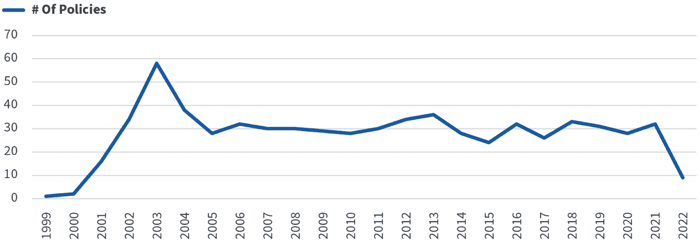

`图 12.1` ¶ 来源：`www.csis.org/analysis/governments-role-promoting-open-source-software`，战略与国际研究中心

`EO` 中的要求之一是美国国家标准与技术研究院（`NIST`）制定一份“识别增强软件供应链安全实践的指南”。`NIST` 随后更新了其安全软件开发框架（`SSDF`）（`https://csrc.nist.gov/Projects/ssdf`），并根据 `EO` 提供了专门的软件供应链指南（``www.nist.gov/system/files/documents/2022/02/04/software-supply-chain-security-guidance-under-EO-14028-section-4e.pdf`）。

在此指南的基础上，管理和预算办公室（`OMB`）产生了一份名为“通过安全软件开发实践增强软件供应链安全”的备忘录（M-22-18）。该备忘录提到了美国政府对技术和数字产品的依赖，以及它们面临的持续威胁，这些威胁可能会阻碍政府提供公众所依赖的服务的能力。

备忘录要求美国联邦机构在机构信息系统上使用第三方软件或影响机构数据的数据时，必须遵守上述的 `NIST` 指南。它适用于备忘录发布日期后机构对软件的所有使用，包括不仅是新采购，还包括对现有第三方软件使用的的任何主要版本变更。

值得注意的是，该备忘录特别排除了机构自开发的软件，这无疑引发了对该类软件安全性的担忧，并要求机构内部采取措施以确保进行适当的安全软件开发活动。联邦机构远非对安全事件完全免疫，例如 2015 年发生的人事管理局（`OPM`）泄露事件，当时暴露了超过 2100 万美国人的数据。

备忘录指出，机构*只能*使用由能够自证符合上述 `NIST` 指南的软件生产商提供的软件。它要求机构的首席信息官（`CIOs`）和首席采购官（`CAOs`）确保这些这些的要求。软件生产商必须能够以*合规性声明*的形式提供自证，且机构必须为备忘录要求下的*所有*第三方软件获得此类自证。备忘录还强调，其自证明应涵盖其产品组合，以便在所有采购机构之间复用自证明，从而推动美国联邦生态系统内部的效率和数据共享。

鉴于软件生产商可能无法完全满足 `SSDF` 和 `NIST` 软件供应链指南的某些方面（无论最初最初还是可能永远无法满足），备忘录还允许使用所谓的“行动计划与里程碑（`POAMs`）”。`POAMs` 允许软件供应商记录其合规自证中的差距，解释缓解控制/措施、计划的关闭日期等。这种机制在联邦风险和授权管理计划（`FedRAMP`）等其他合规项目中也是存在的。

供应商需要提供关于受自证涵盖的及产品的详细信息，然后记录其与安全开发指南的对齐情况，并记录在标准的自证表中。如果服务或软件被认为是关键的且风险需要评估，机构将可以选择要求第三方评估。这些第三方评估可能包括如 `FedRAMP` 第三方评估组织（`3PAOs`）之类的团体。

对于自证以及更有可能的 `3PAOs`，值得指出的一点是可能会减少联邦政府可以合作的软件供应商数量。正如之前讨论 `FedRAMP` 时提到的，`FedRAMP 市场`（`https://marketplace.fedramp.gov/#!/products?sort=productName`）是列出 `FedRAMP` 授权云服务的地方，在写作期间大约有 300 个联邦政府可以使用授权云服务，尽管该市场已存在十年，且更广泛的市场中有数万个云供应商。

许多人认为，失去获取创新供应商和解决方案的风险应该被纳入更广泛的风险讨论中，而不孤限于网络安全。这意味着未能创新和现代化的业务/任务风险也被考虑在内了。尽管如此，正如我们提到的，一些领导者（如约舒亚·库尔曼）也主张“少而精的供应商”，以获得一个更安全、更可靠且安全的产品和组件供应链。当然，这两种观点都有道理，且取决于个人和组织的风险承受能力。


除了需要自证明或由第三方评估其是否符合 NIST 软件供应链和安全开发指南外，各政府机构还可能在招标要求中要求提供软件物料清单（SBOM），特别是当该软件被视为 NIST 定义的“关键软件”时。我们之前讨论过这一点，该内容已在另一份标题为《通过增强安全措施保护关键软件》的 OMB（管理和预算局）备忘录中（`www.whitehouse.gov/wp-content/uploads/2021/08/M-21-30.pdf`）。

供应商提供的 SBOM 必须符合国家电信和信息协会（NTIA）定义的 SBOM 格式，并包含 NTIA 定义的最小元素，这些元素在第 4 章“软件物料清单的兴起”中有所讨论。与自证明类似，OMB 备忘录强调了机构间 SBOM 互认/重用的需求，以避免机构和供应商的重复工作。基于使用 SBOM 的潜力，机构可能还会要求其他成果，例如代码相关的漏洞和完整性输出，以及参与漏洞披露计划的证明。

联邦能源监管委员会（FERC）的领导者也开始表达希望更新与保护电力公用和其他和其他部门实体相关的关键基础设施保护（CIP）标准的意愿。这些意愿包括增加软件透明度的要求，并对自证明表示担忧，而不是像 SBOM 等成果——SBOM 能提供关于软件组件是否存在漏洞（或不存在）的机器可读证据（`www.nextgov.com/cybersecurity/2022/12/ferc-chairman-wants-update-cybersecurity-requirements/380666`）。

根据来自爱迪生电气（Edison Electric Institute）等组织的文件，这似乎是 FERC 和北美电力可靠性协会（NERC）等组织的发展方向，该组织在 2022 年 10 月发布了《解决网络安全供应链风险的 3.0 版模块采购合同语言》。该文件列了一项要求 `R.1.2.5`，“拟议的 EEI 合同语言”，侧重于硬件、固件、软件和补丁的完整性和真实性。第 (e) 节特别规定：“承包商应为生产（包括许可的）产品提供软件物料清单，由构成组件的组件列表和相关元数据组成”（`www.eei.org/-/media/Project/EEI/Documents/Issues-and-Policy/Model--Procurement-Contract.pdf`）。

软件供应链安全和 SBOM 出现的另一个地方是美国 2023 年《国防授权法》（NDAA）的初始版本和语言。在第 `6722` 节（名为“DHS 软件供应链风险管理”）中，文中要求在提交投标提案时包含一份物料清单，并证明提交的 BOM 中列出的每项均“不受任何影响终端产品或服务的已已知漏洞或缺陷的影响”。它要求使用 NIST 的国家漏洞数据库（NVD）等来源，我们已经讨论过该数据库以及其他跟踪开源软件（OSS）和第三方软件安全漏洞及缺陷的数据库。行业内的许多人立即抓住这一语言表述，指出拥有无漏洞软件是不现实的；然而，值得提到的是该语言也允许对 BOM 中确实存在的每个安全漏洞或缺陷提供缓解、修复和解决计划的通知。

一个显著的行业阻力案例来自数字创新联盟（Alliance for Digital Innovation）发布的一封信，该组织代表了 AWS、Google Cloud 和 VMware 等行业科技巨头。该信请求国会“从 NDAA 中删除 SBOM 语言，并给行业和机构更多时间来开发能够更好地保护国家网络安全供应链的解决方案”。对该信感兴趣的人，可以在此处找到：`https://alliance4digitalinnovation.org/wp-content/uploads/2022/10/NDAA-FY23-Letter-Final.pdf`。

虽然 2023 年《国防授权法》（NDAA）的早期版本包含了 SBOM 和进一步提高软件供应链透明度的语言，但似乎行业游说努力和担忧占据了主导地位，SBOM 语言从 2023 年 NDAA 的正文中被删除了（见 `www.congress.gov/117/bills/hr776/BILLS-117en.pdf`）。SBOM 语言是否能回到 NDAA 还取决于未来。正如我们在其他地方讨论过的，国防领域的个人实体通过 SBOM 的征询意见（RFI）追求软件透明度。

除了美国联邦范围的新要求外，国防部（DoD）的特定部门也表达了大规模采用 SBOM 的意图，不仅是为了漏洞管理，还为了采购。2022 年底，美国陆军发布了一份 RFI，旨在寻求行业对“软件物料清单（SBOM）的采购、验证、接入及使用相关问题”的反馈。RFI 承认陆军运行在成千上万软件组件之上。这呼应了我们之前提到的联邦、军事和行业领导人的观点，他们强调了软件在未来军事冲突中扮演的角色。

美国国务院也表达了将 SBOM 成为其交付物活动核心部分的意图。2022 年 7 月，国务院发布了一份提案征集草作为其采购计划的一部分。该合同工具名为“Evolve”，估值高达 80 亿至 100 亿美元。在 `H.14.7` 节中，对“物料清单”有具体要求，要求承包商以行业标准格式（如软件包数据交换 `SPDX` 或 `CycloneDX`）提供 SBOM，以记录软件中的各种组件。交付的 SBOM 必须符合 NTIA 定义的最小元素，且规定适用于合同的所有任务订单（`https://sam.gov/opp/bee1b04eda40442bbdfca21774d5ce/view`）。


在《网络韧性法案》（Cyber Resilience Act）正文中，特定的表述要求供应商使用 SBOM 来识别并记录产品中所包含的组件。文中指出：“为了便于漏洞分析，制造商应识别并记录包含数字元素的产品中所包含的组件，包括编制软件物料清单。”该法案特别强调了供应商识别产品中漏洞的第三方组件的必要性。

## 美国政府供应链对市场的影响

虽然数字根据来源而异，但不可否认的是，美国政府在 IT 和软件支出方面的市场非常巨大。某些来源估计，美国联邦政府在 2023 财年（FY）的预算超过了 650 亿美元（`www.whitehouse.gov/wp-content/uploads/2022/03/ap_16_it_fy2023.pdf`）。这比 2022 年 580 亿美元的预算有所增加，表明文事部门的联邦 IT 支出正在持续增长（参见图 12.2）。

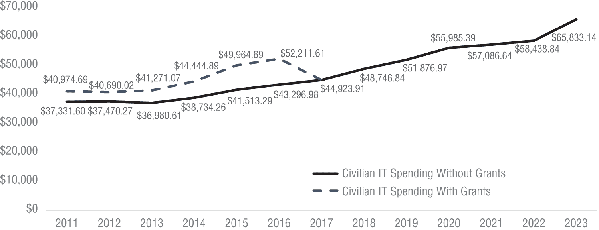

图 12.2

在国防方面，2023 财年的国防部（DoD）预算请求为 7730 亿美元。虽然该预算很大一部分并非专门针对技术和软件，但一部分是，而且正如我们讨论的，现代战争系统和平台越来越多地由技术和软件驱动。

当然，这些支出仅限于美国联邦国防部，不包括其他美国政府市场，例如州和地方政府实体，它们有自己的 IT 支出预算和消费。这并不是说所有这些 IT 支出都与软件相关，但正如我们在书中一直讨论的那样，几乎所有现代技术都是以某种形式由软件驱动的。这意味着，当美国政府领域出现新的政策、法规或合同要求时，这些变化最终将影响到整个技术和软件行业的大部分。

许多人认为，由于美国政府从许多与广大社会相同的供应商处购买软件，其新提出的要求将对整个行业产生影响，即使在政府部门之外。我们讨论过的要求，例如要求使用安全的软件开发实践、提供软件内部组件的洞察以及建立漏洞披露计划等机制，不仅会影响与美国政府合作的成百上万软件供应商，还将影响那些与成千上万商业软件消费者以及不可避免地与全球数百万用户合作的公司。

还有人认为，政府采用的 NIST 标准，例如《安全软件开发框架》（`SSDF`）和其他软件供应链指南，可能会被商业部门实体也自愿采用。

一个流行的例子是 NIST 在 2014 年发布的《网络安全框架》（`CSF`），这是由于时任总统奥巴马发布的之前的行政命令（EO），标题为“加强联邦和关键基础设施的网络安全”。该行政命令规定美国联邦政府机构必须使用 `CSF`，但正如 NIST 在其 `CSF` 常见问题中所指出的，尽管对于私营部门是自愿的，但 `CSF` 现在已被许多私营组织使用（`www.nist.gov/cyberframework/frequently-asked-questions/framework-basics`）。

其他例子还包括 `FedRAMP` 等指南和框架，它仅要求与联邦政府合作的云服务提供商（`CSPs`）使用，但它已成为商业领域云安全的先范，被云安全联盟（`CSA`）的《云控制矩阵》（`CCM`）等商业框架和指南所引用。

我们还讨论了国防部新兴的《网络安全成熟度模型认证》（`CMMC`），它影响了与国防部合作的超过 30 万个国防工业基础（`DIB`）供应商，并引发了关于软件之外的组织供应链中供应商风险管理的更广泛的讨论。这里值得指出的一点是，2022 年底发布的一项调查显示，大多数 DIB 供应商尚未准备好满足这些新要求，且 87% 的承包商在《国防联邦收购条例补充规定》（`DFARS`）要求方面的得分为不及格，而承包商在所谓的“供应商绩效风险系统”（`SPRS`）中自报这些得分。

还有报告指出，一旦由第三方进行评估，自证的得分可能与事实不符，当我们看到新兴的软件供应链要求（如 `OMB M‐22‐18`）时，这应该是令人担忧的，因为它同样要求第三方软件供应商对其对安全开发实践的使用进行自证。当涉及合同和收入时，自证面临着主观性和透明度等挑战（`https://cybersheath.com/more-than-87-of-pentagon-supply-chain-fails-basic-cybersecurity-minimums`）。

许多人认为，政府的规模和范围往往会创造出场景，使得商业行业在要求和方法上随其后。这意味着虽然像 `SBOM` 和与安全软件开发相关的认证在联邦部门可能只是硬性的监管要求，但它们很可能会进入商业实践，特别是在金融和医疗社区等其他受监管且具有安全意识的行业中。

## 供应链攻击的加速

虽然我们在第 1 章“软件供应链威胁背景”中讨论了这些指标的一些，但在本书结束之际，值得再次强调的是，我们相信软件供应链攻击的趋势只会继续加速。这是由于多种因素造成的，例如现代数字环境和生态系统的复杂性增加，开源（`OSS`）和第三方软件的广泛使用，加上恶意者意识到软件供应链攻击是多么的高效有效。

在我们引用的最令人警觉的指标中是 2022 年的 Sonatype 软件供应链报告。该报告发现在过去的三年中，软件供应链攻击每年增长 742%。报告还提到，七个漏洞中有六个是由传递依赖引起的。这一点被其他来源证实，例如我们在第 4 章中引用的安全供应商 Endor Labs 的《依赖管理状况》报告，当时我们讨论了透明度和开源面临的挑战。

单个漏洞组件或代码段也可以被其他项目重用，导致其在生态系统中的存在性呈指数级分布，并最终增加风险状况。例如，根据 Sonatype 的数据，`Log4j` 的漏洞代码被数百个项目重用，并进入了万个其他组件，下载量超过 1.5 亿次，且截至本文，每天仍被下载数万次（`www.sonatype.com/resources/log4j-vulnerability-resource-center`）。研究人员现在正识别出成千上万个进入生态系统的恶意包，这表明恶意者对软件供应链的关注增加，并导致了我们持续看到的软件供应链攻击的指数级增长。


同样的 Sonatype 报告显示，其中一个相关因素是开源（OSS）供应和消费的大幅增长。正如报告中的图 12.3 所示，在所调查的主要生态系统中，目前有超过 300 万个项目、4700 万个版本，年度请求量超过 3 万亿次，这导致了所调查生态系统同比增长增长了 30% 以上。

虽然开源的增长和消费通过代码复用加速了几乎每个行业的速度、效率和创新，但由于到处都在复用的第三方代码存在漏洞，它也导致了巨大的系统性风险。这些被广泛使用的项目和依赖项也是最脆弱的部分之一。在某种意义上，开源项目的广泛成功和采纳也会增加其风险状况，因为它们被广泛使用，并对使用它们的行业的攻击面做出了贡献。

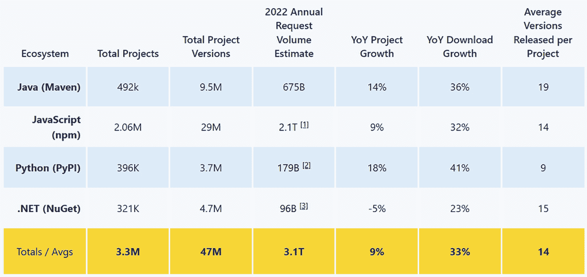

Figure 12.3 ¶ Source: `www.sonatype.com/state-of-the-software-supply-chain/open-source-supply-demand-security`, Sonatype

由于传递性依赖的存在，问题进一步恶化，平均每个库有 5.7 个传递性依赖，其中 62% 的依赖项在它们的第三方依赖中存在漏洞。因此，确保在仔细考虑后选择依赖项至关重要，因为它们可能带有与之相关的漏洞和潜在风险。一些供应商已开始集成相关功能，帮助开发者在软件开发过程中的组件选择过程中做出基于风险知晓的决策。

延续依赖管理的主题，Sonatype 报告提出了普通开发者必须与之斗争的几个忧虑。这包括跟踪和管理 150 个初始依赖项、每个应用程序每年多达 1500 次依赖项变更，并且能够拥有足够的安全和法律专业知识来选择最安全的版本。在许多开发者经常根据交付速度接受评估或获得激励的环境中，这种程度的分析和细微差别通常不是关键考虑因素，更不用说具有实际可行性和现实性了。

尽管 Sonatype 报告极具声誉，但它并非证实软件供应链攻击呈指数级增长的唯一来源。开源使用的加速，加上恶意攻击者对这一攻击向量的关注增加，以及许多处于决策更安全位置的实体（如软件开发者）的认知过载，形成了一场完美的风暴。

遗憾的是，我们没有看到这一趋势下降，因为恶意攻击者已经意识到这种手段是多么富有成果且有效。事实上，我们预计攻击者的新颖的创造力将继续进化，目标不仅是开源组件，还包括服务和软件提供商，正如我们的一些里程碑案例中所示的那样。

从这一趋势有效性的另一个印证来看，2022 年，欧盟网络安全局（ENISA）将软件依赖的供应链破坏列为 2030 年前出现的首要威胁（参见图 12.4）。它将这一威胁排在虚假信息、技能短缺和 AI 滥用风险等其他关键领域之前。这表明，软件供应链威胁不仅现在至关重要（正如我们讨论的趋势、历史背景以及软件供应链攻击目录所证明的那样），而且在未来的一段时间内，它对组织和国家来说仍然是一个相关的威胁。

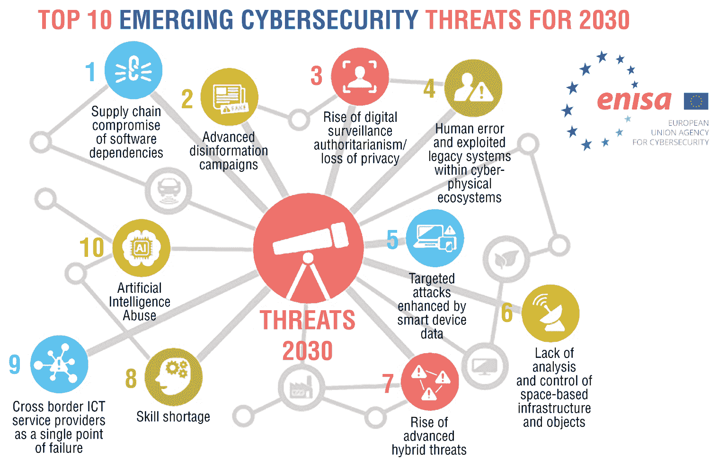

Figure 12.4 ¶ Source: `www.enisa.europa.eu/news/cybersecurity-threats-fast-forward-2030`, The European Union Agency for Cybersecurity

## 我们数字世界日益增强的连接性

社会中最显见的趋势之一是数字化连接设备的快速且持续的增长。正如我们在书中中所述的那样，我们社会的几乎每个方面都与数字化连接的设备和软件相连，从家用设备、智能手表和医疗设备等无害的居家用品，到关键基础设施和军事系统。

虽然传统的连接性大部分是由服务器、端点和移动设备等计算机设备驱动的，但这一趋势正通过物联网（IoT）的惊人增长呈指数级加速。物联网设备通常被定义为连接互联网并能够传输数据的对象，它们可以包括无线传感器、家用物品、工业工具和制造设备等设备。

在现代社会中，可以连接的设备数量和类型几乎是无限。许多因素促进了连接设备的增长，包括低成本传感器技术、云计算和创新的网络协议。我们还看到了所谓的工业物联网（IIoT）的巨大增长。IIoT 使用云、分析和机器学习来驱动智能制造、城市、电网和数字供应链等各种用例。

这种连接性为分析、效率、创新带来了巨大的潜力，这些能力在我们以前互不连接的世界中是不可能的。这种无处不在的连接也带来了新业务模式和收入流等利益，提高了效率和运营，甚至在个人层面提供了更好的生活质量。尽管如此，它也带来了我们以前所未过的指数级系统性风险。

与物联网设备相关的常见安全挑战包括硬编码和弱凭据、缺乏定期且及时的更新，以及在组织可能使用的设备足迹方面整体可见性有限。

正如我们从 Verizon 数据泄露报告等来源看到的，受破坏的凭据是恶意攻击者的常见攻击向量。当许多物联网（IoT）和运营技术（OT）设备经常使用制造商的默认凭据时，这种情况并并不乐观。物联网设备的另一个常见挑战是缺乏定期更新，甚至是恶意攻击者破坏了交付到物联网设备的补丁和软件更新。观察日益增长的物联网足迹的范围和规模，很容易看出其增长如何加剧与软件供应链相关的挑战，以及一个被破坏的补丁如何产生如此巨大的影响。

某些来源预测，2022 年底已有超过 130 亿台连接设备，预计这一数字在 2025 年之前的短短几年内将增长到高达 750 亿台。随着连接设备的蓬勃增长，政府和监管机构一直跟不上节奏。尽管如此，一些努力正在进行以改进物联网设备的监管，重点关注隐私和网络安全，但更多是针对前者。


回顾欧盟（EU）和美国，可以看到在隐私和网络安全方面正在进行一些相关的监管工作，其中一些专门针对物联网（IoT），而另一些虽然是通用的，但同样适用于物联网。在欧盟消费者隐私方面，最引人注目的是《通用数据保护条例》（`GDPR`），该条例于 2018 年在欧盟和英国生效。`GDPR` 关注个人数据的处理方式，并提供了一个围绕公平性、合法性和透明性等核心原则的框架。

尽管 `GDPR` 植于欧盟，但如果这些机构控制了欧盟公民的数据，那么它也可以并确实适用于欧盟以外的机构。我们之前讨论过欧盟中新兴的《网络弹性韧性法案》（`Cyber Resilience Act`）。该法案要求制造商在设计和生产过程中实施安全措施，并对包括物联网在内的设备相关软件组件提供可见性。

在美国，目前正努力为物联网设备建立一个网络安全标签计划（[www.nist.gov/itl/executive-order-14028-improving-nations-cybersecurity/cybersecurity-labeling-consumers-0](https://www.nist.gov/itl/executive-order-14028-improving-nations-cybersecurity/cybersecurity-labeling-consumers-0)）。该计划针对美国消费者，并像欧盟的《网络弹性韧性法案》一样，旨在提高透明度，并为消费者提供更好的信息，以便他们在购买和使用的产品安全性方面做出更好的选择。它还旨在激励物联网设备制造商将安全考虑为产品开发的一部分。白宫在我们在本书中讨论过的《网络安全行政命令》（`EO`）的势头的基础上，一直在与行业中一些最大的互联网连接制造商进行讨论和接洽，以推进这项工作。截至本文写作时，网络安全标签计划定于 2023 年春季发布（[www.whitehouse.gov/briefing-room/statements-releases/2022/10/20/statement-by-nsc-spokesperson-adrienne-watson-on-the-biden-harris-administrations-effort-to-secure-household-internet-enabled-devices](https://www.whitehouse.gov/briefing-room/statements-releases/2022/10/20/statement-by-nsc-spokesperson-adrienne-watson-on-the-biden-harris-administrations-effort-to-secure-household-internet-enabled-devices)）。

除了网络安全标签计划外，美国国家标准技术研究院（NIST）还有一个强大的“物联网网络安全”（`Cybersecurity for IoT`）计划，提供标准、指南和相关工具。这包括面向物联网设备制造商、面向寻求使用物联网设备的联邦机构以及消费者的信息。2022 年秋，美国商务部任命了一个“物联网顾问委员会”（`Internet of Things Advisory Board`），帮助推动保护物联网格局的工作，并根据专业知识和行业经验提供关键见解和建议（[www.nist.gov/itl/applied-cybersecurity/nist-cybersecurity-iot-program](https://www.nist.gov/itl/applied-cybersecurity/nist-cybersecurity-iot-program)）。

另一个值得注意的例子来自拜登总统签署的 2023 年拨款法案，特别是 `Sec. 3305`，其中包含的内容要求互联网连接医疗设备的制造商要合理确保这些设备及其相关系统是网络安全的。具体语言要求包括监控、识别和解决设备中的网络安全漏洞，并在上市后提供更新和补丁以解决漏洞。这些针对覆盖设备的要求将由食品药品监督管理局（`FDA`；[www.congress.gov/117/bills/hr2617/BILLS-117hr2617enr.pdf](https://www.congress.gov/117/bills/hr2617/BILLS-117hr2617enr.pdf)）执行。

很难看出，物联网在社会中的增长——它被几乎每个行业以及专业和个人环境使用——为攻击面的大规模增长打开了门，并为软件供应链攻击和破坏的恶意活动者提供了机会。这些物联网设备由软件驱动，遍布整个社会，预计将巨大增长，但大多数机构（无论是供应商还是消费者）在网络安全方面尚未对其进行关注。我们预计，2023 年拨款法案等地方的此类表述将与物联网设备使用的安全和软件持续演变。

## 接下来是什么？

虽然预测未来是困难或不可能的，但对软件透明度日益增长的需求触手可及。脆弱软件对普通公民构成的风险已无法被忽视。

软件已渗透到从最基本的个人活动到最关键的基础设施、公共服务和国家安全系统的每一个领域。正如我们在书中所述，软件具有无限的创新潜力，但也带来了系统性风险。除了我们讨论的许多行业和努力外，我们预计政府、学术界和行业将加大提高透明度和安全的努力。

在 2023 年初的一次近期采访中，`CISA` 主席珍·伊斯特利（Jen Easterly）强调需要政府和行业合作来提高网络安全。她指出针对技术公司以及医院、学区和关键基础设施的持续攻击说明目前的网络安全方法是不可持续的。

她强调公司需要采取措施创建设计安全的产品软件，甚至认为“网络安全是一种公共利益”，并认为提高安全性应直接相关。与研究人员 Chinmayi Sharma 在《数字公地的悲剧》一中的观点一致，伊斯特利表示，负担不能再落在消费者和普通公民身上，而应该落在能够解决问题的公司和软件供应商身上（[`finance.yahoo.com/news/us-cybersecurity-director-the-tech-ecosystem-has-become-really-unsafe-22218097/`](https://finance.yahoo.com/news/us-cybersecurity-director-the-tech-ecosystem-has-become-really-unsafe-22218097/)）。

作为网络安全方法转变的一个信号，《华盛顿邮报》在 2023 年 1 月被引用，称即将发布的国家网络战略与以往任何时候都不同，并且“监管首次进入国家网络战略的考虑范围”（[www.washingtonpost.com/politics/2023/01/06/biden-national-cyber-strategy-is-unlike-any-before-it](https://www.washingtonpost.com/politics/2023/01/06/biden-national-cyber-strategy-is-unlike-any-before-it)）。


许多人怀疑，美国的国家网络战略及相关工作（传统上一直基于自愿行为）正开始转向监管性要求。随着这些新兴要求的出现，对于在软件、产品和数字系统方面忽视其网络安全责任的供应商和实体，将面临更重的法律责任和问责制。正如我们之前提到的，一些人将网络安全视为一种市场失败，以及一个仅靠自愿努力无法解决的挑战。这种对监管要求及其影响的日益推动，旨在通过公平竞争环境来解决当前国家安全和公共安全领域的差距，而这两者现在都由软件提供支撑。

在美国，有 16 个关键基础设施部门，涵盖了通信、能源、应急服务、交通、信息技术和国防工业基础等领域。随着该国持续看到针对关键基础设施实体的恶意网络攻击加速，关键安全领导者加强了对这些部门及其监管状况的关注。其中一个例子是国家安全副顾问安妮·纽伯格（Anne Neuberger）及其相关团队。该团队发现，虽然许多关键基础设施部门已采取某些与网络安全的监管措施，但并非所有部门都是如此。美国多个领域被发现了空白，包括食品、农业和学校教育。

根据联邦紧急事务管理局（FEMA）的引用，私营部门拥有该国 85%的关键基础设施和关键资源。报告指出，随着结构平均年龄的增加，这些关键基础设施变得越来越容易故障(`www.fema.gov/pdf/about/programs/oppa/critical_infrastructure_paper.pdf`）。

为了支持该报告的有效性，2023 年初，美国联邦航空管理局（FAA）被迫于 1 月 11 日因航行公告（NOTAMs）系统故障停止了所有美国航班。FAA 2022 年的一份报告解释了他们在遗留硬件和软件方面面临的挑战（`www.faa.gov/sites/faa.gov/files/2022-02/FAA_FY22_Business_Planv2.pdf`）。

正如 2022 年 Synopsys 开源安全与风险分析报告等研究所示，美国每小时遭受 1000 万次漏洞尝试，攻击专门针对关键基础设施部门。一半的关键基础设施代码库被发现包含开源软件（OSS）。同一项研究指出，几乎所有代码库中包含的开源软件都过期了四年，或者其组件在两年内没有新开发。软件就像我们的物理基础设施一样，随着年龄的增长而变得日益脆弱，特别是由于新漏洞的出现。

当你考虑到老化的物理基础设施时（它们通常由过时且可能存在漏洞的软件驱动，而这些软件经常遭受恶意活动的持续攻击），你可以看到问题开始变得令人担忧。这得到了 2023 年世界经济论坛（WEF）《全球风险报告》等来源的支持，报告将关键基础设施的网络攻击列为风险最高之一。在调查中，几乎所有的网络安全领导者都对未来两年内发生毁灭性的全球网络攻击表示深表担忧(`www3.weforum.org/docs/WEF_Global_Risks_Report_2023.pdf`）。

除了其他新兴监管努力领域（如网络安全数据泄露报告要求和设备标签）外，对于增加供应商提供的软件透明度的推动也日益增长。这包括提供软件组件、依赖及其相关漏洞的透明度。虽然并不完美，这些努力有助于解决当前软件供应商与消费者之间存在的信息不对称。

要求核心能力和专业领域并非网络安全的普通公民和企业成为软件安全、安全软件开发和漏洞管理的专家是不现实的。我们没有在汽车、飞机、药品和食品等社会其他领域提出此类要求。作为一个社会，我们已经在这些行业中植入了相关措施，以解决供应商与消费者之间的信息不对称，确保安全、责任和问责，同时仍允许消费者做出知情的风险决策。我们现在正看到在软件方面采取类似的努力。

除了其他新兴监管努力领域（如网络安全数据泄露报告要求和设备标签）外，对于增加供应商提供的软件透明度的推动也日益增长。正如我们在通过引用其他国家的努力所指出的，这一问题并不局限于美国。政府和各国开始意识到不安全的软件、缺乏透明度以及对产品缺乏问责带来的系统性风险。他们正在采取类似的努力来解决这些问题。

我们完全预计，政府和监管机构在软件透明度和安全方面的努力将面临来自行业团体、游说客的反对。例如，美国商会表示，他们正在积极审查新的国家网络战略，并确定其对其成员的影响。游说客和行业团体在反对增加软件供应商透明度和问责方面的努力已取得一些成功，例如 2023 年的国防授权法案（NDAA）及其对 `SBOM`（软件物料清单）的纳入。

当然，这些团体提出的疑虑是有根据的，例如某些要求的产物和洞察的成熟问题，以及协调管理其活动的碎片化监管要求的需要。脱节的监管和要求会导致行业内部的困惑，导致时间合投资的浪费，并扼杀创新和速度。政府和公民使用创新技术和能力不仅对于生活质量，对于经济繁荣和国家安全也是关键。监管软件的努力必须与监管努力施加的限制和影响进行对比。例如，国防部（DoD）的许多人指出，破碎和过时的要求与法规阻碍了他们按相关速度执行。


我们预见另一个将持续演变的趋势是：从传统的基于表单静态供应商风险评估转向以 API 为中心的评估。这种转变在云等技术的推动下，并能够实现自动化和近实时评估。这种自动化趋势也将是成功扩展规模以及实现与 SBOM（软件物料清单）和可利用性通信相关的预期结果的关键，特别是在遵循敏捷（Agile）和 DevSecOps 方法论且频繁发布软件的大型复杂开发环境中，这导致了 SBOM 及其配套的可利用性上下文等相关产物的生成速度加快。

多年来，合规性与安全性一直落后于行业推动 DevOps、提高速度、上市速度以及快速软件开发与发布的更广泛趋势。现在，我们正看到动力和成熟度，并伴随着 DevSecOps 等运动，以及云和 CI/CD 工具链等环境中创新型安全工具和流程的改进，从而在限制对开发速度影响的同时，提供所需的安全和合规控制。随着我们看到代码化（例如代码即代码 as-code）、声明式基础设施和微服务的趋势日益增加，安全和合规性必须不断创新以跟上步伐，作为赋能者发挥作用，并在涉及软件供应链时仍提供所需的透明度和问责机制。

正如我们在第 11 章“消费者的实用指南”中讨论的那样，我们还预计软件供应商和消费者都将进一步努力完善其软件供应链治理和安全工作。从供应商的角度来看，这将体现在诸如下领域：改进对开源软件（OSS）的治理、面向下游消费者产品中软件组件的透明度，以及对他们大量使用的 OSS 维护者和社区所能施加的实际期望进行清算。

从消费者的角度来看，我们预计软件消费者将继续要求其上游软件供应商和厂商提高透明度。这包括这些领域：寻求确保遵循了安全的软件开发实践，并要求 SBOM 等软件产物以及配套产物，这些不仅显示漏洞，还显示漏洞的可利用性。供应商和消费者之间将需要进行进一步沟通，以帮助澄清漏洞的存在和可利用性，以及修复时间表和消费者在漏洞修复之前可以采取的降低风险的缓解措施。

各种形状和规模的组织也将继续严格审视其软件供应链。这种严格审查将不仅扩展到在其环境中安装和运行软件的 OSS 和第三方软件供应商，还将扩展到服务型提供商，如托管服务提供商（MSP）、云服务提供商（CSP）和软件即服务（SaaS）提供商，恶意攻击者正试图利用我们目前运营的错综复杂的软件供应链生态系统。

这些努力可能会导致软件生态系统的某种协调，因为更成熟、更具安全意识的消费者正寻求成熟且安全的软件供应商和服务提供商来降低对其组织、利益相关者和客户的风险。我们怀疑这种趋势在包括国家安全和其他监管行业（如金融和航空航天）的社区最为普遍。

除了开发、供应和消费软件的团队发生变化外，我们还预计组织高层将对网络安全问题进一步参与并进行监督，不仅限于 CISO 和董事会。这在很大程度上是因为人们意识到，几乎每种业务都处于技术和软件领域，即使这不是他们的核心竞争力，因为软件通常有助于推动他们的收入和运营。此外，还受到来自美国证券交易委员会（SEC）等机构的这种变化的驱动，SEC 正在推动董事会将网络安全风险作为其信托责任和监督活动的一部分。

例如，SEC 最近提出的名为“网络安全风险管理、战略、治理和事件披露”的规则修订案包含了要求组织披露其董事会网络安全专业知识的条款。这将促进范式转变，组织领导层将需要更深入地了解并参与所属公司的网络风险监督，包括与软件供应链安全相关的担忧，以及由于软件供应链攻击或恶意活动导致的事件（`www.sec.gov/rules/proposed/2022/33-11038.pdf`）。

这些变化标志着监管格局的转变，组织的董事会现在将承担责任，确保其董事会成员中包含网络安全专业知识。鉴于软件供应链攻击正在加速，并且在过去几年中一直是组织讨论和关注的常规焦点，可以假设该主题将进入董事会的视野，并且已经在某些组织中引起了关注。

在本书书中，我们涵盖了软件供应链安全领域广泛的适用主题。这些主题包括了里程碑式的软件供应链攻击、传统的评估方法、新兴的指南和最佳实践、SBOM 的兴起及相关主题，以及针对供应商和消费者的实用指南。我们还涵盖了云、`Kubernetes` 和容器等创新技术在软件供应链生态系统中所扮演的角色。鉴于现代软件供应链及其生态系统的复杂性，几乎不可能涵盖所有相关主题，但这些内容应该使从业者能够既透明地生产安全软件，又能理解他们所消费软件（无论是来自 OSS 生态系统还是直接来自第三方软件供应商）的风险。

正如我们在书中强调的那样，软件对于我们社会的每一个方面都至关重要，在我们进入无处数字化的未来，确保我们既生产又消费安全的软件是至关重要的。软件提供了无比拟的创新、能力和增长承诺，同时也带来了无比拟的系统性风险，如果不加处理，可能会毁灭我们的社会。

正如最高法院法官路易·布兰迪斯（Louis Brandeis）在一个世纪前所说，“阳光被认为是最好的消毒剂。”社会现在正在推动围绕我们生活各个方面的数字生态系统及其相关系统风险的透明化。

我们是这种阳光的守护者。

# 索引

* 3PAOs（第三方评估组织），118, 192, 264

## **A**

* ACQSEC（采购安全）团队，214

* 应用安全，32
    * DAST（动态应用安全测试），34–35
    * IAST（交互式应用安全测试），35–36
    * MAST（移动应用安全测试），36
    * SAST（静态应用安全测试），33–34
    * SCA（软件成分分析），36–37

* 产物，NSA，208

* 攻击面
    * ICS 攻击面，225–227
    * 减少，120


* 攻击者，激励机制， 1–2
* 攻击，供应链， 1–2
    * 加速, 270–272
    * Kaseya, 21–22
    * Log4j, 18–21
    * 谱源, 10
    * 溯源, 10
    * SolarWinds, 14–17
* 证明，自证明， 192
* 身份认证
    * IKE (互联网密钥交换), 184
    * MFA (多因素身份认证), 184–185
    * 双向认证, 184–185
    * SSH (安全外壳), 184
    * TLS (传输层安全), 184
* 汽车 PoC, 77
* AWS Lambda 服务, 129

# B
* 基础数据字段集合，NTIA SBOM, 73–74
    * 依赖关系, 74
    * 丰富, 74
* 有良依赖项, 140
* 黑盒测试, 189
* BSIMM (安全成熟度构建模型), 29, 192
* 构建流水线
    * CIS 指南, 146–148
    * CNCF 白皮书, 155–156
* 构建平台, 140
* 构建, 206
* BYOD (自带设备) 环境, 202

# C
* CACs (通用访问卡), 184
* CAPEC (通用攻击模式枚举与分类), 8, 11
* CCB (配置控制委员会), 217
* CCE (后果驱动的网络信息工程), 10
* CCM (云控制矩阵), 269
* Chainguard, 121
* 变更锁, 222
* 清单, NSA, 208
* CIP (关键基础设施保护), 226, 265
* CIS 关键控制措施, 248–249
* CIS (互联网安全中心) 软件链安全, 144–145
    * 制制品, 148–149
    * 包注册表, 149
    * 构建流水线, 146–148
    * 依赖项, 148
    * 部署, 149–150
    * 源代码分类, 145–146
        * 代码变更, 146
        * 代码风险, 146
        * 贡献访问, 146
        * 仓库管理, 146
* CISA (网络安全和基础设施安全局), 42
    * CSAF 和, 63
    * EO (行政命令), 73
    * KEV 目录, 65–69
    * SBOM 和, 72
    * VEX 和, 64–65
* 云计算
    * 云原生 4Cs, 16–18
    * 云原生生态系统, 16–18
    * 描述, 111
    * DevOps 和, 132–135
    * DevSecOps 和, 132–135
    * IaaS (基础设施服务), 111–112
    * PaaS (平台服务), 112
    * SaaS (软件服务), 112
    * aaSBOM (软件服务 SBOM), 129–130
    * SRM (责任责任模型), 112
        * IaaS, 112
        * PaaS, 113
        * SaaS, 113
* 云原生生态系统, 16–18
* CMMC (网络安全成熟度模型), 192, 269
* CNAs (CVE 编号), 42
* CNCF (云原生计算), 12, 123
    * 构建流水线, 155–156
    * 安全软件工厂架构, 157–158
        * 核心组件, 159–160
        * 分发组件, 160
        * 功能性, 160–161
        * 管理组件, 160
        * 策略管理框架, 160
        * 变量, 160–161
    * 软件供应链最佳实践白皮书, 150–151
        * 制制品安全, 157
        * 构建流水线安全, 155–156
        * 部署安全, 157
        * 材料安全, 154–155
        * 源代码安全, 152–153
        * 验证, 151–152
    * 威胁建模, 12
* 代码签名, 37–39
* 基于代码的静态分析，安全 EO, 188
* 基于代码测试, 189
* 商业/专有软件许可证, 102
* 合规性声明, 264
* 连通性增加, 272–275
* 消费者
    * 补丁
        * 分析, 257
        * 创建, 257–258
        * 后续跟踪, 258–259
        * 识别, 256
        * 实现, 258
        * 持久性, 259
        * 准备, 256
        * 恢复, 258–259
        * 测试, 189
        * 虚拟补丁, 255
    * SBOM 和, 246–251
        * 访问, 251
        * JSON, 252
        * MSPs, 252
        * 包管理, 251
        * 规模化接收, 251–253
        * 订阅系统, 251–252
        * VEX 和, 253–254
        * XML 和, 252
    * VEX 文档, 249–250
* 容器, 118
    * Git 仓库, 122
    * 镜像仓库, 119
    * Kubernetes, 123
        * DISA (国防信息系统局), 125
        * EKS (弹性 Kubernetes 服务), 126
        * GKE (Google Kubernetes 引擎), 126
        * RBAC (基于角色的访问控制), 125
        * STIG (安全技术实施指南), 125
        * Kubernetes 威胁矩阵, 126–127
    * Wolfi, 121


### C

* 关键软件，105
    * EO 关键软件，182
    * OT（运营技术）和，220–222
* CRL（证书撤销列表），219
* CRM（客户责任矩阵），115
* 交叉对应（crosswalks），NSA，207
* CSA（云安全联盟），CCM（云控制矩阵），269
* CSAF（通用安全公告框架），63–64
* 系统和组织的 C-SCRM（网络安全供应链风险管理）实践，81, 179–186
    * Sigstore，92
* CSF（网络安全框架），269
* CSIRT（网络安全事件响应小组），231
* CSP（云服务提供商），SRM（共享责任模型）
    * IaaS，112
    * PaaS，113
    * SaaS，113
* CVE（通用漏洞与暴露），41–42, 201
    * CVE ID，43
    * OSS 和，103
    * 
        * 已发布，43
        * 被拒绝，43
        * 已预留，43
    * 漏洞，定义，43
* CVRF（通用漏洞报告框架），232
* CVSS（通用漏洞评分系统），45, 54–55, 201
    * 基础指标，55–57
    * 批判，59
    * 环境指标，58
    * 漏洞代码，57
    * 评分标准，58
    * 时间指标，57
    * 向量字符串，58
* CWE（通用弱性枚举），234
* 网络韧性法案（Cyber Resilience Act），267
* 网络安全行政命令（Executive Order），73, 180
    * 基于代码的静态分析，188
    * 关键软件
        * 定义，181–182
        * 多因素身份认证（MFA），183–184
        * 安全措施，182–183
    * DAST（动态应用安全测试），190
    * 硬编码密码，188–189
    * 语言提供的检查，189
    * 双向身份认证，184–185
    * SBOM，75
    * 软件成分分析（SCA），190
    * 软件开发周期（SDLC），186
        * 威胁建模，187
        * 测试
            * 自动化，187–188
            * 黑盒的，189
            * 基于代码的，189
            * 动态，188
            * 模糊测试（fuzzing），190
            * 历史测试用例，189
            * 回归测试，189
    * 供应商，187
    * 验证，186
    * Web 应用扫描，190
    * CycloneDX SBOM，78, [80]
    * CycloneDX SaSBOM，130–132
    * CyTRICS（韧性工业控制系统测试），78

### D

* DAST（动态应用安全测试），34–35, 190
* 深度防御，13
* 依赖项
    * 良性的插入，140
    * CIS 指南，148
    * NSA，208
    * OSS，104
    * 部署 CIS 指南，149–150
    * DERs（分布式能源资源），智能电网，227–228
    * 设备特定 SBOM，100–101
    * DevOps 与云计算，132–135
* DevSecOps
    * 与云计算，132–135
    * 参考架构，187
    * DFARS（国防联邦收购条例补充规定），269
    * DHS（国土安全部），NVD（漏洞数据库），44–45
    * 数字公社，101
    * DoD（国防部），软件现代化，278
    * DoE（能源部），77
* DREAD（损害、可复制性、可利用性、受影响用户），5

### E

* EDR（终端检测与响应）工具，185–186
* 嵌入式系统，100
* 加密，NIST，184
* 能源 PoC，77
* EO 关键软件，182
* EPSS（漏洞预测评分系统），59–60
    * 批判，62
    * CVEs，61
    * 模型，60–61
* ESF（持久安全框架），197
* 被利用的服务器，206
* 被利用的漏洞，CISA KEV 目录，65–69

### F

* FAA（联邦航空总局）NOTAMS 系统，277
* FaaS（函数即服务），129
* FCEB（联邦民用分支），117
* FedRAMP（联邦风险与授权管理），117, 264
    * CSPs（云服务提供商）和，269
* FERC（联邦能源监管委员会），265
* FIPS（联邦信息处理标准），210
* 固件
    * Linux，99
    * RTOS（实时操作系统），100
* FIRST（事件响应与安全论坛），54
* FOSS（自由开源软件），175
* 模糊测试，190

### G

* GAO（美国政府责任局），14
* GDPR（通用数据保护条例），274
* GHSA（GitHub 安全公告数据库），51
* Git
    * 仓库，122
    * SBOM 和，95
* GitGuardian，153
* 全球网络攻击担忧，277
* GPG（GNU 隐私守护），95
    * 源码安全，152
* GRC（治理、风险、合规），OSS（开源软件），143
* 电网现代化倡议，77
* GSD（全球安全数据库），51, 52–54
* GUAC（制品成分理解图谱），141–144

### H

* 哈希碰撞，37
* 哈希处理，37–39
* HBOMs（硬件材料清单），77
* 医疗 PoC，77
* Helm 图表，124–125
* 密密构建，206
* 历史测试用例，189–190


- IaaS（基础设施即服务）, 112
    - 云计算, 111–112
- IAST（交互式应用程序安全测试）, 35–36
- ICAM（身份、凭证和访问管理）, 182
- ICS（工业控制系统）
    - 攻击面, 225–227
    - 集成器, 2
    - Stuxnet 攻击, 221
- 攻击者的激励机制, 1–2
- 基础设施未来, 275–281
- IoT（物联网）
    - 云基础设施和, 101
    - 物 网络安全 (NIST), 274
    - 智能电网设备, 228
    - 框架, 228

## K

- Kaseya 勒索软件攻击, 21–22
- KEV（已知漏洞漏洞）, 65
- 软件的动力效应, 220
    - 勒索软件, 220–221
    - Stuxnet 攻击, 221
- Kubernetes, 123
    - API 服务器暴露, 124
    - DISA（国防信息系统局）, 125
    - EKS（弹性 Kubernetes 服务）, 126
    - GKE（Google Kubernetes 引擎）, 126
    - Helm charts, 124–125
    - JSON 配置文件, 124
    - 清单文件, 124
    - Kubernetes 的 MITRE ATT&CK 矩阵, 127
    - RBAC（基于角色的控制）, 125
    - STIG（安全技术指南）, 125
    - YAML, 124

## L

- 梯形逻辑, 223–225
- 遗留软件, 106–107
    - OT（运营技术）和, 222–223
- Linux 固件, 99–100
- Log4j 供应链攻击, 18–21

## M

- 恶意包上传, 140
- MAST（移动应用安全）, 36
    - SBOM（软件物料清单）, 36–37
- 材料加固, 154–155
- 成熟度模型
    - BSIMM（安全内置模型）, 29
    - 设计, 30
    - 治理, 30
    - 实施, 31–32
    - 运营, 32
    - SAMM（软件保证成熟度）, 29–30
- 内存安全语言, 189
- MFA（多因素身份验证）
    - CAC（通用访问卡）, 184
    - 防钓鱼, 183
    - PIV（个人身份验证）, 184
    - SMS 钓鱼和, 183
    - YubiKeys, 184
- Microsoft
    - SDL（安全开发生命周期）, 11
    - 安全供应链框架（见 `S2CF (Secure Supply Chain Framework)`#b01）
    - Microsoft 威胁建模, 8
    - MITRE ATT&CK, 11
    - Kubernetes 的 MITRE ATT&CK 矩阵, 127
    - 双向身份认证, 184

## N

- 国家实验室, SBOM（软件物料清单）, 77–78
- NERC（北美电力可靠性协会）, 226
- NIAC（国家基础设施委员会）, 54
- NIST（美国标准与技术研究院）
    - 800-145, 111
        - 云计算, 129–130
    - 800-161 附录 F, 149
        - 800-161r1, 154
    - 800-171 合规, 27
    - 容器安全指南, 121
    - 边界防护, 184
    - 云计算, 112–113
    - CPE（通用平台枚举）, 46–47
    - 关键软件, 105, 181
        - 实施阶段, 182
    - 信任关键性
    - C-SCRM（网络安全供应链风险管理）, 81, 179–186
        - Sigstore, 92
    - CSF（网络安全框架）, 269
    - 物联网安全, 274
    - 加密, 184
    - EO-关键软件, 182
    - FedRAMP 和, 264
    - 安全日志指南, 185
    - ICAM（身份、凭证和访问管理）, 182
    - NISTIR 8060, 47
    - NVD（国家漏洞数据库）, 42, 266
        - Log4j, 18
    - OSCAL（开放安全评估语言）, 84
    - OSS 控制, 241
    - 防钓鱼, 183
    - RMF（风险管理框架）, 264
    - SDLC（软件开发周期）, 186
    - 代码签名的安全考量, 13
    - SSDF（安全软件开发框架）, 94–95, 191–196, 229–230, 263
    - SWID , 47–48
    - 威胁建模, 187
    - VDRs（漏洞披露报告）, 85–86
    - 验证, 186
- NSA（美国安全局）
    - 产物, 208
    - 清单, 208
    - 交叉对照, 207
    - 客户建议实践, 214–218
    - 依赖项, 208
    - 资源, 209
    - SLSA（供应链级别与产物）, 208
    - 供应商建议实践, 209
        - 组织准备, 209–210
        - 软件准备, 210–211
        - 第三方软件, 212
        - 漏洞响应, 213–214
        - 良好的安全的软件, 211–213
    - 供应链安全指南, 197–199
        - 代码交付, 207
        - 构建环境加固, 206–207
        - 产品标准与管理, 199–201
        - 安全代码开发, 202–204
        - 第三方组件, 204–205
    - 第三方软件, 212
- NTIA（国家电信和信息局）, SBOM 和, 72, 220
    - 访问控制, 75
    - 错误容错, 76


- 数据字段的基准收集，73–74
- 深度，75
- 分发与交付，75
- 频率，75
- 已知未知，75
- NVD（国家漏洞数据库），18, 190, 266
    - APIs，45
    - CPE 名称，50
    - CVE（常见漏洞与披露），45, 54
        - CVE ID，62
    - 数据馈，45
    - DHS（国土安全部），44–45
    - ICAT（互联网攻击工具分类），44
    - NIST 和，42
    - PURL，49, 248

## O（字母字母 O）
- OMB（管理和预算办公室），政府对数字产品的依赖，263
- OpenSSF Scorecard，175–178
- OS（操作系统），RTOS（实时操作系统），100
- OSPOs（开源计划办公室），240–242
- OSS（开源软件），101。另见 OSPOs（开源计划办公室）
    - Copyleft 和，238–240
    - CVE，103
    - 依赖项，104
    - 数字公地，101
    - FOSS（自由开源软件），175
    - 未来，178
    - GRC（治理、风险、合规），143
    - GUAC（制品构成分理解图谱），141–144
    - OpenSSF Scorecard，175–178
    - OWASP ASVS 和，174
    - S2C2F 和，161–162
- OSS Index，50–51
- OSV（开源漏洞），51–52
    - SBOM 和，51
- OT（运营技术），219
    - 关键软件，220–222
    - 梯子和，223–225
    - 遗留软件，222–223
    - PLCs（可编程逻辑控制器），223–225
    - RTUs（远程终端单元），223–225
    - 智能电网，227–228
- OWASP（开放世界安全项目）
    - 威胁建模，4
- OWASP ASVS（应用安全验证），7
    - 构建环境，171
    - 组件分析，173
    - 清单，169–170
    - OSS 和，174
    - 包包管理，171–172
    - 谱源与来源，173–174
    - SBOM，170
    - 威胁建模，7
- OWASP SCVS（软件组件验证），8, 167
    - 等级 1，168
    - 等级 2，169
    - 等级 3，169
    - 威胁建模，8
- OWASP Zed Proxy，190

## P（字母字母 P）
- PaaS（平台即服务），112, 113
- 补丁
    - 分析，257
    - 创建，257–258
    - 后续跟踪，258–259
    - 识别，256
    - 实施，258
    - 久性，259
    - 准备，256
    - 恢复，258–259
    - 测试，258
    - 虚拟补丁，255
- 谱源，供应链威胁，10
- 宽松性许可证，102
- 防钓鱼的 MFA，183
- PIV（个人身份验证），184
- PLC（可编程逻辑控制器），2, 222
    - OT（运营技术），223–225
- PO（准备组织），SSDF，192, 193
- POAMs（行动与里程碑），264
- PoC
    - 汽车 PoC，77
    - 能源 PoC，77
    - 医疗 PoC，77
- PRE-ATTCK，10
- 谱源，供应链威胁，10
- PS（保护软件），SSDF，192, 194
- PSIRT（产品安全响应团队），231–236
- 公有领域许可证，102
- PURL（包 URL），49–50
- PW（生产安全的软件），194–196
    - SSDF，192

## R（字母字母 R）
- RBAC（基于角色的访问控制），210
- 回归测试，189
- 法法规
    - 新，261
    - 未来，178
    - SBOM 和，77
    - 转变，280
    - 可复现构建，206
    - 需求，261
    - 风险管理
        - 应用安全，33
        - 评估，25
        - 可扩展性，28
        - SDL（软件开发周期），28
        - 自证明，27
        - 代码签名，37
        - 哈希处理，37
- RPM（Red Hat 包管理器），100
- RTOS（实时操作系统），100
- RTUs（远程终端单元），223–225
- RV（响应漏洞），SSDF，192, 196

## S（字母字母 S）
- S2C2F（安全供应链消费框架），161
    - 审计，165
    - 强制，165
    - 目标，162
    - 实施，166–167
    - 接入，163–164
    - 清单，164
    - Log4J 案例，164
    - OSS 和，161–162
    - 补丁，164
    - 重构，165
    - 可复现构建，165
    - 扫描，164
    - 更新，164
- SaaS（软件即服务），112, 113
- SaaSSBOM（软件即服务清单），80, 129–130
    - CycloneDX，130–132
    - 工具，132
- SAM（软件资产管理），SWID 和，80
- SAMM（软件保证成熟度模型），29–30, 192


- SAST（静态应用安全测试），33–34, 122
- SBOMs（软件物清单），20
    * 访问控制，75
    * 错误处理，76
    * 攻击者可见性，96
    * 数据字段基准收集，73–74
        * 依赖关系，74
        * 增强，74
    * CISA 与，72
    * 消费者与，246–251
        * 访问，251
        * JSON 与，252
        * MSPs，252
        * 软件包管理，251
        * 大规模接收，251–253
        * 订阅系统，251–252
        * VEX 与，253–254
        * XML 与，252
    * 容器，119
    * 网络安全行政命令（Executive Order），75
    * 依赖项，90–92
    * 深度，75
    * 设备特定，100–101
    * 分发与交付，75
    * 格式
        * CycloneDX，78, 80–81
        * SPDX，78, 81–83
        * SWID 标签，78, 79–80
    * 频率，75
    * Git 与，95
    * Grype 与，133
    * 知识产权与，97
    * 已知未知，75
    * MAST，36
    * 国家实验室，77–78
    * NTIA 与，72–76, 220
    * 业务化，97–98
    * OSV 与，51
    * OWASP ASVS，170
    * 证明，267
    * 法规与，71–72
    * Sigstore，92–93
        * 采用，93
        * 组件，93
    * 源码真实性，89–90
        * 构建证明，90
    * SPDX（软件软件包交换数据），141
    * Syft 与，133
    * 工具链，97
    * 验证，90
    * 漏洞检测与，33–34
    * SCA（软件成分分析），36, 122, 190
    * 可扩展性，风险管理，25–26
    * SCM（源码管理），133
        * 破坏攻击，139
    * CRM（供应链风险管理），218
    * SDL（安全开发），微软，11
    * SDL（软件开发生命周期）评估，28
    * SDLC（软件开发周期）
        * 网络安全行政命令，186
        * 威胁建模，187
    * 安全传输机制，107–108
    * 安全，深度防御，13
    * 自我证明，27, 192
        * 开发实践，269
    * 无服务器模型，128–129
    * 组集，223–225
    * 影子 IT，26
    * 共享，供应商与，236–238
    * Sigstore，92–93
        * 采用，93
        * 组件，93
    * SLSA（软件制品供应链防护），28, 137–138
        * 制品完整性，138
        * GUAC（理解制品成分的图），141–144
        * NSA，208
        * 软件证明，140–141
    * 智能电网，227–228
    * S/MIME（安全多用途互联网邮件扩展），源码安全，152
    * SoC（片上系统），100
    * 软件
        * 制品（参考 SLSA（软件制品供应链防护））
        * 拷贝式软件许可证，102
        * 关键软件，105
        * 标识格式
            * CPE（通用平台枚举），46–47
            * PURL（包 URL），49–50
            * SWID（软件标识），47–48
        * 遗留软件，106–107
        * 许可类型
            * 商业/私有，102
            * 拷贝式，102
            * 宽松的，102
            * 公有领域许可证，102
            * 弱拷贝式，102
        * 用户软件，关键软件，105
- SolarWinds 供应链攻击，14–17
- Sonatype 报告，270–272
- SPDX（软件软件包数据），78, 141
    * VEX 与，82–83
        * 状态，84
        * 用例，83
- CRM（供应链风险管理），218
    * IaaS（基础设施服务），112
    * PaaS（平台服务），113
    * SaaS（软件服务），113
    * 安全从业人员，114–115
- SSDF（安全开发框架），94, 180, 191
    * 3PAOs（第三方组织），192
    * BSIMM 与，192
    * PO（组织准备），192–193
    * PS（保护软件），192, 194
    * RV（响应漏洞），192, 196
    * SAMM 与，192
- STIX，10
- STIDE（欺骗、篡改、否认认、信息泄露、拒绝服务、权限提升），3–4
- STIDE-LM，4
- Stuxnet 攻击，221
- 供应商
    * 准确性，243–244
    * 自动化，243–244
    * 拷贝式，238–240
    * 人工努力，243–244
    * OSPOs（开源计划办公室），240–242
    * 产品团队，一致性，242–243
    * PSIRT（产品安全响应小组），231–236
    * 共享与，236–238


# 漏洞披露，229–231

## 供应链

### 攻击，1–2
* 加速，270–272
* Kaseya, 21–22
* Log4j, 18–21
* 溯缘 (pedigree), 10
* 出处 (provenance), 10
* SolarWinds, 14–17

### 政府、市场与，267–269

### NSA 安全指南，197–199
* 代码交付，207
* 加固构建环境，206–207
* 产品标准与管理，199–201
* 安全代码开发，202–204
* 第三方组件，204–205

## SWID（软件识别），47–48
* 标签、SBOM，78, 79–80

# T

## TEE（可信执行环境），100

## TestifySec, 159

## 测试
### 网络安全行政命令 (Cybersecurity EO),187–188
* 黑盒，189
* 基于代码，189
* 动态，188
* 模糊测试 (fuzzing),190
* 历史测试用例，189–190
* 回归测试，189–190

### DAST（动态应用安全测试），34–35
### IAST（交互式应用安全测试），35–36
### MAST（移动应用安全测试），36
### SAST（静态应用安全测试），33–34
### SCA（软件成分分析），36–37

### 威胁建模，3, 200
* 攻击树，5–6
* CAPEC（常见攻击模式枚举），8, 11
* CCE（后果驱动的信息型工程），10
* CNCF（云原生基金会），12
* DREAD,5
* MITRE ATT&CK,11
* OWASP（开放世界安全项目），4–5
* OWASP ASVS（应用安全验证），7
* OWASP SCVS（软件组件验证），8
* PRE-ATT&CK,10
* SDLC（软件开发周期），187–188
* STIX,10
* STRIDE,3–4
* STRIDE-LM,4
* 威胁行动，3
* 威胁代理，3
* 威胁模型，3
* 微软威胁建模工具 (Threat Modeling Tool),8
* 威胁，2
* 抢注域名 (typosquatting),12

### 微软威胁建模工具 (Threat Modeling Tool),8
* 威胁，2
* 2030 新兴，272
* 威胁行动，3
* 威胁代理，3

### TLS（传输层安全），107–108, 184
### Triton 攻击，224–225
### TSA（时间戳权威），38
### 抢注域名 (typosquatting),12

# U
### 美国政府供应链、市场与，267–269
### 用户软件、关键软件，105

# V
### VDP（漏洞披露计划），230–231
### VDR（漏洞披露报告）与 VEX，85–88
### VEX（漏洞可利用性交换），64–65
* 消费者与 SBOM，253–254
* 消费者，249–250
* SPDX 与，82–83
* 状态证明 (Status Justifications），88
* 状态选项，84–85
* 用例 (use case），83–84
* 用例文档 (Use Case Document），88
* VDR（漏洞披露报告），85–88
### VMs（虚拟机）、容器，118
* 镜像仓库，119
* 漏洞，229–231
* CISA（美国网络安全安全局），207
* VDP（漏洞披露计划），230–231
* PSIRT（产品安全响应小组），231
* WAFs（Web 应用防火墙），255
* copyleft（允许自由协议），102
* YubiKeys，184
* 软件，121
* Wiley，105

Copyright © 2023 by John Wiley & Sons, Inc. 版权所有。
John Wiley & Sons, Inc., Hoboken, New Jersey 出版。加拿大和英国同步出版。
ISBN: 978-1-394-15848-5
ISBN: 978-1-394-15850-8
ISBN: 978-1-394-15849-2
在未经出版者许可或未支付适当的复制费用的情况下，不得以任何形式或通过任何手段（电子、机械、复印、录音、扫描或其他）复制、存储在检索系统中或传输本出版的部分，除非根据美国版权法第 107 条或第 108 条的规定。
向出版者请求许可请致：Permissions Department, John Wiley & Sons, Inc., 111 River Street, Hoboken, NJ 07030, (201) 748-6011, fax (201) 748-6008, 或在线访问 `www.wiley.com/go/permission`。

商标：WILEY 和 Wiley logo 是 John Wiley & Sons, Inc. 及其分属公司在美国及其他国家的商标或注册商标，未经书面许可不得使用。所有其他商标均为其所有者的财产。John Wiley & Sons, Inc. 与书中提到的任何产品或供应商均无关联。

责任限制/免责声明：虽然出版者和作者在准备本书时已尽最大努力，但他们对本书内容的准确性或完整性不作任何陈述或保证，并明确拒绝任何关于商品性或适用于特定用途的暗示保证。销售代表或书面销售材料可能创建或扩展任何保证。书中包含的建议和策略可能不适用于您的情况。在适当的情况下，您应该咨询专业人士。此外，读者应注意，本书列出的网站在本书编写和阅读之间可能已经更改或消失。
有关我们其他产品和服务的一般信息或需技术支持，请联系我们的美国客户服务部门：(800) 762-2974，美国境外请拨 (317) 572-3993 或传真 (317) 572-4002。出版者和作者均不对利润损失或任何其他商业损害（包括但不限于特别、间接、后果性的或其他损害）承担责任。


Wiley 还以多种电子格式出版其书籍。印刷版中出现的某些内容可能在电子格式中不可用。有关 Wiley 产品的更多信息，请访问我们的网站 `www.wiley.com`。

**美国国会控制编号：** 2022951423

封面图片：© Dmytro Yelisieiev/Getty Images;  

© fergregory/Adobe Stock

封面设计：Wiley

本书献给我的孩子们 Carolina、Calvin、Callie 和 Clayton，以及我的妻子 Kathleen，感谢他们坚定不移的爱与支持，这激励着我始终不断努力做到最好。我还想把这本书献给我的母亲 Dawn 和外祖父 Bill，他们一直教导我努力工作的重要性。

— Chris Hughes

这本书标志着我生活中许多事情的转折点，在整个过程中，我的妻子 Becki 和我的两个儿子 Alex 和 Gavin 一直耐心地支持着我。我从心里感谢他们，一直在我身边，提醒我生命中最重要的事情。

— Tony Turner

# 关于作者

 **Chris Hughes** 目前担任 Aquia 的联合创始人兼首席信息安全官 (CISO)。Chris 有近 20 年的 IT/网络安全经验，涵盖在美国空军的现役期间、作为美国海军和通用服务署 (GSA)/FedRAMP 的公务员时期，以及在私营部门担任顾问的经历。此外，他还是首都技术大学和马里兰大学全球校网络安全硕士课程的兼任教授。Chris 还参与行业工作小组，例如云安全联盟事件响应和 SaaS 安全工作小组，并担任云安全联盟华盛顿特区的成员主席。Chris 还是 Resilient Cyber 播客节目的联合主持人。

Chris 拥有多种行业认证，例如来自 (ISC)² 的 CISSP/CCSP，还持有 AWS 和 Azure 安全认证以及云安全联盟的云审计知识证书 (CCAK)。他拥有信息系统学士学位、网络安全硕士学位和 MBA。他经常为各业的 IT 和网络安全领导者提供咨询，帮助其组织完成数字化转型之旅，同时确保安全是该转型的核心组成部分。Chris 编写了许多关于软件供应链安全的文章和深度思考，并在卡内基·梅隆大学华盛顿 DevSecOps Days 等行业活动上就该主题进行演讲。

 **Tony Turner** 是 Opswright 的创始人兼 CEO，这是一家专注于关键基础设施安全工程的软件公司。Tony 拥有 25 年以上的网络安全经验，曾担任内部安全工程师、开发人员、网络和系统管理员、安全顾问、架构师，以及安全供应商的管理专业服务人员。最近，他担任 Fortress Information Security Fortress Labs 团队的研发副总裁，在那里他领导了他们的软件透明度和漏洞管理产品研究和路线图规划。

Tony 毕业于纳皮尔斯的霍奇斯大学（Hodges University），获得学士学位，并拥有多个行业认证，包括 CISSP、CISA 等。他自 2011 年以来参与 OWASP 分会，并拥有 SANS、OPSE、CSWA 和 F5 的多项资格。Tony 住在佛罗里达州的 Indialantic，与他的妻子 Becki、两个儿子 Alex 和 Gavin，以及五只猫、三只蜥蜴、两只水豚和后后院的一群松鼠住在一起。

# 关于技术编辑

**Steven Springett** 拥有超过 25 年的领导产品开发团队经验，并投入了超过 14 年专注于供应链安全。目前，Steve 是 ServiceNow 的安全开发总监，负责整个组织的应用安全架构、威胁建模、安全冠军和开发者赋能。Steve 致力于帮助组织识别并减少来自第三方和开源组件的风险。他是开源倡导者，领导 OWASP Dependency-Track 项目，是 OWASP 软件验证标准 (SCVS) 的合著者，并担任 OWASP CycloneDX 核心工作小组主席。Steve 拥有 CSSLP 和 CCSK 认证。他与妻子女儿住在芝加哥北岸。

# 谢谢

我们要感谢在几十年的网络安全经验中与我们合作、支持以及共同学习的无数行业人士。

这包括软件供应链安全领域的行业领袖，例如 Allan Friedman、Joshua Corman、Robert Wood、Virginia Wright、Jason Weiss，当然还有 Steve Springett，他在担任软件供应链安全行业领袖的同时，还担任了我们的技术编辑和智库。我们还感谢许多通过 OWASP、Linux 基金会、OpenSSF、国防部、NTIA、CISA、卡内基·梅隆大学软件工程学院 (SEI) 等组织参与软件供应链安全相关工作小组和努力的公私部门领导。没有这些社区的集体专业知识、知识共享和协作，我们就无法产出这些回馈行业的知识体系。软件对我们社会的每个方面都至关重要，我们正在并肩战斗。

# WILEY 最终用户许可协议**

访问 `www.wiley.com/go/eula` 以访问 Wiley 电子书用户许可协议。

