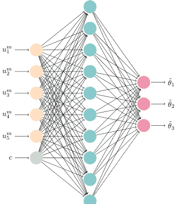
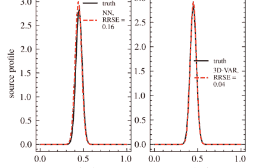
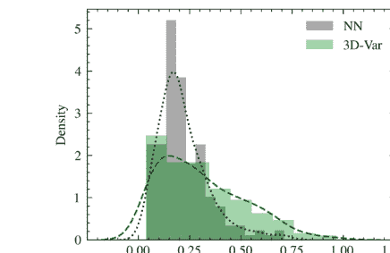
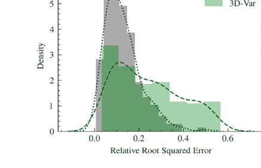
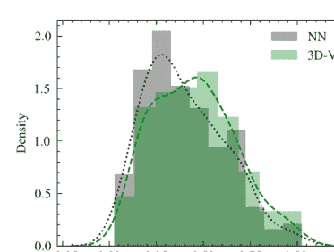
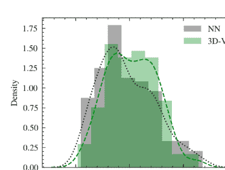

# 城市空气污染源估计：变分方法与机器学习对比

**Abstract:** 源检测是一个日益受到关注的研究领域，原因是人们对人口密集地区空气质量的环境担忧。我们开发了一种基于多层感知器神经网络的数据驱动方法，并借鉴了以往关于道路交通估计的研究。然后我们将其与经典的变分方法（3D-Var）在污染浓度的一维和稳态模型上进行了比较。我们使用12个和50个传感器生成的带噪声和不带噪声的合成测量数据集测试了源重建。两种方法对测量噪声都表现出合理的鲁棒性，且神经网络相比经典的3D-Var方法表现略好。

**Keywords:** 源检测，源估计，空气污染，平流-扩散偏微分方程，神经网络，变分方法，3D-Var。

## 1. 引言

如今公共政策越来越关注与环境风险评估和空气质量监测相关的话题，其中污染源的检测发挥着关键作用。源重建在民用和军用核领域已被广泛使用。例如，联合国于1996年通过的《全面禁止核试验条约》鼓励研究人员开发源检测方法，利用全球放射性核素传感器测量网络来监测该条约的遵守情况。在此背景下，Pudykiewicz（1998）应用伴随方法来获取放射性核素的源参数，如位置、时间和释放量。其他工作则处理了2011年福岛核电站事故期间的源释放率估计。Winiarek et al.（2014）使用合并的贝叶斯和变分估计方法来估计该源释放率，同时已知不确定性。

另一方面，人们对城市地区污染源的估计越来越感兴趣（例如 Mons et al.（2017），Kumar et al.（2015））。在城市环境中连续点源污染的背景下，Kumar et al.（2015）使用伴随方法结合CFD（计算流体动力学）模型来获取稳态情况下的源释放率和源位置。集合方法也在文献中被引用。Mons et al.（2017）使用基于集合的变分方法（EnVar）与精确但计算成本非常高的CFD模型来估计稳态和城市环境中挥发性污染物水坑的直径和位置。

据我们所知，机器学习迄今尚未广泛用于源检测。最近，一种机器学习方法已被应用于解决道路交通估计的反问题（Georges（2020））。该方法启发了本工作，其中使用具有少数隐藏层的 feed-forward 神经网络（NN）。这种数据驱动方法避免了变分方法中使用的变分法计算，从而避免在优化框架中调用扩散模型。此外，一旦训练完成，NN 与变分方法相比计算成本不高，尤其是基于复杂CFD模型的变分方法。NN 训练确实是在线下进行的，即在利用阶段之前。本文提出了一种在城市地区重建污染源的方法，适用于一维域和稳态条件，以首先考虑孤立街道中的污染物扩散。机器学习方法与通常被认为是估计精度参考的经典模型化变分方法（3D-Var）进行了比较。

本文组织如下：第2节介绍污染物传输模型及其有限维近似。它还论证了模型中使用的风速和扩散系数的选择。第3节详细介绍了所提出的机器学习方法并简要介绍了变分方法。数值模拟结果在第4节给出，而结论性意见在第5节讨论。

## 2. 污染物传输建模

在本文中，使用稳态物理模型来模拟污染物的浓度。在一维情况下，稳态源已排放足够长时间达到稳态，污染物浓度的动力学

## 3. 源估计方法

*图 1. 神经网络源反演架构示例。这里有 5 个来自同一模拟的输入测量值（橙色）和一个标量风输入（橙色），一个由 tanh 函数激活的 10 个神经元的隐藏层（蓝色）以及 3 个输出 $\tilde{\theta}_j$，$j \in \{1,2,3\}$，对应于重新缩放的源参数，如其振幅、位置和扩散。*

**Inputs:** 两个张量，$\mathbf{U}^m \in \mathbb{R}^{n_s \times N_s}$ 和 $\beta \in \mathbb{R}^{n_s}$ 分别表示 $n_s$ 个 $N_s$ 个测量的示例和相应的风数据，作为输入提供给神经网络。张量 $\mathbf{U}^m$ 首先通过使用物理模型（1）在 $N$ 个点上运行 $n_s$ 次模型模拟，针对不同的风速 $c$ 和源参数 $\theta$ 来构建。然后，使用（4）、（5）和（6）中描述的测量算子对模拟结果进行采样。

**Outputs:** $\Theta \in \mathbb{R}^{n_s \times 3}$ 是一个包含 $n_s$ 个不同源参数向量的张量，其中 $\Theta$ 的每一行形式为 $\Theta_k=[\theta_k(1),\theta_k(2),\theta_k(3)]$，$1 \leq k \leq n_s$。为避免因各源参数量级差异导致训练过程中的偏差，源参数需要缩放到相同的量级。为此，我们构建一个缩放张量 $\tilde{\Theta}$，其中每个参数使用变换进行缩放，

$$\tilde{\theta}(j)=\frac{\theta(j)-\min(\Theta(j))}{\max(\Theta(j))}, \qquad 1\leq j\leq 3. \tag{7}$$

因此模型返回无量纲参数的估计作为输出。使用训练过程中获得的 $\min(\Theta(j))$ 和 $\max(\Theta(j))$ 对输出估计进行重新缩放。

**Training Data:** 需要进行 $n_{\mathrm{train}} \in \mathbb{N}$ 次污染物扩散模拟，使用不同的风速 $c$ 和源参数 $\theta$ 来生成训练集和验证集。为了覆盖所有可能的训练样本的现实域，风速和训练源参数是通过使用具有低差异特性的 Sobol 伪随机序列生成的。已知低差异序列可确保“域的良好填充”，即对于给定样本数以最佳近似计算函数积分的意义（参见 Niederreiter（1988））。

### 3.1 变分方法

变分方法依赖于基于已知模型输出预测与测量数据之间最小二乘误差的最小化。这类方法被广泛使用，被认为是给定某些测量估计参数的标准方法，尤其是在使用伴随模型的情况下（Georges（2019））。在此，我们提出将变分方法应用于稳态问题，其中 $u$ 可以通过有限差分模型显式表示为 $\theta$ 的函数，从而避免显式使用伴随模型。选择 3D-Var 成本函数，该函数以最小二乘意义最小化输出预测误差。添加一个取决于初始猜测的正则化项（参见 Tikhonov（1977）），使得整个成本函数由下式给出，

$$\mathcal{J}(\theta)=\frac{1}{2}(\theta-\theta^b)^T\mathbf{B}^{-1}(\theta-\theta^b)+\frac{1}{2}(\mathcal{F}(\theta)-u^m)^T\mathbf{R}^{-1}(\mathcal{F}(\theta)-u^m), \tag{8}$$

其中 $u^m$ 表示传感器提供的浓度测量向量，$\theta^b$ 指初始猜测，且

$$\mathcal{F}(\theta)=\mathcal{H}\circ\mathcal{M}(\theta). \tag{9}$$

$\mathcal{F}$ 表示前向算子，它是观测算子 $\mathcal{H}$ 与由（1）给出的 $\mathcal{M}$ 的组合，其中 $\mathcal{H}$ 由（5）给出，将模型在整个域上返回的浓度映射到测量空间。矩阵 $\mathbf{B}$ 和 $\mathbf{R}$ 分别表示不确定初始猜测和测量噪声的协方差矩阵。我们假设噪声是不相关的，因此 $\mathbf{B}$ 和 $\mathbf{R}$ 是对角矩阵且方差相等。$\sigma^b$ 和 $\sigma$ 是与初始猜测和观测相关联的标准差。

数据同化问题

$$\min_{\theta}\mathcal{J}(\theta) \tag{10}$$

是无限维的。在本文中，选择求解该问题的直接有限维版本，基于模型（1）由（3）给出的有限维近似，即

$$\min_{\theta}\mathcal{J}_a(\theta)=\frac{1}{2}(\theta-\theta^b)^T\mathbf{B}^{-1}(\theta-\theta^b)+\frac{1}{2}\left\|\mathbf{H}_a\mathbf{A}^{-1}(\mathbf{B}_1q(\theta)+\mathbf{B}_2\mathbf{C})-u^m\right\|_{\mathbf{R}^{-1}}^2. \tag{11}$$

其中 $\mathbf{H}_a$ 是基于梯形方法从（5）给出的 $N_s$ 传感器积分算子 $\mathcal{H}$ 的近似得到的矩阵。该非凸问题的求解需要计算 $\mathcal{J}_a(\theta)$ 关于 $\theta$ 的梯度，即

$$\nabla\mathcal{J}_a(\theta)=\mathbf{B}^{-1}(\theta-\theta^b)+\left(\mathbf{H}_a\mathbf{A}^{-1}\mathbf{B}_1\frac{\partial q}{\partial\theta}(\theta)\right)^T\mathbf{R}^{-1}(\mathbf{H}_a u-u^m). \tag{12}$$

其中 $u$ 由（3）获得。在此，优化问题（11）的求解是通过使用基于 L-BFGS-B 算法的拟牛顿下降方法（参见 Byrd et al.（1995））和梯度（12）进行的。

## 4. 案例研究：街道中的污染源识别

这里提出的案例研究涉及对一辆停在林荫大道某处且发动机处于启动状态的排放污染物车辆的检测。假设在恒定风速下可获得污染分布的稳态条件。我们还可以考虑另一种情况，即诸如燃气泄漏之类的点源以稳态模式排放。

### 4.1 参数

训练数据库通过构建如下参数集建立，

{p_k = [A_{s,k}, x_{s,k}, σ_{disp k}^2, c_k] ; 1 ≤ k ≤ n_train} , (13)

其中 [A_s, x_s, σ_disp^2, c_k] ∈ [10^{-2},4] × [0.1,0.9] × [50,2000] × [-10^{-3},10^{-3}] 由从第10001项开始的Sobol序列生成，其单位分别为 [g km^{-3} s^{-1}, km, km^{-2}, km s^{-1}]。验证集以相同方式创建，包含 n_test 个样本，选择 [A_s, x_s, σ_disp^2, c] ∈ [5 × 10^{-2},3] × [0.1,0.9] × [70,1500] × [-10^{-3},10^{-3}]，序列从第101项开始。源位置特意生成在 x_s ∈ [0.1 km,0.9 km] 范围内，以避免生成过于靠近计算域边界的源，因为这可能导致由(1)给出的扩散模型产生非物理解。我们的数据库包含 n_train = 15000 个训练样本，而验证在 n_test = 200 个样本上进行。选择相对均方根误差（RRSE）作为性能指标，其定义为，

RRSE = ||q̂ - q_T||_2 / ||q_T||_2 , (14)

其中 (q_T, q̂) ∈ ℝ^{N_x}^2 分别为真实源分布及其估计。为了促进变分方法的收敛，初始猜测由下式给出

θ_k^b = [0, arg max_x(u_k^m), 0] , 1 ≤ k ≤ n_test; (15)

即初始猜测的源位置位于最大测量浓度处。初始猜测既用于代价函数中，也用作L-BFGS-B下降方法的初始化值。

经过多次试验获得了最佳的神经网络架构。因此，选定的神经网络包含2个全连接隐藏层，每层50个神经元，并使用tanh激活函数。优化使用L-BFGS-B算法进行。L_2正则化设置为较小的值10^{-12}。机器学习方法使用Python环境下的keras和tensorflow库构建。

### 4.2 无噪声情况下的比较

12个传感器的实验：在无噪声条件下进行模拟，以确定神经网络（NN）相比3D-Var的表现。神经网络返回的若干异常估计（很可能是由于训练过程中的非物理条件）以及3D-Var产生的较差估计（由于BFGS算法不收敛）被排除在外：200个中排除16个，最终研究184个估计。

图2. 源重建示例：左为神经网络方法，右为变分方法。

基于该实验，神经网络能够以与标准3D-Var相同数量级的RRSE来估计源，NN和3D-Var的RRSE均值与标准差分别为μ_RRSE^NN = 0.22和σ_RRSE^NN = 0.12，以及μ_RRSE^var = 0.31和σ_RRSE^var = 0.21。总体而言，神经网络的表现略优。这可能是因为变分方法是一个非凸优化问题。因此，某些局部最小值可能导致参数值差异显著但接近最优的解。

机器学习和变分方法获得的RRSE遵循对数正态分布，这一点通过Kolmogorov-Smirnov检验得到证实（p值分别为0.39 > 0.05和0.44 > 0.05）。RRSE的分布如图3所示。

机器学习方法由数据驱动，因此不包含任何关于物理模型的先验信息，而变分方法依赖于对物理规律的认识以及由(15)给出的良好初始猜测。我们注意到RRSE指标对估计位置的微小误差很敏感。例如，在图2所示的第65个验证样本中，神经网络很好地估计了量级和扩散程度，但位置的微小误差导致神经网络的RRSE^NN = 0.16，而变分方法的RRSE^var = 0.04。

总体而言，在无噪声且总共使用12个传感器（10个在计算域内规则分布，2个用于测量边界条件）的情况下，就RRSE指标而言，机器学习方法的表现略优于变分方法。神经网络有时会返回非物理估计，例如负源或非高斯源。图4显示这两种方法的性能相似。

50个传感器的实验：使用50个传感器进行模拟，以观察估计结果对测量密度的敏感性。神经网络或变分方法返回的若干非物理估计被排除在研究之外：200个中排除9个，最终研究191个估计。两种方法返回与之前类似的结果，NN和3D-Var的均值与标准差分别为μ_RRSE^NN = 0.13和σ_RRSE^NN = 0.08，以及μ_RRSE^var = 0.24和σ_RRSE^var = 0.15。

这意味着与使用12个传感器相比，NN的误差降低了约一半，而3D-Var的误差降低了约三分之一。神经网络的表现再次优于3D-Var。与12个传感器的情况一样，RRSE分布遵循对数正态分布，Kolmogorov-Smirnov检验结果为NN的p值 = 0.19 > 0.05，3D-Var的p值 = 0.90 > 0.05。总体而言，使用50个无噪声传感器（48个在计算域内规则分布，2个测量边界条件）进行源重建，相比使用12个无噪声传感器的情况，性能提升了30%至50%。图4显示神经网络的表现明显优于3D-Var，其分布在RRSE轴上更窄且更接近0。另一方面，使用50个传感器而非12个时，两种方法均有所改进。

### 4.3 含噪声情况下的比较

图3. 无噪声条件下，使用12个传感器时3D-Var与NN估计的RRSE分布对比。

图4. 无噪声条件下，使用50个传感器时3D-Var与NN估计的RRSE分布对比。

在本实验中，按照2.2节所述流程，对由N_s个传感器给出的浓度分布数据集中的每个样本s（1 ≤ s ≤ n_test或n_train）施加高斯噪声ε_s^obs。

因此，一组测量的高斯噪声具有恒定方差，该方差取决于无噪声测量浓度分布的最大值。这一假设是相当保守的，因为浓度分布中较小的测量值比其最大值具有相对更大的噪声。此处神经网络使用含噪声的浓度数据集进行训练。

图5. 含噪声条件下，使用50个传感器时3D-Var与NN估计的RRSE分布对比。

图6. 含噪声条件下，使用12个传感器时3D-Var与NN估计的RRSE分布对比。

3D-Var中使用的初始猜测误差从σ^b = 1 × 10^6调整为σ^b = 5 × 10^4，以帮助使问题更具凸性。

12个传感器的实验：以与之前相同的方式在含噪声条件下进行模拟。神经网络或3D-Var返回的若干非物理估计被排除在结果之外：200个中排除9个，最终得到191个估计。在存在噪声的情况下，两种方法的性能相似，使用NN时的均值与标准差为μ_RRSE^NN = 0.48和σ_RRSE^NN = 0.26，使用3D-Var时的均值与标准差为μ_RRSE^var = 0.52和σ_RRSE^var = 0.23。图6显示两种方法的RRSE分布彼此接近。

50个传感器的实验：使用50个传感器（48个规则分布，2个测量边界处的浓度值）时，结果相比使用12个传感器有所改进。由此得到使用NN时的均值与标准差指标为μ_RRSE^NN = 0.40和σ_RRSE^NN = 0.21，使用3D-Var时为μ_RRSE^var = 0.45和σ_RRSE^var = 0.22。因此，使用50个传感器而非12个时，μ_RRSE^NN和μ_RRSE^var分别下降了17%和13%。因此，神经网络的表现略优于变分方法。然而，从图5可以看出，两种方法的误差分布仍然相当接近。同样地，误差分布被证明遵循对数正态分布规律。这4种情况的结果如表1所示。

表1. 对每个研究案例使用验证样本测得的 RRSE 均值与标准差

| 案例 |  |  | **神经网络** |  | **3D-Var** |  |
|---|---|---|---|---|---|---|
| N | 传感器数量 | 噪声 | 均值 | 标准差 | 均值 | 标准差 |
| 184 | 12 | 无 | 0.22 | 0.12 | 0.31 | 0.21 |
| 191 | 50 | 无 | 0.13 | 0.08 | 0.24 | 0.15 |
| 191 | 12 | 有 | 0.48 | 0.26 | 0.52 | 0.23 |
| 191 | 50 | 有 | 0.40 | 0.21 | 0.45 | 0.22 |

## 5. 结论

在使用少量带噪声的传感器时，两种方法表现相近，尽管神经网络方法通常能返回更精确的源估算结果。随着传感器密度的增加，机器学习方法在精度上的提升比变分方法更为显著。变分方法在某些情况下表现相对较差，可归因于相关优化问题的非凸性。我们已经证明，即使存在带噪声的测量，机器学习方法也能重建源项。传感器噪声会严重降低两种方法的源估算性能。总体而言，如表1所示，神经网络的表现与变分方法相当，甚至优于变分方法。这些结果表明，机器学习方法在城市空气污染源探测方面前景广阔。未来的工作将优先考虑二维和三维城市模型，以获取水平和垂直浓度廓线。由真实污染三维模型（如 PMSS，Oldrini 等人，2011）生成的合成数据及其对应的风场将作为输入。除风场外，神经网络的输入和输出（如测量值和源参数）将保持较少，以适应物理域维度的增加。在此背景下，模型降阶技术有望减少风场输入的数量（Ding 和 Yang，2021），甚至允许考虑约束更少的源参数化方案。卷积神经网络（CNN）也以捕获相关数据的能力著称，因此能够很好地扩展到大量输入（如图像）（Ronneberger 等人，2015）。因此，一旦训练完成，神经网络模型应当足够准确且简单，可用于城市区域污染源的在线监测。我们还可以设想利用神经网络方法为 3D-Var 或 4D-Var 等变分方法提供合适的初始猜测，以最终获得更高的精度。变分方法也可以通过使用降阶模型来改进；尝试考虑不同的源项参数化以使变分方法凸化，也将是有意义的。

## 致谢

作者感谢法国核能与替代能源委员会对本工作的资助，并感谢 John D. Garrett（2021）通过其开源模块提供了 IEEE 绘图样式。

## 参考文献

Byrd, R.H., Lu, P., Nocedal, J., 和 Zhu, C. (1995). 一种用于有界约束优化的有限内存算法. Optimization. SIAM J. Sci. Comput., 16(5), 1190–1208. 出版者：工业与应用数学学会.
Ding, S. 和 Yang, R. (2021). 城市尺度街道峡谷中城市风环境与气态污染物扩散的降阶建模. Journal of Safety Science and Resilience, 2(4), 238–245.
Garrett, J. (2021). SciencePlots (v1.0.9).
Georges, D. (2019). 基于低差异序列传感器部署的野火监测变分微积分方法. 收录于2019 IEEE 第58届决策与控制会议（CDC），5912–5917. IEEE，法国尼斯.
Georges, D. (2020). 用于后退视界观测器设计的机器学习：在交通密度估计中的应用. IFAC, 2020 - 第21届IFAC世界大会2020, 7.
Kikumoto, H. (2020). 用于欧拉-计算流体动力学点源污染物扩散分析的含传播时间的湍流扩散限制器. Wind Engineering Research, 26, 9.
Kumar, P., Feiz, A.A., Singh, S.K., Ngae, P., 和 Turbelin, G. (2015). 类城市环境中大气示踪物源的重建. Journal of Geophysical Research: Atmospheres, 120(24), 12589–12604. 出版者：John Wiley & Sons, Ltd.
Mons, V., Margheri, L., Chassaing, J.C., 和 Sagaut, P. (2017). 基于数据同化的城市污染物释放特征重建. Journal of Wind Engineering and Industrial Aerodynamics, 169, 232–250.
Niederreiter, H. (1988). 低差异与低离散序列. Journal of Number Theory, 30(1), 51–70.
Oldrini, O., Olry, C., Moussafir, J., Armand, P., 和 Duchenne, C. (2011). PMSS（micro-swift-spray 的并行版本）的开发. H14–176. 第14届面向监管目的的大气扩散建模协调国际会议.
Pudykiewicz, J.A. (1998). 伴随示踪物输运方程在源参数评估中的应用. Atmospheric Environment, 32(17), 3039–3050.
Ronneberger, O., Fischer, P., 和 Brox, T. (2015). U-Net：用于生物医学图像分割的卷积网络. arXiv:1505.04597 [cs]. ArXiv: 1505.04597.
Tikhonov, A.N. (1977). 不适定问题的解法. V.H. Winston & Sons 版本.
Wang, J.W., Yang, H.J., 和 Kim, J.J. (2020). 基于背景风速与形态参数关系的城市地区风速估算. Journal of Wind Engineering and Industrial Aerodynamics, 205, 104324.
Winiareck, V., Bocquet, M., Duhanyan, N., Roustan, Y., Saunier, O., 和 Mathieu, A. (2014). 利用空气浓度与沉降观测的一致性联合同化估算福岛第一核电站铯-137源项. Atmospheric Environment, 82, 268–279.
Winiareck, V., Bocquet, M., Saunier, O., 和 Mathieu, A. (2012). 大气污染物事故释放逆向建模中的误差估计：在重建福岛第一核电站铯-137和碘-131源项中的应用. J. Geophys. Res., 117(D5), n/a–n/a.
