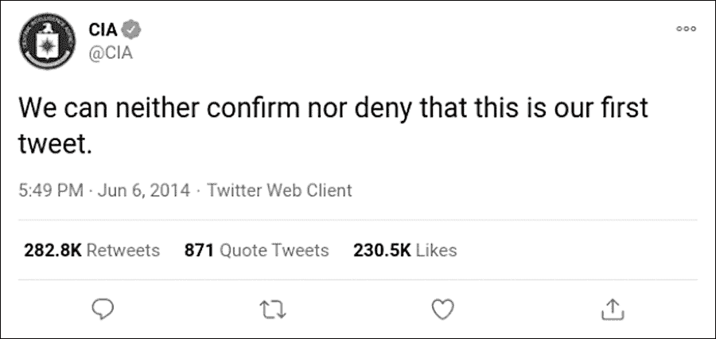
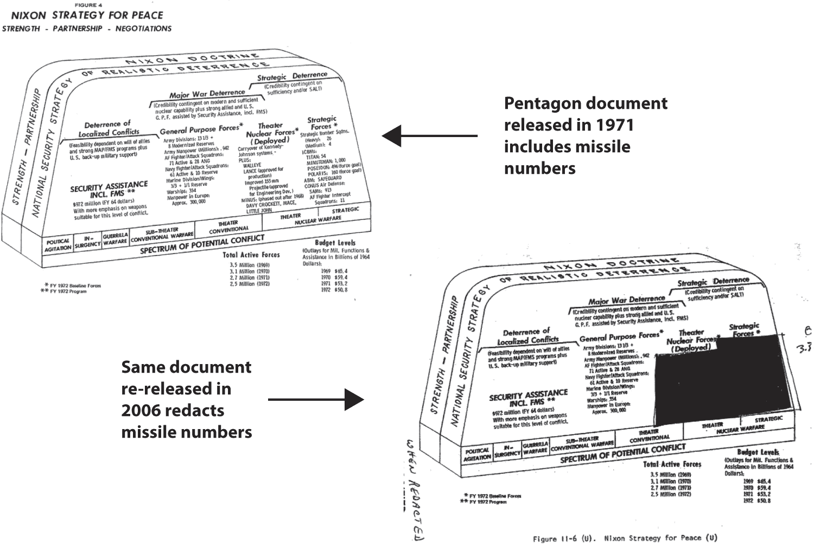
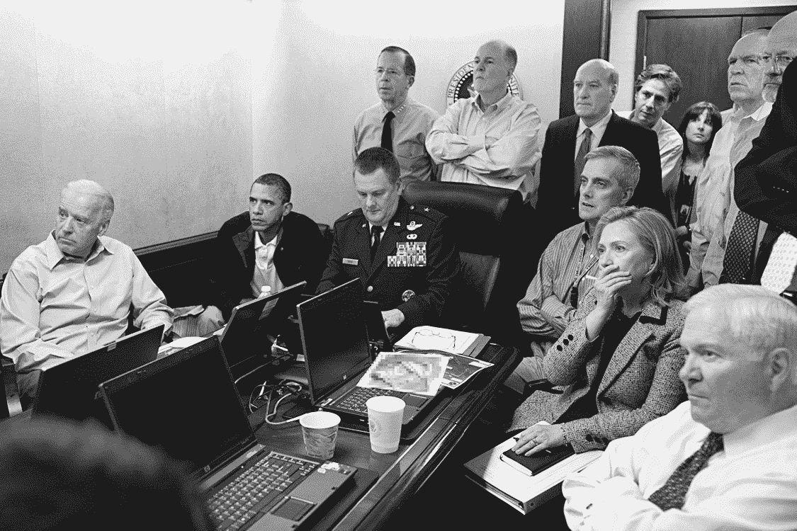
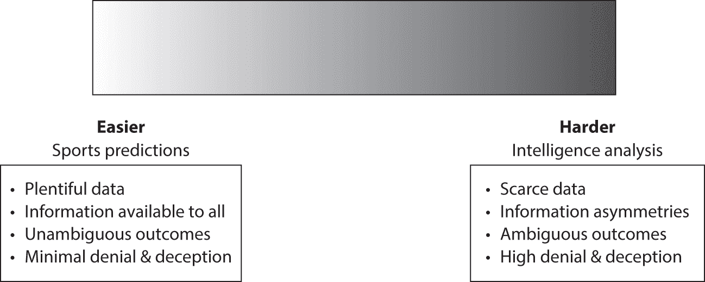
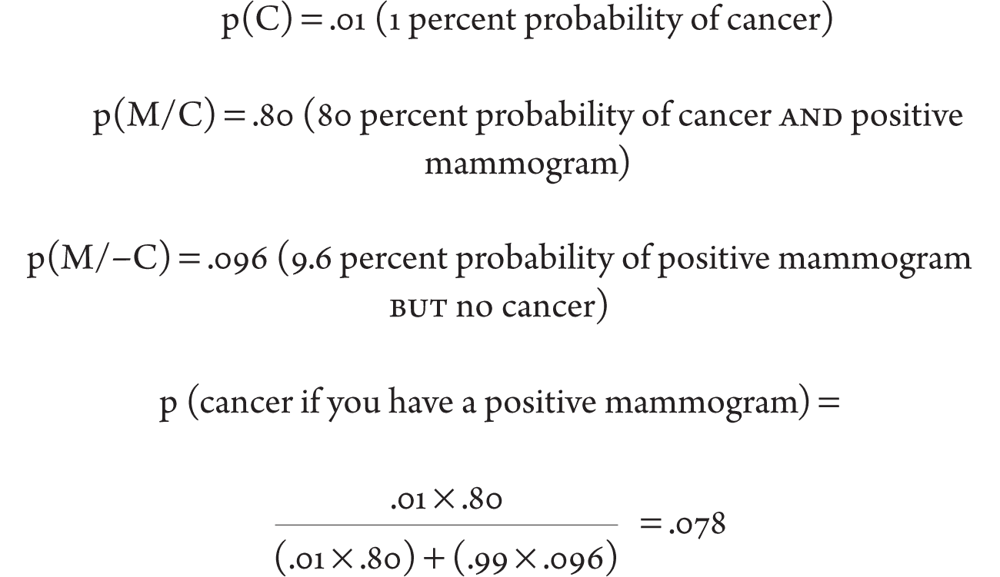
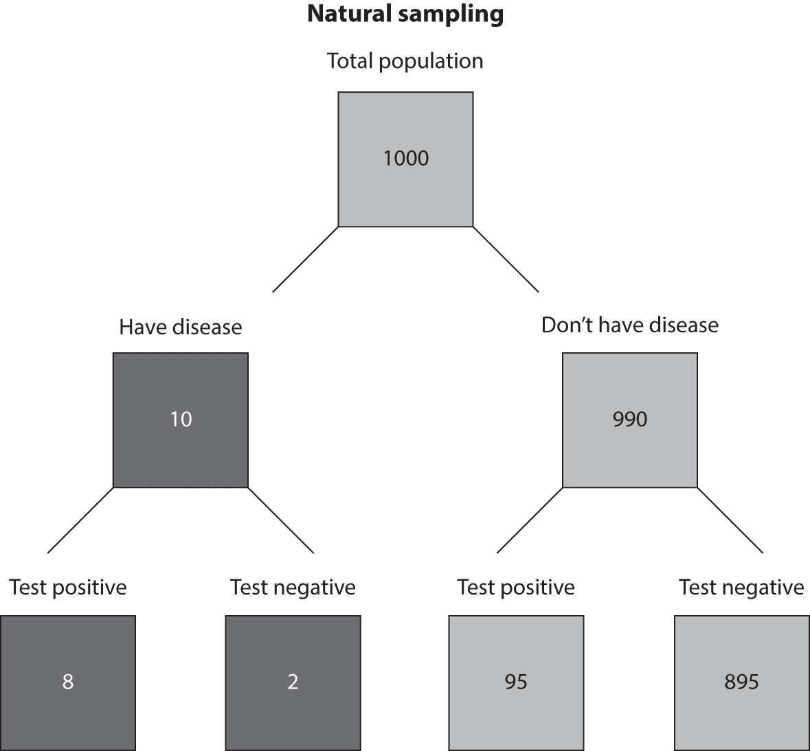
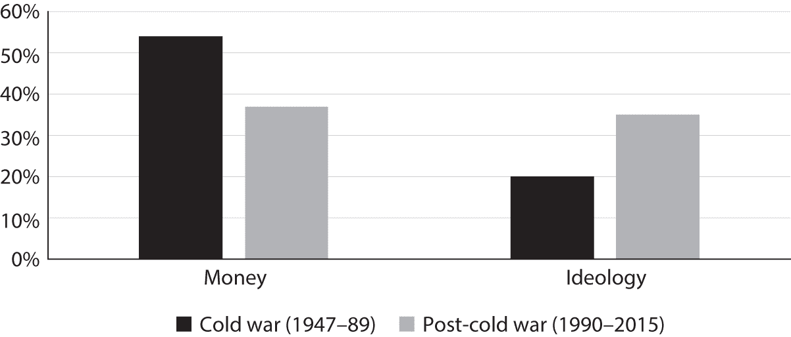
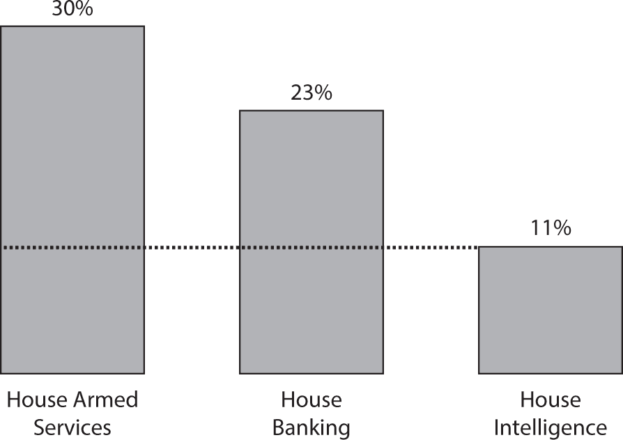

# 间谍、谎言与算法：美国情报机构的历史与未来

*致我的孩子们：Alexander、Jack 和 Kate*

*以及*

*致 Craig，一如既往*

## 1. 数字时代的情报挑战

### 斗篷、匕首与推文

2014 年 6 月，我正在刷我的 `Twitter` 动态时，我看到了以下推文：

```markdown

```

起初，我以为这是一个玩笑。中央情报局（`CIA`）以保密闻称——如此阴暗，以至于其公关人员都不告诉你他们的名字。但这条推文是真的。美国这间间谍机构终于加入了社交媒体时代。互联网疯狂了。“谁知道呢？——他们也有幽默感，”`CNN` 报道道。

`CIA` 的 `Twitter` 首秀是日益黑暗的格局中的一个轻松时刻。人工智能（`AI`）、互联网连接、量子计算和合成生物学等新技术正以前所未有的速度冲击着全球经济和政治。美国从未面对过如此充满活力且危险的世界。对于 `CIA` 以及组成美国情报界（`IC`）的另外十七个机构来说，这是一个反思的时刻。

## 新技术格局

人工智能正在改变商业和国防，其这种方式可能会动摇社会秩序并改变全球权力格局。计算机科学家李可芙估计，在未来十五到二十五年内，人工智能可能会消除全球高达 40% 的工作岗位，涵盖了从卡车运输到服务业的各个行业。人工智能还将彻底改变战争模式——从物流、网络防御，到感知和攻击速度比人类更快的无人战斗机，实现一切自动化。正如前谷歌首席执行官埃里克·施密特（Eric Schmidt）和前国防副部长罗伯特·沃克（Robert Work）所言：“人工智能正在加速每一个科学和工程领域的创新。”

自电力以来，尚未有一项突破性技术带来如此巨大的潜力和危险。俄罗斯总统弗拉基米·普京宣布，谁在人工智能开发上领先，“谁将成为世界统治者”。十多个国家已经启动了国家级人工智能倡议。中国并未隐藏其在 2030 年成为全球人工智能领导者的计划，这是其挑战美国经济军事主主地位战略的一部分。美国专家和政策制定者正在敲响警钟。跨党的人工智能国家安全委员会在 2019 年的报告中指出：“我们正处于战略竞争之中。人工智能将处于核心位置。我们国家安全和经济的未来面临风险。”

### 其他颠覆性技术

人工智能并非重塑世界的唯一技术。互联网连接正在为政治注入动力，推动了如阿拉伯之春和香港伞兵运动等抗议活动、如中国对维吾尔人的迫害等镇压性打击，以及深入及其他国家社会的俄罗斯信息战行动。所谓的“物联网”（连接互联网的日常设备）正在蔓延到数十亿玩具、汽车、家电等——并随之带来了网络漏洞。`Facebook` 的算法正在决定我们阅读的新闻并影响我们的思维方式，使得大规模操纵人口成为可能。

更大的动荡尚在后头。2019 年，谷歌宣布其已实现“量子霸权”——这种计算突破是如此强大，超级计算机需要一万年才能解决的数学问题，其机器仅需三分二秒即可破解。专家将其与莱特兄弟的首次飞行相提比：一个技术时代的黎明，开启了巨大的新可能性。但并非所有这些都是好的。量子计算最终可能破解保护今天几乎所有数据的加密。

合成生物学使科学家能够工程生物体并创造自然界不存在的新生物，在食品、药品和数据存储生产方面具有革命性改进的潜力，并可能产生新的战争武器。由于活细胞像计算机一样可以编程，它们最终可以被工程化以制造任何东西。潜在用途包括制造塑料、创造能通过改变颜色检测化学弹药的植物，甚至设计根据 `DNA` 针对个人的生物武器。在这一领域，中国军事领导人也将创新视为首要任务，将生物技术称为国家防御的新“战略指挥高地”。

新冠肺炎大疫情加速了这些趋势中的许多许多，将整个经济和社会推向在线，并推动了生物监测技术的使用，例如追踪症状的智能首饰，以及可以识别感染者使用过建筑内哪些房间以及是否佩戴了口罩的数据分析。

## 美国情报机构面临的挑战

我们以前见过技术进步。但从未见过如此多新技术汇聚，并如此迅速地改变如此的一切。这一时刻正从三个深远方面挑战着美国情报机构。

### 1. 演变的威胁格局

首先，技术突破通过产生新的不确定性并赋能新对手，正在改变威胁格局。在冷战期间，美国有一个主要敌人：苏联。冷战是一段危险的时期，但它更简单。美国首要的情报任务非常明确。每一项外交政策都会通过“莫斯科会怎么想？”的视角来审视。

现在，大量的坏人分子正在利用技术进行跨距离威胁。中国正在发起网络攻击以窃取知识产权，并制造太空武器以切断美国通信。俄罗斯正在使用 `Facebook`、`Twitter` 和其他社交媒体平台进行信息战。三个国家拥有自主无人机，至少有九个国家已经使用了。恐怖组织利用在线视频游戏招募追随者，并利用 `Google Earth` 策划攻击。发展国家的独裁者正在采用高科技镇压。弱国和非国家行为者点击鼠标即可造成巨大的干扰、破坏和欺骗。

在历史的大部分时间，权力和地理提供了安全。强者威胁弱者，而非相反。海洋保护着各国互不干扰，距离至关重要。现在不再如此了。在这个时代，美国既强大又容易受到数量惊人的危险的影响，而这些危险都以网络的速度移动。这与几十年前苏联缓慢的五年计划节奏相比相去甚远。

### 2. 数据挑战

数字时代的第二个挑战涉及数据。情报是一项产生意义的事业。像 `CIA` 这样的机构收集并分析信息，帮助政策制定者理解现在预测未来。情报并不总是正确的。但它胜过最好的替代方案：猜测、观点和直觉。

在过去，少数几个强国的间谍机构主导着信息的收集和分析。它们是唯一拥有资源和专业知识来建造价值十亿美元的卫星、破解和破解复杂代码以及大规模收集信息的组织。2001 年，国家安全局（`NSA`）每天拦截约 2 亿封外国电子邮件、电话和其他信号。很少有国家或公司能与之比拟。

现在，数据正在民主化，美国间谍机构正苦于追赶。世界上超过一半的人在线，每天进行五十亿次 `Google` 搜索。手机用户正在实时记录和发布事件——无论他们知不知道，这让每个人变成了情报收集员。任何拥有 `Internet` 连接的人都可以访问 `Google Earth` 卫星图像，使用人脸识别软件识别人物，并追踪 `Twitter` 上的事件。

2021 年 1 月 6 日，当支持特朗普的暴徒暴力袭击美国国会大厦，试图阻止国会对 2020 年总统选举结果进行认证，并导致五人死亡时，网络侦探们立即开始挖掘社交媒体上发布的图像和视频，以帮助执法机构识别犯罪分子。一名匿名大学学生甚至创建了一个名为 `Faces of the Riot` 的网站。该学生利用广泛使用的面部识别软件，扫描了暴徒和其他人在社交媒体网站 `Parler` 上分享的数百个视频和数千张照片，提取了那些可能参与了国会大厦围攻行动的人员图像。^([28])

如今的在线数据量之惊人，令人难以想象：在 2019 年，互联网用户每天发布 5 亿条推文，发送 2940 亿封电子邮件，并在 `Facebook` 上发布 3.5 亿张照片。^([29]) 有人估计，地球上的信息量每两年就会增加一倍。^([30])

### 开源情报的兴起

这种公开信息被称为 `开源情报`（open-source intelligence），它的价值正变得越来越高。当美国海军海豹突击队对奥萨马·本·拉丁位于巴基斯坦的基地进行秘密深夜袭击时，巴基斯坦军队没有发现异常。但一位名为 Sohaib Athar 的地方信息技术顾问发现了。听到奇怪的声音后，他上了 `Twitter`。他发帖：“凌晨 1 点阿伯塔巴德上方有直升机在盘旋（这是一种罕见事件）。”Athar 最终实时推文了整个行动，包括报告爆炸震动他窗户的时刻。^^([31])

同样，当 2014 年俄罗斯入侵乌克兰时，最好的证据并非来自间谍或秘密截获的通信，而是来自自拍照：俄罗斯士兵拍摄并发布在社交媒体上的带有时间戳的照片，背景是乌克兰的公路标志。社交媒体已变得如此重要，以至于美国地下核指挥中心的控制台在显示机密信息的同时，还会显示 `Twitter` 推送。^^([32])

### 卫星图像与机器学习

事实并非如此。全球各商业公司每年发射数百颗小型卫星，^([33]) 为任何需要的人提供廉价的“天之眼”。^^([34]) 某些卫星传感器的分辨率极高，甚至能从太空探测到井盖。^([35]) 其他传感器可以在夜晚、多云天气或穿过茂密植被和伪装捕捉图像。^^([36]) 而廉价的小卫星星座正在提供某种新事物：对同一位置更快的重访率，以检测随时间发生的变化。商业图像和机器学习工具已经使我在斯坦福大学的一些同事能够通过计算过去五年数百张照片中跨越边界的卡车数量，来分析朝鲜与中国的贸易关系。^^([37]) 商业图像已变得如此价值，以至于负责建造和运行侦察卫星的美国国家侦察局（`NRO`）每年花费 3 亿美元购买图像，而不是仅仅是自己制造卫星。^^([38])

简而言之，数据量和可访问性正在彻底改变认知世界的方式。情报竞争格局正在平民化——而且并非好事。情报收集者无处不在，政府间谍机构正淹没在数据之中。这是一个激进的新世界，情报机构正苦于适应。虽然秘密曾带来巨大的优势，但如今开源信息日益具备了这种优势。情报曾是一场对洞察力的竞争，只有大国才有获取秘密的能力。现在，每个人都在为了洞察力竞争，而 `Internet` 为他们提供了工具。秘密仍然重要，但谁能更好地、更快地利用所有这些数据，谁就能赢。

### 秘密性与“不否不认”的起源

`CIA` 的“我们既不证实也不否”（We can neither confirm nor deny）回复已成为流行词汇的一部分。虽然这句话常在电影或 `Twitter` 上被当作笑话使用，但这种“不否不认”是真实的。^^([39]) 一位 `CIA` 律师在 1975 年想出了这个说法^([40])，当时该机构一项最高机密秘密行动之一的信息泄露给了媒体。^^([41]) 该行动的代号为 `AZORIAN`。^([42]) 它涉及亿万富翁霍华德·休斯、一艘伪装商业深海采矿船的 `CIA` 船只，^([43]) 以及一项大胆的尝试：在苏联船只经过时，从太平洋底部吊起一艘沉没的苏联潜艇——以及它的核导弹^([44])和秘密^([45])。^^([46]) 当时冷战局势紧张，暴露的风险巨大，记者们向 `CIA` 官员连连不断的提问。^^([47]) 该机构不希望在水门事件期间被抓住对自己的行为撒谎，但他们不想向苏联透露任何信息，^([48]) 从那时起，“我们既不证实也不否”一直被使用。

## 透明性的挑战

新兴技术带来的第三挑战直击间谍活动的核心：秘密性。直到目前，美国间谍机构不需要与外部进行太多互动，他们也不想这样做。情报任务意味着收集秘密，以便我们对对手的了解超过他们对我们的了解，并保持我们收集秘密的方式秘密。

走进 `CIA` 总部，你就能感受到。那里有一面闪光的白色大理石纪念墙，上面满了 100 多颗星星，每颗星星代表一位在执行任务时牺牲的情报官。^([49]) 《荣誉簿》记录了他们的名字，但有四十条目只有空白行。^([50]) 对于这些 `CIA` 官员，服务仍然是机密的。

平衡秘密性与开放是一场古老的斗争。秘密性对于保护情报来源和收集方法以及确保优势至关重要。开放对于确保民主问责至关重要。过多的秘密会引来滥用。过度的透明会让情报失效。

然而，在数字时代，由于新兴技术模糊了地缘政治几乎所有的旧边界，秘密性带来了更大的风险。日益，国家安全要求情报机构与外部世界接触，而不是与其隔绝。

过去，敌人从外部发起威胁，我们能预见到他们的到来；军事动员需要时间。现在，他们可以在网络空间攻击私有的关键基础设施（如电网和金融系统）——随时随地，无需跨越边界或开火。20 世纪，经济和安全政治是分开的领域，因为苏联集团的指令经济从未是全球贸易秩序的一部分。在 21 世纪，由于全球供应链以及 `AI` 等具有颠覆性商业和军事应用的双用途技术的巨大进步，经济和安全政治已紧密交织在一起。

## 在这个新世界保持优势

保持优势意味着情报机构必须找到新方法与私营部门合作，以应对网络威胁并利用商业技术的进步。他们必须投入开源数据领域，捕捉其洞察力量。而且他们必须为政府之外更广泛的情报客户服务，以捍卫国家。

如今，国家安全局（`NSA`）并非唯一的大数据巨头。`Amazon`、`Apple`、`Facebook`、`Google` 和 `Microsoft` 也是。尽管有些公司宣布他们绝不会将其技术用于武器，但现实是，他们的技术已经是一种武器：黑客正通过 `Gmail` 钓鱼计划和 `Microsoft` 的代码漏洞攻击计算机网络，恐怖分子正在直播攻击，而恶意行为者已将 `Twitter` 和 `Facebook` 等社交媒体平台变成了虚假信息的超级公路，从内部破坏民主。美国情报机构必须找到更好的方法来获取这些公司和其他公司持有的相关威胁信息，同时又不危及公民自由或企业的商业成功。

情报机构现在也更需要私营部门进行创新。例如，分析海量数据将日益依赖 `AI` 工具。技术进步（如 `Internet`）通常始于政府，然后迁移到商业部门。现在这个过程反转了，突破来自 `Google` 和 `Nvidia` 等大公司，以及来自 `Ginko Bioworks` 和 `Dataminr` 等初创公司。情报机构不再是在内部开发技术，而是必须从外部快速发现并采用。这既需要人才也需要技术，而私营部门正在占据劳动力市场，提供政府机构（或大学）无法企及的薪方案方案和尖计算设施。公司一直在挖走许多顶尖 `AI` 教授（仅 2018 年就有 41 名 `AI` 教员离开了学术界），专家担心留下的将不足以教授下一代学生。

与私营部门的接触与协作并非易事。对美国间谍机构的不信任有着很长的历史，其中包含一些黑暗章节。20 世纪 70 年代，有关情报机构监视美国人、渗透异见人士团体和暗杀外国领导人的揭露引发了公众抗议和国会监督改革。更最近的争议包括 `CIA` 的无人机袭击，以及 2013 年由名为 `Edward Snowden` 的前机构承包商披露的秘密 `NSA` 监控计划。

2014 年夏天，在 `Snowden` 揭露登上媒体一年后，我为国会工作人员举办了一场网络训练营，其中包括了对硅谷一家主要科技巨公司的访问。当我们进入会议室时，紧张的气氛显而易见。一位科技高管告诉小组，他看待 `U.S.` 政府就像中国的人民解放军一样——作为一个需要被阻止秘密渗透其系统的敌对力量。大家惊讶得合掉了下巴。一名情报委员会的工作员冲到外面给老板转达这个消息：他们还有大量的修复工作要做了。`NSA` 的监控计划已获得授权，但在科技高管眼中，他们通过秘密收集客户数据并让公司显得软弱、同谋或两者兼有，已经背叛了信任。

情报机构仍在努力重建那种信任。当该机构的第一条“既不确认也不否认”的 `Tweet` 在范围内走红时，局长 `John Brennan` 发布了一份新闻稿，解释说他希望拥有社交媒体平台，以便“更直接地与公众互动并提供关于 `CIA` 任务、历史和其他信息”。这是一个重要的开始。

正如上文提到的，新兴技术正在挑战关于谁是决策者的想法。公开可用信息——从乌克兰的俄罗斯士兵自拍到朝鲜的卫星图像——正在挑战秘密的主导地位并释放出一个全新的世界。虽然开源信息一直很重要，但在情报机构内部，秘密一直占据统治地位。并非一切都是秘密。正如前 `CIA` 分析师 `Aris Pappas` 所言，冷战期间获取这一点很容易。以前，国家安全政策是政府的范畴。重要的决策是由佩戴标志、持有安全许可并了解情报机构运作方式的联邦员工做出的。

不再如此。越来越多的决策者与华盛顿相隔万里——在客厅和董事室里做决策，而不仅仅是在白宫局势室。他们是受外国影响操纵选举的选民。这些公司的领导者可能不想参与美国安全政策或全球政治，但他们的决策不可避免地影响了两者。

在数字时代，商业不仅仅是商业。技术政策就是政策。社交媒体公司正在决定世界的总统信息可以被屏蔽还是分享。软件开发者正在影响其全球产品遭受网络攻击的脆弱性。手机和信息传递应用的高管正在做出加密决策，这决定了异见人士如何行动以及执法机构如何打击恐怖分子。

硅谷与华盛顿双方的领导者必须共同应对这个新世界。如果没有关于威胁格局如何塑造新技术的开发和使用以及新技术如何塑造威胁格局的情报，他们无法做到。

为更广泛的决策者服务所需的比解密旧的情报报告和照常营业要多得多。这是 2016 年的主要教训之一。在那个选举周期期间，情报官员探测到了俄罗斯干预的许多方面，并感到非常震惊，决定警告公众。10 月 7 日，国家情报局长和国土安全部长采取了史无未有的举措，发布了一份联合声明。但几乎没有人注意到。

为什么？部分是因为是用情报术语编写的。以下是前几行：

```text
美国情报界（USIC）坚信，俄罗斯政府指导了近期对美国个人和机构（包括美国政治组织）电子邮件的攻破。在 DCLeaks.com 和 WikiLeaks 等网站以及通过 Guccifer 2.0 在线人物披露的所谓被黑的电子邮件，与俄罗斯主导活动的方法和动机是一致的。
```

对于情报内部人士来说，信息是严肃且清晰的。对于公众来说，则并非如此。

同一天，臭名昭著的 *Access Hollywood* 录音带（录带中共和党候选人 `Donald Trump` 吹嘘性侵犯女性有多容易）了了新闻。猜哪一个获得的更多关注？

在 2020 年总统选举中，情报官员变得更加活跃和富有创意，制作视频公益公告，发布了更频繁的新闻稿，并接受了更多采访。10 月的一个视频甚至包含了反情报局长威廉·埃瓦纳（William Evanina）和保罗·纳卡森将军（General Paul Nakasone），他们分别领导着五角大大楼的网络战士和国家安全局的超级侦探。他们传递的信息是：选举威胁是真实的，但他们的机构正在尽职。

这些步骤很重要，但还不够。例如，2020 年的视频公告在选举日前在 `YouTube` 上仅获得了 22,400 次观看。俄罗斯的国家宣传机构 `RT America`（曾名为 `Russia Today`）拥有百万 `YouTube` 订阅者。与此同时，情报本身变得政治化了，国家情报总监约翰·拉特利夫（John Ratcliffe）选择性地利用秘密并公开涉嫌俄罗斯虚假信息，以支持特朗普总统的竞选。

在接下来的章节中，我希望读者能更好地了解情报以及美国间谍机构目前面临的挑战。这没有简单的答案，但一个紧迫的因素已显而易见：美国情报机构必须适应，否则它们将会失败。美国美国历史上最大的意外袭击——珍珠港事件、9/11 事件以及俄罗斯对 2016 年总统选举的干预——发生是因为间谍组织没有变得足够快或足够充分来应对新兴威胁。这一关头也需要戏剧性的变化，以比对手更好、更快地利用新技术。

本书借鉴了近三十年来对美国情报机构的研究和对美国政府的建议；对现任和前任情报官员及政策制定者的数百采访；我在加州大学洛杉矶分校（`UCLA`）教授的本科课程；以及最近与高中和大学生进行的焦点小组，探讨他们想了解情报及其的原因。


值得注意的是，我是情报秘密世界的访客，而不是居民。尽管我曾在国家安全委员会工作人员工作，并向情报官员和政策制定者提供过建议，但我从未在情报机构内部工作过。我是一个职业学术学者，从外部观察间谍机构——观察它们如何随时间演变，为什么它们在适应新威胁时如此困难，以及它们如何进行改进。我经常觉得自己像一个人类学家，旅行到华盛顿偏远地区，观察一个被称为情报人员的稀有且秘密族群的异域文化。

作为局外人既有缺点也有好处。一方面，我无法研究机密记录中关于关键情报事件的描述。我只能研究事实发生后的情况。另一方面，局外人的视角可以带来健康的怀疑和独立。比起内部人士，我可以更自由地提出不安的问题——并得出遗憾的结论。

第二章从研究情报教育的危机及其成本开始。大多数美国人（包括政策制定者）对美国情报机构的实际运作方式知之甚少。相反，小说发挥了巨大的作用。几年前，我对学生的一项调查导致了一个惊人的发现：间谍主题的娱乐似乎以重要的方式影响了对情报的态度。本章遵循这一线索，调查了我的国家民意调查项目，追踪了“间谍娱乐”的戏剧性上升，并将好莱坞如何助长阴谋论并影响从最高法院法官到一线士兵的政策制定者。

第三章涵盖了从 18 世纪的隐形水到 21 世纪间谍卫星的美国间谍活动。这似乎很长时间，但与世界其他地区相比，美国情报史非常短。乔治·华盛顿的间谍们在中国将军孙子写下关于在战争中使用情报的著作《兵法》之后两千年后才出现。当今庞大的情报事业很大程度上出现在二战后，反映了该国家在世界中不断变化的角色。

第四章涵盖了情报基础。我们研究了情报是什么、不是什么以及它是如何运作的——带有对达十年搜寻奥萨马·本·拉登的视角以及个人反思。

第五章研究了情报分析以及为什么它如此困难。从朝鲜战争到围绕伊拉克大规模杀伤性武器的错误报告，分析失败有共同的原因。其首要原因是我所谓的“七大偏见”，或可能导致即使是最聪明的人也偏离的认知陷阱。我们还探索了即将到来的人工智能世界，讨论了哪些类型的分析机器可以比人类做得更好，而在哪些方面比机器。

第六章转向了情报界最敏感的问题之一：叛徒。是什么促使受信任的内部人员变成叛徒？情报官员在数字时代如何招募间谍，他们又如何在保持工作所需信任的同时识别双重间谍？

第七章探讨了秘密行动，即前 CIA 局长里昂·潘内塔（Leon Panetta）曾称为充满痛苦选择的艰难业务。我们从也门的沙漠开始，那里名为安瓦尔·阿尔·奥瓦基（Anwar al-Awlaki）的美国公民和臭名昭著的恐怖分子在没有审判、法官或陪审团的情况下被无人机杀死。我们研究秘密行动究竟是什么，为什么所有总统都使用它，尽管它经常失败。我们将从不同视角研究一个假设的秘密行动困境。

在第八章中，我们研究了充满争议的国会监督——它是如何发展的、为什么重要、为什么很少良好运作，以及未来将如何。我们还深入了关于 CIA 关留和审问计划以及 NSA 无证监听计划的辩论，这是情报史上两个激烈的监督争议。

第九章转向了数字时代的核侦查。得益于互联网、商业卫星和自动化分析，核情报不再仅仅属于超级国政府。我们追踪了新核侦探的崛起——政府之外的个人和组织，他们正在改变追踪非法核活动的方式。这一新生态系统凸显了今天出现的情报剧性变化，包括机会和风险。

第十章以网络威胁结束——它们是什么、是如何演变的、对情报意味着什么以及它们提出的关键挑战。在许多方面，网络空间是终极的特工战场，恶性分子利用欺骗、诡计和先进技术进行盗窃、间谍活动、信息战等。网络威胁既针对机器，也针对大脑。这只是开始：人工智能正在创造深伪视频、音频和照片，它们是如此真实，以至于其非真实性可能无法检测。没有哪一组威胁变化得如此快，且对情报的要求如此之高。

对于美国情报界而言，数字时代充满了复杂性与挑战。从抓捕叛徒和执行秘密行动，到理解核威胁以及在网络空间中作战，成功需要对如何在这一根本性的新世界中确保优势进行根本性的重新思考。这始于回归基础并让情报工作去政治化。但成功还包括了使命的转变，即拥抱开源情报，开发针对秘密活动和公开接触的新能力，并奖励那些不按常牌出事的官员。

正如我们将看到的那样，适应这一技术时代是一场巨大的范式转移。但它是至关重要的。

## 虚构间谍如何塑造舆论和情报政策

> 虚构与现实的区别在于？虚构必须符合逻辑。
>
> —汤姆·克拉克西

对于间谍电影和电视节目的粉丝们来说，访问 `CIA` 总部会让他们大失所望。访客中心看起来完全不像杰森·伯恩（Jason Bourne）或凯莉·马蒂森（Carrie Mathison）那种酷炫、高科技的办公室。相反，这家美国知名情报机构的入口更像是一间破旧的美国邮局。那里有带有防弹玻璃的办事窗口、自动售卖机，还有一个安装在后墙上的老式黑色座线电话。通过安全检查后，访客会回到室外，沿着蜿蜒的路口步行，或者乘坐频繁的穿梭巴士前往旧总部大楼。在那里，大堂保安没有视网膜扫描或华哨的指纹设备，只有几个闸机和一个友好的安保，他们收起手机并发放纸质领用单。

即使是 `CIA` 局长所在的执行办公室套间也显得异常平庸。这里并非典型政府建筑的唯一线索是烧毁袋。因为机密文件不能直接扔掉，建筑各处散布着看起来奇得像 Trader Joe’s 节日购物袋的条纹烧毁袋，以便焚烧。

国家反恐中心（`NCTC`）则是另一个故事。`NCTC` 成立于 9/11 事件之后，旨在整合整个美国政府的恐怖威胁报告。它拥有一个超现代的操作中心，配有巨大的墙显示器、开放式平面设计以及追踪全球坏分子的电脑站。它看起来就像是直接从好莱坞走出来的。事实也确实如此。政府官员实际上聘请了一位来自迪士尼幻想工程部（Walt Disney Imagineering）的工程师来设计该机构的办公室，甚至精确到光滑的控制台和食堂椅子。

在情报界，艺术模仿生活，生活模仿艺术。这种转变的影响比表面看起来要严重得多。在过去的二十年里，以间谍为主题的娱乐（或“间谍娱乐”）飞速增长，而真实的间谍事实却依然匮乏，大学教授们教授着除了情报以外的所有课程。结果是：间谍主题娱乐正取代了该主题的成年教育，尽管这种想法听起来很荒谬，但虚构间谍实际上在塑造舆论和真实的情报政策。

本章首先探讨美国人对真实情报世界的了解有多么。接下来，我们将追溯间谍娱乐的兴起，以及情报机构与好莱坞之间复杂的关系。然后，我们将仔细审视分级政策、情报界的保密文化以及塑造大学教授研究内容的激励机制如何让间谍事实变得难以寻觅。

最后，我们转向后果。正如我们将看到的，自 9/11 以来，“深层政府”阴谋论像野火一样蔓延，其中许多指责情报机构对我们自己的国家发动秘密战争——就像电影里演的那样。间谍娱乐也在影响政策制定精英，而不仅仅是普通美国人。从西点军校学员到情报委员会的参议员，再到最高法院法官，政策制定者正在参考好莱坞间谍和情节来做出真实的政策决策。

## 关于情报的情报

大多数美国人对情报的秘密世界并不了解，因为他们从未与之互动过。尽管许多人谴责平民与全志愿兵力量之间日益扩大的鸿沟，但与士兵互动的人远多于情报官员。在典型的美国街道上，每十户人家就有两户住着退伍军人。但在华盛顿特区之外，几乎没有人住在情报官员隔壁——或者如果有，他们也不知道。情报也不是国会的重要组成。2020 年，在国会 535 名众议员和参议员中，只有 18 人在情报机构工作过。事实上，众议院和参议院中的医生比前情报官员还要多。

2009 年，我开始寻找关于美国人对情报了解以及对敏感情报问题态度的民意数据。数据并不多，所以我决定自己收集一小部分粗略数据，调查了参加我的课程《理论与实践中的美国情报机构》的加州大学洛杉矶分校本科生。

美国情报机构这并不是一个平淡的时期。由于错误情报引发的伊拉克战争已拖延至第六年。关于国家安全局（NSA）的“无证监听”计划的争议仍在激烈进行，该计划收集了数百万美国人的元数据，并拦截了涉嫌与恐怖组织有联系的人员出入境国际通信——而这一切都没有法院授权令。与此同时，参议院情报委员会正在对 `CIA` 在世界各地黑点扣留和审问嫌疑恐怖分子的行为进行重大调查。

有了所有这些争议，我预料教室外会有抗议者，教室内会空无一人。但当我第一天走进教室时，惊讶地发现那里是座无虚席。事实证明，学生们渴望学习。这班学生由大一和大四学生、鸽子派和鹰派、隐私活动人士和退伍军人混合组成。我问他们为什么要上这门课。“我想知道我的哥们在伊拉克是怎么死的，”一个人说，“我想知道我为什么在那儿。”教室安静了。这名学生在接下来的十周里，每节课都坐在第一排右侧。

课堂调查结果非常有启发性。我发现我的学生即使是那些密切关注新闻的人，对情报机构及其运作方式也一无所知。更有甚者，学生对情报的态度与间谍主题电视节目之间似乎存在令人不安的联系。那些表示自己一直看热门剧《24 小时》的人（该剧经常且正面地描绘酷刑），在统计学上比他们的同龄人更有可能批准使用水刑等严酷的审讯手段，这种方法模拟溺水，并被许多人视为酷刑。

当然，这项调查并不能证明观看《24 小时》导致了这些态度；我的样本量仅约为 100 人，几乎没有代表性。也许这部节目从一开始就吸引了那些支持酷刑审讯的观众，他们喜欢看杰克·鲍尔在每一集里“不择手段”。因此，在 2012 年和 2013 年，我通过领先的民调公司 `YouGov` 进行了两次全国性调查，从具有全国代表性的样本中每次调查收集了约一千名受访者的数据。

`YouGov` 的发现与我之前不那么科学的 UCLA 学生调查相应，并得出两个有趣的结论。第一是美国人对情报工作的了解普遍非常糟糕。为了衡量他们的理解程度，我向受访者问了一些基本问题，例如典型报告中有多少信息是机密的，以及美国最高的情报官员是谁。在爱德华·斯诺登泄密事件期间，我还加入了一些关于美国国家安全局（`NSA`）使命的问题，这是该机构自 1952 年成立以来最大的危机。为了方便起见，我给受访者提供了选项，这样他们就不需要空想答案。他们只需要选择正确的多选题答案，例如：

> 典型情报报告中大约百分之几的信息来源于机密？
>
> - □ 超过 75%
> - □ 75%
> - □ 50%
> - □ 25%
> - □ 少于 25%
> - □ 不确定

正确答案是少于 25%。在典型情报报告中，只有约 20% 的情报来源于机密信息或机密文件。其余部分是从公开来源（如外国政府报告和报纸文章等公开信息）中收集和合成的。（在下一章中，我们将更多讨论不同类型的情报，以及情报机构如何利用所有这些开源信息使其产生价值。）

要点在于，如果你答错了这题，你并不孤单。十个美国人中有九个——确切地说是 93%——他们要么不知道典型报告中有多少信息是机密的，要么选错了选项。四分之一的美国人认为机密占情报报告的 75% 或以上。近一半的受访者认为 50% 的报告是机密。

也许有趣的是，我发现美国人并不理解 `NSA` 是做什么的，即使当时的媒体充斥着关于它的新闻。2013 年 5 月，前 `NSA` 承包商爱德华·斯诺登非法获取并发布了大量高度机密文件，详细阐述了该机构最重要且最敏感的某些搜集计划。文件揭露了其他内容：`NSA` 正在监视美国盟友的外国领导人，收集数百万美国人的电话记录或“元数据”，并秘密访问 `Google` 和 `Yahoo` 等科技公司的数据。斯诺登逃往香港后又去莫斯科，成为国际轰动人物，基于他提供的材料的故事开始在《华盛顿邮报》、《卫报》、《纽约时报》和《德国镜报》上出现。尽管处于躲藏和逃亡中，他的脸无处不在。在首次泄密后的六个月里，斯诺登的名字在《纽约时报》中出现了 395 篇文章，在最初报道该故事的《卫报》中出现了 716 篇文章。他还接受了 `NBC News` 的布莱恩·威廉姆斯、`HBO`《上周五晚秀》的约翰·奥利弗，以及美国广播中心《每日秀》的特雷弗·诺亚的电视采访。

司法部指控斯诺登违反了《1917 年间谍法》，美国国务院吊销了他的护照。斯诺登的揭露引发了巨大的争议。尽管一个总统任命的跨党审查小组发现他所揭露的 `NSA` 计划内部“没有发现违法或其他滥用职权的证据”，但美国国会面临巨大压力，要求更严格地限制电话元数据计划，而他们最终做到了。

许多隐私倡导者将爱德华·斯诺登视为吹哨英雄，而许多国家安全官员则将他视为叛徒。当我问前 `NSA` 局长迈克尔·海登，如果他见到斯诺登，会问他什么或对他说什么时，海登立即回答道：“你有权保持沉默。”

然而，根据我 2013 年 10 月的调查（该调查是在斯诺登媒体狂热期间开展的），大多数美国人甚至不知道 `NSA` 是靠什么工作的。这场危机是在公众广泛的误解和无知的背景下展开的。

`NSA` 雇用了约四万名员工，是美国最重要的机构之一。该机构拦截并分析信号，包括电子邮件、电话和加密数据。`NSA` 正如其网站所称，是“美国编码员和破译者的家园”。

我的调查询问受访者是否认为 `NSA` 开展了以下活动：破译、拦截外国通信、分析信息、制造卫星、审问关留者以及捕获或杀死恐怖分子。前三项是真实的，后三项是假的。调查发现大多数美国人不知道其中的区别。正如表 2.1 所示，只有一半受访者知道 `NSA` 负责编码。大多数人对 `NSA` 使命的其他方面要么无知，要么存在误解。

美国人对 `NSA` 的无知并非孤例。我发现即使是情报界的重大事件也没有引起公众关注。2009 年 9 月 3 日，`CIA` 发布了一份关于使用酷刑和其他审讯技术的里程碑式报告，但只有 3% 的美国人说那是他们当时最关注的新闻。 当 Facebook 列出 2011 年转发最多的四十条新闻时，奥萨马·本·拉登之死这一历史上最大的情报胜利之一甚至没有入榜。

### 表 2.1：2013 年 YouGov 全国民调：NSA 开展哪些活动？

| 可能的 NSA 活动 | 是 | 否 | 不确定 | 真/假 | 错误率 |
| :--- | :--- | :--- | :--- | :--- | :--- |
| 破解其他国家的秘密代码 | 51% | 9% | 40% | 真 | 49% |
| 拦截外国电话和电子邮件通信 | 71% | 4% | 24% | 真 | 28% |
| 分析信息 | 73% | 4% | 23% | 真 | 27% |
| 制造间谍卫星 | 32% | 22% | 46% | 假 | 78% |
| 审问关留者 | 35% | 23% | 42% | 假 | 77% |
| 执行捕获或杀死恐怖分子行动 | 32% | 29% | 39% | 假 | 71% |

我在 2012 年和 2013 年进行的 `YouGov` 民意调查结果，与我一项关于虚构间谍真实影响的非科学学生调查产生了共鸣。我发现，美国观众观看谍题材电视节目和电影越频繁，他们越可能支持激进的反恐战术，包括暗杀、对嫌疑恐怖分子进行严酷审问，以及 `NSA` 对美国公民的监控。以下是我 2012 年 `YouGov` 民意调查中几个具有统计学意义的结果示例：

- **暗杀：**84% 的经常观看间谍剧的人愿意暗杀已知的恐怖分子，而少看者中这一比例为 70%。
- **引渡：**60% 的经常观看间谍剧的人认为，将嫌疑恐怖分子转移到一个以使用酷刑闻名的第三方国家（这种做法被称为 `rendition`）是正确的，而少看者仅为 45%；53% 的电影观众支持将嫌疑恐怖分子转移到一个使用酷刑的国家，而非电影观众为 41%。
- **水刑：**38% 的经常观看间谍剧的人认为，对嫌疑恐怖分子进行水刑（包括将人绑在板上，迫使水进入其覆盖着布物的鼻子和嘴，直到他们认为自己要溺水）是正确的做法，而少看者仅为 28%。

我 2013 年的调查显示，间谍娱乐（spytainment）的观看习惯与对 `NSA` 的观点也高度相关。观看谍题材电视节目和电影的人越多，他们就越喜欢 `NSA`，对 `NSA` 的电话和互联网数据收集计划的批准程度越高，他们也越相信 `NSA` 在有关监控活动方面告诉了他们真话。在许多情况下，间谍娱乐观众与国家其他地区之间的意见差异很大。具有统计学意义的发现包括：

- **对 NSA 的好感度：**在过去一年经常看间谍电影的人中，有 58% 对 `NSA` 持有好感，但只有 34% 的少看间谍电影的人表示对该机构好感。
- **对 NSA 监控计划的批准：**44% 经常或偶尔看间谍电视剧的人表示他们批准 `NSA` 的互联网数据和电话记录收集计划，但在很少或从不看间谍电视剧的人中，只有 29% 批准了这些计划。
- **NSA 说真话：**23% 的经常或偶尔看间谍电视剧的人认为，`NSA` 在其元数据收集计划中告诉他们关于不窃听电话内容的情况是真话，而少看间谍电视剧的人中只有 15% 认为 `NSA` 在说真话。

无论人们对这些活动怎么想——无论它们是有效还是无效，道德上是正确还是错误——虚构作品可能显著影响公众对这些活动的态度，这一事实令人不安。

当然，在学术界，我们经常警告说“相关性并不等同于因果关系”。娱乐可能仅仅强化或反映了人们已经拥有的信念。仅仅因为两件事趋势一致并不意味着其中一个导致了另一个。迷信的体育迷穿着幸运 T 恤，但没有人真的认为观众的时尚选择决定了哪支球队获胜。

然而，在这种情况下，有充分理由相信间谍娱乐与信念之间的关系可能是因果性的。我们知道娱乐已经影响了许多其他主题的流行文化和态度。在 20 世纪 80 年代，当 `L.A. Law` 成为热门电视节目时，法学院的申请量飙升。检察官们一直在抱怨 `CSI` 效应——这部热门电视节目如何导致陪审员在法庭上期待华丽的法医证据，并假设没有这些证据政府的指控就是软弱的。而 1986 年的大片《壮志凌云》成为海军招兵的盛事，增加了入伍和对海军军官学校的申请；《壮志凌云》让海军如此受欢迎，招募人员甚至在电影院外设摊位。正如专栏作家所说，美国爱上了马维克、冰人，而他们在音速飞行时尖叫着“需要速度”。


我在 2012 年和 2013 年进行的 YouGov 民意调查结果，与我一项关于虚构间谍真实影响的非科学学生调查产生了共鸣。我发现，美国观众观看谍题材电视节目和电影越频繁，他们越可能支持激进的反恐战术，包括暗杀、对嫌疑恐怖分子进行严酷审问，以及 NSA 对美国公民的监控。以下是我 2012 年 YouGov 民意调查中几个具有统计学意义的结果示例：

- **暗杀：** 84%的经常观看间谍剧的人愿意暗杀已知的恐怖分子，而少看者中这一比例为 70%。
- **引渡：** 60%的经常观看间谍剧的人认为，将嫌疑恐怖分子转移到一个以使用酷刑闻称的第三方国家（这种做法被称为`rendition`）是正确的，而少看者仅为 45%；53%的电影观众支持将嫌疑恐怖分子转移到一个使用酷刑的国家，而非电影观众为 41%。
- **水刑：** 38%的经常观看间谍剧的人认为，对嫌疑恐怖分子进行水刑（包括将人绑在板上，迫使水进入其覆盖着布物的鼻子和嘴，直到他们认为自己要溺水）是正确的做法，而少看者仅为 28%。

我 2013 年的调查显示，间谍娱乐（spytainment）的观看习惯与对 NSA 的观点也高度相关。观看谍题材电视节目和电影的人越多，他们就越喜欢 NSA，对 NSA 的电话和互联网数据收集计划的批准程度越高，他们也越相信 NSA 在有关监控活动方面告诉了他们真话。^(41)在许多情况下，间谍娱乐观众与国家其他地区之间的意见差异很大。具有统计学意义的发现包括：

- **对 NSA 的好感度：** 在过去一年经常看间谍电影的人中，有 58%对 NSA 持有好感，但只有 34%的少看间谍电影的人表示对该机构好感。
- **对 NSA 监控计划的批准：** 44%经常或偶尔看间谍电视剧的人表示他们批准 NSA 的互联网数据和电话记录收集计划，但在很少或从不看间谍电视剧的人中，只有 29%批准了这些计划。
- **NSA 说真话：** 23%的经常/偶尔看间谍电视剧的人认为，NSA 在其元数据收集计划中告诉他们关于不窃听电话内容的情况是真话，而少看间谍电视剧的人中只有 15%认为 NSA 在说真话。

无论人们对这些活动怎么想——无论它们是有效还是无效，道德上是正确还是错误——虚构作品可能显著影响公众对这些活动的态度，这一事实令人不安。

当然，在学术界，我们经常警告说“相关性并不等同于因果关系”。娱乐可能仅仅强化或反映了人们已经拥有的信念。^(42)仅仅因为两件事趋势一致并不意味着其中一个导致了另一个。迷信的体育迷穿着幸运 T 恤，但没有人真的认为观众的时尚选择决定了哪支球队获胜。

然而，在这种情况下，有充分理由相信间谍娱乐与信念之间的关系可能是因果性的。我们知道娱乐已经影响了许多其他主题的流行文化和态度。在 2 世纪 80 年代，当`L.A. Law`成为热门电视节目时，法学院的申请量飙升。^(43)检察官们一直在抱怨`CSI`效应——这部热门电视节目如何导致陪审员在法庭上期待华丽的法医证据，并假设没有这些证据政府的指控就是软弱的。^(44)而 1986 年的大片《壮云云海》成为海军招兵的盛事，增加了入伍和对海军军学院的申请；《壮云云海》让海军如此受欢迎，招募人员甚至在电影院外设摊位。正如专栏作家所说，美国爱上了马维维、冰人，而他们他们在音速飞行时尖叫着“需要速度”。^(45)

## 间谍娱乐的兴起

谍题材娱乐如今无处不在——在 Ludlum 的小说、Tom Clancy 的电子游戏、像《间谍战》和《24 小时等热门电视节目中。

要无疑，间谍一直是一门大生意。詹姆斯·邦德出现在恩·弗莱明 1953 年的小说《赌场谍》中，并已有七位不同的演员在银幕上扮演过他。Tom Clancy 的 CIA 英雄杰克·莱恩出现在 1984 年的畅销小说《红色十月猎杀》中，而 Jason Bourne 出现在 Ludlum1980 年的《伯恩身份》。事实上，美国第一部畅销小说是一部关于革命战争期间双面间谍的故事，于 1821 年出版，形象地称为《间谍》。^(46)

现在的不同在于间谍娱乐的数量和种类。一百年前，美国读者发现了间谍娱乐的魅力。

Clancy 和 Ludlum 在全球范围内售出了约四亿本书。^(47)Clancy 的小说已成为美国文化共同的一部分，在 2001 年 9 月 11 日恐怖袭击期间，CNN 主播 Judy·伍德夫将该事件描述为“出自 Tom Clancy 的小说”，网络还采访了 Clancy，讨论了他的书籍与 9/11 行动之间的相似之处。^(48)十年后，CNN 主持人 Eliot Spitzer 使用了同样的 Clancy 引用，来描述击杀奥萨马·本拉丁登的行动。^(49)

无论哪里，虚构间谍都在那里。对于孩子们来说，有安东尼·霍洛维笔下的 Alex Rider，这位 14 岁的英国间谍，他曾出现在十二部畅销小说、五部漫画小说和自己的玩具系列中。^(50)Tom Clancy 间谍题材电子游戏帮助美国视频游戏行业从 1996 年的 20 亿美元业务增长到 2018 年的 434 亿美元。^(51)

间谍今天也占据了电视和电影观众的更大份额。在 1995-1996 电视季季，只有两部与情报机构密切相关的节目（《X 档案》和《法律与秩序》）进入了尼尔森最收视节目百强名单。在 2005-2006 季季，有十二部，增长了惊人的六倍。^(52)随着家庭从传统电视切换到互联网流媒体服务，间谍剧也追随了他们，杰克·莱恩在 2019 年于 Amazon Prime 亮相。如今，好莱坞制片厂发行的间谍大片数量是 80 年代的两倍。^(53)

真实的间谍与虚构的间谍之间一直有着复杂的关系。一方面，情报机构几十年来一直讨好好莱坞，希望获得形象的刻画；另一方面，他们又经常指责由此产生的负面且不切实际的描绘。

在娱乐界，没有人比 FBI 局长 J·埃德加·胡佛（J. Edgar Hoover）更勤奋地维护所属机构的声誉了。胡佛从 1924 年到 1972 年去世一直执掌联邦局，他是一个单人的公关机器，只与那些将联邦局描绘得积极形象的制人和记者合作。^(54) 到 20 世纪 30 年代，已经出现了以 FBI 为主题的电影、广播节目、漫画甚至还有口香糖贴片。^(55) 随着大萧条的开始，美国人渴望英雄、逃避主义以及善恶有善报。1935 年，电影中频繁出现 FBI，其中包括华纳兄弟出品的《G-Men》，由好莱坞最大的硬汉詹姆斯·卡格尼（James Cagney）主演。^(56) 这些电影将 FBI 探员美化为无畏的英雄，他们手持武器穿梭在街头破案，并总能将之法网。^(57) 尽管胡佛很快表示他并未在官方认可《G-Men》，但电影上映后，联邦局收到了大量的粉丝信。^(58)

如今，`FBI`、`CIA`和国防部都有公共事务官员或娱乐行业联络员，他们与好莱坞的编剧、导演和制片人合作，试图通过“展示内部”来正面地刻绘自己的组织。^(59) 2008 年，`FBI`为美国作家协会举办了一场名为“FBI 101”的特别公关研讨会。^(60) `CIA`还开发并向影视剧作家推了自己的剧情列表供其参考。^(61) 陆军、海军、空军和陆战队也已驻扎洛杉矶，在那里设立了娱乐联络办公室。^(62)

在兰格利总部，电影海报装饰着公共事务会议室。^(63) 2004 年，`CIA`邀请了《间谍》》詹妮弗·加纳（Jennifer Garner）出现在一段招聘视频中。^(64) 多年来`CIA`的儿童网站曾有一个名为“初级官员艾娃·舒鞋（Junior Officer Ava Shoephone）”的卡通间谍，她涂着鲜红的口红，穿着长风衣，通过嵌入高跟鞋里的秘密电话通话。^(65) 该机构甚至将其风险投资公司命名为`In-Q-Tel`，取自詹姆斯·邦中的道具大师`Q`；前`CIA`总法律杰弗里·史密斯（Jeffrey Smith）告诉美国公共广播电：“我们确实需要一些也能吸引更广泛受众，而且坦率地说，带点性感的东西。”^(66)

与此同时，`CIA`讨厌那些与好莱坞光环并存的对机构生活的阴暗描绘。2006 年，罗伯特·德尼罗主演了一部关于`CIA`早期的电影《好牧羊人》。`CIA`官员希望这部电影对机构而言就像《父辈之旗》之于陆战队一样：一个窥视这个国家无名英雄的华丽视角。然而，电影讲述了一个黑暗且令人不安的虚构故事，讲述了一个名叫爱德华·威尔逊（Edward Wilson）的捕谍者（该角色非常松散地基于`CIA`阴暗且不安的反情报局长詹姆斯·耶稣·安格尔顿（James Jesus Angleton））在服务国家期间丧失了灵魂。电影中唯一的英雄形象是一个苏联`KGB`军官。`CIA`官员最终发表了一场关于该电影的历史圆桌会议。不用多说，他们不是它的粉丝。^(67)

也许没有哪部电影能像好莱坞书写历史时所产生的风险，像《追踪 30 天》那样，这是一部关于`CIA`追捕奥萨马·本·拉登十年的奥斯卡奖提名电影。^(68)

该电影得到了`CIA`的大力协助，并以非常体面的光彩描绘该机构。^(69) 根据解密文件，`CIA`官员多次与电影制作者会面，审查了电影剧本草案，并为许多参与追踪本·拉登的关键人物提供了接触。^(70)

然而，当电影上映时，它引发了关于真伪巨大的争议，以至于`CIA`代理局长迈克尔·莫雷（Michael Morell）不得不向`CIA`员工发布一份备忘录来澄清事实。“电影在具有极大艺术创作空间的同时，将自己描绘成具有历史准确性，”莫雷写道，“我想让你们知道，《追踪 30 天》是一部戏剧化作品，而不是对事实的真实刻画。”^(71)

莫雷并未此此。他的备忘录直接反驳了电影的核心主张：严酷的审讯手段对于追踪本·拉登到位于巴基斯坦阿伯伯塔巴德的院落至关重要。“电影营造了一种强烈的印象，即我们以前关留和审讯计划中使用的强化审讯技术是发现本·拉登的关键。*这种印象是错误的*，”莫雷写道（强调为本人），“事实是，多渠道的情报让`CIA`分析师得出结论，本·拉登躲在阿伯伯塔巴德。有些信息来自接受强化手段的拘留者，但也有许多其他来源。”^(72)

这是一件大事。严酷审讯技术的有效性和道德性一直是激烈辩论的话题，支持者认为这些方法产生了一些有助于发现本·拉登的有用信息，而批评者则强调严酷审讯产生了虚假和误导性信息，阻碍了进展并引发了深层的伦理担忧。^(73) 现实是微妙的，但电影不是。结果是极具误导性的。

然而，编剧马克·波尔（Mark Boal）和导演凯瑟琳·毕格洛（Kathryn Bigelow）将《追踪 30 天》营销为对事实的忠实报道，称其为“报道电影”和“纪录片”。^(74)

目前的分类体系产生于冷战时期，当时政府官员仍在使用纸质记录并进行手工信息管理，而不是使用计算机。即使在今天，根据信息在未经授权的情况下泄露对美国国家安全造成的潜在危害程度，仍分为三个机密级别：

*   `Confidential`（机密）信息可以合理地预期会对美国国家安全造成“损害”。
*   `Secret`（秘密）信息可以合理地预期会对美国国家安全造成“严重损害”。
*   `Top secret`（特级机密）信息可以合理地预期会对美国国家安全造成“极其严重的损害”。^(79)

保护信息、来源和方法对美国国家安全至关重要；任何民主国家都无法做到完全透明。副总统哈里·杜鲁曼之所以在富兰克林·罗斯福总统去世并就任总统之前对制造原子武器的曼哈顿计划一无所知，是有原因的。与此同时，官员们经常抱怨，有太多信息被不必要地列为机密，这阻碍了机构之间的信息共享，阻碍了政府与外部专家的协作，并破坏了民主问责制。从某种意义上说，这个问题之所以如此严重，恰是因为这不是任何人的错：官僚机构自然地囤积信息，因为泄露秘密会让官僚陷入麻烦，但保留秘密却极少带来麻烦。当心有疑时，最好将其列为机密。

对过度机密的抱怨几乎与分类体系本身一样古老。1956 年，由国防部助理副长查尔斯·库利奇领导的库利奇委员会警告说，“过度机密化已达到严重性程度。”^(80) 1997 年，由参议员丹尼尔·帕特里克·莫尼汉主持的政府机密蓝带委员会发现，在确定哪些内容应列为机密方面没有统一的指南或法定标准。莫尼汉委员会得出结论，“除了受《原子能量法》约束的核能某些方面外，联邦政府的秘密取决于任何持有盖章的人决定将什么盖上秘密章。”^(81)正如莫尼汉所说，“对于基层办事员来说，规则就是盖章、盖章、盖章。”^(82)

2005 年，国防部长唐纳德·拉姆斯菲尔在《华尔街日报》上写道：“我长期以来认为，从一般而言，整个联邦政府范围内有太多材料被列为机密了。”^(83) 他自己负责反情报和安全的副国防部长卡罗尔·哈夫在艰难的国会质询中承认，所有机密决定中有一半是不必要的过度机密。^(84) 2020 年，担任联合参谋长副主席的四星空军上将约翰·海滕宣布：“在部门的许多情况下，我们的机密化程度高到了荒谬的地步，简直是令人难以置信的荒谬。”^(85)

问题的很大程度上在于，今天的官员在一个数字记录的世界里使用模拟时代的机密政策和工具运行。这些数字令人触震惊：

*   机密世界已变得如此巨大，今天有接近`四百万`人拥有安全许可。^(86)
*   机密世界已变得如此巨大，今天有接近`四百万`人拥有安全许可。^(87)
*   机密世界已变得如此巨大，今天有接近`四百万`人拥有安全许可。^(88)
*   机密世界已变得如此巨大，今天有接近`四百万`人拥有安全许可。^(89)
*   机密世界已变得如此巨大，今天有接近`四百万`人拥有安全许可。^(90)

在 2017 年的报告中，信息安全办公室指出，目前的系统是基于纸质的，无法满足需求。^(91)

*   机密化的荒唐屡见不鲜。直到 90 年代，`进攻行动`还是机密的。2011 年 9 月，当总统宣布杀害美国公民安瓦尔·奥瓦西基时，`无人机计划`已经是机密的。^(92)
*   `无人机计划`已经是机密的，并被媒体广泛报道。^(93)

2010 年初，陆军列兵切尔西·曼宁非法下载了数十万份关于伊拉克和阿富汗的机密文件到`CD`中。^(94) 宝库包含了与外国的敏感电报，威胁了他们的生命；以及一段在巴格达误杀记者的直升机视频。^(95) `无人机计划`已经是机密的。^(96)

拥有安全许可的美国政府人员被告知不要点击维基泄文件，尽管这些文件铺满了新闻。曾几何时，空军甚至禁止空军人员的子女在家里访问维基泄文件，并封锁了《纽约时报》和其他 25 个通过非机密计算机运行有关这些文件新闻的网站。^(97)

为什么要如此大惊？因为维基泄文件在技术上仍然是机密的，所以对于任何拥有安全许可的人来说，访问这些文件都属于违反安全规定。^(98)

然后就是重新机密的问题。2006 年，国家档案馆发现自 1995 年以来，政府机构已对超过两万份文件进行了重新分类。没错，先是机密，然后解密，接着又是机密——这发生在几年、有时甚至是十年之后。档案馆发现机构正在发布本应秘密的信息，并对本应公开的信息重新机密。^(102)

1971 年，五角大楼发布了一份名为“尼克松和平战略”的文件。它列出了核武器的数量，包括`民兵`导弹（1000 枚）、`泰坦二号`导弹（54 枚）和`潜射弹道导弹`（656 枚）。位国防部长曾在 20 世纪 60 年代和 70 年代公开过这些数字。^(103)

2006 年，在冷战结束十多年后，国防部和能源部的官员决定这些数字应当被机密。他们重新发布了同一份文件，但通过涂黑部分将已在公共领域存在了近五十年的已知导弹数量进行了遮盖。

“我们一直知道过度机密的问题，”非营利组织国家安全档案库托马斯·布兰顿（Thomas Blanton）说，“但对之前公开的数据重新机密已经跨越了荒谬的界限，现在我们的抗议建立了秘密体系的一个全新特性：去重机密！”在国家安全档案库申诉后，这些涂黑部分被删除了。



这些分级问题看起来很滑稽，但实际上极其严重。分级不足是危险的，因为它让国家在敌人面前变得脆弱。但过度机密同样可能是危险的。空军上将海滕（Hyten）曾公开担心，过度机密会损害威慑——如果对手不知道美国的能力，他们就无法预见在跨越红线后会受到什么样的惩罚。“如果你所有的东西都在黑匣子里，你就无法威慑他人，”海滕说。

过度机密还增加了信息碎片孤留在不同地点的风险，导致分析师无法及时建立联系，并由于种种错误的原因让官僚机构免受审查，同时也侵蚀了公众对政府真实情况的信任。在一个过度机密的世界里，不难看出怀疑是如何产生的，公民们会开始纳闷：如果联邦政府要费如此巨大的精力去隐藏大家早已知道的事情，也许它还隐藏了更多。如果情报机构对本就不该机密的信息也如此狡猾，他们又如何能被信任？当文件解密需要如此长时间，在记忆消退、关键人物离去之后，我们又如何确保自己知道完整的故事？底线是，当情报事实匮乏时，愤世嫉俗和怀疑更容易滋生。

## 秘密文化


理解情报的第二个障碍是根植于情报机构的秘密文化。美国情报机构在让自己与外界隔绝方面是世界级的。他们也必须如此。情报官员在与我们其他人隔离的安全地点工作。他们的著作是机密的。他们不能向家人、朋友或邻居自由地讲述自己的工作。与任何在情报机构工作的人交谈，你很快就会发现这不是一支普通的劳动力。这里充满了这样的成员，他们知道自己的成功可能保持保密，但他们的失败很可能会登上头条新闻。情报官员经常提到“任务”。总是语气严肃。从不详述。他们知道这意味着什么。

在这样一个封闭的世界里，文化拥有强大的掌控力。在情报文化中，没有比“为国家提供秘密服务”更核心的了。虽然情报官员工作时需要大量的秘密是必要的，但大部分并非如此。内部人士经常说，国家安全局（`NSA`）的缩写代表“没有这样的机构”（No Such Agency），因为联邦政府多年来一直断然否认它的存在。当我和一组学者在斯密德登事件曝光后受邀访问`NSA`时，一位`NSA`公关官员开玩笑说，她以前的主要工作是看着电话响——而且不接电话。有一次，一位中央情报局（`CIA`）公关官员甚至拒绝告诉我姓氏或递给我名片。这并不是什么前往危险地区的卧底行动，而是一次对美国大学校园的公开访问。几位机构分析师与他在一起，为我的学生运行了一个由他们设计的模拟实验。尽管如此，负责公共事务的人对公开活动感到不自在。这说明了问题。

为什么这种对秘密的偏好很重要？因为即使在信息不是机密的情况下，情报官员对公众了解哪些信息拥有裁量权。当我写一本书研究在 9/11 攻击之前`CIA`和`FBI`为何未能适应日益增长的恐怖主义威胁时，我近距离观察了这种守门人权力。2004 年，我联系了`FBI`局长办公室，请求获取该局 1998 年战略计划的非机密版本。通过采访，我听说该战略计划在 9/11 发生三年前就警告了恐怖主义，并呼吁进行激进的`FBI`改革，但这些改革从未实施。如果属实，这份文件是一个非常有说服力的证据，表明高层官员看到了新兴的恐怖主义威胁并试图调整，但没有成功。我需要亲眼看看那份战略计划。于是我打了电话。

局长办公室将我转给了公共事务部门，他们告诉我我可能需要提交一份《信息自由法请求》（`Freedom of Information Act Request`），这是用于请求解密的法律程序（下文将详细介绍）。“但我想要的文件不是机密的，”我对他们说，“你们现在在网站上贴了一份更新的战略计划。我只需要旧的那份。”我被告知有人会把它发给我，连同我请求的其他一些非机密材料。果其然，几周后，一个大信封寄到了。我兴奋地撕开它。但里面并不是我请求的文件，`FBI`往包裹里填满了其网站上网页的随机复印件。

我花了几个月的时间和更多的挖掘，但最终在没有该局帮助的情况下，获得了一份 1998 年非机密战略计划的副本。它确实很有说服力——揭示了旨在转型`FBI`反恐主义能力但失败告终的巨大努力。讽刺的是，`FBI`后来用我写的书《盲目间谍》（*Spying Blind*）来培训新特工了解自身的历史。

《信息自由法》（FOIA）允许任何人请求公开机密文件，根据法律，联邦机构必须在二十个工作日内对所有请求做出回应。但“回应”并不意味着“交出文件”，它仅意味着提供请求的状态报告。有时，信息来得很快；但通常并非如此。2019 年，向中央情报局（CIA）提出的简单请求平均处理时间为 225 天，复杂请求平均为 530 天，而最旧的十个请求已经悬而未决九年或更久。国家安全局（NSA）的时间更长。这种不确定性为教授们避开情报研究提供了强大的动力。在终身教授时钟的滴答下，很少有职业导向的学者愿意赌上未来，去赌研究材料正在路途中。

出版记录显示，大多数人没有冒这个险。在 2001 年至 2016 年间，政治学领域最受推崇的三本学术期刊——*美国政治科学评论*（American Political Science Review）、*美国政治科学杂志*（American Journal of Political Science）和《政治杂志》（Journal of Politics）——共发表了 2,780 篇文章。其中只有五篇文章（仅占 0.02%）讨论了与情报稍相关的话题。在 9/11 之后的世界里，尽管情报问题一直主导着头条和政策制定者的注意力，但政治学家们继续忽视它们。

由于教授教的是他们所掌握的知识，教育下一代的情报课程也同样短缺。2006 年，在前二十五所大学中，只有四所提供了关于美国情报主题的本科课程。十年后，前二十五所大学中有八所提供了。虽然这是一种进步，但仍然寥寥无几。我发现，在同一十年期间，前二十五所大学大多数提供了摇滚乐历史的课程，这让美国顶尖大学的本科生更有机会了解 U2 乐队，而不是了解与它同名的侦察机飞机。

简而言之，大多数美国人即使想了解情报也无法做到。他们拥有的只有“间谍娱乐化”（Spytainment）。

## 浅薄知识是危险的

“间谍娱乐化”的泛滥产生了两个政策问题。第一个是公众心态，认为情报机构比实际情况强大得多、更有能力且不受监管。在最极端的形式下，这种认为情报机构是全能的倾向助长了关于“深层政府”（Deep State）存在并肆意妄行的阴谋论。第二个问题是政策制定精英利用虚构的间谍和不切实际的情景来制定真实的情报政策。从腹地到权力带，对情报的浅薄知识被证明是危险的。

### 深层政府对比弱势国家：阴谋论的兴起

“间谍娱乐化”充满了阴谋论情节，从电视剧《国土》（Homeland）中凯莉·马蒂森（Carrie Mathison）对抗腐败的 CIA 和白宫官员的孤军奋战，到电影中杰森·伯恩（Jason Bourne）在纽约街道逃离 CIA 杀手的惊险动作。阴谋论确实是极佳的娱乐。

问题在于，现实生活中的美国人越来越多地相信阴谋论。几年前，两位领先的 9/11 阴谋论者承认，他们著名的网络 9/11 纪录片《散钱》（Loose Change）最初是一个基于“9/11 是内部行动”这一想法的虚构剧本。对于大卫·雷·格里芬（David Ray Griffin）和其他自称为“9/11 真相运动”的阴谋论者来说，情报机构是堕落且不可阻挡的。根据他们的说法，情报官员早知道基地组织计划在 9/11 日袭击纽约和华盛顿，而且萨达姆确实没有大规模杀伤性武器，但权力走廊内部的一群恶徒还是让悲剧发生了。你只要揭开这些阴谋论的表面，就会发现情报机构技术太先进、太强大、太秘密，且范围太广，不至于犯错。坏事并非偶然发生，它们是刻意并精心策划的。

斯瑞普斯（Scripps）的一项调查显示，36%的美国人认为美国政府官员“可能”实施了 9/11 袭击，或者“在知情的情况下允许其发生”。正如《时间》杂志报道的那样，这已成为主流政治现实。十年后，一项 YouGov-*经济学人》（Economist）民意调查发现，尽管没有证据，但仍有 25%的美国人相信“美国政府帮助策划了 9/11 袭击”是“可能”或“肯定”的。

最近，连接技术创造了一个在线生态系统，为以闪电速度和前所未有的规模传播虚假叙事而量身定制。互联网已成为一条误信息超级公路，任何人都可以构思阴谋论，将其发布在社交媒体上，通过标签传播，通过机器人放大，并被主流媒体采用——这一切只需指尖轻触。在这个新的领域，从激进博主到克里姆林宫的网络代理人，每个人都在推销阴谋论。

特朗普政府将高科技阴谋论推向了高潮，指责美国情报机构是“深层政府”的一部分，秘密试图在每个环节削弱特朗普总统时期。特朗普总统多次使用“深层政府”一词，在没有证据的情况下指责 FBI“监视”他的竞选活动，并表示他对俄罗斯总统普京对干预 2016 年总统选举的否认的信任超过了对他自己情报机构的判断。特朗普总统还指责情报机构“失控”，并任命了没有情报经验的忠诚者，用他的话说是为了“约束他们”。

关于“深层政府”（Deep State）的阴谋论口号和论点充满了特朗普任内的推特和新闻发布会。在一天之内（2020 年 5 月 10 日），特朗普发布了近百条关于阴谋论的推文，其中几条关于“OBAMAGATE”的内容，他说这“让水门事件看起来像小事一桩”，而且是“迄今为止美国历史上规模最大的政治犯罪！”在第二天的一场全国电视新闻发布会上，特朗普重复了这些主张，描述了一场针对他的模糊且阴险的阴谋。当《华盛顿邮报》记者菲利普·鲁克（Philip Rucker）问他究竟犯了什么罪时，特朗普回答道：“Obamagate。这已经持续很长时间了……据我了解，这只是开始。发生了一些可怕的事情，绝不应该让这种情况在我们国家再次发生。”正如前 CIA 历史学家尼古拉斯·杜霍莫维奇（Nicholas Dujmovic）写道：“总统自己的辞藻比任何其他因素更能煽动深层政府思维的火焰。”

这些火焰蔓延开了。2017 年《华盛顿邮报》与 ABC 新闻的一项民调显示，近一半的美国人（48%）认为存在一个“试图秘密操纵政府政策的军事、情报和政府官员”组成的深层政府；只有 35%的人认为深层政府是一个毫无根据的阴谋论。2019 年经济学人与 YouGov 的民调发现，51%的美国人听过深层政府。在听过深层政府的共和党人中，83%的人认为它正致力于推翻特朗普总统。甚至有 10%声称听过深层政府的民主党人认为它正试图罢免特朗普。

在 2020 年总统大选中，特朗普的阴谋论在美国历史上首次威胁到了权力的民主交接。特朗普拒绝承认失败，在没有任何证据的情况下坚持认为选举被“操纵了”，而他理所应当地赢了。大多数共和党人相信他。事实上，民主党候选人约瑟夫·拜登以巨大优势赢得了选举人团和普选票，全国各地的法官驳回了特朗普法律团队提起的 60 多起指控选举欺诈的毫无根据的诉讼，理由是缺乏证据。2021 年 1 月 6 日，在国会举行认证选举人团结果当天，特朗普向数千追随者发表演讲，坚持选举被夺走了。不久后，支持特朗普的暴徒袭击了国会大厦，迫使众议员和参议员撤离到安全地点。几天后，众议院跨党派投票弹劾“煽动叛乱”，使其成为历史上唯一被两次弹劾的总统。

2020 年的选举揭示了阴谋思维的强大影响力以及其带来的真实危险。对于情报机构来说，阴谋论的主题总是一样的：情报机构太强大、太秘密且不受控制——就像电影里那样。无论有多少证据，都不证明怀疑是毫无根据的，官僚们只是在履行他们的职责。

2021 年，参议院情报委员会副主席马科·鲁比（Marco Rubio，佛罗里达州共和党）对神话和误解感到非常担忧，他在委员会公开情报威胁听证会上做了关于情报究竟是什么的教程。“有很多关于情报的电视节目，有很多电影，”鲁比警告道，“我们情报机构的工作在流行文化、媒体以及互联网最阴暗的角落里被各种方式描绘。”

我并不是说情报机构和官员从未超越其法律权限、向国会隐瞒信息或参与反对的活动。他们确实这样做过。我在`chapters 7`和`8`中讨论了情报史上一些更令人不安的章节。值得注意的是，即使是那些被认为是合法的计划——例如 CIA 在没有司法审查的情况下针对美国公民无人机打击——也引发了关于伦理和政策的种种问题。但阴谋论和深层政府思维的吸引力引发了严重的问题：如果大部分民众甚至总统都以这样的眼光看待他们，情报机构未来能在多大程度上履行其使命。只要公民们相信情报机构可以追踪任何人、去任何地方、做任何事（无论好坏），真实的情报缺陷就越难以得到修复，真实的越界行为越可能不受制约。

## 利用虚构间谍制定真实政策

虚构的间谍也在影响政策制定者，从在前线作战的士兵到坐在最高法院的法官。

2002 年秋季，关塔那摩湾参谋法官戴安·比弗（Diane Beaver）中校主持了一系列关于可能用于关押恐怖分子分子的审讯技术脑风暴。她后来承认，热门电视剧《24 小时》主角杰克·鲍尔（Jack Bauer）“给了人们很多灵感”。鲍尔由基弗·苏德兰饰演，是一个反恐探员，他反复使用酷刑获取拯救美国免受恐怖袭击的信息，他的口号是“不惜一切”。比弗最终批准了使用猎犬、性羞辱、水刑和其他审讯技术。西点美国陆军学院院长、陆军准将帕特里克·菲尼根（Patrick Finnegan）非常担忧，认为《24 小时》通过美化酷刑的有效性和道德损害了学员的训练，他前往洛杉矶会见了该剧的创作团队，要求他们制作酷刑适得其反的剧集。在一个“现实比幻还奇”的时刻，剧组认为这位穿着军服而来的菲尼根将军是一个演员。

其他军事教育工作者报告了类似的担忧，认为战地士兵无法区分他们在电视上看到的内容——包括《24 小时》、《迷失》、《线人》和《间谍代》等剧，在这些剧中审讯者面临迫在眉睫的威胁且酷刑总是奏效——与他们在现场应该表现的行为。这导致了军事教育工作者、好莱坞制片人和编剧以及非营利组织 Human Rights First 建立了不寻常的合作，旨在让基层士兵了解虚构审讯与现实工作区别的军事训练电影。

军队并非唯一面临这一问题的。国会成员、总统候选人，甚至前 CIA 局长里昂·潘内塔（Leon Panetta）都曾通过构思杰克·鲍尔（Jack Bauer）的剧情来讨论严肃的政策问题，特别是涉及“定时炸弹场景”的情况——即一名被拘留的嫌疑恐怖分子持有有关即将对大量人员造成威胁的关键信息。事实上，这些定时炸弹情况从未发生过，国家安全专家长期以来认为它们是不切实际的。([151]) 根据杰克·克洛南（Jack Cloonan）的说法（他曾担任二十年的 FBI 特探，并在 20 世纪 90 年代审问过几名基地组织成员），即使是处理了几十年恐怖主义的以色列人也从未面对过定时炸弹困境。克洛南指出，“像`24`这样的节目”普及了定时炸弹的概念，并“让我们所有人都相信这是真的。事实并非如此，”克洛南说，“把那些胡扯扔掉吧。那根本不会发生。”([152])

然而，杰克·鲍尔和定时炸弹确实是国家安全政策中的现实考量。2005 年，参议院司法委员会在确认阿尔伯托·冈萨莱斯（Alberto Gonzales）担任司法部长的听证会上，深入探讨了定时炸弹问题。([153]) 在 2006 年遗产基金会关于`24`的一场小组讨论中，前国土安全部长迈克尔·切托夫（Michael Chertoff）赞扬杰克·鲍尔和该剧“反映了现实生活”。([154]) 乔治·W·布什政府的律师、编写过证明使用水刑和其他严酷审讯技术合理性的备忘录的约翰·尤（John Yoo），在一部关于他在政府时期经历的书中提到了杰克·鲍尔，并认为定时炸弹场景是可能的。([155])

在 2008 年总统竞选期间，杰克·鲍尔是华盛顿最受推崇的周日新闻节目《面对媒体》（Meet the Press）的热门话题。当周的嘉宾不是好莱坞制片人或演员，而是前总统比尔·克林顿，他被要求对其妻子、总统候选人希拉里·克林顿关于审讯政策的公开声明发表评论。([156]) 2009 年，参议院情报 select 委员会的几位成员向 CIA 局长提名人里昂·潘内塔施问，如果面临“定时炸弹困境”，他可能会使用何种审讯技术。([157]) 潘内塔严肃地对待这一假设，他告诉情报委员会，他将寻求所需的“任何额外授权”来获取保护美国人免受紧迫伤害的信息。媒体迅速将这项政策称为奥巴马总统禁止使用严酷审讯技术的“杰克·鲍尔例外”。([158])

已故的最高法院法官安东尼·斯卡利亚（Antonin Scalia）甚至两次在公开场合暗示，他会求助于电视特工杰克·鲍尔来解决有关审讯方法的法律问题。在 2007 年的一个关于酷刑和恐怖主义法的国际会议上，一位加拿大法官随口提到：“感谢的是，我们所有国家的安全机构都不遵循‘杰克·鲍尔会怎么做’这一信条。”斯卡利亚迅速为这位虚构的情报官员辩护，提到了该剧第二季剧情中的细节，即鲍尔通过折磨一名嫌疑恐怖分子来防止洛杉矶遭受核攻击。“杰克·鲍尔拯救了洛杉矶，”斯卡利亚评论道，“他拯救了数十万人的生命。”斯卡利亚法官辩称执法官员在危机时刻应该拥有自由度，并向小组挑战道：“你们要定罪杰克·鲍尔吗？……我不这么认为。”([159])

次年，在接受 BBC 新闻的采访时，斯卡利亚再次引用了`24`，认为洛杉矶的定时炸弹场景构成了宪法第八修正案中禁止酷刑和异常惩罚条款的一种例外。“难道真的很容易判断出，通过扇某人的脸来找出他隐藏的即将爆炸洛杉矶的炸弹在宪法下是被禁止的吗？”斯卡利亚问道，“因为在监狱背景下，扇某人的脸会违反第八修正案……难道显而易见，不能用于惩罚的事就不能用来获取对这个社会至关重要的信息吗？”当 BBC 记者指出定时炸弹情况完全不切实际时，斯卡利亚依然为其辩护。([160])

间谍小说也影响了国会的政策制定。汤姆·克兰西的《红风暴崛起》激发了副总统丹·奎尔尔（Dan Quayle）在担任参议员期间对开发反卫星武器的支持。([161]) 对于克兰西的故事，奎尔尔说：“它们不仅仅是小说……它们被当作真实发生的事来看。”([162]) 奎尔尔后来推荐克兰西担任白宫空间委员会的顾问。([163])

在 2017 年 6 月的一次参议院情报委员会听证会上，参议员汤姆·棉（Tom Cotton，共和党-阿肯色州）将间谍小说的“奇幻情况”与司法部长杰夫·塞申斯（Jeff Sessions）在 2016 年大选期间与俄罗斯人勾结的指控相提并论。棉在开始调查时询问塞申斯是否喜欢间谍类娱乐。塞申斯迅速回答，他“刚刚读完”大卫·伊格纳提斯（David Ignatius）畅销间谍惊悚小说《局长》（The Director）。([164])

## 信任挑战

间谍娱乐并非全是游戏。越来越多的证据表明，小说往往取代了事实，为阴谋论的生长提供了肥沃土壤，并影响了真实情报政策的制定。大多数美国人，包括国会成员、内阁官员和制定影响国家安全政策的法官，对秘密世界并不了解。其成本是隐藏的，但却是巨大的。

在二十一世纪，矛尖并不是矛。它是情报——发现、获取和分析信息的能力，以便我们在物理空间、外层空间和网络空间中获得对抗的决策优势。但民主社会中的秘密机构如果没有信任就无法成功。而信任需要知识。正如前 CIA 和 NSA 局长迈克·海登（Michael Hayden）所说：“美国人民必须信任我们，而为了信任我们，他们必须了解我们。”([165])

8 月 14 日，华盛顿终于收到了好消息：法国海军盟友正从加勒比海航向弗吉尼亚半岛。这是他一直以来的机会。那时，英国军队分为两个大支部队：一支在`Gen. Henry Clinton`的指挥下占领了纽约市；另一支由`Lord Cornwallis`领导的约七千名士兵一路南下，在占领了查尔斯顿和萨凡纳后，登陆了弗吉尼亚州的约克顿。如果华盛顿能在来自纽约的英国增援到达之前抵达约克顿，他就能击败康华利斯并取得决定性的胜利。

这是一个巨大的“如果”。由于通过某种方式，华盛顿必须说服纽约的`Gen. Clinton`陆军正留在该地区，而实际上他们正向南移动两百英里。除了设计虚假通信以落入英国人手中外，华盛顿还决定更进一步，策划了一场复杂的欺骗行动，其中包括建造法国式烤炉。因为法国面包是主要的食物来源，烤炉是判断部队移动的重要指标。


华盛顿命令在新泽西州的查塔姆建造大型砖制烤炉——那里是通往约克顿路上的理想停靠点，但离纽约足够近，看起来像是永久性营地的一部分。他们被派去尽可能多地买些烤炉用的砖，希望能被忠诚派看到并报告给克林顿。华盛顿甚至派遣了一支守卫部队来保护烤炉的建造。面包房开始每天生产三千个面包。在陆军离开几天后，烤炉仍在烘烤，守卫也仍在守着那里以维持骗局。

计划奏效了。克林顿确信华盛顿的部队在前往约克顿时也一直停在原地。在没有增援的情况下，康华利斯被迫在弗吉尼亚投降。这是该战争的最后一场重大战役。

***

***

间谍活动一直是美国历史的一部分。本章简要回顾了美国 250 年的间谍史，重点介绍了影响当今情报运作方式的主要模式、关键事件和情报机构。

两个半世纪似乎是一个很长的时间，但美国在情报领域是一个相对的新来者。乔治·华盛顿在独立战争期间对间谍活动的巧妙运用，是在中国将孙子撰写《兵法》两千多年之后的事，《兵法》是第一部描述如何在战争中使用情报的书籍。伊凡大帝在美国革命发生前两个世纪（1533–1584）曾利用情报平息了俄罗斯的异见。法国情报在黎里留枢机（1624–1642）的经营下蓬勃发展，他创建了第一个“黑室”（cabinet noir），这是一个负责拦截、拆封、解密和复制信件的政府机构。英国现代情报系统的许多特征——包括招募有前途的大学学生、情报与国家手段的紧密结合、与其他国家建立破译联盟，以及存在能够“向权力说真话”的情报领导者——都可以追溯到伊丽莎白一世（1558–1603）统治时期。当布莱切利公园的英国破译员在第二次世界大战中破解希特勒的密码时，这是英国破译在 350 年来第三次阻止了外国入侵。

相比之下，美国的情报史短得惊人，并以三个明显的总体模式为特征：发展停滞、组织碎片化和民主紧张。

## 发展停滞

美国情报能力的发展呈现出断续性的进展，这很大程度上是由战争需求以及美国在世界中不断变化的角色驱动的。

直到 20 世纪中叶，情报被视为一种严格的战争行为，而不是一种帮助决策者在国际事务中获得优势的和平时期能力。乔治·华盛顿复杂的情报机构帮助赢得了革命，但并没有比他的任期更持久。直到 19 世纪 80 年代，美国还没有永久的情报机构，当时陆军和海军建立了小型单位。即使是这些机构也面临着扩张与收缩的循环，在战争需要时扩张，在敌对行动结束后复员。

直到二战后，永久且稳健的和平时期情报能力才确立。1947 年，国会通过立法创建了`中央情报局`，以协调来自军事部门、司法部和外交部的不同情报机构。这些分散的情报机构统称为`美国情报界`（`IC`），数量随时间推移而增加。到 2000 年，`IC`包含了十几个联邦机构，预算估计为 300 亿美元。自从 9/11 以来，机构数量激增到 18 个，并设立了一个新的`国家总监办公室`来监督和协调所有机构。

美国情报的增长在很大程度上反映了美国在地缘政治中角色的变化。在 18 世纪和 19 世纪，美国是一个与欧洲隔着广洋的新国家。地理位置至关重要。欧洲是一个危险的邻里，边界狭窄，敌对势力怀着古老的积怨并竞争优势。美国远离大国政治，既是因为必须这样做，也是因为可以这样做。

相反，美国总统们关注的是国家生存，保护他们新的联盟免受欧洲侵入，并通过夺取更多原住民土地向西扩张。托马斯·杰斐逊在首次就职演说中宣布，他寻求与所有国家建立和平、贸易和诚实的友谊，而不与任何国家结纠葛。”正如约翰·昆西·亚当斯在 1821 年的名言所说，美国并没有为了“寻找要毁灭的怪物”而远征——因为他们正忙于国内的建设建设。正如历史学家大卫·肯尼迪指出的，“对于一个相对小而弱的国家来说，孤立主义是最明显的战略选择，而且是一种利用了其独特封闭地理位置的策略。”

对常备军或永久情报能力的反感根深蒂固。政治历史学家朱利安·泽利泽写道：“虽然美国人在 19 世纪在需要时愿意战斗，并且非常乐于通过武力扩张国家权力，但大多数政治家和公民都不愿致力于建立一个永久的国家安全机器。他们会打仗，当战争结束后，他们就会放下武器，专注于其他事务。”

这种情况在第二次世界大战后发生了变化。两次世界大战导致了 800 万死亡^(21)，并摧毁了欧洲的经济和社会。1941 年日本对珍珠港的袭击使美国加入了战争，这帮助该国家从一个不情愿的全球大国变为一个不可争议的强国。战后早期，见证了由美国领导的新国际秩序的兴起，建立了新的组织旨在维护和平、促进繁荣并传播民主价值观。这些包括联合国、北大西洋公约组织（`NATO`）等联盟、世界银行和国际货币基金、关税及总协定（世界贸易组织的前身），以及一系列条约和公约。^(22)

与此同时，即使在战争结束之前，美国领导人就开始担心苏联将通过武力、代理人和宣传在整个东欧、饱经战火的西欧和亚洲传播共产主义，威胁到美国的盟友和利益。1945 年，盟军在雅尔塔会合以制定新的欧洲秩序时，战后世界的轮廓——欧洲的毁灭、美国经济和军事领先地位以及日益增长的共产主义威胁——已经显而易见。1946 年，在和平条约签署几个月后，温斯·丘吉尔发表“铁幕”演讲，警告说欧洲正迅速分裂为两个领域：莫斯科控制下的极权主义集团和自由的西方民主国家。^(23) 为了在反共产斗争中领导世界，美国需要更强大的国家安全组织和能力，包括情报。正如参议员亨利·M.“史普”杰克逊（`D-WA`）在 1959 年所说：“组织本身无法确保冷战胜利的战略。但良好的组织可以帮助，而糟糕的组织则会造成伤害。”^(24)

## 碎片化的组织

美国情报史第二个反复出现的模式是组织碎片化。总统、其顾问和军事指挥官一直在协调情报收集与分析方面挣扎。在某种程度上，协调挑战是不可避免的：在正确的时间将正确的信息交到正确的人手中是非常困难的，特别是当不同的情报碎片存在许多不同的大型官僚机构中，而每个机构都有自己的总部、员工、文化、分类程序和竞争倾向时。

在某种程度上，这些协调挑战反映了情报方法的激增——在第 4 章。

专业化还确保了情报客户能够获得他们最需要和想要的信息。对于海军的良好情报与对于陆军、国防部长或总统的良好情报不同。即使在一个组织内部，情报需求也存在很大差异。步兵官需要知道前方的道路是否仍然畅通。指挥官需要知道敌人在战场上的移动位置。

1776 年 8 月，英国军队将乔治·华盛顿的大陆军驱逐出长岛。华盛顿急于获取有关英军兵力及计划的信息，于是指示托马斯·诺尔顿上校派遣一名间谍深入敌后。一名来自康涅狄狄格州、21 岁、名叫`Nathan Hale`的上尉勇敢地自愿了这一任务。

确凿事实寥少，但证据表明这次行动从一开始就搞砸了。任务在一次多名军官参加的会议上宣布并征集志愿者——其行动安全工作极其糟糕。^(31) `Hale`使用了真名^(32)并带上了他的耶鲁大学毕业证书，据测是为了增强他的伪装故事，即他是一个正在工作的失业教师——只不过是，失业教师通常不会呆在英国人的防御工事附近。除了`Hale`脆弱的掩护外，众所周知他极异常信任他人，这对于间谍来说是一个致命的缺点。在他出发之前，`Hale`曾与一位耶鲁大学的老同学威廉·赫尔上尉讨论过这项任务，赫尔认为`Hale`太诚实了，无法对任何事撒谎，并试图劝他放弃任务。^(33)

赫尔是对的。在登陆长岛几天后，`Hale`犯了一个致命且业余的错误，信任了一个陌生人，而那人正是英国军的罗伯特·罗杰斯少校。`Rogers`假装成一名殖民地间谍，让`Hale`在酒馆吃晚餐时向他倾诉，随后在第二天早上迅速将其俘获。^(34) `Hale`于 1776 年 9 月 22 日在现今曼哈顿中城被吊死，成为了首位在执行任务期间被处决的美国间谍。他因据称在临死前留下的那句话：“我唯一的遗憾是为国家只有一个生命”而闻名，尽管对他是否真的说过这些话仍存在很大怀疑。^(35) 尽管如此，数百年来，`Hale`一直被视为美国爱国主义的象征，一个平庸的间谍，却是一个高尚勇敢的人。正如中央情报局的历史审查计划所指，“`Hale`在美国神殿中之所以有地位，并非因为他做了什么，而是因为他为什么而这么做。”^(36) 如今，`Nathan Hale`的雕像立在中央情报局总部楼外。

华盛顿采用了各种计谋来保护他的部队、迷惑对手并获得优势。这些手段包括在火药桶中填沙子，让英人在弹药几乎耗尽时误以为他的补给充足；以及撰写虚假报告来夸大其部队的兵力，这些报告旨在落入他内部叛徒之手。在 1777 年至 1778 年福谷堡那严酷的冬季里，在部下们面临饥饿、严寒且人数锐减的情况下，华盛顿成功运用了这种诡计，写了关于虚幻步兵和骑兵团的文件，说服了英国将军威廉·豪爵士，美国反叛军太强，无法进攻。此举奏效了。如果`Howe`知道真相并乘胜，大陆军可能无法过那个冬天。^(38)

一群散乱的爱国者击败了世界上最强大的国家，因为华盛顿利用情报判断了何时以及在何地不战斗。^(39)

不仅仅是华盛顿迷恋欺骗。本杰明·富兰克林在巴黎发起了一场秘密战，他在那里建立了一家出版社并撰写文章来影响舆论。职业是印刷主的富兰克林甚至进口了欺骗性物品来让他的文件看起来更真实。^(40)

富兰克林的一些著作是赤裸裸的谎言。例如在 1777 年，他写了一封由德国王子写给美国指挥官的假信以欺骗英国人。这个故事是情报的。^(41)

未来的 Jay 领导了……的……。华盛顿的情报努力……的……^(42)

富兰克林的第一个是……的情报。^(43)

### 早期失败

尽管美国的开国者通常被认为在战争期间的情报和欺骗行动比英国更好，但他们的情报系统也存在许多缺陷。在这一早期，美国的情报系统从收集、分析到反间谍，很大程度上是个人作业。华盛顿将军经常担任自己的情报主管和首席分析师，负责制作隐形、指导资产如何维持行动安全、向疑似双面谍植入虚假信息，并评估输入的信息的价值。

由于华盛顿忙于许多情报和军事行动，他有时发现难以追踪一切。1777 年，他给其中一名探员写道：“我记得我曾用一个假名与你联系，如果是这样，我忘了那个名字，必须提醒我一下。”^(34) 1775 年，华盛顿命令执行一项秘密准军事任务，夺取百慕大的火药储备。士兵们到达后发现没有火药，只有几艘敌船。事实证明另一个美国小组已经抢劫了仓库，但没有告诉华盛顿。^(45)

华盛顿也经历过彻底的情报失败。`Nathan Hale`的任务无功而终并死于刑场。大陆军在 1777 年布兰迪溪遭遇了毁灭性的失败，导致华盛顿 10%的部队死亡，这在很大程度上是因为地方民兵未能侦发现英军的进攻。^(46)

当本尼迪克·阿诺德将叛变并加入英国人时，华盛顿对他战友的背叛感到震惊——但他本不该震惊的。众所周知，英国人一直试图招募美国军事指挥官。当时传言四起，一位爱国将军已经倒戈。华盛顿的情报主管本杰明·塔尔马奇（Benjamin Tallmadge）收到消息，美军中有一名高层英国间谍。而阿诺德作为华盛顿最有才华的将军之一，众所他极度不满、政治孤立、伤势严重且陷入财务困境。他最近还娶了佩吉·希彭（Peggy Shippen），她是费城一位著名托利支持者的女儿。^(47)

本杰明·富兰林在巴黎的代表团也被一名英国特探渗透，此人正是富兰林代表团的秘书爱德华·班克罗特（Edward Bancroft），他向伦敦的上线人传递法美外交细节的速度，甚至比这些信息到达美国国会还要快。班克罗特的间谍活动直到一个世纪后才被发现，当时英国档案中揭露了一些秘密文件。^(48)

尽管如此，总的来说，爱国者在情报方面的成功令人印象深刻，对于一个在间谍活动几乎毫无经验的新国家来说更是。

战争结束后，乔治·华盛顿作为总统继续关注情报工作，并开立了多项重要先例。1790 年，在宪法会议召开仅三年后，国会承认了行政部门执行情报行动的特权，并为华盛顿总统提供了一笔用于此的秘密不审计资金。（事实上，华盛顿在国会提供资金之前就派遣了古诺内尔·莫里斯（Gouverneur Morris）前往海外，使莫里斯成为宪法下首位派往海外的情报员。）^(49)

秘密情报基金在第一年收到了 40,000 美元，但在两年内，该金额飙升至 100 万美元，占联邦预算的惊人 12%。为了直观理解，2019 年联邦预算的 12%约为 5,280 亿美元；而 2019 年的情报支出约为 820 亿美元。^(50) 值得注意的是，国会要求总统对其从第一笔秘密基金中支出的金额进行认证，但允许他对比支付的用途和接收者保持保密。这为保护“来源和方法”（即获取情报的具体手段）确立了强有力的秘密先例。^(51)

华盛顿政府证明是该国早期情报史上的一个异类。他的继任者对情报投入的关注或资源相对较少。^(52) 尽管零星的情报任务仍在继续，但在华盛顿总统任后的近一百年里，美国政府并未建立任何和平时情报收集或分析组织。相反，从 18 世纪末到 20 世纪中期，美国的情报普遍很糟糕，仅在战争期间会有爆发性的行动提高能力，随后则是长期的忽视。

即使在战争期间，情报工作也往往不尽人意。1812 年战争期间，军事情报如此糟糕，以至于英国对华盛顿特区的威胁直到敌军仅剩 16 英里外才被发现。1814 年 8 月 24 日晚上，当英军逼近时，第一夫人杜莉·麦迪逊（Dolley Madison）几乎没有时间营救《独立宣言》的原稿以及吉尔伯特·斯图亚特（Gilbert Stuart）的乔治·华盛顿画像。英国军抵达时发现麦迪逊夫妇的晚餐和酒还留在桌上。他们吃了顿饭，然后纵火了房子以及这座城市的大部分。^(53)

当 1861 年 4 月内战开始时，北方和南方都没有任何实质性的情报能力。相反，双方的将军都在拼命收集敌人的力量、计划和兵力移动信息：招募间谍；监控报纸；审问战俘、逃兵；从战场尸体上获取文件。

双方还发明了新的情报方法。这些包括使用热气球进行侦察（预示了现代卫星、侦机和无人机的使用），并开创了使用旗语信号进行远距离通信。在第一次布林战役中，一名站在山顶的南方士兵看到远处有光。由于北方军正试图进行侧翼进攻，他首次使用“之字”（wigwag）系统向指挥官发出信号。^(54) 结果奏效了。南方军在布林的表现出乎意料，表明战争不会像许多预想的那样短暂，信号情报对于未来的任何战争都至关重要。^(55)

到战争结束时，北方情报由于官僚而非英雄原因优于南方情报。在南方，各种情报活动没有整合为“全来源”情报。罗伯特·E·李（Robert E. Lee）将军和他的前任没有专门负责的情报官。李和他的团队记录如此糟糕，以至于敌人组织图似乎是存在脑子里而不是纸上。^(56)

北方在战争的前两年也维持着类似的碎片化情报系统，将收集和分析的职责分散给各个小组。有气球员报告兵力移动；^(57) 由各战场指挥官自行决定的信使、电报和情报活动；^(58) 由艾伦·平克尔顿（Allan Pinkerton）和拉斐特·贝克（Lafayette Baker）建立的竞争性“秘密局”侦探单位；^(59) 甚至还有林肯总统本人指导并资助的活动。最重要的是，当时没有一个能够整合碎片并提供全局观的汇总部门——这个问题在近一个世纪后仍困扰着美国情报。每个组织都向不同的人汇报报告，协调工作如此混乱，以至于在至少两次中，平克尔顿和贝克的探员甚至互相逮捕或进行监视。^(61)

然而，在 1863 年，当少将约瑟夫·胡克（Joseph Hooker）被任命为波托马克集团司令时，他下令建立了军事情报局（Bureau of Military Information），这是自乔治·华盛顿在革命期间派遣间谍以来第一个全来源情报机构。尽管某些部门遭到激烈抵制且挑战依然存在，但该局成功地生产了从各种来源获取信息的报告。^(62) 乌里西·S·格兰特将军（Ulysses S. Grant）发现它非常有用，于是将该局迁到了位于弗吉尼亚州市点（City Point）的总部，并表示这项工作使他能够“追踪敌人的每一处变化”。^(63)

尽管取得了成功，军事情报局在战后被解散了。直到 19 世纪 80 年代，海军和陆军才开始建立永久的情报组织——海军情报局和陆军情报处（`MID`，后称为陆军 G-2）。

这两个军事情报机构的起步都非常艰难。海军情报局最初由四名军官组成，而陆军的`MID`仅有一个。在随后的几十年里，它们都经历了繁荣与衰落的周期性波动。它们在美西战争和第一次世界大战中发挥过作用，但在敌对行动结束后大部分被解散。1908 年，`MID`基本上被降级为在陆军学院提供地图图书馆。到 1916 年，其人数仅剩三人。然而，当第一次世界大战在 1917 年爆发时，`MID`的员工激增到 1400 多人，其应急基金预算达到了 250 万美元。但由于到了 1919 年，`MID`的应急基金再次下降到仅剩 22.5 万美元。

1914 年 7 月，第一次世界大战在欧洲爆发，德国和奥匈利帝国与英国、法国和俄罗斯交战。美国试图保持中立。然而，中立意味着美国成为了双方的情报目标。德国情报特工策划了一场复杂的颠覆行动，以防止美国的弹药和物资到达同盟国，而英国特工则试图将美国拖入战争。结果，美国的情报工作专注于应对国内的外国间谍活动。

德国的阴谋包括利用当地码头工人向运送同盟国物资的船只放置定时炸弹；建立空壳公司购买爆炸原料，以防其被敌人用于制造弹药；以及走私致命病菌以感染即将前往战场的美国马匹。1916 年 7 月 29 日，德国特工纵火了纽约港的黑汤姆岛弹药库。当时，那里装有 200 万吨运往欧洲的战争物资——包括爆炸物、武器和燃料。爆炸规模巨大，严重损坏了埃利斯岛的主楼，震碎了曼哈顿下哈区和新泽西州的无数窗户，碎片刺破了自由女神像，其威力相当于里氏 5.5 级地震。远远在马里兰州的人都能感到地面震动。


英国人在美国也建立了广泛的情报行动，包括拦截并破译总统伍德罗·威尔逊的最高机密电报，并泄露了德国臭名昭昭的齐默曼电报——该电报承诺如果德国与美国之间爆发战争，德国将与墨西哥结盟——以此将美国拖入战争。

国会通过了《间谍法》和《煽动法》来反击间谍和破坏活动——这些法律后来因侵犯言论自由而饱受激烈批评。威尔逊总统还向两个执法机构寻求了帮助：财政部的秘密局（Secret Service）和司法部一个相对较新的机构，即联邦调查局（FBI）。

秘密局已经存在了相当一段时间。它成立于 1865 年，旨在打击泛滥的造币行为，尽管随着时间的推移，它的使命发生了演变。在 1901 年威廉·麦金尼总统被暗杀后，该机构承担了保护总统的职责。第一次世界大战爆发时，威尔逊指示秘密局调查美国境内的外国间谍活动。

相比之下，`FBI`才成立几年历史，由美国司法部长查尔斯·波纳帕特创建，旨在调查在美国领土上可能违反联邦法律的行为。

从一开始开始，秘密局和`FBI`就是竞争对手。事实上，由于司法部长波纳帕特对必须借用秘密局特工来调查席卷全国的犯罪浪潮感到愈加挫败——这些特工向财政部长汇报，而不是向他汇报——这导致他开始雇佣自己的人。

战争期间，秘密局和`FBI`发起了互不协调、激进且具有竞争性的行动，以铲除德国间谍、破坏分子和被疑不忠诚的移民。司法部的努力包括建立一个名为“美国保护联盟”的 25 万成员志愿者自警组织，该组织在期间犯了多处侵犯公民自由的行为，却从未真正抓到过间谍。随着 1917 年布尔什维克革命的发生，对激进主义的担忧增加，反间谍工作扩展到了共产主义者、无政府主义者。

这一时期，美国启动了历史上首次全国国内情报计划。政府官员监听电话并拆封邮件，并在 1919 年，`FBI`逮捕了数千人，驱逐了数十人，这些行动被称为“帕尔默突击”，以司法部长 A·米切尔·帕尔默命名。许多此类国内情报活动和逮捕行动后来被证明是毫无根据的，有些甚至是完全违法的。

尽管威尔逊政府的成员警告说，秘密局和`FBI`之间激烈的官僚竞争损害了情报工作的效率以及对公民自由的保护，但总统并未采取行动，并在后来评价自己在未寻求补救方面“失职了”。这位在国外倡导开放、民主和人权的总统，在国内监督了广泛的监控行动和对公民自由的侵犯。

这段被称为“第一次红恐”的时期，将是未来几十年里，`FBI`因越权而陷入争议的若干实例之一。

随着反间谍工作在 20 世纪 20 年代扩散，和平时期情报再次陷入停滞。陆军的破译小组在战后关闭，尽管司法部很快建立了一个共同资助的和平替代机构，并恰恰地命名为“黑室”，但这项努力仅持续了十年，成就寥寥。黑室的标志性成就是 1921 年华盛顿海军会议之前破解了若干日本密码，该会议旨在大国间进行海军军备谈判。但黑室从未像其欧洲同行那样精明，从未破译苏联的外交密码，在 1921 年后也没有破解英国、德国或法国的密码。

相反，由于总统的关注不足、预算削减、电报公司不愿与政府共享电报流量、无线通信法增加了无线拦截的难度，以及国务部长亨利·L·史姆森的反对，该办公室日益恶化。史姆森认为监视外交通信绝不是文明国家会做，尤其是在和平时期。正如他多年后著名的名言所说：“绅士是不读对方信件的。”

## 珍珠港：改变一切的袭击

1941 年 12 月 7 日当太阳升起时，数百架日本战机袭击了停泊在夏威夷珍珠港的美国太平洋舰队。到当天结束时，已有超过三千多名美国人死亡或受伤，近两百架美国战机被摧毁，太平洋舰队沦一片废墟。富兰克林·D·罗斯福总统咆哮道这一天将“铭记于耻”，并对日本宣战。

珍珠港事件对美国情报界产生了几项重要影响。首先，这次袭击促成了一个名为`战略情报局（OSS）`的新战时情报机构的诞生。该机构是威廉·“野性比尔”·多诺万的心脑结晶，他的塑像如今仍立在`CIA`总部的大堂内。作为国会荣誉勋章获得者，多诺万在 1940 年与罗斯福一同的欧洲之行期间深信，现有的美国情报系统——让陆军部、海军部、务部、司法部和财政部的情报部门各自为政——已无法提供整合的分析或行动。他一直向总统施压，要求建立不仅能协调这些分散的情报组件，还能将情报、收集、分析和秘密海外行动整合在一个机构之下的部门。

珍珠港事件后，多诺万获得了他的机构以及领导它的机会。到战争结束时，`OSS`的员工已达数千人，从事着从游击战到秘密活动以及战略分析的各种工作。该机构证明了其胆识与创造力：派遣特员直接进入德国（其中除两人外全部遇难）、招募未来的名人加入其间谍行列（见图表），甚至测试是否可以将背负炸弹的蝙蝠投放到东京上方。这些壮举中许多失败了，另一些则荒诞。然而，`OSS`及其牛仔文化深刻影响了其成员中的四个人——艾伦·杜立斯、理查德·赫尔姆斯、威廉·科比和威廉·凯西——他们后来都成为了未来的`CIA`局长。`OSS`的精神仍然影响着`CIA`的秘密部门。

珍珠港事件的另一个重要影响是，突袭暴露了情报协调不当的危险性，以及加强中央集权化的必要性，以确保正确的信息在正确的时间到达正确的地方。

珍珠港事件后，调查发现美国之所以措手不及，并不是因为缺乏情报，而是因为整合不当。日本的真实意图曾多次发出信号，但这些信号消失在噪音之中。它们被分散在不同的机构中，并埋没在海量的信息和虚假信息中，而这些信息指向其他地点、时间表和计划。

人们对情报领域的这一“信噪比”问题投入了大量关注，这个问题随着时间的推移呈指数级恶化。但信噪比问题不仅关乎信息流，更关乎组织碎片化。正如国会对日本袭击事件的调查结论所言：“情报处理系统存在严重缺陷……国家安全只有通过负责处理情报的人员工作的连续性和责任集权化才能得到。”调查得出结论：美国缺乏一个能将所有信息汇总在一起的机构。美国需要一个中央情报机构。


在锡锡兰康迪的朱莉亚·柴德 来源：中央情报局

一位著名厨师、一名职业棒球运动员和一位大法官有什么共同？他们在第二次世界大战期间都曾秘密效力于`战略情报局`（`CIA`的前身）。得益于国家档案馆在 2008 年解密的 75 万页文件，我们现在知道了近 2.4 万在该战时情报机构工作的人及其部分活动。其中包括著名的法国菜厨师朱莉亚·柴德、芝加哥白袜队捕手莫伊·伯格以及最高法院大法官亚瑟·戈德堡。`OSS`军官还包括西西奥尔·罗斯福总统和作家欧内斯特·海明明的儿子。

柴德于 1942 年以她的原姓朱莉亚·麦基廉斯的身份加入了`OSS`，成为战争期间在该间谍机构服务的 4500 名女性之一。她持有特级安全许可，并被派往海外的中国和锡锡兰（现在的斯里兰卡），上面的照片记录了她在那里。柴德帮助追踪了世界各地的特工。她还被赋予配制一种驱鲨配方的任务，用于保护在在鲨鱼出没水域的海军人员，并涂在针对德国 U 潜艇的炸药上。如果没有这种驱鲨剂，鲨鱼有时会意外撞上炸药，导致其在到达目标前爆炸。柴德在`OSS`结识了丈夫保罗·柴德，他在那里也是一名军官。

最后，珍珠港事件明确了防止偷袭是情报工作最重要的任务，也是其存在的意义。正如国会对珍珠港调查所指出的，1941 年 12 月 7 日之后最“神秘且至关重要的问题”是：“在拥有历史上最精锐情报、几乎预知战争即将发生、并对日本在 12 月 7 日早晨执行的攻击类型已有计划的情况下，为什么珍珠港事件会发生？”战争结束后，防止第二次珍珠港事件成为新成立的中央情报局的首要任务。

## 中央情报局

当大多数人想到`CIA`时，他们会想到秘密活动、间谍道具、秘密突袭和好莱坞电影。这些“幽灵男孩”（正如国务部长迪恩·鲁斯所称的那样）确实设计过爆炸雪茄以刺杀古巴领导人菲特尔·卡斯罗，在 20 世纪 80 年代违反美国法律在尼加加拉瓜港口布设苏联间谍，并资助了从危地拉到越南的政变。911 事件后，该机构在反恐战争中继续其秘密行动。活动包括在恐怖袭击后几天内登陆阿富汗以扭转塔利班局势、在巴基斯坦寻找并杀杀了奥萨马·本·拉丁，以及拘留、审问并针对嫌疑恐怖分子进行无人机打击。

中央情报局（`CIA`）本不应该收集自己的情报。它也不应该参与资助政政变、干预外国选举或进行其他秘密行动。`1947 年国家安全法`仅授权中央情报局负责“协调若干政府部门和机构的情报机构”，并没有提供任何明确授权其收集情报或进行秘密行动的条款。正如特鲁曼总统后来写道：“它的初衷并非为了成为一个‘披着斗克的组织’！”

中央情报局起初可能并非一个披着斗克的组织，但由于紧迫的安全需求以及`1947 年国家安全法`中的漏洞，它很快演变成了这种机构。该法案包含了模糊的措辞，授权该机构开展“共同关注的额外服务”，并履行“影响国家安全的其他相关职能和职责”。到 1947 年底，共产主义已在波兰、匈牙利和罗马尼亚上台。德国被分裂了。在饱受战争创伤的欧洲，数百万人正处于饥饿之中。正如前务卿康多莉泽·莱斯后来反思道：“问题不是东欧是否会变成共产主义国家，而是西欧是否会变成共产主义国家？”特鲁曼及其顾问认为这些发展是对美国安全的严峻威胁，并要求在外交与战争之间寻求新的选择。

1947 年 12 月 17 日，特鲁曼的国家安全委员会授予了中央情报局开展“旨在反击及受苏联影响活动的秘密心理行动”的权力。在一年之内，中央情报局就参与了影响意大利选举的秘密活动，并在国家安全委员会的官方指导下，运营一个常设部门，在海外开展间谍活动和反间谍行动。到 1952 年，中央情报局的秘密人员已接近六千人，活动遍跨 47 个国家，预算达 8200 万美元。

在 1961 年至 1974 年间，中央情报局开展了九百多项重大秘密行动和数千项小型行动。其中包括：1961 年失败的猪猪湾入侵古巴行动；为了推翻古巴、刚果、巴西等地的左翼领导人而策划的政变和暗杀计划；以及一次大胆的秘密行动，即在 1979 年革命后，通过装成寻找虚构电影取景地的电影制作人，营救躲在驻伊朗大使馆的六名美国外交官。这次行动在获得奥斯卡奖的本·阿弗莱克执导的电影《变形》中有所描述（尽管经过了大量的加工）。

与此同时，中央情报局仍然难以协调情报界其他部门的情报。这并非偶然。当该机构于 1947 年成立时，陆军部、海军、务部和司法部都游说保持其弱小，以便保留对自身情报活动的控制权和自主权。正如托马斯·特洛所写的，情报界从未是一个由坐在角角办公室的老板领导、并对谁在做什么、如何做以及为何做有明确权限的严密组织结构。它更像是一个由半自治、有时冲突的地区组成的松散联邦——每个地区都有自己的领导人、文化和专长。

`1947 年国家安全法`赋予了情报局长两项工作——运营中央情报局和协调情报活动。但这使得情报局长无法控制任何情报机构的预算或人员。1948 年，在成立仅一年后，《纽约时报》就称其为“最薄弱的环节之一”。

这种设定旨在平衡中心集化与去中心化——为每个组成部分提供努力的统一和行动自由。然而，努力的统一一直是一场艰苦的战斗。

影响美国情报轨迹的第三大重大进展是 20 世纪 70 年代的滥用用，这导致了新国会监督机制的建立。在过去的几十年里，发生了三件彻底改变情报的事：

1. 情报界发展了自己的收集能力，使其不再过度依赖他人。
2. 总统们开始通过建立更多机构来弥补情报弱点。特鲁曼对中央情报局忽视信号情报的行为感到非常沮丧，于 1952 年建立了国家安全局（`NSA`）。
3. 1961 年，约翰·F·肯尼迪总统的国防部长罗伯特·麦克纳马命令创建`国防情报局（DIA）`，以减少陆军、海军、空军和海军陆战队情报部门之间的重叠和狭隘。

许多政策制定者对是否还需要情报工作表示怀疑；冷战已经结束，美国赢了，和平将常驻。“美国受到的外国势力的威胁比现在任何时候都要小，”美国外交政策界元老威廉·海兰（William Hyland）在 1991 年 5 月写道。(114) 前国家安全局（`NSA`）局长威廉·奥姆（William Odom）中将和参议院最有权成员之一的丹尼尔·帕特·莫尼汉（Daniel Patrick Moynihan，纽约州）建议废除中央情报局（`CIA`）。(115)

与此同时，碎片化依然盛行，正如共和国成立初期那样。情报机构制定了自己的预算，设定了自己的优先级，招聘并培训了自己的员工，通过独立的电子邮件系统进行通信，并将情报存储在不兼容的数据库中。

每个机构甚至有自己的安全证，导致官员无法物理进入其所属组织以外的建筑。当中央情报局局长乔治·滕尼特（George Tenet）发布一项指令，要求所有情报机构使用标准的蓝色安全证以改善协作时，官员们忽视了、拖延了并绕过了这项命令。有些机构保留了自己的安全证，并要求进入时同时佩戴两种证件。(116) 一些员工出于对所属机构的忠，直接拒绝佩戴新的蓝色证件。一位`NSA`官员告诉我，他用超级胶水将绿色`NSA`证件上的层层膜粘固了，直到被`NSA`大楼的安保人员赶走为止才不肯交出来。“我是为`NSA`工作的，不是为整个情报共同工作的，”他说。(117)

情报共同缺乏整合是一场注定会发生的悲剧，许多专家、情报官员和政策制定者对此心清楚楚。在 1991 年苏联崩溃到 2001 年 9 月 11 日恐怖袭击之间，跨派委员会、政府研究机构和智库发布了十份主要的非机密报告，审查了情报共同和美国的反恐主义努力（参见表 3.1）。

这些研究中的每一项都关注不同的问题，咨询了不同的专家，并提出了建议。但他们的总体共识简单得令人震惊：他们都认为情报改革迫在眉睫。他们总共提出了 340 项情报改革建议。这些提案中的 75% 集中在解决三个相同的首要问题上：(1) 情报共同体（`IC`）内部的协调薄弱；(2) 人员和信息共享问题；(3) 缺乏设定情报优先事项的战略方向。(118)

### 表 3.1 1991–2001 年美国非机密情报与反恐主义研究

| 研究名称 | 情报改革建议数量 | 发布日期 |
| --- | ---: | --- |
| 国家绩效审查（副总统重塑政府倡议，第一、二阶段） | 35 | 1993, 1995 |
| 美国情报共同体职能与能力委员会（阿斯宾-布恩委员会） | 38 | 1996 |
| 外交关系委员会工作小组 | 29 | 1996 |
| 众院情报常设委员会工作人员研究（IC21） | 74 | 1996 |
| 20 世纪基金美国情报未来工作小组 | 17 | 1996 |
| 国家公共政策研究所关于情报现代化报告（奥姆报告） | 34 | 1997 |
| 联邦调查局战略计划，1998–2003 | 54 | 1998 |
| 评估联邦政府组织以打击大规模杀性武器扩散委员会（德奇委员会） | 17 | 1999 |
| 评估涉及大规模杀性武器的恐怖主义国内应对能力小组（吉尔莫尔委员会），报告 1、2 | 14 | 1999, 2000 |
| 联邦执法法推进委员会（韦伯斯特委员会） | 10 | 2000 |
| 国家恐怖主义委员会（布莱默委员会） | 12 | 2000 |
| 21 世纪美国国家安全委员会（哈特-鲁德曼委员会），第三阶段报告 | 6 | 2001 |
| **总计** | **340** | |
| *来源*：Zegart, *Spyying Blind*, 29–33. | | |

然而，这些改革在 9/11 恐怖袭击之前几乎没有实施。准确地说，总数的 79%，即 268 项建议没有产生任何形式的——没有电话、没有会议、没有备忘录。只有 35 项建议（占总数的 10%）得到了充分实施，且其中几乎所有的都是可以丢弃的“进一步研究问题”的建议性建议。(119)

这些研究还明确表明，在苏联崩溃到 9/11 之间的十年里，恐怖主义威胁是严峻、日益上升且迫在眉睫的。然而，反恐努力仍然分散在 46 个机构中，缺乏中央战略、预算或协调机制。中央情报局局长乔治·滕尼特在 9/11 之前近三年写了一份备忘录宣布对奥萨马·本·拉丁宣战，敦促“不惜任何资源或人员”，但只有少数机构首脑收到了这份备忘录，而且他们都忽视了它。没有人知道情报共同体中有多少情报分析师，或者他们拥有什么专业知识。联邦调查局说恐怖主义是其首要任务，但在 9/11 当天，只有 6% 的`FBI`人员在处理反恐问题，而且新特工获得的休假时间比反恐培训还多。对机构间协作的抵制是根深蒂固的，以当`CIA`和`FBI`在 2 世纪 90 年代后期开始将副局调到对方的反恐中心以改善协作时，人们将其戏称为“人质交换计划”。(120)

随着 9/11 的临近，`CIA`和`FBI`有 23 次渗透并可能瓦解阴谋的机会。(121)他们错过了所有机会，其中包括三次机会——最早在袭击发生 20 个月前——在一名劫机者驾驶 77 号航班撞入五角大楼之前追踪到他。哈立德·阿尔-米赫达尔（Khalid al-Mihdhar）在`CIA`监视他在马来西亚参加 2000 年 1 月的阿尔盖达策划会议时触发了警报，并发现他持有美国多次入境签证。但直到袭击发生前 19 天，`CIA`没有人告诉`FBI`关于阿尔-米赫达尔的情况。我们现在知道阿尔-米赫达尔从该会议直接飞往美国，在那里以真名生活了一年半，并与一名`FBI`线人取得了联系。在 9/11 之前，`FBI`对这一切一无所知。(122)由于情报结构没有赋予任何人任何针对优先级部署资源并迫使机构协作的力量，情报共同体并没有多少机会。正如前国家安全顾问布伦特·斯科克罗夫特（Brent Scowcroft）在袭击发生后告诉会调查员的那样：“我不感到意外。我感到恐惧。”(123)

伊拉克杀性武器的情报失败随之而来。2002 年当美国走向战争时，情报共同体发布了一份关于伊拉克杀性武器的国家情报评估。(124) 这是在关键时刻的关键评估。而几乎每一个判断都是错误的。(125)

由跨派的杀性武器委员会进行的事后调查发现，情报机构收集的信息太少且质量差；依赖了已知的不可靠来源，包括一个令人置信地代号为`Curveball`的伊拉克叛逃者；在面对新证据时仍固守旧假设；并极大地夸大了其判断的确定性。(126)

`WMD`委员会在一份严厉的报告中结论道，情报错误“并非简单的运气不佳，也不是一生一遇的‘完美风暴’。”“相反，它们是情报收集工作不力、分析过程受假设和推断而非数据驱动、对可疑情报源头缺乏充分的验证和甄别，以及许多其他环节崩溃的结果……在许多方面，情报部门根本没有完成它本该完成的工作。”

正如`CIA`局长特尼特（Tenet）后后反思的：“所有可能发生错误的事情都发生了。我们必须面对这样一个事实：在一个后果严重的问题上，我们的分析被用来引发了战争。”

到 2004 年秋季，改革的压力异常巨大。9/11 委员会的最终报告成为全国畅销书，并对情报工作的失败提出了严厉的审查。与此同时，参议院情报特别委员会提交了一份言辞犀厉的报告，批评了战前对伊拉克大规模伤性武器的情报评估。随后，`CIA`局长乔治·特尼特辞职，导致情报部门失去了一个强有力的公共支持者来捍卫自己。


2004 年 12 月 10 日，国会通过了《情报改革与反恐法案》，这是半世纪以来国家情报机构受影响最大的重组。其最显著的变化是设立了新的国家情报总监（`DNI`），以整合情报部门的各个机构，并作为总统的主要情报顾问。`DNI` 应该通过强有力的手段领导——改进信息共享、标准化程序，并更有效地在机构间分配预算。新的 `DNI` 还能让 CIA 局长解放出来，专注于管理 CIA。

然而，政府改革几乎无不是一场零和博弈。赋予一个官僚机构权力意味着要削弱另一个，以及其在国会的支持者。在情报领域，一个强大且独立的 `DNI` 威胁到了所有其他情报机构的裁量权、预算和自治。当时，一位前高级情报官员开玩笑说，CIA 应该更名为“以前被称为‘中央’的机构”。国防部损失最多，因为六个最大的情报机构中有四个在其辖下，且情报预算的大头也归其所有。

在 CIA 成立历史的重演中，现有的情报机构及其国会支持者进行了反击，剥夺了改革法案中加强 `DNI` 最重要的措施：对情报机构预算和人员的控制权。正如众员克里斯·谢斯（Chris Shays，共和党-CT）所说，国防部长唐纳·鲁姆斯菲尔在国会山的私人会议上“完全摧毁了关于国家情报总监的一切内容”。两党的其他立法者也出了类似的评估。众议院情报委员会首席成员、该法案的主要建筑师之一简·哈曼（Jane Harman，民主党-CA）后评价道：“当我们与五角大楼制定情报法时，没有人错过那些激烈的斗争。如果你们有人错过了，我不确定你们在哪个星球。”

一份妥协法案通过了，但产生的国家情报总监职位被认为是一个如此失败的选择，以至于很难有人愿意担任。罗伯特·盖茨斯（Robert Gates）拒绝了这份工作，继续担任德克萨斯农工立大学校长，随后才担任国防部长——他显然认为，扭转僵局的伊拉克战争比统一情报事业要容易。要让一个 `DNI` 留任也被证明非常困难。在该机构成立的前五年里，有四个不同的人担任过 `DNI`。

当詹姆斯·克拉珀（James Clapper）2010 年被要求担任 `DNI` 时，他的第一个反应用他的话说是“坚决拒绝”。克拉珀后反思道：“我在不到五年的时间里目睹了连续三任 `DNI` 在缺乏相应立法授权的情况下，为内阁职位的责任而挣扎。”在 `DNI` 应监督的十五机构中，有五个向六个不同的内阁部长汇报，克拉珀“不确定是否真的能*做好* `DNI` 的工作。”

事实上，该职位的人员流动非常糟糕，在克拉珀的确认听证会上，参议员基特·邦（Kit Bond，共和党-MO）对着麦克风向参议员迪安·费因斯坦（Dianne Feinstein，民主党-CA）开玩笑道：“欢迎来到我们的*年度* DNI 确认会。”

从那以后，国家情报总监逐渐变得更加有效。该机构现在约有两千名员工，包括 `DNI` 员工团队；几个位于反恐、反扩散、网络威胁情报和反间谍的跨部门任务中心；一个为部门情报任务进行技术研究的项目，称为情报高级研究计划活动（`IARPA`）；以及国家情报委员会，该委员会曾驻扎在 CIA，负责对伊朗核武器计划等主题产生长期的全部门情报评估。

然而，`DNI` 的职责与其实际权力之间的巨大鸿沟依然存在，其整体效能仍处于完善过程中。即使是现在，年度情报预算的三之四仍流向部内部的机构。正如前 CIA 局长莱昂·潘内塔（Leon Panetta）观察到的：“这个职位的问题在于，国家情报总监并没有自己的工作人员来产生他自己的信息，因此他经常陷入想要获取信息和不得不依赖他人获取信息之间的困境。”这是 CIA 在 1947 年面临的同样的动态局面。

今天，中央情报局仍然处于核心地位，作为收集人力情报（`HUMINT`）、分析来自所有来源的情报以及进行秘密行动的首要机构。正如其中一位 `DNI` 官员所说：“如果 CIA 是纽约洋基队，我们就是专员办公室。我们没有粉丝，没人买我们的球衣。”在 2019 年国会举行的年度情报威胁听证会上，`DNI` 坐在证人席上的五个情报机构领袖旁边：分别是 `CIA`、`FBI`、`情报局`、`国家安全局`和`国家地理情报局`的局长。在布什、奥巴马和特朗普政府期间，`DNI` 和 CIA 局长都参加国家安全会议。即使现在，CIA 和 `DNI` 办公室也在竞争影响力和权力。“谁负责情报？”这个问题仍然难以回答。

六个机构被认为是为国家政策制定者服务的“顶级”情报机构。`CIA` 是该国人类情报和全源分析的首要机构，拥有独特的秘密行动能力和权限。`国家安全局`（National Security Agency）拦截外国信号情报（`SIGINT`），如电子邮件和电话。它还负责代码的破译与加密，被认为是美国最大的数学家雇主。

`国家侦侦察局`（National Reconnaissance Office）设计、建造和运行间谍卫星。作为`司法部`一部分的 `FBI` 负责国内情报（根据法律，`CIA` 不能在美国境内收集情报）。`国防情报局`（Defense Intelligence Agency）收集有关外国能力和意图的军事情报。

`国家地理空间局`（`NGA`）是最新的且最难理解的机构之一。它最初起源于光学摄影情报，`NGA` 声称其处理和利用“图像和地理空间信息来描述、评估并视觉描绘地球上的物理特征和地理参考活动”。在英语中，这意味着该机构处理从卫星摄影图像到无人机片段，再到并非由照片拍摄、而是通过可见光谱不可见的光谱分析反射所构建的图像的所有内容。这一切共同构成了一个被称为地理空间情报（`GEOINT`）的情报学科。

其他内阁部门也拥有具有深度专业知识的专门情报部门，例如`能源部`（专注于保护国内部门实验室的安全以及评估海外核扩散）以及支持国务卿的`国务院``情报与研究局`（`INR`）。最后，每个军兵种都有自己的情报机构，根据特定的兵种任务量身定制收集和分析工作。

如今的威胁形势比以往任何时候都复杂，面临流行病和气候变化等全球性威胁；美、俄、中之间的大国竞争；以及少数对多数发起的恐怖主义和网络攻击威胁。在一个充满危险不确定性的世界里，获胜的一方是那些能够预见未来并让历史弧线有利于自己的一方。这需要情报。

正如前国家情报首席副局长 `Susan Gordon` 所言：“情报最能驱动的一件事……是优势。无情的优势。不对称的优势。不懈的优势。仅此此而已。你必须多知道一点、快一点，否则我们无法到达我们需要去的地方。”情报帮助美国在 18 世纪建立了国家，在 19 世纪确保了其安全，并在 20 世纪领导了新的国际秩序。在 21 世纪，情报任务要求这一切以及更多。新任务包括确保网络空间和外层卫星的安全，保护我们的民主免受外国干涉，获得竞争经济优势，以及追踪疾病和气候破坏。

我们离法国式烤箱还远得很。

如今的政策制定者也不仅仅是政府官员。影响美国国家安全的某些重要决策是由 `Google`、`Microsoft`、`Twitter`、`Facebook` 和 `Apple` 的高管做出的，他们所有人都有全球股东，且没有选民在选举中对他们负责。相反，他们像所有公司一样，受财务利益的驱动。科技公司正在产生威胁向量，做出隐私决策，并赋能于——无论是好公民还是坏分子。情报机构也必须找到与他们进行高效工作的方法。

新的威胁和技术也引发了关于情报机构如何在维护美国价值观的同时维护美国安全的新困境。这是一个一直难以取得的平衡。一个世纪前，曾有过红色恐慌。20 世纪 40 年代，`Truman` 担心创建一个“美国盖世太”。20 世纪 70 年代，人们应对了非法国内监视和外国领导人秘密暗杀计划的影响。最近，关于无人机袭击在未经过司法审查的情况下杀死美国公民，以及 `NSA` 的无证监听计划引发了争议。但尽管人们对情报机构变得过于强大感到担忧，珍珠港事件、9/11 事件和伊拉克大规模杀伤性武器的失败提醒我们，当情报机构变得太弱时，坏事也会发生。

在安全风险与自由限制之间找到正确的平衡将始终涉及艰难的选择和激烈的辩论。它应该是这样的。在威权政体中，情报机构随心所欲地行使国家权力；在民主国家，情报机构根据民意行使权力。

## 已知与未知

> 追求真理，说真理。这是我们的使命。

> —`DANIEL COATS`，国家情报局长，2017–2019

就是现在。决定的时刻。2011 年 4 月 28 日，`Obama` 总统在白宫局势室召集了他的顶级外交政策顾问。在经历了数月极其秘密的会议后（连国土安全部长或 `FBI` 局长都无所不知），`Obama` 准备做出他总统任内影响最大的决定之一：是否批准`海军海豹突击队`小组突袭，以捕获或杀死一个 `CIA` 认为可能是 `奥萨马·本·拉登` 的人。

几个月来，一个少数的情报官员一直一直在巴基斯坦阿伯塔巴德（`Abbottabad`）的围墙建筑内观察一个他们称为 `Pacer` 的男人。虽然 `CIA` 认为他可能是臭名昭彰的基础组织领导，但远未确定。没有直接目击，没有 DNA 证据，没有监听到的他的接听电话，没有截获的电子邮件，没有人类情报源出来说：“我见过他。他在那里。”

他们拥有的只是环境证据。这座巴基斯坦建筑非常反常，更像是一座昂贵的堡垒而非房屋，高大的围墙上布着铁丝网。即使是二楼阳台也有 7 英尺高的隐私墙。那里没有 `Internet` 连接或固定电话，那里的居民会烧掉所有的垃圾。有三个家庭住在里面，但没有孩子上学。

接下来发生的事情现在已众所周知：奥巴马总统授权中情局派遣海豹突击队突袭了该建筑。奥萨马·本·拉登被击杀，身份得到确认，尸体被海葬。特种兵缴获了这位恐怖分子领目大量的文件和电脑资料。

这项秘密行动并没有保持秘密太久。在几小时后，奥巴马总统在电视上宣布：“今晚，我可以向美国人民和世界报告，美国执行了一项行动，杀死了奥萨马·本·拉登。他是基地组织的领导人，也是一个杀害了数千名无辜男女、妇女和儿童的恐怖分子。”

本·拉登突袭行动是一个惊心动魄的故事，也是一次情报工作的成功，但它也是观察情报实际运作的罕见机会。究竟是什么导致了白宫局局里那场命运般的会面？什么构成了情报，又是如何收集的？为什么分析师如此难以找到本·拉登，他们又是如何在十年的搜寻后最终成功的？为什么总统选择中情局的秘密行动来杀掉本·拉登，而不是更大规模、更公开的军事打击？

本章试图通过三个视角——分析视角、人类视角和行动视角，通过审查情报基础来揭开这个秘密世界的面纱。如果没有情报社区独特的意义构建使命、其人才和能力，像本·拉登突袭这样的行动是不存在的。

我们首先阐述情报是什么、不是什么。接下来，我们通过现任和前任情报官员的个人反思来观察情报的人性维度，他们的职业生涯包括向总统简报、抓捕叛徒、处理叛逃者，以及撰写第一份警告名为奥萨马·本·拉登的无名阿拉伯富翁所构成的威胁的报告。最后，我们重新回顾本·拉登行动，以观察美国情报社区的三大核心任务如何运作：*情报收集*、*情报分析*和*秘密行动*。

简单来说，情报是让政策制定者相对于竞争对手具有优势的信息。从古代起，我们已经走了很远，在古代，收集情报意味着预测神的旨意，而不是理解人类的意图和能力。在公元五世纪，中国将孙子是首批意识到现在看来显而易见的事实的人之一：更好的信息意味着更好的决策。孙子没有去咨询神谕、解释梦境或解读动物内脏的征兆，而是建议收集真实数据来胜过对手。他写道：“知彼知己，百战不殆。”知识从不保证产生完美的决策，但它确实能减少不确定性，从而让做出更好的决策更有可能。

在本·拉登突袭行动中，情报被成功用于杀死 9/11 事件的幕后黑手。但如果认为情报仅仅是支持暴力的工具，那是错误的。情报在治国的每个方面和各种决策中都起着至关重要的作用，从外交到贸易，从胁迫到合作。火力下的坦克手必须知道前面的桥梁如果过去是否会塌。外交官需要知道伊朗人是在遵守还是违背《不扩散核武器条约》。国家安全顾问在制定新的全政府网络战略时，必须掌握网络威胁的格局以及它是如何发生变化的。总统看到了在亚太地区谈判多边自由贸易协定的机会，需要预测中国可能会如何反应。从本质上说，情报是帮助政策制定者的信息。

在 2002 年 2 月 12 日的记者简报会上，国防部长唐纳德·鲁姆斯菲德在描述伊拉克战争中情报的局限性时，著名地开始谈论“已知的已知”和“未知的未知”。批评者们大开口朵。有些人认为这是一种失言。另人认为这是思维混乱。有些人甚至把他的这段话谱成了歌。

> 那些说某事没有发生的报告对我来说总是很有趣，因为正如我们所知，有“已知的已知”；即我们知道的事物。我们也知道有“已知的未知”；也就是说，我们知道自己不知道。但还有“未知的未知”——即那些我们不知道的东西。如果审视我们的国家和其他国家，往往是后一类倾向于

但鲁姆斯菲德并不是在胡言乱语。他正在普及情报官员多年来一直在撰写的构想。谢尔曼·肯特（Sherman Kent）是耶鲁大学教授，中情局分析部门的奠基人之一，他在 1964 年的一篇文章中区分了三类信息（见表 4.1）。首先是“不可争议的事实”，即鲁姆斯菲德所说的`known knowns`。这些是具有确定答案的问题，且美国情报官员已经找到了答案。例如，中国是否拥有航母是一个已知的事实，而且它是已知的：中国第一艘航母“辽宁号”是从乌克兰购买的。

肯特将第二类信息描述为“可以知道但恰好我们不知道的事物”，或者鲁姆斯菲德所说的`known unknowns`。“辽宁号”在各种条件下究竟如何操纵？这些信息是存在的，但它需要长时间在船上获得的一手知识。中国水手们知道，但美国情报机构可能不知道。

肯特将第三类信息称为“任何人都所不知道的事物”，或者鲁姆斯菲德的`unknown unknowns`。这些是根本无法认知的事物。例如，中国共产党还将执政多久？即使是中国领导人习近平也没有这个答案。领导人的意图往往也属于未知类别——因为即使对领导人自己来说，这些也是清晰的。

#### 表 4.1 三类情报

| | 已知的已知 (Known Knowns) | 已知的未知 (Known Unknowns) | 未知的未知 (Unknown Unknowns) |

| --- | --- | --- | --- |

| **描述** | 不可争议的事实：美国情报机构可以知道且已知道的事物 | 可以知道但美国情报机构不知道的事物 | 任何人无法知道的事物 |

| **示例** | 中国航母的存在 | 中国航母在海上的性能 | 中国共产党执政的寿命 |

| **难度** | 困难 | 较困难 | 最困难 |

在课程的这一阶段，学生们举起了手。许多人承认，他们可能不会按照自己的计划行动，因为他们还没有做出决定。随着时间的推移，事件会发生，偏好也会改变。学生可能会获得工作或失去工作，遇到男朋友或分手，发现新的爱好或遭遇家庭突发状况。他们想出了几十个理由，解释为什么他们的计划可能不会如预期的那样顺利。

“那是你们在预测自己，”我提醒他们。这是情报领域中最理想情况的预测。没有人能比你自己更了解你的意图。接下来，我让他们想象一下预测坐在自己旁边同学的假期计划。“通常有人会说：“那太难了！”最后，我让他们想象，当邻居正尽一切努力隐瞒或对其计划撒谎时，预测他们的计划会是什么样的。那就是情报世界中“未知未知的未知”（unknown unknowns）的世界。

这个预测假期计划的练习解释了为什么获取良好的情报比看起来要困难得多。

## 情报极其庞杂且多样

美国情报界（IC）规模庞大，由 18 个联邦机构和约 10 万人员组成^(28)，他们的工作范围涵盖从识别嫌疑建筑中的异常气体，到窃听恐怖分子，再到每天为总统的《每日简报》编制信息。《华盛顿邮报》的一项调查发现，自 9/11 事件以来，华盛顿特区地区已建造了 33 座用于顶级机密情报工作的建筑群，其总面积相当于近三个五角大楼。在这些地方和其他安全地点，情报分析师每年产出五万份情报报告。^(29) 2021 年，总情报预算估计为 850 亿美元.^(30)。为了直观理解这个数字，它超过了世界上一半国家的 GDP。简而言之，美国的情报规模非常大。

情报也是多层次的。主要的情报机构专注于被称为 `INTs` 的学科。国家安全局收集外国信号情报，即 `SIGINT`——包括电话通话、短信和电子邮件。国家地理空间情报局收集并处理卫星图像以及其他来自太空的情报，被称为 `GEOINT`。^(31) 防情报局收集人力情报，即 `HUMINT`——有时是公开的，通过驻国外的防务武官进行，有时是秘密的。^(32) `CIA` 是国家顶尖的秘密 `HUMINT` 收集者，其案件官员招募并管理海外资产——即间谍。许多人认为，在互联网时代，公开信息（或开源情报，简称 `OSINT`）已变得如此重要，以至于需要自己的专门机构。^(33)

关键点在于，情报是高度专业化的。就像医生一样，情报官员在不同领域培养专业知识。没有人希望自己的皮肤科医生去做心脏手术，也不希望自己的心脏外科医生去查诊皮肤癌。情报也是如此。如果你曾尝试判断一张卫星图像显示的是铁路还是公路，或者网络攻击背后的代码异常是否指向某个特定的罪后后，你就会意识到专业的情报知识是有多重要了。

## 美国情报是向外看的

许多国家的情报机构会监视自己的公民。2018 年，中国在内部安全方面的支出超过了外部防御。^(34) 俄罗斯的国内监控和政治镇压有着悠久的历史，该国在 2017 年庆祝了苏联警察成立 100 周年。冷战期间，国内间谍活动规模巨大，苏联情报机构 `KGB` 建立了一个特别局来处理这些事务。^(35)

相比之下，美国情报严格区分了外国和国内目标。几乎所有的美国情报都指向国外，针对外国盟和对手。18 个情报机构中，只有一个机构将国内情报收集作为核心使命：`联邦调查局`（FBI），它隶属于`司法部`，并在广泛的法律政策限制、司法审查和国会监督下运作，以保护美国权利。^(36) 《1947 年国家安全法》明确禁止 `CIA` 行使任何“警察、传唤、执法权力或内部安全职”。^(37)

这并不是说没有违规行为。`NSA`、`CIA` 和 `FBI` 在 20 世纪都被发现非法监视过美国公民。`NSA` 的 `SHAMROCK` 程序从二战结束到 1975 年间拦截了美国的通信内容。^(38) `FBI` 在 20 世纪 50 年代到 70 年代间监视、渗透并破坏了政治异见人士团体——国会发现该计划规模“远超”了“民主社会中不可容忍”的范围。`CIA` 的 `HTLINGUAL` 程序在同一期间非法拆阅了数十万封往返美国公民的信件。^(39) 所有这些活动都违反了美国法律。但重点就在于：国内法律禁止这种对美国人的监控。美国情报机构的建立是为了保护国家免受外部威胁，而不是为了维持内部政治控制。

这就是情报。了解情报*不是*什么同样重要。误解随处可见。下面，我们将解决三个大误区——涉及秘密、新闻以及情报与政策之间的关系。

## 大多数情报并非秘密


与大众认知相反，情报工作中的秘密是非常罕见的。拦截的电话、被盗的文件以及间谍的第一手报告总是重要的。但自冷战结束以来，据估计，一份典型情报报告中超过 80% 的信息并非秘密。^(40) 它是公开可用的信息——情报官员所说的开源情报，简称 `OSINT`。`OSINT` 包含了广泛的信息和来源——从某些无名外国政府机构发布的常规行政文件，到外国领导人的电视演讲，再到 `Google Earth` 上的可用地图以及在网上发布的 ISIS 斩首视频。

正如我们将在第 9 章中更多讨论的那样，`OSINT` 正在迅速增长。在线连接、人工智能工具、小型商业卫星的扩散以及其他技术，正在赋予普通公民、非国家行为体和外国政府前所未有的信息量和分析能力。这场 `OSINT` 革命既充满前景也充满危险。新技术为情报机构提供了更多潜在的信息和分析工具。但它们也在平整情报竞争格局，并让开放的民主社会变得更加脆弱。

举一个例子，特朗普总统的推特动态成为外国行动者的开源情报金矿，提供了关于这位总统对各项事务意见的持续信息，涵盖了从琐事（例如他是否喜欢最新一期的《周六夜现场秀》）到重大决策（例如美国国务卿是否应该与朝鲜进行谈判）。这些推文传达了特朗普的思考、感受和优先事项；哪些行动或言语引起了他的不同反应；以及他重视谁的意见。据认为，特朗普大约一半的推文直接来自他本人。美国情报界只能梦想要能够对那些审查互联网并严格限制信息流的威权政权领导人拥有这种洞察，比如中国的 `习近平` 或朝鲜的 `金正恩`。

## 情报不是 Google 或 CNN

所有情报都是信息，但并非所有信息都是情报。如果美国情报界仅陈述显而易见的事，或者传递与 `CNN` 或《华尔街日报》相同的新闻报道，它们将无法增加多少价值，尤其是考虑到每年估计 850 亿美元的成本。如今，随着在线信息量大增，决策者指尖拥有更多实时信息，值得思考是什么让情报变得有价值。

首先，情报根据政策制定者的需求量化信息。情报机构不会像 `Google` 搜索那样对所有人都吐出相同的回答。它们回答的是诸如坦克指挥官、外交官、国家安全顾问和总统等“客户”特定的且往往是高度机密的信息需求。而且它们必须具有及时性，在政策制定者需要时提供信息——在导弹发射之前、峰会召开之前或 `国家安全委员会` 做出决策之前。

“当你进行谈判时，尽可能多了解对方在想什么非常有用，”曾在奥巴马政府担任驻俄罗斯大使的 `迈克尔·麦福尔`（Michael McFaul）说道，“我们拥有一些非常强大的能力……这些是无法替代的。”

政策制定者与情报界（`IC`）之间的持续互动至关重要。前国家安全顾问 `H. R. 麦克马斯特` 指出，“当你处于持续对话中时，”政策制定者可以“明确你需要知道的内容，并努力进行收集和分析”，从而填补空白、揭示弱点并推进政策。

有时，满足政策制定者的需求意味着告诉他们不想听到的真相，或者他们从未想过要问的问题。这被称为向权力说真话（speaking truth to power），它是情报使命的核心部分。正如前国家情报总监 `丹·科茨`（Dan Coats）所说：“我们努力探知真相，并有义务说出真相。任何低于此的行为对政策制定者和我们国家的失职。”

`科茨` 在 2019 年确实做到了，当时他向国会提交了情报界的年度威胁简报，其中对威胁的评估与特朗普总统不同，包括对朝鲜去核前景远为悲观的评估。

情报为政策制定者增加独特价值的另一种方式是将信息转化为洞察。如果没有分析，原始数据价值无几。如今，我们沉浸在数据中；有人估计世界信息总量每二十四个月就会翻一倍。其中大部分是错误的、不完整的、误导性的、矛盾的、来源不良的、论证不力的，甚至是故意欺骗的。

面对这些混乱，情报分析带来了逻辑推理能力。目标并不是 100% 地预测未来，没有人能做到这一点。目标是减少对现状以及可能发展的未来的不确定性。分析师运用假设，而不是水晶球。分析技术寻求揭示更广泛的模式并发现因果关系。

分析师通过综合开源信息和秘密做到这一点。尽管秘密在情报报告中所占比例很小，但那些机密碎片可能是无价之宝。在寻找 `本·拉登` 的过程中，一个关键突破出现在 2010 年，`国家安全局` 拦截了 `本·拉登` 前信使给朋友的一个电话，暗示该信使可能重新归队并与 `本·拉登` 合作。通过将此与其他秘密和开源信息相结合，分析师最终找到了该信使，追踪他到达阿伯特阿巴德，并策划了击杀基地组织首领的行动。

值得注意的是，情报分析还会驱动情报收集，找出了需要收集的关键信息。情报分析通常被描述为“连接点”。这种说法只对了一半。最常见的认知之一是情报机构制定政策。他们没有，也不应该这样做。

前中央情报局局长 `乔治·特尼特`（George Tenet）在 2007 年接受《每日秀》喜剧演员 `乔·史图尔特`（Jon Stewart）的采访时经历过这种误解。`特尼特` 当时正在推销他的回忆录，但当时对伊拉克战争的愤怒情绪高涨，`史图尔特` 毫不留情地质问 `特尼特` 关于伊拉克大规模杀伤性武器的情报失败以及导致战争的决策。

但 `史图尔特` 并不理解情报机构的角色。他不断追问 `特尼特` 关于布什政府的政策选择。如果可以，`特尼特` 会开除副总统 `迪克·切尼` 吗？`特尼特` 是否向白宫提供情报以帮助向美国人民推销战争？美国与伊拉克作战是因为政府内部某些人对战争的渴望超过了 `特尼特` 和国务卿 `科林·鲍威尔`（Colin Powell）的反对？

随着 `史图尔特` 的连连发问，`特尼特` 显得非常沮丧。情报与政策制定是一项接触运动，他解释道，但边界至关重要。

“乔，重要的是你要明白，当你担任中央情报局长时，你不制定政策。你的工作是提供数据。当你开始跨越这些界限时，你的分析就会受到怀疑。”

情报机构的设计初衷绝非仅仅是另一组政策顾问。他们的工作是提供可获得的情报，而不是为政策 A 或政策 B 辩护。事实上，情报人员接受过训练，即使在被要求时也不提供政策建议。正如前国家情报总监 `James Clapper` 所写，情报工作的第一条不成文规定是“将政策制定留给政策制定者”。

`Clapper` 指出，如果情报人员在政策辩论中发表意见，他们就有损害自己作为“公正、无偏见的情报真理传递者”信誉的风险。他在国家安全委员会会议期间严格遵守不参与政策讨论的准则，以至于有一次一直等到会议结束后，才向 `Obama` 总统讲述他在越南服役期间的一段个人轶事，因为他担心如果在会议期间提到这个故事可能会影响讨论。^(51) 情报领导者并非始终遵循这一僵化的界限，但他们一旦越界，就会付出惨痛代价。^(52)

即使在理想情况下，政策制定者与情报人员之间的紧张也是不可避免的。因为情报工作的成功异常困难，而错误的代价又如此之高，政策制定者对收到的情报评估保持怀疑是正确的。

摩擦的产生还因为政策制定者和情报人员来自不同的世界，并承担着不同的角色。政策制定者是天生的乐观主义者。毕竟，总统们竞选时都承诺建立一个更好的未来。相比之下，情报人员是天生的怀疑者。有一个老笑话说，当一名情报官员闻到花香时，她在寻找棺材。^(53)

政策制定者是任期短的政治任命官员；情报人员是任期长的职业任命官员。对于政策制定者来说，首要任务是办事情；对于情报人员来说，首要任务是确保准确。

在每一届政府中，情报官员必须在响应与独立之间走钢丝。他们必须在不牺牲信誉的情况下赢得总统的信任，并在传达他可能不喜欢或不想听的信息时，支持国家的民选领导人。

从 2017 年到 2019 年担任国家第二号情报官员的 `Susan Gordon` 指出，“每个总统都希望情报机构能说它们做不到的话，而每个总统都为情报工作烦恼，因为我们剥夺了他们的决策空间。”^(54)

难怪所有总统对情报机构都有意见，这些机构带给他们不悦的惊喜，告诉他们他们喜爱的政策可能会适得其反，并警告他们自己无法以心灵感应般的准确性预测未来。

`Kennedy` 总统如此不信任 CIA 局长 `John McCone`，以至于忽视了 `McCone` 对 1962 年苏联在古巴加强军事备战的警告，直到几乎为时已晚。^(55) `Richard Nixon` 总统对中央情报局深表怀疑，不仅质疑该机构的忠诚度，也质疑其能力：他曾这样问道：“那些小丑在兰格利那到底在干什么鬼？”^(56) 他最终在 1972 年解雇了 CIA 局长 `Richard Helms`。

`Bill Clinton` 总统与他的 CIA 局长 `James Woolsey` 关系非常糟糕，以至于 1994 年一架小飞机在白宫草坪上迫降时，助手们开玩笑说那是 `Woolsey` 试图见总统的面。“起初，那种感觉确实挺难受的，”`Woolsey` 后来反思道，“但我越想越觉得，‘老妈的，情况确实就是如此。’”^(57)

正如前 CIA 局长兼国防部长 `Robert Gates` 所说，“很少有总统对 CIA 或他们收到的情报有几句好话。”^(58)

`Trump` 总统与他的情报机构之间的关系尤为动荡且公开，引发了人们对情报能力、信誉和士气遭受长期损害的担忧。`Trump` 将情报人员称为“纳粹分子”^(59)，并在推文中称，当他的情报首脑在国会证词中公开反驳他对伊朗、朝鲜和 ISIS 的主张后，他们应该“回到学校”。^(60)

当国家情报总监 `Daniel Coats` 于 2019 年 8 月离职时，`Trump` 提名了一位没有重大情报经验的国会信徒来取代他，并不安地发推称，美国的情报机构需要被“约束”。^(61) 看来他的意思是，无论事实如何，这些机构应该开始更多地同意他的观点。^(62)

提名人 `John Ratcliffe` 在简历造假的传闻浮出后在压力下撤回，但几个月后再次获得提名并在党派一致投票中获得通过。^(63)

`Trump` 对情报部门的敌意引发了前情报官员前所未有的反应。^(64) 前 CIA 和 NSA 局长 `Michael Hayden` 在 2018 年 4 月的《纽约时报》写道：“多年来，我们情报界一直面对过固执且好争辩的总统。但我们从未为一位一个地面事实根本不重要的总统服务过。”^(65)

前 CIA 局长 `John Brennan` 对 `Trump` 的批评尤为刻薄。^(66) 他称 `Trump` 为“国家的耻辱”，^(67) 将 `Trump` 接受普京否认干预的行为称为“无异于叛国”，^(68) 并暗示 `Trump` 的“贪婪、道德败坏和政治腐败将使他成为历史垃圾堆中的一个格煽动者”。^(69)

没人不知道这种超政治时刻对美国情报机构将产生何种长期影响。

## 人性视角：情报界的生活

情报也有一个少见的人性维度。谁在这个秘密世界工作，以及为什么？他们日常生活中如何处理保密？他们如何思考伦理？他们最艰难和自豪的时刻是什么？我把这些问题给了近二十位现任情报官员，并研究了其他人的回忆录。

### 谁在情报界工作以及为什么？

`Bill` 是 70 年代法学院的一名非裔美国进步学生活动分子，当时他在招聘会上注意到两个格格不入的人。`Phillips` 当时是学生法学院主席。他决定应该问问他们是谁。

答案是 `CIA` 招聘人员。“你们来错学校了，”`Phillips` 对他们说，“我们的学校以参与女性权利和民权法律活动而闻名。你们需要去那边那所更传统的学校。”招聘人员说他们会留下来。顺便一下，他叫什么名字？那是一次现场面试。`Phillips` 向他们保证自己没有兴趣加入 `CIA`。^(70)

几年后，`Phillips` 收到一封没有标记的信封，上面有关于在弗吉尼亚州北部郊区一次工作面试的模糊指示。他本以为该机构想聘用他进入总法律顾问办公室，于是就去了。但那次面试是针对秘密情报部门的。

“看看我。我留着一头大爆炸头。我是 20 世纪 60 年代的学生运动分子。我说，你们真的不需要我。他们说，不，我们需要。”

事实证明，`Phillips` 曾在巴基斯坦度过部分童年，对语言相当熟悉，在上大学前学过德语和阿姆哈拉语，并学会了一点乌尔都语。^(71)

他最终放弃了法律职业，在接下来的二十五年里担任了一名 `CIA` 案件官员——招募外国间谍、开展禁毒行动、为入侵做准备工作，并领导该机构在多个国家的办事处。但直到退休仪式，他从未告诉过母亲他在 `CIA` 工作。

“我没认为我的父母会真正理解，我为什么要放弃初出茅庐的律师职业去当一名间谍，”`Phillips` 告诉我。^(72)

迈克尔·莫雷从未出国过。他几乎没有离开过俄亥俄州。上大学时，他留在了家里附近，就读于 `阿克隆大学`。作为一个经济天才，他计划获得博士学位并进入学术界。他看起来仍然像个教授——戴着金丝眼镜，思考任何问题时都非常严谨。

当他的一位教授提出建议时，他“出于一时冲动”申请了 `CIA`。莫雷最终担任了乔治·W·布什总统的每日简报员，负责 `CIA` 的分析分支，并协助领导了对 `本·拉登` 的搜捕。^(73)

前国家情报局局长詹姆斯·克拉珀在军事情报界长大——他的父亲是一名 `陆军` 信号情报官。克拉珀作为 `海军陆战队` 预备役入伍，最终成为一名三星 `空军` 将军。但他从十二岁起就开始了他的信号情报职业，利用牙签和祖父母的电视机拦截 `费城警察局` 的通信，并在一个手工制作的索引卡片“数据库”上追踪他们的活动、代码和呼号。^(74)

吉娜·本内特是世界领先的恐怖主义分析师之一。在 1993 年，她撰写了第一份情报评估报告，警告称奥斯马·本·拉登是一个日益增长的恐怖主义威胁。她还是五个孩子的母亲，曾经在向国家安全顾问康多莉泽·莱斯进行简报时分娩。

本内特从 `国务院` 的一名文员兼打字员开始她的职业生涯，因为那是她能找到的第一份有薪工作。“直到今天，我打字依然很快，”她告诉我。她的老板很快意识到吉娜的才华远不止于打字速度快，于是提拔了她，并告诉她去从事情报工作。^(75)


罗伯特·贝尔的童年过着惹麻烦、逃课、梦想成为一名职业滑雪员，并跟随他追求冒险的母亲流浪欧洲的生活。“我设法离开了`乔治敦大学`，但并不容易，”贝尔写道。他的恶作剧包括在演出期间从`肯尼迪中心`下索，，以及臭名昭著地在考试周骑着摩托车穿过`乔治敦图书馆`，在那里，他被一位名叫乔治·特内特的同学发现。贝尔后来成为了一名屡获殊荣的`CIA`案件官员，花了二十年的时间在中东领导特工。特内特曾任职于`参议院情报委员会工作人员`、`国家安全委员会工作人员`，并最终成为`CIA`局长。多年后，当两人在`白宫`的一次会议上相遇时，特内特告诉贝尔：“这是我最没想过会遇到你的地方。”^(76)

正如这些生活片段所暗示的，情报官员是一群背景迥异的人。如果你被要求在满屋的人中选出一个，你可能会选错。自 20 世纪 50 年代以来，这一队伍已经取得了巨大的进步，那时他们大多是白人男性，并从常春藤盟的校园选拔出来。^(77)

情报官员之所以如此多样化，部分是因为情报机构也是如此。情报界（`IC`）十八个机构中的每一个都有其独特的角色和随之而来的文化。例如，`NSA`雇用了大量的数学家，因为其任务涉及拦截外国通信、加密和破译。正如前`NSA`高官比尔·诺尔特所：“`NSA`不是一个情报机构。它是一个密码机构。”^(78)

每个机构也有自己的亚文化。`CIA`结合了两个截然不同的世界。该机构的人类情报收集员（或称案件官员）倾向于是具有卓越人际交往技巧的风险承担者，他们喜欢向着枪声方向冲过去、在危险的地方工作、操纵外国人、躲避监视并秘密收集信息。正如菲利普斯所说，他们是“机构里的战斗派士兵……长矛最尖锐的一端。”^(79)

该机构的分析师则完全不同。他们倾向于拥有卓越的智力，并喜欢解决棘手的难题、在隔间里工作、制定假设、挑战假设和来源，并从碎片信息中发现洞察。约翰·麦克拉申曾领导`CIA`的分析分支，被广泛誉为该机构最优秀的分析师之一。他的爱好不是摩托车，而是魔术。作为一名世界级的业余魔术师，麦克拉申在整个情报社区的昵号是“梅林”。^(80)

### 为什么情报官员会服役？

当我问菲利普斯，一位 20 世纪 60 年代的黑人活动分子为什么要放弃职业加入`CIA`时，他犹豫。“因为我家的每个男性都服过兵。我父亲是二战退伍军人。他的两个兄弟都是朝鲜战争退伍军人。我的兄弟是海军官。我们都有这种服役意识。”^(81)一位前官员被`NSA`吸引是因为“你站在保护国家的最前线。”^(82)迈克尔·莫雷说，他经常想起一位官员告诉他的话：“在家，你更愿意告诉家人你比任何人多卖了车，还是你阻止了一次恐怖袭击？”^(83)这种使命对于语言学家、数学家、恐怖主义分析师、冒险家以及民事活动分子来说具有巨大的吸引力。

年前，贝内特的儿子曾非常担心。他当时在咖啡馆工作，有一个漂亮女孩经常来。最后，她邀请他出去约会，他才得知她来自阿富汗。“她完全不是我档次的人，”他告诉他的母亲，“我觉得她是想通过我来接近你。”安保人员调查后发现并无异常。“你的儿子可能可能只是自信心有问题，”他们对贝内特说。

情报官员无法向家人泄露太多关于他们工作的细节。在分享机密信息方面，并没有所谓的“配偶特权”。在拉击本·拉登登袭击行动当天，迈克尔·莫雷尔（Michael Morell）错过了女儿高中的最后的一场合唱表演。他的妻子非常愤怒。“无论你在做什么，都不可能那么重要，”她对他说。他能做的只有道歉。当晚晚些，当奥巴马总统在全国电视上宣布袭击行动时，她终于知道是什么让他一直留在办公室了。

执行卧伏任务的情报官员甚至无法告诉家人他们真实的工作地点。大多数其他人拥有更大的裁量权；中情局（`CIA`）允许官员自行决定是否以及何时告诉孩子们真相。该机构还会举办年度家庭开放日，届时孩子们可以尝试伪装、查看测谎仪，并玩隐形墨水。

贝内特在大儿子五岁时告诉过他，那是因为她在某个周末带他去办公室后，他开始对墙上所有恐怖主义活动的海报提问。她解释说，她的工作是向警察提供线索，告诉他们哪里可以找到坏人。“哇，你就像蝙蝠侠，”他说。

比尔·菲利普斯（Bill Phillips）透露，当他的大儿子十一岁时，他们居住在一个南亚国家，他和妻子都在中情局工作。“当时恐怖主义正盛，”，”菲利普斯解释道，“我们希望孩子们知道——不是不是细节，而是他们的父母在为谁工作。他们在学校可能会听到一些难听的话。他们应该忽略这些话，如果听到了什么就告诉爸爸妈妈。”在另一个外国国家，在收到针对家人的模糊死亡威胁后，菲利普斯教孩子们如何在街道上保持安全。“我希望他们能够自保安全。”

### 伦理困境

如果你问情报官员什么最困扰他们，他们很可能会提到伦理。“人们认为我们是违法者，”前中情局局长詹姆斯·奥尔森（James Olson）说道。

情报官员经常思考伦理，因为他们所处的职业充满了权衡与取舍。当吉娜·贝内特首次提出教授一门大学伦理课程时，她的一个同事问：“这里有伦理吗？”

伦理困境不仅涉及那些高知名度、高风险的项目。它们也是日常生活的一部分。情报官员如何权衡行动与不作为？是维持一个信息收集流，还是利用其提供的信息但失去来源？为了向权力说出真话，他们应该做到什么种程度——当发声可能会导致政策制定者将他们排除在外时？

伦理困境随处可见。在《公平竞争》（*Fair Play*）一书中，奥尔森列出了五十个“取自间谍和秘密行动真实世界”的场景，这些场景是美国情报从业务人员“目前面临或未来可能面临的”。其中包括：外国资产人员侵犯人权或要求以性工作或药物形式支付“报酬”；一名渗透外国恐怖组织的资产人员寻求批准进行恐怖袭击，以证明其身份真实性；一名前`CIA`官员叛逃到敌方，导致其他`CIA`官员和资产人员死亡，而你必须决定是否尝试绑架他；出现了一个建立反美恐怖分子聊天室的机会，但可能会暴露出那些正变得激进的美国公民。

情报官员以不同的方式应对这些及其他伦理困境。许多人告诉我，他们的伦理准则是想象如果这些秘密被公开，美国公众会怎么想——正如其中一人所说，“我能自豪地告诉美国人我们做了那种事吗？”这正是`CIA`局长莱昂·潘内塔（Leon Panetta）向奥巴马总统汇报本·拉登突袭行动的方式。“如果我问一个普通公民：‘如果你知道我所知道的一切，你会怎么做？’”潘内塔问道，“在这种情况下，我认为答案是显而易见的……如果我们不这样做，我们会后悔的。”

无论结果如何，这些决定会挥之不去。正如一位官员所说：“伦理问题会在你的灵魂上留下永远无法消除的伤痕。”

### 最光光与黑暗的时刻

对于`CIA`分析师阿里斯·帕帕斯（Aris Pappas）来说，他职业生涯中的一个高光时刻出现在某一天，他走进弗吉尼亚州的一处安全屋，见到了他多年来一直在使用的那名波兰特工——一个为了帮助美国而冒了一切的男人。“我当时恍然了。噢天天！这就是那个特工！这就是线人！”他说。

丹·科特茨（Dan Coats）作为国家情报局长最棒的一天是在他上职一周年之际。当时士气低落。科特茨面临攻击。情报界正受到总统的公开批判。科特茨邀请了所有愿意与他一起在线进行宪法就职宣誓的人。来自情报界各个机构的数百人参加了。“无论发生什么，”他反思道，“我们必须对那个誓言忠忠。”

对于苏珊·戈登（Susan Gordon）来说，她在情报界（`IC`）工作了三十多年并担任情报二号人物，她最好和最糟糕的一天是同一的：见到在海外执行任务殉职的情报人员的棺材。“我觉得我应该完成这些爱国者的归家之旅，”她告诉我。戈登经常在深夜独自前往多佛空军基地，与阵亡者的家属待在一起。“上帝，那些家庭成员总是很年轻，”她回忆道，“那太可怕了。他们被痛苦所折磨。他们还带着自己的孩子，小女儿有六岁、四岁和两岁。”在某些情况下，戈登正是那个派遣情报人员执行了导致他们丧生的任务的人。“而且总是在我安慰这些家庭时，是他们安慰着我，”她哽咽着说，“他们说：‘他很想留在那儿的。别担心。这是他的选择。’他们在最糟糕的一天对我展现出的恩慈，是我最好的一天，”戈登说，“我带着那些男人和他们的家人一起生活。”

这就是情报工作的人性的一面。

## 行动中的情报运作视角：寻找本·拉登

对于情报官员来说，9/11 事件是私人的。`CIA`反恐中心入口处挂着的一个标牌每天都在提醒着人们失败的代价和任务的重要性：“今天是 2001 年 9 月 12 日。”他们花了十年时间搜捕这位基地组织的领导人。尽管许多细节仍处于保密状态，但截至为止发布的信息为情报收集、分析和秘密行动运作提供了宝贵的视角，这些行动导致了美国历史上最伟情报成就之一。

### 在噪音中寻找信号

搜捕本·拉登始于`Intelligence Collection`（情报收集）。2001 年 9 月 11 日之后，`CIA`力量正在逼近。2001 年 12 月，`bin Laden`躲在兴杜库什山区（Hindu Kush）的高处。

日子变成了周，周变成了年。当时的理论是`bin Laden`躲在阿富汗与巴基斯坦边界山山口的某处。

这并不是没有尝试。情报机构进入了疯狂状态，利用各种`INTs`（情报）。专家们挖掘了开源信息，包括音频和视频录带。

国家安全局（`NSA`）持续监控通信，希望截获能通向`bin Laden`的信号情报。由于每天截获 17 亿封电话、电子邮件、无线电信号、`Tweets`和短信，这无异于大海捞针。在托拉·博拉（Tora Bora）之后，他们放弃了`手机`、`卫星电话`和`Internet`，转而依靠一个由少数信赖的信使组成的圈。

最终，并没有一个所谓的“灵光一现”时刻或幸运的突破。多年来，只有碎片和私语——那些被虚假线索和死胡同包围的潜在线索，经过了艰辛的收集、剖析和复原。2002 年，一名并非`CIA`扣押的留留提供了本·拉登信使的代号：`阿布·艾哈迈德·阿尔-库威特人`。^(120)虽然分析师知道针对本·拉登的信使网络非常重要，但在任何人得知该信使真实姓名或地点之前还需要几年。但越来越多的证据表明，他是一个非常有前景的线索。

`CIA`的记录显示，到 2007 年，超过二十名被留者讨论过`al-Kuwaiti`与基地组织高层领导的关系，包括他作为本·拉登信使的角色，以及他与基地组织第三号人物`阿布·法拉杰·阿尔-利比比`的亲密关系。其他信息来自被留者*没有*说的话。当审讯人员向`阿布·法拉杰·阿尔-利比`询问`al-Kuwaiti`的名字时，他否认从未认识过他。^(121)另一位被扣押的基地组织高层领导`哈立德·谢赫·穆罕默德`（`KSM`）淡化了信使的重要性——导致情报官员怀疑这两名恐怖分子都在试图隐藏`al-Kuwaiti`有多重要。前`CIA`副局长迈克尔·莫雷尔写道，“致命一击发生在`KSM`在审讯结束后回到牢房，与其他犯交流，让他们不要提到关于‘信使’的任何事情……我们对这个信使的兴趣现在达到了顶峰。”^(122)

不知怎么——情报官员从未透露过细节——在 2007 年，他们得知了信使的真实姓名，并随后发现了他所在的区域。^(123)2010 年，`国家安全局`拦截了他给朋友打的一个电话。信使说：“我回到了我以前在一起的那群人身边了，”这表明他可能再次与本·拉登或另一个基地组织的高层人物一起工作。^(124)最终，情报人员识别出了信使的那辆白色`铃木`汽车，并将其追踪到了阿伯塔巴德德的大院。^(125)

在接下来的几个月里，情报界（`IC`）内部的机构收集了关于该大院以及那里住着的所有可能信息——而没有引起他们的警觉。`国家侦察局`派遣卫星捕捉了“行者者”散步的图像。`国家地理情报局`（`NGA`）利用图像中的参考点估算了他的身高，以及住在那里的其他人的性别和身高。^(126)`NGA`使用其他传感器创建了该大院的`3D`模型。

`CIA`的开源中心收集了关于阿伯塔巴德市的公开信息，但为了保持行动严密性，官员要求对巴基斯坦的几个城市进行研究。^(127)`CIA`在阿伯塔巴德建立了一个安全屋，并配备了一个小组来建立该大院的“生活模式”。^(128)他们的活动包括监视室外晾晒的衣服，以确定居民人数、性别以及他们是成人还是儿童。^(129)

这一切听起来确实像《杰森·伯恩》电影里的情节。而且因为我们知道故事的结局，成功似乎是不可避免的。但我们必须记住，由于我们知道故事如何结束，成功并非理所当然：他的反侦手段太强了；任务太难；时间太紧；而且被发现的风险太高。

许多尝试都失败了。`CIA`局长莱昂·潘塔不断寻求创新的想法，询问是否可以从下水道收集`DNA`。但该计划失败了，负责此事的巴基斯坦医生被捕并判处三十年监禁。^(131)

为了阻止`NSA`的监控，恐怖分子从未从大院内部拨打电话，而是离开半小时车程的地方。^(132)一位参与搜捕的`CIA`官员说：“你必须承认他的反侦手段。十年前，本·拉登拥有卫兵、多辆`SUV`之类的。”^(133)

当奥巴马总统对海豹战队的突击做出决定时，认为那是本·拉登的估计在 40%到 95%之间。即使拥有情报机构的全部力量，也没有人确定他就在那里。

### 挑战性的情报分析

在搜捕本·拉登的过程中，分析情报同样困难。分析师必须处理两个重大问题：第一个是“我们应该寻找什么？”第二个是“我们的情报意味着什么，我们认为它有多可信？”

虽然信使网络最终通向成功，但并不是唯一的路径。分析师考虑了多种可能性，并采取了系统的方法寻找他。^(134)一种方法关注本·拉登庞大的家族（已知有四个妻子和二十个孩子）^(135)以及亲属可能会联系基地领导的可能性，这引导官员发现了他的所在地。`CIA`成功识别了本·拉登的一个儿子并得知他在伊朗被软禁。但到那时，儿子萨阿德·本·拉登已被释放并离开了伊朗，所以机构必须重新追踪。当他们找到巴基斯坦的行踪时，他已经去世。

`CIA`分析师还试图识别本·拉登的生活特征以帮助追踪他——例如他可能问题可能需要的药物、爱好，以及他喜欢的移动或生活方式。^(137)根据潘塔和他的`CIA`幕长杰米·贝什的说法，本·拉登搜捕的问题集中在他将如何以及在哪里躲避——包括他将使用的安全措施。他们后来写道：“工作假设是，他位于巴基斯坦西部的部落地区，可能在一个洞穴或农村地区，与家人分开。假设是武装精良的卫兵围着他。还有说法认为他的健康状况正在恶化，可能连接了简易的肾透析机。”^(138)

关于那个工作假设的几乎一切都被证明是错误的。本·拉登的院子不在某个偏远的山洞里；而是在一个人口约百万的城市的郊区社区。阿伯塔巴德甚至不被认为是伊斯兰极端分子的据点。当分析人员考虑本·拉登可能出现的地点时，一位参与搜捕行动的前任情报官员说：“阿伯塔巴德不会出现在那个名单上。”^(139)

本·拉登也没有像分析人员预期的那样与家人分开。他和他们住在一起——有三个妻子和十几个子孙。他也没有被武装精良的哨兵和层层安保包围。相反，他与鸡、羊、兔子以及两个信赖信使的家人住在一起，这些人手里只有几件武器。^(140)

### 藏身处的现实

他的藏身处没有任何陷阱或逃生隧道。他的安全依赖于在网络中心区域保持脱网状态——即在大众眼光下隐藏。海豹突击队也没有在阿伯塔巴德院子里发现透析机，但他们确实发现了男用染剂。^(141)

为了让阿伯塔巴德线索成为正确的，搜捕本·拉登的分析小组必须愿意挑战他们的主流假设。这是一个非常困难的事情。正如我将在第 5 章中详细讨论的，心理学研究长期以来表明人类极易受到确认偏误的影响，更倾向于相信符合他们先前信念的信息，而忽视不符合的信息。有许多充分理由相信本·拉登驻在像托拉·博拉那样的加固的农村据点，那里被崎岖的地形隐藏，受到追随者的保护，并与世界其他地方隔绝。毕竟，他以前这样做过。而且众所周知，本·拉登享受农村生活，^(142)并且对该地区的峡谷、小径和洞穴非常熟悉，因为他曾在 20 世纪 80 年代在那里与苏联人战斗过。^(143)

### 分析上的突破

承认指导这十年搜捕全球最受通缉分子的假设可能是错误的，是一项艰重的分析工作，也是一次重大突破。帕内塔和巴什写道，机构的分析师“愿意承认机构犯了错误。他们愿意投入有限的资源到一个全新的理论，一个推翻了所有先前假设的理论，并想象本·拉登‘在大众眼光下隐藏’的计划比我们曾想象过的要精明得多。”^(144)本·拉登的躲藏策略完全偏离了他此前的做法，这对他来说也可能是一个意料之外的改变。这是一个“未知的未知”。

### 评估情报的挑战

然后是评估所获情报重要性的问题。已知被扣留者会撒谎和分散注意力，让审讯人员白徒劳无功。有时他们提供真实信息，但通常并不。梳理情报线索既导致了死胡同，也带来了新的希望。例如，有一次，美国中央情报局（`CIA`）听到他们正在追踪的信使已在阿富汗被杀，但结果发现他的兄弟。^(145)

最令人头手的挑战之一是，同样的实可以支持不同的理论。`Pacer`可能是本·拉登，这是每个人希望的那样。但他也可能是另一个基地组织人物，或者一个军阀、一个毒贩，或者根本是一个无关紧要的人。为了确保愿望没有蒙蔽分析，国家反恐主义中心分配了一支由新鲜分析师组成的“红队”来审查情报，清除所有假设，并扮演魔鬼代言人，挑战一切。他们没有达成共识。^(146)

### 分歧的估计

总统的顾问们也没有意见。当奥巴马询问`Pacer`是本·拉登的可能性有多大时，首席分析师给出的概率是 95%。^(147)另外几人的回答在 60%到 80%之间。^(148)`CIA`副局长迈克尔·莫雷告诉总统，他对于萨达姆·侯赛拥有大规模杀伤性武器的确定程度超过他对本·拉登在那个院子的确定。^(149)国家反恐主义中心主任迈克尔·莱特更加悲观。他将概率定为 40%，但他指出，“比我们以前任何时候都高了 38%。”^(150)基于完全相同的信息，得出了这样一个令人震惊的答案范围。

“人们之间产生差异不是因为他们的情报不同，”`CIA`的莫雷后来解释道，“我们看到的都是同样的东西。”相反，莫雷得出结论认为差异源于不同的经验。反恐专家之所以很乐观，是因为他们最近在定位和击杀顶级恐怖分子目标方面取得了一系列成功。但莫雷以及其他经历过 9/11 和伊拉克大规模杀伤性武器情报失败的人来说要谨慎得多。^(151)“即使我们在院子里有线人告诉我们本·拉登在那里，我不会给出 95%，”莫雷回忆他告诉总统时，“因为线人会撒谎，而且经常出错。”^(152)前`CIA`副局长约翰·麦劳林也认为伊拉克事件起了很大作用。“以一种奇而讽刺的方式，”他告诉我，“本·拉登的估计可能是正确的，正是因为伊拉克事件——因为这种谨慎。”^(153)

尽管如此，所有的观察、收集、分析、清理和红队只能减少不确定性，而不能消除。到 2011 年 4 月，情报已经是所能最好的了。总统必须做决定。

## 秘密行动


秘密行动正如我们在第 7 章中所看到的，是留给最棘手情况的。它涉及影响外国政治、经济或军事状况的活动，旨在让美国政府的角色不会显或公开承认。^(154) 秘密行动由`CIA`领导。所有总统都使用它们，因为它们在无所作为和战争之间提供了第三种选择。但正因为它们是困难情况最后的手段，秘密行动的失败率很高。

面对关于`Pacer`的情报，奥巴马总统考虑了四种方案。^(155) 每种都有严重的缺点。空袭将摧毁院子，但那是对主权国家的公开军事行动，可能会引发政治、甚至是军事上的风暴。据估计还将导致 50 到 100 人死亡^(156)，并且无法提供本·拉登已死的证据。

使用小型导弹的无人机打击可以在`Pacer`步行时击中他并避免其他伤亡，但这种弹药是实验性的，发射后无法引导。如果未命中，本·拉登将再次消失。如果击中，美国官员将无法确认本·拉登已死，也无法从院子里取回任何情报。^(157)

等待更多情报可能会确认`Pacer`的身份，但增加了泄密导致巴基斯坦人或本·拉登获知的风险。^(158)

在巴基斯坦境内深处进行的一场秘密特种行动危及了数十人的生命，可能引发与一个所谓盟友的枪战，可能无法抓到宾拉登，可能误杀无辜，并可能失败，从而引发一场类似于 1980 年伊朗人质救援行动失败后卡特总统所面临的国内政治危机。但袭击行动提供了确认宾拉登身份、获取情报以及提供潜在否认（尽管微乎其微）的最佳机会，如果宾拉登并不在那里的话。^(159)

两天后，在无月的夜空下，载有美国特种兵的直升机秘密飞越巴基斯坦边境。在上方万尺高空，一架`RQ 170`隐形无人机向`CIA`、`白宫`和五角大楼的指挥中心传输实时画面。^(160) 奥巴马总统和他的高级顾问聚集在一间狭窄的房间里，`CIA`局长莱昂·潘内塔（Leon Panetta）现场述着正在进行的行动。那一刻的紧张气氛被捕捉在一张著名的白宫照片中（图 4.1）。

“他们到达目标了，”潘内塔说。^(161)

随后，情况迅速恶化。第一架直升机被迫迫降陆。第二架直升机本应在建筑屋顶上方悬停，但在另一架飞机坠毁后，它不得不放弃了计划，转而降落在对面街道上。^(162) 这意味着海豹突击队（`SEALs`）无法从上下同时进攻建筑以保持出奇性和速度，而是必须缓慢地穿过房屋，在向三楼移动的过程中一路清理房间，他们认为宾拉登就住在那里。^(163) 所有的噪音都吵醒了邻居，他们开始向建筑聚集查看发生了什么。^(164) 分钟过去了。枪声齐响。官员们说感觉像过了几年。“永恒被定义为当你看到事情失控到听到第一声语音报告之间的时间，”一位特种行动官说道。^(165) 接着消息来了：“我们发现了‘杰罗尼’（Geronimo），”潘内塔说。^(166) 最后是，“杰罗尼 EKIA”——敌人在战斗中阵亡。在作战室里，一片寂静。随后奥巴马说：“我们抓到他了。”^(167)



# 5

# 为什么分析如此困难

## 七大致命偏见

> 在我们的行业中没有完美可言。
>
> —乔治·泰内特（GEORGE TENET），CIA 局长，1997–2004^(1)

伏击发生在一个冰冷的 11 月之夜。1950 年，由美国和韩国军队领导的联合国部队正向北沿着分隔朝鲜与中国的鸭绿江边境进军。他们的任务是：击败朝鲜，统一朝鲜半岛并取得胜利。

来自`CIA`和`参谋长本部`的情报警告说，中国可能会介入。^(2) 然而，麦阿瑟深信胜利在咫尺，他告诉杜鲁曼。^(3) 他相信他们会在圣诞前获胜。^(4) 他预测他们将回家。^(5) 他向他们保证他们会回家的。^(6)

11 月 26 日晚上，约三百名中国士兵开始从山中倾涌而出。^(7) 这种影响是毁灭性的。温度降至，，，，，，麦阿瑟认为他不需要担心。^(8) 这些，，，，，，，它，那是麦阿瑟自己的情报。^(9)

今天，韩国是美国富有的民主盟友，人均 GDP 为 39,000 美元。朝鲜是世界上最贫困、最专制的国家之一，人均 GDP 仅为 1,700 美元。^(10) 在过去的半个世纪里，朝鲜变得更加贫困和危险，将其资源用于建立核计划，并在巨大的集中营中关押了一百多名政治犯。^(11) 同时让三百万人（占人口的 12%）挨饿。

中国的突袭进攻凸显了情报分析的陷阱。1950 年秋季，通过战俘审讯获取了大量关于中国真实意图和能力的线索，包括朝鲜当地的人力情报、来自中国国民党的报告、拦截的通信、空中侦察、捕获的敌方文件、通过驻华印度大使潘尼卡（K. M. Panikkar）传输的外交信息，甚至还有中国总理周恩来人的公开声明。^(12)

失败在于如何解读所有信号的含义。麦阿瑟和远东司令部的 G-2 情报长查尔斯·威洛比（Charles Willoughby）误读了他们收到的几乎所有情报。其他人也是如此。^(13)

正如我们将看到的，麦阿瑟遭受了极其普遍的病症的极端案例。他让乐观主义蒙蔽了对事实的判断，忽视了与他此前信念矛盾的证据，并在自己周围建立了一个阻碍异议的团队。从韩国战争中获得的最教训不是麦阿瑟以独特的方式失败了，而是他以普通的方式失败了。所有人类用来处理信息的认知过滤器可能会让即使是最坚定的领导人在最关键的时刻失败。近年来，研究人员和情报官员一直在寻求更好地识别和避免这类认知陷阱的方法。人工智能的进步也为分析师提供了充满前景的方法，帮助他们发现新见解，并应对数字时代海量的数据。但棘手的挑战依然存在。

## 预测未来是一项危险职业——在许多职业中如此

每个人都知道预测未来是困难的。即使是拥有最佳数据的专家也经常出错。医生会给出错误的诊断。银行家会错判初始股价——正如我们看到 Uber、Peloton 和 Lyft 上市时那样。好莱坞高管会对黑马电影（《阳光小花花》）和票房级惨片（《绿灯笼》）感到惊讶。政治民意调查员在选举日当天也会惊讶。在 1948 年总统大选中，分析师们如此确定纽约州州托马斯·杜维会击败现任总统哈里·杜曼，以至于《芝加哥论坛报》在印刷时印上了巨大的头条：“杜维击败杜曼”。^(14) 当选举结果出炉时，杜曼大获一场。在 2016 年，拥有先进数据分析能力的民意调查员表现并没有好到哪去。《纽约时报》追踪的四个模型预测共和党候选人唐纳德·特朗普击败民主党候选人希拉里·克林顿的胜算分别为 15%、8%、2% 和小于 1%。即使是统计大师内特·西尔弗也也将特朗普获胜的概率估计仅为 29%。^(15)

但我们经常忘记，某些事情比其他事情容易预测得多。外部世界的可预测性由于系统性的原因以系统的方式变化。

### 可预测性光谱：四个关键因素

如图 5.1 所示，可预测性沿着光谱分布。体育竞赛位于光谱简单的一端。评估国家安全威胁如何随时间推演则位于另一端，即困难得得多。四个因素解释了这种差异，以及为什么情报分析师的工作比预测未来的其他职业要艰难得多。

#### 数据！数据！数据！

数据是预测任何事物未来的关键要素。分析是一项*因果推理*练习——理解什么原因可能产生什么结果。但并非任何数据都有效。要产生有用性，数据必须涵盖具有可比性的事件或情况。你看到的相似情况越多，你就能对可能的因果获得越多的见解。



体育比赛富含数据。它们涉及反复的比赛、一致的规则、长期运行的计划或竞争者，以及涵盖了几乎一切的统计数据——从肯塔基德马获胜者的出发位置到 1871 年以来每一位职业棒球手的击球率。^(16) 体育评论员并不总是正确的。但可比的数据减少了不确定性并增加了预测的准确性。在体育中，逆势获胜之所以令人兴奋，正是因为概率通常是正确的。在过去的八多年里，NCAA 男篮锦号赛中排名最低的队伍有多少次获得冠军？从没有。历史不是命运，但在体育界，它是一个非常好的指南。

相比之下，情报分析师通常没有那种丰富的可比数据来帮助他们评估未来的地缘政治趋势。当朝鲜战争于 1950 年 6 月开始时，帮助识别中国新政权意图的数据仅追溯到八个月：毛泽东赢得了中国内战，并于 10 月建立了中华人民共和国。体育评论员并不总是正确的。但可比的数据减少了不确定性并增加了预测的准确性。在体育中，逆势获胜之所以令人兴奋，正是因为概率通常是正确的。历史不是命运，但在体育界，它是一个非常好的指南。没有数据关于历史的入侵，尤其是在冷战争时期。

或者考虑目前的核危机。只有十个国家拥有过核武器。^(17) 在很久以前，手动计算器还没有发明。情报分析师通常没有那种丰富的可比数据来帮助他们评估未来的地缘政治趋势。`CIA`通过对寿司厨的报告获取了关于朝鲜的情报。^(18) 南非是唯一开发过核武器并随后自愿拆除的国家。^(19) 但那也不是一个通用的模型；在当时，白人种族政权担心将核武器落入黑人手中。

虽然体育分析师可以利用成千上万个数据点来估计今年的结果，但情报分析师在挖掘历史以获取伊朗的见解时，只有七十五年的独特案例。

## 信息不对称

使某些事情比其他事情更容易预测的第二个因素是信息不对称。在体育中，相同的信息对所有人都是可见的。教练可能了解球队的情绪或训练时的表现，但关键信息是公开的；没有人会隐藏今年的排名或赛季结束的伤。获取数据的唯一限制因素是时间——你愿意花多少时间看 ESPN 或挖掘统计数据。

在地缘政治中，无论他们拥有多少时间，相同的信息对所有人都不是可能的。情报工作是破解他人的秘密并保护我们自己的。信息不对称是游戏的核心。在信息不对称的世界里，预测更加困难，误判也更容易。

麦阿瑟对中国军队的动向和干预战争的意愿有一些情报。但他太晚才发现这并非全貌。1950 年 10 月 15 日，正当麦阿瑟向杜曼总统保证中国“很难有超过 5 万人过河”时，成千上万的中国士兵正秘密地做着。^(20) 到 10 月 19 日，26 万中国士兵躲在朝鲜的山脉中。中国士兵正努力掩盖他们的行踪，包括将夹克反过来穿，以便让白色与雪色融在一起。^(21) 中国的突然袭击依赖于信息不对称。

想象一下，将二十年的 NCAA 篮球锦赛数据分发给一千个人。现在想象一下，他们中的大多数人互不认识，而且许多人并不知道自己所拥有的特定信息的价值。有些人根本不知道篮球是如何打的，因为他们的专长在于其他运动。他们人都被告知，如果向错误的人分享任何信息，就可能会受到纪律处、解雇甚至被起诉。但为了成功，他们必须以某种方式集体选出当年的冠军球队。

许多因素解释了为什么在情报世界中，正确的信息往往无法在正确的时间传给正确的人——包括官僚主义的领地保护、机构文化、职业激励、根深蒂固的习惯以及对自主权的渴望。在朝鲜战争期间，麦阿瑟和他的情报局长鲁诺比故意将`CIA`排除在考虑之外，因为他们不信任这个初创的情报机构，而且因为他们想要对战时情报拥有完全控制权。正如一位学者所写的，麦阿瑟不希望“下属的质疑或华盛顿的外部干涉”，尽管质疑正是优秀的情报分析师应该做的事情。^(22)

五十年后，`FBI`和`CIA`未能分享有关可能揭露 9/11 阴谋的关键线索信息，因为跨机构的合作对这两个机构来说一直都是一种不自然的行为，而且一直以来如此。^(23) “在`FBI`……探员没有接受过与其他机构分享信息的培训，”司法部长珍妮特·雷诺向调查这场悲剧的跨党派 9/11 委员会表示，“他们也不会根据产生和分享其他机构可能认为有用的信息的能力接受评估和奖励。”^(24) 虽然自 9/11 以来反恐情报的共享有了显著改善，但信息不对称仍然存在。正如一位高级情报官员所说：“没有人会因为对机密信息过于保守而导致职业生涯终结。”^(25)

## 什么时候胜利才算胜利？

影响预测性的第三因素是结果是否快速且清晰。这非常重要。快速、明确的结果使得分析师能够建立反馈循环，随着时间的推移改进他们的预测。当你知道自己犯了错时，从错误中学习更容易。^(26)

沃顿大学心理学家菲尔·泰特洛克是专家判断领域的领先学者，也是反馈循环的粉丝。正如他与丹·加德纳在著作《超级预测》中写道：“要从失败中学习，我们必须*知道*我们什么时候失败了。向后摔倒的婴儿知道。从自行车上摔下来擦破膝盖的男孩知道。还有把简单的推杆球击进沙坑的会计师。正因为他们知道，他们才能思考哪里出了问题，进行调整并再次尝试。”^(27)

在某些领域，失败比其他领域更容易看到。气象学家天气预报之所以变得如此出色，原因在于他们拥有良好的反馈循环。衡量准确性既快速又明显。在天气预报中，`long-term`意味着下周。下雪或不下雪。没有人会不确定外面是否有飓风在刮过。^(28) 气象学家做出许多预测，可以容易且快速地判断每一个预测对错，调整他们的模型，并在第二天再次尝试。

在体育运动中，结果也是明确且即时的。每个人都知道什么时候是一场胜利。分析师可以查看自己的预测记录，检查他们是否在错误的变量上投入了过多的权重，或者让他们的偏见扭曲了判断（下文将详细介绍）。

然而，在外交政策中，胜负几乎从未是的。ISIS 是处于困境还是正在崛起？对朝鲜的最大施压是否有效？美国在阿富汗的战争会成功吗？谁对了谁错了？这很难说。而且今天的答案在一个月、一年、一个十年或一个世纪后可能会不同。

成功在情报领域尤其难以观察，因为有这么多因素影响着政策结果，而且情报的成功有时意味着防止坏事件的发生。正如前`CIA`副局长约翰·麦克拉亨告诉我的，成功“有时被无形地编织在成功政策的结构中——如巴尔干地区、北约框架内的德国统一——而有时成功意味着什么都没有发生——大使馆没有遭到攻击，是因为情报发出了警告，而且没有人听到过任何消息。”^(29)

当分析师不知道自己过去的预测是否真的好过时，他们很难提高预测能力。^(30)

## 否认与欺骗

影响预测频谱的第四因素是否认与欺骗——或隐藏你的行为并欺骗对方的努力。^(31) 体育教练会进行一些否认和欺骗，例如使用代码隐藏他们的战术指令，或在重大比赛中使用奇招。但与国家和跨国行为体为了掩盖其意图和能力并误导其他情报机构所做的相比，这些都是小小道。

2016 年，朝鲜领导人金正恩通过伪造旧视频策划了一次虚假导弹测试。在 1962 年古巴导弹危机期间，俄罗斯领导人尼基塔·赫鲁晓夫直接对约翰·F·肯尼迪撒了谎，向这位美国总统保证苏联向古巴运送的武器纯粹是防御性的。^(32) 在朝鲜战争期间，毛泽的部队付出了巨大努力掩盖跨越鸭江的行动，包括伪装成难民、避免所有的无线、电报和电话通信，并建造涂成水色且部分没于水面下方的木桥。^(33) 在独立战争期间，乔治·华盛顿将军创建了幻影营，编写了旨在落入敌手中的假战斗计划和信件，甚至运送装满沙子的假火药桶，欺骗英国人认为陆军规模更大、装备更好。

否认和欺骗努力在国际政治中并非罕见。它们是生活常态。战争的胜负取决于他们多好地隐藏关键信息并操纵对方相信虚假事实。

没有人怀疑体育数据。全垒打就是全垒打。但在地缘政治中，数据总是可疑的。

简而言之，世界上并非所有事物都具有预测的可预测性。对于情报分析师来说，难度很大。数据短缺、信息不对称、微弱的胜负反馈循环以及否认欺骗活动的普遍，使得地缘政治趋势和事件比其他事物难预测得多。

## 七大致命偏见

问题不仅在于外部的世界。有时，问题出在我们自己。

心理学研究发现，人类依赖心理捷径来处理每天轰扰他们的信息。这些捷径非常有用，能够实现更快的思考和高效的决策。我们在甚至没有思考过的情况下使用它们——浏览 Yelp 评论来挑选餐厅，观看 Netflix 搜索算法推荐的节目，以及投政党选票而不是仔细评估每个地方职位的候选人。但心理捷径也容易出错。

为了直观这一点，请考虑心理学领域的先驱阿莫斯·特沃斯基和丹尼尔·卡尼曼进行的一个早期且充满争议实验。参与者得到了关于一个名为琳达的虚拟女性的描述：

> 琳达 31 岁，单身，说话直率且非常聪明。她主修哲学。在学生期间，她非常关注歧视和社会公正问题，并参加过反核活动。

随后他们被问哪种可能性更大：

> 琳达是一个银行柜员；或
>
> 琳达是一个银行柜员，并且是女权运动的活跃分子。

研究中有 85%到 90%的参与者选择了(2)。卡尼曼将这一结果描述为完全“违背逻辑”。所有的女权主义银行柜员都是银行柜员，因此(1)发生的概率总是更高。^(35) 数学不会撒谎，但大脑往往会。

经济学家和心理学家发现了许多认知偏差，维基百科目前列出了近两百种。^(36) 其中七种对情报分析尤为普遍且影响巨大。我将它们称为“七大偏差”。

## 确认偏差

人类并不是客观的，无论他们如何努力。研究人员发现，人们固守最初的信念，即使在面对相反证据时，也会极力进行合理化解释以坚守这些信念。人们倾向于寻找并抓住那些证实他们预存信念的信息，同时回避、忽视或最小化挑战这些信念的证据。

在一个现在著名的心理学实验中，我在斯坦福大学的同事李·罗斯和马克·莱珀，同心理学家查尔斯·洛德，招募了 24 名支持死刑和 24 名反对死刑的大学生。随后，这 48 名学生看到了两项证据标准相当的研究。其中一项包含死刑能威慑未来犯罪的证据；另一项则包含不能的证据。罗斯、莱珀和洛德发现，学生会贬低任何与他们对死刑既有信念相冲突的研究，而接受符合他们政策偏好的研究。^(37) 学生对事实的客观分析受到他们先前信念的影响，而他们甚至自己都不知道。

确认偏差几个世纪以来困扰着优秀的分析。在罗马时代，帝国医生盖伦对他的疗法如此自信，以至于没有任何证据能证明他是错的。他著名地写道：“所有接受这种治疗的人在短时间内都恢复了，除了那些对他无效的人，他们都死掉了。因此显然，它只在不治之症的情况下失效。”^(38) 弗朗西斯·培根在 1620 年警告过确认偏差的危险，他写道：“人类理解一旦采纳了一种观点……就会引其他所有事物来支持并同意这一观点。”^(39)

三个世纪后，在朝鲜战争期间，查尔斯·威洛比将遭受了如此严重的确认偏差，以至于在 11 月大规模伏击几周前联合国军队就开始在战场遇到中国军队时，威洛比也发明了方法来淡化和拒绝这些信息。^(40) 10 月 25 日，第一名中国战俘被俘。他告诉审讯人员他是中国解放军的一名普通士兵，附近的山里有成万名中国士兵。报告立即上报给威洛比，他回信说这名战俘一定是一个自愿作战的中国籍韩国。在接下来的几周内，美军和韩军捕了更多中国战俘，他们报告说大量越过了鸭绿江。每当如此，威洛比都会最小化他们报告的重要性。^(41)

2002 年，当伊拉克战争一触即发时，确认偏差再次导致了情报失败。10 月，国会收到一份关于伊拉克大规模伤性武器（WMD）计划的国家情报评估（NIE）。NIE 是情报机构产生的最权威的评估。它们被认为是金标准，利用了整个情报机构中最佳信息中的最佳见解。这份特定的 NIE 包含了几项令人震惊的评估。其中：当时的伊拉克正在重建其核武器计划并寻求核装置；已经重新启动了化学武器的生产，包括芥气、沙气和 VX，并可能已经积累了大量的化学武器储备；以及自第一次海湾战争以来，扩大并先进了其生物武器能力，包括开发了可以避检测的移动生物武器生产设施。^(42)


这些每一个判断都被证明是错误的。^(43)在美国入侵后，中中央情报局和国防部组织了一个国际事实调查小组，寻找大规模伤性武器的证据以及任何相关的研究或基础设施。这个被称为“伊拉克调查小组”的团队从未发现过重建核计划的证据。^(44)他们发现了少量的化学武器，被认为是两伊战争遗留的，不足以具有军事意义。^(45)他们得出结论，萨达姆·侯塞早在 20 世纪 90 年代就摧毁了他的生物武器计划。^(46)那种可以避检测的移动生物武器能力实际上是由代号为“曲球”（Curveball）的不可靠人力源所编造的幻象。^(47)前中情局长约翰·布伦称“曲球”为“造假者”，并称该评估“严重缺陷”。^(48)

这么多聪明且专注的情报分析师怎么会错得如此？跨党的西尔伯曼-罗布委员会进行了一次事后审查，审查了数千份文件并采访了情报机构内外的数百名专家。他们的一致报告确定了失败的许多原因。

确认偏差是一个大问题。报告结论道：“在某些情况下，分析师的假设是如此坚定，以至于他们直接忽视了不支持其假设的证据。”正如我们在几个实例中看到的，当面对表明伊拉克没有大规模伤性武器的证据时，分析师倾向于贬低此类信息。分析师并不是独立地权衡证据，而是接受主流理论的信息，并拒绝与之矛盾的信息。

根据联合军部队在第一次海湾战争后发现的情况，情报分析师知道伊拉克领导人萨达姆·侯塞过去开发过秘密的大伤性武器计划。十年后，他们假设他可能再次开发大规模伤性武器。这并不是不合理的假设，但这是一个未经测试的假设。这导致了所有的不同。委员会结论道：“分析师开始使事实符合理论，而不是反过来。”^(49)这是一个典型的确认偏差案例。

## 乐观偏差

乐观偏误与确认偏误是近亲关系。简单来说，乐观偏误就是一厢情得。它无处不在。研究人员发现，人们认为好事发生在自己身上的概率比发生在别人身上大，认为自己的投资回报将优于平均水平，认为自己喜欢的球队获胜几率比实际更高，而且即使民调结果并非如此，他们支持的总统候选人也会获胜。

人们对自己也极度乐观。大多数人认为自己比平均水平更聪明、更有才华、更漂亮，甚至驾驶技术也更好——尽管在统计学上，这么多人在任何事情上胜过平均水平是不可能的。

乐观偏误也有它的好处。如果没有它，像比尔·盖茨和史蒂夫·乔布斯这样的大学辍学生可能永远梦想不到冒一切风险去创立微软和苹果。乐观偏误有助于人类克服失败并再次尝试，但在外交政策领域，它可能是致命的。政治家很容易受到那些声称成功率估计乐观的政策建议的影响，无论是在索马里的人道主义干预、利比亚战争，还是对伊朗的新轮制裁。

几乎每个参与第一次世界大战的国家领导人都预测胜利将是迅速而容易的。“给我 70 万士兵，我将征服欧洲，”战争爆发时，法国军参谋长诺尔·德·卡斯泰尔瑙将军如是。卡斯泰尔瑙获得了 840 万士兵——比他所需要的多了一十倍——但欧洲并没有被征服，而是被摧毁了。这场战争夺走了近四千万人的生命，并破坏了经济和社会。

在朝鲜战争期间，道格拉斯·麦克阿瑟和查尔斯·威洛比对胜利充满希望，以至于无论有多少反对意见的情报都无法改变他们的主意。根据对朝鲜战争情报的专家审查，两人以及其他情报人员都收到了大量报告，称中国军队正在满洲集结——人数多达 45 万。

麦克阿瑟和威洛比同意中国正在部署大量部队，但仍得出结论中国不太可能进行重大干预。乐观偏误使他们没有考虑可能坏的结果，如果早能预见到，这些结果本是可以避免的。

乐观偏误对政策决策的影响往往大于情报分析，因为情报官员天生倾向于悲观。他们的任务是考虑下行风险并在为太晚之前发现危险。CIA 局长约翰·布伦南经常向白宫带来坏消息，以至于奥马总统称他为“毁灭博士”。尽管如此，情报分析师也无法免疫这种认知陷阱。

### 可用性偏误

人类在理解概率方面极其糟糕。有没有想过为什么人们更害怕死于鲨鱼袭击，而不是车祸，尽管致命交通事故的概率大约是后者的六万倍？或者为什么龙卷风被认为比哮喘更频繁的杀手，尽管哮喘导致的死亡人数是其二十倍？

这不是因为人们愚蠢；即使是拥有高级学位的聪明人也会误判概率。相反，问题在于可用性偏误：人们自然地假设他们容易回想起的事情更有可能发生。人类大脑将过去记忆的可用性与其在未来发生的概率混为一谈。尽管在统计学上概率较低，但生动、恐怖的事件（如鲨鱼袭击）通常比日常事件（如交通事故）更容易被记住。

情报分析师和所有人一样，必须应对可用性偏误可能以隐蔽方式扭曲他们判断的风险。我们可以从不同情报分析师如何看待 2011 年巡逻者在可疑的巴基斯坦建筑群周围的人是否为奥萨马·本·拉丁的信息中，看到近期经验的强大影响。

正如第四章所述，关于他们是否找到了这个基地组织首领的估计值从 40%到 95%不等。那些经历过高估萨达姆姆大规模杀伤性武器计划这一情报失败的人对情报更加怀疑，并对巡逻者是本·拉丁的可能性给出了较低的概率估计；而那些近期获得反恐主义成功的人则更看重情报，并给出了更乐观的评估。你预测什么取决于你经历过什么。

### 基本归因错误

基本归因错误倾向于认为，他人的行为不好是因为他们的性格，而我们自己的行为不好是因为我们控制之外的因素。人们往往倾向于指责他人，而让自己脱罪。司机们认为插自己车的人是个坏蛋，而不是想是否有紧急情况或其他原因导致他们那样开车。大学生在课程表现良好时经常说“我得了 A！”而在表现不佳时说“教授给了我 C！”

在外交政策中，基本归因错误加剧了误判。正如尼曼和伦森所写道：

> 一个与外国政府进行紧张交流的政策制定者或外交官可能会观察到该国家代表大量的敌对行为。这些行为中的某些确实是深层敌意的结果。但另一些仅仅是对对方对当前局势感知的反应。讽刺的是，将他人的行为归因于深层敌意的人，很可能将自己的行为解释为被对手“逼入墙角”。

历史充满了各种危机，在这些危机中，一个国家要么高估了另一个国家的敌意动机，要么低估了自己的行动在对方看来有多大的威胁性，或者两者兼有。例如第一次海湾战争和伊拉克战争，美国和伊拉克在很大程度上误解了对方的观点。伊拉克低估了冷战和 911 之后美国的风险容忍度，而美国未能看到萨达姆对伊朗的关注远高于对美国的关注。在 1990 年和 2003 年，对对方意图和动机的不了解导致了两国之间代价高昂的冲突。

在朝鲜战争期间，许多美国官员认为，穿过朝鲜向中国边界推进不会被视为对中国的威胁。埃利特·A·科恩（Eliot A. Cohen）在他 1988 年对情报失败的分析中指出：“华盛顿当局，特别是 `JCS`（参谋长部），似乎认为只要避免在鸭江沿发生直接冲突，就能避免与中国的战争——因此陆军总长 J·洛顿·柯林斯将军建议麦克阿瑟在距离边界五英里处停止。”^(66)

国务卿迪·阿奇森（Dean Acheson）甚至声称，“中国共产人的脑海中可能不存在任何一点关于联合国部队非威胁性意图的证据。”^(67)美国领导人知道自己对中国的意图并非敌对，并假设中国领导人也是如此。即使在中国参战时，美国官员也将其归于中国对美国固有的敌意，而不是对麦克阿瑟越越第 38 度线的反应。

## 镜像思维（Mirror Imaging）

镜像思维是指通过投射自己在相同情况下会做的事，来估计他人的行为方式。^(68)用“如果我是习近平”或“如果我是一名俄罗斯情报官员”来构建你的评估，是情报分析和外交政策决策中最大的陷阱之一。

前 CIA 分析师弗兰克·渡边信雄（Frank Watanabe）在他的《情报分析的五大公理》中警告道：“仅仅因为某件事在你来说是逻辑上的结论或行动方案，并不意味着你所分析的个人或群体也会那样看待它。”^(69)

1998 年 5 月，印度在 24 年来首次测试了核装置。美国情报机构感到如此震惊，以至于他们是从印度的一份新闻稿中得知这一测试消息的。^(70)这是一次重大的情报失败。

一项高级审查发现，镜像思维发挥了重要作用。^(71)尽管印度政府进行了大量的否认和欺骗以掩盖测试准备工作，但情报分析师也被自己的思维所误导了。^(72)他们假设印度强硬派的印度人民党（`BJP`）在执政后将测试核武器的竞选承诺仅仅是口一说。^(73)

根据美国的经验，竞选承诺不应被过于认真。分析师推断，`BJP`不太可能进行原子测试——因为这将面临经济制裁和国际谴责的风险——因为在同样的情况下没有任何美国政府会这样做。

正如审查小组主席大卫·E·杰里亚海军将（Admiral David E. Jeremiah）所说：“我们本应该在思考对方如何想时表现得要激进得多。”^(74)

镜像思维在朝鲜战争中也让麦克阿瑟和其他政策制定者以及 CIA 分析师误偏了方向。他们认为中国看到干预成本和收益的看法与他们一样——即空中力量给了美国部队相对于中国军队决定性的优势，而且莫斯科因为担心引发两个核大国之间的全球战争，而不愿批准中国入境。^(75)

在 1962 年的古巴导弹危机中，镜像思维导致苏联人和美国人都犯了计算误判，使世界处于核战争边缘。美国的评估者未能从苏联的视角来看待世界，或未能权衡部署导弹的成本与收益。而苏联人在估计美国将如何反应时，似乎犯了同样的错误。

1962 年 1 月至 10 月期间——当美国 `U-2` 侦察机发现了古巴核导弹场地的实锤证据时——美国情报界产了四份关于古巴的国家情报估计。^(76)它们都假设苏联的主要目标是保护古巴免受美国的攻击。

分析师理理认为，苏联人知道在古巴部署核武器涉及不可接受的发现风险和与美国爆发核战争。1962 年 3 月 21 日的评估报告指出，“苏联几乎绝不会为了古巴而冒险自身的安全。”^(77)

没有任何一份评估考虑到，苏联领导人尼基塔·赫鲁晓晓夫是否认为部署核武器具有 `收益`，例如在分裂的柏林地位问题上获得筹码、让肯尼迪总统陷入尴尬、像美国在欧洲对苏联所做的那样，通过在邻近部署核武器来施加心理压力，或者通过将其一些更丰富、更可靠的短程导弹停放在美国本土仅 90 英里的地方，补偿莫斯科规模小且不可靠的长程核武库的不足。^(78)

关于苏联的情报评估了解较少，^(79)但很清楚，苏联领导人尼基塔·赫鲁晓晓夫认为他可以在古巴完成一项核武器的“既成事实”，而不会引发危险的美国反应，这与美国情报分析师和政策制定者的实际真实想法完全相反。^(80)

正如雷蒙德·加斯托夫（Raymond Garthoff）得出的结论：“如果赫鲁晓晓和他的同事意识到肯尼迪会采取他所采取的行为，他们永远不会做出部署导弹的决定。”^(81)

肯尼迪表示他认为超级大国核战争的概率“在三分之一到对之间”。^(82)历史学家阿瑟·舒林格森（Arthur Schlesinger Jr.）将古巴导弹危机称为“人类历史上最危险的时刻”。^(83)为什么？因为双方都认为对方的想法和自己的一样。

## 框架效应：数字与词语的问题

人们对同一数字或词语的感知方式不同。提问的方式或统计数据的呈现会导致对可能性和风险的解释产生差异。

当我们从洛杉矶搬到帕罗奥托时，我八岁的女儿凯特（Kate）认为加州北部可能会让她看到雪的机会。每天早上，凯特在早餐前都会研究天气预报，然后在出发前检查汽车挡风玻璃寻找冰霜。

有一天，她冲进厨房兴奋地宣布：“要下雪了！终于要下雪了！”天气预报确实预言有 10%的概率会有小雪花。对我来说，10%看起来并不特别可能，但对于一个渴望在人生中堆第一个雪人的女孩来说，10%看起来很有希望。

凯特的雪人梦想总是提醒着我，信息绝不仅仅是信息。多年来，我和前国务卿康多莉泽·莱斯为斯坦福大学的 MBA 学生授授一门关于全球风险管理的课程。

我们在课堂上通过一个名为“美颜胶丸”的实验向学生传达这一观点。我们要求学生想象，我们发明了一种胶丸，可以让他们永远保持人生的巅峰颜值——无论他们现在的体重、发型或年龄如何。我们的美颜胶丸经过了严格测试，被证明安全率为 99.9%，没有任何副作用。

会有多少人愿意服用？大家纷纷举起手。通常情况下，除了一两个怀疑论的学生外，所有人都会争抢这个吃胶丸的机会。接着，我们告诉他们：“如果我们说，如果你吃了这种美颜胶丸，有千分之一的机会会在此时此地立即死亡，这会怎样？你们还有多少人会吃？”

这一次，没有多少手举起来了——尽管从统计学上来说，`99.9% 的安全性等同于千分之一的死亡风险`。但“99.9% 的安全性”听起来确实比“千分之一的即刻死亡风险”好得多。在数字和文字面前，沟通很少是直截了当的。框架偏差会干扰。

（我遇到的唯一例外是在我在德克萨斯州与数百位高管进行“美颜胶丸”实验时，发现一位女性从全程都自豪地举着手。她理解统计学。“噢，该死，我可能会死，”她脱口而出，“但至少我会死得很漂亮。”）

情报分析师必须不断应对框架挑战。无论是在编写《国家情报评估》还是向白宫进行汇报，分析师都受要求估计某事发生或不发生的概率，尽管相同的词汇和估算概率数字对不同的人来说具有不同的含义。

谢尔曼·肯特（Sherman Kent）在 CIA 职业生涯早期就注意到了这种现象。1951 年 3 月，肯特及其团队产生了一份关于南哥斯拉维亚共产政府脱离苏联后苏联是否会入侵南哥斯拉维亚的国家情报评估。

肯特和他的得出得出，克里姆林宫“很有可能”对南哥斯拉维亚发动攻击。几天后，一位读过肯特评估报告的国务院官员随口问他，他的团队所说的“很有可能”是什么意思。肯特认为这很清楚，并告诉他他认为苏联攻击的概率大约是 65 比 35。

他的同事大吃一惊，他认为的概率要低得多。肯特感到困惑，回到团队询问他们每个人认为“很有可能”代表多大的概率。回答的范围从支持攻击的 80% 对 20% 到完全相反不等。

肯特很纳闷，他们竟然同意了相同的术语，却得出了如此不同的结论。肯特心生惊恐，开始制作一张图表，为“确定（certain）”和“几乎确定（almost certain）”等术语赋予了估算概率数值。他产出了 `表 5.1`。

### 表 5.1 谢尔曼·肯特的“概率词汇”

| 概率 | | 词汇 |
| :--- | :--- | :--- |
| 100% | | 确定（Certainty） |
| 93% | | 几乎确定（Almost certain） |
| 75% | | 有可能（Probable） |
| 50% | | 可能（Probably） |
| 30% | | 不可能（Likely not） |
| 7% | | 几乎不（Almost not） |
| 0% | | 不可能（Impossibility） |

*来源*：谢尔曼·肯特，《估算概率的词汇》（Words of Estimative Probability）（1964）。

图表从未被使用。有些人认为将判断简化为数字似乎很别扭。另一些人担心数字会给人一种判断是客观的错觉。也许最严重的反对是泰特洛（Tetlock）所说的“反面谬误（wrong-side-of fallacy）”，当情报评估只有 70% 的概率时。

在伊拉克大规模性武器失败后，情报界改进了其工作方法和编制评估的方式。2007 年，社区指令第 203 号规定了新的标准。改革要求分析师在适当的情况下提供替代分析，清晰地表达不确定性和信心水平，并对来源的质量和可靠性进行分析。但情报界仍用文字呈现判断，这很难绕过框架偏差。数字可以。

### 群体思维

到为止讨论的所有六种致命偏差都影响个人。第七种——群体思维，扭曲了集体判断。群体功能障碍有很多形式和原因——包括官僚利益冲突、领导力问题以及性格冲突等。

我们都经历过令人愉快且无效的群体，领导者过于被动或专横，小组压力太大或太小，或者某些成员争论过多或贡献过少。尽管群体思维已成为糟糕决策的流行词汇，但它指的是一种特定的心理病理。

当群体思维发生时，即使是高凝聚力小组中聪明、积极、意良好的理性个人也会做出错误的决定。为什么会这样？因为凝聚力事实是一把双刃剑。问题不在于小组内部摩擦太多，而是太少。

欧尔文·杰尼斯（Irving Janis）在对越南战争和其他美国外交政策失败的经典研究中创造了“群体思维”一词。这位心理学家发现在高压力、高风险的情况下，对群体归属和凝聚力的需求可能变得压倒性重要，导致过度乐观、思维粗浅以及对群体道德感的膨胀。

在面对外部压力时，维持群体凝聚力会驱动成员回避质疑、反对异议和探索替代观点——尽管这些恰恰是被证明能改善分析的行为。当群体思维出现时，整体比部分之和更糟糕。群体会顺滑地走向失败。

情报界记录最详尽的群体思维案例之一再次是关于萨达姆·胡塞因在伊拉克大规模杀伤武器计划的评估。2002 年的《国家情报评估》直白指出：“我们判断伊拉克在违反联合国决议和限制的情况下继续其大规模杀伤武器计划。”正如之前讨论过的，那句话以及关于萨达姆核能、化学和生物项目的许多关键基础判断都被证明是完全错误的。

2010 年至 2013 年间领导 CIA 分析分支的迈克尔·莫雷（Michael Morell）在回忆录中写道，群体思维在伊拉克大规模杀伤性武器情报失败中发挥了巨大作用。他写道：“没有异见者，没有观点不同的群体，没有人去强制进行更广泛的辩论，而这可能会导致分析师做出更严谨的评估。群体思维证明它是问题的一部分。”

其他的事后分析发现，从未有人建立过红队或魔鬼代言人来挑战主流观点或揭示替代性的可能性。在十二年里，没有一份情报产品研究过是否有任何因素可能导致萨达姆摧毁他的大规模杀伤性武器。正如西尔曼-罗布委员会报告的那样，“未能得出萨达姆已停止其禁运武器计划是一回事——而根本不将其视为一种可能性则是另一回事……一种某些观点太太‘不被尊重’且与主流政策及分析视角脱节的知识文化或氛围笼罩了整个情报界。”

诚然，群体思维并非唯一的问题。伊拉克情报估计还存在许多其他弱点，包括情报收集不足，以及对像“曲球王”（Curveball）这样不可靠的人源信息审核漏洞。但群体思维发挥了重要作用，它将分析师推向了一条对自己的证据、假设和论点缺乏足够怀疑的道路。

当形势艰难、压力巨大且证据模糊时，从众会让人感到心安。但这是一种危险的幻觉。当每个人都意见一致时，你不应该感到宽慰，而应该感到担忧。

## “我们的飞天器上有什么是好的？”

在可预测性光谱和七大致命偏见之间，情报分析似乎是一项徒劳的。事实并非如此。在电影《阿波罗 13 号》中，当飞天器遭遇毁灭性爆炸、希望看似破灭时，NASA 老虎小组小组吉恩·克兰茨（Gene Kranz）转向任务控制中心的工程小组并问道：“我们的飞天器上还有什么是好的？”

意识到并非全盘糟坏是一个非常有用的起点。关于人类大脑和集体决策的很多方面运作得相当良好。关键在于如何利用这些优势，并开发出防止人们陷入陷阱的干预措施。

多年来，学术界一直研究如何让人们“去偏见”并防止认知功能障碍，但结果参差不齐。他们发现，仅仅告知人们自己的认知偏见是不够的；思维定式是顽固的。

我们大脑欺骗我们的最著名的例子之一是穆勒-莱耶错错（Müller-Lyer illusion），它是由德国心理学家弗兰茨·卡尔·穆勒-莱耶（Franz Carl Müller-Lyer）在 1889 年发现的。看看它是如何工作的，请图 5.2。哪条线更长？


对于大多数人来说，顶部的线看起来比底部的长——尽管它们的长度完全相同。现在你知道了真相，但仍然难以置信，对吧？即使我们大脑在玩花招，这种错觉依然存在。所以如果仅仅知道是不够的，什么方法有效？短答案是三套方案：重新感知周围的世界以发现因果和联系。

```
images/Figure_05-02.png
```

### 情景规划、魔鬼和其他工具

情景规划是最流行的工具之一。商业领袖、军事官员和情报官员使用许多工具来检查偏见并更好地预测未来。2014 年贝恩公司（Bain & Company）的一项全球调查发现，18%的企业表示使用过情景规划，60%的企业表示预计会使用。

情景规划由新德和莱耶在 70 年代的荷兰皇家壳牌（Royal Dutch Shell）开发，是一种设想替代世界的系统化过程。其目标不是锁定未来。新德和莱耶在 1971 年的首次场景演习想象了一个油价飙升的世界，这在当时大多数看来是不可想象的。在他们结束后的一年后，石油输出组织（PEC）大幅提高了油价，引发了能源危机。壳牌对此做了准备。

需要强调的是，情景是学习工具而非预测工具。它们旨在帮助分析师以新的方式感知周围的世界。情景规划并没有给新德和莱耶一个水晶球。它从未暗示油价何时或为何会上涨。但这一过程确实提供了导致价格上涨比大多数人假设可能的宏观力量：美国的能源需求在增长，国内供应并未增加，而 PEC 主要由不稳定的中东国家组成。

像局外人一样思考是另一种流行的工具，特别是对于情报和国防官员。红队是扮演怀疑者、竞争对手或敌人的群体。某些红队负责渗透网络安全系统。某些假装成恐怖分子测试机场安全。其他的则审查情报评估，挑战每一个假设、信息、假设和判断。

9/11 事件后，CIA 局长乔治·滕特（George Tenet）创建了 CIA 红队，其任务是产生挑战常规的思维。成员经过精心挑选的并被赋予了很大的自由。正如前红队共同总监保罗·弗兰达诺（Paul Frandano）所说：“滕特赋予我们的任务是让高级分析师恼火。如果我们没有做到这一点，我们就没有尽职。”

魔鬼代言人与红队一样，旨在挑战传统观点，尽管通常没有那么正式和结构化。这个词起源于 1587 年，旨在改进天教会的封圣程序。魔鬼代言人（advocatus diaboli）担任圣人候选人的指定反对者，参与一个往往跨越几年甚至几十年的广泛过程。今天，魔鬼代言人是内部指定的异见人士。虽然真正的魔鬼比指定的魔鬼更好（真性的异见比仪式化的异见更有力量），但魔鬼代言人仍然可以发挥作用。

多年来，情报界一直使用这些和其他流程工具来应对认知偏差。这些方法统称为“结构化分析技术”（SATs）。它们涵盖了从旨在揭示和验证隐性假设的简单检查清单，到“替代性竞争假设”的所有内容——这种过程是将每项证据和每个合理的假设都列在一个矩阵中，以便分析师能够观察某些信息是否与多个假设一致（或不一致）。

中央情报局（CIA）2009 年的《分析技艺入门指南》指出：“使用本指南包含的分析技术将帮助分析师处理情报工作中长期存在的问题：国际局势发展的复杂性、信息的不完整和模糊，以及人类思维固有的局限性。”然而，很难衡量任何这些工具的有效性。消除一种偏差（如过度自信）可能会让分析师受到另一种偏差（如缺乏自信）的影响。

## 信息格式至关重要

心理学家发现，问题的呈现方式可以激活或克服认知偏差。正如我们在“美丽药丸”练习中所看到的，信息的格式至关重要。对于那些往往让受过良好教育的专家都感到困惑的概率来说，这一点尤其如此。考虑这个经典案例：

> 对于一名 40 岁参加常规筛查的女性，患乳腺癌的概率为 1%。如果一名女性患有乳腺癌，她乳腺检查呈阳性的概率为 80%。如果一名女性没有患乳腺癌，她呈现阳性的概率为 9.6%。该年龄段的女性在常规筛查中乳腺检查呈阳性。她实际患有乳腺癌的概率是多少？

学生、医生甚至哈佛医学院的工作人员在正确回答这个问题上遇到了困难。一项研究发现，100 名医生中有 95 人估计该概率在 70%到 80%之间。正确答案是 7.8%。这并不是笔误。在这一假设中，一个在常规乳腺检查中结果呈阳性的女性，实际患有乳腺癌的概率小于 8%。

Gigerenzer 和 Hoffrage 在他们的开创性论文中发现，乳腺癌诊断等概率问题的通常呈现方式使得人们更难理解基率并获得正确答案。标准的概率看起来像这样：



这是非常基础的数学，但对大多数人来说仍然并不直观。Gigerenzer 和 Hoffrage 发现，当概率像`figure 5.3`中那样的自然抽样示意图呈现时，数学变得容易容易得多，估计误差也显著下降。一眼就能看出原因。



在这里，1%的癌症发生率被图表化为总数 1,000 人的人口：10 人患癌症，990 人未患。像所有检测一样，乳腺检查并非完美，它有时会漏掉癌症患者（假阴性），有时返回的结果显示完全健康的人也患有癌症（假阳性）。在这里，假设是乳腺检查的准确率为 80%。这意味着在 10 个患癌症的人中，有 8 个人将收到显示癌症的结果——但会有两个癌症患者未被检测出来。

现在考虑那 990 个没有癌症的人。如果假阳性率为 9.6%，则会有 95 个未患病的人检测呈阳性，而 895 人检测呈阴性。

所以，如果你检测结果呈阳性，你实际患癌的概率是多少？将检测呈阳性的癌症患者人数（8）除以阳性检测总数（8 + 95）。这就是得到 7.8%的方法。

## 超级预测的秘密

在伊拉克大规模杀伤武器情报失败后，美国情报界启动了多项倡议以改进情报分析。其中之一是委托不同领域的学术专家进行一项国家研究委员会的研究，以审查社会科学中最具前景的想法，并为情报界采用这些想法提供建议。我是该研究的专家之一，我抓住了机会，花了两年半的时间研究情报界如何改进其思维。秘密情报机构并非每天都会寻求外人的帮助。像我这样的政治学家也不是每天都有机会与心理学家、历史学家、工程师、律师和情报领袖合作并从中学习。

我们的建议之一是，情报界需要以严谨的方式测试其分析方法，以查看某些方法是否、如何以及为什么比其他方法更好。如果你不知道哪些有效、哪些无效，就很难改进情报分析。我们甚至建议建立定期行的“情报界分析奥林匹克”，向内部传递一个信息：应该倡导持续评估和学习的文化。

情报界约有两万名分析师，每年对地缘政治局势做出数千项估计。然而，情报界从未评估过这些预测中哪些是正确的，哪些是错误的，以及为什么。这种情况之所以发生是有其可以理解的原因。正如上述提到的，在情报业务中判断成功或失败至少是极其微妙且困难的。它还带有政治色彩。

完全可以想象，一个善意良好的评估工作可能如何被误读和误用——制造出诸如“CIA 对 X 国的分析被发现有缺陷”或“新研究发现 Y%的情报分析师不理解概率”之类的头条。在大学实验中使用本科志愿者评估去偏差工具是一回事，而评估应对高风险国家安全威胁的情报专业人士所使用的真实分析方法则是完全另一回事。

尽管如此，缺乏测试意味着情报分析师缺乏稳健的反馈回路来从过去学习并提高他们未来的准确性。相反，性能的衡量取决于分析师是否使用了正确的流程——例如考虑替代性解释并将他们的假设显性化。

值得赞的是，在我们报告发布后，几位情报官员采纳了测试的想法。他们接触了我们小组成员之一的菲尔·特特洛（Phil Tetlock），一位专家判断领域的专家。特特洛当时刚刚完成了一项为期二十年的研究，考察专家预测未来的准确性如何。这是历史上开展的首次大规模判断科学实验。

在实验中，特特洛要求一组近三百名专家对当今经济和政治问题做出数千次预测，总计近八万二千次。他的主要发现令人沮丧：专家的平均准确率大约和扔飞镖的黑猩差不多，他们的预测与随机猜测无异。黑猩猩的发现登上了新闻头条，并引起了一定的轰动。

较少关注的是特特洛的另一个发现：预测未来不仅仅是靠运气。有些人的表现远好于平均水平。他将他们称为`超级预测者`。

2011 年，情报界（IC）启动了一场预测大赛，以更好地理解为什么某些人比其他人更擅长预测。在接下来的四年里，有五支团队参加了比赛，每天早上回答问题，范围从特定时间的油价到中日在中国东海冲突的展望。总共有近五百个问题。获胜者是那些预测未发生事件和已发生事件方面准确率最高的团队。

特特洛和他的同事芭芭·米勒斯（Barbara Mellers）组织了一个由数千志愿者组成的团队，称为`良好判断项目`（Good Judgment Project）。密歇根大学和麻省理工学院（MIT）各派出了一支团队。情报界也派出了一个。第五支团队是一个对照组。

“通过改变实验条件，我们可以衡量哪些因素提高了预见性、提高了多少、在哪些时间范围内提高，以及如果将最佳实践叠加在一起，预测能达到多好的程度，”特特洛后来回顾道。

到第二年结束时，结果令人震惊：特特洛的志愿者团队遥遥领先。他们的表现优于密歇根大学和麻省理工的其他大学附属团队，优势之大（30–70%），导致其他学校被移出竞争。特特洛的团队还击败了能够获取机密数据的专业情报分析师。

特特洛团队中的顶尖精英——`超级预测者`，并不是拥有多个博士学位的天才。他们是艺术家和科学家、学生和退休人员，正如特特洛所说，“是‘华尔街人和主街人’。”他们包括一位退休的 IBM 电脑程序员，他喜欢开着他的红色马田 Miata 兜风，以及一位住在内布拉斯加并热爱观鸟的农业部官员。

特特洛发现，成功的秘密并非高高入云的天赋，也不是像《危险一答》那样精通新闻和事实。这关键不在于超级预测者知道什么，而在于他们思考的方式。超级预测者比普通人要开放得多、好奇得多、审慎且善于自我批评。他们相信现实是复杂的，没有什么是肯定的或不可避免的，观点应该始终经过证据、测试和更新。

他们拥有特特洛所说的“蜻蜓眼”——即用蜻蜓眼睛的几万只透镜观察一个问题的能力。高功能小组可以利用每个成员带来的不同视角的智慧，而超级预测者可以凭自己利用来自内部不同视角的智慧。

也许最令人鼓舞的是，特特洛和他的同事在随后的实验中发现，超级预测技能可以通过培训、练习、衡量和反馈来学习。一次基础的六十分分钟教程在整个大赛期间将准确率提高了 10%。这看起来可能不多，但想象一下，如果你的财务顾问告诉她，她可以保证你的投资回报比任何人都高出 10%。或者想象一下，如果你获得晋升的机会比所有其他候选人高出 10%。再想象一下你是一个八岁的孩子，正希望加利福尼亚州下雪。在预测重要事情时，10%可能比你想象的要大得多——并且是乐观的理由。

## 人工智能与分析的未来

人类也正在获得机器的帮助。人工智能的进步提供了潜在的改变规则的能力，能够以全新的速度和规模处理海量数据，更快、更容易地识别模式，并以新的方式赋能人类分析师。

正如`第 1 章`所述，情报工作已从信息匮乏的世界变成了信息过载。今天，数据无处不在——被街道上的摄像头、社交媒体上的自拍、太空中的传感器以及每天穿越互联网的数十亿通信信息所捕捉。

根据世界经济论坛的数据，数字宇宙已经累积了 44 泽字节（zettabytes）。这是一个巨大的数字，后面有 21 个零。它是观测宇宙中恒星字节数的 40 倍。我们早已离开了格拉斯·麦阿瑟时代的纸质报告和打字机。

赋予意义日益需要从这个庞大的数字世界中去粗取，而人工智能工具已经很好地提供了协助。算法已经能够以超人类的速度识别海量数据中的模式。例如，在 2017 年的一项美国试点项目中，算法识别中国三万五千英里范围内空导弹阵的速度比人类团队快 80 倍，而准确率相当。

2020 年至 2021 年期间，我担任了一个专家工作小组成员，研究新兴技术带来的未来情报挑战和机遇。工作小组的研究包括对美国政府、私营部门和学术界技术领袖及情报专家的多次访谈和深度交流。

我们发现，人工智能及其相关技术（如云计算、先进传感器和大数据分析）可以改变每项核心情报任务。对于分析而言，机器学习算法可以总结新闻流，突出情报分析师可能没有注意到或没时间阅读的问题。算法可以更快地挖掘外国社交媒体数据进行危机监控，并更持续地分析数据以检测暗示某些迹象的细微变化。它们还可以提供算法红队，根据机器得出的模式和见解对人类分析进行测试。以及更多。

我们还发现，人工智能最大的前景来自于增强人类分析师，而非取代他们。通过自动化消耗大量时间的琐碎任务，人工智能有望将人类分析师释放出来，让他们专注于只有人类才能做好的高层次思考——例如评估对手的意图、考虑更广泛的背景、审查竞争性假设以及识别可能缺失的证据。

利用人工智能和其他新技术的力量来改进分析并非易事，这不仅是因为技术始终存在缺陷，而且因为无论这些技术有多有利，在采用它们时总是存在着根深蒂固的障碍。即使是最先进的 AI 算法也有严重的局限性，包括无法解释它们是如何得出结果的，以及在面对看似微小的变化时往往会失败——例如在对图像进行难以察觉的修改后，将一张树懒的照片误认为赛车。

AI 同时也由于引发了重要的伦理关切，需要对其用途、政策和限制进行审慎考虑。此外，技术的采用还需要克服情报机构界（IC）内部巨大的技术、官僚和文化障碍，从无法跨机构运行的定制计算机系统，到耗时过长且让购买新产品变得困难的旧技术采购政策，再到对变化的排斥。

没有哪个组织能够轻易适应。公司调整市场状况、竞争对手和新技术的失败如此频繁，以至于美国平均每年 55 万家企业倒闭。这意味着每分钟都有一家公司关闭。即使是领先组织也无法幸。伯利恒钢铁（Bethlehem Steel）、百老视视频租赁（Blockbuster Video）、安然（Enron）和莱曼兄弟（Lehman Brothers）都曾是巨头，但并未生存。

政府机构的适应过程比公司更加困难，因为它们缺乏成功的三个最强大工具：对自身使命和预算的控制权、对劳动力进行快速调整的灵活性，以及不适应就会死亡的市场压力。

然而，为了让美国情报机构取得成功，必须克服这些障碍。一场新的感官赛跑已经开始，对手正在迅速采用 AI 和其他新技术，使美国情报机构处于落后地位。

曾于 2017 年至 2019 年担任国家情报总局长办公室第二高位官员的苏珊·戈登（Susan Gordon）表示：“如果你想知道我对中国的巨大恐惧，那就是因为他们既窃取又收集了这么多数据，而且他们现在拥有了基本对等的计算能力，他们正在用我们没有使用的数据进行练习。”

在一个数据无处不在的世界里，AI 将改变分析的方式，以及谁将占据优势。正如戈登所说：“情报部门如何可能不在数据世界中成为最优秀的？在发现、寻找、评估、保护和保险数据方面，我们如何能比其他人做得更好呢？”

## 努力不欺骗自己

物理学家理查德·费曼（Richard Feynman）曾说，分析就是我们努力不欺骗自己的方式。他是对。预测未来始终是一项充满风险的工作，尤其在情报领域。无论分析师多么有才，都不可能完全了解对手的内部压力、思维、目标和行动。

外部世界难以预测，而我们内心世界也容易出错。但失败并非不可避免。努力不欺骗自己是一项值得的事业，证据表明，随着我们更多地了解某些个人和群体比其他人更准确的过程和实践，以及随着新技术增强对洞察的追求，情况可能会变得更好。

# 6

# 反情报

# 抓捕间谍

> 永远不要回家
>
> —盖特斯（GATES），CIA 局长，1991–1993

罗伯特·汉森（ROBERT HANSSEN）看起来并不像个叛徒。他是一名警察的儿子，在大学期间主修化学，随后在西北西顿大学获得 MBA 学位。1976 年，汉森加入 FBI，他在那里工作，是一个忠诚的丈夫、六个孩子的父亲，而且是一个每天去弥撒的虔诚天主教徒。

汉森也是个大谎鬼。他在加入 FBI 不久后于 1979 年就开始为苏联做间谍。在二十五年里，他过着双重生活。2001 年 2 月 18 日，在他退休五周前，汉森走进家附近的福克斯斯通公园（Foxstone Park）一个安静的绿化区域，在一个桥下隐藏了一个小垃圾袋。

这座桥是一个接头点——是他向俄罗斯间谍头目传递秘密文件的约定地点。

通过在纽约和华盛顿等地使用接头点，汉森交出了六千页机密文件和二十六张磁盘片，详细说明了美国的核准备、美国招募情报人员和评估双重间谍行动的操作与技术、数十项其他技术和人力情报行动，以及华盛顿苏联大使馆下方的一条价值十亿美元的隧道的存在。

同事们发现他在社交上很笨拙。十名 FBI 特工在森林里秘密监视着他。当汉森一放下包裹，逮捕小组就包围了他，铐住他的手，并告知了他的权利。在经历了十五年的内鬼搜捕后，他们终于抓住了他们的叛徒。

损害是巨大的。汉森被发现背叛了至少四名为美国情报机构工作的俄罗斯特工，其中三名因他的背叛而被处死刑。汉森仍被认为是 FBI 历史上破坏性最大的内鬼。

为了出卖美国的秘密，他获得了宝石和多达 140 万美元的现金，其中一些被他用于奢华旅行、珠宝，并为一个名叫普里西拉（Priscilla）的舞女买了一辆银色奔驰。

汉森承认为莫斯科从事了二十二年间谍活动，被判处终身监禁不得假释。

“反情报是一个极其令人沮丧的职业。你赢了也意味着输了。当你发现我们内部有间谍时感觉很好，但随后你会面临尖锐的追问：你是如何让这种事情发生的？防止此类事情不是你的工作吗？”前 CIA 反情报主管詹姆斯·奥尔森（James Olson）说道。

当汉森被捕时，这位臭名昭著的 FBI 特工花时间向他的反情报同事送上了最后的侮辱，问他们：“你们怎么花了这么长时间？”

顾如其名，反情报是对抗他人情报活动的艺术——通过安全手段和策略保护自己的秘密，破坏他人的情报行动，渗透他们的组织，并操纵他们的认知和活动。

情报与反情报是硬币的两面。情报工作旨在寻求收集和分析信息，以为一方提供洞察和优势；反情报则寻求保护这些能力并剥夺他人获取的机会。一方的情报成功就是另一方反情报的失败。

好莱坞往往误解了间谍世界的真实面，`spy`（间谍）一词的使用就是一个典型的例子。间谍并不是那些在黑暗巷里与中国或俄罗斯线人会会的`CIA`官员。间谍就是那些中国或俄罗斯线人。间谍通常也被`assets`（资产）或`agents`（特工）。他们是为了外国利益背叛本国事业的人。

以管理间谍为职业的情报官员被称为`handlers`（上线）或`spymasters`（情报头子）。在`CIA`，这些官员是国家秘密情报部门的成员，正式头称为`operations officers`（行动官）或`case officers`（案件官）。^(10)

案件官的主要工作不是自己去偷秘密，而是说服外国人士去偷秘密并交出来。为什么？因为外国人士生活在情报目标的内部。他们可以进入权力中心或接近目标的位置，从而接触到敏感的外国信息流，而这些信息通过其他方式是很难或无法获取的。

间谍可以是研究下一代导弹系统的外国工程师，可能是在恐怖组织内部行动的外国圣战分子，可能是外国军官，或者是某个外国领导人的厨师、异母兄弟或情妇。

案件官的工作是识别、招募和管理间谍——研究如何让他们继续工作并确保他们不被发现。这是一种密切、复杂且高风险的关系。被捕的间谍会被监禁或处决。


从反情报的角度来看，一个国家的间谍就是另一个国家的内奸或叛徒。罗伯特·汉森（Robert Hanssen）曾是苏联和俄罗斯的间谍。他是美国的内奸和叛徒。

同样重要的是，每个人都在进行间谍活动，反情报的目标不仅要针对敌人，还要针对盟友。正如 `CIA` 前反情报主管詹姆斯·奥尔森（James Olson）所言，在反情报领域“有友好的国家，但没有友好的情报机构。除极少数例外外，每个人都在监视其他人，无论是朋友还是敌人。”^(11) 这极少数例外是共享极其紧密的情报关系的“五眼联盟”伙伴：美国、英国、加拿大、澳大利亚和新西兰。否则，那里就是一片情报丛林。

已知至少有 80 个国家曾对美国进行过情报行动，包括法国、韩国和以色列等盟友。^^(12) 20 世纪 80 年代，以色列通过培养一个名叫乔纳森·波拉德（Jonathan Pollard）的美国间谍，导致与美国的关系紧张了随后的三十年。^^(13) 波拉德曾是一名平民海军情报分析师，他向以色列人传递了数百份机密文件，包括美国对以色列及其他中东国家军事能力的评估。直到某一天，一位警觉的同事看到波拉德拿着一个看起来像机密信封的袋子进入停车场，并举报了他。^^(14) 波拉德于 1985 年被捕，成为首位因代表盟友从事间谍活动而被判处终禁的美国人。^^(15) 多年来，以色列领导人一直游说释放他，而美国领导人一直拒绝。20 世纪 90 年代，以色列甚至试图将波拉德的自由作为中东和平谈判的一部分，这使当时的 `CIA` 局长乔治·泰内特（George Tenet）威胁说如果克林顿总统同意将辞职。2015 年，在服刑三十年终身监禁后，波拉德出狱；2020 年他的假释结束，为他前往以色列铺平了道路。^^(16)

今天，据美国美国情报官员介绍，全球有两百万到三百万人正从事间谍活动，其中大多数目标是美国。^^(17) 中国、俄罗斯、古巴和伊朗是寻求窃取美国秘密的最激进外国情报机构。^^(18) 在其中，中国作为最严重的反情报威胁脱颖而出。美国军事专家表示，没有哪一种中国主要的武器系统不是基于窃取的美国技术的。^^(19) 2015 年，中国是迄为止最具破坏性的反情报网络攻击的幕后黑手：黑黑客从人事管理局窃取了超过 2100 万份安全许可记录，该机构负责联邦人力资源管理，包括安全许可背景调查。^^(20) 这对美国来说是一场反情报噩梦，中国获取了关于美国政府人员的高度敏感信息，包括他们的债务、医疗记录、外国朋友和其他可能用来胁迫他们的信息。

政府机构并非唯一目标。中国的网络和人员间谍活动也渗透了企业和大学——试图窃取从新冠研究到导弹芯片的一切一切。到 2020 年夏天，中国的间谍活动已如此猖獗，`FBI` 每隔十小时就会开启一个新的与中国相关的反情报调查。^^(21)

### 防御性与进攻性反情报

反情报大致分为两类活动：防御性或被动反情报，主要由安全措施组成；进攻性反情报，涉及渗透敌对情报机构以了解其运作方式，并通过破坏和欺骗来阻止其活动。需要注意的是，反情报不仅仅是为了保护我们己方的防御工作。做得好的反情报可以为收集信息、欺骗对手和获得优势开启新机会。

#### 防御性反情报

防御性反情报措施从平凡到奇特不等。保险箱、锁上的房间、检查站、武装警卫、电子围栏、运动检测器、液压防卡设备和攻击犬是情报设施的常见特征。机密文件绝不会丢进普通垃圾桶；它们被放在焚烧袋中，在每个工作日结束时焚毁。访问像 `CIA` 总部或位于内布拉斯加州美国战略司令部的核指挥室等机密设施，你会发现办公桌整洁得异常；当没有安全许可的人在场时，没有人会在电脑屏幕或桌子上留着机密工作。访客可能会感觉自己有点像罪犯。他们从不被单独留下。在某些机密设施中，当“未授权”人员进入时，走廊里的红灯会闪烁，以确保每个人都清楚。

##### 安全工作环境

当然，工作必须在这些安全设施之外的各种场所完成。由于外交从不睡觉，高级政府官员经常必须深夜在家里工作。总统及其外交政策团队需要出国。国会情报委员会的成员需要在办公室附近查看机密文件。国防承包商必须在工厂里制造并讨论机密武器系统。

敏感隔离信息设施（`SCIFs`，称为“Skiffs”）是专门设计和建造的房间，用于在这些及其他偏远地点保护秘密。`SCIFs` 根据包括声学保护在内的严格建筑指南建造，通常位于办公室、家庭或酒店等或其他开放或普通的建筑内部。`SCIFs` 可以是永久的也可以是临时的。它们被建造在船只、拖车甚至帐篷中。`SCIF` 内不允许使用手机，以确保机密信息不会被复制，对话不会被录制。`SCIFs` 外通常有隔间（由守卫监视）用于存放手机和其他连接设备。

##### 隐藏措施

其他的防御反情报措施并不那么显眼。詹姆斯·巴姆福德（James Bamford）在他 2008 年的书中《影子工厂》（The Shadow Factory）中讲述了美国国家安全局总部内部的一些反情报措施。这听起来像虚构，但都是真实的：

> 这座建筑现代且方正，拥有光洁的黑玻璃外墙，看起来像一个巨大的魔方。但在深色的反射涂层之下，是真正的建筑——一个由厚橙色铜屏蔽层组成的皮肤茧，以防止所有信号——或任何其他类型的电磁辐射——向外泄漏。这种代号为“风暴”（Tempest）的保护技术……旨在防止电子间谍捕捉到任何外泄的发射信号……[局长办公室的窗户]包含了发丝细的铜线，即使是最细微的电子私语也能密封在内。为了防止复杂的激光设备捕捉到[局长]声音在玻璃上的特征震动，窗玻璃之间播放了音乐。

##### 人性因素

防御反情报还涉及人，而不只是建筑。通过背景调查和安全许可对自己的员工进行政职审查是至关重要且困难的。挑战之一是规模。2017 年，美国有 400 万人持有安全许可，使他们能够接触机密信息。这超过了洛杉矶的全部人口。虽然许可审核积压问题正在缩小，但在 2019 年，等待安全许可的人数约为 50 万，而最快的特级许可处理仍需超过一年时间——准确来说是 468 天。

第二个挑战是确定评估信任度的最佳方法。测谎仪（或称谎言检测）被广泛使用但极具争议，它受到许多情报和执法官员的支持，但受到科学界的深表怀疑。这些测试记录了对“是/否”问题的生理反应——通常通过测量受访者的呼吸、心率、血压和皮肤出汗来实现。但测谎仪并不直接测试欺骗，而且与常识相反，目前尚无任何独特的生理反应可以指示撒谎行为。事实上，测试本身可能会产生焦虑，导致受访者即使在诚实的情况下也会测试失败。与此同时，其他没有表现出预期生理反应的人即使在欺骗时也能通过测谎仪测试。

阿尔德里奇·艾姆斯（Aldrich Ames）是一名秘密为俄罗斯人工作的 `CIA` 军官，他在背叛美国一些最重要机密时通过了两次测谎仪测试——这种背叛导致了至少十人的死亡。安娜·贝莱伦·蒙特斯（Ana Belen Montes）是一名为古巴间谍活动的国防情报局分析师，也通过了测谎测试，还有二十多名古巴人，美国官员认为他们是为美国间谍，但实际上是为哈瓦那间谍的双重间谍。

##### 科学有效性

2003 年，美国国家科学院的一个专家小组进行了一项全面研究，审查了测谎仪在入职筛选中的科学有效性和可靠性。该研究得出结论，“对于测谎测试可能具有极高准确性的预期几乎没有依据”，且“测谎测试在本质上极易产生双向错误结果”，既会让说实话的人失败（假阳性），又会让说谎话的人通过（假阴性）。

当涉及到这类测试时，你不能鱼兼得。测试在减少一种错误方面变得越好，就越可能在另一种错误上失败。表 6.1 说明了这种困境。在一个假设的 10,000 名员工人口中，包含 10 名叛徒，如果测谎仪捕捉欺骗者的准确率为 80%，则会导致超过 1,600 名员工失败，且只能抓到 10 人中的 8 个。如果将测试设置为将误报人数（测试失败的忠诚员工）减少到仅 40 人，那么 10 名内鬼中会有 8 个个人通过测试并保持未被发现。

“鉴于其准确水平，在一个此类人员比例极低的人群中，要高概率识别出构成重大风险的个人，将测试设置得非常敏感，导致每发现一个重大违规者，就有数百或数千名无辜的人卷入，”该专家研究指出。

**表 6.1 测谎仪的问题：假阳性与假阴性**

| 如果测谎阈值检测出 80%的间谍，会有很多假阳性：1,598 名诚话者被视为撒谎者 | 受访者真实情况 |
| --- | --- |
| 测试结果 | 间谍 | 非间谍 | 总计 |
| “失败”测试 | 8 | 1,598 | 1,606 |
| “通过”测试 | 2 | 8,392 | 8,394 |
| 总计 | 10 | 9,990 | 10,000 |

| 如果测谎阈值检测出 95%的诚话者，会有假阴性：8 名间谍未被发现 | 受访者真实情况 |
| --- | --- |
| 测试结果 | 间谍 | 非间谍 | 总计 |
| “失败”测试 | 2 | 39 | 41 |
| “通过”测试 | 8 | 9,951 | 9,959 |
| 总计 | 10 | 9,990 | 10,000 |

*来源*：国家研究委员会 2003，*The Polygraph and Lie Detection*，5.

然而，许多情报机构仍在使用测谎仪。事实上，在汉森（Hanssen）案之后，美国联邦调查局（`FBI`）扩大了测谎仪的使用。支持者认为，这项测试提供了有用的震慑作用，并且是一个广泛系统的一部分，该系统旨在识别过去或正在发生的（如债务、酗酒、婚姻问题），这些行为可能表明员工易于为敌对情报机构、恐怖组织或其他反对美国政府的组织工作。正如前 `CIA` 局长威廉·科尔比（William Colby）所说：“我不相信测谎仪……但它确实帮了我们。我的安全人员告诉我，在面对测谎仪时，人们会告诉我们让我们决定不录佣他们的事情。在我看来，那笔钱在那时就已经回本了。”

#### 进攻性反间谍

进攻性反间谍更具攻击性和动态性。它涉及揭露外国情报机构如何针对美国官员运作、探测美国叛徒，并利用我们自己的间谍——即愿意背叛本国或为我们服务的外国公民——渗透敌对情报机构和组织。良好的反间谍还具有前瞻性，想象并规划对手未来可能用于招募美国叛徒的所有诡诈方案。它要求人们思考，任何来源无论信息看起来多么宝贵，是否真的可以信任。前 `CIA` 局长迈克尔·海登（Michael Hayden）将他定期审查案件、线索和怀疑对象的反间谍简报称为“我日程上最令人沮丧的十分分钟”。

在反间谍工作中，最脆弱的时刻通常出现在间谍试图与上线人员通信时。隐藏这些通信的手段旨在降低被发现的风险。技术包括监控、物箱（dead drops）、加密通信和信号站——案件官在公共地点放置预设的标记（通常用粉笔或胶带），让间谍知道包裹已准备好可以领取，或者间谍需要进行接触。这些技术需要大量的培训和时间来开发。前 `CIA` 反间谍部门主管奥尔森（Olson）写道，在“不被发现”的情况下监视对手情报机构是“极其困难的”。奥尔森坚持认为，在他允许团队在某个行动城市开始监视行动之前，他们必须在该城市至少呆一年。仅仅对一个恐怖分子嫌疑犯或外国情报人员进行一次 24 小时的 `FBI` 监视行动就需要二十多人。

在本土发现叛徒的最好方法是渗透国外的敌对情报机构。正如反间谍官员所指出的，抓捕内鬼需要另一个内鬼。

这就是 `FBI` 最终抓获罗伯特·汉森的原因。在汉森 2001 年被捕之前的多年里，`FBI` 和 `CIA` 知道美国政府内部有人向俄罗斯人交出机密。他们拼命寻找内鬼，但无无成功，花费了三年时间抓错了人——一个名叫布莱恩·凯利（Brian Kelley）的 `CIA` 官员。直到 `FBI` 花了 700 万美元从一名前俄罗斯情报人员那里买了一份关于美国内鬼的 `KGB` 情报文件，反间谍官员才获得了破案的线索。即使是这也需要极其复杂的反间谍工作：为了获得该文件，`FBI` 缩小了可能知道内鬼身份的 `KGB` 情报人员名单，重点关注任何已退休的人员（因为在职人员更难招募），找到了一个符合标准且在莫斯科开了业务的人，然后说服一位美国商务高管发送一份虚假邀请，邀请该俄罗斯人在美国会面讨论扩大业务。计划成功了。当那个俄罗斯人降落在纽约时，`FBI` 探员迈克·罗奇福德（Mike Rochford）接了他，并招募他交出实物。

俄罗斯文件中并没有汉森的名字，因为汉森精通反间谍手段，从未向他的上线提供过自己的名字，在通信中仅自称为“B”或使用假名“拉蒙·加西亚西亚”（Ramon Garcia）。在过去的二十年里也拒绝与俄罗斯情报人员面对面接触，仅通过物箱发送信息和材料。汉森还利用他在 `FBI` 反间谍工作的职位检查计算机文件，查看自己是否处于怀疑之中。但那份价值 700 万美元的文件确实包含了三个“金矿”。第一个是身份不明的内鬼与 `KGB` 官员对话的音频录音。第二个是内鬼的指纹，是从用于包裹物箱材料的垃圾袋中提取的。第三是一份笔记，显示内鬼曾两次引用过乔治·斯·帕顿（George S. Patton）将军的一句名言。录音与汉森匹配。指纹通过 `FBI` 数据库比对，结果与汉森匹配。一位 `FBI` 分析师记得汉森在工作对话中引用过同一句帕顿名言。

### 是什么驱动了叛徒？

他们为什么要这样做？当一个受信任的内部人员变节时，家人、朋友、同事和反间谍官员总是问这个问题。人类动机是复杂的，间谍往往在事后为自己的行为辩护。然而，大多数反间谍专家发现了四种主要的动机类型，正好对应 `MICE` 缩写：金钱（money）、意识形态（ideology）、妥协（compromise）和自我表现（ego）。

贪婪一直是各种人类行为的强大驱动力。美国第一个著名的叛徒本杰明·丘（Benjamin Church）向英国人出卖秘密以养他的情人和昂贵的生活。最近，国防部的一项研究发现，从 1947 年到 2015 年，两多名美国人因间谍相关指控被定罪。金钱同样是名单的首位，作为近一半人的唯一或主要动机——包括罗伯特·汉森；从俄罗斯人那里获得 460 万美元的阿尔德里奇·阿姆斯（Aldrich Ames），以及曾任 `CIA`、国防情报局、国务院和美国陆军拥有机密权限的凯文·马洛里（Kevin Mallory），他在 2018 年因向中国泄露机密信息被起诉。他向他的中国上线发短信：“\[Y\]你们的目标是获取信息，而我的目标是获得报酬\[it\]。”

意识形态也是一种常见的动机。在 20 世纪 30 年代和 40 年代，许多美国人和英国人因为同情共产事业而背叛了自己的国家。这其中包括臭名昭著的“剑桥五杰”——唐纳德·麦克林、盖伊·伯格斯、哈罗德·“金”·菲尔比、安东尼·布鲁特和约翰·凯恩克罗斯，他们都是剑桥大学的学生，后来在英国政府任职，并多年来向苏联传递秘密情报。他们的间谍活动包括出叛美国最敏感的机密和行动，例如原子弹计划、朝鲜战争的军事策略以及美国的反间谍行动。最终，这五名苏联间谍全部被捕，但揭露菲尔比花了三十年的时间，在此他曾在英国情报机构担任过最高、最敏感的职位。1951 年，在伯格斯和麦克林被发现后，他甚至接受过 `MI5` 和 `MI6` 的审问，但被无罪释放。直到 1962 年，英国特工终于与他对对质，并承诺如果他交代所知的一切，将给予其免受起诉的。菲尔比同意了，但随后乘坐 `KGB` 派遣的船逃往俄罗斯。他成为了俄罗斯公民，并在 1988 年去世后以 `KGB` 将的荣誉下葬。^(53)

对外国事业的信仰也促使朱利斯·罗森伯格（他在成长过程中加入了青年共产联盟）泄露了曼哈顿计划开发原子弹的原子秘密。最近，出生于香港、入籍美国公民李春成（Jerry Chun Shing Lee）在 `CIA` 工作了十多年，受意识形态驱动为中国从事间谍活动.^(54) 国防部对美国叛徒者的研究发现，意识形态（包括对另一个国家或事业的忠诚分化）排名第二，构成了 25%被定罪间谍的唯一或首要动机.^(55)

其他人则出于各种原因为外国势力效力，包括被掌握其致命弱点的外国情报机构胁迫；因为他们在工作中感到不满、不被重视和不被认可；因为他们追求这种纯粹的刺激感；或者因为他们试图讨好某人，可能是浪漫对象或仰慕的朋友。

当然，动机往往是交织在一起的。众，本尼迪克·阿诺德以非凡的自尊心、对针对他的政治调查的深切仇恨、财务压力以及一个他想要留下印象的年轻忠诚妻子闻名。阿尔德里奇·梅姆斯是为俄罗斯从事间谍活动的 `CIA` 官员，他这样做是为了偿还奢侈生活积累的债务。但自尊心也起了作用。正如他后来在采访中解释的：“我是为了钱……不是因为这些钱能买到什么，而是因为它们说明了我什么……这说明里克·梅姆斯并不是一个失败者。”^(56)

证据表明，自冷战结束以来，动机一直在发生变化，意识形态或忠诚分化的作用比以前时候更大，而金钱重要性正在下降。如图 6.1（`#16_ch6.xhtml#fig6_1`）所示，在冷战期间，金钱是 54%被判定犯间谍相关犯罪的人的唯一或首要动机，但自 1990 年以来，它仅是 37%叛徒的首要动机。相比之下，对另一个事业的意识形态认同在冷战期间仅占美国间谍相关定罪案件的 20%，但在 1990 年以后的间谍案件中占了 35%。^(57)

还有其他几个人口统计学因素值得注意。美国叛徒几乎都是男性。自 1947 年以来，在 209 名因间谍相关犯罪被定罪的美国间谍中，只有 18 名女性。叛徒也倾向于中年且已婚。而且在 57%的情况下，他们自愿成为间谍，而不是被外国情报机构招募的.^(58)



## 三大反间谍挑战：信任、偏执与技术

反间谍工作面临三大挑战。第一是过度信任，这导致警告信号难以发现，叛徒难以阻止。第二是信任不足，这会滋生破坏性的偏执，从而毁掉职业生涯，并对优秀的情报产生错误的怀疑。第三个挑战来自技术的进步，这可能产生新的漏洞，并使内部威胁能够以大得速度和规模运作。

### 过度信任

每个组织都信任自己的人，而情报机构在某些方面比大多数时候都更信任他们的员工。安全程序、使命和保密性往往会产生一种亲密的情感感和虚假的安全感，这使得当同事违规时，很难发现或报告红旗。

警卫、枪支和大门构成了内部人员和外部人员之间的物理分界线。没有人能直接走进 `CIA` 或 `NSA` 总部。内部有一个信任区，那里则是其他所有地方。此外，每位员工，无论是局长还是清洁工，在上班第一天之前都必须经过调查、审查和清除——这一过程可能需要几个月甚至几年。通过审查的员工还必须接受定期重新调查。这些安全程序是必要的，但它们可能会产生意想不到的影响，即让人安心而放松了警备。

此外，正如第 4 章（`#14_ch4.xhtml`）所讨论的，在情报机构工作是一份工作，而是一项使命。共同的目标感产生了坚固的纽带和由于保密性而加强的封闭性。情报工作比普通的日常工作更危险、更孤立，产生了一种“俱乐部化”的文化，这种文化在面对异常迹象时也倾向于信任内部人员。


过度信任的危险在 1994 年带给了`CIA`深刻的教训，当时资深案件官的阿尔德里奇·梅姆斯在开车他的捷豹去上班时被捕。梅姆斯很快承认自己曾为苏联从事间谍活动了近十年，泄露了 100 多项美国及盟友的情报行动，传递了数千份秘密文件（他用购物袋装在与俄罗斯接头人晚餐时带过去的这些文件^(59)），并暴露了所有为美国工作的重要苏联情报官的身份。^(60)梅斯的背叛导致`CIA`和`FBI`至少十名苏联情报源被处死。^(61)

其中最重要的是米特里里·波利亚科夫将军，代号`TOP HAT`，他在苏联军事情报机构担任高级官员的同时，向美国接头人传递了二十年关于苏联内奸、武器系统等的秘密。^(62)`TOP HAT`提供了中苏分裂的硬证据，尼克松总统利用这些证据在 1972 年开启了中国。^(63)`TOP HAT`关于苏联反坦克导弹的情报使美军在 1991 年海湾战争中伊拉克使用这些导弹时击败了它们。而且他的情报量巨大，填满了`CIA`总部的二十五个档案抽。一位`CIA`官员说，每当他的包裹到达时，“就像圣诞节一样”。前`CIA`局长詹·伍尔西将`TOP HAT`称为冷战间谍的“皇冠上的明珠”。^(64)

在阿姆斯（Ames）揭露波雅科夫（Polyakov）美国间谍身份后，这位俄罗斯人被捕并在 1988 年 3 月 15 日执行。没人知道他被埋在哪里。正如 CIA 老兵桑德拉·格里姆斯（Sandra Grimes）和珍·维尔特费尤（Jeanne Vertefeuille）写道，对于支持这项行动的人以及许多从未见过他的 CIA 官员来说，“这个人的损失是无法言喻的”。波雅科夫从未要过钱，他是出于信念从事间谍活动的。他的多年服务和贡献在兰格利（CIA 总部）内部“已成为一个传奇”。^(65)

整个事件中最令人不安的事或许是，阿姆斯的背叛其实并不困难。他并不是那种不不倦地隐藏自己的活动并在每个转折点智胜 CIA 同僚的超级间谍。阿姆斯是一个公然的无能案件官，在 CIA 国外及总部一些最重要的苏联和反间谍部门任职期间，他经常违反安全政策，且绩效评估很差。阿姆斯在同事中经常名列垫底，被描述为懒惰、粗心、软弱、糟糕的领导，且不适合海外行动。他忘记锁办公室的保险箱，未能提交关于与苏联官员接触的报告。他曾在纽约地铁中弄丢了一个装满机密文件的公文包。他在个人和职业上都非常粗心。一份年度绩效评估指出，他的衣服不整洁，牙齿在腐烂。^(66)

阿姆斯还是个酒鬼，经常吃完午饭回来时醉得无法工作。^(67)他曾在罗马的一条路水沟里昏迷，直到当地警察发现了他并将他送往医院。^(68)在墨西哥城，他在醉酒时发生交通事故，醉至于无法回答警察的提问，认不出派来帮助他的美国大使馆官员。^(69)甚至克格勃（KGB）也警告过阿姆斯不要喝酒。^(70)然而，尽管与酒精的斗争在多年多次任务中纠缠着他，阿姆斯的 CIA 上级从未严肃地建议过他、纪律过他、批评过他，或将他调到不那么敏感的职位。正如跨派参议院情报委员会的审查结论那样，“显然发生了非常糟糕的错误。”阿姆斯从 CIA 职业之初就有明显的“严重胜任问题”。该研究结论是：“主管知道他的个人和职业缺陷，但没有将他的问题列入其正式记录，也没有采取有效行动来纠正它们。”^(71)

关于阿姆斯的反间谍红旗显而易见，但未被报告和处理。在 1985 年阿姆斯开始为苏联做间谍后，他的生活方式发生了巨大变化。1986 年，在驻罗马期间，平日里邋遢的阿姆斯开始穿昂贵的意大利西装，戴古驰手表，并开始和他的新妻子罗萨里（Rosario）飞往欧洲城市。办公室里的每个人都注意到他似乎很有钱；^(72)一名官员描述他的开销是“公然的度过度”。^(73)当阿姆斯搬回兰格利时，他开始开捷豹汽车，搬进了一间价值 54 万万美元的豪宅，并雇佣了一名女佣。阿姆斯后来承认：“我没有以任何真实的方式隐藏我的资金……我把钱花得还挺花道的。”他的开销显然超过了他的政府工资，但从未有任何记录被记入他的档案。一名 CIA 官员在访问过他的家后，向反间谍中心报告了他，但仅开启了草率调查后便迅速关闭了。^(74)

### 为什么阿姆斯如此长时间没有被许多人发现？为什么一个酗酒的无能之辈会被安排在 CIA 内部的职位上？

信任是一个主要因素。1985 年 6 月 13 日，当阿姆斯为苏联搜集第一批机密时，他将六磅文件装进公文包并径直走了。根据纽约时报记者提姆·维纳（Tim Weiner）、大卫·约翰斯（David Johnston）和尼尔·刘易斯（Neil A. Lewis）的说法，该机构几年前就停止了审查员工。“信任是当时的口号。”^(75)友谊、兄弟情和俱乐部等词常被用来描述阿姆斯工作的紧密环境。对兄弟情的信任让自己人可能是间谍变得不可思议。对兄弟情的信任也培养了对抗或报告同事的深度抵触，无论其表现如何。参议院情报委员会的结论是，“通常，受过培训、通过测谎检查并派过海外任务的官员被视为‘俱乐部成员’，其职位、晋升和持续服务免受挑战。”审查发现，CIA 遭受了某种制度和文化的影响，“不愿意且无法面对、评估和调查阿姆斯对其核心造成的毁灭性打击。”^(76)

前 CIA 反间谍主管詹姆斯·奥尔森（James Olson）深刻且个人地感受到了这种文化影响。在阿姆斯被捕并判处无期监禁十年后，奥尔森仍因当年在两人共事期间没有向 CIA 安全办公室反映阿姆斯的表现和酒精问题而困扰。“我没有站出来……这件事困扰着我，”奥尔森在 2020 年告诉我，“但出卖同事，即使是朋友，是非常违背文化的。”^(77)

### 过度不信任：偏执

第二个反间谍挑战是过度不信任。怀疑——总是质疑来源是否可靠、线人是否被反戈、现实是否如表面所示、是否有人在试图欺骗你——是良好反间谍工作的要求。

但在健康的怀疑与破坏性的偏执之间存在着微妙的界限。如果过度，怀疑会创造出一种精疲力竭、不信任的文化，在那里肆延，职业生涯被毁，真相也会迷失。“这是情报行业非常黑暗的一面，”CIA 案件官比尔·菲利普斯（Bill Phillips）指出，他二十五年的职业生涯包括反间谍部门的经历，“我怀疑这就是为什么你不会发现许多情报人员整个职业都花在反间谍专业领域的原因。如果你不小心做得太久，你会失眠，失去平衡感。你开始在每个案件中看到间谍幽灵以及双重和三重间谍的幽灵。”^(78)

这正是冷战期间发生的情况，二十年间，CIA 陷入了对其臭名昭著的首任反间谍主管詹姆斯·耶稣·安格尔顿（James Jesus Angleton）日益增长的偏执之中。

安格尔顿（Angleton）高大瘦长，面脸枯槁，戴着厚眼镜，枯瘦的手指在昏暗的办公室里紧握着维吉尼亚瘦细烟（Virginia Slims），对于支持者和反对者来说，他都是一个举世非凡的人物。从 1954 年直到 1974 年被解雇，安格尔顿一直主管局的反报工作。他的窗帘总是拉着，办公桌上堆满了个人绝密文件，这些文件从未进入过中央局的官方记录系统。作为一名失眠症，安格尔顿经常工作到深夜，大脑飞速运转，试图破解美国敌人发起的欺骗、背叛和层层迷雾。安格尔顿曾将他的反报世界描述为“镜镜荒野”，这个短语源自 T. S. 艾略特的一首诗。他营造出一种才华、秘密和神秘的氛围——这个人对苏联行动了如百科全书般的知识，在会议上有着无话不说的、令人不安的习惯。他在家里种异国兰花，为钓鱼旅行制作复杂的鱼饵，喜爱诗歌，而且是中央局最严重的酒鬼者之一。

安格尔顿坚信，苏联策划了一场巨大的行动，通过派遣假叛逃者和在盟国政府内部安插间谍，使盟国情报机构陷入混乱。在他看来，几乎每个苏联叛逃者都是假货，目的是推销误导性信息，引诱美国情报官员进行徒劳的搜索，并掩盖真相。虽然安格尔顿在职业生涯早期在建立重要的反报能力方面取得了成效，但随着时间的推移，他的怀疑逐渐脱离了现实。

### 早期职业与成功

诚然，安格尔顿有充分的理由产生怀疑。他在第二次世界大战期间为美国的战时情报机构——`战略情报处`（`Office of Strategic Services`）工作，积累了经验。驻伦敦的经历让安格尔顿亲眼目睹了英国的`双交叉行动`（`Operation Double Cross`），这是一次极其出色的行动，它识别了几乎所有在英国的德国特工，并利用他们发送关于盟军登陆计划和地点的虚假信息，从而确保了诺曼迪 D 日登陆完全出其意料。

战后，得益于一项名为`VENONA`的美国秘密计划，破译人员能够拦截并解密苏联的通信。安格尔顿看到了这些传输信息，显示苏联已在美国政府、国防工业和媒体，以及二战期间用于制造原子弹的曼哈顿计划内部安插了 200 多名特工和线人。

### 金姆·菲尔比的背叛

1963 年，安格尔顿被他情报圈内部最亲密的朋友之一背叛了，那正是“剑桥三堡”中的英国情报官员、苏联双面间谍`金姆·菲尔比`（`Kim Philby`）。菲尔比和安格尔顿从战后起一直合作工作。是菲尔比教会了安格尔顿情报业务，并在二十年里担任了他们的导师、知己和酒友。“这是一个他永远无法忘记的沉重打击，”安格尔顿的妻子西西莉（Cicely）说道。菲尔比的背叛对他造成了“极其深刻的影响”。安格尔顿的中央局同事也认同他妻子的评价。2011 年的一项中央局研究结论认为：“几乎可以确定，1963 年金姆·菲尔比双重身份的暴露，以及 1951 年发现另外四名为英国服务的苏联特工的经历，对安格尔顿以及他对克格勃能力的看法、他倾向于相信中央局高层可能已被渗透的倾向产生了深远影响。”

### “怪物计划”与尤里·诺森科

安格尔顿的执念日益恶化，其行为也愈发破坏性。1961 年，当一名名为`安托利伊·戈尔斯辛`（`Anatoliy Golitsyn`）的中级克格勃官叛逃美国并回应了安格尔顿的一些阴谋论时，安格尔顿彻底入迷了。他坚信戈尔斯辛必须被相信，而且那个巨大的计划是真实的。安格尔顿对戈尔斯辛的执迷以及批评者所谓的`怪物计划`（`Monster Plot`），导致安格尔顿和他的反报人员花费了数年怀疑冷战期间一些最有价值的情报，并毁掉了数人的人的生活。

安格尔顿行动的受害者之一是一个名叫尤里·诺森科（`Yuri Nosenko`）的苏联间谍，他在 1964 年叛逃美国。他是安格尔顿的受害者。从一开始，安格尔顿就认为诺森科是一个假叛逃者，是用来欺骗美国的被称为“莎莎”（`Sasha`）的植物。结果，中央局违背了与诺森科的协议，并将其关禁了近四年，关在美国一处中央局安全屋的阁楼里。在那里，诺森科遭受了情报官员敌意的审讯，试图让他承认自己是苏联的计划。事实上，诺森科提供了关于在美及欧洲使馆的苏联特工、莫斯科美国使馆的苏联窃听设备以及刺杀肯尼迪的李·哈维·奥斯沃尔德（`Lee Harvey Oswald`）的重要信息。

在经历了半年的审讯环节和测谎仪后，中央局最终确定诺森科说的是真话，并给了他一个新的名字和 8 万美元后释放了他。诺森科余生生活在美南部某处，直到 2008 年去世。克格勃的记录后来性地显示，诺森科是一个真正的叛逃者，由于他对苏联行动的破坏太大，克格勃曾计划处决他。

### 陨落

当詹姆斯·施莱辛格（`James Schlesinger`）于 1973 年成为中央局局长时，安格尔顿已陷入了自己制造的镜镜荒野，他不信任任何人，怀疑所有人。他变得狡猾、不可控、孤立且醉酒。施莱辛格非常担心，派遣了一名名叫萨姆·霍森森（`Sam Hoskinson`）的特别助理与其交谈。霍森森发现安格尔顿坐在办公室里，在黑暗中抽烟，只有一盏台灯亮着。安格尔顿在接下来的 45 分钟里讲述了一个诡异的苏联阴谋论，最后指控新任局长是俄罗斯间谍。大震惊的霍森森说，他必须向局长汇报安格尔顿刚刚指控的内容。安格尔顿瞪着他回答道：“既然如此，你一定也是他们中的一个。”

安格尔顿的偏执给该机构造成了沉重的代价。在他对虚构间谍“莎莎”的徒劳搜寻中，这位反报主管启动了一项代号为`HONETOL`的大规模搜间谍行动，调查了 50 多名员工。至少有 16 人被视为严重嫌疑人。三位中央局官员——理查德·科维奇（`Richard Kovich`）、斯斯·彼得·卡尔洛（`S. Peter Karlow`）和保罗·加布勒（`Paul Garbler`）的职业生涯遭受了破坏，以至于国会通过了一项名为《间谍救济法案》（`Mole Relief Act`）的法律，为他们恢复名誉并进行经济补偿。

人们普遍认为，在安尔顿（Angleton）被解雇后，反情报摆钟向另一个方向倾斜过头，导致了松懈和对引发反情报警报的回触心理，这也是汉森（Hanssen）和艾姆斯（Ames）之所以长期未被发现的原因之一。(92)

## 技术挑战

第三大反情报挑战是技术性的。对于情报业务的各个方面，新技术通常都是双刃剑。反情报也不例外。存储和计算能力的巨大增长使分析师能够以十年前无法想象的速度和规模对数据进行筛选。但这些进步也让叛徒能够造成更大的伤害，因为他们指尖下拥有更多信息。加密和互联网通信的新进展使得远程招募和运营间谍变得更容易，但这些技术也为外国反情报机构发现美国资产提供了新手段。

### 泄露正变得更大、更快、更高效

在过去，窃取秘密需要努力。在互联网时代之前，叛徒必须潜入档案室，用隐藏的微型摄像机拍照，并将文件藏在裤腿或纸巾盒里带出安全大楼。数字时代放大了个人造成的破坏。今天，内部人员可以偷取以 TB（太字节）计的机密信息，而不是垃圾袋，而且在几天而非十年内完成工作。正如前 CIA 反情报主管奥尔森（Olson）所说，“技术使我们作为反情报专业人员面临的风险已大大增加”。“我曾担心不忠诚的人只带着文件走出大门。现在，他们带着磁盘走出大门。”(93)

罗伯特·汉森（Robert Hanssen）花费了二十多年时间才搜集六千份文件并把它们交给俄罗斯人，每次只带一小袋垃圾袋。相比之下，2010 年，陆军一等兵切尔西·曼宁（Chelsea Manning）在对歌曲《Telephone》对口型时，在一张伪造的 Lady Gaga·加加 CD 光盘上下载了 25 万份美国国务院的机密电报内容。前美国国家安全局承包商爱德华·斯诺登（Edward Snowden）在 2013 年逃往香港后前往莫斯科之前，仅用十个月时间就偷了估计 150 万份文件，其中包括美国政府一些最高机密的计划。(94) 这批宝库如此巨大，如果将文件打印出来并物理堆叠，那堆将有三英里高。(95)

斯诺登声称自己是一个出于良知的吹哨人，而不是与外国势力勾结的叛徒。但斯诺登并非仅仅复制了他在桌面上偶然看到的内容。众院情报委员会的一项跨党派审查发现，斯诺登通过欺骗同事提供其安全凭据以及在未经许可的情况下搜索他们的网络驱动器来获取对机密计划的访问权限，并进行下载。报告得出，“他偷取的‘绝大多数文件’与影响个人隐私利益的计划无关——它们而是涉及美国对手极大感兴趣的军事、国防和情报计划。”(96) 斯诺登通过几次点击和巧妙的社交工程学，在自己办公桌前就轻松地下载了一笔巨款。(97)

泄露不断发生。在过去几年里，前 CIA 军官凯文·马洛里（Kevin Mallory）因为中国从事间谍活动被处二十年监，(98)，一位名为哈尔·马丁（Hal Martin）的 NSA 承包商承认在 reason 家里、花园小屋和汽车里囤积了 50 TB 的机密材料——那是五亿页信息。(99) 一个自称“影子经纪人”（Shadow Brokers）的神秘组织以某种方式（通过网络攻击或人为渗透）偷取了国家安全局许多最有价值的黑客工具，并将它们丢在互联网上，这些工具已被朝鲜等其他势力利用。(100) 这些被窃取的工具在未来多年都可能被使用。这种武器被称为`Eternal Blue`，一旦进入网络就永远不会消失。(101)

技术突破也引入了让美国资产面临风险的新计算机漏洞，使猎捕渗透更加复杂。

### 美国的间谍网络是如何暴露的？

那是 2011 年底，线人感到很担心。每一位在中国秘密帮助美国政府的人都被中国当局抓获并变成了双间谍。这让猎捕渗透间谍变得更加复杂。在之后，帮助美国的人都变成了双间谍了。或者被处决。“他很紧张，”一位前美国官员回忆道。(102) 那次会议引发了一场持续多年的 CIA-FBI 反情报调查，并留下了悬而未决的问题。众所周知，在中国几乎所有的间谍都暴露了。幸运的被关押。至少有二十人最终被处决。其中一个人在政府大楼的院子里被处决，就在他的同事们面面。根据一种说法，CIA 启动了秘密营救行动将间谍送出中国。有些人成功了，有些人没有。最后一位在中国与来源会面的 CIA 案件官据报道向他们交付了大量现金；那是所能做的全部。(103) 美国的间谍网络花了多年建立——而它突然化为灰烬。“他们在中国消灭了我们。我们所有的网络了，”一位前美国官员说。(104) CIA 必须暂时停止在中国的人力收集，并彻底改革其全球资产电子通信系统。中国可能向俄罗斯共享了信息，导致了暴露，甚至可能杀死了那里的美国来源。(105)

是什么导致了这场巨大的崩塌？有些人认为美国政府内部有一个或多个内鬼。两名美国情报官员曾受到怀疑。其中一位在网络招募期间工作的高级 CIA 案件官在 2013 年被洗清。另一位是李春庆（Jerry Chun Shing Lee），他是一个入籍美国公民，出生于香港，在夏威夷长大，在美国陆军服过四年兵，并在 1994 年至 2007 年担任了十三年的 CIA 案件官。他的工作是招募外国间谍向美国泄露秘密。但证据表明，李并没有制造内鬼，他自己成了一个内鬼。

离开 CIA 后，李搬到了香港，在一家烟草公司工作并尝试建立自己的香草进口业务，但失败了。2010 年，两个中国人在深圳的一次晚宴上接触了李，说他们知道他的背景，处于同一行业，并承诺如果他提供帮助，将给予他 10 万美元的礼物并终身照顾他。(106)下个月，李开始收到来自中国情报人员的书面任务书，询问敏感的 CIA 信息。

与此同时，李开始向他的银行账户存入数十万美元。2012 年，`FBI`以一份虚假的`CIA`工作聘约将他诱骗回美国，并在他入住夏威夷和弗吉尼亚州酒店期间，根据法院授权对其个人物品进行了搜查。`FBI`探员发现了两本写满秘密的小书，其中包括中国间谍的真实姓名、秘密会议的行动记录以及秘密设施的地点。2019 年，李对一项合谋从事间谍罪的指控认有罪，并被处以十九年监禁。

然而，日益增加的证据表明，人类并非唯一的弱点：`CIA`主要基于互联网的秘密通信系统也遭到了渗透。2018 年《外交政策》（Foreign Policy）的一项调查显示，本应安全的`CIA`主要通信系统已被黑客破解。调查发现，`CIA`存在安全漏洞，允许攻击者访问敏感数据。

### CIA 系统中的技术漏洞

`CIA`系统的泄密表明，`人性脆弱性`并非唯一的威胁。在许多情况下，`技术缺陷`同样危险。`CIA`发现其系统设计并非为了抵御某些类型的网络攻击，这允许攻击者访问`敏感数据`和`行动记录`。


`CIA`系统的泄密也证明了`数字时代`带来了巨大的挑战。即使是最安全的组织也可能受到`网络攻击`的威胁。`CIA`必须继续投入安全防护措施，以应对这些不断演变的威胁。

本章首先探讨了什么是秘密行动及其是如何运作的。接下来，我们探索了为什么所有现代总统都使用过它。然后，我们转向一个核心问题——如何判断秘密行动是否值得？以及它引发的关于效力和道德的争论。最后，我们关注了无人机技术和全球反恐战争给情报工作带来的新挑战。

## 揭示暗角

秘密行动让人们联想到“房间阴暗角落”里的活动，这些活动令人不安。多年来，中央情报局（CIA）一直在秘密工作，在遥远地区推翻政权。^(24) 直到 1976 年，`CIA`的秘密行动组合还包括针对外国领导人进行暗杀。菲德尔·卡斯特罗曾是至少八次阴谋的目标，其中包括涉及黑手党杀手和爆炸贝壳的离奇计划。^(25)

根据你的观点不同，某些`CIA`官员使用的意象增加了秘密行动的神秘感或不安感。曾任`CIA`反恐中心主任的科费·布莱克（Cofer Black）曾告诉一位同事，他想把奥斯马·本·拉登的首级装在干冰箱寄回来。^(26) 布莱克在 9/11 事件后还向乔治·W·布什总统保证：“当我们收拾了他们之后，他们的眼球上就会爬苍蝇。”^(27) 在布什最亲的顾问中，布莱克被称为“眼球上的苍蝇人”。^(28)

然而，这幅图景忽略了许多。是的，秘密行动包含了致命且充满争议的计划，但它也涵盖了广泛的活动，从传统的宣传活动到高科技网络破坏。^(29) 也许更令人震惊的是，每一个现代总统都诉诸过秘密行动，即使那些将人权和民主价值观视为外交政策支柱的人也是如此。当具有不同政治哲学、在不同时代面对不同敌人的不同领导人转向同一个工具箱时，是时候放下先入为主的观念并进行深挖了。正如我们将看到的，秘密行动是复杂且经常被误解的。

### 定义秘密行动：三个词，四种类型

1947 年的《国家安全法案》建立了`CIA`，但最初从未提到“秘密行动”。相反，多年来秘密行动是基于该法律中一个模糊的包括性条款开展的，该条款授权`CIA`“执行国家安全委员会可能随时指示的与情报有关的影响国家安全的其他职能和职责”。^(30) 直到 1991 年的《情报授权法案》，秘密行动才有了定义：“美国政府为了影响国外的政治、经济或军事状况而进行的活动，其意图是使美国政府的角色不显而易见或不公开承认。”^(31)

这个定义中有三个关键词。第一个词是`influence`（影响）。秘密行动涵盖了旨在影响外国结果的活动——例如煽摇舆论、^(32) 协助反叛军，^(33) 以及破坏非法核武器计划。^(34) 秘密行动和间谍活动都是秘密进行的，但它们并不相同。秘密行动是主动的；其目标是产生或影响结果。间谍活动更为被动；其目的是获取信息。

第二个重要的词是`acknowledged`（承认）。让某项活动成为秘密行动的并非活动本身，而是美国对该活动的秘密赞助。秘密行动的设计旨在使美国的角色不显而易见或不被承认。这需要“合理的否认性”（plausible deniability）：如果发生了某些事或秘密行动的某个方面为人知，美国官员可以出一个令人信服的理由，说明与他们无关。

保持可否认性有助于减少对美国的负面影响。它还让国家能够协助那些可能无法帮助的人——因为帮助美国在国内不受欢迎，或会引发其他外国强权的报复。

当然，许多秘密行动变成了公开的秘密，使得合理的否认性变得不那么合理。美国经常以公开的方式进行与其秘密进行时完全相同的活动——包括用无人机杀死恐怖分子。关键点在于，隐藏美国官方的参与是区分秘密行动与其他情报和军事活动的最重要特征之一。（另一个重要特征是究竟在执行这些活动的——是`CIA`还是国防部。稍后详细介绍）。^(35)

第三个关键的词是`abroad`（国外）。根据法律，`CIA`不允许在美国境内进行秘密行动。^(36) 在许多其他国家并非如此，那里的情报机构不仅影响境外的政治活动，也影响境内的。

秘密活动可以分为四大类。第一类是`propaganda`（宣传）或`information operations`（信息行动），它试图通过传播可能是真实的、不完整的或故意虚假的信息来影响目标群体的信念和行为。^(37) 在冷战期间，`CIA`从气球投下传单，并秘密资助广播节目，以煽动铁幕背后的异见人士。^(38) 根据在 2009 年至 2011 年领导`CIA`的里昂·潘内塔（Leon Panetta）的，近年来的秘密行动有时会在重要选举前影响外国媒体以“改变国家内的态度”。^(39)

秘密行动的第二类型是`political action`（政治行动），旨在通过帮助朋友和破坏敌人来改变另一个国家的力量平衡，通常向政治领导人、政党或反对团体提供秘密资金或培训。^(40) `CIA`最早的秘密行动之一是在选举中打击共产主义。当`CIA`在 1947 年成立时，共产主义者已经在波兰、匈牙利和罗马尼亚掌权，并在意大利和法国取得了选举立足。^(41) 杜 true 和他的顾问坚信必须采取行动。

`CIA`开始工作，洗白了超过 1000 万美元的缴获资金，并将其输给意大利基督教民主党以赢得大选。^(42) 在接后的二十年里，`CIA`秘密资助了意大利政治家，花费超过 6500 万美元，按现在的价值相当于 5820 万美元。^(43)

意大利被视为巨大的成功，并成为全球范围内扩大秘密选举影响行动的典范。^(44) 行动包括在 20 世纪 60、70 年代支持智利反对阿彭德的团体，以及 2000 年支持塞尔维亚反对米洛舍维奇的派别。^(45)

政治行动还包括更具风险、更具争议的活动，例如直接或通过代理人推翻政府，正如`CIA`在 20 世纪 50 年代的伊朗和危地马拉，以及 70 年代的智利所做的那样，^(46) 以及它在 20 世纪 90 年代在伊拉克尝试的那样。^(47)

第三种秘密行动是经济秘密行动，旨在破坏和动摇敌对政权的经济。这些活动包括伪造货币、破坏农作物，以及在 20 世纪 80 年代的尼加拉瓜，还包括秘密疏浚港口以阻碍商业运输。

第四，也是最后，`准军事行动`是风险最高且最具争议的秘密行动类型，因为它们往往规模更大且更具暴力性。这是行动组合中的“眼里的沙子”部分——例如在秘密战争中秘密武装、训练和建议叛乱分子，以及使用无人机进行定点清除。根据公开记录，在冷战期间，`CIA`后支持游击队、资助叛乱分子，并在二十多个国家参与了秘密战争。其中最广为人知的是 1961 年古巴失败的猪湾事件、1979 年苏联入侵后秘密武装阿富汗叛军，以及 20 世纪 80 年代反对尼加拉瓜桑丁沙政权的康特拉战争。

`CIA`还参与过针对外国领导人的秘密暗杀计划，直到 1976 年被国会发现并被总统行政命令禁止。除了菲德尔·卡斯特罗外，研究情报活动的政府运作参院特设委员会（即著名的`教会委员会`）挖掘出的证据，证明`CIA`的暗杀计划中包括使用一种模拟当地疾病的特殊毒药杀害刚果领导人帕特里斯·卢姆巴巴。该机构的首席科学家西德尼·戈特利布带着毒药随身行李飞行，并将其交给了利奥波维尔的高级`CIA`官员拉里·德夫林。德夫林本应将毒药注入卢姆巴巴的食物、饮料或牙膏中，但他最终没有实施。他最终将毒药瓶埋在了刚果河的岸边。

9/11 事件后，准军事行动转向了引渡（在海外秘密捕获美国所需的嫌恐怖分子，并将其运往第三国，在司法程序之外进行扣留和审问）以及无人机打击。

正如我们后将讨论的，要弄清楚`CIA`的角色在哪里结束、军事的角色在哪里开始正越来越困难。双方都对疑似恐怖分子发动无人机打击——有时在同一个国家，有时针对同一个目标，有时针对同一个小组。然而，有一点是明确的：无人机打击是过去三届总统政府的主要工具。根据一项专家研究，乔治·W·布什总统在其任期内向也门、巴基斯坦和索马里授权了约 50 次无人机打击，导致近三百名恐怖分子和近两百名平民死亡。

### 秘密行动及其公开对应手段

秘密行动最大的误解之一是，它涉及一套必须隐藏的独特活动。事实上，所有的秘密活动都有公开的对应手段，我们只是没有考虑到它们。在冷战期间，铁幕背后的宣传活动由`欧洲之电`和`自由之电`制作（这两者都受到`CIA`的秘密支持），以及由美国政府公开资助的`美国之声`。

`CIA`曾秘密向海外的亲民主候选人和团体输送支持。与此同时，由国会资助的`国家民主基金会`自 20 世纪 80 年代以来一直在公开做同样。。秘密经济行动旨在破坏外国经济；经济制裁则是为了同一个目标而公开实施的：击其痛处。

秘密政权更迭行动被称为政变。公开的行动被称为战争。当美国军队在韩国、越南、伊拉克和利比亚等地战斗时，其原因通常不是为了让现任领导人维持权力。

1998 年，国会甚至通过了一项名为`伊拉克解放法案`的法律，传达了推翻萨达姆·侯赛因跨党意图。该法律宣布：“美国的政策应该是努力将由萨达姆·侯赛因领导的政权赶下台，并促进民主政府的出现以取代该政权。”为了帮助完成任务，国会授权了 9700 万美元支持伊拉克反对派。

### 为什么采取行动？

即使是准军事行动也有秘密和公开之分。`CIA`发起过暗杀卡斯特罗和卢姆巴巴的秘密行动。1986 年，总统罗纳德·里根下令进行空袭，险些错过了利比亚强人穆阿马尔·卡扎菲。里根在全国电视上讲话，只是为了确保每个人都知道这些打击是对西柏林一次由利比亚支持的恐怖袭击的回报，该袭击针对的是美国军人员。

近年来，美国试图通过对伊朗采取秘密网络行动以及公开对伊拉克宣战，来遏制疑似的核武器计划。

虽然许多在热点战场外（如也门、巴基斯坦和索马里）的无人机打击是由`CIA`作为秘密行动执行的，但在 2020 年，一次杀害伊朗高级军事和情报官员卡西姆·苏莱曼尼的无人机打击是由美国军方公开执行的。特朗普政府承担了全部且直接的责任。

## 为什么采取秘密行动？

如果秘密行动看起来和公开行动如此相似，那么总统们为什么要使用它呢？为什么每一位现代总统都发现它不可或缺？

这并不是因为美国总统们如此相似。从第二次世界大战结束到 2020 年，共有 13 位总统上任。其中七位是共和党人，六位是民主党人。他们来自美国的各个地区，职业背景广泛——涵盖表演、农业、法律、房地产、学术界、军方，甚至是男装行业。其中一位（`艾森豪威尔`）是一位四星将军和战争英雄，而其他几位（`克林顿、奥巴马、特朗普`）从未服过兵役。乔治·H·W·布什深谙情报工作，曾担任过`CIA`局长和副总统。唐纳德·J·特朗普在成为总统之前，没有接触过情报工作，也从未担任过任何政府职务。冷战期间有八位总统执政。五位总统在苏联崩溃后上任，当时恐怖分子、流氓国家、失败国家、网络威胁、全球气候变化以及像中国这样新兴的竞争对手充斥着景观。然而，尽管存在这些差异，从特鲁曼到特朗普的每一位总统都授权过秘密行动，即使是那种“房间阴暗角落”里的行动。

如果你必须押注哪些总统会采取秘密行动，你可能会把钱投在鹰派共和党人身上。但你会错。好吧，不完全错。罗纳德·里根在 20 世纪 80 年代增加了秘密行动的使用。但吉米·卡特和巴拉马克·奥巴马这两位将避免战争和促进人权作为其外交政策议程核心的民主党人，他们转向秘密行动的程度与他们的共和党前任者不甚至更多。

1976 年，卡特竞选总统时面对的是被称为国家耻辱的“水门事件、越南战争和`CIA`”，他发誓绝不会“作为总统做任何违背我作为个人生活中应效仿的道德和伦理标准的事”。他最初削减了秘密行动的预算。但伊朗人质危机和苏联入侵阿汗改变了他的主意。

1979 年 11 月 4 日，伊朗革命分子攻入了位于德黑的`U.S.`大使馆，并将 52 名美国外交官和其他政府人员扣为人质，长了 444 个痛苦的日子。人质危机消耗了整个国家。全美各地，黄丝带随处可见——这是向 1973 年那首关于囚归家的热门歌曲《在老橡树上系上一根黄丝带》。`CBS News`主播沃尔特·克朗基特在每晚的直播结束时，通过计算人质被禁的天数来结束。卡特发誓，在他们被释放之前，他不会出国或参加竞选活动。对许多人来说，卡特似乎也变成了一个人质。

谈判毫无进展，政府显得无能为力。`CIA`局长斯坦斯菲尔德·特纳写道，“尽管我们冻结了伊朗的资产，这对美国民众来说几乎没有任何安慰。”总统必须做得更多。他转向了秘密行动，授权`CIA`勇敢营救躲在加拿大大使馆的六名美国人，并派遣了第二次军事营救以释放`U.S.`大使馆内的其他人质。但这次代号为`EAGLE CLAW`的大型救援行动以一场惨烈的灾难告终，一架直升机与一架`C-130`相撞导致八人死亡。

人质危机与苏联入侵阿富汗恰逢一起，卡特将其描述为自世界大战以来最严重的威胁。在苏联部队进入喀布尔并杀死领导人哈菲兹苏拉·阿明两天后，卡特授权了首次秘密行动，武装圣战战士。国家安全顾问齐格涅夫·布热津斯基在 1980 年 1 月份备忘录中写道：“我们的最终目标是苏联撤军。即使这无法实现，我们也应该让苏联的参与代价尽可能高。”

当卡特离任时，他批准的秘密行动数量与尼克松和福特相差。卡特的`CIA`局长斯坦斯菲尔德·特纳后来写道：“卡特政府尽管对人权充满投入并对秘密行动的道德性持有相当顾虑，但他们的转变非常容易且快速。”奥巴马是另一位谈论人权的总统。奥巴马曾任宪法教授，在竞选总统期间是参议院中较为自由的民主党人之一。他还发誓要将美国价值观作为外交政策的基石。“我们可以坚持我们的价值观，并在此过程中推进这些价值观，”他在一次大的外交政策竞选活动中宣布。实现这三个目标几乎没有其他选择。奥巴马转向了无人机打击，因为正如他所说，“无所作为并不是一个选项”，而且“通过精确针对那些想要杀掉我们的人采取行动，我们选择了最不可能导致无辜生命损失的方案。”

### 持久的行动

三个原因解释了秘密行动持久的魅力。首先，秘密行动为总统提供了一个在无所事事和派遣陆战陆队之间的第三种选择。当战斗看起来太危险，而其他政策杠杆看起来太软弱时，它是解决问题的工具箱。

总统在许多方面可能是独特的，但在一个重要方面他们是相似的：他们倾向于行动。他们知道，历史是由巨大的变革和新的方向创造的，而不是维持现状。“琼斯总统仔细地保持了一切完全不变”绝不是一个总统希望在历史书中看到的描述。

第二个因素是可行性。通过秘密行动掩盖美国政府的角色，有时是成功的唯一可能途径。如果美国在 1948 年公开资助意大利的天民民主党，选民会将该党视为美国的傀儡，而共产主义者可能会赢得选举。在 1979 年，如果消息传出，前往德黑拍摄名为`Argo`（救援阿拉号）电影的“加拿大电影队”实际上是一场营救伊朗革命期间在加拿大大使馆寻求庇护的六名美国人的秘密行动，那些外交官可能会被俘获或杀害。秘密行动绝不是总统的首选方案。但有时，它是唯一可行的选择。

秘密行动具有持久吸引力的第三个原因是，美国在秘密行动中参与的这种**合理推卸性**（plausible deniability）可以限制报复和升级。特别是在冷战期间，当这两个超级国陷入全球地缘政治和意识形态斗争，并对对方的城市发射核弹时，人们迫切需要找到在引发核战争的情况下进行竞争的方法。事实证明，即使这种推卸性并不十分合理，它也具有价值。美国和苏联都参与了代理人战争，双方都清楚对方在秘密支持当地团体，但官方上却假装不知道，以管理升级风险。

例如，在朝鲜战争期间，苏联飞行员秘密地与美国人进行空战——而美国情报机构对此了如如山。然而，为了防止危机升级，双方都没有透露正在发生直接战斗。同样，美国支持阿富汗圣杰迪人反抗苏联的大规模秘密行动到 1984 年已成为公开的秘密，但里根政府仍拒绝在之后的两年内正式承认对该地区的支持。官员甚至坚持向圣杰迪人提供苏联制造的武器，以维持这一掩护故事。为什么？因为即使是秘密性的假象，也能防止冲突升级为超级大国战争，并为巴基斯坦和埃及等伙伴提供掩护，让他们协助美国工作而不必面临苏联的报复。正如伯尔科维茨（Berkowitz）和古德曼（Goodman）所写：“……秘密性有时只不过是一片无用的叶子，这一事实并不改变它是一片有用叶子的的事实。”

这片有用的叶子在 2011 年的本·拉登行动中也发挥了作用。当时担任国防长的罗伯特·盖茨（Robert Gates）写道，无论行动成功与失败，在巴基斯坦不知或未许可的情况下派遣美国军事小组进入其主土都会“危及已经脆弱的关系……以及阿富汗战争的命运”。如果行动是在国防部的授权下进行的，美国政府无法否认参与。但如果由`CIA`负责，就可以否认。盖茨写道，作为一项`CIA`秘密行动进行突袭提供了“至少一片叶子——尽管是一片很小的叶子——的推卸责任的空间”。一位参与搜捕本·拉登的`CIA`官员说得更直接：“如果是军队干的，我们可能已经在和巴基斯坦开战了

## 秘密行动值得吗？

判断秘密行动是否值得涉及三个相关问题：`效用`、`道德`和`问责`。效用需要检查成功的概率以及可能产生的预期结果规模。道德需要对哪些价值观重要进行判断。问责则需要在保密需求与潜在滥用风险之间取得平衡。

### 最后手段的效用

在公共政策课程中，秘密行动往往失败，是因为它们只被用于应对最严峻的挑战——那些风险极高且成功率本质上很低的挑战。如果总统授权秘密行动，他们知道这可能不起作用。但如果奏效了，回报可能是巨大的。

此外，当秘密行动失败时，总统往往会低估国内成本。肯尼迪灾难性的猪湾入侵行动不仅没能推翻卡斯罗，它在肯尼迪执政初期就给了他沉重的政治打击。

同样，里根政府在 20 世纪 80 年代为了推翻尼加拉瓜左翼桑丁沙政权而采取的秘密行动最终严重损害了里根的总统生涯。当《华尔街日报》透露`CIA`的活动包括在尼加拉瓜港口布地雷时，国会愤怒了；`CIA`没有按照法律规定向国会情报委员会报告该行动，而且地雷最终击中了来自不同国家的船只，包括一艘苏联油轮。参议员巴里·戈德沃（Barry Goldwater，亚利桑那州共和党）是`CIA`的坚定支持者，参议院情报委员会的共和党主席，他非常愤怒。

秘密行动也带来了后期产生意想不到后果的风险。1953 年，`CIA`帮助推翻了伊朗的首相`Mossadegh`。在冷战激烈的时期，在一个位于中东战略要地、富产石油的国家建立一个亲美国政权，似乎是成功的。但几十年后，情况就大不相同了。最终，沙皇的统治引发了宗教极端主义、革命性推翻、人质危机、地区动荡，以及当今的核威胁。

同样，美国在冷战期间对阿富汗圣战战士的支持成功驱逐了苏联人，但使阿富汗变成了恐怖主义据垒，在美国本土上发起了最伤亡的袭击，并将美国及其盟友卷入了战争。当然，历史充满了偶然性，政策制定者只能应对眼前的敌人。“人们批评`CIA`在阿富汗的努力，是因为我们给了基础主义者武器，”`CIA`现场经理米尔·比德（Milt Beard）说，“好吧，我不知道那里有多少人。这种暗示是，如果当时某位历史教授能告诉我们该给谁武器，我们就能找到更好的方法和途径。你可以尝试，但你做得不好。那是他们的反抗。”


比德提出了一个重要的观点。即使有 220 年的事后之明，可能当时并没有更好的选择。尽管如此，伊朗和阿富汗仍然是关于历史轨迹的警示。在这两种情况下，秘密行动在当时看起来是成功的，但引发了一系列被证明更加危险的事件。判断秘密行动的成功与失败是一项模糊的事务。

## 道德困境

1984 年，《哈珀杂志》（Harper’s magazine）举办了一场关于秘密行动的圆桌会议，主题为“美国应该进行秘密战争吗？”。参与者包括立法者、`CIA` 官员、外交官和记者。讨论很快变得激烈。道德问题是辩论的核心。即使 `CIA` 官员之间也意见不统一。

秘密行动高度敏感且在道德上复杂。深思熟虑的人从不同的视角来看问题。许多美国人对秘密干涉其他国家国内事务的想法感到非常不安。对他们来说，秘密行动违背了透明度、问责、尊重法治和人权的美国价值观。资深外交官、著名的“遏制 X 文章”作者乔治凯南（George Kennan）写道：

> 过度的保密、欺诈和秘密勾当根本不符合我们的胃口。

> 人可能会说，拒绝这种能力等同于接受我们在对抗目前针对我们的力量的能力上遭受了严重限制。也许吧；但如果是这样，这是我们必须面对的限制。

凯南开始认为，尽管苏联在冷战期间脱下手套并参与了秘密行动，但美国除非在极端且罕见的情况下，否则不应该这样做。

对于其他人来说，秘密行动在道德上是有问题的，因为它缺乏民主问责制。当秘密行动涉及暴力时，这些担忧尤为尖锐。正如前国防部官员莫顿·哈尔平（Morton Halperin）在 1984 年《哈珀》圆桌会议上指出的：

> 秘密行动使美国致力于重大的外交政策倡议——发动战争——而没有经过公众辩论，没有经过国会辩论，也没有让公民通过请愿政府或因不同意其政策而投票反对总统来表达观点的机会。在一个民主社会中，总统参与无法在市场（即国会或票箱）中接受检验的操作是不可接受的。

自 20 世纪 50 年代那个“野西部”时代以来，监督工作确实有所改善。那时，“合理否认”意味着不告诉总统他可能不想知道的事，国会委员会倾向于不问太多问题。但保密制度仍然让国会的监督变得困难。立法者可以反对，但他们必须这样做。秘密行动需要保密——越秘密越好。然而，民主问责制需要透明——越透明越好。

有些人认为使用武力从本质上是不光彩的。当我问一位高级海军军官如何看待“秘密无人机打击不公平”的观点时，他回答说：“当我要求我的水手冒着生命对抗恐怖分子时，我不想要一场公平的战斗。”

多年前，这名毒贩曾是一名付费的 `CIA` 资产，其协助工作包括向邻国的亲美反叛军输送支持。但他因协助美国敌对势力而闻名，并被涉嫌在本国策划了多起政治谋杀。

`U.S. Justice Department`（美国司法部）已因洗钱和贩毒对其起诉，这为将其引至美国接受审判提供了法律依据。

*你会怎么办？*

一种选择是不采取任何行动。这是一个另一个国家的国内政治问题，从原则上讲，美国不应干涉。但无所事事会让世界上最臭名昭著的毒枭头目之一能够自由活动。这可能导致数千名在其残暴统治下寻求民主的无辜死亡。而且这会让你与这个战略国家的关系在关键时刻陷入危机。如果该国夺取水道的控制权，`U.S.` 的经济和安全利益可能会受到严重影响。

第二个选择是授权 `CIA` 帮助发动政变。但使用秘密行动推翻此人并恢复民主，将是在推行一项不对 `Congress` 或美国选民负责的秘密外交政策。该行动最终可能导致其死亡，这可能被解释为违反了禁止政治暗杀的 `U.S. executive order`（美国行政命令）。美国在该地区争议性行动的历史也存在敏感性。现在发起秘密行动来促进政权更迭，即使是为了正义也可能适得其反，引发该国及更广泛地区的反美情绪。

第三种选择是公开部署美国军队恢复民主，将其带回美国审判。但军事行动比秘密行动危及更多美国人的生命，并可能引发更广泛的内战。即使是快速的小规模入侵也需要数千名士兵，并可能导致数百名平民死亡。`Pentagon`（五角大楼）始终存在陷入长期冲突的风险。`U.` 军队无法同时出现在任何地方：任何大规模的部署都会减少 `Defense Department`（国防部）处理全球其他危机和应急情况的能力。

你会做出什么选择？

如果限制伤亡对你最重要，那么秘密行动是最佳选择。如果你在你的道德衡量中认为透明度和问责更重要，那么发动入侵是最好的。如果你深视不干涉他国内政，你将会选择无所事事。

这种情景并非我构思的假设。它确实发生过。1989 年，一个名为 `Manuel Noriega` 的背景复杂的前 `CIA` 资产取消了民主选举结果并夺取了拿马的权力。这并不是一个普通的国家，诺里加也不是普通的独裁者。拿马对美国具有战略意义，因为它拥有连接太平洋和大西洋的 `U.S.-built canal`（美国的运河）。这条 52 英里的运河在商业和军事运输中起着至关重要的作用，自 1914 年建成以来一直由美国控制，尽管计划在 2000 年将其归还给拿马控制。

诺里加曾帮助过 `U.S. intelligence`（美国情报机构），但他并不是什么好人。`CIA` 资产通常都不是。诺里加以两边吃倒闻名，向敌人输送信息。人们广泛认为诺里加杀了政治对手。即使秘密行动是一个选项，他们也担心 `Pentagon` 可能会陷入长期冲突。`U.S.` 军队无法同时出现在任何地方：任何大规模的部署都会减少 `Defense Department` 处理全球其他危机和应急情况的能力。

直到 20 世纪 70 年代，白宫和国家安全委员会内部的讨论一直笼罩着一种“谁能帮我除掉这个多管事的牧师？”的气氛，总统们倾向于不问细节，情报官员和政策顾问则倾向于不提供。讨论使用的是委婉的语言。艾森豪威尔和肯尼迪总统从未说过“去用爆炸的贝壳杀死菲德尔·卡斯特罗”。相反，秘密行动是在概括批准的基础上进行的——例如“除掉卡斯特罗政权”。

程序和决策的记录并不详尽。一份 `CIA` 内部备忘录将 20 世纪 50 年代和 60 年代的秘密行动授权程序描述为“有些模糊”，并且“基于中情局长的价值判断”。该系统旨在为总统提供第二层“合理的否认性”：即使美国的秘密行动被揭露，如果总统从未明确下达过指令，他们就不可能为此负责。所有这些迂回和含糊都导致了混乱——掩盖了总统的决策，并防止了继任总统充分了解行动情况。

国会的监督更加松散。众议院和参议院没有专门的情报委员会。相反，情报问题由现有委员会的小组处理，而这些小组对这些问题并不感兴趣，花费的时间也很少。普遍观点是，`CIA` 的秘密行动最好随它不管。20 世纪 70 年代，众议员莱斯利·阿斯宾（威斯康星州民主党）询问 `CIA` 局长威廉·科尔比过去当监督委员会反对某 `CIA` 行动时发生了什么。阿斯宾回忆道：“他惊呆了。这个问题以前从未出现过。委员会们倾向于不参与。”

20 世纪 70 年代以来的改革加强并改进了监督的许多方面。今天，海外暗杀仍受到行政命令的禁止，尽管关于什么构成暗杀以及在什么条件下可以豁免这种禁止的辩论仍在进行。具体的流程（例如如何确定无人机杀戮名单）通常仍是机密，但现在法律要求总统亲自以书面形式批准每项秘密行动，并向国会情报委员会提交一份“发现”（finding），说明获批准的活动“对于支持美国特定的外国政策目标是必要的，且对美国的国家安全至关重要”。

诚然，仍然存在巨大的漏洞。在特殊情况下，发现可以以口头形式提交，并限于少数成员。当这种情况发生时——正如有时发生的那样——立法者甚至不能与其他委员会的其他成员或他们自己的专业工作人员讨论他们所获的信息。参议员约翰·D·罗克菲勒四世（西弗吉亚州民主党）曾在 2007 年至 2009 年担任参议院情报委员会主席，他抱怨说有限的简报是“封口”国会的手段。

而且仅仅因为总统发现必须写下来，并不意味着它必须清晰。20 世纪 90 年代后期，克林顿总统发布了几项发现，授权 `CIA` 代理人在抓捕奥萨马·本·拉登的行动中可能对其进行击杀。但这到底意味着什么？`CIA` 的代理人可以直接出去杀掉本·拉登吗？还是他们必须尝试捕获他？克林顿后来告诉 9/11 委员会，他希望本·拉登死掉。但并不是 `CIA` 的想法。委员会采访的每一位 `CIA` 官员，包括局长乔治·滕内特，都“认为杀害本·拉登的唯一可接受的背景是可靠的抓捕行动”。

值得注意的是，国会并没有批准或否决秘密行动的权力。过去从未如此。尽管如此，国会必须批准年度预算，这意味着他们可能在秘密行动开始很久以前就知道。虽然总统保留了授权秘密行动的单方面权力，但必须知会国会，且国会的观点确实很重要。正如前 `CIA` 官员马克·洛文瑟尔所写道：“如果委员会成员或工作人员提出严肃质询，审慎的秘密行动简报小组会将这一事实报告给行政部门。这应该足以导致行动受到审查。”例如，根据媒体报道，国会的反对导致乔治·W·布什总统的政府撤销了一项已获批准的秘密行动，该行动本应在 2005 年伊拉克选举期间支持某些候选人。

这些改革中没有一项能保证秘密行动是合法、道德、明智或有效的。但它们确实让国会更有可能知情，让 `CIA` 行动有明确的限制并获得总统批准，让总统更容易受到追责。

## 无人机、恐怖分子与模糊的界限

当大卫·佩特鲁斯将军在 2011 年成为 `CIA` 局长时，他让兰格利的办公室看起来像五角大楼。伊拉克的武器、军事纪念币和战争照片随处可见——提醒人们佩特鲁斯是一个职业军人，而非情报官员。这位退役陆军四星将军在伊拉克和阿富汗的战场上改革了反叛乱理论，这显而易见。

佩特鲁斯的军事纪念品也预示着更深层次的东西，一种酝酿多年的重大转变：军事行动与情报之间的界限从未如此模糊。甚至当佩特鲁斯进入兰格利时，他的 `CIA` 前任者里昂·潘内塔正前往五角大楼担任国防部长。

在 9/11 之前，谁做什么很清楚。有美国官方参与的活动由军方执行。那些需要隐藏美国赞助的活动由 `CIA` 作为秘密行动执行。但过去二十年利用新技术打击恐怖主义，模糊了这些界限。

情报与实地战斗变得更加紧密结合。2001 年美国入侵阿富汗时，第一批士兵并不是士兵。他们是带着满箱现金的 `CIA` 官员，在特种部队登陆之前招募阿富汗军阀。第一批秘密 `CIA` 小组在 9/11 后仅 16 天就登陆了。几周后，当奥萨马·本·拉登逃往托拉博拉山区时，追捕他的“突击队”是与特种部队和当地阿富汗民兵一起作战的 `CIA` 官员，他们在一个废弃的学校里行动，并在敌后方请求空中支援。这种程度的战场整合是全新的。`CIA` 局长乔治·滕内特称阿富汗为“`CIA` 最光辉时刻”。

`CIA` 与军方的合作已经根深蒂固。如今，间谍与战士的工作在许多方面已变得不可区分。无人机打击由 `CIA` 和五角大楼联合特种作战司令部（`JSOC`）执行，有时独立进行，有时共同完成。`JSOC` 越来越多地执行针对恐怖分子的黑色行动，这些行动看起来非常像秘密行动。与此同时，`CIA` 正在从事看起来非常像公开军事行动的秘密行动——例如杀害安瓦尔·阿尔·瓦拉克基。

好消息是，情报工作与战争现在变得更加紧密。坏消息是，情报工作与战争现在也变得更加紧密。

让我来解释一下。对外部世界来说，情报和防御似乎并不一样——它们都属于国家安全领域。但表象具有欺骗性。五角大楼和 `CIA` 之分开设立是有原因的。国防部的主要使命是战斗。`CIA` 的主要使命是理解。军官接受的是暴力管理的培训。`CIA` 官员接受的是信息管理的培训——如何获取信息、分析信息、从错误的人手中隐藏信息，并与正确的人分享。

记住，秘密行动只是 `CIA` 工作的一部分。该机构是美国政府首要的人工情报机构。其官员招募外国间谍泄露秘密并背叛他们的事业。`CIA` 也是分析师评估所有类型情报的地方——从图像、传感器到拦截的电话和人类报告。他们将其命名为“中央情报局”并非毫无缘故。

没有任何一个机构能包揽一切。`CIA` 的狩猎者越多，他们收集的信息就越少。然而，准军事活动无论在将恐怖分子赶出战场方面取得多么成功，都会夺走 `CIA` 核心工作的时间和资源：为总统提供决策优势。正如前 `CIA` 代理院长迈克尔·莫雷（Michael Morell）所回忆的：“秘密行动会分散你的注意力。我们以前每周与反恐中心开三次会议，因为他们深度参与了秘密行动。我经常在想，如果我们把这么多时间花在俄罗斯收集员或中国收集员身上会怎样？对今天优先事项的过度关注会让国家在明天面临可怕的意外。”

# 国会监督

## 监视间谍

> 我们就像蘑菇。他们（`CIA`）让我们处于黑暗中，并喂给我们大量的粪便。
>
> — 诺曼·米内塔（NORMAN MINETA），国会情报常设委员会委员，1983 年

> 美国参议院和众议院没有履行他们的职责。正因为你们没有履行职责，这个国家没有变得那么安全。
>
> — 李·哈密尔顿（LEE HAMILTON），前国会议员、9/11 委员会副主席，2007 年

`CIA 局长约翰·布伦南`（JOHN BRENNAN）面临着危机。2014 年 1 月 15 日，他与参议院情报委员会主席迪安·费因斯坦（Dianne Feinstein，加州民主党）和副主席萨克斯·钱姆布利斯（Saxby Chambliss，乔治亚共和党）举行了紧急会议。参议员被告知他们每人只能带一名高级工作人员。布伦南在仔细阅读了他的演讲要点后，宣布了一个震惊的消息：`CIA` 员工秘密搜索了费因斯坦参议院情报委员会工作人员的电脑。这些不是普通的电脑。它们属于民主党的调查人员，这些人员正在调查 `CIA` 备受争议的恐怖分子关留和审讯计划。

数周后，费因斯坦得知 `CIA` 向司法部提交了一份犯罪报告，指控她的工作人员不当访问了名为“潘内塔审查”的关于关留和审讯计划的 `CIA` 内部文件。随后，媒体出现了报道，匿名人士声称她的工作人员“黑入”了 `CIA`。这并非事实。后来，一项独立的 `CIA` 调查发现，`CIA` 员工才是行为不当的人，他们秘密地访问了国会工作人员的电脑，在“没有任何事实依据”的情况下指控国会调查人员违反法律，并在某些情况下对他们所做的事情撒谎。

助手们为费因斯坦写了一份公开演讲。好几周，她都没有下自己发表。这位加利福尼亚州的民主党人一直是该机构的长期支持者，有时甚至违背党立场。“我可以诚实地说，我不知道比费因斯坦参议员更支持 `CIA` 的人了，”情报委员会的另一位民主党人马丁·海因希（Martin Heinrich）说道。

费因斯坦不喜欢公开冲突，也不相信夸张风势。在她的职业生涯中，她已经近距离见过足够的仇恨。1978 年，当她是旧金山监事委员会主席时，一位同事杀了市长乔治·莫斯科（George Moscone）和监事员哈维·米尔（Harvey Milk）。费因斯坦在她办公室走廊尽头的办公室发现了米尔，他躺在血泊中。

到 2014 年 3 月 11 日，在对布伦南的问题没有得到答复后，她受够了。费因斯坦来到议院现场发表了演讲。费因斯坦说，`CIA` 监视了她委员会的调查，并提出了虚假指控以恐吓她的工作人员。`CIA` 可能违反了宪法；但它确实违背了她的信任。“总统先生，我刚刚列出的近期行动使得这成为一个决定性时刻：对情报机构的监督是否能够有效地监控和调查我们的情报活动，还是我们的工作是否会被我们监督的人所阻挠。”

布伦南道歉了。但监督危机远未结束。

争议的在于历史将如何评价 `CIA` 最具争议的计划之一。从 2002 年至 2008 年，该机构在全球各地的秘密地点关留了 100 多名疑似恐怖分子，并对其中许多人进行了严酷审讯，方法包括水刑、长时间关在棺材大小的箱子里以及强制“直肠灌肠”。一些 `CIA` 人员对他们目睹的一切感到如此震惊，甚至流泪。

费因斯坦的民主党工作人员声称他们正在编写这段痛苦篇章的定性描述。该研究被称为“酷刑报告”，认为 `CIA` 的计划是非法的、不人道的、失控的，并且最终未能产生有价值的情报。

但对许多情报官员和参议院情报委员会的共和党人来说，费因斯坦的报告是一场攻击，扭曲了事实，并将 `CIA` 置于最糟糕的形象。参议院情报委员会七位成员中的六位共和党人写了一份 167 页的反对报告。`CIA` 发布了自己对民主党工作人员研究的研究，并进行了逐条反驳。前情报官员通过评论文章、网站和推特（Twitter）标签 `#CIAsavedlives` 发起了一场媒体运动。

他们认为参议院报告具有党派色彩，在分析上存在缺陷，并在关键问题上完全错误。尽管费恩斯坦的调查最初获得了强烈的跨党支持，但共和党委员会成员表示，他们失去了信心，因为调查人员没有采访任何 `CIA` 官员，没有举行听证会，也没有发布任何建议。

更重要的是，他们指出，证据显示 `CIA` 的拘留和审讯计划是合法的。该计划得到了总统的批准，被总检察长认为合法，由行政部门最高层监督，并向国会简报了三十多次，其中包括详尽的细节。当时没有立法者表示反对；某些人甚至担心 `CIA` 做得还不够。辩护者认为，随着政治风向的转变，国会的某些人正在方便地遗忘过去。该机构正被抛弃。

辩护者还声称 `CIA` 计划是有效的，提供了“独特的情报，帮助美国破坏阴谋、捕获恐怖分子、更好地了解敌人、防止另一次大规模伤亡攻击并拯救生命”。

最终，没有人感到满意。费恩斯坦的研究并没有产生一个定性的结论，而是产生了多份相互对立的报告以及更多未解决的问题。

像 `CIA` 与费恩斯坦之间的这种斗争事件，让我们得以一窥公共问责制的私下世界。正如这一插曲所示，国会的情报监督往往充满争议，行政部门和立法部门在一切问题上争斗——国会监督者获得什么信息、何时获得、如何获取以及他们得出了什么结论。对于到底发生了什么或谁应该负责，很少能达成共识。这些斗争通常在闭门会议进行，在机密简报和锁在保险箱中的文件中进行。

正如我们将看到的，监督很少能良好运作。有时斗争变得过于激烈；通常它们又不够激烈——因为国会关注的是错误的情报问题，或者根本没有关注任何情报问题。在媒体的聚光下，党派政治可能会产生阻碍。

本章提出了四个问题：

1. 良好的国会情报监督是什么样子的？
2. 在历史上，国会对情报的监督如何？
3. 是什么让国会对情报的监督与其他政策领域有所不同，且更具性？
4. 未来将如何？

值得强调的是，我是从政治学的角度来审视这些问题的。大多数历史记录和媒体报道将监督的起伏描述为一系列性格冲突；通常的叙事全都是关于谁在掌权以及他们相处得好不好。尽管这些人际动态关系确实很重要，但政治学家发现，其他因素往往更为重要。概括性的解释是强大的工具，它们能够揭示超越个人和特定时刻的根源。

在这种情况下，无论白宫由谁执政，或者国会情报委员会主席由谁担任，三个底层因素一直驱动着监督动态：`information`、`incentives` 和 `institutions`。监督的主题不是随时间变化，而是连续性。情报监督一直具有挑战性。

## 良好的国会监督是什么样子的？


詹姆斯·麦迪逊在《联邦党人文集》第 51 篇中曾著名的写道：“如果人是天使，就不需要政府了。如果人必须进行治理，就不需要控制了。”^(([30])

什么构成监督往往取决于观察者的观点。

情报监督可以分为三个时代。从建国到 20 世纪 70 年代，监督是如此稀少，更恰切的描述应当是“疏忽监督（undersight）”。20 世纪 70 年代带来了常态化——即具有更大法定权力的常设监督委员会的兴起。最后，冷战的结束引发了不断变化的威胁格局，暴露了国会在战略监督方面的弱点。这些缺陷导致了`9/11`事件，而且许多问题直到现在仍未解决。

## 疏忽监督时代：1770 年代–1970 年代

在近两百年的时间里，国会的情报监督并无太大作为。在某种程度上，这反映了情报开发和使用的碎片化。正如`chapter 3`所述，在冷战之前，情报机构在“繁荣与衰落”的周期中发展，在战争期间剧增，但在敌对行动结束后再次复员。

尽管如此，直到 20 世纪 70 年代，情报活动很少引起国会的关注或监督。总统们有强烈的动机向国会隐瞒其情报行动信息，而国会缺乏足够的动机和制度机制来要求更多。

例如，当国会在 1790 年给予乔治·华盛顿总统一笔秘密情报资金时，要求他证明花费的金额，但无需说明花费的具体内容或对象(36)。在 19 世纪 40 年代，一些立法者怀疑詹姆斯·波克总统秘密向挑唆者，引发墨西哥战争，以便美国兼并加利福尼亚州和德克萨斯州。但当他们要求波克提供账目时，他拒绝了(37)。对国会隐藏给了他更大的外交政策空间。波克论证道：“地球上每个国家的经验表明，可能会出现紧急情况，为了公共安全或公共利益进行支出是绝对必要的，而支出的目的会被公开所破坏，”(38)。情况大致就是这样。

第二次世界大战和`CIA`成立后，国会的参与度增加了，但并不多。当时没有专门的众院或参议院情报委员会。相反，监督被分配在强大的`拨款委员会（Appropriations）`和`军事事务委员会（Armed Services Committees）`的小组之间，这些委员会对情报投入的时间很少，兴趣也较低(39)。

每年两三次，少数领导人非正式会面讨论情报问题，且一直是秘密进行。1951 年，参议院军事事务委员会的`CIA`小组仅会了一次(40)。1957 年，参议院拨款委员会的小组完全没有会面(41)。马萨诸塞州参议员利弗特·萨尔托尔（Leverett Saltonstall (R-MA)）表示，他在 20 世纪 50 年代同时担任参议院拨款委员会和军事事务委员会的成员，“这不是`CIA`官员不愿意与我们交流的问题。如果你愿意的话，这是我们的不愿意的问题——作为一名国会议员和一名公民，我个人并不愿寻求某些主题的信息和知识。”(42)

## 常态化时代：1970 年代–1990 年代

20 世纪 70 年代带来了常态化——即具有更大法定权力的常设监督委员会的兴起。最后，冷战的结束引发了不断变化的威胁格局，暴露了国会在战略监督方面的弱点。这些缺陷导致了`9/11`事件，而且许多问题直到现在仍未解决。

由参议院 82 比 4 票投票通过设立的跨党派教会委员会（Church Committee）举行了 100 多场听证会，进行了 800 多次访谈，审阅了超过 10 万页的文件，并发布了 14 卷听证会记录和报告——这使其成为历史上最彻底的国会调查之一。该委员会发现，《纽约时报》的指控只是冰山一角：`CIA`、`NSA`和`FBI`多年来一直在非法监视美国人.^(53)它们的活动包括窃听电话；拆阅邮件；拦截数百万封电报；^(54)渗透并扰乱民权运动、妇女权利运动和反战争组织；以及对办公室和家庭进行数百次无搜查令的“黑袋行动”闯入。最终报告结论道：“情报机构破坏了公民的宪法权利，”，“主要是因为宪法起草者为了确保问责制而设计的制衡机制没有得到应用。”^(55)委员会建议了近 100 项改革。

在这些建议中，产生了一项标志性的变化：在众议院和参议院均建立了专门的情报监督委员会。众议院情报常委员会（`HPSCI`，或“Hipsee”）和参议院情报选择委员会（`SSCI`，或“Sissy”）首次将情报部门纳入了麦迪逊制衡框架。虽然行政部门官员仍占据主导地位（下文将详细介绍），但至少现在他们必须向国会负责。新委员会创造了新的预期、新的边界、新的日常工作人员工作，以及对情报机构及其活动进行更严格的预算和计划审查——这在以前都是闻所未闻的。

从那以后，这些委员会一直在定期举行简报会和听证会，审查秘密行动和其他敏感计划，授权机构预算，要求提交报告，起草立法，确认情报机构领导职位的任命，并进行调查。今天，根据法律，总统必须确保这两个委员会对情报活动保持“充分且持续的了解”，尽管这一要求包含重大的模糊性。^(56)

正如`NSA`前立法事务主任威廉·诺尔特所说：“监督是 1975 年后发生在美国情报界的最好事情。它并不完美，但……他们让情报部门免受错误的影响。”^(57)

## 战略弱势时代：1990 年代至今

20 世纪 70 年代将监督常态化是一个巨大的进步，但 9/11 恐怖袭击揭示了隐藏的弱点。在 20 世纪 90 年代，随着冷战结束和恐怖威胁增长，情报机构挣扎于适应——而情报监督委员会中没有人知道这一点。^(58)情报机构正在失灵，国会的监督也是如此。

9/11 委员会的事后报告将恐怖袭击之前的国会监督称为“功能失灵的”。因为国会在冷战结束和国家安全挑战发生转移时没有进行自我重组，像恐怖主义这样的新威胁落在了十四个不同委员会的缝隙中。委员会发现，即使在情报委员会内部，成员们也是功能失灵的。^(59)

9/11 委员会的事后报告将恐怖袭击之前的国会监督称为“功能失灵的”。因为国会在冷战结束和国家安全挑战发生转移时没有进行自我重组，像恐怖主义这样的新威胁落在了十四个不同委员会的缝隙中。委员会发现，即使在情报委员会内部，成员们也是功能失灵的。^(60)

9/11 委员会的事后报告将恐怖袭击之前的国会监督称为“功能失灵的”。因为国会在冷战结束和国家安全挑战发生转移时没有进行自我重组，像恐怖主义这样的新威胁落在了十四个不同委员会的缝隙中。委员会发现，即使在情报委员会内部，成员们也是功能失灵的。^(61)

9/11 委员会的事后报告将恐怖袭击之前的国会监督称为“功能失灵的”。因为国会在冷战结束和国家安全挑战发生转移时没有进行自我重组，像恐怖主义这样的新威胁落在了十四个不同委员会的缝隙中。委员会发现，即使在情报委员会内部，成员们也是功能失灵的。^(62)

9/11 委员会的事后报告将恐怖袭击之前的国会监督称为“功能失灵的”。因为国会在冷战结束和国家安全挑战发生转移时没有进行自我重组，像恐怖主义这样的新威胁落在了十四个不同委员会的缝隙中。委员会发现，即使在情报委员会内部，成员们也是功能失灵的。^(63)

9/11 之后的二十年里，委员会关于改进情报监督的建议几乎没有被采纳。美国情报体系中改革最少的部分不是`CIA`、`FBI`或`NSA`，而是国会。

## 警察巡逻、火警报警与国会监督的局限

情报监督的历史与国会对国内政策的监督完全不同。多年来，政治学家一直在搜集从`环境保护署`到`联邦通信委员会`等机构的数据。他们发现国会确实控制着官僚机构——而且是以某些令人惊讶的方式。

国会实际上拥有相当大的监督权，决定机构的生死存亡、谁领导它们、获得多少资金、它们在行政部门中的位置以及它们被允许做什么。国会还有权调查机构的违规行为，通过举行听证会要求给出答案并让机构领导人难堪，并通过通过新法律来限制机构。

随着时间的推移，学者们发现国会通过两种基本模型利用这些权力监督行政部门机构，被称为`警察巡逻`（police patrol）和`火警报警`（fire alarm）。

在`警察巡逻`式监督中，立法者及其工作人员不断寻找机构违规、效率低下或违反立法优先事项的迹象。监督是通过举行听证会、传唤机构官员、进行质询和要求做出来实现的。国会不能时刻看到一切，但通过对机构活动进行抽样，监督可以发现一些问题并防止其他问题的出现。

火警式监督并不那样持续和直接。在这一模式下，立法者制定规则和程序，赋予公民、利益集团和其他第三方监测机构机构活动的权力，并在他们发现“烟雾”时拉响警报。只有当其他人足够重要且足够愤慨并敲响电话时，立法者才会采取行动。从国会的角度来看，这个系统的迷之处在于效率。它在提供监督的同时，让立法者能够腾出精力关注其他有助于他们赢得连选的活动——例如访问选区和处理选民请求。

这项研究引发了一个谜团：为什么警察巡逻或火警式监督在情报领域不起作用？答案并不是立法者的党派性太强，或者他们不够关注，尽管这种情况确实会发生，而且无疑毫无帮助。根源在于更深层次的问题，即情报领域所特有的信息环境、激励结构和制度动态机制。

## 信息不对称

如果你曾经把车开到修理厂那里，你就经历过最大的监督挑战之一：信息不对称。

每当一方依赖另一方来完成任务时，就存在事情出错的风险。技师收取了高昂费用。汽车仍然没有被修好。也许是技师不诚实，或者粗心，又或是工作过度，亦或是本意良好但培训不当。无论原因何，你都会感到失望。

信息不对称是问题的很大一部分。一方知道比另一方多得多，并可以利用这种情况。技师知道你完全不知道如何修车，也不知道应该花多少钱。他也比你更了解自己的能力。

双方的利益也各不同。技师想收取尽可能多的费用，而你想支付最少的钱。他想快点干完活；你想把它修得好。如果你对汽车有更多了解，并能监控他在引擎盖下的操作，这就不是问题了。平衡信息竞争环境会让监督运作得更好。

国会监督涉及同样的动态机制。国会监督者了解得越多，政府机构就越难以推卸、失误或以符合自身利益的方式行为。信息是关键。

行政部门机构对自身活动的了解总是比立法者多。然而，在非机密世界，国会有很多方法可以缩小差距。机构发布公开报告、法规和有关其运营的信息。像`证券交易委员会`（Securities and Exchange Commission）和`联邦通信委员会`（Federal Communications Commission）这样的联邦委员会甚至设有公开征求意见，以告知其规则制定过程。像监督组织和行业协会这样的利益集团会用最新的信息和分析轰炸立法者。记者、活动人士、学者和博客作者随处可见。正如前众院情报委员会主席`李·汉密尔顿`（Lee Hamilton，印第纳州民主党）所说，“如果你在一个在机密世界工作的委员会主席，你会得到很多帮助。”

重要的是，立法者不需要任何特殊的房间、机密简报或拥有安全检备的工作人员就能发现发生了什么。做监督作业越容易，作业被完成的可能性就越高。

情报则是另一个故事。“如果你身处情报的外部世界，除了行政部门决定告诉你的之外，你对此一无所知，”`汉密尔顿`说，“情报委员会完全是自给自足的。”即使是情报计划的基本信息也是秘密，这在很大程度上阻碍了警察巡逻和火警式监督。感兴趣的公民不能仅仅追踪情报人员、预算或活动。他们必须仔细搜阅解密文件以寻找线索，或者提交《信息自由法案》（Freedom of Information Act）请求，这可能花费数几年且一无而获。

也没有大群利益集团不断产出报告并捐款以保持立法者的知情和警觉。在 2008 年，我实际上数过它们：我在华盛顿特区发现了超过 2.5 万个利益集团。即便，在 9/11 事件和伊拉克大规模杀伤性武器情报失败之后，不到 1%的团体关注情报问题。此外，这些团体并不是像`美国老年人协会`(AARP）或`美国医学会`American Medical Association）那样的游说巨头。它们是预算极小且名不见经传的小团体。

情报官员承认，他们在解析语言时仅揭露必须披露的内容，特别是在公开或非机密的听证会上。这并不是因为他们是坏人，而是因为他们是优秀的情报官员，受过保护而非泄露的训练。“我乐意承认，像我这样的人可能倾向于隐藏太多秘密，”迈克尔·海登（Michael Hayden）写道。(83) 前任国家情报总（DNI）`詹姆斯·克拉珀`（James Clapper）表示同意，他写道：“作为一个在情报领域工作或在其周围七个十年的人，透明度对我来说是‘基因上对立的’。”^(84)

但对国会隐瞒过多秘密可能会适得其反，损害信任和公众问责。只有情报委员会可以对美国民众说：“我在这场斗争中没有立场。我不是行政部门的一部分。我已经努力监督了情报机构的秘密活动，并对他们的工作表现表示满意。”机构必须在保密性和透明度之间取得正确的平衡。随着万事信息的获取变得越来越容易，公众对开放的预期提高，这变得越来越困难。

2013 年 3 月，国家情报总监`詹姆斯·克拉珀`陷入了困境，当时参议员`罗·怀登`（Ron Wyden，俄勒冈州民主）询问他国家安全局是否对数百万甚至数亿美国人收集了“任何类型的数据”。^(85) `克拉珀`说没有。但正确的答案是肯。

9/11 事件后，`NSA`以`Stellarwind`为代号启动了几个新的情报收集计划。^(86) 其中一项涉及对电话元数据的批量收集——即数百万美国人拨打电话的时间、号码和时长。其想法是建立一个关于谁给谁打过电话的档案，以便查询其与已知恐怖分子电话号码的可能联系。^^(87) 该计划并未收集呼叫者的身份或通话内容。尽管如此，它的规模非常巨大。它针对的是美国人而非外国人。而且这与过去对`NSA`权限的解释和使用有重大偏离。毕竟，`NSA`是一个收集外国情报、在全球范围内进行窃听的组织。^^(88)

有些人认为，恐怖主义威胁要求放宽外国与国内情报收集之间的界限。国会的 9/11 联合调查发现，当嫌疑恐怖分子中的一方已在美国境内时，政府在监控其通信方面的弱点导致了国家容易受到攻击。^^(89) 但其他人，包括情报机构`IC`）内部的一些人，对将`NSA`庞大的监控能力用于美国人感到非常不安。“我们从小成长的标准是‘不针对美国人’，”一位前情报官员说，“这让我感到局促。我为此彻夜不眠。这并不违法，但我却因此失了睡。”^^(90) 当`爱德华·斯诺登`（Edward Snowden）揭露`NSA`元数据计划的细节时，反对声随之增长。国会最终通过了法律，有效地结束了该计划。^^(91)

`克拉珀`说他那天口误了，他他认为参议员`怀登`在询问另一个针对外国通信内容的`Stellarwind`计划。^^(92) “我犯了一个错误；但我没有撒谎，”`克拉珀`后来反思道，“在过去的 25 年里，我去过国会山很多次；我回答过数千个问题，无论是口头的还是书面的。对于任何认识我的人来说，都会说：‘哎，为了换换口味，我想在公开听证会上撒个谎。’真的可能吗？”^^(93)

然而，`怀登`认为`克拉珀`是故意的欺骗。^^(94) 当`克拉珀`后来告诉`NBC`的`安德丽亚·米切尔`（Andrea Mitchell），回答“没有”是他能给出的“最不诚实”的答案时，情况变得更加糟糕。在某种意义上，这在技术上是准确的——听证会是公开的，回答“是”将公开披露一个已经在私下向国会简报过的高度机密情报计划。^^(95) 但政治损害已经造成。

在`米切尔`采访之后，局面陷入了失控。`克拉珀`提出辞职。^^(96) 误解传开来。美国人认为`NSA`的元数据计划正在窃听他们与亲人的通话并追踪的一的一动，而事实并非如此。`NSA`领导人试图解释，但很少有人相信他们。在 2013 年 10 月进行的一项全国调查中，我发现超过一半的美国人认为`NSA`对元数据计划撒谎，30%的人不确定，只有 17%的人认为`NSA`在说实话。^^(97)

如果机构领导人早早倾向于开放，`NSA`可能就会避免这种不信任的螺旋。迈克尔·海登在担任`NSA`主任时提出了`Stellarwind`计划，后来写道：“我们在处理国会通知方面不当——不是宪法上的，而是政治上的。我们出于高尚的原因缩小了圈子：为了保守秘密。但在政治上，这是一个错误，它导致了我们失去了政治支持，更重要的是民意。”^^(98) 另一位高级情报官员也同意这是一个错失的机会。“如果我们早点把国会纳入考虑范围，就不会出现像‘哇！NSA 在干什么！’这样的愤慨了，”他告诉我，“在 9/11 之后，我们可以得到任何想要的东西。我们不需要以那种半秘密的方式来进行。”^^(99)

### 选举激励

行政部门的保密性是监督故事的很大一部分，但它不是全部。国会也会束缚自己的手——因为选民会奖励他们。

让我解释一下。我们都会对激励做出反应。如果告诉斯坦福的学生们，无论期末考试如何，他们都能得 A，可能很少有人会在考前非常努力学习。

对于立法者来说，所有激励的母体就是连选。正如耶鲁大学教授`大卫·梅休`（David Mayhew）著名的观点那样，选举胜利可能不是立法者的唯一目标，但始终是他们的首要目标，“这是为了达到其他所有目标必须实现的目标。”^(100)

国会的委员会分配说明了这一点。参议院海洋、渔业和科学委员会充满了来自沿海州的成员，这并不奇怪；而参议院农业委员会则有很多来自堪萨斯州、爱荷华州和内布拉斯加的人。由于立法者倾向于赢得连选而非落选，他们会寻求能为家乡带来最大利益的委员会职位。

显而易见，情报监督在选举中是注定失败的。选民并不关心这个；即使是宏观的外交政策，也不是选举中最重要的议题。^[101] 情报委员会无法像大多数其他委员会那样，为家乡带来工作机会或福利。正如一位工作人员告诉我的：“立法者无法回到家乡，在选区内举办情报意识的募款活动。”^[102]

地理因素也是劣势。由于情报是一个国家性问题而非区域性问题，关注此问题的公民和团体是分散分布的，而不是集中在少数几个选区。为什么农民尽管占美国人口的比例极小，每年都能获得巨额补贴？因为他们地理上集中在农业州，而这些州的代表们会努力为他们争取这些利益。^[103]

情报领域没有类似的“农业州”，也没有一个地理上的产业或利益中心，能促使立法者专注于情报监督以赢得选民支持。正如迈克尔·海登（Michael Hayden）告诉我的：“没有任何一个成员通过担任情报委员会委员而获得过修桥或铺路的机会。这是一种爱国主义行为。”^[104]

精明的立法者知道，他们的时间花在其他地方更有价值。诚然，一些心怀总统野心的自利立法者担任这些委员会的成员，是为了增加自己的国家安全信誉。但即使对他们来说，最大的收益也来自于`joining`委员会，而不是在其中真正刻苦工作。


少数爱国主义的委员确实在情报监督上投入了大量精力，但他们很稀有。大多数人不会——因为这是一项不讨好人的任务。出色的工作保持沉默，而公众丑闻在政治上的代价可能是高昂的。当情报争议成为新闻时，委员们通常会通过批评他们私下里可能支持的情报计划，以及召集情报官员参加国会山山的听证会，来撇清关系。对于情报官员来说，这种“把他们推下车”的动态令人感到愤怒。^[105] 前`CIA`官员科费尔·布拉克（Cofer Black）曾说：“在`CIA` 28 年的职业生涯中，我从未被邀请在国会委员会就某项‘成功’作过证。”^[106]

选举激励问题并非秘密。立法者对彼此的抱怨几乎不亚于对行政部门的抱怨。国会情报委员会的一位委员将监督形容为“糟糕透极了”，并对国会作为“一个独立的政府分支”的表现给出了不及格。^[107] 另一人感叹道：“遗憾的是，有很多委员并没有对这项工作做出那种‘承诺’。”^[108] 一位情报委员会的工作人员告诉我，根据他的经验，所有委员会成员中不到一半的人进入安全办公室阅读委员会的机密材料。^[109]

在 2006 年的一次周日谈话节目中，参议院情报委员会主席帕特·罗伯茨（Pat Roberts，共和党，堪萨斯州）摇晃着一瓶药，并表示他将为他的同事们开一些“记忆药”，这些同事在机密简报中从未对某项争议性的`NSA`程序提出过反对，但在该计划公开后却提出了反对。^[110]

2007 年，情报监督的情况如此糟糕，参议院情报特别委员会举行了一场关于其自身的听证会。委员会邀请我作证。这是一个非常奇特的经历，向国会成员批评国会。我试着表现得委婉一些。

前议员李·汉密顿（Lee Hamilton，民主党，印第安纳州）也作了证。我仍然记得那个场景。汉密顿在跨界深受尊敬，曾于 1985 年至 1987 年担任`House Intelligence Committee`主席，最近担任`9/11 委员会`的副主席。当时，该委员会拥有巨大的媒体关注。它的公开听证会引人入胜并进行了全国直播。它 2004 年的最终报告成为有史上最畅销的政府报告之一，甚至入围了国家图书奖决赛。^[111] 在 2004 年秋季总统选举期间，该委员会和`9/11`家属收到的全国电视新闻报道比伊拉克战争还要多。^[112] 委员会对国会提出了一些最严厉的批评。

汉密顿那天也表现得很直率。他指着委员会警告道：“对我来说，问题仅仅在于美国参议院和美国众议院（注：原文此处为 is）没有履行其职责。正因为你们没有履行职责，国家没有本该有的安全。”^[113] 房间里的参议员们点头表示赞同。

尽管如此，一切都没有改变。

## 制度

除了信息不对称和选举激励，国会的制度特征使得情报监督比其他政策领域更困难。在某些方面，国会的设计非常有利于产生糟糕的情报监督——即限制专业知识发展的规则、削弱国会预算权的委员会管辖权，以及加剧众议院派对立的特征。

### 专家问题

国会的奶粉专家多于情报专家。在担任第 116 届国会的 535 名成员中，只有 18 人曾在情报机构工作过，但几十位代表来自纽约州、威斯康星州、佛蒙特州、德克萨斯州等地的农业地区。这比以前要好。2009 年，只有两名国员拥有情报职业背景。^[114] 同同年，`Congressional Farmers Caucus`成立，成员超过 50 人。^[115]

不出所意料，任期限制导致了情报委员会与国会其他监督委员会之间产生了专业知识鸿沟。图 8.1 显示了`长期任者`（longtermers，定义为任职五届国会会期（十年）或更久的立法者）在 1975 年至 2020 年占参议院武装服务委员会、银行委员会和情报委员会的比例。长期任者占了银行委员会的 31%，武装服务委员会的 30%，但在情报委员会中仅占 21%。

如图 8.2 所示，这种经验差距在众议院更为明显。从 1975 年至 2020 年，众议院银行委员会的长期任者人数是情报委员会的两倍。武装服务委员会则是其三倍。^(120)

长期任者少意味着新兵多。在第 103 届国会（1993–1995 年）——这是人员变动最大的时期之一——众议院情报委员会 19 名成员中有 11 人是首次任职，参议院情报委员会 17 名成员中有 7 人是首次任职。^(121)



尽管委员会任期自 20 世纪 90 年代以来改善，但众议院情报委员会的新成员比例仍然很高。例如在第 114 届国会（2015–2017 年），正当国会正在改革国家安全局（`NSA`）的电话元数据计划^(122)并处理有关俄罗斯干预 2016 年总统选举的报告时，^(123)众议院情报委员会 40%的成员是该委员会的新人，正在学习所有情报机构缩写的意思。

“任期限制是愚蠢的，”迈克尔·海登（Michael Hayden）指出。“我不知道他们为什么还有这些规定，但他们这是在自杀。”^(124)

## 预算权力

预算权限是国会最强大的监督武器。正如前众议院情报委员会主席李·哈密尔顿（Lee Hamilton）所指出的，“我们都必须遵循黄金法则，而黄金法则就是掌握金钱的人制定规则。”^(125) 但情报委员会并不控制情报机构的预算。那是众议院和参议院拨款委员会的权力。

在大多数政策领域，这种安排是合理的。但在情报领域，并非如此。

为了理解为什么，我们需要一些背景知识。国会分为两种基本类型的委员会：授权委员会（authorizing committees），负责审查机构活动；以及拨款委员会（appropriations committees），负责提供资金。从理论上讲，这种责任分工确保了授权委员会能够发展专业知识并深入审查政策问题，而拨款委员会负责财政专业知识并防止过度支出。

但这种二分体系也意味着授权委员会的权力是有限的。授权者可以威胁削减预算，但拨款者必须履行这一威胁。行使钱袋之权需要跨委员会的协调。

在情报以外的其他政策领域，这要容易得多，原因有两个。第一，保密规则让一个委员会很难得知另一个委员会在做什么。其次，由于情报只是 7000 亿美元年度国防预算这一巨额中的一小部分，情报委员会成员在无法挟持整个国防预算的情况下，对某项支出项目无法反对。

这种预算系统很容易被操纵。情报官员知道，如果有他们不喜欢的资金决定，很容易绕过情报委员会向拨款者诉求。这就像“双父母法”：如果一个说不，就去找另一个。

多年来，参议院情报委员会成员投票终止了多项情报计划。长期任者在情报委员会中人数较少。^(126) 约翰·麦因（John McCain）对这种模式感到愤怒，在 2004 年他向参议院提交了一项，旨在授予情报委员会更多权力的决议。他表示，“如果我们想让情报委员会能够有效地跨派运作，我们必须给他们拨款授权。”^(127) 这种提议失败了。今天，情报委员会仍然没有拨款权。^(128)

## 众议院的党派性

到目前为止，我们讨论的是国会整体的情况。由于某些差异，众议院比参议院更容易受到党派性的影响。

除了极少数例外外，情况几乎一直是如此。在 20 世纪 70 年代，参议院的委员会成功了，而其众议院对应机构在派斗争中崩溃。半个世纪后，对俄罗斯干预 2016 年总统选举的调查也遵循同样的模式：情报委员会陷入了派系冲突。^(129)

制度因素也解释了这一点。众议院任期更短，人数更多，且委员会规则不同——这些因素都使得众议院比参议院更易混乱、更具党派性。

曾众议院情报委员会成员的简·哈曼（Jane Harman, D-CA）将众议院称为一台“永不停的竞选机器”，那里的成员“整天都在连选”。^(130) 持续的竞选模式加剧了这种冲突。规模也是如此。正如一位众议院工作人员告诉我的，“整个机构都是这样。”在众议院，“多数人原则……你可以把任何东西强加给别人。”^(131)

参议院是一个不同的世界。在参议院，你必须妥协并建立跨派关系；动力更大。参议员知道他们必须合作才能完成工作，而参议院较慢的竞选节奏让他们得以这样做。萨比·钱布利斯（Saxby Chambliss, R-GA）参议员，“你会成为朋友。”^(132) 当伯尼·桑德斯（Bernie Sanders, I-VT）被问及他最喜欢哪位共和人时，答案令人惊讶：来自俄克拉荷马州的保守派议员吉姆·因霍夫（Jim Inhofe）。“吉姆是一个气候变化的否认者。他非常、非常保守，但你知道吗，他是个很好人，我喜欢他，”桑德斯说，并开玩笑说他们的友谊可能会毁因霍夫的职业。^(133)

委员会规则反映并强化了这些差异。成员人数只是一个例子。在参议院情报委员会中，多数派总是比少数派多一个成员。这种一票之差鼓励了成员跨派合作。相比之下，众议院的人员构成更按比例，多数派获得了多得多的委员会席位。在 2020 年该委员会的 22 名成员中，13 人是民主党，9 人是共和党。^(134)

简而言之，国会并不完全听命于行政部门。它通过那些限制专业知识发展的规则、削弱预算控制权以及加强院内党派斗争的功能束缚了自己手脚。

## 旧的漏洞，新科技

信息、激励和制度的问题正随着技术以惊人的速度发展达到顶点。关于情报的信息已经足够困难了。现在，情报委员会也需要更多关于正在转型新兴技术的知识。监管问题正变得越来越棘手。

2013 年，当我成为斯坦福国际安全中心的联合主任时，我来到国会山询问：“我们的学者可以如何与你们合作改进政策？”我听到的答案是：“帮助国会更好地理解技术。”于是，我的同事`Herb Lin`和我开始为众议院和参议院的相关委员会工作人员举办网络训练营。这些工作人员聪明、专注、无党派——而且非常担忧。他们告诉我们，技术的发展超过了政策。华盛顿与硅谷之间的鸿沟是一个国家安全风险。技术人员并不了解政策世界，而政策制定者正在努力理解技术。

情报一直是一项技术事业，涉及间谍卫星、破译和对敌方系统的工程分析。然而，如今的技术需求更为巨大，因为出现了突破性技术。它们传播得更快、更远。它们本质上很难理解。它们的驱动力是寻求全球市场的商业公司，而非寻求国家安全的政府。它们正以难以想象且无法控制的方式改变社会。

加密就是一个很好的例子。长期以来，加密并不是日常生活的一部分。2001 年，智能手机和社交媒体甚至不存在。现在，加密被用于保护从机密网络到互联网协议再到手机以及`Signal`和`WhatsApp`等流行聊天应用的信息。加密算法和相关的安全功能正在不断改进。

跟上这一技术格局对于情报来说至关重要，因为加密是一双刃剑，既保护好人和坏人的信息。(135) 在其他人之前发现加密漏洞和其他代码缺陷对国家安全至关重要。决定何时利用这些漏洞进行情报收集，或将其披露给供应商进行修复也是如此。(136)

`NSA`在这一领域的工作高度机密，但公开的让人们窥见了技术领域的变化有多快。在 21 世纪 00 年代，随着加密工具在互联网上蔓延，该机构花费了数十亿美元用于超级计算机和其他措施来破解它们。在 2013 年`Edward Snowden`非法披露了这些高度机密的计划后，`Apple`、`Google`、`Yahoo`等公司竞争开发“强加密”。(137) 公司看到了更好的加密带来的商业和隐私益处。(138) 新的`iPhones`和`Android`设备突然有了与密码关联的默认加密。`Yahoo`对`Yahoo mail`进行了加密。`WhatsApp`和`Signal`等即时消息应用开始使用端到端加密。(139)

2015 年，当`Syed Rizwan Farook`和他的妻子在圣贝贝迪诺射杀了十四人时，`FBI`无法进入他的手机。那是一台`iPhone 5C`，由密码锁定，在十次尝试解锁失败后将删除所有本地存储的数据。(140) `FBI`要求`Apple`编写新软件来破坏其自身的安全功能并解锁`Farook`的手机。`Apple`拒绝了，引发了一场法律和媒体争斗。根据媒体报道，`FBI`最终雇佣了一以色列法医公司成功破解了手机。(141)

对于情报机构来说，隐藏信息总是比国会寻求信息要容易。选举激励是强大的力量，影响着立法者的行为以及他们制定的规则。大多数成员之所以不从事那些不为人知的情报监督工作，恰恰是因为这些工作不为人知：选民不在乎，利益集团也不会为此提供奖励。国会委员会和程序有助于成员赢得竞选，但减少了专业性、预算筹码，在众议院还削弱了跨党合作。简而言之，旧的弱点和新技术的结合正使监督变得比以往任何时候都困难。

# 9

## 情报已不再仅仅属于政府

### 谷歌地球世界中的核侦查

> 某事越机密，你所获得的分析就越少。
>
> ——西尔格里德·赫克尔，洛斯阿拉莫斯国家实验室前任长

那场火看起来很可疑。火焰如此明亮，以至于气象卫星在 2020 年 7 月 2 日凌晨 2:00 左右从太空探测到了它们。伊朗原子能组织最初淡化了这一消息，称火灾是一起涉及建设中的“工业厂房”的“事故”。核能机构发布了一张受损建筑的照片，伊朗国家电视台也发布了一段短视频。

大卫·阿尔布赖特（David Albright）开始着工作了。阿尔布赖特是一位名为“科学与国际安全研究所”的非扩散非营利组织的创始人物理学家，他认为科学家应该在解决国际安全问题中发挥积极作用。多年来，他的团队通过分析商业卫星图像以及伊朗官方声明和照片，密切追踪那个可疑“厂房”的建造情况。

与此同时，在加利福尼亚，非扩散研究中心的一名年轻研究员法比安·辛茨（Fabian Hinz）也在追踪这场火灾。利用伊朗政府发布的图像、商业卫星图像和谷歌地球，他们确定了被烧毁建筑的地理位置。基于他们在核能和国家方面的知识，他们得出了相同的结论：伊朗人在撒谎。那座厂房实际上是位于纳坦兹（伊朗主要的铀富设施）的核离心机组装建筑。而那场火灾可能是某种破坏行为。

纳坦兹对联合国武器检查员和美国情报官员来说非常熟悉。位于德黑兰以南约 125 英里处，其巨大的地下设施容纳了数千台核离心机，这些是用于为核能和核武器富集的铀先进机器。多年来，国际原子能机构（`IAEA`）一直在那里进行“猫鼠游戏”般的检查，以收集有关违反《不扩散核武器条约》的证据，并监测伊朗对 2015 年核协议的遵守情况（该协议仅允许出于和平目的的有限铀富集）。

纳坦兹还是历史上最复杂的网络攻击的发生地。这项代号为“奥林匹克”的美以联合网络行动，通过向运行计算机中秘密注入恶意软件，摧毁了约一千台核离心机。专家认为，“奥林匹克”让伊朗的原子进程推迟了一年或更久。

但阿尔布赖特和辛茨并不是国际原子能机构或美国情报社区的员工。他们仅凭借开源信息和家用电脑，就在分析并塑造了一场正在演变的国际危机。在火灾发生后几小时内，两人都出现在了`Twitter`上并接受了媒体采访。早上 8 点，`ABC News`开始播报他们的分析。到了下午中分，《纽约时报》也开始报道。到了傍晚，以色列总理本雅明·内塔尼亚胡被问及以色列的破坏行为是否对此负责。“我不谈论这些问题，”他简短地回答道。

这就是核侦查的新世界。

追踪核威胁曾是秘密特工和高层政府情报机构分析师的领地。政府在收集和分析威胁信息方面拥有近乎垄断的地位。现在，开源信息和连接技术让独立研究人员和个人公民也能做到这一点。这个群体就像直接从《星球大战》里的酒吧场景走出来的一群杂军——其中有爱好者、记者、活动人士、教授、学生、逐利者、志愿者、前政府官员等。几乎每个人都对核秘密怀有某种痴迷的兴趣，并试图寻找创新的方法来破解这些秘密。

本章将深入探讨这个新兴世界，考察美国情报机构过去是如何估算核威胁的，哪些因素正在改变游戏，以及这种非政府情报生态系统的收益与风险。

### 为什么要关注核威胁？

两个原因。第一，没有哪一组危险像这样经常被公众忽视，但对情报官员和政策制定者又如此重要。对许多人来说，尤其是那些在 9/11 之后成长的人的人来说，核武器看起来像是冷战的遗迹。

但问问美国外交政策领导人什么让他们彻夜难眠，你一定能从核恐怖清单上听到某些内容：向伊朗、朝鲜等国扩散；印度和巴基斯坦之间的核冲突；中东对以色列的战争；俄罗斯和中国令人震惊的核现代化；核恐怖主义；核事故；以及误判和意外核战争的风险。人类面临三个真正关乎生存的外政策挑战：全球流行病、气候变化和核灭绝。只有前两个是大多数人的首要考虑。

其次，核情报对于我的“新兴技术和开源信息从根本上挑战着美国情报”这一观点提供了一个严峻的测试。艰难的测试在分析上具有说服力。这种想法是：如果某件事在最不可能的情况下看起来是真实的，那么它在可能的情况下很可能是真实的。弗兰克·辛纳拉的热门歌曲《纽约，纽约》完美地捕捉了这种严峻测试的推理：如果你能在这里成功，你就能在任何地方成功。

### 硬性目标：估算核危险

核情报大致分为四类：

1. 了解俄罗斯、中国和朝鲜等已知核国家的能力；
2. 了解核材料或技术向叙利亚等非核国家或恐怖组织的扩散情况；
3. 理解核事故风险（如 1986 年的切尔诺贝核难事故）；以及
4. 防止战略性意外，例如 1962 年的古巴导弹危机或 1998 年的印度核试验，后者让美国情报官员完全措手不及，以至于他们是从一份印度的新闻稿中得知此事的。^(17)

美国情报机构的表现究竟如何？很难定论。核活动具有极具挑战性，因为各国都在竭力隐瞒这些活动。在冷战期间，苏联在山体内部的地下建造了三座钚生产反应堆。^(18)赫鲁晓夫在 1962 年向古巴部署核导弹的秘密行动采用了一场极其复杂的欺骗行动，计划文件仅由手送给紧密的核心圈子，甚至运送导弹的船长在到达大西洋中部之前都没有被告知最终目的地。萨达姆·侯赛因将部分设施隐藏在一片巨大的椰枣林中，并将明显的电力线连接埋埋在地下，以躲避空中侦察。^(19)

评估其过往记录也同样困难，因为情报失败是公开且广为人知的，而成功往往是无声的或被事件掩盖了。大家都记得美国情报界对伊拉克大规模杀伤性武器（`WMD`）评估的偏差。但几乎没有人记得美国情报机构曾如何在同一时期成功促使利比亚放弃了其核、化学和导弹计划。中央情报局局长乔治·特内特在 2004 年 2 月指出：“情报是打开利比亚秘密计划大门的钥匙。”^(20)

他是对的。2003 年秋季，中央情报局发现巴基斯坦科学家 A. Q. 汗计划作为其全球核走私行动的一部分，将铀浓缩离心机零件非法运运往利比亚。美国官员拦截了该船只，并与英国情报机构一起向加达菲展示了证据。美国情报官员随后在评估加达菲放弃`WMD`计划并重新回归国际社会的意愿是否真诚方面发挥了重要作用。到 2003 年 12 月，他们成功促使加达菲放弃了核野心并缩减了导弹计划。

这确实是一个成功，尽管在加达菲坦白八年后，美国及其北约盟友陷入了利比亚的内战。加达菲被杀，该国秩序崩溃，在随后的政策失败面前，利比亚的核成功故事也逐渐淡化。^(21)


有时，即使是情报改进看起来也像失败。当 2007 年的一份估计^(22)反转了之前的发现^(23)并得出伊朗走向核弹的速度可能不像分析人士认为的那样快速且疯狂时，批评声来自四方。一些人指责情报界在政府寻求对伊朗采取更强硬立场（包括国际制裁）时破坏了政府。^(24)乔治·W·布什总统称这种措辞“令人大眼眼镜”。^(25) 其他人质疑为什么情报没有更早获得。有些人怀疑这些新的判断是否是对伊拉克 WMD 评估错误的补偿。几乎没有人考虑过，分析之所以发生变化，是因为情报机构获取了更新、更好的信息。^(26)

简而言之，估计核威胁是困难的。评估情报的历史记录也是如此。^(27)应当保持谦虚。

## 评分：学术分析发现了什么

大多数关于核威胁情报的研究孤立地看待案例，检查情报机构对国家 X 或事件 Y 的判断对错。1962 年的古巴导弹危机是所有案例之首。它是核时代研究最多的事件。学者们对那个剑拔弩的时刻写了这么多文章，甚至有一篇文章在讨论为什么我们应该停止写关于它的文章了。^(28)

然而，最近的研究开始跨案例、跨历史进行观察。这项研究发现了两个重要点。第一，情报界的记录参差不齐。两位领先学者利用解密档案和其他来源，研究了六十年间各国试图获取核武器的十七个案例。^(29)在三个案例中，美国情报机构正确识别了正在发生的情况以及发生的时间。情报官员在五个案例中低估了外国核计划，在九个案例中高估了。^(30)

这是一个很有用的概述，但它也存在问题。最大的问题是该研究对精确性的要求——这种标准在现实世界中往往没有帮助且可能具有误导性。例如，该研究将 1959 年对法国核试验的评估标记为“高估”，因为实际测试比预期晚了三个月。^(31) 根据当时的解密文件，中国 1964 年的试验被标记为情报的“低估”，因为爆炸比预期早了十周。^(32)

这些时间点上的差异可能根本并不意味着情报失败。有时，领导层自己都不知道的其他因素会改变事件发生的时间。例如在第二次世界大战期间，艾森豪威尔决定盟军于 1944 年 6 月 5 日登陆诺曼迪。糟糕天气导致入侵推迟了 24 小时。如果德国情报分析师估计登陆日是在 6 月 5 日，他们就错了，但并不是真的。情报估计在回看时可能是错误的，尽管在当时是正确的。

第二个更有趣的发现是，情报机构倾向于过度修正：对一个核威胁的低估会导致对下一个威胁的高估。一项研究发现，2003 年对伊拉克核计划的高估，导致美国情报官员在几年后对叙利亚疑似核计划持怀疑态度。另一方面，以色列情报机构采取了相反的方法，对有关叙利亚的情报更加警觉。为什么？因为以色列人在几年前曾因低估利比亚核计划而吃过苦头。双方都对过去的分析错误进行了过度修正。在叙利亚案例中，以色列更“紧迫判断”的视角得到了成效——最终发现了叙利亚确实在秘密建造一座核反应堆。^(33)

简而言之，研究正向着更好地理解美国情报机构随时间推演核危险的表现及其原因的方向发展。

## 情报的民主化

问题在于，这些回顾性研究更适合理解过去，而非未来。尽管情报机构在核威胁评估格局中仍是关键角色，但它们不再是唯一的关键角色。技术进步正在使情报的收集和分析民主化，这对美国情报和未来核危险的评估可能产生广泛的影响。

### 空中的廉价眼睛

有三个趋势使核威胁情报收集和分析民主化：商业卫星数量和能力的增加；互联网上互联和其他开放源信息的爆炸；以及机器学习等自动化分析的进步。^(34)

大国政府曾一度垄断核相关情报市场。在冷战早期，美国派遣`U-2`侦察摄影机飞越苏联上空，试图查明苏联拥有多少枚核导弹和轰炸机以及它们部署在何处。1960 年，美国的`CORONA`卫星计划开启了空间遥感时代。`CORONA`本质上是一台进入轨道的大型相机，负责拍摄地球表面的区域，并将胶片通过降落舱返回，胶片必须在太平洋上空截获后才能冲洗。

前十三次任务均失败了，但第十四次任务取得了成功。`CORONA`的首次成功单次任务对苏联的覆盖范围超过了此前所有`U-2`飞行的总和。^(35) 中央情报局首任科学技术副局长阿尔伯特·威尔伦（Albert Wheelon）评论道：“这就像是在黑暗的仓库里打开了一盏巨大的泛光灯。”^(36)

卫星图像迅速成为核军控验证的基石，弥补了苏联内部缺乏可靠地面情报的缺陷。^(37)苏联很快也随其后，开发了名为`Zenit-2`的`CORONA`对应物，并在 1962 年（在几次失败后）返回了第一批可用的照片。^(38)尽管图像分辨率有所提高，且第一颗商业卫星在 1972 年公开了图像，^(39)但美国和苏联继续主导太空市场，各自运营着少数如公交大小的大型间谍卫星，这些卫星设计和发射的成本高达数十亿美元，使用了极其先进的技术，并产生机密信息。^(40)

21 世纪初，技术进步与商业化机会产生交汇，导致私营公司运营的小型卫星在能力、质量和数量上剧增。

第一颗`CORONA`卫星的分率为 12 米，这意味着除非地面上的两个相邻物体至少相距 12 米（或 39 英尺），否则图像无法区分它们。20 世纪 90 年代，第一批商业卫星提供了亚 10 米的电光学图像。2000 年，有一颗商业卫星达到了亚 2 米分辨率。到 2019 年，已有 25 颗商业卫星提供亚 2 米分辨率。其中大多数（25 颗中的 19 颗）的分辨率小于 1 米，且从 2014 年的`WorldView-3`卫星开始，可用最清晰的商业图像分辨率为 31 厘米（约 1 英尺）。根据世界领先的图像分析师之一弗兰克·帕比安（Frank Pabian）的说法，31 厘米的分率比 15 年前提高了了 900%。凭借如此清晰的分辨率，分析师可以从太空探测井盖、公用事业线路、建筑通风口，甚至是在道路上行驶的不同型号的汽车。^(41)

卫星能力的其他改进还包括视频，它可以便于观察车辆移动、施工和核设施冷却羽流等动态活动；以及合成孔径雷达（`SAR`），它能够在云雾天气、茂密植被和夜间实现成像。^(42) `SAR`还能探测随时间推移而难以察觉的地球表面微变化，从而更好地探测隐藏的核活动，如地下隧道施工。^(43)

卫星不仅在变得更好，而且变得越来越充足。根据前美国国家情报局局长丹尼尔·科茨斯（Daniel Coats）的说法，卫星发射数量在 2016 年至 2018 年间增加了一倍多。仅在 2018 年，就有 32 颗鞋盒大小的小卫星送入太空。巴黎公司 Euroconsult 估计，2019 年至 2028 年间将发射超过 8000 颗小型卫星。^(44) 尽管这些小型卫星用于天气预报，但卫星数量正在增长。

尽管这些小型卫星用于天气预报，但卫星数量正在增长。^(45)

对于核相关情报来说，卫星数量的增加缩短了同一地点成像之间的时间间隔。^(46) 一些公司已经进入高频领域。由前 NASA 员工于 2010 年创立的旧金山公司`Planet`拥有 150 多颗卫星，并每天对任何目标进行成像，分辨率亚 3 米。^(47) 位于伦敦的公司`BlackSky`拥有 4 颗卫星，并计划建立一个能够每 10 分钟重访一次城市的 60 颗卫星星座，分辨率亚 1 米。^(48)

卫星图像最革命性的变化是几乎任何人都可以使用。获取卫星图像的成本已从每帧近 4000 美元下降到 10 美元。^(50) 一些高分辨率图像是免费的：任何连接互联网的人都可以访问`Google Earth`，它拥有分辨率从 15 米到不到半厘米的卫星和飞机航空图像。`Google Earth`还提供了用于分析的应用程序，包括地球地图中设施的 3D 建模，以及追溯 35 年的历史卫星对比。

### 连接性

核威胁情报民主化的第二个主要大趋势是互联网，它推动了开源信息的爆炸，以及使其能够广泛获取和共享连接性。2000 年，全球约 15%的人口连接到互联网。^(51) 今天，全球一半以上的人在线，估计拥有手机的人多于可以使用自来水的人。^(52)

连接性正在将普通人变成情报收集者，无论他们是否知道。还有元数据——例如发布在线照片的时间、地点和设备——可下载的 3D 建模应用程序，以及像`OpenStreetMap`这样的社区数据共享网站，允许用户从手机发布 GPS 坐标。所有这些能力都为核侦探提供了新的线索和工具。

正如下文更多讨论，在线信息生态系统为社会验证或开放众包评估核威胁信息提供了令人兴奋的新机会。但也让欺骗变得更容易。在新的在线生态系统中，任何地方的信息无论其质量或信誉如何，都可以病毒式传播。

### 自动化分析：机器学习、计算机建模及更多

过去十年中计算能力和训练数据的巨大增长催生了许多可用机器学习技术的诞生，这些技术可以以机器速度分析海量数据。一旦算法在数据集上训练以寻找特定模式，它们处理数千张图像的速度就能比人类快几个数量级。

对于核威胁情报而言，机器学习技术在分析已知导弹发射场或设施的卫星图像以检测随时间的变化方面具有广阔前景。例如，2017 年，美国国家地理空间情报局（`NGA`）的官员要求密苏里大学的研究人员开发机器学习工具，以观察他们能多快、多准确地识别中国西部大区域的地空导弹发射场。研究小组开发了一个深度学习神经网络（本质上是一系列协同工作的算法集合），并仅使用了一米分辨率的商业卫星图像。

计算机和人类团队都正确识别了 90%的导弹发射场。但计算机完成任务的速度比人类快了 80 倍，仅需 42 分钟就扫描了约九万平方公里的区域（占朝鲜面积的四之三）。

正如第 5 章提到的，机器学习在更快速筛选大量书面信息方面也具有前景——从可能暗示非法融资方案的贸易文件到在线照片的元数据——如图片上的日期和时间戳、使用的相机类型、处理图像的软件，以及拍摄照片时相机的位置。

此外，计算机模型正使分析师能够更好地了解已结构的规格和功能。

在线众包也提供了极具前景的新途径。已经有数千名公民科学家成功筛选了海量数据，帮助加州理工学院和加州大学圣克鲁斯分校确定了几颗新系外行星，并帮助一个国际物理学家小组发现了新的引力透镜。2016 年，不扩散研究中心的梅莉莎·汉姆（Melissa Hanham）启动了一项名为`Geo4Nonpro`的核威胁众包计划，聚集了数百名图像专家。他们发现了朝鲜秘密康森铀富集设施的地理位置。

## 新型核侦探：成员身份及有何不同

所有这些发展催生了一个由非政府核情报收集者和分析师组成的家庭作产业。学术团队（例如我在斯坦福大学国际安全与合作中心的同事们）将跨学科的研究人员和前政府官员汇聚在一起。智库也是如此。

一些像`Janes`和`Maxar`这样的组织为了利润提供商业分析。还有倡议团体、像`Bellingcat`这样的记者组织，甚至还有爱好者。我最喜欢的人之一是雅各布·博格尔（Jacob Bogle），他是一个住在田纳西州的硬币商，热于利用商业图像开发朝鲜的详细地图并将其发布在网上。

总来看，这个核侦探生态系统与情报机构的机密世界看起来截然不同。我在表 9.1 中总结了主要差异。

首先，劳动力方面存在巨大差异。非政府生态系统对任何连接互联网的人都是开放的。它吸引了具有各种背景、能力和动机的人。尽管其中许多人是认真对待责任的前政府官员、情报分析师以及来自美国及其盟国的专家，但另一些人是接受过很少或完全没有培训的业余爱好者。目前还没有正式的开源培训计划或质量控制流程。

### 表 9.1 核威胁分析中非政府与政府生态系统的属性对比

| | 非政府 | 美国政府 |
| :--- | :--- | :--- |
| 组织目标 | 多元化：例如，获取资金、告知公众、追求兴趣爱好 | 聚焦：向美国政府提供信息以提供决策优势 |
| 成员身份 | 开放。任何人都可以从任何地方加入 | 封闭。严格的招聘规则和安全审查许可 |
| 分析师背景 | 更广泛 | 更狭窄 |
| 分析师正式培训 | 无 | 详尽 |
| 产品质量控制 | 同行评审是自愿且非正式的 | 同行评审是强制且正式的 |
| 技术收集资产数量 | 巨大 | 小\* |
| 技术收集资产能力 | 有限但正在改进 | 高度专业化 |
| 生态系统速度 | 更快 | 较慢 |

\*由美国政府拥有和运营的收集平台数量很少，但政府机构正越来越多地购买商业数据。

他们的动机涵盖各个方面：告知全球公众、获取非营利赠款、为了利润出售分析、推进政治议程以及寻找乐趣，仅列举几个。这个生态系统的成员可以快速行动，随心随欲发布他们想要的内容，无需官僚的批准或强制审查。“我可以对任何陆地的随机图像拍照片并说那里有一个‘独角兽训练营’，我向你保证它最终会以某种的形式发表，”前政府图像分析师艾莉森·普丘尼（Allison Puccioni）说道，她现在工作于开源社区。

非政府参与者只能使用商业卫星传感器。这些传感器比间谍传感器多，但质量较低且能力较小。这并非偶然。美国法律目前限制了美国商业卫星的分辨率，使政府卫星保持优势。然而，随着更多国家进入卫星业务，这些限制将不再产生优势。

机密世界与非政府部门的“荒野西部”完全不同。参与其中需要安全审查许可并遵守严格的政府招聘和信息政策。政府分析师可以获得最先进的间谍卫星和其他收集平台，以及商业图像。分析师的背景较狭窄，但平均技能水平更高。他们在具有培训计划、标准和质量控制机制的官僚机构内部工作，但行动较慢。虽然开源世界中的动机各异，但在政府内部则不然。其任务很明确：为美国政策制定者提供决策优势。

简而言之，一个生态系统更加开放、分散、多样化且移动迅速。另一个则更加封闭、定制、受过培训且移动较慢。两者各有优势，无一完美。

### 优势：更多元化的视角、更多的人手、更多可共享的信息

非政府生态系统提供了三个显著优势。首先，多元的背景通过对问题和证据提供不同的视角，可以改进分析。

其次，这些群体提供了更专业的后备力量，帮助情报官员和决策者识别虚假信息和虚假声明、核实条约合规情况、监测正在进行的核活动，并发现可能不会被发现的秘密进展。正如麻理工学院教授维平·纳兰（Vipin Narang）所出的，“获取测试或失败试验的发射位置曾是情报机构的垄断。”^(66) 现在情况已不再如此。

非政府情报收集者和分析师在纠正错误和破解虚假信息方面也发挥了作用。2013 年，一位自称是前 CIA 分析师的人在《连线》杂志上发文，称中国可能建造了一个“神秘复合体”，这引发了恐动。为了阻止这一虚假消息流传，地理空间博主斯蒂凡·格林斯（Stefan Greens）在网上发布了证据，证明该复合体只不过是一个工业园区。类似的努力揭示了叙利亚的一个疑似气体离心机设施实际上是一家纺织厂；伊朗一个可能标志着核反应堆开端的圆柱形基础实际上是商场附近正在建造的酒店地基；而以色列电视节目中显示的一张伊朗导弹发射场卫星图像，其大到足以向美国发射核武器，但那只是模糊图像中一个像火箭的巨型电梯。^(67)

最受关注的辟谣成功之一涉及了冻结伊朗核计划的国际努力，以及一个伊朗反对派团体试图阻碍这一努力。2015 年 2 月 24 日，一个自称为“伊朗反抗组织全国委员会”（NCRI）的团体声称一家名为`Maritan`的公司在其德黑办公室的地下室里藏有一个秘密核设施，试图借此破坏国际谈判。`NCRI`提供的证据包括该秘密设施的卫星图像，以及其走廊照片和一扇防止辐射泄漏的大型铅衬门。

在不到一周内，来自不扩散研究中心（Center for Nonproliferation Studies）的杰弗里·刘易斯（Jeffrey Lewis）团队就结论性地证明了`NCRI`所有所谓的证据都是伪造的。刘易斯的团队发现，`Maritan`的确是一家真实公司，甚至在`LinkedIn`上都有员工。但`Maritan`与核富集无关。它专门从事制造如国家身份证等安全文件。通过分析商业卫星图像，刘易斯的团队发现，在据称的施工期间，该地点没有异常的建筑活动，也没有发现其他已知的伊朗遗址那样明显的核富集活动特征——例如通风系统或为核离心机供电的变电站。

他们利用 3D 建模技术，展示了所声称设施的照片和描述看起来太小了，无法容纳所需的机器和基础设施。他们指出，伊朗所有已知富集设施都没有使用铅门，因为它们不需要；辐射泄漏从未是一个问题。刘易斯的团队还发现，那张铅门照片实际上是从一个伊朗商业网站使用的一张宣传照片中复制的。照片的元数据显示，实际的门来自伊朗其他地方另一家公司的仓库，与任何非法核活动无关。

该团队利用众包和社交媒体找到了一个人，此人从手机发布的`GPS`坐标显示，他确实去过`Maritan`设施。他们通过电子邮件联系了这位访问者，并通过社交媒体证实了他确实在安全文件行业工作，并且如他所自称的那样。他们找到了关于他的婚姻状况、志愿者活动和爱好的信息，甚至获取了他的照片。来源证实了`Maritan`的确制作安全文件，并且有许多外国承包商访问过该地点——这使得`Maritan`不可能在地下室安置秘密核设施。^(68)

非政府侦探人员还发现了关于秘密活动的重要新信息，这些信息帮助了情报机构并影响了政策。^(69)2012 年，斯坦福大学的赫克（Hecker）和弗兰克·帕宾（Frank Pabian）通过商业图像确定了朝鲜前两次测试的位置和支撑隧道^(70)——这些评估在六年后朝鲜进行实际测试时是非常准确的。^(71)

赫克和他的同事还利用商业图像和 3D 建模程序`Google Sketch`追踪了 2012 年朝鲜宁边复合体新反应堆的建造情况，并对他们看到的铀设施进行了建模。在赫克及其同事 2010 年 11 月访问后，没有已知外国人进入过宁边的设施。但通过结合俯视照片和访问期间的信息，他们得出反应堆距离运行还远，朝鲜可能还有一个未公开的试点工厂。^(72)

第三，也是最后，这些非政府参与者提供的不仅仅是信息，还提供了可以共享的信息。由于他们在非机密领域运作，他们的发现可以公开，引起公众对某项议的关注。许多人与美国高级官员、国际检查员和记者拥有广泛的人脉。

同样重要的是，他们的信息可以更容易地在美国政府内部，以及盟友、国际组织甚至对手之间共享，而不会危及机密来源和方法。^(73) 特别是因为核威胁如此危险，有关它们的情报通常是高度机密的。越机密的东西，获得的分析就越少，因为只有少数人可以接触；黑箱面临着失效的风险。

事实上，证据表明美国情报官员已经充分意识到共享非政府非机密情报的挑战和利益。虽然目前的信息共享是非正式且自愿的，但在 2018 年，华盛顿的智库战略与国际研究中心（CSIS）和情报社区十八个机构之一的国家地理空间情报局（NGA）向更正式的安排迈出一步，宣布建立合作伙伴关系，旨在“就朝鲜问题产生非机密报告”。^(74)

### 风险：当信息错误时，当信息正确时

这种非政府生态系统也会产生风险。有些风险产生于信息错误。另一些则产生于信息正确。


首先也是最明显的一点是，非政府核调查人员可能会给政策制定领域引入错误。虽然上述示例凸显了非政府核情报的最高水平，但这一领域充满了可疑的数据、拙劣的分析、空穴的理论和政治议程。许多业余图像分析师初衷良好，但缺乏训练。正如 Pabian 所指出的，存在一种常见的误解，认为“任何人都能看图片”。实际上，图像分析需要大量的技巧和训练，才能理解形状、阴影、尺寸、比例、纹理、视角和背景如何掩盖或勾勒从太空观测（从正俯视角度）看到的不同物体，而正俯视通常是不熟悉的视角。[⁷⁵] 而核图像需要理解核燃料循环，这样分析人员首先知道要寻找什么——例如地下气体离心设施所需的通风和空调系统迹象，或者灭菌器和其他机器需要的大型开放大厅。[⁷⁶] 卫星图像的真实价值在于对其背后含义的分析。[⁷⁷] 图片可能会商品化，但分析并不会。

曾在能源部、国务院和白宫担任高级职位的 David Sandalow 警告说，错误很容易产生并迅速传播。“如果没有丰富的经验和训练，相对很容易在良性图像中看到恶意意图的证据，或者漏掉对知行的照片解释者来说具有结论性的细节。”[⁷⁸]

### 中国“地下长城”案例

这正是 2011 年发生过的事情。当时，一位在乔治大学任教的前五角大楼战略家带领他的学生进行了一次对中国核导弹的搜寻。Phillip Karber 要求他的学生研究中国被称为“地下长城”的地下隧道系统。该隧道的存在是众所周知的——中国国家电视甚至对其进行过报道——但关于其用途的争论一直存在。为了获得答案，Karber 的学生转向了商业图像、博客、军事期刊，甚至还有部关于军事的虚构中国电视剧。他们得出结论，这些隧道可能被用来隐藏核武器——数量惊人：准确来说是三千枚。这是一个天文数字，比解密情报估算或国际预测高出十倍。[⁷⁹]

Karber 在乔治大学的研究引发了头条新闻和人们的头痛。《华盛顿邮报》报道，该研究“引发了一场国会听证会，并在五角大楼高层官员中传播，包括空军副参谋长”。正如一位国防部官员评论道：“这不算是什么重炸弹，但这些想法和估算正在与人们根据机密信息所知的知识进行比对。”[⁸⁰]

专家们发现了严重的错误。一位哈佛研究人员发现，Karber 的学生将其三千枚武器的数字基于 20 世纪 60 年代的一项美国情报预测；在假设它是准确的情况下，他们只是在以恒定的增长率不断增加武器。显然，他们并没有认真对待其他解密情报估算，那些估算预测中国可能只有两百枚弹头，而不是三千枚。[⁸¹]

关于钚的数学计算也不符合逻辑。根据中国核试验中使用的钚，米德尔伯里学院非扩散研究中心东亚非扩散计划的主管 Jeffrey Lewis 得结论认为，中国没有足够的材料来生产接近三千枚武器。事实证明，Karber 对钚的估算是基于中国的博客文章，这些文章讨论了 1995 年的一篇单一的匿名 `Usenet` 帖子，随后该帖子被一个新加坡大学生抄袭了。Lewis 写道，这种来源“极其无能，简直令人发笑”。[⁸²]

那么，中国为什么要建造地下长城呢？最可能是为了保护其规模小、脆弱的陆基核军库免受毁灭性的首次打击。由于中国拥有“不首先使用”核武器的既定原则，生存性力量对于威慑至关重要。由于中国缺乏可靠的海基和空基核力量，确保中国留有生存性二次打击力量的逻辑解决方案是将导弹移到更深的地下处。[⁸³]

Karber 的主张分散了注意力，夺走了处理真实问题的宝贵时间和资源，但它们在造成严重危害之前就被揭穿了。事实并非如此。正如 Sandalow 所言，“卫星图像如果解读错误，可能会增加国家间的紧张局势制造混乱，而不是促进稳定。”[⁸⁴] 鉴于信息和虚假信息在网上传播的速度之快，拙劣分析的代价可能是巨大的。

### 故意欺骗与人工智能

那只是诚实的错误。非政府情报生态系统增加了故意欺骗的可能性。受益于社交媒体的兴起和人工智能的发展，传播谎言和混淆真相变得前所未有的简单。俄罗斯在 2016 年对美国选举的干预是即将到来的欺骗革命的信号。[⁸⁵]

俄罗斯的欺骗策略不再局限于俄罗斯。2019 年 10 月，`Facebook` 公开了发现了伊朗和中国发起的的影响活动。[⁸⁶] 随着 2020 年新冠肺炎的传播，中国策划了一场激进的社交媒体运动，传播假信息——包括美国制造了生物病毒。[⁸⁷]

人工智能的发展产生了深度伪造（deepfake）、数字操纵的音频、照片和视频，这些极其真实且难以鉴定。深度伪造应用工具现在随处可见，且操作简单到让没有编程背景的高中生也能制作伪造。2019 年 5 月，匿名用户伪造视频让众院议长佩洛西看起来很醉，视频在 `Facebook` 上疯传。当这家社交媒体巨头拒绝删除时，两个艺术家和一家小型科技创业公司制作了马克·扎克伯格的深度造并发布在 `Instagram` 上。8 月，《华尔街日报》报道了首起利用深度伪造音频进行网络劫持的案件。一名高管认为自己正在和老板通话，转账了 24.3 万美元。结果那个声音是一个 AI 模仿，非常真实，甚至带有老板轻微的德国口音和语调。

### 适得其反的核弹弹

伊拉克的一个夜晚，一位神秘访客出现在了记者格温·罗伯茨的酒店房间里。这位访客自称 Leone。他来时颤抖且恐惧。他说他是萨达姆·侯赛因的核科学家之一，并有证明萨达姆秘密测试了核弹，欺骗了西方。那是 1998 年 1 月——联合国武器检查员与伊拉克政权之间的紧张局势升级之际。

Leone 工作了一整晚为罗伯茨提供证据。他画了核弹的设计图。描述了萨达姆大规模武器计划的组织细节。他展示了一张据称从俄罗斯购买的弹头照片。他给出了萨达姆所谓核试验的确切时间和地点：1989 年 9 月 19 日上午 10:30，位于巴格达西南方 150 公里的一个地下地点。

罗伯茨是一位广受尊敬的记者，他并没有仅仅听信里昂的一面之词。在接下来的三年里调查了伊拉克的这些说法。他甚至使用了高科技手段，购买了里昂所描述的所谓测试日期前后的测试场商业卫星图像，并将其交给伦敦国王学院的布普彭德拉·贾萨尼（Bhupendra Jasani）教授进行分析。

贾萨尼的图像分析发现了各种证实测试场地的证据，包括一条延伸到湖底的宽阔隧道——正如里昂所描述的那样。那里还有一条铁路和通往竖井入口的道路，井口是一个巨大的矩形结构。贾萨尼还发现了“异常敏感的军事区”的证据，那是一个有四十栋建筑的陆军基地。“如果你想隐藏某些东西，我想这正是你所做的，”贾萨尼说。

2001 年 2 月，罗伯茨的轰动性报道发表在《伦敦周日太阳报》上。

结果这一切被证明都是错误的，甚至那张“实锤”般的卫星图像也是如此。

贾萨尼错了。弗兰克·帕比安（Frank Pabian）曾任联合国国际原子能机构在伊拉克的核检查长，也是领先的卫星图像专家，他审阅了同样的图像，发现没有任何证据表明该地区曾被用于进行地下核试验。贾萨尼误读了卫星照片。该隧道实际上是一个由天然泉水供水的农业区。铁路线是一条双道铺装公路。那个巨大的矩形结构是一块灌溉田。那个有四十栋建筑的异常敏感军事区实际上只有两个常规弹药储藏设施，附近还有几个典型的储藏掩体。如果隧道的尺寸确实如贾萨尼根据卫星图像所认为的那样，那么挖掘工作需要移除海量土方，这是不可能隐藏的。然而，在任何图像中，都没有显示在所谓的地下核试验设施建设和使用期间，曾有大量土方被移除、储存或替换的情况。

帕比安和特里·华莱士（Terry Wallace，当时为地球物理学教授兼法医地震学家，现为洛斯阿拉莫斯国家实验室名誉主任）后来也利用地震学证据拆斥了《周日太阳报》的报道，并将他们的信息发送了国际原子能机构。尽管如此，格温·罗伯茨（Gwynne Roberts）的调查仍于 2001 年 3 月在 BBC 播出，直到 2021 年人们仍能在网上找到未经过更正的报道——而在多年前，额外的证据已确凿显示萨达姆曾尝试但从未成功开发出核弹。

罗伯茨的故事及其破灭是非政府核调查侦探人员益处与风险的早期案例。这些说法最初由一位英国记者报道，由一位英国教授加强证实，最终在一位美国前武器检查员和一位美国未来国家核实验室负责人的帮助下被否定。他们所有的来源都仅来自公开的非机密渠道。

### 技术的操纵潜力

要意识到这些技术在核相关问题上所拥有的操纵潜力并不费力。在一个廉价卫星图像、深度伪造（deepfakes）和社交媒体武器化的世界，外国政府、其代理人以及第三方组织和个人都能够快速、大规模地向公共领域注入具有说服力的虚假信息和叙事。如果他们的目标是混淆而非说服，那么少量的欺骗就能产生巨大影响。想象一段深度伪造视频，描绘了一个外国领导人与其核心圈秘密讨论一项秘密核计划。尽管该领导人发表了严正否认，但怀疑依然存在——因为眼见为实，而没有人能完全确定视频是真是假。

这种生态系统即使在所揭露的信息准确的情况下，也可能产生重大的政策风险。这里的关键透明度——以及当秘密信息公开时会发生什么。

### 政策风险与外交

特别是在危机和敏感的外交谈判中，决策制定者依赖“有用的虚构”来争取时间并留面子，为一方或双方提供出路。正如我们在第七章中看到的，当苏联入侵阿富汗时，中 CIA 开始武装阿富汗穆贾希丁人。苏联知道这一点，美国人也知道苏联知道这一点。但这种虚构让代理人战争没有演变成可能引发核升级的超级大国战争。“无花叶”是有用的。

即使是准确的信息，如果被泄露，也可能让这些局势变得更加危险——因为它会过早引发行动，并缩小双方留面的政治空间。想象一下在古巴导弹危机期间，如果非政府核侦探发现了肯尼迪总统与苏联领导人尼基塔·赫鲁晓夫之间的秘密协议（即从土耳其移除美国导弹以换从古巴移除苏联武器），会发生什么。当时国会中期选举在即，肯尼迪面临着强硬的巨大压力。实时事实检查可能会破坏该协议，使已经处于全球核战争边缘的超级大国对峙升级。

### 政府机构的角色

在这个新兴的世界中，美国情报机构可能越来越多地担任最后的核实者。正如一个核专家小组指出的，“只有政府可以使用机密来源和方法来满意地验证开源分析的结果，而且只有政府才能做出判断。”这对于有效的核情报也构成了重大挑战：政府情报机构花在拆斥、验证或裁定他人工作的时间越多，他们用于推进自身收集和分析优先的时间就越少。结果是可靠、经过证实的核威胁情报净产量可能会减少。

光在卡伯案（Karber case）中，乔治敦大学几名学生出的的研究就导致几位国防高层官员办公室和至少一个国会委员会白了徒劳，浪费了时间、资源和注意力。准确的报告也会浪费时间。每当非政府组织发布登上头条新闻的内容时，情报官员都要花时间与政策制定者回顾“关于主题 X 我们已经了解的情况”，并解释为什么这些新闻并不新鲜。

这也不是一个假设性的问题。在 2019 年 1 月它变成了现实问题，当时著名的智库——战略与国际研究中心（CSIS）宣布在朝鲜发现了一个未公开的导弹发射场，并估计可能还有 19 处。

还存在反制风险：公共领域内巧妙的核侦查可能会警示对手注意自己在伪装、隐藏和欺骗技术上的弱点，而这些弱点是他们并不知道存在的。军事力量总是思考如何克服漏洞并抵消对方的优势。潜艇的发明导致了声呐，轰炸机导致了雷达，坦克则导致了反坦克导弹。今天，证据表明，`Google Earth` 的出现促中国采取了新措施，通过更频繁的卫星拍摄间隔隐藏军事设施；而西方媒体利用开源图像的报告导致朝鲜隐藏了其一个核反应堆的热水冷却管，使分析师无法再次利用它判断该反应堆是否正在制造武器级钚。

2016 年，不扩散核武器研究中心的研究员 Dave Schmerler 能够测量出朝鲜第一台核装置（被称为“迪斯科球”）的大小，并利用房间内的物体作为特征性标记，定位了拍摄该照片的建筑。朝鲜下一张弹头照片是在一个完全全白的房间里拍摄的，没有任何可以测量的物体。Schmerler 的研究是否促成了这种变化尚不可知。但这种动态是众所周知的：每当新的指标或监测方法被揭露，反制措施很可能随之而来，使得未来的监测变得更加困难。结果是，短期的情报收益可能会在无意中产生更大的长期情报损失。

## 未来可能与现在不同

评估核危险不再仅仅是政府的专利。得益于小型卫星革命、在线信息和连接的兴起以及自动化分析的进步，政府以外的个人和组织正在发挥着新的且重要的作用。领先的非政府核情报组织已成为美国情报机构和国际核不扩散组织不可或缺的伙伴，能够对朝鲜、伊朗及其他地区的非法核活动进行更快速、更准确的情报评估。非政府核情报组织在监测条约遵守情况、识别假阳性以及拆破虚假陈述方面也发挥着至关重要的作用。

这些非政府核情报团体中的几个已经积累了与美国情报社区相媲美、某些情况下甚至超过其能力的广泛专业知识——他们利用了前国际武器检查员、核物理学家、高级政府官员、图像分析师、地理定位专家以及使用新兴及先进技术工具的学者的人才。由于他们的工作全是非机密的，这为政府内部以及政府之间的信息共享提供了新途径。他们的工作也让决策者更难以通过断章取义、错误定性、误读解释或选择性地发布有利于特定政策立场的信息来滥用情报。

但这种生态系统也带来了风险，特别是随着技术工具的传播以及更多个人和组织使用它们。在非机密世界中，没有法律或官僚防火墙防止信息流向“野外”。因此，错误的分析在得到核实之前可能会病毒式传播，欺骗手段也会随之生长。随着这个世界的演变，美国情报机构可能会花费更多时间在验证他人的工作而非自己的工作，从而导致效能下降。即使是良好的开源信息也可能适得其反，导致危机升级、偏离敏感谈判，并引导对手采取反制措施，使每个人的未来核情报收集都变得更加困难。

这还处于早期阶段。开源核威胁情报对美国政策制定的影响很大程度上仍未知。开源情报可能在何时、何地以及如何变得冗余？补充性的？澄清性的？是证实还是反证的？在什么情况下信息透明会有帮助，而在什么情况下会有害？随着核寻求行为变得日益复杂和无处不在，核隐藏将如何变化？开源核威胁情报是否会增加扩散者的成本——通过增加更多安全负担来减慢他们的计划？正如这些问题所暗示的，还有许多学术和政策工作需要完成。

展望未来，在不断演变的开源核情报格局中实现利益最大化并降低风险将至关重要。这一过程从意识到未来可能与现在不同，以及现有体系存在缺陷开始。

今天，开源核威胁情报由美国人和西方民主盟友主导。许多领先组织充实着专家，这些专家受核不扩散使命的责任感驱动，他们着极其严苛的质量标准，并与美国及盟友政府官员紧密合作。然而，这一切是非正式的。政府没有官方向这些组织下达优先任务；每个组织都根据个人认为哪些信息是重要、有趣或维持其组织运行所必需的，来自行决定收集和分析什么，以及如何进行。此外，对于开源核威胁情报也没有正式或标准化的质量控制手册。虽然今天的标准通常很高，但它们完全是自决的。

这种非正式的、美国为首的生态系统非常符合美国的国家利益。但未来可能会带来来自更多国家和组织的参与者，他们拥有不同的价值观、较少的专业知识、较少的责任，并且与美国及盟友情报官员和决策者的联系较少。中国已经在运营商业卫星，商业卫星业务的国际化预计在未来几年内显著增长。现在问这个问题很重要：“在一个更拥挤、不那么友好的开源世界中，未来会是什么样子？”

这样做表明，在领先的非政府核情报收集者和分析师之间寻找规范和制度化当前最佳实践、规范和网络的方法是重要的第一步。好消息是，目前正在开展初步努力，以建立标准、制定共同规范并提高技能。2019 年 7 月，非营利的斯坦利和平与安全中心开始了一系列国际利益相关者研讨会，以审查开源社区的伦理挑战并制定解决这些问题的建议。坏消息是，此类倡议具有双向性，既改进了非政府行为者的标准和技术，也改进了潜在对手。

# 解码网络威胁

> 我们没有奢侈去向虚空挥舞拳头并怀念一个更简单的时代。
>
> —苏珊·M·戈登，国家情报局首席副局长，2017–2019

尖叫声爆发，情绪激动。2016 年 5 月 21 日中午，休斯顿的伊斯兰传教中心（Islamic Da’wah Center）成为了两场对峙抗议的现场。街道的一侧，一个名为“德克萨斯之心”（Heart of Texas）的团体聚集在一起“停止德克萨斯伊斯兰化”，抗议者们持邦联盟旗，穿着“白人的生命同样重要”的 T 恤。在另一侧，“美国联合穆斯林”（United Muslims of America）举行了反抗活动，旨在“拯救伊斯兰知识”，手持自制的标牌宣布“拒绝仇恨”和“世界和平”。

真实的美国人。真实的分裂。真实的愤怒。这一切发生在德克萨斯的一条街道上。整个场景是由克里姆林挑起的——但没有任何抗议者知道这一点。

“德克萨斯之心”和“美国联合穆斯林”是由一个受克里姆林支持的组织“网络研究机构”（IRA）创建的 `Facebook` 小组。在俄罗斯圣彼得堡那些不起眼的办公室里，数百名网络喷子伪装成美国人，进行全天候轮班——用英语推特、点赞、加好友和分享，以吸引美国关注者。

这并非一家昙花一见的机构。美国议院情报委员会将俄罗斯的在线影响力行动描述为“艰辛且蓄意的”。2014 年，两名俄罗斯特工甚至前往美国执行情报收集任务，并与美国政治活动人士会面——这一切都是为了让他们的社交媒体欺骗更加真实、更有效。

```
![](images/Figure_10-01.jpg
```

他们奏效了。对于数千名美国人来说，这些 `Facebook` 小组看起来是真实的。正如图 `10.1` 所示，“德克萨斯之心”的页面上有一个心形的德克萨斯州旗，上面印有“是时候分裂了”字样，标语是“德克萨斯——枪支、烧烤和你的内心的家乡！”。它吸引了超过 25 万关注者，所有人都主张反对移民和反对穆斯林人的政策。

“美国联合穆斯林”的页面看起来也是真实的，吸引了超过 32 万 `Facebook` 关注者，推广其声称的亲伊斯兰主题。该小组的阿拉伯语和英语标语是“我是穆斯林，我引为自豪”。

俄罗斯网络喷子在 `Facebook` 上组织了在同一日、同一时间和同一地点进行的休斯顿对峙集会。他们还为“德克萨斯之心”和“美国联合穆斯林”购买了 `Facebook` 广告——总共有近一万人看到——目标：煽动美国人之间的冲突。“德克萨斯之心”和“美国联合穆斯林”只是 `Facebook`、`Twitter`、`Instagram` 和 `YouTube` 上数千个虚假账号中的两个。将社交媒体武器化只是俄罗斯活动的一个方面——还包括入侵州选民数据库；通过 `RT` 传播宣传；社交媒体是我们刚刚才开始注意到的东西。

相比之下，今天数据已成为权力的核心——无论是企业的市场权力、政府的国内政治权力，还是国家的军事力量。如今全球经济近三分之二基于无形服务而非有形商品，一些专家估计，在未来十五到二十五年内，全球高达 40%的工作可能实现自动化。威权政权日益依赖于持续的数据流，通过追踪公民的活动、位置和关系来控制其国内人口。现代战争依赖于来自太空的可靠指挥、控制和通信。正如前高级情报官员苏珊·戈登（Susan Gordon）所指出的，除了大规模杀伤性外，“所有真正令人棘手的威胁都是针对数据并通过数据产生的。”

网络攻击数量和规模的激增并非偶然。数据正面临着前所未有的攻击，因为数据比以往任何时候都受到重视。许多人将数据称为“新石油”——一种燃料地缘政治竞争的贵资源。


在很多方面，这种类比非常糟糕。石油和数据之间的差异是巨大的，这让我们洞察到世界发生了多大的变化。石油之所以价值是因为它稀缺；而数据之所以价值是因为它并不稀缺。数据本质上是无限的，且每个人都能获得——这产生了网络效应。石油受限于地理位置，使得某些国家比其他国家更强大。数据不受地理限制，使得即使是强大的国家也容易受到攻击（下文将详细介绍）。对手无法将石油变成水，也无法让它看起来不像它本身。但他们对数据可以做到：腐败它，或产生如此巨大的不确定性以至于没人信任它。数据既是强大的，又是脆弱的。

正如上述讨论所示，网络空间与其他任何战场都不同。军队传统的空、陆、海领域都是自然形成的，而非人工。大自然为某些国家提供了地理优势，也为另一些国家留下了弱点。例如，葡萄牙帝国在很大程度上得益于其在大西洋边缘的孤立位置，这里是 15 世纪航海探险的跳板——以及在西非海岸进行奴隶贸易的。几个世纪以来，美国的两大洋保护了其免受外国入侵的蹂掠。上一次外国军队进军华盛顿还是 1812 年战争。

相比之下，网络空间是人造的且本质上不安全。互联网在设计之初从未考虑安全性。它创建于 1969 年，是为了连接少数已经相互认识并信任的学术研究人员。在网络空间中，没有山脉或海洋来保护人们及其资产免受他人侵害。良好的社区和危险的社区不可避免地连接在一起。我们在地理位置上都是不幸的。

在物理世界中，拥有最强大军队的国家更安全安全。拥有更好船只的海军更有可能统治海洋。拥有更大、更优陆军的军队将主导地面战争。拥有更航程、隐身性和机动性的空军将获得制空权。

在网络世界，情况并非如此。在那里，权力和脆弱性并存，因为最强大的国家往往是数字化连接最紧密的国家。像美国这样的先进资本主义民主国家，依赖计算机网络和系统完成工作、学习、社交、治理、购物、交流、交易、旅行、间谍和作战。对数字技术的依赖既带来了力量也带来了弱点。

为了看到这一点，请考虑韩国 2014 年对索尼影业（Sony Pictures）的网络攻击。这个“隐士王国”瘫痪了世界上最强大的娱乐公司之一；推翻了其联合主席艾米·帕斯卡尔（Amy Pascal）；如果制片厂继续发行那部描绘暗杀朝鲜领导人金正恩的喜剧片，他们就直接威胁要在电影院内实施暴力；在美国境内将言论自由作为人质；并引发了一起涉及美国总统的重大国家安全事件。

然而，当韩国的互联网在看似是美国报复的行为中中断时，其影响并不明显，因为韩国只有 28 个网站。在一个仅有 10%人口拥有手机的国家，关闭互联网并不会关闭多少东西。

## 网络威胁的演变：十年的带来了何种变化

网络威胁正以令人惊舌的速度演变。

现在很难想象，但直到 2007 年，美国情报部门的年度威胁评估中甚至没有出现过一次“网络”（cyber）一词。在 2009 年，网络威胁在优先级列表上的排名仍然如此低，以至于被埋在 45 页威胁评估的第 38 页，紧位于西非洲毒品走私之后。

五年后，世界看起来已迥然不同，网络威胁跃升至 2012 年情报威胁清单的前端。2013 年，国家情报总监将网络列为美国的首要威胁，这是自 9/11 以来首次将其排在恐怖主义之前。

当时，政策制定者主要关注物理破坏的可能。2012 年，国防部长莱昂·潘内塔（Leon Panetta）在一次大型公开演讲中警告了“网络珍珠港”的到来。潘内塔站在由航空母改建的博物馆——“无畏者号”（USS Intrepid）甲板上，为了强调珍珠港的观点，他列举了所担心的网络情景：关闭电网的攻击、导致客运脱轨、污染水源、停用军事通信网络，或对关键基础设施进行多次同步打击，导致物理损害、人员伤亡和国家恐慌。随后的《纽约时报》标题大写道：“潘内塔警告网络对美国构成严峻威胁”。

卡特的网络战略迈出了重要一步，他阐述了对新兴威胁格局的愿景，以及五角楼计划如何应对这些威胁。卡特表示，国防部有三个核心网络任务：保护军事系统、网络和信息免受攻击；在需要时提供网络能力以支持军事行动和应急计划；以及保护美国及其利益免受“具有重大后果的网络攻击”。

究竟什么是“具有重大后果的网络攻击”？这是一个悬而的问题。虽然五角楼负责防御网络空间中的 `.mil` 域，但国防部在何时以及如何负责防御其他所有内容——包括公司、组织和普通美国人的数字安全——则并不那么明确。攻击要达到何种程度的重大才足以触发政府的保护、威慑或响应？

理解这一门槛是一项艰巨且紧迫的工作。目前，总统和他的国家安全团队将“根据具体情况和特定事实”来决定什么是“重大后果”，尽管 2015 年的网络战略指出，“重大后果可能包括人员死亡、财产重大损失、对美国外交政策产生严重不利的影响，或对美国产生严重的经济影响。”

换句话之，国家安全领导人可能无法预先划定战争的网络门槛，但他们相信门槛是存在的。它可能涉及可观察的短期损害。而且当底线被跨越时，将显而易见。

没有人知道这种策略是否曾威慑过任何人。但我们知道，“网络战争门槛”的概念很快变得无关紧要。相反，网络战争看起来更像是秘密行动，在战争与和平之间的灰色地带运行，且没有政府的官方承认。到 2017 年——在国家情报总监（DNI）的威胁评估未提到 `cyber` 的十年后——网络战争每天都在发生，而且它不像人们以前见过的任何战争。

物理战争涉及大规模的动员和战略打击——德国士兵行入波兰，美国原子弹投掷在日本，伊拉克坦克坦克滚入科威特——而网络战争更像是一场每分钟都在流血的阴险战，攻击者通过一次黑客攻击或一条推文来影响结果。单看每一次，它们可能都太小，无法形成威慑或报复。但累积起来，其损害可能是毁灭性的：盗取数十亿美元的知识产权和尖端创新，破坏武器系统，摧毁整个间谍网络，威胁大规模动乱等。网络空间中的战争特征看起来完全不同。

不确定性发挥了大得的作用。受害者可能不知道自己已被攻击了几个月，甚至几年。即使他们知道，要以足够的确定性快速查明责任并进行公开溯也是困难的。攻击可以追溯到一台计算机，但要发现是谁在键盘上打字，以及他们与外国政府或组织的关系性质则是模糊的。

专家们称之为“归因问题”，这个问题特别令人棘手，因为它直击威慑的核心。学者们写过许多关于威慑理论逻辑的巨著，但其本质是发出可信的威胁，以防止坏事的发生。威慑意味着警告竞争对手：“如果你那样做，你会后悔的。”所有父母都是威慑专家，通过威胁惩罚来塑造行为：“如果你打你兄弟，就会失去甜点/电视时间/手机使用。”

成功的威慑有三个要求：

1. 划定不可接受行为的清晰红线；
2. 惩罚违规者的可靠能力和意愿（否则威胁将变成空话）；
3. 快速识别元首的能力。

注意 `quickly`（快速）这个词。`eventually`（最终）识别出者者是不够的。想象我有一天回到家里发现厨房一片混乱，我的三个孩子正在互相指责。为了威慑他们以后不再制造混乱，我威胁道：“这需要我六个月或更久，但如果我能查出你们是谁在作怪，你们终会受到惩罚！”

归因所需的时间越长，我的惩罚威胁就越弱——威慑也就越容易瓦解。快速归因至关重要，而在网络空间中，它比任何地方都更难以捉摸。

2016 年总统选举揭示了其他问题：网络战争可以黑入大脑，而不仅仅是机器，通过传播虚假信息从内部瓦解社会。前国防部政策助理部长米歇尔·弗诺伊和国防部网络顾问迈克尔·苏尔梅耶在 2018 年指出：“眼前的威胁比爆炸性的更具腐蚀性。”

随着不断演变的网络威胁，网络战略也在演变。2018 年，五角楼从收缩并防御美国计算机系统免受入侵攻击，转变为采取一种主动的、每天主动战斗的策略，称为 `Defend Forward`（前卫防御）。克制并没有起作用。是时候做得更多了。美国网络司令部不再等待可能永远不会发生的网络珍珠港，而是将一直进行竞争，甚至在美国计算机系统和网络之外对抗网络敌人。“我们意识到，网络司令部不仅需要为未来的危机准备，必须在今天就与对手竞争，”国家顶级网络战士保罗·纳卡森将军在 2020 年写道。

短短十年发生了如此变化。

## 如今的网络威胁：四个主要对手，五类攻击

如今的网络格局看起来令人迷迷，威胁来自各处和每个人——犯罪分子、黑客、活动分子、恐怖分子、间谍、军队，甚至是在父母地下室里操作的阴险青少年。2018 年，约有二十亿人（占在线人口的三之二）的个人信息被盗或泄露。

前 FBI 局长罗伯特·穆勒喜欢讲述 Mafiaboy 的故事。2000 年，一次分布式拒绝服务攻击袭击了 eBay、eTrade、Yahoo!（当时是全球最大的搜索引擎）、CNN 等。FBI 开始调查，并引导他们找到了一个绰号为 Mafiaboy 的十五岁加拿大人。当警察最终逮捕他时，他正在朋友家里参加聚会，熬着夜，吃着零食看电影《黑道党》。

二十年后，当一次黑客攻击接管了数十个知名 Twitter 账号，包括前总统巴拉克·奥巴马、前副总统乔·拜登以及商业领袖埃隆·马斯克和比尔·盖茨时，罪魁是一个住在坦帕的十七岁少年格拉汉·艾万万·克拉克，他想卖掉用户名。像 Mafiaboy 和克拉克的 Twitter 接管事件产生的头条新闻，其困惑多于澄清。事实是，网络空间中的每一个恶意行为者并不构成国家安全威胁。通常，泄露更多是防御薄弱的结果，而非大师级进攻行动的结果。有网络威胁，也有所谓的“网络威胁”。

从国家安全的角度来看，最严重的威胁并非来自那些吃着薯片的青少年，而是来自受四个国家——中国、俄罗斯、伊朗和朝鲜——指示的受过训练特工和代理人。自 2005 年以来，这四个国家是所有 77%疑似国家支持的网络攻击的背后。正如国家情报局长丹·科茨（Dan Coats）在 2019 年的证词中所说：“中国、俄罗斯、伊朗和朝鲜越来越多地利用网络行动，以不断扩大的方式威胁人类的大脑和机器。”科茨进一步暗示，俄罗斯在 2016 年的选举干预只是开始，随着对手从经验中吸训，新的战术正在不断涌现。

虽然形式多样，但中国、俄罗斯、伊朗和朝鲜实施的网络攻击主要分为五类：`窃取、间谍、破坏、摧毁`和`欺骗`。某些国家对某些攻击类型比其他国家更为专长。有时，国家会同时使用多种类型，但每种追求实现不同的效果。

### 网络空间的窃取

网络空间的窃取是一项大生意，也是地缘政治竞争的工具。2018 年，全球网络盗窃造成的估计损失达 6000 亿美元。这大约与全球非法毒品贸易的规模相当。如果网络犯罪是一个国家，其年度 GDP 将位列全球前二十五。

许多国家都会进行在线窃取，但朝鲜表现得尤为侵略性，针对金融机构和加密货币交易所窃取数十亿美元，以资助其非法核计划。

中国对知识产权的网络窃取更具影响，因为其设计目的是确保国家优势。据信，中国已盗取了数万亿美元的知识产权，包括数 TB 的数据以及 F-35 和 F-22 隐形战斗机计划的图纸，这者是美国军库中最先进的两种飞机。通过针对创新和商业前沿的行业，中国的知识产权窃取击中了经济实的核心。这种行为被认为极其严重，曾任国家顶级网络战士基思·亚历山大（Keith Alexander）将军曾称之为“历史上最伟大的财富转移”。司法部对五名针对美国公司进行网络间谍活动的中国官员提起了诉讼，2015 年奥巴马总统与中国领导人习近平举行会晤，试图遏制这种行为。

### 黑客攻击与间谍活动

黑客攻击已成为 21 世纪间谍活动不可或缺的一部分，无论是渗透通信系统以获取机密文件并监听对手，访问外国武器系统，还是识别潜在的间谍。包括美国在内的许多国家都在这样做，其中一些国家比其他国家更有效。2015 年，国防部首席网络顾问在证词中证实，外部势力每天以“数百万次”侦探美国国防部网络的漏洞，且有 100 多个外国情报机构正“不断”尝试渗透防御网络。

中国在这一领域也位居首位，其在 2015 年从美国人事管理局（`OPM`）获取了超过 2100 万份安全审查记录，这些记录暴露了敏感职位个人的个人信息——包括他们的财务债务、外国朋友、亲属、医疗问题、药物滥用史和精神治疗记录。据信，中国也是安泰保险（8000 万条记录）、万豪酒店（4 亿条记录）和 Equifax（1.46 亿记录）黑客攻击的幕后黑手。所有这些信息可用于识别和施压目标。对于北京来说，这是一场情报盛宴，对华盛顿来说是一场噩梦。

俄罗斯在这一方面具有侵略性。2020 年 12 月，网络安全公司 `FireEye` 报告称，它被复杂的黑客入侵，这些客通过破坏广泛使用的监控供应商的软件进入。几个月来，黑客在未被察觉的情况下在政府网络内部游（包括商务部、国防部、国土安全部、国务院和财政部）。情报机构负责人公开宣布，俄罗斯“可能”是 `SolarWinds` 事件的背后。

### 干扰性与破坏性攻击

干扰性网络攻击已经针对了电网、通信网络和其他关键基础设施。俄罗斯一直将其邻国作为试验场——2007 年切断爱沙尼亚的互联网，2008 年入侵期间对格鲁吉亚发动网络攻击，以及在 2014 年入侵期间关闭乌克兰网站。俄罗斯几乎确定是 2015 年和 2016 年导致乌克兰数百万人停电的网络攻击，以及 2017 年针对乌克兰银行、机构和公司并蔓延全球的 NotPetya 网络攻击的幕后黑手，后者造成了超过 100 亿美元的损失。

破坏性攻击较少见，但仍引起极大关注。对许多人来说，转折点发生在 2010 年，当时一种旨在破坏伊朗核计划的计算机病毒进入了“野外”（见方框）。安全研究人员随后确定，且《纽约时报》的公开报道显示，该病毒是美以色列联合秘密行动的成果。

伊朗的进攻性网络行动侧重于破坏性攻击，包括 2012 年摧毁 3 万台沙特阿拉伯电脑的攻击，以及 2014 年清空拉斯维加斯沙滩赌场硬盘的攻击。同年，朝鲜对索尼影业的奇异攻击破坏了数千台计算机和服务器，并使该公司陷入困境——这一切都是为了报复一部由塞斯·罗根主演的名为《采访》的喜剧片。

## 网络欺骗的兴起

乔治·W·布什总统对伊朗深表担忧。伊朗领导人马哈穆德·艾哈迈迪尼亚德告诉记者，他希望在纳坦兹的地下设施内安装多达五万台离心机——这是浓缩铀所需的精密设备。铀既可以发电也可以用于制造武器，但伊朗仅拥有一座核电厂。仅仅为了能源，没有人需要那么多离心机。

## 向网络战争的战略转型

2006 年春天，助手们对方案进行了辩论。一些人想要进攻伊朗。另一些人则认为，美国在伊拉克和阿富汗的任务已经精疲力竭，任何军事打击都会适得其反，导致伊朗内部统一，引发报复，并固化该国对原子弹的渴望。还有人希望实施制裁。中情局过去的破坏行动并没有起太大作用。以色列开始请求美国提供军事援助，以显著增强其单方面打击的能力。是时候发挥创意了。

## 斯克斯网行动

詹姆斯·E·卡特莱特将产生有一个想法。当时负责美国核威慑的卡特莱特一直在思考新技术。如果美国使用网络武器攻击伊朗的离心机会怎样？

结果是 `Stuxnet`，这是世界上最复杂的网络武器，其代码规模是典型恶意软件的 50 倍。据报道，情局、国家安全局和以色列的精锐网络部队 `8200` 联合了战斗。取证显示，`Stuxnet` 利用了四个稀有且昂贵的“零日漏洞”（安全研究人员或软件供应商未知的代码缺陷）来寻找运行伊朗离心机的精确软件，并在内部扩散、隐藏且不留任何痕迹的情况下进行破坏。

尽管如此，这项行动仍需要人类。纳坦兹的计算机是“物理隔离”的——它们没有连接到互联网。美以以色列团队通过某种方式让伊朗人进入纳坦兹，通过 USB 驱动器感染了这些机器。显然，只有少数人知道自己是帮凶。

`Stuxnet` 会潜伏等待，然后突然采取行动，让旋转的离心机加速或减速几分钟，然后再次隐藏并重复这一操作，直到离心机自我崩解。该行动的一位官员说：“这个想法是尽可能拉长时间。如果你立即进行彻底性破坏……那看起来就不像是无能。”

在此期间，`Stuxnet` 传输虚假数据，显示离心机运行正常——就像一段伪造的录像带，让守卫的安全人员相信一切无事。

专家认为，伊朗六千台离心机中有一千台被摧毁，尽管他们对伊朗核进展被推迟了多少仍存在争议。

## 战争的新时代

一种新型武器诞生了——一种在和平时期破坏另一个国家关键基础设施的网络攻击。前国家安全局和中情局局长迈克尔·海登提到原子弹的出现时说：“这有 1945 年 8 月的味道。这是一件了不起的事。”

## 欺骗的历史

旨在欺骗的网络攻击是场上最新的新事物。当然，欺骗一直存在。公元前 480 年，一位名为 `西米斯托克勒` 的雅典将军利用双间谍将波斯海军诱入萨拉米斯海峡，在那里被一支规模较小但机动更灵活的希腊船队伏击击败。在美国革命战争期间，乔治·华盛顿装满沙子的火药桶、写给幻影部队的信件以及错误放置的法国烤箱帮助赢得了战争。

但网络欺骗是不同的——其运作范围、速度、复杂程度和可用性要大得多。

在此之前，欺骗是一项精英事务，领导们试图互相欺骗，而将我们其他人排除在外。华盛顿只需要骗过少数英国将军就能赢得独立战争。盟军出奇的 D 日……（文本继续）

## 现代虚假信息策略

旨在欺骗的网络攻击是场上最新的新事物。当然，欺骗一直存在……（文本继续）

`Psy-Group` 是其中之一。这家公司由前以色列情报机构官员组成，在其实际被《纽约客人》杂志曝光后宣布倒闭，此前有报告显示，特别检察官罗伯特·穆勒正作为其 2016 年选举干预调查的一部分，对该公司进行调查。^(117) `Psy-Group` 的业务宣传册上有一只背部长鲨鱼鳍的金鱼，下方配有标条口号：“现实取决于感知。” 该公司涉嫌的活动包罗万象，从创建一个虚假的欧洲智库以大量产生有利于某客户议会选举运动的报告，到创建网站发布虚假信息，损害在加利福尼亚州图拉雷（Tulare）竞选当地医院委员会的某客户竞争对手（该镇仅有六万人口）。^(118)

正如前以色列高级情报官员乌齐·沙亚（Uzi Shaya）所说：“社交媒体让你几乎触及任何人，并玩弄他们的思想……你可以做任何你想做的事，成为任何你想成为的人。这是一个进行战争、赢得选举和推广恐怖主义的地方。这里没有规定。这是一片无人区。”^(119)

更重要的是，新技术正在让网络欺骗工具变得更加有效，并让每个人都能触及。经过操过的照片和视频变得越来越精良并迅速传播。2018 年 11 月，白宫新闻秘书莎拉·哈克卡比·桑德斯（Sarah Huckabee Sanders）发布了一段经过处理的视频，视频看起来 CNN 记者吉姆·阿科斯塔（Jim Acosta）激进地从一名白宫实习生手中夺过麦克风，而事实并非如此。白宫暂停了阿科斯塔的记者证，引发了强烈抗。^(120) 几个月后，众议院长南·佩洛西（Nancy Pelosi）的一段视频被扭曲，让她听起来像醉了一样，并发布在社交媒体上，获得了两百万次观看并成为头条新闻。^(121) 当 Facebook 拒绝删除这段佩洛西的假视频时，两位英国艺术家发布了他们自己伪制的 Facebook 首席执行官马克·扎克伯格（Mark Zuckerberg）视频，视频中他声称想要“控制数十人的被盗数据以及他们所有的秘密”，并感谢詹姆斯·邦故事中的虚构邪恶组织“蛇形集团”。^(122)


这些“劣质假”（cheapfakes）使用的技术较为原始，相对容易被发现。得益于人工智能进步推动了深度伪造（deepfake）数字身份扮演技术的发展，欺骗将变得糟糕得多。深度伪造技术已经创建了极其栩栩如生的照片（尽管这些名人根本并不存在），^(123) 真实到足以欺骗某名员工让犯罪分子偷走了数十万美元的音频，^(124) 以及领导人说他们从未发表过的话的视频。^(125)

得益于谷歌工程师伊恩·古德费洛（Ian Goodfellow）在 2014 年发明的一项突破性 AI 技术，深度伪造变得越来越有说服力，且几乎无法检测。^(126) 这种方法被称为“生成对抗网络”，本质上是让两个计算机算法相互对抗。一个学习生成某事物的真实图像，而另一个学习判断该图像是真是假。由于这些算法的设计是通过竞争来学习的，深度伪造的应对措施不太可能维持多久。“我们正处于劣势，”加州大学伯克利分校的计算机科学教授汉尼·法里德（Hany Farid）说道。^(127)

深度伪造代码是开放的并在快速传播。在过去的几年里，匿名 GitHub 用户“torzdf”和 Reddit 用户“deepfakeapp”极大地简化了生成深度伪造所需的代码和界面，创建了名为 `faceswap` 和 `FakeApp` 的程序，这些程序对于没有编程背景的高中生来说也足够简单。制作深度伪造的另外两个关键要素——计算力和大型训练数据库——也变得随处可用。^(128)

深度伪造的影响可能是深远的，政策制定者也深知这一点。2019 年，深度伪造是国会全球威胁听证会的主要讨论点，众议院情报委员会首次专门举行了完全针对深度伪造的独立听证会。^(129) “人们不需要任何想象力就能想象出……会让政府、媒体和公众在辨别真伪时挣扎的噩梦场景，”众议院情报委员会主席亚当·席夫（Adam Schiff，加州民主党）如是。

席夫接着描述了三个可能的噩梦：一个恶意行为者创建一个政治候选人接受贿赂以影响选举的深度伪造视频。黑客声称窃取了两个世界领导人之间从未发生过的音频。水军工厂使用文本生成算法大规模撰写虚假新闻，淹没社交媒体平台，并压倒记者的核实能力以及公民对所见内容的信任能力。^(130)

欺骗一直是治国、间谍和战争的一部分，但绝非如此。

## 情报与网络有什么关系？

不断变化的网络格局的四个特征对情报工作提出了前所未有的要求。

首先，网络攻击无论成功与否，都会损害对信息和计算机系统的信任。在坦克和部队存在的物理世界中，国家会立即知道正遭受攻击。在网络空间中，他们可能不会。网络攻击在阴影中运行，潜入系统以隐藏的方式腐败、降低、破坏、欺骗并拒绝合法用户获取信息。攻击者可以以匿名身份行动，也可以伪装成别人。他们可以在不经警告的情况下发动打击，也可以潜伏多年。网络空间是秘密行动的理想战场。这正是它最初如此吸引人的原因。

伊朗领导人可能没有意识到，他们的核离心机几个月甚至几年一直在被某种网络行动摧毁。^(131) 当朝鲜导弹在 2016 年突然爆炸并偏离轨道时，^(132) 金正恩并不确定问题是源于工程缺陷还是美国人的秘密网络行动。（美国人也不确定。据报道，一项网络行动正在进行中，但没有人能确切其是否奏效。）^(133) 俄罗斯的社交媒体行动直到 2016 年选举后才为人所知，了解其完整范围仍处于进行过程中。SolarWinds 的黑客未被发现的时间长达九个月，甚至可能更久。^(134)

当网络攻击需要长时间才能被发现时，不确定性就会增加。领导者开始怀疑：美国人之间的冲突是因为他们想要行使宪法第一修正案的自由，还是因为他们是不知情的俄罗斯傀儡，正在破坏美国民主？导弹失败是因为设计缺陷还是破坏？我们的计算机运行正常吗还是被攻破了？网络行动会对信息的信度以及系统是否按预期运行产生巨大的怀疑。^(135)

信任计算机系统的运行是一件大事。回溯 1994 年，`Intel’s Pentium` 微处理器芯片中一个不为人知的漏洞在极罕见类型的高精度除法运算中产生了计算错误。由于该漏洞影响的用户极少，`Intel` 并不认为这不是一个问题。但客户并不这么认为。这家公司最终不得不修复每一颗芯片，损失了 4.75 亿美元。当涉及到信任计算机时，即使是发生意外错误的微小可能性也可能太高了。正如我在斯坦福大学的网络安全同事赫伯·林（Herb Lin）所说：“如果你有一台计算器，每万次就会给出一个错误答案，而且你知道这一点，你会使用这台计算器，还是把它扔掉？”

对于对手来说，产生这种不确定性是网络战争的益处之一。对于情报机构来说，这是一个日益严重的问题。记住，情报工作是为了国家利益而收集、保护、验证和理解信息的业务。了解公民是否被外国影响力行动所误导、武器系统是否被 `malware` 秘密破坏、外国情报机构是否渗透了美国间谍网络，或者关于盟友或对手的信息是否可靠——所有这些问题对于情报机构来说，答案正变得越来越普遍、紧迫且重要。

### 第二，在网络空间中，很难判断武器何时实际上是真正的武器：用于造成破坏的入侵通常与收集情报的侵入难以区分的。

从技术角度来看，任何网络行动的前 90% 看起来都是那样的，无论其意图是防御、攻击还是仅仅监控别人的计算机网络。正如前国家安全局（NSA）副局长克里斯·英格尔斯（Chris Inglis）写道，每次入侵都始于“在网络空间中寻找并修复一个感兴趣的目标”。任何网络武器的最后 10%——即被释放的载荷——决定了攻击者进入内部后会发生什么。

当间谍活动和战争变得难以区分时，理解大局变得愈发重要。政策制定者需要知道：攻击者进入网络是为了监视？窃取信息？删除文件？还是损坏它们？这种入侵是在为遥远的未来还是迫在眉睫的事情铺路？当攻击看起来可能像情报行动，而情报行动看起来也像攻击时，计算误判的风险很高，关于背景的情报变得至关重要。

### 第三，进攻性网络行动需要无处不在、精细且实时的情报

这比听起来还要困难。网络空间的攻击面是巨大的、不断增长的，并且每秒都在变化。全球超过半的人已经连接到 `Internet`，使用超过 200 亿台智能设备——包括婴儿监视器、健身追踪器、鸟食器器、医疗设备、家用电器、汽车，甚至像芭比娃娃这样的儿童玩具。

第一次使用冰箱的网络攻击发生在 2013 年。两年后，在两名研究人员证明他们可以通过无线访问汽车娱乐系统来远程切断发动机和刹车后，`Chrysler` 召回了超过万辆 `Cherokees`。2016 年，一次使用家电的攻击关闭了东海岸大部分 `Internet`。2018 年，普林斯顿的工程师展示了如何利用由智能空调和暖气器组成的“僵尸网络”对电网发动大规模攻击。

技术人员估计，每 2500 行代码中大约有一个弱点——即软件工程师在编写代码时没有预料或捕捉到的某种漏洞。2500 行中有一个听起来可能让人放心，但不应该如此。一部典型的 `Android` 运行在 1200 万行代码上。`Microsoft Windows` 有 4000 万行。那是数千等待恶意分子利用的隐藏弱点。

任何运行在代码上并连接到 `Internet` 的东西都是潜在的网络攻击媒介。每当地球上的任何一个人下载应用、安装补丁、插入优盘、连接 `Wi-Fi` 或插上智能烤面包机时，这个全球战场就会改变一次。目标和漏洞都在不断出现和消失。情报必须跟上这些变化，在正确的时间发现正确的漏洞进行利用，否则进攻性网络行动将无法运作。正如五角楼网络司令部所说：“没有目标是静态的；没有进攻或防御能力是永久有效的。”

### 第四，也是最后，网络武器面临数量与多样性的问题

在物理战争的世界中，数量至关重要：两架战斗机总比一架好。但在网络空间中，更多的相同武器只是同样的武器：两份相同的恶意软件并不能带给你比一份多任何东西。在网络空间中，武器的多样性决定胜负——这需要识别不同的漏洞以及利用它们的方法。情报需求极高。

## 沉默但致命的组织挑战

展望未来，满足这些需求不仅仅是 0 和 1 的技术挑战。它是一项组织挑战，涉及到战士与间谍之间的平衡，以及对网络时代谁才算得上决策者的新理解。

做间谍还是不做间谍一直是一个问题。间谍自然地倾向于监控而非攻击。他们的工作是获取能够产生优势的信息。获取价值信息，无论是来自人类还是计算机网络内部，都是来之不易且严加防守的。当产生怀疑时，间谍总是会选择继续监听，而不是丢失一个采集流。

相比之下，作战人员想要利用他们所拥有的情报优势。他们的工作是战斗和赢得。他们想要保护处于危险之中的士兵。价值信息的获取可能是转瞬即逝的。如果他们不使用，就会失去。

《华盛顿邮报》在报道 2008 年一场涉及伊斯兰极端分子在线论坛的辩论时，提供了一个关于间谍与攻击困境的罕见视角。根据《邮报》报道，该网站实际上是沙特人和中央情报局（CIA）设立的“蜜罐”，用于收集有关潜在恐怖分子的情报并捕获他们。美国军领导人认为该在线论坛正被极端分子用来攻击伊拉克的盟军。美国驻伊拉克最高指挥官雷蒙德·奥迪尔诺将军认为，对其部队的威胁如此严重，据报道他要求关闭该网站。CIA 官员认为他们将失去情报，破坏与沙特情报高员的关系，并促使极端分子迁移到其他不会被那么容易监控的网站。在这种情况下，国防部的论点赢得了胜出，导致了一个奇异的结果：一次美国军方的网络行动，瘫痪了一个由 CIA 运行的网站。

情报与军事之间的摩擦在当今的网络空间尤为突出，因为情报对于有效的进攻性网络行动至关重要。国家顶尖的网络战士同时也担任国家安全局局长，这并非巧合。自 2009 年网络司令部成立以来，负责美国网络司令部的四星军领一直都是“兼职”。

这种安排有效地整合了网络专业知识，但将平衡推向了间谍而非攻击。网络司令部是这种关系中的从属。NSA 渗透外国通信系统已半个世纪。它拥有政府内部最高浓度的网络专家，使用的数学家多于美国任何机构。正如前 NSA 局长迈克尔·海登所写，网络武器源自 NSA 的血统。

“美国‘需要打破这种将自己的网络能力主要视为海外监视工具的观念束碍,’”他写道。即使是海登也表示赞同，这不是一个偶然的改变。

网络空间还提出了关于谁才算得上决策者以及它如何运作的新问题。在 2016 年选举之前，美国政府没有人告诉 Facebook 任何关于可疑活动的信息。虽然从那以后情报共享有所改善，但情报机构仍然专注于生产产品。他们的结构、文化和职业晋升激励都导向一个封闭的世界。

苏珊·戈登在情报界工作了四十年，包括在 2017 年至 2019 年担任二号官员。她坚信情报必须进行根本性的改革。情报界需要向更广泛的决策者提供信息。这需要对其运作方式进行全面的重构。

对于美国科技公司来说，这也是一次革命性的转变，其中许多公司对他们对美国国家安全负有任何责任的想法感到抵制。正如科技领袖对国会对技术的匮浅理解感到震惊一样，政策制定者也对硅谷对于恶意行为如何使用其产品的漫不经感到震惊。

当 Facebook 首席执行官马克·扎克伯格于 2018 年 4 月在国会作证时，这是一个令人大目口舌的时刻，显示了多大的天真和利润是如何驱动 Facebook 决策的，以及扎克伯格和他的团队有多少考虑过任何人可能利用他们的平台来破坏民主并造成跨境损害的可能性。在开场声明中，扎克伯格承认：“Facebook 是一家理想主义且乐观的公司。在我们的存在的大部分时间里，我们关注连接人们所能产生的所有美好。”扎克伯格补充道，“但现在很清楚，我们在防止这些工具被用于伤害方面做得不够。”虽然 Facebook 高管一直在公开向国会道歉，但他们私下里进行了一场运动，以否认、推迟和转移监管，并压制批评者。

Google 高管引用伦理担忧，取消了与五角堡合作的人工智能项目，并拒绝对国防部的 JEDI 项目进行投标，这是一个急需的价值 100 亿美元的计划，旨在使军事的云计算系统现代化。与此同时，Google 同意帮助中国政府开发一个更有效的审查搜索引擎，直到人权组织、美国政家及其自身员工的抗议声变得不可阻挡。在 2019 年的国会听证会上，Google 公共政策副总裁卡兰·巴蒂亚（Karan Bhatia）拒绝承诺拒绝涉及对中国公民审查信息的中国业务。

科技公司中的许多人对帮助作战人员怀有深层的伦理忧虑，而国防界的许多人则对他们所认为的科技行业对爱国主义和国家服务的侵蚀怀有深层的伦理忧虑。双方都在留疑问：*他们怎么能那样想呢？* 2018 年，当美国参谋长联席主席约瑟夫·邓福德将（Joseph Dunford）被问及他会告诉谷歌和亚马逊等公司的工程师些什么时，他回答道：“嘿，我们是好人……对我来说，我们不会与私营部门建立合作关系简直是不可解释的。”

华盛顿和硅谷的世界彼此有多么疏远，这种程度怎么强调都不为过。正在大国冲突正在回潮、利用技术是成功的关键的时刻，硅谷和华盛顿仍在努力寻求合作。

弥合这种分歧无异于国家安全的紧迫任务。

## 情报工作从未像现在这样重要或具有挑战性

网络威胁与传统的国家安全威胁大不同，对情报工作产生了深远影响。在网络空间中，每个人都是脆弱的。对手正以几年前无法想象的速度和规模进行窃取、监视、破坏、毁灭和欺骗。不确定性充斥。间谍活动、防御和攻击之间难以区分。网络武器需要全球性的、持续的、实时情报才能发挥作用。这是一项艰巨的任务。

而且这不仅如此。越来越多，关键的网络决策者正坐在会议室和客厅里，而不仅仅是在白宫的情报室里。无论他们是否情愿，网络威胁都直接涉及科技公司和普通公民。在这个新兴的世界中，情报工作从未像现在这样重要，也从未像现在这样充满挑战。

## 致谢

我是偶然开始研究情报工作的。当时我刚刚在克林顿总统的国家安全委员会（NSC）工作人员处结束了为期一个夏季亚洲政策工作，并回到斯坦福大学开始写我的政治学博士论文。那是 1993 年。冷战已经结束，人们谈论的是和平红利、民主的不可阻挡的传播以及“历史的终结”。但当我寻找课题时，我看到的是不确定性，而非终结。我不断思考我在国家安全委员会期间的经历：决策者正苦苦于如何理解一个时代的终结和另一个时代的未知。我变得对比信息和机构着迷——以及政府机器如何理解外部世界。

我守在格林图书馆（Green Library）昏暗的地下室里，开始仔细查阅关于冷战初期建立的机构的政府文件。我很快发现了 1947 年的《国家安全法》，该法重组了军队，创建了国家安全委员会，并建立了一个在当时激烈的国会辩论中几乎无人关注的机构：中央情报局。从那时起，我就对情报工作着迷了。

这本书基于近三十年来对美国情报机构演变、运作和挑战的研究，以及我为政策制定者提供建议、采访情报官员，以及在加州大学洛杉矶分校和斯坦福大学向本科生教授这个秘密世界的经历。作者经常说感谢的人太多无法一一感谢。对于一本耗时之久的书，这次这真的是事实。

我对多年来在个人访谈中慷慨分享想法的情报人员和政策制定者负有永恒的谢意。虽然书中点名感谢了其中几位，但大多数人要求匿名。

一群才华横溢的本科生和研究生研究助理对这个项目做了无价的贡献。我特别感谢 Sebastian Alarcon, Philip Clark, Matt Clawson, Gabby Conforti, Alexa Corse, Ravi Doshi, Stacy Edgar, Kyle Fendorf, Matt Ferraro, Katie Frost, Cole Griffiths, Taylor Grossman, Rachel Hirshman, Katherine Irajpanah, Dylan Junkin, Katharine Leede, Ryan Likes, Melinda McVay, Greg Midgette, Andrew Milich, Eric Min, Josh Mukhopadhyay, Avanika Narayan, Jaclyn Nelson, Avery Rogers, Jean Schindler, Tien Vo, Margaret Fairtree Williams, Antigone Xenopolous, Chris Yeh 以及 Corinne Zanolli。

我深感谢斯坦福大学国际安全与合作中心（CISAC）、弗里曼·斯普洛利国际研究学院（FSI）、霍佛学院（Hoover Institution）、以人为中心的人工智能研究所（HAI）以及政治科学系充满活力且慷慨的知识社区。为了感谢他们的领导和合伙伴关系，我特别想感谢 CISAC 的 Rod Ewing、Colin Kahl 和 Harold Trinkunas；FSI 的 Michael McFaul 和 Kathryn Stoner；霍佛学院的 Condi Rice 和 Dan Kessler；HAI 的李飞飞、John Etchemendy 和 Michael Sellitto；以及政治科学系主任 Mike Tomz。

Bob and Marion Oster, Lew and Pilar Davies, Rod and Laurie Shepard，以及 Shirley Cox Matteson 和她已故丈夫 Duncan 一直一直是霍佛学院国家安全事务研究员计划以及我们国家安全事业的坚定支持者。成为霍佛学院的 Morris Arnold 和 Nona Jean Cox 高级研究员——并能让 Shirley 父母的名字排在我的名字旁边——我感到无比的荣幸。

我感谢让这一切成为可能的霍佛学院和 FSI 工作人员，特别是 Carmen Allison, Christina Ansel, Chris Dauer, Kelly Doran, Andrea Gray, Stephanie James, Rick Jara, Karen Weiss Mulder, Nga-My Nguyen, Emilie Silva, Jules Porter Thompson 以及 Shannon York。


我受益于 Michael Allen、Elisabeth Allison、Matt Atkins、Jim Baker、Nora Bensahel、Tom Berson、Coit Blacker、Brad Boyd、David Brady、Michael Brown、Robert Cardillo、Al Carnesale、Bobby Chesney、Kevin Childs、Matt Cordova、Martha Crenshaw、Mariano-Florentino Cuellar、Matt Daniels、Eric DeMarco、Larry Diamond、Whit Diffie、Dan Drezner、Kristen Eichensehr、Niall Ferguson、Jack Goldsmith、Andy Grotto、Rosanna Guadagno、Anna Grzymala-Busse、Jim Fearon、Joe Felter、Frank Fukuyama、Steve Haber、Leon Hall、Jeff Hancock、Marty Hellman、Toomas Hendrik Ilves、Chris Inglis、Bobby Inman、Jamil Jaffer、Bob Jervis、Loch Johnson、David Kennedy、Michal Kosinski、Steve Krasner、Paul Krattiger、Sarah Kreps、Todd Mahar、Matteo Martemucci、Mark Mazzetti、H. R. McMaster、Greg Mendenhall、Keren Yahri-Milo、Asfandyar Mir、Barry “Papa” Murphy、Dutch Murray、Paul Narain、Anne Neuberger、已故且伟大的 Janne Nolan、Joe Nye、Martin Oppus、Enrique Oti、Bill Perry、Mark “Zulu” Pye、Julie Quinn、Jay Raymond、Eric Reid、Mike Robinson、Lee Ross、Gary Roughead、David Sanger、Marietje Schaake、Jackie Schneider、Adam Segal、Raj Shah、Scott Shane、已故的 George Shultz、Jennifer Smith-Heys、Abe Sofaer、Alex Stamos、Eli Sugarman、John Taylor、Phil Taubman、Phil Tetlock、John Villasenor 以及 Janine Zacharia 的研究、研讨会、讨论、提问、建议和帮助。

其他机构举办的各项倡议和讨论帮助完善了书中特定的章节和观点。感谢我在战略与国际问题研究中心（CSIS）技术与情报任务小组的委员们，以及我们团队的领导者：Avril Haines、Stephanie O’Sullivan、Kath Hicks 和 Brian Katz。由 Vipin Narang 和 Scott Sagan 领导的美国艺术与科学学院“应对新核时代挑战”项目带我进入了迷人的开源核威胁情报世界，并在大流行病期间，将一系列关于核武器一切的惊悚研讨会带到了我的桌面上。《大西洋月刊》（Atlantic）邀请我为更广泛的读者写关于我研究的文章，如果没有 Kathy Gilsinan、Dante Ramos 和 Yoni Applebaum 的支持和编辑魔力，我无法完成。还要感谢德克萨斯大学奥斯汀分校的斯特劳斯中心和哈佛大学的贝尔弗中心，他们为我提供了讨论世界一切的机会。

一个由专家组成的虚拟“谋杀评审小组”阅读了早期章节并提供了无足珍贵的反馈：Stephen Aftergood、Tom Fingar、Joe Gartin、Rose Gottemoeller、Sig Hecker、Rick Ledgett、John McLaughlin、Frank Pabian、Allison Puccioni、Josh Rovner、Steve Slick、Michael Sulmeyer、Jeff Vanak 和 Matt Waxman。特别感谢 Herb Lin 和 Michael Morell，这对梦幻合著者，他们在技术、网络挑战和情报方面的合作完善了我的思维，并让这项工作运转了起来。

我才华横溢的文学经纪 Christy Fletcher 十年来一直为我提供极好的指导。Chuck Myers、Eric Crahan、Bridget Flannery-McCoy 以及普林斯顿大学出版社的优秀团队给予了远超我所能想象的耐心，坚持这个项目并在每一步都对其改进。还要感谢 Jane Fransson，她帮助让我的文字生动起来。

如果没有我的研究主管 Taylor Johnson McLamb 的敏锐头脑、善良之心和奉献，以及我的前幕僚长和研究助理 Russell Wald，这本书永远无法完成。

康迪·莱斯（Condi Rice）在研究生阶段开启了我的旅程。比拥有她的博士导师更有回报的经历，就是回到斯坦福并作为亲爱的同事与她共事。

感谢 Mallery 和 Zegart 的大家庭，这两个不可思议的家庭。

COVID-19 疫情让我和我的孩子们 Alexander、Jack 和 Kate Mallery 经历了意料之外的封锁。与两个流离失所的大学生和一个青少年女儿在狭窄空间的生活是一份难得的礼物——从我们严肃的国家安全晚餐对话，到每天对我办公室墙上的便签条看起来像疯狂时刻的凯莉·马蒂森（Carrie Mathison）的调侃。每个人都为这段黑暗的时光带来了不同的阳光，并让这本书变得不可估量。Alexander 让我对计算机科学和工程师的思维方式有了新的见解。Jack 阅读了每一章并提供反馈。Kate 帮助我在她高中的外交政策课上测试我的想法。没有什么比让你那尴尬的母亲去教你十六岁朋友更能表达爱了。

我的丈夫 Craig Mallery 在每一页上都融入了他作为作家的才华和律师的思维，让我思考得更深，笑得更痛快。在经历了六次搬家、六本书、五份职业、三个孩子和七只难伺候的宠物后，证据已经确凿：遇到他时我中了彩票。

# 注释

## 第一章：数字时代的情报挑战

1. Brandon Griggs，“CIA 发了第一条推特（或没有）”，CNN，2014 年 6 月 6 日，`https://www.cnn.com/2014/06/06/tech/social-media/cia-first-tweet/index.html#text=At%201A49%20pm%20ET,Internet%20immediately_erupt_delight`

2. 我感谢 Michael Morell 开发了这些观点。该论点的早期版本可以在 Amy Zegart 和 Michael Morell 的《间谍、谎言与算法》，《外交事务》（Foreign Affairs）第 98 卷，第 3 期（2019 年 5 月/6 月）：85–96 页。

3. Scott Pelley，“面部和情感识别：一个人如何推进情报工作”，CBS News，2019 年 1 月 13 日，`https://www.cbsnews.com/news/60-minutes-ai-facial-emotional-recognition-how-one-man-advancing-intelligence/`；李凯富，《AI 霸权：硅谷与新秩序》（纽约：Houghton Mifflin，2018）。

4. 正如国家安全人工智能委员会在其 2020 年 10 月的报告中所述，美国军方已经测试了一种由人工智能驱动的指挥控制系统，该系统成功使用“智能弹”击落了一枚巡航导弹，并证明了人工智能操控的战斗机在空战中可以击败人类飞行员。国家安全人工智能委员会，“中期报告与第三季度建议”，2020 年 10 月，6 页。

5. 国家安全人工智能委员会共同主席的信函，“中期报告与第三季度建议”。

6. 引用自 James Vincent，“普京表示，人工智能领域领先的国家将成为世界统治者”，《The Verge》（Verge），2017 年 9 月 4 日，`https://www.theverge.com/2017/9/4/16251226/russia-ai-putin-rule`

7. 中华人民共和国，国务院关于发布《下一代人工智能发展规划》的通知，2017 年 7 月 20 日发布，中译文由 Graham Webster、Rogier Creemers、Paul Triolo 和 Elsa Kania 翻译（2017 年 8 月），`https://www.newamerica.org/cybersecurity-initiative/digichina/blog/full-translation-chinas-new-generation-intelligence-development-plan/`

8. 国家安全人工智能委员会，“中期报告”，2019 年 11 月，`https://science.house.gov/imo/media/doc/Schmidt%20Testimony%20Attachment.pdf`（访问 2020 年 9 月 26 日），6 页。

9. Fredrik Dahlqvist、Mark Patel、Alexander Rajko 和 Jonathan Shulman，“物联网的增长机遇”，麦肯锡公司（McKinsey & Company），2019 年 7 月 22 日，`https://www.mckinsey.com/industries/private-equity-and-principal-investors/our-insights/growing-opportunities-in-the-internet-of-things#`（访问 2020 年 9 月 24 日）。

10. Cade Metz，“谷歌声称在量子计算领域取得突破”，《纽约时报》（New York Times），2019 年 10 月 23 日，`https://www.nytimes.com/2019/10/23/technology/quantum-computing-google.html`（访问 2020 年 9 月 24 日）。

11. 麦肯锡全球研究院，“生物革命”，2020 年 5 月，`https://www.mckinsey.com/~/media/McKinsey/Industries/Pharmaceuticals%20and%20Medical%20Products/Our%20Insights/The%20Bio%20Revolution%20Innovations%20transforming%20economies%20societies%20and%20our%20lives/May_2020_MGI_Bio_Revolution_Report.pdf`（访问 2020 年 9 月 24 日）；美国国家科学、工程和医学学院，《合成生物时代的生物防御》（华盛顿特区：美国国家学院出版社，2018 年）。

12. 作者与三位领先合成生物学者的讨论，2020 年 5 月 8 日。

13. Elsa B. Kania 和 Wilson Vorndick，“生物技术武器化：中国军方如何为‘新战争领域’做准备”，《防务一号》（Defense One），2019 年 8 月 14 日。

14. Ben Cohen，“为什么每一位 NBA 球员都能拿到戒指”，《华尔街日报》，2020 年 6 月 22 日，`https://www.wsj.com/articles/nba-oura-ring-disney-bubble-11592809399`（访问 2020 年 9 月 24 日）。

15. Mark Zastrow，“韩国正在报告 COVID-19 病例的详细信息：这有帮助吗”，《自然》（Nature），2020 年 3 月 18 日，`https://www.nature.com/articles/d41586-020-00740-y`（访问 2020 年 9 月 24 日）。

16. 网络空间 Solarium 委员会，“网络空间 Solarium 委员会报告”，2020 年 3 月，`https://drive.google.com/file/d/1ryMCIL_dZ30QyjFqFkkf10MxIXJGT4yv/view`（访问 2020 年 9 月 24 日），9–11。

17. 美国国防情报局，“空间安全挑战”，2019 年 1 月，`https://www.dia.mil/Portals/27/Documents/News/Military%20Power%20Publications/Space_Threat_V14_020119_sm.pdf`（访问 2020 年 9 月 25 日），13–22。

18. 美国参议院情报特别委员会，“关于俄罗斯干预 2016 年总统大选调查的报告”，第 2 卷，2019 年 3 月，`https://www.justice.gov/storage/report_volume2.pdf`（访问 2020 年 9 月 24 日）；“网络空间 Solarium 委员会报告”，11–12。

19. 在战斗中使用过无人机的国家有美国、英国、以色列、巴基斯坦、伊拉克、尼日利亚、伊朗和土耳其。Peter Bergen、Melissa Salyk-Virk、David Sterman，“无人机世界：谁拥有什么：进行过无人机攻击的国家”，新美国基金会，2020 年 7 月 30 日，`https://www.newamerica.org/international-security/reports/world-drones/who-has-what-countries-that-have-conducted-drone-strikes`（访问 2020 年 9 月 9 日）。

20. Maeghin Alarid，“招募与极端化：社交媒体与技术”，《PRISM：复杂行动杂志》，2016 年 5 月 24 日，`https://cco.ndu.edu/News/Article/78024/chapter-13-radicalization-the-role-of-social-media-and-tech/`（访问 2020 年 9 月 25 日）。

21. Allison Puccioni，“双刃剑：卫星图像提供的新工具”，《IHS Jane’s Intelligence Review》，2016 年，28。

22. Paul Mozur、Jonah M. Kessel 和 Melissa Chan，“中国制造，出口世界：监控国家”，《纽约时报》，2019 年 4 月 24 日，`https://www.nytimes.com/2019/04/24/technology/ecuador-surveillance-cameras.html`（访问 2020 年 9 月 24 日）。

23. Zegart 和 Morell，“间谍、谎言与算法”。

24. Amy Zegart，“情报失败的导弹危机”，《政策评论》（Policy Review），2012 年 10 月 2 日，`https://www.hoover.org/research/cuban-missile-crisis-intelligence-failure`（访问 2020 年 9 月 20 日）。


25. Jeff Jardins，“每天产生多少数据？”，《世界论坛》，2019 年 4 月 17 日，[`www.weforum.org/agenda/2019/04/how-much-data-is-generated-each-day-cf4bdd2f/`](https://www.weforum.org/agenda/2019/04/how-much-data-is-generated-each-day-cf4bdd2f/)（访问 2020 年 9 月 24 日）。

26. Domo，“数据永不眠 7.0”，[`web-assets.domo.com/blog/wp-content/uploads/2019/07/data-never-sleeps-7-896kb.jpg`](https://web-assets.domo.com/blog/wp-content/uploads/2019/07/data-never-sleeps-7-896kb.jpg)（访问 2021 年 1 月 17 日）。

27. Zegart 和 Morell，“间谍、谎言与算法。”

28. Jason Murdock，“什么是暴乱面孔？网站展示了 Parler 视频中国会大围攻期间的人”，《新闻周刊（Newsweek）》，2021 年 1 月 25 日。

29. Jardins，“每天产生多少数据？”

30. 编辑团队，“数据的指数级增长”，《BigData》，2020 年 2 月 16 日，[`insidebigdata.com/2017/02/16/the-exponential-growth-of-data/`](https://insidebigdata.com/2017/02/16/the-exponential-growth-of-data/)（访问 2020 年 9 月 25 日）。

31. Zegart 和 Morell，“间谍、谎言与算法”，90–91。

32. Zegart 和 Morell，90。

33. Daniel R. Coats，“记录陈述：美国情报部门的全球威胁评估”，参议院情报特别委员会，2019 年 1 月 29 日，17；Maxime Puteaux 和 Alexandre Najar，“小型卫星正在进入成熟阶段吗？”，《空间新闻（Space News）》，2019 年 8 月 6 日，[`spacenews.com/analysis-are-smallsats-entering-the-maturity-stage/`](https://spacenews.com/analysis-are-smallsats-entering-the-maturity-stage/)（访问 2020 年 9 月 24 日）。

34. 虽然美国法律限制了美国商业卫星传感器采集图像分辨率，并规定了哪些外国实体可以购买产品，但小型卫星业务的国际化正在削弱这些法律保护。2019 年，轨道上有近五十颗商业成像卫星，包括由中国、法国、意大利、韩国、西班牙和英国公司运营的卫星。Puccioni 和 Ashdown，“提高标准”，8。

# 参考文献

35. Frank Pabian，“作为演进开源验证技术的商业卫星图像”，欧洲委员会联合研究中心，2015 年，11；来自“卫星传感器”的卫星发射日期和分辨率数据，Satellite Imaging Corporation，[`www.satimagingcorp.com/satellite-sensors/`](https://www.satimagingcorp.com/satellite-sensors/)（访问日期：2020 年 9 月 24 日）。

36. 有关合成孔径雷达（SAR）技术的更多信息，请参阅 Pabian，“商业卫星图像”；Allison Puccioni，“穿透性视界”，*IHS Jane’s Intelligence Review*，2016 年 5 月，55–57 页。

37. Allison Puccione 和 Sulgiye Park，“朝鲜环境安全的遥感技术”，研究研讨会，斯坦福大学国际安全与合作中心，2021 年 1 月 27 日。

38. Sandra Erwin，“分析师称：国家侦察局（NRO）的商业图像购买量到 2023 年可能达到 4 亿美元”，《太空新闻》（Space News），2020 年 6 月 29 日，[`spacenews.com/analysts-nros-commercial-imagery-purchases-could-reach-400-million-by-2023/`](https://spacenews.com/analysts-nros-commercial-imagery-purchases-could-reach-400-million-by-2023/)（访问日期：2020 年 9 月 24 日）。

39. 参阅 *Phillippi v. CIA*, 546 F.2d 1009, 1013 (D.C. Cir. 1976)，该案提出了中央情报局（CIA）是否可以拒绝确认或否认与霍华德·休斯的潜艇回收船“格洛玛探索者号”（*Glomar Explorer*）有关的问题。法院裁定：“你所请求的记录是否存在，将涉及有关情报来源和方法的信息，中央情报局长有责任根据 1947 年《国家安全法》第 102(d)(3)条[`50 U.S.C. § 403(d)(3) (1970)`]防止未经授权的泄露。”

40. Paul H. B. Shin，“CIA 关于‘既无法确认也无法否认’短语的秘密历史”，ABC 新闻，2014 年 6 月 6 日，[`abcnews.go.com/US/cias-secret-history-phrase-confirm-deny/story?id=24033629`](https://abcnews.go.com/US/cias-secret-history-phrase-confirm-deny/story?id=24033629)（访问日期：2020 年 9 月 24 日）；国家安全档案，“阿佐里安计划：CIA 关于‘格洛玛探索者号’的解密历史”，Matthew Aid 编辑，Thomas Blanton 参与，2010 年 2 月 12 日，[`https://nsarchive2.gwu.edu/nukevault/ebb305/index`](https://nsarchive2.gwu.edu/nukevault/ebb305/index)；Radiolab，“既无法确认也无法否认”，播客，2019 年 6 月 4 日，[`www.wnycstudios.org/podcasts/radiolab/confirm-nor-deny`](https://www.wnycstudios.org/podcasts/radiolab/confirm-nor-deny)（访问日期：2020 年 9 月 26 日）。

41. William Farr 和 Jerry Cohen，“据透露 CIA 的沉船交易”，《洛杉矶时报》，1975 年 2 月 7 日。

42. David H. Sharp，AZORIAN 计划的恢复系统总监，他写了一本关于此事的解密书籍《CIA 最伟大的秘密行动》（*The CIA’s Greatest Covert Operation*，Lawrence, Kan.: 堪萨斯大学，2012 年），提到该潜艇携带了三枚导弹和两枚鱼雷（1）；中央情报局，“阿佐里安计划”，[`https://www.cia.gov/legacy/exhibit/azorian/`](https://www.cia.gov/legacy/exhibit/azorian/)（访问日期：2021 年 1 月 25 日）。

43. Sharp, *CIA’s Greatest Covert Operation*, 33–37 页；211 页；223–24 页；中央情报局，“阿佐里安计划”。

44. Sharp, *CIA’s Greatest Covert Operation*, 1 页。

45. Sharp, 5–6 页。Sharp 写道，海军作战部长托马斯·穆尔（Thomas H. Moorer）海军表示这对国家的价值可能是巨大的，“情报界的其他关键成员也有同样的想法。这次潜在的情报胜利太有价值，无法忘记”（6）。一份关于该行动的机密 CIA 摘要在 2010 年经过删减、解密并发布，其中指出 CIA 局长赫尔姆斯（Helms）“表示，美国情报委员会（USIB）的特别小组已对他们赋予了最高优先级的阿佐里安计划目标的价值进行了详细审查，并对该评估结果了一致意见。”中央情报局，“阿佐里安计划：‘格洛玛探索者号’的故事”，最初发表于《情报研究》（*Studies of Intelligence*，1985 年），经过删减、解密并于 2010 年 1 月 4 日发布，[`https://www.cia.gov/readingroom/docs/DOC_0005301269.pdf`](https://www.cia.gov/readingroom/docs/DOC_0005301269.pdf)，第 4，12 页（访问日期：2020 年 9 月 26 日）；中央情报局，“阿佐里安计划”。

46. Sharp, *CIA’s Greatest Covert Operation*, 190–98 页；211 页；223–24 页。

47. 中央情报局，“阿佐里安计划：‘格洛玛探索者号’的故事”，2 页；国家安全档案，“阿佐里安计划：CIA 关于‘格洛玛探索者号’的解密历史”；Sharp, 252–53 页；中央情报局，“阿佐里安计划”。

48. Radiolab，“既无法确认也无法否认”。

49. 截至 2019 年的统计。Ian Shapira，“自杀事件引发对机构纪念墙的质疑”，《华盛顿邮报》，2019 年 5 月 21 日，[`www.washingtonpost.com/local/a-cia-suicide-sparks-hard-questions-about-the-agencys-memorial-wall/2019/05/18/20c8c284-7687-4e8/`](https://www.washingtonpost.com/local/a-cia-suicide-sparks-hard-questions-about-the-agencys-memorial-wall/2019/05/18/20c8c284-7687-4e8/)（访问日期：2020 年 9 月 24 日）。

50. 中央情报局，“CIA 关于‘既无法确认也无法否认’短语的秘密历史”，2019 年 3 月 22 日，[`https://www.cia.gov/stories/ask-molly`](https://www.cia.gov/stories/ask-molly)（访问日期：2020 年 9 月 24 日）；中央情报局，“荣誉书籍”，[`https://www.cia.gov/legacy/`](https://www.cia.gov/legacy/)（访问日期：2021 年 1 月 25 日）。

51. “谷歌人工智能原则”，[`https://ai.google/principles`](https://ai.google/principles)（访问日期：2020 年 11 月 23 日）。

52. 国家安全人工智能委员会，“第一季度建议”，2020 年，[`https://drive.google.com/file/d/1wkPh8Gb5drKB6Oh5oNaTEERbss/view`](https://drive.google.com/file/d/1wkPh8Gb5drKB6Oh5oNaTEERbss/view)，第 22 页。

53. Cade Metz，“当 AI 教授离开，学生遭受损失”，《纽约时报》，2019 年 9 月 6 日，[`https://www.nytimes.com/2019/09/06/technology/when-the-ai-professor-leaves-students-suffer-says.html`](https://www.nytimes.com/2019/09/06/technology/when-the-ai-professor-leaves-students-suffer-says.html)（访问日期：2020 年 9 月 24 日）；Brooke Sutherland，“通用与尼洛拉是特斯拉地狱般的绝配”，《彭博社》，2020 年 9 月 8 日，[`https://www.bloomberg.com/opinion/articles/2020-09-08/gm-nikola-electric-truck-partnership-creates-formidable-tesla-rival`](https://www.bloomberg.com/opinion/articles/2020-09-08/gm-nikola-electric-truck-partnership-creates-formidable-tesla-rival)（访问日期：2020 年 9 月 24 日）；国家安全人工智能委员会，“中期报告”，第 25 页；Michael Gofman 和 Zhao Jin，“人工智能、人力资本与创新”，罗彻斯特大学，2019 年 8 月 20 日。

55. 阿里斯·帕帕斯（Aris Pappas），“里沙德·库库林斯基：一名案件官员的视角”，临时论文，哈佛大学信息政策研究中心情报、指挥与控制会议，2004 年 4 月 29 日，5。

56. 美国国土安全部新闻办公室，“国土安全部与国家情报总监办公室关于选举安全的联合声明”，2016 年 10 月 7 日，[`www.dhs.gov/news/2016/10/07/joint-statement-department-homeland-security-and-office-director-national`](https://www.dhs.gov/news/2016/10/07/joint-statement-department-homeland-security-and-office-director-national)（2020 年 11 月 3 日访问）。

57. 艾米·泽格特（Amy Zegart），“情报已不再仅仅属于政府”，《外交事务》（*Foreign Affairs*），2020 年 11 月 2 日。

58. 联邦调查局，《保护您的选票：关于选举安全的联合信息》，YouTube，2020 年 10 月 6 日，[`www.youtube.com/watch?v=H-3Ek14eO7o`](https://www.youtube.com/watch?v=H-3Ek14eO7o)（2020 年 11 月 3 日访问）。

59. 《保护您的选票》。

60. 截至 2020 年 11 月 3 日的订阅人数。RT America，YouTube，[`www.youtube.com/user/RTAmerica`](https://www.youtube.com/user/RTAmerica)。

61. 罗伯塔·沃尔斯泰特（Roberta Wohlstetter），《珍珠港：预警与决策》（*Pearl Harbor: Warning and Decision*）（加：加利福尼亚州帕帕洛阿尔托：斯坦福大学出版社，1962 年）。

62. 艾米·B·泽格特（Amy B. Zegart），《盲目间谍：CIA、FBI 与 9/11 事件的起源》（*Spying Blind: The CIA, the FBI, and the Origins of 9/11*）（新：普林斯顿：普林斯顿大学出版社，2007 年）；美国恐怖袭击委员会，《9/11 委员会报告，授权版》（*The 9/11 Commission Report, Authorized Version*）（纽约：W. W. Norton，2004 年）。

63. 泽格特与莫雷尔（Zegart and Morell），“间谍、谎言与算法。”

64. 莱·E·帕内塔（Leon E. Panetta）与吉姆·牛顿（Jim Newton），《值得的战斗：战和平领导力回忆》（*Worthy Fights: A Memoir of Leadership in War and Peace*）（纽约：企鹅，2014 年），390。

## 第二章：教育危机

1. 引用自由德博拉·福特（Deborah Ford）编辑的《名言辑选》（*Quotable*）（纽约州：普莱森特维尔：读者文，1997 年），140。克兰西（Clancy）改编了马克·吐温（塞缪尔·克莱门斯）的原话，《沿着赤道：环球之旅》（*Following the Equator: Journey Around the World*），第 15 章（康涅狄格州：哈特福德：美国出版公司，1888 年）：“事实比虚构更奇异，因为虚构必须符合可能性，而事实并非如此。”

2. 作者访问中央局（CIA），2019 年 11 月。

3. 艾米·B·泽格特（Amy B. Zegart），“间谍娱乐：间谍的真实影响”，《国际情报与反间谍杂志》（*International Journal of Intelligence and Counterintelligence*）23 卷，第 4 期（2010 年）：599–622，[`doi.org/10.1080/0885067.2010.50165`](https://doi.org/10.1080/0885067.2010.50165)。


4. 机密材料必须随时妥善防止任何没有相应许可的人员接触。第 13526 号行政命令，2009 年 12 月 29 日，[`www.archives.gov/isoo/policy-documents/cnsi-eo.html#four`](https://www.archives.gov/isoo/policy-documents/cnsi-eo.html#four)（2020 年 4 月 28 日访问）；国家情报总监办公室，“第 13526 号行政命令实施计划”，2010 年 12 月 31 日，[`fas.org/sgp/othergov/intel/plan.pdf`](https://fas.org/sgp/othergov/intel/plan.pdf)（2020 年 4 月 28 日访问）；情报助理副部长迈克尔·G·维克斯斯（Michael G. Vickers）的信函，“国防信息安全：机密信息的保护”，随附《国防部手册》（Department of Defense Manual）5200.01 第 3 卷，2012 年 2 月 24 日，[`www.esd.whs.mil/Portals/54/Documents/issuances/dodm/52001_vol3.pdf`](https://www.esd.whs.mil/Portals/54/Documents/issuances/dodm/52001_vol3.pdf)（2020 年 4 月 28 日访问）。

5. 第 13526 号行政命令。关于处置机密信息的示例，请参见[`www.nsa.gov/Resources/Classified-Materiel-Conversion`](https://www.nsa.gov/Resources/Classified-Materiel-Conversion)，《国防手册》，42 页。

6. 纳达·巴科斯（Nada Bakos，《保护您的选票》（Safeguarding Your Vote）（2019）（加利福尼亚州：帕帕洛阿尔托：斯坦福大学出版社），14 页。

7. 国家反恐中心（National Counterterrorism Center），历史，[`www.dni.gov/index.php/weare`](https://www.dni.gov/index.php/weare)（2020 年 4 月 21 日访问）。

8. 参考国家情报总监发布的关于反恐中心的视频，YouTube，[`www.youtube.com/channel/UCh60LYpOWs7ae`](https://www.youtube.com/channel/UCh60LYpOWs7ae)（2020 年 3 月 30 日访问）。

9. 劳伦斯·莱特（Lawrence Wright，《恐怖时代：从基地组织到伊斯兰国》（The Terror Years: From Al-Qaeda to the Islamic State）（纽约：企鹅，2016 年），211。

10. 情报委员会，《美国关于大规模杀伤武器的情报能力报告》（华盛顿特：国防学院，2006 年），ix。

11. 斯科特·霍特森（Scott Horton，“好莱坞如何停止担心并爱（定时炸弹）”，《哈珀杂志》（Harper’s），2008 年 3 月 1 日，[`harpers.org/blog/2008/03/how-hollywood-learned-to-stop-worry-and-love-the-ticking-bomb/`](https://harpers.org/blog/2008/03/how-hollywood-learned-to-stop-worry-and-love-the-ticking-bomb/)（2017 年 8 月 31 日访问）。

12. 詹姆斯·马蒂斯（James Mattis）与科里·N·谢克（Kori N. Shake）编，《战士与公民：美国对军事的看法》（Warriors & Citizens: American Views of Military）（加利福尼亚州：斯坦福：胡佛出版社，2016 年）。

13. 艾米·泽格特（Amy Zegart）与凯文·查尔斯（Kevin Childs），硅谷与华盛顿之间的差距是国家安全威胁，《大西洋月》（Atlantic），2018 年 12 月 13 日，[`www.theatlantic.com/ideas/2018/12/growing-gulf-between-silicon-valley-and-washington/577963/`](https://www.theatlantic.com/ideas/2018/12/growing-gulf-between-silicon-valley-and-washington/577963/)（2020 年 6 月 15 日访问）。

14. 迈克尔·海登（Michael Hayden），在华盛顿大学的演讲，2013 年 2 月 19 日。

15. 我的分析基于对第 116 届国会成员简介（`bioguide.congress.gov`）以及成员网站、竞选网站或在线新闻来源的信息。情报经验的定义广泛，包括（1）在美国情报部门任职；（2）作为武装力量的情报官服役；（3）参与除人类情报以外的军事情报收集（例如，飞行侦察机）。众议员中有 15 名，参议员中有 3 名（托马斯·卡珀、丹尼尔·苏利文和托德·杨）具有之前的情报经验。

16. 外交关系委员会（Council on Foreign Relations），伊战争，”[`www.cfr.org/timeline/iraq-war`](https://www.cfr.org/timeline/iraq-war)；美国关于大规模杀伤武器的情报能力委员会（西尔伯曼-罗布委员会或 WMD 委员会），“致总统的报告”，2005 年 3 月 31 日，[`fas.org/irp/offdocs/wmd_report.pdf`](https://fas.org/irp/offdocs/wmd_report.pdf)。

# 参考文献

1. **17.** 外交关系委员会（Council on Foreign Relations），“美国国内监控”，最后修改于 2013 年 12 月 18 日，[`www.cfr.org/backgrounder/us-domestic-surveillance`](https://www.cfr.org/backgrounder/us-domestic-surveillance)（访问于 2020 年 6 月 15 日）；美国司法部，“国家安全局（NSA）检测和预防恐怖袭击的计划：神话与现实”，2006 年 1 月 27 日，[`www.justice.gov/sites/default/files/opa/legacy/2006/02/02/nsa_myth_v_reality.pdf`](https://www.justice.gov/sites/default/files/opa/legacy/2006/02/02/nsa_myth_v_reality.pdf)（访问于 2020 年 6 月 16 日）；美国国会国会研究处，John W. Rollins 和 Edward C. Liu，“NSA 监控泄露：国会的背景与问题”，R43134，2013 年 9 月 4 日，[`fas.org/sgp/crs/intel/R43134.pdf`](https://fas.org/sgp/crs/intel/R43134.pdf)。窃听程序的曝光是一枚重磅炸弹：詹姆斯·里森（James Risen）和埃里克·利特布（Eric Lichtblau），“布什允许美国在没有法院的情况下监听者，《纽约时报》，2005 年 12 月 16 日，[`www.nytimes.com/2005/12/16/politics/bush-lets-us-spy-on-callers-without-courts.html`](https://www.nytimes.com/2005/12/16/politics/bush-lets-us-spy-on-callers-without-courts.html)（访问于 2020 年 6 月 15 日）。

2. **18.** Julie Vitkovskaya，“什么是‘黑点’？关于 CIA 在海外秘密监狱需要了解的 6 个关键点，《华盛顿邮报》，2017 年 1 月 1 日，[`www.washingtonpost.com/news/checkpoint/wp/2017/01/25/what-are-black-sites-6-key-things-to-know-about-the-cias-secret-prisons-overseas/`](https://www.washingtonpost.com/news/checkpoint/wp/2017/01/25/what-are-black-sites-6-key-things-to-know-about-the-cias-secret-prisons-overseas/)（访问于 2020 年 6 月 15 日）；美国参院情报选择委员会，“中央情报局拘留与审讯计划委员会研究”，第 113 届国会，第 2 届会议，2014 年 12 月 9 日，[`www.intelligence.senate.gov/sites/default/files/documents/CRPT-113srpt288.pdf`](https://www.intelligence.senate.gov/sites/default/files/documents/CRPT-113srpt288.pdf)。

3. **19.** 学生调查，政治学 M120C：理论与实践中的美国情报机构，加州大学洛杉矶分校（UCLA），2009 年冬季。非党派的内容分析显示，该剧频繁地描写了酷刑（平均每集一个场景）且带有正面倾向的；在杰克·鲍尔（Jack Bauer）的世界里，严酷的手段是好人使用的方法，而且确实有效。数据引用自 Mayer，“不惜一切代价”，2008 年 11 月 21 日。

4. **20.** Amy B. Zegart，“真实的间谍、虚假的间谍、NSA 以及更多：我的发现，《Lawfare》，2013 年 11 月 7 日，[`www.lawfare.com/real-spies-fake-spies-nsa-and-more-what-my-findings-reveal/`](https://www.lawfare.com/real-spies-fake-spies-nsa-and-more-what-my-findings-reveal/)。2012 年调查显示，2013 年的调查显示了什么。2012 年调查显示，2013 年的调查显示了什么。

5. **21.** 艾伦·杜尔斯（Allen Dulles），在 1953 年至 1962 年担任 CIA 局长，在 1947 年估计 80% 的情报来自公开渠道。杜尔斯的备忘录，在《国防》中引用自 Richard S. Friedman 的公开报告。

6. **22.** YouGov 调查。

7. **23.** “参院情报安全听证会”，2014 年 1 月 29 日，[`www.washingtonpost.com/world/national-security/transcript-senate-intelligence-hearing-on-national-threats/`](https://www.washingtonpost.com/world/national-security/transcript-senate-intelligence-hearing-on-national-threats/)。Jack Goldsmith，“三年后：斯诺登如何帮助了美国社区，《Lawfare》，2016 年 6 月 6 日。2014 年 2 月 8 日（访问于 2020 年 6 月 15 日）。

8. **24.** 史蒂·荷兰（Steve Holland）、马克·霍森鲍（Mark Hosenball）和杰夫·梅森（Jeff Mason），“奥斯马禁止监听盟，缩减 NSA 程序，《路透社》，2014 年 1 月 17 日，[`www.reuters.com/article/us-usa-security-obama-bans-spying-on-leaders-of-u-s-allies-scales-back-nsa-program-idUSBREA0G0JI20140117`](https://www.reuters.com/article/us-usa-security-obama-bans-spying-on-leaders-of-u-s-allies-scales-back-nsa-program-idUSBREA0G0JI20140117)。

9. **25.** 总统情报与通信审查小组，“不断变化的世界中的自由与安全：总统情报与通信审查小组的报告与建议”，2013 年 12 月 12 日，94–108 页。

26. 26. 巴尔顿·盖尔曼（Barton Gellman）和阿什肯·索尔塔尼（Ashkan Soltani），《NSA 渗透全球雅虎、谷歌数据中心连接，斯德登文件显示》，《华盛顿邮报》（Washington Post），2013 年 10 月 30 日，[`www.washingtonpost.com/world/national-security/nsa-infiltrates-links-to-yahoo-google-data-centers-worldwide-snowden-documents-say/2013/10/30/e51d661e-4166-11e3-8b74-d89d714ca4dd_story.html`](https://www.washingtonpost.com/world/national-security/nsa-infiltrates-links-to-yahoo-google-data-centers-worldwide-snowden-documents-say/2013/10/30/e51d661e-4166-11e3-8b74-d89d714ca4dd_story.html)（访问 2020 年 6 月 15 日）；艾米·戴维森·索金金（Amy Davidson Sorkin），《科技公司回击 NSA 的笑脸表情》，《新纽约人》（New Yorker），2013 年 11 月 1 日，[`www.newyorker.com/news/amy-davidson/tech-companies-slap-back-at-the-n-s-a-s-smiley-face`](https://www.newyorker.com/news/amy-davidson/tech-companies-slap-back-at-the-n-s-a-s-smiley-face)（访问 2020 年 6 月 15 日）；克莱尔·凯恩·米勒（Claire Cain Miller），《对美国监视感到愤怒，科技巨头加强防御》，《纽约时报》（New York Times），2013 年 10 月 31 日，[`www.nytimes.com/2013/11/01/technology/angry-over-us-surveillance-tech-giants-bolster-defenses.html?hp`](https://www.nytimes.com/2013/11/01/technology/angry-over-us-surveillance-tech-giants-bolster-defenses.html?hp)（访问 2020 年 8 月 19 日）。

27. 27. 肯尼迪·埃利奥特（Kennedy Elliott）和特里·鲁帕（Terri Rupar），《关于 NSA 的六个月大揭秘》，《华盛顿邮报》（Washington Post），2013 年 12 月 23 日，[`www.washingtonpost.com/wp-srv/special/national/nsa-timeline/`](https://www.washingtonpost.com/wp-srv/special/national/nsa-timeline/)（访问 2020 年 6 月 15 日）。

28. 28. 检索了 2013 年 6 月 5 日至 2013 年 12 月 5 日的《纽约时报》（New York Times）文章存档，排除了观点社论、博客文章、更正和杂志文章。由于《卫报》（The Guardian）未提供类似的搜索功能，因此使用了 LexisNexis，通过关键词 `Edward Snowden` 和相同的日期进行搜索。

29. 29. 彼得·芬恩（Peter Finn）和萨里·霍罗维茨（Sari Horwitz），《美国指控斯德登犯间谍罪》，《华盛顿邮报》（Washington Post），2013 年 6 月 21 日，[`www.washingtonpost.com/world/national-security/us-charges-snowden-with-espionage/2013/06/21/507497d8-dab1-11e2-a016-9254bf09cc_story.html`](https://www.washingtonpost.com/world/national-security/us-charges-snowden-with-espionage/2013/06/21/507497d8-dab1-11e2-a016-9254bf09cc_story.html)（访问 2020 年 6 月 15 日）。

30. 30. 《美国吊销斯德登的护照：官方来源》，路透社（Reuters），2013 年 6 月 23 日，[`www.reuters.com/article/us-usa-security-passport-idBRE95M0CW2013023`](https://www.reuters.com/article/us-usa-security-passport-idBRE95M0CW2013023)（访问 2020 年 4 月 21 日）。

31. 31. 总统情报与通信技术审查小组，《自由与安全》，第 7 页。


32. 2015 年的《美国自由法案》（USA Freedom Act）要求电话供应商保留电话元数据，而不是将其交给政府。这一改革后的系统似乎在几年后被 NSA 终止了。见《美国自由法案》，2014 年，H.R.3361，第 113 届国会第 2 届，[`www.congress.gov/bill/113th-congress/house-bill/3361`](https://www.congress.gov/bill/113th-congress/house-bill/3361)。2020 年，第九巡回上诉法院的一个三法官小组裁定，NSA 的电话元数据计划违反了《外国情报监控法》，并可能违宪。*United States v. Moalin*，973 F.3d 977 (9th Cir. 2020)。

33. “爱德华·斯德登为这个国家提供了巨大的服务。让他回家吧，”，《卫报》（*Guardian*），2016 年 9 月 14 日，[`www.theguardian.com/us-news/2016/sep/14/edward-snowden-pardon-bernie-sanders-ellsberg`](https://www.theguardian.com/us-news/2016/sep/14/edward-snowden-pardon-bernie-sanders-ellsberg)（访问 2020 年 4 月 22 日）；迈克尔·德尔曼（Michael German），“爱德华·斯德登是一个吹哨人”，美国公民自由联盟（ACLU），2013 年 8 月。

34. 美国政府，《爱德华·斯德登犯间谍罪》，2014 年 1 月 14 日；ACLU，《斯德登吹哨人（*Edward Snowden Is a Whistleblower*），[爱德华·斯德登是一个吹哨人](https://www.aclu.org/blog/national-security/secrecy)。

35. 斯坦福大学，《与迈克尔·V·海登的晚会（*An Evening with Michael*）》，2014 年 10 月 28 日，YouTube，[`www.youtube.com/watch?ESGBPmf`](https://www.youtube.com/watch?ESGBPmf)53:40。

36. NSA 迈克尔·罗格斯（Michael Rogers）向参议院情报委员会作证，《国家安全局及其任务的能力》，2015 年 9 月 24 日，第 77 页，[`www.intelligence.senate.gov/hearings/national-security-agency-and-ability-meet-mission`](https://www.intelligence.senate.gov/hearings/national-security-agency-and-ability-meet-mission)（访问 2020 年 4 月 27 日）；切尔·佩勒（Cheryl Peller），罗格斯讨论 NSA 重组》，国防部新闻，2015 年 9 月 25 日。

37. 国家情报总长办公室，“IC 成员”，[`www.dni.gov/index.php/what-we-do/members-of-ic`](https://www.dni.gov/index.php/what-we-do/members-of-ic)（访问 2020 年 5 月 13 日）；国家安全局局长迈克尔·V·海登（Michael V. Hayden）向美国众院常设情报委员会提交的记录，2000 年 4 月 12 日，[`www.nsa.gov/news-features/testimonies/Article/1620510/statement-for-the-record-by-lt-gen-michael-hayden-usaf-director-before-the`](https://www.nsa.gov/news-features/testimonies/Article/1620510/statement-for-the-record-by-lt-gen-michael-hayden-usaf-director-before-the)（访问 2020 年 6 月 15 日）。迈克尔·V·海登，《走在边缘：恐怖时代的美国情报》（*Playing to the Edge: American Intelligence in the Age of Terror*）（纽约：Penguin，2016），8–26 页；妮可尔·佩尔罗斯（Nicole Perlroth）、杰夫·拉森（Jeff Larson）和斯科特·谢恩（Scott Shane），《NSA 破解网络基本隐私保护》，纽约时报》（*New York Times*），2013 年 9 月 5 日，[`www.nytimes.com/2013/09/06/us/nsa-foils-much-internet-encryption.html`](https://www.nytimes.com/2013/09/06/us/nsa-foils-much-internet-encryption.html)。

## 40. 电视节目《无厘头》（Jackass）明星瑞安·邓（Ryan Dunn）的死亡排名“2011 年 Facebook 上分享最多的文章”第十九位

Facebook，2011 年 11 月 29 日，[`www.facebook.com/notes/facebook-media/most-shared-articles-on-facebook-in-2011/283221585046671`](https://www.facebook.com/notes/facebook-media/most-shared-articles-on-facebook-in-2011/283221585046671)（访问 2017 年 8 月 31 日）；Andrew Hough，“2011 年 Facebook 最受欢迎的‘分享’新闻报道”，电报（Telegraph），2011 年 11 月 30 日，[`www.telegraph.co.uk/technology/facebook/8924835/Facebooks-most-popular-shared-news-stories-for-2011-revealed.html`](http://www.telegraph.co.uk/technology/facebook/8924835/Facebooks-most-popular-shared-news-stories-for-2011-revealed.html)（访问 2017 年 8 月 31 日）。

## 41. 2013 年 YouGov 国家安全调查

## 42. 值得注意的是，中央情报局（CIA）自身的监察长对审讯方法的得出的结论与公众不同

他发现严厉技术的有效性更值得怀疑。中央情报局监察长办公室，“特别审查：反恐拘留与审讯活动（2001 年 9 月–2003 年 10 月）”，2003-7123-IG，2004 年 5 月 7 日，2009 年 8 月 24 日解密并经编辑，[`fas.org/irp/cia/product/ig-interrog.pdf`](https://fas.org/irp/cia/product/ig-interrog.pdf)（访问 2017 年 7 月 26 日）；情报科学委员会，“获取信息”。

## 43. Alan Abrahamson，“美国法学院申请量创新高：增长归因于热门剧集《洛杉矶法律》（L.A. Law）的影响”

洛杉矶时报，1989 年 8 月 20 日，[`www.latimes.com/archives/la-xpm-1989-08-20-me-1216-story.html`](https://www.latimes.com/archives/la-xpm-1989-08-20-me-1216-story.html)（访问 2020 年 4 月 22 日）。

## 44. Arun Rath，“‘CSI 效应’影响法庭吗？”

周末周日，NPR，2011 年 2 月 5 日，[`www.npr.org/2011/02/06/13349769/is-the-csi-effect-influencing-courtrooms`](https://www.npr.org/2011/02/06/13349769/is-the-csi-effect-influencing-courtrooms)（访问 2020 年 4 月 22 日）。

## 45. Mark Evje，“《壮云行动》推动报名增长”

洛杉矶时报，1986 年 7 月 5 日，[`www.latimes.com/archives/la-xpm-1986-07-05-ca-20403-story.html`](https://www.latimes.com/archives/la-xpm-1986-07-05-ca-20403-story.html)（访问 2020 年 4 月 22 日）；Carl Forsling，“原作《壮云行动》是招募者的梦想。续集将完全非如此，”Task and Purpose，2019 年 8 月 2 日，[`taskandpurpose.com/vultures-row/top-gun-maverick-recruitment`](https://taskandpurpose.com/vultures-row/top-gun-maverick-recruitment)（访问 2020 年 6 月 15 日）。David Sorota，“25 年后，《壮云行动》如何让美国热爱战争，”华盛顿邮报，2011 年 8 月 26 日，[`www.washingtonpost.com/opinions/25-years-later-how-top-gun-changed-americas-feelings-about-war/2011/08/15/gIQAU6qgJ_story.html`](https://www.washingtonpost.com/opinions/25-years-later-how-top-gun-changed-americas-feelings-about-war/2011/08/15/gIQAU6qgJ_story.html)。

## 46. 原作《壮云行动》是招募者的梦想。续集将完全非如此

Task and Purpose，2019 年 8 月 2 日，[`taskandpurpose.com/vultures-row/top-gun-maverick-recruitment`](https://taskandpurpose.com/vultures-row/top-gun-maverick-recruitment)（访问 2020 年 6 月 15 日）。David Sorota，“25 年后，《壮云行动》如何让美国热爱战争，”华盛顿邮报，2011 年 8 月 26 日，[`www.washingtonpost.com/opinions/25-years-later-how-top-gun-changed-americas-feelings-about-war/2011/08/15/gIQAU6qgJ_story.html`](https://www.washingtonpost.com/opinions/25-years-later-how-top-gun-changed-americas-feelings-about-war/2011/08/15/gIQAU6qgJ_story.html)。

## 47. 原作《壮云行动》是招募者的梦想。续集将完全非如此

Task and Purpose，2019 年 8 月 2 日，[`taskandpurpose.com/vultures-row/top-gun-maverick-recruitment`](https://taskandpurpose.com/vultures-row/top-gun-maverick-recruitment)（访问 2020 年 6 月 15 日）。

## 48. 原作《壮云行动》是招募者的梦想。续集将完全非如此

Task and Purpose，2019 年 8 月 2 日，[`taskandpurpose.com/vultures-row/top-gun-maverick-recruitment`](https://taskandpurpose.com/vultures-row/top-gun-maverick-recruitment)（访问 2020 年 6 月 15 日）。

## 49. 原作《壮云行动》是招募者的梦想。续集将完全非如此

Task and Purpose，2019 年 8 月 2 日，[`taskandpurpose.com/vultures-row/top-gun-maverick-recruitment`](https://taskandpurpose.com/vultures-row/top-gun-maverick-recruitment)（访问 2020 年 6 月 15 日）。

54. Caroline Kitchenner, Karen Yuan, 和 Abdallah Fayyad，“不要注意幕后的 G 特工，”*大西洋月刊》(Atlantic)，2018 年 3 月 16 日，[`www.theatlantic.com/membership/archive/2018/03/pay-no-attention-to-the-g-man-behind-the-curtain/555839/`](https://www.theatlantic.com/membership/archive/2018/03/pay-no-attention-to-the-g-man-behind-the-curtain/555839/)（访问于 2020 年 4 月 22 日）。

55. Ronald Kessler，《局：FBI 的秘密历史》(The Bureau: The Secret History of the FBI)(纽约，2003 年），第 44–46 页。

56. PBS，“黑帮电影时代，”*美国体验》(The American Experience)*，[`www.pbs.org/wgbh/amex/dillinger/peopleevents/e_hollywood.html`](http://www.pbs.org/wgbh/amex/dillinger/peopleevents/e_hollywood.html)（访问于 2020 年 4 月 28 日）。

57. Kessler，《局》，第 44–46 页。

58. PBS，“黑帮电影时代。”

59. Mark Riffee，“CIA 向好莱坞推销剧本，”*有线杂志》(Wired)，2011 年 9 月 15 日，[`www.wired.com/dangerroom/2011/09/cia-pitches-hollywood/`](http://www.wired.com/dangerroom/2011/09/cia-pitches-hollywood/)（访问于 2012 年 8 月 2 日）；中央情报局监察长办公室，“审计报告：CIA 与娱乐业接触的流程，”报告号 2012-0013-AS，2012 年 12 月 31 日发布，2015 年 7 月 20 日批准发布，第 2-3 页；John Ohab，“五角大楼的娱乐办公室将军事科学带入好莱坞，”*武装科学：现代军事的科研与应用》，美国国防部，[`science.dodlive.mil/2010/05/20/pentagons-entertainment-office-brings-military-science-to-hollywood/`](http://science.dodlive.mil/2010/05/20/pentagons-entertainment-office-brings-military-science-to-hollywood/)（访问于 2012 年 8 月 3 日）；中央情报局，“CIA 办公室，”最后更新于 2015 年 3 月 27 日，[`www.cia.gov/about/organization/public-affairs/#entertainment-inquiries`](https://www.cia.gov/about/organization/public-affairs/#entertainment-inquiries)（访问于 2021 年 1 月 25 日）。

60. 联邦联邦调查局，“从事实到虚构：让作家们直观了解 FBI 内部，”2008 年 10 月 6 日，[`archives.fbi.gov/archives/news/stories/2008/october/writers_100608`](https://archives.fbi.gov/archives/news/stories/2008/october/writers_100608)（访问于 2020 年 4 月 28 日）。

61. 中央情报局娱乐业联络，最后更新于 2015 年 3 月 27 日，[`www.cia.gov/offices-of-cia/public-affairs/entertainment-industry-liaison/index.html`](https://www.cia.gov/offices-of-cia/public-affairs/entertainment-industry-liaison/index.html)（访问于 2012 年 8 月 3 日）。

62. 美国国防部，“美国在制作电影、电视节目、音乐录影带方面的协助，”[`archive.defense.gov/faq/pis/PC12FILM.aspx`](https://archive.defense.gov/faq/pis/PC12FILM.aspx)（访问于 2020 年 8 月 20 日）。

63. 作者访问 CIA，2019 年 11 月。


64. 美联社，“CIA 新招募视频由《间谍守》星主演，”*纽约时报*（New York Times），2004 年 3 月 10 日，[`www.nytimes.com/2004/03/10/politics/new-cia-recruiting-video-features-alias-star?r=0`](http://www.nytimes.com/2004/03/10/politics/new-cia-recruiting-video-features-alias-star?r=0)（访问于 2017 年 8 月 30 日）。

65. CIA 儿童页面，[`www.cia.gov/kids-page/index.html`](https://www.cia.gov/kids-page/index.html)（访问于 2017 年 5 月 22 日）。目前的网站已不再包含[`www.cia.gov/spy-kids/`](https://www.cia.gov/spy-kids/)（访问于 2021 年 4 月 16 日）。

66. Jeffrey Smith，“In-Q：硅谷中税收资助的 CIA 玩家，”Robert Siegel 的采访，*今日观察*（Today Show），2012 年 7 月 16 日，[`www.npr.org/transcripts/15639`](http://www.npr.org/transcripts/15639)。

67. Nicholas Dujic，“好莱坞，”*情报安全*（National Security），第 23 页；另见 Thomas Coffee，《研究》（Studies），2007 年 1 号，第 47–54 页，[`www.tandline.com/full/10.80/02684570`](https://www.tandline.com/full/10.80/02684570)。关于 Nicholas Dujic 的机密文件，CIA 网站，[`www.cia.gov/static/5e892097c44803cf6/Review-Shepherd.pdf`](https://www.cia.gov/static/5e892097c44803cf6/Review-Shepherd.pdf)（访问于 2021 年 4 月 16 日）。

68. 《黑暗时刻》曾获得五项奥斯卡奖提名，直到因其对审讯手段有效性的描述引发争议。Tim Reid 和 Jill Serjeant，“《黑暗时刻》在奥斯卡奖上遭遇政治波折，”路透社（Reuters），2013 年 2 月 24 日，[`www.reuters.com/article/entertainment-us-oscars-zero-dark-thirty-fails-amid-political-fallout-idUS91O07S`](https://www.reuters.com/article/entertainment-us-oscars-zero-dark-thirty-fails-amid-political-fallout-idUS91O07S)（访问于 2020 年 6 月 16 日）。

69. 关于国防部官员与电影团队讨论的机密文件可于“司法观察：比格登电影，”Scribd，[`http://www.scribd.com/doc/94447718/Judicial-Watch-Bin-Laden-Movie-DoD#page=140`](http://www.scribd.com/doc/94447718/Judicial-Watch-Bin-Laden-Movie-DoD#page=140)（访问于 2012 年 8 月 3 日）。关于 CIA 协助的机密文件可于 Jason Leopold 和 Ky Henderson，“泰基拉、珍珠与普拉：CIA 如何帮助制作《黑暗时刻》，”*Vice 新闻*（Vice News），[`www.vice.com/en/article/xw3ypa/tequila-painted-pearls-and-prada-how-the-cia-helped-produce-zero-dark-thirty`](https://www.vice.com/en/article/xw3ypa/tequila-painted-pearls-and-prada-how-the-cia-helped-produce-zero-dark-thirty)（访问于 2021 年 4 月 16 日）。

70. 中央情报局监察长，“涉及电影制作人的潜在伦理行为调查报告，”2013 年 9 月 16 日，2015 年 8 月 8 日批准发布，第 67–69 页。

71. “代理局的消息：《黑暗时刻》，”2012 年 12 月 21 日，[`https://cja.org/cja/downloads/Message%20from%20the%20Acting%20Director.pdf`](https://cja.org/cja/downloads/Message%20from%20the%20Acting%20Director.pdf)。

## 72. “代理局长的信息”

政策专家也对该电影自称具有报道性，以及对严酷审讯手段有效性的同情描写进行了抨击。参见参议员迪安·费因斯坦（Dianne Feinstein）、卡尔·列文（Carl Levin）和约翰·麦凯（John McCain）给 CIA 代理局长迈克尔·莫雷（Michael Morell）的信，2012 年 12 月 19 日，[`www.feinstein.senate.gov/public/index.cfm/files/serve/?File_id=d5bcc8f1-4ac5-4d25-9371-4f748c225597`](http://www.feinstein.senate.gov/public/index.cfm/files/serve/?File_id=d5bcc8f1-4ac5-4d25-9371-4f748c225597)（访问 2014 年 6 月 23 日）。

真正的事实记者尤为愤慨。普利策奖得记者斯蒂夫·科尔（Steve Coll）在 2013 年 2 月 7 日的《纽约评论书》发表为《“令人不安”与“具有误导性”》的文章中称该电影为“拙劣的报道”，[`www.nybooks.com/articles/2013/02/07/disturbing-misleading-zero-dark-thirty/`](https://www.nybooks.com/articles/2013/02/07/disturbing-misleading-zero-dark-thirty/)（访问 2020 年 6 月 16 日）。

曾花费多年报道 CIA 关留和审讯计划的《纽约客人》记者简·梅耶（Jane Mayer）写道：“了解了真实事实后……我很难享受这部电影。”梅耶，《《致命女档案：三十天》中毫无良知》，发表于《纽约客人》，2012 年 12 月 14 日。

## 73.

关于此辩论的更多信息，请参见美国参议院情报特别委员会，“中央情报局关留与审讯计划报告”，2014 年 12 月 8 日，[`www.intelligence.senate.gov/sites/default/files/publications/CRPT-113srpt288.pdf`](https://www.intelligence.senate.gov/sites/default/files/publications/CRPT-113srpt288.pdf)（访问 2021 年 1 月 23 日）；迈克尔·莫雷（Michael Morell）与比尔·哈洛克斯（Bill Harlow），《我们时代的伟大战争：CIA 的反恐斗争——从基地组织到伊斯兰国》（纽约：十二，2015 年），第 269–79 页；里昂·潘内塔（Leon Panetta）与吉姆·牛顿（Jim Newton），《值得的战斗：战争与和平中的领导力回忆录》（纽约：企鹅出版社，2014 年），第 222–24 页；海登（Hayden），《挑战边缘》，第 396–402 页。

## 74.

安·霍拉达伊（Ann Horaday），《《致命女档案》与报道性电影制作的新现实》，《华盛顿邮报》，2012 年 12 月 13 日，[`www.washingtonpost.com/entertainment/movies/zero-dark-thirty-and-the-new-reality-of-reported-filmmaking/2012/12/13/3630ce2c-4548-11e2-8e70-e1993528222d_story.html`](https://www.washingtonpost.com/entertainment/movies/zero-dark-thirty-and-the-new-reality-of-reported-filmmaking/2012/12/13/3630ce2c-4548-11e2-8e70-e1993528222d_story.html)（访问 2020 年 11 月 18 日）。

## 75.

F.S，应对恐怖：与凯瑟·比格洛（Kathryn Bigelow）的问答，《经济学人》，[`https://www.economist.com/prospero/2013/01/24/taking-on-terror`](https://www.economist.com/prospero/2013/01/24/taking-on-terror)；迈克尔·西普利（Michael Cieply）与布鲁克斯·巴恩斯（Brooks Barnes），本登的重点是事实而非震惊，《纽约时报》，2012 年 11 月 23 日，[`https://www.nytimes.com/2012/11/24/movies/zero-dark-thirty-by-kathryn-bigelow-focuses-on-facts`](https://www.nytimes.com/2012/11/24/movies/zero-dark-thirty-by-kathryn-bigelow-focuses-on-facts)；大卫·格里廷（David Gritten），《致命女档案》采访导演：谈论恐怖之路，《电报》，2013 年 1 月 18 日，[`https://www.telegraph.co.uk/culture/film/9809355/Kathryn-Bigelow-interview-for-Zero-Dark-Thirty-The-director-on-the-trail-terrorism`](https://www.telegraph.co.uk/culture/film/9809355/Kathryn-Bigelow-interview-for-Zero-Dark-Thirty-The-director-on-the-trail-terrorism)。

## 76.

《柯莱特报告》，喜剧中央频道（Comedy Central），2013 年 1 月 22 日。

## 77.

凯瑟·比格洛（Kathryn Bigelow），凯瑟·比格洛谈论《致命女档案》中的酷刑，《洛杉矶时报》，2013 年 1 月 15 日，[`articles.latimes.com/2013/jan/15/entertainment/la-et-mn-0116-bigelow-dark-thirty-2013`](http://articles.latimes.com/2013/jan/15/entertainment/la-et-mn-0116-bigelow-dark-thirty-2013)（访问 2014 年 6 月 23 日）。

## 78.

重要的是，2015 年国家情报局办公室发布了“情报社区透明原则”，可访问[`www.odni.gov/index.php/how-work/transparency`](https://www.odni.gov/index.php/how-work/transparency)（访问 2020 年 11 月 18 日）。关于情报社区（IC）的通用背景见[`https://intelligence.gov`](https://intelligence.gov)；外国情报法院网站为[`https://fisc.uscourts.gov/`](https://fisc.uscourts.gov/)。

## 79.

行政命令 13526 的第`1.2`节；国家情报局办公室，《机密指南》，版本`2.1`，2014 年 9 月 30 日，[`www.dni.gov/files/FOIA/DF-2015-00044(Doc1).pdf`](https://www.dni.gov/files/FOIA/DF-2015-00044(Doc1).pdf)（访问 2020 年 4 月 28 日），第 10 页。

## 80.

国防部机密委员会，“机密委员会向国防部长的报告”，1956 年 11 月 8 日，联邦部门和机构信息的可用性，第五部分，美国众议院政府运作委员会小组听证会，第 84 届国会第二届，1956 年 7 月 9 日、10 日，附录，[`books.google.com/books?id=NE4iAAAAAJ&pg=PA2133&lpg=PA2133&dq=Report+to+the+Secretary+of+Defense+by+the+Committee+on+Classified+Information,%E2%80%9D+November+8,+1956&source=bl&ots=J_cISy9bLf&sig=ACfU3UNjv-CcA0sTnPKYW059HXZdYcqw&hl=en&sa=X&ved=2ahUKEwjDr6fVi_3vAhHTQIHT_XAPMQ6AEwBHoECAQAw#v=onepage&q=Report%20to%20the%20Secretary%20of%20Defense%20by%20the%20Committee%20on%20Classified%20Information%2C%E2%80%9D+November%208%2C+1956&f=false`](https://books.google.com/books?id=NE4iAAAAAJ&pg=PA2133&lpg=PA2133&dq=Report+to+the+Secretary+of+Defense+by+the+Committee+on+Classified+Information,%E2%80%9D+November+8,+1956&source=bl&ots=J_cISy9bLf&sig=ACfU3UNjv-CcA0sTnPKYW059HXZdYcqw&hl=en&sa=X&ved=2ahUKEwjDr6fVi_3vAhHTQIHT_XAPMQ6AEwBHoECAQAw#v=onepage&q=Report%20to%20the%20Secretary%20of%20Defense%20by%20the%20Committee%20on%20Classified%20Information%2C%E2%80%9D+November+8%2C+1956&f=false)（访问 2021 年 4 月 16 日），第 213 页。

自那时起，大的机密改革研究几乎每十年出现一次。其中包括国防科学委员会，“国防科学委员会机密任务组报告”（华盛顿特区：出版局，1970 年），[`https://fas.org/sgp/othergov/dsbrep.html`](https://fas.org/sgp/othergov/dsbrep.html)（访问 2021 年 4 月 16 日）；国防部安全政策与实践审查委员会（斯蒂威尔委员会），《维护国家秘密：向国防部长的报告》，1985 年 11 月 19 日，[`https://fas.org/sgp/library/stilwell.html`](https://fas.org/sgp/library/stilwell.html)（访问 2021 年 4 月 16 日）；联合安全委员会，《重新定义安全：向国防部长和中央情报局长的报告》，1994 年 2 月 28 日，[`https://fas.org/sgp/library/jsc/`](https://fas.org/sgp/library/jsc/)（访问 2021 年 4 月 16 日）；保护和减少政府机密委员会（莫尼希委员会），《保护和减少政府机密委员会报告》，第 103 届国会，1997 年 3 月 3 日（华盛顿特区：出版局，1997 年），[`https://fas.org/sgp/library/moynihan/title.html`](https://fas.org/sgp/library/moynihan/title.html)（访问 2021 年 4 月 16 日）；美国遭受恐怖袭击国家委员会，《9/11 委员会报告，授权版》（纽约：W. W. Norton，2004 年）。

83. 唐纳德·拉姆斯菲尔，“言辞战争战争，”《华尔街日报》，2005 年 7 月 18 日，A12。

84. 美国众议院政府改革委员会，国家安全、新兴威胁和国际关系小组委员会听证会，第 108 届国会第 2 次会议，2004 年 8 月 24 日，序列号 108-263，[`fas.org/sgp/congress/2004/082404transcript.pdf`](https://fas.org/sgp/congress/2004/082404transcript.pdf)（访问于 2021 年 4 月 16 日），82。

85. 引用自阿伦·梅塔（Aaron Mehta），“‘不可置信的荒谬’：四星将军寻求清理五角大楼的分类处理程序，”《国防新闻》，2020 年 1 月 29 日。

86. 国家情报总监办公室，“2017 年安全审查认定年度报告”，[`www.dni.gov/files/NCSC/documents/features/20180827-security-clearance-determinations.pdf`](https://www.dni.gov/files/NCSC/documents/features/20180827-security-clearance-determinations.pdf)（访问于 2020 年 5 月 14 日），5。


87. 美国人口调查局截至 2019 年 7 月的人口估计，“加利福尼亚州洛杉矶市”，快速事实（QuickFacts），[`www.census.gov/quickfacts/losangelescitycalifornia`](https://www.census.gov/quickfacts/losangelescitycalifornia)（访问于 2020 年 11 月 18 日）。

88. 信息安全监督办公室，“2013 年向总统的报告”，美国档案和记录管理局，[`www.archives.gov/files/isoo/reports/2013-annual-report.pdf`](https://www.archives.gov/files/isoo/reports/2013-annual-report.pdf)，6。

89. 信息安全监督办公室，“2016 年向总统的报告”，美国档案和记录管理局，2010 年 3 月 31 日，[`www.archives.gov/files/isoo/reports/2016-annual-report.pdf`](https://www.archives.gov/files/isoo/reports/2016-annual-report.pdf)（访问于 2020 年 6 月 16 日），4。每当拥有安全审查许可的人在另一种文档格式（如电子邮件）中使用秘密材料时，该后续工作成果也必须通过被称为“派生分类”的过程进行分类。对于新格式，请参见马克·A·布拉德利（Mark A. Bradley）的“给总统的信”，2019 年 8 月 16 日，[`www.archives.gov/files/isoo/images/2018-isoo-annual-report.pdf`](https://www.archives.gov/files/isoo/images/2018-isoo-annual-report.pdf)（访问于 2020 年 6 月 16 日）。

90. 从 1995 年至 1999 年，联邦政府平均每年解密 1.57 亿页。信息安全监督办公室，“2009 年向总统的报告”，美国档案和记录管理局，2010 年 3 月 31 日，[`www.archives.gov/files/isoo/reports/2009-annual-report.pdf`](https://www.archives.gov/files/isoo/reports/2009-annual-report.pdf)（访问于 2020 年 6 月 16 日），11。相比之下，2017 年解密了 4600 万页。信息安全监督办公室，“2017 年向总统的报告”，美国档案和记录管理局，2018 年 5 月 31 日，[`www.archives.gov/files/isoo/reports/2017-annual-report.pdf`](https://www.archives.gov/files/isoo/reports/2017-annual-report.pdf)（访问于 2020 年 4 月 8 日），14–15。数据不包括强制解密审查，后者“在接到请求时为信息的解密提供直接、特定的审查”。信息安全监督办公室，“2009 年向总统的报告”，11。

91. 信息安全监督办公室，“2017 年向总统的报告”，15。

92. 赫伯特·林（Herbert Lin）和艾米·泽加特（Amy Zegart），“引言”，载于《字节、炸弹与间谍》（Bytes, Bombs, and Spies）（华盛顿：布鲁金斯学会出版社，2019 年），5。我在斯坦福的同事赫·林和我非常担心分类制度阻碍了网络领域战略思维的发展，因此我们请求美国网络司令部与我们合作，举办一次研讨会，将学者和政策制定者聚集在一起，审查网络攻击的战略维度。网络司令部的不错，他们同意了。这次研讨会是同类首创，其产生的研究仍被网络司令部、国防部官员以及国会委员会使用。

93. 白宫新闻办公室，“总统在参谋长主席就任仪式上的演讲辞”，2011 年 9 月 30 日，[https://obamawhitehouse.archives.gov/the-press-office/2011/09/30/remarks-president-change-office-chairman-joint-chief-staff-ceremony](https://obamawhitehouse.archives.gov/the-press-office/2011/09/30/remarks-president-change-office-chairman-joint-chief-staff-ceremony)；Tim·马克（Tim Mak）和乔什·格斯坦（Josh Gerstein），“基地组织‘关键人物’在也门被杀，《政治杂志》（Politico），2011 年 9 月 30 日，[`www.politico.com/story/2011/09/al-qaeda-key-leader-killed-in-yemen-064790`](https://www.politico.com/story/2011/09/al-qaeda-key-leader-killed-in-yemen-064790)。

94. 针对美国自由联盟（ACLU）2011 年 11 月提出的关于有关刺杀安瓦尔·奥瓦基（Anwar al-Awlaki）的法律依据和事实依据的信息自由法请求，政府回复道：“法律办公室不确认也不否认所述文件的存在……我们无法这样做，因为此类文件是否存在的这一事实本身就是机密的、受法律保护的且具有特权性的。”[`www.aclu.org/doj-office-legal-counsel-response-al-awlaki-foia-request?redirect=national-security/doj-office-legal-counsel-response-al-awlaki-foia-request`](https://www.aclu.org/doj-office-legal-counsel-response-al-awlaki-foia-request?redirect=national-security/doj-office-legal-counsel-response-al-awlaki-foia-request)。

95. 例如，《政治杂志》（Politico）指出，“奥巴马未提供奥瓦拉基死亡的任何细节，据报道，这是中央情报局监督的一项行动中由美国军用无人机发射的导弹造成的。”Mak 和 Gerstein，“基地组织‘关键首领’在也门被杀害。”更多引用 2011 年 9 月 30 日之前 CIA 无人机活动/计划的新闻文章：David S. Cloud，“CIA 无人机目标列表更广”，《洛杉矶时报》（Los Angeles Times），2010 年 5 月 5 日，[`www.latimes.com/world/la-xpm-2010-may-05-la-fg-drone-targets-20100506-story.html`](https://www.latimes.com/world/la-xpm-2010-may-05-la-fg-drone-targets-20100506-story.html)（访问于 2021 年 4 月 16 日）；David S. Cloud，“联合国报告指出美国频繁使用无人机打击”，“洛杉矶时报》（Los Angeles Times），2010 年 6 月 3 日，[`www.latimes.com/archives/la-xpm-2010-jun-03-la-fg-cia-drones-20100603-story.html`](https://www.latimes.com/archives/la-xpm-2010-jun-03-la-fg-cia-drones-20100603-story.html)（访问于 2021 年 4 月 16 日）；“CIA 与无人机打击”，，《纽约时报》（New York Times），2011 年 8 月 13 日，[`www.nytimes.com/2011/08/14/opinion/sunday/the-cia-and-drone-strikes.html?searchResultPosition=3https://www.nytimes.com/2009/08/21/us/21intel.html?searchResultPosition=15`](https://www.nytimes.com/2011/08/14/opinion/sunday/the-cia-and-drone-strikes.html?searchResultPosition=3https://www.nytimes.com/2009/08/21/us/21intel.html?searchResultPosition=15)（访问于 2021 年 4 月 16 日）；Mark Mazzetti，“CIA 在前线承担了更大更具风险的角色”，“纽约时报》（New York Times），2009 年 12 月 31 日，[`www.nytimes.com/2010/01/01/world/asia/01khost.html?searchResultPosition=24`](https://www.nytimes.com/2010/01/01/world/asia/01khost.html?searchResultPosition=24)（访问于 2021 年 4 月 16 日）；Bob Woodward，“发挥核心战斗作用的 CIA 秘密部队”，“华盛顿邮报”（Washington Post），2001 年 11 月 18 日，[`www.washingtonpost.com/wp-dyn/content/article/2007/11/18/AR2007111800675.html`](https://www.washingtonpost.com/wp-dyn/content/article/2007/11/18/AR2007111800675.html)（访问于 2021 年 4 月 16 日）；Scott Shane，“即使是公开的秘密也执行守口如瓶的政策”，“纽约时报”（New York Times），2011 年 10 月 4 日。

96. Thom Shanker，“漏洞可能导致机密数据泄取”，“纽约时报”（New York Times），2010 年 7 月 8 日，[`www.nytimes.com/2010/07/09/world/09breach`](https://www.nytimes.com/2010/07/09/world/09breach)（访问于 2020 年 3 月 26 日）；Matthew Shaer，“切尔西·曼宁的漫长孤独之路”，“纽约时报”（New York Times），2017 年 6 月 12 日，[`www.nytimes.com/2017/06/12/magazine/the-long-lonely-road-of-manning?searchResultPosition=3`](https://www.nytimes.com/2017/06/12/magazine/the-long-lonely-road-of-manning?searchResultPosition=3)（访问于 2020 年 8 月 20 日）。

97. Stephanie Gaskell，“曼宁对美国有多大伤害”，“防御”（Defense One），2013 年 8 月 22 日，[`www.defenseone.com/ideas/2013/08/how-badly-did-manning-hurt-united-states/69218/`](https://www.defenseone.com/ideas/2013/08/how-badly-did-manning-hurt-united-states/69218/)

98. Julie Tate，“布莱德利·曼宁因维基泄密判处 35 年”，“华盛顿邮报”（Washington Post），2013 年 8 月 21 日，[`www.washingtonpost.com/world/national-security/judge-to-sentence-bradley-manning-today/2013/08/25bee184-09d0-11e3-bb44cd.html`](https://www.washingtonpost.com/world/national-security/judge-to-sentence-bradley-manning-today/2013/08/25bee184-09d0-11e3-bb44cd.html)（访问于 2020 年 8 月 20 日）；路透社，“泄露的美国视频显示了路透社员工的死亡”，“2010 年 4 月 5 日，[`www.reuters.com/article/us-iraq-usa-journalists-leaked-s-video-shows-deaths-of-reuters-staffers-idUSTRE634FW20100406`](https://www.reuters.com/article/us-iraq-usa-journalists-leaked-s-video-shows-deaths-of-reuters-staffers-idUSTRE634FW20100406)（访问于 2020 年 8 月 20 日）。

99. 国防部副部长关于保护机密信息和非密政府技术（IT）系统完整性的通知，2011 年 1 月 11 日，[`fas.org/sgp/othergov/wl-notice.pdf`](https://fas.org/sgp/othergov/wl-notice.pdf)（访问于 2020 年 5 月 5 日）；Eric Schmitt，“空军封锁了发布电内容的网站”，“纽约时报”（New York Times），2010 年 12 月 15 日，[`www.nytimes.com/2010/12/15/us/15wiki.html`](https://www.nytimes.com/2010/12/15/us/15wiki.html)；Spencer Ackerman，“空军，你们的孩子阅读维基泄密是非法的”，“连线”（Wired），2011 年 2 月 7 日，[https://www.wired.com/2011/02/air-force-its-illegal-for-your-kids-to-read-wikileaks/](https://www.wired.com/2011/02/air-force-its-illegal-for-your-kids-to-read-wikileaks/)（访问于 2020 年 6 月 16 日）；John Cook，“国务院部禁止员工在‘私人时间’阅读维基泄密”，“盖客”（Gawker），2010 年 12 月 15 日，[`gawker.com/5713964/state-department-bars-employees-from-reading-wikileaks-on-personal-time?skyline=true&s=i`](https://gawker.com/5713964/state-department-bars-employees-from-reading-wikileaks-on-personal-time?skyline=true&s=i)（访问于 2020 年 4 月 10 日）。

100. Ackerman，“空军，你们的孩子……是非法的”；Schmitt，“空军封锁网站。”

101. Cook，“国务院部”；国防部副部长关于国防员工和承包商保护机密信息和非密政府技术（IT）系统完整性的通知。

102. 情报局办公室，“从国家档案馆出于分类目的撤回记录”，“国家档案馆，2010 年 4 月 26 日，[`www.fas.org/sgp/news/2006/04/nara0260.html`](http://www.fas.org/sgp/news/2006/04/nara0260.html)（访问于 2009 年 10 月 5 日），1。在对撤回记录的抽样调查中，“即使是受过培训并熟练使用最新分类指南的分类人员，其判断的准确率也仅为 64%。”J. William Leonard，“局长致辞”（附录 A），情报局办公室，国家档案馆，2010 年 4 月 26 日，[`www.fas.org/sgp/isoo/isoo0426.pdf`](https://www.fas.org/sgp/isoo/isoo0426.pdf)（访问于 2012 年 8 月 9 日）。

103. William Burr 编，《国家安全档案馆电子简报第 197 号》，2006 年 8 月 18 日，[`www.gwu.edu/~nsarchiv/NSAEBB197/index.html`](http://www.gwu.edu/~nsarchiv/NSAEBB197/index.html)（访问于 2009 年 10 月 5 日）。

104. Burr 编。


## 105

引用 Robert Fahs，“亨廷将军发现空间信息的过度分类损害了国家安全并阻碍了改革”，公共利益解密委员会博客，国家档案馆，2020 年 12 月 1 日，[`transforming-classification.blogs.archives.gov/2020/12/01/gen-hyten-finds-over-classification-of-space-information-undermines-national-security-promises-reform/`](https://transforming-classification.blogs.archives.gov/2020/12/01/gen-hyten-finds-over-classification-of-space-information-undermines-national-security-promises-reform/)（访问于 2020 年 12 月 7 日）。

# 参考文献

### 107

作者访问 `NSA`，2013 年 9 月 23 日。

### 108

Amy B. Zegart，“斗篷、匕首与象牙塔：为什么学术界不研究美国情报”，载于《战略情报：理解政府的隐藏状态》（Strategic Intelligence: Understanding the Hidden State of Government），第 1 卷，Loch K. Johnson 编辑（Westport, Conn.: Praeger Publishers, 2007），第 26 页。

### 109

联邦调查局，“确保明天安全：FBI 战略计划草案，1998–2003”，非机密版本，1998 年 5 月 8 日。

### 110

Zegart，“斗篷、匕首与象牙塔”，26 页。

### 111

该文件为联邦调查局，“确保明天安全：FBI 战略计划草案，1998–2003”，非机密版本，1998 年 5 月 8 日。

### 112

Amy Zegart，《盲目间谍：CIA、FBI 与 9/11 的起源》（Spying Blind: The CIA, the FBI, and the Origins of 9/11）（Princeton, N.J.: Princeton University Press, 2007），第 141 页。参见司法部监察长办公室，“联邦调查局反恐计划审查：威胁评估、战略规划与资源管理”，审计报告 02-38，2002 年 9 月解密并编辑的执行摘要。

### 113

美国国会图书馆，“现已在线的最高法院案例”，2018 年 3 月 13 日，`https://www.loc.gov/item/prn-18-026/historical-supreme-court-cases-now-online/2018-03-13/`（2020 年 6 月 13 日访问）。

### 114

Zegart，“斗篷、匕首与象牙塔”，25 页。

### 115

存在“异常情况”例外。例如，国家情报总监办公室指出，“将尝试在 `FOIA` 确定的 20 天期限内做出回应。然而，由于 `ODNI` 维护的记录极其复杂，该机构并不总能满足这一要求。”国家情报总监办公室，`ODNI FOIA Handbook`，`https://www.dni.gov/files/documents/FOIA/odni_foia_handbook.pdf`（2020 年 6 月 13 日访问）。参见美国司法部，“响应请求”，最后更新于 2018 年 10 月 30 日，`https://www.justice.gov/archives/open/responding-requests`（2020 年 4 月 27 日访问）。

### 116

Zegart，“斗篷、匕首与象牙塔”，25 页。

### 117

截至 2020 年 5 月 5 日。可以在美国司法部 `https://www.foia.gov/data.html` 生成报告。根据 `FOIA` 网站的常见问题部分，“简单请求通常更有针对性，且要求的记录页数较少。复杂请求通常涉及大量材料，或需要额外的步骤来处理，例如需要在多个地点搜索记录。”

### 118

在 `NSA`，简单请求的平均处理时间为 367 天，复杂请求为 826 天，而最老的十份请求则需要九到十三年（截至 2020 年 5 月 5 日）。

### 119

欲深入讨论，请参见 Zegart，“斗篷、匕首与象牙塔”。

### 120

政治学者的民意调查显示，对前三大综合学科期刊存在高度共识。更多信息，请参见 James C. Garrand 和 Micheal W. Giles，“学科内的期刊：对政治学者进行新调查的报告”，`PS: Political Science and Politics`（2003 年 4 月）：293–308 页。

### 121

作者对 2001 年至 2016 年 12 月的摘要进行的分析。五篇与情报相关的文章：Darren W. Davis 和 Brian D. Silver，“公民自由与安全：恐怖袭击背景下的公众观点”，`American Journal of Political Science` 第 48 卷第 1 期（2004 年）：28–46 页；Robert Powell，“在有限资源下防御恐怖袭击”，`American Science Review` 第 101 卷（2007 年）：527–41 页；Tiberiu Dragu，“安全与自由之间权衡吗？隐私保护与恐怖主义”，`American Science Review` 第 105 卷（2011 年）：64–78 页；Tiberiu Dragu 和 Mattias Polborn，“反恐中的法治”，`American Journal of Political Science` 第 58 卷第 2 期（2014 年）：511–25 页；Jennifer L. Selin，“什么让一个机构变得独立？”`American Journal of Political Science` 第 59 卷第 4 期（2015 年）：971–87 页。

### 122

“最佳国家级大学”，`U.S. News & World Report` 第 139 卷第 7 期（2005 年 8 月 29 日）：第 80 页。

### 123

这四所学校是杜克大学、乔治大学、麻省理工学院和弗吉尼亚大学，基于 2006 年 3 月 24 日至 31 日的在线大学课程分析。参见 Zegart，“斗篷、匕首与象牙塔”。

### 124

数据来自 2016–2017 年 `U.S. News & World Report` 排名以及作者对 2017 年 6 月至 8 月在线大学课程的搜索。不包含夏季课程。由于排名并列共有二十六所。

### 125

情报社区有一项学术中心计划，向大学提供资助以开发与情报相关的课程。然而，其目标是吸引并培训多元化的职业从业人才，而不是为所有人提供有关情报角色的教育课程。课程侧重于情报的专业方面（如秘密行动或与会联系）。参见 Loch K. Johnson，“学术界的间谍：学术林中的动摇”，`Intelligence and National Security` 第 34 卷第 1 期（2019 年）：第 14–15 页；美国政府审计局，“情报社区：改进学术中心计划与监督所需的行动”（GAO-19-529），2019 年 8 月，`https://www.gao.gov/assets/710/700713.pdf`。过去十五年中有 30 所大学获得了资助。其中五所进入了 2020 年 `U.S. News & World Report` 排名的前百名（作者分析）。

### 126

Lev Grossman，“为什么 9/11 阴谋论不会消失”，Time，2006 年 9 月 3 日，`http://content.time.com/time/magazine/article/0,9171,153104,00.html`（2020 年 5 月 26 日访问）。

### 127

例如，David Ray Griffin，《重审新珍珠港：9/11、掩盖与暴露》（The New Pearl Harbor Revisited: 9/11, the Cover-Up, and the Expos）（Northampton, Mass.: Olive Branch Press, 2008）。

### 128

Grossman，“为什么 9/11 阴谋论不会消失”。

### 129

“经济学人*/YouGov 调查”，2016 年 12 月 17 日至 20 日，`https://d25d2506sfb94s.cloudfront.net/cumulus_uploads/document/ljv2ohxmzj/econTabReport.pdf`（2017 年 7 月 26 日访问）。

### 130

2016 年，一种流行的阴谋论声称民主党总统候选人希拉里·克林顿在华盛顿一家披萨店的地下室运营一个恋童集团。“比萨门门：从谣言到标签，再到华盛顿的枪击，”，《华盛顿邮报》，2016 年 12 月 6 日，[`www.washingtonpost.com/local/pizzagate-from-rumor-to-hashtag-to-gunfire-in-dc/2016/12/06/4c7def50-bbd4-11e6-94ac-3d324840106c_story.html`](https://www.washingtonpost.com/local/pizzagate-from-rumor-to-hashtag-to-gunfire-in-dc/2016/12/06/4c7def50-bbd4-11e6-94ac-3d324840106c_story.html)（访问日期 2020 年 6 月 16 日）。

随着新冠肺炎病毒从中国武汉扩散到全球，中国官员开始在 Twitter 和 YouTube 上发布反美阴谋论，声称美国军可能起源了这种病毒并将其带到了武汉。爱德华·黄、马修·罗森伯格和朱利安·E·巴恩斯，“官员表示，中国特工协助传播了引发美国病毒恐慌的消息，”，《纽约时报》，2020 年 4 月 23 日，[`www.nytimes.com/2020/04/22/us/politics/coronavirus-china-disinformation.html`](https://www.nytimes.com/2020/04/22/us/politics/coronavirus-china-disinformation.html)（访问日期 2020 年 6 月 16 日）。

“零号病人美国什么时候开始？”外交部发言人赵立坚在 Twitter 上用英文和中文写道。“有多少人被感染了？医院名称是什么？可能是美国军将疫情带到武汉的。透明一点！公布你们日期！美国欠我们一个解释。”

赵先生的标签 `#ZhaoLijianPostedFiveTweetsinaRowQuestioningAmerica` 在中国热门社交平台微博上的浏览量超过了 1.6 亿次。史蒂芬·李·迈尔斯，“中国编造了美军引发新冠疫情的故事，”，《纽约时报》，2020 年 3 月 17 日，[`www.nytimes.com/2020/03/13/world/asia/coronavirus-china-conspiracy-theory.html`](https://www.nytimes.com/2020/03/13/world/asia/coronavirus-china-conspiracy-theory.html)（访问日期 2020 年 6 月 16 日）。

### 131

2016 年选举后不久，一位名为 Virgil 的匿名专栏作家在保守派网站 `Breitbart.com` 上发表了一篇长篇大论的文章，引入了反特朗普的“深层政府”概念：“Virgil：深层政府对阵唐纳德·特朗普，”Breitbart，2016 年 12 月 12 日，[`www.breitbart.com/politics/2016/12/12/virgil-the-deep-state-vs-donald-trump/`](https://www.breitbart.com/politics/2016/12/12/virgil-the-deep-state-vs-donald-trump/)（访问日期 2020 年 6 月 16 日）。另参见 Evan·奥斯诺，“特朗普对阵深层政府，”，《新纽约人》，2018 年 5 月 14 日，[`www.newyorker.com/magazine/2018/05/21/trump-vs-the-deep-state`](https://www.newyorker.com/magazine/2018/05/21/trump-vs-the-deep-state)（访问日期 2020 年 6 月 16 日）；大卫·罗德，《深层内部：FBI、CIA 以及关于美国“深层政府”的真相》（纽约：W. W. Norton 出版社，2020 年）。

### 132

彼得·贝克、、拉拉·杰克斯、朱利安·E·巴恩斯、沙龙·拉弗尼尔和爱德华·黄，“特朗普对‘深层政府’的战争反噬于自身，”，《纽约时报》，2019 年 12 月 23 日，[`www.nytimes.com/2019/10/23/us/politics/trump-deep-state-impeachment.html`](https://www.nytimes.com/2019/10/23/us/politics/trump-deep-state-impeachment.html)（访问日期 2020 年 6 月 16 日）。

### 133

艾米·泽格特，“下一任国家情报局长，《外交事务》，2019 年 8 月 9 日，[`www.foreignaffairs.com/articles/2019-08-09/next-director-national-intelligence`](https://www.foreignaffairs.com/articles/2019-08-09/next-director-national-intelligence)（访问日期 2020 年 6 月 16 日）。

### 134

艾米·泽格特，“特朗普说俄罗斯并未仍在针对美国——但他是错了，”，《大西洋月刊》，2019 年 7 月，《大西洋月刊》，2018 年 7 月（访问日期 2020 年 6 月 16 日） 罗德，《深层内部》，158。

### 135

扎里·科恩和尼科尔·高维特，“特朗普的‘情报’，”CNN，2019 年 7 月 30 日，[`www.cnn.com/2019/07/30/politics/ratspy`](https://www.cnn.com/2019/07/30/politics/ratspy) 汀，“特朗普正式向参院提交，《会会》，2020 年 3 月 2 日，[`www.thehill.com/2020/03/02/formally-sends`](https://www.thehill.com/2020/03/02/formally-sends)

### 136

乔·索默尔德，“特朗普新闻，《独立报》，2020 年 5 月 14 日，[https://www.independent.co.uk/news/world/218305](https://www.independent.co.uk/news/world/218305)

### 137

艾伦·维纳，“特朗普最新的解密，《Vox》，2020 年 5 月 11 日，[`www.vox.com/2020/05/11`](https://www.vox.com/2020/05/11)

### 138

尼古拉斯·杜久莫维，“反思深层，《情报与国家安全》35，第 1 期（2020 年），5，[`doi.org/10.1080/02684527.2019.16938`](https://doi.org/10.1080/02684527.2019.16938)

### 139

艾隆·布莱克，“深层政府：最令人信服的阴谋论，”，《华盛顿邮报》，2017 年 4 月 27 日，[`www.washingtonpost.com/politics/the-fix/wp/2017/04/27/the-deep-state-is-president-trump-most-compelling-conspiracy-theory/`](https://www.washingtonpost.com/politics/the-fix/wp/2017/04/27/the-deep-state-is-president-trump-most-compelling-conspiracy-theory/)（访问日期 2020 年 6 月 16 日）。

### 142

凯蒂·弗兰科维奇，“美国如何看待‘深层政府’，”YouGov，2019 年 10 月 31 日，[`today.yougov.com/topics/politics/articles-reports/2019/10/31/how-americans-view-deep-state-poll`](https://today.yougov.com/topics/politics/articles-reports/2019/10/31/how-americans-view-deep-state-poll)（访问日期 2020 年 6 月 16 日）。

### 143

美联社，“特朗普在国会大厦骚乱前的演讲实录，”2021 年 1 月 13 日，[`www.usnews.com/news/politics/articles/2021-01-13/transcript-of-trumps-speech-at-rally-before-us-capitol-riot`](https://www.usnews.com/news/politics/articles/2021-01-13/transcript-of-trumps-speech-at-rally-before-us-capitol-riot)（访问日期 2021 年 1 月 29 日）。


**144.** Alison Durkee，“民调显示，52%的共和人认为特朗普‘理应赢得’了选举”，《福布斯》（*Forbes*），2020 年 11 月 18 日。关于拜登在历史长河中的胜选优势以及 2020 年选举中失败的诉讼的总结，请参见 William Cummings、Joey Garrison 和 Jim Sergent 的“数字背后：唐纳德·特朗普总统推翻选举的失败尝试”，《美国今日报》（*USA Today*），2021 年 1 月 6 日，[`www.usatoday.com/in-depth/news/politics/elections/2021/01/06/trumps-failed-efforts-overturn-election-numbers/4130307001/`](https://www.usatoday.com/in-depth/news/politics/elections/2021/01/06/trumps-failed-efforts-overturn-election-numbers/4130307001/)（访问于 2021 年 1 月 29 日）。

**145.** 美国参院情报选择委员会，“全球威胁”，第 117 届国会，第 1 次会议，2021 年 4 月 14 日。

**146.** Greg Miller，“穆斯林牧师奥拉基是 CIA 允许杀死的名单上的第一个美国公民”，《华盛顿邮报》（*Washington Post*），2010 年 4 月 7 日，[`www.washingtonpost.com/wp-dyn/content/article/2010/04/06/AR2010040604121.html`](https://www.washingtonpost.com/wp-dyn/content/article/2010/04/06/AR2010040604121.html)（访问于 2020 年 6 月 16 日）；美国公民自由联盟（ACLU），“奥拉基诉潘内塔案——对杀死三名美国公民的宪法挑战”，更新于 2014 年 6 月 4 日，[`www.aclu.org/cases/al-aulaqi-v-panetta-constitutional-challenge-killing-three-us-citizens`](https://www.aclu.org/cases/al-aulaqi-v-panetta-constitutional-challenge-killing-three-us-citizens)（访问于 2020 年 6 月 16 日）。

**147.** Philippe Sands，《酷刑小组：拉姆斯菲尔德备忘录与对美国价值观背叛》（伦敦：Palgrave Macmillan，2008 年），61–62 页。

**148.** 美国参院武装服务委员会，“对美国羁押中拘留者待遇的调查：报告”，第 110 届国会，第 2 次会议，2008 年 11 月 20 日；Dahlia Lithwick，“酷刑政策背后的虚构”，《新闻周》（*Newsweek*），2008 年 8 月 4 日，11 页。

**149.** Mayer，“不惜一切代价”。

**150.** 该视频在“人权优先”网站上已无法查看；可以在他们的 Facebook 页面查看副本：[`www.facebook.com/humanrightsfirst/videos/19724238167/`](https://www.facebook.com/humanrightsfirst/videos/19724238167/)。

**151.** 参见，例如美国众院司法委员会，“酷刑与对拘留者的残酷、不人道和破坏尊严的待遇：‘增强’审讯的有效性与后果”，在宪法、民权利和公民自由小组前的听证会，第 110 届国会，第 1 次会议，2007 年 11 月 8 日，序列号 110-94；Philip Zelikow，“黄昏战争的法律政策”，年度演讲，《休斯顿国际法杂志》（*Houston Journal of International Law*），2007 年 4 月 26 日，收于美国参院外交关系委员会，特别引送、境外外羁押和拘留者待遇听证会，第 110 届国会，第 1 次会议，2007 年 7 月 26 日；Sanford Levinson 和 Juliette Kayyem，“酷刑是否具有正当性？”，《前线》（*Frontline*），PBS，2005 年 10 月 18 日，[`www.pbs.org/wgbh/pages/frontline/torture/justify/`](http://www.pbs.org/wgbh/pages/frontline/torture/justify/)（访问于 2017 年 7 月 26 日）；美国众院司法委员会，“司法部前往关塔那摩湾：行政律师与行政审讯规则（第一部分）”，在宪法、民权利和公民自由小组前的听证会，第 110 届国会，第 2 次会议，2008 年 5 月 6 日，序列号 110-97。

**152.** 《外交》（*Foreign Policy*）对 Jack Cloonan 的采访，《三个酷刑神话》（*Three Torture Myths*），2008 年 3 月 9 日，[`www.youtube.com/watch?v=lvsv9kvSdo`](https://www.youtube.com/watch?v=lvsv9kvSdo)（访问于 2021 年 4 月 16 日）。此外，“奥巴马行政命令想要的两种方式”，《华尔街日报》（*Wall Street Journal*），2009 年 1 月 23 日，[`online.wsj.com/article/SB123267080431`](http://online.wsj.com/article/SB123267080431)（访问于 2009 年 10 月 9 日）。

**153.** 美国众院司法委员会，关于任命阿尔伯托·冈萨雷斯的确认听证会，第 109 届国会，第 1 次会议，2005 年。

**154.** 遗产基金，“反恐的形象”，2006 年。

**155.** John Yoo，“战争的内涵”，《大西洋月》（*Atlantic Monthly*），2006 年。

**156.** 英国广播公司新闻（*BBC News*），2007 年。

**157.** 美国参院情报委员会，关于任命里昂·潘内塔为情报局局长的听证会，第 111 届国会，第 1 次会议，2010 年。

**158.** 《华尔街日报》（*Wall Street Journal*），2009 年。

**159.** 《环球报》（*The Globe and Mail*），2007 年。

**160.** BBC 新闻（*BBC News*），2008 年。

**161.** Lisa Belkin，《纽约时报》（*New York Times*），1988 年 9 月 9 日。

**162.** Peter Travers，《滚石杂志》（*Rolling Stone*），1990 年 3 月。

**163.** Justin George，《巴尔的摩太阳》（*Baltimore Sun*），2017 年 9 月 27 日。

**164.** Michael Schaub，《洛杉矶时报》（*Los Angeles Times*），2017 年 6 月 14 日。

**165.** Michael Hayden，2000 年 10 月 19 日的演讲，引自 James Bamford 的《秘密身体：极机密国家安全局剖析》（*Body of Secrets: Anatomy of the Ultra-Secret National Security Agency*）（纽约：Doubleday，2001 年）序言。

## 第 3 章：美国情报史概要

**1.** 乔治·华盛顿致罗伯特·亨特·莫里斯的信，1756 年 1 月 5 日，收于约翰·克莱门特·菲茨帕特里克编辑的《原始手稿来源乔治·华盛顿著作：第一卷，1745–1799》。该版本可在密歇根大学的 Hathi Trust 数字图书馆获取，[`babel.hathitrust.org/cgi/pt?id=mdp.39015011819060&view=1up&seq=27`](https://babel.hathitrust.org/cgi/pt?id=mdp.39015011819060&view=1up&seq=27)。

**2.** 理查德·M·凯彻姆，《约克镇战役胜利：赢得革命的战役》（纽约：Henry Holt and Company，2004 年）；纳森尼尔·菲尔布里克，《在风暴眼中心：乔治·华盛顿的天才与约克镇的胜利》（纽约：Penguin，2018 年），xii。

**3.** “乔治·华盛顿致诺亚·韦斯特伯的信，1788 年 7 月 31 日”，Founders Online，国家档案馆，[`founders.archives.gov/documents/Washington/04-06-02-0376`](https://founders.archives.gov/documents/Washington/04-06-02-0376)。

**4.** 乔治·华盛顿论文集，国会图书馆，华盛顿特区（夏洛茨维尔：弗吉尼亚大学出版社，1976–1979 年），3:409；德·格拉斯致罗尚巴肖等人的信，1781 年 7 月 28 日，收于亨利·多尼奥，《法国参与美合坚国建立的历史》（巴黎：Imprimerie Nationale，1886–1892 年），4:650–51。

**5.** 华盛顿在多年后给诺亚·韦斯特伯的一封信中回忆道：“为了通过虚假信息误导并困扰亨利·克林顿爵士对真实目标的关注，付出了如此多的心力并运用了手段，而且在其附近准备了误骗性的烤炉、饲料和船只，这一点是确无疑的。”华盛顿致韦斯特伯，1788 年 7 月 31 日。

**6.** 乔治·华盛顿论文集，国会图书馆，华盛顿特区，3:413；约翰·A·纳格基，《乔治·华盛顿的秘密间谍战：美国首位情报头脑的诞生》（纽约：St. Martin’s Press，2016 年），237–38；托马斯·沙克特曼，“法国面包的联系”，《美国革命杂志》，2017 年 9 月 12 日。

**7.** 沙克特曼，“法国面包的联系”；莫里斯县旅游局，[`www.morristourism.org/historic-highlight-of-our-39-towns/`](https://www.morristourism.org/historic-highlight-of-our-39-towns/)；查塔姆镇，[`www.chathamborough.org/chatham/Living%20in%20Chatham/Explore%20Chatham/History/`](https://www.chathamborough.org/chatham/Living%20in%20Chatham/Explore%20Chatham/History/)。

**8.** “乔治·华盛顿致塞缪尔·米尔斯的信，1781 年 8 月 27 日”，Founders Online，国家档案馆，[`founders.archives.gov/documents/Washington/99-01-02-06801`](http://founders.archives.gov/documents/Washington/99-01-02-06801)。

**9.** 《兵法》写于公元前 544–496 年间。孙子，《兵法》，莱昂·吉尔斯译本（纽约：Barnes & Noble，2003 年）。

**10.** 克里斯托弗·安德鲁，《秘密世界：情报史》（康涅狄格州新亥港：耶鲁大学出版社，2018 年），118–40。

**11.** 弗朗西斯·沃尔辛汉姆爵士担任女王的情报首脑兼外交秘书，这是这两个职位首次由同一个人兼任。记录显示，沃尔辛汉姆每天都能见到女王，在 1586 年的一次偶然中，他在讨论中惹得伊丽莎白如此愤怒，以至于脱下鞋朝他的头扔去。安德鲁，《秘密世界》，160。

**12.** 破译技术渗透针对腓利伯无敌舰队入侵计划的另外两次案例发生在 1588 年和拿破仑时期，安德鲁。

**13.** 这一趋势的唯一例外是破译局（更常被称为“黑室”），它在国务院内运行直到 1929 年。克里斯托弗·安德鲁，《秘密世界》；大卫·凯恩，《破译者：从古代至今》，355。

**14.** 1947 年《国家安全法》，7 月 26 日，[`www.dni.gov/index.php/national-security-1947`](https://www.dni.gov/index.php/national-security-1947)。

**15.** 欧洲列强在这一时期并未将情报机构化。

**16.** 贾斯汀·布朗，“秘密预算”，2000 年 5 月 26 日，[`www.csmonitor.com/2000/s1`](https://www.csmonitor.com/2000/s1)。

**17.** 托马斯·杰斐逊，“就职演讲”，1801 年 3 月 4 日，耶鲁大学法学院阿瓦隆计划项目，[`avalon.yale.edu/19th_century/jef1.asp`](https://avalon.yale.edu/19th_century/jef1.asp)。

**18.** 约翰·昆西·亚当斯，“1821 年 7 月 4 日：对美国众议院的演讲”，弗吉尼亚大学米勒中心，[`millercenter.org/the-presidency/presidential-speeches/july-4-1821-speech-us-representatives-foreign-policy`](https://millercenter.org/the-presidency/presidential-speeches/july-4-1821-speech-us-representatives-foreign-policy)。

**19.** 大卫·M·肯尼迪，“我们如何锻造生存战略”，收于《大战略：复杂世界中的思想与挑战》（加州斯坦福：胡佛研究所，2014 年），[`www.hoover.org/research/thinking-historically-about-grand-strategy`](http://www.hoover.org/research/thinking-historically-about-grand-strategy)（访问）。

**20.** 朱莉安·E·泽利泽，《民主武器库》（纽约：Basic Books，2010 年），9。

**21.** 估计基于第一次世界大战的二千万人（《大英百科全书》）和第二次世界大战的六千万人（国家世界大战博物馆）。

**22.** 关于国际秩序的详细讨论，请参见迈克尔·J·马扎尔和艾莉·L·罗兹，《测试后国际秩序的价值》，RAND 报告，2018 年。

**23.** 温斯顿·丘吉尔，“铁幕”演讲，密苏里州富尔顿威斯敏斯特学院，1946 年 3 月 5 日，国家档案馆，[`www.nationalarchives.gov.uk/education/resources/cold-war-on-file/iron-curtain-speech/`](https://www.nationalarchives.gov.uk/education/resources/cold-war-on-file/iron-curtain-speech/)。

**25.** 国家情报局长办公室，国家反情报与安全中心，“2017 财年安全许可认定年度报告”，[`www.dni.gov/files/NCSC/documents/features/20180827-security-clearance-determinations.pdf`](https://www.dni.gov/files/NCSC/documents/features/20180827-security-clearance-determinations.pdf)（访问于 2020 年 9 月 26 日），4 页。

**26.** 当所有特种访问计划的名称打印给武装部队委员会时，该名单长达三百页。参见 Dana Priest 和 William M. Arkin 的著作《机密美国：新美国安全国家的兴起》（纽约：Little, Brown，2011）。

**27.** 引用自 Priest 和 Arkin 的著作，第 27 页。

**28.** Benjamin Wittes 和 Ritika Singh，“麦迪逊的犹豫——以及我们的：在自己身上看到一位国父、一位反对派领袖、一位权宜执行者和一位战时总统”，Lawfare，2013 年 11 月 28 日，[`www.lawfareblog.com/madisons-vacillations%E2%80%94and-ours-seeing-founder-opposition-leader-muddle-through-executive-and-wartime`](https://www.lawfareblog.com/madisons-vacillations%E2%80%94and-ours-seeing-founder-opposition-leader-muddle-through-executive-and-wartime)。

**29.** 本节节选自 Amy Zegart 的文章“乔治·华盛顿是欺骗大师”，最初发表于《大西洋月》，2018 年 11 月 25 日。

**30.** Alexander Rose，《华盛顿的间谍：美国第一个间谍网的故事》（纽约：Bantam，2007 年），第 121 页。

**31.** Kenneth A. Daigler，《间谍、爱国者与叛徒：革命战争时期的美国情报工作》（华盛顿特区：乔治敦大学出版社，2014 年），第 99 页。

**32.** Andrew，《秘密世界》，第 303 页。

**33.** Daigler，《间谍、爱国者与叛徒》，第 99–101 页。


34. James Hutson，“重审内坦·海尔：一个托利人对首位美国间谍被捕的描述，《国会图书馆信息公告》第 62 卷第 7 期（2003 年 7 月/8 月），[`www.loc.gov/loc/lcib/0307-8/hale.html`](http://www.loc.gov/loc/lcib/0307-8/hale.html)（访问 2014 年 6 月 26 日）；E. R. Thompson，《秘密新英格兰：美国革命战争的间谍》（新英格兰分会，前情报官员协会，1991 年）。

35. Hutson，“重审内坦·海尔。”另参见 G. J. A. O’Toole 的《美国情报与间谍活动全书》（纽约和牛津：Facts on File，1988）。

36. Streeter Bass，“内坦·海尔的任务，”CIA 历史回顾计划，1996 年 7 月 2 日，[`www.cia.gov/static/d709cbec73f51410da657b2bafc90466/Nathan-Hales-Mission.pdf`](https://www.cia.gov/static/d709cbec73f51410da657b2bafc90466/Nathan-Hales-Mission.pdf)（访问 2021 年 1 月 29 日）。

37. 库尔珀环（Culper ring）由长岛塞陶基特（Setauket）的一小群朋友组成，他们利用死点、信号、代码和走私者在 1778 年至 1783 年战争结束期间传递有关纽约地区英国工事和部队移动的重要信息。它被认为是革命战争双方最成功的间谍网络。参见 Rose 的《华盛顿的间谍》；库尔珀帮，”密歇根大学 William L. 克莱门图书馆，[`clements.umich.edu/exhibit/spy-letters-of-the-revolution/stories-of-spies/culper-gang/`](https://clements.umich.edu/exhibit/spy-letters-of-the-revolution/stories-of-spies/culper-gang/)。

38. Andrew，《秘密世界》，第 9–10 页。

39. Thomas Fleming，“乔治·华盛顿，将军，”收于《战争经验》，Robert Cowley 编（纽约：W. W. Norton，1992 年），第 140–150 页。Fleming 的同名文章曾发表于《军事史季刊》第 2 卷第 2 期（1990 年冬季）：第 38–47 页。

40. Daigler，《间谍、爱国者与叛徒》，第 78 页。

41. P. K. Rose，“情报界的父父们，”中央情报局，[`www.cia.gov/static/4c28451b90165b44ac948e3dd47c92-Founding-Fathers-of-American-Intelligence.pdf`](https://www.cia.gov/static/4c28451b90165b44ac948e3dd47c92-Founding-Fathers-of-American-Intelligence.pdf)（注：此处“美国情报界的父父们”）。

42. “情报界的父父们，”CIA 档案，[`www.cia.gov/static/4c28451b90165b44ac948e3dd47c92-Founding-Fathers-of-American-Intelligence.pdf`](https://www.cia.gov/static/4c28451b90165b44ac948e3dd47c92-Intelligence.pdf)（访问 2019 年 4 月 28 日），第 23 页；Charles Todd，《伯尔的生平：美国总统》（纽约：S. Green，1779 年），第 83 页。

43. Hutson，“重审内坦·海尔。”另参见 G. J. A. O’Toole 的《美国情报与间谍活动全书》（纽约和牛津：Facts on File，1988）。

44. “乔治·华盛顿致内坦·萨凯特，1777 年 4 月 8 日，”Founders Online，国家档案馆，[`founders.archives.gov/documents/Washington/0307-8/`](http://founders.archives.gov/documents/Washington/0307-8/)（出处：《华盛顿文集》，革命战争系列第 9 卷：1777 年 3 月 28 日至 6 月 10 日，Philander D. Chase 编，夏洛斯：弗吉尼亚大学出版社，1999 年），第 95 页。

45. Edward F. Sayle，“美国情报共同的历史基础，《国际情报与反情报杂志》第 1 卷（1986 年）：第 6 页。

46. Andrew，《秘密世界》，第 9 页。

47. Michael J. Sulick，《美国间谍：从革命战争到冷战开始》（华盛顿特区：乔治敦大学出版社，2012 年），第 3 页；Nathaniel Philbrook，“为什么尼尼迪·阿诺德背叛了美国，《大西洋杂志》，2016 年 5 月，[`www.smithsonianmag.com/history/benedict-arnold-turned-traitor-american-revolution-180958786/`](https://www.smithsonianmag.com/history/benedict-arnold-turned-traitor-american-revolution-180958786/)。

48. Walter Isaacson，《本杰明·富兰克林：美国人的生活》（纽约：Simon & Schuster，2008），第 333 页；Thomas Schaeper，《爱德华·班克夫：科学家、作家、间谍》（纽哈芬，康涅狄格州：耶鲁大学出版社，2011 年）；国家反情报中心，《反情报读者》，第 1 卷：美国革命到第二次世界大战，[`fas.org/irp/ops/ci/docs/ci1/ch1c.htm`](https://fas.org/irp/ops/ci/docs/ci1/ch1c.htm)。

49. Sayle，“美国情报共同的历史基础，”第 9 页，引用自国家档案馆与管理局，“乔治·华盛顿致格努内尔·莫里斯，1789 年 10 月 13 日。”

50. Sayle，9 页。该资金用于多种活动，包括但不限于情报工作。

52. 对于重要的例外，请参阅 Stephen F. Knott 的 `Secret and Sanctioned: Covert Operations and the American Presidency`（英国牛：牛津大学出版社，1996）。

53. Donald R. Hickey, `War of 1812: A Forgotten Conflict`（香槟：伊利诺伊大学出版社，2012），207; Thomas Fleming, “When Dolley Madison took command of the White House,” `Smithsonian Magazine`（2010 年 3 月），[`www.smithsonianmag.com/history/how-dolley-madison-saved-the-day-7465218/`](https://www.smithsonianmag.com/history/how-dolley-madison-saved-the-day-7465218/)。

54. Edwin C. Fishel, `The Secret War for the Union: The Untold Story of Military Intelligence in the Civil War`（纽约：Houghton Mifflin Harcourt，1996），40。

55. Fishel, 39–40; Rebecca Robbins Raines, `Getting the Message Through: A Branch History of the U.S. Army Signal Corps`, Army Historical Series（华盛顿特区：美国陆军军事史中心，2011），3–16; David L. Woods, `A History of Tactical Communication Techniques`（佛罗里达州奥兰多：Martin-Marietta Corp.，1965）。

56. Fishel, `Secret War for the Union`, 6。

57. Andrew, `For the President’s Eyes Only`, 20。

58. Andrew, 21。

59. 在 20 世纪 60 年代，`secret service`（秘密局）一词通常泛指情报活动活动以及非军事的侦探工作。尽管 Pinkerton 和 Baker 都将他们的组织称为秘密局，但这些与今天保护总统的美国特勤局（Secret Service）不同。美国国家秘密局是在内战后成立的。Fishel, `Secret War for the Union`, 8。另见 United States Secret Service, “History,” [`www.secretservice.gov/about/history/`](https://www.secretservice.gov/about/history/)（2020 年 6 月 24 日访问）。

60. CIA Office of Public Affairs, “Intelligence in the Civil War,” [`fas.org/irp/cia/product/civilwar.pdf`](https://fas.org/irp/cia/product/civilwar.pdf)（2021 年 4 月 16 日访问）；Fishel, `Secret War for the Union`, 55。

61. CIA Office of Public Affairs, “Intelligence in the Civil War,” 17。

62. Fishel, `Secret War for the Union`, 298–300。

63. 引自 CIA Office of Public Affairs, “Intelligence in the Civil War.”

64. Andrew, `For the President’s Eyes Only`, 25。

65. Sayle, “Historical Underpinnings of the U.S. Intelligence,” 20。

66. Andrew, `For the President’s Eyes Only`, 53, 68。

67. Sharad Chauhan, `Inside CIA: Lessons in Intelligence`（新德里：APH Publishing，2004），342–43。

68. Howard Blum, `Dark Invasion: 1915: Germany’s Secret War and the Hunt for the First Terrorist Cell in America`（纽约：Harper，2014）；David Pfeiffer, “Tony’s lab,” `Prologue Magazine`（美国国家档案馆）49, no. 3 (2017)，[`www.archives.gov/publications/prologue/2017/fall/tonys-lab`](https://www.archives.gov/publications/prologue/2017/fall/tonys-lab)。

69. Tim Weiner, `Enemies: A History of the FBI`（纽约：Random House，2012），3；FBI History, “Black Tom 1916 Bombing,” FBI History, [`www.fbi.gov/history/famous-cases/black-tom-1916-bombing`](https://www.fbi.gov/history/famous-cases/black-tom-1916-bombing)。

70. “Liberty State Park: Black Tom Explosion,” New Jersey Department of Environmental Protection, 2005 年 1 月 26 日更新，[`www.state.nj.us/dep/parksandforests/parks/liberty_state_park/liberty_blacktomexplosion.html`](http://www.state.nj.us/dep/parksandforests/parks/liberty_state_park/liberty_blacktomexplosion.html)（2014 年 7 月 9 日访问）；FBI History, “Black Tom 1916 Bombing”; Chad Millman, `The Detonators: The Secret Plot to Destroy America and an Epic Hunt for Justice`（纽约：Little, Brown，2006）。

71. FBI 当时被称为调查局（Bureau of Investigation）。另见 Federal Bureau of Investigation, “A Brief History: The Nation Calls, 1908–1923,” [`www.fbi.gov/history/brief-history`](https://www.fbi.gov/history/brief-history)（2021 年 1 月 30 日访问）。

72. U.S. Secret Service, “History,” [`www.secretservice.gov/about/history/events/`](https://www.secretservice.gov/about/history/events/)。

73. 在早期几年里，FBI 并不起色。该局自身的历史记载：“在最初的 15 年里，该局只是未来自我的影子。它还没有强大到足以抵御赞助政治对招聘、晋升和转岗有时可能产生的腐败影响。新探员接受的训练有限，而且有时纪律涣散、管理不当。”一名特种探员……Federal Bureau of Investigation, “Brief History”。

74. Andrew, `For the President’s Eyes Only`, 54; John F. Fox Jr., “Bureaucratic wrangling, 1917–18,” `Studies in Intelligence` 49, no. 1 (1985)。

75. Weiner, `Enemies`, 13–25; Andrew, `For the President’s Eyes Only`, 54–71。

76. Letter from William Macdoo to Woodrow, June 2, 1917。见 Arthur S. Link, ed., `The Papers of Woodrow`, Vol. 45（Princeton: Princeton University），75。

77. 引自 Andrew, `For the President’s Eyes Only`, 56。

78. Federal Bureau of Investigation, “Brief History”; Ronald Kessler, `Inside the FBI: The World’s Most Powerful Law Enforcement`（纽约：Pocket，1994）。

79. Andrew, `For the President’s Eyes Only`, 59–70（注：此处原文为 69-70，修正为）Andrew, `For the President’s Eyes Only`, 69–70; Jeffrey T. Richelson, `A Century of Spies: Intelligence in the Twentieth Century`（纽约：Oxford University Press，1995），69–77。

80. Henry L. Stimson and McGeorge Bundy, `On Active Service in Peace and War`（纽约：Harper & Brothers，1947），188。

81. “Speech by Franklin D. Roosevelt, New (),” Address to Congress, December 8, 1941, Library of Congress, [`www.loc.gov/resource/afc1986022.afc1986022_ms2201/text`](https://www.loc.gov/resource/afc1986022.afc1986022_ms2201/text)（2020 年 11 月 30 日访问）。

### 85. 秘密勤务部门被称为行动局。中央情报局，“关于 CIA——组织架构”，[`www.cia.gov/about/organization/#directorate-of-operations`](https://www.cia.gov/about/organization/#directorate-of-operations)（2021 年 1 月 30 日访问）。


### 86

这些调查机构包括：罗伯茨委员会（根据行政命令建立，由最高法院法官欧文·罗伯茨担任主席）、海军部的哈特调查小组、陆军珍珠港委员会、海军调查法庭法庭、克劳森调查小组（由战争部长指示，用以补充陆军委员会的调查）、休威特调查小组（由海军部长指示）、克拉克调查小组（由军事情报局局长卡特·克拉克上校领导），以及产出了 40 卷卷调查结果的美国国会联合委员会调查。

### 87

罗伯塔·沃尔尔斯泰特（Roberta Wohlstetter），《珍珠港：警告与决策》（加利福尼亚州帕洛阿尔托：斯坦福大学出版社，1962 年）。

### 88

美国参议院，“珍珠港袭击调查联合委员会报告”，第 79 届会，第 2 次会议，1946 年 7 月 20 日，文件 244 号（华盛顿特区：政府出版局，1946 年），第 257 页。

### 89

国家档案馆，“第二次世界大战期间的战略情报局人员档案”，[`www.archives.gov/research/military/ww2/oss/personnel-files.html`](https://www.archives.gov/research/military/ww2/oss/personnel-files.html)（2020 年 11 月 30 日访问）；“美国文件揭示 24,000 名二战时期间谍”，《纽约时报》，2008 年 8 月 14 日，[`www.nytimes.com/2008/08/14/world/americas/14iht-spies.4.15302307.html`](https://www.nytimes.com/2008/08/14/world/americas/14iht-spies.4.15302307.html)（2020 年 9 月 26 日访问）；中央情报局，“朱莉·查德与 OSS 局的驱鱼油配方”，发布于 2015 年 7 月 9 日，更新于 2017 年 6 月 14 日，[`www.cia.gov/stories/story/julia-child-and-the-oss-recipe-for-shark-repellent/`](https://www.cia.gov/stories/story/julia-child-and-the-oss-recipe-for-shark-repellent/)（2021 年 1 月 29 日访问）。

### 90

中央情报局，“故事——朱莉·查德：为 OSS 局策划间谍行动”，2020 年 3 月 30 日，[`www.cia.gov/stories/story/julia-child-cooking-up-spy-ops-for-oss/`](https://www.cia.gov/stories/story/julia-child-cooking-up-spy-ops-for-oss/)（2021 年 4 月 16 日访问）。

### 91

美国参议院，“联合委员会报告”，第 253 页。

### 92

“流氓大象”（rogue elephant）一词最早由参议员弗兰克·丘奇（Frank Church）在 1976 年对该机构历史和活动的审查中首次用于 CIA。参见美国参议院美国情报活动政府运作调查特别委员会（丘奇委员会），“最终报告”，第 94 届会，第 2 次会议，1976 年 4 月 26 日，参议院报告 940-775，序列号 13133–3–3。

### 93

威廉·M·里里（William M. Leary）编辑，《中央情报局：历史与文献》（塔斯卡卢萨：阿拉拉巴马大学出版社，1984 年），第 6 页。

### 94

Zegart，《设计缺陷》（*Flawed by Design*），第 163 页。

### 95

Zegart。

### 96

“来自哈里·S·杜门的信函”，1963 年 12 月 1 日，文件 94，大卫·M·诺伊斯论文集，杜鲁图书馆。

### 97

《1947 年国家安全法》，公法第 235 号，1947 年 7 月 26 日，[`www.dni.gov/index.php/ic-legal-reference-book/national-security-act-of-1947`](https://www.dni.gov/index.php/ic-legal-reference-book/national-security-act-of-1947)。

### 98

引用自 Amy Zegart，“民主推广者的传奇”，《国家利益》（*National Interest*），2008 年 9 月 16 日，[`nationalinterest.org/article/the-legend-of-a-democracy-promoter-2839`](https://nationalinterest.org/article/the-legend-of-a-democracy-promoter-2839)。

### 99

美国国务院史学办公室，“国家安全委员会委员会致中央情报局局长希伦科特特的指令”，附“国家安全委员会执行秘书（苏尔斯）致中央情报局局长希伦科特特的备忘录”，12 月 17 日，《美国外交关系》（*Foreign Relations of the United States*）。

### 100

卡内拉克（Anne Karalek）“CIA 的历史”，见里里编辑，《中央情报局》，第 257 页。

### 101

关于秘密行动，近期参见 Austin Carson，《秘密冲突》（*Covert Conflict*，普林斯顿出版社，2018 年）；Lindsey O’Rourke，《情报阴影下》（*In the Shadow of Intelligence*，牛津出版社，2020 年）。

### 102

为了看起来真实，他们成立了一家名为`Studio Six`的假公司。

### 103

Marcus Rosenbaum，“《云贡》：德黑兰到底发生了什么”，《NPR Saturday》，2013 年 2 月 16 日，[`www.npr.org/2013/02/16/17209805/argo-what-really-happened-in-tehran`](https://www.npr.org/2013/02/16/17209805/argo-what-really-happened-in-tehran)。Mark Lijek，“我从伊朗获救：这不像电影里那样”，《Slate》，2012 年 10 月 18 日，[`slate.com/2012/10/argo-hostage-story-mark-lijeks-true-account-of-fleeing`](https://slate.com/2012/10/argo-hostage-story-mark-lijeks-true-account-of-fleeing)。

### 104

托马斯·F·罗伊（Thomas F. Troy），《杜诺万与 CIA：情报机构建立》（马里兰州弗雷德里克：美国出版公司，1981 年），第 278 页。

### 105

Zegart，《设计缺陷》（*Flawed by Design*）。

### 106

John Ranelagh，《机构：CIA 的兴起与衰落》（纽约：西门·舒斯特，1986 年），第 113 页。

### 107

Zegart，《设计缺陷》（*Flawed by Design*），第 189–90 页。

### 108

Zegart，第 192 页。

### 109

Andrew，《仅限总统过》（*For the President’s Eyes Only*），第 216 页。

### 110

Zegart，《设计缺陷》（*Flawed by Design*），第 192 页。

### 111

赫尔什（Seymour Hersh），报道尼克松时期 CIA 对国内反战力量和其他反对人士开展的大规模秘密行动，《纽约时报》，1974 年 12 月 22 日。

### 112

艾米·泽格特，《Spying Blind: The CIA, the FBI, and the Origins of 9/11》（新泽西州普林顿：普林斯大学出版社，2007），71；詹姆斯·R·克拉珀同特雷·布朗，《Facts and Fears: Hard Truths from a Life in Intelligence》（纽约：Penguin，2018），87。

### 113

迈克尔·莫雷尔同比尔·哈洛，《The Great War of Our Time: The CIA’s Fight against Terrorism—From Al-Qa’ida to ISIS》（纽约：Twelve，2015），74。

### 114

威廉·G·海兰德，评论文章[无标题]，《纽约时报》，1991 年 5 月 20 日，A15。

### 115

泽格特，《Spying Blind》，71。

### 116

泽格特，65–66、82。

### 117

作者访谈，2004 年 12 月；泽格特，《Spying Blind》，82–83。

### 118

泽格特，27–41。

### 119

泽格特，27–41。

### 120

泽格特，3–4、78–82。

### 121

泽格特。关于替代性观点的辩论，请参阅“信函：情报改革有多智能？”《国际安全》第 30 卷，第 4 期（2006 年春季）：196–208。

### 122

泽格特，《Spying Blind》，1–3、104–106。

### 123

布伦特·斯考克夫特，在美国众议院情报常性特别委员会和美国参议院情报特别委员会的证言，“对 2001 年 9 月 11 日恐怖攻击前后情报机构活动的联合调查”，第 107 届会，第 2 次会议，2002 年 9 月 19 日。

### 124

国家情报估计 2002-16HC，“美国持续的杀伤性武器计划”，2002 年 10 月，于 2004 年 4 月删减并解密，[`fas.org/irp/cia/product/iraq-wmd-nie.pdf`](https://fas.org/irp/cia/product/iraq-wmd-nie.pdf)。

### 125

美国关于杀伤性武器能力的委员会（西尔伯曼-罗布委员会或 WMD 委员会），“向总统提交的报告”，2005 年 3 月 31 日，[`fas.org/irp/offdocs/wmd_report.pdf`](https://fas.org/irp/offdocs/wmd_report.pdf)。

### 126

西尔伯曼-罗布委员会，45–196。其他人发现，政治压力加剧了现有的弱点，导致最坏情况假设成为主流。约书亚·罗夫纳，《Fixing the Facts: National Security and the Politics of Intelligence》（纽约州伊萨卡：康奈大学出版社，2011），137–84。

### 127

西尔伯曼-罗布委员会，“向总统提交的报告”，47。

### 128

引用自克里斯·惠普尔，《The Spymasters: How CIA Directors Shape History and the Future》（纽约：Scribner，2020），205。

### 129

关于立法改革的摘要，请参阅迈克尔·艾伦，《Blinking Red: Crisis and Compromise in American Intelligence after 9/11》（弗吉尼亚州杜尔斯：Potomac Books）。

### 130

存在六个顶级情报机构：CIA（它是独立的）；FBI（属于司法部）；以及位于国防部的四个机构——国家安全局、侦察办公室和地理空间局。迈克尔·海登，《Playing to the Edge: American Intelligence in the Age of Terror》（纽约：2016），66。

### 131

引用自菲利普·谢农和道格拉斯·杰尔，“情报授权法削弱了权力”，《纽约时报》，2004 年 9 月 25 日。

### 132

简·哈曼与情报常性特别委员会成员的访谈，2006 年 3 月。哈曼表示，法律赋予了`DNI`权力，但需要更有有力的领导才能有效。

### 133

克拉珀，《Facts and Fears》，106–7；罗伯特·盖茨访谈，由迈克尔·尼尔森和杰弗里·恩格尔进行，2013 年 7 月 8 日，弗吉尼亚亚大学，[`millercenter.org/the-presidency/presidential-histories/robert-gates`](https://millercenter.org/the-presidency/presidential-histories/robert-gates)。

### 134

克拉珀，《Facts and Fears》，128。2021 年，由于加入了太空军，情报机构从 17 个增加到 18 个。

### 135

克拉珀。马克·洛恩塔尔，《Intelligence: From Secrets to Policy》（加利福尼亚州千树奥克斯：CQ Press，2017），40。

### 136

克拉珀，《Facts and Fears》，117；美国国会图书馆研究服务部（CRS），理查德·A·贝斯特二世，“国家情报委员会（NIC）：国会的问题与选择”，`R4055`，[`fas.org/sgp/intel/R4055.pdf`](https://fas.org/sgp/intel/R4055.pdf)。

### 137

洛恩塔尔，《Intelligence: From Secrets to Policy》，43。

### 138

潘内塔同詹姆斯·牛顿，《Worthy Fights: A Memoir of Leadership in War and Peace》（纽约：Penguin，2014），228。

### 139

CIA 是除了情报局长外唯一的独立机构。其他 16 个情报机构属于内阁部门（其中 9 个属于国防部）。

### 140

克拉珀，《Facts and Fears》，117。

### 141

美国参议院情报委员会，《全球威胁与国家安全》，C-Span，2019 年 1 月 29 日，[`www.c-span.org/video/?457211-1/national-security-officials-testify-threats-us`](https://www.c-span.org/video/?457211-1/national-security-officials-testify-threats-us)。

### 142

洛恩塔尔，《Intelligence: From Secrets to Policy》，51–52；史夫·斯里克，“情报研究文章：‘您先请’，或为什么两个不同的情报机构现在参加国家安全委员会会议，这是否重要以及如何缓解潜在风险”，Lawfare，2017 年 7 月 27 日，[`www.lawfareblog.com/intelligence-studies-essay-after-you-alphonse-or-why-two-different-intelligence-agencies-now-attend`](https://www.lawfareblog.com/intelligence-studies-essay-after-you-alphonse-or-why-two-different-intelligence-agencies-now-attend)。最初，特朗普总统将`DNI`和参谋长总长降级为国家安全委员会的“仅受邀请”成员，并完全排除了 CIA 局长。2017 年 4 月，他扭转了这一局面，将这三人都加入了 NSC 会议。

### 148

苏珊·M·戈登，主旨演讲，GEOINT 2018 研讨会，2018 年 4 月 24 日，[`trajectorymagazine.com/building-to-scale-and-creating-anew/`](https://trajectorymagazine.com/building-to-scale-and-creating-anew/)（访问于 2020 年 9 月 24 日）。

# 第四章：情报基础

1. 作者采访，2020 年 9 月 24 日。

2. 他们分别是：副总统乔·拜登、国防部长鲍勃·盖茨、国务卿希拉里·克林林顿、联参谋长部主席迈克·穆伦海军将、参谋长部副主席詹姆斯·“霍斯”·卡特莱特陆将、白宫情报顾问约翰·布伦南、国家安全顾问汤姆·多尼隆、国家情报局局长詹姆斯·克拉珀、CIA 局长里昂·潘内塔、CIA 副副局长迈克尔·莫雷尔以及国家反恐怖主义中心局长迈克尔·莱特。

3. 迈克尔·莫雷尔和比尔·哈洛合，《我们时代的战争：CIA 的反恐斗争——从基地组织到伊斯兰国》（纽约：Twelve，2015 年），150 页。国家安全委员会（NSC）的官方日程为了维护行动安全，仅将本·拉登的会议列为“米米老鼠会议”。约翰·O·布伦南，《无畏：我在国内及海外与美国敌人的斗争》（纽约：Celadon Books，2020 年），230–31 页。

4. 艾米·泽加特和迈克尔·莫雷尔，“间谍、谎言与算法”，《外交事务》第 98 卷第 3 期（2019 年 5 月/6 月），90–91 页。

5. 里昂·潘内塔和吉姆·牛顿，《值得价值的战斗：战争与和平中的领导力回忆录》（纽约：Penguin，2014 年），294–97 页；莫雷尔，《我们时代的战争》，146–47 页，150–71 页。

6. 马克·马泽蒂和海伦娜·库珀，“对信使的侦查工作带来了对本·拉登的突破”，《纽约时报》，2011 年 5 月 2 日，[`www.nytimes.com/2011/05/02/world/asia/02reconstruct-capture-osama-bin-laden.html`](https://www.nytimes.com/2011/05/02/world/asia/02reconstruct-capture-osama-bin-laden.html)。


7. 里昂·E·潘内塔和杰米·巴什，“前 CIA 局长谈管理对本·拉登的搜捕”，《哈佛商业评论》，2016 年 5 月 2 日，[`hbr.org/2016/05/leadership-lessons-from-bin-laden-manhunt`](https://hbr.org/2016/05/leadership-lessons-from-bin-laden-manhunt)。

8. 马泽蒂和库珀，“侦查工作”。

9. 莫雷尔，《我们时代的战争》，148 页，152 页。

10. 尼古拉斯·施米德，“捕获本·拉登”，《新周人》，2011 年 8 月 8 日，[`www.newyorker.com/magazine/2011/08/08/getting-laden`](https://www.newyorker.com/magazine/2011/08/08/getting-laden)。

11. 彼得·伯根，“捕捉奥斯马·本·拉登的‘搜捕’（访谈录）”，戴夫·戴维斯采访，《新鲜空气》，NPR，2012 年 5 月 1 日，[`www.npr.org/transcripts/15176654`](https://www.npr.org/transcripts/15176654)。

12. 马克·鲍登，“对‘冈尼莫’的搜寻”，《时尚杂志》，2012 年 10 月 12 日，[`www.vanityfair.com/news/politics/2012/11/inside-osama-bin-laden-assassination-plot`](https://www.vanityfair.com/news/politics/2012/11/inside-osama-bin-laden-assassination-plot)。

13. 鲍勃·伍德沃，“奥斯马·本·拉登的死亡：电话指向了营地”，《华盛顿邮报》，2011 年 5 月 6 日，[`www.washingtonpost.com/world/national-security/death-of-osama-bin-laden-phone-call-pointed-us-to-compound-and-to-pacer/2011/05/06/AFnSCG_story`](https://www.washingtonpost.com/world/national-security/death-of-osama-bin-laden-phone-call-pointed-us-to-compound-and-to-pacer/2011/05/06/AFnSCG_story)。

14. 潘内塔，《值得价值的战斗》，294–300 页。

15. 莫雷尔，《我们时代的战争》，157–58 页。

16. 潘内塔，《值得价值的战斗》，313–28 页。

17. 国家情报局解密并发布了从本·拉登阿巴巴德营地缴获的三批材料。参见“本·拉登的书架”，[`www.dni.gov/index.php/features/bin-laden-bookshelf?start=1`](https://www.dni.gov/index.php/features/bin-laden-bookshelf?start=1)，访问于 2020 年 9 月 25 日。

18. 詹姆斯·克拉珀和特雷·布朗，《事实与恐惧：情报生活的真相》（纽约：Penguin，2018 年），156 页；巴拉克·奥巴马，“关于本·拉登的演讲”，东白厅，华盛顿，2011 年 5 月 2 日，[`obamawhitehouse.archives.gov/the-press-office/2011/05/02/remarks-president-osama-bin-laden`](https://obamawhitehouse.archives.gov/the-press-office/2011/05/02/remarks-president-osama-bin-laden)。

19. 克拉珀，《事实与恐惧》，153 页。

20. “成为奥斯马·本·拉登的代价”，《福布斯》，2001 年 9 月 14 日，[`www.forbes.com/2001/09/14/0914money.html#4e9cecc32a3`](https://www.forbes.com/2001/09/14/0914money.html#4e9cecc32a3)，访问于 2020 年 9 月 25 日。

21. `intelligence` 一词通常指代一种产品、一个过程（收集和分析信息的方式）以及一组机构（执行这些功能的八个联邦机构）。本章重点关注情报及其与其他信息类型的区别。

22. 孙子，《兵法》，莱昂·吉尔斯译（纽约：Barnes & Noble），2003 年。

3. “唐纳德·拉姆斯菲德的诗歌配乐”，《早晨编辑》，NPR，2004 年 3 月 12 日，[`www.npr.org/templates/story.php?id=176155`](https://www.npr.org/templates/story.php?id=176155)。

24. 国防部长唐纳德·拉姆斯菲德和理查·迈尔斯将军，国防汇报，美国国防部，2002 年 2 月 12 日，[`fas.org/irp/news/2002/02/dod012.html`](https://fas.org/irp/news/2002/02/dod012.html)。

25. 大卫·A·格拉姆，“拉姆斯菲德的已知与未知：一句俏话的智史”，《大西洋月》，2014 年 3 月 27 日，[`www.atlantic.com/politics/2014/03/rumsfelds-knowns-unknowns-the-intellectual-history-of-a-quip/359719/`](https://www.atlantic.com/politics/2014/03/rumsfelds-knowns-unknowns-the-intellectual-history-of-a-quip/359719/)。

26. 詹姆斯·R·霍姆斯，“中国第一艘航母的漫长而奇特之旅”，《外交政策》，2015 年 2 月 3 日，[`foreignpolicy.com/2015/02/03/the-long-strange-trip-of-chinas-first-carrier-liaoning/`](https://foreignpolicy.com/2015/02/03/the-long-strange-trip-of-chinas-first-carrier-liaoning/)。

27. 谢尔曼·肯特，“重温一项关键评估”，《情报研究》（1964 年春季），[`www.cia.gov/static/f547ed3bcd5793ff545dc381c2df789/A-Crucial-Estimate-Relived.pdf`](https://www.cia.gov/static/f547ed3bcd5793ff545dc381c2df789/A-Crucial-Estimate-Relived.pdf)。

28. 托马斯·芬加，“美国情报共同体中的分析：任务、大师与方法”，见国家研究委员会，《未来的情报分析：来自行为和社会科学的进展》（华盛顿特区：国家科学院出版社，2011 年），3 页。

29. 达纳·普里斯特（Dana Priest）和威廉·M·阿金（William M. Arkin），《美国机密：一个超出控制的隐藏世界》，《华盛顿邮报》，2010 年 7 月 19 日，[`live.washingtonpost.com/topsecret-0719.html`](https://live.washingtonpost.com/topsecret-0719.html)。

30. 几十年来，情报预算一直是机密的。这种情况在 2007 年发生了变化，当时国会要求披露情报总预算。这一估值是国家情报计划（National Intelligence Program）和军事情报计划（Military Intelligence Program）预算申请的结合。“情报预算数据”，美国科学家联合会，情报资源计划，[`fas.org/irp/budget/#:~:text=The%20Fiscal%20Year%202020%20budget,for%20the%20Military%20Intelligence%20Program`](https://fas.org/irp/budget/#:~:text=The%20Fiscal%20Year%202020%20budget,for%20the%20Military%20Intelligence%20Program)（2020 年 9 月 6 日访问）。

31. 国家地理空间情报局（NGA），“NGA 的任务”，[`www.nga.mil/about/1596052185524_Mission.html`](https://www.nga.mil/about/1596052185524_Mission.html)（2020 年 9 月 6 日访问）。

32. 国防情报局（DIA），“人类情报”，[`www.dia.mil/Careers-Internships/Career-Fields/Human-Intelligence/#operations-support`](https://www.dia.mil/Careers-Internships/Career-Fields/Human-Intelligence/#operations-support)（2020 年 9 月 6 日访问）。

33. 泽加特（Zegart）和莫雷尔（Morell），“间谍、谎言与算法”。

34. 乔·秦（Josh Chin），“随着习近平权力扩大，中国在内部安全上的支出增加”，《华尔街日报》，2018 年 3 月 6 日，[`www.wsj.com/articles/china-spends-more-on-domestic-security-as-xis-powers-grow-1520358522?mod=mktw&adobe_mc=MCMID%3D33706084109638911263501360598698415984%7CMCORGID%3DCB68E4BA55144CAA0A4C98A5%2540AdobeOrg%7TS%3D1600534321`](https://www.wsj.com/articles/china-spends-more-on-domestic-security-as-xis-powers-grow-1520358522?mod=mktw&adobe_mc=MCMID%3D33706084109638911263501360598698415984%7CMCORGID%3DCB68E4BA55144CAA0A4C98A5%2540AdobeOrg%7TS%3D1600534321)。

35. 弗拉基米尔·卡拉-穆扎（Vladimir Kara-Murza），“普京的秘密警察黑暗崇拜”，《华盛顿邮报》，2017 年 12 月 28 日，[`www.washingtonpost.com/news/democracy-post/wp/2017/12/28/putins-dark-cult-of-the-secret-police/`](https://www.washingtonpost.com/news/democracy-post/wp/2017/12/28/putins-dark-cult-of-the-secret-police/)。

36. 国土安全部不收集情报，但它拥有国内情报授权，包括联邦政府与州、地方、部落和领土政府之间的双向情报共享以保护家园。美国国土安全部情报与分析办公室，“任务”，[`www.dhs.gov/office-intelligence-and-analysis-mission#:~:text=The%20mission%20of%20the%20Intelligence,safe%2C%20secure%2C%20and%20resilient`](https://www.dhs.gov/office-intelligence-and-analysis-mission#:~:text=The%20mission%20of%20the%20Intelligence,safe%2C%20secure%2C%20and%20resilient)（2021 年 1 月 17 日访问）。

37. 《1947 年国家安全法》，公法第 235 号，1947 年 7 月 26 日，[`www.dni.gov/index.php/ic-legal-reference-book/national-security-act-of-1947`](https://www.dni.gov/index.php/ic-legal-reference-book/national-security-act-of-1947)。

38. 美国参院研究情报事务政府运作特别委员会（教堂委员会），《关于情报活动和美国权利的补充详细员工报告，第三卷：最终报告》（华盛顿特区：GPO，1976 年）。

39. 美国参院研究情报事务政府运作特别委员会（教堂委员会），《关于情报活动和美国权利的补充详细员工报告，第三卷：最终报告》（华盛顿特区：GPO，1976 年）。

40. 美国参院研究情报事务政府运作特别委员会（教堂委员会），《关于情报活动和美国权利的补充详细员工报告，第三卷：最终报告》（华盛顿特区：GPO，1976 年）。

55. 55. “口述历史记录，约翰·A·麦科尼，访谈 1”，由 Joe B. Frantz 采访，1970 年 8 月 19 日，LBJ 图书口述历史，LBJ 总统图书馆，[`www.discoverlbj.org/item/oh-mcconej-19700819-1-74-150`](https://www.discoverlbj.org/item/oh-mcconej-19700819-1-74-150)。

56. 56. Christopher R. Moran 和 Richard J. Aldrich，“特朗普与中局”，《外交事务》，2017 年 4 月 24 日，[`www.foreignaffairs.com/articles/2017-04-24/trump-and-cia`](https://www.foreignaffairs.com/articles/2017-04-24/trump-and-cia)。

57. 57. R. James Woolsey 口述历史（记录），由 Russell L. Riley 采访，2010 年 1 月 13 日，威廉·J·克林顿总统历史项目，弗吉尼亚大学米勒中心，[`millercenter.org/the-presidency/presidential-oral-histories/r-james-woolsey-oral-history-director-central`](https://millercenter.org/the-presidency/presidential-oral-histories/r-james-woolsey-oral-history-director-central)。

58. 58. Gates，《影子之中》，567 页。

59. 59. Mark Landler，“特朗普因在批评美国情报机构时引用纳粹分子而备受指责”，《纽约时报》，2017 年 1 月 11 日，[`www.nytimes.com/2017/01/11/us/donald-trump-nazi-comparison.html`](https://www.nytimes.com/2017/01/11/us/donald-trump-nazi-comparison.html)。

60. 60. Caitlin Oprysko，“特朗普在情报首脑与其分歧后告诉他们‘回到学校学习’”，《政治杂志》，2019 年 1 月 30 日，[`www.politico.com/story/2019/01/30/trump-national-security-1136433`](https://www.politico.com/story/2019/01/30/trump-national-security-1136433)。

61. 61. Zachary Cohen 和 Nicole Gaouette，“特朗普表示拉特克利夫担任情报局长后将‘约束’美国情报机构”，CNN，2019 年 7 月 30 日，[`www.cnn.com/2019/07/30/politics/trump-ratcliffe-rein-in-us-intelligence-agencies/index.html`](https://www.cnn.com/2019/07/30/politics/trump-ratcliffe-rein-in-us-intelligence-agencies/index.html)。

62. 62. Alison Durkee，“众员约翰·拉特克夫已从特朗普的国家情报局长（DNI）人选中退出”，《时尚杂志》，2019 年 8 月 2 日，[`www.vanityfair.com/news/2019/08/john-ratcliffe-dni-nominee-withdraw-trump`](https://www.vanityfair.com/news/2019/08/john-ratcliffe-dni-nominee-withdraw-trump)。

63. 63. Shane Harris，“参议院在分歧巨大的投票中确认约翰·拉特克夫为下一任国家情报局长”，《华盛顿邮报》，2020 年 5 月 21 日。


64. Julian E. Barnes 和 Mark Mazzetti，“对于走出影子的间谍来说，与特朗普的斗争充满了风险”，《纽约时报》，2018 年 7 月 24 日，[`www.nytimes.com/2018/07/24/us/politics/trump-security-clearances.html`](https://www.nytimes.com/2018/07/24/us/politics/trump-security-clearances.html)。另见 John Gentry，“INS 特别论坛：特朗普时代美国情报官员参与政治活动”，《情报与国家安全》第 35 卷，第 1 期：1–19 页。

65. Michael V. Hayden，“情报的终结”，《纽约时报》，2018 年 4 月 28 日，[`www.nytimes.com/2018/04/28/opinion/the-end-of-intelligence.html`](https://www.nytimes.com/2018/04/28/opinion/the-end-of-intelligence.html)。

66. Amy Zegart，“情报的政治化”，见 Gentry 的“INS 特别论坛”。

67. John O. Brennan（`JohnBrennan`），Twitter，2019 年 10 月 2 日，12:59。[`twitter.com/JohnBrennan/status/1179485989476`](https://twitter.com/JohnBrennan/status/1179485989476)。

68. Dylan Scott，“前中局局长：特朗普的叛会”，《Vox》，2018 年 7 月 16 日，[`www.vox.com/world/2018/7/16/17576804/trump-put-in-meeting-john-brenan-tweet`](https://www.vox.com/world/2018/7/16/17576804/trump-put-in-meeting-john-brenan-tweet)。

69. Sophie Tatum，“前中局局长谈特朗普解雇麦凯比：美国将胜利”，CNN，2018 年 3 月 17 日，[`www.cnn.com/2018/03/17/politics/john-brenan-donald-trump-mccabe-firing/index.html`](https://www.cnn.com/2018/03/17/politics/john-brenan-donald-trump-mccabe-firing/index.html)；作者对 Brennan 从 2019 年 1 月到 10 日的推推文分析。

70. 作者采访，2020 年 7 月 30 日。

71. 作者采访。

72. 作者采访。

73. Morell，《我们时代的战争》，3 页。

74. Clapper，《事实与恐惧》，9–11 页。

75. 作者采访，2020 年 7 月 21 日。

76. Robert Baer，《视而不见：中局反恐战争中的一名士兵真实故事》（纽约：Crown，2002），12–13 页。

77. 尽管如此，巨大的种族和性别多样性挑战依然存在。见中央情报局，“领导层多样性研究”，2015 年 6 月 30 日，[`www.cia.gov/static/d8681a6dc2044604a8c302049ca1d4/Directors-Diversity-in-Leadership-Study-Overcoming-Barriers-to-Advancement.pdf`](https://www.cia.gov/static/d8681a6dc2044604a8c302049ca1d4/Directors-Diversity-in-Leadership-Study-Overcoming-Barriers-to-Advancement.pdf)（2020 年 12 月 15 日访问）；中央情报局，“领导层女性顾问小组”（玛德琳·K·布尔什担任主席），2013 年 3 月，[`permanent.fdlp.gov/gpo38506/CIA-Women-In-Leadership-March2013.pdf`](https://permanent.fdlp.gov/gpo38506/CIA-Women-In-Leadership-March2013.pdf)（2021 年 4 月 16 日访问）。

78. 作者采访，2020 年 8 月 10 日。

79. 作者采访，2020 年 7 月 30 日。

80. Josh Meyer，“麦克拉夫夫早有备用简历”，《洛杉矶时报》，2004 年 6 月 4 日，[`www.latimes.com/archives/la-xpm-2004-jun-04-na-mclaughlin-story.html`](https://www.latimes.com/archives/la-xpm-2004-jun-04-na-mclaughlin-story.html)；Joel Brinkley，“从中局辞职：新闻人物——一个安静的人掌管——约翰·爱德华”，《纽约时报》，2004 年 6 月 4 日，[`www.nytimes.com/2004/06/04/us/politics/mclaughlin-resignation.html`](https://www.nytimes.com/2004/06/04/us/politics/mclaughlin-resignation.html)。

92. 作者访谈，2020 年 10 月 13 日。

93. 作者访谈，2020 年 8 月 26 日。

94. 作者访谈，2020 年 7 月 21 日。

95. 作者访谈，2020 年 8 月 17 日。

96. 作者访谈，2020 年 7 月 30 日。

97. Olson，`Fair Play`，45。

98. 作者访谈，2020 年 10 月 7 日。

99. Panetta，`Worthy Fights`，218–19。

100. 作者访谈，2020 年 7 月 21 日；Bennett 是他的前老板。

101. 作者访谈，2020 年 8 月 19 日。

102. 作者访谈，2020 年 9 月 24 日。

103. 作者访谈，2020 年 8 月 26 日。

104. Michael Hayden，`Playing to the Edge: American Intelligence in the Age of Terror`（纽约：Penguin，2016），218。

105. 美国参议院外交关系委员会，“托拉·巴拉：我们为何未能获得本拉登以及其意义”，第 111 届国会第 1 次会议，2009 年 11 月 30 日，S. Prt. 111-35，`https://www.govinfo.gov/content/CPRT-111SPRT5379/html/CPRT-111SPRT309`。

106. Annie Lowrey，“奥赛马·本拉登是如何逃脱的”，`Foreign Policy`，2009 年 12 月 11 日，`https://foreignpolicy.com/2009/12/11/how-osama-bin-laden-escaped/`；参议院外交关系委员会，“托拉·巴拉”。

107. Gary Bernsten and Ralph Pezzullo，`Jawbreaker`（纽约：Crown Publishers，2005），185–89；Tom Shroder，“寻找奥赛马·本拉登的长期行动：Tom Shroder 回答你的问题”，`Washington Post`，2011 年 6 月 30 日，`https://live.washingtonpost.com/tom-shroder-hunt-for-osama-bin-laden`。

108. Peter Finn，“本拉登利用计策逃脱”，`Washington Post`，2003 年 1 月 21 日，`https://www.washingtonpost.com/archive/politics/2003/01/bin-laden-used-ruse-to-flee/028759f9-153f-48fd-a6fc-a6c30b8c`；Shroder 将记者十五年的报道汇成了书籍 `The Hunt for Bin Laden`。

109. Jane Mayer，“寻找奥赛马”，`New Yorker`，2003 年 7 月 28 日，`https://www.newyorker.com/magazine/2003/08/04/the-search-for-osama`。

110. Dana Priest 和 Ann Tyson 在 2006 年写道，本拉登在过去五发布了 23 盘音频和视频带，“本拉登踪迹：美国加强了行动，但现场情报不足”，`Washington Post`，2006 年 9 月 20 日，`https://www.washingtonpost.com/archive/politics/2006/09/10/bin-laden-trail-stone-cold-us-steps-up-efforts-but-good-intelligence-on-ground-is-lacking/f637c785-25ac-4646-99b4-e321864b8a9/`；Mayer，“寻找奥赛马”；另见 Morell，`War of Our Time`，145；Douglas Jehl 和 David Johnston，“视频中，本拉登对美国的警告”，`New York Times`，2004 年 10 月 30 日，`https://www.nytimes.com/2004/10/30/world/middleeast/in-video-message-bin-laden-issues-to-us`。

111. Greg Miller，“本拉登带提供了线索”，`Los Angeles Times`，2004 年 12 月 28 日，`https://www.latimes.com/archives/la-xpm-2004-dec-28-story`。

112. Dana Priest 和 William M. Arkin，`Top Secret America: The Rise of the New Security State`（纽约：Brown，2011），71。

113. Peter Bergen，“我们能找到本拉登吗？别抱希望”，`Washington Post`，2011 年 1 月 28 日，`https://www.washingtonpost.com/wp-dyn/content/article/2011/01/28/201101280301`。

114. Peter Bergen，`The Longest War: The Enduring Conflict between America and Al Qaeda`（纽约：Free Press，2011），345。

115. Priest and Tyson，“本拉登踪迹”。

116. Panetta，`Worthy Fights`，290。

117. Mayer，“寻找奥赛马”。

118. Mark Memmott，“Panetta 告诉 McCain 关于本拉登和强化审讯的事”，`NPR`，2011 年 5 月 16 日，`https://www.npr.org/sections/the-way/2011/05/16/13636360/what-panetta-told-mccain-about-bin-laden-and-interrogation`。

119. Mayer，“寻找奥赛马”。

120. Memmott，“Panetta 告诉 McCain 的什么”。

121. 美国参议院情报特别委员会，“中央情报局拘留与审讯的委员会研究”，第 113 届国会第 2 次会议，2014 年 12 月 9 日，S. Report 113-288，`https://www.intelligence.senate.gov/sites/default/files/publications/CRPT-113srpt288.pdf`，541。

122. Bergen，“捕捉奥赛马·本拉登的‘追捕行动’”；Mark Mazzetti、Helene Cooper 和 Peter Baker，“寻找本拉登背后”，`New York Times`，2011 年 5 月 2 日，`https://www.nytimes.com/2011/05/03/world/asia/03intel`；Peter Bergen，`Manhunt: The Ten-Year Search for Bin Laden from 9/11 to Abbottabad`（纽约：Broadway Books，2013），95–107；Morell，`War of Our Time`，145–46。

123. Bowden，“寻找杰罗尼”；Mazzetti 和 Cooper，“侦查工作”。

124. Woodward，“奥赛马·本拉登的死亡”。

125. Schmidle，“抓获本拉登”。

126. Marc Ambinder，“帮助杀死本拉登的鲜为人机构”，`Atlantic`，2011 年 5 月 5 日，`https://www.theatlantic.com/politics/archive/2011/05/the-little-known-agency-that-helped-kill-bin-laden/238454/`。

127. Morell，`War of Our Time`，151。

128. Greg Miller，“CIA 在安全屋内监视了本拉登”，`Washington Post`，2011 年 5 月 6 日，`https://www.washingtonpost.com/world/cia-spied-on-bin-laden-from-safe-house/2011/05/05/AFXbG31F_story.html`。

130. Panetta 和 Bash，“前 CIA 局长”；Morell，《我们时代的伟大战争》（`Great War of Our Time`），152。

131. Mark Mazzetti，“在追捕本·拉登过程中使用的疫苗骗局”，《纽约时报》，2011 年 7 月 11 日；另见 M. Ilyas Khan，“沙基基尔·阿夫里迪：帮助 CIA 找到本·拉登的医生”，BBC 新闻，2019 年 10 月 9 日，[`www.bbc.com/news/world-asia-49960979`](https://www.bbc.com/news/world-asia-49960979)，文中提到 2012 年，美国政府官员公开承认阿夫里迪曾为美国情报机构工作，但并未承认他参与了疫苗计划。

132. Woodward，“奥赛马·本·拉登之死”。

133. Miller，“CIA 监视本·拉登”。

134. Morell，《我们时代的伟大战争》（`Great War of Our Time`），145。

135. Peter Bergen，“对奥赛马·本·拉登的长期追猎”，《大西洋月》（`Atlantic`），2004 年 10 月，[`www.theatlantic.com/magazine/archive/2004/10/the-long-hunt-for-osama/303508/`](https://www.theatlantic.com/magazine/archive/2004/10/the-long-hunt-for-osama/303508/)。

136. Panetta，《值得的战斗》（`Worthy Fights`），291。

137. Steve Coll，“关于奥赛马·本·拉登之死的笔记”，《新纽约人》（`New Yorker`），2011 年 5 月 2 日，[`www.newyorker.com/news/news-desk/notes-on-the-death-of-osama-bin-laden`](https://www.newyorker.com/news/news-desk/notes-on-the-death-of-osama-bin-laden)。

138. Panetta 和 Bash，“前 CIA 局长”。

139. Miller，“CIA 监视本·拉登”。

140. Peter Bergen，“造访奥赛马·本·拉登的穴”，CNN，2012 年 5 月 3 日，[`www.cnn.com/2012/05/03/opinion/bergen-laden-lair/index.html`](https://www.cnn.com/2012/05/03/opinion/bergen-laden-lair/index.html)；Bergen，《猎捕：十年的搜寻》（`Manhunt: The Ten-Year Search`），12。

141. 关于假设，请参阅 Panetta 和 Bash，“前 CIA 局长”；Bergen，“造访奥赛马·本·拉登的穴”；Joshua Keating，“本·拉登显然在接受透析”，《外交政策》（`Foreign Policy`），2011 年 5 月 4 日。

142. Bergen，《猎捕：十年的搜寻》（`Manhunt: The Ten-Year Search`），4。

143. Bergen，“对奥赛马·本·拉登的长期追猎”。

144. Panetta 和 Bash，“前 CIA 局长”。


145. Panetta，《值得的战斗》（*Worthy Fights*），294。

146. Morell，《我们时代的伟大战争》（*Great War of Our Time*），163–64。

147. Morell，159–60。

148. Woodward，“奥赛马·本·拉登之死”。

149. Morell，《我们时代的伟大战争》（*Great War of Our Time*），161。

150. Woodward，“奥赛马·本·拉登之死”；Bowden，“追捕‘杰罗尼莫’”。

151. Bowden，“追捕‘杰罗尼莫’”。

152. Morell，《我们时代的伟大战争》（*Great War of Our Time*），161。

153. 作者访谈，2020 年 10 月 27 日。

154. 1947 年《国家安全法》，公法第 235 号，1947 年 7 月 26 日，[`www.dni.gov/index.php/ic-legal-reference-book/national-security-act-of-1947`](https://www.dni.gov/index.php/ic-legal-reference-book/national-security-act-of-1947)。

155. Clapper，《事实与恐惧》（*Facts and Fears*），151–54。

156. Panetta，《值得的战斗》（*Worthy Fights*），311。

157. Bergen，“捕获奥赛马·本·拉登的‘猎捕’”。

158. Clapper，《事实与恐惧》（*Facts and Fears*），152。

159. Morell，《我们时代的伟大战争》（*Great War of Our Time*），157。CIA 获取本·拉登的秘密行动并不需要海军海豹突击队；CIA 拥有自己的准军事能力，Panetta 在书中写道他考虑过由 CIA 领导的地面袭击。但他和其他机构领导认为，在外国深处进行如此复杂的行动，由特种部队执行更好。《值得的战斗》（*Worthy Fights*），299。

160. Schmidle，“获取本·拉登”。

161. Eric Schmitt 和 Thom Shanker，《反击：美国对抗基地基组织的秘密行动的未公开故事》（*Counterstrike: The Untold Story of America’s Secret Campaign against Al Qaeda*）（纽约：Times Books，2011），264。

162. Schmidle，“获取本·拉登”。

163. Miller，“CIA 监视本·拉登”。

164. Bergen，《猎捕：十年的搜寻》（*Manhunt: The Ten-Year Search*），227。

165. Schmidle，“获取本·拉登”。

166. Schmidle 和 Shanker，《反击》（*Counterstrike*），265。

# 第 5 章 为什么分析如此困难

## 5.1 情报的角色

1. David Halberstam，《处于中心的战争》（*The War at the Center*）（纽约：Free Press，2002），499。

2. David Halberstam，《处于中心的战争》（*The War at the Center*）（纽约：Free Press，2002），395。

3. David Halberstam，《处于中心的战争》（*The War at the Center*）（纽约：Free Press，2002），383。

4. 美国国务院，历史学家办公室，“1950 年 10 月 15 日在威基岛发表的声明内容”，载于《美国外交关系，1950 年，韩国》，第 7 卷，秘书处文件：59D-95（威基岛会议，1950 年 10 月），[`history.state.gov/frus1950/f7/d680`](https://history.state.gov/frus1950/f7/d680)；Halberstam，《最寒冷的冬天》（*Coldest Winter*），367。

5. David Halberstam，“麦阿瑟的宏大幻觉”，《名利场杂志》（*Vanity Fair*），2007 年 10 月（节选 Halberstam，《最寒冷的冬天》），[`www.vanityfair.com/news/2007/10/halberstam200710`](https://www.vanityfair.com/news/2007/10/halberstam200710)。

6. James Wright，“从朝鲜战争中中学了什么”，《大西洋》（*Atlantic*），2013 年 7 月 23 日，[`www.theatlantic.com/international/archive/2013/07/what-we-learned-from-the-korean-war/278016/`](https://www.theatlantic.com/international/archive/2013/07/what-we-learned-from-the-korean-war/278016/)。

7. Cohen，“中国对朝鲜的干预”，54–55。

9. 《CIA 世界事实库》（*The CIA World Factbook*）中 2015 年（提供的最新年份）的人均 GDP 估计值，[`www.cia.gov/the-world-factbook/countries/korea-north/#economy`](https://www.cia.gov/the-world-factbook/countries/korea-north/#economy)。

10. 埃莉诺·阿尔伯特（Eleanor Albert），“朝鲜的军事能力”，2019 年 12 月，外交关系协会，[`www.cfr.org/backgrounder/north-koreas-military-capabilities`](https://www.cfr.org/backgrounder/north-koreas-military-capabilities)。

11. 存在广泛共识，朝鲜战争情报失败并非源于情报收集不足。参见艾伦·怀特宁（Allen Whiting）和哈维·德·维德（Harvey de Weerd），《中国跨越鸭绿江：参加朝鲜战争的决定》（*China Crosses the Yalu: The Decision to Enter the Korean War*）（加利福尼亚州帕洛阿尔托：斯坦福大学出版社，1960 年）；奥沃登科（Ovodenko），“（误）读威胁”，254–86。

12. CIA 战时文件显示，该机构分析师对中国能力的评估比麦克阿瑟的远东司令部准确，但误读了中国的意图，认为苏联控制着其他共产国家主要的对外政策决策，并认为苏联领导不愿冒与美国爆发全球大战。科恩（Cohen），“中国对朝鲜的干预”；P. K·罗斯（P. K. Rose），“1950 年朝鲜战争中的两次战略情报错误”，国防技术信息中心，[`apps.dtic.mil/dtic/tr/fulltext/u2/a529658.pdf`](https://apps.dtic.mil/dtic/tr/fulltext/u2/a529658.pdf)；伍德罗·J·肯斯（Woodrow J. Kuhns），《评估苏联威胁：冷战早期时期》（*Assessing the Soviet Threat: The Early Cold War Years*）（华盛顿特区：情报研究中心，1997 年）；奥沃登科（Ovodenko），“（误）读威胁”，254–86。

13. 威廉·斯图克（William Stueck），《重新思考朝鲜战争：新的外交与战略历史》（*Rethinking the Korean War: A New Diplomatic and Strategic History*）（新泽西州普林斯顿：普林斯顿大学出版社，2002 年），113。

14. 伊丽莎白·米克斯（Elizabeth Mix），“杜基击败特鲁曼选举中的标题失误”，《历史》，2018 年 11 月 1 日（2019 年 11 月 4 日更新），[`https://www.history.com/news/dewey-defeats-truman-election-headline-gaffe`](https://www.history.com/news/dewey-defeats-truman-election-headline-gaffe)。

15. 内特·西尔弗（Nate Silver），“为什么 FiveThirtyEight 给特朗普的机会比几乎任何人都要大”，FiveThirtyEight，2016 年 11 月 11 日，[`fivethirtyeight.com/features/why-fivethirtyeight-gave-trump-a-better-chance-than-almost-anyone-else/`](https://fivethirtyeight.com/features/why-fivethirtyeight-gave-trump-a-better-chance-than-almost-anyone-else/)。

16. “棒球数据与历史”，“棒球参考”（Baseball Reference），[`www.baseball-reference.com/`](https://www.baseball-reference.com/)。

17. 目前八个国家拥有核武器：美国、英国、法国、俄罗斯、中国、印度、巴基斯坦和朝鲜。专家认为以色列拥有核军库，尽管该国从未宣布过。

18. 崔尚勋（Choe Sang-Hun）和马丁·法克勒（Martin Fackler），“朝鲜的继承人仍是一个谜团”，《纽约时报》（*New York Times*），2009 年 6 月 14 日，[`www.nytimes.com/2009/06/15/world/asia/15kim.html?ref=kimjongun`](https://www.nytimes.com/2009/06/15/world/asia/15kim.html?ref=kimjongun)。

19. “南非”，“核威胁倡议”（Nuclear Threat Initiative），[`www.nti.org/learn/countries/south-africa/nuclear/`](https://www.nti.org/learn/countries/south-africa/nuclear/)。

20. 麦克阿瑟的引言出自麦克阿瑟助手劳伦斯·邦克上校（Colonel Laurence Bunker）记录的威克岛会议解密笔记，见于斯坦利·魏因陶布（Stanley Weintraub），《麦克阿瑟的战争：朝鲜与美国英雄的陨落》（*MacArthur’s War: Korea and the Undoing of an American Hero*）（纽约：自由出版社，2000 年），191。

21. 魏因陶布，197–198。

22. CIA 在日本的远东司令部没有代表，也没有参与为麦克阿瑟军队准备情报。布鲁斯·里德尔（Bruce Riedel），“鸭绿江上的灾难：美国在朝鲜的情报失败”，布鲁金斯（Brookings），2017 年 9 月 13 日，[`www.brookings.edu/blog/order-from-chaos/2017/09/13/catastrophe-on-the-yalu-americas-intelligence-failure-in-korea/`](https://www.brookings.edu/blog/order-from-chaos/2017/09/13/catastrophe-on-the-yalu-americas-intelligence-failure-in-korea/)。

23. 艾米·泽加特（Amy Zegart），《盲视情报：CIA、FBI 与 9/11 的起源》（*Spying Blind: The CIA, the FBI, and the Origins of 9/11*）（新泽西州普林斯顿：普林斯顿大学出版社，2007 年）。

24. 珍妮特·雷诺（Janet Reno），美国前司法部长，在国家恐怖主义委员会前的证词，2004 年 4 月 13 日。

25. 9/11 委员会之前的美国情报共享问题，见《盲视情报》（*Spying Blind*）。

26. 丹尼尔·卡尼曼（Daniel Kahneman），《思考，快与慢》（*Thinking, Fast and Slow*）（2011 年），241–242。

27. 菲利普·E·特洛克（Philip E. Tetlock）和丹·加德纳（Dan Gardner），《预测的艺术与科学》（*Superforecasting: The Art and Science of Prediction*）（纽约：Crown Publishing，2015 年），181。

28. 特洛克与加德纳，13–14。

29. 采访，2020 年 10 月 27 日。

30. 特洛克的研究使用了更短的时间跨度和更具体的答案，例如“南非种族隔离会和平结束吗？”而非情报官员面临的问题，例如“十年后的南非政治将会如何？”

31. 参见詹姆斯·B·布鲁斯（James B. Bruce）和迈克尔·本内特（Michael Bennett），“否认与欺骗”，见《情报分析：起源、障碍与创新》（*Analyzing Intelligence: Origins, Obstacles, and Innovations*），由 Roger Z. George 编（华盛顿特区：乔治大学出版社，2008 年），122–37。

32. “赫鲁晓夫主席给肯尼迪总统的信”，1962 年 10 月 23 日，约翰·F·肯尼迪总统图书馆博物馆，[`microsites.jfklibrary.org/cmc/oct23/doc.html`](https://microsites.jfklibrary.org/cmc/oct23/doc.html)。

33. 魏因陶布，《麦克阿瑟的战争》。

34. 《思考，快与慢》。

35. 阿莫·特沃斯基（Amos Tversky）和丹尼尔·卡尼曼（Daniel Kahneman），“延展推理与直觉推理：概率判断中的联合谬误”，《心理学评论》（*Psychological Review*）90 卷 4（1983 年 10 月）：293–315。

36. “认知偏差列表”，维基百科，[`en.wikipedia.org/wiki/List_of_cognitive_biases`](https://en.wikipedia.org/wiki/List_of_cognitive_biases)（访问 2021 年 4 月 26 日）。

37. 查尔斯·G·洛德（Charles G. Lord）、李·罗斯（Lee Ross）和马克·R·珀（Mark R. Lepper），“偏见同化与态度极化：先验理论对随后考虑证据的影响”，《人格与社会心理杂志》（*Journal of Personality and Social Psychology*）37 卷 11（1979 年）：2098–09。

38. 引用自德林·伯奇（Druin Burch），《医疗：医学美好理念的简史以及我们接受它的困难》（*Taking the Medicine: A Short History of Medicine’s Beautiful Idea, and Our Difficulty Swallowing It*）（伦敦：Vintage，2010 年），37。

39. 弗朗西斯·培根（Francis Bacon），《新工具》（*Novum Organon*），James Spedding 等译本，《全集》第八卷（波士顿：Taggard and Thompson，1863 年），79，重印于[`archive.org/details/worksfrancisbaco08bacoiala/page/78/mode/2up?q=The+human+understanding`](https://archive.org/details/worksfrancisbaco08bacoiala/page/78/mode/2up?q=The+human+understanding)（访问 2021 年 4 月 17 日）。

40. 罗斯·麦德米登和乌里·巴尔-约瑟夫将威洛比描述为一个“垄断情报流程、根据自己的逻辑评估敌人的，并表现出对闭合性的高度需求以及对麦阿瑟不会出错的坚定信念的官员”。McD 和 Bar-Joseph，“第二对关系”，见《情报的成功与失败：人为因素》（*Intelligence Success and Failure: The Human Factor*）（纽约：牛津大学出版社，2017 年），59。

41. 哈尔伯斯塔，“麦阿瑟的宏大幻觉”。

42. 国家情报估计 2002-16HC，“伊拉克持续的杀性武器计划”，2002 年 10 月，2004 年 4 月删减并解密，[`https://fas.org/irp/cia/product/iraq-wmd-nie.pdf`](https://fas.org/irp/cia/product/iraq-wmd-nie.pdf)。关于该 NIE 内容的更多信息，请参阅美国大规模杀伤武器情报能力委员会（西尔曼-罗布委员会）“向美国总统提交的报告”，2005 年 3 月 31 日，[`https://fas.org/irp/offdocs/wmd_report.pdf`](https://fas.org/irp/offdocs/wmd_report.pdf)。

43. 西尔曼-罗布委员会，“向总统提交的报告”，2（递送最终报告的信函），报告第 8–9 页。

44. 中央情报局，“伊拉克调查小组核能报告”，2004 年 9 月 30 日，[`https://www.govinfo.gov/app/details/GPO-DUELFERREPORT/context`](https://www.govinfo.gov/app/details/GPO-DUELFERREPORT/context)，第 4 章。

45. 伊拉克调查小组化学战报告，2004 年 9 月 30 日，[`https://www.govinfo.gov/app/details/GPO-DUELFERREPORT/context`](https://www.govinfo.gov/app/details/GPO-DUELFERREPORT/context)，第 5 章。

46. 西尔曼-罗布委员会，“向总统提交的报告”，80–110 页；伊拉克调查小组生物战报告，2004 年 9 月 30 日。


## 47

西尔曼-罗布委员会，“向总统提交的报告”，87 页。伊拉克调查小组得出结论，联合军在 2003 年捕获的拖车几乎确定是用于存放氢气的，而非生物武器。另见参议院情报特别委员会，“关于伊拉克大规模杀伤武器计划与恐怖主义关系的战后发现与战前评估的比较以及少数派观点”，第 109 届会，第 2 届，2006 年 9 月 8 日；罗伯特·杰维斯，“报告、政治与情报失败：伊拉克案例”，*战略研究杂志*第 29 卷第 1 期（2006 年）：3–52 页。

## 48

约翰·奥·布伦南，《无处遁形：我与美国国内外敌人的斗争》（纽约：Celadon Books，2020 年），128 页。

## 49

西尔曼-罗布委员会，“向总统提交的报告”，168–69 页。

## 50

尼尔·D·韦特斯坦，“对风险的乐观偏见”，*Science*第 246 卷（1989 年 12 月 8 日）：1232–33 页；曼朱·普里里和大卫·罗宾森，“乐观与经济选择”，国家经济研究局，2005 年 5 月，`https://www.nber.org/papers/w11361.pdf`；塔莉·沙拉特特，《乐观偏见》（纽约：Vintage Books，2012 年）。

## 51

阿尔贝斯·B·帕特尔，《盲目投资：内部的秘密》（纽约：Springer，2005 年）；H·肯特·贝克和约翰·R·诺夫斯辛格，“投资者的心理偏见”，*金融服务评论*第 11 卷（2002 年）：97–16 页。

## 52

约瑟夫·P·西蒙斯和凯德·马西，“乐观是真实的吗？””，*实验心理学杂志*第 141 卷第 4 期（2012 年）：630–34 页。

## 53

唐纳德·格兰伯格和爱德华·布伦特，“当预言弯曲时：1952–1980 年美国总统选举中的偏好-预期联系”，*人格与社会心理学杂志*第 45 卷（1983 年）：477–81 页；齐拉坦·克里赞、杰弗里·C·米勒和奥梅什·乔哈尔，“2008 年总统选举中的愿望思维”，*心理学科学*第 2 卷第 1 期（2010 年）：140–46 页；塞缪尔·P·海耶斯二世，“选民的预测能力”，*社会心理学杂志*第 7 卷（1936 年）：183–91 页。

## 54

丹尼尔·卡尼曼和乔纳森·伦申，“为什么鹰派会获胜”，*外交政策*，2009 年 10 月 13 日，`https://foreignpolicy.com/2009/10/13/why-hawks-win`。

## 55

卡尼曼和伦申。

## 56

“战争伤亡”，面对历史与自身，`https://www.facinghistory.org/weimar-democracy/casualties-war-i`。

## 57

西尔曼，“中国的干预”，56–58 页。中央情报局和参谋长部低估了大规模干预的可能性。国务院是一个显著例外，认为大规模干预是可能的。

## 58

克里斯·惠普尔，《间谍头：如何塑造历史与未来》（纽约：Scribner，2020 年），1 页。

## 59

康多利泽·莱斯和艾米·泽加特，《政治风险》（十二，2018 年），86–87 页。

## 60

保罗·斯洛维克、巴鲁赫·费希霍夫和莎拉·莱滕斯坦，“事实与恐惧”，见*社会风险评估*，Plenum Press，1980 年。

## 61

马克·鲍登，“寻找‘格罗尼莫’，”*时尚杂志*，2012 年 11 月，`http://www.vanityfair.com/news/2012/11/inside-plot`；鲍勃·伍德沃，“奥萨马·拉登之死：电话如何将美国引向营地——以及追踪者，”*华盛顿邮报*，2011 年 5 月 6 日，`https://www.washingtonpost.com/world/national-security/death-of-osama-laden-phone-call-pointed-us-to-compound-and-pacer/2011/05/06/AFnVaCG.html`。

## 62

库伦·G·纳特，“炸弹证明：失败对情报判断的影响”，*安全研究*第 28 卷第 2 期（2019 年）：321–59 页。

## 63

卡尼曼和伦申。

## 64

罗伯特·杰维斯，“误判的假设，”*世界政治*第 20 卷第 3 期（1968 年 4 月）：454–79 页。

## 65

查尔斯·A·杜尔弗和斯蒂芬·本尼迪克·森，“慢性的误判与国际冲突：伊拉克经验，”*国际安全*第 36 卷第 1 期（2011 年夏季）：73–100 页。

## 66

科，“中国的干预”，59 页。

## 67

引用自约翰·W·斯潘尔，《特鲁曼与麦阿瑟之争》（纽约：W. W. Norton，1965 年），97 页。

## 68

李·罗斯、大卫·格林和帕拉·豪斯，“‘虚假共识效应’：社会感知和归因过程中的自我中心偏差，”*实验社会心理学杂志*第 13 卷（1977 年）。

## 69

弗兰克·渡边山，“情报分析的十五条公理，”*情报研究*第 1 卷第 1 期（1997 年）：7 页。

## 70

R·杰弗里·史密斯，“中央情报局错过了印度测试的迹象，官员称，”*华盛顿邮报*，1998 年 5 月 13 日。

## 71

中央情报局，“杰里亚新闻发布会”，1998 年 6 月 2 日，[`nsarchive2.gwu.edu/NSAEBB/NSAEBB187/IN39.pdf`](https://nsarchive2.gwu.edu/NSAEBB/NSAEBB187/IN39.pdf)（访问 2021 年 1 月 7 日）。

## 72

前中情南亚事务经理玛丽·“波莉”·纳亚（Mary “Polly” Nayak）在怀特·D·艾森豪豪国家安全会议上的言论，2003 年 9 月 25–26 日；詹姆斯·里森（James Risen）、斯蒂文·李·迈斯（Steven Lee Myers）和提姆·维纳（Tim Weiner），“美国可能帮助了印度隐藏其核活动”，《纽约时报》，1998 年 5 月 25 日，[`www.nytimes.com/1998/05/25/world/us-may-have-helped-india-hide-its-nuclear-activity.html`](https://www.nytimes.com/1998/05/25/world/us-may-have-helped-india-hide-its-nuclear-activity.html)（访问 2021 年 1 月 7 日）。

## 73

该审查小组被称为“杰里亚委员会”，以其主席、退役海军上将大卫·E·杰里亚（David E. Jeremiah）命名。沃尔特·平库斯（Walter Pincus），“间谍机构因错过印度测试而受责，《华盛顿邮报》，1998 年 6 月 3 日。

## 74

中央情报局，“杰里亚新闻发布会”。

## 75

奥沃德登科（Ovodenko），《（误）读威胁》，第 277 页。

## 76

艾米·泽加特（Amy Zegart），“作为情报失败的古巴导弹危机，《政策评论》，霍佛基金会，2012 年 10 月 2 日，[`www.hoover.org/research/cuban-missile-crisis-intelligence-failure`](https://www.hoover.org/research/cuban-missile-crisis-intelligence-failure)（访问 2020 年 9 月 20 日）；美国国务院史官办公室，“SNIE 80-62：对加勒比地区美国安全利益的威胁”，1962 年 1 月 17 日，收录于《美国外交关系，1961–1963 [FRUS]》，第 12 卷：美洲共和国，[`history.state.gov/historicaldocuments/frus1961-63v12/d91`](https://history.state.gov/historicaldocuments/frus1961-63v12/d91)（访问 2020 年 9 月 2 日）；美国国务院史官办公室，“NIE 85-62：古巴局势与前景”，1962 年 3 月 21 日，收录于*FRUS*，第 10 卷：古巴，1961 年 1 月–1962 年 9 月，[`history.state.gov/historicaldocuments/frus1961-63v10/d315`](https://history.state.gov/historicaldocuments/frus1961-63v10/d315)（访问 2020 年 9 月 2 日）；美国国务院史官办公室，“NIE 85-2-62：古巴局势与前景”，1962 年 8 月 1 日，收录于*FRUS*，第 10 卷：古巴，1961 年 1 月–1962 年 9 月，[`history.state.gov/historicaldocuments/frus1961-63v10/d363`](https://history.state.gov/historicaldocuments/frus1961-63v10/d363)（注：此处链接原文似有误，已保留原文）（访问 2020 年 9 月 2 日）；美国国务院史官办公室，“SNIE 85-3-62：古巴的军事整备”，1962 年 9 月 19 日，收录于*FRUS*，第 10 卷：古巴，1961 年 1 月–1962 年 9 月，[`history.state.gov/historicaldocuments/frus1961-63v12/d433`](https://history.state.gov/historicaldocuments/frus1961-63v12/d433)（访问 2020 年 9 月 2 日）。

## 77

国务院，“NIE 85-62”。当情报报告显示在严密安全和黑暗掩护下的军事物资激增时，这些判断依然存在。“苏联政策基本没有改变，”1962 年 9 月 19 日的国家特别估计指出，苏联“几乎确定”在古巴部署进攻性武器会引发“美国的危险反应”。参见“SNIE 85-3-62”。

## 78

格拉汉姆·阿里森（Graham Allison）和菲利普·泽利科（Philip Zelikow），《决策：解释古巴导弹危机》，第 2 版（纽约：Longman Press，1999）；乔纳森·伦森（Jonathan Renshon），“镜像风险：古巴危机，《情报与国家安全》第 24 卷（2009 年 6 月）：315–38。

## 79

亚历山德·富尔森科（Aleksandr Fursenko）和提摩西·纳夫塔利（Timothy Naftali）是首两位获取大量关于危机的 KGB 和 GRU 文件的学者。他们发现赫鲁晓夫在很大程度上充当了自己的分析师，没有证据表明他要求过对肯尼可能如何反应的情报评估。富尔森科和纳夫塔利，“苏联情报与古巴危机，《情报与国家安全》第 13 卷（2008 年）：64–87。

## 80

富尔森科和纳夫塔利；伦森，“镜像风险”；詹姆斯·G·布莱特（James G. Blight）和大卫·A·韦尔（David A. Welch）编辑，《情报与古巴危机》（伦敦：Frank Cass，1999）；阿里森和泽利科，《决策》。

## 81

雷蒙蒙·L·加斯托夫（Raymond L. Garthoff），“古巴危机中的美国情报，《情报与国家安全》第 13 卷（1998 年）：47。

## 82

引用自西奥多·索伦森（Theodore Sorenson），《肯尼迪》（纽约：Harper & Row，1965），705 页。

## 83

亚瑟·辛格尔（Arthur Schlesinger）在“在边缘：古巴导弹危机”上的言论，约翰·F·肯尼迪图书馆，2002 年 10 月 20 日，[`www.jfklibrary.org/events-and-awards/forums/past-forums/transcripts/on-the-brink-the-cuban-missile-crisis#~:text=ARTHUR%20SCHLESINGER%2C%20JR.%3A%20Well,to%20blow%20up%20the%20world`](https://www.jfklibrary.org/events-and-awards/forums/past-forums/transcripts/on-the-brink-the-cuban-missile-crisis)。

## 84

莱斯（Rice）和泽加特（Zegart），《政治风险》，100–101 页。

## 85

特特洛和加德纳，《超级预测》，55–56 页。

## 86

杰克·戴维斯（Jack Davis），“谢曼·肯特与情报分析专业，《谢曼·肯特情报研究中心》第 1 卷第 5 期（2002 年 11 月）：55 页。

## 87

特特洛和加德纳，《超级预测》，56–57 页。更最近的研究发现，定量概率估计可以提高准确性。参见杰弗里·A·弗里德曼（Jeffrey A. Friedman）、乔书·D·贝克（Joshua D. Baker）、芭芭拉·A·米勒斯（Barbara A. Mellers）、菲利普·E·特特洛（Philip E. Tetlock）和理查德·泽考瑟（Richard Zeckhauser），“概率评估中精确性的价值：来自大规模地缘政治预测赛的证据，《国际研究季度》62 卷第 2 期（2018 年 6 月）：410–22 页。

## 88

情报社区指令 203（ICD 203），“分析标准”，2007 年 6 月 21 日，[`www.dni.gov/files/documents/ICD2003%20Analytic%20Standards%20pdf`](https://www.dni.gov/files/documents/ICD2003%20Analytic%20Standards%20pdf)。

## 93

见西尔伯曼-罗布委员会的“给总统的报告”，第 169 页；伊拉克调查小组生物战报告；参议院情报选择委员会，“关于伊拉克大规模杀伤性武器计划的战后发现”。

## 94

米克尔·莫雷与比尔·哈洛，《我们时代的伟大战争：中情的反恐怖主义斗争——从基地组织到伊斯兰国》（纽约：十二出版社，2015 年），89 页。

## 95

杰维斯，“报告、政治与情报失败，”15–16 页。

## 96

西尔伯曼-罗布委员会，“给总统的报告”，155–156 页。群体思维已延伸到情报界之外。肯尼思·M·波拉克（Kenneth M. Pollack）写道，2002 年春季，一组近二十名前联合国伊拉克武器检查员被询问伊拉克领导人萨达姆·胡斯赛因是否在秘密富集铀。大家都认为他确实如此。波拉克，“间谍、谎言与武器：哪里出了问题，”《大西洋月报》，2004 年 1/2 月。

## 97

关于基于信息的去偏策略有效性的研究，请参见哈尔·阿克斯斯（Hal Arkes），“判断错误的成本与收益：对去偏的影响，”，《心理学公报》第 110 卷第 3 期（1991 年）：486–98 页；M. L. 格拉伯（M. L. Graber），“减少诊断错误的元认知训练：准备好上线了吗？”，《学术医学》第 78 卷第 8 期（2003 年）；海伦·L·尼尔伦斯（Helen L. Neilens）、西蒙·J·汉德利（Simon J. Handley）和史蒂芬·E·纽斯塔德（Stephen E. Newstead），“培训与教学对分析及信念推理过程的影响，《思维与推理》第 15 卷第 1 期（2009 年）：37–68 页；杜恩·T·韦格纳（Duane T. Wegener）和理查德·E·佩蒂（Richard E. Petty），“灵活修正模型：朴素偏见理论在偏见修正中的作用，”收于《实验社会心理学进展》，由 M. P. 赞纳编辑（新泽西州马霍瓦：Erlbaum 出版社，1997 年），141–208 页；威尔顿·张（Welton Chang）、艾·陈（Eva Chen）、芭芭拉·米勒斯（Barbara Mellers）和菲利普·特特洛（Philip Tetlock），“培养专家政治判断：培训与实践对地缘政治预测赛中判断准确性的影响，《判断与决策》第 11 卷第 5 期（2016 年 9 月）：509–26 页。

## 98

莱斯（Rice）和泽加特（Zegart），《政治风险》，175–76 页；皮埃尔·瓦克（Pierre Wack），“在急流中前进，《哈佛商业评论》，1985 年 11 月；彼得·舒瓦茨（Peter Schwartz），《远见的艺术》（纽约：道丛出版社，1991 年）；彼得·舒瓦茨，《从远见中学取启示》（旧金山：全球商业网络，2011 年）；皮埃尔·瓦克，“情景：未知水域，《哈佛商业评论》，1985 年 9 月。

## 99

达雷尔·里格比（Darrell Rigby）和芭芭拉·比洛道（Barbara Bilodeau），“2015 管理工具与趋势，”贝恩公司，2015 年 6 月 10 日，`https://www.bain.com/insights/management-tools-and-trends-2015/`。

## 100

舒瓦茨，《远见的艺术》，9 页；皮埃尔·瓦克，“情景：感知的艺术，”壳牌石油公司，1985 年。更多信息请参见莱斯和泽加特，《政治风险》，153–187 页。

## 101

莱斯和泽加特，179 页。

## 102

引用自米卡·曾科（Micah Zenko），“中情内部，《外交政策》，2015 年 10 月 30 日。

## 103

米卡·曾科，《红队：如何通过像敌人一样思考来成功》（纽约：基础书籍，2015 年）；雷切尔·马丁（Rachel Martin）和本·齐默（Ben Zimmer），“谁是挑刺者，”美国国家公共广播电台（NPR），2013 年 3 月 3 日。


104. 关于这些及其他基于过程的方法在商业环境和情报分析中的应用，见莱斯和泽加特，《政治风险》，177–181 页。关于基于过程方法的学术分析，请参见基德恩·凯尔伦（Gideon Keren），“认知辅助与去偏方法：认知胶丸能治愈百病吗，”《心理学进展》第 68 卷（1990 年）：523–52 页；程飞飞（Cheng-Fei-Fei）和吴锦珊（Chin-Shan Wu），“去偏框架效应：警告与参与的影响，《计算机科学》第 49 卷第 3 期（2010 年 6 月）：328–34 页；李·罗斯（Lee Ross）、马克·莱珀（Mark Lepper）和迈克尔·哈伯德（Michael Hubbard），“自我感知与社会感知中的坚持：偏偏的归因过程，《人格与社会心理杂志》第 32 卷第 5 期（1975 年）：880–92 页；理查德·P·拉里克（Richard P. Larrick）、詹姆斯·N·摩根（James N. Morgan）和理查德·E·尼别特（Richard E. Nisbett），“在日常生活中教授成本效益推理的使用，《心理科学》第 1 卷第 6 期（1990 年）：362–70 页；格德·吉格森（Gerd Gigerenzer）和乌尔里希·霍夫拉格（Ulrich Hoffrage），“无需教学的贝叶斯推理，”斯坦芬·M·赫尔佐格（Stefan M. Herzog）和玛雅·希莱尔（Maya Bar-Hillel），频率格式与基率效应，《记忆与认知》第 12 卷（1984 年）：402–71 页。

105. 理查德·J·赫厄尔（Richards J. Heuer Jr）开创了利用心理学见解改进情报分析的努力，始于 70 年代。随着时间的推移，他的方法被修改并重命名为结构化分析技术（`SATs`）。`SATs` 被广泛使用。赫厄尔，《情报心理学》（情报研究中心，1999 年）；理查德·J·赫厄尔和兰道夫·H·费森（Randolph H. Pherson），《情报分析的结构化分析技术》（华盛顿特区：CQ 出版社，2010 年）。

106. 中情局，《情报工作手册》。

107. 关于 `SATs` 的批评，见威尔顿·张、伊丽莎白·贝尔迪尼和菲利普·E·特特洛（Philip E. Tetlock），“重构结构化分析技术，《情报与国家安全》第 33 卷第 3 期（2018 年）：337–56 页。

108. 格德·吉格森（Gerd Gigerenzer）和乌尔里希·霍夫拉格（Ulrich Hoffrage），“无需教学的贝叶斯推理，《心理学评论》第 102 卷第 4 期（1995 年）：685 页。

109. 戴卫·M·埃迪（David M. Eddy），“临床医学中的概率推理，”收于《不确定性下的判断：启发式与偏见》，由丹·凯尼曼（Dan Kahneman）、保罗·斯洛维奇（Paul Slovic）和阿姆斯·特沃斯基（Amos Tversky）编辑（剑桥大学出版社，1982 年），249–67 页。

110. 吉格森和霍夫拉格，“如何改进贝叶斯推理，”684–704 页。

111. 本节节自张等，“培养专家政治判断”。

112. 另一项倡议是建立了情报高级计划署（`IARPA`）。正如其国防部的对应机构 `DARPA` 一样，`IARPA` 处于技术和社会科学的前沿，利用最“奇卫”的想法来改进情报分析。

113. 国家研究委员会，《未来的情报分析：来自行为和社会科学的进展》（华盛顿特区：国家科学院出版社，2011 年）。

114. 托马斯·芬格（Thomas Fingar），“美国情报界的分析：任务、大师与方法，”收于《情报分析：行为和社会科学基础》，由巴鲁赫·费希霍（Baruch Fischhoff）和切莉·肖文（Cherie Chauvin）编辑，国家科学院国家研究委员会（华盛顿特区：国家科学院出版社，2011 年），第 3 页。

120. Jeff Desjardins，“每天产生多少数据？”，世界经济论坛与视觉资本主义者，2019 年 4 月 7 日，[`www.weforum.org/agenda/2019/04/how-much-data-is-generated-each-day-cf4bddf29f/`](https://www.weforum.org/agenda/2019/04/how-much-data-is-generated-each-day-cf4bddf29f/)（访问日期：2021 年 1 月 17 日）。

121. Domo，“数据永不眠 7.0”，[`web-assets.domo.com/blog/wp-content/uploads/2019/07/data-never-sleeps-7-896kb.jpg`](https://web-assets.domo.com/blog/wp-content/uploads/2019/07/data-never-sleeps-7-896kb.jpg)（访问日期：2021 年 1 月 17 日）。

122. Sandra Erwin，“通过商业卫星图像，计算机学会快速寻找中国的导弹发射场”，《太空新闻》，2017 年 10 月 19 日。

123. 战略与国际研究中心（CSIS），“维持情报优势：通过创新重新构和重新发明情报”，CSIS 技术与情报任务小组报告，2021 年 1 月，[`www.csis.org/analysis/maintaining-intelligence-edge-reimagining-and-reinventing-intelligence-through-innovation`](https://www.csis.org/analysis/maintaining-intelligence-edge-reimagining-and-reinventing-intelligence-through-innovation)（访问日期：2021 年 1 月 17 日），13–14 页。

124. CSIS，13–14 页。

125. Pedro A. Ortega、Vishal Maini 以及 Deepmind 安全团队，“构建安全的人工智能：规范、稳健与保障”，Medium，2018 年 9 月 27 日，[`medium.com/@deepmindsafetyresearch/building-safe-artificial-intelligence-52f5f75058f1`](https://medium.com/@deepmindsafetyresearch/building-safe-artificial-intelligence-52f5f75058f1)。

126. 美国人口普查局，《美国统计摘要：2012 年》（华盛顿特区：政府印刷局，2012 年），506 页。注：年度企业倒闭估算是 2000 年至 2007 年企业倒闭的平均值。该估值可能是保守的，因为它发生于 2008 年经济危机之前。

127. 国家人工智能安全安全委员会，“中期报告”，2019 年 7 月，[`drive.google.com/file/d/153OrxnuGEjsUvlxWsFYauslwNeCEkvUb/view`](https://drive.google.com/file/d/153OrxnuGEjsUvlxWsFYauslwNeCEkvUb/view)。

128. 作者采访，2020 年 8 月 26 日。

129. 理查德·P. 费曼，“货物崇拜科学”，毕业典辞，加州理工学院，1974 年 6 月 14 日，[`calteches.library.caltech.edu/51/2/CargoCult.htm`](http://calteches.library.caltech.edu/51/2/CargoCult.htm)。

## 第 6 章：反情报

1. “罗伯特·M. 盖茨口述史（转录稿）”，2000 年 7 月 23–24 日，弗吉尼亚大学米勒中心，[`millercenter.org/the-presidency/presidential-oral-histories/robert-m-gates-deputy-director-central`](https://millercenter.org/the-presidency/presidential-oral-histories/robert-m-gates-deputy-director-central)（访问日期：2020 年 8 月 22 日），引用前 CIA 局长查德·赫尔姆斯（私人对话）。

2. 汉森宣誓书，弗吉尼亚州东区联邦地区法院，2001 年，11–12 页，[`www.fbi.gov/file-repository/hanssen-affidavit.pdf`](http://www.fbi.gov/file-repository/hanssen-affidavit.pdf)（访问日期：2020 年 8 月 22 日）。

3. Brooke A. Masters，“汉森承认间谍活动并免于死刑”，“华盛顿邮报”，2001 年 7 月 7 日，[`www.washingtonpost.com/archive/politics/2001/07/hanssen-admits-spying-death-penalty/1482b5-6671-4aa-fd52afee/`](https://www.washingtonpost.com/archive/politics/2001/07/hanssen-admits-spying-death-penalty/1482b5-6671-4aa-fd52afee/)（访问日期：2020 年 8 月 20 日）。

4. 监察长，“FBI 在威慑、侦测和调查罗伯特·菲利普·汉森间谍活动方面的表现”，2013 年 8 月 14 日，[`fas.org/irp/agency/doj/oig/hanssen.html`](https://fas.org/irp/agency/doj/oig/hanssen.html)。

5. Johanna McGeary，“FBI 花了 15 年才发现”，“时代杂志”，2001 年 3 月 5 日，[`content.time.com/time/world/article/8599,20748`](http://content.time.com/time/world/article/8599,20748)。

6. James Olson，《捕捉间谍：反情报艺术》（华盛顿：乔治大学出版社，2019 年），第 xi 页；Masters，“汉森承认间谍活动并免于死刑”；Eric Lichtblau，“FBI 的安全漏洞与错过的信号”，“洛杉矶时报”，2002 年 4 月 5 日，[`www.latimes.com/archives/la-xpm-2002-apr-05-mn-36370.html`](https://www.latimes.com/archives/la-xpm-2002-apr-05-mn-36370.html)（访问日期：2020 年 8 月 22 日）。

7. 联邦调查局，“罗伯特·汉森”，“历史”，[`www.fbi.gov/history/famous-cases/robert-hanssen`](https://www.fbi.gov/history/famous-cases/robert-hanssen)（访问日期：2020 年 8 月 23 日）。

8. Olson，《捕捉间谍》，第 23 页。

9. Olson，第 xiii 页。

10. 中央情报局，“关于 CIA——组织”，[`www.cia.gov/about/organization/#directorate-of-operations`](https://www.cia.gov/about/organization/#directorate-of-operations)（访问日期：2021 年 2 月 1 日）。

11. Olson，《捕捉间谍》，第 xi 页。

12. Olson，第 100 页。

13. Peter Baker 和 Judi Rudoron，“为以色列从事间谍活动的美国人入狱 30 年后获释”，“纽约时报”，2015 年 11 月 20 日，[`www.nytimes.com/2015/11/21/world/jonathan-pollard-released.html`](https://www.nytimes.com/2015/11/21/world/jonathan-pollard-released.html)（访问日期：2020 年 8 月 22 日）。

14. Olson，《捕捉间谍》，第 168 页。关于 CIA 的解密评估报告，见 Jeffrey Richelson 编，“乔纳森·波拉德间谍案：解密的 CIA 1987 年评估报告”，国家安全档案库，2012 年 12 月 14 日，[`nsarchive2.gwu.edu/NSAEBB/NSAEBB407/`](https://nsarchive2.gwu.edu/NSAEBB/NSAEBB407/)。

15. Matthew S. Schwartz，“向以色列出售冷战秘密的乔纳森·波拉德完成假释”，NPR，2020 年 11 月 21 日。

16. Ellen Nakashima，“为以色列从事间谍活动的乔纳森·波拉德假释结束，允许其离开美国”，“华盛顿邮报”，2020 年 11 月 20 日。

17. J. J. Green，“间谍迷雾第一部分”，WTOP 新闻，2019 年 9 月 23 日，[`wtop.com/j-j-green-national/2019/09/the-fog-of-espionage-part-1-an-existential-threat/`](https://wtop.com/j-j-green-national/2019/09/the-fog-of-espionage-part-1-an-existential-threat/)（访问日期：2020 年 12 月 1 日）。

18. Daniel R. Coats，“美国情报界全球威胁评估声明”，参议院情报 select 委员会，2019 年 1 月 29 日，第 13 页。

19. Olson，《捕捉间谍》，第 7–8 页。

20. 克里斯托弗·雷伊（Christopher Wray），联邦调查局局长，在哈德逊学院视频活动“中国试图影响美国机构的尝试”上的演讲，华盛顿特区，2020 年 7 月 7 日，[`www.fbi.gov/news/speeches/the-threat-posed-by-the-chinese-government-and-the-chinese-communist-party-to-the-economic-and-national-security-of-the-united-states`](https://www.fbi.gov/news/speeches/the-threat-posed-by-the-chinese-government-and-the-chinese-communist-party-to-the-economic-and-national-security-of-the-united-states)（访问 2020 年 12 月 1 日）。

21. 克里斯托弗·雷瑞，在哈德逊学院的演讲；科科琳·沙尔比（Colleen Shalby），“加州大学教授因密谋向中国发送导弹芯片面临 219 年监禁，”《洛杉矶时报》，2019 年 7 月 11 日，[`www.latimes.com/local/lanow/la-me-ucla-professor-military-china-20190711-story.html`](https://www.latimes.com/local/lanow/la-me-ucla-professor-military-china-20190711-story.html)（访问 2020 年 12 月 1 日）。

22. 丹尼尔·R·科茨（Daniel R. Coats），“记录声明：美国情报部门的全球威胁评估，”参议院情报特别委员会，2019 年 1 月 29 日，12–13 页。

23. 国家情报局长办公室，国家反间谍与安全中心，“美国国家反间谍战略 2016 年”，[`www.dni.gov/files/NCSC/documents/Regulations/National_CI_Strategy_2016.pdf`](https://www.dni.gov/files/NCSC/documents/Regulations/National_CI_Strategy_2016.pdf)（访问 2020 年 8 月 22 日），5 页。

24. 詹姆斯·巴姆福德（James Bamford），《影子工厂：从 9/11 到监听美国：极机密的国家安全局史》（纽约：Anchor Books 出版社，2008 年），13 页。

25. 行政令 13526 号，2009 年 12 月 29 日，[`www.archives.gov/isoo/policy-documents/cnsi-eo.html#four`](https://www.archives.gov/isoo/policy-documents/cnsi-eo.html#four)（访问 2020 年 4 月 28 日）。

26. 大卫·阿克斯（David Axe），“海岸守卫巡逻艇的危险秘密房间，”《连线杂志》（Wired），2008 年 11 月 14 日，[`www.wired.com/2008/11/coastie-cutters-2/`](https://www.wired.com/2008/11/coastie-cutters-2/)。


27. 安德鲁·拉弗蒂（Andrew Rafferty），“什么是 SCIF（敏感信息设施）？谁在使用它？”，NBC 新闻，2017 年 4 月 7 日，[`www.nbcnews.com/politics/politics-news/what-scif-who-uses-it-n743991`](https://www.nbcnews.com/politics/politics-news/what-scif-who-uses-it-n743991)。

28. 拉贾尼·瓦迪亚纳纳塔姆（Rajini Vaidyanathan），“巴拉克·奥巴马的机密帐篷，”BBC，2011 年 3 月 22 日，[`www.bbc.com/news/world-us-canada-12810675`](https://www.bbc.com/news/world-us-canada-12810675)。

29. 巴姆福德，《影子工厂》，第 14 页。

30. 国家情报局长办公室，国家反间谍与安全中心，“2017 财年安全许可认定年度报告，”[`www.dni.gov/files/NCSC/documents/features/20180827-security-clearance-determinations.pdf`](https://www.dni.gov/files/NCSC/documents/features/20180827-security-clearance-determinations.pdf），4 页。

31. 琳迪·基泽（Lindy Kyzer），“安全许可积压问题终于取得进展，《政府执行者》（*Government Executive*），2019 年 4 月 23 日，[https://www.govexec.com/management/2019/04/progress-finally-being-made-security-clearance-backlog/156481/](https://www.govexec.com/management/2019/04/progress-finally-being-made-security-clearance-backlog/156481/)（访问 2020 年 8 月 22 日）；尼科尔·奥格里伊斯斯科（Nicole Ogrysko），“随着国家 NBIB 缩减安全许可积压，其他人事审查机构感受到了压力，《联邦新闻网络》（Federal News Network*），2019 年 3 月 13 日，[`federalnewsnetwork.com/other-dod-agencies/2019/03/as-nbib-shrinks-the-security-clearance-backlog-other-personnel-vetting-agencies-feel-the-pressure/`](https://federalnewsnetwork.com/other-dod-agencies/2019/03/as-nbib-shrinks-the-security-clearance-backlog-other-personnel-vetting-agencies-feel-the-pressure/)。

32. 大卫·阿克斯，“海岸守卫巡逻艇的危险秘密房间，”，《连线杂志》（*Wired*），2008 年 11 月 14 日，[`www.wired.com/2008/11/coastie-cutters-2/`](https://www.wired.com/2008/11/coastie-cutters-2/)。

33. 美国参议院情报特别委员会，“对艾德里奇·汉姆斯间谍案的评估，”参议院报告 84 号，1994 年，44 页。

34. 马克·扎德（Mark Zaid），测谎仪的失败，《华盛顿邮报》，2002 年 4 月 16 日。

35. 国家研究委员会，审查测谎仪科学证据，《测谎仪与谎言检测》（华盛顿：国家学院出版社，2003 年），[`doi.org/10.17226/10420`](https://doi.org/10.17226/10420)。

36. 国家研究委员会，5–6 页。

37. 国家研究委员会，6 页。

46. Emily Langer，“特内特 H·‘皮特’·贝格利，著名 CIA 官员，于 88 岁逝世，《华盛顿邮报》，2014 年 2 月 24 日，[https://www.washingtonpost.com/national/tennent-h-pete-bagley-noted-cia-officer-dies-at-88/2014/02/24/b2880bf2-9d6c-11e3-a050-dc3322a94fa7_story.html]（2020 年 12 月 1 日访问）。

47. David Wise，《间谍：FBI 的罗伯特·汉森如何背叛美国的内部内幕故事》（纽约：随机屋出版社，2002 年），219–30 页。

48. Wise, 225–28；Olson，《捕捕间谍》，24 页。另见 Loch Johnson，“致命的间隙，”基于 1992 年至 2008 年间对情报官员访谈的手稿（2008 年 11 月）。

49. Scott Shane，“间谍的动机：为了对另一个国家的爱，《纽约时报》，2008 年 4 月 20 日；Henry A. Crumpton，《情报的艺术：在 CIA 秘密部门服役的教训》（纽约：企鹅出版社，2012 年），35 页。

50. Sulick，《在美国从事间谍活动》，7 页；John A. Nagy，《本杰明·丘奇博士，间谍：美国革命前夕的一起间谍案》（宾夕法尼亚州亚德德利：Westholme 出版社，2013 年）。

51. 美国国防部，Katherine Herbig，“美国人 1947–2015 年间扩张的间谍活动光谱，”国防人员与安全研究中心 (PERSEREC)，人员分析办公室，2017 年。

52. *美国诉凯文·帕特里克·马洛里案*，宣证书，案号 1:17-cr-00154-TSE，弗吉尼亚州东区联邦地区法院，2017 年 6 月 21 日，[http://assets.documentcloud.org/documents/4489860/Mallory-affadavit-in-support-of-criminal-complaint.pdf]，12 页。

53. S. J. Hamrick，《欺骗欺骗者：金·菲尔比、唐纳德·麦克莱恩和盖伊·伯格斯》（康涅狄格州新哈文：耶尔大学出版社，2004 年）。

54. Rachel Weiner 和 Shane Harris，“前 CIA 官员杰里·李承认合谋为中国间谍，《华盛顿邮报》，2019 年 5 月 1 日，[https://www.washingtonpost.com/local/public-safety/former-cia-officer-jerry-lee-admits-conspiracy-to-spy-for-china/2019/05/01/aed1bddc-6b89-11e9-8f44-e8d8bb1df986_story.html?utm_term=.83b83f6a147e]（2020 年 8 月 22 日访问）。

55. Herbig，“扩张的间谍活动光谱。”

56. Pete Earley，《间谍的自白：奥尔德里克·艾斯的真实故事》（纽约：伯克利出版社，1997 年），252 页。

57. Herbig，“扩张的间谍活动光谱，”45-49 页。

58. Herbig, 8–9, 29 页。

59. 美国参院情报选择委员会，“奥尔德里克·H·梅斯间谍案的评估及其对美国情报的影响，”第 103 届会，第 2 次会议，1994 年 11 月 1 日，S. Prt 103-90，[https://www.intelligence.senate.gov/sites/default/files/publications/10390.pdf]，53 页；Tim Weiner, David Johnston 和 Neil A. Lewis，《背叛：美国间谍奥尔德里克·梅斯的故事》（纽约：随机屋出版社，1995 年），98–99 页。

60. Weiner, Johnston, and Lewis, 39–40 页。

61. 美国参院情报选择委员会，“奥尔德里克·H·梅斯间谍案的评估，”53 页。

62. 美国参院情报选择委员会，59 页。

63. Elaine Shannon，“完美间谍的死亡，《时代杂志》，2001 年 6 月 24 日[http://content.time.com/time/magazine/article/0,9171,164863,00.html]；Weiner and Harris，“前 CIA 官员杰里·李，”23 页。

64. Shannon，“完美间谍的死亡。”

65. 美国参院情报选择委员会，“奥尔德里克·H·梅斯间谍案的评估，”53 页。

66. Weiner, Johnston, and Lewis, 156。

67. 美国参院情报选择委员会，“奥尔德里克·H·梅斯间谍案，”24 页。

68. Weiner, Johnston, and Lewis, 130。

69. 美国参院情报选择委员会，“奥尔德里克·H·梅斯间谍案，”58–59 页。

70. Weiner, Johnston, and Lewis, 130 页。

71. 美国参院情报选择委员会，“奥尔德里克·H·梅斯间谍案的评估，”53, 57, 59 页。

72. Weiner, Johnston, and Lewis, *Betrayal*, 133 页。

73. 美国参院情报选择委员会，“奥尔德里克·H·梅斯间谍案，”23–24 页。

74. Weiner, Johnston, and Lewis, 144–49, 279–80 页。

75. Weiner, Johnston, and Lewis, 42 页。

76. 美国参院情报选择委员会，“奥尔德里克·H·梅斯间谍案，”53, 59 页。CIA 局长詹姆斯·沃西同意。在梅斯被捕几个月后的一个 45 分钟公开演讲中，沃西宣称：“CIA 文化中的某些元素必须改变，特别是反间谍领域。”沃西对这种“兄弟会”文化发了直接指控。“行动局（梅斯工作的地方），乃至其他任何部分，不能像兄弟会那样运作。”沃西，1994 年 7 月 18 日在华盛顿战略与国际研究所发表的演讲，“情报的未来”。

77. 作者访谈，2020 年 10 月 13 日。

78. Bill Phillips 给作者的邮件，2019 年 9 月 11 日。

79. David Robarge，“间谍、叛徒与欺骗：詹姆斯·安格顿与反间谍，《情报历史杂志》（2003 年冬季）：26–27。

80. David Robarge，“詹姆斯·安格顿、安纳托利·戈尔利辛与‘怪物阴谋’：对 CIA 人员和行动的影响，《情报研究》55 卷 4（2011 年 12 月），解密并于 2013 年 4 月 5 日发布。

81. Robarge，“间谍、叛徒与欺骗，”28–29 页；Robarge，“詹姆斯·安格顿，”40–41 页。

82. Robarge，“间谍、叛徒与欺骗，”34 页。

83. Anthony Cave Brown，《血中的叛国：H·圣·约翰·菲尔比、金·菲尔比与世纪间谍案》（波士顿：霍顿·米林出版社，1994 年），551 页。

84. Robarge，“詹姆斯·安格顿，”42 页。

85. David Stout，“叛变的苏联间谍尤里·诺森科去世，年 81，《纽约时报》，2008 年 8 月 27 日，[https://www.nytimes.com/2008/08/28/28nosenko.html]（2020 年 8 月 22 日访问）。

86. Stout.

87. Robarge，“间谍、叛徒与欺骗，”39 页。

88. 88. Robert M. Gates, *From the Shadows: The Ultimate Insider’s Story of Five Presidents and How They Won the Cold War*（纽约：Simon & Schuster, 1996), 34.

89. 89. David Johnston, “CIA 挖掘内鬼，却埋葬了忠诚者”，“*纽约时报*，1992 年 3 月 8 日，[`www.nytimes.com/1992/03/08/us/cia-dug-for-moles-but-buried-the-loyal.html`](https://www.nytimes.com/1992/03/08/us/cia-dug-for-moles-but-buried-the-loyal.html) (2020 年 8 月 22 日访问); Adam Bernstein, “CIA 官员 Richard Kovich 讣”，“*华盛顿邮报*，2006 年 2 月 27 日，[`www.washingtonpost.com/archive/local/2006/02/27/cia-officer-richard-kovich/d2869c00-e26b-432e-84d1-5798cb20e467/`](https://www.washingtonpost.com/archive/local/2006/02/27/cia-officer-richard-kovich/d2869c00-e26b-432e-84d1-5798cb20e467/) (2020 年 8 月 22 日访问); Michael R. Beschloss, “愚蠢还是叛徒？””，“*纽约时报*，1992 年 3 月 15 日，[`www.nytimes.com/1992/03/15/books/fools-or-traitors.html`](https://www.nytimes.com/1992/03/15/books/fools-or-traitors.html) (2020 年 8 月 22 日访问)。

90. 90. Johnston, “CIA 挖掘内鬼”。

91. 91. Gates, *From the Shadows*, 34.

92. 92. David Robarge, “James Angleton 现象：‘诡谲的通道，人为的走廊’：在安格顿式的荒野中徘徊”，“*情报研究*第 53 卷，第 4 期，2009 年 12 月：49–61，[`apps.dtic.mil/sti/pdfs/ADA514366.pdf`](https://apps.dtic.mil/sti/pdfs/ADA514366.pdf) (2021 年 2 月 1 日访问)。

93. 93. 作者访谈，2020 年 10 月 13 日。

94. 94. 美国众议院情报常设委员会，“对前国家安全承包商斯密登未经授权披露的审查”，第 114 届会，第 2 次会议，2016 年 12 月 23 日，众议院报告 14-891，[`www.congress.gov/114/crpt/hrpt891/CRPT-114hrpt91.pdf`](https://www.congress.gov/114/crpt/hrpt891/CRPT-114hrpt91.pdf), 14–16。

95. 95. 众议院情报常设委员会，21，引用反情报局局长 Scott Liard 先生 HPSCI 证词（2014 年 1 月 27 日），7–8，[`fas.org/irp/congress/2016-rpt/hpsci-snowden.pdf`](https://fas.org/irp/congress/2016-rpt/hpsci-snowden.pdf)。

96. 96. 众议院情报常设委员会。

97. 97. David E. Sanger 和 Eric Schmitt, “斯密登利用低成本工具窃取 NSA”，“*纽约时报*，2014 年 2 月 8 日，[`www.nytimes.com/2014/02/09/us/snowden-used-low-cost-tool-to-best-nsa`](https://www.nytimes.com/2014/02/09/us/snowden-used-low-cost-tool-to-best-nsa); Amy B. Zegart, “NSA 面临自造成的问题”，“*大西洋月*，2017 年 6 月 29 日，[`www.theatlantic.com/archive/2017/06/nsa-wannacry-blue/532146/`](https://www.theatlantic.com/archive/2017/06/nsa-wannacry-blue/532146/) (2020 年 8 月 22 日访问)。

98. 98. “前 CIA 官员 Kevin Mallory 为中国间谍被判处 20 年”，“*卫卫报*，2019 年 5 月 18 日，[`www.theguardian.com/us-news/2019/may/18/ex-cia-officer-kevin-mallory-sentenced-to-20-years-for-spying-for-china`](https://www.theguardian.com/us-news/2019/may/18/ex-cia-officer-kevin-mallory-sentenced-to-20-years-for-spying-for-china) (2020 年 8 月 22 日访问)。


99. Scott Shane, “涉及美国最大机密泄露的 NSA 承包商承认有罪”，《纽约时报》，2019 年 3 月 28 日，[`www.nytimes.com/2019/03/28/us/politics/hal-martin-nsa-guilty`](https://www.nytimes.com/2019/03/28/us/politics/hal-martin-nsa-guilty)（2020 年 8 月 22 日访问）；Josh Gerstein, “前 NSA 承包商被控蓄积机密信息认罪”，《政治杂志》，2013 年 1 月 1 日，[`www.politico.com/story/2018/01/03/nsa-harold-martin-guilty-plea-322113`](https://www.politico.com/story/2018/01/03/nsa-harold-martin-guilty-plea-322113)（2020 年 8 月 22 日访问）。Martin 是否向他人透露过他获取的任何机密信息尚不清楚。

100. Ellen Nakashima 和 Phillip Rucker, “美国宣布朝鲜发动了大规模 WannaCry 网络攻击”，《华盛顿邮报》，2017 年 12 月 18 日，[`www.washingtonpost.com/world/national-security/us-set-to-declare-north-korea-carried-out-massive-wannacry-cyber-attack/2017/12/18/509deb1c-e446-11e7-a65d-1ac0fd7f097e_story.html?utm_term=.9e258fd09db7`](https://www.washingtonpost.com/world/national-security/us-set-to-declare-north-korea-carried-out-massive-wannacry-cyber-attack/2017/12/18/509deb1c-e446-11e7-a65d-1ac0fd7f097e_story.html?utm_term=.9e258fd09db7)；Zack Whittaker, “WannaCry 两年后”，《TechCrunch》，2019 年 5 月 12 日，[`www.techcrunch.com/2019/05/12/wannacry/`](https://www.techcrunch.com/2019/05/12/wannacry/)（2020 年 8 月 22 日访问）。

101. Zegart, “NSA 面临自造成的问题”。

102. David Johnston, “CIA 挖掘内鬼”。

103. Tom Winter, Ken Dilanian, 和 Jonathan Dienst, “涉嫌 CIA 叛徒”，NBC 新闻，2018 年 1 月 19 日，[`www.nbc.com/news/2018/01/19/alleged-cia-turncoat-compromised-us-spies-n1024531`](https://www.nbc.com/news/2018/01/19/alleged-cia-turncoat-compromised-us-spies-n1024531)；Zack Dorfman, “拙劣的 CIA 系统协助掩盖”，《外交杂志》，2018 年 8 月 15 日，[`foreignpolicy.com/2018/08/15/botched-cia-system-helped-cover-intelligence/`](https://foreignpolicy.com/2018/08/15/botched-cia-system-helped-cover-intelligence/)。Mark Mazzetti, Adam Goldman, Michael S. Schmidt 和 Matt Apuzzo, “杀死 CIA 线人，中国间谍”，《纽约时报》，2017 年 5 月 20 日，[`www.nytimes.com/2017/05/20/world/asia/china-spies.html`](https://www.nytimes.com/2017/05/20/world/asia/china-spies.html)。

104. David Ignatius, “中国内鬼的传奇读起来像间谍小说”，《华盛顿邮报》。

105. Winter, Dilanian, 和 Dienst, “涉嫌 CIA 叛徒”。

106. 《美国合众国诉 Jerry Chun Shing Lee》，起诉书，刑事案号 1:15-cr-89 TSE，弗吉尼亚州东部地区法院，2018 年 5 月 8 日。

107. Mathew Kahn，“文件：李振成的认罪书文件”，《法战》（Lawfare），2018 年 5 月 8 日，[`www.lawfareblog.com/documents-jerry-chun-shing-lee-plea-documents`](https://www.lawfareblog.com/documents-jerry-chun-shing-lee-plea-documents)（访问于 2020 年 8 月 22 日）；Amy B. Zegart，“美国中国间谍的阴影”，《大西洋月报》（Atlantic），2018 年 1 月 17 日，[`www.theatlantic.com/international/archive/2018/01/jerry-chun-shing-lee-cia-mole-china/550658/`](https://www.theatlantic.com/international/archive/2018/01/jerry-chun-shing-lee-cia-mole-china/550658/)（访问于 2020 年 8 月 22 日）。

108. 值得注意的是，这项指控并未指控李实际上向中国传交了机密材料。2020 年 8 月，另一位前 CIA 官员马卓云庆（Alexander Yuk Ching Ma）被捕，并被指控向中国政府提供机密信息。Julian E. Barnes，“前 CIA 官员被指控为中国间谍”，《纽约时报》（New York Times），2020 年 8 月 17 日，[`www.nytimes.com/2020/08/17/us/politics/china-spying-alexander-yuk-ching-ma.html`](https://www.nytimes.com/2020/08/17/us/politics/china-spying-alexander-yuk-ching-ma.html)（访问于 2020 年 9 月 21 日）。

109. Dorfman，“搞砸的 CIA 通信系统。”

110. Dorfman; Mazzetti 等人，“杀害 CIA 线人。”

111. Weiner 和 Harris，“前 CIA 官员李振”；Zach Dorman 和 Jenna McLaughlin，“CIA 的通信遭受了灾难性的泄露。这始于伊朗”，《雅虎新闻》（Yahoo! News），2018 年 11 月 2 日，[`news.yahoo.com/cias-communications-suffered-catastrophic-compromise-started-iran-090018710.html`](https://news.yahoo.com/cias-communications-suffered-catastrophic-compromise-started-iran-090018710.html)（访问于 2020 年 8 月 22 日）。

## 第 7 章：秘密行动

1. 作者访谈，2020 年 10 月 7 日。

2. 关于针对安瓦尔·奥瓦西基（Anwar-Awlaki）的这次无人机袭击的叙述来源如下：Scott Shane，《特洛伊目标：一个恐怖分子、一位总统与无人机的兴起》（纽约：Tim Duggan Books, 2015），第 61, 82–107, 283, 290–291, 386 页；Mark Mazzetti，《刀锋之道：CIA、一支秘密军队与一场世界尽头的战争》（纽约：Penguin, 2013），第 302, 309–310, 321 页；Leon E. Panetta 共同 Jim Newton，《值得的战斗：战争与和平的回忆》（纽约：Penguin, 2014），第 386 页；“空军反恐无人机计划的幕后”，CBS 新闻（CBS News），2019 年 7 月 23 日，[`www.cbsnews.com/news/air-force-anti-terrorism-drone-program-behind-the-scenes/`](https://www.cbsnews.com/news/air-force-anti-terrorism-drone-program-behind-the-scenes/)；“美国空军的通勤无人机战士”，BBC 新闻（BBC News），2017 年 1 月 8 日，[`www.bbc.com/news/magazine-3850692`](https://www.bbc.com/news/magazine-3850692)；Scott Shane，“安瓦尔·奥瓦西基的教训”，《纽约时报》（New York Times），2015 年 8 月 27 日，[`www.nytimes.com/2015/08/30/magazine/the-lessons-of-anwar-allaki.html`](https://www.nytimes.com/2015/08/30/magazine/the-lessons-of-anwar-allaki.html)；Robert Chesney，“谁可能被杀死？安瓦尔·奥瓦西基作为国际法对致命武力监管的案例”，载于《国际法年鉴》（Yearbook of International Law）13 卷，由 M. N. Schmitt 等编辑（2010 年 8 月），第 6–8 页，doi:10.1007/978-90-6704-811-8。

3. 关于目击无人机袭击的感受，请参阅 Jane Mayer，“掠食者战争：CIA 秘密无人机计划的风险是什么？”，《纽约人》（New Yorker），2009 年 10 月 19 日，[`www.newyorker.com/magazine/2009/10/26/the-predator-war#ix2Be8Wu2V`](https://www.newyorker.com/magazine/2009/10/26/the-predator-war#ix2Be8Wu2V)

4. CIA 的通信遭受了灾难性的泄露。这始于伊朗。Mazzetti，《刀锋之道》；Scott Shane，《特洛伊目标》。

5. “空军反恐无人机计划的幕后，”CBS 新闻（CBS News），2019 年 7 月 23 日，[`www.cbsnews.com/news/air-force-anti-terrorism-drone-program-behind-the-scenes/`](https://www.cbsnews.com/news/air-force-anti-terrorism-drone-program-behind-the-scenes/)；“美国空军的通勤无人机战士，”BBC 新闻（BBC News），2017 年 1 月 8 日，[`www.bbc.com/news/magazine-3850692`](https://www.bbc.com/news/magazine-3850692)

6. “安瓦尔·奥瓦西基的教训”，《纽约时报》（New York Times），2015 年 8 月 27 日，[`www.nytimes.com/2015/08/30/magazine/the-lessons-of-anwar-allaki.html`](https://www.nytimes.com/2015/08/30/magazine/the-lessons-of-anwar-allaki.html)

7. 美国参议院国土安全与事务委员会，“定时炸弹：美国政府未能阻止福胡德袭击的教训，”特别报告，Joseph I. Lieberman 主席，Susan M. Collins 副席，第 112 届议会第一届，2011 年 2 月 3 日，第 20–21 页。

8. Shane，《特洛伊目标》第 107, 224 页；Panetta，《值得的战斗》第 386 页；James R. Clapper，“支持正式索赔的声明，”载于哥伦比亚特特地区法院，《Nasser al-Aulaqi v. Barack Obama, Robert Gates, and Leon Panetta》，民事案件号 10-cv-1469，2010 年 9 月 24 日；Amy Zegart，“福胡德恐怖袭击：组织性回顾，”载于《内部威胁》，由 Matthew Bunn 和 Scott Sagan 编辑（伊萨卡：康奈尔大学出版社，2017），第 42–73 页。

9. Clapper，“声明”第 8 页。另见 Chesney，“谁可能被杀死？”第 6–8 页。

11. “安瓦尔·奥·瓦拉基”，纽约时报专题，《纽约时报》，更新于 2020 年 1 月 23 日，见于[`topics.nytimes.com/topics/reference/timestopics/people/a/anwar_al_awlaki/index.html`](http://topics.nytimes.com/topics/reference/timestopics/people/a/anwar_al_awlaki/index.html)（访问于 2020 年 9 月 25 日）；Tim Lister 和 Paul Cruickshank，“安瓦尔·奥·瓦拉基：不再是基地组织的明星”，美国有新闻网（CNN），2011 年 9 月 30 日（访问于 2020 年 9 月 25 日）[`www.cnn.com/2011/09/30/world/meast/analysis-anwar-al-awlaki/index.html`](http://www.cnn.com/2011/09/30/world/meast/analysis-anwar-al-awlaki/index.html)；威廉·H·韦伯斯特委员会，《联邦调查局、反恐情报与 2009 年 11 月 5 日发生在德克萨斯州福胡德的事件最终报告》，2012 年 7 月 19 日发布删减版（访问于 2020 年 9 月 25 日），[`www.hsdl.org/?view&did=717443`](https://www.hsdl.org/?view&did=717443)，33；《在你妈妈的厨房里制造炸弹》发表于 2010 年夏季版的《激励》（Inspire）杂志。

12. Clapper，“支持声明”，7–9；Mark Hosenhall，“秘密小组可以将美国人列入杀手名单”，路透社，2011 年 10 月 5 日，[`www.reuters.com/article/us-cia-killlist/secret-panel-can-put-americans-on-kill-list-idUSTRE79475C20111005`](https://www.reuters.com/article/us-cia-killlist/secret-panel-can-put-americans-on-kill-list-idUSTRE79475C20111005）；Chesney，“谁可能被杀害？”9。

13. Scott Shane，“伊斯兰国时代安瓦尔·奥·瓦拉基的持久影响”，《CTC 反哨兵》（CTC Sentinel）9，第 7 期（2016 年 7 月）[https://www.ctc.usma.edu/the-enduring-influence-of-anwar-al-awlaki-in-the-age-of-the-islamic-state/](https://www.ctc.usma.edu/the-enduring-influence-of-anwar-al-awlaki-in-the-age-of-the-islamic-state/)；Mazzetti，《利刃之道》（Way of the Knife），305；Nasser al-Awlaki，“杀害我孙子的无人机”，《纽约时报》，2013 年 7 月 17 日，[`www.nytimes.com/2013/07/18/opinion/the-drone-that-killed-my-grandson.html`](https://www.nytimes.com/2013/07/18/opinion/the-drone-that-killed-my-grandson.html)。

14. Scott Shane，“美国批准对美国牧师进行定点暗杀”，《纽约时报》，2010 年 4 月 6 日，[`www.nytimes.com/2010/04/07/world/middleeast/07yemen.html`](https://www.nytimes.com/2010/04/07/world/middleeast/07yemen.html)。


15. John O. Brennan，《不屈：我在国内境外对美国敌人的斗争》（Undaunted）（纽约：Celadon Books，2020），222；Dana Priest，“CIA 内部的‘杀手名单’”，公共广播电视（PBS），2011 年 9 月 6 日，[`www.pbs.org/wgbh/frontline/article/inside-the-cias-kill-list/`](https://www.pbs.org/wgbh/frontline/article/inside-the-cias-kill-list/)；Shane，《目标特洛》（Objective Troy），285–93。关于针对美国公民的无人机攻击的法律依据概述，见 Chesney，“谁可能被杀害？”3–60。

16. Michael Hayden，引用自 Mark M. Lowenthal，《从秘密到政策》（Intelligence: From Secrets to Policy）第 7 版（Thousand Oaks：CQ Press，2017），271。

17. Shane，《目标特洛》（Objective Troy），290。

18. Panetta，“值得的战斗”（Worthy Fights），385–86；Shane，“美国批准暗杀”，Dana Priest 和 William Arkin，《绝密美国》（Top Secret America）（纽约：Little, Brown，2011）。关于奥巴马批准无人机攻击，见他在国防大学于 2013 年 5 月 23 日的演讲，[`obamhitehouse.archives.gov/the-press-office/2013/05/23/remarks-national-defense`](https://obamhitehouse.archives.gov/the-press-office/2013/05/23/remarks-national-defense)；[`www.washingtonpost.com/news/worldviews/wp/2015/04/23/the-u-s-keeps-americans-in-drone-strikes-mostly-by-accident/`](https://www.washingtonpost.com/news/worldviews/wp/2015/04/23/the-u-s-keeps-americans-in-drone-strikes-mostly-by-accident/)。

19. Mazzetti，《利刃之道》（Way of the Knife），302；Shane，《目标特洛》（Objective Troy），51–52。

20. `Al-Aulaqi v. Obama`，727 F. Supp.2d (D.C. 2010)，民案件号 10-469，2010 年 12 月 7 日判决。Aulaqi 于 2011 年 9 月被杀。Shane，“奥·瓦拉基的教训。”

21. Mark Mazzetti, Eric Schmitt 和 Robert F. Worth，“两年的搜捕导致瓦拉基在也门被杀”，“纽约时报”，2011 年 9 月 30 日，[`www.nytimes.com/2011/10/01/world/middleeast/anwar-al-awlaki-is-killed-in-yemen`](https://www.nytimes.com/2011/10/01/world/middleeast/anwar-al-awlaki-is-killed-in-yemen)。

22. 在 2011 年至 2015 年间在美国进行的所有关于无人机攻击的调查中，美国的支持率平均为 62%。见 Amy Zegart，“廉战的价值：无人机与胁迫的未来”，“战略研究期刊”（Journal of Strategic Studies）43，第 1 期（2018 年 2 月），6–46。

23. Panetta，“值得的战斗”（Worthy Fights），390。

24. 美国参议院调查情报活动政府运作特别委员会（教会委员会），1975–1976，“涉及外国领导人的所谓暗杀计划中期报告”，参议院报告第 94-465，“1963–1973 年智秘密行动报告”，“最终报告”，参议院报告第 94-755（第 1–6 册）；Greg Treverton，《秘密行动》（Covert Action）（纽约：Basic Books，1987），13；L. Britt Snider，《机构与国会：CIA 与国会的关系，1946–2004》（华盛顿特区：Center for the Study of Intelligence，2008），299–300；R. Jeffrey Smith 和 David B. Ottaway，“反萨达姆行动耗费 CIA1 亿美元”，“华盛顿邮报”，1996 年 9 月 15 日，[`www.washingtonpost.com/wp-srv/inatl/longterm/iraq/stories/cia091596.htm`](https://www.washingtonpost.com/wp-srv/inatl/longterm/iraq/stories/cia091596.htm)；Tim Weiner，“伊拉克对库德地区的进攻破坏了美国推翻萨达姆的计划”，“纽约时报”，[`www.nytimes.com/1996/09/07/world/iraqi-offensive-into-kurdish-zone-disrupts-us-plot-to-oust-hussein.html`](https://www.nytimes.com/1996/09/07/world/iraqi-offensive-into-kurdish-zone-disrupts-us-plot-to-oust-hussein.html)。1954 年推翻危地拉政府是记录最详尽的秘密行动之一。2003 年 5 月，国务院发布了《美国外交关系，1952–1954，危地拉》的补充卷，审查了该事件：[`history.state.gov/frus1952-54Guat`](https://history.state.gov/frus1952-54Guat)。

25. 教会委员会，“CIA 暗杀菲德尔·卡斯特罗、吴努、明等人的所谓暗杀计划”，1975 年美国参议院关于 CIA 秘密行动的报告，[`www.intelligence.senate.gov/sites/default/files/94465.pdf`](https://www.intelligence.senate.gov/sites/default/files/94465.pdf)，71–85。

31. 《1991 年情报授权法案》为公共法 `102-88`，第 102 届国会，1991 年 8 月 14 日，现为 `50 U.S.C. section 3093e` (2018)，[`www.congress.gov/bill/102nd-congress/house-bill/1455`](https://www.congress.gov/bill/102nd-congress/house-bill/1455)。

32. Treverton，《秘密行动》（Covert Action），14–17。

33. Lowenthal，《情报：从秘密到政策》（Intelligence: From Secrets to Policy），252。

34. 大卫·辛格（David Sanger），《完美武器：网络时代的战争、破坏与恐惧》（The Perfect Weapon: War, Sabotage, and Fear in the Cyber Age）（纽约：Crown, 2018），7–36。

35. 秘密行动（Covert action）经常与秘密或隐蔽活动（secret or clandestine activities）混淆。它们并非同一。美国军在许多方面采取秘密行动——例如，拒绝透露他们行动的时间或地点。而秘密行动更进一层，力求完全隐藏美国政府的手，而不仅仅是某项活动的操作细节。

36. 美国法典第 `50` 卷规定：“不得进行旨在影响美国政治进程、公众舆论、政策或媒体的秘密行动。”见 `50 U.S.C. section 3093a` (2018)；美国国会国会研究服务，迈克尔·E·德文因，“情报机构的秘密行动与隐蔽活动：精选定义简述”，`R45175`，2019 年 6 月 14 日。

37. Lowenthal，《情报：从秘密到政策》（Intelligence: From Secrets to Policy），256；凯文·奥布恩（Kevin O’Brien），“静默选项”（“The Quiet Option”），收于《战略情报：理解政府的隐藏状态》（Strategic Intelligence: Understanding the Hidden State of Government），第 3 卷：秘密行动，Loch K. Johnson 编（康涅狄格州威斯波特：Praeger Publishers，2007），33。另见菲利普·M·泰勒（Philip M. Taylor），《心灵的武器：从古代到现在的宣传史》（Munitions of the Mind: A History of Propaganda from the Ancient World to the Present Day），第 3 版（英国曼彻斯特：Manchester University Press，2003）。

38. 教会委员会（Church Committee），“1976 年报告，中央情报局史：外国与军事情报补充详细员工报告”，第 4 卷，1976 年 4 月 23 日，29。

39. 引用自大卫·希默（David Shimer），《操纵：美国、俄罗斯与百年的秘密选举干预》（Rigged: America, Russia and One Hundred Years of Covert Electoral Interference）（纽约：Knopf, 2020），120。

40. Treverton，《秘密行动》（Covert Action），13。

41. 艾米·泽加特（Amy Zegart），《设计缺陷：CIA、JCS 和 NSC 的演变》（Flawed by Design: The Evolution of the CIA, JCS, and NSC）（加利福尼亚州帕洛奥托：斯坦福大学出版社，1999），188。

42. 克里斯托弗·安德鲁（Christopher Andrew），《仅供总统：从华盛顿到布什的秘密情报与美国总统》（For the President’s Eyes Only: Secret Intelligence and the American Presidency from Washington to Bush）（纽约：Harper Perennial, 1996），172；布鲁斯·D·伯科维茨（Bruce D. Berkowitz）和艾兰·E·古德曼（Allan E. Goodman），《最佳真理：信息时代的情报》（Best Truth: Intelligence in the Information Age）（康涅狄格州纽黑文：耶鲁大学出版社，2000），127。

43. 希默，《操纵》（Rigged），40。

44. 见希默，《操纵》（Rigged）第 44 页 CIA 历史学家大卫·罗巴奇（David Robarge）的引言。

45. 希默，9, 109–115。关于 20 世纪 90 年代 CIA 针对米洛舍维奇的秘密行动，见詹姆斯·M·斯科特（James M. Scott）和杰尔尔·A·罗萨蒂（Jerel A. Rosati），“其他功能与职责”，收于《战略情报：理解政府的隐藏状态》（Strategic Intelligence: Understanding the Hidden State of Government），第 3 卷：秘密行动，Loch K. Johnson 编（康涅狄格州威斯波特：Praeger Publishers，2007），96。

46. Treverton，《秘密行动》（Covert Action），13。

47. Smith 和 Ottaway，“反萨达姆行动耗费 CIA1 亿美元”；维纳（Weiner），“伊拉克进攻库尔德地区”。

48. 奥布恩，“静默选项”（“Quiet Option”），2–43。

49. 里根政府授权在尼加拉瓜港口布雷以减少那里的商业航运。Loch K. Johnson，《美国的秘密权力：民主社会中的 CIA》（America’s Secret Power: The CIA in a Democratic Society）（纽约：Oxford University Press, 1989），26；奥布恩，“静默选项”（“Quiet Option”），42–43。

50. Treverton，《秘密行动》（Covert Action），25–28。

51. 国家分别是阿富汗、阿尔巴尼亚、安哥拉、玻利维亚、中国、古巴、希腊、危地马拉、海地、匈牙利、印度尼西亚、伊拉克、马来西亚、尼加拉瓜、朝鲜、阿曼、波兰、土耳其、乌克兰、越南。

52. 杰克·费勒（Jack Pfeiffer），中央情报局官方史，[`www.cia.gov/readingroom/01248`](https://www.cia.gov/readingroom/01248)。

53. 约书亚·E·凯廷（Joshua E. Keating），“不要让自己相信你处于控制之中”（Don’t try to convince you’re in control），《外交政策》（Foreign Policy），2013 年 6 月 14 日，[`foreignpolicy.com/2013/06/14/dont-convince-you`](https://foreignpolicy.com/2013/06/14/dont-convince-you)；奥斯汀·卡森（Austin Carson），《秘密战争》（Secret War）（普林斯顿），23–82。

54. 《塔奇报告》（Tower’s Report），1987 年 2 月 26 日，[`archive.org/Tower%27s`](https://archive.org/Tower%27s)。

55. 杰拉德·福特签署的行政命令 `1195`。全文见 [`fas.org/ed/905`](https://fas.org/ed/905)。

56. 见格雷·米勒（Greg Miller），“CIA 打击为何锐减”（“Why CIA Strikes Have Plummeted”），《华盛顿邮报》，2016 年 6 月 16 日，[`www.washingtonpost.com/world/national-security/cia-drone-strikes-plummet-as-white-house-shifts-authority-to-pentagon/2016/06/16/e0b2890-335f-11e6-8ff7-7b6c1998b7a0_story.html`](https://www.washingtonpost.com/world/national-security/cia-drone-strikes-plummet-as-white-house-shifts-authority-to-pentagon/2016/06/16/e0b2890-335f-11e6-8ff7-7b6c1998b7a0_story.html)；格雷·米勒，“CIA 内部‘杀手名单’”（Inside the CIA ‘Kill List’）；格雷·米勒，“美国发起针对极端组织的秘密无人机行动”，《华盛顿邮报》，2015 年 9 月 1 日，[`www.washingtonpost.com/world/national-security/us-launches-secret-drone-campaign-to-hunt-islamic-state-in-syria/2015/09/01/723b3e04-5033-11e5-933e-7b6c99999`](https://www.washingtonpost.com/world/national-security/us-launches-secret-drone-campaign-to-hunt-islamic-state-in-syria/2015/09/01/723b3e04-5033-11e5-933e-7b6c99999)。

57. 蒂姆·维纳（Tim Weiner），《灰烬遗产：CIA》（Legacy of Ashes: The CIA）（纽约：Anchor, 2008），162–63；教会委员会，“涉及外国领导人的蓄意暗杀计划”（“Alleged Assassination Plots Involving Foreign Leaders”），13–67；“CIA 与隆姆巴”（“The C.A. and Lumumba”），《纽约时报》，1981 年 8 月 2 日，[`www.nytimes.com/1981/08/02/magazine/the-cia-and-lumumba`](https://www.nytimes.com/1981/08/02/magazine/the-cia-and-lumumba)。

58. Lowenthal，《情报：从秘密到政策》（Intelligence: From Secrets to Policy），259。遣送（Rendition）是指将恐怖嫌犯从一个司法管辖区非自愿地转移到另一个。

59. 关于无人机的入门知识，见莎拉·E·克普斯（Sarah E. Kreps），《无人机：每个人都需要了解的》（Drones: What Everyone Needs to Know）（纽约：Oxford University Press, 2016）。


## 60

见格雷·米勒（Greg Miller），“CIA 打击为何锐减”（“Why CIA Strikes Have Plummeted”），《华盛顿邮报》，2016 年 6 月 16 日，[`www.washingtonpost.com/world/national-security/cia-drone-strikes-plummet-as-white-house-shifts-authority-to-pentagon/2016/06/16/e0b2890-335f-11e6-8ff7-7b6c1998b7a0_story.html`](https://www.washingtonpost.com/world/national-security/cia-drone-strikes-plummet-as-white-house-shifts-authority-to-pentagon/2016/06/16/e0b2890-335f-11e6-8ff7-7b6c1998b7a0_story.html)。

# 参考文献

- 61. Micah Zenko, “Obama 对无人机打击的接受将成为持久的遗产，”，《纽约时报》，2016 年 1 月 16 日，[链接](https://www.nytimes.com/roomfordebate/2016/01/12/reflecting-on-obamas-presidency/obamas-embrace-of-drone-strikes-will-be-a-lasting-legacy)。伤亡人数差异巨大。关于如何理解伤亡估算差异的更多信息，请参阅 Lawfare 网站上的“平民与附带损伤”，[`www.lawfareblog.com/civilian-casualties-collateral-damage`](https://www.lawfareblog.com/civilian-casualties-collateral-damage)。

- 62. Zenko, “Obama 对无人机打击的接受”。

- 63. Nicholas Grossman, “特朗普取消无人机打击平民伤亡报告：这重要吗？”，《War on the Rocks》，2019 年 4 月 2 日，[`warontherocks.com/2019/04/trump-cancels-drone-strike-civilian-casualty-report-does-it-matter/`](https://warontherocks.com/2019/04/trump-cancels-drone-strike-civilian-casualty-report-does-it-matter/)。

- 64. Bruce D. Berkowitz 和 Allan E. Goodman 最初在“秘密行动的逻辑”中指出了这一重要观点，《国家利益》杂志，1998 年 3 月 1 日，[`nationalinterest.org/article/the-logic-of-covert-action-333`](https://nationalinterest.org/article/the-logic-of-covert-action-333)。

- 65. 即使 CIA 在广播工作上的掩护被揭破，欧洲之声电台和自由亚洲电台仍在公开运营。

- 66. “VOA 宪章：讲述美国的故事，”社论，VOA，2016 年 7 月 12 日，[`editorials.voa.gov/a/the-voa-charter-telling-americas-story/3414626.html`](https://editorials.voa.gov/a/the-voa-charter-telling-americas-story/3414626.html)。

- 67. 公共法第 105-338 号，1998 年 10 月 31 日，112 Stat. 3179，[`www.congress.gov/105/plaws/publ338/PLAW-105publ338.pdf`](https://www.congress.gov/105/plaws/publ338/PLAW-105publ338.pdf)。

- 68. Andrew Glass, “美国飞机轰炸利比亚，1986 年 4 月 15 日，”，《Politico》，2019 年 4 月 15 日，[`www.politico.com/story/2019/04/15/reagan-bomb-libya-april-15-1986-1272788`](https://www.politico.com/story/2019/04/15/reagan-bomb-libya-april-15-1986-1272788)。

- 69. 里根总统就 1986 年 4 月 14 日轰炸利比亚发表全国演讲，里根图书馆，Youtube，[`www.youtube.com/watch?v=pjMVSA6x8`](https://www.youtube.com/watch?v=pjMVSA6x8)。

- 70. Sanger, 完美武器；Kim Zetter, 倒计时零：震网病毒与世界上首个数字武器的发射（纽约：Crown 出版社，2014）。

- 71. Greg Miller, “在奥巴马任内，一个新兴的无人机杀机器，”，《华盛顿邮报》，2011 年 12 月 27 日，[`www.washingtonpost.com/national-security/under-obama-an-emerging-global-apparatus-for-drone-killing/2011/12/gIQANPdILP_story.html`](https://www.washingtonpost.com/national-security/under-obama-an-emerging-global-apparatus-for-drone-killing/2011/12/gIQANPdILP_story.html)。

- 72. 国防部声明，2020 年 1 月 2 日，[`www.defense.gov/Newsroom/Releases/Article/204934/statement-by-department-defense/`](https://www.defense.gov/Newsroom/Releases/Article/204934/statement-by-department-defense/)。

- 73. 特朗普关于杀害凯姆·索莱曼的发表，佛罗里达州棕榈滩，2020 年 1 月 3 日，[`www.iranwatch.org/library/governments/white-house/remarks-trump-killing-qasemimani`](https://www.iranwatch.org/library/governments/white-house/remarks-trump-killing-qasemimani)（2021 年 4 月 16 访问）。

- 74. Treverton, 秘密行动,14；Snider, 议会,27–99；总统特别审查，“塔委员会报告”。

- 75. 引用自 Andrew, 仅供总统阅,425–26。

- 76. Treverton, 秘密行动,14；Johnson, 美国的权力,103；Andrew, 仅供总统阅。

- 77. “系上黄色丝带——从国内看伊朗人质危机，”外交研究与培训协会，[`adst.org/2012/10/tie-a-yellow-ribbon-the-iran-hostage-crisis-as-seen-from-home-front/`](https://adst.org/2012/10/tie-a-yellow-ribbon-the-iran-hostage-crisis-as-seen-from-home-front/)。

- 78. Stansfield Turner, 秘密与民主：转型中的 CIA（波士顿：Houghton Mifflin，1985），87。

- 79. Mark Bowen, “沙漠一号事件，《大西洋月刊》，2006 年 5 月，[`www.theatlantic.com/magazine/archive/2006/05/the-desert-one-debacle/30483/`](https://www.theatlantic.com/magazine/archive/2006/05/the-desert-one-debacle/30483/)；Charlie A. Beckwith 与 Donald Knox, 三角军（圣地亚哥：Harcourt Jovanovich，1983）。鹰爪行动在法律上并非 CIA 授权的秘密行动。

- 80. 吉米·卡特总统，国情咨演说，1980 年 12 月 23 日，[`www.jimmycarterlibrary.gov/assets/documents/speeches/su80jec.phtml`](https://www.jimmycarterlibrary.gov/assets/documents/speeches/su80jec.phtml)。

- 81. 美国国务院部，《美国外交关系，1977–1980》，第 12 卷，阿富汗（华盛顿：GPO，2018），ix。

- 82. “总统安全事务助理（布热日津斯基）致万斯卿的备忘录，”1980 年 1 月 2 日，《美国外交关系，1977–1980，第 12 卷，阿富汗，351。

- 83. 里根总统大大扩大了这一努力。参见 Tim Weiner，“告诉特朗普：CIA 在 1979 年苏联入侵前就一直在帮助阿富汗叛军，《华盛顿邮报》，2019 年 1 月 7 日，[`www.washingtonpost.com/outlook/2019/01/07/history-trump-cia-was-arming-afghan-rebels-before-soviets-invaded/`](https://www.washingtonpost.com/outlook/2019/01/07/history-trump-cia-was-arming-afghan-rebels-before-soviets-invaded/)。

- 84. Keating, “不要试图说服你自己。”

- 85. Eric Rosenbach 和 Aki J. Peritz，“秘密行动：报告中的备忘录‘对抗还是合作？国会与情报界’，”哈佛大学肯尼迪学院贝尔费尔科学与国际事务中心，2009 年 7 月，[`www.belfercenter.org/publication/covert-action`](https://www.belfercenter.org/publication/covert-action)。

- 86. Weiner, 《灰烬遗产》，357；Andrew, 仅供总统阅,455。

- 87. Turner, 秘密与民主,87。

- 88. Bill Adair 和 Angie Drobnic Holan，“多项排名中奥巴马的排名较低，”Politifact，2008 年 9 月 26 日，[`www.politifact.com/factchecks/2008/sep/26/john-mccain/several-ratings-rank-obama-lower/`](https://www.politifact.com/factchecks/2008/sep/26/john-mccain/several-ratings-rank-obama-lower/)。

- 90. “奥马关于无人机政策的演讲，《纽约时报》，2013 年 5 月 23 日，[`www.nytimes.com/2013/05/24/us/politics/transcript-of-obamas-speech-on-drone-policy.html`](https://www.nytimes.com/2013/05/24/us/politics/transcript-of-obamas-speech-on-drone-policy.html)。

- 91. Zenko，“奥马对无人机袭击的接受”。Zenko 通过对三家非政府组织的平均估算发现，乔治·W·布什总统曾授权了约 50 次无人机袭击，在也门、巴基斯坦和索马利亚导致 296 名恐怖分子和 195 名平民死亡；而奥马则授权了 506 次袭击，导致 3,040 名恐怖分子和 391 名平民死亡。

- 92. 学者还发现，当国际法禁止公开参与时，总统们会选择秘密行动。参见 Michael Pozansky, 国际法的阴影：战后世界的秘密与政权更迭（纽约：牛津大学出版社，2020）。

- 93. 教会委员会，“外国与军事情报最终报告”，第一卷，564 页，[`www.intelligence.senate.gov/sites/default/files/94755_I.pdf`](https://www.intelligence.senate.gov/sites/default/files/94755_I.pdf)。

- 94. Berkowitz and Goodman，“秘密行动的逻辑”。

- 95. 详情请参见 Antonio J. Mendez，“欺骗的经典案例：中情局进入好莱坞，《情报研究》（1999/2000 年冬季），[`www.cia.gov/static/48176093196e51d95219f3e3e762f038/Classic-Case-of-Deception.pdf`](https://www.cia.gov/static/48176093196e51d95219f3e3e762f038/Classic-Case-of-Deception.pdf)（2021 年 1 月 30 日访问）。

- 96. Andrew, 仅供总统阅览，450 页。

- 97. Carson, 秘密战争，1–2 页。

- 98. Carson，1–2 页、241 页、264 页、268–70 页；Treverton, 秘密行动,27 页。

- 99. Gregory F. Treverton，“迈向过去？”载于《战略情报：理解政府的隐性状态》，第三卷：秘密行动，Loch K. Johnson 编辑（康涅狄格州威斯波特：普雷格出版社，2007），8 页；Carson, 秘密战争,264–70 页；Steve Coll, 幽灵战争：中情局、阿富汗与本拉登的秘密历史，从苏联入侵到 2001 年 9 月 10 日（纽约：企鹅出版社，2005），128–30 页。

- 100. Berkowitz and Goodman，“秘密行动的逻辑”。事实上，许多秘密行动是广为人知的。一项研究发现，美国在冷战期间进行了六十四次政权更迭秘密行动，在其中 70%以上的行动中，华盛顿被公开指控干涉了目标国家的国内政治。Lindsey A. O’Rourke, 秘密政权更迭（纽约州伊萨卡：康奈尔大学出版社，2018），11 页。国家情报委员会主席 Gregory Treverton 写道，根据他的估计，20 世纪 80 年代中期正在进行的约 40 项秘密行动中，至少有一半曾被媒体报道。Treverton，“迈向过去？”7 页。

- 101. Robert M. Gates, 职责：战争部长回忆录（纽约：诺夫夫出版社，2014），540–42 页。

- 102. 作者采访，2020 年 7 月 28 日。

- 103. Matthew Aid 与 William Burr, Thomas Blanton，“阿瑞项目：中情局的解密历史，”国家安全档案馆，[`nsarchive.gwu.edu//nukevault/ebb305/index.htm`](https://nsarchive.gwu.edu//nukevault/ebb305/index.htm)；David H. Sharp, 中情局最大的秘密行动（堪萨斯州劳伦斯：堪萨斯大学出版社，2012）。

- 104. 引用自 Theodore Sorensen, 肯尼迪（纽约：Harper & Row，1965），309 页。

- 105. 中情局局长 William Casey 在 1984 年 3 月 8 日向情报特委会介绍了尼加加瓜的活动，但在渗透上只花了一句话。据历史学家 Christopher Andrew 说，“在《华尔街日报》披露之前，委员会并没有意识到中情局本身进行了渗透。”Barry Goldwater 在给 Casey 的一封愤怒信中写道。“金水给中情局局长的信，《纽约时报》，1984 年 4 月 11 日，[`www.nytimes.com/1984/04/11/world/text-goldwater-s-to-head-cia.html`](https://www.nytimes.com/1984/04/11/world/text-goldwater-s-to-head-cia.html)。对于被《纽约时报》删除的“愤怒”一词，参见 Andrew，478 页。

- 106. Malcolm Byrne 编，“伊朗门事件 30 年后：后真相时代的里程碑，”国家安全档案馆，2016 年 11 月 25 日，[`nsarchive.gwu.edu/briefing-book/iran2016-11-25/iran-affair-30-years-later-milestone-post-truth-politics`](https://nsarchive.gwu.edu/briefing-book/iran2016-11-25/iran-affair-30-years-later-milestone-post-truth-politics)。

- 107. Lydia Saad，“盖洛档案：30 年前对伊朗门事件的反应，”Gallup，2016 年 11 月 25 日，[`news.gallup.com/vault/198164/gallup-reaction-iran-contra-years-ago.aspx`](https://news.gallup.com/vault/198164/gallup-reaction-iran-contra-years-ago.aspx)（2020 年 12 月 16 日访问）。


108. 引用自 Chris Whipple，《间谍大师：中情局局长如何塑造历史与未来》（纽约：严肃出版社，2020），131 页。

109. Lawrence E. Walsh，“起诉摘要”，伊朗门独立检察官报告，1993 年 8 月 4 日，华盛顿特区，[`fas.org/irp/offdocs/walsh/summpros.htm`](https://fas.org/irp/offdocs/walsh/summpros.htm)。

110. 中情局已公开承认参与了该政变。参见国家安全档案馆电子简报第 435 号，国家安全档案馆，2013 年 8 月 19 日，[`nsarchive.gwu.edu/NSAEBB/NSAEBB435/`](https://nsarchive.gwu.edu/NSAEBB/NSAEBB435/)（2020 年 9 月 25 日访问）。

111. Keating，“不要试图说服你自己。”

112. 参与者包括参议员丹尼尔·帕特里克·莫尼汉（纽约）、前中情局局长 William Colby、前国防部官员 Morton Halperin、前国务助理部长乔治·鲍、《纽约时报》国家安全记者 Les Gelb 以及几名中情局特工。参见“美国应该打秘密战争吗？”《哈珀趣杂志》，1984 年 9 月。

113. George Kennan，“道德与外交政策”，《外交事务》第 64 卷第 2 期（1985 年冬季）：214 页，[`www.law.penn.edu/live/files/5139-kennanmoralityandforeignpolicyforeignaffairswinter`](https://www.law.penn.edu/live/files/5139-kennanmoralityandforeignpolicyforeignaffairswinter)。

114. Kennan，214 页。

115. Halperin，载于“美国应该打秘密战争吗？”，37 页。

116. Gelb，载于“美国应该打秘密战争吗？”，38 页。

117. Ray Cline，载于“美国应该打秘密战争吗？”，44 页。

118. Elida Moreno，“巴拿马的诺里埃加：中情局间谍变为毒枭独裁”，路透社，2017 年 5 月 30 日，[`www.reuters.com/article/us-panama-noriega-obituary/panamas-noriega-cia-spy-turned-drug-running-dictator-idUSKBN18Q0NW`](https://www.reuters.com/article/us-panama-noriega-obituary/panamas-noriega-cia-spy-turned-drug-running-dictator-idUSKBN18Q0NW)。

119. Ronald H. Cole，“正义行动：1988 年 2 月至 1990 年 1 月巴拿马联合行动的计划与执行”，联合历史办公室，参谋长联合主席办公室，1995 年 11 月，[`www.jcs.mil/Portals/36/Documents/History/Monographs/Just_Cause.pdf`](https://www.jcs.mil/Portals/36/Documents/History/Monographs/Just_Cause.pdf)，5–6。

120. Randal C. Archibold，“曼努埃·诺里埃加，被美国在巴拿马推翻的独裁者，83 岁去世”，《纽约时报》，2017 年 5 月 30 日，[`www.nytimes.com/2017/05/30/world/americas/manuel-antonio-noriega-dead-panama.html`](https://www.nytimes.com/2017/05/30/world/americas/manuel-antonio-noriega-dead-panama.html)；Moreno，“巴拿马的诺里埃加”；Colin Dwyer，“前巴拿马独裁者曼努埃·诺里埃加 83 岁去世”，NPR，2017 年 5 月 30 日，[`www.npr.org/sections/thetwo-way/2017/05/30/530666952/former-panamanian-dictator-manuel-noriega-dies-at-83`](https://www.npr.org/sections/thetwo-way/2017/05/30/530666952/former-panamanian-dictator-manuel-noriega-dies-at-83)。

121. 法新社，“曼努埃·诺里埃加被接送回巴拿马面对惩罚”，2011 年 12 月 11 日，[`www.pri.org/stories/2011-12-11/manuel-noriega-flown-home-panama-face-punishment`](https://www.pri.org/stories/2011-12-11/manuel-noriega-flown-home-panama-face-punishment)；Jon Lee Anderson，“曼努埃·诺里埃加，另一个时代的暴徒”，《新西客人》，2017 年 6 月 2 日，[`www.newyorker.com/news/daily-comment/manuel-noriega-a-thug-of-a-different-era`](https://www.newyorker.com/news/daily-comment/manuel-noriega-a-thug-of-a-different-era)。

122. Archibald，“被推翻的独裁者曼努埃·诺里埃加”。

123. Snider，《机构与国会》，299–300。

124. Cole，“正义行动”；Moreno，“巴拿马的诺里埃加”。

125. Snider，《机构与国会》，299–300；Loch K. Johnson，“与前情报局局长威廉·E·柯比对话：‘情报之年’期间的间谍头目”，《情报与国家安全》22 卷第 2 期（2007 年 4 月）：250–69，[`www.tandfonline.com/doi/full/10.1080/0268452070130365?scroll=top&needAccess=true`](https://www.tandfonline.com/doi/full/10.1080/0268452070130365?scroll=top&needAccess=true)。关于行政命令中的暗杀禁，请参阅 Elizabeth B. Bazan，“暗杀禁与 EO12333”，美国国会国会研究部，RS21037，2002 年 1 月 4 日。

126. Johnson，“与前情报局局长威廉·E·柯比对话”。

127. Panetta，《值得的战斗》，276。

128. Shannon Schwaller，“正义行动：1989 年 12 月入侵巴拿马”，美国陆军，2008 年 11 月 17 日，[`www.army.mil/article/14302/operation_just_cause_the_invasion_of_panama_december_1989`](https://www.army.mil/article/14302/operation_just_cause_the_invasion_of_panama_december_1989)。

129. Andrew，《仅供总统参阅》，515。

130. 1992 年，诺里埃加被定罪并判处四十年监禁。他最终被引渡到法国服刑，然后被送往巴拿马的监狱服刑，直到他于 2017 年去世。Archibold，“被推翻的独裁者曼努埃·诺里埃加”。

131. Cole，“正义行动”，65–66。

132. Johnson，“与前情报局局长威廉·E·柯比对话”。

133. Michael Hayden，《在边缘游戏：恐怖时代的美国情报》（纽约：企鹅出版社，2016 年），374。

134. 该引用源于 1170 年 12 月 29 日亨利二世国王与坎特伯里主教托马斯·贝克特之间的一场据传对话，国王在其中惊呼道：“没有人能帮我除掉这个不安分的牧师吗？”第二天，这位大主教被四位声称带有国王信的骑士暗杀。历史学家对其确切的措辞存在争议，但国王确实承认在愤怒中说过一些话，促使他的骑士去追捕贝克特。Wilfred Lewis Warren，《亨利二世》（伯克利：加利州大学出版社，1973 年），112。

135. 1975–1976 年的教会委员会调查对秘密行动的早期阶段提供了最全面的审查；完整报告集可在 [`www.intelligence.senate.gov/resources/intelligence-related-commissions`](https://www.intelligence.senate.gov/resources/intelligence-related-commissions) 查阅。另参阅 Zegart，《设计上的缺陷》，197；Jack Goldsmith，《权力与约束：9/11 后的负责任总统制》（纽约：W. W. Norton，2012 年），84–86；Loch K. Johnson，《回顾调查：教会委员会对峙美国情报机构》（劳伦斯：堪萨州大学出版社，2015 年）。

136. 教会委员会，“涉及外国的暗杀计划”，109，278–79。

137. 教会委员会。另参阅 Snider，《操控》，255。

138. 教会委员会，“涉及外国的暗杀计划”，10–12；Shimer，《操纵》，51。

139. 关于更宽容的观点，请参阅 David Barrett，《CIA 与国会：从杜门到肯尼迪的未公开故事》（劳伦斯：堪萨州大学出版社，2005 年）。

140. Zegart，《设计上的缺陷》，193。

141. 引用自 Johnson，《回顾调查》，2。

142. Bazan，“暗杀禁与 EO12333”。

143. 2016 年 8 月，奥巴马政府发布了一份 18 页的备忘录，详细说明了在战区外针对恐怖分子的规则和程序。参阅 Charlie Savage，“美国发布杀死恐怖嫌疑人的规则”，《纽约时报》，2016 年 8 月 6 日。这份被称为“无人机行动手册”的文件是《关于在境外及活跃敌对地区批准直接行动的程序》，2013 年 5 月 22 日，于 2016 年 8 月解密。

144. `50 U.S.C. section 3093a`。

145. Lowenthal，《情报：从秘密到政策》，253。

146. 参议员 John D. Rockefeller, IV，关于国会对情报活动的监督的听证会，美国参议院情报特别委员会，第 110 届国会第一届，2007 年 11 月 13 日，4。

147. 美国恐怖主义袭击美国国家委员会，《9/11 委员会报告，授权版》（纽约：W. W. Norton，2004 年），133。

149. 美国反恐怖主义袭击国家委员会，“9/11 委员会员工声明第 7 号：情报政策”，2004 年 3 月 24 日，8–9，[`govinfo.library.unt.edu/911/staff_statements/staff_statement_7.pdf`](https://govinfo.library.unt.edu/911/staff_statements/staff_statement_7.pdf)；美国反恐怖主义袭击国家委员会，《9/11 委员会报告》，131–133。

150. 美国联邦法典第 50 卷第 3093c 节（2018）。

151. 尽管如此，国会会在收到新计划或扩大计划通知之前或当时并不批准秘密行动的资金。相反，一旦做出了认定（finding）并进行了传输，`CIA` 就可以立即从应急资金或重新计划的资金中支出；国会必须等到下一个预算周期才能影响该计划的支出。国会试图利用财政钱权结束秘密行动最广为人知的例子或许是博兰德修正案。这些修正案于 20 世纪 80 年代通过，切断了对 `CIA` 军事行动以及支持尼加拉瓜反武装军推翻桑丁达政权的支持。里根政府的成员规避了法律，通过向伊朗出售武器为尼加拉瓜反武装军提供资金，这变成了所谓的“伊朗门丑闻”。

152. Lowenthal，《情报：从秘密到政策》，254。

153. Douglas Jehl 和 David E. Sanger，“投票要求在伊拉克进行秘密援助的计划”，《纽约时报》，2005 年 7 月 17 日，[`www.nytimes.com/2005/07/17/politics/plan-called-for-covert-aid-in-iraq-vote.html`](https://www.nytimes.com/2005/07/17/politics/plan-called-for-covert-aid-in-iraq-vote.html)。

154. 有关克林顿政府和乔治·W·布什政府授权程序如何运作的细节，请参阅 Michael Morell 与 Bill Harlow 合著，《我们时代的战争：CIA 与恐怖主义的斗争——从基地组织到伊斯兰国》（纽约：Twelve 出版，2015 年），23–24。

155. Scott Shane 和 Sheryl Gay Stolberg，“职业飞升与突然陨落的辉煌生涯”，《纽约时报》，2012 年 11 月 10 日。

156. Schroen，《第一部》。

157. George Tenet 与 Bill Harlow 合著，《风暴之中心：我在 CIA 的那些年》（纽约：HarperCollins 出版，2007 年），187。

158. 美国参议院外交委员会，“重审托拉·巴拉：我们如何未能获得本拉丁以及为什么这很重要”，第 111 届国会，第一届会议，2009 年 11 月 30 日，S. Prt. 111-35，[`www.govinfo.gov/content/pkg/CPRT-111SPRT5309/html/CPRT-111SPRT5309`](https://www.govinfo.gov/content/pkg/CPRT-111SPRT5309/html/CPRT-111SPRT5309)；Tenet，《风暴之中心》，187，225–26。

159. Robert Chesney，“复活的无人机打击计划？对新政策的评论”，Lawfare，2017 年 3 月 14 日；Robert Chesney，“将无人机打击转向 JSOC 并不意味着 `CIA` 已边缘化”，Lawfare，2016 年 6 月 16 日；Miller，“为什么 `CIA` 的打击行动急剧下降”。

160. Jennifer Kibbe，“秘密行动与五角大楼”，载于《战略情报：理解政府现状》，第 3 卷：秘密行动，Loch K. Johnson 编（康涅狄格州韦斯特波特：Praeger 出版，2007 年），131–35。

161. 从技术上讲，`CIA` 对安瓦·阿尔·奥瓦拉基（Anwar al-Awlaki）的定点击杀是一项秘密行动。从现实来看，这并没有什么秘密。在几小时内，奥巴马总统就宣布了奥瓦拉基的死亡，而没有提到 `CIA` 或无人机。白宫新闻秘书办公室，“总统在联合参谋长主席‘换届就职’仪式上的讲话”，2011 年 9 月 30 日，[`obamawhitehouse.archives.gov/the-press-office/2011/09/30/remarks-president-change-office-chairman-joint-chiefs-staff-ceremony`](https://obamawhitehouse.archives.gov/the-press-office/2011/09/30/remarks-president-change-office-chairman-joint-chiefs-staff-ceremony)。但《纽约时报》当天就披露了关于行动的细节。Mazzetti, Schmitt，“猎人”。

162. Samuel P. Huntington，《猎人与国家》（马萨诸塞州剑桥：哈佛大学出版社），57。

163. Amy B. Zegart，《间谍情报》（加州斯坦福：霍佛学院出版社），2011。

# 第 8 章：国会监督

1. Loch K. Johnson，《调查季节》（堪萨斯州劳伦斯：大学出版社），26。

2. David M. Alpern，“美国的间谍”，《周刊》，10 月 10 日，38。

3. 美国参议院情报听证会，2007 年 11 月 13 日。

4. Dianne Feinstein，“关于委员会扣留的声明”，2014 年 3 月 11 日，[`www.feinstein.senate.gov/public/index/2014/3/feinstein-statement-on-committee-s-detention`](https://www.feinstein.senate.gov/public/index/2014/3/feinstein-statement-on-committee-s-detention)。


5. David B. Buckley，中央情报局，“对 SSCI 的访问报告”，2014 年 7 月 18 日，成立了一个由前参议员 Evan Bayh 主席的特别委员会，建议不对任何 `CIA` 人员进行惩分。委员会发现五名 `CIA` 员工在调查国会与 `CIA` 之间高度机密网络的潜在安全泄露时行为是合理的。委员会还发现参议院情报委员会和机构对如何处理潜在泄露没有的理解。“参议员 Evan Bayh 关于责任委员会结果的声明”，中央情报局，发布于 2015 年 1 月 14 日，[`www.cia.gov/news-info/press-releases-statements/2015-press-releases-statements/statements-on-agency-accountability.html`](https://www.cia.gov/news-info/press-releases-statements/2015-press-releases-statements/statements-on-agency-accountability.html)（访问于 2020 年 9 月 21 日）。

6. Bruck，“内部战争，《纽约客》，6 月 22 日，15。

7. Greg Miller，“CIA 局长对参议院委员会搜索道歉，《华盛顿邮报》，2014 年 7 月 31 日。

### 12. “参院情报选择委员会对中央情报局关留与审讯计划的研究报告”（以下简称“参院关留与审讯报告”），第 113 届国会第 2 届，2014 年 12 月 9 日，S. Report 113-288，[https://www.intelligence.senate.gov/sites/default/files/publications/CRPT-113srpt288.pdf]，xxi, xxv, 9–10。解密摘要仅有五百页；完整报告仍处于机密状态。

### 13. 这包括错误卷入恐怖主义搜捕网的案例。“参院关留与审讯报告”，15–16。

### 14. 米克尔·海登（Michael Hayden），*玩在边缘：恐怖主义时代的美国情报*（纽约：企鹅出版社，2016 年），223。关于强化审讯技术的描述，请参阅中央情报局监察长办公室，“特别审查：反恐主义关留与审讯活动”（2001 年 9 月–2003 年 10 月），报告号 2003-7123-IG，2004 年 5 月 7 日，于 2009 年 8 月 24 日经过编辑并解密，[https://nsarchive2.gwu.edu/torture_archive/comparison.htm]，15。

### 15. “参院关留与审讯报告”，xii–xiii, xxv, 9-10, 40–46, 85–92, 115, 268, 412。许多人认为这些方法是酷刑。参见莱昂·潘内塔（Leon Panetta）与吉姆·纽顿（Jim Newton），*值得的战斗：战争与和平中的领导力回忆录*（纽约：企鹅出版社，2014 年），193；参议员约翰·麦凯恩（John McCain），“SSCI 对 CIA 酷押与审讯计划的研究”，参参院的言论，《国会记录》，每日版，第 160 卷，第 149 期（2014 年 12 月 9 日），S6411；巴拉克·奥巴马（Barack Obama），“总统新闻发布会”，“白宫网站*，2014 年 8 月 1 日，[https://obamawhitehouse.archives.gov/the-press-office/2014/08/01/press-conference-president]（访问日期 2020 年 9 月 16 日）。

### 16. “今天的第一场会议……对所有在场工作人员产生了深远影响，”来自某个秘密基地的电报指出。“参院关留与审讯报告”，44。

### 17. “参院关留与审讯报告”，iv。完整报告共 6,700 页，包含 35,000 条脚注，使其成为委员会历史上最长、来源最丰富的报告。费因斯坦（Feinstein），“声明”。

### 18. 美国参议院情报选择委员会，“对 CIA 关留与审讯计划的委员会研究：副主席钱布布利斯（Chambliss）及参议员伯尔（Burr）、里奇（Risch）、科阿茨（Coats）、鲁比奥（Rubio）和科伯恩（Coburn）的少数意见”，2014 年 6 月 20 日，2014 年 12 月 5 日经编辑修订，[https://fas.org/irp/congress/2014_rpt/ssci-rdi-min.pdf]。

### 19. 关于参院情报选择委员会对中央情报局前关留与审讯计划研究意见，2014 年 12 月 8 日批准发布，表格 C，2，[https://fas.org/irp/congress/2014_rpt/cia-ssci.pdf]。另见 CIA，“，“关于 SSCI 对前关留与审讯计划研究的事实表”，2014 年 12 月 9 日。

### 20. 例如，“前 CIA 局长：审讯拯救了生命”，*华尔街日报*，2015 年 1 月 16 日，[https://www.wsj.com/articles/ex-cia-directors-interrogations-saved-lives-1421429]；米克尔·莫雷尔（Michael Morell）与比尔·哈洛（Bill Harlow），*时间的大战：CIA 与恐怖主义的斗争——从基地组织到伊斯兰*（纽约：十二出版社，2015 年），277。

### 21. 乔治·泰内（George Tenet），“关于发布 SSCI 关于 CIA 拦截、关留与审讯报告的声明”，2014 年 12 月 9 日，[https://www.ciasavedlives.com/statements.html]。

### 22. 委员会的调查最初以 14-1 的投票通过。最终报告按党派立场以 9-6 通过，其中所有八位民主党人和一位委员会共和党人奥林匹亚·斯斯诺（Olympia Snow）赞成。参见莫雷尔（Morell），*时间的大战*，262；苏珊·柯林斯（Susan Collins）参议员办公室，“柯林斯参议员对参院 CIA 情报报告的观点”，2014 年 12 月 9 日，[https://www.collins.senate.gov/newsroom/sen-collins-views-on-senate-intelligence-report-on-cia]。

### 23. 参院情报选择委员会，“少数意见”。

### 24. 中央情报局监察长办公室，“特别审查”，16–22；乔治·W·布什（George W. Bush），*决定*（纽约，2010 年），168–71；乔治·W·泰内（George W. Tenet）与比尔·哈洛，*风暴中心：我的 CIA 岁月*（纽约：哈珀，2007 年），241–42；莫雷尔（Morell），*时间的大战*，269。多项研究发现且 CIA 也承认，关留计划初期运作不善，且某些人员使用了未经批准的方法。这些过度行为导致了 2002 年 11 月古尔··拉曼（Gul Rahman）的死亡。参见《参院情报选择委员会的研究》，3–7。

### 25. 布什（Bush），*决定*，168–71；中央情报局监察长办公室，“特别审查”，16–24；《参院情报选择委员会的研究》，15–16；前 CIA 局长：审讯拯救了生命”。CIA 独立监察长于 2004 年发布了一份报告，指出“2002 年秋季，机构向国会领导层进行了通报”，且汇报一直在持续。“特别审查”，23–24。2009 年，在众议院议长南·佩洛西（Nancy Pelosi）声称未收到有关使用水刑的汇报后，CIA 局长莱昂·潘内塔（Leon Panetta）发布了一份备忘录，列出了从 2002 年起国会成员接受关留计划汇报的三十次。关于该争议，参见大卫·韦纳（David Welna），“CIA：2002 年就知审讯情况”，NPR，《关注所有事*》，2009 年 5 月 8 日，[https://www.npr.org/templates/story.php?storyId=1395179]。关于 CIA 的汇报列表，请参见 [https://fas.org/irp/congress/2009_cr/eit-briefings.pdf]。关于国会汇报范围的更多来源，参见“前 CIA 局长”，35–38。

### 26. 布什（Bush），*决定*，171；莫雷尔（Morell），*时间的大战*，269；中央情报局监察长办公室，“特别审查”，23–24。

### 27. 霍塞·A·罗德里格斯 Junior（Jose A. Rodriguez Jr.），今天的 CIA 批评者曾敦促机构采取任何手段对抗基地组织”，*华盛顿邮报*，2014 年 12 月 5 日，[https://www.washingtonpost.com/opinions/todays-cia-critics-once-urged-the-agency-to-do-anything-to-fight-al-qaeda/2014/12/05/ac418da2-7bda-11e4-84d4-7c896b90abdc_story.html]。

28. 对参议院情报选择委员会（SSCI）研究的评论。另见中央情报局（CIA）《关于 SSCI 研究的事实表》；《反对基地盖达战争至关重要的拘留者报告，2005 年 6 月 3 日》，于 2014 年 10 月 28 日公布，`https://www.ciasavedlives.com/effectiveness.html`；布什，《决策点》（*Decision Points*），第 168–71 页。

29. 司法和行政部门还通过法院、司法部以及机构律师和监察长等职位参与情报监督。

30. 詹姆斯·麦迪逊，《联邦党人文第 51 篇：政府结构必须在不同部门间提供适当的制与平衡》，1788 年 2 月 8 日，`https://avalon.law.yale.edu/18th_century/fed51.asp`（2021 年 6 月 22 日访问）。

31. 亚瑟·M·舒尔辛格二世与罗杰·布鲁斯编辑，《国会调查：文献历史，1792–1794》，第 1 卷（纽约：切尔西出版社，1975 年），xix。

32. 詹妮弗·斯蒂·格尼克与克里斯托弗·约翰·斯普里格，《犯罪的 NSA，《纽约时报》，2013 年 6 月 27 日，`https://www.nytimes.com/2013/06/28/opinion/the-criminal-nsa.html`。

33. 米克尔·莫雷尔，《情报要》，国会监督特别版，对话萨克斯比·钱布利斯参议员、比尔·尼尔森议员、简·哈曼议员和迈克·罗杰斯议员，2019 年 3 月 29 日。

34. 为了让人了解工作量，在一个十二个月内，CIA 官员回答了 1140 个案记录问题，回复了 254 份其他国会查询和信函，并编写了 29 份国会规定的报告（海登，《边缘游戏》（*Playing to the Edge*），第 229 页）。花费了大量时间编写可能无人问津的产品；我们知道，只有极少数参议员和议员在投票决定战争之前甚至没有去读过《伊拉克国家情报估计》。丹娜·普里斯特，《国会对情报监督受批判，《华盛顿邮报》，2004 年 4 月 27 日，`https://www.washingtonpost.com/archive/politics/2004/04/27/congressional-oversight-of-intelligence-criticized/a306890e-4684-4ed4-99a0-c8ae7f47feb7/`。

35. 加特，《间谍之眼》（*Eyes on Spies*），第 31 页。

36. 克里斯托弗·安德鲁，《总统御览：从华盛顿到布什的秘密情报与美国总统制》（纽约：哈珀人年出版社，1996 年），第 11 页；爱德华·F·赛尔，“美国情报机构的历史基础，《国际情报与反间谍杂志》第 1 卷第 1 期（1986 年）：第 9 页。

37. 詹姆斯·S·范·瓦根根，“国会监督的审查，《情报研究》，第 1 期（1997 年），`https://apps.dtic.mil/sti/pdfs/ADA524502.pdf`。

38. 詹姆斯·D·理查森编辑，《总统信息与文件汇编，1789–1897》，20 卷（华盛顿：政府出版局，1897 年），4:431–36。

39. 一位观察者将监督描述为“良性忽视”。瓦根根，“国会监督的审查”，第 98 页。

40. 弗兰克·J·史密斯二世，《国会监督美国情报机构，1947–1994》，第 2 版（诺克斯维尔：田纳西大学，1994 年）；CIA 草案第 1 卷，引自 L·布鲁特·斯尼德，《机构与国会：CIA 与国会的关系，1946–2004》（华盛顿：情报研究中心，2008 年），第 8 页。

41. 斯尼德，第 18 页。敏感事项通过 CIA 局长与各主席之间的一一会议进行处理，但这些会议也不频繁且非正式。

42. 《国会记录》（*Congressional Record*），每日版，第 102 卷第 5 部分（1956 年 4 月 9 日），第 5924。

43. 引用自洛克·K·约翰，《调查的季节：教会委员会对抗美国间谍》（劳伦斯，堪萨斯：堪萨斯大学，2015 年），第 2 页。

44. 约翰，第 3 页。

45. 斯尼德 1988 年 1 月 11 日的文章，印于《机构与国会》，第 9–10 页。

46. 引用自约翰，《调查的季节》，第 4 页。

47. 我们现在知道，白宫曾要求 CIA 干预 FBI 的调查，但 CIA 局长理查德·赫尔姆斯拒绝了。斯尼德，《机构与国会》，第 29 页。

48. 塞义摩尔·M·赫什，“CIA 局长告知国会 70–73 年间针对阿利德的耗资 800 万美元的运动，《纽约时报》，1974 年 9 月 8 日，`https://www.nytimes.com/1974/09/08/cia-chief-tells-house-of-8million-campaign-against-allende-in-7073.html`。

49. 塞义摩尔·M·赫什，“尼克松时期反对反对人士和其他人士的巨大 CIA 行动，《纽约时报》，1974 年 12 月 22 日，`https://www.nytimes.com/1974/12/22/archives/huge-cia-operation-reported-in-u-s-against-antiwar-forces.html`。

50. 关于文件的分析，请参见艾米·加特，《纽约时报观点博客》，2007 年 6 月 26 日，`https://washington.blogs.nytimes.com/2007/06/26/hunt-requests-a-lockpicker/`。

51. 马克·马泽蒂与提姆·维纳，“非法间谍文件揭露冷战时期 CIA 的秘密，《纽约时报》，2007 年 6 月 27 日，`https://www.nytimes.com/2007/06/27/washington/27cia.html?r=1&adnnl=1&oref=slogin&adnnnx=1182972009-ar6ADyP9/dnr/FI+6HYzuA`。

52. “家族丑闻”（The Family Jewels）可以在`https://www.cia.gov/readingroom/document/0001451843`找到，第 107 页。

## 54

美国参议院关于情报活动政府运作调查特别委员会（奇奇委员会），“情报活动与美国人的权利，第二卷，最终报告”，第 94 届议会，第 2 届，1976 年 4 月 26 日，报告编号 94-755；奇奇委员会，“情报活动与美国人的权利”以及“关于情报活动与美国人的权利的补充详细员工报告，第三卷，最终报告”，1976 年 4 月 23 日。国会发现 `CIA` 运行了四项邮件拆封计划，对超过 270 万封信件进行了拍照，并拆封了其中超过 20 万封。`FBI` 同样运行了邮件拆封计划。“补充详细员工报告”，565–71。国会发现 `NSA` 的代号为 `SHAMROCK` 的电报拦截计划是“可能是历史上以来影响美国人的规模最大的政府拦截计划”，该计划从 1945 年运行到 1975 年，在最后两三年的里每月涉及约 15 万份电报。“补充详细员工报告”，765。

## 55

奇奇委员会，“补充详细员工报告”，3, 355–71；情报活动与美国人的权利”，289。

## 56

《1947 年国家安全法》，第 501-503 节，公法第 235 号，1947 年 7 月 26 日，[`www.dni.gov/index.php/ic-legal-reference-book/national-security-act-of-1947`](https://www.dni.gov/index.php/ic-legal-reference-book/national-security-act-of-1947)。

## 57

作者访谈，2020 年 8 月 17 日。

## 58

艾米·泽加特（Amy Zegart），*盲目间谍：CIA、FBI 与 9/11 的起源*（Spying Blind: The CIA, the FBI, and the Origins of 9/11)（Princeton, N.J.: Princeton University Press, 2007）；美国参议院情报特别委员会和众议院情报特别委员会，“对 2001 年 9 月 11 日恐怖袭击前后情报社区活动的的联合调查”，第 107 届议会，第 2 届，2002 年 12 月，S. Rept. No. 107-351 / H. Rept. No. 107-792；美国恐怖袭击国家委员会，*9/11 委员会报告，授权版* (The 9/11 Commission Report, Authorized Version)（New York: W. W. Norton, 2004）。

## 59

美国恐怖袭击国家委员会，*9/11 委员会报告* (9/11 Commission Report)，420, 105。

## 60

泽加特，《盲目间谍》(Spying Blind)，1–15, 61–100, 120–155。

## 61


## 54

美国参议院情报活动政府运作调查特别委员会（奇奇委员会），“情报活动与美国人的权利，第二卷，最终报告”，第 94 届议会，第 2 届，1976 年 4 月 26 日，报告编号 94-755；奇奇委员会，“情报活动与美国人的权利”以及“关于情报活动与美国人的权利的补充详细员工报告，第三卷，最终报告”，1976 年 4 月 23 日。国会发现 `CIA` 运行了四项邮件拆封计划，对超过 270 万封信件进行了拍照，并拆封了其中超过 20 万封。`FBI` 同样运行了邮件拆封计划。“补充详细员工报告”，565–71。国会发现 `NSA` 的代号为 `SHAMROCK` 的电报拦截计划是“可能是历史上以来影响美国人的规模最大的政府拦截计划”，该计划从 1945 年运行到 1975 年，在最后两三年的里每月涉及约 15 万份电报。“补充详细员工报告”，765。

## 55

奇奇委员会，“补充详细员工报告”，3, 355–71；“情报活动与美国人的权利”，289。

## 56

《1947 年国家安全法》，第 501–503 节，公法第 235 号，1947 年 7 月 26 日，[`www.dni.gov/index.php/ic-legal-reference-book/national-security-act-of-1947`](https://www.dni.gov/index.php/ic-legal-reference-book/national-security-act-of-1947)。

## 57

作者访谈，2020 年 8 月 17 日。

## 58

艾米·泽加特（Amy Zegart），*盲目间谍：CIA、FBI 与 9/11 的起源*（Spying Blind: The CIA, the FBI, and the Origins of 9/11）（Princeton, N.J.: Princeton University Press, 2007）；美国参议院情报特别委员会和众议院情报特别委员会，“对 2001 年 9 月 11 日恐怖袭击前后情报社区活动的联合调查”（Joint Inquiry into Intelligence Community Activities before and after the Terrorist Attacks of September 11, 2001），第 107 届议会，第 2 届，2002 年 12 月，S. Rept. No. 107-351 / H. Rept. No. 107-792；美国恐怖袭击国家委员会，*9/11 委员会报告，授权版*（The 9/11 Commission Report, Authorized Version）（New York: W. W. Norton, 2004）。

## 59

美国恐怖袭击国家委员会，*9/11 委员会报告*（9/11 Commission Report），420, 105。

## 60

泽加特，《盲目间谍》（Spying Blind），1–15, 61–100, 120–155。

## 61

特内（Tenet）备忘录引用自参议院情报特别委员会和众议院情报特别委员会，“联合调查”，231；见泽加特，《盲目间谍》（Spying Blind），3–4, 80–88。

## 62

泽加特，4, 83。

## 63

美国恐怖袭击国家委员会，*9/11 委员会报告*（9/11 Commission Report），106。

## 64

约埃尔·阿伯巴赫（Joel Aberbach），*保持警惕：国会监督政治*（Keeping a Watchful Eye: The Politics of Congressional Oversight）（Washington, D.C.: Brookings Institute, 1990）。

## 65

马修斯·D·麦库比宾斯（Mathew D. McCubbins）和托马斯·施瓦茨（Thomas Schwartz），“被忽视的国会监督：警察巡逻与火警报警”（Congressional oversight overlooked: Police patrol vs. Fire alarm），《美国政治科学期刊》（American Journal of Political Science）28（1984 年 2 月）：165。国会发现 `NSA` 的电报拦截计划代号为 `SHAMROCK`，是“可能是历史上以来影响美国人的规模最大的政府拦截计划”，该计划从 1945 年运行到 1975 年，在最后两三年的里每月涉及约 15 万份电报。“补充详细员工报告”，765。（注：由于您提供的原文文本在后期出现了严重的重复和乱码，此处已根据逻辑进行清理翻译）

## 95

Clapper，《*Facts and Fears*》，207–10, 251；Hayden，《*Playing to the Edge*》，77。

## 96

Clapper，《*Facts and Fears*》，243, 251。

## 97

作者进行的 YouGov 全民民调，2013 年 10 月 5 日–7 日。进一步讨论请参见第 2 章。

## 98

Hayden，《*Playing to the Edge*》，80。


99. 作者进行的采访，2020 年 8 月 17 日。Clapper 后来在一次采访中提到，如果情报机构（`IC`）对该计划、需求和保护措施能更加透明，“人们的困扰程度……不会比他们现在对联邦调查局（`FBI`）对数百万美国人保留指纹文件这一事实感到更加不安。”Loch K. Johnson，《与 James R. Clapper, Jr. 的对话》，16。

100. David Mayhew，《Congress: The Electoral Connection》（新罕布什尔州，康涅狄格州：耶鲁大学出版社，1974 年），16。

101. 民意调查显示，选民对国内问题的关注超过了外交政策。参见 Zegart，《Eyes on Spies》，72–73；Halimah Abdullah 和 Joe Van Kanel，“出口民调显示经济是选民最关心的问题”，CNN，2012 年 11 月 6 日，[`www.cnn.com/2012/11/06/politics/exit-polls/index.html`](https://www.cnn.com/2012/11/06/politics/exit-polls/index.html)；“2016 年选举出口民调”，CNN，2016 年 11 月 23 日，[`www.cnn.com/election/2016/results/exit-polls/national/house`](https://www.cnn.com/election/2016/results/exit-polls/national/house)。美国众议院常设情报委员会在 1996 年的报告中得出：“情报工作与政府几乎所有其他职能不同，在广大公众中没有天然的支持者。它对大多数公民的直接影响在很大程度上是感知不到或看不见的；其工业基础过于稀缺，在许多领域无法建立大的选民基础。”美国众议院常设情报委员会，《IC21: The Intelligence Community in the 21st Century》（华盛顿特区：GPO，1996 年），第 10 节。

102. 作者进行的采访，2009 年 8 月 20 日。

103. 根据美国农业部 2017 年的一份报告，很大一部分的农场援助流向了家庭收入超过 15 万美元的农户。这几乎是美国家庭收入中位数的 3 倍。Tamar Haspel，“为什么纳税人要补贴富农？”《华盛顿邮报》，2018 年 3 月 15 日，[`www.washingtonpost.com/lifestyle/food/why-taxpayers-subsidize-rich-farmers/2018/03/15/50e89906-27b6-11e8-b79d-f3d931f68.html`](https://www.washingtonpost.com/lifestyle/food/why-taxpayers-subsidize-rich-farmers/2018/03/15/50e89906-27b6-11e8-b79d-f3d931f68.html)。有关农场补贴历史的信息，请参见国会预算办公室，“减少联邦保险计划预算成本的选择”，2017 年 12 月，[`www.cbo.gov/system/files/115th-congress-2017/reports/53375-federalcropprogram.pdf`](https://www.cbo.gov/system/files/115th-congress-2017/reports/53375-federalcropprogram.pdf)；Chris Edwards，“改革联邦农场政策”，CATO 研究所，2018 年 4 月 12 日，[`www.cato.org/publications/tax-budget-bulletin/reforming-farm-policies`](https://www.cato.org/publications/tax-budget-bulletin/reforming-farm-policies)。

104. 作者进行的采访，2009 年 8 月 19 日。

105. 例如，参见 Hayden，《Playing to the Edge》，232–42。

106. Cofer Black，“走出阴影”，《Men’s Journal》，2013 年 11 月 20 日，[`www.mensjournal.com/features/cofer-black-out-of-shadows-20131120/`](https://www.mensjournal.com/features/cofer-black-out-of-shadows-20131120/)。

107. 作者进行的采访，2009 年 3 月 14 日。

108. Morell，《Intelligence Matters》。

109. 作者进行的采访，2019 年 8 月 20 日。

110. 《Meet the Press》，NBC，2006 年 2 月 12 日，[`www.nbcnews.com/id/11272634/ns/meet_the_press/t/transcript-february/#.X2PnZZ`](http://www.nbcnews.com/id/11272634/ns/meet_the_press/t/transcript-february/#.X2PnZZ)。

111. Edward Wyatt，“出版者 9/11”，《纽约时报》，2005 年 7 月 21 日，[`www.nytimes.com/2005/07/21/books/charities`](https://www.nytimes.com/2005/07/21/books/charities)。

112. Zegart，《Spying Blind》，179。

113. `SSCI` 听证会，25。

114. Chris Carney（D-PA）曾担任情报分析师，Mike Rogers（R-MI）在情报部门工作过六年。Zegart，《Eyes on Spies》，88。

115. 议员 Peter Welch，“发起农场党团”，新闻稿，2009 年 7 月 29 日，[`welch.house.gov/media-center/press-releases/welch-launches-congressional-dairy-farmers`](https://welch.house.gov/media-center/press-releases/welch-launches-congressional-dairy-farmers)。

116. 2004 年，参议院通过第 445 号决议取消任期限制：[`www.congress.gov/bill/108th-congress/senate-resolution/445#text=S.Res.445-2003-2004`](https://www.congress.gov/bill/108th-congress/senate-resolution/445#text=S.Res.445-2003-2004)。

117. Michael E. DeVine，“国会监督：进一步改革的选择”，国会研究局，2018 年 12 月 4 日，[`fas.org/sgp/crs/intel/R5421.pdf`](https://fas.org/sgp/crs/intel/R5221.pdf)。

118. 例如，众议院只有预算委员会和伦理委员会有任期限制，这两个委员会不负责立法。

119. Zegart，《Eyes on Spies》，93–94。该委员会对某些人很有吸引力。有总统梦想的议员经常加入情报委员会。对于其他一些来说，正如一位工作人员告诉我的，“这很酷”（作者进行的采访，2011 年 4 月 28 日）。

120. 情报委员会的长期成员主要来自主席和首席成员（他们被允许任期更久），以及通过在委员会间进出积累年数的议员。Karen L. Haas，众议院秘书长，《众议院规则》，第 116 届国会，2019 年 1 月 11 日，[`naturalresources.house.gov/imo/media/doc/116-House-Rules-Clerk.pdf`](https://naturalresources.house.gov/imo/media/doc/116-House-Rules-Clerk.pdf)（2020 年 9 月 21 日访问），14。

121. 作者分析。

122. Sharon Bradford Franklin，“履行美国自由法案的承诺：真正结束对美国人通话记录批量收集”，Just Security，2019 年 3 月 28 日，[`https://www.justsecurity.org/63399/fulfilling-the-promise-of-the-usa-freedom-act-time-to-truly-end-bulk-collection-of-americans-calling-records/`](https://www.justsecurity.org/63399/fulfilling-the-promise-of-the-usa-freedom-act-time-to-truly-end-bulk-collection-of-americans-calling-records/)。

123. 美国国土安全部新闻办公室，“国土安全部与国家情报总监办公室关于选举安全的联合声明”，2016 年 10 月 7 日，[`www.dhs.gov/news/2016/10/07/joint-statement-department-homeland-security-and-office-director-national`](https://www.dhs.gov/news/2016/10/07/joint-statement-department-homeland-security-and-office-director-national)。

124. 作者访谈，2009 年 8 月 19 日。

125. 参院情报委员会（`SSCI`）听证会。

126. 参议员基特·邦德在 `SSCI` 听证会上的声明；Zegart，《Eyes on Spies》，107–9。

127. 参议员约翰·麦凯恩，《国会纪事》，2004 年 10 月 7 日，S21334。

128. 作者访谈，2009 年 8 月 20 日。

129. 一个重要的例外是 2011 年至 2014 年间，在众议院情报委员会（`HPSCI`）主席迈克·罗杰斯（共和党，密歇根州）和首席成员荷兰·鲁珀斯贝格（民主党，加州）的领导下，经历了一段罕见的跨党合作时期。期间，委员会通过了五项授权法案、一项增加政府与科技公司之间信息共享的里程碑网络安全法，以及一项终止国家安全局（`NSA`）电话元数据程序的跨党派法案。参见 David Ignatius，“众议院情报委员会：跨党派合作的罕见范例”，《华盛顿邮报》，2012 年 3 月 2 日，[`www.washingtonpost.com/opinions/the-house-intelligence-committee-a-rare-example-of-bipartisanship/2012/03/01/gIQAMf1anR_story.html`](https://www.washingtonpost.com/opinions/the-house-intelligence-committee-a-rare-example-of-bipartisanship/2012/03/01/gIQAMf1anR_story.html)；John Fritze，“鲁珀斯贝格将在众议院情报委员会任职 12 年结束”，《巴尔的摩太阳报》，2014 年 11 月 26 日，[`www.google.com/search?q=ruppersberger+rogers+bipartisan+best&sxsrf=ALeKk02awWc7vASdOuVbEEOxGqLztTLM6A:1600720489909&ei=aQ5pX_-IN4jz-gS665fYDw&start=0&sa=N&ved=2ahUKEwi_4b3BjPvrAhWIuZ4KHbr1Bfs4ChDy0wN6BAgMEC0&biw=1397&bih=701`](https://www.google.com/search?q=ruppersberger+rogers+bipartisan+best&sxsrf=ALeKk02awWc7vASdOuVbEEOxGqLztTLM6A:1600720489909&ei=aQ5pX_-IN4jz-gS665fYDw&start=0&sa=N&ved=2ahUKEwi_4b3BjPvrAhWIuZ4KHbr1Bfs4ChDy0wN6BAgMEC0&biw=1397&bih=701)。

130. Morell，《情报要义》（Intelligence Matters）。

131. 作者访谈，2020 年 8 月 12 日。

132. Saxby Chambliss，Lawfare 播客，2019 年 3 月 23 日。

133. Gregory Krieg，“伯尼·桑德斯：共和党参议员詹姆斯·因霍夫是朋友”，CNN，2016 年 3 月 13 日，[`www.cnn.com/2016/03/13/politics/bernie-sanders-james-inhofe-friends/index.html`](https://www.cnn.com/2016/03/13/politics/bernie-sanders-james-inhofe-friends/index.html)。

134. 参见例如 Chambliss 的 Lawfare 播客。另一个关键区别是副主席的角色。在众议院，由多数党始终主持会议。如果主席无法主持听证会，则由资深的多数党成员担任。但在参院情报委员会，副主席由少数党选出并在主席不在时主持。Zegart，《Eyes on Spies》，24。

135. 哈佛大学伯克曼互联网与社会中心，“不要恐慌：在‘黑暗化’争议中取得进展”，2016 年 2 月 1 日，[`cyber.harvard.edu/pubrelease/dont-panic/Dont_Panic_Making_Progress_on_Going_Dark.pdf`](https://cyber.harvard.edu/pubrelease/dont-panic/Dont_Panic_Making_Progress_on_Going_Dark.pdf)。

136. 这一程序被称为“漏洞权益程序”（Vulnerabilities Equities Process）。参见白宫，“漏洞权益程序”，2017 年，[`www.hsdl.org/?abstract=80572`](https://www.hsdl.org/?abstract=80572)。关于该程序的详细讨论，参见伯克曼互联网与社会中心，“不要恐慌：在‘黑暗化’争议中取得进展”，2016 年 2 月 1 日，[`cyber.harvard.edu/pubrelease/dont-panic/Dont_Panic_Making_Progress_on_Going_Dark.pdf`](https://cyber.harvard.edu/pubrelease/dont-panic/Dont_Panic_Making_Progress_on_Going_Dark.pdf)。关于政府如何处理漏洞，参见 Zegart，《Eyes on Spies》，24。

137. Nicole Perlroth、Jeff Larson，“美国成功阻止”，《纽约时报》，2013 年 9 月 5 日，[`www.nytimes.com/2013/09/nsa-foils`](https://www.nytimes.com/2013/09/nsa-foils)。

138. Kevin Poulsen，“苹果的加密是天赐之物”，《Wired》，2014 年 10 月 8 日，[`www.wired.com/2014/10/golden-key/`](https://www.wired.com/2014/10/golden-key/)。

139. 伯克曼互联网与社会中心，“不要恐慌：在‘黑暗化’争议中取得进展”，2016 年 2 月 1 日，[`cyber.harvard.edu/pubrelease/dont-panic/Dont_Panic_Making_Progress_on_Going_Dark.pdf`](https://cyber.harvard.edu/pubrelease/dont-panic/Dont_Panic_Making_Progress_on_Going_Dark.pdf)。

140. Lily Newman，“苹果与 FBI 的斗争与不同”，《Wired》，2020 年 1 月 16 日，[`www.wired.com/2020/01/apple-fbi-fight/`](https://www.wired.com/2020/01/apple-fbi-fight/)。


141. Devlin Barrett，“FBI 支付超过 100 万美元破解圣伯纳”，《华尔街日报》，2016 年 4 月 21 日，[`www.wsj.com/articles/comey-fbi-paid-than-1-million-to-hack-san-bernardino`](https://www.wsj.com/articles/comey-fbi-paid-than-1-million-to-hack-san-bernardino)；“消息：以色列公司协助破解恐怖分子 iPhone”，《NBC 新闻》，2016 年 3 月 29 日，[`www.nbcnews.com/video/source-israeli-firm-helped-hack-san-bernardino-terrorist-iphone-n1234562`](https://www.nbcnews.com/video/source-israeli-firm-helped-hack-san-bernardino-terrorist-iphone-n1234562)。

142. Roger Cheng，“苹果与 FBI 在加密问题上对峙”，CNET，2016 年 3 月 1 日，[`www.cnet.com/news/apple-fbi-face-off-over-encryption`](https://www.cnet.com/news/apple-fbi-face-off-over-encryption)。

143. Christopher Mims，“计算机破解所有加密的日子即将到来”，《华尔街日报》，2019 年 6 月 4 日，[`www.wsj.com/articles/the-race-to-save-encryption-11559646737`](https://www.wsj.com/articles/the-race-to-save-encryption-11559646737)。

144. Amy Zegart 和 Kevin Childs，“硅谷与华盛顿之间的分歧是国家安全威胁”，《大西洋》，2018 年 12 月 13 日，[`www.theatlantic.com/ideas/archive/2018/12/growing-gulf-between-silicon-valley-and-washington/577963/`](https://www.theatlantic.com/ideas/archive/2018/12/growing-gulf-between-silicon-valley-and-washington/577963/)。

145. 他们是马丁·海因里、大卫·珀杜和史蒂夫·丹斯。

146. 听证会于 2018 年 4 月 10 日举行。转字稿请参阅[`www.washingtonpost.com/news/the-switch/wp/2018/04/10/transcript-of-mark-zuckerbergs-senate-hearing/`](https://www.washingtonpost.com/news/the-switch/wp/2018/04/10/transcript-of-mark-zuckerbergs-senate-hearing/)。

147. Zegart 和 Childs，“硅谷与华盛顿之间的分歧”。

# 第 9 章：情报不再仅仅是政府的专有

作者衷感谢美国艺术与科学院对本章基础项目所提供的支持。

1. 作者访谈，2020 年 7 月 4 日。

2. Jon Gambrell，“分析师：伊朗核设施火灾波及新型离心机设施”，ABC 新闻，2020 年 7 月 2 日，[`abcnews.go.com/International/wireStory/incident-damages-construction-iran-nuclear-site-71570921`](https://abcnews.go.com/International/wireStory/incident-damages-construction-iran-nuclear-site-71570921)。

3. David Albright 和 Andrea Stricker，“此前已识别：伊朗的新离心机组装车间”，科学与国际安全研究所，2018 年 6 月 6 日，[`isis-online.org/isis-reports/detail/previously-identified-irans-new-centrifuge-assembly-workshop/8`](https://isis-online.org/isis-reports/detail/previously-identified-irans-new-centrifuge-assembly-workshop/8)；David Albright、Sarah Burkhard 和 Frank Pabian，“纳坦兹先进离心机组装设施发生神秘火灾与爆炸”，科学与国际安全研究所，2020 年 7 月 3 日。

4. Gambrell，“分析师：伊朗核设施火灾”；David E. Sanger、William J. Broad、Ronen Bergman 和 Farnaz Fassihi，“伊朗铀富集设施发生神秘爆炸和火灾损坏”，《纽约时报》，2020 年 7 月 2 日，[`www.nytimes.com/2020/07/02/us/politics/iran-explosion-nuclear-centrifuges.html?action=click&module=Top%20Stories&pgtype=Homepage`](https://www.nytimes.com/2020/07/02/us/politics/iran-explosion-nuclear-centrifuges.html?action=click&module=Top%20Stories&pgtype=Homepage)（2020 年 9 月 26 日访问）。该棚的真实用途并非什么秘密。2019 年，伊朗媒体发布了一张显示该建筑名称的照片：伊朗离心机组装中心。见 Albright、Burkhard 和 Pabian，“神秘的火灾与爆炸”。

5. Sanger 等人，“神秘爆炸和火灾损坏”。无论原因如何，专家认为这场火灾可能严重推后了伊朗的铀富进程。Albright、Burkhard 和 Pabian，“神秘的火灾与爆炸”。

6. Gambrell，“分析师：伊朗核设施火灾”。

7. Michael Adler，“伊朗与国际原子能机构”，《伊朗首要问题》，美国和平问题研究所，2010 年 10 月 11 日，[`iranprimer.usip.org/resource/iran-and-iaea`](https://iranprimer.usip.org/resource/iran-and-iaea)（2020 年 9 月 26 日访问）。

8. 国际原子能机构，“IAEA 与伊朗：关键事件纪实”，2020 年 9 月，[`www.iaea.org/newscenter/focus/iran/chronology-of-key-events`](https://www.iaea.org/newscenter/focus/iran/chronology-of-key-events)（2020 年 9 月 26 日访问）。

9. 美国国务院，“共同计划”，2009 年 1 月 20 日至 2017 年 1 月 20 日，[`2009-2017.state.gov/e/eb/tfs/iran/jcpoa//index.htm`](https://2009-2017.state.gov/e/eb/tfs/iran/jcpoa//index.htm)；军控协会，“概述共同计划（JCPOA）”，[`www.armscontrol.org/factsheets/JCPOA-a-glance`](https://www.armscontrol.org/factsheets/JCPOA-a-glance)（2020 年 9 月 26 日访问）。2018 年，特朗普政府单方面退出了该协议。

10. Sanger 等人，“神秘爆炸和火灾损坏”；Guilbert Gates，“一个秘密计划”，《纽约时报》，2012 年 6 月 1 日，[`archive.nytimes.com/www.nytimes.com/interactive/2012/06/01/middleeast/how-a-secret-cyberwar.html?ref=middleeast`](https://archive.nytimes.com/www.nytimes.com/interactive/2012/06/01/middleeast/how-a-secret-cyberwar.html?ref=middleeast)；David E. Sanger，《完美武器：网络时代的战争、破坏与恐惧》，纽约出版社，2018 年，第 41 页。

11. 详情请见 Kim Zetter，《倒计时零：震网与世界首款数字武器的诞生》，纽约出版社，2014 年；Sanger，《完美武器》。

12. Sanger 等人，“神秘爆炸和火灾损坏”。

13. 见 2020 年 7 月 2 日 @abhinz 和 @goodISIS 的推文；Gambrell，“分析师：伊朗核设施火灾”；以及 Sanger 等人，“神秘爆炸和火灾损坏”。

14. Gambrell，“分析师：伊朗核设施火灾”。该报道于早上 8:00 发布，并在当天晚进行了更新。

15. Sanger 等人，“神秘爆炸和火灾损坏”。

16. “核设施发生火灾后，伊朗警告以色列和美国”，《以色列时报》，2020 年 7 月 2 日，[`www.timesofisrael.com/iran-issues-warning-to-israel-us-after-mystery-fire-at-nuclear-enrichment-site/`](https://www.timesofisrael.com/iran-issues-warning-to-israel-us-after-mystery-fire-at-nuclear-enrichment-site/)（2020 年 9 月 26 日访问）。

17. R. Jeffrey Smith，“官员称：CIA 错过了印度的测试信号”，《华盛顿邮报》，1998 年 5 月 13 日，[`www.washingtonpost.com/archive/politics/1998/05/13/cia-missed-signs-of-indias-tests-us-officials-say/0967b27b-8f47-45ca-ae7a-f5d683d23f/`](https://www.washingtonpost.com/archive/politics/1998/05/13/cia-missed-signs-of-indias-tests-us-officials-say/0967b27b-8f47-45ca-ae7a-f5d683d23f/)（2020 年 9 月 26 日访问）。

18. Frank V. Pabian，“作为开源验证技术的商业卫星图像”，欧盟委员会联合研究中心，2015 年，第 34 页。另见 Oleg A. Bukharin，“从俄罗斯视角：冷战原子情报游戏，1945–1970”，《情报研究》第 48 卷第 2 期（2004），[`www.cia.gov/static/826e930085a20f893b891b25417c0af/Cold-War-Atomic-Intel.pdf`](https://www.cia.gov/static/826e930085a20f893b891b25417c0af/Cold-War-Atomic-Intel.pdf)。

19. James H. Hansen，“从历史中学习：古巴导弹危机中的苏联欺骗”，《情报研究》第 46 卷第 1 期（2002），[`www.cia.gov/resources/csi/studies-in-intelligence/volume-46-no-1/soviet-deception-in-the-cuban-missile-crisis/`](https://www.cia.gov/resources/csi/studies-in-intelligence/volume-46-no-1/soviet-deception-in-the-cuban-missile-crisis/)，第 34–35 页。

20. George J. Tenet，“情报局长关于伊朗大规模武器的言论”，2004 年 2 月 5 日，[`web.archive.org/web/20201111195134/https://www.cia.gov/news-information/speeches-testimony/2004/tenet_georgetownspeech_02052004.html`](http://web.archive.org/web/20201111195134/https://www.cia.gov/news-information/speeches-testimony/2004/tenet_georgetownspeech_02052004.html)（2021 年 4 月 25 日访问）。

21. William Tobey，“伊朗核武器裁军案中的合作”，《情报研究》第 61 卷第 4 期，2017 年 12 月，[`www.cia.gov/static/c134fac60c8d3634a28629e6082d19eb/Cooperation-in-Libya-WMD.pdf`](https://www.cia.gov/static/c134fac60c8d3634a28629e6082d19eb/Cooperation-in-Libya-WMD.pdf)。

22. 国家情报主任办公室，“伊朗：核意图与能力”，《国家情报估计》，2007 年 11 月，[`www.dni.gov/files/documents/Newsroom/Reports%20and%20Pubs/20071203_release.pdf`](https://www.dni.gov/files/documents/Newsroom/Reports%20and%20Pubs/20071203_release.pdf)。

23. Gregory F. Treverton，“支持政策制定者：2007 年关于伊朗核意图与能力的国家情报估计”，情报研究中心，中央情报局，2013 年 5 月，附录 A，第 19 页，[`psu.pb.unizin.org/app/uploads/sites/65/2018/01/support-to-policymakers-2007-nie.pdf`](https://psu.pb.unizin.org/app/uploads/sites/65/2018/01/support-to-policymakers-2007-nie.pdf)（2021 年 4 月 25 日访问）。

24. Greg Simmons，“伊朗国家情报报告发布后，布什政府信誉受损”，福克斯新闻，2007 年 12 月 7 日。

25. 乔治·W·布什，《决策时刻》（纽约：Crown 出版社，2010 年），418。

26. Treverton，“支持政策制定者”，vi。

27. 关于核扩散学术研究的局限性的极佳讨论，请参见 Alexander H. Montgomery 和 Scott D. Sagan，“预测扩散的危险”，《冲突解决期刊》（Journal of Conflict Resolution）第 53 卷，第 2 期（2009 年 4 月）：302–28。

28. Eliot A. Cohen，“为什么我们应该停止研究古巴导弹危机”，《国家利益》（National Interest）第 2 期（1985–1986 年冬季），3–13。

29. Alexander H. Montgomery 和 Adam Mount，“误判：解释美国预测核武器计划失败的原因”，《情报与国家安全》（Intelligence and National Security）第 29 卷，第 3 期（2014 年），附录第 357–86 页，[`people.reed.edu/~ahm/Projects/ProlifIntel/ProlifIntelAppendix.pdf`](http://people.reed.edu/~ahm/Projects/ProlifIntel/ProlifIntelAppendix.pdf)。

30. Montgomery 和 Mount。

31. Montgomery 和 Mount，371。

32. 中央情报局，“中国共产主义即将发生核爆炸的可能性”，特别国家情报估计（SNIE）13-4-64，1964 年 8 月 26 日，[`fas.org/irp/cia/product/frus_30_043.htm`](https://fas.org/irp/cia/product/frus_30_043.htm)。

33. Cullen G. Nutt，“炸弹的证据：以往的失败对核计划情报判断的影响”，《安全研究》（Security Studies）第 28 卷，第 2 期（2019 年）：321–59。

34. 这些和其他工具统被称为“公开技术手段”。Christopher Stubbs 和 Sidney Drell，“数字时代的公开领域条约遵守验证”，《IEEE 技术与社会杂志》（IEEE Technology and Society Magazine），2013 年冬季。

35. 中央情报局，“CORONA：美国首个成像卫星计划”，CIA 博物馆，2012 年 11 月 21 日，[`www.cia.gov/legacy/museum/exhibit/corona-americas-first-imaging-satellite-program/`](https://www.cia.gov/legacy/museum/exhibit/corona-americas-first-imaging-satellite-program/)。


36. 引用自 Philip Taubman，《秘密帝国：艾森豪威尔、中央情报局与美国太空间谍的隐藏故事》（纽约：Simon & Schuster 出版社，2003 年），35。

37. 布尔哈林，“从俄罗斯人的角度看。”

38. Peter A. Gorin，“ZENIT：CORONA 的对品，”，《在太阳与地球之间的 CORONA》，由 Robert A. MacDonald 编（马里兰州贝塞斯达：美国摄影测量与遥感协会，1997 年），由中央情报局重新发表的摘录，2013 年 4 月 29 日，[`web.archive.org/web/2020101711249/https://www.cia.gov/library/publications/intelligence-history/corona-the-sun-and-earth/introduction`](https://web.archive.org/web/2020101711249/https://www.cia.gov/library/publications/intelligence-history/corona-the-sun-and-earth/introduction)（2021 年 4 月 25 日访问）。在《天空之眼》中，由 Dwayne A. Day、John M. Latell 编（华盛顿地区：史密森尼学院），157–72。

39. Allison Puccioni，“起飞，”，《情报评论》（Intelligence Review）2015 年 12 月，53。

40. 中国近期也加入了这一行列。参见 Amy Zegart 和 Michael Morell，“间谍、谎言与算法，《外交事务》（Foreign Affairs）第 98 卷，第 3 期。

41. Pabian，“商业卫星图像，”1, 11。卫星发射日期和数据来自 Imagine Corporation，[`www.satimaging.com/satellite-sensors/`](https://www.satimaging.com/satellite-sensors/)。Philip Bump，“为什么卫星分辨率从未提高，《华盛顿邮报》，2017 年 4 月 21 日，[`www.washingtonpost.com/news/politics/2017/04/21/heres-the-resolution-of-satellite-images-never-seems-to-improve/`](https://www.washingtonpost.com/news/politics/2017/04/21/heres-the-resolution-of-satellite-images-never-seems-to-improve/)。商业卫星图像是一个技术问题。美国运营的卫星分辨率更高，但具体规格是机密的。

42. Pabian，“商业卫星图像，”16；Allison Puccioni，“渗透性视线，《IHS's Intelligence Review》，2016 年 5 月；威斯康星核控项目，“利用开源来源限制伊朗计划的展望，”2019 年 2 月 13 日。光学成像固上具有局限性，因为地球表面有 50%被云层覆盖。Puccioni，“渗透性视线”，54。

43. Puccioni，57。大多数非政府组织依赖基础的光学成像，这只能在天气良好时拍摄。但某些组织开始使用`SAR`和其他先进能力。美国空间地理基金会，“2019 GEOINT 现状与未来报告，”[`trajectorymagazine.com/wp-content/uploads/2019/01/2019-SaFoG-Final.pdf`](https://trajectorymagazine.com/wp-content/uploads/2019/01/2019-SaFoG-Final.pdf)，8。

44. Daniel R. Coats，“美国情报界全球威胁评估，”参议院情报特别委员会，2019 年 1 月 29 日，17。

45. Maxime Puteaux 和 Alexandre Najar，“小型卫星正在进入成熟阶段，《太空新闻》（Space News），2019 年 8 月 6 日，[`spacenews.com/analysis-are-smallsats-entering-the-maturity-stage/`](https://spacenews.com/analysis-are-smallsats-entering-the-maturity-stage/)。

46. 参见 Allison Puccioni 和 Neil Ashdown，“提高标准，《IHS's Intelligence Review》，2019 年 12 月，8。

47. Pabian，“商业卫星图像，”14。

48. 参见`planet.com`，一家提供商业卫星图像的公司：`https://www.planet.com/products/monitoring/`。

49. Caleb Henry，“BlackSky 在六月份的星链任务中发射两颗卫星，”《太空新闻》（Space News），2020 年 6 月 5 日，[https://spacenews.com/blacksky-launching-two-satellites-on-june-starlink-mission/]。另参阅 BlackSky 官方网站，[https://www.blacksky.com/]。

50. Pabian，“商业卫星影像。”

51. Niall McCarthy，“巨型图表：数字化的全球互联网使用情况，”《福布斯》（*Forbes*），2014 年 8 月 27 日，[https://www.forbes.com/sites/niallmccarthy/2014/08/27/giant-chart-global-internet-usage-by-the-numbers/#1cb1938a7f7b]。

52. Zegart 和 Morell，“间谍、谎言与算法。”

53. 威斯康星核武器军控项目，“更多的眼睛，更多的数据：利用开源源限制伊朗导弹计划的前景，”2019 年 2 月 13 日。

54. 朝鲜面积为 120,000 平公里。机器可以发现固定设施。移动发射器更难，仍然需要人类技能。Sandra Erwin，“通过商业卫星影像，计算机学会了快速寻找中国的导弹场，”《太空新闻》（Space News），2017 年 10 月 19 日。

55. Jeffrey Lewis，“将新工具应用于非扩散领域：一个核侦探故事，”核威胁倡议（Nuclear Threat Initiative），2016 年 5 月 2 日，第 4 章。

56. “系外行星探索者发现五行星系统，”《电子规格器》（Electronic Specifier），2018 年 1 月 12 日，[https://www.electronicspecifier.com/industries/aerospace-defence/exoplanet-explorers-discover-five-planet-system]。

57. Philip J. Marshall 等，“SPACE WARPS—I. 众包发现引力透镜，”《英国皇家天文学会月报》（*Monthly Notices of the Royal Astronomical Society*），2016 年 1 月 11 日，[https://academic.oup.com/mnras/article/455/2/1171/1103277]; Adam Hadhazy，“众包宇宙：公民科学家如何驱动发现（卡瓦利圆桌会议），，”2016 年 1 月 15 日，[https://www.space.com/31626-crowdsourced-astronomy-finding-faint-galaxies-in-deep-space.html]。

58. Melissa Hanham, Jeffrey Lewis, Catherine Dill, Grace Liu, Joseph Rodgers, Octave Lepinard, Brendan Knapp, Olivia Hallam 和 Ben McIntosh，“Geo4Nonpro 2.0，”CNS 间刊论文 #38，2018 年 10 月，中德伯里国际研究学院，19–20 页。

59. Allison Puccioni 和 Melissa Hanham，“OSINT 透明度引发伦理问题，”《IHS 简恩情报评论》（*IHS Jane’s Intelligence Review*），2018 年 2 月 12 日，第 5 页。

60. Allison Puccioni 和 Neil Ashdown，“提高标准，”《IHS 简恩情报评论》（*IHS Jane’s Intelligence Review*），2019 年 12 月；Ben Loehrke, Laura Rockwood 和 Luisa Kenausis，“灰色光谱：基于地理空间和开源分析的伦理决策，”由斯坦利和平与安全中心和开放核网络赞助，Readout 报告。

61. 作者访谈，2020 年 7 月 2 日。

62. 作者与开源分析师的访谈及邮件交流，2020 年 6 月；Zegart 和 Morell，“间谍、谎言与算法，”第 91 页。

63. Puccioni 和 Ashdown，“提高标准”；Allison Puccioni，“凝视，”，《IHS 简恩情报评论》（*IHS Jane’s Intelligence Review*），2017 年 12 月，第 56–57 页。这种差距正在缩小。参见 Zegart 和 Morell，“间谍、谎言与算法”。

64. 2019 年，美国机构在商业影像上花费了 3 亿美元，专家预计未来还会增加。Sandra Erwin，“分析师：商业影像采购将在 2023 年达到 4 亿美元，”《太空新闻》（Space News），6 月 29 日，[https://spacenews.com/analysts-nros-commercial-imagery-could-reach-400]; Sandra Erwin，“卫星初创公司挑战政府，”《太空新闻》（Space News），6 月 6 日，[https://spacenews.com/satellite-startups-to-big-government/]。

65. Puccioni 和 Ashdown，“提高标准，”第 7 页。

66. Zachary Dorfman，“真实的，”，《中德伯里杂志》（Middlebury Magazine），5 月 3 日。

67. Pabian，“商业影像，”第 31–32 页；Lewis，“将新工具应用于非扩散领域，”第 3 章。

68. Jeffrey Lewis，“那个秘密核设施？并非如此，”外交政策》（*Foreign Policy*），3 月 3 日；Lewis，“非扩散”。他的团队发表了多项研究证明了朝鲜的潜射导弹试验是失败的——金正恩的成功说法是基于伪造视频。James Pearson，“朝鲜伪造导弹：美国专家，”2016 年 1 月 11 日，[https://www.reuters.com/article/us-northkorea-missile-idUSK0UQCC26]; Anna Fitfield，“通过技术，这些研究人员正在揭开朝鲜的秘密，《华盛顿邮报》，2017 年 11 月 21 日。另参阅 Ellen Nakashima 和 Joby Warrick 的：“美国情报机构正在研究新导弹，《华盛顿邮报》，2018 年 7 月 30 日。

69. Pabian，“商业影像，”第 38 页。

70. Frank Pabian 和 Siegfried S. Hecker，“考虑朝鲜第三次核试验，”原子科学公告》（*Bulletin of the Scientists*），2012 年 8 月 6 日，[https://thebulletin.org/2012/08/contemplating-a-third-nuclear-test-in-north-korea/]。

71. Frank Pabian, Joseph S. Bermudez Jr. 和 Jack Liu，“丰溪核试验场被毁：良好的开始，但引发了关于不可逆性的新问题，”38 North，2018 年 5 月 31 日，[https://www.38north.org/2018/05/punggye053118/]。

72. Niko Milonopoulos, Siegfried S. Hecker 和 Robert Carlin，“从 30000 英尺高度看朝鲜，《原子科学公告》（*Bulletin of the Atomic Scientists*），2012 年 1 月 6 日，[https://thebulletin.org/2012/01/north-korea-from-30000-feet/]。

73. 地空间情报基金会（Geospatial Intelligence Foundation），“2019 GEOINT 现状与未来，”第 9 页。良好的非机技术情报还能让决策者能够更快地在国际辩论中引入证据，因为他们不需要申请解密。

## 74. 战略与国际研究中心 (CSIS)

“CSIS 韩国主席宣布与美国国家地理空间情报局（NGA）建立研究伙伴关系”，2018 年 5 月 22 日，[`www.csis.org/news/csis-korea-chair-announces-research-partnership-national-geospatial-intelligence-agency-nga`](https://www.csis.org/news/csis-korea-chair-announces-research-partnership-national-geospatial-intelligence-agency-nga)。

## 75. Pabian，“商业卫星图像，”25, 27。更重要的是，不同的成像技术需要不同且专门的培训和经验。解释电光学图像与解释合成孔径雷达卫星拍摄的图像是不同一样的。Puccioni，“穿透性视觉，”56。

## 76. David Albright, Frank Pabian 和 Andrea Stricker，“法尔杜浓缩厂，又名 Al Ghadir：伊朗的核档案揭示了该地最初的目的是每年生产 1-2 枚核武器所需的浓铀，”科学与国际安全学院，2009 年 3 月 13 日，[`isis-online.org/isis-reports/detail/the-fordow-enrichment-plant-aka-al-ghadir/`](http://isis-online.org/isis-reports/detail/the-fordow-enrichment-plant-aka-al-ghadir/)。

## 77. Pabian，“商业卫星图像，”25。

## 78. David B. Sandalow，“遥感与外交政策，”在“观察地球：卫星地球观测与全球监测在国际事务中的作用”研讨会上的论文，乔治华盛顿大学，华盛顿特特区，2000 年 6 月 6 日。引自 Pabian 的“商业卫星图像，”29，以及 Laurie J. Schmidt 的“外交的新工具，”美国国家航空航天局（NASA），2019 年，[`earthdata.nasa.gov/learn/sensing-our-planet/new-tools-for-diplomacy`](https://earthdata.nasa.gov/learn/sensing-our-planet/new-tools-for-diplomacy)。

## 79. Jeffrey Lewis，“对 Phil Karber 的收集思考，”Arms Control Wonk，2011 年 12 月 7 日，[`www.armscontrolwonk.com/archive/204799/collected-thoughts-on-phil-karber/`](https://www.armscontrolwonk.com/archive/204799/collected-thoughts-on-phil-karber/)。

## 80. William Wan，“乔敦学生揭示中国的核武器隧道系统，”*华盛顿邮报》，2011 年 11 月 29 日，[`www.washingtonpost.com/world/national-security/georgetown-students-shed-light-on-chinas-tunnel-system-for-nuclear-weapons/2011/11/16/gIQA6AmKAO_story.html`](https://www.washingtonpost.com/world/national-security/georgetown-students-shed-light-on-chinas-tunnel-system-for-nuclear-weapons/2011/11/16/gIQA6AmKAO_story.html)。

## 81. Hui Zhang，“中国地下长城的防御性质，”*原子科学家快报》，2012 年 1 月 16 日，[`thebulletin.org/2012/01/the-defensive-nature-of-chinas-underground-great-wall/`](https://thebulletin.org/2012/01/the-defensive-nature-of-chinas-underground-great-wall/)。

## 82. Lewis，“对 Phil Karber 的收集思考。”

## 83. Zhang，“中国地下长城的防御性质。”

## 84. Sandalow，“遥感与外交政策。”

## 85. Zegart 和 Morell，“间谍、谎言与算法。”


## 86. Mike Isaac，“Facebook 新的虚假信息活动并为 2020 年的洪流做好准备，”*纽约时报》，2019 年 10 月 21 日，[`www.nytimes.com/2019/10/21/technology/facebook-disinformation-russia-iran.html`](https://www.nytimes.com/2019/10/21/technology/facebook-disinformation-russia-iran.html)。

## 87. Jessica Brandt 和 Torrey Taussig，“克里姆林的虚假信息策略进入北京，”布鲁金斯学会，[`www.brookings.edu/blog/order-from-chaos/2020/05/19/the-kremlins-disinformation-playbook-goes-to-beijing/`](https://www.brookings.edu/blog/order-from-chaos/2020/05/19/the-kremlins-disinformation-playbook-goes-to-beijing/)（2020 年 9 月 26 日访问）；Mark Scott, Laura Kayali 和 Laurens Cerulus，“布鲁塞尔指责中国兜卖，”*政治报》，2020 年 6 月 10 日，[`www.politico.com/news/2020/06/10/brussels-accuses-china-peddling`](https://www.politico.com/news/2020/06/10/brussels-accuses-china-peddling)（注：原文链接处略有重复，此处按原文逻辑翻译）[`www.politico.com/news/2020/06/10/brussels-accuses-china-peddling`](https://www.politico.com/news/2020/06/10/brussels-accuses-china-peddling)。

## 88. Gwyn Roberts，“萨达姆的炸弹？”*太阳报*，2 月 25 日。

## 89. 关于伊克的失败核计划，见 Braut-Hegammer，《不确定：为什么伊朗和利比亚未能制造武器》，伊萨卡，2016；Charles Duelfer，“给中央情报局（DCI）的综合报告，”2004 年 9 月 30 日，[`www.govinfo.gov/app/details/DUELREPORT`](https://www.govinfo.gov/app/details/DUELREPORT)；Joseph Cirincione, George Perkovich 与 Alexis Orton，“伊朗的毁灭性武器，”国际和平基金会，2004 年 1 月，[`carnegieendowment.org/files/Iraq3`](https://carnegieendowment.org/files/Iraq3)。

## 90. Frank V. Pabian 给作者的加密邮件，2019 年 10 月 17 日；Frank V. Pabian，“商业卫星图像：不扩散监测的另一种工具，”收于《核防护、安全与不扩散》，James Doyle 编辑（伯灵顿，马萨诸塞州，2008 年），247 页，[`www.elsevier.com/books/nuclear-safeguards-security-nonproliferation/doyle/978-0-75068-0`](http://www.elsevier.com/books/nuclear-safeguards-security-nonproliferation/doyle/978-0-75068-0)；Larry O’Hanlon，“地震侦探，”*自然*杂志第 411 卷（2001 年 6 月 14 日），734–36，[`www.nature.com/articles/3508121`](https://www.nature.com/articles/3508121)。

## 91. Gwynne Roberts，“萨达姆的炸弹，”BBC 新闻，2001 年 3 月 2 日，[`news.bbc.co.uk/2/hi/programmes/correspondent/1191203.stm`](http://news.bbc.co.uk/2/hi/programmes/correspondent/1191203.stm)。关于伊克的失败核计划，见 Braut-Hegammer，《不确定》；Duelfer，“给中央情报局的综合报告”；Cirincione 等，“毁灭性武器。”

## 92. 这使得苏联对巴基斯坦和埃及协助美国秘密行动的报复变得更加困难。

## 93. Bruce D. Berkowitz 和 Allan E. Goodman，“秘密行动的逻辑，《利益》，1998 年 3 月 1 日。另见 Austin Carson，《秘密战争：国际政治中的冲突》（普林斯顿，新泽西州：普林斯顿大学出版社，2018）；Lindsey A. O’Rourke，《秘密政权更迭》（伊萨卡，纽约州：康奈尔大学出版社，2018）。

## 94. 威斯康星核军控项目，“更多眼睛，更多数据，”3。

## 95. Joseph Bermudez, Victor Cha 和 Lisa Collins，“未公开的朝鲜：西里导弹基地与战略力量设施，”CSIS，2019 年 1 月 21 日，[`beyondparallel.csis.org/undeclared-north-korea-the-sino-ri-missile-operating-base-and-strategic-force-facilities/`](https://beyondparallel.csis.org/undeclared-north-korea-the-sino-ri-missile-operating-base-and-strategic-force-facilities/)。

## 96. 作者对两位不扩散专家的访谈，2019 年 10 月。

## 97. Lena H. Sun，“报告指出另一处北朝鲜秘密导弹基址，为 20 处中的之一，”*华盛顿邮报*，2019 年 1 月 21 日，[`www.washingtonpost.com/politics/report-identifies-another-secret-north-korea-missile-site-one-of-20/2019/01/21/4066aeec-1db0-11e9-9145-3f74070bbdb9_story.html`](https://www.washingtonpost.com/politics/report-identifies-another-secret-north-korea-missile-site-one-of-20/2019/01/21/4066aeec-1db0-11e9-9145-3f74070bbdb9_story.html); David E. Sanger 和 William J. Broad，“在北朝鲜，导弹基地暗示了一场大大的欺骗，”*纽约时报*，2018 年 11 月 12 日，[`www.nytimes.com/2018/11/12/us/politics/north-korea-missile-bases.html`](https://www.nytimes.com/2018/11/12/us/politics/north-korea-missile-bases.html); Courtney Kube 和 Carol E. Lee，“报告发现另一处未公开的北朝鲜导弹基址，称还有 19 处，”NBC 新闻，2019 年 1 月 21 日，[`www.nbcnews.com/news/north-korea/report-finds-another-undisclosed-north-korea-missile-site-says-there-n9588011`](https://www.nbcnews.com/news/north-korea/report-finds-another-undisclosed-north-korea-missile-site-says-there-n9588011)。

## 98. 作者访谈，2019 年 10 月。

## 99. Pabian，“商业卫星图像，”35 页。

## 100. Puccioni 和 Ashdown，“提高标准，”9 页。

## 101. Anna Fifield，“通过技术，这些研究人员正在揭开北朝鲜的核秘密，”*华盛顿邮报*，2017 年 11 月 21 日。

## 102. 关于此点的更多信息，请参见威斯康星核军控计划，“更多关注更多数据”。

## 103. Puccioni 和 Ashdown，“提高标准，”8 页。

## 104. Puccioni 和 Ashdown，“提高标准”；Loehrke 等，“灰色光谱。”

# 第 10 章：解码网络威胁

1. Susan M. Gordon，主旨演讲，GEOINT 2018  way，2018 年 4 月 24 日，[`trajectorymagazine.com/building-to-scale-and-creating-anew/`](https://trajectorymagazine.com/building-to-scale-and-creating-anew/)（访问于 2020 年 9 月 24 日）。

2. Claire Allbright，“一个俄罗斯脸页面在德克萨斯组织了抗议活动。另一个俄罗斯页面发起了反抗议，”*德克萨斯论坛报*，2017 年 11 月 1 日，[`www.texastribune.org/2017/11/01/russian-facebook-page-organized-protest-texas-different-russian-page-l/`](https://www.texastribune.org/2017/11/01/russian-facebook-page-organized-protest-texas-different-russian-page-l/)。

3. 美国参议院情报专门委员会，关于 2016 年美国选举中社交媒体影响的听证会，第 115 届，第一学期，2017 年 11 月 1 日；美国参议院情报专门委员会，“俄罗斯主动措施活动与对 2016 年选举的干预，”第 2 卷：俄罗斯对社交媒体的使用及补充观点，第 116 届，第一届期，2019 年 10 月，[`www.intelligence.senate.gov/sites/default/files/documents/Report_Volume2.pdf`](https://www.intelligence.senate.gov/sites/default/files/documents/Report_Volume2.pdf)，47 页。

4. 参议院情报专门委员会，关于社交媒体影响的听证会。

5. 描述基于参议院情报专门委员会社交媒体影响听证会上展示的图片，[`www.intelligence.senate.gov/sites/default/files/documents/Exhibits_used_by_Chairman_Burr_during_the_2020-11-01.pdf`](https://www.intelligence.senate.gov/sites/default/files/documents/Exhibits_used_by_Chairman_Burr_during_the_2020-11-01.pdf)。

6. Allbright，“俄罗斯脸页面组织。”

7. 参议院情报专门委员会，“俄罗斯主动措施活动，”46–47 页。

8. 参议院情报专门委员会，关于社交媒体影响的听证会；参议院情报专门委员会，“俄罗斯主动措施活动”；Robert S. Mueller III，“关于俄罗斯干预 2016 年选举调查的报告，”第 1 卷，2019 年 3 月，[`www.justice.gov/storage/report`](https://www.justice.gov/storage/report)。

9. 参议院情报专门委员会，“俄罗斯主动措施活动，”22–62 页；`United States v. Internet Research Agency`，起诉书，案件 `18-cr-00032-DLF`（华盛顿特区，2 月 16 日）；Adrian Chen，“机构，”*纽约时报*，2015 年 6 月 2 日，[`www.nytimes.com/2015/06/07/magazine/agency.html`](https://www.nytimes.com/2015/06/07/magazine/agency.html)。关于全天候，参见 Neil MacFarquhar，“进入俄罗斯水军工厂：僵尸与疯狂的速度，”*纽约时报*，2018 年 2 月 18 日，[`www.nytimes.com/2018/02/18/world/troll-factory.html`](https://www.nytimes.com/2018/02/18/world/troll-factory.html)。

10. 术语如 `influence operations`、`information warfare`、`active measures`、`disinformation` 和 `deception` 在学术和流行语中经常互换使用。核心思想是蓄意传播虚假信息。参议院情报专门委员会，“俄罗斯主动措施活动，”11 页。尽管本章关注跨国欺骗，但值得注意的是，半真假和彻底谎言在国内政治活动中有着悠久的历史，并在 2021 年 1 月 6 日支持特朗普的暴徒冲击国会阻止总统选举结果认证发挥了主要作用。参见 Jill Lepore, *These Truths: A History of the United States* (New York: W. W. Norton, 2018)。

11. 参议院情报专门委员会，“俄罗斯主动措施活动，”46 页。

12. Mueller，“调查报告，”4 页；`United States v. Internet Research Agency al.`，起诉书，第 12–13 页；参议院情报专门委员会，“俄罗斯主动措施活动，”5 页，29–32 页。

13. 参议院情报专门委员会，“关于社交媒体影响的听证会。”

14. 参议院情报专门委员会，“关于社交媒体影响的听证会。”

15. 情报社区评估，“评估近期美国选举中的俄罗斯活动和意图，”2017 年 1 月；参议院情报专门委员会，“俄罗斯主动措施活动”；MacFarquhar，“进入俄罗斯水军工厂。”

### 18. 情报社区评估，“俄罗斯活动与意图评估”；参议院情报选择委员会，“俄罗斯主动措施活动与对 2016 年选举的干预”，第 4 卷：情报社区评估的回顾，第 116 届国会第 1 届，[`www.intelligence.senate.gov/sites/default/files/documents/Report_Volume4.pdf`](https://www.intelligence.senate.gov/sites/default/files/documents/Report_Volume4.pdf)。Twitter 发现了超过 3,800 个由俄罗斯控制的账户和 50,000 个疑似俄罗斯机器人的账户，这些账户在 2016 年总统大选的最后十周内自动生成了 210 万条与选举相关的推文，并获得了 4.547 亿次曝光。“Twitter 对 2016 年美国选举审查的更新”，博客文章，Twitter，2018 年 1 月 19 日，[`blog.twitter.com/official/en_us/topics/company/2018/2016-election-update.html`](https://blog.twitter.com/official/en_us/topics/company/2018/2016-election-update.html)；Gerrit De Vynck 和 Selina Wang，“俄罗斯机器人转发了特朗普的推文 47 万次”，*Bloomberg（彭博格）**，2018 年 1 月 26 日，[`www.bloomberg.com/news/articles/2018-01-26/twitter-says-russian-linked-bots-retweeted-trump-470-000-times`](https://www.bloomberg.com/news/articles/2018-01-26/twitter-says-russian-linked-bots-retweeted-trump-470-000-times)。

### 19. Kent Walker，在美国参议院情报选择委员会的证词，关于社交媒体影响的听证会，[`www.intelligence.senate.gov/sites/default/files/documents/os-walker-1017.pdf`](https://www.intelligence.senate.gov/sites/default/files/documents/os-walker-1017.pdf)。

### 20. Google 发现疑似俄罗斯特工上传了一千多个关于争议性问题的视频。Martin Matishak，“我们对俄罗斯选举的了解”，*Politico（政客王）*，2018 年 7 月 18 日，[`www.politico.com/story/2018/07/18/russia-election-hacking-trump-putin-69807`](https://www.politico.com/story/2018/07/18/russia-election-hacking-trump-putin-69807)。

### 21. 牵强性的证词。另见 Mueller，“关于俄罗斯干预调查的报告”，第 26 页。


### 22.

情报社区评估《俄罗斯活动与意图评估》；美国参议院情报选择委员会《俄罗斯主动措施活动与对 2016 年美国选举的干预》，第 1 卷《针对选举基础设施的俄罗斯努力》（附额外意见），第 116 届国会第 1 届，[`www.intelligence.senate.gov/sites/default/files/documents/Report_Volume1.pdf`](https://www.intelligence.senate.gov/sites/default/files/documents/Report_Volume1.pdf)；参议院情报选择委员会《社交媒体影响听证会》，第 2 卷；参议院情报选择委员会《社交媒体影响听证会》第 4 卷《情报社区评估的回顾》。

### 23.

俄罗斯成功渗透了亚利桑那州和伊利诺伊州的选民注册数据库，并试图渗透近 12 个州的选举基础设施。截至目前，没有证据表明俄罗斯活动改变了选举中的任何票数。美国参议院情报选择委员会《关于俄罗斯干预 2016 年美国选举的听证会》，第 115 届国会第 1 届，2017 年 6 月 21 日（特别注意参议员 Mark Warner 的声明以及美国国土安全部情报与分析办公室网络部门代理主任 Sam Liles 的证词），[`www.intelligence.senate.gov/sites/default/files/hearings/Russian%20Interference%20in%20the%202016%20U.S.%20Elections%20S.%20Hrg.%20115-92.pdf`](https://www.intelligence.senate.gov/sites/default/files/hearings/Russian%20Interference%20in%20the%202016%20U.S.%20Elections%20S.%20Hrg.%20115-92.pdf)；情报社区评估《俄罗斯活动与意图评估》；Nicole Perlroth、Michael Wines 和 Matthew Rosenberg，《俄罗斯黑客客比此前认知的更广泛，受关注较少》，*New York Times（纽约时报）*，2017 年 9 月 1 日，[`www.nytimes.com/2017/09/01/us/politics/russia-election-hacking.html`](https://www.nytimes.com/2017/09/01/us/politics/russia-election-hacking.html)。

### 24.

情报社区评估《俄罗斯活动与意图评估》。另见参议院情报选择委员会《俄罗斯主动措施》，第 1-5 卷；参议院情报选择委员会《社交媒体影响》；Mueller《关于俄罗斯干预调查的报告》。

### 25.

引用自 David Shimer，《Rigged: America, Russia and One Hundred Years of Cover》（Knopf，2020），第 162 页。

### 26.

关于 Obama 的警告，另见 Amy Zegart 和 Michael Morell，《间谍、谎言与算法》，*Foreign Affairs（外交事务）*，2019 年 5/6 月；James Clapper，《Facts and Fears》（Penguin，2018），第 349 页；Susan Rice，《Tough Love》（Simon and Schuster，2019），第 441-42 页。选举前一个月，国土安全部长 Jeh Johnson 和情报局长 James Clapper 发布了一份罕见的公开声明，指出从民主党委员会窃取的信息，[`www.intelligence.senate.gov/sites/default/files/documents/os-walker-1017.pdf`](https://www.intelligence.senate.gov/sites/default/files/documents/os-walker-1017.pdf) 以及国家情报局。

### 27.

Zegart 和 Morell，《间谍、谎言与算法》。

### 28.

关于选举安全的联合声明。

### 29.

Zegart 和 Morell，《间谍、谎言与算法》，第 86 页。

### 30.

Clapper，《Facts and Fears》，第 303 页；Zegart 和 Morell，《间谍、谎言与算法》，第 87 页。

### 31.

2018 年，参议院委员会发现，其调查揭露的“操纵社交媒体以制造分歧并干预 2016 年选举的行为”远比美国情报社区直到 2017 年发现的规模更大。参议院情报选择委员会《情报》，2018 年 7 月 3 日，[`www.justsecurity.org/wp-content/uploads/2018/07/SSCI-ICA-FINALJULY3.pdf`](https://www.justsecurity.org/wp-content/uploads/2018/07/SSCI-ICA-FINALJULY3.pdf)，第 3-4 页；Zegart 和 Morell，《间谍、谎言与算法》。

### 32.

William A. Owens、Kenneth W. Dam 和 Herbert S. Lin 编，《关于美国获取网络攻击能力的技术、政策、法律和伦理》（Washington, D.C.: National Academies Press，2009），第 1 页。

### 33.

《服务业增加值（占 GDP 百分比）》，世界银行，[`data.worldbank.org/indicator/NV.SRV.TOTL.ZS`](https://data.worldbank.org/indicator/NV.SRV.TOTL.ZS)。

### 34.

李可飞，接受 Scott Pelley 采访，*60 Minutes（60 分钟）*，CBS，2019 年 1 月 13 日。

### 35.

作者采访，2020 年 8 月 26 日。

### 36.

《世界上最有价值的资源不再是石油，而是数据》，*经济学家*，2017 年 5 月 6 日，[`www.economist.com/leaders/2017/05/06/the-worlds-most-valuable-resource-is-no-longer-oil-but-data`](https://www.economist.com/leaders/2017/05/06/the-worlds-most-valuable-resource-is-no-longer-oil-but-data)。

### 37.

Mark Seal，《索尼黑客事件独家观察》，*闲闲风情*，2015 年 2 月 4 日，[`www.vanityfair.com/hollywood/2015/02/sony-hacking-seth-rogen-evan-goldberg`](https://www.vanityfair.com/hollywood/2015/02/sony-hacking-seth-rogen-evan-goldberg)。

### 38.

Seal；Richard Stengel，《索尼黑客事件未公开的故事：朝鲜与塞斯·罗根、乔治·克鲁尼的战斗如何预示了 2016 年俄罗斯的选举干预》，*闲闲风情*，2019 年 10 月 6 日，[`www.vanityfair.com/news/2019/10/the-untold-story-of-the-sony-hack`](https://www.vanityfair.com/news/2019/10/the-untold-story-of-the-sony-hack)。

### 39.

Cecilia King、Drew Harwell 和 Brian Fung，《奥巴马承诺对索尼黑客事件做出回应后，朝鲜网络陷入黑暗》，*华盛顿邮报*，2014 年 12 月 22 日，[`www.washingtonpost.com/business/economy/north-korean-web-goes-dark-days-after-obama-pledges-response-to-sony-hack/2014/12/22/b76fa0a0-8a1d-11e4-9e8d-0c687bc18da4_story.html`](https://www.washingtonpost.com/business/economy/north-korean-web-goes-dark-days-after-obama-pledges-response-to-sony-hack/2014/12/22/b76fa0a0-8a1d-11e4-9e8d-0c687bc18da4_story.html)。

### 40.

Rebecca Hersher，《朝鲜意外透露其仅有 28 个网站》，NPR，2016 年 9 月 21 日，[`www.npr.org/sections/the-way/2016/09/21/4940297/north-korea-accidentally-reveals-it-only-28-websites`](https://www.npr.org/sections/the-way/2016/09/21/4940297/north-korea-accidentally-reveals-it-only-28-websites)。

### 41.

Rick Newman，《这就是朝鲜糟糕的生活》，*美国新闻*，2013 年 4 月 12 日，[`www.usnews.com/news/blogs/rick-newman/2013/04/heres-lousy-life-in-north-korea`](http://www.usnews.com/news/blogs/rick-newman/2013/04/heres-lousy-life-in-north-korea)。Anna Fifield，《朝鲜干旱正在阻碍电力供应及其他》，*华盛顿邮报*，2015 年 6 月 21 日，[`www.washingtonpost.com/world/asia-pacific/north-korean-drought-is-hobbling-the-power-supply-and-it`](https://www.washingtonpost.com/world/asia-pacific/north-korean-drought-is-hobbling-the-power-supply-and-it)。Kevin Stahler，《背景下的朝鲜手机》，彼得经济研究所，2014 年 9 月 30 日，[`www.piie.com/blogs/north-korea-witness-transformation/cell-phone-use-north-korea`](https://www.piie.com/blogs/north-korea-witness-transformation/cell-phone-use-north-korea)。

### 42.

John D. Negro，在众议院情报常设委员会证言，《情报局年度威胁评估》，第 110 届会，第一届，2007 年 1 月 18 日，[`www.dni.gov/files/documents/Newsroom/Testies/2007018.pdf`](https://www.dni.gov/files/documents/Newsroom/Testies/2007018.pdf)。

### 43.

Dennis C. Blair，在众议院情报常设委员会证言，《威胁听证会》，第 111 届会，第一届，2009 年 2 月 25 日，[`fas.org/irp/congress/2009_hr/hpsci-threat.pdf`](https://fas.org/irp/congress/2009_hr/hpsci-threat.pdf)。

### 44.

James R. Clapper，在众议院情报常设委员会证言，《全球威胁评估》，第 112 届会，第二届，2012 年 2 月 2 日，[`www.dni.gov/files/documents/Newsroom/Testies/20120202_HPSCI_20WWTA_20-_20Oral_20as_20delivered.pdf`](https://www.dni.gov/files/documents/Newsroom/Testies/20120202_HPSCI_20WWTA_20-_20Oral_20as_20delivered.pdf)。

### 45.

James R. Clapper，参议院武装服务委员会，《记录声明：美国情报社区全球威胁评估》，第 113 届会，第一届，2013 年 4 月 18 日，[`www.dni.gov/files/documents/Intelligence%20Reports/UNCLASS_2013_ATA_20SFR_20FINAL_20for_20SASC_2018_20Apr_202013.pdf`](https://www.dni.gov/files/documents/Intelligence%20Reports/UNCLASS_2013_ATA_20SFR_20FINAL_20for_20SASC_2018_20Apr_202013.pdf)。

### 46.

Leon Panetta，向国家安全高层证言，纽约，10 月 11 日，[`www.npr.org/sections/the-way/2012/10/11/1740297/panetta-testifies-on-cyber-threats-to-national-security/`](https://www.npr.org/sections/the-way/2012/10/11/1740297/panetta-testifies-on-cyber-threats-to-national-security/)。

### 47.

Elisabeth Bamiller 和 Thom Shanker，《潘塔警告美国面临严重威胁》，*纽约时报*，10 月 11 日，[`www.nytimes.com/2012/10/12/world/panetta-warns-dire-threat-to-us.html`](https://www.nytimes.com/2012/10/12/world/panetta-warns-dire-threat-to-us.html)。

### 48.

重要的是，卡特在演讲中公开披露俄罗斯是近期国防部非密网络入侵事件的幕后黑手。Ashton Carter，《卡特部长在斯坦福商学院演讲的演讲》，2015 年 4 月 23 日，[`www.dni.gov/files/documents/Newsroom/Testies/Article/607043/remarks-by-secretary-carter-at-the-drell-lecture-auditorium-stanford-grad/`](https://www.dni.gov/files/documents/Newsroom/Testies/Article/607043/remarks-by-secretary-carter-at-the-drell-lecture-auditorium-stanford-grad/)（2021 年 1 月 12 日访问）。

### 49.

美国国防部，《网络战略》，2015 年 4 月。

### 50.

根据国防长首席网络顾问 Eric Rosenbach 在 2015 年 4 月的国会证言，“重大网络攻击”代表了针对美国的“最前 2%，即最严重”的网络攻击。美国参议院武装服务委员会新兴威胁与能力小组委员会，《关于 2016 财年国防授权请求及未来年度国防计划的军事网络计划与态审查》，第 114 届会，第一届，2015 年 4 月 14 日。

### 51.

国防部，《网络战略》，5。

### 52.

例如，在最早的网络行动之一——1999 年塞尔维亚轰炸战中，五角楼的一个部门入侵了塞尔维亚的防空系统，使其显示美国飞机的方向与实际不符。Michèle Flournoy 和 Michael Sulmeyer，《战场互联网》，*外交事务*，2018 年 9/10 月，[`www.foreignaffairs.com/articles/world/2018-08-14/battlefield-internet`](https://www.foreignaffairs.com/articles/world/2018-08-14/battlefield-internet)。

### 54.

Herbert Lin，《对网络空间威胁评估的思考》，*I/S: 信息社会法律与政策期刊*第 8 卷，第 2 期（2012）：348–49。

### 55.

关于新兴技术时代的威慑的更多信息，请参阅 Amy Zegart，《廉价战斗与可信威胁》，*战略研究杂志*第 43 卷，第 1 期（2018 年 2 月）：6–46。

### 56.

Flournoy 和 Sulmeyer，《战场互联网》。

### 57.

Paul M. Nakasone 和 Michael Sulmeyer，《如何在网络空间中竞争》，《外交事务》，2020 年 8 月 25 日，[`https://www.foreignaffairs.com/articles/united-states/2020-08-25/cybersecurity`](https://www.foreignaffairs.com/articles/united-states/2020-08-25/cybersecurity)。

### 58.

网络司令司令部，《实现并维护网络空间》；Nakasone 和 Sulmeyer，《如何在网络空间中竞争》。


59. CSIS/McAfee，“网络犯罪的经济影响：并未放缓”，2018 年 2 月，[httpshttps://www.mcafee.com/enterprise/en-us/assets/reports/restricted/rp-economic-impact-cybercrime.pdf](https://www.mcafee.com/enterprise/en-us/assets/reports/restricted/rp-economic-impact-cybercrime.pdf)。

60. Rebecca Hersher，“结识黑手党：那个攻破互联网的‘坏孩子’”，美国公共广播电台（NPR），2015 年 2 月 7 日，[`www.npr.org/sections/alltechconsidered/2015/02/07/384567322/meet-mafiaboy-the-bratty-kid-who-took-down-the-internet`](http://www.npr.org/sections/alltechconsidered/2015/02/07/384567322/meet-mafiaboy-the-bratty-kid-who-took-down-the-internet)；Robert McMillan，“黑手党长大：一名寻求救赎的黑客”，“计算机世界”，2008 年 10 月 13 日，[`www.computerworld.com/article/2533517/mafiaboy-grows-up--a-hacker-seeks-redemption.html`](http://www.computerworld.com/article/2533517/mafiaboy-grows-up--a-hacker-seeks-redemption.html)。

61. Kate Conger 和 Nathaniel Popper，“佛罗里达少年被指为 Twitter 黑客攻击的‘幕后主手’”，“纽约时报”，2020 年 7 月 31 日，[httpshttps://www.nytimes.com/2020/07/31/technology/twitter-hack-arrest.html](https://www.nytimes.com/2020/07/31/technology/twitter-hack-arrest.html)。

62. 网络太阳光委员会，“最终报告”，2020 年 3 月，[httpshttps://drive.google.com/file/d/1ryMCIL_dZ30QyjFqFkkf10MxIXJGT4yv/view](https://drive.google.com/file/d/1ryMCIL_dZ30QyjFqFkkf10MxIXJGT4yv/view)（2020 年 9 月 24 日访问）。

63. 网络行动追踪器，数据库，外交关系委员会，[`www.cfr.org/cyber-operations/`](https://www.cfr.org/cyber-operations/)。

64. Daniel R. Coats，“记录声明：美国情报全球评估”，参议院情报特别委员会，2019 年 1 月 29 日。

65. CSIS/McAfee，“网络犯罪的经济影响”。

66. Michelle Nichols，“朝鲜通过网络攻击获取 20 亿美元资助武器：联合国报告”，路透社，2019 年 8 月 5 日，[httpshttps://www.reuters.com/article/us-northorea-cyber-un/north-korea-took-2-billion-in-cyberattacks-to-fund-weapons-u-n-id-USKNG00X1S2](https://www.reuters.com/article/us-northorea-cyber-un/north-korea-took-2-billion-in-cyberattacks-to-fund-weapons-u-n-id-USKNG00X1S2)。

67. 白宫，《美利坚共和国国家网络战略》，2018 年 9 月，[httpss://whitehouse.archives.gov/wp-content/uploads/2018/09/Cyber-Strategy.pdf](https://whitehouse.archives.gov/wp-content/uploads/2018/09/Cyber-Strategy.pdf)，2。

68. *美国诉 Bin*，认罪协议，案号 CR 14-131（C.D. Mar. 22, 2016），[httpss://www.justice.gov/opa/file/83496/download](https://www.justice.gov/opa/file/83496/download)。

69. Keith，在参议院军事委员会的证言，第 114 届，第 1 次，2015 年 11 月 3 日，[httpss://www.armed-services.gov/media/Alexander](https://www.armed-services.gov/media/Alexander)。Christopher Wray 在 2020 年的华盛顿发表了类似的警告，[httpss://www.fbi.gov/speeches/the-threat-posed-by-chinese-government-communist-party-the-security-states](https://www.fbi.gov/speeches/the-threat-posed-by-chinese-government-communist-party-the-security-states) 演讲，华盛顿，2020 年 7 月 7 日。

70. 美国司法部，新闻稿，“起诉中国黑客针对美国商业实体进行间谍活动”，2014 年 5 月 19 日，[httpss://www.justice.gov/opa/pr/us-](https://www.justice.gov/opa/pr/us-)。

71. 白宫新闻办公室，“习近平主席访问美国事实简报”，2015 年 9 月 25 日，[httpss://www.whitehouse.gov/news-room/releases/2015/09/25/fact-sheet-president-xi-jiangping-visit-united-states](https://www.whitehouse.gov/news-room/releases/2015/09/25/fact-sheet-president-xi-jiangping-visit-united-states)。

72. Ellen Nakashima，“强大的 NSA 黑客工具已被曝光”，“华盛顿邮报”，2016 年 8 月 16 日，[httpss://www.washingtonpost.com/world/national-security/powerful-nsa-hacking-tools-have-revealed-online/2016/08/16/](https://www.washingtonpost.com/world/national-security/powerful-nsa-hacking-tools-have-revealed-online/2016/08/16/)。黑手党长大；Scott Shane、Matthew Rosenberg 和 Andrew Lehren，“维基泄漏大量 CIA 黑客文件”，“纽约时报”，2017 年 3 月 7 日，[httpss://www.nytimes.com/2017/03/07/world/europe/wikileaks-cia-hacking](https://www.nytimes.com/2017/03/07/world/europe/wikileaks-cia-hacking)。2008 年的一次网络攻击入侵了国防部的机密和非密网络，并促成了美国网络司令部的建立。Nakasone 和 Sulmeyer，“如何在网络空间中竞争”；William J. Lynn III，“防御新领域：五角大楼的网络战略”，“外交事务”，2010 年 9/10 月，[httpss://www.foreignaffairs.com/articles/united-states/2010-09-01/defending-domain](https://www.foreignaffairs.com/articles/united-states/2010-09-01/defending-domain)。

73. Chris Inglis，《点亮新领域》，收录于 Herb Lin 和 Amy Zegart 编的《字节、炸弹与间谍》（华盛顿：布鲁金斯学院出版社，2019）。

74. Damian Paletta，“前 CIA 局长：政府数据泄露可能帮助中国招募间谍”，“华尔街日报”，2015 年 6 月 15 日，[httpss://www.wsj.com/articles/former-cia-chief-says-government-data-breach-could-help-china-recruit-spies-1434416996](https://www.wsj.com/articles/former-cia-chief-says-government-data-breach-could-help-china-recruit-spies-1434416996)。

75. Nakasone 和 Sulmeyer，“如何在网络空间中竞争”。

76. Rosenbach 证言。

77. 关于对中国政府的归因，请参阅美国司法部，《司法部长威廉·P·巴尔宣布对四名中国军方成员因入侵 Equifax 的起诉》，2020 年 2 月 10 日，[`www.justice.gov/opa/speech/attorney-general-william-p-barr-announces-indictment-four-members-china-s-military`](https://www.justice.gov/opa/speech/attorney-general-william-p-barr-announces-indictment-four-members-china-s-military)；Garrett M. Graff，“中国的黑客活动将产生数十年的影响”，《连线杂志》（Wired），2020 年 2 月 11 日，[`www.wired.com/story/china-equifax-anthem-marriott-opm-hacks-data/`](https://www.wired.com/story/china-equifax-anthem-marriott-opm-hacks-data/)；网络空间太阳光委员会（Cyberspace Solarium Commission），《最终报告》，第 10 页。

78. Graff，“中国的黑客活动”。

79. Paletta，“前 CIA 局长”。

80. Damian Paletta，“美国情报部门局长詹姆斯·克拉珀暗示中国是 OPM 泄露事件的幕后黑手”，《华尔街日报》（Wall Street Journal），2015 年 6 月 25 日，[`www.wsj.com/articles/SB10007111583511843695404581069863170899504`](https://www.wsj.com/articles/SB10007111583511843695404581069863170899504)。

81. David E. Sanger 和 Nicole Perlroth，“FireEye，一家顶级网络安全公司称其被国家级攻击”，《纽约时报》（New York Times），2020 年 12 月 8 日，[`www.nytimes.com/2020/12/08/technology/fireeye-hacked-ussians`](https://www.nytimes.com/2020/12/08/technology/fireeye-hacked-ussians)；William Turton 和 Kartik Mehrotra，“FireEye 在调查自身黑客攻击时发现了 SolarWinds 的泄露”，《彭博社》（Bloomberg），2020 年 12 月 14 日，[`www.bloomberg.com/news/articles/2020-12-15/fireeye-stumbled-across-solarwinds-breach-while-probing-hack`](https://www.bloomberg.com/news/articles/2020-12-15/fireeye-stumbled-across-solarwinds-breach-while-probing-hack)（访问 2021 年 1 月 12 日）。

82. Dustin Volz 和 Robert McMillan，“SolarWinds 攻击入侵司法部”，《华尔街日报》（Wall Street Journal），2021 年 1 月 6 日，[`www.wsj.com/articles/solarwinds-hack-breached-justice-department-systems-116095876`](https://www.wsj.com/articles/solarwinds-hack-breached-justice-department-systems-116095876)（访问 2021 年 1 月 12 日）；Amy Zegart，“网络空间人人间谍。美国必须做出计划”，《大西洋杂志》（Atlantic），2020 年 12 月 30 日，[`www.theatlantic.com/ideas/archive/2020/12/everybody-spies-cyberspace-us-must-plan-according/617522/`](https://www.theatlantic.com/ideas/archive/2020/12/everybody-spies-cyberspace-us-must-plan-according/617522/)。

83. “联邦调查局（FBI）、网络安全和基础设施局（CISA）、国家情报总办公室（ODNI）和国家安全局（NSA）的联合声明”，2021 年 1 月 5 日，[`www.cisa.gov/news/2021/01/05/joint-statement-federal-bureau-investigation-fbi-cybersecurity-and-infrastructure`](https://www.cisa.gov/news/2021/01/05/joint-statement-federal-bureau-investigation-fbi-cybersecurity-and-infrastructure)（访问 2021 年 1 月 12 日）。

84. Zegart，“网络空间人人间谍”。

85. Emily Tamkin，“在爱沙尼亚遭受标志性攻击 10 年后，世界准备好应对网络威胁了吗？”《外交政策》（Foreign Policy），2017 年 4 月 27 日，[`foreignpolicy.com/2017/04/27/10-years-after-the-landmark-attack-on-estonia-is-the-world-prepared-for-cyber-threats/`](https://foreignpolicy.com/2017/04/27/10-years-after-the-landmark-attack-on-estonia-is-the-world-prepared-for-cyber-threats/)。

86. Laurens Cerulus，“乌克兰如何成为网络武器的试验场”，《政客》（Politico），2019 年 2 月 14 日，[`www.politico.eu/article/ukraine-cyber-war-frontline-russia-attacks/`](https://www.politico.eu/article/ukraine-cyber-war-frontline-russia-attacks/)。

87. Andy Greenberg，“俄罗斯电网旨在物理摧毁的新线索”，《连线杂志》（Wired），2019 年 9 月 12 日，[`www.wired.com/story/russia-ukraine-cyberattack-power-grid-blackout/`](https://www.wired.com/story/russia-ukraine-cyberattack-power-grid-blackout/)；网络空间太阳光委员会，《最终报告》，第 18 页。

88. Cerulus，“乌克兰如何成为网络武器的试验场”；Andy Greenberg，“NotPetya 的未闻故事：历史上最具破坏性的网络攻击”，《连线杂志》（Wired），2018 年 8 月 22 日，[`www.wired.com/story/notpetya-cyberattack-ukraine-crashed-the-world/`](https://www.wired.com/story/notpetya-cyberattack-ukraine-crashed-the-world/)。


89. 关于“进入荒野”，请参阅 David Sanger，《完美武器：战争、破坏与恐惧》（The Perfect Weapon: War, Sabotage, and Fear）。关于“分水岭”，请参阅 Paul Shinkman，“前 CIA 局长：广岛”，《美国新闻》（U.S. News），2013 年 2 月 20 日，[`www.usnews.com/news/articles/2013/02/20/former-cia-director-attack-attack-hiroshima`](https://www.usnews.com/news/articles/2013/02/20/former-cia-director-attack-attack-hiroshima)。

90. David Sanger，“美国政府应对攻击”，《纽约时报》（New York Times），2012 年 6 月 1 日，[`www.nytimes.com/2012/06/01/world/middleeast/obama-ordered-wave-of-attacks`](https://www.nytimes.com/2012/06/01/world/middleeast/obama-ordered-wave-of-attacks)；Michael Hayden，《恐怖主义时代的美国情报》（Hayden: American Intelligence in the Age of Terror）（纽约：Penguin，2016），第 307 页。

91. Paletta 的言论。

92. 网络空间太阳系委员会，《最终报告》，第 12 页。

93. Stengel，“Sony 的未闻故事”。

94. George W. Bush，《决策》（Decision Points）（纽约：Broadway Books，2010），第 415–20 页；Hayden，《应对边缘》（Playing to the Edge），第 290–309 页。

95. Sanger，“奥巴马下令攻击”；伊朗推进 50,000 台离心机，《网络安全研究所》（NTI），2017 年 4 月 18 日，[`www.nti.org/gsn/article/iran-to-push-for-50000-centrifes/`](https://www.nti.org/gsn/article/iran-to-push-for-50000-centrifes/)。

96. Bush，《决策》；Robert Gates，《战争部长的回忆》（Duty: Memoirs of a Secretary at War）（纽约：Crown，2014），第 189–92 页；Sanger，“奥巴马下令的攻击”。

97. Gates，《战争部长的回忆》，第 190–92 页。另见 Sanger，“奥巴马下令的攻击”；Sanger，《完美武器》，第 21 页。

98. Sanger，“奥巴马下令的攻击”。

99. Carey Nachenberg，“关于 Stuxnet 的取证讨论”，斯坦福大学国际安全与合作中心，2012 年 4 月 23 日。

100. Sanger，“奥巴马下令的攻击”。

101. David Kushner，“Stuxnet 的真实故事”，《IEEE Spectrum》，2013 年 2 月 26 日，[`spectrum.ieee.org/telecom/security/the-real-story-of-stuxnet`](https://spectrum.ieee.org/telecom/security/the-real-story-of-stuxnet)。

### 103

Nachenberg 评论；中岛艾伦（Ellen Nakashima）和乔比·瓦里克（Joby Warrick），《官员称：Stuxnet 是美国和以色列专家之作》，《华盛顿邮报》，2012 年 6 月 2 日，[`www.washingtonpost.com/world/national-security/stuxnet-was-work-of-us-and-israeli-experts-officials-say/2012/06/01/gJQAlnEy6U_story.html`](https://www.washingtonpost.com/world/national-security/stuxnet-was-work-of-us-and-israeli-experts-officials-say/2012/06/01/gJQAlnEy6U_story.html)。

### 104

中岛和瓦里克；桑格，“奥巴马命令加速了”；海登，《走向边缘》，第 151 页。

### 105

辛克曼，“前中央局局长”。

### 106

艾米·泽加特（Amy Zegart），“间谍工具正在主流化”，《大西洋月刊》，2017 年 11 月 27 日，[`www.theatlantic.com/international/archive/2017/11/deception-russia-election-meddling-technology-national-security/546644/`](https://www.theatlantic.com/international/archive/2017/11/deception-russia-election-meddling-technology-national-security/546644/)。

### 107

参议院情报选择委员会，《俄罗斯主动措施行动》，第 2 卷，第 12 页。

### 108

克里斯托弗·M·安德鲁（Christopher M. Andrew）和瓦西里·米特罗霍金（Vasili Mitrokhin），《剑与盾：米特罗霍金档案与克格勃的秘密历史》（纽约：基础书籍，1985 年），第 244–45 页。

### 109

参议院情报选择委员会，《俄罗斯主动措施行动》，第 2 卷，第 15–20 页。

### 110

参议院情报选择委员会，《俄罗斯主动措施行动》，第 2 卷。

### 111

情报社区评估报告《评估俄罗斯的活动与意图》将 RT 描述为俄罗斯的“主要国际宣传渠道”（13）。

### 112

克里斯托弗·保罗（Christopher Paul）和米里亚姆·马修斯（Miriam Matthews），“俄罗斯‘谎言水龙机’宣传模型”，RAND 视角，2016 年，[`www.rand.org/pubs/perspectives/PE198.html`](https://www.rand.org/pubs/perspectives/PE198.html)，第 2 页。

### 113

作者对 YouTube 新闻订阅者的分析。截至 2019 年 2 月 18 日，RT 拥有 330 万订阅者，而福克斯新闻（Fox News）有 250 万，CBS 新闻（CBS News）有 120 万，NBC 新闻（NBC News）有 110 万。CNN 和 ABC 新闻超过了 RT，分别为 600 万和 530 万订阅者。

正如一份 RAND 报告指出的，俄罗斯创建了一个深入渗透目标社会的“虚假信息链”，由四个关键且往往重叠的环节组成：

1. 来自克里姆林宫的领导；
2. 如 RT 等机构和代理机构；
3. 放大渠道，如社交媒体平台、虚假和真实账号、机器人、美国新闻媒体以及有意或无意中放大信息的非附属网站；
4. 通过转发、发布或推广内容来传播俄罗斯叙事的受消费者。

伊丽莎白·博迪尼-巴伦（Elizabeth Bodine-Baron）、托德·C·赫尔穆斯（Todd C. Helmus）、安德鲁·拉丁（Andrew Radin）和艾莉娜·特雷格尔（Elina Treyger），“应对俄罗斯社交媒体影响”，RAND，2018 年，[`www.rand.org/pubs/research_reports/RR2740.html`](https://www.rand.org/pubs/research_reports/RR2740.html)。

### 114

保罗和马修斯，“俄罗斯‘谎言水龙机’”。

### 115

史蒂芬·博多尼（Stephanie Bodoni），“欧盟称：中国、俄罗斯正在传播病毒虚假信息”，《彭博社》，2020 年 6 月 10 日，[`www.bloomberg.com/news/articles/2020-06-10/eu-points-finger-at-china-russia-for-15`](https://www.bloomberg.com/news/articles/2020-06-10/eu-points-finger-at-china-russia-for-15)。

另见《EEAS 特别报告：新冠肺炎期间的叙事与虚假信息》，2020 年 5 月 20 日，[`euvsdisinfo.eu/eeas-special-report-update-of-narratives-around-the-covid19-pandemic-updated-23-may/`](https://euvsdisinfo.eu/eeas-special-report-update-of-narratives-around-the-covid19-pandemic-updated-23-may/)。

凯西·吉尔西宁（Kathy Gilsinian），“中国如何计划赢得世界”，《大西洋月刊》，2020 年 5 月 28 日，[`www.theatlantic.com/politics/archive/2020/05/china-disinformation-propaganda-united-states-xi-ping/`](https://www.theatlantic.com/politics/archive/2020/05/china-disinformation-propaganda-united-states-xi-ping/)。

### 116

NCSC 长威廉·埃文斯（William Evans）声明：距离选举还有 100 天，新闻稿，国家情报局，2020 年 7 月 24 日，[`www.dni.gov/index.php/newsroom/press-releases/item/2135-statement-by-ncsc-director-william-evans-100-days-until-2020`](https://www.dni.gov/index.php/newsroom/press-releases/item/2135-statement-by-ncsc-director-william-evans-100-days-until-2020)。

NCSC 长威廉·埃文斯声明：针对美国民众的威胁更新，新闻稿，国家情报局，2020 年 8 月 7 日，[`www.dni.gov/index.php/newsroom/press-releases/item/2139-statement-by-ncsc-director-william-evans-election-threat-update-for-the-american-public`](https://www.dni.gov/index.php/newsroom/press-releases/item/2139-statement-by-ncsc-director-william-evans-election-threat-update-for-the-american-public)。

罗伯特·德拉（Robert Draper），“不愿面对的真相：特朗普与美国情报机构的战斗”，《纽约时报》，2020 年 8 月 8 日，[`www.nytimes.com/2020/08/08/magazine/us-russia-intelligence?`](https://www.nytimes.com/2020/08/08/magazine/us-russia-intelligence?)。

### 117

亚当·恩图斯（Adam Entous）和罗南·法罗（Ronan Farrow），“雇佣私人摩萨德”，《纽约客》，2019 年 2 月 11 日，[`www.newyorker.com/magazine/2019/02/18/private-mossad-for-hire`](https://www.newyorker.com/magazine/2019/02/18/private-mossad-for-hire)。

### 118

马克·马泽蒂（Mark Mazzetti）、罗恩·伯格曼（Ronen Bergman）、大卫·D·柯特帕里克（David D. Kirkpatrick）和麦姬·哈伯曼（Maggie Haberman），“里克·盖茨曾向以色列情报公司寻求在线操纵计划”，《纽约时报》，2018 年 10 月 8 日，[`www.nytimes.com/2018/10/08/us/politics/rick-gates-psy-group-trump`](https://www.nytimes.com/2018/10/08/us/politics/rick-gates-psy-group-trump)。

### 119

引自恩图斯和法罗，“雇佣私人摩萨德”。

### 120

大卫·鲍德（David Bauder）和卡尔文·伍德德（Calvin Woodward），“专家：白宫发布的阿科斯塔视频经过伪改”，美联社，2018 年 8 月 8 日，[`apnews.com/c575bd1cc3b1456cb3057ef670c7fe2a`](https://apnews.com/c575bd1cc3b1456cb3057ef670c7fe2a)；德鲁·哈威尔（Drew Harwell），“白宫分享伪改视频以支持惩罚记者吉姆·阿科斯塔”，《华盛顿邮报》，2018 年 8 月 8 日，[`www.washingtonpost.com/technology/2018/11/08/white-house-shares-doctored-video-support-punishment-journalist-jim-acosta/`](https://www.washingtonpost.com/technology/2018/11/08/white-house-shares-doctored-video-support-punishment-journalist-jim-acosta/)。

### 121

德鲁·哈威尔，“伪造的佩洛西视频通过使其看起来像醉酒而在社交媒体上传播”，《华盛顿邮报》，2019 年 5 月 24 日，[`www.washingtonpost.com/technology/2019/05/23/faked-pelosi-videos-slowed-make-her-appear-drunk-spread-across-social-media/`](https://www.washingtonpost.com/technology/2019/05/23/faked-pelosi-videos-slowed-make-her-appear-drunk-spread-across-social-media/)。

### 122

凯德·梅茨（Cade Metz），“一段伪造的扎克伯格视频挑战了脸书的规则”，《纽约时报》，2019 年 6 月 11 日，[`www.nytimes.com/2019/06/11/technology/fake-zuckerberg-video-facebook.html`](https://www.nytimes.com/2019/06/11/technology/fake-zuckerberg-video-facebook.html)。

### 123

Tero Karras、Timo Aila、Samuli Laine 和 Jaakko Lehtinen，“为了提高质量、稳定性和多样性的渐进式 GAN 生成”，ICLR 2018 会议论文，[`research.nvidia.com/sites/default/files/pubs/2017-10_Progressive-Growing-of/karras2018iclr-paper.pdf`](https://research.nvidia.com/sites/default/files/pubs/2017-10_Progressive-Growing-of/karras2018iclr-paper.pdf)。

### 124

Catherine Stupp，“诈骗者在异常网络犯罪中利用 AI 模仿 CEO 声音”，《华尔街日报》，2019 年 8 月 30 日，[`www.wsj.com/articles/fraudsters-use-ai-to-mimic-ceos-voice-in-unusual-cybercrime-case-11567157402`](https://www.wsj.com/articles/fraudsters-use-ai-to-mimic-ceos-voice-in-unusual-cybercrime-case-11567157402)。


125. Kaylee Fagan, “一段似乎显示奥巴马称特朗普为‘笨蛋——’的病毒式视频显示出一种名为‘深度伪造 (Deepfakes)’的不安的新趋势，”*商业内幕人士*，2018 年 4 月 17 日，[`www.businessinsider.com/obama-deepfake-video-insulting-trump-2018-4`](https://www.businessinsider.com/obama-deepfake-video-insulting-trump-2018-4)；Supasorn Suwajanakorn, Steven M. Seitz, and Ira Kemelmacher-Shlizerman, “合成奥巴马：从音频学习口型同步，”*ACM Transactions on Graphics* 第 36 卷第 4 期（2017 年 7 月），[`grail.cs.washington.edu/projects/AudioToObama/siggraph17_obama.pdf`](http://grail.cs.washington.edu/projects/AudioToObama/siggraph17_obama.pdf); Drew Harwell, “顶级 AI 研究人员正竞相检测‘深度伪造’视频：‘我们处于劣势’，”*华盛顿邮报*，2019 年 6 月 12 日，[`www.washingtonpost.com/technology/2019/06/12/top-ai-researchers-race-detect-deepfake-videos-we-are-outgunned/`](https://www.washingtonpost.com/technology/2019/06/12/top-ai-researchers-race-detect-deepfake-videos-we-are-outgunned/)。

126. Martin Giles, “GAN 之父：赋予机器想象力天赋的男人，”*麻理工科技评论*，2018 年 2 月 21 日，[`www.technologyreview.com/s/610253/the-ganfather-the-man-whos-given-machines-the-gift-of-imagination/`](https://www.technologyreview.com/s/610253/the-ganfather-the-man-whos-given-machines-the-gift-of-imagination/)。

127. Harwell，“顶级 AI 研究人员的竞逐。”

128. “FaceIt，”Github，2018 年 3 月 6 日，[`github.com/goberoi/faceit`](https://github.com/goberoi/faceit)；Zegart and Morell，“间谍、谎言与算法。”

129. 美国参议院情报选择委员会，考虑全球威胁的听证会，第 116 届第 1 次会议，2019 年 1 月 29 日，[`www.intelligence.senate.gov/hearings/open-hearing-threats`](https://www.intelligence.senate.gov/hearings/open-hearing-threats)；美国众院情报常设委员会，人工智能、操纵媒体与深度伪造的挑战听证会，第 116 届第 1 次会议，2019 年 6 月 13 日。

130. Adam Schiff 发言，众院情报常设委员会，人工智能、操纵媒体与深度伪造的挑战听证会，第 116 届第 1 次会议，2019 年 6 月 13 日。

131. Sanger，“完美武器”；Kim Zetter，“倒计时零：Stuxnet 与世界上首件数字武器的发布”（纽约，2015 年）。网络安全专家认为某个版本的`Stuxnet`在 2005 年就已经部署，但直到 2010 年才被发现。Jim Finkle，“研究称 Stuxnet 在 2007 年针对伊朗部署，”路透社，2013 年 2 月 26 日，[`www.reuters.com/article/us-cyberwar-stuxnet-researchers-say-deployed-against-iran-2007-idBRE91PPP1326`](https://www.reuters.com/article/us-cyberwar-stuxnet-researchers-say-deployed-against-iran-2007-idBRE91PPP1326) 。

132. Sanger，“完美武器，”第 26–85 页。

133. David Sanger and William Broad，“特朗普继承了针对导弹的秘密战争，”*纽约时报*，2017 年 3 月 4 日，[`www.nytimes.com/2017/03/04/world/asia/north-korea-missile-program-sabotage`](https://www.nytimes.com/2017/03/04/world/asia/north-korea-missile-program-sabotage)。

134. Robert McMillan，“黑客在 SolarWinds 邮箱中潜伏至少 9 个月，”*华尔街日报*，2021 年 2 月 2 日。

135. Herbert Lin，“网络信息战的生存威胁，《科学家公告》第 74 卷第 4 期（2019 年 7 月）。

136. John Markoff，“芯片错误持续困扰英特尔，”*纽约时报*，1994 年 12 月 6 日，[`www.nytimes.com/1994/12/06/business/chip-error-continuing-to-intel`](https://www.nytimes.com/1994/12/06/business/chip-error-continuing-to-intel)。

137. David Manners，“缺陷给英特尔带来多少损失，”*电子周刊*，2018 年 1 月 8 日，[`www.electronicsweekly.com/blogs/mannerisms/shenanigans/much-will-flaws-cost-intel-2018-01/`](https://www.electronicsweekly.com/blogs/mannerisms/shenanigans/much-will-flaws-cost-intel-2018-01/)；Desire Athow，“奔，FDIV：震惊世界的处理器漏洞，”TechRadar，2014 年 10 月 30 日，[`www.techradar.com/news/computing-components/processors/pentium-fdiv-the-processor-bug-that-shook-the-world-127073`](https://www.techradar.com/news/computing-components/processors/pentium-fdiv-the-processor-bug-that-shook-the-world-127073)。

138. 作者访谈，2020 年 9 月 13 日。

139. Inglis，“照亮新领域，”第 25 页。

140. Inglis。

141. “2020 年 IoT 综述：统计、风险与解决方案，”Security Today，2020 年 1 月 13 日，[`securitytoday.com/Articles/2020/01/13/The-IoT-Rundown-for-2020.aspx?Page=2`](https://securitytoday.com/Articles/2020/01/13/The-IoT-Rundown-for-2020.aspx?Page=2)。

142. 黑客入侵了超过 100,000 台消费设备，如家庭网络路由器、电视和至少一台冰箱，在全球范围内发送了超过 750,000 封恶意邮件。参见“你的邮箱充满了垃圾邮件：IoT 驱动攻击的证明，”博客文章，ProofPoint，2014 年 1 月 16 日，[`www.proofpoint.com/us/threat-insight/post/Your-Fridge-is-Full-SPAM`](https://www.proofpoint.com/us/threat-insight/post/Your-Fridge-is-Full-SPAM)。

143. 被称为`MIRAI`僵尸网络，2016 年 10 月的这次攻击是首次基于 IoT 的大规模网络攻击。

148. Inglis, “启明新领域,” 24。

149. 罗伯特·M·盖茨（Robert M. Gates），发言，美国陆军学院，西点，纽约州，2011 年 2 月 25 日。关于其他发表类似言论的军事领导人，请参见 Micha Zenko，“100%的正确，0%的错误，”，《外交政策》（*Foreign Policy*），2012 年 10 月 16 日，[`foreignpolicy.com/2012/10/16/100-right-0-of-the-time/`](https://foreignpolicy.com/2012/10/16/100-right-0-of-the-time/)。

150. 艾米·泽加特（Amy Zegart），*盲目的间谍：CIA、FBI 与 9/11 的起源*（*Spying Blind: The CIA, the FBI, and the Origins of 9/11*）（普林斯顿，新泽西州：普林斯顿大学出版社，2007 年），97。

151. Inglis，“启明新领域,” 24。

152. Lin，“对网络空间威胁评估的思考，” 344。

153. 艾伦·纳卡希（Ellen Nakashima），“沙特-CIA 网站的取毁说明了对更清晰的网络战争政策的需求，《华盛顿邮报》（*Washington Post*），2010 年 3 月 19 日，[`www.washingtonpost.com/wp-dyn/content/article/2010/03/18/AR2010031805464_pf.html`](https://www.washingtonpost.com/wp-dyn/content/article/2010/03/18/AR2010031805464_pf.html)。

154. 拉杰什·德（Rajesh De）在乔治敦大学法学院的发言，2013 年 2 月 27 日，[`www.nsa.gov/news-features/speeches-testimonies/Article/1620139/remarks-of-rajesh-de-general-counsel-national-security-agency-georgetown-law-sc/`](https://www.nsa.gov/news-features/speeches-testimonies/Article/1620139/remarks-of-rajesh-de-general-counsel-national-security-agency-georgetown-law-sc/)。

155. 海登（Hayden），*游走边缘*（*Playing to the Edge*），147。

156. Flournoy 和 Sulmeyer，“战场互联网。”

157. 海登（Hayden），*游走边缘*（*Playing to the Edge*），147。

158. 参院情报特别委员会，“俄罗斯积极措施，”第 2 卷，78。

159. “前国家情报总监高级官员苏（Sue）讨论她离开国家情报总办公室（ODNI）的情况——访实录，”迈克尔·莫尔（Michael Morell）采访，《情报要》（*Intelligence Matters*），CBS，2020 年 2 月 14 日，[`www.cbsnews.com/news/former-top-dni-official-sue-discuss-circumstances-of-her-departure/`](https://www.cbsnews.com/news/former-top-dni-official-sue-discuss-circumstances-of-her-departure/)。

160. 莫尔（Morell）采访戈登（Gordon）。

161. 美国参院司法、科学与交通委员会，“Facebook、社交媒体与数据的使用，”第 115 届，第 2 届会议，2018 年 4 月 10 日，[`www.washingtonpost.com/news/the-switch/wp/2018/04/10/transcript-of-mark-zuckerbergs-senate-hearing/`](https://www.washingtonpost.com/news/the-switch/wp/2018/04/10/transcript-of-mark-zuckerbergs-senate-hearing/)。

162. 艾米·泽加特（Amy Zegart）和凯文·齐尔德（Kevin Childs），“硅谷与华盛顿之间的分裂是国家安全威胁，《大西洋月》（*Atlantic*），2018 年 12 月 13 日；希拉·弗伦克尔（Sheera Frenkel）等，“延迟、否认与转移：Facebook 领导层如何应对危机，《纽约时报》（*New York Times*），2018 年 11 月 14 日，[`www.nytimes.com/2018/11/14/technology/facebook-data-russia-racism.html`](https://www.nytimes.com/2018/11/14/technology/facebook-data-russia-racism.html)。

163. 利亚姆·通（Liam Tung），“Google：这就是我们退出五角大 100 亿美元 JEDI 云项目的原因，”ZDNet，2018 年 10 月 9 日，[`www.zdnet.com/article/google-heres-were-pulling-out-of-pentagons-10bn-jedi-race/`](https://www.zdnet.com/article/google-heres-were-pulling-out-of-pentagons-10bn-jedi-race/)；凯特·康格（Kate Conger）、大卫·E·桑格（David E. Sanger）和斯斯科·谢恩（Scott Shane），“微软赢得了五角大的 100 亿美元合同，《纽约时报》（*New York Times*），2018 年 10 月 25 日，[`www.nytimes.com/2018/11/14/technology/facebook-data-russia-racism.html`](https://www.nytimes.com/2018/11/14/technology/facebook-data-russia-racism.html)（注：此处链接与 162 条重复，疑为原文如此）。

164. 硅谷与华盛顿之间的分裂是国家安全威胁。延迟、否认与转移：Google 领导层如何应对危机，《Medium》，2018 年 11 月 27 日。

- 伯尔根, Peter. 2011. *最漫长的战争：美国与基地组织之间持久的冲突*. 纽约：Free Press。

- 伯尔根, Peter. 2013. *猎捕：从 9/11 到阿伯塔巴德对本拉登的十年搜寻*. 纽约：Broadway Books。

- 伯科维茨, Bruce D. 和 Allan E. Goodman. 2000. *最佳真理：信息时代的情报*.康涅狄格州新亥港：耶尔大学出版社。

- 伯恩斯坦, Gary 和 Ralph Pezzullo. 2005. *碎骨者*. 纽约：Crown Publishers。

- 布莱尔, Dennis C. 2009. 在众议院情报常设委员会的证词，“年度威胁评估”，第 111 届国，第 1 次会议，2 月 25 日。

- 布莱尔, Dennis C. 2010. 在参议院情报特别委员会的证词，“美国情报界年度威胁评估”，第 111 届国，第 2 次会议，2 月 2 日。

- 布莱特, James G. 和 David A. Welch, 编. 1999. *情报与古巴导弹危机*. 伦敦：Frank Cass。

- 布鲁姆, Howard. 2014. *黑暗入侵：1915：德国的秘密战争与对美国第一个恐怖主义细胞的搜捕*. 纽约：Harper。

- 布劳特-赫格哈默尔, Målfrid. 2016. *不明确的物理学：为什么伊拉克和利比亚未能制造核武器*. 纽约州伊塔卡加：康奈尔大学出版社。

- 布伦南, John O. 2020. *无畏：我与美国海内外敌人的斗争*. 纽约：Celadon Books。

- 布朗, Anthony Cave. 1994. *血中的叛徒：H. St. John 菲尔比，金·菲尔比与世纪级间谍案*. 波士顿：Houghton Mifflin。

- 布什, George W. 2010. *决策要点*. 纽约：Crown。

- 卡森, Austin. 2018. *秘密战争：国际政治中的秘密冲突*. 新泽西州普林斯顿：普林斯顿大学出版社。

- 战略与国际研究中心 (CSIS). 2021. “保持情报优势：通过创新重新想象和重新发明情报”。1 月 17 日。

- 中央情报局. 2004. “情报局长关于伊拉克大规模杀伤武器的特别顾问综合报告”（亦“杜尔费尔报告”和“伊拉克调查小组核报告”），9 月 30 日。

- 中央情报局，监察长办公室。2004. “特别审查：反恐拘留与审讯活动（2001 年 9 月至 2003 年 10 月）”。5 月 7 日。


# 参考文献

## 政府与机构报告

- 中央情报局，监察长办公室。2013. “调查报告：涉及电影制作人的潜在伦理违规”。9 月 16 日。

- 克拉珀, James. 2010. “支持国家秘密主张的声明”。在哥伦比亚特区美国地区方法院，`Nasser-Aulaqi v. Barack Obama, and Leon Panetta`。Civ. A. 10-cv-1469。9 月 24 日。

- 克拉珀, James R. 2011. 在参议院武装委员会的证词，“美国情报界全球威胁评估”，第 112 届国，第 1 次会议，3 月 10 日。

- 克拉珀, James R. 2012. 在众议院情报常设委员会的证词，“全球威胁评估”，第 112 届国，第 2 次会议，2 月 2 日。

- 克拉珀, James R. 2013. 在参议院武装委员会的证词，“美国情报界全球威胁评估”，第 113 届国，第 1 次会议，4 月 18 日。

- 克拉珀, James R. 2014. 在参议院武装委员会的证词，“对美国安全的当前和未来威胁”，第 113 届国，第 2 次会议，2 月 11 日。

- 克拉珀, James R. 2015. 在参议院服务委员会的证词，“美国情报界全球威胁评估”，第 114 届国，第 1 次会议，2 月 26 日。

- 克拉珀, James R. 2016. 在参议院情报特别委员会的证词，“美国情报界全球威胁评估”，第 114 届国，第 2 次会议，2 月 9 日。

- 考茨, Daniel R. 2017. 在参议院情报委员会的证词，“全球全球威胁评估”，第 115 届国，第 1 次会议。

- 考茨, Daniel R. 2018. 在参议院情报委员会的证词，“全球威胁评估”，第 115 届国，第 2 次会议。

- 考茨, Daniel R. 2019. 在参议院情报委员会的证词，“全球威胁评估”，第 116 届国，第 1 次会议。

- 科尔, Ronald H. 1990. “JUSTUSE：巴拿马行动执行”。联合参谋长办公室，1985 年。

- 保护和减少秘密委员会（莫尼汉委员会）。1997. “向国防部报告”。华盛顿：GPO。

- 空间网络委员会报告。2005 年。华盛顿：GPO。

- 司法部，监察长办公室。2002. “联邦调查局反恐计划：威胁评估、战略规划与资源管理”。审计报告 02-38。执行摘要解密版，9 月。

- 司法部，监察长办公室。2003. “联邦调查局在震慑、侦测和调查罗伯特·菲利·汉森间谍活动方面的表现”。8 月 14 日。

- 杜尔费, Charles 与中央情报局。2004. “情报局长关于伊拉克大规模杀伤武器的综合报告”。9 月 30 日。

- 行政命令第 11905 号。1976 年 2 月 18 日。

- 行政命令第 13526 号。2009。75 Fed. Reg. 705。12 月 29 日。

- 联邦调查局。1998. “守护明天：联邦调查局战略计划草案（1998-2003）”，非机密版。5 月 8 日。

- 1991 年情报授权法案。公共法 102-88。第 102 届会，8 月 14 日。

- 情报社区评估。2017. “评估俄罗斯在近期美国选举中的活动与意图。” 1 月。

- 情报科学委员会。2006. “获取信息：审讯：面向未来的科学与艺术基础，第一阶段报告。”华盛顿特区：国家国防情报学院。

- 联合安全委员会。1994. “重新定义安全：给国防部长和中央情报局长的报告。” 2 月 28 日。

- 国家人工智能安全委员会。2019. “中期报告”。11 月。

- 国家人工智能安全委员会。2020. “第一季度建议”。3 月。

- 国家人工智能安全委员会。2020. “中期报告与第三季度建议”。10 月。

- 尼格罗庞特（Negroponte, John D.）。2007. 在众议院情报特设常委员会的证词，“国家情报局长年度威胁评估”，第 110 届国会第 1 届，1 月 18 日。

- 国家情报局长办公室。2010. “第 13526 号行政命令的实施计划”。华盛顿：ODNI。12 月 31 日。

- 国家情报局长办公室。2015. “情报社区政策指导 704.6：人员安全审查中测谎检查的执行”。2 月 4 日。

- 国家情报局长办公室。2015. 情报社区透明度原则。

- 国家情报局长办公室。2020. ODNI 自由自由法（FOIA）手册。华盛顿：ODNI。

- 国家情报局长办公室，国家反情报与安全中心。2016. “美利坚合国反情报战略”。华盛顿。

- 总统情报与通信技术审查小组。2013. “变革世界中的自由与安全：总统情报与通信技术审查小组报告与建议”。12 月 12 日。

- 中华人民共和国。2017. 国务院公告，“下一代人工智能计划”。格拉姆·韦布斯特（Graham Webster）、罗杰尔·克里梅尔斯（Rogier Creemers）、保罗·特里奥（Paul Triolo）和埃尔莎·卡尼亚（Elsa Kania）翻译。8 月 1 日。

## 书籍与专著

- 乔汉, Sharad. 2004. *中情局内部：情报 lessons*. 新德里：APH Publishing。

- 克拉珀, James R 与 Trey Brown. 2018. *事实与恐惧：情报工作的真实情况*. 纽约。

- 迪文, Jack. 2021. *间谍头目的棱镜：与俄罗斯扩张的斗争*. 弗吉尼亚州杜尔斯：Potomac Books。

- 厄利, Pete. 1997. *间谍自白：阿尔德里·梅斯的真实故事*. 纽约：Berkley Books。

- 费希霍, Baruch 和 Cherie Chauvin, 编，美国科学院国家研究委员会。2011. *情报分析：行为与社会科学基础*. 华盛顿：国家科学院出版社。

- 费舍尔, Edwin C. 1996. *联邦的秘密战争：内战时期军事情报的未尽故事*. 纽约：Houghton Mifflin Harcourt。

- Gates, Robert M. 1996. *影子之中：五位总统的终极内部人故事以及他们如何赢得冷战*。纽约：Simon & Schuster。

- Gates, Robert M. 2014. *职责：一位战争秘书长的回忆录*。纽约：Knopf。

- Goldsmith, Jack. 2012. *权力与约束：9/11 后的负责任总统制*。纽约：W. W. Norton。

- Halberstam, David. 2008. *最寒冷的冬天：美国与朝鲜战争*。英国：Macmillan。

- Hamrick, S. J. 2004. *欺骗欺骗者：金·菲尔比、唐纳德·麦克林和盖伊·伯格斯*。康涅狄格州纽港：耶尔大学出版社。

- Hayden, Michael V. 2016. *游走边缘：恐怖时代的美国情报*。纽约：Penguin。

- Heuer, Richards J. and Randolph H. Pherson. 2010. *情报分析结构化分析技术*。华盛顿特区：CQ Press。

- Hoffman, David E. 2016. *十亿美元间谍：冷战间谍与背叛的真实故事*。纽约：Anchor Books。

- Huntington, Samuel P. 1957. *士兵与国家*。马萨诸塞州剑桥市：哈佛大学出版社。

- Isaacson, Walter. 2008. *本杰明·富兰克林：美国人的生活*。Simon & Schuster。

- Janis, Irving. 1982. *群体思维：政策决策与失败的心理学研究*。波士顿：Houghton Mifflin。

- Jervis, Robert. 1976. *国际政治中的感知与误判*。新泽西州普林斯顿：普林斯顿大学出版社。

- Johnson, Loch K. 1989. *美国的秘密：民主社会中的 CIA*。纽约：牛津大学出版社。

- Johnson, Loch K. 2015. *重新审视调查季：委员会面对美国机构*。堪萨斯州劳伦斯市：堪萨斯大学出版社。

- Kahn, David. 1996. *破译者：从古代到互联网的通信通史*。纽约：Scribner。

- Kahneman, Daniel. 2011. *快思考，慢思考*。纽约：Farrarus and Giroux。

- Kessler, Ronald. 2003. *局：FBI 联邦调查局的秘密史*。纽约：St. Martin。

- Ketchum, Richard M. 2004. *约克敦战役胜利：赢得革命的战役*。纽约：Henry Holt。

- Knott, Stephen F. 1996. *秘密与授权：特工行动*。牛津市：牛津大学出版社。

- Kreps, Sarah E. 2016. *无人机：每个人都需要了解的*。纽约：牛津大学出版社。

- Kuhns, Woodrow J. 1997. *苏联威胁：冷战早期*。华盛顿特区：研究中心。

- Leary, William M., 编。1984. *美国中央情报局：历史*。塔斯卡卢萨：阿拉罗巴马大学出版社。

- Lepore, Jill. 2018. *这些真理：美国史*。纽约：W. W. Norton。

- Lowenthal, Mark M. 2017. *情报：从秘密*。加利福尼亚州 Thousand Oaks：CQ Press。

- Mayhew, David. 1974. *美国会*。康涅狄格州纽港：耶尔大学出版社。

- Mazzetti, Mark. 2013. *刀锋之战：CIA 的秘密战争*。纽约：Penguin。

- McDermott, Rose and Uri Bar- . 2017. *情报的成功与失败：人类因素*。纽约：牛津大学出版社。

- Millman, Chad. 2006. *引爆者：摧毁美国的秘密计划*。纽约：Little, Brown。

- Morell, Michael with Bill Harlow. 2015. *我们时代的大战：从基地组织到伊斯兰国*。纽约：Twelve。

- Nagy, John A. 2013. *乔治·华盛顿的间谍：美国革命前后的间谍*。宾夕法尼亚州亚德里：Westholme Publishing。

- Nagy, John A. 2016. *华盛顿的秘密谍战：美国情报首领的诞生*。纽约：St. Martin’s Press。

- National Academies of Sciences, Engineering, and Medicine. 2018. *合成生物学时代的生物防御*。华盛顿特区：国家科学院出版社。

- National Research Council. 2011. *未来的情报分析：来自行为和社会科学的进展*。华盛顿特区：国家科学院出版社。

- National Research Council Committee to Review the Scientific Evidence on the Polygraph, Division of Behavioral and Social Sciences and Education. 2003. *测谎仪与谎言检测*。华盛顿特区：国家科学院出版社。

- 奥尔森（Olson, James M.）。2006. 公平竞争：间谍行动的道德困境。弗吉尼亚州杜尔斯：Potomac Books。

- 奥尔森（Olson, James）。2019. 捕获间谍：反情报术。华盛顿：乔治敦大学出版社。

- 奥鲁克（O’Rourke, Lindsey A.）。2018. 秘密政权更迭。纽约州伊萨卡：康奈尔大学出版社。

- 帕内塔（Panetta, Leon）与牛顿（Jim Newton）。2014. 值得的战斗：战争与和平领导力回忆录。纽约：企鹅出版社。

- 菲尔布里克（Philbrick, Nathaniel）。2018. 在风眼中心：乔治·华盛顿的天才与约克敦战役。纽约：企鹅出版社。

- 波赞斯（Poznansky, Michael）。2020. 在国际法影子下。纽约：牛津大学出版社。

- 普里斯特（Priest, Dana）和阿金（William M. Arkin）。2011. 机密美国：新美国安全国家的兴起。纽约：小布朗出版社。

## 期刊文章与论文

- 切斯尼, Robert. 2010. “谁可能被杀死？安瓦尔-奥瓦拉基作为国际法律规致命武力的案例研究。”《人道法年鉴》13 (8 月 15 日)。

- 考恩, Eliot A. 1988. “1950 年在朝鲜的干预”。

- 科比, William. 1984. “美国应该战斗吗？”《哈珀杂志》。

- 弗洛尼, Michèle 和 Michael Sulmeyer.2018. “战场互联网。”《外交事务》，9/10 月。

- 加斯托, Raymond L. 1998. “古巴导弹危机中的美国情报。”《情报与国家安全》13(3)。

- Gofman, Michael and Zhao Jin. 2020. “人工智能、人力资本与创新。” 罗彻斯特大学。

- Gorin, Peter A. 1998. “泽尼：苏联对 CORONA 的响应。”收录于《天眼：CORONA 间谍卫星的故事》，Dwayne A. Day, John M. Logsdon 和 Brian Latell 编。华盛顿特区：史密学会出版社。

- Inglis, Chris. 2019. “启明新领域。”收录于《字节、炸弹与间谍》，Herbert Lin 和 Amy Zegart 编。华盛顿特区：布鲁金斯学院出版社。

- Kennedy, David M. 2014. “大战略的思考。”收录于《大战略：复杂世界中的挑战》。在加利福尼亚州斯坦福市：胡佛学会出版社。

- Kent, Sherman. 1964. “一份至关重要的估计。” 7 月 10 日解密并获准。

- Lord, Charles G., Lee Ross and Mark. 1979. “偏见与态度：先前理论的影响。” *人格与社会心理学*37。

- Lynn, William J. III. 2010. “防御新领域：五角大楼的。” *国际事务*9 月/10 月。

- McKinsey Global Institute. 2020. “生物革命。”

- Nason, Paul M. and Michael Sulmeyer. 2020. “如何在网络空间竞争。” *国际事务*8 月 25 日。

- 帕比安（Pabian, Frank）。2015. “作为不断发展的开源验证技术的商业卫星图像”。欧洲委员会联合研究中心。

- 帕内塔（Panetta, Leon E.）与巴什（Jeremy Bash）。2016. “前中央局局长谈管理本·比拉登的搜寻。《哈佛商业评论》。5 月 2 日。

- 帕帕斯（Pappas, Aris）。2004. “里什亚德·库库林斯基：一名情报官员的视角”。情报、指挥与控制研讨会。论文。哈佛大学信息政策研究中心。4 月 29 日。

- 保罗（Paul, Christopher）和马修斯（Miriam Matthews）。2016. “俄罗斯的‘谎言喷射机’宣传模型”。兰德透视。

- 普切乔尼（Puccioni, Allison）。2015. “商业发射”。IHS Jane’s 情报评论。

- 普切乔尼（Puccioni, Allison）。2016. “穿透性视觉”。IHS Jane’s 情报评论。

- 普切乔尼（Puccioni, Allison）。2017. “持续注视”。IHS Jane’s 情报评论。

## 法律案件与证词

- Nasser al-Aulaqi v. Barack Obama, Robert Gates, and Leon Panetta. 2010. 民事案号 10-cv-1469。哥伦比亚比亚特区地区法院。9 月 24 日。

- 菲利普诉中央局（Phillippi v. CIA）。1976. 546 F.2d 1009, 1013 (D.C. Cir.)。

- Mueller, Robert S. 2019. “关于俄罗斯干预 2016 年总统选举的调查报告。” 第 1 卷。3 月。

- National Commission on Terrorist Attacks Upon the United States. 2004. “9/11 委员会员工声明七：情报政策。” 3 月 24 日。

- National Commission on Terrorist Attacks Upon the United States. 2004. *9/11 委员会报告，授权版*。纽约：W. W. Norton。

- National Counterintelligence and Security Center, Office of the Director of National Intelligence. 2017. “2017 财年安全审查决定年度报告。”

- National Intelligence Estimate 2002-16HC. 2002. “伊拉克持续的大杀性武器计划。”华盛顿特区：国家情报委员会。2004 年 4 月脱敏并解密。

- Nagy, John A. 1997. “总统特别审查委员会报告。”

- 欧文斯（Owens, William A.）、达姆（Kenneth W. Dam）和林（Herbert S. Lin））编辑。2009. 关于美国获取和使用网络攻击能力的技术、政策、法律与伦理。华盛顿：国家学院出版社。

- Mattis, Jim and Kori N. Shake, 编。2016. *战士与公民：美国战争*。斯坦福：胡佛学会出版社。

- McConnell, Michael. 2008. 在参议院情报委员会的证词，“全球威胁。”第 110 届会，2 月 5 日。

- Lin, Herbert and Amy Zegart, 编。2019. *字节、炸弹与间谍*。华盛顿特区：布鲁金斯学院出版社。


- 普切乔尼（Puccioni, Allison）和阿什当（Neil Ashdown）。2019。“提高标准”。IHS Jane’s 情报评论。

- 雷恩斯（Raines, Rebecca Robbins）。2011。传递信息：美国陆军信号兵团史。陆军历史系列。华盛顿：美国陆军军事史中心。

- 拉内拉格（Ranelagh, John）。1986。机构：中央局的兴起与衰落。纽约：西蒙与舒斯特出版社。

- 赖斯（Rice, Condoleezza）和泽加特（Amy B. Zegart）。2018。政治风险。纽约：十二出版社。

- 里切尔森（Richelson, Jeffrey T.）。1995。间谍世纪：20 世纪的情报。纽约：牛津大学出版社。

- 罗杰斯（Rogers, Michael）。2015。在参议院情报 `select` 委员会的证词，“国家安全局活动及其满足多样化任务需求的能力”，第 114 届国会第 1 届，9 月 24 日。

- 罗斯（Rohde, David）。2020。深陷：联邦调查局、中央局与“深层政府”。纽约：W. W. Norton 出版社。

- 罗森巴赫（Rosenbach, Eric）。2015。在参议院军事委员会的证词，2016 财年国防预算项目审查，第 114 届国会第 1 届，4 月 14 日。

- 桑格（Sanger, David）。2018。完美武器：网络时代的战争、破坏与恐惧。纽约：皇冠出版社。

- 赛尔（Sayle, Edward F.）。1986。“美国情报社区的历史基础”。国际情报与反情报杂志 1 卷第 1 期：1–27。

- 舍伯（Schaeper, Thomas J.）。2011。爱德华·班克夫：科学家、作家、间谍。康涅狄州：耶鲁大学出版社。

- 希夫（Schiff, Adam）。2019。众议院情报委员会：人工智能、操纵性媒体与深度伪造的国家安全挑战。第 116 届国会第 1 届。

- 斯莱格（Schlesinger, Arthur M. Jr.）。1994。国会监督美国情报社区，1947–1994。第 2 版。田纳西州：田纳西大学出版社。

- 斯尼德（Snider, L. Britt）。2008。机构与山：中央局与国会的关系，1946–2004。华盛顿：情报研究中心。

- 索伦森（Sorensen, Theodore）。1965。肯尼迪。纽约：Harper & Row。

- 斯潘尔（Spanier, John W.）。1965。特鲁曼与麦阿瑟争议。纽约：W. W. Norton 出版社。

- 史蒂森（Stimson, Henry L.）和邦迪（McGeorge Bundy）。1947。在和平与战争中的服役。纽约：Harper & Brothers。

- 斯特雷奇（Stretch, Colin）。2017。在美国参议院情报委员会的证词，社交媒体影响听证会，第 115 届国会第 1 届，11 月 1 日。

- 斯塔克（Stuck, William）。2002。重新思考韩国战争：新的外交与战略历史。新泽西州：普林林斯顿大学出版社。

- 苏里克（Sulick, Michael）。2012。美国间谍：从革命战争到冷战黎明。华盛顿：乔治敦大学出版社。

- Taubman, Philip. 2003。秘密帝国：艾森豪威尔、中央情报局与美国太空间谍活动的隐藏故事。纽约：Simon & Schuster 出版。

- Taylor, Philip M. 2003。心灵武器：从古代世界到现在的宣传史。第 3 版。英国曼彻斯特：曼彻斯特大学出版社。

- Tenet, George with Bill Harlow. 2007。风暴之中心：我在中央情报局的岁月。纽约：HarperCollins 出版。

- Tetlock, Philip E. and Dan Gardner. 2015。超级预测：预测的艺术与科学。纽约：Crown Publishing Group。

- Thompson, E. R. 1991。秘密新英利亚：美国革命的间谍们。新英利亚分，前任情报官员协会。

- Treverton, Greg. 1987。秘密行动：战后世界干预的局限。纽约：Basic Books 出版。

- Troy, Thomas F. 1981。多诺万与中央情报局：中央情报局的建立史。马里兰州弗雷德里克：美国大学出版社。

- Turner, Stansfield. 1985。秘密与民主：转型中的中央情报局。波士顿：Houghton Mifflin 出版。

- Tversky, Amos and Daniel Kahneman. 1983。“扩展推理与直觉推理：概率判断中的合结谬误。”《心理学评论》第 90 卷，第 4 期（10 月）。

- Tzu, Sun. 2003。孙子兵法。译 Giles Giles。纽约：Barnes & Noble 出版。

- 美国政府诉互联网研究局等。2018。案号 `1:18-cr-00032-DLF`（华盛顿特区联邦法院，2018 年 2 月 16 日）。

- 美国政府诉李振成。2018。刑事案号 `1:15-cr-89-TSE`。美国弗吉尼亚州东部地区法院。5 月 8 日。

- 美国政府诉凯文·帕特里克·马洛。2017。宣誓书。案号 `1:17-cr-00154-TSE`。美国弗吉尼亚州东部地区法院。6 月 21 日。

- 美国政府诉苏冰。2016。辩诉协议。案号 `SA CR 14-131`（加州中区地区法院，2016 年 3 月 22 日）。

- 《美国自由法案》。2014。`H.R.3361`。第 113 届国会，第 2 会期。

- 《美国自由法案》。2015。公共法第 114-23 号。6 月 2 日。

- 美国网络司令部。2018。实现并维持网络空间优越性：美国网络司令部的指挥愿景。3 月 23 日。

- 美国国防部。2015。网络战略。4 月。

- 美国国防部。2018。美国国家国防战略 2018 年摘要。

- 美国国防部，Katherine L. Herbig。2017。“美国人 1947–2015 年间谍活动不断扩张的光谱”。国防人员与安全中心（`PERSEC`）。

- 美国国土安全部与国家情报局。2016。关于选举安全的联合声明。

- 美国国务院。2009。“联合全面计划”。

- 美国地理空间情报基金会。2019。“GEOINT（地理空间情报）的现状与未来”。

- 美国政府问责局。2019。“情报社区：改进学术卓越中心规划与监督所需的行动”。`GAO-19-529`。

- 美国众议院政府改革委员会。2004。在国家安全、新兴威胁和国际关系小组委员会举行的听证会。第 108 届国会，第 2 会期，8 月 24 日。序列号 `108-263`。

- 美国众议院司法委员会。2007。“酷刑与对拘留者的残酷、不人道和侮辱待遇：‘增强’审讯的有效性”。在宪法、民权和公民自由小组委员会举行的听证会。第 110 届国会，第 1 会期，11 月 8 日。序列号 `110-94`。

- 美国众议院司法委员会。2008。“司法部驻关塔纳莫湾：行政律师与行政部门审讯（第一部分）”。在宪法、民权和公民自由小组委员会举行的听证会。第 110 届国会，第 2 会期，5 月 6 日。序列号 `110-97`。

- 美国众议院情报委员会。2016。“对斯诺登未经授权披露的审查”。第 114 届国会，第 2 会期。报告 `114-891`。

- 美国众议院情报委员会。2019。“人工智能、深度伪造的安全挑战”。第 116 届国会，第 1 会期，6 月 13 日。

- 美国国会研究服务，Michael R. DeVine。2019。“秘密行动与情报社区背景”。`RL4515`。

- 美国国会研究服务，John W. Rollins 和 Edward C. Liu。2013。“NSA 泄密：背景与问题”。`R4314`。

- 美国参议院。1946。“袭击调查委员会报告”。第 79 届国会，第 2 会期，7 月 20 日。文件 244。华盛顿：GPO。

- 美国参议院。2004。“取消对情报委员会某些限制的决议”。第 108 届国会，第 2 会期，1 月 1 日。`S. Res. 445`。

- 美国参议院。2012。“迪安·费因斯坦、卡尔·列文和约翰·麦凯给代理情报局长莫雷的信”。12 月 19 日。

- 美国参议院军事委员会。2008。“对美国政府对待拘留人员的调查”。第 110 届国会，第 2 会期，11 月 20 日。

- 美国参议院外交关系委员会。2007。“秘密引渡、领外拘留与对待”。第 110 届国会，第 1 会期，7 月 26 日。

- 美国参议院外交关系委员会。2009。“重审托拉布尔：我们如何未能获得本盖登”。第 111 届国会，第 1 会期，11 月 30 日。`S. Prt. 111-35`。

- 美国参议院国土安全与事务委员会。2009。胡德堡袭击：一份初步评估。第 111 届国会，第 1 会期，11 月 19 日。

- 美国参议院国土安全与事务委员会。2011。“定时炸弹：美国政府未能阻止胡德堡袭击的教训”。主席约瑟夫·利伯曼和首席成员苏珊·柯林斯提交的报告。第 112 届国会，第 1 会期，2 月 3 日。

- 美国参议院司法委员会。2005。“提名阿尔伯托·R·戈尔尼斯担任司法部长的听证会”。第 109 届国会，第 1 会期，1 月 6 日。序列号 `J-109`。

- 美国参议院司法委员会宪法小组委员会。2019。“谷歌与审查听证会”。第 116 届国会，第 1 会期，7 月 16 日。

- 美国参议院司法委员会与科学与运输委员会。2018。“Facebook、社交媒体隐私以及数据的利用与滥用”。第 115 届国会，第 2 会期，4 月 10 日。

- 美国参议院情报委员会。1994。“艾尔德里·H·艾姆斯间谍案评估及其对美国情报的影响：报告”。第 103 届国会，第 2 会期。`S. Rep. 84-046`。

- 美国参议院情报委员会。2006。“伊拉克大规模杀伤武器计划与恐怖主义联系的战后发现及其与战前评估的对比，附带额外及少数意见”。第 109 届国会，第 2 会期。

- 美国参议院情报委员会。2007。“国会对比情报活动的监督听证会”。第 110 届国会，第 1 会期，11 月 13 日。`S. Hrg. 110-794`。

- 美国参议院情报委员会。2009。“提名里昂·帕内塔担任中央情报局局长听证会”。第 111 届国会，第 1 会期，2 月 5 日。

- 美国参议院情报委员会。2014。“中央情报局拘留与审讯计划委员会研究”。第 113 届国会，第 2 会期，12 月 9 日。

- 美国参院情报 `select` 委员会。2014。“中央情报局拘留与审讯计划的委员会研究：副主席钱布利斯联合参议员伯尔、里奇、科茨、鲁比奥和科伯恩的少数派观点。”第 113 届国会，第 2 届，12 月 5 日。

- 美国参院情报 `select` 委员会。2014。国家安全威胁听证会。第 113 届国会，第 1 届，1 月 29 日。

- 美国参院情报 `select` 委员会。2017。社交媒体对 2016 年美国选举的影响听证会。第 115 届国会，第 1 届，11 月 1 日。

- 美国参院情报 `select` 委员会。2018。“情报界评估：俄罗斯在近期美国选举中的活动与意图评估，初步发现摘要。”7 月 3 日。

- 美国参院情报 `select` 委员会。2019。全球威胁与国家安全听证会。第 116 届国会，第 1 届，1 月 29 日。

- 美国参院情报 `select` 委员会。2019。“对俄罗斯干预 2016 年总统选举的调查报告”，第 2 卷。3 月。

- 美国参院情报 `select` 委员会。2019。“俄罗斯积极措施行动与对 2016 年选举的干预”，第 2 卷：俄罗斯使用社交媒体的其他观点。第 116 届国会，第 1 届，10 月。

- 美国参院情报 `select` 委员会。2021。全球威胁听证会，第 117 届国会，第 1 届，4 月 24 日。

- 美国参院情报 `select` 委员会与众议院情报 `select` 委员会。2002。“对 2001 年 9 月 11 日恐怖袭击前后情报界活动的联合调查。”第 107 届国会，第 2 届。参议院报告 `107-351` / 众议院报告 `107-792`。

- 美国参院研究情报活动政府运作的 `select` 委员会。1975。“涉及外国领导人的所谓暗杀阴谋。”第 94 届国会，第 1 届，11 月 20 日。众议院报告 `94-465`。

- 美国参院研究情报活动政府运作的 `select` 委员会。1975。“1963–1965 年位于智利的秘密行动。”第 94 届国会，第 1 届。

- 美国参院研究情报活动政府运作的 `select` 委员会，1975–1976 年。1976 年。“最终报告。”第 94 届国会，第 2 届，4 月 26 日。参议院报告 `940-775`，序列号 `13133–3–3`。

- 美国参院研究情报活动政府运作的 `select` 委员会。1976。“外国和军事情报的补充详细员工报告。”第 94 届国会，第 2 届，4 月 23 日。

- Walker, Kent. 2017 年。在参院情报委员会证词。社交媒体影响听证会。第 115 届国会，第 1 届，11 月 1 日。

- Walsh, Lawrence E. 与美国科学家联合会。1993 年。“伊朗/反战案独立检察官的起诉摘要，最终报告。”8 月 4 日。

- Webster (William H.). 2012 年。“联邦调查局、反恐情报以及 2009 年 11 月 5 日德克萨斯州福特胡德发生的事件，最终报告，”编辑版于 7 月 19 日发布。

- Weiner, Tim. 2008 年。《灰烬遗产：中央情报局》。

- Weiner, Tim. 2012 年。《敌人：联邦调查局史》。

- Weiner, Tim, David Johnston 和 Neil A. 1995 年。《背叛：美国间谍艾德·艾梅斯的故事》。

- Weintraub, Stanley. 2000 年。《麦阿瑟的战争：一位美国英雄的覆灭》。

- Whipple, Chris. 2020 年。《间谍之主：CIA 如何塑造历史与未来》。

- 白宫。2018 年。《美国合众国家网络战略》。

- Whiting, Allen 和 Harvey Weerd. 1960 年。《跨越鸭绿江：参加朝鲜战争的决定》。

- Wise, David. 2002 年。《间谍：汉森如何背叛美国的内幕》。

- Wohlstetter, Roberta. 1962 年。《珍珠港：警告与决策》。

- Woods, David L. 1965 年。《战术通信史》。

- Woodward, Bob. 2002 年。《战争中的布什》。

- Wright, Lawrence. 2016 年。《恐怖岁月：从基地组织到伊斯兰国》。

- Zegart, Amy B. 1999 年。《设计缺陷：CIA、参谋长联合部和国家安全委员会委员会的演变》。

- Zegart, Amy B. 2007 年。《盲目间谍：CIA、FBI 与 9/11 的起源》。

- Zegart, Amy B. 2011 年。《注视间谍：国会与美国情报界》。

- Zegart, Amy B. 2018 年。《廉价的战斗。《战略研究杂志》第 43 卷，第 1 期（2 月）：6–46。

- Zegart, Amy B. 2020 年。《情报不再仅仅属于政府》。

- Zegart, Amy B 和 Kevin Childs. 2018 年。《硅谷与华盛顿之间的分歧是国家安全威胁》。

- Zegart, Amy B 和 Michael Morell. 2019 年。《间谍、谎言与算法。《外交事务》第 98 卷，第 3 期（5 月/6 月）。

- Zelizer, Julian. 2010 年。《民主的武器库》。

- Zenko, Micah. 2015 年。《红队：如何像敌人一样思考》。

- Zetter, Kim. 2014 年。《倒计时零日：蠕虫病毒与世界首个数字武器》。

# 索引

注：页码后的 `f` 和 `t` 分别指图表和表格。带有 `n` 的注释。

- 情报界（`IC`）的学术研究，35–36, 299–300n125, 299n121

- 阿富汗：`9/11` 后本·拉登逃脱，99；克林顿政府的政策，272；秘密行动，63, 100, 104, 174, 184；无人机袭击，175；`9/11` 后的情报收集，100；在阿富汗的搜索，100；占领，178, 181；作为堡垒，183

- 阿富汗战争：`CIA` 及其，192–93, 246；反叛乱学，192；曼宁文件，31；奥巴马及，179；杀杀本·拉登的行动，181；政权更迭，176

- `AI`（人工智能）。参见人工智能

- Alexander, Keith, 262

- Alphabet。参见谷歌

- 基地组织（`al Qaeda`）：领导人的审讯，100–101；起源，183；`9/11` 的策划，37, 69；`9/11` 后针对其活动，99–101, 170, 186；在阿富汗的搜索，100；在也门，170。另见本·拉登，奥赛马

- “替代性竞争假设”过程，133

- 亚马逊：与大数据，8；Prime 的间谍式娱乐，25；拒绝与政府合作，276

- 美国保护联盟，59

- 艾梅斯，奥德里，150, 154, 155, 157–60

### 情报数据分析


- 不对称信息以及，113–15；根据个人经验的色彩化，105, 122–23；数据短缺与，111–13；欺骗与，104, 116–17；朝鲜战争中的失败，109–10；以及预测未来的普遍困难，111；心理捷径错误，117–18；在寻找本·拉登的过程中，103–5；成功或失败的反馈缺失，115–16；超预测分析技术，137–39

### 分析

- 改进，131–39；人工智能与，139–41, 235–36；信息格式与，134–36, 135f；识别偏误的无效性，131；用于强迫重新感知的结构化分析技术，131–34；超预测技术与，137–39；方法有效性的测试，136–38。另见偏误与数据分析

### 安格尔顿，詹姆斯·耶稣 (Angleton, James Jesus)

- 160–64

### 苹果 (Apple)

- 与大数据，8；以及数据加密，222–23；创立，121；对美国政策的影响，75；拒绝与政府合作，222–23

### 阿诺德，本尼迪克 (Arnold, Benedict)

- 44, 52, 54, 155

### 人工智能 (AI)

- 由带来的挑战，2；以及为了优势的竞争，141；以及深度伪音视频，223, 243–46, 268；以及改进的数据分析，139–41, 235–36；其局限性，140；采纳的障碍，140–41；教授离开进入业界，27

### 兵法法 (孙子)

- 45, 79

### 不对称信息

- 与情报数据分析，113–15；作为国会对比情报机构监督的障碍，207–12

### 可得性偏误 (Availability bias)

- 122–23

### 阿-瓦拉基，安瓦尔 (Al-Awlaki, Anwar)

- 31, 169–71, 337n10, 347n61

### AZORIAN 行动 (AZORIAN, operation)

- 7

### 贝尔，罗伯特 (Baer, Robert)

- 92

### 巴什，杰里 (Bash, Jeremy)

- 103, 104

### 猪湾行动 (Bay of Pigs operation (1961))

- 64, 174, 182

### 贝尔登，米尔特 (Bearden, Milt)

- 184

### 贝内特，吉娜 (Bennett, Gina)

- 91–92, 93, 94, 95, 96

### 偏误 (Biases)

- 与数据分析，117–30；可得性偏误，122–23；确认偏误，103–4, 118–21；框架偏误，126–29；基本归因错误，123–24；群体思维，129–30；识别偏误作为补救，131；心理捷径错误，117–18；镜像成像，124–26；乐观偏误，121–22。另见情报分析

### 本·拉登，奥萨马 (Bin Laden, Osama)

- CIA 的捕获计划，69, 205；从托拉拉河逃脱，99；长期寻找，98, 99–103；9/11 之后的近捕获，99；9/11 之前的情报，69, 205；在 9/11 袭击中的角色，79；以及反对暗杀的法律，191

### 本·拉登的击杀 (Bin Laden, killing of)

- 78, 106–7；情报数据分析，103–5；秘密行动的选择，105–6, 320n159；以及否认性，181；导致的情报，77–78, 86, 100–102；作为情报成功，21；以及开源情报，5–6；围绕行动的机密，94；身份的不确定性，77, 102, 104–5；关于它的《黑夜破晓》电影，27–28

### 生物学 (Biology)

- 合成生物学带来的挑战，3

### 布莱克，科弗 (Black, Cofer)

- 171, 214

### 布莱克，室 (Black, Chamber)

- 46, 59, 304n13

### 布莱克的爆炸 (Black, explosion)

- 58

### 邦德，詹姆斯 (Bond, James)

- 23, 26

### 布伦南，约翰 (Brennan, John)

- 10, 89, 120, 122, 195

### 英国情报 (British intelligence)

- 46, 304n11

### 军事局 (Bureau of Military)

- 56

### 布尔，亚伦 (Burr, Aaron)

- 53

### 布尔，理查德 (Burr, Richard)

- 225

### 布什，乔治·H. (Bush, George H.)

- 177, 189

### 布什，乔治·W. (Bush, George W.)

- 关于核的计划，229；以及秘密行动，186；对伊朗设施的网络攻击，264；授权的无人机打击，175；国家安全会议，73；以及寻找本·拉登，91, 100；在 9/11 袭击中的角色，171

### 剑桥间谍 (Cambridge Spies)

- 154, 162

### 国会山厦骚乱（2021 年 1 月 6 日）（Capitol riot (January 6, 2021))

- 5, 39, 365n10

### 美国中央情报局 (CIA)

- 与阿富汗战争，192–93；安格顿担任反情报主管期间，160–64；年度家庭日，94；黑色站点，18, 196–97；计算机系统入侵，167–68；以及对严酷审讯的国会调查，195–98, 348n7, 349n24, 350n25；在电影和电视中寻求正面形象，26–28；建立，46, 49–50, 63, 172；国内间谍活动，83；功能，63–64, 65, 72, 74, 82；总部，描述，7, 16, 148；以及韩国战争，108–10, 114, 125, 322n22；1970 年代前的缺乏监督，201–2；以及利比亚核武器，229；纪念墙，7；军方的反对，65；过度强调秘密性，34；电话安全，93；9/11 事件后的分析改革，133；9/11 事件前的失败，34, 69, 115, 205；公共关系努力，9；1970 年代的丑闻以及监督的引入，202–5；以及寻找本·拉登，101, 102–3；社交媒体的使用，1, 9；内部的亚文化，92–93；作为顶尖机构，74, 311n130。另见反恐主义审讯方法；CIA 的秘密行动；CIA 的无人机打击

### 钱布布利斯，萨克斯比

- 195, 220

### 恰德，朱莉

- 62

### 中国

- 与人工智能，2, 141；审查，85, 275–76；COVID-19 虚假信息运动，243, 266；网络攻击，2, 261–62；破坏美国间谍网，166–68；国内间谍活动，83；共产主义政府的建立，112；以及大国竞争，75, 177；与俄罗斯的情报往，166；互联网虚假信息，243；互联网运动，266；朱莉·恰德在中国，62；监控，79, 80, 112；尼克森，157；以及核武器，227, 228, 230, 235, 242–43；关于核武器的公开情报，235, 238, 242–43；对维吾尔人的迫害，2；以及量子计算，223；运行的卫星，250；硅谷的观点，9；间谍美国，141, 146–47, 154–55, 165；窃取美国机密，147, 261–62；技术进展，2, 3, 4, 141；贸易，公开情报，2。另见韩国战争

### 教会委员会

- 66, 174–75, 203, 220, 346n35

### CIA

- 见中央情报局

### 内战，美国情报

- 55–57

### 克兰西，汤姆

- 23–24

### 克拉珀，詹姆斯

- 49, 72, 87–88, 91, 210–12, 253, 262, 367n26

### 机密信息

- 对情报机构（IC）的学术研究，35；古老的规则，31；以及衍生分级，295n89；必要性，29；作为网络行动的障碍，296n92；过时的系统，30；以及过分分级，29–31, 33, 297–98n102；以及重新分级，31–32；以及特种访问计划（SAPs），49；三级分级，29；以及低分级，33

### 机密信息泄露

- 11, 31。另见艾姆斯，奥尔德里；汉森，罗伯特；李，陈信星；曼宁，切尔西；波拉德，乔纳森；斯诺登，爱德华；间谍；反对美国的间谍；WikiLeaks

### 克莱恩，雷

- 186

### 克林顿，比

- 41–42, 73, 89, 191, 272

### 克林顿，希拉里

- 41–42, 300n130

### 克洛南，杰克

- 41

### 考茨，丹

- 86, 89, 98, 233, 261

### 科恩，大卫

- 253

### 科比，威廉

- 61, 151, 163, 189, 190, 202

### 冷战

- 冷战期间的 CIA 秘密行动，174, 176, 180, 186；冷战的结束，以及情报机构未能适应，205–6；苏联的虚假信息运动，266；以及美国情报，48

### 国会对情报活动（IC）的监督

- 滥用与，66
- `CIA` 响应花费的时间，350–51n34
- 委员会缺乏预算控制权与，218–20
- 国会对对低质量……的意识，214–15
- 秘密行动，190–92, 346–47n151, 346n146
- 为……设立专门委员会，204
- 常规化时代（20 世纪 70 年代—90 年代），202
- 战略性弱势时代（20 世纪 90 年代至今），205–6
- 缺乏监督时代（1770 年代—1970 年代），201–2
- 9/11 之后的……失败，206
- 火警报警类型的，207
- 良好的……特征，199–200
- 信息不对称与，207–12
- 本质上困难的，198
- 对严酷审讯的调查，195–98, 348n7, 349n22, 350n25
- 缺乏专业知识与，216–18
- 监督委员会成员缺乏连选利益，212–15
- 因在宪法中未提及，199
- 党派主义与，220–21, 356n129
- 警察巡逻类型的，207
- 糟糕的……特征，200
- 秘密性作为……的障碍，207–12
- 以及 9/11 恐怖袭击袭击，205–6
- 技术进步与，221–24
- 监督委员会席位的任期限制与，216–18, 217f, 218f
- ……的三个时代，200–206
- 影响……的潜在因素，198

### 阴谋论

- 300n130
- 互联网与，37–38
- 公众对……的信念，37, 38–39
- 谍娱乐（Spytainment）与，36–40

### 冷库委员会

- 29

### 美国情报机构的协调

- 非对称信息与，114–15
- 国家情报总（DNI）与，70–73
- 9/11 攻击之前的……失败，69, 205
- 持续的问题与，73–74
- 推动……，61, 63, 65
- 1991–2001 年的报告，67–69, 68t
- 对……的抵抗，67, 71

### CORONA 卫星计划

- 232–3

### 姆·柯顿

- 43

### 反间报

- 美国间谍网络的破坏，166–68
- 防御性的，148–51
- ……的定义，145
- 过度不信任，160–64
- 过度信任，156–60
- 数字时代的难度增加，164–66, 167–68
- 在……中使用的方法，145
- 进攻性的，151–53
- 员工的筛选，149–51
- 间谍的捕获，143–44

### 反恐主义审讯方法

- 国会对……的调查，195–98, 348n7, 349n24, 350n25
- 辩护者的观点，197
- 录带的破坏，210
- 公众对……缺乏兴趣，21
- 寻找本·拉登的过程中，100
- 谍娱乐对支持的影响，19, 22–24, 40–43
- 以及电影《暗黑三十》，27–28

### CIA 的秘密行动

- 在阿富汗，63, 100, 104, 174, 184
- 作为……暗杀，22, 64, 76, 171, 174–75, 189
- 杀害本·拉登作为，105–6
- 在巴西，64
- 在智利，174, 202
- 在冷战期间，174, 176, 180, 186
- 在刚果，64, 175
- 国会对……的监督，190–92, 346–47n151, 346n146
- 在古巴，63, 64, 174
- ……的特征，172–3
- 以及民主问责制，185
- 对 CIA 其他职能的干扰，193–94
- 在早期年份，63–64
- ……的效力，182–84
- 图表以及，181
- 在危地马拉，63, 174
- 在伊朗，63, 174, 176, 183
- 在伊拉克，174, 175, 176, 192
- 在意大利，64, 174, 180
- 与军事行动之间的界限模糊，192–94
- ……中的伦理问题，97, 184–89
- 以及“不确认不否认”应对，7, 284n39
- 在尼加拉瓜，63, 174, 182–83
- 非秘密版本的，175–77
- 执行的次数，64
- 在 CIA 授权范围之外，63–64
- 在巴基斯坦，175, 176–77, 179
- 在巴拿马，188–89
- 以及可否认性，172–73, 180–81, 190, 343n100
- 总统对……的支持，172, 177–81
- 授权程序，190–92
- `vs.` 秘密行动，339–40n35
- 在塞尔维亚，174, 369n52
- 在索马里，175, 176–77
- 以及针对性杀戮的规则，191, 346n143
- ……类型，171–72, 173–75
- 以及意外后果，183–84
- 在美国政府中是唯一的，74
- 在美国境内作为违法的，173
- 针对美国反战抗者，202–3
- ……的效用性，179–81
- 在越南，63

### COVID-19

- 中国的虚假信息运动，243, 266；以及中国的间谍活动，147；以及技术使用的增加，3

### 众包

- 用途，236

### 古巴

- `CIA` 在其进行的秘密行动，63, 64, 174；导弹危机和，116, 125–26, 228, 230, 246, 265–66, 326n79；监视美国，146–47, 150, 168

### 库尔珀间谍网

- 50–52, 306n37

### 情报机构中的秘密文化

- 33–35

### “曲棍球”（德国来源）

- 70, 120, 130

### 网络攻击

- 以及归因问题，259
- 欺骗性攻击，265–69
- 定义，254
- 由于……带来的情报需求，269–73, 276
- 破坏性攻击，263, 264
- 威慑的困难，259
- 确定目的的困难，270–71
- 破坏性攻击，263
- 威胁与美国政策的演变，256–60
- 五种类型，261
- 主要负责的四个国家，261
- 发达国家更大的脆弱性，256
- 黑客/间谍攻击，262–63
- 以及代码中不可避免的缺陷，271
- 击败所需的即时响应，272–73
- 公司和公众的问题，276
- 受影响的互联网用户，260
- 来自……的潜在损害，257
- 所需的实时情报，271–72
- 窃取攻击，261–62
- 通过青少年，260–61
- 以及对信息的信任，269–70
- 美国对伊朗设施的攻击，226, 263, 264
- 多样性对比数量，273
- 另见`2016 年俄罗斯干预`（`24_index.xhtml#ind37`）

### 美国的网络能力

- 关注……攻击的情报，273–74

### 美国网络司令部

- 260, 271–72, 274, 296n92

### 网络空间

- 不安全的，255

### 网络战争

- 微妙且弥散的，258–59；俄罗斯的干预作为，253, 254；通过美国，369n52

### 数据

- 现代世界中的关键性，254–56；对信任的破坏，269–70；加密作为问题，222–23；快速准确分析的战略价值，6；情报分析中固有的缺失，111–13

### 数据的增长的增长和可用性

- 以及人工智能的价值，139–41, 235–36；由……带来的挑战，4–6

### 死信箱

- 143–44, 152, 153, 306n37

### 深度伪造音频和视频

- 223, 243–46, 267–69

### 深政府

- 作为阴谋论，38–39

### 叛变的，虚假的

- 161, 162

### 国防部

- 以及中国的核武器，242；以及核武器数据的分类，32；对其持续的网络攻击，262；以及秘密行动，173, 185, 193；网络任务，258, 273–74；网络脆弱性，262；建立的，63；`Google`的拒绝工作，275；情报机构，71, 72, 73；伊拉克战争，120；以及可否认性，181；公共事务部门，26；通过美国人的间谍活动，154, 155

### 国防情报局 (DIA)

- 建立，66；职能，74；顶层机构，74, 311n30

### 民主问责

- 秘密行动以及，185；……之间的紧张，49

### 魔鬼代言人

- 为了测试，133

### 数字技术

- 以及来自……的损害，66, 167–68

### 国家情报总监 (DNI)

- 建立，70；职能，72–73；办公室，47；脆弱性，71

### 线上的虚假信息运动

- 11, 265–69, 365n10

### 国内监视

- 法律上的限制，9；9/11 之后的支持，211；违规，20–21, 83, 203

### 多诺万，威廉·“野性比尔”

- 60–61

### CIA 的无人机打击

- 围绕其的争议，39–40, 75；169–71；非秘密的对应物，176–77；秘密性，31；过去三任总统的使用，175

### IC 员工

- 巅峰与低谷时刻，97–98；之间的纽带，156–60, 317n86；日常生活，93–95；伦理困境，95–97；实例，90–92；孤立，33；遇难者的遗返，98

### 加密

- 进展，222–23

### 能源部

- 情报部门，74

### 第一次世界大战间谍与煽动法

- 20, 58

### 伦理困境

- 95–97

### Evanina, William

- 12


- Facebook：基地组织在上面的宣传，170；以及美国人对新闻的无知，21–22, 170；以及大数据，8；以及虚假信息，8；经过伪造的视频，243–44, 267–68；未能防止滥用，275；外国势力影响行动，243, 251–53；对美国政策的影响，75；以及对 2016 年选举的干预，251–54, 266；舆论的操纵，3；以及俄罗斯信息战，4, 251–53, 257, 266, 274；参议员对的无知，223–24；流量规模，5。*另见* Zuckerberg, Mark

- “家族珍宝”，203

- Farook, Syed Rizwan，222–23

- 联邦调查局 (FBI)：与加密，222–23；创建，58, 308n73；国内间谍活动，83；功能，74；胡佛的推动，26；对保密的过度强调，34–35；9/11 之前的失败，34, 69, 205–6；9 月 11 日袭击，115, 205–6；在第一次世界大战中，58–59

- Feinstein, Dianne，195–96

- 情报的十五条公理 (atanabe)，124

- 五眼联盟，146

- Floury, Michèle，259–60

- 框架偏见，126–29

- Franklin, Benjamin，50, 52, 53, 54

- 信息自由法 (FOIA)，获取难度，35, 296n94, 298–99n15

- 基本归因错误，123–24

- Gaddafi, Marco，176

- Gates, Robert，71, 89, 163–64, 181, 272

- 生成式网络，268

- 地理空间情报 (GEOINT)，定义，74。*另见* 国家地理空间局

- Goodfellow, Ian，268

- Google：与大数据，8；以及深度伪造技术，268；以及数据加密，222；对美国政策的影响，75；NSA 的监控，20；以及开源情报，84；提供的强大工具，5；以及量子计算研究，223；拒绝与美国军合作，275–76；搜索，对比情报信息，85；Sketchup 建模程序，240；以及超级计算，3；对中国审查努力的支持，275–76；以及技术创新，9；恐怖分子的使用，4；流量规模，5

- Google Earth，4, 5, 226, 234, 247

- Gordon, Susan，75, 88, 98, 141, 255, 275

- 群体思维，129–30

- 第一次海湾战争，124, 272

- Hale, Nathan，50, 51, 53

- Hamilton, Lee，208, 209, 215, 218

- Hanssen, Robert，143–44, 146, 151, 152–53, 164, 165

- Haplerin, Morton，185

- Harman, Jane，71, 209–10, 220

- Hayden, Michael，21, 43, 89, 152, 190, 210, 212, 214, 218, 264, 274

- Hecker, Siegfried，240

- Helms, Richard，61, 89, 284n45

- 早期情报的历史，45–46

- 美国情报历史，46–76；美国人对军队的反感，47；在内战期间，55–57；在冷战期间，48, 64；在共和国早期，47, 54–55, 201；碎片化组织的发展，48–49；在伊拉克战争期间，18, 37, 70, 105, 119–21, 130；在朝鲜战争期间，108–10, 112, 113, 116–17, 119, 122, 125, 322n12；断断续续的发展，46–48, 55–57, 59–60；珍珠港袭击以及，60–63；在美国独立战争期间，44–45, 50–54, 117, 306n43；以及民主与秘密之间的紧张关系，49–50；在 1812 年战争期间，55；第一次世界大战国内情报，57–60

- 众议院情报常设委员会 (HPSCI), 204, 216–18, 218f, 220, 221。另参见国会对情报机构的监督

- 休斯，霍华 (Hughes, Howard), 7, 284n39

- 人类情报 (HUMINT): 在阿富汗，9/11 事件后，100; 美国特工的背叛行为，144, 166; 中央情报局的收集工作，65, 72, 74, 82, 92, 193; 冷战后的下降，66; 美国国防部情报局的收集工作，82; 在朝鲜战争期间，110; 20 世纪 90 年代的资金不足，205

- HUMINT。参见人类情报

- 侯赛因，萨达姆 (Hussein, Saddam), 37, 105, 120–21, 130, 176, 228–29, 272

- 海特滕，约翰 (Hyten, John), 30, 33

- IC。参见美国情报社区

- 印度：与巴基斯坦的冲突，227; 以及朝鲜战争情报，110; 核试验（1998 年），美国未能预见，125, 228; 以及俄罗斯的虚假信息，266

- 信息战：中国以及，266–67; 定义和术语，365n10; 反击努力，274; 社交媒体上的外国影响行动，243, 251–53; 社交媒体上的俄罗斯信息战，2, 4, 223, 243, 251–53, 257, 266–67, 274。另参见 2016 年选举中的俄罗斯干预

- 英格里斯，克里斯 (Inglis, Chris), 270, 272–73

- Instagram。参见 Facebook

- 情报：复杂且专业化的，82–83; 定义，79–80; 获得优势的目标，75, 79; 已知和未知信息，80–82, 81; 许多用途，79; 持续的重要性，11; 与决策制定的脱离，87–90, 316n52; 作为针对性分析，85–86; 作为一种术语，314n21; 二一世纪的威胁与问题，75–76

- 1991 年情报授权法，172

- 美国情报社区 (IC): 适应的需求，12, 15; 适应的障碍，141; 其中的机构，73–74, 73; 预算，47, 82, 314n30; 扩大客户群至私营部门的呼 true，274–75; 电影和电视中的积极形象，25–28; 内部的文化与亚文化，92–93; 分散化组织的优缺点，48–49; 增长，46–47; 作为机构的松散联邦，66; 与军事之间的界限模糊，192–94; 政治中立，87–88; 冷战后的削减，66–67; 公众缺乏的知识，17–22, 22; 以及公众信任的重要性，43; 规模，82; 以及向权力说真话，85–86; 其中的顶级机构，74, 311n30。另参见美国情报协调;IC 员工](#24_index.xhtml#ind19)

- 2004 年情报改革与恐怖主义法，70–71

- 意图，预测的难度，81–82; 以及基本归因错误，123–24; 通过投影，124–26

- 互联网：以及中央情报局系统的入侵，167–68; 带来的挑战，2–3; 以及阴谋论，37–38; 以及公众对开源源信息的获取，234–35; 以及遭受攻击的脆弱性，8。另参见社交媒体

- 物联网，2–3, 271

- 互联网研究局 (IRA), 251

- 审问。参见反恐主义审问方法

- 伊朗：本·拉登的儿子被捕于，102; 其中的秘密行动，63, 174, 176, 183; 网络攻击，261, 263, 264; 质质危机，178; 质质营救努力，64, 106, 178; 互联网影响行动，243, 266–67; 伊朗门门事件，182, 344n10; 监控，72, 79, 89, 121, 225–26; 核武器，112–13, 225–26, 229–30, 231, 239–40, 263; 针对的攻击性网络行动，226, 263, 264; 沙王，美国的支持，183; 美国间谍，146–47; 使用无人机，282n19

- 伊拉克：其中的秘密行动，174, 175, 176, 192; 无人机打击中，175; 以及海湾战争，157, 272; 伊拉克调查小组，120; 监控，124; 萨达姆炸弹骗局，244–45; 使用无人机，282n19

- 伊拉克战争：以及反叛乱学说，192；以及互联网上的极端分子，273；错误的情报导致的，18, 37, 70, 71, 76。80, 105, 119–21, 130, 209, 229；以及基本归因错误，124；以及群体思维，130；后续情报分析改革，128–29, 136, 231；以及曼宁文件，31；关于奥巴马的 215 的新闻报道，179；以及政权更迭，176；美国在方面的政策，87；美国资源被牵制在，264

- 以色列：对伊朗核设施的网络攻击，226, 263, 264；前情报官员，以及 Psy-Group，267；关于中东核计划的情报，231, 238–39；以及欧佩克组织（OPEC），132–33；监视美国，146；以及定时炸弹困境，41；无人机的使用，282n19；作为美国关注的战争，227

- 杰伊，约翰，53

- 约翰逊, 杰，253, 367n26

- 联合作战司令部 (JSOC)，193

- 司法部：以及美国大联盟，59；以及中央情报局（CIA），46；以及间谍案，20, 59, 195–96, 262；作为一部分的 FBI，74, 311n130；以及尼里加，188–89

- 卡伯，菲利普，242–43, 247

- 肯南，乔治，184–85

- 肯尼迪，约翰··F.，66, 88, 116, 126, 182, 190, 246

- 肯特，谢曼，80, 81t, 127–28, 128t

- 赫鲁晓晓夫，尼基塔，116, 126, 228, 246, 326n79

- 金正恩，113, 116, 256, 269, 362n68

- 朝鲜战争：以及基本归因错误，124；苏联的参与，180–81；美国的情报失败，108–10, 112, 113, 116–17, 119, 122, 125, 322n12

- 库林辛斯基，里沙德，95

- 阿尔-库威特，艾哈迈德（基地组织），86, 100–102

- 李，李·志成，154–55, 166, 167

- 刘易斯，杰弗里，239, 242, 362n68

- 利比亚：情报评估，121；关于其的情报，231；核武器的放弃，229；恐怖分子袭击，176；美国的（1986 年）空袭，176；美国的政权更迭，176

- 卢蒙巴，帕特里，175

- 麦阿瑟，道格拉斯，108–10, 113–14, 122, 124, 125

- 机器学习：的使用，235–36

- 麦迪逊，詹姆斯，50, 199

- 马洛里，凯文，154, 165

- 曼宁，切尔西，31, 165

- 马丁，哈尔，165

- 凯因，约翰，219

- 麦克劳林，约翰，93, 105, 116

- 麦马斯特，H. R.，85

- 媒体：斯诺德登被盗文件的出版，20

- 微软：以及大数据，8；其创立，121；对美国政策的影响，75；量子计算研究，223；以及漏洞，8, 271, 272

- 军事情报处 (MID; G2)：创建，57

- 镜像成像，124–26

- 虚假信息。参见在线虚假信息活动

- 穆哈默德，哈立德·谢赫，100–101

- 莫雷尔，迈克尔，27, 67, 91, 93, 94, 105, 194, 199

- 莫尼汉，丹尼尔·帕特里克，29–30, 67

- 穆勒，罗伯特，260, 267

- 穆勒-莱耶错觉，131, 132f

- 纳卡索内，保尔，12, 260

- 国家反情报，147

- 国家反恐中心 (NCTC)，16–17, 104, 105

- 国家地理空间局 (NGA)：自动化分析，235–36；功能，74, 82；以及搜寻本·登，101；以及信息共享，241；在情报共同体的地位，73, 73f, 311n130

- 国家情报估计 (NIEs)：119；以及古巴导弹危机，125–26；以及伊朗，229–30；以及伊拉克，128–29

- 国家侦察局 (NRO)，6, 48–49, 74, 101, 311n130

- 国家安全局 (NSA)：
  - 组建，65
  - 局长，作为网络司令部负责人，274
  - 国内间谍，83, 211–12
  - 以及加密，222
  - 功能，21, 65, 74, 82
  - 黑客工具，盗取，165–66
  - 总部，反情报措施，149
  - 公关努力，34
  - 公众对其缺乏了解，20–21, 22t
  - 公众对间谍娱乐的支持，23
  - 以及对本·拉登的搜，99, 101, 102
  - 斯诺登泄露其机密文件，9, 20–21, 165, 211, 222
  - 作为顶尖机构，74, 311n130
  - 收集的数据量，4
  - 以及无证监听，18, 96, 289n32

- “不予证实也不否认”回复，7, 284n39

- NGA。*参见* 国家地理情报局

- 9/11 委员会，70, 115, 191, 205–6, 211, 215

- 9/11 恐怖袭击 (2001)：
  - 基地组织的策划，37, 69
  - 阿尔盖达以及，170
  - 以及本·拉登，目标，186, 191
  - 本·拉登的逃脱，99
  - 错失的机会，69
  - 情报机构 (IC) 失败的原因，205–6
  - 之后的变革，16–17, 47, 70–71, 82, 105, 133, 192, 199, 206, 211–12
  - CIA 的报仇欲望，171
  - CIA 遣送后，175
  - 关于的阴谋论，17, 37
  - 情报失败，34, 68–69, 98, 115, 205–6, 211, 272
  - 关于本·拉登的情报，69, 205
  - 作为美国历史上最大的情报失败之一，12
  - 情报机构内部的糟糕协调，67–69, 115
  - 以及对伊克的关注，124。*参见* 本·拉登，奥斯马

- 尼克松，理查德·M，89, 157, 202

- 诺尔特，威廉，205

- 诺列加，曼努埃尔，186–89

- 朝鲜：
  - 审查，85
  - 朝鲜的网络攻击，256, 261, 263
  - 针对的网络攻击，165
  - 以及核武器，86, 109, 112–13, 227, 228, 236, 240, 247–48
  - 关于的开源数据，6, 10, 236, 240, 247–48
  - 贫困，109
  - 共享信息的计划，241
  - 分析数据短缺，112–13, 116
  - 特朗普对情报的解，86, 89
  - 美国的网络攻击，256, 269。*参见* 金正恩; 战争

- NRO。*参见* 侦察局

- NSA。*参见* 国家安全局

- 核情报：
  - 四类，228
  - 情报机构 (IC) 的成功，228–31
  - 相比政府机构，227–28
  - 过度修正的倾向，231

- 平民核情报：
  - 共享信息的能力，240
  - 相比政府形式的优势，238–41
  - 警告对手，247
  - 自动卫星图像，235
  - 可用性，234
  - 与政府形式的特征，236
  - 情报机构 (IC) 的效力，225
  - 评估，246
  - 高水平的，249
  - 重要角色，248
  - 访问互联网，235
  - 对标准的需要，250
  - 人和组织，227
  - 扩散，249
  - Risk，248
  - 欺骗风险，243
  - 错误信息的风险，241
  - 损害信息的风险，246
  - 成功的分析，238
  - 对美国情报的价值，249

- 核武器：
  - 中国与，227, 228, 230, 235, 238
  - 作为生存威胁，227
  - 印度核试验 (1998)，美国未能预见，125, 228
  - 伊朗与，112–13, 225–26, 229–30, 231, 239–40, 263, 264
  - 利比亚与，229
  - 朝鲜与，86, 109, 112–13, 227, 228, 236, 240, 247–48

- 奥巴马，巴拉克：禁止严酷审讯手段，42；关于本·拉登袭击行动的决定，77–78；关于布伦，122；以及中国窃密，262；秘密行动，31, 177, 179, 186；授权的无人机打击，31, 170, 175, 343n91, 347n161；关于人权，179；以及杀害本·拉登，77–78, 97, 102, 104, 106–7, 107f*；国家安全委员会会议，73；以及针对性杀的规则，346n143；以及俄罗斯 2016 年选举干预，253

- ODNI（国家情报局长）。*参见* 国家情报局长 (DNI)

- 海军情报局，57

- 战略情报局 (OSS)，60–61, 161

- 奥尔森，詹姆斯，95, 97, 144, 146, 152, 160, 164


- **“奥运会”网络攻击**。*参见* 伊朗，针对`Stuxnet`的进攻行动](#24_index.xhtml#ind48)

- **开源情报 (`OSINT`)**：重要性日益增加，82；数量日益增加，5–6；情报领域的平民化，84；作为最常见的类型，19–20, 84–85, 288n21；以及核情报，235, 238–40, 242–43；通过`Internet`公开访问，234–35

- **乐观偏差**，121–22

- **`OSINT`**。*参见* 开源情报

- **`OSS`**。*参见* 战略情报局

- **阿 ian，弗兰克**，240, 241, 245

- **巴基斯坦**：与印度冲突，227；以及利比亚计划，229；以及可否认性，181；在巴基斯坦寻找本·拉登，99–100, 101, 103；在美国的无人机打击，175, 176–77, 179；无人机的使用，282n19。*参见* 杀害本·拉登

- **帕尔突袭击**，59

- **帕内塔，莱昂**，42, 72, 97, 100–104, 106, 171, 173, 189, 192, 257, 320n159

- **帕帕斯，阿里斯**，10, 95, 97–98

- **帕勒**，5

- **珍珠港袭击**，60–63

- **五角大楼**。*参见* 国防部

- **彼得里斯，大卫**，192

- **菲普斯，比**，90–91, 92, 93, 94–95, 96–97, 160

- **波拉德，乔纳森**，146

- **普利亚雅科夫，德米特里 (`TOP HAT`)**，157–58

- **测谎仪测试**，149–51, 151t*

- **总统**：对秘密行动的支持，172, 177–1；与情报界（`IC`）的紧张关系，88–90, 98

- **概率，人类的理解不足**，122–23

- **`Psy-Group`**，267

- **公众意见：缺乏了解**，17–22, 22t*；对情报界（`IC`）的低估计，95；`Psy-Group`以及，267；对情报界（`IC`）的影响，18–19, 22–24

- **普京，弗拉基米尔**，2, 38, 89–90, 253–54

- **量子计算**，3, 223

- **拉特克利夫，约翰**，2, 89

- **里根，罗纳德·W.**，176, 182–83, 188–89

- **红色恐慌，第一次**，59

- **红队，测试分析**，104, 105, 130, 132

- **引渡（`renditions`）**，175

- **里维尔，保罗**，50

- **独立战争，美国情报**，44–45, 50–54, 117, 306n43

- **莱斯，康德莉莎**，64, 127

- **罗伯茨，帕特**，214–15

- **洛克菲勒，约翰·D. IV**，191, 209

- **罗德里格斯，何塞·A.，Jr.**，210

- **罗斯福，弗兰克林·D.**，60

- **`RT`（曾称俄罗斯今日）**，12, 253, 266

- **拉姆斯菲德，唐纳德**，30, 71, 80

- **俄罗斯**：与人工智能（`AI`），2；与古巴导弹危机，116；网络攻击，261, 262–63, 266, 366n23；国内监控，83；以及大国竞争，75；审查历史，45；信息战发起者，2, 4, 223, 243, 251–52, 257, 266–67；与中国的情报合作，166；入侵乌克兰，6, 10；以及核武器，227, 228；`RT`宣传以及，12, 253, 266；以及萨达姆炸弹骗局，244；在美国间谍，143–44, 146–47, 150, 152–53, 154, 155, 157–58, 165；技术进步，4；以及第一次世界大战，57。

- **2016 年选举中的俄罗斯干预**：指控共和党的勾结，43；方面，253；目标，253；情报机构（`IC`）在选前的声明，11–12, 367n26；调查，267；媒体的报道失败，11；作为美国历史上最大的意外袭击之一，12；正在进行的调查，269；虚假信息的传播，259, 266–67；通过社交媒体，251–54, 252f, 257, 266；特朗普与，38；美国未能做出应对，12, 274

- **卫星图像**：历史，232–34；解读所需的训练，241–42

- **卫星图像，商业用**：对核设施的民用及军事监控，225–26, 232–34；图像质量，6, 233–34, 237；全球扩散的影响，250；可用性的增加，6, 234, 283n34

- **`SATs`**。*参见* 结构化分析技术

- **斯卡利亚，安东宁（`Scalia, Antonin`）**，42

- **情景规划**，132–33

- **希夫，亚当（`Schiff, Adam`）**，268–69

- **斯莱辛格，詹姆斯（`Schlesinger, James`）**，163, 203

- **施密特，埃里克（`Schmidt, Eric`）**，2

- **`SCIFs`（敏感隔离信息设施）**。*参见* 敏感信息设施

- **秘密性**：作为国会监督的障碍，207–12；情报人员的日常生活，93–95；情报机构对……的过度强调，34–35；与……开放性的平衡，7–8；民主与……之间的紧张，49–50；以及非分类信息，34–35。*参见* 机密信息

- **特勤局（`Secret Service`）**，57–58

- **安全审查**：在美国……的数量，30, 49, 149；处理所需的时间，149；同事之间的信任，156–57, 317n86

- **安全与自由**：……的平衡，75–76

- **参议院情报委员会（`SSCI`）**，204, 215, 216–17, 217f, 220–21。*参见* 国会监督

- **敏感信息设施（`SCIFs`）**，148–49

- **`SIGINT`（信号情报）**。*参见* 信号情报

- **信号情报（`SIGINT`）**：与……战争，56；与克拉珀（`Clapper`）……，91；以及反情报，168；与美国安全局（`NSA`）……，21, 65, 74；冷战后的削减与……66–67；以及反恐战争，99

- **“信噪比”问题**，61

- **西尔伯曼-罗布委员会（`Silberman-Robb Commission (WM)`）**，70, 120, 130

- **硅谷与华盛顿的鸿歧**，9–10, 11, 221–23, 275–76

- **斯诺登，爱德华（`Snowden, Edward`）**，9, 20–21, 165, 211, 222

- **社交媒体**：外国政府的运动活动，243；信息战争，4, 8；……对信息的操纵，3, 10；拒绝与政府安全合作，275；以及 2016 年选举中的俄罗斯干预，251–54, 252f, 257, 266；……的来源，6。*参见*

- **太阳风攻击（`SolarWinds attack`）**，262–63, 269

- **向……发出的真相**，85–86

- **特种计划（`SAPs`）**，49

- **美国特种部队**，99, 106

- **间谍，术语**，145

- **对……的间谍**，146

- **针对美国的间谍活动**：……的，147；……造成的损害，144；147；……的信任，157；……的来源，166

- **定时炸弹情景**，41–42

- **高顶帽（大礼帽）**。参见 `Polyakov, Dmitri`

- **叛徒**：捕获，143–44, 146, 152–53, 167；人口统计特征，155；通信方式，152, 332n43；动机，153–55, 156f；监视，152

- **杜鲁门，哈里·S%**，49–50, 63, 64, 65, 75, 174

- **特朗普，唐纳德·J.**：好莱坞访问录音带，11；与情报机构的冲突，86, 89–90；以及深层政府，38–39；授权的无人机袭击，175, 177；以及 2020 年选举，12, 39；弹劾，39；以及 1 月 6 日国会大骚乱，5, 39；`Twitter`推文，84–85

- **特纳，斯坦斯菲尔德**，178, 179

- **21 世纪情报面临的威胁与问题**，75–76

- **《24 小时》（电影）**：对政策的影响，40–42；以及间谍娱乐的流行，24；以及公众对酷刑的观点，19, 40

- **`Twitter`**：访问，5；`CIA`的公关，197；`CIA`的第一条推文，1–2；以及平民对核计划的监控，226；以及虚假信息，8；黑客，260–61；对美国政策的影响，75；以及 2016 年选举干预，266；以及杀害本拉登，5–6；以及俄罗斯战争，4, 252–53, 266；参议员的困惑，223；关于特朗普，84–85；流量量，5

- **内衣**，170

- **`VENONA`**，161

- **选民，海外竞选活动**，10。参见 2020 年选举；2016 年选举干预

- **战争，`AI`**，2, 281n4

- **1812 年战争，美国情报**，55

- **华盛顿，乔治**，44–45, 50–55, 117, 201, 265, 306n43

- **水刑酷刑**，19, 21, 22–23, 40, 41, 197, 350n25

- **水门事件入室**，202, 203

- **`WikiLeaks`**，11, 31, 253

- **威洛比，查尔斯**，110, 114, 119, 122, 323n40

- **威尔逊，伍德罗**，58, 59

- **大规模杀伤武器委员会（西尔曼-罗布委员会）**，70, 120, 130

- **乌尔西，詹姆斯**，89, 157, 334n76

- **工作，罗伯特**，2

- **第一次世界大战**：乐观偏差，121；美国国内情报，57–60

- **第二次世界大战**：英国情报，46；美国美国，47–48

- **“错误的可能性”谬误**，128

- **威登，龙**，211–12

- **雅虎**：网络攻击，260；以及数据加密，222；`NSA`的监控，20

- **也门**：基地兰达组织，170；秘密行动，31, 169–71, 175, 176–77

- **尤，约翰**，41

- **`YouTube`**：基地兰达的宣传，170；俄罗斯虚假信息，12, 252；流量量，266；关于选举干预的警告，12

- **南斯拉夫的，苏联入侵**，127–28

- **《无声三十日》（电影）**，27–28

- **扎克伯格，马克**，223–24, 244
