# 数据科学统计推断：R 与 Tidyverse 现代深度指南

Chester Ismay

Albert Y. Kim

Arturo Valdivivia

《数据科学驱动的统计推断：R 与 Tidyverse 的现代探索》（第二版）提供了一份全面的指南，引导读者使用工业、学术界和政府部门广泛使用的数据科学工具学习统计推断。本书的第一部分介绍了 R 语言的 `tidyverse` 包，包括用于数据可视化的 `ggplot2` 和用于数据清洗的 `dplyr`。第二部分介绍了通过简单线性回归和多元线性回归进行数据建模。第三部分介绍了在 R 中通过 `infer` 包实现的通用框架内，使用基于模拟的方法进行统计推断，该包是 `tidyverse` 的理想补充。通过学习这些方法，读者可以实现有效的探索性数据分析，利用数据进行统计建模，并通过置信区间和假设检验进行统计推断。所有这些任务都是通过强调数据可视化来完成的。

第二版的核心特性：

- *先决要求少*：无需先前的微积分或编程知识，适合广大读者群体。
- *真实世界数据*：使用真实世界数据集学习，包括 2023 年所有从纽约出发的国内航班、Gasminder 项目、FiveThirtyEight.com 以及关于健康、全球发展、音乐、咖啡质量和间歇喷泉的新数据集。
- *基于模拟的推断*：通过基于模拟的方法进行统计推断。
- *扩展的理论讨论*：包含了对基于理论的方法更深入的、其与基于模拟方法的联系，并对这些方法的直观和正式方面进行了介绍。
- *增强了 `infer` 包的使用*：利用 `infer` 包实现“整洁”且透明的统计推断，使读者能够通过多元回归及其他方法构建置信区间并进行假设检验。
- *动态在线资源*：所有代码和输出均嵌入在文中，并在网上提供了交互式练习、讨论和解决方案。
- *广泛的应用范围*：适用于本科和研究生课程，包括统计学、数据科学和可复现研究课程。

本书的第一版已广泛用于许多不同领域——统计推断课程、统计编程、商业分析、面向社会政策的数据科学课程，以及许多其他领域的专业人士参考。对于统计学初学者或希望希望加深知识的人士来说，本版提供了一个进入数据科学和现代方法的清晰切入点。

丛编辑

John M. Chambers，美国加利福尼亚州斯坦福大学统计系

Torsten Hothorn，瑞士苏黎世大学生物统计学部

Duncan Temple Lang，美国加利福尼亚州戴维斯分校统计系

Hadley Wickham，美国马萨诸塞州波士顿 Posit 公司

Sigrid Keeydana

Edzer Pbesma and Robert Bivand

Robert Kabacoff

Pedro J. Aphalo

Pedro M. Nogueira

Jim Albert, Benjamin S. Baumer, and Max Marchi

Robin Lovelace, Jakub Nowosad, and Jannes Muenchow

YYvesissant

Chester Ismay, Albert Y. Kim, and Arturo Valdivia

Chester Ismay, Albert Y. Kim, and Arturo Valdivivia

Chester Ismay, Albert Y. Kim, and Arturo Valdivivia

图书馆编目出版数据

名称：Ismay, Chester，作者。

书：数据科学驱动的统计推断：R 与 Tidyverse 的现代探索 / Chester Ismay, Albert Y. Kim, and Arturo Valdivia。

描述：第二版。/ Boca Raton : CRC Press, 2025。/ 包含索引。

标识符：LCCN 2024047582（纸质）| LCCN 2024047583（电子）

数据科学驱动的统计推断

R 与 tidyverse 的现代探索

第二版

Chester Ismay, Albert Y. Kim, and Arturo Valdivivia

Chester: 写给 Randy，你的鼓励激发了我对教学的兴趣。感谢你成为我的导师、老师和朋友。

Albert: 写给爸爸妈妈，没有你们我无法完成这一切。

Arturo: 写给 Dubravka，感谢你无所不在的支持。写给 Arturito，总有一天世界将属于你。

## I 使用 tidyverse 进行数据科学

## II 使用建模进行统计建模 . . . . . 132

## III 使用推断进行统计推断 181

- 9.7 总结与结语 . . . . . . . . . . . . . . . . . . . 344
- 9.7.1 双样本假设检验的基于理论的方法 . . . . . . . . 344

# 序言

- 11.3 用数据讲述故事 . . . . . . . . . . . . . . . . . . . . . 245
- 11.3.1 贝德尔指数测试 . . . . . . . . . . . . . . . . . . . . 245
- 11.3.2 统计学推断 . . . . . . . . . . . . . . . . . . . . 246
- 11.3.3 R 代码 . . . . . . . . . . . . . . . . . . . . . 249

谈到 `dplyr`，ModernDive 的学生接触到了 `tidyverse` 软件包族。由于这些包的设计统一，tidyverse 函数非常易于学习和使用。而且，由于大多数统计和数据科学学生都是初学者，ModernDive 仔细地引导学生学习每一个新函数，并通过贯穿全书的许多“学习检查”进行强化。

总的来说，ModernDive 在主题安排上非常明智。从数据可视化开始，ModernDive 让学生尽早绘制 `ggplot2` 图表，并在整个书中通过图表强化重要概念。在学习数据清洗和数据导入之后，建模处于核心地位，有两个章节专门用于回归模型，后续还有一个章节讨论推断。统计推断首先通过计算视角呈现，然后是基于理论的方法。`infer` 包被用于这两种方法，并允许基于模拟和基于理论的方法进行比较。

我最早在 2017 年美国统计教学会议的研讨会上遇到了两位作者 Ismay 和 Kim。他们敦促参与者要数据优先，并使用计算机而不是数学作为统计推断的引擎。这次经历帮助我向自己的基础统计课程中增加了更多数据科学概念，并让我认识了两位非常有前瞻性的统计和数据科学教育者。随着 Valiaia 加入第二版，看到 ModernDive 继续发展并成为如此精彩、实时的教材，我感到非常兴奋。新版包含了更多具吸引力的数据、对推断有更多见解的代码更新，以及利用 `infer` 包新功能的材料（请务必查看神奇的 `fit()` 函数！）。通过这次更新，ModernDive 在学习基础统计和数据科学的现代方法方面继续保持领先。

我希望你已经决定投身其中了！

Kelly S. McConnellville

Bucknell University

²https://www.causeweb.org/cause/uscots/uscots17/workshop/3

# 前言


救命！我是一个编程完全新手，我需要学习 R 和 RStudio！

我该怎么办？

如果你在问自己这个问题，那么你来对地方了！请从“学生指南”部分开始看起。

- 你是希望在课程中使用这本书的讲师吗？我们建议首先阅读“学生指南”部分。然后，阅读“导师指南”部分以获取更多关于如何使用这本书进行教学的信息。
- 你是否希望与 ModernDive 建立联系并对其做出贡献？如果是，请阅读“联系与贡献”部分了解相关方法。
- 你对这本书的出版好奇吗？如果是，请阅读“关于本书”部分，获取更多关于开源技术的信息，特别是 R Markdown 和 bookdown 包。

## 学生指南

本书不假设具备任何先决条件：不需要代数、微积分，也不需要先前的编程/编码经验。本书旨在以温和的方式引导你像数据科学家、统计学家、数据记者和其他研究人员那样，使用数据进行数据分析并回答问题。

我们在图 1 中展示了你即将开启的旅程。

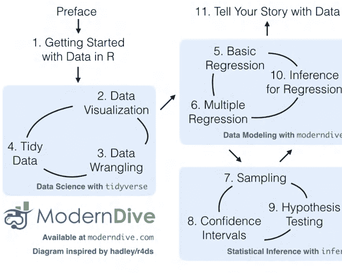

图 1：ModernDive 流程图。

你将在第 1 章开始接触数据，在那里学习 R 和 RStudio 的区别，开始在 R 中编写代码，安装并加载你的第一个 R 包，并探索你的第一个数据集：2023 年新城市机场的原子航班数据。你将涵盖本书的三个部分（第 2 部分和第 4 部分合并为一部分）：

我们第 11 章通过展示案例研究来讨论“用数据讲述故事”的意义。3

## 我们希望你从书中学什么

我们希望在本书结束后，你学会：

1. 使用 R 和 tidyverse 系列 R 包进行数据科学。
2. 使用称为线性回归的方法将模型拟合到数据。
3. 使用采样、置信区间和假设检验进行统计推断。
4. 使用这些工具用数据讲述你的故事。

我们所说的“数据故事”是指任何涉及细致视觉化和深思讨论的数据分析。关于数据故事的进一步讨论可以在博客文章《用数据讲述有意义的故事》中找到。4

在本书中，你将开发自己的“数据科学工具箱”，配备诸如数据可视化、数据格式化、数据清洗以及使用回归进行统计/数据建模等工具。

> 3 注意，你会在书中看到不同版本的“Modernive”：(1) moderndive 指的是 R 包。(2) ModernDev 是 *Statistical Inference via Data Science: A ModernDev into the Tidyverse* 的缩写。它本质上是我们给这本书起起的绰号。(3) ModernDev（不带斜体）则将书籍和相应的 R 包作为一个整体进行指正。
> 4 https://www.thinkwithgoogle.com/marketing-resources/data-measurement/tell-meaningful-stories-with-data/

特别是，本书将严重依赖数据可视化。在当今世界，我们被充斥着试图传达想法的图表。我们希望这比统计学传统教授的方式更直观。

最后，你将学习文学化编程（literate programming）的重要性。这意味着程序必须是为了人类阅读而编写，而顺便是为了机器运行。

我们理解在学习编程的过程中可能会遇到挑战。我们两人仍在挣扎，并发现自己经常使用网络搜索来寻找答案。

## 数据/科学流程

你可能认为统计学仅仅是一堆数字。我们在听体育赛事直播时，经常听到“统计学家”这个词。统计（特别是数据分析）除了描述棒球数据之类的数字外，在所有场景中都起着至关重要的作用。

你会在媒体中经常听到“统计显著”这种说法。你会看到“科学现在证明巧克力对健康有利”的文章。这些主张的基础是数据分析。结束时，你能够更好地理解这些主张是否值得信任，或者我们是否应该警惕。数据分析包含许多我们在书中将讨论的子领域（但不一定按此顺序）：

- 性与回归

我们将首先通过数据可视化进入循环的“理解”部分，然后讨论清洁数据和数据清洗的含义，最后通过“沟通”解释并讨论我们的模型结果。这些步骤对于任何统计分析都是至关重要的。但是，你为什么要关心统计学？

这些子领域在 Garrett Grolemund 和 Hadley Wick 之前在图 2 中总结的“数据/科学流程”⁶中。

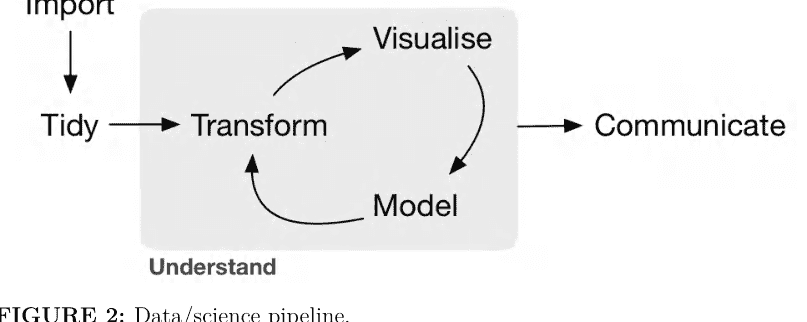

> ⁶ http://r4ds.had.co.nz/explore-intro.html
> 最重要的工具是心态，在开始时，要确保最终产品是可复现的。 – Keith Baggerly

这本书的另一个目标是帮助读者理解可复现分析的重要性。我们希望让读者从一开始就养成让自己的分析具有可复现性的习惯。这意味着我们将在尝试帮助你建立新习惯。这需要练习，而且有时会很困难。你将发现，跟踪你的代码并进行良好的记录是如此重要，这不仅能帮助你自己，也能帮助任何潜在的合作者。

将结果从一个程序复制并粘贴到文字处理器中并不是进行高效有效科学研究的理想方式。时间花在数据收集和数据分析上要重要得多，而不是在各种程序之间来回复制粘贴数据块。

在传统的分析中，如果原始数据出现错误，我们需要重新执行整个过程：重新创建图表，并将所有新图表以及我们的统计分析复制并粘贴到文档中。这种方法很容易出错，而且是非常浪费时间的。行为。我们希望帮助你摆脱这种枯燥的活动，这样我们就能花更多时间来做科学。

> 我们讨论的是计算可复现性。 – 谢伏辉

可复现性在不同的科学领域意味着许多含义。实验的进行方式是否让另一个研究人员能够遵循这些步骤并获得相似的结果？在本书中，我们将关注所谓的“计算可复现性”。这指的是能够将所有的数据分析、数据集和结论传递给其他人，让他们在自己的机器上获得完全相同的结果。这使得人们可以将时间花在解释结果和考虑假设上，而不是采用更容易出错的方法——从零开始或遵循一个在不同机器上可能不同的步骤列表。

到这里，如果你对这本书的导师视角、贡献与合作的方法，或者本书构建和出版的细节细节感兴趣，请继续阅读本章的剩余部分。否则，让我们从第 1 章开始学习 R 和 RStudio 吧！

这里有一些帮助你使用 ModernDive 检查的资源。你可以在这里找到

- 1. 我们在书在线版的附录中包含了以“学习检查”（Learning checks）形式提出的复习题。所有学习检查的答案。附录位于 https://moderndive.com/v2/appendix。
- 2. Jenny Smelter 博士和 Albert Y. Kim 编写了一系列实验和习题。你可以在 https://moderndive.com/labs 找到它们。
- 3. 你可以看到两个使用 ModernDive 的课程网页：
   - Smith 学院“SDS192 数据科学导论”：https://rudoberyt.github.io/SDS192/
   - Smith 学院“SDS220 概率与统计导论”：https://rudeboybert.github.io/SDS220/

这本书的灵感源于：

- Mathematical Statistics with Resampling and R (Chihara and Hesterberg, 2011)
- OpenIntro: Intro Stat with Randomization and Simulation (Diez et al., 2014)
- R for Data Science (Grolemund and Wickham, 2017)

第一本书专为高年级本科和研究生设计，提供了一个优秀的资源，通过重采样来教授统计概念，而不是使用公式、大样本近似和概率。我们使用模拟来教授统计推理。在查看现有的统计学教材时，我们发现没有一本书能将新开发的 tidyverse 包整合进去，特别是 ggplot、dplyr、tidyr 和 readr。此外，我们没有找到一本开源且易于学习的教材来让初学者接触数据科学。我们想写一本通过计算技术掌握 R 语言的书。

本书面向使用 RStudio 的传统统计学课程导师，他们希望在教学大纲中加入更多数据科学主题。RStudio 服务器版本或桌面版本中使用（将在此处进一步讨论）。

以下我们在编写本书时记住的一些原则和信念。如果你同意这些观点，这本书适合你。

- 1. 模糊课堂与实验的界限
  - 随着笔记本电脑和开源非专利统计软件的普及，课堂与实验之间的严格对立可以被。
  - 如果学生每周只使用一次软件，他们很难理解软件的重要性。他们就像学习外语的人忘记语法一样。频繁的强化是关键。
  - 我们认为 Grolemund 和 Wickham 的数据科学（如图 2 所示）应该被教授。
  - 我们听从了 George 的建议，“让学生尽快用数据回答问题”。
  - 我们利用 R 为初学者提供了于加载的丰富数据集，因此可以探索更多的数据集。
  - 我们相信数据可视化是统计学的“门户”。然而，我们经常听到：“你不能在统计课上教 ggplot！”
David Robinson 变得乐观得多，并发现我们的学生在学习方面取得了巨大的成功。

xxviii

前言

如果您想与 ModernDive建立联系，请查看以下链接：

如果您想为 ModernDive 做出贡献，有许多种方法！我们非常感谢您的帮助和反馈，以使这本书尽可能完美！例如，如果您发现任何错误、拼写错误或改进之处，请在 GitHub issues 上提交一个 issue^{14}。如果您熟悉 GitHub 并想做出贡献，请参见“关于此书”部分。

作者感谢 Nina Sonneborn^{15}、Alison Hill 博士^{16}、Kristin Bott^{17}、Jenny Snetzer 博士、Katherine Kinnard 教授^{18} 以及我们 2017^{19} 和 2019^{20} USCO 研讨会参与者的反馈和建议。我们还感谢 Andrew Hess 博士^{21} 贡献了 1.2.3 节“错误、警告和消息”几乎的所有内容，Evgeni Chasovskii^{22} 为 ggplot2 创建了 `geom_parallel_slopes()` 扩展以绘制平行斜率模型，Smith学院统计与数据科学专业的 Stacy Zhol^{23} 和 Marium Tapal^{24} 对本书进行了多次编辑。特别感谢 The Learning Scientists^{25} 的创始人 Jude Weinstein-Jones 博士提供的详尽反馈。非常感谢 Jasmin Lörcher^{26} 对本书某些章节的细致审读、持续支持和周全的编辑！

> $^{13}https://eepurl.com/cBkift
^{15}https://github.com/nisoneborn
^{16}https://alison.rbind.to/
^{17}https://twitter.com/hobottlang=en


^{18}https://www.smith.edu/academics/faculty/katherine-kinnard

^{19}https://www.causeweb.org/cause/ucscots/ucsots17/workshop/4

^{20}https://www.causeweb.org/cause/ucscots/ucsots19/workshop/4

^{21}https://twitter.com/andrewhiss

^{22}https://github.com/echlasovskii

^{23}https://github.com/Starryz

^{24}https://github.com/mariumtapal

^{25}https://www.learningscientists.org

^{26}https://jasminloercher.de/

# 前言

我们荣幸邀请 Kelly S. McConville 博士^{27} 编写了本书的第四版。McConville 博士是统计教育领域的先驱，在我们不断更新书籍以达到当前形式的过程中，她是我们两人的巨大灵感来源。感谢社区成员^{28} 在 GitHub 上的持续贡献，以及许多向他人推荐这本书的人。我们非常感谢大家！

最后，特别感谢任何在太平洋大学（Pacific University）、里德学院（Reed College）、米德尔伯里学院（Middlebury College）、阿姆斯特学院（Amherst College）、史密学院（Smith College）或印第纳大学（Indiana University）与我们上课的学生。没有你们，我们无法完成这本书！

本书由谢益辉（Xie, 2024）使用 RStudio 的 `bookdown`^{29} 包编写。该包通过将所有内容写在 R Markdown^{30} 中简化了书籍的出版。ModernDive 所有版本的 bookdown/R 代码均可在 GitHub 上获取：

> $^{13}https://eepurl.com/cBkift

^{14}https://github.com/moderndive/moderndive_book/issues

^{15}https://github.com/nisoneborn

^{16}https://alison.rbind.to/

^{17}https://twitter.com/hobottlang=en

^{18}https://www.smith.edu/academics/faculty/katherine-kinnard

^{19}https://www.causeweb.org/cause/ucscots/ucsots17/workshop/4

^{20}https://www.causeweb.org/cause/ucscots/ucsots19/workshop/4

^{21}https://twitter.com/andrewhiss

^{22}https://github.com/echlasovskii

^{23}https://github.com/Starryz

^{24}https://github.com/mariumtapal

^{25}https://www.learningscientists.org

^{26}https://jasminloercher.de/

^{27}https://www.umn.edu/mconville

^{28}https://github.com/moderndive/moderndive_book

^{29}https://posit.co/repo/cran/bookdown

^{30}https://rstudio.github/package/rmarkdown

^{31}https://github.com/moderndive/moderndive_book/tree/v2.0

^{32}https://github.com/moderndive/moderndive_book/blob/main/CHANGELOG.md

# 作者简介

| Chester Ismay | Albert Y. Kim | Arturo Valdivia |

| :--- | :--- | :--- |


**Chester Ismay** 是一位自由职业数据科学家、顾问和教育者。他还在波特兰州立大学的高管与专业教育中心任教。他于 2013 年在亚利桑那州立大学获得统计学博士学位。他曾担任过多种角色，包括在斯卡代尔保险公司（现为 Nationwide ERS/Specialty）担任精算师，以及在里彭学院、里德学院和太平洋大学工作。他拥有在线教育工作经验，此前曾担任 DataRobot 的数据科学布道者，在那里他负责为 DataRobot 大学通过线下和虚拟研讨会数据科学、机器学习和数据工程教学。除了为 *ModernDive* 工作外，他还是 `infer`^52 R 包的初始开发者，以及 `theirs`^53 R 包的作者和维护者。

- 网页：https://chester.rbind.io/
- GitHub：https://github.com/ismayc

**Albert Y. Kim** 是马萨诸塞州诺森普史密斯学院的统计与数据科学副教授。他于 2011 年在华盛顿大学获得统计学博士学位。他曾在谷歌公司搜索广告指标团队工作，并在里德学院、米德伯学院和阿默斯特学院工作。除了为 *ModernDive* 工作外，他还是 `resampleddata`^54 和 `SpatialEpi`^55 R 包的合著者。

> ^52https://cran.r-project.org/package/infer
> 53https://github.com/ismayc/theisdown
> 54https://cran.r-project.org/package=resampleddata
> 55https://cran.r-project.org/package=SpatialEpi

Kim 博士和 D. Ismay 以及 Jennifer Chunn^56 是数据新闻网站 FiveThirtyEight.com^58 发布的 `fifty-eight`^57 代码包和数据集的合作者。

- 网页：http://rudeboybert.rbind.io/
- GitHub：https://github.com/rudeboybert

**Arturo Valdivia** 是印第安纳大学布卢明分校统计系高级讲师。他于 2013 年在亚利桑那州立大学获得统计学博士学位。他的研究兴趣是统计教育，探索创新方法帮助学生清晰地理解复杂概念。在职业生涯中，他教授了广泛的统计课程，从入门级到高级课程，涵盖了超过 1,800 名本科生以及超过 900 名追求统计学、数据科学及其他学科的硕士博士研究生。因其卓越的教学表现，他于 2023 年获得了印第安纳大学信托基金教学奖。

- 网页：https://avaldivi6.github.io
- GitHub：https://github.com/avaldivi6

> 56https://github.com/jchunn
> 57https://fiftirtyyeight-r.netlify.app/
> 58https://fiftirtyyeight.com/

# 1 开始在 R 中处理数据

在我们开始在 R 中探索数据之前，首先需要理解一些关键概念：

1. R 和 RStudio 是什么？
2. 我如何在 R 中编写代码？
3. 什么是 R 包？

我们将在接下来的第 1.1–1.3 节介绍这些概念。如果你已经对这些概念比较熟悉，可以随时跳到第 1.4 节，届时我们将介绍第一个数据集：2023 年从纽约市（NYC）三个主要机场起飞的所有国内航班。我们将在本书的大部分内容中深入探索这个数据集。

## 1.1 R 和 RStudio 是什么？

在本书中，我们假设你正在通过 RStudio 使用 R。初次用户往往会混淆两者。简单来说，R 就像汽车的引擎，而 RStudio 就像是汽车的仪表盘，如图 1.1 所示。


图 1.1：R 与 RStudio 区别的类比。

## 2 开始在 R 中处理数据

更准确地说，R 是一种运行计算的编程语言，而 RStudio 是一个集成开发环境（IDE），它通过添加许多方便的功能和工具来提供界面。因此，就像拥有速度表、后视镜和导航系统让驾驶变得简单得多，使用 RStudio 的界面也会让 R 变得简单得多。

### 1.1.1 安装 R 和 RStudio

> 关于 RStudio Server 或 RStudio Cloud 的说明：如果你的导师为你提供了 RStudio Server 或 RStudio Cloud 的链接和访问权限，你可以跳过本节。不过，我们建议在在使用 RStudio Server/Cloud 几个月后，返回查看这些说明，在你自己的电脑上安装该软件。

你首先需要在你的电脑上下载并安装 R 和 RStudio（桌面版）。先安装 R 再安装 RStudio 非常重要。

- **你必须先执行这一步：** 访问 https://cloud.r-project.org/ 下载并安装 R。
- 如果你是 Windows 用户：点击 "Download R for Windows"。
- 对于 macOS 用户：点击 "Download R for macOS"，并选择合适的安装包。
- 如果你是 Linux 用户：点击 "Download R for Linux"，并选择你的发行版。
- **你必须后执行这一步：** 访问 https://posit.co/products/rstudio-desktop/ 下载并安装 RStudio。

### 1.1.2 通过 RStudio 使用 R

回顾我们之前的汽车类比。我们并不直接操作引擎，而是通过仪表盘来操作。当你安装了 R 和 RStudio 后，就可以通过界面进行操作。图 1.2 显示了你可以使用的界面。

| R：打开它 | RStudio：打开它 |
| :--- | :--- |
|  |  |

图 1.2：R 与 RStudio 的图标。


RStudio 界面。注意三个面板：控制台面板、文件面板和环境面板。

## 1.2 如何在 R 中设置

现在你已经有了 R 和 RStudio，你可能在问自己：“好的，我该如何使用 R？”首先需要注意的是，与 Excel、SPSS 或 Minitab 等点击式统计程序不同，R 是一种解释型语言，这意味着你必须通过代码输入的命令。换句话说，我们将交叉使用“编码”和“编程”这两个词。虽然使用 R 不需要成为资深代码程序员，但仍有一些基础编程概念需要理解。

### 1.2.1 基础编程概念和术语

我们介绍一些编程概念和术语。我们并不是要求你现在记住所有的概念和术语，我们会引导你“在做中学会”。为了帮助学习，我们将使用不同的字体来区分普通文本和计算机代码。

- 基础：
- 控制台面板：你输入命令的地方。
- 运行代码：通过控制台输入命令让 R 执行操作。
- 对象：R 中存储值的地方。我们将教你如何为对象赋值以及如何显示对象的内容。
- 数据类型：双精度/数值、逻辑型、字符。整数如 -1, 0, 2, 4092。双精度或数值是一个更大的集合，包含了整数，还包含了分数和小数，如 -24.932 和 0.8。逻辑型为 `TRUE` 或 `FALSE`，而字符则是文本，如 "cabbage"、"Hamilton"、"The Wire 是最棒的剧"以及"这碗拉面很好吃"。注意字符通常用引号括起来。
- 向量：一系列值。它们使用 `c()` 函数创建，其中 `c()` 代表“组合”或“连接”。例如，`c(6, 11, 13, 31, 90, 92)` 创建了一个由正整数组成的序列。

¹https://en.wikipedia.org/wiki/Point_and_click
²https://en.wikipedia.org/wiki/interpreted_language
³https://jamesclear.com/deliberate-practice-theory

- **因子（Factors）**：分类数据在 R 中通常以因子（factors）的形式表示。分类数据也可以用字符串（strings）的形式表示。我们将在学习过程中研究这种差异。
- **数据框（Data frames）**：矩形表格。它们是 R 中数据集的表示方式，其中行对应于观测值，列对应于描述观测值的变量。我们将在后的第 1.4 节中介绍数据框。
- **条件语句（Conditionals）**：
    - 在 R 中进行等性测试：`==`（而不是 `!=`，后者通常用于赋值）。例如，`2 + 1 == 3` 比较 2 + 1 是否等于 3 并返回正确的代码，而 `2 + 1 = 3` 将会返回错误。
    - **布尔代数（Boolean algebra）**：`TRUE/FALSE` 语句和数学运算符，如 `<`（小于）、`<=`（小于等于）、`!=`（不等于）。例如，`4 + 2 >= 5` 返回 `TRUE`，`3 + 5 == 1` 将返回 `FALSE`。
    - **逻辑运算符（Logical operators）**：表示“和”与“或”，以及表示“或”。例如，`(2 + 1 == 3) and (2 + 1 == 4)` 返回 `FALSE`，因为两者不为 `TRUE`（只有第一个是 `TRUE`）。另一方面，`(2 + 1 == 3) | (2 + 1 == 4)` 返回 `TRUE`，因为其中一个子句是 `TRUE`。
- **函数（Functions）**：也称为命令。函数在 R 中执行任务。它们接收参数并返回输出。你可以手动指定函数的参数，也可以使用函数的默认值。
- 例如，R 中的 `seq` 函数可以生成数字序列。如果你直接运行 `seq()`，它将返回值 `1`。这看起来并不好用！这是因为默认参数被设置为 `seq(from = 1, to = 1)`。因此，如果你没有为 `from` 和 `to` 传递不同的值来更改这一点，R 就会认为你想要的只是数字 `1`。你可以通过更新 `=` 后的值来更改参数值。如果我们尝试 `seq(from = 2, to = 5)`，我们得到的结果 `2 3 4 5`，这正是我们预期的。

这个列表绝不是成为精通 R 的用户所需要的全部编程概念和术语的详尽列表；这样的列表会非常庞大，对初学者来说并没有用处。相反，我们认为这是你在开始之前需要知道的编程概念和术语的最小可行列表。我们认为你可以在学习过程中学习其他的。记住，随着你不断练习，对所有这些概念和术语的掌握将会不断建立。

### 1.2.2 错误、警告和消息

让新 R 和 RStudio 用户感到恐畏的之一是它是如何报告错误、警告和消息的。R 用显眼的**红色字体报告错误、警告和消息，这使得它看起来像在责备你。然而，在控制台中看到红色文本并不总是坏事。

# 1 开始使用 R 处理数据

R 会在三种情况下在控制台中显示红色文本：

- **错误（Errors）**：当红色文本是合法的错误时，它的前面会有“Error in...”，并会尝试解释发生了什么。通常，当出现错误时，代码将不会运行。例如，我们将在 1.3.3 节 中看到，如果你看到 `Error in ggplot() : code not find function ggplot`，这意味着 `ggplot()` 函数无法访问，因为包含 `ggplot` 函数的包 `ggplot2` 没有通过 `library(ggplot2)` 加载。因此，在没有加载 `ggplot2` 包的情况下无法使用 `ggplot()` 函数。
- **警告（Warnings）**：当红色文本是警告时，它的前面会有“Warning:”，R 将尝试解释原因。通常当出现警告时，代码仍然可以运行。例如，我们在第 2 章 中看到，如果出现警告，代码仍然可以工作，但需要注意。
- **消息（Messages）**：当红色文本不是以“Error”或“Warning”开头时，它只是一个友好的消息。你会在 1.3.2 节 中看到，当你加载包时，或者当你使用 `read_csv()` 函数读取数据时，或者当你使用 `install.packages()` 安装包时，会看到这些消息。

记住，在控制台中看到红色文本时，不要恐慌。这并不意味着某些地方错了。相反：

- 如果文本以“Error”开头，请弄清楚是什么引起的。将错误视为红灯：出问题了！
- 如果文本以“Warning”开头，请弄清楚是否需要担心。将警告视为黄灯：一切正常，但要注意。
- 否则，文本只是一个消息。向 R 挥挥手并感谢它的对话。将消息视为绿灯：一切正常，继续吧！

### 1.2.3 学习编程提示

学习编程与学习外语言非常相似。起初可能会令人畏惧和沮丧。然而，就像学习外语言一样，只要付出努力并且不怕犯错，任何人都可以学习和提高。在学习时，请记住以下提示：

在第 3 章中用于数据清洗（Wickham et al., 2023）、本本书配套的 `tidyverse` 包（Kim and Ismay, 2024），以及在第 8、9、10 章用于“整洁”且透明的统计推理的 `infer` 包（Bray et al., 2024）。

对 R 包的一个很好的类比是，它们就像你可以下载到手机手机上的 App：


图 1.4：R 与 R 包的类比。

所以 R 就像一部新手机手机：虽然你第一次使用它时它具有某些功能，但它并不包含所有功能。R 包就像你可以从 Apple App Store 或 Android Google Play 下载到手机上的 App。

让我们继续使用这个类比，以编辑和分享照片的 Instagram 应用为例。假设你买了一部新手机，想在 Instagram 上与朋友分享你刚刚拍的一张照片。你需要：

- *安装应用*：由于你的手机是新的，没有包含 Instagram 应用，你需要从 App Store 或 Google Play 下载该应用。你只需要这样做一次，目前就可以就绪了。未来当应用有更新时，你可能需要再次这样做。

- *打开应用*：在安装好 Instagram 后，你需要打开它。

一旦在手机上打开了 Instagram，你就可以继续与你的朋友家人分享照片了。使用 R 包的过程非常相似。你需要：

- *安装包*：这就像在你的手机上安装 App。当你安装 R 和 RStudio 时，大多数包并不会默认安装。如果你想第一次使用某个包，你需要先安装它。一旦你安装了某个包，除非你想将其更新到新版本，否则你可能不会再次安装它。

- *加载包*：“加载”一个包就像在手机上打开一个 App。当你启动电脑上的 RStudio 时，包并不会默认“加载”：

你每次启动 RStudio 时，都需要“加载”你想要使用的每个包。

让我们为数据可视化的 `ggplot2` 包执行这两个步骤。

### 1.3.1 包安装

> 关于 RStudio Server 或 RStudio Cloud 的说明：如果你的导师为你提供了 RStudio Server 或 RStudio Cloud 的链接和访问权限，你可能不需要安装包，因为导师可能已经为你预安装了。尽管如此，了解这个过程仍然是一个好主意，以便以后你不再使用 RStudio Server 或 Cloud，而是使用电脑上的 RStudio Desktop 时。

安装 R 包有两种方法：让我们先按照图 1.5 所示用简单的方法安装 `ggplot2` 包。在 RStudio 的面板中：

- a) 点击“Packages”（包）标签页。

- b) 点击 Update（更新）旁边的“Install”（安装）。

- c) 在“Packages (separate multiple with space or comma):”（包（用空格或逗号分隔多个）：）下方输入包类型。在这种情况下，使用 `ggplot2`。

- d) 点击“Install”（安装）。


图 1.5：用简单方法在 R 中安装包。

另一种稍微方便的安装包的方法是在 RStudio 的控制台面板中输入 `install.packages("ggplot2")` 并按下键盘上的 Return/Enter 键。注意，你必须在包名周围包含引号。

就像手机上的 App 一样，你只需要安装一次包。然而，如果你想将之前安装的包更新到较新版本，你需要重复前面的步骤来重新安装。

(LC1.1) 重复前面的安装步骤，但对象是 `dplyr`、`nycflights23` 和 `knitr` 包。这将安装前面提到的用于数据清洗的 `dplyr` 包、包含 2023 年从纽约（NYC）机场出发的所有国内航班的 `nycflights23` 包，以及用于在 R 中生成易于读表格的 `knitr` 包。我们将在下一节中使用这些包。

### 1.3.2 包加载

回想一下，在安装包之后，你需要“加载它”。换句话说，你需要“打开它”。我们使用 `library()` 命令来实现。

例如，要加载 `ggplot2` 包，请在控制台面板中运行以下代码。我们所说的“运行以下代码”是指什么？将以下代码输入或复制粘贴到控制台面板中并按 Enter 键。

```
library(ggplot2)
```

如果在运行上述代码后出现

`Error in library(ggplot2) : there is no package called ‘ggplot2’`这意味着你没有成功安装它。这是我们在 1.2.2 节中讨论的“错误消息”示例。如果你收到此错误，请返回 1.3.1 节并安装 `ggplot2` 包。

(LC1.2) 重复前面的安装步骤，但对象是 `dplyr`、`nycflights23` 和 `knitr` 包。这将安装前面提到的用于数据清洗的 `dplyr` 包、包含 2023 年从纽约机场出发的所有国内航班的 `nycflights23` 包，以及用于生成易于读表格的 `knitr` 包。我们将在下一节中使用这些包。

### 1.3.3 包的使用

R 用户在使用某些特定包时一个非常常见的错误是忘记先通过 `library()` 命令来“加载”它们。记住：你每次启动 RStudio 时都需要“加载”你想要使用的每个包。如果你没有加载某个包但尝试使用它的某个功能，你会看到类似下面的错误消息：

`Error: could not find function`

这与你看到的错误消息不同。R 正在告诉你你尝试使用一个尚未“加载”的包中的函数。大多数新用户觉得这很麻烦，但过段时间这会变成本能。

```
library(nycflights23)
library(dplyr)
library(knitr)
```

本书后续的所有章节开头，我们都会列出你应该安装的包列表。

- airports：251 个国内目的地的名称、代码和位置。

`nycflights23` 包是经典 `nycflights13` R 包⁴的更新版本。`nycflights23` 由 ModernDive 的合作者 Chester Ismay 编写，他使用了由 Simon Couch 开发的 `anyflights` R 包⁵。Simon 授权了 ModernDive 团队创建 `nycflights23` 并将其包提交至 CRAN。

>⁴https://nycflights23.tidiverse.org/

>⁵https://anyflights.netlify.app/

>⁶https://www.simonpouch.com/

我们将从探索 `flights` 数据框开始，了解它的结构。在你的控制台中运行以下代码，可以手动输入或复制粘贴。它将在你的控制台中显示 `flights` 数据框的内容。请注意，输出可能会根据你显示器的大小略有不同。

`flights`

```
# A tibble: 435,352 x 19
year month day_time sched_dep_time dep_time_time delay arr_time
<int> <int> <int> <int> <dbl> <dbl>
1 2023 1 1 2038 203 328
2 2023 1 1 18 2300 78 228
3 2023 1 1 31 2344 47 500
4 2023 1 1 33 2140 173 238
5 2023 1 1 36 2048 228 223
6 2023 1 1 50 500 3 808
7 2023 1 1 52 510 10 948
8 2023 1 1 54 530 -6 645
9 2023 1 1 57 520 17 926
10 2023 1 1 57 545 2 845
# i 435,342 more rows
# i 12 variables: sched_arr_time <int>, arr_delay <dbl>
# carrier <chr>, flight <int>, tailname <chr>, origin <chr>, dest <chr>
# air_time <dbl>, distance <dbl>, hour <dbl>, minute <dbl>
# time_hour <dttm>
```

让我们来解析这个输出：

- 435,352 x 19：`tibble` 是 R 中一种特定的数据框（data frame）。这个特定的数据框有 435,352 行，对应不同的观测值。在这里，每个观测值都是一次航班。19 列对应描述每个观测值的 19 个变量。

- `year`、`month`、`day_time`、`sched_dep_time`、`dep_time` 和 `arr_time` 是不同的列，换句话说，是该数据集不同的变量。

- 我们接着看到前 10 行，对应前 10 次航班。R 只显示前 10 行，因为如果显示所有 435,352 行，将会淹没你的屏幕。

- ... 还有 435,342 行和 11 个变量：这告诉我们还有 435,352 行数据和 11 个变量无法在当前屏幕中完全显示。

## 1 在 R 中开始处理数据

遗憾的是，这个输出并不能让我们很好地探索数据，但它提供了一个很好的预览。让我们看看探索数据框的一些不同方法。

有很多方法可以让你熟悉 `flights` 这样的数据框包含的内容。我们展示了三个以数据框作为“参数”（输入）的函数，以及一种探索数据框中某一列的方法：

#### View():

在 RStudio 的控制台中运行 `View(flights)`，可以手动输入或粘贴到控制台面板中。在弹出的查看器中探索这个数据框。养成查看你遇到的任何数据框的习惯。注意 `View()` 中的大写字母 `V`。R 是区分大小大小的，如果你运行的是 `view(flights)` 而不是 `View(flights)`，你将收到错误信息。

#### 学习检查

(LC1.3) `flights` 数据集中的任意一行指的是什么？

- A. 航空公司公司的数据

- B. 航班的数据

- C. 机场的数据

- D. 多次航班的数据

通过运行 `View(flights)`，我们可以探索列中列出的不同变量。观察发现有很多不同类型的变量。某些变量如 `distance`、`day` 和 `arr_delay` 是我们所说的定量变量（quantitative variables）。这些变量本质上是数值型的。其他变量是分类变量（categorical）。

如果你查看 `View(flights)` 输出的最左列，你会看到一列数字。这些是数据集的行号。浏览具有相同数字行（例如第 5 行），你可以了解每行代表什么。这允许你通过注意特定行中各列的值来识别该行描述的是什么对象。这通常被称为**观测单位**（observational unit）。在本例中，观测单位是 2023 年从纽约出发的个人。你可以通过确定每个变量测量的是什么“事物”来识别观测单位。我们将介绍更多关于观测单位的内容。

#### 2. glimpse():

我们将涵盖的第二种方法是使用 `dplyr` 包包含的 `glimpse()` 函数来探索数据框。因此，在运行 `library(dplyr)` 加载包后，你可以直接使用 `glimpse()` 函数。该函数为我们提供了探索数据框优于 `view()` 的替代方案：

```
glimpse(flights)
Rows: 435,352
Columns: 19
$ year    <int> 2023, 2023, 2023, 2023, 2023, 2023, 2023, 2023
$ month   <int> 1, 1, 1, 1, 1, 1, 1, 1
$ day      <int> 1, 1, 1, 1, 1, 1, 1, 1
$ dep_time  <int> 2038, 2300, 2344, 2140, 2048, 500, 510, 530
$ origin   <int> 328, 78, 228
$ arr_time  <int> 328, 228, 500, 238, 223, 808, 948, 645, 926, 845
$ sched_arr_time <int>
$ arr_delay <dbl>
$ carrier <chr>
$ flight <int>
$ tailname <chr>
$ origin <chr>
$ dest <chr>
$ air_time <dbl>
$ distance <dbl>
$ hour <dbl>
$ minute <dbl>
$ time_hour <dttm>
```

*(注：此处示例中的 glimpse 输出内容根据原文逻辑进行了对齐处理，保持代码块格式)*

*(注：原文中的 glimpse 示例数据存在错乱，翻译时保留了其结构并进行了微调以确保代码可读性。)*

## 1.4 探索你的第一个数据集

### 1.4.4 标识变量与测量变量

你在数据框（data frames）中遇到的变量之间存在差异。它们分为标识变量（identification variables）和测量变量（measurement variables）。例如，让我们通过显示 `glimpse(airports)` 的输出来探索 `airports` 数据框：

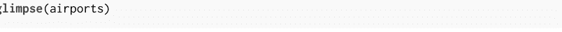

```
Rows: 1,251
Columns: 8
$ faa <chr>"AAF", "AAP", "ABE", "ABI", "ABL", "ABQ", "ABR", "ABY", "AC-
$ name <chr>"Apalachia Regional Airport", "Andreau Airpark", "Leigh -
$ lat <dbl>29.7, 29.7, 40.7, 32.4, 67.1, 35.0, 31.5, 31.6, -
$ lon <dbl>-85.0, -95.6, -75.4, -99.7, -157.9, -106.6, -98.4, -84.2, -
$ alt <dbl>20, 79, 393, 1791, 3355, 1382, 197, 471, 516, 721, -
$ tz <tz>-5, -6, 5, -6, -7, -6, -5, -6, -8, -5, -10, -6, -9-
$ dst <chr>"A", "A", "A", "A", "A", "A", "A", -
$ tzone <chr>"America/New_York", "America/Chicago", "America/New_York", ~
```

变量 `faa` 和 `name` 是标识变量，用于唯一标识每个机场。`faa` 提供了机场唯一的 FAA 代码，而 `name` 提供了官方名称。这些变量用于唯一标识数据框中的每一行。其余变量（`lat`, `lon`, `alt`, `tz`, `tzone`）通常被称为测量变量或特征变量：描述每个观测单元属性的变量。例如，`lat` 和 `long` 描述每个机场的纬度和经度。

此外，有时单个变量可能不足以唯一标识每个观测单元：可能需要变量的组合。这并不是绝对规定，但从组织角度考虑，将标识变量放在数据框的最左侧列被认为是一个良好实践

## 学习检查

(LC1.5) 在 `airports` 数据框中，变量 `lat`、`lon`、`alt`、`dst` 和 `tzone` 描述了每个机场的哪些属性？给出你的猜测。

(LC1.6) 提供一个包含至少三个变量的数据框变量名称，其中一个是标识变量，另外两个不是。

### 1.4.5 帮助文件

R 的另一个很棒的功能是帮助文件，它为各种函数和数据集提供了文档。你可以在函数或数据框名称之前添加一个 `?`，然后在控制台中运行来打开帮助文件。如果存在相应的文档，你将看到一个显示该文档的页面。例如，让我们看看 `flights` 数据框的帮助文件。

```
?flights
```

帮助文件会在 RStudio 的 Help 面格中弹出。如果你对 R 包中包含的函数或数据框有疑问，应该养成立即查阅帮助文件的习惯。

## 学习检查

(LC1.7) 查看 `airports` 数据框的帮助文件。修正你之前对 `lat`、`lon`、`alt`、`dst` 和 `tzone` 变量描述属性的猜测。

## 1.5 结论

我们为你提供了我们认为在 R 中探索数据的一组最小可行性工具。本章包含了你需要的所有知识吗？绝对没有。尝试将所有内容都包含在本章中会导致本章变得巨大而毫无用处！正如我们之前提到的，扩展工具箱的最佳方法是进入 RStudio 并尽可能地运行和编写代码。

### 1.5.1 额外资源

所有学习检查的答案都可以在书籍在线版的附录中找到。https://moderndive.com/v2/appendixa。附录从此处开始

如果你是编程、R 和 RStudio 世界的新手，并且觉得从更详细的介绍中获益，我们建议查看短书《Getting Used to R, RStudio, and R Markdown》¹⁰（Ismay and Kennedy, 2016）。它包含了视频录制，你可以在学习时跟进并暂停。

> ¹⁰https://rbasics.netlify.app/

这本书还包含了对 R Markdown 的介绍，这是一种用于 R 中可重复性研究的工具。


图 1.6：Getting Used to R, RStudio, and R Markdown。

### 1.5.2 未来展望

我们现在将在第 2 章开始本本书的“使用 tidyverse 进行数据科学”部分，如图 1.7 所示，将从我们认为科学家工具箱中最最重要的工具：数据可视化开始。我们将继续使用 `ggplot2` 包探索 `moderndive` 和 `nycflights23` 包中包含的数据。


图 1.7：ModernDive


第一部分

## 使用 tidyverse 进行数据科学


第二部分

## 2 可视化


我们从科学家工具箱中最重要的工具：数据可视化开始数据的可视化开发。我们将使用 `ggplot2` 包继续探索 `moderndive` 和 `nycflights23` 包中的数据。数据可视化是加入工具箱的强有力工具，它植根于图形语法理论（Wilkinson, 2005）。一方面，我们希望通过可视化展示尽可能多的发现；另一方面，我们不希望包含的信息过多到让观众淹没。

## 所需包

加载本章所需的全部包（假设你已经安装了它们）。

```r
library(nyc23)
library(ggplot2)
library(moderndive)
```

²https://www.tableau.com/

## 2.1 图形语法

### 2.1.2 Gapminder 数据

2006年2月，一位名叫 Hans Rosling 的瑞典医生和数据倡导者在 TED 上进行了题为“你过的最好的统计数据”的演讲，展示了来自 gapminder.org 的全球经济、健康和发展数据。例如，针对2007年142个国家的数据，让我们只考虑表2.1中的几个国家作为对数据的窥探。

**表 2.1：Gapminder 2007 数据：142个国家中的前三个**

| 国家 | 大洲 | 预期寿命 | 人口 | 人均 GDP |
|---|---|---|---|---|
| 阿富汗 | 亚洲 | 43.8 | 31889923 | 975 |
| 阿尔尼亚 | 欧洲 | 76.4 | 3600523 | 5937 |
| 阿及利亚 | 非洲 | 72.3 | 3333216 | 6223 |

此表中的每一行对应2007年的一个国家。对于每一行，我们有5列：

1. `国家`：国家名称。
2. `大洲`：国家所属的五个大洲之一。注意“美洲”包含了北美和南美的国家，并排除了南极。
3. `预期寿命`：以寿命计算。
4. `人口`：居住的人数。
5. `人均 GDP`：国内总值（以美元计）。

现在考虑图2.1，它绘制了数据中所有142个国家的数据。

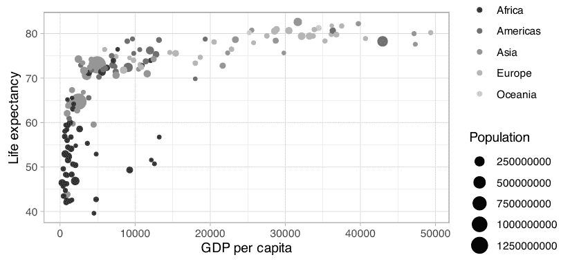

图 2.1：2007年预期寿命与人均GDP的关系。

> ³https://www.gapminder.org/tools/#_locale_id=en&chart-type=bubbles

## 2 数据可视化

让我们通过图形语法法（grammar of graphics）来观察这张图：

- 1. 数据变量 `人均 GDP` 被映射到点的 x 轴位置属性（aesthetic）。
- 2. 数据变量 `预期寿命` 被映射到点的 y 轴位置属性（aesthetic）。
- 3. 数据变量 `人口` 被映射到点的尺寸属性。
- 4. 数据变量 `洲份` 被映射到点的颜色属性。

我们很快会发现，数据对应于保存数据的特定数据框（data frame），而“数据变量”对应于数据中的特定列。此外，在此图中考虑的几何对象类型是点。尽管如此，虽然在这个例子中我们考虑的是点，但图形不仅限于点。我们还可以使用线条、条状图和其他几何对象。

让我们为表 2.2 总结图形语法的三个核心组成部分。

### 表 2.2：此图图形语法的总结

| 数据变量 | aes | geom |
|---|---|---|
| 人均 GDP | x | point |
| 预期寿命 | y | point |
| 人口 | size | point |
| 洲份 | color | point |

### 2.1.3 其他组件

我们还可以控制图形语法的其他组件。随着你开始深入研究图形语法，你会更频繁地遇到这些主题。在本书中，我们将保持简单，只处理这些额外组件：

- 分面（faceting）通过另一个变量的值将图表拆分为若干部分（第 2.6 节）
- 条形图的位置调整（第 2.8 节）

其他更复杂的组件，如尺寸和坐标系留给了更高级的教材，例如 *R for Data Science*（Grolemund and Wickham, 2017）。通常来说，图形语法允许高度定制化，并提供了一个易于更新和修改的统一框架。

## 2.2 五种命名图表

### 2.1.4 ggplot2 包

在书中，我们将使用 `ggplot2` 包进行数据可视化，它是 R 语言图形语法的实现（Wickham et al., 2014）。正如我们之前提到的，上一节的大部分是用计算机代码编写的。这是因为图形语法的各种组件都是在 `ggplot2` 包中的 `ggplot()` 函数中指定的。为了本书之目的，我们将始终为 `ggplot()` 函数提供以下参数（即输入）：

- 存在变量的数据框：`data` 参数。
- 变量到属性的映射：`mapping` 参数，它用于指定 `aes` 属性。

在指定了这些组件后，我们使用 `+` 号向图表添加层（layers）。向图表添加的最核心的层是指定我们想要绘制何种类型几何对象的层：点、线、条形等。我们可以为图表添加的其他层还包括图标题、坐标轴、图表标签和分面（我们在第 2.6 节中看到）。现在让我们把图形语法理论付诸实践。为了保持本书内容的简单，我们将专注于五种不同类型的图表，每种图都有一个常用的名称。我们将这些称为“五种命名图表”，或简称为 `5NG`：

- 1. 散点图 (scatterplots)
- 2. 折线图 (line graphs)
- 3. 直方图 (histograms)
- 4. 箱线图 (boxplots)
- 5. 条形图 (barplots)

### 2.3.1 散点图

`5NG` 中简单的是散点图，也称为双变量图（bivariate plots）。它们允许你可视化两个数值变量之间的关系。虽然你可能已经熟悉散点图，但让我们通过第 2.1 节介绍的图形语法视角来观察它们。具体来说，我们将可视化 `envoy_flights` 数据框中关于 2023 年从纽约出发的 Envoy 航班的两个数值变量之间的关系。

- 1. `dep_delay`：水平 "x" 轴上的离飞延迟
- 2. `arr_delay`：垂直 "y" 轴上的到达延迟

```r
ggplot(data = envoy_flights, mapping = aes(x = dep_delay, y = arr_delay)) + 
  geom_point()
```

在 `ggplot()` 函数中，我们指定图形语法的两个组件作为参数（即输入）：

- 将 `envoy_flights` 数据框作为数据指定，即 `data = envoy_flights`。
- 通过设置 `mapping = aes(x = dep_delay, y = arr_delay)` 进行属性映射。具体来说，变量 `dep_delay` 映射到 x 位置属性，而变量 `arr_delay` 映射到 y 位置。

然后我们使用 `+` 号向 `ggplot()` 函数添加一个层。这指定了语法的第三个组件：几何对象。在这种情况下，通过指定 `geom_point()` 将几何对象设置为点。在控制台中运行这两行代码后，你会注意到两个输出：一条警告消息和图 2.2 所示的图。

警告：删除了 3 行包含缺失值或超出比例范围的行 (`geom_point()`)


图 2.2：2023 年从纽约出发的 Envoy Air 航班到达延迟与离飞延迟对比。

让我们解析图 2.2 中的图形。观察发现 `dep_delay` 和 `arr_delay` 之间存在正相关：随着离飞延迟的增加，到达延迟往往随之增加。还要观察聚集在 (0, 0) 附近的大量点，该点表示既未离飞也到达的航班。

让我们把注意力转向警告消息。R 正在提醒我们，有三行因为缺失而被忽略了。对于这三行，`dep_delay` 或 `arr_delay` 或两者均缺失（在 R 中记录为 NA），因此这些行在我们的图表中被忽略了。

在继续之前，让我们对这段创建散点图的代码再做几点观察。注意 `+` 号位于行末，而不是行首。如果你把把它放在行首，在 R 中会报错。在向图表添加层时，建议在 `+` 之后新起的一行（通过按键盘上的 Return/Enter 键），这样每一层的代码都位于新的一行中。随着我们向图表中添加越来越多的层，你会发现这极极大提高代码的可读性。

为了强调添加指定几何对象的层的重要性，请考虑图 2.3，图中没有添加任何层。由于没有指定几何对象，我们得到了一个没用的空白图表！

```r
ggplot(data = envoy_flights, mapping = aes(x = dep_delay, y = arr_delay))
```


图 2.3：一个没有任何层的图。

# 学习检查

(LC2.2) `dep_delay` 和 `arr_delay` 具有正关系的实际原因有哪些？

(LC2.3) 你认为天气数据框中的哪些变量会与 `dep_delay` 存在负相关（即负相关关系）？为什么？记住我们在这里关注的是数值变量。提示：使用 `view()` 函数探索天气数据集。

(LC2.4) 你为什么认为 (0, 0) 附近有一簇点？(0, 0) 在 Envoy Air 航班中对应于什么？

(LC2.5) 图中还有其他特征让你印象深刻？

(LC2.6) 修改示例，使用 `envoy_flights` 数据框中的不同变量创建一个新的散点图。

### 2.3.1 散点图

### 2.3.2 点重叠 (Overplotting)

图 2.2 中 (0, 0) 附近密集的点会导致一些困惑，因为很难看出绘制出的点的真实数量。这就是点重叠现象的结果。正如大家可能猜到的那样，这对应于点反复地相互绘制在一起。当发生点重叠时，很难知道点的数量。解决点重叠问题的方法有两种，通过：

- 1. 调整点的透明度，或
- 2. 给每个点添加少量的随机“抖动”（jitter）或随机“微调”。

### 方法 1：更改透明度

解决点重叠的第一种方法是通过设置 `geom_point()` 函数中的 `alpha` 参数来改变点的透明度/不透明度。我们可以将 `alpha` 参数设置为 0 到 1 之间的任何值，其中 `alpha` 设置为 1 表示点 100% 透明，而默认 `alpha` 为 1。换句话说，如果我们不显式地设置 `alpha` 值，R 将使用 `alpha = 1`。

注意看以下代码与第 2.3 节中创建点重叠散点图的代码相同，仅在 `geom_point()` 函数中加入了 `alpha = 0.2`：

```r
ggplot(data = envoy_flights, mapping = aes(x = dep_delay, y = arr_delay)) + 
geom_point(alpha = 0.2)
```

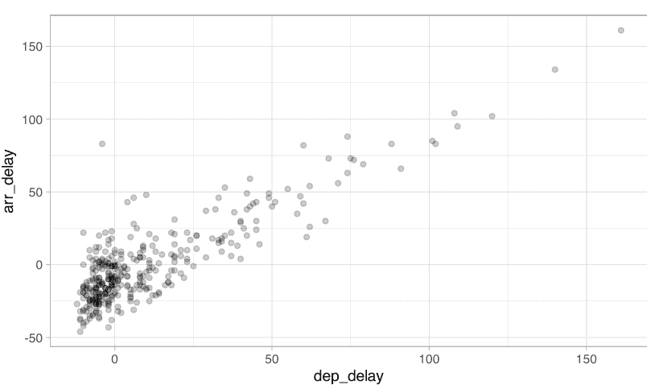

图 2.4：`alpha = 0.2` 的到达与离飞延迟散点图。

## 2 数据可视化

图 2.4 中需要注意的关键特征是点的透明度是累积的：重叠程度高的区域颜色越深，而重叠程度低的区域颜色越浅。此外，注意 `alpha = 0.2` 周围没有 `aes`。这是因为我们并不是在将变量映射到美学属性，而是改变了 `alpha` 的默认设置。事实上，如果你尝试将第二行改为 `geom_point(aes(alpha = 0.2))`，将会收到一个错误。

### 方法 2：点抖动 (Jittering)

解决点重叠的第二种方法是对所有点进行抖动。这意味着在随机方向上给每个点一个微小的“推调”。你可以将“抖动”理解为在图中稍微抖动点。让我们先用一个简单的例子来说明。我们有一个包含 4 行相同 x 和 y 值的数据框：(0,0), (0,0), (0,0), 和 (0,0)。在图 2.5 中，我们同时展示了这 4 个点的常规散点图（左侧）及其对应的抖动散点图（右侧）。

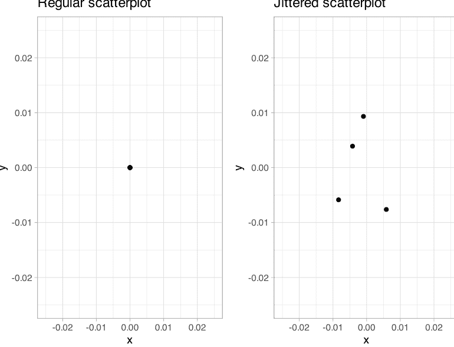

图 2.5：常规和抖动散点图。

在左侧的常规散点图中，观察到 4 个点重叠在一起。虽然我们知道有 4 个值被绘制，但这一事实对其他人可能并不显而易见。在右侧的抖动散点图中，现在明显看出该图涉及四个点，因为每个点都被赋予了随机的“微调”。

然而，请记住，抖动严格是一种可视化工具；即使创建了抖动散点图，数据框中保存的原始值保持不变。

要创建抖动散点图，我们不使用 `geom_point()`，而是使用 `geom_jitter()`。观察以下代码与 2.3.1 节中创建带点重叠抖动散点图的代码非常相似，但将 `geom_point()` 替换为了 `geom_jitter()`。

```r
ggplot(data = envoy_flights, mapping = aes(x = dep_delay, y = arr_delay)) + 
geom_jitter(width = 30, height = 30)
```

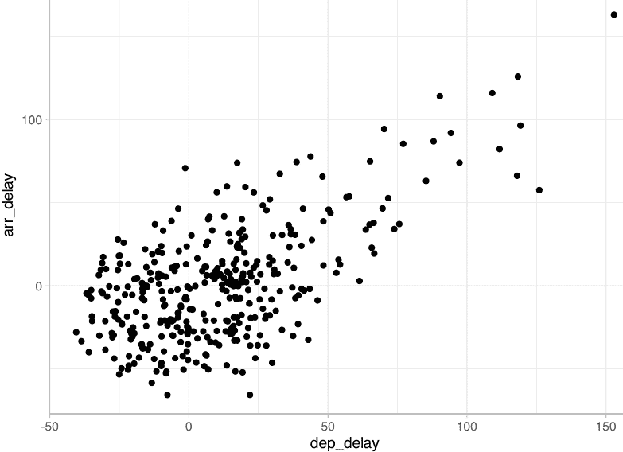

**图 2.6：** 到离延迟抖动散点图。

为了指定添加多少抖动，我们调整了 `geom_jitter()` 的 `width` 和 `height` 参数。这对应于你希望在水平 x 轴单位和垂直 y 轴单位上抖动图片的程度。在这种情况下，两个轴的都是分钟。我们应该使用 `width` 和 `height` 参数添加多少抖动呢？一方面，添加足够的抖动来打破点的任何重叠很重要，但另一方面，抖动不能过大，以至于完全改变点的原始模式。

从生成的图 2.6 所示，在这种情况下，抖动并没有真的提供很多新见解。在这种特定情况下，可以认为通过设置 `alpha` 的点透明度被证明更有效。什么时候使用抖动散点图更好？这没有适用于所有情况的单一正确答案。你需要做出主观的选择并对该选择负责。但至少在面对点重叠时，我们建议你同时制作两种类型的图，并看哪一种能更好地强调你想传达的观点。

# 学习检查

- (LC2.7) 为什么在散点图中设置 `alpha` 参数值很有用？它向你提供了哪些常规散点图无法提供的进一步信息？
- (LC2.8) 观察图 2.4 后，给出一个发生最频繁的到达延迟和出发时间的近似速率。与你在图 2.2 中观察未带 `alpha = 0.2` 的样本图相比，该区域发生了什么变化？

### 2.3.3 总结

散点图显示了两个数值变量之间的关系。它们是最常用的图表之一，因为它们可以提供一种直接观察一个数值变量相对于另一个变量趋势的方法。然而，如果你尝试创建一个一个变量不是数值的散点图，你可能会得到奇怪的结果。小心！

对于中等和大型数据集，你可能需要尝试我们看到的散点图的各种修改，例如改变点的透明度/不透明度或通过对点进行抖动。这种调整通常是数据可视化中很有趣的部分，因为当你调整图表时，你会看到不同的关系显现出来。

## 2.4 折线图

五种图中的下是折线图。折线图显示两个数值变量之间的关系，当 x 轴上的变量（也称为解释变量）具有顺序性时。也就是说，该变量具有内在的顺序。

折线图常见的例子是 x 轴上具有时间、天等概念。由于时间是有顺序的，我们用线连接 y 轴的连续观测值。折线图也是时间序列图。让我们使用 `nycflights` 包中的另一个数据集：`weather` 数据框来插图折线图。

通过运行 `view(weather)` 和 `glimpse(weather)` 探索 `weather` 数据框。此外，我们通过运行 `weather` 读取相关的帮助文件。

观察发现 `wind_speed` 变量，它是纽约三个主要机场附近的每小时风速：纽瓦克 (EWR)、肯尼迪国际机场 (JFK) 和拉瓜迪亚机场 (LGA)。

然而，我们没有考虑 2023 年所有天的小时风速，为了简单起见，我们考虑 1 月前 15 天的小时风速。数据可以通过 `modernive` 包中的 `early_january_2023_weather` 数据框访问。也就是说，`early_january_2023_weather` 包含了起点等于 EWR、月份等于 1 且小于 15 的小时天气观测。

# 学习检查

- (LC2.9) 通过运行 `View(weather)` 同时查看 `nycflights` 包中的 `weather` 数据框和 `modernive` 包中的 `early_january_2023_weather` 数据框。这些数据框在哪个方面有所不同？
- (LC2.10) 再次 `View()` `flights` 数据框。为什么 `time_hour` 变量可以唯一标识测量小时，而 `hour` 变量不能？

### 2.4.1 通过 geom_line() 创建折线图

让我们使用 `geom_line()` 为 `early_january_2023_weather` 数据框中保存的小时风速创建一个时间序列图，而不是像我们之前创建散点图时使用的 `geom_point()`：

```r
ggplot(data = early_january_2023_weather,
      mapping = aes(x = time_hour, y = wind_speed)) +
  geom_line()
```

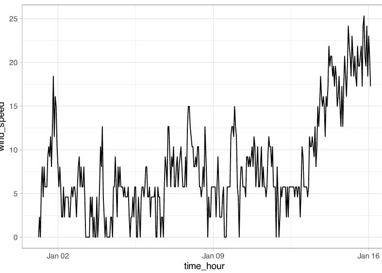

图 2.7：2023 年 1 月 1 日至 15 日纽瓦克的每小时风速。

与创建图 2.2 中 Envoy Air 航班出发和到达延迟散点图的 `ggplot()` 代码类似，让我们从图形语法的角度逐一拆解这段代码：

在 `ggplot()` 函数调用中，我们通过参数指定了图形语法中的两个组件：

- 通过设置 `data = early_january_2023_weather` 将数据指定为 `early_january_2023_weather` 数据框。
- 通过设置 `mapping = aes(x = time_hour, y = temp)` 指定审美映射。具体而言，变量 `time_hour` 映射到 x 轴位置审美，而变量 `wind_speed` 映射到 y 轴位置审美。


我们使用 `+` 号向 `ggplot()` 函数调用添加了一个图层。该图层指定了语法的第三个组件：即涉及的几何对象。在这种情况下，几何对象是通过指定 `geom_line()` 设置的线条。

## 学习检查

(LC2.11) 当横轴没有明显的顺序时，为什么应该避免使用折线图？

## 2.5 直方图

(LC2.12) 为什么当时间是 x 轴上的解释变量时，经常使用折线？

(LC2.13) 绘制纽瓦克机场 2023 年 1 月前 15 天除 `wind_speed` 以外变量的时间序列图。尝试选择一个没有太多缺失（NA）值的变量。

### 2.4.2 总结

折线图和散点图一样显示两个数值变量之间的关系。然而，当 x 轴（即解释变量）具有内在顺序（例如某种时间概念）时，使用折线图优于散点图。

## 2.5 直方图

让我们再次考虑天气数据框中的风速。与 2.4 节中的折线图不同，假设我们不在乎它与时间的关系，而是只关心 `wind_speed` 值的分布情况：

- 最小值和最大值是多少？
- “中心”或“最典型”的值是多少？
- 数值是如何分布的？
- 频繁和不频繁出现的值有哪些？

可视化这种单一变量 `wind_speed` 分布的一种方法是如图 2.8 所示，将它们绘制在水平线上：

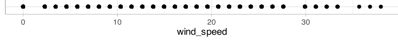

图 2.8：2023 年纽约市每小时风速记录图。

这让我们对 `wind_speed` 值的分布情况有了大致了解：观察到风速从约 0 英里/小时（0 公里/小时）到 38 英里/小时（约 61 公里/小时）。0 到 20 英里/小时（mph）之间的记录风速似乎比该范围之外的多。然而，由于点过度重叠程度非常高，很难准确看出例如 10 mph 到 15 mph 之间到底有多少个值。

通常用来代替图 2.8 的图形被称为直方图。直方图是一种视觉化数值值分布的图表，其方式如下：

- 我们首先将 x 轴切分成一系列箱（bins），每个箱代表一个值范围。
- 对于每个箱，我们统计落在该箱对应范围的观测值数量。
- 对于每个箱，我们画一个条形，其高度标记了相应的计数。

让我们深入分析图 2.9 所示的直方图示例。

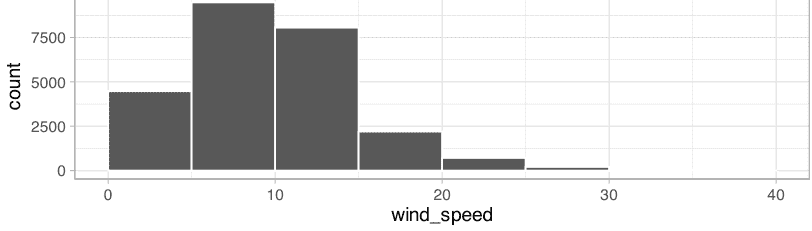

图 2.9：直方图示例。

我们现在只关注 10 mph 到 25 mph 之间的风速。观察发现 10 mph 到 25 mph 之间有三个等宽箱。因此，我们有三个宽度为 5 mph 的箱：一个箱对应 10-15 mph 范围，另一个箱对应 15-20 mph 范围，还有一个箱对应 20-25 mph 范围。由于：

- 10-15 mph 范围的箱高度约为 8000。也就是说，大约 8000 条每小时风速记录在 10 mph 到 15 mph 之间。
- 15-20 mph 范围的箱高度约为 2400。也就是说，大约 2400 条每小时风速记录在 15 mph 到 20 mph 之间。
- 20-25 mph 范围的箱高度约为 700。也就是说，大约 700 条每小时风速记录在 20 mph 到 25 mph 之间。

x 轴上跨越 0 mph 到 40 mph 的所有八个箱都有这种解释。

### 2.5.1 通过 geom_histogram 创建直方图

现在让我们展示绘制你的第一个直方图的 `ggplot()` 代码！与散点图不同，我们现在使用 `geom_histogram()` 来绘制。直方图是视觉化数值分布的图，方式如下：

- 我们首先将 x 轴切分成一系列箱，每个箱代表一个值范围。
- 对于每个箱，我们统计落在该箱对应范围的观测值数量。
- 对于每个箱，我们画一个条形，其高度标记了相应的计数。

让我们查看图 2.10 所示的直方图代码：

```r
ggplot(data = weather, mapping = aes(x = wind_speed)) +
  geom_histogram()
```

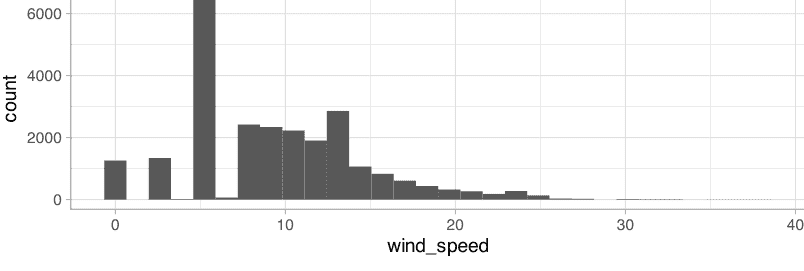

图 2.10：风速直方图。

# 学习检查

(LC2.14) 将分箱（bins）的数量从 30 更改为 20 告诉我们关于风速分布的什么信息？

(LC2.15) 你会将风速的分布分类为对称的，还是向某个方向倾斜的？

(LC2.16) 你认为这个分布的“中心”值是多少？你为什么做出这个选择？

(LC2.17) 这些数据距离中心点的分散程度很大，还是很近？为什么？

### 2.5.3 总结

直方图与散点图和折线图不同，它们仅展示单个数值变量的信息。具体来说，它们是所研究数值变量分布的可视化。

## 2.6 分面 (Facets)

在继续学习 5NG 的后续内容之前，让我们简要介绍一个名为“分面（faceting）”的新概念。当我们想要根据另一个变量的值来拆分特定的可视化图形时，就会使用分面技术。这将创建多个相同类型图表的副本，它们具有相同的 x 轴和 y 轴，但内容会有不同。

例如，假设我们感兴趣的是图 2.9 中看到的三个纽约机场的风速记录直方图在每个月有何不同。我们可以根据一年中的 12 个月份来“拆分”这个直方图。换句话说，我们将为每个月份绘制 `wind_speed` 的直方图。我们通过添加 `facet_wrap(~ month)` 层来实现。注意 `~` 是一个波浪号——美国键盘上的“1”键。这个波浪号是必须的，如果你在这里不包含，将会收到 `Error in as.quoted(facets) : object ‘month’ not found` 错误。

```r
ggplot(data = weather, mapping = aes(x = wind_speed)) +
  geom_histogram(binwidth = 5, color = "white") +
  facet_wrap(~ month)
```

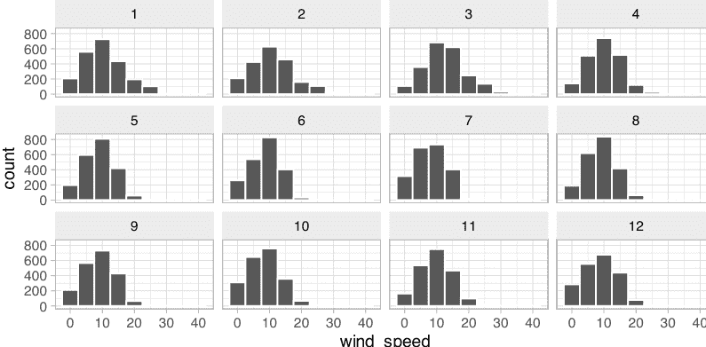

图 2.13：按月份分面的每小时风速直方图。

我们还可以通过在 `facet_wrap()` 内部使用 `nrow` 和 `ncol` 参数来指定网格的行和列数。例如，我们希望分面直方图有 4 行而不是 3 行。我们只需在 `facet_wrap(~ month)` 中添加 `nrow = 4` 参数。

```r
ggplot(data = weather, mapping = aes(x = wind_speed)) +
  geom_histogram(binwidth = 5, color = "white") +
  facet_wrap(~ month, nrow = 4)
```

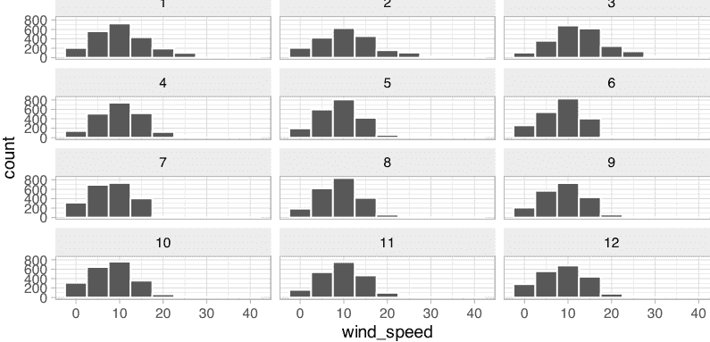

图 2.14：具有 4 行而非 3 行的分面直方图。

# 2.2 数据可视化

观察图 2.13 和图 2.14 可以发现，所有月份大部分的风速观测值都集中在 0 到 20 mph 之间，极少数观测值超过 30 mph。直方图在不同月份显示出相似的形状，大多数分布具有相似的计数，并有几个较大的速度离群值，这表明低风速比高风速常见。

# 学习检查

(LC2.18) 你对这个分面图还注意其他什么？分面图如何帮助我们观察两个变量之间的关系？

(LC2.19) 图中的数字 1-12 对应什么？10、20 和 30 又对应什么？

(LC2.20) 对于什么类型的数据集，分面图在比较变量之间的关系时效果不好？请给出一个例子并描述这些变量的性质和其他重要特征。

(LC2.21) 天气数据集中的 `wind_speed` 变量具有很大的变异吗？你为什么这么说？

# 2.7 5NG#4: 箱线图 (Boxplots)

虽然分面直方图是根据另一个变量的值拆分数值变量分布的一种可视化类型，但另一种实现相同目标的可视化类型是*并列箱线图*。箱线图根据数值变量的*五数总结*提供的信息构建而成。为了现在保持简单，让我们只考虑 4 月份记录的 2057 条风速记录，每个记录都表示为一个抖动点（图 2.15）。

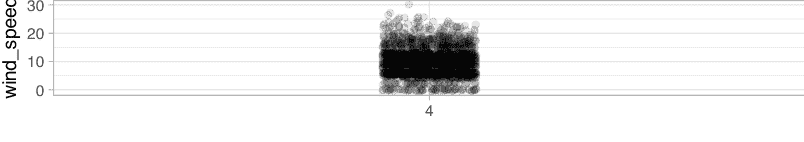

图 2.15：表示为抖动点的 4 月风速。

这 2057 个观测值具有以下*五数总结*：

- 1. 最小值：0 mph
- 2. 第一分位数（第 25 百位数）：5.8 mph
- 3. 中位数（第二四分位数，第 50 百位数）：9.2 mph
- 4. 第三分位数（第 75 百位数）：12.7 mph
- 5. 最大值：29.92 mph

在图 2.16 的左侧图中，让我们在 2057 个点上方用虚线水平线标记这 5 个值。在图 2.16 的中间图中，我们添加箱线图。在图 2.16 的右侧图中，为了清晰起见，我们移除点和虚线。

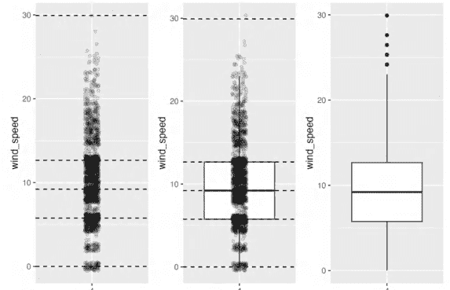

**图 2.16：构建箱线图。**

箱线图根据数值变量的*五数总结*提供的信息构建而成。

我们将每个月份绘制 `wind_speed` 的直方图。我们通过添加 `facet_wrap(~ month)` 层来实现。注意 `~` 是一个波浪号——美国键盘上的“1”键。这个波浪号是必须的，如果你在这里不包含，将会收到 `Error in as.quoted(facets) : object ‘month’ not found` 错误。

```r
ggplot(data = weather, mapping = aes(x = wind_speed)) +
  geom_histogram(binwidth = 5, color = "white") +
  facet_wrap(~ month)
```

分面直方图是根据另一个变量的值拆分数值变量分布的一种可视化类型，但另一种实现相同目标的可视化类型是*并列箱线图*。

### 通过 geom_boxplot 创建箱线图

```r
ggplot(data = weather, mapping = aes(x = month, y = wind_speed)) +
  geom_boxplot()
```

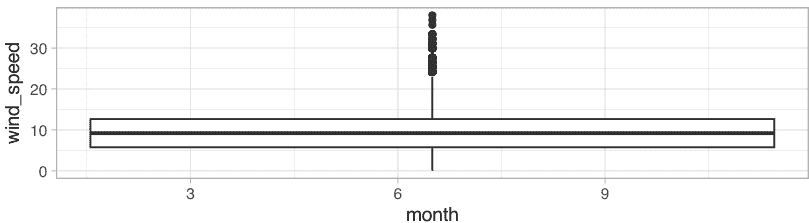

图 2.17：无效的箱线图。

警告消息：

1: Continuous x aesthetic -- 你是否忘记了 aes(group)?

观察图 2.17 可以发现，该图没有按月份提供风速信息。第一个警告消息告诉了我们原因。它说 x 轴上有一个连续的或数值变量。然而，箱线图要求 x 轴上是一个分类变量。

我们可以使用 `factor()` 函数将数值变量 `month` 转换为因子分类变量。应用 `factor(month)` 后，`month` 不仅仅具有数值 1, 2, ..., 12，还具有关联的排序。有了这种排序，`ggplot()` 就能知道如何工作来生成图表了。

```r
ggplot(data = weather, mapping = aes(x = factor(month), y = wind_speed)) + 
  geom_boxplot()
```

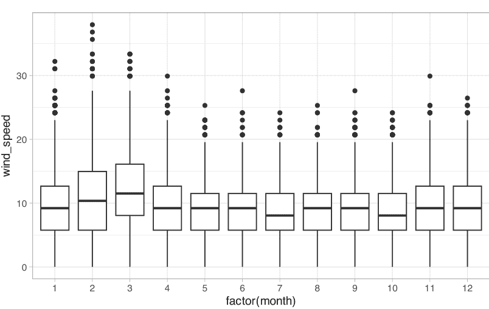

图 2.18：按月份划分的并列箱线图。

结果图 2.18 显示了 12 个独立的“箱和须”图，类似于图 2.16 中仅针对 4 月风速的右侧图。因此，不同的箱线图被“并列”展示出来。

- 图表的“箱”部分代表第一分位数、中位数（第二四分位数）和第三分位数。
- 图表的“须”部分从箱的底部和顶部延伸出来，代表小于第 25 百位数和大于第 75 百位数的值。

分别是相应的百分位数。它们被设定为距离箱体两端延伸不超过 1.5 × IQR 单位。我们之所以说“不超过”，是因为胡须（whiskers）的末端对应于实际观测到的风速。这些胡须的长度显示了中间 50% 数值之外的数据变化情况，胡须越长，表示变异性越大。

- 代表胡须之外数值的点被称为离群值（outliers）。这些可以被视为异常（“非寻常”）值。


记住，离群值的定义具有某种主观性，并不是绝对的。在这种情况下，它们是由胡须的长度定义的，对于每个箱线图，胡须的长度不超过 1.5 × `IQR` 单位。观察这张并列图，我们可以看到2 月和 3 月的中位数风速更高，箱体中间较高的实线证明了这一点。我们可以通过想象横跨图表的水平线，轻松地比较不同月份之间的风速。此外，通过四分位距量化的 12 个箱体的高度也很有信息价值；它们告诉我们给定月份内记录的风速的变异性或离散程度。

## 学习检查

(LC2.22) 图中1月份顶部的点对应于什么？请解释1月份可能发生了什么导致产生了这些点。

(LC2.23) 哪些月份的风速变异性似乎最高？你能给出什么原因？

(LC2.24) 我们查看了数值变量 `wind_speed` 的分布，并按数值变量 `month` 进行分组（我们使用 `factor()` 函数对其进行了转换）以制作并列箱线图。为什么如果按数值变量 `pressure` 分组并同样使用 `factor()` 转换为分类变量来绘制 `wind_speed` 箱线图将没有信息价值呢？

(LC2.25) 箱线图提供识别离群值的简单方法。为什么在看箱线图比看分面直方图更容易识别离群值呢？

### 2.7.2 总结

并列箱线图为我们提供了一种比较数值变量在另一个变量多个值上的分布的方法。通过比较箱体中间的实线，可以看到中位数在不同组中的分布。

## 2.8 柱状图

要研究一个箱体内部数值变量的离散程度，请同时观察箱体的长度以及胡须从箱体两端延伸的距离。在看箱线图时，离群值比看直方图更容易被识别，因为它们被标记为明显的点。

直方图和箱线图都是数值变量分布的可视化工具。另一个常见任务是可视化分类变量的分布。这是一个更简单的任务，因为我们只是在统计分类变量内的不同类别，这也称为分类变量的水平（levels）。可视化这些不同计数（也称为频率）的最佳方法是使用柱状图（也称为条形图 barcharts）。

然而，一个复杂之处在于你的数据的表示方式。感兴趣的分类变量是“预先计数”过的吗？例如，运行以下代码，它创建了两个代表水果集合的数据框：3 个苹果和 2 个橙子。

```r
fruits <- tibble(fruit = c("apple", "apple", "orange", "apple", "orange"))
fruits_counted <- tibble(
  fruit = c("apple", "orange"),
  number = c(3, 2))
```

我们看到 `fruits` 和 `fruits_counted` 数据框代表相同的水果集合。其中 `fruits` 逐个列出水果……

```r
# A tibble: 5 x 1
  fruit
<chr>
1 apple
2 apple
3 orange
4 apple
5 orange
```

……`fruits_counted` 则具有一个计数变量，代表每个水果的“预先计数”值。

```text
# A tibble: 2 x 2
  fruit  number
<chr> <dbl>
1 apple      3
2 orange     2
```

取决于你的分类数据的表示方式，你需要在 `ggplot()` 中添加不同的几何层来创建柱状图，正如我们现在正在探索的那样。

### 2.8.1 通过 geom_bar 或 geom_col 创建柱状图

让我们使用这两种表示同一篮水果的不同方式（3 个苹果和 2 个橙子）来生成柱状图。使用所有水果都逐行单独列出的 `fruits` 数据框，我们将 `fruit` 变量映射到 x 轴并添加添加 `geom_bar()` 层。

```r
ggplot(data = fruits, aes(x = fruit)) + geom_bar()
```


图：计数未预先计数的柱状图。

然而，使用水果已进行“预先计数”的 `fruits_counted` 数据框，我们再次将 `fruit` 变量映射到 x 轴，但这里我们将 `number` 变量也映射到 y 轴，并添加 `geom_col()` 层代替 `geom_bar()`。

```r
ggplot(data = fruits_counted, aes(x = fruit, y = number)) + geom_col()
```


图：计数已预先计数的柱状图。

比较图 19 和图 20 中的柱状图。它们是完全相同的，因为它们反映了相同水果的计数。然而，取决于我们分类数据的表示方式（是“预先计数”还是否），我们必须使用不同的几何层。当你想要可视化的分类变量满足以下情况：

- 在你的数据框中未预先计数，我们使用 `geom_bar()`。
- 在你的数据框中已预先计数，我们使用 `geom_col()`，并将 y 轴映射到具有计数的变量。

现在让我们回到 `flights` 数据框，并可视化每家航空公司在 2023 年执行航班的分类变量 `carrier`。换句话说，`flights` 数据框更像 `fruits_counted` 数据框，因为航班没有预先计数。那么我们应该使用 `geom_bar()` 而不是 `geom_col()` 来创建柱状图。与 `histogram()` 一样，`aes()` 映射中只有一个变量：`carrier` 柱子，其从左到右的柱子之间有空格。

```r
ggplot(data = flights, aes(x = carrier)) + geom_bar()
```


**图 21**：2023 年从纽约（NYC）出发的航班数量，使用 `geom_bar()`。

观察图 21 发现纽约航空 (`YX`)、美国航空 (`UA`) 和蓝蓝航空 (`B6`) 的航班最多。如果你不知道代码对应哪些航空公司，请运行 `levels(airlines)` 查看目录。例如，`AA` 是美国航空。或者，假设你有一个数据框，其中每个航空公司的航班数量已预先计数，如表 2.3 所示。

为了在这种情况下创建可视化分类变量 `carrier` 分布，我们现在将使用 `geom_col()` 而不是 `geom_bar()`，并在审美映射中添加 `y = number`。生成的柱状图将与图 21 相同。

### 表 2.3：预先计数的每个航空公司的数量

| carrier | number |
| :--- | :--- |
| YX | 54141 |
| AA | 40525 |
| AS | 7843 |
| B6 | 66169 |
| DL | 61562 |
| F9 | 1286 |
| G4 | 671 |
| HA | 366 |
| MQ | 357 |
| NK | 15189 |
| OO | 6432 |
| UA | 79641 |
| WN | 12385 |
| YX | 88785 |

## 学习检查

(LC26.26) 为什么直方图不适用于分类变量？

(LC26.27) 直方图和柱状图之间有什么区别？

(LC26.28) 2023 年有多少架阿拉斯加航空的航班从纽约出发？

(LC26.29) 2023 年从纽约出发航班排名第七的航空公司是哪个？你能如何更好地呈现表格以快速获得答案？

### 2.8.2 必须避开饼图！

可视化分类数据分布的最常用图表之一是饼图。虽然它们看起来无害，但饼图实际上呈现了一个人类无法很好判断角度的问题。

正如 Naomi Robbins 在她的书《创建更有效的图表》（Creating More Effective Graphs, 2013）中所描述的那样，我们会高估大于 90 度的角度，低估小于 90 度的角度。换句话说，我们很难判断一块饼相对于另一块饼的相对大小。

- 夏威夷航空 (Hawaiian Airlines Inc., HA) 的饼图占比相比美国航空 (UA) 小了多少？
- 按出发航班数量，第三大的航空公司是什么？
- 有多少家航空公司的航班数量少于美国航空 (Delta Air Lines Inc., DL）？

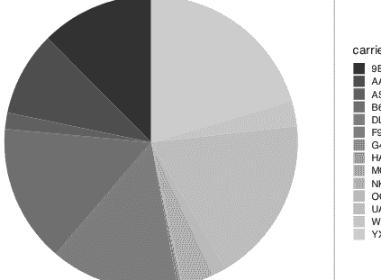

# 图 2.22: 可可畏的饼图。

虽然查看图 2.22 中的饼图时很难回答这些问题，但如果使用图 2.21 中的柱状图，我们可以更容易地回答这些问题。这是因为柱状图呈现信息的方式可以通过单条水平线进行类别之间的比较，而饼图呈现信息的方式必须通过比较角度来比较。

## 学习检查

(LC2.30) 为什么应该避免使用饼图并用柱状图代替？

(LC2.31) 你认为为什么人们继续使用饼图？

### 2.8.3 两个分类变量

柱状图是可视化单个分类变量的不同类别（或水平）频率的非常常用方法。柱状图的另一个用途是同时可视化两个分类变量的联合分布。让我们检查纽约（NYC）出发的国内航班按航空公司和出发地的联合分布，换句话说，每个航空公司和出发地组合的航班数。这

## 2 数据可视化

这对应于从 JFK 出发的美国航空航班数、从 LGA 出发的美国航空航班数、从 EWR 出发的美国航空航班数、从 JFK 出发的 Endeavour Air 航班数等。回想创建图 2.21 中航空公司频率柱状图的 `ggplot()` 代码：

```
ggplot(data = flights, mapping = aes(x = carrier)) + 
geom_bar(_)
```

现在我们可以通过在 `aes()` 审美映射内部添加 `fill = origin` 来映射额外的变量 `origin`。

```
ggplot(data = flights, mapping = aes(x = carrier, fill = origin)) + 
geom_bar(_)
```

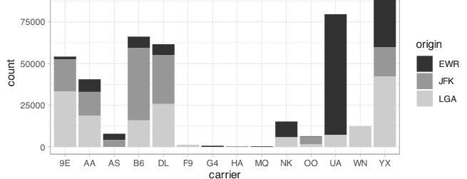

图 2.23: 按航空公司和出发地的航班数量堆叠柱状图。

图 2.23 是堆叠柱状图的一个示例。虽然制作简单，但在某些方面并不理想。例如，很难比较柱条之间不同颜色的高度，这对应于比较航空公司之间每个出发机场的航班数量。

在继续之前，让我们解决新用户之间一些常见的困惑点。首先，`fill` 审美对应于填充柱条的颜色，`color` 审美对应于柱条轮廓的颜色。这与我们在 2.5.1 节中为直方图添加颜色的方法相同：我们通过设置 `color = "white"` 将柱条轮廓设置为白色，通过设置 `fill = "steelblue"` 将柱条颜色设置为钢蓝色。观察图 2.24，将 `origin` 映射到 `color` 而不是 `fill` 会产生具有不同颜色轮廓的灰色柱条。

```
ggplot(data = flights, mapping = aes(x = carrier, color = origin)) + 
geom_bar(_)
```

## 2.8.5 柱状图

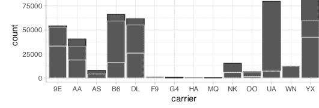

图 2.24: 使用 color 审美代替 fill 的堆叠柱状图。

其次，注意 `fill` 是另一个审美映射，就像 `x-position` 一样；我们仔细地将其包含在 `aes()` 映射的括号内。以下代码将 `fill` 审美指定在 `aes()` 映射之外，将产生错误。这是新 ggplot 用户经常犯的错误：

```
ggplot(data = flights, mapping = aes(x = carrier), fill = origin) +
geom_bar()
```

堆叠柱状图的替代方案是并列柱状图，也称为避让柱状图（dodged barplots），如图 2.25 所示。创建并列柱状图的代码与创建堆叠柱状图的代码相同，但在 `geom_bar()` 中添加了 `position = "dodge"` 参数。换句话说，我们正在覆盖默认的柱状图类型（即堆叠柱状图），并将其指定为并列柱状图。

```
ggplot(data = flights, mapping = aes(x = carrier, fill = origin)) +
geom_bar(position = "dodge")
```

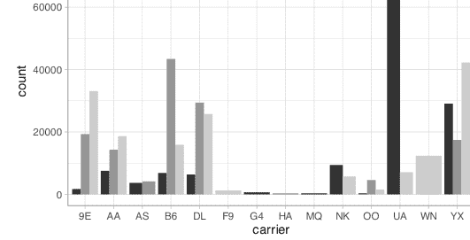

图 2.25: 按航空公司和出发地比较航班数量的并列柱状图。

2 数据可视化

最后，另一种类型的柱状图是分面柱状图（faceted barplot）。回想在 2.6 节中我们使用分面（facets）按月份可视化了纽约三个机场每小时风速的分布。我们将相同的原理应用于按出发地划分航空公司频率的柱状图：我们不是将 `origin` 映射到 `fill`，而是将其作为变量来创建小多幅（small multiples）。

```
ggplot(data = flights, mapping = aes(x = carrier, fill = origin)) + 
geom_bar() +
facet_wrap(~ origin, ncol = 1)
```

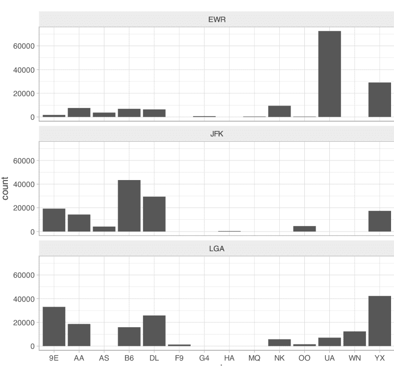

图 2.26: 按航空公司和出发地比较航班数量的分面柱状图。

## 学习检查

(LC2.30) 为什么应该避免使用饼图并用柱状图代替？

(LC2.31) 你认为为什么人们继续使用饼图？

(LC2.32) 查看图 2.23 无法容易回答哪些问题？

(LC2.33) 关于航空公司和机场之间的关系，你可以说明什么？

(LC2.34) 使用并让柱状图的缺点是什么？

(LC2.35) 为什么分面柱状图可能比堆叠柱状图更好？

(LC2.36) 柱状图中更容易看到关于不同航空公司的什么信息？

### 2.8.4 总结

柱状图是可视化单个分类变量的不同类别（或水平）频率的非常常用方法。柱状图的另一个用途是同时可视化两个分类变量的联合分布。让我们检查纽约（NYC）出发的国内航班按航空公司和出发地的联合分布，换句话说，每个航空公司和出发地组合的航班数。它们很容易理解并进行跨水平的比较。此外，当尝试可视化两个分类变量的关系时，你有许多选择：堆叠柱状图、并列柱状图和分面柱状图。

## 2.9 结论

### 2.9.1 总结

让我们回顾表 2.4 中的所有命名图表（5NG）。使用这 5 种图，你将能够可视化广泛数据集中变量的分布和关系。当我们开始将更多变量映射到每个几何对象的更多审美属性时，进一步解锁 ggplot2 的强大力量，情况将更加如此。

### 表 2.4: 命名图表总结

| 命名图表 | 关系 | 几何对象 | 注释 |
|---|---|---|---|
| 1 散点图 | 两个数值变量之间的关系 | `geom_point()` | |
| 2 折线 | 两个数值变量之间的关系 | `geom_line()` | 用于 x 变量具有顺序的情况，例如时间 |
| 3 直方图 | 1 个数值变量的分布 | `geom_histogram()` | 分面直方图显示按另一个变量划分的 1 个数值变量的分布 |
| 4 箱线图 | 按另一个变量划分的 1 个数值变量的分布 | `geom_boxplot()` | |
| 5 柱状图 | 1 个分类变量的分布 | 未预计算计数使用 `geom_bar()`，已计数使用 `geom_col()` | 堆叠、并列和分面柱状图显示两个分类变量的联合分布 |

### 2.9.2 函数参数指定

让我们讨论关于指定函数参数（即输入）的一些重要点。运行以下两段代码：

```
# 段 1:
ggplot(data = flights, mapping = aes(x = carrier)) +
geom_bar()
```

```
# 段 2:
ggplot(flights, aes(x = carrier)) +
geom_bar()
```

你会注意到两个代码段都创建了相同的柱状图，即使在第二段中我们省略了 `data = mapping` 代码参数名。这是因为 `ggplot()` 函数默认认为数据参数在前，映射参数在后。只要你指定数据框在

## 2.9 结论

先写数据（data）后写 `aes()` 映射，你可以省略参数名 `data` 和 `mapping` 的显式声明。

在本书的后续内容中，所有的 `ggplot()` 代码将采用第二种形式：即省略 `data =` 和 `mapping =` 的显式命名，并遵循参数的默认顺序。我们这样做是为了简洁；在审阅其他 R 用户的代码时，这种风格非常常见。

### 2.9.3 额外资源

所有学习检查（Learning checks）的答案都可以在书籍在线版的附录中找到。附录从 https://modernndive.com/v2/appendix 开始。

本章中使用的所有 R 代码的脚本文件可以在 https://www.modernndive.com/v2/scripts/02-visualization.R 获取。

如果你想解锁 RStudio 的“ggplot2 Data Visualization with ggplot2”速查表（cheatsheet），这份图表总结的内容比我们在本章讨论的要多。特别是，它展示了比本章涵盖的 5 个几何对象更多的对象，同时提供了快速且易读的视觉描述。对于所有的几何对象，它还列出了可以调整的所有可能的审美属性。在 2024 年中的当前的 RStudio 版本中，你可以通过 RStudio 菜单栏 -> Help -> Cheatsheets -> Data Visualization with ggplot2 访问此表。或者，你也可以通过此链接6 进入 ggplot2 的 Github 页面预览该表。

> 6https://github.com/rstudio/cheatsheets/blob/main/data-visualization-2.1.pdf

### 2.9.4 展望


回想第 2.3 节中的图 2.2，我们视觉化了 `Envoy Air` 航班的部门与延迟之间的关系，而不是所有航班。这些数据保存在 `modernndive` 包的 `envoy_flights` 数据框中。

实际上，`envoy_flights` 数据框只是 `nycflights3` 包中 `flights` 数据框的一个子集，由所有 2023 年从纽约出发的航班组成。我们使用以下代码通过 `dplyr` 包进行数据包装创建了 `envoy_flights`：

```r
library(dplyr)

envoy_flights <- flights |
  filter(carrier == "MQ")

ggplot(data = envoy_flights, mapping = aes(x = dep_delay, y = arr_delay)) + 
  geom_point()
```

## 2 数据可视化

这段代码获取了 `flights` 数据框并使用 `filter()` 仅返回 `carrier` 等于 `"MQ"`（Envoy Air 的载运代码）的 357 行。（回想第 1.2 节，相等性测试使用 `==` 而不是 `!=`）。然后代码使用赋值运算符 `<-` 将输出结果循环写到一个新数据框 `envoy_flights` 中。

同样，回想第 2.4 节中的图 2.7，我们视觉化了纽瓦克机场（Newark airport）2023 年 1 月前 15 天的每小时风速记录。这些数据保存在 `modernverse` 包的 `early_january_2023_weather` 数据框中。

实际上，`early_january_2023_weather` 数据框只是 `nycflights3` 包中 `weather` 数据框的一个子集，包含了 2023 年纽约三个城市的所有每小时天气观测数据。我们使用以下 `dplyr` 代码创建了 `early_january_2023_weather`：

```r
early_january_2023_weather <- weather |
  filter(origin == "EWR" & month == 1 & day <= 15)

ggplot(data = early_january_2023_weather, aes(x = time_hour, y = temp)) + 
  geom_line()
```

这段代码将 `weather` 数据框解析为新的数据框 `early_january_2023_weather`，其中仅包含 `origin == "EWR"`、`month == 1` 且小于或等于 15 的每小时风速记录。

这两段代码是对第 3 章使用 `dplyr` 包进行数据清洗（data wrangling）的预览。数据清洗是转换和修改现有数据的过程，其目的是使其更符合分析目的。例如，这两段代码使用了 `filter()` 函数，通过选择现有数据框（`flights` 和 `weather`）的行子集创建了新的数据框（`envoy_flights` 和 `early_january_2023_weather`）。在下一章中，我们将正式介绍 `filter()` 和其他数据清洗函数，以及管道运算符 `|>`, 后者允许你将多个数据清洗操作组合成单一的顺序操作链。进入第 3 章：数据清洗！

# 3 数据清洗

在目前为止旅程中，我们已经学习了如何在第 1 章中通过 `glimpse()` 和 `View()` 函数查看保存在数据框中的数据，以及如何在第 2 章中使用 `ggplot2` 包创建数据可视化。特别是，我们研究了我们所谓的“五种命名图表”（5NG）：

- 1. 通过 `geom_point()` 创建散点图
- 2. 通过 `geom_line()` 创建折线图
- 3. 通过 `geom_boxplot()` 创建箱线图
- 4. 通过 `geom_histogram()` 创建直方图
- 5. 通过 `geom_bar()` 或 `geom_col()` 创建柱状图

我们使用图形句法（grammar of graphics）创建了这些可视化内容，它将数据框中的变量映射到 5 个几何对象之一的审美属性。我们还可以控制几何对象的其他审美属性，例如图 2.1 中 Gapminder 数据示例中的大小和颜色。

在本章中，我们将引入来自 `dplyr` 包的一系列用于数据清洗的函数，它们允许你处理数据框以满足你的需求。函数包括：

- 1. `filter()` 筛选数据框的行以选出子集。例如，筛选 `alaska_flights` 数据框。
- 2. `summarize()` 对一个或多个列进行汇总统计。正如我们在第 2.7 节的箱线图中看到的分组统计数据。
- 3. `group_by()` 将行分组。例如，为每个机场分别计算 `dep_delay` 的平均值。
- 4. `mutate()` 根据现有列/变量创建新列。例如，将华氏温度转换为摄氏度。
- 5. `arrange()` 对行进行排序。例如，按 `temp` 排序天气数据。
- 6. `join()` 根据“键”变量与另一个数据框连接。换句话说，合并这两个数据框。

DOI: 10.12011/978103224546-3

注意我们如何使用 `computer_code` 字体来描述我们要对数据框执行的操作。这是因为用于数据清洗的 `dplyr` 包具有直观命名的函数，易于记忆。

学习使用 `dplyr` 进行数据清洗的进一步好处是它与数据库语言 SQL¹（读作 sequel 或字母拼写 S-Q-L，全称为结构化查询语言）相似，SQL 被广泛用于高效管理大量数据库。虽然 SQL 是书籍或数据库管理课程的主题，但请记住，学会了 dplyr，就能轻松学习 SQL。我们将讨论它们的相似之处。

## 需要的包

加载本章所需的包（假设你已经安装了它们）。如果需要，请阅读第 1.3 节关于如何安装和加载 R 包的信息。

```r
library(dplyr)
library(ggplot2)
library(nycflights)
```

## 3.1 管道运算符：`|>` 

在开始数据清洗之前，让我们首先介绍一种自 2021 年 5 月起成为 R 的一部分的巧妙工具：管道运算符 `|>`；原生管道允许我们将 R 中的多个操作组合成单一的顺序操作链。在现代 R 中，原生管道运算符 `|>` 现在是函数链的默认方式，取代了以前随 `dplyr` 包加载的 tidyverse `%>%`。`|>` 在 R 4.1.0 中引入，为数据清洗和其他任务提供了更直观、易读的语法，消除了对额外包依赖的需求。

你可能会在旧脚本或在线搜索中看到使用 `%>%` 的 R 代码，但本书中我们将使用 `|>`。如果你在其他代码中看到它，请担心。

让我们从一个假设的示例开始。假设你想对一个假设的数据框 `x` 使用假设函数 `f()`、`g()` 和 `h()` 执行一组假设的操作序列：

### 3.1 管道操作符：`|>` 

- 1. 取 `x`，然后
- 2. 将 `x` 作为函数 `f()` 的输入*然后*
- 3. 将 `f(x)` 的输出作为函数 `g()` 的输入
- 4. 将 `g(f(x))` 的输出作为函数 `h()` 的输入

实现这一系列操作的一种方法是像下面这样嵌套括号：

```
h(g(f(x)))
```

这段代码并不难读，因为我们只应用了三个函数：`f()`、然后是 `g()`、`h()`，而且每个函数的名称都很短。此外，这些函数每个都只有一个参数。然而，你可以想象，随着序列中应用的函数数量的增加以及每个函数中参数的增加，读起来会变得越来越困难。这就是管道操作符 `>` 派上用场的地方。`>` 获取一个函数的输出，然后将其“管道”到下一个函数的输入。此外，一个实用的技巧是将 `>` 读作“然后”（then）或“接着”。例如，你可以通过以下方式获得与假设的函数序列相同的输出：

```
x |>
f() |>
g() |>
h()
```

你会将这个序列读作：

- 1. 取 `x` *然后*
- 2. 将此输出作为下一个函数 `f()` 的输入*然后*
- 3. 将此输出作为下一个函数 `g()` 的输入*然后*
- 4. 将此输出作为下一个函数 `h()` 的输入

虽然两种方法实现了相同的目标，但后者更符合人类阅读习惯，我们可以清晰地逐行查看操作序列。但这些假设的 `x`、`f()`、`g()` 和 `h()` 是什么呢？在本关于数据清洗的章节中：

- 1. 起值 `x` 将是一个数据框（data frame）。例如，我们在 1.4 节中探索的 `flights` 数据。
- 2. 函数序列（这里是 `f()`、`g()` 和 `h()`）大部分是本章引言中列出的六个数据清洗动词命名函数的任意数量的序列。例如，我们之前预览的 `filter(carrier == "MQ")` 函数及其指定的参数。

# 3 数据清洗

结果将是你想要转换/修改的数据框。在我们的示例中，我们将使用 `<-` 赋值符并通过 `alaska_flights <-` 将结果保存在一个新数据框中。

```
envoy_flights <- flights |
filter(carrier = "AS")
```

就像使用 `+` 符号向 `ggplot()` 添加层一样，你通过使用管道操作符 `|` 将动词命名函数组合成单一序列，形成单一的数据清洗操作链。此外，就像在构建图表时 `+` 必须放在行末一样，管道操作符 `|` 也必须放在行末。

请记住，高级数据清洗函数比本章引言中列出的六个多得多；你将在 3.8 节中看到这些的一些示例。然而，仅凭这六个动词命名函数，你就能在本书其余部分执行广泛的数据清洗任务。

## 3.2 过滤行

### 子集观测值（行）


`filter()` 函数的工作原理与 Microsoft Excel 中的“筛选”选项非常；它允许你对数据集中变量的值指定标准，然后过滤出符合该标准的行。

我们首先关注从纽约市到亚利桑那州凤凰城的航班。亚利桑那州凤凰城的目的地代码（`dest`）（或机场代码）是 `"PHX"`。运行以下代码并查看 RStudio 电子表格查看器中的结果，以确保只选择了前往凤凰城的航班：

```
phoenix_flights <- flights |
filter(dest == "PHX")
```

注意代码的顺序。首先获取 `flights` 数据框，然后 `filter()` 数据框，使 `dest` 等于 `"PHX"` 的行被包含。我们使用双符号 `==` 来测试相等性，而不是单符号 `=`。在许多编程语言中，`filter(dest = "PHX")` 会产生错误。如果你是编程新手，可能会好几次忘记使用双符号 `==`。

你可以使用 `==` 以外的其他运算符：

- `>` 对应“大于”
- `<` 对应“小于”
- `>=` 对应“大于等于”
- `<=` 对应“小于等于”
- `!=` 对应“不等于”。`!` 在许多编程语言中表示“不”。

此外，你可以使用比较运算符来组合多个标准：

- `|` 对应“或”
- `&` 对应“和”

为了看到这些操作的效果，让我们过滤 `flights` 中所有从 JFK 出发前往波特基（`"BTV"`）或华盛顿（`"SEA"`）且在 10 月、11 月或 12 月出发的航班。运行以下代码：

```
btv_sea_flights <- flights |
filter(origin == "JFK" & (dest == "BTV" | dest == "SEA") & month > 10)
``` 

请注意，即使在口语中可能会说“离开波特基和华盛顿的所有航班”，从操作的角度来说，我们的意思是“离开波特基或离开华盛顿的所有航班”。对于数据中的某行，`dest` 可以是 `"BTV"`、`SEA"` 或其他，但不能同时是 `"BTV"` 和 `"SEA"`。注意在 `dest == "BTV" | dest == "SEA"` 周围对括号的谨慎使用。我们经常可以用逗号跳过 `&` 的使用，来分离我们的条件，之前的代码将返回相同的 `btv_sea_flights` 输出：

```
btv_sea_flights <- flights |>
filter(origin == "JFK", dest == "BTV" | dest == "SEA", month >= 10)
View(btv_sea_flights)
```

让我们展示另一个使用 `!` 运算符来选取不符合标准的行的示例。如前所述，`!` 可以读作“不”。在这里，我们正在过滤掉前往波特基或华盛顿的航班。

```
not_BTV_SEA <- flights |>
filter(!(dest == "BTV" | dest == "SEA"))
View(not_BTV_SEA)
```

再次，注意对 `(dest == "BTV" | dest == "SEA")` 周围括号的谨慎使用。如果我们不这样使用括号：

```
flights |> filter(dest == "BTV" | dest == "SEA")
```

我们将返回所有不是这两个目的地的航班，这是一个完全不同的数据框。

现在我们有更多想要过滤的机场，例如 `"SEA"`、`"SFO"`、`"PHX"`、`BTV`","BDL"。我们可以继续使用 `|`（或）操作符。

```
many_airports <- flights |>
filter(dest == "SEA" | dest == "SFO" | dest == "PHX" |
dest == "BTV" | dest == "BDL")
```

随着逐渐包含更多机场，这种写法将变得非常繁琐。更短的方法是使用 `%in%` 运算符配合 `c()` 函数。回想第 1.2.1 节，`c()` 函数将值“合并”或“连接”到一个单一向量中。

```
many_airports <- flights |>
filter(dest %in% c("SEA", "SFO", "PHX", "BTV", "BDL"))
View(many_airports)
```

这段代码的作用是过滤所有 `dest` 在机场向量 (`"BTV"`, `"SEA"`, `"PHX"`, `"SFO"`, `"BDL"`) 中的航班。`many_airports` 的两个输出是相同的，但正如你所看到的，后者的代码少得多。`%in` 运算符对于查找非常有用。

最后，我们建议 `filter()` 通常应该是你考虑应用于数据的第一个操作之一。这可以将你的数据集清理为只剩下你关心的行，换句话说，它将你的数据框范围缩小到只有你关心的观测值。

## 学习检查

(LC3.1) 还有什么方法可以使用“不”运算符来过滤 `flights` 数据框中既不去波特基（VT）也不去华盛顿（SEA）的行？使用之前的代码进行测试。

## 3.3 变量汇总

处理数据框时的下一个常见任务是计算汇总统计量，它们是总结了大量值的单一数值。常见的汇总统计示例包括平均值（也称为平均）和中位数（中间值）。其他可能不会立即想到的汇总统计包括和、最小值（也称为 minimum）、最大值（也称为 maximum）以及标准差。

让我们计算 `weather` 数据框中 `wind_speed temperature` 变量的两个汇总统计：平均值和标准差。为了计算这些汇总统计，我们需要 R 中的 `mean()` 和 `sd()` 汇总函数。R 中的汇总函数接受许多值并返回单一值，如图 3.2 所示。

FIGURE 3.2: R 中汇总函数的示意图。

更准确地说，我们将使用 `dplyr` 包中 `summarize()` 函数内部的 `mean()` 和 `sd()` 汇总函数。注意，你也可以使用英式英语拼写 `summarise()`。如图 3.3 所示，`summarize()` 函数接收一个数据框并返回一个仅包含一行对应于汇总统计量的数据框。

## 汇总数据

**图 3.3：** `summarize()` 行的示意图。

我们将结果保存在名为 `summary_windspeed` 的新数据框中，它将有两个列/变量：均值（mean）和标准差（std_dev）：

```
summary_windspeed <- weather |>
summarize(mean = mean(wind_speed), std_dev = sd(wind_speed))
summary_windspeed
```

```
# A tibble: 1 x 2
mean std_dev
<dbl> <dbl>
1 NA NA
```

为什么返回的值是 NA 呢？NA 是 R 编码缺失值的方式，其中 NA 表示“不可用”或“不适用”。如果特定行和特定列的值不存在，则存储 NA。值缺失可能有许多原因。也许数据已经收集了，但某人忘记输入了。也许有人输入了错误值，而该值已被更正为缺失。在处理真实数据时，你经常会遇到缺失值的问题。

回到我们的 `summary_windspeed` 输出，默认情况下，如果你在 R 中尝试计算包含一个或多个 NA 缺失值的变量汇总统计量，将返回 NA。为了解决这个问题，你可以将 `na.rm` 参数设置为 `TRUE`，其中 `rm` 是“remove”（删除）的缩写；这将忽略任何 NA 缺失值，并仅返回所有非缺失值的汇总值。

后续代码计算了 `temp` 所有非缺失值的均值和标准差：

### 3.3 汇总变量

```
summary_windspeed <- weather |
summarize(mean = mean(wind_speed, na.rm = TRUE),
std_dev = sd(wind_speed, na.rm = TRUE))
summarize_windspeed
```

```
# A tibble: 1 x 2
mean std_dev
<dbl>
1 9.44 5.26
```

注意 `na.rm = TRUE` 是如何分别作为参数用于 `mean()` 和 `sd()` 汇总函数的，而不是用于 `summarize()` 函数。


然而，正如我们刚刚做的那样，我们需要对缺失值保持谨慎。在接来的学习检查（Learning checks）中，我们将考虑将带有缺失值的行“扫到地毯下”可能的影响。事实上，R 中任何统计函数的 `na_rm` 参数默认都设置为 `FALSE`。换句话说，R 默认不会忽略包含缺失值的行。它在提醒你存在缺失数据，并且你应该在整个分析过程中留意这种缺失性以及这种缺失的潜在原因。

在 `summarize()` 动内部还可以使用哪些汇总函数来计算汇总统计量？如图 3.2 所示，你可以使用任何接收值并返回一个值的 R 函数。以下是其中几个：

- `mean()`：平均值
- `sd()`：标准差，衡量离散程度的指标
- `min()` 和 `max()`：分别是最小值和最大值
- `IQR()`：四分位距
- `sum()`：多个数字相加的总和
- `n()`：每组的行数。当在 3.4 节介绍 `group_by()` 时，这个特定的汇总函数将更有意义。

> 学习检查

(LC3.2) 假设一位医生正在研究吸烟对大量患者肺癌的影响，这些患者有每五年测量一次的记录。她注意到许多患者由于去世导致数据缺失，因此她选择在分析中忽略这些患者。这位医生的方法有什么问题？

(LC3.3) 修改早先创建 `summary_windspeed` 数据框的 `summarize()` 函数代码，使其也使用 `n()` 汇总函数：`n()` 返回的值代表什么？

(LC3.4) 为什么以下代码不起作用？逐行运行代码而不是一次性运行，然后查看 `summary_windspeed`：

```
summary_windspeed <- weather |>
summarize(mean = mean(wind_speed, na.rm = TRUE),
std_dev = sd(wind_speed, na.rm = TRUE))
```

### 3.4 分组列

 图 3.4：`summarize()` 和 `group_by()` 的示意图。

我们可以修改代码以查看均值和离散程度，并设置 `na.rm = TRUE` 以应对缺失值的情况：

```
summary_windspeed <- weather |>
summarize(mean = mean(wind_speed, na.rm = TRUE),
std_dev = sd(wind_speed, na.rm = TRUE))
```

```
# A tibble: 1 x 2
mean std_dev
<dbl> <dbl>
1 9.44 5.26
```

与其计算整个年份的平均值，我们希望通过 `group_by()` 按月计算这 12 个值的平均值。换句话说，按月进行分组：

```
summary_windspeed <- weather |>
group_by(month) |>
summarize(mean = mean(wind_speed, na.rm = TRUE),
  std_dev = sd(wind_speed, na.rm = TRUE))
```

# A tibble: 12 x 3

month mean std_dev

<int> <dbl> <dbl>

1 1 9.44 5.26

2 2 8.12 4.11

3 3 7.55 3.90

4 4 6.88 3.52

5 5 8.33 4.67

6 6 9.10 4.89

7 7 8.45 4.23

8 8 7.99 4.05

9 9 7.21 3.65

10 10 8.66 4.92

11 11 9.05 5.03

12 12 8.88 5.10

```

`group_by()` 函数本身不会改变数据框。它改变的是元数据。只有在应用 `summarize()` 函数后，数据框才会发生变化。作为另一个例子，考虑 `ggplot2` 包中的 `diamonds` 数据框：

# A tibble: 53940 x 10
carat color depth price x y z |
<dbl> <dbl> <ord> <ord> <dbl> <dbl> <dbl> |
1 0.23 E 61.5 3958 3.98 2.43 |
2 0.21 P 59.8 3894 3.84 2.31 |
3 0.23 G 56.9 3271 4.05 2.31 |
4 0.29 P 62.4 4235 4.23 2.63 |
5 0.31 G J 63.3 4334 4.35 |4.55 |

  ..22 J  2..  33 3.96 2.48 |
7  ..24 I  2.3337 3.95 2.47 |
8 0.26 VG H 61.9 55 4 07 2.53 |
9 9.222 65.1 337 3.87 2.49 |
10 0.23 H 59.4 61 338 4 4.05 2.39 |

注意到现在有了额外的元数据：Groups: cut [5] 表明分组结构元数据已根据分类变量 `cut` 的 5 个可能级别（"Fair","Good","Very Good","Premium" 和 "Ideal"）进行了设置。另一方面，观察到数据并没有变化：它仍然是一个 53940 x 10 的表格。现在让我们将 `diamonds` 数据框传递给 `group_by(cut)`：

```

diamonds |

group_by(cut) |>

summarize(avg_price = mean(price))

```

#### 3.4 按行分组 (group_by rows)

```r

# A tibble: 5 x 2

cut   avg_price

<ord> <dbl>

1 Fair  4359.

2 Good  3929.

3 Very Good 3982.

4 Premium 4584.

5 Ideal  3458.

```

如果你想移除这种分组结构元数据，可以将生成的数据框传递给 `ungroup()` 函数：

```r

diamonds |>

group_by(cut) |>

ungroup()

```

```r

# A tibble: 53,940 x 10

| carat cut color depth table price x y z |

|---|---|---|---|---|---|---|---|---|

| <dbl> <ord> | <ord> <ord> <dbl> <dbl> <int> <dbl> <dbl> <dbl> |

| 1 | 0.23 Ideal | E SI2 | 61.5 | 55 | 326 | 3.95 | 3.98 | 2.43 |

| 2 | 0.21 Premium | E SI1 | 56.9 | 61 | 326 | 3.89 | 3.84 | 2.31 |

| 3 | 0.23 Good | E VS1 | 56.9 | 65 | 327 | 4.05 | 4.07 | 2.31 |

| 4 | 0.29 Premium | VS2 | 62.4 | 58 | 334 | 4.2 | 4.23 | 2.63 |

| 5 | 0.31 Good | J SI12 | 63.3 | 58 | 335 | 4.34 | 4.35 | 2.75 |

| 6 | 0.24 Very Good J | WSW2 | 62.8 | 57 | 336 | 3.96 | 2.48 | 2.48 |

| 7 | 0.24 Very Good I | WSI1 | 62.3 | 55 | 537 | 3.95 | 3.98 | 2.47 |

| 8 | 0.26 Very Good H | SI1 | 61.9 | 55 | 337 | 4.07 | 4.11 | 2.53 |

| 9 | 0.22 Fair | E VS2 | 65.1 | 61 | 337 | 3.87 | 3.78 | 2.49 |

| 10| 0.23 Very Good H | VS1 | 59.4 | 61 | 338 | 4 | 4.05 | 2.39 |

| 11 | 53,940 more rows

```

观察 `Groups: count [5]` 元数据是否已不再出现。

让我们重新回顾一下之前简要介绍过的 `n()` 计数汇总函数。记得 `n()` 函数用于统计行数。这与返回数值变量总和的 `sum()` 汇总函数相反。例如，假设我们统计纽约市三个机场各有多少航班起飞：

```r

by_origin <- flights |>

group_by(origin) |>

summarize(count = n())

by_origin

```

### 3 数据清洗 (Data Wrangling)

```r

# A tibble: 3 x 2

origin count

<chr> <int>

1 EWR 1385

2 JFK 33048

3 LGA 16376

```

#### 按多个变量分组

你不局限于按一个变量分组。假设你想知道纽约市三个机场*每个月*的航班数量。我们可以使用 `group_by(origin, month)` 按第二个变量分组：

```r

by_origin_monthly

group_by(origin, month) |>

summarize(count = n())

```

`summarize()` 默认按 'origin' 进行了分组。你可以使用 `.groups` 参数来覆盖这一点。

注意这里出现了一个指定分组情况的消息。`summarize()` 的 `.groups` 参数有四个选项：

- `drop_last`：删除最后一个分组变量。
- `drop`：删除所有分组变量。
- `keep`：保留所有分组变量。
- `rowwise`：将每一行转换为一组。

在大多数情况下，默认是 `drop_last`，它会删除最后一个分组变量。消息告诉我们默认行为是删除最后一个分组变量，在本例中是 `month`。

```r

by_origin_monthly

# A tibble: 36 x 3 [3]

# Groups: origin [3]

origin month count

<chr> <int> <int>

1 EWR 1 1623

2 EWR 2 1091

3 EWR 3 2593

4 EWR 4 2022

5 EWR 5 2371

6 EWR 6 1339

7 EWR 7 1646

8 EWR 8 1561

9 EWR 9 1373

10 EWR 10 1805

```

观察到 `by_origin_monthly` 有 36 行，是因为有 3 个机场（EWR, JFK, LGA）对应 12 个月。我们为什么要使用 `group_by(origin, month)` 而不是 `group_by(origin)` 然后 `group_by(month)` 呢？让我们调查一下：

```r

by_origin_monthly_incorrect <- flights |>

group_by(origin) |>

group_by(month) |>

summarize(count = n())

```

```r

# A tibble: 12 x 2

month count

<int> <int>

1 3620

2 2476

3 3951

4 3747

5 3871

6 3592

```

这里发生的情况是，第二个 `group_by(month)` 覆盖了早期 `group_by(origin)` 的分组结构，所以最后我们只按月分组。这里的教训是，如果你想 `group_by()` 多个变量，应该通过逗号同时包含所有变量。

#### 学习检查

- (LC35) 回想第2章我们查看纽约的风速时，`summary_monthly` 数据框中的标准差列告诉了我们关于全年温度什么信息？
- (LC36) 需要什么代码来获取纽约2023年每天的平均风速标准差？
- (LC37) 重新创建 by_origin，但不是通过 `group_by(origin)` 分组，而是使用 `group_by(month)`。结果数据集有什么不同？
- (LC38) 我们如何识别每家航空公司的航班数量？
- (LC39) `filter()` 操作与 `group_by()` 后接 `summarize()` 有什么区别？

### 3.5 mutate 修改现有变量

#### 新变量

另一种常见的数据转换方法是根据现有变量创建新变量。例如，假设你更倾向于用摄氏 (°C）而不是华氏 (°F）来思考温度。将华氏转换为摄氏的公式是：

```r

temp_C = (temp - 32) / 1.8

```

我们可以使用 `dplyr` 包中的 `mutate()` 函数将此公式应用到变量上，它接收现有变量并对其进行修改以创建新变量。

```r

weather <- weather |>

mutate(temp_in_C = (temp - 32) / 1.8)

```

在这段代码中，`mutate()` 通过创建一个新变量并覆盖了原始数据框。我们为什么要覆盖数据框而不是将结果赋值给像 `weather_new` 这样的新框？作为一个粗略的法则，只要你没有丢失以后需要的原始信息，用更新后的数据框覆盖现有数据框是可以接受的做法，正如我们所做的那样。另一方面，我们为什么没有覆盖变量 `temp`而是创建一个新变量 `temp_in_C`？因为如果我们这样做，就会删掉 `temp` 中可能对我们仍有价值的原始信息。

让我们使用3.4节中看到的 `group_by()` 和 `summarize` 代码计算华氏和摄氏的月度平均温度：

```r

summary_monthly_temp <- weather |

group_by(month) |>

summarize(mean_temp_in_F = mean(temp, na.rm = TRUE),

          mean_temp_in_C = mean(temp_in_C, na.rm = TRUE))

summary_monthly_temp

```

```r

# A tibble: 12 x 3

| month | mean_temp_in_F | mean_temp_in_C |

| <int> | <double> | <double> |

| 1 | 35.7 | 2.04 |

| 2 | 34.5 | 1.39 |

| 3 | 45.0 | 7.2 |

| 4 | 54.6 | 12.6 |

| 5 | 53.6 | 12.0 |

| 6 | 69.2 | 20.6 |

| 7 | 78.4 | 25.8 |

| 8 | 72.8 | 22.7 |

| 9 | 64.7 | 18.1 |

| 10 | 64.2 | 17.9 |

| 11 | 47.5 | 8.64 |

| 12 | 45.9 | 7.72 |

```

飞行员经常在航班延误时感到沮丧，但如果最终在飞行中可以追回一些时间，这在航空行业被称为 `gain`。我们将使用 `mutate()` 函数创建这个变量：

```r

flights <- flights |>

mutate(gain = dep_delay - arr_delay)

```

查看表3.1中更新后数据框前五行的 `dep_delay`、`arr_delay` 以及生成的 `gain` 变量。

**TABLE.1:** 出发/到达延迟及增益变量

| dep_delay | arr_delay | gain |
|---|---|---|
| 203 | 205 | -2 |
| 78 | 53 | 25 |
| 47 | 34 | 13 |
| 173 | 166 | 7 |
| 228 | 211 | 17 |

第一行的航班出发了203分钟，晚了32分钟，所以其飞行中的“追回时间”是损失2分钟，因此其 `gain` 为 $203-205 = -2$，即损失了2分钟。另一方面，第三行的航班晚出发（`dep_delay`为47），但晚了34分钟到达（`arr_delay`为34），所以其飞行中的“追回时间”是 $47-34 = 13$ 分钟，因此其 `gain` 为13。

通过在同一个 `summarize` 中同时考虑多个函数，查看 `gain` 变量的一些汇总统计数据：

```r

gain_summary <- flights |>

summarize(

  min = min(gain, na.rm = TRUE),

  q1 = quantile(gain, 0.25, na.rm = TRUE),

  median = quantile(gain, 0.5, na.rm = TRUE),

  q3 = quantile(gain, 0.75, na.rm = TRUE),

  max = max(gain, na.rm = TRUE),

  mean = mean(gain, na.rm = TRUE),

  sd = sd(gain, na.rm = TRUE),

  missing = sum(is.na(gain))

)

gain_summary

```

```r

# A tibble: 1 x 8

min q1 median q3 max mean sd missing

-321 1 11 20 101 9.35 18.4 12534

```

#### 3.5 mutate 变量

我们看到例如中位增益（gain）为 11 分钟，最大值为 +101 分钟，而最大的负增益（或损失）为 -321 分钟！然而，在实践中运行这段代码需要一些时间。我们稍后将在 5.1.1 节看到，有一种更简洁的方法来计算各种常见的汇总统计量：使用 `modernrive` 包中的 `tidy::summary()` 函数。

回顾第 2.5 节，由于 `gain` 是一个数值变量，我们可以使用直方图可视化它的分布。

```r

ggplot(data = flights, mapping = aes(x = gain)) + 

geom_histogram(color = "white", bins = 20)
```


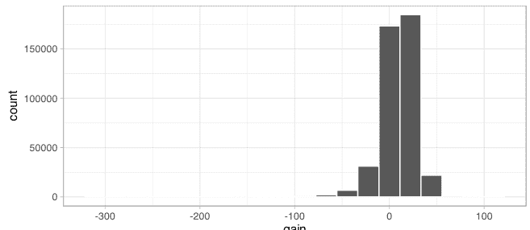

**图 3.6：** `gain`变量的直方图。

图 3.6 中的直方图比我们之前计算的汇总统计量提供了对`gain`变量的额外视角。例如，注意大多数`gain`的值都在 0 附近。

在结束关于`mutate()`函数创建新变量的讨论时，请注意我们可以在同一个`mutate()`代码中同时创建多个变量。此外，在同一个`mutate()`代码中，我们可以引用刚刚创建的新变量。例如，考虑 Hadley Wickham 和 Garrett Grolemund 在《数据科学 R 语言教程》Grolemund and Wickham, 2017 第 5 章中使用的`mutate()`代码：

```r
flights <- flights |>
  mutate(
    gain = dep_delay - arr_delay,
    hours = air_time / 60,
    gain_per_hour = gain / hours
  )
```

## 学习检查

- (LC.10) `flights`中`gain`变量的正值对应什么？负值呢？零值又是？
- (LC.11) 我们是否可以通过简单的从`sched_dep_time`减去`dep_time`到达时间也是类似操作来创建`dep_delay`和`arr_delay`列？尝试运行代码，并解释结果与`flights`中实际出现的内容之间的差异。
- (LC.12) 关于`gain`的分布我们可以说明什么？结合图表和`gain_summary`数据框的值，用几句话描述它。

## 3.6 arrange 和行排序

最常用的数据清洗任务之一是根据一个变量的字母数字顺序对数据框的行进行排序。`dplyr`包中的`arrange()`函数允许我们根据指定变量的值对数据框的行进行排序/重新排序。

假设我们感兴趣的是确定 2023 年从纽约出发的所有国内航班中次数频繁的目的地机场：

```r
freq_dest <- flights |>
  group_by(dest) |
  summarize(num_flights = n())
freq_dest
```

```r
# tibble: 118 x 2
  dest      num_flights
  <chr>    <int>     
  1 ABQ      228      
  2 ACK       916      
  3 AGS       20      
  4 ALB     1581     
  5 ANC       95      
  6 ATL     17570    
  7 AUS      4848    
  8 AVL      1617    
  9 AVP      145     
  10 BDL     701     
  # i 108 more rows
```

观察到，默认情况下生成的`freq_dest`数据框是按目的地的字母顺序排序的。假设我们想看相同的数据，但按航班次数`num_flights`从多到少排序：

```r
freq_dest |>
  arrange(num_flights)
```

```r
# A tibble: 118 x 2
  dest num_flights
  <chr>   <int>     
  1 LEX      1       
  2 AGS      20      
  3 OGG      20      
  4 SBN      24      
  5 HDN      28      
  6 PNS      71      
  7 MTJ      77      
  8 ANC      95      
  9 VPS      109     
  10 AVP     145     
  # i 108 more rows
```

然而，这与我们的要求的相反。行是按频率最低的机场首先排序的。这是因为`arrange()`默认总是按升序返回行。要将排序切换为“降序”，我们如下所示使用`desc()`函数：

```r
freq_dest |>
  arrange(desc(num_flights))
```

```r
# A tibble: 118 x 2
  dest num_flights
  <chr>   <int>     
  1 BOS     19036    
  2 ORD     18200    
  3 MCO     17756    
  4 ATL     17570    
  5 MIA     16076    
  6 LAX     15968    
  7 FLL     14239    
  8 CLT     12866    
  9 DFW     11675    
  10 SFO     11651    
  # i 108 more rows
```

## 3.7 合并数据框

另一个常见的数据转换任务是“连接”或“合并”两个不同的数据集。例如，在`flights`数据框中，`carrier`变量列出了不同航班的代码。虽然 "UA" 和 "AA" 对应的航空公司名称可能容易猜测联合航空和美国航空，但 "VW"、HA" 和 "B6" 是什么航空公司代码？这些信息在单独的`airlines`数据框中。

```r
View(airlines)
```

我们看到在`airlines`中，`carrier`是代码，而`name`是航空公司的全名。通过此表，我们可以看到 "G4"、HA" 和 "B6" 分别对应 Allegiant Air、Hawaiian Airlines 和 JetBlue。然而，如果将所有这些信息放在一个数据框中而不是两个，不是更好吗？我们可以通过“连接”`flights`和`airlines`数据框来实现这一点。

`flights`数据框中`carrier`变量的值与`airlines`数据框中`carrier`变量的值匹配。在这种情况下，我们可以使用`carrier`作为键来匹配两个数据框的行。键变量几乎总是用于唯一标识观测单元的标识变量，正如我们在 1.4.4 节看到的的那样。这确保了在合并过程中两个数据框中的行都能被正确匹配。Hadley and Garrett Grolemund and Wickham, 2017 在图 3.7 中创建了图表，展示了不同的数据框是如何链接的：

## 3.7 合并数据框 data frames

### 3.7.3 多键变量

假设我们要通过多个键变量合并两个数据框。例如，在图 3.7 所示，为了合并`flights`和`weather`数据框，我们需要多个键：`year`年、`month`月、`day`日、`hour`小时和`origin`出发。这 5 个变量的组合用于唯一识别天气数据框中的每个观测单元：纽约 3 个机场各的每小时天气记录。

我们可以通过使用`c()`函数指定用于合并的键变量向量来实现。回想第 1.2.1 节，`c()`是 "combine"组合或 "concatenate"连接的缩写。

```r
flights_weather_joined <- flights |
  inner_join(weather, by = c("year", "month", "day", "hour", "origin"))
View(flights_weather_joined)
```

学习检查

(LC3.13) 查看图 3.7，在合并`flights`和`weather`换句话说，将每小时的值与每个航班进行匹配时，为什么我们需要通过年、月、日、小时和起点进行合并，而不仅仅是小时？

(LC3.14) 2023 年从纽约出发的前 10 个目的地有什么让你感到惊讶的？

### 3.7.4 范式 Normal forms

`nycflights23`包中包含的数据框采用了一种能够尽可能减少数据冗余的形式。例如，`flights`数据框只保存了航空公司的代码；它不包含航空公司的实际名称。例如，你会发现`flights`的第一行`carrier`等于`UA`，但它并不包含航空公司的名称 "United Air Lines Inc."。

航空公司的名称包含在`airlines`数据框的`name`变量中。为了在`flights`中包含航空公司名称，我们可以按照如下方式合并这两个数据框：

```r
joined_flights <- flights |
  inner_join(airlines, by = "carrier")
View(joined_flights)
```

我们能够执行这种合并是因为每个数据框都具有共同的键来将它们关联起来：`flights`和`airlines`数据框中的`carrier`变量。我们作为合并基准的键变量通常是我们在之前提到的标识变量。

这是数据“规范范式”normal forms的一个重要特性。在不丢失信息的情况下将数据框分解为冗余更少的表格的过程被称为“规范化”normalization。维基百科上可以找到更多信息²。

在本章引言中提到的`dplyr`和`SQL`³都使用了这种范式。鉴于它们具有这些共同点，一旦你学会了其中一个工具，就可以很容易地学会另一个。

## 学习检查

(LC3.15) 范式数据有哪些优点？又有哪些缺点？

## 3.8 其他动词

这里是其他实用的数据处理动词：

- `select()`仅选择变量/列的子集。
- `relocate()`将变量/列移动到新位置。
- `rename()`将变量/列重名为新名称。
- 仅返回某个变量的前`top_n()`个值。

### 3.8.1 select 变量

#### 子集变量列


图 3.9：`select()`列的示意图。

²https://en.wikipedia.org/wiki/Database_normalization
³https://en.wikipedia.org/wiki/SQL

## 3.8 其他动词

我们已经看到`nycflights23`包中的`flights`数据框包含 19 个不同的变量。你可以运行`dplyr`包中的`glimpse()`函数来识别这 19 个变量的名称：

```r
glimpse(flights)
```

然而，假设你只需要这 19 个变量中的两个，例如`carrier`和`flight`。你可以`select()`这两个变量：

```r
flights |>
  select(carrier, flight)
```

该函数使得探索大型数据集变得更容易，因为它允许我们将范围限制在我们所关心的变量上。例如，如果`select()`只选择较少变量如图 3.9 所示，将使在 RStudio 的查看器中查看数据集更加易读。

相反，我们可能想丢弃或取消选择某些变量。例如，考虑`flights`数据框中的`year`变量。这个变量并不完全是一个“变量”，因为它是 2023 年且不会改变。你可能想从数据框中移除这个变量。我们可以使用负号来取消选择`year`：

```r
flights_no_year <- flights | select(-year)
```

另一种选择列/变量的方法是指定列范围：

```r
flight_arr_times <- flights |> select(month:day, arr_time:sched_arr_time)
flight_arr_times
```

这将`select()``month`到`day`之间的所有列，以及`arr_time`到`sched_arr_time`之间的所有列，并丢弃其余部分。

辅助函数`starts_with()`、`ends_with()`和`contains()`可用于选择符合这些条件的变量/列。例如，

最后，`select()`函数在配合`everything()`辅助函数使用时也可以用于重新排列列。例如，假设我们希望`hour`、`minute`和`time_hour`变量紧跟在`year`之后。

### 3.8.2 relocate 变量

另一种通常更短重新排列变量的情况是使用`relocate()`函数。它允许将变量移动到新位置。例如，如果我们想让`hour`、`minute`和`time_hour`变量紧跟在`year``month`和`day`变量之后，可以使用以下代码：

```r
flights_reorder <- flights |>
  relocate(hour, minute, time_hour, .after = day)
```

### 3.8.3 rename 变量

另一个实用的函数是`rename()`，正如你可能猜到的那样，它可以更改变量的名称。假设我们只想在`flights_time_new`数据框中关注`dep_time`和`arr_time`，并将`dep_time`和`arr_time`分为`departure_time`和`arrival_time`：

```r
flights_time_new <- flights |>
  select(dep_time, arr_time) |>
  rename(departure_time = dep_time, arrival_time = arr_time)
```

注意在这种情况下`rename()`中使用了`=`。例如，`departure_time = dep_time`将`dep_time`变量重命名为`departure_time`。注意新用户经常忘记新变量名在等号之前。

### 3.8.4 变量的 top_n 值

我们还可以使用`top_n()`函数返回某个变量的前`top_n`值。例如，我们可以使用 3.7.2 中的示例返回前 10 个目的地机场。注意我们将返回的值设置为`n = 10`，并设置`wt = num_flights`以表示我们需要对应`num_flights`前 10 个值的行。运行`?top_n`可更多帮助信息。

```r
named_dests | top_n(n = 10, wt = num_flights)
```

让我们根据`num_flights`降序排列这些结果：

```r
named_dests |
  top_n(n = 10, wt = num_flights) |
  arrange(desc(num_flights))
```


学习检查

(LC16) 有哪些方法可以选择 `flights` 中所有的 `dest`、`air_time` 和 `distance` 变量？给出至少三种方法的代码。

(LC17) 如何使用 `starts_with()`、`ends_with()` 和 `contains()` 选择 `flights` 数据框中的列？总共提供三个不同的示例：一个用于 `starts_with()`，一个用于 `ends_with()`，一个用于 `contains()`。

(LC18) 我们为什么可能想对数据框使用 `select()` 函数？

(LC19) 创建一个新的数据框，显示 2023 年从纽约出发延误最大的前 5 个机场。

## 表 3.2：数据清洗动词摘要

| 动词 | 数据清洗操作 |
|---|---|
| `filter()` | 选取行的子集；或使用统计函数（如 `mean()`、`median()` 等）将多个值归括为一个值。 |
| `group_by()` | 为数据框中的行添加分组结构。注意，这不会改变数据框中的值，而只改变元数据 |
| `mutate()` | 通过修改现有变量来创建新变量 |
| `arrange()` | 按升序（默认）或降序对数据变量的行进行排序 |
| `inner_join()` | 连接/合并两个数据框，通过键值变量匹配行 |

## 学习点检查

(LC3.20) 现在让我们来测试一下你新获得的数据清洗技能吧！
航空业中衡量航空公司客运能力的一个指标是“可用座位英里”（available seat miles）⁴，它等于可用座位数乘以所有航班飞行的英里数或公里数。

例如，让我们考虑图 3.10 中的场景。由于飞机有 4 个座位且飞行了 200 英里，因此可用座位英里为 $4 \times 200 = 800$。

## 航空公司能力衡量标准：
可用座位英里


可用座位英里 = 4 座 x 200 英里
= 800 座里

图 3.10：单次可用座位英里的示例。

> ⁴https://en.wikipedia.org/wiki/Available_seat_miles

## 3.9 结论

扩展这个想法，假设某航空公司有 2 个使用 10 座飞机的航班，飞行了 500 英里；另有 3 个使用 20 座飞机的航班，飞行了 1000 英里，那么可用座位英里将为 $2 * 10 * 500 + 3 * 20 * 1000 = 70,000$ 座里。

使用 `nycflights23` 包包含的数据集，计算每个航空公司的可用座位英里并按降序排序。完成所有必要的数据清洗步骤后，生成的数据框应该有 16 行（每个航空公司一行）和 2 列（航空公司名称和可用座位英里）。这里是一些提示：

- 1. **至关重要。**除非你对自己的操作非常有把握，否则不值得立即开始写代码。相反，先在纸上勾勒出所有的数据清洗步骤，不需要精确的代码，而是使用高级别的伪代码，这种伪代码非正式但足够详细地描述了你正在做什么。这样你就不会把你想做的（算法）与你如何做（编写 `dplyr` 代码）混淆。
- 2. 使用 `View()` 函数查看所有数据集：`flights`、`weather`、`planes`、`airports` 和 `airlines`，以识别计算可用座位英里需要哪些变量。
- 图 3.7 显示了如何连接不同的数据集也会很有用。
- 4. 将表 3.2 中的数据清洗动词视为你的工具箱！

### 3.9.2 额外资源

所有学习点检查的答案可以在书籍在线版的附录中找到。附录从 https://modernndive/v2/appendix 开始。

本章中使用的所有 R 代码的 R 脚本文件可以在 https://www.modernndive.com/v2/scripts/03-wrangling.R 获取。

如果你想进一步解锁 `dplyr` 包进行数据清洗的力量，我们建议你查看 RStudio 的“Data Transformation with dplyr”速查表。这张速查表总结了比我们在本章中讨论更多的内容，特别是更多中级和高级的数据清洗函数，提供了快速且于读的视觉化描述。事实上，本章中说明数据清洗操作的许多图表（例如关于 `filter()` 的图 3.1）都源于这张速查表。

在 2024 年版本的 RStudio 中，你可以通过 RStudio 菜单栏 -> Help -> Cheatsheets -> "Data Transformation with dplyr" 找到此速查表。

除了在本节介绍的数据清洗动词和示例外，如果你想看到更多使用 `dplyr` 包进行数据清洗的示例，请查看《R for Data Science》第 5 章（Grolenund and Wickham, 2017）。

> http://r4ds.had.co.nz/transform.html

### 3.9.3 接下来将什么？

到目前为止，我们已经探索、可视化并清洗了存储在数据框中的数据。这些数据框是以类似于电子表格的格式保存的：矩形形状，具有对应于观测值的行和对应于描述这些观测值的变量列。

我们将在接下来的第 4 章中看到，电子表格类型的矩形格式实际上有两种方式：(1) “宽”格式（wide）和 (2) “高/窄”格式（tall/narrow）。高/窄格式在 R 用户圈中被称为“整洁”（tidy）格式。虽然“整洁”和“非整洁”格式数据之间的区别微妙，但它对我们的数据科学工作有巨大影响。这是因为书中使用的几乎所有的包，包括用于数据可视化的 `ggplot` 包和用于数据清洗的 `dplyr` 包，都假设所有数据框都是“整洁”格式。

在 2024 年版本的 RStudio 中，你可以通过 RStudio 菜单栏 -> Help -> Cheatsheets -> "Data Transformation with dplyr" 找到此速查表。

除了在本节介绍的数据清洗动词和示例外，如果你想看到更多使用 `dplyr` 包进行数据清洗的示例，请查看《R for Data Science》第 5 章（Grolenund and Wickham, 2017）。

## 4 数据导入与整洁数据

在本章中，我们将学习如何将数据导入 R。这些数据框是以类似于电子表格的格式保存的：矩形形状，具有对应于观测值的行和对应于描述这些观测值的变量列。

## 4.1 导入数据

在此之前，我们几乎完全使用存储在包中的数据。假设你有自己的数据保存在计算机或网上。如何在 R 中分析这些数据？电子表格数据通常以以下三种格式之一保存：

首先，逗号分隔值 `.csv` 文件。你可以将 `.csv` 文件视为一个基础的电子表格，其中：

- 文件中的每行对应一行数据/一个观测值。
- 每行的值用逗号分隔。也就是说，不同变量的值用逗号分隔。
- 第一行通常（但不总是）是列/变量标题。

其次，`xlsx` 电子表格文件。这种格式基于微软的专用 Excel 软件。与基础的 `.csv` 文件相反，`xlsx` 文件包含大量的元数据（关于数据的数据）。我们在 3.4 节中记得通过 `group_by()` 为数据框添加“分组”元数据的示例。Excel 元数据的示例包括粗体和斜体字体、彩色单元格、不同的列宽和公式宏。

第三，Google Sheets 文件，这是一种基于“云”或在线处理电子表格的方式。Google Sheets 允许你以逗号分隔值 `.csv` 和 Excel `.xlsx` 格式下载数据。

## 所需的包

加载本章所需的所有包（假设你已经安装了它们）。

```
library(dplyr)

library(ggplot2)

library(readr)

library(tidyr)

library(nycflights23)

library(fivirtythree)
```

## 4.1 导入数据

方法是进入 Google Sheets 菜单栏 -> 文件 -> 下载为 -> 选择“Microsoft Excel”或“逗号分隔值”，然后将数据加载到 R 中。在 R 中导入 Google Sheets 数据的更高级的方法是使用 `googheets4` 包，这种方法我们留给更高级的数据科学书籍介绍。

我们将介绍两种在 R 中导入 `.csv` 和 `.xlsx` 表格数据的方法：一种是使用控制台，另一种是使用 RStudio 的图形用户界面（简称 "GUI"）。

### 4.1.1 使用控制台

首先，让我们导入一个网络上的逗号分隔值 `.csv` 文件。`.csv` 文件 `dem_score` 包含了 1952 年至 1992 年间不同国家的民主数值，可以通过 https://moderndive.com/data/dem_score.csv 访问。让我们使用 `readr` 包（Wickham et al., 2024b）中的 `read_csv()` 函数来读取它，将其导入 R 中，并在数据框 `dem_score` 中查看。

```
library(readr)

dem_score <- read_csv("https://moderndive.com/data/dem_score.csv")

dem_score
```

```
# A tibble: 96 x 10

country '1952' '1957' '1962' '1967' '1972' '1977' '1982' '1987' '1992' '1997'

<chr> dbl dbl dbl dbl dbl dbl dbl dbl dbl dbl

1 Albania -9 -9 -9 -9 -9 -9 -9 5

2 Argentina -9 -1 -1 -9 -9 -8 -8 7

3 Armenia -9 -7 -7 -7 -7 -7 -7 7

4 Australia 10 10 10 10 10 10 10 10

5 Austria 10 10 10 10 10 10 10 10

6 Azerbaijan -9 -7 -7 -7 -7 -7 -7 1

7 Belarus -9 -7 -7 -7 -7 -7 -7

8 Belgium 10 10 10 10 10 10 10 10

9 Bhutan -10 -10 -10 -10 -10 -10 -10 -10

10 Bolivia -4 -3 -3 -4 -7 -7 8 9 9

# with 86 rows
```

在这个 `dem_score` 数据框中，最小值 -10 对应于高度专制的国家，而数值 10 则对应于高度民主的国家。请注意，使用反引号包围了不同的变量名。R 中的名称默认不允许以数字开头或包含空格，但我们可以通过在列名周围包围反引号来规避这个问题。我们将在接后的第 4.3 节的案例研究中重新回顾 `dem_score` 数据框。

> 2 https://googheets4.tidyverse.org/

注意，`readr` 包包含的 `read_csv()` 函数与 R 自带的 `read.csv()` 函数不同。虽然名称上的差异看起来可能微不足道（用下划线代替点号），但在我们看来，`read_csv()` 函数更容易使用，因为它可以轻松地从网络读取数据，并且通常导入数据的速度快得多。此外，`readr` 中的 `read_csv()` 函数默认将数据框保存为 `tibble` 类型。

### 4.1.2 使用 RStudio 界面

让我们读取相同的数据，但这次是从保存在计算机上的 Excel 文件。此外，我们将使用 RStudio 的图形界面而不是在控制台中运行 `read_csv()` 来完成。首先，访问 https://moderndive/data/dem_score.xlsx 下载 Excel 文件 `dem_score.xlsx`，然后：

- 进入 RStudio 的 Files（文件）面板。
- 导航到保存下载的 `dem_score.xlsx` 文件的目录（即计算机上的文件夹）。例如，这可能在你的 Downloads 文件夹中。
- 点击 `dem_score.xlsx`。
- 点击“Import Dataset...（导入数据集...)”。

此时，你将看到一个类似图 4.1 的弹出窗口。点击图 4.1 右下角的“Import（导入)”按钮后，RStudio 将此表格的数据扩展到数据框 `dem_score` 中，并在表格查看器中显示其内容。

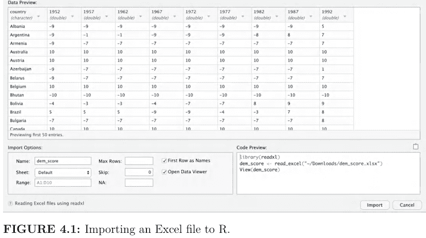

图 4.1：将 Excel 文件导入 R。

## 4.2 整理洁数据

此外，注意图 4.1 右下角的“Code Preview（代码预览）”块。你可以复制并粘贴这段代码，以便以后通过程序重新加载数据，而不是重复这种手动点击的过程。

现在让我们转换一下，学习“整洁（tidy）”数据格式的概念，并来自 `fiftheight` 包的一个具有启发性的示例。`fivethirtyeight` 包（Kim et al., 2021）提供了数据新闻网站 FiveTightyEight.com³ 发表的许多文章中使用的数据集。要查看 `fiftyeight` 包包含的所有 128 个数据集的完整列表，请访问该包：https://fivethirtyeight-r.netlify.app/articles/fivethirtyeight.html。

让我们关注 `drinks` 数据框并查看其前 5 行：

```
# A tibble: 5 x 5

country  beer_servings  spirit_servings  wine_servings

<chr>    <int>           <int>           <int>

1 Afghanistan  0               132              54

2 Albania      89               0               14

3 Algeria     25              217              312

4 Andorra     245              57               45

5 Angola      217                               0

# # i 1 more variable: total_litres_of_pure_alcohol <dbl>
```


运行 `?drinks` 查看帮助文件后你会发现 `drinks` 是一个包含 193 个国家啤酒、烈酒和葡萄酒平均饮用量调查结果的数据框。这些数据最初发表于 Mona。

让我们应用在章节中学到的清洗动词：

- 1. `filter()` 仅考虑
- 2. `select()` 选择除之外的所有列
- 3. `rename(beer_servings, spirit_servings, wine)`

让我们问自己一个问题：“我们如何创建一个并排的柱状图来显示：

| country | beer_servings | spirit_servings | wine_servings |
| :--- | :--- | :--- | :--- |
| Afghanistan | 0 | 132 | 54 |
| Albania | 89 | 0 | 14 |
| Algeria | 25 | 217 | 312 |
| Andorra | 245 | 57 | 45 |
| Angola | 217 | | 0 |”

³ https://fivethirtyeight.com/
⁴ https://fivethirtyeight.com/

# 整洁数据（tidy data）的定义

## 4.2.1 整洁数据的定义

你在生活中一定听过“tidy（整洁）”这个词：

- “把你的房间收拾一下！”
- “作业写得整齐一点，方便提供反馈。”
- 金藤万麻理（Marie Kondo）的畅销书*整理魔法术：改变的人生的日式断舍离收纳法*，以及 Netflix 剧集《整理之道》（Tidying Up with Marie Kondo）⁸

你的数据“整洁”的意味着什么？虽然“tidy”在英语中有“有条理”的明确含义，但在使用 R 语言的科学领域，“tidy”意味着你的数据遵循一种标准化的格式。我们遵循了 Hadley Wickham 对“tidy”数据的定义（Wickham, 2014），如图 4:3 所示：

数据集是值的集合，通常是数字（如果是定量）或字符串文本数据（如果是定性/分类）。这些值以两种方式进行组织。每个值都属于一个变量（variable）和一个观测值（observation）。变量包含跨不同单位测量相同底层属性（如身高、温度、持续时间）的所有值。观测值包含在同一单位（如一个人、一天或一个城市）上跨属性测得的所有值。

“Tidy”数据是将数据集含义映射到其结构的标准方法。根据行、列和表格与观测值、变量和类型的匹配方式，数据集可以可能是杂乱的或整洁的。在整洁数据中：

1. 每个变量形成一列。
2. 每个观测值形成一行。
3. 每种类型的观测单位形成一个表格。

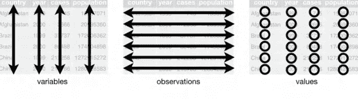

图 4.3：来自《数据科学》（R for Data Science）的整洁数据图示。

> ⁷https://www.powells.com/book/-9781607747307
> ⁸https://www.netflix.com/title/80209379

## 4.2 整洁数据

例如，假设你有表 4.1 所示的股票价格表：

### 表 4.1：股票价格（非整洁格式）

| 日期 | 波音股票价格 | 亚马逊股票价格 | 谷歌股票价格 |
| --- | --- | --- | --- |
| 2009-01-01 | $173.55 | $174.90 | $174.34 |
| 2009-01-02 | $172.61 | $171.42 | $170.04 |

虽然数据是以矩形电子表格格式存在的，但它并不是“整洁的”。这里有三个变量（日期、股票名称和价格），但并没有三个独立的列。在整洁数据中，每个变量都应该有自己的列，如表 4.2 所示。两个表格展示了相同的信息，但格式不同。

### 表 4.2：股票价格（整洁格式）

| 日期 | 股票名称 | 股票价格 |
| --- | --- | --- |
| 2009-01-01 | Boeing | $173.55 |
| 2009-01-01 | Amazon | $174.90 |
| 2009-01-01 | Google | $174.34 |
| 2009-01-02 | Boeing | $172.61 |
| 2009-01-02 | Amazon | $171.42 |
| 2009-01-02 | Google | $170.04 |

另一方面，考虑表 4.3 中的数据。

### 表 4.3：整洁数据示例

| 日期 | 波音价格 | 天气 |
| --- | --- | --- |
| 2009-01-01 | $173.55 | 晴 |
| 2009-01-02 | $172.61 | 多云 |

在这种情况下，尽管变量“Boeing Price”的出现与我们在表 4.1 中的非“整洁”数据一样，但这些数据是“整洁的”，因为对于三个独特的信息（日期、波音价格和当天的天气），都有三个变量。

学习检查

(LC4.1) “整洁”数据框（data frames）的共同特征是什么？

(LC4.2) 什么使得“整洁”数据框对组织数据非常有用？

### 4.2.2 转换为整洁数据

到本书为止，你只看到过已经是“整洁”格式的数据框。此外，在本书的剩余部分中，你也将主要看到已经是“整洁”格式的数据框。世界上上的所有数据集并不总是如此。如果你的原始数据框是宽格式（非整洁）格式，并且你想使用 `ggplot2` 或 `dplyr` 包，你首先必须将其转换为“整洁”格式。为了做到这一点，我们建议使用 `tidyr` 包中的 `pivot_longer()` 函数（Wickham et al., 2024c）。

回到我们之前的 `drinks_smaller` 数据框：

```
drinks_smaller
```

```
# A tibble: 4 x 4

| country | beer spirit wine |

| <chr> | <int> | <int> | <int> |

| China | 79 | 19 | 14 |

| France | 53 | 37 | 30 |

| Japan | 14 | 14 | 43 |

| USA | 141 | 52 | 14 |
```

## 4.2 整洁数据 (Tidy data)

每周的 #TidyTuesday 活动^10 发布了一个数据集，这可能是你寻找其他探索和转换数据的好地方。

## 学习检查

(LC4.3) 查看 `fivefirthirtyeight` 包中包含的 `airline_safety` 数据框。运行以下代码：

```r
airline_safety
```

在运行 `?airline_safety` 阅读帮助文件后，我们看到 `airline_safety` 是一个包含不同航空公司安全记录信息的数据框。这些数据最初发布在数据新闻网站 FiveThirtyEight.com，来自 Nate Silver 的文章《旅行者应该避免乘坐发生过事故的航空公司吗？^11》。为了简单起见，我们只考虑 `airline` 变量以及与死亡人数相关的变量：

```r
airline_safety_smaller <- airline_safety |>
select(airline, starts_with("fatalities"))
airline_safety_smaller
```

```r
# A tibble: 56 x 3

| airline | fatalities_85_99 | fatalities_00_14 |

| <chr> | <int> | <int> |

| 1 Aer Lingus | | |

| 2 Aeroflot | 128 | 88 |

| 3 Aerolineas Argentinas | | |

| 4 Aeromexico | 64 | |

| 5 Air Canada | | |

| 6 Air France | 79 | 337 |

| 7 Air India | 329 | 158 |

| 8 Air New Zealand | | 7 |

| 9 Alaska Airlines | | 88 |

| 10 Alitalia | 50 | |

| # i 46 more rows |
```

> ^10https://github.com/rfordatascience/tidytuesdayday
> ^11https://fivefirtyeight.com/features/should-travelers-avoid-flying-airlines-that-have-had-crashes-in-the-past/

这个数据框并不是“整洁”的格式。你将如何将这个数据框转换为“整洁”格式，特别是让它有一个变量 `fatalities_years`指示事故年份，以及一个表示死亡人数的变量 `count`？

## 4.2.3 nycflights23 包

回想 1.4 节引入的 `nycflights23` 包，它包含了 2023 年从纽约出发的所有国内航班的数据。让我们通过运行 `View(flights)` 重新查看 `flights` 数据框。我们看到 `flights` 是矩形形状，其 435,352 行中的每一行对应一次飞行，22 列中的每一列取决于每条数据的不同特征/测量值。这符合 4.2.1 节中“整洁”数据定义的前两个标准：“每个变量形成一列”和“每个观测值形成一行”。但“整洁”数据的第三个属性“每种类型的观测单元形成一个表”呢？

回想我们在 1.4.3 节中看到的，`flights` 数据框的观测单元是单个单元。也就是说，`flights` 数据框的行指的是单次航班的特征/测量值。`nycflights23` 包还包含了其他数据框，它们的行代表不同的观测单元（Ismay et al., 2024）：

- airlines：两个 IATA 承运人代码与航空公司名称之间的翻译（共 14 个）。观测单元是航空公司。
- planes：使用的 4,840 架飞机中每架飞机的信息，即观测单元是飞机。
- weather：纽约三个机场各的每小时气象数据（约 8,735 次观测值），观测单元是其中一个机场的每小时气象测量值。
- airports：机场名称和位置。观测单元是机场。

这些数据框的信息组织遵循“整洁”数据的第三个属性：相同观测单元的观测值应该保存在同一个表中（即同一个数据框）。你可以将这一属性理解为英语谚语：“物以类聚”（birds of a feather）。

## 4.3案例研究：危地马拉拉的民主

在本节中，我们将展示另一个示例，如何将不是“整洁”格式（宽格式）的数据框转换为“整洁”格式（长格式/窄格式）。我们将再次使用 `tidyr` 包中的 `pivot_longer()` 函数来实现这一点。

此外，我们将使用 `ggplot` 和 `dplyr` 包中的函数制作一张时间序列图，显示危地马拉拉的民主得分从 1952 年到 1992 年的变化。回想我们在 2.4 节中通过 `geom_line()` 创建的时间序列图。让我们使用 4.1 节导入的 `dem_score` 数据框，但只关注对应危地马拉的数据。

```r
guat_dem <- dem_score |
filter(country == "Guatemala")
guat_dem
```

```r
# tibble: 1 x 10

| country | 1952* | 1957* | 1962* | 1972* | 1977* | 1982* | 1987* | 1992* |

| :--- | :--- | :--- | :--- | :--- | :--- | :--- | :--- | :--- |

| <chr> | <dbl> | <dbl> | <dbl> | <dbl> | <dbl> | <dbl> |

| Guatemala | 2 | -6 | -5 | 3 | 1 | -3 | -7 | 3 |
```

让我们看看 2.1 节中看到的图形语法。现在我们需要设置 `data = guat_dem` 并使用 `geom_line()` 层，但变量的审美映射是什么呢？我们想看到民主得分随年份的变化，因此我们需要将：

- `year` 映射到 x 轴位置
- `democracy_score` 映射到 y 轴位置

现在我们陷入了困境，就像名为 `country` 的变量一样，但它的值只有 "Guatemala"。我们有由不同年份表示变量。遗憾的是，`guat_dem` 数据框不是整洁的，因此不符合应用图形法的格式，我们尚不能使用 `ggplot2` 包。我们需要将 `guat_dem` 中对应年份的列值转换为名为 `year` 的新变量。此外，我们需要将数据框中的民主得分值转换为名为 `democracy_score` 的新变量。我们得到的数据框将有三列：`country`、`year` 和 `democracy_score`。记得 `tidyr` 包中的 `pivot_longer()` 函数为我们完成了这一操作：

```r
guat_dem_tidy <- guat_dem |>
pivot_longer(names_to = "year",
values_to = "democracy_score",
cols = "-country",
names_transform = list(year = as.integer))
guat_dem_tidy
```

```r
# A tibble: 9 x 3

| country year democracy_score |

| <chr> <int> <dbl> |

| Guatemala 1952 2 |

| Guatemala 1957 -6 |

| Guatemala 1962 -5 |

| Guatemala 1972 3 |

| Guatemala 1977 1 |

| Guatemala 1982 -3 |

| Guatemala 1987 -7 |

| Guatemala 1992 3 |
```

我们如下设置到 `pivot_longer()` 的参数：

- `names_to`：整洁数据框中包含原始数据名称的变量名。我们观察如何设置 `names_to = "year"`。在结果 `guat_dem_tidy` 中，该列包含了测量危地马拉民主得分的年份。
- `values_to`：整洁数据框中包含原始数据值的变量名。我们观察如何设置 `values_to = "democracy_score"`。在结果的 `1 x 9` 中，民主得分作为值。
- 第三个参数：你想要整洁或不想“整洁”的列。我们将其设置为 `cols = -country`，表示不对整洁 `country` 变量，而是处理 1952 年到 1992 年。
- `names_transform` 的最后一个参数告诉 R 变量 `year` 应该是什么类型。如果不像我们做的那样指定它是整数，`pivot_longer()` 默认将其设置为字符值。

现在，我们创建图 4.5 中的时间序列图，使用 `geom_line()` 可视化危地马拉民主得分从 1952 年到 1992 年的变化。此外，我们将使用 `ggplot2` 包中的 `labs()` 函数为图的所有 `aes()` 属性添加信息性标签，在本例中为 x 和 y 位置。

```r
ggplot(guat_dem_tidy, aes(x = year, y = democracy_score)) +
geom_line() +
labs(x = "Year", y = "Democracy Score")
```

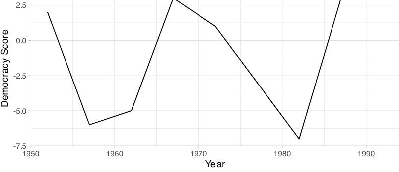

图 4.5：1952-1992 年危地马拉的民主得分。

注意，如果我们忘记包含 `names_transform` 参数来指定 year 不是字符格式，在这里我们将得到错误，因为 `geom_line()` 不知道如何正确排序字符值。

## 4.4 tidyverse 包

注意在章节开始时我们加载了以下四个包，它们是数据科学中最常用的四个 R 包之一：

## 4.4 数据导入与整洁数据

```r
library(ggplot2)
library(dplyr)
library(readr)
library(tidyr)
```

请记住，ggplot2 用于数据可视化，dplyr 用于数据清洗，readr 用于将电子表格数据导入 R，而 tidyr 用于将数据转换为“整洁”（tidy）格式。与其逐个安装和加载这些包，有一种更快的方法可以加载这些包，即安装并加载 tidyverse 包。tidyverse 包充当“伞型”包，安装/加载它会一次性为你安装/加载多个包。

在按照第 1.3 节所示安装普通包一样安装 tidyverse 包后，运行：

```r
library(tidyverse)
```

等同于运行：

```r
library(ggplot2)
library(dplyr)
library(readr)
library(tidyr)
library(purr)
library(tibble)
library(stringr)
library(forcats)
```


`purrr`、`tibble`、`stringr` 和 `forcats` 留给了更高级的书籍；请查阅 [R for Data Science12](https://r4ds.had.co.nz/) 来了解这些包。

在本书的剩余部分，我们每章开始时都会运行 `library(tidyverse)`，而不是逐个加载各种组件包。`tidyverse`“伞型”包的名称源于其所有包中的所有函数都被设计为具有共同输入和输出：“整洁”格式的数据框。这种输入输出数据框的标准化使得不同包之间不同函数之间的切换尽可能无缝。需更多信息，请查看该包的 [tidyverse.org13](https://www.tidyverse.org/) 网页。

12 http://r4ds.had.co.nz/ 
13 https://www.tidyverse.org/

## 4.5 结论

### 4.5.1 其他资源

所有学习检查（Learning checks）的解答可以在本书在线版的附录中找到。附录从 https://moderndrive.com/v2/appendixa 开始。

本章使用的所有 R 代码的 R 脚本文件可以在 https://www.modernrive.com/v2/scripts/04-tidy.R 获取。

如果你想学习更多关于 `readr` 和 `tidyr` 包的知识，我们建议你查阅 RStudio 的“数据导入备忘表”（Data Import Cheat Sheet）。在 2024 年版本的 RStudio 中，你可以通过 RStudio 菜单栏 -> Help -> Cheat Sheets... 进入此备忘表。向下滚动到“Data import with reader, readxl, and googlesheets4”获取有关使用 `readr`、`readxl` 和 `googlesheets4` 包导入数据的信息，以及“Data tidying with tidyr”获取有关使用 `tidyr` 包“整洁”数据的信息。

### 4.5.2 未来何方？

恭喜你！你已经完成了本书的“使用 tidyverse 进行数据科学”部分。现在我们将第 5 章和第 6 章进入本书的“使用 moderndrive 进行统计建模”部分，在那里，你将利用数据可视化和清洗技能来掌握数据框中不同变量之间的关系。

然而，我们将第 10 章的“回归推断”留到我们在第 7、8、9 章涵盖了统计推断之后再进行。如图 4.6 所示，让我们向着统计/数据建模迈进！

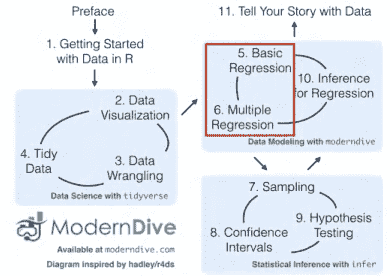

图 4.6：ModernDive 流程 —— 进入第二部分！


## 第二部分

## 使用 moderndive 进行统计建模

## 简单线性回归

我们在第 2 章介绍了数据可视化，在第 3 章介绍了数据清洗，在第 4 章介绍了数据导入和“整洁”数据。在本章中，我们将处理回归，这种方法可以帮助我们研究结果变量（或响应变量）与一个或多个解释变量（或回归变量）之间的关系。该方法首先提出一个统计模型。收集数据并用于估计系数，结果通常用于两个目的：

1. **为了解释（For explanation）**：当我们想要描述一个或多个回归变量的变化与响应的变化相关、量化这些变化、确定哪些回归变量确实与响应相关，或者确定描述响应与解释变量之间关系的模型是否合适时。
2. **为了预测（For prediction）**：当我们想要根据回归变量的观测值来确定响应的值将会是多少。我们并不关心所有回归变量之间以及它们与响应之间如何相互作用，我们只需要尽可能好的预测。

作为一个示例，假设我们想研究血压与潜在风险因素（如每日盐摄入量、年龄和活动水平）之间的关系。响应是血压，回归变量是风险因素。如果我们使用线性回归进行解释，我们想要确定减少盐分摄入对血压是否有真实影响，或者个人在减少盐分摄入时血压会下降多少。

最基本且最常用的回归类型是线性回归。线性回归涉及一个数值响应和一个或多个可以是数值或分类的回归变量。它被称为线性，是因为描述响应和回归变量的统计模型被假设是线性的。线性回归是几乎任何其他类型回归的基础。

## 5.1 单个数值解释变量

在介绍简单线性回归所需的模型之前，我们先展示一个示例。为什么某些国家呈现出高生育率，而另一些国家则低得多？不同大陆和国家之间的生育率与预期寿命是否存在相关性？潜在的社会经济因素是否会影响这些趋势？

这些都是人口统计学家和政策制定者感兴趣的问题，因为理解生育率对于规划和发展至关重要。通过分析联合国成员国的数据集（该数据集包含国家代码 (ISO)、2022 年的生育率和预期寿命等变量），研究人员可以揭示模式并根据预期寿命对生育率进行预测。

在本节中，我们将解释作为单一数值变量（预期寿命）函数的生育率差异。是否可能存在：预期寿命较高的国家生育率较低？还是预期寿命较高的国家倾向于具有更高的生育率？或者预期寿命与生育率之间可能没有关系？我们将通过使用简单线性回归对生育率与预期寿命之间的关系建模来回答这些问题，其中：

- 1. 一个数值结果变量 `$y$`（国家的生育率）和
- 2. 单个数值解释变量 `$x$`（国家的预期寿命）。

### 5.1.1 探索性数据分析

当前的 193 个联合国成员国（截至 2024 年）的数据可以在 `moderndify` 包包含的 `un_member_states_2024` 数据框中找到。然而，为了保持简单，我们使用 `na.omit()` 包含不含缺失数据的行，并使用 `select()` 选择在本章中考虑的变量子集，并将此数据存在名为 `UN_data_ch5` 的新数据框中：

```r
UN_data_ch5 <- un_member_states_2024 |>
  select(iso,
    life_exp = life_expectancy_2022,
    fert_rate = fertility_rate_2022,
    obes_rate = obesity_rate_2016) |>
  na.omit()
```

在进行任何分析或建模之前，关键步骤是进行探索性数据分析，简称 EDA。EDA 可以让你对数据中单个变量的分布有所了解，变量之间是否存在潜在关系、是否存在离群值和/或缺失值，以及（最重要的是）如何构建你的模型。以下是 EDA 的三个常用步骤：

- 1. 最关键的一点，查看原始数据值。
- 2. 计算汇总统计量，如平均值、中位数最大值。
- 3. 创建可视化。

我们执行探索性数据分析的第一个常用步骤：查看原始数据值。由于这看起来是微不足道，遗憾的是，许多分析师忽略了它。然而，早期了解原始数据的状况通常可以避免未来的许多问题。

你可以使用 RStudio 的电子表格查看器，或使用在 1.4.3 节关于探索数据框中介绍的 `glimpse()` 函数来实现：

```r
glimpse(UN_data_ch5)
Rows: 181
Columns: 4
$ iso <chr>"AFG", "ALB", "DZA", "AGO", "ATG", "ARG", "ARM", "AUS",~
$ life_exp <dbl> 53.6, 79.5, 78.0, 62.1, 77.7, 78.3, 76.1, 83.1, 82.3, 7~
$ fert_rate <dbl> 4.3, 1.4, 2.7, 5.0, 1.6, 1.9, 1.6, 1.6, 1.5, 1.4, 1~~
$ obese <dbl> 5.5, 21.7, 27.4, 8.2, 18.9, 28.3, 20.2, 29.0, 20.1, 19.~
```

观察到 `Rows: 181` 表示在过滤掉缺失值后，`UN_data_ch5` 中有181 行/观测值，每行对应一个观测国家/成员国。需要注意的是，观测单位是单个国家。回想 1.4.3 节，观测单位是我们的变量所测量的“类型”。

可以通过阅读相关文件找到 `un_member_states_2024` 中包含的所有变量的完整描述（在控制台中运行 `?un_member_states_2024`）。让我们只描述我们在 `UN_data_ch5` 中选择的 4 个变量：

- 1. `iso`：用于区分过滤后数据集中 181 个国家的标识变量。
- 2. `fert_rate`：一个数值变量，代表国家 2022 年的生育率，对应于育龄期每个女性预期产数量。这是我们感兴趣的结果变量 `$y$`。
- 3. `life_exp`：一个数值变量，代表国家 2022 年平均预期寿命（单位：年）。这是我们感兴趣的主要变量 `$x$`。
- 4. `obes_rate`：一个数值变量，代表国家 2016 年的肥胖率。这将在本节中使用的另一个解释变量 `$x$`。

查看原始数据的另一种方法是通过将 `UN_data_ch5` 传递给 `slice_sample()` 函数来选择选择行的随机样本。在这里我们将 `n` 参数设置为 5，表示我们需要 5 行的随机样本。我们在表 5.1 中显示结果。由于抽样的性质，你将得到不同的子集。

```r
UN_data_ch5 |>
  slice_sample(n = 5)
```

表 5.1：181 个国家（无缺失数据）的随机样本

| life_exp | fert_rate | obese_rate |
|---|---|---|
| 75.5 | 1.4 | 20.8 |
| 77.8 | 1.7 | 23.3 |
| 73.8 | 1.9 | 21.1 |
| 75.5 | 1.9 | 21.5 |
| 73.1 | 2.1 | 20.9 |

我们已经看了 `UN_data_ch5` 中的原始值并对数据有了初步了解。现在我们可以计算汇总统计量。我们首先使用 `dplyr` 中的 `summarize()` 函数计算 `life_exp` 和 `fert_rate` 变量的平均值中位数。然而，如果我们需要其他汇总统计量（例如标准差），也可以计算它们。

`tidy_summary()` 函数只返回所谓的单变量汇总统计量：接收单个变量并返回该变量的数值汇总的函数。然而，也存在双变量汇总统计量：接收两个变量并返回这些变量汇总的函数。

特别是当两个变量都是数值型时，我们可以计算相关系数。通常来说，系数是特定现象的定量表达式。相关系数是两个数值变量之间线性关系强度的定量表达式。它的值范围在 -1 到 1 之间，其中：

- -1 表示完美的负相关：随着一个变量增加，另一个变量的值倾向于下降，遵循直线。
- 0 表示没有关系：两个变量的值独立地增加/减少。
- +1 表示完美的正相关：随着一个变量的值增加，另一个变量也倾向于以线性方式增加。

图 5.1 给出了假设性数值变量 `$x$` 和 `$y$` 的九种不同相关系数值的示例。

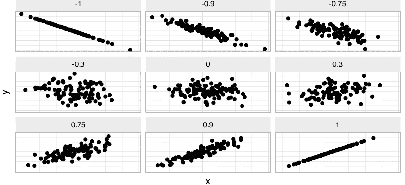

图 5.1：九种不同的相关系数。

## 122 5 简单线性回归

例如，观察右上角的图表，当相关系数为 -0.75 时，`$x$` 和 `$y$` 之间存在负线性关系，但其强度不如相关系数为 -0.9 或 -1 时 `$x$` 和 `$y$` 之间的负线性关系强。

可以使用 `tidyverse` 包中的 `get_correlation()` 函数来计算相关系数。在这种情况下，该函数的输入是我们想要计算相关系数的两个数值变量。

我们将结果变量的名字放在 `~` “波浪号”符号的左侧，而将解释变量的名字放在右侧。这被称为 R 的公式表示法（R’s formula notation）。我们将在本章随后的内容中使用这种“公式”语法进行回归分析。

```r
UN_data_ch5 |>
get_correlation(formula = fert_rate ~ life_exp)
```

```r
# A tibble: 1 x 1
cor
<dbl>
1 -0.812
```

计算相关性的另一种方法是在 `summarize()` 内部使用 `cor()` 汇总函数：

```r
UN_data_ch5 |>
summarize(correlation = cor(fert_rate, life_exp))
```


在我们案例中，`-0.812`的相关系数表明生育率和寿命之间的关系是“中度负”。在解释相关系数时存在一定的主观性，特别是那些不接近 `-1`、`0` 和 `1` 等极端值的系数。为了培养对相关系数的直觉，可以尝试第 5.4.1 节提到的 20 世纪风格的“猜猜相关性”视频游戏。

我们执行探索性数据分析（EDA）的最后一步：创建数据可视化。由于 `fert_rate` 和 `life_exp` 变量都是数值型的，散点图是可视化这种关系的合适图表。我们使用 `geom_point()` 实现此，并在图 5.2 中显示结果。此外，为了防止点重叠（overplotting），我们将 alpha 值设置为 `0.1`。

```r
ggplot(UN_data_ch5,
  aes(x = life_exp, y = fert_rate)) +
  geom_point(alpha = 0.1) +
  labs(x = "Life Expectancy", y = "Fertility Rate")
```

## 5.1 一个数值解释变量

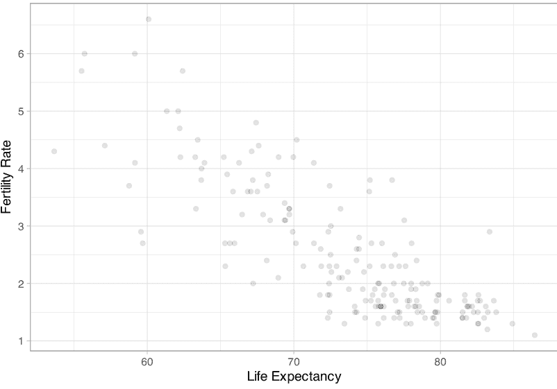

**图 5.2：** 寿命与生育率关系的散点图。

由于点与点之间几乎没有重叠，我们没有丢失信息。大多数寿命条目似乎落在 70 到 80 岁之间，而大多数生育率条目落在在 1.5 到 3.5 次出生之间。此外，尽管观点可能存在差异，但我们认为生育率与寿命之间的关系是“中度负”的。这与我们之前计算的 `-0.812` 相关系数是一致的。

我们在图 5.2 的散点图的基础上添加了一条“最佳拟合”线：在我们可以在此散点图上画出的所有线中，它是“最”拟合点云分布的那条线。我们通过在创建图 5.2 散点图的 `ggplot()` 代码中添加一个新的 `geom_smooth(method = "lm", se = FALSE)` 层来实现这一点。`method = "lm"` 参数将线设置为“线性模型”。`se = FALSE` 参数抑制了标准误差不确定性条形。我们将在第 7.3.4 节定义标准误差的概念。

```r
ggplot(UN_data_ch5, aes(x = life_exp, y = fert_rate)) + 
  geom_point(alpha = 0.1) + 
  labs(x = "Life Expectancy",
      y = "Fertility Rate",
      title = "Relationship of life expectancy and fertility rate") + 
  geom_smooth(method = "lm", se = FALSE)
```

## 寿命与生育率的关系

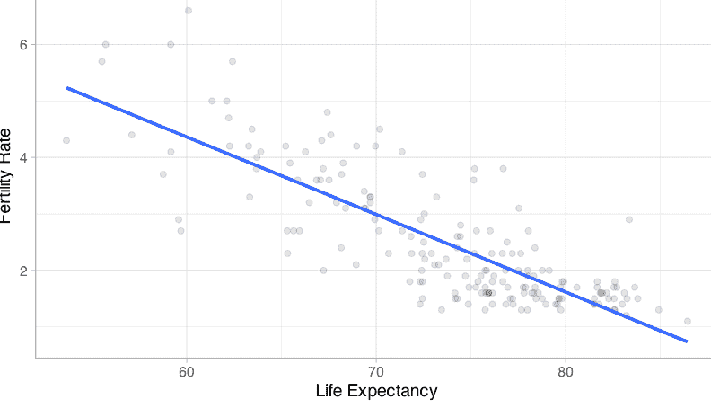

**图 5.3：** 带有回归线的寿命与生育率散点图。

生成的图 5.3 中的线被称为“回归线”。回归线是两个数值变量之间关系的视觉化总结，在我们案例中，即结果变量 *fert_rate* 和解释变量 *life_exp*。蓝色线的负斜率与我们早期观察到的 `-0.812` 相关系数一致，表明这两个变量之间存在负相关：随着国家的人口寿命增加，其生育率往往会降低。然而，我们稍后会看到，虽然相关系数和回归线的斜率符号始终相同（正或负），但它们的值通常并不相同。

此外，回归线之所以是“最佳拟合”的，是因为它最小化某些数学标准。我们将在第 5.3.2 节中介绍这些数学标准，但我们建议您在读完本节关于“一个数值解释变量回归”的其他部分后，再阅读此小节。

## 学习检查

**(LC5.1)** 进行一次新的探索性数据分析，相同的结果变量 `$y$` 仍为 *fert_rate*，但使用 *obes_rate* 作为新的解释变量 `$x$`。记住，这涉及三个方面：：

- (a) 查看数据。
- (b) 计算统计数据。
- (c) 创建可视化。

- (a) 查看数据。
- (b) 计算统计数据。
- (c) 创建可视化。

**(LC5.2)** 执行 EDA 的主要目的是？

- A. 预测未来。
- B. 理解关系。
- C. 创建变量。
- D. 生成样本。

**(LC5.3)** 关于相关系数，哪项是正确的？

- A. 范围从 -2 到 2。
- B. 它仅衡量强度。
- C. 范围从 -1 到 1。
- D. 它始终为零。

## 5.2 回归

我们可以通过两个步骤获取 `$b_0$` 的值和 `life_exp` 的斜率：

- 我们首先使用 `lm()` 拟合模型并保存在 `demographics_model` 中。
- 我们通过应用 `coef()` 获取系数。

```r
# 拟合回归：
demographics_model <- lm(fert_rate ~ life_exp,
                          data = UN_data_ch5)

# 获取回归系数
coef(demographics_model)
```

系数为 `$b_0 = 12.599$`，斜率 `$b_1 = -0.137$`。因此图 5.3 中的方程如下：

$$\hat{y} = b_0 + b_1 \cdot x$$
$$fertility\_rate = 12.599 + (-0.137) \cdot life\_expectancy$$

截距 `$b_0 = 12.599$` 是寿命 `life_exp` 为 0 的国家的平均生育率 `$\hat{y} = fertility_rate$`。在图形术中，即直线在 `$x=0$` 时与 `$y$` 轴的交点。然而，直线截距的国家 `life_exp` 为 0 是可能的。

## 5.1 一个数值解释变量

我们只说明存在一种关联性的增长，而并不一定是因果关系。例如，可能并不是较高的预期寿命直接导致了较低的生育率。相反，可能是这样的：富裕国家往往拥有更强大的背景、更好的健康状况、更高的生活水平以及较低的生育率，同时这些富裕国家往往也有较高的预期寿命。换句话说，仅仅因为两个变量之间强相关，并不意味着一个会导致另一个。这被总结为经常被引用的这句话：“相关性不等于因果关系”。我们将在 5.3.1 节中进一步讨论这一观点。

此外，我们说这种关联性的下降平均为 `0.137` 个 `fert_rate` 单位，因为你可能有两个 `life_exp` 值相差为 1 的国家，但它们的生育率差异可能并不正好是 `-0.137`。斜率 `-0.137` 的意思是，在所有可能的国家中，预期寿命相差一个的国家之间的生育率平均差异为 `-0.137`。

现在我们已经学会了如何使用模型值计算图 5.3 中回归线的方程，以及如何解释所得截距和斜率，让我们重新查看生成这些系数的代码：

```r
# Fit合回归模型;
demographics <- lm(fert_rate ~ life_exp,
ndata = UN_data_ch5)

# 获取回归系数;
coef(demographics_model)
```

我们使用 `lm()` 函数将线性回归模型“拟合”到数据，并将其保存为 `demographics_model`。当我们说“拟合”（fit）时，我们的意思是“找到一条与这些数据最匹配的直线”。`lm()` 代表“线性模型”（linear model），用法如下：`lm(y ~ x, data = data_frame_name)`，其中：

- y 是结果变量，后面跟着一个波浪号 `~`。`y` 设置为 `fert_rate`。
- x 是解释变量。在我们的案例中，x 设置为 `life_exp`。
- `y ~ x` 的组合被称为模型公式。（请注意 `y` 和 `x` 的顺序）。在我们的案例中，模型公式是 `fert_rate ~ life_exp`。我们之前在 5.1.1 节使用 `get_correlation()` 函数计算相关系数时就见过此类公式。
- `data_frame_name` 是包含变量 `y` 和 `x` 的数据框名称。在我们的案例中，是 `UN_data_ch5` 数据框。

其次，我们提取保存的 `demographics_model` 模型并应用 `coef()` 函数来获取回归系数。这给了我们回归方程线的组成部分：截距 `$b0$` 和斜率 `$b1$`。

## 学习检查

(LC5.4) 使用 `lm(fert_rate ~ obes_rate, data = UN_data_c5)` 拟合一个新的简单线性回归，其中 `obes_rate` 是新的解释变量 `$x$`。通过应用 `coef()` 函数从回归系数获取关于“最拟合”线的信息。回归结果与你之前的探索性数据分析结果如何匹配？

(LC5.5) 在简单线性回归模型中，截距项 `$b_0$` 代表什么？

- A. 解释变量变化一个单位时结果变量的变化。
- B. 当解释变量为零时结果变量的预测值。
- C. 回归的标准误。
- D. 结果与解释变量之间的相关性。

(LC5.6) 下列哪项最描述简单线性回归线的“斜率”？

- A. 结果变量增加一个单位时解释变量的增加。
- B. 解释变量的平均值。
- C. 解释变量增加一个单位时结果变量的变化。
- D. 结果变量的最小值。

(LC5.7) 简单线性回归中的负斜率表示什么？

- A. 随着解释变量增加，结果变量减少。
- B. 随着结果变量增加，解释变量保持不变。
- C. 相关系数为零。
- D. 随着解释变量增加，结果变量增加。

## 5.1.3 观测值/拟合值和残差

我们刚刚看到了如何从 `coef()` 函数的输出获取回归线的截距和斜率值。现在我们需要关于单个观测值的信息。例如，我们关注表 5.2 中 `UN_data_ch5` 数据框中181 个国家中的第 21 个。这对应于联合国成员国波斯尼亚和黑塞哥哥（BIH）。

### 表 5.2：193 个国家中 21 世纪的数据

| iso | life_exp | fert_rate | obes_rate |
|---|---|---|---|
| BIH | 78 | 1.3 | 17.9 |

对应该国 `life_exp` 值为 77.98 的回归线上的值 `$\hat{y}$` 是多少？在图 5.4 中，我们标记了与波斯尼亚和黑塞哥维这些结果对应的三个值，并给出了它们的统计说明：

- 圆圈：观测值 `$y=1.3$` 是该国家的实际生育率。
- 正方形：拟合值 `$\hat{y}$` 是 `$x = life\exp = 77.98$` 时回归线上的值，通过上一个回归表中的截距和斜率计算：`$\hat{y} = b_0 + b_1 \cdot x = 12.599 + (-0.137) \cdot 17.98 = 1.894$`
- 箭头：此箭头的长度是残差，通过从观测值 `$y$` 中减去拟合值计算。残差可以被认为是模型对特定观测值的误差或“拟合欠缺”。在该国的情况下，它是 `$y-\hat{y} = 1.3 - 1.894 = -0.594$`。

### 生育率与预期寿命的关系
img/445742518041017e8f01f11b0c3190d9_png

FIGURE 5.4：观测值、拟合值和残差的示例。

# 5 简单线性回归

(LC5.10) 关于简单线性回归模型中的回归线，以下哪种描述是正确的？

- A. 回归线代表了结果变量的平均值。
- B. 回归线最小化观测值与预测值之间的平方差和。
- C. 回归线的斜率始终为零。
- D. 只有当变量之间没有相关性时，回归线才有用。

# 5.2 一个分类解释变量

世界上各国的预期寿命并不相同，这是一个令人遗憾的事实。国际开发机构致力于研究这些预期寿命的差异，以确定政府应该在哪些问题上分配资源。在本节中，我们通过两种方式探索预期寿命的差异：

- 大洲间的差异：世界上六个有居民居住的大洲（非洲、北美、南美洲、亚洲、欧洲和大洋洲）之间的平均预期寿命是否存在显著差异？
- 大洲内部的差异：世界五大洲内部的预期寿命是如何变化的？例如，非洲国家之间预期寿命的差异程度是否大于亚洲国家之间的差异程度？

为了回答这些问题，我们使用了 gapminder 数据框的更新版本，我们在 2.1.2 节关于图形语法的图 2.1 中可视化过该数据。我们在在本章之前处理过的更新数据 `un_member_states_2024` 包含在 modernverse 包中。该数据集包含了 193 个国家在 2024 年附近的国际开发统计数据，如预期寿命、人均 GDP 和人口。

我们再次使用这些数据进行基础回归，但现在使用的是分类型解释变量 `$x$`，而不是我们在第 5.1 节中使用的数值型解释变量模型。

- 数值型结果变量 `$y$`（国家的预期寿命）以及
- 单个分类解释变量 `$x$`（国家所属的大洲）。

当解释变量 `$x$` 为分类变量时，“最佳拟合”回归的概念与我们之前在 5.1 节看到的（解释变量 `$x$` 为数值型）略有不同。我们将在 5.2.2 节中详细研究这些差异，但我们首先进行探索性数据分析。

### 5.2.1 探索性数据分析

193 个国家的数据可以在 moderndive 包中包含的 `un_member_states_2024` 数据框中找到。然而：

```r
gapminder2022 <- un_member_states_2024 |
  select(country, life_exp = life_expectancy_2022, continent,
         gdp_per_capita) |>
  na.omit()
```

我们执行探索性数据分析中的第一个常用步骤：查看原始数据值。你可以通过使用 RStudio 的电子表格查看器或使用 1.4.3 节在探索数据框中介绍的 `glimpse()` 命令来完成：

```r
glimpse(gapminder2022)
```


```
Rows: 188
Columns: 4
$ country <chr> "Afghanistan", "Albania", "Algeria", "Andorra", "..."
$ life_exp <dbl> 53.6, 79.5, 78.0, 83.4, 62.1, 77.8, 78.3, 76.1, 83...
$ continent <fct> Asia, Europe, Africa, Europe, North America...
$ gdp_per_capita <dbl> 356, 6810, 4343, 41993, 3000, 19260, 13651, 7018...
```

注意观察 `Rows: 188` 表示 `gapminder2022` 中有 188 行/观测值，其中每行对应一个国家。换句话说，*观测单元*是一个独立的国家。此外，观察到变量 `continent` 的类型为 `<fct>`，代表 *factor*（因子），这是 R 编码分类变量的方式。

通过阅读相关的帮助文件，可以找到 `un_member_states_2024` 中所有变量的完整描述（在控制台中运行 `un_member_states_2024`）。然而，我们只完整描述了在 `gapminder2022` 中选出的 4 个变量：

- 1. `country`：一种字符型/文本类型的标识变量，用于区分数据集中的 142 个国家。
- 2. `life_exp`：该国出生时预期寿命的数值型变量。这是我们感兴趣的结果变量 `$y$`。
- 3. `continent`：一个具有五个层级的分类变量。“levels”对应于可能的类别：非洲、亚洲、美洲、欧洲和大洋洲。这是我们感兴趣的解释变量 `$x$`。
- 4. `gdp_per_capita`：该国按通货膨胀调整后的美元计算的人均 GDP 数值型变量，我们将在本节末尾的学习检查中将其作为另一个结果变量 `$y$`。

接下来，我们查看表 5.4 中从 188 个国家中随机抽取的三个国家样本。

```r
gapminder2022 |> sample_n(size = 3)
```

# 表 5.4：从 193 个国家中随机抽取的 5 个国家样本

| country | life_exp | continent | gdp_per_capita |
|---|---|---|---|
| Panama | 77.6 | North America | 17358 |
| Micronesia, Federated States of | 74.4 | Oceania | 3714 |
| Burundi | 67.4 | Africa | 259 |
| United Arab Emirates | 79.6 | Asia | 53708 |
| India | 67.2 | Asia | 241 |

随机抽样可能会产生不同的 3 行子集。现在我们已经查看了 `gapminder2022` 数据框中的原始值并对数据有了初步了解，现在计算统计量。我们再次应用 modernverse 包中的 `tidy_summary()`。回顾该函数接收一个数据框，进行汇总并返回常见的统计量。我们获取 `gapminder2022` 数据框，选择结果和大洲，并将它们传递给 `tidy_summary()`：

```r
gapminder2022 |> select(life_exp, continent) |> tidy_summary()
```

# 表 5.5：预期寿命摘要

| column | n | type | min | Q1 | median | Q3 | max | sd |
|---|---|---|---|---|---|---|---|
| life_exp | 188 | numeric | 53.6 | 69.4 | 75.2 | 78.4 | 89.6 | 11.9 |
| Africa | 44 | fct | | | | | | |
| Asia | 53 | fct | | | | | | |
| Americas | 39 | fct | | | | | | |
| Europe | 36 | fct | | | | | | |
| Oceania | 14 | fct | | | | | | |

我们看到数据是左偏的，也称为负偏：一些预期寿命较低国家拉了平均值。然而，中位数对异常值的影响不敏感；中位数大于平均值。

记住，我们想要在大洲之间和内部比较预期寿命。换句话说，我们的可视化需要某种大洲的概念。我们可以很容易地通过分面直方图来实现。回顾 2.6 节，分面（facets）允许根据另一个变量的不同值分割可视化图形。通过添加 `facet_wrap(~ continent, nrow = 2)`，我们在图 5.7 中展示了生成的可视化结果。

```r
ggplot(gapminder2022, aes(x = life_exp)) +
  geom_histogram(binwidth = 5, color = "white") +
  labs(x = "Number of countries",
       title = "Histogram of distribution of worldwide expectancies") +
  facet_wrap(~ continent, nrow = 2)
```


**图 5.6：**2022 年预期寿命分布直方图。

## 5.2 一个分类变量

回想一下通过分类变量可视化数值划分分布的另一种方法是使用并列箱线图（side-by-side boxplot）。在图 5.8 中，我们将分类变量 `continent`（大陆）映射到 x 轴，并将每个地区的预期寿命映射到 y 轴。

```r
ggplot(gapminder2022, aes(x = continent, y = life_exp)) +
geom_boxplot(x) + 
labs(x = "Continent",
  y = "Life expectancy",
  title = "Life expectancy by continent")
```

### 各地区的预期寿命

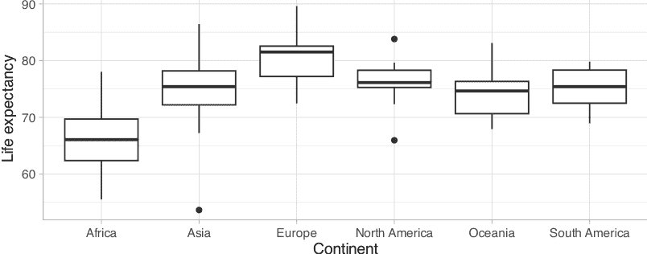

**图 5.8：**2022年各地区的预期寿命（箱线图）。

有些人倾向于使用箱线图比较分类变量不同水平之间数值变量的分布，而不是使用分面直方图。这是因为我们可以通过想象的水平线对分类变量的不同水平进行快速比较。例如，观察图 5.8，我们可以通过在 y = 81 附近画一条想象的线，快速地确信欧洲的中位数预期寿命最高。此外，正如我们在分面直方图图 5.7 中观察到的，非洲和亚洲的预期寿命变化最大，这从它们的高四分位距（箱体的大小）中得到了证明。

重要的是，箱体中间的实线对应于中位数（中间值），而不是平均值（平均数）。例如，如果你观察亚洲，实线表示约 75 年的中位数预期寿命。这告诉我们，亚洲有一半的国家预期寿命低于 75 年，而另一半则高于 75 年。我们通过少量的数据处理计算了每个地区的中位数平均预期寿命，并将结果显示在表 5.6 中。

简单线性回归

```r
life_exp_by_continent <- gapminder2022 |> 
group_by(continent) |>
summarize(median = median(life_exp), mean = mean(life_exp))
life_exp_by_continent
```

### 表 5.6：各地区的预期寿命

| continent | median | mean |
|---|---|---|
| Africa | 66.1 | 66.3 |
| Asia | 75.4 | 75.0 |
| Europe | 81.5 | 79.9 |
| North America | 76.1 | 76.3 |
| Oceania | 74.6 | 74.4 |
| South America | 75.4 | 75.2 |

观察第二列中位数预期寿命的顺序：非洲最低，欧洲最高，其他地区的中位数介于非洲和欧洲之间。这种排序与我们并列图图 5.8 中箱体内部黑色实线的顺序对应。

现在我们将注意力转到第三列的平均值上。以非洲 66.31 年的平均预期寿命作为比较基准，我们开始与其他四个地区的平均预期寿命进行比较，并将这些值放入表 5.7 中，我们将在本节稍后重新回顾该表。

- 对于亚洲，高出 74.95 - 66.31 = 8.64 年。
- 对于欧洲，高出 79.91 - 66.31 = 13.6 年。
- 对于北美，高出 76.29 - 66.31 = 9.98 年。
- 对于大洋洲，高出 74.42 - 66.31 = 8.11 年。
- 对于南美，高出 75.23 - 66.31 = 8.92 年。

### 表 5.7：各地区的平均预期寿命以及相对于非洲的差异

| continent | mean | Difference versus Africa |
|---|---|---|
| Africa | 66.3 | 0.00 |
| Asia | 75.0 | 8.64 |
| Europe | 79.9 | 13.60 |
| North America | 76.3 | 9.99 |
| Oceania | 74.4 | 8.11 |
| South America | 75.2 | 8.92 |

## 5.2 一个分类解释变量

### 学习检查

(LC5.11) 进行一次新的探索性数据分析，使用相同的解释变量 `x`（`continent`），但将 `gdp_per_capita` 作为结果变量 `y`。根据这一探索，你可以看到不同大陆之间人均 GDP 的什么差异？

(LC5.12) 在回归中使用分类解释变量时，基准组（baseline group）代表什么？

- A. 平均值最高的组
- B. 选择与其他所有组进行比较的组
- C. 数据点最多的组
- D. 标准差最低的组

### 5.2.2 线性回归

在 5.1.2 节中，我们介绍了简单线性回归，它涉及对数值结果变量 `y` 与数值解释变量 `x` 之间关系的建模。在预期寿命示例中，我们拥有的是分类解释变量。我们的模型不会产生像图 5.3 那样的“最佳拟合”回归线，而是产生相对于基准的偏移量。

正如我们在 5.1.2 节中研究生育率与预期寿命的关系时的那样，我们输出该模型的回归系数。这通过两个步骤完成：

1. 首先使用 `lm(y ~ x, data)` “拟合”线性回归模型并保存到 `life_exp_model` 中。
2. 通过对 `life_exp_model` 应用 `coef()` 函数获取回归系数。

```r
life_exp_model <- lm(life_exp ~ continent, data = gapminder2022)
coef(life_exp_model)
```

| (Intercept) | continentAsia | continentEurope |
|---|---|---|
| 66.31 | 8.64 | 13.60 |
| continentNorth America | continentOceania | continentSouthAmerica |
| 9.99 | 8.11 | 8.92 |

我们再次关注这些系数值。为什么有 6 个项目？我们将它们拆解为：

- 1. `intercept` 对应非洲国家 66.31 年的平均预期寿命。
- 2. `continentAsia` 对应亚洲，值 +8.64 是相对于非洲的预期寿命差异。换句话说，亚洲的平均预期寿命为 66.31 + 8.64 = 74.95。
- 3. `continentEurope` 对应欧洲，值 +13.6 是相对于非洲的预期寿命差异。换句话说，欧洲的平均预期寿命为 66.31 + 13.6 = 79.91。
- 4. `continentNorth America` 对应北美，值 +9.98 是相对于非洲的预期寿命差异。换句话说，北美的平均预期寿命为 66.31 + 9.98 = 76.29。
- 5. `continentOceania` 对应大洋洲，值 +8.11 是相对于非洲的预期寿命差异。换句话说，大洋洲的平均预期寿命为 66.31 + 8.11 = 74.42。
- 6. `continentSouthAmerica` 对应南美，值 +8.92 是相对于非洲的预期寿命差异。换句话说，南美的平均预期寿命为 66.31 + 8.92 = 75.23。

总结来说，6 个回归系数值对应于“比较基准”非洲（截距），以及来自亚洲、北美、大洋洲和南美的五个“偏移量”。你可能会问为什么选择非洲作为“比较基准”组，原因在于按字母顺序靠前；如果你操作 `continent` 因子的“水平”，可以更改此基准。请参见《R for Data Science》（Grolem and Wickham, 2017）。我们现在为拟合值 $\hat{y}$ = `life_exp` 写方程：

$$\hat{y} = b_0 + b_{Asia} \cdot \mathbb{1}_{Asia}(x) + b_{Europe} \cdot \mathbb{1}_{Europe}(x) + b_{NorthAmerica} \cdot \mathbb{1}_{NorthAmerica}(x) + b_{Oceania} \cdot \mathbb{1}_{Oceania}(x) + b_{SouthAmerica} \cdot \mathbb{1}_{SouthAmerica}(x)$$

哇！这看起来很令畏！但是，当你理解了所有元素是如何大大简化时，不要担心。首先，$\mathbb{1}_{A}(x)$ 是数学上所谓的“指示函数”。它返回两个值 0 和 1 之一：

$$\mathbb{1}_{A}(x) = \begin{cases} 1 & \text{if } x \text{ is in } A \\ 0 & \text{otherwise}\end{cases}$$

在统计建模范围内，这也是虚拟变量（dummy variable）。在我们的情况下，我们考虑第一个这样的指示变量 $\mathbb{1}_{Amer}(x)$。如果国家位于亚洲，该指示返回 1，否则返回 0：

$$\mathbb{1}_{Amer}(x) = \begin{cases} 1 & \text{if } x \text{ is in Asia} \\ 0 & \text{otherwise}\end{cases}$$

其次，$b_0$ 之前一样对应截距；在这种情况下，它是非洲所有国家的平均预期寿命。第三，$b_{Asia}, b_{Europe}, b_{NorthAmerica}, b_{Oceania}$ 和 $b_{SouthAmerica}$ 代表回归系数中五个“相对于比较基准的偏移”。

我们将这一切整合在一起，计算非洲国家拟合值 $\hat{y}$ = `life_exp`。由于该国家位于非洲，所有五个指示函数 $\mathbb{1}_{Asia}(x), \mathbb{1}_{Europe}(x), \mathbb{1}_{NorthAmerica}(x), \mathbb{1}_{Oceania}(x)$ 和 $\mathbb{1}_{SouthAmerica}(x)$ 都将等于 0，因此：

$$\hat{y} = b_0 + b_{Asia} \cdot \mathbb{1}_{Asia}(x) + b_{Europe} \cdot \mathbb{1}_{Europe}(x) + b_{NorthAmerica} \cdot \mathbb{1}_{NorthAmerica}(x) + b_{Oceania} \cdot \mathbb{1}_{Oceania}(x) + b_{SouthAmerica} \cdot \mathbb{1}_{SouthAmerica}(x)$$
$$= 66.31 + 8.64 \cdot 0 + 13.6 \cdot 0 + 9.98 \cdot 0 + 8.11 \cdot 0 + 8.92 \cdot 0$$
$$= 66.31$$

换句话说，剩下的只有截距 $b_0$，对应非洲国家 66.31 年的预期寿命。接下来，假设我们考虑一个亚洲的国家。在这种情况下，只有亚洲的指示函数 $\mathbb{1}_{Asia}(x)$ 等于 1，而其他所有函数都等于 0，因此：

# 142
## 5 简单线性回归

```
$life \exp = b_0 + b_{Asia} \cdot \mathbb{1}_{Asia}(x) + b_{Europe} \cdot \mathbb{1}_{Europe}(x)
+ b_{North America} \cdot \mathbb{1}_{North America}(x) + b_{Oceania} \cdot \mathbb{1}_{Oceania}(x)
+ b_{South America} \cdot \mathbb{1}_{South America}(x)
= 66.31 + 8.64 \cdot \mathbb{1}_{Asia}(x) + 13.6 \cdot \mathbb{1}_{Europe}(x)
+ 9.98 \cdot \mathbb{1}_{North America}(x) + 8.11 \cdot \mathbb{1}_{Oceania}(x)
+ 8.92 \cdot \mathbb{1}_{South America}(x)
= 66.31 + 8.64 \cdot 13.6 + 9.98 \cdot 0.81 \cdot 0.81 \cdot 8.92
= 66.31 + 8.64
= 74.95$
```

这正是表 5.7 中亚洲国家的平均预期寿命为 74.9 年。注意“相对于比较基准的偏移量”为 +8.6 年。

再来一个。我们考虑南美洲的一个国家。在这种情况下，南美洲的唯一指标 $\mathbb{1}_{South America}(x)$ 将为 1，而其他指标均为 0，因此：


$life \exp = b_0 + b_{Asia} \cdot \mathbb{1}_{Asia}(x) + b_{Europe} \cdot \mathbb{1}_{Europe}(x)$

+ b_{North America} \cdot \mathbb{1}_{North America}(x) + b_{Oceania} \cdot \mathbb{1}_{Oceania}(x)

+ b_{South America} \cdot \mathbb{1}_{South America}(x)

= 66.31 + 8.64 \cdot \mathbb{1}_{Asia}(x) + 13.6 \cdot \mathbb{1}_{Europe}(x)

+ 9.98 \cdot \mathbb{1}_{North America}(x) + 8.11 \cdot \mathbb{1}_{Oceania}(x) + 8.92 \cdot \mathbb{1}_{South America}(x)

= 66.31 + 8.64 \cdot 0 + 13.6 \cdot 0 + 9.98 \cdot 0 + 8.92 \cdot 1

= 66.31 + 8.92

= 75.23$

这正是表 5.7 中南美洲国家的平均预期寿命为 75.23 年。“相对于比较基准的偏移量”为 +8.9 年。

我们推广了这一思想。如果我们使用具有 $k$ 个可能国家的分类解释变量 $x$ 来拟合回归模型，回归将返回一个截距和 $k-1$ 个“偏移量”。在我们的案例中，由于有 $k=6$ 个大洲，回归模型返回一个对应非洲基准组的截距，以及 $k-1=5$ 个对应亚洲、欧洲、北美、大洋洲和南美洲的偏移量。

在使用分类解释变量时，理解回归表格的输出对于许多经常感到困扰的人来说是一个新课题。解决这些困扰的真正办法是练习、练习、再练习。然而，一旦你熟悉了如何使用分类解释变量建立回归模型，你就可以将许多新变量纳入模型中，因为世界上大量的数据都是分类数据。

## 5.2 单分类解释变量

### 学习检查

(LC5.13) 使用 `lm(gdp_per_capita ~ continent, data = gapminder(2022))` 拟合线性回归，其中 `gdp_per_capita` 是新的结果变量 $y$。从回归系数中获取关于“最佳拟合”线的信息。回归结果与你之前的探索性数据分析结果如何匹配？

(LC5.14) 对于一个具有 4 个层级的分类变量，回归模型将输出多少个“偏移量”或与基准的差异？

- A. 1
- B. 2
- C. 3
- D. 4

### 5.2.3 观测值/拟合值与残差

回第 5.1.3 节，我们定义了以下三个概念：

1. 观测值 $y$，或结果变量的观测值
2. 拟合值 $\hat{y}$，或给定 $x$ 值在回归线上的值
3. 残差 $y - \hat{y}$，或观测值与拟合值之间的误差

我们使用 `modndrive` 包中的 `get_regression_points()` 函数获取了这些值和其他值。但这一次，我们添加了一个参数 `ID = "country"`：这告诉函数使用 `gapminder(2022)` 中的 `country` 变量作为输出中的`标识变量`。这将有助于我们的分析语境化，将值与国家匹配。

```r
regression_points <- get_regression_points(life_exp_model, ID = "country")

regression_points
```

### 表 5.8: 观测值/拟合值（前 10 个）

| country | life_exp | continent | life_exp_hat | residual |
| :--- | :--- | :--- | :--- | :--- |
| Afghanistan | 53.6 | Asia | 74.9 | -21.3 |
| Albania | 79.5 | Europe | 79.9 | -0.4 |
| Algeria | 78.0 | Africa | 66.3 | 11.7 |
| Andorra | 83.4 | Europe | 79.9 | 3.5 |
| Angola | 62.1 | Africa | 66.3 | -4.2 |
| Antigua and Barbuda | 77.8 | North America | 76.3 | 1.5 |
| Argentina | 78.3 | South America | 75.2 | 3.1 |
| Armenia | 76.1 | Asia | 74.9 | 1.2 |
| Australia | 83.1 | Africa | 66.3 | 16.8 |
| Austria | 82.3 | Europe | 79.9 | 2.4 |

观察表 5.8 中的 $y - \hat{y}$ = `life_exp` - `life_exp_hat`。这是观测值与预测值的偏差。例如，阿富汗的残差为 $53.6 - 74.9 = -21.3$。

### 学习检查

(LC5.15) 回归中正系数的哪种解释是正确的？

- A. 指基准组。
- B. 它代表基准组。
- C. 对应的组平均值较高。
- D. 对应的组平均值较低。

(LC5.16) 关于残差的哪个陈述是正确的？

- A. 残差是拟合值与观测值之间的差异。
- B. 残差总是正。
- C. 残差对模型评估很重要。
- D. 残差是预测值。

## 5.3 专题

### 5.3.1 相关性不等于因果关系

在本章中，我们在解释回归系数时非常谨慎。我们总是讨论解释变量对结果变量 $y$ 的关联影响。例如，5.1.2 节中的陈述：“`life_exp` 每增加 1 个单位，`fert_rate` 就会关联减少 0.137 个单位。”我们包含“关联”一词是为了格外小心，不要暗示我们正在做出因果陈述。虽然 `life_exp` 与 `fert_rate` 负相关，但在没有更多信息的情况下，我们无法得出任何因果结论。

这里有另一个例子：一位不太好的医生查阅了病历，发现穿鞋睡觉的患者往往更容易头痛。于是这位医生宣布：“穿鞋睡觉会导致头痛！”


图 5.9：穿鞋睡觉会导致头痛吗？

然而，很有可能如果有人穿鞋睡觉，可能是因为他们醉酒了。此外，较高水平的酒精摄入会导致更多的宿醉和头痛。这里的酒精摄入量被称为混杂变量。它在背后“潜伏”，干扰了“穿鞋睡觉”与“醒来头痛”之间的因果关系（如果有的话）。我们可以通过图 5.10 中的因果图来总结这一点，其中：

## 5 简单线性回归

- Y 是响应变量；在这里是“醒来时头痛”。
- X 是处理变量，我们对其的因果效应感兴趣；在这里是“穿鞋睡觉”。

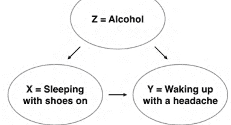

# 图 5.10：因果图。

为了研究 Y 和 X 之间的关系，我们可以使用回归模型，将输出结果设置为 Y，将解释变量设置为 X，正如你在整个章节中一直在做的那样。图 5.10 还包含第三个变量，其箭头同时指向 X 和 Y：

- Z 是一个混杂变量，它同时影响 X 和 Y，从而“混杂”了它们的关系。这个混杂变量是酒精。

酒精会导致人们更有可能穿鞋睡觉，同时也更有可能醒来时头痛。因此，任何关于 X 和 Y 关系的回归模型都应该将 Z 作为解释变量。换句话说，我们的医生需要考虑前一天晚上谁喝酒了。在下一章中，我们将开始介绍多元回归模型，该模型允许我们在回归模型中纳入多个变量。

建立因果关系是一个棘手的问题，通常需要精心设计的实验或控制混杂变量影响的方法。这两种方法都尝试尽力考虑所有可能的混杂变量，或者忽略它们的影响。这使得研究人员能够关注感兴趣的关系：输出变量 Y 与处理变量 X 之间的关系。

在阅读新闻报道时，注意不要掉入认为“相关性意味着因果关系”的陷阱。查看 [虚假相关性](https://spuriouscorrelations.com/) 网站，了解一些变量之间相关但绝对没有因果关系的极端案例。

回到我们的联合国成员国数据，一个混杂变量可能是国家的经济发展水平。这可能同时影响寿命和

> http://www.tylervigen.com/spurious-correlations

### 5.3 相关主题

生育率。观察经济发展水平的代理指标可以是人类发展指数（HDI）。它衡量了一个国家在人类发展三个基本层方面的平均成就：健康（预期寿命）、教育（平均和预期受教育年限）以及生活水平（人均国民总收入）。它存储在 `un_member_states_2024` 的 `hdi_2022` 列中。我们探索它与寿命和生育率的关系：

```r
ggplot(data = un_member_states_2024,
aes(x = hdi_2022, y = life_expectancy_2022)) +
geom_point() +
labs(x = "Human Development Index (HDI)", y = "Life Expectancy")
```

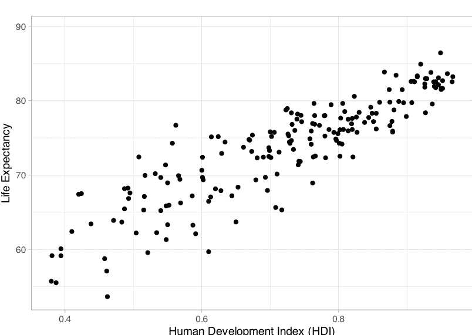

```r
ggplot(data = un_member_states_2024,
aes(x = hdi_2022, y = fertility_rate_2022)) +
geom_point() +
labs(x = "Human Development Index (HDI)", y = "Fertility Rate")
```

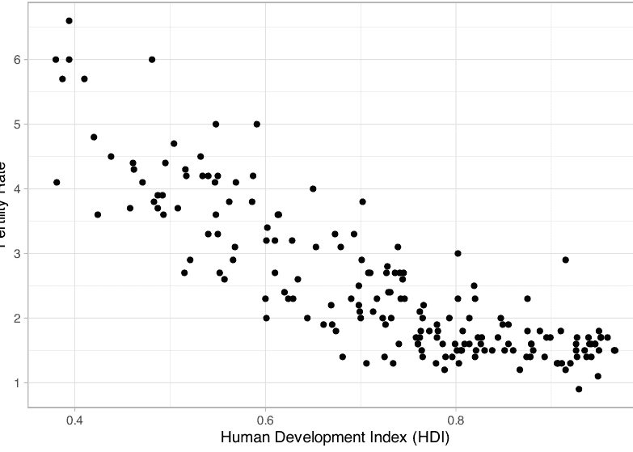

```r
un_member_states_2024 |>
get_correlation(life_expectancy_2022 ~ hdi_2022, na.rm = TRUE)
```

```
# A tibble: 1 x 1
cor
<dbl>
1 0.889
```

```r
un_member_states_2024 |>
get_correlation(fertility_rate_2022 ~ hdi_2022, na.rm = TRUE)
```

```
# A tibble: 1 x 1
cor
<dbl>
1 -0.849
```

观察上面的散点图，我们看到人类发展指数（HDI）与寿命之间存在强正线性关系，而 HDI 与生育率之间存在强负相关。HDI 与寿命之间以及 HDI 与生育率之间的相关系数也给出了。这些发现以及对社会经济因素的额外理解表明，人类发展指数是寿命与生育率关系中的混杂变量。

### 5.3.2 最佳拟合线

回归线被称为“最佳拟合线”。但我们所说的“最佳”是什么意思？我们拆解回归中用于确定“最佳”的标准。回想图 5.4，对于波斯尼亚和黑塞，我们用圆圈标记了观测值 $y$，用方形标记了拟合值 $\hat{y$，用箭头标记了残差 $y-\hat{y}$。我们在图 5.11 的左上图中再次显示图 5.4，增加了三个国家：


# 图 5.11：观测值、拟合值和残差的示例。

四个图指的是：

1. 波斯尼亚和黑塞，寿命 $x = 77.98$，生育率 $y = 1.3$。这种情况下残差为 $1.3 - 1.894 = -0.594$，我们在左图中用箭头标记。
2. 乍得，寿命 $x = 59.15$，生育率 $y = 6$。这种情况下残差为 $6 - 4.479 = 1.521$，我们在右上图中用新箭头标记。
3. 印度，寿命 $x = 67.22$，生育率 $y = 2$。这种情况下残差为 $2 - 3.371 = -1.371$，我们在左下图中用新箭头标记。
4. 所罗门群岛，寿命 $x = 76.7$，生育率 $y = 3.8$。这种情况下残差为 $3.8 - 2.069 = 1.731$，我们在右下图中用新箭头标记。

现在我们对所有 181 个国家重复计算残差，然后将所有残差平方，最后求和。我们称之为*残差平方和*；它是模型*拟合程度*的衡量标准。残差平方和越大，拟合程度越差。这对应于更差的模型。

如果回归线完美拟合所有点，那么残差平方和为 0。这是因为如果回归线完美拟合所有点，那么拟合值 $\hat{y}$ 在所有情况下都等于观测值 $y$，且残差 $y - \hat{y} = 0$，而大量 0 之和仍然是 0。

此外，在所有穿过这 181 个点云的可能直线中，回归线最小化了该值：

$$\sum_{i=1}^{n}(y_i - \hat{y}_i)^2$$

我们使用数据数据处理工具来精确计算残差平方和：

```r
# 拟合回归模型和回归点
demographics_points <- lm(fert_rate ~ life_exp, data = UN_data_ch5)
regression_points <- get_regression_points(demographics_model)
```

```r
# 计算残差平方和
regression_points |>
mutate(squared_residuals = residual^2) |>
summarize(sum_of_squared_residuals = sum(squared_residuals))
```

图中任何其他线产生的残差平方和都会大于 81.265。这是一个数学上保证的事实，你可以使用微积分和线性代数来证明。这就是为什么回归线的替代名称是最佳拟合线和最小二乘线。

我们为什么要对残差平方（即箭头的长度）？为了让相同大小的正负偏差得到同等对待。（尽管如此，虽然取残差的绝对值也能同等对待相同大小的正负偏差，但平方残差是为了与微积分相关的原因：求导和函数最小化。想了解更多信息，建议查阅数学统计学教材。）

# 学习检查

(LC5.19) 注意图 5.12 中有 3 个用圆点和箭头标记的点：

- “最佳”拟合实线回归线
- 一条任意选择的虚线
- 另一条任意选择的划线

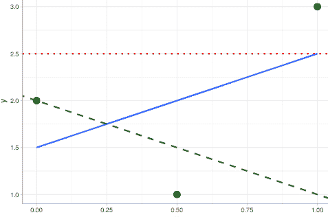

# 图 5.12：回归线和其他线。

手动计算每条线的残差平方和，并证明在这三条线中，回归线的数值最小。

### 5.3.3 get_regression_x() 函数

在本章中，我们介绍了 `moderndive` 包中的一个包装函数：

- `get_regression_points()`，它返回来自 5.1.3 节中回归模型的逐点点信息。

`get_regression_points()` 函数在背后是如何运行的？我们在 5.1.2 节中提到过这是包装函数的一个示例。此类函数获取其他已存在的函数并将其“封装”成单个函数，从而向用户隐藏其内部工作机制。用户只需要关心输入是什么样子的以及输出是什么样子的。在本小节中，我们将“深入底层”这些函数的内部构造，看看这些包装函数的“引擎”是如何工作的。

`get_regression_points()` 函数是一个包装函数，它返回有关回归模型中涉及的单个点的信息，如拟合值、观测值和残差。`get_regression_points()` 使用 `broom` 包中的 `augment()` 函数³ 生成表 5.9 所示的数据。此外，它还使用了 `janitor` 包⁴ (Firke, 2023) 中的 `clean_names()` 来清理变量名。

```r
library(broom)
library(janitor)

demographics_model |>
augment() |>
mutate_if(is.numeric, round, digits = 3) |>
clean_names() |>
select(-c("std_resid", "hat", "sigma", "cooksd"))
```


### 表 5.9：使用 `broom` 包中的 `augment()` 获取回归点

| fert_rate | life_exp | fitted | resid |
|---|---|---|---|
| 4.3 | 53.6 | 5.23 | -0.934 |
| 1.4 | 79.5 | 1.69 | -0.289 |
| 2.7 | 78.0 | 1.89 | 0.813 |
| 5.0 | 62.1 | 4.07 | 0.928 |
| 1.6 | 77.8 | 1.92 | -0.318 |
| 1.9 | 78.3 | 1.85 | 0.052 |
| 1.6 | 76.1 | 2.15 | -0.548 |
| 1.6 | 83.1 | 1.19 | 0.408 |
| 1.5 | 82.3 | 1.30 | 0.195 |
| 1.6 | 74.2 | 2.42 | -0.819 |

³https://broom.org/
⁴https://github.com/ourke/janitor

## 5.4 结论

在这种情况下，它仅输出学生学习回归感兴趣的变量：结果变量 $y$ (`fert_rate`)、所有解释/预测变量 (`life_exp`)，通过应用回归方程得到的所有拟合值 $\hat{y}$ 以及残差 $y - \hat{y}$。

如果你对这些和其他包装函数的工作原理更加好奇，可以查看 GitHub 上的源代码。

### 5.4.1 额外资源

所有*学习检查*的答案可以在书的附录中找到。附录开始于 https://moderndive.com/v2/appendix。

本章使用的所有 R 代码脚本位于 https://www.moderndive.com/v2/scripts/05-regression.R。

如 5.1.1 节建议的，解释接近 -1、0 和 1 等极端值的系数可能是主观的。为了帮助建立对相关性的感觉，我们建议你玩名为“猜相关性”的 80 风格游戏：http://guesssthecorrelation.com/。


图 5.13：“猜相关性”游戏预览。

### 5.4.2 将要做什么

在本章中，你学习了*简单线性回归*，即拟合只有一个解释变量的模型。在第 6 章，我们将学习*多元回归*，我们的回归模型现在可以有多个解释变量，比简单线性回归的形式稍微高级一点！特别是，我们将考虑两种情况：具有一个数值和一个分类解释变量的模型，以及具有两个解释变量的模型。这将允许你构建更复杂、更强大的模型，以更好地解释结果变量 $y$。

## 6 # 多元回归

在第 5 章，我们学习了简单线性回归，它代表两个变量之间的关系：结果变量或响应变量 $y$ 和解释变量或回归变量 $x$。此外，为了简单起见，我们只考虑了一个解释变量 $x$ 的模型。

在本章中，我们引入了多元回归，这是考虑到多个解释变量时对简单线性回归的扩展。正如后续章节所示，任何一个解释变量的相关效应必须考虑到模型中的其他解释变量。

## 所需包

如果需要，请阅读 1.3 节关于如何安装和加载 R 包的信息。

```r
library(tidyverse)
library(moderndive)
library(ISLR2)
```

## 6.1 一个和一个分类解释变量

我们继续使用 5.1 节介绍的联合国各国数据集。记得我们学习了结果变量生育率 $y$ 与回归变量寿命 $x$ 之间的关系。

在本节中，我们为该模型引入了一个额外的回归变量：四个类别的收入分组：低收入、中低收入、中高收入和高收入。我们现在想研究生育率如何随寿命的变化而变化。为此，我们使用多元回归。观察我们现在：

1. 一个结果变量 $y$，生育率。
2. 两个解释变量：
   a. 数值变量 $x1$，寿命。
   b. 分类变量 $x2$，收入。

### 6.1.1 探索性分析

联合国各国数据框在下一节中。为了简单起见，我们只选择这里需要的变量，并将其保存到名为 `UN_data6` 的新数据框中。我们将收入设置为因子以便显示其水平。R 将此变量读取为字符 `<chr>`，除了识别国家之外将不再需要。

```r
UN_data6 <- member_states %>%
  select(country, expectancy, fertility_rate, income) %>%
  mutate(income = factor(income, levels = c("Low income", "Lower middle income", "Upper middle income", "High income")))
```

回探索性分析的三个共同步骤：
1. 检查原始数据样本。
2. 计算汇总统计。
3. 创建可视化。

我们首先通过在 RStudio 中查看 `UN_data6` 或使用 `dplyr` 包中的 `glimpse()` 函数来查看原始数据值：

```r
glimpse(UN_data6)
# Rows: 182
Columns: 4
$ country <chr> "Afghanistan", "Albania", "Algeria", "Angola", ...
$ expectancy dbl> 53.6, 79.5, 78.0, 62.1, 77.8, 78.3, 76.1, 83.1, 82.3, 74.2,
$ fertility_rate dbl> 4.3, 1.4, 2.7, 5.0, 1.6, 1.9, 1.6, 1.5, 1.5, 1.4,
$ income <fct> Low income, Upper middle, Lower middle, High income
```

寿命（`life_exp`）是一个国家人口平均预期寿命年数的估算。生育率（`fert_rate`）是一个国家内生育年龄女性的平均活出生数。正如我们在 5.1.1 和 5.2.1 节的探索性数据分析中所做的那样，我们找到汇总统计：

```r
summary(UN_data6)
```

我们还显示了对应于不同国家的 182 行数据中 10 行的随机样本。由于抽样的随机性，你可能会得到一组不同的 10 行。

```r
UN_data6 |> sample_n(size = 10)
```

### 表 6:1：从 182 个联合国各国中随机抽取 10 行

| country | life_exp | fert_rate | income |
|---|---|---|---|
| Trinidad and Tobago | 75.9 | 1.6 | High income |
| Micronesia, Federated States of | 74.4 | 2.6 | Lower middle income |
| North Macedonia | 76.8 | 1.4 | Upper middle income |
| Portugal | 81.5 | 1.4 | High income |
| Madagascar | 68.2 | 3.7 | Low income |
| Cambodia | 70.7 | 2.3 | Lower middle income |
| Dominica | 78.2 | 1.6 | Upper middle income |
| Peru | 68.9 | 2.1 | Upper middle income |
| Cyprus | 79.7 | 1.3 | High income |
| Guinea-Bissau | 63.7 | 3.8 | Low income |

# 6 多元回归

```r
UN_data_ch6 |
  select(life_exp, fert_rate, income) |
  tidy_summary()
```

| column | n | type | min | Q1 | mean | median | Q3 | max | sd |
|---|---|---|---|---|---|---|---|---|---|
| life_exp | 182 | numeric | 53.6 | 69.4 | 73.67 | 75.2 | 78.4 | 86.4 | 6.86 |
| fert_rate | 182 | numeric | 0.9 | 1.6 | 2.49 | 2.0 | 3.2 | 6.6 | 1.16 |
| income | 25 | factor | | | | | | | |
| income | 52 | factor | | | | | | | |
| income | 56 | factor | | | | | | | |

回想 `UN_data_ch6` 中的每一行代表一个特定的国家或成员国。`tidy_summary()` 函数显示了数值变量（`life_exp`）、生育率（`fert_rate`）和分类变量（`income`）的摘要信息。当变量为数值型时，`tidy_summary()` 函数提供数据框中的总观测数、摘要统计、平均值和标准差。例如，我们摘要的第一行将预期寿命指代为 `life_exp`。该变量有 182 个观测值，它是数值型的，且第一四分位数 Q1 为 69.4；这意味着联合国成员国的预期寿命小于 69.4 岁。当变量是分类变量的（也称为因子 factor）时，摘要会显示所有类别水平以及每个水平的观测值数量。例如，收入组（`income`）是一个具有四个水平的因子：低收入、中低收入、中高收入和高收入。摘要还提供了每个水平的国家数量；观察，例如

此外，我们可以计算两个数值变量 `life_exp` 和 `fert_rate` 之间的相关性。回想第 5.1 节，相关系数仅存在于数值变量之间。我们观察到它们是“强相关的”：

```r
UN_data_ch6 |
  cor(formula = fert_rate ~ life_exp)
# A tibble: 1 x 1
#dbl -0.815
```

### 6.1 一个数值和一个分类解释变量

我们准备好进行可视化了，这是我们探索性分析的最后一步。由于结果变量 `fert_rate` 和解释变量 `life_exp` 都是数值型的，我们可以创建一个散点图来显示它们的关系。但这次我们通过将分类变量映射到颜色属性上，从而创建一个彩色的散点图。

```r
ggplot(UN_data_ch6, aes(x = life_exp, y = fert_rate, color = income)) +
  geom_point() +
  labs(x = "Life Expectancy", y = "Fertility Rate", color = "Income group") +
  geom_smooth(method = "lm", se = FALSE)
```


**图 6.1：预期寿命和生育率的彩色散点图。**

在生成的图 6.1 中，观察到 `ggplot()` 为与四个收入水平（低收入、中低收入、中高收入和高收入）相关的点和线分配了默认颜色方案。此外，`geom_smooth(method = "lm", se = FALSE)` 层会自动为每个组拟合回归线。我们可以看到有趣的趋势。首先，观察到每个收入组都有一条不同的线。其次，所有收入组的斜率均为负值。第三，高收入组的斜率明显比所有其他组的斜率小。因此，预期寿命引起的生育率变化取决于特定国家的收入水平。第四，观察到高收入国家通常具有较高的预期寿命和较低的生育率。

### 6.1.2 带有交互项的模型

我们可以将图 6.1 中的四条回归线表示为带有交互项的多元回归模型。然而为了为了，我们需要复习带有一个分类解释变量的线性回归。回想第 5.2.2 节，我们拟合了一个以相应大洲作为国家预期寿命函数的回归模型。我们现在使用生育率作为响应变量，收入组作为分类解释变量来生成相应的分析。我们将使用与之前略不同的符号，使模型更具通用性。

带有分类解释变量的线性模型是一个单因子模型，其中因子指的是分类解释变量，类别也是因子向量。我们使用指示函数或虚拟变量来表示这些类别。在我们的联合国数据示例中，该变量有四个类别或水平：低收入、中低收入、中高收入和高收入。需要相应的虚拟变量：

$$
D_1 = \begin{cases} 1 & \text{如果该联合国成员国为低收入} \\ 0 & \text{否则} \end{cases}
D_2 = \begin{cases} 1 & \text{如果该联合国成员国为中低收入} \\ 0 & \text{否则} \end{cases}
D_3 = \begin{cases} 1 & \text{如果该联合国成员国为中高收入} \\ 0 & \text{否则} \end{cases}
D_4 = \begin{cases} 1 & \text{如果该联合国成员国为高收入} \\ 0 & \text{否则} \end{cases}
$$

因此，例如，如果一个联合国成员国是*低收入*，其虚拟变量 $D_1 = 1$ 且 $D_2 = D_3 = D_4 = 0$。同样，如果另一个联合国成员国是*中高收入*，那么它的虚拟变量将 $D_1 = D_2 = D_4 = 0$ 且 $D_3 = 1$。使用虚拟变量，我们线性回归的数学公式为：

$$\hat{y} = \beta_0 + \beta_1 x + \beta_2 D_2 + \beta_3 D_3 + \beta_4 D_4$$

其中 $x$ 是数值变量，$D_i$ 是分类的虚拟变量（以低收入为基准水平）。模型的系数为：

$$\hat{y} = \beta_0 + \beta_1 x + \beta_2 D_2 + \beta_3 D_3 + \beta_4 D_4$$

模型的系数为：
- $\beta_0$ 是基准组（低收入）的截距。
- $\beta_1$ 是基准组 $x$ 的斜率。
- $\beta_2, \beta_3, \beta_4$ 是各组与基准组相比的截距差异。
- $\beta_5, \beta_6, \beta_7$ 是各组与基准组相比的 $x$ 的斜率差异（交互项）。

$\tilde{y} = b_0 + b_{02}D_2 + b_{03}D_3 + b_{04}D_4 + b_1x + b_{12}xD_2 + b_{13}xD_3 + b_{14}xD_4$

线性回归展示了分类变量、数值变量以及交互作用如何影响平均预期寿命。我们的模型中有八个系数，我们将这些系数分成了三行显示，以突出它们的作用。第一行显示了截距以及分类解释变量的影响。请记住，$D_2, D_3$ 和 $D_4$ 是模型中的虚拟变量，每个变量根据国家的类别和情况等于 1 或 0；相应地，系数 $b_{02}, b_{03}$ 和 $b_{04}$ 是相对于基准截距 $b_0$ 的偏移量。请记住第一个虚拟变量被删除了，截距捕捉了这一效应。方程的第二行代表数值变量 $x$。在我们的示例中，$x$ 是预期寿命的值。系数 $b_1$ 是直线的斜率，代表预期寿命每变化一个单位时导致生育率的变化。方程的第三行代表对斜率的交互作用。观察发现，它们是预期寿命 $x$ 与收入水平 $D_2, D_3$ 和 $D_4$ 的组合。交互作用的作用是修改不同收入水平的斜率。对于低收入成员国，虚拟变量为 $D_1=1, D_2=D_3=D_4=0$，我们的线性回归为：

```
$\tilde{y} = b_0 + b_{02} \cdot 0 + b_{03} \cdot 0 + b_{04} \cdot 0 + b_1x + b_{12} \cdot 0 + b_{13} \cdot 0 + b_{14} \cdot 0$
$= b_0 + b_1x$
```

同样，对于高收入成员国，虚拟变量为 $D_1=D_2=D_3=0 且 $D_4=1$。我们考虑了截距偏移量 $b_{04}$ 和斜率偏移量 $b_{14}$；线性回归变为：

```
$\tilde{y} = b_0 + b_{02} \cdot 0 + b_{03} \cdot 0 + b_{04} \cdot 1 + b_1x + b_{12} \cdot 0 + b_{13} \cdot 0 + b_{14} \cdot 1$
$= b_0 + b_{04} + b_1x + b_{14}x$
$= (b_0 + b_{04}) + (b_1 + b_{14}) \cdot x$
```

观察高收入成员国与基准低收入成员国相比，其截距和斜率有何不同。为了说明，我们在 R 语言中为联合国成员国数据集构建了这一多元线性回归。我们首先使用 `linear model` 函数“拟合”模型，然后使用 `coef()` 函数找到系数。在 R 中，使用的公式为 $y = x1 + x2$，其中 $x1$ 和 $x2$ 是数据集中的实际变量，代表主效应，而 $x1:x2$ 是交互项。为了简单起见，我们也可以用 $y \sim x1 * x2$ 同时表示主效应和交互效应。R 允许 $x1$ 和 $x2$ 均为解释变量或数值变量，以确保数据集适用于我们想要运行的回归分析。以下是我们的示例代码：

## 6.1 一个数值变量和一个分类解释变量

```r
# 拟合回归模型并获取模型系数
model_int <- lm(fert_rate, life_exp * income, data = UN_data_ch6)
coef(model_int)
```


### 表 6.2: 交互模型回归表

| | 系数 | 数值 |
|---|---|---|
| (Intercept) | `b0` | 11.918 |
| 收入中收入 | `b02` | -1.504 |
| 收入中高收入 | `b03` | -1.893 |
| 收入高收入 | `b04` | -6.580 |
| 预期寿命 | `b1` | -0.118 |
| 收入中低:预期寿命 | `b12` | 0.013 |
| 收入中高:预期寿命 | `b13` | 0.011 |
| 收入高:预期寿命 | `b14` | 0.072 |

我们可以将系数与计算出的数值匹配：低收入国家的拟合生育率 `y` 为：

> `$fert \ rate = b_0 + b_1 \cdot x = 11.92 + (-0.12) \cdot x$`，

这是图 6.1 中低收入国家的回归线方程。回归方程截距为 11.92，斜率为 -0.12。由于所有国家的预期寿命都大于零，因此截距没有实际意义，我们只需要生成最合适的直线。对斜率的解释是：对于低收入国家，预期寿命每增加一年，平均生育率就会减少 0.12 个单位。

正如之前讨论的，由于交互作用，截距和斜率在不同收入国家之间是不同的。作为说明，我们在 R 中为联合国成员国数据集构建了该多元线性回归。

`$\tilde{y} = b_0 + b_{02}D_2 + b_{03}D_3 + b_{04}D_4 + b_1x + b_{12}xD_2 + b_{13}xD_3 + b_{14}xD_4$`

线性回归展示了分类变量、数值变量以及交互作用如何影响平均预期寿命。我们的模型中有八个系数，我们将这些系数分成了三行显示，以突出它们的作用。第一行显示了截距以及分类解释变量的影响。请记住，`$D_2, D_3$` 和 `$D_4$` 是模型中的虚拟变量，每个变量根据国家的类别和情况等于 1 或 0；相应地，系数 `$b_{02}, b_{03}$` 和 `$b_{04}$` 是相对于基准截距 `$b_0$` 的偏移量。请记住第一个虚拟变量被删除了，截距捕捉了这一效应。方程的第二行代表数值变量 `$x$`。在我们的示例中，`$x$` 是预期寿命的值。系数 `$b_1$` 是直线的斜率，代表预期寿命每变化一个单位时导致生育率的变化。方程的第三行代表对斜率的交互作用。观察发现，它们是预期寿命 `$x$` 与收入水平 `$D_2, D_3$` 和 `$D_4$` 的组合。交互作用的作用是修改不同收入水平的斜率。对于低收入成员国，虚拟变量为 `$D_1=1, D_2=D_3=D_4=0$`，我们的线性回归为：

```
$\tilde{y} = b_0 + b_{02} \cdot 0 + b_{03} \cdot 0 + b_{04} \cdot 0 + b_1x + b_{12} \cdot 0 + b_{13} \cdot 0 + b_{14} \cdot 0$
$= b_0 + b_1x$
```

同样，对于高收入成员国，虚拟变量为 `$D_1=D_2=D_3=0$` 且 `$D_4=1$`。我们考虑了截距偏移量 `$b_{04}$` 和斜率偏移量 `$b_{14}$`；线性回归变为：

```
$\tilde{y} = b_0 + b_{02} \cdot 0 + b_{03} \cdot 0 + b_{04} \cdot 1 + b_1x + b_{12} \cdot 0 + b_{13} \cdot 0 + b_{14} \cdot 1$
$= b_0 + b_{04} + b_1x + b_{14}x$
$= (b_0 + b_{04}) + (b_1 + b_{14}) \cdot x$
```

观察高收入成员国与基准低收入成员国相比，其截距和斜率有何不同。为了说明，我们在 R 语言中为联合国成员国数据集构建了这一多元线性回归。我们首先使用 `linear model` 函数“拟合”模型，然后使用 `coef()` 函数找到系数。在 R 中，使用的公式为 `$y = x1 + x2$`，其中 `$x1$` 和 `$x2$` 是数据集中的实际变量，代表主效应，而 `$x1:x2$` 是交互项。为了简单起见，我们也可以用 `$y \sim x1 * x2$` 同时表示主效应和交互效应。R 允许 `$x1$` 和 `$x2$` 均为解释变量或数值变量，以确保数据集适用于我们想要运行的回归分析。以下是我们的示例代码：

## 6.1 一个数值变量和一个分类解释变量

```r
# 拟合回归模型并获取模型系数
model_int <- lm(fert_rate, life_exp * income, data = UN_data_ch6)
coef(model_int)
```

### 表 6.2: 交互模型回归表

| | 系数 | 数值 |
|---|---|---|
| (Intercept) | `b0` | 11.918 |
| 收入中低收入 | `b02` | -1.504 |
| 收入中高收入 | `b03` | -1.893 |
| 收入高收入 | `b04` | -6.580 |
| 预期寿命 | `b1` | -0.118 |
| 收入中低:预期寿命 | `b12` | 0.013 |
| 收入中高:预期寿命 | `b13` | 0.011 |
| 收入高:预期寿命 | `b14` | 0.072 |

我们可以将系数与计算出的数值匹配：低收入国家的拟合生育率 `$y$` 为：

> `$fert \ rate = b_0 + b_1 \cdot x = 11.92 + (-0.12) \cdot x$`，

这是图 6.1 中低收入国家的回归线方程。回归方程截距为 11.92，斜率为 -0.12。由于所有国家的预期寿命都大于零，截距没有实际意义，我们只需要生成最合适的直线。对斜率的解释是：对于低收入国家，预期寿命每增加一年，平均生育率就会减少 0.12 个单位。

`$\tilde{y} = b_0 + b_{02}D_2 + b_{03}D_3 + b_{04}D_4 + b_1x.$`

注意，现在虚拟变量只影响截距，而对于任何收入组，斜率完全由 `$b_1$` 描述。在联合国数据中，一个*高收入*国家（`$D_4 = 1$` 且其他虚拟变量等于 0）将表示为：

`$\tilde{y} = (b_0 + b_{04}) + b_1x.$`

为了在 R 中找到回归系数，所使用的公式为 `$y \sim x1 + x2$`，其中 `$x1$` 和 `$x2$` 是数据集中的变量名并代表主效应。注意，表示交互作用的项 `$x1:x2$` 不再包含在内。R 会将 `$x1$` 和 `$x2$` 都限制为解释变量或数值型；因此，我们应该始终检查变量格式是否适用于我们想要运行的回归分析。以下是联合国示例数据的代码：

```
# Fit regression model:
model_int <- lm(fert_rate ~ life_exp + income, data = UN_data_ch6)
# Get the coefficients of the model
coef(model_no_int)
```

# **表格 6.3:** 无交互作用模型的回归表

| | 系数 | 数 |
|---|---|---|
| (Intercept) | `b0` | 10.768 |
| incomeLower middle income | `b02` | -0.719 |
| incomeUpper middle income | `b03` | -1.239 |
| incomeHigh income | `b04` | -1.067 |
| life_exp | `b1` | -0.101 |

在这个没有交互作用的模型中，所有回归线的斜率都是相同的，`$b_1 = -0.101$`。假设该模型是正确的，对于任何联合国成员国，寿命每增加一年，平均生育率就会减少 0.101 个单位，无论该成员国的收入水平如何。*低*收入成员国的回归线截距为 10.768，而*高*收入成员国的截距为 `$10.768 + (-1.067) = 9.701$`。其他收入水平可以通过类似的方法确定。我们在[图 6.3]中并排比较这两个模型的可视化结果。

## 6.1 一个数值解释变量和一个分类解释变量

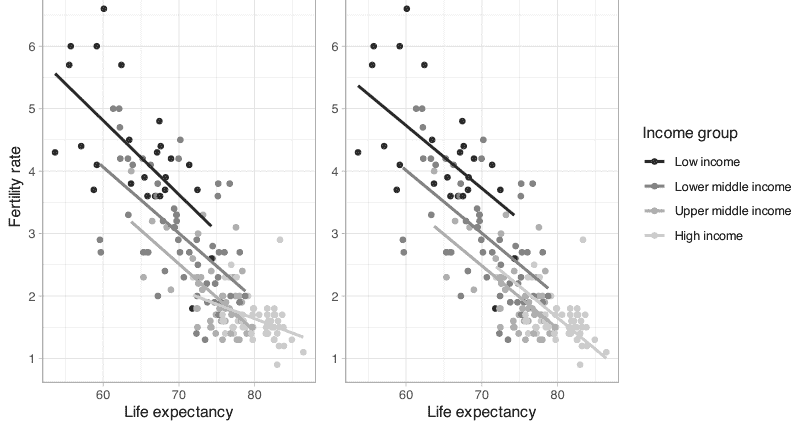

图 6.3：交互作用模型与平行斜率模型的比较。

哪一个是优选模型？观察图 6.3 中的散点图和点簇，不同斜率的直线似乎更好地捕捉了不同点组的行为。这些看起来并不是平行的，交互模型似乎更合适。

## 学习检查

(LC6.4) 一个有一个分类回归变量和一个数值回归变量、但没有交互作用的模型应该如何解释？

- A. 每个类别的模型斜率不同。
- B. 每个类别的模型斜率是相同的。
- C. 分类回归变量与响应之间没有关系。
- D. 数值回归变量与响应之间没有关系。

## 6.1.4 观测响应、拟合值和残差

在本节中，我们将处理带有交互作用的回归模型。该模型的系数之前已经找到并保存在 `model_int` 中，如下所示：

# 表格 6.4: 交互作用模型的回归表

| 系数 | 数值 |
|---|---|---|
| (Intercept) | `b0` | 11.918 |
| incomeLower middle income | `b02` | -1.504 |
| incomeUpper middle income | `b03` | -1.893 |
| incomeHigh income | `b04` | -6.580 |
| life_exp | `b1` | -0.118 |
| incomeLower middle income:life_exp | `b12` | 0.013 |
| incomeUpper middle income:life_exp | `b13` | 0.011 |
| incomeHigh income:life_exp | `b14` | 0.072 |

我们可以使用这些系数找到任何给定观测值的拟合值和残差。作为说明，我们从联合国成员国数据集中选择了两个观测值作为解释变量、响应变量以及拟合值和残差：

| ID | fert_rate | income | life_exp | fert_rate_hat | residual |
|---|---|---|---|---|---|
| 1 | 1.3 | High income | 79.7 | 1.65 | -0.35 |
| 2 | 5.7 | Low income | 62.4 | 4.52 | 1.18 |

第一个观测值是一个*高*收入国家，寿命为 79.74 年，观测生育率为 1.3。第二个观测值是一个*低*收入国家，寿命为 62.41 年，观测生育率等于 5.7。拟合值 `$\hat{y}$` 被称为由回归线确定的响应的估计值。该值通过使用解释变量的值和线性回归的系数计算。此外，观测值与拟合值之间的差 `$y - \hat{y}$` 被称为残差，在这种情况下为正。我们在图 6.4 中说明了这一点。左侧的垂直线代表*低*收入国家的寿命。回归线上与垂直线交点的 y 值是生育率的拟合值 `$\hat{y}$`，而线上方大点的 y 值是观测生育率 `$y$`。这些值的差是残差。右侧的垂直线代表*高*收入国家的寿命。回归线上大点的 y 值是拟合生育率。观测生育率位于线下方，使得残差为负。

## 交互模型

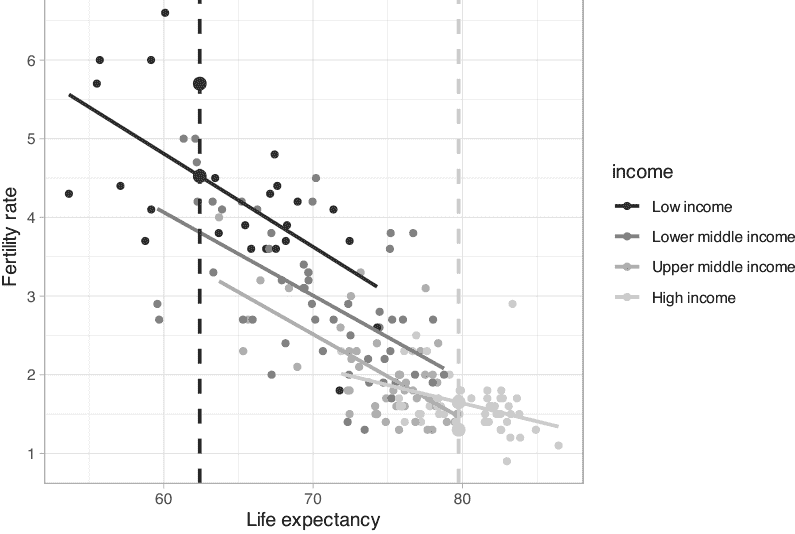

同样，我们可以对 `UN_data_ch6` 数据集中所有国家的拟合值和残差进行泛化，如表 6.5 所示。

```
regression_points <- get_regression_points(model_int)
regression_points
```

| ID | fert_rate | income | life_exp | fert_rate_hat | residual |
|---|---|---|---|---|---|
| 1 | 4.3 | Low income | 53.6 | 5.56 | -1.262 |
| 2 | 1.4 | Upper middle income | 79.5 | 1.50 | -0.098 |
| 3 | 2.7 | Lower middle income | 78.0 | 2.16 | 0.544 |
| 4 | 5.0 | Lower middle income | 62.1 | 3.84 | 1.159 |
| 5 | 1.6 | High income | 77.8 | 1.74 | -0.139 |
| 6 | 1.9 | Upper middle income | 78.3 | 1.62 | 0.278 |
| 7 | 1.6 | Upper middle income | 76.1 | 1.86 | -0.256 |
| 8 | 1.6 | High income | 83.1 | 1.50 | 0.105 |
| 9 | 1.5 | High income | 82.3 | 1.53 | -0.033 |
| 10 | 1.6 | Upper middle income | 74.2 | 2.07 | -0.469 |

表格 6.5：回归点（182 个国家中的前 10 个）

## 学习检查

(LC6.5) 计算观测响应、拟合值和残差

(LC6.6) 可视化的主要优势是什么？

- A. 寻找观测响应、拟合值和残差。
- B. 检查线性和方差齐性假设。
- C. 增加。
- D. 寻找模型。

## 6.2 数值变量

我们现在考虑一个有两个数值变量的模型。这允许我们探索一个变量的影响是否取决于另一个变量的水平，这就是交互作用的定义。

`$y = b_0 + b_1x_1 + b_2x_2 + b_3x_1x_2$`

在这个模型中，`$b_1$` 是 `$x_2=0$` 时 `$x_1$` 的影响，`$b_2$` 是 `$x_1=0$` 时 `$x_2$` 的影响。项 `$b_3$` 代表交互效应。

### 6.2.1 探索性分析

寻找观测响应、拟合值和残差

(LC6.6) 可视化的主要优势是什么？

- A. 寻找观测响应、拟合值和残差。
- B. 检查线性和方差齐性假设。
- C. 增加模型。
- D. 寻找模型。

我们加载数据并创建一个新的数据框 `credit_ch`。

```r
library(tidyverse)
data(ISLR2)
credit_ch <- Credit %>%
  select(Age, Balance, Limit, R, Rating)
```

我们可以使用以下代码可视化 Balance 和 R 之间的关系：

```r
ggplot(credit_ch, aes(x = Balance, y = R)) +
  geom_point(alpha = 0.5) +
  geom_smooth(method = "lm")
```

关系看起来是线性的，但存在散点。让我们 Age 和 R 之间的关系：

```r
ggplot(credit_ch, aes(x = Age, y = R)) +
  geom_point(alpha = 0.5) +
  geom_smooth(method = "lm")
```

再次，关系看起来是线性的。现在检查 Balance 和 Age 之间的交互作用：

```r
ggplot(credit_ch, aes(x = Balance, y = R, color = factor(Age))) +
  geom_point(alpha = 0.5)
  geom_smooth(method = "lm")
```

不同年龄的斜率不同，表明 Age 和 Balance 之间存在交互作用。让我们拟合一个交互模型：

```r
model_int <- lm(R ~ Balance * Age, data = credit_ch)
coef(model_int)
```

交互项 `Balance:Age` 为负且具有统计学意义。让我们检查残差：

```r
plot(model_int)
```

残差显示出异方差性的迹象，方差随 Balance 的增加而增大。我们可以尝试对 Balance 进行对数变换：

```r
model_log <- lm(R ~ log(Balance) * Age, data = credit_ch)
plot(model_log)
```

残差现在看起来好多了。我们将使用最终模型：

```r
summary(model_log)
```


## 多元回归

信用卡债务的平均值和中位数分别为为 $520.0 和 $459.5。债务的第一四分位数为 68.8；这意味着 25% 的持卡人债务在 $68.80 或以下。相应地，信用卡信用额度（`credit_limit`）的平均值和中位数分别约为 $4,736 和 $4,622。同时注意，收入的第三四分位数为 57.5；因此 75% 的持卡人收入低于 $57,500。

我们使用下面的 R 代码来视化响应变量与两个解释变量每一个之间的关系。这些图如图 6.5 所示。

### 债务与信用额度
### 债务与收入

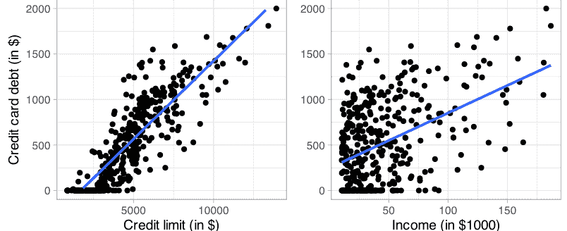

图 6.5：信用卡债务与额度之间的关系。图 6.5 中的左图显示了信用卡债务与信用额度之间存在正向且线性的关联：随着收入增加，信用卡债务也之增加。同样观察到，许多客户没有信用卡债务，在债务值为零处有一个点簇。图 6.5 中的右图也显示了收入与信用卡债务之间存在正向且某种程度上线性的关联，但对于超过 $50,000 的收入，这种关联似乎较弱。对于较低的收入值，尚不清楚是否存在关联。

## 6.2 两个解释变量

由于债务、`credit_limit` 和收入都是数值型的，更重要的是，响应变量与解释变量之间的关联似乎是线性或接近线性的，我们还可以计算这些变量任意两个之间的相关系数。记住，如果变量之间的关联是线性的，则相关系数是合适的。实现此点的一种方法是使用 5.1.1 节所示的 `cor()` 命令，对每个与响应债务的解释变量进行操作：

```r
credit_ch6 |> debt ~ credit_limit
credit_ch6 |> debt ~ income
```

或者，使用 `select()` 和 `cor()` 命令，我们可以通过返回相关系数矩阵同时找到所有相关性，如表 6.8 所示。该矩阵显示了相应行/列组合中任意变量对之间的相关系数。

```r
credit_ch6 |> select(credit_limit, income) |> cor()
```

### 表 6.8：信用卡债务、额度与收入之间的相关系数

| | debt | credit_limit | income |
|---|---|---|---|
| debt | 1.000 | 0.862 | 0.464 |
| credit_limit | 0.862 | 1.000 | 0.792 |
| income | 0.464 | 0.792 | 1.000 |

让我们看看相关系数矩阵中的一些发现：

- 对角线值全为 1，因为根据相关系数的定义，一个变量与其自身的相关性始终为 1。这表明存在强正向的线性关系：平均而言，信用额度越高，信用卡债务就越大。
- 债务与 `credit_limit` 之间的相关性为 0.862。这表明存在强有的关系。
- 债务与收入之间的相关性为 0.464。线性关系是正向的，尽管较弱。换句话说，高收入与高债务之间的关联较弱。
- 同样观察到两个解释变量 `credit_limit` 和 `income` 之间的相关系数为 0.792。

# 6 多元回归

相关系数的一个有用特性是它对线性变换是不变量的；这意味着对于任意常量 $a$ 和 $b$，变量 $x$ 和 $y$ 之间的相关性将与 $(a \cdot x + b)$ 和 $y$ 之间的相关性相同。为了说明这一点，观察以美元为单位的收入与信用卡债务之间的相关性为 0.464。如果我们现在通过乘以1000 找到收入与信用卡债务的相关性，得到：

```r
credit_ch6 |> debt ~ 1000 * income
```

```
# tibble: 1 x 1
  cor
<dbl>
1 0.464
```

相关性完全相同。

我们回到对多元回归的探索性数据分析。图 6.5 中的图分别对应响应变量和每一个解释变量。在图 6.6 中，我们展示了一个三维（3D）散点图，代表所有三个变量同时的联合关系。`credit_ch6` 数据中400个观测值中的每一个都标记了一个点，其中：

- 响应变量 $y$（债务）位于垂直轴上。
- 回归变量 $x_1$（收入）和 $x_2$（额度）位于构成底面的两个轴上。

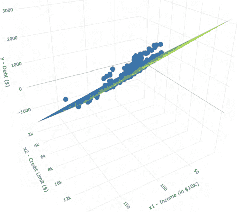

图 6.6：3D散点图和回归平面。

此外，图 6.6 包含一个回归平面。回想5.3.2节，带有一个数值解释变量的线性回归会选择“最佳拟合”直线：最小残差平方和的直线。当对两个数值解释变量进行线性回归时，解是一个“最佳拟合”平面：最小残差平方和的平面。访问此网站¹可以在浏览器中打开此图的交互版本。

### 学习检查

(LC6.7) 使用相同的结局变量 $y$（债务），并将 `credit_rating` 和 `age` 作为新的解释变量 $x_1$ 和 $x_2$，进行一次新的探索性数据分析。关于持卡人的债务与其信用评分及年龄之间的关系，你可以说明什么？

## 6.2.2 两个数值回归变量的多元回归

如图 6.6 所示，两个数值回归变量的线性回归产生了“最佳拟合”平面。我们从回归系数开始，使用 `lm()` 函数获取它们：

```r
model <- lm(debt ~ credit_limit + income, data = credit_ch6)
coef(model)
```

我们在下表中展示了这些结果：

| | Coefficients | Values |
|---|---|---|
| Intercept | b0 | -385.179 |
| credit_limit | b1 | 0.263 |
| income | b2 | -7.663 |

截距项的值为 -385.179。`credit_limit` 的系数为 0.263。信用额度每增加一个单位，信用卡债务平均增加 0.263。同样，收入的斜率为 -7.66。收入每增加一个单位（实际收入1000），信用卡债务相应减少7.66。将这些结果结合，回归平面的方程为：

$\hat{y} = b_0 + b_1 \cdot x_1 + b_2 \cdot x_2 = -385.179 + 0.263 \cdot x_1 - 7.663 \cdot x_2$

## $\hat{y} = debt = b_0 + b_1 \cdot x_1 + b_2 \cdot x_2 = -385.179 + 0.263 \cdot x_1 - 7.663 \cdot x_2$

线性回归中的收入斜率为 6.048，而多元回归中的收入斜率为 -7.663。这些结果可能令人惊讶，但它们是有效的，因为线性回归的斜率与多元回归的部分斜率不同。后者是在考虑了信用额度的情况下对债务的额外影响。

## 学习检查

**(LC68)** 使用 `lm(debt ~ credit_rating + age, data = credit6)` 拟合一个线性回归，其中 `credit_rating` 和 `age` 是解释变量 $x_1$ 和 $x_2$。通过回归表格获取最佳拟合回归的信息。回归结果与之前的探索分析匹配？

**(LC69)** 下列哪个陈述描述了回归系数？
- A. 在考虑了其他回归变量的情况下，对债务的额外影响。
- B. 当所有解释变量为零时响应变量的平均值。
- C. 如果相关性很强。
- D. 如果解释变量大于两个，则无法解释。

**(LC10)** 在具有两个解释变量的多元回归中，“最佳拟合”面的特征是什么？
- A. 每个解释变量单独的最佳拟合线。
- B. 最小化残差的乘积。
- C. 最小化残差和。
- D. 显示每个数据点的精确预测值。

**(LC11)** 在具有两个解释变量的回归模型中，截距代表什么？
- A. 保持一个解释变量不变的影响。
- B. 解释变量每变化一个单位的变化。
- C. 两个解释变量之间的相关性。
- D. 所有解释变量为零时响应变量的期望值。

**(LC12)** 多元回归中的“部分斜率”项是指什么？
- A. 在考虑了其他回归变量的情况下，对响应变量的额外影响。
- B. 所有变量的总和。
- C. 所有变量为零时的斜率。
- D. 模型中所有斜率的平均值。

## 6.2.3 观测值/拟合值和残差

如 6.1.4 节所示，我们为信用卡债务模型找到了拟合值和残差。信用卡债务（`debt`）的拟合值使用回归方程计算：

```
$\hat{y} = -385.179 + 0.263 \cdot x_1 - 7.663 \cdot x_2$
```

其中 $x_1$ 是信用额度，$x_2$ 是收入。残差是数据集中每个信用卡债务与拟合信用卡债务之间的差 $y - \hat{y}$。在 R 中，我们使用 `regression_points()` 函数找到 `debt_hat` 和 `residual`。在表 6.9 中，我们展示了前 10 行输出。记住，图 6.6 中散点图坐标可以在 `income`、`credit_limit` 和 `debt` 列中找到。

```
get_regression_points(debt_model)
```

### 表 6.9：回归点（400 个持卡人中的 10 个）

| ID | debt | credit_limit | income | debt_hat | residual |
|---|---|---|---|---|---|
| 1 | 333 | 3606 | 14.9 | 454 | -120.8 |
| 2 | 903 | 6645 | 106.0 | 559 | 344.3 |
| 3 | 580 | 7075 | 104.6 | 683 | -103.4 |
| 4 | 964 | 9504 | 148.9 | 986 | -21.7 |
| 5 | 331 | 4897 | 55.9 | 481 | -150.0 |
| 6 | 1151 | 8047 | 80.2 | 1127 | 23.6 |
| 7 | 203 | 3388 | 21.0 | 349 | -146.6 |
| 8 | 872 | 7114 | 71.4 | 948 | -76.0 |
| 9 | 279 | 3300 | 15.1 | 371 | -92.2 |
| 10 | 1350 | 6819 | 71.1 | 873 | 477.3 |

## 6.3 结论

### 6.3.1 额外资源

所有学习检查的答案可以在书在线版的附录中找到。附录从 https://moderndive.com/v2/appendix 开始。

本章所有 R 代码的 R 脚本文件可用 https://www.moderndive.com/v2/scripts/06-multiple-regression.R。

### 6.3.2 将何到来？

本章结束了书中“使用 moderndive 进行统计/数据建模”的部分。我们准备好进入第三部分：“使用 infer 进行统计推断”。统计推断是利用抽样对某些未知量进行推断的科学。到此为止，我们只研究了回归系数及其解释。在未来的章节中，我们将学习如何利用样本信息对整个总体进行推断。

一旦我们涵盖了第 7 节的抽样、第 8 节的置信区间和第 9 节的假设检验，我们将回到第 10 节回归推断中的回归模型。这将完成我们想在书中涵盖的主题，如图 6.7 所示！


**FIGURE 6.7:** 回归推断流程

## 7.1 第一个活动：红球

该碗有 2400 行，代表图 7.1 所示碗中的 2400 个球。你可以在 RStudio 的数据查看器中通过 `View(bowl)` 查看并滚动。正如第 1.4.4 节所述，第一个变量 `ball_id` 被用作标识变量；实际碗中的没有任何球标记标记数字。

第二个变量 `color` 表示某个特定的虚拟球是红色还是白色。我们使用第 3 章介绍的 `dplyr` 数据清洗动词来计算碗中红球的比例。确定这个比例需要几个步骤。我们分别介绍这些步骤，以提醒你它们是如何工作的，但稍后将使用第 3.5 节中的 `mutate()` 函数将所有步骤整合在一起，允许我们创建一个名为 `is_red` 的新布尔变量。

```r
bowl |>
  mutate(is_red = (color == "red"))
```

```r
# A tibble: 2,400 x 3
  ball_ID color is_red
<int> <chr> <lgl>
1 1 white FALSE
2 2 white FALSE
3 3 white FALSE
4 4 red TRUE
5 5 white FALSE
6 6 white FALSE
7 7 red TRUE
8 8 white FALSE
9 9 red TRUE
10 10 white FALSE
# i 2,390 more rows
```

变量 `is_red` 对于每个 `color == "red"` 的行返回布尔（逻辑）值 `TRUE`，对于每个 `color` 不等于 "red" 的行返回 `FALSE`。由于 R 将 `TRUE`视为数字 1，将 `FALSE` 数字 0，因此计算 TRUE 和 FALSE 等同于处理 1 和 0。特别是，将所有的 1 和 0 等同于计算碗中有多少红球。

我们使用 `summarize()` 函数内部的 `sum()` 函数回顾第 3.3 节，`summarize()` 读取一个多行的数据框并返回一个包含单行的数据框，其中包含摘要统计数据，如 `sum()`：

```r
bowl |>
  mutate(is_red = (color == "red")) |>
  summarize(num_red = sum(is_red))
```

```r
# A tibble: 1 x 1
num_red
<int>
1 900
```

`sum()` 相加了所有的 1 和 0，并有效地计算了红球的数量。碗中有 900 个红球。由于碗中包含 2400 个球，红球的比例是 900/2400 = 0.375。我们可以通过将 `summarize()` 内部的 `sum()` 函数替换为 `mean()` 函数来让 R 直接寻找比例。1 和 0 的平均值正是等于碗中红球的比例：

```r
bowl |>
  mutate(is_red = (color == "red")) |>
  summarize(prop_red = mean(is_red))
```

```r
# A tibble: 1 x 1
prop_red
<dbl>
1 0.375
```

这段代码运行良好，但可以进一步简化。我们不需要在寻找比例之前创建一个新的布尔变量 `is_red`，而是可以在单行代码中同时编写这两个步骤：

```r
bowl |>
  summarize(prop_red = mean(color == "red"))
```

```r
# A tibble: 1 x 1
prop_red
<dbl>
1 0.375
```

这种计算将在接下来的小节中经常使用。

### 7.1.2 手动采样

在之前的采样中，我们之所以仅用 R就能找到碗中红球的比例，是因为我们拥有整个碗作为数据框的信息。否则，我们必须手动检索。如果碗中包含大量数量额的球，这可能是一个漫长且乏味的过程。你认为如果碗中有几万个球，手动操作需要多长时间？几百万个？甚至更多？

在现实生活中，我们通常感兴趣的是寻找大量对象或主体的比例，而进行穷尽计数可能是乏味的、不实际的甚至是不可能的。由于这些限制，我们通常不进行穷尽计数。相反，对于这个球的例子，我们从碗中随机抽取球样本，找到样本中红球的比例，并利用这个比例来更多地了解整个碗红球的比例。

### 单样本

我们首先如图 7.2 所示将铲子插入碗中，并收集 $5\cdot10 = 50$ 个球，如图 7.3 所示。提取的球被称为*样本*（sample）。


**图 7.2：** 将铲子插入碗。


**图 7.3：** 从碗中取出50个球的样本。

观察发现有17个球是红色的，因此样本中红球的比例为 17/50 = 0.34 或 34%。将其与整个碗红球的比例进行对比。我们在 7.1.1 节中找到的是 0.375。样本比例看起来实际上非常好，而且获取它并没有花费多少时间或精力。但是，这个近似比例只是一个幸运的结果吗？我们下次从碗中采样时还能这么幸运吗？接下来，我们从碗中提取更多样本并计算红球的比例。

### 三十三个样本

我们现在获取多得随机样本，如图 7.4 所示。每次我们都执行以下操作：

- 将之前使用的50个球放回碗中并混合碗中的内容，以确保每个新样本不受上一个样本的影响。
- 使用铲子取新样本并确定红球的比例。


**图 7.4：** 重复采样。

### 7.1 第一个活动：红球

当我们多次执行此活动时，我们观察到不同的样本产生不同的比例。样本中红球的比例被称为比例（proportion）。


**图 7.5：** 学生绘制直方图。

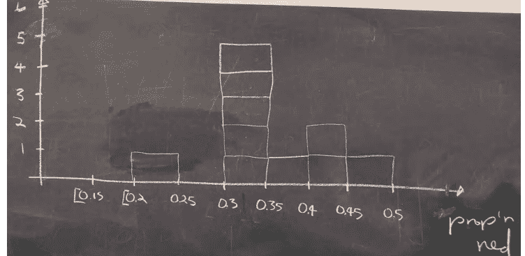

**图 7.6：** 手绘直方图。

观察直方图，我们发现红球比例最低在 0.20 到 0.25 之间，而最高在 0.45 到 0.5 之间。更重要的是，最频繁的出现在 0.30 到 0.35 之间。

这项由33名学生进行的活动结果存储在 `tactile_prop_red` 数据框中。前10行如下：

```r
tactile_prop_red
# A tibble: 33 x 4
  group <chr> <int> <dbl>
1 Ilyas, Yohan 1 21 0.42
2 Morgan, Terrance 2 17 0.34
```


3 Martin, Thomas 3 21 0.42

4 Clark, Frank 4 21 0.42

5 Riddhi, Karina 5 18 0.36

6 Andrew, Tyler 6 19 0.38

7 Julia 7 19 0.38

8 Rachel, Lauren 8 11 0.22

9 Daniel, Caroline 9 15 0.3

10 Josh, Maeve 10 17 0.34

# i 23 more rows

```r

ggplot(tactile_prop_red, aes(x = prop_red)) +

geom_histogram(binwidth = 0.05, boundary = 0.4, color = "white") +

labs(x = "Proportion of red balls in each sample",

  title = "Histogram of 33 proportions")

```

# 33 个比例的直方图

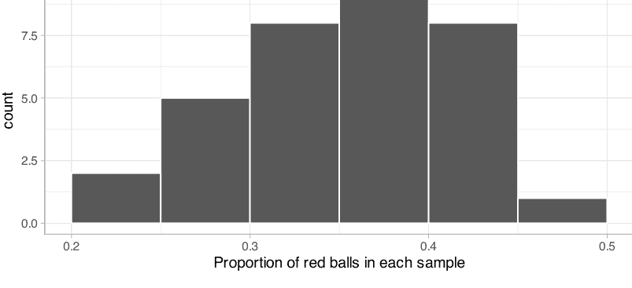

图 7.7：基于 33 个大小为 50 的随机样本的比例分布。

在研究直方图时，我们可以看到某些比例低于 25%，而另一些比例高于 45%，但大多数样本比例处于 30% 到 45% 之间。

我们还可以利用这个活动来介绍一些统计术语。重复抽取 50 个球的样本并找到相应样本比例的过程被称为抽样（sampling）。如果我们在获取另一个样本之前将观察到的球放回碗中，我们称之为有回抽样（sampling with replacement），并且由于在抽取新样本之前混合了球，这些样本是随机抽取的，被称为随机样本（random samples）。

如图 7.7 所示，不同的随机样本产生不同的样本比例。这种现象被称为抽样变（sampling variation）。此外，直方图是样本比例分布的图形表示；它描述了确定的样本比例以及它们出现的频率。从随机样本中找到的所有可能的样本比例的分布，恰恰被称为样本比例的抽样分布（sampling distribution of the sample proportion）。抽样分布是我们在本章中开发的思想的核心。

# 学习检查

(LC7.1) 为什么在取新样本之前将碗中的球混合很重要？

(LC7.2) 为什么学生们的红球样本比例都不相同？

### 7.1.3 虚拟抽样

在之前的 7.1.2 节中，我们进行了一次触觉抽样活动：学生们使用装有红白球的碗手动提取物理样本。现在，我们使用计算机模拟来扩展整个过程，这是一种虚拟抽样活动。

使用模拟允许我们不仅研究 33 个随机样本，还可以研究数千、数万甚至更多的样本。当检索到大量随机样本时，我们可以更好地理解抽样分布和样本比例的抽样变异。此外，我们不受限于 50 个球的样本，因为我们可以模拟任何所需样本大小的样本。我们在这个小节中将完成所有操作。从模仿我们的手动活动开始。

## 一个虚拟样本

回想图 7.1 所示碗由 `moderndive` 包中包含的数据框 `bowl` 表示。图 7.2 所示的 50 球铲子的虚拟对应物可以使用 `moderndive` 包包含的 `rep_slice_sample()` 函数来实现。该函数允许我们获取大小为 `n` 的重复（或复制）随机样本。我们首先取一个 50 个球的样本：

```r

virtual_shovel <- bowl |>

  rep_slice_sample(n = 50)

virtual_shovel

```

```r

# A tibble: 50 x 3

# Groups: replicate [1]

replicate ball_ID color

  <int> <int> <chr>

1      1 1970 white

2      1 842 red

```

## 7.1 第一项活动：红球

| replicate | ball_ID | color |
| :--- | :--- | :--- |
| 3 | 1 | 2287 white |
| 4 | 1 | 599 white |
| 5 | 1 | 108 white |
| 6 | 1 | 846 red |
| 7 | 1 | 390 red |
| 8 | 1 | 344 white |
| 9 | 1 | 910 white |
| 10 | 1 | 1485 white |

观察发现 `virtual_shovel` 有 50 行，对应于我们 50 个球的虚拟样本。`ball_ID` 变量标识碗中 2400 个球中的哪些包含在我们 50 个球样本中，而 `color` 表示是白色还是红色。`replicate` 变量在所有 50 行中都等于 1，因为我们决定现在只取一个样本。稍后，我们会取更多样本，`replicate` 将取更多值。

我们计算虚拟样本中红球的比例。我们使用的代码与[第 7.1.1 节]中寻找整个碗中红球比例的代码相似。

```r

virtual_shovel |>

  summarize(prop_red = mean(color == "red"))

```

```r

# A tibble: 1 x 2

replicate prop_red

<int> <dbl>

1 1 0.24

```

根据这个随机样本，`virtual_shovel` 的 50 个球中有 24% 是红色的！我们继续寻找更多随机样本的样本比例。

## 三十三虚拟样本

在[第 7.1 节]中，学生们获得了 33 个样本和样本比例。他们重复/复制了 33 次抽样过程。我们通过 `rep_slice_sample()` 函数虚拟地执行这一点，这次我们添加了 `reps = 33` 参数，因为我们要检索 33 个随机样本。我们将这些样本保存在数据框 `virtual_samples` 中，如下所示，并提供前 10 行的预览。如果你想查看整个 `virtual_samples` 数据框，请使用 RStudio 的 `View(virtual_samples)`。

```r

virtual_samples <- bowl |>

  rep_slice_sample(n = 50, reps = 33)

virtual_samples

```

```r

# A tibble: 1650 x 3

# Groups: replicate [33]

replicate ball_ID color

<int> <int> <chr>

1 1 1970 white

2 1 842 red

3 1 2287 white

4 1 599 white

5 1 108 white

6 1 846 red

7 1 390 red

8 1 344 white

9 1 910 white

10 1 1485 white

```

在查看器中观察 `replicate` 的前 50 行等于 1，接下来的 50 行等于 2。前 50 行对应第一个样本，接下来的 50 行对应第二个样本。这种模式持续到所有的 `reps = 33`，因此 `virtual_samples` 有 $33 * 50 = 1650$ 行。

使用 `virtual_samples` 找到每个 `replicate` 的红球比例。我们使用 `dplyr` 动词。特别是，我们在 `summarize()` 之前对 `replicate` 变量使用了 `group_by()`。正如第 3.4 节所述，我们为每个样本执行所需的计算。另一行代码计算了样本比例。前 10 行的预览如下：

```r

virtual_prop_red <- virtual_samples |>

  group_by(replicate) |>

  summarize(prop_red = mean(color == "red"))

virtual_prop_red

```

```r

# A tibble: 33 x 2

replicate prop_red

<int> <dbl>

1 1 0.24

2 2 0.46

3 3 0.38

4 4 0.36

5 5 0.38

6 6 0.3

7 7 0.42

8 8 0.42

9 9 0.32

10 10 0.48

```

实际上，`rep_slice_sample()` 函数已经按照 `replicate` 对数据进行了分组，因此在代码中没有包含 `group_by()`。此外，使用 R 中的 `dplyr` 管道可以简化工作并一次性完成操作：
- 使用 `rep_slice_sample()`，我们得到了 33 个重复（每个都是 50 个球的随机样本），并且
- 对布尔值使用 `summarize()`，确定了每个样本的红球比例。

我们将这些比例存储在数据框 `virtual_prop_red` 中，并打印前 10 个样本比例（前 10 个样本）作为示例：

```r

virtual_prop_red <- bowl |>

  rep_slice_sample(n = 50, reps = 33) |>

  summarize(prop_red = mean(color == "red"))

virtual_prop_red

```

```r

# A tibble: 33 x 2

replicate prop_red

<int> <dbl>

1 1 0.24

2 2 0.46

3 3 0.38

4 4 0.36

5 5 0.38

6 6 0.3

7 7 0.42

8 8 0.42

9 9 0.32

10 10 0.48

```

# 7 抽样

正如触觉活动一样，虚拟样本产生的 33 个比例中存在抽样变异。正如我们在 7.1.3 节中手动操作的那样，我们使用这些样本比例构建直方图，如图 7.8 所示。直方图帮助我们可视化样本比例的抽样分布。再次观察直方图是使用 `ggplot()`、`geom_histogram()` 构建的，并包含了 `binwidth = 0.05` 和 `boundary = 0.4` 参数。

```r

ggplot(virtual_prop_red, aes(x = prop_red)) +

  geom_histogram(binwidth = 0.05, boundary = 0.4, color = "white") +

  labs(x = "Sample proportion",

  title = "Histogram of 33 sample proportions")

```

# 33 个样本比例的直方图

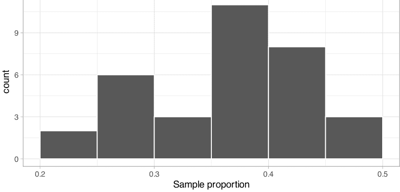

图 7.8：基于 33 个大小为 50 的虚拟样本的 33 个比例分布。

观察直方图时，我们可以看到某些比例低于 25%，而另一些比例高于 45%。此外，观察频率更高的样本比例处于 35% 到 40% 之间（33 个样本中的 11 个）。当我们在 7.1.2 节中手动进行抽样并展示图 7.7 所示的直方图时，我们得到了相似的结果。我们在图 7.9 中将这两个直方图并列，以便比较。注意，它们在中心和变异上有些相似，但不完全相同。这些差异也是由于抽样变异导致的。

## 7.1 第一活动：红球

### 样本比例的直方图

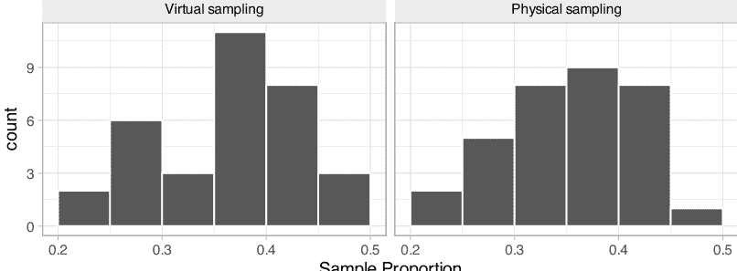

图 7.9：样本比例的抽样分布和抽样变异：展示了虚拟样本比例的直方图（左）和触感样本比例的直方图（右）。

### 学习检查

(LC7.3) 为什么当我们只使用一次虚拟铲子时，就无法研究抽样变异的影响？为什么我们需要获取多个一个虚拟样本（在我们的案例中，是 33 个虚拟样本）？

### 一千个虚拟样本

观察在 33 个样本中抽样变异如何影响样本比例是有帮助的。有趣的是，虽然这 33 个虚拟样本提供的样本比例与 33 个物理样本不同，但整体模式非常相似。由于两种情况下的样本都是随机抽取的，由于抽样变异，任何其他一组 33 个样本（无论是虚拟还是物理）都会提供一组不同的样本比例，但整体模式将是类似的。尽管如此，33 个样本不足以充分理解这些模式。

这就是为什么我们现在通过 1000 个随机样本来研究抽样分布和抽样变异的影响。尝试手动这样做是不切行的，但获取虚拟样本可以快速高效地完成。此外，我们已经开发了相应的工具。我们重复使用 `rep_slice_sample()` 函数执行之前的步骤，并将样本量设置为 50。然而，这次我们设置了 `reps` 的数量，并使用 `summarize()` 和 `mean()` 计算样本比例。我们通过所有 1000 个随机样本的红球计数和相应的样本比例来计算 `virtual_prop_red`。前 10 个样本的比例所示：

```r

virtual_prop_red <- bowl |>

rep_slice_sample(n = 50

```

```r

# A tibble: 1,000 x 2

| replicate | prop_red |

| <int> | <dbl> |

| 1 | 0.24 |

| 2 | 0.46 |

| 3 | 0.38 |

| 4 | 0.36 |

| 5 | 0.38 |

| 6 | 0.3 |

| 7 | 0.42 |

| 8 | 0.42 |

| 9 | 0.32 |

| 10 | 0.48 |

```

如之前所做的，图 7.10 给出了这 1000 个样本比例的直方图。

```r

ggplot(virtual_prop_red, aes(x = prop_red)) +

geom_histogram(binwidth = 0.04, boundary = 0.4, color = "white") +

labs(x = "Sample proportion", title = "1000 个样本比例的直方图")

```

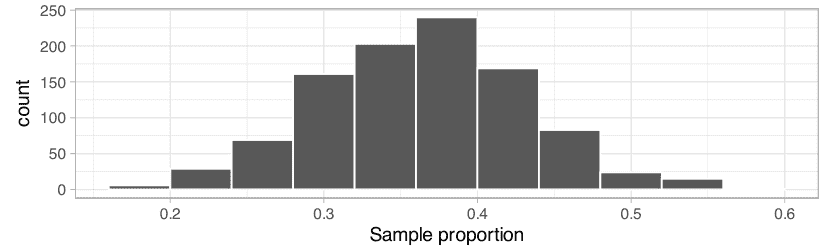

图 7.10：基于 1000 个样本量为 50 的随机样本的 1000 个比例分布。

## 7.1 第一活动：红球

直方图代表的比例可能低至 15%，高至 60%，但那些极端比例是稀见的。确定的最频繁的比例是 35% 到 40% 之间的。此外，直方图现在显示出一个对称的钟形分布，可以很好地用正态分布近似。

### 学习检查

(LC7.4) 为什么我们不抽取 1000 个样本？

(LC7.5) 观察图 7.10，你认为抽取 1000 个量为 50 的样本是可能的？

### 不同样本量

使用模拟的另一个优势是我们还可以研究抽样分布如何随样本量的变化而变化：如果样本比例小于或大于 50%。我们必须首先决定使用的尺寸，然后对该大小进行抽样。作为插图，我们可以对 25、50 和 100 尺寸进行三次抽样活动，正如图 7.11 所示。当然，我们虚拟地进行这些：针对每个尺寸收集大量样本，计算相应的比例，并绘制直方图。正如稍后我们将显示的，样本的大小对抽样分布及其变异程度有直接影响。

| 25 个的铲子 | 50 个的铲子 | 100 个的铲子 |
| :--- | :--- | :--- |
|  |  |  |

图 7.11：不同尺寸的铲子。

## 7.1 第一活动：红球

### 抽样

为了方便比较，我们将三个直方图放在同一行。我们重复执行相同的过程三次，分别将尺寸设置为 25、50 和 100。

```r

# Segment 1：样本量 = 25

```

```r

# Segment 2：样本量 = 50

```

```r

# Segment 3：样本量 = 100


观察这三个直方图：
- 都集中在同一个值附近，略高于 0.4。
- 都呈现出钟形
- 每个尺寸表现出不同的抽样变异。

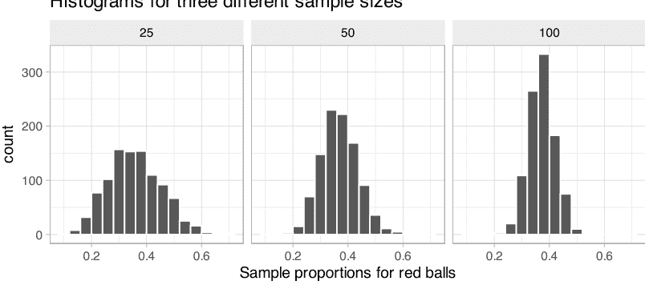

图 7.12：不同尺寸的比例直方图。

## 7.2 抽样框架

在 7.1 节中，我们对抽样及其特征有了一些直觉。在本节中，我们引入了与抽样相关的统计定义和术语。最后，我们介绍了在本章其余部分中将正式研究的关键特征。

### 7.2.1 总体、样本和抽样分布

总体（Population）或研究总体是感兴趣的所有个体或观测值的集合。在碗球活动中，总体是碗中所有球的集合。样本（Sample）是总体的子集。抽样是从总体中收集样本的行为。简单随机抽样是指总体中的每个成员被选中概率相同的抽样方式，通过

使用铲子从碗中挑选球。**随机样本**是通过简单随机抽样得到的样本。在碗的活动中（物理或虚拟），我们使用简单随机抽样从碗中获取随机样本。

**总体参数**（或简单称为**参数**）是一个代表总体某些特征的数值汇总（数字）。**样本统计量**（或简单称为**统计量**）是从样本中计算出的数值汇总。在碗的活动中，我们感兴趣的参数是总体比例 `p = 0.375`。同样，之前我们抽取了 50 个球的样本，其中 17 个是红色的。统计量就是*样本比例*，在本例中为 `$\hat{p} = 0.34$`。注意我们使用 `p` 来表示总体比例（参数），使用 `$\hat{p}$` 来表示样本比例（统计量）。

列表的**分布**是列表中所有可能取值的集合以及它们出现的频率。给定大小下每个可能的随机样本的**样本比例的抽样分布**。为了说明这一概念，回想在 7.1.3 节中我们绘制了图 7.12 所示的三个直方图。例如，左侧的直方图是通过抽取 1000 个大小为 `n=25` 的随机样本生成的，计算每个样本的样本比例并用这些比例绘制直方图。这个直方图是样本比例*抽样分布*的良好的视觉近似。

*抽样分布*可能是一个难以理解的概念：

- *样本比例的抽样分布*是*样本比例*的分布；它是完全使用样本比例构建的。*
- *注意，学习这些术语的人有时会混淆*术语分布*与*样本的分布*。后者可以被理解为给定样本中数值的分布。*
- *通过样本比例模拟得到的直方图仅是抽样分布的视觉近似。它不是精确的分布。尽管如此，当模拟产生大量的样本比例时，生成的直方图提供了抽样分布的良好近似。这在 7.1.3 节和图 7.12 所示的三个直方图中正是如此。*

通过执行第7.1节中的活动获得的经验有助于深入了解样本比例*抽样分布*的关键特征，即：

- *抽样分布的中心*
- *抽样变异*对*抽样分布*的影响，以及样本量对这种*抽样变异*的影响
- *抽样分布的形状*

前两点分别涉及集中趋势和离散程度量。最后一个提供了与统计学中最重要的定理之一的联系：中心极限定理。在下一节中，我们将正式研究这些特征。

## 学习检查

(LC7.10) 在我们的碗活动中，总体参数是什么？我们知道它的值吗？我们如何准确知道它的值？

(LC7.11) 我们如何确保用铲子收集的样本是随机的？

## 7.3 中心极限定理

统计学中一个迷人的结果是，当从任何总体提取随机样本时，相应的样本均值遵循典型的行为：它们的直方图呈钟形且具有非常独特的特征。这与总体值的分布无关，并构成了我们所知的中心极限定理的基础。在完全描述它之前，我们引入一个理论框架来构建这一特征与其他与采样相关的特征。

### 7.3.1 随机变量

简单的理论框架可以帮助样本比例抽样分布的重要属性形式化。为了做到这一点，我们稍微修改了碗的活动。不再使用铲子一次性选择25个球，而是每次随机选择一个球，重复25次。如果球是红色的，我们称其为成功并记录为1；如果不是，我们称之为失败并记录为0。然后，我们将球放回碗中，这样碗中红球的比例保持不变。这个过程被称为试验或伯努利试验，以17世纪数学家雅雅布·伯努利命名命名，他是首批研究这些试验的人之一。获取一个25个球的样本就是运行25次试验，并获得25个数字（1或0），分别代表我们在每次试验中是否观察到红球。这25个数字（0或1）的平均值精确地代表了25个球样本中红球的比例。

将一次试验表示为随机变量是有帮助的。我们使用大写字母 `X` 和下标 1 作为 `X_1` 来表示第一次试验的随机变量。在第一次试验完成后，观察第一个球的颜色，如果球是红色的，`X_1` 的值实现为1；如果球是白色的，则为0。例如，如果第一个球是红色的，我们写下 `X_1 = 1`。同样，我们使用 `X_2` 表示第二次试验。例如，如果第二个球是白色的，`X_2` 实现为 `X_2 = 0`，以此此类推。`X_1, X_2, ...` 只在试验执行前是随机变量。试验后，它们只是代表红球或白球的*1*或*0*。

此外，由于我们的实验是执行25次试验然后找到它们的平均值，那么在试验执行之前的这个平均值也可以表示为随机变量：

$$\bar{X} = \frac{X_1 + X_2 + \dots + X_{25}}{25}$$

`$\bar{X}$` 是观测到的样本。这就是为什么我们把 `$\bar{X}$` 称为样本比例。

### 7.3.2 抽样分布

`$\bar{X}$` 的分布是列表中所有可能取值的集合以及它们出现的频率。给定大小下每个可能的随机样本的样本比例的抽样分布。为了说明这一概念，回想在 7.1.3 节中我们绘制了图 7.12 所示的三个直方图。这就是样本比例抽样分布的。

### 7.3.3 分布的中心：期望值

由于 `$\bar{X}$` 的分布是由给定样本量可以计算的所有样本比例组成的，因此该分布的中心可以被理解为这些比例的平均值。这是我们从这些样本比例中*期望*得到的值。这就是为什么抽样分布的中心值被称为样本比例的*期望值*，并记作 `E($\bar{X}$)`。根据概率理论，`$\bar{X}$` 的均值恰好等于碗中红球的总体比例。在 7.1.1 节中我们确定该总体比例为 900/2400 = 0.375，因此

`E($\bar{X}$) = p = 0.375.`

作为说明，我们在 7.1.3 节观察图 7.12 中的直方图时注意到，所有三个直方图都位于0.35到之间的某个值处中心。

0.4（或在 35% 到 40% 之间）。正如我们现在所建立的，它们恰好位于 `$\bar{X}$` 的期望值中心，即总体比例。图 7.13 显示了这些直方图，但这次在每张图上都添加了一条红线，其位置位于总体比例值，`p = 0.375`。

### 基于 `n = 25, 50, 100` 的 `$\bar{X}$` 分布。

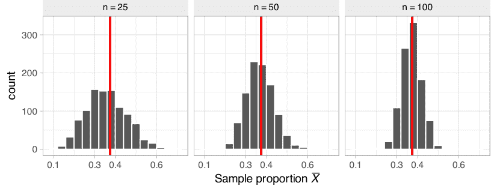

**图 7.13：** 三种采样分布，用垂直线标记了总体比例 `p`。

显示的结果似乎符合理论。我们可以利用模拟结果，通过计算 1000 个样本比例的平均值来进一步检查。我们从左侧的直方图开始：

```r
virtual_prop_red_25

# A tibble: 1000 x 3
  <int>  <dbl> <int>
1             1       0.32 25
2             2       0.24 25
3             3       0.16 25
4             4       0.32 25
5             5       0.44 25
6             6       0.36 25
7             7       0.32 25
8             8       0.36 25
9             9       0.2 25
10            10      0.32 25
# 1 990 more rows
```

```r
virtual_prop_red_25 |>
  summarize(E_Xbar_25 = mean(prop_red))
```

# A tibble: 1 x 1

```r
E_Xbar_25
<dbl>
1    0.377
```

数据框 `virtual_prop_red_25` 中的变量 `prop_red` 包含了所抽取的 1000 个样本中每个样本的比例。这些样本对象的平均值 `E_Xbar_25` 通过使用 1000 个样本比例的平均值代表了 `$\bar{X}$` 的估计期望值。每个样本比例都是从碗中随机抽取 25 个球计算出来的。这个平均值恰好与总体比例完全相同。

花一点时间理解这个结果。如果我们抽取一个给定大小的随机样本，我们知道由于抽样波动，该样本的实际比例与总体比例略有不同；然而，如果我们抽取多个相同大小的随机样本，样本比例的平均值预计与总体比例相似。

我们展示了样本大小为 50 和 100 样本的等效结果：

```r
virtual_prop_red_50 |>
  summarize(E_Xbar_50 = mean(prop_red))

virtual_prop_red_100 |>
  summarize(E_Xbar_100 = mean(prop_red))
```

# A tibble: 1 x 1

```r
E_Xbar_50
<dbl>
1    0.379
```

# A tibble: 1 x 1

```r
E_Xbar_100
<dbl>
1    0.379
```

事实上，结果与总体比例相似。注意，大小为 50 的样本的 1000 个样本比例的平均值实际上是 0.379，接近 0.375。这是因为模拟仅近似了采样分布和期望值。在使用模拟时，我们期望的不是精确的结果，而是支持我们对理论理解的结果。

### 学习检查

**(7.12)** 在采样分布的背景下，样本平均值的期望值是多少？

- A. 观测样本平均值
- B. 总体平均值
- C. 样本分布
- D. 范围的中点

### 7.3.4 抽样波动：标准差和标准误差

图 7.13 中的另一个相关特征是*抽样波动*的变化。当所有直方图都具有相似的钟形形状并以相同的数值中心时...

- 样本大小为 `n = 25`（左图）时，观测样本比例约为 0.1 到 0.65 之间。
- 样本大小为 `n = 50`（中图）时，观测样本比例约为 0.15 到 0.55 之间。
- 样本大小为 `n = 100`（右图）时，观测样本比例约为 0.20 到 0.55 之间。

当样本大小 `n` 从 25 增加到 50 再到 100 时，采样分布的波动减少。因此，数值在中心周围聚集得更加密集。

## 212

## 7 采样

```
# A tibble: 1 x 2
p SE_Xbar
<dbl> <dbl>
1 0.375 0.0479
```

注意，`p` 是估计的期望值，而 `SE_{\bar{X}}` 是基于大小为 `n = 100` 的随机样本进行样本比例模拟得到的估计标准误。将此值与之前发现的整个碗的标准差进行比较。它只有后者的十分之一！这并非巧合：`X` 的标准误等于总体（整个碗）的标准差除以样本大小的平方根。在样本比例的情况下，`X` 的标准误也可以使用公式来确定：

```
$SE(\bar{X}) = \sqrt{\frac{p(1-p)}{n}}$
```

其中 `p` 是总体比例，`n` 是我们的样本量。该公式表明标准误与样本量的的平方根成反比：随着样本量的增加，标准误会减小。在我们的示例中，标准误为

```
$SE(\bar{X}) = \sqrt{\frac{0.375 \cdot (1 - 0.375)}{100}} = 0.0484$
```

```r
p <- 0.375
sqrt((1-p)/100)
```

- [1] 0.0484

这个值与上面模拟中得到的结果几乎相同。我们重复这个练习，这次是从先前的模拟中寻找 `X` 的估计标准误。这些模拟存储在数据框 `virtual_prop_red_25` 和 `virtual_prop_red_50` 中，它们使用的样本量大小分别为 `n = 25` 和 `n = 50`：

```r
virtual_prop_red_25 |
  summarize(SE_Xbar_50 = sd(prop_red))
```

```
# A tibble: 1 x 1
SE_Xbar_50
<dbl>
1 0.0971
```

```r
virtual_prop_red_50 |>
  summarize(SE_Xbar_100 = sd(prop_red))
```

```
# A tibble: 1 x 1
SE_Xbar_100
<dbl>
1 0.0667
```

这些示例基于碗中红球的比例和样本量的标准误如下：

```r
sqrt(p * (1 - p) / 25)
```

```
[1] 0.0968
```

```r
sqrt(p * (1 - p) / 50)
```

```
[1] 0.0685
```

模拟支持了通过公式通过数学结果所得的标准误。模拟实际上用于检查所获得的结果是否与理论一致。同时注意，理论结果是基于总体比例 `p` 的知识构建的；相比之下，模拟是基于感兴趣的总体产生样本，但产生的结果仅基于从样本和样本比例中发现的信息。这里的样本比例标准误公式实际上可以使用概率论中的事实推导出，但其推导过程超出了本书的范围。要了解更多信息，请参考概率和统计学中更高级的处理方法，例如这$^3$。

### 样本比例的抽样分布

我们已经展示了比例抽样分布的一些性质；即 `$\bar{X}$` 的期望值和标准误。我们现在将注意力抽样分布的形状。

正如之前提到的，直方图（如之前看到的）提供了样本比例抽样分布（`$\bar{X}$` 的分布）的良好近似。由于我们对分布的形状感兴趣，我们再次绘制了

> $3$ http://onlinestatbook.com/2/sampling_distributions/samp_dist_p.html

使用大小为 `n = 25, n = 50` 的随机样本的比例直方图，但这次我们添加了一条似乎连接直方图中每个条顶部的光滑曲线。这些直方图位于图 7.14、7.15 和 7.16。这些图代表密度直方图，其中每个条的面积代表对应箱观测值的百分比或比例，每个直方图的总面积为 1（或 100%）。为了便于比较，所有这些图的 `x` 轴和 `y` 轴范围都保持不变。

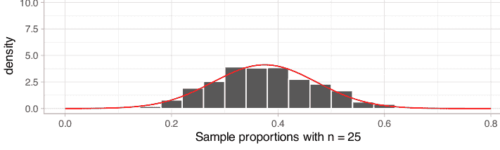

图 7.14：样本比例分布的直方图和正态曲线 (n=25)。

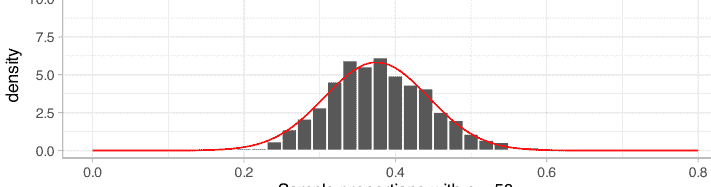

图 7.15：样本比例分布的直方图和正态曲线 (n=50)。

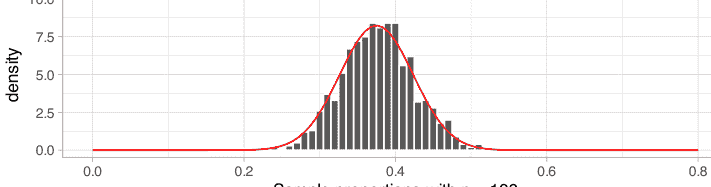

图 7.16：样本比例分布的直方图和正态曲线 (n=100)。


模拟支持了通过公式通过数学结果所得的标准误。模拟实际上用于检查获得的结果是否与理论一致。同时注意，理论结果是基于总体比例 $p$ 的知识构建的；相比之下，模拟是基于感兴趣的总体产生样本，但产生的结果仅基于从样本和样本比例中发现的信息。样本比例标准误公式实际上可以使用概率论中的事实推导出，但其推导过程超出了本书的范围。要了解更多信息，请参考概率和统计学中更高级的处理方法，例如这$^3$。

### 样本比例的抽样分布

我们已经展示了比例抽样分布的一些性质；即 $\bar{X}$ 的期望值和标准误。我们现在关注抽样分布的形状。

正如之前提到的，直方图（如之前看到的）提供了样本比例抽样分布（$\bar{X}$ 的分布）的良好近似。由于我们对分布的形状感兴趣，我们再次绘制了

> $3$ http://onlinestatbook.com/2/sampling_distributions/samp_dist_p.html

使用大小为 $n = 25, n = 50$ 的随机样本的比例直方图，但这次我们添加了一条似乎连接直方图中每个条顶部的光滑曲线。这些直方图位于图 7.14、7.15 和 7.16。这些图代表密度直方图，其中每个条的面积代表对应箱观测值的百分比或比例，每个直方图的总面积为 1（或 100%）。为了便于比较，所有这些图的 $x$ 轴和 $y$ 轴范围都保持不变。


图 7.14：样本比例分布的直方图和正态曲线 (n=25)。


图 7.15：样本比例分布的直方图和正态曲线 (n=50)。


图 7.16：样本比例分布的直方图和正态曲线 (n=100)。

## 7.4 第二次活动：巧克力裹杏仁

正如我们在处理样本比例时所做的那样，通过另一个活动来演示这些结果：从一碗巧克力裹杏仁中进行采样，如图 7.18 所示。


图 7.18：一碗巧克力裹杏仁。

为了方便说明，我们简单地将每个巧克力裹杏仁称为杏仁。我们现在对碗中所有杏仁的平均重量（克）感兴趣；这就是总体平均重量或总体均值。

### 7.4.1 碗中杏仁的总体平均重量

我们感兴趣的总体是碗中所有的杏仁。该碗通过 `modernrive` 包中包含的数据框 `almonds_bowl` 进行虚拟表征。这里展示了前十行作为说明：

```
almonds_tibble: 5,000 x 2

ID weight

<int> <dbl>

1 1 3.8

2 2 4.2

3 3 3.2

4 4 3.1

5 5 4.1

6 6 3.9

7 7 3.4

8 8 4.2

9 9 3.5

10 10 3.4

# i 4,990 more rows
```

第一个变量 `ID` 代表分配给每个杏仁的虚拟 ID 号，变量 `weight` 包含碗中每个杏仁的重量（克）。杏仁的总体平均重量是一个参数，可以在 R 中再次使用第 3 章中介绍的 `dplyr` 数据清洗动词进行计算。特别是在 `summarize()` 函数内部，分别使用 `mean()`、`sd()` 和 `n()` 函数来计算平均重量、重量的标准差以及碗中杏仁的数量：

```r
almonds_bowl |>
  summarize(mean_weight = mean(weight),
         sd_weight = sd(weight),
         length = n())
```

```
# A tibble: 1 x 3

mean_weight sd_weight <dbl> <int>

1 3.64 0.392 5000
```

我们有 5000 个杏仁，总体平均重量为 3.64 克，重量的标准差为 0.392 克。我们使用 R 来计算均值和标准差，但我们也可以使用公式。如果我们把 $x_1$ 称为碗中的第一个杏仁，$x_2$ 称为第二个，依此类推，则公式为：

$$\mu = \sum_{i=1}^{5000} x_i = 3.64.$$

标准差公式为：

$$\sigma = \sqrt_{i=1}^{5000} \frac{(x_i - \mu)^2}{5000} = 0.392.$$

希腊字母 $\mu$ 和 $\sigma$ 用于表示总体均值和总体标准差（感兴趣的参数）。此外，由于我们知道整碗碗的信息，可以使用直方图绘制出整个总体（碗）的重量分布：

```r
ggplot(almonds_bowl, aes(x = weight)) +
  geom_histogram(binwidth = 0.1, color = "white")
```

> 如前所述，此函数产生样本标准差，它将离差平方和除以 $n-1$ 而不是 $n$，但对于一个包含 5000 个观测值的列表，出于实际用途考虑，这种差异并不重要。

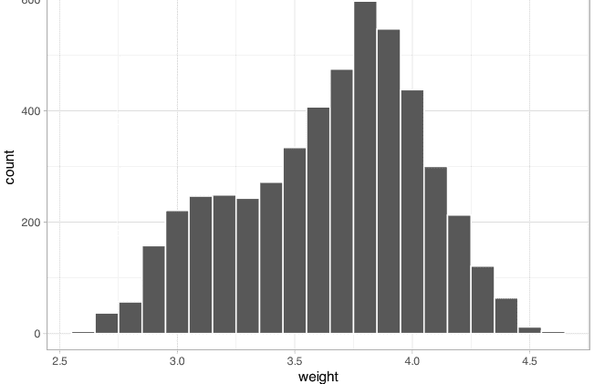

图 7.19：整碗杏仁的重量分布。

我们可以看到杏仁的重量范围从 2.6 到 4.6 克，观察到的常见重量在 3.6 到 4.0 克之间，但分布是对称的，且不遵循任何典型模式。

现在我们已经对感兴趣的总体和感兴趣的参数有了清晰理解，我们可以通过构建样本来继续探索杏仁重量**样本均值的抽样分布**。

### 7.4.2 手动采样与样本均值

如果我们从碗中随机选择一个杏仁，可以使用体重计确定其重量，如图 7.20 所示：


图 7.20：体重计上的一个杏仁。

现在我们取 25 个杏仁的随机样本，如图 7.21 所示，并确定样本平均重量（或样本均值重量），克。


图 7.21：体重计上的 25 个杏仁随机样本。

由于总重量为 88.6 克（如图 7.21 所示），样本均值将为 $88.6/25 = 3.544$。`almonds_sample` 数据框包含了该样本的信息。在这里，我们展示了样本中前 10 个杏仁的重量：

```r
almonds_sample <- almonds_bowl |>
  rep_slice_sample(n = 25, reps = 1)
```

`modernrive` 包中的 `almonds_sample` 数据框包含 $n=25$ 行，对应图 7.21 所示的每个杏仁。第一个变量 `replicate` 表示这是第一个也是唯一的样本。第二个变量 `ID` 为每个杏仁提供了标识。第三列 `weight` 以数值值（也称为 double）的形式给出每个杏仁的正确重量（克）。这 25 个杏仁的重量分布在图 7.22 的直方图中所示。

```r
ggplot(almonds_sample, aes(x = weight)) + 
  geom_histogram(binwidth = 0.1, color = "white")
```


图 7.22：25 个杏仁的重量分布。

这 25 个杏仁的重量从 2.9 到 4.4 克不等。该样本的分布没有明显的模式。

样本均值与总体均值 3.64 克之间的差异由于抽样。

### 7.4.3 虚拟采样

我们进行虚拟采样。`almonds_bowl` 数据框有 5000 行，代表图 7.21 所示的每个杏仁。正如我们在 7.1 节中所做的那样，我们再次使用 `rep_slice_sample()` 函数获取 1000 次样本量为 25 的采样：

```r
virtual_samples <- almonds_bowl |>
  rep_slice_sample(n = 25, reps = 1000)
```

```
# A tibble: 25,000 x 3

# Groups: replicate [1000]

  replicate ID weight

<int> <int> <dbl>

1 1 3467 3.7

2 1 3784 4.2

3 1 4653 4.2

4 1 2216 4.1

5 1 98 3.5

6 1 2286 3.6

7 1 4597 3.6

8 1 2385 4.3

9 1 3959 3.7

10 1 1497 3.9

# i 24,990 more rows
```

观察到 `virtual_samples` 包含 $1000 \cdot 25 = 25000$ 行。使用适当的数据清洗代码，`virtual_mean_weight` 数据框产生了每个样本的样本均值，总共 1000 个样本均值：

```r
virtual_mean_weight <- virtual_samples_bowl |>
  summarize(mean_weight = mean(weight))
```

```
# A tibble: 1,000 x 2

  replicate mean_weight

<int> <dbl>

1 1 3.79

2 2 3.45

3 3 3.67

4 4 3.5

5 5 3.67

6 6 3.63

7 7 3.62

8 8 3.59

9 9 3.56

10 10 3.78

# i 990 more rows
```

图 7.23 展示了这些样本均值的直方图：

```r
ggplot(virtual_mean_weight, aes(x = mean_weight)) + 
  geom_histogram(binwidth = 0.04, boundary = 3.5, color = "white") +
  labs(x = "样本均值", title = "1000 个样本均值的直方图")
```


图 7.23：基于 1000 个样本量为 25 的随机样本的 1000 个均值的分布。

## 224

## 7 采样

每次我们选择时，任何杏仁被选中的概率都是相同的。获取 25 颗杏仁的样本是进行 25 次试验以获得 25 个重量。然后，这 25 个数字的平均值就是 25 颗杏仁样本的平均重量或均值。这就是我们所说的样本均值。

使用随机变量，现在令 $X_1$ 为代表选取之前第一颗杏仁重量的随机变量，$X_2$ 为第二颗杏仁的重量。这些是随机变量，因为它们可以取碗中可能的杏仁重量值。第一次试验完成后，$X_1$ 的 $t$ 值被实现为所选的第一颗杏仁的重量（克）。我们表示这个值时可以写成 $X_1 = x_1$。第二次试验完成后，$X_2 = x_2$，其中 $x_2$ 是观测到的杏仁重量，依此类推。由于我们的实验是进行 25 次试验然后找到它们的平均值，那么在试验进行之前，这个平均值或均值也可以表示为一个随机变量：

```
$\overline{X} = \frac{X_1 + X_2 + \dots + X_{25}}{25}$
```

观察到 $\overline{X}$ 是这 25 次试验的平均值或均值。这就是为什么 $\overline{X}$ 被称为样本均值。回想在处理比例时，即伯努利试验仅用 0 或 1 表示。在这种背景下，样本比例是样本均值的特殊特例。我们现在使用的试验不再局限于 0 和 1，且样本均值不再是样本比例。例如，让我们关注之前使用的 25 颗杏仁重量样本以及它们的样本均值：`almonds_sample`

```# A tibble: 25 x 3

# Groups: [1]

  replicate ID weight

<int> <int> <dbl>

1       1 4645     3

2       1 3629     3.9

3       1 4796     4

4       1 2669     3.8

5       1 3488     4.3

6       1  105     4.1

7       1 1762     3.6

8       1 1035     4.2

9       1 4880     3.2

10      1  398      4

# 15 more rows
```

### 7.4 第二次活动：巧克力裹杏仁

通过查看 `almonds_sample` 帧中的重量，观察 $X_1 = 3.0$ 克，$X_2 = 3.9$ 克，$X_3 = 4.0$ 克，依此类推。如果你查看整个帧，例如在 R 中执行 `View(almonds_sample)`，你可以检查 $X_{23} = 3.3$，$X_{24} = 4.4$ 以及 $X_{25} = 3.6$，因此样本均值为：

$$\bar{X} = \frac{3.0 + 3.9 + 4.0 + \dots + 3.3 + 4.4 + 3.6}{25} = 3.67$$

在 R 中：

```
almonds_sample |
  summarize(sample_mean_weight = mean(weight))
```

```
# A tibble: 1 x 2

  replicate sample_mean_weight

<int> <dbl>

1         3.67
```

所以，一旦这个样本被观测到，随机变量 $\bar{X}$ 被实现为 $\bar{X} = 3.67$，**样本均值**为 3.67 克。注意，$\bar{X}$ 可能的所有值都是从碗中 25 颗杏仁样本中所有可能的样本均值。获得这些样本均值的概率取决于碗中杏仁重量的配置。

当 $\bar{X}$ 构建为给定样本的样本均值时，样本均值的抽样分布正是 $\bar{X}$ 的分布。在这种背景下，回想我们感兴趣确定的内容：

1. $\bar{X}$ *分布*的中心
2. $\bar{X}$ *分布*中*抽样变异*的影响以及样本量对*抽样变异*的影响
3. $\bar{X}$ *分布*的形状

正如我们处理样本比例时一样，我们再次使用模拟来产生 $\bar{X}$（杏仁样本均重量）分布的良好近似。我们还处理了大小为 25、50 和 100 的样本，以学习样本量变化时抽样变异的变化。

这是我们遵循的步骤：

- 我们生成 1000 个样本，
- 计算杏仁重量的样本均值，
- 使用它们绘制直方图。

## 226 7 采样

我们执行三次，并将 `size` 参数分别设置为 25、50 和 100。我们单独运行以下每个代码段，然后比较生成的直方图。

```
# 代码段 1: sample size = 25

# 1.a) 计算 1000 个样本均值，每个均来自大小为 25 的随机样本

virtual_mean_weight_25 <- almonds_bowl |>
  rep_slice_sample(n = 25, reps = 1000) |
  summarize(mean_weight = mean(weight), n = n())
```

```
# 1.b) 通过直方图绘制分布

ggplot(virtual_mean_weight_25, aes(x = mean_weight)) +
  geom_histogram(binwidth = 0.02, boundary = 3.6, color = "white") +
  labs(x = "25 颗杏仁随机样本的样本均值",
  title = "25")
```

```
# 代码段 2: sample size = 50

# 2.a) 计算 1000 个样本均值，每个均来自大小为 50 的随机样本

virtual_mean_weight_50 <- almonds_bowl |>
  rep_slice_sample(n = 50, reps = 1000) |
  summarize(mean_weight = mean(weight), n = n())
```

```
# 2.b) 通过直方图绘制分布

ggplot(virtual_mean_weight_50, aes(x = mean_weight)) +
  geom_histogram(binwidth = 0.02, boundary = 3.6, color = "white") +
  labs(x = "50 颗杏仁随机样本的样本均值",
  title = "50")
```

```
# 代码段 3: sample size = 100

# 3.a) 计算 1000 个样本均值，每个均来自大小为 100 的随机样本

virtual_mean_weight_100 <- almonds_bowl |>
  rep_slice_sample(n = 100, reps = 1000) |
  summarize(mean_weight = mean(weight), n = n())
```

```
# 3.b) 通过直方图绘制分布

ggplot(virtual_mean_weight_100, aes(x = mean_weight)) +
  geom_histogram(binwidth = 0.02, boundary = 3.6, color = "white") +
  labs(x = "100 颗杏仁随机样本的样本均值",
  title = "100")
```


## 259 7.4 第二次活动：巧克力裹杏仁

通过查看 `almonds_sample` 帧中的重量，观察 $X_1 = 3.0$ 克，$X_2 = 3.9$ 克，$X_3 = 4.0$ 克，依此类推。如果你查看整个帧，例如在 R 中执行 `View(almonds_sample)`，你可以检查 $X_{23} = 3.3$，$X_{24} = 4.4$ 以及 $X_{25} = 3.6$，因此样本均值为：

$$\bar{X} = \frac{3.0 + 3.9 + 4.0 + \dots + 3.3 + 4.4 + 3.6}{25} = 3.67$$

在 R 中：

```
almonds_sample |>
  summarize(sample_mean_weight = mean(weight))
```

```
# A tibble: 1 x 2
  replicate sample_mean_weight
<int> <dbl>
1         3.67
```

所以，一旦这个样本被观测到，随机变量 $\bar{X}$ 被实现为 $\bar{X} = 3.67$，**样本均值**为 3.67 克。注意，$\bar{X}$ 可能的所有值都是从碗中 25 颗杏仁样本中所有可能的样本均值。获得这些样本均值的概率取决于碗中杏仁重量的配置。

当 $\bar{X}$ 构建为给定样本的样本均值时，样本均值的抽样分布正是 $\bar{X}$ 的分布。在这种背景下，回想我们感兴趣确定的内容：

1. $\bar{X}$ *分布*的中心
2. $\bar{X}$ *分布*中*抽样变异*的影响以及样本量对*抽样变异*的影响
3. $\bar{X}$ *分布*的形状

正如我们处理样本比例时一样，我们再次使用模拟来产生 $\bar{X}$（杏仁样本均重量）分布的良好近似。我们还处理大小为 25、50 和 100 的样本，以学习样本量变化时抽样变异的变化。

这是我们遵循的步骤：

- 我们生成 1000 个样本，
- 计算杏仁重量的样本均值，
- 使用它们绘制直方图。

## 260 7 采样

我们执行三次，并将 `size` 参数分别设置为 25、50 和 100。我们单独运行以下每个代码段，然后比较生成的直方图。

```
# 代码段 1: sample size = 25
# 1.a) 计算 1000 个样本均值，每个均来自大小为 25 的随机样本
virtual_mean_weight_25 <- almonds_bowl |>
  rep_slice_sample(n = 25, reps = 1000) |>
  summarize(mean_weight = mean(weight), n = n())
```

```
# 1.b) 通过直方图绘制分布
ggplot(virtual_mean_weight_25, aes(x = mean_weight)) +
  geom_histogram(binwidth = 0.02, boundary = 3.6, color = "white") +
  labs(x = "25 颗杏仁随机样本的样本均值",
  title = "25")
```

```
# 代码段 2: sample size = 50
# 2.a) 计算 1000 个样本均值，每个均来自大小为 50 的随机样本
virtual_mean_weight_50 <- almonds_bowl |>
  rep_slice_sample(n = 50, reps = 1000) |>
  summarize(mean_weight = mean(weight), n = n())
```

```
# 2.b) 通过直方图绘制分布
ggplot(virtual_mean_weight_50, aes(x = mean_weight)) +
  geom_histogram(binwidth = 0.02, boundary = 3.6, color = "white") +
  labs(x = "50 颗杏仁随机样本的样本均值",
  title = "50")
```

```
# 代码段 3: sample size = 100
# 3.a) 计算 1000 个样本均值，每个均来自大小为 100 的随机样本
virtual_mean_weight_100 <- almonds_bowl |>
  rep_slice_sample(n = 100, reps = 1000) |>
  summarize(mean_weight = mean(weight), n = n())
```

```
# 3.b) 通过直方图绘制分布
ggplot(virtual_mean_weight_100, aes(x = mean_weight)) +
  geom_histogram(binwidth = 0.02, boundary = 3.6, color = "white") +
  labs(x = "100 颗杏仁随机样本的样本均值",
  title = "100")
```

## 261

### n = 25

```
virtual_mean_weight_25 |>
  summarize(E_X_25 = mean(weight), sd = sd(weight))
```

### n = 50

```
virtual_mean_weight_50 |>
  summarize(E_X_50 = mean(weight), sd = sd(weight))
```

### n = 100

```
virtual_mean_weight_100 |>
  summarize(E_X_100 = mean(weight), sd = sd(weight))
```

TABLE 7.1: 比较三个样本量的期望值和标准误差

| 样本量 | 期望值 | 标准误差 |
|---|---|---|
| 25 | 3.65 | 0.077 |
| 50 | 3.65 | 0.053 |
| 100 | 3.65 | 0.038 |

总结：

- 1. 估计期望值是 3.65 或 3.64。这接近或等于 $\mu = 3.64$，整个碗中杏仁的平均重量。
- 2. 标准误差随着样本量的增加而减小。如果我们关注 $n = 100$ 的结果，标准误差为 0.038。与总体标准差 $\sigma = 0.392$ 相比，该标准误差约为 $\sigma$ 的十分之一。同样，当 $n = 25$ 时，标准误差 0.077 约为 $\sigma$ 的五分之一，这种模式在 $n = 50$ 时也成立。

这也是一个理论结果，可以表示为：

> $SE_{\bar{X}} = \frac{\sigma}{\sqrt{n}}$

# 学习检查

(LC7.15) 增加样本量如何影响样本均值的标准误差？

## 7.5 其他场景下的抽样分布

- * A. 它增加了标准误
- * B. 它减小了标准误
- * C. 它对标准误没有影响
- * D. 它只影响标准差

## 7.4.6 重新回顾中心极限定定理

最后，观察图 7.24 中直方图的形状呈钟形，并且近似于正态分布。正如我们在处理比例时所的那样，在图 7.25 和 7.26 中，我们将直方图与正态分布的理论曲线进行比较。

得出结论：当样本量足够大，$\bar{X}$（即样本均值的抽样分布）近似遵循正态分布，其均值等于总体均值 $\mu$，标准差等于总体标准差除以样本量的平方根 $\sigma/\sqrt{n}$。我们可以将其写为：

```
$$\bar{X} \sim \text{Normal} \left(\mu, \frac{\sigma}{\sqrt{n}}\right)$$
```

> 学习检查

> **(LC7.16)** 对于以下每种情况，解释样本均值的抽样分布是否近似于正态分布。
> * 当总体分布为正态分布时。
> * 当样本量非常时。
> * 当样本量足够大时，无论总体分布如何。
> * 当总体分布为均匀分布时。

## 7.5 其他场景下的抽样分布

在第 7.1、7.3 和 7.4 节中，当感兴趣的统计量是样本比例或样本均值时，我们提供了关于期望、标准误和抽样分布形状的信息。研究其他统计量的抽样分布也是可能的。在本节中，我们将探索其中的一些。

### 7.5.1 比较分布

假设我们比较两个总体的参数，例如这些总体的均值或比例。为此，从第一个总体中抽取随机样本，并从第二个总体中抽取另一个与第一个相互独立的随机样本。然后，我们可以使用每个样本的统计量（如样本均值或样本比例），并利用它们来产生依赖于两个独立样本的抽样分布。我们提供两个例子来说明抽样分布是如何受到影响的。


**图 7.25：** 样本均值的分布 (n=25)。


**图 7.26：** 样本均值的分布 (n=100)。

### 样本均值的差异

当前的问题可能是：需要将一碗巧克力杏仁的重量与另一个碗中巧克力咖啡豆的重量进行比较。我们现在考虑的统计量是来自这两个碗的样本的样本均值之差。事实上，我们之前为单样本均值或样本比例介绍的大多数性质可以直接扩展到双样本问题。

我们现在提供该问题的数学细节。假设对于巧克力杏仁的重量，总体均值和标准差由 $\mu_1$ 和 $\sigma_1$ 给出；对于巧克力咖啡豆的重量，总体均值和标准差由 $\mu_2$ 和 $\sigma_2$ 给出。

我们的抽样练习有两个部分。首先，我们从杏仁碗中抽取大小为 $n_1$ 的随机样本并找到样本均值。让 $\bar{X}_1$ 代表每个可能样本的可能样本均值。然后，让 $n_2$ 和 $\bar{X}_2$ 代表咖啡豆碗的类似量。为了比较这两个样本均值，我们观察差异 $\bar{X}_1 - \bar{X}_2$。$\bar{X}_1 - \bar{X}_2$ 的分布就是均值差的抽样分布。

$\bar{X}_1 - \bar{X}_2$ 的期望和标准误分别为 $\mu_1 - \mu_2$ 和

```
$$\sqrt{\frac{\sigma_1^2}{n_1} + \frac{\sigma_2^2}{n_2}}$$
```

如果 $\bar{X}_1$ 和 $\bar{X}_2$ 的分布由于中心极限定理（CLT）而近似于正态分布，那么 $\bar{X}_1 - \bar{X}_2$ 的分布也是。我们可以一次性写出所有这些属性：

```
$$\bar{X} - \bar{Y} \sim Normal(\mu_1 - \mu_2, \sqrt{\frac{\sigma_1^2}{n_1} + \frac{\sigma_2^2}{n_2}})$$
```

观察差异的标准差是如何每个样本均值标准差平方的和。之所以加标准差而不是减的原因是，无论你加还是减统计量，你实际上都在结果中引入了更多的不确定性，因此离散程度增加了。

> 学习检查

> **(LC7.17)** 在比较两个样本的背景下，在寻找差异的标准误时，为什么我们加上方差（标准差的平方）而不是减它们？
> - 因为方差总是相互抵消
> - 因为相差相反映了两个样本的总不确定性
> - C. 因为相减方差总是得到负结果
> - D. 因为方差与标准误无关

### 样本比例的差异

比较两个样本比例非常有用。我们可能感兴趣比较使用某种治疗方法好转的患者比例与另一种治疗方法好转的患者比例，或者公路上冬季事故使用一种轮胎类型与另一种轮胎类型的比例。

为了说明样本比例差异的抽样分布如何工作，我们修改了之前使用的例子。假设我们想比较第一个碗中红球的比例与第二个碗中重量超过 3.8 克的杏仁比例。这个例子展示了如何将数值数据（如杏仁重量）转换为布尔结果。我们现在考虑的统计量是来自两个碗的样本的样本比例之差。每个碗的样本不需要大小相同；例如，我们可以从第一个碗中取出大小为 $n_1 = 50$ 的样本，从第二个碗中取出大小为 $n_2 = 60$ 的样本。

$\bar{X}_1 - \bar{X}_2$ 的分布是均值差的抽样分布。我们通过计算每次重复的比例差异来进行。结果存储在数据框 `prop_joined` 中。变量 `prop_diff` 代表比例差异。我们在这里展示该数据框的前 10 个值：

```
prop_joined
```

```
# A tibble: 1000 x 4
replicate prop_red prop_almond prop_diff
<int> <dbl> <dbl>
1 1 0.24 0.45 -0.21
2 2 0.46 0.5 -0.0400
3 3 0.38 0.35 0.0300
4 4 0.36 0.433 -0.0733
5 5 0.38 0.367 0.0133
6 6 0.3 0.317 -0.0167
7 7 0.42 0.383 0.0367
8 8 0.42 0.483 -0.0633
9 9 0.32 0.5 -0.18
10 10 0.48 0.433 0.0467
# i 990 more rows
```

正如之前一样，我们在图 7.27 中为这 1000 个差异构建一个直方图。

```
ggplot(prop_joined, aes(x = prop_diff)) +
  geom_histogram(binwidth = 0.04, boundary = 0, color = "white") +
```

```
labs(x = "Difference in sample proportions"
title = "Histogram of 1000 differences in sample proportions")
```

# 1000 个样本比例差异直方图


**图 2.27：** 基于第一个碗 1000 个大小为 50 的随机样本和第二个碗 1000 个随机样本的 1000 个样本比例差异的分布。

样本比例差异的抽分布也呈现钟形，并且似乎位于 -0.05 左右的某个负值。与单个样本比例或样本均值一样，样本比例差异的抽分布也遵循正态分布，且期望差和标准误差都依赖于总体信息和样本量。

以下是数学细节：$\bar{X}_1$ 代表大小为 $n_1=50$ 的红球样本比例的随机变量，$\bar{X}_2$ 代表来自大小为 $n_2=60$ 的样本中重量超过 3.8 克的杏仁样本比例的随机变量。红球的总体比例和标准差由 $p_1$ 和 $\sigma_1 = \sqrt{p_1(1-p_1)}$ 给出，对于杏仁重量，总体比例和标准差由 $p_2$ 和 $\sigma_2 = \sqrt{p_2(1-p_2)}$ 给出。

差异 $\bar{X}_1 - \bar{X}_2$ 的期望值和标准误差分别由 $p_1 - p_2$ 和

```
$$\sqrt{\frac{p_1(1-p_1)}{n_1} + \frac{p_2(1-p_2)}{n_2}},$$
```

如果 $X_1$ 和 $X_2$ 的分布由于中心极限定理（CLT）而近似于正态分布，那么 $\bar{X}_1 - \bar{X}_2$ 的分布也是。我们可以写写所有这些属性：

```
$$\bar{X}_1 - \bar{X}_2 \sim Normal \left(p_1 - p_2, \sqrt{\frac{p_1(1-p_1)}{n_1} + \frac{p_2(1-p_2)}{n_2}}\right)$$
```


# 学习检查

(LC71.8) 如果两个样本都足够大，样本比例差异的抽分布预期应该是什么样的？

- A. 均匀分布。
- B. 钟形，近似于正态分布。
- C. 双峰分布。
- D. 右偏。

# 7.6 总结和结语

## 7.6.1 场景总结

这些不是可以确定抽分布的唯一情况。例如，在执行线性回归时，我们可以找到回归线斜率的抽分布，其行为与我们在这里描述的相似。我们将在第 10 章在线性回归背景下讨论推理。目前，我们对本章介绍的不同场景进行总结。

请查看书籍的在线版，其中包含一个使用中心极限定理确定这些统计量抽分布的表格。

# 表 7.2：推断抽样的场景

| 场景 | 总体参数 | 符号 | 点估计 |
| --- | --- | --- | --- |
| 1 | 总体比例 | $p$ | 样本比例 |
| 2 | 总体均值 | $\mu$ | 样本均值 |
| 3 | 总体比例差异 | $p_1 - p_2$ | 样本比例差异 |
| 4 | 总体均值差异 | $\mu_1 - \mu_2$ | 样本均值差异 |
| 5 | 总体回归斜率 | $\beta_1$ | 拟合回归斜率 |

## 7.6.2 其他资源

所有*学习检查*的解答可以在书籍在线版的附录中找到。附录从 `https://moderndive.com/v2/appendixa` 开始。

本章使用的所有 R 代码的 R 可以在 `https://www.moderndive.com/v2/scripts/07-sampling.R` 获取。

## 7.6.3 展望

在即将第 8 章，我们将深入探讨统计推断的概念，建立在本章抽样部分已经建立的基础之上。本章向我们介绍了使用样本数据估计总体参数的想法，这是推断统计的一个关键方面。

我们将探索如何构建和解释置信区间，特别关注它们对总体参数意味着什么。这涉及理解置信水平的概念，并识别置信区间的局限性和正确用法。本章旨在通过示例和应用增强我们的实际理解，使我们能够将这些概念应用于现实场景中。

# 估计、置信区间和自助法（Bootstrapping）

我们在第 7 章学习了抽样。回想一下，例如从碗中获取许多红白球的随机样本，找到每个样本的红球样本比例，并研究样本比例的分布。我们可以这样总结我们的发现：

- 样本比例的抽分布近似遵循正态分布；
- 样本比例的期望值位于分布的中心；
- 抽样变通过样本比例的标准误差衡量，等于总体标准差除以收集样本的样本量的平方根。

同样，当对巧克力杏仁进行抽样并获得每个样本的样本均值重量时，上述描述的特征也会在均值的抽分布中遇到；即：

- 样本均值的抽分布近似遵循正态分布；
- 样本均值的期望值是总体均值；
- 样本均值的标准误差是总体标准差除以样本量的平方根。

此外，这些特征也适用于样本均值差异、样本比例差异等其他的抽分布。记住，抽分布不受限于总体的分布。只要所取的样本足够大，且我们使用适当的标准误差，我们就可以相应地推广这些结果。

对抽分布的研究源于另一个我们尚未回答的问题：如果我们无法获取总体，我们该如何确定杏仁的平均重量呢？我们已经在第 7 章通过仿真看到，样本的平均值将接近期望值，而期望值恰恰是总体均值。

## 8.1 将采样分布与估计联系起来

在本节中，我们将重新回顾第 7 章介绍的巧克力裹杏仁案例，以及杏仁样本平均重量的采样分布结果，但这一次我们将在估计的语境下使用这些信息。

我们首先通过杏仁案例来介绍或回顾一些术语。这碗巧克力裹杏仁是我们感兴趣关注的总体（population）。我们关注的参数（parameter）是这碗巧克力中杏仁的总体平均重量 `$\mu$`。这是我们想要估计的数值。

我们想要使用样本均来估计这个参数。因此，我们把样本均称为 `$\mu$`（总体平均重量）的估计量（estimator）或估计值（estimate）。估计量和估计值之间的区别值得讨论。

为了说明，我们决定从碗中随机抽取 100 颗杏仁作为随机样本，并使用其样本均来估计总体平均重量。换句话说，我们打算相加 100 颗杏仁的重量，将总和除以 100，并使用该值来估计总体平均重量。当我们提到样本均时，我们称其为总体平均重量的估计量。由于不同的样本会产生不同的样本均，样本均作为估计量是第 7.4.5 节描述的随机变量 `$\bar{X}$`。由于我们在第 7 章已经学习了采样分布，我们知道这个估计量近似服从正态分布；它的期望值等于总体平均重量。它的标准差也称为标准误差（standard error），为：

$$SE(\bar{x}) = \frac{\sigma}{\sqrt{n}}$$

在本例中，`$n = 100$`，`$\sigma$` 是杏仁重量的总体标准差。

我们获取了一个 100 颗杏仁重量的随机样本，如下所示，并将其存储在 `modernrive` 软件包中，且使用相同的名称：

```
almonds_sample_100
```

```
# A tibble: 100 x 3

# Groups: replicate [1]

replicate ID weight

<int> <int> <dbl>

1 1 166 4.2

2 1 1215 4.2
```

| | | | | | |
|---|---|---|---|---|---|
| 3 | 1 | 1899 | 3.9 | | |
| 4 | 1 | 1912 | 3.8 | | |
| 5 | 1 | 4637 | 3.3 | | |
| 6 | 1 | 511 | 3.5 | | |
| 7 | 1 | 127 | 4 | | |
| 8 | 1 | 4419 | 3.5 | | |
| 9 | 1 | 4729 | 4.2 | | |
| 10 | 1 | 2574 | 4.1 | | |

# i 90 more rows

我们可以用它来计算样本平均重量：

```
almonds_sample_100 |>

summarize(sample_mean = mean(weight))
```

```
# A tibble: 1 x 2

replicate sample_mean

<int>dbl

1 3.682
```

那么 `$\bar{X}= 3.682$` 是总体平均重量的一个估计值。综之，**估计量**是在获取样本之前用于在样本上以估计参数的程序、公式或方法，且这些方法在第 7 章中讨论了其有用属性。一旦提取了样本并将样本均公式应用到该样本，得到的数字就是**估计值**。

样本均作为总体均的估计量或估计值，将是本章开发内容的核心组成部分。但注意，它不仅仅是关注的数值。例如，杏仁重量的总体标准差（用希腊字母 `$\sigma$` 表示）是一个参数，而样本标准差可以是该参数的**估计量**或**估计值**。

此外，我们在第 7 章已经证明样本均的期望值等于总体均。当这种情况发生时，样本均将是总体均的**无偏**（unbiased）估计量；某些样本均会大于、另一些会小于，平均而言，它们将等于总体均。通常情况下，当一个估计量的期望值等于它试图估计的参数时，我们称之为**无偏的**。如果不是，则估计量是**有偏的**（biased）。

我们现在重新回到杏仁研究，以及样本均的采样分布如何帮助我们构建总体均的区间估计（interval estimates）。

### 学习检查

(LC81) 根据采样分布，大样本中杏仁样本平均的的期望是多少？
- A. 它总是大于总体均。
- B. 它总是小于总体均。
- C. 它完全等于总体均。
- D. 它平均等于总体均，但在任何单个样本中可能会有所不同。

(LC82) 什么是点估计（point estimate）？在统计估计的背景下，它与区间估计（interval estimate）有什么区别？
- A. 点估计使用多个值来估计参数；区间估计使用单个值。
- B. 点估计是用于估计参数的单个值；区间估计提供了参数可能落入的范围。
- C. 点估计是多个样本的均值；区间估计是位数。
- D. 点估计和区间估计是相同的，可以互换。

# 8.4 估计、置信区间与自助法

服从正态分布的随机变量可以取实数上的任何值，但这些值（在 X 轴上）对应于密度曲线峰值的概率比对应于尾部值的概率更高。用实线绘制的密度曲线与用虚线绘制的曲线具有相同的均值 `$\mu=5$`，但前者的离散程度较较小（用标准差 `$\sigma=2$` 衡量），而后者为 `$\sigma=5$`。由于任何密度曲线下方的总面积等于 1，因此较宽的曲线高度必须更短以保持这一特性。另一方面，用实线绘制的密度曲线与用虚线绘制的曲线具有相同的标准差 `$\sigma=2$`，但后者的均值 `$\mu=15$` 大于前者的 `$\mu=5$`，因此它们看起来是一样的，但后者在 X 轴上的中心位置比前者更靠右。

## 标准正态分布

一种特殊的正态分布具有均值 `$\mu=0$` 且标准差 `$\sigma=1$`。它被称为标准正态分布，用 z 曲线（密度曲线）表示。如果随机变量 `$Z$` 服从标准正态分布，则该随机变量的一个实现被称为标准值或 z 值。z 值表示均值之上的标准差倍数（如果是正数）或均值之下（如果是负数）。例如，如果 `$z=5$`，则观测到的值代表均值 `$\mu=0$` 之上的五个标准差。

## 服从正态分布的随机变量的线性变换

随机变量的线性变换通过在原始值上加、减、乘、除常数，将原始变量转换为一个新的随机变量。所得随机变量可能具有不同的均值和标准差。最有趣的变换是将随机变量转换为另一个 `$\mu=0$` 且 `$\sigma=1$` 的随机变量。当这种情况发生时，我们说该随机变量被标准化。

正态分布的一个性质是，任何服从正态分布的随机变量的线性变换也服从正态分布，但可能具有不同的均值和标准差。特别，我们可以将任何随机变量转换为服从标准正态分布的随机变量。例如，如果一个值 `$x=11$` 来自于均值为 `$\mu=5$`、标准差为 `$\sigma=2$` 的正态分布，则 z 值

```
$z = \frac{x-\mu}{\sigma} = \frac{11-5}{2} = 3$
```

是标准正态曲线中的对应值。此外，我们已经确定在该例中 `$x=11$` 正好比均值高 3 个标准差。

## 8.1 将采样分布与估计相结合

### 寻找密度曲线下的概率

当随机变量可以用密度曲线表示时，该随机变量在任何给定区间（在 X 轴上）内取某个值的概率等于该区间在密度曲线下的面积。如果我们知道表示密度曲线的方程，就可以使用微积分中的数学技术——积分——来确定这一点。在正态曲线的情况下，任何区间的积分都没有解析解，其解是使用数值近似值计算得的。

我们假设随机变量 Z 服从标准正态分布。我们想知道该随机变量取值为均值范围内一个标准差内值的概率有多大。等价于，观测值 `$z$`（在 X 轴上）位于 -1 和 1 之间的概率如图 8.3 所示？


**图 8.3：** 一个标准差内的正态面积。

计算显示，该面积为 0.6827，或约为曲线总面积的 68.27%。这等同于在标准正态分布中取 -1 到 1 之间值的概率为 68.27%。这也意味着如果代表实验的随机变量服从正态分布，那么该实验结果落在均值范围内一个标准差内的概率为 68.27%。同样，标准正态密度曲线下 -2 到 2 之间的面积如图 8.4 所示。


**图 8.4：** 标准差内的正态面积。

计算显示，该面积为 0.9544，或约为曲线总面积的 95.44%。这等同于在标准正态分布中取 -2 到 2 之间值的概率为 95.44%。这也意味着如果代表实验的随机变量服从正态分布，那么该实验结果落在均值范围内两个标准差内的概率为 95.44%。

总结来说，如果代表实验的随机变量服从正态分布，该实验结果落在均值范围内一个标准差内的概率为 68.27%，落在均值范围内三个标准差内的概率为 99.73%。理解这个概念，例如，观测到距离均值五个标准差之外的概率几乎为零。

## 学习检查

(LC8.3) 均值 (μ) 在语境中代表什么？
-   A. 随机抽样的 100 个杏的平均重量。
-   B. 碗中最重的杏的重量。
-   C. 所有 5000 个杏的平均重量。
- D. 碗中所有杏的总重量。

(LC8.4) 下列哪个陈述描述了实验中的总体标准差 (σ)？
-   A. 它衡量杏的重量与样本均值之间的平均差异。
-   B. 它衡量杏的重量与总体均值之间的平均差异。
-   C. 它等于样本方差的平方根。
-   D. 它总是小于总体均值。

(LC8.5) 我们为什么使用样本均值来估计总体均值？
-   A. 因为样本均值总是比总体均值大。
-   B. 因为由于其无偏性，它是总体均值的良好估计量。
-   C. 因为样本均值比总体均值需要更少的计算量。
-   D. 因为样本均值消除了所有的采样变异。

### 8.1 将采样分布与估计

### 8.1.3 置信区间

我们继续使用这个例子，通过 100 个杏的随机样本来估计杏的总体均值。我们在第 7 章中已经证明，杏的样本均值的采样分布近似于正态分布，其期望值为

$SE(\bar{x}) = \frac{\sigma}{\sqrt{100}}$

在 8.1.1 节中，我们得出对于杏总体而言，`$\mu = 3.645$` 克，`$\sigma = 0.32$`，因此采样分布的标准误为

$SE(\bar{x}) = \frac{\sigma}{\sqrt{100}} = \frac{0.392}{\sqrt{100}} = 0.039$

克。在图 8.5 中，我们使用这些值绘制该分布的密度曲线。


**图 8.5：** 杏样本均值的正态密度曲线。

水平轴（X 轴）代表从所有可能的100个杏的随机样本中确定的样本均值。左侧的点代表采样分布的期望值 `$\mu = 3.64$`，位于 X 轴的中心位置。

# 8 估计、置信区间与自助法

……分布。密度曲线的高度可以被视为这些样本均值被观测到的概率。例如，获得样本均值在 3.645 克左右的随机样本（对应曲线的最高点）的概率，高于获得均值在 3.5 克左右样本的概率，因为曲线在那个数值处几乎为零。右侧的点点是我们从 100 颗杏仁样本中得到的样本均值，`$\bar{x} = 3.682$` 克。它比总体平均重量高出 0.37 克。0.037 克到底有多远？将这个距离转化为标准值非常有帮助：

$$\frac{3.682 - 3.645}{0.039} = 0.945$$

所以 0.037 克比总体均值高约 0.945 标准误差。

在现实生活中，总体均值 `$\mu$` 是未知的，因此样本均值到 `$\mu$` 的距离也是未知的。另一方面，样本均值的抽样分布遵循正态分布。根据我们之前对正态曲线下方面积的讨论，有 95% 的概率观测值距离均值 1.96 个标准差以内。在我们问题的背景下，样本均值有 95% 的概率落在总体均值的 1.96 标准误差范围内。如前所示，我们示例计算出的样本均值比总体均值高 0.945 标准误差，完全在合理范围内。

考虑一下这个结果。如果我们取另一个 100 颗杏仁的样本，样本均值可能会不同，但你仍然有 95% 的概率使新的样本均值落在总体均值的 1.96 标准误差范围内。

我们终于可以构建一个利用这种配置的区间估计。我们将区间中心位于观测到的样本均值上，然后向两侧延伸等同于 1.96 标准误差的幅度。该区间的下限和上限为：

$$(\bar{x} - 1.96\frac{\sigma}{\sqrt{n}}, \bar{x} + 1.96\frac{\sigma}{\sqrt{n}}) = (3.682 - 1.96 \cdot\frac{0.392}{\sqrt{100}}, 3.682 + 1.96 \cdot\frac{0.392}{\sqrt{100}}) = (3.605, 3.759)$$

以下是用于计算这些下限和上限的 R 代码：

```r
almonds_sample_100 |>

summarize(
  sample_mean = mean(weight),
  lower_bound = mean(weight) - 1.96 * sigma / sqrt(length(weight)),
  upper_bound = mean(weight) + 1.96 * sigma / sqrt(length(weight))
)
```

## 8.1 将抽样分布与估计联系

```r
# A tibble: 1 x 4

replicate sample_mean lower_bound upper_bound

<int> dbl <dbl> <dbl>

1 1 3.682 3.60515 3.75885
```


函数 `mean()` 和 `length()` 分别从 `almonds_sample_100` 中的杏仁重量样本找到样本权重和样本量。`1.96` 对应于在正态分布下获得 95% 面积所需的标准误差数，而总体标准差 `$\sigma=0.392$` 是在 8.1.1 节中找到的。图 8.6 将此区间显示为水平实线。观察总体均值 `$\mu$` 如何作为该区间的一部分。


图 8.6：总体均值在区间内吗？

由于构建此区间使用了 1.96 标准误差，我们称之为 **95% 置信区间**。置信区间可以看作是总体均值的区间估计量。将区间估计量与作为点估计量的样本均值进行比较：后者用单个数字来估计参数，而前者产生一个整个区间来考量参数的位置。一个恰当的类比是钓鱼：想象浑浊的水中有一条鱼在游动。鱼看不见，但它的活动在水面上产生了涟漪，可以提供一些关于鱼位置的有限信息。为了捕到鱼，可以使用矛或网。因为信息是有限的，向涟漪投矛可能会捕到鱼，但很可能会失手。

另一方面，在涟漪周围撒网可能会有更高的捕到鱼的概率。仅用样本均值来估计总体均值，就像向涟漪投矛以期望捕到鱼。构建一个可能包含总体均值的置信区间，就像用网围住涟漪。记住这个类比，因为我们将在后续章节中再次回到它。

# 学习检查

(LC8.6) 在此示例中，如何计算杏仁样本均值重量的标准误差？

- A. 用样本均值除以总体标准差。
- B. 用总体标准差除以样本量的平方根。
- C. 用样本均值乘以样本量的平方根。
- D. 用总体均值除以样本量。

(LC8.7) 在杏仁估计的背景下，95% 置信区间代表什么？

- A. 有 95% 的概率样本均值落在总体均值的 1.96 个标准差以内。
- B. 区间将包含样本中 95% 的杏仁重量。
- C. 有 95% 的概率总体均值落在样本 1.96 标准误差范围内。
- D. 样本均值在 95% 的时间内精确等于总体均值。

## 8.1.4 t 分布

记得由于中心极限定理，样本均值的抽样分布近似于正态分布，其均值等于总体均值 `$\mu$`，标准差由标准误差 `SE(\bar{X}) = \sigma/\sqrt{n}` 给出。我们可以对任何样本均值 `$\bar{X}$` 进行标准化，使得：

$$z = \frac{\bar{X} - \mu}{\sigma/\sqrt{n}}$$

## 8.1 将抽样分布与估计联系起来

这里使用样本标准差和 `$t$` 分布计算出的置信区间，与使用总体标准差和正态分布得到的区间几乎相同，上界和下界的差异仅约为 0.005 个单位。这是因为当样本量为 100 时，`$t$` 曲线和 `$z$` 曲线几乎是完全相同的，而且因为样本标准差与总体标准差非常接近。情况并非总是如此，我们有时会观察到更大的差异；但总来说，结果是非常相似的。

更重要的是，构建的置信区间包含了 `$\mu = 3.645$` 的总体均值，这正是我们需要的结果。请记住，置信区间是对感兴趣参数（即杏仁重量总体均值）的区间估计。我们可以这样总结结果：

- 你们使用的随机样本量足够大，样本均值的抽样分布近似服从正态分布。
- 使用观测到的样本均值和抽样分布的标准误，我们可以为总体均值构建 95% 置信区间。这些区间的公式为：

$$\bar{x} - 1.96\frac{\sigma}{\sqrt{n}}, \bar{x} + 1.96\frac{\sigma}{\sqrt{n}}$$

其中 `$n$` 是使用的样本量。

- 当总体标准差未知时（这几乎总是如此），使用样本标准差来估计该标准误。这产生了额外的变异性，且标准化值服从自由度为 `$n-1$` 的 `$t$` 分布。当样本量 `$n=100$` 时，95% 置信区间的公式为：

$$\bar{x} - 1.98\frac{s}{\sqrt{100}}, \bar{x} + 1.98\frac{s}{\sqrt{100}}$$

- 构建 95% 置信区间的方法保证了，从长期来看，对于 95% 的可能样本，确定的区间将包含总体均值。它还保证 5% 的可能样本会导致不包含总体均值的区间。
- 既然我们构建了置信水平为 95% 的区间，我们构建任何置信水平的区间。方程中唯一的改变是所需的标准误数量。

# 8 估计、置信区间与自助法

### 8.1.5 解释置信区间

我们使用了杏仁的样本 `almonds_sample_100`，为杏仁的总体均值构建了 95% 置信区间，并证明该区间包含了该总体。这一结果并不像我们预期的那样（预期区间会让 95% 的可能随机样本包含总体均值）。我们对许多随机样本重复这种区间构建。图 8.8 显示了一百个 95% 置信区间的的结果。


**图 8.8：** 百个 95% 置信区间以及每个区间是否包含均值。

注意每个区间都是使用不同的随机样本构建的。垂直线画在总体均值重量 `$\mu = 3.645$` 的位置。水平线代表找到的一百个 95% 置信区间。灰色的置信区间穿过了垂直线，因此它们包含了总体均值。黑色的置信区间则没有包含。

这一结果引出了 95% 置信区间的含义：如果你能使用前面描述的程序为每一个可能的随机样本构建区间，那么这些区间中将有 95% 总体均值，而 5% 将不包含。

当然，在大多数情况下，获取每一个可能的随机样本是不现实或不可能的。尽管如此，对于大量的随机样本，这个结果是大致正确的。例如图 8.8 所示，100 个置信区间中有 5 个不包含总体均值，95 个则包含。它们不会总是完美匹配，但比例应该与所选的置信水平非常接近。

“95% 置信”这个词引导我们认为我们正在谈论概率或几率。事实上我们确实是在谈论，但是以一种微妙的方式。在获取随机样本之前，有 95% 的概率在当使用前瞻性的随机样本构建置信区间时，该区间将包含总体均值。一旦获得了随机样本，构建的区间要么包含总体均值，要么不包含；确定地说，它不再涉及几率。当我们不知道总体均值时，这一点是成立的。因此，95% 置信指的是用于前瞻性样本的方法或过程。我们有信心，如果按照该过程构建区间，获取的 95% 随机样本将引导我们产生一个包含总体均值的区间。

另一方面，说“置信区间有 95% 的概率包含总体均值”是不恰当的。观察图 8.8，置信区间包含或不包含 `$\mu$`。一旦置信区间确定，总体均值要么被包含，要么不。

在文献中，这种解释被概括为一个简短的版本：我们有 95% 的信心区间包含总体参数。例如，在第 8.1.4 节中，杏仁总体均值重量的 95% 置信区间为 (3.498, 3.846)，我们会说：“我们有 95% 的信心区间位于 (3.498, 3.846) 之间。”

学习检查

(LC8.8) 相比于正态分布，为什么 `$t$` 分布的尾部更厚？
- A. 因为均值更接近正态分布。
- B. 因为使用正态分布时中心是中心。
- C. 因为抽样分布是 `$t$` 分布。
- D. 因为在使用标准差时考虑了它。

(LC8.9) 增加自由度对 `$t$` 分布的影响是什么？
- A. 分布的尾部变厚。
- B. 尾部变薄。
- C. 分布不随自由度改变。
- D. 分布向右倾斜。

### 理解置信区间的宽度

置信区间是对参数的区间估计。在杏仁的案例中，我们为均值构建了置信区间。95% 的区间是是

$$\bar{x} - 1.96\frac{\sigma}{\sqrt{n}}, \bar{x} + 1.96\frac{\sigma}{\sqrt{n}}$$

观察置信区间以样本均值为中心，向两侧延伸 `1.96/\sqrt{n}`。这个量正好是置信区间宽度的一半，被称为**误差范围**。总体标准差 `$\sigma$` 的值我们无法控制，是由实验或现象决定的。样本均值 `$\bar{x}$` 是取决于随机样本的结果。另一方面，1.96 和样本量 `$n$` 是研究人员或从业者可以改变的值。它们对置信间的宽度起着重要作用。我们分别研究它们。

### 置信水平

我们之前提到 1.96 对应于 95% 置信，但没有说明如何确定这个值。置信水平是从业者的决策。如果你想更有信心（98% 或 99% 信心），你只需要调整所需的标准误数量。我们通过图 8.9 来说明这一过程。

- 如果置信水平为 0.95（或 95%），标准正态分布中间是 0.95。该区域在图 8.9 中被阴影。
- 我们构建 `$\alpha = 1 - 置信水平 = 1 - 0.95 = 0.05$`。将 `$\alpha$` 视为双尾的总面积。

## 8.1 建立抽样分布估计

由 `$-q$` 和 `$q$` 表示，它们的幅度相同，但一个为正一个为负。


**图 8.9:** 阴影区域为 0.95 的正态曲线。

在 R 语言中，`qnorm()` 函数在给定曲线下数值 `$q$` 左侧的面积时，寻找 `$q$` 的值。在我们的示例中，`$-q$` 左侧的面积为 `$\alpha/2 = 0.05/2 = 0.025$`，所以：

```
qnorm(0.025)
```

```
[1] -1.96
```

或者位于均值下方 1.96 个标准差。同样地，`$q$` 左侧曲线下的总面积为总阴影面积 0.95 加上左侧尾部的小白色区域 0.025，即 `$0.95 + 0.025 = 0.975$`，所以：

```
qnorm(0.975)
```

```
[1] 1.96
```

这就是为什么我们在计算 95% 置信区间时使用 1.96 个标准差。如果我们想获取 90% 的置信区间呢？我们遵循相同的步骤：

- 置信水平为 0.90。
- `$\alpha = 1 - \text{置信水平} = 1 - 0.90 = 0.05$`。
- 每个尾部的面积为 `$\alpha/2 = 0.10/2 = 0.05$`。
- 寻找 `$q$` 需要的面积为 `$0.90 + 0.05 = 0.95$`。

## 8 估计、置信区间与自助法

```
qnorm(0.95)
```
- [1] 1.645

如果我们想确定 90% 的置信区间，我们需要在计算中使用 1.645 个标准误。我们可以更新 R 代码来计算 90% 置信区间的上下限：

```
almonds_sample_100 |>
summize(sample_mean = mean(weight),
  lower_bound = mean(weight) - qnorm(0.95)*sigma/sqrt(length(weight)),
  upper_bound = mean(weight) + qnorm(0.95)*sigma/sqrt(length(weight)))
```

### A tibble: 1 x 4

| replicate | sample_mean | lower_bound | upper_bound |
| :--- | :--- | :--- | :--- |
| 1 | 1 | 3.682 | 3.61751 | 3.74649 |

让我们再做一次。如果我们想要 80% 的置信区间，1 - 0.8 = 0.2，0.2/2 = 0.1，且 0.8 + 0.1 = 0.9，所以：

```
qnorm(0.9)
```

```
[1] 1.28
```

当你想要计算 80%、90% 或 95% 的置信区间时，你需要分别使用 1.282、1.645 或 1.96 个标准误来构建你的区间。你越想有把握，需要的标准误倍数越大，你的置信范围就越宽。但置信区间是总体均值的估计量，它越窄，从实际角度考虑就越有用。因此，置信区间的宽度和置信度之间存在权衡。当我们改变置信水平时，可以确定样本量的大小。95% 置信区间的误差为

> `$1.96 \cdot \frac{\sigma}{\sqrt{n}}$`

随着样本量的增加，误差与样本量的平方根成反比。例如，如果我们获得大小为 25 的随机样本，`$1/\sqrt{25} = 0.2$`，如果我们获得大小为 100 的样本，`$1/\sqrt{100} = 0.1$`。通过选择大四倍的尺寸，我们产生的宽度减半。这种结果值得关注。

8. 使用自助法进行估计

置信区间是参数的估计量，例如杏仁的总体均值。理想情况下，我们希望构建一个高置信水平的区间，例如 95% 置信。但我们也希望区间足够窄以提供有用信息。例如，假设得到了 95% 置信区间：

- 2 克到 4 克之间
- 3.51 克到 3.64 克之间
- 3.539 克到 3.545 克之间

第一个区间看起来完全没用，第二个好一些，第三个极其精确，因为我们有 95% 的把握落在该范围内。

自 Efron (1979) 提出自助法以来，统计学界接纳了这种方法。在 20 世纪 80 年代和 90 年代，出现了许多理论和实验结果证明了自助法的优势。例如，Efron (1979)、Hall (1986)、Efron and Tibshirani (Efron and Tibshirani, 1986) 以及 Hall (1988) 表，当目标是估计量的标准误或寻找参数的置信区间时，自助法至少与现有方法一样好，甚至更好。当基础方法无法产生准确结果时，人们提出了改进算法的建议。随着计算能力和速度的不断提高，以及拥有现成统计软件进行实现的优势，自助法的使用越来越流行。作为一个说明，如果我们对总体均值 `$\mu$` 感兴趣并收集了一个随机样本，我们可以从该原始样本中获得大量的自助样本，计算样本均值并从小到大排序，然后选择包含中间 95% 样本的区间。这是基于自助寻找置信区间的最简单方法。

### 8.2.1 自助样本：回顾杏仁活动

为了研究和理解自助样本的行为，我们回到杏仁的示例。回顾，碗被认为是杏仁的总体，我们感兴趣的是估计杏仁的总体均值。

## 8.2 使用自助法进行估计

正如我们之前所做的，我们只能获取单个随机样本。在本节中，我们使用数据框 `almonds_sample_100`，这是之前提取的 100 颗杏仁的随机样本。我们称之为原始样本，它在本节中用于创建自助样本。前 10 行如下所示：

```
almonds_sample_100
# A tibble: 100 x 3
# Groups: replicate [1]
replicate  ID weight 
<int>      <int> <dbl>
1         1  166   4.2
2         1  1215   4.2
3         1  1899   3.9
4         1  1912   3.8
5         1  4637   3.3
6         1   511    3.5
7         1   127     4
8         1  4419   3.5
9         1  4729   4.2
10        1  2574   4.1
```

构建自助样本：单次重采样

我们首先从 100 颗杏仁的原始样本中构建一个包含 100 颗杏仁的自助样本。手动执行此任务所需的步骤如下：

**步骤 1：** 将 100 颗杏仁的原始样本放入袋子或帽子中。

**步骤 2：** 混合袋内物品，取出一颗杏仁，称重重量，并如图 8.10 所示记录重量。


**图 8.10：** 步骤 2：随机称重一颗杏仁。

**步骤 3：** 将杏仁放回袋中！换句话说，如图 8.11 所示将其放回。


**图 8.11：** 步骤 3：放回杏仁。

**步骤 4：** 重复步骤 2 和 3 总共 99 次，得到 100 个重量。

这些步骤描述了*有放回重采样*（resampling with replacement），生成的样本被称为*自助样本*（bootstrap sample）。这一过程会导致某些杏仁被多次选中，而另一些从未被选中。有放回重采样会产生*抽样变异*（sampling variation），每个自助样本可能与其他任何样本不同。

可以按照上述描述步骤手动进行此活动。我们也可以利用第 7 章中介绍的 R 代码虚拟地完成这一点。数据框 `almonds_sample_100` 包含了从总体中提取的杏仁随机样本。我们展示了该样本中的选行。

```
almonds_sample_100 <- almonds_sample_100 |>
ungroup() |>
select(-replicate)
almonds_sample_100
```

```
# A tibble: 100 x 2
ID weight
<int> <dbl>
1 166 4.2
2 1215 4.2
3 1899 3.9
4 1912 3.8
```

# 268 估计、置信区间与自助法


**图 8.14：** 1000 次杏仁自助样本平均权重的直方图。

该直方图是样本均值自助分布的图形化近似。该分布是通过从基于原始样本构建的每一个自助样本中获取所有样本均值构建而成的。由于可能的自助采样总数非常大，我们在这里没有使用所有的自助采样，但其中 1000 次已经提供了良好的视觉近似。

请请注意，自助分布本身可以近似样本均值的采样分布，这是我们在第 7 章中学习过的一个概念，当时我们从总体中抽取了多个样本。这里的关键区别在于，我们是从单个样本（即原始样本）进行重抽样的，而不是从整个总体。

通过检查图 8.14 中的直方图，其钟形形状是明显的。我们还可以通过计算这 1000 个自助样本均值的均值和标准差，来近似该分布的中心和离散程度：

```
boot_means |>
summarize(mean_of_means = mean(mean_weight),
       sd_of_means = sd(mean_weight))
```

```
# A tibble: 1 x 2
mean_of_means sd_of_means
  <dbl>         <dbl>
1 3.67998      0.0356615
```


## 8.2 使用自助法估计

我们在第 7 章学习样本均值采样分布时学到的所有内容适用于这里。例如，观察到这些自助样本均值的均值接近 3.68 克，非常接近原始样本的均值：3.682 克。我们的意图并不是研究自助样本的分布，而是利用它们来估计总体数值，例如总体均值。在下一节中，我们将讨论如何使用这些自助样本来构建置信区间。

字体 学习点检查

(LC8.10) 自助分布与采样分布之间的主要区别是什么？

(LC8.11) 查看图 8.14 中样本均值的自助分布，你认为*大多数*值位于哪两个值之间？

(LC8.12) 关于构建置信区间时的置信水平，以下哪项描述是正确的？

- A. 置信水平决定了区间的宽度，并影响其包含总体参数的概率。
- B. 对于所有涉及置信区间的统计分析，置信水平始终固定为 95%。
- C. 较高的置信水平总是会导致更窄的置信区间，使其在实际操作中更有用。
- D. 只有在总体标准差已知时，置信水平才有意义。

(LC8.13) 在给定的置信水平下，增加样本量如何影响置信区间的宽度？

- A. 它增加了置信区间的宽度，使其精确度降低。
- B. 对置信区间的宽度没有影响，因为置信水平是固定的。
- C. 它减了置信区间的宽度，通过减少误差范围使其更加精确。
- D. 它直接改变置信水平，而不考虑其他因素。

## 8 估计、置信区间与自助法

### 8.2.2 置信区间与自助法：原始工作流

使用自助样本并利用它们进行估计的过程被称为自助法（bootstrapping）。我们可以估计总体参数，如均值、位数或标准差。我们还可以构建置信区间。

在本小节中，我们关注后者，并基于自助样本构建置信区间。为此，我们回顾了之前章节中已使用的 R 语法和工作流，并引入了一个新包：用于整洁且透明统计分析的 `infer` 包。

#### 原始工作流

回顾我们在使用 `dplyr` 运算符时，如何使用自助样本来计算统计量。首先，使用 `rep_sample_n()` 对原始样本进行重采样，通过设置 `replace = TRUE` 进行有回抽样，通过设置 `size = 100` 生成大小为 100 的样本，通过 `reps = 1000` 生成 1000 次自助：

```
almonds_sample_100 |>
rep_sample_n(size = 100, replace = TRUE, reps = 1000)
```

其次，添加 `summarize()` 来计算均值：

```
almonds_sample_100 |>
rep_sample_n(size = 100, replace = TRUE, reps = 1000) |>
summarize(mean = mean(weight))
```

对于这种简单的情况，使用 `dplyr` 提供了足够工具。然而，在处理更复杂的情况时，仅使用 `dplyr` 提供的工具集是不理想的。这就是我们引入 `infer` 包的原因。

### 8.2.3 `infer` 包工作流

`infer` 包是一个用于统计推理的包。它利用了我们在 3.1 节引入的 `|>` 运算符，以“整洁”的方式进行统计推理。正如 `dplyr` 包提供了动词命名的函数，`infer` 包也提供了直观的动词命名的函数来进行统计推理，例如构建置信区间或进行假设检验。

在杏仁重的例子中，我们首先使用 `dplyr`：

```
almonds_sample_100 |>
summarize(stat = mean(weight))
```

如果我们使用 `infer` 代替，则使用所示的 `specify()` 和 `calculate()` 函数：

```
almonds_sample_100 |>
specify(response = weight) |>
calculate(stat = "mean")
```

使用 `infer` 的结构似乎稍微复杂一些。这些函数在未来将提供三个主要优势：

- 首先，`infer` 的动词名称更符合你理解置信区间和进行假设检验所需的整体框架（在第 9 章）。我们将在图中图 8.20 和图 9.11 中看到该框架的流程图。
- 第二，只需少量修改代码，即可在置信区间和假设检验之间无缝切换。这在第 9.4.2 节比较这两种推理方法时会变得明显。
- 第三，当你有多个变量需要进行推理时，`infer` 的工作流要简单得多。

我们现在说明为 $\mu$（杏仁总体均值）构建置信区间所需的动词序列。

- 1. 指定变量


#### specify()

图 8.15：`specify()` 动词的图。

如图 8.15 所示，`specify()` 函数用于选择数据框中哪些变量是我们统计推理的焦点。我们通过指定 `response` 参数来实现。例如，在我们从碗中抽样的 100 个杏仁的 `almonds_sample_100` 数据框中，感兴趣的变量是 `weight`：

```
almonds_sample_100 |>
specify(response = weight)
```

```
Response: weight (numeric)

# A tibble: 100 x 1

weight

<dbl>

1 4.2

2 4.2

3 3.9

4 3.8

5 3.3

6 3.5

7 4

8 3.5

```

注意，数据本身没有改变，但 `Response: weight (numeric)` 元数据改变了。这类似于 dplyr 中的 `group_by` 动词没有改变数据，只是添加了“分组”元数据，正如我们在第3.4节中所看到的那样。

我们还可以通过在 `specify()` 中引入公式 `formula = y ~ x` 来指定哪些变量是研究重点。这与你在第5和第6章回归模型中看到的公式表示相同：响应变量 `y` 被 `~`（波浪号）与解释变量 `x` 分隔。以下使用 `formula` 参数的 `specify()` 将产生与之前相同的结果：

```
almonds_sample_100 |>
specify(formula = weight ~ NULL)
```

在杏果案例中，我们只有一个响应变量，没有感兴趣的解释变量。因此，我们将 `~` 右侧的 `x` 设置为 `NULL`。

在推断聚焦于单个样本的情况下（如杏果重量示例），两种指定方式均有效。在我们在后续章节中提供的示例中，公式指定更加简单且灵活。特别是在即将到第8.4节比较两个比例以及第10.3节回归推断中会涉及到这一点。

## 2. 生成副本


图 8.16：`generate()` 生成副本的图。

在我们 `specify()` 了感兴趣的变量后，我们将结果放入 `generate()` 函数中以生成副本。该函数根据之前指定的变量，产生自助样本或执行多次自助重采样过程，如图8.16所示。回想我们此此操作了1000次。

`generate()` 函数的第一个参数是 `reps`，它设置了我们想要生成的副本数量。由于我们想对 `almonds_sample_100` 中的100颗杏仁进行1000次有放回重采样，因此我们设置 `reps = 1000`。

第二个参数决定了计算机模拟的类型。将 `type` 设置为 `"bootstrap"` 会使用有放回重采样产生自助样本。我们在第9章中会介绍 `type` 的不同选项。

```
almonds_sample_100 |>
specify(response = weight) |>
generate(reps = 1000, type = "bootstrap")
```

```
Response: weight (numeric)

# A tibble: 100,000 x 2

# Groups: replicate [1,1000]

replicate weight

<int> <dbl>

1 1 3.6

2 1 3.4

3 1 4.2

4 1 3.4

5 1 3.5

6 1 3.4

7 1 3.8

8 1 3.7

9 1 4.1

10 1 3.4

```

观察发现，结果的数据有100,000行。这是因为我们找到了1000个自助样本，每个样本有100行。

变量 `replicate` 标识了下方每一行对应的自助样本，从1到1000，每个副本重复了100次。在这种情况下，`type` 参数的默认值为 `"bootstrap"`，因此包含它仅是为了完整性。最后一行可以简单地写为 `generate(reps = 1000)`，结果是相同的。

与原始工作流对比：注意，到目前为止 `infer` 工作流的步骤产生的结果与我们之前看到的使用 `rep_sample_n()` 函数的原始工作流相同。换句话说，以下两个代码块产生相似的结果：

```
# infer workflow:
almonds_sample_100 |>
specify(response = weight) |>
generate(reps = 1000)

# Original workflow:
almonds_sample_100 |>
rep_sample_n(size = 100,
replace = TRUE,
reps = 1000)
```

## 3. 计算汇总统计量


图 8.17：`calculate()` 汇总统计量的图。

在我们 `generate()` 了1000个自助样本后，我们对每个样本进行汇总，例如通过计算每个样本的样本平均值。如图所示，`calculate()` 函数正是此作用。

在我们的示例中，我们通过在 `calculate()` 函数内部将 `stat` 参数设置为 `"mean"` 来计算每个自助样本的平均重量。`stat` 参数可以用于其他常见的统计量，如"median"(中位数）、"sum"(总和）、"sd"(标准差）和"prop"(比例）。要查看其他可能的汇总统计量列表，请输入 `?calculate` 并阅读帮助文件。

让我们将结果存在名为 `bootstrap_means` 的数据框中并探索其内容：

```
bootstrap_means <- almonds_sample_100 |>
specify(response = weight) |>
generate(reps = 1000) |>
calculate(stat = "mean")

bootstrap_means
```

Response: weight (numeric)
# A tibble: 1000 x 2
replicate stat
<int> <dbl>
1 3.68
2 3.688
3 3.632
4 3.68
5 3.679
6 3.675
7 3.678
8 3.706
9 3.643
10 3.68

观察发现结果的数据框有1000行和2列，分别对应1000个 `replicate` 值。它同样在变量 `stat` 中保存了每个自助样本的平均重量。

与原始工作流对比：你可能已经意识到，`infer` 工作流中的 `calculate()` 步骤产生的输出与原始工作流中 `summarize()` 步骤产生的输出相同。

```
# infer workflow:
almonds_sample_100 |>
specify(response = weight) |>
generate(reps = 1000) |>
calculate(stat = "mean")

# Original workflow:
almonds_sample_100 |>
rep_sample_n(size = 100,
replace = TRUE,
reps = 1000) |>
summarize(stat = mean(weight))
```

## 4. 可视化结果


图 8.18：`visualize()` 结果的图。

`visualize()` 动词提供了一种快速方法，以数值 `stat` 值的直方图形式可视化自助分布。用于探索自助结果的主要 `infer` 动词的流水线如图8.18所示。

```
visualize(bootstrap_means)
```

### 基于模拟的自助分布


图 8.19：自助分布。

与原始工作流对比：事实上，`visualize()` 是 `ggplot()` 函数的包装函数，使用了 `geom_histogram()` 层。回想我们在图5.5和第5.2节中说明了包装函数的概念。

```
# infer workflow:
visualize(bootstrap_means)

# Original workflow:
gg(bootstrap_means, aes(x = stat)) +
geom_histogram()
```

`visualize()` 函数可以接受许多其他参数来进一步自定义。在未来的章节中，我们将利用这种灵活性。此外，它通过辅助函数在直方图中添加对应置信区间值的阴影。我们已经介绍了构建自助分布并对其可视化的 `infer` 工作流的不同元素。这些步骤的总结见图8.20。

### infer 中的置信区间


图 8.20：置信间的 infer 包工作流。

## 8.2.4 使用自助 使用置信区间

我们准备好通过自助引入置信区间。我们介绍了两种构建95%置信区间的方法作为未知参数的区间估计：百分位数法和标准误差法。让我们看看显式构建这些内容的 `infer` 包代码。`infer` 也内置了一些用于可视化结果置信间的简洁函数。

### 百分位数法

回想在第8.2.3节中，我们生成了1000个自助样本并存储在数据框 `bootstrap_means` 中：

```
bootstrap_means

Response: weight (numeric)

# A tibble: 1000 x 2

replicate stat

<int> <dbl>

1         1.368

2         2.688

3         3.632

4         3.688

5         3.679

6         3.675

7         3.768

8         3.706

9         3.643

10        3.688

# 990 rows
```

`bootstrap_means` 中存储的平均值是对所有可能的自助样本自助分布的良好近似。构建95%置信区间的百分位数法将置信间的下端设置为 `bootstrap_means` 的第2.5百分位数，同样地将上端设置为第97.5百分位数。所得区间捕捉了 `bootstrap_means` 中杏仁样本平均值的中间95%。这是对整个碗中杏仁总体平均重量的区间估计。

我们可以通过将 `bootstrap_means` 传递给 `infer` 包中的 `get_confidence_interval()` 函数来计算95%置信区间，并将 `confidence_level` 设置为0.95，`confidence_interval` 类型设置为 `"percentile"`。我们将结果存在 `percentile_ci` 中。

```r
percentile_ci <- bootstrap_means |>
get_confidence_interval(level = 0.95, type = "percentile")

percentile_ci
```

```r
# A tibble: 1 x 2

lower_ci upper_ci

<dbl> <dbl>

1 3.61198 3.756
```

另一种，我们可以通过将 `bootstrap_means` 数据框传递给 `visualize()` 函数并添加一个 `shade_confidence_interval()` 层，来可视化该区间 (3.61, 3.76)。我们将端点设置为 `percentile_ci`。

```r
visualize(bootstrap_means) +
shade_confidence_interval(endpoints = percentile_ci)
```


图 8.21: 分位数法的 95% 置信区间对应的潜在值阴影区域。

观察图 8.21，存储在变量 `stat bootstrap_means` 中的 95% 样本均值落在由深色线标记的两个端点之间，阴影区域左侧有 2.5% 的样本均值，右侧有 2.5% 的样本均值。你也可以使用 `color` 和 `fill` 参数来更改阴影的颜色。

`infer` 包包含了一个更短的命名函数 `shade_ci()`，它可以产生相同的结果。尝试以下代码：

```r
visualize(bootstrap_means) +
shade_ci(endpoints = percentile_ci, color = "hotpink", fill = "khaki")
```


### 标准误差法

在第 8.1.3 节中，我们介绍了基于理论的置信区间。我们展示了 95% 置信区间可以构造为：

$(\bar{x} - 1.96 \cdot SE(\bar{x})) \quad \bar{x} + 1.96 \cdot SE(\bar{x}))$

$\bar{x}$ 是原始样本的样本均值，$n$ 是均值周围所需的标准误差个数，以解释密度曲线下 95% 的面积（当分布为正态分布时），$SE(\bar{x})$ 是样本均值的标准误差，如果总体标准差已知，则可以计算为 $\sigma/\sqrt{n}$；如果我们使用样本标准差 $s$ 和样本量 $n$，则将其估计为 $s/\sqrt{n}$。

我们使用相同的结构来构造置信区间，但使用自助样本均值来估计 $\bar{x}$ 的标准误差。因此，使用通过自助法估计的标准误差 $SE_{boot}$，得到的总体均值 $\mu$ 的 95% 置信区间为：

$(\bar{x} - 1.96 \cdot SE_{boot}) \quad \bar{x} + 1.96 \cdot SE_{boot})$

我们可以使用 `dplyr` 计算此置信区间。首先，我们计算估计的标准误差：

```r
SE_boot <- bootstrap_means |>
  summarize(SE = sd(stat)) |>
  pull(SE)
SE_boot
# [1] 0.0357
```

然后使用原始样本均值计算 95% 置信区间：

```r
almonds_sample_100 |>
  summarize(lower_bound = mean(weight) - 1.96 * SE_boot,
            upper_bound = mean(weight) + 1.96 * SE_boot)
```

```r
# A tibble: 1 x 2
lower_bound upper_bound
<dbl> <dbl>
1 3.61210 3.75190
```

另一种方法是再次通过 `infer` 来计算 95% 置信区间。我们找到原始样本的样本均值并存储在变量 `x_bar` 中：

```r
x_bar <- almonds_sample_100 |>
  specify(response = weight) |
  calculate(stat = "mean")
x_bar
# Response: weight (numeric)
# A tibble: 1 x 1
stat
<dbl>
1 3.6822
```

现在，我们将创建的 `bootstrap_means` 数据框传递给 `get_confidence_interval()` 函数。我们将 `type` 参数设置为 "se"，并指定 `point_estimate` 参数为 `x_bar`，以便将置信区间的中心设置为原始样本的均值。

```r
standard_error_ci <- bootstrap_means |
  get_confidence_interval(type = "se", point_estimate = x_bar, level = 0.95)
standard_error_ci
```

```r
# A tibble: 1 x 2
lower_ci upper_ci
<dbl> <dbl>
1 3.61210 3.75190
```

无论使用 `dplyr` 还是 `infer`，结果都是相同的，但正如之前解释的，后者提供了更大的灵活性。如果我们想可视化区间 (3.61, 3.75)，我们可以再次将 `bootstrap_means` 数据框传递给 `visualize()` 函数，并在我们的图表中添加一个 `shade_confidence_interval()` 层。得到的基于 $\mu$ 的 95% 置信区间的标准误差法见图 8.22。

```r
visualize(bootstrap_means) +
shade_confidence_interval(endpoints = percentile_ci)
```


图 8.22: 标准误差法基于 $\mu$ 的 95% 置信区间。

## 8.3 关于自助法（bootstrap）的额外备注

样本量 $n$ 越大，$\overline{X}$ 的分布越接近正态分布，真实覆盖概率与近似覆盖概率之间的差异就越小。

鉴于在现实应用中我们假设 $n$ 趋于无穷，我们希望产生的 95% 置信区间在增加样本量时，能使近似覆盖概率与真实覆盖概率之间的差异尽可能小。当样本量序列 $n_1, n_2, \dots$ 增大时，置信区间覆盖概率相应差异的收敛速率被称为：

对于使用基于理论的方法得到的 $\mu$ 的 95% 置信区间，近似覆盖与真实覆盖概率之间差异的收敛速率为 $1/\sqrt{n}$。这意味着当 $n$ 从 100 增加到 400 时，近似覆盖与真实覆盖概率之间的差异从 $1/\sqrt{100}=0.1$ 缩小到 $1/\sqrt{400}=0.05$。因此，增加 $n$ 四倍会导致差异缩小一半。在统计学文献中，这种收敛速率的方法被称为一阶准确的（Hall, 1992）或一阶精确的（Chernik and Loudelle, 2011）。

在 8.2 中描述的百分位数法（percentile method）在 $\mu$ 的 95% 置信区间情况下也是一阶准确的。这与本章早期通过基于理论的方法计算得到的结果是一致的。

总的来说，如果你有两种产生相似 95% 置信区间的方法，并且需要选择其中一种，我们会选择收敛速率更快的一种。我们在下一节中讨论，在某些情况下自助方法具有更快的收敛速率。

### 8.3.3 为什么使用自助法

为什么学习并使用自助法构建置信区间？最重要的原因是，自助法（特别是高级自助法）可以处理基于理论方法的许多局限性。让我们讨论这三个局限性：

首先，如果总体分布不极端且样本量足够大使得 $\overline{X}$ 的分布近似于正态，那么 $\mu$ 的 95% 置信区间是合适的。但在某些条件不满足的情况下，例如如果总体分布高度右偏（在收入或财富的情况下），或者分布仅由两个值构成（例如 0 或 1，其中 0 的概率为 0.999，1 的概率为 0.001），正如总体中存在某些疾病一样，基于理论方法的置信区间将是不准确的，因为样本量 $n$ 不够大。这意味着如果样本量足够大，这个问题可以解决；但取决于总体分布的极端程度，样本量可能需要极大（几千、几万甚至更多）。在现实情况下获取这些样本可能是不可行的。

其次，在本章中我们研究总体均值 $\mu$ 的置信区间是因为它是基础量，也是其他情况的基础。然而，使用基于理论的方法为其他参数（例如中位数、四分位数、标准差等）构建置信区间变得更加复杂或不可行。

第三，当处理比 $X$ 更复杂的估计量时，通常无法提供如 $\sigma/\sqrt{n}$ 般简洁的标准误差。有时标准误差没有公式，必须使用替代方法来估计。这会产生额外的偏差来源。当偏差存在时， 8.1.3 节中使用基于理论的方法创建的置信可能是可能是的，甚至是完全无用的。

自助百分位数法不受第二和第三局限性的直接影响。只要能从每个自助样本中提取所需的信息，就可以应用于均值以外的任何信息。另一方面，上述第一个局限性也会影响该方法的准确性。

幸运的是，自自助法诞生以来，百分位数法已经有了许多改进。提出的自助方法旨在解决由于上述局限性或在使用估计量或结合这些方法时产生的偏差。此外，在某些情况下，这些方法还改进近似覆盖与真实覆盖概率之间差异的收敛速率。这些方法中的包括百分位数 $t$ 法和偏差校正与加速自助法（BCa）。在收敛方面，这些方法是二阶准确的；它们的收敛速率约为 $1/n$。另一种称为双自助（或更通俗的迭代自助）的方法可以是三阶准确的。

我们没有在这里直接包含这些方法，是因为证明它们的理论超出了本书的范围，而且在处理非极端总体的 $\mu$ 置信区间时，使用它们相比于基于理论的方法并没有真正的收益。

# 8 估计、置信区间与自助法

## 8.4 案例研究：打哈欠会传染吗？

在本节中，我们将置信区间的知识应用于现实世界的问题。我们想知道打哈欠是否具有传染性。我们对 50 名参与者进行了实验。变量如下：

- `subj`：参与者 ID，值为 1 到 50。
- `group`：二元处理变量，表示参与者是否暴露于打哈欠行为。“seed”（种子组）表示参与者暴露于打哈欠，“control”（控制组）表示未暴露于。
- `yawn`：二元响应变量，表示参与者最终是否打了哈欠。

记得在 5.3.1 节讨论混杂变量时你学习过处理和响应变量。让我们使用一些数据清洗来计算四种可能结果计数：

```r
mythbusters_yawn |
group_by(group, yawn) |
summarize(count = n), .groups = "keep")
# tibble: 4 x 3
# Groups: group, yawn [4]
group yawn count
<chr> <chr> <int>
control no 12
control yes 4
seed no 24
seed yes 10
```

让我们首先关注没有暴露于打哈欠的“control”组参与者。12 人没有打哈欠，4 人打了哈欠。因此，在未暴露于打哈欠的 16 人中，4/16 = 0.25 = 25% 打了哈欠。

现在关注暴露于打哈欠的“seed”组参与者，24 人没有打哈欠，10 人打了哈欠。因此，在暴露于打哈欠的 34 人中，10/34 = 0.294 = 29.4% 打了哈欠。比较这两个百分比，暴露于打哈欠的参与者打哈欠的比例比未暴露的高出 29.4% - 25%。

### 8.4.2 采样场景

让我们回顾我们在 7.2.1 节中学习的与采样相关的术语和符号。

# 8.4 案例研究：打哈欠会传染吗？

使用铲子 抽取了 50 个碗的样本，并计算了相关的点估计：红色样本的比例，数学上表示为 $\hat{p}$。

这里的研究总体是谁？所有人类吗？所有看《流探者》（Mythbusters）节目的人吗？这很难说！只有知道该节目是如何招募参与者的，才能回答这个问题。换句话说，《流探者》在招募参与者时使用的采样方法是什么？我们没有提供这些信息。仅为了本案例研究的目的，我们将假设这 50 名参与者是所有关注该节目的美国人的代表性样本。那么，我们将假设该实验的任何结果都可以推广到所有 $N = 346$ 个美国人（2024 年人口估计值）。

就像我们的采样碗一样，这里的总体参数将涉及比例。在这种情况下，它将是总体比例的差异 $P_{seed} - P_{control}$，其中 $P_{seed}$ 是所有暴露于他人打哈欠而自己也打哈欠的美国人比例，$P_{control}$ 是所有未暴露于他人打哈欠而自己仍打哈欠的美国人比例。相应的，基于《流探者》参与者样本的点估计/样本统计量将是样本比例的差异 $\hat{p}_{seed} - \hat{p}_{control}$。让我们扩展表 8.1 推断采样的情景，包含我们最新的情景。

### 表 8.1：推断采样的情景

| 情景 | 总体参数 | 符号 | 点估计 | 符号 |
|---|---|---|---|---|
| 1 | 总体比例 | $p$ | 样本比例 | $\hat{p}$ |
| 2 | 总体平均值 | $\mu$ | 样本平均值 | $\bar{x}$ 或 $\hat{\mu}$ |
| 3 | 总体比例差异 | $p_1 - p_2$ | 样本比例差异 | $\hat{p}_1 - \hat{p}_2$ |

这种情况被称为双样本推断，因为我们有两个独立的样本。根据大小为 $n_{seed} = 34$ 和 $n_{control} = 16$ 的两个样本，点估计为：

```
$\hat{p}_{seed} - \hat{p}_{control} = \frac{24}{34} - \frac{12}{16} = 0.044176 \approx 4.4\%$
```

然而，《流探者》重复了这个实验。换句话说，他们招募了 50 名参与者并让其中 34 人打哈欠。他们会发现相同的 4.4% 估计差异吗？可能不会，因为存在采样波动。这种波动如何影响他们对 4.4% 的估计？这个差异的合理范围是多少？我们可以用置信区间回答这个问题！此外，由于《流探者》只有一个 50 人的单样本，他们将使用放放自助法构建 $P_{seed} - P_{control}$ 的 95% 置信区间。

# 估计、置信区间、自助法

我们需要注意几点。首先，为了使“seed”组和“control”组之间的比较有意义，两个组必须相互独立。这意味着被分配到“seed”组或“control”组的参与者不会影响另一个参与者的结果。例如，如果母亲和孩子作为参与者参加研究，他们并不一定会被随机分配到两个组中的其中一个。

其次，减法的顺序并不重要，只要你保持一致并相应地解释结果。换句话说，使用 $\hat{p}_{seed}-\hat{p}_{control}$ 或 $\hat{p}_{control}-\hat{p}_{seed}$ 的点估计没有区别。

### 8.4.3 构建置信区间

正如我们在 8.2.3 节中所的那样，让我们首先构建 $\hat{p}_{seed}-\hat{p}_{control}$ 的自助分布，然后用它构建 $p_{seed}-p_{control}$ 的 95% 置信区间。我们将再次使用 `infer` 工作流来实现。然而，由于比例差异是一个推断的新情景，我们需要 `infer` 函数中使用一些新参数。

#### 1. 指定变量

让我们获取 `mythbusters_yawn` 数据框并使用 $y \sim x$ 接口指定感兴趣的变量：

- 响应变量是 `yawn`：参与者是否打了哈欠。它有“yes”和“no”水平。
- 解释变量是 `group`。它有“seed”（暴露于打哈欠）和“control”（未暴露于打哈欠）水平。

```
mythbusters_yawn |>
specify(formula = yawn ~ group)
```

错误：响应变量 'yawn' 的一个水平需要在 'specify()' 的参数中指定。

遗憾的是，我们收到了一个错误信息，`infer` 告诉我们需要将分类变量 `yawn` 的一个水平定义为 `success`。记得我们将 `success` 定义为我们尝试计数并计算比例的感兴趣事件。我们是对那些“yes”打哈欠的人感兴趣，还是对“no”的人感兴趣？对于 R 或第一次接触代码和结果的人来说，这并不清楚，因此我们需要如下将 `success` 参数设置为“yes”：

```
mythbusters_yawn |>
specify(formula = yawn ~ group, success = "yes")
```

Response: yawn (factor)
Explanatory: group (factor)
# A tibble: 50 x 2
yawn group
<fct> <fct>
1 seed
2 control
3 seed
4 seed
5 seed
6 control
7 seed
8 control
9 seed

#### 2. 生成副本

我们的下一步是进行有放回的自助重采样，正如我们在 8.2.1 节中所做的那样。我们看到了它如何作用于单变量，但还没有处理过多个变量。在 `infer` 包中，对多个变量进行自助意味着每一行都可能被重采样。让我们通过关注 `mythbusters_yawn` 的前六行来研究这一点：

```
first_six_rows <- head(mythbusters_yawn, 6)
first_six_rows
```

# A tibble: 6 x 3
subj group
<int> <chr>
1 seed yes
2 control yes
3 seed no
4 seed yes
5 seed no
6 control no

```
当我们对这些数据进行自助时，我们可能会多次提取同一个受试者。因此，我们在自助样本的新行中将“seed”组和“no”条目放在一起。通过对由 `head(mythbusters_yawn)` 组成的较小 6 行数据框探索 `sample_n()` 函数可以进一步观察这一点。`sample_n()` 函数可以执行这种自助程序，与 `infer` 中的 `resample` 函数类似，但它不是重复，而是执行一次有放回的采样。

```
first_six_rows %>%
sample_n(size = 6, replace = TRUE)
```

# A tibble: 6 x 3
subj group
<int> <chr>
1 control no
2 seed yes
3 control yes
4 control no
5 seed yes
6 seed yes

我们看到从 `mythbusters_yawn` 的前六行生成的自助样本中，只要你保持一致并相应地解释，减法的顺序并不重要。在 `infer` 中执行 `generate()` 步骤时也是如此。换句话说，我们有放回地采样 1000 次 50 名参与者。

```
# (假设此处之前的 generate 代码)
# ...
generate(reps = 1000, type = "bootstrap")
```

Response: yawn (factor)
Explanatory: group (factor)
# A tibble: 50,000 x 3
# Groups: replicate [1,000]
replicate yawn group
<int> <fct> <fct>
1 1 seed
2 1 control
3 1 no control
4 1 no control
5 1 seed
6 1 seed
7 1 seed
8 1 seed
9 1 seed


观察结果数据框有 50,000 行。这是因为有放回地采样了 1000 次 50 名参与者，50,000 = 1000 * 50。`replicate` 变量属于每个重采样。所以它取值 1 出现了 50 次，取值 1000 出现了 50 次。

### 3. 计算统计量

在我们生成了许多有放回的自助副本后，我们接下来想对 50 次自助重采样使用单一统计量进行汇总，即比例差异。我们通过将 `stat` 参数设置为 "diff in props" 来实现这一点：

```
mythbusters_yawn |>
specify(formula = yawn ~ group, success = "yes") |>
generate(reps = 1000, type = "bootstrap") |>
calculate(stat = "diff in props")
```

## 294 8 估计、置信区间与自助法

让我们将输出保存数据框 `bootstrap_distribution_yawning` 中：

```r
bootstrap_distribution_yawning <- mythbusters_yawn |>
  specify(formula = yawn ~ group, success = "yes") |>
  generate(reps = 1000, type = "bootstrap") |>
  calculate(stat = "diff in props", order = c("seed", "control"))
bootstrap_distribution_yawning
```

### A tibble: 1000 x 2

| replicate | stat |

|---|---|

||<int>|dbl|

| 1 | 1 | 0.0357143 |

| 2 | 2 | 0.229167 |

| 3 | 3 | 0.00952381 |

| 4 | 4 | 0.0106952 |

| 5 | 5 | 0.00483092 |

| 6 | 6 | 0.00793651 |

| 7 | 7 | -0.0845588 |

| 8 | 8 | -0.00466200 |

| 9 | 9 | 0.164686 |

| 10 | 10 | 0.1247773 |

i 990 rows

观察发现生成的数据框有 1000 行和 2 列，分别对应 1000 个复制 ID 以及 `stat` 列中每个自助重采样的 1000 个比例差异。

### 4. 可视化结果

在图 8.23 中，我们 `visualize()` 了自助重采样分布。让我们还通过添加一个 `geom_vline()` 层在 0 处添加一条垂直线。


图 8.23：自助分布。

## 8.4 案例研究：打哈欠会传染吗？

首先，让我们使用分位数法计算 $P_{seed}-P_{control}$ 的 95% 置信区间，也就是说，通过识别包含中间 95% 数值的第 2.5 百分位数和第 97.5 百分位数。记住，这种方法不需要自助分布呈正态分布。

```r
bootstrap_distribution_yawning |>
get_confidence_interval(type = "percentile", level = 0.95)
```

```r
# A tibble: 1 x 2
lower_ci upper_ci
dbl      dbl
1 -0.238276 0.302464
```

其次，由于自助分布大致呈钟形形状，我们也可以使用标准误法来构建置信区间。记住，使用标准误法构建置信区间时，我们需要使用 `point_estimate` 参数来指定区间的中心。在我们的案例中，我们需要将其设置为“探险风云”（Mythbusters）观察到的 4.4% 样本比例差异。

我们也可以通过整个工作流来计算这个值，只需排除 `generate1000` 自助复制步骤即可。也就是说，不生成复制品，只使用原始样本数据。我们可以通过注释掉该行来告诉 R 忽略它：

```r
obs_diff_in_props <- mythbusters_yawn |>
specify(formula = yawn ~ group
```

```r
Response: yawn (factor)
Explanatory: group (factor)
# A tibble: 1 x 1
stat
dbl
1 0.0441176
```

因此，我们将此值填入 `point_estimate` 参数中。

```r
myth_ci_se <- bootstrap_distribution_yawning |>
get_confidence_interval(type = "se", point_estimate = obs_diff_in_props)
```

## 296 8 估计、置信区间与自助法

使用 `level = 0.95` 计算置信区间。

`myth_ci_se`

```r
# A tibble: 1 x 2
lower_ci upper_ci
<dbl> <dbl>
1 -0.27291 0.315526
```

让我们在图 8.24 中可视化这两个置信区间，其中分位数法区间用黑色线标记，标准误法区间用灰色线标记。观察发现，它们彼此非常相似。


**图 8.24：**两个 95% 置信区间：分位数法（黑色）和标准误法（灰色）。

### 8.4.4 解释置信区间

鉴于两个置信区间都非常相似，让我们将解释集中在分位数法置信区间 (-0.238, 0.302) 上。95% 置信间的精确统计学解释是：如果重复这种构建过程 100 次，我们预计大约有 95 个置信区间能够捕捉

## 8.5 总结和结语

$p_{seed}-p_{control}$ 的真实值。也就是说，如果我们从一个相似的人群中收集 100 组 $n=50$ 的样本，并根据这 100 个样本中的每一个构建 100 个置信区间，大约有 95 个将包含 $p_{seed}-p_{control}$ 的真实值。鉴于这有点累，我们使用简写解释：我们有 95% 的“信心”真实比例差异 $p_{seed}-p_{control}$ 在 (-0.238, 0.302) 之间。

这个 95% 置信区间包含一个特别感兴趣的值：零。如果 $p_{seed}-p_{control}$ 等于 0，那么两组之间的打哈比例没有差异。这表明暴露于打哈的员对你自己是否打哈没有关联影响。

在我们的案例中，由于 95% 置信区间包含了 0，我们无法断定哪一个比例更大。在我们 1000 次自助复制中，大约有 95% 会包含 $p_{seed}-p_{control}$ 的真实值。

### 8.5.1 其他资源

所有 Learning checks 的解答都可以在书籍附录中找到。附录从 https://moderndive.com/v2/ 开始。

### 8.5.2 展望

现在我们已经掌握了置信区间，在第 9 章中我们将学习另一种常用的统计推断工具：假设检验。

## 9.1 将置信区间与假设检验相结合

## 所需包

如果需要，请参阅第 1.3 节关于如何安装和加载 R 包。

```
library(tidyverse)
library(moderndive)
library(infer)
library(nycflights23)
library(ggplot2movies)
```

记得加载 `tidyverse` 包会加载许多我们之前遇到过的包。详细信息请参阅第 4.4 节。`moderndive` 和 `infer` 包包含了本章将用到的函数和数据框。

## 9.1 将置信区间与假设检验相结合

在第 8 章中，我们使用随机样本来构建总体均值的区间估计。当使用基于理论的方法时，我们依赖中心极限定定理来形成这些区间；而当使用基于模拟的方法时，我们例如使用自助百分分位数法（bootstrap percentile method）来操作。假设检验利用了类似的工具，但问题的性质和目标是不同的。尽管如此，置信区间与假设检验之间仍然存在着直接的联系。

在本节中，我们首先描述了针对总体均值的单样本假设检验。然后，我们建立了置信区间与假设检验之间的联系。当使用基于理论的方法时，这种联系是直接的，但在使用基于模拟的方法时，需要仔细考虑。

我们将通过描述双样本问题的假设检验来后续。

### 9.1.1 针对总体均值的单样本假设检验

让我们继续研究总体均值 $\mu$。在第 8 章中，我们使用随机样本为 $\mu$ 构建了一个 95% 置信区间。

在进行假设检验时，我们通过收集随机样本并利用它来确定获得的样本是否与所提出的断言一致，从而对 $\mu$ 进行检验。为了说明这一观点，我们回到巧克力杏仁活动。假设杏仁公司在其网站上声称巧克力杏仁的平均重量恰好为 3.6 克。我们对这一断言并不确定，作为研究人员，我们认为平均值于 3.6 克。为了测试这些竞争性假设，我们再次使用 `moderndive` 包中的随机样本 `almonds_sample_100`，前 10 行所示：

```
almonds_sample_100
```

```
# A tibble: 100 x 2
ID weight
<int> <dbl>
1 166 4.2
2 1215 4.2
3 1899 3.9
4 1912 3.8
5 4637 3.3
6 511 3.5
7 127 4
8 4419 3.5
9 4729 4.2
10 2574 4.1
# ... 90 more rows
```

假设检验的目标是回答问题：“假设该断言为真，观测到与我们观察到的同样极端或更极端样本的概率有多大？”当问题的答案是：“如果断言为真，观测到像我们得到的这样的样本是非常不可能的”时，我们得出结论认为该断言可能为真并拒绝它。否则，我们无法拒绝该断言。

该断言被称为**原假设**（null hypothesis，$H_0$）。它是一个关于 $\mu$ 的陈述，且最初假设它是真的。另一个被称为**备择假设**（alternative hypothesis，$H_A$）的竞争性假设也是关于 $\mu$ 的陈述，它包含了原假设未包含的所有可能值。在杏仁活动中，假设如下：

> $H_0 : \mu = 3.6$

> $H_A : \mu \neq 3.6$

如果在收集的随机样本中 $\mu$ 的估计值（样本均值）远大于或远小于原假设下的 $\mu$ 值，则可能会出现反对原假设的证据。

我们如何确定哪一个断言应该是原假设，哪一个应该是备择假设呢？始终记住，原假设具有特权地位，在我们找到反对它的证据之前，我们假定它是真的。只有当我们在数据中找到拒绝原假设的证据时，我们才倾向于接受备择假设。在这种背景下，想要展示某些结果或结论的研究人员需要通过找到反对原假设的证据来证明原假设不是真的。我们常说研究人员承担着证的责任。

上述假设代表了一个双侧检验，因为反对原假设的证据可能来自任何一个方向（更大或更小）。有时，使用左侧检验是方便的。在我们的示例中，原假设下的断言变为：“平均重量至少为 3.6 克”，研究人员的目标是找到反对该断言的证据，以支持竞争性假设。现在的竞争假设可以写为 $H_0: \mu \geq 3.6$ 和 $H_A: \mu < 3.6$，或者 $H_0: \mu = 3.6$ 和 $H_A: \mu > 3.6$。注意，我们可以从原假设中去掉不等式部分，因为我们关注的是相等部分，而且变得更加清晰，反对原假设的证据可能来自于小于 3.6 的值。

同样，右侧检验可以表述为 $H_0: \mu = 3.6$ 和 $H_A: \mu > 3.6$。此类检验的原假设下的断言可以表述为“平均重量最多为 3.6 克”或“平均重量小于 3.6 克”。观察到“小于”不包含相等部分，那么原假设如何可能是 $H_0: \mu = 3.6$ 呢？原因与检验的语义有关。如果在原假设下，平均重量小于 3.6，只有当样本均值远大于 3.6 时，我们才能找到反对原假设的证据，因此备择假设是 $H_A: \mu > 3.6$。因此，按照惯例，我们在原假设的陈述中包含等号。如果在过程中需要更改，我们将进行说明。

### 基于理论的方法

我们使用基于理论的方法来演示如何进行假设检验。我们首先从样本计算均值和标准差：

```
almonds_sample_100 |>
  summarize(sample_mean = mean(weight),
  sample_sd = sd(weight))
```

```
# A tibble: 1 x 2
sample_mean sample_sd
<dbl> <dbl>
1 3.682 0.362
```

记得根据第 7.3 节的中心极限定定理，样本均值 $\bar{X}$ 服从正态分布，其期望值为 $\mu$，标准差为 $\sigma/\sqrt{n}$。由于标准差未知，我们使用标准差 $s$ 来计算标准误 $s/\sqrt{n}$。正如第 8.1.4 节所示，$t$ 统计量

$t = \frac{\bar{x}-\mu}{s/\sqrt{n}}$

服从自由度为 $n-1$ 的 $t$ 分布。当然，我们不知道 $\mu$ 是多少。但由于假设原假设是真的，我们可以使用该值获得如下所示的 $t$ 统计量。

```
almonds_sample_100 |>
  summarize(x_bar = mean(weight),
  s = sd(weight),
  n = length(weight),
  t = (x_bar - 3.6)/(s/sqrt(n)))
```

#### 表 9.1：样本均值、标准差、样本量和 t 统计量

| x_bar | s | n | t |

|---|---|---|---|

| 3.68 | 0.362 | 100 | 2.26 |

## 9.1 将置信区间联系假设检验


图 9.1：该假设检验的 t 曲线尾部。

`pt()` 函数用于查找 t 曲线给定值左侧的面积。该概率计算需要参数 `q`（分位数），在我们的示例中，该值是图表左侧部分的 t 值（-2.26），以及参数 `df`（自由度），对于单样本检验，自由度为 $n-1$。`almonds_sample_100` 的样本量为 $n = 100$。最后，由于我们需要双侧的面积，且 t 分布是对称的，我们只需将结果乘以 2：

```
2 * pt(q = -2.26, df = 100 - 1)
```

我们已经确定，在假设原假设成立的情况下，获得与 `almonds_sample_100` 同样或更极端的样本的概率为 0.026。这个概率被称为 p 值（p-value）。

这意味着什么？大多数统计学教科书会指出，给定一个显著性水平（通常设定为 $\alpha = 0.05$），如果 p 值小于 $\alpha$，我们拒绝原假设。虽然这种说法在技术上没有错误，但它并没有提供足够的深度让学生充分理解结论。

让我们来解构这些元素并为它们提供额外的背景：

结论的关键要素是确定原假设是否成立。如果假设原假设成立，观察到像我们所观察这样的随机样本的概率极低（几乎不可能），那么我们需要拒绝原假设，但在任何其他情况下我们都不会拒绝该假设。从这个意义上说，原假设具有特权地位。之所以这样，是因为我们不希望在主张实际上真实时犯错并拒绝原假设。在统计学中，犯这种错误被称为第一类错误（Type I Error）。因此，只有当犯第一类错误的概率确实非常小时，我们才拒绝原假设。显著性水平用希腊字母 $\alpha$（读作“alpha”）表示，正是犯下第一类错误的概率。

## 9 假设检验

你愿意承担多大的风险？同样，$\alpha=0.05$ 是大多数教科书使用的数值，并且许多研究社区已采用几十年。虽然我们应该习惯这个数字（毕竟我们可能需要与习惯了这个数字的人打交道），我们可能不会将其视为许多可能数字之一。

显著性水平 $\alpha$ 是一个预定义的接受不确定性水平。这个值在计算 p 值之前，甚至在收集数据之前就应该被明确定义。理想情况下，它应该代表我们对不确定性的容忍。但是，我们如何确定这个值应该是多少呢？

我们提供一个例子。假设你是一个学生，必须参加一项分 100 分的统计学考试。你已经复习过了，并预计能及格分（分数在 80 分左右），但不会更高。考试当天，老师给了你一个额外的选择：你可以参加考试并根据表现获得分数，或者你可以玩个游戏：老师掷一个六面骰子。如果朝上是“1”，你的考试得 0 分，否则得 100 分。你有 1/6 的机会得零分。你会玩这个游戏吗？

如果你不想玩，让我们改变一下规则。现在老师掷两次骰子，如果两次掷出的都是“1”，你的考试得 0 分；否则得 100 分。只有 1 比 36 的机会得零分。你会玩这个游戏吗？

如果老师掷五次，如果每次掷出的都是“1”，你的考试得 0 分，否则得 100 分呢？只有 1 比 7776 的机会得零分。你会玩这个游戏吗？

转换成概率，上述三个游戏给你的得零分概率分别为 1/6=0.167、1/36=0.028 和 1/7776=0.0001。将这些视为 p 值，并将在考试中得 0 分视为犯了第一类错误。

在假设检验的语境下，当收集到的随机样本非常极端时，p 值非常小，我们拒绝原假设，此时存在原假设是真实的概率，收集到的随机样本一直是不常的，结果导致我们犯了第一类错误。在使用随机样本对总体进行推断时，总是存在不确定性。我们所做的只是决定我们对这种不确定性的容忍程度。是 1/6=0.167、1/36=0.028、1/7776=0.0001，还是其他水平？这恰就是显著性水平 $\alpha$。

回到杏仁的例子，如果我们设定 $\alpha=0.04$ 且观察到 p 值=0.026，我们将拒绝原假设，并得出总体均值 $\mu$ 不等于 3.6 克。当拒绝原假设时，我们说检验结果具有**统计学显著性**（statistically significant）。

让我们总结一下假设检验的步骤：

- 1. 根据我们计划的主张，用 $\mu$ 表述原假设和备择假设。

- 2. 根据对第一类错误的容忍度设定显著性水平 $\alpha$。


- 3. 获取样本均值、标准差、p 值。
- 4. 确定检验结果是否具有显著性（如果拒绝原假设）或不显著（如果未拒绝）。

## 9.1 将置信区间联系假设检验

在使用模拟法时，我们重复基于理论的方法的前两个步骤：

- 1. 用 `$\mu$` 表述原假设和备择假设。
- 2. 根据对第一类错误的容忍度设定显著性水平 `$\alpha$`。

模拟法考虑了这一点，但初次引入学生时，额外的平移操作往往会对该方法的产生产生困惑。为了完整性，我们在这里展示单样本检验的代码和结果。

```
null_dist <- almonds_sample_100 |
specify(response = weight) |
hypothesize(null = "point", mu = 3.6) |
generate(reps = 1000, type = "bootstrap") |
calculate(stat = "mean")
```

```
x_bar_almonds <- almonds_sample_100 |
summarize(sample_mean = mean(weight)) |
select(sample_mean)
null_dist |
get_p_value(obs_stat = x_bar_almonds, direction = "two-sided")
```

```
# A tibble: 1 x 1
p_value
<dbl>
1 0.032
```

p 值为 0.032。这与基于理论的方法得到的 p 值相当相当。使用相同的显著性水平 `$\alpha = 0.04$`，我们再次拒绝了原假设。

注意，在线附录中提供了更多关于模拟法的示例，包括一个使用置换法的单样本假设检验。

## 9.1.2 假设检验与置信区间

即使假设检验和置信区间是两个目标不同的方法，它们也是互补的。例如，在 8.1.4 节中，我们使用样本 `almonds_sample_100` 计算了杏仁均值 `$\mu$` 的 95% 置信区间。基于理论的方法公式如下：

> $$\bar{x} - 1.98\frac{s}{\sqrt{n}}, \bar{x} + 1.98\frac{s}{\sqrt{n}}$$

且 95% 置信区间为：

## 9.1 将置信区间与假设检验相结合

```r
almonds_sample_100 |>
summarize(lower_bound = mean(weight) - 1.98*sd(weight)/sqrt(length(weight)),
upper_bound = mean(weight) + 1.98*sd(weight)/sqrt(length(weight)))
```

```
# A tibble: 1 2
lower_bound upper_bound
<dbl> <dbl>
1 3.61028 3.75372
```

使用基于自助百分法（bootstrap percentile method）的模拟方法，95% 置信区间为

```r
bootstrap_means <- almonds_sample_100 |>
specify(response = weight) |>
ggenerate(reps = 1000, type = "bootstrap") |>
calculate(stat = "mean")
```

```r
bootstrap_means |>
get_confidence_interval(level = 0.95, type = "percentile")
```

```
# A tibble: 1 2
lower_ci upper_ci
<dbl> <dbl>
1 3.61198 3.756
```

95% 置信区间非常相似，更重要的是，这两个区间都不包含 `$\mu = 3.6$` 克。回想一下，当我们进行假设检验时，会拒绝原假设 `H_0 : \mu = 3.6`。使用置信区间得到的结论与假设检验的结论一致。

通常情况下，如果原假设下 `$\mu$` 的值不在置信区间内，则拒绝原假设。请注意，在构建区间时（在我们的示例中为 95%），需要与用于假设检验的显著性水平 `$\alpha$` 保持一致。特别是，当假设检验是双侧的且使用了显著性水平 `$\alpha$` 时，我们计算的置信区间对应等于 `(1-\alpha) \times 100\%` 的置信水平。例如，如果 `$\alpha = 0.05$`，则对应的置信水平为 `(1-0.05)=0.95` 或 `95\%`。这种对应关系是直接的，因为我们计算的置信区间总是双侧的。另一方面，如果使用的假设检验是单侧的（左侧或右侧），则计算置信水平等于 `(1-2\alpha) \times 100\%` 的置信区间。例如，如果 `$\alpha = 0.05$`

本节结束了对单样本假设检验的讨论。请，正如我们在置信区间中所做的那样，我们也可以对比例构建假设检验，并且当使用自助百分法时，我们也可以对其他量进行操作，例如总体中位数、四分位数等。

我们现在关注于为双样本问题构建假设检验。

## 9.2 音乐流行度活动

让我们从研究音乐流派对 Spotify 歌曲流行度的影响开始。

### 9.2.1 金属摇滚比深浩室音乐更流行吗？

想象你是 Spotify 的音乐分析师，你很好奇金属摇滚或深浩室粉丝是否对他们喜爱的流派更有热情。你想确定这两种流派的流行度是否存在显著差异。在这种情况下，流行度由 Spotify 衡量，例如，通过每个流派分类曲目的平均播放次数和最近的用户交互来衡量。（注意，Spotify 实际上并未披露此指标是如何计算的，因此我们必须做出最好的猜测。）这个问题为我们探索假设检验奠定了基础。

金属摇滚以其侵略性的声音、有力的歌声和复杂的乐器为特征，培养了一群忠实的粉丝，他们通常为对该流派的强度和技术水平的深度赞赏感到自豪。另一方面，深浩室音乐以其流畅、灵魂的旋律和稳定的节拍吸引了喜欢该流派宁静和沉浸式氛围的听众，这通常与深夜俱乐部和放松活动有关。

通过比较这两个流派之间的流行度指标，我们可以确定它们是否真的引起了 Spotify 听者的共鸣。这种探索不仅加深了我们对音乐偏好的理解，还作为假设检验原理的实战介绍。

开始分析

`modernrive` 包包含了 `spotify_by_genre` 数据框中按流派分类的歌曲数据。该数据中选择了六种流派（乡村、深浩室、调式、嘻哈、金属摇滚和滚）。你将在学习检查中有机会探索与其他流派以及流行度之间的关系。让我们通过仅关注金属摇滚和深浩室，查看 12 行随机选择的行以及我们感兴趣的列来探索这些数据。注意，我们还进行了分组选择，以便从 `track_genre` 和 `popular_or_not` 的四种可能组合中选择三首歌曲。

```r
spotify_metal_deephouse <- spotify_by_genre |>
filter(track_genre%in%c("metal", "deep-house")) |>
select(track_genre, artists, track_name, popularity, popular_or_not)
spotify_metal_deephouse |>
group_by(track_genre, popular_or_not) |>
sample_n(size = 3)
```

| track_genre | artists | track_name | popularity | popular_or_not |
|---|---|---|---|---|
| deep-house | LYOD:Tom Auton | On May | 51 | popular |
| deep-house | Sunnovember | Just the Two of Us | 52 | popular |
| deep-house | Tensnake:Nazzereene | Latching Out You | 51 | popular |
| track-genre | artists | track_name | popularity | popular_or_not |
|---|---|---|---|---|
| deep-house | LYOD:Tom Auton | On May | 51 | popular |
| deep-house | Sunnovember | Just the Two of Us | 52 | popular |
| deep-house | Tensnake:Nazzereene | Latching Out You | 51 | popular |
| track_genre | artists | track_name | popularity | popular_or_not |
|---|---|---|---|---|
| deep-house | LYOD:Tom Auton | On May | 51 | popular |
| deep-house | Sunnovember | Just the Two of Us | 52 | popular |
| deep-house | Tensnake:Nazzereene | Latching Out You | 51 | popular |
| track_genre | artists | track_name | popularity | popular_or_not |
|---|---|---|---|---|
| deep-house | LYOD:Tom Auton | On May | 51 | popular |
| deep-house | Sunnovember | Just the Two of Us | 52 | popular |
| deep-house | Tensnake:Nazzereene | Latching Out You | 51 | popular |
| track_genre | artists | track_name | popularity | popular_or_not |
|---|---|---|---|---|
| deep-house | LYOD:Tom Auton | On May | 51 | popular |
| deep-house | Sunnovember | Just the Two of Us | 52 | popular |
| deep-house | Tensnake:Nazzereene | Latching Out You | 51 | popular |
| track_genre | artists | track_name | popularity | popular_or_not |
|---|---|---|---|---|
| deep-house | LYOD:Tom Auton | On May | 51 | popular |
| deep-house | Sunnovember | Just the Two of Us | 52 | popular |
| deep-house | Tensnake:Nazzereene | Latching Out You | 51 | popular |
| track_genre | artists | track_name | popularity | popular_or_not |
|---|---|---|---|---|
| deep-house | LYOD:Tom Auton | On May | 51 | popular |
| deep-house | Sunnovember | Just the Two of Us | 52 | popular |
| deep-house | Tensnake:Nazzereene | Latching Out You | 51 | popular |
| track_genre | artists | track_name | popularity | popular_or_not |
|---|---|---|---|---|
| deep-house | LYOD:Tom Auton | On May | 51 | popular |
| deep-house | Sunnovember | Just the Two of Us | 52 | popular |
| deep-house | Tensnake:Nazzereene | Latching Out You | 51 | popular |
| track_genre | artists | track_name | popularity | popular_or_not |
|---|---|---|---|---|
| deep-house | LYOD:Tom Auton | On May | 51 | popular |
| deep-house | Sunnovember | Just the Two of Us | 52 | popular |
| deep-house | Tensnake:Nazzereene | Latching Out You | 51 | popular |
| track_genre | artists | track_name | popularity | popular_or_not |
|---|---|---|---|---|
| deep-house | LYOD:Tom Auton | On May | 51 | popular |
| deep-house | Sunnovember | Just the Two of Us | 52 | popular |
| deep-house | Tensnake:Nazzereene | Latching Out You | 51 | popular |
| track_genre | artists | track_name | popularity | popular_or_not |
|---|---|---|---|---|
| deep-house | LYOD:Tom Auton | On May | 51 | popular |
| deep-house | Sunnovember | Just the Two of Us | 52 | popular |
| deep-house | Tensnake:Nazzereene | Latching Out You | 51 | popular |
| track_genre | artists | track_name | popularity | popular_or_not |
|---|---|---|---|---|
| deep-house | LYOD:Tom Auton | On May | 51 | popular |
| deep-house | Sunnovember | Just the Two of Us | 52 | popular |
| deep-house | Tensnake:Nazzereene | Latching Out You | 51 | popular |
| track_genre | artists | track_name | popularity | popular_or_not |
|---|---|---|---|---|
| deep-house | LYOD:Tom Auton | On May | 51 | popular |
| deep-house | Sunnovember | Just the Two of Us | 52 | popular |
| deep-house | Tensnake:Nazzereene | Latching Out You | 51 | popular |
| track_genre | artists | track_name | popularity | popular_or_not |
|---|---|---|---|---|
| deep-house | LYOD:Tom Auton | On May | 51 | popular |
| deep-house | Sunnovember | Just the Two of Us | 52 | popular |
| deep-house | Tensnake:Nazzereene | Latching Out You | 51 | popular |
| track_genre | artists | track_name | popularity | popular_or_not |
|---|---|---|---|---|
| deep-house | LYOD:Tom Auton | On May | 51 | popular |
| deep-house | Sunnovember | Just the Two of Us | 52 | popular |
| deep-house | Tensnake:Nazzereene | Latching Out You | 51 | popular |
| track_genre | artists | track_name | popularity | popular_or_not |
|---|---|---|---|---|
| deep-house | LYOD:Tom Auton | On May | 51 | popular |
| deep-house | Sunnovember | Just the Two of Us | 52 | popular |
| deep-house | Tensnake:Nazzereene | Latching Out You | 51 | popular |
| track_genre | artists | track_name | popularity | popular_or_not |
|---|---|---|---|---|
| deep-house | LYOD:Tom Auton | On May | 51 | popular |


## 9.1 将置信区间与假设检验相结合

```r
almonds_sample_100 |>
summarize(lower_bound = mean(weight) - 1.98*sd(weight)/sqrt(length(weight)),
upper_bound = mean(weight) + 1.98*sd(weight)/sqrt(length(weight)))
```

```
# A tibble: 1 2
lower_bound upper_bound
<dbl> <dbl>
1 3.61028 3.75372
```

使用基于自助百分法（bootstrap percentile method）的模拟方法，95% 置信区间为

```r
bootstrap_means <- almonds_sample_100 |>
specify(response = weight) |>
ggenerate(reps = 1000, type = "bootstrap") |>
calculate(stat = "mean")
```

```r
bootstrap_means |>
get_confidence_interval(level = 0.95, type = "percentile")
```

```
# A tibble: 1 2
lower_ci upper_ci
<dbl> <dbl>
1 3.61198 3.756
```

95% 置信区间非常相似，且更重要的是，这两个区间都不包含 $\mu = 3.6$ 克。回想一下，当我们进行假设检验时，会拒绝原假设 $H_0 : \mu = 3.6$。使用置信区间得到的结论与假设检验的结论一致。

通常情况下，如果原假设下 $\mu$ 的值不在置信区间内，则拒绝原假设。请注意，在构建区间时（在我们的示例中为 95%），需要与用于假设检验的显著性水平 $\alpha$ 保持一致。特别是，当假设检验是双侧的且使用了显著性水平 $\alpha$ 时，我们计算的置信区间对应等于 $(1-\alpha) \times 100\%$ 的置信水平。例如，如果 $\alpha = 0.05$，则对应的置信水平为 $(1-0.05)=0.95$ 或 $95\%$。这种对应关系是直接的，因为我们计算的置信区间总是双侧的。另一方面，如果使用的假设检验是单侧的（左侧或右侧），则计算置信水平等于 $(1-2\alpha) \times 100\%$ 的置信区间。例如，如果 $\alpha = 0.05$

本节结束了对单样本假设检验的讨论。请注意，正如我们在置信区间中所做的那样，我们也可以对比例构建假设检验，并且当使用自助百分法时，我们也可以对其他量进行操作，例如总体中位数、四分位数等。

我们现在关注于为双样本问题构建假设检验。

## 9.2 音乐流行度活动

让我们从研究音乐流派对 Spotify 歌曲流行度的影响开始。

### 9.2.1 金属摇滚比深浩室音乐更流行吗？

想象你是 Spotify 的音乐分析师，你很好奇金属摇滚或深浩室粉丝是否对他们喜爱的流派更有热情。你想确定这两种流派的流行度是否存在显著差异。在这种情况下，流行度由 Spotify 衡量，例如，通过每个流派分类曲目的平均播放次数和最近的用户交互来衡量。（注意，Spotify 实际上并未披露此指标是如何计算的，因此我们必须做出最好的猜测。）这个问题为我们探索假设检验奠定了基础。

金属摇滚以其侵略性的声音、有力的歌声和复杂的乐器为特征，培养了一群忠实的粉丝，他们通常为对该流派的强度和技术水平的深度赞赏感到自豪。另一方面，深浩室音乐以其流畅、灵魂的旋律和稳定的节拍吸引了喜欢该流派宁静和沉浸式氛围的听众，这通常与深夜俱乐部和放松活动有关。

通过比较这两个流派之间的流行度指标，我们可以确定它们是否真的引起了 Spotify 听者的共鸣。这种探索不仅加深了我们对音乐偏好的理解，还作为假设检验原理的实战介绍。

开始分析

`modernrive` 包包含了 `spotify_by_genre` 数据框中按流派分类的歌曲数据。该数据中选择了六种流派（乡村、深浩室、调式、嘻哈、金属摇滚和滚滚）。你将在学习检查中有机会探索与其他流派以及流行度之间的关系。让我们通过仅关注金属摇滚和深浩室，查看 12 行随机选择的行以及我们感兴趣的列来探索这些数据。注意这里，我们还进行了分组选择，以便从 `track_genre` 和 `popular_or_not` 的四种可能组合中选择三首歌曲。

```r
spotify_metal_deephouse <- spotify_by_genre |>
filter(track_genre%in%c("metal", "deep-house")) |>
select(track_genre, artists, track_name, popularity, popular_or_not)
spotify_metal_deephouse |>
group_by(track_genre, popular_or_not) |>
sample_n(size = 3)
```

| track_genre | artists | track_name | popularity | popular_or_not |
|---|---|---|---|---|
| deep-house | LYOD:Tom Auton | On May | 51 | popular |
| deep-house | Sunnovember | Just the Two of Us | 52 | popular |
| deep-house | Tensnake:Nazzereene | Latching Out You | 51 | popular |

让我们关注两个流派（金属摇滚和深浩室）与其他流行度之间的关系。注意这里，我们还进行了分组选择，以便从 `track_genre` 和 `popular_or_not` 的四种可能组合中选择三首歌曲。

通过比较这两个流派之间的流行度指标，我们可以确定它们是否真的引起了 Spotify 听者的共鸣。这种探索不仅加深了我们对音乐偏好的理解，还作为假设检验原理的实战介绍。

所以 1000 首金属摇滚歌曲中，分类为不流行的歌曲有 437 首，流行的有 563 首，比例为 563/1000 = 0.563 = 56.3%。另一方面，在 1000 首深浩室歌曲中，有 529 首是流行的，比例为 529/1000 = 0.529 = 52.9%。对比这两个流行率，似乎金属摇滚的流行率比深浩室高出 0.563 - 0.529 = 0.034 = 3.4%。这表明金属摇滚在流行度方面具有优势。

然而，问题是，这是否提供了充分的证据证明金属摇滚的流行度确实高于深浩室？这种差异可能是由于


```r
spotify_metal_deephouse <- spotify_by_genre |>
filter(track_genre%in%c("metal", "deep-house")) |>
select(track_genre, artists, track_name, popularity, popular_or_not)
spotify_metal_deephouse |>
group_by(track_genre, popular_or_not) |>
sample_n(size = 3)
```

| track_genre | artists | track_name | popularity | popular_or_not |

|---|---|---|---|---|

| deep-house | LYOD:Tom Auton | On May | 51 | popular |

| deep-house | Sunnovember | Just the Two of Us | 52 | popular |

| deep-house | Tensnake:Nazzereene | Latching Out You | 51 | popular |

（注：由于原文中存在大量重复内容，此处译文已去重处理）

所以 1000 首金属摇滚歌曲中，分类为不流行的歌曲有 437 首，流行的有 563 首，比例为 563/1000 = 0.563 = 56.3%。另一方面，在 1000 首深浩室歌曲中，有 529 首是流行的，比例为 529/1000 = 0.529 = 52.9%。对比这两个流行率，似乎金属摇滚的流行率比深浩室高出 0.563 - 0.529 = 0.034 = 3.4%。这表明金属摇滚在流行度方面具有优势。

然而，问题是，这是否提供了充分的证据证明金属摇滚的流行度确实高于深浩室？这种差异可能是由于

## 9.2 音乐流行度活动

在两种流派流行度没有差异的假设世界中，3.4% 的流行率仍会随机出现。换句话说，采样变异在这一假设的世界中起了什么作用？为了回答这个问题，我们将再次依靠计算机来运行模拟。

### 9.2.2 单次洗牌

首先，想象一个金属摇（metal）和深浩室（deep house）流行度没有差异的假设宇宙。在这样一个假设宇宙中，歌曲的流派与其是否流行的概率无关。回到我们的 `spotify_metal_deephouse` 数据框，`popular_or_not` 变量将是一个无关的标签。如果这些 `popular_or_not` 标签是无关的，我们就可以通过“洗牌”随机重新分配它们，而不会产生任何影响！

为了说明这一观点，让我们关注缩小到你之前看到的 2000 首歌曲中的 52 首。`track_genre` 列显示了歌曲原始流派。注意，为了让这 52 行的较小数据集成为 2000 行数据的代表性样本，我们进行了采样，使得在洗牌之前，每种金属和深浩室的流行率分别接近原始的 0.563 和 0.529。这些数据可以在 `moderndive` 包中的 `spotify_52_original` 数据框可用。为了简单起见，我们删除了 `track_id` 列。它是一个与我们的分析无关的标识变量。

```
spotify_52_original |
select(track_id) |
head(10)
```

表 9.3：金属和深浩室歌曲的代表性样本

| track_genre | artists | track_name | popularity | popular_or_not |

|---|---|---|---|---|

| deep-house | Jess Bays;Poppy Bascomb | Temptation (feat. Poppy Bascomb) | 63 | popular |

| metal | Whitesnake | Here I Call Again - 2018 Remaster | 69 | popular |

| metal | Blind Melon | No Rain | 1 | not popular |

| metal | Amended Sevenfold | Shepherd of Fire | 70 | popular |

| deep-house | Nora Van Elken | I Wanna Dance With Somebody (Who Loves Me) - | 56 | popular |

| metal | Breaking Benjamin | Ashes of Eden | 61 | popular |

| metal | Bon Jovi | Thank You For Loving Me | 67 | popular |

| deep-house | Starley; Bad Paris | Arms Around Me - Bad Paris Remix | 55 | popular |

| deep-house | The Him;Lissa | I Wonder | 43 | not popular |

| metal | Deftones | Ohms | 0 | not popular |

## 9 假设检验

在我们流派流行度没有差异的假设宇宙中，流行是相关的，因此随机“洗牌”`popular_or_not` 的值是没有影响的。modernverse` 包中 `spotify_52_shuffled` 数据框中的 `popular_or_not` 列显示了一种可能的随机洗牌。

```
spotify_52_shuffled |>
select(-track_id) |>
head(10)
```

表 9.4：金属和深浩室歌曲代表性样本中 `popular_or_not` 的洗牌版本

| track_genre | artists | track_name | popularity | popular_or_not |

|---|---|---|---|---|

| deep-house | Jess Bays; Poppy Baskcomb | Temptation (feat. Poppy Baskcomb) | 63 | popular |

| metal | Whitesnake | Here I Go - 2018 Remaster | 69 | not popular |

| metal | Blind Melon | No Rain | 1 | popular |

| metal | Avenged Seven | Shepherd of Fire | 70 | not popular |

| deep-house | Nora Van Elken | I Wanna Dance With Sammy (Who Loves Me - Summer Edit) | 56 | popular |

| metal | Breaking Benjamin | Ashes of Eden | 61 | not popular |

| metal | Bon Jovi | Thank You For Loving Me | 67 | not popular |

| deep-house | Starley;Bad Paris | Arms Around Me - Bad Paris | 55 | not popular |

| deep-house | The Him;Lissa A | I Wonder | 43 | not popular |

| metal | Deftones | Ohms | 0 | not popular |

观察 `popular_or_not` 列，发现流行和不流行的结果现在以不同的顺序列出。一些原始流行的现在是不流行的，一些原始不流行的现在是流行的，其他的保持原样。

再次，这种对 `popular_or_not` 标签的随机洗牌只有在我们流派流行度没有差异的假设宇宙中才有意义。我们是否有直观的方法来理解这种洗牌发生了什么？一种方法是使用一套标准的 52 张扑克牌，我们在图 9.3 中显示。


图 9.3：52 张标准扑克牌。

## 9.2 音乐流行度活动

由于我们从每个流派 1000 首歌曲等的样本量开始，我们可以考虑将牌分成两半，每堆 26 张（一堆用于金属，另一堆用于深浩室）。在像图 9.4 所示洗牌这 52 张牌后，我们将牌等分到两堆。然后，我们可以一张一张翻开牌，为每张红牌分配‘popular’，为每张黑牌分配‘not popular’，并统计每个流派有多少是流行的。


图 9.4：洗牌。

让我们对原始的 `spotify_metal_deeouse` 数据重复相同的探索性分析，并在 `spotify_52_original` 和 `spotify_52_shuffled` 数据上进行。我们创建一个子图，可视化 `track_genre` 与新的 `popular_or_not` 变量之间的关系，并将其与图 9.5 中的原始版本进行比较。

```
ggplot(spotify_52_shuffled, aes(x = track_genre, fill = popular_or_not)) +
geom_bar() +
labs(x = "Genre of track")
```


图 9.5：流派与'popular or not'（左）以及洗牌'popular or not'（右）的关系条形图。

流行率的差异现在不同了。与左图中的原始数据相比，右图图中新的“洗牌”数据的流行率实际上方向相反。这是因为洗牌过程消除了流派与流行度之间的任何关系。让我们也计算 `popular_or_not` 列中每个流派“流行”的比例：

```
spotify_52_shuffled |
group_by(track_genre, popular_or_not) |
tally()
```

# A tibble: 4 x 3
# Groups: track_genre [2]
track_genre popular_or_not n
<chr> <chr> <int>
1 deep-house not popular 10
2 deep-house popular 16
3 metal not popular 13
4 metal popular 13

在这种流派流行度没有差异的假设情况下，16/26 = 0.5 = 50% 的金属歌曲是流行的。让我们比较这两个值。金属歌曲的流行率为 0.5 – 0.615 = –0.115，比深浩室歌曲低 11%。观察这种流行率差异与我们观察到的 0.034 = 3.4% 的差异不同。这再次由于采样变异。通过重复多次洗牌，我们可以更好地理解这种采样变异的影响吗？

### 9.2.3 我们刚刚做了什么？

我们在活动中演示了被称为置换检验（permutation test）的假设检验统计程序。“置换”是词“洗牌”的数学术语：就像你使用扑克牌那样，对一组值进行随机排序。事实上，置换是另一种重采样形式，类似于第 8 章执行的自助法。自助法涉及放回重采样，而置换方法涉及不放回采样。

我们不需要将分析限制在 52 行的数据集中。手动洗牌并为不同的歌曲分配流行或流行的值是有用的，但相同的思想也可以应用于 `spotify_metal_deeouse` 数据中的每 2000 首歌曲。我们可以将这些数据视为对总体流行率未知差异的推断，其中 200 首歌曲是我们的样本。我们将其表示为 $p_m - p_d$，其中 $p_m$ 是金属名称歌曲流行的总体比例，$p_d$ 是深浩室歌曲的对应值。回想这是表 9.5 中我们看到的推断场景之一。

## 9.3 理解假设检验

表 9.5：推断的采样场景

| 场景 | 总体参数 | 符号 | 点估计 | 符号(s) |

|---|---|---|---|---|

| 1 | 总体比例 | $p$ | 样本比例 | $\hat{p}$ |

| 2 | 总体平均值 | $\mu$ | 样本平均值 | $\bar{X}$ 或 $\hat{\mu}$ |

| 3 | 总体比例差异 | $p_1 - p_2$ | 样本比例差异 | $\hat{p}_1 - \hat{p}_2$ |

因此，根据我们 $n_m = 1000$ 金属歌曲和 $n_f = 1000$ 深浩室歌曲的样本，$p_m - p_d$ 的点估计是*样本比例的差异*

> $\hat{p}_m - \hat{p}_f = 0.563 - 0.529 = 0.034 = 3.4\%$。

这种有利于金属歌曲的 0.034 差异大于 0，表明金属歌曲比深浩室歌曲更流行。然而，我们问自己的问题是“这个差异显著大于 0 吗”，或者我们仅仅将其归于*采样变异*？就像你在 7.2 节中看到的与采样相关的术语、符号和定义一样，也有许多与假设检验相关的术语、符号和定义。其中一些已在 9.1 节中介绍。学习这些初看起来可能是一项非常艰巨的任务。但是，通过练习、练习再练习，任何人都可以掌握它们。

## 9 假设检验

首先，假设是一个关于未知参数值的陈述。在我们的流派流行度活动中，我们感兴趣的总体参数是总体比例差 $p_m - p_d$。假设检验可以涉及本书将涵盖的五种推断场景中表 8.1 中的任何总体参数，以及我们在此不涵盖的高级类型。

其次，假设检验由两个竞争假设之间的检验组成：(1) 零假设 $H_0$（读作“H-naught”）对比 (2) 备择假设 $H_A$（也记作 $H_1$）。

在比较两个总体时，通常，零假设是一个关于“没有影响”或“没有感兴趣的差异”的断言。在许多情况下，零假设代表现状。此外，备择假设是实验者或研究人员想要建立或寻找证据支持的断言。它被视为零假设 $H_0$ 的“挑战者”假设。在我们流行度活动中，一个合适的检验是：

$H_0$: 金属音乐和深浩室音乐的流行率相同，$H_A$: 金属音乐的流行率高于深浩室音乐

关于我们所选择的说明。首先，我们使用零假设 $H_0$ 为流行度没有差异，使用“挑战者”备择假设 $H_A$ 为倾向于金属音乐的差异。如前所述，在这种情况下，$H_0$ 对应于流行度没有差异。此外，我们使用 $H_A$ 为金属音乐流行率更高，这是一个反映了我们怀疑存在这种情况的主观性选择。正如之前讨论的，这是一个单侧检验。它可以是左侧的或右侧的，一旦我们用比例来表示它，这一点就变得清晰了。如果其他人没有这种怀疑，并且只想调查是否存在差异（无论高还是低），我们将构建一个双侧检验。

我们可以使用感兴趣的总体参数——总体比例差 $p_m - p_d$ 的数学符号重新表述我们假设检验的公式：

$H_0: p_m - p_d = 0$ vs $H_A: p_m - p_d > 0$

观察备择假设 $H_A$ 是写成 $p_m - p_d > 0$ 的。由于我们选择了这种特定的公式，单侧检验变成了右侧检验，因为我们正在寻找一个大于零的差异作为拒绝零假设的证据。如果我们选择双侧备择假设，我们将设置 $p_m - p_d \neq 0$。我们在这里处理的是右侧检验，并提供一个双侧检验的示例。

第三，检验统计量是一个用于检验的点估计/样本统计量公式。请注意，样本统计量仅仅是基于观测样本的汇总统计量。

### 9.3 理解假设检验

我们在第 3.3 节中回顾过汇总统计量可以取许多值并只返回一个值。在这里，样本将是 $n_m=100$ 首金属歌曲和 $n_f=1200$ 首深浩室歌曲；因此，感兴趣的点是样本比例差 $\hat{p}_m - \hat{p}_d$。

第四，**观测检验统计量**是我们在现实观察到的检验统计量的值。在我们案例中，我们使用存储在 `spotify_metal_deephouse` 帧中的数据计算了这个值。它是观测到的差异 $\hat{p}_m - \hat{p}_d = 0.563 - 0.529 = 0.034 = 3.4\%$，倾向于金属歌曲。

第五，**零分布**是在**假设零假设 $H_0$ 为真的情况下**，检验统计量的抽样分布。让我们缓慢地拆解这些概念。理解零分布的关键在于，零假设 $H_0$ 是*假设*为真的。我们并不是在说此时 $H_0$ 是真的，我们只是为了假设检验的目的而假设它是真的。在我们案例中，这对应于我们关于流行率没有差异的假设假设。假设零假设 $H_0$（也记作 "$H_0$”），检验统计量会因为采样而变化吗？在我们案例中，在 $H_0$ 下，样本比例差 $\hat{p}_m - \hat{p}_d$ 会因为采样而变化吗？回想第 7.3.4 节，显示点估计如何随采样而变化的分布被称为*抽样分布*。关于零分布，唯一需要记住的是，它们是在**假设零假设 $H_0$ 为真的情况下**的抽样分布。

第六，**p 值**是在假设零假设 $H_0$ 为真的情况下，获得与观测检验统计量一样或更极检验统计量的概率。你可以将 $p$ 值视为“惊讶程度”的量化：假设 $H_0$ 为真，我们对观察到的结果有多惊讶？或者在我们案例中，在流派流行度没有差异的宇宙中，如果不存在流派流行度差异，我们对采集样本观察到的 0.034 高流行率有多惊讶？非常惊讶？有点惊讶？

$p$ 值量化了这种概率，或者说什么比例具有“极端”结果？在这里，它是根据备择假设 $H_1$ 定义的，即金属音乐的流行率高于深浩室。换句话说，金属流行率高于深浩室的流行程度如何。

第七也是最后，在许多假设检验程序中，建议提前设置**显著性水平**。它由 $\alpha$ 表示。如果 $p$ 值小于或等于 $\alpha$，我们就拒绝零假设 $H_0$。相反，如果 $p$ 值大于 $\alpha$，我们会说“未能拒绝 $H_0$”。人们经常使用的 $\alpha$ 值有 0.1、0.05 和 0.01。

## 9.4 进行假设检验

在第 8.2 节中，我们向你展示了如何使用 dplyr 处理动词和 `rep_sample_n()` 函数构建置信区间。特别是，我们通过有放回重采样构建了置信区间。虽然我们向了了如何使用 `infer` 包执行相同的操作，但 `infer` 包的工作流强调了图 9.6 中的每个步骤：

- `specify()` 你数据框中感兴趣的变量。


- `generate()` 生成有放回的重复。
- `calculate()` 计算感兴趣的汇总统计量。
- `visualize()` 可生成的自助分布和置信区间。

在本节中，我们现在向你展示如何无缝修改之前看到的用于置信区间的 `infer` 代码以进行假设检验。你会注意到工作流的基本框架几乎相同，只是在 `specify()` 和 `generate()` 步骤之间多了一个 `hypothesize()` 步骤，如图 9.7 所示。

### 9.4.1 infer 包工作流

#### 1. 指定变量

回想我们使用 `specify()` 动词来指定响应变量以及如果需要，指定我们研究的任何解释变量。在这个案例中，由于我们对流派对流行率的潜在影响感兴趣，我们将 `popular_or_not` 设置为响应变量并将 `track_genre` 设置为解释变量。我们使用 `formula = response ~ explanatory` 来这样做，其中 `response` 是数据框中响应变量的名称，`explanatory` 是解释变量的名称。因此在我们案例中是 `popular_or_not ~ track_genre`。

此外，我们感兴趣的是“流行”歌曲的比例而不是不流行歌曲的比例，我们将参数 `success` 设置为 `"popular"`。

```
spotify_metal_deepeouse |>
specific(formula = popular_or_not ~ track_genre, success = "popular")
```

## 9 假设检验

响应：`popular_or_not` (factor)

解释变量：`track_genre` (factor)

# A tibble: 2,000 x 2

```
popular_or_not track_genre
<fct> <fct>
1 popular deep-house
2 popular deep-house
3 popular deep-house
4 popular deep-house
5 popular deep-house
6 popular deep-house
7 popular deep-house
8 popular deep-house
9 popular deep-house
10 popular deep-house
# i 1,990 more rows
```

再次注意，`specify_metal_deehouse` 数据本身并没有改变，但响应 `popular_or_not` (factor) 和解释变量 `track_genre` (factor) 的元数据改变了。这与 `dplyr` 中的 `group_by()` 动词相似，并没有改变数据，只是添加了“分组”元数据，正如我们在第 3.4 节看到的那样。我们现在只关注数据中与 `popular_or_not` 和 `track_genre` 问题相关的两个列。

#### 2. 假设零假设

为了使用 `infer` 工作流进行假设检验，我们需要一个置信区间中没有的新步骤：`hypothesize()`。回顾第 9.3 节，我们的假设检验是：

> $H_0 : p_m - p_d = 0$

vs. $H_A : p_m - p_d > 0$

换句话说，对应于“假设宇宙”的零假设 $H_0$ 表明流派流行率之间没有差异。我们在 `infer` 工作流中，通过 `hypothesize()` 函数的 `null` 参数来设置这个零假设 $H_0$，以便：

- 对于涉及单个样本的假设使用 `"point"` 或
- 对于涉及两个样本的假设使用 `"independence"`。

在我们案例中，由于有两个样本（金属房屋歌曲和深浩房屋歌曲），我们设置 `null = "independence"`。

```
spotify_metal_deehouse |>
specify(formula = popular_or_not ~ track_genre, success = "popular") |>
hypothesize(null = "independence")
```

响应：`popular_or_not` (factor)

解释变量：`track_genre` (factor)

零假设：`independence`

# A tibble: 2,000 x 2

| popular_or_not | track_genre |
| <fct> | <fct> |
| 1 popular | deep-house |
| 2 popular | deep-house |
| 3 popular | deep-house |
| 4 popular | deep-house |
| 5 popular | deep-house |
| 6 popular | deep-house |
| 7 popular | deep-house |
| 8 popular | deep-house |
| 9 popular | deep-house |
| 10 popular | deep-house |

```

再次，数据还没有改变。这将在之后的 `generate()` 步骤发生；我们现在只是在设置数据。

`"point"` 和 `"independence"` 这两个词从哪里来？这些是技术统计术语。`"point"` 一词与事实有关：对于单组观测值，我们将测试单个点的值。回到第 8 节的硬币例子，假设我们想测试巧克力杏仁的平均重量是否等于 3.5 克。我们将如下测试一个“点” $\mu$ 的值，即所有巧克力杏仁的克平均重量：

> $H_0: \mu = 3.5$
vs $H_A: \mu \neq 3.5$

`"independence"` 一词与事实有关：对于观测值组，我们正在测试响应变量是否独立于分配这些组的解释变量。在我们案例中，我们正在测试响应变量 `popular_or_not` 是否“独立”于解释变量 `track_genre`。

#### 3. 生成副本

在 `hypothesize()` 零假设后，我们在假设零假设为真的情况下，通过 `generate()` 生成“洗牌”数据集的副本。我们通过在包含 2000 行的完整数据集上重复你在第 9.2 节中执行的洗牌操作来实现。让我们通过在 `generate()` 函数中设置 `reps = 1000` 让计算机重复操作 1000 次。然而，与置信区间（使用 `type = "bootstrap"` 进行放重抽样生成副本）不同，我们现在将通过设置 `type = "permute"` 来执行洗牌/置换。回洗牌/置换是一种重抽样，但与自助法不同，它涉及不放回抽样。

```
spotify_generate <- spotify_material_deephouse |
specify(formula = popular_or_not ~ track_genre, success = "popular") |
hypothesize(null = "independence") |
generate(reps = 1000, type = "permute") |
row(spotify_generate)
```

+ [1] 2000000

生成的数据框有 2000 行。这是因为我们对 2000 行中的每一行都执行了 1000 次洗牌/置换，$2,000,000 = 1000 * 2000$。如果你用 `view()` 探索 `spotify_generate` 数据框，你会注意到变量 `replicate` 指明属于哪一行。因此，它的值 1 出现了 2000 次，值 2 出现了 2000 次，一直到值 1000 出现了 2000 次。

#### 4. 计算统计量

现在我们已经在假设零假设为真的生成了 1000 个“洗牌”副本，让我们为这 1000 次洗牌中的每一次计算相应的汇总统计量。从第 9.3 节可知，假设检验的点估计有一个特定的名称：统计量。由于感兴趣的未知参数是总体比例差 $p_m - p_d$，这里的统计量是样本比例差 $\hat{p}_m - \hat{p}_d$。对于这 1000 次洗牌中的每一次，我们通过设置 `stat = "diff in props"` 来计算该统计量。此外，我们关注 $\hat{p}_m - \hat{p}_d$，我们设置 `order = c("metal", "deep-house")`。只要你在分析过程中保持一致，减法顺序并不重要。让我们看看名为 `null_distribution` 的数据框：

```
null_distribution <- spotify_material_deeouse |
specify(formula = popular_or_not ~ track_genre, success = "popular") |
hypothesize(null = "independence") |
generate(reps = 1000, type = "permute") |
calculate(stat = "diff in props", order = c("metal", "deep-house"))

null_distribution
```

### 9.4 执行假设检验

响应：`popular_or_not` (factor)
解释变量：`track_genre` (factor)
零假设：`independence`

```
# A tibble: 1,000 x 2
replicate      stat
<int>         <dbl>
1              1 0.014000
2              2 -0.042000
3              3 0.022000
4              4 -0.014000
5              5 -0.018000
6              6 -0.016000
7              7 0.016000
8              8 -0.040000
9              9 0.014000
10             10 0.012000
# i 990 more rows
```

我们有 1000 个 `stat` 值，每个值代表在流派流行率无差异的假设世界中 $\hat{p}_m-\hat{p}_d$ 的一个实例。观察这个这个数据框的名字：`null_distribution`。再次回顾第 9.3 节，当零假设 $H_0$ 为真时的采样分布，有一个特殊的名称：`null distribution`。

流行率的观测差异是多少？换句话说，观测统计量 $\hat{p}_m-\hat{p}_d$ 是多少？回顾第 9.2 节，我们手动计算该观测差异为 $0.563-0.529=0.034=3.4\%$。我们也可以使用之前的 `infer` 代码，但删掉 `hypothesize()` 和 `generate()` 步骤来计算此值。让我们将其保存为 `obs_diff_prop`：

```
obs_diff_prop <- spotify_tidal_dehouse |
  specify(formula = popular_or_not ~ track_genre, success = "popular") |
  calculate(stat = "diff in props", order = c("metal", "deep-house"))

obs_diff_prop
```

```
Response: popular_or_not (factor)
Explanatory: track_genre (factor)
# A tibble: 1 x 1
stat
<dbl>
1 0.034000
```

注意，在 `observe()` 中也有一个包装函数可以计算观测统计量。然而，我们选择使用 `specify()`、`calculate()` 和 `hypothesize()` 函数，帮助你继续练习这些常用动词的使用。

```
spotify_metal_deepouse |>
observe(formula = popular_or_not ~ track_genre,
  success = "popular",
  stat = "diff in props",
  order = c("metal", "deep-house"))
```

响应：`popular_or_not` (factor)
解释变量：`track_genre` (factor)
# A tibble: 1 x 1

stat
<dbl>
1 0.034000
```

#### 5. 可视化 p 值

最后一步是衡量对于流派流行率无差异的假设宇宙中 3.4% 的差异有多惊讶。如果观测差异 0.034 极不太可能，那么我们倾向于拒绝我们假设宇宙的有效性。

我们首先使用图 9.8 中的 `visualize()` 可视化 1000 个 $\hat{p}_m - \hat{p}_d$ 值的零分布。回顾这些是在假设 $H_0$ 为真的差异值。这对应于处于流派流行率无差异的假设宇宙中。

```
visualize(null_distribution, bins = 25)
```

# 基于模拟的零分布


图 9.8：零分布。

现在我们将现实发生的情况添加到图 9.8，即流行率的观测差异 $0.563 - 0.529 = 0.034 = 3.4\%$。然而，我们并不是简单地添加

### 9.4 进行假设检验

我们使用 `geom_vline()` 绘制一条垂直线，并使用 `shade_p_value()` 函数，将 `obs_stat` 设置为在 `obs_diff_prop` 中保存的观测检验统计量值。

此外，我们将设置 `direction = "right"`，以反映我们的备择假设 $H_A: p_m - p_d > 0$。回顾我们的备择假设 $H_A$ 是 $p_m - p_d > 0$，这表示流行率存在差异，且倾向于金属摇滚歌曲。在这里，“更极端”对应于“更大”或“更正向”或“更靠右”的差异。因此，我们将 `shade_p_value()` 的 `direction` 参数设置为 `"right"`。

另一方面，如果我们的备择假设 $H_A$ 是另一种可能的单侧备择假设 $p_m - p_d < 0$（暗示流行率倾向于深浩室 歌曲），那么我们将设置 `direction = "left"`。如果我们的备择假设 $H_A$ 是双侧的 $p_m - p_d = 0$（暗示任何方向都存在差异），则我们将设置 `direction = "both"`。

```r
visualize(null_distribution, bins = 25) +
shade_p_value(obs_stat = obs_diff_prop, direction = "right")
```


图 9.9：显示 p 值的阴影直方图。

在生成的图 9.9 中，实深线标记了 0.034 = 3.4%。然而，阴影区域代表什么？这就是 p 值。回顾第 9.3 节中 p 值的定义：

## 326 9 假设检验

p 值是在假设零假设 $H_0$ 为真的情况下，获得与观测检验统计量相等或更极的统计量的概率。

因此，判断图 9.9 中的阴影区域，在一个假设类型流行率没有差异的宇宙中，观察到流行率差异达到 0.034 = 3.4% 或更多的情况似乎很少见。换句话说，p 值较小。因此，我们倾向于拒绝这个假设的宇宙，或者用统计学语言说我们会“拒绝 $H_0$”。

零分布中有多少比例是阴影部分？换句话说，p 值的精确值是多少？我们可以使用 `get_p_value()` 函数并使用与之前的 `shade_p_value()` 代码相同的参数进行计算：

```r
null_distribution |
get_p_value(obs_stat = obs_diff_prop, direction = "right")
```

```text
+ # A tibble: 1 x 1
p_value
<dbl>
1 0.065
```

在零分布中，仅由于抽样变异导致 p 值定义为 0.034 = 3.4%，其概率大小为 0.065 = 6.5%。由于此 p 值小于我们预设的显著性水平 $\alpha = 0.1$，我们拒绝零假设 $H_0 : P_m - P_d = 0$。换句话说，p 值足够小，足以拒绝我们关于类型流行率没有差异的假设宇宙。相反，我们足够的证据改变主意，认为类型流行率差异是这里的可能祸首。是否拒绝零假设 $H_0$ 在很大程度上取决于我们对显著性水平 $\alpha$ 的选择。我们将在 9.5.3 节中详细讨论。

### 9.4.2 与置信间的比较

`infer` 包的伟大之处之一是，我们可以以极小的变化在进行假设检验和构建置信区间之间无缝切换！回顾上一节创建零分布的代码，该分布是计算 p 值所需要的：

## 9.4 进行假设检验

```r
null_distribution <- spotify_metal_dehouse |
specify(formula = popular_or_not - track_gen, success = "popular") | |
hypothesize(null = "independence") |
ggenerate(reps = 1000, type = "permute") | |
calculate(stat = "diff in props", order = c("metal", "deep-house"))
```

为了创建用于构建 $p_m - p_d$ 的 90% 置信区间所需的相应自助法分布，我们只需要做两个更改。首先，我们移除假设步骤，因为我们不再假设某个假设 $H_0$ 为真。我们可以通过删除或注释掉假设代码行来实现。我们将 `generate()` 步骤中的重采样类型从 `"permute"`（置换）切换为 `"bootstrap"`（自助法）。


```r
bootstrap_distribution <- spotify_metal_dehouse |
specify(formula = popular_or_not - track_gen, success = "popular") | |
# 更改 1 移除 hypothesis():
hypothesize(null = "independence") | 
# 更改 2 从 "permute" 切换到 "bootstrap"
ggenerate(reps = 1000, type = "bootstrap") | |
calculate(stat = "diff in props", order = c("metal", "deep-house"))
```

使用这个 `bootstrap_distribution`，让我们先计算基于分数的置信区间，就像我们在 8.2 节中做的那样：

```r
percentile_ci <- bootstrap_distribution |
get_confidence_interval(level = 0.90, type = "percentile")
```

```text
# A tibble: 1 x 2
lower_ci   upper_ci
<dbl>      <dbl>
0.003557   0.070169
```

基于分数的置信区间显示，我们有 90% 的信心认为类型流行率的差异在 0.003557 到 0.070169 之间。让我们可视化该分布并阴该置信区间：

```r
visualize(bootstrap_distribution) +
shade_confidence_interval(level = 0.90, type = "percentile")
```

## 9.5 解释假设检验

……有证据证明这一点。”换句话说，就是缺乏足够的证据。然而，证据的缺失并不等于缺失的证明。

为了阐明这一区别，让我们用美国刑事司法系统作为类比。美国的刑事审判与假设检验的情况相似，即必须对一名正在受审的被告在两个矛盾的断言之间做出选择：

- 1. 被告确实是“无罪的”或“有罪的”。
- 2. 被告推定“有罪之前无罪”。
- 3. 只有在有强力证据证明有罪时，被告才被判定有罪。“排除合理怀疑”这一短语通常被用作标准，判断何时存在足够的证据来判定被告有罪。
- 4. 在最终判决中，被告被判定为“无罪”或“有罪”。

换句话说，无罪判决并不是暗示被告无无的，而是意味着“虽然被告可能仍然有罪，但没有足够的证据证明这一事实”。现在让我们将其与假设检验联系起来：

- 1. 零假设 `$H_0$` 或备择假设 `$H_A$` 中其中之一是真的。
- 2. 假设检验是在假设零假设 `$H_0$` 为真的假设进行的。
- 3. 如果样本中的证据表明 `$H_A$` 为真，我们拒绝零假设 `$H_0$` 并支持 `$H_A$`。显著性水平 `$\alpha$` 被用作设定我们所需证据强度的阈值指南。
- 4. 我们最终决定“不拒绝 `$H_0$`”或“拒绝 `$H_0$`”。

虽然直觉可能认为“不拒绝 `$H_0$`”和“接受 `$H_0$`”是同等表述，但它们并非如此。“接受 `$H_0$`”等同于发现被告并非“无罪”，而是发现他们“无罪”。换句话说，辩护律师不需要证明他们的客户是无罪的，相反他们需要证明客户“排除合理怀疑地有罪”。

回到我们 9.4 节中的歌曲，回想我们的假设检验是 `$H_0: p_m - p_d = 0$` 对 `$H_A: p_m > p_d$`，并且使用了预设的显著性水平 `$\alpha = 0.1$`。我们得到的 `$p$`值为 `0.065`。由于 `$p$` 值小于 `0.1`，我们拒绝了 `$H_0$`。换句话说，我们在该样本中找到了所需的证据水平，以在 `$\alpha = 0.1$` 的显著性水平下 `$H_0$` 是错误的。我们也用非统计语言描述这一结论：我们发现了足够的证据表明两种音乐类型的流行程度存在差异。

### 9.5.2 错误类型

不幸的是，陪团或法官在刑事审判中可能会通过错误的判决做出错误的决定。例如，将一个确实无罪的被告判定为“有罪”。另一方面，将一个确实有罪的被告判定为“无罪”。这可能是因为检察官无法获得所有相关证据，而是限于警察能找到任何证据。

假设检验也是如此。我们可能会对总体参数做出错误判断，因为我们只有来自总体的样本数据，因此抽样变会导致错误的结论。

刑事审判中有两种可能的错误结论：(1) 将一个确实无罪的人判定为有罪，或 (2) 将一个确实有罪的人判定为无罪。同样，假设检验中有两种可能的错误：(1) 在 `$H_0$` 实际上为时拒绝它，称为第一类错误；或 (2) 在 `$H_0$` 实际上为时未能拒绝它，称为第二类错误。“第一类错误的另一个术语是“假阳性”，而第二类错误的另一个术语是“假阴性”。

这种错误风险是研究人员基于样本进行推断而不是对整个总体进行普查所付出的代价。正如我们目前在许多示例和活动中看到的，普查通常非常昂贵，有时是不可能的，因此研究人员别无选择只能使用样本。在基于样本的假设检验中，我们不得不容忍发生第一类错误的概率和发生第二类错误的概率。

为了帮助理解第一类和第二类错误的概念，我们将这些术语应用于刑事司法类比图 9.12 中。

### 美国审判中的第一类和第二类错误

| | 确实无罪 | 确实有罪 |
|---|---|---|
| 无罪判决 | 正确 | 第二类错误 |
| 有罪判决 | 第一类错误 | 正确 |

**图 9.12：刑事审判中的第一类和第二类错误。**

因此，第一类错误对应于错误地将一个确实无罪的人入狱，而第二类错误对应于让一个确实有罪的人。让我们在图 9.13 中显示假设检验对应的表格。

### 假设检验的第一类和第二类错误

| | 真相 | |
|---|---|---|
| 决策 | H0 真 | HA 真 |
| 不拒绝 H0 | 正确 | 第二类错误 |
| 拒绝 H0 | 第一类错误 | 正确 |

**图 9.13：假设检验中的第一类和第二类错误。**

## 9.5.3 我们如何选择 alpha？

如果我们使用样本对总体进行推断，我们正处于不确定性中，并面临犯统计错误的风险。这些不是计算错误或所用程序的错误，而是指所使用的样本可能会引导我们构建出一个不包含总体参数真实值的置信区间（例如）。在假设检验的情况下，有两种定义良好的错误：第一类错误和第二类错误：

- 第一类错误是在零假设为真时拒绝它。第一类错误发生的概率为 `$\alpha$`，即*显著性水平*，我们在[第 9.1.1 节](#)和[第 9.3 节](#)中定义过。
- 第二类错误是在零假设为假时未能拒绝它。第二类错误的概率由 `$\beta$` 表示。`$1-\beta$` 的值被称为检验的*功效*。

理想情况下，我们希望最小化错误，并希望 `$\alpha = 0$` 且 `$\beta = 0$`。然而，这是可能的，因为根据样本总可能犯一种错误。此外，这两种错误是反比的。当第一类错误的概率下降时，第二类错误的概率就会上升。

在构建假设检验时，我们可以控制犯第一类错误的概率，因为我们可以决定要使用的显著性水平 `$\alpha$`。一旦预先指定了 `$\alpha$`，我们就可以最小化 `$\beta$`（即错误拒绝零假设的比例）。

例如，如果我们使用 `$\alpha = 0.01$`，那么我们使用的假设程序在长期范围内会有1% 的时间错误地拒绝 `$H_0$`。这比比设置置信间的置信水平。

那么你应该使用什么值作为 `$\alpha$`？虽然不同的研究领域采用了不同的惯例，尽管 `$\alpha = 0.05$` 可能是最流行的阈值，但这个数字或任何其他数字并没有特殊之处。请查看第 9.1 节以及我们对 `$\alpha$` 和不确定性容忍度的讨论。此外，请注意选择较小的 `$\alpha$` 值会减少拒绝零假设的机会以及犯第一类错误的概率；但增加了犯第二类错误的概率。

另一方面，选择较大的 `$\alpha$` 值会增加未能拒绝零假设的机会以及犯第一类错误的概率；但减少了犯第二类错误的概率。根据具体问题，我们可能愿意在某些情况下接受较大的显著性水平，而在其他情况下接受较小的显著性水平。

## 学习检查

- (LC9.5) 根据美国的刑事审判系统，说“被告是无罪的”哪里错了？
- (LC9.6) 假设检验的目的是什么？
- (LC9.7) 假设检验有哪些缺陷？我们如何缓解这些缺陷？
- (LC9.8) 考虑 0.1 和 0.01 两个显著性水平。两者中哪一个会导致犯第一类错误的概率更高？


## 9.6 案例研究：动作片或爱情片的评分会更高吗？

让我们应用假设检验的知识来回答问题：“动作片或爱情片在 IMDb 上的评分更高？” `IMDb`$^2$ 是提供电影和电视节目演员、剧情摘要、冷知识和评分信息的互联网数据库。我们将调查平均而言，动作片或爱情片的评分是否更高。

### 9.6.1 IMDb 评分数据

`ggplot2` 包中的 `movies` 数据集包含了 58,788 部已获得 IMDb.com 用户评分的电影信息。

> $^2$https://www.imdb.com/

## 9.6 案例研究：动作片还是浪漫片的评分更高？

# A tibble: 58,788 x 24 列

| title | year budget rating votes | r1 | r2 | r3 | r4 | r5 |
| <chr> | <int> | <int> | <dbl> | <int> | <dbl> | <dbl> | <dbl> | <dbl> |
| 1 | 1971 | 121 | NA | 6.4 | 4.5 | 4.5 | 4.5 | 14.5 |
| 2 | $1000 ~ | 1939 | 71 | NA | 6 | 20 | 14.5 | 4.5 | 24.5 | 14.5 |
| 3 | $21 a ~ | 1941 | 70 | NA | 8.2 | 5 | 0 | 0 | 0 |
| 4 | $40,000 | 1996 | 70 | NA | 8.2 | 6 | 14.5 | 0 | 0 |
| 5 | $55,000 ~ | 1975 | 71 | NA | 3 | 17 | 24 | 4.5 | 0 | 14.5 | 14.5 |
| 6 | Spent | 2000 | 91 | NA | 4.3 | 45 | 4.5 | 4.5 | 4.5 | 24.5 |
| 7 | Swindle | 2002 | 93 | NA | 5.3 | 200 | 45 | 4.5 | 4.5 | 24.5 |
| 8 | '15' | 2002 | 25 | NA | 6.7 | 24 | 4.5 | 4.5 | 4.5 | 4.5 |
| 9 | '38 | 1987 | 97 | NA | 6.6 | 18 | 4.5 | 4.5 | 4.5 | 0 |
| 10 | '49'-57,888 | 1917 | 61 | NA | 6 | 51 | 4.5 | 4.5 | 4.5 |

# i 13 个变量: r6 <dbl>, r8 <dbl>, r9 <dbl>, r10 <dbl>
# mpaaa <chr>, Action, Animation <int>, Comedy <int>, Drama <int>
# Documentary <int>, Romance <int>, Short <int>

我们关注的是 68 部被归类为“动作”或“浪漫”但不同兼得的随机样本。我们忽略了同时被归类为这两者的电影，这样我们可以将这 68 部全部分配到其中一类别。此外，由于原始数据集有点混乱，我们在 `moderndive` 包包含的 `movies_sample` 数据框中提供了一个预处理版本。如果你感兴趣，可以在 GitHub 上查看执行此操作所需的数据清洗代码。

`movies_sample`

# A tibble: 68 x 4 列

| title | year rating genre |
| <chr> | <int> | <dbl> | <chr> |
| 1 Underworld | 1985 | 3.1 Action |
| 2 Love Affair | 1932 | 6.3 Romance |
| 3 Junglee | 1961 | 6.8 Romance |
| 4 Eversville, New Jersey | 1989 | 5 Romance |
| 5 Search and Destroy | 1979 | 4 Action |
| 6 Secreto de Romelia, El | 1988 | 4.9 Romance |
| 7 Amants Du-Neuf, Les | 1991 | 7.4 Romance |
| 8 Illicit Dreams | 1995 | 3.5 Action |

> https://github.com/moderndive/moderndive/blob/master/data-raw/process_data_sets.R

# 9 Kabhie Kabhie

## 9 假设检验

| 9 Kabhie Kabhie | 1976 | 7.7 Romance |
| 10 Electric Horseman, The | 1979 | 5.8 Romance |

# i 58 更多行

变量包含了电影标题和拍摄年份。此外，我们有一个数值型变量 `rating`，它是 IMDb 的 10 星制评分，以及一个二分类变量 `genre`，指示该电影是否为动作片或浪漫片。我们感兴趣的是动作片或浪漫片的平均评分更高。

让我们对这些数据进行探索性数据分析。回想第 2.7.1 节，箱线图是一种我们可以展示数值变量与分类变量之间关系的可视化工具。你在第 2.6 节中看到的另一种选择是使用分面直方图。然而，为了起见，我们只在图 9.14 中展示箱线图。

```r
ggplot(data = movies_sample, aes(x = genre, y = rating)) +
geom_boxplot() +
labs(y = "IMDB rating")
```


图 9.14：IMDb评分与类型的箱线图。

肉眼观察图 9.14，浪漫片的中位数评分更高。然而，我们是否有理由相信，动作片的平均评分与浪漫片的平均评分之间存在显著差异？仅凭此图很难判断。

## 9.6 案例研究：动作片还是浪漫片的评分更高？

这张箱线图显示浪漫片的样本中位数评分更高。

然而，箱体之间存在大量的重叠。请记住，中位数并不等同于平均值，这取决于分布是否偏斜。

让我们按二分类分类变量 `genre` 分组计算一些汇总统计量：电影数量、平均评分以及按类型划分的标准差。我们将使用 `dplyr` 的清洗操作符来实现此。请特别注意我们如何使用 `n()` 统计函数计算每种类型电影的数量。

```r
movies_sample |>
  group_by(genre) |>
  summarize(n = n(), mean_rating = mean(rating), std_dev = sd(rating))
```

```r
# A tibble: 2 x 4
  genre    n mean_rating std_dev
  <chr> <int> <dbl> <dbl>
1 Action  32       5.275     1.361
2 Romance 36       6.322     1.609
```

观察结果，动作片的平均评分为 5.275，浪漫片的平均评分为 6.322。因此，浪漫片的评分高出 1.047。这种差异是由于随机抽样导致的吗？还是浪漫片确实评分更高？

### 9.6.2 抽样场景

让我们从术语的角度重新审视这个问题。我们建立原假设（`$H_0$`）和备择假设（`$H_A$`）。

> 在这种情况下，原假设 `$H_0$` 认为动作片和浪漫片的平均评分没有差异，即我们假设的宇宙是成立的。另一方面，备择假设 `$H_A$` 认为动作片和浪漫片的平均评分存在差异。

### 9.6.3 进行假设检验

我们将预设一个低显著性水平 `$\alpha = 0.001$`。通过设置这个低值，在其他相同的情况下，`$p$` 值小于 `$\alpha$` 的概率较低。因此，只有较小的概率拒绝原假设 `$H_0$` 而接受备择假设 `$H_A$`。换句话说，只有当我们有足够的证据时我们才会这样做。

### 1. 指定变量

现在让我们执行 `infer` 工作流的所有步骤。我们首先使用公式 `rating ~ genre` 在 `movies_sample` 数据框中指定感兴趣的变量。这告诉 `infer` 数值变量 `rating` 是结果变量，而二分类变量 `genre` 是解释变量。注意，与之前关注比例不同，由于我们现在感兴趣的是数值变量的平均值，因此不需要设置 `success` 参数。

```r
movies_sample |>
  specify(formula = rating ~ genre)
```

```r
Response: rating (numeric)
Explanatory: genre (factor)
# A tibble: 68 x 2
  rating genre
<dbl> <fct>
1  3.1 Action
2  6.3 Romance
3  6.8 Romance
4  5 Romance
5  4 Action
6  4.9 Romance
7  7.4 Romance
8  3.5 Action
9  7.7 Romance
10 5.8 Romance
# i 58 more rows
```

此时观察到，`movies_sample` 中的数据没有变化。目前为止的变化只是新定义的 Response: rating (numeric) 和 Explanatory: genre (factor) 元数据。

## 9 假设检验

## 2. 设定零假设

我们使用 `hypothesize()` 函数设定零假设 `$H_0: \mu_a - \mu_r = 0$`。由于我们有两个样本，即动作片和浪漫片，正如我们在第 9.4 节中描述的那样，我们将零假设设定为“独立”（independence）。


```r
movies_sample |>
  specify(formula = rating ~ genre) |
  hypothesize(null = "independence")
```

响应: `rating` (数值型 numeric)

解释变量: `genre` (因子 factor)

零假设: 独立

# A tibble: 68 x 2

`rating` `genre`

`<dbl>` `<fct>`

1 3.1 Action

2 6.3 Romance

3 6.8 Romance

4 5 Romance

5 4 Action

6 4.9 Romance

7 7.4 Romance

8 3.5 Action

9 7.7 Romance

10 5.8 Romance

# i 58 rows

## 3. 生成副本

在设定零假设后，我们假设零假设为真，通过重复你在第 9.2 节中执行的洗牌/排列练习，生成“洗牌”后的副本。

我们将重复这种 `type = "permute"` 的不放回抽样，总共 `reps = 1000` 次。你可以随时运行以下代码查看 `generate()` 生成的内容。

```r
movies_sample |>
  specify(formula = rating ~ genre) |
  hypothesize(null = "independence") |
  generate(reps = 1000, type = "permute") |>
  View()
```

## 9.6 案例研究：动作片或浪漫片的评分更高？

## 4. 计算汇总统计量

现在我们已经有了 1000 次“洗牌”结果，假设假设 $H_0$：即动作片和浪漫片在 IMDb 上的平均评分相同。让我们为这 1000 次重复的洗牌计算 `calculate()` 适当的汇总统计量。根据第 9.3 节，与特定名称假设检验相关的汇总统计量是：检验统计量（test statistics）。由于感兴趣的未知总体参数是均值差 $\mu_a - \mu_r$，这里感兴趣的检验统计量是均值差 $\bar{X}_a - \bar{X}_r$。

对于 1000 次洗牌中的每一次，我们可以通过设置 `stat = "diff in means"` 来计算该检验统计量。此外，由于我们关注 $\bar{X}_a - \bar{X}_r$，我们设置 `order = c("Action", "Romance")`。让我们查看名为 `null_distribution_movies` 的数据框的结果：

```r
null_distribution_movies <- movies_sample |
  specify(formula = rating ~ genre) |
  hypothesize(null = "independence") |
  generate(reps = 1000, type = "permute") |
  calculate(stat = "diff in means", order = c("Action", "Romance"))
null_distribution_movies
```

| | stat |

| <int> | <dbl> |

| 1 | 0.511111 |

| 2 | 0.345833 |

| 3 | -0.327083 |

| 4 | -0.209028 |

| 5 | -0.433333 |

| 6 | -0.102778 |

| 7 | 0.387153 |

| 8 | 0.168750 |

| 9 | 0.257292 |

| 10 | 0.334028 |

# i 990 rows

观察发现，我们有 1000 个 `stat` 值，每个值代表 $\bar{X}_a - \bar{X}_r$ 的一个实例。这 1000 个值构成了零分布（null distribution），这是假设 $H_0$ 为真时，样本均值差 $\bar{X}_a - \bar{X}_r$ 采样分布的术语。现实生活中发生了什么？观察到的流行率差异是多少？观察到的检验统计量 $\bar{X}_a - \bar{X}_r$ 是多少？回想我们之前的数据处理，观察到的均值差异是 $5.275 - 1.047$。我们也可以使用构建零分布 `null_distribution_movies` 的代码来实现，但不需要 `hypothesize()` 和 `generate()` 步骤。我们将其保存存在 `obs_diff_means` 中：

## 9 假设检验

```r
obs_diff_means <- movies_sample |
  specify(formula = rating ~ genre) |
  calculate(stat = "diff in means", order = c("Action", "Romance"))
obs_diff_means
```

响应: `rating` (数值型 numeric)

解释变量: `genre` (因子 factor)

# A tibble: 1 x 1

```r
stat
<dbl>
1:-1.0722
```

## 5. 可视化 p 值

最后，为了计算 p 值，我们需要评估观察到的均值差 -1.047 有多“极端”。我们通过将 -1.047 与零分布进行比较来实现，该零分布是在电影评分没有真实差异的假设宇宙中构建的。我们在图 9.15 中可视化了零分布和 p 值。与我们在 9.4.1 节中涉及音乐流行度的示例不同，由于我们使用的是双侧假设 $H_A : \mu_a \neq \mu_r$，我们

```r
visualize(null_distribution, bins = 10) +
shade_p_value(obs_diff_means, direction = "both")
```

图 9.15: 零分布、观测检验统计量和 p 值

## 9.6 案例研究：动作片或浪漫片的评分更高？

### 4. 案例研究：动作片或浪漫片的评分更高？

(LC9.9) 使用中位数进行相同的分析。哪些不同，哪些相同？

(LC9.10) 通过查看分面直方图，对 `genre` 可以得出什么结论？

(LC9.11) 用一段话描述我们如何使用图表得出差异的。

(LC9.12) 为什么我们对样本分布足够自信？

(LC9.13) 使用 p 值的定义，用文字说明对于浪漫片的假设检验，p 值代表什么。

(LC9.14) 浪漫片双侧假设检验的 p 值是多少？

(LC9.15) 测试你的数据处理和 EDA 能力：

- 使用 `dplyr` 和 `tidy` 从 `movies` 数据框中创建一个包含动作片和浪漫片的数据框。
- 为该总体制作箱线图和分面直方图。
- 讨论这些图与为 `movies_sample` 数据生成的图之间的对比。

## 9.7 总结与结语

### 9.7.1 双样本检验的理论方法

正如我们之前讨论单样本问题的置信区间或假设检验的理论方法，我们现在讨论执行双样本假设检验需要的一些理论。我们展示了一个传统理论方法的示例。该方法依赖于中心极限定以及随机变量的期望值、方差和标准差。它也是第 9.1 节讨论的单样本问题的直接扩展。

在研究人员没有能够快速高效运行数千次计算的计算机时，理论方法已经使用了几十年。现在计算能力变得更容易获得，基于模拟的方法越来越流行，但许多领域的研究人员继续使用理论方法。

我们关注的理论方法被称为双样本 t 检验。我们使用的检验统计量是双样本 t 统计量，它是差 $\bar{X}_1 - \bar{X}_2$ 的标准化版本。我们使用的数据再次是动作片和浪漫片的 `movies_sample` 数据。

#### 双样本 t 统计量

在 7.5 节中，我们介绍了两个样本均值差的采样分布。如果我们让 $\bar{X}_a$ 为动作片样本均值的随机变量

## 9.7 总结与最后备注

以及 $\bar{X}_r$（浪漫电影评分的平均），随机变量之差的分布为：

```
$$\bar{X}_a - \bar{X}_r \sim Normal\left(\mu_a - \mu_r, \sqrt{\frac{\sigma_a^2}{n_a} + \frac{\sigma_r^2}{n_r}}\right)$$
```

其中，$\mu_a$ 和 $\mu_r$ 是总体平均评分，$\sigma_a$ 和 $\sigma_r$ 是总体标准差，$n_a$ 和 $n_r$ 分别是动作片和浪漫电影的样本量。

在使用样本时，正如我们在处理单样本问题时所的那样，我们通过减去均值（总体均值之差）并除以其标准误，对样本均值之差 $\bar{X}_a - \bar{X}_r$ 进行标准化。这种构造构建了一个被称为 Welch 双样本 t 检验的检验统计量：

```
$t = \frac{(\bar{X}_a - \bar{X}_r) - (\mu_a - \mu_r)}{SE(\bar{X}_a - \bar{X}_r)} = \frac{(\bar{X}_a - \bar{X}_r) - (\mu_a - \mu_r)}{\sqrt{\frac{s_a^2}{n_a} + \frac{s_r^2}{n_r}}}$
```

注意，$SE(\bar{X}_a - \bar{X}_r)$ 的公式中包含了样本量 $n_a$ 和 $n_r$。因此，随着样本量的增加，标准误会降低。我们在第 7.3.4 和 7.4.5 节描述样本均值或样本比例的样本分布时，以及第 8.1 节讨论样本量对置信区间的影响时都见过这一特性。

让我们列出该检验的零假设和备择假设：

```
$H_0: \mu_a - \mu_r = 0$
$H_A: \mu_a - \mu_r \neq 0$
```

零假设下的主张是总体均值之差为零。这等同于主张差异是相同的，即 $\mu_a = \mu_r$，这是典型的检验，因为我们试图确定总体均值是否存在差异。然而，该检验的结构允许在需要时测试其他差异。

Welch 双样本 t 检验变为：

```
$t = \frac{\bar{X}_a - \bar{X}_r - 0}{\sqrt{\frac{s_a^2}{n_a} + \frac{s_r^2}{n_r}}}$
```

利用基于中心极限定理、独立变量的线性组合以及期望、方差和标准差的性质，可以证明 Welch 检验统计量遵循 $t$ 分布。

在第 8.1.4 节中我们讨论了 $t$ 分布的性质，并在图 8.7 中展示了不同自由度的不同 $t$ 分布。记得，$t$ 分布与标准正态分布相似；其密度曲线呈钟形，并关于零点对称，且 $t$ 分布的尾部比标准正态分布稍厚（或更重）。这对于假设检验非常重要，因为 $p$ 值是从尾部面积计算得的。还要记住，随着自由度的增加，$t$ 分布越趋于标准正态曲线。

在 Welch 双样本 $t$ 检验方面，已经证明检验统计量遵循 $t$ 分布，其自由度可以通过以下公式近似：

```
$$\hat{df} = \frac{\left(\frac{s_a^2}{n_a} + \frac{s_r^2}{n_r} \right)^2}{\frac{s_a^4}{n_a-1} + \frac{s_r^4}{n_r-1}}$$
```

这个公式太长了，无法每次需要时手动输入。（对于较大的样本量，通常使用 $n_a + n_r - 2$ 作为自由度的合适近似值。）但幸运的是，R 和其他统计软件已经通过引入相关函数为我们完成了公式输入。虽然获得自由度的良好近似以获得适当的 $p$ 值非常重要，但对于那些只需要信任 t 检验的人来说，学习这个公式超出了能力范围。因此，我们将信任 R 或其他统计包提供提供的结果。

让我们计算 $t$ 检验统计量。回想我们在第 9.6.1 节探索性数据分析期间计算的汇总统计量。

```r
movies_sample |>
group_by(genre) |>
summarize(n = n(), mean_rating = mean(rating), std_dev = sd(rating))
```

```
# A tibble: 2 x 4
  genre   mean_rating std_dev    
  <chr>   <int>        <dbl>      <dbl>   
1 Action  32           5.275      1.36121    ...
2 Romance 36           6.32222    1.60963    ...
```

使用这些值，观测到的双样本 $t$ 检验统计量为：

```
$$\frac{\bar{X}_a - \bar{X}_r}{\sqrt{\frac{s_a^2}{n_a} + \frac{s_r^2}{n_r}}} = -2.906$$
```

如何使用这个理论统计量计算 $p$ 值？可以通过计算自由度并使用 `pt()` 函数来实现。

相反，我们使用 `infer` 包中的 `t_test()` 函数并结合相应的公式和顺序，正如我们在处理模拟方法时所的那样。

结果所示：

```r
movies_sample |>
t_test(formula = rating ~ genre,
  order = c("Action", "Romance"),
  alternative = "two-sided")
```

A tibble: 1 x 7

| statistic | t_df | p_value | alternative | lower_ci | upper_ci |

|---|---|---|---|---|---|

| -2.09856 | 65.84931 | 0.00498319 | two-sided | -1.04722 | -0.326711 |

根据 p 值 0.005，我们拒绝零假设，浪漫电影的平均评分与动作电影的平均评分不同。结果与使用模拟方法计算的结果相似。

## 9.7 总结与结语


图 **9.16:** 2023 年从纽约出发的夏威夷航空和阿拉斯加航空航班的飞行时间。

这就是我们所说的“不需要统计学博士学位”的时刻。你并不不需要成为统计学专家也能知道阿拉斯加航空（Alaska Airlines）和夏威夷航空（Hawaiian Airlines）的飞行时间明显不同。这两个箱线图甚至没有重叠！坦率地说，构建置信区间或进行假设检验提供的信息并不比图 9.16 更多深刻。

让我们通过数据清洗来调查为什么我们观察到这两家航空公司之间存在明显的差异。首先，我们对 `flights_sample` 的行不仅按航空公司分组，还按目的地 `dest` 分组。随后，我们将计算两个汇总统计量：使用 `n()` 计算观测数量以及平均飞行时间：

```r
flights_sample |>
  group_by(carrier, dest) |>
  summarize(n = n(), mean_time = mean(air_time, na.rm = TRUE), .groups = "keep")
```

```text
# A tibble: 8 x 4
# Groups: carrier, dest [8]
carrier dest      mean_time
<chr> <int> <dbl>
1 AS           1 299
2 AS LAX      980 323.929
3 AS PDX      710 326.383
4 AS PSP       18 309.611
5 AS SAN      1034 325.457
6 AS SEA      2417 324.387
7 AS SFO      2683 343.542
8 HA HNL      366 623.287
```

## 9.9 假设检验

事实证明，2023 年从纽约出发，阿拉斯加航空飞往美国西海岸地区的七个机场，而夏威夷航空仅飞往 HNL（檀奴鲁）。鉴于纽约到西海岸与纽约到檀奴鲁之间距离的明显差异，观察到航班中不同的飞行时间（事实上，在统计学上存在显著差异）并不意外。

这是一个明确的例子，说明不能仅通过数据可视化和描述性统计进行简单的探索性数据分析，以获得适当的结论。这就是为什么我们强烈建议你在运行置信区间和假设检验等统计推断方法之前，对任何样本数据进行 EDA（探索性数据分析）。

### 9.7.3 p值的问题

我们在 9.5 节列出的许多关于假设检验和 p 值的误解之外，p 值和假设检验扩大使用的另一个不幸后果是种被称为“p值操纵（p-hacking）”的现象。p值操纵是指“挑选”那些具有“统计学显著性”的结果，而忽略那些不显著的结果，即使这以牺牲科学思想为代价。关于 p 值的误解和问题，有很多文章。我们鼓励你查看其中一些：

- 1. p 值的误用⁴
- 2. 关于 p 值的书呆争论反映了科学什么问题以及如何修复它⁵
- 3. 统计学家对误用 P 值发出出警告⁶
- 4. 你不能相信你读到的关于营养的内容⁷
- 5. p 值的一系列问题⁸

这些问题非常严重，以至于美国统计协会（ASA）在 2016 年发布了一份名为《ASA 关于统计显著性和 P 值的声明》⁹，其中用六项原则指导了 p 值的正确使用和解释。ASA 发布了关于 p 值的指导，以改进定量科学的执行和解释，并为日益增长的科学可重复性强调提供信息。

作为作者，我们倾向于使用置信区间进行统计推断，因为在我们看来，它们极易产生巨大的误解。然而，许多领域仍在使用 p 值进行统计推断，这也是将其包含在书中原因之一。我们鼓励你进一步了解关于“p值操纵”及其对科学的影响。

### 9.7.4 额外资源

所有学习检查（Learning checks）的答案都可以在书籍在线版的附录中找到。附录始于 https://moderndive.com/a-appendices。

本章使用的所有 R 代码的脚本文件可以在 https://www.moderndive.com/v2/scripts/09-hypothesis-testing.R 获取。


如果你想要更多关于进行假设检验的推断工作流示例，我们建议你查看 `infer` 包首页，特别是一系列示例。

### 9.7.5 展望

我们以图 9.17 中的推断工作流作为结束。


图 **9.17:** 假设检验的推断工作流

# 10 回归推断

在本章中，我们将重新回顾回归模型。在掌握了第 8 章的置信区间之后，我们将学习回归推断。

## 10.1 线性回归模型

我们简单回顾一下第 5 章介绍的回归模型。为了理解变量之间的关系，我们使用线性回归。如果解释变量 $x$ 与因变量 $y$ 之间的关系是线性的，则：

$$y = \beta_0 + \beta_1x + \epsilon$$

其中 $\beta_0$ 是截距，$\beta_1$ 是斜率，$\epsilon$ 是误差项。在本章中，我们将使用线性回归估计 $\beta_0$ 和 $\beta_1$。

### 10.1.1 需要的包

为了进行线性回归，我们需要以下包：

```r
library(tidyverse)
library(infer)
library(gridExtra)
```

### 10.1.2 简单回归模型

下面是两个变量的摘要。观察发现有 183 个没有缺失值的观测。

```r
simple_data_10 <- member_states_2024 %>%
  drop_na(life_exp, fert_rate)

summary(simple_data_10)
```

| column | n | type | min | Q1 | mean | median | Q3 | max | sd |

|---|---|---|---|---|---|---|---|---|---|

| life_exp | 183 | numeric | 53.6 | 69.4 | 75.2 | 78.3 | 86.4 | 6.84 |

| fert_rate | 183 | numeric | 0.9 | 1.6 | 2.0 | 3.2 | 6.6 | 1.15 |

上方是两个变量的摘要。使用响应变量（$y$）和解释变量（$x$）的简单线性回归，回归线为：

$$\hat{y}_i = \hat{\beta}_0 + \hat{\beta}_1x_i$$

其中 $\hat{y}_i$ 是第 $i$ 个观测值 $y$ 的预测值，$\hat{\beta}_0$ 和 $\hat{\beta}_1$ 分别是截距和斜率的估计值。为了估计这些系数，我们使用最小二乘法，使残差平方和最小：

$$\sum_{i=1}^{n} (y_i - \hat{y}_i)^2$$

为了估计这些系数，我们在以下中使用 `lm()` 函数：

```r
simple_model_10 <- simple_data_10 %>%
  lm(fert_rate ~ life_exp)
```

```r
simple_model <- lm(fert_rate ~ life_exp, data = UN_data_ch10)
coef(simple_model)
```

| | Coefficients | Values |

|---|---|---|

| n (Intercept) | b0 | 12.613 |

| life_exp | b1 | -0.137 |

回归线为 $\hat{y}_i = b_0 + b_1 \cdot x_i = 12.613 - 0.137 \cdot x_i$，其中 $x_i$ 是第 $i$ 个国家的预期寿命，$\hat{y}_i$ 是对应的拟合出生率。$b_0$ 系数是截距，只有当回归变量 $x_i$ 的取值范围包含零时，它才具有意义。由于预期寿命总是正值，因此在这个示例中，我们对截距不提供任何解释。$b_1$ 系数是回归线的斜率；对于任何国家，如果预期寿命增加约一年，我们预计出生率会相应减少约 0.137 个。

我们通过绘制所有具有完整数据的联合国成员国的出生率对预期寿命的散点图，可视化了图 10.1 所示观测数据的关系。我们还使用最小二乘法包含了回归线：

```r
ggplot(UN_data_ch10, aes(x = life_exp, y = fert_rate)) +
geom_point() +
  labs(x = "Life Expectancy (x)",
       y = "Fertility Rate (y)",
       title = "出生率与预期寿命的关系") +
  geom_smooth(method = "lm", se = FALSE, linewidth = 0.5)
```

## 出生率与预期寿命的关系


图 10.1：带有回归线的关系图。

## 10.1 简单线性回归模型

最后，我们回顾如何确定数据集中观测值的拟合值和残差。法国是联合国成员国之一，假设我们根据线性回归确定法国的拟合出生率。我们首先使用 `rowid_to_column()` 和配合变量 `country` 为 "France" 的 `filter()` 来确定法国在 `UN_data_ch10` 数据框中的位置。`pull()` 函数将行号转换为单单元值：

```r
UN_data_ch10 |>
rowid_to_column() |>
filter(country == "France") |>
pull(rowid)
```

[1] 57

法国是 UN_data_ch10 中的第 57 个成员国。它的观测出生率和预期寿命为：

```r
UN_data_ch10 |>
filter(country == "France")
```

```r
# A tibble: 1 x 3
country life_exp fert_rate
<chr> <dbl> <dbl>
1 France 82.59 1.8
```

法国的预期寿命为 $x_{57} = 82.59$ 年，出生率为 $y_{57} = 1.8$。使用之前的回归线，我们可以确定法国的拟合出生率：

> $\hat{y}_{57} = 12.613 - 0.137 \cdot x_{57}$

$= 12.613 - 0.137 \cdot 82.59$

$= 1.258$.

根据我们的回归线，我们预计法国的出生率为 1.258。法国的观测出生率为 1.8，因此法国的残差为 $y_{57} - \hat{y}_{57} = 1.8 - 1.258 = 0.542$。

使用 R，我们不需要手动计算每个联合国成员国的拟合值和残差。我们直接使用回归模型 `simple_model` 和 `get_regression_points()` 函数来完成。为了仅针对法国，我们 `filter()` 数据框中的第 57 个观测值。

```r
simple_model |>
get_regression_points() |>
filter(ID = 57)
```

| ID | fert_rate | life_exp | fert_rate_hat | residual |

|---|---|---|---|---|

| 57 | 1.8 | 82.6 | 1.26 | 0.542 |

我们获取每个观测值的这些信息。这里我们显示前几行：

```r
simple_model |>
get_regression_points()
```

# A tibble: 183 x 5

| ID <int> | <dbl> | <dbl> | <dbl> | <dbl> |

|---|---|---|---|---|

| 1 | 4.3 | 53.65 | 5.237 | -0.937 |

| 2 | 1.4 | 79.47 | 1.687 | -0.287 |

| 3 | 2.7 | 78.03 | 1.885 | 0.815 |

| 4 | 5.0 | 62.11 | 4.074 | 0.926 |

| 5 | 1.6 | 77.78 | 1.916 | -0.316 |

| 6 | 1.9 | 78.31 | 1.846 | 0.054 |

| 7 | 1.6 | 76.13 | 2.146 | -0.546 |

| 8 | 1.6 | 83.09 | 1.189 | 0.411 |

| 9 | 1.5 | 82.27 | 1.302 | 0.198 |

| 10 | 1.6 | 74.15 | 2.418 | -0.818 |

# 还有 173 行

这结束了对 5.1 节内容的回顾。我们现在解释如何使用这些信息进行统计推断。

## 10.1.2 模型

正如第 8 章关于置信区间假设假设的那样，我们在总体和相关参数的背景下提出这个问题。我们从该总体收集一个随机样本并用它估计这些参数。我们假设该总体有一个响应变量 (Y)、一个解释变量 (X)，并且这些变量之间存在统计关系，由线性模型

## 10.1 简单回归模型

$Y = \beta_0 + \beta_1 \cdot X + \epsilon,$

$\beta_0$ 是总体截距，$\beta_1$ 是总体斜率。该关系的统计部分由 $\epsilon$ 表示，这是一个随机变量。我们对误差项分布做出额外假设：误差项的期望值为零，标准差等于正数 $\sigma$。如果你有大量的观测值，误差项有时大于零有时小于零，但平均值为零。同样，某些残差非常接近零，另一些距离零较远，但我们预计距离零大约 $\sigma$ 个单位。标准差的平方称为方差，$Var(\epsilon) = \sigma^2$。无论 $X$ 如何，误差项的方差都等于 $\sigma^2$。这种性质被称为同方差性。这在我们后的分析中将有用。

### 10.1.3 使用样本进行推断

正如第 8 章和第 9 章所做的，我们使用样本估计总体的参数。我们使用来自美国黄石国家公园老石喷发（Old Faithful Geyser）的数据。该数据集包含了喷发的持续时间（秒）和下一次喷发的等待时间。当前喷发的持续时间可以很好确定等待时间。对于这个示例，我们使用了志愿者收集并保存在 geetimes.org 的 6 月 1 日至 8 月 19 日的数据。这些数据存储在 `old_faithful_2024` 数据框中。虽然志愿者收集的数据不是随机样本，可能会引入偏差；但在适当测量时间之外，似乎没有偏差。因此，将数据视为随机样本是安全的。这里显示前十行：

```r
old_faithful_2024
# A tibble: 114 x 4
  eruption_id date      waiting duration
  <dbl> <date> <dbl> <dbl>
1 1473854 2024-08-19     538     180
2 1473352 2024-08-15     541     184
3 1473337 2024-08-15     425     116
4 1473334 2024-08-13     237     188
5 1473331 2024-08-15     131     106
6 1473328 2024-08-15     944     187
7 1473207 2024-08-14     1231    182
8 1473201 2024-08-14     1041    190
9 1473117 2024-08-13     1810    138
10 1473108 2024-08-13    1624    186
```

# 还有 104 行

通过查看第一行，我们可以知道，例如，2024 年 8 月 19 日凌晨 5:38 的一次喷发持续了 235 秒，下一次喷发的等待时间为 180 分钟。接下来我们显示这二变量的摘要：

```r
old_faithful_2024 |>
select(duration, waiting) |>
tidy_summary()
```

| column | n | group type | min | Q1 | mean | median | Q3 | max | sd |

|---|---|---|---|---|---|---|---|---|

| duration | 114 | numeric | 99 | 180 | 217 | 240 | 259 | 300 | 59.0 |

| waiting | 114 | numeric | 102 | 139 | 160 | 176 | 184 | 201 | 29.9 |

我们观察的是 114 次喷发，持续时间在 99 秒到 300 秒之间，下一次喷发的等待时间在 102 分钟到 201 分钟之间。注意每个观测值都是一对值，即解释变量 (X) 的值和响应变量 (Y) 的值。样本的形式如下：

> $(x_1, y_1)$

$(x_2, y_2)$

$\vdots$

$(x_n, y_n)$

其中，例如 $(x_2, y_2)$ 是样本中第二个观测值的解释值和响应值对。

## 10.1 简单线性回归模型

响应变量 $Y$ 的观测值。由于样本有 $n$ 个观测值，我们令 $i = 1, ..., n$。

在我们的示例中，$n = 114$，$(x_2, y_2) = (259, 184)$。图 10.2 显示了整个样本的散点图，并设置了透明度以检查是否存在过度绘制（overplotting）：


**图 10.2：喷持续与等待时间关系的散点图。**

这种关系似乎是正相关的，并且在某种程度上是线性的。

### 10.1.4 最小二乘法

如果这些变量之间的关联是线性或近似线性的，我们可以将 10.1.2 节描述的线性模型应用于样本中的每个观测值：

```
$$y_1 = \beta_0 + \beta_1 \cdot x_1 + \epsilon_1$$
$$y_2 = \beta_0 + \beta_1 \cdot x_2 + \epsilon_2$$
$$\vdots$$
$$\vdots$$
$$y_n = \beta_0 + \beta_1 \cdot x_n + \epsilon_n$$
```

我们希望能够使用该模型来描述解释变量与响应之间的关系，但参数 $\beta_0$ 和 $\beta_1$ 对我们来说是未知的。我们通过第 5.1 节引入的*最小二乘*方法，利用随机样本来估计这些参数。我们计算截距 $(\beta_0)$ 和斜率 $(\beta_1)$ 的估计量，使得*残差平方和*最小化：

```
$$\sum_{i=1}^{n} [y_i - (\beta_0 + \beta_1 \cdot x_i)]^2$$
```

## 10 回归推理

这是一个优化问题，通过解析法求解它需要微积分，且该主题超出了本书的范围。对于熟悉该方法的人，我们在这里提供解决方案的简述：使用上述表达式找到对 $\beta_0$ 的偏导并使其等于零，找到对 $\beta_1$ 的偏导并使其等于零，然后利用这两个方程求解 $\hat{\beta}_0$ 和 $\hat{\beta}_1$。这些解是第 5.1 节引入的回归系数：$\hat{\beta}_0$ 是 $\beta_0$ 的估计量，$\hat{\beta}_1$ 是 $\beta_1$ 的估计量。它们被称为最小二乘估计量，其数学表达式为：

```
$b_1 = \frac{\sum_{i=1}^n (x_i - \bar{x})(y_i - \bar{y})}{\sum_{i=1}^n (x_i - \bar{x})^2} \quad b_0 = \bar{y} - b_1 \cdot \bar{x}.$
```

此外，$\epsilon_i$ 标准差的*估计量*由给出

```
$s = \sqrt{\frac{\sum_{i=1}^n [y_i - (b_0 + b_1 \cdot x_i)]^2}{n-2}} = \sqrt{\frac{\sum_{i=1}^n (y_i - \hat{y}_i)^2}{n-2}}$
```

这些等效计算在 R 中使用 `lm()` 函数时完成。对于 `old_faithful_2024` 我们得到：

```r
# 拟合回归模型：
model_1 <- lm(waiting ~ duration, data = old_faithful_2024)

# 获取模型的系数和标准差
coef(model_1)
sigma(model_1)
```

# 表 10.1：Old faithful 间隙回归系数

| 系数 | 数值 |

|---|---|

| (截距) b0 | 79.459 |

| duration b1 | 0.371 |

| s | 20.370 |

基于这些数据并假设线性模型是合适的，我们可以说持续时间每增加一秒，下次等待时间平均增加 0.37 分钟。任何喷发持续时间大于零，因此截距没有实际意义。最后，预计下次喷发的等待时间距离回归线平均 20.37 分钟。

## 10.1 简单线性回归模型

### 10.1.5 最小二乘估计量的性质

最小二乘法通过选择使残差和最小的最小二乘估计量 $b_0$ 和 $b_1$ 来产生最佳拟合直线。$b_0$ 和 $b_1$ 的选择取决于样本。对于每个随机样本，$b_0$ 和 $b_1$ 的值将不同。从这个意义上说，最小二乘估计量 $b_0$ 和 $b_1$ 是随机变量，并且具有非常有用的性质：

- $b_0$ 和 $b_1$ 是 $\beta_0$ 和 $\beta_1$ 的无偏估计量，使用数学符号：$E(b_0) = \beta_0$ 且 $E(b_1) = \beta_1$。这意味着对于随机样本，$b_1$ 将大于 $\beta_1$，对于其他则小于 $\beta_1$。平均而言，$b_1$ 将等于 $\beta_1$。

- $b_0$ 和 $b_1$ 是观测响应 $y_1, y_2, ..., y_n$ 的线性组合。这意味着，对于 $b_1$，存在已知常量 $c_1, c_2, ..., c_n$ 使得 $b_1 = \sum_{i=1}^n c_i y_i$。

- $s^2$ 是方差 $\sigma^2$ 的无偏估计量。


这些性质在下一节执行基于理论的回归推理将是有用的。

### 10.1.6 回归与其他方法

为了结束本节，我们将研究回归与两种不同统计技术的关系。其中一种已经在书中介绍过了，即均值差异，另一个是本文新内容但相关的方差分析（ANOVA）。我们将看到两者如何在回归框架中表示。

#### 双样本均值差异

双样本均值差异是一种常用的统计技术，用于比较两个组的均值，如 9.6 节所示。它通常用于确定两组（如治疗组和控制组）之间的平均响应是否存在显著差异。双样本均值差异可以使用表示两组的虚拟变量在回归框架中表示。

让我们再次考虑 `modernverse` 包中的 `movies_sample` 数据框。我们将再次比较“Action”与“Romance”流的平均评分。我们可以使用 `lm()` 拟合带有类型虚拟变量线性模型，然后使用 `get_regression_table()`：

```r
mod_diff_means <- lm(rating ~ genre, data = movies_sample)
get_regression_table(mod_diff_means)
```

### 10.2：双样本均值差异示例的回归表

| 项 | 估计值 | 标准误 | 统计量 | p 值 | 下限 CI | 上限 CI |
|---|---|---|---|---|---|---|
| intercept | 5.28 | 0.265 | 19.92 | 0.000 | 4.746 | 5.80 |
| genre: Romance | 1.05 | 0.364 | 2.88 | 0.005 | 0.321 | 1.77 |

注意 `genre: Romance` 的 p 值是以下假设检验的 p 值：

> $H_0$: action 和 romance 具有相同的均值
> $H_A$: action 和 romance 具有不同的均值

此 p 值结果与 9.6 节发现的结果高度吻合，但这里我们使用的是基于线性模型的理论方法。`genre: Romance` 的估计值是“Action”和“Romance”流派之间的观测均值差异，我们在 9.6 中也见过，只是在“Action”类型作为参考水平时符号反转了。

#### 方差分析 (ANOVA)

ANOVA 是一种通过查看多个组别之间是否存在统计学显著差异来比较三个或多个组均值的统计技术。ANOVA 可以通过表示类型的虚拟变量在回归框架中表示。假设我们想比较 `spotify_by_genre` 数据框中“country”、“hip-hop”和“rock”流派的流行度（数值）值。在缩小所选集合和感兴趣的行之后，我们使用 `slice_sample()` 函数查看这些数据的几行情况。

```r
spotify_for_anova <- spotify_by_genre |>
select(artists, track_name, popularity, track_genre) |>
filter(track_genre %in%c("country", "hip-hop", "rock"))
```

```r
spotify_for_anova |>
slice_sample(n = 5)
```

### 表 10.3：从 spotify_for_anova 中随机取的五行

| artists | track_name | popularity | track_genre |
|---|---|---|---|
| Counting Crows | Mr. Jones | 0 | rock |
| Luke Bryan | Country Girl (Shake It For Me) | 2 | country |
| Salebarbes | Marcher l'plancher - Live | 42 | country |
| Darius Rucker | Wagon Wheel | 1 | country |
| Billy Joel | Vienna | 78 | rock |

### 10.1 简单线性回归模型

在拟合线性模型之前，让我们来看 `track_genre`（歌曲类型）与 `popularity`（流行度）之间的箱图，查看三种类型的分布是否存在差异。

```r
ggplot(spotify_for_anova, aes(x = track_genre, y = popularity)) +
  geom_boxplot() +
  labs(x = "Genre", y = "Popularity")
```


**图 10.3:** 按类型划分流行度的箱图。

我们还可以按 `track_genre` 分组计算平均流行度：

```r
mean_popularities_by_genre <- spotify_for_anova |>
  group_by(track_genre) |>
  summarize(mean_popularity = mean(popularity))
mean_popularities_by_genre
```

```r
# A tibble: 3 x 2
track_genre mean_popularity
<chr> <dbl>
1 country 17.028
2 hip-hop 37.759
3 rock 19.001
```

我们可以使用 `lm()` 函数来拟合一个带有类型虚拟变量的线性模型。然后，我们将使用 `get_regression_table()` 函数来获取回归表。

这里 2.2e-16 的极小 p 值非常接近 0，这允许我们拒绝“三种类型的平均流行度相等”的原假设。这与我们使用线性模型得到的结果是一的。传统的方差分析（ANOVA）结果并不能告诉我们哪些类型之间存在差异，但线性模型可以。ANOVA 仅告诉我们组均之间存在差异。

### 10.2 简单线性回归基于理论的推断

#### 学习检查

(LC10.1) 线性模型 $Y = \beta_0 + \beta_1 \cdot X + \epsilon$ 中的误差项 $\epsilon$ 代表什么？

- A. 响应变量的精确值。
- B. 基于模型对响应变量的预测值。
- C. 响应变量中未被直线解释的部分。
- D. $X$ 与 $Y$ 之间线性关系的斜率。

(LC10.2) 下列哪项最小二乘估计量 $b_0$ 和 $b_1$ 的属性？

- A. 它们是总体参数 $\beta_0$ 和 $\beta_1$ 的有偏估计量。
- B. 它们是观测响应 $y_1, y_2, \dots, y_n$ 的线性组合。
- C. 它们始终等于总体参数 $\beta_0$ 和 $\beta_1$。
- D. 它们取决于解释变量 $X$ 的具体值。

(LC10.3) 如何在线性回归模型中表示组之间的均值差异？

- A. 添加组与响应变量之间的交互项。
- B. 为每个组拟合单独的回归线并比较它们的斜率。
- C. 加入一个表示组别的虚拟变量。
- D. 用一组的均值减去另一组的均值，并使用此差异作为预测变量。

### 10.2 简单线性回归基于理论的推断

本节介绍了回归理论推断所需的概念框架（见第 10.2.1 节和 10.2.2 节），并讨论了两种主要的推断方法：置信区间（10.2.3 节）和假设检验（10.2.4 节）。部分内容比本章的其他章节稍具技术性，但大部分内容都通过真实案例进行了说明，解释和说明补充了理论部分。10.2.5 节给出了计算推断相关数值所需的 R 代码。可以先阅读本节。

## 10 回归的推断

### 10.2.1 概念框架

我们首先回顾线性模型的假设。我们继续使用 `old_faithful_2024` 来说明该框架的一部分。记住，我们有 $n = 114$ 个观测值的随机样本。由于我们假设喷发持续时间与下一次等待时间之间存在线性关系，我们可以提取第 $i$ 个观测值的线性关系为 $y_i = \beta_0 + \beta_1 \cdot x_i$，其中 $i = 1, \dots, n$。注意 $x_i$ 是样本中第 $i$ 次喷发的持续时间，而 $\beta_0$ 和 $\beta_1$ 是视为常数的总体参数。误差项 $\epsilon_i$ 是一个随机变量，代表观测响应 $y_i$ 与预期响应 $\beta_0 + \beta_1 \cdot x_i$ 之间的差异。

我们可以通过 `old_faithful_2024` 数据集中的两个观测值来说误差项的作用。我们现在假设线性模型是合适的，并且真实代表了持续时间与等待时间之间的关系。我们使用 `slice()` 函数通过相应的行选择了样本中的第 49 和第 51 个观测值：

```r
old_faithful_2024 |>
  slice(c(49, 51))
# tibble: 2 x 6
erruption_id date time waiting duration
<dbl><date> <dbl><chr>
1 146954 2024-07-18 1117 139 236
2 146943 2024-07-17 1157 176 236
```

观察到两个观测值的持续时间相同，但响应等待时间不同。假设线性模型是合适的，两个响应可以表示为：

$y_{49} = \beta_0 + \beta_1 \cdot 236 + \epsilon_{49}$

$y_{51} = \beta_0 + \beta_1 \cdot 236 + \epsilon_{51}$

368

10 回归推断

我们也可以对最小二法估计量进行标准化，使得：

```
$z_0 = \left(\sigma\sqrt{\frac{1}{n} + \frac{x^2}{\sum_{i=1}^n(x_i-\bar{x})^2}}\right) \quad \text{and} \quad z_1 = \left(\frac{b_1-\beta_1}{\sigma\sqrt{\sum_{i=1}^n(x_i-\bar{x})^2}}\right)$
```

对应标准正态分布。

### 10.2.2 最小二法估计量的标准误

回我们在第7章和第7.4.6节中讨论过，根据中心极限定理，样本均值 $\bar{X}$ 的分布近似于正态分布，其均值等于参数 $\mu$，标准差等于 $\sigma/\sqrt{n}$。我们随后使用了 $\bar{X}$ 的估计标准误来构建置信区间和假设检验。

采用类似的方法来构建 $b_0$ 和 $b_1$ 的置信区间和假设检验。观察上述方程，$b_0$ 和 $b_1$ 的标准差是使用样本量 $n$、解释变量的值、它们的均值以及 $y_i$ 的标准差 $(\sigma)$ 构建的。虽然我们已知大部分值，但 $\sigma$ 通常是未。相反，我们使用10.1.4节引入的标准差 $s$ 来估计 $\sigma$。$b_1$ 的估计标准差被称为 $b_1$ 的**标准误**，其公式为：

```
$SE(b_1) = \frac{s}{\sqrt{\sum_{i=1}^n(x_i-\bar{x})^2}}$
```

回想**标准误**是样本估计量的标准差。$b_1$ 的**标准误**量化了斜率 $b_1$ 在不同样本之间可能产生的波动。标准误越大，我们预计估计斜率 $b_1$ 的波动就越大。同样，$b_0$ 的**标准误**为：

```
$SE(b_0) = s\sqrt{\frac{\tilde{x}^2}{\sum_{i=1}^n(x_i-\bar{x})^2}}$
```

正如8.1.4节所述，当使用估计量 $s$ 而不是参数 $\sigma$ 时，我们在计算中引入了额外的不确定性。例如，我们可以使用公式标准化 $b_1$：

```
$t = \frac{b_1-\beta_1}{SE(b_1)}$
```

由于我们使用 $s$ 来计算 $SE(b_1)$，标准误的值随样本变化，这种额外的不确定性使得检验统计量 $t$ 不再服从正态分布。相反，它服从自由度为 $n-2$ 的 $t$ 分布。这涉及到线性模型中的两个参数：$\beta_0$ 和 $\beta_1$。我们准备使用这些信息对最小二法估计量 $b_0$ 和 $b_1$ 进行推断。

### 10.2.3 最小二法估计量的置信区间

$\beta_1$ 的95% 置信区间可以被视为时长与等待时间之间线性关系的总体斜率 $\beta_1$ 的可能值范围。通常情况下，如果估计量的抽样分布是正态或近似正态的，则相关参数的置信区间为

点估计值 $\pm$ 误差 = 点估计值 $\pm$ (临界值·标准误)。

$\beta_1$ 的95% 置信区间公式为 $b_1 \pm q \cdot SE(b_1)$，其中临界值 $q$ 由所需的置信水平、使用的样本量以及 $t$ 分布所需的自由度决定。我们演示如何在Old Faithful示例中手动寻找斜率的95% 置信区间，但稍后会展示如何使用 `get_table` 函数直接在R中完成。首先，观察到 $n=14$，因此自由度为 $n-2=12$。自由度为12的$t$分布的95%置信区间临界值为 $q=1.981$。估计值 $b_0, b_1$ 和 $s$ 之前已找到并在此再次显示：

表10.5：Old Faithful 回归系数

| 系数 | 数值 |
|---|---|
| (截距) b0 | 79.459 |
| duration b1 | 0.371 |
| s | 20.370 |

第三，使用此处提出的公式，$b_1$ 的标准误为：

```
$SE(b_1) = \frac{s}{\sqrt{\sum_{i=1}^{n}(x_i-\bar{x})^2}} = \frac{20.37}{627.583} = 0.032$.
```

最后，$\beta_1$ 的95% 置信区间为：

```
$b_1 \pm q \cdot SE(b_1)$
$= 0.371 \pm 1.981 \cdot 0.032$
$= (0.308, 0.434)$
```

我们有95%的确定总体斜率 $\beta_1$ 是0.308到0.434之间的一个数字。

$b_0$ 的95% 置信间的构建遵循完全相同的步骤，使用 $b_0, SE(b_0)$ 以及相同的临界值 $q$，因为 $t$ 分布的自由度完全相同，$n-2$：

```
$b_0 \pm q \cdot SE(b_0) =79.459 \pm 1.981 \cdot 7.311 ==(-14.112, 14.854)$
```

只有在满足线性模型假设的情况下，置信区间的结果才有效。我们在10.2节中讨论了这些假设。

### 10.2.4 总体斜率的假设检验

为了对 $\beta_1$ 进行假设检验，我们假设原假设 $H_0: \beta_1=0$ 为真，并尝试寻找反对它的证据。回想假设检验相关的术语和定义在9.3节中介绍。假设检验由两个竞争假设组成：(1) 原假设对比(2) 备择假设。

#### 统计量

统计量是用于检验的点估计量。这里，$t$统计量给出：

```
$t = \frac{b_1-B}{SE(b_1)}$
```

在原假设下，该统计量服从自由度为$n-2$的$t$分布。在我们的Old Faithful间歇泉示例中，检验$H_0: \beta_1=0$的统计量为$t$。这等同于：

```
$H_0: \beta_1 = B$
$H_A: \beta_1 \neq B$
```

### 10.2 简单线性回归的理论推断

另一方面，备择假设 $H_A$ 声总体斜率 $\beta_1$ 不为0，意味着更长的持续时间可能导致更长或更短的等待时间。由于在这种情况下反对原假设的证据可能出现在任何方向，我们称之为双侧检验。

#### p值

回想假设检验相关的术语和定义在9.3节中介绍。p值的定义是在假设原假设$H_0$为真的，获得与观测值极端或更极端统计量的概率。我们直观上认为p值量化了在假设时长与等待时间没有关系的情况下，估计斜率$(b_1=0.371)$有多“极端”。

对于双侧检验，例如如果统计量为$t=2$，p值的计算方法为$t$曲线在$-2$左侧和2右侧的面积如图10.4所示。


在我们的Old Faithful间歇泉示例中，检验$H_0: \beta_1=0$的统计量为$t=11.594$。p值太小，以R直接显示它等于零。

# 释

遵循我们在第 9.5 节中概述的假设检验程序，由于 $p$ 值几乎为 0，对于任何显著性水平 $\alpha$ 的选择，我们都会拒绝 $H_0$ 并接受 $H_1$。换句话说，假设持续时间与等待时间之间没有线性相关，那么利用我们的随机样本得到与目前等极端斜率的概率几乎为 0。结论是，我们拒绝持续时间与等待时间之间没有线性关系的零假设。我们有足够的统计证据来结论这些变量之间存在线性关系。

# 学习检查

(LC10.4) 在线性回归模型的背景下，零假设 $H_0 : \beta_1 = 0$ 代表什么？

- A. 响应变量与解释变量之间没有线性相关。
- B. 观测值与预测值之间的差异为零。
- C. 响应变量与解释变量之间的线性相关通过原点。
- D. 犯二类错误的概率为零。

(LC10.5) 下列哪是线性回归模型的假设？

- A. 误差项 $\epsilon_i$ 服从正方差相等的正态分布。
- B. 误差项 $\epsilon_i$ 的均值非零。
- C. 误差项 $\epsilon_i$ 相互依赖。
- D. 解释变量必须服从正态分布。

(LC10.6) 我们说斜率估计量 $b_1$ 是一个随机变量意味着什么？

- A. 对于从总体中取的每个样本，$b_1$ 将相同。
- B. $b_1$ 是固定值，不随不同样本而改变。
- C. 由于采样变异，$b_1$ 可能随样本不同。
- D. $b_1$ 始终等于总体斜率 $\beta_1$。

### 10.2 简单线性回归的基于理论的推断

#### 10.2.5 R 中的回归表


第 10.2 节和 10.2.1、10.2.2、10.2.3 和 10.2.4 节中讨论的最小二乘估计、标准误、检验统计量、p 值和置信区间边界，可以使用 `moderndive` 包中的 R 封装函数 `get_regression_table()` 一性计算。对于 `model_1`，输出结果见表 10.6。

```
get_regression_table(model_1)
```

表 10.6：此模型的回归表

| term | estimate | std_error | statistic | p_value | lower_ci | upper_ci |
|---|---|---|---|---|---|---|
| intercept | 79.459 | 7.311 | 10.9 | 0 | 64.973 | 93.944 |
| duration | 0.371 | 0.032 | 11.4 | 0 | 0.307 | 0.435 |

表 10.6 中的第一行针对截距 $\beta_0$ 进行推断，第二行针对斜率 $\beta_1$ 进行推断。表格的表头提供了以下信息：

- `estimate` 列包含最小二乘估计 $b_0$（第一行）和 $b_1$（第二行）。
- `std_error` 包含 $SE(b_0)$ 和 $SE(b_1)$（分别为 $b_0$ 和 $b_1$ 的标准误）。我们在 10.2.2 节中定义了这些标准误。
- `statistic` 列包含 $b_0$（第一行）和 $b_1$（第二行）的 t 检验统计量。如果我们关注 $b_1$，则 t 检验统计量是使用方程构建的：

$t = \frac{b_1 - 0}{SE(b_1)} = 11.594$

这对应于假设 $H_0 : \beta_1 = 0$ 与 $H_A : \beta_1 \neq 0$。
- `p_value` 是获得与观测统计量同样极端或更极端的概率。

请参考之前的章节以获取概念框架和对这些数值的更详细描述。

# 10.2.6 模型拟合度与模型假设

我们引入了线性模型以及关于其许多元素的假设，并一直假设这是响应变量与解释变量之间关系的恰当表示。在现实应用中，不确定这种关系是否被线性模型恰当地描述，或者我们引入的所有假设是否都已满足。

当然，我们并不期望本章描述的线性模型或其他任何模型是自然界呈现现象的完美表示。模型是现实的简化，并不旨在精确表示所讨论的关系，而是提供有用的近似，以改进我们对这种关系的理解。此外，我们希望模型尽可能简单，同时又能捕捉我们研究的自然现象的相关特征。这种方法被称为*简约原则*（principle of parsimony）或*奥卡姆剃刀*。

即使对于像线性这样的简单模型，我们仍然想知道它是否准确地代表了数据中的关系。这被称为*模型拟合度*。此外，我们想要确定是否满足了模型假设。

我们想要检查线性模型中的四个元素。首字母词（acrostic）是由每个部分的某些字母组成一个或多个单词的。为了帮助你记住这四个元素，我们可以使用以下缩写：

- 变量之间关系的**线性**（Linearity）

  * 对于任何 $i = 1, \dots, n$，$y_i$ 和 $x_i$ 之间的关系真的是线性的吗？换句话说，线性模型 $y_i = \beta_0 + \beta_1 \cdot x_i + \epsilon_i$ 拟合良好吗？
- 每个响应值 $y_i$ 的**独立性**（Independence）

  * 对于任何 $i \neq j$，$y_i$ 和 $y_j$ 是相互独立的吗？
- 误差项的**正态性**（Normality）

  * 误差项的分布至少是近似正态的吗？
- 值 $y_i$（以及误差项 $\epsilon_i$）的方差**相等**（Equal）

  * 无论数值如何，响应 $y_i$ 的方差（或标准差）是否总是相同的？

在这种情况下，我们的缩写词是 **LINE**。这可以作为使用线性回归进行检查的良好提示。为了检查*线性*、*正态性*和方差*相等*，我们在下一节中使用残差。为了检查独立性，如果数据是按时间序列收集的，可以使用残差；否则，可以通过抽取随机样本来实现独立性。

# 简单线性回归的基于理论的推断

我们首先回顾残差的计算方法，通过可视化引入残差诊断，利用 Old Faithful 示例确定是否满足了每个元素，并讨论其含义。

## 残差

记得对于给定的随机样本对 $(x_1, y_1), \dots, (x_n, y_n)$，线性回归由：

$\hat{y}_i = b_0 + b_1 \cdot x_i$

对于所有观测值 $i = 1, \dots, n$。记得 5.1.3 定义残差是观测响应减去拟合值。如果我们用字母 $e$ 表示残差，得到：

$e_i = y_i - \hat{y}_i$

对于 $i = 1, \dots, n$。结合这两个公式我们得到

$y_i = \hat{y}_i + e_i = b_0 + b_1 \cdot x_i + e_i$

所得公式看起来非常像我们的线性模型：

$y_i = \beta_0 + \beta_1 \cdot x_i + \epsilon_i$

在此背景下，残差可以被视为误差项的粗略估计。由于线性模型的许多假设与误差项有关，我们可以通过研究残差来检查这些假设。

在图 10.5 中，我们展示了 Old Faithful 间歇喷发的一个特定残差，其中持续时间是解释变量，等待时间是响应。我们使用箭头连接观测等待时间（圆圈）与拟合等待时间（正方形）。这两个点之间的垂直距离（等同于箭头的大小）就是该观测值的残差值。

# 持续时间与等待时间的关系


**图 10.5:** 观测值、拟合值和残差的示例。

我们可以通过对回归模型 `model_1` 应用 `get_regression_points()` 函数来计算 n = 114 个残差。观察生成的残差值如何等于 `waiting - waiting_hat`（由于舍入误差，可能会存在微小差异）。

```r
# Fit regression model:
model_1 <- lm(waiting ~ duration, data = old_faithful_2024)
# Get regression points:
fitted_and_residuals <- get_regression_points(model_1)
fitted_and_residuals
```

```r
# A tibble: 11 x 5
ID waiting waiting_hat residual
<int> <dbl> <dbl> <dbl>
1 180 235 166.666 13.334
2 184 259 177.572 8.428
3 116 137 130.299 -14.299
4 188 222 161.842 26.158
5 186 105 118.424 -12.424
6 187 180 146.256 40.774
7 182 244 170.006 11.994
8 190 278 182.623 7.377
9 138 249 171.861 -33.861
10 186 262 176.686 9.314
```

## 残差诊断

残差诊断用于验证条件 L、N 和 E。虽然可以使用更复杂的统计方法，但我们侧重于数据可视化。最有图表之一是残差图（residual plot），它是残差与拟合值之间对应关系的散点图。使用 `fitted_and_residuals` 对象，通过 `geom_point()` 绘制散点图，其中 x 轴为拟合值（`waiting_hat`），y 轴为残差（`residual`）。此外，我们使用 `labs()` 为坐标轴添加标题，并使用 `geom_hline()` 和 `yintercept = 0` 在 0 处画一条水平线作为参考，如下代码所示：

```r
fitted_and_residuals |>
  ggplot(aes(x = waiting_hat, y = residual)) +
  geom_point() +
  labs(x = "duration", y = "residual") +
  geom_hline(yintercept = 0, col = "blue")
```

## 10.2 简单线性回归基于理论的推断

在图 10.6 中，我们展示了残差图（右图）以及等待时间的散点图（左图）。注意左图中的残差是如何由观测响应值与线性回归之间的垂直距离决定的。在右图（残差）中，我们移除了线性回归的影响，残差的影响表现为每个点到零线（y 轴）的距离。使用这些残差图，更容易发现可能与模型假设冲突的模式或趋势，正如我们下文描述的。


图 10.6：Old Faithful 数据的散点图和残差图。

接下来，我们将展示如何利用残差图来确定是否满足线性模型假设。

### 关系的线性

我们我们想要检查响应变量 $y_i$ 与解释变量 $x_i$ 之间的关联是线性的。由于模型中误差项的存在，我们预期残差对拟合值的散点图会显示出随机变异，但变异不应在任何方向上具有系统性，趋势也不应显示出非线性模式。

残差对拟合值的散点图没有显示任何模式，而是在每个方向随机分布的点云，残差的变异（y 轴）对于任何拟合值（x 轴）都相等，且点位于零线上方和下方的数量相等，这种图被称为*空图*（null plot）。残差对拟合值或回归变量的散点图如果是*空图*，则没有提供任何反驳模型假设的证据。换句话说，如果我们希望线性模型是充分的，我们希望在绘制残差对拟合值的图时看到*空*点。

这在很大程度上适用于 Old Faithful 间歇泉，图 10.6 右图显示了残差与拟合值（`waiting_hat`）的关系。该残差图并不是*空图*，因为它似乎出现了点簇，而不是完全的随机分配，但在任何方向上都没有明确的系统性趋势，也没有出现非线性关系。因此，根据此图，我们认为数据没有违反线性假设。

相比之下，现在假设图 10.7 显示了等待时间及其相关的残差图。我们在这里没有使用真实数据，而是模拟数据。快速查看散点图和回归线（左图）可能会让我们认为回归线是该关系的恰当总结。但如果我们仔细观察，你可能会注意到时间的残差大部分位于回归线下方，中间范围时间的残差大多位于回归线上方，而大时间值的残差又位于回归线下方。

使用这些残差图，更容易发现可能与模型假设冲突的模式或趋势。如果我们观察残差对拟合值的图（右图），点明显没有形成直线，而是形成了一个 U 型曲线。如果这是真实数据，使用线性回归处理这些数据将产生无效或不当的结果。


图 10.7：非线性关系的示例。

### 误差项的独立性

我们要检查的另一个假设是响应值的独立性。如果不独立，数据中可能会出现依赖模式。

残差也可以用于此目的，因为它是误差项的粗略估计。如果数据按时间序列或其他序列收集，通过绘制残差随时间的图也可以帮助我们判断是否存在独立性。事实上，Old Faithful 间歇泉示例显示了：


图 10.8：残差随时间的散点图。

### 误差项的正态性

第三个假设是误差项是否符合正态分布。利用残差作为误差项的粗略估计，我们在图 10.6 的右图中看到残差有时为正，有时为负。我们希望*从平均而言*，误差为零，且其分布形状近似钟形曲线。

我们可以使用直方图来可视化残差的分布：

```r
ggplot(fitted_and_residuals, aes(residual)) + 
  geom_histogram(binwidth = 10, color = "white")
```

我们还可以使用分位数图或 QQ 图。QQ 图创建了残差的分位数与正态分布分位数之间的散点图。如果残差大致符合正态分布，散点图将是一条 45 度直线。为了给 Old Faithful 间歇泉绘制 QQ 图，我们使用包含回归残差的 `fitted_and_residuals` 数据框，`ggplot()` 配合 `aes(sample = residual)` 以及用于绘制 QQ 图的 `geom_qq()` 函数。我们还包含了 `geom_qq_line()` 来添加一条直线以进行对比。

在图 10.9 中，我们包含了带正态曲线对比的残差直方图（左图）和 QQ 图（右图）：


图 10.9：残差直方图。

## 10.2 简单线性回归的基于理论的推理

图10.9（左图）所示的残差直方图看起来并不完全正态，因为存在一些偏差，最高的箱体值出现在中心正右侧。直方图看起来并没有偏离正态分布太远。QQ图（右图）支持这一结论。散点图并没有正好落在45度线上，但也没有偏离该线。

我们将这些结果与模拟得到的残差进行比较，如图10.10所示，这些残差似乎并不符合正态性。在这种模型产生明显非正态残差的情况下，任何回归推理的结论都是无效的。


图 10.10：非正态残差。

### 误差方差的相等性或恒性

我们检查的最后一个假设是误差项在所有拟合值或回归变量值上的方差是否相等或恒定。方差恒定也称为同方差性。

再次使用残差作为误差项的粗略估计，我们想要检查对于任何拟合值 $\hat{y}_i$ 或回归变量 $x_i$，残差的离散程度是否相同；在图10.6中，我们展示了残差对拟合值的散点图（右图）。我们也可以生成残差对回归时间的散点图：

```
ggplot(fitted_and_residuals, aes(x = duration, y = residual)) + 
geom_point(alpha = 0.6) + 
labs(x = "duration", y = "residual") + 
geom_hline(intercept = 0)
```


图 10.11：残差对回归变量的图。

除了x轴尺度的变化外，生成残差（$e_i$）对拟合值（$\hat{y}_i$）或回归变量值（$x_i$）的图在可视化目的上是等的。这是因为拟合值是回归变量值的线性变换，$\hat{y}_i = b_0 + b_1x_i$。

观察不同持续时间残差的垂直离散程度或扩散范围：

- 对于在100到150之间的持续时间，残差值在-25到40之间，离散范围约为65个单位。
- 对于在150到200秒之间的持续时间，只有少数观测值，尚不清楚扩散范围是多少。
- 对于在200到250秒之间的持续时间，残差值在-37到32之间，离散范围约为69个单位。
- 对于在250到300秒之间的持续时间，残差值在-42到27之间，离散范围约为69个单位。

扩散范围在所有持续时间上并不完全一致。在持续时间较大时范围似乎略高，但高持续时间的观测值似乎也更多。此外观察到存在两个或三个点簇，残差的离散程度并不完全均匀。虽然残差图并不是完全的空图（null plot），但没有明确证据反对同方差性假设。

在处理真实数据时，看到这样的图并不令人意外。残差图可能不是完全的空图，因为我们可能遗漏了一些可以改进我们模型的信息。例如，我们可以在模型中包含另一个回归变量。不要忘记我们正在使用线性模型来近似持续时间与等待时间之间的关系，我们不期望模型能完美地描述这种关系。当你查看这些图时，你是在试图寻找数据不符合所用假设的明确证据。这个示例似乎并没有违反方差恒定。

在图10.12中，我们展示了一个使用具有非恒定方差模拟数据的示例。


图 10.12：方差明显不等的示例。

观察残差的扩散如何随着回归变量的增加而增加。缺乏恒定方差也称为异方差。当存在异方差时，某些结果（如最小二法估计的标准误、置信区间或相关假设检验的结论）将是的。

### 结论是什么？

我们没有发现反对模型任何假设的确定性证据：

1. 变量之间关系的线性关系
2. 误差项的独立性
3. 误差项的正态性
4. 方差的相等性或恒性

这并不意味着我们的模型是完美的。例如，残差图是一个空图，并且有一些模型无法解释的点簇。但总的来说，没有可以认为是明显违反假设的趋势，我们从这个模型中得到的结论可能是有效的。

## 当假设不满足时我们该怎么办？

当模型假设出现明显违反时，所有发现的结果都可能是可疑的。此外，可以采取一些补救措施来改进模型。这些措施将不会深入讨论，因为这些内容超出了本书的范围，但我们简要讨论供未来参考的解决方案。

当变量关系的线性假设不满足时，对回归变量、响应变量或两个变量进行简单变换可能会解决问题。

如果没有，可以使用样条回归、广义线性模型或非线性模型等替代方法来处理这些情况。当有额外的回归变量时（包括多元线性回归中的其他回归变量），可能会产生更好的结果。

如果独立性假设不满足，但依赖关系是由现有数据中的变量建立的，也可以线性混合效应模型。这些模型也可以称为层次模型或多级模型。

误差项正态性的轻微偏离并不令人担心，大多数结果（包括与置信区间和假设检验相关的）可能仍然有效。另一方面，当违反正态性假设的次数很多时，许多结果可能不再有效。在这里使用之前建议的先进方法也可以纠正这些问题。

当方差的相等性或恒性不满足时，如果存在相关信息，可以通过为单个观测值添加权重来调整方差。这种方法被称为加权最小二法，它是我们所学模型的直接扩展。在这些方法中，流行的被称为明治估计量（sandwich estimator）。

检查假设是否满足是回归分析的关键组成。构建和解释置信区间以及进行假设检验并提供结论直接受假设是否满足的影响。同时，在可视化和解释图表时往往存在主观性，有时我们会面临困难的统计决策。

那么可以做什么呢？我们建议在沟通结果时保持透明清晰。突出可能暗示相关假设的重要元素，然后提供相关的结论。这样，分析的利益相关者就能意识到模型的缺陷，并决定是否接受所提出的结论。

## 学习检查


### (LC10.7)
使用 `moderndive` 包中的 `un_member_states_2024` 数据框，变量为生育率 (`fert_rate`) 和回归预期寿命 (`life_exp`)。

- 使用 `get_regression_points()` 函数获取所有联合国国家的观测值、拟合值和残差。
- 进行残差分析并寻找残差中的系统性模式。理想情况下应该没有模式，但请说明你的发现。

### (LC10.8)
在线性回归背景下，斜率系数的 p 值接近零意味着什么？

- A. 截距在 95% 置信水平下是显著的。
- B. 有强证据反对斜率系数为零的原假设，表明解释变量和响应变量之间存在线性关系。
- C. 响应变量的方差显著大于解释变量的方差。
- D. 残差服从均值为零的正态分布。

### (LC10.9)
解释残差图是否有助于评估以下每个假设。

- 变量之间关系的线性关系
- 误差项的独立性

## 10.3 简单线性回归的基于模拟推断

- 误差项的正态性
- 方差的齐性或恒性

### (LC10.10)
如果残差对拟合值图显示出“U型”模式，这表明什么？

- A. 残差的方差是恒定的。
- B. 违反了线性假设。
- C. 违反了独立性假设。
- D. 符合正态性假设。

## 10.3 简单线性回归的基于模拟推断

在本节中，我们将使用之前在第 8 章和第 9 章中学过的模拟方法来重建回归表中的数值。具体而言，我们将使用 `infer` 包的工作流来：

- 使用带放回的自助采样（bootstrap resampling with replacement）为总体斜率 $\beta_1$ 构建 95% 置信区间。我们之前在第 8.2.2 节中使用 `amounts` 数据以及第 8.4 节中使用 `mybusters_yawn` 数据进行过此操作。
- 使用换检验（permutation test）对 $H_0: \beta_1 = 0$ 与于 $H_A: \beta_1 \neq 0$ 进行假设检验。我们之前在第 9.4 节中使用 `spotify_sample` 数据以及第 9.6 节中使用 `movies_sample` IMDb 数据进行过此操作。

### 10.3.1 使用 infer 构建总体斜率的置信区间

我们将使用子节 8.2.3 中列概述的 `infer` 工作流为 $\beta_1$ 构建 95% 置信区间。具体而言，我们首先使用包含 114 个喷发数据的样本构建拟合斜率 $b_1$ 的自助分布：

1. 在 `old_faithful_2024` 中通过 `specify()` 指定感兴趣变量，公式为：`waiting ~ duration`。
2. 使用原始 114 个喷发样本通过带放回的自助采样生成副本（replicates）。我们使用 `type = "bootstrap"` 生成 `reps = 1000` 个副本。
3. 计算 `calculate()` 汇总统计量：拟合斜率 $b_1$。

使用该自助分布，我们将使用分位数法（percentile method）和（如果适用）标准误差法（standard error method）构建 95% 置信区间。需要注意的是，在这种带放回的自助法是按行进行的。因此，原始的 `waiting` 和 `duration` 值对始终保持在一起，但不同的 `waiting` 和 `duration` 值对可能会被多次采样。得到的置信区间表示了未知总体斜率 $\beta_1$ 的可能值范围，量化了 Old Faithful 喷发中等待时间与持续时间之间的关系。

让我们先构建拟合斜率 $b_1$ 的自助分布：

```
bootstrap_dist_nslope <- old_faithful_2024 |>
specify(formula = waiting ~ duration) |>
generate(reps = 1000, type = "bootstrap") |>
calculate(stat = "slope")
bootstrap_dist_nslope
```

Response: waiting (numeric)

Explanatory: duration (numeric)

# A tibble: 1,000 x 2

replicate stat

<int> <dbl>

1 0.334197

2 0.331819

3 0.385334

4 0.380571

5 0.369226

6 0.370921

7 0.337145

8 0.417517

9 0.343136

10 0.359239

# i 990 more rows
```

观察 `stat` 列中我们拥有 1000 个自助斜率 $b_1$ 值。让我们在图 10.13 中可视化这 1000 个自助值。

```
visualize(bootstrap_dist_nslope)
```


图 10.13:斜率的自助分布。

观察自助分布如何大致呈钟形。回想第 8.2.1 节，$b_1$ 的自助分布的形状密切近似于 $b_1$ 的采样分布的形状。

#### 分位数法

首先，让我们使用分位数法计算 $\beta_1$ 的 95% 置信区间。我们将通过识别第 2.5 百位数和第 97.5 百位数来包含中间 95% 的值。回想，这种方法不需要自助分布呈正态分布。

```
percentile_ci <- bootstrap_distn_slope |>
get_confidence_interval(type = "percentile", level = 0.95)
percentile_ci
```

```
# A tibble: 1 x 2
lower_ci upper_ci
<dbl> <dbl>
1 0.309088 0.425198
```

得到的 $\beta_1$ 的基于分位数的 95% 置信区间为 (0.309, 0.425)。

#### 标准误差法

由于图 10.13 中的自助分布大致呈钟形，我们可以使用标准误差法为 $\beta_1$ 构建 95% 置信区间。为了做到这一点，我们需要首先计算拟合斜率 $b_1$，它将作为基于标准误差的置信区间的中心。我们在表 10.6 的回归表中看到这个 $b_1 = 0.371$，我们也可以使用 `infer` 管道去掉 `generate()` 步骤来计算它：

```
observed_slope <- old_faithful_2024 |
specify(waiting ~ duration) |
calculate(stat = "slope")
observed_slope
```

```
Response: waiting (numeric)
Explanatory: duration (numeric)
# A tibble: 1 x 1
stat
<dbl>
1 0.371095
```

然后我们使用 `level = 0.95` 的 `get_ci()` 函数来计算 $\beta_1$ 的 95% 置信区间。注意将 `point_estimate` 设置为：

```
se_ci <- bootstrap_distn_slope |
get_ci(level = 0.95, point_estimate = observed_slope)
```

```
# A tibble: 1 x 2
lower_ci upper_ci
<dbl> <dbl>
1 0.311278 0.430912
```

得到的基于标准误差的 $\beta_1$ 95% 置信区间为 (0.311, 0.431)。

### 10.3.2 使用 infer 进行总体斜率的假设检验

在这种情况下，我们将 `waiting` 的值在 `duration` 的值之间置换 1000 次。我们可以进行这种洗牌/置换，因为我们假设了一个变量之间没有关系的“假设宇宙”。然后我们为这 1000 个生成样本中的每一个计算“斜率”系数。

```
null_distn_slope <- old_faithful_2024 |
specify(waiting ~ duration) |
hypothesize(null = "independence") |
generate(reps = 1000, type = "permute") |
calculate(stat = "slope")
null_distn_slope
```

观察图 10.14 中拟合斜率 $b_1$ 的零分布。


图 10.14:斜率的零分布。

注意它是如何中心位于 $b_1 = 0$ 的。这是因为在我们的假设宇宙中`waiting` 和 `duration` 之间没有关系，因此 $\beta_1 = 0$。因此，我们在模拟中观察的最典型的拟合斜率 $b_1$ 是 0。此外，观察这个中心值 0 周的波动。

让我们通过与图 10.15 中观测到的检验统计量 $b_1=c(duration=0.371095104397216)$ 进行比较，将零分布中的 $p$ 值视觉化。我们将通过在之前的 `visualize()` 代码中添加一个 `shade_p_value()` 层来实现这一点。

## 基于模拟的零分布


图 10.15：零分布与 $p$ 值。

如果观测到的拟合斜率 0.371 远位于阴影区域的右侧且与其不重叠，那么我们的 $p$ 值将为 0。然而，为了完整性，让我们仍然使用 `get_p_value()` 函数计算 $p$ 值的数值。回记住，它的输入与 `shade_p_value()` 函数相同：

```
null_distn_slope |>
get_p_value(obs_stat = direction = "both")
```

```
# A tibble: 1 x 1
p_value
<dbl>
1 0
```

这与回归表中的 $p$ 值 0 一致。因此，我们拒绝零假设 $H_0: \beta_1=0$，转而接受备择假设 $H_A: \beta_1 \neq 0$。因此我们有证据表明，老忠实（Old Faithful）喷发的等待时间与持续时间值之间存在显著关系。

## 10.4 多元线性回归模型

当满足推断条件且零分布呈钟形时，我们可能会在刚才演示的基于模拟的结果与回归表所示的基于理论的结果之间看到相似的结论。

## 学习检查

### (LC10.11)
重复推断，但这次针对相关系数而不是斜率。注意 `infer` 包中 `calculate()` 函数里 `stat = "correlation"` 的实现方式。

### (LC10.12)
为什么在老忠实数据中使用自助法分位数法来为总体斜率 $\beta_1$ 构建 95% 置信区间是适当的？

- A. 因为它假设斜率遵循正态分布。
- B. 因为它依赖于对残差进行重采样而不是原始数据点。
- C. 因为它要求原始数据呈均匀分布。
- D. 因为它不需要自助分布呈正态分布。

### (LC10.13)
置换检验在总体斜率 $\beta_1$ 的假设检验中起什么作用？

- A. 它生成新样本以确认置信区间的边界。
- B. 它评估了在无关系的零假设下，观测到的斜率是否可能由偶然产生。
- C. 它调整样本量以减少抽样变异性。
- D. 它确保回归模型的残差呈正态分布。

### (LC10.14)
在使用 `infer` 生成斜率的零分布后，你发现 $p$ 值接近 0。这关于老忠实数据中等待时间与持续时间的关系意味着什么？

- A. 等待与持续时间之间没有关系证据。
- B. 观测到的斜率可能是零假设下的随机波动引起的。
- C. 观测到的斜率显著异于零，表明等待与持续时间之间存在有意义的关系。
- D. 因为 $p$ 值太小，无法拒绝零假设。

## 10.4 多元线性回归模型

### 10.4.1 模型

接下来将讨论从简单回归模型到多元回归模型的扩展。我们假设一个总体有一个响应变量 $(Y)$ 和两个或多个解释变量 $(X_1)$。

$Y = \beta_0 + \beta_1 \cdot X_1 + \dots + \beta_p \cdot X_p + \epsilon$

$\beta_0$ 是总体截距，$\beta_j$ 是与回归因子 $X_j$ 相关的总体偏斜率。误差项 $\epsilon$ 解释了 $Y$ 中未被直线的部分。在某些情况下，我们假设期望值为 $E(\epsilon) = 0$，标准差为 $SD(\epsilon) = \sigma$，方差 $Var(\epsilon) = \sigma^2$。无论 $X_1, X_2, \dots, X_p$ 的值如何，方差和标准差都是常数。如果我们从该总体中获取大量观测值，我们期望误差项有时大于零，有时小于零，但平均等于零，或者距离零 $\sigma$ 个单位。

### 10.4.2 示例：咖啡质量评分分数

与简单线性回归的情况一样，我们使用随机样本来估计总体中的参数。为了说明这些方法，我们使用来自 `modernize` 包的 `coffee_quality` 数据框。这个来自咖啡质量协会（Coffee Quality Institute）的数据集包含了基于十个不同属性的咖啡评分信息：香气、风味、回味、酸度、醇厚度、平衡、均匀性、净杯、甜度和总体。此外，该数据框还包含其他信息，如水分百分比（moisture_percentage）以及咖啡的国家和大陆来源。我们可以假设这是一个随机样本。我们计划将 `total_cup_points`（响应变量）对数值变量 `aroma`、`flavor` 和 `moisture_percentage` 以及具有四个类别的分类解释变量（非洲、亚洲、北美和南美洲）进行回归。在继续之前，我们构建了一个名为 `coffee_data` 的数据框，保留了感兴趣的变量。此外，`continent_origin` 变量是以字符型读入 R 的，我们使用 `dplyr` 中的 `mutate()` 命令将其转换为因子型（factor）。

```
coffee_data <- coffee_quality %>%
select(aroma, flavor, moisture_percentage, continent_origin) %>%
mutate(continent_origin = factor(continent_origin))
```

`coffee_data` 的前几行如下：

```
# A tibble: 207 x 5
aroma flavor moisture_percentage continent_origin total_cup_points
<dbl> <dbl> <dbl> <chr> <dbl>
1 7.6 7.5 12.5 Africa 83.5
2 7.7 7.6 10.2 Asia 83.5
3 7.7 7.7 10.4 North America 84.2
4 7.9 8.1 11.8 South America 87.1
5 8.0 8.3 11.6 Africa 87
6 8.3 8.2 12.1 Asia 87.5
7 8.3 8.4 11.5 North America 87.5
8 8.4 8.3 11.9 South America 88.2
9 8.5 8.5 12.3 Africa 88.5
10 8.5 8.4 11.8 Asia 87.5
# ... 197 rows
```

通过查看第四行，我们可以知道例如 `total_cup_points` 为 87，`aroma` 为 7.9，`flavor` 为 8.1，`moisture_percentage` 为 11.8%，且 `continent_origin` 为北美。我们也显示这些变量的摘要：

```
coffee_data %>%
summary()
```


表 10.7：咖啡数据的摘要

| column | n | type | min | Q1 | mean | median | Q3 | max |
|---|---|---|---|---|---|---|---|---|
| aroma | 207 | numeric | 6.50 | 7.58 | 7.72 | 7.74 | 7.92 | 8.58 |
| flavor | 207 | numeric | 6.75 | 7.58 | 7.75 | 7.75 | 7.92 | 8.50 |
| moisture_percentage | 207 | numeric | 0.00 | 10.10 | 10.80 | 10.80 | 11.50 | 13.50 |
| continent_origin | 207 | factor | | | | | | |
| total_cup_points | 207 | numeric | 78.00 | 82.58 | 83.71 | 83.75 | 84.83 | 89.33 |

图 10.16：感兴趣的咖啡变量散点图矩阵。

## 10.4 多线性回归模型

我们首先对以响应变量（`total_cup_points`）为纵轴的图表进行说明。它们位于图中最后一行图表。当我们绘制 `total_cup_points` 与香气（`aroma`）（最后一行，最左侧的图）或 `total_cup_points` 与风味（`flavor`）（最后一行，从左起第二个图）的关系时，我们观察到强正相关的线性关系。`total_cup_points` 与水分百分比（`moisture_percentage`）（最后一行，从左起第三个图）的关系并没有提供信息，似乎这些变量与任何组合都没有关联，但我们观察到 `moisture_percentage` 在零附近有一个异常值。`total_cup_points` 与产地连续（`continuous_of_origin`）（最后一行，从左起前四个图）的关系图显示了四个直方图，每个对应一个因子水平；第四组的离散程度较大，尽管观测值似乎较少。连接这两个变量的相应箱线图（第四行，最右侧的图）表明，“非洲”第一个因子的平均杯分高于其他地区。寻找数值回归变量之间的任何线性关联通常是有用的，正如香气与风味的散点图所示，它暗示了强正相关的线性关联。相比之下，在观察 `moisture_percentage` 与香气或风味的关系时，几乎找不到任何关系。

该函数不仅生成这些图，还包含了任何两个数值变量之间的相关系数。在这个示例中，相关系数支持了使用散点图矩阵得出的结论。`total_cup_points` 与香气（0.87）以及 `total_cup_points` 与风味（0.94）之间的相关系数为正且接近于 1，表明存在强正相关的线性关联。请记住，当关联近似为线性时，相关系数是有意义的。`moisture_percentage` 与任何其他变量的相关性接近于零，表明 `moisture_percentage` 可能与任何其他变量（响应变量或回归变量）都没有关联。此外，香气与风味之间的相关性（0.82）支持我们关于强正关联的结论。

### 10.4.3 多回归的最小二乘法

观察到我们有三个数值回归变量和一个具有四个水平的因子（`continent_of_origin`）：“非洲”、“亚洲”、“北美”和“南美”。为了在线性模型中引入因子水平，我们按照第 6.1.2 节描述的方法，使用虚拟变量来表示因子水平。这些是我们需要的虚拟变量：

```
$D_1 = \begin{cases} 1 & \text{如果产地是非洲} \\ 0 & \text{其他} \end{cases}$
```

```
$D_2 = \begin{cases} 1 & \text{如果产地是亚洲} \\ 0 & \text{其他} \end{cases}$
```

```
$D_3 = \begin{cases} 1 & \text{如果产地是北美} \\ 0 & \text{其他} \end{cases}$
```

```
$D_4 = \begin{cases} 1 & \text{如果产地是南美} \\ 0 & \text{其他} \end{cases}$
```

# 10 回归推断

同样记住，我们舍弃了第一个水平，因为该水平将由模型中的截距处理。正如我们在简单线性情况中所做的那样，我们假设响应与回归变量之间的线性成立，并将第 10.4.1 节描述的线性模型应用于样本中的每个观测值。如果我们用第 $i$ 个观测值表示模型：

```
$y_i = \beta_0 + \beta_1x_{i1} + \beta_2x_{i2} + \beta_3x_{i3} + \beta_4D_{i2} + \beta_5D_{i3} + \beta_6D_{i4} + \epsilon_i$
```

其中，样本中的第 $i$ 个观测值 `x_{i1}` 代表香气评分，`x_{i2}` 代表风味评分，`x_{i3}` 代表 `moisture_percentage`，`D_{i2}` 是亚洲的虚拟变量，`D_{i3}` 是北美的虚拟变量，`D_{i4}` 是南美的虚拟变量。请记住 `i` 代表样本中的任何观测值。或者，我们可以给出所有观测值的模型：

```
$y_1 = \beta_0 + \beta_1x_{11} + \beta_2x_{12} + \beta_3x_{13} + \beta_4D_{12} + \beta_5D_{13} + \beta_6D_{14} + \epsilon_1$
$y_2 = \beta_0 + \beta_1x_{21} + \beta_2x_{22} + \beta_3x_{23} + \beta_4D_{22} + \beta_5D_{23} + \beta_6D_{24} + \epsilon_2$
...
$y_n = \beta_0 + \beta_1x_{n1} + \beta_2x_{n2} + \beta_3x_{n3} + \beta_4D_{n2} + \beta_5D_{n3} + \beta_6D_{n4} + \epsilon_n$
```

应用于多回归的最小二乘法扩展。我们必须获取使*残差平方和*最小化的系数：

```
$\sum_{i=1}^n [y_i - (\beta_0 + \beta_1x_{i1} + \beta_2x_{i2} + \beta_3x_{i3} + \beta_4D_{i2} + \beta_5D_{i3} + \beta_6D_{i4})]^2$
```

这个优化问题与简单线性情况相似，使用微积分求解。我们需要处理更多的方程；现在在我们的咖啡示例中有七个方程，每个方程都与需要估计的系数估计量相关。该问题的解通过矩阵和矩阵微积分得到，它们是第 6 章引入的回归系数。它们被称为*最小二乘估计量*：`b_0` 是 `β_0` 的最小二乘估计量，`b_1` 是 `β_1` 的最小二乘估计量，拟合值、残差、方差估计量 (`s^2`) 和标准差 (`s`) 都是简单线性情况的直接扩展。在一般情况下，有 `p` 个回归变量，拟合值为：

$$\hat{y}_i = b_0 + b_1x_{i1} + b_2x_{i2} + \dots + b_px_{ip}$$

残差为 `e_i = y_i - \hat{y}_i`，模型方差估计量为：

$$s^2 = \frac{\sum_{i=1}^n(y_i - \hat{y}_i)^2}{n-p}$$

其中 `p` 是系数的数量。当将这些公式应用于咖啡示例时，拟合值为：

$$\hat{y}_i = b_0 + b_1x_{i1} + b_2x_{i2} + b_3x_{i3} + b_4D_{i2} + b_5D_{i3} + b_6D_{i4}$$

方差估计量为：

$$s^2 = \frac{\sum_{i=1}^n [y_i - (b_0 + b_1x_{i1} + b_2x_{i2} + b_3x_{i3} + b_4D_{i2} + b_5D_{i3} + b_6D_{i4})]^2}{n-p}$$

标准差估计量为：

$$s = \sqrt{\frac{\sum_{i=1}^n (y_i - \hat{y}_i)^2}{n-p}}$$

当我们认为最小二乘估计量是依赖于样本的随机变量时，这些性质是简单线性情况的直接扩展：

- 最小二乘估计量是模型参数的无偏估计。例如，如果我们选择 `β_1`（部分斜率），其期望值等于参数，`E(b_1) = β_1`。这意味着对于某些随机样本，`b_1` 大于 `β_1`，对于其他则小于 `β_1`，但平均而言，`b_1` 将等于 `β_1`。
- 最小二乘估计量是观测响应 `y_1, y_2, ..., y_n` 的线性组合。对于 `b_3`，例如，存在常数 `c_1, c_2, ..., c_n` 使得 `b_3 = \sum_{i=1}^n ci`。

在使用 `lm()` 函数时，所有必要的计算都在 R 中完成。对于咖啡示例，我们得到：

```r
# 拟回归模型：
mod_mult <- lm(
  total_cup_points ~ aroma + flavor + moisture_percentage +
  continent_of_origin,
  data = coffee_data
)

# 获取模型的系数
coef(mod_mult)

# 获取模型的标准差
sigma(mod_mult)
```

表 10.8：咖啡示例线性回归系数

| 系数 | 数值 |
| :--- | :--- | :--- |
| (截距) | $b_0$ | 37.321 |
| 香气 | $b_1$ | 1.732 |
| 风味 | $b_2$ | 4.316 |
| 水分百分比 | $b_3$ | -0.008 |
| 产地亚洲 | $b_{02}$ | -0.393 |
| 产地北美 | $b_{03}$ | -0.273 |
| 产地南美 | $b_{04}$ | -0.478 |
| | $s$ | 0.507 |

线性模型是适当的，我们可以像第 6.1.2 节和 6.2.2 节那样解释这些系数。请记住，数值回归变量的系数（`b_1, b_2` 和 `b_3`）是部分斜率，代表在保持其他回归变量固定的情况下，增加一个单位带来的额外效应（额外影响）。例如，对于 *mod_mult*，对于给定的观测值，我们将风味评分增加一个，保持所有其他回归变量不变，`total_cup_points` 将增加 4.32 单位。这种解释对于线性回归模型是有效的。

## 10.4 多线性回归模型

```r
coffee_data |
  select(aroma, flavor, moisture_percentage) |
  summary() |
  select(min, max)
```


| 列 | 最小 | 最大 |
|---|---|---|
| aroma | 6.50 | 8.58 |
| flavor | 6.75 | 8.50 |
| moisture_percentage | 0.00 | 13.50 |

如我们所见，只有 `moisture_percentage` 的范围包含 0，我们需要包含数值回归变量，以便使截距在模型语境下具有特殊意义。注意，我们决定只使用回归变量的一个子集并构建一个不包含交互项的模型。我们将在第 10.5 节中讨论当有许多回归变量可用时，如何确定使用的最佳回归变量子集。我们现在准备好讨论多元回归的推断。

## 学习检查

在线性回归模型中，系数 `$\eta_j$` 代表什么？
- A. 模型的截距。
- B. 估计的标准误差。
- C. 模型解释的总方差。
- D. 与其他回归变量相关的偏斜率。

为什么在为 `coffee_data` 数据框准备回归时，必须将 `continent_of_origin` 转换为因子（factor）？
- A. 为了允许回归模型将 `continent_of_origin` 解释为数值变量。
- B. 为了创建代表 `continent_of_origin` 不同类别的虚拟变量。
- C. 为了减少数据集中观测值的数量。
- D. 为了确保变量包含在相关矩阵中。

在多元线性回归中创建散点矩阵的目的是？
- A. 识别需要从数据集中删除的离群值。
- B. 测试残差的正态性。
- C. 检查变量对之间的关系并识别多重线性。
- D. 确定虚拟变量的数量。

在 `coffee_data` 的多元回归模型中，虚拟变量 `continent_of_origin` 的作用是什么？
- A. 它们用于预测数值变量的值。
- B. 它们根据 `continent_of_origin` 的特定类别修改截距。
- C. 它们用于测试残差的独立性。
- D. 它们指示哪些观测值应排除在模型之外。

## 10.5 多线性回归基于理论的推断

在本节中，我们引入了理解多元回归推断所需的某些概念框架。我们使用咖啡示例和第 10.2 节引入的 R 函数 `summary()` 来说明这一框架。多元回归的推断是简单回归推断的自然扩展。回想第 $i$ 个观测值为 $y_i = \beta_0 + \beta_1 \cdot x_{i1} + \cdots + \beta_p x_{ip} + \epsilon_i$ 给出。我们再次假设误差项从正态分布，其期望（均值）为零，标准差等于 $\sigma$：$\epsilon_i \sim \text{Normal}(0, \sigma)$。由于误差项是线性模型中唯一的随机元素，响应 $y_i$ 由常数 $\beta_0 + \beta_1 \cdot x_{i1} + \cdots + \beta_p x_{ip}$ 和一个随机变量（误差项 $\epsilon_i$）组成。利用正态分布、期望和方差（以及标准差）的性质，可以证明 $y_i$ 也是正态分布，其均值等于 $\beta_0 + \beta_1 \cdot x_{i1} + \cdots + \beta_p x_{ip}$，标准差等于 $\sigma$：$y_i \sim \text{Normal}(\beta_0 + \beta_1 \cdot x_{i1} + \cdots + \beta_p x_{ip}, \sigma)$。

对于 $i=1,...,n$，我们还假设 $\epsilon_i$ 和 $\epsilon_j$ 是独立的，且当 $i=j$ 时，$y_i$ 和 $y_j$ 也是独立的。此外，最小二乘估计量 $(\hat{b}_0, \hat{b}_1, \dots, \hat{b}_p)$ 是随机变量 $y_1, \dots, y_n$ 的线性组合，如上所示，服从正态分布。再次遵循正态分布、期望和方差的性质，可以证明：

- （最小二乘）估计量遵循正态分布，
- 估计量是无偏的，这意味着每个估计量的期望值是它们估计的参数；例如 $E(\hat{b}_1) = \beta_1$，或者通地说 $E(\hat{b}_j) = \beta_j$（对于 $j=0,1,...,p$）。
- 每个估计量 $(\hat{b}_j)$ 的方差和标准差是 $\sigma$ 以及解释变量（样本中回归变量的值）的函数。为了简单起见，估计量 $\hat{b}_j$ 的标准差记为 $SD(\hat{b}_j)$，但记住它是响应标准差 $(\sigma)$ 的函数。
- 使用上述信息，对于 $j=1,...,p$，（最小二乘）估计量 $\hat{b}_j$ 的分布为：

$$\hat{b}_j \sim Normal(\beta_j, SD(\hat{b}_j))$$

对于 $j=1,...,p$。同样注意 $\sigma$ 通常是未知的，使用估计的标准差 $s$ 代替 $\sigma$ 进行估计。$b_j$ 的估计误差被称为 $b_j$ 的估计标准差，使用估计标准差 $s$ 代替 $\sigma$ 进行估计。

使用上述信息，$b_j$ 的估计标准误差被称为 $b_j$ 的估计标准差，使用估计标准差 $s$ 代替 $\sigma$ 进行估计。

使用 `summary_j()` 

使用多元回归，我们分别计算了最小二法估计值 $b'_1$ 和 $b'_3$，其中 $'$ 表示在该不同模型中可能不同的系数值。使用 `coffee_data` 计算出的结果存储在 `mod_mult_2` 中，如下所示：

```r

```


# 拟合回归模型：

```r
mod_mult_2 <- lm(
  total_cup_points ~ aroma + moisture_percentage, data = coffee_data)
```

```r
# 获取模型的系数
coef(mod_mult_2)
sigma(mod_mult_2)
```

**表 10.11:** 咖啡示例线性回归系数

| (截距) | | | |
|---|---|---|---|
| | `b'0` | 44.010 | |
| `aroma` | `b'1` | 5.227 | |
| `moisture_percentage` | `b'3` | -0.062 | |
| | `s'` | 0.857 | |

我们关注使用两个模型中 `aroma` 的偏斜率。观察到在 `$mod\_mult\_1$` 中，`aroma` 的偏斜率为 `$b_1 = 1.8$`。在模型 `$mod\_mult\_2$` 中，`aroma` 的斜率为 `$b'_1 = 5.23$`。结果确实不同，因为每个情况下使用的模型不同。同样，发现的所有其他系数也是不同的，置信区间或假设检验的推断结果也可能不同！

回归变量的任何结果、结论和解释仅对所使用的模型有效。例如，关于 `aroma` 及其对 `$total\_cup\_points$` 影响或作用的解释或结论，完全取决于我们使用的是 `$mod\_mult\_1$`、`$mod\_mult\_2$` 还是其他模型。永远不要假设一个模型的结论可以转化到另一个模型。

此外，确定哪个模型是最合适的是重要的。显然，`$mod\_mult\_1$` 和 `$mod\_mult\_2$` 并不都是正确的，我们希望使用最合适的一个。如果 `$mod\_mult\_1$` 和 `$mod\_mult\_2$` 都不合适，我们应该使用另一个模型呢？推断统计中有两个领域涉及这些问题。第一个领域涉及其他回归变量之间的比较，正如咖啡示例所示，`$mod\_mult\_1$` 使用了回归变量 `aroma` 和 `moisture_percentage`，而 `$mod\_mult\_2$` 仅使用了其中两个：`aroma` 和 `moisture_percentage`。我们在 10.5.3 节中讨论处理这种比较的方法。第二个领域称为模型选择或变量选择，使用替代方法来确定可用模型中哪个是最合适的。

## 10.5.2 置信区间

多元线性回归中任何系数的 95% 置信区间构建方法与我们对简单线性回归的方法相同，但我们应该始终将其解释为依赖于获得它们的模型。

例如，`$\beta_1$` 的 95% 置信区间公式为 `$b_1 \pm q \cdot SE(b_1)$`，其中临界值 `q` 由所需的置信水平、使用的样本量 `$(n)$` 以及 `t` 分布所需的自由度 `$(n-p)$` 决定。在咖啡示例中，`$model\_mod\_mult$` 包含：

- 三个数值回归变量（`aroma`、`flavor` 和 `moisture_content`），
- 一个因子（`continent_of_origin`），
- 置信水平为 95%，
- 样本量为 `$n=207$`，
- 回归系数个数 `$p=7$`：
- `aroma`、`flavor` 和 `moisture_content` 的三个偏斜率 (`$b_1, b_2,$` 和 `$b_3$`)，
- 模型中因子水平的三个系数 (`$b_4, b_5$` 和 `$b_6$`)。

所以自由度为 `$n-p=207-7=200$`。

斜率的 95% 置信区间确定为：`$b_1 \pm q \cdot SE(b_1)$`，其中 `$b_1$` 的解释为：“我们有 95% 的信心 `$b_1$` 处于 1.7 到 2.2 之间”。

对于 `aroma` 的 95% 置信区间是 1.2 到 2.17。

然而，我们通过 `regression_table(mod_mult, level=0.98)` 得到 98% 置信区间。

```r
get_regression_table(mod_mult, level)
```

**表 10.12:** `mod_mult` 的 98% 回归表

| term | estimate | std_error | p_value | lower_ci | upper_ci |
|---|---|---|---|---|---|
| intercept | 37.321 | 1.116 | 0.000 | 34.705 | 39.938 |
| aroma | 1.732 | 0.222 | 0.000 | 1.211 | 2.252 |
| flavor | 4.316 | 0.226 | 0.000 | 3.786 | 4.846 |
| moisture_percentage | -0.008 | 0.030 | 0.277 | -0.078 | 0.062 |
| continent_of_origin: Asia | -0.393 | 0.121 | 0.001 | -0.678 | -0.108 |
| continent_of_origin: North America | -0.273 | 0.127 | 0.035 | -0.571 | -0.025 |
| continent_of_origin: South America | -0.478 | 0.142 | 0.001 | -0.810 | -0.146 |

对于 `flavor` 的解释是：“我们有 98% 的信心 `$\beta_2$`（总体偏斜率）处于 3.79 到 4.85 之间。”

## 10.5.3 单系数假设检验

模型中单个系数（例如 `$\beta_1$`）的假设检验与简单线性回归相似。双侧检验的一般公式为：

`$H_0: \beta_1 = B$`，假设 `$\beta_0, \beta_2, \dots, \beta_p$` 固定。
`$H_A: \beta_1 \neq B$`，假设 `$\beta_0, \beta_2, \dots, \beta_p$` 固定。

其中 `B` 是 `$\beta_1$` 的假设值。我们强调指出 `$\beta_0, \beta_2, \dots, \beta_p$` 是固定的以承认这一点。回归变量的任何结果、结论和解释仅对所使用的模型有效。例如，关于 `aroma` 及其对 `$total\_cup\_points$` 影响或作用的解释或结论，完全取决于我们使用的是 `$mod\_mult\_1、$mod\_mult\_2$` 还是其他模型。永远不要假设一个模型的结论可以转化到另一个模型。

此外，确定哪个模型是最合适的是重要的。显然，`$mod\_mult\_1$` 和 `$mod\_mult\_2$` 并不都是正确的，我们希望使用最合适的一个。如果 `$mod\_mult\_1$` 和 `$mod\_mult\_2$` 都不合适，我们应该使用另一个模型呢？推断统计中有两个领域涉及这些问题。第一个领域涉及其他回归变量之间的比较，正如咖啡示例所示，`$mod\_mult\_1$` 使用了回归变量 `aroma` 和 `moisture_percentage`，而 `$mod\_mult\_2$` 仅使用了其中两个：`aroma` 和 `moisture_percentage`。我们在 10.5.3 节中讨论处理这种比较的方法。第二个领域称为模型选择或变量选择，使用替代方法来确定可用模型中哪个是最合适的。

# 10.5 多重线性回归的基于理论的推断

用文字表述为：

`$H_0: \text{简化模型是充分的}$`
`$H_A: \text{需要完整模型}$`

这种检验被称为 ANOVA 检验或 `$F$` 检验，因为检验统计量的分布遵循 `$F$` 分布。其工作原理是比较完整模型和简化模型的残差平方和，并确定这些模型之间的差异是否足够大，足以表明需要完整模型。

在 R 中获取此检验的结果，请使用 R 函数 `anova()`，并先输入简化模型，后输入完整模型。表 10.14 提供了此检验的信息。

```r
anova(mod_mult_2, mod_mult_1)
```

# 表 10.14：用于模型比较的 ANOVA 检验

| Res.Df | RSS | Df | Sum of Sq | F | Pr(>F) |
|---|---|---|---|---|---|
| 204 | 149.9 | | | | |
| 203 | 55.1 | 1 | 94.8 | 350 | 0 |

检验统计量位于第二行的 F 列。检验统计量 `$F=349.6$`，关联的 `$p$` 值接近于零。结论是，我们拒绝零假设，并得出需要完整模型的结论。

ANOVA 检验可以同时测试多个回归因子。当模型中包含因子（分类变量）时，这非常有用，因为所有的因子水平都应该同时进行测试。我们再次使用示例，使包含 `continent_of_origin` 因子的完整模型具有三个数值回归因子，而简化模型是不包含 `continent_of_origin` 的模型。这些模型已经分别在 `mod_mult` 和 `mod_mult_1` 中计算过了。ANOVA 检验的执行如下，输出见表 10.15：

```r
anova(mod_mult_1, mod_mult)
```

# 表 10.15：用于第二个模型比较的 ANOVA 检验

| Res.Df | RSS | Df | Sum of Sq | F | Pr(>F) |
|---|---|---|---|---|---|
| 203 | 51.1 | 3 | 37.2 | 4.83 | 0.003 |

观察此输出可知，自由度为 3，因为我们正在同时测试三个系数 `$\beta_0$`、`$\beta_1$` 和 `$\beta_2$`。当我们测试

# 10.5 回归推断

在模型中包含某个因子时，我们总是需要同时测试因子水平。根据输出，检验统计量为 `$F=4.83$`，关联的 `$p$` 0.003。我们拒绝零假设并得出需要完整模型的结论；或者，在已经包含 `aroma`、`flavor` 和 `moisture_percentage` 的模型中添加因子 `continent_of_origin` 是合适的。

# 10.5.5 模型拟合与诊断

正如我们在线性回归中所做的一，我们使用残差来确定模型的拟合程度以及是否满足某些假设。特别是，我们继续使用残差对拟合值的散点图，如果没有违反情况，该图应该接近于空值图（null plot）。虽然大多数处理和解释与线性回归中介绍的相似，但当残差对拟合值的散点图不是空值图时，我们就知道违反了模型的一个或多个假设。虽然现在已经不清楚原因是什么，但至少有一个假设没有被满足。另一方面，如果残差对拟合值的图接近于空值图，则没有任何假设被破坏，我们可以继续使用该模型。

```r
#拟合回归模型:
mod_mult_final <- lm(total_points ~ aroma + flavor + continent_of_origin)
# 拟合值和残差:
fit_and_res_mult <- broom(mod_mult_final)
```

```r
g1 <- ggplot(fit_and_res_mult, aes(x = .fitted, y = .residual)) + 
  geom_point() + 
  labs(x = "fitted values", y = "residual") + 
  geom_hline(intercept = 0, col = "blue")
g2 <- ggplot(fit_and_res_mult, aes(x = .fitted, y = .residual)) + 
  geom_qq() + 
  geom_qq_line(col="blue", linewidth = 0.5)
gridwork::arrange(g1, g2, ncol=2)
```

# 10.5 多重线性回归的基于理论的推断


**图 10.17：** 多重回归模型的残差对拟合值图和 QQ 图。

残差对拟合值的图（左图）似乎接近空值图。这个结果是理想的，因为图中没有观察到任何模式，这支持了线性条件。方差齐性也成立，因为对于任何拟合值，垂直离散似乎非常均匀。由于我们假设收集的数据是随机的，且没有需要考虑的时间或其他序列，独立性假设似乎也是接受的。最后，QQ 图表明（除一两个观测值外）残差近似遵循正态分布。我们可以得出结论，该模型似乎足够满足假设。

这个示例结束了我们对基于理论推断的处理。现在我们开始学习基于模拟的推断。

# 学习检查

**(LC10.19) 为什么知道多重线性回归中的估计量 `($\beta_0, \beta_1, ..., \beta_p$)` 是无偏的是重要的？**

- A. 它确保了估计量的方差始终为零。
- B. 它意味着平均而言，估计量将等于它们所估计的真实总体参数。
- C. 它意味着估计量的标准误为零。
- D. 它表明回归模型将始终具有完美拟合。

**(LC10.20) 为什么当多重线性回归中使用不同的回归因子集时，系数的最小二法估计会发生变化？**

- A. 因为每次都会重新计算系数，与回归因子无关。
- B. 因为当回归因子改变时，残差总是零。
- C. 因为每个系数的值取决于模型中包含的回归因子的特定组合。
- D. 因为所有不同因子的模型都会产生相同的估计。

**(LC10.21) 如何构建多重回归系数的 95% 置信区间？**

- A. 使用点估计值、t 分布的临界值以及系数的标准误差。
- B. 通过取系数的标准差。
- C. 对数据进行重采样。
- D. 通过计算所有系数的平均值。

**(LC10.22) 多重回归中比较两个模型的 ANOVA 检验评估什么？**

- A. 所有因子的系数是否相同。
- B. 简化模型是否足够或需要完整模型。
- C. 两个模型的残差是否遵循正态分布。
- D. 一个模型的系数是无偏的。

# 10.6 多重回归的基于模拟的推断

# 10.6.1 部分系数的置信区间

我们现在使用第 8 章和第 9 章中学到的模拟方法计算部分系数的可能值范围。记住，模拟方法提供了理论方法的替代方案，不依赖于正态性假设或大样本量。这次我们使用 `infer` 包。

# 10.6 回归的基于模拟的推断

我们将回到包含 `continent_of_origin` 的完整模型，具有三个数值回归因子：

```r
observed_fit <- coffee_data |>
  specify(total_points ~ aroma + flavor + moisture_percentage + continent_of_origin) |>
  fit()
```

```r
# 一个 tibble: 7 x 2
term estimate
<chr> <dbl>
1 intercept 37.321
2 aroma 1.731
3 flavor 4.316
...
```

正如我们预期的，这些值与 `mod_mult` 前几列的值匹配：

# 表 10.16：`mod_mult` 的回归表

| | estimate | std_error | statistic | p_value | lower_ci | upper_ci |
|---|---|---|---|---|---|---|
| intercept | 37.321 | 1.116 | 33.45 | 0.000 | 34.705 | 39.938 |
| aroma | 1.732 | 0.222 | 7.80 | 0.000 | 1.211 | 2.252 |
| flavor | 4.316 | 0.226 | 19.09 | 0.000 | 3.786 | 4.846 |
| moisture_percentage | -0.008 | 0.030 | -0.27 | 0.787 | -0.078 | 0.062 |
| continent_of_origin: Asia | -0.393 | 0.121 | -3.24 | 0.001 | -0.678 | -0.108 |
| continent_of_origin: North America | -0.273 | 0.127 | -2.15 | 0.033 | -0.571 | 0.025 |
| continent_of_origin: South America | -0.478 | 0.142 | -3.38 | 0.001 | -0.810 | -0.146 |

## 412
# 10 回归推断

我们将使用 `observed_fit` 值作为我们要构建置信区间的部分斜率的点估计值。

### 部分斜率的自助法分布

我们现在将使用推断工作流构建部分斜率的自助法分布。与第 10.3.1 节一样，我们现在对整行数值进行重采样。我们使用 207 种咖啡的完整样本构建拟合部分斜率的自助法分布：

1. 在 `coffee_data` 中使用公式 `specify()` 指定感兴趣的变量：`total_points ~ aroma + flavor + moisture_percentage + continent_of_origin`。
2. 通过对原始 207 种咖啡样本进行有放回的自助重采样来 `generate()` 副本。我们使用 `type = "bootstrap"` 生成 `reps = 1000` 个副本，总计生成 207 * 1000 = 207,000 行。

```r
coffee_data |>
  specify(
    total_points ~ continent_of_origin + aroma + flavor +
    moisture_percentage
  ) |>
  generate(reps = 1000, type = "bootstrap")
```

```r
Response: total_points (numeric)
Explanatory: continent_of_origin (factor), aroma (numeric),
moisture_percentage (numeric)
# A tibble: 207,000 x 6
# Groups: replicate [1,000]
replicate total_points continent_of_origin flavor
<int> <dbl> <fct> <dbl>
1 1 83.25 Africa 7.92 7.67
```


2 1 83.67 Asia 7.58 7.75

3 1 85.5 Asia 8.17 8.08

4 1 82 North America 7.42 7.42

5 1 84.42 Africa 7.83

6 1 86.08 Africa 8.17 8.08

7 1 84.08 North America 7.67 7.83

8 1 83.67 Asia 7.83 7.83

9 1 82.75 North America 7.33 7.5

10 1 84.33 North America 7.83 7.83

# 206,990 rows

# 1 variable: moisture_percentage (dbl)

3. 最后，对 `boot_distribution_mlr` 变量中的每个副本进行 `fit()` 模型。这里 mlr 代表多元线性回归。

```r
boot_distribution_mlr <- coffee_quality |>
  specify(
    total_cup_points ~ continent_of_origin + flavor +
    moisture_percentage
  ) |>
  generate(reps = 1000, type = "bootstrap") |>
  fit()
boot_distribution_mlr
```

```r
# A tibble: 7,000 x 3
# Groups: replicate [1,000]
replicate term estimate
<int> <chr> <dbl>
1 1 intercept 37.4459
2 1 continent_of_originAsia -0.267451
3 1 continent_of_originNorth America -0.203579
4 1 continent_of_originSouth America -0.458541
5 1 aroma 1.80789
6 1 flavor 4.20492
7 1 moisture_percentage -0.0064398
8 2 intercept 34.3890
9 2 continent_of_originAsia -0.425770
10 2 continent_of_originNorth America -0.237750
# 6,990 rows
```

由于我们的模型中有对应于截距、`continent_of_origin`三个水平、`flavor` 和 `moisture_percentage` 的 7 个系数，因此每个副本有 7 行。这导致 `boot_distribution_mlr` 数据框中总共有 7000 行。我们可以在图 10.18 中可视化部分斜率的自助分布。

```r
visualize(boot_distribution_mlr)
```

# 10 回归推断

### 基于模拟的自助分布


图 10.18：部分斜率的自助分布。

## 10.6 元线性回归的模拟推断

### 部分斜率的置信区间

正如我们在第 10.3.1 节中所做的，我们可以为部分斜率构建 95% 置信区间。在这里，我们专注于使用 `get_confidence_interval()` 函数和 `type = "percentile"` 使用百分位数法来构建这些区间。

```r
confidence_intervals_mlr <- boot_distribution_mlr |>
  get_confidence_interval(
    level = 0.95,
    type = "percentile",
    point_estimate = observed_fit
  )
confidence_intervals_mlr
```

# A tibble: 7 x 3
| term | lower_ci | upper_ci |
| <chr> | <dbl> | <dbl> |
| 1 aroma | 1.33584 | 2.13218 |
| 2 continent_of_originAsia | -0.657425 | -0.143179 |
| 3 continent_of_originNorth America | -0.557557 | 0.0131542 |
| 4 continent_of_originSouth America | -0.809466 | -0.153730 |
| 5 flavor | 3.88508 | 4.74376 |
| 6 intercept | 34.5254 | 40.0449 |
| 7 moisture_percentage | -0.0924515 | 0.0417502 |

我们可以在图 10.19 中可视化这些置信区间。通过查看置信区间，我们注意到 `aroma` 和 `flavor` 的区间不包含 0，这表明它们在统计上是显著的。我们注意到 `moisture_percentage` 的区间包含 0，再次证明它可能不是一个有效的变量。

```r
visualize(boot_distribution_mlr) +
  shade_confidence_interval()
```

### 基于模拟的自助分布


图 10.19：部分 95% 置信区间。

## 10.6 元线性回归的模拟推断

### 部分斜率的假设检验

我们也可以对多元回归的部分斜率进行假设检验。我们使用检验检验检验零假设 $H_0: \beta_i = 0$ 与备择假设 $H_A: \beta_i \neq 0$，通过打乱 `coffee_data` 中的响应变量来对 `continent_of_origin`、`flavor` 和 `moisture` 变量进行处理。这与自助分布类似，但我们使用 `type = "permute"` 并设置随机种子为 24。

```r
set.seed(24)
null_distribution_mlr <- coffee_quality |>
  specify(
    total_cup_points ~ continent_of_origin + flavor +
    moisture_percentage
  ) |>
  generate(reps = 1000, type = "permute") |>
  fit()
```

```r
# A tibble: 7,000 x 3
# Groups: replicate [1,000]
replicate term estimate
<int> <chr> <dbl>
1 1 intercept 82.3301
2 1 continent_of_originAsia -0.193739
3 1 continent_of_originNorth America -0.371403
4 1 continent_of_originSouth America -0.083030
5 1 aroma 1.2189
6 1 flavor 1.52397
7 1 moisture_percentage -0.074798
8 2 intercept 82.0068
9 2 continent_of_originAsia -0.239054
10 2 continent_of_originNorth America -0.617409
# 6,990 more rows
```

### 基于模拟的自助分布


图 10.20：该线性回归部分斜率的阴影 p 值。

## 学习检查

(LC10.23) 为什么在多元线性回归推断中可能使用基于模拟的方法（例如自助法）？

-- A. 因为模拟方法比理论方法需要更大的样本量。
- B. 因为模拟方法的计算速度总是比理论方法快。
- C. 因为模拟方法保证了使用正确的模型。
- D. 因为模拟方法不依赖于正态性或大样本假设。

(LC10.24) 在多元线性回归中构建部分斜率自助分布的目的是什么？

# 10 回归推断

- A. 用随机数替换原始数据。
- B. 通过有放回的重采样来近似部分斜率的采样分布。
- C. 计算总体中系数的精确值。
- D. 检验模型假设是否被违反。

(LC10.25) 如果多线性回归中某个部分斜率的 95% 置信区间包含 0，这关于该变量说明了什么？

- A. 该变量与响应变量之间没有统计学上的关系。
- B. 该变量具有统计学显著性。
- C. 该变量的系数估计总是负的。
- D. 该变量在自助法（bootstrapping）过程中从模型中移除了。

(LC10.26) 在使用排列检验（permutation tests）对部分斜率进行假设检验时，如果观测到的统计量位于零分布的右侧，意味着什么？

- A. 该变量可能对响应变量没有影响。
- B. 应该接受原假设。
- C. 该变量可能具有统计学显著性，我们应该拒绝原假设。
- D. 观测数据应该被丢弃。

## 10.7 结论

### 10.7.1 推断总结

我们已经完成了“推断采样”表格的最后两个场景，将在表 10.17 中重新显示。

表 10.17：推断采样

| 场景 | 总体参数 | 符号 | 点估计 | 符号 |
|---|---|---|---|---|
| 1 | 总体比例 | $p$ | 样本比例 | $\hat{p}$ |
| 2 | 总体均值 | $\mu$ | 样本均值 | $\bar{x}$ 或 $\hat{\mu}$ |
| 3 | 比例差异 | $p_1 - p_2$ | 样本比例差异 | $\hat{p}_1 - \hat{p}_2$ |
| 4 | 均值差异 | $\mu_1 - \mu_2$ | 样本均值差异 | $\bar{x}_1 - \bar{x}_2$ 或 $\hat{\mu}_1 - \hat{\mu}_2$ |
| 5 | 总体回归斜率 | $\beta_1$ | 拟合回归斜率 | $b_1$ 或 $\hat{\beta}_1$ |

凭借在第 5 和第 6 章中学的回归建模技术、第 7 章对推断采样的理解，以及第 8 和第 9 章中置信区间和假设检验的工具，你现在具备了研究大量数据之间显著性的能力。

### 10.7.2 额外资源

所有学习检查的解答可以在书籍附录中找到。附录开始于 https://moderndive.com/v2/append。

本章使用的所有 R 代码的脚本文件可见 https://www.moderndive.com/v2/scripts/10-inference-for-regression。

### 10.7.3 接下来将是什么？

你现在完成了书中关于“使用 infer 进行推断”的最后大部分。第 11 章通过涉及真实数据的各种案例研究结束本书，例如美国华盛顿州西雅图的房价。你将看到书中的原理如何帮助你成为一个优秀的数据故事讲述！


# 第四部分

# 结论


# 11 用数据讲述故事

回顾序言以及书中每个章节末，我们展示了映射你学习之旅的“Modern流程图”。

## 11.1 复习

让我们回顾一下你到为止涵盖的内容。你首先在第 1 章开始接触数据，学习了 R 和 RStudio 的区别、在 R 中编码、安装并加载了你的第一个 R 包，并探索了你的第一个数据集：2023 年纽约主要机场的所有国内航班。然后你涵盖了书的三个部分（第 2 和第 4 部分合并为一个）：

- 使用 tidyverse 进行数据科学。你使用 tidyverse 包组装了你的数据科学工具箱。特别是：
- 第 2 章：使用 `ggplot2` 包对数据进行可视化。
- 第 3 章：使用 `dplyr` 包对数据进行清洗（Wrangled）。
- 第 4 章：学习了“干净”数据作为所有 tidyverse 包的标准化输入输出格式。此外，你学习了如何使用 read 包将电子表格文件导入 R。
- 2. 使用 broom 进行数据建模。使用来自 `broom` 包的这些数据科学工具和辅助函数，你拟合了第一个数据模型。特别是：
- 第 5 章：发现了仅有一个解释变量的基础性回归模型。
- 第 6 章：检查了具有多个解释变量的回归模型。
- 3. 使用 infer 进行统计推断。再次使用新获得的数据科学工具，使用 `infer` 包解析了统计推断。特别是：
- 第 7 章：学习了采样变异在统计推断中的作用。
- 第 8 章：使用自助法（bootstrapping）构建置信区间，并学习了一些关于置信间的理论方法。
- 第 9 章：使用排列检验（permutation）进行假设检验。
- 4. 使用 broom 进行数据建模（回顾）：凭借你对统计推断的理解，你重新访问并回顾了在第 5 章和第 6 章构建的模型。特别是：
- 第 10 章：在回归设置中，使用基于理论和基于模拟的方法解释了置信区间和假设检验。

我们引导你经历了第一次“用数据思考”的体验，这个词最初由 Diane Lambert 博士创造。你在图 11.1 流程图中引导的哲学基础。


图 11.1：Modern流程图。

¹https://arxiv.org/pdf/1410.3127.pdf

这种哲学在《Practical Data Science for Stats》²中也得到了很好的总结，这是一部侧重数据科学工作流实务方面的预印本合集。

> 长期以来，统计教育只关注理论的一部分，而忽略了数据科学的实务。我们认为，数据分析师不仅要“用数据思考”，还要能够“用数据讲述故事”。这些由 Jennifer Bryan 和 Hadley Wickham 策展的活动³只关注理论的一部分，而忽略了数据科学的实务。我们认为，数据分析师不仅要“用数据思考”，还要能够“用数据讲述故事”。这些由 Jennifer Bryan 和 Hadley Wickham 策展的活动⁴只关注理论的一部分，而忽略了数据科学的实务。我们认为，数据分析师不仅要“用数据思考”，还要能够“用数据讲述故事”。这些数据科学⁵


## 11.2 案例研究：西雅图房价

- 1. 观察原始数据值。
- 2. 计算汇总统计量。
- 3. 创建数据可视化。

首先，让我们使用 `View()` 调出 RStudio 的电子表格查看器，并结合 `dplyr` 包中的 `glimpse()` 函数来查看原始数据：

```
View(house_prices)
glimpse(house_prices)
```

```
Rows: 21,613
Columns: 21
$ id <chr> "712930520", "641400192", "563150400", "2487208~
$ date <date> 2014-10-13, 2014-12-09, 2015-02-25, 2014-12-09, 20~
$ price <dbl> 221900, 538000, 188000, 604000, 510000, 323, 125500, 22500, ~
$ bedrooms <int> 3, 3, 2, 4, 3, 3, 3, 3, 2, 3, 5, 4, 3, ~~
$ bathrooms <dbl> 1.00, 2.25, 1.00, 3.00, 2.00, 4.5, 2.25, 1.50, ~~
$ sqft_living <int> 1180, 2570, 770, 1680, 6480, 5415, 1060, 1780~~
$ sqft_lot <int> 6568, 720, 1020, 10000, 5000, 8008, 10190, 6819, 9711, ~~
$ floors <dbl> 1.0, 2.0, 1.0, 1.0, 1.0, 2.0, 1.0, 2.0, ~~
$ waterfront <lgl> FALSE, FALSE, FALSE, FALSE, FALSE, FALSE, FALSE, FA~~
$ view <int> 0, 0, 0, 0, 0, 0, 0, 0, 0, 0, 0, 0, 0, ~~
$ condition <int> 3, 3, 5, 3, 3, 3, 3, 3, 4, 4, 4, 3, ~~
$ grade <int> 7, 7, 6, 8, 11, 7, 7, 7, 7, 7, 7, 9, ~~
$ sqft_above <int> 1180, 2170, 770, 1050, 1680, 3890, 1715, 1050,~
$ sqft_basement <int> 400, 0, 0, 1530, 0, 730, 0, 1700, 0, 0,~
$ yr_built <int> 1955, 1951, 1933, 1965, 1987, 2001, 1995, 1963, 19~
$ yr_renovated <int> 0, 0, 0, 0, 0, 0, 0, 0, 0, 0, 0, ~~
$ zipcode <int> 98178, 98125, 98028, 98036, 98053, 98053, 98074, 98~
$ lat <dbl> 47.5, 47.7, 47.7, 47.5, 47.6, 47.3, 47.3, 47.4
$ long <dbl> -122.3, -122.2, -122.2, -122.2, -122.2, -122.2, -122.2, -122
```


`$ sqft_living <int>` 1340, 1690, 2720, 1360, 1860, 2730, 2927, 1650

`$ sqft_lot <int>` 6558, 7369, 8862, 5080, 5503, 10190, 9711, 886~

在 EDA 阶段，你可以自己问一些问题：哪些变量是数值型的？哪些是分类的？对于我们将用于回归模型的分类变量，你认为还有哪些变量对预测房价会有用？

观察原始数据发现，虽然 `condition` 变量的值是 5，但它们在 R 中被存储为 `fct`（因子）。回想 R 处理分类变量的方式之一。你应该将这些视为 1 到 5 的“标签”，而不是数值。

现在让我们进行 EDA 的第二步：计算汇总统计量。回顾第 3.3 节，汇总统计量是汇总大量数值的单一数值。汇总统计量的示例包括平均值、位数、标准差以及各种分位数。

让我们使用我们在 6.1.1 节首次使用的 `moderndrive` 包中方便的 `tidy_summary()` 函数，确保只选择了我们感兴趣的变量：

```
house_prices |>
select(price, sqft_living, condition) |>
tidy_summary()
```

## 表 11.1：house_prices 变量汇总。

| column | group | type | min | Q1 | mean | median | Q3 | max |
| :--- | :--- | :--- | :--- | :--- | :--- | :--- | :--- | :--- |
| price | | dbl | 75000 | 225000 | 340088 | 450000 | 540000 | 2810000 |
| sqft_living | | int | 370 | 1180 | 1780 | 2570 | 2927 | 7650 |
| condition | | fct | 1 | 3 | 3 | 3 | 4 | 5 |

## 11.2 案例研究：西雅图房价

| | | | | | | | | |
| :--- | :--- | :--- | :--- | :--- | :--- | :--- | :--- | :--- |
| 1 | 221900 | 5.3461 | 1180 | 3.0718 |
| 2 | 538000 | 5.7307 | 2570 | 3.4093 |
| 3 | 180000 | 5.2557 | 770 | 2.8869 |
| 4 | 604000 | 5.7814 | 1960 | 3.2926 |
| 5 | 510000 | 5.7075 | 1680 | 3.2251 |
| 6 | 1225000 | 6.0881 | 5420 | 3.7340 |
| 7 | 277500 | 5.4107 | 1715 | 3.2346 |
| 8 | 291850 | 5.4616 | 1060 | 3.0251 |
| 9 | 229500 | 5.3607 | 1780 | 3.2542 |
| 10 | 323000 | 5.5892 | 1890 | 3.2764 |

特别注意第六行和第三行的房屋。第六行房屋的价格为 $1,225,000，略高于一百万。由于 `$10^6$` 等于一百万，其 `log_{10}` 价格约为 6.9。与其他所有 `log_{10}` 价格小于六的房屋进行对比，因为它们的价格都低于 `$1,000,000`。第三行的房屋是唯一一个 `sqft_living`（居住面积）小于 1000 的房屋。由于 `$1000 = 10^3$`，它是唯一的 `log_{10}` 尺寸小于 3 的房屋。现在让我们在图 11.4 中可视化价格在进行此变换前后的效果。

```r
# Before log10 transformation
ggplot(house_prices, aes(x = price)) +
  geom_histogram(color = "white") +
  labs(x = "price (USD)", title = "House price: Before")
```

```r
# After log10 transformation
ggplot(house_prices, aes(x = log10_price)) +
  geom_histogram(color = "white") +
  labs(x = "log10 price (USD)", title = "House price: After")
```


**图 11.4：** log10 变换前后的房价。

观察发现，变换后分布的偏斜程度较小，并且在这种情况下，更加对称且呈钟形。现在你可以轻松地识别出低价房屋。让我们也对房屋尺寸进行相同的操作，其中变量 `sqft_living` 被 log10 变换为 `log10_size`。

```r
# Before log10 transformation
ggplot(house_prices, aes(x = sqft_living)) +
  geom_histogram(color = "white") +
  labs(x = "living space (square feet)", title = "House size: Before")
```

```r
# After log10 transformation
ggplot(house_prices, aes(x = log10_size)) +
  geom_histogram(color = "white") +
  labs(x = "log10 living space (square feet)", title = "House size: After")
```


图 11.5：log10 变换前后的房屋尺寸。

观察图 11.5 发现，log10 变换对消除偏斜有类似的效果。强调的是，在这两种情况下结果分布更加对称且呈钟形，这并非总是如此。考虑到 `log10_price` 和 `log10_size` 现在的对称性，我们将修改回归模型以使用以下变量：

1. 结果变量 `$y$` 是房屋的 `log10_price`。
2. 两个解释变量：
   - 数值解释变量 `$x_1$`：以10为底测量的房屋尺寸 `log10_size`。
   - 分类解释变量 `$x_2$`：房屋状况，具有五个等级，1 表示“差”，5 表示“优”。

## 11.2 案例研究：西雅图房价

### 11.2.2 探索性数据分析：部分 II

让我们通过创建多元可视化继续我们的 EDA。与图 11.3、11.4 和 11.5 中的单变量直方图和条形图不同，多元可视化展示了多个变量之间的关系。这是 EDA 的重要步骤，因为建模的目标是探索变量之间的关系。由于我们的模型涉及一个结果变量和一个分类变量，我们处于与第 6.1 节研究数据集类似的回归建模情中。在那种情况下，结果变量是生育率，数值解释变量是预期寿命，分类解释变量是收入。

我们有两个模型可以拟合：(1) 交互作用模型，每个状况的回归线具有不同的斜率和截距；(2) 平行斜率模型，每个状况的回归线具有斜率但不同的截距。回顾第 6.1 节，`geom_parallel_slopes()` 函数是 Jenny Chvasnov 创建并包含在 `modderive` 包中的特殊函数，因为 `ggplot2` 包中的 `geom_smooth()` 方法没有方便的方法绘制平行斜率。我们在图 11.6 中绘制了结果模型，左侧是交互作用模型。

```r
# Plot interaction model
ggplot(house_prices, aes(x = log10_size, y = log10_price, col = condition)) +
  geom_point(alpha = 0.05) +
  geom_smooth(method = "lm", se = FALSE) +
  labs(y = "log10 price", x = "log10 size", title = "House prices in Seattle")

# Plot parallel slopes model
ggplot(house_prices, aes(x = log10_size, y = log10_price, col = condition)) +
  geom_point(alpha = 0.05) +
  geom_parallel_slopes(se = FALSE) +
  labs(y = "log10 price", x = "log10 size", title = "House prices in Seattle")
```

在两种情况下，我们都看到房价和尺寸之间存在正相关，这意味着房屋尺寸越大，往往越贵。此外，在  **图 11.6：** 交互作用模型和平行斜率模型。两幅图似乎显示状况 5 的房屋在各种尺寸下都最贵，这一点由状况 5 的线条最高、其次是状况 4 和 3 证明。对于状况 1 和 2，这种模式并不清晰。回顾图 11.3 中的单变量条形图，只有少数状况 1 或 2 的房屋。让我们在图 11.7 中也显示交互模型的分面版本。状况 1 或 2 的房屋是多么少要明显得多。

```r
ggplot(house_prices, aes(x = log10_size, y = log10_price, col = condition)) +
  geom_point(alpha = 0.4) +
  geom_smooth(method = "lm", se = FALSE) +
  labs(y = "log10 price", x = "log10 size", title = "House prices in Seattle") +
  facet_wrap(~ condition)
```

可以使用 `dplyr` 和 `count()` 函数进一步检查：

```r
house_prices %>% count(condition)
```

| condition | n |
| :--- | :--- |
| 1 | 30 |
| 2 | 172 |
| 3 | 440 |
| 4 | 569 |
| 5 | 701 |


图 11.7：交互模型的分面图。

哪种交互作用模型的探索性可视化更好？是图 11.6 的左侧图还是图 11.7 的分面版本？图 11.7 明显地看出状况 1 或 2 的房屋是多么少。在这两种情况下结果分布更加对称且呈钟形，这并非总是如此。这种对称性对于 `log10_price` 和 `log10_size` 并不是唯一的答案，取决于你想传达什么信息。在图 11.6 的左侧图中，这种方法是主观的。我们可以从回归表格中获得这些值：

```r
price_interaction <- lm(log10_price ~ log10_size * condition, data = house_prices)
get_regression_table(price_interaction)
```

## 11.2 案例研究：西雅图房价

- 条件 1：
  $\log_{10}(price) = 3.33 + 0.69 \cdot \log_{10}(size)$

- 条件 2：
  $\log_{10}(price) = (3.33 + 0.047) + (0.69 - 0.024) \cdot \log_{10}(size) = 3.377 + 0.666 \cdot \log_{10}(size)$

- 条件 3：
  $\log_{10}(price) = (3.33 - 0.367) + (0.69 + 0.133) \cdot \log_{10}(size) = 2.963 + 0.823 \cdot \log_{10}(size)$

- 条件 4：
  $\log_{10}(price) = (3.33 - 0.398) + (0.69 + 0.146) \cdot \log_{10}(size) = 2.932 + 0.836 \cdot \log_{10}(size)$

- 条件 5：
  $\log_{10}(price) = (3.33 - 0.883) + (0.69 + 0.31) \cdot \log_{10}(size) = 2.447 + 1 \cdot \log_{10}(size)$

这些对应于图 11.6 左图中的回归线以及图 11.7 中的分面图。对于所有条件类型的房屋，随着房屋面积的增加，价格也会增加。这是大多数人的意料。然而，条件 3、4 和 5 的房屋价格增长速度最快（分别为 0.823、0.836 和 1）。这些是三个最大的斜率。

### 11.2.4 进行预测

假设你是一个房产经纪人，有人打电话来问你他们的房子能卖多少钱。他们告诉你房屋条件是 5，面积为 1900 平英尺。你会告诉他们什么？让我们使用交互模型在图 11.8 中视觉化地进行此预测。该房屋的预测 $\log_{10}(price)$ 用黑点标记。这是两条线的相交点：
- 条件 = 5 的回归线
- 在 $\log_{10}(size) = 3.28$ 处的垂直虚线，因为我们的预测变量是转换后的面积 $\log_{10}(1900) = 3.28`。

肉眼观察，预测的 $\log_{10}(price)$ 似乎大约是 5.75。现在让我们使用条件 = 5 的回归线方程找到预测的精确值：

```
2.45 + 1 * log10(1900)
```
5.73 与我们之前预测的 5.75 非常接近。但等等！我们对房子价格的预测是 $5.75 吗？不是，因为我们需要以美元为单位进行预测，我们需要通过取 10 的幂来取消对数转换：

```
10^(2.45 + 1 * log10(1900))
```
535493。我们对条件 5 面积为 1900 平英尺房屋的预测价格为 $535,493。

### 11.2.5 多元线性回归的推断

让我们使用基于理论和基于模拟的方法通过假设检验来检查对房价的多元线性回归结果。

偏斜率的基于理论的假设检验
回想我们在解释表 11.2 `get_regression_table(price_interaction)` 的估计列时显示的基于理论的推断结果，如下所示。现在我们可以使用这些值对偏斜率进行假设检验。

```
price_interaction <- lm(log10_price ~ log10_size * condition, data = house_prices)
get_regression_table(price_interaction)
```

#### 表 11.3：交互模型的回归表

| term | estimate | std_error | p_value | lower_ci | upper_ci |
| :--- | :--- | :--- | :--- | :--- | :--- |
| intercept | 3.330 | 0.451 | 0.000 | 2.446 | 4.215 |
| log10_size | 0.690 | 0.148 | 0.000 | 0.399 | 0.980 |
| condition: 2 | 0.047 | 0.498 | 0.094 | -0.930 | 1.024 |
| condition: 3 | -0.367 | 0.452 | 0.812 | -1.253 | 0.519 |
| condition: 4 | -0.398 | 0.457 | 0.879 | -1.286 | 0.490 |
| condition: 5 | -0.883 | 0.453 | -1.931 | -1.286 | 0.013 |
| log10_sizecondition2 | -0.024 | 0.163 | -0.148 | -0.344 | 0.295 |
| log10_sizecondition3 | 0.133 | 0.148 | 0.893 | -0.158 | 0.424 |
| log10_sizecondition4 | 0.146 | 0.149 | 0.979 | -0.146 | 0.437 |
| log10_sizecondition5 | 0.310 | 0.150 | 2.067 | 0.016 | 0.604 |

对于该模型，我们可以对显著性水平设置为 0.05 的偏斜率进行假设检验。例如，我们可以测试 log10_size 的斜率为零的零假设。查看对应 log10_size 行的 p 值，我们看到值为 0 统计量 4.652。在 $\alpha = 0.05$ 时，log10_size 与 log10_price 之间具有统计学显著关系。

基于模拟的偏斜率假设检验
我们也可以使用基于模拟的方法对偏斜率进行假设检验。我们可以使用 `fit()` 函数来检查基于理论的推断结果：

```r
observed_fit_coefficients <- house_prices |
  specify(log10_price ~ log10_size * condition) |
  fit()
observed_fit_coefficients
# A tibble: 10 x 2
| term | estimate |
| :--- | :--- |
| intercept | 3.33046 |
| log10_size | 0.689534 |
| condition: 2 | 0.046964 |
| condition: 3 | -0.367010 |
| condition: 4 | -0.398174 |
| condition: 5 | -0.883036 |
| log10_size:2 | -0.024163 |
```


| log10_size:3 | 0.132593 |
| log10_size:4 | 0.145632 |
| log10_size:5 | 0.309866 |

接下来，我们使用 `generate()` 函数和 `fit()` 函数构建偏斜率的零分布，设置 `hypothesize(null = "independence")` 将打乱响应变量 `log10_price` 的值。

```r
null_distribution_housing <- house_prices | 
  specify(log10_price ~ log10_size * condition) | 
  hypothesize(null = "independence") | 
  generate(reps = 1000, type = "permute") |> 
  fit()
```

我们将此零可视化并渲染观测值以查看其是否具有统计学意义。

```r
visualize(null_distribution_housing) + 
  shade_p_value(obs_stat = observed_fit_coefficients, direction = "two-sided")
```

### 11.2 案例研究：西雅图房价

#### 基于模拟的零分布


(LC11.3) 根据表 11.2 中 `get_regression_table(price_interaction)` 输出的推断结果，解释我们在 11.2.5 节中未解释的其他行。

## 11.3 案例研究：有效的数据故事讲述

(LC11.4) 使用基于理论和基于模拟的方法创建、可视化并解释置信区间，以对应 11.2.5 节中进行的假设检验。

## 446 11 用数据讲述你的故事

ModernDive 的合著者 Chester Ismay、Albert Y. Kim 以及 Jennifer Chunn 更进了一步，创建了 `fifteight` 包，该包可以在 R 中轻松访问这些数据集。有关 `fifteight` 包中包含的所有 129 个数据集的完整列表，请查看软件包网页：https://fivirthirtyeight.netlify.app/articles/fivirthirtyeight.html。

此外，可以使用此处¹¹ 提供的“vignettes”，使用 `dplyr`、`ggplot2` 以及 tidyverse 中的其他包对这些数据进行从头到尾完全可重复的静态分析。例如，此处¹⁴ 提供了一个如何重现 Bechtel 测试文章末尾图表之一的 vignette（快速指南/教程）。

### 11.3.2 1999 年美国的出生人数

`fifteight` 包中的 `US_births_1994_2003` 数据框提供了 1994 年至 2003 年间美国出生人数的信息。有关此数据的更多信息（包括指向 FiveThirtyEight.com 上原始文章的链接），请在控制台中运行 `?us_births_1994_2003` 来查看帮助文件。

通过 RStudio 的电子表格视图 `view()` 函数或使用 `dplyr` 包中的 `glimpse()` 来预览你的数据始终是一个好习惯：

```r
glimpse(US_births_1994_2003)
```

| Rows | 3,652 |
| :--- | :--- |
| Columns | 6 |

```r
$ year <int> 1994, 1994, 1994, 1994, 1994, 1994, 1994, 1994, 1994, 19~ 
$ month <int> 1, 1, 1, 1, 1, 1, 1, 1, 1, 1, 1, 1, 1, 1, ~ 
$ date_of_month <int> 1, 2, 3, 4, 5, 6, 7, 8, 9, 10, 11, 12, 13, 14, 15, ~ 
$ date <date> 1994-01-01, 1994-01-02, 1994-01-03, 1994-01-04, 19~ 
$ day_of_week <ord> Sat, Sun, Mon, Tue, Wed, Thurs, Fri, Sat, Mon-
$ births <int> 8096, 7772, 10142, 11428, 11053, 11406, 11251, 8653~
```

我们将关注1999年每天的出生人数。回第 3.2 节，我们可以使用 `dplyr` 包中的 `filter()` 函数来实现：

```r
US_births_1999 <- US_births_1994_2003 |> 
filter(year == 1999)
```

¹¹³ https://fivirthirtyeight.netlify.app/articles/
¹⁴ https://fivirthirtyeightdata.github.io/articles/bechtel.html

## 11.3 案例研究：有效的数据故事

正如第2.4节所述，由于日期是时间的概念并具有顺序，因此折线图比散点图更合适。换句话说，我们应该使用 `geom_line()` 而不是 `geom_point()`。

```r
ggplot(US_births_1999, aes(x = date, y = births)) + 
  geom_line() + 
  labs(x = "Date", 
      y = "Number of births", 
      title = "US Births in 1999")
```


**图 11.9：1999 年美国的出生人数。** 我们看到在2000年1月之前出现了一个巨大的下降，很可能是由于假期季节导致的。然而，1999年10月1日之前出现了超过14000人出生的峰值？这种异常高值的原因是什么？让我们按出生人数的降序对 `US_births_1999` 进行排序。回想第3.6节，我们可以使用 `dplyr` 中的 `arrange()` 函数来实现此，确保按降序排序：

```r
US_births_1999 |> 
arrange(desc(births))
```


| | month | date_of_month | day_of_week | births |
| :--- | :--- | :--- | :--- | :--- |
| <int> | <int> | <ord> | <int> |
| 1 | 1999 | 9 | 1999-09-09 | Thurs | 14540 |
| 2 | 1999 | 12 | 1999-12-21 | Tues | 13508 |
| 3 | 1999 | 9 | 1999-08-08 | Wed | 13437 |
| 4 | 1999 | 9 | 1999-09-21 | Tues | 13384 |
| 5 | 1999 | 9 | 1999-08-28 | Tues | 13358 |
| 6 | 1999 | 7 | 1999-07-07 | Wed | 13343 |
| 7 | 1999 | 7 | 1999-08-07 | Thurs | 13245 |
| 8 | 1999 | 8 | 1999-08-17 | Tues | 13201 |
| 9 | 1999 | 9 | 1999-09-10 | Fri | 13181 |
| 10 | 1999 | 12 | 1999-12-28 | Tues | 13158 |

# A tibble: 365 x 6
# 355 more rows

出生人数最多（14,540）的日期实际上是 1999-09-09。如果我们以月/日/年的格式（美国的标准格式）写下日期，出生人数最多的日期就是 9/9/99！全是9！难道是父母在这一天故意以更高的比例诱导分产吗？无论原因是什么，这都是一个有趣的故事！

学习检查 (LC11.5) 1994年至2003年间，美国出生人数最少的日期是哪一天？关于这种情况，你可以讲述什么样的故事？

是时候用数据思考并进一步用数据讲述你的故事了！统计建模在这里如何帮助你？什么类型的统计推断会有帮助？你还能发现什么？你可以将此分析带到何处？在这个分析中你哪些假设？我们将这些问题留给读者去探索和研究。

记得通过序言中的联系方式与我们联系。我们很想看到你的想法！请查看 https://moderndive.com/labs 额外的问题集和实验。

### 11.3.3 R 代码脚本

本章中使用的所有 R 代码脚本文件位于 https://www.moderndive.com/v2/scripts/11-tell-your-story-with-data.R。全书中相关章节保存为 *.R 文件的代码如下：

| 章节 | 链接 |
| :--- | :--- |
| 1 | https://moderndive.com/v2/scripts/01-getting-started.R |
| 2 | https://moderndive.com/v2/scripts/02-visualization.R |
| 3 | https://moderndive.com/v2/scripts/03-wrangling.R |
| 4 | https://moderndive.com/v2/scripts/04-tidy.R |
| 5 | https://moderndive.com/v2/scripts/05-regression.R |
| 6 | https://moderndive.com/v2/scripts/06-multiple-regression.R |
| 7 | https://moderndive.com/v2/scripts/07-sampling.R |
| 8 | https://moderndive.com/v2/scripts/08-confidence-intervals.R |
| 9 | https://moderndive.com/v2/scripts/09-hypothesis-testing.R |
| 10 | https://moderndive.com/v2/scripts/10-inference-for-regression.R |
| 11 | https://moderndive.com/v2/scripts/11-tell-your-story-with-data.R |

## 结语

现在你已经走这一步，积累了许多关于如何使用模拟技术的知识。我们希望你能够创建出精美的图表，以读者可以清晰理解的方式展示信息。希望这些技能在未来帮助你讲述故事。

Robbins, N. (2013). 创建更有效的图表. Chart House, New York, NY, 第一版。

Wickham, H. (2014). 整洁数据。Journal of Statistical Software, Volume 59(Issue 10)。

Wickham, H. (2023). tidyverse: 轻松安装和加载 Tidyverse. R 包 2.0.0。

Wickham, H., Chang, W., Henry, L., Pedersen, T. L., Takahashi, K., Wilke, C., Woo, K., Yutani, H., Dunnington, D., and van den Brand, T. (2024a). ggplot2: 使用图形语法创建优雅的数据视化。R 包版本 3.5.1。

Wickham, H., François, R., Henry, L., Müller, K., and Vaughan, D. (2023). dplyr: 数据操纵语法。R 包版本 1.1.4。

Wickham, H., Hester, J., and Bryan, J. (2024b). readr: 读取矩形数据。R 包版本 2.1.5。

Wickham, H., Vaughan, D., and Girllich, M. (2024c). tidyr: 清理杂乱数据。R 包版本 1.3.1。

Wilkinson, L. (2005). 图形语法（统计学与计算）.Springer-Verlag, Secaucus, NJ, 第一版。

# 索引

Abelson, Hal, xxii
为图表添加透明度, 32

Baggerly, Keith, xxiv
柱状图 (barplot)
分面的, 56
并列, 55
堆叠, 54
Bechdel, Alison, 445
双变量的, 121
布尔代数, 5
自助法 (Bootstrap)
百分位数法, 278
自助抽样 (bootstrapping), 259
统计引用, 259
箱自助法 (boxstrapping)
统计引用, 270
箱线图 (boxplots), 44
并列, 46
须线 (whiskers), 46
Bryan, Jenny, 427

相关性（系数）, 121, 173, 174
CSV 文件, 94
数据分析, xxii
探索性的, 117
数据框 (data frame), 5, 11, 93
数据科学流水, xxvi
数据类型, 4
分布, 23, 37, 189
正态的, 243
标准正态, 244
虚拟变量 (dummy variable), 141
解释变量 (explanatory variable), 34

因子 (factors), 5, 47
五个命名图表, 27, 57
FiveThirtyEight, 427
频率, 49
函数, 5

- 参数顺序, 82
- na.rm 参数, 69
- a.rm 参数, 69
- 包装器 (wrapper), 130

分类的 (categorical), 14
Cobb, George, xxvi
颜色 colors(0), 40
计算可重现性, xxiv
条件判断, 5
置信区间 (Confidence Interval)
一阶准确, 285
置信区间
近似覆盖概率, 284
一阶正确, 285
收敛速度, 285
二阶准确, 286
真实覆盖概率, 284
混杂变量, 145
控制台 (console), 4

GitHub issues, xxviii
图形语法 (Grammar of Graphics), The 24
Grolemund, Garrett, xxiii, 79
异方差, 383
Hickey, Walt, 445
直方图 (histograms), 38
分箱 (bins), 38
同方差, 381
假设检验, 316
备择假设, 300, 316
假设, 316
左侧, 301
零分布, 317
零假设, 300, 316

观测测试统计量, 317
单侧检验, 316
p 值, 317
右侧检验, 301
显著性水平, 317
测试统计量, 316
alpha 和 beta 之间的权衡, 333
双侧检验, 301, 316
第一类错误 (Type I error), 332, 333
第二类错误 (Type II error), 332, 333
美国临床试验分析, 331

排列 (permutation), 314
饼图, 52
相关问题, 53
图表 (plots), 23
编程语言基础, 4
定量的, 14

R, 1
错误, 6
公式表示法, 122
安装, 2
消息, 6
包, 7
警告, 6

交互模型, 159
四分位距 (IQR), 46

刀刀法 (jackknife), 284
合并数据 (joining data)
关键变量, 82

R Markdown, xxix
R 包, 8
bookdown, xxix
broom augment(), 152
dplyr, 8, 15
arrange(), 80
desc(), 81
filter, 64
glimpse(), 15
group_by(), 71
inner_join(), 83
mutate(), 76
n(), 73
relocate(), 88
select(), 88
slice(), 87
summarize(), 68
top_n(), 89
ungroup(), 73
ggplot2, 97, 446
alpha, 29
aes(), 26
置信区间, 26
数据, 71
facet26
facet_wrap(), 43

Lambert, Diane, 426
levels, 49
折线, 34
R 编程, xxii
line(), 127
长格式, 99

mean(), 69
元数据, 94, 273
缺失值, 68
对象, 4
观测单元, 118
偏移量, 139
运算符, 65
==, 65
赋值 (<-), 59
美元符号 ($), 16
逻辑 (logical), 36
not, 66
or, 66
管道 (pipe), 62
离群值 (outliers), 48, 430
fill, 40
p-hacking, 350
tidyr, 102
斜率, 126
斜率解释, 124
推断, 115
calculate(), 275
线性, 156
generate(), 274
观测值, 143
get_confidence_interval(), 278
回归平面, 175
get_p_value(), 326
残差, 129
hypothesize(), 320
简单线性, 117
自助抽样 (resampling), 259, 262
观测静态统计量, 271
残差分析, 374
shade_confidence_interval(), 279
Robinson, David, xxvii
shade_p_value(), 325
specify(), 272
import 数据, 96
切换检验, 96
置信度, 327
采样, 191
visualize(), 277, 324
变异, 191
安装, 9
采样分布, 203
LSL2, 170
样本量关系, 209
信用数据框, 170
采样方法论, 289
janitor, 8
clean_names(), 152
sd(), 69
knitr
tibble, 13
cable(), 16
整洁数据, 100
加载, 10
时间序列图表, 35, 447
加载错误, 10
双样本推理, 271, 289
modernndive, 8, 28, 116, 132
se, 136, 432
统计学显著, 304
almonds_sample, 220
统计学, xxii
geom_parallel_slopes(), 165
残差平方和, 150, 125
get_correlation(), 122
汇总统计量, 67
get_regression_points(), 152
mystbasters_yawn, 287
tidy_summary(), 120, 430
nycflights23, 12, 35, 63, 348
univariate, 121
readr
read_csv(), 95

使用 == 代替 =, 59 变量
```
