# 统计过程监控 高级数据驱动和深度学习方法使用指南：理论与实际应用


# 前言

异常检测与隔离在现代工业过程中发挥着至关重要的作用，旨在提高生产力、效率和安全性，并避免昂贵的维护。因此，尽早检测和识别系统中任何可能的异常或故障非常重要。一般来说，现代自动化过程中的异常难以避免，并可能导致严重的过程退化。检测的作用是识别任何异常事件，并指示与系统名义行为相比的行为偏差。此外，异常隔离确定检测到的异常的可能来源。例如，饮用水分配网络的意外甚至故意污染可能导致经济损失以及严重的健康风险。因此，及早检测异常不仅对于保持过程正常运行至关重要，而且对于人们的健康也至关重要。如今，由于技术进步，工程过程和环境过程变得复杂得多。多个关键变量需要同时监测，数据可能同时具有时间和空间方面。这些过程的新特征需要新的和更好的统计工具来进行过程监测。

在复杂工程和环境过程中，对潜在故障进行早期检测和隔离已被证明特别具有挑战性。在没有基于物理的过程模型的情况下，基于数据驱动的统计过程监测技术在过去四十年的实践中已经证明了其价值。这些方法使用直接从输入数据中得出的信息，不需要通常开发成本高昂或耗时的显式模型。本书旨在报告使用先进的数据驱动和深度学习技术进行统计过程监测的最新进展。本书分为九章，分为两部分。第一部分的目标是通过合并单变量和传统多变量技术的优势来解决过程监测中的多变量挑战，以提高其性能并扩大其实际适用性。第二部分旨在合并浅层学习方法（如一类支持向量机、k-最近邻和无监督深度学习方法）的理想特性，以开发更复杂和高效的监测技术。全书中，所介绍的方法是使用许多过程的实验数据来演示的，包括 KAUST 和美国科罗拉多州戈尔登的污水处理厂、臭氧空气质量数据，以及用于驾驶环境中障碍物检测的立体视觉数据。因此，读者将找到一系列环境和工程过程的示例性示例。

本书应引起过程化学计量学和数据分析、过程监测与控制、数据科学家、应用统计学和工业统计学领域的工程和学术读者的兴趣。事实上，具备基本多变量统计分析和机器学习知识的高年级本科生和研究生也可以消化本书的内容。

# 致谢

处理异常检测与隔离对于及时检测异常至关重要，并有助于操作人员的决策，以更好地优化、采取纠正措施并维护下游过程。本书主要基于异常检测与隔离的数据驱动方法。读者将深入了解复杂多变量系统中的故障检测与隔离，熟悉最合适的数据驱动技术，包括多变量统计技术和基于深度学习的方法。本书为读者提供了多个真实的工程和环境应用，以清晰展示异常检测与隔离方法的实施。

孙莹（Ying Sun）和 Fouzi Harrou 谨感谢沙特阿拉伯科技大学（KAUST）赞助研究办公室（OSR）在奖项编号 OSR-2019-CRG7-3800 和 OSR-2015-CRG4-2582 下提供的资助。他们还要向 KAUST 出版服务与研究人员支持团队表示诚挚的感谢，感谢他们的支持。此外，我们还要感谢科罗拉多矿业学院的 Tzahi Cath 教授，他提供了分散式污水处理数据。

Amanda S. Hering 想要感谢科罗拉多矿业学院的 Tzahi Cath 教授，他在向她介绍故障隔离问题方面发挥了重要作用，并与她分享了其设施中的数据。她还想感谢她的研究生 Molly Klanderman 和 Kathryn Newhart；她们在过去几年合作中积累的专业知识和见解非常宝贵。她在这项工作中得到沙特阿拉伯科技大学（KAUST）赞助研究办公室（OSR）的支持，拨款/奖项编号：OSR-2015-CRG4-2582；创新伙伴关系：建立创新能力，国家科学基金会，拨款/奖项编号：1632227；国家科学基金会工程研究中心计划，在合作协议 EEC-1028968（ReNUWIt）下；以及贝勒大学通过研究休假带薪休假提供的支持。

Maddu Madakyaru 想要感谢印度马尼帕尔马尼帕尔高等教育学院马尼帕尔理工学院在本书编写期间的持续支持。

最后，我们想感谢作者服务经理 Lena Sparks 在本书编写期间的持续协助。

# 第 1 章

## 简介

## 1.1 简介

### 1.1.1 动机：为什么进行过程监测

过去几十年见证了新技术、仪器、工业系统和环境过程的巨大增长，这些系统和过程变得越来越复杂。诊断操作已成为这些过程和系统的必要组成部分，以确保其运行可靠性和可用性。在生产力和安全性至关重要的环境中，未能检测过程中的异常可能会对工厂的生产力、盈利能力和安全性造成有害影响。过去几十年里，世界各地的各种工业厂房发生了多起严重事故，包括博帕尔气体悲剧 [1,2]、派珀阿尔法爆炸 [3,4]、科威特米纳艾尔-阿赫马迪炼油厂事故 [5] 以及美国两家光伏电厂在 2009 年和 2011 年起火（分别为加利福尼亚州贝克斯菲尔德的 383 KWp 光伏阵列和北卡罗来纳州芒特霍利的 1.208 MWp 发电厂）[6]。博帕尔事故，也称为博帕尔气体灾难，是 1984 年印度联合碳化物农药厂发生的气体泄漏事故，导致当地厂区周边地区超过 3000 人死亡和超过 40 万人重伤 [1,2]。位于北海并由西方石油公司管理的派珀阿尔法石油生产平台爆炸造成 167 人死亡和约 34 亿美元的经济损失 [3,4]。2000 年，科威特米纳艾尔-阿赫马迪炼油厂发生爆炸，造成五人死亡并对工厂造成严重损坏。爆炸是由炼油厂冷凝管道缺陷引起的。Nimmo [7] 估计，如果受检过程中的异常能够及时发现，美国石油化工行业每年可以遏制高达 200 亿美元的损失。在核反应堆和飞机等安全关键系统中，未检测到的故障可能导致灾难性事故。例如，在芝加哥奥黑尔国际机场坠毁的美国航空 DC10 飞机的飞行员在事故发生前仅 15 秒才被告知故障，飞行员反应时间太少；根据 [8]，这次坠机本可以轻易避免。最近，2011 年日本福岛事故凸显了为核电站开发准确高效监测系统的重要性。本质上，工业过程监测是确保这些过程安全运行并确保过程始终正常运行的支柱。


### 1.1.2 故障类型

一般而言，三大子系统被整合以形成装置或系统：传感器、执行器以及主过程本身。这些系统的组件长期暴露于由多种因素引起的故障，例如老化、制造和严苛的操作条件。故障或异常是变量特性属性从其可接受行为出现的可容忍偏差，如果不能及早检测以便执行必要的纠正，则可能导致系统故障 [9]。通常，如果故障未能及时检测，可能会发展为故障或功能失常。请注意，故障与功能失常之间存在区别；这一区别很重要。功能失常可定义为过程预定功能实现中的间歇性偏差 [10]，而故障是在指示的操作条件下，过程执行所需功能的能力持续中断 [10]。

在工业过程中，故障或异常事件被定义为计算过程变量偏离其可接受操作区域。故障的根本原因可能是传感器、执行器或过程组件的功能失常或变化：

- 过程故障或结构变化。结构变化通常由于设备硬故障而在过程本身内部发生。由于这些变化，不同变量之间的信息流受到影响。中央控制器故障、管道破裂或泄漏以及阀门卡死是过程故障的几个示例。这些故障的特征是过程各变量中出现缓慢变化。

- 传感器和执行器故障。传感器和执行器在任何工业过程的运行中都起着非常重要的作用，因为它们提供对工厂控制至关重要的反馈信号。执行器对于将控制输入转换为适当的执行信号（例如，系统运行所需的力和力矩）至关重要。一般来说，执行器故障可能导致功耗增加，甚至完全失去控制 [11]。泵和电机故障是执行器故障的示例。另一方面，基于传感器的错误包括正偏差或负偏差错误、超出范围错误、精度劣化错误和传感器漂移错误。传感器故障的一般特征是少量过程变量中出现快速偏差。图 1.1 显示了最常见的传感器故障示例：偏差、漂移、劣化和传感器冻结。

文献中还可以找到另一种称为模型中总参数变化的异常。确实，当通过一个或多个变量从环境进入受监测过程时，就会发生参数故障。此类故障的常见示例包括传热系数变化、换热器中温度系数变化、液体流量变化或反应物浓度变化。

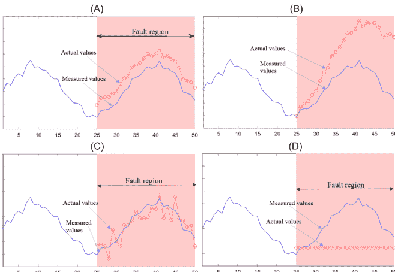

**图 1.1** 常见传感器故障。(A) 偏差传感器故障。(B) 漂移传感器故障。(C) 劣化传感器故障。(D) 冻结传感器故障。

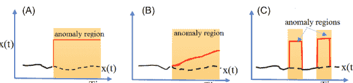

**图 1.2** 故障类型。(A) 突变异常。(B) 渐变异常。(C) 间歇异常。

因此，传感器或过程故障可能影响过程工厂的正常运行。在当今竞争激烈的工业环境中，改进过程监测是提高生产设施效率的重要一步。

在实践中，存在一种根据其时变行为分类异常的趋势。图 1.2 说明了三种常见的异常类型，可以通过其时变形式加以区分：突变、潜变和间歇故障。突变异常在实际系统中经常发生，通常表现为变量从其正常操作范围发生突然变化（图 1.2A）。故障测量可以正式表示为

```
M(t) = \begin{cases} r(t), & t < t_a, \\ r(t) + F, & t \ge t_a, \end{cases} \quad \text{(1.1)}
```

其中 _F_ 是在时刻 _t<sub>s</sub>_ 发生的偏差。

漂移异常类型可能由传感器的老化或劣化引起，并可视为故障幅值随时间线性变化。在这里，带有漂移故障的测量建模为

```
m(t) = \begin{cases} r(t), & t < t_a, \\ r(t) + \theta(t - t_a), & t \ge t_s, \end{cases} (1.2)
```

其中 \(\theta\) 是缓慢漂移的斜率，\(t_a\) 是发生故障的开始时间。最后，间歇故障的特征是时间上不连续发生；它们反复出现和消失（图 1.2C）。

一般来说，工业和环境过程暴露于各种类型的故障，这些故障对其生产力和效率产生负面影响。根据故障引入的形式，故障可以进一步分为 _加性故障和乘性故障_。加性故障通常表现为传感器偏移或加性偏差，而乘性故障影响过程参数。具体来说，在加性故障中，可测量变量 \(Y(t)\) 被加性故障 \(\theta_t\) 破坏，即 \(Y = Y_t + \theta_t\)。另一方面，乘性故障通过另一个变量 \(U\) 与 \(\theta_t\) 的乘积影响可测量变量 \(Y\)（即 \(Y = (a + f)U_t\)），其中 \(U_t\) 是输入变量。

### 1.1.3 过程监测

在自动化在过程监测领域普及之前，人工操作员在管理过程工厂时承担着重要的控制任务。然而，由于现代过程工厂的复杂性和大量变量，完全依赖人工操作员来应对异常事件和紧急情况变得越来越困难。考虑到这种困难条件，人工操作员容易犯错并导致重大的经济、安全和环境问题是可以理解的。多亏了近年来技术的进步，过程故障检测和隔离的自动化已成为自动过程监测的一个重要里程碑。与人工操作员的故障管理相比，自动过程监测已被证明能够以更少的错误很好地响应过程工厂中的异常事件。

对能够适当检测异常变化（传感器或过程故障）的监测系统的需求引起了不同领域研究人员的关注。受监测系统中可能发生的异常的 _检测和隔离_ 是过程监测的两个主要元素（图 1.3）。检测步骤的目的是检测影响受监测系统行为的异常变化。一旦检测到异常，有效的系统运行还需要评估系统停机的风险，随后进行故障隔离或纠正，以防异常污染过程性能 [12,13]。故障隔离的目的是确定导致发生异常的源头，即确定哪个传感器或过程组件发生故障。在实践中，有时还必须

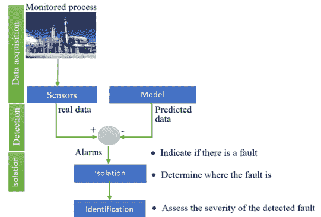

**图 1.3 过程监测步骤。**

评估所发生故障的严重程度，这由故障识别步骤完成。在这里，我们将只关注故障检测和隔离。

异常检测有两种类型：

- 在线故障检测。在线异常检测的目标是建立一条决策规则，能够尽可能快速地检测从正常操作状态到异常操作状态的转变。在线检测基于这样一个理念：系统演化被视为由快速转换分隔的稳态模式序列。

- 离线故障检测。离线故障检测的目的是在受监测系统使用之外检测可能存在的异常。系统在有限时间内被观察（系统处于稳态模式），然后根据这些观察结果，对受监测系统的状态做出决策。离线检测方法依赖于预先固定的观察次数，观察结果也来自相同的定律。

### 1.1.4 物理冗余与分析冗余

过程监测基本上基于利用冗余信息源。过程中存在两种冗余类型：物理冗余和分析冗余（图 1.4A-B）。硬件或物理冗余的本质——这是过程监测的一种传统方法——在于使用多个传感器（例如，两个或多个传感器）来测量特定的过程变量。为了检测和隔离简单故障，应使用的传感器数量应加倍。具体来说，在正常条件下，一个传感器足以监测特定变量，但通常需要至少增加两个额外传感器，才能在


故障条件。通常，故障检测与隔离通过所有冗余传感器之间的多数投票来实现。该策略因其可靠性和实现简单而广泛应用于工业。在实践中，硬件冗余的主要缺点是设备和维护的额外成本，以及安装设备所需的空间，这在已经非常复杂的系统中显著增加了复杂性。此外，该方法在实践中仅限于传感器故障，无法检测未直接测量变量中的故障。这种方法主要只适用于关键系统，如核反应堆和航空系统。与通过添加更多传感器（硬件）来测量特定过程变量的物理冗余不同，分析冗余不需要额外硬件，因为它基于使用依赖测量变量之间的现有关系，这些变量可能同种也可能异种。分析冗余是一种更易访问的策略，它将测量变量与被监测系统数学模型的预测值进行比较。它利用被监测过程各种测量变量之间冗余的分析关系，避免单独复制每个硬件。

## 1.2 Process monitoring methods

今天，由于技术的进步，工程和环境过程变得更加复杂。异常检测和隔离已成为监测现代工业系统和环境过程连续性和正常运行的必要条件。取决于应用领域，如果涉及人身安全，如航空系统和核反应堆，异常的后果将变得具有约束力和有害性。近年来过程控制和自动化领域的进步，已产生各种成功诊断和检测异常事件的方法。为了满足安全和生产率要求，已开发了广泛的理论和实用监测方法。这些方法通常根据系统可用知识的性质分为三类方法：基于模型、基于知识和基于数据的方法。过程故障检测和诊断的详细概述可参见[5]。图 1.5 展示了各种监测方法的摘要；本节简要介绍了这些监测技术。

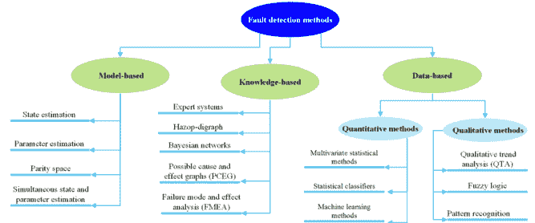

图 1.5 各种故障检测方法的摘要。

### 1.2.1 Model-based methods

过去三十年来，为了提高多种环境和工程过程的安全性和生产率，涌现出了大量监测方法。基于模型的方法在工业应用中已被证明特别有用，在这些应用中，保持所需性能至关重要。基于模型的方法涉及将过程的测量变量与过程数学模型的预测进行比较。基于模型的故障检测概念示意图如图 1.6 所示。基于模型方法的核心是通过将测量数据与被监测过程分析模型的预测进行比较来生成残差。确实，残差充当故障指示器的作用。理想情况下，在没有建模不确定性和误差的情况下，残差将为零，模型将完美拟合测量值。因此，残差与零的任何偏差都表明存在故障。然而，在实践中，我们无法避免建模不确定性和噪声测量的存在。换句话说，受检过程的完全精确的分析模型永远无法获得。请注意，即使在无故障条件下，实际测量值与其来自参考模型的预测之间也存在差异。因此，与其使用残差与零的偏差作为故障指示器，不如通过构建区分无故障残差和异常的检测阈值来进行检测。检测性能主要与所选的检测阈值相关。这意味着，如果阈值的值太小，那么当残差超过阈值并因此被标记为故障时，我们会因误差和不确定性而产生重复的误报；这种情况显然必须避免。因此，应计算检测阈值，以便在给定的少量误报（例如，5% 或 1%）的情况下最大化正确检测的频率。为解决这一问题，已提出几种统计方案来监测残差向量，包括广义似然比方法、累积和（CUSUM）型方案和 EWMA 方案。在多变量数据的情况下，当生成残差矩阵时，通常使用 CUSUM 和 EWMA 以及 T^2 的多变量扩展来检测过程均值/方差中的故障。

总之，使用基于模型的方法进行故障检测和隔离通常分为两个不同的步骤：

- 第一步包括残差生成。理想情况下，这些残差在正常运行时必须为零，在存在异常时必须非零。然而，噪声和建模误差的存在会导致残差在零附近波动。残差与零的显著偏差是故障的迹象。

- 第二步涉及基于用于检测和隔离故障的决策程序对残差进行评估。这是使用统计检测技术完成的，例如 EWMA、CUSUM 和广义似然比（GLR）检验 [12]。

关于基于模型的监测方法，已开展了大量研究工作。属于基于模型监测类别的方法包括奇偶空间方法 [14–17]、观测器基于方法 [18,19] 和区间方法 [20]。关于基于模型的故障检测方法的相关讨论和全面综述可见 [21–23]。

本质上，基于模型的方法的检测性能与参考模型的准确性密切相关。可用一个能够模仿被监测过程名义行为的准确模型，这对促进故障测量的检测非常有帮助。然而，对于复杂过程，例如许多具有大量变量的工业和环境过程，推导和开发准确模型并不总是容易且可能耗时，这使得它们在许多应用中不适用。例如，由于存在大量非线性依赖且自相关的变量，对污水处理厂流入测量进行建模非常具有挑战性。此外，由于复杂性以及对这些过程缺乏精确的理解，对现代工业和环境过程进行建模也具有挑战性。因此，使用基于模型的方法成功检测故障可以被认为是一种具有挑战性且不合适的方法。或者，基于数据的方法更常被使用。

### 1.2.2 Knowledge-based methods

现代工业系统的成功依赖于其正常和安全的运行。在受检过程中异常出现时及早检测，对于避免广泛损坏和减少维修所需的停机时间至关重要 [24]。如上所述，当可用于理解无故障运行下过程的信息不足以构建准确的分析模型时，分析监测方法不再有效。基于知识的方法提供了一种替代解决方案来绕过这一困难。在以下内容中，我们使用人工智能方法和可用的历史测量值，这些值固有地代表了过程变量之间的相关性，以提取底层知识和系统特性。换句话说，我们利用过程特征值，例如方差、幅值和状态变量，基于启发式和分析知识在无故障和故障条件下提取特征。然后以启发方式进行故障检测。具体来说，将在线数据中的实际特征与获得的底层知识进行比较。属于此类别的方法包括专家系统 [25]、模糊逻辑、Hazop-digraph (HDG) [5]、可能原因和影响图（PCEG）[26]、基于神经模糊的因果分析、失效模式与影响分析（FMEA）[27] 和贝叶斯网络 [28]。这些技术的主要缺点是它们更适合小型系统，因此可能不适合检查现代系统。

### 1.2.3 Data-based monitoring methods

毫无疑问，由于技术的进步，工程和环境过程已变得复杂得多。因此，为复杂、高维和非线性系统设计准确模型也变得非常具有挑战性、昂贵且耗时。在模型上设定简化和假设会限制其捕获……


某些相关特征和操作模式，并引入了一种建模偏差，显著降低了监测系统的效率。在缺乏基于物理的过程模型的情况下，基于数据的统计过程监测技术在过去四十年的实践中已被证明是有效的。事实上，基于数据的隐式模型仅需要可用的过程数据资源即可进行过程监测 [5]。基于数据的监测技术主要基于统计控制图和机器学习方法。

本质上，这些监测技术依赖于从监测系统中收集的历史数据。该系统被建模为带有输入和输出数据的黑箱（图 1.7）。首先，使用无故障数据构建一个模仿被检测过程标称行为的参考经验模型，然后使用该模型来检测新数据中的故障。与基于模型的方法相反，基于数据的故障检测方法只需要可用的历史过程数据，并被分为两类：定性方法和定量方法。

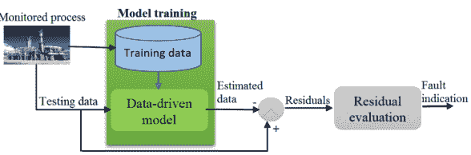

图 1.7 基于数据的方法。

无监督的基于数据的故障检测与隔离技术不使用任何关于影响过程的故障的先验信息。无监督的基于数据的技术涵盖了一系列方法，用于通过统计控制图等工具监测工业过程（参见图 1.8）。单变量技术，如 Shewhart 控制图、指数加权移动平均 (EWMA) [29] 和累积和 (CUSUM)，用于在给定时刻仅监测单个过程变量。监测图表在大多数工业过程中已被广泛应用。与 Shewhart 控制图相比，CUSUM 和 EWMA 方案在感知小变化方面表现出良好的能力。在 [30] 中，一种基于信号傅里叶系数中嵌入信息的频谱监测方案被设计出来。然而，这些常规方案基于数据服从高斯分布且不相关的假设进行设计。为了摆脱这些基本假设，已开发了基于小波的多尺度监测方案 [31]。此外，上述讨论的方案使用基于无故障数据计算的静态阈值。最近，已开发了几种自适应监测方法。这些方案在实践中比具有固定参数的常规方案更加灵活高效。有关更多详细信息，请参见 [32–35]。这些单变量监测方案通过假设变量之间相互独立，在某一时刻检查特定变量。当使用多个单变量方案监测多变量数据时，即使每个方案的误报数量较小，总误报率也可能非常大 [36–38]。此外，现代工业过程的测量值很少相互独立，并且包含大量过程变量。由于单变量方案忽略了变量之间的交叉相关性，因此它们会导致未检测问题和误报数量激增，使得这种监测方案不适用 [36–38]。

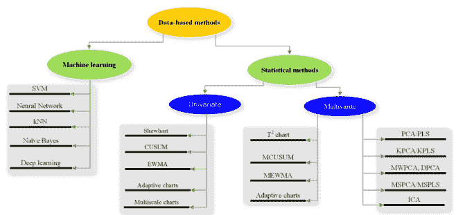

图 1.8 基于数据的监测技术。

为了缓解这一难题并有效处理高维数据，已开发出多变量监测方案来考虑变量之间的相关性，从而监测多变量过程。这些方案包括 Hotelling $T^2$ [39]、多变量 EWMA [40] 和多变量 CUSUM [41]。然而，这些多变量方案的性能会随着监测变量数量的增加而下降，因此不适用于高维数据。

已设计用于监测多变量数据的多变量监测方法，以直接解决上述局限性。多变量统计方法有助于压缩数据并保留相关信息，比原始数据更适合进行分析。此外，这些方法在处理变量之间的噪声和相互作用以有效提取相关信息方面非常高效。故障检测中最常见的多变量方法包括主成分分析 (PCA) [22,42]、偏最小二乘法 (PLS)、主成分回归 (PCR)、规范变量分析 (CVA) 和独立成分分析 (ICA) [43]。多变量统计方法（如 PCA）的核心在于其能够将多变量相关变量转换为一组较少的不相关变量。在过去二十年中，这些技术已被广泛用于监测工业过程。出于故障检测目的，原始数据首先被投影到潜在子空间中，在该子空间中监测潜在变量和残差。PCA 和 PLS 是两种最流行的多变量统计方法，它们使用潜在变量方法进行监测，因为它们在文献中拥有坚实的数学基础。事实上，PCA 或 PLS 模型是基于历史正常过程运行构建的。这个经验模型可用于监测过程的未来行为。任何偏离模型的行为都应被标记为潜在异常，例如传感器故障或过程漂移。PCA 用于降低过程数据的维度并保留数据的重要特征。PCA 将观测值从高维空间投影到低维子空间，并在捕捉数据变异性方面是最优的。PCA 程序仅应用于单个数据矩阵，而 PLS 同时对两个数据矩阵建模其关系并对其进行压缩。PCA 技术与两个故障检测指标 $T^2$ 和平方预测误差 (SPE) 统计量一起，用于监测和检测多变量过程中的故障。潜在变量方法（即 PCA 和 PLS）的主要优势是，只需有限数量的监测方案即可使用 $T^2$ 和 SPE 监测指标来监测多变量数据。

然而，现代工业过程的数据具有时间相关性、非平稳性、非线性、非高斯性和多尺度特性 [44–47]。大多数过程监测方法假设某一时刻的过程测量值与过去采样时刻的观测值相互独立。工业过程在动态条件下运行，变量具有强自相关性。将前一采样时刻的观测值与当前采样时刻的观测值相结合，称为动态 PCA (DPCA) [48,49]。对于高维且具有时间相关性的工业数据，使用固定模型监测方法可能导致诊断结果不佳 [50]。然而，通过使用递归 PCA 和移动窗口 PCA 技术更新模型，可以改进对这类过程的监测 [50]。递归 PCA 在线连续更新模型；同样，在线自适应 PCA 使用 EWMA 更新模型 [50,51]。对于非线性过程，已使用基于数据的非线性版本，如核 PCA、核 PLS、多项式 PLS 以及二次或模糊 PLS，以揭示变量之间的非线性关系 [46]。在实践中，大多数数据不一定具有高斯性质；为了处理数据的非高斯特性，已使用独立成分分析 (ICA)、高斯混合模型 (GMM) 及其非线性变体 [47]。已开发出其他扩展，例如多路 PCA [45]（允许分析批处理过程的数据）以及多尺度 PCA（可在不同频段下监测过程、去噪并降低自相关性）。总体而言，这些扩展是基于对被检测过程所收集数据性质的理解而引入的。因此，理解过程特征是满足实际期望并构建有效统计监测系统的关键因素。


属于此类的其他方法基于机器学习和深度学习方法，由于能够从大型和复杂数据集中学习，近年来受到研究人员的广泛关注。在机器学习框架下，支持向量机（SVM）[52–54]和人工神经网络（ANN）已成为故障检测文献中的重要工具。最近，随着工艺复杂性的增加，开发出了几种基于深度学习的监测方法，可以考虑时间依赖性、非线性和非正态性等特征。主要策略之一是使用深度学习模型（如受限玻尔兹曼机（RBM）、深度置信网络（DBN）、深度玻尔兹曼机（DBM）、长短期记忆网络（LSTM）和循环神经网络（RNN））从数据中提取特征，并使用二元聚类方案或传统监测图表来监测提取的特征。例如，[55]介绍了一种方法，该方法将RNN-RBM模型与k-means、谱聚类和OCSVM等聚类算法相结合，用于污水处理厂（WWTPs）中的异常检测。在[56]中，将多种基于深度学习的监测方法（如DBN、深度堆栈自动编码器和基于受限玻尔兹曼机的聚类程序）应用于检测异常臭氧污染。深度学习方法具有吸引力，因为它们可以灵活地不对基础数据做出限制性假设。此外，使用深度学习的应用涵盖对复杂数据（如多变量时间序列数据[57]、图像和视频[58,59]）的检测。

## 1.3 故障检测指标

为了验证故障检测方法的性能，在二进制检测问题的背景下，通常采用几种广为人知的指标。基本上，许多检测性能指标是基于2×2混淆矩阵计算的，该矩阵报告了真正例（TP）、假正例（FP）、假负例（FN）和真负例（TN）的数量 [60]。故障检测方法的检测质量可以使用假正率（FPR）（即误报率）、真正率（TPR）（即检测率、精确度、准确度、F-度量、召回率和曲线下面积（AUC））来评估。图1.9展示了混淆矩阵，并总结了常用于评估二进制决策方法性能的相关知名指标的公式 [60,61]。

此外，另一种称为平均运行长度（ARL）的指标能够表征I型和II型两种误差，通常用于评估检测质量。具体来说，有两种ARL：ARL0和ARL1。ARL0是故障检测方法在工艺处于受控状态时发出报警所需的数据点平均数量。ARL1是指监测方法在故障条件下发现故障所需的数据点数量（即检测速度）。

### 混淆矩阵

| | 真类正例 | 真类负例 | 行总计 |
|---|---|---|---|
| **预测类正例** | 真正例（tp） | 假正例（fp） | \(PP = tp + fp\) |
| **预测类负例** | 假负例（fn） | 真负例（tn） | \(PN = fn + tn\) |
| **列总计** | \(RP = tp + fn\) | \(RN = fp + tn\) | |

### 性能指标

```
\(TPR = \frac{tp}{RP}\)

\(FPR = \frac{fp}{RN}\)

\(Accuracy = \frac{tp+tn}{RP+RN}\)

\(Precision = \frac{tp}{PP}\)

\(F_1Score = 2 * \frac{Precision \cdot TPR}{Precision + TPR}\)

\(AUC = \frac{TPR - FPR + 1}{2}\)
```

图1.9 故障检测指标。

## 1.4 结论

总之，准确检测和隔离工业和环境过程中可能发生的故障，对于最大限度地减少停机时间、提高安全性、降低维护成本和延长设备寿命至关重要。需要进行过程监测，以便在故障影响过程性能之前成功检测、隔离和消除故障。在设计或使用特定故障检测方法时，应考虑多个方面，包括故障类型、过程动态、测量变量、可用数据和复杂性。最简单且最常见的做法是直接检查可测量变量的极限。然而，在监测大规模过程时，这些技术是有限的。这促成了可靠技术的发展，这些技术不仅包含来自单个过程变量的信息，还包含关于过程状态和参数等更多过程知识。有些方法依赖于准确的过程模型，而其他方法则使用可用的历史过程数据。对于定义明确的系统，包含动态信息的基于过程模型的监测易于实施；然而，基于过程模型的监测需要准确的模型，这些模型并不总是容易获得，尤其是对于复杂过程。另一方面，当有关故障和症状依赖关系的信息可用时，基于知识的方法更可取；然而，这些方法仅限于小型和简单的过程。一种替代方法是使用基于数据的监测技术，这些技术灵活且无需假设。当然，当可用大量过程数据，且过程过于复杂无法显式建模时，基于数据的技术更合适，因为它们能够灵活处理大量、噪声和非线性数据。

## 参考文献

- [1] V.R. Dhara, R. Dhara, 博帕尔联合碳化物灾难：健康影响综述，Archives of Environmental Health: An International Journal 57 (5) (2002) 391–404.
- [2] B. Bowonder, 博帕尔事故，Technological Forecasting & Social Change 32 (2) (1987) 169–182.
- [3] M.E. Paté-Cornell, 从派珀阿尔法事故中吸取教训：技术和组织因素的事后分析，Risk Analysis 13 (2) (1993) 215–232.
- [4] L.W.D. Cullen, 派珀阿尔法灾难的公众调查，Drilling Contractor;（美国）49 (4) (1993).
- [5] V. Venkatasubramanian, R. Rengaswamy, S.N. Kavuri, K. Yin, 过程故障检测与诊断综述：第三部分：基于过程历史的方法，Computers & Chemical Engineering 27 (3) (2003) 327–346.
- [6] B. Brooks, 贝克斯菲尔德大火：接地故障防护的教训，SolarPro Magazine 62 (2011).
- [7] I. Nimmo, 妥善处理异常操作，Chemical Engineering Progress 91 (9) (1995).
- [8] R.J. Patton, 容错控制：1997年形势，IFAC Proceedings Volumes 30 (18) (1997) 1029–1051.
- [9] O. Büyüköztürk, M.A. Taşdemir, 材料和结构无损检测，第6卷，Springer Science & Business Media，2012.
- [10] R. Isermann, 故障诊断系统：从故障检测到容错的入门，Springer Science & Business Media，2006.
- [11] G.J. Ducard, 容错飞行控制与导引系统：小型无人驾驶航空器的实用方法，Springer Science & Business Media，2009.
- [12] M. Basseville, I.V. Nikiforov 等，突变检测：理论与应用，第104卷，Prentice Hall，Englewood Cliffs，1993.
- [13] F. Harrou, L. Fillatre, I. Nikiforov, 具有有界干扰参数的线性模型的异常检测/可检测性，Annual Reviews in Control 38 (1) (2014) 32–44.
- [14] E. Chow, A. Willsky, 分析冗余与鲁棒故障检测系统的设计，IEEE Transactions on Automatic Control 29 (7) (1984) 603–614.
- [15] P.M. Frank, 基于分析和知识冗余的动态系统故障诊断：综述与一些新结果，Automatica 26 (3) (1990) 459–474.
- [16] R.J. Patton, J. Chen, 故障诊断奇校验空间方法综述，IFAC Proceedings Volumes 24 (6) (1991) 65–81.
- [17] J. Ragot, D. Maquin, F. Kratz, 具有未知输入系统的分析冗余。应用于故障检测，Control Theory and Advanced Technology 9 (3) (1993) 775–788.
- [18] R.N. Clark, D.C. Foster, V.M. Walton, 控制系统中仪器故障检测，IEEE Transactions on Aerospace and Electronic Systems 4 (1975) 465–473.
- [19] R.J. Patton, P.M. Frank, R.N. Clarke, 动态系统故障诊断：理论与应用，Prentice-Hall, Inc.，1989.
- [20] K. Benothman, D. Maquin, J. Ragot, M. Benrejeb, 不确定线性系统诊断：一种区间方法，International Journal of Sciences and Techniques of Automatic control & computer engineering 1 (2) (2007) 136–154.
- [21] P.M. Frank, 分析和定性模型基础故障诊断——综述与一些新结果，European Journal of Control 2 (1) (1996) 6–28.
- [22] L.H. Chiang, E.L. Russell, R.D. Braatz, 工业系统故障检测与诊断，Springer Science & Business Media，2000.
- [23] N. Martin, 先进信号处理与状态监测，Insight-Non-Destructive Testing and Condition Monitoring 49 (8) (2007) 459–464.
- [24] Z. Gao, C. Cecati, S. Ding, 故障诊断与容错技术综述——第二部分：基于知识和混合/主动方法的故障诊断，IEEE Transactions on Industrial Electronics 62 (6) (2015) 3768–3774.


- [25] S. Kim, S. jin Ahn, J. Chung, I. Hwang, S. Kim, M. No, S. Sin, 基于代理协作的网络故障与安全诊断规则方法, in: 高自主性系统人工智能、模拟与规划国际会议, Springer, 2004, pp. 597–606.

- [26] N. Wilcox, D. Himmelblau, 故障诊断的可能因果图(PCEG)模型—I. 方法论, Computers & Chemical Engineering 18 (2) (1994) 103–116.

- [27] R. Wirth, B. Berthold, A. Krämer, G. Peter, 基于知识的用于故障模式与影响分析的系统分析支持, Engineering Applications of Artificial Intelligence 9 (3) (1996) 219–229.

- [28] V. Sylvain, T. Teodori, K. Abdessamad, 基于贝叶斯网络的故障检测, in: 机器人、自动化与控制前沿, IntechOpen, 2008.

- [29] J.M. Lucas, M.S. Saccucci, 指数加权移动平均控制方案：性质与改进, Technometrics 32 (1) (1990) 1–12.

- [30] T. Tiplica, A. Kobi, A. Barreau, 谱控制图, Quality Engineering 17 (4) (2005) 695–702.

- [31] R. Ganesan, T.K. Das, V. Venkataraman, 基于小波的多尺度统计过程监控：文献综述, IIE Transactions 36 (9) (2004) 787–806.

- [32] M.S. De Magalhães, E.K. Epprecht, A.F. Costa, Vp X̄控制图的经济设计, International Journal of Production Economics 74 (1–3) (2001) 191–200.

- [33] R.B. Kazemzadeh, M. Karbasian, M.A. Babakhani, 用于监测过程均值的变抽样间隔EWMA t控制图, The International Journal of Advanced Manufacturing Technology 66 (1–4) (2013) 125–139.

- [34] D.S. Bai, K. Lee, 变抽样间隔X̄控制图的经济设计, International Journal of Production Economics 54 (1) (1998) 57–64.

- [35] Y. Su, L. Shu, K.-L. Tsui, 用于监控受线性漂移影响过程的自适应EWMA程序, Computational Statistics & Data Analysis 55 (10) (2011) 2819–2829.

- [36] J.F. MacGregor, T. Kourti, 多变量过程统计过程控制, Control Engineering Practice 3 (3) (1995) 403–414.

- [37] P. Nomikos, J.F. MacGregor, 用于监控批次过程的多变量SPC控制图, Technometrics 37 (1) (1995) 41–59.

- [38] U. Kruger, L. Xie, 复杂多变量过程统计监控的进展：在工业过程控制中的应用, Wiley, 2012.

- [39] H. Hotelling, 多变量质量控制，以样本炸弹瞄准器空气测试为例, in: M.W.H.C. Eisenhart, W.A. Wallis (Eds.), 统计分析选编技术, McGraw-Hill, New York, NY, USA, 1947.

- [40] C.A. Lowry, W.H. Woodall, C.W. Champ, S.E. Rigdon, 多变量指数加权移动平均控制图, Technometrics 34 (1) (1992) 46–53.

- [41] R.B. Crosier, 累积和质量控制方案的多变量推广, Technometrics 30 (3) (1988) 291–303.

- [42] S. Wold, K. Esbensen, P. Geladi, 主成分分析, Chemometrics and Intelligent Laboratory Systems 2 (1–3) (1987) 37–52.

- [43] A. Hyvärinen, E. Oja, 独立成分分析：算法与应用, Neural Networks 13 (4–5) (2000) 411–430.

- [44] S.W. Choi, E.B. Martin, A.J. Morris, I.-B. Lee, 用于监控时变过程的自适应多变量统计过程控制, Industrial & Engineering Chemistry Research 45 (9) (2006) 3108–3118.

- [45] P. Nomikos, J.F. MacGregor, 使用多元主成分分析监控批次过程, AIChE Journal 40 (8) (1994) 1361–1375.

- [46] J.-H. Choi, J.-M. Lee, S.W. Choi, D. Lee, I.-B. Lee, 使用核主成分分析的过程监控故障识别, Chemical Engineering Science 60 (1) (2005) 279–288.

- [47] J.-M. Lee, C. Yoo, I.-B. Lee, 基于独立成分分析的统计过程监控, Journal of Process Control 14 (5) (2004) 467–485.

- [48] W. Ku, R.H. Storer, C. Georgakis, 基于动态主成分分析的扰动检测与隔离, Chemometrics and Intelligent Laboratory Systems 30 (1) (1995) 179–196.

- [49] K. Chow, K. Tan, H. Tabe, J. Zhang, N. Thornhill, 使用积分变换的动态主成分分析, in: AIChE年度会议, Miami Beach, vol. 13, 1999.

- [50] M. Kano, K. Nagao, S. Hasebe, I. Hashimoto, H. Ohno, R. Strauss, B.R. Bakshi, 多变量统计过程监控方法比较及其在Eastman挑战问题中的应用, Computers & Chemical Engineering 26 (2) (2002) 161–174.

- [51] W. Li, H.H. Yue, S. Valle-Cervantes, S.J. Qin, 用于自适应过程监控的递归PCA, Journal of Process Control 10 (5) (2000) 471–486.

- [52] S. Yin, X. Gao, H.R. Karimi, X. Zhu, 田纳西东曼过程中基于支持向量机的故障检测研究, in: 抽象与应用分析, vol. 2014, Hindawi, 2014.

- [53] M. Namdari, H. Jazayeri-Rad, S.-J. Hashemi, 使用基于遗传算法参数调谐的支持向量机进行过程故障诊断, Journal of Automation and Control 2 (1) (2014) 1–7.

- [54] Z.B. Sahri, R.B. Yusof, 使用k最近邻插值DGA数据集的电力变压器基于支持向量机的故障诊断, Journal of Computer and Communications 2 (09) (2014) 22.

- [55] A. Dairi, T. Cheng, F. Harrou, Y. Sun, T. Leiknes, 用于可持续WWTP运行的深度学习方法：数据驱动进水条件监控案例研究, Sustainable Cities and Society 50 (2019) 101670.

- [56] F. Harrou, A. Dairi, Y. Sun, F. Kadri, 使用基于深度学习的策略检测异常臭氧测量, IEEE Sensors Journal 18 (17) (2018) 7222–7232.

- [57] P. Malhotra, L. Vig, G. Shroff, P. Agarwal, 用于时间序列异常检测的长短期记忆网络, in: 论文集, Presses universitaires de Louvain, 2015, p. 89.

- [58] A. Dairi, F. Harrou, M. Senouci, Y. Sun, 使用基于深度学习的立体视觉在驾驶环境中进行无监督障碍物检测, Robotics and Autonomous Systems 100 (2018) 287–301.

- [59] A. Dairi, F. Harrou, Y. Sun, M. Senouci, 使用深度堆叠自动编码器和k最近邻方案的智能交通系统障碍物检测, IEEE Sensors Journal 18 (12) (2018) 5122–5132.

- [60] D.M. Powers, 评估：从精确率、召回率和F度量到ROC、知情度、标记度和相关性, Journal of Machine Learning Technology 2 (2011) 37–63.

- [61] D.L. Olson, D. Delen, 高级数据挖掘技术, Springer Science & Business Media, 2008.

# 基于线性隐性变量回归(LVR)的过程监控

## 2.1 引言

随着仪表、数据采集以及“物联网”技术的快速发展，该技术连接了大量数字设备，来自众多智能设备的海量信息随时随地可用。

事实上，大量数据集由现代工程和环境过程中的大量测量数据收集而产生。

利用具有某种程度冗余的这些测量数据，可行地检测被检测过程中的异常变化并定位其来源。

然而，在缺乏有效工具的情况下，这些数据集中的信息无法被妥善提取和利用，以用于推断和过程监控。

在过去十年中，对预测和故障检测工具的需求导致了若干故障检测机制的设计，这些机制属于基于模型（或分析）或数据驱动方法[1,2]。

基于利用第一性原理的理想假设的分析模型，理论上可以解释系统的行为；然而，它们需要事先校准模型参数，在高维情况下这既具有挑战性又昂贵，并可能导致病态条件问题[3]。

数据驱动方法可以对数据进行系统性和客观性的探索、可视化和解释，可以识别关键因素、特征或模式，并可以支持和优化数据驱动的决策[4]。

基于数据的技术可以通过从数据中提取相关特征来传递故障信息。

数据驱动方法目前更常用于工程和石化过程[5]。

例如，在广泛使用软传感器的石化行业，每年曾因故障发生而损失数十亿美元[6]。

环境数据已被数据驱动方法利用，例如用于气象信号[7]的异常检测或废水处理厂(WWTPs)中污泥膨胀的监测[8]。

例如，化学过程工业中的故障检测具有挑战性，原因是涉及大量变量，以及这些过程中发生的动态特性和噪声测量。

事实上，大量变量会导致多重共线性，这增加了对模型参数估计的不确定性。

隐性变量回归(LVR)模型是一种常用的


用于补救此类问题的建模框架。LVR 模型可以通过从减少后的变量（即原始变量的线性组合，称为隐变量或主成分）构建模型来处理变量之间的多重共线性。这种方法得到了条件良好的模型 [9,10]。LVR 模型估计技术包括主成分回归（PCR）[11,9] 和偏最小二乘法（PLS）[12,13]。

本章的组织安排如下。在第 2.2 节中，我们简要介绍了推断建模方法，包括全秩模型和隐变量回归（LVR）技术。所介绍的全秩建模技术包括普通最小二乘（OLS）回归和岭回归（RR），而隐变量回归技术包括 PCR 和 PLS。由于常规 LVR 模型是静态的，更适合处理稳态过程，因此 LVR 模型的动态版本也简要介绍了。第 2.3 节概述了一些在统计过程监控中应用的常见统计技术。具体而言，本节介绍了基本的单变量监控方案，即 Shewhart、指数加权移动平均（EWMA）、累积和（CUSUM）、广义似然比（GLR）和基于分布的算法，并讨论了它们的局限性。第 2.4 节介绍了基于 LVR 方法的故障检测的通用框架。在第 2.5 节中，我们讨论了一种常用的故障隔离方法，即贡献图。我们还在第 2.5 节中介绍了一种使用径向可视化 RadViz 进行根因诊断的创新方法。本章的主要目的是研究这些多变量监控方案（PCA 和 PLS）及其实际应用。在第 2.6 节中，我们使用模拟示例和实际示例评估了所开发的推断建模技术的性能。此外，我们还评估了通过从发生多个异常事件的沿海市政污水处理厂导入七年进水特性（ICs）数据来使用基于 PCA 的异常检测的方法。本章在第 2.7 节以讨论和评论结束。

## 2.2 线性 LVR 模型的开发

工程和工业过程的测量数据通常规模巨大，包含大量（高维）变量，因为所涉及的过程很复杂。由于高多重共线性和病态条件问题，使用传统的回归模型（如最小二乘法）不适合提供可靠的预测。有多种估计技术可以解决这个建模问题，包括全秩方法和隐变量回归方法。在本节中，我们介绍了一些常用于设计过程监控算法的线性回归模型的基本理论视角，即 OLS、RR、PCR 和 PLS。在本节中，我们回顾了多变量数据的传统线性相关模型，这些模型是设计故障检测方法的基础。介绍了每种方法的基本概念及其优缺点的讨论。

### 2.2.1 全秩方法

#### 2.2.1.1 普通最小二乘回归

我们将数据矩阵 \(\mathbf{y} \in \mathbb{R}^n\)（测量输出）回归到 \(\mathbf{X} \in \mathbb{R}^{n \times m}\)（值已精确知晓的选定过程变量组）为

\(\mathbf{Y} = \mathbf{X}\beta + \epsilon,\) (2.1)

其中 \(\beta \in \mathbb{R}^n\) 是待估计的未知常数向量，\(\epsilon \in \mathcal{N}(0, \sigma I_n)\) 是具有已知方差的零均值高斯噪声。普通最小二乘（OLS）回归的本质是通过最小化以下目标函数来估计模型参数 [14,11]：

\(\min_{\beta} \left( \| \mathbf{X}\beta - \mathbf{y} \|_2^2 \right).\) (2.2)

如果矩阵 \(\mathbf{X}^T\mathbf{X}\) 是非奇异的且噪声 \(\epsilon\) 的元素不相关 [15,16]，则 \(\beta\) 的无偏最大似然估计为

\(\widehat{\beta}_{OLS} = \left( \mathbf{X}^T \mathbf{X} \right)^{-1} \mathbf{X}^T \mathbf{y}.\) (2.3)

当输入过程变量高度相关时，OLS 回归系数的方差会变得很大，估计可能不准确。换句话说，矩阵 \(\mathbf{X}^T \mathbf{X}\) 的行列式此时非常接近于零，从而导致估计回归参数方差（\(V(b) = \sigma^2(\mathbf{X}^T \mathbf{X})^{-1}\)）的值不稳定。此外，如果 **y** 的元素略有变化，参数估计会发生显著变化，因此在使用新的 **X** 测量值时，**y** 的预测效果较差。

总之，当 (\(\mathbf{X}^T \mathbf{X}\)) 接近奇异时，\(\hat{\beta}\) 的方差会被放大，这也会增加其估计的不确定性。即使可以通过伪逆等方法克服数值问题，该模型的统计特性也不适合处理放大后的方差。应对这种多重共线性问题和 **X** 的病态条件的一种方法是通过正则化方法，如下文介绍的岭回归（RR）。

#### 2.2.1.2 岭回归（RR）

如上文所述，在输入过程变量高度交叉相关的情况下，OLS 方法可能导致回归系数估计不佳。缓解此问题的一种方法是放宽 \(\widehat{\beta}_{OLS}\) 应为无偏估计量的条件。文献中有几种方法可以获取回归系数的有偏估计量。Hoerl 和 Kennard [17] 最初引入的 RR 方法通常用于缓解多重共线性问题，并通过权衡偏差和方差来调整以获得良好的预测模型。RR 估计量通过最小化以下目标函数计算 [17]。

$$\min_{\beta} \left( \|\mathbf{X}\beta - \mathbf{y}\|_2^2 + \lambda \|\beta\|_2^2 \right),$$ (2.4)

$$\hat{\boldsymbol{\beta}}_{RR} = \left( \mathbf{X}^T \mathbf{X} + \lambda \mathbf{I} \right)^{-1} \mathbf{X}^T \mathbf{y},$$ (2.5)

其中 \(\lambda\) 是正常数，\(I \in \mathbb{R}^{m \times m}\) 是单位矩阵。注意，从公式 (2.5) 可以看出，添加到 \((\mathbf{X}^T \mathbf{X})\) 的项 \(\lambda \mathbf{I}\) 增强了估计问题的条件。当然，RR 估计量 \(\hat{\boldsymbol{\beta}}_{RR}\) 基本上是 OLS 估计量 \(\hat{\boldsymbol{\beta}}_{OLS}\) 的线性变换。公式 (2.5) 可改写为

$$\hat{\boldsymbol{\beta}}_{RR} = \left( \mathbf{X}^T \mathbf{X} + \lambda \mathbf{I} \right)^{-1} (\mathbf{X}^T \mathbf{X}) \hat{\boldsymbol{\beta}}_{OLS} = \mathbf{Z}_{\lambda} \hat{\boldsymbol{\beta}}_{OLS}.$$ (2.6)

因此，RR 估计量是一个有偏估计量，因为

$$\mathbb{E}(\hat{\boldsymbol{\beta}}_{RR}) = \mathbb{E}(\mathbf{Z}_{\lambda} \hat{\boldsymbol{\beta}}_{OLS}) = \mathbf{Z}_{\lambda} \boldsymbol{\beta}.$$ (2.7)

\(\hat{\boldsymbol{\beta}}_{RR}\) 的协方差矩阵表示为

$$V(\hat{\boldsymbol{\beta}}_{RR}) = \sigma^2 \left( \mathbf{X}^T \mathbf{X} + \lambda \mathbf{I} \right)^{-1} \mathbf{X}^T \left( \mathbf{X}^T \mathbf{X} + \lambda \mathbf{I} \right)^{-1}.$$ (2.8)

使用 RR 的基本概念是选择一个 \(\lambda\) 值，该值确保方差项的减少大于平方偏差的增加。如果实现了这一点，\(\hat{\boldsymbol{\beta}}_{RR}\) 的 MSE 将小于 \(\hat{\boldsymbol{\beta}}_{OLS}\) 的方差。文献 [18] 已证明，存在一个正常数 \(\lambda\)，使得 \(\hat{\boldsymbol{\beta}}_{RR}\) 的 MSE 小于 \(\hat{\boldsymbol{\beta}}_{OLS}\) 的方差。

在实践中，已开发出各种程序来选择 \(\lambda\) 的值。例如，文献 [18] 的作者建议通过检查岭迹来确定合适的 \(\lambda\) 值，岭迹是 \(\hat{\boldsymbol{\beta}}_{RR}\) 元素与 \(\lambda\) 的图，其中 \(\lambda \in [0 \ 1]\)。目的是确定一个相当小的 \(\lambda\) 值，使岭估计稳定。在文献 [19] 中，\(\lambda\) 的适当选择给出为 \(\kappa = \frac{m \hat{\sigma}^2}{\hat{\boldsymbol{\beta}}_{OLS}^T \hat{\boldsymbol{\beta}}_{OLS}}\)，其中 \(\hat{\boldsymbol{\beta}}_{OLS}\) 和 \(\hat{\sigma}^2\) 使用最小二乘解确定。

当然，这些模型可以作为缓解病态条件问题的替代方法。然而，它们不易解释，而数据建模的一个重要目的是可解释性；参见 [15,16,18]。

### 2.2.2 隐变量回归（LVR）模型

PCA、PCR 和 PLS 等多变量统计投影方法通常用于通过对少量转换后的变量（即隐


#### 2.2.2.1 主成分分析

##### 基于 PCA 的特征提取

PCA 是一种降维方法，是一个越来越受欢迎的建模框架，用于从多变量数据中发现相关且关键的特征。PCA 的基础可以追溯到 Pearson (1901) [24] 和 Hotelling (1933) [25]。通过将过程变量投影到较低维度的子空间中，PCA 揭示了过程变量之间固有的交叉相关性 [26]。在此方面，PCA 潜变量或主成分（PCs）（也称为得分），由物理变量的线性组合构成，可以有效地在降维子空间中描述过程。基于 PCA 的方法目前更常应用于数据压缩 [27]、模式识别、数据平滑、分类 [28] 和故障检测 [29]。

PCA 不区分输入数据 X 和输出数据 Y。它应用于包含问题中所有过程变量的一个数据集。这里，X 用于表示整个数据集。设 X = [x_1^T, ..., x_n^T]^T \in R^{n x m} 是从具有 n 个观测值和 m 个变量的过程中收集的数据集。

在深入细节之前，让我们先讨论一个重要点。对多变量数据进行 PCA 时，假设所有数据都在可比的尺度上。如果省略数据的缩放，则必须调整数据中的某些变量，以避免出现误导性的主导地位。数据缩放会改变协方差矩阵，从而影响主成分。缩放对于方差和均值调整都很重要 [30]。当过程变量以不同单位测量时，常用缩放的目的是使方差相同（即，给出标准单位），从而得到相关系数矩阵。文献中还使用其他方差稳定变换，例如对数变换。最常用的缩放将变量转换为零均值和单位方差。在使用 PCA 之前，每个变量 x_j \in R^n，j = 1, ..., m，都应缩放为零均值和单位方差：

```
$$x_{j,s} = \frac{x_j - \mu_{x_j}}{\sigma_{x_j}}$$ (2.9)
```

从现在起，我们假设自动缩放的数据是零均值中心化且单位方差的，

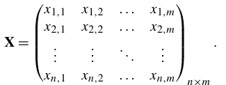

缩放后的数据 **X** 可以使用奇异值分解（SVD）表示为两个因子的乘积：

X = t_1 w_1^T + t_2 w_2^T + \cdots + t_m w_m^T = T W^T , \quad (2.10)

其中 T ∈ R^{n×m} 表示主成分（PCs）的矩阵，W ∈ R^{m×m} 是载荷矩阵。PCs 是原始数据的线性组合，每个 PC 彼此不相关。载荷矩阵通常通过数据 X 的协方差矩阵 S 的 SVD 计算：

S = \frac{1}{n-1} X^T X = W \Lambda W^T \quad \text{with} \quad W W^T = W^T W = I_n , \quad (2.11)

其中，Λ = diag(σ_1^2, ..., σ_m^2) 是按递减幅度沿对角线排列的 S 特征值的矩阵。特征值 λ_i 等于 PC t_i 的方差，σ_i^2（即，var(w_i^T X) = λ_i）。

在存在交叉相关的多变量数据 X 时，前 l 个主成分（其中 k < m）足以保留原始数据中的相关信息。PCA 模型开发中的一个重要步骤是选择主成分的数量。

##### 用于选择主成分数量的准则

设计潜变量回归（LVR）方法的核心步骤是选择潜变量（LV）的数量 l，以便从接收到的数据中适当提取相关信息。换句话说，所设计 LVR 模型的预测性能受 LV 数量 l 的选择影响。因此，有必要对 LV 数量进行适当估计，以避免模型对数据欠拟合或过拟合的问题。以下简要介绍了其中一些技术：

- **碎石图检验。** 碎石图显示每个 PC 捕获的方差与 PC 数量 [31]。然后，通过找到具有拐点形状（即，图形不再线性）的剖面对应的特征值 λ 的值，获得要保留的 PC 数量。这种识别程序易于可视化，但自动实现可能不容易。

- **平行分析。** 平行分析将方差剖面与假设变量独立时获得的剖面进行比较，以确定 PC 的数量。具体来说，l 在两个剖面交叉的点处确定 [31, 32]。

- **累积百分比方差（CPV）程序。** CPV 程序通常用于找到解释总方差一定百分比（例如，90%）的 PC 数量 [31]：

\( CPV(l) = \frac{\sum_{i=1}^l \lambda_i}{\sum_{i=1}^m \lambda_i} \times 100. \) (2.12)

该程序很有吸引力，因为它直观且易于实现 [31]。

- **交叉验证。** 基本上，交叉验证机制的关键概念是将数据分为用于模型构建的训练数据集和用于模型验证的测试数据集 [33]。使用测试数据验证模型，并通过比较估计值和测量值生成残差。在 CV 方法中，最佳 PC 数量通过使用预测平方和（PRESS）统计量 [33] 确定，

\( PRESS_l = \sum_{i=1}^n (X_i - \hat{X}_i^l)^2, \) (2.13)

其中 \( l \) 是用于计算 \( \hat{X} \) 的保留 PC 向量数量，即 PC 的维度。通过找到对应于 PRESS 最小值的 PC 数量来确定维度 [33]。

基于 PCA 模型，在选择要包含在模型中的适当 PC 数量后，数据矩阵 **X** 可以表示为近似矩阵 \( \widehat{\mathbf{X}} \) 和残差数据 **E** 的和（图 2.1），

\( \mathbf{X} = \mathbf{T}\mathbf{W}^T = \sum_{i=1}^k t_i w_i^T + \sum_{i=k+1}^m t_i w_i^T = \widehat{\mathbf{X}} + \mathbf{E}, \) (2.14)

其中 \( \mathbf{T} \in \mathbb{R}^{n \times m} \) 表示主成分（PCs）的矩阵，\( \mathbf{W} \in \mathbb{R}^{m \times m} \) 是载荷矩阵。

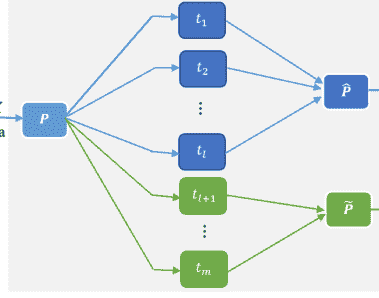

**图 2.1 PCA 模型示意图。**

如上所述，协方差矩阵的正交特征向量等于载荷矩阵 **W** = (**w**₁, **w**₂, ..., **w**ₘ)，特征值 λᵢ 等于得分 tᵢ 的方差。载荷矩阵可以分为两部分，\(\widehat{\mathbf{W}}\) 和 \(\widetilde{\mathbf{W}}\)，即 **W** = [\(\widehat{\mathbf{W}}\) \(\widetilde{\mathbf{W}}\)]。这里 \(\widehat{\mathbf{W}} = (\mathbf{w}_1, \mathbf{w}_2, ..., \mathbf{w}_l)\) 表示前 l 个主载荷向量（PCs），\(\widetilde{\mathbf{W}} = (\mathbf{w}_{l+1}, \mathbf{w}_{l+2}, ..., \mathbf{w}_m)\) 表示剩余的 m − l 个 PCs。分区如下所示：

```
S = \frac{1}{n-1} \mathbf{X}^T \mathbf{X} = \left( \widehat{\mathbf{W}} \quad \widetilde{\mathbf{W}} \right) \left( \begin{array}{cc} \widehat{\Lambda} & 0 \\ 0 & \widetilde{\Lambda} \end{array} \right) \left( \begin{array}{c} \widehat{\mathbf{W}}^T \\ \widetilde{\mathbf{W}}^T \end{array} \right).
```

数据矩阵 **X** 可以分解为

```
\overline{\mathbf{X}} = \overbrace{[\widehat{\mathbf{T}} | \widetilde{\mathbf{T}}] [\widehat{\mathbf{W}} | \widetilde{\mathbf{W}}]^T}^{\mathbf{T} \mathbf{W}^T} = \widehat{\mathbf{T}}\widehat{\mathbf{W}}^T + \widetilde{\mathbf{T}}\widetilde{\mathbf{W}}^T = \overbrace{\widehat{\mathbf{X}} \widehat{\mathbf{W}} \widehat{\mathbf{W}}^T}^{\widehat{\mathbf{X}}} + \overline{\mathbf{X}} \left( \mathbf{I}_m - \widehat{\mathbf{W}} \widehat{\mathbf{W}}^T \right).
```

这里 \(\widehat{\mathbf{T}} \in \mathbb{R}^{n \times l}\) 是 PC 矩阵（\(n \times l\)），它描述了由 \(\widehat{\mathbf{W}}\) 张立的变换（\(n \times l\)）基本空间中变量的值，而 \(l\) 被选择为捕获数据中大部分变异性，且 **E** 中不会丢失相关信息。矩阵 \(\widetilde{\mathbf{W}}\widetilde{\mathbf{W}}^T\) 和 \((\mathbf{I}_m - \widetilde{\mathbf{W}}\widetilde{\mathbf{W}}^T)\) 分别张立主成分子空间和残差子空间。\(\overline{\mathbf{X}}\) 和 **E** 中的行向量是正交的，即 \(\overline{\mathbf{X}}^T \mathbf{E} = \mathbf{0}\)。

残差矩阵在过程监控中发现异常特征方面起着核心作用。为了异常检测，我们将基于开发的 PCA 参考模型，使用单变量或多变量统计监控方案来评估生成的残差。关于过程监控的更多细节将在后续章节中给出。

#### 2.2.2.2 主成分回归

主成分回归是解决多元线性回归中病态条件或多重共线性问题的 OLS 回归的替代方法，这会导致模型参数估计不佳。PCR 是一种线性回归方法，可以通过在回归中将潜变量作为回归量来处理高度相关的过程变量。它可以分两步实现。PCR 的第一步是通过 PCA 对输入变量进行投影，以考虑多重共线性并减少其维度。为此，经常使用 SVD 来计算 PCs。在第二步中，在保留的 PCs 和响应变量之间进行 OLS 回归 [14, 11]（图 2.2）。

总而言之，PCR 的关键思想是使用 PCA 中不相关的 l 个得分向量，而不是 **X** 中的 l 个列。具体来说，可以通过使用 PCA 从输入数据 **X** 中的正交 PC 子集来消除预测变量之间的多重共线性。然后，在响应变量 **Y** 与 **X** 的保留 l 个 PC 之间进行 OLS。从 PCA 模型中，矩阵 **X** 可以


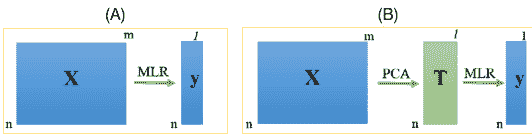

**图 2.2** (A) MLR 和 (B) PCR 模型的示意图。

可分解如下：

```
$$\mathbf{X} = \mathbf{T}\mathbf{W}^T = \sum_{i=1}^l t_i w_i^T + \sum_{i=l+1}^m t_i w_i^T = \widehat{\mathbf{X}} + \mathbf{E},$$
```

其中 $\mathbf{T} \in \mathbb{R}^{n \times m}$ 表示主成分 (PCs) 矩阵，$\mathbf{W} \in \mathbb{R}^{m \times m}$ 是载荷矩阵。然后，利用这些主成分的一个子集（方差最大的那些），通过 OLS 回归构建一个将这些主成分与响应变量 $\mathbf{y}$ 关联的线性模型，

```
$$\mathbf{y} = \widehat{\mathbf{T}}\widehat{\beta},$$
```

其中 $\widehat{\mathbf{T}} = [\mathbf{t}_1 \dots \mathbf{t}_l]$ 是用于构建模型的保留主成分（特征值最大的那些），且 $l \le m$；$l$ 的选取使得残差中保留的工艺信息没有重要损失。回归矩阵 $\widehat{\beta}$ 通过求解以下最小化问题得到：

```
$$\min_{\hat{\beta}} \left( \|\widehat{\mathbf{T}}\hat{\beta} - \mathbf{y}\|_2^2 \right)$$
$$\hat{\beta} = \left( \widehat{\mathbf{T}}^T \widehat{\mathbf{T}} \right)^{-1} \widehat{\mathbf{T}}^T \mathbf{y}.$$
```

需要注意的是，如果在设计 PCR 模型时使用了所有主成分（即 $l=m$），则 PCR 等价于 OLS。在输入变量不相关的情况下，OLS 将是回归的首选方案。需要注意的是，PCR 中的所有主成分都是在不考虑模型响应的情况下确定的。接下来，我们介绍另一种应对多重共线性问题的方法，该方法在确定主成分时考虑输入-输出关系，称为偏最小二乘法 (PLS)。

#### 2.2.2.3 偏最小二乘法

本节介绍了 PLS 回归建模（又称潜在结构投影），该方法最初在 [34] 中在计量经济学领域提出。随后在 [35] 中提供了详细的 PLS 算法。在 [36] 中，阐述了执行 PLS 的两种程序的几何图形。该技术用于化学计量学和化学工程中的软传感器开发 [37]、过程监测和故障诊断。

PLS 处理具有共线性的多变量输入-输出数据的能力是其理想特性之一 [38]。当矩阵 $\mathbf{X}^T\mathbf{X}$ 奇异或病态时，PLS 在输入和输出数据 (X 和 Y) 中确定一对最优潜变量 (LVs)，使这些变换后的变量具有最大协方差。与 PCR 不同，PLSR 通过利用输入和输出变量之间的协方差并减少输入变量无关变化的影响来挖掘两者的信息。换句话说，PLSR 是同时使用 X 和 Y 的主成分设计的。基本上，PLS 模型是通过搜索一组能够解释 X 与 Y 之间最大交叉相关性的主成分来实现的 (Fig. 2.3)。

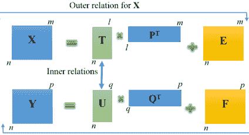

图 2.3 PLS 模型的示意图。

考虑一个具有 n 个样本和 m 个变量的输入 X ∈ R<sup>n×m</sup>，以及一个具有 n 个样本和 p 个变量的输出 Y ∈ R<sup>n×p</sup>。PLS 通过最大化提取的主成分的协方差来迭代提取主成分。PLS 模型开发包含两个部分，一是开发内模型，另一是开发外模型 [39,40]。外模型与内模型的关系如下：

```
\begin{cases} \mathbf{X} = \sum_{i=1}^l \mathbf{tp}_i^T = \mathbf{TP}^T + \mathbf{G}, \\ \mathbf{Y} = \sum_{i=1}^l \mathbf{uq}_i^T = \mathbf{UQ}^T + \mathbf{F}, \end{cases} (2.21)
```

其中 T ∈ R<sup>n×l</sup> 和 U ∈ R<sup>n×q</sup> 是变换后不相关变量的矩阵。输入和输出空间的载荷矩阵分别为 P ∈ R<sup>m×l</sup> 和 Q ∈ R<sup>p×q</sup>。模型残差为 G 和 F。主成分的数量 l 由交叉验证确定。

输入和输出空间的保留潜变量通过线性内模型相关，如下所示：

```
$$\mathbf{U} = \mathbf{TB} + \mathbf{H},$$ (2.22)
```

其中 $\mathbf{B}$ 是连接输入和响应主成分的回归矩阵，$\mathbf{H}$ 是残差矩阵。$\mathbf{B}$ 的回归系数可通过最小化残差 $\mathbf{H}$ 得到。响应 $\mathbf{Y}$ 表示为

```
$$\mathbf{Y} = \mathbf{TBQ}^T + \mathbf{F}^*.$$ (2.23)
```

需要注意的是，PLS 模型中每一对潜变量（即 $t_j$ 和 $u_j$ ($j = 1, \dots, l$)）是迭代估计的 [35,41]。文献中开发了各种方法来获取 PLS 估计量，包括非线性迭代偏最小二乘法 (NIPALS) 和 SIMPLS 方法。更多细节请参阅 [35,36, 34,12]。

第一对潜变量向量的计算使得以下协方差：

```
\(\underset{p_i, q_i}{\text{arg max }} \text{cov}(\mathbf{t}_1, \mathbf{u}_1) = \mathbf{t}_1^T \mathbf{u}_1 = \mathbf{p}_1^T \mathbf{X}^T \mathbf{Y} \mathbf{q}_1\) (2.24)
```

在约束条件 $\mathbf{p}_i^T \mathbf{p}_i = 1$ 和 $\mathbf{q}_i^T \mathbf{q}_i = 1$ 下得到最大化。

第一对载荷向量 $(p_1, q_1)（代表主导方向）的计算使得 $\mathbf{X}$ 与 $\mathbf{Y}$ 之间的协方差最大化。然后，通过将 $\mathbf{X}$ 数据投影到 $p_1$ 上、将 $\mathbf{Y}$ 数据投影到 $q_1$ 上（外模型），得到第一组潜变量向量 ($t_1 = \mathbf{X} p_1; u_1 = \mathbf{Y} q_1$)。随后，可以在 $t_1$ 和 $u_1$ 之间建立内模型 ($\widehat{u}_1 = t_1 b_1$)。

计算出第一组得分和载荷后，输入和输出变量的残差按如下计算：

```
\(\left\{ \begin{array}{l} \mathbf{E}_1 = \mathbf{X} - t_1 p_1, \\ \mathbf{F}_1 = \mathbf{Y} - u_1 q_1 = \mathbf{Y} - t_1 b_1 q_1. \end{array} \right.\) (2.25)
```

总体而言，PLS 迭代估计 $\mathbf{X}$ 和 $\mathbf{Y}$ 的两组潜变量，使它们具有最大协方差。这些潜变量对以迭代方式估计并添加到模型中。生成输入和输出残差，并基于残差迭代该过程，直到交叉验证误差最小化 [11,35, 34,14]。图 2.4 说明了 PLS 中确定潜变量的递归过程。

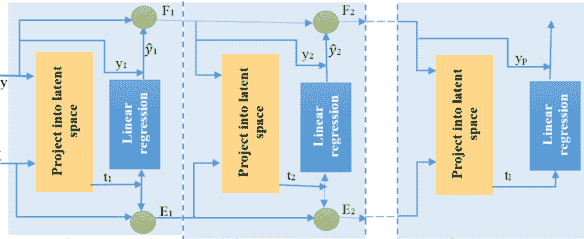

**图 2.4** PLS 中确定主成分的递归程序的示意图。

通常用于推导 PLS 模型的 NIPALS 算法总结如下 [42]：

- **步骤 1。** 将数据 $\mathbf{X}$ 和 $\mathbf{Y}$ 设置为均值为零且单位方差
- **步骤 2。** 将 $\mathbf{u}$ 设置为 $\mathbf{Y}$ 的一列
- 步骤 3. 令 w = u^T X / u^T u
- 步骤 4. 将 u 归一化为单位长度
- 步骤 5. 计算得分，t = Xw / w^T w
- 步骤 6. 计算新的 u 向量，u = Yq / q^T q
- 步骤 7. 检查 u 的收敛性：如果是，转至步骤 8；如果否，转至步骤 2
- 步骤 8. 评估 X 载荷。p = X^T t / t^T t
- 步骤 9. 评估残差矩阵，E = X - tp^T 和 F = Y - tq^T
- 步骤 10. 如果需要额外的 PLS 维度，则分别用 E 和 F 替换 X 和 Y，并重复步骤 1 至 9。

由于 PLS 使用协方差目标函数，即使在 Y 中只有一个输出的情况下，也经常需要多个潜变量。然而，有时潜变量子空间的重要部分与输出正交或无关，尽管该子空间包含输入数据的大量变异性 [43]。因此，为进一步改进 PLS，已开发出许多扩展，例如正交化 PLS [44] 和并发 PLS 方法 [45]。

需要注意的是，上述描述的 LVR 方法都利用过程变量之间线性且静态的潜在结构关系。它们为进一步改进非线性或动态 LVR 建模奠定了基本框架。

## 2.3 动态 LVR 模型

从上述讨论中，我们已经表明，PLS 和 PCR 等 LVR 模型可以通过设计一个由减少数量的变量（即原始变量的线性组合，称为潜变量）组成的模型来处理变量之间存在共线性的多变量数据。这些方法得到条件良好的模型。然而，LVR 模型是静态的，忽略了过程动态，因此不适合捕捉数据的时态演变。换句话说，使用此类方法选择关键变量是基于变量在时间上不相关的假设。由于许多来自工程和环境过程的实际数据在时间上是相关的，因此有必要拥有一个包含此类信息的模型来处理过程动态。

对于工程和化学过程等动态过程，实际过程变量观测值通常取决于过去的观测值。将静态 LVR 方法（例如 PLS 和 PCA）应用于动态数据，无法对变量之间的关系进行准确建模，而只是一个线性静态近似。为弥补这一局限并考虑动态信息，应创建一个包含先前自相关测量值的增强过程数据集。一种常用的绕过此类局限的方法是动态 PCA (DPCA)，该方法已在 [46] 中介绍。基本上，DPCA 是将常规 PCA 应用于包含过程变量时间滞后测量值的增强数据。具体，为 de-


描述时间动态，原始数据的汉克尔矩阵（通常用于时间序列建模）在[46]中被使用。包含时间实例k的时滞变量的增广数据为

$$
\mathbf{X}_z = [\mathbf{X}(k) \ \mathbf{X}(k-1) \ \dots \ \mathbf{X}(k-z)]
= \begin{bmatrix}
x^T(0) & x^T(1) & \dots & x^T(z) \\
x^T(1) & x^T(2) & \dots & x^T(z+1) \\
\vdots & \vdots & \ddots & \vdots \\
x^T(n-z) & x^T(n-z+1) & \dots & x^T(n)
\end{bmatrix}, \tag{2.26}
$$

其中z是时滞，其长度与变量中输入的过去记忆相关。

DPCA以类似于传统PCA[46]的方式应用于增广过程数据矩阵。实际上，这基本上与静态PCA相同，只是输入数据被增广以包含过去的测量值。在DPCA中选择适当数量的时滞数据对于恰当建模过程动态起着关键作用。对于高度非线性数据，要在数据中纳入的时滞数z可能取更高值以实现更好的线性近似。DPCA建模可概述为以下步骤：

- (1) 从z = 0开始
- (2) 计算增广数据矩阵 X_z
- (3) 使用增广数据设计PCA模型
- (4) 使用某些已知标准（如累计百分比方差（CPV）方法）选择要在模型中保留的最优主成分
- (5) 检查PCA模型残差的自相关函数（ACF）
- (6) 如果ACF在阈值内，即残差不相关，则转到步骤（8），否则继续
- (7) 将时滞数递增z = z + 1并转到步骤（2）
- (8) 结束

DPCA的本质是使用时滞数据应用PCA，从而捕捉过程变量之间的线性静态和动态关系。总而言之，DPCA利用PCA对高维数据的可取特性以及时间序列模型自回归积分移动平均（ARIMA）的灵活性，来捕捉数据中的时间依赖性[47,48]。

另一方面，文献中设计了几种基于动态PLS来处理多变量输入输出过程动态的方法。一种方法是在输入数据矩阵X中纳入大量时滞输入测量值，从而构建PLS-有限冲激响应（FIR）模型[49]。类似于DPCA，输入和输出过程变量的时滞数据都包含在输入数据矩阵X中，从而得到PLS-自回归移动平均（ARMA）模型。PLS-FIR和PLS-ARMA模型都需要对输入数据矩阵X的维度进行大幅增广，这可能难以处理。为解决这一困难，[50]中提出了一种简单灵活的方法，允许将过程动态作为内部PLS模型的一部分，并避免在输入数据中考虑显著的时滞输入和输出变量。该方法的主要优点是PLS外模型中不使用时滞变量。在[51]中，使用动态自回归外项（ARX）或汉默斯坦模型来处理PLS中的过程动态，用于$t_i$和$u_i$之间的内部关系，而不是静态模型。

上述LVR方法均广泛用于多变量过程监测。为此，这些LVR方法与故障检测指标（如Hotelling $T^2$和平方预测误差方案）相结合。基于LVR的过程监测策略的一般框架在2.5节中介绍。

## 2.4 过程监测方法

在工业过程中检测异常在开发具有可接受性能并满足所需要求和规范的高效生产系统中起着核心作用。如果没有高效的检测程序，诸如蒸馏柱之类的化学过程可能会因意外故障而受损，并可能导致经济损失和严重损坏。当被检测变量为单变量时，单变量统计监测方案被广泛应用于众多生产过程作为检查产品质量的工具。统计过程监测方案的目标是发现受监控过程偏离所需性能的任何情况。几十年来，这些单变量方案在质量控制应用中被频繁采用，如今已扩展到许多其他领域，如空气质量[29]、网络安全[52]、医疗保健系统[53,54]和经济学[53]。本节将介绍一些基本单变量监测方案的核心内容，例如Shewhart、CUSUM、EWMA和GLR控制图。

### 2.4.1 用于过程监测的单变量控制图

本小节总结了包括Shewhart、CUSUM、EWMA和GLR在内的单变量过程监测控制图。

#### 2.4.1.1 基于Shewhart的监测方案

Shewhart于1931年提出Shewhart监测方案，用于监督制造过程各个阶段的产品质量[55]。在实践中，这种监测图表是应用最频繁的统计质量控制方案之一[55]。与其等待检查最终产品的质量，不如进行早期检验和监测，这将使公司能够节省成品检验和废品方面的成本[55]。这有助于确保产品质量保持一致，从而带来更高的经济效益并提高时间效率。Shewhart方案中的统计决策基于当前观测值，不考虑过去的记忆。因此，它们适用于检测相对较大的故障。Shewhart控制图用于在线基于当前测量数据评估过程性能。

假设$(x_1, x_2, \dots, x_n)$是从受监控过程接收到的单个观测值。Shewhart方案的设计基于测量值不相关且在正常运行条件下的数据服从正态分布的假设[55]。如果验证了这两个假设，则Shewhart图表的控制限定义为[55,56]

$$UCL, LCL = \mu_0 \pm z_{1-\frac{\alpha}{2}} \sigma_0, \tag{2.27}$$

UCL和LCL分别表示上控制限（UCL）和下控制限（LCL），而$z_{1-\frac{\alpha}{2}}$是高斯分布$\mathcal{N}(0, 1)$的$(1 - \frac{\alpha}{2})$分位数。另外，$\mu_0$和$\sigma_0$分别表示无异常测量值的均值和标准差。术语$z_{1-\frac{\alpha}{2}}$通常称为控制限的宽度，通常固定为3，相当于0.27%的误报率。

$$x_t < LCL \text{ or } x_t > UCL. \tag{2.28}$$

总而言之，当用于检测过程均值的微小变化时，Shewhart图表的性能有限。它们只考虑过程的当前测量值，因此被归类为无记忆的检测图表。为弥补这一缺陷，具有更大过程记忆的改进机制将非常有帮助。记忆型监测方法（如CUSUM、移动平均和EWMA图表）旨在检测微小变化。

#### 2.4.1.2 基于累积和（CUSUM）的监测方案

累积和（CUSUM）监测方案在故障检测方面声誉卓著，最初由Page提出[57]。与Shewhart型方法相比，CUSUM方案是检测微小变化的合适替代方案，而微小变化往往是过程监测中的主要关注点[57]。CUSUM方案不只使用当前测量值，而是利用先前和当前测量值的所有可用信息来发现故障。CUSUM统计量（$S_i$）确定如下[58]

$$S_i = \sum_{j=1}^i (x_j - \mu_0), \tag{2.29}$$

其中，$S_i$是包括当前和先前接收到的测量值在内的所有可用测量值的累积和，而$\mu_0$是无故障过程


均值。CUSUM 决策函数以递归方式获得，如文献 [58] 所示

$$S_i = (x_i - \mu_0) + S_{i-1}.$$
(2.30)

单侧 CUSUM 统计量的计算方法如下 [58]:

$$S_i = \sum_{j=1}^{i} [x_j - (\mu_0 + k)],$$ (2.31)

其中 \( k \) 是用作检测过程均值变化参考的参数。如果 \( S_t \) 变为负值，则 CUSUM 决策统计量自动设置为零。当 CUSUM 统计量 \( S_t \) 超过决策阈值 \( H \) 时，会发出故障标志。在实践中，建议阈值 \( H \) 为 \( 4\sigma \) 或 \( 5\sigma \)，这能较好地检测过程均值中约 \( 1\sigma \) 的偏差 [59]。此处 \( \sigma \) 是被监测变量的标准差。

CUSUM 存在多种变体；最常见的形式之一是双侧 CUSUM（表格式）[56]。高侧和低侧偏移的递归公式为:

$$S_t^+ = \max [0, x_t - (\mu_0 + k) + S_{t-1}^+],$$ (2.32)

$$S_t^- = \max [0, (\mu_0 - k) - x_t + S_{t-1}^-],$$ (2.33)

其中统计量 \( S^+ \) 和 \( S^- \) 分别为上侧和下侧单侧 CUSUM，且 \( S_0^+ = S_0^- = 0, \mu_0 \)。如果 \( S_t^- \) 或 \( S_t^+ \) 超过决策阈值 \( H = h\sigma \)，则宣告故障，其中 \( h \) 取决于待检测的偏移。

#### 2.4.1.3 指数加权移动平均（EWMA）方案

虽然 CUSUM 方案在过程监测中对所有可用测量值赋予相等权重，但 EWMA 方案根据测量值在表征过程中的重要性对其进行指数加权 [60]。EWMA 在检测过程均值的小变化方面表现出合适的性能。EWMA 方案最初由 Roberts [61] 设计，并经常应用于质量控制和过程监测 [56]。EWMA 监测统计量定义如下：

$$
\begin{cases}
z_0 = \mu_0, \\
z_t = \gamma x_t + (1 - \gamma) z_{t-1},
\end{cases}
$$ (2.34)

其中 \( z_0 = \mu_0 \) 是无故障数据的均值，\( \gamma \) 是范围 \( 0 < \gamma \le 1 \) 的加权因子，用于定义 EWMA 方案的时间记忆。方程 (2.34) 表明，EWMA 统计量利用所有可用信息来感知小异常。为突出这一点，EWMA 统计量 \( z_t \) 可递归表示为：

$$
\begin{aligned}
z_t &= \gamma z_t + (1 - \gamma) [ \dots ] \\
&= \gamma z_t + \gamma(1 - \gamma)z_{t-1} + (1 - \gamma)^2 z_{t-2}. \\
&= \gamma z_n + \gamma(1 - \gamma)z_{n-1} + \gamma(1 - \gamma)^2 z_{n-2} + \cdots \\
&+ \gamma(1 - \gamma)^{n-1} z_1 + (1 - \gamma)^n z_0. \quad (2.35)
\end{aligned}
$$

(2.35) 中的 EWMA 决策函数可表示为紧凑形式为

$$z_t = \gamma \sum_{t=1}^n (1-\gamma)^{n-t} z_t + (1-\gamma)^n z_0, \quad (2.36)$$

其中 \(\gamma(1-\gamma)^{n-t}\) 表示 \(z_t\) 的权重，对先前的观测值呈指数递减。参数 \(L\) 和 \(\gamma\) 在设计 EWMA 方案中起着重要作用 [56,54]。在实践中，\(L\) 的值通常固定为 3，这意味着误报率为 0.27%。通常，选择较小的 \(\gamma\) 值（即对新观测值赋予较低重要性）以扩展对小偏差的灵敏度，而使用较大的 \(\gamma\) 值（即短记忆的 EWMA）适用于检测过程均值的较大变化 [56,62,56]。出于检测小变化的目的，在实践中 \(\gamma\) 的值通常在区间 [0.1, 0.3] 中选择 [62,56]。

在无异常情况下，EWMA 统计量的分布为 \(z_t \sim N(\mu_0, \sigma_{z_t}^2)\)，其中 \(\sigma_{z_t} = \sigma_0 \sqrt{\frac{\gamma}{(2-\gamma)}[1 - (1-\gamma)^{2t}]}\)，\(\sigma_0\) 表示无故障测量值的标准差。但是，当在时间 \(1 \le \tau \le n\) 发生均值偏移时，EWMA 统计量的分布计算为 \(z_t \sim N(\mu_0 + [1 - (1-\gamma)^{n-\tau+1}](\mu_1 - \mu_0), \sigma_{z_t}^2)\)。因此，当发生故障时，EWMA 决策函数 \(z_t\) 的均值是 \(\mu_0\) 和 \(\mu_1\) 的加权平均值，且当 \(n\) 较大时，与 \(\mu_1\) 相关的权重会变大。这清楚地表明，统计量 \(z_t\) 关于均值偏移提供了相关信息。当监测统计量 \(z_t\)（如 (2.34) 所示）超过定义的上下控制限时，EWMA 方案会发出故障标志：

$$
\begin{cases} 
UCL = \mu_0 + L\sigma_{z_t}, \\ 
LCL = \mu_0 - L\sigma_{z_t}, 
\end{cases} \quad (2.37)
$$

其中 \(\mu_0\) 是目标均值，\(L\) 是控制限的宽度，\(\sigma\) 是无故障或初步数据集的标准差。

从 \(\sigma_{z_t}\) 可以看出，当 \(t\) 变大时，项 \([1 - (1-\gamma)^{2t}]\) 渐近地等于 1。换言之，控制限达到其稳态值 [56]:

$$
\begin{cases} 
UCL = \mu_0 + L\sigma_0 \sqrt{\frac{\gamma}{(2-\gamma)}},\\ 
LCL = \mu_0 - L\sigma_0 \sqrt{\frac{\gamma}{(2-\gamma)}}. 
\end{cases} \quad (2.38)
$$

如前所述，在 Shewhart 方案中，异常检测仅基于当前测量值，所有过去的测量值都被忽略（图 2.5）。因此，这些方案在用于感知过程均值的小变化时，监测结果不佳。通过在决策过程中纳入实际测量值和过去测量值的信息（如 EWMA 和 CUSUM 方案所示，图 2.5），可以缓解这一局限性。在 CUSUM 方案中，利用所有可用测量值的信息，并对所有观测值赋予相同的权重（图 2.5）。另一方面，EWMA 方案旨在使用所有可用测量值的指数加权平均值，也对检测过程均值的小变化敏感。

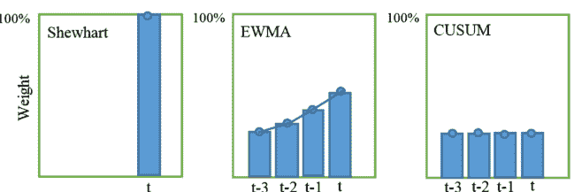

图 2.5 单变量过程监测图表。

在 EWMA 方案中，较大的平滑参数值适用于快速检测大幅度故障，而较小的值可以有效检测过程均值中的小故障 [60]。因此，通过为平滑参数使用单一值，基于监测的 EWMA 方案无法同时对小故障和大故障达到良好的检测能力 [60]。由于单变量 EWMA 控制方案假设固定阈值，这可能不适合处理非平稳（或时间变化）数据。因此，文献中设计了几种自适应 EWMA 和 CUSUM 方法，允许这些方法的阈值在线变化以考虑数据的变化特性 [63,64]。自适应 EWMA 的思想是根据误差大小调整过去观测值的权重（$e_t = x_t - z_{t-1}$，参见 (2.39)），并检测

$$z_t = \gamma x_t + (1 - \gamma)z_{t-1} = \gamma \underbrace{(x_t - z_{t-1})}_{\epsilon_t} + z_{t-1}.\quad (2.39)$$

此外，文献中开发了几种自适应 CUSUM（ACUSUM）方案，以实现涵盖一系列均值变化幅度的合适检测性能 [64,65]。例如，[64] 中提出的 ACUSUM 的基本思想是基于 EWMA 估计更新 CUSUM 中的参考值 (_K_)。

#### 2.4.1.4 广义似然比（GLR）假设检验方法

上述描述的监测方案（即 Shewhart、CUSUM 和 EWMA）或多或少适用于某些特定范围的故障幅度。例如，Shewhart 类方法能对大故障提供满意的检测，但对过程均值的小变化不敏感 [54,59]。虽然 CUSUM 和 EWMA 方案在检测小变化方面有效，但它们无法检测大故障。然而，在实践中，发生故障的幅度是未知的。因此，有必要自动检测广泛的故障，从而降低漏检率。为了实现这一目标，实现对不同规模过程异常可靠检测的一种方法是将监测方案基于广义似然比测试（通常称为 GLR 图表）[66]。GLR 方法的优点在于其分离复合假设的效率、简单性以及无需复杂计算。大量文献专门研究 GLR 特性。已投入大量精力来确立这种假设检验方法的不同渐近最优性特性，相关内容见 [67–71]。GLR 检测器广泛应用于多个领域，包括空气质量监测 [29] 和列车安全 [66]。

此处，我们考虑与二元复合假设检验相关的问题。在检验两个复合假设时，它们对应的数据概率密度函数（PDF）包含未知参数，通常采用 GLR 方法来分离两种可能性。原假设通常定义名义运行情况，而备选假设表征应予确认或排除的偏离。GLR 方法的本质是在所有可能故障上最大化似然比统计量，以在两个复合假设之间做出决定 [68–71]。换言之，GLR 方法的目标是基于观测数据分离两个复合假设 _H_<sub>0</sub> 和 _H_<sub>1</sub>。

出于异常检测的目的，让我们考虑一个观测向量 \( Y = [y_1, y_2, \dots, y_n] \in \mathbb{R}^n \)，它由这些高斯分布中的一个生成


条件:

\[
\begin{cases} 
\mathcal{H}_0 : Y \sim \mathcal{N}(0, \sigma^2 I_n), \\ 
\mathcal{H}_1 : Y \sim \mathcal{N}(\theta \neq 0, \sigma^2 I_n), 
\end{cases} \quad (2.40)
\]

其中 \(\theta\) 是异常值，\(\sigma^2 > 0\) 是方差。在本章中，零假设 \(\mathcal{H}_0\) 表示无故障情况，备择假设 \(\mathcal{H}_1\) 表示存在潜在故障的情况。一般来说，为了在两个假设之间做出决定，GLR 方法将决策统计量 \(\mathcal{L}(Y)\) 与控制限 \(h(\alpha)\) 进行比较：

\[
\delta(Y) = \begin{cases} 
\mathcal{H}_0 \text{ if } \mathcal{L}(Y) = 2 \log \frac{\sup_{\theta \in \mathbb{R}^n} f_\theta(Y)}{f_{\theta=0}(Y)} < h(\alpha), \\ 
\mathcal{H}_1 \text{ else.} 
\end{cases} \quad (2.41)
\]

GLR 图表统计量 \(\mathcal{L}(Y)\) 定义为

\[
\mathcal{L}(Y) = 2 \log \sup_\theta \left\{ \exp \left\{ - \frac{\|Y - \theta\|_2^2}{2\sigma^2} \right\} / \exp \left\{ - \frac{\|Y\|_2^2}{2\sigma^2} \right\} \right\}, \quad (2.42)
\]

其中 \(\| \cdot \|_2\) 是欧几里得范数，\(f_\theta(Y) = \frac{1}{(2\pi)^{\frac{n}{2}} \sigma^n} \exp \left\{ - \frac{1}{2\sigma^2} \|Y - \theta\|_2^2 \right\}\) 是 \(Y\) 的概率密度函数（pdf）。那么，(2.42) 可表示为

\[
\mathcal{L}(Y) = \frac{1}{\sigma^2} \left\{ \min_\theta \|Y - \theta\|_2^2 + \|Y\|_2^2 \right\} = \frac{1}{\sigma^2} \left\{ \|Y - \widehat{\theta}\|_2^2 + \|Y\|_2^2 \right\}. \quad (2.43)
\]

在估计 \(\theta\) 为 \(\widehat{\theta} = \arg \min_\theta \|Y - \theta\|_2^2 = Y\) 之后，\(\mathcal{L}(Y)\) 可表示为

\[
\mathcal{L}(Y) = \frac{1}{\sigma^2} \|Y\|_2^2. \quad (2.44)
\]

控制限 \(h(\alpha)\) 定义为实现事先选定的期望误报概率：

\[
\mathbb{P}_0 (\mathcal{L}(Y) \ge h(\alpha)) = \int_h^\infty f_0(y) dy = 1 - F_{\chi_1^2}(h) = \alpha. \quad (2.45)
\]

GLR 方法的效能函数确定为

\[
\beta_{8^*}(c^2) = \mathbb{P}_\theta (\delta^*(Y) = \mathcal{H}_1) = 1 - F_{1, \gamma(\theta)}(h). \quad (2.46)
\]

其中 \(F_{1, \gamma}(Y)\) 是具有一个自由度的非中心 \(\chi^2(1, \gamma)\) 分布，非中心性参数 \(\gamma (\theta) = \frac{1}{\sigma^2} \| P_H^\perp \theta \|_2^2\)。

总之，当决策统计量 \(\mathcal{L}(Y)\) 超过控制限 \(h(\alpha)\) 时，GLR 方法会标记故障。否则，受监控过程运行正常。

为结束本节，请注意，前述单变量监控方案是基于两个基本假设设计的：过程数据不相关且服从正态分布。然而，环境和现代工业过程的测量通常具有自相关性和/或非正态分布。缺乏对这两个主要假设的验证会降低这些传统方案的监控性能。为了监控具有串行相关测量的过程，文献中已设计了多种监控方案 [72–77]。可以区分两种主要监控方法来考虑数据中的相关性 [76,58]。第一种方法（称为基于残差的方案）的本质是使用数学模型来描述数据中的自相关性。然后，可以将传统监控方案应用于从模型中获得的不相关残差。然而，这些方法的效率对模型的预测质量非常敏感，而模型并不总是容易构建 [78,76]。监控自相关数据的第二种方法的本质是将监控方案应用于原始数据，并适当调整其决策阈值以考虑相关测量的影响 [76,58]。许多作者已研究正态性假设被违反对过程监控方案的影响 [56,79, 80]。在 [79] 中，已使用包括均匀分布、右三角分布、伽马分布和双峰分布在内的各种已知分布，研究了正态性假设被违反对 Shewhart 方案的影响。另外，在 [81] 中，已研究了偏态分布对 Shewhart 图的影响。当底层分布的形式已知时，已有多项工作为非高斯分布设计了过程监控图。[82, 83] 的作者开发了用于多维泊松分布数据的 EWMA 监控方案。另外，已设计单变量监控图来监控非正态卡方分布过程 [84]。然而，在实际数据中，底层分布的形式通常未知，此时我们的选择可能是使用正态理论结果 [56]。在这种情况下，忽略过程数据中的非正态性会影响设计监控方案的统计性能。

### 2.4.2 基于分布的过程监控方案

最常用的监控技术检测过程均值或方差的变化。然而，在许多实际应用中，变化经常影响被检测过程的分布，而其均值或方差保持不变。本节介绍了 Kullback–Leibler 距离和 Hellinger 距离，它们通常用于量化两个分布之间的偏差。本节的结果对于设计基于 LVR 的方法以监控整个过程分布并拓展实际应用至关重要。

#### 2.4.2.1 基于 Kullback–Leibler 的监控方案

Kullback–Leibler 散度的本质是计算两个概率分布之间的不相似性。KLD 起源于信息理论领域，已应用于多个学科，如分类、语音和图像识别 [85,86]、运输 [87]、电信 [88]、工业 [89,90] 和医学 [91]。据文献报道，KLD 在解决异常检测和变化点检测问题中起着核心作用 [89,92,93]。本节介绍了 KL 散度的基本思想以及如何将其用作异常检测器。

**定义 2.1.** 两个概率密度函数（PDF）\(p_1(x)\) 和 \(p_2(x)\) 之间的 Kullback–Leibler 信息定义为

\[
I(p_1 : p_2) = \int_{\mathbb{R}^d} p_1(x) \log \left[ \frac{p_1(x)}{p_2(x)} \right] dx, \quad (2.47)
\]

\(p_2(x)\) 相对于 \(p_1(x)\) 的 Kullback–Leibler 信息由以下公式给出：

\[
I(p_2 : p_1) = \int_{\mathbb{R}^d} p_2(x) \log \left[ \frac{p_2(x)}{p_1(x)} \right] dx. \quad (2.48)
\]

KLI 是一种非对称度量（即，\(I(p_1 : p_2) \neq I(p_2 : p_1)\)）且非负（即，\(I(p_1 : p_2) \ge 0\) 和 \(I(p_2 : p_1) \ge 0\)）。此外，等式 \(I(p_1 : p_2) = 0\) 仅在两个分布严格相等时才成立。KLD 距离代表 KLI 的对称形式 [89]，并表示为

\[
KLD(p_1; p_2) = I(p_1 : p_2) + I(p_2 : p_1). \quad (2.49)
\]

对于两个高斯分布，\(p_1 \sim \mathcal{N}(\mu_0, \sigma_0)\) 和 \(p_2 \sim \mathcal{N}(\mu_1, \sigma_1)\)，分别由其均值 \(\mu_0, \mu_1\) 和方差 \(\sigma_0^2, \sigma_1^2\) 表征，KLD 距离具有以下解析表达式 [94]:

\[
KLD(p_1; p_2) = \frac{1}{\sigma_0\sqrt{2\pi}} \int \exp \left( \frac{(x - \mu_0)^2}{2\sigma_0^2} \right) \cdot \left[ \log \frac{\sigma_1}{\sigma_0} - \frac{(x - \mu_0)^2}{2\sigma_0^2} + \frac{(x - \mu_1)^2}{2\sigma_1^2} \right] dx = \frac{(\mu_1 - \mu_0)^2}{2\sigma_1^2} + \frac{1}{2} \left( \log \frac{\sigma_1^2}{\sigma_0^2} + \frac{\sigma_0^2}{\sigma_1^2} - 1 \right). \quad (2.50)
\]

当异常仅发生在均值中时（即，\(\sigma_0^2 = \sigma_1^2\)），Eq. (2.50) 可表示为

\[
KLD(p_1; p_2) = \frac{(\mu_1 - \mu_0)^2}{2\sigma_1^2}. \quad (2.51)
\]

从 (2.50) 可以看出，对于任何 \(\sigma_0 \neq \sigma_1\)，第二项均严格为正。我们得出结论，在同时影响受监控高斯变量的均值和方差的故障情况下，KLD 的值大于仅均值发生变化时的值。因此，很明显，使用 KLD 同时检测过程测量值的均值和方差中的异常，比检测仅发生在过程均值中的异常更容易。

如果使用 KLD 来表征分布 \(p_1(x)\) 和 \(p_2(x)\) 的接近程度，当两个分布相似时，其值将接近零；否则，它会显著偏离零。因此，KLD 可用于异常检测。用于在零假设 \(\mathcal{H}_0\) 和备择假设 \(\mathcal{H}_1\) 之间进行选择的基于 KLD 的检验如下：

\[
\delta(Y) = \begin{cases} \mathcal{H}_0 \text{ if } KLD(p_1; p_2) < H_D, \\ \mathcal{H}_1 \text{ else.} \end{cases} \quad (2.52)
\]

从决策统计量 KLD 的分布来看，KLD 机制的阈值可以非参数地计算为通过核密度估计（KDE）得到的 KLD 统计量近似分布的 \((1 - \alpha)\) 分位数。非参数阈值使用无异常数据计算。当 KLD 统计量超过决策阈值时，我们声明存在异常。

#### 2.4.2.2 基于 Hellinger 的监控方案

此处考虑的检验统计量基于 Hellinger 距离（HD）度量。它由 Ernst Hellinger 提出，可用于测量两个不同概率向量之间的相似性 [95–97]。与 KLD 类似，HD 距离在数理统计的多个问题中也起着核心作用 [98,96, 97]。HD 度量已被广泛应用于包括模式识别 [99]、图像处理 [100]、分类 [101] 和异常检测 [102,97,103] 在内的众多学科。此外，HD 度量还应用于包括网络安全 [103] 和保险欺诈检测 [104] 在内的不同应用。

**定义 2.2** (海灵厄距离). *两个 PDF \(p_1(x)\) 和 \(p_2(x)\) 之间的 HD 值为*

\[
HD^2(p_1, p_2) = \frac{1}{2} \sum (\sqrt{p_1(x)} - \sqrt{p_2(x)})^2. \quad (2.53)
\]

可以看出，HD 是平方根向量之间差值的欧几里得范数：

\[
HD^2(p_1, p_2) = \frac{1}{\sqrt{2}} \| \sqrt{p_1} - \sqrt{p_2} \|_2. \quad (2.54)
\]


需要注意的是，HD 距离是 \( p_2 \) 和 \( p_1 \) 的对称度量（即，\( HD^2(p_1, p_2) = HD^2(p_2, p_1) \））。它具有度量的所有性质且有界（即，HD 满足 \( 0 \le HD^2(p_1, p_2) \le 1 \）），且等式 \( HD^2(p_2, p_1) = 0 \) 仅在 \( p_1 = p_2 \) 时成立。

正态分布 \( p_1 \sim \mathcal{N}(\mu_0, \sigma_0) \) 和 \( p_2 \sim \mathcal{N}(\mu_1, \sigma_1) \) 之间 HD 的解析形式可按 [94] 中所述易得，

```
\( HD^2(p_1, p_2) = 1 - \sqrt{\frac{2\sigma_0\sigma_1}{\sigma_0^2 + \sigma_1^2}} \exp \left( - \frac{1}{4} \frac{(\mu_0 - \mu_1)^2}{\sigma_0^2 + \sigma_1^2} \right), \quad (2.55) \)
```

其中 \( \mu_0, \mu_1 \) 分别是 \( p_1 \) 和 \( p_2 \) 的均值，\( \sigma_0^2, \sigma_1^2 \) 为方差。在仅存在均值偏移的情况下（即，\( \sigma_1^2 = \sigma_0^2 \）），HD 表示为

```
\( HD^2(p_1, p_2) = 1 - \exp \left( - \frac{1}{8} \frac{(\mu_0 - \mu_1)^2}{\sigma_0^2} \right). \quad (2.56) \)
```

需要注意的是，较小的 HD 值表示两个分布之间高度相似，而较高的 HD 值则反映两者之间存在显著差异。与 KLD 类似，HD 度量可用作异常指示器。为结束本小节，我们指出，HD 度量的解析形式存在于某些非高斯分布中，例如 Weibull、Poisson 和 Beta 分布。当 HD 度量没有闭式解时，可利用 KDE [105] 等方法从数据集中进行近似。

需要注意的是，KLD 和 HD 度量是幂偏差的特例，该偏差最初定义于 [106,107]。此外，研究表明，当分布 \( p_1 \) 和 \( p_2 \) 之间的比率（即 \( p_1/p_2 \）接近 1 时，这两个度量在渐近意义上相同，仅相差一个常数因子 [108]。

#### 2.4.2.3 单变量监测方案的局限性

如今，现代工程和工业过程变得更加复杂，包含多个部分和大量测量变量。尽管这些单变量监测方案在多种应用中已被成功使用，但它们仅适用于每个被监测变量相互独立的情况，因此此类方案忽略了相关变量之间的交互作用。然而，在工程和环境过程中，多个变量需要同时监测，使用单变量监测方案会导致误导性分析。为每个过程变量应用单一监测方案既繁琐又低效，尤其是在变量数量较多时。当然，使用多变量方案监测多变量过程相比单变量方案可以最大限度地减少监测方案的总数。例如，假设被检测过程包含两个变量 \( X_1 \) 和 \( X_2 \)。图 2.6 说明了使用独立单变量监测方案监测双变量过程的困难。从图 2.6 可以看出，$X_1$ 和 $X_2$ 的观测值均在其各自的控制限之内。此外，图 2.6 清楚地展示了多变量方案检测此故障的能力（即，右上角的红色星号（在控制椭圆之外））。该点清楚地代表了 $X_1$ 与 $X_2$ 之间的不匹配。因此，分别监测这两个过程变量可能非常具有误导性。

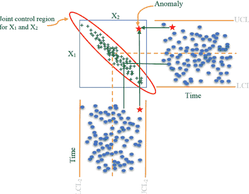

图 2.6 使用单变量方案监测多变量数据的缺点示例。

此外，使用单变量图表监测多变量过程至少有两个局限性，如下简要说明：

- 一旦联合单变量监测方案应用于多变量过程监测，每个单变量监测方案都有其自身的过程参数，在使用前需要进行调整。例如，如果使用单变量 EWMA 监测单个过程变量，则单变量 EWMA 方案涉及两个参数（即，\(\gamma\) 和 \(L\)）。因此，用于监测 \(p\) 个过程变量的联合监测方案将有 \(2p\) 个参数需要确定。

- 假设有两个变量 \(X_1\) 和 \(X_2\)，分别使用单变量方案进行单独监测。例如，对每个过程变量应用 3-sigma 阈值。每个方案都会导致误报概率为 \(\alpha = 0.27\%\)（I 类错误）。因此，此种情况下的总误报率为 \(\hat{\alpha} = 0.54\%\)。例如，如果同时应用 100 个方案进行监测，则误报概率将达到 27%（即，0.27% × 100）。一般而言，如果使用 \(p\) 个统计独立的过程变量和具有误报率的监测方案，则总误报率 \(\hat{\alpha}\) 为

\(\hat{\alpha} = 1 - (1 - \alpha)^p\)。 (2.57)

但是，当基于单个多变量方案检测多个过程变量时，总误报率将保持在 0.27%。

总体而言，在多变量框架内构建的多变量监测方案相比涉及多个单变量监测方案的联合监测方案，能够实现更有效的故障检测（详情见 [109, 59]）。

### 2.4.3 具有参数和非参数阈值的多变量过程监测方案

为同时监督多个变量，已设计多变量统计监测方案，如多变量 Shewhart、多变量 EWMA (MEWMA) 和多变量 CUSUM (MCUSUM)，作为其单变量方案的多变量对照。在本节中，概述了每个监测方案（即，多变量 Shewhart、MCUSUM 和 MEWMA）的目标，并评论了其优点和局限性。

#### 2.4.3.1 多变量 Shewhart 方案

Shewhart 监测方案的多变量对照是检查正态分布过程均值偏移的最流行的多变量监测技术之一。假设我们检测一个多变量过程 \(\mathbf{X}_t = (X_1, X_2, ..., X_p)^T\)，其中 \(X_i \in \mathbb{R}^m\)，且收集的数据服从均值为 \(\mu\) 协方差矩阵为 \(\Sigma\) 的正态分布。多变量 Shewhart 方案（也称为 \(T^2\) 方案或 \(\chi^2\) 方案 [110]），用于监测多变量数据中的过程均值，基于以下监测统计量：

\(T_t^2 = [(\mathbf{x}_t - \mu)^T \Sigma^{-1} (\mathbf{x}_t - \mu)]\) (2.58)

其中 \(\mathbf{x}\) 是 \(p\) 个变量的向量，\(\mu\) 是每个变量无故障均值的向量。该监测方案的决策阈值（使用无故障数据推导）为 \(H = \chi^2_{\alpha,m}\)。对于新的测试测量，\(T^2\) 方案在 \(T^2\) 的值超过阈值 \(\chi^2_{\alpha,m}\) [25] 时标记异常。由于该方案仅使用当前观测并忽略所有过去数据，在存在小变化时表现出较差的检测性能。需要注意的是，该方案是在无相关且多变量高斯分布测量的假设下设计的。

#### 2.4.3.2 多变量累积和方案 (MCUSUM)

作为解决 Shewhart 方案对小变化不敏感问题的补救措施，已设计了 MCUSUM 和 MEWMA 监测方案 [109]。MCUSUM 方法的核心是通过计算每个先前观测向量与名义值之间的差异的累积和，利用所有可用数据的信息来监测多变量过程的均值 [111]。MCUSUM 最初在 [112] 中作为单变量 CUSUM 方案的自然版本引入，用于处理多变量数据。已开发了众多 MCUSUM 扩展 [112–114]。在本小节中，为简化表述，我们仅介绍文献中备受重视并在 [112] 中开发的 MCUSUM 方案。令 \(\mathbf{X}_t = (X_1, X_2, \dots, X_p)^T\) 为 i.i.d. \(\mathcal{N}_p(\mu, \Sigma)\) 的序列，其中 \(X_i \in \mathbb{R}^m\)；\(m\) 为变量数量。需绘制的 MCUSUM 决策统计量为

```
\( S_t = \sqrt{L_t^T \Sigma^{-1} L_t}, \) (2.59)
```

其中

```
\( L_t = \left\{ \begin{array}{ll} 0 \text{ if } C_t \le k, \\ (L_{t-1} + X_t - \mu_0)(1 - \frac{k}{C_t}) \text{ otherwise,} \end{array} \right. \) (2.60)
```

and

```
\( C_t = \sqrt{(L_{t-1} + X_t - \mu_0)^T \Sigma^{-1} (L_{t-1} + X_t - \mu_0)}. \) (2.61)
```

Crosier [109] 建议使用 \(L_0 = 0\) 和 \(K = \frac{\sqrt{(\mu_1-\mu_0)^T \Sigma^{-1}(\mu_1-\mu_0)}}{2}\)。当以下条件满足时，MCUSUM 方案发出故障信号

```
\( S_t = \sqrt{L_t^T \Sigma^{-1} L_t} > H, \) (2.62)
```

其中决策阈值 \(H\) 通过仿真计算以达到所需的误报概率。

#### 2.4.3.3 多变量指数加权移动平均方案 (MEWMA)

MEWMA 方案由 Lowry 等人 [115] 设计，作为 EWMA 的多变量扩展，用于检测多变量数据均值中发生的故障。MEWMA 的理想特性在于其能够通过在决策函数中纳入所有可用数据集的信息来检测多变量相关过程变量中的小变化。它已广泛用于可再生能源 [116,117]、空气质量监测 [118]、工业过程和医疗保健等多个应用中。

令 \(\mathbf{X}_t = (X_1, X_2, \dots, X_m)^T\) 为时刻 \(t\) 的 \(m\) 维测量集。Lowry 等人 [115] 设计的 MEWMA 方案由以下给出

```
\(\left\{ \begin{array}{ll} Z_0 = \mu_0, \\ \mathbf{Z}_t = \Gamma \mathbf{X}_t + (\mathbf{I}_{m \times m} - \Gamma)\mathbf{Z}_{t-1} \quad t=1, 2, \dots, n, \end{array} \right.\) (2.63)
```

其中 \(\Gamma = \text{diag}(\gamma_1, \gamma_2, \dots, \gamma_m)\) 是平滑参数的对角矩阵，\(m\) 是过程变量的数量。设计 MEWMA 方案需要

权重归属 \(0 < \gamma \le 1\) 用于分配观测值的重要性；\(Z_i\) 是第 \(i\) 个 EWMA 向量，\(X_i\) 是第 \(i\) 个观测向量，\(i = 1, 2, \dots, n\)。可以看出，如果 \(\Gamma = \mathbf{I}\)，则 MEWMA 方案等同于 \(T^2\) 方案。在实际应用中，如果没有先前的理由为每个组件分配不同的权重，为了简便，通常假设 \(\gamma_1 = \gamma_2 = \cdots = \gamma_m = \gamma\)。因此 (2.63) 可写为

\(\mathbf{Z}_t = \gamma \mathbf{X}_t + (1-\gamma)\mathbf{Z}_{t-1}.\) (2.64)

构建 MEWMA 图表时，MEWMA 统计量可递归计算为 [115]

\(\mathbf{V}_t^2 = \mathbf{Z}_t^T \Sigma_{\mathbf{Z}_t}^{-1} \mathbf{Z}_t,\) (2.65)

其中 \(\Sigma_{\mathbf{Z}_t}\) 是 \(\mathbf{Z}_t\) 的方差-协方差矩阵，

\(\Sigma_{\mathbf{Z}_t} = \frac{\gamma}{(2-\gamma)}[1-(1-\gamma)^{2n}]\Sigma,\) (2.66)

其中 \(\Sigma\) 是输入数据的协方差矩阵。当 \(t\) 较大时，协方差矩阵收敛于 \(\Sigma_{\mathbf{Z}_t} = (\frac{\gamma}{(2-\gamma)})\Sigma\)。

在无变化假设下，MEWMA 统计量服从方差-协方差矩阵为 \(\Sigma_{Z_i}\) 的高斯分布，\(Z \sim \mathcal{N}(0, \Sigma_{Z_i})\)。在存在均值偏移 \(\mu_1\) 时，MEWMA 统计量的分布为 \(Z \sim \mathcal{N}\left(\gamma \sum_{j=1}^n \left[1-(1-\gamma)^{n-j}\theta\right], \Sigma_{Z_i}\right)\)。因此，在无变化的情况下，\(\mathbf{V}_t^2\) 服从具有 \(P\) 个自由度的 \(\chi^2\) 分布。但是，由于变量 \(\mathbf{V}_t^2, t=1, 2, \dots\) 相关，MEWMA 方案的决策阈值不能直接取为 \(\chi_P^2\) 分布的 \((1-\alpha)\) 分位数。文献中提出了许多方法来根据参数 \(\gamma, p,\) 和 \(\alpha\) 计算决策阈值 \(h\)，例如蒙特卡洛模拟和马尔可夫链近似 [77, 119]。在 [120] 中，给出了用 Fortran 实现的计算 MEWMA 阈值的方法，以实现固定数量的误报和给定的 \(\gamma\)。另外，在 [121] 中，开发了一种方法来计算针对所选 \(p\) 组合、待检测偏移幅度和目标 ARL0 的最优 \(\gamma\) 及相应阈值 \(h\)。

让我们进一步评论一下权重矩阵 \(\Gamma\)。在 [122] 中，已经证明，与使用单个权重参数 \(\gamma\) 相比，当 \(\Gamma\) 具有非零非对角元素时，MEWMA 方案的检测性能可以得到增强。但是，在这种情况下，构建 MEWMA 方案并非易事，尤其是要正确选择权重矩阵参数。这主要是因为在设计 MEWMA 时应考虑故障方向和过程变量之间的相关性。

此外，为了使用 MEWMA 监控方案来检测过程协方差矩阵中的异常，文献中已提出多种 MEWMA 扩展；请参阅 [123–125]。

为结束本小节，我们指出，利用传统的多变量监控方案（即多变量 Shewhart、MCUSUM 和 MEWMA）来检查具有共线性的高维过程可能无效。

## 2.5 基于线性 LVR 的过程监控策略

首先，让我们说明为什么包括多变量 Shewhart、MCUSUM 和 MEWMA 方案在内的多变量监控方案在具有众多相关过程变量的应用中不常单独使用。从上一节我们知道，这些三个多变量方案的决策统计量设计需要计算逆协方差矩阵。但是，由于工程和环境过程收集的多变量数据是相关的，因此协方差矩阵的矩阵求逆由于病态条件问题而经常会产生较差的数值结果。因此，当协方差矩阵病态化时，使用基于投影的监控方法（如 PCA 和 PLS）变得显而易见且特别相关。如第 2.2.3 节所述，LVR 模型非常适合多变量监控，因为它们可以缓解包括多变量 Shewhart 图表、MCUSUM 和 MEWMA 方案在内的其他多变量方案中的病态条件问题。例如，为了避免病态条件问题，可以使用基于投影的方法（如 PCA）来分解原始数据的协方差矩阵，并生成具有更好数值特征的转换变量，从而能够通过传统的多变量方案（例如 MEWMA 和 MCUSUM）进行过程监控。本节描述了结合 LVR 模型与单变量或多变量监控技术的通用框架。

### 2.5.1 传统 LVR 监控统计量

基于数据的监控方法（如输入空间模型（例如 PCA）和输入-输出模型（例如 PLS））的通用框架包括两个阶段：(i) 模型构建和 (ii) 在线监控，如图 2.7 所示。第一阶段侧重于根据检查过程在标称条件下运行时收集的数据设计参考模型。然后计算监控方案的决策阈值（例如 T² 或另一个图表）。通常，阈值定义在保留主成分的子空间或残差子空间中。这两个子空间通常用作故障检测的监控子空间。例如，在 PCA 中，通过选择相关数量的主成分（即捕获数据中最多变异性的主成分）来构建捕获过程数据信息的低维经验模型。在第二阶段，将新的测试数据投影到子空间模型中，使用设计的模型计算残差，并计算 T² 和 SPE 统计量等检验统计量，并将其与先前计算的

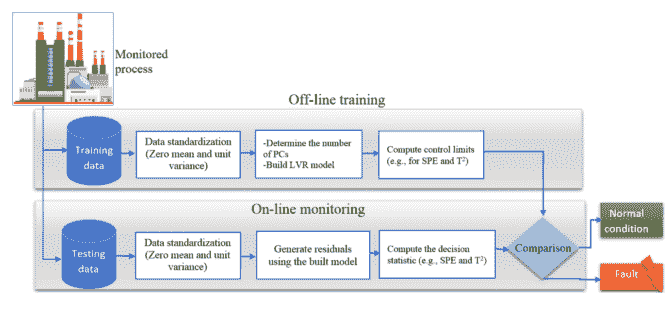

阈值进行比较以进行故障检测。保留主成分和残差的变异通常分别由 $T^2$ 和 SPE 方案验证，以检测异常操作，但也可以使用 MCUSUM 和 MEWMA。使用 PCA 或其他方法构建参考模型后，可以应用多种监控方案进行故障检测。要进行 SPE 和 $T^2$ 分析，可以使用除 PCA 之外的各种适用方法识别的任何模型。

#### 2.5.1.1 Hotelling's $T^2$ 统计量

LVR 方法（例如 PCA 和 PLS）通常后续采用使用 SPE 和 $T^2$ 统计量的故障检测方法。可以通过检查测量值是否超出主成分子空间或残差子空间中的正常运行区域来检测过程中的异常。$T^2$ 统计量计算每个时刻仅在主成分中的波动。更具体地说，$T^2$ 值定义为保留主成分的平方和除以由表征正常运行的故障自由数据计算的相应特征值，如 [25] 所示

$$T^2 = x^T \widehat{P} \widehat{\Lambda}^{-1} \widehat{P}^T x = \sum_{i=1}^l \frac{t_i^2}{\lambda_i},$$ (2.67)

其中 \(\lambda_i\) 是主成分 \(t_i\) 的特征值（方差）。如果实际协方差矩阵由样本矩阵确定，则 \(T^2\) 方案的控制限由 [25] 给出

$$T^2_{l, n, \alpha} = \frac{l(n-1)}{n-l} F_{l, n-l, \alpha},$$ (2.68)

其中 \(\alpha\) 是显著性水平，\(F_{l,n-l}\) 是具有 \(l\) 和 \(n-l\) 自由度的 Fisher F 分布。在多变量高斯分布数据 X 的情况下，如果样本量足够大，\(T^2\) 统计量阈值可由 \(T_\alpha^2 = \chi_{l, \alpha}^2\) 计算得出。决策阈值使用故障自由数据计算。

#### 2.5.1.2 Q 统计量或平方预测误差 (SPE)

为了检测残差子空间中的故障，通常使用 SPE（也称为 Q 统计量）[22]

$Q = \mathbf{e}^T \mathbf{e}.$

Q 统计量的决策阈值定义为 [126]

$Q_\alpha = \varphi_1 \left[ \frac{h_0 c_\alpha \sqrt{2\varphi_2}}{\varphi_1} + 1 + \frac{\varphi_2 h_0(h_0 - 1)}{\varphi_1^2} \right],\)

其中 \(c_\alpha\) 是显著性水平为 \(\alpha\) 的正态分布的值，\(\varphi_i = \sum_{j=l+1}^m \lambda_j^i\) 对于 \(i = 1, 2, 3\)，且 \(h_0 = 1 - \frac{2\varphi_1 \varphi_3}{3\varphi_2^2}\)。

应注意，Q 方案对建模误差敏感，其检测质量主要取决于保留的主成分数量 [22]。

图 2.8 展示了一个带有较大 \(T^2\) 值的数据点“b”的示例，该值表示 PC 平面中心与该点之间的（水平）距离。图 2.8 还显示了另一个具有显著 Q 值的点，该值表示 PC 平面与非典型数据点“a”之间的垂直距离。一般来说，Q 表示数据样本与模型之间的不匹配。

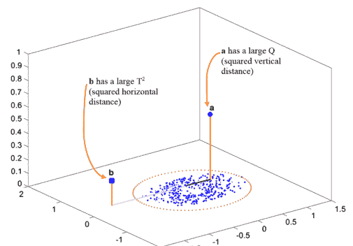

FIGURE 2.8 投影测量值（蓝色 [打印版本中为深灰色]）以及两个观测值“a”和“b”，带有其对应的 \(T^2\) 和 Q 统计量值。

为结束本节，请注意 Q 和 \(T^2\) 方案的决策阈值是基于数据不相关且服从正态分布的事实推导出来的。为了弥补这一局限性，一种基于的替代解决方案


核密度估计（KDE）可以使用 [127]。在估计决策统计量（例如，Q 和 $T^2$）的分布后，阈值可以非参数地计算为此估计分布的 $(1-\alpha)$ 分位数。

如第 2.5.1 节所述，在基于投影的监测方法中，PC 和残差子空间通常通过 Shewhart 型监测图（即，Q 和 $T^2$）来检测异常变化。然而，这些方案旨在检测大故障，但无法检测小变化。或者，可以使用其他类型的多变量方案，例如 MEWMA 和 MCUSUM [118,128]。此外，通过将单变量方案（CUSUM 或 EWMA）与 Q 和 $T^2$ 相结合，可以增强检测小故障的能力，但需要良好选择 CUSUM 或 EWMA 方案的参数 [129]。与基于投影方法的常规多变量监测方案相比，其他方法利用基于分布的方案（如 KLD [130,92,131,89] 和 HD [102,132]）的灵敏度来检测潜在故障。

### 2.5.2 故障隔离

如今，随着技术的进步，工程和环境过程变得复杂得多。多个相关过程变量需要同时全部受到监督。一旦检测到故障，就需要进行故障隔离（归因），以确保过程的安全运行，并在故障传播并污染过程之前进行必要的纠正，从而避免过程停机的风险 [133]。隔离检测到的故障对于系统诊断和维护是必要的，但由于需要检查的变量数量庞大，这并非易事。故障隔离的目的是找出导致异常变化的过程变量，从而使操作员只需关注发生故障的子系统。因此，故障隔离对于显著降低盈利损失以及便于维护任务至关重要。本节介绍了两种用于故障隔离的基本工具，即潜在变量贡献图和 RadViz 可视化器。在第 3 章中，将介绍关于多变量统计监测中故障归因的更多细节。

#### 2.5.2.1 使用修改后的贡献图进行故障隔离

贡献图背后的基本直观思想是找出贡献较大的过程变量，这些变量是定位异常源的潜在指标。因此，贡献图为操作员提供相关信息，使其能够通过将分析集中在少数可能是检测到的异常原因的变量上，从而实现高效的故障诊断 [134,21,135,136]。

在多变量统计监测方法中，已开发出多种故障隔离技术，包括对 $T^2$ 统计量的贡献、对 SPE 的贡献以及对单个得分的贡献，这些是故障诊断中最流行的方法 [21,137,138]。这些基于贡献的方法的本质在于，预期带有故障的变量会对故障检测统计量产生显著贡献。大多数基于贡献的故障隔离技术已在 [136] 中总结和概括。然而，这种方法分别研究过程变量而不考虑它们之间的相关性，因此不适合隔离同时参与故障发生的多个变量中的故障。其他研究人员 [139] 使用 GLR 检验进行故障隔离，该方法还可以提供隔离传感器故障大小的估计。在 [140] 中，介绍了一种基于重构的方法来识别单个和多个故障。另一种结合贡献分析和基于重构的方法的理想优点的方法已被设计用于进一步增强故障隔离。然而，基于重构的贡献方法仅适用于识别幅度相对较大的一维故障。最近，在 [141] 中，设计了一种基于指数平滑重构的方法，用于隔离潜在故障。接下来，我们将回顾故障隔离中最常用的两种技术——贡献方法。

##### $T^2$ 贡献方法

基于 $T^2$ 的贡献方法已在工业中广泛应用，用于识别对由 $T^2$ 监测方案检测到的故障有显著贡献的过程变量。该方法的本质在于计算 $T^2$ 相对于每个变量的梯度。根据等式 (2.67)，$T^2$ 统计量的梯度提供了对变量向量 $\mathbf{x}$ 的灵敏度，如下所示

$$\mathbf{S}_{T^2} = \frac{\partial (T^2)}{\partial \mathbf{x}} = 2\mathbf{P}(\mathbf{P}^T \sum_{\mathbf{x}} \mathbf{P})^{-1} \mathbf{P}^T \mathbf{x} = 2\mathbf{P}\Lambda_p^{-1} \mathbf{P}^T \mathbf{x}. \quad (2.71)$$

常数“2”可以忽略，每个变量的贡献可以计算为

$$T^2 \text{cont}_{x_i} = \frac{\sum_{j=1}^k (p_j x_i)^2}{\lambda_j} = x_i^2 \sum_{j=1}^k \frac{p_j^2}{\lambda_j}. \quad (2.72)$$

如果对于 $i = 1, \dots, n$ 计算出的所有值中 $T^2 \text{cont}_{y_i}$ 最大，则 $y_i$ 被指示为故障的潜在原因。

##### SPE 贡献方法

当 $Q$ 方案标记故障时，通常应用 $Q$ 贡献图来隔离故障 [135]。设 $\mathbf{E} = [\mathbf{e}_1 \mathbf{e}_2 \dots \mathbf{e}_m]$ 为残差矩阵，$\mathbf{e}_j$ 为残差矩阵的第 $j$ 列。根据 (2.69)，我们有

$$Q_j = \mathbf{e}_j^T \mathbf{e}_j. \quad (2.73)$$

实际上，残差矩阵 E 的每一行 e_i 是该特定样本的 Q 贡献。样本瞬时 j 时第 i 个变量对总体 Q 的分数贡献可以计算为

$Qcont_{x_j} = \frac{e_{ij}^2}{Q_j}.$ (2.74)

Q 贡献图有助于识别对 SPE 有重要贡献的变量，作为故障的可疑源。

#### 2.5.2.2 使用 RadViz 可视化器进行故障诊断

RadViz 可视化最初由 Patrick Hoffman 等人在 [142,143] 中提出，作为一种多变量数据可视化工具，用于对 DNA 序列进行分类。实际上，RadViz 能够将高维数据非线性投影到二维空间中，并允许直接解释观测值在空间中的位置。它可以在二维空间中可视化包含三个或更多变量的高维数据。RadViz 已被广泛用于可视化、解释和聚类高维数据集，例如微阵列数据和股票交易趋势。

一般来说，RadViz 从带有散点图的降维方法中获益，其中每个观测值的值可以通过其到锚点的距离来指示 [144]。锚点是单位圆周上均匀间距的可视化变量。图 2.9 给出了一个示例性示例，展示了 RadViz 可视化器的基本概念。在此方法中，每个点通过虚拟弹簧连接到每个锚点。这里，圆中每个观测值的位置是根据其受到锚点的相对影响（即每个弹簧的弹簧力）来计算的。每个观测值的坐标位于弹簧力系统达到平衡的点。每个锚点对投影观测值的影响与该锚点的坐标幅度成正比。RadViz 中每个观测值的坐标计算如下

$x_i = \frac{\sum_{i=1}^d x_i \cos \theta_j}{\sum_{i=1}^d x_i}, \quad (2.75)$

$y_i = \frac{\sum_{i=1}^d x_i \sin \theta_j}{\sum_{i=1}^d x_i}, \quad (2.76)$

其中，$x_i$ 和 $y_i$ 是投影观测值的坐标，$\theta_j$ 表示锚点 $j$ 在圆上的角位置；$a_{i,j}$ 表示观测值 $i$ 在维度 $j$ 上的值；$d$ 是维度数量；$n$ 是观测值数量。

RadViz 方法的主要特征可以总结如下。在此二维空间中，中心位置的观测值具有大约相同的维度


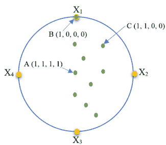

图 2.9 RadViz可视化原理的说明示例。

值。另一方面，某些坐标值显著大于其他值的观测值会受到靠近这些观测值的维度锚点的影响或与之相关。换句话说，特定维度的值越大，投影观测值与相关锚点越接近，反之亦然。正是这种理想特性使RadViz成为辅助故障诊断的有用工具。在图2.9中，RadViz被用于在四维空间中可视化多维数据（图2.9）。圆周上的黄点（印刷版中为浅灰色），称为锚点，表示数据的维度（例如，过程变量或潜在变量）。在此示例中，观测值B的坐标为(1, 0, 0, 0)，并位于X1处，这意味着该观测值与该锚点（变量）完全相关，没有任何歧义。坐标为(1, 1, 0, 0)的观测值C与X1和X2具有较高相关性，与X3和X4具有较低相关性。最后，坐标为(1, 1, 1, 1)的观测值A位于圆圈中心，意味着它受到所有锚点的类似影响。

至今，RadViz工具在故障检测与诊断中尚未得到充分利用以辅助故障隔离。在2.6.2节中，RadViz被用于诊断水资源回收设施进水测量中的异常。

## 2.6 案例研究

### 2.6.1 模拟示例

在此，利用合成数据集评估了OLS、RR和LVR模型（PLSR和PCR）的预测效能。模拟数据包含十个输入变量和一个响应变量。在此示例中，输入变量x1和x2分别表示“块”和“重正弦”信号，其他七个变量由x1和x2的线性组合获得（即，输入矩阵X = [x1, x2, ..., x10]的秩为2）：

```
x3 = x1 + x2;      x4 = 0.3x1 + 0.7x2;      x5 = 0.3x3 + 0.2x4;
```

$\mathbf{x}_6 = 2.2\mathbf{x}_1 - 1.7\mathbf{x}_3; \quad \mathbf{x}_7 = 2.1\mathbf{x}_6 + 1.2\mathbf{x}_5; \quad \mathbf{x}_8 = 1.4\mathbf{x}_2 - 1.2\mathbf{x}_7; \mathbf{x}_9 = 1.3\mathbf{x}_2 + 2.1\mathbf{x}_1; \quad \mathbf{x}_{10} = 1.3\mathbf{x}_6 - 2.3\mathbf{x}_9.$

然后，输出作为所有输入变量的线性组合获得：

$\mathbf{y} = \sum_{i=1}^{10} b_i \mathbf{x}_i, \quad (2.77)$

其中 \( b_i = \{0.07, 0.03, -0.05, 0.04, 0.02, -1.11, -0.04, -0.02, 0.01, -0.03\} \) 对于 \( i = 1, \dots, 10 \)。首先，生成128个无噪声样本，然后加入零均值高斯噪声。信噪比（SNR）等于20的输出测量样本如图2.10所示。在使用训练数据构建四个模型后，利用未见的测试数据按输出预测MSE对其进行比较。

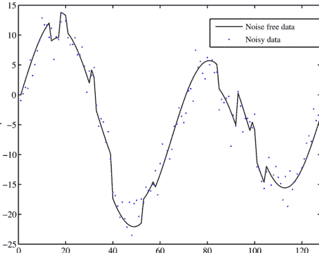

图 2.10 信噪比（SNR）等于20的输出测量样本。

为了研究噪声数据对四个模型预测质量的影响，模拟无噪声数据已加入信噪比分别为10、20和50的噪声。模拟数据分为两部分：测试数据和训练数据。对于PLSR和PCR，保留主成分（PC）的数量采用交叉验证技术选择。所开发模型的性能通过模型预测，即使用测试数据集的MSE来评估。为了获得统计上有效的结果，已进行了1000次随机仿真。五个模型的预测结果见表2.1和图2.11。图2.11的结果表明，RR相比OLS提供了更好的预测。同样可以看出，PCR和PLS相比全秩模型（OLS和RR）达到了更高的性能。仅使用少量主成分

| 模型 | SNR=10 | SNR=20 | SNR=50 |
|---|---|---|---|
| PLS | 2.183 | 1.111 | 0.4510 |
| PCR | 2.223 | 1.127 | 0.4565 |
| RR | 2.288 | 1.148 | 0.4584 |
| OLS | 3.849 | 1.955 | 0.7853 |

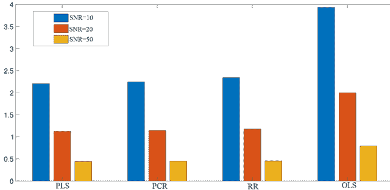

图 2.11 不同信噪比下研究模型的预测MSE。

在LVR模型中允许去除数据中的一部分噪声，从而提高预测质量。从表2.1可以看出，PCR和PLS模型提供可比的预测性能，这与文献[145,146]一致。

### 2.6.2 水资源回收设施进水测量监测

废水处理厂（WWTPs）为水资源短缺提供了可持续解决方案。作为提供给WWTPs的初始条件，进水特性（ICs）影响处理单元的状态、正在进行的过程机制和产品质量。ICs中的异常，通常由异常事件引起，需要及时监测和检测，以提高系统韧性。本节研究了基于PCA的方法监测WWTPs进水测量的能力。为此，采用了位于沙特阿拉伯图瓦勒阿卜杜拉国王科技大学（KAUST）的WWTP的历史ICs（图2.12）。

在此数据集中，运营人员保存了七年关于21个特征的记录（表2.2）。对从WWTP初级处理单元取样的样品进行测量，以保持符合法规和标准。该厂设有可持续发展使命，即将所有处理后的出水用于

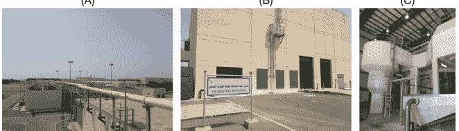

图 2.12 (A) 来自校园的管道，(B) 初级处理单元内的格栅沉砂池和格栅分级机，(C) 中和坑。

**表 2.2 KAUST WWTP中检查的影响变量列表。**

| 序号 | 变量名 | 测量范围 | 限值 |
|---|---|---|---|
| 1 | InFlow-LS1 | 废水流入，来自整个校园区域，单位m³/天 | – |
| 2 | InFlow-LS8 | 废水流入，来自淡化厂，单位m³/天 | – |
| 3 | InFlow-DP | 废水流入，从WRRF本身回收，单位m³/天 | – |
| 4 | InFlow-Total | 废水流入，来自整个大学，单位m³/天 | 2500-6000 |
| 5 | Temp | 温度，摄氏度 | – |
| 6 | pH | 氢离子浓度，无单位 | 6-9 |
| 7 | Conductivity | 电导率，单位µS/cm | < 2850 |
| 8 | TDS | 总溶解固体，单位mg/L | < 2000 |
| 9 | TSS | 总悬浮固体，单位mg/L | < 312 |
| 10 | CaHardness | 钙硬度，单位mg/L | – |
| 11 | MgHardness | 镁硬度，单位mg/L | – |
| 12 | TotalAlkalinity | 总碱度，单位mg/L | < 200 |
| 13 | BOD₅ | 五日生化需氧量，单位mg/L | < 264 |
| 14 | COD | 化学需氧量，单位mg/L | < 527 |
| 15 | FOG | 脂肪、油和油脂，单位mg/L | – |
| 16 | TKN | 凯氏氮总量，单位mg/L | < 40 |
| 17 | NH₄-N | 氨氮，单位mg/L | < 25 |
| 18 | NO₃-N | 硝酸盐氮，单位mg/L | < 10 |
| 19 | PO₄-P | 磷酸盐磷，单位mg/L | – |
| 20 | Cl | 氯离子，单位mg/L | – |
| 21 | Boron | 硼，单位mg/L | < 2.5 |

校园灌溉回用，大大降低了大学的饮用水需求。已发生异常事件，如强降雨、海水入侵泵站、施工区域排放和次氯酸盐投加。所有这些都对WWTP运行（与进水相比的下游过程）造成了影响，因此由运营人员识别和报告。在预处理步骤中，引入了R包Amelia来插补少量缺失数据（132/63,950，低于1%）。通过引入基于数据驱动异常检测的监测技术，我们旨在识别进水中的异常，在其流入过程之前做出决策并采取行动，以提升厂区的可持续性。

ICs时间序列数据的描述性统计见表2.3。为了统计地表征每个变量，即计算均值、标准差、极值和四分位数。此外，通过计算偏度和峰度统计量来检查每个变量分布的对称性和形状。

在无异常情况下从WWTP收集的训练数据进行自动缩放，并用于设计参考PCA模型。在此，PCA模型中保留的主成分采用CPV技术选择。在开发PCA模型时，保留了七个能捕捉数据中80.01%变异性的主成分（图2.13）。

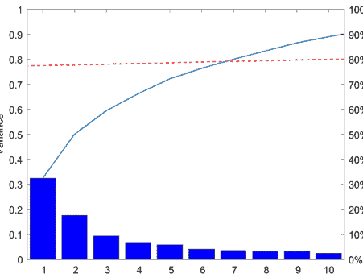

图 2.13 累积百分比方差示例。七个主成分解释了总方差的80.01%。

图2.14显示了原始变量与保留主成分之间转换矩阵的热图。该热图可视化地识别原始IMs变量与主成分之间的关系。图2.15显示了IMs变量的Pearson相关性结果的相关性热图。主导主成分（解释总数据集方差的32.54%）与“流量”和“CNP”模块相关。第二主导主成分（捕获总方差的17.55%）与钙硬度和“TDS”模块相关。第三主成分占数据变异性的9.39%，与“CNP”和“流量”模块相关。第四主成分（占总变异性的6.78%）受“pH”和“杂项”模块影响。其他保留主成分分别占方差的5.94%、4.20%和3.61%。

为了展示所设计PCA模型的质量，图2.16展示了典型变量及其来自PCA模型的预测图。图2.16表明，PCA模型对IMs时间序列提供了相对可接受的预测。然而，对于某些变量，如BOD₅，观察到一些建模不匹配。这种建模不匹配反映在残差中，残差被用作故障检测的指标，并可能影响检测质量。


| | 均值 | 标准差 | 最小值 | 25% 分位数 | 中位数 | 75% 分位数 | 最大值 | 偏度 | 峰度 |
|---|---|---|---|---|---|---|---|---|---|
| InFlow-LS1 | 3021.61 | 535.45 | 2228.00 | 2660.00 | 2851.00 | 3244.00 | 5249.00 | 1.33 | 1.89 |
| InFlow-LS8 | 279.31 | 156.08 | 64.00 | 156.00 | 228.00 | 366.00 | 867.00 | 1.13 | 0.92 |
| InFlow-DP | 47.43 | 95.79 | 0.00 | 9.00 | 10.00 | 36.00 | 749.00 | 3.80 | 18.67 |
| InFlow-Total | 3512.92 | 611.00 | 2558.00 | 3036.00 | 3389.00 | 3853.00 | 5642.00 | 0.86 | 0.34 |
| Temp | 29.31 | 1.59 | 25.99 | 28.10 | 29.20 | 30.60 | 32.50 | 0.27 | -0.85 |
| pH | 7.40 | 0.25 | 6.59 | 7.25 | 7.36 | 7.52 | 8.56 | 0.91 | 3.20 |
| Conductivity | 669.37 | 284.69 | 264.00 | 537.00 | 625.00 | 719.00 | 2466.00 | 3.19 | 15.37 |
| TDS | 459.48 | 209.08 | 174.00 | 363.00 | 429.00 | 492.00 | 1809.00 | 3.37 | 16.69 |
| TSS | 68.66 | 27.29 | 12.00 | 49.00 | 64.00 | 82.00 | 187.00 | 1.14 | 2.10 |
| CaHardness | 72.75 | 30.78 | 20.00 | 52.00 | 72.00 | 94.00 | 176.00 | 0.49 | 0.17 |
| MgHardness | 41.91 | 27.46 | 6.00 | 24.00 | 36.00 | 48.00 | 156.00 | 1.81 | 3.59 |
| TotalAlkalinity | 120.88 | 24.98 | 68.00 | 100.00 | 120.00 | 136.00 | 196.00 | 0.22 | -0.33 |
| BOD5 | 99.03 | 36.95 | 27.00 | 71.00 | 92.00 | 123.00 | 224.00 | 0.58 | 0.10 |
| COD | 152.99 | 61.83 | 42.00 | 102.00 | 157.00 | 189.00 | 329.00 | 0.50 | -0.25 |
| FOG | 54.36 | 53.05 | 2.90 | 14.30 | 37.10 | 77.10 | 351.40 | 1.86 | 5.25 |
| TKN | 17.91 | 6.18 | 2.10 | 13.80 | 17.30 | 21.90 | 37.90 | 0.30 | 0.45 |
| NH3N | 11.84 | 4.10 | 0.94 | 9.30 | 12.00 | 14.50 | 23.60 | -0.06 | 0.47 |
| NO3N | 4.17 | 1.68 | 0.10 | 2.90 | 4.20 | 5.10 | 9.80 | 0.49 | 0.47 |
| PO4P | 8.25 | 2.86 | 1.30 | 6.40 | 8.10 | 10.00 | 23.50 | 1.41 | 6.59 |
| Cl | 126.09 | 75.62 | 45.00 | 91.00 | 107.00 | 137.00 | 654.00 | 4.29 | 23.37 |
| Boron | 1.15 | 0.33 | 0.50 | 0.90 | 1.10 | 1.30 | 2.50 | 1.40 | 2.63 |

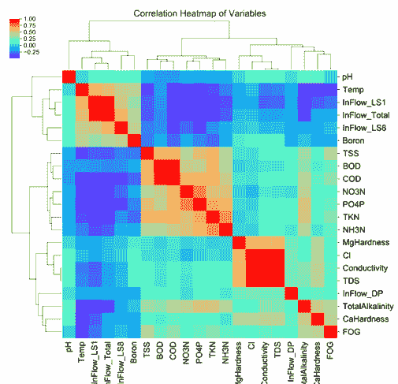

图 2.14 IC 变量的皮尔逊相关系数热图。

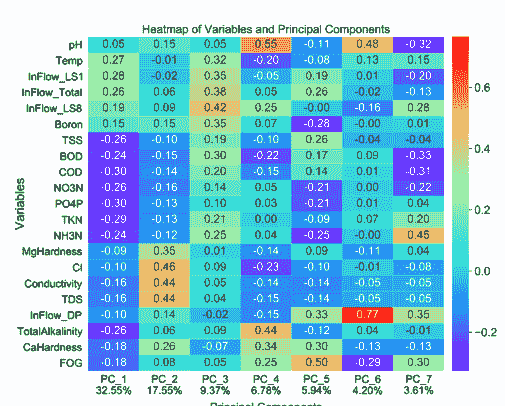

图 2.15 变量与保留主成分热图。

为反映 WWTP 中 IMs 名义行为而设计的 PCA 模型用于故障检测。使用 2011 年 5 月 15 日至 2017 年 9 月 1 日收集的 IM 测试数据来测试基于 PCA 的监测方案。

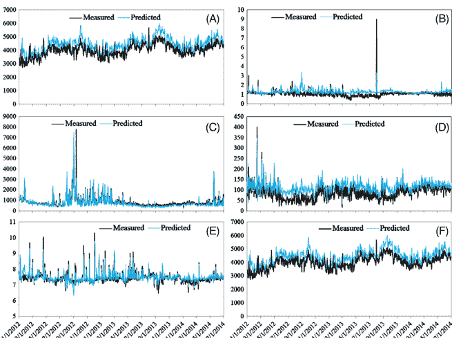

图 2.16 PCA 建模产生的典型变量及其预测的时间序列：(A) 总流入量，(B) 硼，(C) 电导率，(D) BOD5，(E) pH 值，(F) 总碱度。

### KAUST WRRF 中的异常事件类型

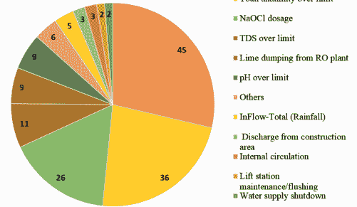

图 2.17 KAUST WWTP 中发生的异常。

在此期间报告了多起异常事件，包括海水入侵和施工区域排放超标及泄漏（图 2.17）。

反映 WWTP 健康行为的设计 PCA 模型将用于异常检测。ICs 中的异常通常由异常事件引起，需要及时监测和检测以提高系统韧性。这里，测试了用于监测 ICs 的基于 PCA 的 SPE、\( T^2 \) 和基于残差的单变量图表的能力。对于每种方案，均采用参数和非参数阈值来改进异常检测。非参数阈值是使用 KDE 技术计算的决策统计量（例如 \( Q \) 和 \( T^2 \)）估计分布的 \((1 - \alpha)\) 分位数。为了定量评估所提方法的检测效率，将使用以下指标：真正率 (TPR)、假正率 (FPR)、准确率和曲线下面积 (AUC) [147]。五种监测方案的检测结果汇总于表 2.4。

| 算法 | TPR | FPR | 精确率 | AUC |
| :--- | :--- | :--- | :--- | :--- |
| PCA-SPE\(^{np}\) | 0.853 | 0.057 | 0.939 | 0.898 |
| PCA-\(T^2_p\) | 0.657 | 0.059 | 0.928 | 0.799 |
| PCA-\(T^2_{np}\) | 0.402 | 0.005 | 0.969 | 0.699 |
| PCA-Residuals\(_{np}\) | 0.765 | 0.533 | 0.480 | 0.616 |
| PCA-SPE\(_p\) | 0.196 | 0.001 | 0.964 | 0.598 |

根据表 2.4 中的检测结果，我们认识到基于 PCA 的残差方案对于监测多变量 IM 数据无效。在这种方法中，每个单一的 PCA 残差均由非参数单变量监测方案单独监测。联合监测方案在至少一个单独方案发出异常信号时宣布存在异常事件。该方法不考虑变量间的相关性，因此导致检测效果较差。

很明显，与相应的高斯分布阈值相比，使用带非参数阈值的基于 PCA 的 SPE 大大增强了检测能力。事实上，SPE 和 \( T^2 \) 方案的决策阈值是基于残差服从高斯分布的假设计算的，这对于 IMs 数据无效（表 2.4）。事实上，带非参数阈值的基于 PCA 的 SPE 方案通过实现高达 0.898 的 AUC 优于其他方法（表 2.4），这表明其能够检测操作员报告的绝大多数异常事件，同时避免发出误报。基于 PCA 的 SPE 方案与参数阈值获得了最低的预测性能，因为 SPE 统计量对模型误差敏感。

根据我们算法的总体结果，难以检测的异常与“供水停止”和“提升泵站维护/冲洗”相关。这是因为它们可能在多个变量中引起多个潜在效应（与其他会导致显著单变量偏移的异常不同），因此不易被捕获。

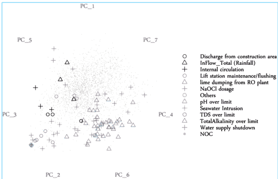

图 2.18 带异常的 IMs 数据集的 RadViz 可视化。

[148] 表明，通过使用 k 近邻 (kNN) 算法将 IMs 数据集中的正常特征与异常特征分开，可以进一步改进基于 PCA 的故障检测。使用 kNN 的动因在于其在量化正常特征与异常特征之间的相似性方面取得的显著成功，因为它能够处理非线性特征，并且不涉及对底层数据分布的假设。

应明确，基于 PCA 的监测方案受所设计模型预测质量的影响。此应用的检测结果表明，构建非线性 PCA 模型可能增强检测能力。

图 2.18 显示了将主成分得分作为锚点的 IMs 数据集 RadViz 可视化。在这里，PCA 的降维优势与通过 RadViz 进行多变量数据可视化的理想特性相结合。此外，来自图 2.15 的主成分组成先验知识为检测到的异常提供了清晰的解释和诊断。无异常的观测值（灰色）散布在中心区域，而来自第二到第六个主成分的众多异常以“V”形方式将其包围。这里使用 RadViz 来协助对检测到的异常进行分析并识别其可能来源。从图 2.15 可以看出，由“施工区域排放”和“TDS 超限”产生的异常接近第二和第三个锚点，与它们作为“TDS”和“流入”块指标的角色完全吻合。此外，我们可以看到来自“降雨”、“内部循环”和“提升泵站冲洗”的观测值接近“流入”和由 FOG 和回流主导的 PC5。由“RO 厂石灰倾倒”、“pH 值超限”、“总碱度超限”和“供水停止”引起的 IM 异常更接近 PC6，PC6 由 pH 值、PC$_2$ 锚点和由 pH 值、碱度及钙硬度主导的 PC$_4$ 主导。

请注意，RadViz 有助于理解和识别异常的来源。

## 2.7 讨论

使用 LVR 方法进行预测、故障检测和诊断对于处理大规模和高维数据是有效的。如本章所述，线性 LVR 模型是一种重要工具，能够很好地从多变量数据中提取相关信息。这些模型与单变量和多变量监测方案相结合，用于检测多变量数据中的异常。然而，这些模型旨在建模线性关系，而在实践中，现代工业和环境过程表现出非线性行为。WWTP 案例研究表明，收集的数据呈非高斯分布且具有非线性。基于线性 PCA 的故障检测方法可实现约 90% 的检测率，可通过使用非线性监测方案加以改进。因此，需要能够描述和捕获多变量过程中非线性的非线性 LVR 方法技术。第 4 章将重点介绍非线性过程监测。

虽然 $Q$ 和 $T^2$ 及其贡献图常用于故障检测和隔离，但它们经常导致故障隔离不正确。事实上，$Q$ 降低了检验统计量的自由度。使用 $Q$ 时，数据中通常会丢失一半到三分之二的诊断信息（冗余）。$Q$ 贡献图方法不具备令人信服的统计基础，实际上有时会给出模糊的诊断。已有许多 lasso 和前向变量选择方法被提出用于故障归因。下一章将回顾这些技术，并介绍一种专为非平稳、时序相关的多变量过程设计的新型融合自适应 lasso 故障归因方法。

## 参考文献

- [1] V. Venkatasubramanian, R. Rengaswamy, K. Yin, S.N. Kavuri, 过程故障检测与诊断综述：第一部分：基于定量模型的方法，Computers & Chemical Engineering 27 (3) (2003) 293–311.
- [2] V. Venkatasubramanian, R. Rengaswamy, S.N. Kavuri, K. Yin, 过程故障检测与诊断综述：第三部分：基于过程历史的方法，Computers & Chemical Engineering 27 (3) (2003) 327–346.
- [3] H. Haimi, M. Mulas, F. Corona, R. Vahala, 生物污水处理厂的数据驱动软传感器：概述，Environmental Modelling & Software 47 (2013) 88–107.
- [4] S. Yin, X. Li, H. Gao, O. Kaynak, 面向现代工业的数据基础技术：概述，IEEE Transactions on Industrial Electronics 62 (1) (2015) 657–667.
- [5] F. Harrou, M. Madakyaru, Y. Sun, S. Khadraoui, 通过多变量内存监测图表改善初始异常检测：空气流加热系统的应用，Applied Thermal Engineering 109 (2016) 65–74.


- [6] I. Nimmo，充分处理异常操作，化学工程进展 91 (9) (1995) 36–45.
- [7] D.J. Hill, B.S. Minsker，流式环境传感器数据中的异常检测：一种数据驱动建模方法，环境建模与软件 25 (9) (2010) 1014–1022.
- [8] A.G. Capodaglio, H.V. Jones, V. Novotny, X. Feng，污泥膨胀及预测：系统辨识与人工神经计算技术的应用，水研究 25 (10) (1991) 1217–1224.
- [9] M. Madakyaru, M.N. Nououn, H.N. Nououn，线性推断建模：理论视角、扩展与比较分析，智能控制与自动化 3 (04) (2012) 376.
- [10] S. Yin, S.X. Ding, X. Xie, H. Luo，工业过程监测基本数据驱动方法综述，IEEE 电子工业学会交易 61 (11) (2014) 6418–6428.
- [11] I. Frank, J. Friedman，某些化学计量回归工具的统计视角，技术计量 35 (2) (1993) 109–148.
- [12] S. Yin, S.X. Ding, A. Haghani, H. Hao, P. Zhang，基准田纳西伊斯特曼过程中的基本数据驱动故障诊断与过程监测方法比较研究，过程控制杂志 22 (9) (2012) 1567–1581.
- [13] F. Harrou, Y. Sun, M. Madakyaru, B. Bouyedou，基于连续排名概率得分的改进多变量图表（采用偏最小二乘法），IEEE 传感器杂志 18 (16) (2018) 6715–6726.
- [14] M. Stone, R.J. Brooks，连续回归：交叉验证的逐次构建预测，涵盖普通最小二乘法、偏最小二乘法和主成分回归，皇家统计学会杂志，B 系列 52 (2) (1990) 237.
- [15] J. Fox，应用回归分析与广义线性模型，赛格出版，2015.
- [16] N.R. Draper, H. Smith，应用回归分析，第 326 卷，John Wiley & Sons，2014.
- [17] A. Hoerl, R. Kennard，基于岭回归的非正交问题估计，技术计量 8 (1970) 27–52.
- [18] A.E. Hoerl, R.W. Kennard，岭回归偏差参数的迭代估计，统计通讯：理论与方法 5 (1) (1976) 77–88.
- [19] A.E. Hoerl, R.W. Kennard, K.F. Baldwin，岭回归：一些模拟，统计通讯：理论与方法 4 (2) (1975) 105–123.
- [20] B.R. Kowalski, M.B. Seasholz，多元校准的最新进展，化学计量学杂志 5 (1991) 129–145.
- [21] J. MacGregor, T. Kourti，多元过程的统计过程控制，控制工程实践 3 (3) (1995).
- [22] S. Qin，统计过程监测：基础与进展，化学计量学杂志 17 (8/9) (2003) 480–502.
- [23] B.M. Wise, N.B. Gallagher，基于过程化学计量学的过程监测与故障检测方法，过程控制杂志 6 (6) (1996) 329–348.
- [24] K. Pearson，LIII. 空间点系最近拟合直线和平面，伦敦、爱丁堡和都柏林哲学杂志与科学期刊 2 (11) (1901) 559–572.
- [25] H. Hotelling，统计变量复合体的主成分分析，教育心理学杂志 24 (6) (1933) 417.
- [26] H. Abdi, L.J. Williams，主成分分析，威利交叉学科评论：计算统计学 2 (4) (2010) 433–459.
- [27] D. Báscos, C. González, D. Mozos，基于矢量量化、PCA 和 JPEG2000 的高光谱图像压缩，遥感 10 (6) (2018) 907.
- [28] A. Subasi, M.I. Gursoy，基于 PCA、ICA、LDA 和支持向量机的 EEG 信号分类，专家系统与应用 37 (12) (2010) 8659–8666.
- [29] F. Harrou, L. Fillaire, M. Bobbia, I. Nikiforov，基于约束广义似然比检验的异常臭氧测量统计检测，收于：第 52 届 IEEE 决策与控制会议，IEEE，2013，pp. 4997–5002.
- [30] P. Ralston, G. DePuy, J.H. Graham，基于计算机的监测与故障诊断：一种化学过程案例研究，ISA 事务 40 (1) (2001) 85–98.
- [31] M. Zhu, A. Ghodsi，基于概率似然的碎石图自动维数选择，计算统计与数据分析 51 (2) (2006) 918–930.
- [32] I. Jolliffe，主成分分析，Springer，2011.
- [33] B. Li, J. Morris, E.B. Martin，偏最小二乘回归的模型选择，化学计量与智能实验室系统 64 (1) (2002) 79–89.
- [34] S. Wold，因子与主成分模型中成分数量的交叉验证估计，技术计量 20 (4) (1978) 397.
- [35] P. Geladi, B.R. Kowalski，偏最小二乘回归：教程，分析化学进展 185 (1986) 1–17.
- [36] A. Phatak, S. De Jong，偏最小二乘法的几何，化学计量学杂志：化学计量学会期刊 11 (4) (1997) 311–338.
- [37] Å. Jansson, J. Röstrop, M. Råhnberg，市政废水中磷的软传感器开发，化学计量学杂志：化学计量学会期刊 16 (8–10) (2002) 542–547.
- [38] P. Geladi, B.R. Kowalski，偏最小二乘回归：教程，分析化学进展 185 (1986) 1–17.
- [39] S.J. Qin，数据驱动工业过程监测与诊断综述，控制年度评论 36 (2) (2012) 220–234.
- [40] Y. Wang, Y. Wei, T. Liu, T. Sun, K.T. Grattan，基于参考气体吸收池和偏最小二乘法的丙烷/丁烷气体混合物 TDLAS 检测，IEEE 传感器杂志 18 (20) (2018) 8587–8596.
- [41] Y. Hiroyuki, Y.B. Hideki, F.C.E.O. Hiromu, F. Hideki，用于多元回归及其在代谢指纹分析中的应用的正则相关分析，生物化学工程杂志 40 (2008) 199–204.
- [42] S. Wold，软建模：基本设计与某些扩展，间接观测下的系统，Elsevier，阿姆斯特丹，1982.
- [43] S.J. Qin, Y. Dong，数据蒸馏、分析与机器学习，收于：2017 CPC/FOCAPO 论文集，2017 年 1 月 8–12 日，亚利桑那州图森，2017.
- [44] L. Sun, S. Ji, S. Yu, J. Ye，正则相关分析与正交化偏最小二乘法的等效性研究，收于：第二十一届人工智能国际联合会议，2009.
- [45] S.J. Qin, Y. Zheng，基于并发隐变量投影的质量相关与过程相关故障监测，AIChE 杂志 59 (2) (2013) 496–504.
- [46] W. Ku, R.H. Storer, C. Georgakis，基于动态主成分分析的干扰检测与隔离，化学计量与智能实验室系统 30 (1) (1995) 179–196.
- [47] F. Tsung，基于动态 PCA 的自动控制过程统计监测与诊断，生产研究国际期刊 38 (3) (2000) 625–637.
- [48] Y. Dong, S.J. Qin，一种用于动态数据建模与过程监测的新型动态 PCA 算法，过程控制杂志 67 (2018) 1–11.
- [49] N.L. Ricker，离散时间脉冲响应模型中参数的有偏最小二乘估计量的使用，工业与工程化学研究 27 (2) (1988) 343–350.
- [50] M.H. Kaspar, W.H. Ray，用于过程控制的动态 PLS 建模，化学工程科学 48 (20) (1993) 3447–3461.
- [51] S. Lakshminarayanan, S.L. Shah, K. Nandakumar，多元过程建模与控制：动态 PLS 方法，AIChE 杂志 43 (9) (1997) 2307–2322.
- [52] Y. Park，网络入侵检测的统计过程控制方法，博士学位论文，乔治亚理工学院，2005.
- [53] M. Frisén，金融、公共卫生及其他领域的最优序列监测，序列分析 28 (3) (2009) 310–337.
- [54] F. Kadri, F. Harrou, S. Chaabane, Y. Sun, C. Tahon，基于季节性 ARMA 的异常检测 SPC 图表：急诊科系统应用，神经计算 173 (2016) 2102–2114.
- [55] W. Shewhart，制造产品的经济质量控制，贝尔系统技术期刊 2 (1930) 364–389.
- [56] D.C. Montgomery，统计质量控制导论，John Wiley & Sons，纽约，2005.
- [57] E. Page，连续检验方案，生物统计 41 (1–2) (1954).
- [58] A. Cinar, A. Palazoglu, F. Kayihan，化学过程性能评价，第 1 版，CRC Press，佛罗里达州博卡拉顿，2007.
- [59] D.C. Montgomery，统计质量控制导论，John Wiley & Sons，2007.
- [60] J.M. Lucas, M.S. Saccucci，指数加权移动平均控制方案：性能与改进，技术计量 32 (1) (1990) 1–12.
- [61] S.W. Roberts，基于几何移动平均的控制图检验，技术计量 1 (3) (1959) 239–250.
- [62] J.S. Hunter，指数加权移动平均，质量技术杂志 18 (4) (1986) 203–210.
- [63] G. Capizzi, G. Masarotto，一种自适应指数加权移动平均控制图，技术计量 45 (3) (2003) 199–207.
- [64] W. Jiang, L. Shu, D.W. Apley，基于 EWMA 的偏移估计器的自适应 CUSUM 程序，IIE 事务 40 (10) (2008) 992–1003.
- [65] R.S. Sparks，用于信号变化位置移动的 CUSUM 图，质量技术杂志 32 (2) (2000) 157–171.
- [66] F. Harrou, L. Fillatre, I. Nikiforov，具有有界干扰参数的线性模型的异常检测/可检测性，控制年度评论 38 (1) (2014) 32–44.
- [67] M. Basseville, I.V. Nikiforov，等，突变检测：理论与应用，第 104 卷，Prentice Hall，埃格尔伍德克利夫斯，1993.
- [68] T.S. Ferguson，数理统计：一种决策论方法，第 1 卷，Academic Press，2014.
- [69] E.L. Lehmann, J.P. Romano，统计假设检验，Springer Science & Business Media，2006.
- [70] T.A. Severini，修正概率似然函数的近似，生物统计 85 (2) (1998) 403–411.
- [71] Y. Pawitan，论似然：使用似然进行统计建模与推断，牛津大学出版社，2001.
- [72] G. Capizzi, G. Masarotto，自相关数据广义似然比控制图的实用设计，技术计量 50 (3) (2008) 357–370.
- [73] L.C. Alwan，自相关对控制图性能的影响，统计通讯：理论与方法 21 (4) (1992) 1025–1049.
- [74] L.C. Alwan, H.V. Roberts，统计过程控制的时间序列建模，商业与经济统计杂志 6 (1) (1988) 87–95.
- [75] D.G. Wardell, H. Moskowitz, R.D. Plante，自相关过程残差控制图的运行长度分布，质量技术杂志 26 (1994) 308–317.
- [76] D. Montgomery, C. Mastrangelo, F.W. Faltin, W.H. Woodall, J.F. MacGregor, T.P. Ryan，自相关数据的一些统计过程控制方法，质量技术杂志 23 (3) (1991).
- [77] G.C. Runger, S.S. Prabhu，多元指数加权移动平均控制图的马尔可夫链模型，美国统计学会杂志 91 (436) (1996) 1701–1706.
- [78] J.N. Dyer, B.M. Adams, M.D. Conerly，用于监测自相关过程的反向移动平均控制图，质量技术杂志 35 (2) (2003) 139–152.
- [79] E.G. Schilling, P.R. Nelson，非正态性对 X̄ 图控制限的影响，质量技术杂志 8 (4) (1976).


- [80] S.A. Yourstone, W.J. Zimmer, 非正态性与均值控制图的设计, 决策科学 23 (5) (1992) 1099–1113.

- [81] P.M. Burrows, X̄ 偏态分布生产变量的控制方案, 皇家统计学会杂志. D系列. 统计学家 12 (4) (1962) 296–312.

- [82] B. Laungrungrong, C.M. Borror, D.C. Montgomery, 多元泊松分布数据的EWMA控制图, 质量工程与技术国际期刊 2 (3) (2011) 185–211.

- [83] B. Laungrungrong, C.M. Borror, D.C. Montgomery, 泊松分布数据的单侧MEWMA控制图, 数据分析技术与策略国际期刊 6 (1) (2014) 15–42.

- [84] C. Çiflikli, 非正态数据的单变量控制图开发, 博士学位论文, 伊兹密尔理工学院, 2006.

- [85] N. Singh, R. Agrawal, 基于Kullback–Leibler散度与曼哈顿距离度量组合的显著目标检测, 信号、图像与视频处理 9 (2) (2015) 427–435.

- [86] A. Karine, A. Toumi, A. Khenchaf, M. El Hassouni, 基于加权统计字典稀疏表示的雷达图像目标识别, IEEE 地球科学与遥感快报 14 (12) (2017) 2403–2407.

- [87] A. Zeroual, F. Harrou, Y. Sun, N. Messai, 基于模型观测者与Kullback–Leibler度量集成的道路交通拥堵估计与检测, IEEE 传感器期刊 18 (20) (2018) 8605–8616.

- [88] D. Olszewski, 基于Kullback–Leibler散度与隐性狄利克雷分配的电信欺诈检测, 载于: 自适应与自然计算算法国际会议, Springer, 2011, 第71–80页.

- [89] F. Harrou, Y. Sun, M. Madakyaru, 基于Kullback–Leibler距离的初期异常增强检测, 过程工业损失预防期刊 44 (2016) 73–87.

- [90] J. Harmouche, C. Delpha, D. Diallo, Y. Le Bihan, 基于Kullback–Leibler散度的无损初期裂纹检测与表征统计方法, IEEE 可靠性汇刊 65 (3) (2016) 1360–1368.

- [91] A.S. Leonard, D.B. Weissman, B. Greenbaum, E. Ghedin, K. Koelle, 基于病原体深度测序数据的传播瓶颈大小估计及其对人流感A病毒的应用, 病毒学期刊 91 (14) (2017) e00171–17.

- [92] L. Aggoune, Y. Chetouani, T. Raïssi, 基于Kullback–Leibler散度的馏分柱过程故障检测, ISA 事务 63 (2016) 394–400.

- [93] J. Zeng, U. Kruger, J. Geluk, X. Wang, L. Xie, 基于Kullback–Leibler散度的异常情况检测, 自动学报 50 (11) (2014) 2777–2786.

- [94] L. Pardo, 基于散度度量的统计推断, Chapman and Hall/CRC, 2005.

- [95] I. Csiszár, P.C. Shields, 等, 信息论与统计: 一教程, 通信与信息理论基础与前沿® 1 (4) (2004) 417–528.

- [96] G. Ditzler, R. Polikar, 基于Hellinger距离的非平稳环境漂移检测, 载于: 2011 IEEE 动态与不确定环境计算智能研讨会 (CIDUE), IEEE, 2011, 第41–48页.

- [97] C. Li, B. Huang, F. Qian, 基于Hellinger距离概率分布方法的非线性控制系统性能监测, 化工学报 23 (12) (2015) 1945–1950.

- [98] M. Basseville, 统计数据处理的散度度量——一份注释参考书目, 信号处理 93 (4) (2013) 621–633.

- [99] D.I.R. González, J.-B. Hayet, 基于渐进SVM分类的RGB-D图像快速人体检测, 载于: 环太平洋图像与视频技术研讨会, Springer, 2013, 第337–348页.

- [100] A.P. Korostelev, A.B. Tsybakov, 图像重构的极小值理论, 第82卷, Springer Science & Business Media, 2012.

- [101] V. González-Castro, R. Alaziz-Rodríguez, E. Alegre, 基于Hellinger距离的类分布估计, 信息科学 218 (2013) 146–164.

- [102] L. Aggoune, Y. Chetouani, H. Radjeai, 基于非线性自回归移动平均外生输入模型与Hellinger距离的馏分柱变化检测, IET 科学、测量与技术 10 (1) (2016) 10–17.

- [103] J. Tajer, A. Makke, O. Salem, A. Mekaoua, 网络异常检测散度度量比较, 载于: 2011年第7届网络与服务管理国际会议, IEEE, 2011, 第1–5页.

- [104] K. Yamanishi, J.-I. Takeuchi, G. Williams, P. Milne, 基于带折扣学习算法的有限混合模型在线无监督异常值检测, 数据挖掘与知识发现 8 (3) (2004) 275–300.

- [105] D. Romano, M. Kinnaert, 基于Kullback散度的鲁棒故障检测与隔离, IFAC 会议录 39 (13) (2006) 426–431.

- [106] J. Havrda, F. Charvat, 分类过程量化方法. 结构α-熵概念, Kybernetika 3 (1967) 30.

- [107] P.N. Rathie, P. Kannappan, β型定向散度函数, 信息与控制 20 (1) (1972) 38–45.

- [108] A.A. Borovkov, 数理统计, Gordon and Breach, 阿姆斯特丹, 1998.

- [109] R.B. Crosier, 累计和质量控制方案的多元推广, 技术计量 30 (3) (1988) 291–303.

- [110] H. Hotelling, 多元质量控制: 以样本炸弹瞄准具空中测试为例, 统计分析技术, 第II章, McGraw-Hill, 纽约, 1947.

- [111] J.J. Pignatiello Jr, G.C. Runger, 多元CUSUM控制图比较, 质量技术期刊 22 (3) (1990) 173–186.

- [112] R.B. Crosier, 一种新的双侧累计和质量控制方案, 技术计量 28 (3) (1986) 187–194.

- [113] D. Hawkins, 基于回归调整变量的多元质量控制, 技术计量 33 (1) (1991) 61–75.

- [114] J. Healy, 关于多元CUSUM程序的说明, 技术计量 29 (4) (1987) 409–412.

- [115] C.A. Lowry, W.H. Woodall, C.W. Champ, S.E. Rigdon, 多元指数加权移动平均控制图, 技术计量 34 (1) (1992) 46–53.

- [116] H.-H. Yang, M.-L. Huang, C.-M. Lai, J.-R. Jin, 风力发电机故障检测数据挖掘与控制图模型结合方法, 可再生能源 115 (2018) 808–816.

- [117] F. Harrou, Y. Sun, B. Taghezouit, A. Saidi, M.-E. Hamlati, 基于统计监测方法的光伏系统可靠故障检测与诊断, 可再生能源 116 (2018) 22–37.

- [118] F. Harrou, F. Kadri, S. Khadraoui, Y. Sun, 基于数据方法的臭氧测量监测, 过程安全与环境保护 100 (2016) 220–231.

- [119] S.E. Rigdon, 多元指数加权移动平均控制图受控平均运行长度积分方程, 统计计算与模拟期刊 52 (4) (1995) 351–365.

- [120] K.M. Bodden, S.E. Rigdon, MEWMA控制图受控ARL近似程序, 质量技术期刊 31 (1) (1999) 120–123.

- [121] S.S. Prabhu, G.C. Runger, 多元EWMA控制图设计, 质量技术期刊 29 (1) (1997) 8–15.

- [122] D.M. Hawkins, S. Choi, S. Lee, 通用多元指数加权移动平均控制图, 质量技术期刊 39 (2) (2007) 118–125.

- [123] D.M. Hawkins, E.M. Maboudou-Tchao, 多元指数加权移动协方差矩阵, 技术计量 50 (2) (2008) 155–166.

- [124] C. Matrix, M.R. Reynolds Jr, G.-Y. Cho, 用于监测均值向量与协方差矩阵的多元控制图, 质量技术期刊 38 (3) (2006) 230–253.

- [125] M.R. Reynolds Jr, Z.G. Stoumbos, 用于监测均值向量与协方差矩阵的多元Shewhart与MEWMA控制图组合, 质量技术期刊 40 (4) (2008) 381–393.


- [126] J. Jackson, G. Mudholkar, 主成分分析残差相关的控制程序, Technometrics 21 (1979) 341–349.
- [127] E. Martin, A. Morris, 过程性能监测图表的非参数置信界, 过程控制期刊 6 (6) (1996) 349–358.
- [128] F. Harrou, F. Kadri, S. Chaabane, C. Tahon, Y. Sun, 用于异常检测的改进主成分分析: 应急科室的应用, 计算机与工业工程 88 (2015) 63–77.
- [129] F. Harrou, Y. Sun, S. Khadraoui, 用于增强过程监测的异常检测指标融合, 过程工业损失预防期刊 40 (2016) 365–377.
- [130] A. Youssef, C. Delpha, D. Diallo, 基于未知分布数据的Kullback–Leibler差异早期故障检测的最优故障检测阈值, 信号处理 120 (2016) 266–279.
- [131] J. Harmouche, C. Delpha, D. Diallo, 基于主成分分析和Kullback–Leibler差异的隐性故障检测与诊断: 第一部分, 信号处理 94 (2014) 278–287.
- [132] F. Harrou, M. Madakyaru, Y. Sun, 基于Hellinger距离度量的改进非线性故障检测策略: 插流式反应器监测, 能源与建筑 143 (2017) 149–161.
- [133] R. Isermann, 故障诊断系统: 从故障检测到容错的介绍, Springer Science & Business Media, 2006.
- [134] J.F. MacGregor, C. Jaeckle, C. Kiparissides, M. Koutoudi, 基于多块PLS方法的过程监测与诊断, AIChE期刊 40 (5) (1994) 826–838.
- [135] P. Miller, R.E. Swanson, C.E. Heckler, 贡献图: 多变量质量控制中缺失的环节, 应用数学与计算机科学 8 (4) (1998) 775–792.
- [136] C.F. Alcala, S.J. Qin, 过程监测故障诊断方法的分析与推广, 过程控制期刊 21 (3) (2011) 322–330.
- [137] J. McGregor, T. Kourti, J. Kestra, 多变量识别: 几种方法的研究, 在: IFAC ADCHEM论文集, 图卢兹, 法国, 第4(2)卷, 1991, 第145–156页.
- [138] T. Kourti, 潜变量方法在工业过程控制和多变量统计过程控制中的应用, 自适应控制与信号处理国际期刊 19 (4) (2005) 213–246.
- [139] S. Narasimhan, R. Mah, 总误差识别的广义似然比方法, AIChE期刊 33 (9) (1987) 1514–1521.
- [140] H.H. Yue, S.J. Qin, 基于综合指数的重构故障识别, 工业与工程化学研究 40 (2) (2001) 4403–4414.
- [141] H. Ji, X. He, J. Shang, D. Zhou, 隐性故障隔离的指数平滑重构方法, 工业与工程化学研究 57 (18) (2018) 6353–6363.
- [142] P. Hoffman, G. Grinstein, D. Pinkney, 维度锚: 用于多维多变量信息可视化的图形基元, 在: 1999年信息可视化与操作新范式研讨会论文集, 该会议与第八届ACM信息与知识管理国际会议联合举办, ACM, 1999, 第9–16页.
- [143] P. Hoffman, G. Grinstein, K. Marx, I. Grosse, E. Stanley, DNA可视与分析数据挖掘, 在: 可视化97论文集 (目录号 97CB36155), IEEE, 1997, 第437–441页.
- [144] J. Sharko, G. Grinstein, K.A. Marx, 矢量化RadViz及其在多簇数据集中的应用, IEEE可视化与计算机图形学期刊 14 (6) (2008) 1444–1451.
- [145] O. Yeniyay, A. Goktas, 偏最小二乘回归与其他预测方法的比较, Hacettepe数学与统计期刊 31 (2002) 99–111.
- [146] P.D. Wentzel, L.V. Monoto, 通过复杂混合物通用模拟比较主成分回归与偏最小二乘回归, 化学计量学与智能实验室系统 65 (2003) 257–279.
- [147] F. Harrou, A. Dairi, B. Taghezouit, Y. Sun, 使用一类支持向量机检测光伏系统异常的无监督监测程序, 太阳能 179 (2019) 48–58.
- [148] T. Cheng, F. Harrou, Y. Sun, T. Leiknes, 使用数据驱动软传感器方法监测水资源回收设施进水测量值, IEEE传感器期刊 19 (1) (2019) 342–352.

# 故障隔离

## 3.1 引言

监测单变量数据不需要故障隔离，因为如果检测到故障，则受影响的唯一变量就是正在监测的变量。然而，在复杂系统或过程中，通常会联合监测多个特征，且多变量故障检测不一定会向用户提供受故障影响的变量子集列表。识别偏移变量是四步流程中的第二步，该流程从故障检测开始，以将系统恢复至受控（IC）状态结束。首先，故障检测用于检测系统中的不规则情况或异常。故障检测方法的性能通常以检测速度来衡量，取决于测量的时间频率，范围可达秒、分钟或小时级。故障隔离用于识别系统中受故障影响的变量。通常，方法正确识别偏移变量的能力仅被松散地评估，但我们将在本章回顾一些常用指标。确定故障原因发生在故障诊断步骤中，这可能需要专家输入，尤其是在新的、研究不足的系统中。最后，过程恢复是将系统恢复到其先前IC状态所需的一系列行动。在某些情况下，需要人工干预，例如进行机械维修，但在其他情况下，对系统控制的调整可以补偿故障。

在本章中，我们重点介绍故障隔离方法，但故障隔离可能出现在多个背景下，这些背景通常由不同的目标或可用数据决定，因此应在初始分析期间澄清背景和目标。例如，故障隔离可以回顾性地进行，回顾一段时间的历史数据，也可以前瞻性地进行，分析实时可用的观测值。这两个目标通常分别称为第 I 阶段和第 II 阶段监测。在故障检测背景下，第 I 阶段方法通常用于测试数据是否无故障，以便无故障数据可用于为第 II 阶段监测建立监测阈值和最优参数设置。类似的区别也可用于故障隔离，但还存在第三种选择，即可以检查带有已知故障的一段历史数据，以确定故障原因，而无需将信息带入第 II 阶段分析。这可能发生在故障被观察到后立即进行，也可以应用于历史数据档案。

就可用数据而言，我们观察到了两种常见设置。第一种设置中，过程可能研究不足，将要发生的故障类型、数量和频率均未知。这是经典的*无监督*设置，其中可用多变量观测值，但观测值未标记为故障或非故障，变量也肯定未标记为偏移或非偏移。或者，可能会监测一个研究非常充分的过程，其中存在大量历史数据，并且已观察到每种可能发生故障类型的多个副本。在这种情况下，观测值被标记为故障或非故障，并且每个故障相关的变量也已知。这是一种*有监督*设置，因此当检测到新故障时，目标是将新故障尽可能接近地分类为现有目录中的某一种故障。

在本章中，我们试图标准化符号和术语。例如，我们将受故障影响的变量称为偏移，但文献中存在许多其他标签，例如故障 [1]、OC [2]、改变 [3]、责任 [4]、异常 [5]、可疑 [6] 和改变 [7]。变量本身可能仅仅反映外部输入的变化，因此故障、OC、责任、可疑和异常等术语暗示故障责任在于这些特定变量，但实际情况可能并非如此。我们更喜欢使用偏移标签，因为它暗示变量以某种方式发生了变化或改变，而不对变量分配任何诊断责任。同样，一些声称执行故障隔离的方法实际上更多地侧重于通过删除不重要的变量来进行故障检测，因此我们在术语使用上非常谨慎，我们使用的词汇可能与原始源材料不一致，但我们的目标是在这篇文本中保持一致。

统计方法和机器学习方法都已应用于故障隔离。在本章中，我们将介绍一些经典的故障隔离方法以及一些更现代的工具。然后，我们将介绍一些用于评估故障隔离方法的常用指标。最后，我们将介绍两个案例研究来说明这些方法在实践中的应用。然而，在深入探讨故障隔离的细节之前，我们首先指出故障隔离中经常被忽视的一些基本问题。

### 3.1.1 标准化数据的陷阱

在执行故障检测与隔离（FD&I）之前标准化变量是必要的，以确保范围或变异性较大的变量不会淹没其他变量。可以采用多种方法来标准化变量。我们设 X 为一个 n × p 维矩阵，行表示 n 个观测值，列表示 p 个变量。我们可以引用 x_i（i = 1, ..., n），即单个观测值的一组 p 维变量，或引用 x_j（j =

1, ..., p，是针对单个变量的 n 维观测集合。标准化可以采用单变量或多变量方式。经典单变量方法简单地为

$$
\frac{\mathbf{x}_j - \hat{\mu}_j}{\hat{\sigma}_j},
$$

其中 $\hat{\mu}_j$ 和 $\hat{\sigma}_j$ 分别为变量 $j$ 的样本均值和标准差，$j = 1, \dots, p$。经典多变量方法为

$$
\hat{\mathbf{\Sigma}}^{-1/2} (\mathbf{X} - \hat{\boldsymbol{\mu}}),
$$

其中 $\hat{\mathbf{\Sigma}}$ 为估计的协方差矩阵，$\hat{\boldsymbol{\mu}}$ 为估计的均值向量。也可以考虑稳健标准化，如文献 [8,9] 所示，这些方法利用均值和协方差的稳健估计。

当变量之间存在相关性时，无论这种关系是线性还是非线性，所采用的标准化方法都会显著改变哪些变量看起来发生了偏移。换句话说，原始数据中的偏移变量在变换后的数据中可能不会保留。两个变量之间的关系越强，故障从一个变量传播到另一个变量的程度就越强。为说明这一点，图 3.1 展示了两组三个变量。第一组变量 $\mathbf{x}_1$、$\mathbf{x}_2$ 和 $\mathbf{x}_3$ 线性相关，它们从均值为 $\boldsymbol{\mu} = (0, 0, 0)'$ 和协方差为

$$
\mathbf{\Sigma} = \begin{bmatrix} 1.00 & 0.15 & -0.30 \\ 0.15 & 1.00 & 0.85 \\ -0.30 & 0.85 & 1.00 \end{bmatrix} . \quad (3.1)
$$

第二组变量非线性相关，受以下方程组控制，如文献 [10] 所示：

$$
\mathbf{y}_1 = \mathbf{s} + \mathbf{e}_1, \quad \mathbf{y}_2 = \mathbf{s}^2 - 3\mathbf{s} + \mathbf{e}_2, \quad \mathbf{y}_3 = -\mathbf{s}^3 + 3\mathbf{s}^2 + \mathbf{e}_3, \quad (3.2)
$$

其中噪声项为 $\mathbf{e}_1, \mathbf{e}_2, \mathbf{e}_3 \sim N(\mathbf{0}, 0.01 \times \mathbf{I})$，$\mathbf{I}$ 为 $3 \times 3$ 单位矩阵，底层潜在因子为 $\mathbf{s} \sim \text{Unif}(0.01, 2)$。

图 3.2 和 3.3 中的垂直虚线处引入了故障。对于线性相关的变量，图 3.2 显示第一个变量存在强漂移故障，而在应用了多变量标准化的第二列中，$\mathbf{x}_2$ 和 $\mathbf{x}_3$ 两者也表现出轻微漂移。第一个变量与第三个变量的相关性最强，因此在 $\mathbf{x}_3$ 中观察到的漂移比在 $\mathbf{x}_2$ 中更强。然而，对于单变量标准化，不存在这种对 $\mathbf{x}_2$ 和 $\mathbf{x}_3$ 的污染。同样，图 3.3 显示非线性相关变量集中第二个变量出现急剧下移。在多变量-

#### 线性相关变量

#### 非线性相关变量

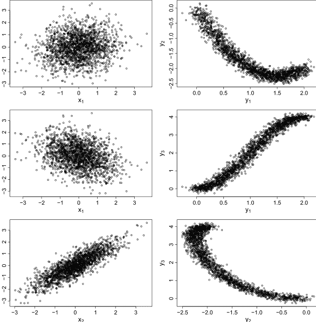

图 3.1 线性（左）和非线性（右）相关变量集的成对散点图，均来自一个 IC 过程。左侧，变量 x1、x2 和 x3 从多元正态分布中模拟得出；右侧，使用一组非线方程生成 y1、y2 和 y3。

事实上，对于多变量标准化，当使用特征向量-特征值分解计算唯一的对称平方根时，会使 $\hat{\Sigma}^{-1/2}$ 变稠密，因此原始数据中仅影响一个变量的故障会导致所有变量的均值发生偏移。如果使用 Cholesky 分解，影响变量 $k$ 的故障会导致变量 $k, k+1, ..., p$ 的均值发生偏移。无论哪种方式，除非故障仅发生在变量 $p$ 中，并且使用 Cholesky 分解来获取 $\hat{\Sigma}^{-1/2}$，否则故障不会在原始变量中保留。

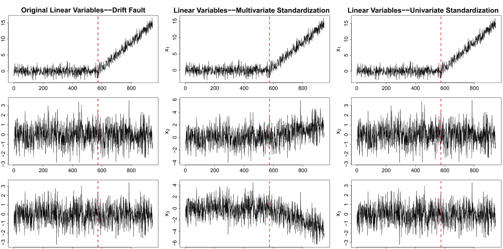

图 3.2 线性相关变量，在垂直虚线处引入 x1 的漂移故障（左）。中间和右侧列分别显示经过多变量和单变量标准化后的相同变量。

#### 原始非线性变量--偏移故障

#### 非线性变量---多变量标准化

#### 非线性变量--单变量标准化

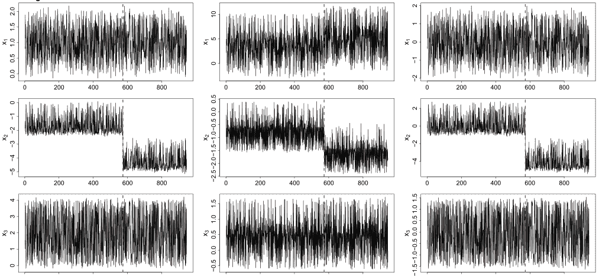

图 3.3 非线性相关变量，在垂直虚线处引入 y2 的偏移故障（左）。中间和右侧列分别显示经过多变量和单变量标准化后的相同变量。

### 3.1.2 贡献图/分数的不足

隔离与故障相关的变量的一种非常常见的初步方法是使用贡献分数或图，以量化每个变量对监测统计量的贡献 [11,12]。然后，贡献最大的变量被视为发生了偏移。在特征数量较少且只有一个变量发生偏移的情况下，这种方法实施和解释起来很简单，但出于多种原因不宜采用。首先，贡献分数会受到变量涂抹效应的影响。当变量 i 发生偏移时，其偏移会污染所有其他变量的贡献分数。其次，即使在 IC 条件下，所有变量的贡献也不相等，因此在 IC 条件下贡献较小的变量在 OC 条件下仍然没有最大贡献时，可能会出现误诊。

我们将使用改编自 [13] 的符号，展示 Q 统计量的变量涂抹效应。首先，X 的协方差通过 S = (1/(n-1))X'X 估计。然后，主成分分析 (PCA) 将 S 分解如下：

$$ \mathbf{S} = \mathbf{P}\mathbf{\Lambda}\mathbf{P}' + \tilde{\mathbf{P}}\tilde{\mathbf{\Lambda}}\tilde{\mathbf{P}}' = \hat{\mathbf{S}} + \tilde{\mathbf{S}}, $$

其中 \(\hat{\mathbf{S}} = \mathbf{P}\mathbf{\Lambda}\mathbf{P}'\)；\(\tilde{\mathbf{S}} = \tilde{\mathbf{P}}\tilde{\mathbf{\Lambda}}\tilde{\mathbf{P}}'\)；**P** 是大小为 \(p \times l\) 的特征向量矩阵，称为主载荷；\(\tilde{\mathbf{P}}\) 是大小为 \(p \times (p-l)\) 的特征向量矩阵，称为残差载荷；\(l\) 是保留的主成分 (PC) 数量，用于解释 **S** 的变异性；\(\mathbf{\Lambda}\) 和 \(\tilde{\mathbf{\Lambda}}\) 分别是包含主特征值和残差特征值的对角矩阵。单个测量值 \(\mathbf{x}_i\) 可以改写为 \(\mathbf{x}_i = \hat{\mathbf{x}}_i + \tilde{\mathbf{x}}_i = \mathbf{PP}'\mathbf{x}_i + \tilde{\mathbf{P}}\tilde{\mathbf{P}}'\mathbf{x}_i = \mathbf{Cx}_i + \tilde{\mathbf{C}}\mathbf{x}_i\)，其中 \(\mathbf{C} = \mathbf{PP}'\) 是投影到主成分子空间 (PCS) 的投影矩阵，\(\tilde{\mathbf{C}} = \tilde{\mathbf{P}}\tilde{\mathbf{P}}'\) 是投影到残差子空间 (RS) 的投影矩阵。

Q 统计量（也常被称为平方预测误差 (SPE)）通过残差向量 \(\tilde{\mathbf{x}}_i\) 的平方范数来衡量低维模型（即 \(l < p\)）的拟合优度，计算如下

$$ Q = \|\tilde{\mathbf{x}}_i\|^2 = \mathbf{x}'_i\tilde{\mathbf{C}}\tilde{\mathbf{C}}\mathbf{x}_i = \mathbf{x}'_i\tilde{\mathbf{C}}\mathbf{x}_i = \|\tilde{\mathbf{C}}^{1/2}\mathbf{x}_i\|^2. $$

变量对 Q 统计量的贡献称为该变量的 *贡献分数*，贡献分数最大的变量被认为最有可能发生偏移。Q 统计量的贡献分数为

$$ c_j^Q = \left( \mathbf{d}'_j \tilde{\mathbf{C}} \mathbf{x}_i \right)^2 , $$

其中 \(\mathbf{d}_j\) 是一个长度为 \(p\) 的向量，除了第 \(j\) 行有一个 1 之外其余均为 0，称为方向向量。

现在，考虑变量 \(j\) 发生偏移，导致故障测量值为 \(\mathbf{x}_i = \mathbf{x}^*_i + \mathbf{d}_j\delta\)，其中 \(\mathbf{x}^*_i\) 是测量值的无故障部分，而 $\mathbf{d}_j\delta$ is


故障的标量幅值。然后，当变量 \(j\) 存在故障时，第 \(i\) 次观测中变量 \(k\) 对 \(Q\) 统计量的贡献如下：

```
\(\begin{aligned} c_k^Q &= \left(\mathbf{d}'_k \tilde{\mathbf{C}}\mathbf{x}_i\right)^2 = \left[\mathbf{d}'_k \tilde{\mathbf{C}}(\mathbf{x}^*_i + \mathbf{d}_j\delta)\right]^2 \\ &= \left[\mathbf{d}'_k \tilde{\mathbf{C}}\mathbf{x}^*_i + \mathbf{d}'_k \tilde{\mathbf{C}}\mathbf{d}_j\delta\right]^2 = \left[\mathbf{d}'_k \tilde{\mathbf{C}}\mathbf{x}^*_i + \tilde{c}_{kj}\delta\right]^2, \end{aligned}\)
```

等式右侧括号中的第一项取决于观测本身以及变量 \(k\) 对得分的贡献，但第二项包含了 \(\tilde{c}_{kj}\)，即 \(\tilde{\mathbf{C}}\) 的第 \((k, j)\) 个元素。当 \(j \neq k\) 时，\(\tilde{c}_{kj}\) 不为零，因此，第 \(j\) 个变量的效应被 *涂抹* 到了变量 \(k\) 的贡献中。

例如，从 (3.1) 中取协方差矩阵并进行特征值-特征向量分解，得到

```
\(\tilde{\mathbf{C}} = \begin{bmatrix} 0.10 & -0.21 & 0.22 \\ -0.21 & 0.43 & -0.45 \\ 0.22 & -0.45 & 0.47 \end{bmatrix} .\)
```

因此，如果希望得到变量 3 的贡献得分，但变量 1 存在故障，则 \(\tilde{c}_{31} = 0.22\)，这将虚高变量 3 的贡献得分。

存在一些旨在减少涂抹效应的提议，例如 [13,14] 分别用于 PCA 和核 PCA (KPCA) 的基于重构的贡献（RBC）得分。例如，PCA 中变量 \(k\) 对 \(Q\) 的 RBC 定义为

```
\(c_k^{Q^\text{RBC}} = \frac{\left(\mathbf{d}'_k \tilde{\mathbf{C}}\mathbf{x}_i\right)^2}{\tilde{c}_{kk}} = \frac{c_k^Q}{\tilde{c}_{kk}},\)
```

其中 \(\tilde{c}_{kk}\) 是 \(\tilde{\mathbf{C}}\) 的第 \(k\) 个对角线元素。RBC 仅通过用 \(\tilde{c}_{kk}\) 缩放贡献得分而有所不同，并且仍然明显表现出涂抹效应。问题在于，对于变量 \(j\) 的故障，贡献得分 \(c_j^Q\) 和 \(c_j^{Q^\text{RBC}}\) 哪个会最大。Alcala 和 Qin [13] 证明，对于变量 \(j\) 的故障，\(c_j^{Q^\text{RBC}}\) 是最大的 RBC，但 \(c_j^Q\) 不具备此属性。即使在单传感器故障的情况下，也不能保证通过 \(c_j^Q\) 正确隔离变量。此外，[13] 的作者在仿真中表明，综合指数统计量 \(\phi\)（即 \(T^2\) 和 \(Q\) 的加权线性组合）与 \(c_j^{Q^\text{RBC}}\) 结合使用，比单独使用 \(T^2\) 或 \(Q\) 能产生更准确的故障隔离。

虽然我们定义 \(\mathbf{d}_j\) 为第 \(j\) 个元素为 1、其余为 0 的向量，但它也可以是一个矩阵，每列都有一个 1、其余为 0，代表多个变量同时偏移的多维故障。

因此，$\delta$ 可以是一个向量，其中每个条目对应相应方向列中的故障幅值。因此，计算 RBC 需要 *先验* 信息，即关于可能偏移变量的特定组合。

一次只测试单一故障方向并不会带来这个问题（例如单传感器故障），但复杂故障通常会同时影响多个变量。因此，RBC 的一个缺点是，评估变量贡献需要知道故障方向。

尽管存在此缺点，RBC 保证对于单变量故障，故障变量具有最大得分，并且是简单故障隔离的快速方法。

Yan 和 Yao [15] 的论文通过引入变量选择改进了基于重构的贡献图。

## 3.2 故障隔离

在本节中，我们将首先讨论使用变量选择作为改进故障检测工具的前提。然后，我们回顾一些用于故障隔离的传统和经典方法。第 3.2.3 节介绍了使用各种惩罚回归技术的更现代方法。将展示 Phase I 和 Phase II 方法的示例。

### 3.2.1 变量精简

在某些场景中，所谓的变量隔离主要关注 *变量精简*。也就是说，监测变量越多，检测故障就越具挑战性。通常，只有被监测变量的一个小子集实际发生偏移，因此加入额外的噪声特征会降低方法检测故障的能力。因此，为了提高故障检测能力，采用变量精简来移除那些不太可能发生变化的变量 [2,6,16–24]。这些工作中的许多不仅执行变量精简，还隔离受故障影响的变量，估计每个变量偏移的方向和幅值。然而，这些方法的变量隔离能力通常不进行评估，而是关注减少监测变量数量所带来的故障检测改进。

类似于 [2] 中的仿真研究，我们说明包含额外未偏移变量对检测故障的影响。首先，我们从均值为零且方差-协方差矩阵为单位矩阵的多元正态分布中模拟 \(p\) 个变量的 \(n=150\) 个观测。在第 101 个观测处引入一个 1 个单位的下降故障，并持续到序列结束。$T^2$ 监测统计量在假设均值和方差-协方差矩阵已知的情况下计算。我们记录 (i) 是否检测到故障，以及 (ii) 50 个中被标记的失控（OC）观测数量。当 p 从 1 变化到 12 时，此过程重复 200 次仿真。表 3.1 所示的结果表明，随着变量数量增加，检测概率从超过 0.90 迅速下降到低于 0.30。此外，检测强度（按模拟数据集中平均被标记的观测数量衡量）也随着 p 的增加而急剧下降。这说明，即使监测变量数量很少，弱故障也几乎不可能被检测到。

表 3.1 随 p 变化，200 次仿真中的检测概率和平均被标记观测数。第一个变量包含大小为 1 的下移偏移。

| p | 检测概率 | 平均标记数 | p | 检测概率 | 平均标记数 |
|---|---|---|---|---|---|
| 1 | 0.930 | 2.580 | 7 | 0.455 | 0.615 |
| 2 | 0.865 | 1.825 | 8 | 0.385 | 0.460 |
| 3 | 0.725 | 1.295 | 9 | 0.360 | 0.450 |
| 4 | 0.620 | 0.990 | 10 | 0.315 | 0.380 |
| 5 | 0.575 | 0.840 | 11 | 0.290 | 0.365 |
| 6 | 0.500 | 0.660 | 12 | 0.280 | 0.330 |

### 3.2.2 迭代传统隔离

最早的一些故障隔离方法是，在控制图发出故障信号后应用单独的程序。这些程序需要对 \(T^2\) 统计量进行分解，或采用类似的逐步程序。此处回顾了几种常用方法 [25]。几乎所有这些方法首先都要求故障检测方法已发出失控信号。特别是，所提出的前两种方法假设 \(\mathbf{x}_i \sim N_p(\boldsymbol{\mu}, \boldsymbol{\Sigma})\)，而 \(T^2\) 统计量自然为 \(T^2 = (\mathbf{x}_i - \bar{\mathbf{x}})'\mathbf{S}^{-1}(\mathbf{x}_i - \bar{\mathbf{x}})\)。当 \(\mathbf{x}_i\) 与 \(\bar{\mathbf{x}}\) 和 **S** 独立时，\(T^2\) 的分布为

```
\(\frac{n(n-p)}{p(n+1)(n-1)}T^2 \sim F_{p,n-p}.\)
```

上控制限（UCL）使用 \(F_{p,n-p}\) 分布的上 \(\alpha\) 分位数。

#### 3.2.2.1 Mason-Young-Tracy方法

Mason-Young-Tracy 方法 (MYT) 是一种广泛使用的方法，它将 \(T^2\) 统计量分解为正交分量，这些分量代表每个单独变量对整体 \(T^2\) 的贡献 [26,27]。对于 \(p\) 个变量，\(T^2\) 可以改写为：

```
\(T^2 = T_1^2 + T_{2,1}^2 + T_{3,1,2}^2 + \cdots + T_{p,1,2,\dots,p-1}^2.\) (3.3.)
```


Eq. (3.3) 中的第一项是

\(T_1^2 = \left( \frac{x_{i,1} - \bar{x}_1}{s_1} \right)^2, \quad (3.4)\)

其中，\(x_{i,1}\) 是观测向量 \(\mathbf{x}_i\) 中的第一个变量，\(\bar{x}_1\) 和 \(s_1\) 分别是第一个变量的均值和标准差。那么，附加项可以一般表示为

\(T_{j, 1, \dots, j-1}^2 = \left( \frac{x_{i, j} - \bar{x}_{j, 1, \dots, j-1}}{s_{j, 1, \dots, j-1}} \right)^2, \quad (3.5)\)

其中

\(\bar{x}_{j, 1, \dots, j-1} = \bar{x}_j + \mathbf{b}'_j \left( \mathbf{x}_i^{(j-1)} - \bar{\mathbf{x}}^{(j-1)} \right),\)

其中，\(\bar{x}\) 是第 \(j\) 个变量 \(n\) 个观测值的样本均值，\(\mathbf{b}_j\) 是一个 \((j-1)\) 维向量，用于估计第 \(j\) 个变量对前 \(j-1\) 个变量的回归系数。此外，\(\mathbf{x}_i^{(j-1)}\) 是一个排除了第 \(j, \dots, p\) 个变量的 \((j-1)\) 维向量，\(\bar{\mathbf{x}}^{(j-1)}\) 是前 \(j-1\) 个变量 \(n\) 个观测值的样本均值。

由于 \(p\) 个变量的顺序不是唯一的，Eq. (3.3) 中变量存在 \(p!\) 种可能的排列，每种排列都有其独特的划分。因此，当 \(p\) 变大时，需要检查的划分数量会变得非常巨大。Mason et al. [26] 确实指出，最感兴趣的术语往往是单个变量的未调整贡献项，以及在调整其他 \(p-1\) 个变量后包含某个变量调整贡献的项。

当一个观测值的 \(T^2\) 值超过 UCL 时，可以按照以下步骤隔离偏移变量，如 [25] 所述：

- 1. 对每个变量计算单独的 \(T_j^2\) 统计量，如 Eq. (3.4) 所示。
  - a. 将 \(T_j^2\) 超过 UCL 的变量分类为偏移变量。
  - b. 从观测值中移除偏移变量。
  - c. 使用 \(k \le p\) 重新计算 \(T^2\) 并进行显著性检验。如果仍然显著，则进入下一步。

- 2. 对剩余的 \(k\) 个变量计算所有 \(T_{j, j'}^2\) 项，如 Eq. (3.5) 所示。
  - a. 如果 \(T_{j, j'}^2\) 较高，则表明变量 \(j\) 和 \(j'\) 之间的成对关系不寻常。
  - b. 移除具有显著 \(T_{j, j'}^2\) 的变量对，剩下 \(k'\) 个变量。
  - c. 使用 \(k' \le k\) 重新计算 \(T^2\) 并进行显著性检验。如果仍然显著，则进入下一步。

- 3. 对更高阶项重复上一步，从三阶项开始，直到缩减集中不再留下变量，或基于缩减变量集的 \(T^2\) 不再显著。

在无偏移的原假设下，部分项 \( T^2_{j.1,...,j-1} \) 的 UCL 基于以下分布：

\( T^2_{j.1,...,j-1} \sim \frac{n+1}{n} F_{1,n-1} \)。

#### 3.2.2.2 Murphy 方法

Murphy [28] 提出了判别分析法来识别偏移变量。一旦通过 \( T^2 \) 检测到故障，可以采取以下步骤：

- 1. 计算单独的图表统计量 \( T^2_j(x_{i,j}) \)，其中 \( j = 1, \dots, p \),

  \[
  T^2_j(x_{i,j}) = \frac{(x_{i,j} - \bar{x}_j)^2}{s^2_j}.
  \]

  - a. 计算总体 \( T^2 \) 与每个单独统计量之间的差值，\( D_1(j) = [T^2 - T^2_j(x_{i,j})] \)。
  - b. 选择最小的差值，\( \min_j D_1(j) = D_1(r) \)。然后，第 \( r \) 个变量对总体 \( T^2 \) 的贡献最大。如果 \( D_1(r) \) 显著，则将变量 \( r \) 分类为偏移变量并进入下一步。

- 2. 对除第 \( r \) 个变量外的所有 \( j \) 个变量计算成对图表统计量 \( T^2_2(x_{i,r}, x_{i,j}) \)。
  - a. 对除第 \( r \) 个变量外的所有 \( j \) 个变量计算 \( p-1 \) 个差值 \( D_2(r, j) = [T^2 - T^2_2(x_{i,r}, x_{i,j})] \)。
  - b. 选择最小的差值，\( \min_j D_2(r, j) = D_2(r, s) \)，并检验其是否显著。如果显著，则也将变量 \( s \) 分类为偏移变量。

- 3. 继续，直到 \( T^2 \) 没有任何变量的差值显著，或者所有变量的差值都显著（在这种情况下，所有变量都将被分类为偏移变量）。

每个步骤的显著性阈值取决于缩减子集中使用的变量数量以及 \( \boldsymbol{\mu} \) 和 \( \Sigma \) 是被估计还是已知。在参数已知的情况下，差值统计量 \( D_k(\cdot) \) 与 \( \chi^2_{\alpha, k+1} \) 进行比较；否则，需要一个缩放的 \( F \)-分布。

#### 3.2.2.3 人工神经网络方法

已有多项提议将人工神经网络 (ANN) 引入变量隔离 [29–31]。有些类似于前面的方法，需要在启动故障隔离之前先使用故障检测方法检测故障。在某些情况下，仅隔离已发生偏移的变量；而在其他情况下，目标既是隔离偏移变量，又是估计偏移的大小和方向。Psarakis [32] 对 ANN 在过程监控中故障检测的应用进行了简要综述，并回顾了几项用于故障隔离的 ANN 提议。

与所有 ANN 一样，构建此类模型的配置有许多可能性，即训练数据的大小、层数、每层中的节点数以及激活函数的类型。因此，ANN 需要大量的计算资源来测试许多模型变体。Bersimis et al. [25] 发现，ANN 在变量隔离中的性能变化很大，取决于变量之间存在的相关性的强度和类型。

#### 3.2.2.4 讨论

这些传统隔离技术有一些缺点。例如，当 \( p\) 较大时，对监控变量的所有可能子集重新计算监控统计量可能在计算上变得不可行。此外，将 MEWMA 或 MCUSUM 图表触发的警报与特定变量关联起来仍然很困难。尽管如此，这些方法在实际问题中仍然被证明是有用的 [33]。Bersimis et al. [25] 对其中许多方法进行了概述，并在多种模拟数据上对它们进行了广泛的比较模拟研究。然而，这项研究仍然存在几个应激励进一步研究的不足之处：(i) 该研究仅模拟了 \( p = 3 \) 或 5 个变量；(ii) 报告的唯一感兴趣指标是该方法是否检测到了至少一个偏移变量（这并未揭示所有偏移变量是否被隔离，或是否也标记了未偏移的变量）；以及 (iii) 在大多数设置中，识别至少一个偏移变量的总体百分比仍然相对较低。

### 3.2.3 变量选择方法

一些较新的著作提出了同时进行故障检测和隔离的方法，将 FD&I 问题构建为多元线性回归模型，然后使用带惩罚的回归变量选择方法 [2,6,16]。为简要回顾带惩罚的回归，多元线性回归模型采用以下形式：

\[
y_i = \mathbf{x}_i \boldsymbol{\beta} + \epsilon_i, \quad i = 1, \dots, n,
\]

其中，\( y_i, \mathbf{x}_i, \boldsymbol{\beta} \) 和 \( \epsilon_i \) 分别是响应变量、预测变量向量、系数向量以及服从分布 \( N(0, \sigma^2) \) 的 iid 随机误差。为同时进行变量选择和参数估计，需对 \( \boldsymbol{\beta} \) 最小化以下带惩罚的最小二乘目标函数：

\[
\sum_{i=1}^n (y_i - \mathbf{x}_i \boldsymbol{\beta})^2 + \sum_{j=1}^p g_{\gamma_j} \left( \left| \beta_j \right| \right), \quad \text{(3.6)}
\]

其中，\( \beta_j \) 是 \( \boldsymbol{\beta} \) 的第 \( j \) 个系数，\( \gamma_j \) 是正则化参数，\( g_{\gamma_j} (\cdot) \) 是惩罚函数。对于 \( q \le 1 \) 的 \( L_q \) 惩罚函数，通过将估计系数较小的预测变量的 \( \beta_j \) 设为零，自动完成变量选择。


通常为 \( g_{\gamma_j}(\cdot) \) 选用的选项包括

- \( L_0 \) 惩罚。\( L_0 \) 惩罚是 \( g_{\gamma_j}(\cdot) = \gamma \cdot I(|\beta_j| \neq 0) \)，使得 Eq. (3.6) 中的第二项等于 \( \gamma \sum_{j=1}^p I(\beta_j \neq 0) \)。该惩罚将可进入模型的预测器数量限制在小于预设数值 \( s \) 以内。

- \( L_1 \) 惩罚。\( L_1 \) 惩罚是 \( g_{\gamma_j}(\cdot) = \gamma \cdot |\beta_j| \)，使得 Eq. (3.6) 中的第二项等于 \( \gamma \sum_{j=1}^p |\beta_j| \)。这对应于 [34] 提出的最小绝对收缩与选择算子（lasso）。当 \( \gamma \rightarrow 0 \) 时，估计器收敛到 \( \boldsymbol{\beta} \) 的最小二乘估计器。

- 加权 \( L_1 \) 惩罚。该惩罚使用系数的初始估计对系数进行加权，如下所示：
  \( g_{\gamma_j}(\cdot) = \gamma \frac{|\tilde{\beta}_j|}{|\tilde{\beta}_j|^\alpha}, \)

  其中 \( \tilde{\beta}_j \) 是 \( \beta_j \) 的初始估计，可以是最小二乘估计，且 \( \alpha > 0 \) 是预设常数。通常建议设置 \( \alpha = 1 \) [35, 36]。这种加权惩罚对应于所谓的 *自适应 lasso*，该权重允许对不同预测器应用不同的收缩，使得系数本身已很小的预测器更快地被驱向零。自适应 lasso 产生渐近无偏的系数估计并具有神谕性质（oracle properties），即它能识别正确的变量子集并具有最优的估计速率 [35,37]。

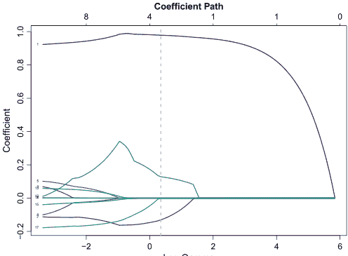

**图 3.4** 随 \( \gamma \) 增加，线性模型中系数的值。

[38] 对 lasso 及其扩展进行了出色的概述，图 3.4 展示了 \( \gamma \) 变化时的系数路径，以说明 \( \gamma \) 对系数的影响。选择 \( \gamma \) 可以通过交叉验证进行。在图 3.4 中，虚线垂线显示了 \( \gamma_{se} \)，即使得平方误差在最小值一个标准误差范围内的最大 \( \gamma \) 值。此时，在最初拟合中包含的 17 个预测器中，模型中保留了三个预测器。

为采用变量选择技术进行故障隔离，多元线性回归模型被重新构建，以监控均值向量并筛选出均值未变的变量。此处介绍的几种惩罚变体也已被采用，若干具体方法将在接下来的小节中介绍。

#### 3.2.3.1 相位 I 变量选择

相位 I 分析的主要目标之一是检验一组观测值是否合理地预期来自于受控（IC）过程。因此，相位 I 分析中使用的数据可能同时受到多个故障的污染。次要目标可能是回顾性分析已发生的故障或多个故障，以便操作员开始诊断它们。本节将介绍每种分析类型的示例。

示例方法 1，mphase1。Capizzi 和 Masarotto [8] 开发了一种分布无关的回顾性变点检测方法，旨在在给定时间段内检测多个变点，称为 mphase1。他们的方法旨在首先检验所考虑的时间段是否处于受控（IC）状态；如果不是，则可以识别出漂移变量，以及它们的漂移大小和方向。他们的方法假设在过程处于受控状态时观测值是独立同分布（iid）的。它还允许分组数据，即在单个时间点存在多个过程实现。这使用户除了检测阶梯漂移外，还能在单个孤立时间点检测异常观测值。为简单起见，在描述该方法时，我们忽略了分组观测值的潜在存在。

一个名为 dfphase1 的用户友好型 R 包包含实现 mphase1 的代码 [8]。不假设存在来自受控（IC）时期的数据。执行以下步骤：

- 1. 标准化。数据被标准化并使用中心和离散度的稳健估计转换为多元符号秩。对于位置估计 \( \ell \)，对子组均值应用变换-再变换空间中位数 [39]。对于离散度，构建一个稳健散射矩阵 \( \mathbf{S}_r \)，如下所示：

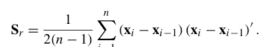

然后，他们使用 \( \ell \) 和 \( \mathbf{S}_r \) 标准化数据，\( \mathbf{z}_i = \mathbf{S}_r^{-1/2} (\mathbf{x}_i - \ell) \)，并按如下方式计算多元符号秩 \( \mathbf{u}_i \)：

\(\mathbf{u}_i = \begin{cases} \mathbf{0}, & \text{if } \mathbf{z}_i = \mathbf{0}, \\ F_{\chi_p^2}^{-1} \left( \frac{g_i}{1+n} \right) \frac{\mathbf{z}_i}{\|\mathbf{z}_i\|}, & \text{if } \mathbf{z}_i \neq \mathbf{0}, \end{cases}\)

其中 \( \|\mathbf{v}\| = \sqrt{\mathbf{v}'\mathbf{v}} \) 是 \( \mathbf{v} \) 的欧几里得范数；\( g_i \) 是 \( \{\|\mathbf{z}_1\|, \dots, \|\mathbf{z}_n\|\} \) 的秩；\( F_{\chi_p^2}^{-1}(\cdot) \) 是具有 \( p \) 个自由度的 \( \chi^2 \) 随机变量的分位数函数。分组数据的版本见 [8,40]。

- 2. 筛选。接下来，使用前向选择的初步筛选过程识别出故障最可能发生的 \( K \) 个位置，其中 \( K \) 由用户选择，或取 50 与最接近 \( \sqrt{n} \) 的整数中的较小值。对于前向选择过程的第 \( k \) 次迭代，\( k=1, 2, \dots, K \)，将时间步 \( i=2, \dots, n-1 \) 的额外漂移添加到模型中。选择该时间步，使其在条件于先前识别的 \( k-1 \) 个漂移的情况下具有最小残差平方和，即 \( \sum_{i=1}^n ||\mathbf{u}_i - \hat{\mathbf{u}}_i^{(k)}||^2 \)，其中 \( \hat{\mathbf{u}}_i^{(k)} \) 来自在每个时间点可能具有不同均值向量的模型拟合。不考虑与已存在的 \( k-1 \) 个漂移在 \( l_{\min} \) 个时间步以内的漂移。每个步骤后，解释方差计算如下：

\(T_k = \sum_{i=1}^n ||\hat{\mathbf{u}}_i^{(k)}||^2 - n||\bar{\mathbf{u}}||^2,\)

其中 \( \bar{\mathbf{u}} \) 是符号秩的总体均值。

- 3. 检验。然后，将检验统计量 \( T_k, k=1, \dots, K \) 聚合为单个检验统计量，如下所示：

\(W_{\text{OBS}} = \max_{k=1, \dots, K} \frac{T_k - \text{E}_0(T_k)}{\sqrt{\text{Var}_0(T_k)}}.\)

\( T_k \) 的期望值和方差分别用 \( T_k \) 的样本均值和样本方差估计。通过置换独立同分布（iid）观测值计算基于置换的 \( p \) 值，以检验过程不显示任何阶梯或孤立漂移且位置稳定的原假设。

- 4. 信号后诊断。如果原假设被拒绝，则通过自适应 lasso 进行故障隔离，以进一步剪枝前向选择筛选过程中得到的估计系数，这些系数用作初始估计 [35]。自适应 lasso 将一些较小的漂移驱向零。特定模型拟合如下：\( \mathbf{u}_i = \mathbf{S}_r^{-1/2}\delta_0 + \mathbf{S}_r^{-1/2}\delta_1\xi_i^{(1)} + \cdots + \mathbf{S}_r^{-1/2}\delta_K\xi_i^{(K)} + \epsilon_i \)。这里，\( \delta_0 \) 是截距，而 \( \delta_1, \dots, \delta_K \) 是待估计的潜在位置漂移方向，\( \xi_i^{(k)} = I(i \ge \tau^{(k)}), k=1, \dots, K \) 对应于时间 \( \tau^{(k)} \) 处的阶梯漂移。然后，要最小化的惩罚目标函数为

\(\sum_{i=1}^n ||\mathbf{u}_i - \mathbf{S}_r^{-1/2}\delta_0 - \sum_{k=1}^K \mathbf{S}_r^{-1/2}\delta_k \xi_i^{(k)}||^2 + \gamma \sum_{k=1}^K \sum_{h=1}^g \left| \frac{\delta_{k,h}}{\hat{c}_{k,h}^s} \right|, \quad (3.7)\)


where \(\delta_{k,h}\) 是 \(\delta_k\) 的第 \(h\) 个元素，\(\hat{\delta}_{k,h}^{ls}\) 是其最小二乘估计。正则化参数采用 [41] 提出的 EBIC 准则选择，

\(\text{EBIC}_{\phi}(\gamma) = np \log \left( \frac{\text{RSS}(\gamma)}{np} \right) + \nu(\gamma) \log(np) + 2\phi \log \binom{np-2}{\nu(\gamma)}, (3.8)\)

where \(\text{RSS}(\gamma)\) 是给定 \(\gamma\) 的模型残差平方和；\(\nu(\gamma)\) 是检测到的变点数量；\(np - 2\) 是搜索参数空间的维度，或潜在变点位置的数量；且 \(\phi \in [0, 1]\) 是用户定义的参数，用于控制假信号率。设置 \(\phi = 1\) 可使假信号数量保持较低。

Capizzi 和 Masarotto [8] 在模拟中广泛研究了 mphase1 的性能，并发现它对多种底层多元分布和多种故障类型表现都非常好。无论分布如何，它在 IC 数据中均能实现名义虚警概率；对于受多种故障污染的数据，它能够精确或近似地识别所有故障（在五个时间步内）。虽然作者未提供该方法正确识别移位变量能力的性能评估，但在实践中，当数据满足方法假设时，该方法似乎能够正确隔离相应的变量。

为了说明 mphase1，我们模拟了十个变量的 150 个观测值，均来自单位方差-协方差矩阵的多元正态分布。在第一种情况中，数据为 IC，图 3.5 显示了检验观测值均值为常数的原假设的 p值为 0.359。因此，没有显著证据表明均值与零不同，随后可使用此数据集估计参数和拒绝阈值，用于后续第 II 阶段分析。在第二种情况中，数据为 OC，均值出现移位，如图 3.6 所示。变量 x1、x2 和 x3 表现出阶跃移位，其中一些移位重合。变量 x10 从第 100 个观测值开始出现漂移故障。图 3.7 显示了结果。检验任何变量均值是否移位的 p值小于 0.001，表明至少存在一次移位的显著证据。x1、x2 和 x3 的移位估计几乎完美，有时移位检测比实际发生时间早或晚一到两个时间步。变量 x10 中的漂移故障被视为发生多个阶跃移位，因此如果存在漂移，通常表现为同一方向上的多个连续移位。

虽然 mphase1 方法提供了一种直接检验一组观测值是否可用于估计第 II 阶段参数的方法，但另一目标可能是隔离变量以诊断过去发生的故障。Klanderman 等人 [42] 开发了一种回顾性变点检测方法，同样为分布无关，但依赖 fused lasso 使相邻均值之差趋于零。其方法称为调整灵活故障隔离（aFFI）。

##### 示例方法 2，aFFI

大多数提出的方法都假设过程的均值是平稳且恒定的，但在实际中，均值通常不为零。常见的方法是对已知为 IC 的数据拟合模型以去除趋势，动态筛选系统 [43–46] 中提供了多个示例。在 3.5.1 节中，给出了复杂系统中去趋势的示例，随后应用 [42] 中的方法，即这里描述的 *调整灵活故障隔离*（aFFI）。该方法不假设观测值是平稳的，并且还允许观测值存在时间相关性。去趋势发生在训练期间，趋势模型中的参数估计值用于去除希望监控的期间的趋势。假设观测值 x_i，i = 1, ..., p，已得到适当标准化和去趋势处理，则

p值=0.359

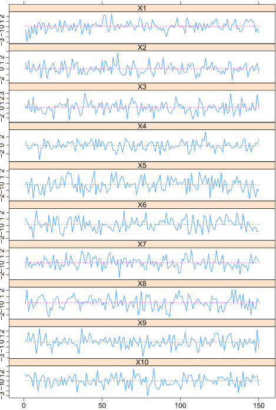

FIGURE 3.5 在 IC 条件下模拟的十个变量图。图顶部的 p值用于检验观测值位置平稳的原假设的 mphase1 检验。

由 \( p \) 个线性回归模型组成，拟合如下

```
\(\mathbf{x}_j^{\text{M}} = \boldsymbol{\beta}_j + \boldsymbol{\epsilon}_j, \quad j=1, \dots, p,\) (3.9)
```

where \(\mathbf{x}_j^{\text{M}}\)、\(\boldsymbol{\beta}_j\) 和 \(\boldsymbol{\epsilon}_j\) 均为长度 \( n \) 的向量，误差 \(\boldsymbol{\epsilon}_j\) 的均值为零且方差恒定。\(\mathbf{x}_j^{\text{M}}\) 是监控期间变量 \( j \) 的观测值集合。时间步 \( t \) 时第 \( j \) 个变量响应的均值为 \( \beta_{j,t} \)，当 \( \beta_{j,t} \neq \beta_{j,t+1} \) 时，指示过程均值发生变化。当 \( \beta_{j,t} \neq \beta_{j,t+1} \) 时，时间 \( t+1 \) 被称为变量 \( j \) 的 *变点*。如果在时间 \( t+1 \) 存在变点，则变量在时间 \( t+1 \) 被归类为 *移位*；若 \( t+1 \) 未发生变化，则为 *未移位*。对于 \( j=1, \dots, p \)，\(\boldsymbol{\beta}_j\) 使用 fused lasso 进行估计。

当参数具有自然顺序（例如按时间索引的参数）[47] 时，使用 fused lasso。fused lasso 对相邻系数之差而非系数本身进行惩罚，使相邻系数之间的微小变化趋于零 [38]。Zhang 等人 [48] 还在贝叶斯框架中使用 fused lasso 通过估计每个变量的故障概率来执行故障隔离。使用 fused lasso 进行变点检测的理论特性见 [49]。

执行 fused lasso 的算法 [50] 在 `R` 包 `genlasso` [51] 中实现。对于 \( j=1, \dots, p \)，\(\boldsymbol{\beta}_j\) 的估计是通过最小化以下内容获得的：

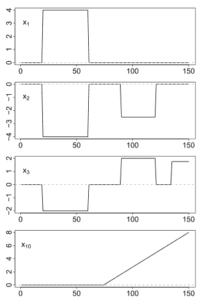

FIGURE 3.6 表现出 OC 条件的四个变量的均值图。前三个变量具有瞬态或持续的移位故障，而最后一个变量从第 100 个观测值开始具有漂移故障。

如下：

```
\frac{1}{2} \sum_{j=1}^p \sum_{t=1}^n (x_{j,t} - \beta_{j,t})^2 + \gamma \sum_{j=1}^p \sum_{t=1}^{n-1} |\beta_{j,t+1} - \beta_{j,t}|.
```

为了选择 \(\gamma\)，可以再次使用 Eq. (3.8) 中的 EBIC。在此框架内，EBIC 为

```
EBIC_\phi(\gamma) = np \log \left( \frac{\text{RSS}(\gamma)}{np} \right) + \nu(\gamma) \log(np) + 2\phi \log \binom{np - p}{\nu(\gamma)}, \quad (3.10)
```

p值<0.001

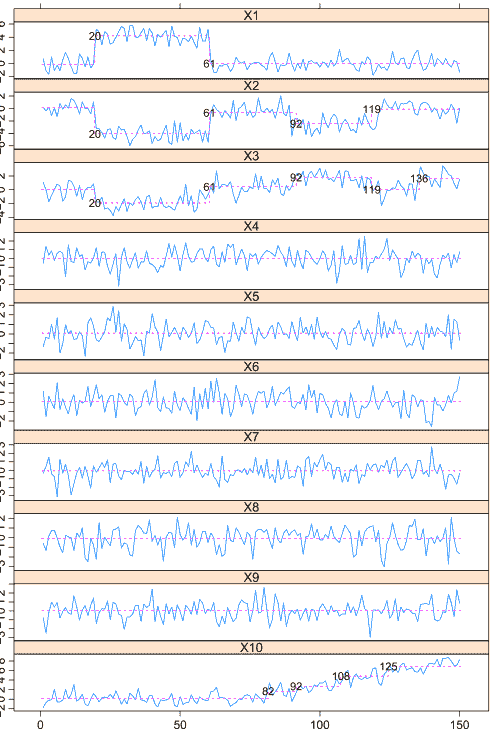

FIGURE 3.7 在 OC 条件下模拟的十个变量图。图顶部的 p值用于检验观测值位置平稳的原假设的 mphase1 检验。

where the primary differences are that RSS(\(\gamma\)) 是 Eq. (3.9) 的残差平方和，\(np - p\) 是搜索参数空间的维度，或潜在变点位置的数量。无法在第一个观测值 \(t=1\) 处检测到变点，因此变点最多只能在 \(np - p\) 个位置处检测到。

Eq. (3.10) 中 EBIC 的一个问题是，其中使用样本量 \(n\) 意味着观测值是独立的。然而，如果 \(\mathbf{x}_j\) 存在自相关，则有效样本量（ESS，即等效独立观测数）将不同于 \(n\)。如果存在正自相关，ESS 将小于实际样本量，且正自相关越强，ESS 越小。因此，计算 ESS（记为 \(n'\)），如下所示：

\(n' = \frac{n}{1 + \frac{1}{n} \sum_{h>0} R(h)}, \quad (3.11)\)

where \(R(h)\) 是用户选择的函数，用于建模过程为 IC 时两个不同观测值（即 \(h \neq 0\)）之间相隔 \(h\) 个时间步的自相关 [52]。通过研究 IC 训练期间每个 \(\mathbf{x}_j\) 的样本自相关函数（ACF）和偏自相关函数（PACF）图，可以确认自相关的存在并确定最合适的 \(R(h)\)。这假设每个变量的时间依赖性强度和结构相同。将 \(n\) 替换为 \(n'\) 得到调整后的 EBIC（aEBIC）

\(\text{aEBIC}_\phi(\gamma) = n' p \log \left( \frac{\text{RSS}(\gamma)}{n' p} \right) + \nu(\gamma) \log(n' p) + 2\phi \log \binom{np - p}{\nu(\gamma)}.\)

随后，选择 \(\gamma\) 使 aEBIC 最小化，从而得到 \(j=1, \dots, p\) 的估计系数 \(\hat{\boldsymbol{\beta}}_j\)。显然，当标准化残差独立时，对于 \(h > 0\)，\(R(h) = 0\)，则 \(n' = n\)，因此即使在没有自相关的情况下，也可以使用 aEBIC 来选择 \(\gamma\)。

最后，必须将估计系数转换为可能发生故障的时间列表以及与每个故障关联的移位变量列表。当估计的 \(\hat{\beta}_{j,t} \neq \hat{\beta}_{j,t+1}\) 时，在变量 \(j\) 中识别出时间 \(t+1\) 处的变点。为了减少在几个时间步内检测到的故障数量，变点按从早到晚排序，如果在前一个变点 \(\kappa\) 个时间步内识别出任何其他变点，则将它们合并为单个故障。参数 \(\kappa\) 设置为相对较小的值，以便在小时间窗口内检测到的多个变量的移位与同一故障相关联，但两个不同的故障不会合并为单个故障。

第 \(j\) 个变量在时间 \(t\) 时标准化残差中移位大小和方向的估计 \(\delta_{j,t}\) 为

\(\hat{\delta}_{j,t} = \max_{t_1, t_2 \in \{t-l+1, ..., t+\kappa\}} |\hat{\beta}_{j,t_1} - \hat{\beta}_{j,t_2}| \cdot \text{sign}(\max \text{ difference}).


标准化残差中的移动大小与原始数据中的移动大小不相同。由于原始数据中存在非平稳性以及被监控特征的尺度差异，移动大小应在标准化残差中进行比较，而不是在原始数据中。研究人员可以使用移动大小来评估每个移动变量对故障的贡献大小，并识别在故障诊断步骤中应优先处理哪些变量。

在仿真中，aFFI 能够准确检测不同类型的故障（移动、漂移或潜在故障），并且在各种条件下（即，变量数量变化、非平稳性和时间依赖性）也能准确隔离移动的变量。与某些方法不同，这种方法也不需要事先估计故障的数量或结构。该方法可用于从历史数据存档中编目和表征故障。该方法应用于实际问题的示例见第 3.5.1 节。

#### 3.2.3.2 第二阶段变量选择

使用变量选择方法进行第二阶段故障隔离的选择还有很多。在这里，我们将描述三个比第 3.2.2 节中所述分解方法更强大的重要发展，特别是在变量数量较大时。我们为更专门的案例提供了额外作品的参考。

示例方法 1，VS-MSPC。在 [2] 中，被监控的观测值 x_i 被假设服从 p 维 N(\mu, \Sigma) 分布。对以下假设进行检验

```
{
 H_0 : \mu \in \Omega_0 ,
 H_1 : \mu \in \Omega_1
}
(3.12)
```

该检验用于判断过程对于 \Omega_0 = (0, 0, ..., 0)' 是否处于受控状态（IC），而对于 \Omega_1 = {\mu : \mu = \delta d, \delta > 0} 是否处于失控状态（OC）。与之前一样，d 是方向向量，满足 \sqrt{d'\Sigma^{-1}d} = 1，\delta 是标量，表示移动的大小。通过在两个假设下写出似然函数，构建了广义似然比检验统计量为

```
\lambda(x_i) = \frac{\max_{\mu \in \Omega_0} L(x_i, \mu)}{\max_{\mu \in \Omega_1} L(x_i, \mu)},
```

其中 L(x_i, \mu) 是 x_i 的似然函数。将 \Omega_0 = (0, 0, ..., 0)' 代入分子，取对数，并利用似然函数的正态性假设，检验的拒绝域可写为

```
\Lambda(x_i) = \min_{\mu \in \Omega_1} \left( x_i' \Sigma^{-1} x_i + (x_i - \mu)' \Sigma (x_i - \mu) \right) < \log c,
```

其中 c 为某个常数。然而，第一项不依赖于 \mu，因此重点在于第二项，如下所示：

```
S^2 = \min_{\mu \in \Omega_1} \left( (x_i - \mu)' \Sigma (x_i - \mu) \right),  (3.13)
```

式 (3.13) 的解记为 \(\mu^*\)，是 \(\mu\) 的估计量。假设 \(\mu\) 的大部分元素为零，可以使用惩罚项将小系数强制为零。

[2] 使用的式 (3.13) 的惩罚版本采用 \(L_0\) 惩罚项，以约束非零系数的绝对数量。然后，利用 Cholesky 分解将正定矩阵 \(\Sigma\) 分解为 \(\Sigma = \mathbf{L}\mathbf{L}'\)，带有惩罚项的式 (3.13) 可改写为

```
\left\{ \begin{aligned} \min_{\mu \in \Omega_1} ((\mathbf{z}_i - \mathbf{L}\mu)'(\mathbf{z}_i - \mathbf{L}\mu)) \\ \text{s.t.} \sum_{j=1}^p I(|\mu_j| \neq 0) \le s, \end{aligned} \right.
```

其中 \(\mathbf{z}_i = \mathbf{L}\mathbf{x}_i\)。Wang 和 Jiang [2] 提倡使用前向选择法，从不含预测变量开始，逐步加入能使平方误差之和最大程度减小的预测变量。他们使用“F-进入”规则，即对每个预测变量计算以下 \(F\)-值，值最高者进入模型，

```
F = \frac{(R_{k+1}^2 - R_k^2)(n - k - 1)}{1 - R_{k+1}^2},
```

其中 \(R_k^2\) 是含有 \(k\) 个预测变量的模型的 \(R^2\)。不进行正式的假设检验，一旦 \(s\) 个变量进入模型，就不再添加其他变量。当缺乏关于移动变量数量的先验知识时，[2] 的作者建议使用惩罚性或稀疏 PCA 来确定 \(s\)，该方法仅对变量子集进行线性组合 [9,53,54]。

控制图方案按以下步骤进行：

- 1. 每收集到一个新观测值时，如上所述进行变量选择，求解式 (3.13) 的解 \(\mu^*\)。

- 2. 对步骤 1 中识别出的非零系数变量，使用以下公式绘制控制图：

```
\Lambda(\mathbf{x}_i) = 2\mathbf{x}_i' \Sigma^{-1} \mu^* - \mu^{* \prime} \Sigma^{-1} \mu^*.
```

超过 preset 控制限的值被视为失控（OC）。

- 3. 发出失控（OC）报警后，将第一步中识别出的具有非零系数的变量分类为移动变量。

Wang 和 Jiang [2] 在受控（IC）和失控（OC）条件下，对变量维度从 \(p = 10\) 到 \(p = 100\) 的 VS-MSPC 进行了平均运行长度（ARL）性能测试，并发现其在检测中等和大移动方面优于 Hotelling’s \(T^2\)。然而，即使 \(s\) 指定错误，控制图仍能很好地工作。该方法在检测移动变量方面的性能未经评估，但该方法在某个特定示例中效果良好。

示例方法 2，LEWMA。Zou 和 Qiu [16] 提出了一种基于指数加权移动平均（EWMA）的绘图统计量，该统计量对旧观测值赋予较小权重，并采用自适应 Lasso 惩罚。该方法名为 LEWMA（Lasso EWMA），与之前的方法检验相同的整体假设，但他们最初构建了一个跨多个调谐参数 \(\gamma\) 值计算的检验统计量。惩罚似然函数写为

```
\( L(\boldsymbol{\mu}) = n(\bar{\mathbf{x}} - \boldsymbol{\mu})'\mathbf{\Sigma}^{-1}(\bar{\mathbf{x}} - \boldsymbol{\mu}) + n\gamma \sum_{j=1}^p \frac{1}{|\bar{x}_j|^a}|\mu_j|, \)
```

其中每个变量均由其各自的样本均值进行收缩，且通常推荐 \(a = 1\)。最小化似然函数的估计量记为 \(\boldsymbol{\mu}^*_\gamma\)，基于 Lasso 的式 (3.12) 假设的检验统计量为

```
\( T_\gamma = \frac{n((\boldsymbol{\mu}^*_\gamma)'\mathbf{\Sigma}^{-1}\bar{\mathbf{x}})^2}{(\boldsymbol{\mu}^*_\gamma)'\mathbf{\Sigma}^{-1}\boldsymbol{\mu}^*_\gamma}. \)
```

正确变量子集的选择取决于 \(\gamma\) 的正确选择，\(\gamma\) 可以通过多种方式选择，例如交叉验证或 BIC。然而，用于估计的最佳 \(\gamma\) 并不总能产生有力的假设检验；因此，Zou 和 Qiu [16] 借鉴非参数检验框架，基于多个 \(\gamma\) 值创建一个单一检验统计量，如下所示：

```
\( T = \max_{j=1,\dots,q} \frac{T_{\gamma_j} - E(T_{\gamma_j})}{\sqrt{\text{Var}(T_{\gamma_j})}}, \)
```

其中 \(E(T_{\gamma_j})\) 和 \(\text{Var}(T_{\gamma_j})\) 是 \(T_{\gamma_j}\) 在原假设下的样本均值和方差。[16] 的作者建议，如果先验知识表明移动最多发生在 \(r\) 个变量中，则设置 \(q = r + 1\) 或 \(q = r + 2\)。当此类知识不可用时，他们表明 \(q = p\) 在实践中也能很好地工作。

为构建 LEWMA，定义多元 EWMA 序列如下

```
\( \mathbf{u}_i = \lambda\mathbf{x}_i + (1 - \lambda)\mathbf{u}_{i-1}, \quad i = 1, 2, \dots, \quad (3.14) \)
```

其中 \(\mathbf{u}_0 = 0\)，\(\lambda \in (0, 1]\) 是权重。然后，将 EWMA 与 Lasso 结合，对各种 \(\gamma\) 值计算以下惩罚似然函数的 \(q\) 个 Lasso 估计量

```
\( (\mathbf{u}_i - \boldsymbol{\mu})'\mathbf{\Sigma}^{-1}(\mathbf{u}_i - \boldsymbol{\mu}) + \gamma \sum_{j=1}^p \frac{1}{|\mathbf{u}_j|}|\mu_j|. \)
```

然后，使用

```
\( W_{j,\gamma} = \frac{2 - \lambda}{\lambda[1 - (1 - \lambda)^{2j}]} \frac{(\mathbf{u}'_j\mathbf{\Sigma}^{-1}\boldsymbol{\mu}^*_\gamma)^2}{(\boldsymbol{\mu}^*_\gamma)'\mathbf{\Sigma}^{-1}\boldsymbol{\mu}^*_\gamma}, \)
```


控制图在下述条件下发出偏移信号：

$Q_f = \max_{k=1,\dots,q} \frac{W_{j,k} - \text{E}(W_{j,y})}{\sqrt{\text{Var}(W_{j,y})}} > L,$

其中 \( L \) 是为特定的IC ARL而选取的控制限。该 \( L \) 可通过仿真确定，且必须在进行第II阶段监控之前进行一次性计算。在实际应用中，\( W_{j,y} \) 中的 \(\frac{2-\lambda}{\lambda[1-(1-\lambda)^{2j}]}\) 因子可替换为渐近形式 \((2-\lambda)/\lambda\)。LEWMA通过仿真进行评估，尤其关注其在OC设置下的ARL，针对 \( p=5 \) 和 \( p=15 \)。该方法与其他两种EWMA图统计量进行了比较，涵盖不同变量数量下的多种偏移大小。结果表明，从ARL角度看，LEWMA能对多种偏移提供全面的保护。此外，作者评估了该方法在15个变量的集合中正确识别所有偏移变量的能力。在15个变量中仅有1个偏移变量的情况下，LEWMA在约55%至60%的仿真中能正确识别该偏移变量；不过，随着偏移变量数量从1增加到2再到3，正确识别偏移变量的仿真最高比例从60%下降到37%，再下降到24%。相反，在识别偏移变量时出现错误（即未识别出偏移变量，或选中了未偏移变量）的仿真比例随偏移变量数量增加而上升：1个偏移变量时为6%，2个偏移变量时为22%，3个偏移变量时为34%。尽管如此，LEWMA的性能仍优于其竞争方法。该研究是除了故障检测之外，最早评估故障隔离性能的研究之一，同样与[25]的结果表明，故障隔离是一个非常具有挑战性的问题，方法仍有改进空间。

##### 示例方法 3. APC-PCSR。

自适应主成分与基于主成分的信号恢复（APC-PCSR）自适应地选择主成分（PCs），允许其随时间变化，随后引入一种利用自适应LASSO[55]的诊断方法。与[2,6,16,17]相比，该方法在高维环境下表现往往更好，后者随着维度增加计算负担变重。当变量存在依赖关系时可使用该方法，且无需了解故障方向、大小和/或受影响变量的数量。

为了降低数据维度，执行PCA。这里，\(\mathbf{A}\) 是 \(\mathbf{\Sigma}\) 的 \( p \times p \) 特征向量矩阵，\(\mathbf{y}_i = \mathbf{A}\mathbf{x}_i\) 表示主成分得分。\(\mathbf{A}\) 中的特征向量按顺序排列，使得对应的特征值呈递减顺序，即 \(\lambda_1 \ge \lambda_2 \ge \cdots \ge \lambda_p\)。仅监控前 \( l \) 个主成分（通常是特征值最大的那些）有时可能会漏掉故障，因为前几个主成分的方差较大，因此后几个主成分对故障可能更敏感。为考虑这一点，标准化主成分得分计算如下

\(\tilde{y}_{i,j} = \frac{y_{i,j}}{\sqrt{\lambda_j}}, \quad j=1,\dots,p.\)

假设IC观测服从分布 \(\mathbf{x}_i \sim N(\mathbf{0}, \mathbf{\Sigma})\)，但在OC条件下，分布变为 \(\mathbf{x}_i \sim N(\mu, \Sigma)\)。因此，OC过程的主成分得分分布为 \(\mathbf{y}_i \sim N(\mathbf{\Lambda}'\mu, \mathbf{\Lambda})\)，其中 \(\mathbf{\Lambda} = \text{diag}(\lambda_1, \lambda_2, \dots, \lambda_p)\)。随后，使用EWMA统计量进行监控，类似于Eq. (3.14)中所示，但经修改以应用于标准化主成分得分，如下所示：

\(u_{i,j} = \lambda \tilde{y}_{i,j} + (1 - \lambda)u_{i-1}, \quad i = 1, 2, \dots, \quad j = 1, 2, \dots, p,\)

其中 \(u_0 = 0\)，且 \(\lambda \in (0, 1]\)，与之前相同。注意，无下标的 \(\lambda\) 表示EWMA统计量中的权重，而带下标的 \(\lambda\) 表示特征值。那么，IC过程将具有 \(u_{i,j} \sim N(0, \sigma^2 = \frac{\lambda}{1-\lambda})\)，其平方标准化值为

\(d_{i,j} = \left( \frac{u_{i,j}}{\sqrt{\frac{\lambda}{1-\lambda}}} \right)^2 \sim \chi^2_{(1)}.\)

在存在均值偏移的OC过程中，部分 \(d_{i,j}\) 将变大，但 Ebrahimi et al. [55] 建议滤除部分主成分。他们仅使用 \(\chi^2_{(1)}\) 分布的 \(\alpha\) 上尾分位数对 \(d_{i,j}\) 进行阈值处理，并监控新统计量，

\(R_i = \sum_{j=1}^p \left( d_{i,j} - \chi^2_{(1), \alpha} \right)_+, \quad\)

其中 \((\cdot)_+ = \max(0, \cdot)\)。当 \(R_i\) 超过某个阈值时，则发出警报，该阈值通过在IC条件下的仿真获得，以实现预设的ARL。

一旦检测到故障，第二步是将主成分整合到故障隔离中。假设每个观测均带有噪声，OC状态可表示为 \(\mathbf{x}_i = \mu + \epsilon_i\)，其中 \(\epsilon \sim (\mathbf{0}, \mathbf{\Sigma})\)。此时，OC主成分得分为 \(\mathbf{y}_i = \mathbf{A}\mathbf{x}_i = \mathbf{A}\mu + \tilde{\epsilon}\)，其中 \(\tilde{\epsilon} = \mathbf{A}\epsilon\)。目标是估计稀疏的 \(\mu\)，因此采用自适应LASSO

\(\mu^* = \text{argmin}_{\mu} \left( (\mathbf{y}_i - \mathbf{A}\mu)'(\mathbf{y}_i - \mathbf{A}\mu) + \gamma \sum_{j=1}^p \frac{1}{\tilde{x}_j} |\mu_j| \right), \quad\)

其中 \(\tilde{x}_j\) 是第 \(j\) 个变量的最小二乘均值。不过，\(\mathbf{y}_i\) 中每个变量的协方差各不相同，因此采用标准化主成分得分和主成分，以矩阵形式表示如下：

\(\tilde{\mathbf{y}}_i = \mathbf{\Lambda}^{-1/2}\mathbf{y}_i, \quad \text{and} \quad \tilde{\mathbf{A}} = \mathbf{\Lambda}^{-1/2}\mathbf{A}.\)

将这些代入自适应LASSO估计中，得到以下目标函数：

\(\mu^* = \text{argmin}_\mu \left( (\tilde{\mathbf{y}}_i - \tilde{\mathbf{A}}\mu)'(\tilde{\mathbf{y}}_i - \tilde{\mathbf{A}}\mu) + \gamma \sum_{j=1}^p \frac{1}{\tilde{x}_j} |\mu_j| \right) .\)

Ebrahimi et al. [55] 在仿真中对其方法进行了测试，\(p\) 的取值范围从100到10,000，因此能够测试非常高维的环境。在IC设置中，报告了误检百分比，当 \(p \ge 5000\) 时，该比例达到名义设置 \(\alpha = 0.05\)。对不同偏移幅度的OC设置计算了ARL，APC-PCSR方法优于基准比较方法。还通过多个指标评估了PCSR方法隔离偏移变量的能力，包括

- 假阴性率（FN%）——未检测出的偏移变量占偏移变量总数的百分比；
- 假正率（FP%）——被识别出的未偏移变量占未偏移变量总数的百分比；以及
- 参数选择得分（PSS）——被错误分类的变量总数（无论是作为偏移变量还是未偏移变量）。

虽然在多种偏移大小和仿真设置下FN%相对较低，但对于小偏移，FP%和PSS可能较大，不过两者随着偏移大小增加而迅速下降。对于协方差矩阵非稀疏的过程，PCSR的表现与[3]（另一种基于LASSO的故障隔离方法）相似。不过，如果过程具有稀疏协方差矩阵，则PCSR表现更好，[55]的作者认为此类设置在实践中很常见，因为变量通常仅与总监控变量的一个小子集相关。因此，APC-PCSR是一种在高维环境下应用前景广阔的方法，其应用在3.5.2节的案例研究中有所说明。Jiang et al. [56] 也使用优化算法对变量进行降维，以用于基于PCA的监控。

#### 其他第II阶段故障隔离方法。

针对特定目的，已提出许多第II阶段故障隔离方法。Jiang et al. [6] 提出了一种变量选择多元EWMA（VS-MEWMA）图，继续使用[2]的VS-MSPC图中的 \(L_0\) 惩罚。Yan et al. [57] 提出了一种针对高维高斯混合模型的基于VS的控制图。Kuang et al. [58] 将变量选择纳入判别分析，用于多元故障隔离。[59] 和 [60] 使用了多种类型的卡尔曼滤波器来检测和隔离传感器故障。

此处描述的第II阶段基于VS的控制图假设均值和协方差矩阵已知，因此 Li et al. [61] 引入了一种稳健的自启动方法，以减少启动VS-MEWMA图所需的IC观测数量。Liang et al. [62] 提出了一种LEWMA [16]的版本，可应用于椭圆分布族内生成的任何连续过程，在重尾和偏态多元


分布。Li et al. [63] 为多元分类过程开发了一种稳健的自启动监控方法，该方法融入了VS。Zhao and Gao [64] 开发了一种过程控制方法，用于监控带有回归中VS的多元变量分布的变化，以隔离与分布变化相关的变量。Zarzo and Ferrer [65] 将VS与偏最小二乘法（PLS）相结合，用于监控和隔离与最终输出变量变异性变化相关的变量。

监控均值和方差对于控制回路内的过程很重要。当控制回路中发生故障时，控制策略试图将变量保持在目标水平，并可能掩盖变量均值的任何变化，但变量之间的相关性可能会发生显著变化，因此在这种情况下，除了均值外，监控协方差也非常重要 [66]。Capizzi and Masarotto [17] 使用VS来共同监控均值和总离散度。Wang et al. [67] 还提出了一种使用惩罚似然估计来同时监控均值和协方差的方法。Wang and Tsung [22] 使用VS进行自适应降维，特别关注反馈控制过程。

批过程是指在给定时间内对进料输入进行操作，然后再切换到下一批的过程。批过程中变量隔离也有一些已开发的方法。Yan et al. [68] 将VS融入PLS判别分析。Chu et al. [24] 提出了一种结合基于自助法的变量选择的批过程方法。Yao et al. [69] 使用二维PCA来处理具有减小支持区域的批过程。

一些方法已针对变量数量达到数千的超高维场景进行了设计。Kim et al. [70] 开发了一种基于惩罚似然的故障检测方法，该方法使用L2-范数正则化，目标是将所有变量均值缩小到零。虽然它最初并非为故障隔离而设计，但在包含十个监控变量的案例研究中，它确实在隔离故障变量方面表现良好。Turkoz et al. [71] 开发了一种专为非正态和高维过程设计的计算效率高的贝叶斯方法。Abdella et al. [72] 提出了一种多元CUSUM控制图，旨在检测均值中的非常小的偏移，并在高维环境中隔离变量。

贝叶斯方法已被用于处理各种特定于问题的挑战。Yan et al. [73] 采用贝叶斯框架来处理参数估计中的不确定性以及调参参数的选择。他们将该方法应用于田纳西伊斯特曼（TE）过程中的三种故障，并可以显示故障发生的时间、故障持续的时间以及哪些变量发生了偏移。Ge et al. [74,75] 提出了用于监控具有非线性和多模态特征的过程的贝叶斯方法，两者均应用于TE过程。Jiang and Huang [76] 使用一种通过本地监视器进行全厂过程监控的贝叶斯故障诊断方法。TE过程将在下一节中描述。

## 3.3 故障分类

如在引言中所述，一种感兴趣的不同数据结构是当来自同一系统中同一故障的多个副本的数据流已被记录和标记时。这会产生来自历史故障的数据目录。在新系统或未研究的系统中，这样的目录不太可能存在，但通常在研究非常充分的过程中，目录是可用的。然后，目标是获取一组新的故障观测值，并确定新故障最类似于哪个历史故障。这是著名的分类问题。

这些方法通常只应用于一组数据，不利于重复模拟研究及其相应的指标，例如Sect. 3.4中讨论的指标。用于说明这些方法性能的最常用数据集是田纳西伊斯特曼（TE）化学工程过程，本节中提到的每项工作都使用由TE仿真模型生成的数据 [77]。该模型拥有超过2000次引用，模拟了一大组（超过50个）非线性相关且随时间动态变化的变量。某些变量受到控制以满足预定阈值。MATLAB®代码可用于在各种控制策略和多种不同类型的故障下模拟数据 [78]。

[79]中使用多类支持向量机（SVM）来确定当前观测集最接近历史故障目录中的哪一个。首先使用PCA降低数据维度，并使用网格搜索优化SVM中的参数。Zhang et al. [80] 使用核熵成分分析（KECA），为每种故障类型训练一个KECA分类器。作者还试图容纳多尺度特性，因此他们也实现了多尺度PCA。Ragab et al. [81] 使用数据逻辑分析（LAD）来分类故障，并将其结果与许多其他机器学习方法进行比较，例如ANN、决策树、随机森林、k最近邻、二次判别分析和SVM，

已证明，降低输入到分类方法的变量维度在此处也能减少错误 [20,79]。De Assis Boldt et al. [20] 测试了多级联特征选择方法来减少输入特征，然后应用极端学习机（ELM），这是一种具有一个隐藏层且输出端具有线性激活函数的前馈神经网络。Zhao et al. [82] 使用一种循环神经网络，具体来说是长短期记忆（LSTM）神经网络，它可以直接处理原始数据，而无需进行特征提取和分类器设计。该模型还可以考虑观测中的自相关。[58]中使用了惩罚回归，表明判别分析等价于惩罚回归。

虽然故障分类往往是这些方法的重点，但隔离变量通常作为故障识别的副产品完成。一些示例在 [83] 中，Chiang et al. 使用遗传算法结合费舍尔判别分析来隔离变量，De Assis Boldt et al. [20] 识别在其特征选择步骤中频繁被选中的变量。

## 3.4 故障隔离指标

用于评估故障检测方法性能的指标是标准化的且广为人知。例如，平均运行长度（ARL）有几种变体，用于测量当过程处于OC状态时，方法在发出故障信号前所需的平均时间。IC过程以及第I阶段和第II阶段设置下也存在相应的指标。用于评估故障隔离（FI）方法的指标不够标准化。FI是一种多元二元分类问题，旨在针对特定时间点发生的故障，将变量正确分类为偏移或未偏移。我们令P为所有变量的集合；S为偏移变量的集合；U为未偏移变量的集合。我们将t*和t̂*分别表示为故障发生和被检测的时间步。然后，Ŝ是被识别为偏移的变量集合，Û是在t̂*时被识别为未偏移的变量集合。

| | 归类为偏移 | 归类为未偏移 | p |
|---|---|---|---|
| 真实偏移 | s+ | s- | `|S|` |
| 真实未偏移 | u- | u+ | `|U|` |
| 总计 | `|Ŝ|` | `|Û|` | p+ = s+ + u+ |

FI指标可以根据S与Ŝ或U与Û之间的重叠来表述。表3.2总结了故障发生和被检测的特定时间步的符号。蓝色阴影（打印版本中为中灰色阴影）的框表示正确识别的集合，红色阴影（打印版本中为深灰色阴影）的框表示错误识别的集合。被正确识别为偏移的变量总数表示为s+，被错误识别为偏移的变量总数表示为u-。同样，被正确识别为未偏移的变量总数表示为u+，被错误识别为未偏移的变量总数表示为s-。合计，s+ + u- = |Ŝ| 和 s- + u+ = |Û| 分别表示被识别为偏移和未偏移的变量总数。被正确识别的变量总数为p+ = s+ + u+，被错误识别的变量总数为p- = s- + u-。

FI指标的选择取决于监控变量的数量。在低维设置中，合理地期望每个变量都被正确识别，因此某些指标只有在所有偏移和未偏移变量都被正确识别时才给予方法认可 [1,3,7,16,21,46,84,85]。正确率（CR），或简称Correctness，为

```
CR = \frac{1}{B} \sum_{k=1}^B I[\widehat{S}_k = \mathcal{S}] ,
```


其中，$B$ 是模拟数据集的数量；$\widehat{S}_k$ 是第 $k$ 个数据集中被识别为偏移的变量集合；$I[\cdot]$ 是一个指示函数，如果其参数为真则取值为 1，否则为 0。在高维环境中，CR 可能接近于零，因为很难完美地识别所有偏移变量。

当只有部分（而非全部）变量被正确分类时，某些指标会给方法“部分得分”，在 $p$ 很大时这往往是必要的。通常，我们关心被错误识别的变量总数。在此情况下，Zou et al. [3] 使用预期错误数（ENE），定义为

$$\text{ENE} = \frac{1}{B} \sum_{k=1}^B p_k^-.$$

一个相关指标是预期误差率（$EER$），即 ENE/p [1, 3, 55, 85]。

### 3.4.1 故障隔离错误

通常，确定犯下了*哪种*类型的错误是有益的。与 FD 类似，有两种错误类型：
- 将未偏移变量识别为偏移
- 未能将偏移变量识别为偏移

首先，我们介绍一组与第一类错误相关的指标。预期假正数（EFP）是被识别为偏移的未偏移变量的平均数量 [86]，可以表示为

$$\text{EFP} = \frac{1}{B} \sum_{k=1}^B u_k^-.$$

除了对被识别为偏移的未偏移变量的*数量*进行平均外，Li et al. [86] 还将预期假正数作为所有变量的*比例*进行报告，即 EFP/p。然而，如果偏移变量的数量相对于 $p$ 较小，该数值可能接近于零，这可能暗示 FI 方法的表现比实际更好。更可取的指标是假正百分比（FP%）[1, 55]，即 EFP/|\mathcal{U}|。[4] 将分母中的 $\mathcal{U}$ 替换为 $\mathcal{S}$，并将其指标命名为正确变量选择比率（RCVS）。

第二类错误是未能将偏移变量识别为偏移。假负百分比（FN%）是被分类为未偏移的偏移变量的比例 [1, 55]，表示为

$$\text{FN\%} = \frac{1}{B} \sum_{k=1}^B \frac{s_k^-}{|\mathcal{S}|}.$$

FN% 的一个变体是加权漏检率（wMDR），它还考虑了使用严重度函数误分类每个变量所关联的错误*成本* [86]，表示为

$$\text{wMDR} = \frac{\sum_j I (j \in \mathcal{S} \cap \widehat{\mathcal{U}}) \cdot s_j(\delta_j)}{\sum_j I (j \in \mathcal{S}) \cdot s_j(\delta_j)},$$

其中 \(s_j(\delta_j)\) 是第 \(j\) 个变量偏移大小的用户定义严重度函数。wMDR 按错误的严重程度对每个被分类为未偏移的偏移变量进行加权，严重错误比轻微错误权重更大。Li et al. [86] 要求 \(s_j(0) = 1\)，并且 \(s_j(\delta_j)\) 作为 \(\delta_j\) 远离零时是一个非递减函数。严重度函数可以基于对系统的了解（如经济考虑、外部协变量或先前研究）来设置 [87–90]；如果所有变量同等重要或对变量没有*先验*信息，则可以为所有变量使用相同的严重度函数 \(s(\cdot)\)。对所有 \(j\) 设置 \(s_j(\delta_j) = 1\) 等同于 FN%。

### 3.4.2 精确率和召回率

与衡量错误频率不同，衡量偏移变量正确识别的替代指标是 \(1 - \text{FN}\%\)，我们将其称为召回率（Recall）。这也被称为正确识别概率和正确变量选择比率 [6,81,91,4]。在分母中使用 \(\widehat{\mathcal{S}}\) 而非 \(\mathcal{S}\) 时，精确率（Precision）是被*识别*为偏移且确实偏移的变量比例 [81,91]，即

\text{Precision} = \frac{1}{B} \sum_{k=1}^B \frac{s_k^+}{|\widehat{\mathcal{S}}|}.

Precision 和 Recall 的调和平均称为 \(F_1\)-score [55, 91]，定义为

\(F_1\text{-score} = 2 \cdot \frac{\text{Precision} \times \text{Recall}}{\text{Precision} + \text{Recall}}\).

### 3.4.3 第 I 阶段 FI 指标

上述所有指标在第 II 阶段环境下进行 FI 时都很有用，但 Capizzi 和 Masarotto [8] 提出了一种同时执行 FD 和 FI 的第 I 阶段方法。他们的仿真研究引入了多个故障，其中一些涉及多个偏移变量。他们考虑了精确和近似检测的平均数量，其中每个时间步长中发生偏移的每个偏移变量都被视为单独的检测。*精确*检测是在故障的真实时间步长中正确识别偏移变量，而*近似*检测是在故障真实时间步长的某个窗口内将偏移变量识别为偏移。对于这两个指标，值越接近数据集中的真实检测数量，方法的性能越好。虽然 [8] 的重点是 FD&I，但这两个指标侧重于其方法的检测能力。

### 3.4.4 讨论

[42] 提出的检测精度和隔离率（DAIR）将 FD 的准确性纳入 FI 指标中。DAIR 定义为

\(\text{DAIR} = \frac{1}{B} \sum_{k=1}^B K_\eta(t^*, \hat{t}_k^*) \left( \frac{p_k^+}{p} \right),\)

它包含两个组件：
- 检测精度，当 \(\hat{t}^*\) 远离 $t^*$ 时使用核函数 $K_\eta(t^*, \hat{t}^*)$ 对方法进行惩罚，
- 隔离率，衡量被正确分类的变量比例，即 $p_k^+ / p$。

一个简单的核函数是矩形核函数，即

\(K_\eta(t^*, \hat{t}^*) = \begin{cases} 1, & |t^* - \hat{t}^*| < \eta, \\ 0, & |t^* - \hat{t}^*| \ge \eta, \end{cases}\)

如果在真实故障 \(\eta\) 个时间步长内检测到故障，则该方法给予“全分”，否则不给分。因此，如果故障检测位置距离真实故障位置超过 \(\eta\) 个时间步长，即使所有变量都被正确分类为偏移或未偏移，DAIR 也将为零。该指标评估方法在正确时间范围内检测故障并隔离正确变量的能力。

选择能够准确反映方法性能并基于系统知识（包括被监控的变量数量和 FI 中错误的经济成本）的指标非常重要。选择不当的指标可能无法提供方法性能的完整图景。例如，较大的 ENE 不会揭示假负还是假正更为普遍；没有了解方法的 FN%，较小的 FP% 是不完整的；如果方法未能识别为偏移的偏移变量可能对系统造成灾难性损害或导致高额罚款和收入损失，那么即使 FN% 很小也具有误导性。应仔细考虑，以确保所选指标在仿真研究或案例研究中提供足够的洞察。

## 3.5 案例研究

随着水资源需求的增长，一种新的分散式可饮用再利用范式将重点放在较小的卫星设施中，这些设施靠近水源收集并处理再利用水。历史解决方案一直是扩展和升级现有的、老化的集中式处理系统，这些系统从广阔的地理区域收集水和废水，需要昂贵的维护和抽送。此外，集中式设施只是将处理后的废水释放回环境中，而分散式设施可以将水在本地用于各种再利用应用，如灌溉或饮用。然而，分散式设施的进水质量和数量变异性更高，全职现场操作员来监控和维护系统并不具成本效益。此外，用于可饮用再利用的先进废水处理存在固有风险，包括污染物可能释放到供水中，因此精确且强健的过程监控对于保护人类健康、环境和设施至关重要。此类过程很少成为 FD&I 方法的关注点；相反，大多数此类研究关注的是只有少量监控变量或来自仿真模型的数据的全规模废水处理设施 [11,12,92,93]。

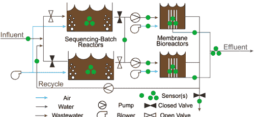

图 3.8 Mines Park 运行的 SBR-MBR 示意图。单个和三个传感器点分别表示该过程点正在记录单个和多个特征。溶解氧、压力、流量、体积、总悬浮固体、电导率和浑浊度等特征每分钟自动感应一次。

位于科罗拉多州 Golden 的 Mines Park 水回用测试站点（Mines Park）利用物理、化学和生物过程的组合，每天处理约 7,000 加仑的市政废水。该站点连续运行了过去十年，超过 30 个变量每分钟被监控和记录，见 Fig. 3.8。其废水来自科罗拉多矿业学院校园内的一个学生公寓综合体。该设施的数据已被用于案例研究，以开发和研究多元过程监控方法 [42,94–96]。以下两个示例均使用由该设施生成的数据。

### 3.5.1 回溯故障隔离

在此示例中，我们说明了 2018 年 1 月 29 日发生的一个故障，其中化粪池进水口堵塞，导致污水位下降，进而暴露了一台水泵，导致系统过热并关机。原则上，


安装水位开关本可以解决这个问题，但当时并未安装此类传感器。应视为发生漂移的变量包括 sewage_level、生物反应器水位和生物反应器溶解氧，分别记为 bio_level 和 bio_do。在此特定系统中，两个生物反应器并行运行，因此 bio_level 和 bio_do 各对应两个变量，如表 3.3 所示。

| 响应变量 | 描述 |
|---|---|
| bio_1_do, bio_2_do | 生物反应器 1 或 2 的溶解氧浓度 |
| bio_1_level, bio_2_level | 生物反应器 1 或 2 的水位 |
| bio_1_temp, bio_2_temp | 生物反应器 1 或 2 的温度 |
| sewage_flow | 污水流量 |
| sewage_level | 污水位 |
| ras_ph | 回流活性污泥 pH 浓度 |
| ras_tss | 回流活性污泥悬浮固体总量 |
| ras_temp | 回流活性污泥温度 |
| 预测变量 | 描述 |
| after_fault | 故障修正后的观测值（1 月 25 日，仅 ras_tss） |
| bio_1_blower_flow, bio_2_blower_flow | 生物反应器 1 或 2 的鼓风机流量 |
| ambient_temp | 环境温度 |
| bio_1_phase_1, bio_2_phase_1 | 生物反应器 1 或 2 处于第 1 阶段（混合-充填） |
| bio_1_phase_2, bio_2_phase_2 | 生物反应器 1 或 2 处于第 2 阶段（反应-充填） |
| mbr_flux_mode | 膜生物反应器 1 和 2 处于峰值模式 |
| mbr_1_air_scour_valve | 膜生物反应器 1 阀门打开 |
| mbr_1_mode_1, mbr_2_mode_1 | 膜生物反应器 1 或 2 处于模式 1（产水） |
| mbr_1_mode_2, mbr_2_mode_2 | 膜生物反应器 1 或 2 处于模式 2（反冲洗） |
| mbr_1_mode_4, mbr_2_mode_4 | 膜生物反应器 1 或 2 处于模式 4（松弛） |
| 周期变量 | 描述 |
| cos_hourly, sin_hourly | 小时趋势的谐波分量 |
| cos_2hour, sin_2hour | 两小时趋势的谐波分量 |
| cos_daily, sin_daily | 日趋势的谐波分量 |

我们采用文献 [42] 的回顾性变点检测方法。第一步是确定训练窗口和监测窗口。在本问题中，训练窗口为 2018 年 1 月 23 日至 27 日期间五天的一分钟数据，包含 7,195 个观测值。监测窗口始于 2018 年 1 月 28 日，持续两天半（3,750 个观测值）。下一步是将响应变量与预测变量和周期变量分开。响应变量是指需要监测且能指示过程故障的变量，例如 sewage_flow 或 bio_level。预测变量要么（1）由操作员控制，例如生物反应器的阶段，要么（2）能解释系统内部的变异性但不可控制，例如 ambient_temp。我们还包含每个预测变量的滞后版本，因为预测变量对响应变量的影响可能存在延迟。我们通过加入一个二元变量来调整 ras_tss 中的已知偏移，该偏移源于膜生物反应器先前故障的修正，用于指示观测值发生在修正之前还是之后。我们还加入周期变量，通过添加三对对应周期的正弦/余弦分量来考虑日趋势、两小时趋势和小时趋势。表 3.3 汇总了案例研究中使用的响应变量、预测变量和周期变量。然后，我们使用基于训练窗口数据的岭回归提供的初始参数估计，采用自适应 Lasso [35] 对响应变量进行去趋势化。图 3.9 给出了每个响应变量回归系数的热图。方框的颜色指示预测变量或周期变量与响应变量之间线性关系的估计强度和符号；白色方框表示该变量已从模型中排除。例如，bio_1_do 与 bio_1_blower_flow 的滞后值具有强正线性关系；ras_tss 具有强日趋势；生物反应器的阶段对 sewage_flow 的均值有显著影响。

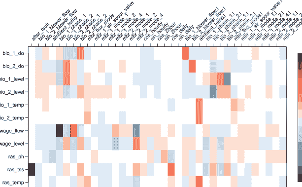

**图 3.9** 用于建模 11 个响应变量（行）的预测变量和周期变量（列）回归系数的热图。白色方框对应从模型中排除的预测变量或周期变量，且以 ".1" 结尾的预测变量名称为预测变量的滞后版本。

然后，使用估计的回归模型对监测期间的观测值进行去趋势化，并可对残差进行变点评估。图 3.10 给出了 ras_tss（左）和 bio_1_do（右）的去趋势化过程示例。在图 3.10A 和 3.10B 中，模型使用蓝色垂直虚线左侧训练窗口的数据进行拟合，这些数据解释了随时间变化且不指示故障的数据变异性。

**图 3.10** ras_tss（左）和 bio_1_do（右）的原始特征（顶部）和残差（底部），拟合值显示为红色（打印版中为浅灰色）。蓝色垂直虚线标识 IC 期的结束和监测期的开始。蓝色垂直虚线右侧的拟合值基于 IC 期的系数估计。（A）ras_tss 的原始特征（R^2 = 0.71）；（B）bio_1_do 的原始特征（R^2 = 0.95）；（C）ras_tss 的残差；（D）bio_1_do 的残差。

在图 3.10C 和 3.10D 中，残差仍然表现出未由拟合模型解释的变化，例如 1 月 29 日 ras_tss 的逐渐增加和 bio_1_do 的变异性增加。请注意，图 3.10A 中的大幅向下偏移是由于膜生物反应器中发生的单独故障引起的，但可以通过指示变量轻松移除。

训练数据还用于估计 aEBIC 准则中用于选择熔融 Lasso 模型复杂度的有效样本量。为此，构建了训练窗口中每个变量残差的 PACF 图来评估 AR(1) 模型的拟合优度，我们发现该模型对大多数变量效果良好，因此使用 PACF 图来估计每个变量的滞后一阶自相关系数。这些估计的自相关系数范围从 0.35 到 0.99，平均值为 0.83，表明存在相当强的正时序自相关；因此，监测窗口中数据的有效样本量估计为 339，远小于观测到的 3,750 个值。

最后，将熔融 Lasso 模型拟合到监测期间的残差上，并使用 aEBIC 选择惩罚参数 γ。结果如图 3.11 所示，其中为六个关键响应变量绘制了标准化残差的时间序列。这六个图描绘了该方法检测到的 53 次偏移中的除一次以外的所有偏移。绿色阴影区域（打印版中为浅灰色阴影）是怀疑故障发生的时间段；蓝色向下箭头（打印版中为深灰色）表示检测到的减少；红色向上箭头（打印版中为中灰色）表示检测到的增加；箭头大小分别表示小、中或大偏移。我们注意到，如果有效

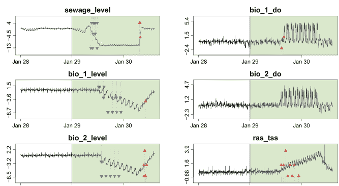

**图 3.11** 去趋势化变量的时间序列，检测到的故障用红色（打印版中为中灰色）和蓝色（打印版中为深灰色）箭头标识，箭头大小与偏移量成比例。绿色阴影区域（打印版中为浅灰色阴影）标识了故障的推测时间范围。

样本量调整未进行，熔融 Lasso 方法将检测到 429 次偏移，其中绝大多数都是伪偏移。在此，我们看到该方法检测到从 1 月 29 日上午 8:00 左右开始的 `sewage_level` 中的一系列向下偏移。四小时后，`bio_1_level` 中检测到多次连续向下偏移，一小时后 `bio_2_level` 中出现一组向下偏移。在下午 2:45 检测到 `bio_1_do` 的增加，但在 `bio_2_do` 中未识别出异常偏移。这是预期中的，因为该方法旨在检测均值的偏移，但方差似乎已发生变化。除 `bio_2_do` 外，这些结果与操作员给出的故障时间线一致。此外，该方法检测到 `ras_tss` 中从下午 2:30 左右开始的小幅上升漂移故障，该故障最初未经操作员通过目视检查识别出来。在 1 月 30 日中午左右，所有三个水位变量似乎都恢复到故障前的值，并通过检测到的向上方向偏移来指示。

### 3.5.2 实时故障隔离

在 SBR-MBR 系统运行初期，两个故障在几天内相继发生。首先，膜生物反应器（MBR）罐中的水位迅速下降。这使得系统在随后发生重大降水事件后容易受到进水水质第二次变化的影响，降水事件将道路上的除冰盐冲入下水道系统。除冰盐的存在导致产水电导率增加和回流活性污泥（RAS）pH 浓度降低，严重损坏了生物-


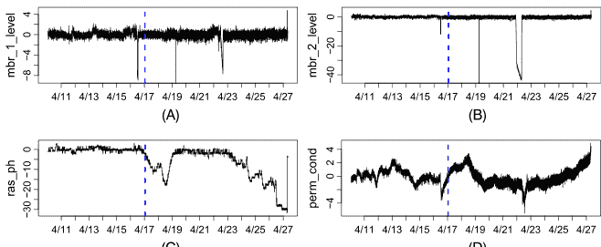

**图3.12** 四个疑似发生漂移的变量的残差：MBR 1和2水位，RAS pH，以及透过液电导率。蓝色垂直虚线表示训练窗口的结束以及实时监控开始的时间。(A) mbr_1_level 的残差；(B) mbr_2_level 的残差；(C) ras_ph 的残差；(D) perm_cond 的残差。

系统的逻辑共同体。在此案例研究中，我们应用实时FD&I方法，展示先进的过程监控方法如何在系统操作员察觉之前识别系统中的故障。

2010年4月10日至16日，一周的一分钟观测数据被用作训练数据集，共包含10,045个观测。我们从4月17日开始监控，并监控系统11天（14,859个观测）。与Sect. 3.5.1中呈现的案例研究一样，我们使用一组预测变量（及其滞后值）和循环变量对观测数据进行去趋势化。数据集描述、去趋势过程的额外细节以及用于去趋势的变量可参见[42]。

我们预计在 mbr_1_level、mbr_2_level、ras_ph 和 perm_cond 中观察到漂移。四个漂移变量的残差如Fig. 3.12所示。在训练窗口期间，mbr_1_level、mbr_2_level 和 ras_ph 的残差均具有大致恒定的均值；然而，perm_cond 中仍存在一些非平稳性。mbr_1_level 和 mbr_2_level 残差的下移发生在4月22日左右，且对MBR 2水槽更为严重。ras_ph 残差的下降首先发生在4月17日，并在4月19日恢复，但又在4月23日左右开始再次下降。大约在同一时间，perm_cond 残差开始上升。

对于FD，我们通过将每个去趋势变量的滞后版本纳入监控，应用主成分分析（PCA）的动态扩展[97–100]。对于每个观测，我们保留捕获85%变异性的主成分，并计算Hotelling’s T²和Q（也称为SPE）。如果任一统计量在误报率为 alpha = 0.01 的非参数阈值下超标，则该观测被标记为失控（OC）。该方法的更多细节可见[94]和[95]，它们也将PCA的变体应用于该数据集进行FD。当观测被标记为OC时，我们应用由[55]提出并在Sect. 3.2.3.2中描述的FI方法，以识别均值的非零分量，这些分量对应于漂移变量，因为训练窗口的去趋势数据已被中心化。

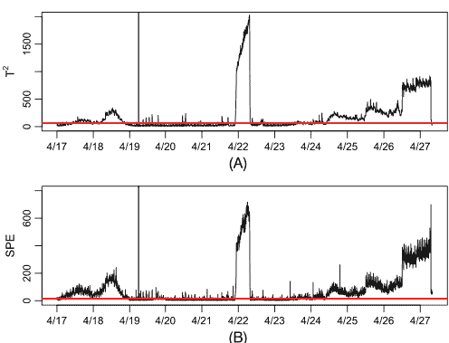

**图3.13** 监控期间的监控统计量 \( T^2 \)（顶部）和 Q 或 SPE（底部）。红色水平线（印刷版中为中灰色）表示用于将观测分类为OC的非参数阈值。(A) \( T^2 \) 监控统计量；(B) SPE 监控统计量。

Fig. 3.13 给出了监控期间的监控统计量 \( T^2 \) 和 SPE。非参数阈值是根据训练期间监控统计量的核密度估计（KDE）的百分位数确定的，以红色（印刷版中为中灰色）给出。两个统计量倾向于遵循相同的模式，即当其中一个较大时，另一个也较大，并且当Fig. 3.12中一个或多个变量发生漂移时，监控统计量倾向于较大。有三个时间段，统计量持续超过其对应的阈值：(1) 4月17日至19日期间 ras_ph 的首次下移期间；(2) 4月22日 MBR 水位故障期间；以及(3) 从大约4月24日开始至监控结束，在此期间 ras_ph 和 perm_cond 变得越来越失控。

既然FD方法已检测到系统中的故障，则应用FI方法来识别漂移变量。Fig. 3.14 绘制了监控期间每个变量被分类为漂移或未漂移的情况，其中黑色框表示该变量在给定时间点被识别为漂移，否则为白色。我们强烈怀疑已发生漂移的变量以黄色突出显示（印刷版中为浅灰色）。这种图表被称为棋盘图，有助于跟踪漂移变量随时间的变化 [15,73]，并展示故障如何随时间从一个变量传播到另一个变量，特别是在实现了反馈控制的系统中 [66]。

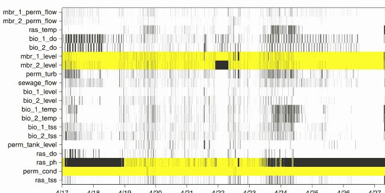

图3.14 故障隔离结果的棋盘图，其中黑色框表示变量在给定时间点被识别为漂移，否则为白色。怀疑真正发生漂移的变量以黄色突出显示（印刷版中为浅灰色）。

4月17日至19日期间，ras_ph 持续被识别为漂移。mbr_2_level 的漂移也被清晰识别，但 mbr_1_level 的漂移未被识别；这可能是因为漂移幅度小得多，并可能被训练期间的一些极端值掩盖。4月23日结束时，ras_ph 中识别出另一个漂移，并持续被标记为漂移直到监控结束。然而，perm_cond 未被识别为漂移，这可能是由于残差中存在非平稳性。在 bio_1_temp、bio_2_temp 和 ras_temp 等变量中识别出的其他漂移也可能是由数据中的非平稳性或噪声引起的，在缺乏变量发生漂移的持续证据的情况下可以忽略。

操作员直到4月24日上午10:00才收到故障警报，一旦确定了根本问题，系统花了两个月时间才完全恢复并实现正常运行条件。使用本案例研究中提出的FD&I方法本可更早检测到故障，并会向操作员指出负责故障的一些关键变量，从而使他们能够更快地解决问题。在拥有众多复杂相关变量的系统中，FD通常是不够的，因为操作员可能难以识别漂移变量，尤其是在随时间变得更严重的漂移故障的情况下。因此，FI是在整个系统受影响之前诊断故障的重要步骤。

## 3.6 进一步阅读

已发表了一些包含进一步阅读参考文献的优秀综述论文。Capizzi [101] 总结了一些基于VS的第二阶段控制图，并指出了一些开放的研究领域，例如开发无分布法、用于自相关数据的方法以及用于第一阶段分析的VS方法。Peres 和 Foglia [102] 提供了对整合到多元统计过程监控中的30种VS方法的广泛近期综述。列出了每篇论文解决的现有方法局限性及其各自的目标。他们将方法分为以下几类：(i) 在过程监控前通过执行VS对变量进行预处理；(ii) 在过程监控后通过执行VS对变量进行后处理；或(iii) 在VS和过程监控之间进行迭代。他们以自己的未来研究主题列表结束，其中一些与[101]重叠。其他独特问题包括对批处理过程和故障诊断方法的更多工作，Reis 和 Gins [66] 也将其引用为未来工作的重要领域。事实上，Reis 和 Gins [66] 对工业过程监控的发展和未来需求提供了非常好的高级概述，其中包括基于VS的监控以及隔离和分类方法。他们观察到，故障检测速度相对于诊断故障所需的时间较低，因此主张研究人员专注于故障预后，后者旨在预判故障并在故障发生前干预系统以进行维护或修理。最后，Qin [103] 提供了一篇更侧重技术的综述，重点介绍了PCA和PLS，以及在受控系统背景下使用重建图进行故障隔离。

## 参考文献

- [1] M. Turkoz, S. Kim, Y.-S. Jeong, K.N. Al-Khalifa, A.M. Hamouda, Distribution-free adaptive step-down procedure for fault identification: non-parametric fault identification approach, Quality and Reliability Engineering International 32 (8) (2016) 2701–2716.
- [2] K. Wang, W. Jiang, High-dimensional process monitoring and fault isolation via variable selection, Journal of Quality Technology 41 (2009) 247–258.
- [3] C. Zou, W. Jiang, F. Tsung, A LASSO-based diagnostic framework for multivariate statistical process control, Technometrics 53 (3) (2011) 297–309.
- [4] C. Zhao, W. Wang, Efficient faulty variable selection and parsimonious reconstruction modelling for fault isolation, Journal of Process Control 38 (2016) 31–41.
- [5] N. Shinozaki, T. Iida, A variable selection method for detecting abnormality based on the T² test, Communications in Statistics. Theory and Methods 46 (2017) 8603–8617.
- [6] W. Jiang, K. Wang, F. Tsung, A variable-selection-based multivariate EWMA chart for process monitoring and diagnosis, Journal of Quality Technology 44 (2012) 209–230.
- [7] K. Paynabar, C. Zou, P. Qiu, A change-point approach for phase-I analysis in multivariate profile monitoring and diagnosis, Technometrics 58 (2) (2016) 191–204.
- [8] G. Capizzi, G. Masarotto, Phase I distribution-free analysis of multivariate data, Technometrics 59 (2017) 484–495.
- [9] M. Hubert, T. Reynkens, E. Schmitt, T. Verdonck, Sparse PCA for high-dimensional data with outliers, Technometrics 58 (4) (2016) 424–434.
- [10] D. Dong, T.J. McAvoy, Batch tracking via nonlinear principal component analysis, AIChE Journal 42 (1996) 2199–2208.
- [11] F. Baggiani, S. Marsi-Libelli, Real-time fault detection and isolation in biological wastewater treatment plants, Water Science and Technology: a Journal of the International Association on Water Pollution Research 60 (2009) 2949–2961.
- [12] D.S. Lee, P.A. Vanrolleghem, Adaptive consensus principal component analysis for on-line batch process monitoring, Environmental Monitoring and Assessment 92 (2004) 119–135.


- [13] C.F. Alcala, S.J. Qin, 基于重构的过程监测贡献度, 自动化 45 (7) (2009) 1593–1600.

- [14] C.F. Alcala, S.J. Qin, 基于核主成分分析的过程监测重构贡献度, 工业与工程化学研究 49 (17) (2010) 7849–7857.

- [15] Z. Yan, Y. Yao, 基于LASSO的故障隔离变量选择方法, 化学计量学与智能实验室系统 146 (2015) 136–146.

- [16] C. Zou, P. Qiu, 基于LASSO的多元统计过程控制, 美国统计协会杂志 104 (2009) 1586–1596.

- [17] G. Capizzi, G. Masarotto, 多维数据最小角回归控制图, 技术计量 53 (3) (2011) 285–296.

- [18] Y.-H. Chu, S.J. Qin, C. Han, 基于变量选择的模式分类故障检测与运行模式识别, 工业与工程化学研究 43 (7) (2004) 1701–1710.

- [19] K. Ghosh, M. Ramteke, R. Srinivasan, 有效统计过程监测的最优变量选择, 计算机与化学工程 60 (2014) 260–276.

- [20] F. de Assis Boldt, T.W. Rauber, F.M. Varejão, 田纳西伊斯特曼过程自动故障诊断的级联特征选择与ELM, 神经计算 239 (2017) 238–248.

- [21] I. González, I. Sánchez, 多元统计过程控制的变量选择, 质量技术杂志 42 (3) (2010) 242–259.

- [22] K. Wang, F. Tsung, 反馈控制过程监测的自适应降维方案, 质量与可靠性工程国际 25 (2009) 283–298.

- [23] K. Nishimura, S. Matsuura, H. Suzuki, 基于ICA变量选择的多元统计过程监测多元EWMA控制图, 统计与概率快报 104 (2015) 7–13.

- [24] Y.-H. Chu, Y.-H. Lee, C. Han, 基于自助法广义变量选择的批次过程质量估计与知识提取改进, 工业与工程化学研究 43 (11) (2004) 2680–2690.

- [25] S. Bersimis, A. Sgora, S. Psarakis, 多元控制图失控信号解释方法：一项比较研究, 质量与可靠性工程国际 33 (2017) 2295–2326.

- [26] R.L. Mason, N.D. Tracy, J.C. Young, 多元控制图解释中T²的分解, 质量技术杂志 27 (1995) 99–108.

- [27] R.L. Mason, N.D. Tracy, J.C. Young, 多元T²控制图信号解释的实际方法, 质量技术杂志 29 (4) (1997) 396–406.

- [28] B.J. Murphy, 基于T²多元质量控制程序的失控变量选择, 皇家统计学会杂志. D系列. 统计学家 36 (5) (1987) 571–581.

- [29] F. Aparisi, G.A. no, J. Sanz, T²控制图信号解释技术, IIE交易 38 (8) (2006) 647–657.

- [30] L.-H. Chen, T.-Y. Wang, 基于多元T²图信号的人工神经网络均值漂移分类, 计算机与工业工程 47 (2) (2004) 195–205.

- [31] S.T.A. Niaki, B. Abbasi, 基于人工神经网络的多元控制图故障诊断, 质量与可靠性工程国际 21 (8) (2005) 825–840.

- [32] S. Psarakis, 统计过程控制图中神经网络的应用, 质量与可靠性工程国际 27 (5) (2011) 641–650.

- [33] M.G. de la Parra, P. Rodríguez-Loaiza, 多元T²控制图和Mason–Tracy–Young分解程序在药物杂质谱一致性研究中的应用, 质量工程 16 (2003) 127–142.

- [34] R. Tibshirani, 基于lasso的回归收缩与变量选择, 皇家统计学会杂志. B系列. 方法学 58 (1996) 267–288.

- [35] H. Zou, 自适应lasso及其神谕特性, 美国统计协会杂志 101 (2006) 1418–1429.

- [36] H. Wang, C. Leng, 基于最小二乘近似的统一lasso估计, 美国统计协会杂志 102 (479) (2007) 1039–1048.

- [37] P. Zhao, B. Yu, 关于lasso模型选择一致性, 机器学习研究杂志 7 (2006) 2541–2563.

- [38] T. Hastie, R. Tibshirani, M. Wainwright, 稀缺性统计学习：lasso与推广, CRC出版社, 2015.

- [39] H. Oja, 基于R的多元非参数方法：基于空间符号和秩的方法, Springer, 2010.

- [40] P. Qiu, 统计过程控制导论, CRC出版社, 2014. [在线]。可用：https://www.crcpress.com/Introduction-to-Statistical-Process-Control/Qiu/p/book/9781439847992.

- [41] J. Chen, Z. Chen, 大模型空间模型选择的扩展贝叶斯信息准则, 生物计量 95 (2008) 759–771.

- [42] M.C. Klandermaier, K.B. Newhart, T.Y. Cath, A.S. Hering, 复杂分散式污水处理设施故障隔离, 皇家统计学会杂志. C系列 (2020), 投稿中.

- [43] P. Qiu, D. Xiang, 单变量动态筛选系统：识别不规则纵向行为个体的方法, 技术计量 56 (2) (2014) 248–260.

- [44] P. Qiu, D. Xiang, 基于多元动态筛选系统的心血管疾病监测, 医学统计 34 (14) (2015) 2204–2221.

- [45] J. Li, P. Qiu, 相关纵向数据监测非参数动态筛选系统, IEEE交易 48 (8) (2016) 772–786.

- [46] J. Li, P. Qiu, 构建高效多元动态筛选系统：构建高效多元动态筛选系统, 质量与可靠性工程国际 33 (8) (2017) 1969–1981.

- [47] R. Tibshirani, M. Saunders, S. Rosset, J. Zhu, K. Knight, 基于融合lasso的稀疏性与平滑性, 皇家统计学会杂志. B系列. 统计方法学 67 (2005) 91–108.

- [48] S. Zhang, Z. Yan, P. Wu, Z. Zhang, 基于贝叶斯融合lasso的故障隔离, 收录于：2017中国自动化大会(CAC), IEEE, 济南, 2017, 第2778–2783页.

- [49] C.R. Rojas, B. Wahlberg, 关于使用融合lasso方法的变点检测. [在线]。可用：http://arxiv.org/abs/1401.5408, 2014.

- [50] R.J. Tibshirani, J. Taylor, 广义lasso的解路径, 统计学年刊 39 (2011) 1335–1371.

- [51] T.B. Arnold, R.J. Tibshirani, Genlasso：广义lasso问题的路径算法, R包版本1.4. [在线]。可用：https://CRAN.R-project.org/package=genlasso, 2019.

- [52] M.B. Priestley, 谱分析与时间序列, 学术出版社, 1981.

- [53] I.T. Jolliffe, N.T. Trendafilov, M. Uddin, 基于lasso的修正主成分技术, 计算与图形统计杂志 12 (3) (2003) 531–547.

- [54] H. Zou, T. Hastie, R. Tibshirani, 稀疏主成分分析, 计算与图形统计杂志 15 (2006) 265–286.

- [55] S. Ebrahimi, C. Ranjit, K. Paynabar, 制造系统中监测与诊断的大型多流数据分析, arXiv:1812.10430 [stat.ML], 2018. [在线]。可用：http://arxiv.org/abs/1812.10430.

- [56] Q. Jiang, X. Yan, B. Huang, 基于故障相关变量选择与贝叶斯推断的性能驱动分布式PCA过程监测, IEEE工业电子学会论文集 63 (2016) 377–386.

- [57] D. Yan, S. Zhang, U. Jung, 基于惩罚似然与高斯混合模型的多模态和高维过程变量选择控制图, 质量与可靠性工程国际 35 (2019) 1263–1275.

- [58] T.-H. Kuang, Z. Yan, Y. Yao, 基于判别分析变量选择的多元故障隔离, 过程控制杂志 35 (2015) 30–40.

- [59] B. Pourbabaee, N. Meskin, K. Khorasani, 基于多模型混合卡尔曼滤波器的燃气轮机发动机传感器故障检测、隔离与识别, IEEE控制系统技术交易 24 (2016) 1184–1200.

- [60] K. Villez, B. Srinivasan, R. Engasawy, S. Narasimhan, V. Venkatasubramanian, 基于卡尔曼的故障检测与识别（FDI）策略：缓冲罐系统的扩展与关键评估, 计算机与化学工程 35 (5) (2011) 806–816.

- [61] W. Li, X. Pu, F. Tsung, D. Xiang, 基于前向变量选择的稳健自启动空间秩多元EWMA图, 计算机与工业工程 103 (2017) 116–130.

- [62] W. Liang, D. Xiang, X. Pu, 用于检测稀疏均值偏移的稳健多元EWMA控制图, 质量技术杂志 48 (2016) 265–283.

- [63] J. Li, K. Liu, X. Xian, 多元分类过程因果关系基础的过程监测与诊断, IISE交易 49 (2017) 332–343.

- [64] C. Zhao, F. Gao, 无先验故障信息的初始故障隔离稀疏差异性分析算法, 控制工程实践 65 (2017年8月) 70–82.

- [65] M. Zarzo, A. Ferrer, 批次过程诊断：带变量选择的PLS与分块PCR, 化学计量学与智能实验室系统 73 (2004) 15–27.

- [66] M.S. Reis, G. Gins, 大数据/工业4.0时代的工业过程监测：从检测到诊断再到预后, 过程 5 (2017) 1–16.

- [67] K. Wang, A.B. Yeh, B. Li, 基于惩罚似然估计的过程均值向量与协方差矩阵同步监测, 计算统计与数据分析 78 (2014) 206–217.

- [68] Z. Yan, T.-H. Kuang, Y. Yao, 基于偏最小二乘判别分析变量选择的批次过程多元故障隔离, ISA交易 70 (2017年9月) 389–399.

- [69] Y. Yao, Y. Diao, N. Lu, J. Lu, F. Gao, 具有自动确定支撑区域的二维动态主成分分析, 工业与工程化学研究 48 (2009) 837–843.

- [70] S. Kim, M.K. Jeong, E.A. Elsayed, 基于L2-范数正则化的惩罚似然高维过程质量监测, 质量技术杂志 (2019) 1–16 (在线).

- [71] M. Turkoz, S. Kim, Y.-S. Jeong, M.K.M. Jeong, E.A. Elsayed, K.N. Al-Khalifa, A.M. Hamouda, 故障变量识别的贝叶斯框架, 质量技术杂志 51 (2019) 375–391.

- [72] G.M. Abdella, K.N. Al-Khalifa, S. Kim, M.K. Jeong, E.A. Elsayed, A.M. Hamouda, 基于变量选择的多元累积和控制图：基于变量选择的MCUSUM, 质量与可靠性工程国际 33 (2017) 565–578.

- [73] Z. Yan, Y. Yao, T.-B. Huang, Y.-S. Wong, 基于贝叶斯lasso的基于重构的多元过程故障隔离, 工业与工程化学研究 57 (2018) 9779–9787.

- [74] Z. Ge, F. Gao, Z. Song, 非线性多模态过程二维贝叶斯监测方法, 化学工程科学 66 (2011) 5173–5183.

- [75] Z. Ge, M. Zhang, Z. Song, 基于线性子空间与贝叶斯推断的非线性过程监测, 过程控制杂志 20 (2010) 676–688.

- [76] Q. Jiang, B. Huang, 基于多元统计分析与贝叶斯方法的大规模过程分布式监测, 过程控制杂志 46 (2016) 75–83.

- [77] J.J. Downs, E.F. Vogel, 厂区范围工业过程控制问题, 计算机与化学工程 17 (1993) 245–255.

- [78] N. Ricker, 田纳西伊斯特曼挑战过程的最优稳态运行, 计算机与化学工程 19 (1995) 949–959.

- [79] X. Gao, J. Hou, 田纳西伊斯特曼过程改进的SVM集成GS-PCA故障诊断方法, 神经计算 174 (2016) 906–911.


[80] H. Zhang, Y. Qi, L. Wang, X. Gao, X. Wang, 基于增强KECA的化学过程故障检测与诊断, 化学计量学与智能实验室系统 161 (2017) 61–69.

[81] A. Ragab, M. El-Koujok, B. Poulin, M. Amazouz, S. Yacout, 基于数据逻辑分析的可解释模式工业化学过程故障诊断, 专家系统与应用 95 (2018) 368–383.

[82] H. Zhao, S. Sun, B. Jin, 基于LSTM神经网络的序列故障诊断, IEEE Access 6 (2018) 19299–19299.

[83] L.H. Chiang, R.J. Pell, M.B. Seasholtz, 基于稳健统计分析和变量选择的过程数据多元分析, IFAC会议录 37 (2004) 269–274.

[84] Y. Shang, X. Zi, F. Tsung, Z. He, 面向二进制数据多阶段过程的LASSO诊断方案, 计算机与工业工程 72 (2014) 198–205.

[85] J. Kim, M.K. Jeong, E.A. Elsayed, K.N. Al-Khalifa, A.M.S. Hamouda, 故障变量识别的自适应逐步下降程序, 生产研究国际期刊 54 (11) (2016) 3187–3200.

[86] W. Li, D. Xiang, F. Tsung, X. Pu, 基于遗漏发现率控制的高维数据流诊断程序, 技术计量学 (2019) 1–27.

[87] P.H. Westfall, S.S. Young, 基于重采样的多重检验, Wiley, New York, 1993.

[88] Y. Benjamini, R. Heller, 空间信号的假发现率, 美国统计协会杂志 102 (480) (2007) 1272–1281.

[89] W. Sun, B.J. Reich, T.T. Cai, M. Guindani, A. Schwartzman, 大规模空间多重检验中的假发现控制, 皇家统计学会杂志，B系列，统计方法论 77 (1) (2015) 59–83.

[90] C. Xing, J.C. Cohen, E. Boerwinkle, 揭示影响FOXA2空腹血糖水平等位基因的加权假发现率控制程序, 美国人类遗传学杂志 86 (3) (2010) 440–446.

[91] H. Yan, K. Paynabar, J. Shi, 基于时空平滑稀疏分解的高维功能数据流实时监测, 技术计量学 60 (2) (2018) 181–197.

[92] C.K. Yoo, K. Vilelle, S.W. Van Hulle, P.A. Vanrolleghem, 废水处理系统增强过程监测, 环境计量学 19 (2008) 617–662.

[93] L. Corominas, K. Vilelle, D. Aguado, L. Rieger, C. Rosén, P.A. Vanrolleghem, 废水处理过程故障检测方法性能评估, 生物技术与生物工程 108 (2011) 333–344.

[94] G.J. Odom, K.B. Newhart, T.Y. Cath, A.S. Hering, 多状态多元统计过程控制, 商业与工业应用随机模型 34 (2018) 880–892.

[95] K. Kazor, R.W. Holloway, T.Y. Cath, A.S. Hering, 去中心化废水处理设施自动化过程监测中线性和非线性降维技术比较, 随机环境研究与风险评估 30 (2016) 1527–1544.

[96] P. Krupskii, F. Harrou, A.S. Hering, Y. Sun, 基于Copula的非高斯多元过程监测方案, 质量技术杂志 (2020), 现已在线.

[97] S.W. Choi, I.-B. Lee, 基于动态核主成分分析的非线性动态过程监测, 化学工程科学 59 (24) (2004) 5897–5908.

[98] U. Kruger, Y. Zhou, G.W. Irwin, 大规模过程改进主成分监测, 过程控制杂志 14 (8) (2004) 879–888.

[99] J. Mina, C. Verde, 基于自适应动态主成分分析的大规模系统故障检测, IFAC会议录 (2) (2007) 185–194.

[100] W. Ku, R.H. Storer, C. Georgakis, 基于动态主成分分析的扰动检测与隔离, 化学计量学与智能实验室系统 30 (1) (1995) 179–196.

[101] G. Capizzi, 过程监测的最新进展：用于第一阶段和第二阶段的非参数和变量选择方法, 质量工程 27 (2015) 44–67.

[102] F.A.P. Peres, F.S. Fogliatto, 多元统计过程控制中变量选择方法的系统文献综述, 计算机与工业工程 115 (2018) 603–619.

[103] S.J. Qin, 数据驱动工业过程监测与诊断调查, 控制年度评论 36 (2) (2012) 220–234.

# 非线性隐变量回归方法

## 4.1 引言

现代过程中的异常检测对于确保最佳运行条件、提高安全性和避免系统崩溃是必不可少的。在工程和环境过程中同时监测许多关键变量时，多元监测技术利用高相关性和冗余性，生成一组减少的不相关变量。尽管数据驱动方法在过程监测中取得了一定成功，但其效率主要取决于提取特征的质量。换言之，模型精度在故障检测中起着重要作用。

一般来说，开发灵活模型面临巨大挑战，包括测量变量间的多重共线性、非线性以及测量数据中的噪声。隐变量回归（LVR）技术通过利用数据中的高度冗余并生成少量不相关变量，在处理多元相关数据方面表现出良好的能力。此类技术可生成条件良好的模型[1]。线性LVR方法在统计过程监测中已被广泛应用，如主成分分析（PCA）[2,3]、偏最小二乘法（PLS）[2,4,5]和正则规范相关分析（RCCA）[6–9]，可处理多维性和互相关性。LVR方法的关键思想是根据过程特征应用适当的多元降维技术，并使用控制图在低维下监测更具信息量的变量。然而，当非线性占主导地位时，这对于环境和工程过程可能不够充分。

实际上，由于各种工业应用的大部分实际数据在统计上具有挑战性，因为其高维特征，变量间的关系是非线性的，因此可能发生多种故障类型。尽管LVR方法应用成功，但其使用局限于捕捉数据中的线性信息。因此，当用于高度非线性过程的建模和监测时，它们会导致性能不佳、误导性洞察和相关信息丢失[10]。事实上，当将基于线性LVR的方案应用于非线性过程时，选择最佳LVs数量并非易事。这主要是因为非线性效应在LVs之间以非均匀方式分布（即，被认为不太相关的LVs）实际上可能产生重大影响。因此，需要灵活的方法来进行适当的特征提取以处理非线性过程。为了捕捉数据中的非线性，文献中存在许多非线性LVR策略。可用于非线性的各种LVR模型包括核主成分分析（KPCA）、局部线性嵌入（LLE）[11–13]以及基于多项式函数、光滑样条、人工神经网络和核学习的模型[14–17]。

尽管LVR模型（PLS和PCA）应用成功，但它们仅限于描述数据中的线性相关性，因此在处理过程非线性时可能导致大量实质性信息丢失[10]。为了缓解线性LVR方法对非线性输入–输出过程的局限性，已设计了多种非线性PLS（NLPLS）方法，以改善非线性数据中的特征提取。文献中已设计了各种NLPLS的非线性扩展，如二次、神经网络、模糊和核PLS [18–22]。例如，在[23,24]中，通过对提取的LVs应用平滑器和基于样条的加性非线性回归方法，引入了一种改进的NLPLS方法。在[18,25]中，通过使用二次函数建模内部关系，开发了QPLS。尽管如此，二次函数对复杂过程的建模仍不够灵活。同样，已设计了多种非线性扩展用于建模PLS中的内部关系，如神经网络PLS [19,20]和模糊PLS [22,21]。在[26]中，Malthouse等人提出了一种使用人工神经网络建模内部关系的非线性PLS方法。采用不同的非线性方法来有效描述PLS中的内部关系，如前馈神经网络 [19,20]、Takagi–Sugeno–Kang（TSK）关系 [21]和二次模糊函数 [22]。另一种非线性PLS模型称为核PLS，它通过使用核函数将输入数据投影到特征空间，在其中执行线性PLS来设计 [16]。

对于输入空间模型（如PCA），非线性PCA（NLPCA）是PCA的一种扩展，允许提取过程变量之间的非线性关系。这可以通过将测量变量映射到曲线和曲面，而不是线性PCA中的线和平面来实现。此外，还提出了不同形式的神经网络模型来捕捉主成分之间的非线性 [27,28,14]，其中NLPCA模型参数通过最小化模型预测与测量数据之间的均方误差来确定。处理过程数据中非线性的另一种方法是使用核PCA（KPCA）[20,21,13]。KPCA的关键概念是首先使用非线性映射将输入空间投影到高维特征空间（变换空间），然后在特征空间中提取主成分（PCs）[12,29]。本质上，KPCA可以使用积分算子和非线性核函数在特征空间中高效计算PCs [11,30]。KPCA方法相对于非线性PCA方法的主要优势是完全避免了非线性优化。


监测多变量非线性过程显然比监测线性过程更具挑战性，且异常可能在被检测过程中被抹平。由于环境和工业过程中收集的大多数数据本质上都是非线性的，因此需要具有足够灵活性来表示任何非线性关系的非线性LVR方法。最近，基于非线性LVR的异常检测技术受到研究人员和工程师的广泛关注，用于复杂过程的监测。这是因为非线性LVR模型具有提取过程变量之间线性和非线性相关性的高能力。通常，为了过程监测目的，非线性LVR（如非线性PLS和PCA方法）首先基于在正常条件下运行的受监测过程的标称测量值来构建。这使得可以设计一个反映被检测过程标称行为的参考模型，该模型可用于检测潜在异常。之后，如果测量值在潜在空间或残差空间中偏离标称操作区域，则会标记异常。确实，可以使用不同的故障检测方案来检查生成的残差，包括SPE、$T^2$、单变量监测技术或二元聚类算法。

在此，我们回顾非线性PLS方法的基本问题定义和算法。为了更好地理解NLPLS，介绍了两种形式的非线性PLS算法（多项式和ANFIS）。对于输入空间模型，我们介绍了一种可用于建模和监测非线性过程的KPCA方法。本章提供了一个详细的案例研究，比较了KPCA方法相对于PCA方法在监测非线性过程中的优势。实际污水处理厂（WWTP）的数据用于比较。此外，使用模拟的活塞流反应器数据来展示NLPLS在检测各种故障类型方面的性能。本章最后介绍了一组经过充分验证的结论以及未来研究感兴趣的主题列表。

## 4.2 线性LVR方法在过程监测中的局限性

对于大规模系统（如污水处理厂和石化厂），基于模型的监测方法的设计需要付出巨大努力。基于数据的技术（如LVR方法）提供了更好、更简单的替代方案。基于降维的技术（如PCA和PLS）已受到广泛关注。一般来说，监测方法的成功应用取决于数据的质量以及从测量数据中使用的提取特征。众所周知的LVR方法已成功用于捕获系统的信息。基本上，LVR模型将原始数据空间投影到潜在空间，从而在考虑属性间相关性的同时降低原始数据空间的维度。这有助于在降低维度的潜在空间中预测输出变量，并提高模型的预测能力。线性LVR方法的主要缺点在于它假设输入和输出之间存在线性关系。具体来说，每个LV都是原始变量的线性组合，且与所有其他LV不相关。因此，大多数LVR模型参数估计使用线性回归技术来估计回归系数。因此，线性LVR模型捕获相关输入和输出之间线性关系的能力有限。换句话说，只要不存在过程非线性，线性LVR方法就是有利的。然而，随着实现所需期望的更高要求，现代工业系统中的过程演变非常显著，且过程变量之间的相关性是非线性的。在实践中，具有非线性的过程为异常检测带来了更多挑战。因此，使用线性LVR方法监测具有非线性的现实世界数据可能导致重要信息的丢失，从而导致模型预测不佳和误导性分析。基于LVR的方法的主要局限性在于它们只能从数据中提取线性特征；它们也无法描述实际行为。为缓解这一缺点，已开发了许多非线性LVR方法来处理非线性数据。变量之间的非线性关系通过非线性（曲线）潜在变量进行更好的建模和描述。使用非线性LVR方法将原始变量投影到曲线或曲面而不是线或平面上，可以实现线性和非线性关系的建模。图4.1A–B说明了使用线性和非线性PCA的概念。在图4.1A中，可以看到数据可以使用两个主成分近似；图4.1B显示数据可以使用一个非线性分量近似。可以从图4.1得出结论，将LV从线推广到曲线提供了对过程变量之间非线性关系的更好描述。

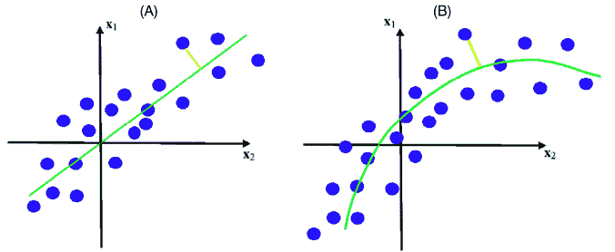

图4.1 线性和非线性PCA。

在输入–输出模型的情况下，LVR模型输入和输出的潜在空间用于捕获数据中的非线性。图4.2提供了一个示例，说明LVR模型连接得分向量的内部模型由曲线表示，而不是直线。可以观察到，如果用于捕获过程非线性，线性模型将失效。因此，需要在LVR模型的得分向量之间进行非线性映射。文献中有许多非线性映射函数用于在输入和输出潜在空间之间进行映射。LVR中内部空间（即潜在空间）的输入和输出被映射为非线性函数。本章介绍了两种不同的非线性方法。首先，我们讨论通过多项式函数进行的非线性映射；然后介绍基于自适应网络的模糊推理系统（ANFIS）。

## 4.3 开发用于过程监测的非线性LVR方法

本节首先介绍非线性PLS模型的一般概念，然后介绍两种非线性PLS模型，即多项式PLS和自适应神经-模糊推理系统（ANFIS）-PLS模型，两者都使用原始迭代线性PLS框架。最后，我们讨论基于非线性PLS模型的故障检测方案。

### 4.3.1 非线性偏最小二乘法

在现代工业过程中，工程师经常需要从可用数据中估计一些难以测量且不易收集的重要变量。软传感器技术已被广泛应用，以基于易于测量的变量来估计这些关键变量。对于输入–输出多变量数据，PLS是一种广为人知的软传感器技术，已在工业中成功应用，以提取两组变量（输入和输出）之间的关系。具体来说，线性PLS通常用于从其他可用测量值（称为输入）中预测不易获取的关键变量（称为输出）。例如，PLS模型可用于使用馏分柱不同托盘上的温度和压力测量值来预测馏分柱中的组成。它还可用于从各种气象条件（风向、风速等）的测量中预测风力涡轮机的功率产生。在PLS中，输入和输出矩阵 \(\mathbf{X} \in \mathbb{R}^{n \times m}\) 和 \(\mathbf{Y} \in \mathbb{R}^{n \times p}\) 表示如下 [31,32]:

```
\(\begin{cases} \mathbf{X} = \sum_{i=1}^l \mathbf{tp}_i^T = \mathbf{T}\mathbf{P}^T + \mathbf{G}, \\ \mathbf{Y} = \sum_{i=1}^l \mathbf{uq}_i^T = \mathbf{U}\mathbf{Q}^T + \mathbf{F}, \end{cases}\)
```

其中，矩阵 \(\mathbf{T} \in \mathbb{R}^{n \times l}\) 和 \(\mathbf{U} \in \mathbb{R}^{n \times q}\) 分别包含输入和输出数据的保留主成分（潜在变量），矩阵 \(\mathbf{P} \in \mathbb{R}^{m \times l}\) 和 \(\mathbf{Q} \in \mathbb{R}^{p \times q}\) 分别包含输入和输出加载向量，矩阵 \(\mathbf{G}\) 和 \(\mathbf{F}\) 分别是输入和输出残差矩阵。Eq. (4.1)中的模型通常称为“外模型”。输入和输出矩阵的表示（如外模型（4.1）所示）通过最大化输入和输出潜在变量（即 \(\mathbf{T}\) 和 \(\mathbf{U}\)）之间的协方差来确定。然后，可以得到关联输入和输出主成分（称为内模型）的模型为

```
\(\mathbf{U} = \mathbf{T}\mathbf{B} + \mathbf{H},\)
```

其中，\(\mathbf{B}\) 是包含关联输入和输出主成分的模型参数的矩阵，\(\mathbf{H}\) 是残差矩阵。

然而，工程和环境过程中的天然数据无法很好地满足线性假设，并且通常表现出显著的非线性。因此，需要非线性PLS模型。可以区分两类非线性PLS建模技术。第一类包括将输入和输出数据矩阵投影到非线性曲面上的技术 [33]，而 \(\mathbf{T}\) 和 \(\mathbf{U}\)（如Eq. (4.2)所示）之间的关系被假设为线性。这第一类非线性PLS方法在预测和过程监测中受到的关注非常有限。这主要是因为这些方法不保留线性方法的特性，并且输入和输出数据矩阵的映射成本高昂且具有挑战性 [33]。另一方面，在第二类技术中，输入和输出矩阵被线性投影，但任何输入主成分 \(t\) 和任何输出主成分 \(u\) 之间的关系是使用非线性函数建模的，即

```
\(\mathbf{u} = f(\mathbf{t}) + \mathbf{h},\)
```

其中，\(f(\cdot)\) 是关联 \(\mathbf{u}\) 到 \(\mathbf{t}\) 的连续非线性函数，\(\mathbf{h}\) 是残差。

在此，输入和输出的潜在空间之间的内部关系使用非线性函数进行映射。这种映射有助于捕获数据集的非线性关系，从而将多元回归问题分解为几个一元回归问题。线性PLS外投影被用作降维工具以去除共线性，


而非线性映射（例如，多项式函数或 ANFIS）用于 PLS 的内部模型。输入隐变量 **t**<sub>i</sub> 和输出 **u**<sub>i</sub> 用于估计内部多项式或 ANFIS 模型。_f_(**t**_<sub>j</sub>_) 的参数应选择为在不发生过拟合的情况下最小化 **h**_<sub>j</sub>_。

总之，通过保持外部关系，NLPLS 保留了线性 PLS 的概念，即原始变量沿最大化协方差的方向投影。非线性 PLS 的概念性展示见图 4.3，并表述于表 4.1。

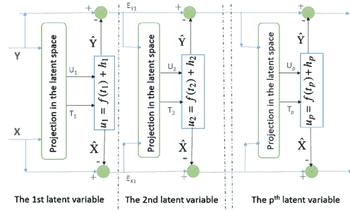

图 4.3 非线性 PLS 模型。

表 4.1 非线性 PLS 建模程序的主要步骤。

| Step | Description |
|------|-------------|
| 1 | 处理输入和输出数据（即 **X** 和 **Y**），使其具有零均值和单位方差。设置 _J_ = 1 并假设 **E**_<sub>X<sub>j</sub></sub>_ = **X** 且 **E**_<sub>Y<sub>j</sub></sub>_ = **Y** |
| 2 | 对于每个 _J_，将 **u** 设置为 **E**_<sub>Y<sub>j</sub></sub>_-1 的一列 |
| 3 | 使用 NIPALS 算法执行 PLS 模型的外部变换：<br>- w = u<sup>T</sup>**E**_<sub>X<sub>j</sub></sub>_ / u<sup>T</sup>**u**<br>- 将 **u** 归一化为单位长度<br>- 计算得分，**t** = **E**_<sub>X<sub>j</sub></sub>_w / w<sup>T</sup>w<br>- 计算新的 **u** 向量，**u** = **E**_<sub>Y<sub>j</sub></sub>_q / q<sup>T</sup>q |
| 4 | 找到一个非线性关系 _f_()，它使用输入隐变量 **t** 预测输出隐变量 **u**，u = _f_(**t**) + **h**。<br>(4.4)<br>然后我们得到估计值 û，û = _f_(**t**) |
| 5 | 确定输入和输出空间隐变量 |
| 6 | 计算残差矩阵 **E**_<sub>X<sub>j</sub></sub>_ = **E**_<sub>X<sub>j</sub></sub>_-1 - **tp**_<sup>T</sup>_ 和 **E**_<sub>Y<sub>j</sub></sub>_ = **E**_<sub>Y<sub>j</sub></sub>_-1 - û**q**_<sup>T</sup>_ |
| 7 | 更新 _J_ = _J_ + 1，然后返回步骤 2，直到评估完 PLS 的所有隐变量 |

本节仅介绍非线性 PLS 模型，即多项式 PLS 和 ANFIS-PLS，两者均使用原始迭代线性 PLS 框架。

#### 4.3.1.1 多项式 PLS 建模算法

如上所述，可以使用任何连接 u 到 t 的连续非线性函数来表示内部模型。文献中已对众多模型进行了研究以表示这种非线性函数，包括多项式函数、平滑样条、人工神经网络和核学习 [17,34,16]。这只需更改算法第 4 步中非线性回归的细节即可实现。在此，我们介绍多项式 PLS 建模的基本思路，该思路通过在 PLS 算法的隐空间中拟合最优多项式函数，提供了简单的首批非线性 PLS 模型来捕捉数据中的非线性。PLS 模型估计的外部循环保持不变。该方法的主要优点是将多变量问题简化为一元回归问题。

多项式 PLS 的核心概念是用高阶多项式函数替代线性内部关系，以便学习数据中的非线性并实现更大的灵活性。内部模型的一般形式可表示为

$$u = f(t, \gamma) + h,$$ (4.5)

其中 \(f(\cdot)\) 是具有选定次数的多项式函数，\(\gamma\) 包含待估计的多项式系数。该模型的目标是通过在线性 PLS 的内部模型中使用多项式函数来捕捉非线性特征和具有更复杂曲率特征的数据。例如，多项式 PLS 方法使用简单的二次函数来描述内部模型（称为二次 PLS），如文献 [18] 中所示

$$u = \gamma_0 + \gamma_1 t + \gamma_2 t^2 + h.$$ (4.6)

然而，使用二次函数可能不足以学习隐变量之间的强非线性。通过使用高阶多项式函数 [17]，可以期望获得更好的预测能力。例如，文献 [17] 提出了一种使用三次样条函数对 PLS 内部模型进行建模的样条 PLS 模型。使用高阶实现多项式 PLS 将为学习输入和输出变量主成分之间的非线性提供更多灵活性；然而，这使得算法的实现变得具有挑战性且繁琐。表 4.2 总结了多项式 PLS 算法的主要步骤。

总体而言，多项式 PLS（即具有多项式内部模型的 PLS）基本上是在内部模型中使用多项式或样条函数，以增强线性 PLS 的预测能力 [35]。然而，多项式和样条的形式有限且计算成本高。在文献 [36] 中，分数多项式用于对 PLS 的内部关系进行建模。其主要原因是

表 4.2 多项式 PLS 建模算法的主要步骤。

| Step | Description |
|------|-------------|
| 1 | 对输入–输出数据（无故障数据）X 和 y 进行自动缩放 |
| 2 | 设置 E_Xj = X, E_yj = y，且 j = 1 |
| 3 | 使用 NIPALS 过程 [19] 计算非线性 PLS 的载荷向量和隐变量 |
| 4 | 确定多项式函数 f(·)，它使用输入隐变量 t_j 预测隐变量响应 u_j，<br>u_j = γ0 + γ1t_j + γ2t_j^2 + γ3t_j^3 + ⋯ + ϵ_j. (4.7)<br>估计模型的计算方式是使回归误差最小化并避免过拟合 |
| 5 | 计算残差矩阵 E_Xj = X - X̂ 和 E_yj = y - ŷ |
| 6 | 递增 j = j + 1 并转至步骤 3，直到计算完所有隐变量。使用交叉验证来找到优化的隐变量数量，其中输出预测均方误差（MSE）最小化 |

使用分数多项式的能力是能够用比常规多项式更少的术语更好地描述数据 [37]。因此，它们相对灵活且简洁，这使得它们比固定阶多项式更适合用于 NLPLS。为了缓解这些限制，已开发了其他非线性 PLS 扩展，例如基于神经网络 (NN) 的扩展，旨在以更大的灵活性和更少的假设来近似内部模型的非线性函数 [38]。通过使用 NN 来学习和构建 PLS 的内部模型，可以减少残差并改善预测 [39,40,19]。然而，这类网络 PLS 方法并不简洁，并且倾向于对数据过拟合 [41]；它们也不稳定 [42]。最近，Liu 等人使用高斯过程回归（一种强大的非线性模型）开发了一种非线性 PLS 模型，用于构建 PLS 中每对隐变量之间的非线性模型 [43]。在其模型中，包含增强数据矩阵以实现更好的预测性能。在文献 [44] 中，使用自适应神经-模糊推理系统 (ANFIS) 模型来对输入和输出主成分之间的内部关系进行建模，以构建可靠的非线性 PLS 模型。

### 4.3.2 ANFIS-PLS 建模框架

本节讨论非线性 PLS 的基本概念，使用 ANFIS 方法，这是一种用于调整 PLS 模型非线性内部关系参数的稳健方法。过去十年中，基于模糊模型的故障检测方法在几个工程领域引发了大量研究 [45,46]。文献 [47] 介绍了一种使用 Takagi–Sugeno–Kang (TSK) 模糊模型的非线性模糊 PLS，并与常规 PLS 相比表现出更好的预测能力。还表明，当应用于非线性生物过程时，模糊 PLS 模型优于二次 PLS 和传统线性 PLS [46]。通过融合模糊逻辑和神经网络的可取特性，ANFIS 表现出处理过程非线性的更大能力 [45]。应当指出，ANFIS 参数通过神经网络的自学习能力在线优化。ANFIS 是一种混合系统，它结合了使用模糊推理的主观知识表示和人工神经网络的学习能力。因此，它提供了更大的能力来调整模糊模型的隶属函数以实现所需性能 [48]。带有分配隶属函数的模糊“如果–那么”规则已被用于关联 PLS 模型的内部关系。使用自适应神经网络模糊推理系统的思想来开发内部模型的关系，它在自适应框架中优化模糊推理系统前提部分和推论部分的参数 [48–50]。

为了兼顾 PLS 和 ANFIS 的优势，外部模型保持线性 PLS 的形式，并应用 ANFIS 来对内部关系进行建模。耦合的 ANFIS-PLS 模型结合了 PLS 学习输入–输出变量关系的稳健能力和 ANFIS 处理内部关系非线性的自适应学习能力。关于 ANFIS 的详细信息可参见 [51–53]。ANFIS-PLS 的示意图见图 4.4。ANFIS 被实现用于对每对输入和输出隐变量之间的内部关系进行建模，

```
U = f(T, Θ) + e, (4.8)
```

其中 Θ 表示模型参数，E 表示残差向量。事实上，在从外部模型得到隐变量（即 T_i 和 U_i）后，将使用它们来训练和估计 ANFIS 参数。

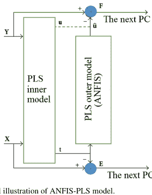


重要的是，ANFIS 首先使用减法聚类过程来找到初始规则，然后应用神经网络模型的五层来调整规则参数 [54]。在 ANFIS 架构中，第一层通过为每个输入值寻找隶属度函数来关注模糊形成。第二层（称为规则层）生成模糊规则。第三层的主要作用是归一化隶属度函数。第四层负责模糊规则的结论部分，最后一层提供最终输出。在模型训练阶段，使用最小二乘法和反向传播梯度下降算法来评估模糊推理系统的参数 [48]。通过最小化残差 \(e_i\) 来训练网络权重，给定如下

```
J_i = \|\mathbf{e}_i\|^2 = \|\mathbf{U}_i - \mathbf{f}_i(\mathbf{T}_i, \Theta)\|^2. \quad (4.9)
```

本质上，通过保持外部关系不变，ANFIS-PLS 通过将过程变量映射到协方差最大化的方向来获益于 PLS 特性。因此，这允许将多元回归问题转换为多个单元回归问题，分别使用 ANFIS 单独处理。

#### 4.3.2.1 基于非线性 PLS 的监测

首先，我们必须先获得模型，然后相应地执行故障检测程序。使用 NLPLS 方法进行故障检测的基本点与使用线性 PLS 相似。重要的是，残差空间的估计（在故障检测中至关重要）取决于使用适当过程进行建模。通常，使用 Hotelling's \(T^2\) 监测潜在空间，而残差空间则通过平方预测误差（SPE）或 Q 图表 [55]（图 4.5）进行检查。\(T^2\) 统计量计算如下

```
T^2 = \sum_{i=1}^m \left(\frac{t_i}{\lambda_i}\right)^2, \quad (4.10)
```

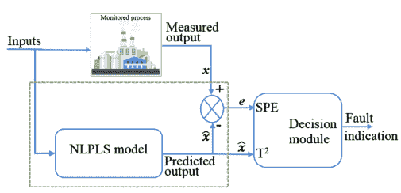

图 4.5 基于 NLPLS 的故障检测方法。

其中 \(m\) 是 NLPLS 模型中保留的因子数，\(\lambda_i\) 是输入数据矩阵 \(\mathbf{X}\) 的协方差矩阵 \(\Sigma\) 的第 \(i\) 个特征值。\(T^2\) 用于标记可能异常的存在，以表明受监测过程的性能未按设计运行，前提是 \(T^2 > T^2_\alpha\)，其中 \(T^2_\alpha\) 是在 [55] 中定义的检测阈值。

在 ANFIS-PLS 中，外部模型与多项式 PLS 类似，但不是使用多项式函数，而是使用基于 ANFIS 的更灵活的非线性模型来学习输入-输出隐变量之间的非线性关系。

SPE 统计量量化了模型未考虑的数据中的信息。它定义为

```
\text{SPE} = \|\mathbf{e}\|^2 = \|\mathbf{x} - \hat{\mathbf{x}}\|^2, \quad (4.11)
```

其中 \(\mathbf{e}\) 是残差，\(\hat{\mathbf{x}}\) 是使用设计的 NLPLS 模型对应于输入数据 \(\mathbf{x}\) 的预测值。在无故障期间，\(Q\) 统计量的值将低于 [55] 中给定的显著性水平 \(\alpha\) 的检测阈值 \(Q_\alpha\)。但是，如果 \(Q\) 统计量超过检测阈值，则会标记故障。

这些故障检测图表是基于底层变量不相关且服从高斯分布的假设而开发的。值得注意的是，NLPLS 模型对监测非线性过程很有效。但是，将其与基于高斯分布的检测阈值一起使用会降低其有效性。最近，为了扩展其检测能力，提出了许多基于 NLPLS 监测的扩展方法。在 [44] 中，提出了基于 ANFIS 的非线性 PLS 监测，并应用核密度估计（KDE）来估计检测阈值。这使得不使用 \(T^2\) 和 SPE 检测阈值的理论假设并处理非高斯数据成为可能。在 [56] 中，开发了一种无假设的 ANFIS-PLS 方法，用于多变量输入-输出过程的故障检测。为了摆脱 ANFIS-PLS 的 \(T^2\) 和 \(Q\) 的假设，开发了一种新型故障指标，结合了 \(k\)-最近邻（kNN）和指数平滑方案。指数平滑 kNN 方案应用于 ANFIS-PLS 模型的残差，以检测异常。由于 kNN 能够在不对数据产生结构假设的情况下将异常与相关特征分离开来，与传统的监测技术（\(T^2\) 和 \(Q\)）相比，它是一个优雅且灵活的故障指标。选择 kNN 而非传统监测技术的关键原因是，kNN 克服了高斯性和无相关性假设，而这些假设是 \(T^2\) 和 \(Q\) 等方法的基础 [57]。在 [58] 中，提出了一种将多项式 PLS 和基于海林格距离（HD）的方案相结合的方法，以提高基于 NLPLS 的方法对非线性过程中的小故障的敏感性。这里使用 HD 是因为该指标对于评估两个分布之间的偏差很有用。确实，通过对统计量 \(T^2\) 和 \(Q\) 应用 CUSUM 或 EWMA（在适当选择 CUSUM 和 EWMA 参数后），可以提高检测两个分布之间小变化的能力。

### 4.3.3 核主成分分析

在这里，我们介绍一种知名的非线性输入空间模型 KPCA，即本工作中使用的模型。首先，介绍 KPCA 背后的基本思想及其如何用于建模多变量非线性过程。最后，介绍了与 KPCA 模型一起用于异常检测的常用传统监测技术（即 SPE 和 \(T^2\)），以及一种最近用于过程监测的基于 KPCA 的一类 SVM。

### 4.3.4 核主成分分析（KPCA）模型

如前所述，大多数环境和工程过程都具有非线性特征，而线性 PCA 在从非线性过程中提取重要信息方面效果不佳。

为克服这一问题，KPCA 等非线性 PCA 方法提供了学习数据中过程非线性的可能性 [13,30,29]。一般来说，由于其灵活性和简单性，KPCA 方法在文献中其他现有非线性 PCA 方法中脱颖而出 [13]。KPCA 可以被视为通过核函数在高维空间中对线性 PCA 的重新表述，以揭示变量之间的非线性相关性。它主要用于异常检测，以避免基于神经网络的非线性 PCA 算法中非线性优化产生的复杂性 [30]。KPCA 的核心概念是将输入空间中的数据投影到高维特征空间（核空间）中，使数据变得更加线性。这种转换使用核函数来执行。然后，可以在特征空间中执行线性 PCA 算法，并避免昂贵的非线性优化。KPCA 背后思想的概念示意图如图 4.6 所示。尽管 KPCA 在核空间中学习线性特征，但这些特征与原始空间（变换前）中的非线性特征相关，如图 4.6 所示。原始数据可以通过将核空间中的特征投影到由捕获大部分变异性的特征向量所跨越的低维空间来重建。

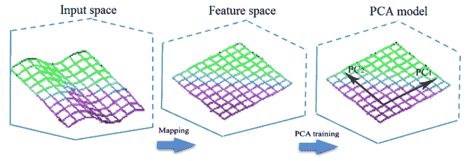

图 4.6 KPCA 映射的基本概念。

KPCA 可以基于积分算子和核函数有效地在高维特征空间中计算主成分 [11]。

总结来说，与其他基于神经网络的非线性方法相比，KPCA 为学习过程非线性提供了一种有趣的形式主义。具体来说，KPCA 有能力从数据中学习非线性特征，而无需涉及非线性优化。此外，线性 PCA 的计算程序可以直接继承到核 PCA 中 [13]。

与线性对照物相比，KPCA 的主要优势如图 4.7 所示。可以看出，观察结果在原始空间中无法线性分离（图 4.7A）。但是，在提取非线性特征后，数据变得可分，两组数据被清晰地区分开（图 4.7B）。

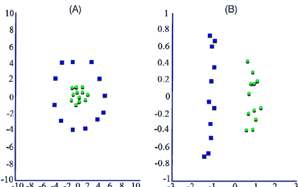

图 4.7 (A) PCA 和 (B) 非线性 PCA 的概念表示。

应该注意的是，KPCA 可以在不直接了解映射函数 \(\Phi\) 或特征空间 \(F\) 的情况下执行。作为替代方案，计算是在保存在核矩阵中的点对的内积上进行的。该程序称为“核技巧”，是 KPCA 方法的核心部分。

如前所述，KPCA 提供了通过核映射将输入空间中的非线性特征转换为特征空间 \(\mathfrak{F}\) 中线性可分特征，然后在特征空间中应用传统 PCA 的可能性。让我们考虑训练数据集 \(\mathbf{x}_1, \mathbf{x}_2, \dots, \mathbf{x}_n \in \mathbb{R}^m\)，其中 \(m\) 是变量的维度，\(n\) 是可用测量的数量。原始数据通过非线性映射函数 \(\Phi(\cdot)\) 从输入空间映射到特征空间，定义为

```
\mathbb{R}^m \xrightarrow{\Phi(\cdot)} \mathbb{F}^h, \quad (4.12)
```

其中 \(h\) 是特征空间的维度。因此，\(\Phi(\mathbf{x}_i)\) 是观测值 \(\mathbf{x}_i \in \mathbb{R}^m\) 在特征空间中的像。


与传统PCA类似，特征空间中的样本协方差矩阵（其元素为所有点对 \(\Phi(\mathbf{x}_i)\) 和 \(\Phi(\mathbf{x}_j)\) 的内积）可计算为

$$
\mathbf{\Sigma}_{\mathbb{F}} = \frac{1}{n} \sum_{i=1}^n [\Phi(\mathbf{x}_i) - \mathbf{m}_{\Phi}] [\Phi(\mathbf{x}_i) - \mathbf{m}_{\Phi}]^T, \quad (4.13)
$$

其中 \(\mathbf{m}_{\Phi} = \sum_{i=1}^n \Phi(\mathbf{x}_i)/n\) 是 \(\mathfrak{F}\) 中的样本均值。让我们将 \(\overline{\Phi}(\mathbf{x}_i) = \Phi(\mathbf{x}_i) - \mathbf{m}_{\Phi}\) 视为中心化的非线性映射。

通过求解 \(\mathfrak{F}\) 中的特征值问题来找到主成分，即

$$
\lambda \mathbf{v} = \mathbf{\Sigma}_{\mathbb{F}} \mathbf{v} = \frac{1}{n} \sum_{i=1}^n \left[ \overline{\Phi}(\mathbf{x}_i)^T \mathbf{v} \right] \overline{\Phi}(\mathbf{x}_i), \quad (4.14)
$$

其中 \(\lambda\) 是特征值，\(\lambda > 0\)，\(\mathbf{v}\) 是协方差矩阵 \(\mathbf{\Sigma}_{\mathbb{F}}\) 的对应特征向量。\(\mathfrak{F}\) 中的第一个主成分（表现出数据中最大变异性的方向）沿着具有最大特征值的 \(\mathbf{v}\) 方向给出，而主成分指示具有最小特征值的 \(\mathbf{v}\) 方向。

对于非零 \(\lambda\)，\(\mathbf{v}\) 可以表示为 \(\alpha_i\)（\(i = 1, \dots, n\)）的线性组合，因此

$$
\mathbf{v} = \sum_{i=1}^n \alpha_i \overline{\Phi}(\mathbf{x}_i). \quad (4.15)
$$

对公式 (4.14) 两边同时乘以 \(\Phi(\mathbf{x}_j)$ 得到

$$
\lambda (\Phi(\mathbf{x}_j) \mathbf{v}) = \Phi(\mathbf{x}_j) \mathbf{\Sigma}_{\mathbb{F}} \mathbf{v}. \quad (4.16)
$$

现在，展开公式 (4.14)，我们得到

$$
\lambda \sum_{i=1}^n \alpha_i \overline{\Phi}(\mathbf{x}_i) \overline{\Phi}(\mathbf{x}_j) = \frac{1}{n} \sum_{i=1}^n \alpha_i \left( \overline{\Phi}(\mathbf{x}_i) \sum_{i=1}^n \alpha_i \overline{\Phi}(\mathbf{x}_j) \right) \left( \overline{\Phi}(\mathbf{x}_i) \overline{\Phi}(\mathbf{x}_j) \right). \quad (4.17)
$$

应指出，(4.14) 中的特征值问题可以仅使用 \(\mathcal{F}$ 中映射向量的标量积来求解，并且可以基于核矩阵来处理。因此，使用核函数可以将更高维空间 \(\mathcal{F}$ 中的计算挑战简化为计算 \(\mathcal{F}$ 中向量的标量积，这凸显了核技巧的强大作用 [59]。

核函数允许以隐式方式确定 \(\mathfrak{F}$ 中的非线性映射。核矩阵 \(\mathbf{K} \in \mathbb{R}^{n \times n}$ 表示为

$$
\mathbf{K}(\mathbf{x}_i, \mathbf{x}_j) = \Phi(\mathbf{x}_i)^T \Phi(\mathbf{x}_j). \quad (4.18)
$$

然后，从公式 (4.17)，我们将得到

$$
n \lambda \mathbf{K} \boldsymbol{\alpha} = \mathbf{K}^2 \boldsymbol{\alpha}, \quad (4.19)
$$

其中 \(\boldsymbol{\alpha} = [\alpha_1, \dots, \alpha_n]$。在应用 KPCA 之前，特征空间中的中心化是必不可少的，具体操作如下：

$$
\overline{\mathbf{K}}(\mathbf{x}_i, \mathbf{x}_j) = \overline{\Phi}(\mathbf{x}_i)^T \overline{\Phi}(\mathbf{x}_j), \tag{4.20}
$$

$$
\overline{\mathbf{K}} = \mathbf{K} - \mathbf{K}\mathbf{1}_n - \mathbf{1}_n\mathbf{K} + \mathbf{1}_n\mathbf{K}\mathbf{1}_n, \tag{4.21}
$$

其中 \(\mathbf{1}_n$ 是以下矩阵：

$$
\mathbf{1}_n = \frac{1}{n} \begin{pmatrix} 1 & \dots & 1 \\ \vdots & \ddots & \vdots \\ 1 & \dots & 1 \end{pmatrix} \in \mathbb{R}^{n \times n}. \tag{4.22}
$$

为了求解公式 (4.19) 中的特征值分解问题，KPCA 现在按 [29] 求解中心化核的改进特征值问题

$$
n\lambda \boldsymbol{\alpha} = \overline{\mathbf{K}} \boldsymbol{\alpha} \tag{4.23}
$$

适用于非零特征值（\(\lambda \neq 0\)）。这等同于在特征空间 \(F\) 中应用传统 PCA。因此，在 \(F\) 中执行 PCA 可以获得特征向量 \(\boldsymbol{\alpha}_1, \dots, \boldsymbol{\alpha}_n$，对应的特征值为 \(\lambda_1 \ge \lambda_2 \ge \dots \ge \lambda_n$。

最后，我们可以将输出表示为

$$
y_j = \sum_{i=1}^n \alpha_{ij}^k \overline{\mathbf{K}}(\mathbf{x}_j, x), \quad j = 1, \dots, d. \tag{4.24}
$$

一般来说，基于 KPCA 的方法的性能主要取决于所选的核函数。文献 [60] 中设计了许多核函数，但据我们所知，没有自动化的核选择方法。在现有技术中，核函数的选择通常从一组候选函数中经验性或实验性地进行。确实，如果核选择不当，可能会得到不恰当的性能 [61, 62]。以下是机器学习文献中一些最广泛使用的核函数：

- 线性核，

$$
\mathbf{K}(\mathbf{x}_i, \mathbf{x}_j) = \langle \mathbf{x}_i, \mathbf{x}_j \rangle. \tag{4.25}
$$

- 多项式核，

$$
\mathbf{K}(\mathbf{x}_i, \mathbf{x}_j) = \langle \mathbf{x}_i, \mathbf{x}_j \rangle^d, \quad d \in \mathbb{Z}^+. \tag{4.26}
$$

- 余弦核，

$$
\mathbf{K}(\mathbf{x}_i, \mathbf{x}_j) = \frac{\langle \mathbf{x}_i, \mathbf{x}_j \rangle}{\|\mathbf{x}_i\| \|\mathbf{x}_j\|}. \tag{4.27}
$$

- Sigmoid 核，

$$
\mathbf{K}(\mathbf{x}_i, \mathbf{x}_j) = \tanh(\beta_0 \langle \mathbf{x}_i, \mathbf{x}_j \rangle + \beta_1).\quad (4.28)
$$

- 径向基函数（RBF），

$$
\mathbf{K}(\mathbf{x}_i, \mathbf{x}_j) = e^{-\frac{\|\mathbf{x}_i - \mathbf{x}_j\|^2}{2\delta^2}} = e^{-\gamma \|\mathbf{x}_i - \mathbf{x}_j\|^2}, \quad \gamma \in \mathbb{R}^+, \quad (4.29)
$$

其中 \(2\delta^2 = \frac{1}{\gamma}$ 是高斯核的宽度，而 \(d\)、\(\beta_0\) 和 \(\beta_1$ 在使用上述核函数之前预先指定。应当注意，如果参数值选取得当，上述核函数可获得相似结果。RBF 常用于故障检测，在选择相关参数方面提供了更大的灵活性；它还对过程变量之间的关系不做任何假设。

### 4.3.5 基于 KPCA 的故障检测程序

KPCA 监控分为两个主要阶段：模型开发和异常检测。决策统计量（例如，Hotelling's \(T^2\) 和 \(Q\)）及其检测阈值在离线建模阶段计算。在异常检测阶段，基于新的测试测量值计算监控统计量，并与先前建立的决策阈值进行比较，以验证过程状态。如果测试统计量高于其检测阈值，则会标记异常。

出于异常检测目的，\(T^2\) 和 SPE（平方预测误差）监控方案可以通过测试在线测量值来计算。为了监控 KPCA 模型中的变化，采用使用归一化平方得分的 \(T^2$ 方案。其统计量计算为

$$
T_f^2 = [t_1, \dots, t_p] \, \Lambda^{-1} [t_1, \dots, t_p]^T, \quad (4.30)
$$

其中 \(t_k \ (k=1, 2, \dots, p)$ 是保留的 \(p$ 个主成分，\(\Lambda^{-1}$ 是与保留的主成分对应的特征值矩阵的逆矩阵。

\(T^2$ 的检测阈值根据 \(F$ 分布计算如下

$$
T_\alpha^2 = \frac{p(m-1)}{(m-p)} F_{p, m-p, \alpha}, \quad (4.31)
$$

其中 \(F_{p, m-p, \alpha}$ 是具有 \(p$ 和 \(m-p$ 自由度且显著性水平为 \(\alpha$ 的 F 分布。

可以使用 \(Q$ 统计量来监控最小 \(m-p$ 个主成分中的变化。实际上，\(Q$ 统计量用于指示 KPCA 模型中保留的主成分未描述的变异性：

$$
Q_f = \|\Phi(\mathbf{x}) - \Phi_p(\mathbf{x})\|^2 = \sum_{j=1}^m t_j^2 - \sum_{j=1}^p t_j^2. \quad (4.32)
$$


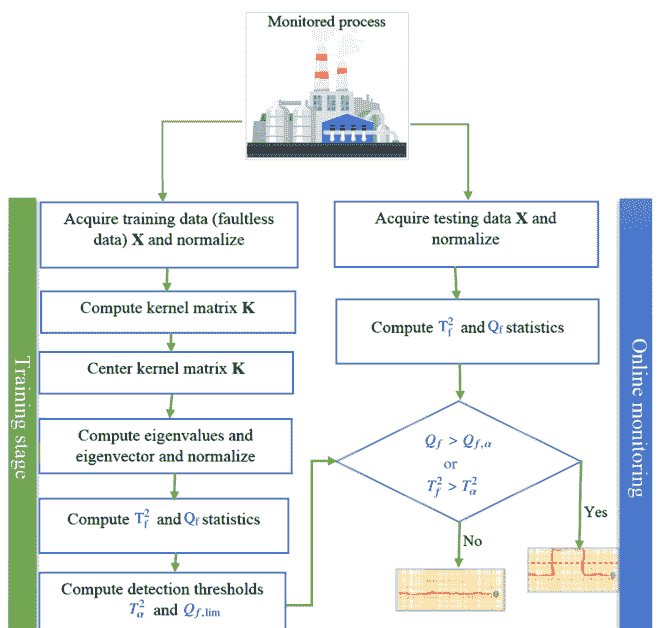

图 4.8 KPCA 监测策略。

The $Q_f$ detection threshold is computed as

$$Q_{f,\text{lim}}=\theta_1\left[c_\alpha\sqrt{2\theta_2h_0^2/\theta_1+1+\theta_2h_0(h_0-1)/\theta_1^2}\right]^{1/h_0},\quad (4.33)$$

其中 $\theta_j = \sum_{p+1}^m (\lambda_i)^j (j=1, 2, 3)$，$h_0 = 1 - 2\theta_1\theta_3/3\theta_2^2$，$\lambda_i$ 为特征值，$c_\alpha$ 表示 $100(1-\alpha)$ 阶正态分位数。

KPCA 故障检测策略的基本框架分为两个主要阶段：离线模型构建和在线故障检测（图 4.8）（详情见 [63,64]）：

- 在离线学习中，初始步骤是通过减去均值并除以每个变量的标准差对训练数据集（无故障）进行自动缩放（即输入数据矩阵的每一列）。如上文所述，KPCA 通过利用核技巧将数据映射到高维空间，从而提取线性和非线性结构。然后，我们选择一个核函数 $\mathbf{K}(\mathbf{x}_i, \mathbf{x}_j)$，并计算数据的缩放核矩阵 $\overline{\mathbf{K}}$。随后，通过求解特征问题 \(\bar{\mathbf{K}}\boldsymbol{\alpha} = n\lambda\boldsymbol{\alpha}\) 来确定特征值和特征向量，并选择要保留的主成分数量。输出可表示为 \(\mathbf{y}_j = \sum_{i=1}^d \alpha_{ij} \bar{\mathbf{k}}(\mathbf{x}_i, \mathbf{x})\)，其中 \(j = 1, \dots, m\)。最后，计算 PCA 的 \(T^2\) 和 \(Q$ 图表的检测阈值。

- 在在线监测阶段，首先，使用训练数据集（无故障）的均值和方差对新到达的数据集进行缩放。然后，计算 KPCA 的监测统计量 \(T^2$ 和 \(Q$ 用于异常检测。最后，将监测统计量与训练阶段计算的检测阈值进行比较。如果监测统计量高于检测阈值，则标记出异常；否则，该过程在正常条件下运行。

应注意的是，\(T^2$ 和 \(Q$ 统计量的检测阈值是基于过程变量服从高斯分布的假设计算的，这与常规 PCA 相同。然而，对于几种真实工业过程的数据集，这一假设往往不成立。因此，基于多元高斯假设采用这些检测阈值进行过程监测并不合适，可能会导致错误的结果 [65,66]。一种避免在计算 KPCA \(T^2$ 和 \(Q$ 图表检测阈值时采用高斯假设的替代方案是使用核密度估计（KDE）非参数地计算这些阈值 [64]。在这种方法中，首先使用 KDE 基于无故障数据集估计 KPCA \(T^2$ 和 \(Q$ 统计量的底层分布。然后，将决策阈值设置为相应的 \((1-\alpha)$ 阶分位数。[64] 中的结果声称，对于非线性过程中的有效故障检测，带有非参数阈值的 KPCA 优于基于高斯分布的经验 PCA \(Q$ 和 \(T^2$ 统计量。最近，[67] 引入了一种无假设的 KPCA 故障检测方法，用于监测非线性过程。该方法使用支持向量机（OCSVM）来评估 KPCA 提取的特征。当然，KPCA-OCSVM 方法摆脱了 KPCA 的理论假设，并提供了比基于高斯假设的阈值更好的非线性过程监测性能。多年来，已开发出多种 KPCA 改进方法，以满足实际应用中的各种需求。在 [68] 中，一种递归核 PCA（可持续在线更新模型）已被应用于非线性过程的自适应监测。在 [69] 中，提出了一种动态 KPCA，用于识别由滞后变量增强的数据矩阵中的空间和时间关系。在 [70] 中，开发了一种用于非线性过程自适应监测的移动窗口 KPCA。在 [71] 中，开发了结合小波多尺度分解优势与 KPCA 和 KPLS 模型的方法，用于非线性过程监测。这些方法允许在不同尺度提取相关信息，并考虑数据的多尺度特性。当应用于连续退火工艺和融镁炉时，它们提供了令人满意的检测性能。[72] 的作者提出了一种基于滑动中值滤波器（SFM）的多尺度 KPCA，用于监测带有噪声和异常值的非线性过程。结果表明，与 KPCA 相比，MSKPCA-SFM 具有更优越的故障检测能力。这主要归功于 SFM 去除干扰和噪声的能力，以及 MSKPCA 提供非线性动态建模的能力（这与 MSPCA 不同）。在其他应用中，KPCA 与 SVM、ICA、递归加权 PCA 和 EWMA 等融合，以举几例，用于增强多变量非线性过程的监测 [73–77]。

## 4.4 案例研究：监测 WWTP

本案例研究旨在展示基于 KPCA 模型和 OCSVM 探测器的无假设方法的检测能力。这里，融合的 KPCA-OCSVM 被应用于监测位于沙特阿拉伯的实际污水处理厂的进水测量。此外，我们将 KPCA-OCSVM 方法与基于常规 PCA 的方法进行了比较，以检测非线性多变量时间序列数据中的异常。进水测量包含 21 个变量的七年每日数据集，包括不同的流量和水质数值。为了符合当地标准，对从 WWTP 进水处理单元收集的样本进行了测量。受监测的 WWTP 处理的是市政废水。即使经过当地技术人员的大量努力和适当检查，仍有超过一百种异常进水条件被遗漏。这些未被检测到的异常由于不同原因对过程产生了负面影响，正如从业者所声称的那样，这凸显了开展统计过程监测研究的更大必要性。

为了说明收集变量之间的交互作用，图 4.9 显示了使用季度平均值的带有密度图的层次聚类热图。在此图中，Z 分数使用 KDE 总结为概率密度分布，如密度图所示。即使使用季度平均值进行平滑和可视化，明显偏态和正峰度的非对称单峰分布也清晰可见。可以得出结论，该数据集不服从高斯分布。此热图通过层次聚类重新排序，过程变量按行重新排序。确实，行中成分相似的调色板暗示正相关，反之亦然表示负相关。总流入很大程度上受提升站流入的影响。与淡化厂相关的提升站八流入“InFlow_LS8”与 Cl、COD、BOD 和碱度呈负相关。这表明在这种情况下存在各种工业排放和市政废水的成分。可以看出，WWTP 内部的流入与硬度和 TSS 相关，这可能是污泥处理事件和使用投加化学品定期清洁膜的结果。另一方面，温度与所有主要水质变量呈负相关，但与几乎所有市政水量变量呈正相关。

总体而言，WWTP 生成的数据在统计上具有挑战性，因为它们是高维的，变量之间存在非线性关系，变量是非高斯和非平稳的，并且可能发生多种故障类型。这些数据将挑战基于变量间线性关系、没有自相关和高斯分布等假设设计的常规建模方法。因此，为了处理 WWTP 过程的非线性和非高斯行为，核技术等非线性和灵活的方法可能很有前景。

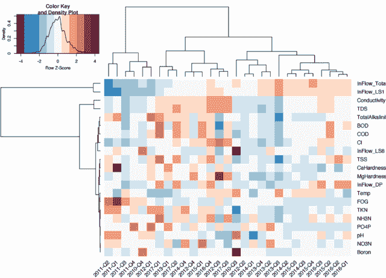

图 4.9 带密度图的 WWTP 测试数据热图。

### 4.4.1 使用 KPCA-OCSVM 方法进行异常检测

为了评估所提议监测方案的性能，计算了真阳性率（TPR，或召回率）、假阳性率（FPR）、接收器操作特征曲线下面积（AUC）、准确率、精确率和 F1 分数。图 4.10 总结了这些在检测质量评估中常用的指标。图 4.11 总结了 KPCA-OCSVM 方法的性能。使用相同 WWTP 数据集的基于 PCA 的方法的先前研究（如图 4.12 所示）被用作比较基准 [78]。在图 4.12 中提供的基于 PCA 的方法中，首先使用捕获数据中超过 80% 方差的七个主成分构建参考 PCA 模型。然后，导出了九个 PCA 异常检测方案，包括单变量残差、平方预测误差（SPE）、T² 和 k 近邻距离（欧氏或曼哈顿），为这些方案设置了参数/非参数阈值以检测异常。


| | 实际类别 | |
|---|---|---|
| | 正类 | 负类 |
| **预测类别 正类** | 真正例 (TP) 检测正常 | 假正例 (FP) 误报 |
| **预测类别 负类** | 假负例 (FN) 漏检 | 真负例 (TN) 检测异常 |

TPR = 召回率 = TP/(TP+FN)
FPR = 假正率 = FP/(FP+TN)
Accuracy = 准确率 = (TP+TN)/(TP+TN+FP+FN)
Precision = 精确率 = TP/(TP+FP)
F1Score = F1分数 = 2TP/(2TP+FP+FN)

图 4.10 评估检测性能常用的指标。

图 4.11 显示了 KPCA-OCSVM 的检测性能，采用不同核函数（多项式、余弦和 RBF）以及不断增加的主成分数量。热图中的列代表评估指标，行代表不同主成分数量的 KPCA-OCSVM。一般来说，为了使用描述过程名义行为的无故障数据集设计参考 KPCA 模型，当使用相对更多的主成分时，可以实现准确的学习和近似。然而，过多的主成分也会导致过拟合解，并导致后续 OCSVM 处理中的检测性能下降。因此，随着主成分数量增加，TPR 和 FPR 通常会增加，而精确率会下降。作为 TPR 和 FPR 的加权组合的 AUC，以及作为 TPR 和精确率调和平均数的 F1 分数，在调谐时能获得更好的检测性能。因此，当使用大约 10 个主成分时，多项式 KPCA 实现了完美的检测，表明其在学习训练数据集中相关信息方面具有更强的能力。此外，在本研究中，基于 15 个主成分的余弦核 KPCA 的性能与多项式 KPCA 相当。相比之下，RBF KPCA 在使用较少主成分时几乎无法捕捉异常，但在本研究中使用大量主成分时能够充分识别异常，这需要大量计算或存在潜在过拟合风险。因此，在本研究中，RBF KPCA 不适合实时监测。

图 4.11 和 4.12 的结果表明，核方法比传统的基于 PCA 的方法更好地捕捉过程变量中的非线性关系。同样有趣的是注意到，虽然在 PCA-KNN 方法中应用 KNN 惰性学习程序来解决非线性问题优于其他对照方法，但从 PCA 提取的特征并不是数据中足够相关的信息。这主要由于过程非线性，降低了本例中基于 PCA 的方法的检测能力。相比之下，与线性 PCA 相比，多项式 KPCA 结合基于 RBF 的 OCSVM 可以更好地处理非线性，但不是高度非线性，与在 KPCA 中使用 RBF 时获得的结果相比。

在本案例研究中，已证明用于 WWTP 非线性多变量过程监测的 KPCA-OCSVM 方法与现有的线性 PCA-KNN 方法相比效果良好。KPCA-OCSVM 模型可以适当提取数据中的相关信息，并揭示过程变量之间的线性和非线性关系。然后，OCSVM 被应用于

(A)

| 主成分数量 | TPR | FPR | AUC | 准确率 | 精确率 | F1分数 |
|---|---|---|---|---|---|---|
| 5 | 0.9991 | 0 | 0.9995 | 0.9991 | 1 | 0.9995 |
| 10 | 1 | 0 | 1 | 1 | 1 | 1 |
| 15 | 1 | 0 | 1 | 1 | 1 | 1 |
| 20 | 1 | 0.0097 | 0.9951 | 0.9996 | 0.9995 | 0.9998 |
| 25 | 1 | 0.0467 | 0.9766 | 0.9978 | 0.9977 | 0.9989 |
| 30 | 1 | 0.0727 | 0.9636 | 0.9965 | 0.9964 | 0.9982 |
| 40 | 1 | 0.157 | 0.9215 | 0.9917 | 0.9914 | 0.9957 |

(B)

| 主成分数量 | TPR | FPR | AUC | 准确率 | 精确率 | F1分数 |
|---|---|---|---|---|---|---|
| 5 | 0.9717 | 0 | 0.9859 | 0.9722 | 1 | 0.9857 |
| 10 | 0.9852 | 0 | 0.9926 | 0.9857 | 1 | 0.9926 |
| 15 | 0.9955 | 0.0108 | 0.9924 | 0.9952 | 0.9995 | 0.9975 |
| 20 | 0.9982 | 0.02 | 0.9891 | 0.9974 | 0.9991 | 0.9986 |
| 25 | 0.9982 | 0.02 | 0.9891 | 0.9974 | 0.9991 | 0.9986 |
| 30 | 0.9982 | 0.02 | 0.9891 | 0.9974 | 0.9991 | 0.9986 |
| 40 | 0.9982 | 0.02 | 0.9891 | 0.9974 | 0.9991 | 0.9986 |

(C)

| 主成分数量 | TPR | FPR | AUC | 准确率 | 精确率 | F1分数 |
|---|---|---|---|---|---|---|
| 5 | 0.9565 | 0 | 0.9783 | 0.9566 | 1 | 0.9778 |
| 10 | 0.9826 | 0.0308 | 0.9759 | 0.9822 | 0.9991 | 0.9908 |
| 15 | 1 | 0.1639 | 0.918 | 0.9913 | 0.9909 | 0.9954 |
| 20 | 0.9594 | 0 | 0.9797 | 0.9596 | 1 | 0.9793 |
| 25 | 0.9636 | 0 | 0.9818 | 0.9639 | 1 | 0.9815 |
| 30 | 0.9696 | 0 | 0.9848 | 0.97 | 1 | 0.9846 |
| 40 | 0.9883 | 0.013 | 0.9877 | 0.9883 | 0.9995 | 0.9939 |

图 4.11 按核函数描绘 KPCA-OCSVM 方案的检测性能热图：(A) 多项式核 KPCA-OCSVM 方案的结果；(B) 余弦核 KPCA-OCSVM 方案的结果；(C) RBF 核 KPCA-OCSVM 方案的结果。

| 异常检测方法 | TPR | FPR | AUC | 准确率 | 精确率 | F1分数 |
|---|---|---|---|---|---|---|
| PCA-KNN (Eucl-np) | 0.9277 | 0.1275 | 0.9001 | 0.9253 | 0.9937 | 0.9596 |
| PCA-KNN (Eucl-p) | 0.7627 | 0.049 | 0.8569 | 0.7711 | 0.997 | 0.8643 |
| PCA-KNN (Manh-np) | 0.9332 | 0.1176 | 0.9078 | 0.9309 | 0.9942 | 0.9627 |
| PCA-KNN (Manh-p) | 0.765 | 0.0294 | 0.8678 | 0.7741 | 0.9982 | 0.8662 |
| PCA-Residual (np) | 0.4673 | 0.2353 | 0.616 | 0.4805 | 0.9772 | 0.6322 |
| PCA-SPE (np) | 0.9432 | 0.1471 | 0.8981 | 0.9392 | 0.9928 | 0.9674 |
| PCA-SPE (p) | 0.9991 | 0.8039 | 0.5976 | 0.9635 | 0.964 | 0.9812 |
| PCA-T2 (np) | 0.965 | 0.598 | 0.6985 | 0.9687 | 0.9729 | 0.9838 |
| PCA-T2 (p) | 0.9409 | 0.3431 | 0.7569 | 0.9283 | 0.9834 | 0.9617 |

图 4.12 显示九种基于 PCA 的监测算法（行）和评估指标（列）的检测性能热图。

KPCA 提取的特征用于发现异常。实际数据获得的结果表明，核技术在监测 WWTP 方面的效率。此外，使用此方法的主要优势是其灵活性，可以通过核函数对数据中的广泛非线性进行建模，而无需涉及任何非线性优化。作为一种无假设的方法，基于 KPCA 的方法可以转移、重建和调整，以适用于不同 WWTP 的 ICs。

## 4.5 模拟合成数据

本示例的目的是展示非线性 PLS 模型的预测性能，并与线性 PLS 进行比较。三种 PLS 算法，包括线性 PLS、多项式 PLS 和 ANFIS-PLS，在数据拟合和预测方面进行了比较。生成了具有一个响应和十个输入（预测）变量的模拟非线性数据集。前两个输入使用 "randn" 信号模拟，其余八个输入计算如下：

```
x3 = x1 + x2, (4.34)
x4 = x3^2, (4.35)
x5 = \sqrt{x3}, (4.36)
x6 = \frac{1}{\sqrt{x3}}, (4.37)
x7 = 1 - e^{-x3}, (4.38)
x8 = 1.4x2 - 1.2x7, x9 = 1.3x2 + 2.1x1, (4.39)
x10 = 1.3x6 - 2.3x9. (4.40)
```

输出根据以下输入生成：

```
\(\mathbf{y} = \sum_{i=1}^{10} b_i \mathbf{x}_i,\)
```

其中 \(b_i = \{0.07, 0.03, -0.05, 0.04, 0.02, -1.11, -0.04, -0.02, 0.01, -0.03\}\)，对于 \(i = 1, ..., 10\)。生成了包含 256 个样本的无噪声数据集，然后加入零均值高斯噪声。

NL-PLS 的性能与传统 PLS 模型的性能进行了比较。交叉验证方法用于选择最佳潜在变量数量。将总数据分为两部分：训练数据集和测试数据集。训练数据用于开发模型，使用测试数据集对所得模型进行测试，并评估其均方误差（MSE）。通过选择给出最小 MSE 的潜在变量来选择最佳潜在变量数量。基于最小 MSE 值，PLS 选择了五个潜在变量，poly-PLS 和 ANFIS-PLS 模型各选择了三个。表 4.3 总结了不同信噪比（SNR）下的比较结果，并清楚地表明，poly-PLS 和 ANFIS-PLS 建模相对于传统的 PLS 建模技术提供了显著改进。这是因为非线性 PLS 算法在 PLS 算法的内部关系中使用了适当的映射函数，从而避免了对模型的过拟合并提高了模型预测能力。此外，结果表明，在所有模型中，ANFIS-PLS 具有最强的预测能力。在以下部分中，将考虑另一个示例。

| 模型 | SNR = 5 | SNR = 10 | SNR = 20 |
|---|---|---|---|
| PLS | 0.2189 | 0.1209 | 0.0641 |
| Poly-PLS | 0.2019 | 0.1019 | 0.049 |
| ANFIS-PLS | 0.1739 | 0.08781 | 0.047 |

### 4.5.1 柱塞流反应器的应用

在此，使用模拟柱塞流反应器（PFR）数据评估基于 NLPLS 的监测方法的检测性能。PFR，或活塞流反应器，由一根中空管组成，反应物在其中流动 [79]。图 4.13 显示了一个带有丙烯酸模具并包裹在水箱中的管状 PFR 示意图示例。为了保持相对稳定的反应物温度，将受控温度的水通过水箱。PFR 广泛用于气相或液相系统。基于反应物种 A，反应器中进行两个一级反应：

```
\(A \rightarrow B \rightarrow C\)
```


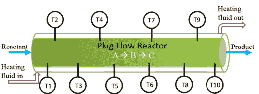

图 4.13 插塞式反应器示意图。

其中 B 为目标产物，C 为副产物。由于反应为吸热反应，反应器由反应器夹套中的流体加热，并控制其流速以获得所需的产物 B 出口浓度。模型偏微分方程组 (4.43)、(4.44)、(4.45) 和 (4.46) 用于建模该过程：

```
\frac{\partial C_A}{\partial t} = -v_l \frac{\partial C_A}{\partial x} - k_{10}e^{-E_1/RT_r}C_A, \qquad (4.43)
\frac{\partial C_B}{\partial t} = -v_l \frac{\partial C_B}{\partial x} + k_{10}e^{-E_1/RT_r}C_A - k_{20}e^{-E_2/RT_r}C_B, \qquad (4.44)
\frac{\partial T_r}{\partial t} = -v_l \frac{\partial T_r}{\partial x} + \frac{\Delta H_{r_1}}{\rho_m c_{pm}}k_{10}e^{-E_1/RT_r}C_A
+ \frac{\Delta H_{r_2}}{\rho_m c_{pm}}k_{20}e^{-E_2/RT_r}C_B + \frac{U_w}{\rho_m c_{pm} V_r}(T_j - T_r), \qquad (4.45)
\frac{\partial T_j}{\partial t} = -u \frac{\partial T_j}{\partial x} + \frac{U_{w_j}}{\rho_{mj} c_{pmj} V_j}(T_r - T_j). \qquad (4.46)
```

接下来，利用非线性 PLS 的预测能力来预测产物浓度。

#### 4.5.1.1 数据生成与建模

本研究中，首先模拟 PFR 工艺数据。然后，通过将非线性 PLS 基础监测方案应用于模拟 PFR 数据的故障检测来评估其性能（见表 4.4）。为生成 PFR 数据，基于频率区间 [0, 0.05w_N] 内的伪随机二进制信号 (PRBS)，将进料流量从标称稳态范围扰动，其中 w_N = \pi/T 表示奈奎斯特频率。为此，我们使用 Matlab 系统识别工具箱的函数 "idinput"。这里，有 11 个输入变量，即反应器不同位置测量的十个温度和进料流量。输出变量是产物浓度（即 C_B）。PFR 输入-输出扰动数据如图 4.14 所示。这些无噪声数据随后被添加了零均值高斯噪声。

使用上述 PFR 模型生成的总计 500 个无故障样本用于构建 NLPLS 模型。为构建参考 NLPLS 模型，应用交叉验证方法寻找最优主成分 (PCs) 数量，并保留 4 个主成分用于 NLPLS 模型。图 4.15 展示了观测数据与 NLPLS 预测值的对比图。图 4.16 展示了所选 NLPLS 模型得到的观测值与预测值的散点图。可以看出，所选 NLPLS 拟合训练数据良好。此外，该模型实现了 \(R^2\) 为 0.94，以及较小的均方根误差 (RMSE) 和平均绝对误差 (MAE)（即，RMSE = 0.22618，MAE = 0.17）。这意味着具有 4 个主成分的 NLPLS 模型具有良好的预测能力。

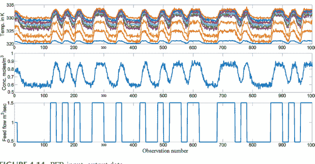

| 工艺变量 | 数值 | 工艺变量 | 数值 |
|---|---|---|---|
| $v_l$ | 1 ml/min | $C_{pm}$ | 0.231 kcal/(kg K) |
| L | 1.0 m | $R$ | 1.987 kcal/(min K) |
| $V_r$ | 10.0 lt | $\rho_m$ | 0.09 kg/lt |
| $E_1$ | 20000 kcal/kmol | $U_w$ | 0.20 kcal/(min K) |
| $E_2$ | 50000 kcal/kmol | $C_{pmj}$ | 0.8 kcal/(min K) |
| $k_{10}$ | $5.0 \times 10^{12}$ min$^{-1}$ | $V_j$ | 366 K |
| $k_{20}$ | $5.0 \times 10^2$ min$^{-1}$ | $\rho_{mj}$ | 0.10 kg/lt |
| $H_{r1}$ | 0.5480 kcal/kmol | $C_{A0}$ | 4 mol/lt |
| $H_{r2}$ | 0.9860 kcal/kmol | $C_{B0}$ | 0 mol/lt |
| $T_{r0}$ | 320 K | $T_{j0}$ | 375 K |

#### 4.5.1.2 检测结果

在识别参考 NLPLS 模型后，我们使用它来检测 PFR 过程中的异常。基于识别的 NLPLS 模型，此处考虑了三种监测技术：常规 NLPLS-Q 方案，以及使用未滤波残差和滤波残差的基于 NLPLS 的 Hellinger 距离 (HD)。在 NLPLS-HD 方案中，HD 通过计算实际残差与使用无故障数据获得的残差的概率分布之间的偏差，用作故障指示。此处，采用 3-sigma 准则设置 NLPLS-HD 的检测阈值。为提高 NLPLS-HD 对测量噪声的鲁棒性，我们对滤波残差应用了基于小波的滤波器的 HD，以减少数据中的噪声并提高对测量噪声的鲁棒性。残差显示了参考 NLPLS 模型输出与测量值之间的不匹配，通过基于小波的滤波器进行滤波，并用作 NLPLS-HD 方案的输入。

#### 4.5.1.3 案例 (A) - 突发异常检测

使用相同 PFR 模型模拟的测试数据集包含 500 个与训练数据完全独立的数据样本。此处，验证了三种基于 NLPLS 的方案对非典型突发变化（传感器偏差）的感知可行性。呈现了三个示例，以测试基于 NLPLS 的方案检测 PFR 中突发故障的能力。为评估三种故障检测方法的能力，对于 SNR = 30 的数据，在样本 300 至 350 之间的 x5 中引入了加性故障，该故障由幅度等于 x5 总变化量 10% 的偏差组成。在实际中，这可能类似于突然的传感器偏移或误差校准。表 4.5 按方法提供了检测性能摘要。由于该突发故障的幅度相对较大且 SNR 水平也较高（即，SNR = 30），三种方法的性能略有可比。与常规 NLPLS-Q 方法相比，应用 NLPLS-HD 时可以看到改进，其达到最高 AUC 0.975。

表 4.5 按方法划分的检测性能 (10% 偏差, SNR = 30)。

| 方法 | TPR | FPR | 准确率 | 精确率 | F1Score | AUC |
|---|---|---|---|---|---|---|
| NLPLS-Q | 0.941 | 0.000 | 0.994 | 1.000 | 0.970 | 0.971 |
| NLPLS-HD | 0.980 | 0.031 | 0.970 | 0.781 | 0.870 | 0.975 |
| NLPLS-HD (filtered) | 1.000 | 0.053 | 0.952 | 0.680 | 0.810 | 0.973 |

为评估低 SNR（即，SNR = 5）下各种故障检测方法的能力，表 4.6 给出了三种方法的检测性能。常规 NLPLS-Q 可以识别此故障，但存在多次漏检和中等 AUC（TPR = 0.706 且 AUC = 0.853）。这突显了 Q 统计量对噪声数据的敏感性。此处，使用滤波残差的 NLPLS-HD 统计量通过实现更高的 AUC 0.983 和 F1-分数 0.872，优于其他测试统计量。一个有趣的观察是，与 NLPLS-Q 相比，NLPLS-HD 对噪声更具鲁棒性。此外，使用小波滤波器（一种减少数据噪声的强大工具）在滤波数据上应用 NLPLS-HD，与其他方法相比，显著提高了低 SNR 值下的检测性能。

表 4.6 按方法划分的检测性能 (10% 偏差, SNR = 5)。

| 方法 | TPR | FPR | 准确率 | 精确率 | F1Score | AUC |
|---|---|---|---|---|---|---|
| NLPLS-Q | 0.706 | 0.000 | 0.970 | 1.000 | 0.828 | 0.853 |
| NLPLS-HD | 0.961 | 0.031 | 0.968 | 0.778 | 0.860 | 0.965 |
| NLPLS-HD (filtered) | 1.000 | 0.033 | 0.970 | 0.773 | 0.872 | 0.983 |

| 方法 | TPR | FPR | 准确率 | 精确率 | F1Score | AUC |
|---|---|---|---|---|---|---|
| NLPLS-Q | 1.000 | 0.069 | 0.947 | 0.811 | 0.896 | 0.966 |
| NLPLS-HD | 0.971 | 0.000 | 0.993 | 1.000 | 0.985 | 0.985 |
| NLPLS-HD (filtered) | 0.981 | 0.032 | 0.971 | 0.902 | 0.940 | 0.974 |

#### 4.5.1.4 案例 (B) – 间歇异常检测

此处，我们介绍了基于 NLPLS 的 Q 和 HD 技术在揭示间歇故障方面的能力。对于样本 [200, 250]，在温度变量 $T_5$ 的总变化量 10% 幅度的偏差被添加到测试测量中，并在 [400, 450] 之间注入 15% 的偏差。表 4.7 提供了三种方法的检测性能摘要。结果表明，与常规 NLPLS-Q 相比，NLPLS-HD 具有更好的检测性能。在第二个示例中，分别在样本区间 [200, 250]、[300, 350] 和 [400, 450] 之间注入了 3%、4% 和 5% 幅度的偏差。NLPLS-Q 无法检测这些故障；它对小变化的敏感性较低。表 4.8 显示了基于未滤波残差和使用小波去噪方法的滤波残差的 NLPLS-HD 方法的检测性能摘要。由于 NLPLS-Q 方法未标记任何检测结果，其结果未在摘要中呈现。表 4.8 的结果突显了 NLPLS-HD 在揭示这些间歇故障方面的能力。此外，基于滤波残差的 NLPLS-HD 表现出优于使用原始残差的 NLPLS-HD 的检测效果。

| 方法 | TPR | FPR | 准确率 | 精确率 | F1Score | AUC |
|---|---|---|---|---|---|---|
| NLPLS-HD | 0.708 | 0.030 | 0.880 | 0.924 | 0.801 | 0.839 |
| NLPLS-HD (filtered) | 0.994 | 0.114 | 0.922 | 0.818 | 0.897 | 0.940 |

#### 4.5.1.5 案例 (C) – 漂移异常检测

现在，调查了基于 NLPLS 的故障检测 (FD) 方法在监测传感器漂移故障方面的能力。在样本 300 处，将斜率为 0.01（类似于老化传感器故障）的渐进斜坡故障注入温度变量 $T_5$ 的数据中。图 4.17A–C 显示了三种基于 NLPLS 的方法的监测结果。图 4.17 指示，基于 NLPLS 的 Q、HD 以及使用滤波残差的 HD 方法分别在样本 372、328 和 309 感知到此漂移故障。结果清楚地表明，与常规 NLPLS-Q 方案相比，NLPLS-HD 方案能够最早检测漂移故障。


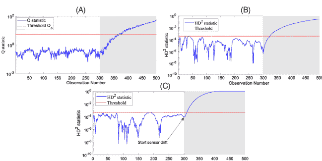

图 4.17 (A) NLPLS-Q 统计量、(B) NLPLS-HD 和 (C) 基于去噪残差的 NLPLS-HD 在漂移故障情况下的结果。

总之，本案例研究展示了 NLPLS 模型在 FPR 过程中描述非线性的能力。此外，结果表明，与传统的 NLPLS-Q 相比，NLPLS-HD 在识别突发、间歇和渐进故障方面具有更优的检测效率。这主要归功于 HD 指标对故障自由数据残差分布与 NLPLS 生成的实际残差之间偏差的敏感性。将 NLPLS-HD 应用于过滤后的残差可提高检测能力，尤其是在处理含噪声测量值时。

## 4.6 讨论

为维持现代复杂过程的产品质量、效率和可靠性，过程监测中的异常检测变得至关重要。对过程异常进行有效且及早的检测，对于避免异常的进展和减少生产力损失至关重要；这有助于避免严重的退化或系统崩溃。因此，异常检测是一个吸引工业从业者和研究人员关注的热门话题。

线性 LVR 方法，如 PLS 和 PCA，是监测变量间存在共线性或冗余的多变量数据的常用工具。LVR 技术已被广泛用于建模和监测表现出相关/共线性变量的多变量工业数据。然而，由于它们仅从数据中提取线性信息，因此在处理过程非线性方面效果不佳，受到限制。当然，线性 LVR 方法不适用于复杂非线性过程的数据分析和监测。为解决这一问题，已经设计了各种非线性 LVR 方法，以提取非线性特征并学习过程变量之间的任何非线性关系。基于 NLVR 的监测方法通常分为两个主要步骤：离线模型构建和在线异常检测。在第一步中，根据代表过程名义行为的数据设计检验过程的经验模型，并使用 SPE 和 T² 图表计算决策阈值。然后，将设计的模型及其决策阈值用于检查新的测试测量值，以进行异常检测。基于非线性 LVR 的监测方法，如 KPCA 和非线性 PLS，由于其检测效率高且易于实现，是有效的工具。

在本章中，我们表明，基于 KPCA 的监测方法优于传统的 PCA 方法。这些方法的性能基于沙特阿拉伯 WWTP 的数据，按 FAR 和 MDR 进行评估。基于 KPCA 的 LSVM 方法能可靠地发现进水流量测量中发生的异常事件。研究了不同的核函数；当应用于 WWTP 数据时，使用 RBF 核的 KPCA-LSVM 优于所考虑的线性和非线性核。

在许多实际应用中，例如空气质量监测，会从不同的空间位置收集多个时间序列数据，并具有必要的时空依赖性，但在监测和决策中很少考虑这一点。一个改进方向是将开发的基于 LVR 的监测技术扩展到考虑数据的时空演变（即，在监测中包含空间滞后信息），并将这些改进应用于各种应用。具体来说，对于时间相关的数据矩阵 Xn×m，通过在 X 中加入滞后变量来考虑数据的动态。例如，数据矩阵 X 可以包含在时刻 t 和时刻 t − 1 观测到的 m 个变量。同样，也可以将不同位置的观测值纳入 X 中。应仔细考虑包含哪些滞后和变量。在空间统计中，通常只选择最近邻；然而，最优选择取决于变量之间的相关性以及底层时空过程中存在的依赖性。我们将研究如何将最近邻思想适应于多变量时空过程，以便在控制 X 维度的同时借用有价值的信息。

在各种实际过程中（包括环境、生物和水文过程），数据本质上是功能性的。例如，空气质量监测中的粉尘测量可以被视为时间的函数。已有研究表明，PCA 不适用于多变量观测的功能数据 [80–83]。对于功能数据，功能 PCA（FPCA）类似于 PCA，基于前几个正交功能主成分捕获数据中的大部分变化 [84,82,85]。尽管 FPCA 是功能数据分析中流行的统计方法，但它尚未用于过程监测、故障检测和诊断。挑战在于，时空数据高度相关且维度非常高；在这种情况下，现有的多变量方法往往存在局限性，需要合适的方法（例如，基于功能 PCA 的控制图方法）来处理功能数据。此外，开发功能潜在变量方法来监测功能数据将非常有益。

## 参考文献

- [1] B.R. Kowalski, M.B. Seasholtz, 多元校准的最新进展, Journal of Chemometrics 5 (1991) 129–145.
- [2] I. Frank, J. Friedman, 一些化学计量回归工具的统计视角, Technometrics 35 (2) (1993) 109–148.
- [3] M. Stone, R.J. Brooks, 连续回归：采用交叉验证顺序构建的预测，涵盖普通最小二乘法、偏最小二乘法和主成分回归, Journal of the Royal Statistical Society, Series B 52 (2) (1990) 237.
- [4] S. Wold, 软建模：基本设计及一些扩展, Systems Under Indirect Observations, Elsevier, Amsterdam, 1982.
- [5] E. Malthouse, A. Tamhane, R. Mah, 非线性偏最小二乘法, Computers & Chemical Engineering 21 (8) (1997) 875–890.
- [6] H. Hotelling, 两组变量之间的关系, Biometrika 28 (1936) 321–377.
- [7] F.R. Bach, M.I. Jordan, 核独立成分分析, Journal of Machine Learning Research 3 (1) (2003).
- [8] S.S.D.R. Hardoon, J. Shawe-taylor, 典型相关分析：学习方法应用概述, Neural Computation 16 (12) (2004) 2639–2664.
- [9] M. Borga, T. Landelius, H. Knutsson, PCA、PLS、MLR 和 CCA 的统一方法, Technical Report, Linköping University, 1997.
- [10] A. Maalud, D. Wang, J. Romagnoli, 多变量统计过程监测的多尺度正交非线性策略, Journal of Process Control 16 (7) (2006) 671–683.
- [11] H. Peng, R. Wang, L. Hai, 使用核 PCA 及其快速数据重建进行传感器故障检测与识别, in: Control and Decision Conference, 2010, pp. 3857–3862.
- [12] S. Mika, B. Schölkopf, A.J. Smola, K.-R. Müller, M. Scholz, G. Rätsch, 特征空间中的核 PCA 与去噪, in: Advances in Neural Information Processing Systems, 1999, pp. 536–542.
- [13] B. Schölkopf, A. Smola, K.-R. Müller, 作为核特征值问题的非线性成分分析, Neural Computation 10 (5) (1998) 1299–1319.
- [14] D. Dong, T.J. McAvoy, 基于主曲线和神经网络的非线性主成分分析, Computers & Chemical Engineering 20 (1) (1996) 65–78.
- [15] A.H. Monahan, 通过神经网络进行非线性主成分分析：理论与洛伦兹系统的应用, Journal of Climate 13 (4) (2000) 821–835.
- [16] R. Rosipal, L.J. Trejo, 再生核希尔伯特空间中的核偏最小二乘回归, Journal of Machine Learning Research 2 (2001) 97–123.
- [17] S. Wold, 非线性偏最小二乘建模 II。样条内部关系, Chemometrics and Intelligent Laboratory Systems 14 (1–3) (1992) 71–84.
- [18] S. Wold, N.K. Wold, B. Skagerberg, 非线性 PLS 建模, Chemometrics and Intelligent Laboratory Systems 7 (1989) 53–65.
- [19] S.J. Qin, T.J. McAvoy, 使用神经网络的非线性 PLS 建模, Computers & Chemical Engineering 16 (4) (1992) 379–391.
- [20] D. Lee, M. Lee, S. Woo, Y. Kim, J. Park, 全规模生物废水处理厂的非线性动态偏最小二乘建模, Process Biochemistry 41 (1992) 2050–2057.
- [21] Y.H. Bang, C.K. Yoo, I.-B. Lee, 使用模糊推理系统的非线性 PLS 建模, Chemometrics and Intelligent Laboratory Systems 64 (2) (2003) 137–155.
- [22] I. Araby Abdel-Rahman, G.J. Lim, 使用二次模糊系统的非线性偏最小二乘算法, Journal of Chemometrics 23 (2009) 530–537.
- [23] I.E. Frank, 非线性 PLS 模型, Chemometrics and Intelligent Laboratory Systems 8 (2) (1990) 109–119.
- [24] I. Frank, NNPPSS：基于平滑器和样条非线化的 PCR 和 PLS 组件神经网络, in: INCINC94 Chemometrics Conference, 1994.
- [25] I. Frank, 非线性 PLS 模型, Chemometrics and Intelligent Laboratory Systems 8 (1990) 109–119.


- [26] E.C. Malthouse, A.C. Tamhane, R. Mah, 非线性偏最小二乘, 计算机与化学工程 21 (8) (1997) 875–890.

- [27] M.A. Kramer, 使用自关联神经网络的非线性主成分分析, AIChE学报 37 (2) (1991) 233–243.

- [28] S. Tan, M.L. Mayravouiotis, 通过优化神经网络输入降低数据维度, AIChE学报 41 (6) (1995) 1471–1480.

- [29] S.W. Choi, C. Lee, J.-M. Lee, J.H. Park, I.-B. Lee, 基于核PCA的非线性过程故障检测与识别, 化学计量学与智能实验室系统 75 (1) (2005) 55–67.

- [30] J.-M. Lee, C. Yoo, S. Choi, P. Vanrolleghem, I.-B. Lee, 使用核主成分分析进行非线性过程监测, 化学工程科学 59 (1) (2004) 223–234.

- [31] S.J. Qin, 数据驱动工业过程监测与诊断综述, 控制年度评论 36 (2) (2012) 220–234.

- [32] Y. Wang, Y. Wei, T. Liu, T. Sun, K.T. Grattan, 基于参考气体吸收池和偏最小二乘法的丙烷/丁烷气体混合物TDLAS检测, IEEE传感器期刊 18 (20) (2018) 8587–8596.

- [33] R. Rosipal, 非线性偏最小二乘概述, 《化学信息学与高级机器学习视角：复杂计算方法与协作技术》, IGI Global, 2011, pp. 169–189.

- [34] G. Baffi, E. Martin, A. Morris, 非线性潜在结构投影再探（神经网络PLS算法）, 计算机与化学工程 23 (9) (1999) 1293–1307.

- [35] Z. Cheng, L. Zhang, 基于B样条变换和惩罚偏最小二乘法的光谱重建与定量分析, 分析化学学报 37 (12) (2009) 1820–1824.

- [36] Y. Jiang, 偏最小二乘回归与受监督主成分分析建模研究, 新墨西哥大学博士论文, 2010.

- [37] P. Royston, D.G. Altman, 使用连续协变量分式多项式的回归：精简参数建模, 皇家统计学会统计学杂志. C系列. 应用统计 43 (3) (1994) 429–453.

- [38] S. Lee, W.S. Choi, 基于反向传播神经网络和多变量判别分析的多行业破产预测模型, 专家系统与应用 40 (8) (2013) 2941–2946.

- [39] T. Holcomb, M. Morari, PLS/神经网络, 计算机与化学工程 16 (4) (1992) 393–411.

- [40] G. Cybenko, Sigmoidal函数的叠加逼近, 控制、信号与系统数学 2 (4) (1989) 303–314.

- [41] M. Mörtell, M. Gulliksson, 化学计量学中一些非线性技术概述, FSCN, Mithöghskolan, 2001.

- [42] B. Li, E.B. Martin, A.J. Morris, 基于Box–Tidwell变换的偏最小二乘回归, 计算机与化学工程 25 (9–10) (2001) 1219–1233.

- [43] H. Liu, C. Yang, B. Carlsson, S.J. Qin, C. Yoo, 使用高斯过程回归的动态非线性偏最小二乘建模, 工业与工程化学研究 58 (36) (2019) 16676–16686.

- [44] H. Liu, X. Li, C. Yoo, 基于ANFIS的非线性PLS监测, 《2017年第29届中国控制与决策会议(CCDC)》, IEEE, 2017, pp. 319–324.

- [45] J.-S. Jang, ANFIS: 自适应网络基础模糊推理系统, IEEE系统、人与控制论汇刊 23 (3) (1993) 665–685.

- [46] C.K. Yoo, D.S. Lee, P.A. Vanrolleghem, 多路ICA在序批式反应器在线工艺监测中的应用, 水研究 38 (7) (2004) 1715–1732.

- [47] Y.H. Bang, C.K. Yoo, I.-B. Lee, 带模糊推理系统的非线性PLS建模, 化学计量学与智能实验室系统 64 (2) (2002) 137–155.

- [48] J.S.R. Jang, ANFIS-自适应网络基础模糊推理系统, IEEE系统、人与控制论汇刊 23 (3) (1993) 665–685.

- [49] J.S.R. Jang, 使用广义神经网络和卡尔曼滤波算法的模糊建模, 《第九届全国人工智能会议(AAAI-91)论文集》, 1991, pp. 761–767.

- [50] J.S.R. Jang, 使用广义神经网络的规则提取, 《第4届IFSA世界大会论文集》, vol. 23(3), 1991, pp. 191–212.

- [51] J.-S.R. Jang, C.-T. Sun, E. Mizutani, 神经模糊与软计算——学习与机器智能的计算方法，书评, IEEE自动控制汇刊 42 (10) (1997) 1482–1484.

- [52] H. Liu, M. Huang, C. Yoo, 基于模糊神经网络的软传感器用于全规模废水处理系统中营养物去除机理建模, 盐水淡化与水处理 51 (31–33) (2013) 6184–6193.

- [53] H. Liu, M. Huang, J.T. Kim, C. Yoo, 基于自适应神经模糊推理系统的地铁站室内空气质量故障传感器监测, 韩国化学工程期刊 30 (3) (2013) 528–539.

- [54] M.K. Goyal, B. Bharti, J. Quilty, J. Adamowski, A. Pandey, 亚热带气候中日蒸发皿蒸发量建模使用ANN、LS-SVR、模糊逻辑和ANFIS, 专家系统与应用 41 (11) (2014) 5267–5276.

- [55] S. Qin, 统计过程监测：基础与进展, 化学计量学期刊 17 (8/9) (2003) 480–502.

- [56] M. Madakyaru, F. Harrou, Y. Sun, 使用改进的基于非线性偏最小二乘的策略监测蒸馏柱系统, IEEE传感器期刊 19 (23) (2019) 1–9.

- [57] X. Wu, V. Kumar, J.R. Quinlan, J. Ghosh, Q. Yang, H. Motoda, G.J. McLachlan, A. Ng, B. Liu, S.Y. Philip, 等, 数据挖掘十大算法, 知识与信息系统 14 (1) (2008) 1–37.

- [58] F. Harrou, M. Madakyaru, Y. Sun, 基于Hellinger距离度量的改进非线性故障检测策略：插流反应器监测, 能源与建筑 143 (2017) 149–161.

- [59] G.T. Jemba, C. Aldrich, 基于蒙特卡洛奇异谱分析的过程动态分类, 计算机与化学工程 30 (5) (2006) 816–831.

- [60] B. Schölkopf, A. Smola, K.-R. Müller, 核主成分分析, 《国际人工神经网络会议》, Springer, 1997, pp. 583–588.

- [61] J.-D. Shao, G. Rong, J.M. Lee, 面向基于KPCA的非线性过程监测学习数据依赖核函数, 化学工程研究与设计 87 (11) (2009) 1471–1480.

- [62] M. Jia, H. Xu, X. Liu, N. Wang, 过程监测中KPCA核函数类型与参数优化, 计算机与化学工程 46 (2012) 94–104.

- [63] J. Ni, C. Zhang, L. Ren, S.X. Yang, 基于KPCA和SVM的水环境系统突发事件监测, IEEE仪器与测量汇刊 61 (4) (2011) 980–989.

- [64] R.T. Samuel, Y. Cao, 使用核PCA和核密度估计的非线性过程故障检测与识别, 系统科学与控制工程 4 (1) (2016) 165–174.

- [65] Z. Ge, Z. Song, 多元统计过程控制：过程监测方法与应用, Springer Science & Business Media, 2012.

- [66] Z. Ge, Z. Song, F. Gao, 基于数据的过程监测近期研究综述, 工业与工程化学研究 52 (10) (2013) 3543–3562.

- [67] T. Cheng, A. Dairi, F. Harrou, Y. Sun, T. Leiknes, 使用基于数据的非线性技术监测污水处理厂进水条件, IEEE访问 7 (1) (2019) 108827–108837.

- [68] L. Xie, S. Wang, 递归核PCA及其在非线性过程自适应监测中的应用, 化学工程与工业（中国） 58 (7) (2007) 1776.

- [69] S.W. Choi, I.-B. Lee, 基于动态核PCA的非线性动态过程监测, 化学工程科学 59 (24) (2004) 5897–5908.

- [70] X. Liu, U. Kruger, T. Littler, L. Xie, S. Wang, 用于非线性过程自适应监测的移动窗口核PCA, 化学计量学与智能实验室系统 96 (2) (2009) 132–143.

- [71] Y. Zhang, C. Ma, 使用多尺度KPCA和多尺度KPLS的非线性过程故障诊断, 化学工程科学 66 (1) (2011) 64–72.

- [72] Y. Zhang, S. Li, Z. Hu, 改进的多尺度核主成分分析及其在故障检测中的应用, 化学工程研究与设计 90 (9) (2012) 1271–1280.

- [73] C. Chouaib, H. Mohamed-Faouzi, D. Messaoud, 用于非线性动态过程监测的自适应核主成分分析, 《2013年第9届亚洲控制会议(ASCC)》, IEEE, 2013, pp. 1–6.

- [74] Y. Zhang, 使用改进的核独立成分分析(KICA)和支持向量机(SVM)的非线性过程故障检测与诊断, 工业与工程化学研究 47 (18) (2008) 6961–6971.

- [75] J.-M. Lee, S.J. Qin, I.-B. Lee, 使用核独立成分分析的非线性过程故障检测, 加拿大化学工程期刊 85 (4) (2007) 526–536.

- [76] Y. Zhang, 使用KPCA、KICA和SVM的非线性过程增强统计分析, 化学工程科学 64 (5) (2009) 801–811.

- [77] C.K. Yoo, I.-B. Lee, 用于监督非线性生物过程的非线性多变量滤波与生物过程监测, 过程生物化学 41 (8) (2006) 1854–1863.

- [78] T. Cheng, F. Harrou, Y. Sun, T. Leiknes, 使用数据驱动软传感器方法监测水资源回收设施进水测量, IEEE传感器期刊 19 (1) (2018) 342–352.

- [79] C. Wang, L. Chen, S. Xia, F. Sun, 管式插流反应器中硫酸分解过程最大生产率优化, 能源 99 (2016) 152–158.

- [80] C. Roux, A. Ruiz-Gazen, 主成分高鲁棒估计：投影寻优方法再探, 多元分析期刊 95 (1) (2005) 206–226.

- [81] F. Ferraty, P. Vieu, 非参数功能数据分析：理论与实践, Springer Science & Business Media, 2006.

- [82] J.O. Ramsay, 功能数据分析, 《统计科学百科全书》, vol. 4, 2004.

- [83] H.L. Shang, 功能主成分分析综述, AStA统计分析进展 98 (2) (2014) 121–142.

- [84] J.R. Berrendero, A. Justel, M. Svarc, 多元功能数据的主成分, 计算统计与数据分析 55 (9) (2011) 2619–2634.

- [85] Y. Sun, M.G. Genton, D.W. Nychka, 大型功能数据集带深度的精确快速计算：一百万条曲线可以多快排序？, 统计 - ISI统计研究快速传播期刊 1 (1) (2012) 68–74.


# 基于多尺度隐变量回归的过程监控方法

## 5.1 引言

基于隐式或显式模型对过程变量进行精确且灵活的建模，对于改进系统性能监控和过程控制是必要的。换言之，设计模型模拟被检测过程或工厂的标称条件的预测精度，直接影响故障检测与诊断的性能。在各种实际过程（包括环境、生物和水文过程）中，数据存在多重共线性（或变量间存在冗余），且受到噪声污染，并具有非平稳性。然而，来自多变量过程的数据在统计上具有挑战性，因为它们维度较高，变量间关系为非线性，变量本身服从非高斯分布，并且过程随时间变化。此外，可能发生各种类型的故障。因此，使用传统监控方法及时检测复杂系统的异常状态可能具有挑战性且效果不佳。

故障检测对于操作员及时检测异常状态并采取有效措施避免不良后果具有重大意义。一般来说，大多数传统过程监控方法设计所基于的两个基本假设是：过程数据需要既相互独立又服从同一正态分布。然而，现代工业过程收集的数据通常具有自相关性和/或非正态分布。违反这些主要假设会严重影响这些传统控制图的监控性能。由于故障检测在工业过程中的核心作用，该领域在学术界和工业界均有广泛研究。文献中报道的各种研究主要关注用于监测具有时间相关数据的过程的监控图[1–5]。用于监测具有自相关数据的过程的两种主要技术是基于残差的方法和自适应模型方法[4,6]。基于残差的方法是故障检测领域的先驱，文献中报道了许多令人印象深刻的结果。这些方法的基本思想是使用数学模型描述数据中的自相关性，然后应用传统控制图，使用由构建模型计算得到的无相关残差。然而，基于残差的监控图的性能对模型的预测质量非常敏感[4,7]。其他技术通过将模型适应每个采样时间来监测自相关数据[4,6]。不过，由于现代工业的高复杂性，设计一个准确的模型并不总是容易的任务[8]。实际上，各种化学、环境和生物过程提供的数据并不服从正态分布。在这种情况下，传统统计监控图所基于的正态性假设不再成立。许多研究者已经研究了非正态性对过程监控图的影响[8–10]。例如，[9]的作者利用各种已知分布（即均匀分布、右三角分布、伽马分布和双峰分布）研究了违反正态性假设对Shewhart控制图的影响。此外，Burrows[11]研究了偏态分布对Shewhart控制图的影响。当底层分布的形式已知时，已有多项工作为非高斯分布设计了过程监控图。[12,13]的作者为多变量泊松分布数据开发了EWMA监控方案。此外，还设计了单变量监控图来监测非正态卡方分布过程[14]。然而，在缺乏数据分布形式信息的情况下，我们通常使用正态理论结果[8]。那么，忽略数据中的非正态性可能会导致所设计监控方法的检测质量显著下降[15]。

然而，大多数实际过程本质上是多变量的。传统的多变量故障检测方法同样依赖于单变量技术中的大多数假设，例如数据或残差的正态性和独立性。数据中的多重共线性会导致模型参数的巨大不确定性并降低模型预测精度。减少多重共线性对模型效能影响的最常用策略是使用隐变量回归（LVR）模型。LVR模型背后的基本思想是：通过将变量转换为用于模型开发的一组较小的变量，来捕获数据中的大部分信息。LVR模型是使用线性组合原始变量的一组较小的变量来开发的。这不仅改进了预测，还得到了用于估计的良好条件模型[16]。一些著名的LVR模型技术包括主成分回归（PCR）[17,18]和偏最小二乘法（PLS）[17,19,20]。

设计过程监控方案的另一项挑战是克服测量数据中嵌入的高噪声。从过程测得的大多数数据都受到不同形式的噪声损坏，包括随机误差和毛大误差。这些误差主要由干扰、波动、传感器退化和人为误差引起。这些误差可能会掩盖数据中对在模型参数估计过程中检测异常至关重要的重要特征。因此，必须滤除测量噪声才能获得更好的模型预测。不幸的是，大多数实际数据包含在时间和频率上都有贡献的相关特征和噪声。这种数据本质上是多尺度的[21]。例如，数据中的缓慢变化在时域上覆盖广泛范围，在频域上覆盖小范围。同样，测量数据中的大变化在时域上覆盖小范围，在频域上覆盖广泛范围。传统滤波技术（如均值滤波器或指数加权移动平均滤波器）由于数据本质上是多尺度的，无法将特征与噪声分离。传统低通滤波器将噪声归类为高频特征，因此滤除高于定义阈值的数据。因此，为了处理数据的多尺度特性，需要使用多尺度模型估计方法。基于小波的技术是将相关特征与噪声分离的强大工具。

各位研究者已将多尺度方法应用于提高估计模型的预测精度[22–28]。例如，Palavajjhala等人利用数据的多尺度表示提出了用于建模的小波前置滤波器[23]。Bhakshi[22]证明了多尺度数据表示对经验建模的益处，并表明它可以增强PCA模型的噪声消除能力及其监督多变量过程的能力。其他研究者表明，通过数据的多尺度表示可以降低多重共线性，并且还能够缩小FIR模型参数的变化范围[25,26]。在系统辨识步骤中，小波已被用作控制相关系统辨识的调制函数[28]。不幸的是，利用多尺度数据进行LVR模型参数估计在文献中尚未得到深入挖掘，这正是本章的主要关注点。

受上述挑战及其限制所提到的常规单变量和多变量故障检测方法的阻碍所激励，本章旨在提出一组基于小波的多尺度监控和故障检测方法来应对这些挑战。在本章中，我们对小波进行了简要回顾，介绍了其优势，并利用小波介绍了数据的多尺度表示。接着，我们展示了忽略数据结构所依据的基本假设对单变量监控图检测性能的影响，随后介绍了基于小波的单变量监控图的核心思想，即多尺度EWMA、CUSUM和GLR故障检测方法，这些方法可以改进这些技术的性能，尤其是在其假设被违反的情况下。还提供了基于小波的LVR方法多变量扩展概念的示例说明。在最后一部分，我们重点介绍了将多尺度监控方法应用于监测蒸馏柱时获得的主要结果。最后，我们讨论了使用多尺度方法时仍然存在的挑战。


## 5.2 小波数据表示的理论背景

Conventional and well-known monitoring schemes, such as EWMA, CUSUM, and GLR, would not be effective in monitoring nonstationary, non-Gaussian, and correlated processes. Some have been improved to handle the possible correlation among process measurements by describing the correlation via a statistical model, such as the autoregressive integrated moving average (ARIMA), which is commonly used and also quite flexible time series model. However, most of these models are designed by assuming stationarity of the data and they are effective to detect anomalies only of a certain range. For this reason, we choose to use wavelet-based methods commonly used to alleviate the stationarity assumption and the limitations encountered in many conventional monitoring schemes.

传统且广为人知的监控方案，例如 EWMA、CUSUM 和 GLR，在监控非平稳、非高斯和相关过程时效果较差。有些已通过统计模型来描述过程测量之间的可能相关性，从而得到改进，例如自回归积分滑动平均（ARIMA）模型，这是一种常用且相当灵活的时间序列模型。然而，这些模型中的大多数都是在假设数据平稳的前提下设计的，且仅能检测特定范围内的异常。出于这个原因，我们选择使用基于小波的方法，这类方法常用于缓解平稳性假设以及许多传统监控方案中遇到的局限性。

Let us first focus on the core idea and benefits of wavelets. Generally speaking, wavelet functions look at data on different scales or frequency components and are able to analyze every frequency component, via a level-matched resolution. For instance, if we look at the data with a large window, we can notice essential features. In the same manner, if we look into the data with a small window, we would notice the small features. Indeed, most of data-based empirical modeling approaches involve representing the data for each of the variables, using basis functions that represent all the measured variables individually. A large part of the methods are currently used to represent data at a single scale or fixed in time and frequency. This type of representation is useful only for data-containing contributions with a uniform localization everywhere in time and frequency. In practical situations, it is rare to find measured data with a uniform localization or a single scale. Measured data involve stochastic and deterministic events. Most of practical data that contain stochastic components of the measured data are a combination of scale and time-dependent parameters, whereas a deterministic component of the data is at multiple locations of the frequency and time. Also, measured variables sometimes may have different sampling rates or may have some missing segments.

让我们先关注小波的核心思想和优势。一般来说，小波函数在不同的尺度或频率分量上观察数据，并能够通过尺度匹配的分辨率分析每个频率分量。例如，如果我们使用较大的窗口观察数据，可以注意到本质特征。同样，如果我们使用较小的窗口观察数据，会注意到微小特征。的确，大多数基于数据的经验建模方法涉及使用单独表示所有测量变量的基函数，来表示每个变量的数据。目前，大部分方法用于在单一尺度或固定的时间和频率下表示数据。这种表示方式仅对在时间和频率中处处均匀定位的数据贡献有用。在实际情况下，很少找到具有均匀定位或单一尺度的测量数据。测量数据涉及随机事件和确定性事件。包含测量数据随机成分的大多数实际数据，是尺度与时间相关参数的组合，而数据的确定性成分则位于频率和时间的多个位置。此外，测量变量有时可能具有不同的采样率，或者可能存在一些缺失段。

Indeed, each occurred event is linked with some frequency band. Wavelet methods are an efficient tool enabling the decomposition of the original data into multiple frequency bands and thus permitting the simultaneous analysis in time and frequency domains. Besides the limitation described above, the conventional monitoring methods have the other disadvantage of being single scale (time scale) and may not be able to efficiently handle multiscale data that are frequently present in modern industrial processes. Because of the multi-scale nature of the data from most engineering and environmental processes, it is necessary to include these features when designing monitoring methods. This means that some events occur at different localizations in time and frequency, such as processes for which the power spectrum changes with time and/or frequency, and for variables collected at different sampling rates. Most of the data-based empirical modeling approaches involve representing the data for each of the variables using a basis function that, for example, represents each measured variable. Wavelet techniques have been shown to be highly competitive when data are multiscale, correlated, and do not follow a Gaussian distribution. Essentially, wavelet-based monitoring provides more desirable features than conventional methods for several reasons; it generates uncorrelated wavelet coefficients at different scales and decomposes signals into several frequency bands that enable the analysis of data in time and frequency domains simultaneously.

的确，每个发生的事件都与某个频率带相关联。小波方法是一种高效工具，能够将原始数据分解为多个频率带，从而允许在时间和频率域进行同时分析。除了上述局限性外，传统监控方法的另一个劣势是其单尺度（时间尺度）特性，可能无法有效处理现代工业过程中常见的多尺度数据。由于大多数工程和环境过程数据具有多尺度特性，因此在设计监控方法时必须包含这些特征。这意味着某些事件在时间和频率上发生于不同的位置，例如功率谱随时间和/或频率变化的过程，以及在不同采样率下收集的变量。大多数基于数据的经验建模方法涉及使用基函数（例如，代表每个测量变量）来表示每个变量的数据。已有研究表明，当数据为多尺度、相关且不服从高斯分布时，小波技术具有高度竞争力。本质上，基于小波的监控因多种原因比传统方法提供更理想的特征；它生成不同尺度上的不相关小波系数，并将信号分解为多个频率带，从而能够同时在时间和频率域中分析数据。

### 5.2.1 小波变换

A time-series data can be represented using wavelets as coefficients that correspond to a specific time and frequency [29]. Wavelet decomposition has been extensively used in data compression, signal and image processing, speech discrimination, model prediction, and process monitoring. Wavelet decomposition is a sophisticated method that allows obtaining localized components, unlike other well-known decomposition methods such as the Fourier transform. In Fourier transform, data is decomposed as a combination of sines and cosines, where the different frequencies are calculated from the global period of the signal, thus maintain specificity in frequency alone. Contrary to the Fourier transform, a localized frequency analysis is obtained by the wavelet decomposition. Thus, it comes with information about the frequency components that exist in a signal and their time of occurrence [30]. Additionally, the wavelet filter can quickly capture high-frequency features and acquire slowly the low-frequency ones; this makes it very efficient to expose patterns with different magnitudes and durations in a signal, while preserving the timing very precise.

时间序列数据可以使用小波表示为对应于特定时间和频率的系数 [29]。小波分解已被广泛用于数据压缩、信号和图像处理、语音识别、模型预测和过程监控。小波分解是一种复杂的方法，允许获得局部分量，这与其他广为人知的分解方法（如傅里叶变换）不同。在傅里叶变换中，数据被分解为正弦和余弦的组合，其中不同频率是根据信号的全局周期计算得出的，因此仅在频率上保持特异性。与傅里叶变换相反，小波分解可以获得局部频率分析。因此，它提供了关于信号中存在的频率分量及其出现时间的信息 [30]。此外，小波滤波器可以快速捕捉高频特征，并慢慢获取低频特征；这使其在揭示信号中具有不同幅度和持续时间的模式时非常高效，同时保持时间非常精确。

Another aspect is the fact that the wavelet transform has the ability to distinguish the stochastic components from the deterministic components taken from the data. The deterministic components are captured by a relatively small number of large coefficients, whereas stochastic changes are distributed among all coefficients. The major advantage of the wavelet transform is that it represents the data in varying windows. It should be noted that to overcome the problem of discontinuity in the signal, very short basis functions are used, and to get detailed frequency analysis, long basis functions can be used. This way, one can achieve long low-frequency and high-frequency basis functions. In the following section, we shed more light on the multiscale representation based on wavelets and its advantages.

另一个方面是，小波变换具有区分数据中的随机成分和确定性成分的能力。确定性成分由相对较少数量的大系数捕获，而随机变化则分布于所有系数中。小波变换的主要优势在于它使用变化的窗口来表示数据。应当注意的是，为了克服信号中的不连续性问题，使用了非常短的基函数，而为了获得详细的频率分析，可以使用长基函数。这样一来，可以实现长的低频和高频基函数。在下一节中，我们将更详细地阐述基于小波的多尺度表示及其优势。

### 5.2.2 基于小波的数据多尺度表示

Historically, multiresolution time-series decomposition was introduced as the quintessential mathematical tool for image decoding and compression [31]. In [31], Mallat employed orthogonal wavelets for image compression, because


图 5.1 小波中的伸缩和平移机制示例。

of their capacity to easily adapt to patterns of images and to reconstruct them with reduced space. Nowadays, wavelets are used in numerous applications, including data compression, image analysis, time–frequency localization, and process monitoring [32–35]. Wavelets represent a set of mathematical functions that can offer a localized analysis in both time and frequency [34]:

```
\(\psi_{a,b}(t) = \frac{1}{\sqrt{a}}\psi\left(\frac{t-b}{a}\right),\qquad (5.1)\)
```

where a and b are respectively the dilation and translation parameters [32]. The function \(\psi(t)\) represents the mother wavelet, which becomes \(\psi\left(\frac{t-b}{a}\right)\) when stretched or shrunk. Fig. 5.1 shows how the mother wavelet is stretched and shrunk to capture features in time and frequency. In practice, the dyadically discretized version of the dilation and the translation parameters are commonly used: \(a = 2^m, b = 2^m k, (m, k) \in \mathbb{Z}^2\). Thus, the family of wavelets can be expressed as \(\psi_{mn}(t) = 2^{\frac{-m}{2}} \psi(2^{-m}t - m)\). Here, m and k respectively denote the dilation and translation parameters. Numerous families of basis functions are generated, based on their convolution with different filters, such as the Haar scaling function and the Daubechies filters [32,36,37]. Generally speaking, the form of the wavelet function is related to the wavelet family; for instance, the Haar wavelet is discrete symmetrically square-shaped, and Daubechies, symmlets, and Coiflets are almost symmetric (Fig. 5.2). It should be noted that the dyadic discretization imposes downsampling, which reduces the number of parameters dyadically at each decomposition. Indeed, with this discretization, decomposition of samples at nondyadic locations is performed with a certain time delay.

其中 a 和 b 分别是伸缩参数和平移参数 [32]。函数 \(\psi(t)\) 表示母小波，当被拉伸或压缩时变为 \(\psi\left(\frac{t-b}{a}\right)\)。图 5.1 展示了母小波如何被拉伸和压缩以捕捉时间和频率中的特征。在实践中，通常使用伸缩和平移参数的二进制离散化版本：\(a = 2^m, b = 2^m k, (m, k) \in \mathbb{Z}^2\)。因此，小波族可以表示为 \(\psi_{mn}(t) = 2^{\frac{-m}{2}} \psi(2^{-m}t - m)\)。在这里，m 和 k 分别表示伸缩参数和平移参数。基于与不同滤波器的卷积，生成了大量基函数族，例如 Haar 标度函数和 Daubechies 滤波器 [32,36,37]。一般来说，小波函数的形式与小波族相关；例如，Haar 小波是离散对称方形，而 Daubechies、symmlets 和 Coiflets 几乎是对称的（图 5.2）。应当注意的是，二进制离散化引入了下采样，这在每次分解中以二进制方式减少了参数的数量。的确，通过这种离散化，对非二进制位置的样本进行分解时会存在一定的时间延迟。


图 5.2 不同形式的小波：(A) Haar 小波；(B) 12 阶 Daubechies 小波；(C) 12 阶 Symmlet 小波；(D) 12 阶 Coiflet 小波。

离散小波变换（DWT）是一种高效的方法，用于将输入信号的确定性成分与随机成分分离[34,38]。因此，它被广泛用于去噪测量和变化检测[39,40]。DWT 的本质是将时间序列数据表示为近似系数与细节系数的组合[38]。使用 DWT，时间序列可以分解为[28,41,42]：

```
x(t) = \sum_{k=1}^{n2^{-J}} \mathbf{a}_{jk}\phi_{jk}(t) + \sum_{j=1}^{J} \sum_{k=1}^{n2^{-j}} \mathbf{d}_{jk}\psi_{jk}(t), \quad (5.2)
```

其中，$A_J(t)$ 和 $D_J(t)$ 分别是近似系数和细节系数，$J$ 是分解层数。

细节系数是通过使用定义为 $\psi_{j,k}(t) = \sqrt{2^{-j}}\psi(2^{-j}t - k), j = 1, \dots, J, k \in \mathbb{Z}$ 的一组小波基函数，对原始信号 $x(t)$ 进行投影生成的，其中 $k$ 是平移参数；$\psi$ 是所使用的母小波。换句话说，尺度 $j$ 处的详细信号 $D_j(t)$ 可以通过 


图 5.3 使用 Haar 小波对重正弦进行 DWT 说明（近似 S_i 和细节 d_i）；此处，L = 3。

applying a high-pass filter (g) on the original and scaled signals. In a similar way, the approximation coefficients are generated by projecting the signal on a set of orthonormal scaling functions given by \(\phi_{j,k}(t) = \sqrt{2}^{-j}\phi(2^{-j}t - k), j = 1, \dots, J, k \in \mathbb{Z}\). Similarly, the scale signals are computed by applying a low-pass filter (h) on the original and scaled signals.

对原始信号和缩放信号应用高通滤波器 (g)。同样地，近似系数是通过将信号投影到一组给出的正交归一化尺度函数 \(\phi_{j,k}(t) = \sqrt{2}^{-j}\phi(2^{-j}t - k), j = 1, \dots, J, k \in \mathbb{Z}$ 上生成的。同样，缩放信号是通过对原始信号和缩放信号应用低通滤波器 (h) 计算得到的。

为了说明 DWT 分解过程，图 5.3 展示了基于多尺度表示的 DWT 应用于平方可积信号的一个示例。该图显示了使用 DWT 在三个尺度上的信号 S；S1 和 d1 分别是第 1 级的近似系数和细节系数；S1 由第 2 级的近似系数和细节系数 S2 与 d3 之和表示；以此类推。与图 5.3A 中展示的原始信号相比，图 5.3B、5.3D 和 5.3F 中的信号处于越来越粗糙的尺度。使用长度为 r 的低通滤波器 (H) 来获得缩放信号，这等同于将原始信号投影到一组正交归一化尺度函数 \(\phi_{jk}(t)$ 上。图 5.3C、E 和 G 表示细节信号，这些信号捕捉了更细尺度上的信号与缩放信号之间的细节。将信号投影到小波基函数 \(\psi_{jk}(t)$ 上，等同于使用长度为 r 的高通滤波器 gr = [g1, g2, ..., gr] 来滤波更细尺度上的缩放信号。当然，图 5.3 显示了近似信号 S3（图 5.3F），代表低频（大尺度），以及变化较大的细节系数 D1、D2、D3 和 D4，尤其是尺度 


图 5.4 (A) 使用变长宽比小波对时频平面进行跨度；(B) 具有固定长宽比的傅里叶变换。

that represent high frequencies. This decomposition process can be performed at multiple scales, as many as J = log2(n). Indeed, the number of coefficients decreases by 2, from one level to the next, due to the down-sampling in DWT after every filtering step, during which the filtered output is subsampled by two. In other words, the length of the scaled signal, at level (j), is half the length of the scaled signal at the previous scale (j − 1).

代表高频。此分解过程可以在多个尺度上执行，最多可达 J = log2(n)。事实上，由于 DWT 在每个滤波步骤后进行下采样，滤波后的输出以 2 进行子采样，因此系数数量从一级到下一级减少一半。换句话说，第 (j) 级的缩放信号长度是前一级 (j − 1) 缩放信号长度的一半。

图 5.4A 有助于更好地理解时频平面中扩展参数 (j) 和平移参数 (k) 的影响。可以看出，对于固定的 j 和 k 值，能量集中在相应的方框中。图 5.4A 显示，随着 k 的变化，小波在时间尺度上发生变化，而频域中的能量保持不变。同样，改变 j 会导致函数 φ 和 ψ 扩展，并且时间跨度加倍 [28,41]。

类比而言，在傅里叶变换中，输入信号使用正弦基进行分解。每个正弦函数对应一个由系数加权的给定频率，即傅里叶系数。因此，基于傅里叶变换的方法不适用于表现出随频率变化的特征的数据 [43,44]。确实，与基于傅里叶变换的方法相比，使用小波变换的主要优势在于分析窗口（母小波）的大小是可变的（图 5.4A）。对母小波的每次扩展或压缩都会产生一个尺度。此外，小波变换相对于傅里叶变换保留了时间信息，从而生成一个二维时间尺度表示（图 5.4A–B）。

文献 [45] 提出了针对二进制长度离散信号的快速小波变换算法，其复杂度为 O(n)。已经表明，特定尺度 (j) 上的小波和尺度函数系数 a_j 和 d_j，只是通过将更细尺度上的尺度系数向量 a_{j-1} 分别与矩阵 H_j 和 G_j 相乘获得的，即，

```
a_j = \mathbf{H}_j \mathbf{a}_{j-1}, \quad \text{and} \quad \mathbf{d}_j = \mathbf{G}_j \mathbf{a}_{j-1} \quad (5.3)
```

where

$$\mathbf{H}_j = \begin{bmatrix} h_1 & 0 & h_r & 0 & 0 \\ 0 & h_1 & 0 & h_r & 0 \\ 0 & 0 & 0 & 0 & 0 \\ 0 & 0 & h_1 & 0 & h_r \end{bmatrix}_{n2^j \times n2^j} \quad \text{and} \quad \mathbf{G}_j = \begin{bmatrix} g_1 & 0 & g_r & 0 & 0 \\ 0 & g_1 & 0 & g_r & 0 \\ 0 & 0 & 0 & 0 & 0 \\ 0 & 0 & g_1 & 0 & g_r \end{bmatrix}_{n2^j \times n2^j} . \tag{5.4}$$

总体而言，基于小波的多尺度技术因其能够同时以高分辨率分析时频定位特征，而广受欢迎，适用于处理平稳和非平稳数据。此外，这些方法可适应瞬态信号。因此，基于小波的方法被设计并用于各种目的，如去噪、数据压缩和过程监测。

### 5.2.3 多尺度表示的优势

过程变量的自相关性和非高斯分布在设计和实施监测技术时带来了重要挑战。在这里，我们展示了基于小波的多尺度表示在降低自相关过程的自相关程度以及使小波系数分布接近高斯分布方面的巨大潜力，即使输入数据具有非高斯分布。

#### 5.2.3.1 去相关自相关测量

多尺度表示的一个主要特征是其在多尺度水平上去相关自相关测量的能力，这使其成为展示和监督环境及工程过程的一种优雅且灵活的工具，优于传统监测方法 [46]。一般来说，白噪声过程与任何滞后处的值都不相关，其自相关函数（ACF）在所有滞后处均为零，只有在零滞后处的值为一。相比之下，包括自回归（AR）或自回归移动平均（ARMA）过程在内的时序依赖过程在非零滞后处具有非零值，这些值显示了不同滞后测量值之间的相关性 [47]。应当指出，在存在自相关测量噪声的情况下，传统故障检测方法的监测质量可能会下降 [1,48,49]。在文献中，可以区分出监测自相关数据的两种主要策略。在第一种策略中，通过估计过程的真方差来调整决策阈值，以考虑数据中的时序依赖性 [50]。在第二种策略中，首先构建一个模型，并


随后用于生成残差，由常规监控方案用于异常检测 [2]。有关监控自相关数据的方法的更多详细信息，请参见 [51,52]。

多尺度表示的出现可以缓解这些挑战，并克服在使用许多常规监控方法时出现的故障检测局限性。在此，我们展示了小波分解显著降低近似正态分布输入数据自相关的能力。使用阶数为1的AR模型生成自相关数据。由自回归系数 a = 0.7 的AR(1)模型生成的信号的时域图如图 5.5A 所示。图 5.5C 显示了时域信号的自相关函数（ACF），表明 AR(1) 信号按预期呈现自相关性。图 5.5 举例说明了小波分解在多个尺度上对自相关 AR(1) 数据进行去相关的能力。具体来说，与时变过程对应的小波系数在多个尺度上几乎不相关（图 5.5）。小波信号的详细表示见图 5.5D、G 和 J。时域及所有详细信号的分布接近高斯分布，如图 5.5 第二列所示。从图 5.5F、I 和 L 可以清楚地看出，详细信号相对不相关；这可以归因于小波分解中高通滤波器的应用。


图 5.5 多尺度上基于 AR(1) 模型生成的时变测量值去相关中 DWT 能力的示例性说明。

从故障检测角度来看，自相关数据的存在会降低各种故障检测方法的有效性。因此，在多个尺度上对噪声进行去相关处理，应能为任何故障检测方法提供优势，前提是使用多尺度详细信号。

这种优势可用于开发性能更好的多尺度单变量和多变量故障检测方法，并通过利用这些方法监控各种化学和环境系统来展示这些改进。

#### 5.2.3.2 多尺度上的数据更接近正态性

如上所述，影响故障检测有效性的另一个因素是数据中存在非高斯误差。在实践中，我们面临的是非高斯分布的数据（例如，伽马分布、\(\chi^2\) 分布、泊松分布）。多项研究已调查了违反正态性对常规监控技术性能的影响，并表明在误报率和漏检率方面表现不佳 [9,10,15]。文献中已报道了四种主要的处理非高斯数据的方法。这些方法涉及：(1) 使用变换技术（如 Box–Cox [53]）将原始数据转换为近似高斯分布的数据，(2) 基于数据的统计特征（峰度和偏度）调整决策阈值，(3) 针对数据分布设计特定的监控技术 [54]，以及 (4) 使用非参数或无分布方法 [55,56]。

选择多尺度表示的另一个关键原因是其能够使数据在多个尺度上的分布接近高斯分布 [57,58]。图 5.6 和 5.7 表明，均匀数据和卡方分布数据的信号在多个尺度上更接近正态性。


如上所述，当数据偏离正态性时，各种故障检测方法的性能可能会显著下降。为弥补这一不足，多尺度表示是一种潜在解决方案，可帮助在存在非高斯数据时提高这些方法的性能。关于多尺度表示特性的理论证明可参见 [59–61]。

## 5.3 使用小波进行多尺度滤波

在保留最大底层过程信息的同时消除或减少收集数据中的噪声是一项基本任务，通常称为数据滤波或去噪。本节介绍基于多尺度表示设计的多尺度滤波。

### 5.3.1 单尺度滤波方法

通常，单尺度线性滤波器是通过计算有限或无限长度窗口内过去数据的加权和来构建的。这些常规去噪方法，例如均值滤波器和指数滤波器，被称为有限脉冲响应（FIR）和无限脉冲响应（IIR）滤波器。常用的线性滤波器表示为

\(\hat{y}_k = \sum_{i=0}^{N-1} w_i y_{k-i},\) (5.5)

其中 \(\sum_i w_i = 1\)，且 \(N\) 为滤波器长度。线性滤波器包括移动平均、CUSUM、切比雪夫和 EWMA 滤波器。例如，均值滤波器采用等权重实现，即 \(w_i = \frac{1}{N}\)，而 EWMA 滤波器通过对所有过去观测值求平均进行操作。EWMA 滤波器以递归方式执行，如下所示

\(\hat{y}_k = \alpha y_k + (1 - \alpha)\hat{y}_{k-1},\) (5.6)

其中 \(y_k\) 和 \(\hat{y}_k\) 分别为时间步 \(k\) 的观测值和滤波器输出，\(\alpha \in [0, 1]\) 为平滑参数，用于定义 EWMA 的记忆深度。根据 EWMA 滤波器的构建，其性能取决于参数 \(\alpha\) 的值。\(\alpha\) 接近 1 的值会导致较少平滑的数据，而较小的 \(\alpha\) 值会导致更平滑的数据 [62]。

应注意，在单尺度滤波中，由基函数表示的测量数据相对于采样时间具有均匀的时间定位。在单尺度数据分析中，基函数具有均匀的时频定位，这导致在时域局部化变化与临时去除全局噪声的能力之间存在权衡 [24]。换句话说，单尺度滤波的主要局限性在于其固定的时频定位，即它们仅在单一频率下探索数据。此外，当数据为时变且非高斯分布时，这些滤波器不适用。因此，使用单尺度滤波策略无法有效地进行准确的特征提取和噪声消除 [24]。

### 5.3.2 多尺度滤波方法

近期，基于小波表示的去噪技术受到研究人员和工程师的广泛关注。这些非线性去噪方法的潜力仍在研究中。确实，在使用小波的多尺度去噪方法中，数据的确定性成分（例如尖峰、趋势以及均值/方差偏差）由少数幅值较大的小波系数表示，而信号的随机成分则由剩余系数捕获 [22,46,63,64]。小波的这一理想特性被用于去噪和检测信号特征。因此，稳态高斯噪声的提取可以通过以下三个步骤完成 [46]：

- 使用选定的一组正交小波函数对输入数据进行分解，将原始数据转换到时频域。
- 忽略小于固定阈值的系数。
- 将所选系数转换回原始时域。

文献 [64] 已证明，对于长度为 \(n\) 的噪声数据的去噪信号，在具有底层数据平滑性先验信息的情况下，无噪数据与去噪数据之间的误差在 \(O(\log n)\) 范围内。因此，选择合适的阈值是高效去噪的核心步骤。文献中已开发出各种阈值，包括通用阈值、软阈值和硬阈值以及自适应阈值规则 [64,65]。为此目的，文献中有许多方法可用 [65]。一般来说，在硬阈值处理中，超过阈值的系数值被保留，而在软阈值处理中，它们被设置为零。应注意，硬阈值处理可能导致重构信号的方差较大，并伴有偶发伪影。然而，它们适合表示不连续性和峰值。另一方面，软阈值处理会导致较大偏差，但提供了足够的去噪视觉质量。Bruce 和 Gao [66] 引入了一种阈值，以在方差和偏差之间取得折衷，使用两个阈值并需要更多计算。实际上，通用阈值主要基于输入测量值通过 $\sigma_j$ 估计。确实，对于大样本，该阈值能有效降低噪声；然而，它可能会去除一部分底层确定性信号。为绕过这一局限性，Donoho 和 Johnstone [65] 提议保留前 $j_0$ 个粗尺度的系数，无论它们是否超过决策阈值。但是，$j_0$ 的选择会影响 MSE，选择应基于底层数据的平滑性 [58,67-69]。

Visushrink 方法可用于获得更好的去噪信号质量 [65]，

\(t_j = \sigma_j \sqrt{2 \log n},\) (5.7)

其中 $\sigma_j$ 表示尺度 $j$ 处误差的标准差，$n$ 为信号长度。通常，$\sigma_j$ 的值根据该级别的小波系数，依据以下公式进行估计：

\(\sigma_j = \frac{1}{0.6745} \text{median} \{ |d_{jk}| \}.\) (5.8)

已引入众多方法来寻找阈值的值，可参见 [70]。

### 5.3.3 多尺度去噪的优势

单尺度去噪技术因其实用性和计算方法的简单性而备受推崇。一旦单尺度滤波方法调整得当，即可用于识别均值的微小偏移。因此，它们在统计监控系统中被广泛应用。单尺度滤波参数的主要缺点是其缺乏适应信号本质的能力。如果信号包含多尺度特征，单尺度滤波器在错误消除程度与保留局部特征质量之间难以权衡。此外，如果信号误差为非平稳或时变，单尺度修正方法则会失效


为了去相关误差信号。除了单尺度滤波器的上述缺点之外，线性滤波器对非高斯数据（例如信号中的异常值）不够鲁棒。

## 5.4 基于小波的多尺度单变量监测技术

在从数据中滤除噪声后，可以使用各种故障检测图表来检测数据中的异常特征。故障检测图表可分为两类：采用单尺度方法的图表和采用多尺度方法的图表。基于多尺度的故障检测方法已用于单变量和多变量过程变量。在这里，我们讨论如何使用 DWT 来对单变量过程数据进行去噪和故障检测。使用 DWT 进行单变量故障检测和诊断有几种不同的方法 [58]。总的来说，核心思想是应用 DWT 进行信号分解，然后检查各个细节和近似信号。其他技术专注于监测系数（例如，见 [71]），而另一些技术则检查重建的近似值和细节 [72]。在这里，我们提供了一个通用框架，将单变量监测图表（如 Shewhart、EWMA 和 GLRT）与小波分解的可取特性相结合。

将多尺度表示的可取特性与常规单变量监测方案（如 Shewhart、CUSUM 和 EWMA）相结合，提高了检测性能。多尺度单变量监测方案的一般框架如图 5.8 所示。该方法的核心原则是：首先使用多尺度表示对数据进行分解，然后将选定的监测方案应用于详细信号。具体来说，我们使用多尺度表示来去相关数据的自相关特征。然后，将常规监测方案应用于验证每个级别上获得的系数。在这里，基于表示正常运行模式的数据，在多个尺度上确定决策阈值。这些阈值被用于


图 5.8 单变量多尺度监测的一般框架。

用于监测新数据的详细信号，当超过阈值时会标记故障。在重建阶段，仅使用超过阈值的系数，而低于阈值的系数被置零。最后，使用监测方案监测重建的信号。多尺度监测方法如图 5.8 所示。在本章中，我们使用广泛采用的多尺度监测框架 [73]。文献中报道的一些方法侧重于监测细节和近似值，使用统计监测方案，例如 Shewhart 和 EWMA [58,74]。一种方法仅监测所有级别上滤波小波系数的重建信号，以及缩放系数 [58,75]。

为了简化，这里只介绍实现多尺度 EWMA 方案的主要步骤。类似地，可以执行其他单变量图表（即 GLR、CUSUM 和 Shewhart）。多尺度 EWMA 的图示如图 5.9 所示，接下来概述了执行多尺度 EWMA 的主要步骤。


图 5.9 实现多尺度 EWMA 算法的主要步骤。

### 1. 训练阶段

- 步骤 1 收集代表标称运行条件的无故障测量数据，用于计算决策限值
- 步骤 2 将训练数据和测试数据均缩放至零均值和单位方差
- 步骤 3 通过将缩放后的数据分解为小波系数，将输入数据转换为多个尺度
- 步骤 4 计算 EWMA 统计量和控制限
- 步骤 5 仅保留违反决策阈值的尺度，并使用它们来重建数据
- 步骤 6 计算重建数据的控制限

### 2. 测试阶段

- 步骤 1 通过应用 DWT 将测试数据转换为多个尺度
- 步骤 2 计算 EWMA 统计量，并应用训练阶段中为每个尺度计算的检测限
- 步骤 3 仅选择超过检测阈值的系数
- 步骤 4 使用所选系数在时域中重建数据
- 步骤 5 当 EWMA 统计量超过检测限时标记异常

当然，在单变量过程的多尺度监测中，输入的单尺度数据被分解为每个尺度上的系数，然后如前所述使用单变量图表监测细节。在时域中重建数据后，仅使用违反检测阈值的系数，并应用常规图表来监测重建的数据。

### 5.4.1 说明性示例

为了说明使用多尺度监测图表的优势，我们在不同条件下（即自相关、非高斯和含噪数据）比较了多尺度 Shewhart 方案与其常规对照方案的检测性能。比较所使用的标准是漏检率和误报率。

#### 5.4.1.1 自相关数据对常规 Shewhart 图表的影响

本示例的目的是展示基于小波的监测方案监测自相关过程数据的能力。为此，在这里我们比较了单尺度和多尺度 Shewhart 方案在自相关数据中检测过程均值故障方面的性能。为了展示这如何影响两个图表上的统计性能，首先使用 AR(1) 模型模拟 500 个无故障数据样本，用于计算控制限。然后，基于训练数据计算的控制限用于检测未见测试数据集中的潜在故障。其次，通过相同的 AR 模型生成的测试数据集包含 500 个数据样本。从样本 200 到 300，向测试数据中添加了加性偏差故障。该故障由幅度等于 3 的恒定偏差表示。我们对 0.3 到 1 之间不同值的 AR 参数重复了该模拟 5000 次。两个图表的漏检率和误报率平均值作为一阶自回归 AR(1) 参数 a 的函数，如图 5.10 所示。

| AR 系数，a | Shewhart 图表 MD (%) | 多尺度 Shewhart 图表 MD (%) | Shewhart 图表 FA (%) | 多尺度 Shewhart 图表 FA (%) |
|---|---|---|---|---|
| 0.300 | 55.29 | 6.84 | 0.2909 | 0.9744 |
| 0.336 | 56.43 | 7.67 | 0.2977 | 1.032 |
| 0.373 | 58.17 | 8.968 | 0.2968 | 1.018 |
| 0.409 | 59.46 | 10.29 | 0.2979 | 1.01 |
| 0.445 | 64.86 | 11.56 | 0.2854 | 1.042 |
| 0.482 | 63.78 | 14.08 | 0.318 | 1.061 |
| 0.518 | 65.95 | 16.22 | 0.3142 | 1.032 |
| 0.554 | 68.51 | 19.92 | 0.3212 | 1.025 |
| 0.591 | 70.91 | 23.49 | 0.33 | 1.036 |
| 0.627 | 71.04 | 30.45 | 0.3201 | 0.942 |
| 0.663 | 76.47 | 36.08 | 0.3331 | 0.9145 |
| 0.699 | 78.94 | 43.65 | 0.3483 | 0.8559 |
| 0.736 | 82.14 | 53.71 | 0.3517 | 0.784 |
| 0.772 | 85.09 | 63.61 | 0.3816 | 0.7483 |
| 0.808 | 87.66 | 71.55 | 0.3073 | 0.7377 |
| 0.845 | 90.12 | 79.48 | 0.447 | 0.6904 |
| 0.881 | 92.61 | 86.55 | 0.5243 | 0.7847 |
| 0.917 | 94.63 | 91.88 | 0.6398 | 0.9233 |
| 0.954 | 95.79 | 94.49 | 1.002 | 1.332 |
| 0.990 | 92.05 | 91.22 | 5.602 | 6.416 |

图 5.10. 自相关数据情况下 Shewhart 和多尺度 Shewhart 方案的检测性能。

在这项比较研究中，在所有图中，Shewhart 图表的漏检率以带有菱形的浅蓝色实线表示；多尺度 Shewhart 图表的漏检率以带有菱形的粗虚线表示；Shewhart 图表的误报率以带有圆圈的浅绿色实线表示，多尺度 Shewhart 图表的误报率以带有圆圈的粗绿色实线表示。图 5.10 表明，两种方案的性能高度依赖于数据中的自相关程度。我们观察到，自相关程度的增加会通过增加漏检次数，对这两种方案的检测性能产生负面影响。我们还注意到，多尺度 Shewhart 图表的检测性能比常规 Shewhart 图表更鲁棒，因为对于几乎所有相关参数值，多尺度 Shewhart 图表的漏检率都远低于常规图表，除非自相关程度极高，此时两种图表的性能相当。多尺度 Shewhart 方案通过减少漏检，相对于常规 Shewhart 图表提供了明显的改进。总之，多尺度 Shewhart 方案将常规 Shewhart 图表与多尺度表示的优势相结合


，在检测自相关时间序列数据中的故障方面，优于传统的 Shewhart 方案。

#### 5.4.1.2 测量噪声对传统 Shewhart 控制图的影响

在此，当被监测过程的数据存在噪声时，研究了传统 Shewhart 控制图及其多尺度版本的检测效率。为此，我们生成了 500 个随机高斯数据样本，用于确定两种方案的控制限。测试数据集由 500 个与训练数据完全独立的数据样本组成，并受到偏置故障污染，故障幅值为 2，从测试数据的第 200 到 300 个样本以及第 400 到 450 个样本引入。该模拟对不同测量噪声水平（从 \(\sigma = 0.03\) 到 \(\sigma = 2\)）复制了 5000 次。图 5.11 显示了 5000 次漏检率和虚警率的平均值，作为测量噪声标准差的函数。在图 5.11 中，我们观察到，随着噪声水平升高，漏检率增加导致检测能力下降。这一案例研究证实了多尺度 Shewhart 方案相对于单尺度 Shewhart 方案在应用于噪声数据时的优势（图 5.11）。这主要归功于多尺度表示将数据中相关特征与不相关特征分离的能力。因此，将多尺度表示的优势与单变量监测 Shewhart 控制图的优势相结合，应该可以在故障检测方面获得进一步的改进。

| \(\sigma\) | Shewhart 控制图漏检率 (%) | 多尺度 Shewhart 控制图漏检率 (%) | Shewhart 控制图虚警率 (%) | 多尺度 Shewhart 控制图虚警率 (%) |
|---|---|---|---|---|
| 0.030 | 0 | 0 | 0.2873 | 0.9907 |
| 0.134 | 0 | 0 | 0.2904 | 0.9233 |
| 0.237 | 0 | 0 | 0.2758 | 1.062 |
| 0.341 | 0.2242 | 0.0604 | 0.2808 | 1.316 |
| 0.445 | 6.79 | 0.2802 | 0.2863 | 1.43 |
| 0.548 | 25.19 | 1.219 | 0.2871 | 1.391 |
| 0.652 | 42.25 | 4.116 | 0.2848 | 1.276 |
| 0.756 | 63.73 | 18.552 | 0.2841 | 1.255 |
| 0.859 | 74.7 | 30.23 | 0.2888 | 1.244 |
| 0.963 | 82.15 | 45.69 | 0.2833 | 1.158 |
| 1.067 | 86.18 | 53.1 | 0.2926 | 1.242 |
| 1.171 | 90.04 | 57.75 | 0.2852 | 1.254 |
| 1.274 | 92.22 | 61.6 | 0.2863 | 1.275 |
| 1.378 | 93.82 | 64.79 | 0.284 | 1.234 |
| 1.482 | 94.97 | 66.32 | 0.2805 | 1.222 |
| 1.585 | 95.8 | 69.48 | 0.2943 | 1.147 |
| 1.689 | 97.43 | 72.28 | 0.2808 | 1.051 |
| 1.793 | 96.95 | 73.14 | 0.286 | 1.077 |
| 1.896 | 97.36 | 74.93 | 0.2827 | 1.046 |
| 2 | 97.68 | 76.5 | 0.2808 | 1.037 |

图 5.11 噪声数据情况下 Shewhart 和多尺度 Shewhart 监测控制图性能比较。

#### 5.4.1.3 正态性假设被违反对传统 Shewhart 控制图的影响

在此案例研究中，我们调查了基于小波的监测处理非高斯数据的能力。具体来说，当支撑单变量监测控制图的正态性假设被违反时，比较了单尺度和多尺度 Shewhart 方案的检测性能。换句话说，我们调查了违反正态性假设对传统 Shewhart 监测控制图的影响。使用卡方数据（具有不同的四阶累积量（或峰度）值）研究了两种方案的统计性能。本研究使用峰度来量化数据中的非高斯性。对于单变量数据 x1, x2, ..., xN，峰度公式计算如下

Kurtosis = \frac{\sum_{i=1}^N (X_i - \mu)^4}{(N - 1)\sigma^4}, \quad (5.9)

其中 μ 是均值，σ 是标准差，N 是数据点数。事实上，峰度量化了分布的尖峭程度；对于高斯分布，其值为 3。通常来说，如果峰度大于 3，则该分布称为“超高斯”，即比高斯分布更尖锐；如果小于 3，则该分布称为“次高斯”，即比高斯分布更平坦。为了调查高斯性假设无效时的检测性能，生成了 1024 个具有卡方非正态分布的随机无故障数据样本。在使用训练数据计算两个控制图的检测限后，生成了另一个包含 1024 个具有卡方分布的随机样本的测试数据集。然后在测试数据的第 201–250、501–525 和 701–725 个样本之间注入一个阶跃异常。所考虑的阶跃故障幅值为 3σ。对于 3 到 14 之间的不同峰度值，每次模拟重复 5000 次以获得更准确的结果。图 5.12 展示了峰度函数下 5000 次漏检率和虚警率的平均值。它表明，随着偏离高斯性程度的增加（即数据峰度增加），漏检率显著增加，而虚警率随峰度增加而略微上升。图 5.12 展示了这两个控制图的漏检率和虚警率随峰度变化的平均值，清楚地说明了多尺度 Shewhart 控制图相对于传统控制图的优势。这一案例研究表明，在大多数情况下，多尺度 Shewhart 控制图在检测过程均值故障方面的性能优于传统 Shewhart 控制图。

本质上，与单尺度监测方案相比，基于小波的单变量监测方法具有多项优势，包括：(i) 在保持高斯分布的同时对时间相关数据进行去相关；(ii) 即使使用非高斯输入数据，也能在每个尺度获得高斯小波系数；(iii) 将数据中的噪声与相关特征分离；以及 (iv) 将确定性特征压缩在少量系数中。

| 峰度 | Shewhart 控制图漏检率 (%) | 多尺度 Shewhart 控制图漏检率 (%) | Shewhart 控制图虚警率 (%) | 多尺度 Shewhart 控制图虚警率 (%) |
|---|---|---|---|---|
| 3.465 | 51.87 | 25.11 | 0.6113 | 0.3224 |
| 3.516 | 52.03 | 25.86 | 0.6437 | 0.3163 |
| 3.593 | 52.13 | 26.73 | 0.6869 | 0.3065 |
| 3.683 | 52.43 | 27.7 | 0.7282 | 0.2889 |
| 3.811 | 52.41 | 28.39 | 0.7976 | 0.2766 |
| 4.007 | 52.79 | 29.67 | 0.8827 | 0.2808 |
| 4.297 | 53.06 | 31.37 | 0.9921 | 0.2845 |
| 4.822 | 53.72 | 34.18 | 1.166 | 0.3013 |
| 6.171 | 54.8 | 38.5 | 1.482 | 0.3656 |
| 14.322 | 57.91 | 48.91 | 2.24 | 0.6721 |

图 5.12 非高斯数据情况下 Shewhart 和多尺度 Shewhart 监测控制图性能比较。

## 5.5 多尺度 LVR 建模

### 5.5.1 LVR 建模中多尺度去噪的优势

大多数现实世界的数据本质上是多尺度的；因此，使用此类数据进行模型估计需要考虑多尺度建模方法，这些方法考虑多尺度滤波，利用小波提高潜变量回归模型的有效性。本节重点介绍了在 LVR 建模中使用多尺度滤波的主要优势 [76]。

- 测量数据中存在噪声会降低 LVR 模型的模型参数估计精度。测量数据通过由正交基函数构建的低通和高通滤波器，随后减少了嵌入在测量和结果中的噪声，从而得出更精确的预测。
- 大多数测量数据包含本质上具有相关性的噪声，因为噪声源并非独立且随机，例如传感器校准故障或误差。当存在相关数据时，模型参数估计变得具有挑战性。使用小波表示相关数据可以对其进行去相关。在测量误差并非总是随机的情况下，此属性非常有用 [24]。

该模型通过利用上述优势开发而成，该优势集成了 LVR 模型参数估计和多尺度滤波，以改进模型预测。


## 5.6 多尺度 LVR 建模

在实践中，工业过程会生成需要监控的多个时间序列。单独监控这些过程变量没有考虑变量之间的相互关系以及可能在这些关系中发生的故障。此外，多变量数据中的信息对于早期检测和高检测性能非常重要。因此，本节将讨论一种基于小波的监控多变量过程的技术。

基于小波的多尺度表示的理想特性被用于监控多变量过程。事实上，大多数监控方法，例如 PCA 和 PLS，采用单一时间尺度，并且在设计时未考虑数据的多尺度特性。此外，工业过程中的大多数数据经常包含与时间和频率相关的相关特征和测量噪声。另外，几种现有技术假设输入数据不相关，尽管在实践中，时间相关数据非常普遍。因此，将小波与多变量监控方法（例如，LVR 技术）相结合可提高检测性能。文献中已应用了各种多尺度监控方法，以提高预测质量和监控策略的鲁棒性 [34,58,77,78]。例如，贝叶斯多尺度监控技术需要关于所发生异常性质的先验信息 [79]。然而，由于缺乏所需的先验信息，这些方法在工业应用中不常用 [80]。文献中已经设计了几种基于小波进行尺度分析所提取信息的方法。在 [81] 中，介绍了一种通过聚类从测量过程数据计算得到的小波系数来进行旋转设备缺陷检测的方法。在 [82] 中，提出了一种检测旋转设备轴承异常的监控方法。该方法从小波系数生成特征，然后应用 ANFIS 来发现轴承异常。在 [83] 中，从 DWT 生成的特征被用作神经网络的输入，用于齿轮箱系统的异常检测和诊断。

对于多变量过程监控，对原始数据进行多尺度滤波可提高传统 PCA 方法的 FD 性能 [84]；来自 [34] 的多尺度 PCA (MSPCA) 算法利用不同尺度上的小波系数构建多个 PCA 模型，也表现出更好的监控能力。事实上，多尺度 PCA 通过小波分解允许去除时间相关性，并使 PCA 能够去除过程变量之间的交叉相关性。在 MSPCA 中，首先使用 DWT 对每个过程变量进行分解，从阈值化系数中在每个层次上获取细节系数，然后对每个层次上所有变量的细节进行 PCA。随后，PCA 分数通过 T² 和 SPE 图表进行监控，以发现指示过程异常的显著尺度。一般来说，异常可以在最终层次上观察到，如果它们持续存在，较粗的层次也能够感知它们。最粗层次的缩放系数对变化不太敏感，因为它在分解过程中最后生成。为了缓解这种检测延迟，多尺度技术通常控制重构的数据。在时域重构数据后，应用 PCA 来监控数据，其中 \(T^2\) 和 SPE 方案分别用于监控主成分和残差子空间。

此外，利用 LVR 模型能力协同效应的几种隐变量方法被应用于描述输入-输出过程变量之间的交叉相关性，同时也使用了 DWT 对时间相关过程进行去相关性并分离噪声数据中嵌入的相关特征的能力 [85,86]。在 [87,88] 中，开发了多尺度 PLS 模型用于建模和故障检测。PLS 模型是在消除表征低频分量的低频尺度后获得的去噪数据基础上设计的。然而，多尺度 PCA 和 PLS 是基于线性假设设计的，这限制了它们的应用。为了绕过这一限制，采用了几种多尺度非线性方法，例如多尺度 KPCA 和 KPLS 方法 [89]。具体来说，在这些方法中，KPCA 和 KPLS 用于描述不同层次上的过程变量相关性。关于 MSPCA 和多尺度 LVR 的综合研究可见 [33,87,89,90]。

许多环境和工程过程中收集的数据表现出复杂的结构，并违反了传统方法的基本假设。因此，需要设计能够处理复杂数据结构的方法，以克服传统方法的一些局限性。在这里，我们介绍了多尺度隐变量回归模型背后的基本思想。多尺度 LVR 模型的精髓在于融合多尺度去噪和 LVR 模型参数估计的优势，从多变量数据中提取最大信息，提高预测质量，从而增强故障检测。这种集成框架使得能够处理环境和工程过程频繁生成的复杂数据结构（例如，多变量输入-输出和多尺度特征），并用于在不同分辨率和时间尺度上表示和分析数据。设观测的输入-输出数据为 **X** 和 **y**，它们在特定尺度（\(p\)）上的多尺度滤波对应物为 \(\mathbf{X}_p \in \mathbb{R}^{n \times m}\) 和 \(\mathbf{y}_p \in \mathbb{R}^{n \times 1}\)，基于滤波数据的 LVR 模型如下

\(\mathbf{y}_p = \mathbf{X}_p \mathbf{b}_p + \epsilon_p,\) (5.10)

其中，\(\mathbf{b} \in \mathbb{R}^{m \times 1}\) 是估计的模型参数向量，\(\epsilon_p \in \mathbb{R}^{n \times 1}\) 是在尺度（\(p\)）上使用去噪数据时的模型误差。

应当注意的是，在滤波数据时，如果不考虑输入-输出之间的关系而使用小波，可能会导致消除对模型构建至关重要的重要特征。因此，必须将多尺度滤波算法与 LVR 模型参数估计相结合，以进行适当的噪声去噪。这可以通过图 5.13 示意图中所述的以下步骤来实现：


图 5.13 多尺度 LVR 模型的概念示意图。

- 将给定的原始测量数据分为训练数据集和测试数据集
- 缩放数据使其具有零均值和单位方差
- 通过小波在不同尺度上滤波输入-输出训练数据，依据图 5.13 中提出的算法
- 基于每个尺度上的滤波训练数据开发 LVR 模型
- 应用交叉验证方法来选择每个尺度上 LVR 模型的最佳主成分数量
- 使用未见数据集验证估计模型并计算均方误差
- 选择交叉验证误差最低的 LVR 模型

多尺度 LVR 模型首先使用无异常测量数据构建，然后用于过程监控。如前面所述，在多尺度 LVR 方法中，首先基于小波分解对每个时间序列数据进行分解，然后使用所有序列在每个尺度上的系数分别构建 LVR 模型（图 5.13）。在基于多尺度 LVR 方法的多变量过程监控背景下，两种流行的多变量统计方案，即 Hotelling T² 和 Q 统计量，通常分别用于监控 LV 和残差子空间。然而，这两种监控方案在感知小变化方面无效，并可能导致不可靠的过程监控 [88]。与单尺度方法一样，也需要发现初始变化。已经提出了几种方法来解决这个问题。


通过将多尺度LVR模型与灵敏探测器相结合，例如GLR检验和EWMA [88]。

## 5.7 结果与讨论

### 5.7.1 合成数据应用

现在，对上述多尺度LVR模型的预测能力进行了评估，并与常规LVR建模模型以及从单尺度滤波方法获得的模型进行了比较。比较基于模拟合成数据和模拟馏分柱数据的两个案例研究进行。两个案例研究的模型参数均使用交叉验证方法进行优化；使用测试数据集报告并计算均方误差（MSE），如下所示：

\(\text{MSE} = \frac{1}{N} \sum_{k=1}^{n} (y(k) - \hat{y}(k))^2, \quad (5.11)\)

其中，\(\hat{y}(k)\) 是模型预测值，\(y(k)\) 是时刻 \(k\) 的采集输出，\(n\) 是测试样本的长度。

#### 5.7.1.1 模拟结果：合成数据

此处，使用模拟数据进行模型比较。同一数据集已用于文献 [76] 中的研究。图 5.14 显示了输出数据的一个样本，其中 SNR = 10。


**图 5.14** SNR = 10 下的输出测量值，其中噪声数据用点表示，而实线用于表示无噪声测量值。

在本节中，我们展示了多尺度、单尺度和常规LVR模型的结果，并按其MSE值与不同建模方法进行了比较。我们使用3阶Daubechies小波滤波器和交叉验证方法来优化模型所需的参数。为了建立统计上有效的结论，进行了1000次重复的蒙特卡洛模拟，最终结果列于表5.1。表5.1的结果表明，通过EWMA滤波（EWMA+LVR）和均值滤波（MF+LVR）进行建模，优于常规LVR模型，提高了预测性能。与所有研究的建模算法相比，MSLVR模型在所有噪声水平下均提供了显著改进 [76]。

表5.1 不同研究建模方案获得的MSE。

| 模型类型 | MSLVR | EWMA+LVR | MF+LVR | LVR |
|:---|:---:|:---:|:---:|:---:|
| SNR = 5 | | | | |
| PLS | 0.9512 | 1.4562 | 1.6106 | 3.6568 |
| PCR | 0.9586 | 1.4504 | 1.6101 | 3.6904 |
| SNR = 10 | | | | |
| PLS | 0.5930 | 0.9325 | 1.0239 | 1.8733 |
| PCR | 0.6019 | 0.9211 | 1.0240 | 1.8876 |
| SNR = 20 | | | | |
| PLS | 0.3928 | 0.5994 | 0.6733 | 0.9423 |
| PCR | 0.3946 | 0.5872 | 0.6670 | 0.9508 |

在本研究中，3阶Daubechies小波滤波器用于多尺度滤波器，并使用交叉验证技术对所有研究的滤波器进行优化。为了评估所研究方法的效率并保证结论有效，进行了1000次实现，平均结果显示在表5.1。它们表明，基于EWMA滤波（EWMA+LVR）和均值滤波（MF+LVR）的LVR建模相比常规LVR模型（表5.1）取得了重要改进。另外，结果表明，对于所有考虑的噪声水平，使用MSLVR算法优于所有建模算法，实现了更优性能 [76]。

图 5.15 显示了SNR = 10时四种被研究模型的预测性能。结果表明，MSPLS相对于其他单尺度LVR建模策略具有更优的预测能力。应当注意的是，选择合适的小波滤波器对多尺度模型的预测能力有更大影响，这通常与数据类型相关。这一结果表明了常规LVR模型的局限性，通过将基于小波的多尺度表示与LVR模型相结合，可以获得更好的预测结果。


FIGURE 5.15 使用SNR = 10的合成数据，将MSPLS模型预测与其他三种建模技术进行比较：模型预测（实线蓝色[印刷版中为深灰色]线）、无噪声测量值（实线红色[印刷版中为中灰色]线）和噪声测量值（蓝色点）。

#### 5.7.1.2 模拟结果：馏分柱

在第二个案例研究中，考虑馏分柱数据以评估和比较多尺度LVR方法（PLS和PCR）与六种单尺度LVR模型。为了清晰展示SNR = 10的扰动数据，使用训练和测试数据（图 5.16）来开发所考虑的模型。这些扰动（在训练和测试数据中）在图 5.16E–H 中显示。此处，我们仅展示不同建模算法获得的结果。

在这项模拟研究中，柱子不同位置测得的十个温度以及进料和回流流体的流量被视为输入矩阵（输入数据集）。馏分液和残液中轻组分（丙烷）的组成被视为输出变量（即xD和xB）。随后，将MSLVR建模框架的预测能力与常规LVR模型以及使用单尺度滤波数据估计的模型进行比较。结果在表5.2和表5.3中显示，用于xD和xB组成的预测。结果清楚地表明，采用单尺度滤波建模可以提高LVR模型的预测精度。还观察到，多尺度方法的滤波进一步提高了LVR模型的预测能力。还应注意，MSLVR预测的性能在较低信噪比下会提高。当SNR = 10时，使用MSPLS和基于PLS的模型对顶部组成（xP）的预测如图 5.17 所示，说明带有多尺度滤波的PLS模型优于其他LVR建模方案。


FIGURE 5.16 用于训练和测试模型的输入–输出测量值，其中噪声数据用点表示，而实线用于表示无噪声测量值。

| 模型类型 | MSLVR | EWMA+LVR | MF+LVR | LVR |
|:---|:---:|:---:|:---:|:---:|
| × 10⁻⁴ | | SNR = 5 | | |
| PLS | 0.0202 | 0.0288 | 0.0303 | 0.0984 |
| PCR | 0.0204 | 0.0288 | 0.0357 | 0.0983 |
| × 10⁻⁵ | | SNR = 10 | | |
| PLS | 0.1340 | 0.1790 | 0.1891 | 0.5388 |
| PCR | 0.1317 | 0.1778 | 0.1879 | 0.5423 |
| × 10⁻⁵ | | SNR = 20 | | |
| PLS | 0.0844 | 0.1130 | 0.1218 | 0.3017 |
| PCR | 0.0801 | 0.1112 | 0.1200 | 0.3040 |

### 5.7.2 馏分柱监控应用

为了展示多尺度LVR方法在监督多变量输入–输出系统中的优势，我们将基于多尺度PLS（MSPLS）的GLR方法与基于单尺度PLS的监控技术进行比较，以展示结合基于小波表示的优良特性、PLS模型的灵活性以及GLR检验对变化发现的更高灵敏度的优势。具体地，MSPLS模型被构建用于拟合

| 模型类型 | MSLVR | EWMA+LVR | MF+LVR | LVR |
|:---|:---:|:---:|:---:|:---:|
| ×10⁻⁵ | | SNR = 5 | | |
| PLS | 0.0331 | 0.0702 | 0.0725 | 0.1979 |
| PCR | 0.0327 | 0.0708 | 0.0736 | 0.1961 |
| ×10⁻⁵ | | SNR = 10 | | |
| PLS | 0.0212 | 0.0448 | 0.0468 | 0.1063 |
| PCR | 0.0207 | 0.0444 | 0.0466 | 0.1063 |
| ×10⁻⁶ | | SNR = 20 | | |
| PLS | 0.1224 | 0.2785 | 0.2956 | 0.5676 |
| PCR | 0.1183 | 0.2736 | 0.2914 | 0.5703 |


**图 5.17** 基于MSPLS和PLS模型的 $x_D$ 预测，SNR = 10：模型预测（实线蓝色[印刷版中为深灰色]线）、无噪声测量值（实线红色[印刷版中为中灰色]线）和噪声测量值（蓝色点）。

过程数据，以及用于监控MSPLS模型产生的残差的GLR方案。使用模拟馏分柱数据来验证MSPLS方法和常规基于PLS技术的检测能力。无故障数据使用Aspen模拟器生成，并用于设计MSPLS模型。模拟馏分柱中使用的标称条件参数可在 [88] 中找到。此处，基于交叉验证方法，MSPLS模型中仅保留三个潜在变量（LVs）。此处考虑了三种类型的异常：偏差传感器异常、间歇异常和漂移异常。MSPLS模型使用无故障数据构建，拟合优度在图 5.18 中表示。


现在，考虑两种不同的传感器故障（如图 5.19 所示），以评估不同故障检测（FD）技术的性能。在本研究中，PLS 和 MSPLS 的检测性能评估采用误报率（FAR）和漏检率（MDR）进行。

| 故障类型 | 模型 | 参数 |
| :--- | :--- | :--- |
| 偏置故障 | $Tc_3(t) = Tc_3(t) + b \cdot I(t \in \mathcal{I})$ | $b$: $t \in \mathcal{I}$ 时温度 $Tc_3$ 的偏移量 |
| 漂移故障 | $Tc_3(t) = Tc_3(t) + st \cdot I(t > t_0)$ | $s$: 起始点 $t_0$ 处的漂移斜率 |

图 5.19 仿真研究中考虑的异常。

在此，验证了基于 MSPLS 的方法对蒸馏柱数据中非典型突变进行感知的可行性。首先，为模拟突发堵塞，在原始测量中添加了温度 $Tc_3$ 总变化量 2% 的小偏置，样本范围为 100 至 150。对于 SNR = 5 的数据，图 5.20A-D 显示了基于 PLS 和 MSPLS 的 $Q$ 和 GLR 方法的性能，其中虚线表示用于识别可能故障的 95% 置信区间。基于 PLS 的 $Q$ 和 GLR 方法效果较差，无法检测此故障。结果表明，与传统的基于 PLS 的 $Q$ 和 GLR 以及 MSPLS-$Q$ 算法相比，MSPLS-GLR 方法具有更高的效率。MSPLS-$Q$ 能够检测此故障，但 FAR = 10.43% 且 MDR = 9%。然而，MSPLS-GLR 方法在无误报的情况下实现了清晰检测。

第二个场景的目的是分析基于 MSPLS 的方法检测变化的能力。为此，通过在温度传感器 $Tc_3$ 中从第 250 个样本开始注入斜率为 0.01 的漂移来模拟渐变异常。图 5.21 显示了四种所设计方法获得的结果。结果表明，采用 MSPLS 结合 GLR 方法提高了检测能力。这主要归功于 MSPLS 模型在捕捉数据中相关特征并生成敏感残差方面的灵活性和高效性，以及 GLR 方法发现异常变化的良好能力。


图 5.20 当 $Tc_3$ 中发生偏置异常（SNR = 5）时，(A) PLS-Q、(B) PLS-GLR、(C) MSPLS-Q 和 (D) MSPLS-GLR 检测器的结果。


图 5.21 当 $Tc_3$ 中发生渐变异常（SNR = 30）时，(A) PLS-Q、(B) PLS-GLR、(C) MSPLS-Q 和 (D) MSPLS-GLR 检测器的结果。

总体而言，本例表明基于 MSPLS 的 GLR 在识别突发和渐进异常方面具有良好的能力。同时，结果表明，与传统的 PLS 方法（Q 和 GLR）相比，MSPLS-GLR 方法具有更高的效率。这在很大程度上是因为 MSPLS 将小波表示的理想特征与 PLS 相结合，从而扩展了 GLR 的检测性能，优于使用单尺度 PLS 模型。

## 5.8 讨论

在复杂工程系统或监测网络中早期发现可能的故障已被证明具有特别的挑战性。传统的故障检测方法，如 EWMA、CUSUM 和 GLR，及其集成版本（包括基于潜在变量回归的 EWMA 和 CUSUM 方法），已显示出更强的故障检测能力，尤其是对小故障。这些常规监测方案的设计基于以下统计假设：测量值在时间上不相关，且服从高斯分布。然而，在许多工业和环境应用中，生成的测量值具有自相关性、非高斯分布和噪声。事实上，数据中高含量的噪声可能会掩盖检测故障所必需的关键特征，最终恶化监测图表的故障检测能力。因此，常规方案不适用于监测具有自相关性或非高斯分布且带噪声的过程。第 5.4.1 节已表明，当 Shewhart 图的一些或全部基本假设被违反时（例如正态性偏离、数据中的自相关以及高噪声水平的存在），其故障检测的有效性会下降。

这种基于小波的灵活建模方法已被证明适用于具有自相关性、非高斯分布和非平稳性的过程，同时能够捕捉重要特征。本文提出的基于小波的多尺度监测框架可以有效处理时序相关和非高斯测量值。在此，已表明通过将 Shewhart 故障检测方案与多尺度小波相结合，提高了 Shewhart 方案的有效性。然而，大多数实际过程本质上是多变量的。因此，本文讨论了基于多尺度 LVR 的监测方案，以同时处理多个过程变量。

应当指出，本章提出的多尺度单变量和多变量故障检测方法是批处理方法。换句话说，它们要求整个数据集预先可用，这是因为多尺度表示只能应用于长度为二幂（即 2^J，其中 J 为整数）的数据集。然而，在实际工厂中，测量值是连续采集的，在大多数情况下，需要在线监测其关键变量。因此，有必要将开发的多尺度监测方法扩展以处理在线过程。另外，传统（和多尺度）故障检测方法假设数据或残差是平稳的，即其特征随时间不变。非平稳性的示例包括残差方差的变化（可能是由于磨损或所使用传感器的改变引起的）和残差均值的变化（可能是由于从一种运行条件漂移到另一种运行条件引起的）。将故障检测方法应用于非平稳数据可能无法提供可接受的性能。因此，需要自适应多尺度单变量和多变量故障检测方法来处理非平稳过程。

此外，本文提出的多尺度故障检测方法不能直接应用于在线过程监测，因为它们需要预先提供二幂数据集。这是这些方法中使用的基于小波的多尺度分解算法的局限性。因此，需要开发在线多尺度单变量和多变量监测方法，以将这些多尺度技术的优势扩展到需要在线监测的过程。缓解这一挑战的一种方法是在移动窗口内的数据集上应用故障检测，以便从最新数据样本中捕获的故障可以作为过程故障的标志或指标。这种方法的一个优势是，它可以用于开发单变量和多尺度故障检测方法。另外，从故障检测的角度来看，由于移动窗口保留了最多数量的二幂样本，随着更多数据的可用，预期可以获得更准确的控制限估计。然而，为了避免窗口大小过大（可能导致计算负担），在达到足够大的窗口长度后，可以固定窗口大小。使用这种方法时需要考虑的另一个问题是小波滤波器不是 Haar 的情况。因此，需要滤波器的边界修正版本来解决边界处不准确的问题。这可能很有用，因为这种在线多尺度方法更依赖于移动窗口内较新的数据样本。

## 参考文献

- [1] L.C. Alwan, 自相关对控制图性能的影响, Communications in Statistics: Theory and Methods 21 (4) (1992) 1025–1049.
- [2] L.C. Alwan, H.V. Roberts, 统计过程控制的时间序列建模, Journal of Business & Economic Statistics 6 (1) (1988) 87–95.
- [3] D.G. Wardell, H. Moskowitz, R.D. Plante, 自相关过程残差控制图的运行长度分布, Journal of Quality Technology 26 (4) (1994) 308–317.
- [4] D. Montgomery, C. Mastrangelo, F.W. Faltin, W.H. Woodall, J.F. MacGregor, T.P. Ryan, 针对自相关数据的统计过程控制方法, Journal of Quality Technology 23 (3) (1991).
- [5] G.C. Runger, S.S. Prabhu, 多变量指数加权移动平均控制图的马尔可夫链模型, Journal of the American Statistical Association 91 (436) (1996) 1701–1706.
- [6] A. Cinlar, A. Palazoglu, F. Kayihan, 化学过程性能评估, 第 1 版, CRC Press, Boca Raton, FL, 2007.
- [7] J.N. Dyer, B.M. Adams, M.D. Conerly, 用于监测自相关过程的反向移动平均控制图, Journal of Quality Technology 35 (2) (2003) 139–152.
- [8] D.C. Montgomery, 统计质量控制导论, John Wiley & Sons, New York, 2005.
- [9] E.G. Schilling, P.R. Nelson, 非正态性对 X̄ 图控制限的影响, Journal of Quality Technology 8 (4) (1976).
- [10] S.A. Yourstone, W.J. Zimmer, 非正态性及均值控制图的设计, Decision Sciences 23 (5) (1992) 1099–1113.
- [11] P.M. Burrows, 偏态分布生产变量的 X̄ 控制方案, Journal of the Royal Statistical Society. Series D. The Statistician 12 (4) (1962) 296–312.
- [12] B. Laungrungrong, C.M. Borror, D.C. Montgomery, 多变量泊松分布数据的 EWMA 控制图, International Journal of Quality Engineering and Technology 2 (3) (2011) 185–211.
- [13] B. Laungrungrong, C.M. Borror, D.C. Montgomery, 泊松分布数据的单侧 MEWMA 控制图, International Journal of Data Analysis Techniques and Strategies 6 (1) (2014) 15–42.
- [14] C. Çiftikli, 非正态数据单变量控制图的开发, 博士论文, Izmir Institute of Technology, 2006.


- [15] I.W. Burr, 非正态性对 X 和 R 图表常数的影响, 工业质量控制 23 (11) (1967) 563–569.

- [16] B.R. Kowalski, M.B. Seasholtz, 多元校准的最新进展, 化学计量学杂志 5 (1991) 129–145.

- [17] I. Frank, J. Friedman, 某些化学计量回归工具的统计视角, 技术计量学 35 (2) (1993) 109–148.

- [18] M. Stone, R. Brooks, 连续回归：采用交叉验证的逐次构建预测，涵盖普通最小二乘法、偏最小二乘法和主成分回归, 皇家统计学会杂志，B系列 52 (1990) 237–269.

- [19] S. Wold, 软建模：基本设计及其扩展, 间接观测下的系统, 艾思唯尔, 阿姆斯特丹, 1982.

- [20] E. Malthouse, A. Tamhane, R. Mah, 非线性偏最小二乘法, 计算机与化学工程 21 (8) (1997) 875–890.

- [21] B. Bakshi, G. Stephanopoulos, 过程趋势表示 IV. 从运行数据中诱导实时模式用于诊断和监控控制, 计算机与化学工程 18 (4) (1994) 303.

- [22] B. Bakshi, 使用小波的多尺度分析与建模, 化学计量学杂志 13 (3) (1999) 415–434.

- [23] S. Palavajjhala, R. Motrad, B. Joseph, 使用离散小波变换进行过程识别：预滤波器设计, AIChE 杂志 42 (3) (1996) 777–790.

- [24] F. Harrou, M. Madakyaru, Y. Sun, 基于 Hellinger 距离度量的改进非线性故障检测策略：插流反应堆监控, 能源与建筑 143 (2017) 149–161.

- [25] A. Robertson, K. Park, K. Alvin, 通过小波变换提取脉冲响应数据用于结构系统识别, 振动与声学杂志 120 (1998) 252–260.

- [26] M. Nikolaou, P. Vuthandam, FIR 模型识别：通过小波核压缩实现精简, AIChE 杂志 44 (1) (1998) 141–150.

- [27] M.S. Reis, 用于系统识别的多尺度经验建模框架, 过程控制杂志 19 (2009) 1546–1557.

- [28] J. Carrier, G. Stephanopoulos, 与控制相关的过程识别中的基于小波的调制, AIChE 杂志 44 (2) (1998).

- [29] D.B. Percival, A.T. Walden, 时间序列分析小波方法, 第 4 卷, 剑桥大学出版社, 2000.

- [30] F. Abramovich, T.C. Bailey, T. Sapatinas, 小波分析及其统计应用, 皇家统计学会杂志. D系列. 统计学家 49 (1) (2000) 1–29.

- [31] S.G. Mallat, 多分辨率信号分解理论：小波表示, IEEE 模式分析与机器智能汇刊 7 (1989) 674–693.

- [32] R.X. Gao, R. Yan, 小波：理论与制造应用, Springer Science & Business Media, 2010.

- [33] M. Misra, H.H. Yue, S.J. Qin, C. Ling, 基于多尺度 PCA 的多元过程监控与故障诊断, 计算机与化学工程 26 (9) (2002) 1281–1293.

- [34] B. Bakshi, 多元统计过程监控中的多尺度 PCA 应用, AIChE 杂志 44 (1998) 1596–1610.

- [35] H.-Y. Gao, 使用非负木乃伊的小波收缩去噪, 计算与图形统计学杂志 7 (4) (1998) 469–488.

- [36] S. Zhou, B. Sun, J. Shi, 使用哈尔变换的基于周期波形信号的 SPC 监控系统, IEEE 自动化科学与工程汇刊 3 (1) (2006) 60–72.

- [37] I. Daubechies, 紧支撑小波的规范正交基, 纯粹与应用数学通报 41 (7) (1988) 909–996.

- [38] C.E. Heil, D.F. Walnut, 连续与离散小波变换, SIAM 评论 31 (4) (1989) 628–666.

- [39] F. Harrou, B. Taghezouit, Y. Sun, 并网光伏系统故障检测的鲁棒灵活策略, 能量转换与管理 180 (2019) 1153–1166.

- [40] A. Zeroual, F. Harrou, Y. Sun, N. Messai, 使用宏观交通模型和统计监控方案监控道路交通拥堵, 可持续城市与社会 35 (2017) 494–510.

- [41] G. Strang, 应用数学导论, 威尔斯里-剑桥出版社, 威尔斯里, MA, 1986.

- [42] G. Strang, 小波与扩张方程, SIAM 评论 (1989) 613.

- [43] X. Li, 基于小波变换的小直径钻头断裂实时检测, 先进制造技术国际期刊 14 (8) (1998) 539–543.

- [44] X. Li, 简述：车削过程中刀具磨损监测的声发射方法, 机床技术与制造国际期刊 42 (2) (2002) 157–165.

- [45] S.G. Mallat, 多分辨率信号分解理论：小波表示, IEEE 模式分析与机器智能汇刊 11 (1989) 764.

- [46] D.L. Donoho, I.M. Johnstone, G. Kerkyacharian, D. Picard, 小波收缩：渐近性？, 皇家统计学会杂志. B系列 57 (301) (1995).

- [47] G. Box, G.M. Jenkins, 时间序列分析：预测与控制, 1976.

- [48] M. Bagshaw, R.A. Johnson, 序列相关对 CUSUM 检验性能的影响 II, 技术计量学 17 (1) (1975) 73–80.

- [49] R.A. Johnson, M. Bagshaw, 序列相关对 CUSUM 检验性能的影响, 技术计量学 16 (1) (1974) 103–112.

- [50] A.V. Vasilopoulos, A. Stamboulis, 数据相关存在下控制图极限的修改, 质量技术杂志 10 (1) (1978) 20–30.

- [51] S. Psarakis, G. Papaleonida, 自相关过程监控的 SPC 程序, 质量技术与定量管理 4 (4) (2007) 501–540.

- [52] S. Knoth, W. Schmid, 时间序列控制图：综述, in: 统计质量控制前沿, vol. 7, Springer, 2004, pp. 210–236.

- [53] G.E. Box, D.R. Cox, 变换分析, 皇家统计学会杂志，B系列方法论 26 (2) (1964) 211–243.

- [54] S. Vardeman, D.-o. Ray, 当观测值呈指数分布时 CUSUM 方案的平均运行长度, 技术计量学 27 (2) (1985) 145–150.

- [55] S. Chakraborti, P. Van der Laan, M. Van de Wiel, 一类无分布控制图, 皇家统计学会杂志. C系列. 应用统计 53 (3) (2004) 443–462.

- [56] G.J. Ross, N.M. Adams, 用于检测任意分布变化的两个非参数控制图, 质量技术杂志 44 (2) (2012) 102–116.

- [57] A. Cohen, T. Tiplica, A. Kobi, 用于监控过程均值的 OWave 控制图, 控制工程实践 54 (2016) 223–230.

- [58] R. Ganesan, T.K. Das, V. Venkataraman, 基于小波的多尺度统计过程监控：文献综述, IIE 交易 36 (9) (2004) 787–806.

- [59] X. Chang, M.L. Stein, 固定域渐近下离散小波变换的去相关特性, IEEE 信息理论汇刊 59 (12) (2013) 8001–8013.

- [60] D.L. Donoho, I.M. Johnstone, 基于小波收缩的理想空间自适应, 计量生物学杂志 81 (3) (1994) 425–455.

- [61] A. Cohen, T. Tiplica, A. Kobi, 使用小波系数对 AR(1) 或非高斯过程进行统计过程控制, 物理学杂志：会议系列 659 (1) (2015) 012043.

- [62] R.D. Strum, D.E. Kirk, 离散系统与数字信号处理原理, Addison-Wesley, Reading, MA, 1989.

- [63] D. Donoho, I. Daubechies, V. Pierre, 区间上的小波与快速小波变换, 应用与计算谐波分析 1 (7) (1993) 64–81.

- [64] D. Donoho, I. Johnstone, 从基库中选择的正交基中的理想去噪, 技术报告, 斯坦福大学统计学系, 1994.

- [65] D. Donoho, I. Johnstone, 基于小波收缩的理想空间自适应, 计量生物学杂志 81 (1994) 425–455.

- [66] A.G. Bruce, H.-Y. Gao, 理解 WaveShrink：方差和偏差估计, 计量生物学杂志 83 (4) (1996) 727–745.

- [67] F. Abramovich, Y. Benjamini, 小波系数阈值化作为多重假设检验程序, in: 小波与统计, Springer, 1995, pp. 5–14.

- [68] S. Efremovich, 准线性小波估计, 美国统计协会杂志 94 (445) (1999) 189–204.

- [69] J.S. Marron, S. Adak, I. Johnstone, M. Neumann, P. Patil, 小波回归的精确风险分析, 计算与图形统计学杂志 7 (3) (1998) 278–309.

- [70] G. Nason, 使用交叉验证的小波收缩, 皇家统计学会杂志，B系列 58 (1996) 463–479.

- [71] H.B. Aradhye, B.R. Bakshi, R.A. Strauss, J.F. Davis, 基于小波的多尺度 SPC：理论分析与特性, AIChE 杂志 49 (4) (2003) 939–958.

- [72] O. Renaud, J.-L. Starck, F. Murtagh, 基于小波的联合信号滤波与预测, IEEE 系统、人与控制汇刊. B部分. 控制论 35 (6) (2005) 1241–1251.

- [73] M.Z. Sheriff, F. Harrou, M. Nounou, 使用多尺度 Shewhart 控制图进行单变量过程监控, in: 2014 控制、决策与信息技术国际会议 (CoDIT), IEEE, 2014, pp. 435–440.

- [74] E.K. Lada, J.-C. Lu, J.R. Wilson, 基于小波的过程故障检测方法, IEEE 半导体制造汇刊 15 (1) (2002) 79–90.

- [75] G. Shmueli, 基于小波的生物监测, 公理 2 (3) (2013) 345–370.

- [76] M. Madakyaru, M. Nounou, H. Nounou, 精馏柱集成多尺度潜变量回归应用, 工程建模与仿真 (2013) 730456.

- [77] S. Yoon, J.F. MacGregor, 用于过程监控和故障诊断的多尺度数据主成分分析, AIChE 杂志 50 (11) (2004) 2891–2903.

- [78] X. Li, X. Yao, 机械加工中的多尺度统计过程监控, IEEE 工业电子汇刊 52 (3) (2005) 924–927.

- [79] J. Kalifa, S. Mallat, 极小恢复与反卷积, in: 基于小波方法的贝叶斯推断, Springer, New York, NY, 1999.

- [80] Z.G. Stoumpos, M.R. Reynolds Jr, T.P. Ryan, W.H. Woodall, 进入21世纪之际统计过程控制的现状, 美国统计协会杂志 95 (451) (2000) 992–998.

- [81] S. Pittner, S.V. Kamarthi, 来自小波系数的模式识别任务特征提取, IEEE 模式分析与机器智能汇刊 21 (1) (1999) 83–88.

- [82] X. Lou, K.A. Loparo, 基于小波变换和模糊推理的轴承故障诊断, 机械系统与信号处理 18 (5) (2004) 1077–1092.

- [83] N. Saravanan, K. Ramachandran, 使用离散小波变换 (DWT) 进行特征提取和使用人工神经网络 (ANN) 进行分类的齿轮箱早期故障诊断, 专家系统与应用 37 (6) (2010) 4168–4181.

- [84] F. Harrou, M.N. Nounou, H.N. Nounou, 使用基于 PCA 的 GLR 故障检测和多尺度滤波进行增强监控, in: 2013 IEEE 控制与自动化中的计算智能研讨会 (CICA), IEEE, 2013, pp. 1–8.

- [85] S. Mallat, 信号处理小波导览, 艾思唯尔, 1999.

- [86] B.K. Alsberg, A.M. Woodward, D.B. Kell, 面向化学计量师的小波变换入门：时频方法, 化学计量与智能实验室系统 37 (2) (1997) 215–239.

- [87] P. Toppola, P. Minkkinen, 用于探索性数据分析和过程监控的小波–PLS 回归模型, 化学计量学杂志 14 (5–6) (2000) 383–399.

- [88] M. Madakyaru, F. Harrou, Y. Sun, 改进的基于数据的故障检测策略及其在精馏柱中的应用, 过程安全与环境保护 107 (2017) 22–34.

- [89] Y. Zhang, C. Ma, 使用多尺度 KPCA 和多尺度 KPLS 对非线性过程进行故障诊断, 化学工程科学 66 (1) (2011) 64–72.

- [90] B.V. Kini, C.C. Sekhar, 非线性时间序列模式匹配的多尺度核潜变量模型, in: 神经信息处理国际会议, Springer, 2007, pp. 11–20.


# 基于无监督深度学习的工艺监控方法

## 6.1 引言

对高度复杂工艺中异常的有效检测，对于以高效、安全和高产的方式管理这些工艺是不可或缺的。本质上，需要早期检测异常，以保持受监控工艺的所需性能，并避免可能导致工艺盈利能力重大损失的异常影响升级。随着数据采集、传感器技术和物联网等领域取得重大进展，受监控工艺生成高维数据。应利用这些可用数据，及时检测由故障传感器或工艺故障引起的典型行为。近期，机器学习和深度学习模型已成为研究热点，以更好地表示数据分布特征。在此，我们回顾了一些基于二元聚类算法和无监督深度学习模型的无监督异常检测方法。

无监督异常检测方法的主要挑战在于，异常检测方法应使用无标签训练数据构建。在受监督学习中，模型使用带标签数据进行训练，当出现新的观测值时，训练好的模型将其分配到预设类别之一。多年来，为故障分类开发了大量分类方法，包括支持向量机（SVM）、神经网络（NN）和_k_-近邻（_k_NN）。然而，如果未知故障已发生并被纳入数据，大多数受监督分类模型可能无法检测它们。换句话说，这些方法需要定期训练以保持高检测性能。然而，获取带标签数据极具挑战性且耗时，尤其是对于高维数据集；此外，这无法实时执行。换句话说，获取大型带标签数据集通常需要大量工作，且非常耗时。此外，即使有带标签数据，我们也不能保证其包含所有可能的异常。所有这些挑战表明，合理的解决方案是使用无监督监控技术。

为缓解这一难题，基于二元聚类方法的无监督异常检测技术在无需考虑预先数据标记的情况下，在异常检测中发挥着重要作用。异常检测聚类方案的本质是基于无异常数据确定表征正常行为的聚类，然后验证新的无标签观测值是否位于已识别聚类内。未归入先前定义聚类的观测值会被标记为异常。本质上，目标是在没有先验知识的情况下，将给定数据分离为内部相似性高、外部不相似性高的聚类。文献中已开发出多种聚类技术，包括基于密度的算法（如均值漂移和DBSCAN）、基于划分的算法（如k-means和k-medoids）以及基于层次的算法（如BIRCH和聚类）。或者，异常检测中常用的两种无监督机器学习算法是一类支持向量机和支持向量数据描述（SVDD）[1–3]。这些无监督方法使用核函数将输入数据隐式映射到更高维特征空间，以明确区分正常数据和异常数据。当然，无监督异常检测方法的主要吸引力在于其无需任何先验知识或数据标记即可检测未知异常的能力。

实际上，使用上述方法对高维数据中的异常进行检测非常具有挑战性且耗时。事实上，高维过程变量会导致维度灾难现象，进而导致浅层方法的泛化误差，该误差随无关和冗余输入变量数量的增加而增加 [4–6]。例如，SVM是非参数算法，其复杂度随观测值数量的平方增长 [7]。此外，浅层方法在恰当表示某些函数族方面受到限制 [8]。

为避免上述浅层方法在检测高维数据异常方面的局限性，一种替代方案是使用能够描述底层数据变异性的模型。相应地，可以使用紧凑的数据表示来绕过高维性问题，并降低实现中的高计算成本和复杂度 [8,9]。换句话说，特征提取是无监督异常检测的重要步骤，其中数据由一组称为特征的特征进行总结，这些特征最具信息性且冗余度较低。已开发出各种数据表示方法来降低数据维度并提取相关特征，包括作为无监督方法的主成分分析（PCA）以及作为受监督方法的偏最小二乘法。另一方面，其他方法使用非线性降维来揭示高维数据中隐藏的相关信息，例如核PCA [10]和局部线性嵌入 [11]。然而，这些学习方法（无论是线性还是非线性）都属于浅层学习框架，该框架主要依赖于用于构建预测模型的特征。

近期，由于深度学习方法具有强大的学习能力，特别是在处理大型数据集方面，引起了广泛关注。深度学习方法的另一吸引力在于其强大的灵活性和无假设特性。与浅层方法不同，基于深度学习的方法通常能够实现对输入数据的更好抽象 [12]。换句话说，深度学习者具有从原始数据中提取相关特征以设计更好模型的巨大潜力。无监督深度学习模型，如深度信念网络（DBN）、深度玻尔兹曼机（DBM）和深度堆栈自编码器（DSA），基于无标签数据逐层发现特征。所学习的特征用于训练下一层，以此类推。在[13]中，一种结合深度玻尔兹曼机（DBM）和自编码器（AE）降低数据维度能力的混合立体视觉方法被设计用于发现道路环境中的障碍物。该混合模型的目标是提取冗余度较低的相关特征，这些特征将作为OCSVM用于障碍物检测的输入。

如前所述，在使用浅层无监督方法检测复杂高维数据集中的异常时，存在一个非常具有挑战性的问题。为缓解这一问题，可以将深度学习者用作特征提取器；然后将无监督浅层算法（如kNN和一类SVM）应用于这些降维特征，以用于异常检测。通过融合深度特征提取器与聚类及无监督机器学习算法的优势，已开发出多种混合方法 [13] 以提高高维数据集中异常检测的性能。例如，[14]中的方法使用深度堆栈自编码器作为k近邻算法的特征提取阶段，以实现混合异常检测。这种基于立体视觉的方法已应用于检测道路环境中的障碍物，并与独立聚类方法相比表现出更好的性能。在[13]中，采用一种混合无监督方法，融合了DBM的优势与AE的降维能力，用于城市环境中的立体视觉障碍物检测。该混合模型的目标是提取冗余度较低的相关特征，这些特征由OCSVM用于障碍物检测。

首先，我们介绍几种二元聚类算法，然后简要描述两种常见的无监督异常检测方案，即一类SVM和支持向量数据描述（SVDD）。接着，我们介绍几种深度学习模型，重点介绍基于自编码器和概率模型的模型，并引入一种融合深度学习模型和聚类算法的混合框架，以提高高维复杂工艺中异常检测的性能。最后，我们对未来研究进行总结并展望。

## 6.2 聚类

聚类的本质是寻找数据组，使得同一组（聚类）中的数据点彼此相似程度相对高于那些在


其他聚类。聚类算法在数据分析中已被广泛应用。常规聚类技术可分为不同类别的聚类算法，包括基于划分的、基于密度的和基于层次的聚类。在本节中，我们简要介绍常用聚类的基本思想。

### 6.2.1 基于划分的聚类技术

基于划分概念的聚类技术的核心在于将数据中心视为相应聚类的中心。常用的两种基于划分的聚类技术是 k-means [15] 和 k-medoids [16]。一般来说，在 k-means 算法中，聚类中心会迭代更新，直到满足选定的收敛准则。为了处理离散数据，k-medoids 已作为 k-means 的改进版本被开发出来。各种基于划分的聚类算法已被开发，包括围绕中心对象的划分（PAM）[17]、面向大型应用的聚类（CLARA）[17]和基于随机搜索的大型应用聚类（CLARANS）[18]。关于基于划分的聚类的更多详情可参见 [19–21]。

#### 6.2.1.1 k-Means 聚类

k-Means 过程是一种迭代的数据划分算法，旨在将 n 个观测值归属到由质心 [22] 特征的 k 个聚类中的一个。聚类数量 k 是预先选定的，使得每个聚类都有自己的质心。每个观测值被归属到具有最近质心的聚类，每个聚类根据新包含的观测值更新其自身质心。分配和更新重复进行，直到结构稳定，不再可能更新质心（图 6.1）。该算法的主要步骤如下：

- 1. 随机选取 k 个观测值作为质心（聚类中心）
- 2. 通过计算到每个质心的距离，将每个观测值归属到最近的聚类
- 3. 通过计算包含所分配点的观测值的平均值，找到新的聚类中心
- 4. 迭代步骤 2 和 3，直到聚类分配不再发生变化


图 6.1 k-Means 聚类的概念示意图。

总之，基于划分的聚类方法的主要吸引力在于其高计算效率和中等时间复杂度。然而，它们不适用于非凸数据，对异常值敏感，且容易陷入局部最优。此外，在该类方法中，聚类数量应事先指定，且获得的结果对聚类数量高度敏感。

### 6.2.2 基于层次的聚类技术

如上文所述，聚类技术作为无监督学习技术的目标是将一组观测值分组为不同的子集。基于层次的聚类是常用的聚类技术之一。此类聚类的关键概念基于构建数据之间的层次关系以进行聚类 [23]。最初，我们假设每个观测数据点代表一个单独的聚类，然后将最近的聚类合并为新聚类，直到只剩下一个聚类。文献中存在多种现有的基于层次的聚类过程，例如平衡迭代缩减与利用层次进行聚类（BIRCH）[24,25]、CURE [26]、ROCK [27] 和 Chameleon [28]。本质上，基于层次的聚类方法具有处理任意形状和任意类型属性的数据集的优势。此外，聚类之间的层次关系易于识别。然而，使用基于层次的聚类的缺点是其高成本以及聚类数量应事先定义这一事实。关于基于层次的聚类方法的更多详情，请参见 [29–31]。

#### 6.2.2.1 BIRCH（层次聚类）

BIRCH 是一种基于层次的聚类过程，旨在处理流数据或大型数据集 [25]。基本上，BIRCH 通过构建聚类特征树（CF 树）对数据进行聚类，其中一个子聚类由一个节点表示。具体来说，CF 是一个三元组，用于总结关于某个聚类的维护信息。事实上，当新观测值到达时，CF 树会动态增长，从而逐步提高子聚类的质量。但是，为了获得良好的聚类性能，BIRCH 需要聚类数量作为输入。关于 BIRCH 算法的更多详情可参见 [24,25]。

以下是实现 BIRCH 聚类方法的主要步骤：

- 1. 扫描整个训练数据后构建 CF 树结构
- 2. 优化初始 CF 树并创建其压缩版本
- 3. 通过在 CF 树的叶子上应用现有聚类过程执行全局聚类
- 4. 通过额外的全面扫描来优化和改进聚类质量

#### 6.2.2.2 凝聚聚类

层次聚类过程生成嵌套的聚类序列，可视化为层次树 [32]。凝聚层次方案是一种非参数聚类，不需要聚类数量作为输入。此方案的核心是合并相似的聚类。该过程重复进行，直到达到预期的聚类数量或两个最近聚类之间的距离超过某个阈值距离（参见图 6.2）。凝聚聚类的基本过程概述如下：


图 6.2 凝聚聚类的示例（树状图）。

- 将每个数据点视为一个聚类并计算近似矩阵
- 计算每对数据点之间的相似性/不相似性
- 基于链接函数，将数据点分组为层次聚类树
- 合并更近的聚类并更新近似矩阵

### 6.2.3 基于密度的方法

基于密度的聚类的核心在于将数据点密度高的区域中的数据视为同一聚类 [33]。因此，基于密度的聚类过程具有发现任意形状聚类的能力，并且优点在于对数据的假设较少，无需事先提供聚类数量。文献中存在多种使用基于密度的概念设计的聚类过程，例如 DBSCAN [34]、OPTICS [35] 和 mean-shift [36,37]。关于基于密度的聚类的更多详情，我们参见 [33,37,38]。此类聚类的关键优势是更强大地对任意形状的数据点进行聚类的能力。但是，当数据空间的密度不均匀时，此方法的聚类效率较低。其额外缺点是当数据量大时需要大量内存，且聚类结果对参数高度敏感。

Mean shift 聚类是常用的基于密度的聚类过程之一，将在下节简要介绍。


#### 6.2.3.1 Mean shift 聚类

Mean shift 聚类是一种非参数递归层次聚类方法。它基于核密度估计（KDE）的概念设计。该方案不需要预定的聚类数量。本质上，密度估计的众峰被用作数据最密集区域的指标，这些众峰可能是适合的聚类中心估计值。Mean shift 聚类的主要思想是将属于同一区域的所有点移动到该区域的均值或中心，并重复此任务直到收敛（图 6.3）。在 KDE 中，Mean shift 聚类通过一个简单的梯度过程来估计 KDE 的众峰。Mean shift 聚类过程中可使用不同的核函数，包括高斯核、指数核、Tophat 核和 Epanechnikov 核。本质上，在 Mean shift 聚类中，核带宽对聚类结果起着重要作用。事实上，如果选择了大带宽，则 Mean shift 聚类中形成的聚类会更少，反之亦然。因此，带宽选择是 Mean shift 聚类过程中的关键步骤，因为它直接影响密度估计的质量，从而严重影响 Mean shift 聚类。具体来说，选择较差的带宽估计会导致众峰不能适当表示数据的密集区域。已设计了多种方案来解决带宽选择问题 [36,39,40]。关于 Mean shift 过程的更多信息，我们参见 [37,38]。

实现 Mean shift 聚类所需的主要步骤如下：

- 1. 定义一个窗口（即核函数的带宽）并将其放置在一个数据点上
- 2. 计算窗口内所有观测值的均值
- 3. 将窗口中心移动到均值的位置
- 4. 迭代步骤 2 和 3 直到收敛


#### 6.2.3.2 k-最近邻聚类

这里，我们简要介绍 k-最近邻（kNN）方法，这是一种简单有效的非参数聚类过程，用于对不同特征进行聚类 [41,42]。kNN 是一种无假设的聚类过程，不考虑关于数据结构的先验假设 [43]。这使得它非常有吸引力，特别是在处理非高斯或非线性特征分离时。基本上，kNN 作为一种基于距离的过程，依赖于以下直观概念：对于一个新的未标记观测值 x，kNN 在训练数据中发现最近的观测值，并将 x 归属于 k 近邻中最近类和出现频率最高的类。

当 kNN 过程用于异常检测时，我们仅有正常运行数据可用作训练数据（即，只有一类数据）。在这种情况下，kNN 计算新到达的未标记数据点 x 与训练数据中 k 个最近邻之间的距离，如果距离相对接近于零，则该测量值为无异常数据。否则，它被视为潜在异常。本质上，大 kNN 距离被用作异常指标。欧氏距离和明科夫斯基距离常用于计算基于 kNN 的过程中的接近程度。

图 6.4 提供了一个简单示例，用以说明 kNN 过程的直观理念。数据中存在两个不同类别，分别用蓝色圆圈和黄色正方形表示（即，无异常和异常）；绿色星号是要使用 kNN 过程进行分类的观测值。举例来说，当最近邻数量选择为 k = 1 时，绿色星号被分配到黄色正方形类。在此处，我们使用欧氏距离来识别最近邻。另一方面，如果我们固定 k = 5，绿色星号将被归属于蓝色圆圈类。这是因为在这种情况下，蓝色圆圈的数量大于黄色正方形的数量（在虚线圆内，k = 5）。事实上，kNN 过程不包含显式训练步骤，此类聚类中的主要计算是到新数据点的 kNN 距离。


图 6.4 kNN 聚类过程。

出于异常检测目的，kNN 过程评估新到达点与训练（无异常）数据中 k 个最近邻之间的接近程度。训练阶段不需要标记。首先，对于每个数据点 \(x_i\)，计算其到训练集中最近邻的 kNN 距离（例如，欧氏距离）\(D_i\)，

\(D_i = \sum_{j=1}^k d_{ij},\)

其中 \(d_{ij}\) 表示 \(x_i\) 与其第 \(j\) 近邻之间的距离。kNN 的检测阈值可以非参数地计算为使用 KDE 计算的 kNN 距离估计分布的 \((1-\alpha)\) 分位数。然后，对于新数据点，计算 kNN 距离并将其与检测阈值进行比较，以进行异常检测。设置 kNN 检测阈值的其他方法是将监控图（如 EWMA 和 Shewhart）应用于 kNN 距离 [44]。特别是，使用 kNN 与 EWMA 结合时可以提高检测性能，因为它在决策过程中考虑了过去和实际数据的信息。

### 6.2.4 期望最大化

期望最大化（EM）方案试图近似输入数据分布，以求解那些某些变量无法显式观测的数据的最大似然估计问题，这些变量称为隐变量，可根据其他观测变量的值推断出来 [45]。EM 聚类的主要目标是基于不同聚类中不同分布的混合来近似观测数据分布（参见图 6.5）。假设我们有一个数据矩阵 X，目标是找到最大化对数似然 \(\mathcal{L}(\Phi) = \log P(x|\Phi)\) 的 \(\Phi\) 值。使用隐变量 \(\mathbf{Z}\)，


图 6.5 期望最大化。

对数似然 L 可以表示为 L(Φ|X, Z) = log P(X|Φ, Z)。观测数据 X 的元素通常假设遵循参数为 Φ = {μ, σ} 的高斯分布。一般来说，EM 是一种用于求解带隐变量的最大似然估计解的迭代过程。为此，EM 迭代执行期望（E）步和极大化（M）步。E 步的作用是生成基于参数实际估计的对数似然期望函数。另一方面，M 步包括计算最大化前一步 E 步得到的期望对数似然的参数。对于每个聚类，EM 试图估计观测数据（分布）的标准差和均值，以最大化似然。期望最大化通过计算高斯混合分布的概率来决定聚类的隶属关系。每个观测值可以被视为以一定概率属于每个聚类的成员，但用于选择聚类的是最大化观测数据似然的概率。

## 6.3 一类分类

这里，我们简要介绍两种常用的一类异常检测方法 SVM 和 SVDD 的基本原理。

### 6.3.1 一类 SVM

监督支持向量机（SVM）广泛用于数据分类，但由于需要标记数据，不适用于异常检测。为绕过这一挑战，无监督方法（如一类 SVM，OCSVM）通过构建仅描述正常运行条件的模型，并用它标记不符合参考模型的数据点来设计 [1,2,46]。一般来说，OCSVM 过程使用核函数将输入数据点投影到更高维的特征空间，使正常数据与异常数据的区分变得更清晰、更容易。本质上，如果适当使用，基于核的过程有能力模拟正常行为的过程非线性。OCSVM 基于构建适当将数据与原点分开的超平面，在特征空间中揭示异常。事实上，OCSVM 过程学习决策函数 D(x)，分别返回 -1 或 1 以显示数据是异常还是正常。检测函数 D(x) 给出如下

D(x) = \begin{cases} +1, \ & \text{if } x \text{ belongs to the area including most of observations,} \\ -1, \ & \text{otherwise.} \end{cases}
(6.1)

假设 x_1, ..., x_j ∈ D 且 j ∈ [1, k] 表示训练数据。OCSVM 将数据点投影到高维特征空间 F


图 6.6 一类 SVM（OCSVM）的示意图。

基于核函数（Eq. (6.2)），如径向基函数（RBF）

$\mathcal{K}(x, y) = \langle \Psi(x) , \Psi(y) \rangle,$

其中 \(x\) 和 \(y\) 指输入向量，\(\Psi\) 表示特征映射 \(\mathcal{X} \to \mathcal{F}\)，\(\mathcal{X}\) 表示观测数据集 \(x\) 的集合。如图 6.6 所示，决策函数 \(f(x)\) 旨在最大化从原点到分离超平面 \(\mathcal{H}\) 的欧氏距离。决策超平面分隔特征空间 \(\mathcal{F}\) 中的训练测量值。因此，得到的目标函数 \(f(x)\) 如下

$f(x) = \text{sign}(\langle w, \Psi(x) \rangle - \rho),$

其中 \(w\) 表示权重向量，\(\rho\) 表示偏置。最佳超平面与参数 \(w\) 和 \(\rho\) 相关，这些参数通过求解以下优化问题来确定：

\(\min_{w \in \mathcal{F}, \xi \in \mathbb{R}^l, \rho \in \mathbb{R}} \frac{1}{2} \|w\|^2 + \frac{1}{\nu l} \sum_i^l \xi_i - \rho,\)
\(\text{s.t. } \langle w, \Psi(x) \rangle \ge \rho - \xi_i, \quad \xi_i \ge 0,\)

其中 \(\nu \in [0, 1]\) 是表征解的参数。

### 6.3.2 支持向量数据描述（SVDD）

SVDD 是由 Tax 和 Duin [1] 提出的一类分类算法，作为标准 SVM 的特例。这种无监督算法对异常检测有益，并已应用于广泛的应用，例如人脸识别 [47]、模式去噪 [48] 和异常


检测 [49,50]。SVDD 程序的本质是寻找一个球形边界，围绕大部分训练数据集，同时丢弃某些被排除为潜在异常值的观测值。这使其与 OCSVM 程序在区分边界的形状上有显著不同，其中 OCSVM 使用超平面，而 SVDD 使用球体（超球体）来分离正常特征与异常特征（图 6.7）。


图 6.7 SVDD 与 OCSVM 决策边界。

假设 \(x_i \in \mathbb{R}^n, i = 1, ..., l\) 是一组训练数据，SVDD 算法作为一种基于核的方法，其目标是在核映射空间中找到最紧密拟合的超球体，以包含大部分数据点（图 6.7）。首先，输入数据通过非线性映射函数 \(\phi(\cdot)\) 被转换到高维空间（称为特征空间）。在这个特征空间中，SVDD 方案试图找到一个半径为 \(R\)、中心为 \(a\) 的超球体，尽可能包围大部分训练数据并排除异常数据点（离群点）。由于数据中可能存在离群点，为了使用 SVDD 方案找到超球体，我们借助松弛变量 \(\xi_i\) 求解以下优化问题：

```
\min_{R, a, \xi} R^2 + C \sum_{i=1}^l \xi_i
s.t. \|\phi(x_i) - a\|^2 \le R^2 + \xi_i, i = 1, ..., l,
\xi_i \ge 0, i = 1, ..., l.
(6.5)
```

参数 \(C\) 的作用是控制超球体的大小以及从超球体中排除的训练数据量（即离群点）。通常，它表示为 \(\frac{1}{\nu N}\)，其中 \(\nu\) 表示允许的离群点的上限以及建立超球体前沿的支持向量数量的下限，\(N\) 表示数据的大小。由于训练数据可能包含较少的离群点或异常值，松弛变量 \(\xi_i > 0\) 用于允许将这些观测值作为离群点从超球体中排除。因此，超球体被压缩以仅包围正常数据，并为公式 (6.5) 中的准则获得更好的最优解。

相反，(6.5) 中的主问题可以通过求解关于 \(\{\alpha_i, i = 1, 2, \dots, n\} (0 \le \alpha \le C)\) 的优化问题，将其表述为对偶问题，如下所示：

\(\min(\alpha_i) = \sum_{i,j} \alpha_i \alpha_j \langle \Phi(\mathbf{x}_i), \Phi(\mathbf{x}_j) \rangle - \sum_i \alpha_i \langle \Phi(\mathbf{x}_i), \Phi(\mathbf{x}_i) \rangle\)

约束条件 \(0 \le \alpha_i \le C, \forall i = 1, 2, \dots, n, \sum_i \alpha_i = 1.\) (6.6)

使用核技巧，(6.6) 中的内积可以被核函数 \(k(\mathbf{x}_i, \mathbf{x}_j) = \langle \Phi(\mathbf{x}_i), \Phi(\mathbf{x}_j) \rangle\) 所替换，优化问题可以表示为：

\(\min L(\alpha_i) = \sum_{i,j} \alpha_i \alpha_j k(\mathbf{x}_i, \mathbf{x}_j) - \sum_i \alpha_i k(\mathbf{x}_i, \mathbf{x}_i)\)

subject to \(0 \le \alpha_i \le C, \forall i = 1, 2, \dots, n, \sum_i \alpha_i = 1.\) (6.7)

通过求解该优化问题获得的大部分 \(\alpha_i^*\) 为零。非零的 \(0 < \alpha_i^* < C\) 表示确定超球体边界和大小的支持向量。超球体的中心 \(\mathbf{a}\) 基于所有支持向量计算，如下：

\(\mathbf{a} = \sum_i \alpha_i^* \Phi(\mathbf{x}_i).\) (6.8)

超球体的半径可以计算为

\(R^2 = \frac{1}{N_b} \sum_{k=1}^{N_b} \{|\Phi(\mathbf{x}_k) - \mathbf{a}\|^2 \}\)

\(= \frac{1}{N_b} \sum_{k=1}^{N_b} \left\{ k(\mathbf{x}_k, \mathbf{x}_k) - 2 \sum_i \alpha_i^* k(\mathbf{x}_k, \mathbf{x}_i) + \sum_{i,j} \alpha_i^* \alpha_j^* k(\mathbf{x}_i, \mathbf{x}_j) \right\}.\) (6.9)

这里 \(\Phi(\mathbf{x}_k), k = 1, 2, \dots, N_b\) 表示作为训练数据边界的支持向量，\(N_b\) 表示支持向量的总数。

如果满足以下条件，SVDD 方案将观测值 \(x\) 标记为异常值：

\(\|\phi(x) - a\|^2 > R^2.\) (6.10)

## 6.4 深度学习模型

本小节将介绍自动编码器，它们是构建深度网络最常用的算法之一。我们将简要介绍三种常用的自动编码器变体，即欠完备变分自动编码器、去噪自动编码器和对比自动编码器。更完整的综述，请参阅 [51]。

### 6.4.1 自动编码器

自动编码器（AE）基本上是一种神经网络变体，由三个层组成：输入层、隐藏层和输出层，它们在无监督学习范式中工作 [9]。本质上，AE 通过隐藏层 h 基于输入 x 预测输出值 x̂（图 6.8）[52–54]。它们经常应用于降维和特征提取。事实上，自动编码器由两个组件组成：编码器和解码器。编码器函数的本质是将输入数据映射到隐藏层，h = f(x)。与主成分分析相比，具有非线性编码器函数的 AE 提供了更多灵活性来提取更多特征 [9]。另一方面，解码器组件的作用是基于隐藏层表示重构输入数据，x̂ = g(h)。当然，在编码阶段，AE 发现输入数据的紧凑表示（或潜在变量），而在解码阶段，AE 尝试基于编码数据重构输入。


图 6.8 自动编码器示意图。

假设 (x1, x2, ..., xk) 是无标签数据点，在编码过程中，N 维输入数据 xi 使用编码函数 f 映射到 M 维向量 hi。隐藏层 h 的计算公式为

h(x) = f(W1x + b1). (6.11)

术语 W1 指的是编码器的权重矩阵，b1 表示偏差向量。在解码阶段，解码将每个 M 维向量映射回以重构输入向量 x，将重构向量 \(\hat{\mathbf{x}}\) 表示为

\(\hat{\mathbf{x}} = g(\mathbf{W}_2 h(\mathbf{x}) + \mathbf{b}_2),\) (6.12)

其中 \(\mathbf{W}_2\) 是解码器的权重矩阵，\(\mathbf{b}_2\) 表示偏差向量。

重构误差，即原始数据 \(\mathbf{x}\) 与重构数据 \(\hat{\mathbf{x}}\) 之间的差异，在训练阶段通常以损失函数的形式出现。具体来说，自动编码器的训练通常通过最小化给定编码 \(f(\mathbf{x})\) 下的重构负对数似然来进行 [9]：

Reconstruction error = \(-\log(P(\mathbf{x}|f(\mathbf{x}))),\) (6.13)

其中 \(P\) 表示模型分配给输入向量 \(\mathbf{x}\) 的概率。目标是 \(f(\mathbf{x})\) 捕获数据中的主要变化因素。

事实上，引入潜在变量模型使自动编码器表现得像生成模型。堆叠自动编码器模型广泛应用于图像去噪 [55,56] 和基于内容的图像检索 [57]。

#### 6.4.1.1 变分自动编码器

变分自动编码器（VAE）的结构与传统 AE 类似，都包含一个编码器和一个解码器网络。传统 AE 的主要缺点在于输入被转换为离散变量（而非连续变量），这使得插值成为一项挑战性任务。具体来说，作为一种生成模型，AE 会从潜在空间中随机采样，如果潜在空间不连续或存在间隔，这将很难实现。VAE 是 AE 的一种变体，旨在估计特征数据的分布 [58–60]。其训练过程经过正则化，以避免过拟合并保证潜在空间具有能够实现生成过程的适当特性。VAE 拥有连续的潜在空间，因此是一个强大的生成模型。事实上，与传统 AE 不同，VAE 具有一个额外的层，负责采样潜在向量 \(\mathbf{z}\)，其损失函数包含一个额外项，用于约束生成一个近似于预定义分布 \(p(\mathbf{z})\) 的潜在向量，该分布通常被视为标准高斯分布。本质上，在训练阶段，编码器使用输入数据生成潜在向量分布的均值向量 \(\mu\) 和标准差向量 \(\sigma\)。然后，解码器使用从潜在向量分布中采样的潜在变量来重构输入数据（图 6.9）。

一般来说，VAE 是使用潜在空间将输入数据映射到特征空间的生成模型，从而能够基于学习到的模型参数生成新样本 [58–60]。事实上，VAE 执行的编码过程也称为近似推理网络，\(q_\theta(\mathbf{z}|\mathbf{x})\) 用于训练以获取 \(\mathbf{z}\)（即，学习底层输入数据集的概率分布），接下来是使用 \(p_\phi(\mathbf{x}|\mathbf{z})\) 执行的解码器变换，以重构输入数据。


图 6.9 VAE示意图。

VAE的核心思想是通过最小化与数据点 x 相关的损失函数 L(x; θ, ϕ) 来进行训练。

```
L(x; θ, ϕ) = E_{q_ϕ(z|x)}[log(p_θ(x|z))] - D_{KL}(q_ϕ(z|x)||p_θ(z)).  (6.14)
```

该损失函数的第一项，E_{q_ϕ(z|x)}[log p_θ(x, z)]，指的是重建误差。它基本上是输入可以使用推断分布的采样值生成的对数似然的期望。它推动解码器学习输入的重建。VAE背后的关键思想是训练一个参数化编码器（称为推断网络），以产生 q 的参数。第二项，D_{KL}(q_ϕ(z|x)||p_θ(z))，表示编码的潜在向量分布 q_ϕ(z|x) 与期望分布 p_θ(z)（通常假设为标准高斯分布）之间的库尔贝克–莱布勒散度。这一额外项可以被视为在特征空间中强制执行的调整。需要注意的是，为了最小化目标函数并使 x 尽可能接近输入向量 x̂，该项 D_{KL}(q_ϕ(z|x)||p_θ(z)) 分别将 μ 和 σ 强制趋向于零向量和单位向量。

#### 6.4.1.2 去噪自编码器

在本节中，我们讨论去噪自编码器（DAE），它们是传统自编码器的随机版本 [55,56,61]。事实上，当隐藏层中的节点数多于输入节点数时，AE可能会导致对输入进行恒等学习，从而使自编码器变得无用。这通常被称为恒等函数学习，其结果是输出等于输入。为了克服这一困难，DAE向训练数据引入了噪声。然后，在DAE中，原始输入数据在编码和解码步骤后从噪声数据中重建。基本上，DAE的本质是通过以干净版本重建原始输入来对噪声输入进行去噪。本质上，DAE通过从原始输入 x 的损坏版本中重建干净输入 x̂ 来学习如何对输入进行去噪（图 6.10）。

DAE已被证明在学习更鲁棒特征方面有效，并能降低对小随机扰动的敏感性。作为无监督学习算法，它们被广泛应用于各种应用中 [62,63]。


图 6.10 去噪自编码器示意图。

DAE训练按以下方式进行。首先，通过添加一些随机噪声对输入 x 进行损坏，x̂ ~ qD(x̂|x)。然后，像传统 AE 一样对损坏的输入 x̂ 进行编码，隐藏层的编码特征表示为 y = fθ(x̂)。最后，对隐藏层中获得的特征进行解码，输入的重建表示为 z = gθ′(h) = gθ′(f(x̂))。

DAE的参数在训练阶段通过最小化以下损失函数获得：

```
arg min L(x, g(f(x̂))) θ,θ′ (6.15)
```

其中 L 指的是诸如欧几里得范数之类的损失函数，θ 和 θ′ 是 DAE 参数。

总体而言，通过向代价函数引入惩罚项，DAE通过改变损失函数中的重建误差项来学习鲁棒特征。模型参数使用与自编码器中相同的程序（称为随机梯度下降）进行优化。

#### 6.4.1.3 对比自编码器

对比自编码器（CAE）的目标是通过向损失函数引入惩罚项，实现对数据中小变化不那么敏感的鲁棒学习表征 [64,65]。为此，在代码 h = f(x) 上添加一个显式正则化项，以鼓励 f 的导数尽可能小：

```
|| J_f(x) ||_F^2 = sum_ij ( partial h_j(x) / partial h_i )^2 (6.16)
```

换言之，CAE的损失函数基于惩罚项，即雅可比矩阵的Frobenius范数 || J_f(x) ||_F^2，以使编码对训练数据集中的小变化不那么敏感。确实，Frobenius范数降低了学习表征对训练输入的敏感性，其中惩罚促进特征空间映射在训练数据邻域内成为收缩映射。

CAE训练阶段的目标是确定参数 \(\theta = \{W, b_h, b_y\}\)，使得 \(\mathbf{y}\) 成为 \(\mathbf{x}\) 的重建版本，并在训练数据集 \(D\) 上最小化重建误差，这对应于最小化目标函数：

```
\(\mathcal{J}_{CAE}(\theta) = \sum_{\mathbf{x} \in D} \left( \mathcal{L}(\mathbf{x}, g(f(\mathbf{x}))) + \lambda \| J_f(\mathbf{x}) \|_F^2 \right)\)
```

其中 \(\mathcal{L}\) 指的是重建误差，即当使用的激活函数 \(s_g\) 为 sigmoid 且输入 \(\mathcal{X} \in [0, 1]\) 时的交叉熵损失。项 \(\mathcal{L}\) 表示如下：\(\mathcal{L}(\mathbf{x}, \mathbf{y}) = -\sum_i \log(y_i) + (1 - x_i) \log(1 - y_i)\)。为了强制对训练输入 \(\mathbf{x}\) 获得的表征 \(f(\mathbf{x})\) 具有鲁棒性，惩罚项被衡量为应用于输入的非线性映射的雅可比 \(J_f(\mathbf{x})\) 的Frobenius范数。该映射高效地收缩数据，因此得名收缩自编码器。雅可比项的核心作用是作为映射滤波器，通过忽略低变量并更多关注重要表征，以实现训练数据的小误差重建。

### 6.4.2 概率模型

在本小节中，我们介绍两种常用的基于能量的模型，即玻尔兹曼机（BM）和受限玻尔兹曼机（RBM），它们可用于构建深度学习模型。

#### 6.4.2.1 玻尔兹曼机

玻尔兹曼机（BM）是一种包含可见单元和隐藏单元的随机神经网络，其中可见单元是输入数据（图 6.11）[66]。在BM中，每个单元都与所有其他单元相连。隐藏单元充当一组潜在变量（特征），使BM能够对可见状态向量上的分布进行建模（图 6.11）。BM模型旨在理解输入数据背后的分布，并使用该分布重新生成数据。它由一个无向图表示，属于马尔可夫随机场的一部分，形成一个对称连接单元（神经元）的网络，能够进行随机决策或二进制决策（0，1）。

BM的联合概率分布（一种基于能量的模型）基于能量函数计算，作为玻尔兹曼分布 [66]：

```
\(P(\mathbf{v}) = \frac{1}{Z(\theta)} \exp(-E(\mathbf{v})),\)
```


图 6.11 玻尔兹曼机示意图。

其中 P(v) 指的是能量函数，Z 是配分函数，它保证 \sum_v P(v) = 1。BM的能量函数表示为

```
E(v) = -v^T Wv - b^T v, (6.19)
```

其中 W 表示模型参数的权重矩阵，b 指的是偏置参数向量。

在训练阶段，确定BM模型的参数（即权重和偏置），以使观测数据的似然最大化。具体地，通过对似然函数的对数进行梯度下降来寻找BM参数。换言之，目标是获取定义玻尔兹曼分布的权重和偏置，在该分布中训练向量具有高概率。

BM是无监督模型，涉及从训练数据集中学习概率分布。由于能够从学习的数据分布生成新样本，它们也被称为生成模型。然而，尽管节点较少，BM模型仍需要太多连接才能进行有效计算。为了缓解这一问题，引入了许多模型，包括条件玻尔兹曼机 [67] 和受限玻尔兹曼机（RBM） [68]。接下来，我们简要描述RBM模型，其中同一层的单元之间没有连接。

#### 6.4.2.2 受限玻尔兹曼机

RBM是一种特殊的玻尔兹曼机，没有层内连接，即可见-可见和隐藏-隐藏之间的连接不可用 [69–71]（图 6.12）。RBM是由两层（即可见层和隐藏层）组成的无向概率图形模型。在RBM中，每个可见单元与每个隐藏单元之间都有连接。RBM通常用作构建更深模型（如深度信念网络（DBN）和分层概率模型深度玻尔兹曼机（DBM））的分层训练模型，通过堆叠多个RBM [72]。本质上，RBM是一种随机神经网络，具有 m 个可见单元，v \in {0, 1}^m


拥有 $n$ 个隐藏单元，\(\mathbf{h} \in \{0, 1\}^n\)。已设计了许多基于马尔可夫链蒙特卡洛（MCMC）和吉布斯采样的学习过程来训练 RBM 模型，以获取对数似然梯度的估计器 [9]。


图 6.12 RBM 的示意图。

RBM 是一种特殊的基于能量的模型。RBM 配置的能量函数如 [73] 所示：

\( E(\mathbf{v}, \mathbf{h}; \theta) = - \sum_{i=1}^m b_i v_i - \sum_{j=1}^n a_j h_j - \sum_{i=1}^m \sum_{j=1}^n w_i v_i h_j = - \mathbf{b}^T \mathbf{v} - \mathbf{a}^T \mathbf{h} - \mathbf{v}^T \mathbf{W} \mathbf{h}, \)

其中 \(W_{ij}\) 表示可见变量 \(v_i\) 与隐藏变量 \(h_j\) 之间的权重矩阵，\(b_i\) 和 \(a_i\) 分别表示可见层和隐藏层的偏置项。训练的目标是根据某些数据集确定这些参数的合适值。

作为基于能量的模型，RBM 模型的联合概率分布基于能量函数定义如下：

\( P(\mathbf{v}, \mathbf{h}; \theta) = \frac{1}{Z(\theta)} \exp(-E(\mathbf{v}, \mathbf{h}; \theta)) = \frac{1}{Z} \prod_{ij} e^{W_{ij} v_i h_j} \prod_i e^{b_i v_i} \prod_j e^{a_j h_j}, \)

其中 \(Z\) 是定义为配分函数：

\( Z(\theta) = \sum_{\mathbf{v}} \sum_{\mathbf{h}} E(\mathbf{v}, \mathbf{h}; \theta). \)

由于 RBM 限制同一层单元之间无连接，因此给定隐藏单元的状态时，可见单元是条件独立的，反之亦然，

\( p(\mathbf{h}|\mathbf{v}) = \prod_{i=1}^n p(h_i | v), \)
\( p(\mathbf{v}|\mathbf{h}) = \prod_{i=1}^m p(v_i|h). \)

可见变量的边缘分布可以轻松计算，因为隐藏单元与可见单元无连接：

\( p(\mathbf{v}) = \frac{1}{Z} \sum_{\mathbf{h}} p(\mathbf{v}, \mathbf{h}). \)

对于二元可见单元 \(\mathbf{v} \in \{0, 1\}^m\) 和隐藏单元 \(\mathbf{h} \in \{0, 1\}^n\)，RBM 的边缘概率分布可以计算为

\( p(h_j=1|\mathbf{v}) = \sigma \left( \sum_{j=1}^m w_{ij}v_j + a_i \right), \quad p(v_i=1|\mathbf{h}) = \sigma \left( \sum_{j=1}^n w_{ij}h_i + b_j \right), \quad \sigma(x) = \frac{1}{1 + \exp(-x)} \)

其中 \(\sigma(\cdot)\) 指的是逻辑函数。在 [71] 中，引入了一种改进版的 RBM，称为高斯-伯努利 RBM，用于处理各种数据类型，例如实数数据，而非二元输入，其中 \(\mathbf{v} \in \mathbb{R}^m\) 且隐藏单元 \(\mathbf{h} \in \{0, 1\}^n\)。

一般来说，模型训练的核心目的是调整模型参数（权重矩阵 \(\mathbf{W}\)），以最大化模型下归属于训练数据的概率。正式来说，通过最大化对数似然函数来获得合适的参数，对数似然关于 \(\mathbf{W}\) 的导数形式如下 [74–76]：

\( \Delta w_{ij} = \alpha(E(v_i, h_j) - \hat{E}(v_i, h_j)). \)

术语 \(\alpha\) 表示学习率，\(\hat{E}(v_i, h_j)\) 指的是由模型学习的分布所期望的能量，该能量不可解 [71]，使用吉布斯采样来克服此问题。在 [77] 中，Hinton 引入了一种称为对比散度（CD）的学习过程，它可以避免昂贵的计算，用于训练 RBM。这种 CD 过程正成为训练 RBM 及其扩展的标准方法。

### 6.4.3 深度神经网络

本节简要介绍了三种常用的深度学习模型，即深度信念网络（DBN）、深度玻尔兹曼机（DBM）和堆叠自编码器（SAE）。

#### 6.4.3.1 深度信念网络

DBN 是最早引入的用于解决深层结构训练的非卷积模型之一 [78,79]。DBN 是高效的学习模型，结合了降维和数据表示的优势，而不对底层数据结构做出假设。基本上，DBN 是多层概率生成模型，通过堆叠多个 RBM 设计而成（图 6.13），其中每个隐藏层（RBM）都是马尔可夫随机场。从图 6.13 可以看出，第一个 RBM（RBM1）由输入层和第一个隐藏层构成，第二个 RBM（RBM2）由第一个和第二个隐藏层组成，第三个 RBM（RBM3）基于第二个和第三个隐藏层形成。也就是说，DBN 模型具有多个隐藏层 **h**<sub>1</sub>、...、**h**<sub>ℓ</sub> 和一个可见层 **v**。这里，用 **W**_<sub>j</sub>_ 表示前一层 _j_ - 1 与当前层 _j_ 之间的权重矩阵。

DBN 层由带有加权连接的随机二进制变量（称为隐变量）组成，这些连接充当特征检测器的作用。DBN 的可见单元可以是二元的或实数的。请注意，与 RBM 相同，同一层单元之间没有连接。此外，DBN 相邻独立层之间的单元存在连接（图 6.13）。这允许构建更稀疏连接的 DBN。此外，DBN 的特点在于其混合性质，涉及有向和无向连接。具体来说，无向连接用于顶部两层之间，有向连接用于所有其他层之间。


本质上，一个具有 ℓ 个隐藏层的 DBN 包含 ℓ 个权重矩阵（**W**<sub>1</sub>、...、**W**<sub>ℓ</sub>）。它还包含 ℓ + 1 个偏置向量，**b**<sub>0</sub>、...、**b**<sub>ℓ</sub>，其中 **b**<sub>0</sub> 表示来自可见层的偏置。

因此，对于 DBN，观测向量 **x** 与 ℓ 个隐藏层 **h**_<sub>k</sub>_ (_k_ = 1, ..., ℓ) 的联合分布按 [78] 计算如下

\( P(\mathbf{x}, \mathbf{h}_1, ..., \mathbf{h}_\ell) = \left( \prod_{k=0}^{\ell-2} P(\mathbf{h}_k|\mathbf{h}_{k+1}) \right) \cdot P(\mathbf{h}_{\ell-1}, \mathbf{h}_\ell). \quad (6.31) \)

这里 $\mathbf{x} = \mathbf{h}_0$，术语 $P(\mathbf{h}_k|\mathbf{h}_{k+1})$ 表示在给定第 $k+1$ 层单元的情况下第 $k$ 层单元的条件分布，$P(\mathbf{h}_{\ell-1}, \mathbf{h}_\ell)$ 是顶层 RBM 中第 $\ell-1$ 层和第 $\ell$ 层单元的联合分布。

最初，构建 DBN 模型以进行参数学习的过程是基于一种无监督的贪婪逐层方法，该方法已被证明在从输入数据中提取重要特征方面很高效 [80,81]。事实上，这被证明对于发现逐层复杂非线性非常有效。具体来说，第一层像 RBM 模型一样进行训练，其中 $\mathbf{x} = \mathbf{h}^0$。然后，它用于表示将用作第二层输入观测的输入。现在，第二层像 RBM 一样进行训练，使用前一层的转换数据作为训练数据。此过程对选定的层数重复，每次向上传播转换后的数据。在实践中，执行基于反向传播和（随机）梯度下降的微调以优化 DBN 模型。然后，具有训练权重和偏置的 DBN 模型可用于预测新数据 [82–84]。

通过在网络中加入更多层可以获得更深层的 DBN 架构。一般来说，深层架构可以帮助改进学习算法，以实现能量的更准确表达。此外，它可以缩短训练时间，因为一步可能足以达到最大似然学习 [85]。

### 6.4.4 深度玻尔兹曼机

这里，我们讨论另一种基于玻尔兹曼机的深度生成模型，称为深度玻尔兹曼机 [72]。DBM 模型由多个带有无向连接的隐藏变量层组成，这与只有一层的 RBM 形成对比（图 6.14）。可见层获取输入数据，隐藏层旨在提取特征。与 RBM 类似，每层内的变量是相互独立的，并依赖于前一层的变量。与 DBN 不同，此模型是完全无向模型。本质上，DBM 模型可以看作是堆叠 RBM 以形成完全无向图的结果。为了处理实值数据，在 [86] 中，引入了一种高斯-伯努利 DBM（GDBM），它在 DBM 的可见层中使用了高斯神经元。

DBM 已被证明在自动表示复杂非线性数据以及纳入与模糊、缺失或噪声输入相关的不确定性方面很有效。事实上，DBM 的每一层都会捕捉前一层中隐藏特征之间的高阶相关性。DBM 能够学习复杂的统计结构，并已应用于包括对象识别 [87]、文档建模 [88] 和计算机视觉 [89] 在内的多种应用。

考虑一个两层 DBM（图 6.14），包含一个可见层 $\mathbf{v}$ 和两个隐藏层 $\{\mathbf{h}_1, \mathbf{h}_2\}$，状态 $\{\mathbf{v}, \mathbf{h}_1, \mathbf{h}_2\}$ 的 DBM 能量函数 in


图 6.14 两个堆叠 RBM 的 DBM 结构示意图。

this case is expressed as

```
\( E(\mathbf{v}, \mathbf{h}_1, \mathbf{h}_2; \theta) = -\mathbf{v}^T \mathbf{W}_1 \mathbf{h}_1 - \mathbf{h}_1^T \mathbf{W}_2 \mathbf{h}_2, \quad (6.32) \)
```

其中，\(\theta = \{\mathbf{W}_1, \mathbf{W}_2\}\) 指的是模型参数，可见单元的向量 \(\mathbf{v} \in \{0, 1\}^D\) 和隐藏单元的向量 \(\mathbf{h}_1, \mathbf{h}_2 \in \{0, 1\}^P\)。为简化起见，以下省略偏置参数。联合概率定义为

```
\( P(\mathbf{v}; \theta) = \frac{1}{Z(\theta)} \sum_{\mathbf{h}_1} \sum_{\mathbf{h}_2} \exp(-E(\mathbf{v}, \mathbf{h}_1, \mathbf{h}_2; \theta)). \quad (6.33) \)
```

在具有一个可见层和 \(L\) 个隐藏层的一般 DBM 情况中，联合概率表示为：

```
\( P(\mathbf{v}, \theta) = \frac{1}{Z(\theta)} \sum_{\mathbf{h}_1} \dots \sum_{\mathbf{h}_L} \exp(-E(\mathbf{v}, \mathbf{h}_1, \dots, \mathbf{h}_L, \theta)), \quad (6.34) \)
```

其中，\(\theta = \{\mathbf{W}_1, \dots, \mathbf{W}_L\}\) 指的是 DBM 模型的参数，能量函数由以下给出

```
\( E(\mathbf{v}, \mathbf{h}_1, \dots, \mathbf{h}_L, \theta) = -\mathbf{v}^T \mathbf{W}_1 \mathbf{h}_1 - \sum_{l=2}^{L} \mathbf{h}_{l-1}^T \mathbf{W}_l \mathbf{h}_l. \quad (6.35) \)
```

在 [72] 中，通过将 DBM 中每一对相邻层视为 RBM，考虑了一种用于 DBM 的贪心逐层预训练算法。

#### 6.4.4.1 深度堆叠自编码器

堆叠自编码器（SAE）模型是一种由若干层组成的无监督深度学习方法，每一层都是一个自编码器（图 6.15）。每一层的输出是下一层的输入。编码过程按前向顺序对每一层进行编码，解码过程则按逆序执行。SAE 模型基于逐层贪心训练程序进行训练。这意味着，第一个自编码器使用输入数据进行训练并生成学习到的特征向量。提取的特征被输入到下一层；此过程重复进行，直至训练完成。SAE 模型在不同应用中被频繁使用，包括齿轮箱故障诊断 [52]、图像去噪 [55,56] 以及自动驾驶汽车中的障碍物检测 [14]。


图 6.15 堆叠自编码器的示意图。

## 6.5 基于深度学习的工艺监控聚类方案

如上所述，基于二元聚类过程的高维数据异常检测既具挑战性又耗时。例如，带有选定核函数的 OCSVM 在从复杂数据集中学习时可能会遇到挑战，但当应用于降维且结构良好的特征时，它可以得到稳健的决策超平面。为克服这一问题，这里我们提出了一种混合框架，通过结合深度学习模型和无监督聚类过程的优势（图 6.16）。在这种混合方法中，将使用无监督深度学习模型（如 DBN、DBM 和 SAE）从复杂和高维数据集中提取相关特征。所考虑的深度学习模型将以这样的方式进行训练，使得所使用的聚类算法（例如，OCSVM）可以基于学习到的特征空间有效地区分正常数据和异常。

使用混合方法进行异常检测可以分为两步。深度学习模型通过不含异常的无标签训练数据集构建。然后，所考虑的深度学习模型最后一层的提取特征被传递给所使用的聚类或一类机器学习算法以进行训练。在测试步骤中，使用学习到的模型从新到达的无标签数据中提取特征，并将聚类方法应用于提取的特征，以区分正常数据点和异常数据点。

已开发出多种混合方法，以发挥深度学习模型和无监督二元聚类过程的互补优势。文献 [90] 中的方法使用 DBN 模型和 OCSVM 来检测实际污水处理厂中的异常。与其他混合方法（包括基于 DBN 的 KNN 和 k-means 算法）相比，它表现出良好的检测性能。此外，在 [91] 中，当应用于异常臭氧测量时，对包括基于 DBN、基于 DSA 和基于 RBM 的聚类方法（即 k-means、BIRCH 和期望最大化）在内的多种混合模型进行了比较。[91] 的结果表明，与独立的二元聚类算法相比，混合模型取得了更好的结果。此外，已显示 DBN-OCSVM 优于其他混合模型。在这里，DBN 被构建为一种降维过程，以生成一组低维特征。计算出的特征被用作输入来训练 OCSVM。随后，使用建立的混合 DBN-OCSVM 进行测试。此类方法不受假设限制，不需要任何数据标记或与数据集底层分布相关的假设。一种合并 DBM 和 AE 模型的混合异常检测算法被用于基于立体视觉的道路环境中的障碍物检测 [13]。该混合模型的提取特征被 OCSVM 用于异常检测。该模型将 DBM 的贪心学习特性与 AE 的降维能力相结合。结果表明，与独立模型相比，基于混合模型的异常检测性能有所提高。总之，将深度学习模型的特征提取能力与二元聚类方法的变化敏感性相耦合是有益的，因为它绕过了聚类方法的复杂性问题，尤其是在应用于大规模数据集时。

## 6.6 讨论

本章回顾了常用聚类算法和一类算法（即 OCSVM 和 SVDD）的基本特征。然后，介绍了一些能够有效分析和建模高维数据的深度学习方法，例如 DBN、RBM 和 DSA。为绕过二元聚类方法在应用于高维数据时的不足，我们简要介绍了结合深度学习模型优势与聚类方法的混合方法，以揭示受监控过程中的故障。本质上，使用深度学习模型从大型数据集中提取相关且紧凑的信息，可以提高二元聚类方法的检测和区分能力。

请注意，上述讨论的深度学习模型是使用单一尺度（即时间尺度）创建的，因为它们仅在采样间隔的尺度上关联过程变量。这种单尺度特征提取适用于仅包含单一尺度贡献的数据。然而，工程和环境过程中的数据本质上是多尺度的。这主要是因为事件可以在时间和频率上具有不同的定位，并且过程变量可以以不同的采样率收集或包含缺失值。基于小波的多分辨率分析是数据多尺度表示的强大工具。因此，在未来，一个有趣的研究方向是开发多尺度深度学习模型，并利用它们来进一步提高复杂过程中的异常检测。

## 参考文献

- [1] D. M. Tax, R.P. Duin, 支持向量数据描述, Machine Learning 54 (1) (2004) 45–66.
- [2] D. Wang, D.S. Yeung, E.C. Tsang, 结构化一类分类, IEEE Transactions on Systems, Man and Cybernetics. Part B, Cybernetics 36 (6) (2006) 1283–1295.
- [3] B. Schölkopf, A.J. Smola, F. Bach, 等, 基于核的学习：支持向量机、正则化、优化及 beyond, MIT Press, 2002.
- [4] S. Erfani, M. Baktashmotlagh, S. Rajasegarar, S. Karunasekera, C. Leckie, R1SVM：一种用于大规模异常检测的随机非线性方法，收录于：第二十九届 AAAI 人工智能会议，2015 年，第 432–438 页.
- [5] F.J. Huang, Y. LeCun, 基于 SVM 和卷积的大规模学习用于通用对象分类，收录于：2006 年 IEEE 计算机学会计算机视觉与模式识别会议 (CVPR'06)，第 1 卷，IEEE，2006 年，第 284–291 页.
- [6] D. Liu, H. Qian, G. Dai, Z. Zhang, 高维数据集中特征选择与分类的迭代 SVM 方法, Pattern Recognition 46 (9) (2013) 2531–2537.
- [7] S. Vempati, A. Vedaldi, A. Zisserman, C. Jawahar, 用于高效检测的广义 RBF 特征映射，收录于：BMVC，2010 年，第 1–11 页.
- [8] Y. Bengio, Y. LeCun, 等, 将学习算法扩展至人工智能，收录于：大规模核机器，第 34(5) 卷，2007 年，第 1–41 页.
- [9] Y. Bengio, 等, 用于人工智能的深度架构学习, Foundations and Trends® in Machine Learning 2 (1) (2009) 1–127.
- [10] B. Schölkopf, A. Smola, K.-R. Müller, 非线性主成分分析作为核特征值问题, Neural Computation 10 (5) (1998) 1299–1319.
- [11] S.T. Roweis, L.K. Saul, 基于局部线性嵌入的非线性降维, Science 290 (5500) (2000) 2323–2326.
- [12] J. Donahue, Y. Jia, O. Vinyals, J. Hoffman, N. Zhang, E. Tzeng, T. Darrell, DECAF：一种用于通用视觉识别的深度卷积激活特征，收录于：国际机器学习会议，2014 年，第 647–655 页.
- [13] A. Dairi, F. Harrou, M. Senouci, Y. Sun, 基于深度学习立体视觉的驾驶环境中无监督障碍物检测, Robotics and Autonomous Systems 100 (2018) 287–301.


- [14] A. Dairi, F. Harrou, Y. Sun, M. Senouci, 基于深度堆叠自编码器和K最近邻方案的智能交通系统障碍物检测, IEEE传感器期刊 18 (12) (2018) 5122–5132.

- [15] J. MacQueen, 等, 多元观测分类与分析的一些方法, 在: 第五届伯克利数理统计与概率研讨会论文集, 美国加利福尼亚州奥克兰, 卷 1(14), 1967, 页 281–297.

- [16] H.-S. Park, C.-H. Jun, k-中值聚类的一种简单快速算法, 专家系统与应用 36 (2) (2009) 3336–3341.

- [17] L. Kaufman, P.J. Rousseeuw, 数据中查找组: 聚类分析导论, 卷 344, 约翰·威利父子公司, 2009.

- [18] R.T. Ng, J. Han, CLARANS: 空间数据挖掘对象聚类方法, IEEE知识与数据工程汇刊 14 (5) (2002) 1003–1016.

- [19] D. Boley, M. Gini, R. Gross, E.-H.S. Han, K. Hastings, G. Karypis, V. Kumar, B. Mobasher, J. Moore, 基于分区的Web文档分类聚类, 决策支持系统 27 (3) (1999) 329–341.

- [20] A.K. Jain, 数据聚类: K-均值之后的50年, 模式识别字母 31 (8) (2010) 651–666.

- [21] M. Verma, M. Srivastava, N. Chack, A.K. Diswar, N. Gupta, 数据挖掘中各种聚类算法的比较研究, 工程研究与应用国际期刊(IJERA) 2 (3) (2012) 1379–1384.

- [22] D. Arthur, S. Vassilvitskii, k-means++: 仔细播种的优势, 在: 第十八届年度ACM-SIAM离散算法研讨会论文集, 工业与应用数学学会, 2007, 页 1027–1035.

- [23] S.C. Johnson, 层次聚类方案, 心理计量学 32 (3) (1967) 241–254.

- [24] B. Lörbeer, A. Kosareva, B. Deva, D. Sofić, P. Ruppel, A. Küpper, BIRCH聚类算法的变体, 大数据研究 11 (2018) 44–53.

- [25] T. Zhang, R. Ramakrishnan, M. Livny, BIRCH: 针对超大型数据库的高效数据聚类方法, ACM Sigmod记录 25 (2) (1996) 103–114.

- [26] S. Guha, R. Rastogi, K. Shim, CURE: 针对大型数据库的高效聚类算法, ACM Sigmod记录 27 (2) (1998) 73–84.

- [27] S. Guha, R. Rastogi, K. Shim, ROCK: 针对类别属性的稳健聚类算法, 信息系统 25 (5) (2000) 345–366.

- [28] G. Karypis, E.-H. Han, V. Kumar, Chameleon: 使用动态建模的层次聚类, 计算机 32 (8) (1999) 68–75.

- [29] C.K. Reddy, B. Vinzamuri, 分区与层次聚类算法综述, 在: 数据聚类, 查普曼与霍尔/CRC, 2018, 页 87–110.

- [30] F. Murtagh, 层次聚类算法近期进展综述, 计算机期刊 26 (4) (1983) 354–359.

- [31] G. Carlsson, F. Mémoli, 层次聚类方法的表征、稳定性与收敛性, 机器学习研究期刊 11 (2010年4月) 1425–1470.

- [32] A.K. Jain, R.C. Dubes, 数据聚类算法, 普伦蒂斯霍尔公司, 1988.

- [33] H.-P. Kriegel, P. Kröger, J. Sander, A. Zimek, 基于密度的聚类, Wiley交叉学科评论: 数据挖掘与知识发现 1 (3) (2011) 231–240.

- [34] M. Ester, H.-P. Kriegel, J. Sander, X. Xu, 等, 在带噪声的大型空间数据库中发现聚类的基于密度算法, 在: KDD, 卷 96(34), 1996, 页 226–231.

- [35] M. Ankerst, M.M. Breunig, H.-P. Kriegel, J. Sander, OPTICS: 用于识别聚类结构的点排序, ACM Sigmod记录 28 (2) (1999) 49–60.

- [36] D. Comaniciu, P. Meer, 均值漂移: 针对特征空间分析的稳健方法, IEEE模式分析与机器智能汇刊 24 (5) (2002) 603–619.

- [37] T.-L. Wu, M.-S. Yang, 基于均值漂移的聚类, 模式识别 40 (11) (2007) 3035–3052.

- [38] Y. Chen, L. Tu, 面向实时流数据的基于密度聚类, 在: 第13届ACM SIGKDD知识发现与数据挖掘国际会议论文集, 2007, 页 133–142.

- [39] K. Fukunaga, 统计模式识别导论, 艾尔泽维尔, 2013.

- [40] G. Beni, X. Liu, 一种偏差最小的模糊聚类方法, IEEE模式分析与机器智能汇刊 16 (9) (1994) 954–960.

- [41] J. Han, J. Pei, M. Kamber, 数据挖掘: 概念与技术, 艾尔泽维尔, 2011.

- [42] T. Cheng, F. Harrou, Y. Sun, T. Leiknes, 基于数据驱动软传感器方法对水资源回收设施进水测量的监测, IEEE传感器期刊 19 (1) (2018) 342–352.

- [43] X. Wu, V. Kumar, J.R. Quinlan, J. Ghosh, Q. Yang, H. Motoda, G.J. McLachlan, A. Ng, B. Liu, S.Y. Philip, 等, 数据挖掘十大算法, 知识与信息系统 14 (1) (2008) 1–37.

- [44] F. Harrou, B. Taghezouit, Y. Sun, 用于光伏系统故障检测的改进基于kNN的监测方案, IEEE光伏期刊 9 (3) (2019) 811–821.

- [45] A.P. Dempster, N.M. Laird, D.B. Rubin, 通过EM算法从不完整数据中进行极大似然估计, 英国皇家统计学会杂志, B系列, 方法论 39 (1) (1977) 1–22.

- [46] B. Schölkopf, J.C. Platt, J. Shawe-Taylor, A.J. Smola, R.C. Williamson, 高维分布支撑估计, 神经计算 13 (7) (2001) 1443–1471.

- [47] S.-W. Lee, J. Park, S.-W. Lee, 基于支持向量数据描述的低分辨率人脸识别, 模式识别 39 (9) (2006) 1809–1812.

- [48] J. Park, D. Kang, J. Kim, J.T. Kwok, I.W. Tsang, 基于SVDD的模式去噪, 神经计算 19 (7) (2007) 1919–1938.

- [49] A. Banerjee, P. Burlina, R. Meth, 基于SVDD的快速高光谱异常检测, 在: 2007年IEEE国际图像处理会议, 卷 4, IEEE, 2007, 页 101–104.

- [50] E.J. Pauwels, O. Amberger, 面向异常检测的一类分类: 支持向量数据描述再探, 在: 工业数据挖掘会议, 施普林格, 2011, 页 25–39.

- [51] Y. Bengio, A. Courville, P. Vincent, 表示学习: 综述与新视角, IEEE模式分析与机器智能汇刊 35 (8) (2013) 1798–1828.

- [52] G. Liu, H. Bao, B. Han, 一种基于堆叠自编码器的深度神经网络用于齿轮箱故障诊断, 工程中的数学问题 2018 (2018).

- [53] E. Li, P. Du, A. Samat, Y. Meng, M. Che, 基于稀疏自编码器的遥感场景分类中级特征表示, IEEE应用地球观测与遥感选定主题期刊 10 (3) (2016) 1068–1081.

- [54] G.E. Hinton, R.S. Zemel, 自编码器、最小描述长度和Helmholtz自由能, 在: 神经信息处理系统进展, 1994, 页 3–10.

- [55] P. Vincent, H. Larochelle, Y. Bengio, P.-A. Manzagol, 使用去噪自编码器提取和组合鲁棒特征, 在: 第25届国际机器学习会议论文集, 2008, 页 1096–1103.

- [56] P. Vincent, H. Larochelle, I. Lajoie, Y. Bengio, P.-A. Manzagol, 堆叠去噪自编码器: 在具有局部去噪准则的深度网络中学习有用表示, 机器学习研究期刊 11 (2010年12月) 3371–3408.

- [57] A. Krizhevsky, G.E. Hinton, 使用非常深的自编码器进行基于内容的图像检索, 在: ESANN, 卷 1, Citeseer, 2011, 页 2.

- [58] D.P. Kingma, M. Welling, 自动编码变分贝叶斯, 预印本, arXiv:1312.6114, 2013.

- [59] C. Doersch, 变分自编码器教程, 预印本, arXiv:1606.05908, 2016.

- [60] D.J. Rezende, S. Mohamed, D. Wierstra, 深度潜在高斯模型中的随机反向传播与变分推断, 在: 国际机器学习会议, 卷 2, 2014.

- [61] C. Lu, Z.-Y. Wang, W.-L. Qin, J. Ma, 使用基于堆叠去噪自编码器的健康状态识别对旋转机械部件进行故障诊断, 信号处理 130 (2017) 377–388.

- [62] S.-Z. Su, Z.-H. Liu, S.-P. Xu, S.-Z. Li, R. Ji, 基于稀疏自编码器的深度图像中人体检测特征学习, 信号处理 112 (2015) 43–52.


- [63] L. Deng, 深度学习架构、算法和应用教程综述, APSIPA Transactions on Signal and Information Processing 3 (2014).
- [64] S. Rifai, P. Vincent, X. Muller, X. Glorot, Y. Bengio, 契约自编码器：特征提取中的显式不变性, 收录于: 国际机器学习会议, 2011, pp. 833–840.
- [65] S. Rifai, G. Mesnil, P. Vincent, X. Muller, Y. Bengio, Y. Dauphin, X. Glorot, 高阶契约自编码器, 收录于: 联合欧洲机器学习与数据库知识发现会议, Springer, 2011, pp. 645–660.
- [66] G.E. Hinton, 玻尔兹曼机, Scholarpedia 2 (5) (2007) 1668.
- [67] D.H. Ackley, G.E. Hinton, T.J. Sejnowski, 玻尔兹曼机的学习算法, Cognitive Science 9 (1) (1985) 147–169.
- [68] G.E. Hinton, T.J. Sejnowski, et al., 玻尔兹曼机中的学习与重新学习, 收录于: 分布式并行处理：认知微结构探索, vol. 1(2), 1986, pp. 282–317.
- [69] P. Smolensky, 动态系统中的信息处理：和谐理论基础, 技术报告, 科罗拉多大学博尔德分校计算机科学系, 1986.
- [70] Y. Freund, D. Haussler, 一类受限玻尔兹曼机的快速精确学习规则, 神经信息处理系统进展 4 (1992) 912–919.
- [71] K.H. Cho, T. Raiko, A. Ilin, 高斯–伯努利深度玻尔兹曼机, 收录于: 2013年国际神经网络联合会议 (IJCNN), IEEE, 2013, pp. 1–7.
- [72] R. Salakhutdinov, G. Hinton, 深度玻尔兹曼机 5 (2) (2009) 448–455.
- [73] A.-r. Mohamed, G. Hinton, G. Penn, 理解深度置信网络如何执行声学建模, 收录于: 2012年IEEE国际声学、语音和信号处理会议 (ICASSP), IEEE, 2012, pp. 4273–4276.
- [74] U. Fiore, F. Palmieri, A. Castiglione, A. De Santis, 基于受限玻尔兹曼机的网络异常检测, Neurocomputing 122 (2013) 13–23.
- [75] A. Fischer, C. Igel, 训练受限玻尔兹曼机：入门, Pattern Recognition 47 (1) (2014) 25–39.
- [76] C.P. Chen, C.-Y. Zhang, L. Chen, M. Gan, 用于深度学习增强的模糊受限玻尔兹曼机, IEEE Transactions on Fuzzy Systems 23 (6) (2015) 2163–2173.
- [77] G.E. Hinton, 通过最小化对比差异训练专家乘积, Neural Computation 14 (8) (2002) 1771–1800.
- [78] G.E. Hinton, 学习多层表征, Trends in Cognitive Sciences 11 (10) (2007) 428–434.
- [79] G.E. Hinton, 识别形状，首先要学会生成图像, Progress in Brain Research 165 (2007) 535–547.
- [80] F. AlThobiani, A. Ball, et al., 基于Teager–Kaiser能量算子和深度置信网络的往复式压缩机阀故障诊断方法, Expert Systems with Applications 41 (9) (2014) 4113–4122.
- [81] Y. Chen, X. Zhao, X. Jia, 基于深度置信网络的高光谱数据谱–空间分类, IEEE Journal of Selected Topics in Applied Earth Observations and Remote Sensing 8 (6) (2015) 2381–2392.
- [82] P. O'Connor, D. Neil, S.-C. Liu, T. Delbruck, M. Pfeiffer, 基于脉冲深度置信网络的实时分类与传感器融合, Frontiers in Neuroscience 7 (2013) 178.
- [83] H. Lee, P. Pham, Y. Largman, A.Y. Ng, 使用卷积深度置信网络进行音频分类的无监督特征学习, 收录于: 神经信息处理系统进展, 2009, pp. 1096–1104.
- [84] S. Kang, X. Qian, H. Meng, 用于语音合成的多分布深度置信网络, 收录于: 2013年IEEE国际声学、语音和信号处理会议, IEEE, 2013, pp. 8012–8016.
- [85] G. Zhong, X. Ling, L.-N. Wang, 从浅层特征学习到深度学习：深度架构的宽度与深度带来的益处, Wiley Interdisciplinary Reviews: Data Mining and Knowledge Discovery 9 (1) (2019) e1255.
- [86] R. Salakhutdinov, G. Hinton, 深度玻尔兹曼机, 收录于: 人工智能与统计国际会议论文集, 2009.
- [87] B. Leng, X. Zhang, M. Yao, Z. Xiong, 基于深度玻尔兹曼机的3D模型识别机制, Neurocomputing 151 (2015) 593–602.
- [88] N. Srivastava, R.R. Salakhutdinov, G.E. Hinton, 使用深度玻尔兹曼机对文档进行建模, 预印本, arXiv:1309.6865, 2013.
- [89] Q. Gan, C. Wu, S. Wang, Q. Ji, 使用深度玻尔兹曼机进行摆拍和自发面部表情区分, 收录于: 情感计算与智能交互 (ACII), 2015年国际会议, IEEE, 2015, pp. 643–648.
- [90] F. Harrou, A. Dairi, Y. Sun, M. Senouci, 污水处理厂统计监测：一个案例研究, Journal of Environmental Management 223 (2018) 807–814.
- [91] F. Harrou, A. Dairi, Y. Sun, F. Kadri, 基于深度学习策略的臭氧测量异常检测, IEEE Sensors Journal 18 (17) (2018) 7222–7232.

# 用于过程监测的无监督循环深度学习方案

## 7.1 引言

网络和数据采集技术的近期进步使得工程和环境过程中的大型数据集可以自动收集。这些进步使得多变量时间序列测量在日常生活中无处不在，例如风力发电厂的数据输出、污水处理厂（WWTP）的出水测量以及空气质量数据，仅举几例。此外，过程操作数据对于最终产品质量的预测和监督也可能非常有用。

处理和提取真实过程中多变量时间序列数据中的相关特征具有挑战性，因为多个变量之间存在动态依赖关系。向量自回归（VAR）模型因其简单性而常用于捕捉多变量时间序列数据中的相关性 [1,2]。作为单变量AR模型的自然扩展，VAR模型无法识别输出变量之间的依赖关系。为解决这一问题，设计了多种VAR模型，例如结构化VAR模型，以更好地描述大量变量之间的依赖关系 [3]。然而，在大型数据集中使用VAR的主要局限性是，其随时间窗口大小增加而呈线性增长，随变量数量增加而呈二次增长。因此，VAR模型在处理长期时间模式时不合适且容易过拟合。在其他研究中，线性回归模型（如支持向量回归和岭回归LASSO [4] 模型）已被用于建模多变量时间序列数据。与VAR类似，这些建模方法不适合观察过程变量之间的非线性关系。高斯过程（GP）也可应用于建模多变量时间序列 [5]。然而，GP模型的使用受其高计算复杂度的限制。例如，使用GP模型预测多变量时间序列可能涉及样本数量的立方复杂度，因为需要对核矩阵进行求逆。

近年来，深度学习技术已成为从大型复杂数据集中提取关键信息的高效工具。多种深度学习技术已被设计用于解决模式识别、回归分析和预测等实际问题 [6–8]。确实，传统神经网络的主要局限性之一是其无循环的前馈结构，这不适合处理具有周期性（序列）和时间依赖性的输入数据。类比而言，人脑为了更好地理解来自文本、语音甚至视频的信息，可以利用历史和当前接收到的情况。例如，在文本或语音中，先前接收到的词语有助于理解当前词语并预测后续词语。上一周期的输出用于输入新周期，形成一个循环；因此产生了循环架构。循环神经网络（RNNs）的架构受益于内部循环和状态（记忆）来维护信息，使其适合处理时间相关的学习问题。它们最初是为语言模型设计的，因为它们能够记忆长期依赖关系。RNNs被认为在时间上是深度的，当在时间上展开时这一特性变得明显。这一特性对训练阶段很有帮助，尤其是基于时间反向传播（BPTT）更新权重（梯度误差）。研究人员已广泛且成功地将RNNs应用于各种实际应用。简单的RNNs可以很好地处理包含短期依赖关系的输入数据，但不幸的是，当历史信息过大时，它们在学习和发现随时间变化的依赖关系方面效率不高。具体来说，当时间滞后过大时，RNNs的梯度可能会通过将RNNs展开为非常深的前馈神经网络而消失。简而言之，RNNs通常由于梯度消失而无法捕捉非常长期的依赖关系。

为解决这一问题，设计了一种新的RNN扩展，称为长短期记忆网络（LSTM）和门控循环单元（GRU），它们将两种重要机制（状态（记忆）和门）融入传统RNN中 [9,10]。在LSTM和GRU中，内存单元能够确定何时需要遗忘某些信息并确定最佳时间滞后。此外，门提供了一种调节信息流的方式，使用一个sigmoid神经网络层，随后进行逐点乘法操作。基于RNN的算法在多种应用中已被证明是高效的，例如复音乐曲生成、入侵检测和手势识别。

近年来，通过将RNN和LSTM的理想特征与受限玻尔兹曼机（RBM）和深度置信网络（DBN）勾勒复杂分布的功能相结合，设计了增强扩展。这里，我们简要介绍了混合RNN-RBM、LSTM-RBM和LSTM-DBM方法。这些深度学习混合模型在时间序列数据依赖关系建模方面显示出了有希望的结果。本章的目的是设计一种可靠且灵活的异常/故障检测方案，以揭示多变量时间序列数据中的异常。为此，我们将强大的基于RNN的模型与各种聚类算法相结合，以揭示多变量时间序列中的时间依赖关系。我们采用RNN模型在正常条件下进行建模，然后


利用预测误差识别异常。我们使用沿海市政污水处理厂的实际测量数据，评估了基于RNN、RBM和混合模型的聚类算法的检测灵敏度。

本章结构如下。第7.2节介绍RNN、LSTM和GRU模型的基础概念，并描述混合深度学习技术，包括RNN-RBM、LSTM-RBM和LSTM-DBN。第7.3节通过将循环深度学习与二元聚类算法相结合，介绍异常检测问题。第7.4节使用真实数据验证所研究方法的有效性，结论在第7.5节总结。

## 7.2 循环神经网络方法

准确建模串行依赖序列很重要，因为工程和环境过程的数据本质上是序列的。在传统神经网络中，例如前馈神经网络，建模或决策基于实际输入，不考虑对过去的记忆。换句话说，这些网络忽略过去数据，并假设不存在依赖关系，因为网络中没有循环回路。然而，在实践中，时间步t的决策可能受时间步t−1的网络输出影响。因此，这些模型不适合描述序列依赖数据。通过在建模过程中纳入实际和过去测量的信息，可以缓解这一局限性。RNN可以处理时间依赖性，因为其设计允许考虑实际输入和先前接收的输入，并且由于其内部记忆，有可能记忆先前的输入。RNN方法的另一个重要特征是仅基于历史数据预测和预测序列未来的能力。

### 7.2.1 循环神经网络基础

如前所述，RNN是一种用于处理多变量时间序列数据中复杂非线性依赖性的高效工具。一般来说，RNN能够回顾每个时间点的信息，并选择相关信息以适当生成输出。RNN可以通过从训练数据集中发现特征并建模序列（时间）依赖性来训练以长期保留信息。在过去十年中，通过涉及序列或时间数据的多种应用，RNN的效率已得到证明[11,10,12,13]。这一成功可归因于它们提取训练数据集中数据点之间复杂非线性并将其投影到新特征空间的能力。RNN已被广泛应用于语音识别、自然语言处理和机器翻译。

所谓简单RNN，或香草RNN，具有一个隐藏层，包含一个记忆h，允许总结过去以预测未来。一般来说，RNN通过使用输入向量**x**_t_和记忆状态**h**_t_来预测输出Oₜ。VRNNs的记忆状态**h**通过递归公式更新

**h**_t_ = \(\sigma(\mathbf{V}\mathbf{h}_{t-1} + \mathbf{U}\mathbf{x}_t),\) (7.1)

其中\(\sigma\)是激活函数，矩阵**V**和**U**经过训练以正确更新历史向量**h**。然后，预测输出**O**_t_可通过以下方式获得

**O**_t_ = **Wh**_t_ (7.2)

其中权重矩阵**W**经过训练以使用历史**h**并预测下一个输出。权重矩阵**V**、**U**和**W**代表RNN的内部参数。通过更新这些内部参数，RNN的动态行为和预测会发生变化，这些参数可以通过反向传播计算。RNN通过使用先前的输出作为输入，以及实际输入和最近的过去输入来生成新输出，从而发现和学习时间序列数据中的时间依赖性，如图7.1所示。RNN模型的架构使用非线性堆叠单元设计，其中单元之间的链接形成有向循环（图7.1）。


**图7.1** RNN的基本示意图。

需要注意的是，RNN在展开时在时间上非常深[14]。RNN的架构改善了从序列时间序列数据中提取特征和发现长期依赖性。RNN旨在建模输入的时变或序列模式，输入可以具有固定或可变大小，而RNN输出的大小是固定的。当然，RNN的特征是反馈。RNN拓扑表示为闭环连接，配备了一种内存，用于捕获和存储迄今处理的信息。

基于前馈机制的传统神经网络不支持多种映射方案；这种网络架构仅支持固定输入和输出大小。RNN的另一个可取特性是其能够处理各种大小的输入变量，这使得它们在对向量序列进行操作时非常有用。换句话说，RNN能够将输入序列映射为输出序列，其中输入的长度或大小取决于数据的性质和结构（图7.2）。以下是几个示例，以更具体地说明这一点。


图7.2 RNN模型的不同配置。

- **单对多。** 在图像字幕的情况下，网络获取图像的输入像素并生成一系列单词。
- **多对单。** 这种情况出现在情感分析中，其中输入是一系列单词，而对于输出，网络生成单个布尔分类*真或假*（即，正面或负面情感）。另一个例子是语音分类，它基于一系列语音记录，网络识别说话人。
- **多对多（a）。** 这种情况发生在语言翻译中，例如，从英语到阿拉伯语。
- **多对多（b）。** 这种情况是视频字幕和视频分类。

RNN已被广泛用于捕获时间序列中的相关依赖性。然而，在训练深度神经网络时，RNN可能会面临两个常见问题：梯度消失和梯度爆炸，其中误差梯度可能增加到爆炸或减少到消失（接近于零）。实际上，误差梯度用于更新权重。当增加网络深度时，问题会变得更加严重。已开发出几种技术来缓解梯度爆炸问题：更改网络设计以使其更浅，使用梯度裁剪方法旨在对误差梯度进行阈值处理，以及通过对循环权重施加$L_1$或$L_2$惩罚来使用权重正则化以减轻严重程度。

### 7.2.2 长短期记忆网络

机器学习在过去三十年中已得到广泛研究。传统神经网络是一种广泛使用的机器学习方法。如前所述，这些网络的主要特征是相邻层之间存在全连接，而同一层内的节点之间没有连接。因此，这种类型的网络适合处理序列数据并描述数据中的时间依赖性，因为它仅考虑当前测量而不记忆过去测量。如前所述，为了克服这一问题，RNN的内部记忆已被用于处理序列数据，通过考虑实际和先前接收的测量。换句话说，RNN中的隐藏单元从前一状态接收反馈到当前状态。因为RNN的深度是时间跨度，信息可能随时间丢失，误差可以反向传播。因此，由于梯度消失和梯度爆炸问题，当时间跨度变长时，RNN的准确性可能会下降。为了解决这个问题，长短期记忆网络（LSTM），作为RNN的扩展版本，最早由Hochreiter和Schmidhuber[15]于1997年提出。LSTM模型已在许多应用中大量使用，包括手写识别[16]、语言建模[17]和翻译[18,19]、语音声学建模[20]、语音合成[21,22]、蛋白质结构预测[23–25]以及音频和视频数据分析[26–30]。此外，在现代LSTM架构中，存在内部单元和同一单元中的门之间的峰洞连接，以学习输出的准确时序[31]。本节首先概述LSTM，然后讨论如何用于建模和过程监控。我们还描述门控循环单元（GRU），这是RNN的另一个改进版本。

LSTM被设计为简单RNN的扩展，通过将记忆单元明确纳入网络来解决梯度消失问题。它们基于记忆和门，使其适合学习长期依赖性。图7.3显示了LSTM的示意图。


**输入：**
- 输入向量
- 来自前一个块的记忆
- 前一个块的输出

**输出：**
- 来自当前块的记忆
- 当前块的输出

**非线性：**
- Sigmoid
- 双曲正切

**向量操作：**
- 元素级求和/拼接
- 元素级乘法

图7.3 LSTM单元的基本示意图。

LSTM的主要组件在于其单元状态，即图中顶部显示的水平链（图7.4）。在LSTM中，可以使用称为门的结构从单元中删除或添加信息。

我们将常见的LSTM模型设计为若干单元的串联，而不是传统的神经网络层。我们现在简要地研究LSTM单元的特性。如图7.3所示，LSTM单元包含三个输入：X<sub>t</sub>是当前时间点的输入观测值，h<sub>t-1</sub>表示前一个LSTM单元生成的输出，C<sub>t-1</sub>表示


**图 7.4** LSTM模型中的单元状态。


**图 7.5** 时间展开时的LSTM示意图。

前一单元的内存。此外，每个LSTM单元包含两个输出，\(h_t\)和\(C_t\)，分别是实际网络的输出和当前单元的内存。它由三种门组成，即输入门、遗忘门和输出门（图7.3）。每个门包含一个sigmoid神经网络层和一个逐点乘法操作。展开时，LSTM可以视为链式结构。换句话说，它是一个结构不同的循环重复模块（图7.5）。根据输入和内部反馈（内存状态），输出将以一种基于门和四个嵌入层结构的特殊方式生成。这里的层具有基于sigmoid和tanh的激活单元。

该LSTM单元基于实际输入、之前的输出和内存提供一个决策，然后产生一个新输出并升级其内存。

- **输入门** 输入门的关键作用是控制输入激活流入内存单元。这里，sigmoid层通过生成0到1之间的输出流入内存单元来控制流量。

- **输出门** 输出门的目的是控制从单元激活生成并注入网络的输出流。该门具有sigmoid层，用于控制应向下一个LSTM单元馈送多少内存。

- **遗忘门** sigmoid层输出从单元状态中移除不再需要的信息（当输出为0时移除，否则保留）。换句话说，遗忘门通过防止LSTM模型处理连续输入流来克服其弱点[32]。通过缩放块内存的内容，它以自适应方式遗忘单元的内存内容。

#### 7.2.2.1 LSTM实现步骤

每个LSTM周期的输入是(t-1)th内存状态$C_{t-1}$和隐藏层单元$h_{t-1}$（输出），但对于第一个周期，我们从零或随机值开始。实现LSTM的主要步骤如下。

- LSTM的第一步是决定在特定时刻哪些信息应被遗忘或保留。当过去的信息对与当前输入主要相关的实际周期不再有用时，这一步尤其有用。换句话说，这一步的目的是揭示不需要且可以从单元状态中省略的信息。这是通过sigmoid函数实现的。它查看过去的状态($h_{t-1}$)和实际输入$x_t$，并相应地计算函数（图7.6）。

```
$f_t = \sigma(x_t U^f + h_{t-1} W^f),$
```

其中$W^f$是权重，$h_{t-1}$是上一时刻的输出。


FIGURE 7.6 LSTM中的第一步：决定哪些信息应被遗忘或保留。

- LSTM中的第二步是更新内存单元的内容。这一步选择将存储在单元状态中的新信息（图7.7）。第二层（输入门）包含两部分，即sigmoid函数和tanh。sigmoid层选择哪些值将被更新。在1的情况下，输入门的值保持不变，在0的情况下，它被丢弃。接下来，tanh层创建一个可添加到状态的新候选值向量。它为选定值的重要性提供权重（-1到1）。之后，两者结合以更新状态。\(\tilde{C}_t$与\(C_{t-1}$结合以更新内存状态\(C_t$。\(h_t$（输出）根据输出门的sigmoid和\(C_t$的tanh计算：

\(i_t = \sigma(x_t U^i + h_{t-1} W^i), \quad (7.4)\)
\(\tilde{C}_t = \tanh(x_t U^g + h_{t-1} W^g), \quad (7.5)\)

\(\tilde{C}_t$是候选内存单元，\(W^i$、\(W^g$是权重参数。

- 在这一步中，旧单元状态\(C_{t-1}$用新单元状态\(C_t$更新（图7.8）。为此，旧状态乘以\(f_t$以遗忘无关信息，并添加候选项\(\tilde{C}_t$。这代表了我们选择更新每个状态值的程度所缩放的新候选值：
\(C_t = f_t \cdot C_{t-1} + i_t \cdot \tilde{C}_t. \quad (7.6)\)


**图 7.8** LSTM建模中的步骤3。

- 最后，输出分两步计算（图7.9）。首先，使用sigmoid层选择要传输到输出的单元状态相关部分（公式7.7）：
\(o_t = \sigma(x_t U^o + h_{t-1} W^o). \quad (7.7)\)


**图 7.9** LSTM建模中的步骤4。

随后，单元状态通过tanh传递（用于将值归一化到-1到1的范围内），并乘以sigmoid门的输出；因此我们只保留选择输出的部分（公式（7.8））：

```
$h_t = \tanh(C_t) \cdot o_t.$ (7.8)
```

周期结束时，代表周期输出的\(h_t$隐藏层单元和\(C_t$内存状态已准备好用于下一周期。总之，在LSTM模型中，三个门经过训练，以学习哪些信息可以保留在内存中、可以存储多长时间以及何时可以读出。将多个内存单元组合成块允许它们共享相同的门，从而减少自适应参数的数量。

### 7.2.3 门控循环神经网络

在本节中，我们介绍了RNN的另一种扩展版本，称为门控循环单元（GRU），主要由Cho等人[9]提出。GRU可以被视为LSTM的精简版本。它也旨在缓解消失梯度问题，这是标准RNN的主要弱点。GRU构建时没有单元状态，只包含两个门而不是三个，如LSTM中那样[9]。在过去十年中，GRU模型在涉及序列或时序数据的多种应用中已证明了其效率[11, 10, 12, 13]。其成功应用源于其建模数据点之间复杂非线性并从时序数据中提取相关特征的能力。

与LSTM相比，GRU包含两个门而不是三个，即更新门和遗忘门（也称为重置门）。确实，GRU中的更新门可以被视为LSTM中遗忘门和输入门的组合（图7.10）。这两个门包含一个sigmoid层和一个由两个向量表示的逐点乘法操作，其结果值在区间[0, 1]内。与LSTM类似，先前历史信息对实际周期的影响由这些门控制。当重置门的输出为零时，忽略内存信息；否则，它将影响最终响应的演变。


FIGURE 7.10 门控循环单元。

一般而言，遗忘或重置门确定如何将新输入与先前内存合并[10]。换句话说，该门用于决定要消除的历史信息量：

```
r_t = \sigma(x_t U^r + h_{t-1} W^r). (7.9)
```

另一方面，与LSTM的遗忘门和输入门作用类似的更新门，决定保留多少先前内存以及添加什么新信息：

```
z_t = \sigma(x_t U^z + h_{t-1} W^z). (7.10)
```

当前时间点的新隐藏状态输出合并了当前和先前的时间点，可以计算为

```
h_t = (1 - z_t) \cdot h_{t-1} + z_t \cdot \tilde{h}_t. (7.11)
```

可以看出，门更新的补数用于决定要从\(h_{t-1}$保留的信息，而不是为此目的创建一个新门。用于隐藏层输出的新候选项\(\tilde{h}_t$计算为

```
\tilde{h}_t = \tanh(x_t U^h + (r_t \cdot h_{t-1}) W^h). (7.12)
```

在这里，\(r_t$用于管理在计算新候选项时需要合并的\(h_{t-1}$的部分。表7.1总结了LSTM和GRU模型的主要特征。

| LSTM | GRU |
|---|---|
| 三个门 | 两个门 |
| 控制内存内容（单元状态）的暴露 | 将整个单元状态暴露给网络中的其他单元 |
| 具有独立的输入门和遗忘门 | 通过更新门同时执行这两种操作 |
| 更多参数 | 更少参数 |

## 7.3 混合深度模型

在实践中，几个数据序列是高维的，例如文本中的单词和视频中的图像。因此，仅使用先前时间点接收到的观测值无法保证对下一时刻预期值进行良好预测。对于这种高维对象，仅使用RNN来发现相关模式的代价非常高昂。为解决这个问题，基于能量的模型（如玻尔兹曼机器（RBM））被集成到


RNN 模型。本节介绍了一些混合深度学习模型，这些模型结合了用于时间建模的循环神经网络变体，以及浅层或深层概率和生成模型，以学习具有高度表征能力的复杂和分层特征。具体来说，我们讨论了三种灵活高效的模型，用于在多变量环境下捕捉时间依赖性：RNN-RBM、LSTM-RBM 和 LSTM-DBN 架构。这些架构最初是在多声音音乐生成和转录的背景下设计的 [33–36]。

### 7.3.1 RNN-RBM

对序列进行准确建模在多种实际应用中起着核心作用，在这些应用中，收集到的数据本质上是顺序的，例如文本、语音和视频。从这些数据源中提取相关特征对于解决判别预测和异常检测任务很有用。确实，由于异常是相对于参考模型预期值的偏差，良好的建模有助于异常检测。

作为混合深度模型，循环时间 RBM（RTRBM）、RNN-RBM、LSTM-RBM 以及 DBN 已证明其学习时间模式依赖关系的能力。在详细介绍混合模型之前，让我们先介绍最简单的一个，即 RTRBM 模型，它是一个概率模型。该混合模型的结构如图 7.11 所示，在每个 RNN 时间步中，内部反馈被传递给 RBM，以生成一个为模型下一个循环提供输入的输出。一般来说，RTRBM 是条件 RBM 的序列（图 7.11），每个 RBM 包含一个隐藏状态，该状态从前一个 RBM 获得，并用于调制其隐藏单元的偏置 [33]。在每个时间点，学习算法尝试通过使用对比差异（CD）学习方法的条件 RBM 来提取相关特征。RTRBM 在描述高维序列上的复杂概率分布方面表现出良好的能力 [33]。

在 RTRBM 模型中，参数是时间相关的。RTRBM 参数为 $b_v, b_h, W^{(t)}$，以及

```
$\mathcal{M}^{(t)} \equiv \{v^{(\tau)}, \hat{h}^{(\tau)}|\tau < t\}$ (7.13)
```

其中 $\hat{h}^{(t)}$ 表示 $h^{(t)}$ 的平均场值，偏置与 $\hat{h}^{(t-1)}$ 相关。RTRBM 的联合概率分布由 [33] 定义


图 7.11 循环时间 RBM 示意图。

$P(v^{(t)}, h^{(t)}) = \prod_{t=1}^T P(v^{(t)}, h^{(t)} | \mathcal{M}^{(t)})$. (7.14)

在等式 (7.14) 中，$P(v^{(t)}, h^{(t)} | \mathcal{M}^{(t)})$ 是第 $t$ 个 RBM 的联合概率，其参数由等式 (7.15) 和 (7.16) 定义：

$b_h = b_h + W'\hat{h}^{(t-1)}$ (7.15)

$b_v = b_v + W''\hat{h}^{(t-1)}$ (7.16)

RTRBM 包含六个参数：$W, b_v, b_h, W', W'', \hat{h}^{(0)}$。注意，等式 (7.17) 被定义为单层 RNN，隐藏单元为 $\hat{h}^{(0)}$，

$\hat{h}^{(t)} = \sigma(Wv^{(t)} + b_h) = \sigma(Wv^{(t)} + W'\hat{h}^{(t-1)} + b_h)$. (7.17)

注意，RTRBM 是条件 RBM 的序列，其参数作为受表示条件分布所需隐藏单元约束的确定性 RNN 输出而获得。已经设计了多种混合模型，通过合并具有不同隐藏单元的完整 RNN 来绕过此约束，例如 RNN-RBM 和基于 LSTM 的 RBM 和 DBN。

### 7.3.2 RNN-RBM method

RNN-RBM 模型作为 RTRBM [33] 的自然扩展而提出，通过结合 RNN 和 RBM 模型 [37]。RNN-RBM 是一个非监督生成模型，类似于传统的 RBM，这意味着它适合直接建模训练数据集的概率分布，而无需数据标注。我们旨在进一步利用 RNN 和 RBM 模型的预测能力，设计一个灵活模型，以揭示和预测高维数据中的时间依赖性 [37]。作为一种基于能量的模型，RNN-RBM 的基本思想是在每个时间步中包含一个 RBM 来扩展 RNN 模型 [37]。该架构使用一个 RBM 设计，其参数从 ANN 中计算得出（图 7.12）。换句话说，在 RNN-RBM 模型中，RNN 的输出层为 RBM 模型的参数奠定了基础，如图 7.12 所示。从图形上看，在 RNN-RBM 架构中，下层表示 RNN，上两层表示 RBM 模型（图 7.12）。RNN-RBM 模型包含九个参数：$W, b_v$ 和 $b_h, \hat{h}^{(0)}, W_2$（RBM），$W_3$ 和 $b_{\hat{h}}$（RNN 模型），$W'$ 和 $W''$ 用于连接两个模型。通常，矩阵 $W, W_2, W_3, W'$ 和 $W''$ 初始化为小的随机归一化值，而 $b_v, b_h$ 和 $\hat{h}^{(0)}$ 零初始化。

注意，当将 RNN 与 RBM 结合时，新的混合模型在展开时在时间上变得深。展开的 RNN-RBM 可以表示为一系列或一链 RBM，在每个时间步中，我们不是从 sigmoid 或 tanh 层生成输出，而是调用来自循环连接的输入的概率分布学习，为当前时间步提供过去信息。这将直接影响混合模型的输出，因为它受历史信息偏置，这意味着 RBM 模型参数由 RNN 决定。


图 7.12 单层 RNN-RBM 示意图。

时间 $t$ 时 RNN 层的隐藏单元 $\hat{h}^{(t)}$ 与其前驱 $\hat{h}^{(t-1)}$ 以及 $V^t$ 相连，并按 [37] 计算如下：

```
\(\hat{h}^{(t)} = f(W_2 v^{(t)} + W_3 \hat{h}^{(t-1)} + b_{\hat{h}}),\) (7.18)
```

其中，激活函数 \(f\) 通常取为 \(\sigma\) 函数，如 [37] 所提议。另外，tanh 函数也被用作激活函数 [38]。通过将 \(\hat{h}^{(t)}\) 代入等式 (7.14)，我们可以计算 RNN-RBM 的联合概率分布。确实，RTRBM 受表示条件分布和传递时间信息所需的隐藏单元的限制。通过合并具有不同隐藏单元 \(\hat{h}^{(t)}\) 的完整 RNN，可以缓解这一限制。该模型通过执行以下步骤进行训练：

- 1. 使用等式 (7.18) 生成 RNN 层的隐藏单元 \(\hat{h}^{(t)}\)
- 2. 通过等式 (7.15) 和 (7.16) 针对 \(\hat{h}^{(t-1)}\) 计算 RBM 参数（即 \(b_v^{(t)}\) 和 \(b_h^{(t)}\)），并实现 n 步吉布斯采样以生成可见单元 \(v^{(t)*}$ 的表示
- 3. 利用 [39] 中描述的对比差异（CD）技术计算关于 \(W\)、\(b_v^{(t)}\) 和 \(b_h^{(t)}\) 的对数似然梯度
- 4. 通过将关于 \(b_v^{(t)}\)、\(b_h^{(t)}\) 的梯度在时间上向后传播，计算关于 \(W\)、\(W_2\)、\(W_3\)、\(W'\)、\(W''\)、\(b_v\)、\(b_h\) 和 \(\hat{h}^{(0)}\) 的梯度

### 7.3.3 LSTM-RBM model

本节专门介绍一种门控循环网络的概述，该网络在时间上很深，由两层的浅层神经网络组成。更具体地说，我们介绍了另一种称为 LSTM-RBM [34] 的混合模型，可以将其视为 [37] 中提出的 RNN-RBM，其中 RNN 单元被 LSTM 单元替换，如图 7.13 所示。LSTM-RBM 结合了 (1)


图 7.13 LSTM-RBM 模型图。

具备独立记忆组件和门控机制的 LSTM 在时间序列中捕获长期时间依赖性的有效性，与 (2) RBM 近似未知数据分布的能力。

此外，LSTM-RBM 可以理解为循环时间 RBM（RTRBM）的扩展，该模型在同一架构中结合了简单的 RNN 单元和 RBM [34]。由于在此组合中使用了 RNN，RTRBM 不适合记忆长历史时间数据依赖范围。因此，LSTM-RBM 的设计旨在通过允许混合模型更加灵活和强健来克服这一问题。循环神经网络的记忆状态（也称为内部反馈）使其成为建模序列或时间依赖性的合适技术，而另一方面，混合模型能够生成新序列。如前面所述，LSTM 设计用于捕获短期记忆，并有可能使用遗忘门层决定记忆中哪些信息无关且必须用新信息替换。RBM 使序列生成成为可能，因为其作为概率模型的性质，可用作构建深度学习模型（如深度置信网络 (DBN) 和深度玻尔兹曼机 (DBM)）的模块。

LSTM-RBM 模型中的 RBM 部分包含三个参数：权重矩阵 $W$，以及在时间步 $t$ 时隐藏层和可见层的偏置向量 $b_h(t)$ 和 $b_v(t)$。RBM 偏置在每个时间点基于前一个时间点的 LSTM 单元计算，可以理解为 LSTM 传输时间信息。RBM 的隐藏层和可见层偏置通过 LSTM 在时间点 $t$ 更新如下：

```
$b_h(t) = b_h + \mathbf{W}' S_t, \quad (7.19)$

$b_v(t) = b_v + \mathbf{W}'' S_t, \quad (7.20)$
```

其中 $S_t$ 是 LSTM 隐藏单元 $U_t$ 的外部状态。

### 7.3.4 LSTM-DBN

近年来，已报道了几种混合循环网络模型，可适当处理多变量时间序列数据中的依赖性。在本节中，我们介绍了


另一个称为深度信念网络–长短期记忆（DBN-LSTM）网络的复杂混合模型，比前面介绍的模型更加复杂和深入[36]。该模型集成了DBN的能力，具有改进的学习特征，用于挖掘相关非线性特征，并使用LSTM来适当描述时间依赖性（图7.14）。DBN-LSTM模型允许同时更深入地描述时间序列数据并跟踪数据中的时间信息。确实，DBN-LSTM可以被视为在[35]中提出的RNN-DBN模型的改进版本。使用LSTM代替RNN可以高效地模拟大时间点间的时间依赖性。换句话说，这保证了DBN-LSTM模型能更长时间地保留所产生序列的信息。


结合LSTM在建模长期时间依赖方面的能力和DBN改进后的学习能力，将产生更具表达性的RNN。在DBN-LSTM架构中，我们可以看到DBN基本上在两个点上与LSTM交互。第一个交互点位于DBN的可见层（\(v\)），它将输入馈送给LSTM，如下方方程所示：

```
\(q_t = \phi(b_{qt}) + W_{vq}v_t + W_{qq}q_{t-1}.\)
(7.21)
```

第二个交互是通过计算DBN可见单元和隐藏单元的偏差来创建的，即

```
\(b_{vt} = b_{v0} + W_{uv}u_{t-1} + W_{qv}q_{t-1},\)
(7.22)
```

```
\(b_{ht}(n) = b_h + W_{uh}(n)u_{t-1} + W_{qh}(n)q_{t-1},\)
(7.23)
```

其中，\(b_{ht}(n)\)和\(b_{vt}\)分别是DBN在第\(t\)个时间点的循环中第\(n\)个隐藏层的偏置向量和可见层的偏置。

## 7.4 基于循环深度学习的过程监控

现代工业过程和环境过程等多变量过程中的异常检测需要一个能够高效学习和捕获相关信息的模型，从而总结过程在标称运行条件下的演变。从无异常数据中学习的信息使得在检测阶段能够量化偏离所需行为和规范的程度。工业厂中的异常可以非常快速地传播到关键点，必须关闭厂区以避免灾难性问题。因此，技术过程时间序列测量中的异常检测对其可靠性和效率至关重要。

上述描述的基于RNN的模型在建模依赖关系和学习复杂多变量序列中相关特征方面的改进能力，使其成为异常检测的一种有前景的工具。首先可以使用它们来建模被检测过程的正常行为，然后在无需任何数据标签的情况下应用于检测偏离正常行为的情况。基于RNN的方法因其提取复杂非线性特征的能力而变得越来越重要，并已被用于对工业多变量时间序列数据中异常进行早期检测[40,41]。在文献中，基于RNN的技术在不同应用中表现出有效性能，包括入侵检测[41]、工业过程中的异常[41–44]以及航空器数据监控[40]。在[40]中，引入了一种基于RNN的异常检测方法，用于发现飞机飞行数据记录中的多变量时间序列数据异常，这对于识别可能降低安全余量的异常事件非常有帮助。在此方法中，RNN以监督方式进行训练。已经证明，基于RNN的算法（简单RNN、LSTM和GRU）优于基于一类SVM、数据聚类算法以及SVM等机器学习模型的多核异常检测（MKAD）方法。然而，该异常检测系统需要更多调整以提高其整体性能。在[41]中，开发了一种基于LSTM方法的异常检测器，用于汽车控制器局域网（CAN）总线上的入侵检测。基于LSTM的方法以无监督方式应用，以预测下一段通信序列并将其分类为恶意行为或非恶意行为。在[45]中，提出了一种堆叠多个LSTM单元的深度LSTM方法，用于检测心电图（ECG）信号中的异常（心律失常），这些信号通常用于检查人类心脏的健康状况。这里提出的模型是在无监督学习中构建的。在这里，我们基于深度LSTM在正常或异常行为情况下生成的预测误差的概率分布进行检测。在[46]中，采用多尺度LSTM（MS-LSTM）模型来检测边界网关协议（BGP）流量中的异常，该协议通常在互联网上用于自治系统通信路由和可达性信息，以提高互联网的安全性。该模型基于滑动时间窗口内历史特征的流量模式进行训练。结果表明，MS-LSTM方法很有前景，有助于增强互联网的安全性和鲁棒性。在[43]中，提出了一种使用基于LSTM的编码器–解码方案的异常检测方法。在此方法中，首先使用反映被检测过程标称行为的正常时间序列构建所提议的基于LSTM的模型。然后，使用未见数据集的重建误差来检测异常。该方法已应用于真实数据集，包括心电图（ECG）、电力需求和航天飞机，并显示出有前景的异常检测结果。在[47]中，提出了一种使用去噪自动编码器（DAE）将双向LSTM与听觉频谱特征相结合的无监督方法。自动编码器是使用典型的居家情况（无异常事件）构建的。异常事件检测是通过构建模型的输入和输出之间的输入重建误差来完成的。在[48]中，设计了一种基于LSTM的方法用于异常检测，并使用KDD 1999数据集应用于入侵检测。首先，基于正常数据构建LSTM模型，并用于预测输入数据前面若干个时间步。通过检查循环数组中的预测误差来检测异常，该循环数组包含最近若干个时间点的预测误差。如果预测误差超过预定的决策阈值，则标记异常。

在本节中，我们介绍了两种基于RNN模型的方法，用于多变量时间序列数据的异常检测，即基于残差的监控方法和基于RNN的聚类方法。

### 7.4.1 基于残差的过程监控方法

工业和环境过程多变量时间序列数据中的异常检测对于识别降低安全余量的异常事件和趋势至关重要。这里，我们简要描述了使用循环模型（例如，RNN、LSTM、GRU和RNN-RBM）的基于残差的异常检测方法的基本思想。如前面所述，RNN模型的优点在于其简单性以及适当捕获多变量时间序列数据中时间依赖性的能力。所使用的循环模型基于无异常数据进行训练。仅使用在标称条件下从受监控过程收集的正常序列进行训练。由于循环模型用于建模正常行为，训练只需离线进行一次。构建的循环模型用于监控新的测试数据。该模型用于生成残差以进行异常检测（图7.15）。残差，\(\mathbf{E} = [e_1, e_2, \dots, e_n]\)，是真实测量值\(\mathbf{Y} = [y_1, y_2, \dots, y_n]\)与RNN模型预测值\(\hat{\mathbf{Y}} = [\hat{y}_1, \hat{y}_2, \dots, \hat{y}_n]\)之间的差异。残差定义为

\(\mathbf{E} = \mathbf{Y} - \hat{\mathbf{Y}}.\) (7.24)


在正常条件下，残差值波动接近零，而在存在异常时，残差会显著偏离零。单变量或多变量监控图（例如，EWMA、CUSUM 和 GLRT）可应用于残差以发现异常。如果图表统计量超过决策阈值，则可以推断检查过程存在异常。需要一种无监督异常检测方法，该方法仅需要无异常数据来构建循环模型，且无需数据标记。

### 7.4.2 基于循环深度学习的过程监控聚类方案

#### 7.4.2.1 RNN-RBM 聚类

在 7.4.1 节中，我们解释了深度循环模型和混合深度模型可用于多变量时间序列数据中异常的早期检测，检测通过使用统计监控图来完成。由于统计监控图通常要求数据必须服从高斯分布且不相关，因此这里我们提出一种替代且更灵活的策略。具体地，我们将基于 RNN 的模型的理想特性与二进制聚类算法相结合。像 OCSVM 这样的二进制聚类算法的主要特征之一是其能够处理非线性和非高斯数据。该方法的主要目标是利用深度循环模型准确描述无异常时间序列数据，并使用聚类算法可靠检测异常的存在。

为了简化，在本节中我们专注于使用 RNN-RBM 模型和 OCSVM 聚类算法进行早期检测。其他循环模型也可以以类似方式与二进制聚类算法结合用于异常检测。我们首先介绍所提方法的概述和 RNN-RBM 模型的训练流程。然后，我们解释将 OCSVM 与 RNN-RBM 模型结合的基本概念，以高效检测多变量时间序列数据中的异常。


如上所述，RNN-RBM 的主要特征是同时结合 RNN 和 RBM 的理想特性。该模型基于一种强大的数据分布估计器，即由 RNN 条件化的 RBM，以描述数据中的局部和长期依赖性。RNN-RBM 模型的训练以无监督方式执行，仅需要无异常数据。在使用无异常数据完成 RNN-RBM 模型训练后，将获得一个特征空间，该空间能够通过编码和解码任务以小错误重建输入。然后，可将设计的 RNN-RBM 模型应用于预测被检系统的演变（例如，WRRFs 的进水特性）。为了设计一个能够很好地捕捉数据时间依赖性的合适 RNN-RBM 模型，在训练阶段使用最小化交叉熵误差 [49] 作为代价函数。RNN-RBM 的目标是尽可能准确地重建输入。在此，在训练阶段使用交叉熵来量化设计的 RNN-RBM 的准确性，通过显示输入和 RNN-RBM 模型重建输出之间概率分布的不相似性。然后，将设计的 RNN-RBM 模型与 OCSVM 算法结合使用以检测多变量时间序列数据中的异常（参见图 7.16）。此处，为了检测异常，我们将从 RNN-RBM 模型提取的特征作为 OCSVM 的输入。当然，基于 RNN-RBM 的 OCSVM 方法包含三个主要阶段：(1) 基于无异常训练数据集构建 RNN-RBM 模型，(2) 以无监督方式使用 RNN-RBM 模型发现的特征训练 OCSVM，以及 (3) 将构建的方法应用于新数据以进行异常检测。该方法在表 7.2 中概述。

| 阶段 | 描述 |
| :--- | :--- |
| **阶段 1：建模** | |
| **步骤 1** | 标准化系统收集的时间序列数据 |
| **步骤 2** | 基于 RNN-RBM 的无监督训练确定模型参数，其中每个时间步仅使用一个 RBM |
| **步骤 3** | 计算 RNN-RBM 模型的权重和偏置 |
| **步骤 4** | 使用 RNN-RBM 模型提取的特征开发 OCSVM 模型 |
| **步骤 5** | 找到将正常特征与异常特征分开的最优超平面，以构建异常检测器 |
| **阶段 2：检测异常** | |
| **步骤 1** | 收集并缩放新的测试数据 |
| **步骤 2** | 通过设计的 RNN-RBM 模型将缩放的数据 \(\hat{X}\) 映射到特征空间 \(\mathcal{F}_{\hat{X}}\) |
| **步骤 3** | 使用先前定义的超平面验证 \(\mathcal{F}_{\hat{X}}\) 是异常还是正常数据 |

## 7.5 应用：监测污水厂进水条件

污水处理厂（WWTP）是缓解水资源短缺问题的有前景解决方案。污水处理厂进水测量（IM）的质量会影响处理单元状态、进行中的过程机制和产品质量。IM 中的异常（通常由异常事件生成）需要早期检测，以增强系统韧性。基于 RNN、RBM 和 RNN-RBM 的聚类方法的可行性已通过一家沿海市政污水处理厂七年的 IM 测量数据（从 2010 年 9 月 1 日至 2017 年 9 月 1 日）得到验证。

我们使用从 2010 年 9 月 1 日至 2011 年 5 月 14 日收集的测量数据来构建所研究的模型。IM 数据首先采用指数平滑进行平滑，以减少噪声测量的影响，然后进行归一化。我们使用这些数据训练了基于 RNN、RBM 和 RNN-RBM 的模型以及独立的单个算法。三个模型的选定参数值见表 7.3。

| 模型 | 参数 | 值 |
| :--- | :--- | :--- |
| RNN-RBM | batch size | 10 |
| | learning rate | 0.001 |
| | loss function | cross-entropy |
| | number of hidden units by layer | 40 |
| | number of recurrent hidden units | 20 |
| | number of visible units by layer | 20 |
| | optimizer | Adam |
| | training epochs | 200 |
| RBM | Learning rate | 0.001 |
| | Training epochs | 200 |
| DBM | Layers | 3 |
| | Learning rate | 0.001 |
| | Training epochs | 200 |

在本研究中，我们应用二进制聚类算法进行异常检测，其中测试集中的新数据将被判定为正常或异常。确实，此处使用的聚类算法首先以无监督方式（在学习过程中不涉及其标签）使用训练数据进行训练，即当污水处理厂处于正常运行条件下收集的无异常数据。请注意，本研究中使用的聚类过程是参数化的，且在训练阶段将簇数固定为二进制，其中无异常数据因具有可比模式而被聚类在主导簇中。此外，这些无监督聚类方法不需要标记数据或对不同类型异常的先验知识即可保证适当的检测性能，因此适合于实时监控。每种聚类方法的参数汇总于表 7.4。为了定量评估所提程序的检测效率，采用了以下指标：真正率（TPR，或召回率）、假正率（FPR）、受试者工作特征曲线下面积（AUC）、准确率、精确率和 F1 分数。

| 模型 | 参数 | 值 |
| :--- | :--- | :--- |
| OCSVM | gamma | 2 |
| | kernel | radial basis function |
| | nu | 0.001 |
| Mean-Shift | bandwidth | 0.44 |
| Agglomerative | affinity | Euclidean |
| | linkage | ward |
| k-means | init | k-means++ |
| | init | 10 |
| | iteration | 300 |
| Spectral clustering | affinity | rbf |
| | gamma | 1.0 |
| EM | covarianceType | full |
| | covar | 1e-06 |
| | iteration | 100 |

我们的主要目标是验证循环模型（例如 RNN 和 RNN-RBM 模型）检测 IM 时间序列数据中异常变化的能力。一旦使用无异常数据构建了这些模型，则将其与二进制聚类算法结合用于检测 IM 测量中的异常观测。我们使用从 2011 年 5 月 15 日至 2017 年 9 月 1 日收集的测量数据来测试检测方法。这些数据包含许多异常，包括海水入侵和次氯酸钠投加。


基于RNN-RBM的聚类方法获得的检测结果以Fig. 7.17中的雷达图进行了总结。基于RNN-RBM的OCSVM方法的检测方法可以通过达到0.98的AUC来充分检测异常情况（Fig. 7.17）。这一结果表明，基于RNN-RBM的OCSVM几乎揭示了操作员KAUST WRRF报告的IM测量中的所有异常事件。此外，结果表明OCSVM优于其他方法（Fig. 7.17）。这主要归功于RNN-RBM建模时间序列数据的灵活能力以及OCSVM检测特征中微小偏差的能力。


图 7.17 基于测试数据的RNN-RBM基础聚类方法的检测效率。

我们随后将混合RNN-RBM基础聚类算法的检测结果与其他深度模型（RNN、RBM和DBM）进行了比较。在RNN、RBM和DBM基础方法中，二元聚类方案（即OCSVM、K-means、BIRCH、均值漂移、最大期望和谱聚类）被应用于RNN、RBM和DBM模型的输出特征。RNN、RBM和DBM基础聚类方案的性能摘要分别在Figs. 7.18、7.19和7.20中呈现。

EM KM MS OCSVM SC AGC


图 7.18 基于测试数据的RNN基础聚类方法的检测效率。

EM KM MS OCSVM SC AGC


图 7.19 基于测试数据的RBM基础聚类方法的检测效率。

EM KM MS OCSVM SC AGC


图 7.20 基于测试数据的DBM基础聚类方法的检测效率。

从Figs. 7.17、7.18、7.19和7.20可以看出，与RNN、RBM和DBM基础技术相比，RNN-RBM基础方法具有更好的检测性能。事实上，RBM和DBM模型在建模时间序列数据时不会捕获时间依赖性，从而遗漏重要特征，这种模式可能是因为当它们作为特征提取器（RNN和DBM）用于异常检测时检测效果不佳。RNN-RBM模型是一种强大的混合神经架构，能够在多变量数据中建模跨大时间步的时间相关性，从而得出更具代表性的模型。结果表明，与RNN、RBM和DBM基础方法相比，RNN-RBM基础方法在监测KAUST WRRF的ICs方面提供了增强的性能。我们相信这是因为RNN-RBM模型适合为每个时间步近似复杂分布。

此外，我们还将所提方法与独立聚类技术在检测IC数据中的异常方面的效率进行了比较。Fig. 7.21呈现了将独立聚类技术应用于IC数据时获得的结果。可以看出，独立聚类方法用于监测IC数据所取得的监测结果不尽理想。IC数据的实验结果表明，RNN-RBM基础OCSVM大幅超越了基准竞争对手（Fig. 7.21）。


图 7.21 独立聚类检测器的检测性能。

此外，为了使结果比较更加容易，Fig. 7.22显示了所研究算法之间的AUC比较。结果表明，与本研究中呈现的其他方法相比，RNN-RBM基础OCSVM在检测异常方面表现更好。


图 7.22 RNN-RBM、RBM和DBM的AUC指标。

总体而言，结果表明混合RNN-RBM模型是建模IM多变量时间序列数据的直观选择。RNN-RBM建模方法已与二元聚类算法相结合，以监测KAUST WWTP的IM数据。RNN-RBM与OCSVM可以充分区分正常观测和异常IM观测。本研究表明，RNN-RBM和OCSVM的组合带来了更好的检测效果。RNN-RBM旨在处理多变量时间序列数据，而OCSVM在区分正常特征和异常特征方面效率很高。从上述结果可以总结，与独立聚类方案以及基于RBM和DBM以及基于RNN的聚类方法相比，RNN-RBM基础OCSVM更为合适和高效，这证明了RNN-RBM模型的卓越特征提取能力。此外，以非监督方式训练的OCSVM可以与其他研究的二元聚类算法相比，准确地区分正常状态和异常状态。OCSVM的强大之处在于它是一种基于非线性内核的分类器，它通过特征空间中的投影来定义分离无异常样本和异常样本的超平面。OCSVM通过在本研究中呈现的所有情况下支配其他竞争对手，展示了其最高性能。

## 7.6 讨论

异常检测在各个领域都有应用，例如空气质量监测、入侵检测、产品质量监测和系统健康监测。循环深度学习模型由于其捕获非线性相互依赖性的扩展能力，为建模复杂时间序列数据提供了新方法，这超越了传统思维。如本章所讨论，RNN、LSTM和GRU等循环模型随着深度学习的最新突破而声誉日隆，并且在描述多变量时间序列数据中的时间依赖性方面非常高效。应当注意的是，RNN单元受消失/爆炸梯度问题的影响，这会降低模型捕获长期依赖性的能力。为了缓解这些问题，已经设计了LSTM和GRU单元，并在第7.2节和第7.3节中描述了改进的结果。

为了揭示时间序列数据中的异常，循环模型被用于从海量数据中提取相关信息并生成残差，随后由经验证有效的现有监测工具（例如，统计监测方案和聚类算法）进行评估。使用这些非监督深度循环模型检测异常的主要优势之一是，它们不需要手工编码的特征和异常的先验知识即可工作。为了异常检测的目的，参考循环模型生成的残差可以通过统计监测方案（例如单变量和多变量CUSUM及EWMA）或使用二元聚类算法进行检查。在本章中，我们在第7.4节中讨论了基于循环深度学习的异常检测的一般框架。

在本章中，为了改善高维数据情况下的进程监测，我们描述了一些集成循环模型和基于能量模型（如RBM和DBN）优势的混合模型。这些循环混合模型在建模高维时间序列数据集时享有一些理想特性。在此，讨论了三种灵活的混合模型，用于在多变量环境中捕获时间依赖性：RNN-RBM、LSTM-RBM和LSTM-DBN架构。在本章中，深度混合循环模型与二元聚类算法耦合，用于多变量时间序列数据的异常检测。

通过使用来自实际WWTP的七年IC数据（其中发生了150多个异常），验证了基于RNN、RBM和RNN-RBM的方法或独立二元聚类方法的有效性。结果表明，RNN-RBM基础OCSVM大幅超越了最先进的竞争对手。展望未来，可以通过融合循环模型和基于能量的模型以及自编码器来探索其他有助于学习数据中时间依赖性的强大架构。

## 参考文献

- [1] H. Lütkepohl, New Introduction to Multiple Time Series Analysis, Springer Science & Business Media, 2005.
- [2] J.D. Hamilton, Time series analysis, in: Economic Theory. II, Princeton University Press, USA, 1995, pp. 625–630.
- [3] I. Melnyk, A. Banerjee, Estimating structured vector autoregressive models, in: International Conference on Machine Learning, 2016, pp. 830–839.
- [4] J. Li, W. Chen, Forecasting macroeconomic time series: lasso-based approaches and their forecast combinations with dynamic factor models, International Journal of Forecasting 30 (4) (2014) 996–1015.
- [5] R. Frigola, F. Lindsten, T.B. Schön, C.E. Rasmussen, Bayesian inference and learning in Gaussian process state-space models with particle MCMC, in: Advances in Neural Information Processing Systems, 2013, pp. 3156–3164.
- [6] Z. Chen, Y. Chen, L. Wu, S. Cheng, P. Lin, L. You, Accurate modeling of photovoltaic modules using a 1-D deep residual network based on IV characteristics, Energy Conversion and Management 186 (2019) 168–187.
- [7] F. Harrou, A. Dairi, Y. Sun, F. Kadri, Detecting abnormal ozone measurements with a deep learning-based strategy, IEEE Sensors Journal 18 (17) (2018) 7222–7232.
- [8] F. Harrou, A. Dairi, Y. Sun, M. Senouci, Statistical monitoring of a wastewater treatment plant: a case study, Journal of Environmental Management 223 (2018) 807–814.
- [9] K. Cho, B. Van Merriënboer, C. Gulcehre, D. Bahdanau, F. Bougares, H. Schwenk, Y. Bengio, Learning phrase representations using RNN encoder–decoder for statistical machine translation, preprint, arXiv:1406.1078, 2014.
- [10] J. Chung, C. Gulcehre, K. Cho, Y. Bengio, Empirical evaluation of gated recurrent neural networks on sequence modeling, preprint, arXiv:1412.3555, 2014.
- [11] G.-B. Zhou, J. Wu, C.-L. Zhang, Z.-H. Zhou, Minimal gated unit for recurrent neural networks, International Journal of Automation and Computing 13 (3) (2016) 226–234.
- [12] T. Mikolov, A. Joulin, S. Chopra, M. Mathieu, M. Ranzato, Learning longer memory in recurrent neural networks, preprint, arXiv:1412.7753, 2014.
- [13] Q.V. Le, N. Jaitly, G.E. Hinton, A simple way to initialize recurrent networks of rectified linear units, preprint, arXiv:1504.00941, 2015.
- [14] Y. LeCun, Y. Bengio, G. Hinton, Deep learning, Nature 521 (7553) (2015) 436.
- [15] S. Hochreiter, J. Schmidhuber, Long short-term memory, Neural Computation 9 (8) (1997) 1735–1780.
- [16] A. Graves, M. Liwicki, S. Fernández, R. Bertolami, H. Bunke, J. Schmidhuber, A novel connectionist system for unconstrained handwriting recognition, IEEE Transactions on Pattern Analysis and Machine Intelligence 31 (5) (2009) 855–868.
- [17] W. Zaremba, I. Sutskever, O. Vinyals, Recurrent neural network regularization, preprint, arXiv: 1409.2329, 2014.


[18] X. Huang, H. Tan, G. Lin, Y. Tian, 基于LSTM的双向翻译模型，用于优化稀有词和术语，载于：2018年人工智能与大数据国际会议（ICAIBD），2018年5月，第185–189页。
[19] S.P. Singh, A. Kumar, H. Darbari, L. Singh, A. Rastogi, S. Jain, 基于深度学习的机器翻译：概述，载于：2017年计算机、通信与电子国际会议（Competelix），2017年7月，第162–167页。
[20] B. Athiwaratkun, J.W. Stokes, 使用LSTM和GRU语言模型及字符级CNN进行恶意软件分类，载于：2017年IEEE声学、语音与信号处理国际会议（ICASSP），2017年3月，第2482–2486页。
[21] E. Song, F.K. Soong, H. Kang, 用于基于LSTM-RNN的语音合成系统的有效光谱和激励建模技术，IEEE/ACM Transactions on Audio, Speech and Language Processing 25 (11) (2017年11月) 2152–2161。
[22] M. Bi, H. Lu, Z. Shang, M. Lei, Z. Yan, 用于语音合成的深度前馈序列记忆网络，载于：2018年IEEE声学、语音与信号处理国际会议（ICASSP），2018年4月，第4794–4798页。
[23] M. Rozenwald, E. Khrameeva, G. Sapunov, M. Gelfand, 使用循环神经网络预测3D染色质结构，载于：2018年IEEE生物信息学与生物医学国际会议（BIBM），2018年，第2488页。
[24] L.T. Hattori, C.M.V. Benitez, M. Gutoski, N.M.R. Aquino, H.S. Lopes, 基于长短期记忆网络的蛋白质折叠预测新方法：初步研究与分析，载于：2018年国际神经网络联合会议（IJCNN），2018年，第1–8页。
[25] X. Pan, P. Rijnebeek, J. Yan, H.-B. Shen, 使用深度卷积神经网络和循环神经网络预测RNA-蛋白序列和结构结合偏好，BMC Genomics 19 (1) (2018) 511。
[26] Y. Jiang, Z. Wu, J. Tang, Z. Li, X. Xue, S. Chang, 用于视频分类的混合深度学习框架中多模态线索建模，IEEE Transactions on Multimedia 20 (11) (2018年11月) 3137–3147。
[27] Y. Yang, J. Zhou, J. Ai, Y. Bin, A. Hanjalic, H.T. Shen, Yi, 基于对抗LSTM的视频字幕生成，IEEE Transactions on Image Processing 27 (11) (2018) 5600–5611。
[28] L. Gao, Z. Guo, H. Zhang, X. Xu, H.T. Shen, 具有注意力机制的LSTM和语义一致性的视频字幕生成，IEEE Transactions on Multimedia 19 (9) (2017年9月) 2045–2055。
[29] A. Ullah, J. Ahmad, K. Muhammad, M. Sajjad, S.W. Baik, 使用带有CNN特征的深度双向LSTM进行视频序列动作识别，IEEE Access 6 (2018) 1155–1166。
[30] W. Du, Y. Wang, Y. Qiao, 用于视频动作识别的循环时空注意力网络，IEEE Transactions on Image Processing 27 (3) (2018年3月) 1347–1360。
[31] F.A. Gers, N.N. Schraudolph, J. Schmidhuber, 使用LSTM循环网络学习精确时序，Journal of Machine Learning Research 3 (2002) 115–143。
[32] F.A. Gers, J. Schmidhuber, F. Cummins, 学习遗忘：使用LSTM进行持续预测，Neural Computation 12 (10) (2000) 2451–2471。
[33] I. Sutskever, G.E. Hinton, G.W. Taylor, 循环时间受限玻尔兹曼机，载于：神经信息处理系统进展，2009年，第1601–1608页。
[34] Q. Lyu, Z. Wu, J. Zhu, 使用LSTM-RTRBM进行复调音乐建模，载于：第23届ACM国际多媒体会议论文集，ACM，2015年，第991–994页。
[35] K. Goel, R. Vohra, J. Sahoo, 使用RNN-DBN建模时间依赖性的复调音乐生成，载于：人工神经网络国际会议，Springer，2014年，第217–224页。
[36] R. Vohra, K. Goel, J. Sahoo, 使用DBN-LSTM对数据中的时间依赖性进行建模，载于：2015年IEEE数据科学与高级分析国际会议（DSAA），IEEE，2015年，第1–4页。
[37] N. Boulanger-Lewandowski, Y. Bengio, P. Vincent, 高维序列中的时间依赖性建模：在复调音乐生成和转录中的应用，预印本，arXiv:1206.6392，2012年。
[38] A. Bäärnhielm, 使用RNN-RBM模型对移动网络数据进行多时间序列预测，2017年。
[39] G.E. Hinton, 通过最小化对比差异训练专家产品，Neural Computation 14 (8) (2002) 1771–1800。
[40] A. Nanduri, L. Sherry, 使用循环神经网络(RNN)对航空器数据进行异常检测，载于：2016年综合通信导航与监视会议（ICNS），IEEE，2016年，第5C2-1–5C2-8页。
[41] A. Taylor, S. Leblanc, N. Japkowicz, 使用长短期记忆网络对汽车控制网络数据进行异常检测，载于：2016年IEEE数据科学与高级分析国际会议（DSAA），IEEE，2016年，第130–139页。
[42] Z. Li, J. Li, Y. Wang, K. Wang, 基于SAE和LSTM的机械设备异常检测深度学习方法，The International Journal of Advanced Manufacturing Technology (2019) 1–12。
[43] P. Malhotra, A. Ramakrishnan, G. Anand, L. Vig, P. Agarwal, G. Shroff, 基于LSTM的多传感器异常检测编码器-解码器，预印本，arXiv:1607.00148，2016年。
[44] P. Filonov, F. Kitasov, A. Lavrentyev, 用于田纳西伊斯特曼工艺的基于RNN的早期网络攻击检测，预印本，arXiv:1709.02232，2017年。
[45] S. Chauhan, L. Vig, 通过深度长短期记忆网络对心电图时间信号进行异常检测，载于：2015年IEEE数据科学与高级分析国际会议（DSAA），IEEE，2015年，第1–7页。
[46] M. Cheng, Q. Xu, J. Lv, W. Liu, Q. Li, J. Wang, MS-LSTM：用于BGP异常检测的多尺度LSTM模型，载于：2016年第24届IEEE网络协议国际会议（ICNP），IEEE，2016年，第1–6页。
[47] E. Marchi, F. Vesperini, F. Eyben, S. Squartini, B. Schuller, 使用具有双向LSTM神经网络的去噪自编码器进行自动声学新奇检测的新方法，载于：2015年IEEE声学、语音与信号处理国际会议（ICASSP），IEEE，2015年，第1996–2000页。
[48] L. Bontemps, J. McDermott, N.-A. Le-Khac, 等，基于长短期记忆循环神经网络的集体异常检测，载于：未来数据与安全工程国际会议，Springer，2016年，第141–152页。
[49] P. Vincent, H. Larochelle, I. Lajoie, Y. Bengio, P.-A. Manzagol, 堆叠去噪自编码器：使用本地去噪准则在深度网络中学习有用表示，Journal of Machine Learning Research 11 (2010) 3371–3408。

# 案例研究

## 8.1 引言

高效管理道路交通对于减少交通拥堵和事故造成的经济损失正变得越来越必要。经济合作与发展组织（OECD）进行的一项调查显示，全球每年有1000万人卷入道路交通事故。其中，20%至30%的人受重伤，400,000人死亡。因此，研究人员和从业人员正致力于设计智能交通系统和自动驾驶汽车。已开发出众多技术，利用先进传感器（包括RADAR和LIDAR系统以及3D和360度摄像头[1,2]）有效检测道路环境中的障碍物。可靠的障碍物检测和定位是必须解决的核心问题，以避免自动驾驶过程中的碰撞。研究已探讨了涉及障碍物检测的几项实际应用，包括群体机器人、无人驾驶航空器、农业应用和智能轮椅[2,3]。本章的目标是使用立体视觉检测自主机器人在室内环境中面临的障碍物。

近期，基于智慧城市新兴概念，已开展大量工作以改善交通管理和智能交通系统，例如车对车或车对基础设施（如交通标志）系统，并构建配备传感器的智能道路。这旨在显著降低事故风险和经济负担，并提高人类安全性[4–10]。障碍物检测和定位是驾驶辅助系统（DASs）设计中必须克服的主要挑战。在过去二十年中，研究人员和从业人员一直致力于为自动驾驶汽车开发实时障碍物检测技术。目前，大多数已部署的自动决策系统基于先进传感器，例如RADAR和LIDAR系统以及3D摄像头[8,1]。在[11]中，设计了一种使用Microsoft Kinect的室外环境障碍物检测技术。在[12]中，提出了一种基于智能光栅（FG）的3D视觉传感系统，用于使用配备激光技术的电荷耦合器件（CCD）摄像头进行实时障碍物检测和跟踪。在[13]中，作者提出了两种障碍物检测方法；一种使用单目摄像头，另一种使用360度垂直摄像头。已做了大量工作来开发改进的障碍物 de-


基于 Stixel World [14, 15] 的检测技术通过寻找自由空间来实现。在此方法中，stixels 以紧凑的方式表示 3D 场景，弥合了对象与像素之间的差距 [14]。换句话说，它们提供了一种有效的方式来对车辆前方的自由空间和障碍物进行编码，其中 3D 对象由一组称为 stixels 的矩形条表示。基于 stixels 的方法基于图像处理进行检测和识别，通过识别感兴趣区域（ROI），ROI 作为训练分类器的输入 [14, 15]。半全局匹配在现场可编程门阵列（FPGA）板上实现，并使用图形处理单元（GPU）计算密集光流以用于跟踪目的。

Nadav 和 Katz 提出了一种基于单目相机的非道路环境障碍物检测方法 [16]。该方法同时使用了 2D 和 3D 视频分析方法。Woo 和 Kim 还提出了一种基于视觉的方法，用于检测障碍物并估计无人水面车辆的碰撞风险 [17]。该方法通过将关于障碍物的视觉信息转换为运动信息来实现 [17]。此外，Burlacu 等人设计了一种基于视差图多种表示（即 V-视差、U-视差、θ-视差）的立体视觉障碍物检测技术 [18]。该技术利用视差处理来识别 3D 环境中的障碍物 [18]。其他方法使用从图像中提取的描述子，包括局部二值模式、尺度不变特征变换和方向梯度直方图来进行障碍物检测 [19]。不幸的是，这些方法需要对图像进行完整处理以检测障碍物，并涉及高计算量。

保障道路安全仍然具有挑战性，因为这个话题的复杂性。迄今为止，更多的关注点放在了用于障碍物检测、识别、定位和跟踪系统的视觉感知上。计算机视觉通过不同的技术（如立体视觉）提供了一种观察周围环境的有效方式，立体视觉允许相机通过估计深度来感知 3D 世界。目前，在计算机视觉技术中，立体视觉因其简单性、鲁棒性、低计算成本以及 3D 感知潜力而受到研究者的最多关注。基于立体视觉的障碍物检测在自动驾驶和智能交通系统的设计中起着核心作用，可降低事故风险 [20, 21, 4, 7, 22]。

最近，通过机器学习方法检测障碍物已成为一个热门研究领域 [23–27]。机器学习方法分为两类：浅层学习和深度学习 [28, 29]。大量浅层算法已被应用于监督障碍物检测和分类，包括支持向量机（SVM）和具有一两层的神经网络 [29]。例如，一种使用方向梯度直方图（HOG）和 SVM 的方法已被应用于基于单视图的人体检测。浅层学习方法因其简单性和易于实现而具有吸引力。然而，在处理复杂且高维数据时，它们不适合挖掘相关特征 [30, 31]。另一方面，收集到的数据日益复杂，导致开发出可以处理时间依赖测量、季节性和非高斯性等特征的深度学习方法。与浅层方法相比，更深层的网络更准确，能够从训练数据集中学习更全面的信息和障碍物的相关特征。深度卷积神经网络（CNN）已在图像分类方面展示了高能力，并被广泛用于检测和识别障碍物。在 [32] 中，深度 CNN 被应用于使用 2D 图像检测和识别障碍物。此外，在 [27] 中，深度 CNN 被用于检测自动驾驶汽车的意外障碍物。尽管它们在使用 2D 图像识别障碍物方面有效，但基于 CNN 的方法无法近似数据分布、降低维度或以无监督方式学习，而这些对于实时障碍物检测是不可或缺的 [30]。为了缓解这些不足，研究人员开发了无监督深度学习方法，如受限玻尔兹曼机和自编码器 [33]。通常，在这些无监督方法中，图像会被完全扫描，然后对 ROI 进行包围。但是，此过程既可用于无障碍场景也可用于包含障碍物的场景，因此计算成本高昂。在其他方法中，障碍物检测问题被视为异常检测问题。首先，基于不含障碍物的数据构建参考模型，然后使用该模型检测其余数据中的障碍物。

拥堵现象、道路交通监测与管理在过去几十年中一直是研究人员和工程师进行大量研究的主题，因为它们对人类健康、环境和经济等多个领域产生不利影响。此外，有效的障碍物检测对于开发可靠的自动驾驶汽车至关重要。由于道路由多个交通参与者（例如，汽车、自行车和行人）共享，尤其是在城市环境中，完全了解障碍物和交通参与者对于避免可能导致灾难性场景的事故是不可或缺的。然而，由于存在不同类型的障碍物（即动态和静态），城市环境中的检测具有挑战性。此外，障碍物与背景的相似性以及投射阴影或反射的存在会使障碍物检测变得困难。立体视觉对于理解场景至关重要，因为它提供了关于障碍物和交通参与者（例如，大小和形状）的相关信息，这有助于早期检测。此外，与主要基于手工制作特征的浅层方法相比，深度学习技术可以提供更好的检测性能，而浅层方法设计起来耗时且费力，且表达能力有限。

本章介绍了一种基于立体视觉的无监督深度学习障碍物检测方法。该方法结合了深度堆叠自编码器（DSA）模型的理想特性和 k-近邻（kNN）聚类过程的检测能力。具体来说，V-视差数据分布从原始图像中计算得出，然后作为 DSA 模型的输入，DSA 模型是一种建模复杂数据的强大方法。V-视差因其对障碍物存在的敏感性而被使用 [34]。然后，将 kNN 算法应用于从 DSA 模型提取的特征以进行障碍物检测。这种耦合方法以完全无监督的方式实现。三个可用数据集（即 Malaga 和 Daimler 城市分割数据集以及 Bahnhofs 数据集）用于评估所提出的方法。结果表明，该方法具有合适的障碍物检测能力。

本研究的主要贡献是一种针对驾驶环境中自动驾驶车辆的有效基于立体视觉的无监督障碍物检测方法。在第 8.2 节中，简要介绍了立体视觉及其在障碍物检测中的应用，在第 8.2.1 节中概述了 DSA-kNN 方法。在第 8.2.2 节中，介绍了所用数据集。第 8.2.3 节介绍了结果和一些结论性意见。

## 8.2 立体视觉

近年来，图像处理工具、计算机视觉和视觉传感器都有了很大改进。例如，可以使用多个视图来获取 3D 信息以估计深度，从而确定物体与安装在移动车辆上的相机之间的距离。使用两个视图进行 3D 感知，这种方法通常称为立体视觉，或简称双目视觉，已被证明在自主移动机器人等应用中特别有用。立体视觉需要左图和右图校正图像，这些图像通过应用极线几何约束来对齐两幅图像的 y 轴 [4, 6]。因此，立体视觉可以定义为通过比较同一场景的两幅校正图像来计算深度信息的过程。提取的信息通常称为视差图，它编码了相应图像对的水平坐标偏差。换句话说，视差图指出了视差，这些视差代表物体在两幅相应校正图像中的位置差异。

视差值表示物体与相机之间的距离。小值表示物体与相机之间距离很小，而大值表示距离较大。视差图是图像对（左图和右图）中两个对应像素之间距离的矩阵。它针对每个图像对计算以构建 3D 数据。文献中已开发出许多基于匹配相似度指标计算视差图 D 的技术，包括绝对差、平方差、绝对差之和（SAD）和归一化互相关 [4, 6, 35, 36]。SAD（定义见公式 (8.1)）是用于计算视差图最常用的指标之一，因为其实时实现简单 [37, 38]。SAD 测量左图 Ileft 中每个像素的强度与相应


\(\mathcal{D}_{SAD}(i, j, d) = \sum_{u=-\omega}^{\omega} \sum_{v=-\omega}^{\omega} \left| I_{left}(i+u, j+v) - I_{right}(i+u, j-d+v) \right| \quad (8.1)\)

其中 \( d \) 表示视差区间 \( [d_{min}, d_{max}] \)，其范围介于最小视差和最大视差之间（分别为 \( d_{min} \) 和 \( d_{max} \)），而 \( i \)、\( j \) 是 SAD 中心像素的坐标（分别为行和列）。差值在支撑窗口 \( \omega \) 上求和，以获得视差图。

估计道路剖面的位置有助于识别监控场景中位于其中的障碍物。生成视差图后，有必要计算 U-视差图和 V-视差图 [39]。已开发出能够使用变换和深度估计有效估计道路剖面的 V-视差图 [4, 6]。这些地图在提供关于障碍物相对于地面的高度和位置的信息方面表现出良好的能力 [4, 6]。为便于说明，图 8.1A–B 描绘了无障碍场景和繁忙场景的 V-视差图。计算 V-视差的步骤在算法 1 中概述。

| Algorithm 1: V-disparity computation steps. |
| :--- |
| Input: Disparity map DispMap(rows, cols) |
| Input: Dmax: Max disparity value. |
| Output: V-disparity DispMap_v (rows, D_max) |
| 1 for Each row r in DispMap do |
| 2     for Each column c in DispMap do |
| 3         current Disparity <- DispMap(r, c) |
| 4         if current Disparity > 0 then |
| 5             DispMap_v(r, c) <- (current Disparity + 1) |

为了围住 ROI 中的障碍物，必须确定障碍物的宽度。U-视差表达了每个图像列（U 坐标）上视差值的直方图 [4, 6, 40]。换句话说，V-视差和 U-视差都可以定义为视差图中行 Y 轴和列 X 轴上具有相同视差水平的像素数量。算法 2 描述了获得 U-视差的主要步骤。

可从 U–V-视差中了解城市环境的相关信息。图 8.1A–B 分别通过无障碍场景和包含障碍物的场景的 V-视差和 U-视差分析示例，说明了 U–V-视差。有趣的是，在 V-视差图中，路面被视为一条倾斜线，而静态环境则由较低视差图上的垂直线（点云）表示。其厚度与

```
Algorithm 2: U-disparity computation steps.
Input: Disparity map DispMap(rows, cols)
Input: Dmax: Max Disparity value.
Output: U-disparity DispMap_u (Dmax, cols)
1 for Each row r in DispMap do
2   for Each column c in DispMap do
3     currentDisparity <- DispMap(r, c)
4     if currentDisparity > 0 then
5       DispMap_u(r, c) <- (currentDisparity + 1)
```

纹理的丰富程度相关，例如建筑物和树木（图 8.1A）。根据 V-视差图（图 8.1B），可以看到道路上的障碍物由高强度的垂直线表示。图 8.1B 中的 V-视差图通过道路剖面上的垂直线突出显示障碍物（行人）。如果垂直线靠近 V-视差图的右侧部分，则障碍物位于车辆前方附近，反之亦然。此外，垂直线的长度指示监控车辆前方障碍物的高度，垂直线的厚度与图像中障碍物的厚度成正比。在图 8.1B 中，U-视差图显示在图像顶部，清晰地显示了障碍物（即行人）的存在。U-视差图的一大吸引力在于其能够提供障碍物宽度和深度的估计 [40–42]。通过同时使用 U-视差图和 V-视差图，可以区分障碍物并识别围绕障碍物的 ROI，如图 8.1B 所示。

有时，在立体视觉中，密度图被用于替代 V-视差图以进行障碍物检测和定位。基本上，密度图是 V-视差图的压缩版本，且不会丢失相关信息。这种压缩的一大好处是降低计算成本。将 V-视差划分为许多单元（图 8.2）后，每个单元对应的密度表示如下：

$$ \text{Density}_{\text{Cell}} = \left( \sum_{\text{Cell}} I(i, j) \right) / (w \cdot h), $$

其中 $I(i, j)$ 表示第 $i$ 行第 $j$ 列像素的强度，$w$ 和 $h$ 分别表示单元的宽度和高度。

如上所示，V-视差图具有良好的特性，并可以通过构建无障碍场景的参考模型来随时检测车辆前方的障碍物。接下来，我们将测试不同的基于深度学习模型的方法。


FIGURE 8.1 (A) Example of V-disparity analysis of a free scene. (B) Example of a U–V-disparity map of an urban environment with obstacles.

### 8.2.1 基于深度堆叠自编码器的 KNN 方法

本节简要介绍自编码器，它们用于构建障碍物检测的深度学习模型。然后，我们简要介绍基于深度堆叠自编码器（DSA）的障碍物检测方法。


FIGURE 8.2 An illustrative example of the basic principle of density map.


FIGURE 8.3 Diagrammatic illustration of an autoencoder.

#### 8.2.1.1 预备材料：自编码器

自编码器是神经网络的扩展版本，由可见（输入）层 v 和隐藏层 h 组成 [33]。自编码器广泛用于多元过程，以解决降维和特征提取问题（参见图 8.3）。通常，自编码器在没有标记数据的情况下进行训练（无监督），其主要目标是通过两个函数编码器 E 和 D 重建输入。编码器函数表示为 h = E(v)，可以是线性的也可以是非线性的。当 E 为非线性时，自编码器将发现并学习比线性 PCA 更复杂的数据表示 [33]。本质上，解码器函数表示为 \hat{v} = D(h)。其主要目标是基于学习到的特征重建输入。学习过程的目标是最小化重建的负对数似然，

```
Reconstruction error = -log(P(v|E(v))) (8.2)
```

其中 P 表示模型归因于输入向量 v 的概率。


FIGURE 8.4 Diagrammatic illustration of a stacked autoencoder.

堆叠自编码器由多个层组成（参见图 8.4），每个层都是一个自编码器。每个层的输出以贪心逐层的方式馈送到下一层。编码过程通过按前向顺序对每个层进行编码来实现，而解码过程则按逆序执行。堆叠自编码器已应用于不同目的，包括基于内容的图像检索、图像去噪 [43,44] 和医疗物体识别 [45]。

#### 8.2.1.2 SDA-kNN 障碍物检测方法

多种先进传感器已为自动驾驶汽车和机器人中的简洁高效障碍物检测而设计，包括 RADAR 和 LIDAR 系统以及 3D 相机 [46,1]。然而，这些传感器成本高昂且需要持续维护。此外，同步不同来源的数据有时具有挑战性。为克服这些缺点，已设计基于视觉的方法来自动检测和定位障碍物 [42,41,47]。此类方法主要使用基于视觉传感器的多视图，这些传感器能够获取深度信息并查看场景中的 3D 组成部分。双目立体视觉使用两张校正后的图像（左图和右图）来创建视差图，已受到研究人员的广泛关注。该方法模拟人类眼睛，从两个不同视角观察同一场景 [42,41,40]。

解决上述所有挑战的有效方法是将深度学习模型的优势与非参数聚类方法相结合，以利用立体视觉检测障碍物。在本节中，我们介绍了一种将 DSA 建模与 kNN 算法相结合的方法。基本上，DSA 模型用于建模无障碍场景，kNN 算法应用于使用 DSA 提取的特征，以揭示障碍物。这种方法的优势在于 DSA 是一种无假设模型，它捕获相关


从V-disparity图中提取特征，并具有贪婪学习特性和降维能力。此外，kNN是一种无监督且非参数的聚类算法，不要求输入数据呈线性或高斯分布。

基于DSA的kNN方法利用V-disparity图将障碍物作为异常进行检测。在城市环境中感知到的无障碍图像的V-disparity相对稳定，仅因测量噪声产生弱波动 [34,40]，而当存在障碍物时，可以观察到V-disparity的显著变化。该方法包括两个步骤：首先，使用V-disparity数据集对深度编码器进行无监督的贪婪逐层训练；其次，使用kNN揭示潜在障碍物。kNN方案使用基于无障碍场景的DSA模型提取的特征进行训练。这使得kNN方案能够在测试数据中区分空闲场景和繁忙场景。

监控系统的目标是及时检测自动驾驶车辆或移动机器人前方可能导致危险事故的任何障碍物。总之，在DSA-kNN方法中，障碍物检测是基于从DSA模型提取的特征进行的异常检测。kNN用于识别无障碍特征与新提取特征之间的偏差。DSA-kNN障碍物检测方案分两个阶段实现：特征生成和特征评估：

第1阶段。第一阶段的目标是从V-disparity图中学习相关信息，生成对障碍物存在敏感的特征。为此，将归一化的V-disparity图作为DSA模型的输入。然后，使用无标签数据通过无监督的贪婪逐层训练构建参考DSA模型。该模型有四层。每一层的作用是学习复杂且具有层次结构的特征，第$i$层的输出作为第$(i+1)$层的输入。此外，每一层通过编码发现有用特征并降低维度。然后，利用提取的特征进行监控。DSA的主要优势在于其能够从复杂的分布式数据中学习相关信息并产生低维输出。训练DSA模型的关键目的之一是通过交叉熵最小化重构误差（在Eq. (8.3)中用$\mathcal{L}$表示）。交叉熵是评价深度学习模型的常用指标。优化通过最小化交叉熵来实现，即量化输入数据的两个概率分布与DSA模型估计之间的不匹配。当两个分布之间的差异减小时，选择DSA模型，这意味着交叉熵收敛于接近零 [44]:

```
$$\mathcal{L}(X, \hat{X}) = - \sum_i^n \sum_j^m (\hat{x}_{ij} \log(x_{ij}) + (1 - \hat{x}_{ij}) \log(1 - x_{ij})) \quad (8.3)$$
```

其中，$X$是输入的（$n \times m$）归一化V-disparity矩阵，$\hat{X}$是通过构建模型重构的（$n \times m$）V-disparity矩阵。

第2阶段。障碍物检测阶段涉及使用kNN方案评估通过DSA提取的特征，kNN是一种高效的非参数算法，用于分离不同特征（图8.5）。简言之，kNN算法通过测量实际观测值与无障碍数据的kNN之间的距离，将正常特征与异常特征（即识别内点与外点）分开。kNN方案的应用是通过计算训练集\(S\)中所有元素的距离\(d_j\)，使用以下公式：\(d_j = \text{distance}(x, S_J)\)。较大的kNN距离用作车辆前方障碍物的指示器。在基于kNN的方法中，欧几里得距离常用于测量相似性。在车辆前方无障碍的场景中，kNN距离在零附近波动；而在存在障碍物的场景中，kNN距离显著偏离零。因此，较大的kNN距离表明新观测与训练（无障碍）观测之间存在显著不一致。具体地，对于训练数据中的每个观测值\(x_i\)（DSA的输出），确定其到训练数据中最近邻的kNN距离\(D_i\)，并基于此计算距离的样本分布：

```
\(\begin{aligned} D_i = \sum_{j=1}^{k} d_{ij}, \end{aligned}\) (8.4)
```

其中，$d_{ij}$是观测值到其第$j$个最近邻的距离。目标是利用图像对（左图和右图）在观察场景中的任何时间点发现障碍物。可以通过创建区分空闲场景和繁忙场景的检测阈值或控制限来实现。我们利用3-sigma规则基于kNN距离设定检测阈值UCL。换句话说，一旦kNN距离超过检测阈值，我们的目标就是在车辆前方标记障碍物。对于所选阈值，误报率为0.27%。基于$D_i$的分布，kNN-Shewhart方法的参数阈值计算如下：

$\text{UCL} = \mu_D + 3\sigma_D, \qquad (8.5)$

其中，$\mu_D$和$\sigma_D$分别是基于无障碍训练数据的kNN距离的均值和标准差。如果在第$i$个时间点kNN距离$d_j$超过决策阈值，则将其识别为离群点（即障碍物）：

$d_j > \text{UCL}. \qquad (8.6)$

### 8.2.2 数据描述

所描述算法的有效性是使用马拉加立体视觉城市数据集（MSVUD）[48]和戴姆勒城市分割数据集（DUSD）[49]进行验证的。MSVUD包含15个子数据集（提取集），具有丰富的城市场景。MSVUD数据是在车辆在城市环境中行驶超过20 km时收集的，其中包括直路、转弯、道路交叉口、大道交通和高速公路。分辨率为$800 \times 600$像素。DUSD数据是在城市交通中收集的，包括分辨率为$1024 \times 440$像素的校正立体图像对 [49]。

训练数据集由两个MSVUD子数据集组成。第一个子集（在MSVUD中称为Extract #05）包含从大约1.7 km的大道环路中收集的5,000对图像。第二个子集（在MSVUD中称为Extract #08）包含从大约4.5 km的长环路中收集的10,000对图像。我们还使用了DUSD数据集中的500对图像。为了模型训练目的，我们选择了已知没有障碍物的数据集。

为了测试并验证障碍物检测方法的性能，我们使用了两个MSVUD数据集（1437对图像）[48]：FREE-DST（3563对图像）和BUSY-DST数据集。FREE-DST包含空闲道路图像，而BUSY-DST数据集包含带有障碍物（例如，车辆、摩托车和行人）的繁忙场景图像。这两个数据集从MSVUD的提取集#10和#12中随机选取。

### 8.2.3 结果与讨论

DSA-kNN方法分两步实现。在第一步中，我们构建了DSA模型，并基于无障碍训练数据建立了kNN检测器的检测阈值。在第二步中，我们使用kNN检测阈值在未见（剩余）数据中检测障碍物。

### 8.2.4 使用无障碍数据训练的模型

使用被认为没有障碍物的数据来构建参考DSA模型。图8.6显示了四个无障碍场景及其对应的V-disparity图示例。V-disparity图中的倾斜线表示道路轮廓，而低V-disparity图中的垂直线表示静态环境（图8.6）。这些场景不包含障碍物，如自由倾斜线所示，车辆距离静态环境相对较远，如低V-disparity的稳定垂直线所示。


图8.6 四个无障碍场景示例：（右）输入图像；（左）其对应的V-disparity图。

图8.7显示了损失函数（交叉熵）随时代数的变化。一个时代是训练数据在深度学习模型层上的一次前向和后向传递。DSA模型的学习率设置为0.01。如图8.7所示，模型损失以相对较快的速率收敛，并在120个时代后达到接近零的最小值。基于此，我们得出结论：DSA能够以较小的误差建模和重建V-disparity图。如前所述，DSA具有很好的学习复杂数据的能力，无需对底层输入数据做任何假设。因此，该模型将被采用用于城市场景中的障碍物检测。

我们使用的DSA有四层。V-disparity图作为第一层（即输入层）的输入，该层包含600 × 256个神经元。第二层称为第一个隐藏层，是用于学习重要特征并将输入数据维度降低75%（(600 × 256)/4）的第一层。然后，第一个隐藏层的输出数据传递到第二个隐藏层，该层包含(600 × 256)/64个神经元，以提取剩余信息并进一步降低维度。第四层，称为 the


FIGURE 8.7 训练轮次上的交叉熵误差损失折线图。

输出层，包含 1024 个神经元，表示提取特征的维度。

使用当前 PC，该过程每秒可处理 12 帧。我们使用的 PC 配备 Intel i7 CPU 和 Intel 流式 SIMD 扩展技术，可实现实时处理。

接下来，DSA 模型与 kNN 算法一起用于揭示城市环境中的障碍物。为了说明 DSA-kNN 从数据中提取相关特征并区分空闲场景和繁忙场景的效率和有效性，我们使用不同大小的训练数据集测试了 DSA-kNN 方法。图 8.8 描绘了使用不同大小的 FREE-DST 数据样本时 DSA-kNN 方法的结果。内点被视为真正例，外点被视为假正例。从图 8.8 可以清楚地看出，随着训练样本大小的增加，DSA-kNN 方法的准确率得到提升。最佳性能是在使用 5,000 个训练样本时实现的。


FIGURE 8.8 使用 FREE-DST 数据集的拟议 DSA-KNN 的性能。

### 8.2.5 繁忙场景的性能评估

我们基于 DSA-based kNN 障碍物检测方法在城市环境中检测繁忙场景障碍物的能力来评估其性能。图 8.9 说明了 BUSY-DST 数据集中的两个繁忙场景示例。在本图的 V-差异图中，有垂直点云分布在道路剖面上，表明存在障碍物。V-差异图的这一特征可能对障碍物检测有用。这证实了 V-差异图是障碍物检测的灵敏指标，如前面所述。


FIGURE 8.9 带有 V-差异图和 U-差异图的障碍物场景示例。

我们还使用相同的聚类方案参数，将 DSA-based kNN 方法与 DSA- 和深度信念网络（DBN）-based 聚类算法（即 kNN、KM、MS、EM、BIRCH、SC、AG 和 AP）的性能进行了比较（表 8.1）。DBN 模型在输入层有 600 × 256 个神经元，在输出层有 1024 个神经元。有关 DBN 的更多详情，请参见 [26]。

与 DSA-based 方法类似，在 DBN-based 方法中，DBN 模型用于从输入 V-差异图中提取相关信息，然后将聚类方案应用于 DBN 的特征以检测障碍物（图 8.10）。为了选择最有效的障碍物检测方法，我们使用了

| 模型 | 参数 | 值 |
|---|---|---|
| KNN | weights algorithm metric leaf_size | uniform BallTree minkowski 30 |
| 自动编码器 | Learning rate Training epochs | 0.01 100 |
| MS | bandwidth | 0.44 |
| AP | damping iteration convergence | 0.5 200 15 |
| AG | affinity linkage | euclidean ward |
| Birch | threshold branch | 0.5 50 |
| KM | init init iteration | k-means++ 10 300 |
| SC | affinity gamma | rbf 1.0 |
| EM | covarianceType covar iteration | full 1e-06 100 |
| 操作区域 | Disparity Min Disparity Max | 32 (像素) 64 (像素) |

以下评估指标：真正率（TPR）、假正率（FPR）、精确率、准确率、曲线下面积（AUC）和 F 值。DSA-based 和 DBN-based 障碍物检测方法在 MSVUD 和 DUSD 数据集上的结果分别显示在图 8.11A 和 8.11B 中。

图 8.11A 所示的结果表明，DSA-kNN 方法获得了最高的 AUC（0.91），其次是 DSA-AG（AUC = 0.77）和 DSA-EM（AUC = 0.67）。其余 DSA-based 聚类方法未能获得合适的结果。因此，我们可以得出结论，使用 DSA-kNN 方法可显著提高障碍物检测效果。

如图 8.11B 和 8.12 所示，与 DBN-kNN 相比，DSA-kNN 在空闲场景和带有障碍物的场景之间实现了更清晰的分离。DSA-kNN 和 DBN-kNN 分别达到的 ACOs 为 0.91 和 0.86。基于这些结果，对于障碍物检测，DSA-kNN 优于 DSA-based 和 DBN-based 聚类算法。


**FIGURE 8.11** 描绘 DSA-based 聚类算法在 MSVUD 和 DUSD 数据集上应用时的检测性能热图。（A）DSA-based 障碍物检测方案；（B）DBN-based 障碍物检测方案。


**FIGURE 8.12** DSA-KNN 算法与其他算法在 AUC 方面的性能比较。

主要原因在于 DSA 具有出色的特征提取能力，kNN 方案具有扩展的能力来发现并分离正常特征与异常特征。此外，kNN 是非参数且无假设的算法，跳过对数据凸性（聚类形状）的假设，就像使用 EM 算法时的情况一样。另一个有趣的观察是，在应用 kNN 时有关聚类数量的先验信息，并且它对数据顺序不敏感，如 BIRCH 方案那样。此外，kNN 灵活且不需要中心（质心）的概念，它可以处理高维多变量数据，并对噪声测量具有鲁棒性，而这并非某些方案（包括凝聚式和 k-means）的情况。

### 8.2.6 使用 Bahnhof 数据集进行障碍物检测

然后，我们使用从繁忙市中心场景收集的 Bahnhof 数据集，对先前提出的障碍物检测方案进行了性能评估，仅关注行人基于检测的跟踪 [51]。它旨在解决使用放置在移动平台上的立体相机装置在拥挤行人区域中解决多人检测和跟踪问题。数据包含 800 对立体图像。我们选择了 520 个无障碍物场景和 280 个带有障碍物场景。目标是通过构建一个基于深度学习的模型来区分无障碍物场景和繁忙场景，从而在任何时间点揭示图像对中的障碍物。具体来说，我们旨在使用数据来检查 DSA- 和 DBN-based 聚类方法在繁忙场景中检测障碍物（即行人）的性能。我们首先使用无障碍物（即行人）的数据来构建 DSA- 和 DBN-based 聚类方法。然后，将构建的模型应用于测试数据（即 280 个带有障碍物场景）进行障碍物检测。深度学习模型（即 DSA 和 DBN）提取的特征在故障检测任务期间作为聚类方案的输入。图 8.13A–B 说明了将 DSA- 和 DBN-based 聚类方法直接应用于 Bahnhof 测试数据的结果。热图中的列代表评估指标，行代表应用的方法。图 8.14 显示了 DSA- 和 DBN-based 障碍物检测方法在应用于测试数据时达到的 AUC 值。


FIGURE 8.13 应用于 Bahnhof 数据集时的（A）DSA-based 和（B）DBN-based 聚类方案的检测性能：（A）DSA-based 障碍物检测方案；（B）DBN-based 障碍物检测方案。


FIGURE 8.14 DSA 和 DBN-based 聚类方法的 AUC 比较。

结果表明，DSA-based 聚类算法的检测性能高于 DBN-based 聚类算法。换句话说，基于 V-差异图使用 DSA 提取的特征比 DBN 模型更具信息量，对障碍物的存在更为敏感。这证实了基于 MSVUD 和 DUSD 数据集获得的结果。此外，与其他类型的机器学习相比，DSA-kNN 具有更高的检测性能，并实现了 0.94 的 AUC。DBN-kNN 实现了 0.82 的 AUC。所得结果表明，DSA-kNN 在城市环境和拥挤行人区域检测障碍物方面具有良好能力，主要归功于 DSA 从输入 V-差异数据中提取相关特征的能力，这些特征对障碍物敏感。此外，DSA 是一种无假设模型，可以非常灵活地利用贪婪学习特性从数据中提取线性和非线性特征，并且可以降低输入数据的维度。有趣的是，将 kNN 惰性学习程序应用于 DSA-kNN 方法使我们能够处理非线性特征，从而比其他 DSA-based 二进制聚类方法实现了更好的性能。因此，总体而言，组合的 DSA-kNN 检测方法优于其他替代方案。

总之，在城市环境中准确检测障碍物对于多种与自动驾驶汽车和移动机器人相关的应用中的障碍物避免至关重要。我们提出了一种无监督深度学习障碍物检测方法，将 DSA 作为建模框架与 kNN 检测方案相结合。使用立体图像对计算的 V-差异图被用作深度学习模型的输入。该方法利用 V-差异图对存在障碍物的敏感性来提高障碍物检测准确率。DSA 构建并学习新特征以降低空间维度并提高检测性能。此外，kNN 用于识别异常特征并标记自动驾驶汽车前方的潜在障碍物。实验结果使用三个公开可用的数据集获得：MSVUD、DUSD 和 Bahnhof 数据集。此外，还比较了 DSA- 和 DBN-based 二进制聚类方法。验证结果表明，DSA-kNN 是道路环境中可靠障碍物检测的一种有前景的方法。由于它在面对实时约束（即使用 PC 每秒处理至少 10 帧）时取得了可接受的结果，预计通过使用 GPU 和并行化进行实时操作，性能可以进一步提高。

本研究中，在良好天气条件下对道路环境和拥挤行人区域进行了障碍物检测。然而，天气条件和光照的变化可能会影响收集的立体视觉图像质量，降低障碍物检测性能。因此，在未来工作中，我们将研究上述方法在恶劣天气条件下的性能，并致力于开发一种基于立体视觉的障碍物检测方法，以有效地在该情况下检测障碍物。


## 8.3 使用深度学习检测异常臭氧测量值

### 8.3.1 引言

近年来，全球对空气质量监测的关注度不断提高，尤其是在 2015 年联合国气候变化大会（COP 21）之后 [50,51]。臭氧（O₃）是一种关键的空气污染物，对人体健康产生负面影响 [50,51]。它由挥发性有机化合物（VOCs）和氮的化学反应生成 [50,51]。高浓度臭氧通常在高温和强烈阳光条件下的夏季被观测到，可能导致一种称为光化学烟雾的空气质量问题 [52–54]。高水平的臭氧经常在城市地区报告，特别是在工业国家，例如中国和法国 [55,56]。可靠的臭氧污染检测对于告知和提醒人们避免暴露于严重污染、保护公众健康以及管理空气质量至关重要 [57,58]。

多年来，已经开发出几种检测异常臭氧污染的方法。在 [59] 中，多变量季节自回归移动平均模型带外生变量（SARMAX）方法与受限广义似然（CGLR）方法一起用于检测异常臭氧水平，这可能是由传感器故障或臭氧污染引起的。SARMAX 被用作参考模型来描述环境温度，并生成由 CGLR 方法用于识别异常测量值的残差。使用了法国上诺曼底地区的臭氧测量数据进行验证。然而，SARMAX 是一个线性模型，因此不适合描述臭氧数据的非线性特征。在 [59,56] 中，提出了一种用于检测臭氧浓度异常的统计方法。该方法基于主成分分析（PCA）和多变量指数加权移动平均（MEWMA）的联合使用。MEWMA 被用于监测方差最小的主成分（即残差）。研究了 MEWMA 对初始变化的敏感性，以提高基于 PCA 的方法的检测能力。由于 PCA 是静态模型，它无法描述数据中的动态特征。此外，MEWMA 方案基于高斯性假设设计，这限制了该方法在检测非高斯数据方面的效率。文献 [60] 中描述的方法使用了随机建模和广义似然比（GLR）检验来检测用于测量臭氧浓度的传感器中的偏差，从而改善收集的臭氧测量质量。为了获得合理的臭氧模型，使用二氧化氮浓度和温度值作为输入变量。GLR 检测阈值基于蒙特卡洛模拟确定。这种类型的算法可以通过检测故障仪器来进一步改善空气污染监测站点的维护，但它并非设计用于及时检测异常臭氧污染。其他工作专注于评估数据质量，以尽量降低管理臭氧空气质量监测网络的成本 [61–63]。例如，在 [63] 中，介绍了一种使用维纳滤波器和假设检验的方法，用于检测空气质量监测网络中的传感器故障。使用了休斯顿空气质量监测网络的每日臭氧测量数据进行验证。所提方法涉及对每个传感器应用单独阈值，以便网络内的误报率可以近似固定。基于 [63] 中进行的分析，研究异常臭氧测量值的实时检测不仅对于检查监测传感器网络的准确性和检查收集数据的质量很重要，而且对于在臭氧污染超过警告限值时向人群发出警报也很重要。

异常臭氧测量值的实时检测可以防止传感器网络受到进一步损坏，并为人们提供相关信息，以提高人类安全并避免不良后果。臭氧污染可以使用基于模型或基于数据的监测技术进行检测。设计臭氧变化的准确分析模型并不总是可行，并且由于臭氧在对流层中的复杂生成过程和高测量不确定性而耗时 [64,65]。在许多研究中，当描述臭氧变化的分析模型不可用时，会应用数据驱动方法来预测臭氧污染。这些方法包括时间序列模型（例如，自回归移动平均模型，或 ARMA）[66,67]、多元线性回归方法 [60, 69] 以及多变量隐性变量回归方法，例如 PCA、偏最小二乘法和主成分回归 [59,68]。最近，使用机器学习技术建模和预测空气污染物浓度已成为热门研究领域。几种浅层学习模型，包括支持向量回归（SVR）[69,70]、模糊逻辑建模 [71]、分类和回归树（CART）[72] 以及人工神经网络（ANN）[66,70]，已被应用于改善臭氧测量预测的质量，因为它们能够捕捉非线性特征。然而，由于这些方法具有一层或两层结构，它们在从复杂且高维数据中捕获相关特征方面是有限的 [73,74]。

由于上述浅层方法的局限性，深度学习方法（如堆栈自编码器 [75] 和 DBN）近年来吸引了越来越多的关注，成为特征提取和预测中最广泛使用的方法之一。与浅层方法不同，深度学习方法通常能对原始数据进行更好的抽象，以便进行建模和预测。深度学习模型的一大优势是其能够从复杂过程逐层学习所需的特征。此外，它们灵活、简单且无假设。基于这些原因，在提取重要特征时，必须使用深层结构 [73, 74]。深度学习的成功大规模应用改善了交通管理 [76,77]、健康信息学 [78]、模式识别 [79]、大脑微出血体素检测 [80] 以及空气质量建模 [81]。

随着工业国家（例如欧洲国家）臭氧污染物浓度的增加，并且经常超过安全限值，尤其是在夏季，监测这些污染物以避免对人体健康造成有害影响至关重要。浅层方法在用于预测污染时达不到令人满意的准确性 [64,65]。因此，如上文所述，深度学习模型对于建模和异常检测至关重要，因为它们可以有效地从多变量过程中提取有用特征。为了克服浅层方法在检测异常臭氧测量值方面的局限性，我们建议使用深度学习模型结合非监督二进制检测器。在我们的研究中，DBN（高效用于降维和特征提取）被用于建模多变量时间序列臭氧测量数据。该模型使用贪婪逐层预训练进行训练，并用于学习臭氧水平的特征。为了检测异常，DBN 模型与单类支持向量机（OCSVM）相结合。该方法既受益于 DBN 从高维数据提取特征的能力，也受益于 OCSVM 区分正常特征和异常特征的能力。OCSVM 是异常检测的首选算法，因为它能够灵活地区分线性和非线性特征，而不受数据分布的约束。在本案例研究中应用的检测方法中，臭氧浓度测量数据是从伊泽尔监测网络的一个监测站点收集的。然后，我们比较了基于 DBN 的方法与基于 DSA 和 RBM 的聚类方法的性能。

第 8.3.2 节简要介绍了我们使用的臭氧数据。第 8.3.3 节介绍了 DBN-OCSVM 检测方法背后的主要思想。在第 8.3.4 节中，我们使用实际臭氧数据集应用和说明了所使用的方法。然后，我们提供了一些结论性意见。

### 8.3.2 数据描述

本研究中考虑的臭氧数据收集自法国伊泽尔地区。图 8.15 显示了研究站点的地理位置。该城市地区的空气质量网络由 Atmo Auvergne-Rhône-Alpes 协会管理。臭氧数据由 14 个站点每小时测量一次：8 个城市站点、5 个城郊站点和 1 个农村站点（表 8.2）。站点标记为 S1–S14，如表 8.2 所示。测量站点的空间分布如图 8.16 所示。

臭氧数据中存在两种异常：真实的臭氧污染以及与传感器缺陷相关的异常（称为误报异常）。这两种异常之间有明显的区别。真实的臭氧污染源于在特定条件下的大气化学反应，例如湿度高且气温高的晴天 [56]。这种类型的臭氧污染的特征是臭氧浓度在几小时内逐渐增加（图 8.17A）。另一方面，误报异常


图 8.15 研究地点的地理位置。

| 网络 | 类型 | 标签 |
|---|---|---|
| Sud grenoblois/Champ sur Drac | 准城市 | S1 |
| Fontaine les Balmes | 城市 | S2 |
| Voiron Urbain | 城市 | S3 |
| Saint-Martin d'Heres | 城市 | S4 |
| Grenoble les Frenes | 城市 | S5 |
| Sud grenoblois/Vif | 准城市 | S6 |
| Est grenoblois/Grésivaudan | 准城市 | S7 |
| Grenoble Caserne de Bonne | 城市 | S8 |
| Roussillon | 城市 | S9 |
| Les Roches de Condrieu ZI | 准城市 | S10 |
| Vienne Centre | 城市 | S11 |
| Sud roussillonnais/Sablons | 准城市 | S12 |
| Bourgoin-Jallieu | 城市 | S13 |
| Plateau de Bonnevaux | 农村 | S14 |

由于传感器异常主要由测量传感器的偏差产生。这些异常的特征是在非常短的时间内（即，少于一小时；图 8.17B）臭氧浓度异常升高。


图 8.16 臭氧测量站的空间分布。

本研究的目的是应用基于深度学习的监测算法，检测异常臭氧测量值和传感器网络故障。本研究采用的监测技术是基于 DBN 的 OCSVM 技术，将在下一节中简要介绍。

### 8.3.3 基于深度学习方法的臭氧监测

如前所述，在没有分析模型可用来描述过程变化的情况下，可以应用数据驱动模型。在本研究中，我们使用了基于无监督深度学习的方法来监测臭氧污染。在本节中，我们描述了所提议的 DBN-OCSVM 监测方法的结构（图 8.18）。DBN 用于捕捉臭氧浓度的相关特征，OCSVM 用于检测异常。这种监测方法是非参数的，因为它不需要指定与过程数据分布相关的信息，从而能够非常灵活地处理臭氧数据。

如上所述，DBN 模型是无假设的，它们能够从高维数据中提取重要信息并揭示过程的非线性 [82]。在本研究中应用的 DBN 模型包含五层 RBM，学习基于贪心逐层预训练，每一层的输出作为下一层的输入 [83]。这意味着 DBN 的每一层都是独立训练的。用于训练第一层的数据从传感器收集。使用深层结构是必不可少的

(A)


(B)


图 8.17 (A) 非典型臭氧污染和 (B) 由传感器故障导致的高臭氧浓度。

以高效地表示数据。然后，将更多隐藏单元堆叠到输入层，以增强 DBN 模型的灵活性和效率。在使用 DBN 模型进行特征提取的第一步中，输入数据通过第一层（即，可见层），生成第一组特征。在下一步中，执行相同操作，将先前提取的特征通过第二层以获得新特征。此过程对所有后续层重复；每一层从输入数据中学习，并生成要由下一层使用的新提取特征。这种称为贪心逐层训练的方法在 [84] 中被引入用于构建 DBN 模型。在本研究中，OCSVM 使用 DBN 模型最后一层生成的特征进行训练。然后，混合模型用于对新的测试数据进行异常检测。


图 8.18 混合 DBN-OCSVM 监测框架。

#### 8.3.3.1 结果与讨论

在本节中，我们首先对所考虑的臭氧数据集进行初步分析。然后，评估基于深度学习的方法检测异常臭氧测量值的性能。最后，我们将 DBN-OCSVM 方法的检测结果与独立聚类方法和基于 DSA 的聚类方法的结果进行比较。

用于开发 DBN 模型的数据无异常，且收集于 2015 年 1 月 1 日至 3 月 4 日（见图 8.19）。图 8.20 展示了臭氧数据相关性矩阵的热图。如图所示，大多数站点的数据高度互相关。此外，有三个清晰的组：站点 S1–S8、站点 S9–S13 和站点 S14。第一组和第二组内部的数据高度互相关，因为它们彼此靠近（图 8.16）。站点 S14 的数据与其他站点的数据相关性较低。这是因为站点 S14 的数据收集于农村区域，农村区域的臭氧变化与城市和准城市区域的变化不同。具体来说，在农村区域，夜间臭氧水平较高，因为臭氧破坏物的存在量低。


图 8.19 无异常的 O3 小时浓度（mg/m³）。


图 8.20 O3 训练测量相关性矩阵的热图。

图 8.21 显示了按站点划分的训练数据集箱线图。基于对该箱线图的分析，我们可以确认农村区域（S14）的臭氧浓度行为与城市和准城市区域（S1–S13）的臭氧浓度行为不同。此外，所有站点的数据分布近乎对称。图 8.22 说明了每个地点臭氧浓度的自相关函数（ACF）图。图 8.22 显示了每小时


图 8.21 所有 14 个站点的 O3 训练测量箱线图。


图 8.22 按站点划分的 O3 训练测量 ACF。

各站点的臭氧变化。如预期，小时均值显示出钟形分布，在中午左右达到峰值，表明由日间温度循环导致的日间臭氧循环。循环由 ACF 中两个相应极大值之间的时间距离确定。在此臭氧数据集中，循环为一天。臭氧浓度变化存在明显的循环，最大值出现在深夜，最小值出现在中午左右（图 8.17）。臭氧水平在日出后开始上升，并在下午达到最大值。这主要是由于阳光条件下，足量 NOx 与挥发性有机化合物（VOC）氧化导致的光化学臭氧生成。在夏季期间，可以观察到特别高的臭氧水平。

在本研究中，训练阶段的臭氧数据集收集于 2015 年 1 月 1 日至 3 月 4 日。已知该训练数据集不含异常。DBN 模型基于表 8.3 中所示的手动选择的参数进行训练。在训练过程中，OCSVM 的超平面基于从 DBN 模型提取的特征建立。OCSVM 采用径向基函数（RBF）内核，参数值为 γ = 0.1 和 ν = 0.001。

表 8.3 训练 DBN 模型所选参数。

| 模型 | 参数 | 值 |
|---|---|---|
| DBN | 层数 | 3 |
| DBN | 单元数 | 17 |
| DBN | 学习率 | 0.001 |
| DBN | 迭代次数 | 1000 |

为臭氧测量识别满意模型，在固定数量的批次内计算了输入臭氧测量值与模型预测值之间的损失。为此，我们使用了交叉熵误差函数，该函数通常用于验证模型预测的质量，以便更新深度学习模型的参数权重，从而在下一次评估中降低损失。通常，模型训练直到交叉熵误差收敛至近零。图 8.23 显示了 180 个训练迭代过程中的交叉熵损失，表明交叉熵表现出良好的收敛性。


图 8.23 训练迭代过程中的交叉熵误差损失折线图。

接下来，我们将使用先前识别的带 OCSVM 的 DBN 模型来检测臭氧测量中的异常，这些异常可能源于光化学臭氧污染或传感器网络故障。


### 8.3.4 检测结果

#### 8.3.4.1 传感器异常检测：虚假异常

在以下部分中，我们评估 DBN-OCSVM 方法检测测量仪器故障和偏差（即传感器读数中的故障）的能力，这可能是由于传感器故障或校准问题引起的。传感器故障会导致在夜间和非夏季期间测得异常高的臭氧水平（150 至过量 μg/m³），这通常不是光化学产生的臭氧的峰值。

为测试先前构建的 DBN-SVM 检测方法的性能，考虑了三种类型的传感器故障：单个传感器的偏差或故障、多个传感器的偏差以及间歇性故障。该方法使用三层 DBN，与 RBM；DBN2（具有两个隐藏层）；基于 DSA 的 OCSVM；以及基于 DBN 的期望最大化（EM）[85]、BIRCH [86] 和 k-means [87] 方法进行比较。所考虑方法选定的参数在表 8.4 中给出。

| 模型 | 参数 | 值 |
|---|---|---|
| 自编码器 | 权重 | uniform |
| | 学习率 | 0.01 |
| | 训练轮数 | 100 |
| BIRCH | 分支 | 50 |
| k-means | 初始化 | k-means++ |
| | n_init | 10 |
| | 迭代次数 | 300 |
| EM | 协方差类型 | full |
| | 协方差 | 1e-06 |
| | 迭代次数 | 100 |

##### 8.3.4.1.1 情况 A：单个突发故障

在第一个场景中，我们专注于评估 DBN-OCSVM 方法在存在由于测量仪器退化而导致的偏差传感器故障时的性能。我们首先引入了不同级别的偏差（在 S2 测量原始数据中发现的总变化的 5% 到 100% 之间）。然后，我们应用了 DBN-OCSVM 方案，并计算了不同偏差级别的 AUC。DBN-OCSVM 方法的每个阶段都提供了互补信息，以实现故障检测。这种监测方法很有益，因为它具有可取的特性，并且可以将其适应更复杂的过程。DBN3-、DBN2-、RBM- 和基于 DSA 的 OCSVM 方法以及单独的 OCSVM 在不同偏差级别下达到的 AUC 值在图 8.24 中显示。


图 8.24 不同偏差级别下 DBN-OCSVM 与其他算法在 AUC 方面的性能比较（情况 A）。


图 8.25 不同偏差级别下基于 DBN 的检测算法在 AUC 方面的性能比较（情况 A）。

该方法优于 RBM-、DBN2- 和 DSA-OCSVM 方法，以及直接应用于臭氧测量且不包含特征提取步骤的浅层 OCSVM 算法。结果表明，具有更深网络的方法（DBN3-OCSVM）比 RBM-OCSVM 或 DBN2-OCSVM 取得了更好的检测结果。这表明深度学习方法相对于浅层 OCSVM 的优势，例如能够揭示对检测臭氧数据异常更有用的信息。此外，还发现与 DSA 模型相比，DBN 模型为异常检测提取了更多信息丰富的特征。

第二次比较是在 DBN-OCSVM 与基于 DBN 的 EM、k-means 和 BIRCH 算法之间进行的。结果见图 8.25。在此实验中，聚类算法使用从 DBN 模型最后一层提取的特征。发现将 DBN 与 OCSVM 结合所得到的检测能力远优于将 DBN 与其他聚类算法（即 EM、k-means 和 BIRCH）结合。OCSVM 是一种无假设算法，与 EM 算法不同，它不假设数据凸性。它使用核函数将输入臭氧数据映射到更高维空间，以区分正常和异常特征。此外，OCSVM 对数据记录的秩不敏感，与 BIRCH 算法不同。而且，它易于实现，只需要一个无异常的训练数据集。训练阶段不需要标记。总体而言，与其他考虑的算法相比，DBN-OCSVM 在识别臭氧时间序列数据中的突发变化方面表现出更好的能力。

##### 8.3.4.1.2 情况 B：多个突发故障

情况 B 用于验证 DBN-OCSVM 检测多个传感器故障的能力。为此，在传感器 S3 和 S6 的臭氧测量中引入了偏差故障，测量之间的时间间隔为 [240, 300]。DBN3-、DBN2-、RBM- 和基于 DSA 的 OCSVM 算法以及浅层 OCSVM 算法（在不同故障级别下的 AUC 值方面）的检测结果如图 8.26 所示。结果证实，使用深度学习模型（例如，DBN3）来有效学习臭氧数据的特征并提高异常检测至关重要。DBN-OCSVM 成功地区分了正常数据和故障数据，当故障幅度相对较小（20%）时，AUC 达到 0.916。如预期，DBN3-OCSVM 比其他考虑的方案更好地检测了故障。浅层 OCSVM 算法对微小变化的检测无效（在存在 20% 幅度故障时 AUC = 0.559）。图 8.27 比较了 DBN-OCSVM、EM、k-means 和 BIRCH 算法的检测性能。结果表明 DBN-OCSVM 在检测臭氧数据中的多个异常方面具有优越性。


图 8.26 不同故障级别下 DBN-OCSVM 算法与其他算法在 AUC 方面的性能比较（情况 B）。

##### 8.3.4.1.3 情况 C：间歇性故障

情况 C 涉及更微妙的传感器故障，例如反复出现和消失的间歇性传感器故障。间歇性偏移被加入到传感器 S5 的臭氧测量中，时间间隔为 [410, 440] 和 

[502, 520]。图 8.28 描绘了五种算法（就 AUC 而言）作为故障级别函数的检测性能。结果表明 DBN-OCSVM 具有良好的检测间歇性传感器偏差的能力。而且，结果证实将更深层学习模型（DBN3）与 OCSVM 相结合，比基于 RBM-、DBN2- 和 DSA 的 OCSVM 算法取得了更好的性能。图 8.29 所示的结果还证实 DBN-OCSVM 优于基于 DBN 的 EM、k-means 和 BIRCH 算法。

#### 8.3.4.2 结论


图 8.29 不同故障级别下基于 DBN 的检测算法在 AUC 方面的性能比较（情况 C）。

在本节中，我们讨论了一些基于无监督深度学习的异常检测方法，用于监测臭氧测量。特别是，我们专注于混合 DBN-based OCSVM 监测方法，以检测臭氧测量中的异常。该方法基于从空气质量传感器网络收集的观测臭氧数据，在无需预先标记数据的情况下对臭氧污染做出决策。它易于构建且使用方便。DBN 模型具有从数据中学习相关特征的强大能力，而无需指定数据分布，OCSVM 是一种无假设算法，仅使用实际输入数据评估从 DBN 模型获得的输入特征。出于这些原因，OCSVM 和 DBN 在文献中特别流行。我们使用法国地区空气质量网络的臭氧数据验证了 DBN-OCSVM 方法的性能。结果表明，它能够准确检测不同类型的传感器故障，并且其检测性能优于 RBM 以及基于 DSA 的 k-means、EM 和 BIRCH 算法。

## 8.4 使用深度学习监测污水处理厂

### 8.4.1 引言

通过去除污染物来处理废水对于确保社区和环境的健康至关重要。处理后的废水可以安全排放或用于清洁、灌溉和工业目的 [88]。实际上，回收和再利用处理后的废水比排放它更有利 [89]。在缺水国家，回用废水至关重要，因为它是大量水源，并且与海水淡化相比成本更低 [90,91]。最近，使用数据驱动方法（如计算智能和机器学习技术）监测污水处理厂（WWTPs）已引起研究人员和工程师的关注。

为了保证 WWTPs 的有效运行，必须连续监测多个重要变量，包括 pH 值、溶解氧和氮 [92,93]。为了确保高效监测，描述 WWTP 数据动态和变化的良好模型是必不可少的。然而，由于物理特性的变化，WWTP 过程复杂且不确定，开发能够可靠且准确描述 WWTP 数据变化的模型非常具有挑战性。许多用于理解


废水处理过程，包括 ASM1、ASM2，基于第一原理（first principles）可以描述线性和非线性变化，并揭示重要的过程特征，但构建真实模型具有挑战性，因为它需要用于校准的先验参数，并且耗时成本高，尤其是对于 WWTPs 等复杂过程 [94–96]。例如，在 ASM1 模型中，有 13 个涉及 19 个参数的非线性微分方程，这些参数不易预测 [97]。一般来说，基于第一原理的分析模型可以描述线性和非线性变化，揭示重要的过程特征，但构建真实模型存在重大挑战，因为它需要用于校准的先验参数，并且对于 WWTPs 等复杂过程尤其耗时 [98]。这些模型的计算复杂性构成了模拟和设计过程的障碍。

尽管 WWTPs 采用先进技术，但它们仍面临限制其能力和生产力的异常和故障。WWTPs 中误检的异常可能严重影响 WWTP 的健康，并可能导致安全问题。因此，需要准确检测异常，以确保正常运行条件并实现所需性能 [99–101]。大量先前研究集中于开发用于监测 WWTPs 的改进异常检测方法 [102,103]。最近，使用数据驱动方法（如计算智能和机器学习）监测 WWTPs 得到了研究人员和工程师的特别关注。在数据驱动方法中，使用无异常的 WWTPs 测量值来构建经验模型，以验证新测量值。

在文献中，已使用降维技术设计了多种基于数据的异常检测方法，例如 PCA [104]、PLS [105]、线性判别分析（LDA）[106] 和局部线性嵌入（LLE）[93]。由于某些线性降维算法（如核 PCA 和核 PLS）的核扩展能够从 WWTPs 等非线性过程中提取线性和非线性特征，因此已被考虑用于非线性过程监测 [93,107–112]。例如，在 [102] 中，介绍了一种结合 PCA 和多元回归的方法，用于对 WWTP 进行建模。此外，[104] 中描述的方法将 PCA 与 kNN 相结合，用于监测沿海市政 WWTP 中的进水测量值。在 [113] 中，一种基于 PLS 的方法被应用于监测活性污泥过程中的出水水质和丝状膨胀。近年来，已设计了大量机器学习方法来对 WWTPs 进行建模和监测 [114,115,103,116]。例如，[103] 中描述的方法将 ANN 与神经模糊模型相结合，用于监测 WWTPs。此外，在 [116] 中，一种神经 ANN 模型被用于监测厌氧 WWTP。在 [117] 中，开发了一种结合多元回归和 ANN 的混合方法，用于预测生化需氧量（BOD）的影响，该指标测量成本高且具有挑战性。在 [118] 中，核 PCA 与包含多个核函数的一类 SVM 算法相结合，用于检查具有进水特性（ICs）的 WWTP。在 [114] 中，提出了一种结合优化预测分量模型和 SVM 算法的方法，用于 WWTPs 中的故障检测与诊断。但是，上述基于数据的方法（包括线性和非线性）都涉及浅层学习框架。

最近，已开发出许多具有高学习能力的基于深度学习的方法，作为神经网络的高级版本，用于对 WWTPs 的运行条件进行建模和监测 [119–123]。一般来说，深度学习模型在应用于各种领域时取得了有希望的结果，因为它们能够学习如何有效地表示数据。此外，这些模型已被证明对于从输入数据中自动提取相关特征是有效的。[123] 中描述的方法基于循环神经网络（RNN），并用于基于时间序列数据预测 TSS、BOD 和 NO3。但是，该研究基于进水源单一且水质稳定的数据。在 [120] 中，一种基于 CNN 的深度学习模型被应用于使用光学相干断层扫描获得的图像数据，对纳滤和反渗透过程中的膜污染进行建模。在 [121] 中，一种结合 CNN 和 LSTM（称为 CNN-LSTM）的混合深度学习预测模型被应用于预测动态化学需氧量（COD），这是 WWTP 健康的重要指标。当应用于城市 WWTP 的数据时，与单独使用 CNN 或 LSTM 模型相比，CNN-LSTM 模型表现出更好的预测能力。在 [119] 中，提出了一种结合 RNN、RBM 和 OCSVM 方法优势的无监督深度学习方法，用于检测 WWTP 中异常的进水特性（ICs）。当应用于沿海 WWTP 的数据时，这种无监督深度学习方法取得了良好的检测性能。

在本案例研究中，我们提出了一种无监督深度学习模型，用于监测 WWTP 的健康状态。该模型利用 DBN 的强大学习能力来学习 WWTP 数据的重要特征，并应用 OCSVM 来区分正常特征和异常特征。我们将该模型应用于从美国科罗拉多州戈尔登（Golden, CO, USA）的一个分散式 WWTP 收集的数据。下一节简要描述了本研究中使用的方法论。第 8.4.3 节介绍了 DBN-OCSVM 方法的结果，并将其与 kNN-EWMA 和 k-means 方案的结果进行比较。

### 8.4.2 基于 DBN 的拟议 kNN、OCSVM 和 k-means 算法

本节描述了用于在分散式 WWTP 中检测异常的 DBN-OCSVM 模型。DBN 模型具有强大的学习能力，因为它具有贪婪学习特性和降维能力。它与 OCSVM 算法相结合，用于检测多变量数据中的故障（图 8.30）。该方法分两步实现。首先，基于一个样本数据集训练了一个具有四层的 DBN 模型


图 8.30 混合 DBN-OCSVM 监测方案的框架。

收集自正常条件下的 WWTP。然后，将 OCSVM 应用于 DBN 模型提取的特征。该方法以无监督方式执行，无需任何数据标记。

如前所述，有必要使用深度学习模型来提取数据的重要特征。在本研究中，我们调查了 DBN-OCSVM 方法在检测从 WWTP 收集的多变量数据中的异常方面的应用。

### 8.4.3 真实数据应用：监测美国科罗拉多州戈尔登的分散式废水处理厂

使用从美国科罗拉多州戈尔登（Golden, CO, USA）的一个分散式 WWTP 设施收集的数据来验证所考虑算法的检测能力。该 WWTP 设施通过下水道分流处理 Mines Park 学生住宅区 400 个单元收集的废水 [124]。该过程产生的出水可用于景观灌溉 [124,125]。小型分散式设施正在获得更多关注，预计未来将普及，因为处理后的废水可以在当地重新使用。实际上，由于进水的质量和数量可能剧烈波动，分散式过程需要一个高效且准确的监测系统，以便早期识别变化或故障。

本研究中考虑的数据包括 2010 年 4 月 10 日至 5 月 10 日期间收集的 28 个变量的十分钟平均值。该数据集中 pH 和盐度存在真实异常，导致系统需要停机两个月以恢复。用于监测目的的数据包含七个选定变量：膜生物反应器（MBR）产水压力、MBR 溶解氧（DO）、产水浊度、回流活性污泥（RAS）DO 含量、RAS pH、RAS 总悬浮固体（TSS）和产水罐电导率（图 8.31）。变量选择基于专家建议。选定的变量分布在整个系统中，能够提供关于所检查 WWTP 运行状态的相关信息。例如，RAS DO 含量、RAS pH 和 RAS TSS 提供了关于第一组水箱中循环水的信息。pH 是一个潜在的有用指标


图 8.31 无异常的训练数据集。(A) MBR 2 透过液压力；(B) BIO 2 溶解氧；(C) 透过液浊度；(D) 回流活性污泥溶解氧含量；(E) 回流活性污泥 pH 值；(F) 回流活性污泥中的总悬浮固体；(G) 透过液罐电导率。

这是因为生物体需要一定范围内的波动。此外，DO 和 TSS 提供了关于生物体健康状况的相关信息，这些生物体对于将氨转化为氮气是不可或缺的。

MBR 透过液压力、透过液浊度和透过液罐电导率与过程的后半部分直接相关，在该部分中，水通过膜进行分离。跨膜压力对于验证膜的健康状态至关重要，而浊度和电导率可用于检查生物反应器出水的水质。最后，生物反应器罐内的 MBR DO 水平是一个非常重要的变量，应予以监测，因为它对健康状态、处理效率和运营费用有影响 [125]。

被监测的系统拥有两台运行方式相似的 MBR。在本研究中，我们检查了第二台。关于系统的更多细节见 [126]。在此，我们使用了 500 个无异常的观测值来训练基于 DBN 的方法（图 8.31）。

表 8.5 汇总了训练数据的描述性统计量。均值指示每个变量分布的位置，而标准差、极值和四分位数则提供了关于数据离散程度的有用信息。我们使用偏度和峰度来量化数据分布的对称性和平坦程度。一般来说，高斯数据的峰度值为 3。大于 3 的值表示非高斯（即超高斯）分布，而小于 3 的值表示较平坦（即亚高斯）分布。偏度量化了分布相对于样本均值的对称性。像高斯这样的对称分布的特征是偏度为零。向右偏斜的分布的特征是正偏度，而向左偏斜的分布的特征是负偏度。如表 8.5 所示，本研究考虑的训练数据是非高斯的（即峰度值偏离 3，偏度值偏离 0）。

图 8.32 展示了训练数据相关矩阵的热图。如图所示，大多数训练变量的数据之间弱相关，透过液变量除外，它们表现出中等相关性。

如前文所述，此 WWTP 数据是多变量的、非高斯的且非常动态。因此，开发一个令人满意的分析模型并不容易。我们选择了一种基于 DBN 模型和 OCSVM 检测算法的数据驱动方法，用于对 WWTP 数据进行建模和检测异常。我们采用这种方法的原因之一是 DBN 模型在多变量数据中学习和发现相关特征方面的高效性。一旦 DBN 模型训练完成，即可用于从新的 WWTP 数据中提取特征。这些特征作为 OCSVM 算法的输入，从而揭示 MBR 系统中可能降低系统性能的异常。该算法通过在训练阶段构建超平面进行判别，从而对正常特征和异常特征提供良好的分离。我们使用基于 DBN 的 kNN 和 k-means 算法作为比较基准。表 8.3 汇总了基于 DBN 方法的选定参数。

#### TABLE 8.5 Statistical features of the training data set.

| | 均值 | 标准差 | 最小值 | 下四分位数 | 中位数 | 上四分位数 | 最大值 | 偏度 | 峰度 |
|---|---|---|---|---|---|---|---|---|---|
| X1 | 13.029 | 0.629 | 10.722 | 12.654 | 12.802 | 13.515 | 14.031 | 0.049 | 2.953 |
| X2 | 0.132 | 0.189 | 0.000 | 0.043 | 0.100 | 0.160 | 1.880 | 5.378 | 39.142 |
| X3 | 0.092 | 0.051 | 0.038 | 0.058 | 0.069 | 0.107 | 0.248 | 1.523 | 4.212 |
| X4 | 0.271 | 0.528 | 0 | 0.100 | 0.100 | 0.100 | 3.200 | 3.751 | 16.893 |
| X5 | 7.315 | 0.060 | 7.097 | 7.300 | 7.300 | 7.300 | 7.500 | 0.324 | 4.009 |
| X6 | 13362.718 | 2837.318 | 0 | 11414.500 | 12510 | 14966 | 19925 | 0.631 | 3.748 |
| X7 | 831.34 | 33.320 | 779.5 | 808 | 824 | 852 | 898 | 0.444 | 2.211 |


图 8.32 训练数据相关矩阵的热图。

如上文所述，从 WWTP 数据中提取相关特征由 DBN 模型完成。我们使用从训练数据中学习到的参数从测试数据中提取特征。然后，使用 OCSVM 算法利用训练阶段学习到的参数来分离正常特征和异常特征。我们还将 DBN 与两种常见的无监督聚类算法（kNN 和 k-means）相结合，以供比较。DBN-kNN 算法中的检测阈值通过对 kNN 距离应用指数加权移动平均（EWMA）来确定。EWMA 被选用是因为它能够感知时间序列数据中的微小偏差 [127]。图 8.33A–C 展示了三种异常检测方法的检测结果。三种方法都能够识别显著异常。如预期，与 k-means 算法相比，使用 OCSVM 和 kNN-EWMA 算法时的检测数量（即报警数）更高，这是由于 OCSVM 和 kNN-EWMA 的灵活性和敏感性所致。三种方案于 4 月 18 日触发了第一个报警，表明正在发生异常事件。这支持了 [93] 的结果，其中作者利用几种基于数据的方法使用该过程的所有 28 个变量来监测 WWTP。他们使用了其他旨在降低维度的特征学习算法，例如 PCA、KPCA 和 LLE 的静态版本、动态版本和自适应动态版本。使用基于参数和非参数检测阈值的 T2 图进行检测。然而，[93] 中描述的所有方法（无论是线性还是非线性）都具有浅层学习框架。这些浅层方法在 4 月 21 日下午 1:40 和 4 月 22 日触发了报警 [93]。基于 DBN 的方法更早检测到了异常事件，即 4 月 18 日。操作员直到 4 月 24 日才检测到此异常。从实际角度来看，在操作员检测到异常或更早的时候检测到此异常对于避免故障发展和系统严重退化至关重要。此故障导致 WWTP 关闭两个月进行维修。DBN 模型的贪婪学习特性与 OCSVM 算法的灵活性相结合，使 WWTP 的故障检测能力显著提升。


图 8.33 针对 pH 数据集的 DBN-k-means 方法（A）、DBN-kNN-EWMA 方法（B）和 DBN-OCSVM 方法（C）的监测结果。

总结而言，由于深度学习的广泛应用，它近年来受到了研究者的广泛关注。在前面的章节中，我们提出了一种用于监测多变量过程变量的无监督深度学习方法。在该方法中，DBN 模型与 OCSVM 算法相结合以监测 WWTP 的运行。DBN 模型用于从 WWTP 数据中学习复杂特征，而 OCSVM 算法用于实现正常特征与异常特征的良好分离。当应用于美国一家分散式 WWTP 的真实数据时，DBN-OCSVM 方法表现出良好的检测能力。

### 8.4.4 结论

本章描述了基于深度学习的异常检测方法的成功应用。特别是，我们专注于利用深度学习模型的优势来学习特征并高效表示数据，以进一步改进异常检测。我们表明，与浅层模型相比，深度学习模型对于高效数据表示是必需的。使用了三个应用来展示深度学习模型在提升异常检测性能方面的优势。我们将具有理想特性的浅层学习方法（如一类 SVM、kNN 和无监督深度学习）与更复杂、更高效的监测技术相结合，并将所开发的方法应用于多个过程：自动驾驶车辆驾驶环境中的障碍物检测；臭氧污染监测；以及美国科罗拉多州戈尔登市污水处理厂的运行条件监测。

## References

- [1] A. Asvadi, C. Premebida, P. Peixoto, U. Nunes, 基于体素和多区域地面平面的驾驶环境中 3D 激光雷达静态和移动障碍物检测方法，Robotics and Autonomous Systems 83 (2016) 299–311.
- [2] C. Del, S. Skaar, A. Cardenas, L. Fehr, 基于声呐的面向视觉自主轮椅的障碍物检测方法，Robotics and Autonomous Systems 54 (12) (2006) 967–981.
- [3] P. Fleischmann, K. Berns, 面向农业应用的立体视觉障碍物检测系统，in: Field and Service Robotics, Springer, 2016, pp. 217–231.
- [4] J. Leng, Y. Liu, D. Du, T. Zhang, P. Quan, 面向驾驶辅助系统的鲁棒障碍物检测与识别，IEEE Transactions on Intelligent Transportation Systems 21 (4) (2020) 1560–1571.
- [5] M. Fathollahi, R. Kasturi, 自动驾驶挑战：基于运动模式推断动态对象的属性，in: European Conference on Computer Vision, Springer, 2016, pp. 40–46.
- [6] N. Fakhfakh, D. Gruyer, D. Aubert, 高速公路环境中障碍物定位的加权 V-差异方法，in: Intelligent Vehicles Symposium (IV), 2013, IEEE, IEEE, 2013, pp. 1271–1278.
- [7] H. Sun, H. Zou, S. Zhou, C. Wang, N. El-Sheimy, 基于立体视觉的自动驾驶周围移动障碍物检测，International Journal of Advanced Robotic Systems 10 (6) (2013) 261.
- [8] N. Appiah, N. Bandaru, 面向自动驾驶汽车的立体视觉障碍物检测，2015.
- [9] L. Matthies, R. Brockers, Y. Kuwata, S. Weiss, 基于视差空间的微型航空器立体视觉障碍物避免，in: 2014 IEEE International Conference on Robotics and Automation (ICRA), IEEE, 2014, pp. 3242–3249.


- [10] X. Zhang, Y. Song, Y. Yang, H. Pan, 基于立体视觉的自主机器人标定, 机器人与自动系统 93 (2017) 43–51.

- [11] J. Hernandez-Aceituno, R. Array, J. Toledo, L. Acosta, 自动驾驶车辆室外障碍物检测中使用 Kinect, IEEE 传感器杂志 16 (10) (2016) 3603–3610.

- [12] M.K. Habib, 基于光栅的实时跟踪、监测和障碍物检测视觉系统, IEEE 传感器杂志 7 (1) (2006) 105–121.

- [13] Y.N.K. Yamaguchi, T. Kato, 基于单眼视觉的移动障碍物检测, 收于: 智能车辆研讨会, IEEE, 2006, pp. 288–293.

- [14] D. Pfeiffer, U. Franke, 基于动态超像素的交通场景高效表征, 收于: 2010 IEEE 智能车辆研讨会, IEEE, 2010, pp. 217–224.

- [15] N. Morales, A. Morell, J. Toledo, L. Acosta, 基于动态超像素的快速物体运动估计, 传感器 16 (8) (2016) 1182.

- [16] I. Nadav, E. Katz, 基于单目相机的非道路路径和障碍物检测, 收于: 2016 IEEE 电气工程科学国际会议 (ICSEE), IEEE, 2016, pp. 1–5.

- [17] J. Woo, N. Kim, 基于视觉的无人水面车障碍物检测与碰撞风险评估, 收于: 2016 第13届 ubiquitous 机器人与环境智能国际会议 (URAI), IEEE, 2016, pp. 461–465.

- [18] A. Burlacu, S. Bostaca, I. Hector, P. Hergeleheigiu, G. Ivanica, A. Moldoveanul, S. Caraiman, 基于视差图多重表征的立体序列障碍物检测, 收于: 2016 第20届系统理论、控制与计算国际会议 (ICSTCC), IEEE, 2016, pp. 854–859.

- [19] N. Dalal, B. Triggs, 用于人体检测的定向梯度直方图, 收于: 计算机视觉与模式识别, 2005, IEEE, 2005, pp. 886–893.

- [20] C. Demonceaux, A. Potelle, D. Kachi-Akkouche, 基于运动分析的道路场景障碍物检测, IEEE 车辆技术汇刊 53 (6) (2004) 1649–1656.

- [21] F. Oniga, S. Nedevschi, 使用高程图处理密集立体数据: 路面、交通岛和障碍物检测, IEEE 车辆技术汇刊 59 (3) (2009) 1172–1182.

- [22] L. Nalpantidis, D. Kragic, I. Kostavelis, A. Gasteratos, Theta-视差: 3D场景结构的高效表征, 收于: 智能自主系统, vol. 13, Springer, 2016, pp. 795–806.

- [23] A. Dairi, F. Harrou, M. Senouci, Y. Sun, 基于深度学习立体视觉的驾驶环境中无监督障碍物检测, 机器人与自动系统 100 (2018) 287–301.

- [24] G. Qi, H. Wang, M. Haner, C. Weng, S. Chen, Z. Zhu, 基于卷积神经网络的车辆作业环境障碍物检测与判断, CAAI 智能技术学报 4 (2) (2019) 80–91.

- [25] A. Dairi, F. Harrou, Y. Sun, M. Senouci, 基于深度堆栈自编码器和K最近邻方案的智能交通系统障碍物检测, IEEE 传感器杂志 18 (12) (2018) 5122–5132.

- [26] M. Cornacchia, B. Kakillioglu, Y. Zheng, S. Velipasalar, 基于深度学习的带便携式未校准图案光的障碍物检测与分类, IEEE 传感器杂志 18 (20) (2018) 8416–8425.

- [27] S. Ramos, S. Gehrig, P. Pinggera, U. Franke, C. Rother, 自动驾驶汽车意外障碍物检测: 融合深度学习与几何建模, 收于: 2017 IEEE 智能车辆研讨会 (IV), IEEE, 2017, pp. 1025–1032.

- [28] D. Petković, A.S. Danesh, M. Dadkhah, N. Misaghi, S. Shamshirband, E. Zalnezhad, N.D. Pavlović, 基于极端学习机的柔性机械抓手自适应控制算法, 机器人与计算机集成制造 37 (2016) 170–178.

- [29] P. Dollar, C. Wojek, B. Schiele, P. Perona, 行人检测: 现有技术评价, IEEE 模式分析与机器智能汇刊 34 (4) (2011) 743–761.

- [30] G. Hinton, 学习多层表征, 认知科学趋势 11 (10) (2007) 428–434.

- [31] Y. Bengio, Y. LeCun, et al., 扩展学习算法以迈向人工智能, 收于: 大规模核机器, vol. 34(5), 2007, pp. 1–41.

- [32] V.D. Nguyen, H. Van Nguyen, D.T. Tran, S.J. Lee, J.W. Jeon, 鲁棒障碍物检测、识别和跟踪的学习框架, IEEE 智能交通系统期刊 18 (6) (2016) 1633–1646.

- [33] Y. Bengio, et al., 面向人工智能的深层架构学习, 机器学习基础与动态 2 (1) (2009) 1–127.

- [34] R. Labayrade, D. Aubert, 基于立体视觉的车内障碍物检测与特征描述, 收于: 第1届车内认知计算机视觉系统国际研讨会论文集, 奥地利格拉茨, 2003.

- [35] C. Georgoulis, L. Kotoulas, G.C. Sirakoulis, I. Andreadis, A. Gasteratos, 实时视差图计算模块, 微处理器与微系统 32 (3) (2008) 159–170.

- [36] R.A. Hamzah, H. Ibrahim, 立体视觉视差图算法文献综述, 传感器期刊 2016 (2016).

- [37] S.H. Lee, S. Sharma, 立体相机系统的实时视差估计算法, IEEE 消费电子汇刊 57 (3) (2011) 1018–1026.

- [38] B.J. Tippetts, D.-J. Lee, J.K. Archibald, K.D. Lillywhite, 面向资源受限系统的密集视差实时立体视觉算法, IEEE 电路与系统视频技术汇刊 21 (10) (2011) 1547–1555.

- [39] N. Souquet, M. Perrollaz, R. Labayrade, D. Aubert, 自主导航的空闲空间估计, 收于: 计算机视觉系统国际会议论文集, 2007.

- [40] Z. Hu, K. Uchimura, U-V-视差: 基于立体视觉场景分析的高效算法, 收于: 智能车辆研讨会论文集, 2005, IEEE, 2005, pp. 48–54.

- [41] N. Fakhfakh, D. Gruyer, D. Aubert, 高速公路环境中障碍物定位的加权V-视差方法, 收于: 2013 IEEE 智能车辆研讨会 (IV), IEEE, 2013, pp. 1271–1278.

- [42] R. Labayrade, D. Aubert, J.-P. Tarel, 通过“V-视差”表征在非平坦道路几何上的立体视觉实时障碍物检测, 收于: 智能车辆研讨会, 2002, IEEE, vol. 2, IEEE, 2002, pp. 646–651.

- [43] P. Vincent, H. Larochelle, Y. Bengio, P.-A. Manzagol, 使用去噪自编码器提取和组合鲁棒特征, 收于: 第25届国际机器学习会议论文集, ACM, 2008, pp. 1096–1103.

- [44] P. Vincent, H. Larochelle, I. Lajoie, Y. Bengio, P.-A. Manzagol, 堆积去噪自编码器: 具有局部去噪准则的深度网络中有用表征的学习, 机器学习研究期刊 11 (2010) 3371–3408.

- [45] H.-C. Shin, M.R. Orton, D.J. Collins, S.J. Doran, M.O. Leach, 用于无监督特征学习和多器官检测的堆积自编码器: 基于4D患者数据的试点研究, IEEE 模式分析与机器智能汇刊 35 (8) (2013) 1930–1943.

- [46] N. Appiah, N. Bandaru, 自动驾驶汽车使用立体视觉的障碍物检测, 收于: IEEE 智能车辆研讨会 (IV), 2011, pp. 926–932.

- [47] H. Yoo, J. Son, B. Ham, K. Sohn, 使用可靠视差的驾驶辅助实时后方障碍物检测, 专家系统与应用 56 (2016) 186–196.

- [48] J.-L. Blanco, F.-A. Moreno, J. González-Jiménez, 马拉加城市数据集: 真实城市场景中的高频立体视觉和激光雷达, 国际机器人研究杂志 33 (2) (2014) 207–214. [在线]. 可用: http://www.mrpt.org/MalagaUrbanDataset

- [49] T. Scharwächter, M. Enzweiler, U. Franke, S. Roth, Stixmantics: 实时语义场景理解的中层模型, 收于: 欧洲计算机视觉会议, Springer, 2014, pp. 533–548.

- [50] M.P. Rissanen, T. Kurtén, M. Sipilä, J.A. Thornton, J. Kangasluoma, N. Sarnela, H. Junninen, S. Jorgensen, S. Schallhart, M.K. Kajos, et al., 环己烯臭氧分解中高度氧化多官能团产物的形成, 美国化学会志刊 136 (44) (2014) 15596–15606.


- [51] A. Nawhada, 基于数据挖掘工具集预测地表臭氧水平中将交通信息及其他属性作为分类器一部分所增价值的评估, 过程安全与环境保护 99 (2016) 149–158.

- [52] S.A. Abdul-Wahab, C.S. Bakheit, S.M. Al-Alawi, 地面臭氧及其浓度影响因素的主成分分析与多元回归建模, 环境建模与软件 20 (10) (2005) 1263–1271.

- [53] C. Vlachokostas, S. Nastis, C. Achillas, K. Kalogeropoulos, I. Karmiris, N. Moussiopoulos, E. Chourdakis, G. Banias, N. Limperi, 基于结合空气质量与GIS建模的臭氧空气污染对农作物造成的经济损失, 大气环境 44 (28) (2010) 3352–3361.

- [54] C. Dueñas, M. Fernández, S. Canete, J. Carretero, E. Liger, 西班牙马拉加城乡地区臭氧分析, 化学圈 56 (6) (2004) 631–639.

- [55] C. Xing, C. Liu, S. Wang, K.L. Chan, Y. Gao, X. Huang, W. Su, C. Zhang, Y. Dong, G. Fan, 等, 中国上海夏季大气污染物垂直分布及相应臭氧生成观测, 大气化学与物理 17 (23) (2017).

- [56] F. Harrou, F. Kadri, S. Khadraoui, Y. Sun, 基于数据驱动方法的臭氧测量监测, 过程安全与环境保护 100 (2016) 220–231.

- [57] N. Castelli, F.R. Dauge, P. Schneider, M. Vogt, U. Lerner, B. Fishbain, D. Brodray, A. Bartonova, 商业低成本传感器平台能否为空气质量监测和暴露估计做出贡献?, 环境国际 99 (2017) 293–302.

- [58] F. Harrou, M. Nounou, H. Nounou, 基于主成分分析的异常臭氧水平统计检测, 工程与技术国际期刊 12 (6) (2012) 54–59.

- [59] F. Harrou, L. Fillatre, M. Bobbia, I. Nikiforov, 基于受约束广义似然比检验的异常臭氧测量统计检测, 载于：决策与控制(CDC) 2013 IEEE第52届年会, IEEE, 2013, 第4997–5002页.

- [60] S. Bordignon, M. Scagliarini, 臭氧浓度变化检测监测算法, 环境计量学（国际环境计量学会官方期刊）11 (2) (2000) 125–137.

- [61] G. Miskell, J. Salmond, M. Alavi-Shoshtari, M. Bart, B. Ainslie, S. Grange, I.G. McKendry, G.S. Henshaw, D.E. Williams, 稠密空气质量监测网络管理成本最小化数据验证工具, 环境科学与技术 50 (2) (2015) 835–846.

- [62] M. Alavi-Shoshtari, J.A. Salmond, C.D. Giurcăneanu, G. Miskell, L. Weissert, D.E. Williams, 低成本空气质量仪器稠密网络自动化数据扫描：仪器误差与局部至区域尺度环境异常的检测与区分, 环境建模与软件 101 (2018) 34–50.

- [63] M. Alavi-Shoshtari, D.E. Williams, J.A. Salmond, J.P. Kaipio, 传感器网络故障检测, 环境计量学 24 (4) (2013) 227–236.

- [64] J.H. Seinfeld, S.N. Pandis, 大气化学与物理：从空气污染到气候变化, John Wiley & Sons, 2016.

- [65] B. Özbay, G.A. Keskin, Ş.C. Doğruparmak, S. Ayberk, 地面臭氧建模的多元方法, 大气研究 102 (1–2) (2011) 57–65.

- [66] K. Moustris, P. Nastos, I. Larissi, A. Paliatsos, 多元线性回归模型和人工神经网络在希腊大雅典地区地面臭氧预报中的应用, 气象学进展 2012 (2012).

- [67] N.R. Awwad, N.A. Ramli, A.S. Yahaya, M. Elbayoumi, 基于多元方法预测城区白天、夜间及关键转换时段地面臭氧, 大气污染研究 6 (5) (2015) 726–734.

- [68] A. Lengyel, K. Héberger, L. Paksoy, O. Bánhidi, R. Rajkó, 使用多元方法预测环境空气中的臭氧浓度, 化学圈 57 (8) (2004) 889–896.

- [69] E. Ortiz-García, S. Salcedo-Sanz, Á. Pérez-Bellido, J. Portilla-Figueras, L. Prieto, 使用支持向量回归算法预测逐小时O₃浓度, 大气环境 44 (35) (2010) 4481–4488.

- [70] P. Hájek, V. Olej, 基于神经网络、支持向量回归及不确定性方法的臭氧预测, 生态信息学 12 (2012) 31–42.

- [71] R. Mintz, B.R. Young, W.Y. Svreck, 地面臭氧浓度的模糊逻辑建模, 计算机与化学工程 29 (10) (2005) 2049–2059.

- [72] W.R. Burrows, M. Benjamin, S. Beauchamp, E.R. Lord, D. McCollor, B. Thomson, 基于CART决策树统计分析预测加拿大温哥华、蒙特利尔和大西洋地区夏季最高地面臭氧, 应用气象学杂志 34 (8) (1995) 1848–1862.

- [73] Y. Bengio, O. Delalleau, 论深度架构的表达能力, 载于：算法学习理论国际会议, Springer, 2011, 第18–36页.

- [74] N. Cohen, O. Sharir, A. Shashua, 论深度学习的表达能力：一种张量分析, 载于：学习理论会议, 2016, 第698–728页.

- [75] Y. Bai, Y. Li, B. Zeng, C. Li, J. Zhang, 基于强调季节性的堆叠自编码器模型的逐小时PM2.5浓度预报, 更清洁生产杂志 224 (2019) 739–750.

- [76] A. Kośdwyday, R. Sousa, F. Karray, 利用联网汽车天气信息改善交通流预测：一种深度学习方法, IEEE车辆技术期刊 65 (12) (2016) 9508–9517.

- [77] Y. Jia, J. Wu, Y. Du, 使用深度学习方法预测交通速度, 载于：智能交通系统(ITSC) 2016 IEEE第19届国际会议, IEEE, 2016, 第1217–1222页.

- [78] D. Ravi, C. Wong, F. Deligianni, M. Berthelot, J. Andreu-Perez, B. Lo, G.-Z. Yang, 健康信息学中的深度学习, IEEE生物医学与健康信息学期刊 21 (1) (2017) 4–21.

- [79] J. Wang, X. Zhang, Q. Gao, H. Yue, H. Wang, 无设备无线定位与活动识别：一种深度学习方法, IEEE车辆技术期刊 66 (7) (2017) 6258–6267.

- [80] Y.-D. Zhang, Y. Zhang, X.-X. Hou, H. Chen, S.-H. Wang, 基于稀疏自编码器的七层深度神经网络用于脑微出血体素级检测, 多媒体工具与应用 77 (9) (2018) 10521–10538.

- [81] F. Harrou, A. Dairi, Y. Sun, F. Kadri, 使用基于深度学习的策略检测异常臭氧测量, IEEE传感器期刊 18 (17) (2018) 7222–7232.

- [82] Y. Bengio, P. Lamblin, D. Popovici, H. Larochelle, 深度网络的贪心层式训练, 载于：神经信息处理系统进展, 2007, 第153–160页.

- [83] G. Hinton, R. Salakhutdinov, 使用神经网络降低数据维度, 科学 313 (5786) (2006) 504–507.

- [84] G.E. Hinton, S. Osindero, Y.-W. Teh, 深度信念网络的快速学习算法, 神经计算 18 (7) (2006) 1527–1554.

- [85] A.P. Dempster, N.M. Laird, D.B. Rubin, 通过EM算法从不完全数据中计算最大似然, 皇家统计学会杂志B系列：方法论 (1977) 1–38.

- [86] T. Zhang, R. Ramakrishnan, M. Livny, BIRCH：用于超大型数据库的高效数据聚类方法, 载于：ACM Sigmod Record, vol. 25(2), ACM, 1996, 第103–114页.

- [87] D. Arthur, S. Vassilvitskii, k-means++：仔细种子选择的优势, 载于：第十八届年度ACM-SIAM离散算法研讨会论文集, 工业与应用数学学会, 2007, 第1027–1035页.

- [88] S.B. Grant, J.-D. Saphores, D.L. Feldman, A.J. Hamilton, T.D. Fletcher, P.L. Cook, M. Steward, B.F. Sanders, L.A. Levin, R.F. Ambrose, 等, 从“废水”中去掉“废”以实现人类水安全和生态系统可持续发展, 科学 337 (6095) (2012) 681–686.

- [89] L. Castellet, M. Molinos-Senante, 废水处理厂效率评估：一种整合技术、经济和环境问题的数据包络分析方法, 环境管理杂志 167 (2016) 160–166.


- [90] S. Dolnicar, A.I. Schäfer, 淡化水与再生水：公众认知与接受者特征, 环境管理杂志 90 (2) (2009) 888–900.

- [91] P. Côté, S. Sivens, S. Monti, 水再生与淡化膜基解决方案比较, 海水淡化 182 (1–3) (2005) 251–257.

- [92] I. Boujelben, Y. Samed, M. Messaoud, M.B. Makhlouf, S. Maalej, 四座突尼斯污水处理厂的描述性与多元分析：不同处理工艺及其效率提升的比较, 环境管理杂志 187 (2017) 63–70.

- [93] K. Kazor, R.W. Holloway, T.Y. Cath, A.S. Hering, 去中心化污水处理设施自动化工艺监测中线性与非线性降维技术的比较, 随机环境研究与风险评估 30 (5) (2016) 1527–1544.

- [94] M. Henze, 活性污泥模型 ASM1、ASM2、ASM2d 和 ASM3, IWA 科学与技术报告, 2000.

- [95] G. Mannina, D. Di Trapani, G. Viviani, H. Ødegaard, 混合移动床生物膜反应器的建模与动态仿真：模型概念及中试厂应用, 生物化学工程学报 56 (1) (2011) 23–36.

- [96] M. Plattes, E. Henry, P. Schosseler, A. Weidenhaupt, 市政污水处理移动床生物反应器的建模与动态仿真, 生物化学工程学报 32 (2) (2006) 61–68.

- [97] D. Dochain, P. Vanrolleghem, 污水处理过程中的动态建模与估计, IWA 出版社, 2001.

- [98] P. Vanrolleghem, H. Spanjers, B. Petersen, P. Ginestet, I. Takacs, 通过呼吸测定法估计活性污泥模型第 1 号参数及组分（组合）, 水科学与技术 39 (1) (1999) 195–214.

- [99] I. Skrjanec, L. Teslic, 基于 Takagi–Sugeno 模糊模型的污水处理厂监测, in: 第 14 届 IEEE 地中海电工会议, MELECON 2008, IEEE, 2008, 第 67–70 页.

- [100] J.-M. Lee, C.-K. Yoo, I.-B. Lee, 污水处理过程中基于 ICA 算法的新监测技术, 水科学与技术 47 (12) (2003) 49–56.

- [101] J.-P. Steyer, D. Rolland, J.-C. Bouvier, R. Moletta, 用于诊断的混合模糊神经网络：流化床反应器中酒精蒸馏厂废水厌氧处理的应用, 水科学与技术 36 (6–7) (1997) 209–217.

- [102] X. Wang, H. Ratnaweera, J. Holm, V. Olsbu, 污水处理厂的统计监测与动态仿真：一种实现模型预测控制的综合方法, 环境管理杂志 193 (2017) 1–7.

- [103] A. Dias, M. Alves, E. Ferreira, 生物污水处理系统监测与预测中计算智能技术的应用, in: 国际 IWA 水质监测自动化会议论文集, vol. 3, 比利时根特, Springer, 2007, 第 1–8 页.

- [104] T. Cheng, F. Harrou, Y. Sun, T. Leiknes, 基于数据驱动软传感器方法的水资源回收设施进水测量监测, IEEE 传感器期刊 19 (1) (2018) 342–352.

- [105] B. Mali, S. Laskar, 污水处理厂软传感器开发的基于 PLS 的多元统计方法, in: 控制仪器系统, Springer, 2020, 第 123–131 页.

- [106] I. González, A. Serrano, J. García-Olmo, M.C. Gutiérrez, A.F. Chica, M.A. Martín, 基于多元分析的安达卢西亚污水处理厂污泥处理、生产与特性评估, 过程安全与环境保护 109 (2017) 609–620.

- [107] Y. Liu, Y. Pan, Z. Sun, D. Huang, 基于变分贝叶斯主成分分析的污水处理厂统计监测, 工业与工程化学研究 53 (8) (2014) 3272–3282.

- [108] M. Huang, Y. Ma, J. Wan, H. Zhang, Y. Wang, 基于自适应网络模糊推理系统和主成分分析的制浆造纸废水处理过程建模, 工业与工程化学研究 51 (17) (2012) 6166–6174.

- [109] K. Vilez, M. Ruiz, G. Sin, J. Colomer, C. Rosen, P. Vanrolleghem, 结合多方式主成分分析（MPCA）与聚类，实现 SBR 过程历史数据集的高效数据挖掘, 水科学与技术 57 (10) (2008) 1659–1666.

- [110] J.-M. Lee, C. Yoo, S. Choi, P. Vanrolleghem, I.-B. Lee, 基于核主成分分析的非线性过程监测, 化学工程科学 59 (1) (2004) 223–234.

- [111] C. Rosén, J. Lennox, 污水处理运行的多元与多尺度监测, 水研究 35 (14) (2001) 3402–3410.

- [112] D. Lee, P. Vanrolleghem, 基于自适应多块主成分分析的序批式反应器监测, 生物技术与生物工程 82 (4) (2003) 489–497.

- [113] S.-P. Mujumden, P. Minkkinen, P. Teppola, R.-S. Wirkkala, 基于 PLSR 的活性污泥厂处理效率建模：一个过程分析案例研究, 化学计量学与智能实验室系统 41 (1) (1998) 83–94.

- [114] H. Cheng, Y. Liu, D. Huang, B. Liu, 优化预测组件的 SVM 基础故障诊断及其在污水处理中的应用, IEEE Access 7 (2019) 128534–128543.

- [115] M. Miron, L. Frangu, S. Caraman, L. Luca, 污水处理过程中故障识别的人工神经网络方法, in: 2018 年第 22 届系统理论、控制与计算国际会议（ICSTCC）, IEEE, 2018, 第 634–639 页.

- [116] S. Wilcox, D. Hawkes, F. Hawkes, A. Guwy, 基于碳酸氢盐监测的控制厌氧消化神经网络, 水研究 29 (6) (1995) 1465–1470.

- [117] J.-J. Zhu, L. Kang, P.R. Anderson, 预测进水生化需氧量：平衡能源需求与风险管理, 水研究 128 (2018) 304–313.

- [118] T. Cheng, A. Dairi, F. Harrou, Y. Sun, T. Leiknes, 基于非线性数据技术的污水处理厂进水条件监测, IEEE Access 7 (2019) 108827–108837.

- [119] A. Dairi, T. Cheng, F. Harrou, Y. Sun, T. Leiknes, 面向可持续污水处理厂运行的深度学习方法：数据驱动进水条件监测案例研究, 可持续城市与社会 50 (2019) 101670.

- [120] S. Park, S.-S. Baek, J. Pyo, Y. Pacheco, J. Park, K.H. Cho, NF/RO 膜过滤过程中污染增长与通量下降建模的深度神经网络, 膜科学杂志 587 (2019) 117164.

- [121] Z. Wang, Y. Man, Y. Hu, J. Li, M. Hong, P. Cui, 面向城市污水的基于深度学习的动态 COD 预测模型, 环境科学：水研究与技术 5 (12) (2019) 2210–2218.

- [122] F. Harrou, A. Dairi, Y. Sun, M. Senouci, 污水处理厂统计监测：一个案例研究, 环境管理杂志 223 (2018) 807–814.

- [123] N.V. Bhattacharjee, E.W. Tollner, 使用循环神经网络模拟径流水质动态以改善风垛堆肥系统管理, 生态建模 339 (2016) 68–76.

- [124] A. Prieto, D. Vuono, R. Holloway, J. Benecke, J. Henkel, T. Cath, T. Reid, L. Johnson, J. Drewes, 面向分布式水回收与再利用的去中心化污水处理：好的、坏的和丑的——一个案例研究的经验, in: 水污染新解决方案, ACS 出版社, 2013, 第 251–266 页.

- [125] R.L. Siegrist, 去中心化水回收工程：课程练习册, Springer International Publishing AG, Cham, 2017.

- [126] D. Vuono, J. Henkel, J. Benecke, T. Cath, T. Reid, L. Johnson, J. Drewes, 用于定制营养物质管理的灵活混合膜处理系统：城市污水处理的新范式, 膜科学杂志 446 (2013) 34–41.

- [127] A. Zeroual, F. Harrou, Y. Sun, N. Messai, 使用宏观交通模型和统计监测方案监测道路交通拥堵, 可持续城市与社会 35 (2017) 494–510.


# 结论与未来研究方向

开发高效的异常检测与隔离方案，能够及早发现受监控过程中潜在的异常，并识别和隔离已检测异常的源头，对于高效监控过程运行是必不可少的。这将进一步提升受监控过程的可用性、运行可靠性和盈利能力，并降低人力成本。本书主要致力于基于多元统计监控技术和深度学习方法的数据驱动故障检测与隔离方法。

本书的重点是提供异常检测与隔离方法的最新概述，并为过程监控目的提供了一些新方法。具体来说，在本书的第一部分中，目标是通过融合单变量和传统多变量技术的优势，来应对过程监控中的多变量挑战，以提升其性能并扩大其实际适用性。单变量监控方案，如 EWMA（指数加权移动平均）和 CUSUM（累积和）控制图，是广泛使用的单变量控制图。将此类工具应用于多变量数据的关键在于，根据过程特征应用适当的多变量降维技术（例如，偏最小二乘法（PLS）和规范相关分析（CCA）），并使用控制图在较低维度下监控更具信息量的变量。特别是，当变量间关系为线性时，我们提出了基于隐变量回归（LVR）的单变量监控技术（EWMA、广义似然比（GLR）检验和 CUSUM），特别是用于检测高度相关多变量数据中的小故障。最常用的监控技术将异常检测为过程均值或方差的漂移。在许多实际过程中，异常的存在可能表现为过程分布（分位数/极值）的变化，而非均值或方差中的加性偏差。因此，简要介绍了基于分布的过程监控方案（例如，Kullback–Leibler、Hellinger 度量），以改进基于 LVR 方法的监控性能。为了处理过程非线性，我们采用了非线性 LVR 建模方法，这是一种处理非线性的强大工具。在这方面，使用基于自适应网络的模糊推理系统的非线性函数作为 LVR 模型的内部关系（即，隐变量与输出之间非线性关系的映射）。此外，还介绍了使用核 PCA 的非线性过程监控。已开发基于参数和非参数阈值的非线性 LVR 基单变量（EWMA、CUSUM、GLR、Hellinger 距离（HD）和 Kullback–Leibler 距离（KLD））及多变量（多变量 CUSUM（MCUSUM）和多变量 EWMA（MEWMA））监控方法，以进一步改进过程监控和所开发机制在实践中的盈利能力。然而，从环境和工程过程观察到的数据通常带有噪声且随时间相关，这使得故障检测（FD）更加困难，因为噪声的存在会降低 FD 质量，且大多数方法是针对独立观测开发的。因此，使用基于小波的过程多尺度表示来对数据进行去相关处理并降低噪声，然后结合基于 LVR 的 EWMA 和 CUSUM，用于线性和非线性过程。此外，我们还介绍了故障隔离，这是过程监控的一个重要组成部分，用于识别受已发生故障影响的变量。在本书中，已回顾了传统和现代故障隔离方法。我们还简要回顾了可用于验证故障隔离方法效率的一些指标，并附有两个案例研究以作说明。

在本书的第二部分中，我们融合了浅层学习方法（如单类支持向量机和 k 近邻）以及无监督深度学习方法的理想特性，以开发更复杂且高效的监控技术。首先，我们概述了一些用于数据挖掘中异常检测和离群点检测的浅层机器学习方法，即数据聚类技术。随后，我们介绍了基于深度学习的方法来处理时间序列数据中的依赖性。RNN-RBM 方法的效率依赖于将一种强大的深度学习模型（即专门用于处理时间序列数据依赖性的 RNN）与众所周知的 RBM 模型相结合。在这里，RNN 扮演了循环特征提取器的角色，从高维复杂时间依赖序列中学习。它还依赖于二进制聚类方案的检测能力。具体来说，混合 RNN-RBM 模型的输出被馈送到聚类算法中进行异常检测。此后，我们介绍了不同的基于能量的深度学习模型和堆栈自编码器。此外，还介绍了许多基于深度概率模型（如 DBN 和深度自编码器）的监控方法。后来，我们将一些所介绍的方法应用于监控许多过程，例如 KAUST 和美国科罗拉多州 Golden 的污水处理厂、自动驾驶机器人和车辆驾驶环境中的障碍物检测，以及臭氧污染。

如上文所述，机器学习和深度学习在现有的过程监控最先进领域中已经占据重要地位，这一点毋庸置疑。如前几章所示，更强大的学习能力和逼近非线性函数的灵活性使深度学习模型成为建模和监控多元线性及非线性过程的有前途工具。然而，本书所呈现的工作提出了一些问题，并为未来工作提供了一些方向。特别是，以下主题值得研究人员考虑：

- 深度学习的广泛且成功的应用表明，深度学习方法的深度为监控方案提供了显著优势。然而，基于深度学习的监控框架存在许多问题。例如，深度学习的应用进展快于理论，这导致了一些必须解决的差距和问题。例如，深层结构的最优层数和超参数是多少？需要大量未来研究来提供解决此类问题的实践和理论指南。此外，由于计算技术的快速发展，深度学习可能涉及各种类型的学习，例如无监督学习、迁移学习和强化学习。研究一种结合不同类型学习的方法来设计统一学习框架将非常有趣，因为这可能提高深度学习的特征学习能力，进而提高异常检测性能。

- 使用深度学习的数据驱动方法已被证明对于大型和复杂的监控过程是有效的。然而，在各种实际过程中（例如，环境过程、生物学和水文学），数据本质上是功能性数据。例如，用于监测空气质量的粉尘测量可以视为时间的函数。已证明，多元观测的 PCA 不适用于功能性数据 [1–4]。对于此类数据，功能 PCA（FPCA）基于前几个正交功能主成分捕获最多的变化 [4–7]。尽管 FPCA 是功能性数据分析的流行统计方法，但它尚未用于过程监控或故障检测与诊断。存在一些可以处理功能性数据的现有监控图，但为了设计高效的方法来检测功能性数据中的异常，仍需要大量研究。例如，在大多数用于功能性数据统计监控的现有图表中，假设观测不相关。然而，它们可能随时间或空间自然自相关（这在传统监控方法中已被考虑）。因此，在设计功能性数据的监控方法时，应整合时间相关信息。

- 此外，现有深度学习方法应采用功能性数据结构进行异常检测。为处理此问题，功能性数据分析可能有所帮助，因为它可以与深度学习相结合，为过程监控开发创新方法。未来研究应致力于开发整合功能性数据的基于深度学习的监控方法。

- 在本章中，我们提出了一种基于深度学习的监控方法，用于检测区域尺度上的异常臭氧测量。我们未考虑空气质量监测网络中的时空相关性。


当使用监测方法监测空间数据时，空间数据结构应在监测方法中得到妥善处理。需要开发一个更灵活的深度学习模型，该模型考虑时空相关性，因为这样的模型将更准确，能够捕捉时空特征，并表现出改进的异常检测性能。研究人员扩展现有基于深度学习的监测技术以考虑数据的时空演变（即，通过在监测中包含空间滞后信息），并在各种应用中利用这些改进，这一点也很重要。

- 传统上，深度学习和机器学习模型的设计旨在在训练和测试数据集来自同一分布的条件下获得合适的结果。假设数据分布发生变化，则需要设计新模型。但是，每次收集新的训练数据时都设计新模型是耗时的。为缓解这一挑战，可以使用迁移学习来减少收集大量训练数据的要求。一般来说，迁移学习的本质是存储解决一个问题时获得的知识，并将其应用于另一个相关问题。例如，用于某一任务的深度学习模型可以应用于不同的任务或另一个领域。最近，强化学习概念已广泛应用于包括博弈论、自动驾驶汽车和群体智能在内的许多学科 [8–10]。作为未来工作，开发基于迁移学习和极端学习的其他用于过程监控的复杂技术具有重要意义。

- 从事该研究方向的统计学家很少，但有必要基于深度学习框架与统计方法的有前景的结合来理解和改进深度学习模型。

## References

- [1] N. Das. 基于秩检验的非参数控制图用于控制变异性, Economic Quality Control 23 (2) (2008) 227–242.
- [2] F. Ferraty, P. Vieu. 非参数功能数据分析：理论与实践, Springer Science & Business Media, 2006.
- [3] J.O. Ramsay. 功能数据分析, in: 统计科学百科全书, vol. 4, 2004.
- [4] H.L. Shang. 功能主成分分析综述, AStA Advances in Statistical Analysis 98 (2) (2014) 121–142.
- [5] J.R. Berrendero, A. Justel, M. Svarc. 多变量功能数据的主成分, Computational Statistics & Data Analysis 55 (9) (2011) 2619–2634.
- [6] Y. Sun, M.G. Genton, D.W. Nychka. 大型功能数据集的带深度精确快速计算：一百万条曲线排序有多快?, Stat - The ISI’s Journal for the Rapid Dissemination of Statistics Research 1 (1) (2012) 68–74.
- [7] F. Yao, H.-G. Müller, J.-L. Wang. 稀疏纵向数据的功能数据分析, Journal of the American Statistical Association 100 (470) (2005) 577–590.
- [8] H.-W. Ng, V.D. Nguyen, V. Vonikakis, S. Winkler. 基于迁移学习的小型数据集情绪识别深度学习, in: 2015年ACM多模态交互国际会议论文集, 2015, pp. 443–449.
- [9] S. Khan, N. Islam, Z. Jan, LU. Din, J.J.C. Rodrigues. 基于迁移学习的乳腺癌检测与分类新型深度学习框架, Pattern Recognition Letters 125 (2019) 1–6.
- [10] M. Long, H. Zhu, J. Wang, M.I. Jordan. 具有联合适应网络的深度迁移学习, in: 第34届国际机器学习会议论文集, vol. 70. JMLR.org, 2017, pp. 2208–2217.

## Index

### A

- 异常
  - 事件, 4, 7, 55, 56, 60, 61, 241, 242, 247
  - 特征, 62, 204, 250, 265, 271, 286, 290, 293, 295, 297
- 突发
  - 异常, 3, 147
  - 故障, 147, 284, 286
- 执行器故障, 2
- 自适应EWMA, 36
- 自适应监测方法, 10
- 高级过程监测, 109
- 厌氧污水处理厂, 289
- 异常, 1, 3, 4, 6, 8, 9, 34, 35, 37, 55, 57, 60–63, 121, 140, 149, 193, 194, 205, 217, 218, 241, 243, 246, 250, 264, 276, 277, 283, 286, 289, 293
- 异常检测, 5, 6, 13, 19, 26, 36, 37, 119, 122, 131, 135, 177, 193, 194, 227, 236, 241, 257, 264, 276, 279, 305–307
- 曲线下面积 (AUC), 270
- 人工神经网络 (ANN), 13, 82, 275
- 自动编码器, 195, 206–208, 216, 217, 257, 261–263
- 自动过程监测, 4
- 平均运行长度 (ARL), 13, 93, 100

### B

- 偏置故障, 174, 284, 286
- 双向LSTM, 242
- 玻尔兹曼机 (BM), 210, 211, 215, 235, 239
- 边界网关协议 (BGP), 241
- 繁忙场景, 264–266, 268, 269, 272

### C

- 规范相关分析 (CCA), 305
- 规范变量分析 (CVA), 11
- 化学需氧量 (COD), 290
- 分类和回归树 (CART), 275
- 聚类算法, 193, 195, 196, 218, 226, 227, 241, 243, 246, 249–251, 306
- 沿海污水处理厂, 290
- 共线性, 19, 20, 26, 27, 30, 119, 149, 156, 157
- 共线性问题, 21
- 复杂相关变量, 111
- 条件RBMs, 236, 237
- 连续潜在空间, 207
- 收缩自动编码器, 206, 209, 210
- 对比散度 (CD), 213, 236, 238
- 控制限, 33, 35, 43, 172, 174, 188
- 控制器局域网 (CAN), 241
- 常规的
  - 自动编码器, 208
  - LVR, 20, 47, 180–182
  - 监测, 50, 130, 131, 155, 158, 164–166, 170, 187, 307
  - PLS建模技术, 143
  - RNNs, 226
  - Shewhart, 172–175
- 卷积神经网络 (CNN), 257
- 累计百分比方差 (CPV), 24, 31
- CUSUM, 8, 10, 20, 32–34, 36, 37, 50, 130, 157, 158, 168, 170, 171, 186, 305, 306
  - 决策统计量, 34
- 循环变量, 106

### D

- 分散式污水处理厂, 290, 291, 297
- 深度置信网络 (DBN), 195, 211, 213–215, 218, 226, 239, 269, 273, 275, 276, 278, 279
- 深度玻尔兹曼机 (DBM), 13, 195, 211, 213, 215, 239
- 深度学习, 13, 193, 195, 206, 210, 213, 217–219, 225–227, 236, 239, 250, 256, 257, 261, 263, 264, 267, 272–275, 306–308
- 深度学习方法, 195, 257, 275, 285, 305, 307
- 深度堆栈自动编码器 (DSA), 195
  - 模型, 258, 263, 264, 266–268, 285
- 去噪自动编码器, 206, 208
- 监测设计, 158, 307
- 检测
  - 效率, 61, 174, 246
  - 性能, 8, 13, 37, 46, 140, 143, 147, 148, 157, 172, 173, 175, 185, 186, 201, 218, 246, 273, 286, 287
  - 灵敏度, 227
  - 阈值, 8, 130, 135–137, 146, 172, 201, 265, 266, 274, 295
- 离散小波变换 (DWT), 161
- 溶解氧 (DO), 291
- 驾驶辅助系统 (DAS), 255
- DSA, 参见深度堆栈自动编码器

### E

- 有效样本量 (ESS), 91
- 环境过程, 1, 4, 6, 9, 14, 19, 30, 42, 47, 50, 63, 119, 124, 225, 227, 241, 242, 307
- EWMA, 参见指数加权移动平均
- 期望最大化 (EM), 201
- 期望误差率 (EER), 101
- 指数加权移动平均 (EWMA), 8, 10, 12, 20, 32, 34–37, 50, 93, 94, 130, 138, 158, 168, 170, 171, 180, 186, 201, 243, 250, 295, 305, 306
  - 图表统计量, 95
  - 图表, 33
  - 决策函数, 35
  - 滤波器, 168
  - 监测方案, 39, 156
  - 监测统计量, 34
  - 多尺度, 157, 171
  - 多变量, 11, 44, 94, 97, 306
- 表达性RNNs, 240
- 极端学习机 (ELM), 99

### F

- 虚警率 (FAR), 185
- 假阴性 (FN), 13
- 假阳性率 (FPR), 13, 61, 246
- 假阳性 (FP), 13
- 故障
  - 分类, 99
  - 诊断, 27, 50–53, 71, 92, 98, 112
  - 识别, 5, 99
  - 定位, 103
  - 管理, 4
  - 测量, 3, 9, 77
  - 概率, 89
  - 预后, 112
- 故障检测 (FD), 306
- 故障隔离 (FI), 4, 20, 50, 51, 53, 71, 72, 74, 78–80, 82, 85–89, 92, 95–98, 100, 101, 104, 108, 112, 306
- 无故障数据集, 136, 137, 140
- 光纤光栅 (FG), 255
- 有限冲激响应 (FIR), 31, 167
- 欺诈检测, 41
- 功能主成分, 150

### G

- 门控循环单元 (GRU), 226, 230, 234
- 高斯混合模型 (GMM), 12
- 高斯过程 (GP), 225
- 广义似然比 (GLR), 8, 20, 37, 274, 305

### H

- 赫林杰距离 (HD), 41, 130, 146, 306


### H
- 隐藏层, 206, 208, 209, 211, 214–216, 227, 232, 234, 235, 240, 262, 267, 284
- 隐藏单元, 210, 212, 213, 216, 230, 236–238, 240
- 历史故障, 99
- 人体检测, 256

### I
- 控制中 (IC), 71
- 独立成分分析 (ICA), 11, 12
- 独立变量, 24
- 工业过程, 2, 10, 12, 20, 32, 42, 45, 121, 137, 155, 177
- 工业过程监控, 1, 10, 11, 112
- 进料特性 (IC), 20, 55, 290
- 被检测过程, 8–10, 12, 19, 39, 42, 47, 121, 150, 241–243
- 间歇性
  - 异常检测, 148
  - 传感器故障, 286
- 入侵检测, 226, 241, 242, 250

### K
- 核密度估计 (KDE), 41, 50, 110, 130, 137, 199
- 核熵成分分析 (KECA), 99
- 核主成分分析 (KPCA), 12, 120, 131, 132, 134, 136–138, 140, 142, 150, 289, 306
  - 检测阈值, 137
  - 监控, 135
- 多尺度, 137
- KPCA, 参见 核主成分分析

### L
- 滞后变量, 32, 150
- Lasso EWMA (LEWMA), 93–95, 97
- 潜在空间, 121–124, 126, 129, 207
- 潜在变量, 12, 19, 20, 22, 23, 26, 28, 29, 119, 122, 124, 125, 127, 143, 156, 176, 178, 187, 201, 202, 206, 207, 210, 305, 306
- 潜在变量回归 (LVR), 19, 20, 22, 23, 119, 156, 305
- 线性判别分析 (LDA), 289
- 线性 LVR 方法, 119–122, 149
- 线性 LVR 模型, 20, 63, 122
- 线性 PLS, 120, 123–126, 128, 129, 142
- 局部监视器, 98
- 局部线性嵌入 (LLE), 120, 289
- 长短期记忆网络, 参见 LSTM
- 下控制极限 (LCL), 33
- LSTM, 13, 226, 227, 230, 231, 234, 235, 239–242, 250
- LVR, 参见 潜在变量回归

### M
- 马尔可夫链蒙特卡洛 (MCMC), 212
- MCUSUM, 44, 45, 47, 48, 50, 306
  - 决策统计量, 45
- 平均绝对误差 (MAE), 145
- 平均平方误差 (MSE), 143, 180
- 漏检, 37, 173, 175
- 漏检率 (MDR), 102, 166, 172–175, 185
- 监控, 5, 10, 12, 19, 32, 39, 43, 71, 83, 88, 95, 96, 119, 121, 130, 148–150, 157, 170, 171, 177, 183, 264, 275, 287, 288, 290, 291, 297, 307, 308
  - 空气质量, 307
  - 自相关数据, 165
  - 工业过程, 10
  - 进料测量, 55
  - KPCA, 135
  - 多尺度, 172
  - 非线性过程, 121, 137
  - 臭氧测量, 287
  - 臭氧污染, 297
  - 单变量方案, 39
- 多人检测, 271
- 多核异常检测 (MKAD), 241
- 多尺度
  - EWMA, 157, 171
  - KPCA, 137
  - LSTM, 241
  - 监控, 10, 157, 171, 172, 177
  - PLS 模型, 178
  - 表征, 157, 159, 164, 167, 170, 173, 174, 187
- 多变量
  - CUSUM 图, 98
  - 分布, 87, 98
  - 故障检测, 71, 157, 166, 187
  - 故障隔离, 97
  - 正态分布, 73, 79
  - 过程监控, 32, 43, 104, 140, 177, 179
  - 过程变量, 170
  - 统计监控技术, 305
  - 统计过程监控, 112
- 多变量 EWMA (MEWMA), 11, 44-48, 50, 83, 94, 97, 274, 306
  - 监控方案, 44, 46

### N
- 神经网络 (NN), 127, 193
- 非线性
  - LVR 模型, 121, 122, 305
  - 过程监控, 63, 289, 306
- 非线性 PLS (NPLS), 120, 121, 125, 127, 143-145, 149, 150
- 非参数阈值, 41, 61, 109, 110
- 非偏移变量, 97

### O
- 障碍物检测, 217, 218, 255-258, 260, 261, 263-265, 269-273
- OCSVM, 13, 137, 140, 202, 204, 217, 218, 243, 244, 247, 249, 250, 276, 278, 279, 283, 285, 286, 288, 290, 291, 295
  - 检测算法, 293
  - 探测器, 138
- 离线检测方法, 5
- 一类 SVM, 参见 OCSVM
- 在线检测, 5
- 普通最小二乘 (OLS), 20, 21
- 异常值检测, 306
- 臭氧监控, 278
- 臭氧污染, 13, 274-276, 287, 306

### P
- 参数选择分数 (PSS), 97
- 偏最小二乘 (PLS), 11, 20, 27, 98, 119, 156, 305
- 围绕中心对象的分区 (PAM), 196

### 性能
- KPCA, 140
- 监控, 39, 155, 305
- NLPLS, 121
- 障碍物检测, 273

- 性能评估, 87
- 光化学臭氧污染, 283
- PLS, 参见 偏最小二乘
- 插流反应器 (PFR), 143
- 多项式 PLS, 12, 123, 126, 130, 142
- 后处理变量, 112
- 潜在异常, 204
- 预测性能, 181
- 预测变量, 26, 105, 109
- 主成分分析 (PCA), 11, 77, 109, 119, 194, 274
- 主成分回归 (PCR), 11, 20, 156
- 主成分子空间 (PCS), 77
- 主成分 (PC), 20, 23-25, 28, 47, 55, 62, 77, 95, 109, 120, 124, 131, 133, 178, 179
- 概率密度函数 (PDF), 37, 40

### 过程
- 故障, 4
- WWTP, 139, 288
- 渐进故障, 149

### R
- 径向基函数 (RBF), 135, 203, 283
- RadViz, 52, 53, 62, 63
- 阶梯故障, 148
- 原始残差, 148
- RBM, 参见 受限玻尔兹曼机
- 循环深度学习, 227
- 循环神经网络 (RNN), 13, 226-230, 244, 290
- 正则化典型相关分析 (RCCA), 119
- 残差子空间 (RS), 77
- 残差, 8, 12, 25-29, 31, 47, 48, 57, 61, 106, 107, 109, 111, 129, 130, 146, 149, 156, 165, 184, 185, 187, 242, 243, 250
  - 不相关, 39, 156
- 响应变量, 105-107
- 受限玻尔兹曼机 (RBM), 13, 210–212, 215, 226, 237, 244
  - 模型, 211, 212, 215, 237
- 岭回归 (RR), 20, 21
- RNN, 参见 循环神经网络
- 道路交通监控, 257
- 均方根误差 (RMSE), 145

### S
- 满意的检测性能, 137
- 浅层 OCSVM 算法, 285, 286

### 谢怀特
- 故障检测, 187
- 多尺度, 174
- 方案, 33, 36, 39, 44, 174, 187

- 转移变量, 71, 73, 74, 77, 79, 81–83, 85, 87, 91–93, 95, 97, 100–103, 110
- 单故障, 79, 91
- 奇异值分解 (SVD), 24
- 样条 PLS 模型, 126
- 平方预测误差 (SPE), 12, 49, 129, 139
- 堆叠自编码器, 195, 207, 213, 216, 263, 275
- 堆叠多个 RBMs, 211
- 标准化残差, 91, 92, 107
- 阶跃故障, 175
- 卓越性能, 181
- 监督 WWTP, 138
- 支持向量数据描述 (SVDD), 194, 195, 203
- 支持向量机 (SVM), 13, 99, 193, 202, 256
- 支持向量回归 (SVR), 275
- SVM, 参见 支持向量机

### T
- 时间依赖, 226–229, 236, 237, 239, 240, 244, 250, 251, 306
- 田纳西伊斯特曼 (TE) 过程, 98, 99
- 术语变量, 72
- 及时检测, 155
- 总悬浮固体 (TSS), 291
- 真负数 (TN), 13
- 真阳性率 (TPR), 13, 61, 270
- 真阳性 (TP), 13

### U
- 不相关残差, 39, 156
- 揭示间歇故障, 148
- 欠完备变分自编码器, 206
- 未检测异常, 138
- 未检测故障, 1
- 未滤波残差, 146, 148

### 单变量
- CUSUM 方案, 45
- EWMA, 43
- EWMA 方案, 36, 43
- 监控方案, 10, 20, 32, 39, 42–44, 170, 305
- 过程监控, 32
- 未偏移变量, 79, 83, 95, 100, 101
- 不适合的检测性能, 247
- 无监督异常检测, 194, 195
- 无监督异常检测方法, 193, 194
- 无监督深度学习, 217, 257, 273, 290, 297, 306
- 上控制极限 (UCL), 33, 80

### V
- 标准 RNN, 227, 228
- 变分自编码器, 207
- 可见层, 214–216, 239, 240
- 可视化 RadViz, 20
- 可视化变量, 52
- 挥发性有机化合物 (VOC), 274, 282

### W
- 废水处理厂 (WWTP), 19, 55, 57, 59, 60, 63, 138, 225, 244, 246, 288–291, 296, 297
- 弱检测, 61
- WWTP, 参见 废水处理厂

## 使用先进数据驱动和深度学习方法的统计过程监控

理论与实际应用

提供对复杂多变量系统中故障检测和归因的深入理解

由于技术的进步，当今研究人员面临的化学工程和环境过程已变得复杂得多，有多个关键变量需要同时监控。*使用先进数据驱动和深度学习方法的统计过程监控*通过合并单变量和传统多变量技术的优势，以提升性能并扩大其实用性，解决了过程监控中的多变量挑战。本书接着合并浅层学习方法（例如一类支持向量机和 k 最近邻）以及无监督深度学习方法的可取特性，以开发更复杂高效的监控技术。这些开发的方法被应用于监控许多过程，例如废水处理厂、自主机器人和车辆驾驶环境中的障碍物检测、机器人群、化学过程（连续搅拌槽反应器、插流反应器和精馏柱）、臭氧污染、道路交通拥堵和太阳能光伏系统。*使用先进数据驱动和深度学习方法的统计过程监控*为在学术界和工业界从事化学和环境工程的从业人员和研究人员提供了一本简明指南。

## 主要特点

- 使读者熟悉统计过程建模中最合适的数据驱动技术，包括多变量统计技术和基于深度学习的方法
- 提供对复杂多变量系统中故障检测和归因的深入理解
- 包含案例研究和不同方法的比较

**Fouzi Harrou** 获得法国特鲁瓦技术大学（University of Technology of Troyes）系统组织与安全博士学位。在担任多个先前的研究职位后，自 2015 年起，他一直是沙特阿拉伯科技大学（King Abdullah University of Science and Technology）计算机、电气与数学科学与工程学院的博士后研究员。

**Ying Sun** 于 2011 年获得德克萨斯 A&M 大学（Texas A&M University）统计学博士学位，随后在统计与应用数学科学研究所和芝加哥大学（University of Chicago）担任为期两年的博士后研究职位。她此前曾是俄亥俄州立大学（Ohio State University）助理教授，目前是沙特阿拉伯科技大学（King Abdullah University of Science and Technology）的研究员，在那里她创立并现在领导一个环境统计研究组。

**Amanda S. Hering** 于 2009 年获得德克萨斯 A&M 大学（Texas A&M University）统计学博士学位，目前是德克萨斯州沃科市贝勒大学（Baylor University）的副教授。她的研究兴趣包括建模大型多变量空间数据集；开发分类空间数据的方法；以及检测过程和数据控制中的异常值和故障。

**Muddu Madakyaru** 获得印度孟买印度理工学院（Indian Institute of Technology）过程控制博士学位，目前是印度马尼帕尔高等教育学院（Manipal Academy of Higher Education）马尼帕尔技术学院化学工程系副教授。他的研究兴趣包括先进过程控制，包括系统辨识、故障检测与诊断、模型预测控制以及使用小波进行潜在变量回归建模。

**Abdelkader Daiiri** 获得阿尔及利亚奥兰 1 艾哈迈德本贝拉大学（University of Oran 1 Ahmed Ben Bella）计算机科学博士学位。拥有超过 20 年的编程经验，他曾担任高级 Oracle 数据库管理员（DBA）和企业资源计划（ERP）经理等职务。他的研究兴趣包括用于自主机器人导航的深度学习方法、计算机视觉、图像处理和移动机器人技术。

