# Python 统计与机器学习


## 数据科学的 Python 生态系统

### 1.1 Python 语言

- 解释型
- 垃圾回收器（不能防止内存泄漏）
- 动态类型语言（Java 是静态类型）

### 1.2 Anaconda

Anaconda 是一个 Python 发行版，包含大多数 Python 工具和库

#### 1.2.1 安装

1. 下载 Anaconda（Python 3.x） http://continuum.io/downloads
2. 在 Linux 上安装它

```
bash Anaconda3-2.4.1-Linux-x86_64.sh
```

3. 在你的 .bashrc 文件中将 Anaconda 路径添加到你的 PATH 变量中：

```
export PATH="${HOME}/anaconda3/bin:$PATH"
```

#### 1.2.2 使用 conda 管理

将 conda 包和环境管理器更新到当前版本

```
conda update conda
```

安装额外的包。这些命令安装 qt 后端（修复运行 spyder 的临时问题）

```
conda install pyqt
conda install PyOpenGL
conda update --all
```

安装 seaborn 用于图形

```
conda install seaborn
# install a specific version from anaconda channel
conda install -c anaconda pyqt=4.11.4
```

列出已安装的包

```
conda list
```

搜索可用包

```
conda search pyqt
conda search scikit-learn
```

#### 1.2.3 环境

- conda 环境是一个目录，其中包含你已安装的特定 conda 包集合。
- 为特定目的控制包环境：与其他人协作，将应用程序交付给你的客户，
- 在环境之间切换

所有环境的列表

```
conda info --envs
```

1. 创建新环境
2. 激活
3. 安装新包

```
conda create --name test
# Or
conda env create -f environment.yml
source activate test
conda info --envs
conda list
conda search -f numpy
conda install numpy
```

#### 1.2.4 Miniconda

没有（>700）包集合的 Anaconda。使用 Miniconda，你只需使用 conda 命令下载你想要的包：conda install PACKAGENAME

1. 下载 Anaconda（Python 3.x） https://conda.io/miniconda.html
2. 在 Linux 上安装它

```
bash Miniconda3-latest-Linux-x86_64.sh
```

3. 在你的 .bashrc 文件中将 Anaconda 路径添加到你的 PATH 变量中：

```
export PATH=${HOME}/miniconda3/bin:$PATH
```

4. 安装所需包

```
conda install -y scipy
conda install -y pandas
conda install -y matplotlib
conda install -y statsmodels
conda install -y scikit-learn
conda install -y sqlite
conda install -y spyder
conda install -y jupyter
```

### 1.3 命令

python：Python 解释器。在 dos/unix 命令行执行整个文件：

```
python file.py
```

交互模式：

```
python
```

使用 Ctrl-D 退出

ipython：高级交互式 Python 解释器：

```
ipython
```

使用 Ctrl-D 退出

pip 是包管理的替代方案（在用户目录中更新 -U --user）：

```
pip install -U --user seaborn
```

对于神经影像学：

```
pip install -U --user nibabel
pip install -U --user nilearn
```

spyder：IDE（集成开发环境）：

- 语法高亮。
- 代码内省用于代码补全（使用 TAB）。
- 支持多个 Python 控制台（包括 IPython）。
- 从 GUI 探索和编辑变量。
- 调试。
- 在代码中导航（转到函数定义）CTL。

3 或 4 个面板：

| 库 | 数组 数值/I/O | 结构化数据，计算 | 求解器：基础 | 求解器：高级 | 统计：基础 | 统计：高级 | 机器学习 |
|---------|------------------|------------------------|----------------|-------------------|-------------|-----------------|------------------|
| Numpy | X |  |  |  |  |  |  |
| Scipy |  |  | X | X | X |  |  |
| Pandas |  | X |  |  |  |  |  |
| Statsmodels |  |  |  |  | X | X |  |
| Scikit-learn |  |  |  |  |  |  | X |

## 机器学习简介

### 2.1 数据科学中的机器学习

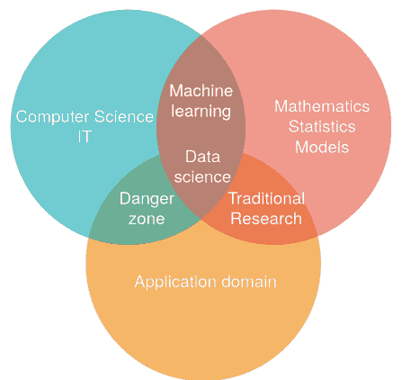

机器学习涵盖两种主要的数据分析类型：

1. 探索性分析：无监督学习。发现数据内部的结构。例：公司年限（年）和薪水相关。

2. 预测性分析：监督学习。这有时被描述为“从过去学习以预测未来”。场景：一家公司希望在一批潜在客户中检测出潜在的未来客户。回顾性数据分析：我们遍历由之前潜在公司构成的数据，以及它们的特征（规模、领域、位置等……）。其中一些公司成为客户，其他公司没有。问题是，我们能否根据先前的观察，基于它们的特征预测哪些新公司更有可能成为客户？在这个例子中，训练数据由一组 n 个训练样本组成。每个样本 x_i 是一个 p 个输入特征（公司特征）的向量和一个目标特征（y_i ∈ {Yes, No}）（它们是否成为客户）。

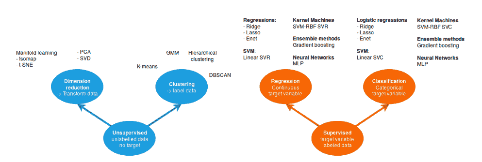

### 2.2 IT/计算机科学工具

- 高性能计算（HPC）
- 数据流、数据库、文件 I/O 等。
- Python：编程语言。
- Numpy：Python 库，特别适用于处理原始数值数据（矩阵、数学运算）。
- Pandas：输入/输出，操作结构化数据（表格）。

### 2.3 统计学和应用数学

- 线性模型。
- 非参数统计。
- 线性代数：矩阵运算、求逆、特征值。

### 2.4 数据分析方法论

1. 将客户需求形式化为学习问题：
   - 目标变量：监督问题。
     - 目标是定性的：分类。
     - 目标是定量的：回归。
   - 无目标变量：无监督问题
     - 高维样本的可视化：PCA、流形学习等。
     - 寻找样本组（隐藏结构）：聚类。
2. 询问数据集的问题
   - 样本数量
   - 变量数量，每个变量的类型。
3. 定义样本

## Python 语言

来源 Kevin Markham https://github.com/justmarkham/python-reference

### 3.1 导入库

```
# 'generic import' of math module
import math
math.sqrt(25)

# import a function
from math import sqrt
sqrt(25)    # no longer have to reference the module

# import multiple functions at once
from math import cos, floor

# import all functions in a module (generally discouraged)
# from os import *

# define an alias
import numpy as np

# show all functions in math module
content = dir(math)
```

### 3.2 基本操作

```
# Numbers
10 + 4      # add (returns 14)
10 - 4      # subtract (returns 6)
10 * 4      # multiply (returns 40)
10 ** 4     # exponent (returns 10000)
10 / 4      # divide (returns 2 because both types are 'int')
10 / float(4)  # divide (returns 2.5)
5 % 4       # modulo (returns 1) - also known as the remainder

10 / 4      # true division (returns 2.5)
10 // 4     # floor division (returns 2)
```

```
# Boolean operations
# comparisons (these return True)
5 > 3
5 >= 3
5 != 3
5 == 5

# boolean operations (these return True)
5 > 3 and 6 > 3
5 > 3 or 5 < 3
not False
False or not False and True      # evaluation order: not, and, or
```

### 3.3 数据类型

```
# determine the type of an object
type(2)          # returns 'int'
type(2.0)        # returns 'float'
type('two')      # returns 'str'
type(True)       # returns 'bool'
type(None)       # returns 'NoneType'

# check if an object is of a given type
isinstance(2.0, int)      # returns False
isinstance(2.0, (int, float))   # returns True

# convert an object to a given type
float(2)
int(2.9)
str(2.9)

# zero, None, and empty containers are converted to False
bool(0)
bool(None)
bool('')      # empty string
bool([])      # empty list
bool({})      # empty dictionary

# non-empty containers and non-zeros are converted to True
bool(2)
bool('two')
bool([2])
```

#### 3.3.1 列表

不同对象沿着某个有序序列分类，列表是有序的、可迭代的、可变的（添加或删除对象会改变列表大小），可以包含多种数据类型。

```
# create an empty list (two ways)
empty_list = []
empty_list = list()
```


```
# examine objects
id(num) == id(same_num)  # returns True
id(num) == id(new_num)   # returns False
num is same_num         # returns True
num is new_num          # returns False
num == same_num         # returns True
num == new_num          # returns True (their contents are equivalent)

# concatenate +, replicate *
[1, 2, 3] + [4, 5, 6]
["a"] * 2 + ["b"] * 3
```
#### 3.3.2 元组

与列表类似，但其大小不能改变：有序、可迭代、不可变，可包含多种数据类型。

```
# create a tuple
digits = (0, 1, 'two')          # create a tuple directly
digits = tuple([0, 1, 'two'])   # create a tuple from a list
zero = (0,)                     # trailing comma is required to indicate it's a tuple

# examine a tuple
digits[2]                       # returns 'two'
len(digits)                     # returns 3
digits.count(0)                 # counts the number of instances of that value (1)
digits.index(1)                 # returns the index of the first instance of that value (1)

# elements of a tuple cannot be modified
# digits[2] = 2                  # throws an error

# concatenate tuples
digits = digits + (3, 4)

# create a single tuple with elements repeated (also works with lists)
(3, 4) * 2                      # returns (3, 4, 3, 4)

# tuple unpacking
bart = ('male', 10, 'simpson')  # create a tuple
```

#### 3.3.3 字符串

字符序列，可迭代、不可变。

```
# create a string
s = str(42)                     # convert another data type into a string
s = 'I like you'

# examine a string
s[0]                            # returns 'I'
len(s)                          # returns 10

# string slicing like lists
s[:6]                           # returns 'I like'
s[7:]                # returns 'you'
s[-1]                # returns 'u'

# basic string methods (does not modify the original string)
s.lower()            # returns 'i like you'
s.upper()            # returns 'I LIKE YOU'
s.startswith('I')    # returns True
s.endswith('you')    # returns True
s.isdigit()          # returns False (returns True if every character in the string is a digit)
s.find('like')       # returns index of first occurrence (2), but doesn't support regex
s.find('hate')       # returns -1 since not found
s.replace('like','love')  # replaces all instances of 'like' with 'love'

# split a string into a list of substrings separated by a delimiter
s.split(' ')         # returns ['I','like','you']
s.split()            # same thing
s2 = 'a, an, the'
s2.split(',')        # returns ['a',' an',' the']

# join a list of strings into one string using a delimiter
stooges = ['larry','curly','moe']
' '.join(stooges)    # returns 'larry curly moe'

# concatenate strings
s3 = 'The meaning of life is'
s4 = '42'
s3 + ' ' + s4        # returns 'The meaning of life is 42'
s3 + ' ' + str(42)   # same thing

# remove whitespace from start and end of a string
s5 = ' ham and cheese '
s5.strip()           # returns 'ham and cheese'

# string substitutions: all of these return 'raining cats and dogs'
'raining %s and %s' % ('cats','dogs')                # old way
'raining {} and {}'.format('cats','dogs')            # new way
'raining {arg1} and {arg2}'.format(arg1='cats',arg2='dogs') # named arguments

# string formatting
# more examples: http://mkaz.com/2012/10/10/python-string-format/
'pi is {:.2f}'.format(3.14159)      # returns 'pi is 3.14'
```

#### 3.3.4 字符串 2/2

普通字符串允许转义字符。

```
print('first line\nsecond line')
```

输出：

```
first line
second line
```

原始字符串将反斜杠视为字面字符。

```
print(r'first line\nfirst line')
```

输出：

```
first line\n first line
```

字节序列不是字符串，在某些操作前应先解码。

```
s = b'first line\nsecond line'
print(s)
print(s.decode('utf-8').split())
```

输出：

```
b'first line\nsecond line'
['first', 'line', 'second', 'line']
```

#### 3.3.5 字典

字典是一种可以包含多种数据类型的数据结构，并以键值对形式有序组织：对于每个（唯一的）键，字典输出一个值。键可以是字符串、数字或元组，而对应的值可以是任何 Python 对象。字典的特点包括：无序、可迭代、可变。

```
# create an empty dictionary (two ways)
empty_dict = {}
empty_dict = dict()

# create a dictionary (two ways)
family = {'dad':'homer', 'mom':'marge', 'size':6}
family = dict(dad='homer', mom='marge', size=6)

# convert a list of tuples into a dictionary
list_of_tuples = [('dad', 'homer'), ('mom', 'marge'), ('size', 6)]
family = dict(list_of_tuples)

# examine a dictionary
family['dad']            # returns 'homer'
len(family)              # returns 3
family.keys()            # returns list: ['dad', 'mom', 'size']
family.values()          # returns list: ['homer', 'marge', 6]
family.items()           # returns list of tuples:
                         #   [('dad', 'homer'), ('mom', 'marge'), ('size', 6)]
'mom' in family          # returns True
'marge' in family        # returns False (only checks keys)

# modify a dictionary (does not return the dictionary)
family['cat'] = 'snowball'               # add a new entry
family['cat'] = 'snowball ii'            # edit an existing entry
del family['cat']                        # delete an entry
family['kids'] = ['bart', 'lisa']        # value can be a list
family.pop('dad')                        # removes an entry and returns the value ('homer')
family.update({'baby':'maggie', 'grandpa':'abe'})  # add multiple entries
```
```
# accessing values more safely with 'get'
family['mom']                     # returns 'marge'
family.get('mom')                 # same thing
try:
    family['grandma']             # throws an error
except KeyError as e:
    print("Error", e)

family.get('grandma')             # returns None
family.get('grandma', 'not found') # returns 'not found' (the default)

# accessing a list element within a dictionary
family['kids'][0]                 # returns 'bart'
family['kids'].remove('lisa')     # removes 'lisa'

# string substitution using a dictionary
'youngest child is %(baby)s' % family  # returns 'youngest child is maggie'
```

输出：

```
Error 'grandma'
```

#### 3.3.6 集合

与字典类似，但仅包含唯一键（没有对应的值）。它们具有以下特性：无序、可迭代、可变，可包含由唯一元素（字符串、数字或元组）组成的多种数据类型。

```
# create an empty set
empty_set = set()

# create a set
languages = {'python', 'r', 'java'}      # create a set directly
snakes = set(['cobra', 'viper', 'python']) # create a set from a list

# examine a set
len(languages)                  # returns 3
'python' in languages           # returns True

# set operations
languages & snakes              # returns intersection: {'python'}
languages | snakes              # returns union: {'cobra', 'r', 'java', 'viper', 'python'}
languages - snakes              # returns set difference: {'r', 'java'}
snakes - languages              # returns set difference: {'cobra', 'viper'}

# modify a set (does not return the set)
languages.add('sql')            # add a new element
languages.add('r')              # try to add an existing element (ignored, no error)
languages.remove('java')        # remove an element
try:
    languages.remove('c')       # try to remove a non-existing element (throws an error)
except KeyError as e:
    print("Error", e)
languages.discard('c')          # removes an element if present, but ignored otherwise
languages.pop()                  # removes and returns an arbitrary element
languages.clear()      # removes all elements
languages.update('go', 'spark') # add multiple elements (can also pass a list or set)

# get a sorted list of unique elements from a list
sorted(set([9, 0, 2, 1, 0]))      # returns [0, 1, 2, 9]
```

输出：

```
Error 'c'
```

### 3.4 执行控制语句

#### 3.4.1 条件语句

```
x = 3
# if statement
if x > 0:
    print('positive')

# if/else statement
if x > 0:
    print('positive')
else:
    print('zero or negative')

# if/elif/else statement
if x > 0:
    print('positive')
elif x == 0:
    print('zero')
else:
    print('negative')

# single-line if statement (sometimes discouraged)
if x > 0: print('positive')

# single-line if/else statement (sometimes discouraged)
# known as a 'ternary operator'
'positive' if x > 0 else 'zero or negative'
```

输出：

```
positive
positive
positive
positive
```

#### 3.4.2 循环

循环是一组重复执行的指令，直到满足终止条件。这可能包括遍历对象中的所有值、遍历一系列值等。


# range 返回一个整数列表
range(0, 3)      # 返回 [0, 1, 2]：包含第一个值但不包含第二个值
range(3)         # 同样的：从零开始是默认值
range(0, 5, 2)  # 返回 [0, 2, 4]：第三个参数指定 'stride'

# for 循环（不推荐）
fruits = ['apple', 'banana', 'cherry']
for i in range(len(fruits)):
    print(fruits[i].upper())

# 替代的 for 循环（推荐风格）
for fruit in fruits:
    print(fruit.upper())

# 在遍历大型序列时使用 range，以避免在内存中实际创建整数列表
for i in range(10**6):
    pass

# 同时遍历两个事物（使用元组解包）
family = {'dad':'homer', 'mom':'marge', 'size':6}
for key, value in family.items():
    print(key, value)

# 如果需要在循环内访问索引值，请使用 enumerate
for index, fruit in enumerate(fruits):
    print(index, fruit)

# for/else 循环
for fruit in fruits:
    if fruit == 'banana':
        print("Found the banana!")
        break    # 退出循环并跳过 'else' 块
    else:
        # 此块仅在 for 循环完成且未触发 'break' 时执行
        print("Can't find the banana")

# while 循环
count = 0
while count < 5:
    print("This will print 5 times")
    count += 1      # 等价于 'count = count + 1'

Out:

```
APPLE
BANANA
CHERRY
APPLE
BANANA
CHERRY
dad homer
mom marge
size 6
0 apple
1 banana
2 cherry
```

Can't find the banana
Found the banana!
This will print 5 times
This will print 5 times
This will print 5 times
This will print 5 times
This will print 5 times

#### 3.4.3 异常处理

```
dct = dict(a=[1, 2], b=[4, 5])

key = 'c'
try:
    dct[key]
except:
    print("Key %s is missing. Add it with empty value" % key)
    dct['c'] = []

print(dct)
```

Out:

```
Key c is missing. Add it with empty value
{'a': [1, 2], 'b': [4, 5], 'c': []}
```

### 3.5 函数

函数是一组在被调用时启动的指令，它们可以有多个输入值和一个返回值

```
# define a function with no arguments and no return values
def print_text():
    print('this is text')

# call the function
print_text()

# define a function with one argument and no return values
def print_this(x):
    print(x)

# call the function
print_this(3)      # prints 3
n = print_this(3)  # prints 3, but doesn't assign 3 to n
                   #  because the function has no return statement

# define a function with one argument and one return value
def square_this(x):
    return x ** 2

# include an optional docstring to describe the effect of a function
def square_this(x):
```

```python
"""Return the square of a number."""
    return x ** 2

# call the function
square_this(3)      # prints 9
var = square_this(3)  # assigns 9 to var, but does not print 9

# default arguments
def power_this(x, power=2):
    return x ** power

power_this(2)    # 4
power_this(2, 3) # 8

# use 'pass' as a placeholder if you haven't written the function body
def stub():
    pass

# return two values from a single function
def min_max(nums):
    return min(nums), max(nums)

# return values can be assigned to a single variable as a tuple
nums = [1, 2, 3]
min_max_num = min_max(nums)        # min_max_num = (1, 3)

# return values can be assigned into multiple variables using tuple unpacking
min_num, max_num = min_max(nums)   # min_num = 1, max_num = 3
```

Out:

```
this is text
3
3
```

### 3.6 列表推导式、迭代器等

#### 3.6.1 列表推导式

不通过循环迭代而影响整个列表的过程。更多信息：http://python-3-patterns-idioms-test.readthedocs.io/en/latest/Comprehensions.html

```
# for loop to create a list of cubes
nums = [1, 2, 3, 4, 5]
cubes = []
for num in nums:
    cubes.append(num**3)

# equivalent list comprehension
cubes = [num**3 for num in nums]    # [1, 8, 27, 64, 125]

# for loop to create a list of cubes of even numbers
cubes_of_even = []
for num in nums:
```

```
if num % 2 == 0:
    cubes_of_even.append(num**3)

# equivalent list comprehension
# syntax: [expression for variable in iterable if condition]
cubes_of_even = [num**3 for num in nums if num % 2 == 0]  # [8, 64]

# for loop to cube even numbers and square odd numbers
cubes_and_squares = []
for num in nums:
    if num % 2 == 0:
        cubes_and_squares.append(num**3)
    else:
        cubes_and_squares.append(num**2)

# equivalent list comprehension (using a ternary expression)
# syntax: [true_condition if condition else false_condition for variable in iterable]
cubes_and_squares = [num**3 if num % 2 == 0 else num**2 for num in nums]  # [1, 8, 9, ..., 64, 25]

# for loop to flatten a 2d-matrix
matrix = [[1, 2], [3, 4]]
items = []
for row in matrix:
    for item in row:
        items.append(item)

# equivalent list comprehension
items = [item for row in matrix
            for item in row]  # [1, 2, 3, 4]

# set comprehension
fruits = ['apple', 'banana', 'cherry']
unique_lengths = {len(fruit) for fruit in fruits}  # {5, 6}

# dictionary comprehension
fruit_lengths = {fruit:len(fruit) for fruit in fruits}  # {'apple': 5, 'banana': 6, 'cherry': 6}
```

### 3.7 正则表达式

- 1. 使用模式编译正则表达式
- 2. 在字符串上匹配已编译的 RE

```python
import re

# 1. compile Regular expression with a pattern
regex = re.compile("^.+ (sub-.+)_ (ses-.+)_ (mod-.+)")
```

捕获模式 `anyprefixsub-<subj id>_ses-<session id>_<modality>`

```python
strings = ["abcs sub-033_ses-01_mod-mri", "defsub-044_ses-01_mod-mri", "ghisub-055_ses-02_mod-ctscan" ]
print([regex.findall(s)[0] for s in strings])
```

Out:

```
[('sub-033', 'ses-01', 'mod-mri'), ('sub-044', 'ses-01', 'mod-mri'), ('sub-055', 'ses-02', 'mod-ctscan')]
```

### 已编译正则表达式的匹配方法

| 方法/属性 | 用途 |
|---|---|
| match(string) | 确定 RE 是否在字符串开头匹配。 |
| search(string) | 扫描字符串，查找 RE 匹配的任何位置。 |
| findall(string) | 查找 RE 匹配的所有子字符串，并将它们作为列表返回。 |
| finditer(string) | 查找 RE 匹配的所有子字符串，并将它们作为迭代器返回。 |

### 2. 在字符串上替换已编译的 RE

```
regex = re.compile("(sub-[^_]+)") # match (sub-...)
print([regex.sub("SUB-", s) for s in strings])

regex.sub("SUB-", "toto")
```

Out:

```
['abcSUB-_ses-01_mod-mri', 'defSUB-_ses-01_mod-mri', 'ghiSUB-_ses-02_mod-ctscan']
```

### 3.8 系统编程

#### 3.8.1 操作系统接口 (os)

```
import os
```

### 当前工作目录

```
# Get the current working directory
cwd = os.getcwd()
print(cwd)

# Set the current working directory
os.chdir(cwd)
```

Out:

```
/home/edouard/git/pystatsml/python_lang
```

### 临时目录

```
import tempfile

tmpdir = tempfile.gettempdir()
```

连接路径

```
mytmpdir = os.path.join(tmpdir, "foobar")

# list containing the names of the entries in the directory given by path.
os.listdir(tmpdir)
```

### 创建目录

```
if not os.path.exists(mytmpdir):
    os.mkdir(mytmpdir)

os.makedirs(os.path.join(tmpdir, "foobar", "plop", "toto"), exist_ok=True)
```

#### 3.8.2 文件输入/输出

```
filename = os.path.join(mytmpdir, "myfile.txt")
print(filename)

# Write
lines = ["Dans python tout est bon", "Enfin, presque"]

## write line by line
fd = open(filename, "w")
fd.write(lines[0] + "\n")
fd.write(lines[1]+ "\n")
fd.close()

## use a context manager to automatically close your file
with open(filename, 'w') as f:
    for line in lines:
        f.write(line + '\n')

# Read
## read one line at a time (entire file does not have to fit into memory)
f = open(filename, "r")
f.readline()      # one string per line (including newlines)
f.readline()      # next line
f.close()

## read one line at a time (entire file does not have to fit into memory)
f = open(filename, 'r')
f.readline()      # one string per line (including newlines)
f.readline()      # next line
f.close()

## read the whole file at once, return a list of lines
f = open(filename, 'r')
f.readlines()     # one list, each line is one string
f.close()

## use list comprehension to duplicate readlines without reading entire file at once
f = open(filename, 'r')
[line for line in f]
f.close()

## use a context manager to automatically close your file
```

进程 = 地址空间 + 执行上下文（控制线程）

进程地址空间（段）：

- 代码。
- 数据（静态/全局）。
- 堆（动态内存分配）。
- 栈。

执行上下文：

- 数据寄存器。
- 栈指针（SP）。
- 程序计数器（PC）。
- 工作寄存器。

操作系统进程调度：上下文切换（即 保存/加载 执行上下文）

## 优缺点

- 上下文切换开销大。
- （潜在地）复杂的数据共享（不一定为真）。
- 协作进程 - 无需内存保护（独立地址空间）。
- 与内存分配的并行计算相关。

## 线程

- 线程共享相同的地址空间（数据寄存器）：可访问代码、堆和（全局）数据。
- 独立的执行栈、PC 和工作寄存器。

## 优缺点

- 更快的上下文切换，仅涉及 SP、PC 和工作寄存器。
- 可利用细粒度并发
- 通过共享地址空间实现简单的数据共享。
- 必须采取预防措施，否则两个线程会同时写入同一内存。这就是全局解释器锁（GIL）的用途。
- 与 GUI、I/O（网络、磁盘）并发操作相关

## 在 Python 中

- threading 模块使用线程。
- multiprocessing 模块使用进程。

## 多线程

```
import time
import threading
```

```
def list_append(count, sign=1, out_list=None):
    if out_list is None:
        out_list = list()
    for i in range(count):
        out_list.append(sign * i)
        sum(out_list) # do some computation
    return out_list

size = 10000  # Number of numbers to add

out_list = list() # result is a simple list
thread1 = threading.Thread(target=list_append, args=(size, 1, out_list, ))
thread2 = threading.Thread(target=list_append, args=(size, -1, out_list, ))

starttime = time.time()
# Will execute both in parallel
thread1.start()
thread2.start()
# Joins threads back to the parent process
thread1.join()
thread2.join()
print("Threading elapsed time ", time.time() - starttime)

print(out_list[:10])
```

输出：

```
Threading elapsed time  1.7804272174835205
[0, 1, 2, 3, 4, 5, 6, 7, 8, 9]
```

## 多进程

```
import multiprocessing

# Sharing requires specific mechanism
out_list1 = multiprocessing.Manager().list()
p1 = multiprocessing.Process(target=list_append, args=(size, 1, None))
out_list2 = multiprocessing.Manager().list()
p2 = multiprocessing.Process(target=list_append, args=(size, -1, None))

starttime = time.time()
p1.start()
p2.start()
p1.join()
p2.join()
print("Multiprocessing elapsed time ", time.time() - starttime)

# print(out_list[:10]) is not available
```

输出：

```
Multiprocessing elapsed time  0.3432891368865967
```

## 使用 Managers 在进程间共享对象

Managers 提供了一种创建可在不同进程之间共享的数据的方式，包括在不同机器上运行的进程之间通过网络共享。管理器对象控制一个服务器进程，该进程管理共享对象。

```
import multiprocessing
import time

size = int(size / 100)  # Number of numbers to add

# Sharing requires specific mechanism
out_list = multiprocessing.Manager().list()
p1 = multiprocessing.Process(target=list_append, args=(size, 1, out_list))
p2 = multiprocessing.Process(target=list_append, args=(size, -1, out_list))

starttime = time.time()

p1.start()
p2.start()

p1.join()
p2.join()

print(out_list[:10])

print("Multiprocessing with shared object elapsed time ", time.time() - starttime)
```

输出：

```
[0, 1, 2, 3, 4, 5, 0, 6, -1, 7]
Multiprocessing with shared object elapsed time  0.6759169101715088
```

### 3.9 脚本和参数解析

示例，词计数脚本

```
import os
import os.path
import argparse
import re
import pandas as pd

if __name__ == "__main__":
    # parse command line options
    output = "word_count.csv"
    parser = argparse.ArgumentParser()
    parser.add_argument('-i', '--input',
                        help='list of input files.',
                        nargs='+', type=str)
    parser.add_argument('-o', '--output',
                        help='output csv file (default %s)' % output,
                        type=str, default=output)
    options = parser.parse_args()

    if options.input is None :
        parser.print_help()
        raise SystemExit("Error: input files are missing")
    else:
filenames = [f for f in options.input if os.path.isfile(f)]

# Match words
regex = re.compile("[a-zA-Z]+")

count = dict()
for filename in filenames:
    fd = open(filename, "r")
    for line in fd:
        for word in regex.findall(line.lower()):
            if not word in count:
                count[word] = 1
            else:
                count[word] += 1

fd = open(options.output, "w")

# Pandas
df = pd.DataFrame([[k, count[k]] for k in count], columns=["word", "count"])
df.to_csv(options.output, index=False)
```

### 3.10 网络

```
# TODO
```

#### 3.10.1 FTP

```
# Full FTP features with ftplib
import ftplib
ftp = ftplib.FTP("ftp.cea.fr")
ftp.login()
ftp.cwd('/pub/unati/people/educhesnay/pystatml/datasets')
ftp.retrlines('LIST')

fd = open(os.path.join(tmpdir, "readme1.rst"), "wb")
ftp.retrbinary('RETR readme.rst', fd.write)
fd.close()
ftp.quit()

# File download urllib
import urllib.request
ftp_url = 'ftp://ftp.cea.fr/pub/unati/people/educhesnay/pystatml/datasets/readme.rst'
urllib.request.urlretrieve(ftp_url, os.path.join(tmpdir, "readme2.rst"))
```

输出：

```
-rw-r--r--  1 ftp ftp      5166 Dec 04  2017 Advertising.csv
-rw-r--r--  1 ftp ftp      4955 Feb 22  2018 birthwt.csv
-rw-r--r--  1 ftp ftp      1357 Feb 22  2018 birthwt_info.txt
-rw-r--r--  1 ftp ftp   5539328 Sep 13  2016 default of credit card clients.xls
-rw-r--r--  1 ftp ftp      2443 Sep 13  2016 eurodist.csv
-rw-r--r--  1 ftp ftp      3858 Sep 13  2016 iris.csv
-rw-r--r--  1 ftp ftp 152 Sep 13 2016 readme.rst
-rw-r--r--  1 ftp ftp 77352 Sep 20 2016 s_curve.csv
-rw-r--r--  1 ftp ftp 840 Sep 13 2016 salary_table.csv
```

#### 3.10.2 HTTP

```
# TODO
```

#### 3.10.3 Sockets

```
# TODO
```

#### 3.10.4 xmlrpc

```
# TODO
```

### 3.11 模块和包

一个模块是 Python 文件。包是一个目录，必须包含一个名为 __init__.py 的特殊文件

要导入，请扩展变量 PYTHONPATH：

```
export PYTHONPATH=path_to_parent_python_module:${PYTHONPATH}
```

或

```
import sys
sys.path.append("path_to_parent_python_module")
```

__init__.py 文件可以为空。但你可以通过覆盖 __all__ 变量来设置包作为 API 导出的模块，同时保持其他模块内部，如下所示：

parentmodule/__init__.py 文件：

```
from . import submodule1
from . import submodule2

from .submodule3 import function1
from .submodule3 import function2

__all__ = ["submodule1", "submodule2",
    "function1", "function2"]
```

用户可以导入：

```
import parentmodule.submodule1
import parentmodule.function1
```

## Python 单元测试

### 3.12 面向对象编程（OOP）

## 来源

- http://python-textbook.readthedocs.org/en/latest/Object_Oriented_Programming.html

## 原则

- **封装** 数据（属性）和代码（方法）到对象中。
- **类** = 可用于创建对象的模板或蓝图。
- 一个 **对象** 是类的特定实例。
- **继承：** OOP 允许类从其他类继承常用的状态和行为。减少代码重复
- **多态：** （通常通过多态获得）调用代码对对象是否属于父类或其后代不敏感（抽象、模块化）。对两个不同类的两个对象调用相同的方法会表现出不同的行为。

```python
import math

class Shape2D:
    def area(self):
        raise NotImplementedError()

# __init__ is a special method called the constructor

# Inheritance + Encapsulation
class Square(Shape2D):
    def __init__(self, width):
        self.width = width

    def area(self):
        return self.width ** 2

class Disk(Shape2D):
    def __init__(self, radius):
        self.radius = radius

    def area(self):
        return math.pi * self.radius ** 2

shapes = [Square(2), Disk(3)]

# Polymorphism
print([s.area() for s in shapes])

s = Shape2D()
try:
    s.area()
except NotImplementedError as e:
    print("NotImplementedError")
```

输出：


```
[4, 28.274333882308138]
NotImplementedError
```

### 3.13 练习

#### 3.13.1 练习 1：函数

创建一个充当简单计算器的函数。如果未指定操作，则默认为加法。如果操作指定错误，则返回提示信息。  
例：calc(4,5,"multiply") 返回 20  
例：calc(3,5) 返回 8  
例：calc(1, 2, "something") 返回错误信息

#### 3.13.2 练习 2：函数 + 列表 + 循环

给定一个数字列表，返回一个列表，其中所有相邻的重复元素都已简化为单个元素。例：[1, 2, 2, 3, 2] 返回 [1, 2, 3, 2]。你可以创建新列表或修改传入的列表。

删除所有重复值（相邻或不相邻）。例：[1, 2, 2, 3, 2] 返回 [1, 2, 3]

#### 3.13.3 练习 3：文件 I/O

1. 复制/粘贴 BSD 4 条款许可证 (https://en.wikipedia.org/wiki/BSD_licenses) 到一个文本文件中。读取文件并统计文件中每个单词出现的次数。将单词的出现次数存储在字典中。
2. 编写一个可执行的 Python 命令 count_words.py，它解析在 --input 参数后提供的输入文件列表。出现次数的字典保存在 --output 提供的 csv 文件中，默认值为 word_count.csv。使用：
   - open
   - 正则表达式
   - argparse (https://docs.python.org/3/howto/argparse.html)

#### 3.13.4 练习 4：OOP

1. 创建一个类 Employee，构造函数中提供 2 个属性：name、years_of_service。通过一个方法，salary 通过 1500 + 100 * years_of_service 获得。
2. 创建一个子类 Manager，重定义 salary 方法为 2500 + 120 * years_of_service。
3. 创建一个基于字典的小型数据库，其中键为员工姓名。用以下内容填充数据库：samples = Employee('lucy', 3), Employee('john', 1), Manager('julie', 10), Manager('paul', 3)
4. 返回一个由 name、salary 行组成的表格，即列表的列表 [[name, salary]]
5. 计算平均薪资

脚本总运行时间：( 0 分钟 3.800 秒)  

注意：点击此处下载完整示例代码

## NUMPY：数组和矩阵

NumPy 是 Python 编程语言的扩展，增加了对大型多维（数值）数组和矩阵的支持，以及用于对这些数组进行操作的大型高层数学函数库。

来源：

- Kevin Markham: https://github.com/justmarkham

```
from __future__ import print_function
import numpy as np
```

### 4.1 创建数组

从列表创建 ndarray。注意：每个元素必须是相同类型（如果可能则会转换）

```
data1 = [1, 2, 3, 4, 5]              # list
arr1 = np.array(data1)              # 1d array
data2 = [range(1, 5), range(5, 9)]   # list of lists
arr2 = np.array(data2)              # 2d array
arr2.tolist()                       # convert array back to list
```

创建特殊数组

```
np.zeros(10)
np.zeros((3, 6))
np.ones(10)
np.linspace(0, 1, 5)            # 0 to 1 (inclusive) with 5 points
np.logspace(0, 3, 4)              # 10^0 to 10^3 (inclusive) with 4 points
```

arange 与 range 类似，只是它返回数组（而不是列表）

```
int_array = np.arange(5)
float_array = int_array.astype(float)
```

### 4.2 检查数组

```
arr1.dtype    # float64
arr2.dtype    # int32
arr2.ndim     # 2
arr2.shape    # (2, 4) - axis 0 is rows, axis 1 is columns
arr2.size     # 8 - total number of elements
len(arr2)     # 2 - size of first dimension (aka axis)
```

### 4.3 重塑

```
arr = np.arange(10, dtype=float).reshape((2, 5))
print(arr.shape)
print(arr.reshape(5, 2))
```

输出：

```
(2, 5)
[[0. 1.]
 [2. 3.]
 [4. 5.]
 [6. 7.]
 [8. 9.]]
```

添加轴

```
a = np.array([0, 1])
a_col = a[:, np.newaxis]
print(a_col)
#or
a_col = a[:, None]
```

输出：

```
[[0]
 [1]]
```

转置

```
print(a_col.T)
```

输出：

```
[[0 1]]
```

Flatten：始终返回原始数组的扁平副本

```
arr_flt = arr.flatten()
arr_flt[0] = 33
print(arr_flt)
print(arr)
```

输出：

```
[33.  1.  2.  3.  4.  5.  6.  7.  8.  9.]
[[0.  1.  2.  3.  4.]
 [5.  6.  7.  8.  9.]]
```

Ravel：尽可能返回原始数组的视图。

```
arr_flt = arr.ravel()
arr_flt[0] = 33
print(arr_flt)
print(arr)
```

输出：

```
[33.  1.  2.  3.  4.  5.  6.  7.  8.  9.]
[[33.  1.  2.  3.  4.]
 [ 5.  6.  7.  8.  9.]]
```

### 4.4 堆叠数组

按列堆叠扁平数组

```
a = np.array([0, 1])
b = np.array([2, 3])

ab = np.stack((a, b)).T
print(ab)

# or
np.hstack((a[:, None], b[:, None]))
```

输出：

```
[[0 2]
 [1 3]]
```

### 4.5 选择

单个项目

```
arr = np.arange(10, dtype=float).reshape((2, 5))

arr[0]      # 0th element (slices like a list)
arr[0, 3]   # row 0, column 3: returns 4
arr[0][3]   # alternative syntax
```

#### 4.5.1 切片

语法：start:stop:step，其中 start（默认 0），stop（默认最后），step（默认 1）

```
arr[0, :]     # row 0: returns 1d array ([1, 2, 3, 4])
arr[:, 0]     # column 0: returns 1d array ([1, 5])
arr[:, :2]    # columns strictly before index 2 (2 first columns)
arr[:, 2:]    # columns after index 2 included
arr2 = arr[:, 1:4]  # columns between index 1 (included) and 4 (excluded)
print(arr2)
```

输出：

```
[[1. 2. 3.]
 [6. 7. 8.]]
```

切片返回视图（不是副本）

```
arr2[0, 0] = 33
print(arr2)
print(arr)
```

输出：

```
[[33.  2.  3.]
 [ 6.  7.  8.]]
[[ 0. 33.  2.  3.  4.]
 [ 5.  6.  7.  8.  9.]]
```

#### 行 0：逆序

```
print(arr[0, ::-1])

# The rule of thumb here can be: in the context of lvalue indexing (i.e. the indices are
# placed in the left hand side value of an assignment), no view or copy of the array is
# created (because there is no need to). However, with regular values, the above rules
# for creating views do apply.
```

输出：

```
[ 4.  3.  2. 33.  0.]
```

#### 4.5.2 花式索引：整数或布尔数组索引

花式索引返回副本而不是视图。

#### 整数数组索引

```
arr2 = arr[:, [1,2,3]]  # return a copy
print(arr2)
arr2[0, 0] = 44
print(arr2)
print(arr)
```

输出：

```
[[33.  2.  3.]
 [ 6.  7.  8.]]
[[44.  2.  3.]
 [ 6.  7.  8.]]
[[ 0. 33.  2.  3.  4.]
 [ 5.  6.  7.  8.  9.]]
```

#### 布尔数组索引

```
arr2 = arr[arr > 5]  # return a copy

print(arr2)
arr2[0] = 44
print(arr2)
print(arr)
```

输出：

```
[33.  6.  7.  8.  9.]
[44.  6.  7.  8.  9.]
[[ 0. 33.  2.  3.  4.]
 [ 5.  6.  7.  8.  9.]]
```

然而，在左值索引的上下文中（赋值左手边的索引），花式索引允许修改原始数组。

```
arr[arr > 5] = 0
print(arr)
```

输出：

```
[[0.  0.  2.  3.  4.]
 [5.  0.  0.  0.  0.]]
```

#### 布尔数组索引继续

```
names = np.array(['Bob', 'Joe', 'Will', 'Bob'])
names == 'Bob'                         # returns a boolean array
names[names != 'Bob']                  # logical selection
(names == 'Bob') | (names == 'Will')   # keywords "and/or" don't work with boolean arrays
names[names != 'Bob'] = 'Joe'          # assign based on a logical selection
np.unique(names)                       # set function
```

### 4.6 向量化操作

```
nums = np.arange(5)
nums * 10                              # multiply each element by 10
nums = np.sqrt(nums)                   # square root of each element
np.ceil(nums)                          # also floor, rint (round to nearest int)
np.isnan(nums)                         # checks for NaN
nums + np.arange(5)                    # add element-wise
np.maximum(nums, np.array([1, -2, 3, -4, 5]))  # compare element-wise

# Compute Euclidean distance between 2 vectors
vec1 = np.random.randn(10)
vec2 = np.random.randn(10)
dist = np.sqrt(np.sum((vec1 - vec2) ** 2))

# math and stats
rnd = np.random.randn(4, 2)  # random normals in 4x2 array
rnd.mean()
rnd.std()
rnd.argmin()               # index of minimum element
rnd.sum()
rnd.sum(axis=0)            # sum of columns
rnd.sum(axis=1)            # sum of rows

# methods for boolean arrays
(rnd > 0).sum()            # counts number of positive values
(rnd > 0).any()            # checks if any value is True
(rnd > 0).all()            # checks if all values are True

# random numbers
np.random.seed(12234)      # Set the seed
np.random.rand(2, 3)       # 2 x 3 matrix in [0, 1]
np.random.randn(10)        # random normals (mean 0, sd 1)
np.random.randint(0, 2, 10) # 10 randomly picked 0 or 1
```

### 4.7 广播

来源：https://docs.scipy.org/doc/numpy-1.13.0/user/basics.broadcasting.html

隐式转换以允许对不同大小的数组进行操作。

- 较小的数组被拉伸或“广播”到较大的数组上，使其具有兼容的形状。
- 在 C 而不是 Python 中进行快速向量化操作。
- 无不必要的复制。

#### 4.7.1 规则

从尾随轴开始向后，NumPy 比较数组的维度。

- 如果两个维度相等则继续
- 如果操作数之一的维度为 1，则将其拉伸以匹配最大维度
- 当其中一个形状的维度用完（因为它比另一个形状的维度少）时，NumPy 将在比较过程中使用 1，直到另一个形状的维度也用完。

```
a = np.array([[ 0,  0,  0],
             [10, 10, 10],
             [20, 20, 20],
             [30, 30, 30]])

b = np.array([0, 1, 2])

print(a + b)
```

输出：

```
[[ 0  1  2]
[10 11 12]
```


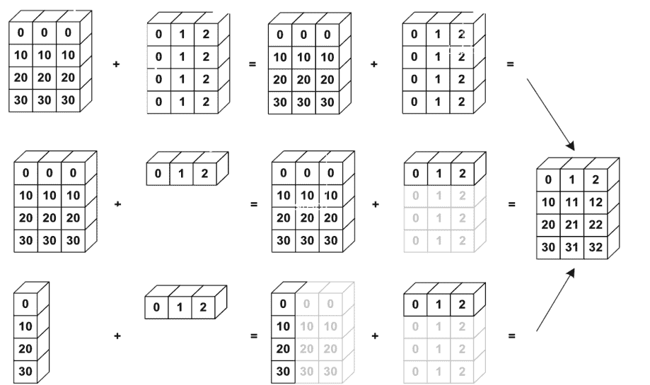

图 4.1：来源： http://www.scipy-lectures.org

```
[20 21 22]
[30 31 32]]
```

## 示例

操作数 A、B 和结果的形状：

```
A      (2d array):  5 x 4
B      (1d array):     1
Result (2d array):  5 x 4

A      (2d array):  5 x 4
B      (1d array):     4
Result (2d array):  5 x 4

A      (3d array): 15 x 3 x 5
B      (3d array): 15 x 1 x 5
Result (3d array): 15 x 3 x 5

A      (3d array): 15 x 3 x 5
B      (2d array):     3 x 5
Result (3d array): 15 x 3 x 5

A      (3d array): 15 x 3 x 5
B      (2d array):     3 x 1
Result (3d array): 15 x 3 x 5
```

### 4.8 练习

给定数组：

```
X = np.random.randn(4, 2) # random normals in 4x2 array
```

- 对于每一列，找到最小值的行索引。
- 编写一个函数 standardize(X)，使其返回列居中并缩放（按标准差）的数组。

脚本总运行时间：( 0 分钟 0.008 秒)

注意：点击此处下载完整示例代码

## PANDAS：数据操作

常说数据分析的 80% 时间花在清理上，以及使用 Pandas 进行数据操作和清理这一虽小但重要的方面。

## 来源：

- Kevin Markham: https://github.com/justmarkham
- Pandas 文档: http://pandas.pydata.org/pandas-docs/stable/index.html

## 数据结构

- **Series** 是一个一维的带标签数组，能够容纳任何数据类型（整数、字符串、浮点数、Python 对象等）。轴标签统称为索引。创建 Series 的基本方法是调用 *pd.Series([1,3,5,np.nan,6,8])*
- **DataFrame** 是一个二维的带标签数据结构，其列可能具有不同的类型。你可以把它想象成电子表格或 SQL 表，或 Series 对象的字典。它源自 R 的 *data.frame()* 对象。

```
from __future__ import print_function

import pandas as pd
import numpy as np
import matplotlib.pyplot as plt
```

### 5.1 创建 DataFrame

```
columns = ['name', 'age', 'gender', 'job']

user1 = pd.DataFrame([['alice', 19, "F", "student"],
    ['john', 26, "M", "student"]],
    columns=columns)

user2 = pd.DataFrame([['eric', 22, "M", "student"],
    ['paul', 58, "F", "manager"]],
    columns=columns)

user3 = pd.DataFrame(dict(name=['peter', 'julie'],
    age=[33, 44], gender=['M', 'F'],
    job=['engineer', 'scientist']))

print(user3)
```

输出：

|   | 名称 | 年龄 | 性别 | 工作 |
|---|---|---|---|---|
| 0 | peter | 33 | M | engineer |
| 1 | julie | 44 | F | scientist |

### 5.2 合并 DataFrames

#### 5.2.1 拼接 DataFrame

```
```python
user1.append(user2)
users = pd.concat([user1, user2, user3])
print(users)
```
```

输出：

|   | 名称 | 年龄 | 性别 | 工作 |
|---|---|---|---|---|
| 0 | alice | 19 | F | student |
| 1 | john | 26 | M | student |
| 0 | eric | 22 | M | student |
| 1 | paul | 58 | F | manager |
| 0 | peter | 33 | M | engineer |
| 1 | julie | 44 | F | scientist |

#### 5.2.2 连接 DataFrame

```
```python
user4 = pd.DataFrame(dict(name=['alice', 'john', 'eric', 'julie'],
                         height=[165, 180, 175, 171]))
print(user4)
```
```

输出：

|   | 名称 | 身高 |
|---|---|---|
| 0 | alice | 165 |
| 1 | john | 180 |
| 2 | eric | 175 |
| 3 | julie | 171 |

使用两个数据帧键的交集

```
```python
merge_inter = pd.merge(users, user4, on="name")
print(merge_inter)
```
```

输出：

|   | 名称 | 年龄 | 性别 | 工作 | 身高 |
|---|---|---|---|---|---|
| 0 | alice | 19 | F | student | 165 |
| 1 | john | 26 | M | student | 180 |
| 2 | eric | 22 | M | student | 175 |
| 3 | julie | 44 | F | scientist | 171 |

使用两个数据帧键的并集

```
users = pd.merge(users, user4, on="name", how='outer')
print(users)
```

输出：

| 名称 | 年龄 | 性别 | 工作 | 身高 |
|---|---|---|---|---|
| alice | 19 | F | student | 165.0 |
| john | 26 | M | student | 180.0 |
| eric | 22 | M | student | 175.0 |
| paul | 58 | F | manager | NaN |
| peter | 33 | M | engineer | NaN |
| julie | 44 | F | scientist | 171.0 |

#### 5.2.3 通过透视重塑

“取消透视”将 DataFrame 从宽格式重塑为长（堆叠）格式，

```
staked = pd.melt(users, id_vars="name", var_name="variable", value_name="value")
print(staked)
```

输出：

| 名称 | 变量 | 值 |
|---|---|---|
| alice | age | 19 |
| john | age | 26 |
| eric | age | 22 |
| paul | age | 58 |
| peter | age | 33 |
| julie | age | 44 |
| alice | gender | F |
| john | gender | M |
| eric | gender | M |
| paul | gender | F |
| peter | gender | M |
| julie | gender | F |
| alice | job | student |
| john | job | student |
| eric | job | student |
| paul | job | manager |
| peter | job | engineer |
| julie | job | scientist |
| alice | height | 165 |
| john | height | 180 |
| eric | height | 175 |
| paul | height | NaN |
| peter | height | NaN |
| julie | height | 171 |

“透视”将 DataFrame 从长（堆叠）格式重塑为宽格式，

```
print(staked.pivot(index='name', columns='variable', values='value'))
```

输出：

| 名称 | 年龄 | 性别 | 身高 | 工作 |
|---|---|---|---|---|
| alice | 19 | F | 165 | student |
| eric | 22 | M | 175 | student |
| john | 26 | M | 180 | student |
| julie | 44 | F | 171 | scientist |
| paul | 58 | F | NaN | manager |
| peter | 33 | M | NaN | engineer |

### 5.3 汇总

```
```python
# examine the users data

users                 # print the first 30 and last 30 rows
type(users)           # DataFrame
users.head()          # print the first 5 rows
users.tail()          # print the last 5 rows

users.index           # "the index" (aka "the labels")
users.columns         # column names (which is "an index")
users.dtypes          # data types of each column
users.shape           # number of rows and columns
users.values          # underlying numpy array
users.info()          # concise summary (includes memory usage as of pandas 0.15.0)
```
```

输出：

```
```
<class 'pandas.core.frame.DataFrame'>
Int64Index: 6 entries, 0 to 5
Data columns (total 5 columns):
name      6 non-null object
age       6 non-null int64
gender    6 non-null object
job       6 non-null object
height    4 non-null float64
dtypes: float64(1), int64(1), object(3)
memory usage: 288.0+ bytes
```
```

### 5.4 列选择

```
```python
users['gender']            # select one column
type(users['gender'])      # Series
users.gender               # select one column using the DataFrame

# select multiple columns
users[['age', 'gender']]   # select two columns
my_cols = ['age', 'gender'] # or, create a list...
users[my_cols]             # ...and use that list to select columns
type(users[my_cols])       # DataFrame
```
```

### 5.5 行选择（基础）

iloc 严格基于整数位置

```
df = users.copy()
df.iloc[0]      # first row
df.iloc[0, 0] # first item of first row
df.iloc[0, 0] = 55

for i in range(users.shape[0]):
    row = df.iloc[i]
    row.age *= 100 # setting a copy, and not the original frame data.

print(df)  # df is not modified
```

输出：

| 名称 | 年龄 | 性别 | 工作 | 身高 |
|---|---|---|---|---|
| 55 | 19 | F | student | 165.0 |
| john | 26 | M | student | 180.0 |
| eric | 22 | M | student | 175.0 |
| paul | 58 | F | manager | NaN |
| peter | 33 | M | engineer | NaN |
| julie | 44 | F | scientist | 171.0 |

ix 支持混合整数和标签访问。

```
df = users.copy()
df.ix[0]            # first row
df.ix[0, "age"] # first item of first row
df.ix[0, "age"] = 55

for i in range(df.shape[0]):
    df.ix[i, "age"] *= 10

print(df)  # df is modified
```

输出：

| 名称 | 年龄 | 性别 | 工作 | 身高 |
|---|---|---|---|---|
| alice | 550 | F | student | 165.0 |
| john | 260 | M | student | 180.0 |
| eric | 220 | M | student | 175.0 |
| paul | 580 | F | manager | NaN |
| peter | 330 | M | engineer | NaN |
| julie | 440 | F | scientist | 171.0 |

### 5.6 行选择（过滤）

简单逻辑过滤

```
users[users.age < 20]      # only show users with age < 20
young_bool = users.age < 20  # or, create a Series of booleans...
young = users[young_bool]           # ...and use that Series to filter rows
```

75%    41.250000  176.250000
max    58.000000  180.000000

## 汇总所有列

```
print(df.describe(include='all'))
print(df.describe(include=['object']))  # limit to one (or more) types
```

输出：

```
name    age gender    job    height
count    6  6.000000    6      6  4.000000
unique   6  NaN        2      4  NaN
top      peter NaN    M student NaN
freq     1  NaN        3      3  NaN
mean     NaN 33.666667 NaN    NaN 172.750000
std      NaN 14.895189 NaN    NaN 6.344289
min      NaN 19.000000 NaN    NaN 165.000000
25%      NaN 23.000000 NaN    NaN 169.500000
50%      NaN 29.500000 NaN    NaN 173.000000
75%      NaN 41.250000 NaN    NaN 176.250000
max      NaN 58.000000 NaN    NaN 180.000000
        name gender    job
count    6    6      6
unique   6    2      4
top      peter M      student
freq     1    3      3
```

## 按组统计（groupby）

```
print(df.groupby("job").mean())
print(df.groupby("job")["age"].mean())
print(df.groupby("job").describe(include='all'))
```

输出：

age    height
job
engineer 33.000000 NaN
manager 58.000000 NaN
scientist 44.000000 171.000000
student 22.333333 173.333333
job
engineer 33.000000
manager 58.000000
scientist 44.000000
student 22.333333
Name: age, dtype: float64
        name    age
→ ... gender    height
        count unique top freq mean std min 25% 50% 75% max count unique top
→freq ... 25% 50% 75% max count unique top freq mean std min
→25% 50% 75% max
job
→ ...


## Python中的统计与机器学习，版本0.2

| | | | | | | | | | | | | | | | |
|---|---|---|---|---|---|---|---|---|---|---|---|---|---|---|---|
| engineer | 1 | 1 | peter | 1 | NaN | NaN | NaN | NaN | NaN | NaN | NaN | 1.0 | NaN | NaN | ... |
| ... | NaN | NaN | NaN | NaN | 0.0 | NaN | NaN | NaN | NaN | NaN | NaN | NaN | NaN | NaN | ... |
| ... | NaN | NaN | NaN | NaN | NaN | NaN | NaN | NaN | NaN | NaN | NaN | NaN | NaN | NaN | ... |
| ... | NaN | NaN | NaN | NaN | NaN | NaN | NaN | NaN | NaN | NaN | NaN | NaN | NaN | NaN | ... |

### 在循环中使用Groupby

```python
for grp, data in df.groupby("job"):
    print(grp, data)
```

输出：

| index | group | name | age | gender | job | height |
|---|---:|---|---:|---|---|---:|
| 4 | engineer | peter | 33 | M | engineer | NaN |
| 3 | manager | paul | 58 | F | manager | NaN |
| 5 | scientist | julie | 44 | F | scientist | 171.0 |
| 0 | student | alice | 19 | F | student | 165.0 |
| 2 | student | eric | 22 | M | student | 175.0 |
| 1 | student | john | 26 | M | student | 180.0 |

### 5.9 质量检查

#### 5.9.1 移除重复数据

```python
df = users.append(df.iloc[0], ignore_index=True)
print(df.duplicated())  # Series of booleans
# (True if a row is identical to a previous row)
df.duplicated().sum()  # count of duplicates
df[df.duplicated()]  # only show duplicates
df.age.duplicated()  # check a single column for duplicates
df.duplicated(['age', 'gender']).sum()  # specify columns for finding duplicates
df = df.drop_duplicates()  # drop duplicate rows
```

输出：

| index | duplicated |
|---:|---|
| 0 | False |
| 1 | False |
| 2 | False |
| 3 | False |
| 4 | False |

```python
# assert df.travail.isnull().sum() == 0

df['travail'].str.contains("etu|inge")
```

输出：

```
Index(['name', 'age', 'gender', 'job', 'height'], dtype='object')
```

### 5.11 处理离群值

```python
size = pd.Series(np.random.normal(loc=175, size=20, scale=10))
# Corrupt the first 3 measures
size[:3] += 500
```

#### 5.11.1 基于参数统计：使用均值

假设随机变量服从正态分布

排除3个标准差之外的数据：

- 样本落在1个标准差内的概率：68.27%
- 样本落在3个标准差内的概率：99.73% (68.27 + 2 * 15.73)

```python
size_outlr_mean = size.copy()
size_outlr_mean[((size - size.mean()).abs() > 3 * size.std())] = size.mean()
print(size_outlr_mean.mean())
```

输出：

```
248.48963819938044
```

#### 5.11.2 基于非参数统计：使用中位数

基于中位数计算的中位数绝对偏差（MAD）是一种稳健的非参数统计量。
[中位数绝对偏差](https://en.wikipedia.org/wiki/Median_absolute_deviation)

```python
mad = 1.4826 * np.median(np.abs(size - size.median()))
size_outlr_mad = size.copy()

size_outlr_mad[((size - size.median()).abs() > 3 * mad)] = size.median()
print(size_outlr_mad.mean(), size_outlr_mad.median())
```

输出：

```
173.80000467192673 178.7023568870694
```

### 5.12 文件I/O

#### 5.12.1 csv

```python
import tempfile, os.path
tmpdir = tempfile.gettempdir()
csv_filename = os.path.join(tmpdir, "users.csv")
users.to_csv(csv_filename, index=False)
other = pd.read_csv(csv_filename)
```

#### 5.12.2 从URL读取csv

```python
url = 'https://raw.githubusercontent.com/neurospin/pystatsml/master/datasets/salary_table.csv'
salary = pd.read_csv(url)
```

#### 5.12.3 Excel

```python
xls_filename = os.path.join(tmpdir, "users.xlsx")
users.to_excel(xls_filename, sheet_name='users', index=False)

pd.read_excel(xls_filename, sheetname='users')

# Multiple sheets
with pd.ExcelWriter(xls_filename) as writer:
    users.to_excel(writer, sheet_name='users', index=False)
    df.to_excel(writer, sheet_name='salary', index=False)

pd.read_excel(xls_filename, sheetname='users')
pd.read_excel(xls_filename, sheetname='salary')
```

#### 5.12.4 SQL（SQLite）

```python
import pandas as pd
import sqlite3

db_filename = os.path.join(tmpdir, "users.db")
```

```python
# Connect

conn = sqlite3.connect(db_filename)
```

```python
# Creating tables with pandas

url = 'https://raw.githubusercontent.com/neurospin/pystatsml/master/datasets/salary_table.csv'
salary = pd.read_csv(url)

salary.to_sql("salary", conn, if_exists="replace")
```

```python
# Push modifications

cur = conn.cursor()
values = (100, 14000, 5, 'Bachelor', 'N')
cur.execute("insert into salary values (?, ?, ?, ?, ?)", values)
conn.commit()
```

### 将结果读入pandas DataFrame

```python
salary_sql = pd.read_sql_query("select * from salary;", conn)
print(salary_sql.head())

pd.read_sql_query("select * from salary;", conn).tail()
pd.read_sql_query('select * from salary where salary>25000;', conn)
pd.read_sql_query('select * from salary where experience=16;', conn)
pd.read_sql_query('select * from salary where education="Master";', conn)
```

输出：

| # | index | salary | experience | education | management |
|---|---:|---:|---:|---|---|
| 0 | 0 | 13876 | 1 | Bachelor | Y |
| 1 | 1 | 11608 | 1 | Ph.D | N |
| 2 | 2 | 18701 | 1 | Ph.D | Y |
| 3 | 3 | 11283 | 1 | Master | N |
| 4 | 4 | 11767 | 1 | Ph.D | N |

### 5.13 练习

#### 5.13.1 数据框

1. 在'https://github.com/neurospin/pystatsml/tree/master/datasets/iris.csv'读取iris数据集
2. 打印列名
3. 获取数值列
4. 对每个物种计算数值列的均值，并将其存储在如下统计表中：

| # | species | sepal_length | sepal_width | petal_length | petal_width |
|---|---:|---:|---:|---:|---:|
| 0 | setosa | 5.006 | 3.428 | 1.462 | 0.246 |
| 1 | versicolor | 5.936 | 2.770 | 4.260 | 1.326 |
| 2 | virginica | 6.588 | 2.974 | 5.552 | 2.026 |

#### 5.13.2 缺失数据

向之前的users表添加一些缺失数据：

```python
df = users.copy()
df.ix[[0, 2], "age"] = None
df.ix[[1, 3], "gender"] = None
```

1. 编写一个函数 `fillmissing_with_mean(df)`，用当前列的均值填充数值列的所有缺失值。
2. 将原始users表和“插补”后的数据框保存到同一个Excel文件“users.xlsx”中，包含两个工作表：original（原始）和imputed（插补）。

**脚本总运行时间：**（0分钟1.485秒）

## MATPLOTLIB：数据可视化

来源

- Nicolas P. Rougier：http://www.labri.fr/perso/nrougier/teaching/matplotlib
- https://www.kaggle.com/benhamner/d/uciml/iris/python-data-visualizations

### 6.1 基本绘图

```python
import numpy as np
import matplotlib.pyplot as plt

# inline plot (for jupyter)
%matplotlib inline

x = np.linspace(0, 10, 50)
sinus = np.sin(x)

plt.plot(x, sinus)
plt.show()
```

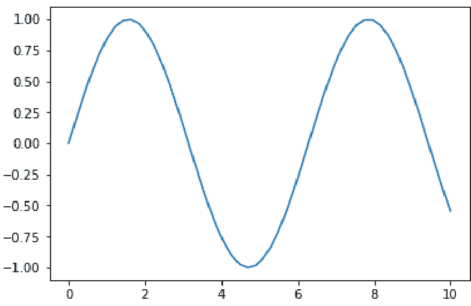

```python
plt.plot(x, sinus, "o")
plt.show()
# use plt.plot to get color / marker abbreviations
```

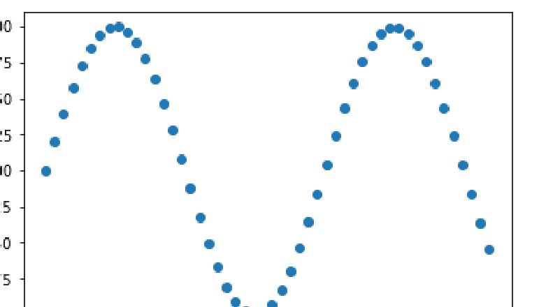

```python
# Rapid multiplot
cosinus = np.cos(x)
plt.plot(x, sinus, "b-", x, sinus, "ob", x, cosinus, "-r", x, cosinus, "or")
plt.xlabel('this is x!')
plt.ylabel('this is y!')
plt.title('My First Plot')
plt.show()
```

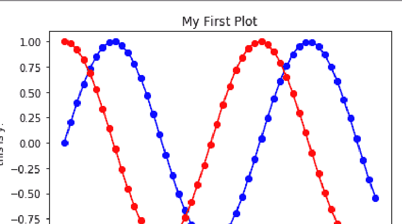

```python
# Step by step
plt.plot(x, sinus, label='sinus', color='blue', linestyle='--', linewidth=2)
plt.plot(x, cosinus, label='cosinus', color='red', linestyle='-', linewidth=2)
plt.legend()
plt.show()
```

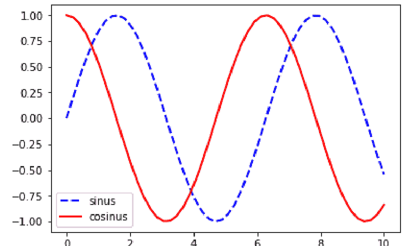

### 6.2 散点图（2D）

加载数据集

```python
import pandas as pd
try:
    salary = pd.read_csv("../datasets/salary_table.csv")
except:
    url = 'https://raw.githubusercontent.com/neurospin/pystatsml/master/datasets/salary_table.csv'
    salary = pd.read_csv(url)

df = salary
```

#### 6.2.1 带颜色的简单散点图

```python
colors = colors_edu = {'Bachelor':'r', 'Master':'g', 'Ph.D':'blue'}
plt.scatter(df['experience'], df['salary'], c=df['education'].apply(lambda x: colors[x]), s=100)
```

输出：

```
<matplotlib.collections.PathCollection at 0x7f0f58dc2358>
```

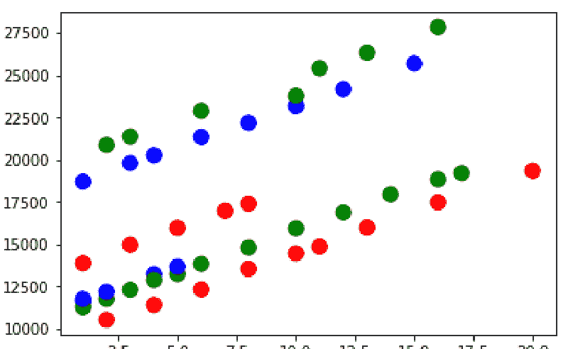

#### 6.2.2 带颜色和符号的散点图

```python
# Figure size
plt.figure(figsize=(6,5))

# Define colors / symbols manually
symbols_manag = dict(Y='*', N='.')
colors_edu = {'Bachelor':'r', 'Master':'g', 'Ph.D':'blue'}

# group by education x management => 6 groups
for values, d in salary.groupby(['education','management']):
    edu, manager = values
    plt.scatter(d['experience'], d['salary'], marker=symbols_manag[manager], color=colors_edu[edu], s=150, label=manager+"/"+edu)

# Set labels
plt.xlabel('Experience')
plt.ylabel('Salary')
plt.legend(loc=4)  # lower right
plt.show()
```


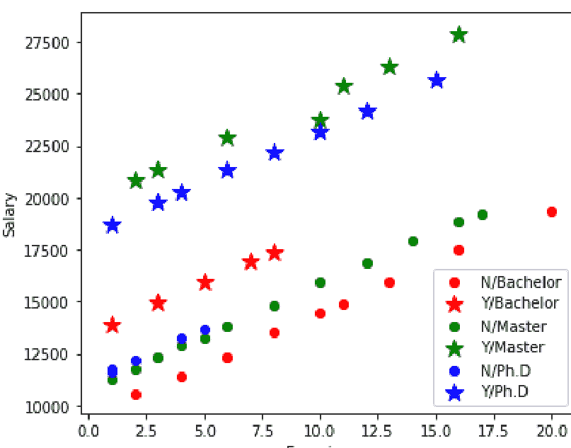

### 6.3 保存图形

```
### bitmap format
plt.plot(x, sinus)
plt.savefig("sinus.png")
plt.close()

# Prefer vectorial format (SVG: Scalable Vector Graphics) can be edited with
# Inkscape, Adobe Illustrator, Blender, etc.
plt.plot(x, sinus)
plt.savefig("sinus.svg")
plt.close()

# Or pdf
plt.plot(x, sinus)
plt.savefig("sinus.pdf")
plt.close()
```

### 6.4 Seaborn

来源:
- http://stanford.edu/~mwaskom/software/seaborn
- https://elitedatascience.com/python-seaborn-tutorial

如需安装，使用：`pip install -U --user seaborn`

#### 6.4.1 箱线图

箱线图是非参数的：它们显示统计总体样本中的变化，而不对潜在的统计分布做出任何假设。

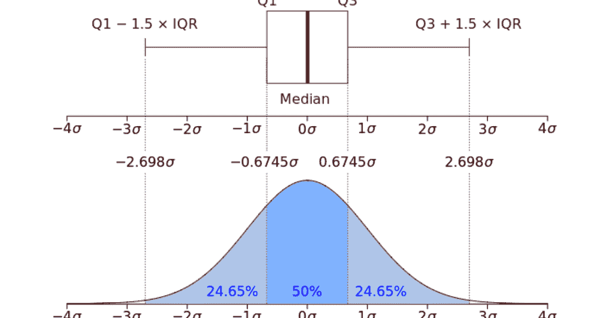

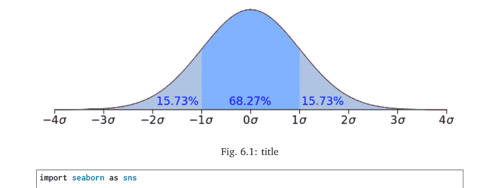

图 6.1：标题

```
import seaborn as sns
sns.boxplot(x="education", y="salary", hue="management", data=salary)
```

```
<matplotlib.axes._subplots.AxesSubplot at 0x7f0f56b5d8d0>
```

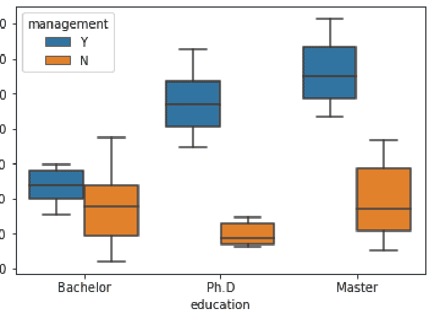

```
sns.boxplot(x="management", y="salary", hue="education", data=salary)
sns.stripplot(x="management", y="salary", hue="education", data=salary, jitter=True, dodge=True, linewidth=1) # Jitter and split options separate datapoints according to group
```

```
<matplotlib.axes._subplots.AxesSubplot at 0x7f0f56995d68>
```

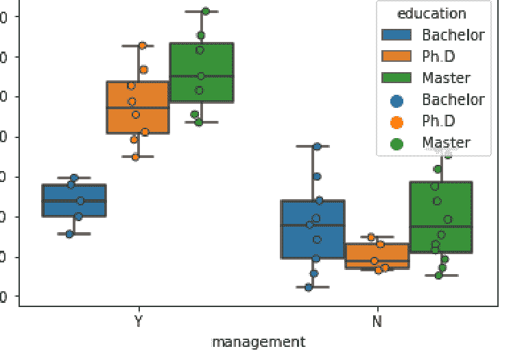

#### 6.4.2 包含多个坐标轴的密度图

一个图形可以包含多个坐标轴，其中包含图形元素。

```
# Set up the matplotlib figure: 3 x 1 axis

f, axes = plt.subplots(3, 1, figsize=(9, 9), sharex=True)

i = 0
for edu, d in salary.groupby(['education']):
    sns.distplot(d.salary[d.management == "Y"], color="b", bins=10, label="Manager", ax=axes[i])
    sns.distplot(d.salary[d.management == "N"], color="r", bins=10, label="Employee", ax=axes[i])
    axes[i].set_title(edu)
    axes[i].set_ylabel('Density')
    i += 1
ax = plt.legend()
```

```
/home/edouard/anaconda3/lib/python3.6/site-packages/matplotlib/axes/_axes.py:6521:
MatplotlibDeprecationWarning:
The 'normed' kwarg was deprecated in Matplotlib 2.1 and will be removed in 3.1. Use 'density' instead.
alternative="density", removal="3.1")
```

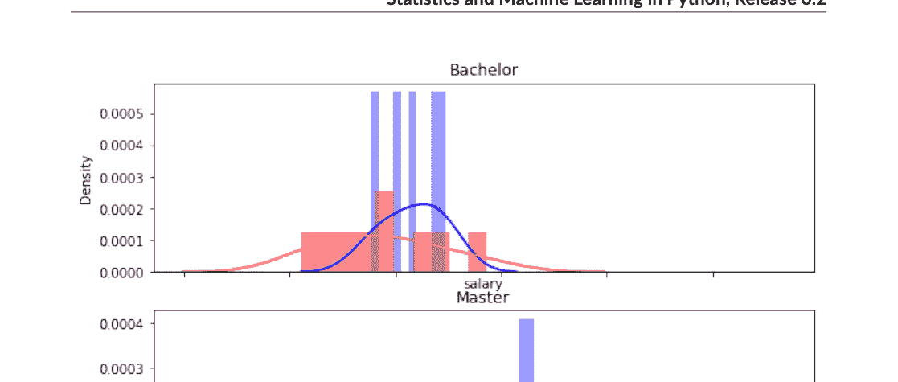

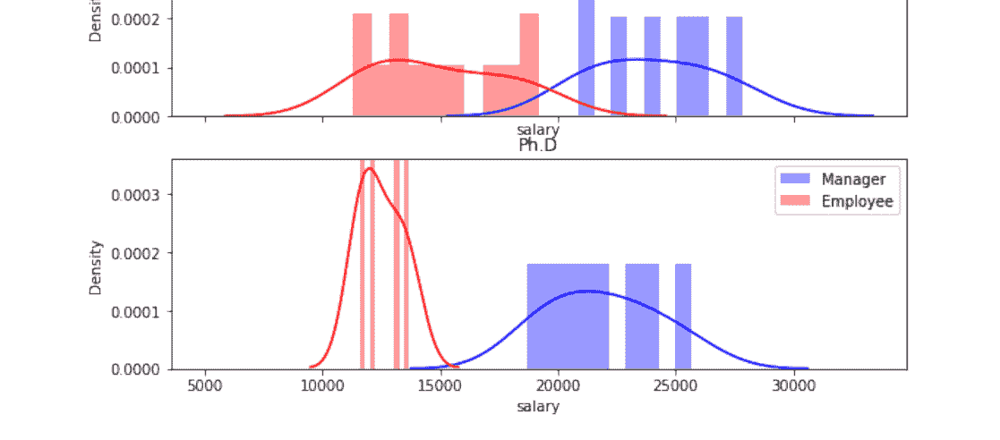

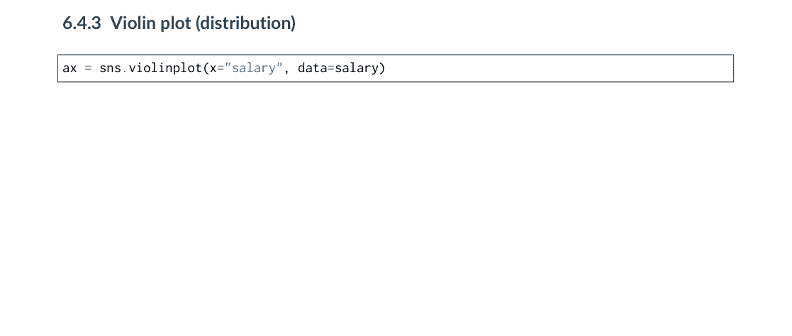

#### 6.4.3 小提琴图（分布）

```
ax = sns.violinplot(x="salary", data=salary)
```

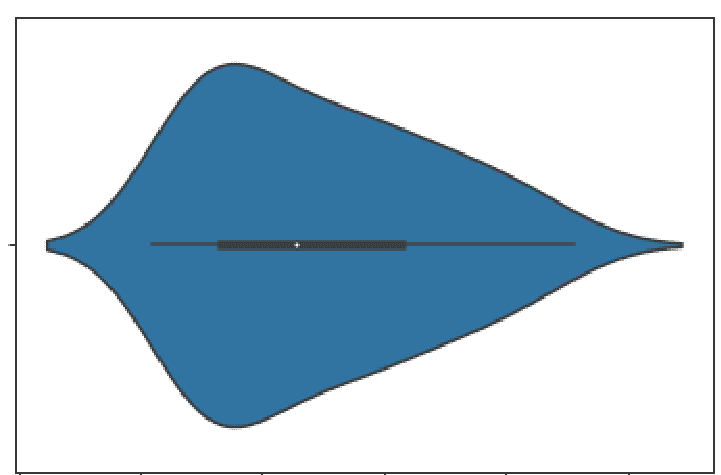

调整带宽

```
ax = sns.violinplot(x="salary", data=salary, bw=.15)
```

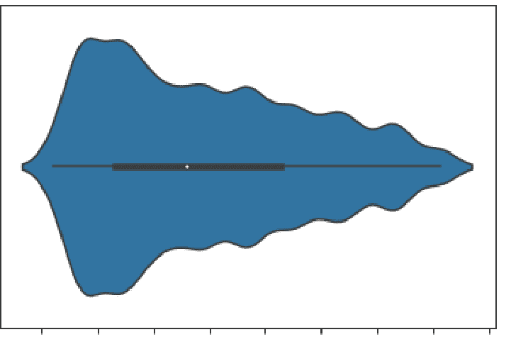

```
ax = sns.violinplot(x="management", y="salary", hue="education", data=salary)
```

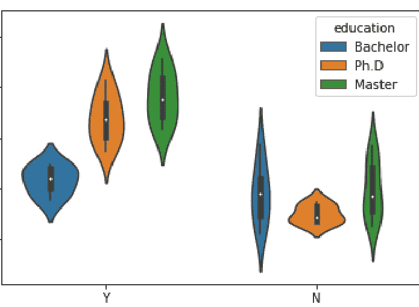

Tips 数据集。一名服务员记录了他在一家餐厅工作几个月期间收到的每笔小费的信息。他收集了多个变量：

```
import seaborn as sns
#sns.set(style="whitegrid")
tips = sns.load_dataset("tips")
print(tips.head())

ax = sns.violinplot(x=tips["total_bill"])
```

|   | total_bill | tip | sex | smoker | day | time | size |
|---|---|---|---|---|---|---|---|
| 0 | 16.99 | 1.01 | Female | No | Sun | Dinner | 2 |
| 1 | 10.34 | 1.66 | Male | No | Sun | Dinner | 3 |
| 2 | 21.01 | 3.50 | Male | No | Sun | Dinner | 3 |
| 3 | 23.68 | 3.31 | Male | No | Sun | Dinner | 2 |
| 4 | 24.59 | 3.61 | Female | No | Sun | Dinner | 4 |

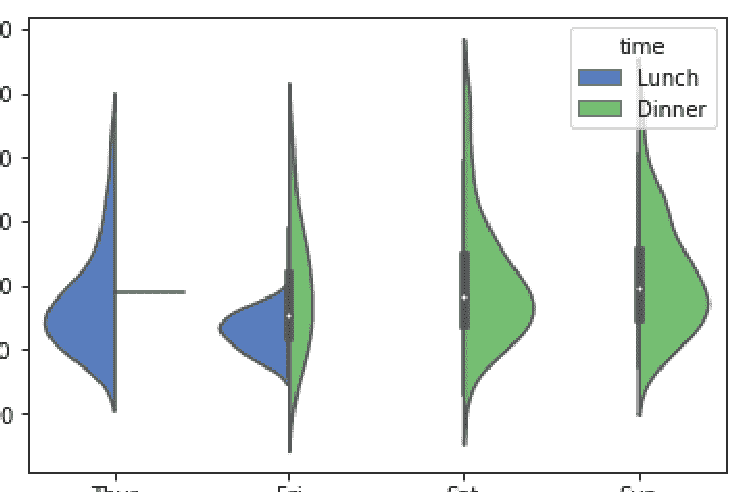

#### 6.4.4 成对散点图

```
g = sns.PairGrid(salary, hue="management")
g.map_diag(plt.hist)
g.map_offdiag(plt.scatter)
ax = g.add_legend()
```

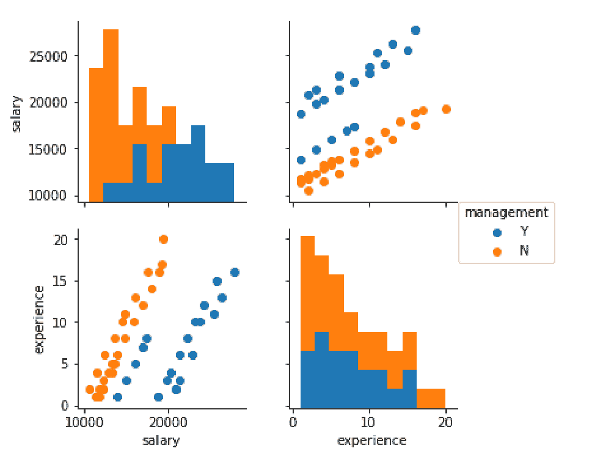

### 6.5 时间序列

```
import seaborn as sns
sns.set(style="darkgrid")

# Load an example dataset with long-form data
fmri = sns.load_dataset("fmri")

# Plot the responses for different events and regions

ax = sns.pointplot(x="timepoint", y="signal",
                   hue="region", style="event",
                   data=fmri)
# version 0.9
# sns.lineplot(x="timepoint", y="signal",
#               hue="region", style="event",
#               data=fmri)
```

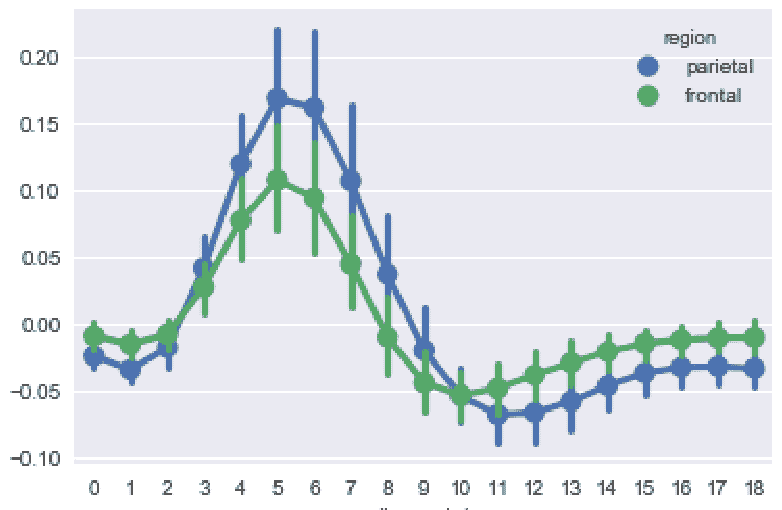

## 单变量统计

探索数据集需要基本的单变量统计：

- 发现感兴趣变量与潜在预测因子之间的关联。强烈建议在转向复杂的 multivariate 预测因子之前先从简单的单变量方法开始。
- 评估机器学习预测因子的预测性能。
- 大多数单变量统计基于线性模型，而线性模型是机器学习中的主要模型之一。

### 7.1 主要统计量估计器

#### 7.1.1 均值

随机变量 X 的期望值算子 E(·) 的性质

E(X + c) = E(X) + c  (7.1)
E(X + Y) = E(X) + E(Y)  (7.2)
E(aX) = aE(X)  (7.3)

样本量为 n 的样本 $x_1, \dots, x_n$ 上的估计量 $\bar{x}$ 给出为

$\bar{x} = \frac{1}{n} \sum_{i} x_{i}$

$\bar{x}$ 本身是一个随机变量，具有以下性质：

- $E(\bar{x}) = \mu$,
- $Var(\bar{x}) = \frac{Var(X)}{n}$.

#### 7.1.2 方差

$Var(X) = E((X - E(X))^2) = E(X^2) - (E(X))^2$

估计量为

$\sigma_{x}^{2} = \frac{1}{n-1} \sum_{i} (x_{i} - \bar{x})^{2}$

注意这里除数中减去的 1 个自由度（df）。在标准的统计实践中，df = 1 提供了对假设无限总体方差的无偏估计。而 df = 0 则提供了正态分布变量方差的最大似然估计。

#### 7.1.3 标准差

$Std(X) = \sqrt{Var(X)}$

估计量 simply 为 $\sigma_x = \sqrt{\sigma_x^2}$。

#### 7.1.4 协方差

$Cov(X, Y) = E((X - E(X))(Y - E(Y))) = E(XY) - E(X)E(Y)$.

性质：

- Cov(X, X) = Var(X)
- Cov(X, Y) = Cov(Y, X)
- Cov(cX, Y) = c Cov(X, Y)
- Cov(X + c, Y) = Cov(X, Y)

df = 1 的估计量为

$\sigma_{xy} = \frac{1}{n - 1} \sum_{i} (x_i - \bar{x})(y_i - \bar{y})$

#### 7.1.5 相关性

$Cor(X, Y) = \frac{Cov(X, Y)}{Std(X)Std(Y)}$

估计量为

$\rho_{xy} = \frac{\sigma_{xy}}{\sigma_x \sigma_y}$

#### 7.1.6 标准误差（SE）

标准误差（SE）是统计量的抽样分布的标准差：

$SE(X) = \frac{Std(X)}{\sqrt{n}}$

它最常用于均值，估计量为 $SE(\bar{x}) = \sigma_x / \sqrt{n}$。

#### 7.1.7 练习

- 生成 2 个随机样本：x ~ N(1.78, 0.1) 和 y ~ N(1.66, 0.1)，两者大小均为 10。
- 仅使用 `np.sum()` 操作计算 $\bar{x}, \sigma_x, \sigma_{xy}$（xbar, xvar, xycov）。探索 `np` 模块以找出执行相同计算的 numpy 函数，并使用 assert 将其与之前的結果进行比较。

### 7.2 主要分布

#### 7.2.1 正态分布

正态分布记为 $\mathcal{N}(\mu, \sigma)$，参数为：$\mu$ 均值（位置）和 $\sigma > 0$ 标准差。估计量：$\bar{x}$ 和 $\sigma_x$。

正态分布记为 $\mathcal{N}$，其有用性源于中心极限定理（CLT），该定理指出：在一定条件下，足够多独立随机变量的算术平均值，每个随机变量具有明确的期望值和明确的方差，将近似服从正态分布，而与底层分布无关。

```
import numpy as np
import matplotlib.pyplot as plt
from scipy.stats import norm
%matplotlib inline

mu = 0 # mean
variance = 2 # variance
sigma = np.sqrt(variance) # standard deviation
x = np.linspace(mu-3*variance, mu+3*variance, 100)
plt.plot(x, norm.pdf(x, mu, sigma))
```

```
[<matplotlib.lines.Line2D at 0x7fc56b189cf8>]
```

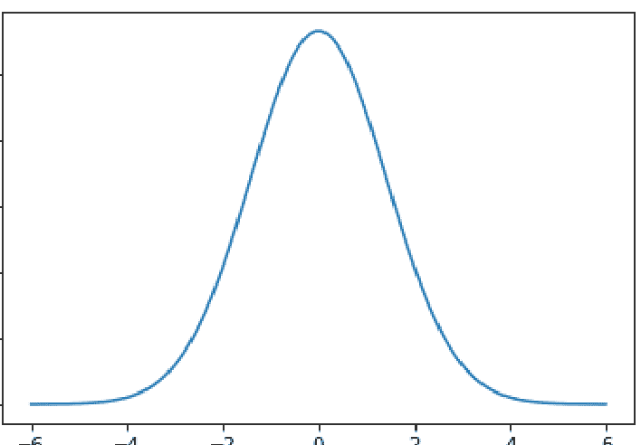

#### 7.2.2 卡方分布

卡方或 $\chi^2_n$ 分布具有 $n$ 个自由度（df），是 $n$ 个独立标准正态随机变量 $\mathcal{N}(0,1)$ 的平方和的分布。设 $X \sim \mathcal{N}(\mu, \sigma^2)$，则 $Z = (X - \mu)/\sigma \sim \mathcal{N}(0,1)$，则：

- 标准正态的平方 $Z^2 \sim \chi^2_1$（一个自由度）。


...[/content] and no extra text outside.

Let's write the final.[content]
- $n$ 个正态随机变量平方和的分布：$\sum_i^n Z_i^2 \sim \chi_n^2$

两个分别具有 $p$ 和 $q$ 自由度的 $\chi^2$ 随机变量之和是一个具有 $p + q$ 自由度的 $\chi^2$ 随机变量。这在求和/求差平方和时非常有用。

$\chi^2$ 分布用于对以平方和度量的误差或样本方差的分布进行建模。

F 分布 $F_{n,p}$（具有 $n$ 和 $p$ 个自由度）是两个独立 $\chi^2$ 变量之比。设 $X \sim \chi_n^2$ 且 $Y \sim \chi_p^2$，则：

$$F_{n,p} = \frac{X/n}{Y/p}$$

F 分布在假设检验中起着核心作用，用于回答以下问题：两个方差是否相等？两个误差之比是否显著偏大？

```
import numpy as np
from scipy.stats import f
import matplotlib.pyplot as plt
%matplotlib inline
fvalues = np.linspace(1, 5, 100)
# pdf(x, df1, df2): Probability density function at x of F.
plt.plot(fvalues, f.pdf(fvalues, 1, 30), 'b-', label="F(1, 30)")
plt.plot(fvalues, f.pdf(fvalues, 5, 30), 'r-', label="F(5, 30)")
plt.legend()
# cdf(x, df1, df2): Cumulative distribution function of F.
# ie.
proba_at_f_inf_3 = f.cdf(3, 1, 30) # P(F(1,30) < 3)
# ppf(q, df1, df2): Percent point function (inverse of cdf) at q of F.
f_at_proba_inf_95 = f.ppf(.95, 1, 30) # q such P(F(1,30) < .95)
assert f.cdf(f_at_proba_inf_95, 1, 30) == .95
# sf(x, df1, df2): Survival function (1 - cdf) at x of F.
proba_at_f_sup_3 = f.sf(3, 1, 30) # P(F(1,30) > 3)
assert proba_at_f_inf_3 + proba_at_f_sup_3 == 1
# p-value: P(F(1, 30)) < 0.05
low_proba_fvalues = fvalues[fvalues > f_at_proba_inf_95]
plt.fill_between(low_proba_fvalues, 0, f.pdf(low_proba_fvalues, 1, 30),
alpha=.8, label="P < 0.05")
plt.show()
```

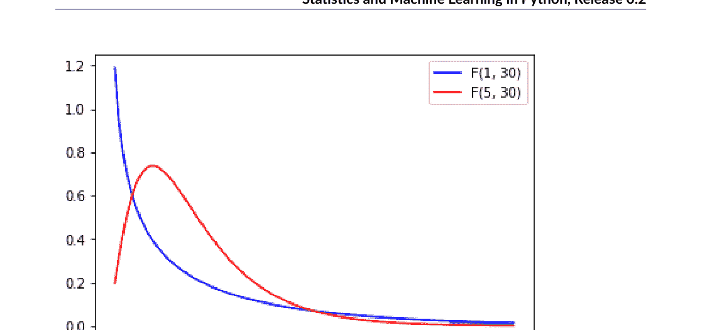

#### 7.2.4 学生 t 分布

设 $M \sim \mathcal{N}(0,1)$ 且 $V \sim \chi_n^2$。具有 $n$ 个自由度的 t 分布 $T_n$ 为如下比值：

$$T_n = \frac{M}{\sqrt{V/n}}$$

估计参数与其真实（或假定）值之差除以估计参数的标准差（标准误）所得到的分布服从 t 分布。该参数是否不同于给定值？

### 7.3 假设检验

- 检验比例：硬币有偏吗？在 300 次抛掷中发现了 200 次正面，这枚硬币是否有偏？
- 检验两个变量之间的关联。
  - 示例 身高与性别：在 25 个个体的样本中（15 名女性，10 名男性），女性身高是否不同于男性身高？
  - 示例 年龄与动脉高血压：在 25 个个体的样本中，年龄是否与动脉高血压高度相关？

1. 对数据进行建模
2. 拟合：估计模型参数（频率、均值、相关性、回归系数）
3. 根据模型参数计算检验统计量。
4. 提出零假设：如果观测结果纯粹是偶然产生的，检验统计量的（分布）会是什么？
5. 计算在零假设下偶然获得更大检验统计量值的概率（p 值）。

#### 7.3.1 抛硬币：简化示例

硬币有偏吗？在 3 次抛掷中发现了 2 次正面，这枚硬币是否有偏？

1. 对数据进行建模：正面次数服从二项分布。
2. 计算模型参数：N=3，P = 正面次数与抛掷次数之比：2/3。
3. 计算检验统计量，与频率相同。
4. 在零假设下，正面次数的分布为：

| 1 | 2 | 3 | 正面次数 |
|---|---|---|---------------|
|   |   |   | 0 |
| H |   |   | 1 |
|   | H |   | 1 |
|   |   | H | 1 |
| H | H |   | 2 |
| H |   | H | 2 |
|   | H | H | 2 |
| H | H | H | 3 |

共有 8 种可能的配置，x 取不同值的概率为：x 度量成功次数。

- P(x = 0) = 1/8
- P(x = 1) = 3/8
- P(x = 2) = 3/8
- P(x = 3) = 1/8

```
plt.bar([0, 1, 2, 3], [1/8, 3/8, 3/8, 1/8], width=0.9)
_ = plt.xticks([0, 1, 2, 3], [0, 1, 2, 3])
plt.xlabel("Distribution of the number of heads over 3 flips under the null hypothesis")
```

```
Text(0.5, 0, 'Distribution of the number of heads over 3 flips under the null hypothesis')
```

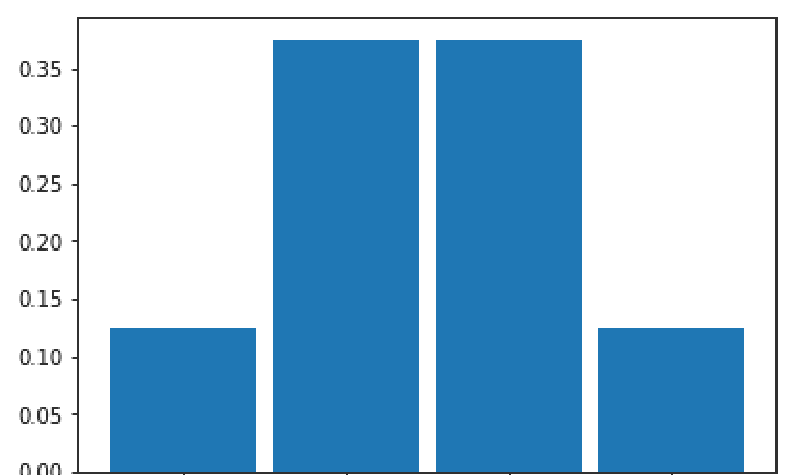

零假设下 3 次抛掷中正面次数的分布

5. 计算在零假设下观察到大于或等于 2 的值的概率（p 值）。该概率即为 p 值：

$$P(x \geq 2|H_0) = P(x = 2) + P(x = 3) = 3/8 + 1/8 = 4/8 = 1/2$$

#### 7.3.2 抛硬币：真实示例

硬币有偏吗？在 100 次抛掷中发现了 60 次正面，这枚硬币是否有偏？

1. 对数据进行建模：正面次数服从二项分布。
2. 计算模型参数：N=100，P=60/100。
3. 计算检验统计量，与频率相同。
4. 计算检验统计量：60/100。
5. 在零假设下，正面次数（k）的分布服从参数为 N=100、**P=0.5** 的**二项分布**：

$$\Pr(X = k|H_0) = \Pr(X = k|n = 100, p = 0.5) = \binom{100}{k} 0.5^k (1 - 0.5)^{100-k}.$$

$$\Pr(X = k \geq 60|H_0) = \sum_{k=60}^{100} \binom{100}{k} 0.5^k (1 - 0.5)^{100-k} = 1 - \sum_{k=0}^{60} \binom{100}{k} 0.5^k (1 - 0.5)^{100-k}, \text{ 即累积分布函数。}$$

### 使用二项分布表

```
import scipy.stats
import matplotlib.pyplot as plt

#tobs = 2.39687663116 # assume the t-value
success = np.linspace(30, 70, 41)
plt.plot(success, scipy.stats.binom.pmf(success, 100, 0.5), 'b-', label="Binomial(100, 0.5)")
upper_success_tvalues = success[success > 60]
plt.fill_between(upper_success_tvalues, 0, scipy.stats.binom.pmf(upper_success_tvalues, 100, 0.5), alpha=.8, label="p-value")
_ = plt.legend()

pval = 1 - scipy.stats.binom.cdf(60, 100, 0.5)
print(pval)
```

```
0.01760010010885238
```

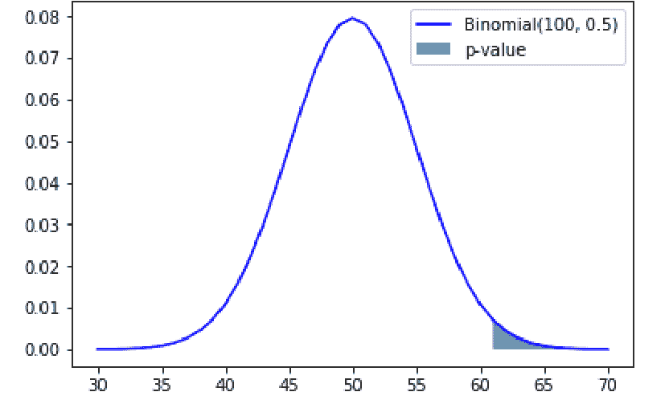

### 零假设下二项分布的随机抽样

```
success_h0 = scipy.stats.binom.rvs(100, 0.5, size=10000, random_state=4)

#success_h0 = np.array([] for i in range(5000)])
import seaborn as sns
_ = sns.distplot(success_h0, hist=False)

pval_rnd = np.sum(success_h0 >= 60) / (len(success_h0) + 1)
print("P-value using monte-carlo sampling of the Binomial distribution under H0=", pval_rnd)
```

```
P-value using monte-carlo sampling of the Binomial distribution under H0= 0.025897410258974102
```

### 示例

给定以下样本，我们将检验其真实均值是否为 1.75。

警告：在计算标准差或方差时，请设置 ddof=1。默认值 ddof=0 会导致方差的有偏估计。

```
import numpy as np

x = [ 1.83,  1.83,  1.73,  1.82,  1.83,  1.73,  1.99,  1.85,  1.68,  1.87]

xbar = np.mean(x)  # sample mean
mu0 = 1.75  # hypothesized value
s = np.std(x, ddof=1)  # sample standard deviation
n = len(x)  # sample size

tobs = (xbar - mu0) / (s / np.sqrt(n))
print(tobs)
```

```
2.3968766311585883
```

$p$ 值是在零假设 $H_0$ 下观察到比观测值 $t_{obs}$ 更极端的 $t$ 值的概率：$P(t > t_{obs}|H_0)$

```
import scipy.stats as stats
import matplotlib.pyplot as plt

#tobs = 2.39687663116  # assume the t-value
tvalues = np.linspace(-10, 10, 100)
plt.plot(tvalues, stats.t.pdf(tvalues, n-1), 'b-', label='T(n-1)')
upper_tval_tvalues = tvalues[tvalues > tobs]
plt.fill_between(upper_tval_tvalues, 0, stats.t.pdf(upper_tval_tvalues, n-1), alpha=.8, label='p-value')
_ = plt.legend()
```

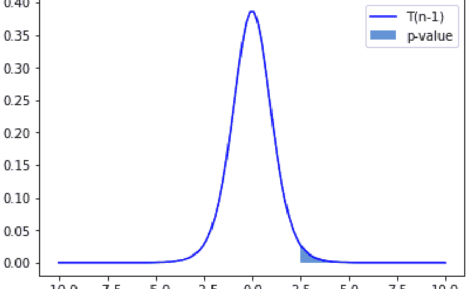

### 7.4 检验两两关联

单变量统计分析：探索变量对之间的关联。

- 在统计学中，分类变量或因子是一种只能取有限个（通常是固定个数）可能值之一的变量，从而将每个个体分配到特定的组或“类别”中。水平（levels）是变量的可能取值。水平数 = 2：二分类；水平数 > 2：多分类。类别之间没有内在的顺序。例如，性别是一个具有两个类别（男性和女性）的分类变量，并且类别之间没有内在顺序。例如，性别（女性、男性）、发色（金色、棕色等）。
- 序数变量是一种水平具有明确顺序的分类变量。例如：每天饮酒量（无、少量、中等和大量）。
- 连续变量或定量变量 x ∈ ℝ 是可以在可能值范围内取任意值（可能是无限）的变量。例如：薪水、工作经验（年）、体重。

我应该使用哪种统计检验？
参见：http://www.ats.ucla.edu/stat/mult_pkg/whatstat/

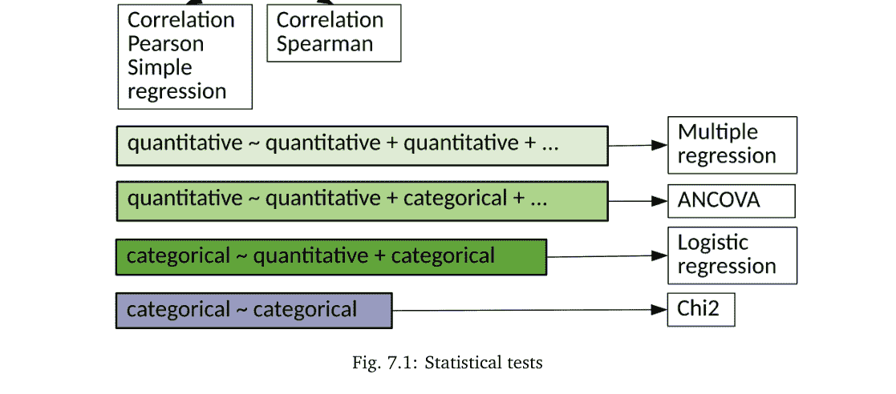

> 图 7.1：统计检验


#### 7.4.1 皮尔逊相关检验：检验两个定量变量之间的关联

检验两个定量变量的相关系数。该检验计算皮尔逊相关系数和用于检验不相关的 p 值。

设 x 和 y 是两个定量变量，观测到 n 个样本。线性相关系数定义为：

r = \frac{\sum_{i=1}^{n}(x_i - \bar{x})(y_i - \bar{y})}{\sqrt{\sum_{i=1}^{n}(x_i - \bar{x})^2 \sqrt{\sum_{i=1}^{n}(y_i - \bar{y})^2}}.

在原假设 H0 下，检验统计量 t = \sqrt{n-2} \frac{r}{\sqrt{1-r^2}} 服从自由度为 n - 2 的学生分布。

```
import numpy as np
import scipy.stats as stats
n = 50
x = np.random.normal(size=n)
y = 2 * x + np.random.normal(size=n)

# Compute with scipy
cor, pval = stats.pearsonr(x, y)
```

#### 7.4.2 双样本（学生）t 检验：比较两个均值

双样本 t 检验（Snedecor 和 Cochran，1989）用于确定两个总体均值是否相等。该检验有若干变体。如果数据是配对的（例如对每个个体在处理前后进行两次测量），则使用差值的单样本 t 检验。两个样本的方差可以被假定为相等（即方差齐性）或不相等（即方差不齐）。

### 1. 数据建模

假设两个随机变量服从正态分布：x ~ N(μx, σx)，y ~ N(μy, σy)。

### 2. 拟合：估计模型参数

估计均值和方差：\bar{x}, s_x^2, \bar{y}, s_y^2。

### 3. t 检验

如果我们假设方差相等，用于检验均值是否不同的 t 统计量为：

t = \frac{\bar{x} - \bar{y}}{s \cdot \sqrt{\frac{1}{n_x} + \frac{1}{n_y}}},

其中，\bar{x} 和 \bar{y} 分别是组 1 和组 2 的样本均值，并且

$s = \sqrt{\frac{s_x^2(n_x - 1) + s_y^2(n_y - 1)}{n_x + n_y - 2}}$

是两个样本共同标准差的估计量：这样定义是为了使其平方无论总体均值是否相同，都是共同方差的无偏估计量。

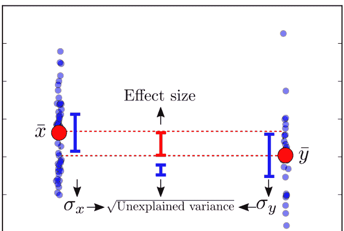

图 7.2：双样本 t 检验

### 样本量相等或不等、方差不相等（Welch's t 检验）

Welch's t 检验将 t 统计量定义为

$t = \frac{\bar{x} - \bar{y}}{\sqrt{\frac{\sigma_x^2}{n_x} + \frac{\sigma_y^2}{n_y}}}$

要计算 p 值，需要与该方差估计相关的自由度。它通过 Welch–Satterthwaite 方程近似得到：

$\nu \approx \frac{\left(\frac{\sigma_x^2}{n_x} + \frac{\sigma_y^2}{n_y}\right)^2}{\frac{\sigma_x^4}{n_x^2(n_x - 1)} + \frac{\sigma_y^4}{n_y^2(n_y - 1)}}$

### 示例

给定以下两个样本，使用标准 t 检验（假设方差相等）检验它们的均值是否相等。

```
import scipy.stats as stats
height = np.array([ 1.83,  1.83,  1.73,  1.82,  1.83,  1.73,  1.99,  1.85,  1.68,  1.87,
1.66, 1.71, 1.73, 1.64, 1.70, 1.60, 1.79, 1.73, 1.62, 1.77])
grp = np.array(["M"] * 10 + ["F"] * 10)
# Compute with scipy
print(stats.ttest_ind(height[grp == "M"], height[grp == "F"], equal_var=True))
```

```
Ttest_indResult(statistic=3.5511519888466885, pvalue=0.00228208937112721)
```

#### 7.4.3 方差分析 F 检验（定量 ~ 分类（>2 个水平））

方差分析（ANOVA）提供了检验多个组的均值是否相等的统计方法，因此它将 t 检验推广到两个以上的组。ANOVA 可用于比较（检验）三个或更多均值（组或变量）的统计显著性。它在概念上类似于多个双样本 t 检验，但没那么保守。

这里我们将考虑一个自变量（即单因素方差分析）的单因素 ANOVA。

### 1. 数据建模

一家公司为了增加业务量，对三组客户样本分别采用了三种营销策略。营销部门想知道这些策略是否导致了不同的业务量增长。设 y1、y2 和 y3 为业务量增长的三个样本。

这里我们假设这三个总体分别来自三个服从正态分布的随机变量。即 Y1 ~ N(μ1, σ1)，Y2 ~ N(μ2, σ2)，Y3 ~ N(μ3, σ3)。

### 2. 拟合：估计模型参数

对 ∀i ∈ {1, 2, 3}，估计均值和方差：ȳi, σi。

### 3. F 检验

来源：https://en.wikipedia.org/wiki/F-test

ANOVA F 检验可用于评估任一策略是否在平均意义上优于或劣于其他策略，其原假设为所有四种策略产生相同的均值响应（业务量增长）。这是“综合”（omnibus）检验的一个例子，意味着通过一次检验来检测若干种可能差异中的任何一种。或者，我们可以在策略之间进行两两检验。ANOVA F 检验的优点是，我们无需预先指定要比较哪些策略，也无需为多重比较进行调整。其缺点是，如果我们拒绝原假设，我们无法知道哪些策略可以认为与其他策略有显著差异。

单因素 ANOVA F 检验统计量的公式为

F = 已解释方差 / 未解释方差

或

$F = \frac{\text{between-group variability}}{\text{within-group variability}}.$

“已解释方差”，即“组间变异性”，为

$\sum_{i} n_{i}(\bar{Y}_{i.} - \bar{Y})^{2}/(K - 1),$

其中 $\bar{Y}_{i.}$ 表示第 $i$ 组的样本均值，$n_{i}$ 是第 $i$ 组的观测数，$\bar{Y}$ 表示数据的总体均值，$K$ 表示组数。

“未解释方差”，即“组内变异性”，为

$\sum_{ij}(Y_{ij} - \bar{Y}_{i.})^{2}/(N - K),$

其中 $Y_{ij}$ 是 $K$ 组中第 $i$ 组的第 $j$ 个观测值，$N$ 是总样本量。在原假设下，该 $F$ 统计量服从自由度为 $K - 1$ 和 $N - K$ 的 $F$ 分布。如果组间变异性相对于组内变异性较大，则统计量会很大；而当各组总体均值都相同时，这种情况不太可能发生。

注意，当单因素 ANOVA F 检验只有两组时，$F = t^{2}$，其中 $t$ 是学生 $t$ 统计量。

## 7.4.4 卡方检验（$\chi^{2}$）（分类 ~ 分类）

计算卡方（$\chi^{2}$）统计量和 $p$ 值，用于检验观测列联表（交叉表）中频率的独立性原假设。将观测频率与期望列联表进行比较，期望列联表是在独立性假设下根据边际合计计算期望频率而得到的。

示例：20 名参与者：10 名接触过某种化学产品，10 名未接触（exposed = 1 或 0）。在这 20 名参与者中，10 人患癌症，10 人未患（cancer = 1 或 0）。$\chi^{2}$ 检验这两个变量之间的关联。

```
import numpy as np
import pandas as pd
import scipy.stats as stats

# Dataset:
# 15 samples:
# 10 first exposed
exposed = np.array([1] * 10 + [0] * 10)
# 8 first with cancer, 10 without, the last two with.
cancer = np.array([1] * 8 + [0] * 10 + [1] * 2)

crosstab = pd.crosstab(exposed, cancer, rownames=['exposed'],
                       colnames=['cancer'])
print("Observed table:")
print("---------------")
print(crosstab)

chi2, pval, dof, expected = stats.chi2_contingency(crosstab)
```

## Python 中的统计与机器学习，版本 0.2

```
print("Statistics:")
print("----------")
print("Chi2 = %f, pval = %f" % (chi2, pval))
print("Expected table:")
print("---------------")
print(expected)
```

观测表：
---------------

| 暴露 | 癌症 0 | 癌症 1 |
|---|---|---|
| 0 | 8 | 2 |
| 1 | 2 | 8 |

统计量：
----------
Chi2 = 5.000000, pval = 0.025347
期望表：
----------------
[[5. 5.]
 [5. 5.]]

### 计算期望交叉表

```
# Compute expected cross-table based on proportion
exposed_marg = crosstab.sum(axis=0)
exposed_freq = exposed_marg / exposed_marg.sum()

cancer_marg = crosstab.sum(axis=1)
cancer_freq = cancer_marg / cancer_marg.sum()

print('Exposed frequency? Yes: %.2f' % exposed_freq[0],
    'No: %.2f' % exposed_freq[1])
print('Cancer frequency? Yes: %.2f' % cancer_freq[0],
    'No: %.2f' % cancer_freq[1])

print('Expected frequencies:')
print(np.outer(exposed_freq, cancer_freq))

print('Expected cross-table (frequencies * N): ')
print(np.outer(exposed_freq, cancer_freq) * len(exposed))
```

暴露频率？是：0.50 否：0.50
癌症频率？是：0.50 否：0.50
期望频率：
[[0.25 0.25]
 [0.25 0.25]]
期望交叉表（频率 × N）：
[[5. 5.]
 [5. 5.]]


### 7.5 两两关联的非参数检验

#### 7.5.1 Spearman秩相关（定量 ~ 定量）

Spearman相关是一种衡量两个数据集之间关系单调性的非参数度量。

何时使用？观察数据分布：
- 存在离群值
- 残差的分布不是高斯分布。

与其他相关系数一样，该系数的取值范围在-1到+1之间，0表示不相关。相关系数为-1或+1表示完全单调关系。正相关意味着随着x增大，y也增大；负相关意味着随着x增大，y减小。

```
import numpy as np
import scipy.stats as stats
import matplotlib.pyplot as plt

x = np.array([44.4, 45.9, 41.9, 53.3, 44.7, 44.1, 50.7, 45.2, 46, 47, 48, 60.1])
y = np.array([2.6, 3.1, 2.5, 5.0, 3.6, 4.0, 5.2, 2.8, 4, 4.1, 4.5, 3.8])

plt.plot(x, y, "bo")

# Non-Parametric Spearman
cor, pval = stats.spearmanr(x, y)
print("Non-Parametric Spearman cor test, cor: %.4f, pval: %.4f" % (cor, pval))

# Parametric Pearson cor test
cor, pval = stats.pearsonr(x, y)
print("Parametric Pearson cor test: cor: %.4f, pval: %.4f" % (cor, pval))
```

非参数Spearman相关检验，相关系数：0.7110，p值：0.0095
参数Pearson相关检验：相关系数：0.5263，p值：0.0788

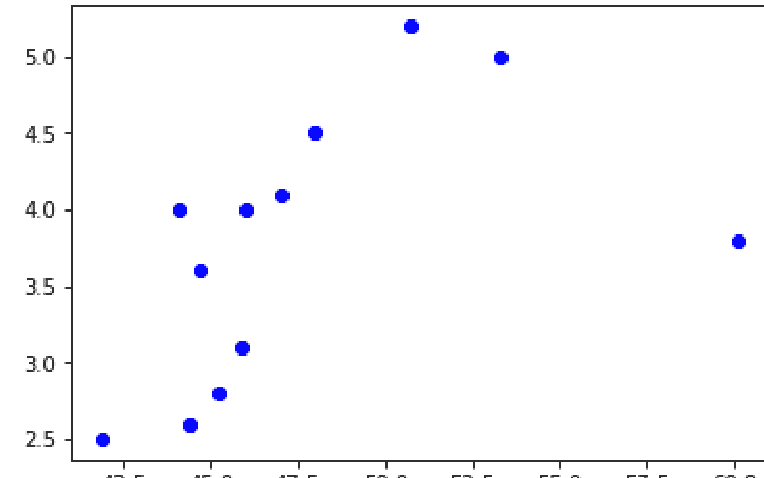

#### 7.5.2 Wilcoxon符号秩检验（定量 ~ 常数）

来源：https://en.wikipedia.org/wiki/Wilcoxon_signed-rank_test

Wilcoxon符号秩检验是一种非参数统计假设检验，用于比较两个相关样本、配对样本或对单个样本的重复测量，以评估它们的总体平均秩是否存在差异（即它是一种配对差异检验）。它等价于对配对样本差值进行单样本检验。

当总体不能假定为正态分布时，它可以用作配对Student t检验、配对t检验或依赖样本t检验的替代方法。

何时使用？观察数据分布：
- 存在离群值
- 残差的分布不是高斯分布

与t检验相比，它的敏感性较低。当样本量较小时使用可能会有问题。

零假设H0：配对之间的差值服从关于零对称的分布。

```
import scipy.stats as stats
n = 20
# Business Volume time 0
bv0 = np.random.normal(loc=3, scale=.1, size=n)
# Business Volume time 1
bv1 = bv0 + 0.1 + np.random.normal(loc=0, scale=.1, size=n)

# create an outlier
bv1[0] -= 10

# Paired t-test
print(stats.ttest_rel(bv0, bv1))

# Wilcoxon
print(stats.wilcoxon(bv0, bv1))
```

```
Ttest_relResult(statistic=0.7676263474825586, pvalue=0.4521440652558284)
WilcoxonResult(statistic=34.0, pvalue=0.0080344288555667)
```

#### 7.5.3 Mann-Whitney U检验（定量 ~ 分类（2个水平））

在统计学中，Mann-Whitney U检验（也称为Mann-Whitney-Wilcoxon检验、Wilcoxon秩和检验或Wilcoxon-Mann-Whitney检验）是一种非参数检验，用于检验零假设：两个样本来自同一总体，对立假设是特别地某个总体往往比另一个总体有更大的值。

与只能应用于正态分布的t检验不同，它可以应用于未知分布，并且在正态分布上其效率几乎与t检验相当。

```
import scipy.stats as stats
n = 20
# Business Volume group 0
bv0 = np.random.normal(loc=1, scale=.1, size=n)

# Business Volume group 1
bv1 = np.random.normal(loc=1.2, scale=.1, size=n)
```

```
# create an outlier
bv1[0] = 10

# Two-samples t-test
print(stats.ttest_ind(bv0, bv1))

# Wilcoxon
print(stats.mannwhitneyu(bv0, bv1))
```

```
Ttest_indResult(statistic=0.602260825054143, pvalue=0.5505776381778786)
MannwhitneyuResult(statistic=51.0, pvalue=2.9479586089607507e-05)
```

### 7.6 线性模型

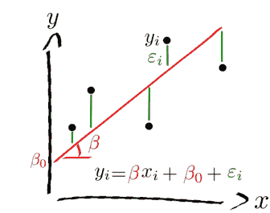

图7.3：线性模型

给定n个随机样本 (yᵢ, x₁ᵢ, …, xₚᵢ)，i = 1, …, n，线性回归将观测值yᵢ与自变量xᵢᵖ之间的关系建模为

yᵢ = β₀ + β₁x₁ᵢ + ⋯ + βₚxₚᵢ + εᵢ      i = 1, …, n

- β是模型参数，即回归系数。
- β₀是截距或偏置。
- εᵢ是残差。
- **自变量（IV）**。它是一个独立存在的变量，不会因你试图测量的其他变量而改变。例如，某人的年龄可能就是一个自变量。其他因素（如他们吃什么、上多少学、看多少电视）不会改变一个人的年龄。事实上，当你寻找变量之间的某种关系时，你是在试图观察自变量是否会引起其他变量（或因变量）的某种变化。在机器学习中，这些变量也被称为**预测变量**。
- **因变量**。它依赖于其他因素。例如，考试成绩可以是一个因变量，因为它可能随多个因素变化，比如你学习了多少、考试前夜睡了多久，甚至考试时有多饿。通常，当你寻找两件事之间的关系时，你是在试图找出是什么导致因变量如此变化。在机器学习中，这个变量被称为**目标变量**。

#### 7.6.1 简单回归：检验两个定量变量之间的关联

使用数据集“salary”，探索因变量（如Salary）和自变量（如Experience是定量的）之间的关联。

```python
import pandas as pd
import matplotlib.pyplot as plt
%matplotlib inline

url = 'https://raw.githubusercontent.com/neurospin/pystatsml/master/datasets/salary_table.csv'
salary = pd.read_csv(url)
```

### 1. 对数据建模

根据某个假设对数据建模，例如：工资是经验的线性函数。

salary_i = β experience_i + β0 + ε_i,

更一般地

y_i = β x_i + β0 + ε_i

- β：模型的斜率或系数或参数，
- β0：截距或偏置，是模型的第二个参数，
- ε_i：第i个误差或残差，其中ε ~ N(0, σ²)。

简单回归等价于Pearson相关。

### 2. 拟合：估计模型参数

目标是估计β、β0和σ²。

最小化均方误差（MSE）或误差平方和（SSE）。所谓的普通最小二乘法（OLS）找到使SSE = Σ_i ε_i²最小的β、β0。

SSE = Σ_i (y_i - β x_i - β0)²

根据微积分知识，极值点可以通过计算导数为零的位置找到，即为了找到截距，我们执行以下步骤：

∂SSE/∂β0 = Σ_i (y_i - β x_i - β0) = 0
Σ_i y_i = β Σ_i x_i + n β0
n ȳ = n β x̄ + n β0
β0 = ȳ - β x̄

为了找到回归系数，我们执行以下步骤：

∂SSE/∂β = Σ_i x_i (y_i - β x_i - β0) = 0

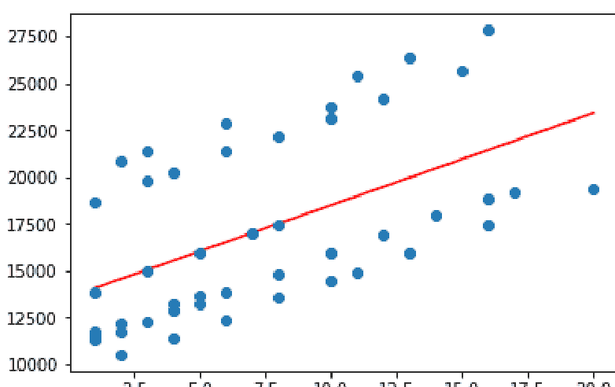

使用seaborn

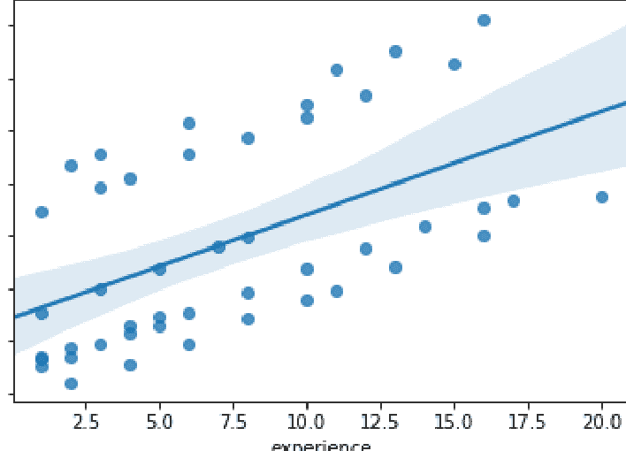

### 3. F检验

### 3.1 拟合优度

统计模型的拟合优度描述了它拟合一组观测值的程度。拟合优度的度量通常概括了观测值与所讨论模型下预期值之间的差异。我们将考虑**解释方差**，也称为决定系数，记为$R^2$，读作**R平方**。

总平方和$SS_{tot}$是回归解释的平方和$SS_{reg}$加上回归未解释的残差平方和$SS_{res}$（也称为SSE）之和，即

$SS_{tot} = SS_{reg} + SS_{res}$

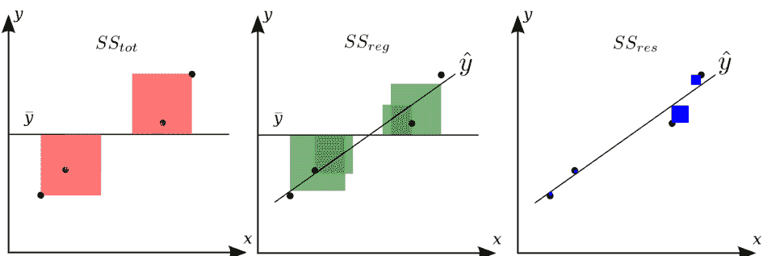

图7.4：标题

$y$的均值为

$\bar{y} = \frac{1}{n} \sum_{i} y_i.$

总平方和是$y$的均值偏差的平方和，即

$SS_{tot} = \sum_{i} (y_i - \bar{y})^2$

回归平方和，也称为解释平方和：

$SS_{reg} = \sum_{i} (\hat{y}_i - \bar{y})^2,$

其中$\hat{y}_i = \beta x_i + \beta_0$是给定经验值$x_i$时工资$\hat{y}_i$的估计值。

残差平方和，也称为残差平方和（RSS）为：

$SS_{res} = \sum_{i} (y_i - \hat{y}_i)^2.$

$R^2$是解释的误差平方和。它是回归解释的方差除以总方差，即

$R^2 = \frac{\text{explained SS}}{\text{total SS}} = \frac{SS_{reg}}{SS_{tot}} = 1 - \frac{SS_{res}}{SS_{tot}}.$

### 3.2 检验

令$\hat{\sigma}^2 = SS_{res}/(n - 2)$为$\epsilon$方差的估计量。分母中的2源于两个估计参数：截距和系数。


- 未解释方差：\(\frac{SS_{\text{res}}}{\sigma^2} \sim \chi^2_{n-2}\)
- 解释方差：\(\frac{SS_{\text{reg}}}{\sigma^2} \sim \chi^2_1\)。单一自由度来自 \(\frac{SS_{\text{tot}}}{\sigma^2} (\sim \chi^2_{n-1})\) 与 \(\frac{SS_{\text{res}}}{\sigma^2} (\sim \chi^2_{n-2})\) 之间的差值，即 \((n-1) - (n-2)\) 自由度。

两个方差比率的 Fisher 统计量：

\[
F = \frac{\text{Explained variance}}{\text{Unexplained variance}} = \frac{SS_{\text{reg}}/1}{SS_{\text{res}}/(n-2)} \sim F(1, n-2)
\]

使用 \(F\) 分布，计算在 \(H_0\) 下观察到大于 \(F\) 的值的概率，即 \(P(x > F \mid H_0)\)，即给定 \(F\) 分布在 \(x\) 处的生存函数（\(1 - \text{CDF}\)）。

#### 7.6.2 多元回归

### 理论

多元线性回归是最基本的监督学习算法。

给定：一组训练数据 \(\{x_1, \dots, x_N\}\) 与对应的目标 \(\{y_1, \dots, y_N\}\)。

在线性回归中，我们假设生成数据的模型仅涉及输入变量的线性组合，即

\[
y(x_i, \beta) = \beta_0 + \beta_1 x_i^1 + \dots + \beta_P x_i^P,
\]

或，简化为

\[
y(x_i, \beta) = \beta_0 + \sum_{j=1}^{P} \beta_j x_i^j.
\]

通过为每个样本扩展截距，\(x_i := [1, x_i] \in \mathbb{R}^{P+1}\) 允许我们使用基于线性代数的更一般记号并将其写成简单的点积：

\[
y(x_i, \beta) = x_i^T \beta,
\]

其中 \(\beta \in \mathbb{R}^{P+1}\) 是定义模型 \(P+1\) 个参数的权重向量。从现在起我们有 \(P\) 个回归量 + 截距。

最小化均方误差（MSE）损失：

\[
MSE(\beta) = \frac{1}{N} \sum_{i=1}^N (y_i - y(x_i, \beta))^2 = \frac{1}{N} \sum_{i=1}^N (y_i - x_i^T \beta)^2
\]

设 \(X = [x_1^T, \dots, x_N^T]\) 为 \(N \times (P+1)\) 矩阵，包含 \(N\) 个样本的 \(P\) 个输入特征并带有一列全为 1，且设 \(y = [y_1, \dots, y_N]\) 为 \(N\) 个目标的向量。那么，利用线性代数，均方误差（MSE）损失可以重写为：

\[
MSE(\beta) = \frac{1}{N} \|y - X\beta\|_2^2.
\]

使 MSE 最小的 \(\beta\) 可以通过以下方式求得：

\[
\begin{aligned}
\nabla_\beta \left( \frac{1}{N} \|y - X\beta\|_2^2 \right) &= 0 \tag{7.6}\\
\frac{1}{N} \nabla_\beta (y - X\beta)^T (y - X\beta) &= 0 \tag{7.7}\\
\frac{1}{N} \nabla_\beta (y^T y - 2\beta^T X^T y + \beta^T X^T X \beta) &= 0 \tag{7.8}\\
-2 X^T y + 2 X^T X \beta &= 0 \tag{7.9}\\
X^T X \beta &= X^T y \tag{7.10}\\
\beta &= (X^T X)^{-1} X^T y, \tag{7.11}
\end{aligned}
\]

其中 \((X^T X)^{-1} X^T\) 是 \(X\) 的伪逆。

### 使用 NumPy 拟合

```python
import numpy as np
from scipy import linalg
np.random.seed(seed=42)  # make the example reproducible

# Dataset
N, P = 50, 4
X = np.random.normal(size=N * P).reshape((N, P))
# Our model needs an intercept so we add a column of 1s:
X[:, 0] = 1
print(X[:5, :])

betastar = np.array([10, 1., .5, 0.1])
e = np.random.normal(size=N)
y = np.dot(X, betastar) + e

# Estimate the parameters
Xpinv = linalg.pinv2(X)
betahat = np.dot(Xpinv, y)
print("Estimated beta:\n", betahat)
```

```text
[[ 1.         -0.1382643   0.64768854  1.52302986]
 [ 1.         -0.23413696  1.57921282  0.76743473]
 [ 1.          0.54256004 -0.46341769 -0.46572975]
 [ 1.        -1.91328024 -1.72491783 -0.56228753]
 [ 1.          0.31424733 -0.90802408 -1.4123037 ]]
Estimated beta:
[10.14742501  0.57938106  0.51654653  0.17862194]
```

### 7.7 使用 statsmodels 的线性模型

来源：http://statsmodels.sourceforge.net/devel/examples/

#### 7.7.1 多元回归

#### 与 NumPy 的接口

```python
import statsmodels.api as sm

# Fit and summary:
model = sm.OLS(y, X).fit()
print(model.summary())

# prediction of new values
ypred = model.predict(X)

# residuals + prediction == true values
assert np.all(ypred + model.resid == y)
```

```text
----------------------------------------------------------------
ModuleNotFoundError Traceback (most recent call last)
~/anaconda3/lib/python3.6/site-packages/statsmodels/compat/pandas.py in <module>()
     52 try:
---> 53     import pandas.tseries.tools as datetools
     54     import pandas.tseries.frequencies as frequencies

ModuleNotFoundError: No module named 'pandas.tseries.tools'

During handling of the above exception, another exception occurred:

ImportError Traceback (most recent call last)
<ipython-input-46-ddfb08c06bd1> in <module>()
---> 1 import statsmodels.api as sm
      2
      3 # Fit and summary:
      4 model = sm.OLS(y, X).fit()
      5 print(model.summary())

~/anaconda3/lib/python3.6/site-packages/statsmodels/api.py in <module>()
      5 from . import regression
      6 from .regression.linear_model import OLS, GLS, WLS, GLSAR
---> 7 from .regression.recursive_ls import RecursiveLS
      8 from .regression.quantile_regression import QuantReg
      9 from .regression.mixed_linear_model import MixedLM

~/anaconda3/lib/python3.6/site-packages/statsmodels/regression/recursive_ls.py in <module>()
     14 from statsmodels.regression.linear_model import OLS
     15 from statsmodels.tools.data import _is_using_pandas
---> 16 from statsmodels.tsa.statespace.mlemodel import (
     17     MLEModel, MLEResults, MLEResultsWrapper)
     18 from statsmodels.tools.tools import Bunch

~/anaconda3/lib/python3.6/site-packages/statsmodels/tsa/statespace/mlemodel.py in <module>()
     15 from .kalman_filter import (KalmanFilter, FilterResults, INVERT_UNIVARIATE,
     16                             SOLVE_LU)
---> 17 import statsmodels.tsa.base.tsa_model as tsbase
     18 import statsmodels.base.wrapper as wrap
     19 from statsmodels.tools.numdiff import (_get_epsilon, approx_hess_cs,

~/anaconda3/lib/python3.6/site-packages/statsmodels/tsa/base/tsa_model.py in <module>()
      1 from statsmodels.compat.python import lrange, long
---> 2 from statsmodels.compat.pandas import is_numeric_dtype
      3
      4 import datetime
      5

~/anaconda3/lib/python3.6/site-packages/statsmodels/compat/pandas.py in <module>()
     54     import pandas.tseries.frequencies as frequencies
     55 except ImportError:
---> 56     from pandas.core import datetools
     57     frequencies = datetools

ImportError: cannot import name 'datetools'
```

#### 与 Pandas 的接口

使用 R 语言语法表示数据框。对于加性模型：\(y_i = \beta_0 + x_i^1\beta_1 + x_i^2\beta_2 + \epsilon_i \equiv y \sim x1 + x2\)。

```python
import statsmodels.formula.api as smf

df = pd.DataFrame(np.column_stack([X, y]), columns=['inter', 'x1', 'x2', 'x3', 'y'])

# Build a model excluding the intercept, it is implicit
model = smf.ols("y ~ x1 + x2 + x3", df).fit()
print(model.summary())
```

#### 7.7.2 具有分类自变量或因子的多元回归：协方差分析（ANCOVA）

协方差分析（ANCOVA）是一种融合 ANOVA 和线性回归的线性模型。ANCOVA 评估因变量（DV）在分类自变量（IV）通常称为处理的各水平上的总体均值是否相等，同时对其他非主要兴趣的定量或连续变量即协变量（CV）的影响进行统计控制。

```python
import pandas as pd
import matplotlib.pyplot as plt
%matplotlib inline

try:
    salary = pd.read_csv("../datasets/salary_table.csv")
except:
    url = 'https://raw.githubusercontent.com/neurospin/pystatsml/master/datasets/salary_table.csv'
    salary = pd.read_csv(url)
```

#### 单向 AN(C)OVA

- ANOVA：一个分类自变量，即一个因子。
- ANCOVA：带有所协变量的 ANOVA。

```python
import statsmodels.formula.api as smf

oneway = smf.ols('salary ~ management + experience', salary).fit()
print(oneway.summary())
aov = sm.stats.anova_lm(oneway, typ=2)  # Type 2 ANOVA DataFrame
print(aov)
```

#### 双向 AN(C)OVA

具有两个分类自变量的 ANCOVA，即两个因子。

```python
import statsmodels.formula.api as smf

twoway = smf.ols('salary ~ education + management + experience', salary).fit()
print(twoway.summary())
aov = sm.stats.anova_lm(twoway, typ=2)  # Type 2 ANOVA DataFrame
print(aov)
```

#### 比较两个嵌套模型

`oneway` 嵌套在 `twoway` 中。比较两个嵌套模型可以告诉我们完整模型的额外预测变量即 `education` 是否显著降低残差。这种比较可以使用残差的 F 检验进行：

```python
print(twoway.compare_f_test(oneway))  # return F, pval, df
```

#### 因子编码

参见 http://statsmodels.sourceforge.net/devel/contrasts.html

默认情况下 Pandas 使用“哑编码”。探索：

```python
print(twoway.model.data.param_names)
print(twoway.model.data.exog[:10, :])
```


## 对比与事后检验

```
# t-test of the specific contribution of experience:
ttest_exp = two_way.t_test([0, 0, 0, 0, 1])
ttest_exp.pvalue, ttest_exp.tvalue
print(ttest_exp)

# Alternatively, you can specify the hypothesis tests using a string
two_way.t_test('experience')

# Post-hoc is salary of Master different salary of Ph.D?
# ie. t-test salary of Master = salary of Ph.D.
print(two_way.t_test('education[T.Master] = education[T.Ph.D]'))
```

### 7.8 多重比较

```
import numpy as np
np.random.seed(seed=42)  # make example reproducible

# Dataset
n_samples, n_features = 100, 1000
n_info = int(n_features/10)  # number of features with information
n1, n2 = int(n_samples/2), n_samples - int(n_samples/2)
snr = .5
Y = np.random.randn(n_samples, n_features)
grp = np.array(["g1"] * n1 + ["g2"] * n2)

# Add some group effect for n_info features
Y[grp=="g1", :n_info] += snr

#
import scipy.stats as stats
import matplotlib.pyplot as plt
tvals, pvals = np.full(n_features, np.NAN), np.full(n_features, np.NAN)
for j in range(n_features):
    tvals[j], pvals[j] = stats.ttest_ind(Y[grp=="g1", j], Y[grp=="g2", j],
                                         equal_var=True)

fig, axis = plt.subplots(3, 1)#, sharex='col')

axis[0].plot(range(n_features), tvals, 'o')
axis[0].set_ylabel("t-value")

axis[1].plot(range(n_features), pvals, 'o')
axis[1].axhline(y=0.05, color='red', linewidth=3, label="p-value=0.05")
#axis[1].axhline(y=0.05, label="toto", color='red')
axis[1].set_ylabel("p-value")
axis[1].legend()

axis[2].hist([pvals[n_info:], pvals[:n_info]],
             stacked=True, bins=100, label=["Negatives", "Positives"])
axis[2].set_xlabel("p-value histogram")
axis[2].set_ylabel("density")
axis[2].legend()
```

## Python中的统计与机器学习，版本2.2

```
FP = np.sum(pvals_fdr[n_info :] < 0.05)  # False Positives
print("FDR correction, FP: %i, TP: %i" % (FP, TP))
```

该研究提供了808份解剖MRI扫描的灰质（gm）、白质（wm）和脑脊液（csf）体积数据。

- 1. 获取人口统计数据`demo.csv`和组织体积数据（`gm.csv`、`wm.csv`、`csf.csv`）。
- 2. 合并表格。
- 3. 计算总颅内体积（tiv）。
- 4. 计算组织比率：gm / tiv、wm / tiv。
- 5. 按站点在Excel文件中进行描述性分析。
- 6. 使用小提琴图可视化gm比率的站点效应：站点 × gm。
- 7. 使用散点图可视化gm比率的年龄效应：年龄 × gm。
- 8. 线性模型（Ancova）：gm_ratio ~ age + group + site

```
import os
import os.path
import pandas as pd
import seaborn as sns
import tempfile
import urllib.request
import statsmodels.formula.api as smfmla
import statsmodels.api as sm

WD = os.path.join( tempfile.gettempdir(), "brainvol")
os.makedirs(WD, exist_ok=True)
os.chdir(WD)

# use cookiecutter file organization
# https://drivendata.github.io/cookiecutter-data-science/
os.makedirs("data", exist_ok=True)
os.makedirs("reports", exist_ok=True)

# 1. File download urllib
base_url = 'https://raw.githubusercontent.com/neurospin/pystatsml/master/datasets/brain_volumes/%s'
data = dict()
for file in ["demo.csv", "gm.csv", "wm.csv", "csf.csv"]:
	urllib.request.urlretrieve(base_url % file, "data/%s" % file)

demo = pd.read_csv("data/%s" % "demo.csv")
gm = pd.read_csv("data/%s" % "gm.csv")
wm = pd.read_csv("data/%s" % "wm.csv")
csf = pd.read_csv("data/%s" % "csf.csv")

print("tables can be merge using shared columns")

print(demo.head())
print(gm.head())
print(wm.head())
print(csf.head())
```

## Python中的统计与机器学习，版本0.2

```
# 2. Merge
brain_vol = pd.merge(pd.merge(pd.merge(demo, gm), wm), csf)

assert brain_vol.shape == (808, 9)

# Remove rows with missing data
brain_vol = brain_vol.dropna()

# 3. Compute Total Intra-cranial (tiv) volume.
brain_vol["tiv_vol"] = brain_vol["gm_vol"] + brain_vol["wm_vol"] + brain_vol["csf_vol"]

# 4. Compute tissue ratios: gm / tiv, wm / tiv.
brain_vol["gm_ratio"] = brain_vol["gm_vol"] / brain_vol["tiv_vol"]
brain_vol["wm_ratio"] = brain_vol["wm_vol"] / brain_vol["tiv_vol"]

glob_desc = brain_vol.describe(include='all')
grp_desc = brain_vol.groupby("site").describe(include='all')

# 5. Descriptive analysis per site in excel file.
with pd.ExcelWriter(os.path.join("reports", "stats_descriptive.xlsx")) as writer:
    glob_desc.to_excel(writer, sheet_name='glob_desc')
    grp_desc.to_excel(writer, sheet_name='grp_desc')

# 4. Visualize site effect of gm ratio using violin plot: site \times gm.
sns.violinplot("site", "gm_ratio", hue="group", data=brain_vol)

# 5. Visualize age effect of gm ratio using scatter plot : age \times gm.
sns.lmplot("age", "gm_ratio", hue="group", data=brain_vol[brain_vol.group.notnull()])

# 6. Linear model (Ancova): gm_ratio ~ age + group + site
twoway = smfmla.ols('gm_ratio ~ age + group + site', brain_vol).fit()
aov = sm.stats.anova_lm(twoway, typ=2) # Type 2 ANOVA DataFrame

print("= Anova =")
print(aov)
print("= Parameters =")
print(twoway.params)
print("%.2f%% of grey matter loss per year (almost %.0f%% per decade)" % 
(twoway.params.age * 100, twoway.params.age * 100 * 10))
```

### 7.9 练习

#### 7.9.1 简单线性回归与相关（应用）

加载数据集：birthwt 低出生体重儿风险因素，来自 ftp://ftp.cea.fr/pub/unati/people/educhsnay/pystatml/datasets/birthwt.csv

- 1. 使用相关性检验和线性回归检验母亲年龄与出生体重的关联。
- 2. 使用相关性检验和线性回归检验母亲体重与出生体重的关联。

3. 绘制两张散点图：（i）年龄与出生体重；（ii）母亲体重与出生体重。结论？

#### 7.9.2 简单线性回归（数学）

考虑工资表中的工资与工作经验。

https://raw.githubusercontent.com/neurospin/pystatsml/master/datasets/salary_table.csv

计算：

- 使用 scipy 的 stats.linregress(x,y) 估计模型参数 β、β₀
- 计算预测值 ŷ

计算：

- ȳ：y_mu
- SS_tot：ss_tot
- SS_reg：ss_reg
- SS_res：ss_res
- 使用 `assert np.allclose(val1, val2, atol=1e-05)` 检验基于平方和的方差分解公式
- 计算 R²，并与上面的 r_value 比较
- 计算 F 分数
- 计算 p 值：
- 绘制 F(1,n) 分布，取 [10,25] 范围内的 100 个 f 值。绘制 P(F(1,n) > F)，即将 x 值大于 F 的 F(1,n) 下方区域着色。
- P(F(1,n) > F) 即 p 值，计算它。

#### 7.9.3 多重回归

考虑下面使用的模拟数据：

- 1. pinv(X) 的维度是多少？
- 2. 计算预测值与真实值之间的 MSE。

```python
import numpy as np
from scipy import linalg
np.random.seed(seed=42)  # make the example reproducible

# Dataset
N, P = 50, 4
X = np.random.normal(size= N * P).reshape((N, P))
## Our model needs an intercept so we add a column of 1s:
X[:, 0] = 1
print(X[:5, :])

betastar = np.array([10, 1., .5, 0.1])
```

## Python中的统计与机器学习，版本0.2

```
e = np.random.normal(size=N)
y = np.dot(X, betastar) + e

# Estimate the parameters
Xinv = linalg.pinv2(X)
betahat = np.dot(Xinv, y)
print("Estimated beta:\n", betahat)
```

给定以下两个样本，检验它们的均值是否相等。

```
height = np.array([ 1.83, 1.83, 1.73, 1.82, 1.83, 1.73, 1.99, 1.85, 1.68, 1.87,
 1.66, 1.71, 1.73, 1.64, 1.70, 1.60, 1.79, 1.73, 1.62, 1.77])
grp = np.array(["M"] * 10 + ["F"] * 10)
```

- 计算每组的均值/标准差。
- 计算 t 值（标准双样本 t 检验，方差齐性）。
- 计算 p 值。
- p 值是单边的：双尾检验应检验 P(T > tval) 和 P(T < -tval)。双尾 p 值是多少？
- 使用 `assert np.allclose(arr1, arr2)` 将双尾 p 值与 `stats.ttest_ind` 得到的 p 值进行比较。

低出生体重儿风险因素：
https://raw.githubusercontent.com/neurospin/pystatsml/master/datasets/birthwt.csv

- 1. 探索数据
- 2. 重新编码吸烟因子
- 3. 计算每组的均值/标准差。
- 4. 绘制出生体重与吸烟的关系（箱线图、小提琴图或直方图）
- 5. 检验吸烟对出生体重的影响

生成100个样本，遵循模型：

y = g + ε

其中噪声：math : 'ε ~ N(1,1)'，且 g ∈ {0,1} 是一个组指示变量，其中50个为1，50个为0。

- 编写一个函数 `tstat(y, g)`，计算按 g 定义的两组 y 的双样本 t 检验。


- 在零假设下使用随机置换抽样 t 统计量的分布。
- 评估 p 值。

## 7.9.7 单变量关联（开发中）

编写一个函数 univar_stat(df, target, variables)，该函数计算 pandas DataFrame df 中目标变量（以字符串形式提供）与所有变量（以字符串列表形式提供）之间的参数统计量和 p 值。目标是一个定量变量，但变量可以是定量或定性的。该函数返回一个包含四个列的 DataFrame：variable、test、value、p_value。

将其应用于可用的薪资数据集 https://raw.githubusercontent.com/neurospin/pystatsml/master/datasets/salary_table.csv，目标为 S：企业中 IT 员工的薪资。

## 7.9.8 多重比较

本练习有 2 个目标：使用向量化 numpy 操作应用你的统计学知识。给定用于多重比较的数据集，计算 Y 数组的每个（列）特征的双样本 t 检验（假设方差相等），该检验基于 grp 变量定义的两个组。你应返回两个大小为 n_features 的向量：一个用于 t 值，一个用于 p 值。

## 方差分析

执行下面描述的方差分析数据集

- 计算组间和组内方差
- 计算 F 值：fval
- 使用 assert np.allclose(arr1, arr2) 将 p 值与 stats.f_oneway 得到的结果进行比较

```
# dataset
mu_k = np.array([1, 2, 3])      # means of 3 samples
sd_k = np.array([1, 1, 1])     # sd of 3 samples
n_k = np.array([10, 20, 30])   # sizes of 3 samples
grp = [0, 1, 2]                # group labels
n = np.sum(n_k)
label = np.hstack([[k] * n_k[k] for k in [0, 1, 2]])

y = np.zeros(n)
for k in grp:
    y[label == k] = np.random.normal(mu_k[k], sd_k[k], n_k[k])

# Compute with scipy
fval, pval = stats.f_oneway(y[label == 0], y[label == 1], y[label == 2])
```

## 多元统计

多元统计包括分析由两个或更多变量组成样本的所有统计技术。数据集（一个 $N \times P$ 矩阵 $\mathbf{X}$）是 $N$ 个独立样本列向量 $[\mathbf{x}_1, \dots, \mathbf{x}_i, \dots, \mathbf{x}_N]$ 的集合，其长度为 $P$

$\mathbf{X} = \begin{bmatrix} -\mathbf{x}_1^T - \\ \vdots \\ -\mathbf{x}_i^T - \\ \vdots \\ -\mathbf{x}_P^T - \end{bmatrix} = \begin{bmatrix} x_{11} & \cdots & x_{1j} & \cdots & x_{1P} \\ \vdots & & \vdots & & \vdots \\ x_{i1} & \cdots & x_{ij} & \cdots & x_{iP} \\ \vdots & & \vdots & & \vdots \\ x_{N1} & \cdots & x_{Nj} & \cdots & x_{NP} \end{bmatrix} = \begin{bmatrix} x_{11} & \dots & x_{1P} \\ \vdots & & \vdots \\ \mathbf{X} & & \\ \vdots & & \vdots \\ x_{N1} & \dots & x_{NP} \end{bmatrix}_{N \times P}.$

## 8.1 线性代数

### 8.1.1 欧几里得范数和距离

向量 $\mathbf{a} \in \mathbb{R}^P$ 的欧几里得范数表示为

$\|\mathbf{a}\|_2 = \sqrt{\sum_{i}^{P} a_i^2}$

两个向量 $\mathbf{a}, \mathbf{b} \in \mathbb{R}^P$ 之间的欧几里得距离为

$\|\mathbf{a} - \mathbf{b}\|_2 = \sqrt{\sum_{i}^{P} (a_i - b_i)^2}$

### 8.1.2 点积和投影

来源：Wikipedia

### 代数定义

点积，用 $\cdot$ 表示，两个 $P$ 维向量 $\mathbf{a} = [a_1, a_2, \dots, a_P]$ 和 $\mathbf{b} = [b_1, b_2, \dots, b_P]$ 定义为

$\mathbf{a} \cdot \mathbf{b} = \mathbf{a}^T \mathbf{b} = \sum_{i} a_i b_i = [a_1 \dots \mathbf{a}^T \dots a_P] \begin{bmatrix} b_1 \\ \vdots \\ \mathbf{b} \\ \vdots \\ b_P \end{bmatrix}.$

向量的欧几里得范数可使用点积计算，如

$$\|\mathbf{a}\|_2 = \sqrt{\mathbf{a}\cdot\mathbf{a}}.$$

### 几何定义：投影

在欧几里得空间中，欧几里得向量是一个同时具有大小和方向的几何对象。向量可以被想象成一个箭头。它的大小是其长度，其方向是箭头指向的方向。向量 a 的大小用 $\|\mathbf{a}\|_2$ 表示。两个欧几里得向量 a 和 b 的点积定义为

$$\mathbf{a}\cdot\mathbf{b} = \|\mathbf{a}\|_2 \|\mathbf{b}\|_2 \cos\theta,$$

其中 $\theta$ 是 $\mathbf{a}$ 和 $\mathbf{b}$ 之间的夹角。

特别地，如果 $\mathbf{a}$ 和 $\mathbf{b}$ 正交，则它们之间的夹角为 $90^\circ$ 且

$$\mathbf{a}\cdot\mathbf{b}=0.$$

在另一极端，如果它们同向，则它们之间的夹角为 $0^\circ$ 且

$$\mathbf{a}\cdot\mathbf{b}=\|\mathbf{a}\|_2\|\mathbf{b}\|_2$$

这意味着向量 $\mathbf{a}$ 与自身的点积为

$$\mathbf{a}\cdot\mathbf{a}=\|\mathbf{a}\|_2^2.$$

欧几里得向量 $\mathbf{a}$ 在欧几里得向量 $\mathbf{b}$ 方向上的标量投影（或标量分量）由下式给出

$$a_b = \|\mathbf{a}\|_2 \cos\theta,$$

其中 $\theta$ 是 $\mathbf{a}$ 和 $\mathbf{b}$ 之间的夹角。

就点积的几何定义而言，这可以重写为

$$a_b = \frac{\mathbf{a}\cdot\mathbf{b}}{\|\mathbf{b}\|_2},$$

```
import numpy as np
np.random.seed(42)

a = np.random.randn(10)
b = np.random.randn(10)

np.dot(a, b)
```

-4.085788532659924

## 8.2 均值向量

均值 $(P \times 1)$ 列向量 $\mu$ 其估计量为

$$\bar{\mathbf{x}} = \frac{1}{N}\sum_{i=1}^{N}\mathbf{x}_i = \frac{1}{N}\sum_{i=1}^{N}\begin{bmatrix}x_{i1}\\ \vdots\\ x_{ij}\\ \vdots\\ x_{iP}\end{bmatrix}=\begin{bmatrix}\bar{x}_1\\ \vdots\\ \bar{x}_j\\ \vdots\\ \bar{x}_P\end{bmatrix}.$$

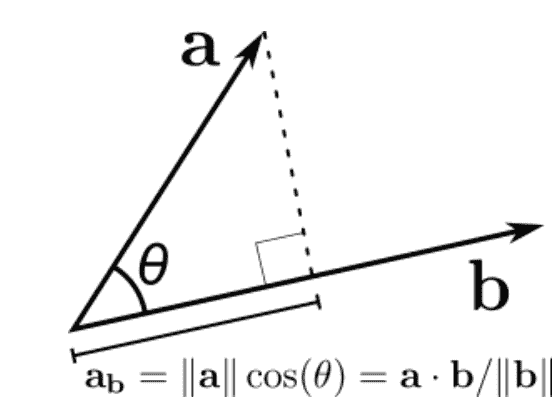

图 8.1：投影。

## 8.3 协方差矩阵

- 协方差矩阵 Σ_XX 是一个 **对称** 的半正定矩阵，其在 j、k 位置的元素是随机向量的第 j 个和第 k 个元素之间的协方差，即 X 的第 j 列和第 k 列。
- 协方差矩阵将协方差的概念推广到多个维度。
- 协方差矩阵描述了在假设椭圆形分布的情况下样本分布围绕均值的形状：

Σ_XX = E(X - E(X))^T E(X - E(X))

其估计量 S_XX 是一个 P × P 矩阵，由下式给出

S_XX = 1/(N - 1) (X - 1 x̄^T)^T (X - 1 x̄^T).

如果我们假设 X 是中心化的，即 X 被 X - 1 x̄^T 替换，则估计量为

S_XX = 1/(N - 1) X^T X = 1/(N - 1) [x11 … xN1; x1j … xNj; …; x1P … xNP] [x11 … x1k x1P; …; …; xN1 … xNk xNP] = [s1 … s1k s1P; … s_jk …; … s_P]

其中

s_jk = s_kj = 1/(N - 1) x_j^T x_k = 1/(N - 1) Σ_{i=1}^N x_{ij} x_{ik}

是第 j 个和第 k 个变量之间协方差的估计量。

```
## Avoid warnings and force inline plot
%matplotlib inline
import warnings
warnings.filterwarnings("ignore")
##
import numpy as np
```

```
import scipy
import matplotlib.pyplot as plt
import seaborn as sns
import pystatsml.plot_utils
import seaborn as sns  # nice color

np.random.seed(42)
colors = sns.color_palette()

n_samples, n_features = 100, 2

mean, Cov, X = [None] * 4, [None] * 4, [None] * 4
mean[0] = np.array([-2.5, 2.5])
Cov[0] = np.array([[1, 0],
                  [0, 1]])

mean[1] = np.array([2.5, 2.5])
Cov[1] = np.array([[1, .5],
                   [.5, 1]])

mean[2] = np.array([-2.5, -2.5])
Cov[2] = np.array([[1, .9],
                   [.9, 1]])

mean[3] = np.array([2.5, -2.5])
Cov[3] = np.array([[1, -.9],
                   [-.9, 1]])

# Generate dataset
for i in range(len(mean)):
    X[i] = np.random.multivariate_normal(mean[i], Cov[i], n_samples)

# Plot
for i in range(len(mean)):
    # Points
    plt.scatter(X[i][:, 0], X[i][:, 1], color=colors[i], label="class %i" % i)
    # Means
    plt.scatter(mean[i][0], mean[i][1], marker="o", s=200, facecolors='w',
                edgecolors=colors[i], linewidth=2)
    # Ellipses representing the covariance matrices
    pystatsml.plot_utils.plot_cov_ellipse(Cov[i], pos=mean[i], facecolor='none',
                                          linewidth=2, edgecolor=colors[i])

plt.axis('equal')
_ = plt.legend(loc='upper left')
```

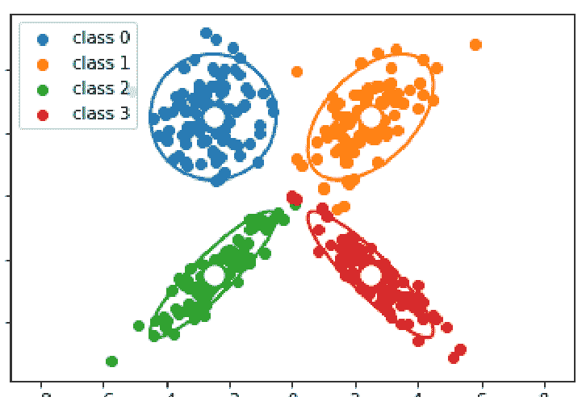

## 8.4 相关矩阵

```python
import numpy as np
import pandas as pd
import matplotlib.pyplot as plt
import seaborn as sns

url = 'https://python-graph-gallery.com/wp-content/uploads/mtcars.csv'
df = pd.read_csv(url)

# Compute the correlation matrix
corr = df.corr()

# Generate a mask for the upper triangle
mask = np.zeros_like(corr, dtype=np.bool)
mask[np.triu_indices_from(mask)] = True

f, ax = plt.subplots(figsize=(5.5, 4.5))
cmap = sns.color_palette("RdBu_r", 11)
# Draw the heatmap with the mask and correct aspect ratio
_ = sns.heatmap(corr, mask=mask, cmap=cmap, vmax=1, center=0,
    square=True, linewidths=.5, cbar_kws={"shrink": .5})
```

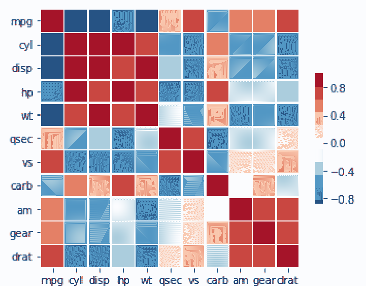

## 8.5 精度矩阵

在统计学中，精度是方差的倒数，精度矩阵是协方差矩阵的矩阵逆。

它与偏相关有关，偏相关衡量在控制其他变量影响的同时，两个变量之间的关联程度。

```python
import numpy as np

Cov = np.array([[1.0, 0.9, 0.9, 0.0, 0.0, 0.0],
                [0.9, 1.0, 0.9, 0.0, 0.0, 0.0],
                [0.9, 0.9, 1.0, 0.0, 0.0, 0.0],
                [0.0, 0.0, 0.0, 1.0, 0.9, 0.0],
                [0.0, 0.0, 0.0, 0.9, 1.0, 0.0],
                [0.0, 0.0, 0.0, 0.0, 0.0, 1.0]])

print("# Precision matrix:")
Prec = np.linalg.inv(Cov)
print(Prec.round(2))

print("# Partial correlations:")
Pcor = np.zeros(Prec.shape)
Pcor[:,:] = np.NaN

for i, j in zip(*np.triu_indices_from(Prec, 1)):
    Pcor[i, j] = - Prec[i, j] / np.sqrt(Prec[i, i] * Prec[j, j])

print(Pcor.round(2))
```

```
# Precision matrix:
[[ 6.79 -3.21 -3.21  0.   0.   0.  ]
 [-3.21  6.79 -3.21  0.   0.   0.  ]
 [-3.21 -3.21  6.79  0.   0.   0.  ]
 [ 0.  -0.  -0.   5.26 -4.74 -0.  ]
 [ 0.   0.   0.  -4.74  5.26  0.  ]
 [ 0.   0.   0.   0.   0.   1.  ]]
# Partial correlations:
[[ nan  0.47  0.47 -0.  -0.  -0.  ]
 [ nan  nan  0.47 -0.  -0.  -0.  ]
 [ nan  nan  nan -0.  -0.  -0.  ]
 [ nan  nan  nan  nan  0.9  0.  ]
 [ nan  nan  nan  nan  nan -0.  ]
 [ nan  nan  nan  nan  nan  nan]]
```

## 8.6 马氏距离

-   马氏距离是衡量两点 x 和 μ 之间距离的一种度量，其中考虑了样本的离散程度（即协方差结构）。
-   离散程度通过协方差矩阵来考虑。

这可形式化表示为

$$D_M(\mathbf{x},\mu)=\sqrt{(\mathbf{x}-\mu)^T\Sigma^{-1}(\mathbf{x}-\mu)}.$$

### 直观理解

-   沿离散主方向的距离被压缩，因为它们对应于点的可能离散。
-   正交于离散主方向的距离被拉伸，因为它们对应于点的不太可能离散。

例如

$$D_M(\mathbf{1})=\sqrt{\mathbf{1}^T\Sigma^{-1}\mathbf{1}}.$$

```python
ones = np.ones(Cov.shape[0])
d_euc = np.sqrt(np.dot(ones, ones))
d_mah = np.sqrt(np.dot(np.dot(ones, Prec), ones))

print("Euclidean norm of ones=%.2f. Mahalanobis norm of ones=%.2f" % (d_euc, d_mah))
```

```
Euclidean norm of ones=2.45. Mahalanobis norm of ones=1.77
```

第一个点积表明沿离散主方向的距离被压缩：

```python
print(np.dot(ones, Prec))
```

```
[0.35714286 0.35714286 0.35714286 0.52631579 0.52631579 1. ]
```

```python
import numpy as np
import scipy
import matplotlib.pyplot as plt
import seaborn as sns
import pystatsml.plot_utils
%matplotlib inline
np.random.seed(40)
colors = sns.color_palette()

mean = np.array([0, 0])
Cov = np.array([[1, .8],
                [.8, 1]])
samples = np.random.multivariate_normal(mean, Cov, 100)
x1 = np.array([0, 2])
x2 = np.array([2, 2])

plt.scatter(samples[:, 0], samples[:, 1], color=colors[0])
plt.scatter(mean[0], mean[1], color=colors[0], s=200, label="mean")
plt.scatter(x1[0], x1[1], color=colors[1], s=200, label="x1")
plt.scatter(x2[0], x2[1], color=colors[2], s=200, label="x2")

# plot covariance ellipsis
pystatsml.plot_utils.plot_cov_ellipse(Cov, pos=mean, facecolor='none',
                                      linewidth=2, edgecolor=colors[0])
# Compute distances
d2_m_x1 = scipy.spatial.distance.euclidean(mean, x1)
d2_m_x2 = scipy.spatial.distance.euclidean(mean, x2)

Covi = scipy.linalg.inv(Cov)
dm_m_x1 = scipy.spatial.distance.mahalanobis(mean, x1, Covi)
dm_m_x2 = scipy.spatial.distance.mahalanobis(mean, x2, Covi)

# Plot distances
vm_x1 = (x1 - mean) / d2_m_x1
vm_x2 = (x2 - mean) / d2_m_x2
jitter = .1
plt.plot([mean[0] - jitter, d2_m_x1 * vm_x1[0] - jitter],
         [mean[1], d2_m_x1 * vm_x1[1]], color='k')
plt.plot([mean[0] - jitter, d2_m_x2 * vm_x2[0] - jitter],
         [mean[1], d2_m_x2 * vm_x2[1]], color='k')

plt.plot([mean[0] + jitter, dm_m_x1 * vm_x1[0] + jitter],
         [mean[1], dm_m_x1 * vm_x1[1]], color='r')
plt.plot([mean[0] + jitter, dm_m_x2 * vm_x2[0] + jitter],
         [mean[1], dm_m_x2 * vm_x2[1]], color='r')

plt.legend(loc='lower right')
plt.text(-6.1, 3,
         'Euclidian:  d(m, x1) = %.1f<d(m, x2) = %.1f' % (d2_m_x1, d2_m_x2), color='k')
plt.text(-6.1, 3.5,
         'Mahalanobis: d(m, x1) = %.1f>d(m, x2) = %.1f' % (dm_m_x1, dm_m_x2), color='r')

plt.axis('equal')
print('Euclidian  d(m, x1) = %.2f < d(m, x2) = %.2f' % (d2_m_x1, d2_m_x2))
print('Mahalanobis d(m, x1) = %.2f > d(m, x2) = %.2f' % (dm_m_x1, dm_m_x2))
```

```
Euclidian  d(m, x1) = 2.00 < d(m, x2) = 2.83
Mahalanobis d(m, x1) = 3.33 > d(m, x2) = 2.11
```

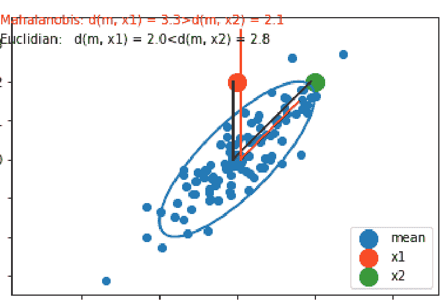

如果协方差矩阵是单位矩阵，马氏距离就简化为欧几里得距离。如果协方差矩阵是对角矩阵，则 resulting distance measure 称为归一化欧几里得距离。

更一般地，马氏距离是点 x 与分布 N(x|μ, Σ) 之间距离的度量。它是衡量 x 与均值相差多少个标准差这一思想的多维推广。该距离在 x 位于均值时为零，并且随着 x 远离均值而增大：沿每个主成分轴，它衡量 x 与分布均值之间的标准差数量。

## 8.7 多元正态分布

连续随机变量的分布，或概率密度函数（PDF）（有时仅称为密度），是一个描述该随机变量取给定值的相对可能性的函数。

P 维随机向量 x = [x1, x2, …, xP]ᵀ 的多元正态分布，或多元高斯分布为

$$N(\mathbf{x}|\mu,\Sigma)=\frac{1}{(2\pi)^{P/2}|\Sigma|^{1/2}}\exp\left\{-\frac{1}{2}(\mathbf{x}-\mu)^T\Sigma^{-1}(\mathbf{x}-\mu)\right\}.$$

```python
import numpy as np
import matplotlib.pyplot as plt
import scipy.stats
from scipy.stats import multivariate_normal
from mpl_toolkits.mplot3d import Axes3D

def multivariate_normal_pdf(X, mu, sigma):
    """Multivariate normal probability density function over X (n_samples x n_features)"""
    P = X.shape[1]
    det = np.linalg.det(sigma)
    norm_const = 1.0 / (((2*np.pi) ** (P/2)) * np.sqrt(det))
    X_mu = X - mu
    inv = np.linalg.inv(sigma)
    d2 = np.sum(np.dot(X_mu, inv) * X_mu, axis=1)
    return norm_const * np.exp(-0.5 * d2)

# mean and covariance
mu = np.array([0, 0])
sigma = np.array([[1, -.5],
                  [-.5, 1]])

# x, y grid
x, y = np.mgrid[-3:3:.1, -3:3:.1]
X = np.stack((x.ravel(), y.ravel())).T
norm = multivariate_normal_pdf(X, mu, sigma).reshape(x.shape)

# Do it with scipy
norm_scpy = multivariate_normal(mu, sigma).pdf(np.stack((x, y), axis=2))
assert np.allclose(norm, norm_scpy)

# Plot
fig = plt.figure(figsize=(10, 7))
ax = fig.gca(projection='3d')
surf = ax.plot_surface(x, y, norm, rstride=3,
                       cstride=3, cmap=plt.cm.coolwarm,
                       linewidth=1, antialiased=False
                       )

ax.set_zlim(0, 0.2)
ax.zaxis.set_major_locator(plt.LinearLocator(10))
ax.zaxis.set_major_formatter(plt.FormatStrFormatter('%.02f'))

ax.set_xlabel('X')
ax.set_ylabel('Y')
ax.set_zlabel('p(x)')

plt.title('Bivariate Normal/Gaussian distribution')
fig.colorbar(surf, shrink=0.5, aspect=7, cmap=plt.cm.coolwarm)
plt.show()
```


## 二元正态/高斯分布

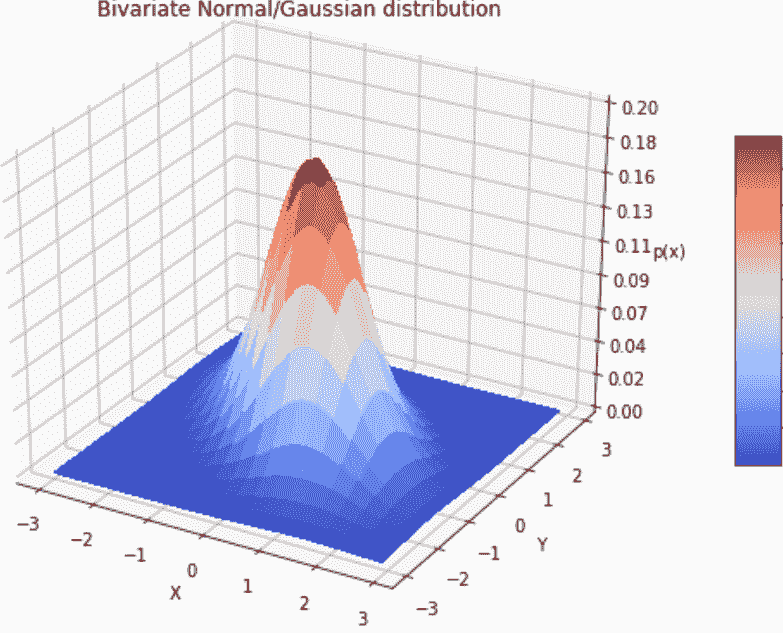

### 8.8 练习

### 8.8.1 点积与欧几里得范数

已知 a = [2,1]^T 和 b = [1,1]^T

- 1. 编写一个函数 euclidean(x)，计算向量 x 的欧几里得范数。
- 2. 计算 a 的欧几里得范数。
- 3. 计算 ||a − b||₂ 的欧几里得距离。
- 4. 计算 b 在向量 a 方向上的投影：bₐ。
- 5. 模拟一个包含 N = 100 个二维向量样本的数据集 X。
- 6. 将所有样本投影到向量 a 的方向上。

### 8.8.2 协方差矩阵与马氏范数

- 1. 从二元正态分布 N(μ, Σ) 中采样一个包含 N = 100 个二维向量样本的数据集 X，其中 μ = [1,1]^T，Σ = [[1, 0.8],[0.8, 1]]。
- 2. 计算均值向量 x̄ 并将 X 中心化。将估计均值 x̄ 与真实均值 μ 进行比较。
- 3. 计算经验协方差矩阵 S。将估计的协方差矩阵 S 与真实协方差矩阵 Σ 进行比较。
- 4. 使用 scipy.linalg.inv(S) 计算协方差矩阵的逆 S⁻¹（Sinv）。
- 5. 编写一个函数 mahalanobis(x, xbar, Sinv)，计算向量 x 到均值 x̄ 的马氏距离。
- 6. 计算每个样本 x_i 到均值 x̄ 的马氏距离和欧几里得距离。将结果存储在一个 100 × 2 的数据框中。

## Python 中的时间序列

两个库：

- Pandas：https://pandas.pydata.org/pandas-docs/stable/timeseries.html
- scipy：http://www.statsmodels.org/devel/tsa.html

### 9.1 平稳性

如果一个时间序列（TS）的统计属性（如均值、方差）随时间保持不变，则称该时间序列是平稳的。

- 均值恒定
- 方差恒定
- 自协方差不依赖于时间

是什么导致时间序列不平稳？时间序列不平稳的背后有两个主要原因：

- 1. 趋势（Trend）——均值随时间变化。例如，在这种情况下，我们看到乘客数量总体上随时间增长。
- 2. 季节性（Seasonality）——在特定时间段内的变化。例如，人们可能倾向于在某个特定月份购买汽车，因为加薪或节日。

### 9.2 Pandas 时间序列数据结构

Series 类似于 Python 中的列表或数组。它表示一系列值（数值或其他类型），例如数据的一列。它提供了额外的功能、方法和运算符，使其成为比列表更强大的版本。

```python
import pandas as pd
import numpy as np

# Create a Series from a list
ser = pd.Series([1, 3])
print(ser)

# String as index
prices = {'apple': 4.99,
          'banana': 1.99,
          'orange': 3.99}
ser = pd.Series(prices)
print(ser)

x = pd.Series(np.arange(1,3), index=[x for x in 'ab'])
print(x)
print(x['b'])
```

```
0    1
1    3
dtype: int64
apple    4.99
banana   1.99
orange   3.99
dtype: float64
a    1
b    2
dtype: int64
2
```

### 9.3 Google Trends 时间序列分析

来源：https://www.datacamp.com/community/tutorials/time-series-analysis-tutorial

获取诸如 'diet' 和 'gym' 等关键词的 Google Trends 数据，观察它们随时间的变化，同时了解时间序列数据中的趋势和季节性。

在1月4日的 Facebook Live 代码实操环节中，我们查看了关键词 'diet'、'gym' 和 'finance' 的 Google Trends 数据，以了解它们随时间的变化。我们不禁自问：当我们在1月都想翻开新的一页时，这些词的搜索量会不会更高？

在本教程中，你将逐步浏览我们在活动中编写的代码。你不需要做太多数学计算，但需要完成以下内容：

- 读取数据
- 重新编码数据
- 探索性数据分析

### 9.4 读取数据

```python
import numpy as np
import pandas as pd
import matplotlib.pyplot as plt
import seaborn as sns

# Plot appears on its own windows
%matplotlib inline
# Tools / Preferences / IPython Console / Graphics / Graphics Backend / Backend:_
→"automatic"
# Interactive Matplotlib Jupyter Notebook
```

```python
# %matplotlib inline

try:
    url = "https://raw.githubusercontent.com/datacamp/datacamp_facebook_live_ny_resolution/master/datasets/multiTimeline.csv"
    df = pd.read_csv(url, skiprows=2)
except:
    df = pd.read_csv("../datasets/multiTimeline.csv", skiprows=2)

print(df.head())

# Rename columns
df.columns = ['month', 'diet', 'gym', 'finance']

# Describe
print(df.describe())
```

|   | Month | diet：（全球） | gym：（全球） | finance：（全球） |
|---|---|---|---|---|
| 0 | 2004-01 | 100 | 31 | 48 |
| 1 | 2004-02 | 75 | 26 | 49 |
| 2 | 2004-03 | 67 | 24 | 47 |
| 3 | 2004-04 | 70 | 22 | 48 |
| 4 | 2004-05 | 72 | 22 | 43 |

|       | diet      | gym       | finance   |
|-------|-----------|-----------|-----------|
| 计数 | 168.000000 | 168.000000 | 168.000000 |
| 均值  | 49.642857  | 34.690476  | 47.148810  |
| 标准差 | 8.033080   | 8.134316   | 4.972547   |
| 最小值 | 34.000000  | 22.000000  | 38.000000  |
| 25%   | 44.000000  | 28.000000  | 44.000000  |
| 50%   | 48.500000  | 32.500000  | 46.000000  |
| 75%   | 53.000000  | 41.000000  | 50.000000  |
| 最大值 | 100.000000 | 58.000000  | 73.000000  |

### 9.5 重新编码数据

接下来，你将把 'month' 列转换为 DateTime 数据类型，并将其设为 DataFrame 的索引。

请注意，这样做的原因是你在 .info() 方法的结果中看到 'Month' 列实际上是一个 object 数据类型。这种通用数据类型可以封装从字符串到整数等一切内容。当你想查看时间序列数据时，这并不完全是你想要的。因此，你将使用 .to_datetime() 将 DataFrame 中的 'month' 列转换为 DateTime。

小心！在设置 DataFrame df 的索引时，请务必包含 inplace 参数，这样你才能真正修改原始索引并将其设置为 'month' 列。

```python
df.month = pd.to_datetime(df.month)
df.set_index('month', inplace=True)

print(df.head())
```

| month      | diet | gym | finance |
|------------|------|-----|---------|
| 2004-01-01 | 100  | 31  | 48      |
| 2004-02-01 | 75   | 26  | 49      |
| 2004-03-01 | 67   | 24  | 47      |
| 2004-04-01 | 70   | 22  | 48      |
| 2004-05-01 | 72   | 22  | 43      |

### 9.6 探索性数据分析

你可以使用 pandas 内置的可视化方法 .plot() 将数据绘制成单个图形上的 3 条折线图（每个列一条，即 'diet'、'gym' 和 'finance'）。

```python
df.plot()
plt.xlabel('Year');

# change figure parameters
# df.plot(figsize=(20,10), linewidth=5, fontsize=20)

# Plot single column
# df[['diet']].plot(figsize=(20,10), linewidth=5, fontsize=20)
# plt.xlabel('Year', fontsize=20);
```

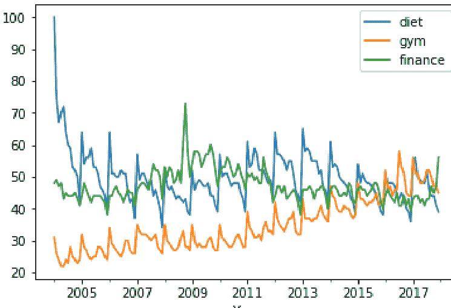

请注意，这些数据是相对值。正如你在 Google Trends 上看到的那样：

数值表示相对于给定区域和时间图表最高点的搜索兴趣度。100 表示该词的峰值流行度。50 表示该词的流行度是峰值的一半。同样，0 分表示该词的流行度不到峰值的 1%。

### 9.7 重采样、平滑、窗口化、滚动平均：趋势

滚动平均：对于每个时间点，取其两侧点的平均值。请注意，点的数量由窗口大小指定。

使用 pandas Series 去除季节性。

参见：http://pandas.pydata.org/pandas-docs/stable/timeseries.html A '年末频率'（年度频率）

```python
diet = df['diet']
diet_resamp_yr = diet.resample('A').mean()
diet_roll_yr = diet.rolling(12).mean()
ax = diet.plot(alpha=0.5, style='-') # store axis (ax) for later plots
diet_resamp_yr.plot(style=':', label='Resample at year frequency', ax=ax)
diet_roll_yr.plot(style='--', label='Rolling average (smooth), window size=12', ax=ax)
ax.legend()
```

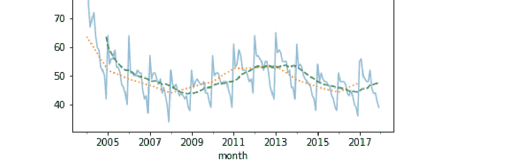

使用 NumPy 进行滚动平均（平滑）

```python
x = np.asarray(df['diet'])
win = 12
win_half = int(win / 2)
# print([(idx-win_half, (idx+win_half)) for idx in np.arange(win_half, len(x))])
diet_smooth = np.array([x[(idx-win_half):(idx+win_half)].mean() for idx in np.arange(win_half, len(x))])
plt.plot(diet_smooth)
```

```
[<matplotlib.lines.Line2D at 0x7fd2bb5bb208>]
```

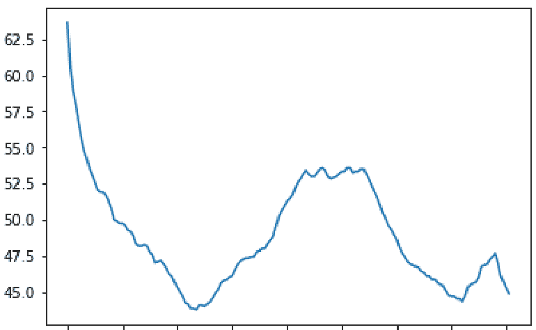

### 绘制 Diet 与 Gym 的趋势图

构建一个新的 DataFrame，该 DataFrame 是 diet 和 gym 平滑数据的拼接。

```python
gym = df['gym']
df_avg = pd.concat([diet.rolling(12).mean(), gym.rolling(12).mean()], axis=1)
df_avg.plot()
plt.xlabel('Year')
```

```
Text(0.5,0,'Year')
```


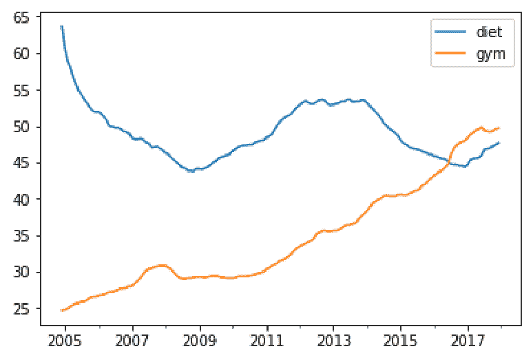

## 去趋势

```
df_dtrend = df[["diet", "gym"]] - df_avg
df_dtrend.plot()
plt.xlabel('Year')
```

```
Text(0.5,0,'Year')
```

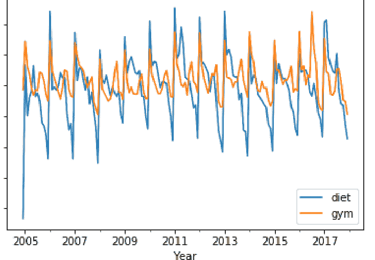

## 9.8 一阶差分：季节性模式

```
# diff = original - shifted data
# (exclude first term for some implementation details)
assert np.all((diet.diff() == diet - diet.shift())[1:])

df.diff().plot()
plt.xlabel('Year')
```

```
Text(0.5,0,'Year')
```

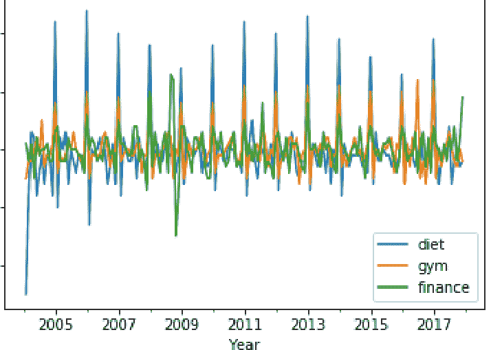

## 9.9 周期性与相关性

```
df.plot()
plt.xlabel('Year');
print(df.corr())
```

|       | diet     | gym      | finance  |
|-------|----------|----------|----------|
| diet  | 1.000000 | -0.100764| -0.034639|
| gym   | -0.100764| 1.000000 | -0.284279|
| finance| -0.034639| -0.284279| 1.000000 |

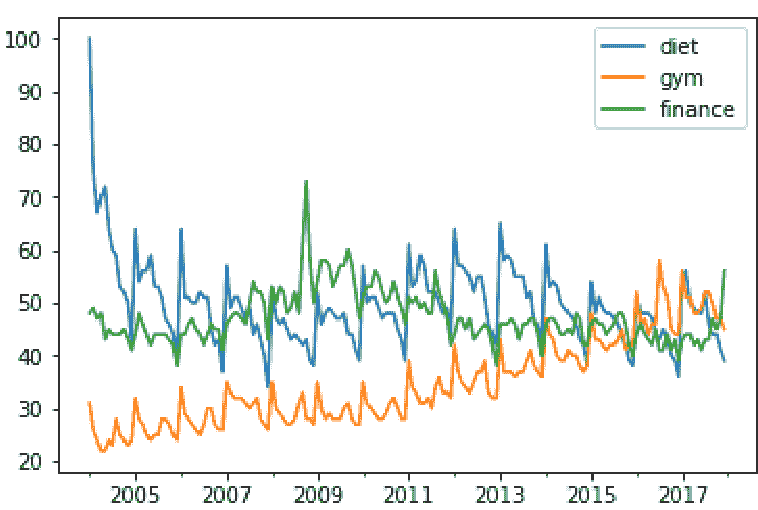

## 绘制相关矩阵

```
sns.heatmap(df.corr(), cmap="coolwarm")
```

<matplotlib.axes._subplots.AxesSubplot at 0x7fd2b9043400>

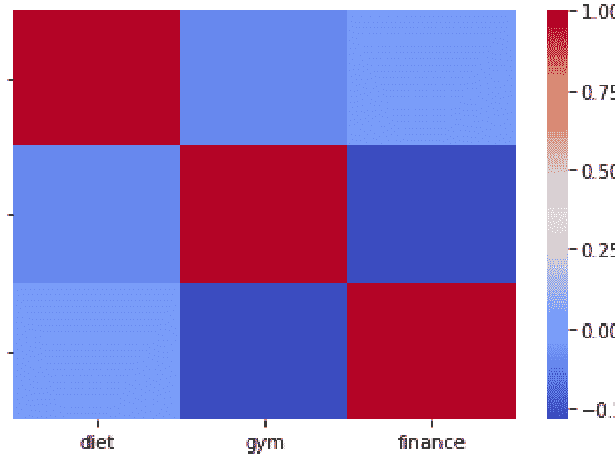

‘diet’和‘gym’是负相关的！记住，你同时拥有季节性和趋势成分。从相关系数来看，‘diet’和‘gym’是负相关的：

- 趋势成分负相关。
- 季节性成分正相关，并且它们的

实际的相关系数实际上同时捕捉了这两者。

季节性相关：这些时间序列的一阶差分的相关性。

```
```python
df.diff().plot()
plt.xlabel('Year');
print(df.diff().corr())
```
```

|  | diet | gym | finance |
|---|---|---|---|
| diet | 1.000000 | 0.758707 | 0.373828 |
| gym | 0.758707 | 1.000000 | 0.301111 |
| finance | 0.373828 | 0.301111 | 1.000000 |

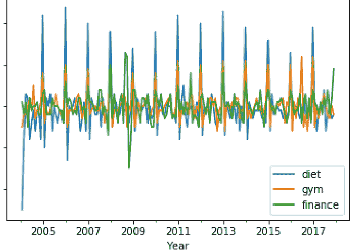

绘制相关矩阵

```
```python
sns.heatmap(df.diff().corr(), cmap="coolwarm")
```
```

```
<matplotlib.axes._subplots.AxesSubplot at 0x7fd2bb6e1710>
```

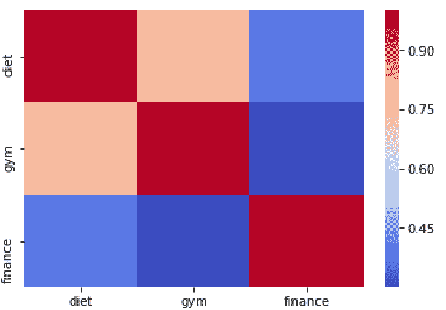

## 将时间序列分解为趋势、季节性和残差

```
from statsmodels.tsa.seasonal import seasonal_decompose

x = gym

x = x.astype(float) # force float
decomposition = seasonal_decompose(x)
trend = decomposition.trend
seasonal = decomposition.seasonal
residual = decomposition.resid

plt.subplot(411)
plt.plot(x, label='Original')
plt.legend(loc='best')
plt.subplot(412)
plt.plot(trend, label='Trend')
plt.legend(loc='best')
plt.subplot(413)
plt.plot(seasonal,label='Seasonality')
plt.legend(loc='best')
plt.subplot(414)
plt.plot(residual, label='Residuals')
plt.legend(loc='best')
plt.tight_layout()
```

```
/home/edouard/anaconda3/lib/python3.6/site-packages/statsmodels/compat/pandas.py:56:
FutureWarning: The pandas.core.datetools module is deprecated and will be removed in a future version. Please use the pandas.tseries module instead.
from pandas.core import datetools
```

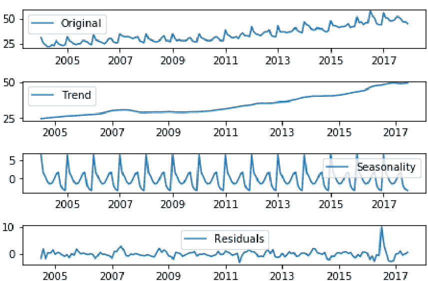

## 9.10 自相关

如果时间序列以等间隔重复自身，例如每12个月重复一次，则该时间序列是周期性的。自相关函数 (ACF)：它衡量时间序列与其滞后版本之间的相关性。例如，在滞后5时，ACF 会比较 t1…t2 时刻的序列与 t1-5…t2-5 时刻的序列（t1-5 和 t2 为端点）。

绘制

```
# from pandas.plotting import autocorrelation_plot
from pandas.plotting import autocorrelation_plot

x = df["diet"].astype(float)
autocorrelation_plot(x)
```

<matplotlib.axes._subplots.AxesSubplot at 0x7fd2b907b1d0>


### 计算自相关函数 (ACF)

```
from statsmodels.tsa.stattools import acf

x_diff = x.diff().dropna() # first item is NA
lag_acf = acf(x_diff, nlags=36)
plt.plot(lag_acf)
plt.title('Autocorrelation Function')
```

```
Text(0.5,1,'Autocorrelation Function')
```


ACF 每12个月出现一次峰值：时间序列与其自身平移12个月后的序列存在相关性。

## 9.11 使用 Python 的基于自回归移动平均 (ARMA) 模型的时间序列预测

来源：

- https://www.packtpub.com/mapt/book/big_data_and_business_intelligence/9781783553358/7/ch07lvl1sec77/arma-models
- http://en.wikipedia.org/wiki/Autoregressive%E2%80%93moving-average_model
- ARIMA: https://www.analyticsvidhya.com/blog/2016/02/time-series-forecasting-codes-python/

ARMA 模型常用于预测时间序列。这些模型结合了自回归模型和移动平均模型。在移动平均模型中，我们假设变量是时间序列均值与噪声分量线性组合之和。

自回归和移动平均模型可以有不同的阶数。通常，我们可以定义具有 p 个自回归项和 q 个移动平均项的 ARMA 模型如下：

x_t = sum_{i}^{p} a_i x_{t-i} + sum_{i}^{q} b_i ε_{t-i} + ε_t

### 9.11.1 选择 p 和 q

偏自相关函数 (PACF)：它衡量时间序列与其滞后版本之间的相关性，但会剔除中间比较已经解释的变异。例如，在滞后5时，它会检查相关性，但移除滞后1至4已经解释的影响。

```
from statsmodels.tsa.stattools import acf, pacf

x = df["gym"].astype(float)

x_diff = x.diff().dropna() # first item is NA
# ACF and PACF plots:

lag_acf = acf(x_diff, nlags=20)
lag_pacf = pacf(x_diff, nlags=20, method='ols')

#Plot ACF:
plt.subplot(121)
plt.plot(lag_acf)
plt.axhline(y=0,linestyle='--',color='gray')
plt.axhline(y=-1.96/np.sqrt(len(x_diff)),linestyle='--',color='gray')
plt.axhline(y=1.96/np.sqrt(len(x_diff)),linestyle='--',color='gray')
plt.title('Autocorrelation Function  (q=1)')

#Plot PACF:
plt.subplot(122)
plt.plot(lag_pacf)
plt.axhline(y=0,linestyle='--',color='gray')
```

```
plt.axhline(y=-1.96/np.sqrt(len(x_diff)),linestyle='--',color='gray')
plt.axhline(y=1.96/np.sqrt(len(x_diff)),linestyle='--',color='gray')
plt.title('Partial Autocorrelation Function (p=1)')
plt.tight_layout()
```


在该图中，0 两侧的两条虚线是置信区间。它们可用于确定 p 和 q 的值，如下所示：

- p：PACF 图第一次穿过上置信区间时的滞后值，在此例中 p=1。
- q：ACF 图第一次穿过上置信区间时的滞后值，在此例中 q=1。

### 9.11.2 用 statsmodels 拟合 ARMA 模型

1. 通过调用 ARMA() 并传入 p 和 q 参数来定义模型。
2. 通过调用 fit() 函数在训练数据上准备模型。
3. 可以通过调用 predict() 函数并指定要预测的时间索引来进行预测。

```
from statsmodels.tsa.arima_model import ARMA

model = ARMA(x, order=(1, 1)).fit() # fit model

print(model.summary())
plt.plot(x)
plt.plot(model.predict(), color='red')
plt.title('RSS: %.4f'% sum((model.fittedvalues-x)**2))
```

```
ARMA Model Results
================================================================================
Dep. Variable:               gym   No. Observations:                  168
Model:                      ARMA(1, 1)   Log Likelihood          -436.852
Method:                       css-mle   S.D. of innovations         3.229
Date:                Thu, 14 Jun 2018   AIC                          881.704
Time:                        23:08:57   BIC                          894.200
Sample:                    01-01-2004   HQIC                         886.776
                           - 12-01-2017
================================================================================
                          coef    std err          z      P>|z|      [0.025      0.975]
--------------------------------------------------------------------------------
const                  36.4316      8.827      4.127      0.000      19.131      53.732
ar.L1.gym               0.9967      0.005    220.565      0.000       0.988       1.006
ma.L1.gym              -0.7494      0.054    -13.931      0.000      -0.855      -0.644
                              Roots
================================================================================
                          Real            Imaginary          Modulus         Frequency
--------------------------------------------------------------------------------
AR.1                     1.0033             +0.0000j            1.0033            0.0000
MA.1                     1.3344             +0.0000j            1.3344            0.0000
--------------------------------------------------------------------------------
```

```
/home/edouard/anaconda3/lib/python3.6/site-packages/statsmodels/tsa/kalmanf/
←kalmanfilter.py:646: FutureWarning: Conversion of the second argument of
←issubdtype from float to np.floating is deprecated. In future, it will be
←treated as np.float64 == np.dtype(float).type.
    if issubdtype(paramsdtype, float):
/home/edouard/anaconda3/lib/python3.6/site-packages/statsmodels/tsa/kalmanf/
←kalmanfilter.py:650: FutureWarning: Conversion of the second argument of
←issubdtype from complex to np.complexfloating is deprecated. In future, it
←will be treated as np.complex128 == np.dtype(complex).type.
    elif issubdtype(paramsdtype, complex):
/home/edouard/anaconda3/lib/python3.6/site-packages/statsmodels/tsa/kalmanf/
←kalmanfilter.py:577: FutureWarning: Conversion of the second argument of
←issubdtype from float to np.floating is deprecated. In future, it will be
←treated as np.float64 == np.dtype(float).type.
    if issubdtype(paramsdtype, float):
```

```
Text(0.5,1,'RSS: 1794.4661')
```


## RSS: 1794.4661


## 降维与特征提取

## 10.1 引言

在机器学习和统计学中，降维（dimensionality reduction 或 dimension reduction）是减少所考虑特征数量的过程，可分为特征选择（此处不讨论）和特征提取。

特征提取从一组初始测量数据出发，构造派生值（特征），使其具有信息性且不冗余，有助于后续的学习和泛化步骤，在某些情况下还能带来更好的人类解释。特征提取与降维密切相关。

输入矩阵 X 的维度为 N × P：

$$\begin{bmatrix} x_{11} & \dots & x_{1P} \\ \vdots & X & \vdots \\ x_{N1} & \dots & x_{NP} \end{bmatrix}$$

其中行代表样本，列代表变量。

目标是学习一种变换，以提取少量相关特征。这通常通过利用输入特征之间的协方差 ΣXX 来实现。

## 10.2 奇异值分解与矩阵分解

### 10.2.1 矩阵分解原理

将数据矩阵 X_{N×P} 分解为混合矩阵 U_{N×K} 与字典矩阵 V_{P×K} 的乘积。

$$X = U V^T$$

如果我们只考虑一部分分量，即 K < rank(X) < min(P, N − 1)，则 X 可由矩阵 X̂ 近似：

$$X ≈ \hat{X} = U V^T$$

每一行 x_i 都是字典项 V 的线性组合（混合 u_i）。

N 个 P 维数据点位于一个维数小于 N − 1 的空间中（2 个点位于一条直线上，3 个点位于一个平面上，等等）。


图 10.1：矩阵分解

### 10.2.2 奇异值分解（SVD）原理

奇异值分解（SVD）将数据矩阵 X_{N×P} 分解为乘积：

X = U D V^T

其中

[x11 x1P; X; xN1 xNP] = [u11 u1K; U; uN1 uNK] [d1 0; D; 0 dK] [v11 v1P; V^T; vK1 vKP]

### V：右奇异向量

- V = [v1, ..., vK] 是一个 P × K 正交矩阵。
- 它是一个模式字典，根据混合系数组合这些模式以重构原始样本。
- V 沿着 K = min(N, P) 个主成分方向（也称为载荷）执行初始旋转（投影）。
- 每个 vj 对变量执行线性组合，使样本方差最大，并且与之前的 vj-1 不相关。

### D：奇异值

- D 是一个 K × K 对角矩阵，由 X 的奇异值组成，且 d1 ≥ d2 ≥ ... ≥ dK ≥ 0。
- D 通过 d1, d2, ..., dK 缩放沿坐标轴的投影。
- 奇异值是 X^T X 的特征值的平方根。

### U：左奇异向量

- U = [u1, ..., uK] 是一个 N × K 正交矩阵。
- 每一行 u_i 提供用于重构样本 x_i 的字典项的混合系数。
- 它可以理解为新正交基（在初始旋转后获得）上的坐标，在主成分分析中称为主成分。

### 10.2.3 用于变量变换的 SVD

V 将相关变量（X）变换为一组不相关变量（UD），从而更好地揭示原始数据项之间的各种关系。

X = UDV^T,  (10.1)
XV = UDV^T V,  (10.2)
XV = UDI,  (10.3)
XV = UD  (10.4)

同时，SVD 是一种识别和排序数据点表现出最大变化的维度的方法。

```
import numpy as np
import scipy
from sklearn.decomposition import PCA
import matplotlib.pyplot as plt
import seaborn as sns
%matplotlib inline

np.random.seed(42)

# dataset
n_samples = 100
experience = np.random.normal(size=n_samples)
salary = 1500 + experience + np.random.normal(size=n_samples, scale=.5)
X = np.column_stack([experience, salary])

# PCA using SVD
X -= X.mean(axis=0)  # Centering is required
U, s, Vh = scipy.linalg.svd(X, full_matrices=False)
# U : Unitary matrix having left singular vectors as columns.
#     Of shape (n_samples,n_samples) or (n_samples,n_comps), depending on
#     full_matrices.
#
# s : The singular values, sorted in non-increasing order. Of shape (n_comps,),
#     with n_comps = min(n_samples, n_features).
#
# Vh: Unitary matrix having right singular vectors as rows.
#     Of shape (n_features, n_features) or (n_comps, n_features) depending
#     on full_matrices.

plt.figure(figsize=(9, 3))

plt.subplot(131)
plt.scatter(U[:, 0], U[:, 1], s=50)
plt.axis('equal')
```

```
plt.title("U: Rotated and scaled data")

plt.subplot(132)

# Project data
PC = np.dot(X, Vh.T)
plt.scatter(PC[:, 0], PC[:, 1], s=50)
plt.axis('equal')
plt.title("XV: Rotated data")
plt.xlabel("PC1")
plt.ylabel("PC2")

plt.subplot(133)
plt.scatter(X[:, 0], X[:, 1], s=50)
for i in range(Vh.shape[0]):
    plt.arrow(x=0, y=0, dx=Vh[i, 0], dy=Vh[i, 1], head_width=0.2,
              head_length=0.2, linewidth=2, fc='r', ec='r')
    plt.text(Vh[i, 0], Vh[i, 1], 'v%i' % (i+1), color="r", fontsize=15,
             horizontalalignment='right', verticalalignment='top')
plt.axis('equal')
plt.ylim(-4, 4)

plt.title("X: original data (v1, v2:PC dir.)")
plt.xlabel("experience")
plt.ylabel("salary")

plt.tight_layout()
```


## 10.3 主成分分析（PCA）

来源：

- C. M. Bishop *《模式识别与机器学习》*, Springer, 2006
- 关于 PCA 你已知和未知的一切
- 三个简单步骤搞定主成分分析

### 10.3.1 原理

- 主成分分析是用于线性降维的主要方法。
- 主成分分析的思想是找到 K 个**主成分方向**（称为**载荷**）**V**$_{K×P}$，尽可能多地捕获数据中的变化。
- 它将一组 N 个 P 维的可能相关变量的观测值 **X**$_{N×P}$ 转换为一组 N 个 K 维样本 **C**$_{N×K}$，其中 K < P。新变量是线性不相关的。**C**$_{N×K}$ 的列称为**主成分**。
- 降维通过仅使用 K < P 个分量来实现，这些分量利用了原始变量之间的相关性（协方差）。
- 从数学上讲，PCA 定义为一个正交线性变换 **V**$_{K×P}$，该变换将数据转换到新的坐标系，使得数据在某个投影下的最大方差位于第一个坐标上（称为第一主成分），第二大方差位于第二个坐标上，依此类推。

**C**$_{N×K}$ = **X**$_{N×P}$ **V**$_{P×K}$

- PCA 可以被看作是将一个 P 维椭球拟合到数据上，椭球的每个轴代表一个主成分。如果椭圆的某个轴很小，那么沿该轴的方差也很小，并且在数据集表示中省略该轴及其对应的主成分，只会损失相应少量信息。
- 找到椭圆的 K 个最大轴，就可以将数据投影到维数为 K < P 的空间中，同时最大化投影数据的方差。

### 10.3.2 数据集预处理

### 中心化

考虑一个数据矩阵 **X**，其每一列的经验均值为零（每列的样本均值已被平移到零），即 **X** 被替换为 **X** − **1** **x̄**$^{T}$。

### 标准化

可选地，对列进行标准化，即按其标准差进行缩放。如果不进行标准化，方差较大的变量将占据 PCA 的大部分效果，主方向将与这个变量对齐。然而，标准化会将噪声变量提升到与信息变量相同的水平。

中心化且标准化后的数据的协方差矩阵即为相关矩阵。

### 10.3.3 数据协方差矩阵的特征分解

首先，考虑投影到一维空间（K = 1）的情况。我们可以使用 P 维向量 **v** 来定义该空间的方向，为了方便（且不失一般性），我们选择其为单位向量，使得 ‖**v**‖₂ = 1（注意，我们只关心 **v** 定义的方向，而不关心 **v** 本身的大小）。PCA 包括两个主要步骤：

### 在捕获最大方差的方向上进行投影


每个 $P$ 维数据点 $\mathbf{x}_i$ 然后投影到 $\mathbf{v}$ 上，其中坐标（在 $\mathbf{v}$ 的坐标系中）是一个标量值，即 $\mathbf{x}_i^T \mathbf{v}$。即，我们想要找到向量 $\mathbf{v}$，使其沿 $\mathbf{v}$ 最大化这些坐标，我们将看到这对应于最大化投影数据的方差。这可以等价地表示为

$$\mathbf{v} = \arg\max_{\|\mathbf{v}\|=1} \frac{1}{N} \sum_i (\mathbf{x}_i^T \mathbf{v})^2.$$

我们可以将其写成矩阵形式为

$$\mathbf{v} = \arg\max_{\|\mathbf{v}\|=1} \frac{1}{N}\|\mathbf{X}\mathbf{v}\|^2 = \frac{1}{N}\mathbf{v}^T\mathbf{X}^T\mathbf{X}\mathbf{v} = \mathbf{v}^T\mathbf{S_{XX}}\mathbf{v},$$

其中 $\mathbf{S_{XX}}$ 是数据协方差矩阵的有偏估计，即

$$\mathbf{S_{XX}} = \frac{1}{N}\mathbf{X}^T\mathbf{X}.$$

我们现在最大化投影方差 $\mathbf{v}^T\mathbf{S_{XX}}\mathbf{v}$ 关于 $\mathbf{v}$。显然，这必须是一个约束最大化，以防止 $\|\mathbf{v}\| \to \infty$。适当的约束来自归一化条件 $\|\mathbf{v}\|_2^2 \equiv \mathbf{v}^T\mathbf{v} = 1$。为强制执行此约束，我们引入一个拉格朗日乘子，记为 $\lambda$，然后对无约束最大化

$$\mathbf{v}^T\mathbf{S_{XX}}\mathbf{v} - \lambda(\mathbf{v}^T\mathbf{v} - 1).$$

通过将关于 $\mathbf{v}$ 的梯度设为零，我们看到该量在

$$\mathbf{S_{XX}}\mathbf{v} = \lambda\mathbf{v}.$$

时具有驻点。

我们注意到 $\mathbf{v}$ 是 $\mathbf{S_{XX}}$ 的特征向量。

如果我们对上式左乘 $\mathbf{v}^T$ 并利用 $\mathbf{v}^T\mathbf{v} = 1$，我们看到方差为

$$\mathbf{v}^T\mathbf{S_{XX}}\mathbf{v} = \lambda,$$

因此方差将在 $\mathbf{v}$ 等于对应于最大特征值 $\lambda$ 的特征向量时达到最大值。该特征向量被称为第一主成分。

我们可以以增量的方式定义额外的主成分，通过选择每个新方向使其在所有与已考虑方向正交的可能方向中最大化投影方差。如果我们考虑 $K$ 维投影空间的一般情况，方差最大化的最优线性投影现在由数据协方差矩阵 $\mathbf{S_{XX}}$ 的 $K$ 个特征向量 $\mathbf{v}_1,\dots,\mathbf{v}_K$ 定义，对应于 $K$ 个最大特征值 $\lambda_1 \ge \lambda_2 \ge \dots \ge \lambda_K$。

## 回到 SVD

中心化数据 $\mathbf{X}$ 的样本协方差矩阵由下式给出

$$\mathbf{S_{XX}} = \frac{1}{N-1}\mathbf{X}^T\mathbf{X}.$$

我们使用 $\mathbf{X}$ 的 SVD 分解重写 $\mathbf{X}^T\mathbf{X}$ 为

因此 $c_j = X v_j = u_j d_j$，对于 $j = 1, … K$。因此 $u_j$ 只是 $X$ 的行向量，即输入预测向量，在方向 $v_j$ 上的投影，按 $d_j$ 缩放。

c_1 = [ x_{1,1} v_{1,1} + … + x_{1,P} v_{1,P} ; x_{2,1} v_{1,1} + … + x_{2,P} v_{1,P} ; ⋮ ; x_{N,1} v_{1,1} + … + x_{N,P} v_{1,P} ]

3. 每个分量的方差由特征值 λ_k 给出，k = 1, … K。它可以从奇异值获得：

var(c_k) = 1/(N-1) (X v_k)^2   (10.9)
= 1/(N-1) (u_k d_k)^2   (10.10)
= 1/(N-1) d_k^2   (10.11)

## 10.3.4 确定 PC 的数量

我们必须选择 K* ∈ [1, …, K]，即所需分量的数量。这可以通过计算 K* 个第一分量的解释方差比并选择 K* 使累积解释方差比大于某个给定阈值（例如 ≈ 90%）来实现。这表示为

cumulative explained variance(c_k) = (∑_{j}^{K*} var(c_k)) / (∑_{j}^{K} var(c_k)).

## 10.3.5 解释和可视化

### PCs

将样本投影到第一个主成分上进行绘制，例如 PC1 对 PC2。

### PC 方向

探索与分量相关的载荷提供了每个原始变量在该分量中的贡献。

备注：载荷（PC 方向）是 PC 对原始变量的多重回归系数：

c = X v   (10.12)
X^T c = X^T X v   (10.13)
(X^T X)^{-1} X^T c = v   (10.14)

评估每个 PC 中原始变量贡献的另一种方法可以通过计算 PC 与原始变量之间的相关性获得，即 X 的列，

记为 x_j，j = 1, …, P。对于第 k 个 PC，计算并绘制与所有原始变量的相关性

cor(c_k, x_j), j = 1 … P.

这些量有时被称为相关载荷。

```
import numpy as np
from sklearn.decomposition import PCA
import matplotlib.pyplot as plt

np.random.seed(42)

# dataset
n_samples = 100
experience = np.random.normal(size=n_samples)
salary = 1500 + experience + np.random.normal(size=n_samples, scale=.5)
X = np.column_stack([experience, salary])

# PCA with scikit-learn
pca = PCA(n_components=2)
pca.fit(X)
print(pca.explained_variance_ratio_)

PC = pca.transform(X)

plt.subplot(121)
plt.scatter(X[:, 0], X[:, 1])
plt.xlabel("x1"); plt.ylabel("x2")

plt.subplot(122)
plt.scatter(PC[:, 0], PC[:, 1])
plt.xlabel("PC1 (var=%.2f)" % pca.explained_variance_ratio_[0])
plt.ylabel("PC2 (var=%.2f)" % pca.explained_variance_ratio_[1])
plt.axis('equal')
plt.tight_layout()
```

```
[0.93646607 0.06353393]
```


## 10.4 多维缩放 (MDS)

资源：

- http://www.stat.pitt.edu/sungkyu/course/2221Fall13/lec8_mds_combined.pdf
- https://en.wikipedia.org/wiki/Multidimensional_scaling
- Hastie, Tibshirani and Friedman (2009). *The Elements of Statistical Learning: Data Mining, Inference, and Prediction.* New York: Springer, Second Edition.

MDS 的目的是找到数据的低维投影，其中数据点之间的成对距离尽可能地保持（在最小二乘意义上）。

- 设 **D** 为 (*N* × *N*) 成对距离矩阵，其中 *d_ij* 是点 *i* 和 *j* 之间的 *distance*。
- MDS 概念可以扩展到以相似性矩阵指定的各种数据类型。

给定非相似性（距离）矩阵 **D**_{N×N} = [*d_ij*]，MDS 试图找到 *N* 个点 **x**₁,…, **x**_N ∈ ℝ^K 的 *K* 维投影，连接成 **X**_{N×K} 矩阵，使得 *d_ij* ≈ ||**x**_i − **x**_j|| 尽可能接近。这可以通过最小化称为 **stress function** 的损失函数获得

stress(**X**) = Σ_{i≠j} (d_{ij} − ||**x**_i − **x**_j||)² .

该损失函数被称为 *least-squares* 或 *Kruskal-Shepard* 缩放。

*least-squares* 缩放的一种修改是 *Sammon mapping*

stress_{Sammon}(**X**) = Σ_{i≠j} (d_{ij} − ||**x**_i − **x**_j||)² / d_{ij} .

Sammon mapping 相比于最小二乘缩放更好地保持了小距离。

## 10.4.1 经典多维缩放

也称为主坐标分析，PCoA。

- 距离矩阵 D 经常使用中心化内积变换为相似性矩阵 B。
- 损失函数变为
- stress_classical(X) = sum_{i≠j} (b_ij - <x_i, x_j>)^2.
- 经典 MDS 中的应力函数有时称为 strain。
- 经典 MDS 问题的解可以从相似性矩阵的特征向量中找到。
- 如果 D 中的距离是欧几里得的并且使用双中心化内积，结果等价于 PCA。

## 10.4.2 示例

eurodist 数据集提供了欧洲 21 个城市之间的公路距离（以公里为单位）。给定这个成对（非欧几里得）距离矩阵 D = [d_ij]，MDS 可用于恢复城市在某个欧几里得参考系中的坐标，其方向是任意的。

```
import pandas as pd
import numpy as np
import matplotlib.pyplot as plt

# Pairwise distance between European cities
try:
    url = '../datasets/eurodist.csv'
    df = pd.read_csv(url)
except:
    url = 'https://raw.githubusercontent.com/neurospin/pystatsml/master/datasets/eurodist.csv'
    df = pd.read_csv(url)

print(df.iloc[:5, :5])

city = df["city"]
D = np.array(df.iloc[:, 1:])  # Distance matrix

# Arbitrary choice of K=2 components
from sklearn.manifold import MDS
mds = MDS(dissimilarity='precomputed', n_components=2, random_state=40, max_iter=3000, eps=1e-9)
X = mds.fit_transform(D)
```

|    | 城市      | Athens | Barcelona | Brussels | Calais |
|----|-----------|--------|-----------|----------|--------|
| 0  | Athens    | 0      | 3313      | 2963     | 3175   |
| 1  | Barcelona | 3313   | 0         | 1318     | 1326   |
| 2  | Brussels  | 2963   | 1318      | 0        | 204    |


|   |   |   |   |   |   |
|---|---|---|---|---|---|
| 3 | Calais | 3175 | 1326 | 204 | 0 |
| 4 | Cherbourg | 3339 | 1294 | 583 | 460 |

恢复城市在欧几里得参照系中的坐标，该参照系的方向是任意的：

```
from sklearn import metrics
Deuclidean = metrics.pairwise.pairwise_distances(X, metric='euclidean')
print(np.round(Deuclidean[:5, :5]))
```

```
[[ 0. 3116. 2994. 3181. 3428.]
[3116. 0. 1317. 1289. 1128.]
[2994. 1317. 0. 198. 538.]
[3181. 1289. 198. 0. 358.]
[3428. 1128. 538. 358. 0.]]
```

绘制结果：

```
# Plot: apply some rotation and flip
theta = 80 * np.pi / 180.
rot = np.array([[np.cos(theta), -np.sin(theta)],
                [np.sin(theta),  np.cos(theta)]])
Xr = np.dot(X, rot)
# flip x
Xr[:, 0] *= -1
plt.scatter(Xr[:, 0], Xr[:, 1])

for i in range(len(city)):
    plt.text(Xr[i, 0], Xr[i, 1], city[i])
plt.axis('equal')
```

```
(-1894.1017744377398,
2914.3652937179477,
-1712.9885463201906,
2145.4522453884565)
```


### 10.4.3 确定成分数量

我们必须从 $K^* \in \{1,\dots,K\}$ 中选择所需的成分数量。绘制使用 $k \le N - 1$ 个成分获得的应力函数值。通常从 $1,\dots,K \le 4$ 开始。在应力曲线中可以清晰区分*肘部*的位置选择 $K^*$。

因此，在下图中，我们选择保留前*两个*成分所解释的信息，因为这是应力曲线中*肘部*所在的位置。

```
k_range = range(1, min(5, D.shape[0]-1))
stress = [MDS(dissimilarity='precomputed', n_components=k,
    random_state=42, max_iter=300, eps=1e-9).fit(D).stress_ for k in k_range]

print(stress)
plt.plot(k_range, stress)
plt.xlabel("k")
plt.ylabel("stress")
```

```
[48644495.28571428, 3356497.365752386, 2858455.495887962, 2756310.637628011]
```

```
Text(0, 0.5, 'stress')
```


## 10.5 非线性降维

来源：

- Scikit-learn 文档
- 维基百科

非线性降维，即**流形学习**，涵盖了一系列无监督方法，这些方法试图在原始 $P$ 维空间中识别代表高数据密度的低维流形。然后，这些方法提供从高维空间到低维嵌入的映射。

### 10.5.1 Isomap

Isomap 是一种非线性降维方法，它将计算距离矩阵的过程与 MDS 相结合。距离计算基于在邻域图上评估的测地距离：

1. 确定每个点的邻居。可以是某个固定半径内的所有点，或 K 最近邻。
2. 构建邻域图。如果某个点是另一个点的 K 最近邻，则两点相连；边的长度等于欧氏距离。
3. 计算点对 $d_{ij}$ 之间的最短路径，以构建距离矩阵 D。
4. 对 D 应用 MDS。

```
import matplotlib.pyplot as plt
from mpl_toolkits.mplot3d import Axes3D
from sklearn import manifold, datasets

X, color = datasets.samples_generator.make_s_curve(1000, random_state=42)

fig = plt.figure(figsize=(10, 5))
plt.suptitle("Isomap Manifold Learning", fontsize=14)

ax = fig.add_subplot(121, projection='3d')
ax.scatter(X[:, 0], X[:, 1], X[:, 2], c=color, cmap=plt.cm.Spectral)
ax.view_init(4, -72)
plt.title('2D "S shape" manifold in 3D')

Y = manifold.Isomap(n_neighbors=10, n_components=2).fit_transform(X)
ax = fig.add_subplot(122)
plt.scatter(Y[:, 0], Y[:, 1], c=color, cmap=plt.cm.Spectral)
plt.title("Isomap")
plt.xlabel("First component")
plt.ylabel("Second component")
plt.axis('tight')
```

```
(-5.4164373180970316, 5.276311544714793, -1.2910940054965336, 1.23497771017066)
```

**Isomap 流形学习**

**三维中的二维“S 形”流形**


**Isomap**


## 10.6 练习

### 10.6.1 PCA

**编写一个基本的 PCA 类**

编写一个名为 BasicPCA 的类，包含两个方法：

- `fit(X)`：估计数据均值、主成分方向 V 以及每个成分的解释方差。
- `transform(X)`：将数据投影到主成分上。

与 sklearn 的结果相比，检查你的 BasicPCA 是否给出了相似的结果。

**在鸢尾花数据集上应用你的 Basic PCA**

数据集可在以下网址获取：https://raw.githubusercontent.com/neurospin/pystatsml/master/datasets/iris.csv

- 描述数据集。该数据集是否应该标准化？
- 描述变量之间的相关结构。
- 使用最大数量的成分进行 PCA 计算。
- 计算累积解释方差比。根据计算出的值确定成分数量 K。
- 输出 $K$ 个主成分的方向以及 $K$ 个主成分与原始变量的相关性。解释原始变量对主成分的贡献。
- 绘制样本投影到前 $K$ 个主成分上的图。
- 按物种对样本进行着色。

### 10.6.2 MDS

对以下网址提供的鸢尾花数据集应用 sklearn 中的 MDS：https://raw.githubusercontent.com/neurospin/pystatsml/master/datasets/iris.csv

- 对数据集进行中心化和缩放。
- 计算欧氏距离两两矩阵。
- 选择成分数量。
- 证明基于欧氏距离两两矩阵的经典 MDS 与 PCA 等价。

## 聚类

维基百科：聚类分析或聚类是将一组对象进行分组，使得同一组（称为簇）中的对象彼此之间的相似性（在某种意义上）高于与其他组（簇）中对象的相似性。聚类是探索性数据挖掘的主要任务之一，也是统计数据分析的常用技术，广泛应用于机器学习、模式识别、图像分析、信息检索和生物信息学等领域。

来源：http://scikit-learn.org/stable/modules/clustering.html

### 11.1 K-means 聚类

来源：C. M. Bishop *模式识别与机器学习*，Springer, 2006

假设我们有一个数据集 $X = \{x_1, \cdots , x_N\}$，它包含对随机 $D$ 维欧几里得变量 $x$ 的 $N$ 次观测。我们的目标是将数据集划分为 $K$ 个簇，这里我们暂时假设 $K$ 的值是给定的。直观上，我们可以将簇视为一组数据点，其内部点之间的距离远小于到簇外点的距离。为了形式化这一概念，我们首先引入一组 $D$ 维向量 $\mu_k$（$k = 1, \ldots , K$），其中 $\mu_k$ 是与第 $k$ 个簇相关联的**原型向量**。稍后我们将看到，可以把 $\mu_k$ 视为簇的中心。我们的目标是为每个数据点找到簇分配，以及一组向量 $\{\mu_k\}$，使得每个数据点到其最近原型向量 $\mu_k$ 的距离平方和最小。

此时，为了方便起见，我们定义一些符号来描述数据点到簇的分配。对于每个数据点 $x_i$，我们引入一组对应的二值指示变量 $r_{ik} \in \{0,1\}$，其中 $k = 1, \ldots , K$，用于描述数据点 $x_i$ 被分配到 $K$ 个簇中的哪一个：如果数据点 $x_i$ 被分配到簇 $k$，则 $r_{ik}=1$，且对于 $j \neq k$，$r_{ij}=0$。这被称为 1-of-$K$ 编码方案。然后我们可以定义一个目标函数，记为**惯性（inertia）**：

$J(r, \mu) = \sum_{i}^{N} \sum_{k}^{K} r_{ik} \|x_i - \mu_k\|_2^2$

它表示每个数据点到其被分配向量 $\mu_k$ 的欧氏距离平方和。我们的目标是找到 $\{r_{ik}\}$ 和 $\{\mu_k\}$ 的值，使函数 $J$ 最小化。我们可以通过迭代过程来实现，每次迭代包含两个相继的步骤，分别对应关于 $r_{ik}$ 和 $\mu_k$ 的相继优化。首先，我们为 $\mu_k$ 选择一些初始值。然后在第一阶段，我们在保持 $\mu_k$ 固定的情况下，关于 $r_{ik}$ 最小化 $J$。在第二阶段，我们关于 $\mu_k$ 最小化 $J$。


```
plt.subplot(132)
plt.scatter(X[:, 0], X[:, 1], c=km3.labels_)
plt.title("K=3, J=%.2f" % km3.inertia_)

plt.subplot(133)
plt.scatter(X[:, 0], X[:, 1], c=km4.labels_).astype(np.float())
plt.title("K=4, J=%.2f" % km4.inertia_)
```

```
Text(0.5, 1.0, 'K=4, J=27.99')
```


## 11.1.1 练习

### 1. 分析簇
- 在视觉上分析上面的图。K 取什么值合适？
- 如果转而考虑惯性，即 J 的值，K 取什么值合适？
- 解释为什么存在这种差异。
- 对于 K = 2，为什么 K-means 聚类没有找到两个“自然”簇？参见 K-means 的假设：http://scikit-learn.org/stable/auto_examples/cluster/plot_kmeans_assumptions.html#example-cluster-plot-kmeans-assumptions-py

### 2. 重新实现 K-means 聚类算法（作业）
编写一个函数 `kmeans(X, K)`，返回样本标签的整数向量。

## 11.2 层次聚类
层次聚类是一种构建聚类层次结构的聚类方法，主要有两种方式：
- 凝聚式：一种自底向上的策略，每个观测值从自己的簇开始，簇对在层次结构中向上合并。

Python 中的统计与机器学习，版本 0.2

- 分裂式：一种自顶向下的策略，所有观测值从同一个簇开始，然后簇在层次结构中向下递归分裂。

为了决定合并或分裂哪些簇，引入了簇间不相似度的度量。更具体地说，这包括距离度量和连接准则。距离度量顾名思义，连接准则本质上是点间距离的函数，例如两个簇中点间的最小距离、两个簇中点间的最大距离、两个簇中点间的平均距离等。接下来将讨论一种特殊的连接准则——Ward 准则。

Ward 聚类属于凝聚式层次聚类算法家族。这意味着它们基于“自底向上”的方法：每个样本从自己的簇开始，随着层次结构上移，簇对会被合并。

在 Ward 聚类中，每一步选择要合并的簇对的标准是最小方差准则。Ward 的最小方差准则通过每次合并使簇内总方差最小化。要实现这一方法，在每一步：找到合并后簇内总方差增加最小的簇对。这一增加量是簇中心之间加权平方距离。

凝聚式层次聚类相对于 K-means 聚类的主要优势在于，你可以利用已知的邻域信息，例如图像中的相邻像素。

```python
from sklearn import cluster, datasets
import matplotlib.pyplot as plt
import seaborn as sns  # nice color
iris = datasets.load_iris()
X = iris.data[:, :2]  # 'sepal length (cm)' 'sepal width (cm)'
y_iris = iris.target

ward2 = cluster.AgglomerativeClustering(n_clusters=2, linkage='ward').fit(X)
ward3 = cluster.AgglomerativeClustering(n_clusters=3, linkage='ward').fit(X)
ward4 = cluster.AgglomerativeClustering(n_clusters=4, linkage='ward').fit(X)

plt.figure(figsize=(9, 3))
plt.subplot(131)
plt.scatter(X[:, 0], X[:, 1], c=ward2.labels_)
plt.title("K=2")

plt.subplot(132)
plt.scatter(X[:, 0], X[:, 1], c=ward3.labels_)
plt.title("K=3")

plt.subplot(133)
plt.scatter(X[:, 0], X[:, 1], c=ward4.labels_)  # .astype(np.float)
plt.title("K=4")
```


## 11.3 高斯混合模型
高斯混合模型（GMM）是数据上高斯分量的简单线性叠加，旨在提供丰富的密度模型类别。我们转向用离散潜变量来表述高斯混合模型：即要发现的 K 个隐藏类别。

与 K-means 相比的差异：
- K-means 算法对数据点进行硬分配，每个数据点唯一地关联到一个簇，而 GMM 算法基于后验概率进行软分配。
- 经典 K-means 仅基于欧氏距离，而经典 GMM 使用可以处理非球形分布的马氏距离。应当注意，马氏距离可以嵌入到改进版本的 K-means 聚类中。马氏距离是无量纲且尺度不变的，并考虑了数据集的相关性。

高斯混合分布可以写成 K 个高斯分布的线性叠加，形式如下：

$$p(x) = \sum_{k=1}^{K} \mathcal{N}(x | \mu_k, \Sigma_k) p(k),$$

其中：
- p(k) 是混合系数，也称为类别 k 的类概率，它们之和为 1：$\sum_{k=1}^{K} p(k) = 1$。
- $\mathcal{N}(x | \mu_k, \Sigma_k) = p(x | k)$ 是在给定特定类别 k 条件下 x 的条件分布。它是定义在连续变量的 P 维向量 x 上的多元高斯分布。

目标是最大化 GMM 的对数似然：

$$\ln \prod_{i=1}^{N} p(x_i) = \ln \prod_{i=1}^{N} \left\{ \sum_{k=1}^{K} \mathcal{N}(x_i | \mu_k, \Sigma_k) p(k) \right\} = \sum_{i=1}^{N} \ln \left\{ \sum_{k=1}^{K} \mathcal{N}(x_i | \mu_k, \Sigma_k) p(k) \right\}.$$

为了计算类别参数：p(k)、μ_k、Σ_k，我们对所有样本求和，通过将每个样本 i 按其责任或对类别 k 的贡献 p(k | x_i) 加权，使得每个点对所有类别的贡献之和为 1：$\sum_k p(k\mid x_i)=1$。这个贡献是给定 x 时类别 $k$ 的条件概率 $p(k\mid x)$（有时称为后验概率）。可以使用贝叶斯规则计算：

$p(k\mid x)=\frac{p(x\mid k)p(k)}{p(x)}$  (11.2)
$=\frac{\mathcal{N}(x\mid \mu_k,\Sigma_k)p(k)}{\sum_{k=1}^{K}\mathcal{N}(x\mid \mu_k,\Sigma_k)p(k)}$  (11.3)

由于类别参数 $p(k)$、$\mu_k$ 和 $\Sigma_k$ 依赖于责任 $p(k\mid x)$，而责任又依赖于类别参数，我们需要一个两步迭代算法：期望最大化（EM）算法。接下来我们讨论该算法。

### 11.3.1 高斯混合模型的期望最大化（EM）算法
给定一个高斯混合模型，目标是相对于参数（包括各分量的均值、协方差以及混合系数）最大化似然函数。

初始化均值 $\mu_k$、协方差 $\Sigma_k$ 和混合系数 $p(k)$

1. **E 步。** 对于每个样本 $i$，使用当前参数值计算每个类别 $k$ 的责任
   $p(k\mid x_i)=\frac{\mathcal{N}(x_i\mid \mu_k,\Sigma_k)p(k)}{\sum_{k=1}^{K}\mathcal{N}(x_i\mid \mu_k,\Sigma_k)p(k)}$

2. **M 步。** 对于每个类别，使用当前责任重新估计参数
   $\mu_k^{\text{new}}=\frac{1}{N_k}\sum_{i=1}^{N}p(k\mid x_i)x_i$  (11.4)
   $\Sigma_k^{\text{new}}=\frac{1}{N_k}\sum_{i=1}^{N}p(k\mid x_i)(x_i-\mu_k^{\text{new}})(x_i-\mu_k^{\text{new}})^T$  (11.5)
   $p^{\text{new}}(k)=\frac{N_k}{N}$  (11.6)

3. 评估对数似然
   $\sum_{i=1}^{N}\ln\left\{\sum_{k=1}^{K}\mathcal{N}(x\mid \mu_k,\Sigma_k)p(k)\right\}$

并检查参数或对数似然的收敛性。如果未满足收敛准则，则返回步骤 1。

```python
import numpy as np
from sklearn import datasets
import matplotlib.pyplot as plt
import seaborn as sns  # nice color
import sklearn
from sklearn.mixture import GaussianMixture
```

```python
import pystatsml.plot_utils

colors = sns.color_palette()

iris = datasets.load_iris()
X = iris.data[:, :2] # 'sepal length (cm)' 'sepal width (cm)'
y_iris = iris.target

gmm2 = GaussianMixture(n_components=2, covariance_type='full').fit(X)
gmm3 = GaussianMixture(n_components=3, covariance_type='full').fit(X)
gmm4 = GaussianMixture(n_components=4, covariance_type='full').fit(X)

plt.figure(figsize=(9, 3))
plt.subplot(131)
plt.scatter(X[:, 0], X[:, 1], c=[colors[lab] for lab in gmm2.predict(X)]#, color=colors)
for i in range(gmm2.covariances_.shape[0]):
    pystatsml.plot_utils.plot_cov_ellipse(cov=gmm2.covariances_[i, :], pos=gmm2.means_[i, :],
                                          facecolor='none', linewidth=2, edgecolor=colors[i])
    plt.scatter(gmm2.means_[i, 0], gmm2.means_[i, 1], edgecolor=colors[i],
                marker="o", s=100, facecolor="w", linewidth=2)
plt.title("K=2")

plt.subplot(132)
plt.scatter(X[:, 0], X[:, 1], c=[colors[lab] for lab in gmm3.predict(X)])
for i in range(gmm3.covariances_.shape[0]):
    pystatsml.plot_utils.plot_cov_ellipse(cov=gmm3.covariances_[i, :], pos=gmm3.means_[i, :],
                                          facecolor='none', linewidth=2, edgecolor=colors[i])
    plt.scatter(gmm3.means_[i, 0], gmm3.means_[i, 1], edgecolor=colors[i],
                marker="o", s=100, facecolor="w", linewidth=2)
plt.title("K=3")

plt.subplot(133)
plt.scatter(X[:, 0], X[:, 1], c=[colors[lab] for lab in gmm4.predict(X)]  # .astype(np.float))
for i in range(gmm4.covariances_.shape[0]):
    pystatsml.plot_utils.plot_cov_ellipse(cov=gmm4.covariances_[i, :], pos=gmm4.means_[i, :],
                                          facecolor='none', linewidth=2, edgecolor=colors[i])
    plt.scatter(gmm4.means_[i, 0], gmm4.means_[i, 1], edgecolor=colors[i],
                marker="o", s=100, facecolor="w", linewidth=2)
_ = plt.title("K=4")
```


## 11.4 模型选择

### 11.4.1 贝叶斯信息准则

在统计学中，贝叶斯信息准则（BIC）是在有限模型集合中进行模型选择的准则；BIC 最低的模型更受青睐。它部分基于似然函数，并且与赤池信息准则（AIC）密切相关。

```
X = iris.data
 y_iris = iris.target

 bic = list()
 #print(X)

 ks = np.arange(1, 10)

 for k in ks:
     gmm = GaussianMixture(n_components=k, covariance_type='full')
     gmm.fit(X)
     bic.append(gmm.bic(X))

 k_chosen = ks[np.argmin(bic)]

 plt.plot(ks, bic)
 plt.xlabel("k")
 plt.ylabel("BIC")

 print("Choose k=", k_chosen)
```

选择 k= 2


## 11.5 练习

使用高斯混合模型，基于所有变量对鸢尾花数据集执行聚类。使用 PCA 可视化聚类结果。

## 回归的线性方法

## 12.1 普通最小二乘法

线性回归将**输出**或**目标**变量 $y \in \mathbb{R}$ 建模为 $(P-1)$ 维输入 $x \in \mathbb{R}^{(P-1)}$ 的线性组合。设 $\mathbf{X}$ 为 $N \times P$ 矩阵，每一行是一个输入向量（第一个位置为 1），类似地，设 $y$ 为**训练集**中输出的 $N$ 维向量，线性模型将根据**参数向量**或**权重向量** $\beta \in \mathbb{R}^P$ 使用如下公式预测给定 $\mathbf{X}$ 的 $\mathbf{y}$：

$$\mathbf{y} = \mathbf{X}\beta + \varepsilon,$$

其中 $\varepsilon \in \mathbb{R}^N$ 是**残差**，即预测的误差。通过最小化**目标函数**（即**损失函数** $\mathcal{L}(\beta)$，也就是在数据上测得的误差）来求解 $\beta$。该误差是**平方误差和（SSE）**损失。最小化 SSE 即为普通最小二乘（OLS）回归的目标函数。

$$\begin{aligned}
\text{OLS}(\beta) &= \mathcal{L}(\beta) && (12.1)\\
&= \text{SSE}(\beta) && (12.2)\\
&= \sum_{i}^{N}(y_i - \mathbf{x}_i^T \beta)^2 && (12.3)\\
&= (\mathbf{y} - \mathbf{X}\beta)^T (\mathbf{y} - \mathbf{X}\beta) && (12.4)\\
&= \|\mathbf{y} - \mathbf{X}\beta\|_2^2, && (12.5)
\end{aligned}$$

这是一个简单的**普通最小二乘（OLS）**最小化问题。

## 12.2 使用 scikit-learn 进行线性回归

Scikit-learn 为监督学习提供了许多模型，它们都遵循相同的应用程序编程接口（API），即：

```
model = Estimator()
model.fit(X, y)
predictions = model.predict(X)
```

```
%matplotlib inline
import warnings
warnings.filterwarnings(action='once')
```

```
from mpl_toolkits.mplot3d import Axes3D
import matplotlib.pyplot as plt
import numpy as np
import pandas as pd
import sklearn.linear_model as lm
import sklearn.metrics as metrics
%matplotlib inline

# Fit Ordinary Least Squares: OLS
csv = pd.read_csv('https://raw.githubusercontent.com/neurospin/pystatsml/master/datasets/Advertising.csv', index_col=0)
X = csv[['TV', 'Radio']]
y = csv['Sales']

lr = lm.LinearRegression().fit(X, y)
y_pred = lr.predict(X)
print("R-squared =", metrics.r2_score(y, y_pred))

print("Coefficients =", lr.coef_)

# Plot
fig = plt.figure()
ax = fig.add_subplot(111, projection='3d')

ax.scatter(csv['TV'], csv['Radio'], csv['Sales'], c='r', marker='o')

xx1, xx2 = np.meshgrid(
    np.linspace(csv['TV'].min(), csv['TV'].max(), num=10),
    np.linspace(csv['Radio'].min(), csv['Radio'].max(), num=10))

XX = np.column_stack([xx1.ravel(), xx2.ravel()])

yy = lr.predict(XX)
ax.plot_surface(xx1, xx2, yy.reshape(xx1.shape), color='None')
ax.set_xlabel('TV')
ax.set_ylabel('Radio')
_ = ax.set_zlabel('Sales')
```

/home/edouard/anaconda3/lib/python3.6/site-packages/_pytest/fixtures.py:844:
DeprecationWarning: The convert argument is deprecated in favor of converter.
It will be removed after 2019/01.
    params = attr.ib(convert=attr.converters.optional(tuple))

```
R-squared = 0.8971942610828956
Coefficients = [0.04575482 0.18799423]
```


## 12.3 过拟合

在统计学和机器学习中，当过拟合发生时，统计模型描述的是随机误差或噪声，而非潜在的关联关系。过拟合通常发生在模型**过于复杂**时，例如**相对于观测数量参数过多**。发生过拟合的模型通常预测性能较差，因为它可能夸大数据中的细微波动。

学习算法使用某些训练样本进行训练。如果学习算法具有过拟合训练样本的能力，则在**训练样本集**上的表现会提高，而在未见过的**测试样本集**上的表现则会下降。

过拟合现象主要有三种解释：

- 模型过于复杂
- 多重共线性
- 高维性

### 12.3.1 模型复杂度

相对于观测数量而言参数过多的复杂学习器可能会过拟合训练数据集。

### 12.3.2 多重共线性

预测变量高度相关，意味着其中一个可以由其他预测变量线性预测。在这种情况下，多元回归的系数估计可能因模型或数据的微小变化而剧烈变动。多重共线性不会降低模型整体的预测能力或可靠性，至少在样本数据集内如此；它仅影响与单个预测变量相关的计算。也就是说，具有相关预测变量的多元回归模型可以表明整个预测变量组对结果变量的预测效果，但可能无法提供关于任何单个预测变量的有效结果，也无法说明哪些预测变量相对于其他变量是冗余的。在完全多重共线性的情况下，预测变量矩阵是奇异的，因此无法求逆。在这种情况下，对于一般线性模型 y = Xβ + ε，普通最小二乘估计量 β_OLS = (X^T X)^{-1} X^T y 不存在。

下面是一个相关预测变量可能产生不稳定模型的示例：

```
import numpy as np
from mpl_toolkits.mplot3d import Axes3D
import matplotlib.pyplot as plt

bv = np.array([10, 20, 30, 40, 50])            # business volume
tax  = .2 * bv                                 # Tax
bp = .1 * bv + np.array([-.1, .2, .1, -.2, .1]) # business potential

X = np.column_stack([bv, tax])
beta_star = np.array([.1, 0])  # true solution

'''
Since tax and bv are correlated, there is an infinite number of linear combinations
leading to the same prediction.
'''

# 10 times the bv then subtract it 9 times using the tax variable:
beta_medium = np.array([.1 * 10, -.1 * 9 * (1/.2)])
# 100 times the bv then subtract it 99 times using the tax variable:
beta_large = np.array([.1 * 100, -.1 * 99 * (1/.2)])

# Check that all model lead to the same result
assert np.all(np.dot(X, beta_star) == np.dot(X, beta_medium))
assert np.all(np.dot(X, beta_star) == np.dot(X, beta_large))
```

预测变量之间的多重共线性：业务量和税收会产生具有任意大系数的不稳定模型。


### 处理多重共线性

- 通过例如 ℓ₂ 收缩进行正则化：通过使 $(X^T X)^{-1}$ 非奇异来在解中引入偏差。参见 ℓ₂ 收缩。
- 特征选择：选择少量特征。参见：Isabelle Guyon 和 André Elisseeff *An introduction to variable and feature selection* The Journal of Machine Learning Research, 2003。
- 特征选择：使用 ℓ₁ 收缩选择少量特征。
- 使用例如主成分分析（PCA）、偏最小二乘回归（PLS-R）或能够将预测变量数量缩减为较少不相关成分的回归方法来提取少量独立（不相关）的特征。

### 12.3.3 高维性

高维度意味着大量输入特征。线性预测器为每个输入特征关联一个参数，因此高维情形（$P$，特征数量，很大）而样本数量 $N$ 相对较小（即所谓的大 $P$ 小 $N$ 情形）通常会导致对训练数据的过拟合。因此，向学习器中添加许多输入特征通常不是一个好主意。这种现象称为**维度灾难**。

在选择学习算法时，需要依据的最重要标准之一是 $P$ 和 $N$ 的相对大小。

- 请记住，线性模型中使用的“协方差”矩阵 $\mathbf{X}^T \mathbf{X}$ 是秩为 $\min(N, P)$ 的 $P \times P$ 矩阵。因此，如果 $P > N$，则方程组过度参数化，并且存在一个


可能特定于学习数据集的无穷多解。另请参阅病态或奇异矩阵。

- 在 P 维空间中 N 个样本的采样密度与 N^{1/P} 成正比。因此高维空间变得非常稀疏，导致样本密度的估计较差。
- 高维稀疏采样的另一个后果是所有样本点都接近样本的边缘。考虑原点为中心的 P 维单位球中均匀分布的 N 个数据点。假设我们在原点处考虑最近邻估计。原点到最近数据点的中位距离由表达式给出

$d(P,N) = \left(1 - \frac{1}{2^N}\right)^{1/P}$

到最近点的平均距离存在更复杂的表达式。对于 N = 500, P = 10 , d(P,N) ≈ 0.52，超过了一半的距离到边界。因此大多数数据点更接近样本空间的边界而不是任何其他数据点。之所以这会成为一个问题，是因为在训练样本的边缘附近预测要困难得多。必须从邻近的样本点外推而不是在它们之间插值。（来源：T Hastie, R Tibshirani, J Friedman. The Elements of Statistical Learning: Data Mining, Inference, and Prediction. Second Edition, 2009.）
- 结构风险最小化提供了这一现象的理论背景。（参见 VC 维。）
- 另请参阅偏差-方差权衡。

```
import seaborn # nicer plots

def fit_on_increasing_size(model):
    n_samples = 100
    n_features_ = np.arange(10, 800, 20)
    r2_train, r2_test, snr = [], [], []
    for n_features in n_features_:
        # Sample the dataset (* 2 nb of samples)
        n_features_info = int(n_features/10)
        np.random.seed(42)  # Make reproducible
        X = np.random.randn(n_samples * 2, n_features)
        beta = np.zeros(n_features)
        beta[:n_features_info] = 1
        Xbeta = np.dot(X, beta)
        eps = np.random.randn(n_samples * 2)
        y = Xbeta + eps
        # Split the dataset into train and test sample
        Xtrain, Xtest = X[:n_samples, :], X[n_samples:, :]
        ytrain, ytest = y[:n_samples], y[n_samples:]
        # fit/predict
        lr = model.fit(Xtrain, ytrain)
        y_pred_train = lr.predict(Xtrain)
        y_pred_test = lr.predict(Xtest)
        snr.append(Xbeta.std() / eps.std())
        r2_train.append(metrics.r2_score(ytrain, y_pred_train))
        r2_test.append(metrics.r2_score(ytest, y_pred_test))
    return n_features_, np.array(r2_train), np.array(r2_test), np.array(snr)

def plot_r2_snr(n_features_, r2_train, r2_test, xvline, snr, ax):
```

```
```python
"""
Two scales plot. Left y-axis: train test r-squared. Right y-axis SNR.
"""
ax.plot(n_features_, r2_train, label="Train r-squared", linewidth=2)
ax.plot(n_features_, r2_test, label="Test r-squared", linewidth=2)
ax.axvline(x=xvline, linewidth=2, color='k', ls='--')
ax.axhline(y=0, linewidth=1, color='k', ls='--')
ax.set_ylim(-0.2, 1.1)
ax.set_xlabel("Number of input features")
ax.set_ylabel("r-squared")
ax.legend(loc='best')
ax.set_title("Prediction perf.")
ax_right = ax.twinx()
ax_right.plot(n_features_, snr, 'r-', label="SNR", linewidth=1)
ax_right.set_ylabel("SNR", color='r')
for tl in ax_right.get_yticklabels():
    tl.set_color('r')

# Model = linear regression
mod = lm.LinearRegression()

# Fit models on dataset
n_features, r2_train, r2_test, snr = fit_on_increasing_size(model=mod)

argmax = n_features[np.argmax(r2_test)]

# plot
fig, axis = plt.subplots(1, 2, figsize=(9, 3))

# Left pane: all features
plot_r2_snr(n_features, r2_train, r2_test, argmax, snr, axis[0])

# Right pane: Zoom on 100 first features
plot_r2_snr(n_features[n_features <= 100],
            r2_train[n_features <= 100], r2_test[n_features <= 100],
            argmax,
            snr[n_features <= 100],
            axis[1])
plt.tight_layout()
```
```

/home/edouard/anaconda3/lib/python3.6/importlib/_bootstrap.py:219: RuntimeWarning: numpy.dtype size changed, may indicate binary incompatibility. Expected 96, got 88
    return f(*args, **kws)
/home/edouard/anaconda3/lib/python3.6/importlib/_bootstrap.py:219: ImportWarning: can't resolve package from __spec__ or __package__, falling back on __name__ and __path__
    return f(*args, **kws)


## 12.3.4 Exercises

研究上面的代码并：

- 描述数据集：N: nb_samples, P: nb_features.
- 什么是 n_features_info?
- 给出生成模型的方程。
- 循环中修改了什么？
- 什么是 SNR?

对上图进行评论，就训练和测试性能而言：

- 训练和测试性能如何随 x 的变化而变化？
- 与 SNR 相比，这是预期结果吗？
- 你能得出什么结论？

## 12.4 Ridge regression (ℓ₂-regularization)

过拟合通常会导致过度复杂的权重向量，考虑到噪声或预测变量中的虚假相关性。为了避免这种现象，学习应约束解以拟合全局模式。这种约束将降低（偏差）学习算法的能力。添加这样的惩罚将迫使系数变小，即向零收缩。

因此损失函数 ℒ(β)（通常为 SSE）与惩罚函数 Ω(β) 结合，导致一般形式：

Penalized(β) = ℒ(β) + λΩ(β)

正则化参数 λ 控制损失和惩罚的各自贡献。

Ridge 回归对系数施加 ℓ₂ 惩罚，即在最小化 SSE 的同时以系数的欧几里得范数进行惩罚。目标函数变为：

Ridge(β) = ||y − Xβ||₂² + λ||β||₂².

使 F_Ridge(β) 最小化的 β 可以通过以下推导找到：

∇β Ridge(β) = 0  (12.6)
∇β((y − Xβ)^T(y − Xβ) + λβ^Tβ) = 0  (12.7)
∇β((y^T y − 2β^T X^T y + β^T X^T Xβ + λβ^T β)) = 0  (12.8)
−2X^T y + 2X^T Xβ + 2λβ = 0  (12.9)
−X^T y + (X^T X + λI)β = 0  (12.10)
(X^T X + λI)β = X^T y  (12.11)
β = (X^T X + λI)^{-1} X^T y  (12.12)

- 该解在求逆之前向 X^T X 的对角线上添加一个正常数。这使得问题即使在 X^T X 不是满秩时也不奇异，并且是岭回归背后的主要动机。
- 增加 λ 会使 β 系数向 0 收缩。
- 这种方法通过系数的 **Euclidian (:math:`ell_2`) norm** **penalizes** 目标函数，使得具有大系数的解变得不吸引人。

岭惩罚使系数向零收缩。图说明：左边的 OLS 解。中间窗格中的 ℓ1 和 ℓ2 惩罚。右边窗格中的惩罚 OLS。右边窗格显示惩罚如何使系数向零收缩。黑色点是每种情况下找到的最小值，而白色点表示用于生成数据的真实解。


图 12.1：ℓ1 和 ℓ2 收缩

```
import matplotlib.pyplot as plt
import numpy as np
import sklearn.linear_model as lm

# lambda is alpha!
```

## Statistics and Machine Learning in Python, Release 0.2

```
mod = lm.Ridge(alpha=10)
# Fit models on dataset
n_features, r2_train, r2_test, snr = fit_on_increasing_size(model=mod)
argmax = n_features[np.argmax(r2_test)]
# plot
fig, axis = plt.subplots(1, 2, figsize=(9, 3))
# Left pane: all features
plot_r2_snr(n_features, r2_train, r2_test, argmax, snr, axis[0])
# Right pane: Zoom on 100 first features
plot_r2_snr(n_features[n_features <= 100],
r2_train[n_features <= 100], r2_test[n_features <= 100],
argmax,
snr[n_features <= 100],
axis[1])
plt.tight_layout()
```


使用 ℓ₂ 正则化获得了什么好处？

Lasso 回归通过 ℓ₁ 范数惩罚系数。这种约束将降低（偏差）学习算法的能力。为了添加这样的惩罚，迫使系数变小，即向零收缩。需要最小化的目标函数变为：

> Lasso(β) = ||y − Xβ||₂² + λ||β||₁. (12.13)

这种惩罚迫使一些系数恰好为零，提供特征选择属性。

```
import matplotlib.pyplot as plt
import numpy as np
import sklearn.linear_model as lm
```


```
# lambda is alpha !
mod = lm.Lasso(alpha=.1)

# Fit models on dataset
n_features, r2_train, r2_test, snr = fit_on_increasing_size(model=mod)

argmax = n_features[np.argmax(r2_test)]

# plot
fig, axis = plt.subplots(1, 2, figsize=(9, 3))

# Left pane: all features
plot_r2_snr(n_features, r2_train, r2_test, argmax, snr, axis[0])

# Right pane: Zoom on 200 first features
plot_r2_snr(n_features[n_features <= 200],
            r2_train[n_features <= 200], r2_test[n_features <= 200],
            argmax,
            snr[n_features <= 200],
            axis[1])
plt.tight_layout()
```


## 12.5.1 ℓ₁ 范数的稀疏性

### 奥卡姆剃刀

奥卡姆剃刀（英文也写作 Ockham’s razor，拉丁语为 lex parsimoniae，意为“简约法则”）是一种解决问题的原则，由奥卡姆的威廉（1287-1347）提出，他是一位英国方济各会修士、经院哲学家和神学家。该原则可解释为：在相互竞争的假设中，应当选择假设最少的那一个。

### 简约原则

两个相互竞争的理论中，更简单的那个应被优先选择。简约的定义：符合奥卡姆剃刀精神的解释经济性。

在损失相近的候选模型中，选择最简单的模型：

- 选择系数向量最小的模型，即 β 的 ℓ₂（‖β‖₂）或 ℓ₁（‖β‖₁）范数最小，也就是施加 ℓ₂ 或 ℓ₁ 惩罚。另见偏差-方差权衡。
- 选择使用预测变量数量最少的模型。换句话说，选择许多预测变量权重为零的模型。有两种方法可以实现： (i) 在学习算法应用之前，将特征选择作为预处理步骤执行；或 (ii) 将特征选择过程嵌入到学习过程中。

### 基于稀疏性的惩罚，或使用 ℓ₁ 惩罚的嵌入式特征选择

基于 ℓ₁ 范数的惩罚会促进**稀疏性**（分散、不密集）：它迫使许多系数恰好为零。这也使得系数向量变得分散。

下图展示了在系数向量 ℓ₁ 范数约束下的 OLS 损失。也就是说，它展示了以下优化问题：

minimize_β ‖y − Xβ‖₂²
subject to ‖β‖₁ ≤ 1.


图 12.2：L1 范数的稀疏性

## 12.5.2 优化问题

*本节待补充*

- 不再有闭式解。
- 凸但不可微。
- 需要特定的优化算法，例如快速迭代收缩阈值算法（FISTA）：Amir Beck 和 Marc Teboulle，*A Fast Iterative Shrinkage-Thresholding Algorithm for Linear Inverse Problems* SIAM J. Imaging Sci., 2009.

## 12.6 弹性网络回归（ℓ₂-ℓ₁-正则化）

弹性网络估计器结合了 ℓ₁ 和 ℓ₂ 惩罚，得到如下问题

Enet(β) = ||y − Xᵀβ||₂² + α (ρ ||β||₁ + (1 − ρ) ||β||₂²), (12.14)

其中 α 作为全局惩罚，ρ 作为 ℓ₁/ℓ₂ 比率。

### 12.6.1 理由

- 如果存在高度相关变量的分组，Lasso 往往会任意地从每组中只选择一个变量。这类模型难以解释，因为与结果强相关的协变量并未包含在预测模型中。相反，弹性网络会鼓励分组效应，即强相关的预测变量往往一起被选入或一起被排除在模型之外。
- 对真实数据和模拟研究的研究表明，弹性网络通常优于 Lasso，同时具有类似的稀疏表示特性。

```
import matplotlib.pyplot as plt
import numpy as np
import sklearn.linear_model as lm

mod = lm.ElasticNet(alpha=.5, l1_ratio=.5)

# Fit models on dataset
n_features, r2_train, r2_test, snr = fit_on_increasing_size(model=mod)

argmax = n_features[np.argmax(r2_test)]

# plot
fig, axis = plt.subplots(1, 2, figsize=(9, 3))

# Left pane: all features
plot_r2_snr(n_features, r2_train, r2_test, argmax, snr, axis[0])

# Right pane: Zoom on 100 first features
plot_r2_snr(n_features[n_features <= 100],
            r2_train[n_features <= 100], r2_test[n_features <= 100],
            argmax,
            snr[n_features <= 100],
            axis[1])
plt.tight_layout()
```


其中 **X**_c 是 $(N \times P)$ 维数据矩阵，按各自均值中心化：

$$\boldsymbol{X}_c = \begin{bmatrix} \boldsymbol{X}_0 - \boldsymbol{\mu}_0 \\ \boldsymbol{X}_1 - \boldsymbol{\mu}_1 \end{bmatrix},$$

其中 **X**_0 和 **X**_1 分别是类别 $C_0$ 和 $C_1$ 的 $(N_0 \times P)$ 和 $(N_1 \times P)$ 样本矩阵。

令 $\boldsymbol{S}_B$ 为“类间”散布矩阵，由下式给出

$$\boldsymbol{S}_B = (\boldsymbol{\mu}_1 - \boldsymbol{\mu}_0)(\boldsymbol{\mu}_1 - \boldsymbol{\mu}_0)^T.$$

特征的线性组合 $\boldsymbol{w}^T x$ 的均值为 $\boldsymbol{w}^T \mu_i$（$i = 0,1$），方差为 $\boldsymbol{w}^T \boldsymbol{X}_c^T \boldsymbol{X}_c \boldsymbol{w}$。Fisher 将这两个分布之间的分离度定义为类间方差与类内方差之比：

$F_{\text{Fisher}}(\boldsymbol{w}) = \frac{\sigma^2_{\text{between}}}{\sigma^2_{\text{within}}}$ (13.3)

$= \frac{(\boldsymbol{w}^T \boldsymbol{\mu}_1 - \boldsymbol{w}^T \boldsymbol{\mu}_0)^2}{\boldsymbol{w}^T \boldsymbol{X}_c^T \boldsymbol{X}_c \boldsymbol{w}}$ (13.4)

$= \frac{(\boldsymbol{w}^T (\boldsymbol{\mu}_1 - \boldsymbol{\mu}_0))^2}{\boldsymbol{w}^T \boldsymbol{X}_c^T \boldsymbol{X}_c \boldsymbol{w}}$ (13.5)

$= \frac{\boldsymbol{w}^T (\boldsymbol{\mu}_1 - \boldsymbol{\mu}_0)(\boldsymbol{\mu}_1 - \boldsymbol{\mu}_0)^T \boldsymbol{w}}{\boldsymbol{w}^T \boldsymbol{X}_c^T \boldsymbol{X}_c \boldsymbol{w}}$ (13.6)

$= \frac{\boldsymbol{w}^T \boldsymbol{S}_B \boldsymbol{w}}{\boldsymbol{w}^T \boldsymbol{S}_W \boldsymbol{w}}.$ (13.7)

## 13.1.1 Fisher 最大判别投影

在两类情况下，最大分离是通过使用马氏距离度量 $\boldsymbol{S}_W^{-1}$ 投影到 $(\boldsymbol{\mu}_1 - \boldsymbol{\mu}_0)$ 上实现的，因此

$$\boldsymbol{w} \propto \boldsymbol{S}_W^{-1}(\boldsymbol{\mu}_1 - \boldsymbol{\mu}_0).$$

### 证明

对 $F_{\text{Fisher}}(w)$ 关于 $w$ 求导，得到

$$\nabla_{\boldsymbol{w}} F_{\text{Fisher}}(\boldsymbol{w}) = 0$$

$$\nabla_{\boldsymbol{w}} \left( \frac{\boldsymbol{w}^T \boldsymbol{S}_B \boldsymbol{w}}{\boldsymbol{w}^T \boldsymbol{S}_W \boldsymbol{w}} \right) = 0$$

$$(\boldsymbol{w}^T \boldsymbol{S}_W \boldsymbol{w})(2 \boldsymbol{S}_B \boldsymbol{w}) - (\boldsymbol{w}^T \boldsymbol{S}_B \boldsymbol{w})(2 \boldsymbol{S}_W \boldsymbol{w}) = 0$$

$(\boldsymbol{w}^T \boldsymbol{S}_W \boldsymbol{w})(\boldsymbol{S}_B \boldsymbol{w}) = (\boldsymbol{w}^T \boldsymbol{S}_B \boldsymbol{w})(\boldsymbol{S}_W \boldsymbol{w})$

$$\boldsymbol{S}_B \boldsymbol{w} = \frac{\boldsymbol{w}^T \boldsymbol{S}_B \boldsymbol{w}}{\boldsymbol{w}^T \boldsymbol{S}_W \boldsymbol{w}} (\boldsymbol{S}_W \boldsymbol{w})$$

$$\boldsymbol{S}_B \boldsymbol{w} = \lambda (\boldsymbol{S}_W \boldsymbol{w})$$

$$\boldsymbol{S}_W^{-1} \boldsymbol{S}_B \boldsymbol{w} = \lambda \boldsymbol{w}.$$

由于我们不关心 $w$ 的大小，只关心其方向，因此我们将标量因子 $(w^T S_B w)/(w^T S_W w)$ 替换为 $\lambda$。

在多类情况下，解 $w$ 由 $\boldsymbol{S}_W^{-1} \boldsymbol{S}_B$ 的对应于 $K-1$ 个最大特征值的特征向量确定。

然而，在两类情况下（其中 $S_B = (\mu_1 - \mu_0)(\mu_1 - \mu_0)^T$），很容易证明 $w = S_W^{-1}(\mu_1 - \mu_0)$ 是 $S_W^{-1} S_B$ 的唯一特征向量：

$S_W^{-1}(\mu_1 - \mu_0)(\mu_1 - \mu_0)^T w = \lambda w$

$S_W^{-1}(\mu_1 - \mu_0)(\mu_1 - \mu_0)^T S_W^{-1}(\mu_1 - \mu_0) = \lambda S_W^{-1}(\mu_1 - \mu_0)$

其中这里的 $\lambda = (\mu_1 - \mu_0)^T S_W^{-1}(\mu_1 - \mu_0)$。这导致了结果

$w \propto S_W^{-1}(\mu_1 - \mu_0)$.

## 13.1.2 分离超平面

分离超平面是一个 $P-1$ 维的超曲面，与投影向量 $w$ 正交。关于如何找到平面沿 $w$ 方向的起点，或等价地，决定一个点应被分类为属于 $C_0$ 还是 $C_1$ 的分类阈值，并没有单一的最佳方法。但是，如果投影点具有大致相同的分布，则阈值可以选为两个均值投影之间的正中间超平面，即

$T = w \cdot \frac{1}{2}(\mu_1 - \mu_0)$.

```
%matplotlib inline
import warnings
warnings.filterwarnings(action='once')
```

## 13.2 线性判别分析（LDA）

线性判别分析（LDA）是 Fisher 线性判别的一种概率化推广。它使用贝叶斯规则，根据类别的先验概率来确定阈值。

- 首先计算给定类别 $C_k$ 时 $x$ 的类条件分布：$p(x|C_k) = \mathcal{N}(x|\mu_k, S_W)$。其中 $\mathcal{N}(x|\mu_k, S_W)$ 是定义在 P 维连续变量向量 $x$ 上的多元高斯分布，由 $\mathcal{N}(x|\mu_k, S_W) = \frac{1}{(2\pi)^{P/2}|S_W|^{1/2}} \exp\{-\frac{1}{2}(x - \mu_k)^T S_W^{-1}(x - \mu_k)\}$ 给出
- 估计类别 $k$ 的先验概率：$p(C_k) = N_k/N$。
- 使用贝叶斯规则，将条件分布与先验结合，计算后验概率（即给定样本时每个类别的概率）：


投影到 x2、投影到 x1、Fisher 最优判别投影：$w$、分离超平面、$x$：误差、$S_W$、$S_B$、$\mu_1$、$\mu_0$、$w$。

$$p(C_k|x) = \frac{p(C_k)p(x|C_k)}{p(x)}$$

其中 $p(x)$ 是对各类别求和得到的边缘分布。通常，贝叶斯定理中的分母可以通过分子中出现的量来求得，因为

$$p(x) = \sum_{k} p(x|C_k)p(C_k)$$

- 4. 使用最大后验概率对 $x$ 进行分类：$C_k = \arg\max_{C_k} p(C_k|x)$

LDA 是一种**生成模型**，因为类条件分布可用于生成每个类别的样本。

LDA 对于处理不平衡的组大小（例如 $N_1 \gg N_0$）很有用，因为先验概率可用于通过设置 $p(C_0) = p(C_1) = 1/2$ 或任何似乎相关的值来显式地重新平衡分类。

LDA 可以推广到 $K > 2$ 的多分类情况。

当 $N_1 = N_0$ 时，LDA 得到与 Fisher 线性判别相同的解。

### 13.2.1 练习

执行 LDA 需要估计多少参数？

```python
import numpy as np
from sklearn.discriminant_analysis import LinearDiscriminantAnalysis as LDA

# Dataset
n_samples, n_features = 100, 2
mean0, mean1 = np.array([0, 0]), np.array([0, 2])
Cov = np.array([[1, .8],[.8, 1]])
np.random.seed(42)
X0 = np.random.multivariate_normal(mean0, Cov, n_samples)
X1 = np.random.multivariate_normal(mean1, Cov, n_samples)
X = np.vstack([X0, X1])
y = np.array([0] * X0.shape[0] + [1] * X1.shape[0])

# LDA with scikit-learn
lda = LDA()
proj = lda.fit(X, y).transform(X)
y_pred_lda = lda.predict(X)

errors = y_pred_lda != y
print("Nb errors=%i, error rate=%.2f" % (errors.sum(), errors.sum() / len(y_pred_lda)))
```

```
/home/edouard/anaconda3/lib/python3.6/site-packages/_pytest/fixtures.py:844:
DeprecationWarning: The convert argument is deprecated in favor of converter.
It will be removed after 2019/01.
params = attr.ib(convert=attr.converters.optional(tuple))
```

```
Nb errors=10, error rate=0.05
```

## 13.3 逻辑回归

逻辑回归被称为广义线性模型，即它是一个带有链接函数的线性模型，该函数使用逻辑 sigmoid 函数将线性多元回归的输出映射到每个类别的后验概率 $p(C_k|x) \in [0, 1]$：

$$p(C_k|w, x_i) = \frac{1}{1 + \exp(-w \cdot x_i)}$$


图 13.2：逻辑 sigmoid 函数

逻辑回归旨在最小化似然 $L$ 作为损失函数 $\mathcal{L}$：

$$\min L(w) = \prod_{i}^{N} p(C_k|w, x_i)$$

实际上，损失函数 $\mathcal{L}$ 是对数似然：

$$\min \mathcal{L}(w) = \log L(w) = \sum_{i}^{N} \log p(C_k|w, x_i)$$

在两类情况下，通过使用 0/1 响应 $y_i$ 对两个类别（$C_0$ 和 $C_1$）进行编码，算法会大大简化。实际上，由于 $p(C_0|w, x_i) = 1 - p(C_1|w, x_i)$，对数似然可以重写为：

$$\log L(\boldsymbol{w}) = \sum_{i}^{N} \{ y_i \log p(C_1|\boldsymbol{w}, \boldsymbol{x}_i) + (1 - y_i) \log(1 - p(C_1|\boldsymbol{w}, \boldsymbol{x}_i)) \} \tag{13.8}$$

$$\log L(\boldsymbol{w}) = \sum_{i}^{N} \{ y_i \boldsymbol{w} \cdot \boldsymbol{x}_i - \log(1 + \exp(\boldsymbol{w} \cdot \boldsymbol{x}_i)) \} \tag{13.9}$$

(13.10)

逻辑回归是一种**判别模型**，因为它只关注每个类别的后验概率 $p(C_k|x)$。它只需要估计 $w$ 向量的 $P$ 个权重。因此，在输入特征较多的情况下，它应该比 LDA 更受青睐。在小维度和平衡情况下，它会提供与 LDA 类似的预测。

然而，不平衡的组大小无法显式控制。可以通过对输入样本进行重新加权来管理。

```python
from sklearn import linear_model
logreg = linear_model.LogisticRegression(C=1e8, solver='lbfgs')
# This class implements regularized logistic regression. C is the Inverse of regularization strength.
# Large value => no regularization.

logreg.fit(X, y)
y_pred_logreg = logreg.predict(X)

errors = y_pred_logreg != y
print("Nb errors=%i, error rate=%.2f" % (errors.sum(), errors.sum() / len(y_pred_logreg)))
print(logreg.coef_)
```

```
Nb errors=10, error rate=0.05
[[-5.1516729  5.57303883]]
```

### 13.3.1 练习

探讨逻辑回归的参数，并在训练数据集高度不平衡 $N_1 \gg N_0$ 且我们已知实际上两个类别的概率相等 $p(C_1)=p(C_0)$ 的情况下，提出一种解决方案。

## 13.4 过拟合

VC 维（Vapnik–Chervonenkis 维数的简称）是衡量统计分类算法**容量**（复杂度、表达能力、丰富度或灵活性）的一种度量，定义为该算法能够打散的最大点集的基数。

定理：$\mathbb{R}^P$ 中的线性分类器的 VC 维为 $P + 1$。因此在二维情况下（$P = 2$），任意 3 个点的随机划分都可以被学习。


图 13.3：在二维空间中，我们可以打散任意三个非共线点

## 13.5 岭 Fisher 线性分类（L2 正则化）

当矩阵 $S_W$ 不是满秩或 $P \gg N$ 时，Fisher 最优判别投影的估计不是唯一的。这可以通过使用 $S_W$ 的有偏版本解决：

$$S_W^{Ridge} = S_W + \lambda I$$

其中 $I$ 是 $P \times P$ 的单位矩阵。这导出了 Fisher 线性判别分析的正则化（岭）估计：

$$w^{Ridge} \propto (S_W + \lambda I)^{-1} (\mu_1 - \mu_0)$$


图 13.4：岭 Fisher 最优判别投影

增大 $\lambda$ 将：

- 使系数向零收缩。
- 协方差将趋向于对角矩阵，减少成对协方差的贡献。

## 13.6 岭逻辑回归（L2 正则化）

现在要最小化的**目标函数**是逻辑损失 $\log L(w)$ 与权重向量 L2 范数惩罚的组合。在两类情况下，使用 0/1 编码，我们得到：

$$\min \mathcal{L}_{\text{ridge}}(w) = \log L(w) + \lambda \|w\|^2 \tag{13.11}$$

$$= \sum_{i}^{N} \{ y_i w^T x_i - \log(1 + \exp(w^T x_i)) \} + \lambda \|w\|^2 \tag{13.12}$$

(13.13)

```python
# Dataset
# Build a classification task using 3 informative features
from sklearn import datasets

X, y = datasets.make_classification(n_samples=100,
                                    n_features=20,
                                    n_informative=3,
                                    n_redundant=0,
                                    n_repeated=0,
                                    n_classes=2,
                                    random_state=0,
                                    shuffle=False)
```

```python
from sklearn import linear_model
lr = linear_model.LogisticRegression(C=1)
# This class implements regularized logistic regression. C is the Inverse of regularization strength.
# Large value => no regularization.

lr.fit(X, y)
y_pred_lr = lr.predict(X)

errors = y_pred_lr != y
print("Nb errors=%i, error rate=%.2f" % (errors.sum(), errors.sum() / len(y)))
print(lr.coef_)
```

```
Nb errors=26, error rate=0.26
[[-0.12061092  0.7357655  -0.01842318 -0.10835785  0.25328562  0.4221318
   0.15152184  0.16522461  0.84404799  0.01962765 -0.15995078 -0.01925974
  -0.02807379  0.42939869 -0.06368702 -0.07922044  0.15529371  0.29963205
   0.54633137  0.03866807]]
```

```
/home/edouard/anaconda3/lib/python3.6/site-packages/sklearn/linear_model/logistic.py:433:
FutureWarning: Default solver will be changed to 'lbfgs' in 0.22. Specify a solver to silence this warning.
FutureWarning)
```

## 13.7 Lasso 逻辑回归（L1 正则化）

现在要最小化的目标函数是逻辑损失 $\log L(w)$ 与权重向量 L1 范数惩罚的组合。在两类情况下，使用 0/1 编码，我们得到：

$$\min \mathcal{L}_{\text{Lasso}}(w) = \log L(w) + \lambda \|w\|_1$$

$$= \sum_{i} \{ y_i \, w \cdot x_i - \log(1 + \exp(w \cdot x_i)) \} + \lambda \|w\|_1$$

```python
from sklearn import linear_model
lr11 = linear_model.LogisticRegression(penalty='l1')
# This class implements regularized logistic regression. C is the Inverse of regularization strength.
# Large value => no regularization.
lr11.fit(X, y)
y_pred_lr11 = lr11.predict(X)
errors = y_pred_lr11 != y
print("Nb errors=%i, error rate=%.2f" % (errors.sum(), errors.sum() / len(y_pred_lr11)))
print(lr11.coef_)
```

```
Nb errors=27, error rate=0.27

[[-0.1133793  0.68158741 0.         0.         0.19755791 0.36483513]
[0.08057281 0.06205131 0.76016935 0.        -0.10808194 0.        ]
[0.        0.33749287 0.         0.         0.0790326  0.20158542]
[0.48384386 0.        ]]
```

```
FutureWarning: Default solver will be changed to 'lbfgs' in 0.22. Specify a solver to silence this warning.
FutureWarning
```

## 13.8 岭线性支持向量机（L2 正则化）

支持向量机寻找具有最大间隔的分离超平面，以增强对噪声的鲁棒性。与逻辑回归一样，它是一种仅关注预测的判别方法。

这里我们介绍使用 ±1 编码（即 $y_i \in \{-1, +1\}$）的不可分情况下的最大间隔分类器。在下图中，图例适用于“点”类别的样本。

用于分类的线性 SVM（也称为 SVM-C 或 SVC）最小化：

$$\min \text{Linear SVM}(w) = \text{penalty}(w) + C \, \text{Hinge loss}(w) = \|w\|_2 + C \sum_{i=1}^N \xi_i \quad \text{with} \quad \forall i, \; y_i (w \cdot x_i) \ge 1 - \xi_i$$

这里我们引入了松弛变量：$\xi_i$，对于在正确边界上或内部的点，$\xi_i = 0$；对于其他点，$\xi_i = |y_i - (w \cdot x_i)|$。因此：

- 1. 如果 $y_i (w \cdot x_i) \ge 1$，则该点位于间隔之外但在决策边界的正确一侧。在这种情况下 $\xi_i = 0$。因此该约束对此点不活跃。它对预测没有贡献。


图 13.5：线性大间隔分类器

- 2. 如果 1 > y_i(w·x_i) ≥ 0，则该点位于间隔内部且在决策边界的正确一侧。在这种情况下，0 < ξ_i ≤ 1。该点的约束是活跃的。它作为支持向量对预测有贡献。
- 3. 如果 0 < y_i(w·x_i)，则该点位于决策边界的错误一侧（误分类）。在这种情况下，ξ_i > 1。该点的约束是活跃的。它作为支持向量对预测有贡献。

这种损失称为合页损失，定义为：

max(0, 1 − y_i (w·x_i))

因此，线性 SVM 与岭逻辑回归非常接近，只是使用合页损失代替逻辑损失。两者会给出非常相似的预测。

```python
from sklearn import svm

svmlin = svm.LinearSVC()
# Remark: by default LinearSVC uses squared_hinge as loss
svmlin.fit(X, y)
y_pred_svmlin = svmlin.predict(X)

errors = y_pred_svmlin != y
print("Nb errors=%i, error rate=%.2f" % (errors.sum(), errors.sum() / len(y_pred_svmlin)))
print(svmlin.coef_)
```

```
Nb errors=26, error rate=0.26
[[-0.05604866  0.31187658  0.00275339 -0.05153703  0.09938239  0.17724479
   0.06520118  0.08921076  0.35336289  0.00599675 -0.06201396 -0.00742017
  -0.02159905  0.18271488 -0.02164397 -0.04061358  0.0720389   0.13085078
   0.23720691  0.00826935]]
```

```
/home/edouard/anaconda3/lib/python3.6/site-packages/sklearn/svm/base.py:931:
→ConvergenceWarning: Liblinear failed to converge, increase the number of iterations.
"the number of iterations.", ConvergenceWarning)
```

## 13.9 Lasso 线性支持向量机（L1 正则化）

用于分类的线性 SVM（也称为 SVM-C 或 SVC）采用 L1 正则化

min  F_{Lasso linear SVM}(w) = λ ||w||_1 + C ∑_i^N ξ_i
满足  ∀i               y_i(w·x_i) ≥ 1 - ξ_i

```python
from sklearn import svm

svmlinl1 = svm.LinearSVC(penalty='l1', dual=False)
# Remark: by default LinearSVC uses squared_hinge as loss

svmlinl1.fit(X, y)
y_pred_svmlinl1 = svmlinl1.predict(X)

errors = y_pred_svmlinl1 != y
print("Nb errors=%i, error rate=%.2f" % (errors.sum(), errors.sum() / len(y_pred_svmlinl1)))
print(svmlinl1.coef_)
```

```
Nb errors=26, error rate=0.26
[[-0.05334026  0.29934473  0.         -0.03541313  0.09261404  0.16763294
   0.05808033  0.07587505  0.34065177  0.         -0.05558916 -0.00194123
  -0.01312461  0.1686629  -0.01450446 -0.02500537  0.06074148  0.11738861
   0.22485536  0.00473342]]
```

## 13.10 练习

比较逻辑回归（LR）及其对应的 SVM 的预测，即：L2 LR 与 L2 SVM，以及 L1 LR 与 L1 SVM

- 计算权重向量对之间的相关性。
- 使用决策函数比较两个分类器的预测：
  - 假设没有截距，给出线性分类器决策函数的方程。
  - 计算决策函数的相关性。
  - 绘制分类器的成对决策函数。
- 总结线性 SVM 与逻辑回归之间的差异。

## 13.11 弹性网络分类（L2-L1 正则化）

现在要最小化的目标函数是逻辑损失 log L(w) 或合页损失与 L1 和 L2 惩罚项的组合。在两类情况下，使用 0/1 编码，我们得到：

min Logistic enet(w) = log L(w) + α ( ρ ||w||_1 + (1 - ρ) ||w||_2^2 )      (13.16)
  min Hinge enet(w) = Hinge loss(w) + α ( ρ ||w||_1 + (1 - ρ) ||w||_2^2 )      (13.17)

```python
from sklearn import datasets
from sklearn import linear_model as lm
import matplotlib.pyplot as plt

X, y = datasets.make_classification(n_samples=100,
                                    n_features=20,
                                    n_informative=3,
                                    n_redundant=0,
                                    n_repeated=0,
                                    n_classes=2,
                                    random_state=0,
                                    shuffle=False)

enetloglike = lm.SGDClassifier(loss="log", penalty="elasticnet",
                               alpha=0.0001, l1_ratio=0.15, class_weight='balanced')
enetloglike.fit(X, y)

enethinge = lm.SGDClassifier(loss="hinge", penalty="elasticnet",
                             alpha=0.0001, l1_ratio=0.15, class_weight='balanced')
enethinge.fit(X, y)
```

```
/home/edouard/anaconda3/lib/python3.6/site-packages/sklearn/linear_model/stochastic_gradient.py:166: FutureWarning: max_iter and tol parameters have been added in SGDClassifier in 0.19. If both are left unset, they default to max_iter=5 and tol=None. If tol is not None, max_iter defaults to max_iter=1000. From 0.21, default max_iter will be 1000, and default tol will be 1e-3. FutureWarning)
/home/edouard/anaconda3/lib/python3.6/site-packages/sklearn/linear_model/stochastic_gradient.py:166: FutureWarning: max_iter and tol parameters have been added in SGDClassifier in 0.19. If both are left unset, they default to max_iter=5 and tol=None. If tol is not None, max_iter defaults to max_iter=1000. From 0.21, default max_iter will be 1000, and default tol will be 1e-3. FutureWarning)
```

```
SGDClassifier(alpha=0.0001, average=False, class_weight='balanced',
               early_stopping=False, epsilon=0.1, eta0=0.0, fit_intercept=True,
               l1_ratio=0.15, learning_rate='optimal', loss='hinge', max_iter=None,
               n_iter=None, n_iter_no_change=5, n_jobs=None, penalty='elasticnet',
               power_t=0.5, random_state=None, shuffle=True, tol=None,
               validation_fraction=0.1, verbose=0, warm_start=False)
```

### 13.11.1 练习

比较弹性网络逻辑回归（LR）与合页损失弹性网络的预测

- 计算权重向量对之间的相关性。
- 使用决策函数比较两个分类器的预测：
  - 计算决策函数的相关性。
  - 绘制分类器的成对决策函数。
- 总结这两种损失之间的差异。

## 13.12 分类性能评估指标

### 13.12.1 二分类指标

来源：https://en.wikipedia.org/wiki/Sensitivity_and_specificity

假设一项研究评估一种筛查人群是否患有某种疾病的新测试。每个接受测试的人要么患有该疾病，要么没有。测试结果可以是阳性（将该人判定为患病）或阴性（将该人判定为未患病）。每个受试者的测试结果可能与实际状态一致，也可能不一致。在该设定下：

- 真正例（TP）：病人被正确识别为有病
- 假正例（FP）：健康人被错误识别为有病
- 真负例（TN）：健康人被正确识别为健康
- 假负例（FN）：病人被错误识别为健康
- 准确率（ACC）：
  - ACC = (TP + TN) / (TP + FP + FN + TN)
- 灵敏度（SEN）或正类召回率、真正例率（TPR）或命中率：
  - SEN = TP / P = TP / (TP+FN)
- 特异度（SPC）或负类召回率、真负例率：
  - SPC = TN / N = TN / (TN+FP)
- 精确率或阳性预测值（PPV）：
  - PPV = TP / (TP + FP)
- 平衡准确率（bACC）是一种有用的性能指标，可避免在不平衡数据集上产生虚高的性能估计（Brodersen 等人，2010 年，《平衡准确率及其后验分布》）。它定义为灵敏度和特异度的算术平均值，或任一类别上获得的平均准确率：
  - bACC = 1/2 * (SEN + SPC)
- F1 分数（或 F-score）是精确率和召回率的加权平均值，可用于处理不平衡数据集

这四种结果可以用 2×2 列联表或混淆矩阵来表示 https://en.wikipedia.org/wiki/Sensitivity_and_specificity

更多详细信息请参见：http://scikit-learn.org/stable/modules/model_evaluation.html

```python
from sklearn import metrics
y_pred = [0, 1, 0, 0]
y_true = [0, 1, 0, 1]

metrics.accuracy_score(y_true, y_pred)

# The overall precision and recall
metrics.precision_score(y_true, y_pred)
metrics.recall_score(y_true, y_pred)

# Recalls on individual classes: SEN & SPC
```


```
recalls = metrics.recall_score(y_true, y_pred, average=None)
recalls[0] # is the recall of class 0: specificity
recalls[1] # is the recall of class 1: sensitivity

# Balanced accuracy
b_acc = recalls.mean()

# The overall precision and recall on each individual class
p, r, f, s = metrics.precision_recall_fscore_support(y_true, y_pred)
```

## 13.12.2 分类率的显著性

分类率相关的 p 值。将正确分类的数量（=准确率 × N）与参数为 p（通常为 50% 的随机水平）和 N（观测次数）的二项分布的零假设进行比较。

在 62 次观测中，60% 的准确率是否是一个显著的预测率？

由于这是一个精确的双侧零假设检验，p 值可以除以 2，因为我们检验准确率是否优于随机水平。

```
import scipy.stats

acc, N = 0.62, 62
pval = scipy.stats.binom_test(x=int(acc * N), n=N, p=0.5) / 2
print(pval)
```

```
0.04897722025975367
```

## 13.12.3 接收器操作特征（ROC）曲线下面积（AUC）

某些分类器可能找到了一个良好的判别投影 w。然而，如果用于决定最终预测类别的阈值调整不当，性能将显示出高特异性和低敏感性，或相反的情况。

在这种情况下，建议使用 ROC 分析的 AUC，它基本上提供了当点投影到判别轴上时两个类别重叠程度的度量。有关 ROC 和 AUC 的更多详细信息请参阅：https://en.wikipedia.org/wiki/Receiver_operating_characteristic.

```
from sklearn import metrics
score_pred = np.array([.1 , .2 , .3 , .4 , .5 , .6 , .7 , .8])
y_true = np.array([0, 0, 0, 0, 1, 1, 1, 1])
thres = .9
y_pred = (score_pred > thres).astype(int)

print("Predictions:", y_pred)
metrics.accuracy_score(y_true, y_pred)

# The overall precision and recall on each individual class
p, r, f, s = metrics.precision_recall_fscore_support(y_true, y_pred)
print("Recalls:", r)
# 100% of specificity, 0% of sensitivity
```

```
n_informative=2,
 n_redundant=0,
 n_repeated=0,
 n_classes=2,
 random_state=1,
 shuffle=False

print(*["#samples of class %i = %i;" % (lev, np.sum(y == lev)) for lev in np.unique(y)])

print('# No Reweighting balanced dataset')
lr_inter = linear_model.LogisticRegression(C=1)
lr_inter.fit(X, y)
p, r, f, s = metrics.precision_recall_fscore_support(y, lr_inter.predict(X))
print("SPC: %.3f; SEN: %.3f" % tuple(r))
print('# => The predictions are balanced in sensitivity and specificity\n')

# Create imbalanced dataset, by subsampling sample of class 0: keep only 10% of
# class 0's samples and all class 1's samples.
n0 = int(np.rint(np.sum(y == 0) / 20))
subsample_idx = np.concatenate((np.where(y == 0)[0][:n0], np.where(y == 1)[0]))
Ximb = X[subsample_idx, :]
yimb = y[subsample_idx]
print(*["#samples of class %i = %i;" % (lev, np.sum(yimb == lev)) for lev in
    np.unique(yimb)])

print('# No Reweighting on imbalanced dataset')
lr_inter = linear_model.LogisticRegression(C=1)
lr_inter.fit(Ximb, yimb)
p, r, f, s = metrics.precision_recall_fscore_support(yimb, lr_inter.predict(Ximb))
print("SPC: %.3f; SEN: %.3f" % tuple(r))
print('# => Sensitivity >> specificity\n')

print('# Reweighting on imbalanced dataset')
lr_inter_reweight = linear_model.LogisticRegression(C=1, class_weight="balanced")
lr_inter_reweight.fit(Ximb, yimb)
p, r, f, s = metrics.precision_recall_fscore_support(yimb,
                                    lr_inter_reweight.predict(Ximb))
print("SPC: %.3f; SEN: %.3f" % tuple(r))
print('# => The predictions are balanced in sensitivity and specificity\n')
```

```
#samples of class 0 = 250; #samples of class 1 = 250;
# No Reweighting balanced dataset
SPC: 0.940; SEN: 0.928
# => The predictions are balanced in sensitivity and specificity

#samples of class 0 = 12; #samples of class 1 = 250;
# No Reweighting on imbalanced dataset
SPC: 0.750; SEN: 0.992
# => Sensitivity >> specificity

# Reweighting on imbalanced dataset
SPC: 1.000; SEN: 0.972
# => The predictions are balanced in sensitivity and specificity
```

/home/edouard/anaconda3/lib/python3.6/site-packages/sklearn/linear_model/logistic.py:433:
FutureWarning: 默认求解器将在 0.22 版本中更改为 'lbfgs'。请指定求解器以
静默此警告。

> FutureWarning
> /home/...
> /home/.../logistic.py:433
> FutureWarning: 默认求解器将在 0.22 版本中更改为 'lbfgs'。请指定求解器以静默此警告。
> FutureWarning
> /home/...
> /home/.../logistic.py:433
> FutureWarning: 默认求解器将在 0.22 版本中更改为 'lbfgs'。请指定求解器以静默此警告。

## 13.14 练习

编写一个 FisherLinearDiscriminant 类来实现 Fisher 线性判别分析。该类必须符合 scikit-learn API，提供两个方法：- fit(X, y) 对模型进行拟合并返回对象本身；- predict(X) 返回预测值的向量。将该对象应用于 LDA 中展示的数据集。

## 非线性学习算法

SVM 基于核方法，仅需要用户指定的核函数 K(x_i,x_j)，即对数据点对 (x_i,x_j) 的相似性函数映射到核（对偶）空间，学习算法在线性操作，即对点的每一次操作都是 K(x_i,x_j) 的线性组合。

SVM 算法概述：

- 1. 使用核函数将点 x 映射到核空间：x → K(x,.).
- 
- 2. 学习算法通过点积在线性高核空间 K(.,x_i) · K(.,x_j) 中操作。
- 
- • 使用核技巧（Mercer 定理）用更简单的操作替换高维空间中的点积，使得 K(.,x_i) · K(.,x_j) = K(x_i,x_j)。因此我们只需要为每对点计算相似性度量并存储在 N × N Gram 矩阵中。
- 
- • 最后，学习过程包括估计决策函数的 α_i，该函数在所有训练点上最大化铰链损失（f(x)）加上一些惩罚。
- 
- f(x) = sign ( ∑_i α_i y_i K(x_i, x) ).
- 
- 3. 使用决策函数预测新的点 x。

最常用的核之一是径向基函数（RBF 核）。对于一对点 x_i, x_j，RBF 核定义为：

```
K(x_i,x_j) = exp ( - ||x_i - x_j||^2 / (2σ^2) )
= exp (-γ ||x_i - x_j||^2 )   (14.1)

= exp (-γ ||x_i - x_j||^2 )   (14.2)
```

其中 σ（或 γ）定义核宽度参数。基本上，我们考虑以每个训练样本 x_i 为中心的 Gaussian 函数。它可以很容易地解释为相似性度量，因为它随着两个特征向量之间平方欧几里得距离的增加而减小。

(1) 核映射：
x → K(x_i, x) = exp( -||x_i - x||² / (2σ²) )

(2) 学习决策函数：
f(x) = sign( Σ_{i ∈ SV} α_i y_i exp( -||x - x_i||² / (2σ²) ) )


图 14.1：支持向量机。

非线性 SVM 也存在于回归问题中。

```
%matplotlib inline
import warnings
warnings.filterwarnings(action='once')
```

```
import numpy as np
from sklearn.svm import SVC
from sklearn import datasets
import matplotlib.pyplot as plt

# dataset
X, y = datasets.make_classification(n_samples=10, n_features=2,n_redundant=0,
                                    n_classes=2,
                                    random_state=1,
                                    shuffle=False)
clf = SVC(kernel='rbf')#, gamma=1)
clf.fit(X, y)
print("#Errors: %i " % np.sum(y != clf.predict(X)))

clf.decision_function(X)

# Usefull internals:
# Array of support vectors
clf.support_vectors_

# indices of support vectors within original X
np.all(X[clf.support_,:] == clf.support_vectors_)
```

/home/edouard/anaconda3/lib/python3.6/site-packages/_pytest/fixtures.py:844:
DeprecationWarning: convert 参数已弃用，建议使用 converter。
它将在 2019/01 之后被移除。
    params = attr.ib(convert=attr.converters.optional(tuple))


```
#Errors: 0
```

```
/home/edouard/anaconda3/lib/python3.6/site-packages/sklearn/svm/base.py:196:
FutureWarning: The default value of gamma will change from 'auto' to 'scale' in version
0.22 to account better for unscaled features. Set gamma explicitly to 'auto' or 'scale'
to avoid this warning.
"avoid this warning.", FutureWarning)
```

```
True
```

## 14.2 随机森林

随机森林是一种元估计器，它在数据集的各种子样本上拟合多个 **决策树学习器**，并使用平均来提高预测准确性并控制过拟合。

### 14.2.1 决策树学习器

一棵树可以通过基于特征值测试将训练数据集分割成子集来“学习”。

每个内部节点代表对一个特征的“测试”，从而导致当前样本的分割。在每一步，算法都会选择一个特征和一个截止值，使给定的度量最大化。回归树（目标是连续的）或分类树（目标是定性的）存在不同的度量。

该过程以递归分区称为递归分区的方式在每个派生子集上重复。递归在节点的子集具有目标变量的所有相同值时完成，或者当分割不再为预测增加价值时完成。这一通用原则由许多递归分区树算法实现。

决策树易于理解和解释；然而，它们倾向于过拟合训练集。Leo Breiman 提出了随机森林来解决这个问题。

```python
from sklearn.ensemble import RandomForestClassifier

forest = RandomForestClassifier(n_estimators = 100)
forest.fit(X, y)

print("#Errors: %i" % np.sum(y != forest.predict(X)))
```

```
#Errors: 0
```

## 15.1 留出样本验证

训练误差可以通过将统计学习方法应用于其训练中使用的观测值来轻松计算。但由于过拟合，训练误差率可能会严重低估在新样本上获得的误差。

测试误差是学习方法预测新样本响应时产生的平均误差，即在训练该方法时未使用过的样本。给定一个数据集，如果某种学习方法导致较低的测试误差，则使用该方法是有保证的。如果有指定的测试集，则可以轻松计算测试误差。不幸的是，这通常不是这种情况。

因此，原始数据集通常分为训练集和测试集（或验证集）。大型训练集（80%）和小测试集（20%）可能会提供预测性能的较差估计。相反，大型测试集和小训练集可能会产生估计不佳的学习器。这就是为什么在我们无法承受这种分割的情况下，建议使用交叉验证方案来估计学习算法的预测能力。

## 15.2 交叉验证 (CV)

交叉验证方案随机将观测集合分为 K 个组或折叠，大小大致相等。第一个折叠被视为验证集，并且方法 f() 在剩余的 K − 1 个折叠的并集上拟合：f(X_{−k}, y_{−k})。性能度量（评分函数 S），是误差度量或正确预测度量，是真实目标值与预测目标值之间损失（误差或正确预测度量） noted L 的平均值。评分函数在保留的折叠中的观测值上进行评估。对于每个样本 i，我们考虑在不包含 i 的组 k 的数据集上估计的模型 f(X_{−k(i)}, y_{−k(i)})，表示为 −k(i)。该过程重复 K 次；每次都有不同的观测组被视为测试集。然后我们使用误差或损失函数 L(y, ŷ) 将预测值（f_{−k(i)}(x_{−k(i)}) = ŷ_i）与真实值 y_i 进行比较。然后我们可以计算在所有样本上平均的分数 S：

$$
S(f) = \frac{1}{N} \sum_i L\left(y_i, f_{-k(i)}(x_{-k(i)}, y_{-k(i)})\right)
$$

同样，我们可以在每个折叠 k 上计算分数 S 并在折叠之间取平均值：

$$
\mathcal{S}(f) = \frac{1}{K} \sum_{k=1}^{K} \mathcal{S}_{k}(f).
$$

$$
\mathcal{S}(f) = \frac{1}{K} \sum_{k=1}^{K} \frac{1}{N_{k}} \sum_{i \in k} \mathcal{L}\left( y_{i}, f(\boldsymbol{x}_{-k(i)}, \boldsymbol{y}_{-k(i)}) \right).
$$

这两种度量（平均值的平均值与全局平均值）通常相似。如果折叠大小不同，它们可能会略有差异。

这种验证方案被称为 K 折交叉验证 K-Fold CV。K 的典型选择是 5 或 10 [Kohavi 1995]。K = N 的极端情况称为留一交叉验证 LOO-CV。

### 15.2.1 回归的 CV

通常误差函数 $\mathcal{L}()$ 是 r-squared 分数。然而也可以使用其他函数。

```
%matplotlib inline
import warnings
warnings.filterwarnings(action='once')
```

```python
import numpy as np
from sklearn import datasets
import sklearn.linear_model as lm
import sklearn.metrics as metrics
from sklearn.model_selection import KFold

X, y = datasets.make_regression(n_samples=100, n_features=100,
                                n_informative=10, random_state=42)
model = lm.Ridge(alpha=10)

cv = KFold(n_splits=5, random_state=42)
y_test_pred = np.zeros(len(y))
y_train_pred = np.zeros(len(y))

for train, test in cv.split(X):
    X_train, X_test, y_train, y_test = X[train, :], X[test, :], y[train], y[test]
    model.fit(X_train, y_train)
    y_test_pred[test] = model.predict(X_test)
    y_train_pred[train] = model.predict(X_train)

print("Train r2:%.2f" % metrics.r2_score(y, y_train_pred))
print("Test  r2:%.2f" % metrics.r2_score(y, y_test_pred))
```

```
/home/edouard/anaconda3/lib/python3.6/site-packages/_pytest/fixtures.py:844:
DeprecationWarning: The convert argument is deprecated in favor of converter.
It will be removed after 2019/01.
    params = attr.ib(convert=attr.converters.optional(tuple))
```

```
Train r2:0.99
Test  r2:0.72
```

Scikit-learn 提供了用户友好的函数来执行 CV：

```python
from sklearn.model_selection import cross_val_score

scores = cross_val_score(estimator=model, X=X, y=y, cv=5)
print("Test  r2:%.2f" % scores.mean())

# provide a cv
cv = KFold(n_splits=5, random_state=42)
scores = cross_val_score(estimator=model, X=X, y=y, cv=cv)
print("Test  r2:%.2f" % scores.mean())
```

```
Test  r2:0.73
Test  r2:0.73
```

### 15.2.2 分类问题的 CV

对于分类问题，至关重要的是对折叠进行采样，使得每个集合包含的每个目标类别样本的百分比与完整集合大致相同。这称为分层。在这种情况下，我们将使用 StratifiedKFold，它是返回分层折叠的 K 折变体。

通常误差函数 L() 至少是灵敏度和特异性。然而也可以使用其他函数。

```python
import numpy as np
from sklearn import datasets
import sklearn.linear_model as lm
import sklearn.metrics as metrics
from sklearn.model_selection import StratifiedKFold

X, y = datasets.make_classification(n_samples=100, n_features=100,
                                    n_informative=10, random_state=42)

model = lm.LogisticRegression(C=1, solver='lbfgs')

cv = StratifiedKFold(n_splits=5)
y_test_pred = np.zeros(len(y))
y_train_pred = np.zeros(len(y))

for train, test in cv.split(X, y):
    X_train, X_test, y_train, y_test = X[train, :], X[test, :], y[train], y[test]
    model.fit(X_train, y_train)
    y_test_pred[test] = model.predict(X_test)
    y_train_pred[train] = model.predict(X_train)

recall_test  = metrics.recall_score(y, y_test_pred, average=None)
recall_train = metrics.recall_score(y, y_train_pred, average=None)
acc_test = metrics.accuracy_score(y, y_test_pred)

print("Train  SPC:%.2f; SEN:%.2f" % tuple(recall_train))
print("Test   SPC:%.2f; SEN:%.2f" % tuple(recall_test))
print("Test   ACC:%.2f" % acc_test)
```

```
Train SPC:1.00; SEN:1.00
Test SPC:0.78; SEN:0.82
Test ACC:0.80
```

Scikit-learn 提供了用户友好的函数来执行 CV：

```python
from sklearn.model_selection import cross_val_score
scores = cross_val_score(estimator=model, X=X, y=y, cv=5)
scores.mean()

# provide CV and score
def balanced_acc(estimator, X, y, **kwargs):
    """
    Balanced accuracy scorer
    """
    return metrics.recall_score(y, estimator.predict(X), average=None).mean()

scores = cross_val_score(estimator=model, X=X, y=y, cv=5, scoring=balanced_acc)
print("Test ACC:%.2f" % scores.mean())
```

```
Test ACC:0.80
```

请注意，使用 Scikit-learn 用户友好的函数时，我们对各个折叠上获得的分数进行平均，这可能与前面介绍的整体平均值提供略有不同的结果。

## 15.3 使用 joblib 进行并行计算

数据集

```python
import numpy as np
from sklearn import datasets
import sklearn.linear_model as lm
import sklearn.metrics as metrics
from sklearn.model_selection import StratifiedKFold
X, y = datasets.make_classification(n_samples=20, n_features=100, n_informative=10,
                                   random_state=42)
cv = StratifiedKFold(n_splits=5)
```

### 15.3.1 使用 cross_validate 函数

```python
from sklearn.model_selection import cross_validate
estimator = lm.LogisticRegression(C=1, solver='lbfgs')
cv_results = cross_validate(estimator, X, y, cv=cv, n_jobs=5)
print(np.mean(cv_results['test_score']), cv_results['test_score'])
```

```
0.65 [0.5 0.25 0.75 0.75 1. ]
```


```
assert np.all(y_test_pred == y_test_pred_seq)
assert np.allclose(np.array(coefs_cv).squeeze(), np.array(coefs_seq).squeeze())
```

## 15.4 用于模型选择的交叉验证：设置超参数

需要注意的是，交叉验证（CV）可用于两个不同的目标：

- 1. 模型评估：在选定最终模型后，估计其在新数据上的预测误差（泛化误差）。
- 2. 模型选择：估计不同模型的性能以选择最佳模型。模型选择的一个特例是选择模型的超参数。确实请记住，大多数学习算法都有超参数（通常是正则化参数）需要设置。

通常我们必须同时解决这两个问题。对于这两个问题，通常的做法是将数据集随机分为三部分：训练集、验证集和测试集。

- 训练集（train）用于拟合模型；
- 验证集（val）用于估计模型选择的预测误差，或在可能的取值网格上确定超参数。
- 测试集（test）用于评估最终选定模型的泛化误差。

### 15.4.1 网格搜索流程

在可能的取值网格上进行最佳超参数的模型选择

对于超参数 α_k 的每个可能取值：

- 1. 在训练集上拟合学习器：f(X_train, y_train, α_k)
- 2. 在验证集上评估模型并保留使误差度量最小的参数
- α_* = arg min L(f(X_train), y_val, α_k)
- 3. 使用最佳超参数在所有训练集+验证集数据上重新拟合学习器：f* ≡ f(X_train ∪ val, y_train ∪ val, α_*)
- 4. ** 模型评估 ** f* 在测试集上的表现：L(f*(X_test), y_test)

### 15.4.2 用于模型选择和评估的嵌套交叉验证

大多数情况下，我们无法承受这种三向划分。因此，我们再次使用交叉验证，但在这种情况下我们需要两个嵌套的交叉验证。

一个外层交叉验证循环，用于模型评估。该交叉验证将数据集划分为 K 次训练加验证集（X_{-K}, y_{-K}）和测试集 X_K, y_K

一个内层交叉验证循环，用于模型选择。对于外层循环的每次运行，内层循环将数据集（X_{-K}, y_{-K}）划分为 L 次训练集：（X_{-K,-L}, y_{-K,-L}）和验证集：（X_{-K,L}, y_{-K,L}）。

### 15.4.3 使用 scikit-learn 的实现

请注意，内层交叉验证循环与学习器结合形成了一个具有自动模型（参数）选择过程的新学习器。该新学习器可使用 Scikit-learn 轻松构建。学习器被封装在 GridSearchCV 类中。

然后可以将该新学习器插入到经典的外层交叉验证循环中。

```
import numpy as np
from sklearn import datasets
import sklearn.linear_model as lm
from sklearn.model_selection import GridSearchCV
import sklearn.metrics as metrics
from sklearn.model_selection import KFold

# Dataset
noise_sd = 10
X, y, coef = datasets.make_regression(n_samples=50, n_features=100, noise=noise_sd,
                                      n_informative=2, random_state=42, coef=True)

# Use this to tune the noise parameter such that snr < 5
print("SNR:", np.std(np.dot(X, coef)) / noise_sd)

# param grid over alpha & l1_ratio
param_grid = {'alpha': 10. ** np.arange(-3, 3), 'l1_ratio':[.1, .5, .9]}

# Wrap
model = GridSearchCV(lm.ElasticNet(max_iter=10000), param_grid, cv=5)

# 1) Biased usage: fit on all data, omit outer CV loop
model.fit(X, y)
print("Train r2:%.2f" % metrics.r2_score(y, model.predict(X)))
print(model.best_params_)

# 2) User made outer CV, useful to extract specific information
cv = KFold(n_splits=5, random_state=42)
y_test_pred = np.zeros(len(y))
y_train_pred = np.zeros(len(y))
alphas = list()

for train, test in cv.split(X, y):
    X_train, X_test, y_train, y_test = X[train, :], X[test, :], y[train], y[test]
    model.fit(X_train, y_train)
    y_test_pred[test] = model.predict(X_test)
    y_train_pred[train] = model.predict(X_train)
    alphas.append(model.best_params_)

print("Train r2:%.2f" % metrics.r2_score(y, y_train_pred))
print("Test  r2:%.2f" % metrics.r2_score(y, y_test_pred))
print("Selected alphas:", alphas)
```

## 统计学与机器学习 in Python，发行版 0.2

```
# 3.) user-friendly sklearn for outer CV
from sklearn.model_selection import cross_val_score
scores = cross_val_score(estimator=model, X=X, y=y, cv=cv)
print("Test r2:%.2f" % scores.mean())
```

SNR: 2.6358469446381614
Train r2:0.96
{'alpha': 1.0, 'l1_ratio': 0.9}
Train r2:1.00
Test  r2:0.62
Selected alphas: [{'alpha': 0.001, 'l1_ratio': 0.9}, {'alpha': 0.001, 'l1_ratio': 0.9}, {'alpha': 0.001, 'l1_ratio': 0.9}, {'alpha': 0.01, 'l1_ratio': 0.9}, {'alpha': 0.001, 'l1_ratio': 0.9}]
Test r2:0.55

### 15.4.4 内置交叉验证的回归模型

Sklearn 会自动选择参数网格，大多数时候使用默认值。
n_jobs 是交叉验证期间使用的 CPU 数量。如果为 -1，则使用所有 CPU。

```
from sklearn import datasets
import sklearn.linear_model as lm
import sklearn.metrics as metrics
from sklearn.model_selection import cross_val_score

# Dataset
X, y, coef = datasets.make_regression(n_samples=50, n_features=100, noise=10,
 n_informative=2, random_state=42, coef=True)

print("== Ridge (L2 penalty) ==")
model = lm.RidgeCV(cv=3)
# Let sklearn select a list of alphas with default LOO-CV
scores = cross_val_score(estimator=model, X=X, y=y, cv=5)
print("Test r2:%.2f" % scores.mean())

print("== Lasso (L1 penalty) ==")
model = lm.LassoCV(n_jobs=-1, cv=3)
# Let sklearn select a list of alphas with default 3CV
scores = cross_val_score(estimator=model, X=X, y=y, cv=5)
print("Test r2:%.2f" % scores.mean())

print("== ElasticNet (L1 penalty) ==")
model = lm.ElasticNetCV(l1_ratio=[.1, .5, .9], n_jobs=-1, cv=3)
# Let sklearn select a list of alphas with default 3CV
scores = cross_val_score(estimator=model, X=X, y=y, cv=5)
print("Test r2:%.2f" % scores.mean())
```

```
== Ridge (L2 penalty) ==
Test r2:0.16

== Lasso (L1 penalty) ==
```

from True to False in version 0.22 and will be removed in 0.24. This will change numeric results when test-set sizes are unequal.
DeprecationWarning)
/home/edouard/anaconda3/lib/python3.6/site-packages/sklearn/model_selection/_search.py:841: DeprecationWarning: The default of the iid parameter will change from True to False in version 0.22 and will be removed in 0.24. This will change numeric results when test-set sizes are unequal.
DeprecationWarning)
/home/edouard/anaconda3/lib/python3.6/site-packages/sklearn/model_selection/_search.py:841: DeprecationWarning: The default of the iid parameter will change from True to False in version 0.22 and will be removed in 0.24. This will change numeric results when test-set sizes are unequal.
DeprecationWarning)
/home/edouard/anaconda3/lib/python3.6/site-packages/sklearn/model_selection/_search.py:841: DeprecationWarning: The default of the iid parameter will change from True to False in version 0.22 and will be removed in 0.24. This will change numeric results when test-set sizes are unequal.
DeprecationWarning)
/home/edouard/anaconda3/lib/python3.6/site-packages/sklearn/model_selection/_search.py:841: DeprecationWarning: The default of the iid parameter will change from True to False in version 0.22 and will be removed in 0.24. This will change numeric results when test-set sizes are unequal.
DeprecationWarning)

Test  r2:0.74
== ElasticNet (L1 penalty) ==
Test r2:0.58

### 15.4.5 内置交叉验证的分类模型

```python
from sklearn import datasets
import sklearn.linear_model as lm
import sklearn.metrics as metrics
from sklearn.model_selection import cross_val_score

X, y = datasets.make_classification(n_samples=100, n_features=100,
                                    n_informative=10, random_state=42)

# provide CV and score
def balanced_acc(estimator, X, y, **kwargs):
    """
    Balanced accuracy scorer
    """
    return metrics.recall_score(y, estimator.predict(X), average=None).mean()

print("== Logistic Ridge (L2 penalty) ==")
model = lm.LogisticRegressionCV(class_weight='balanced', scoring=balanced_acc, n_jobs=-1, cv=3)
# Let sklearn select a list of alphas with default LOO-CV
scores = cross_val_score(estimator=model, X=X, y=y, cv=5)
print("Test  ACC:%.2f" % scores.mean())
```


## Python 中的统计学与机器学习，版本 0.2

```
/home/edouard/anaconda3/lib/python3.6/site-packages/sklearn/linear_model/logistic.py:1926: ChangedBehaviorWarning: The long-standing behavior to use the accuracy score has changed. The scoring parameter is now used. This warning will disappear in version 0.22.
ChangedBehaviorWarning
```

```
/home/edouard/anaconda3/lib/python3.6/site-packages/sklearn/linear_model/logistic.py:1926: ChangedBehaviorWarning: The long-standing behavior to use the accuracy score has changed. The scoring parameter is now used. This warning will disappear in version 0.22.
ChangedBehaviorWarning
```

测试 ACC:0.77

```
/home/edouard/anaconda3/lib/python3.6/site-packages/sklearn/linear_model/logistic.py:1926: ChangedBehaviorWarning: The long-standing behavior to use the accuracy score has changed. The scoring parameter is now used. This warning will disappear in version 0.22.
ChangedBehaviorWarning
```

置换检验是一种非参数随机化检验，其中检验统计量的零分布是通过随机置换观测值来估计的。

置换检验非常有吸引力，因为它们除了假设在零假设下观测值独立同分布外，不做其他假设。

- 1. 在数据上计算观测统计量 t_obs。
- 2. 使用随机化计算零假设下 t 的分布：对数据进行 N 次随机置换。对于每次置换后的样本，计算统计量 t_i。该过程提供了零假设 H0 下 t 的分布：P(t|H0)
- 3. 计算 p 值 = P(t > t_obs | H0) | {t_i > t_obs}，其中 t_i 包含 t_obs。

统计量为相关系数。

```python
import numpy as np
import scipy.stats as stats
import matplotlib.pyplot as plt as plt
import seaborn as sns
%matplotlib inline
%matplotlib qt
np.random.seed(42)
x = np.random.normal(loc=10, scale=1, size=100)
y = x + np.random.normal(loc=-3, scale=3, size=100) # snr = 1/2
# Permutation: simulate the null hypothesis
nperm = 10000
perms = np.zeros(nperm + 1)
perms[0] = np.corrcoef(x, y)[0, 1]
for i in range(1, nperm):
    perms[i] = np.corrcoef(np.random.permutation(x), y)[0, 1]
# Plot
# Re-weight
weights = np.ones(perms.shape[0]) / perms.shape[0]
plt.hist([perms[perms >= perms[0]], perms], histtype='stepfilled',
         bins=100, label=["t>t obs (p-value)", "t<t obs"],
         weights=[weights[perms >= perms[0]], weights])
plt.xlabel("Statistic distribution under null hypothesis")
plt.axvline(x=perms[0], color='blue', linewidth=1, label="observed statistic")
_ = plt.legend(loc="upper left")
# One-tailed empirical p-value
pval_perm = np.sum(perms >= perms[0]) / perms.shape[0]
# Compare with Pearson's correlation test
_, pval_test = stats.pearsonr(x, y)
print("Permutation two tailed p-value=%.5f. Pearson test p-value=%.5f" % (2*pval_perm, pval_test))
```

RuntimeWarning: numpy.dtype 大小已更改，可能表示二进制不兼容。预期 96，得到 88

ImportWarning: 无法从 __spec__ 或 __package__ 解析包，回退到 __name__ 和 __path__ return f(*args, **kwargs)

置换双尾 p 值=0.06959。Pearson 检验 p 值=0.07355


## 15.5.2 练习

给定上述 logistic 回归及其在 5 折交叉验证下的验证。

- 1. 使用置换检验计算与预测准确率相关的 p 值。
- 2. 使用参数检验计算与预测准确率相关的 p 值。

## 15.6 自助法

自助法是一种有放回的随机抽样策略，提供了一种非参数方法来评估性能分数的变异性，例如标准误差或置信区间。

自助法的巨大优势在于其简单性。它是为复杂分布的复杂参数的复杂估计量导出标准误差和置信区间估计的直接方法，例如百分位点、比例、优势比和相关系数。

- 1. 对数据集进行 B 次有放回抽样。
- 2. 对每个样本 i 拟合模型并计算分数。
- 3. 使用 B 次重采样数据集上获得的分数评估分数的标准误差和置信区间。

```python
import numpy as np
from sklearn import datasets
import sklearn.linear_model as lm
import sklearn.metrics as metrics
import pandas as pd

# Regression dataset
```

```python
n_features = 5
n_features_info = 2
n_samples = 100
X = np.random.randn(n_samples, n_features)
beta = np.zeros(n_features)
beta[:n_features_info] = 1
Xbeta = np.dot(X, beta)
eps = np.random.randn(n_samples)
y = Xbeta + eps

# Fit model on all data (!! risk of overfit)
model = lm.RidgeCV()
model.fit(X, y)
print("Coefficients on all data:")
print(model.coef_)

# Bootstrap loop
nboot = 100  # !! Should be at least 1000
scores_names = ["r2"]
scores_boot = np.zeros((nboot, len(scores_names)))
coefs_boot = np.zeros((nboot, X.shape[1]))

orig_all = np.arange(X.shape[0])
for boot_i in range(nboot):
    boot_tr = np.random.choice(orig_all, size=len(orig_all), replace=True)
    boot_te = np.setdiff1d(orig_all, boot_tr, assume_unique=False)
    Xtr, ytr = X[boot_tr, :], y[boot_tr]
    Xte, yte = X[boot_te, :], y[boot_te]
    model.fit(Xtr, ytr)
    y_pred = model.predict(Xte).ravel()
    scores_boot[boot_i, :] = metrics.r2_score(yte, y_pred)
    coefs_boot[boot_i, :] = model.coef_

# Compute Mean, SE, CI
scores_boot = pd.DataFrame(scores_boot, columns=scores_names)
scores_stat = scores_boot.describe(percentiles=[.99, .95, .5, .1, .05, 0.01])

print("r-squared: Mean=%.2f, SE=%.2f, CI=(%.2f %.2f)" %\
      tuple(scores_stat.loc[["mean", "std", "5%", "95%"], "r2")))

coefs_boot = pd.DataFrame(coefs_boot)
coefs_stat = coefs_boot.describe(percentiles=[.99, .95, .5, .1, .05, 0.01])
print("Coefficients distribution")
print(coefs_stat)
```

全数据上的系数：
[ 1.01094082  0.92410534 -0.07588245  0.13848944  0.19659906]
r-squared：均值=0.59，标准误差=0.11，置信区间=(0.39 0.74)
系数分布

|  | 0 | 1 | 2 | 3 | 4 |
|---|---|---|---|---|---|
| 计数 | 100.000000 | 100.000000 | 100.000000 | 100.000000 | 100.000000 |
| 均值 | 1.007552 | 0.927999 | -0.072079 | 0.166443 | 0.188892 |
| 标准差 | 0.105309 | 0.118476 | 0.092189 | 0.109172 | 0.089533 |
| 最小值 | 0.710004 | 0.676758 | -0.331354 | -0.059170 | -0.043120 |
| 1% | 0.787546 | 0.695238 | -0.261349 | -0.058613 | 0.001962 |
| 5% | 0.835648 | 0.741149 | -0.219243 | 0.009053 | 0.050575 |
| 10% | 0.878441 | 0.775851 | -0.202235 | 0.042002 | 0.079449 |
| 50% | 1.013152 | 0.921445 | -0.083346 | 0.167349 | 0.190600 |
| 95% | 1.211640 | 1.108971 | 0.052410 | 0.352416 | 0.345560 |
| 99% | 1.254097 | 1.180027 | 0.150143 | 0.383904 | 0.399238 |
| 最大值 | 1.290094 | 1.264742 | 0.153999 | 0.511701 | 0.401858 |

## 第十六章

## 索引和表格

- 通用索引
- 模块索引
- 搜索
