# 大规模机器学习随机优化指南


*献给我的父母…*


# 前言


技术的进步和数据源的可用性导致了数据爆炸。经典技术无法处理如此大量的数据，因此提出了“大数据”这一术语，其主要由三个“V”特征所描述：体量（volume）、速度（velocity）和多样性（variety）。当我们在机器学习中考虑大数据的体量方面时，该问题被称为大规模学习问题或大数据问题，其拥有大量的数据点或大量的特征或两者兼具。一方面，这些大量数据有潜力发现更精细的模式，做出及时且准确的决策；另一方面，它在理解这些数据方面带来了许多挑战，例如模型训练缓慢和可扩展性等。因此，机器学习中的一大挑战是开发高效且可扩展的学习算法来应对大数据挑战，即解决大规模学习问题。

随机近似和坐标下降方法是应对大数据挑战的非常有效的技术。随机近似通过随机选择一个或一个小批量数据点，使学习算法的每次迭代与数据点数量无关；另一方面，坐标下降方法通过选择一个或一组特征作为变量，其余作为常数，使每次迭代与特征数量无关。为了应对大数据挑战，我们结合了随机近似和坐标下降方法的优点，开发了批量块优化框架（`BBOF`），并将该框架与一阶和二阶方法结合使用。`BBOF` 采样一个小批量数据点和一组特征，并构建一个可以使用适当方法轻松求解的缩减子问题。

我们提出了随机平均调整梯度（`SAAG-I` 和 `II`）以及小批量块坐标牛顿（`MBN`）方法来与 `BBOF` 协同工作。`SAAG-I` 和 `II` 是方差减小技术，用于使用一阶方法求解大规模问题。`MBN` 也旨在通过降低牛顿方法每次迭代的复杂度来求解大规模问题。但需要注意的是，随机近似和坐标下降方法并不适合一起使用。这是因为在 `BBOF` 下同时使用它们的优势，会被由于对数据和特征进行双重采样而产生的实现开销所抵消。我们进一步将 `SAAG-I` 和 `II` 分别扩展到 `SAAG-III` 和 `IV`，仅使用随机近似作为方差减小技术来处理大规模学习问题。`SAAG-III` 和 `IV` 基于迭代平均，与 `SAAG-I` 不同，`SAAG-III` 中的起点设置为上一时代的平均值；与 `SAAG-II` 不同，`SAAG-IV` 中的快照点和起点分别设置为上一时代的平均值和最后一次迭代值。

模型的训练时间取决于两个因素：访问数据的时间和从数据中学习的时间。在我们的工作之前，很少有人关注数据访问部分，研究的全部重点都放在开发从数据中学习的技术上。我们提出了系统性和顺序性采样技术，用于采样数据的小批量，通过减少数据访问时间来降低模型的训练时间。这些技术基于内存的连续访问，其速度快于随机采样中的分散数据访问。我们能够使模型的训练速度提高多达六倍。该想法基于数据访问，因此与所考虑的问题和用于求解该问题的方法无关。

基于一阶方法的技术仅限于线性收敛，远远落后于二阶方法（如牛顿法）提供的二次收敛率。因此，我们提出了随机信赖域牛顿方法（`STRON`），它使用共轭梯度法来求解信赖域子问题。它在梯度和海森矩阵计算中引入了子采样，并使用渐进批量采样来同时利用随机模式和批量模式的优势。我们还扩展了 `STRON`，使用预条件共轭梯度法来求解信赖域子问题。

因此，本书进行了全面的文献综述以描述大数据挑战，并列出了应对该挑战的领域和当前的研究方向。此外，本书提供了使用一阶和二阶方法解决大数据挑战的方案，并提出了 `SAAGs`（`I`、`II`、`III` 和 `IV`）、`MBN`、`STRON` 以及简单的采样技术。

# I______ 背景

# 第 1 章 简介

DOI: [10.1201/9781003240167-1](http://doi.org/10.1201/9781003240167-1)

人工智能（`AI`），有时也称为机器智能，是计算机科学的一个分支，涉及研究和开发像人类一样智能的机器。`AI` 是一个热门词汇，一些关于 `AI` 的流行观点强调了其重要性，例如，“`AI` 是未来”和“`AI` 是新的电力”等。`AI` 包含多个组件/子领域，如知识表示、推理/推断和模式识别等，机器学习是其中之一，也是一个重要的子领域。

机器学习是一个非常有趣的领域，机器通过示例（即数据）来学习执行某些任务。这与传统编程不同，传统编程中我们需要为机器要执行的任务编写逻辑。在机器学习中，我们只需要编程学习算法，而不需要编程执行任务的逻辑。因此，机器学习在某些情况下非常重要，例如执行涉及数百万个变量的复杂任务（这对人类来说可能难以编码）以及执行无法得知解决问题的确切算法的任务。从技术上讲，机器学习是一个跨学科领域，汲取了优化、概率、代数、统计学、神经科学和心理学等领域的贡献。

机器学习是学术界的热门研究课题，也是工业界最常被提及的术语。它已被应用于不同领域来解决复杂和具有挑战性的问题，从医学、物理学、化学、工程到文化问题等。工业界正在大力投资机器学习，如今，无论有意还是无意，我们每个人在日常生活中都在使用机器学习。Gmail 中的垃圾邮件分类、亚马逊的 Alexa、苹果的 Siri、微软的 Cortana、Google 助手、Facebook 上对自己和朋友面部的自动标记以及在线购物中的产品推荐等，都基于机器学习。最近，Gmail 引入了一项在撰写邮件时自动补全的新功能，这同样基于机器学习。

机器学习有不同的类型：监督学习、无监督学习、半监督学习和强化学习。在监督学习中，机器获得输入和输出（目标）值对，例如分类和回归问题。无监督学习仅涉及输入，机器将相似的输入分组，例如聚类。半监督学习是监督学习和无监督学习的结合。在强化学习中，机器与其环境交互，并因其行为获得奖励。机器学习有多种问题，如分类、回归、聚类和排序等。

从数学上讲，机器学习问题是数据密集型优化问题，在这项工作中，我们提出了几种优化技术来求解大规模线性分类问题。

接下来，定义本书中使用的主要技术术语。

## 1.1 大规模机器学习


新兴技术和不同数据源的可用性导致所有科学和工程领域的数据迅速扩张。一方面，这些海量数据有潜力发现更细粒度的模式，做出及时和准确的决策；另一方面，它也带来了许多理解数据的挑战，例如，模型训练缓慢和可扩展性问题，原因是传统技术无法处理这些海量数据。“大数据”一词被提出，以强调数据爆炸以及处理这些海量数据所需的新技术。大数据本身是一个庞大的主题。大数据可以用三个 V 来描述：容量（Volume）、速度（Velocity）和多样性（Variety），但最近也使用了许多其他 V。当在机器学习中处理大数据的“容量”方面时，它被称为大规模机器学习问题或大数据问题。大规模学习问题具有大量的数据点或每个数据点中大量的特征，或两者兼有，这导致学习算法每次迭代的复杂性很高，并最终导致机器学习模型训练缓慢。因此，机器学习面临的主要挑战之一是开发高效且可扩展的学习算法 \[23, 25\]。

## 1.2 优化问题

试图寻找最优值（即最小值或最大值）的问题称为优化问题，可以用一般形式表示为：

$$
\begin{array}{l} {\underset{w}{\min}\\,\, F(w)\quad\text{s.t}\,\, w \\in \Omega,} \\\\ \end{array}
$$  

(1.1)

其中 `F` 是要最小化的目标函数，`w` ∈ ℝ^(*n*) 是要找到的参数向量，Ω 表示 `w` 的约束集。

机器学习涉及数据密集型优化问题，因为它从数据中学习模型并试图最小化模型误差，即模型预测值与实际值之间的差异。我们考虑期望风险的无约束凸优化问题，如下所示：

$$
\begin{array}{l} {{\min}_{w}R(w) = \mathbb{E}\left\lbrack {f\left( {w;\xi} \\right)} \right\rbrack,} \\\\ \end{array}
$$  

(1.2)

其中 `f(w;ξ)` = `f(w;x[i],y[i])` = `f(h(w;x[i]),y[i])` 是线性预测模型 `h` 和损失函数 `f` 在从未知分布 `P(x[i],y[i])` 中随机选择的数据点 (`x[i]`,`y[i]`) 上的复合函数，由模型参数 `w` ∈ ℝ^(*n*) 参数化。由于 `P` 未知，因此无法求解 (7.1)，所以模型通过从未知分布 `P` 中取一组 `N` = {(`x[1]`,`y[1]`),...,(`x[l]`,`y[l]`)} 的 `l` 个数据点，然后求解经验风险最小化（ERM）问题来近似，如下所示：

$$
\begin{array}{l} {{\min}_{w}F(w) = \frac{1}{l}{\sum\limits_{i = 1}^{l}f}(w;x_{i},y_{i}).} \\\\ \end{array}
$$  

(1.3)

为简单起见，我们取 `f(w;x[i],y[i])` = `fi`。类型 (1.3) 的有限和优化问题存在于不同领域，如信号处理、统计学、运筹学、数据科学和机器学习。

在 ERM 中，分量函数 `fi` 表示一个数据点处的损失函数值，例如，在二分类中，它可以是对数损失，即 `fi` = log(1+exp(−`y[i]`*`w`^(*T*)*`x[i]`)) 和铰链损失，即 `fi` = max(0,1−`y[i]`*`w`^(*T*)*`x[i]`)；对于回归问题，它可以是最小二乘，即 `fi` = 1/2(`w`^(*T*)*`x[i]` − `y[i]`)²。正则化项可以是 `λ[1]`∥`w`∥[1]（`l[1]`-正则化项）、`λ[2]`/2∥`w`∥²（`l[2]`-正则化项）和 `λ[1]`∥`w`∥[1] + `λ[2]`/2∥`w`∥²（弹性网正则化项），其中 `λ[1]` 和 `λ[2]` 是正则化系数。因此，逻辑回归、SVM、岭回归和 Lasso 等问题都属于 ERM。

## 1.3 线性分类

分类是机器学习问题之一，它学习分配标签，即从预定义的值集合中取一个值，例如，将收到的新邮件标记为正常邮件或垃圾邮件是一个分类问题。分类可以分为两类：线性和非线性，相应地，我们可以拥有线性分类器和非线性分类器。从几何上讲，线性分类器以线性方式分离数据，而非线性分类器则以非线性方式分离数据。从数学上讲，线性分类器对预测模型使用线性函数，而非线性分类器则不然。对于高维问题，如文档分类，观察到线性分类器的准确率与非线性分类器相似，但线性分类器的训练时间比非线性分类器快得多。

### 1.3.1 支持向量机（SVM）

支持向量机（SVM, \[12\]）是机器学习中的一种二元线性分类技术，它通过边界实例（称为支持向量）之间最大间隔（称为边距）来分离类别。这就是为什么它被称为最优边距分类器。Figure 1.1. 表示 SVM 的几何视图。SVM 已使用诸如一对一 \[72\]、一对其余 \[132\]、有向无环图 SVM \[107\] 等技术扩展到多类问题。对于不可线性分离的数据问题，SVM 已使用核函数进行扩展。核函数是将数据从给定空间（称为输入空间）转换到新的高维空间（称为特征空间）的数学函数，在该空间中数据可以用线性超平面分离。Figure 1.2. 表示核函数的几何视图。从数学上讲，核函数是一个接受两个参数、对参数应用映射然后返回其点积值的函数。假设 `x[1]` 和 `x[2]` 是两个数据点，`ϕ` 是一个映射，`K` 表示由以下公式给出的核函数：

$$
\begin{array}{l} {K(x_{1},x_{2}) = \phi{(x_{1})}^{T}\phi(x_{2})} \\\\ \end{array}
$$  

(1.4)

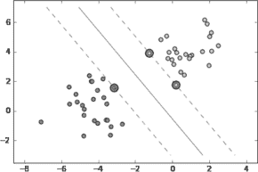

FIGURE 1.1 对于给定的数据可以绘制无限数量的分类器，但 SVM 找到了支持向量之间间隔最大的分类器。圆代表支持向量。


FIGURE 1.2 左部分表示输入空间中的数据，右部分表示特征空间中的数据。数据已使用核函数从输入空间转换到特征空间。最初输入空间是二维的，数据不可分离。核函数将数据转换到三维空间，在该空间中数据可以由超平面分离。

在某些应用中，输入空间特征丰富，将映射 `ϕ` 取为恒等映射即可，即 `ϕ(x)` = `x`。映射为恒等映射的核函数，即输入空间和特征空间相等，称为线性核函数，使用线性核函数的 SVM 称为线性 SVM。从数学上讲，线性核函数由以下公式给出：

$$
\begin{array}{l} \left. K(x_{1},x_{2}) = x_{1}^{T}x_{2}\quad\Rightarrow\quad\phi(x) = x \right. \\\\ \end{array}
$$  


Linear SVM 在高维数据应用中非常高效。虽然其在测试集上的准确率与非线性 SVM 接近，但对于此类应用，其训练速度要快得多。例如，文档分类应用具有高维输入空间，无需向输入空间添加更多特征，因为这对性能影响不大。因此，线性 SVM 的测试准确率与非线性 SVM 接近（参见，\[46\]），但与此同时，由于计算复杂度的差异，线性 SVM 的训练速度远快于非线性 SVM。

L2-正则化软间隔 SVM 是最常用的 SVM 表述形式，如下所示。SVM 的不同问题表述将在 第 2.3 节 中详细讨论。

```
$$\begin{array}{l} \begin{array}{l} {\underset{w}{\min}\, F(w) = \frac{1}{2}\| w\|^{2} + C{\sum\limits_{i = 1}^{l}{\max}}{(0,1 - y_{i}w^{T}x_{i})}^{2},} \\ \end{array} \\ \end{array}$$
```

(1.5)

其中 `C` 是正则化系数。

### 1.3.2  逻辑回归

这是一种基于逻辑损失函数（也称为 Sigmoid 函数）的二元分类技术，其输出值在 0 到 1 之间。这是一个平滑且强凸（通过添加 `l[2]` 正则化）问题，具有良好的理论特性。其可表示如下：

```
$$\begin{array}{l} {\underset{w}{\min}\, F(w) = \frac{1}{l}{\sum\limits_{i = 1}^{l}{\log}}\left( {1 + \exp\left( {- y_{i}w^{T}x_{i}} \right)} \right) + \frac{\lambda}{2}\| w\|^{2}.} \\ \end{array}$$
```

(1.6)

### 1.3.3  一阶和二阶方法

优化问题可以使用解析方法和数值方法求解。解析方法适用于求解简单问题，具有直接计算精确解的公式。另一方面，数值方法用于迭代且近似地求解复杂问题。由于机器学习问题是数据密集型的复杂问题，因此使用数值方法来求解。

求解问题 (7.2) 的一般迭代方法可写为：

```
$$\begin{array}{l} {w_{k + 1} = w_{k} - \alpha_{k}s_{k},} \\ \end{array}$$
```

(1.7)

其中 `k` 是迭代次数，`α[k]` 是学习率（也称为步长），`s[k]` 是步长方向。

#### 1.3.3.1  一阶方法

当 `s[k] = ∇F(w[k])` 时，该方法称为梯度下降（GD）。GD 及其仅涉及一阶导数的修改方法称为一阶方法。我们提出了 SAAGs，它们是方差缩减技术，用于处理由梯度近似引入的噪声。这些是一阶方法，将在 第二部分 中讨论。

#### 1.3.3.2  二阶方法

当 `s[k] = ∇²F(w[k])^(−1)∇F(w[k])` 时，该方法称为牛顿法。牛顿法及其涉及二阶导数的修改方法称为二阶方法。这些方法使用曲率信息来引导步长方向朝向解。我们提出了 MBN 和 STRON 方法，它们基于二阶信息。这些是子采样牛顿方法，将在 第三部分 中讨论。

## 1.4  随机逼近方法

随机逼近（SA）\[113\] 是一种迭代优化方法，用于求解无法直接求解但可使用近似方法求解的优化问题。在机器学习问题中，在学习算法的每次迭代中使用所有数据点在计算上非常昂贵，在某些情况下可能不可行。因此，使用 SA，它通过考虑一个数据点或数据点的小批量，使每次迭代与数据点数量（`l`）无关，即，不遍历所有数据点，而是在每次迭代中只处理一个数据点或数据点的小批量，这对于较大的 `l` 值会产生巨大的计算差异。同样，剩余数据点可以在其他迭代中以小批量形式使用。因此，SA 是一种计算效率非常高的优化方法，用于处理大规模问题。毫无疑问，这可能会影响学习算法的收敛性，这可以通过使用更大的小批量和其他技术（如方差缩减，例如 SAAGs \23, [28\]）来补偿。

## 1.5  坐标下降方法

坐标下降（CD）\[137\] 是一种递归方法，通过沿坐标方向或坐标超平面进行近似最小化来求解优化问题，即，它递归地求解仅包含一个或几个变量的小子问题。与 SA 使迭代复杂度与 `l` 无关类似，CD 通过将一个特征或特征块作为变量，固定其余特征并求解由此形成的缩减子问题，使迭代复杂度与特征数量（`n`）无关。然后，选择新的一个特征或特征块作为变量，固定其余特征，并求解得到的子问题。此过程重复，直到覆盖所有特征的所有子问题都求解完毕，然后重复整个过程直到收敛。因此，CD 是解决具有大量特征的大规模问题的良好方法。

## 1.6  数据集

表 1.1 列出了本书中使用的数据集，可在 LIBSVM 网站上下载：[`www.csie.ntu.edu.tw/~cjlin/libsvmtools/datasets/`](https://www.csie.ntu.edu.tw)。

## 1.7  书籍组织

本书由八章组成，分为四个部分，如下所述：

**第一部分 背景**

本部分包含两章，包括当前章节，对工作进行基本介绍，提供文献综述和工作动机，如下所示：

**第 2 章**：本章介绍了线性支持向量机分类的演进、其求解器、改进求解器的策略、实验结果、当前挑战（大数据挑战）和研究方向 \[25\]。

**第二部分 一阶方法**

本部分包含三章，介绍使用一阶方法求解大规模学习问题的技术：

**第 3 章**：本章开发了批量块优化框架，用于求解大数据问题，结合了随机逼近和坐标下降方法的优点，与任何求解器无关。提出了两种新的随机平均调整梯度方法（SAAG），以减少开发框架的小批量和块坐标设置中的方差 \[23\]。

**第 4 章**：本章提出了 SAAG-I 和 II 的新变体，分别称为 SAAG-III 和 IV。我们还将 SAAGs（I、II、III、IV）扩展到求解非平滑问题，并为平滑和非平滑问题设计了两个更新规则 \[28\]。

**第 5 章**：本章提出了简单的采样技术，用于处理机器学习中的大数据问题。其思路是通过提出系统采样和循环/顺序采样来从数据集中选择小批量，从而减少数据访问时间，进而缩短训练时间 \[26\]。

**第三部分 二阶方法**

本部分包含两章，介绍使用二阶方法求解大规模学习问题的技术：

**第 6 章**：本章将随机逼近和坐标下降方法的优点与二阶方法相结合，提出了小批量块坐标牛顿法（MBN）。


# 第 2 章 优化问题、求解器、挑战与研究方向

DOI: [10.1201/9781003240167-2](http://doi.org/10.1201/9781003240167-2)

幕后，机器学习问题实际上是优化问题。因此，优化问题的表述和选择合适的求解器对于机器学习模型的最终性能至关重要。我们以 SVM 为例，说明一个问题可以以多种方式表述，以及每种表述如何使用多种求解器来求解。SVM 是一种二元线性分类器，已通过核函数扩展到非线性数据，并通过一对一、一对其余和 Crammer Singer SVM 等各种技术扩展到多类数据。带有线性核的 SVM 称为线性 SVM，带有非线性核的 SVM 称为非线性 SVM。线性 SVM 是一种高效的技术，适用于文档分类、词义消歧、药物设计等高维数据应用，因为在这些数据应用中，线性 SVM 的测试精度接近非线性 SVM，而其训练速度远快于非线性 SVM。自诞生以来，SVM 不断发展，研究人员提出了许多用于求解 SVM 的问题表述、求解器和策略。此外，由于技术的进步，数据已呈现为“大数据”形式，这给机器学习在大规模数据上训练分类器带来了挑战。在本章中，我们对线性支持向量机分类的演进、其求解器、改进求解器的策略、实验结果、当前挑战和研究方向进行了综述。

## 2.1 引言

有关 SVM 的基本介绍，请参阅 第 1.3.1 节。线性 SVM 涉及问题表述、求解问题的求解器以及使求解器高效的优化策略。通常，SVM 问题表述为凸问题 \[33, 31]，因为凸问题中不存在局部最优问题，因为每个局部最优都是全局最优。在表述问题时，通常使用 L1 (`∥w∥`) 和 L2 正则化 (`∥w∥²`)、L1 和 L2 损失函数，如下所示。因此，考虑 L1 和 L2 正则化、L1 和 L2 损失函数以及线性核，线性 SVM 有八种不同的表述，如 图 2.1 所示，这表明了可能的问题表述范围很广。参数向量 `w` 和数据点 (`x[i]`, `y[i]`) 的 L1 和 L2 损失函数如下：

$$\\begin{array}{l} \\begin{array}{l} {\\text{L1-loss:}\\quad\\max(0,1 - y\_{i}w^{T}x\_{i}),\\quad\\text{L2-loss~:}\\quad\\left\\lbrack {\\max(0,1 - y\_{i}w^{T}x\_{i})} \\right\\rbrack^{2}} \\\\ \\end{array} \\\\ \\end{array}$$  

(2.1)

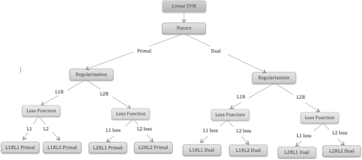

FIGURE 2.1 Eight different problem formulations for the Linear SVM with L1-regularized (L1R), L2-regularized (L2R), L1 loss and L2 loss functions.

对于特定的 SVM，可以求解原始问题或对偶问题。通常，当特征数量 (`n`) 远少于训练点数量 (`l`) 时，求解 SVM 的原始表述 \[85]; 否则，求解对偶表述 \[53]。这是因为问题中的变量越少，问题越容易求解。

如今，SVM（与机器学习共享）的主要挑战是处理“大数据”问题，为了处理此类问题，研究人员正在尝试利用平台/框架结构（如并行和分布式计算），并提出新的问题表述、求解器、优化策略和算法等。机器学习中处理大数据问题的当前研究方向是：首先，随机近似算法 \[63, 71, 35, 115]，它通过在算法的每次迭代中仅使用一个数据点，消除了算法对数据点数量的依赖，从而使学习算法具有可扩展性。在过去五年中，提出了多种随机近似变体，例如小批量方法 \[128, 119]。其次，坐标下降算法 \[130, 100, 6, 112, 137, 90, 122]，它通过将一个特征作为变量，其余作为常数，将大问题减小为较小的子问题。在过去几年中，在这个方向上进行了大量研究，研究人员提出了其多种变体。第三，近端算法 \[104]，用于一阶和二阶方法。这些算法适用于具有可分组件的非光滑问题。第四，并行和分布式计算 \[141]，它利用计算资源。如今，由于数据集大小超出了单台计算机的容量，其他方法似乎已趋于饱和，因此在并行和分布式计算方面进行了大量研究。除了这些研究方向外，它们的混合版本也正在被广泛研究，例如，\[140, 23]。

章节组织：第 2.2 节 讨论文献，第 2.3 节 讨论线性 SVM 问题表述的演进，第 2.4 节 讨论 SVM 的问题求解器。第 2.5 节 提出比较研究，第 2.6 节 提出大数据挑战、解决大数据问题的改进领域以及线性 SVM 的研究方向，第 2.7 节 提出结论性意见。

符号：`<⋅,⋅>` 表示点积，∀ 表示对所有，`x[i] ∈ ℝ^(n)` 表示具有 `n` 个特征的训练实例，其中 `i = 1, 2, ..., l`，`l` 表示训练点的数量。`y[i] ∈ {−1,+1}` 表示训练实例的标签。`m ∈ ℝ` 用于表示类别的数量。`w ∈ ℝ^(n)` 和 `b ∈ ℝ` 表示目标函数的参数。`ξ` 表示松弛变量，`C` 表示惩罚参数，`∥⋅∥` 表示欧几里得范数，`1` 表示任意维度的单位向量，`α` 表示对偶变量向量。

### 2.1.1 贡献

本章的贡献如下：

*   我们讨论了不同的问题表述，即 SVM 的优化问题以及求解优化问题的一些通用求解器。

*   机器学习中的大数据挑战已得到表征，这突出了开发高效且可扩展的优化技术来应对该挑战的必要性。


不同领域已被讨论用于解决大数据挑战，在不同的研究领域中，当前的研究方向已被讨论以应对该挑战。

已使用小批量随机梯度下降法对相关原始 SVM 进行了比较研究，该研究指出了为什么软间隔 SVM 是 SVM 最广泛使用的问题公式。

## 2.2 文献综述

支持向量机（SVMs，\[12, 31\]）是机器学习中的一种分类技术。SVM 中使用的概念，如超平面、最优间隔和核等，已有数十年的历史，但在当前形式中，SVM 的发展始于 \[12》，即 1992 年在 COLT 上发表的《最优间隔分类器的训练算法》。这种 SVM 公式也被称为“硬间隔 SVM”。\[31\] 改进了硬间隔 SVM。他们考虑了异常值和噪声，并通过引入松弛变量来放宽间隔以误分类某些数据点。这导致了“软间隔 SVM”。直到这时，SVM 被用作二分类器，当 \[132\] 提出使用一对其余（OVR）技术的多类 SVM 时。\[61\] 提出了用于文本分类的传导 SVM。\[127\] 提出了 SVM 的最小二乘版本。后来，\[72\] 提出了另一种使用一对一（OVO）技术的多类 SVM，但 OVR 和 OVO 都基于二分类问题。\[135\] 提出了第一个多类 SVM（WWSVM），它求解单个 SVM 问题，并且不基于多个二分类问题。\[107\] 提出了用于多类分类问题的有向无环图 SVM（DAGSVM），它在求解 SVM 问题时与 OVO 技术类似，但它使用高效的根有向无环二叉树来查找测试数据的标签。\[116\] 提出了一种新的 *ν*-SVM，它移除了参数 *C* 并引入了参数 *ν*，该参数大约给出支持向量的比例。\[45\] 提出了近端 SVM（PSVM），它使用数据点到近端平面的接近程度来对数据点进行分类。PSVM 用近端平面替换了标准 SVM 的边界平面，并使用近端平面进行分类，而不是使用分离超平面。\[77\] 引入了平滑 SVM，它处理了标准 SVM 的不可微问题。\[95\] 提出了拉格朗日 SVM。\[33\] 提出了另一种多类分类 SVM，与 OVO 和 OVR 技术不同，它求解单个 SVM 问题。后来 \[86\] 提出了一种称为模糊 SVM（FSVM）的新公式，该公式进一步由 \[2\] 和 \[1\] 扩展。模糊 SVM 将数据点对每个类别的模糊隶属度引入，并使用这些点的贡献来查找分离平面。模糊 SVM 在减少异常值和噪声的影响方面非常有用。\[109\] 将 *ν*-SVM \[116\] 扩展到 *E**ν* -SVM，并帮助控制间隔、错误以及相应的支持向量。\[57\] 结合了 FSVM \[86\] 和 PSVM \[45\] 的思想，并提出了模糊近端 SVM（FPSVM）。在这里，模糊隶属度被分配给数据点，并且根据点到两个平行平面的接近程度对点进行分类，这两个平行平面尽可能彼此远离。\[131\] 提出了结构化 SVM，它将多类 SVM（即 WWSVM 和 CSSVM）推广到一种新的公式，该公式具有结构化输出，如序列、字符串、图、标记树或格等。\[37\] 扩展了标准 SVM，即单任务学习 SVM，并提出了一种用于多任务学习的新二进制 SVM。\[49\] 提出了一种称为级联 SVM 的并行 SVM，它部署分治策略来求解 SVM 问题。级联 SVM 将数据集划分为子集，并在每个子集上并行训练多个 SVM。\[96\] 提出了具有两个非平行超平面的广义特征值近端 SVM（GEPSVM），数据点根据其到两个非平行平面之一的接近程度进行分类。\[40\] 将多视角学习的思想扩展到 SVM，并提出了多视角 SVM。\[56\] 将近端 SVM 扩展到双 SVM，它求解两个小规模 SVM 问题并给出两个非平行超平面。\[126\] 提出了 SloppySVM，它可以从标记松散的数据中学习。\[102\] 提出了 CappedSVM，使用基于截断 *l*[*p*]-范数的损失函数，以应对数据异常值的挑战。


FIGURE 2.2 Time line of SVM: OVR – One versus Rest, T-SVM – Transductive SVM, OVO – One-versus-One, WWSVM – Weston and Watkins SVM, LSSVM – Least Squares SVM, DAGSVM – Directed Acyclic Graph SVM, LSVM – Lagrangian SVM, CSSVM – Crammer Singer SVM, FSVM – Fuzzy SVM, PSVM – Proximal SVM, FPSVM – Fuzzy Proximal SVM, Strcd SVM – Structured SVM, MTSVM – Multi-Task SVM, GEPSVM – Generalized Eigenvalue Proximal SVM, MVSVM – Multi-View SVM, TW SVM – Twin SVM.

Figure 2.2 描绘了不同 SVM 的年度演变，这些 SVM 不一定是对前一个的改进。不同 SVM 演变及其求解器的数学公式和其他细节将在即将到来的章节中讨论。本章的重点是监督线性支持向量分类（SVC），因此仅讨论用于分类且具有重大贡献的那些 SVM 公式。就线性和非线性 SVM 而言，它们具有相同的公式，只是执行分类的空间不同。线性 SVM 在输入空间中执行，非线性 SVM 在特征空间中执行。本章仅讨论线性 SVM，但非线性 SVM 的数学公式可以通过使用以下替换从线性 SVM 推导出来：

```
\begin{array}{l} \left. x\_{1}^{T}x\_{2}\mapsto K\left( {x\_{1},x\_{2}} \\right), \right. \\\\ \end{array}
```

其中 `x[1]` 和 `x[2]` 表示数据点，`K` 表示核函数。

## 2.3 问题公式

问题公式是研究问题的数学表示。SVM 分类问题是一个优化问题，其数学表示由目标函数和约束（如果有）组成。研究人员针对具有不同问题公式的 SVM 分类提出了各种想法。SVM 的演变将在以下小节中讨论¹

### 2.3.1 硬间隔 SVM（1992）

虽然超平面、最优间隔和核等概念已使用数十年，但 \[12] 是第一个以当前形式公式化 SVM 的。这种 SVM 是一个二分类器，只能处理线性可分的数据应用，任何噪声或异常值的存在都会强烈影响间隔。它不允许误分类错误，这就是为什么它被称为硬间隔 SVM。硬间隔 SVM 由图 1.1 表示。


假设训练实例-标签对的集合表示为 `(*x*[*i*], *y*[*i*])`，其中 `i = 1, 2, ..., l`，且 `x[i] ∈ ℝ^(n)`，`y[i] ∈ {+1,−1}`，`n` 为特征数量，`l` 为训练数据点的数量。硬间隔线性 SVM 求解以下优化问题：

$$
\begin{array}{l}
\begin{array}{l}
{\underset{w,b}{\min}\quad\frac{1}{2}\| w\|^{2}} \\
{\text{s.t.}\quad y_{i}(w^{T}x_{i} + b) \geq 1,\,\forall i,} \\
\end{array}
\\
\end{array}
$$

(2.2)

其中 `w`、`b` 为参数。决策函数为：

$$
\begin{array}{l}
{h(x) = sign(w^{T}x + b).} \\
\end{array}
$$

为记号方便，可通过为每个实例添加一个新特征，将参数 `w` 和 `b` 合并为单个参数，如下所示：

$$
\begin{array}{l}
\left. x_{j}^{T}\leftarrow\lbrack x_{j}^{T},1\rbrack\quad w^{T}\leftarrow\lbrack w^{T},b\rbrack \right. \\
\end{array}
$$

因此，现可将等式 (2.2) 和决策函数改写为：

$$
\begin{array}{l}
\begin{array}{l}
{\underset{w}{\min}\quad\frac{1}{2}\| w\|^{2}} \\
{\text{s.t.}\quad y_{i}w^{T}x_{i} \geq 1,\,\forall i} \\
\end{array}
\\
\end{array}
$$

(2.3)

$$
\begin{array}{l}
{h(x) = sign(w^{T}x)} \\
\end{array}
$$

等式 (2.3) 表示硬间隔线性 SVM 的原始形式。利用拉格朗日乘数法得到的硬间隔线性 SVM 的对偶形式为：

$$
\begin{array}{l}
\begin{array}{l}
{\underset{\alpha}{\min}\quad\frac{1}{2}\alpha^{T}Q\alpha - \mathbf{1}^{T}\alpha} \\
{\text{s.t.}\quad\alpha_{i} \geq 0,\quad\alpha y = 0} \\
\end{array}
\\
\end{array}
$$

(2.4)

其中 `Q[i][j] = y[i]*y[j]*x[i]^T*x[j]`，`α` 为对偶变量向量 `α[i]`，`y` 为输出标签向量 `y[i]`，而 **1** 为单位向量。决策函数及 `w` 与 `α` 之间的关系如下：

$$
\begin{array}{l}
{h(x) = sign\left( {\sum\limits_{i = 1}^{l}y_{i}}\alpha_{i}x_{i}^{T}x \right),\quad w = {\sum\limits_{i = 1}^{l}y_{i}}\alpha_{i}x_{i}.} \\
\end{array}
$$

### 2.3.2 软间隔 SVM (1995)

硬间隔 SVM 的问题是，如果数据集不可线性分离，则无法对数据进行分类（即找不到分离超平面），且噪声或异常值会极大地影响间隔。[31] 在硬间隔 SVM 中引入了松弛变量，以允许一定的误分类错误。这种新的 SVM 称为软间隔 SVM。图 2.3 描绘了软间隔 SVM 的一个示例。软间隔 SVM 求解以下优化问题：

$$
\begin{array}{l}
\begin{array}{l}
{\underset{w}{\min}\quad\frac{1}{2}\| w\|^{2} + C{\sum\limits_{i = 1}^{l}\xi_{i}}} \\
{\text{s.t.}\quad y_{i}w^{T}x_{i} \geq 1 - \xi_{i},\quad\xi_{i} \geq 0,\,\forall i,} \\
\end{array}
\\
\end{array}
$$

(2.5)

其中 `ξ[i]` 是允许一定误分类的松弛变量，`C` 是惩罚参数。`ξ[i]` 在 SVM 中被损失函数替代。L1 和 L2 损失是文献中两种常见的损失函数，由等式 (2.1) 给出。决策函数由以下公式给出：

$$
\begin{array}{l}
{h(x) = sign(w^{T}x).} \\
\end{array}
$$

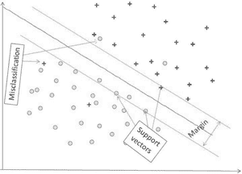

FIGURE 2.3 二维不可分离数据示例。由于数据并非完全可分离，SVM 允许一定的误分类错误以找到分离超平面。

等式 (2.5) 表示原始形式，软间隔 SVM 的对偶形式如下：

$$
\begin{array}{l}
\begin{array}{l}
{\underset{\alpha}{\min}\quad f(\alpha) = \frac{1}{2}\alpha^{T}\overline{Q}\alpha - \mathbf{1}^{T}\alpha} \\
{\text{s.t.}\quad 0 \leq \alpha_{i} \leq U,\,\forall i,} \\
\end{array}
\\
\end{array}
$$

(2.6)

其中 $\overline{Q} = Q + D`，`D` 为对角矩阵，`Q[i][j] = y[i]*y[j]*x[i]^T*x[j]`，

$U = \left\{ \begin{array}{l} {C\quad\text{for~L1~loss~SVM}} \\ {\infty\quad\text{for~L2~loss~SVM}} \\ \end{array} \right.$ 且 $D_{ii} = \left\{ \begin{array}{l} {0\quad\text{for~L1~loss~SVM}} \\ {\frac{1}{2C}\quad\text{for~L2~loss~SVM}} \\ \end{array} \right.\forall i$。

### 2.3.3 一对其余 (1998)

一对其余 (OVR, [132]) 技术也称为一对全部和一对全部。这可能是最早的多类 SVM 实现，也是最常用的多类 SVM 之一。在此技术中，我们求解 `m` 个二元 SVM 问题，其中 `m` 为类别数量。每个 SVM 分类器将一个类别与其余类别分开。这样，多类分类问题被简化为二元分类问题。OVR 技术在 图 2.4 中以图示形式表示。

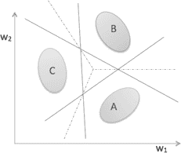

FIGURE 2.4 一对其余，多类分类技术：二维中三个类别 A、B 和 C 的示例。

$$
\begin{array}{l}
\begin{array}{l}
{\underset{w^{i},b^{i},\xi^{i}}{\min}\quad\frac{1}{2}{(w^{i})}^{T}w^{i} + C{\sum\limits_{j = 1}^{l}\xi_{j}^{i}}} \\
{\text{s.t.}\quad{(w^{i})}^{T}x_{j} + b^{i} \geq 1 - \xi_{j}^{i},\quad\text{if}\,\, y_{j} = i,} \\
{{(w^{i})}^{T}x_{j} + b^{i} \leq - 1 + \xi_{j}^{i},\quad\text{if}\,\, y_{j} \neq i,} \\
{\xi_{j}^{i} \geq 0,\quad j = 1,2,...,l,\,\, i = 1,2,...,m.} \\
\end{array}
\\
\end{array}
$$

(2.7)

求解后，需要 `m` 个决策函数来预测测试数据点的类别，如下所示：

$$
\begin{array}{l}
\begin{array}{l}
{{(w^{1})}^{T}x + b^{1},\quad{(w^{2})}^{T}x + b^{2},\quad...\quad,\quad{(w^{m})}^{T}x + b^{m}.} \\
\end{array}
\\
\end{array}
$$

(2.8)

只有当测试数据点被某个类别接受且被所有其他类别拒绝时，才会被分配给该特定类别。但当数据点被多个类别接受时会出现问题，这会导致特征空间中出现公共区域。[132] 建议将数据点分配给决策函数值最高的类别，而不考虑符号。最终输出标签分配给输出值最高的类别：

$$
\begin{array}{l}
\begin{array}{l}
{\text{class~of~x}\quad \equiv \,\,\underset{i = 1,2,...,m}{argmax}\quad({(w^{i})}^{T}x + b^{i}).} \\
\end{array}
\\
\end{array}
$$

(2.9)

该技术的主要缺点是需要求解 `m` 个不同的优化问题，并且对每个测试数据点需要评估 `m` 个决策函数。但它是一种简单的技术。

### 2.3.4 一对一 (1999)

一对一技术 (OVO, [72]) 也称为一对一 (OAO, 1-a-1) 或成对分类。在此分类技术中，为每对可能的类别训练一个二元 SVM。成对分类的想法由 [68] 提出，随后 [44] 提出了“最大胜出”算法，建议每个一对一分类器为其预测类别贡献一票，最终输出为得票最多的类别。[72] 将此想法应用于 SVM。假设有 `m` 个类别，则 OVO 技术将导致 `m(m − 1)/2` 个二元 SVM 分类问题，每个问题都基于两个类别的数据进行训练。图 2.5 描绘了 OVO 多类 SVM。对于来自 `i^(th)` 和 `j^(th)` 类别的训练数据，问题如下：


$$\\begin{array}{l} \\begin{array}{l} {\\underset{w^{i,j},b^{i,j},\\xi^{i,j}}{\\min}\\quad\\frac{1}{2}{(w^{i,j})}^{T}w^{i,j} + C{\\sum\\limits\_{t}\\xi\_{t}^{i,j}}} \\\\ \\end{array} \\\\ \\end{array}$$  

(2.10)

$$\\begin{array}{l} \\begin{array}{l} {\\text{s}.\\text{t}.\\quad({(\\text{w}^{\\text{i},\\text{j}})}^{\\text{T}}\\text{x+b}^{\\text{i},\\text{j}}) \\geq \\text{1-}\\xi^{\\text{i},\\text{j}},\\quad\\text{for}\\,\\text{y=i},} \\\\ {({(w^{i,j})}^{T}x + b^{i,j}) \\leq - 1 + \\xi^{i,j},\\quad\text{for}\\, y = j,} \\\\ {\\xi\_{i,j} \\geq 0,} \\\\ \\end{array} \\\\ \\end{array}$$  

(2.11)

where `t` ∈ `X[i, j]` and `X[i, j]` is the set of data points with labels `i` and `j`.

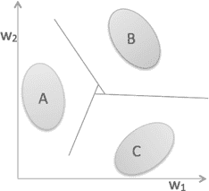

FIGURE 2.5 One versus One multi-class classification technique: An example of three classes A, B and C in two dimensions.

### 2.3.5  Least Squares SVM (1999)

Least Squares SVM (LSSVM, \[127\]) proposes a least squared version of SVM with equality constraints. Due to equality constraints, it solves a set of linear equations to find the solution, unlike standard SVM which solves quadratic programming. In LSSVM, number of support vectors is proportional to number of errors. LSSVM is given by

$$\\begin{array}{l} \\begin{array}{l} {\\underset{w,b,\\xi}{\\min}\\quad\\frac{1}{2}\\| w\\|^{2} + \\frac{C}{2}{\\sum\\limits\_{i = 1}^{l}\\xi\_{i}^{2}},} \\\\ \\end{array} \\\\ \\end{array}$$  

(2.12)

$$\\begin{array}{l} \\begin{array}{l} {\\text{s}.\\text{t}.\\quad\\text{y}\_{\\text{i}}\\left( {\\text{w}^{\\text{T}}\\text{x}\_{\\text{i}}\\text{+b}} \\right)\\text{=1-}\\xi\_{\\text{i}},\\quad\\text{i=1},\\text{2},...,\\text{l}.} \\\\ \\end{array} \\\\ \\end{array}$$  

(2.13)

LSSVM has been extended by \[80\] which assigns a degree of importance to each training data point, this idea is similar to Fuzzy SVM \[86\].

### 2.3.6  `ν`-SVM (2000)

`ν`-SVM\[116\] proposes a new SVM formulation for classification and regression problems where a new parameter `ν` is introduced. `ν` roughly controls the fraction of support vectors. In addition to that, `ν` also helps to eliminate one of the other free parameters of the algorithm, `ϵ` (accuracy parameter) in regression and `C` (regularization coefficient) in the classification. Primal formulation for `ν`-SVM is:

$$\\begin{array}{l} \\begin{array}{l} {\\underset{w,b,\\xi,\\rho}{\\min}\\quad\\tau(w,\\xi,\\rho) = \\frac{1}{2}\\| w\\|^{2} - \\nu\\rho + \\frac{1}{l}{\\sum\\limits\_{i}\\xi\_{i}}} \\\\ {\\text{s}\\text{.t}\\text{.}\\quad\\quad y\_{i}\\left( {x\_{i}^{T}w + b} \\right) \\geq \\rho - \\xi\_{i}} \\\\ {\\xi\_{i} \\geq 0,\\quad\\rho \\geq 0,\\quad\\nu \\in \\left\\lbrack {0,1} \\right\\rbrack} \\\\ \\end{array} \\\\ \\end{array}$$  

(2.14)

Dual problem for `ν`-SVM:

$$\\begin{array}{l} \\begin{array}{l} {\\underset{\\alpha}{\\max}\\quad W(\\alpha) = - \\frac{1}{2}{\\sum\\limits\_{ij}\\alpha\_{i}}\\alpha\_{j}y\_{i}y\_{j}x\_{i}^{T}x\_{j}} \\\\ {\\text{s}\\text{.t}\\text{.}\\quad 0 \\leq \\alpha\_{i} \\leq \\frac{1}{l},\\quad 0 = {\\sum\\limits\_{i}\\alpha\_{i}}y\_{i},\\quad{\\sum\\limits\_{i}\\alpha} \\leq \\nu} \\\\ \\end{array} \\\\ \\end{array}$$  

(2.15)

Decision function is:

$$\\begin{array}{l} \\begin{array}{l} {h(x) = sign\\left( {{\\sum\\limits\_{i}\\alpha\_{i}}y\_{i}x^{T}x\_{i} + b} \\right)} \\\\ \\end{array} \\\\ \\end{array}$$  

(2.16)

On comparing with original soft margin dual problem, `ν`-SVM has two differences: Additional constraints and the linear term $\\sum\\limits\_{i}\\alpha\_{i}$ disappears from objective function in eq. (2.15).

### 2.3.7  Smooth SVM (2001)

Smooth SVM\[77\] proposes a new smooth formulation for SVM, to handle its non-differentiability issue. Smooth SVM is a strongly convex and infinitely differentiable. It enjoys globally, quadratically convergent solutions using a fast Newton-Armijo algorithm. It uses Newton's method for obtaining the step direction and Armijo rule for determining the step size.

Suppose there are `l` training points in `n` dimensional space represented by `l` × `n` matrix `A` with membership of each data `A[i]` in classes +1 and -1 is represented by the diagonal `l` × `l` matrix `D` with values +1 or -1 on the diagonal. The standard SVM with some `ν` > 0 and linear Kernel `A`^(*T`)*`A`, is given by

$$\\begin{array}{l} \\begin{array}{l} {\\underset{{({w,\\gamma,y})} \\in {\\mathbb{R}}^{n + 1 + l}}{\\min}\\quad\\nu\\mathbf{1}^{T}y + \\frac{1}{2}\\left\\| w \\right\\|^{2}} \\\\ {\\text{s}\\text{.t}\\text{.}\\quad D\\left( {Aw - \\mathbf{1}\\gamma} \\right) + y \\geq \\mathbf{1},\\quad y \\geq 0} \\\\ \\end{array} \\\\ \\end{array}$$  

(2.17)

where `w`, `γ` are parameters and `y` is the slack variable. The standard SVM is first modified to get the following SVM:

$$\\begin{array}{l} \\begin{array}{l} {\\underset{w,\\gamma,y}{\\min}\\quad\\frac{\\nu}{2}y^{T}y + \\frac{1}{2}\\left( {\\left\\| w \\right\\|^{2} + \\gamma^{2}} \\right)} \\\\ {\\text{s}\\text{.t}\\text{.}\\quad D\\left( {Aw - \\mathbf{1}\\gamma} \\right) + y \\geq \\mathbf{1},\\quad y \\geq 0.} \\\\ \\end{array} \\\\ \\end{array}$$  

(2.18)

From the constraints of problem (2.18), we get,

$$\\begin{array}{l} \\begin{array}{l} {y = \\left( {\\mathbf{1} - D\\left( {Aw - \\mathbf{1}\\gamma} \\right)} \\right)\_{+},} \\\\ \\end{array} \\\\ \\end{array}$$  

(2.19)

where (.)[+] function replaces negative components of a vector with zeros. So, substituting the value of `y` in eq. (2.18), equivalent SVM is obtained as:

$$\\begin{array}{l} \\begin{array}{l} {\\underset{w,\\gamma}{\\min}\\quad\\frac{\\nu}{2}\\|\\left( {\\mathbf{1} - D\\left( {Aw - \\mathbf{1}\\gamma} \\right)} \\right)\_{+}\\|^{2} + \\frac{1}{2}\\left( {\\left\\| w \\right\\|^{2} + \\gamma^{2}} \\right)} \\\\ \\end{array} \\\\ \\end{array}$$  

(2.20)

The objective function of this problem is not twice differentiable so `x`[+] is replaced with a smooth approximation, given by

$$\\begin{array}{l} \\begin{array}{l} {p(x,\\alpha) = x + \\frac{1}{\\alpha}log\\left( {1 + e^{- \\alpha x}} \\right),\\quad\\alpha > 0,} \\\\ \\end{array} \\\\ \\end{array}$$  

(2.21)

where `α` is the smoothing parameter and `e` is the exponential constant. So, using eq. (2.21) in eq. (2.20), it gives the Smooth SVM as:

$$\\begin{array}{l} \\begin{array}{l} {\\underset{w,\\gamma}{\\min}\\,\\frac{\\nu}{2}\\| p\\left( {\\mathbf{1} - D\\left( {Aw - \\mathbf{1}\\gamma} \\right),\\alpha} \\right)\\|^{2} + \\frac{1}{2}\\left( {\\left\\| w \\right\\|^{2} + \\gamma^{2}} \\right)} \\\\ \\end{array} \\\\ \\end{array}$$  

(2.22)

The decision function for Smooth SVM is given by `sign(w`^(*T`)*`x − γ)`.

### 2.3.8  Proximal SVM (2001)

Proximal SVM (PSVM, \[45\]) classifies data points on the basis of proximity to the two parallel planes (called as proximal planes). Standard SVM classifies points using a separating hyperplane which assigns them to one of the half spaces generated by it (separating hyperplane). Figure 2.6. depicts the bounding planes in standard SVM and proximal planes of PSVM. The performance of PSVM on test dataset, is comparable to the standard SVM but its training speed on the training dataset, is considerably faster than the Standard SVM \[45\]. Primal form of PSVM is given by

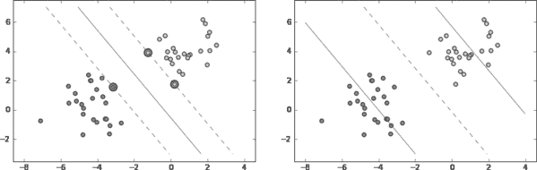

FIGURE 2.6 Standard SVM versus Proximal SVM.

$$\\begin{array}{l} \\begin{array}{ll} & {\\underset{(w,\\gamma,y)}{\\min}\\quad\\nu\\frac{1}{2}\\| y\\|^{2} + \\frac{1}{2}\\left( {w^{T}w + \\gamma^{2}} \\right)} \\\\ {\\text{s}\\text{.t}\\text{.}} & {D\\left( {Aw - \\mathbf{1}\\gamma} \\right) + y = \\mathbf{1}} \\\\ \\end{array} \\\\ \\end{array}$$  

(2.23)


where `w`, `γ` 是参数，`A` 是 `l × n` 矩阵，表示 `n` 维实空间 `ℝ^(n)` 中的 `l` 个数据点，根据每个点 `A[i]` 在类别 `A+` 或 `A−` 中的隶属关系，由给定的 `l × l` 对角矩阵 `D` 指定，其对角线上为 `+1` 或 `−1`。`ν > 0`，`1` = 单位向量，`y` 表示误差。该问题的解可以直接用问题数据表示。

平面 `x^(T)w − γ = ±1` 不再是边界平面，而是可以看作每个类别的点聚集在其周围的近似平面，并且由目标函数中的项 `(w^(T)w + γ²)` 将其尽可能推开。Proximal SVM 的决策函数为 `sign(w^(T)x − γ)`。带系数 `u` 的拉格朗日函数为

$$
\begin{array}{l} 
\begin{array}{l} 
{L(w,\gamma,y,u) = \frac{\nu}{2}\| y\|^{2} + \frac{1}{2}\left\| \left\lbrack \begin{array}{l} w \\\\ \gamma \\\\ \end{array} \right\rbrack \right\|^{2} - u^{T}\left( {D\left( {Aw - \mathbf{1}\gamma} \right) + y - \mathbf{1}} \right)} \\\\ 
\end{array} \\\\ 
\end{array}
$$

(2.24)

使用 Karush–Kuhn–Tucker (KKT) 条件求解得到

$$
\begin{array}{l} 
{w = A^{T}Du,\quad\gamma = - \mathbf{1}^{T}Du,\quad y = \frac{u}{\nu}} \\\\ 
\end{array}
$$

$$
\begin{array}{l} 
\begin{array}{l} 
{u = \left( {\frac{I}{\nu} + D\left( {AA^{T} + \mathbf{1}\mathbf{1}^{T}} \right)D} \right)^{- 1}\mathbf{1} = \left( {\frac{I}{\nu} + HH^{T}} \right)^{- 1}\mathbf{1}} \\\\ 
\end{array} \\\\ 
\end{array}
$$

(2.25)

其中 `H = D[A − 1]`。方程 (2.25) 给出了 eq. (2.23) 的显式解。

### 2.3.9 Crammer Singer SVM (2002)

[33] 提出了一种多类 SVM (CSSVM)，与 OVR [132] 和 OVO [72] 不同，它训练一个单一的 SVM 分类器，并计算 `m`（类别数量）个决策函数来对测试数据点进行分类。问题公式为：

$$
\begin{array}{l} 
\begin{array}{ll} 
& {\underset{w_{k},\xi_{i}}{\min}\quad\frac{1}{2}{\sum\limits_{k = 1}^{m}w_{k}^{T}}w_{k} + C{\sum\limits_{i = 1}^{l}\xi_{i}}} \\\\ 
{\text{s.t.}} & {w_{y_{i}}^{T}x_{i} - w_{k}^{T}x_{i} \geq e_{i}^{k} - \xi_{i},\quad i = 1,...,l,} \\\\ 
\end{array} \\\\ 
\end{array}
$$

(2.26)

$$
\begin{array}{l} 
{\text{where}\quad e_{i}^{k} \equiv 1 - \delta_{y_{i},k}\text{~and~}\delta_{y_{i},k} = \left\{ \begin{array}{l} {1\quad\text{if}\quad y_{i} = k} \\\\ {0\quad\text{if}\quad y_{i} \neq k} \\\\ \end{array}~ \right.} \\\\ 
\end{array}
$$

决策函数为

$$
\begin{array}{l} 
\begin{array}{l} 
{\underset{k = 1,2,...,m}{argmax}\quad w_{k}^{T}x.} \\\\ 
\end{array} \\\\ 
\end{array}
$$

(2.27)

Crammer Singer SVM (CSSVM) 与其他问题的主要区别在于，CSSVM 不需要显式写出约束 `ξ[i] ≥ 0`，因为当 `y[i] = k` 时，`e[i]^(k) = 0`，因此 eq. (2.26) 变为 `0 ≥ 0 − ξ[i]`，这正好就是 `ξ[i] ≥ 0`。它只包含 `ξ[i]`，`i = 1, 2, ..., l`，共 `l` 个松弛变量，而不是使用 `ξ[i]^(k)` 作为每对决策平面之间的间隔。CSSVM 的对偶问题为：

$$
\begin{array}{l} 
\begin{array}{ll} 
& {\underset{\alpha}{\min}\quad\frac{1}{2}{\sum\limits_{k = 1}^{m}{\| w_{k}\|^{2}}} + {\sum\limits_{i = 1}^{l}{\sum\limits_{k = 1}^{m}e_{i}^{k}}}\alpha_{i}^{k}} \\\\ 
{\text{s.t.}} & {{\sum\limits_{k = 1}^{m}\alpha_{i}^{k}} = 0,\quad i = 1,...,l,} \\\\ 
& {\alpha_{i}^{k} \leq C_{y_{i}}^{k},\quad i = 1,..,l,\ k = 1,...,m,} \\\\ 
\end{array} \\\\ 
\end{array}
$$

(2.28)

其中 $w_{k} = {\sum\limits_{i = 1}^{l}\alpha_{i}^{k}}x_{i},\forall k$ 和 $C_{y_{i}}^{k} = \left\{ \begin{array}{l} {C\quad\text{if}\quad y_{i} = k} \\\\ {0\quad\text{if}\quad y_{i} \neq k} \\\\ \end{array}~ \right.$。

### 2.3.10 Eν-SVM (2003)

分类用的 `ν`-SVM[116] (`ν`-SVC) 提出了一种求解 SVM 的不同公式，引入了新参数 `ν`。`ν` 给出了支持向量数量的上界。`ν` 还移除了 `C`，`C` 是边界大小与训练误差之间权衡的度量。先验选择 `C` 是困难的。`ν` 的值并不总是可以取 0 到 1 之间的所有可能值，这限制了可能解的范围。要么是因为训练集不可分，要么是因为类别不平衡。因此，`ν`-SVM [116] 扩展为 `Eν`-SVM [109]，其中使用 `ν` 构建了一个新问题，以帮助控制边界、误差和支持向量。在 `Eν`-SVM 中，`ν` 的值不能取 0 到 1 的完整范围。对于 `l` 个训练点，`ν` 的值可以定义为：

$$
\begin{array}{l} 
\begin{array}{l} 
{\nu_{*} = \underset{C\rightarrow\infty}{lim}\quad\frac{1}{lC}{\sum\limits_{i = 1}^{l}\alpha_{i}^{C}},\quad\nu_{*} = \underset{C\rightarrow 0}{lim}\quad\frac{1}{lC}{\sum\limits_{i = 1}^{l}\alpha_{i}^{C}}} \\\\ 
\end{array} \\\\ 
\end{array}
$$

(2.29)

其中 `ν[*]` > 0 且 `ν[*]` ≤ 1。原问题如下：

$$
\begin{array}{l} 
\begin{array}{ll} 
& {\underset{\rho,w,b,\xi_{i}}{\min}\quad - l\nu\rho + {\sum\limits_{i = 1}^{l}\xi_{i}}} \\\\ 
{\text{s.t.}} & {y_{i}\left( {x_{i}^{T}w + b} \right) \geq \rho - \xi_{i},\,\,\,\xi_{i} \geq 0,\,\,\forall i} \\\\ 
& {\frac{1}{2}\| w\|^{2} = 1} \\\\ 
\end{array} \\\\ 
\end{array}
$$

(2.30)

对偶问题为：

$$
\begin{array}{l} 
\begin{array}{l} 
{\underset{\alpha_{i},\lambda}{\max}\quad L_{D} = - \frac{1}{2\lambda}{\sum\limits_{i = 1}^{l}{\sum\limits_{j = 1}^{l}y_{i}}}y_{j}\alpha_{i}\alpha_{j}x_{i}^{T}x_{j} - \lambda} \\\\ 
{\text{s.t.}\quad\nu = - \frac{1}{l}{\sum\limits_{i = 1}^{l}\alpha_{i}},\quad{\sum\limits_{i = 1}^{l}\alpha_{i}}y_{i} = 0,\quad 0 \leq \alpha_{i} \leq 1,\,\,\forall i} \\\\ 
\end{array} \\\\ 
\end{array}
$$

(2.31)

$$
\begin{array}{l} 
\begin{array}{l} 
{\lambda = + \sqrt{\frac{1}{2}{\sum\limits_{i = 1}^{l}{\sum\limits_{j = 1}^{l}y_{i}}}y_{j}\alpha_{i}\alpha_{j}x_{i}^{T}xj}.} \\\\ 
\end{array} \\\\ 
\end{array}
$$

(2.32)

### 2.3.11 Twin SVM (2007)

Twin SVM (TWSVM, [56]) 是通过广义特征值对 PSVM [45] 的扩展。顾名思义，TWSVM 是一个二分类器，它求解两个相关的小规模 SVM 问题，并给出两个非平行平面。新的测试点根据最近的平面进行分类。TWSVM 比标准 SVM 更快，并能获得良好的泛化结果 [56]。它有助于自动发现数据的二维投影。每个非平行平面更靠近其中一个类别，并且尽可能远离另一个类别。TWSVM 由两个二次规划问题组成，其中一个问题的目标函数由一个类别的数据点表示，约束由另一个类别的数据点表示。这导致了以下两个较小的 SVM 问题。

$$
\begin{array}{l} 
\begin{array}{ll} 
\text{(TWSVM~1)} & {\underset{w^{(1)},b^{(1)},q}{\min}\,\,\frac{1}{2}\left( {Aw^{(1)} + \mathbf{1}_{1}b^{(1)}} \right)^{T}\left( {Aw^{(1)} + \mathbf{1}_{1}b^{(1)}} \right) + C_{1}\mathbf{1}_{2}^{T}q} \\\\ 
{\text{s.t.}} & {- \left( {Bw^{(1)} + \mathbf{1}_{2}b^{(1)}} \right) + q \geq \mathbf{1}_{2},\quad q \geq 0} \\\\ 
\text{(TWSVM~2)} & {\underset{w^{(2)},b^{(2)},q}{\min}\,\,\frac{1}{2}\left( {Bw^{(2)} + \mathbf{1}_{2}b^{(2)}} \right)^{T}\left( {Bw^{(2)} + \mathbf{1}_{2}b^{(2)}} \right) + C_{2}\mathbf{1}_{1}^{T}q} \\\\ 
{\text{s.t.}} & {\left( {Aw^{(2)} + \mathbf{1}_{1}b^{(2)}} \right) + q \geq \mathbf{1}_{1},\quad q \geq 0} \\\\ 
\end{array} \\\\ 
\end{array}
$$

(2.33)


where *C*[1], *C*[2] are penalty parameters and **1**[1], **1**[2] are unit vectors. First term represents distance of data points form hyperplane and second term represents errors. Here data points belonging to classes +1 and -1 are represented with *A* and *B*. Let *l*[1] and *l*[2] denotes number of data points in *A* and *B*. So, size of *A* and *B* is *l*[1] × *n* and *l*[2] × *n*. Dual form is:

$$\\begin{array}{l} \\begin{array}{ll} \\text{(DTWSVM~1)} & {\\underset{\\alpha}{\\max}\\quad\\mathbf{1}\_{2}^{T}\\alpha - \\frac{1}{2}\\alpha^{T}G\\left( {H^{T}H} \\right)^{- 1}G^{T}\\alpha} \\\\ {\\text{s}\\text{.t}\\text{.}} & {0 \\leq \\alpha \\leq C\_{1}} \\\\ \\text{(DTWSVM~2)} & {\\underset{\\gamma}{\\max}\\quad\\mathbf{1}\_{1}^{T}\\gamma - \\frac{1}{2}\\gamma^{T}P\\left( {Q^{T}Q} \\right)^{- 1}P^{T}\\gamma} \\\\ {\\text{s}\\text{.t}\\text{.}} & {0 \\leq \\gamma \\leq C\_{2}} \\\\ \\end{array} \\\\ \\end{array}$$  

(2.34)

where *α* and *γ* are dual variables.

$$\\begin{array}{ll} {\\text{where}\\quad H} & {= \\left\\lbrack {A\\quad\\mathbf{1}\_{1}} \\right\\rbrack,\\quad G = \\left\\lbrack {B\\quad\\mathbf{1}\_{2}} \\right\\rbrack} \\\\ {\\quad\\quad P} & {= \\left\\lbrack {A\\quad\\mathbf{1}\_{1}} \\right\\rbrack,\\quad Q = \\left\\lbrack {B\\quad\\mathbf{1}\_{2}} \\right\\rbrack} \\\\ \\end{array}$$  

TWSVM has been further extended to *ν*-TWSVM \[105\] which introduces parameter *ν* into TWSVM for controlling the margin, errors and consequently support vectors. All extensions and applications of TWSVM can be found in \[58\].

### 2.3.12 Capped *l*[*p*]-norm SVM (2017)

Capped *l*[*p*]-norm SVM (CappedSVM, \[102\]) proposes a new SVM problem formulation using capped *l*[*p*]-norm based loss function, to tackle the challenge of data outliers. Data outliers have large residue values so capped norm helps the CappedSVM to eliminate these outliers during the training process. CappedSVM is also extended to multi-class problems. Unlike one-vs-one, one-vs-rest which solve several binary problems, CappedSVM solves single optimization problem, like, CSSVM. Authors have proved the utility of primal formulation and its binary formulation is given below \[102\]:

$$\\begin{array}{l} \\begin{array}{l} {\\underset{w,b}{\\min}\\,{\\sum\\limits\_{i = 1}^{l}\\xi\_{ch}}\\left( w,b\\, \\middle| x\_{i} \\right) + \\gamma\\left\\| w \\right\\|\_{2}^{2}} \\\\ \\end{array} \\\\ \\end{array}$$  

(2.35)

Here *γ* is regularization parameter and *ξ**c**h* is capped *l*[*p*]-norm given by

$$\\begin{array}{l} \\begin{array}{l} {\\xi\_{ch}\\left( w,b\\, \\middle| x\_{i} \\right) = \\min\\left( {\\epsilon,max\\left( {0,1 - y\_{i}w^{T}x\_{i}} \\right)^{p}} \\right).} \\\\ \\end{array} \\\\ \\end{array}$$  

where *ϵ* is capping value and *p* is any real value. Multi-class problem for *c* classes is given by

$$\\begin{array}{l} \\begin{array}{l} {\\underset{W,b,M \\geq 0}{\\min}\\quad{\\sum\\limits\_{i = 1}^{l}{\\min}}\\left( {\\| W^{T}x\_{i} + b - y\_{i} - y\_{i}{^\\circ}m\_{i}\\|\_{2}^{p},\\epsilon} \\right) + \\gamma\\left\\| W \\right\\|\_{F}^{2}} \\\\ \\end{array} \\\\ \\end{array}$$  

(2.36)

where *m*[*i*] is a slack variable to encode the unilateral loss of *x*[*i*], *W* ∈ ℝ^(*n* × *c*), *b* ∈ ℝ^(*c* × 1), *m*[*i*] ∈ ℝ^(*c* × 1), *M* ∈ ℝ^(*c* × *n*) with the i-th column as *m*[*i*] and

$$\\begin{array}{l} \\begin{array}{l} {\\xi\_{chm}\\left( W,b \\middle| x\_{i} \\right) = \\min\\left( {\\underset{m\_{i} \\geq 0}{\\min}\\| W^{T}x_{i} + b - y\_{i} - y\_{i}{^\\circ}m\_{i}\\|\_{2}^{p},\\epsilon} \\right),} \\\\ \\end{array} \\\\ \\end{array}$$  

is capped *l*[*p*]-norm loss function for multi-class problem. A summary of some of important SVMs is given in Table 2.1.

## 2.4 Problem Solvers

Once the SVM problem is formulated, the next task is to solve the problem using certain methods called SVM solvers. The method/solver to solve a particular SVM formulation depends upon a number of factors and some of them are:

1. Problem formulation properties: Convex and non-convex nature, strong convexity, smooth and non-smooth nature, primal or dual nature, constrained and unconstrained nature, etc.

2. Dataset properties: #data_points ≫ #features or #features ≫ #data_points, sparsity, binary or multi-class data etc.

3. What do we expect: Low or high accuracy solution, accuracy is important or time etc.

Different types of optimization problems, depending upon the nature of objective function and constraints, are depicted in Fig. 2.7. SVM problem is an optimization problem, which may be convex problem \[33\] or non-convex problem \[126\]. It depends upon the problem formulation. It is easy to solve the convex optimization problem than non-convex problems because every local optimum is a global optimum in a convex optimization problem. Therefore, SVM problem is generally formulated as a convex optimization problem. Generally, our problem lies in the category of Constrained Convex Optimization problem as per the Fig. 2.7. Convex Optimization Problem (COP) can be divided into two types: Unconstrained Convex Optimization Problem (UCOP) and Constrained Convex Optimization Problem (CCOP). CCOP can be further into three types: Equality Constrained (EC), Inequality Constrained (IC) and Hybrid Constrained (HC).

Gradient-based methods are generally used for solving the UCOP problems. CCOP can be converted to UCOP and then gradient-based methods can be applied to them. In literature, generally gradient-based methods \[30\] are used for solving the SVM problem with occasional use of other methods like Interior Point Methods \[41\]. All these methods are taken from the Mathematics, highlighting the inter-disciplinary nature of Machine Learning, so it is beyond the scope of this chapter to discuss all methods for solving the optimization problems. This section gives an idea about SVM solvers and discusses some methods for solving SVM problems. Review of SVM solvers can be found in \[13\], \[121\] and for general discussion of optimization methods for large-scale machine learning, refer to \[16\].

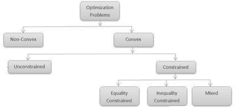

FIGURE 2.7 Different types of Optimization problems.

Large-scale problems (SVMs) are solved using iterative methods and there is a trade-off between the computational complexity of each iteration and number of iterations required by the method to solve problem up to the desired accuracy. Generally, smaller the complexity of each iteration, slower is the convergence and larger is the number of iterations taken by the method to solve the problem \[85\]. For example, first order methods (like Gradient Descent method) have low iteration complexity (like in Gradient Descent, only gradient is calculated) but they converge very slowly and take large number of iterations to reach the desired accuracy \[118\]. On the other hand, second order methods have high computational complexity (like in Newton method, it requires computing and inverting the Hessian matrix) of each iteration but they converge very fast and take lesser number of iterations \[85\] to reach the same level of accuracy.

For an iterative method, solution in the (*k* + 1)^(*t**h*) iteration is given by

$$\\begin{array}{l} {w\_{k + 1} = w\_{k} + d\_{k}s\_{k},\\quad d\_{k} > 0} \\\\ \\end{array}$$  

(2.37)


where `s[k]` is the step direction and `d[k]` is the step size along that direction. The process of finding `d[k]` is also called as line search because of finding the value of step size along the step direction. The descent method is a method in which the value of a function decreases with every iteration, i.e., suppose function `f` is to be minimized then for `(k + 1)^(th)` iteration

$$
\begin{array}{l} {f(w_{k + 1}) < f(w_{k})} \\\\ \end{array}
$$  

except when `w[k]` is optimal. `s[k]` in a descent method must satisfy the following equation:

$$
\begin{array}{l} {\nabla f{(w_{k})}^{T}s_{k} < 0} \\\\ \end{array}
$$  

(2.38)

This means that the search direction should make an acute angle with the negative of gradient of function. Such a direction is known as a descent direction. A general algorithm for a descent optimization method is given by Algorithm 1. The step size and step direction can be found by separate methods or by a single method, and other exit criteria can be tried.

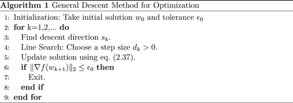

Some methods for finding the step size are given below:

### 2.4.1 Exact Line Search Method

In this method \[102\] of finding the step size (`d`), an exact optimization problem is solved to minimize `f` along the ray {`w`+`d**s`|`d`>0}:

$$
\begin{array}{l} {d = \\underset{v \\geq 0}{argmin}\\quad f(w + vs)} \\\\ \end{array}
$$  

(2.39)

The limitation of exact line search method is that it takes a lot of overhead for large problems. So, generally this method is not used for large problems.

### 2.4.2 Backtracking Line Search

Backtracking Line Search\[22\] is an inexact line search method where instead of solving the exact optimization problem, a set of values for step size, are tried along the ray {`w`+`d**s`|`d`>0}. The backtracking line search algorithm is given in Algorithm 2.

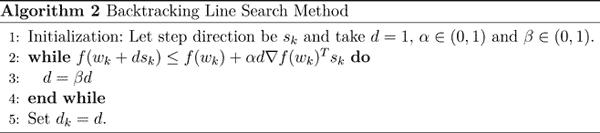

This method is called as backtracking line search method because it starts with unit size for step size and then decreases its value by a factor of `β`. Small value of `β` (0.1) corresponds to very crude search and large value (0.9) to less crude. The typical values of `α` are between 0.01 and 0.3, i.e., 1% to 30% decrease of prediction in `f` is accepted based on linear exploration.

### 2.4.3 Constant Step Size

This is the simplest method of finding the step length. In order to get the value of step size no optimization problem is solved rather a constant value (generally `d` = 1) is used as a step size. For larger value, the convergence is uncertain. For smaller value, the convergence is slower but certain in convex functions.

### 2.4.4 Lipschitz and Strong Convexity Constants

Lipschitz (`L`) and strong convexity (`μ`) constants can also be used for calculating step sizes. These constants helps in easy calculation of step sizes but depends on correct estimation of `L` and `μ`. The main disadvantage of this method is that sometimes, these constants are not available. Using these constants, step size can be calculated as \[115\]:

$$
\begin{array}{l} {d = \\frac{1}{L}\\quad\\text{and}\\quad d = \\frac{2}{L + \\mu},} \\\\ \end{array}
$$  

(2.40)

These expressions for `d`, can change depending upon the implementation.

### 2.4.5 Trust Region Method

In Trust Region (TR) method \[24\], a step direction and a step size is selected, then if the step is successful in some sense then the step is accepted else rejected and another step direction and step size is found. Here an approximate model (`m[k]`) of a function (`f`) to be minimized is taken and solved to get the solution. The region around the current iterate in which the model has good approximation of function is called as trust-region. A basic Trust Region algorithm is given by Algorithm 3. Typically used values are `η[v]` = 0.75, `η[s]` = 0.25, `σ[i]` = 2 and `σ[d]` = 0.5.

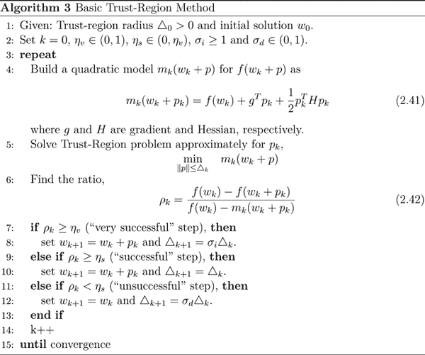

Some optimization methods for finding the step direction are given below:

### 2.4.6 Gradient Descent Method

Gradient Descent method\[20\] is also known as Steepest Descent (SD) method, is a first order optimization method. SD method is based on the observation that a function decreases fastest on moving along the direction of negative gradient of the function. In this method, the step direction is taken as negative of gradient, i.e.,

$$
\begin{array}{l} {s_{k}^{GD} = - \\nabla f(w_{k})} \\\\ \end{array}
$$  

(2.43)

and step size can be determined by either exact or backtracking line search. So, substituting the values of step size and step direction into the Algorithm 1., it gives Gradient Descent Algorithm. SD method generally exhibits approximately linear convergence. On using backtracking line search, the parameters `α` and `β` have noticeable effect over the convergence rate but it does not have dramatic effect. Advantage of this method is its simplicity, it does not require second order derivative and every iteration is inexpensive. Disadvantages are: it is often slow, depends upon scaling and can't handle non-differentiable problems.

### 2.4.7 Newton Method

For Newton's method\[29\], the step direction is given by

$$
\begin{array}{l} {s_{k}^{N} = - \\left( {\\nabla^{2}f(w_{k})} \\right)^{- 1}\\nabla f(w_{k})} \\\\ \end{array}
$$  

(2.44)

is called as Newton step which is a descent direction. When step size is taken as `d` = 1, then it is called as pure Newton method, else called as damped Newton or guarded Newton method. On replacing the step direction and method to find step size, in Algorithm 1, it gives algorithm for the Newton method. In general, Newton method has quadratic rate of convergence when `d` = 1. Advantages of Newton method are (1) it is affine invariant to the choice of coordinates or condition number, (2) scales with problem size, (3) has fast convergence and (4) it is independent of algorithm parameters. Disadvantages of Newton method are (1) it need second order derivative, (2) high cost of computing and (3) storing the Hessian and calculating step direction.

### 2.4.8 Gauss-Newton Method

Gauss-Newton method\[47\] is an iterative optimization method for least squares problems which are of the form:

$$
\begin{array}{l} {\\underset{w}{\\min}\\quad f(w) = \\frac{1}{2}{\\sum\\limits\_{j = 1}^{m}r_{j}^{2}}(w)} \\\\ \end{array}
$$  

(2.45)

where `w` ∈ ℝ^(`n`) and `r[j]`:ℝ^(`n`)→ℝ are residual functions.

Suppose `r`:ℝ^(`n`)→ℝ^(`m`) is a residual vector defined by

$$
\begin{array}{l} {r(w) = (r_{1}(w),r_{2}(w),...,r_{m}(w))} \\\\ \end{array}
$$  

So eq. (2.45) becomes:

$$
\begin{array}{l} {\\underset{w}{\\min}\\quad f(w) = \\frac{1}{2} \\parallel r(w) \\parallel^{2}} \\\\ \end{array}
$$  

(2.46)

From eq. (2.46), the gradient and Hessian can be expressed as:

$$
\begin{array}{l} \\begin{array}{ll} {\\nabla f(w)} & {= {\\sum\\limits\_{j = 1}^{m}r_{j}}(w)\\nabla r_{j}(w)} \\\\ & {= J{(w)}^{T}r(w)} \\\\ \\end{array} \\\\ \end{array}
$$  

(2.47)

$$
\begin{array}{l} \\begin{array}{l} {\\nabla^{2}f(w) = J{(w)}^{T}J(w) + {\\sum\\limits\_{j = 1}^{m}r_{j}}(w)\\nabla^{2}r_{j}(w)} \\\\ \\end{array} \\\\ \end{array}
$$  

(2.48)

For small value of ∇²`r[j]`(`w`) or residuals (`r[j]`(`w`)), eq. (2.48) simplifies to,

$$
\begin{array}{l} \\begin{array}{l} {\\nabla^{2}f(w) = J{(w)}^{T}J(w)} \\\\ \\end{array} \\\\ \end{array}
$$  

(2.49)

Now using gradient and Hessian, for least squares problem, eq. (2.44) gives Gauss-Newton step direction for the `(k + 1)^(th)` iteration as:

$$
\begin{array}{l} \\begin{array}{l} {s_{k}^{G} = - \\left( {J{(w_{k})}^{T}J(w_{k})} \\right)^{- 1}J{(w_{k})}^{T}r(w_{k})} \\\\ \\end{array} \\\\ \end{array}
$$  

(2.50)

For small residual problem, the convergence rate is close to quadratic, otherwise not even linear is guaranteed.

### 2.4.9 Levenberg-Marquardt Method


\[78\] 引入了参数 `λ` 到 Hessian 中，步长方向由 eq. (2.50) 变为

$$
\begin{array}{l}
\begin{array}{l}
{s_{k}^{L} = - \left( {J{(w_{k})}^{T}J(w_{k}) + \lambda I} \right)^{- 1}J{(w_{k})}^{T}r(w_{k})}
\\
\end{array}
\\
\end{array}
$$

(2.51)

其中 `I` 是单位矩阵。后来 \[97\] 将单位矩阵替换为 Hessian 矩阵的对角矩阵。因此，eq. (2.51) 给出了 Levenberg-Marquardt 步长方向为：

$$
\begin{array}{l}
\begin{array}{l}
{s_{k}^{LM} = - \left( {H + \lambda\, > diag(H)} \right)^{- 1}g}
\\
\end{array}
\\
\end{array}
$$

(2.52)

其中 `H = J(w[k])^T J(w[k])` 和 `g = J(w[k])^T r(w[k])`。`λ` 被称为 Levenberg-Marquardt 参数，用于使近似 Hessian (`H + λ > diag(H)`) 正定。该方法对较大残差问题和较差的初始解具有鲁棒性。对于 `λ = 0`，Levenberg-Marquardt 方法表现为 Gauss-Newton 方法，而对于较大的 `λ` 值，它表现为 Steepest Descent 方法。

Levenberg-Marquardt (LM) 方法可以扩展为 Levenberg-Marquardt Trust Region (LMTR, \[24\]) 方法。在 LM 方法中 `λ` 任意变化，但在 LMTR 中，不改变 `λ`，而是改变信赖区域半径。信赖区域方法或线搜索方法用于确保函数的充分下降。信赖区域方法可以与任何使用函数二次模型来求解的方法一起使用。

### 2.4.10 拟牛顿法

拟牛顿法\[126\] 是牛顿法的一种替代方法。在此方法中，不计算真实的 Hessian (`∇²f[k]`)，而是使用 Hessian 的近似值 (`B[k]`) 并在每一步进行更新。因此，拟牛顿搜索方向由

$$
\begin{array}{l}
\begin{array}{l}
{s_{k}^{Q} = - B_{k}^{- 1}g}
\\
\end{array}
\\
\end{array}
$$

(2.53)

拟牛顿法的优点是避免了二阶导数的计算。它具有超线性收敛率。有许多方法可以在每一步更新 Hessian 值。更新 `B[k]` 的两个最著名的公式是：

对称秩一法 (SR1, \[103\])：

$$
\begin{array}{l}
\begin{array}{l}
{B_{k + 1} = B_{k} + \frac{\left( {y_{k} - B_{k}p_{k}} \right)\left( {y_{k} - B_{k}p_{k}} \right)^{T}}{\left( {y_{k} - B_{k}p_{k}} \right)^{T}p_{k}}}
\\
\end{array}
\\
\end{array}
$$

(2.54)

其中 `y[k] = ∇f[k + 1] − ∇f[k]` 和 `p[k] = w[k + 1] − w[k]`。

BFGS \[126\] 以其发明者 Broyden、Fletcher、Goldfarb 和 Shanno 命名：

$$
\begin{array}{l}
\begin{array}{l}
{B_{k + 1} = B_{k} - \frac{B_{k}p_{k}p_{k}^{T}B_{k}}{p_{k}^{T}B_{k}p_{k}} + \frac{y_{k}y_{k}^{T}}{y_{k}^{T}p_{k}}}
\\
\end{array}
\\
\end{array}
$$

(2.55)

### 2.4.11 次梯度法

次梯度、次导数和次微分指的是不可微凸函数的导数。次梯度方法 \[92, 118, 145\] 是用于求解不可微凸函数的优化方法。次梯度方法的更新规则由

$$
\begin{array}{l}
\begin{array}{l}
{w_{k + 1} = w_{k} - d_{k}g_{k}}
\\
\end{array}
\\
\end{array}
$$

(2.56)

其中 `g[k]` 是函数 `f` 在 `w[k]` 处的次梯度，步长为 `d[k]`。

步长规则：(1) 固定步长：`d[k]` 取常数，(2) 固定长度：`d[k]∥g[k]∥[2]` 取常数，(3) 递减：`d_k → 0, ∑_{k = 1}^{∞} d_k = ∞`。

次梯度法的优点是它导致了一个非常简单的算法。次梯度法的缺点是收敛可能非常缓慢，并且没有良好的停止准则。

### 2.4.12 共轭梯度法

共轭梯度 (CG) 方法\[85\] 是比牛顿法可靠性较低但可用于求解非常大规模问题的优化方法。它由 \[50\] 在 1950 年代提出用于线性系统，但随后由 \[43\] 在 1960 年代扩展到非线性系统。共轭梯度法的优点是不需要任何矩阵存储，只需计算目标函数及其导数，这使其适用于非常大规模的问题。它比最速下降法更快。不精确牛顿法和截断牛顿法使用它来近似牛顿步长。共轭梯度法可以使用预条件化来加速。

根据 \[43\]，步长由任何现有方法确定，步长方向使用以下公式求出，算法由 Algorithm 4 给出：

$$
\begin{array}{l}
\begin{array}{l}
{s_{k + 1} = - \nabla f_{k + 1} + \beta_{k + 1}s_{k}}
\\
\end{array}
\\
\end{array}
$$

(2.57)

$$
\begin{array}{l}
\begin{array}{l}
{\text{where}\quad\beta_{k + 1} = \frac{\nabla f_{k + 1}^{T}\nabla f_{k + 1}}{\nabla f_{k}^{T}\nabla f_{k}}}
\\
\end{array}
\\
\end{array}
$$

(2.58)

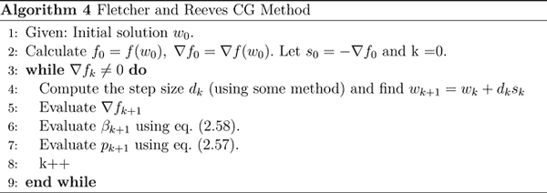

FR 方法有许多变体，Polak-Ribiere (PR) 方法 \[123\] 是其中之一。它仅在更新 `β[k + 1]` 的值上有所不同。因此，根据 PR 方法，更新公式为：

$$
\begin{array}{l}
\begin{array}{l}
{\beta_{k + 1} = \frac{\nabla f_{k + 1}^{T}\left( {\nabla f_{k + 1} - \nabla f_{k}} \right)}{\nabla f_{k}^{T}\nabla f_{k}}}
\\
\end{array}
\\
\end{array}
$$

(2.59)

### 2.4.13 截断牛顿法

截断牛顿 (TN) 方法是牛顿法的一种替代方法，其中牛顿系统被近似求解，导致提前终止。TN 方法比牛顿法可靠性较低，但可以处理非常大规模的问题。TN 方法不计算 Hessian，因此也被称为无 Hessian 优化。共轭梯度法和预条件化共轭梯度 \[85\] 方法是截断牛顿方法的示例。

### 2.4.14 近端梯度法

近端梯度 (PG) 方法\[140\] 是一种用于无约束问题的优化方法，其中目标函数可以分为两个凸分量。凸函数 `h(w)` 的近端算子定义为：

$$
\begin{array}{l}
\begin{array}{l}
{prox_{h}(w) = \underset{u}{argmin}\quad\left( {h(u) + \frac{1}{2}\| u - w\|_{2}^{2}} \right)}
\\
\end{array}
\\
\end{array}
$$

(2.60)

假设问题由

$$
\begin{array}{l}
\begin{array}{l}
{\underset{w}{\min}\quad f(w) = g(w) + h(w)}
\\
\end{array}
\\
\end{array}
$$

(2.61)

给出，其中 `g` 是可微凸函数且 `dom > g = ℝ^n`。`h` 是具有廉价近端算子的凸函数。根据 PG 方法，第 `(k + 1)` 次迭代的解由

$$
\begin{array}{l}
\begin{array}{l}
{w_{k + 1} = prox_{d_{k}h}\left( {w_{k} - d_{k}\nabla g\left( w_{k} \right)} \right)}
\\
\end{array}
\\
\end{array}
$$

(2.62)

给出，其中 `d[k] > 0` 是步长，可以是常数或由线搜索确定。快速近端梯度法和对偶近端梯度法是 PG 方法的变体。

### 2.4.15 近期算法

一般来说，学习算法是各种方法（如步长方法和步长方向方法）及优化策略的组合。最近使用的一些算法示例包括：TRON (Trust RegiOn Newton 方法) \[85\]、SVM-ALM 算法 \[101\]、SAG (Stochastic Average Gradient) 方法 \[115\]、CappedSVM \[102\] 等。不可能讨论所有最新算法，因此下面仅讨论其中三种：

**TRON**：在 TRON 中，求解 L2-正则化和 L2-损耗 SVM 问题，如下所示：


$$\\begin{array}{l} {\\underset{w}{\\min}\\quad f(w) = \\frac{1}{2}\\| w\\|^{2} + C\\sum\\limits\_{i = 1}^{l}{\\lbrack\\max(0,1 - y\_{i}w^{T}x\_{i})\\rbrack}^{2}} \\\\ \\end{array}$$  

(2.63)

令 `f(w)` 的二次模型为：

$$\\begin{array}{l} {m(s) = \\nabla f{(w)}^{T}s + \\frac{1}{2}s^{T}\\nabla^{2}f(w)s} \\\\ \\end{array}$$  

(2.64)

TRON 使用信赖区域半径 △ 来近似 `m(s)`：

$$\\begin{array}{l} {\\underset{\\| s\\| \\leq \\bigtriangleup}{\\min}\\quad m(s)} \\\\ \\end{array}$$  

(2.65)

它使用以下比率来更新信赖区域半径：

$$\\begin{array}{l} {\\mu = \\frac{f(w + s) - f(w)}{m(s)}} \\\\ \\end{array}$$  

(2.66)

TRON 在每次迭代中使用结合共轭梯度法和信赖区域法的修正牛顿法。TRON 的算法如 算法 5 所示。

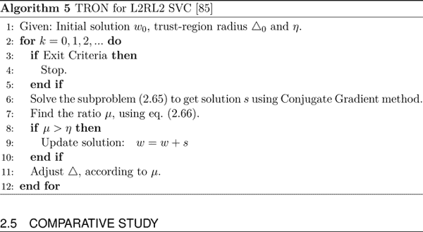

## 2.5 比较研究

在本节中，我们讨论了不同 SVM 的比较研究。结果从文献和我们的实验研究两方面进行了讨论。

### 2.5.1 文献中的结果

根据文献，`LIBLINEAR` \[38\]、`Pegasos` \[118\] 和 `SVM^(perf)`\[62\] 是最先进的求解器，其中 `LIBLINEAR` 是最有效 \[38\]、最流行且使用最广泛的。`LIBLINEAR` 使用 `TRON`（信赖区域牛顿法，\[85\]）来求解 L2 正则化 L2 损失原始 SVM，使用 `PCD`（原始坐标下降法，\[22\]）来求解 L1 正则化 L2 损失原始 SVM，并使用 `DCD`（对偶坐标下降法，\[53\]）算法来求解 L2 正则化 L1- 和 L2-损失对偶 SVM。`SVM^(perf)` 使用切割平面技术来求解 L2 正则化 L1 损失原始 SVM，而 `Pegasos` 使用一种在梯度下降步骤和投影步骤之间交替的算法来求解 L2 正则化 L1 损失原始 SVM。这些最先进求解器的比较已在 \[38\]（请参阅最新版本）的 第 4 节 中的 Fig. 1 中给出，该图比较了不同线性求解器的训练时间与测试准确率。最近，\[101\] 提出了一种 `SVM-ALM`（增广拉格朗日乘数）算法，用于求解具有线性计算成本的 L2 正则化 L1-、L2- 和 L*p* 范数损失原始问题，以应对大数据挑战。`SVM-ALM` 比 `LIBLINEAR` 更快，实验结果在 \[101\] 的第 4 节中的表 1 和表 2 中报告。`SVM-ALM` 使用梯度下降法来寻找步长方向，并使用精确线搜索来寻找步长。`SVM-ALM` 算法的精妙之处在于利用增广拉格朗日乘数将 L*p* 损失原始 SVM 问题转换为一种非常容易求解的形式。这强调了这样一个观点：不仅是一种方法，还有许多其他因素（请参阅 第 2.4 节 的开头以了解此类因素）使算法高效。

### 2.5.2 实验研究中的结果

#### 2.5.2.1 实验设置和实现细节

实验在两个数据集上进行，即 `mushroom` 和 `rcv1`，在单节点 MacBook Air（8 GB 1600 MHz DDR3，1.6 GHz Intel Core i5，256 SSD）上。每个数据集被随机分为 80% 和 20%，分别用于训练数据和测试数据。实验比较了七种著名的 SVM 变体，分别是软 SVM、平滑 SVM、最小二乘 SVM、双 SVM、E*ν*-SVM、近点 SVM 和封顶 SVM，使用两个标准：测试准确率与时代（一个时代指一次遍历数据集）以及测试准确率与训练时间（以秒为单位）。为了公平比较，SVM 的原始公式使用了相同的算法结构/框架来求解，仅在问题公式和相应的梯度值上有所不同。训练算法使用小批量 `SGD`（随机梯度下降）方法 \[148\] 来确定步长方向，步长大小递减，由 `d[0]/(1 + d[0]C^k)` 确定，用于第 `k^(th)` 个时代，初始步长为 `d[0]`，正则化参数为 `C`。训练算法使用五个随机选择的数据点的小批量大小。每个 SVM 的问题公式使用平方松弛变量，即平方误差，以便公平比较，例如，在软 SVM 中使用 L2 损失而不是 L1 损失。此外，正则化参数（`C`）对所有 C-SVM 都设置为 0.1，包括双 SVM 的两个子问题，参数 `ν` 对 `ν`-SVM 设置为 0.06（mushroom）和 0.006（rcv1.binary）。对于平滑 SVM，平滑参数（`α`）设置为五，对于封顶 L*p* 范数 SVM，`p` 设置为二，封顶值 `ϵ` 设置为一。由于双 SVM 有两个子问题，因此双 SVM 的训练时间和时代分别取子问题所用时间的总和和所用时代的总和。

#### 2.5.2.2 结果与讨论

首先，应当注意，不同 SVM 的比较研究存在几个挑战，即：(a) 不同 SVM 的范围和应用领域不同，例如，`SloppySVM` 适用于数据标记不严谨的应用；跨导 SVM 专门为文本分类问题提出；`Fuzzy SVM` 和 `CappedSVM` 适用于数据包含噪声和异常值的应用；结构化 SVM 适用于输出标签为结构化（如字符串）的应用；`MVSVM` 和 `MTSVM` 分别用于多视图学习和多任务学习等；(b) 一个对另一个的直接改进，例如，软 SVM 是对硬 SVM 的改进，`E*ν*-SVM` 是对 `ν`-SVM 的改进等；(c) 二元和多类数据，例如，软 SVM、最小二乘 SVM 和平滑 SVM 主要是二元分类器，已通过一对一、一对其余等方法扩展到多类数据；以及 (d) 并非每个问题都可以用每个求解器求解。关于求解特定 SVM 问题公式的一个有趣观点是，作为优化问题，每个问题都可以用多种方法求解。在为特定 SVM 选择求解器时，不同因素起着作用，如 第 2.4 节 开头所讨论。因此，仅对著名的二元原始 SVM 变体使用小批量 `SGD` 方法进行了实验研究。关于多类 SVM 的比较研究，请参阅 \[55\] 第 V 节中的表 V.2 至 V.4。另一个有趣的观点是，从实验结果来看，我们不能概括某个特定的 SVM 是最好的。这符合“无免费午餐”定理，以及在求解 SVM 时必须考虑多种权衡和因素（参见 第 2.4 节）的观点。

实验结果² 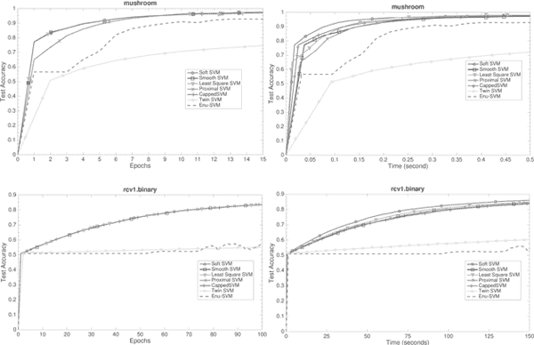

图 2.8 第一行：mushroom（#instances: 8124，#features: 112），第二行：rcv1，（#instances: 20,242，#features: 47,236。）

## 2.6 当前挑战与研究方向

### 2.6.1 大数据挑战

随着技术的进步，数据已采取“大数据”的形式，大数据中“大”的含义在不断变化，并将继续变化。早期，由于计算资源有限和当时可用数据有限，几百个实例被视为大数据集。后来，大数据集的含义变为数千个实例。现在，大数据集指数百万个实例。为了利用这些海量数据，需要高效的机器学习算法来处理这些大数据集。此外，这些算法还需要具备可扩展性，以应对数据集规模的不断增加。因此，如今，`SVC`（与机器学习共享）面临的最大挑战是开发高效且可扩展的学习算法来处理大数据。


为了解决大数据挑战，我们在 SVC 中识别了不同的领域，其中大部分领域也与机器学习的其他领域相同，这些内容将在下一小节中讨论。

## 2.6.2 改进领域

分类是机器学习中的一种技术，用于在预定义值集合的帮助下，通过在标记数据上训练的模型为测试数据点分配标签。从数学上讲，分类问题是一个优化问题，即在最大化不同类别之间边界的同时，将分类错误降至最低。在解决分类问题时，有两个目标：第一，训练数据集上 `SVM` 模型的训练速度；第二，测试数据集上标签预测的准确性。因此，在解决分类问题时，速度和准确性是两个目标，但算法的速度和准确性之间存在权衡。如果使用简单的算法来提高速度，则无法获得良好的分类准确性。另一方面，当使用复杂的算法来训练模型时，它会提高准确性，但训练速度会降低，例如，最速下降法速度快，但与牛顿法相比，其收敛速度较慢。这取决于应用程序，是牺牲速度还是准确性。算法的训练速度和测试准确性都取决于这些因素：问题公式、问题求解器、框架/平台利用和优化策略，如 图 2.9 所示。因此，为了使线性 `SVM` 分类高效且可扩展，挑战在于有效处理这些因素。

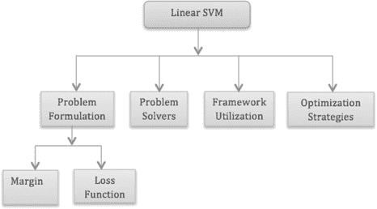

FIGURE 2.9 Improvement areas for Linear SVM Classification.

### 2.6.2.1 问题公式

问题公式在 `SVM` 中非常重要，`SVM` 问题中使用的求解器在一定程度上也取决于问题公式。`SVM` 可以表述为凸优化问题 \[77\]，也可以表述为非凸优化问题 \[126\]。通常，`SVM` 被表述为凸优化问题，因为不存在局部最小值问题，因为每个局部最小值都是全局最小值。`SVC` 优化问题有两个组成部分：边界和损失函数/错误。边界和错误之间的权衡由参数 `C` 控制。

1. 边界：

    该组件用于控制分离超平面之间的距离。边界越大，分类器的泛化能力越好。目前，L1R (`∥w∥`, \[153\]) 和 L2R (`∥w∥²`, \[29\]) 在文献中被广泛用于表示 `SVM` 问题中的边界。

2. 损失函数：

    该组件作为松弛变量引入软边界 `SVM` 中。它有助于最小化分类器的误分类错误。通常，L1 损失 \[118\] 和 L2 损失 \[76\] 函数（参见，公式 2.1）在文献中被广泛使用。其他损失函数（例如，\[88\]）也可以使用，这取决于问题公式（有关损失函数的完整列表，请参见 \[129\]）。

    这两个组件结合在一起构成了 `SVM` 问题（有关不同问题公式，请参见 第 2.3 节）。因此，当前的挑战是为边界和错误做出适当选择，或提出新的组件，以构建有效的 `SVM` 问题。不当的公式可能导致局部最小值问题、可微性问题以及速度较慢且准确性较低的方法。

### 2.6.2.2 问题求解器

问题求解器同样在获得更快、更准确的结果方面发挥着重要作用。有许多方法可用于解决优化问题，如 第 2.4 节 中所讨论。这取决于问题公式（在一定程度上），即应使用哪种方法来求解它。从文献中可以观察到，不同的研究人员使用不同的求解器解决了相同的问题，导致了不同的结果（\[85, 65\] 解决了相同的问题）。当前的挑战是寻找能够产生准确且更快结果的高效求解器。

### 2.6.2.3 问题求解策略/方法

方法在使用 `SVM` 求解器解决 `SVM` 问题中起着关键作用。问题公式可能非常好，问题求解器也可能非常高效，但由于缺乏合适的优化策略，我们的算法可能仍然表现不佳。例如，假设存在大规模稀疏数据问题，如果不利用问题的稀疏性，那么这种优化技术的训练可能会非常慢。同样，使用分解方法、随机逼近和问题缩减等，可以加快问题求解过程。机器学习（`SVM`）问题的一些策略如下：

1. 利用问题结构：

    可以利用问题结构（例如问题的稀疏性 \[125\]）来使学习更高效。存在许多问题，如文档分类，其中大多数特征为零。因此，问题求解器在训练模型时应利用这一特征，这有助于加快问题的训练速度。同样，在内存中处理数据也会影响 `SVM` 求解器，例如按特征存储数据 \[38\] 或按实例存储数据。

2. 分解方法：

    根据这种方法，问题被分解为较小的问题，然后使用某些求解器求解子问题，以得到原问题的解 \[64\]。例如，假设一个问题中有 10,000 个参数，那么可以先取前 100 个参数，固定其余参数并求解这个子问题，然后求解接下来的 100 个参数，重复此过程直到所有参数都被求解。这构成一次迭代，该过程可以重复直到收敛。分解方法的一种极端情况是坐标下降法 \[137\]，根据这种方法，在保持所有其他变量固定的情况下，对一个变量求解问题。这种优化方法有助于克服内存和 CPU 的实现问题。毫无疑问，这种方法需要更多的迭代且收敛较慢，但它使问题的实现成为可能，因为在特征（变量）数量较多的情况下，由于内存和 CPU 要求较大，可能无法处理该算法。

    坐标下降法 \[38, 137\]、`SMO` \[106\] 和块优化 \[23\] 是分解方法的三个示例。这种方法有助于解决大规模问题。坐标下降法的通用算法在 算法 6 中给出。

    坐标下降法的优点：有并行版本可用；不需要额外的存储向量；不需要其他烦人的参数；它对非常大的问题效果良好且易于实现。坐标下降法的缺点：如果单变量优化很困难，则比较棘手；收敛理论可能非常复杂；在接近最优解时可能较慢。

    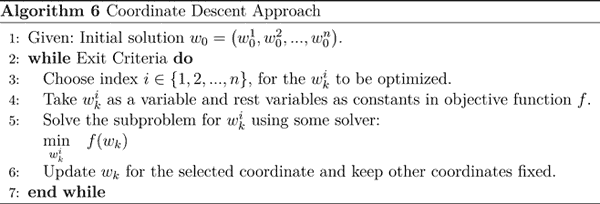

3. 随机逼近方法：

    通常，参数在每次迭代中对所有数据实例进行优化，但在随机逼近 \[113\] 中，参数一次只对一个实例进行优化。随机逼近方法使每次迭代独立于数据点并降低了迭代复杂度。因此，这种方法在解决大规模问题时非常有帮助。这是因为，它不是遍历数据集中的所有实例，而是在每次迭代中只取一个实例。这种方法还有其他变体，例如“小批量”方法 \[29\]，即在每次迭代中不取一个实例，而是取一部分训练实例。


## 4. 问题缩减策略

在优化不同变量（参数）时，观察到有些变量不变或保持为零。此类变量可以在优化过程中暂时排除，直到其余变量达到近似最优值。这被称为缩减策略 \38, [66\]。这样一来，中间迭代过程中需要最小化的变量数量减少了。这使得训练速度更快。

因此，挑战在于设计新方法，并在问题求解器中使用现有方法，以使学习更快、更准确。

## 2.6.2.4 平台/框架

平台/框架代表支持 SVM 问题执行的环境。通过利用此环境，可以进一步改进 SVM 问题。从图 2.9 可以清楚地看出，对于大规模问题，速度和准确性也取决于计算框架/平台。以下是使用平台/框架的一些示例 \[84\]：

### 1. 并行和分布式计算

借助并行计算 \[136\]，某些任务可以在系统的多个核心或计算机集群上并行执行。这使得训练过程更快，但显然，不同处理单元之间的通信在这里是一个瓶颈。

### 2. 原位内存计算

读取和写入数据所需的时间比数据处理更长。因此，对于需要多阶段处理的问题，与其在每个阶段后将数据读写到磁盘，不如在内存中进行连续计算，这样在处理非常大的数据问题时可以加快进程。Apache Spark \[84\] 使用原位内存计算的概念，使其比 Hadoop 快大约 100 倍。

因此，当今的挑战是利用现有框架使算法更高效。

## 2.6.3 研究方向

根据图 2.9，有四个改进领域可以帮助我们解决大数据问题。在这些领域中，线性 SVM 分类（与机器学习共享）的当前研究方向是：

### 2.6.3.1 随机近似算法

过去五年中，该领域进行了大量研究（关于随机近似方法，请参阅 小节 2.6.2.3）。研究人员提出了大量使用随机近似（SA）的算法，特别是使用一阶方法，如梯度下降（GD）方法 \[120, 115\] 作为求解器。此外，SA 还与二阶方法（如拟牛顿法 \[19\]）一起使用。SA 与 GD 构成随机梯度下降（SGD）方法，并导致梯度值中的方差问题。因此，围绕 SGD 的研究集中在减少方差（例如，\[23\]）。另一方面，围绕 SA 与二阶方法的研究集中在将曲率信息纳入方法以实现更快的收敛。这种方法适合解决包含大量数据点的问题。

### 2.6.3.2 坐标下降算法

这是一种分解方法（关于分解方法，请参阅 小节 2.6.2.3），用于处理大数据问题。过去几年中，该领域也取得了良好的工作成果。坐标下降（CD）方法通过将一个参数作为变量，其余参数作为常数来构建子问题，该子问题规模更小，因此更容易求解。已提出大量使用 CD 方法 \[137\] 及其变体（如块坐标下降 \[90\]）的算法，并结合一阶和二阶方法。这通常应用于高维原始或对偶问题。

### 2.6.3.3 近端算法

近端算法（PA）\[104\] 适用于非光滑、受约束、大规模或分布式凸问题，最近，它们在高维优化问题上取得了良好效果。使用 PA 时，主要操作是计算近端算子（关于近端算子，请参阅 小节 2.4.14），其中我们求解一个小优化问题。当前研究涉及将 PA 用于一阶方法（如近端梯度方法 \[28\]）、二阶方法（如拟牛顿方法 \[7\]）及其加速版本 \[147\]。

### 2.6.3.4 并行/分布式算法

并行和分布式算法 \[84\] 利用计算资源来处理大数据问题（如系统的 CPU 核心和计算机集群），并可以处理数据集极大且无法装入单台机器的问题。这些算法的主要瓶颈是通信开销。研究人员长期致力于此，但该领域仍有很大的发展空间。这似乎是机器学习中处理大数据问题的最热门领域，在未来，研究可能会朝这个方向发展，因为数据集的规模不断增加，最终可能超出单台机器的能力。

### 2.6.3.5 混合算法

混合算法结合了上述两种或多种方法。很明显，如果我们想要开发高效且可扩展的算法来解决大数据问题，所有这些方法都必须结合起来。该方向已经有大量研究，例如，随机近似和坐标下降方法的组合已在 \[23\] 中得到研究。

## 2.7 结论

线性 SVM 是机器学习中一个非常好的工具，因为它比非线性核 SVM 快得多，同时为高维问题（如文档分类）提供相似的准确性。研究人员提出了各种 SVM 问题公式，以及求解器和优化策略来求解它们。其中一些是对其他方法的改进，例如，“软 SVM”是对“硬 SVM”的改进。一些 SVM 有不同的应用场景，例如，SloppySVM 适用于数据标记松散的应用；Transductive SVM 专门针对文本分类问题提出；Fuzzy SVM 和 CappedSVM 适用于数据包含噪声和异常值的应用；Structured SVM 适用于输出标签为结构化（如字符串）的应用；MVSVM 和 MTSVM 分别用于多视图学习和多任务学习，等等。一些 SVM 是二元分类器，需要使用一对一和一对其余等技术来处理多类问题，例如，Soft SVM、Fuzzy SVM 和 Twin SVM 等。一些 SVM 可以使用直接公式处理多类数据，例如 Crammer Singer SVM 和 Weston Watkins SVM。在所有 SVM 中，软间隔 SVM 或 Soft SVM 是最流行且最广泛使用的 SVM 公式，因为训练速度快且泛化效果更好。这就是为什么当人们提到 SVM 时，指的就是 Soft SVM。根据文献，SVM-ALM 是最快的原始求解器，LIBLINEAR 是最流行且最广泛使用的工具，它提供原始和对偶两种求解器，并使用 TRON、PCD（原始坐标下降）和 DCD（对偶坐标下降）方法。


如今，机器学习面临的最大挑战是开发高效且可扩展的学习算法来处理“大数据”。为了解决这一挑战，广泛的研究正在四个方向进行：随机近似算法、坐标下降算法、近端算法以及并行和分布式算法。前两者，即随机近似和坐标下降算法，试图通过在学习算法的每次迭代中考虑更少的参数或更少的实例来减少问题规模和计算量。近端算法用于求解具有可分离分量的大型非光滑凸问题，而并行和分布式算法则试图利用计算资源来处理大数据问题。在这些方法中，并行和分布式计算看起来具有巨大的未来前景。

# II\_\_\_\_\_\_\_\_\_FIRST ORDER METHODS

# Chapter 3 Mini-batch and Block-coordinate Approach

DOI: [10.1201/9781003240167-3](http://doi.org/10.1201/9781003240167-3)

机器学习中的大数据问题拥有大量的数据点或大量的特征，或者两者兼有，这使得模型训练变得困难，因为学习算法单次迭代的计算复杂度很高。为了解决此类学习问题，随机近似提供了一种优化方法，通过在每次迭代中仅取一个数据点或一小批数据点，使每次迭代的复杂度与数据点数量无关，从而帮助解决数据点数量庞大的问题。同样，坐标下降提供了另一种优化方法，通过在每次迭代中仅取一个特征或一组特征，而不是全部特征，使迭代复杂度与特征/坐标/变量的数量无关，从而帮助解决特征数量庞大的问题。在本章中，开发了一种名为“批量块优化框架”的优化框架，用于利用随机近似和坐标下降方法的优点来解决大数据问题，且不依赖于任何求解器。该框架用于求解具有强凸性和光滑性的经验风险最小化问题（以梯度下降作为求解器），并提出了两种新的随机平均调整梯度方法，以减少所开发框架的小批量和块坐标设置中的方差。理论分析证明了所提方法的线性收敛性，基准数据集的实证结果证明了所提方法相对于现有方法的优越性。

## 3.1 引言

大数据问题有多个方面，其中之一是数据的大小/容量，即大数据问题拥有大量的数据点或每个数据点拥有大量的特征，或者两者兼有，这对机器学习在大型数据集上训练模型构成了重大挑战，因为学习算法每次迭代的计算成本很高。这种高迭代复杂度是因为在学习算法的每次迭代中，需要对所有数据点上的所有变量（特征）求解。由于每台计算机的能力都是有限的，每次迭代可能非常昂贵，甚至无法处理。关于大数据的另一个有趣的观点是，其含义，即“大数据”中的“大”是什么，并不是固定的，因为数据集的规模在不断增长。因此，为了解决大数据问题，我们不仅需要高效的学习算法来处理高迭代复杂度，还需要可扩展的学习算法来应对不断增长的数据集规模。

本章解决经验风险最小化（ERM）问题，该问题由所有数据点上的损失平均值组成。对于训练数据 {(*x*[1],*y*[1]),(*x*[2],*y*[2]),...,(*x*[*l*],*y*[*l*])}，其中 *x*[*i*] ∈ ℝ^(*p*)，*y*[*i*] ∈ {−1,+1}，∀ *i*，*l* 是数据点的数量，*p* 是每个数据点中的特征数量，且假设 *l* 或 *p*，或两者都很大。ERM 问题如下所示：

$$\\begin{array}{l} {\\underset{w}{min}\\, f(w),\\quad f(w) = \\frac{1}{l}{\\sum\\limits\_{i = 1}^{l}L\_{i}}(w,x\_{i},y\_{i})} \\\\ \\end{array}$$  

(3.1)

其中 *w* ∈ ℝ^(*p*) 是参数向量，*L*[*i*] 是 *i* = 1, 2, ..., *l* 的损失函数。我们假设 ERM 问题具有强凸性和光滑性，因此可以使用 L2 正则化，如下所示：

$$\\begin{array}{l} {f(w) = \\frac{1}{l}{\\sum\\limits\_{i = 1}^{l}L\_{i}}(w,x\_{i},y\_{i}) + \\frac{C}{2}\\| w\\|^{2},} \\\\ \\end{array}$$  

(3.2)

其中 *C* 是正则化常数。例如，对于逻辑回归，eq.(3.2) 可以写成：

$$\\begin{array}{l} {\\underset{w}{min}\\, f(w),\\quad f(w) = \\frac{1}{l}{\\sum\\limits\_{i = 1}^{l}l}og(1 + exp( - y\_{i}w^{T}x\_{i})) + \\frac{C}{2}\\| w\\|^{2},} \\\\ \\end{array}$$  

(3.3)

其中，为了简单起见，正则化可以隐藏在损失函数内部，即 $L\_{i}(w,x\_{i},y\_{i}) = log(1 + exp( - y\_{i}w^{T}x\_{i})) + \\frac{C}{2}\\| w\\|^{2},\\,\\forall\\, i$。

### 3.1.1  动机


在大数据问题中，高迭代复杂度是由于学习算法每次迭代都依赖于所有数据点（`l`）和所有特征（`p`）所致。为了降低高迭代复杂度，一种方法是使用随机近似（SA，113, [67]），这是一种迭代优化方法，用于解决无法直接求解但可通过近似求解的优化问题。在机器学习问题中，在学习算法的每次迭代中使用所有数据点在计算上非常昂贵，在某些情况下甚至可能不可行。因此，使用 SA，它通过考虑一个数据点或一小批数据点，使每次迭代独立于 `l`，即，不遍历所有数据点，而是在每次迭代中只处理一个数据点或一小批数据点，这对于较大的 `l` 值会产生巨大的计算差异。同样，剩余的数据点可以在其他迭代中以小批量使用。因此，SA 是一种计算效率非常高的优化方法，用于处理具有大量数据点的大规模问题，因为在近似方法的每次迭代中，它使用一个数据点或一小批数据点，而不是使用所有数据。毫无疑问，这可能会影响解的准确性，这可以通过使用更大的小批量以及 SAG [74] 和 SAGA [35] 等其他技术来补偿。但是，对于特征数量较多（每个数据点中）的问题，SA 可能不合适，因为每次迭代，尽管独立于 `l`，但仍然依赖于 `p`。坐标下降（CD，[137]）提供了另一种优化方法，用于解决具有大量特征的大规模问题。CD 是一种递归方法，通过沿坐标方向或坐标超平面进行近似最小化来解决优化问题，即，它递归地求解仅包含一个或几个变量的小子问题。正如 SA 使迭代复杂度独立于 `l`，同样，CD 通过将一个特征或一组特征作为变量，固定其余特征并求解由此形成的缩小子问题，使迭代复杂度独立于 `p`。然后，选择一个新的特征或一组特征作为变量，固定其余特征，并求解得到的子问题。此过程重复，直到覆盖所有特征的所有子问题都求解完毕，然后重复整个过程直到收敛。因此，CD 是解决具有大量特征的大规模问题的好方法，但同样可能不足以解决具有大量数据点的问题。因此，观察到 SA 使每次迭代独立于 `l`，但每次迭代仍然依赖于 `p`，因此 SA 适用于 `l` 较大的问题，但可能不适用于 `p` 值较大的问题。另一方面，CD 使每次迭代独立于 `p`，但每次迭代仍然依赖于 `l`，因此 CD 适用于 `p` 值较大的问题，但可能不适用于 `l` 值较大的问题。因此，可以开发一个优化框架（参见，Subsection 3.1.2）来解决大数据问题，该框架利用 SA 和 CD 的优点。在这个框架中，每次迭代都独立于 `l` 和 `p`，通过仅考虑一个数据点或一小批数据点以及一个特征或一组特征，即，每次迭代求解一个数据点或一小批数据点上一个特征或一组特征的缩小子问题。因此，无论问题的大小如何，迭代复杂度都非常低，使该框架在解决大数据问题时高效且可扩展。通过在每次迭代中考虑合适的数据点小批量和一组坐标，该框架可以进一步改进。

让我们将上述 SA 和 CD 方法的思想应用于梯度下降（GD）方法，以了解单次迭代的计算复杂度是如何降低，从而使每次迭代简单且可行。对于求解 eq.(3.1) 给出的问题，使用 GD 方法的 (`k` + 1)^(`t`^`h`) 次迭代的参数更新规则如下

$$
\begin{array}{l} {w^{k + 1} = w^{k} - \\alpha f^{{}^{\\prime}}(w^{k}) = w^{k} - \\frac{\\alpha}{l}{\\sum\\limits\_{i = 1}^{l}L\_{i}^{{}^{\\prime}}}(w^{k},x\_{i},y\_{i})} \\\\ \\end{array}
$$

(3.4)

其中 `α` 是步长，`L`[*i*]^(^′) 是损失函数的梯度。此次迭代的计算复杂度为 *O*(*l**p*)，它同时依赖于 `l` 和 `p`，因此对于 `l` 或 `p` 或两者的较大值，计算成本会非常高，甚至可能不可行。GD 表现出线性收敛率，但代价是高迭代复杂度。将 SA 方法与 GD 方法结合使用，即随机梯度下降（SGD）方法 [148]，每次迭代只取一个数据点，子问题和更新规则如下

$$
\begin{array}{l} \begin{array}{l} {\\underset{w}{min}\\, L\_{i\_{k}}(w,x\_{i\_{k}},y\_{i\_{k}}),\\quad i\_{k} \\in \\left\\{ 1,2,...,l \\right\\},} \\\\ {\\quad w^{k + 1} = w^{k} - \\alpha L\_{i\_{k}}^{{}^{\\prime}}(w^{k},x\_{i\_{k}},y\_{i\_{k}}),\\quad i\_{k} \\in \\left\\{ 1,2,...,l \\right\\}} \\\\ \\end{array} \\\\ \\end{array}
$$

(3.5)

其中 `i`[*k*] 是随机选择的数据点。在 SGD 中，迭代的计算复杂度为 *O*(*p*)，这比 GD 方法小得多，因为它只考虑一个数据点，并且表现出线性收敛率 [114]，但与 GD 相比，解的准确性较低，因为 SGD 和 GD 的梯度值存在方差，这可以通过在每次迭代中使用数据点小批量 [81] 或使用方差减少方法（如 SAG [74]、SAGA [35]、S2GD [71] 和 SVRG[63] 等）来降低。

对于 GD 方法的 CD 方法，即坐标梯度下降（CGD）方法，在保持其他坐标固定的情况下只取一个坐标，得到以下子问题和更新规则：

$$
\begin{array}{l} \begin{array}{l} {\\underset{w\_{j}}{min}\\, f(w\_{j},w\_{/j}),\\quad j = 1,2,...,p,} \\\\ {w\_{j}^{k + 1} = w\_{j}^{k} - \\alpha\\left\\lbrack {f^{{}^{\\prime}}(w\_{< j}^{k + 1},w\_{\\geq j}^{k})} \\right\\rbrack\_{j},\\quad j = 1,2,...,p,} \\\\ \\end{array} \\\\ \\end{array}
$$

(3.6)

其中 `w`[*j*]^(`k`) 表示 `w`^(`k`) 的第 `j`^(`t`^`h`) 个坐标/变量，`w`[/`j`]^(`k`) 表示 `w`^(`k`) 中排除第 `j`^(`t`^`h`) 个坐标的坐标，[`f`^(^′)(.)][`j`] 表示对第 `j`^(`t`^`h`) 个变量的偏导数，`w`[ < `j`]^(`k` + 1) 表示 `w`^(`k` + 1) 中已计算的变量，`w`[ ≥ `j`]^(`k`) 表示 `w`^(`k`) 中尚未推进到迭代 (`k` + 1) 的变量，与正在更新的第 `j`^(`t`^`h`) 变量一起，即，eq.(3.6) 以类似高斯-赛德尔的方式更新坐标。CGD 仅依赖于一个变量，并且仍然表现出线性收敛率 [100, 137]。对于 CGD 方法，迭代的计算复杂度为 *O*(*l*)，这比 GD 方法小得多。现在，通过将 SA 和 CD 结合用于 GD 方法，即 eqs.(3.5) 和 (3.6)，得到以下子问题和更新规则：

$$
\begin{array}{l} \begin{array}{l} {\\underset{w\_{j}}{min}\\, L\_{i\_{k}}(w\_{j},w\_{/j},x\_{i\_{k}},y\_{i\_{k}}),\\quad j = 1,2,...,p,\\, i\_{k} \\in \\left\\{ 1,2,...,l \\right\\},} \\\\ {w\_{j}^{k + 1} = w\_{j}^{k} - \\alpha\\left\\lbrack {L\_{i\_{k}}^{{}^{\\prime}}(w\_{< j}^{k + 1},w\_{\\geq j}^{k})} \\right\\rbrack\_{j},\\quad j = 1,2,...,p,\\, i\_{k} \\in \\left\\{ 1,2,...,l \\right\\},} \\\\ \\end{array} \\\\ \\end{array}
$$

(3.7)

它求解一个数据点上一个变量的子问题，因此迭代的计算复杂度为常数 *O*(1)。因此，SA 和 CD 的结合为解决任何规模的大数据问题提供了高效且可扩展的解决方案。


### 3.1.2 批量块优化框架 (BBOF)

SA 方法通过在每次迭代中考虑一个或一些数据点来解决优化问题，这有助于降低迭代复杂度，但会影响解的精度。但是，通过在每次迭代中考虑合适的数据点小批量 [81] 或使用方差缩减技术，如 SAG [74]、SAGA [35]、S2GD [71] 和 SVRG [63] 等，可以改进解。另一方面，CD 通过考虑一个或一些特征/变量来构建缩减子问题，从而用于解决优化问题，这有助于降低迭代复杂度。在 CD 中，通过在学习算法的每次迭代中考虑合适的坐标/变量块，可以提升性能。现在，将小批量 SA 方法与块 CD 方法相结合，形成一个优化框架，该框架用于在学习算法的每次迭代中，对数据点小批量上的变量块求解子问题。该框架可称为批量块优化框架 (BBOF)，是一个高效且可扩展的框架，由于其低迭代复杂度，可用于解决大数据问题。BBOF 由 Algorithm 7 给出。假设 {(`x`[1],`y`[1]),(`x`[2],`y`[2]),...,(`x`[`l`],`y`[`l`])} 是包含 `l` 个数据点的训练集，其中 `x`[`i`] ∈ ℝ^(`p`)，`y`[`i`] ∈ {−1,+1} 对所有 `i` 成立，`X` = (`x`[1],`x`[2],...`x`[`l`])，`Y` = (`y`[1],`y`[2],...`y`[`l`])。假设 `w` ∈ ℝ^(`p`) 被划分为 (`v`[1],`v`[2],...`v`[`s`])，即 `s` 个块，`v`[`j`] ∈ ℝ^(`p`[`j`])，满足 ${\\sum\\limits\_{j = 1}^{s}p\_{j}} = p$，且 `X` 被划分为 `m` 个小批量 (`B`[1],`B`[2],...`B`[`m`])，每个大小为 |`B`[`i`]|，满足 $\\left. \\left. \\sum\\limits\_{i = 1}^{m} \\right|B\_{i} \\middle| = l \\right.$。

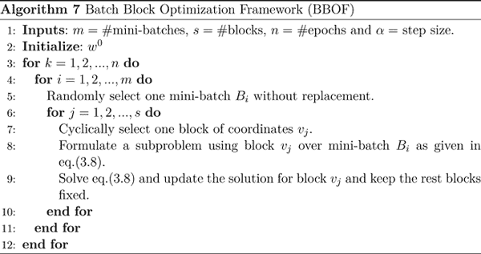

BBOF 将给定的训练集划分为 `m` 个小批量，将特征划分为 `s` 个特征块，并运行 `n` 个 epoch，每个 epoch 遍历所有数据点，即遍历所有批次，并为每个小批量覆盖所有特征块，以避免反复读取数据的开销。它不放回地随机选择一个数据点小批量 `B`[`i`]，并循环选择一个特征块 `v`[`j`]。可以尝试其他采样方案来在此框架中对小批量和特征块进行采样。但对于特征块，使用循环采样 (CS)，因为否则难以使用稀疏实现。此外，如 [152] 所指出，像 SAG、SAGA、SAAG-I 等使用随机平均方案（即保留前几次迭代的完整梯度）的方法，不能与块和小批量的随机采样一起使用。通过将选定的坐标块作为变量，固定其余坐标的值，并在选定的数据点小批量上，按如下方式构建子问题：

$$
\\begin{array}{l} \\begin{array}{l} {\\underset{w\_{v\_{j}}}{min}\\quad\\frac{1}{\\left| B\_{i} \\right|}{\\sum\\limits\_{h \\in B\_{i}}L\_{h}}(w\_{v\_{j}},w\_{/v\_{j}}),\quad j = 1,2,...,s,\\, i = 1,2,...,m,} \\\\ \\end{array} \\\\ \\end{array}
$$

(3.8)

其中 `w`[`v`[`j`]] 表示坐标块 `v`[`j`]，`w`[/`v`[`j`]] 表示排除 `v`[`j`] 的坐标。小批量和块的大小以这种方式选择，以允许在实验所用计算机上高效处理的迭代复杂度。求解子问题后，选定的坐标块被更新，但其他坐标保持不变。这运行预定数量的 epoch `n`，但可以尝试其他退出标准，具体取决于求解子问题所用的方法以及需求。在此之前，少数研究者如 [133, 152] 和 [140] 曾使用梯度/近端梯度方法研究过小批量和块坐标的概念，但我们将小批量和块坐标设置作为一个独立于任何方法的优化框架 (BBOF)，作为解决大数据问题的高效且可扩展的框架。BBOF 是一个可调框架，可以通过更改 `m`（小批量数量）和 `s`（块数量）的值调整为八种不同的设置，例如，在 BBOF 中使用梯度下降法作为求解器，可以调整以下不同方法：

1. i) `m` = 1，即一个批次包含所有数据点，`s` = 1，即一个块包含所有坐标，则方法为 GD。

2. ii) `m` = `l`，即一个批次仅包含一个数据点，`s` = 1，则方法为 SGD。

3. iii) `m` = 1，`s` = `p`，即一个块仅包含一个坐标，则方法为 CGD。

4. iv) `m` = `B`，1 < `B` < `l`，`s` = 1，则方法为小批量 SGD。

5. v) `m` = `B`，1 < `B` < `l`，`s` = `p`，则方法为小批量 CGD。

6. vi) `m` = 1，`s` = `v`，1 < `v` < `p`，则方法为 BCD（块坐标梯度下降）。

7. vii) `m` = `l`，`s` = `v`，1 < `v` < `p`，则方法为随机 BCD。

8. viii) `m` = `B`，1 < `B` < `l`，`s` = `v`，1 < `v` < `p`，则方法为小批量块坐标 GD (MBGD)。

### 3.1.3 简要文献综述

随机近似 (SA) 方法 [113, 67] 与 GD 方法结合得到 SGD 方法 [148]，由于梯度的噪声近似，SGD 方法在梯度值中引入了方差。可以通过使用合适的小批量 [81] 而不是一个数据点，或使用一些方差缩减技术，如 SAG [74]、SAGA [35]、SVRG [63] 和 S2GD [71] 等，来降低这种方差，这些方法与 GD 具有相同的收敛性，但迭代复杂度几乎等于 SGD 方法。CD 方法与块坐标下降 (BCD) 方法在文献中已被广泛研究，例如 [100, 137, 122] 等。BCD 与小批量 SA 方法结合 GD/近端 GD (PGD) 方法的组合最近在 MRBCD [152]、ORBCD [133] 和 BSG [140] 中被研究，这些是 BBOF 与 GD/PGD 方法的特定情况，用于解决不同问题。MRBCD 和 ORBCD 具有相似的思想和理论结果。BSG 求解凸和非凸问题，而 MRBCD 仅求解凸问题。两种方法都使用方差缩减技术。MRBCD 和 BSG 使用 SVRG 的扩展来在小批量和块坐标设置中进行方差缩减。本章将 BBOF 与 GD 方法结合使用，即将 GD 作为求解器的小批量和块坐标设置，并提出两种新的方差缩减方法（参见 第 3.2 节），此外还将 SAG、SAGA 和 S2GD 扩展到此设置。

### 3.1.4 贡献

本章的贡献总结如下：

* 小批量和块坐标设置，即随机近似 (SA) 和坐标下降 (CD) 方法的组合，已被提出为一种高效且可扩展的优化框架，即批量块优化框架 (BBOF)，独立于任何求解器，用于解决大数据问题。BBOF 是一个可调框架，可以通过更改 `m`（小批量数量）和 `s`（块数量）的值生成八种不同的方法（参见 子节 3.1.2）。

* 提出了两种新方法，即 SAAG-I 和 SAAG-II（参见 第 3.2 节），作为在 GD 方法下的小批量和块坐标设置中的方差缩减方法，用于求解强凸和光滑问题。SAAGs 也可用于小批量随机梯度设置。理论分析证明了 SAAG-II 方法具有线性收敛性。

* 将方差缩减方法 SAG、SAGA、SVRG 和 S2GD 扩展到小批量和块坐标设置，并与所提方法进行了比较。

## 3.2 随机平均调整梯度 (SAAG) 方法


# SAG, SAGA, SVRG, S2GD 和 SAAG 方法简介

SAG, SAGA, SVRG, S2GD 和提出的 SAAG 方法是随机梯度的方差减小技术。非常有趣的是，它们的更新规则有非常小的差异，如本节给出的方程所示。所有这些方法都在最新迭代上计算选定小批量的一个部分梯度，这给出了最新的梯度值，即移动的步进方向；在旧迭代上计算选定小批量的一个部分梯度，以及在旧迭代上计算整个数据集的一个部分梯度，这可能无法给出正确的移动步进方向。旧梯度值有助于在期望中减小方差，但可能导致错误的方向。提出 SAAG 的直觉是给最新梯度值更多的权重，以获得更好的步进方向。因此，我们使用小批量大小划分最新的梯度值，但使用数据点数量划分旧值。SAAG 对足够大的小批量很有用。我们的直觉得到了经验结果的支持，这些结果清楚地表明 SAAG 优于其他方法。

# SAAG-I 和 SAAG-II 方法

在本节中，提出了两种带有两种训练算法的方法，即 SAAG-I 和 SAAG-II，两者都使用小批量和块坐标设置，即 BBOF 框架。第一种方法是 SAAG-I，由 eq.(3.10) 给出，并由 Algorithm 8 展示，它以 `m`、`s` 和 `n` 作为输入，并将初始解 `w⁰` 和总梯度 `G` 设置为零向量。它随机选择一个不放回的数据点小批量，并像在 BBOF 中一样循环选择一个坐标块，并根据 eq.(3.8) 制定一个缩小的子问题，该子问题使用 eq. (3.9) 求解。迭代复杂度非常低，因为它计算选定变量块相对于选定小批量数据点的两个部分梯度，并通过使用前几次迭代计算的平均梯度值来减小方差。参数仅针对选定的坐标块进行更新，其余坐标保持不变。

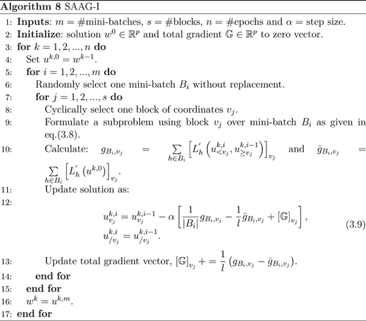

SAAG-II 方法由 eq.(3.11) 给出，并由 Algorithm 9 展示。SAAG-II 算法与 SAAG-I 类似，并使用 BBOF 框架为解决大数据问题提供高效且可扩展的解决方案。与后者类似，它在小批量数据点上计算两个部分梯度，并使用在每个时代开始时计算的所有数据点上的一个梯度来进行方差减小。因此，SAAG-I 和 SAAG-II 算法之间的区别仅在于平均梯度计算的值，前者从零向量开始保留前几次迭代的值，而后者在每个时代开始时计算完整梯度。

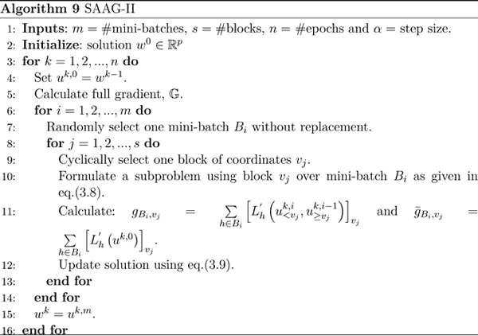

# 其他方差减小方法的扩展

SAG, SAGA, SVRG 和 S2GD 是 SGD 设置中众所周知的方差减小方法。SVRG 已扩展到小批量和块坐标设置，用于方差减小，在 MRBCD \[152\] 和 BSG \[140\] 中。在本章中，SAG, SAGA 和 S2GD 也扩展到此设置，以便与 SAAG 方法进行比较。为了密切研究所有这些方法在小批量和块坐标设置中的情况，参数更新规则由 eqs. (3.10–3.15) 给出，其中 `u[v[j]]^(k,i)` 表示在 `i`^th 小批量 `B[i]` 上 `v[j]` 坐标块的 `k`^th 参数更新规则，`u[< v[j]]^(k,i)` 表示 `u^(k,i)` 中已计算的变量，`u[≥ v[j]]^(k,i-1)` 表示 `u^(k,i-1)` 中尚未推进到迭代 `(k,i)` 的变量，同时正在更新 `v[j]` 坐标块的变量。从以下方程中可以清楚地看出，SAAG-I 像 SAG 和 SAGA 一样，通过保存小批量上的部分梯度来维护前几次迭代的完整梯度，但 SAAG-II 像 S2GD 和 SVRG 一样，在时代开始时计算完整梯度，并在内部循环中使用它来减小梯度值的方差。S2GD 和 SVRG 具有相似的参数更新规则，尽管不同的学习算法，因此只给出 SVRG。

# SAAG-I

$$\\begin{array}{l} \\begin{array}{ll} {u\_{v\_{j}}^{k,i} = \\,} & {u\_{v\_{j}}^{k,i - 1} - \\alpha\\left\\lbrack {\\frac{1}{\\left| B\_{i} \\right|}{\\sum\\limits\_{h \\in B\_{i}}\\left\\lbrack {L\_{h}^{{}^{\\prime}}\\left( {u\_{< v\_{j}}^{k,i},u\_{\\geq v\_{j}}^{k,i - 1}} \\right)} \\right\\rbrack\_{v\_{j}}} - \\frac{1}{l}{\\sum\\limits\_{h \\in B\_{i}}\\left\\lbrack {L\_{h}^{{}^{\\prime}}\\left( u^{k,0} \\right)} \\right\\rbrack\_{v\_{j}}}}~ \\right.} \\\\ \\, & {+ \\,\\left. ~{\\frac{1}{l}{\\sum\\limits\_{h = 1}^{l}\\left\\lbrack {L\_{h}^{{}^{\\prime}}\\left( {u\_{< v\_{j}}^{k,i},u\_{\\geq v\_{j}}^{k,i - 1}} \\right)} \\right\\rbrack\_{v\_{j}}}} \\right\\rbrack} \\\\ \\end{array} \\\\ \\end{array}$$  

(3.10)

# SAAG-II

$$\\begin{array}{l} \\begin{array}{l} {u\_{v\_{j}}^{k,i} = u\_{v\_{j}}^{k,i - 1} - \\alpha\\left\\lbrack {\\frac{1}{\\left| B\_{i} \\right|}{\\sum\\limits\_{h \\in B\_{i}}\\left\\lbrack {L\_{h}^{{}^{\\prime}}\\left( {u\_{< v\_{j}}^{k,i},u\_{\\geq v\_{j}}^{k,i - 1}} \\right)} \\right\\rbrack\_{v\_{j}}} - \\frac{1}{l}{\\sum\\limits\_{h \\in B\_{i}}\\left\\lbrack {L\_{h}^{{}^{\\prime}}\\left( u^{k,0} \\right)} \\right\\rbrack\_{v\_{j}}} + \\frac{1}{l}{\\sum\\limits\_{h = 1}^{l}\\left\\lbrack {L\_{h}^{{}^{\\prime}}\\left( u^{k,0} \\right)} \\right\\rbrack\_{v\_{j}}}} \\right\\rbrack} \\\\ \\end{array} \\\\ \\end{array}$$  

(3.11)

# SAGA

$$\\begin{array}{l} \\begin{array}{ll} {u\_{v\_{j}}^{k,i} = \\,} & {u\_{v\_{j}}^{k,i - 1} - \\alpha\\left\\lbrack {\\frac{1}{\\left| B\_{i} \\right|}{\\sum\\limits\_{h \\in B\_{i}}\\left\\lbrack {L\_{h}^{{}^{\\prime}}\\left( {u\_{< v\_{j}}^{k,i},u\_{\\geq v\_{j}}^{k,i - 1}} \\right)} \\right\\rbrack\_{v\_{j}}} - \\frac{1}{\\left| B\_{i} \\right|}{\\sum\\limits\_{h \\in B\_{i}}\\left\\lbrack {L\_{h}^{{}^{\\prime}}\\left( u^{k,0} \\right)} \\right\\rbrack\_{v\_{j}}}}~ \\right.} \\\\ \\, & {+ \\,\\left. ~{\\frac{1}{l}{\\sum\\limits\_{h = 1}^{l}\\left\\lbrack {L\_{h}^{{}^{\\prime}}\\left( {u\_{< v\_{j}}^{k,i},u\_{\\geq v\_{j}}^{k,i - 1}} \\right)} \\right\\rbrack\_{v\_{j}}}} \\right\\rbrack} \\\\ \\end{array} \\\\ \\end{array}$$  

(3.12)

# SAG

$$\\begin{array}{l} \\begin{array}{ll} {u\_{v\_{j}}^{k,i} = \\,} & {u\_{v\_{j}}^{k,i - 1} - \\alpha\\left\\lbrack {\\frac{1}{l}{\\sum\\limits\_{h \\in B\_{i}}\\left\\lbrack {L\_{h}^{{}^{\\prime}}\\left( {u\_{< v\_{j}}^{k,i},u\_{\\geq v\_{j}}^{k,i - 1}} \\right)} \\right\\rbrack\_{v\_{j}}} - \\frac{1}{l}{\\sum\\limits\_{h \\in B\_{i}}\\left\\lbrack {L\_{h}^{{}^{\\prime}}\\left( u^{k,0} \\right)} \\right\\rbrack\_{v\_{j}}}}~ \\right.} \\\\ \\, & {+ \\,\\left. ~{\\frac{1}{l}{\\sum\\limits\_{h = 1}^{l}\\left\\lbrack {L\_{h}^{{}^{\\prime}}\\left( {u\_{< v\_{j}}^{k,i},u\_{\\geq v\_{j}}^{k,i - 1}} \\right)} \\right\\rbrack\_{v\_{j}}}} \\right\\rbrack} \\\\ \\end{array} \\\\ \\end{array}$$  

(3.13)

# SVRG

$$\\begin{array}{l} \\begin{array}{ll} {u\_{v\_{j}}^{k,i} = \\,} & {u\_{v\_{j}}^{k,i - 1} - \\alpha\\left\\lbrack {\\frac{1}{\\left| B\_{i} \\right|}{\\sum\\limits\_{h \\in B\_{i}}\\left\\lbrack {L\_{h}^{{}^{\\prime}}\\left( {u\_{< v\_{j}}^{k,i},u\_{\\geq v\_{j}}^{k,i - 1}} \\right)} \\right\\rbrack\_{v\_{j}}} - \\frac{1}{\\left| B\_{i} \\right|}{\\sum\\limits\_{h \\in B\_{i}}\\left\\lbrack {L\_{h}^{{}^{\\prime}}\\left( u^{k,0} \\right)} \\right\\rbrack\_{v\_{j}}}}~ \\right.} \\\\ \\, & {+ \\,\\left. ~{\\frac{1}{l}{\\sum\\limits\_{h = 1}^{l}\\left\\lbrack {L\_{h}^{{}^{\\prime}}\\left( u^{k,0} \\right)} \\right\\rbrack\_{v\_{j}}}} \\right\\rbrack} \\\\ \\end{array} \\\\ \\end{array}$$  

(3.14)

# MBGD


$$\\begin{array}{l} \\begin{array}{l} {u\_{v\_{j}}^{k,i} = u\_{v\_{j}}^{k,i - 1} - \\frac{\\alpha}{\\left| B\_{i} \\right|}{\\sum\\limits\_{h \\in B\_{i}}\\left\\lbrack {L\_{h}^{{}^{\\prime}}\\left( {u\_{< v\_{j}}^{k,i},u\_{\\geq v\_{j}}^{k,i - 1}} \\right)} \\right\\rbrack\_{v\_{j}}}} \\\\ \\end{array} \\\\ \\end{array}$$

(3.15)

**复杂度分析** 所有方法的每次迭代复杂度均为 `O(Bv)`（假设小批量大小 `B` 和块大小 `v` 均为常数），其复杂度可根据机器性能进行控制，而 GD 方法的复杂度 `O(lp)` 可能无法处理。采用与算法 7 相同的算法结构，S2GD、SVRG 和 SAAG-II 每个时期的分量梯度评估次数为 `l`（计算时期开始时的全梯度）+ `2*l*(2*B*m`（其中 `B*m = l`），但对于 SAG、SAGA 和 SAAG-I，则为 `2*l`，因为它们从之前的迭代中维护全梯度，不在时期开始时计算。从技术上讲，后一种情况每个时期仅需 `l` 次梯度评估，代价是保存梯度，这通常需要 `O(lp)` 额外内存，但仅需 `O(l)` 内存即可求解由等式 (3.3) 给出的问题。

## 3.3 分析

## 3.4 数值实验

在本节中，实验结果³

### 3.4.1 实验设置

在本实验中，求解等式 (3.3) 给出的逻辑回归问题。由于 BSG 和 MRBCD 使用 SVRG 进行方差减少，因此在我们的实验设置下，BSG、MRBCD 和 SVRG 扩展到小批量和块坐标设置变得相同，因此实验中仅提及 SVRG。所有方法都使用与算法 (7) 相同的算法结构，仅在第 7 步的更新规则（方差减少方法）上有所不同。所有方法都使用平均梯度值进行方差减少，该值要么在时期开始时计算，要么从之前的迭代中维护。为了存储全梯度，仅使用长度为 `l` 的向量，因为它为每个数据点仅存储常数值，而不是存储完整的梯度向量（后者将占用 `l * p` 的内存空间）。步长使用两种不同的方法计算，即回溯线搜索方法和使用 Lipschitz 常数确定的常数步长。值得注意的是，在回溯线搜索中对大数据问题使用所有数据点可能非常昂贵，因此回溯线搜索仅在选定的小批量上执行，所有方法的参数值为 `β = 0.5`（用于减小步长）和 `γ = 0.1`（即，允许目标函数下降 10%）。使用 Lipschitz 常数 `L` 时，所有方法的步长均取为 `1/L`。需要注意的是，所有实验均在 *单节点，MacBook Air (8 GB 1600 MHz DDR3, 1.6 GHz Intel Core i5, 256 SSD)* 上进行。对于所有方法，正则化参数设置为 `C = 1/l`。

### 3.4.2 相对于时期的收敛性

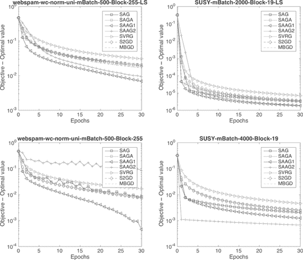

FIGURE 3.1 线搜索方法（第一行）和常数步长（第二行）的结果。

图 3.1 展示了使用基准数据集的实验结果（数据集详情见表 1.1），采用了不同的小批量和块大小。图表绘制了目标函数值与最优值之差相对于时期数量的曲线。从实验结果中可以得出以下观察：（i）一般来说，SAAG 方法，即 SAAG-I 和 SAAG-II，收敛速度快于其他求解器，且 SAAG-II 优于所有其他方法。（ii）一般来说，随着小批量和块大小的增加，SAAG 方法相对于其他求解器表现更好，但对于较小的大小，例如小批量为一个数据点时，它们表现不佳。（iii）使用线搜索方法和使用 Lipschitz 常数确定步长的结果相似，证明了 SAAG 方法优于其他方法的优越性。（iv）如不同求解器方程所预期，当块大小等于特征数且小批量大小等于数据点数时，即在 GD 方法设置下，所有方法收敛完全相同（由于空间限制，未包含图表）。（v）相对于时间的次优性图表显示了与相对于时期的次优性相似的结果（有关结果请参阅 子节 3.4.3）。（vi）线搜索结果比常数步长更平滑。此外，线搜索结果对于 SUSY 优于常数步长，但对于其他数据集，常数步长效果更好。主要原因是使用 Lipschitz 常数获得的步长较大，有时甚至大于一，而线搜索的最大步长为一且不断减小；另一个可能的原因是线搜索在选定的小批量上执行，而不是在完整数据集上执行。（vii）SUSY 仅有 18 个特征，因此块大小取为特征数量，此外，对于 webspam 使用了所有特征。这些实验构成小批量随机梯度设置，并证明了 SAAGs 在此设置下的有效性，并且可以通过设置 `v = p` 为此设置获得算法和公式。

### 3.4.3 相对于时间的收敛性

在描绘于 图 3.2 的实验中，目标函数值与最优值之差相对于不同方法的训练时间进行了绘制。如图所示，SAAGs 优于其他方法，与相对于时期数量的结果相似。SAAG-I 在使用回溯线搜索时优于其他方法，但 SAAG-II 在使用常数步长时优于其他方法。

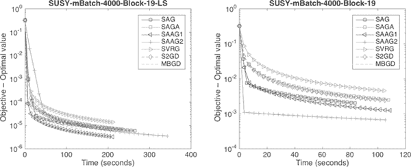

FIGURE 3.2 线搜索方法（左侧）和使用 Lipschitz 常数的常数步长（右侧）在 SUSY 数据集上的相对于训练时间的次优性。

## 3.5 结论与未来展望

在本章中，小批量和块坐标设置，即随机近似和坐标下降方法的结合，已被提出作为可扩展优化框架，即 BBOF，与任何求解器无关，用于解决大数据问题。但观察到，随机近似和坐标下降结合在一起时效果不佳，因为优势在实现批量块优化框架的额外开销中丢失了。BBOF 已与梯度下降作为求解器进行讨论，并提出并使用了两种新的方差减少方法（SAAG-I 和 SAAG-II）来求解强凸和光滑问题。理论结果证明了线性收敛性，基准数据集的实证结果证明了所提方法相对于现有方差减少方法具有更快的收敛性。BBOF 和 SAAG 可以扩展到并行和分布式设置，以及非凸问题。此外，还有改进所提方差减少方法理论特性的空间。

# 第 4 章 方差减少方法

DOI: [10.1201/9781003240167-4](http://doi.org/10.1201/9781003240167-4)


随机近似是处理大规模机器学习问题的有效方法之一，近期研究主要集中在减少由梯度的噪声近似引起的方差。在本章中，我们提出了 `SAAG-I` 和 `II` (`Stochastic Average Adjusted Gradient`) Chauhan et el. (2017) \[23\] 的新变体，分别称为 `SAAG-III` 和 `IV`。与 `SAAG-I` 不同，`SAAG-III` 中的起点设置为上一时代的平均值；与 `SAAG-II` 不同，`SAAG-IV` 中的快照点和起点分别设置为上一时代的平均值和最后一次迭代值。为了确定步长，我们使用 `Stochastic Backtracking-Armijo line Search` (`SBAS`），它仅在选定的数据点小批量上执行线搜索。由于回溯线搜索不适合大规模问题，且用于寻找步长的常数（如 `Lipschitz constant`）并不总是可用，因此 `SBAS` 在此类情况下可能非常有效。我们将 `SAAGs` (`I`, `II`, `III`, `IV`) 扩展以求解非光滑问题，并为光滑和非光滑问题设计了两个更新规则。此外，我们的理论结果证明了 `SAAG-IV` 在光滑性和强凸性的所有四种组合下具有线性收敛性（期望意义下）。最后，我们的实验研究证明了所提方法相较于最先进技术的有效性。

## 4.1 引言

请参阅 `Section 3.1` 了解关于大数据挑战以及为应对该挑战所需高效且可扩展算法的讨论。

方差定义为在整个数据集上计算的梯度与在随机选定的数据点上计算的梯度之间的差异。这种方差可能导致随机梯度方法发散或减慢方法的收敛速度。方差减少的不同方法包括小批量、降低学习率、重要性采样和方差减少技术。在此，我们通过扩展 `SAAG-I` 和 `II` 来求解大规模学习问题，提出了新的方差减少方法。

### 4.1.1 优化问题

在本章中，我们考虑复合凸优化问题，如下所示：

```
\begin{array}{l} {\underset{w \in {\mathbb{R}}^{d}}{\min}\,\,\,\left\{ {F(w) = f(w) + g(w) = \frac{1}{n}{\sum\limits_{i = 1}^{n}f_{i}}(w) + g(w),} \right\}} \\ \end{array}
```

(4.1)

其中 `f(w)` 是分量函数 `fi`:ℝ^(*d*)→ℝ 的有限平均，`i`=1,2,...,*n* 为凸且光滑，`g(w)`:ℝ^(*d*)→ℝ 是一个相对简单的凸函数，但可能不可微（也称为正则化项，有时也称为近端函数）。这类优化问题可在运筹学、数据科学、信号处理、统计学和机器学习中找到。例如，正则化经验风险最小化（`ERM`）问题是机器学习中的常见问题，即训练数据集上损失的平均值。在 `ERM` 中，分量函数 `fi` 表示某个数据点处的损失函数值，例如，在二分类中，它可以是对数损失，即 `fi` = log (1+exp(−*y*[*i*]*w*^(*T*)*x*[*i*]))，其中 {(*x*[1],*y*[1]),(*x*[2],*y*[2]),...,(*x*[*n*],*y*[*n*])} 是训练数据点的集合；也可以是铰链损失，即 `fi` = max (0,1−*y*[*i*]*w*^(*T*)*x*[*i*]）；对于回归问题，它可以是最小二乘，即 `fi` = 1/2(*w*^(*T*)*x*[*i*] − *y*[*i*])²。正则化项可以是 *λ*[1]∥*w*∥[1] (`l[1]`-正则化项)、*λ*[2]/2∥*w*∥² (`l[2]`-正则化项) 和 *λ*[1]∥*w*∥[1] + *λ*[2]/2∥*w*∥²（弹性网正则化项），其中 *λ*[1] 和 *λ*[2] 是正则化系数。因此，逻辑回归、`SVM`、岭回归和 `lasso` 等问题均属于 `ERM`。

### 4.1.2 优化问题的求解技术

求解问题 (4.1) 的简单一阶方法由柯西在其 1847 年的开创性著作中提出，称为 `Gradient Descent` (`GD`) 方法 \[20\]，对于 `(*k* + 1)^(*t**h*)` 次迭代，其表达式如下：

```
\begin{array}{l} {w_{k + 1} = w_{k} - \eta_{k}\left\lbrack {\frac{1}{n}{\sum\limits_{i = 1}^{n}\nabla}f_{i}(w_{k}) + \nabla g(w_{k})} \right\rbrack,} \\ \end{array}
```

(4.2)

其中 `η[k]` 是学习率（在优化中也称为步长）。对于非光滑正则化项，即当 `g(w)` 非光滑时，通常在梯度步之后计算近端步，该方法称为 `Proximal Gradient Descent` (`PGD`)，表达式如下：

```
\begin{array}{l} {w_{k + 1} = Prox_{\eta_{k}}^{g}\left( z_{k} \right) = \underset{w \in {\mathbb{R}}^{d}}{\arg\min}\left\{ {\frac{1}{2\eta_{k}}\| w - z_{k}\|^{2} + g(w)} \right\},} \\ \end{array}
```

(4.3)

其中 $z_{k} = w_{k} - \eta_{k}/n{\sum\limits_{i = 1}^{n}\nabla}f_{i}(w_{k})$。`GD` 对强凸且光滑的问题具有线性收敛性，而 (4.3) 对非强凸问题的收敛速率为 `O(1/k²)`，其中 `k` 是迭代次数。`GD` 和 `PGD` 方法的每次迭代复杂度为 `O(nd)`。由于对于大规模学习问题，数据点数量 `n` 和/或每个数据点的特征数量 `d` 非常大，因此这些方法的每次迭代复杂度非常大，每次迭代计算成本高昂，甚至可能对于容量有限的机器来说无法处理，这导致机器学习模型训练缓慢。因此，挑战在于开发高效算法来处理大规模学习问题\[23\]。

为应对这一挑战，随机近似是一种流行的方法，最初由 Robbins 和 Monro 在其 1951 年的开创性著作中提出，该方法使每次迭代独立于数据点数量 \[113\]。基于这种方法，我们有 `Stochastic Gradient Descent` (`SGD`) 方法 \[14\]，如下所示，用于求解光滑情况下的问题 (4.1)：

```
\begin{array}{l} {w_{k + 1} = w_{k} - \eta_{k}\left\lbrack {\nabla f_{i_{k}}(w_{k}) + \nabla g(w_{k})} \right\rbrack,} \\ \end{array}
```

(4.4)

其中 `i[k]` 从 1,2, …, n 中均匀随机选择，且 `η[k] ∝ 1/√k`。`SGD` 的每次迭代复杂度为 `O(d)`，对于处理数据点数量众多的问题非常有效。由于 `E[∇f[i[k]](w[k])]` = `∇f(w[k])`，`∇f[i[k]](w[k])` 是 `∇f(w[k])` 的无偏估计量，但这两个值之间的方差需要降低学习率。这导致学习算法收敛缓慢。最近，大量研究致力于减少 `∇f[i[k]](w[k])` 和 `∇f(w[k])` 之间的方差。第一个方差减少方法由 \[74\] 引入，称为 `SAG` (`Stochastic Average Gradient`)，其他一些常见和最新的方法包括 `SVRG` (`Stochastic Variance Reduced Gradient`) \[63\]、`Prox-SVRG` \[138\]、`S2GD` (`Semi-Stochastic Gradient Descent`) \71, [142\]、`SAGA` \[35\]、`Katyusha` \[4\]、`VR-SGD` (`Variance Reduced Gradient Descent`) \[39\]、`SAAG-I`, `II` \[23\] 等。与 `GD` 类似，这些方法利用全梯度；与 `SGD` 类似，这些方法在每次迭代中计算一个（或少数几个）数据点的梯度。因此，就像 `GD` 一样，这些方法对强凸且光滑的问题具有线性收敛性；就像 `SGD` 一样，它们使用一个（或少数几个）数据点计算梯度，并且具有较低的每次迭代复杂度。因此，方差减少方法兼具 `GD` 和 `SGD` 的优点。请参阅 \[16\] 了解关于求解大规模机器学习问题的优化方法的综述。在本章中，我们提出了 `SAAG-I` 和 `II` 的新变体，称为 `SAAG-III` 和 `IV`，作为方差减少技术。

### 4.1.3 贡献

本章的研究贡献总结如下：


*   提出了 SAAG-I 和 II 的新变体，分别称为 SAAG-III 和 SAAG-IV。与 SAAG-I 不同，对于 SAAG-III，起始点设置为上一时代迭代的平均值（第一个除外），$w\_{0}^{s + 1} = 1/m{\\sum\\limits\_{i = 1}^{m}w\_{i}^{s}}$，其中 `m` 是内部迭代次数。与 SAAG-II 不同，对于 SAAG-IV，起始点和快照点分别设置为上一时代的最后一次迭代和平均值（第一个除外），`w[0]^(s + 1) = w[m]^(s)` 和 `${\\widetilde{w}}\_{0}^{s} = 1/m{\\sum\\limits\_{i = 1}^{m}w\_{i}^{s}}$。

*   SAAG-I 和 II（包括 SAAG-III 和 IV）已扩展，通过引入平滑和非平滑情况的两种不同更新规则来解决具有非平滑正则化器的问题（详情请参阅 第 4.3 节 和 4.4）。

*   理论结果证明，SAAG-IV 在平滑性和强凸性的所有四种组合情况下均具有期望线性收敛性。

*   最后，实证结果证明了所提方法相对于最先进的方法（如 SVRG 和 VR-SGD）的有效性。

## 4.2 符号与相关工作

本节讨论本章中使用的符号和相关工作。

### 4.2.1 符号

训练数据集表示为 `{(*x*[1],*y*[1]),(*x*[2],*y*[2]),...,(*x*[*n*],*y*[*n*])}`，其中 `n` 是数据点的数量，`x[i] ∈ ℝ^(d)`，`d` 是特征的数量。`w` 表示参数向量，`λ[i]`，`i = 1, 2` 表示正则化参数。`∥ ⋅ ∥` 表示欧几里得范数，也称为 `l[2]-norm`，`∥ ⋅ ∥[1]` 表示 `l[1]-norm`。`L` 和 `μ` 分别用于表示问题的 `L-smoothness` 和 `μ-strong convexity`。`η[k]^(s)` 表示学习率，`s ∈ {1,2,...,S}` 表示时代编号，`S` 是时代总数。`b` 表示小批量大小，`k ∈ {1,2,...,m}` 表示内部迭代次数，即 `n = m*b`。在 `(x[i], y[i])` 处的损失函数值由分量函数 `f[i]` 表示。`w^(*) = arg min[w]F(w)`，`F(w^(*)` 是最优目标函数值，有时也表示为 `F^(*)`。

### 4.2.2 相关工作

为了求解平滑正则化器的问题 (4.1)，一种简单的方法是 GD，由 `[20]` 给出，对于强凸和平滑问题，它具有线性收敛性。对于非平滑正则化器，通常将近端步应用于 GD 步，称为 PGD 方法，对于非强凸问题，其收敛速率为 `O(1/k²)`。GD 和 PGD 的每次迭代复杂度为 `O(n*d)`，对于大规模学习问题来说非常大，导致模型训练缓慢。随机近似是应对这一挑战的一种方法。它最初由 Robbins 和 Monro `[113]` 引入，对于处理数据点数量非常多的问题非常有效，因为每次迭代只使用一个（或少数几个）数据点，如 SGD `[14]` 中所示。在 SGD 中，每次迭代比 GD 快 `n` 倍，因为它们的每次迭代复杂度分别为 `O(d)` 和 `O(n*d)`。由于梯度的方差，SGD 需要递减学习率，即 `k^(t*h)` 次迭代的 `η_k ∝ 1/√k`，因此即使对于强凸问题，其收敛速度也比 GD 慢，收敛速率为次线性 `O(1/T)` `[110]`。有几种方法可以处理随机噪声，但其中最重要的是（如 `[34]` 中所讨论）：(a) 使用小批量 `[142]`，(b) 递减学习率 `[118]`，(c) 方差减少 `[74]`，以及 (d) 重要性采样 `[34]`。

方差减少技术最初由 `[74]` 引入，称为 SAG，对于强凸和平滑问题，它像 GD 一样具有线性收敛性，并且在每次迭代中使用一个随机选择的数据点，类似于 SGD。SAG 兼具 GD 和 SGD 的优点，因为它像 GD 一样在强凸和平滑情况下具有线性收敛性，但其每次迭代复杂度与 SGD 相同。后来，提出了许多方差减少方法，如 SVRG `[63]`、SAGA `[35]`、S2GD `[71]`、SDCA `[120]`、SPDC `[149]`、Katyusha `[4]`、Catalyst `[87]`、SAAG-I, II `[23]`、VR-SGD `[39]` 等。这些方差减少方法可以使用恒定学习率，并可分为三类（如 `[39]` 中所讨论）：(a) 可应用于原始优化问题的原始方法，如 SAG、SAGA、SVRG 等，(b) 可应用于对偶问题的对偶方法，如 SDCA，以及 (c) 涉及原始和对偶变量的原始-对偶方法，如 SPDC 等。

在本章中，我们提出了 SAAG-I 和 II 的新变体，分别命名为 SAAG-III 和 SAAG-IV。与 SAAG-I 不同，对于 SAAG-III，起始点设置为上一时代迭代的平均值（第一个除外），$w\_{0}^{s + 1} = 1/m{\\sum\\limits\_{i = 1}^{m}w\_{i}^{s}}$，其中 `m` 是内部迭代次数。与 SAAG-II 不同，对于 SAAG-IV，起始点和快照点分别设置为上一时代的最后一次迭代和平均值（第一个除外），`w[0]^(s + 1) = w[m]^(s)` 和 `${\\widetilde{w}}\_{0}^{s} = 1/m{\\sum\\limits\_{i = 1}^{m}w\_{i}^{s}}$。`[23]` 提出了批量块优化框架（BBOF）来应对机器学习中的大数据（大规模学习）挑战，并附带两种方差减少方法 SAAG-I 和 II。BBOF 基于随机近似（SA）的最佳方法和坐标下降（CD）的最佳方法（另一种非常有效的方法，用于处理大规模学习问题，尤其是高维问题）。基于 SA 和 CD 方法的最佳思想也用于 `133, 140, [146, 152]`，`[146]` 将其称为双随机，因为在每次迭代中都会对数据点和坐标进行采样。观察到，对于 ERM，在实践中很难获得 BBOF 的优势，因为 CD 或 SGD 的结果比 BBOF 设置更快，因为 BBOF 在采样和更新坐标块时需要额外的计算。当更新一组坐标并移动到另一组时，部分梯度需要参数向量（`w`）和数据点（如逻辑回归）的点积。由于每次更新都会改变 `w`，因此每组更新都需要计算点积。另一方面，如果一次性更新所有坐标，如在 SGD 中，则只需计算一次点积。尽管类似高斯-赛德尔的参数更新有助于比 SGD 更快的收敛，但由于额外的计算负载，总体收益较小。此外，SAAG-I 和 II 已被提出用于 BBOF（小批量和块坐标）设置以及小批量（考虑所有坐标）设置。由于 BBOF 对 ERM 帮助不大，因此 SAAG-III 和 IV 仅针对小批量设置提出。SAAGs（I、II、III 和 IV）可以扩展到随机设置（每次迭代考虑一个数据点），但 SAAG-I 和 II 在随机设置下不稳定，而 SAAG-III 和 IV 在随机设置下无法击败现有方法。SAAGs 已扩展到处理平滑和非平滑正则化器，如我们使用了两种不同的更新规则，类似于 `[39]`（详情请参阅 第 4.3 节）。

## 4.3 SAAG-I, II 和近端扩展

最初，`[23]` 为平滑问题提出了 SAAG-I 和 II，我们已将 SAAG-I 和 II 扩展到非平滑问题。与对平滑和非平滑问题都使用单一更新规则的近端方法不同，我们使用了两种不同的更新规则，并为非平滑问题引入了近端步。对于大小为 `b` 的小批量 `B[k]`、时代 `s` 和内部迭代 `k`，SAAG-I 和 II 如下所示：

SAAG-I：


$$\\begin{array}{l} \\begin{array}{ll} \\text{smooth} & {w\_{k + 1}^{s} = w\_{k}^{s} - \\eta\_{k}^{s}\\left\\lbrack {{\\sum\\limits\_{i = 1}^{n}\\tau\_{i}^{s,k}} + \\nabla g(w\_{k}^{s})} \\right\\rbrack,} \\\\ \\text{非光滑~} & {w\_{k + 1}^{s} = Prox\_{\\eta\_{k}^{s}}^{g}\\left( {w\_{k}^{s} - \\eta\_{k}^{s}{\\sum\\limits\_{i = 1}^{n}\\tau\_{i}^{s,k}}} \\right),} \\\\ \\end{array} \\\\ \\end{array}$$

(4.5)

where $\\tau\_{i}^{s,k} = \\left\\{ \\begin{array}{l} {\\frac{1}{b}\\nabla f\_{i}(w\_{k}^{s})\\quad\\text{如果}\\, i \\in B\_{k}} \\\\ {\\frac{1}{l}{\\widetilde{\\tau}}\_{i}^{s,k}\\quad\\text{否则}} \\\\ \\end{array}~ \\right.$ and ${\\widetilde{\\tau}}\_{i}^{s,k} = \\left\\{ \\begin{array}{l} {\\nabla f\_{i}(w\_{k}^{s})\\quad\\text{如果}\\, i \\in B\_{k}} \\\\ {{\\widetilde{\\tau}}\_{i}^{s - 1,k}\\quad\\text{否则}.} \\\\ \\end{array}~ \\right.$

SAAG-II:

$$\\begin{array}{l} \\begin{array}{ll} \\text{smooth} & {w\_{k + 1}^{s} = w\_{k}^{s} - \\eta\_{k}^{s}\\left\\lbrack {\\widetilde{\\nabla}f\_{B\_{k}}(w\_{k}^{s}) + \\nabla g(w\_{k}^{s})} \\right\\rbrack,} \\\\ \\text{非光滑~} & {w\_{k + 1}^{s} = Prox\_{\\eta\_{k}^{s}}^{g}\\left( {w\_{k}^{s} - \\eta\_{k}^{s}\\widetilde{\\nabla}f\_{B\_{k}}(w\_{k}^{s})} \\right),} \\\\ \\end{array} \\\\ \\end{array}$$

(4.6)

where $\\widetilde{\\nabla}f\_{B\_{k}}(w\_{k}^{s}) = 1/b{\\sum\\limits\_{i \\in B\_{k}}\\nabla}f\_{i}(w\_{k}^{s}) - 1/n{\\sum\\limits\_{i \\in B\_{k}}\\nabla}f\_{i}({\\widetilde{w}}^{s}) + {\\widetilde{\\mu}}^{s}$ and ${\\widetilde{\\mu}}^{s} = 1/n{\\sum\\limits\_{i = 1}^{n}\\nabla}f\_{i}({\\widetilde{w}}^{s})$. 与 SVRG 和 VRSGD 不同，与 SAG 和 SAGA 类似，SAAGs 是有偏梯度估计器，因为梯度估计器的期望不等于全梯度，即，$\\mathbb{E}\\lbrack\\widetilde{\\nabla}f\_{B\_{k}}(w\_{k}^{s})\\rbrack = \\nabla f(w\_{k}^{s}) + (m - 1)/m\\nabla f({\\widetilde{w}}^{s - 1})$，如 Lemma 6 中详细说明。

SAAG-I 算法，由 Algorithm 10 表示，将数据集划分为 *m* 个大小相等（例如）的小批量 *b*，并以 *S*（时代数）作为输入。在每次内部迭代期间，它从 *\[n\]* 中随机选择一个小批量数据点，计算小批量上的梯度，更新总梯度值，并在 *B*[*k*] 上执行随机回溯-Armijo 线搜索（SBAS）。然后，对于光滑正则化器使用选项 I，对于非光滑正则化器使用选项 II 来更新参数。内部迭代运行 *m* 次，其中 *n* = *m**b*，然后最后一次迭代作为下一个时代的起始点。

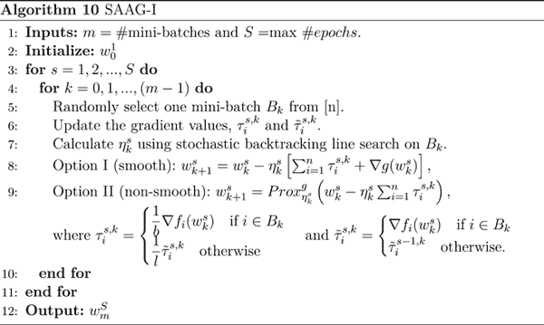

SAAG-II 算法，由 Algorithm 11 表示，以时代数（*S*）和大小相等（例如）的小批量数（*m*）作为输入。它初始化 *w*[0]¹ = *w̃*⁰。在每次内部迭代期间，它随机选择一个小批量 *B*[*k*]，计算最后一次迭代和快照点上 *B*[*k*] 的两个梯度，更新 $\\widetilde{\\nabla}f\_{B\_{k}}(w\_{k}^{s})$，并在 *B*[*k*] 上执行随机回溯-Armijo 线搜索（SBAS）。然后，对于光滑正则化器使用选项 I，对于非光滑正则化器使用选项 II 来更新参数。内部迭代之后，它使用最后一次迭代来设置快照点和下一个时代的起始点。

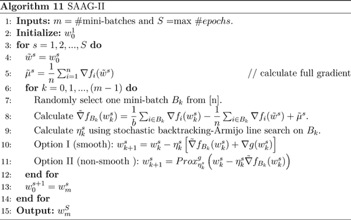

## 4.4  SAAG-III 和 IV 算法

SAAG-III 算法，由 Algorithm 12 表示，将数据集划分为 *m* 个大小相等（例如）的小批量 *b*，并以 *S*（时代数）作为输入。在每次内部迭代期间，它从 *\[n\]* 中随机选择一个小批量数据点 *B*[*k*]，计算小批量上的梯度，更新总梯度值，并在 *B*[*k*] 上执行随机回溯-Armijo 线搜索（SBAS）。然后，对于光滑正则化器使用选项 I，对于非光滑正则化器使用选项 II 来更新参数。内部迭代运行 *m* 次，其中 *n* = *m**b*，然后计算迭代平均值并用作下一个时代的起始点，$w\_{0}^{s + 1} = 1/m{\\sum\\limits\_{i = 1}^{m}w\_{i}^{s}}$。

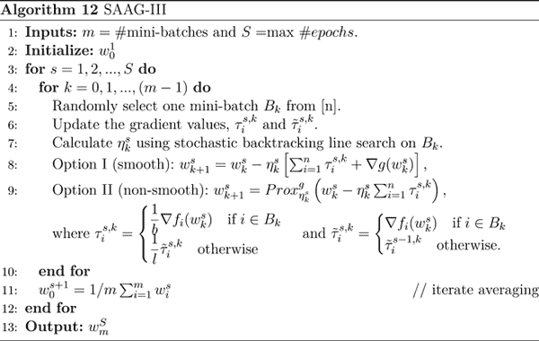

SAAG-IV 算法，由 Algorithm 13 表示，以时代数（*S*）和大小相等（例如）的小批量数（*m*）作为输入。它初始化 *w*[0]¹ = *w̃*⁰。在每次内部迭代期间，它随机选择一个小批量 *B*[*k*]，计算最后一次迭代和快照点上 *B*[*k*] 的两个梯度，更新 $\\widetilde{\\nabla}f\_{B\_{k}}(w\_{k}^{s})$，并在 *B*[*k*] 上执行随机回溯-Armijo 线搜索（SBAS）。然后，对于光滑正则化器使用选项 I，对于非光滑正则化器使用选项 II 来更新参数。内部迭代之后，它计算平均值来设置快照点，并使用最后一次迭代作为新时代的起始点，分别为 ${\\widetilde{w}}^{s} = 1/m{\\sum\\limits\_{i = 1}^{m}w\_{i}^{s}}$ 和 *w*[0]^(*s* + 1) = *w*[*m*]^(*s*)。

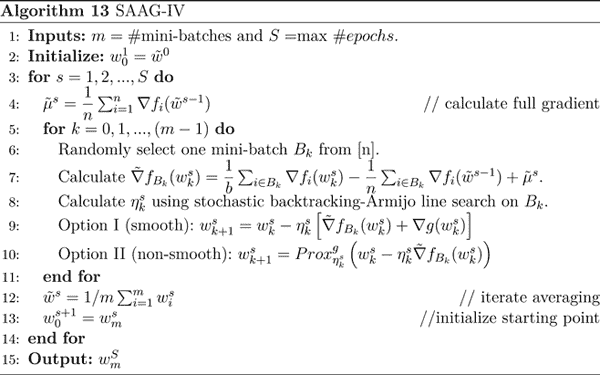

## 4.5  分析

一般来说，SAAG-IV 对于大规模学习问题的效果优于 SAAG-III。因此，在本节中，我们提供了考虑所有光滑性和强凸性情况的 SAAG-IV 收敛率。此外，由于梯度估计器的有偏性质以及全梯度是增量维护而不是像 SAAG-IV 那样在固定点计算，SAAG-III 的分析代表了一个典型案例。因此，SAAG-III 的分析留待未来研究。所有不同光滑性和强凸性组合的收敛率如下所示。

本章中考虑了以下假设：

我们的证明灵感来源于 \[39\] 和 \[138\]。在提供证明之前，我们首先给出以下引理：

遵循非光滑问题的 Lemma 2，可以轻松证明光滑问题的以下结果，

此处给出的所有证明都证明了 SAAG-IV 在光滑性和强凸性的四种组合下的线性收敛（根据收敛定义），结果中包含一些由于常数项引起的初始误差。SAAGs 基于实践中的直觉 \[23\]，它们试图比旧梯度值更重视最新的梯度值，这使得它们成为有偏技术，并导致了这个额外的常数项。这个常数项表明 SAAGs 收敛到靠近解的区域，这非常实际，因为所有机器学习算法都用于近似求解问题，我们永远无法找到问题的精确解 \[15]，因为计算上的困难。此外，这个常数项是由于最优点处的小批量梯度值引起的，即，$\\frac{1}{\\left| B\_{k} \\right|}{\\sum\\limits\_{i \\in B\_{k}}\\nabla}f\_{i}(w^{\*})$。如果小批量的大小增加并最终等于数据集大小，那么这个常数就等于全梯度并消失，即，$\\frac{1}{n}{\\sum\\limits\_{i = 1}^{n}\\nabla}f\_{i}(w^{\*}) = 0.$

正则化器的强凸性和光滑性的所有组合的线性收敛，是一阶方法在没有曲率信息的情况下表现出的最大收敛率。SAG、SVRG、SAGA 和 VR-SGD 也对强凸性和光滑问题表现出线性收敛，但除了 VR-SGD 之外，它们不涵盖所有情况，例如，SVRG 不涵盖非强凸情况。然而，VR-SGD 提供的理论结果证明了强凸情况下的线性收敛，类似于我们的结果，但 VR-SGD 对于非强凸情况仅提供 *O*(1/*T*) 收敛，而不像我们的线性收敛结果。

## 4.6  实验结果

在本节中，我们展示了实验结果⁵


### 4.6.1 实验设置

实验采用六种不同的标准进行报告，分别绘制次优性（目标值 – 最优值）与迭代次数（其中一个迭代次数指遍历数据集一次）、次优性与梯度 `n`、次优性与时间、准确率与时间、准确率与迭代次数以及准确率与梯度 `n` 的图表。x 轴和 y 轴的数据分别以线性尺度和对数尺度表示。实验使用以下二进制数据集：rcv1、news20、real-sim 和 Adult（也称为 a9a），其详细信息见表 1.1。所有数据集均按 80% 和 20% 分为训练数据集和测试数据集。除非另有说明，所有算法的正则化参数均设置为 `λ = 1 * 10^(-5)`（包括 `λ[1]`、`λ[2]`）。随机回溯-Armijo 线搜索（`SBAS`）的参数设置为：`α = 0.1`、`β = 0.5`，学习率初始化为 `η = 1.0`。内部迭代次数设置为 `m = n/b`（如文献 [39] 中所用）。此外，在 SBAS 中，算法最多搜索 10 次迭代，之后如果当前学习率降低了目标函数值，则返回该学习率，否则返回 0.0。这样做是为了避免因随机线搜索而导致算法陷入停滞。所有实验均在 MacBook Air（8 GB 1600 MHz DDR3，1.6 GHz Intel Core i5 和 256GB SSD）上使用 MEX 文件进行。

### 4.6.2 平滑问题的结果

结果采用 `l[2]`-正则化的逻辑回归问题报告，如下所示：

$$
\begin{array}{l} {\underset{w}{\min}\\, F(w) = \frac{1}{n}{\sum\limits_{i = 1}^{n}{\log}}\left( {1 + \exp\left( {- y_{i}w^{T}x_{i}} \right)} \right) + \frac{\lambda}{2}\| w\|^{2}.} \\\\ \end{array}
$$

(4.72)

图 4.1 报告了使用 news20 数据集的结果。SAAG-III 和 IV 优于 SVRG 和 VR-SGD，但 SAAG-IV 取得了最佳结果。这是因为随着小批量大小或数据集大小的增加，SAAG-II 和 SAAG-IV 的表现更好（如文献 [23] 所报告）。

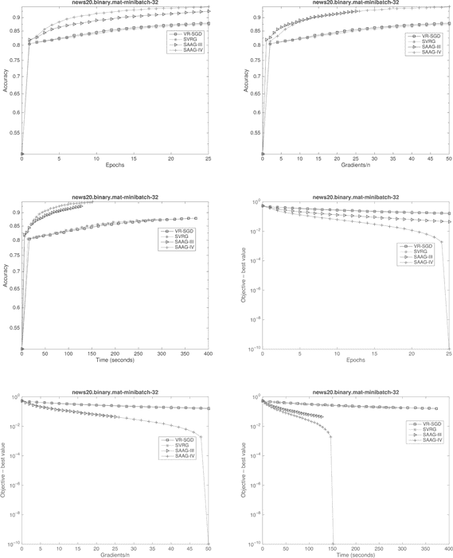

FIGURE 4.1 Comparison of SAAG-III, IV, SVRG and VR-SGD on smooth problem using news20 dataset with mini-batch of 32 data points.

### 4.6.3 非平滑问题的结果

结果采用弹性网正则化的逻辑回归问题（非平滑正则化项）报告，如下所示：

$$
\begin{array}{l} {\underset{w}{\min}\\, F(w) = \frac{1}{n}{\sum\limits_{i = 1}^{n}{\log}}\left( {1 + \exp\left( {- y_{i}w^{T}x_{i}} \right)} \right) + \frac{\lambda_{1}}{2}\| w\|^{2} + \lambda_{2}\| w\|_{1},} \\\\ \end{array}
$$

(4.73)

其中 $f(w) = \frac{1}{n}{\sum\limits_{i = 1}^{n}{\log}}\left( {1 + \exp\left( {- y_{i}w^{T}x_{i}} \right)} \right) + \frac{\lambda_{1}}{2}\| w\|^{2}$ 和 `g(w) = λ[2]∥w∥[1]`。

图 4.2 展示了 SAAG-III、IV、SVRG 和 VR-SGD 在 rcv1 数据集上的对比研究。如图所示，对于所有六种标准图表，SAAG-III 和 IV 优于 SVRG 和 VR-SGD，SAAG-IV 在次优性方面取得最佳结果，但在准确率方面，SAAG-III 和 IV 的表现接近，除了准确率与梯度 `n` 的图表，SAAG-III 取得更好的结果，因为 SAAG-III 仅在最后一次迭代时计算梯度，而 SAAG-IV 在快照点和最后一次迭代时计算梯度。

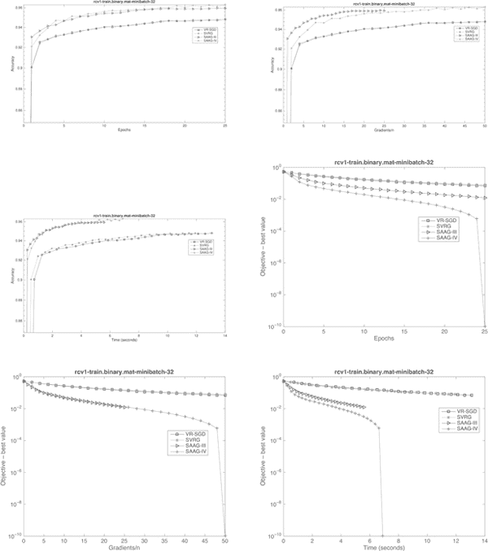

FIGURE 4.2 Comparison of SAAG-III, IV, SVRG and VR-SGD on non-smooth problem using rcv1 dataset with mini-batch of 32 data points.

### 4.6.4 小批量块坐标下降与小批量设置

本小节提供了经验证据，证明小批量块坐标下降设置（`BBOF`），即同时使用随机近似和坐标下降，效果不佳。图 4.3 比较了三种方法，即 SAG、SAAG-I 和 SAAG-II，不进行特征采样，即使用所有特征和使用 1000 个特征的块，以及 1000 个数据点的小批量。图表绘制了 rcv1 和 real-sim 数据集上次优性与训练时间的关系，并使用随机回溯线搜索方法来寻找学习率。从图中可以清楚地看出，双重采样方法，即使用 `BBOF` 设置的方法，远远落后于单重采样方法，即仅使用数据采样和所有特征的方法。因此，不适合将随机近似和坐标下降方法结合使用，因为每次迭代复杂度低的优势在双重采样导致的实现开销中丧失了。但是，如果我们能找到降低实现开销的方法，那么 `BBOF` 可能对解决大数据问题非常有效。

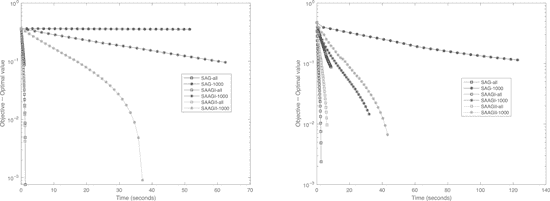

FIGURE 4.3 Comparison of BBOF setting with mini-batch setting on rcv1 (first) and real-sim (second) datasets using all features and a block size of 1000.

### 4.6.5 SVM 的结果

本小节将 SAAGs 与 SVRG 和 VR-SGD 在 mushroom 和 gisette 数据集上的 SVM 问题进行比较。方法使用随机回溯线搜索方法来寻找步长。图 4.4 展示了结果，并比较了次优性与训练时间（秒）的关系。结果与逻辑回归实验相似，但不够平滑。SAAGs 在 mushroom 数据集（第一行）和 gisette 数据集（第二行）上优于其他方法，在次优性与训练时间以及准确率与时间的关系上表现更好，但在 mushroom 数据集的准确率与训练时间方面，所有方法的结果几乎相似。SAAG-IV 优于其他方法，SAAG-III 有时会落后于 VR-SGD 方法。还观察到，逻辑回归的结果优于 SVM 问题的结果。SVM 的优化问题如下所示：

$$
\begin{array}{l} {\underset{w}{\min}\\, F(w) = \frac{1}{n}{\sum\limits_{i = 1}^{n}{\max}}\left( {0,1 - y_{i}w^{T}x_{i}} \right)^{2} + \frac{\lambda}{2}\| w\|^{2},} \\\\ \end{array}
$$

(4.74)

其中 `λ` 是正则化系数（也称为惩罚参数），用于平衡间隔大小和误差之间的权衡 [25]。

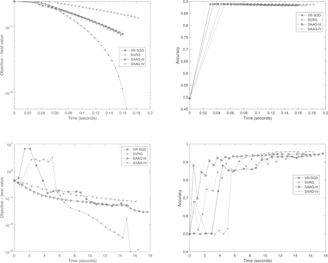

FIGURE 4.4 Results with SVM using mini-batch of 1000 data points on mushroom (first row) and gisette (second row) datasets.

## 4.7 结论

我们提出了 SAAG-I 和 II 的新型变体，分别称为 SAAG-III 和 IV，SAAG-III 使用迭代平均值作为起点，SAAG-IV 使用迭代平均值和最后一次迭代值分别作为快照点和起点，用于新的迭代周期，第一个周期除外。SAAGs（I、II、III 和 IV）也通过使用两种不同的更新规则并为非平滑问题引入近端步，扩展到求解非平滑问题。理论结果证明，在某些初始误差下，SAAG-IV 在平滑性和强凸性的四种组合中均具有线性收敛性（期望意义下）。实验结果证明了所提方法在准确率和次优性方面相对于现有方差降低方法的有效性，针对训练时间、迭代次数和梯度 `n`。

# 第 5 章 学习与数据访问

DOI: [10.1201/9781003240167-5](http://doi.org/10.1201/9781003240167-5)


模型的训练时间由两个主要部分组成：访问数据的时间和处理（从数据中学习）的时间。迄今为止，研究只关注了第二部分，即从数据中学习。在本章中，我们提出了一种可能的解决方案来处理机器学习中的大数据问题。其思路是通过提出系统采样和循环/顺序采样来从数据集中选择小批量，从而减少数据访问时间，进而降低训练时间。为了证明所提采样技术的有效性，我们采用了经验风险最小化（这是一种常用的机器学习问题），用于强凸和光滑情况。该问题使用 `SAG`、`SAGA`、`SVRG`、`SAAG-II` 和 `MBSGD`（小批量 SGD）求解，每种方法都采用两种步长确定技术，即常数步长和回溯直线搜索方法。理论结果表明，系统采样和循环采样的收敛性与广泛使用的随机采样技术相似（在期望意义下）。基准数据集的实证结果证明了所提采样技术的有效性，并表明训练速度最多可提高六倍。

## 5.1 引言

如今，主要挑战是开发高效且可扩展的学习算法来处理大数据问题，如 第 3.1 节 中详细讨论。模型的训练时间有两个主要组成部分 \[144\]，如下所示：

$$
\begin{array}{l}
{\text{训练时间} = \text{访问数据的时间} + \text{处理数据的时间}.}
\\
\end{array}
$$

(5.1)

众所周知，在处理任何数据或运行任何程序之前，应首先将其加载到内存中，更准确地说是加载到 `RAM`（随机存取存储器）中，从硬盘加载。将数据或程序从硬盘加载到内存所花费的时间称为访问时间。访问时间进一步包含三个组成部分，即寻道时间（读写头从当前位置移动到包含数据的磁道所需的时间）、旋转延迟时间（读写头从当前位置到达包含数据的扇区/块所需的时间）和传输时间（将数据从扇区/块通过磁盘传输到内存所需的时间）。此外，数据不是按内容读取，而是按块读取，其中每个块可以包含多个扇区。值得注意的是，存储在连续内存或近距离位置的数据，其数据访问时间比相互分散的数据要短。这是因为寻道、延迟和传输时间更少。在 `SSD`（固态硬盘）和 `RAM`（随机存取存储器）的情况下，没有寻道和延迟时间，因为它们没有移动部件，并且基于直接访问机制，但传输时间仍然发挥作用。由于数据是按块读取/写入的，因此对于连续数据访问，将有一个或两个传输时间，而分散数据访问将需要更多的传输时间。此外，缓存内存策略也有利于连续内存访问，并使其比分散数据访问更快。因此，无论数据存储在 `RAM`、`SSD` 还是 `HDD` 上，连续数据访问时间都比分散数据访问时间快。但是，对于 `HDD`，访问时间的差异会更加明显。

训练时间的第二个组成部分是处理（学习）时间，即 `CPU`（中央处理器）处理数据以求解模型参数所需的时间。由于小批量和迭代学习算法，数据的访问和处理是交错进行的，并且发生得非常频繁。数据访问时间取决于采样技术，而处理时间取决于用于求解问题的方法。到目前为止，为了提高训练时间，大部分精力都只集中在通过使用不同方法来提高处理时间上。训练时间取决于数据访问时间和数据处理时间，并且应当注意，通常情况下，数据访问时间远高于数据处理时间。因此，应同样努力来改进数据访问时间。本章试图通过使用系统采样技术 \[93, 94\] 和循环采样来减少大数据问题的训练时间，以从数据集中选择小批量数据点。

### 5.1.1 优化问题

经验风险最小化（`ERM`）问题 \[111\] 是机器学习和统计学中常用的问题，通常由损失函数和正则化项组成。在本章中，使用带有强凸性和光滑性假设的 `l2` 正则化 `ERM` 问题来演示所提采样技术的有效性。对于训练数据 {(`x`[1],`y`[1]),(`x`[2],`y`[2]),...,(`x`[`l`],`y`[`l`])}，其中 `x`[`i`] ∈ ℝ^(`n`)，`y`[`i`] ∈ ℝ，以及损失函数 `f`[1],`f`[2],...`f`[`l`]: ℝ^(`n`)→ℝ，模型参数向量 `w` ∈ ℝ^(`n`)，正则化系数 `C` > 0，`l2` 正则化 `ERM` 问题给出如下

$$
\begin{array}{l}
\begin{array}{l}
{\underset{w}{\min}\,\,\ f(w) = \frac{1}{l}{\sum\limits_{i = 1}^{l}f_{i}}(w) + \frac{C}{2}\| w\|^{2},}
\\
\end{array}
\\
\end{array}
$$

(5.2)

其中第一项是数据拟合项，第二项用于避免数据过拟合。常用的损失函数包括平方损失 (`w`^(`T`)`x`[`i`]−`y`[`i`])²、逻辑损失 log(1+`e`^`exp`(−`y`[`i`]`w`^(`T`)`x`[`i`])) 和铰链损失 max(0,1−`y`[`i`]`w`^(`T`)`x`[`i`])。在本章中，实验使用逻辑损失函数。当由等式 (5.2) 表示的问题是大规模或大数据问题时，使用传统方法（如梯度下降）的学习算法每次迭代的复杂度为 `O`(`n`*`l`)，这非常高。这是因为，此类问题具有大量的数据点（`l`）或大量的特征（`n`），或两者兼而有之，并且每次迭代在 `l` 个数据点上更新 `n` 个变量。由于每次迭代的计算复杂度很高，单台机器处理学习算法的单次迭代将非常昂贵，甚至不可行。随机逼近方法被广泛用于处理此类情况（例如，\[148, 63, 35, 19, 115, 23\]），它在每次迭代中使用一个数据点或一小批数据点。对于第 `j`^(`t`h) 次内部迭代的小批量 `B`[`j`] 数据点，缩减的子问题给出如下

$$
\begin{array}{l}
\begin{array}{l}
{\underset{w}{\min}\,\,\frac{1}{\left| B_{j} \right|}{\sum\limits_{i \in B_{j}}f_{i}}(w) + \frac{C}{2}\| w\|^{2},\quad j = 1,2,...,m.}
\\
\end{array}
\\
\end{array}
$$

(5.3)

求解此缩减子问题的迭代复杂度为 `O`(`n`)（针对一个数据点）或 `O`(`n`|`B`[`j`]|)（针对一小批数据点），其中 |`B`[`j`]| 是小批量的大小，这非常低且与 `l` 无关。由于求解问题 (5.3) 更容易，并且这是处理大规模问题的广泛使用的方法，因此本章采用这种缩减子问题方法。

### 5.1.2 文献综述


Big data challenge is one of the major challenge in machine learning and stochastic approximation is one of the important approach to deal with large-scale learning problems, as discussed in detail in Chapter 3. Sampling plays an important role in the convergence and training time of learning algorithms. For selecting one data point or mini-batch of data points from the dataset in stochastic approximation approach, random sampling (e.g., \[19, 35, 63, 115, 148\]) is widely used, and other sampling techniques are importance sampling (e.g., \34, [151\]), stratified sampling \[150\] and adaptive sampling \[48\]. Importance sampling is a non-uniform sampling technique, which uses properties of data for finding probabilities of selection of data points in the iterative process, leading to the acceleration of training process. Importance sampling involves some overhead in calculating the probabilities and the average computational complexity per iteration of importance sampling could be more than the computational complexity of the iteration in some cases, like, when it is implemented dynamically. Stratified sampling technique divides the dataset into clusters of similar data points and then mini-batch of data points are selected from the clusters. In adaptive sampling \[48\], information about the classes, i.e., data-labels is used for selecting the data points; this technique gives good results for problems with large number of classes. Random sampling is widely used in mini-batching for large-scale learning problems (e.g., \[19\]), as only \[34\] is known importance sampling technique in mini-batching. In this chapter, we have focused on simple sampling techniques which do not involve any extra overhead and can be effective for dealing with large-scale learning problems. Two simple sampling techniques, namely, systematic sampling and cyclic/sequential sampling techniques have been proposed for selecting mini-batches. To the best of our knowledge, systematic sampling is not used in machine learning for selecting data points. We are the first to introduce systematic sampling in machine learning for the selection of mini-batches of data points from the dataset. Before this, cyclic sampling was used in coordinate descent and block coordinate descent methods (e.g.,\[137\]) for selecting one coordinate or block of coordinates, respectively, and to the best of our knowledge, cyclic sampling is not used for selecting mini-batches. Both sampling techniques are simple, effective and easy to implement. The proposed sampling techniques try to reduce the training time of models by reducing the data access time because these are based on contiguous access of data. Before this, for reducing the training time of models, the focus is mainly given on reducing the processing time, but this chapter has focused on reducing the data access time by changing the sampling techniques.

### 5.1.3 Contributions

The contributions of the article are summarized below:

*   Novel systematic sampling and sequential/cyclic sampling techniques have been proposed for selecting mini-batches of data points from the dataset for solving large-scale learning problems. The proposed techniques focus on reducing the training time of learning algorithms by reducing the data access time, and are based on simple observations that data stored on the contiguous memory locations are faster to access as compared with data stored on dispersed memory locations. To the best of our knowledge, this chapter is the first to focus on reducing data access time to reduce the overall training time for machine learning algorithms.

*   Proposed ideas are independent of problem and method used to solve problem as it focuses on data access only. So, it can be extended to other machine learning problems.

*   Experimental results prove the efficacy of systematic sampling and cyclic sampling in reducing the training time, and show up to six times faster training. The results have been provided using five different methods (SAG, SAGA, SVRG, SAAG-II and MBSGD) each using two step determination techniques (constant step size and backtracking line search methods) over eight bench marked datasets.

*   Theoretical results prove similar convergence for learning algorithms using cyclic and systematic sampling, as for widely used random sampling technique, in expectation.

## 5.2 Systematic Sampling

Sampling is the way of selecting one mini-batch of data points (or one data point) from the whole dataset. Iterative approximation methods used for solving the problem use sampling again and again during each iteration/epoch. The convergence of learning algorithm depends upon the type of sampling used since sampling controls two things: data access time and diversity of data. In general, when consecutive data points are used they reduce the data access time which reduces the training time but selected data points might not be diverse which affects the convergence of learning algorithm. On the other hand, when data is used from different locations then the data access time is more which increases the training time but selected data points might be diverse which can improve the convergence. Thus, sampling has a significant role in the learning algorithms. Three sampling techniques, namely, random sampling, cyclic sampling and systematic sampling are discussed below and used in learning algorithm as they are simple, easy to implement and do not involve any extra overhead and thus effective in handling large-scale problems.

### 5.2.1 Definitions

Suppose a mini-batch `B` of `m` data points is to be selected from a training dataset `{(*x*[1],*y*[1]),(*x*[2],*y*[2]),...,(*x*[*l*],*y*[*l*])}` of `l` data points.

1.  `Random Sampling:` Random sampling (`RS`) can be of two types, `RS` with replacement and `RS` without replacement. `RS` with replacement first selects one data point randomly from the whole dataset where each data point has equal probability of selection, then, similarly, second data point is selected randomly from the whole dataset where previously selected point has equal probability of selection, and so on to select `m` data points. `RS` without replacement first selects one data point randomly from the whole dataset where each data point has equal probability of selection, then, similarly, second data point is selected randomly from the remaining `l` − 1 points without considering the previously selected point, and so on to select `m` data points.

2.  `Cyclic/Sequential Sampling:` First mini-batch is selected by taking the first 1 to `m` points. Second mini-batch is selected by taking next `m` + 1 to 2`m` points and so on until all data points are covered. Then again start with the first data point.

3.  `Systematic Sampling:` \[93, 94\] It randomly selects the first point and then selects the remaining points according to a fixed pattern, e.g., it randomly selects a data point, say `i`, and then selects data points as `i`, `i` + `k`, ..., `i` + (`m` − 1)`k` as mini-batch where `k` is some positive integer. For simplicity, `k` = 1 can be taken.


*Example:* 假设训练数据集由 *S* = {1,2,3,....,20} 给出，要选择的小批量大小为 *m* = 5，则可以使用不同的采样技术从 *S* 中选择/抽取四个小批量，如下所示：使用有放回随机采样选择的小批量为 – *B*[1] = {15,2,20,2,1}，*B*[2] = {3,10,20,6,1}，*B*[3] = {5,9,19,2,7} 和 *B*[4] = {1,11,18,3,16}；使用无放回随机采样选择的小批量为 – *B*[1] = {15,2,20,11,6}，*B*[2] = {3,10,8,14,1}，*B*[3] = {16,4,17,7,19} 和 *B*[4] = {9,5,12,18,13}；使用循环采样选择的小批量为 – *B*[1] = {1,2,3,4,5}，*B*[2] = {6,7,8,9,10}，*B*[3] = {11,12,13,14,15} 和 *B*[4] = {16,17,18,19,20}；以及使用系统采样选择的小批量为 – *B*[1] = {16,17,18,19,20}，*B*[2] = {1,2,3,4,5}，*B*[3] = {6,7,8,9,10} 和 *B*[4] = {11,12,13,14,15}。从上述示例中可以清楚地看出，在有放回随机采样中，点在小批量内部或小批量之间被随机选择并允许重复。CS 是最简单且非概率性的采样，按顺序选择点。对于系统采样，首先随机选择第一个点，然后其余点依次选择，有放回采样和无放回采样的思想可以在小批量之间应用，但仅在小批量内部演示了无放回采样。

值得注意的是，对于 RS，小批量的数据点分散在磁盘的不同扇区，因此每个数据点都需要自己的寻道时间和延迟时间。由于数据是按块读取而不是按内容读取，因此每个数据点可能位于不同的块中，因此也需要自己的传输时间。对于 CS，一个小批量只需要一次寻道时间，因为它从第一个数据点开始并一直移动到末尾；对于 SS，一个小批量只需要一次寻道时间，因为只有第一个元素是随机确定的，但小批量的其余点存储在连续的内存位置。因此，CS 的寻道时间最少，RS 最多。CS 和 SS 的传输时间几乎相等，但都少于 RS，因为在 RS 中，通常每个数据点需要单独的传输时间，但对于其他情况，它需要与适合数据点小批量所需的块数量相同的传输时间。因此，访问一个小批量数据点的总访问时间在 CS 中最小，在 RS 中最大。观察到，对于给定的时代数，RS 相比于 CS 给出了最佳解，但 RS 的访问时间最多。另一方面，对于 CS，在给定的时代数下访问时间最少，但收敛最慢。因此，在减少数据访问时间和学习算法收敛之间存在权衡。SS 平衡了这种权衡，因为 SS 兼具两种技术的优点，像 CS 一样，数据点存储在连续的内存位置，像 RS 一样，它具有一定的随机性，因为它随机抽取第一个点。总体而言，使用 CS 和 SS 的方法比使用 RS 的方法收敛更快，如在 第 5.4 节 中讨论。

### 5.2.2 使用系统采样的学习

用于解决大规模问题的带有系统采样的通用学习算法由 算法 14 给出。可以通过在算法 14 的第 14 步中使用相应的采样技术来选择小批量，从而为循环和随机采样技术获得类似的学习算法。算法从初始解开始。它使用系统采样将数据集划分为 *m* 个小批量以选择小批量。在内层循环中，它取一个小批量 *B*[*j*]，在 *B*[*j*] 上制定一个子问题并求解由此形成的子问题。此过程重复，直到所有 *m* 个小批量上的所有子问题都求解完毕。然后，此求解过程针对给定的时代数重复，或者算法中可以使用其他停止准则。在算法 14 的第 14 步，可以使用不同的求解器来更新解，例如，SAG（随机平均梯度）\[115\]、SAGA \[35\]、SVRG（随机方差降低梯度）\[63\]、SAAG-II（随机平均调整梯度）\[23\] 和 MBSGD（小批量随机梯度下降）\23, [32\]。

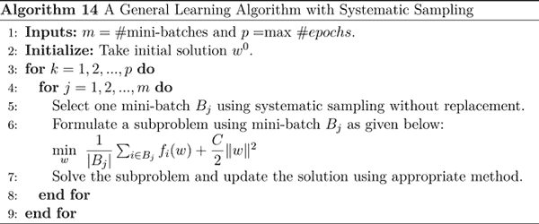

## 5.3 分析

所提议的采样技术简单但有效，可用于不同求解器解决大规模学习问题，如在 第 5.4 节 中讨论。学习算法的收敛证明已使用最简单的求解器 MBSGD（小批量随机梯度下降）方法和恒定步长提供，为了证明的简洁性，因为研究重点仅在于采样技术而非求解器。l2-正则化 ERM 问题已在以下假设下求解，以展示所提议采样技术的有效性。假设正则化项隐藏在损失函数项中以便于记号，否则需要为正则化项编写单独的梯度。

## 5.4 实验

### 5.4.1 实验设置

实验使用了五种方法，即 SAG、SAGA、SAAG-II、SVRG 和 MBSGD，以及八个基准数据集（详情见表 1.1）。每种方法都运行了两个大小为 500 和 1000 个数据点的小批量，以及两种寻找步长的技术，即恒定步长方法和回溯线搜索（LS）方法，用于预定义的时代数。恒定步长方法使用 Lipschitz 常数 *L*，并对所有方法将步长取为 1/*L*。回溯线搜索仅使用选定的小批量数据点近似执行，因为在整个数据集上执行回溯线搜索可能会因耗费大量时间而损害大规模问题的学习算法收敛。对于一个数据集，一种方法运行 12 次（3（采样技术）× 2（小批量）× 2（寻找步长的技术）），对于一个数据集，三种采样技术在 20 种不同设置下进行比较（5（方法）× 2（小批量）× 2（寻找步长的技术））。因此，使用了 160（20 × 8（数据集））个设置来比较三种采样技术的结果。由于训练时间取决于执行实验的机器配置，因此需要注意的是，所有实验均在 MacBook Air（8GB 1600 MHz DDR3，256GB SSD，1.6 GHz Intel Core i5）上进行。

### 5.4.2 实现细节


# III\_\_\_\_\_\_\_\_\_SECOND ORDER METHODS

# Chapter 6 Mini-batch Block-coordinate Newton Method

DOI: [`10.1201/9781003240167-6`](http://doi.org/10.1201/9781003240167-6)

如今，大数据挑战是机器学习中的主要挑战之一。随机近似和坐标下降方法对应对这一挑战非常有效，因为它们分别使学习算法的每次迭代与数据点数量和特征数量无关。在本章中，我们将随机近似和坐标下降方法与二阶方法相结合，提出了小批量块坐标牛顿（MBN）方法。我们发现，MBN 的表现并不如预期，甚至在训练时间方面落后于纯牛顿方法。这是由于数据点和特征的双重采样以及相关的实现开销所致。

## 6.1 Introduction

在本章中，我们考虑经验风险最小化问题（ERM），如下所示：

```
\begin{array}{l} \begin{array}{l} {\underset{w}{\min}\,\, F(w) = \frac{1}{l}{\sum\limits_{i = 1}^{l}f_{i}}(w),} \\ \end{array} \\ \end{array}
```

(6.1)

使用牛顿方法对 (6.1) 的一般解如下所示：

```
\begin{array}{l} \begin{array}{l} {w_{k + 1} = w_{k} - \alpha_{k}\nabla^{2}F{(w_{k})}^{- 1}\nabla F(w_{k}),} \\ \end{array} \\ \end{array}
```

(6.2)

其中 `α[k]` 是学习率。该迭代的每次迭代复杂度为 `O(n²l + n³)`，对于大规模学习问题来说非常巨大。牛顿方法的主要问题是需要计算和存储大型黑塞矩阵以及计算黑塞矩阵的逆。


对于机器学习中的大规模学习问题或大数据问题，数据点数量和/或特征数量较大，这会导致迭代算法每次迭代的复杂度较高。为了处理机器学习中的大规模问题或大数据问题，随机近似法和坐标下降法非常有效。随机近似法在每次迭代中随机采样一个或少量数据点，并使每次迭代与数据集中的数据点数量无关。它已被广泛且成功地用于一阶和二阶方法。

同样，坐标下降法（CD）方法将一个或一组特征作为变量，其余作为常数，这使得每次迭代与特征数量无关。因此，CD 对于处理高维问题非常有效。很明显，SA 和 CD 对于处理大数据问题非常有效。现在，研究这些技术一起使用很有趣，因为它们可以使每次迭代与 `n` 和 `l` 无关，并能提供高效且可扩展的解决方案。SA 和 CD 的组合已针对一阶方法进行了研究，例如，\[133, 140, 146, 152\]，据我们所知，尚未针对二阶方法进行研究。我们研究了它，并提出了 BBOF（批量块优化框架）和 SAAG-I 及 II（随机平均调整梯度方法）以与 BBOF 配合使用 \[23\]。我们观察到 SA 和 CD 方法不能很好地协同工作 \[28\]。这是因为实现所带来的额外计算开销超过了同时使用 SA 和 CD 的优势。

在本章中，我们将 SA 和 CD 与二阶方法一起研究。我们观察到与一阶方法观察到的结果相似。低且可控的每次迭代复杂度的优势，由于双重采样（即数据和特征的采样）以及相关的实现问题，在实现学习算法的额外开销中丧失了。

### 6.1.1 贡献

本章的贡献如下：

*   我们研究了小批量块坐标设置，即与二阶方法配合使用的 BBOF 框架，旨在解决与牛顿方法相关的问题。

*   实证结果证明，BBOF 对二阶方法没有帮助，即，提出的降低每次迭代复杂度无法在大规模问题的训练中获得整体收益。

## 6.2 MBN

MBN（小批量块坐标牛顿）方法基于 SA 和 CD 方法与牛顿方法的优点，用于求解问题 (6.1)。该方法的思想是通过对数据点和特征进行子采样，以降低每次迭代复杂度并使其可控。从 MBN 的更新规则可以清楚地看出，这似乎解决了牛顿方法的主要问题。

$$
\begin{array}{l}
\begin{array}{l}
{w_{k + 1} = w_{k} - \alpha_{k}\left\lbrack {\nabla_{C_{k}}^{2}F_{B_{k}}{(w_{k})}^{- 1}\nabla_{C_{k}}F_{B_{k}}(w_{k})} \right\rbrack e_{C_{k}},}
\\
\end{array}
\\
\end{array}
$$

(6.3)

其中

$$
\begin{array}{l}
{e_{C_{k}}[i] = \left\{ \begin{array}{l}
{1\quad\quad\text{if}\,\, i \in C_{k}} \\
{0\quad\quad\text{else}} \\
\end{array}~\right.,}
\\
\end{array}
$$

$$
\begin{array}{l}
\begin{array}{l}
{\nabla_{C_{k}}^{2}F_{B_{k}}\left( w_{k} \right) = \frac{1}{| B_{k} |}{\sum\limits_{i \in B_{k}}\nabla_{C_{k}}^{2}}f_{i}\left( w_{k} \right),} \\
{\nabla_{C_{k}}F_{B_{k}}\left( w_{k} \right) = \frac{1}{| B_{k} |}{\sum\limits_{i \in B_{k}}\nabla_{C_{k}}}f_{i}\left( w_{k} \right),} \\
\end{array}
\\
\end{array}
$$

(6.4)

∇[*C*[*k*]]*F*[*B*[*k*]](*w*[*k*]) 表示在选定块 *C*[*k*] 上的部分梯度，∇[*C*[*k*]]²*F*[*B*[*k*]](*w*[*k*]) 表示在 *C*[*k*] 上的部分黑塞矩阵，其大小为 |*C*[*k*]|×|*C*[*k*]|。因此，(6.3) 的每次迭代复杂度为 *O*(|*C*[*k*]|[2]|*B*[*k*]|+|*C*[*k*]|[3])，这比牛顿方法的每次迭代复杂度小得多且可控。MBN 旨在解决与牛顿方法相关的问题，并使用 算法 15 进行展示。当与牛顿方法一起使用时，该算法与 BBOF 类似。该算法在每次迭代中采样一个小批量数据点和一个特征块，并构建一个缩减子问题，然后使用类似于牛顿方法的参数更新规则求解该子问题。由于它使用数据的子样本和特征的子样本，这导致每次迭代复杂度降低。子问题中使用的黑塞矩阵大小为 |*C*[*k*]|²，这小得多且可控。

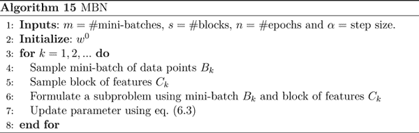

## 6.3 实验

在本节中，我们展示实验结果。我们使用了以下数据集：mushroom 和 real-sim，其详细信息见表 1.1，并比较了以下方法：

**MBN：** 这是所提出的方法。

**SNewton：** 这是子采样牛顿方法，用于梯度和黑塞矩阵计算的渐进式子采样。

**Newton：** 这是精确牛顿方法。

**TRON：** 这是信赖区域牛顿方法，使用 PCG（预条件共轭梯度）方法求解信赖区域子问题。这是解决大规模分类问题的广泛使用的方法之一，可在 LIBLINEAR 库 \[38\] 中找到。

**SVRG-SQN：** 这是一种随机拟牛顿方法 \[99\]。

### 6.3.1 实验设置

对于所有方法，正则化参数设置为 *λ* = 1/*l*，学习率通过随机回溯线搜索确定，用于子采样方法，即 MBN、SNewton 和 SVRG-SQN，而牛顿方法使用确定性回溯线搜索。MBN 和 SNewton 方法使用初始小批量大小为 10% 的渐进式子采样。SVRG-SQN 使用 10% 的样本大小，内存大小（M）和更新频率（L）设置为 10。所有方法均使用 MATLAB 实现，并在 MacBook Air（8 GB 1600 MHz DDR3，1.6 GHz Intel Core i5 和 256GB SSD）上运行。

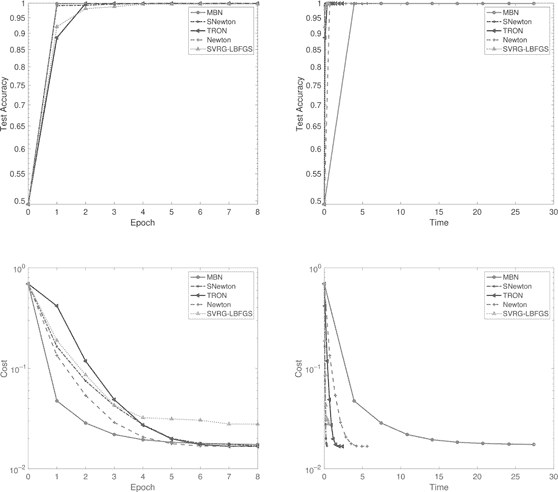

FIGURE 6.1 Comparison of MBN, SNewton, TRON, Newton and SVRG-SQN on mushroom dataset.

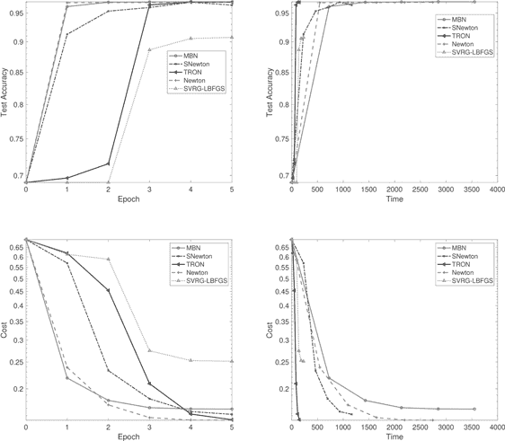

FIGURE 6.2 Comparison of MBN, SNewton, TRON, Newton and SVRG-SQN on real-sim dataset.

### 6.3.2 比较研究

结果通过绘制成本和测试准确率随训练时间（秒）和 epoch 变化，比较了 MBN、SNewton、Newton、TRON 和 SVRG-SQN。图 6.1–6.2 描绘了两个不同数据集的结果。对于 mushroom 数据集（图 6.1），MBN 在 epoch 结果上与 Newton 表现相似，并优于所有其他方法，但在训练时间上落后于其他方法。SNewton 在训练时间方面优于所有方法。对于 real-sim（图 6.2），我们观察到类似的结果，即 Newton 和 MBN 在 epoch 上优于其他方法，但在训练时间上落后。

## 6.4 结论

我们提出将牛顿方法与随机近似法（即小批量）和坐标下降法（即块坐标）的优点相结合，希望降低每次迭代复杂度并开发可扩展且高效的方法。但是观察到，尽管每次迭代复杂度降低且可控，MBN 由于数据点和特征的双重采样以及相关的实现开销，未能达到预期效果，并且落后于（单次）采样的随机牛顿方法和纯牛顿方法。因此，在找到降低双重采样相关开销的方法之前，不适合将随机近似法和坐标下降法一起使用。


# 第 7 章 随机信赖域不精确牛顿方法

DOI: [10.1201/9781003240167-7](http://doi.org/10.1201/9781003240167-7)

如今，随机近似方法是处理大规模机器学习问题的主要研究方向之一。从随机一阶方法开始，现在的焦点正在转向随机二阶方法，因为它们具有更快的收敛速度和可用的计算资源。在本章中，我们提出了一种新的随机信赖域不精确牛顿方法，称为 STRON，它使用共轭梯度（`CG`）来不精确地求解信赖域子问题。该方法在梯度和海森值的计算中使用渐进子采样，以充分利用随机和全批量两种模式的优势。我们使用现有的方差缩减技术扩展了 STRON 来处理噪声梯度，并使用预条件共轭梯度（`PCG`）作为子问题求解器，并经验证明，对于大规模学习问题，它们并不像预期那样有效。最后，我们的经验结果证明了所提方法相对于现有方法在基准数据集上的有效性。

## 7.1 引言

机器学习涉及数据密集型优化问题，这些问题包含大量与可用数据量相对应的分量函数。传统/经典方法，如牛顿方法，由于每次迭代的复杂性较大，在处理此类优化问题时表现不佳。因此，如今机器学习领域的主要挑战之一是开发可扩展且高效的算法来处理这些大规模学习问题 \[25\]。

为了解决机器学习问题，梯度下降（`GD`）\[20\] 是经典的选择方法，但在处理大规模学习问题时训练速度较慢，因为每次迭代的成本较高。基于随机近似的方法 \[113\] 在此类情况下可能非常有效，但由于梯度的噪声近似，它们收敛速度较慢。因此，出现了各种随机方差缩减技术，例如 \[39\]。但这些方法的主要局限性是它们只能收敛到线性速率。

牛顿方法是解决优化问题的另一种经典方法，它可以达到二次收敛速率 \[17\]。但同样，（纯）牛顿方法在处理大规模学习问题时不可行，因为每次迭代的计算复杂性极大，并且需要存储一个巨大的海森矩阵。因此，如今机器学习优化领域最重要的开放问题之一是：“我们能否开发出具有二次收敛速率的随机二阶方法，类似于牛顿方法，但每次迭代的复杂性较低，类似于随机近似方法？”。在随机一阶方法取得成功后，研究重点正在转向随机二阶方法，以利用二阶方法的更快收敛速度和可用的计算能力。

不精确牛顿（也称为截断牛顿或海森自由）方法和拟牛顿方法是开发二阶方法的主要研究方向之一 \[10\]。不精确牛顿方法试图在不计算和存储海森矩阵的情况下近似求解牛顿方程。另一方面，拟牛顿方法试图近似海森逆矩阵并避免存储海森矩阵的需求。因此，这两种方法都试图解决牛顿方法的问题。不精确牛顿和拟牛顿的随机变体进一步通过使用子采样的梯度和海森计算来降低这些方法的复杂性。在本章中，我们提出了一种新的 `s`tochastic `t`rust `r`egi`o`n inexact `N`ewton（`STRON`）方法，该方法将子采样引入梯度和海森计算中。它使用渐进子采样来享受两种模式（随机近似和全批量学习）的优势。我们进一步使用现有的方差缩减技术扩展了该方法，以处理由梯度值子采样产生的噪声，并通过提出 `PCG` 来求解信赖域子问题。

### 7.1.1 优化问题

我们考虑下面给出的无约束凸优化问题，即预期风险：

$$\\begin{array}{l} {{\\min}\_{w}R(w) = \\mathbb{E}\\left\\lbrack {f\\left( {w;\\xi} \\right)} \\right\\rbrack,} \\\\ \\end{array}$$  

(7.1)

其中 `f`(`w`;`ξ`) = `f`(`w`;`x`[`i`],`y`[`i`]) = `f`(`h`(`w`;`x`[`i`]),`y`[`i`]) 是线性预测模型 `h` 和损失函数 `f` 在从未知分布 `P`(`x`[`i`],`y`[`i`]) 中随机选择的数据点（`x`[`i`],`y`[`i`]）上的平滑复合函数，由模型参数 `w` ∈ ℝ^(`n`) 参数化。由于 `P` 未知，因此无法求解 (7.1)，所以模型通过从未知分布 `P` 中取一组 `N` = {(`x`[1],`y`[1]),...,(`x`[`l`],`y`[`l`])} 的 `l` 个数据点，然后求解经验风险最小化问题来近似，如下所示：

$$\\begin{array}{l} {{\\min}\_{w}F(w) = \\frac{1}{l}{\\sum\\limits\_{i = 1}^{l}f}(w;x\_{i},y\_{i}).} \\\\ \\end{array}$$  

(7.2)

为简单起见，我们取 `f`(`w`;`x`[`i`],`y`[`i`]) = `f``i` 的有限和优化问题存在于不同领域，例如信号处理、统计学、运筹学、数据科学和机器学习，例如机器学习中的逻辑回归和 SVM。

### 7.1.2 求解技术

求解 (7.2) 的简单迭代经典方法是梯度下降（`GD`）\[20\]，如下所示：

$$\\begin{array}{l} {w^{k + 1} = w^{k} - \\alpha\_{k}\\nabla F\\left( w\_{k} \\right),} \\\\ \\end{array}$$  

(7.3)

其中 (`k` + 1) 是迭代次数，`α`[`k`] 称为学习率或步长。该迭代的复杂度为 *O*(*n**l*)，对于大规模学习问题来说，由于数据点数量较大，该复杂度较高。随机梯度下降（`SGD`）\[113\] 非常有效，可以处理此类问题，因为其每次迭代的复杂度较低，如下所示：

$$\\begin{array}{l} {w^{k + 1} = w^{k} - \\alpha\_{k}\\nabla f\_{i\_{k}}\\left( w\_{k} \\right),} \\\\ \\end{array}$$  

(7.4)

其中 `i`[`k`] 是随机选择的数据点。但是，由于梯度值存在噪声，`SGD` 无法保证收敛。

求解 (7.2) 的另一种经典二阶方法是牛顿方法，如下所示：

$$\\begin{array}{l} {w^{k + 1} = w^{k} - \\alpha\_{k}\\nabla^{2}F\\left( w\_{k} \\right)^{- 1}\\nabla F\\left( w\_{k} \\right).} \\\\ \\end{array}$$  

(7.5)

该迭代的复杂度为 *O*(*n*²*l* + *n*³)，并且需要存储和反转海森矩阵 ∇²*F*(*w*[*k*])，这在计算上非常昂贵，并且分别需要大量内存。这就是为什么在过去十年中，一阶方法及其随机变体被广泛研究以解决大规模学习问题，而不是二阶方法。由于随机一阶方法已达到其极限，并且由于更好的计算能力的可用性，主要焦点开始转向随机二阶方法，如今一个重要的开放问题是寻找具有二次收敛速率的随机二阶方法。

二阶方法有两个主要研究方向：拟牛顿方法和不精确牛顿方法，两者都试图解决与牛顿方法相关的问题。拟牛顿方法试图在每次迭代中近似海森矩阵，如下所示：

$$\\begin{array}{l} {w^{k + 1} = w^{k} - \\alpha\_{k}B\_{k}\\nabla F\\left( w\_{k} \\right),} \\\\ \\end{array}$$  

(7.6)


where `B`[*k*] 是 ∇²`F`(`w`[*k*])^( − 1) 的近似，例如，Broyden-Fletcher-Goldfarb-Shanno (BFGS) 算法就是一种此类方法 \[42\]。另一方面，不精确牛顿方法试求近似求解牛顿系统，例如，Newton-CG \[124\]。这两种方法都试图解决牛顿方法相关的问题，但对于大规模问题，它们的复杂度仍然很大。因此，已提出了这些方法的许多随机变体，例如，\[18, 19, 11, 8\]，这些方法在梯度和黑塞矩阵计算中引入了子采样。

### 7.1.3 贡献

本章的贡献如下：

*   本章强调了随机方法从一阶方法向二阶方法的近期转变，并提出了一个开放问题：我们需要具有二次收敛率的随机二阶方法来解决大规模机器学习问题。

*   我们提出了一种新型的子采样信赖域不精确牛顿方法，称为 `STRON`，它是信赖域不精确牛顿方法的第一个随机变体。`STRON` 对梯度和黑塞矩阵计算使用渐进式子采样方案，以兼顾随机和全批模式的优势。`STRON` 可以达到二次收敛率，并回答了上述开放问题。

*   `STRON` 已使用现有的方差缩减技术进行扩展，以处理梯度计算中的噪声近似。扩展方法使用随机方差缩减梯度 (`SVRG`) 进行方差缩减，并结合梯度计算的静态批处理和黑塞矩阵计算的渐进式批处理。实证结果表明，这在大规模学习中并未按预期工作。

*   我们进一步扩展 `STRON`，并使用 `PCG` 而不是 `CG` 方法来不精确求解牛顿系统。我们使用单位矩阵和对角矩阵的加权平均作为预条件子。但即使这样，对于大规模学习也未能按预期工作。

*   最后，我们的实证实验证明了 `STRON` 在基准数据集上相对于现有技术的有效性。

## 7.2 文献综述

随机近似方法对于处理大规模学习问题非常有效，因为它们每次迭代的成本较低，例如，`SGD` \[113\]，但由于噪声近似，它们会导致收敛速度缓慢。为了解决噪声问题，已提出了许多技术，其中一些重要技术（如 \[34\] 所述）是：(a) 降低学习率 \[118\]，(b) 使用小批量 \[26\]，(c) 重要性采样 \[34\]，以及 (d) 方差缩减 \[115\]。方差缩减方法可以进一步分为三类：原始方法 \[115\]、对偶方法 \[120\] 和原始-对偶方法 \[149\]。方差缩减技术对于处理大规模学习问题很有效，因为它们每次迭代的复杂度低，类似于 `SGD`，并且具有快速的线性收敛，类似于 `GD`。这些技术结合了 `SGD` 和 `GD` 的优点，但对于这些一阶方法的随机变体，收敛仅限于线性速率，而二阶方法可以达到二次收敛率。

二阶方法利用曲率信息来引导步进方向趋向解，并表现出比一阶方法更快的收敛速度。但是，由于巨大的黑塞矩阵及其逆矩阵导致的巨大每次迭代成本，使得大规模问题的模型训练变慢。因此，已开发出某些技术来处理与黑塞矩阵相关的问题，例如，拟牛顿方法和不精确牛顿方法是处理牛顿方法巨大计算成本的两个主要方向。拟牛顿方法在每次迭代中近似黑塞矩阵，例如，`BFGS` \[42\] 及其有限内存变体，称为 `L-BFGS` \[89\]，是拟牛顿类的示例，它们使用前一次迭代的梯度和参数值来近似黑塞逆矩阵。`L-BFGS` 仅使用前 `M` 次迭代的最近信息。另一方面，不精确牛顿方法试图近似求解牛顿系统，例如，`Newton-CG` \[124\]。

最近，已提出了几种 `BFGS` 和 `L-BFGS` 的随机变体来处理大规模问题。\[117\] 提出了 `BFGS` 和 `L-BFGS` 的随机变体，用于在线设置，称为 `oBFGS`。\[98\] 通过添加正则化扩展了 `oBFGS`，该正则化对近似黑塞矩阵的特征值施加上界，称为 `RES`（正则化随机 BFGS）。随机拟牛顿 (`SQN`) \[19\] 是 `L-BFGS` 的另一种随机变体，它在定期间隔而不是每次迭代时收集曲率信息。方差缩减随机牛顿 (`VITE`) \[91\] 扩展了 `RES`，并提出对子采样梯度值使用方差缩减来求解光滑强凸问题。\[69\] 提供了另一种使用 `SVRG`（称为 `SVRG-LBFGS`）进行方差缩减的随机 `L-BFGS` 方法。\[99\] 提出了随机 `L-BFGS` (`SLBFGS`)，使用 `SVRG` 进行方差缩减，并使用黑塞-向量积来近似梯度差异以计算黑塞近似，也称为 `SVRG-SQN`。`SVRG-LBFGS` 和 `SVRG-SQN` 在曲率近似方式上有所不同（即黑塞近似方式），前者在每个时代（外部迭代）中使用梯度差异一次收集曲率信息，而后者在内部迭代中定期间隔使用黑塞-向量积收集曲率信息。\[9\] 将多批方案引入随机 `L-BFGS`，其中批样本与前一次迭代有一些重叠。\[11\] 提出了渐进式批处理、随机线搜索和稳定的牛顿更新用于 `L-BFGS`。\[10\] 研究了子采样大小的条件，以获得不同的收敛速率。

随机不精确牛顿方法也得到了广泛研究。\[18\] 提出了 `Newton-CG` 的随机变体，并结合 `L-BFGS` 方法。\[10\] 研究了子采样牛顿方法，并找出子采样大小和强制项（与残差条件一起使用的常数）的条件，以实现 `Newton-CG` 方法的线性收敛。\[8\] 研究了强制项和线搜索的效果，以找到 `Newton-CG` 方法的线性和超线性收敛。`Newton-SGI`（随机梯度迭代）是另一种近似求解线性系统的方法，并在 \[3\] 中进行了研究。

信赖域牛顿 (`TRON`) 方法是求解大规模线性分类问题最有效的求解器之一 \[85\]。这是一种信赖域不精确牛顿方法，不使用任何子采样，并且存在于 `LIBLINEAR` 库 \[38\] 中。\[52\] 通过改进信赖域半径值扩展了 `TRON`。\[51\] 进一步扩展了 `TRON`，并使用预条件共轭梯度 (`PCG`)，该方法使用单位矩阵和对角矩阵的加权平均作为预条件子，来求解信赖域子问题。由于子采样是处理大规模问题的有效方法，因此在本章中，我们提出了一种信赖域不精确牛顿方法的随机变体，据我们所知，此前未得到研究。

## 7.3 信赖域不精确牛顿方法

不精确牛顿方法，也称为截断牛顿或黑塞自由方法，近似求解牛顿方程（线性系统）。`CG` 方法是一种常用的技术，用于近似求解信赖域子问题。在本节中，我们讨论不精确牛顿方法及其信赖域变体。

### 7.3.1 不精确牛顿方法


使用泰勒定理得到的二次模型 `mk` 如下所示：

$$
\begin{array}{l}
\begin{array}{l}
{F(w_{k} + p) - F(w_{k}) \approx m_{k}(p) \equiv \nabla F\left( w_{k} \right)^{T}p + \frac{1}{2}p^{T}\nabla^{2}F\left( w_{k} \right)p.}
\\
\end{array}
\\
\end{array}
$$

(7.7)

对 `p` 求 `mk` 的导数并令其为零，可得：

$$
\begin{array}{l}
\begin{array}{l}
{\nabla^{2}F\left( w_{k} \right)p = - \nabla F\left( w_{k} \right),}
\\
\end{array}
\\
\end{array}
$$

(7.8)

这就是牛顿方程，其解即为牛顿方法，如下所示：

$$
\begin{array}{l}
\begin{array}{l}
{w^{k + 1} = w^{k} + p_{k} = w^{k} - \nabla^{2}F\left( w_{k} \right)^{- 1}\nabla F\left( w_{k} \right).}
\\
\end{array}
\\
\end{array}
$$

(7.9)

该迭代的计算复杂度为 `O(n²l + n³)`，开销非常大。该迭代涉及大规模海森矩阵的计算与求逆，不仅计算开销大，存储开销也大。CG 方法在不形成海森矩阵的情况下近似求解子问题 (7.8)，从而解决了计算复杂度高和需要存储大规模海森矩阵的问题。每次迭代运行给定次数的 CG 迭代，或直到满足残差条件为止，如下所示：

$$
\begin{array}{l}
{\| r_{k}\| \leq \eta_{k}^{{}^{^{\prime}}}\|\nabla F\left( w_{k} \right)\|,}
\\
\end{array}
$$

(7.10)

其中 `r[k] = ∇²F(w[k])p + ∇F(w[k])`，`η[k]^(^′)` 是一个小正值，称为强制项 [103]。

### 7.3.2 信赖域不精确牛顿方法

信赖域是指在该区域内，给定函数的近似二次模型能对该函数给出正确近似的区域。在信赖域方法中，我们不需要直接计算步长（也称为学习率），而是根据信赖域半径间接调整步长。信赖域方法求解以下子问题以获取步长方向 `p[k]`：

$$
\begin{array}{l}
{{\min}_{p}\ m_{k}\left( p \right)\quad\text{s.t}\quad\| p\| \leq \bigtriangleup_{k},}
\\
\end{array}
$$

(7.11)

其中 `mk` 是 `F(w[k]+p) − F(w[k])` 的二次模型，如 (7.7) 所示，`△[k]` 是信赖域半径。该子问题可类似于 Newton-CG 求解，只不过现在需要处理 `p` 的额外约束。TRON（信赖域牛顿方法）[85] 是最著名且应用最广泛的此类方法之一，用于 LIBLINEAR [38] 中求解 l[2]-正则化逻辑回归和 l[2]-SVM 问题。[52] 通过提出更好的信赖域半径扩展了 TRON。[51] 进一步使用 PCG 子问题求解器扩展了 TRON，该求解器将单位矩阵和对角矩阵的平均值作为预条件子，用于求解信赖域子问题，并表明 PCG 对求解病态问题可能有效。

然后计算模型实际减少量与预测减少量的比率，如下所示：

$$
\begin{array}{l}
{\rho_{k} = \frac{F(w_{k} + p_{k}) - F(w_{k})}{m_{k}(p_{k})}.}
\\
\end{array}
$$

(7.12)

参数在第 `(k + 1)` 次迭代中按如下方式更新：

$$
\begin{array}{l}
{w_{k + 1} = \left\{ \begin{array}{ll}
{w_{k} + p_{k},} & {\text{if}\ \rho_{k} > \eta_{0},} \\
{w_{k},} & {\text{if}\ \rho_{k} \leq \eta_{0},} \\
\end{array}~ \right.}
\\
\end{array}
$$

(7.13)

其中 `η[0] > 0` 是给定常数。然后根据实际减少量与预测减少量的比率更新信赖域半径 `△[k]`，`△[k]` 的更新框架如下（参考 [83]）：

$$
\begin{array}{l}
{\bigtriangleup_{k + 1} \in \left\{ \begin{array}{ll}
{\left\lbrack {\gamma_{1}\min\left\{ \| p_{k}\|, \bigtriangleup_{k} \right\},\gamma_{2} \bigtriangleup_{k}} \right\rbrack,} & {\text{if}\ \rho_{k} \leq \eta_{1},} \\
{\left\lbrack {\gamma_{1} \bigtriangleup_{k},\gamma_{3} \bigtriangleup_{k}} \right\rbrack,} & {\text{if}\ \rho_{k} \in \left( {\eta_{1},\eta_{2}} \right),} \\
{\left\lbrack {\bigtriangleup_{k},\gamma_{3} \bigtriangleup_{k}} \right\rbrack,} & {\text{if}\ \rho_{k} \geq \eta_{2},} \\
\end{array}~ \right.}
\\
\end{array}
$$

(7.14)

其中 `0 < η[1] < η[2] ≤ 1` 且 `0 < γ[1] < γ[2] < 1 < γ[3]`。若 `ρ[k] ≤ η[1]`，则认为牛顿步不成功，信赖域半径被缩小。另一方面，若 `ρ[k] ≥ η[2]`，则步长成功，信赖域半径被放大。我们按照 LIBLINEAR 库 [38] 实现了该框架，并为上述常数选取了以下预定义值：`η[0] = 1e − 4`、`η[1] = 0.25`、`η[2] = 0.75`、`γ[1] = 0.25`、`γ[2] = 0.5` 和 `γ[3] = 4`。

## 7.4 STRON

STRON 利用渐进子采样，结合随机和批量模式的优点。由于随机梯度下降（SGD）在每次迭代计算量较小，因此在大规模学习问题上训练速度比梯度下降（GD）快；但 GD 由于批量计算更准确。同样，STRON 在初始迭代中利用低计算量的优势，并在接近解区域时使用批量计算来寻找精确解，类似于 TRON。STRON 的主要挑战在于决定何时从随机模式切换到全批量模式，即调整子采样率。

STRON 将随机性引入信赖域不精确牛顿方法，并计算子采样的函数值、梯度值和海森矩阵值来求解信赖域子问题，如下所示：

$$
\begin{array}{l}
\begin{array}{l}
{{\min}_{p}\ m_{k}(p) = \nabla F_{X_{k}}\left( w_{k} \right)^{T}p + \frac{1}{2}p^{T}\nabla^{2}F_{S_{k}}\left( w_{k} \right)p,\quad\text{s.t}\quad\| p\| \leq \bigtriangleup_{k},}
\\
\end{array}
\\
\end{array}
$$

(7.15)

其中 `∇²F[S[k]](w[k])` 和 `∇F[X[k]](w[k])` 分别是在子样本 `S[k]` 和 `X[k]` 上的子采样海森矩阵和梯度值，定义如下：

$$
\begin{array}{l}
\begin{array}{l}
{\nabla^{2}F_{S_{k}}\left( w_{k} \right) = \frac{1}{\left| S_{k} \right|}{\sum\limits_{i \in S_{k}}\nabla^{2}}f_{i}\left( w_{k} \right),} \\
{\nabla F_{X_{k}}\left( w_{k} \right) = \frac{1}{\left| X_{k} \right|}{\sum\limits_{i \in X_{k}}\nabla}f_{i}\left( w_{k} \right),} \\
{F_{X_{k}}\left( w_{k} \right) = \frac{1}{\left| X_{k} \right|}{\sum\limits_{i \in X_{k}}f_{i}}\left( w_{k} \right),} \\
\end{array}
\\
\end{array}
$$

(7.16)

其中子样本是递增的，即 `|X[k]|<|X[k + 1]|`、`|S[k]|<|S[k + 1]|`，且 `F[X[k]]` 是用于计算 `ρ[k]` 的子采样函数值。STRON 对给定次数的 CG 迭代，或直到满足以下残差条件时，近似求解 (7.15)：

$$
\begin{array}{l}
{\| r_{k}\| \leq \eta_{k}^{{}^{^{\prime}}}\|\nabla F_{X_{k}}\left( w_{k} \right)\|,}
\\
\end{array}
$$

(7.17)

其中 `r[k] = ∇²F[S[k]](w[k])p + ∇F[X[k]](w[k])`。


STRON 由 算法 16 提出。它随机选择子样本 `S[k]` 和 `X[k]` 用于第 *k* 次迭代（外层迭代）。`X[k]` 和 `S[k]` 分别用于计算梯度和海森值。然后它使用 CG 求解器（内层迭代）求解信任区域子问题，该求解器在计算海森-向量乘积时使用子样本海森。当残差条件（与 (7.17) 相同）满足，或达到最大 #CG 迭代次数，或达到信任区域边界时，CG 停止。实际减少量与预测减少量的比率计算方式类似于 (7.12)，但使用子样本函数，并用于按 (7.13) 给出的方式更新参数。然后信任区域半径 `△[k]` 按 (7.14) 给出的方式根据 `ρ[k]` 更新，这些步骤在给定的迭代次数内重复，或直到收敛。

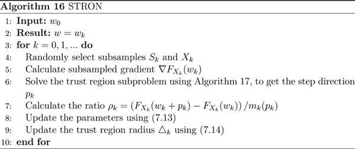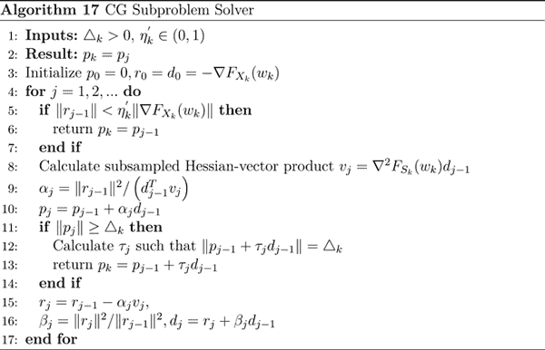

STRON 使用渐进式子采样，即动态子采样来计算函数、梯度和海森值，并近似求解牛顿系统。它对处理大规模问题很有效，因为它使用子采样并近似求解子问题，而无需形成海森矩阵，只使用海森-向量乘积。因此，它处理了与牛顿方法相关的复杂性问题。

### 7.4.1 复杂度

信任区域不精确牛顿（TRON）方法的复杂度取决于函数、梯度和 CG 子问题求解器。这主要由 CG 子问题求解器主导，其复杂度为 `O(n*l)` × #CG 迭代次数，对于稀疏数据，则为 `O(#n*nz)` × #CG 迭代次数，其中 #`n*nz` 是数据集中非零值的数量。对于子采样信任区域不精确牛顿（STRON）方法，每次迭代的复杂度为 `O(n|S[k]|)` × #CG 迭代次数，对于稀疏数据，则为 `O(#n*nz[S[k]])` × #CG 迭代次数，其中 #`n*nz[S[k]]` 是子样本 `S[k]` 中非零值的数量。由于 TRON 和 STRON 所需的 #CG 迭代次数差别不大，因此 STRON 在初始迭代中的每次迭代复杂度小于 TRON，但后来由于渐进式子采样（即当 `|S[k]|=N` 时）变得与 TRON 相等。

### 7.4.2 分析

STRON 方法使用渐进式子采样，假设最终小批量大小等于整个数据集，即对于某个 $k \\geq \\overline{k} > 0$ 的值，STRON 变为 TRON。因此，我们可以遵循 TRON 给出的理论结果，而 TRON 本身又引用了 \[83\] 的结果。对于 $k \\geq \\overline{k}$，根据 `η[k]^(^′)` 的值，我们得到不同的收敛性：如果 `η[k]^(^′)` < 1，则 STRON Q-线性收敛；如果 `η[k]^(^′)` → 0 当 *k*→∞，则 STRON 具有 Q-超线性收敛；当 `η[k]^(^′)` ≤ `κ[0]∥∇F(w[k])∥` 对于 `κ[0]` > 0 时，STRON 以二次速率收敛。

## 7.5 实验结果

在本节中，我们讨论实验设置和结果⁷

**TRON** \[51\]: 这是一种不带任何子采样的信任区域不精确牛顿方法。它使用预条件化 CG 方法求解信任区域子问题，并且存在于 LIBLINEAR 库 \[38\] 的当前版本中。

**STRON**: 这是所提出的带有渐进式子采样技术的随机信任区域不精确牛顿方法，用于梯度和海森计算。它使用 CG 方法求解信任区域子问题。

**STRON-PCG**: 这是 STRON 的扩展，使用 PCG 求解信任区域子问题，如 子节 7.6.1 中讨论。

**STRON-SVRG**: 这是 STRON 的另一个扩展，使用方差减少来进行子样本梯度计算，如 子节 7.6.2 中讨论。 **Newton-CG** \[18\]: 这是一种随机不精确牛顿方法，使用 CG 方法求解子问题。它使用类似于 STRON 的渐进式子采样。

**SVRG-SQN** \[99\]: 这是一种带有方差减少的随机 L-BFGS 方法，用于梯度计算。

**SVRG-LBFGS** \[69\]: 这是另一种带有方差减少的随机 L-BFGS 方法。它与 SVRG-SQN 方法在海森信息采样的方法上有所不同。

### 7.5.1 实验设置

数据集已分为 80% 和 20%，分别用于训练和测试数据集，以绘制收敛图，并使用 5 折交叉验证来呈现 表 7.1 中的结果。我们对所有方法都使用了 `λ = 1/l`，因为它通常能给出良好的结果，同时有助于减少可调超参数的数量。#CG 迭代次数已设置为足够大的值 25，因为所有不精确牛顿方法都使用 5–10 次迭代，很少超过 20 次迭代。渐进式批处理方案对所有数据集（除了 ijcnn，它使用数据集的 10%）都使用初始批量大小为 1%，并且子样本大小对所有数据集（除了 covtype，它使用指数速率）都线性增加。此外，我们设置速率，使得子样本大小在 5 个时代内等于数据集大小，因为一般来说二阶方法在 4–5 个时代内达到解区域，并在 8–10 个时代内收敛。为了简单起见并避免额外采样，我们对海森和梯度计算使用相同的子样本，即 `S[k] = X[k]`。拟牛顿方法（SVRG-SQN 和 SVRG-LBFGS）使用 10% 的小批量大小和随机回溯线搜索来找到步长，并且对梯度和海森子采样使用相同大小的小批量。拟牛顿方法中使用了 `M = 5` 的内存，并将 `L = 5` 作为 SVRG-SQN 方法中海森逆近似的更新频率。所有算法都使用类似的退出标准，即梯度值的减少，我们在 `w[0]` 处计算梯度（`∥g[0]∥`），并运行算法直到 `∥g[k]∥ ≤ ϵ∥g[0]∥`，其中 `∥g[k]∥` 是第 k 次迭代处的梯度值，`ϵ` 是给定的容忍水平。此外，所有方法都在 C++⁸ 中实现。

### 7.5.2 比较研究

实验已针对强凸且光滑的 l[2]-正则化逻辑回归问题进行，如下所示：

```
$$\begin{array}{l} {\\underset{w}{\\min}\\, F(w) = \\frac{1}{l}{\\sum\\limits\_{i = 1}^{l}{\log}}\\left( {1 + \\exp\\left( {- y\_{i}w^{T}x\_{i}} \\right)} \\right) + \\frac{\\lambda}{2}\\| w\\|^{2}.} \\\\ \\end{array}$$  
```

(7.18)

结果已绘制为最优性（*F*(*w*) − *F*(*w*^(\*))) 与训练时间（秒）以及高 `ϵ`(= 10^( − 10))-精度解的准确率与训练时间，如 图 7.1 所示。从结果可以清楚地看出，STRON 比所有其他方法收敛更快，并在准确率与时间图上显示出相对于 TRON 的改进。此外，正如文献 \[85\] 已确立的那样，拟牛顿方法比不精确牛顿方法收敛更慢。根据直觉，STRON 由于子采样而对 TRON 具有初始优势，并且当它到达解区域时，渐进式批处理方案达到全批处理方案，并以与 TRON 相同的速率收敛。这就是为什么在大多数图中，我们可以观察到 STRON 和 TRON 以平行线收敛。此外，我们观察到 covtype 数据集的准确率与时间图中出现一条水平线，因为所有方法都给出 100% 的准确率。通常，模型针对低 `ϵ`(= 10^( − 02))-精度解进行训练。因此，我们使用表 7.1 呈现这种情况的结果，该表报告了使用 5 折交叉验证的结果。从表中可以清楚地看出，STRON 要么优于其他求解器，要么显示出与最佳方法非常接近的结果。

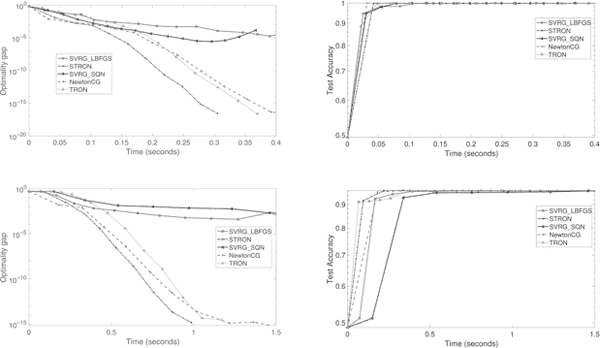


FIGURE 7.1 第一列展示了优化性与训练时间（秒）的关系，第二列展示了准确率与训练时间的关系，数据集为 mushroom（第一行）和 rcv1（第二行）。

### 7.5.3  使用 SVM 的结果

我们扩展 STRON 以求解 `l[2]\-SVM` 问题，这是一个非光滑问题，如下所示：

```
$$\begin{array}{l} {\\underset{w}{\\min}\\, F(w) = \\frac{1}{l}{\\sum\\limits\_{i = 1}^{l}{\\max}}{(0,1 - y\_{i}w^{T}x\_{i})}^{2} + \\frac{\\lambda}{2}\\| w\\|^{2}.} \\\\ \\end{array}$$  
```

(7.19)

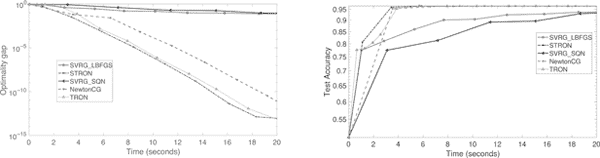

FIGURE 7.2 在 news20 数据集上进行 `l[2]\-SVM` 实验。

结果在 图 7.2 中报告，使用 news20 数据集。从图中可以清楚地看出，STRON 显示出与逻辑回归问题相似的结果，并优于所有其他方法。

## 7.6  扩展

在本节中，我们讨论了所提方法的扩展，使用 `PCG` 求解信任域子问题，并使用方差减小技术。

### 7.6.1  PCG 子问题求解器

`CG` 方法求解子问题所需的迭代次数取决于海森矩阵的条件数。因此，对于病态问题，`CG` 方法收敛缓慢。为了避免这种情况，通常使用一个非奇异矩阵 `M`，称为预条件子，如下所示。对于线性系统 `∇²*F*(*w*)*p* =  − ∇*F*(*w*)`，我们求解以下系统：

```
$$\begin{array}{l} {M^{- 1}\\nabla^{2}F(w)p = - M^{- 1}\\nabla F(w).} \\\\ \\end{array}$$  
```

(7.20)

通常，`M`^( − 1) = `L**L`^(*T*) 被采用以确保 `M`^( − 1)∇²*F*(*w*) 的对称性和正定性。`PCG` 可用于求解病态问题，但它涉及额外的计算开销。我们遵循 \[51\] 将 `PCG` 用作单位矩阵和海森矩阵对角矩阵的加权平均，如下所示：

```
$$\begin{array}{l} {M = \\alpha \\times diag(H) + (1 - \\alpha) \\times I,} \\\\ \\end{array}$$  
```

(7.21)

其中 `H` 是海森矩阵，且 0 ≤ `α` ≤ 1。对于 `α` = 0，没有预条件处理；对于 `α` = 1，它是一个对角预条件子。在实验中，我们对 `TRON` 和 `STRON-PCG` \[51\] 取 `α` = 0.01。要将 `PCG` 应用于信任域子问题，我们可以在更改信任域子问题 (7.11) 后，不做任何修改地使用 算法 17，如下所示 \[124\]：

```
$$\begin{array}{l} {{\\min}\_{\\hat{p}}\\left( {L^{- 1}\\nabla F\_{X\_{k}}\\left( w\_{k} \\right)} \\right)^{T}\\hat{p} + \\frac{1}{2}{\\hat{p}}^{T}\\left( {L^{- 1}\\nabla^{2}F\_{S\_{k}}\\left( w\_{k} \\right)L^{- T}} \\right)\\hat{p},\\,\\,\\text{s}\\text{.t}\\text{.}\\,\\,\\|\\hat{p}\\| \\leq \\bigtriangleup\_{k},} \\\\ \\end{array}$$  
```

(7.22)

其中 `p̂` = `L`^(*T*)`p`。使用 `PCG` 作为信任域子问题求解器的 `STRON` 表示为 `STRON-PCG`，结果在 图 7.3 中报告。它在 Adult 数据集上比较了 `TRON`、`STRON` 和 `STRON-PCG`。从图中可以清楚地看出，`STRON` 和 `STRON-PCG` 均优于 `TRON`。


FIGURE 7.3 在 Adult 数据集上对 `STRON\_PCG`、`STRON` 和 `TRON` 的比较研究。

`PCG` 信任域子问题求解器涉及计算预条件子的额外成本，对于 `TRON`，由于预条件子产生的开销由以下给出：

```
$$\begin{array}{l} \\begin{array}{ll} & {O\\left( n \\right) \\times \\#\\text{CG~iterations} + O(nl).} \\\\ \\end{array} \\\\ \\end{array}$$  
```

(7.23)

对于 `STRON-PCG`，预条件子涉及如下的额外成本：

```
$$\begin{array}{l} \\begin{array}{ll} & \\left. O\\left( n \\right) \\times \\#\\text{CG~iterations} + O(n \\middle| S\_{k} \\middle| ). \\right. \\\\ \\end{array} \\\\ \\end{array}$$  
```

(7.24)

### 7.6.2  随机方差减小信任域不精确牛顿方法

最近，研究人员提出了带有方差减小的二阶方法的随机变体。因此，了解方差减小如何与随机信任域不精确牛顿方法协同工作是一个有趣的问题，因为这尚未被研究。我们的实证结果表明，即使在海森矩阵计算中使用渐进子采样，方差减小在这种情况下也不起作用。


FIGURE 7.4 在 rcv1 数据集上对 `STRON-SVRG`、`STRON` 和 `TRON` 的比较研究。

为了提高搜索方向的质量，我们将 `SVRG` 用作梯度计算的方差减小技术，如下所示：

```
$$\begin{array}{l} {g\_{k} = \\nabla F\_{S\_{k}}(w\_{k}) - \\nabla F\_{S\_{k}}(\\overline{w}) + \\nabla F(\\overline{w}),} \\\\ \\end{array}$$  
```

(7.25)

其中 `\\overline{w}` 是外层迭代开始时的参数值。`STRON-SVRG` 对梯度计算使用方差减小，对海森矩阵计算使用渐进批处理，如 算法 18 所示。

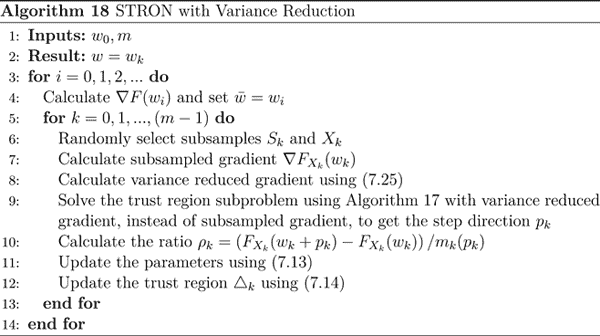

实验结果在 图 7.4 中展示，使用 rcv1 数据集。从图中可以清楚地看出，`STRON-SVRG` 落后于 `STRON` 和 `TRON`，即，`STRON-SVRG` 中的方差减小不足以击败 `STRON` 梯度计算中的渐进批处理。这是因为 `STRON-SVRG` 和 `STRON` 都是 `TRON` 的随机/子采样变体，为了补偿噪声梯度计算，前者使用众所周知的方差减小策略，而后者使用渐进子采样策略。`STRON` 能够击败 `TRON`，但 `STRON-SVRG` 失败并落后于两者。

## 7.7  结论

我们提出了一种新的随机信任域不精确牛顿方法，称为 `STRON`。所提方法使用渐进批处理方案来处理梯度和海森矩阵的噪声近似，并享受随机和全批模式的双重好处。`STRON` 已扩展为使用预条件 `CG` 作为信任域子问题求解器，并使用方差减小来处理噪声梯度计算。我们的实证结果证明了 `STRON` 在基准数据集上相对于最先进技术的有效性。

# IV\_\_\_\_\_\_\_\_\_CONCLUSION

# Chapter 8 Conclusion and Future Scope

DOI: [10.1201/9781003240167-8](http://doi.org/10.1201/9781003240167-8)

技术的进步和数据源的可用性使我们进入了“大数据”时代。一方面，这些大数据有潜力发现更精细的模式，做出及时准确的决策；但另一方面，它也带来了许多挑战，例如机器学习模型的训练缓慢和可扩展性等。因此，机器学习的主要挑战之一是开发高效且可扩展的学习算法，即用于解决大规模学习问题的优化技术。

我们可以通过在以下领域工作来应对这一挑战：问题表述、问题求解器、改进求解器的优化策略以及利用计算资源，如图形处理单元 (`GPUs`)、并行和分布式计算。但是，在这些潜在领域中，最近，研究人员专注于随机近似算法、坐标下降算法、近端算法以及并行和分布式算法来应对这一挑战。


我们提供了针对模型训练时间两个部分的挑战的解决方案，即数据访问时间和从数据中学习的时间。为了改善数据访问时间，我们提出了使用系统采样和顺序采样技术从数据集中采样数据点的小批量，这些技术基于连续内存访问。这是一个普遍的观察，即从连续内存访问数据比从分散内存访问数据更快。解决大数据挑战的这个方案与所使用的问题或求解器无关，因为它基于数据访问。这有助于实现高达六倍的训练加速。

为了改善从数据中学习的时间，我们使用了随机近似和坐标下降方法，这些方法非常有效地处理大数据问题，因为它们分别使每次迭代与数据点数量和特征数量无关。首先，我们利用随机近似和坐标下降方法的优点，提出了一种批量块优化框架来解决大数据问题。我们将批量块优化框架与一阶和二阶方法结合，分别提出了`SAAG-I`、`II`和`MBN`。但是观察到，随机近似和坐标下降在结合使用时效果不佳，因为优势在实现批量块优化框架的额外开销中丢失了。由于批量块优化框架使用双重采样，即数据点采样和特征采样，因此它还涉及数据访问相关问题，这是由于数据的稀疏表示造成的。

我们还提供了使用随机近似解决大数据挑战的方案，因为如今这是解决大规模问题最流行的方法之一。我们提出了`SAAG-III`和`IV`，分别作为`SAAG-I`和`II`的扩展。这些是基于迭代平均的随机方差缩减技术，能够以线性收敛率求解光滑和非光滑问题。利用二阶方法，我们结合了随机和全批量模式的优点，提出了基于渐进子采样的随机信赖域不精确牛顿方法。二阶方法的收敛速度比一阶方法快，而一阶方法仅限于线性收敛。我们还使用了`CG`和`PCG`与`STRON`来求解信赖域子问题。

观察到，随机近似和坐标下降在结合使用时效果不佳，因为优势在实现批量块优化框架的额外开销中丢失了，这是由于双重采样，即数据点采样和特征采样造成的。虽然基于随机近似的一阶和二阶方法对于解决大规模问题非常有效，其中后者可以收敛得更快但需要更多计算。

## 8.1 未来展望

优化是机器学习的基石。由于数据集规模不断增加以及深度学习日益普及，优化方法的重要性更加凸显。解决大规模学习问题的当前研究工作可以按以下方式扩展：

1. 理论洞察

   尽管在机器学习的大多数领域中，理论都滞后于实践，但这非常重要，因为它有助于实现学习算法的实际潜力。在当前工作中，主要关注点是实证研究，但发现学习算法的收敛率和理论特性将有助于进一步改进方法并提出新方法。

2. 复杂（非凸）问题

   深度学习彻底改变了机器学习领域，并为解决具有挑战性的现实问题开辟了许多机会。它涉及难以求解的非凸大规模问题。因此，需要高效且可扩展的优化方法来解决深度学习问题。当前工作仅关注凸问题，因此下一个障碍是将当前工作扩展到解决非凸问题。

3. 并行和分布式算法

   并行和分布式算法是机器学习的未来，因为不断增加的数据集规模难以在单机上处理。当前工作涉及开发优化技术以在单机上解决大规模问题。但工作中所提出的技术使用了小批量方案，因此有潜力将工作扩展到并行和分布式环境。该研究方向已经取得了进展。这是最迷人的研究方向之一，因为它为解决大数据挑战提供了真正可扩展的解决方案。

4. 非线性模型

   在过去十年中，主要关注点一直是线性模型。非线性模型比线性模型更准确，因此另一个有趣但更复杂的问题是将工作扩展到非线性模型。

# 参考文献

1. [\[1\]](#03chap_02.xhtml#fn_refbib_1) Shigeo Abe. 用于多标签分类的模糊支持向量机。模式识别，48(6):2110–2117，2015。

2. [\[2\]](#03chap_02.xhtml#fn_refbib_2) Shigeo Abe 和 Takuya Inoue. 用于多类问题的模糊支持向量机。载于欧洲人工神经网络研讨会，2002 年，第 113–118 页，2002。

3. [\[3\]](#10chap_07.xhtml#fn_refbib_3) Naman Agarwal, Brian Bullins, 和 Elad Hazan. 机器学习中线性时间的二阶随机优化。机器学习研究杂志，18(116):1–40，2017。

4. [\[4\]](#06chap_04.xhtml#fn_refbib_4) Zeyuan Allen-Zhu. Katyusha：随机梯度方法的首个直接加速。机器学习研究杂志，18(1):8194–8244，2017。

5. [\[5\]](#02chap_01.xhtml#fn_refbib_5) P Baldi, P Sadowski, 和 D Whiteson. 利用深度学习在高能物理中搜索异国粒子。自然通讯，5:4308，2014 年 7 月。

6. [\[6\]](#03chap_02.xhtml#fn_refbib_6) Amir Beck 和 Luba Tetruashvili. 关于块坐标下降型方法的收敛性。SIAM 优化杂志，23(4):2037–2060，2013。

7. [\[7\]](#03chap_02.xhtml#fn_refbib_7) Stephen Becker 和 Mohamed-Jalal Fadili. 一种准牛顿近端分裂方法。载于神经信息处理系统进展 25：2012 年第 26 届神经信息处理系统年会。2012 年 12 月 3-6 日，美国内华达州 Lake Tahoe 会议论文集，第 2627–2635 页，2012。

8. [\[8\]](#10chap_07.xhtml#fn_refbib_8) Stefania Bellavia, Nataša Krejic, 和 Nataša Krklec Jerinkic. 用于最小化大量凸函数和的子采样不精确牛顿方法。优化在线，2018。

9. [\[9\]](#10chap_07.xhtml#fn_refbib_9) Albert S Berahas, Jorge Nocedal, 和 Martin Takac. 用于机器学习的多批量 L-BFGS 方法。载于神经信息处理系统进展 29，第 1055–1063 页。2016。

10. [\[10\]](#10chap_07.xhtml#fn_refbib_10) R. Bollapragada, R. Byrd, 和 J. Nocedal. 优化中精确和不精确子采样牛顿方法。IMA 数值分析杂志，39(2):545–578，2019。

11. [\[11\]](#10chap_07.xhtml#fn_refbib_11) Raghu Bollapragada, Jorge Nocedal, Dheevatsa Mudigere, Hao-Jun Shi, 和 Ping Tak Peter Tang. 用于机器学习的渐进批量 L-BFGS 方法。载于第 35 届国际机器学习会议论文集，机器学习研究论文集第 80 卷，第 620–629 页。PMLR，2018。

12. [\[12\]](#02chap_01.xhtml#fn_refbib_12) Bernhard E. Boser, Isabelle M. Guyon, 和 Vladimir N. Vapnik. 最优边界分类器的训练算法。载于第 5 届年度 ACM 计算学习理论研讨会论文集，第 144–152 页。ACM Press，1992。

13. [\[13\]](#03chap_02.xhtml#fn_refbib_13) L Bottou 和 C J Lin. 支持向量机求解器。科学，3(1)7477:1–27，2007。


14. [\[14\]](#06chap_04.xhtml#fn_refbib_14) Léon Bottou. Large-scale machine learning with stochastic gradient descent. In Yves Lechevallier and Gilbert Saporta, editors, Proceedings of the 19th International Conference on Computational Statistics (COMPSTAT’2010), pages 177–187, Paris, France, August 2010. Springer.

15. [\[15\]](#06chap_04.xhtml#fn_refbib_15) Leon Bottou and Olivier Bousquet. The tradeoffs of large scale learning. In `Proceedings of the 20th International Conference on Neural Information Processing Systems`, NIPS’07, pages 161–168, USA, 2007. Curran Associates Inc.

16. [\[16\]](#03chap_02.xhtml#fn_refbib_16) Léon Bottou, Frank E. Curtis, and Jorge Nocedal. Optimization Methods for Large-Scale Machine Learning. 2016.

17. [\[17\]](#10chap_07.xhtml#fn_refbib_17) Stephen Boyd and Lieven Vandenberghe. Convex Optimization. Cambridge University Press, New York, NY, USA, 2004.

18. [\[18\]](#10chap_07.xhtml#fn_refbib_18) R. Byrd, G. Chin, W. Neveitt, and J. Nocedal. On the use of stochastic hessian information in optimization methods for machine learning. SIAM Journal on Optimization, 21(3):977–995, 2011.

19. [\[19\]](#03chap_02.xhtml#fn_refbib_19) Richard H. Byrd, S. L. Hansen, Jorge Nocedal, and Yoram Singer. A stochastic quasi-newton method for large-scale optimization. SIAM Journal on Optimization, 26(2):1008–1031, 2016.

20. [\[20\]](#03chap_02.xhtml#fn_refbib_20) Augustin-Louis Cauchy. Méthode générale pour la résolution des systèmes d'équations simultanées. Compte Rendu des S'eances de L'Acad'emie des Sciences XXV, S'erie A(25):536–538, October 1847.

21. [\[21\]](#03chap_02.xhtml#fn_refbib_21) Chih-Chung Chang and Chih-Jen Lin. LIBSVM: A library for support vector machines. ACM Transactions on Intelligent Systems and Technology, 2:27:1–27:27, 2011.

22. [\[22\]](#03chap_02.xhtml#fn_refbib_22) Kai-Wei Chang, Cho-Jui Hsieh, and Chih-Jen Lin. Coordinate descent method for large-scale l2-loss linear support vector machines. J. Mach. Learn. Res., 9:1369–1398, June 2008.

23. [\[23\]](#02chap_01.xhtml#fn_refbib_23) Vinod Kumar Chauhan, Kalpana Dahiya, and Anuj Sharma. Mini-batch block-coordinate based stochastic average adjusted gradient methods to solve big data problems. In `Proceedings of the Ninth Asian Conference on Machine Learning`, volume 77, pages 49–64. PMLR, 2017.

24. [\[24\]](#03chap_02.xhtml#fn_refbib_24) Vinod Kumar Chauhan, Kalpana Dahiya, and Anuj Sharma. Trust region levenberg-marquardt method for linear svm. In `2017 Ninth International Conference on Advances in Pattern Recognition (ICAPR)`, pages 1–6, Dec 2017.

25. [\[25\]](#02chap_01.xhtml#fn_refbib_25) Vinod Kumar Chauhan, Kalpana Dahiya, and Anuj Sharma. Problem formulations and solvers in linear svm: a review. Artificial Intelligence Review, 52(2):803–855, 2019.

26. [\[26\]](#02chap_01.xhtml#fn_refbib_26) Vinod Kumar Chauhan, Anuj Sharma, and Kalpana Dahiya. Faster learning by reduction of data access time. Applied Intelligence, 48(12):4715–4729, Dec 2018.

27. [\[27\]](#10chap_07.xhtml#fn_refbib_27) Vinod Kumar Chauhan, Anuj Sharma, and Kalpana Dahiya. Libs2ml: A library for scalable second order machine learning algorithms. arXiv preprint arXiv:1904.09448, 2019.

28. [\[28\]](#02chap_01.xhtml#fn_refbib_28) Vinod Kumar Chauhan, Anuj Sharma, and Kalpana Dahiya. Saags: Biased stochastic variance reduction methods for large-scale learning. Applied Intelligence, 49(9):3331–3361, 2019.

29. [\[29\]](#02chap_01.xhtml#fn_refbib_29) Vinod Kumar Chauhan, Anuj Sharma, and Kalpana Dahiya. Stochastic trust region inexact newton method for large-scale machine learning. International Journal of Machine Learning and Cybernetics, 11(7):1541–1555, 2020.

30. [\[30\]](#03chap_02.xhtml#fn_refbib_30) Yan-cheng Chen and Chao-ton Su. Distance-based margin support vector machine for classification. Applied Mathematics and Computation, 283:141–152, 2016.

31. [\[31\]](#03chap_02.xhtml#fn_refbib_31) Corinna Cortes and Vladimir Vapnik. Support-vector networks. Machine Learning, 20(3):273–297, 1995.

32. [\[32\]](#07chap_05.xhtml#fn_refbib_32) Andrew Cotter, Ohad Shamir, Nathan Srebro, and Karthik Sridharan. Better Mini-Batch Algorithms via Accelerated Gradient Methods. Nips, pages 1–9, 2011.

33. [\[33\]](#03chap_02.xhtml#fn_refbib_33) Koby Crammer and Yoram Singer. On the learnability and design of output codes for multiclass problems. Machine Learning, 47(1995):201–233, 2002.

34. [\[34\]](#06chap_04.xhtml#fn_refbib_34) Dominik Csiba and Peter Richt. Importance Sampling for Minibatches. pages 1–19, 2016.

35. [\[35\]](#03chap_02.xhtml#fn_refbib_35) Aaron Defazio, Francis Bach, and Simon Lacoste-Julien. Saga: A fast incremental gradient method with support for non-strongly convex composite objectives. In `Proceedings of the 27th International Conference on Neural Information Processing Systems`, NIPS'14, pages 1646–1654, Cambridge, MA, USA, 2014. MIT Press.

36. [\[36\]](#02chap_01.xhtml#fn_refbib_36) Marco F Duarte and Yu Hen Hu. Vehicle classification in distributed sensor networks. Journal of Parallel and Distributed Computing, 64(7):826–838, 2004. Computing and Communication in Distributed Sensor Networks.

37. [\[37\]](#03chap_02.xhtml#fn_refbib_37) Theodoros Evgeniou and Massimiliano Pontil. Regularized multi–task learning. In `Proceedings of the Tenth ACM SIGKDD International Conference on Knowledge Discovery and Data Mining`, KDD ‘04, pages 109–117, New York, NY, USA, 2004. ACM.

38. [\[38\]](#03chap_02.xhtml#fn_refbib_38) R. Fan, K. Chang, C. Hsieh, X. Wang, and C. Lin. Liblinear: A library for large linear classification. JMLR, 9:1871–1874, 2008.

39. [\[39\]](#06chap_04.xhtml#fn_refbib_39) Shang Fanhua, Kaiwen Zhou, James Cheng, Ivor W. Tsang, Lijun Zhang, and Dacheng Tao. Vr-sgd: A simple stochastic variance reduction method for machine learning. IEEE Transactions on Knowledge and Data Engineering, 32(1):188–202, 2018.

40. [\[40\]](#03chap_02.xhtml#fn_refbib_40) Jason D. R. Farquhar, Hongying Meng, Sandor Szedmak, David R. Hardoon, and John Shawe-taylor. Two view learning: Svm-2k, theory and practice. In Advances in Neural Information Processing Systems. MIT Press, 2006.

41. [\[41\]](#03chap_02.xhtml#fn_refbib_41) Michael C. Ferris and Todd S. Munson. Interior-Point Methods for Massive Support Vector Machines. SIAM Journal on Optimization, 13(3):783–804, 2002.

42. [\[42\]](#10chap_07.xhtml#fn_refbib_42) R Fletcher. Practical methods of optimization, vol. 1, unconstrained optimization, 1980.

43. [\[43\]](#03chap_02.xhtml#fn_refbib_43) R. Fletcher and C. M. Reeves. Function minimization by conjugate gradients. The Computer Journal, 7(2):149–154, February 1980.

44. [\[44\]](#03chap_02.xhtml#fn_refbib_44) J. Friedman. Another approach to polychotomous classification. `Dept. Statistics, Stanford Univ., Tech. Rep`, 1996.

45. [\[45\]](#03chap_02.xhtml#fn_refbib_45) Glenn Fung and Olvi L. Mangasarian. Proximal support vector machine classifiers. In `Proceedings of the Seventh ACM SIGKDD International Conference on Knowledge Discovery and Data Mining`, KDD ‘01, pages 77–86, New York, NY, USA, 2001. ACM.

46. [\[46\]](#02chap_01.xhtml#fn_refbib_46) Y. Gao and S. Sun. An empirical evaluation of linear and nonlinear kernels for text classification using support vector machines. In `2010 Seventh International Conference on Fuzzy Systems and Knowledge Discovery`, volume 4, pages 1502–1505, Aug 2010.

47. [\[47\]](#03chap_02.xhtml#fn_refbib_47) NL Gibson. Gradient-based methods for optimization. `part i` & `ii`., 2011.

48. [\[48\]](#07chap_05.xhtml#fn_refbib_48) Siddharth Gopal. Adaptive Sampling for SGD by Exploiting Side Information. International Conference on Machine Learning, 364–372, 2016.


49. [\[49\]](#03chap_02.xhtml#fn_refbib_49) Hans Peter Graf, Eric Cosatto, Leon Bottou, Igor Durdanovic, and Vladimir Vapnik. Parallel Support Vector Machines: The Cascade SVM. In Advances in Neural Information Processing Systems, pages 521–528, 2005.

50. [\[50\]](#03chap_02.xhtml#fn_refbib_50) Magnus R. Hestenes and Eduard Stiefel. Methods of Conjugate Gradients for Solving Linear Systems. Journal of Research of the National Bureau of Standards, 49(6):409–436, December 1952.

51. [\[51\]](#10chap_07.xhtml#fn_refbib_51) Chih-Yang Hsia, Wei-Lin Chiang, and Chih-Jen Lin. Preconditioned conjugate gradient methods in truncated newton frameworks for large-scale linear classification. In *Proceedings of the Tenth Asian Conference on Machine Learning*, Proceedings of Machine Learning Research. PMLR, 2018.

52. [\[52\]](#10chap_07.xhtml#fn_refbib_52) Chih-Yang Hsia, Ya Zhu, and Chih-Jen Lin. A study on trust region update rules in newton methods for large-scale linear classification. In *Proceedings of the Ninth Asian Conference on Machine Learning*, volume 77 of *Proceedings of Machine Learning Research*, pages 33–48. PMLR, 2017.

53. [\[53\]](#03chap_02.xhtml#fn_refbib_53) Cho-Jui Hsieh, Kai-Wei Chang, Chih-Jen Lin, S. Sathiya Keerthi, and S. Sundararajan. A dual coordinate descent method for large-scale linear svm. In *Proceedings of the 25th International Conference on Machine Learning*, ICML ‘08, pages 408–415, New York, NY, USA, 2008. ACM.

54. [\[54\]](#03chap_02.xhtml#fn_refbib_54) Cho-Jui Hsieh, Si Si, and Inderjit Dhillon. A Divide-and-Conquer Solver for Kernel Support Vector Machines. JMLR W&Cp, 32(1):566–574, 2014.

55. [\[55\]](#03chap_02.xhtml#fn_refbib_55) Chih-Wei Hsu and Chih-Jen Lin. A comparison of methods for multiclass support vector machines. IEEE Transactions on Neural Networks, 13(2):415–425, Mar 2002.

56. [\[56\]](#03chap_02.xhtml#fn_refbib_56) Jayadeva, R. Khemchandani, and Suresh Chandra. Twin support vector machines for pattern classification. IEEE Transactions on Pattern Analysis and Machine Intelligence, 29(5):905–910, 2007.

57. [\[57\]](#03chap_02.xhtml#fn_refbib_57) Jayadeva, Reshma Khemchandani, and Suresh Chandra. Fast and robust learning through fuzzy linear proximal support vector machines. Neurocomput., 61(C):401–411, October 2004.

58. [\[58\]](#03chap_02.xhtml#fn_refbib_58) Jayadeva, Reshma Khemchandani, and Suresh Chandra. Twin Support Vector Machines - Models, Extensions and Applications, volume 659 of *Studies in Computational Intelligence*. Springer, 2017.

59. [\[59\]](#03chap_02.xhtml#fn_refbib_59) Y. Ji and S. Sun. Multitask multiclass support vector machines. In *2011 IEEE 11th International Conference on Data Mining Workshops*, pages 512–518, Dec 2011.

60. [\[60\]](#03chap_02.xhtml#fn_refbib_60) You Ji and Shiliang Sun. Multitask multiclass support vector machines: Model and experiments. Pattern Recognition, 46(3):914–924, 2013.

61. [\[61\]](#03chap_02.xhtml#fn_refbib_61) Thorsten Joachims. Transductive inference for text classification using support vector machines. In *Proceedings of the Sixteenth International Conference on Machine Learning*, ICML ‘99, pages 200–209, San Francisco, CA, USA, 1999. Morgan Kaufmann Publishers Inc.

62. [\[62\]](#03chap_02.xhtml#fn_refbib_62) Thorsten Joachims. Training linear svms in linear time. In *Proceedings of the 12th ACM SIGKDD International Conference on Knowledge Discovery and Data Mining*, KDD ‘06, pages 217–226, 2006.

63. [\[63\]](#03chap_02.xhtml#fn_refbib_63) Rie Johnson and Tong Zhang. Accelerating stochastic gradient descent using predictive variance reduction. In C. J. C. Burges, L. Bottou, M. Welling, Z. Ghahramani, and K. Q. Weinberger, editors, Advances in Neural Information Processing Systems 26, pages 315–323. Curran Associates, Inc., 2013.

64. [\[64\]](#03chap_02.xhtml#fn_refbib_64) Wc Kao, Km Chung, Cl Sun, and Cj Lin. Decomposition methods for linear support vector machines. Neural Computation, 16:1689–1704, 2004.

65. [\[65\]](#02chap_01.xhtml#fn_refbib_65) S. Sathiya Keerthi and Dennis DeCoste. A modified finite newton method for fast solution of large scale linear svms. JMLR, 6:341–361, December 2005.

66. [\[66\]](#03chap_02.xhtml#fn_refbib_66) S Sathiya Keerthi and Dennis Decoste. Building Support Vector Machines with Reduced Classifier Complexity. JMLR, 7:1493–1515, 2006.

67. [\[67\]](#05chap_03.xhtml#fn_refbib_67) J. Kiefer and J. Wolfowitz. Stochastic estimation of the maximum of a regression function. The Annals of Mathematical Statistics, 23:462–466, 1952.

68. [\[68\]](#03chap_02.xhtml#fn_refbib_68) S. Knerr, L. Personnaz, and G. Dreyfus. *Neurocomputing: Algorithms, Architectures and Applications*, chapter Single-layer learning revisited: a stepwise procedure for building and training a neural network, pages 41–50. Springer Berlin Heidelberg, Berlin, Heidelberg, 1990.

69. [\[69\]](#10chap_07.xhtml#fn_refbib_69) Ritesh Kolte, Murat Erdogdu, and Ayfer Ozgur. Accelerating svrg via second-order information. In NIPS Workshop on Optimization for Machine Learning, 2015.

70. [\[70\]](#06chap_04.xhtml#fn_refbib_70) Jakub Konečný, Jie Liu, Peter Richtárik, and Martin Takáč. Mini-Batch Semi-Stochastic Gradient Descent in the Proximal Setting. IEEE J. Sel. Top. Signal Process., 10(2):242–255, 2016.

71. [\[71\]](#03chap_02.xhtml#fn_refbib_71) Jakub Konečný and Peter Richtárik. Semi-Stochastic Gradient Descent Methods. 1:19, 2013.

72. [\[72\]](#02chap_01.xhtml#fn_refbib_72) Ulrich H.-G. Kressel. Advances in kernel methods. chapter Pairwise Classification and Support Vector Machines, pages 255–268. MIT Press, Cambridge, MA, USA, 1999.

73. [\[73\]](#06chap_04.xhtml#fn_refbib_73) Guanghui Lan. An optimal method for stochastic composite optimization. Math. Program., 133(1):365–397, Jun 2012.

74. [\[74\]](#05chap_03.xhtml#fn_refbib_74) Nicolas Le Roux, Mark Schmidt, and Francis Bach. A Stochastic Gradient Method with an Exponential Convergence Rate for Strongly-Convex Optimization with Finite Training Sets. Technical report, INRIA, 2012.

75. [\[75\]](#02chap_01.xhtml#fn_refbib_75) Y LeCun, L Bottou, Y Bengio, and P Haffner. Gradient-based learning applied to document recognition. Proceedings of the IEEE, pages 2278–2324, 1998.

76. [\[76\]](#03chap_02.xhtml#fn_refbib_76) C.-P. Lee and C.-J. Lin. A study on l2-loss (squared hinge-loss) multi-class svm. Neural Computation, 25:1302–1323, 2013.

77. [\[77\]](#03chap_02.xhtml#fn_refbib_77) Yuh-Jye Lee and O.L. Mangasarian. Ssvm: A smooth support vector machine for classification. Computational Optimization and Applications, 20(1):5–22, 2001.

78. [\[78\]](#03chap_02.xhtml#fn_refbib_78) K. Levenberg. A method for the solution of certain problems in least squares. Quart. Appl. Math., 2:164168, 1944.

79. [\[79\]](#02chap_01.xhtml#fn_refbib_79) David D. Lewis, Yiming Yang, Tony G. Rose, and Fan Li. Rcv1: A new benchmark collection for text categorization research. JMLR, 5:361–397, December 2004.

80. [\[80\]](#03chap_02.xhtml#fn_refbib_80) Lijuan Li, Youfeng Li, Hongye Su, and Jian Chu. *Intelligent Computing: International Conference on Intelligent Computing, ICIC 2006, Kunming, China, August 16-19, 2006. Proceedings, Part I*, chapter Least Squares Support Vector Machines Based on Support Vector Degrees, pages 1275–1281. Springer Berlin Heidelberg, Berlin, Heidelberg, 2006.

81. [\[81\]](#05chap_03.xhtml#fn_refbib_81) Mu Li, Tong Zhang, Yuqiang Chen, and Alexander J. Smola. Efficient mini-batch training for stochastic optimization. In *Proceedings of the 20th ACM SIGKDD International Conference on Knowledge Discovery and Data Mining*, KDD ‘14, pages 661–670, 2014.

82. [\[82\]](#02chap_01.xhtml#fn_refbib_82) M. Lichman. UCI machine learning repository, 2013.

83. [\[83\]](#10chap_07.xhtml#fn_refbib_83) C. Lin and J. Moré. Newton's method for large bound-constrained optimization problems. SIAM Journal on Optimization, 9(4):1100–1127, 1999.


84. [\[84\]](#03chap_02.xhtml#fn_refbib_84) Chieh-Yen Lin, Cheng-Hao Tsai, Ching-Pei Lee, and Chih-Jen Lin. Large-scale logistic regression and linear support vector machines using spark. *2014 IEEE International Conference on Big Data (Big Data)*, pages 519–528, 2014.

85. [\[85\]](#03chap_02.xhtml#fn_refbib_85) Chih-Jen Lin, Ruby C. Weng, and S. Sathiya Keerthi. Trust region newton method for logistic regression. JMLR, 9:627–650, June 2008.

86. [\[86\]](#03chap_02.xhtml#fn_refbib_86) Chun-Fu Lin and Sheng-De Wang. Fuzzy support vector machines. IEEE Transactions on Neural Networks, 13(2):464–471, Mar 2002.

87. [\[87\]](#06chap_04.xhtml#fn_refbib_87) Hongzhou Lin, Julien Mairal, and Zaid Harchaoui. A universal catalyst for first-order optimization. In *Proceedings of the 28th International Conference on Neural Information Processing Systems*, NIPS'15, pages 3384–3392, 2015.

88. [\[88\]](#03chap_02.xhtml#fn_refbib_88) Dalian Liu, Yong Shi, Yingjie Tian, and Xiankai Huang. Ramp loss least squares support vector machine. Journal of Computational Science, 14:61–68, 2016.

89. [\[89\]](#10chap_07.xhtml#fn_refbib_89) Dong C. Liu and Jorge Nocedal. On the limited memory bfgs method for large scale optimization. Mathematical Programming, 45(1):503–528, 1989.

90. [\[90\]](#03chap_02.xhtml#fn_refbib_90) Zhaosong Lu and Lin Xiao. On the complexity analysis of randomized block-coordinate descent methods. Math. Program., 152(1):615–642, 2015.

91. [\[91\]](#10chap_07.xhtml#fn_refbib_91) Aurélien Lucchi, Brian McWilliams, and Thomas Hofmann. A variance reduced stochastic newton method. arXiv, 2015.

92. [\[92\]](#03chap_02.xhtml#fn_refbib_92) Ronny Luss and Alexandre d' Aspremont. Support vector machine classification with indefinite kernels. Mathematical Programming Computation, 1(2):97–118, 2009.

93. [\[93\]](#07chap_05.xhtml#fn_refbib_93) William G. Madow. On the theory of systematic sampling, ii. The Annals of Mathematical Statistics, 20:333–354, 1949.

94. [\[94\]](#07chap_05.xhtml#fn_refbib_94) William G. Madow and Lillian H. Madow. On the theory of systematic sampling, i. The Annals of Mathematical Statistics, 15:1–24, March 1944.

95. [\[95\]](#03chap_02.xhtml#fn_refbib_95) O. L. Mangasarian and David R. Musicant. Lagrangian support vector machines. JMLR, 1:161–177, September 2001.

96. [\[96\]](#03chap_02.xhtml#fn_refbib_96) Olvi L. Mangasarian and Edward W. Wild. Multisurface proximal support vector machine classification via generalized eigenvalues. IEEE Trans. Pattern Anal. Mach. Intell., 28(1):69–74, January 2006.

97. [\[97\]](#03chap_02.xhtml#fn_refbib_97) D. Marquardt. An algorithm for least-squares estimation of nonlinear parameters. SIAM J. Appl. Math., 11:431–441, 1963.

98. [\[98\]](#10chap_07.xhtml#fn_refbib_98) A. Mokhtari and A. Ribeiro. Res: Regularized stochastic bfgs algorithm. IEEE Transactions on Signal Processing, 62(23):6089–6104, 2014.

99. [\[99\]](#09chap_06.xhtml#fn_refbib_99) Philipp Moritz, Robert Nishihara, and Michael I. Jordan. A linearly-convergent stochastic l-bfgs algorithm. In AISTATS, 2016.

100. [\[100\]](#03chap_02.xhtml#fn_refbib_100) Yu. Nesterov. Efficiency of coordinate descent methods on huge-scale optimization problems. SIAM Journal on Optimization, 22(2):341–362, 2012.

101. [\[101\]](#03chap_02.xhtml#fn_refbib_101) Feiping Nie, Yizhen Huang, Xiaoqian Wang, and Heng Huang. New primal svm solver with linear computational cost for big data classifications. In *Proceedings of the 31st International Conference on International Conference on Machine Learning - Volume 32*, ICML'14, pages II–505–II–513. [JMLR.org](http://JMLR.org), 2014.

102. [\[102\]](#03chap_02.xhtml#fn_refbib_102) Feiping Nie, Xiaoqian Wang, and Heng Huang. Multiclass capped *l*p-norm svm for robust classifications, 2017.

103. [\[103\]](#03chap_02.xhtml#fn_refbib_103) Nocedal and S.J. Wright. Numerical Optimization. Springer, New York, 1999.

104. [\[104\]](#03chap_02.xhtml#fn_refbib_104) Neal Parikh and Stephen Boyd. Proximal algorithms. Found. Trends Optim., 1(3):127–239, January 2014.

105. [\[105\]](#03chap_02.xhtml#fn_refbib_105) Xinjun Peng. A nu-twin support vector machine (nu-tsvm) classifier and its geometric algorithms. Inf. Sci., 180(20):3863–3875, October 2010.

106. [\[106\]](#03chap_02.xhtml#fn_refbib_106) J Platt. Sequential minimal optimization: A fast algorithm for training support vector machines. Microsoft Research, pages MSR–TR–98–14, 1998.

107. [\[107\]](#02chap_01.xhtml#fn_refbib_107) John C. Platt, Nello Cristianini, and John Shawe-Taylor. Large margin dags for multiclass classification. In *Advances in Neural Information Processing Systems* *12*, pages 547–553, 2000.

108. [\[108\]](#02chap_01.xhtml#fn_refbib_108) Danil Prokhorov. Ijcnn 2001 neural network competition, 2013.

109. [\[109\]](#03chap_02.xhtml#fn_refbib_109) Fernando Pérez-Cruz, Jason Weston, DJL Herrmann, and B Schölkopf. Extension of the nu-SVM range for classification. NATO SCIENCE SERIES SUB SERIES III COMPUTER AND SYSTEMS SCIENCES, 190:179–196, 2003.

110. [\[110\]](#06chap_04.xhtml#fn_refbib_110) Alexander Rakhlin, Ohad Shamir, and Karthik Sridharan. Making gradient descent optimal for strongly convex stochastic optimization. In *Proceedings of the 29th International Coference on International Conference on Machine Learning*, ICML'12, pages 1571–1578, 2012.

111. [\[111\]](#07chap_05.xhtml#fn_refbib_111) Sashank J Reddi. New Optimization Methods for Modern Machine Learning. PhD thesis, 2016.

112. [\[112\]](#03chap_02.xhtml#fn_refbib_112) Peter Richtárik and Martin Takáč. Iteration complexity of randomized block-coordinate descent methods for minimizing a composite function. Math. Program., 144(1-2):1–38, 2014.

113. [\[113\]](#02chap_01.xhtml#fn_refbib_113) Herber Robbins and Sutton Monro. A stochastic approximation method. vol-22:pp. 400–407, 1951.

114. [\[114\]](#05chap_03.xhtml#fn_refbib_114) Mark Schmidt. Convergence rate of stochastic gradient with constant step size. Technical report, 2014.

115. [\[115\]](#03chap_02.xhtml#fn_refbib_115) Mark Schmidt, Nicolas Le Roux, and Francis Bach. Minimizing finite sums with the stochastic average gradient. Math. Program., pages 1–30, 2016.

116. [\[116\]](#03chap_02.xhtml#fn_refbib_116) Bernhard Schölkopf, Alex J. Smola, Robert C. Williamson, and Peter L. Bartlett. New Support Vector Algorithms. Neural Computation, 12(5):1207–1245, 2000.

117. [\[117\]](#10chap_07.xhtml#fn_refbib_117) Nicol N. Schraudolph, Jin Yu, and Simon Günter. A stochastic quasi-newton method for online convex optimization. In Marina Meila and Xiaotong Shen, editors, Proceedings of the Eleventh International Conference on Artificial Intelligence and Statistics, volume 2 of *Proceedings of Machine Learning Research*, pages 436–443. PMLR, 2007.

118. [\[118\]](#03chap_02.xhtml#fn_refbib_118) Shai Shalev-Shwartz, Yoram Singer, and Nathan Srebro. Pegasos: Primal estimated sub-gradient solver for svm. In *Proceedings of the 24th International Conference on Machine Learning*, ICML ‘07, pages 807–814, New York, NY, USA, 2007. ACM.

119. [\[119\]](#03chap_02.xhtml#fn_refbib_119) Shai Shalev-Shwartz and Tong Zhang. Accelerated Mini-Batch Stochastic Dual Coordinate Ascent. Nips, 1(3), 2013.

120. [\[120\]](#03chap_02.xhtml#fn_refbib_120) Shai Shalev-Shwartz and Tong Zhang. Stochastic dual coordinate ascent methods for regularized loss. J. Mach. Learn. Res., 14(1):567–599, 2013.

121. [\[121\]](#03chap_02.xhtml#fn_refbib_121) John Shawe-Taylor and Shiliang Sun. A review of optimization methodologies in support vector machines. Neurocomputing, 74(17):3609–3618, 2011.

122. [\[122\]](#03chap_02.xhtml#fn_refbib_122) Ziqiang Shi and Rujie Liu. A better convergence analysis of the block coordinate descent method for large scale machine learning. Aug 2016.


123. [\[123\]](#03chap_02.xhtml#fn_refbib_123) Melacci Stefano 和 Belkin Mikhail. Laplacian Support Vector Machines Trained in the Primal. JMLR, 12:1149–1184, 2011.

124. [\[124\]](#10chap_07.xhtml#fn_refbib_124) Trond Steihaug. The conjugate gradient method and trust regions in large scale optimization. SIAM Journal on Numerical Analysis, 20(3):626–637, 1983.

125. [\[125\]](#03chap_02.xhtml#fn_refbib_125) Ingo Steinwart. Sparseness of Support Vector Machines—Some Asymptotically Sharp Bounds. Advances in Neural Information Processing Systems *16*, pages 1069–1076, 2004.

126. [\[126\]](#03chap_02.xhtml#fn_refbib_126) Guillaume Stempfel 和 Liva Ralaivola. Learning svms from sloppily labeled data. In *Proceedings of the 19th International Conference on Artificial Neural Networks: 第 I 部分*, ICANN ‘09, pages 884–893, Berlin, Heidelberg, 2009. Springer-Verlag.

127. [\[127\]](#03chap_02.xhtml#fn_refbib_127) J. Suykens, J.A.K.; Vandewalle. Least squares support vector machine classifiers. pages 293–300, 1999.

128. [\[128\]](#03chap_02.xhtml#fn_refbib_128) Martin TakáÄ, Avleen Bijral, Peter Richtárik, and Nathan Srebro. Mini-batch primal and dual methods for svms. In *In 30th International Conference on Machine Learning*, pages 537–552. Springer, 2013.

129. [\[129\]](#03chap_02.xhtml#fn_refbib_129) Choon Hui Teo, Alex Smola, S. V.N. Vishwanathan, and Quoc Viet Le. A scalable modular convex solver for regularized risk minimization. In *Proceedings of the 13th ACM SIGKDD International Conference on Knowledge Discovery and Data Mining*, KDD ‘07, pages 727–736, New York, NY, USA, 2007. ACM.

130. [\[130\]](#03chap_02.xhtml#fn_refbib_130) P. Tseng. Convergence of a block coordinate descent method for nondifferentiable minimization. J. Optim. Theory Appl., 109(3):475–494, June 2001.

131. [\[131\]](#03chap_02.xhtml#fn_refbib_131) Ioannis Tsochantaridis, Thomas Hofmann, Thorsten Joachims, and Yasemin Altun. Support vector machine learning for interdependent and structured output spaces. In *Proceedings of the Twenty-first International Conference on Machine Learning*, ICML ‘04, pages 104–, New York, NY, USA, 2004. ACM.

132. [\[132\]](#02chap_01.xhtml#fn_refbib_132) Vladimir N. Vapnik. Statistical learning theory. Wiley, New York, 1 edition, Sep 1998.

133. [\[133\]](#05chap_03.xhtml#fn_refbib_133) Huahua Wang 和 Arindam Banerjee. Randomized Block Coordinate Descent for Online and Stochastic Optimization. arXiv preprint, (1):1–19, 2014.

134. [\[134\]](#02chap_01.xhtml#fn_refbib_134) Steve Webb, James Caverlee, and Calton Pu. Introducing the webb spam corpus: Using email spam to identify web spam automatically. In CEAS, 2006.

135. [\[135\]](#03chap_02.xhtml#fn_refbib_135) J. Weston 和 C. Watkins. Support vector machines for multi-class pattern recognition, 1999.

136. [\[136\]](#03chap_02.xhtml#fn_refbib_136) Kristian Woodsend 和 Jacek Gondzio. Hybrid MPI/OpenMP Parallel Linear Support Vector Machine Training. JMLR, 10:1937–1953, 2009.

137. [\[137\]](#02chap_01.xhtml#fn_refbib_137) Stephen J. Wright. Coordinate descent algorithms. Math. Program., 151(1):3–34, June 2015.

138. [\[138\]](#06chap_04.xhtml#fn_refbib_138) Lin Xiao 和 Tong Zhang. A proximal stochastic gradient method with progressive variance reduction. SIAM Journal on Optimization, 24(4):2057–2075, 2014.

139. [\[139\]](#03chap_02.xhtml#fn_refbib_139) X. Xie 和 S. Sun. Multi-view twin support vector machines. Intelligent Data Analysis, 19(4):701–712, 2015.

140. [\[140\]](#03chap_02.xhtml#fn_refbib_140) Yangyang Xu 和 Wotao Yin. Block stochastic gradient iteration for convex and nonconvex optimization. SIAM Journal on Optimization, 25(3):1686–1716, 2015.

141. [\[141\]](#03chap_02.xhtml#fn_refbib_141) Yuan Yang, Jianfei Chen, and Jun Zhu. Distributing the stochastic gradient sampler for large-scale lda. In *Proceedings of the 22Nd ACM SIGKDD International Conference on Knowledge Discovery and Data Mining*, KDD ‘16, pages 1975–1984, New York, NY, USA, 2016. ACM.

142. [\[142\]](#06chap_04.xhtml#fn_refbib_142) Zhuang Yang, Cheng Wang, Zhemin Zhang, and Jonathan Li. Random barzilai–borwein step size for mini-batch algorithms. Eng. Appl. Artif. Intell., 72:124–135, 2018.

143. [\[143\]](#03chap_02.xhtml#fn_refbib_143) Jieping Ye 和 Tao Xiong. Svm versus least squares svm. In *JMLR W&**P*, pages 644–651, 2007.

144. [\[144\]](#07chap_05.xhtml#fn_refbib_144) Hsiang-Fu Yu, Cho-Jui Hsieh, Kai-Wei Chang, and Chih-Jen Lin. Large linear classification when data cannot fit in memory. In *Proceedings of the 16th ACM SIGKDD International Conference on Knowledge Discovery and Data Mining*, KDD ‘10, pages 833–842, New York, NY, USA, 2010. ACM.

145. [\[145\]](#03chap_02.xhtml#fn_refbib_145) Guo Xun Yuan, Chia Hua Ho, and Chih Jen Lin. Recent advances of large-scale linear classification. Proceedings of the IEEE, 100(9):2584–2603, 2012.

146. [\[146\]](#06chap_04.xhtml#fn_refbib_146) Tongzhou Mu, Chao Zhang, Zebang Shen, and Hui Qian. Accelerated doubly stochastic gradient algorithm for large-scale empirical risk minimization. In IJCAI, 2017.

147. [\[147\]](#03chap_02.xhtml#fn_refbib_147) Aston Zhang 和 Quanquan Gu. Accelerated stochastic block coordinate descent with optimal sampling. In *Proceedings of the 22Nd ACM SIGKDD International Conference on Knowledge Discovery and Data Mining*, KDD ‘16, pages 2035–2044, New York, NY, USA, 2016. ACM.

148. [\[148\]](#03chap_02.xhtml#fn_refbib_148) Tong Zhang. Solving large scale linear prediction problems using stochastic gradient descent algorithms. In *Proceedings of the Twenty-first International Conference on Machine Learning*, ICML ‘04, pages 919–926, New York, NY, USA, 2004. ACM.

149. [\[149\]](#06chap_04.xhtml#fn_refbib_149) Yuchen Zhang 和 Lin Xiao. Stochastic primal-dual coordinate method for regularized empirical risk minimization. In *Proceedings of the 32Nd International Conference on International Conference on Machine Learning - Volume 37*, ICML'15, pages 353–361, 2015.

150. [\[150\]](#07chap_05.xhtml#fn_refbib_150) Peilin Zhao 和 Tong Zhang. Accelerating Minibatch Stochastic Gradient Descent using Stratified Sampling. arXiv Prepr. arXiv1405.3080, pages 1–13, 2014.

151. [\[151\]](#07chap_05.xhtml#fn_refbib_151) Peilin Zhao 和 Tong Zhang. Stochastic Optimization with Importance Sampling for Regularized Loss Minimization. ICML, 37, 2015.

152. [\[152\]](#05chap_03.xhtml#fn_refbib_152) Tuo Zhao, Mo Yu, Yiming Wang, Raman Arora, and Han Liu. Accelerated Mini-batch Randomized Block Coordinate Descent Method. Advances in Neural Information Processing Systems, pages 3329–3337, 2014.

153. [\[153\]](#03chap_02.xhtml#fn_refbib_153) Ji Zhu, Saharon Rosset, Trevor Hastie, and Rob Tibshirani. 1-norm support vector machines. In Neural Information Processing Systems, page 16. MIT Press, 2003.

# Index

*   *E[ν]*\-SVM, 23

*   *L*\-Lipschitz-continuous, 73

*   *ν*\-SVM, 19

*   artificial intelligence, 3

*   backtracking line search, 31

*   batch block optimization framework, 54

*   big data challenge, 41, 52, 103

*   big data problems, 51, 52, 101, 117

*   capped *l*[*p*]\-norm SVM, 24

*   classification, 5

*   complexity, 125

*   conjugate gradient method, 36, 131

*   constant step size, 32

*   convex optimization, 124

*   coordinate descent, 8, 53, 118

*   Crammer Singer SVM, 22


# 索引

*   `cyclic sampling`, 105

*   `dynamic subsampling`, 130

*   `empirical risk minimization`, 52, 102, 117

*   `exact line search method`, 31

*   `first order methods`, 7

*   `Gauss-Newton method`, 34

*   `gradient descent`, 32, 70, 123

*   `hard margin SVM`, 15

*   `large-scale machine learning`, 4, 41, 69, 103, 117, 126, 141

*   `large-scale problems`, 30

*   `least squares SVM`, 19

*   `Levenberg-Marquardt method`, 34

*   `LIBLINEAR`, 38, 119

*   `Lipschitz and strong convexity constants – step size`, 32

*   `logistic regression`, 7, 95

*   `machine learning`, 3, 123

*   `mini-batch block-coordinate framework`, 118

*   `mini-batch block-coordinate Newton`, 118

*   `Newton method`, 33, 118

*   `one-versus-one`, 18

*   `one-versus-rest`, 17

*   `optimization problem`, 124

*   `optimization problems`, 4

*   `problem formulation`, 15, 41

*   `problem solvers`, 29

*   `proximal gradient method`, 37

*   `proximal SVM`, 21

*   `quasi-Newton method`, 35, 124

*   `random sampling`, 103

*   `regularization constant`, 52

*   `SAAG-I, II`, 57, 72

*   `SAAG-III, IV`, 72

*   `second order methods`, 8, 125

*   `smooth SVM`, 20

*   `soft margin SVM`, 16

*   `soft SVM`, 40

*   `stochastic approximation`, 8, 52, 69, 118, 126

*   `stochastic gradient descent`, 125

*   `stochastic inexact Newton method`, 127

*   `STRON`, 129

*   `strong convexity`, 52, 74

*   `subgradient method`, 35

*   `SVM`, 5, 11, 39, 98, 133

*   `SVRG`, 54, 69, 98, 127

*   `systematic sampling`, 104

*   `TRON`, 37, 119, 127

*   `truncated Newton method`, 36, 124

*   `trust region method`, 32

*   `twin SVM`, 23

*   `variance reduction`, 67, 69, 126

* * *

1.  \_\_\_\_\_\_\_\_\_\_\_\_\_\_\_\_\_\_\_\_

    ¹有几种 `SVM` 的问题表述，这里我们介绍了一些具有代表性的 `SVM`。更多表述可以在论文 \[25\]↩ 中找到

2.  \_\_\_\_\_\_\_\_\_\_\_\_\_\_\_\_\_\_\_\_

    ²有关详细实验，请参阅论文 \[25\]↩

3.  \_\_\_\_\_\_\_\_\_\_\_\_\_\_\_\_\_\_\_\_

    ¹有关详细实验，请参阅论文 \[23\]↩

4.  \_\_\_\_\_\_\_\_\_\_\_\_\_\_\_\_\_\_\_\_

    ¹为了简化证明，我们取 `f(w) = F(w)`，即 `fi = fi + g(w) ∀i`，然后 `g(w) ≡ 0`↩

5.  \_\_\_\_\_\_\_\_\_\_\_\_\_\_\_\_\_\_\_\_

    ¹有关详细实验，例如正则化系数的影响，请参阅论文 \[28\]↩

6.  \_\_\_\_\_\_\_\_\_\_\_\_\_\_\_\_\_\_\_\_

    ¹有关详细实验，请参阅 \[26\]↩

7.  \_\_\_\_\_\_\_\_\_\_\_\_\_\_\_\_\_\_\_\_

    ¹有关详细实验，请参阅 \[29\]↩

8.  \_\_\_\_\_\_\_\_\_\_\_\_\_\_\_\_\_\_\_\_

    ²实验结果可以使用库 \[27\] 复现：[`https://github.com/jmdvinodjmd/LIBS2ML`](https://github.com).↩

