# 基于物理信息神经网络的浅水打桩与声传播研究


## 摘要

本文提出了一种新颖、高效且精确的物理信息神经网络（PINN），用于学习和研究桩打及其在浅水中的声传播。通过将桩的解析位移与预测位移以及桩打产生的水下声压进行对比，验证了所提 PINN 框架的有效性。通过调整超参数，详细研究了 PINN 算法的优化。随后，构建了一个具有良好反求能力的快速计算 PINN 框架。提出了一种通过添加非零边界条件来帮助神经网络更好地学习偏微分方程的建议。研究表明，由少量神经元、少数几层的浅层网络以及正弦函数激活函数组成的神经网络是可靠且满意的。通过各种测试对 PINN 框架中未知参数的辨识进行了研究和讨论，PINN 方法能够准确预测桩打运动的解，并对广频段和传播距离范围内的浅水水下声压进行近似。所提 PINN 方法的优势在于，它是处理反问题的强大工具，并且与频率和距离无关。

## 1. 引言

在沿海与海洋工程中，桩作为基础和支撑结构是最重要的结构之一。按截面分类，桩大约分为实心桩和管桩两种。由于管桩具有良好的力学性能和较低的成本，因此被广泛使用。桩的安装是海洋工程中的重要环节。然而，桩打产生的强烈脉冲水下噪声会影响水生生物，例如鱼类、海龟和海洋哺乳动物（Henninger and Watson, 2005; Madsen et al., 2006; Popper and Hastings, 2009; Bailey et al., 2010; Knaap Inge et al., 2022; 2011; MacGillivray, 2013; Marshall, 2013; Ryan Wilkes et al., 2014; Lippert and Otto von Estorff, 2014; Amaral et al., 2022），桩打的振动声学物理模型尚未建立统一基础（Lippert et al., 2016）。在使用和相互比较这些理论和数值模型时，存在若干常见问题，例如问题缺乏解析解、缺少可用测量数据以及计算成本高昂。所有这些数值方法和理论模型中最棘手的问题之一是，根据通常稀疏、有限且昂贵的测量数据或实验结果，这些拟议物理模型中存在不确定值或未知参数。

根据通用逼近定理，解决上述问题的一种潜在且强大的方法是使用人工神经网络（ANN），这是一种先进且智能的工具，从某些数据中学习并反演这些物理模型的重要参数。最近，已开展了许多深度学习研究来解决物理问题，例如偏微分方程，包括泊松方程、拉普拉斯方程、亥姆霍兹方程、伯格斯方程、

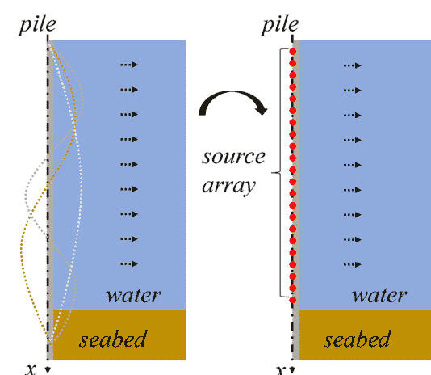

图 1. 声传播等效模型示意图。

| 程序 | DeepXDE 用于求解桩打动力学问题 |
| --- | --- |
| 步骤 1 | 定义桩打模型参数。 |
| 步骤 2 | 在几何模块中定义桩的轴向坐标和长度。在反问题中设置变量。 |
| 步骤 3 | 定义桩打偏微分方程。 |
| 步骤 4 | 定义常见边界条件。在反问题中设置附加边界条件。 |
| 步骤 5 | 定义非零边界条件。 |
| 步骤 6 | 构建几何、PDE、边界条件和训练数据。在反问题中采样并设置附加训练数据。 |
| 步骤 7 | 构建神经网络（神经元、层数、激活函数、初始化器）。 |
| 步骤 8 | 编译并设置学习率，使用优化器最小化损失。 |

| 程序 | DeepXDE 用于浅水声传播函数逼近 |
| --- | --- |
| 步骤 1 | 定义声传播模型参数。 |
| 步骤 2 | 在几何模块中定义轴向坐标和径向坐标。 |
| 步骤 3 | 定义声传播函数。 |
| 步骤 4 | 构建几何、函数、训练数据和测试数据。 |
| 步骤 5 | 构建神经网络（神经元、层数、激活函数、初始化器）。 |
| 步骤 6 | 编译并设置学习率，使用优化器最小化损失。 |

方程、纳维-斯托克斯方程、艾伦-卡恩方程等（Pang et al., 2019; Zhang et al., 2019, 2020; Mao et al., 2020; Wight and Jia, 2021; Salvatore et al., 2022）。一种强大的工具被开发为所谓的物理信息神经网络（PINN）来求解偏微分方程（Raissi et al., 2019）。PINN 已在许多物理领域中被研究、使用和优化，例如流体力学与振动（Raissi et al., 2020; Chen et al., 2021）、结构耐久性（Xue et al., 2022）、波传播（Alkhdhar and Mohamed, 2021）。不同于有限元法（FEM），使用 PINN 近似解是一种无网格方法，这意味着计算效率与模型频率无关（Karniadakis et al., 2021; Sacchetti et al., 2022）。更重要的是，通过数据驱动建模技术，PINN 具有以极低成本求解未知参数的非凡能力（Tartakovsky et al., 2020; He et al., 2020; Lu et al, 2021）。一旦构建了前馈神经网络（FNN）并将物理定律作为额外知识嵌入，反问题只需极少量编码，即可仅基于极少数据轻松求解。

本文的主要工作包括两部分，基于 PINN 框架的动力学和声学研究。第一部分是在水中利用物理信息神经网络研究海上管桩的动力学行为，包括正问题和反问题。在这一部分，展示了所提 PINN 方法预测耦合桩打模型某些未知参数的准确性、效率和便捷性。另一部分是基于正模理论的浅水声传播研究，其中发现 PINN 方法作为一种与频率和距离无关的方法具有显著优势。

## 2. 数学模型

### 2.1. 打桩

海上管桩可以建模为垂直、薄壁的弹性圆柱壳，且损耗因子通常很小，可予以忽略。管桩桩尖位于海床，桩顶受外力冲击。桩打主要有两种典型方式：冲击桩打和振动桩打。冲击桩打迅速且宽频带，而振动桩打频率带较窄，水下声压级较低。无论采用哪种方式将桩打入土中，研究桩的振动特性都是首要任务。在桩打模型中，考虑一根薄壁弹性圆柱桩管以研究其动力学行为（Junger and Feit, 1986）。并利用正模理论研究桩打在浅水中的声传播（Ellis and Chapman, 1985）。本工作的主要目的是探究 PINN 研究桩打动力学行为及其在浅水中辐射的水下声压的能力。因此，考虑海床对桩的影响，但用合理的近似替代。

定义 $x$ 和 $r$ 分别为桩的轴向坐标和径向坐标，$u$ 和 $w$ 分别为桩的轴向位移和径向位移。此外，几何和材料符号如下：$\rho$，桩的密度，$E$，弹性模量，$\mu$，泊松比，$L$，桩的长度，$R$，桩的半径，$h$，桩的壁厚。在水中薄圆柱壳的动力学分析中，预先做出如下假设：

- 三种振动类型之间的方位向振动相互独立；
- 偏微分方程中没有半径方向的变化；
- 仅将声压视为外力；
- 涉及四阶项的扭转和弯曲被忽略。

因此，运动方程可简化为

\[
\frac{\partial^2 u(x,t)}{\partial x^2} + \frac{\mu}{R} \frac{\partial w(x,t)}{\partial x} = \frac{\rho(1-\mu^2)}{E} \frac{\partial^2 u(x,t)}{\partial t^2} \tag{1a}
\]

\[
\frac{\mu}{R} \frac{\partial u(x,t)}{\partial x} + \frac{w(x,t)}{R^2} = -\frac{\rho(1-\mu^2)}{E} \left( \frac{P_a}{\rho h} + \frac{\partial^2 w(x,t)}{\partial t^2} \right) \tag{1b}
\]

其中 $P_a$ 为流体辐射压力，垂直作用于管桩壁面。通过耦合流固相互作用（FSI），其表达式可表示为

\[
P_a(x,t) = Z(x,t) \frac{\partial w(x,t)}{\partial t} \tag{2}
\]

其中 $Z(x,t)$ 表示管桩壁面处桩与水之间的阻抗关系，可通过逆傅里叶变换计算如下


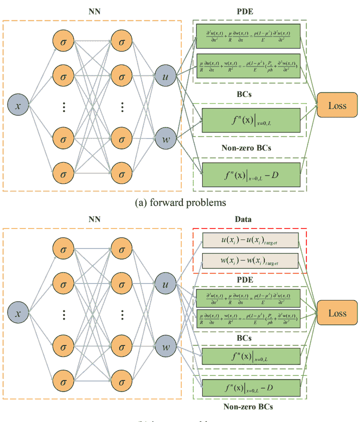

图 2. 桩打模型示意图：（a）正问题；（b）反问题。

| | 常见边界条件 | | 非零边界条件 | |
|---|---|---|---|---|
| | 桩顶 | 桩端 | 桩顶 | 桩端 |
| CC | \( w|_{x=0} = 0 \) | \( w|_{x=L} = 0 \) | \( \frac{\partial w^2}{\partial x^2}|_{x=0} = D_1 \) | \( \frac{\partial w^2}{\partial x^2}|_{x=L} = D_3 \) |
| SS | \( \frac{\partial w}{\partial x}|_{x=0} = 0 \) | \( \frac{\partial w}{\partial x}|_{x=L} = 0 \) | \( \frac{\partial w^3}{\partial x^3}|_{x=0} = D_2 \) | \( \frac{\partial w^3}{\partial x^3}|_{x=L} = D_4 \) |
| | \( w|_{x=0} = 0 \) | \( w|_{x=L} = 0 \) | \( \frac{\partial w^3}{\partial x^3}|_{x=0} = D_1 \) | \( \frac{\partial w^3}{\partial x^3}|_{x=L} = D_3 \) |
| | \( \frac{\partial w^2}{\partial x^2}|_{x=0} = 0 \) | \( \frac{\partial w^2}{\partial x^2}|_{x=L} = 0 \) | \( \frac{\partial w^3}{\partial x^3}|_{x=0} = D_2 \) | \( \frac{\partial w^3}{\partial x^3}|_{x=L} = D_4 \) |
| FF | \( \frac{\partial w^2}{\partial x^2}|_{x=0} = 0 \) | \( \frac{\partial w^2}{\partial x^2}|_{x=L} = 0 \) | \( \frac{\partial w^3}{\partial x^3}|_{x=0} = D_2 \) | \( \frac{\partial w^3}{\partial x^3}|_{x=L} = D_4 \) |
| | \( \frac{\partial w}{\partial x}|_{x=0} = 0 \) | \( \frac{\partial w}{\partial x}|_{x=L} = 0 \) | \( \frac{\partial w}{\partial x}|_{x=0} = D_2 \) | \( \frac{\partial w}{\partial x}|_{x=L} = D_4 \) |
| | \( \frac{\partial w^3}{\partial x^3}|_{x=0} = 0 \) | \( \frac{\partial w^3}{\partial x^3}|_{x=L} = 0 \) | \( \frac{\partial w}{\partial x}|_{x=0} = D_2 \) | \( \frac{\partial w}{\partial x}|_{x=L} = D_4 \) |

| 参数 | 数值 | 单位 |
|---|---|---|
| \( L \) | 10 | m |
| \( R \) | 0.25 | m |
| \( h \) | 0.01 | m |
| \( E \) | \( 2.1 \times 10^{11} \) | Pa |
| \( \mu \) | 0.3 | / |
| \( \rho \) | 7850 | kg/m3 |
| \( \rho_f \) | 1000 | kg/m3 |
| \( c_p \) | 5000 | m/s |
| \( c_f \) | 1500 | m/s |

```
\( Z(x,t) = \frac{\rho_f c_f}{2\pi\sqrt{1-(\frac{c_f}{c_p})^2}} \int_{-\infty}^{\infty} \frac{-i H_1^{(1)}(k_r R)}{H_1^{(1)}(k_r R)} e^{i \omega t} d\omega \) (3)
```

where \( \rho_f \), \( c_f \) 和 \( c_p \) 分别是流体密度、流体中的声速和桩中的声速。\( H_1^{(1)} \) 是第一类第一阶汉克尔函数，\( k_r \) 是径向波数，定义为

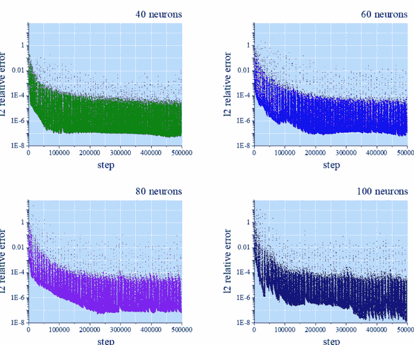

(a) 训练损失

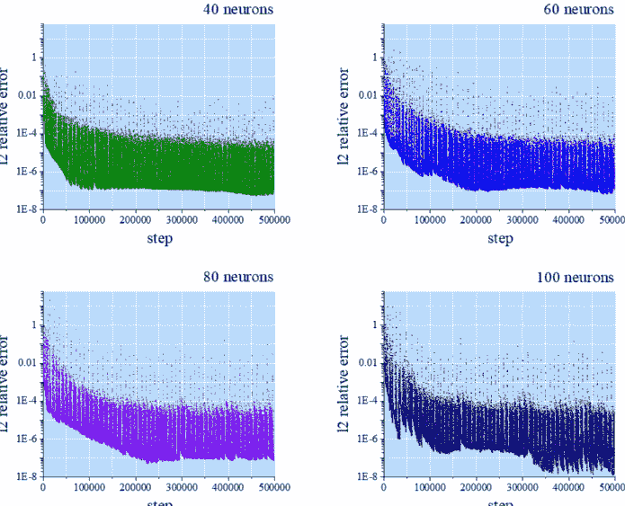

(b) 测试损失

图 3. 不同神经元的均方误差：（a）训练损失；（b）测试损失；（c）测试指标。

$k_r = \frac{\omega}{c_f} \sqrt{1 - (\frac{c_f}{c_p})^2}$ (4)

在虚域中，我们的研究接受一些假设。例如，当桩的半径和径向波数都小时，它们的乘积足够小可以被视为零。根据贝塞尔函数的性质（Kwak, 2010），我们可以得到

为了兼顾数值计算的便利性和效率，并避免 PINN 框架中的计算在

40 个神经元

60 个神经元

80 个神经元

100 个神经元

(c) 测试指标

图 3.（续）。

1 层

2 层

3 层

4 层

(a) 训练损失

图 4. 不同层数的均方误差：（a）训练损失；（b）测试损失；（c）测试指标。

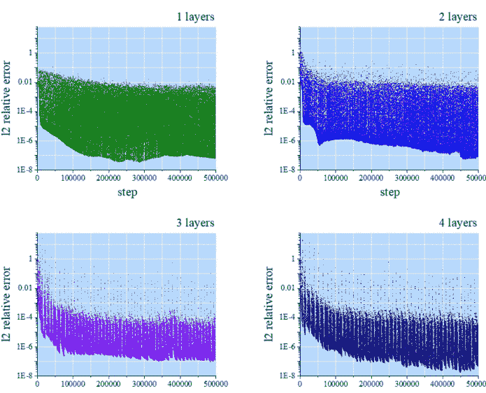

(b) 测试损失

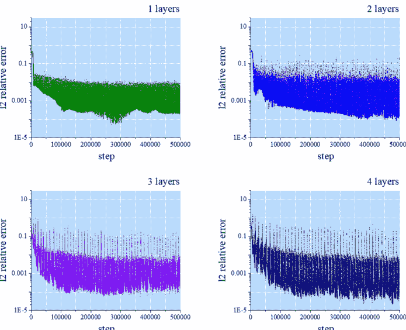

(c) 测试指标

图 4.（续）。

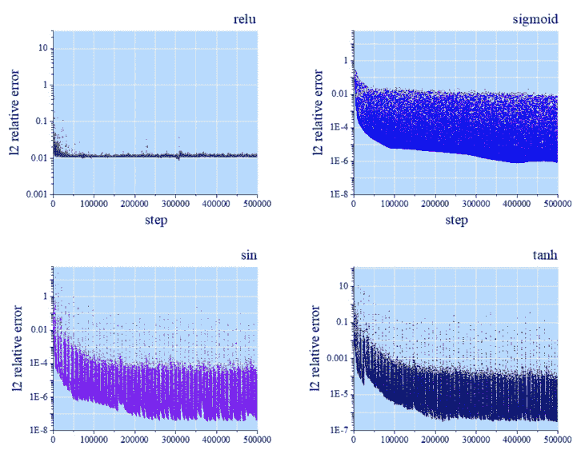

(a) 训练损失

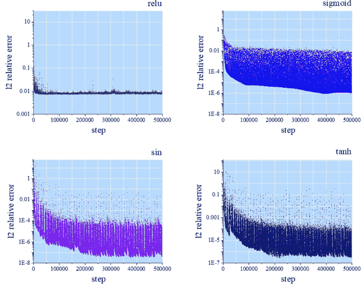

(b) 测试损失

图 5. 不同激活函数的均方误差：（a）训练损失；（b）测试损失；（c）测试指标。

\frac{H_1^{(1)}(k,R)}{H_1^{(1)}(k,R)} = -\frac{1}{n} (5)

流体-桩模型的频率。考虑时无关偏微分方程的情况，对于单频谐振分析，使用变量分离法可给出桩的位移如下

为了研究桩打的动力学特性，我们以振动桩打为例，它可以代表共振

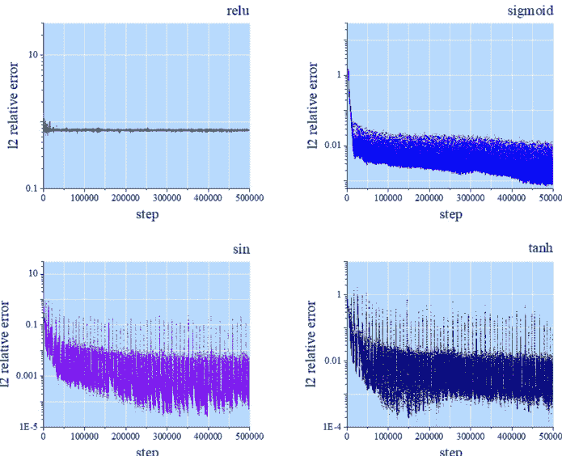

(c) 测试指标

图 5.（续）。

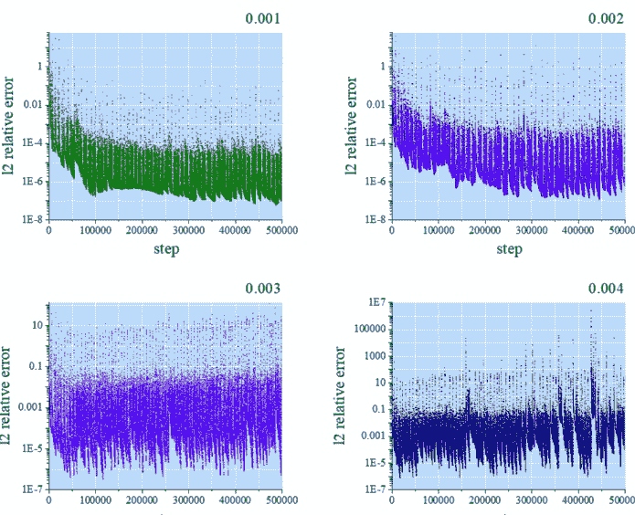

(a) 训练损失

图 6. 不同学习率的均方误差：（a）训练损失；（b）测试损失；（c）测试指标。

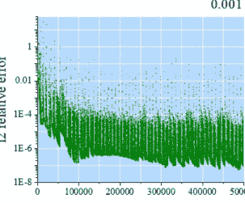

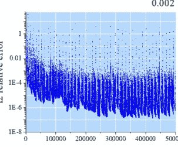

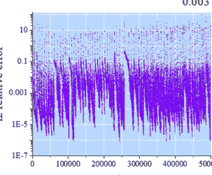

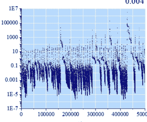

(b) 测试损失

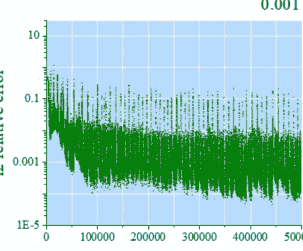

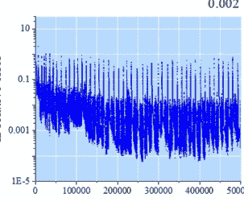

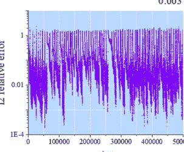

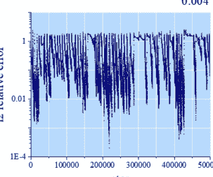

(c) 测试指标

图 6.（续）。

| | 数值 | 训练损失 | 测试损失 | 测试指标 |
|---|---|---|---|---|
| 神经元数 | 40 | $4.12 \times 10^{-8}$ | $4.72 \times 10^{-8}$ | $9.63 \times 10^{-5}$ |
| | 60 | $3.01 \times 10^{-8}$ | $3.53 \times 10^{-8}$ | $7.41 \times 10^{-5}$ |
| | 80 | $6.71 \times 10^{-8}$ | $7.24 \times 10^{-8}$ | $1.68 \times 10^{-4}$ |
| | 100 | $9.23 \times 10^{-8}$ | $9.22 \times 10^{-8}$ | $1.17 \times 10^{-4}$ |
| 层数 | 1 | $3.94 \times 10^{-8}$ | $3.51 \times 10^{-8}$ | $1.77 \times 10^{-4}$ |
| | 2 | $1.82 \times 10^{-7}$ | $1.72 \times 10^{-7}$ | $2.40 \times 10^{-4}$ |
| | 3 | $3.00 \times 10^{-8}$ | $3.34 \times 10^{-8}$ | $5.08 \times 10^{-5}$ |
| | 4 | $4.03 \times 10^{-8}$ | $4.14 \times 10^{-8}$ | $9.43 \times 10^{-5}$ |
| 激活函数 | sin | $5.19 \times 10^{-8}$ | $5.59 \times 10^{-8}$ | $1.20 \times 10^{-4}$ |
| | tanh | $4.11 \times 10^{-7}$ | $4.40 \times 10^{-7}$ | $2.78 \times 10^{-4}$ |
| | relu | $1.08 \times 10^{-2}$ | $9.17 \times 10^{-3}$ | $7.54 \times 10^{-1}$ |
| | sigmoid | $8.20 \times 10^{-7}$ | $9.88 \times 10^{-7}$ | $9.34 \times 10^{-4}$ |
| 学习率 | 0.001 | $2.06 \times 10^{-8}$ | $2.22 \times 10^{-8}$ | $4.53 \times 10^{-5}$ |
| | 0.002 | $1.32 \times 10^{-7}$ | $1.19 \times 10^{-7}$ | $6.72 \times 10^{-5}$ |
| | 0.003 | $3.84 \times 10^{-7}$ | $8.95 \times 10^{-7}$ | $8.99 \times 10^{-4}$ |
| | 0.004 | $7.89 \times 10^{-7}$ | $5.03 \times 10^{-6}$ | $2.08 \times 10^{-3}$ |

| 几何 | 输入：轴向坐标 输出：轴向和径向位移 |
|---|---|
| PDEs | 桩打的理论模型 |
| 边界条件 | 常见边界条件 非零边界条件 |
| 网络 | 全连接神经网络 |
| 层数 | [1] + [100] * 3 + [2] |
| 激活函数 | 正弦函数 |
| 初始化器 | Glorot uniform |
| 优化器 | Adam L-BFGS |
| 学习率 | 0.001 |
| 指标 | L2 相对误差 |

```
u(x, t) = u(x)e^{i\omega t} (6a)
w(x, t) = w(x)e^{i\omega t} (6b)
```

将方程 (6) 代入方程 (1) 得到

```
\frac{\partial^2 u(x)}{\partial x^2} + \frac{\mu}{R} \frac{\partial w(x)}{\partial x} + \frac{\omega^2 \rho (1 - \mu^2)}{E} u(x) = 0 (7a)
\frac{\partial u(x)}{\partial x} + C_0 w(x) = 0 (7b)
```

其中 \( C_0 \) 是为了书写方便的缩写，可表示为

```
C_0 = \frac{1}{\mu R} - \frac{\omega \rho c_f (1 - \mu^2) R}{\mu n h E \sqrt{1 - (\frac{\omega}{c_p})}} - \frac{\omega^2 \rho (1 - \mu^2) R}{\mu E} (8)
```

为了得到桩位移的精确解，我们在桩顶和桩端应用多个边界条件

```
\frac{\partial w^2}{\partial x^2}|_{x=0} = 0 (9a)
u|_{x=0,L} = u_{exact}|_{x=0,L} (9b)
w|_{x=0,L} = w_{exact}|_{x=0,L} (9c)
```

在第 3.2 节中，我们将展示为什么在某些 PINN 框架中非零边界条件非常重要和必要，并将讨论如何选择合适的边界条件以帮助神经网络更好地学习。

选择用于桩位移的通用解可以表示为以下形式

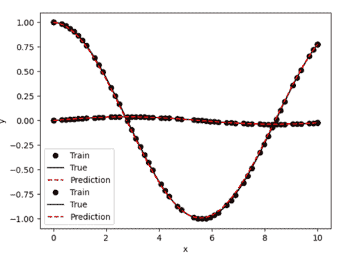

(a) 位移

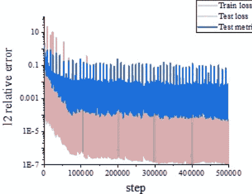

(b) 收敛

图 7. 正问题中桩打模型的位移与收敛：（a）位移；（b）收敛。

```
u(x) = cos(\lambda x) (10a)
w(x) = -\frac{1}{C_0} \frac{\partial u(x)}{\partial x} = \frac{\lambda}{C_0} sin(\lambda x) (10b)
```

其中

```
\lambda = \sqrt{\frac{\rho \omega^2 (1 - \mu^2)}{E(1 - \frac{\mu}{R C_0})}} (11)
```

桩打模型由偏微分方程方程 (7)、边界条件方程 (9) 和精确解方程 (10) 构建。在接下来的数值实验中，桩的轴向位移和径向位移将同时使用 PINN 方法进行训练、测试和预测。桩打正问题和反问题的实现将在第 3.1 节中详细描述。

### 2.2. 浅水中声传播

考虑到浅水中的声传播，正常


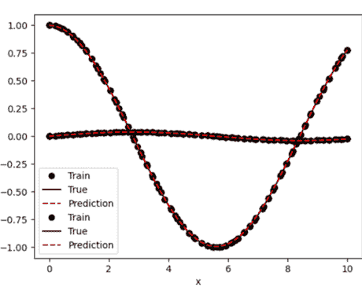

#### (a) 位移

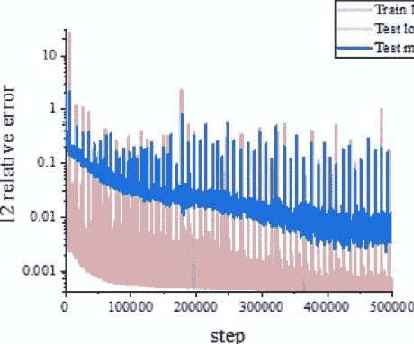

#### (b) 收敛

图 8. 反问题中桩打模型的位移与收敛：(a) 位移；(b) 收敛。

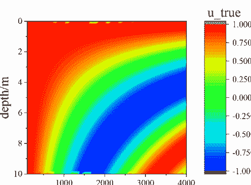

#### (a) 精确解

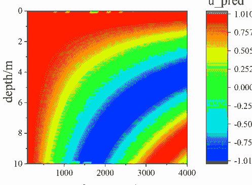

#### (b) 预测值

图 9. 不同频率下桩的轴向位移：(a) 精确解；(b) 预测值。

模态理论应用于桩打的辐射噪声模型。正模理论是描述海洋声场传播规律的常用理论之一，适用于水平分层介质中的声场建模。它是浅水声场的重要计算方法，并已广泛应用。正模理论的主要思想是将声场分解为水平行波和垂直驻波，且仅有一定频率的部分正模波能在一个波导中长距离传播。假设水下声学环境为二维轴对称分层介质，以径向轴和垂直轴建立柱坐标系。忽略时间因子，亥姆霍兹方程可写为

```
\frac{1}{r} \frac{\partial}{\partial r} (r \frac{\partial p}{\partial r}) + \frac{\partial^2 p}{\partial z^2} + k^2 p = 0
```

其中 p 为声压，k = \frac{\omega}{c} 为水中的波数。采用分离变量法，声压可表示为

```
p = \Phi(x)R(r)
```

将式 (13) 代入式 (12) 并引入分离常数 k_m，可得

```
\frac{\partial^2 \Phi_r(x)}{\partial x^2} + (k^2 - k_m^2)\Phi_m(x) = 0
```

```
\frac{1}{r} \frac{\partial}{\partial r} (r \frac{\partial R(r)}{\partial r}) + k_m^2 R(r) = 0
```

其中分离常数 k_m 为水平波数。

在浅海中，海底和海面的边界条件对结构振动和水下声波传播的辐射具有重要影响。在桩的轴向坐标，即海洋深度方向上，当不考虑海面散射时，海面通常被视为软边界（释放压力边界）。海底边界有多种，大致可分为硬边界、液体边界、弹性边界和多孔边界。此处假设海底为硬边界

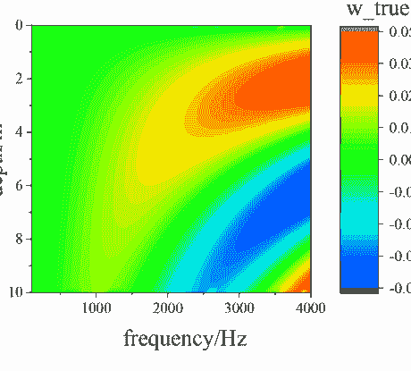

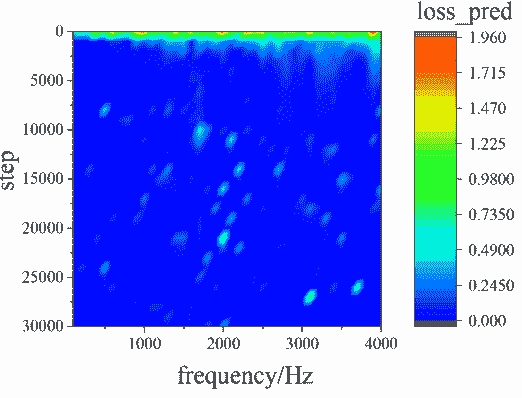

图 11. 不同频率下桩打模型的测试指标。

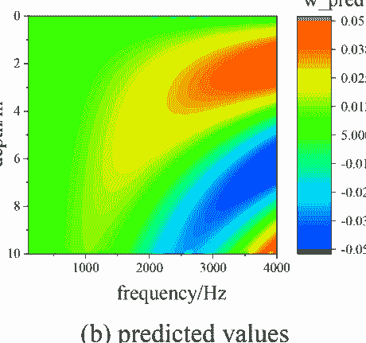

表 7
基于不同几何参数的每个最佳模型的均方误差。

| 参数 | 数值 | 训练损失 | 测试损失 | 指标 |
| :--- | :--- | :--- | :--- | :--- |
| L | 10 | 4.61 × 10⁻⁴ | 4.61 × 10⁻⁴ | 5.20 × 10⁻³ |
| | 20 | 4.86 × 10⁻⁴ | 4.86 × 10⁻⁴ | 8.16 × 10⁻³ |
| | 30 | 5.09 × 10⁻⁴ | 5.09 × 10⁻⁴ | 8.68 × 10⁻³ |
| R | 0.25 | 4.61 × 10⁻⁴ | 4.61 × 10⁻⁴ | 5.20 × 10⁻³ |
| | 0.5 | 4.60 × 10⁻⁴ | 4.60 × 10⁻⁴ | 6.69 × 10⁻³ |
| h | 0.75 | 4.56 × 10⁻⁴ | 4.56 × 10⁻⁴ | 5.17 × 10⁻³ |
| | 0.005 | 4.60 × 10⁻⁴ | 4.60 × 10⁻⁴ | 5.70 × 10⁻³ |
| | 0.0075 | 4.61 × 10⁻⁴ | 4.61 × 10⁻⁴ | 5.62 × 10⁻³ |
| | 0.01 | 4.61 × 10⁻⁴ | 4.61 × 10⁻⁴ | 5.20 × 10⁻³ |

图 10. 不同频率下桩的径向位移：(a) 精确解；(b) 预测值。

```
\(\Phi(x)|_{z=0} = 0\)
```

```
\(\frac{\partial \Phi(x)}{\partial x}|_{x=h} = 0\)
```

式 (14) 描述了径向坐标（传播方向）声场的特性，是一个经典的贝塞尔方程，其解为两个汉克尔函数的组合。由于时间因子选为 \(e^{i\omega t}\)，第一类汉克尔函数表示发散波，第二类汉克尔函数表示收敛波。为了满足无限辐射条件，后者不存在。因此，式 (14) 的解可写为

```
\(p(x, r) = \sum_n A_n \Phi_n(k_{zn}x_0) \Phi_n(k_{zn}x) H_n^{(1)}(k_m r)\)
```

其中 \(k_{zn}\) 为垂直波数，\(x_0\) 为声源深度，系数 \(A_n\) 由声源和边界条件决定。此外，第 n 阶正模的表达式可分离为以下形式

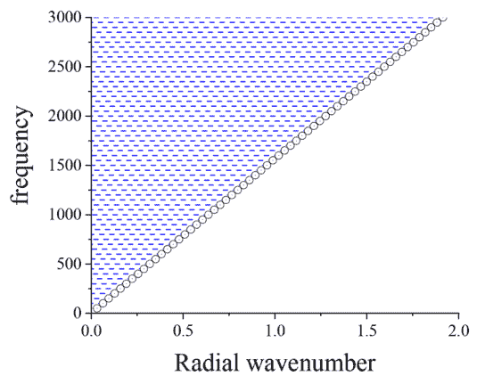

图 12. 声波传播的色散关系。

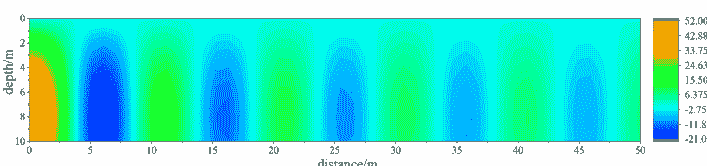

#### (a) 精确解

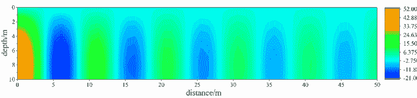

#### (b) 预测值

图 13. 1000 Hz 下的浅水声波传播：(a) 精确解；(b) 预测值。

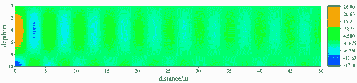

#### (a) 精确解

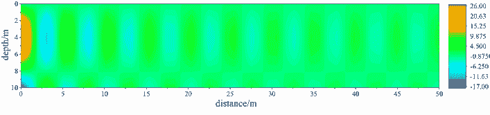

#### (b) 预测值

图 14. 2000 Hz 下的浅水声波传播：(a) 精确解；(b) 预测值。

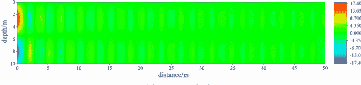

#### (a) 精确解

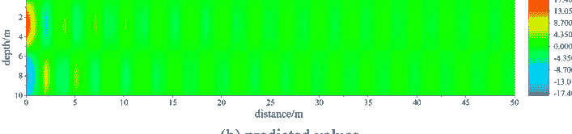

#### (b) 预测值

图 15. 3000 Hz 下的浅水声波传播：(a) 精确解；(b) 预测值。

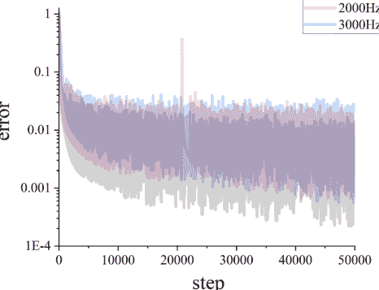

图 16. 1000 Hz、2000 Hz 和 3000 Hz 声波传播的均方误差。

```
$p_n(x, r) = A_n \Phi_n(k_{yn}x_0)\Phi_n(k_{yn}x)H_1^{(1)}(k_m r)$ (17)
```

我们采用经验模型，并在水柱中设置一系列垂直声源，使其等效于图 1 所示桩射出的噪声。最终建立了浅水中桩打的辐射噪声模型。我们将使用 PINN 框架来逼近正模理论的解，并在第 4 节讨论结果。

## 3. 物理信息神经网络

本节简要说明了用于求解桩打问题和浅水声波传播问题的物理信息神经网络的构建方法。随后提出了一项建议，帮助神经网络避免偷懒学习并更好地学习偏微分方程。

### 3.1. 实现程序

本研究使用 DeepXDE 来实现包括正问题和逆问题在内的任务。DeepXDE 是开源深度学习平台（TensorFlow、PyTorch、JAX、PaddlePaddle）上的一个 Python 库。使用 DeepXDE 的动机在于，它是一个已开发的工具，被认为能够训练、测试、预测并求解偏微分方程，以及计算桩打振动声学模型中的未知参数。

DeepXDE 求解桩打偏微分方程的简要工作流程如表 1 所示，浅水声波传播函数逼近的简要工作流程如表 2 所示。

本工作中的计算域为一维或二维，即沿桩轴向的位置或沿水平方向的径向距离，输出为轴向位移、径向位移和声压，如下所示

```
$x \in \mathbb{R}^{d_{in}}$ (18a)

$u, w \in \mathbb{R}^{d_{low}}$ (18b)

$x, r \in \mathbb{R}^{d_{low}}$ (19a)

$p \in \mathbb{R}^{d_{low}}$ (19b)
```

构建一个具有输入、N 层和输出的神经网络，用于模拟桩打偏微分方程或逼近浅水声波传播，可数学表达为

```
$N \left( x, u; \frac{\partial u}{\partial x} \frac{\partial^2 u}{\partial x^2}, w, \frac{\partial w}{\partial x}, \cdots \right) = 0, x \in \mathbb{R}^{d_{in}}$ (20)
```

神经网络包括输入层、隐藏层和输出层，其中 ReLU 函数、Sigmoid 函数、正弦函数和双曲正切函数用作非线性激活函数。例如，使用正弦函数作为激活函数，隐藏层中的一个神经元可写为

```
$y^{i+1}(x) = \sigma(W^i x + b^i) = sin(W^i x + b^i)$ (21)
```

其中 $W^i$ 和 $b^i$ 分别为第 i 层的权重和偏置。

因此，图 2 描绘了桩打模型的正向和逆向神经网络。对比正问题和逆问题，可以清楚地看出逆问题需要额外的训练数据，且其损失包含在总损失中。

为求解桩打偏微分方程，狄利克雷、诺伊曼和周期边界条件等特定边界条件是必要且关键的。通常不需要额外的边界条件，因为它们约束相同的数学解。然而，在某些情况下，额外的边界条件可用于避免偷懒学习，我们

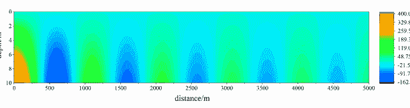

#### (a) 精确解

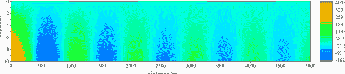

#### (b) 预测值

图 17. 长距离下的浅水声波传播：(a) 精确解；(b) 预测值。


将在下一节中详细讨论。浅水中声传播的近似中也存在同样的情况。为了说明我们的算法，按其值划分的两种边界条件可以表示为

$B_{zero}(u, w, x) = 0 \text{ on } \partial\Omega$ (22a)

$B_{non-zero}(u, w, x) = C \text{ on } \partial\Omega$ (22b)

其中 $\partial\Omega$ 是域边界，$C$ 是非零边界上的值。

在桩锤打桩的反问题中，给出精确解的数据来求解一些未知参数，例如几何参数、材料参数和桩的固有频率。通过锚定和匹配某些点的值，总损失中还添加了额外的损失以进行最小化。

在限制神经网络满足物理定律后，我们开始基于随机梯度下降（SGD）最小化损失来训练模型。损失函数涉及多个部分，例如 PDE 模块、边界条件模块等。请注意，非零边界条件的损失函数也会自动定义。总损失函数可以通用地定义为

$L_{total} = w_f L_f + w_{B_{zero}} L_{B_{zero}} + w_{B_{non-zero}} L_{B_{non-zero}}$ (23)

其中

$L_f = \frac{1}{|T_f|} \sum_{x \in T_f} \left\| f \left( x; u, \frac{\partial u}{\partial x} \frac{\partial^2 u}{\partial x^2}, u, \frac{\partial w}{\partial x}; \dots \right) \right\|_2^2$ (24a)

$L_{B_{zero}} = \frac{1}{|T_{B_{zero}}|} \sum_{x \in T_{B_{zero}}} \| B_{zero}(u, w, x) \|_2^2$ (24b)

$L_{B_{non-zero}} = \frac{1}{|T_{B_{non-zero}}|} \sum_{x \in T_{B_{non-zero}}} \| B_{non-zero}(u, w, x) \|_2^2$ (24c)

其中 $w_f, w_{B_{zero}}$ 和 $w_{B_{non-zero}}$ 是各部分的权重。

选择优化器 "Adam" 通过梯度下降最小化损失函数。此外，随后可以使用优化器 "L-BFGS" 来进一步帮助训练模型。桩锤打桩模型和声传播模型的测试指标如下

$metric = \frac{u_{true} - \widehat{u}}{u_{true}} + \frac{w_{true} - \widehat{w}}{w_{true}}$ (25a)

$metric = \frac{p_{true} - \widehat{p}}{p_{true}}$ (25b)

其中 $\widehat{u}, \widehat{w}$ 和 $\widehat{p}$ 分别是桩的轴向位移、桩的径向位移和水下声压的期望值。

与常见的数值技术（如有限元法和有限差分法，两者都涉及数值离散）相比，我们可以发现 PINN 框架通过神经网络实现求解过程。这些方法的离散化由感兴趣的最高频率决定，这限制了它们的应用。然而，PINN 方法是一种无网格且与频率无关的方法，它可以借助合适的框架和适当的超参数来解决物理问题。

### 3.2. 附加措施

边界条件在求解结构动力学和振动问题中得到广泛应用。例如，桩的振动常见边界条件（以梁理论为例）包括自由边界条件、简支边界条件和固支边界条件。这些传统边界条件在理论推导和数学求解中效果良好，但不幸的是有时在深度学习中效果不佳。对于某些偏微分方程，例如没有任何外部耦合项的梁、板和壳的自由振动问题，发现这些神经网络容易变得“懒惰”，因此我们将此现象称为“懒惰学习”。在这些情况下，神经网络的精度远低于精确解。具体来说，待训练的目标函数（通常是位移函数）倾向于成为零函数，而零函数也满足偏微分方程。在指出这一问题后，本研究通过设置额外的合成非零边界条件（如表 3 所示）提出了避免懒惰学习的方法。

表 3 中 $D_1, D_2, D_3$ 和 $D_4$ 的值分别从模型形函数的精确解中获得。这样一来，神经网络在最小化损失的过程中必须满足这些非零边界条件。我们也可以通过设置边界条件和其他部分的损失权重来调整神经网络。请注意，并非所有非零边界条件都应被采用，具体取决于训练速度和特定情况下的收敛性考虑。在本工作中，非零边界条件用于帮助最大化下一节的训练效果。

## 4. 结果与讨论

在本节中，首先通过调整网络和超参数来优化 PINN 框架。然后，用偏微分方程的精确解验证 PINN 方法给出的预测值，并研究浅水中近海桩的动态行为和声传播。最后，说明所提 PINN 方法的优势，并给出未来工作计划。

运行环境配备 NVIDIA GeForce GTX 1650 SUPER GPU 和 Intel UHD Graphics 630 GPU。使用 TensorFlow 语法，PINN 框架在 DeepXDE 版本 0.8.3 中实现。

### 4.1. 微调

使用 PINN 求解物理方程的初始工作是尝试找到具有特定参数的良好网络结构。为了构建既不过拟合也不过欠拟合的可靠、鲁棒且高效的深度学习神经网络，我们首先构建一个适中的网络，然后尝试不同的网络结构以识别超参数对 PINN 框架的敏感性。分析超参数对 PINN 框架的影响后，我们选择一个合理的 PINN 框架来学习桩锤打桩和浅水声传播的动态行为。

在 PINN 算法的所有网络框架和参数中，一些基于与其他研究人员共识构建的参数可以毫不犹豫地采用。例如，全连接神经网络已被证明适用于类似问题；"Adam" 是最流行的优化算法之一，可用作优化器，通常被证明是合适且有效的。让我们考虑一个常见的桩锤打桩和浅水声传播 PINN 框架，其参数列于表 4。请注意，后续调优过程使用相同的参数。

关于 PINN 框架中网络结构，神经元、层数和激活函数是需要谨慎调整的最重要超参数。神经元和层数的数量并非越多越好。一方面，神经元和层数的增加会导致计算量增加；另一方面，可能导致过拟合等问题。此外，激活函数本质上使神经网络具有非线性，这对于精确解的近似也至关重要。我们的目标是构建一个简单、实用且适应性强的神经网络。因此，我们设置了一系列测试，以帮助找到超参数综合协调良好的神经网络。

由于桩锤打桩模型的对称性，输入变量是空间坐标，即轴向坐标，输出是桩的轴向位移和径向位移。不同神经元、层数和激活函数的实验结果分别见图 3、图 4 和图 5。可以看出，图 3 中不同神经元的均方误差几乎没有显著差异。即使只应用 40 个神经元，训练和测试损失也可以降低到令人满意的程度，这表明神经网络具有很强的拟合能力。图 4 中可以发现微小差异，即随着层数的增加，计算损失和振荡可以进一步减少。正如我们所预期的，不同激活函数之间存在巨大差异。由于解的数学形式，正弦函数效果确切且表现最好，而其他激活函数学习效果不佳，尤其是 relu 函数的激活。此外，对于任何正弦形状的解（如傅里叶展开），正弦函数及其导数是作为激活函数的最佳选择，而使用其他激活函数的 PINN 算法则或多或少需要付出代价进行调整。

同样，研究学习率对学习过程的影响至关重要，因为根据其他研究（Lee et al., 2021），学习率会严重影响结果。我们选择 0.001（许多算法中使用的保守学习率）、0.002、0.003 和 0.004 作为学习率，其他参数相同，以研究 PINN 框架中学习率的影响。从图 6 可以看出，这四种情况之间存在巨大差异。随着学习率增加，收敛性和数值稳定性受到不利影响。当学习率达到 0.003 时，训练和测试损失不再收敛，预测值与精确解相差甚远。因此，建议采用较小的学习率和更长的迭代次数的平稳策略。

PINN 框架参数研究的最佳结果列于表 5，证明 PINN 算法大多可信。最后，我们选择一种算法作为基本模型（如表 6 所示），并进行我们感兴趣的某些实验研究。下一节将给出并讨论使用 PINN 方法进行桩锤打桩的正问题和反问题以及浅水声传播近似的实验。

### 4.2. 数值结果

根据调优结果，我们最终选择一组参数（如表 6 所示），构建一个可靠的 PINN 框架，以研究近海管桩的动态行为和浅水声传播。

我们将 PINN 框架应用于桩锤打桩的正问题和反问题。桩锤打桩模型的参数遵循表 4 中的先前参数。如图 7 和图 8 所示，使用所提 PINN 方法预测的轴向位移和径向位移与精确解非常吻合，正如我们所期望的那样，训练、测试和预测损失足够低，以确保模型快速稳定地收敛（最佳模型：正问题中训练损失 10^-8，测试损失 10^-8，指标 10^-5；反问题中训练损失 10^-4，测试损失 10^-4，指标 10^-3）。此外，可以看出与反问题相比，正问题更容易训练，因为后者的损失函数包含待最小化的额外项，即少数几个锚点。

接下来，我们重点研究桩锤打桩问题中的频率特性。许多经典且流行的数值方法受感兴趣频率的限制。例如，FEM 通常在低频下有效且高效。如上文所述，PINN 方法与频率无关，其工作工具是神经网络。因此，我们选择 0 Hz 到 4000 Hz 的频率带，步长为 100 Hz，以研究 PINN 方法的有效性和准确性。如图 9、图 10 和图 11 所示，频率变化时预测精度几乎没有差异。然而，我们必须承认，当频率急剧且大幅增加时，数据集和参数应进行精细调整，例如增加训练数据点以避免过拟合。

接下来，我们研究参数变化对反问题的影响。在此部分，C0 是待预测的未知值。为了实现反问题，我们将训练数据组织并分配为点集边界条件。以几何参数为例，几何参数在正问题中是常数值，而在反问题中是常数和参数化值，因此我们可以研究 PINN 框架对桩锤打桩模型变化的适应性。如表 7 所示，损失均低于 10^-3，表明 PINN 框架具有很强的能力来预测反问题中的未知参数。

浅水声传播模型的输入是空间坐标 x 和 r，而水下声压是神经网络的输出。水深设置为 10 m，辐射距离设置为 50 m。我们将海面视为声释放边界，将海床视为硬边界。km 是水下声压的径向波数，可以是实数也可以是虚数。km 的值决定了径向方向声传播和衰减的特性。当 km 为虚数时，声压不能有效传播到远处。我们考虑 km 为实数值（如图 12 所示），因为所提 PINN 框架在实数域中进行。现在我们使用 PINN 方法根据公式 (17) 构建声压近似。如图 13、图 14 和图 15 所示，在 1000 Hz、2000 Hz 和 3000 Hz 频率下，预测的水下声压与精确解吻合良好。由于 PINN 方法求解浅水声传播的结果非常好，然后我们关注 PINN 框架在宽频率范围和长距离下求解相同问题的能力。如图 16 和图 17 所示，PINN 方法近似得到的水下声压在大多数情况下并非完全准确但可接受，指标低于 10^-3，这也可以证明 PINN 方法的有效性相当好。

### 4.3. 优势与展望

所提 PINN 方法在求解桩锤打桩问题中具有许多特性和优势。首先，所提深度学习方法具有革命性的数值计算概念，非常创新。它使用包含物理知识的专门设计神经网络进行训练和学习。凭借强大的近似能力，它在桩锤打桩模型中效果良好。其次，与 FEM 和 FDM 相比，所提 PINN 几乎与网格、频率和几何域无关，这意味着在高频范围和长距离下，它比其他方法耗时更少。第三，所提方法在求解偏微分方程和从实际数据中学习方面非常稳健，与反问题中推导和计算复杂解相比尤为如此。

根据我们的研究，我们可以乐观地相信，海洋工程中结构的各种振动声学问题有望使用 PINN 来解决，我们将尽可能专注于这些问题，并在未来研究中致力于算法优化。最有趣、最令人兴奋的待探索研究领域之一是使用 PINN 和真实测量数据研究桩锤打桩产生的水下噪声辐射，这将大大帮助我们研究流体-桩-土耦合动态模型和水下声学模型。基于深度学习和实际工程，我们在未来可以实现保护海洋生物和海洋环境的最终目标。

## 5. 结论

在本文中，我们提供了一种新方法来帮助研究桩锤打桩问题，并展示了 PINN 方法求解方面的潜力


动力学与声学中的问题。构建了一个基于PINN的深度学习框架，用于研究浅水中打桩运动和声波传播。详细分析了所提PINN方法的超参数敏感性。发现：1）神经网络中少量神经元即可获得满意结果；2）浅层平坦神经网络足以拟合，但增加层数可使训练和测试损失稳步降低；3）作为非线性算子，激活函数在将输入映射到输出方面起着重要作用，正弦函数是我们研究中打桩问题的最佳选择；4）建议使用较小学习率，因其稳定性良好。此外，我们建议采用一种新技术，即非零边界条件，以帮助神经网络避免懒惰学习。

在构建和优化PINN框架后，我们测试其从偏微分方程和实数据中学习的能力，以求解打桩的正问题和反问题。在我们的研究中，基于出色的前馈网络，PINN求解未知参数的能力相当出色。最后，为了将所提PINN方法与其他方法区分开来并探索所提PINN方法的可能性，我们主要在频率域和几何域开展了一些数值实验。PINN方法给出的位移和水下声压结果在宽频率和距离范围内与精确值吻合良好。

## CRediT 作者贡献声明

Quanzhou Jiang: 概念化，方法学，验证，正式分析，撰写 – 原稿。Xianzhong Wang: 方法学，撰写 – 审阅与编辑。Min Yu: 调查，监督。Min Tang: 监督。Bixin Zhan: 资源，可视化。Shuai Dong: 资源，可视化。

## 竞争利益声明

作者声明，他们没有已知的竞争性财务利益或个人关系，这些关系可能会对本文所报道的工作产生影响。

## 数据可用性

数据将根据要求提供。

## 致谢

本工作得到中国国家自然科学基金会（编号：52271291）和湖北省自然科学基金会（ZRMS2020000207）的资助。

## 参考文献

-   Alkhadh, Shaikhah, Mohamed, Almjekawy, 2021. 结合深度神经网络与物理学以求解Burger方程的反问题。载于：年度国际IEEE工程医学与生物学会议，第4465-4468页。
-   Amaral, Jennifer L., Miller, James H., Potty, Gopu R., Vigness-Raposa, Kathleen J., Lin, Ying-Tsong, Frankel, Adam S., Newhall, Arthur E., Wilkes, Daniel R., Gavrilov, Alexander N., 2022. 布洛克岛风电场冲击打桩水下声音分析。J. Acoust. Soc. Am. 151 (4), A239.
-   Bailey, Helen, Senior Dale Simmons, Bridget, Jan, Rusin, Gordon, Pickenc, Paul, M., Thompson, 2010. 评估海上风电场打桩期间水下噪声水平及其对海洋哺乳动物的潜在影响。Mar. Pollut. Bull. 60, 888-897.
-   Chen, Cheng, Meng, Hao, Yong-Zheng, Li, Zhang, Guang-Tao, 2021. 基于PINN的深度学习法求解圆柱2自由度涡激振动。Ocean. Eng. 240, 109932.
-   Cuomo, Salvatore, Schiano di Cola, Vincenzo, Giampaolo, Fabio, et al., 2022. 基于物理信息神经网络的科学机器学习：我们身处何处及未来何方 arXiv: 2201.056243.
-   Ellis, Dale D., Chapmain, D.M.F., 1985. 包含剪切波效应的简单浅水传播模型。J. Acoust. Soc. Am. 78 (6), 2087-2095.
-   Hall, Marshall V., 2013. 海上打桩水下声脉冲非马赫峰压的半解析模型。Acoust Austral. 41 (1), 42-51.
-   He, QiZhi, Barajas-Solano David, Guzel, Tartakovsky, Tartakovsky, Alexandre, M., 2020. 多物理场数据同化的物理信息神经网络及其在地下输运中的应用。Adv. Water Resour. 141, 103610.
-   Junger, Miguel C., Feit, David, 1986. 声音、结构及其相互作用。MIT出版社，剑桥。
-   Karmadikaris, George Em, Kevrekidis, Ioannis G., Lu, Lu, Paris, Perdikaris, Wang, Sifan, Liu, Yang, 2021. 物理信息机器学习。Nat. Rev. Phys. 3 (6), 422-440.
-   Kwok, Moon K., 2010. 接触无界外流体的有限圆柱壳自由振动分析。J. Fluid Struct. 26 (3), 377-392.
-   Lee, Soo Young, Chang, Jiho, Lee, Seungchul, 2021. 基于深度学习的多声源高精度高分辨率定位方法。Mech. Syst. Signal Process. 161.
-   Lippert, Tristan, Otto von Estorff, 2014. 参数不确定性对海上打桩噪声预测的重要性。J. Acoust. Soc. Am. 136 (5), 2463-2471.
-   Lippert, Stephan, Nijhof, Marten, Lippert, Tristan, Wildes, Daniel, 2016. COMPILE—一种用于海洋打桩噪声预测的通用基准代码。IEEE J. Ocean. Eng. 41 (4), 1061-1071.
-   Lu, Meng, Xuhui, Mao, Zhiping, Karmadikaris, George Em, 2021. DeepXDE：求解微分方程的深度学习库。Soc. Ind. Appl. Math. 63 (1), 208-228.
-   MacGillivray, Alexander O., 2013. 海洋冲击打桩产生的水下声级模型。J. Acoust. Soc. Am. 134 (5), 4024.
-   Madsen, P.T., Wahlberg, M., Tougaard, J., Lucke, K., Tyack, P., 2006. 风力涡轮机水下噪声与海洋哺乳动物：当前知识与数据需求的启示。Mar. Ecol. Prog. Ser. 309, 279-295.
-   Mao, Zhiping, Jagtap, Ameya D., Karmadikaris, George Em., 2020. 高速流动的物理信息神经网络。Comput. Methods Appl. Mech. Eng. 360, 112789.
-   Pang, Guofei, Lu, Lu, Karmadikaris, George Em., 2019. fPINNs：分数阶物理信息神经网络。SIAM J. Sci. Comput. 41 (4), 2603-2626.
-   Popper, A.N., Hastings, M.C., 2009. 人为声源对鱼类的影响。J. Fish. Biol. 75, 455-489.
-   Pye Henninger, Heidi, Watson, Winsor H., 2005. 美国龙虾（Homarus americanus）甲壳振动及相关水传声产生机制研究。J. Exp. Biol. 208, 3421-3429.
-   Raissi, M., Perdikaris, P., Karniadakis, G.E., 2019. 物理信息神经网络：求解涉及非线性偏微分方程的正问题与反问题的深度学习框架。J. Comput. Phys. 378, 686-707.
-   Raissi, Maziar, Yazdani, Alireza, Karmadikaris, George Em, 2020. 隐藏流体力学：从流场可视化中学习速度和压力场。Science 367 (6481), 1026-1030.
-   Reinhold, Per G., Dahl, Peter H., 2011. 冲击打桩水下马赫波辐射：理论与观测。J. Acoust. Soc. Am. 130 (3), 1209-1216.
-   Ryan Wilkes, Daniel, Tim, Gourlay, Alexander, Gavrilov, 2014. 近场打桩噪声时域建模数值方法比较。载于：INTER-NOISE和NOISE-CON大会及会议论文集，第2169-2178页。
-   Sacchetti, Andrea, Bachmann, Benjamin, Löffler, Kaspar, Kinzi, Urs-Martin, Paoli, Beatrice, 2022. 求解偏微分方程的神经网络：与有限元法的比较。IEEE Access 10, 32271-32279.
-   Tartakovsky, A.M., Ortiz Marrero, C., Paris, Perdikaris, Tartakovsky, G.D., Barajas-Solano, D., 2020. 用于学习地下流动问题中参数和本构关系的物理信息深度神经网络。Water Resour. Res. 56 (5), e2019WR026731.
-   Van der Kraan P. Inge, Hans, Slabbekoorn, Tom, Moens, Van den Eynde Dries, Jan, Reubens, 2022. 打桩声对比利时北海野生大西洋鳕鱼局部移动的影响。Environ. Pollut. 300.
-   Wight, Colby L., Jia, Zhao, 2021. 使用自适应物理信息神经网络求解Allen-Cahn和Cahn-Hilliard方程。Commun. Comput. Phys. 29, 930-954.
-   Yuan, Xue, Li, Yong, Zhang, Kai, Yang, Fuqian, 2022. 求解偏微分方程的物理启发神经网络——应用：扩散诱导应力。Phys. Chem. Chem. Phys. 24 (13), 7937-7949.
-   Zhang, Dongkun, Lu, Lu, Guo, Ling, Karmadikaris, George Em, 2019. 物理信息神经网络中求解正随机问题与反随机问题的总不确定性量化。J. Comput. Phys. 397, 108850.
-   Zhang, Dongkun, Guo, Ling, Karmadikaris, George Em, 2020. 模态空间中的学习：使用物理信息神经网络求解时变随机偏微分方程。SIAM J. Sci. Comput. 42 (2), 639-665.

