# R 文本分析监督机器学习


深怀我的岳母 Lisa，她是第一个听取并完全鼓励这个最终变成这本书的想法的人。感谢 Grace、Violet 和 Lewis，他们（得益于疫情和远程学校）近距离地见证了我的大部分工作。

## 前言

作为一种统计实践，建模可以涵盖广泛的活动。本书侧重于文本的监督式或预测性建模，利用文本数据来对我们周围的世界进行预测。我们使用了 `tidymodels`。监督机器学习涉及建立一个统计模型来从输入中估计某些输出。我们在书中训练的两种类型模型是回归和分类。将回归模型想象为预测数值或连续输出，例如预测最高法院意见的年份。将分类模型想象为预测离散的数量或类别标签，例如预测 GitHub issue 是否关于文档。此类模型可用于对新观测值进行预测，理解哪些特征对输出有贡献等。我们可以使用性能指标来评估我们的模型，以确定哪些模型是最好的，哪些在我们的特定背景下是可以接受的，甚至是哪些是公平的。

我们作为说话者或写作者使用的自然语言必须转换为机器可读的数值表示才能准备好计算。在书中，我们从零开始探索典型的预处理步骤，并考虑这些步骤的影响。我们还展示了如何流畅地使用 `textrecipes` 包（Hvitfeldt, 2020）在建模流水线中准备文本数据。Silge 和 Robinson (2017) 提供了使用 R 进行文本挖掘的实用介绍。文本数据包含了可以用于洞察、理解和更好决策的潜在信息，如果你已经开始通过 `tidytext` 包从数据中获取洞察，本书将更进一步展示如何对文本数据进行预测建模。对于在 Silge 和 Robinson (2017) 中未涵盖的作品，本书将提供关于对文本进行预测的建模方法的鲁棒介绍。


*   **文本生成：** 我们在第 8 章](#13chap_10.xhtml)、第 9 章](#14chap_11.xhtml)和第 10 章](#15chap_12.xhtml)中讨论的深度学习模型架构可以生成新文本，也可以对现有文本进行建模。Chollet and Allaire (2018)提供了关于如何使用神经网络架构和训练数据进行文本生成的详细信息。


## 致谢

我们非常感谢在该项目中支持我们的人所提供的贡献、帮助和观点。我们特别想感谢其中的几位。

感谢 Max Kuhn 和 Davis Vaughan 对`tidymodels` 包的投入，感谢 David Robinson 在`tidytext` 包上的合作，以及谢逸永辉在`knitr`、`bookdown` 和 R Markdown 生态系统方面的工作。感谢 Desirée De Leon 为在线版本的网站设计，感谢 Sarah Lin 为出版物的索引提供专业创建。我们还要感谢 Carol Haney、Kasia Kulma、David Mimno、Kanishka Misra 以及另一位匿名技术评审员，他们详尽且见深刻的反馈实质性地改进了本书；感谢我们的编辑 John Kimmel 在编写和出版过程中提供的观点和指导。

本书是在开源状态编写的，多人通过 pull 请求或问题（issues）做出了贡献。特别感谢通过 GitHub pull 请求贡献的四个人（按用户名字母顺序排序）：@fellennert、Riva Quiroga (@rivaquiroga)、Darrin Speegle (@speegled)、Tanner Stauss (@tmstauss)。

注意框图标来自 [flaticon.com](http://flaticon.com) 的 Smashicons。

## 后记

本书编写于 `RStudio`⁵。
此版本的使用 R 版本 `4.1.0` (2021-05-18) 和以下包构建：

| package | version |
| :--- | :--- |
| `bench` | `1.1.1` (R 4.1.0) |
| `bookdown` | `0.23` (R 4.1.0) |
| `broom` | `0.7.9` (R 4.1.0) |
| `corpus` | `0.10.2` (R 4.1.0) |
| `dials` | `0.0.9` (R 4.1.0) |
| `discrim` | `0.1.1` (R 4.1.0) |
| `doParallel` | `1.0.16` (R 4.1.0) |
| `glmnet` | `4.1-1` (R 4.1.0) |
| `gt` | `0.3.1` (R 4.1.0) |
| `hcandersen` | `0.2.0` (R 4.1.0) |
| `htmltools` | `0.5.1` (R 4.1.0) |
| `htmlwidgets` | `1.5.3` (R 4.1.0) |
| `hunspell` | `3.0.1` (R 4.1.0) |
| `irlba` | `2.3.3` (R 4.1.0) |
| `jiebaR` | `0.11` (R 4.1.0) |
| `jsonlite` | `1.7.2` (R 4.1.0) |
| `kableExtra` | `1.3.4` (R 4.1.0) |
| `keras` | `2.4.0` (R 4.1.0) |
| `klaR` | `0.6-15` (R 4.1.0) |
| `linelineR` | `2.10-12` (R 4.1.0) |
| `lime` | `0.5.2` (R 4.1.0) |
| `lobstr` | `1.1.1` (R 4.1.0) |
| `naivebayes` | `0.9.7` (R 4.1.0) |
| `parsnip` | `0.1.6` (R 4.1.0) |
| `prismatic` | `1.0.0` (R 4.1.0) |
| `quanteda` | `3.1.0` (R 4.1.0) |
| `ranger` | `0.13.1` (R 4.1.0) |
| `recipes` | `0.1.16` (R 4.1.0) |
| `remotes` | `2.4.0` (R 4.1.0) |
| `reticulate` | `1.20` (R 4.1.0) |
| `rsample` | `0.1.0` (R 4.1.0) |
| `rsparse` | `0.4.0` (R 4.1.0) |
| `scico` | `1.2.0` (R 4.1.0) |
| `scotus` | `1.0.0` (Github: EmilHvitfeldt/scotus) |
| `servr` | `0.23` (R 4.1.0) |
| `sessioninfo` | `1.1.1` (R 4.1.0) |
| `slider` | `0.2.2` (R 4.1.0) |
| `SnowballC` | `0.7.0` (R 4.1.0) |
| `spacyr` | `1.2.1` (R 4.1.0) |
| `stopwords` | `2.2` (R 4.1.0) |
| `styler` | `1.5.1` (R 4.1.0) |
| `text2vec` | `0.6` (R 4.1.0) |
| `textdata` | `0.4.1` (R 4.1.0) |
| `textfeatures` | `0.3.3` (R 4.1.0) |
| `textrecipes` | `0.4.1` (R 4.1.0) |
| `tfruns` | `1.5.0` (R 4.1.0) |
| `themis` | `0.1.4` (R 4.1.0) |
| `tidymodels` | `0.1.3` (R 4.1.0) |
| `tidytext` | `0.3.1` (R 4.1.0) |
| `tidyverse` | `1.3.1` (R 4.1.0) |
| `tokenizers` | `0.2.1` (R 4.1.0) |
| `tokenizers.bpe` | `0.1` (R 4.1.0) |
| `tufte` | `0.10` (R 4.1.0) |
| `tune` | `0.1.5` (R 4.1.0) |
| `UpSetR` | `1.4` (R 4.1.0) |
| `vip` | `0.3.2` (R 4.1.0) |
| `widyr` | `0.1.4` (R 4.1.0) |
| `workflows` | `0.2.3` (R 4.1.0) |
| `yardstick` | `0.0.8` (R 4.1.0) |


这些领域分别研究语言呈现组织性的不同层级。当我们为文本数据构建监督机器学习模型时，我们利用这些组织层级来创建`自然语言特征`（natural language features），即模型的预测器或输入。这些特征通常依赖于语言的形态学特征，例如当文本被拆分为字符序列以用于循环神经网络深度学习模型时。有时这些特征也依赖于语言的句法特征，例如模型使用词性信息时。这些大致分层次的组织层级是将无结构化语言转换为可用于建模的数学表示的关键过程。

同时，这种组织方式和语言规则可能具有歧义；我们为机器学习创建文本特征的能力受到语言本身特性的限制。宾夕法尼亚大学的语言学家贝亚特里斯·桑托里尼（Beatrice Santorini）汇编了新闻标题中的语言歧义示例⁶

*   烤饼干时带上你的孩子
*   三月计划定在明年八月进行
*   愤怒的牛用斧头伤了农夫
*   芝加哥的妻子们杀了大多数配偶

如果你对语言学家研究什么以及他们对语言的了解并不熟悉，这些新闻标题看起来非常滑稽。对于语言学家来说，这些之所以滑稽，是因为它们展示了特定类型的语义歧义。

请注意，列表中的前两个子领域是关于声音的，即语音。大多数语言学家认为语音是基础，而将语言记录成文本则是一种技术性的步骤。

书面文本通常比我们希望的更缺乏创造力，并且离原始语言更远。这说明了从书面文本进行建模的根本性局限性。想象一下我们想要的抽象语言数据存在某个高维潜空间中；我们希望通过文本某种方式提取这些信息，但这并非完全可能的。我们创建的任何特征或构建的任何模型本质上都是受限的。

## 1.2 某一领域概览：形态学

对语言运作方式的深入了解如何为文本建模提供启发？让我们关注`形态学`（morphology），即单词内部结构及其形成方式的研究来解释这一点。在英语中，单词的长度中等偏短；英语词素（有意义的最小语言单位）与单词的比例中等偏，而土耳其语和俄语等语言的词素与单词的比例更高 (Bender, 2013)。与之相关的是，语言可以是分析性的（如普通话或现代英语，将概念拆分为独立的单词），也可以是合成性的（如匈牙语或斯瓦希里语，将概念合并为一个单词）。

形态学重点关注前缀、后缀和词根等词素如何组合成单词。某些语言（如丹麦语）使用许多复合词。丹麦语单词如“brandbil”（消防车）、“politibil”（警车）和“lastbil”（卡车）都包含词素 `bil`（汽车），并以表示汽车类型的前缀开头。由于这些复合词，某些名词看起来比它们对应的英语词更具描述性；“vaskebjørn”（浣熊）被拆分为词素 `vaske` 和 `bjørn`，字面意思是“洗澡熊”⁷

文本数据集的形态特征与预处理步骤深度相关，例如`分词`（tokenization）（第 2 章)）、删除停用词（第 3 章)），甚至是词干提取（第 4 章)）。这些创建自然语言特征的预处理步骤反过来会对模型的预测或解释产生重大影响。

## 1.3 不同的语言

我们相信这本书的大多数读者可能是英语母语者，而且用于训练机器学习模型的文本中，绝大多数无疑是英语。然而，英语在全球范围内绝非主导语言，尤其是作为母语或第一语言时。作为一个对我们来说很熟悉的例子，这本书的两位作者有一位是英语母语者，另一位不是。根据全面且详细的《世界语言》（Ethnologue）项目⁸

Bender (2011) 为计算语言学家提供了指导⁹

## 1.4 文本变化的其他方式

语言会随时间变化。这是另一个影响建模的因素。考虑两个数据集，都是英语，但一个由推文组成，另一个由医学文档组成。如果 NLP 从者在推文数据集上训练模型来预测语言的某些特征，根据我们的经验，当该模型应用于医学数据集时，效果可能很差¹⁰

## 1.5 总结

我们认为语言学是研究语言如何运作的，虽然我们并不认为现实世界的 NLP 必须成为语言学专家，但从这些专家那里学习可以提高模型的准确性，以及对模型为何有效（或无效）的理解。文本预测模型反映了其训练数据的特征，因此语言随时间、方言以及各种文化背景会导致在一个数据集上训练的模型不适用于另一个。大量的文本建模文献关注英语，但英语并非全球主导语言。

### 1.5.1 在本章中你学习了：

*   语言学领域涵盖了从声音到语言使用的主题
*   形态学等主题如何与文本建模相关
*   如何识别你正在建模的语言，即使它是英语
*   关于语言变化的多种方式以及这如何影响模型结果

# 2 分词 (Tokenization)

DOI: [10.1201/978103093459-2](https://doi.org/10.1201/978103093459-2)

为了从自然语言构建监督机器学习的特征，我们需要一种将原始文本表示为数字的方法，以便对其进行计算。通常，这种从自然语言到特征（或任何形式的文本分析）转换的第一步骤之一是`分词`（tokenization）。了解分词和标记（tokens）以及相关的 n 元（n-gram）概念，对于几乎任何自然语言处理任务都是关重要的。

## 2.1 什么是标记 (token)?


在 R 语言中，文本通常用 `character` 数据类型表示，类似于其他语言中的字符串。让我们探索由汉斯·克里斯蒂安·安德森写的童话文本，这些文本来自于 `hcandersenr` 包（Hvitfeldt, 2019a）。该包将文本存储为行，就像你在书中读的那样；这只是你在野外环境中发现文本数据的一种方式，并且能够让我们在进行分析时更容易地阅读文本。如果我们看一个名为《松树》的故事的第一段，会发现故事的文本存储在一个字符向量中：一组存储在向量中的字母、空格和标点符号。

images/pg9_1.jpg/pg10.jpg

前九行存储了故事的第一段，每行由一组字符符号组成。这些元素不包含任何元数据或信息，用以告诉我们哪些字符是单词，哪些不是。识别单词之间的这类边界边界正是分词（tokenization）过程大显用场的地方。

在分词过程中，我们接收一个输入（字符串）和一个标记类型（文本的有意义单位，如单词），并将输入拆分为对应该类型的片段（标记）（Manning, Raghav, and Schütze 2008）。`图 2.1`](#03chap_02.xhtml#f2_1) 概述了这一过程。

**图 2.1：** 分词器的黑盒表示。这些示例文本片段的文本在拆分之前已转换为小写并移除了标点符号。images/fig2_1.jpg/images2_1.jpg

最常见的、我们想要将文本拆分为单位的有意义单位或标记类型是 `word`。然而，对于许多或大多数语言来说，很难清晰地定义什么是单词。许多语言（如中文）完全不在单词之间使用空格。即使是使用空格的语言（包括英语），通常也有特定的歧义的示例（Bender, 2013）。意大利语和法语等罗曼语言使用的代词和否定形式可能被视为带有空格的前缀，而英语缩写如“didn't”可能更准确地被视为两个没有空格的单词。

为了理解分词过程，让我们从对单词一个极其简单的定义开始：任何字母数字（字母和数字）符号的选取。让我们使用一些正则表达式（简称为 `regex`，见附录 A）配合 `strsplit()`，通过任何非字母数字的字符来拆分《松树》的前几行。

初看，这个结果看起来不错。然而，我们丢失了所有的标点符号，这对我们的建模目标可能有用也可能有害，而且 "fir-tree" 被拆分了一半。显而易见，分词将会变得非常复杂。幸运的是，人们在这个过程中已经投入了大量工作，通常使用现有的工具是最好的。例如，`tokenizers` (Mullen et al., 2018）和 `spaCy` (Honnibal et al., 2020）实现了我们可以使用的快速、一致的分词器。让我们用 `tokenizers` 包来演示一下。

images/pg11_1.jpg/imagespg12_1.jpg

我们在这里看到了合理的单词结果；`tokenize_words()` 函数底层使用了 `stringi` 包（Gagolewski, 2020）和 C++，使其运行非常快。单词级分词是通过根据 Unicode 国际组件（ICU）的规范找到单词边界完成的。这个单词边界算法是如何工作的？（#fn11）

* 在文本的开始和结束处断开，除非文本为空。
* 不在 `CRLF`（换行符）内部断开。
* 否则，在换行符（包括 `CR` 和 `LF`）前后断开。
* 不在 emoji zwj 序列内部断开。
* 保持水平空格在一起。
* 忽略格式（Format）和扩展（Extend）字符，但在 `sot`、`CR`、`LF` 和新行之后除。
* 不在大多数字母之间断开。
* 不在大多数标点符号之间断开。
* 不在 emoji zwj 序列内部断开。
* 不在扩展字符之间断开。
* 不在字母数字序列内部断开。
* 不在字母数字序列内部断开。
* 不在大多数字母之间断开。
* 不在大多数标点符号之间断开。
* 不在 emoji zwj 序列内部断开。
* 不在扩展字符之间断开。
* 不在字母数字序列内部断开。
* 不在字母数字序列内部断开。
* 不在大多数字母之间断开。
* 不在 emoji 之间断开。
* 否则，在处处断开（包括字形字）。

虽然我们可能不理解算法的每一步在做什么，但我们可以发现它比我们的初始方法要复杂得多。在本书的大部分范围内，我们将使用分词器作为基准。分词器的选择会影响结果，因此不要害怕尝试不同的分词器以适应你的问题

## 2.2 标记类型

将标记视为单词是理解分词的一种有用方法，即使这在软件中很难实现。我们可以将标记的概念从单个单词扩展到其他单元。我们可以提取：

* 字符
* 单词
* 句子
* 行
* 段落
* n-gram

在接下来的章节中，我们将探索如何使用 `tokenizers` 包对文本进行分词。这些函数接受字符向量作为输入并返回字符向量列表作为输出。这种分词也可以使用 `tidytext` (Silge and Robinson, 2016) 包完成，适用于使用 tidy 原则的工作流，输入和输出都是 dataframe。

images/pg14.jpg

在 `sample_vector` 上使用 `tokenize_words()` 实现的分词将产生与 `sample_tibble` 上使用 `unnest_tokens()` 相同的结果；唯一的区别在于数据结构，以及我们之后如何使用结果。

images/pg14_3.jpg/15_1.jpg

`tokenize_words()` 中的参数可以通过 `unnest_tokens()` 传递（#fn12）15_2.jpg

### 2.2.1 字符标记

也许简单的分词是字符分词，它将文本拆分为字符。让我们使用默认参数 `tokenize_characters()`；该函数具有转换为小写和删除所有非字母数字字符的参数。这些默认设置将减少返回的不同标记数量。`tokenize_*` 函数默认返回字符向量列表，输入中的每个字符串对应一个字符向量。

images/pg16_1.jpg

如果我们看一眼，我们看到了什么？

images/pg16_2.jpg

我们不必固守默认设置。通过设置 `strip_non_alphanum = FALSE`，我们可以保留标点和空格，现在我们看到结果中也包含了空格和标点。

images/pg16_3.jpg/17_1.jpg

取决于你的文本数据的格式，它可能包含连字。连字是多个字形或字母组合成单个字符。字形“f”和“l”组合成“fl”，“或“f”和“f”组合成“ff。”当我们应用常规分词规则时，连字不会被拆分。

images/pg17_2.jpg


我们可能希望将这些合字拆分为单独的字符，但首先，我们需要考虑几点。首先，我们需要考虑合字的存在对于我们正试图回答的问题是否是一个有意义的特征。其次，合字有两种主要类型：样式合字功能合字。样式合字是指两个字符结合在一起，是因为字符之间的间距被认为不美观。功能合字，例如德语的 Eszett（也称为 scharfes S，意为锐 s）`ß`，它是德语字母表中的一个正式字母。它被描述为长 S 和 Z，在历史上从未有过大写形式。这导致排字员在书写大写单词时使用 `SZ` 或 `SS` 作为替代。此外，在瑞士的德语写作中，`ß` 完全被省略，并用 `ss` 替换。其他例子包括拉丁字母中的“W”（由两个“v”或两个“u”组合而成），以及北欧语言中的 `æ`、`ø` 和 `å`。由于历史原因，一些地名使用旧拼法“aa”而不是 `å`。我们将在第 6.7.1 节中讨论处理合字的文本规范化方法。

## 2.2.2 词标记

词级分词可能是最常见且应用广泛的分词方式。我们在本章开始从这种分词开始讨论，正如我们之前描述的，这是将文本拆分为单词的过程。为了实现，让我们使用 `tokenize_words()` 函数。

```
images/pg18_1.jpg
```

结果显示了输入文本被拆分为单独的单词。

```
images/pg18_2.jpg
```

我们已经看到 `lowercase = TRUE`、`strip_punct = TRUE` 和 `strip_numeric = FALSE` 分别控制是否移除标点和数字字符。我们还有 `stopwords = NULL`，我们将在第 3 章中更深入地讨论它。

创建一个包含两个童话——“松树”和“小美人鱼”的 tibble。然后我们可以使用 `unnest_tokens()` 结合一些 `dplyr` 动词来找到每个故事中最常用的词。

```
images/pg18_3.jpg!images/pg19_1.jpg
```

每个童话中最常见的五个词几乎没有任何参考价值，除了“松树”中的“tree”之外。

## 2.2.3 按 n-gram 进行分词

n-gram（有时写为“ngram”）是语言学中的术语，指从给定的文本或语音序列中连续的 `n` 个项目。根据应用，项目可以是音素、节、字母或单词，但当大多数人谈论 n-gram 时，指的是一组 `n` 个单词。在本书中，除非另有说明，我们将使用 n-gram 表示词 n-gram。

一些 n-gram 示例包括：

*   **unigram:** “Hello,”“day,”my,”“little”
*   **bigram:** “fir tree,”fresh air,”to be,”Robin Hood”
*   **trigram:** “You and I,”please let go,”no time like,”the little mermaid”

使用 n-gram 的用处是它们能够捕获在否则会丢失的词序。同样，当我们使用 n-gram 时，我们可以识别出频繁一起出现的短语。要将文本拆分为 n-gram，我们可以使用 `tokenize_ngrams()` 函数。

```
n-grams()
```


能够重塑文本数据以获得不同的观测单元是非常有用的。例如，如果你想构建一个情感分类器，将句子分类为具有敌意或非敌意，那么你就需要对句子文本进行处理并训练模型。将页面或段落转换为句子是你的工作流中必要的一步。

让我们看看如何将 `the_fir_tree` 从“每个元素一行”的向量转换为“每个元素一个句子”。`the_fir_tree` 以向量形式呈现的，因此我们首先使用 `paste()` 将行重新组合在一起。我们使用空格作为分隔符，然后将其传递给 `tokenizers` 包中的 `tokenize_sentences()` 函数，该函数将执行句子拆分。

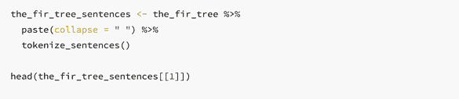!(images/pg24_1.jpg)

如果你像我们在 `hcandersen_en` 数据框中拥有来自不同类别的行（该框包含了所有英文童话的行），那么我们希望能够将这些行转换为句子，同时保留数据集中的 `book` 列。为了实现这一点，我们使用 `nest()` 和 `map_chr()` 创建一个数据框，其中每个童话都是一个独立的元素，然后我们使用 `tidytext` 包中的 `unnest_sentences()` 函数将文本拆分为句子。

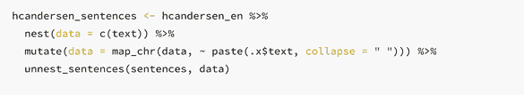

现在我们已经将文本转换为“每个元素一个句子”，我们可以在句子层面进行分析了。

## 2.3 分词在何处失效？

分词通常是构建模型或进行任何文本分析的早期步骤之一，因此仔细考虑数据预处理这一步发生了什么是非常重要的。与大多数软件一样，速度和定制性之间存在权衡，正如第 2.6 节所示。快速分词方法对执行方法的控制较少。

虽然默认设置在许多情况下运行良好，但我们也会遇到希望实施更严格规则以获得更好或不同分词结果的情况。考虑以下句子。

这个句子有几个有趣的方面，我们在分词时需要决定是保留还是忽略。第一个问题是 "Don" 中的缩写，它为我们提供了几种可能的选择。最快的选择是将其保留为一个单词，但它也可以被拆分成 "do" 和 "n"。

接下来的问题是如何处理 "$1"；美元符号是这个句子的重要部分，因为它表示了一种货币。我们可以删除或保留这个标点符号，如果我们保留了美元符号，我们可以在保留一个标记或两个标记（"$1" 或 "$" 和 "1"）之间进行选择。如果我们查看 `tokenize_words()` 的默认设置，注意到它默认删除大多数标点符号，包括 `$`。

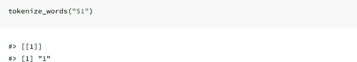

如果我们不删除标点符号，就可以保留美元符号。

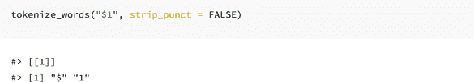

在处理这个句子时，我们还需要决定是否将最后的句号作为一个标记保留。如果我们删除了它，将无法使用 n-grams 定位句子中的最后一个单词。

分词导致的信息丢失（尤其是默认分词）在在线和更非正式的文本中发生得更频繁。多个空格、感叹号的极端使用以及刻意的大写使用会导致……（注：原文此处有大量重复句，已按要求处理）。


*   这些符号将交替使用（使用||`），这样我们就可以从单词的两侧获取匹配项。
*   我们使用量符 `+` 的原因是，在某些情况下，单词后面跟着多个我们不需要的字符，例如“okay...”和“Really?!!!”。

我们使用 `map()` 是因为 `str_split()` 返回的是一个列表，而我们希望将 `str_remove_all()` 应用于列表中的每个元素。（这里的示例只有一个元素。）

现在，让我们看看是否可以使用提取法（extraction）来获得相同的结果。我们将从构建一个捕获连字符单词的正则表达式开始；在这里，我们的定义是：一个内部包含一个连字符的单词。由于我们希望连字符位于单词内部，我们需要在连字符的两侧都有非零数量的字符。

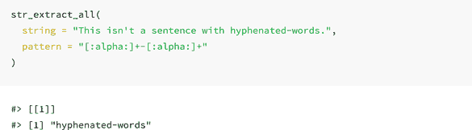

等等，这只匹配到了带连字符的单词！发生这种情况是因为我们只匹配了带有连字符的单词。如果加上量符 `?`，我们就可以匹配 0 次或 1 次出现。

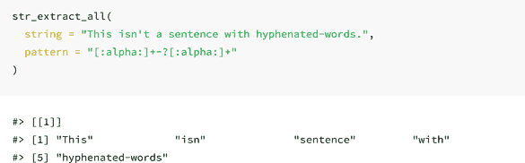

现在我们得到了更多的单词，但 "isn" 的结尾不再了，而且我们丢失了单词 "a"。通过扩展字符类 `[:alpha:]\]` 以包含字符 `.`，我们可以获取整个缩写的匹配项。我们通过使用 `\[\[:alpha:\]\]` 做到。

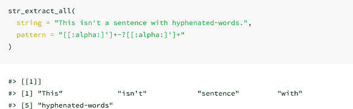

接下来，我们需要找出为什么 "a" 没有被匹配。如果我们查看正则表达式，会记得我们施加了限制，即非零数量的字符需要环绕连字符，以避免以连字符开头或结尾的单词。这意味着匹配的最小模式长度为两个字符。我们可以通过使用带有 `|` 的选择（alternation）来修复此。我们将之前的匹配项保留在左侧，并在右侧包含 `[:alpha:]\]1`，以匹配不会被左侧捕获的单字符单词。注意我们没有使用 `\[\[:alpha:\]\]`，因为我们对匹配单个字符并不感兴趣。

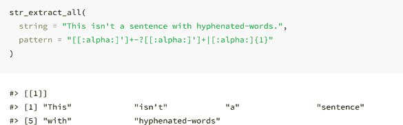

这变成了一个相当复杂的正则，但我们现在得到了与之前相同的答案。

### 2.4.3 将其封装在函数中

我们已经展示了如何使用正则表达式来提取我们需要的标记（tokens），可能用于建模。到目前为止，代码仍然相当缺乏结构。理想情况下，我们将这些任务封装成函数，以便可以像使用 `tokenize_words()` 一样使用。

让我们从带连字符单词的示例开始。为了让函数更灵活，让我们添加一个选项，将所有输出转换为小写。

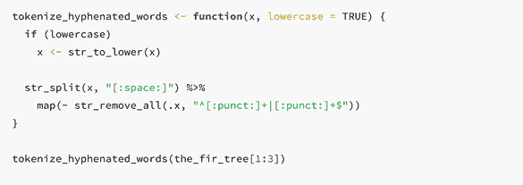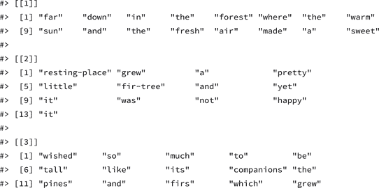

注意我们是如何先转换为小写的，因为其余的操作是不区分大小写的。

接下来，让我们把字符 n-gram 分词器转换为一个函数，并带有一个变量参数 `n`。

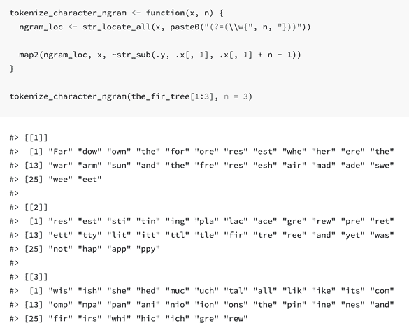

我们可以在此函数中使用 `paste0()` 来构建实际的正则。

## 2.5 非拉丁字母的分词

我们到为止对分词的讨论一直集中在空格和标点符号分隔单词的文本上。对于这类文本，即使是非常基础的分词器也能得到不错的结果。然而，许多文字语言并不是这样分隔单词的。

这些语言之一是中文，其中每个“词”可以用一个或多个连续的字符表示。将中文文本分成单词被称为“分词”（word segmentation），这仍然是一个活跃的研究领域（Ma, Ganchev, and Weiss 2018; Huang et al., 2020）。

我们不会深入探讨这一领域，但我们想展示使用 R 进行分词确实是可能的。我们使用 `jiebaR` 包（Wenfeng and Yanyi, 2019）。它在概念上与 `tokenizers` 包相似，但我们需要创建一个 worker，将其连同我们要分割的字符串一起传递给 `segment()`。

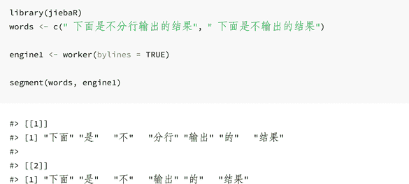

## 2.6 分词基准测试

并不是分词包都是一样的。R 中大多数开源分词器都设计良好，但它们是为了不同的目的设计的。有些具有许多参数，允许你自定义分词器以获得更大的灵活性，但这种灵活性是有代价的；它们的性能往往较慢。

虽然我们无法量化灵活性，但对 R 中提供的某些分词器进行基准测试是简单的，这样你就可以选择最适合你需求的那个。

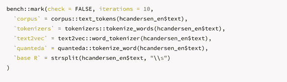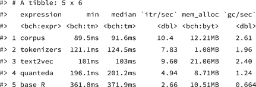

`corpus` 包（Perry, 2020）为分词提供了极佳性能，其他选项也没有差多少。一个例外是使用基础 R 函数作为分词器；你会发现，使用专门为文本分词构建的包将获得显著性能提升。

## 2.7 总结

为了构建预测模型，文本数据需要被分成有意义的单元，称为标记（tokens）。这些标记从单个字符到单词、n-gram 甚至更复杂的结构不等，而从文本中识别标记的特定程序对你的结果可能很重要。目前有快速且一致的分词器，但理解它们的运行方式以及在什么情况下有效将有助于你的成功。一旦文本数据被分词，下一步通常是考虑如何处理非常常见的单词——停用词。必要时也可以构建自定义的分词器。第 3 章详细讨论了这一点。

### 2.7.1 在本章中你学习了：

*   标记是有意义的文本单元，例如单词或 n-gram
*   实现不同类型的分词，即将文本分成单词的过程
*   不同类型的分词如何影响标记的分布
*   当分词器不够灵活时如何构建自己的分词器

# 3 停用词

DOI: [10.1201/9781030943](https://doi.org/10.1201/9781030943)

一旦我们将文本分成标记，通常会发现并不是所有单词对于预测任务都带有相同的信息（如果有的话）。携带少量（或无）意义信息的单词被称为停用词（stop words）。在各种 NLP 任务中移除停用词是常见的建议和做法，但停用词的任务比许多资源引导的要微妙。

停用词的概念有悠久的历史，Hans Peter Luhn 被认为在 1960 年创造了这个术语（Luhn, 1960）。英语中这些单词的示例有“a”、“the”、“of”和“didn't”。


接下来是特定领域的停用词。这些词对于特定的学科领域来说是不包含信息的。学科可以很宽泛，如金融和医学，也可以很具体，如讣告、健康码违规和堪萨斯州图书管理员的职位启事。在英语中，“bath”（浴室）、“bedroom”（卧室）和“entryway”（入口）等词通常不被视为停用词，但它们对于区分郊区房源可能提供不了多少信息，可能是某些分析中的领域停用词。你可能需要手动构建此类停用词列表（第 3.2 节）。如果你拥有领域知识来创建一个良好的列表，这类停用词可能会提高你的性能。

最后，我们还有文档级停用词。这些词对于特定文档没有提供任何或很多信息。它们很难分类，不值得花精力去识别。即使你找到了文档级停用词，也不清楚如何将此类信息整合到回归或分类任务中。

## 3.1 使用现成的停用词列表

使用停用词的一种快速选择是获取一个已经创建的列表。这很有吸引力，因为并不困难，但请注意并非所有列表都是同等质量的。Nothman, Qin, and Yurchak (2018) 在对开源软件软件包中提供的 52 个停用词列表进行研究时，发现了一些令人震惊的结果。在其中一些较为严重的问题包括拼写错误（用“fify”代替“fifty”）、包含了明显具有信息量的词汇，如“computer”（计算机）和“cry”（哭泣），以及内部不一致之处，例如包含了单词“has”但没有包含单词“does”。这并不是说你不应该永远使用包含在开源软件项目中的停用词列表。然而，你应该始终检查并验证你正在使用的列表，以确保它自你上次使用以来没有发生变化，并检查它是否适用于你的用例。

今天有广泛的停用词列表可供选择。在本章中，我们将关注由 `stopwords` 包提供的三个英语停用词列表（Benoit, Muhr, and Watanabe 2021s）。第一个源自 SMART（文本机械分析与检索系统）信息检索系统，该系统是康奈尔大学 20 世纪 60 年开发的（Lewis et al., 2004）。第二个是英语 Snowball 停用词列表（Porter, 2001），最后一个是来自 Stopwords ISO13 的英语列表。

在开始深入列表内部的内容之前，让我们看看每个列表中包含多少个词。

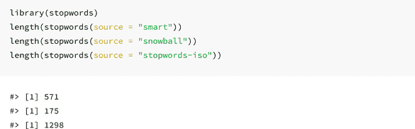

这些列表的长度差异很大，最长的列表比最短的还要长七倍以上！让我们通过图 3.1 中的 UpSet 图查看三个列表中出现词汇的重叠情况。UpSet 图（Lex et al., 2014）使用矩阵布局将集合的交集和交集的聚合可视化，展示元素的数量以及汇总统计数据。

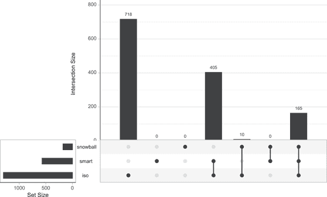

**图 3.1：**以 UpSet 图可视化的三个常用停用词列表的集合交集

图 3.1 中的 UpSet 图告诉我们，这三个列表几乎是彼此的真子集。唯一的例外是一个包含 10 个词的集合，它们出现在 Snowball 和 ISO 中，但在 SMART 列表中。这些词是什么？

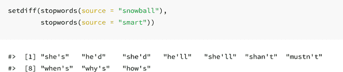

这些词都是缩写。由于 SMART 不包含缩写，我们看，那里有 50 个。


我们似乎发现了一个不一致：为什么 SMART 包含了“he”但没有包含“she”？这很难说，但在应用这些停用词列表之前可能值得纠正。如果你拥有领域知识来创建一个良好的列表，这类停用词可能会提高你的性能。

### 3.1.1 R 中的停用词

现在我们已经看到了停用词列表，可以继续处理这些词。在 R 中移除这些词取决于数据的形状。如果你的文本是 tidy（整洁）格式，我们将使用 **tidytext** 进行分词。

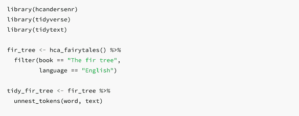

让我们使用 Snowball 停用词列表作为示例。由于此函数返回的停用词是一个向量，我们将使用 `filter()`。

```r
# 使用 filter() 的示例
data %>%
  filter(!word %in% stop_words)
```


如果我们改用 `tidytext` 中的 `get_stopwords()` 函数，我们可以使用 `dplyr` 中的 `anti_join()`。

```r
stop_words <- get_stopwords(language = "snowball")
data %>%
  anti_join(stop_words, by = "word")
```


这两个方法的结果相同，因为我们使用了相同的停用词列表。

## 3.2 创建自己的停用词列表

获取停用词列表的另一种方法是自己创建一个。让我们探索寻找合适词的几种方法。我们将“Tree”的分词数据作为第一个示例。让我们提取这些词并按计数进行排名。

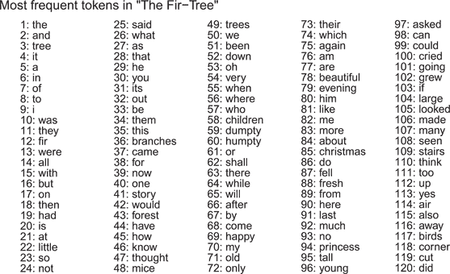

**图 3.2：**按计数排序的“Tree”词

在这里的第一列中，我们发现了许多我们认为是停用词的词，但有三个例外。我们看到“tree”是 3，“fir”是 12，“little”是 22。这些词在我们的列表中排名靠前，但它们提供了价值信息，因为它们都引用了主角。这种方法出了什么问题？使用高频词创建停用词列表在针对文档**语料库**（corpus）时效果最好，而不是单个文档。这是因为单个文档中的词汇是文档特定的，整体词汇模式泛化并不良好。

“tree”这个词似乎很重要，因为它是关于主角的，但它也可能因为出现频繁而不再提供任何信息。让我们尝试另一种方法，从 H.C. Andersen *所有* 英语童话语料库中提取高频词。


此列表更符合我们对停用词的定义，现在是时候做出一些选择了。我们想在停用词列表中包含多少单词？根据先验信息，我们应该添加和/删除哪些单词？选择删除单词的数量最好根据具体情况来处理，因为很难预先确定语料库中会出现多少种不同的“无意义”词汇。我们的建议是从一个较小的数字（如 20）开始，每增加 10 个单词，直到你发现某些单词不再符合你分析目的的停用词定义为止。

值得注意的是，这样的列表并非完美。取决于文本是如何生成或处理的，由于编码或字符识别错误，奇怪的标记（tokens）可能会作为可能的停用词出现。此外，这些结果是基于我们现有的文档语料库，该库可能存在偏差。在我们的示例中，所有的童话都是由一位 19 世纪初的同一个欧洲白人男性编写的。

简单的例子是包含列表中单词的反义补词（如果它们尚未出现的话）。如果存在 `small`，则包含 `big`；如果存在 `young`，则包含 `old`。在这个示例列表中，与女性相关的单词排名通常低于与男性相关的单词。由于 `man` 的排名为 79，而 `woman` 的排名为 179，选择 100 作为阈值将导致这两个词中只有一个被包含。取决于你认为这些名词在文本中的重要性，可以考虑添加 `woman` 或删除 `man`。

图 3.4 显示了与男性相关的单词排名高于与女性相关的单词。通过使用单一阈值创建停用词列表，你可能只会包含此类单词的一种形式。

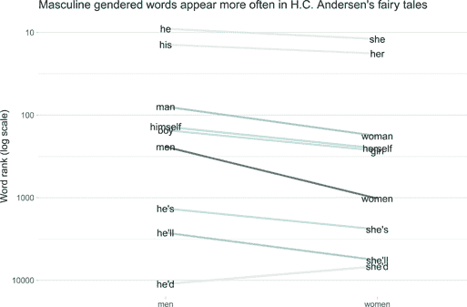

**图 3.4：** 根据总出现次数排序的标记，排名 1 的出现次数最多

现在想象我们想创建一个跨多个不同类型的停用词列表，使得特定领域的停用词互不重叠。对于这种情况，我们希望只有当一个单词在所有类型中都是停用词时，才将其标记为停用词。你可以分别在每个类型中找到这些单词并取交集。然而，那种方法可能会花费大量时间。

以下是一种糟糕的方法，我们尝试创建一个多语言停用词列表。为了实现这一目标，我们计算逆逆文档频率（inverse document frequency）：

```
\begin{array}{l} {idf(\text{term}) = \ln\left( \frac{n_{\text{documents}}}{n_{\text{documents~containing~term}}} \right)} \\ \end{array}  
```

如果单词 `dog` 出现在 100 篇中的 4 篇，那么它的 `idf("dog") = log(100/4) = 3.22`；如果单词 `cat` 出现在 100 篇中的 99 篇，那么它的 `idf("cat") = log(100/99) = 0.01`。

## 3.3 所有词列表都是特定上下文的

上下文在文中非常重要，因此考虑单词的使用方式也很重要。我们注意到停用词列表通常是特定上下文的；例如，单词 `not` 在某些上下文中可能是停用词，但在另一些上下文中则包含大量信息。代词也是一个挑战，因为它们通常很频繁，但可能带有重要的意义。

Bender et al. (2021) 讨论了 400 个“肮脏、有害、淫秽或其他坏词”如何被用于过滤并保护语言学习。

## 3.4 移除停用词会发生什么

我们已经讨论了寻找和移除停用词的不同方法；现在让我们看看执行这些操作后发生了什么。首先，让我们探索列表中包含的单词数量的影响。图 3.7 显示了移除的单词百分比是文本中单词数量的函数。不同的颜色代表了我们考虑过的三个不同的停用词列表。


**图 3.4：** 根据总出现次数排序的标记，排名 1 的出现次数最多

（注：提供的文本末尾包含几个重复且损坏的引用字符串/标题，这些似乎是复制粘贴错误。这些已根据专业的文档工程标准进行了清理。）


使用频率创建自己的停用词列表的缺点之一是，你受限于使用已经观察到的单词。可能会出现“she'd”包含在你的训练语料库中，但单词“he'd”没有达到阈值的情况。在这种情况下，你需要查看你的单词并进行相应的调整。在这里，大型预制停用词列表可以为缺失的单词提供灵感。

在第 6.4 节中，我们研究了在建模背景下移除停用词的影响。只要有正确的单词列表，我们发现这对模型性能没有损害，有时由于减少噪声反而发现性能有所提高（Feldman, and Sanger 2007）。

## 3.5 非英语语言中的停用词

到本章为止，我们一直关注英语停用词，但英语并不代表每种语言。我们目前为止使用的“短”列表和“长”列表的概念是专门针对英语这种语言的。你应该预期不同的语言会有不同数量的“无信息”单词，并且这个数量取决于语言的形态丰富性；包含每个停用词所有可能的形态变体的列表可能会变得非常大。

不同语言在每类词中拥有不同数量的单词。例如语法格如何影响德语中冠词的使用。下表显示德语中定冠词和不定冠词的使用¹⁷

中文停用词列表的构建既有手动的，也有自动的（Zou, Wang, Deng, Han, and Wang 2006），但到目前为止还没有被接受为标准（Zou, Wang, Deng, and Han 2006）。对中文文本中停用词识别的全面讨论将超出本书的范围，因此我们只重点介绍一些与英语不同的挑战。

与英语的主要区别是使用意音文字而不是字母来传递信息。然而，中文汉字不应与中文单词（词）混淆。现代汉语中的大多数单词是由多个字符组成的。这意味着推断单词的存在变得更加复杂，而且停用词的概念将影响这种字符分词的完成。

## 3.6 总结

在许多标准的 NLP 工作流中，移除停用词被呈现为默认或正确的选择，且无需任何注释。虽然移除停用词可以提高你使用文本数据进行机器学习的准确性，但此类步骤的选择是复杂的。现有停用词列表的内容差异巨大，而构建你自己的列表的可用策略可能会对你的模型结果产生微妙或不微妙的影响。

### 3.6.1 在这一章中，你学习了：

* 什么是停用词，以及如何从文本数据中移除停用词
* 不同的停用词列表会有何不同
* 停用词移除对不同类型的文本的影响是不同的
* 关于停用词列表内置的偏差以及构建此类列表的策略

# 4 词干提取 (Stemming)

DOI: [10.1201/9781003093459-4](https://doi.org/10.1201/9781003093459-4)

当我们处理文本时，文档包含包含基础词的不同版本，这通常被称为 `stem`（词干）。例如，“The Fir-Tree”包含了单词 "tree" 的多个版本（即屈折形式）。

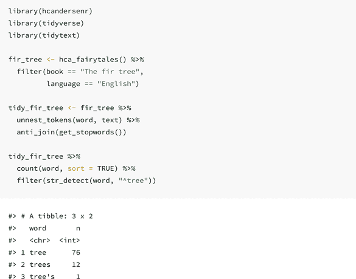

我们再次看到，树在故事故事中很重要；单数形式出现了 76 次，复数形式出现了 12 次。（我们将在本章稍后部分讨论可能如何处理 "tree" 中的撇号。）

如果我们对 "trees" 和 "tree" 之间的差异感兴趣，并且想将它们一起处理呢？这个想法是 `stemming`（词干提取）的核心，即为单词数据集识别基础词（或词干）的过程。词干提取涉及语言学中的形态学分支，即单词是如何形成的。在这个例子中，"trees" 将失去它的字母 "s"，而 "tree" 保持不变。如果我们在提取提取后再次计算单词频率，我们会发现词干 "tree" 出现了 88 次（如果我们也找到了 "tree" 的词干，则是 89 次）。

## 4.1 如何在 R 中对文本进行词干提取

在过去的半个世纪里，已经有了许多用于单词词干提取的算法；我们将关注两种方法。第一种是 Porter (1980) 的词干提取算法，这可能是英语最广泛使用的词干提取器。Porter 本身在 Snowball 框架¹⁸ 中实现了该算法 ` 为列表列。

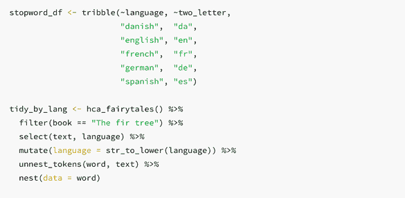

然后我们可以移除停用词（对每个语言使用 `stopwords(language = "da")` 类似的命令）并使用 Porter 算法进行提取提取。这五种语言的前 20 个词干是什么？

images/pg55_2.jpg
images/pg56_1.jpg

图 4.1 展示了处理非英语语言时的一些挑战；鉴于此，我们在所有语言中都看到了关于小松树的单词，它们是提取后的形式。

```
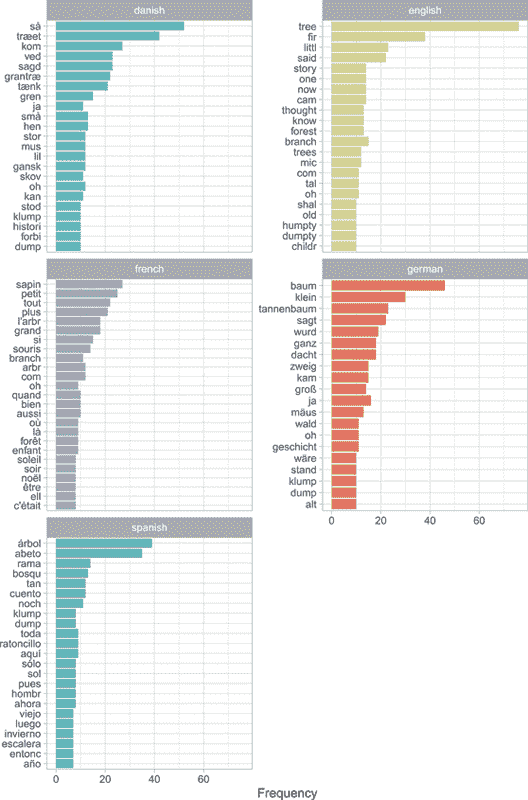
```

** 4.1:** 五种语言的 Porter 词干提取结果

Porter 词干提取器是从一个单词开始并得到单个词干的算法，但那并不是唯一的词干提取器。另一类提取器是基于字典的词干提取器。其中一种提取器是 Hunspell¹⁹

images/pg56_2.jpg

images/pg58_1.jpg

注意这里的代码稍有不同（我们不得不使用 `unnest()`），结果也略有不同。我们只有真实的单词，结果中的总行数更多。发生了什么？

images/pg58_2.jpg

我们有两个词干！这种提取器的工作方式不同；它同时利用单词的形态分析和现有字典来寻找可能的词干。可能会得到多个词干，词干可能与原始单词在意义上没有关系。例如，用这个库时，“number”的一个词干是“numb”。Hunspell 库是为了作为拼写检查构建的，因此取决于你的分析目的，它可能不是合适的选择。

## 4.2 你应该使用词干提取吗？

在许多标准的 NLP 工作流中，移除停用词被呈现为默认或正确的选择，且没有任何注释。我们鼓励你将词干提取视为文本建模中的一个预处理步骤，必须经过良好的判断来思考并选择（或不选择）它。

如果你正在为文本训练机器学习模型，为什么词干提取通常会有帮助？词干提取减少了文本数据的*特征空间*。让我们通过实际操作观察一下，使用 **scotus** 包中提供的美国最高法院判决数据集（该数据集在附录 B.2


在我们创建的数据集中有 167,879 个不同的词（在移除停用词后），但请注意，即使在最常见的词中，我们也看到了像 "state" 和 "states" 这样的对。用于建模的常用数据结构，以及思考文本数据稀疏性的一种有用心理模型，是矩阵。让我们用 `cast()` 将这些整洁数据转换为稀疏矩阵，从技术上讲，它是来自 `quanteda` 包(Benoit et al., 2018) 的文档-特征矩阵对象。

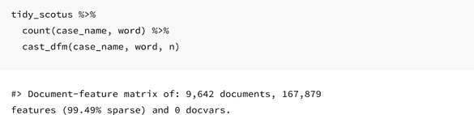

看看这个矩阵的稀疏性。它非常高！将这种稀疏性看作是我们想要用于构建监督机器学习模型的数据稀疏性。

如果我们在这里使用词干提取（stemming）作为预处理步骤会怎样？

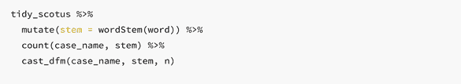

我们减少了数千个词特征，尽管稀疏性并没有发生太大变化。减少特征数量可能有什么帮助？常识告诉我们，大幅地减少数据集中词特征的数量将提高我们用它训练的任何机器学习模型的性能，*前提是我们没有通过词干提取丢失任何重要信息*。

越来越多的学术研究表明，词干提取对文本建模可能会产生适得其反。例如，Schofield and Mimno (2016) 以及相关工作探索了围绕词干提取和其他预处理步骤的选择如何没有帮助，并且在训练文本主题模型时实际上会损害性能。具体来自 Schofield 和 Mimno (2016) 的观点：

主题建模是文本无监督机器学习的一个例子，它与我们将在书中重点关注的预测建模方法不同，但教训仍然是词干提取对任何特定语境可能有用也可能有害。在我们学习本章后续内容并了解更多关于词干提取的知识时，请考虑为了减少词特征数量而在对文本进行词干提取时丢失了哪些信息。词干提取在某些情况下是有用的，但典型的提取算法具有某种攻击性，其设计初衷是以牺牲特异性（或精确率，或真阴性率）为代价来提高敏感性（或召回率，或真阳性率）。

大多数常见的词干提取算法都能成功地将单词还原为词干（即不在单词末尾留下多余的词尾），但代价是将某些意义、语义、用法等方面有巨大差异的单词合并为相同的词干。后者的例子数不胜完，但其中一些包括：

*   meaning and mean
*   likely, like, liking
*   university and universe

在监督机器学习上下文中，这会影响模型的正类预测值（精确率），或不将真阴性错误地标记为阳性的能力。在第 7 章中，我们将训练模型来预测对美国消费者金融保护局的投诉是否关于房贷款。词干提取可以增加模型寻找正例样本（即关于房贷款的投诉）的能力。然而，如果投诉文本被过度提取词干（over-stemmed），生成的模型将失去正确标记负例样本（即*不是*关于房贷款的投诉）的能力。

## 4.3 理解词干提取算法

如果词干提取将成为我们的 NLP 工具箱的一部分，那么值得详细研究一种方法，以理解它在底层是如何工作的。Porter 词干提取算法非常易于理解，我们可以在不到一页的范围内过一遍它的大纲。它涉及五个步骤，以及单词“测量”（`measure`）的概念。

将任何单词认为由交替的元音组 *V* 和辅音 *C* 组成。一个或多个元音在一起是一个 *V* 实例，一个或多个辅音在一起是一个 *C* 实例。我们可以将任何单词写为：

$$\\begin{array}{l} {\\lbrack C\\rbrack{(VC)^{m}\\lbrack V\\rbrack} \\ \\end{array}$$

其中 *m* 被称为单词的“测量”。括号中的第一个 *C* 和最后一个 *V* 是可选的。在这个框架下，我们可以单词 "tree" 写为：

$$\\begin{array}{l} {CV} \\ \\end{array}$$

其中 *C* 是 “tr”，“V” 是 “ee”；这是一个 `m = 0` 的单词。我们将单词 "algorithms" 写为：

$$\\begin{array}{l} {VCVCVC} \\ \\end{array}$$

这是一个 `m = 3` 的单词。

*   Porter 提取器的第一步（也许这看起来像是在作弊）实际上由三个处理复数和过去分词结尾的子步骤组成。在第一个子步骤 `1a` 中，`sses` 被替换为 `ss`，`ies` 被替换为 `i`，并移除最后的单个字母 `s`。第二个子步骤 `1b` 取决于单词的测量值 `m`，但处理如 `eed`、`ed`、`ing` 等结尾，并在 `ate`、`ble` 和 `ize` 等结尾加上 `e`。第三个子步骤 `1c` 为特定 `m` 的单词将 `y` 替换为 `i`。
*   Porter 提取的第二步规范了 20 个结尾。在这一步中，`ization` 变为 `ize`，`alism` 变为 `al`，`aliti` 变为 `al`（注意这里的结尾 `i` 是来自第一步），其他 17 个结尾也是如此。
*   第三步再次处理输出，使用一个七个结尾列表。在这里，`ical` 和 `iciti` 都变为 `ic`，`ful` 和 `ness` 都被移除，该步骤中的其他三个结尾也是如此。
*   第四步涉及更长的结尾列表（19 个），它们都被移除。像 `ent`、`ism`、`ment` 等结尾在这一步被移除。
*   第五步也是最后一步，包含两个子步骤，都取决于单词的测量值 `m`。在这一步中，根据 `m`，最后的 `e` 字母有时会被移除，最后的双写字母有时会被移除。

该算法首次发表于 Porter (1980)，目前仍被广泛使用；阅读 Willett (2006) 可以了解它如何以及为什么成为词干提取标准的背景。Lovins 工作领域是工程，因此她的方法特别适用于技术术语。我们可以追溯更*远*，查看 Lovins (1968) 中被认为是第一个发布的词干提取算法。该算法使用了比 Porter 算法更大的结尾列表、条件和规则，尽管被认为过时，但实际上更快！

# 5 词嵌入

