# 风能工程中的监督机器学习：风力预测与爬坡事件预测


## 国会图书馆图书在版编目数据
## 大英图书馆图书在版编目数据
ISBN: 978-0-12-821353-7
有关所有 Academic Press 出版物的信息

排版：VTeX
*献给全能者，我的父母 Renu 和 Sanjay，兄弟 Hardik，以及我生命中的挚爱 Shiwangi。*

Harsh S. Dhiman

*献给我的妻子 Indulekha 和儿子 Rishabh，感谢他们给予我无尽的爱与支持。*

Dipankar Deb

*献给我的丈夫 Marius，感谢他的耐心、爱、友谊和幽默。*

Valentina Emilia Balas

## 目录
## 传记

### 关于系列编辑

伊夫·加农博士是加拿大蒙克顿大学工程学教授，同时兼任泰国宋卡大学客座教授。在此之前，加农博士曾任加拿大自然科学与工程研究委员会（NSERC）访问主管，他是新不伦瑞克创新基金会的创始主席兼首席执行官，并曾任蒙克顿大学研究副校长、研究生研究学院院长以及K.C. Irving可持续发展讲座教授。

作为机械工程师，加农博士获得美国麻省理工学院和法国图卢兹大学的研究生学位，而宋卡大学授予他科学荣誉博士学位。加农博士积极从事研究，获得过各种资助和研究合同支持。他的研究和创新工作通过国家和国际合作开展，已发表300多篇出版物和报告；其贡献已获得多项奖项认可。在编辑职务方面，加农博士曾任《ASME太阳能工程期刊》副编辑，负责风能板块。

### 关于作者

哈什·S·迪曼于1992年出生于昌迪加尔，目前在印度艾哈迈达巴德基础设施技术研究与管理学院（IITRAM）电气工程系攻读博士学位，导师是迪潘卡尔·德布教授。他获得印度瓦多拉马哈拉贾·塞贾伊·拉奥大学巴罗达分校技术与工程学院电气电力工程硕士学位，以及印度艾哈迈达巴德尼尔玛大学理工学院电气工程学士学位。他的当前研究兴趣包括风电场混合运行、混合风能预测技术以及风电场尾流管理。

迪潘卡尔·德布于2007年在弗吉尼亚大学夏洛茨维尔分校完成博士学位，导师是IEEE会士、电气与计算机工程系教授康涛教授。2017年，他当选为IEEE高级会员。他曾任GE全球研究班加罗尔分公司首席工程师（2012–2015），以及印度古瓦哈蒂理工学院电气工程系助理教授（2010–2012）。目前，他是印度艾哈迈达巴德基础设施技术研究与管理学院（IITRAM）电气工程系教授兼系主任。他是《IEEE Access期刊》副编辑。他撰写了21篇SCI索引期刊论文，拥有6项美国授权专利，并编著或编辑了八本书。他的研究兴趣包括控制理论、稳定性分析和可再生能源系统。

**瓦伦蒂娜·艾米莉亚·巴拉斯** 拥有罗马尼亚特米什瓦拉理工学院应用电子与电信博士学位。巴拉斯博士是经过同行评议期刊和国际会议上300多篇论文的作者。她的研究兴趣包括智能系统、模糊控制、软计算、智能传感器、信息融合以及建模与仿真。她是《高级智能范式国际期刊》(IJAIP) 和《计算系统工程国际期刊》(IJCSysE) 的主编，多个国家和国际期刊的编委会成员，以及国家和国际项目和博士论文的评审专家。巴拉斯博士是罗马尼亚阿拉德奥雷利·弗拉伊库大学智能系统研究中心主任，也是同一所大学国际关系、方案与项目部主任。她曾任2005–2018年在罗马尼亚和匈牙利举办的八届国际软计算与应用研讨会（SOFA）的大会主席。巴拉斯博士以组织者、荣誉主席、分会主席以及指导、咨询或国际项目委员会成员的身份参加了许多国际会议。她是SIAM成员、IEEE高级会员、IEEE CIS模糊系统技术委员会（TC-Fuzzy systems）成员、IEEE CIS新兴技术技术委员会（TC-Emergent Technologies）成员、IEEE SMCS软计算技术委员会（TC-Soft computing）成员。巴拉斯博士曾任国际模糊系统协会理事会副主席（奖项）（2013–2015），并是印度多学科学术机构——跨学科数学论坛（FIM）理事会联合秘书。

## 前言

近年来，替代能源因其清洁运行而日益受到重视。由于化石燃料和核资源有限，太阳能和风能技术的市场份额不断扩大。鉴于其丰富的可持续性，可再生能源电力组合增强了国家经济的支柱。除了对环境的积极影响外，风能在全球范围内还创造了就业机会。随着可再生能源渗透率的提高，其运行和控制变得至关重要。风力涡轮机经历着广泛的动态现象。实现规模经济是风电场运营的主要目标。

鉴于风速的随机性，准确的风能预测方案可帮助运营商最大限度地减少损失。选择最佳运行策略可降低系统成本并提高电力系统的可靠性。风能在全球范围内通过就业机会和基于可再生能源的电力供应影响了成千上万人的生计。21世纪，全球风能装机容量激增，尤其是在海上地区。然而，风力发电的间歇性给电网可靠性带来了额外挑战。风速的随机性要求提前进行准确的风能预测，以便规划最佳电力调度。基于数值天气预报和基于时间序列的统计模型（ARMA、ARIMA 和 S-ARIMA）的传统模型由于风速的非线性而面临诸多不足。

本书探讨了短期风能预测技术面临的问题，并介绍了能够解决上述传统方法问题的混合机器智能算法。基于信号分解技术并结合支持向量回归及其变体等机器学习算法的短期风速预测，能够提供准确的风能预报。本文讨论了SVR的变体，如最小二乘支持向量回归（LSSVR）、双支持向量回归（TSVR）和ε-双支持向量回归（ε-TSVR）。

第1章讨论了全球对风能的需求以及与未来几年装机容量和预计电力产量相关的详细统计数据。它还阐述了本书的动机和目标。第2章重点介绍了风能的基本概念，从电力生产、陆上和海上区域的风速分布，以及地形变化时常用的风速剖面定律入手。

第3章阐述了风能预测的范式，聚焦于预测需求、问题和挑战。我们还讨论了传统的预测方案，并逐步强调了机器学习算法在短期风速预测中的必要性。接下来，第4章深入探讨了有监督机器学习算法，特别是支持向量回归及其变体。在第5章中，随机森林回归和梯度增强机（GBM）附有相关文献以及针对降雨和原油价格预测的两个案例研究。我们还从计算速度角度讨论了每种方法的重要性。

第6章介绍了基于小波变换和支持向量回归变体（如ε-SVR、LSSVR、TSVR、ε-TSVR、RFR和GBM）的风能预测混合模型。全球介绍了风电场的案例研究，并讨论了其结果。此外，还评估了SVR超参数对回归质量的影响。第7章讨论了风电场的爬坡事件，推导了预测模型之间的分析关系，并基于其预测性能评估了不同风能数据集中的爬升和爬降事件。

第8章讨论了在风力尾流存在下，针对基于常规支持向量回归的有监督机器学习回归模型的风速预测特定应用。讨论了包含两种不同风电场布局的案例研究。

哈什·S·迪曼
迪潘卡尔·德布
瓦伦蒂娜·E·巴拉斯


## 致谢

本目标的实现离不开印度艾哈迈达巴德基础设施技术研究与管理学院（IITRAM）为撰写本书提供的必要基础设施支持。作者还感谢 Elsevier 允许我们使用相关内容编写本书。我们谨感谢马萨诸塞大学风能中心等科研机构和机构提供风速数据集的在线访问。

## 缩略词

| 缩略词 | 定义 |
| :--- | :--- |
| ACF | 自相关函数 |
| ANN | 人工神经网络 |
| ADM | 执行器盘模型 |
| ARMA | 自回归移动平均 |
| ARIMA | 自回归集成移动平均 |
| DWT | 离散小波变换 |
| EMD | 经验模态分解 |
| ELM | 极限学习机 |
| GA | 遗传算法 |
| GBM | 梯度提升机 |
| GRA | 灰色关联分析 |
| GWEC | 全球风能理事会 |
| HAWT | 水平轴风力涡轮机 |
| KKT | 卡鲁什–库恩–塔克 |
| LSSVR | 最小平方支持向量回归 |
| ML | 机器学习 |
| MAE | 平均绝对误差 |
| MAPE | 平均绝对百分误差 |
| MLR | 多元线性回归 |
| MSE | 均方误差 |
| NMSE | 归一化均方误差 |
| SVR | 支持向量回归 |
| PDF | 概率密度函数 |
| PSO | 粒子群优化 |
| RFR | 随机森林回归 |
| RBF | 径向基函数 |
| RMSE | 均方根误差 |
| SPSS | 社会科学统计软件包 |
| TSVR | 双支持向量回归 |
| ε-TSVR | ε-双支持向量回归 |

# 第 1 章

## 引言

由于使用化石燃料导致的能源需求和温室气体排放呈爆炸式增长，为可再生能源的大规模投资打开了大门。利用风力涡轮机进行风力发电已成为关键的可再生能源之一，因为它可以以大幅降低的生产成本生产清洁可靠的能源。在本入门章节中，我们专注于提供机器学习在风力预测及相关领域应用这一主攻方向的总体轮廓。对机器学习的需求推动了投资机会，否则由于错误的范式，这些机会是有限的。

## 1.1 可再生能源重点

过去十年可再生能源技术的发展已超越所有预期。所有可再生能源技术的全球装机容量和产量大幅增加，支持性政策也继续在世界各地区的更多国家传播。20 世纪 70 年代初，能源危机和经济崩溃导致可再生能源增长。丹麦、美国、西班牙和德国等发展中国家由于气候变化而开启了可再生能源业务。如果某种能源能为后代保留社会、经济和环境特征，则被视为“可持续的”。可再生能源是指其实质可行性无限且可以以原始形式利用的能源。

随着煤炭储量有限，替代能源已进入市场，为消费清洁能源提供可持续且经济的途径。可再生能源的生产稳步增长，并推动了许多发展中国家的经济增长。推广可再生能源的主要原因之一是环境问题，即大气臭氧层耗竭和温室气体排放。由于不间断的工业活动，第一个国际条约——作为联合国气候变化框架公约（UNFCCC）延伸的《京都议定书》应运而生，其宗旨是遏制人为气体排放 [1]。这些气体排放

- **运输** 可再生能源占运输总能源消耗的 3.1%
- **电力** 2007-2017 年可再生能源总装机容量翻了一番
- **可再生能源发电** 预计有 17 个国家利用可再生能源发电量超过其电力总量的 90%
- **EV30@30** 全球电动汽车倡议启动，目标是电动汽车占据约 30% 的市场份额
- **预测** 陆上风电的预计复合年增长率为 2.7%

图 1.1 过去十年可再生能源领域的主要进展。

包括二氧化碳（CO2）、一氧化二氮（N2O）、甲烷（CH4）和六氟化硫（SF6）。此外，各方已承诺在全国范围内减少排放。然而，由于人均收入较低，有些国家不承诺这一目标。国际航运和航空形式的排放也存在一些例外。来自可再生能源的更清洁的电力生产形式继续推动能源部门发展，从而带来公共和私营部门的巨额投资。就可再生能源的最新进展而言，图 1.1 说明了影响更明显的主要领域。

自 2007 年以来，可再生能源装机数量翻了一番。在可再生能源中，风能和太阳能自风能作为清洁燃料诞生以来一直是政策制定者关注的重点。2015 年风电较 2014 年增长了 44%。只要有适当技术，可再生能源的电力就可以得到合理利用。水能、太阳能和风能技术被视为领先的市场驱动力。随着海上风电在竞争性市场中变得更加占主导地位，平准化度电成本（LCOE）持续下降。欧洲国家可再生能源投标价格极低（最高可达每兆瓦时 30 美元）。中国是世界上可再生能源生产电力最大的国家，装机容量高达 647 吉瓦，其中包括来自水电的 313 吉瓦。德国、瑞典和丹麦等国家专注于通过改进监


管政策并纳入改进的传输系统以扩大平衡区，从而将越来越多的太阳能光伏和风电整合到公用电网系统中。同时，各国还在大力投资能源存储，以减少间歇性带来的显著影响。

## 1.2 风能：问题与挑战

如前所述，可再生能源对发展中经济体产生了重大影响。具体而言，由于风能具有清洁环保的特性，一直备受关注。图 1.2 显示了自 2015 年以来风电装机容量的普及情况。

风能以自由形式存在，特定地形的风况本质上取决于环境空气温度、压力和湿度等天气变量。然而，风电面临电网并网、电力质量、储备管理、拥塞管理和精确预测等挑战。

风电电网并网研究揭示了许多技术和社会文化挑战。决定风电电网并网顺利实现的主要因素是风电场的发电能力。对于陆上风电场，靠近公用电网已被证明是有益的因素，最终降低了输电和辅助成本。风电场受控发电计划源于准确可靠的预测。就灵活性而言，风电面临风速大小和方向突然变化等巨大挑战。这种现象称为爬坡事件。如果风电预测精度较高，则可以更好地处理此类事件。风电预测始于 20 世纪 80 年代初，旨在将风速建模为时间序列 [2]。Brown 等人基本上研究了时间序列模型以模拟风速和功率。利用转换规则将风速预测转换为风电预测。首先，风速被预测


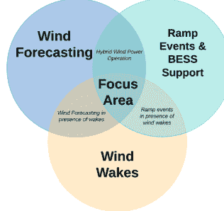

图 1.3 风能核心研究领域。

在基准高度处进行推算，然后通过对数定律或乘幂定律将其外推至风轮毂高度。自回归移动平均（ARMA）和自回归综合移动平均（ARIMA）等时间序列模型已被应用于预测风速并规划风力发电调度，以实现电力系统的最优运行。然而，由于风速的非线性和随机特性带来的各种限制，这些模型获得的准确性较低。

就行业偏好而言，已开发出许多基于预测时域的风电预测工具。风电预测阶段可根据极短期、短期、中期、长期和超长期预测进行分类。由于市场运作和最优电力调度的需求，短期预测是首选。当今的电力市场通常采用非管制结构，允许多个竞争性投标代理参与零售过程。由于风能资源产生的电力本质上具有随机性，通常会考虑日前电力市场来规划最优调度。这种调度基本上取决于市场运营商提供的风力发电计划。随机的风力发电会给大规模预测带来误差，因此需要备用容量来弥补电力不足。如果没有足够的备用，市场运营商承担的成本将急剧上升。由于风电渗透率日益显著地提高，需要更高效的预测方案来确保电力市场的平衡。

图 1.3 说明了风能研究集中的核心领域。从风电场运营商的角度来看，风电预测、风尾流、爬坡事件以及电池储能系统（BESS）集成都非常重要。

如前所述，风电预测主导着现代电力市场。然而，在风电场内部，存在一些固有的空气动力学现象，会降低整体效率。其中一种现象就是风尾流。由于风速下降，风尾流会降低风电场中下游风力涡轮机的捕风能力，这可以通过在给定区域内最优布置风力涡轮机在一定程度上得到纠正。最优风力涡轮机布置的过程称为微选址。

由于风力涡轮机布置不当而导致的功率损失还可能引发湍流增加的警告情况，这进一步会加剧叶片和塔筒健康问题。为解决这类问题以实现最优风电场布局，采用了多种优化技术，如遗传算法和粒子群优化，这些内容将在后续章节中讨论。风电预测的相关领域还包括风力涡轮机叶片和塔筒的寿命预测。由于常用的涡轮机配置是 HAWT，该设计容易受到高风速场景（称为爬坡事件）造成的极端损坏。典型的叶片健康管理研究包括预后和诊断，旨在识别叶片设计不佳、剩余寿命和机械故障的潜在原因，这些问题会导致叶片不及时退化。已有研究表明，部署传感器有助于在线健康监测。

此外，爬坡事件（即风速和风向突然变化的风况）被视为一种警告情况。当装机容量大且包含高额定功率涡轮机时，会出现此类场景。爬坡事件不仅与风电场相关，还与许多其他科学和工程活动相关。对于水坝、森林火灾、空气质量以及风速和风向的快速变化，都会对这些现象产生显著影响。我们将在第 7 章中详细讨论这些事件。总体而言，风电场运行是一个敏感过程，可从所讨论的重要方面加以感知。

## 1.3 风能相关领域的机器学习

如前所述，多年来风电预测研究不断发展，研究人员专注于改进预测技术。风速预测在电力调度方面稳定了现代市场，并促成了备用电力容量的合理规划。由于 BESS 在现代风力发电厂中被积极用作备用，这些电池单元的过度充放电会缩短其寿命。典型的 BESS 容量是根据预测风力发电中提供的充放电计划确定的。因此，准确的风电预测方案可以保证风电场运营商确定备用电力模式的 BESS 容量。

自 20 世纪 70 年代诞生以来，深度学习一直被积极应用于回归、分类、模式识别和聚类等应用中。人工神经网络（ANN）等技术已被用于预测太阳辐射和风速等天气变量。此后，利用历史信息的人工智能通过使用额外数据来提高整体性能。对于风电场，数据来源包括 SCADA、CMS 数据、维护数据和故障历史。谷歌等软件巨头开发了自己的预测工具 DeepMind，该工具基于神经网络。该系统用于预测 36 小时后的风力发电，并已在美国成功应用。人工智能（AI）的一些常用应用如图 1.4 所示。

多变的风况会对风力涡轮机的转子叶片和塔筒施加波动，最终导致涡轮机故障。在故障检测中，基于机器学习的技术被广泛应用于持续监测风力涡轮机性能。由于风力涡轮机由大型设备组成，磨损和损耗可能会造成大规模损坏。转子转速、叶片俯仰角和偏航角等影响涡轮机捕风能力的参数，常被分析用于此目的。常用的 AI 方法包括基于特征的算法，这些算法基本上使用安装在涡轮机设备上的传感器提供的重要信息。声噪声、温度、电转矩、转子转速和油质量等变量通常通过传感器持续监测。

## 1.4 书籍范围与大纲

本书概述了与风电预测及其相关问题相关的主要范式，这些问题日常处理。风力发电量与风速的立方成正比，因此蕴含着关于其变异性的重要信息，因此通过预测风速，我们可以为运营和维护（O&M）节省大量人工小时。

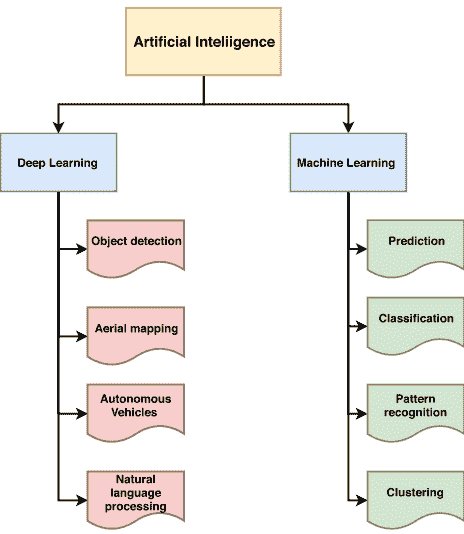

图 1.4 人工智能的常见应用。

风电预测是一项重要程序，直接影响公用电网的可靠性。为解决这些问题，本书深入讨论了支持向量回归（SVR）、随机森林回归（RFR）和梯度提升机（GBM）等高级预测算法。

本书第一部分从风力发电、主要涡轮机部件、领先制造商、风速分布模型和涡轮机微选址等方面阐述了风能基础知识。此外，我们还讨论了风电预测的重点领域及其作为时间序列的建模。附录 A 中还讨论了用于检验时间序列平稳性的重要统计特性，并附有 R 代码。此外，本书还对机器学习及其在风能领域的应用进行了清晰深入的讨论。我们还讨论了监督学习与非监督学习的比较，以及为什么监督学习与风电预测具有主要相关性。

本书第二部分针对各种风电场的风电预测和爬坡事件讨论了案例研究。一种混合预测


利用小波变换和经验模态分解的方法在全书中讨论，并应用于短期风速预测。基于机器学习的回归器（如 SVR、RFR 和 GBM）经过测试，并使用标准误差指标评估其性能。此外，还专门针对陆上和海上风电场场址讨论了爬坡事件，并确定了最佳回归器用于预测爬坡事件。

## References

- [1] UNFCCC, 联合国气候变化框架公约京都议定书, https://unfccc.int/resource/docs/convkp/kpeng.pdf, 2019. (2019 年 6 月 26 日访问).
- [2] B.G. Brown, R.W. Katz, A.H. Murphy, 用于模拟和预测风速和风功率的时间序列模型, 《气候与应用气象学杂志》23 (8) (1984) 1184–1195.

# 第 2 章

# 风能基础

在过去几十年中，风能领域的投资大幅增加。丰富的风能资源促使全球装机容量增加。能源需求推动可再生能源技术的发展，太阳能、风能和生物质能作为先驱，许多发展中国家已开始利用可持续能源。蒸汽发电厂产生的碳足迹，通过利用风能资源发电可以得到显著改善。随着风电技术的发展，运维（O&M）领域的就业机会激增，从而降低了发展中国家的失业率。根据全球风能理事会（GWEC）报告 [1]，2017 年，南非风能领域装机容量为 2.08 GW，创造了 15,000 个就业岗位，欧洲有 262,712 个，印度次大陆有 60,000 个。丰厚的上网电价确保了陆上和海上风电技术的支持。尽管有很多好处，风能领域也会导致水生生物失衡、高昂的初始投资成本以及土地获取方面的程序问题。然而，先进制造技术使风能安装快速发展，且海上场址的风况远强于陆上场址，从而激励投资者参与投标过程。风力涡轮机带来的威胁包括鸟类死亡、高噪音水平以及担心家畜安全的当地社区的反对。

风电场在布局时考虑空间限制，近年来对在任何风向下运行的萨沃尼乌斯式风力涡轮机（SSWT）给予了高度重视。Roy 等人 [2] 探索了一种基于差分进化的反向方法，用于计算最佳涡轮机参数。结果显示，SSWT 的面积减少了 9.8%。此外，Gupta 和 Biswas [3] 提出了一种二维 CFD 模型，用于研究扭转三叶片 H-Darrieus 转子的稳态性能。考虑到风速的随机性，精确的风速预测对风电场运营商有益。然而，预测风速/功率与实际风速/功率的误差处理有助于选择合适的预测算法。人工神经网络（ANN）、支持向量回归（SVR）[4,5]、高斯过程回归（GPR）、模糊逻辑和极端学习机等机器学习模型广泛应用。

## 2.1 风力发电基础

从移动空气中提取功率并非新鲜事，这项做法已有悠久历史。不断增长的能源需求对可再生能源领域产生了积极的推动作用。在各种可再生能源中，风能是为电网提供不间断电力的有前景领域。风能不仅清洁，而且为拥有风能资源的国家提供了经济解决方案。风电场配备了利用风能动能产生可用电力的涡轮机。这些电力通过输电线和电缆馈入电网。从根本上讲，转子面积为 $A_r$ 的涡轮机从密度为 $\rho_w$、速度为 $u_\infty$ 的移动空气中提取的功率由下式给出：

$P_w = \frac{1}{2} \rho_w A_r u_\infty^3.$ (2.1)

基本上，提取的功率与风速 $u_\infty$ 和转子面积 $A_r$ 成正比。然而，受土地限制和制造成本影响，转子尺寸对大型风力涡轮机构成限制。因此，可以适当开发高风速地区，以提升风电场的捕风能力。此外，(2.1) 描述了从风能中可能提取的理论功率。然而，在现实中，只有其中一小部分功率可用于机械到电能的转换，这一比例称为功率系数。不同转子配置的风力涡轮机具有不同的功率系数。理论上，功率系数的最大值可以基于风力涡轮机的作用盘模型（ADM）计算，该模型将风力涡轮机视为对流体流动施加力的圆盘。功率系数的最大值为 0.5926，称为贝兹极限 [6]。

## 2.2 风能资源评估

目前，根据全球风能理事会 [7] 的年度报告，风电装机总容量为 591 GW，其中 2018 年新增 51.3 GW，海上风电场贡献了 4.5 GW。风能领域的最新进展表明，建设大型风电场的投资回报高度依赖于风况的性质。在确定风电场场址时，特别关注涡轮机拓扑结构、风速分布、风电预测和地形性质。涡轮机技术是风能潜力的关键驱动因素之一。通常根据旋转轴分为两种涡轮机配置，即水平轴风力涡轮机（HAWT）和垂直轴风力涡轮机（VAWT）。常用的 HAWT 应用于商业化的中小型发电，而 VAWT 主要用于小规模发电，即小于 100 kW。通用电气、Gamesa、Vestas、Siemens 和 Suzlon 集团等知名公司积极参与风力涡轮机制造市场。

以利润最大化为主要目标的风电场公司，通过优化利用风能资源开展风能资源评估。对风况的科学分析旨在从风速变异性、湍流特性以及爬坡事件的性质和频率等方面，定量和定性地确定风场的真正潜力。本书旨在深入探讨涉及这些属性的不同方面，以便了解如何最大限度地提高风电场的电力输出。即使风电场已投入运营，仍有可能安装叶片延伸件等设备，以提高生产效率。有效的叶片健康监测是另一种风能资源评估方法，从长远来看非常有效。

## 2.3 风速分布

特定风况的风速分布取决于气温、气压、湿度等地形特征。文献 [8] 中提出了各种风速分布函数，如韦布勒、瑞利、对数正态和伽马分布。在列出的概率分布函数中，韦布勒分布因其简单性而最常用。

韦布勒分布广泛应用于可靠性分析（故障率）、工业工程（表示制造和交付时间）以及风速分布 [9] 等领域。韦布勒分布具有灵活性等多种优点，通常能较好地拟合观测到的风速 [10]。然而，韦布勒分布无法准确估计所有风况，包括双峰风


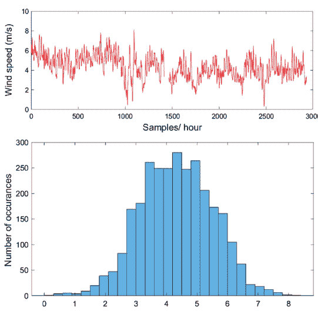

图 2.1 2017年巴西 Praia Formosa 风速数据的频率分布。

涉及两个峰值的分布。文献中还引用了雷利分布和对数正态分布等多种其他分布。研究表明，两分量威布尔分布适用于双峰风速分布。与威布尔分布类似，也已提出混合密度函数 [11]。图 2.1 展示了巴西 Praia Formosa 风电场风速数据的频率分布图。

从图中可以观察到，频率分布有两个风速峰值，从而表明存在双峰分布。风速数据涵盖从 2017 年 1 月 1 日至 2017 年 4 月 30 日的四个月时间。频率分布图有助于从最大值、最小值和平均风速等方面研究风况的统计特性。

### 2.3.1 风速概率密度函数

概率密度函数在统计学及其他计算领域中广泛应用，其中风速等随机变量的发生概率在数学上被描述。然而，风速不是影响风力涡轮机捕获功率的唯一变量。风速与风向之间的相关性同样重要。文献还显示混合密度函数的实现，即由多个概率密度函数组合而成，每个函数都关联一个权重 [12]。

### 2.3.1.1 威布尔分布

最常用的风速 PDF 是威布尔分布，它适用于几乎所有风况。两参数（$k$ 和 $\lambda$）威布尔 PDF 表示为

$f(v; k, \lambda) = \frac{k}{\lambda}(\frac{v}{\lambda})^{k-1} e^{-(\frac{v}{\lambda})^k},$ (2.2)

其中 $k, \lambda > 0$，且 $v > 0$ 是称为风速（单位：m/s）的随机变量；$k$ 称为形状参数。威布尔参数可通过最大似然法 [13] 进行估计。同样，联合威布尔 PDF 可用于建模双峰风况的风电场。两分量联合威布尔 PDF 可表示为

$$f_i(v; k_i, \lambda_i) = \frac{k_i}{\lambda_i}(\frac{v}{\lambda_i})^{k_i-1} e^{-(\frac{v}{\lambda_i})^{k_i}}, \quad i=1, 2,$$
$$f(v; k, \lambda) = w_1 f_1(v; k_1, \lambda_1) + (1 - w_1) f_2(v; k_2, \lambda_2), \quad (2.3)$$

其中 $k_1, \lambda_1$ 和 $k_2, \lambda_2$ 分别表示各个 PDF 的形状和尺度参数，进而可通过最大似然估计（MLE）进行估计。

### 使用最大对数似然进行参数估计

威布尔分布的参数估计 $\hat{\theta} = (\hat{k}, \hat{\lambda})$ 可根据最大似然原理，针对唯一风速数据进行确定。根据图 2.2 和 (2.2) 给出的威布尔 PDF，对数似然函数为

$L(v|k, \lambda) = n\log(k) - nk\log(\lambda) + (k-1) \sum_{i=1}^n \log(v_i) - \sum_{i=1}^n (\frac{v_i}{\lambda})^k . \quad (2.4)$

进一步，为了求解估计量，对参数 $k$ 和 $\lambda$ 对对数似然函数求导：

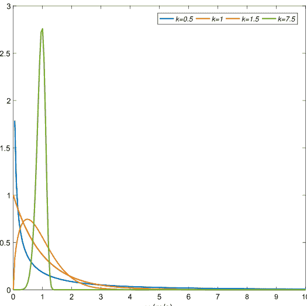

图 2.2 \(\lambda = 1\) 及不同形状参数值的威布尔 PDF。

\(\frac{\partial L(v|k, \lambda)}{\partial \lambda} = \frac{-n\lambda}{k} + \frac{\lambda}{k} \sum_{i=1}^n \left(\frac{v_i}{\lambda}\right)^k, \quad (2.5)\)

\(\frac{\partial L(v|k, \lambda)}{\partial k} = \frac{n}{k} - n \log(\lambda) + \sum_{i=1}^n v_i - \sum_{i=1}^n \left(\frac{v_i}{\lambda}\right)^k \log\left(\frac{v_i}{\lambda}\right). \quad (2.6)\)

根据 (2.5) 和 (2.6) 的解，可以估计参数 $k$ 和 $\lambda$。观察 (2.4)，可通过最小化对数似然函数的负值来获得参数。由于这是一个优化问题，可采用多种进化技术，如遗传算法（GA）、粒子群优化（PSO）和萤火虫算法（FA），以获得准确的参数估计。图 2.3 展示了威布尔分布拟合。

### 2.3.1.2 风速林德利分布

单峰风况可由威布尔分布和伽马分布描述 [11]。在极低和极高风区，据报道威布尔及其他 PDF 表现不佳，此类情况下建议采用林德利分布函数 [14]。林德利分布有两种版本，即广义林德利和幂林德利，如 [14] 所述。对于随机风速变量 \( \upsilon \)，广义林德利 \( f_{gl} \) 和幂林德利 \( f_{pl} \) PDF 可表示为

\( f_{gl}(\upsilon) = \frac{\alpha \beta^2}{\beta + 1}(1 + \upsilon)\left(1 - \frac{1 + \beta + \beta \upsilon^2}{1 + \beta}e^{-\beta \upsilon}\right)^{\alpha - 1}e^{-\beta \upsilon}, \quad (2.7) \\ f_{pl}(\upsilon) = \frac{\alpha \beta^2}{\beta + 1}(1 + \upsilon^\alpha)\upsilon^{\alpha - 1}e^{-\beta \upsilon^\alpha}, \quad (2.8) \)

其中 \( \alpha \) 和 \( \beta \) 分别表示形状和尺度参数。

广义林德利分布的累积 PDF 表示为

\( f_{gl}(\upsilon) = \left[1 - \left(\frac{1 + \beta + \beta \upsilon}{\beta + 1}\right)e^{-\beta \upsilon}\right]^\alpha. \quad (2.9) \)

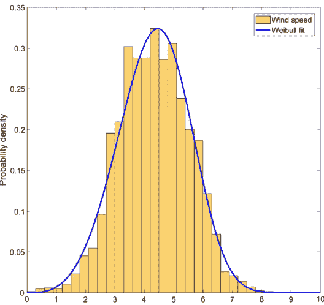

图 2.3 实时风速数据的威布尔分布拟合。

[15] 描述了随机变量的扩展广义林德利分布及其相对于广为人知的威布尔、雷利、两分量威布尔和广义林德利 PDF 的优越性。

图 2.4 展示了用于建模风速分布的广义林德利 PDF 图。形状和尺度参数 $\alpha$ 和 $\beta$ 控制分布的峰值和尾部结构。广义林德利 PDF 特别适用于建模风速方面风况较弱的风能资源。额定功率在 100–500 kW 范围内的小型风电场在低风速下运行，其分布可能呈偏态。

### 林德利 PDF 参数估计

林德利 PDF 是一个两参数分布类，其中 $\hat{\theta} = (\hat{\alpha}, \hat{\beta})$ 根据对数似然原理确定。林德利 PDF 的对数似然函数为

$$L(v|\alpha, \beta) = n[\log \alpha + 2 \log \beta - \log(\beta + 1)] + \sum_{i=1}^n \log(1 + v_i) + (\alpha + 1) \sum_{i=1}^n \log \left( 1 - \frac{1 + \beta + \beta v}{1 + \beta} e^{-\beta v} \right) - \beta \sum_{i=1}^n v_i. \tag{2.10}$$

进一步，对 $\alpha$ 和 $\beta$ 对对数似然函数求导，可得

$$\frac{\partial L(v|\alpha, \beta)}{\partial \alpha} = \frac{n}{\alpha} + \sum_{i=1}^n \log \left( 1 - \frac{1 + \beta + \beta v}{1 + \beta} e^{-\beta v} \right). \tag{2.11}$$

$$\begin{aligned} \frac{\partial L(v|\alpha, \beta)}{\partial \beta} &= \frac{n}{\beta} - \sum_{i=1}^n v_i + (\alpha + 1) \sum_{i=1}^n \left[ \frac{1 - \frac{e^{-\beta v}}{(1+\beta)^2} + v e^{-\beta v}}{1 - \frac{1+\beta+\beta v}{1+\beta} e^{-\beta v}} \right] \\ &- (\alpha + 1) \sum_{i=1}^n \left[ \frac{\frac{e^{-\beta v}}{(1+\beta)^2} + v e^{-\beta v}}{1 - \frac{1+\beta+\beta v}{1+\beta} e^{-\beta v}} \right]. \tag{2.12} \end{aligned}$$

由于方程 (2.11) 和 (2.12) 包含非线性项，$\alpha$ 和 $\beta$ 的解可使用收敛速度快于牛顿法的准牛顿法等优化方法求得。估计量 $\hat{\alpha}$ 和 $\hat{\beta}$ 采用 PSO 算法确定。图 2.5 展示了实时风速数据的广义林德利拟合。

### 2.3.1.3 Stacy-Mihram 分布模型

威布尔分布模型的另一类是 Stacy–Mihram 模型，该模型通常能较好地描述风速分布。两参数模型为

$$f_{stm}(v) = \frac{\beta v^{\beta-1}}{\alpha^\beta} e^{-(\frac{v}{\alpha})^\beta}, \quad v > 0. \tag{2.13}$$

参数 $\alpha$ 和 $\beta$ 可使用 MLE 进行估计，其对数似然函数为

$$L(v|\alpha, \beta) = n \log \beta - n \beta \log \alpha + (\beta - 1) \sum_{i=1}^n \log(v_i) - \sum_{i=1}^n \left( \frac{v_i}{\alpha} \right)^\beta. \tag{2.14}$$

图 2.6 展示了风速时间序列的 Stacy–Mihram 拟合。


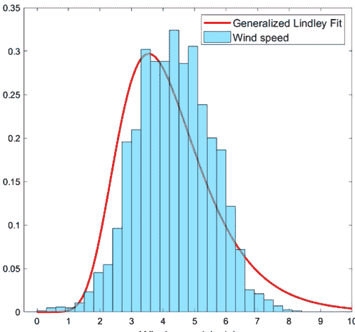

图 2.5 实时风速数据的广义林德利分布拟合。

## 2.4 风电机组微选址

风能提取不仅取决于时间分布，还取决于空间分布。随给定风电场中风电机组数量的增加，其横向和纵向间距会影响每台机组遇到的有效风速。此外，特定风电场场址的地形特征会影响捕获的功率。由高风速引起的风切变也可能导致叶片几何形状和塔筒强度受损。在风电场中对风电机组进行最优布置以最大化功率捕获并最小化发电成本的过程称为微选址。

微选址的早期研究涉及使用遗传算法进行最优风电场布局，如Mosetti等人[16]所述，其中一个面积为4 km²的风电场被分为大小为5D的单元，其中D为转子直径。考虑了两种情况，第一种情况为单一风速方向，第二种情况为多风向。结果表明，拥有40到50台机组的随机风电场布局效率为50%，而优化的风电场布局效率为95%。此外，Wan等人[17]采用PSO技术进行了风电场微选址。风电场优化的结果与Grady等人[18]的研究进行了比较，显示在风速为12 m/sec的单一风向下，风能捕获率提高了6.34%。Wan等人[19]提出了一种带有局部搜索策略的高斯粒子群优化（GPSO）算法，用于确定最优风电场布局。为了改进微选址，将局部搜索策略应用于GPSO，结果表明与经验方案相比，风电场效率提高了14.61%。像通用电气这样的跨国公司在过去几十年中广泛开展了微选址工作，以显著提高风电场的年发电量（AEP）。

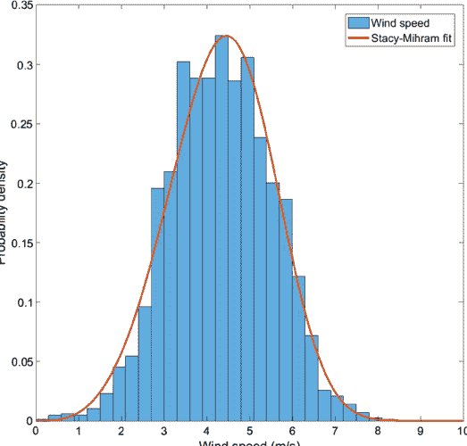

图 2.6 实时风速数据的Stacy–Mihram分布拟合。

图2.7展示了采用微选址和未采用微选址的风电场布局。第一种布局是随机布局，由于尾流相互作用导致最大功率损失，而第二种布局是优化布局，具有改进的功率捕获能力。

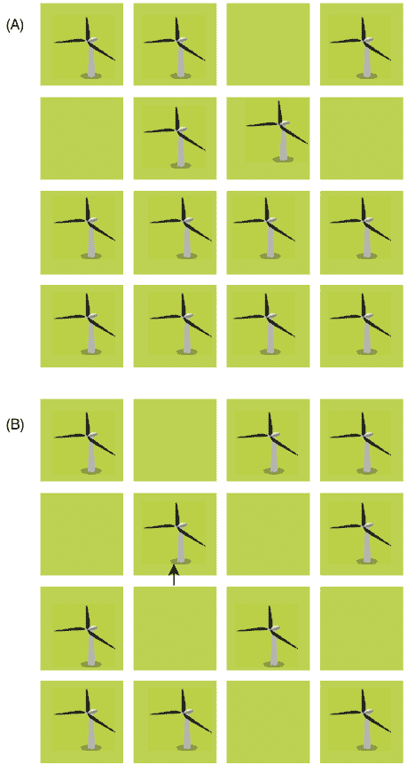

图2.7 风电场微选址。(A) 随机布局。(B) 优化布局。

## References

- [1] 全球风能理事会报告，http://files.gwec.net/files/GWR2017.pdf，2017年。（访问日期：2019年3月7日）。
- [2] S. Roy, R. Das, U.K. Saha, Savonius式风电机组几何参数优化的逆方法，Energy Conversion and Management 155 (2018) 116–127。
- [3] R. Gupta, A. Biswas, 扭转三叶片H-Darrieus转子的计算流体动力学分析，Journal of Renewable and Sustainable Energy 2 (4) (2010) 043111。
- [4] M. Mohandes, T. Halawani, S. Rehman, A.A. Hussain, 用于风速预测的支持向量机，Renewable Energy 29 (6) (2004) 939–947。
- [5] J. Zhou, J. Shi, G. Li, 用于短期风速预报的支持向量机精调，Energy Conversion and Management 52 (4) (2011) 1990–1998。
- [6] S. Mathew, 风能，Springer Berlin Heidelberg，2006年。
- [7] GWEC会议和研讨会 – GWEC，https://gwec.net/events/gwec-conferences-and-seminars，2019年4月。（访问日期：2019年5月31日）。
- [8] J. Carta, P. Ramírez, S. Velázquez, 风能分析中使用的风速概率分布综述，Renewable & Sustainable Energy Reviews 13 (5) (2009) 933–955。
- [9] C.-D. Lai, D. Murthy, M. Xie, Weibull分布及其应用，Springer工程统计手册，Springer London，2006年，第63–78页。
- [10] T. Ouarda, C. Charron, J.-Y. Shin, P. Marpu, A. Al-Mandoos, M. Al-Tamimi, H. Ghedira, T.A. Hosary, 阿联酋风速概率分布，Energy Conversion and Management 93 (2015) 414–434。
- [11] T.P. Chang, 使用不同概率密度函数估计风能潜力，Applied Energy 88 (5) (2011) 1848–1856。
- [12] J. Wang, J. Hu, K. Ma, 风速概率分布估计与风能评估，Renewable & Sustainable Energy Reviews 60 (2016) 881–899。
- [13] J. Seguro, T. Lambert, 用于风能分析的Weibull风速分布参数现代估计，Journal of Wind Engineering and Industrial Aerodynamics 85 (1) (2000) 75–84。
- [14] T. Arslan, S. Acitas, B. Senoglu, 用于建模风速数据的广义林德利分布和幂林德利分布，Energy Conversion and Management 152 (2017) 300–311。
- [15] Y.M. Kantar, I. Usta, I. Ariik, I. Yenicilmez, 使用扩展广义林德利分布进行风速分析，Renewable Energy 118 (2018) 1024–1030。
- [16] G. Mosetti, C. Poloni, B. Diviacco, 基于遗传算法的大型风电场风电机组定位优化，Journal of Wind Engineering and Industrial Aerodynamics 51 (1) (1994) 105–116，https://doi.org/10.1016/0167-6105(94)90080-9。
- [17] C. Wan, J. Wang, G. Yang, X. Zhang, 基于粒子群优化的风电场最优微选址，计算机科学讲义，Springer Berlin Heidelberg，2010年，第198–205页。
- [18] S. Grady, M. Hussaini, M. Abdullah, 使用遗传算法进行风电机组布置，Renewable Energy 30 (2) (2005) 259–270。
- [19] C. Wan, J. Wang, G. Yang, H. Gu, X. Zhang, 带有局部搜索策略的高斯粒子群优化风电场微选址，Renewable Energy 48 (2012) 276–286。

# 第3章

# 风能预测范式

随着人类对电力消耗需求的增加，供应侧管理在监管市场中已发挥关键作用。基于化石燃料的发电正面临着可再生能源的严峻竞争。特别是，由于无污染发电和输电灵活性，风电渗透率有所提高。电力供需平衡是电力系统监管机构的重要标准。

为了最优功率调度，发电公司拥有备用容量，以防主发电实体的电力流动中断。然而，电力备用容量在规模和可调度性方面存在一些限制。因此，提前预测负荷可以帮助运营商规划最优的电力调度。

## 3.1 时间序列简介

对特定变量的预测可能取决于时间或空间尺度。随时间变化的时域变化反映了变量中存在的随机性。空间变化在气候学和气象学中通常占主导地位。变量的时间尺度可以用时间序列来建模。时间序列是按顺序排列的数值数据点序列，可以应用于任何随时间变化的变量。

基于时间序列的分析有助于运营商识别变量的动态行为，即每个时间步相对于另一个时间步的相对依赖关系。从根本上说，时间序列S_t可以定义为在每个时间步t对特定变量s_t的观察集合。作为时间序列的示例，图3.1展示了Facebook, Inc.从2018年1月3日到2019年6月3日的开盘股价。时间序列中的每个数据点都表示一个唯一的股价值。

本质上，时间序列可以分为平稳时间序列和非平稳时间序列。平稳时间序列的均值和方差等统计特性随时间不变。在数学上，平稳时间序列S_t可以表示为

$$F_S(s_{t_1+h}, \dots, s_{t_n+h}) = F_S(s_{t_1}, \dots, s_{t_n}), \tag{3.1}$$

其中$t$为时间步，$h$为偏移时间步。

要检查给定时间序列是否平稳，可使用多种统计检验，如自相关函数（ACF）、用于单位根的广义Dickey–Fuller（ADF）t统计量检验、Ljung–Box检验以及用于水平或趋势平稳性的Kwiatkowski–Phillips–Schmidt–Shin（KPSS）检验。

现在给出两个用于检查时间序列平稳性的R代码示例。

### 示例3.1. 自相关函数的R代码

```
acf(VarName, lag.max=length(VarName), xlab="lag #", ylab='ACF',
main='.-')
```

自相关图揭示了变量元素与其自身时移信号之间的相关性。图3.2描绘了ACF函数，用于


股票价格时间序列。定性分析表明，ACF值超过置信界限，从而表明时间序列具有非平稳性。

同样，可以进行Ljung–Box检验和增广Dickey–Fuller检验，以确定给定时间序列是否平稳。

### 示例3.2. Ljung–Box检验的R代码

```
lag.length=25 Box.test(VarName, lag=lag.length, type="Ljung-Box")
```

### 输出

```
data: VarName
X-squared = 5626, df = 25, p-value < 2.2e-16
```

## 3.2 风力预测：概述

随着可再生能源装机容量的激增，化石燃料的使用需要受到限制。电力行业的大多数行业由于其可忽略的碳足迹，更倾向于可再生能源发电。由于风能资源丰富，从风能中获取电力是一项专业任务。预测风速/功率与实际风速/功率的误差处理在选择合适的预测算法方面起着至关重要的作用。

在清算日前市场场景时，风力预测起着重要作用。鉴于存在需要清算的市场情况，准确的风力预测方案在此类情况下很有帮助。风力预测方案大致分为(i)基于天气的预测方法和(ii)统计或基于时间序列的预测方法。当我们考虑基于天气的预测模型时，风速预测精度在很大程度上取决于安装风力涡轮机的土地地形。

鑑于土地地形、距地面适当高度的风速测量、环境空气温度、大气压力等，是改进预测需要考虑的重要因素。另一方面，统计方法完全依赖于风速的过去测量值，以适当预测未来值。

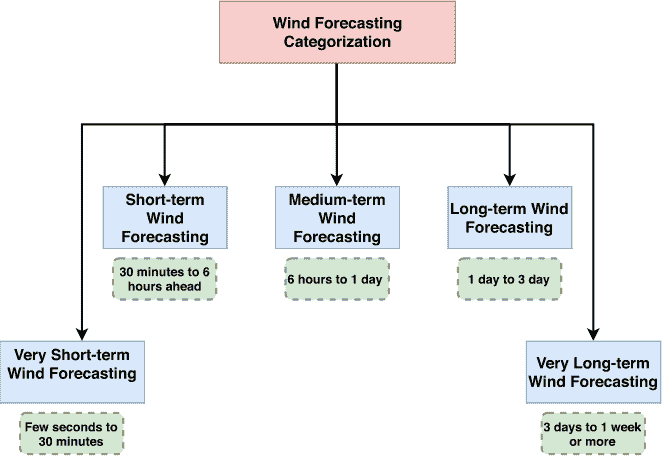

图3.3 基于预测时域的预测方法分类。

### 3.2.1 基于预测时域的技术

风速预测应用主要集中在电力市场清算、经济负荷调度和计划等领域，有时还提供辅助支持。因此，基于预测时域（即预测持续时间）的适当分类对于各种输电系统运营商来说变得很重要。风力预测方法的时域分类如图3.3所示。

该分类不仅简化了研究，还可以根据应用类型帮助选择准确的方法。看来短期和中期预测方法因其准确性和鲁棒性而更受欢迎。

时域分类在应用这些预测算法方面堪称锦上添花。对于任何预测方法要准确，其在不同大气条件下的不同地点的表现对预测未来值起着关键作用。因此，必须分配一个参数，该参数不仅计算方法的准确性，还确定其在特定条件下的适用性。这种优化研究通常会进行，以选择准确的预测方法。正如其名称所示，超短期预测方法预测未来值的时间跨度很短。这种方法通常遵循的时间跨度是从几秒到30分钟。超短期风力预测的核心领域在于市场清算和监管行动。由于全球电力市场正在向放开市场转变，超短期和短期预测已获得重要性。

在文献中描述的许多方法中，有一种特定的方法，例如空间相关方法[1]，其中进行1秒前的预测，以及人工神经网络（ANN）-马尔可夫链（MC）模型[2]，它使用175分钟的可变集，预测未来7.5秒的风速。贝叶斯结构断点模型[3]用于预测未来1分钟和1小时的预测。数据挖掘方法也用于预测未来10秒到5分钟的风速[4]。

除了这些方法，人工神经网络（ANN）和特别是深度神经网络（DNN）[5]等多种智能学习方法也用于预测未来10分钟、30分钟和1小时的风速。支持向量机（SVM）、将经验小波变换（EWT）与神经网络（NN）相结合的混合方法也构成了超短期风力预测过程的核心。预测领域的最新进展显示机器学习算法的演变，其中分解预测算法（DFA）最常用。分解算法的本质在于将变量的时间序列（在本例中为风速/功率）分解为单独的单元，对其进行预测分析，并将它们组合起来得到结果序列。

在[6]中使用了这样一种分解算法，其中风的时间序列数据被分解为若干单元，在每个单元上执行特征构建过程，然后选择具有最佳特征的单元进行预测。预测可以使用标准ARIMA模型（阶数为(p, d, q)）、人工神经网络（ANN）或支持向量机（SVM）进行。此外，还使用了一种基于希尔伯特-黄变换（HHT）的预测技术，该技术对非平稳和非线性模型使用分解技术[7]。

除了这些标准ARIMA模型，一种混合模型——基于小波变换和神经网络的风力预测[8]——用于预测3小时前的风力。将过去12小时、15分钟时间步长的数据作为输入提供给ANN输入层。原始风力序列使用小波变换（具体来说，离散小波变换（DWT））进行分解，然后将结果序列输入神经网络，以预测未来值。小波变换还用于预测发电厂的负荷和电价，特别是在放开市场[9]。另一种短期预测方法涉及经验模态分解（EMD）和特征选择[6]，其中风序列被分解为若干后续序列。

对于这些序列中的每一个，都会计算一个内禀模态函数（IMF）。分解信号的IMF代表信号的不规则性和频率成分。一旦序列被分解，就会选择合适的预测工具（ANN或SVM）来预测风力值。在另一种方法中，描述了一种结合小波变换、支持向量机和遗传算法的方法[10]。遗传算法的过程有助于为SVM选择输入参数。必须对输入进行优化，以选择最佳预测候选者。结果表明，WT-SVM-GA获得的MAPE约为14.79%，而持续性方法为22.64%。

长期预测在机组承诺决策、维护计划等方面有重要应用。一种混合方法[11]结合了粒子群优化（PSO）和自适应网络模糊推理系统（ANFIS），即PSO+ANFIS，用于以15分钟时间步长预测1天前的情况。选择PSO算法来找出神经模糊系统的最佳参数。另一种方法[12]使用相关矢量机（RVM），基于小波分解（WD）和人工蜂群优化（ABCO），其中风信号被分解为不同频率范围的若干子序列，然后由RVM进行预测。RVM的核参数由一种称为人工蜂群优化（ABCO）的元启发式算法选择。

除了上述预测技术外，许多数值天气方法，如全球预报系统[13]和第五代中尺度模式（MM5）结合神经网络也被使用。全球预报系统（GFS）的预测结果加上相关地形的大气条件被用作MM5模型的边界条件，然后将其作为输入提供给神经网络。从全球预报方法中，对风数据进行物理降尺度，然后使用MM5模型实现统计降尺度。


### 3.2.2 基于预测方法的技术

Based on the methods of forecasting, several techniques are implemented for accurate wind speed forecasts. Traditionally, the persistence method is used to predict the future values of the variables under the assumption that the condition remains unchanged between “present” time t and forecast time t + h. Mathematically, for a variable v, the persistence algorithm is given as

```
\hat{v}_{t+h} = v_t \tag{3.2}
```

and is best suited for variables with stationary time series as they possess identical statistical properties.

Moving forward, statistical models like ARMA, ARIMA, and f-ARIMA are also used to forecast wind speed for very-short-term and short-term-based forecasting. These models predict future values based on the past data. Machine learning-based methods are gaining popularity owing to their ability to handle large historical data. Methods like the support vector regression, artificial neural network, extreme learning machine, and Gaussian process regression are some of the commonly used machine learning techniques for wind forecasting. Since the wind speed is a stochastic time series, various signal decomposition techniques like the wavelet transform, empirical mode decomposition, ensemble empirical mode decomposition, and complementary ensemble empirical mode decomposition are used in tandem with machine learning methods to forecast the short-term wind speed.

Fig. 3.4 illustrates different forecasting techniques based on forecasting methods.

## 3.3 统计方法

In benign terms, statistical forecasting methods indicate the use of statistics based on the available historical quantitative data to ascertain what could happen in the future.

Short-term wind forecasting is the most commonly used forecasting category, which many day-ahead markets need to clear the market scenarios by the end of the day. Among these, the most used forecasting methods are a combination of two or more machine learning methods combined with time-series models like AR, MA, ARMA, ARIMA, and ARMAX. Auto regression (AR) is a time-series model that uses observations taken from previous time steps as input to a regression equation to forecast the

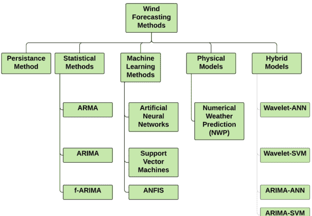

Figure 3.4 Categorization of wind forecasting techniques based on methods.

outcome at the next time step. On the other hand, rather than using past values of the forecast variable in a regression, a moving average (MA) model uses past forecast errors in a regression-like model.

Autoregressive exogenous moving average (ARMAX) is a nonlinear model that captures all the uncertainties related to the stochastic nature of the wind. Let us look at the two other models, ARMA and ARIMA, in more detail.

### 3.3.1 ARMA 模型

Among various statistical models, ARMA model is a popular forecasting method. In ARMA, AR stands for autoregressive, and MA stands for moving average. Thus a combined autoregressive (of order p) and moving average (of order q) forms an ARMA(p, q) model. The order of ARMA models, p for AR and q for MA, denotes the lag between present and past values of the variable under test. Thus a generic ARMA model can be mathematically expressed as

```
$(y_t - \mu_x) = \phi_1(y_{t-1} - \mu_x) + \phi_2(y_{t-2} - \mu_x) + \cdots + \phi_p(y_{t-p} - \mu_x)
+ \xi_t - \theta_1\xi_{t-1} - \theta_2\xi_{t-2} - \cdots - \theta_q\xi_{t-q},\quad (3.3)$
```

| 指标 | 公式 |
|---|---|
| \( R^2 \) | \( \frac{\sum_{i=1}^n (\hat{x}_i - \bar{x})^2}{\sum_{i=1}^n (x_i - \bar{x})^2} \) |
| RMSE | \( \left( \frac{1}{n} \sum_{i=1}^n (\hat{x}_i - x_i)^2 \right)^{1/2} \) |
| MAE | \( \frac{1}{n} \sum_{i=1}^n |\hat{x}_i - x_i| \) |
| MAPE | \( \frac{1}{n} \sum_{i=1}^n |\hat{x}_i - x_i| \times 100\% \) |

where \( \xi_t \) is an independent process with mean zero, and \( \phi = [\phi_1, ..., \phi_p] \) and \( \theta = [\theta_1, ..., \theta_q] \) are the parameters of the AR and MA processes, respectively. ARMA models can be studied in a much more simplified manner by using the lag operator \( L \). When applied \( k \) times, the lag operator moves index of the variable back by \( k \) times. Given a quantity \( \gamma \), the lag operation for \( k \) times yields \( L^k(\gamma) = y_{t-k} \). In general, an ARMA process can be mathematically expressed as

```
ARMA : \( \phi L(y_t) = \theta L(\xi_t) \),
AR : \( \phi L(y_t) = \xi_t \),
MA : \( y_t = \theta L(\xi_t) \).
```

As an example, we consider forecasting wind speed based on time-series modeling. The wind speed data of 2 months (Jan 1, 2017–March 31, 2017) for Praia Formosa, Brazil, is taken. The autocorrelation of the wind speed time series is calculated, and the orders \( p \) and \( q \) for ARMA model are set. To assess the model accuracy, error metrics like root mean squared error (RMSE), mean absolute error (MAE), mean absolute percentage error (MAPE), and \( R^2 \) are calculated and listed in Table 3.1.

The \( \mathcal{L}_2 \) norm or Euclidean distance of residuals is also used for investigating the forecast accuracy, which is expressed as

```
\( \| \mathcal{L} \|_2 = \sqrt{\sum_{i=1}^n (x_i - \hat{x}_i)^2} \)
```

where \( x_i \) is the actual value, and \( \hat{x}_i \) is the predicted value for \( n \) samples.

### 3.3.2 ARIMA 模型

ARMA models have a limitation that they can be applied to stationary processes only. In reality, the wind speed is a nonstationary time series with significant diurnal, meteorological, and seasonal variations. These variations are a result of dynamic atmospheric processes that change the wind behavior in time. To handle such limitations, ARIMA process is used to forecast wind speed. ARIMA process stands for autoregressive (AR), integrated (I), and moving average (MA). Mathematically, ARIMA(p, d, q) can be expressed as

```
\phi L . K^d . y_t = \theta L(\xi_t), \qquad (3.8)
K = 1 - L, \qquad (3.9)
y_t = (1 + \phi_1)y_{t-1} + (\phi_2 - \phi_1)y_{t-2} + \cdots + \phi_p y_{t-p-1}
+ \xi_t - \theta_1 \xi_{t-1} - \theta_2 \xi_{t-2} - \cdots - \theta_q \xi_{t-q}, \qquad (3.10)
```

where y_t is the time-series variable, d is the difference operator, \xi_t is a white noise with zero mean and infinite variance, and \phi and \theta are coefficients of AR and MA processes. In the statistical package R, there is a function called auto.arima in the forecast package that automatically evaluates such parameters.

Figs. 3.5 and 3.6 illustrate wind speed forecasting for ARMA(1, 1) and ARIMA(2, 1, 1) models, respectively.

Simulations are performed on SPSS 16.0 platform using time-series analyzer. Based on forecast results, we note that ARIMA model performs better than ARMA with error statistics depicted in Table 3.2.

This also reinforces the fact that ARIMA models are superior to ARMA models for forecasting nonstationary time series. Literature survey shows that ARIMA model is extensively used to forecast the wind speed and power and serves as a benchmark model to assess the forecast accuracy of a newly developed or hybrid model. In [14] a variant of ARIMA model, f-ARIMA, is used to predict the day ahead wind forecasts. In this model, f stands for fractional, where the differencing parameter d \in (-0.5, 0.5). Results reveal that f-ARIMA model is 42% more efficient than the persistence model.

## 3.4 基于机器学习的模型

Wind flow depends on atmospheric variables like pressure, humidity, surface roughness, and elevation. The historical behavior plays a pivotal role

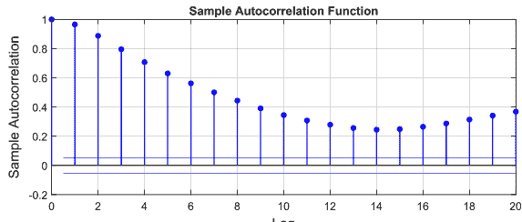

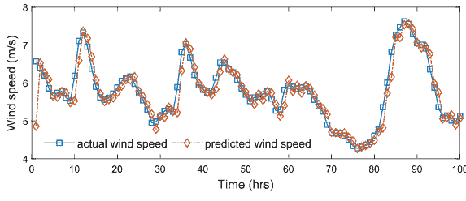

Figure 3.5 Autocorrelation of wind speed and forecasting using ARMA(1, 1) model.

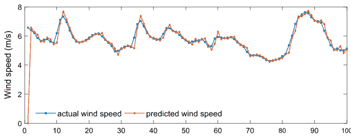

Figure 3.6 Wind speed forecasting using ARIMA(2, 1, 1) model.

| 模型 | R² | RMSE | MAE | MAPE |
|---|---|---|---|---|
| ARMA(1, 1) | 0.964 | 0.222 | 0.159 | 3.655 |
| ARIMA(2, 1, 1) | 0.970 | 0.203 | 0.141 | 3.229 |


用于短期预测。因此，为了解决非线性问题，全球正在使用机器学习（ML）模型来预测风速。机器学习是人工智能这一更广泛领域的一部分。机器学习一词侧重于通过大量实时示例，执行分类、预测、模式识别、聚类或其中一些或全部任务的组合。

机器学习分为两个分支：监督学习和无监督学习。监督学习是一种学习类型，其中 ML 算法接收带标签的输入示例，并旨在收敛到尽可能好的分类器 \( f: X \rightarrow Y \)，以便可以对新的示例集进行分类，其中 \( X \) 是代表性输入特征集，\( Y \) 是不同的标记类 [15]。在分类情况下，\( Y \) 是值为 1 或 0 的集合，对应于单个类。另一方面，无监督学习构建一个分类器，该分类器本质上不依赖于输入示例，而是通过分析输入数据中的相似性自行学习。

准确的风速预测取决于大型历史数据集的可用性，这对于训练监督 ML 回归模型很有用。在监督 ML 回归方法中，支持向量机、人工神经网络和极端学习机被持续使用。

图 3.7 展示了机器学习的日常示例，分为监督学习和无监督学习方法。

分类属于监督学习类别，其中图 3.7 中描绘的*水果*的各个类别被视为标签。另一方面，在无监督学习的情况下，聚类问题是通过基于输入数据中发现的相似性进行分组来解决的。与监督学习不同，在这种情况下，算法没有提供显式标签。

图 3.8 展示了监督和无监督机器学习的不同变体。

人工神经网络被广泛用于预测 3 分钟至 6 小时的风速/功率。在 ANNs 中，最常用的拓扑是多层感知机（MLP）。在 [8] 中，葡萄牙风电场的短期风电预测是通过小波变换和神经网络（NNs）的混合方法实现的，最初风速数据通过离散小波变换分解为子系列，然后输入到 NN 进行训练部分。一旦训练算法完成，数据集将被发送到学习阶段，

| 机器学习日常示例 | |
|---|---|
| 监督学习 | 无监督学习 |
| 分类是一种监督学习。这里，苹果、葡萄和草莓属于水果父类。基于每种水果的个别特征，它们可以被分类到各自的类别。 | 另一方面，聚类是一种无监督学习。这里，根据输入数据中发现的相似性，将情绪聚类到各自的组。这些输入不像监督学习那样被标记 |

图 3.7 机器学习的日常示例。

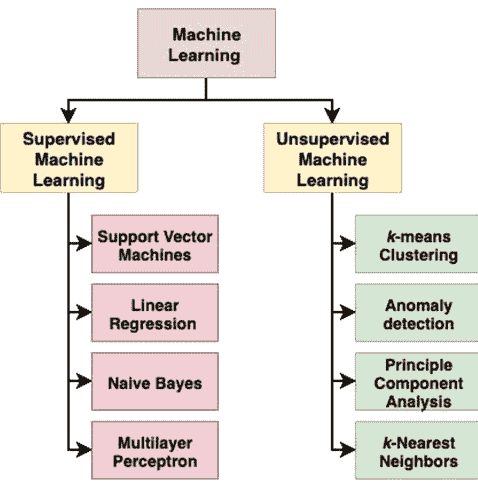

图 3.8 机器学习算法的分类。

其中输入值和所需值之间发生误差最小化。通常，反向传播用作学习算法 [16]。但是，反向传播是一种较慢的技术，因此被 Levenberg–Marquardt 算法取代。神经网络小波变换（NNWT）方法的结果与 ARIMA(1, 2, 1) 和 NN 进行了比较，其中通过使用前 12 小时的历史数据进行提前 3 小时的预测。使用 NNWT 方法的 MAPE 发现为 6.97%。

## 3.5 混合风能预测方法

像 ANN、SVR、ELM 和 GPR 这样的单独机器学习方法与诸如小波变换和经验模态分解等信号预处理技术一起使用。信号分解技术将风速时间序列分割成子系列。这些子系列可以单独用于预测，并汇总以获得最终预测序列。

涵盖单个方法特征的混合模型一直是研究的核心领域，如图 3.9 所示。

Yuan 等人 [17] 提出了一种混合预测模型，采用自回归分数积分移动平均（ARIFMA）和最小平方支持向量回归来预测短期风电。各种基于机器学习的预测模型已证明其优于时间序列模型。在机器学习方法中，支持向量回归以经典支持向量机的精神估计回归函数 [18]。Liu 等人 [10] 提出了一种利用小波变换和由遗传算法优化的支持向量机的短期风速预测混合方法。

另一种研究墨西哥风速预测的混合方法使用 ARIMA 和 ANN 模型，也可用 [19]。Liu 和 Tian [20] 使用小波和小波包以及 ANN 来预测风速，并将其研究结果与 ANFIS、wavelet-RBF 和持续法等标准模型进行了比较。Xiao 等人 [21] 演示了组合预测模型，根据各个模型在其他各种模型中的优劣对其进行权重计算。在 [22] 中，作者使用带有统计权重预处理技术的 ANN 来预测地源热泵（GCHP）系统的性能系数。进一步的研究表明，使用优化方法选择模型参数可以获得更好的结果

## 混合风能预测方法

### 基于信号分解的方法

- Wavelet-ARIMA
- Wavelet-ANN
- Wavelet-SVR
- EMD-ANN
- EMD-SVR

### 基于参数优化的方法

- GA-ANN
- GA-SVM
- PSO-ANN
- PSO-ANFIS
- PSO-SVR

图 3.9 混合风能预测方法的分类。

优于单个方法。一种常用的优化技术是遗传算法，因为其收敛速度快。Su 等人 [23] 使用粒子群优化来为结合卡尔曼滤波器的 ARIMA 模型选择最优模型参数，用于风速预测。最近，各种混合技术已被用于研究风电场的短期风能预测。小波变换和经验模态分解等信号分解方法通常用于研究风速的随机性。Du 等人及相关工作研究了小波分解与神经网络的结合，其中通过对超参数进行多目标优化提高了预测准确性 [24–28]。随后将该模型与持续法、ARIMA 和广义神经网络等基准方法进行比较。结果表明，基于多目标优化的神经网络模型优于基准模型，并且可靠地满足短期风能预测需求。

## 参考文献

- [1] M. Alexiadis, P. Dokopoulos, H. Sahsamanoglou, 基于空间相关模型的风速和功率预测，IEEE 电能转换交易 14 (3) (1999) 836–842, https://doi.org/10.1109/60.790962.
- [2] S.P. Kani, M. Ardehali, 超短期风速预测：一种新的人工神经网络–马尔可夫链模型，能源转换与管理 52 (1) (2011) 738–745, https://doi.org/10.1016/j.enconman.2010.07.053.
- [3] Y. Jiang, Z. Song, A. Kusiak, 基于贝叶斯结构断点模型的超短期风速预测，可再生能源 50 (2013) 637–647, https://doi.org/10.1016/j.renene.2012.07.041.
- [4] M. Negnevitsky, P. Johnson, 超短期风电预测：一种数据挖掘方法，载于：2008 年 IEEE 能源与电力协会大会 – 21 世纪电能转换与输送，IEEE，2008.
- [5] Q. Hu, R. Zhang, Y. Zhou, 基于深度神经网络的短期风速预测迁移学习，可再生能源 85 (2016) 83–95, https://doi.org/10.1016/j.renene.2015.06.034.
- [6] C. Zhang, H. Wei, X. Zhao, T. Liu, K. Zhang, 基于高斯过程回归的短期风速预测混合方法，能源转换与管理 126 (2016) 1084–1092.
- [7] Z. Liang, J. Liang, L. Zhang, C. Wang, Z. Yun, X. Zhang, 基于 Hilbert–Huang 变换和 Hurst 分析的风电多尺度混沌特性分析，应用能源 159 (2015) 51–61, https://doi.org/10.1016/j.apenergy.2015.08.111.
- [8] J. Catalão, H. Pousinho, V. Mendes, 基于神经网络和小波变换的葡萄牙短期风电预测，可再生能源 36 (4) (2011) 1245–1251, https://doi.org/10.1016/j.renene.2010.09.016.
- [9] A. Conejo, M. Plazas, R. Espinola, A. Molina, 使用小波变换和 ARIMA 模型的日前电力价格预测，IEEE 电力系统交易 20 (2) (2005) 1035–1042, https://doi.org/10.1109/tpwrs.2005.846054.
- [10] D. Liu, D. Niu, H. Wang, L. Fan, 使用由遗传算法优化的小波变换和支持向量机进行短期风速预测，可再生能源 62 (2014) 592–597.
- [11] H. Pousinho, V. Mendes, J. Catalão, 葡萄牙短期风电预测的混合 PSO–ANFIS 方法，能源转换与管理 52 (1) (2011) 397–402, https://doi.org/10.1016/j.enconman.2010.07.015.
- [12] S. Wei Fei, Y. He, 使用小波分解和人工蜂群算法相关向量机混合模型的风速预测，国际电力与能源系统杂志 73 (2015) 625–631, https://doi.org/10.1016/j.ijepes.2015.04.019.
- [13] S. Salcedo-Sanz, Á.M. Pérez-Bellido, E.G. Ortiz-García, A. Portilla-Figueras, L. Prieto, D. Paredes, 将五代中尺度模型与人工神经网络混合用于短期风速预测，可再生能源 34 (6) (2009) 1451–1457, https://doi.org/10.1016/j.renene.2008.10.017.
- [14] R.G. Kavasseri, K. Seetharaman, 使用 f-ARIMA 模型的日前风速预测，可再生能源 34 (5) (2009) 1388–1393.
- [15] R.F. de Mello, M.A. Ponti, 机器学习，Springer International Publishing，2018.


- [16] J.L. Paixão, J. Rigo-danzzo, J.P. Sausen, J.R. Hammarstron, A.R. Abaide, L.N. Canha, M.M. Santos, 基于神经模糊网络的短期和超短期风力发电预测：案例研究，载于：2017年现代电力系统国际会议（MPS），2017年，第1–6页。
- [17] X. Yuan, Q. Tan, X. Lei, Y. Yuan, X. Wu, 基于混合自回归分数积分移动平均和最小平方支持向量机的风力发电预测，能源 129 (2017) 122–137。
- [18] V.N. Vapnik, 统计学习理论的本质，Springer, 纽约, 2000。
- [19] E. Cadenaas, W. Rivera, 使用混合ARIMA-ANN模型对墨西哥三个不同地区的风速进行预测，可再生能源 35 (12) (2010) 2732–2738。
- [20] H. Liu, H. Qi Tian, D. Fu Pan, Y. Fei Li, 使用小波、小波包、时间序列和人工神经网络的风速预测模型，应用能源 107 (2013) 191–208。
- [21] L. Xiao, J. Wang, Y. Dong, J. Wu, 用于风能预测的组合预测模型：中国案例研究，可再生与可持续能源评论 44 (2015) 271–288。
- [22] H. Esen, M. Inallı, A. Sengur, M. Esen, 使用带统计数据加权预处理的神经网络对地耦合热泵性能进行预测，国际热科学杂志 47 (4) (2008) 431–441。
- [23] Z. Su, J. Wang, H. Lu, G. Zhao, 一种由智能优化算法优化的用于风速预测的新型混合模型，能源转换与管理 85 (2014) 443–452。
- [24] P. Du, J. Wang, W. Yang, T. Niu, 一种用于短期风力发电预测的新型混合模型，应用软计算 80 (2019) 93–106, https://doi.org/10.1016/j.asoc.2019.03.035。
- [25] J. Wang, W. Zhang, Y. Li, J. Wang, Z. Dang, 使用经验模态分解和Elman神经网络预测风速，应用软计算 23 (2014) 452–459。
- [26] H. Liu, C. Chen, H. Qi Tian, Y. Fei Li, 一种使用经验模态分解和人工神经网络的风速预测混合模型，可再生能源 48 (2012) 545–556。
- [27] S. Wang, N. Zhang, L. Wu, Y. Wang, 基于混合集合经验模态分解和GA-BP神经网络方法的风速预测，可再生能源 94 (2016) 629–636。
- [28] J. Wang, P. Du, T. Niu, W. Yang, 一种基于新提出算法——多目标鲸鱼优化算法的用于风速预测的新型混合系统，应用能源 208 (2017) 344–360。

# 基于支持向量回归的监督机器学习模型

在实际使用的大多数机器学习方法中，实际上都涉及监督学习技术。在监督学习中，使用算法来学习从输入变量x到输出y = f(x)的近似映射函数，以便当有新的输入数据时，我们可以预测该数据的输出。支持向量回归源自其父版本，基于优化问题。训练集中每个输入样本对应的权重都会被计算出来。介绍了最小平方支持向量回归、双支持向量回归和ε-双支持向量回归等变体，并为每种变体提供了案例研究。在本章中，我们详细描述了这些回归模型。

## 4.1 支持向量回归

支持向量回归（SVR）是一种机器学习回归类型，与用于分析历史数据以进行分类和回归的学习算法相关联。SVR基于统计学习理论中的结构风险最小化（SRM）原理[1]，[2]。该理论的核心思想是构建一个假设h，以便对未见和随机样本测试数据产生最低的真实误差[3]。除了SVR之外，还研究了人工神经网络（ANN）等通用机器智能技术，其应用包括字符识别、图像压缩和股票市场预测[4]。Shirzad等人[5]比较了ANN和SVR在预测供水管网（WDNs）中管道爆管率（PBR）方面的性能，并发现ANN比SVR更好的预测器，但泛化能力与物理行为不一致。SVR在训练阶段涉及的参数数量方面优于ANN。计算时间是进行回归分析的另一个重要因素。

考虑一组训练数据（历史数据）(x₁, y₁), ..., (xₙ, yₙ) ⊂ X × R，其中X表示维度为Rⁿ的输入特征空间。令 Y = $(y_1, y_2, \dots, y_i)$ 表示代表训练输出或响应的集合，其中 $i=1, 2, \dots, n$ 且 $y_i \in \mathbb{R}$。

## 4.2 ε-支持向量回归

这种类型的SVR使用ε不敏感损失函数，通过忽略小于ε的误差，直观地考虑了类似于SVR的稀疏性。

ε-SVR旨在找到用于预测的线性回归器

$$f(x) = w^T x + b \quad \text{with } w \in X, b \in \mathbb{R}, \quad (4.1)$$

其中，$x \in X$ 是包含所有特征的输入集，$w$ 是与每个输入 $x_i$ 相关的权重系数，$b$ 是偏置项。

目标是找到与各自特征集最大偏差为$\varepsilon$的 $f(x)$，同时尽可能平坦。为了实现所需回归器的平坦性，需要最小化权重向量 $w$ 的范数平方，SVR问题按[6]的形式构建为凸优化问题

$$
\min \frac{1}{2} \| w \|^2 + C(e^T X + e^T \chi^*), \quad (4.2)
$$

受约束于

$$
y - w^T x - eb \le \varepsilon e + \chi, \chi \ge 0, \quad (4.3)
$$

$$
w^T x + eb - y \le \varepsilon e + \chi^*, \chi^* \ge 0,
$$

其中，$C$ 是反映回归器 $f(x)$ 的平坦性与最大可容忍偏差 $\varepsilon$ 之间权衡的正则化因子。$\varepsilon$ 的值引入了一个误差不施加惩罚的容差边界。$\varepsilon$ 越大，误差越大。参数 $C$ 控制误差的影响程度。变量 $\chi, \chi^*$ 是作为可容忍误差 $\varepsilon$ 的软边界引入的松弛变量，$e$ 是维度为 $n \times 1$ 的全1向量。

在机器学习回归中，过拟合问题仍然存在，这导致训练阶段误差小而测试阶段误差大。常用的正则化技术包括 $\mathcal{L}_1$ 和 $\mathcal{L}_2$ 正则化。在数学上，这些表达为

$$
\mathcal{L}_1: \arg \min_w \text{ 损失函数 } + \lambda \sum_{i=1}^n |w_i|, \quad (4.4)
$$

$$
\mathcal{L}_2: \arg \min_w \text{ 损失函数 } + \lambda \sum_{i=1}^n w_i^2. \quad (4.5)
$$

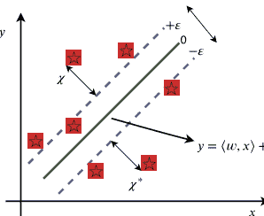

约束

$$
y - \langle w, x \rangle - b \le \varepsilon + \chi
$$

$$
y - \langle w, x \rangle - b \ge \varepsilon - \chi^*
$$

图4.1 ε-SVR的图示说明。

SVR的公式在图4.1中以图示方式说明，其中“星号”代表支持向量，绿色实线表示SVR回归器，蓝色虚线表示对容差误差ε具有软限制的超平面。

然而，情况并非总是如此，因为特征集可能不是线性可分的。为了处理特征集中的这种非线性，使用所谓的核函数将数据转换到更高维空间（“核技巧”）。通过合适的映射函数 $\phi : \mathbb{R}^n \rightarrow Z$ 进行变换后，数据在目标空间（高维空间）即 $Z$ 中变得线性可分。目标空间中的内积 $\langle w^T, \phi(x) \rangle$ 可以用核函数表示。核函数是满足Mercer定理的相似性函数，使得 $k(x_i, x_j) = \langle \phi(x_i), \phi(x_j) \rangle$ 成为核矩阵 $K$ 的元素。文献中提供了多种核函数，如线性核、$d$ 次多项式核、高斯核以及带宽为函数 $\sigma$ 的径向基函数（RBF）和指数函数。

图4.2说明了当输入向量不可线性分离时所使用的核技巧。这种变换使得权重和偏置向量的计算更加容易。现在我们来看优化问题的对偶形式：

$$
\min \frac{1}{2} \sum_{i,j=1}^n (\alpha_i - \alpha_i^*)^T k(x_i, x_j) (\alpha_j - \alpha_j^*) + e^T \varepsilon \sum_{i=1}^n (\alpha_i + \alpha_i^*) - \sum_{i=1}^n y_i(\alpha_i - \alpha_i^*) \quad (4.6)
$$

$$
\text{s.t. } e^T \sum_{i=1}^n (\alpha_i - \alpha_i^*) = 0, \quad 0 \le \alpha, \quad \alpha^* \le C e
$$


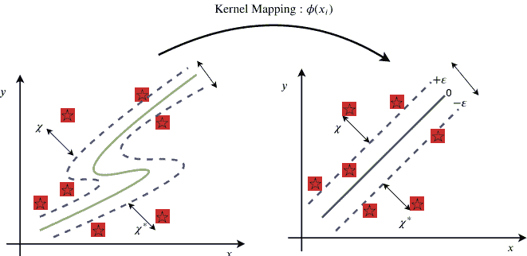

图 4.2 将非线性数据集映射到高维空间。

其中 $\alpha$ 和 $\alpha^*$ 分别表示正和负拉格朗日乘数，满足 $\alpha_i \alpha_i^* = 0, i = 1, 2, \dots, n$。回归函数 $f(x)$ 可表示为

$$f(x) = \sum_{i=1}^{n} (\alpha_i - \alpha_i^*)k(x, x_i) + b.$$
(4.7)

该回归器的复杂度与特征集的维数无关，仅取决于支持向量的数量，支持向量即分隔各特征集的数据点。然而，SVR 的性能也取决于核函数的选择，并有助于缩短回归的计算时间。$\varepsilon$-SVR 算法的逐步实现流程图如图 4.3 所示。

基于 $\varepsilon$-SVR 的回归模型应用于多个领域，如图 4.4 所示。

Chen 等人 [7] 提出了一种基于参数搜索的 SVR 预测方法，用于预测股票价格。遗传算法、粒子群优化和网格搜索等参数搜索算法用于确定 SVR 超参数的最优值。选用了沪深300指数近3年的每日历史交易数据。训练集包含759天，其余190天用于测试。结果表明，基于GA-SVR的方法得到的RMSE最小，其次是PSO-SVR和网格搜索。Tao 等人 [8] 提出了一种基于模拟退火（SA）的SVR模型，用于预测空调负荷。每小时数据

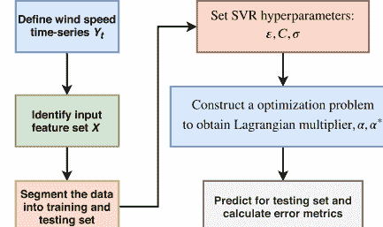

图 4.3 ε-SVR算法示意流程图。

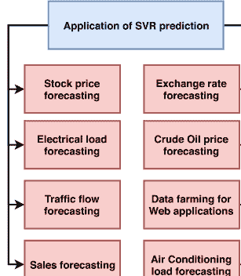

图 4.4 ε-SVR预测的应用。

时间范围为2011年7月至2012年8月。训练集包含2011年7月至2012年6月的10个月数据，而测试集为2个月数据（2012年7月-8月）。采用了包含多项式核和径向基函数的混合核函数。测试了三种模型，即SA-SVR、VFSA-SVR和MSA-SVR，结果表明MSA-SVR优于VFSA-SVR和SA-SVR。还计算了每种方法的平均耗时，发现VFSA-SVR是三种模型中最快的。

在交通流预测方面，Hong 等人 [9] 开展了一种基于蚁群优化（ACO）的混合预测模型

| 模型 | RMSE | MSE | \( R^2 \) | NMSE | U1 | U2 |
| :--- | :--- | :--- | :--- | :--- | :--- | :--- |
| \(\epsilon\)-SVR | 13.63 | 185.77 | 1.099 | 0.0201 | 0.004 | 0.2017 |
| 持续性 | 35.12 | 1233.41 | 7.6129 | 6.8104 | 0.0749 | 0.5517 |

SVR。连续ACO用于优化 \(\sigma\)、\( C \) 和 \(\varepsilon\)，并将预测结果与季节性ARIMA（S-ARIMA）模型进行比较。台湾板桥市的交通流数据被分为早高峰和晚高峰的训练集和测试集。从归一化RMSE来看，CACO-SVR模型优于S-ARIMA模型。由于SVR具有更好的泛化能力和参数优化的额外优势，该模型相对于S-ARIMA具有优势。Wang 等人 [10] 利用改进的PSO（IPSO）基SVR方法研究了销售增长预测。为了评估所提IPSO-SVR模型的准确性，将其与多元回归模型、反向传播神经网络和直接回归模型等基准模型进行了比较，结果表明IPSO-SVR优于所有其他方法。总体而言，涉及参数搜索算法的混合SVR模型广泛用于实时预测问题。监督学习方法显著提高了预测性能。

## 股票价格预测：案例研究

接下来，我们讨论L&T Infotech的开盘股价预测，将特定日期的最高价、最低价和收盘价作为预测变量。选取2017年8月21日至2019年8月20日两年的每日数据。总共492个样本被分为训练集（400个）和测试集（92个）。SVR模型的超参数在 \( 2^{-10} - 2^{10} \) 范围内调整。表4.1的结果表明，SVR模型在RMSE和 \( R^2 \) 值方面优于持续性模型。这里仍存在过拟合问题，该问题可能通过下一节讨论的改进版SVR模型予以消除。图4.5说明了两种模型的开盘股价预测。

## 4.3 最小二乘支持向量回归

最小二乘支持向量回归（LSSVR）最初源自 [11] 中提出的最小二乘支持向量分类器（LSSVC），其中

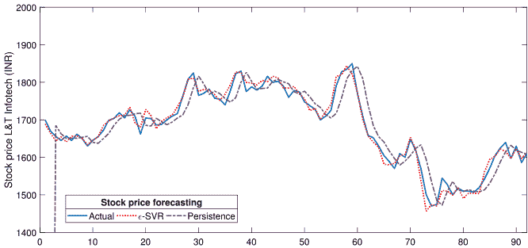

图 4.5 Larsen & Toubro Infotech股票价格预测。

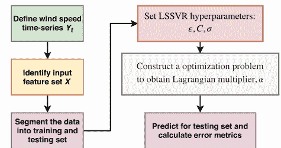

图 4.6 LSSVR算法示意流程图。

选择等式约束，并最小化误差项 \(\varepsilon\) 的平方。LSSVR 算法如图 4.6 所示。

LSSVR 回归问题表述为

$$f(x) = w^T \phi(x) + b, \tag{4.8}$$

其中 \(w\) 是维度为 \(n \times 1\) 的权重系数向量，\(x_i \in R^n\)，\(y \in R\)。需最小化的目标函数如下

$$\min \frac{1}{2} \|w\|^2 + \frac{1}{2}\gamma \sum_{i=1}^n \varepsilon_i^2 \tag{4.9}$$

$$\text{s.t. } y_i = w^T \phi(x_i) + b + \varepsilon_i \ (i=1,2,...,n), \tag{4.10}$$

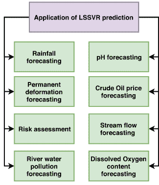

图 4.7 LSSVR预测的应用。

其中 \(\gamma\) 是间隔参数，\(\varepsilon_i\) 是对应于每个 \(x_i\) 的误差项。通过引入拉格朗日乘数，可将优化问题转换为

$$L(w, b, \varepsilon, \alpha) = \frac{1}{2} \| w \|^2 + \frac{1}{2}\gamma \sum_{i=1}^n \varepsilon_i^2 - \sum_{i=1}^n \alpha_i(w^T \phi(x_i) + b + \varepsilon - y_i). \quad (4.11)$$

通过对拉格朗日函数关于 \(w, b, \varepsilon, \alpha\) 进行偏微分，可得到优化问题（4.11）的Karush–Kuhn–Tucker（KKT）条件，如下所示

$$
\begin{aligned}
\begin{bmatrix} k(x, x^T) + \gamma^{-1} I & e \\ e^T & 0 \end{bmatrix} \begin{bmatrix} \alpha \\ b \end{bmatrix} = \begin{bmatrix} y \\ 0 \end{bmatrix}, \quad (4.12) \\
f_{LSSVR}(x) = \sum_{i=1}^n \alpha_i k(x, x_i) + b, \quad (4.13)
\end{aligned}
$$

其中 \(I\) 是适当维度的单位矩阵。LSSVR 得到的回归器由（4.13）给出，求解的优化问题规模小于经典的 \(\varepsilon\)-SVR，计算时间更短。LSSVR 是 \(\varepsilon\)-SVR 的一种改进变体，损失函数中包含平方惩罚项，并应用于科学和工程的多个分支，以获得准确预测，如图 4.7 所示。

Liu 等人 [12] 研究了与LSSVR联合的参数优化方法，用于预测变压器油在初期故障期间的溶解氧含量。溶解气体数据收集自多家电力公司，并使用帝国竞争算法（ICA）来寻找LSSVR的最优超参数。该方法与反向传播神经网络、广义回归神经网络和径向基函数神经网络等其他多种方法进行了比较。结果表明，基于ICA-LSSVR的预测在MAPE和R²方面取得了更好的结果。

在河流流量预测方面，Adnan 等人 [13] 开展了一种基于LSSVR和重力搜索算法（HLSGA）的混合预测方法。选取了巴基斯坦上印度河流域的两个集水区，并选择了32年的年均数据来验证混合方法，其中n个数据集被分为n-1个集用于训练。使用了基于河流流量数据自相关值的各种输入组合。结果表明，HLSGA方法在RMSE和MAE方面优于M5回归树（M5RT）和多元线性回归（MLR）。分析了对数变换对河流流量时间序列的影响，并将log-HLSGA的预测结果与HLSGA进行了比较。与原始方法相比，对数变换降低了时间序列的偏度，并为所有方法提供了更好的预测结果。

## 发电量预测：案例研究

接下来，我们讨论联合循环发电厂（CCPP）的净每小时电力输出（兆瓦）预测。CCPP的原理基于燃气轮机和蒸汽轮机发电，其中温度（°T）、环境压力（m Bar）、排气真空（mm of Hg）和相对湿度（%）等变量被选为预测变量。本案例研究的数据可从UCI机器学习库 [14] 获取。总共选取了500个样本，分为训练集（400个）和测试集（100个）。从表4.2可以看出，LSSVR在RMSE、R²（决定系数）和归一化均方误差（NMSE）方面优于持续性算法。此外，从R²角度看，LSSVR技术很好地解决了持续性算法带来的过拟合问题。

图4.8说明了基于LSSVR和持续性算法的发电量预测。


表 4.2 LS-SVR与持续性模型的性能指标。

| 模型 | RMSE | MSE | R² | NMSE | U1 | U2 |
|---|---|---|---|---|---|---|
| LSSVR | 4.899 | 24.00 | 0.888 | 0.079 | 0.0054 | 0.2118 |
| 持续性模型 | 20.94 | 438.48 | 14.09 | 14.42 | 0.0733 | 0.8720 |

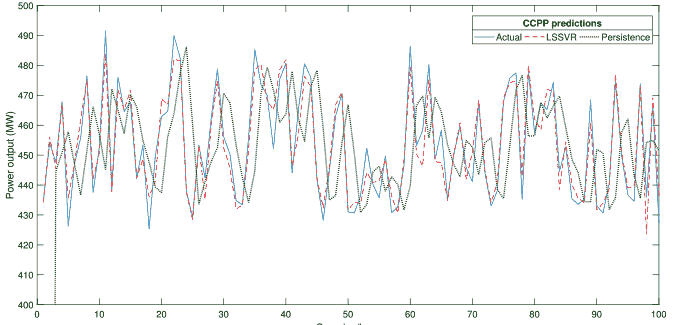

**图 4.8** 基于LSSVR和持续性算法的功率预测。

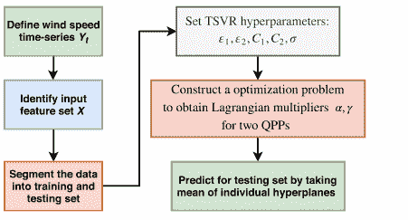

**图 4.9** TSVR算法的示意流程图。

## 4.4 双子支持向量回归

Peng [15]通过一种称为双子支持向量回归（TSVR）的修改形式支持向量机，介绍了一种高效的回归解决方案，该方案在数据点周围推导出两个非平行超平面。描述TSVR算法步骤的流程图如图4.9所示。

在非平行平面回归器中，制定了两个与未知回归器的\(\epsilon\)-不敏感下界和上界相关的非平行函数。与\(\epsilon\)-SVR类似，TSVR找到两个\(\epsilon\)-不敏感函数（上界和下界回归器）来求解比传统\(\epsilon\)-SVR规模更小的凸优化问题，从而显著减少计算时间。

TSVR的数学公式为

\(\min \frac{1}{2} \sum_{i=1}^n (y_i - e\epsilon_1 - (x_i w_1 + eb_1))^T (y_i - e\epsilon_1 - (x_i w_1 + eb_1)) + C_1 e^T \sum_{i=1}^n \xi_i, \quad \text{s.t. } y_i - (x_i w_1 + eb_1) \ge e\epsilon_1 - \xi_i, \quad (4.14)\)

\(\min \frac{1}{2} \sum_{i=1}^n (y_i - e\epsilon_2 - (x_i w_2 + eb_2))^T (y_i - e\epsilon_2 - (x_i w_2 + eb_2)) + C_2 e^T \sum_{i=1}^n \eta_i, \quad \text{s.t. } (x_i w_2 + eb_2) - y_i \ge e\epsilon_2 - \eta_i, \quad (4.15)\)

其中C_1, C_2 > 0和\(\epsilon_1, \epsilon_2 \ge 0\)为TSVR超参数，\(\xi_i, \eta_i\)为在优化问题中作为误差\(\epsilon\)软边界引入的松弛变量。TSVR的对偶优化问题公式通过引入拉格朗日函数[15]给出

\(L(w_1, b_1, \epsilon_i, \alpha_i, \beta_i) = \frac{1}{2} \sum_{i=1}^n (y_i - e\epsilon_1 - (x_i w_1 + eb_1))^T (y_i - e\epsilon_1 - (x_i w_1 + eb_1)) + C_1 e^T \sum_{i=1}^n \xi_i - \sum_{i=1}^n \alpha_i (y_i - e\epsilon_1 - (x_i w_1 + eb_1)) - \sum_{i=1}^n \beta_i \xi_i, \quad (4.16)\)

其中\(\alpha_i, \beta_i (i = 1, 2, ..., n)\)为拉格朗日乘数。令X = (x_1, x_2, ..., x_n)表示输入向量集，Y = (y_1, y_2, ..., y_n)为输出向量集，其中\(y_i \in \mathbb{R}\)，且\(\alpha, \gamma\)为拉格朗日乘数。TSVR优化中使用的拉格朗日函数的KKT条件可通过对函数L关于w_1, b_1, \epsilon, \alpha以及\(\beta\)进行偏微分得到：

\(\left\{\begin{aligned} \frac{\partial L}{\partial w_1} = 0 \Rightarrow -X^T(Y - Xw_1 - eb_2 - e\varepsilon_1) + X^T\alpha = 0, \\ \frac{\partial L}{\partial b_1} = 0 \Rightarrow -e^T(Y - Xw_1 - e\varepsilon_1 - eb_2) + e^T\alpha = 0, \\ \frac{\partial L}{\partial \xi} = 0 \Rightarrow C_1 e^T - \alpha - \beta = 0, \\ \frac{\partial L}{\partial \alpha} = 0 \Rightarrow Y - (Xw_1 + eb_1) \ge e\varepsilon - \xi, \xi \ge 0. \end{aligned}\right.\)

此外，该优化问题的等式约束为

\(\begin{aligned} \alpha^T(Y - (Xw_1 + eb_1) - e\varepsilon_1 + \xi) = 0, \quad \alpha = 0, \\ \beta^T \xi = 0, \quad \beta \ge 0, \end{aligned}\) (4.17)

其中对于\(\beta \ge 0\)，有\(\alpha \in [0, C_1 e]\)，可写为

\(-\begin{bmatrix} X^T \\ e^T \end{bmatrix} ((Y - e\varepsilon_1) - [X \quad e] \begin{bmatrix} w_1 \\ b_1 \end{bmatrix}) + \begin{bmatrix} X^T \\ e^T \end{bmatrix} \alpha = 0.\) (4.18)

令

\(Q = \begin{bmatrix} X & e \end{bmatrix}, \quad t = Y - e\varepsilon_1, \quad u_1 = \begin{bmatrix} w_1^T & b_1 \end{bmatrix}^T,\) (4.19)

得

\(\begin{aligned} -Q^T t + Q^T Q u_1 + Q^T \alpha &= 0, \\ u_1 &= (Q^T Q)^{-1} Q^T (t - \alpha). \end{aligned}\) (4.20)

矩阵\(Q^T Q\)始终是半正定的，意味着它始终具有非负特征值。此类矩阵可能会出现“病态矩阵”问题，其中条件数可能过大，其逆矩阵的计算可能导致较大的数值误差。为克服这一问题，添加了一个小的正则化常数\(\sigma I\)，其中\(\sigma\)的数量级为\(10^{-7}\)，\(I\)为适当维度的单位矩阵。结合KKT条件[15]及由(4.14)描述的优化问题，对偶问题可重新表述为

\(\max -\frac{1}{2} \alpha^T Q (Q^T Q)^{-1} Q^T \alpha + t^T Q (Q^T Q)^{-1} Q^T \alpha - t^T \alpha\) (4.21)
**受约束于** \(\alpha \in [0, C_1]\),

\(\max - \frac{1}{2}\gamma^T Q(Q^T Q)^{-1} Q^T \gamma + m^T Q(Q^T Q)^{-1} Q^T \gamma - m^T \gamma \quad (4.22)\)
\text{受约束于 } \gamma \in [0, C_2],

其中\(Q = [X \ e]\)，\(t = Y - e\epsilon_1\)，\(m = Y + e\epsilon_2\)，且\(u_2 = (Q^T Q)^{-1} Q^T (m - \gamma)\)。式(4.21)-(4.22)指代原始凸优化问题的对偶问题，其中前者的规模小于经典SVR，因此速度更快。用于预测原始数据点的最终回归器为

\(f_{TSVR}(x) = \frac{1}{2}((w_1 + w_2)^T x + (b_1 + b_2)). \quad (4.23)\)

在文献方面，Gupta等人[16]提出了用于预测金融时间序列的TSVR模型，涉及雅虎、Infosys Limited、AT&T、思科、Facebook和花旗集团等公司的多种股票市场指数价格。对SVR和TSVR的性能指标进行了比较，结果表明TSVR优于经典SVR模型。就训练时间而言，TSVR在所有数据集上均优于SVR。此外，还使用Friedman统计量计算了SVR和TSVR的平均排名，结果表明TSVR在非线性核函数方面也优于SVR模型。本节描述了一种基于双子支持向量机（TSVM）的双子支持向量回归。由于该方法能够求解两个二次规划问题，最终回归器的计算时间显著减少。

## 葡萄酒质量预测：一个案例研究

葡萄牙的米纽地区以白葡萄酒和红葡萄酒而闻名。基于其多种理化性质，葡萄酒质量可以建模，并与持续性算法等基准预测模型进行比较。柠檬酸含量（g/dm^3）、硫酸盐含量（g/dm^3）、密度、pH值、酒精含量（%）、挥发性酸度和固定酸度等性质被用作预测变量。红葡萄酒的数据收集于2004年5月至2005年12月，并分为训练集（400）和测试集（100）。使用双子支持向量回归和持续性模型来预测葡萄酒质量，后者是一个0到10的定量指数。图4.10展示了TSVR和持续性模型的葡萄酒质量实际值与预测值之间的图表。此外，表4.3描绘了TSVR和持续性模型的性能指标。TSVR比持续性模型提高了7.91%，在\(R^2\)方面表现更好，因此得出了

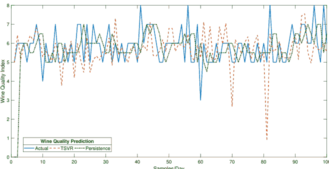

图 4.10 基于TSVR的葡萄酒质量预测。

| 模型 | RMSE | MSE | R² | NMSE | U1 | U2 |
| :--- | :--- | :--- | :--- | :--- | :--- | :--- |
| TSVR | 1.0029 | 1.0058 | 1.004 | 1.2351 | 0.0861 | 45.82 |
| 持续性模型 | 1.0891 | 1.1861 | 1.2364 | 2.1764 | 0.0921 | 54.62 |

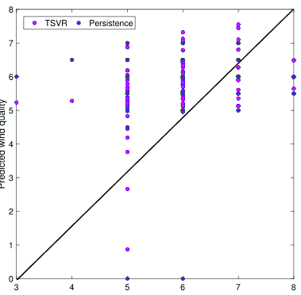

图 4.11 基于TSVR的葡萄酒质量预测散点图。

优于持续性模型。图4.11展示了TSVR和持续性模型的散点图。

## 4.5 \(\epsilon\)-双子支持向量回归

源自双子支持向量机，Shao等人[17]提出了一种新型回归器，即\(\epsilon\)-双子支持向量回归（\(\epsilon\)-TSVR），它通过求解两个凸优化问题来确定一对\(\epsilon\)-不敏感函数。就待最小化的目标函数而言，\(\epsilon\)-TSVR考虑了一个附加的正则化项，以解决前一节中描述的\(Q^TQ\)病态问题。\(\epsilon\)-TSVR的原始目标函数公式为

\(\begin{aligned}
\min \quad & \frac{1}{2} C_3 (w_1^T w_1 + b_1^2) + \frac{1}{2} \xi^{*^T} \xi^* + C_1 e^T \xi, \\
& \text{s.t. } Y - (Xw_1 + e b_1) = \xi^*, \\
& Y - (Xw_1 + e b_1) \geq -e \epsilon_1 - \xi, \xi \geq 0, \\
\min \quad & \frac{1}{2} C_4 (w_2^T w_2 + b_2^2) + \frac{1}{2} \eta^{*^T} \eta^* + C_2 e^T \eta, \\
& \text{s.t. } Y - (Xw_2 + e b_2) = \eta^*, \\
& Y - (Xw_2 + e b_2) \geq -e \epsilon_2 - \eta, \eta \geq 0.
\end{aligned}\)

(4.24)

(4.25)

(4.26)

(4.27)

在这个优化问题中，$C_1, C_2, \epsilon_1, \epsilon_2$是决定回归性能的超参数。这两个原始问题的拉格朗日函数可写为

\(\begin{aligned}
L(w_1, b_1, \xi, \alpha, \beta) = \frac{1}{2} & (Y - (Xw_1 + e b_1))^T (Y - (Xw_1 + e b_1)) \\
& + \frac{1}{2} C_3 (w_1^T w_1 + b_1^2) + C_1 e^T \xi \\
& - \alpha^T (Y - (Xw_1 + e b_1) + e \epsilon_1 + \xi) - \beta^T \xi, \\
\end{aligned}\)

(4.28)

其中\(\alpha = (\alpha_1, \alpha_2, \dots, \alpha_n)\)和\(\beta = (\beta_1, \beta_2, \dots, \beta_n)\)为拉格朗日乘数。为了求得上述原始目标函数的对偶问题，KKT条件给出如下

\(\left\{\begin{aligned}
\frac{\partial L}{\partial w_1} = 0 \Rightarrow & -X^T(Y - Xw_1 - e b_2 - e \epsilon_1) + X^T \alpha + C_3 w_1 = 0, \\
\frac{\partial L}{\partial b_1} = 0 \Rightarrow & -e^T(Y - Xw_1 - e \epsilon_1 - e b_2) + e^T \alpha + C_3 b_1 = 0, \\
\frac{\partial L}{\partial \xi} = 0 \Rightarrow & C_1 e^T - \alpha - \beta = 0, \\
\frac{\partial L}{\partial \alpha} = 0 \Rightarrow & Y - (Xw_1 + e b_1) \geq -e \epsilon - \xi, \xi \geq 0,
\end{aligned}\right.\)


\(\alpha^T (Y - (Xw_1 + eb_1) + e\varepsilon_1 + \xi) = 0. \quad \alpha \ge 0, \quad \beta^T \xi = 0, \quad \beta \ge 0, \quad (4.29)\)

其中 \(\alpha \in [0, C_1 \varepsilon]\) 对于 \(\beta \ge 0\)。这些 KKT 条件可写为

\(- \begin{bmatrix} X^T \\ e^T \end{bmatrix} Y + \left( \begin{bmatrix} X^T \\ e^T \end{bmatrix} \begin{bmatrix} X & e \end{bmatrix} + C_3 I \right) \begin{bmatrix} w_1 \\ b_1 \end{bmatrix} + \begin{bmatrix} X^T \\ e^T \end{bmatrix} \alpha = 0, \quad (4.30)\)
\(- Q^T Y + (Q^T Q + C_3 I) u_1 + Q^T \alpha = 0, \quad (4.31)\)

其中 \(Q = \begin{bmatrix} X & e \end{bmatrix}, u_1 = \begin{bmatrix} w_1^T & b_1 \end{bmatrix}^T\).

进一步，我们可以写出 \(u_1 = (Q^T Q + C_3 I)^{-1} Q^T (Y - \alpha)\)。上述原始问题的对偶优化目标函数可写为

\(\max - \frac{1}{2} \alpha^T Q (Q^T Q + C_3 I)^{-1} Q^T \alpha^T + Y^T Q (Q^T Q + C_3 I)^{-1} Q^T \alpha - (e^T \varepsilon_1 + Y^T) \alpha \quad \text{s.t.} \quad \alpha \in [0, C_1]. \quad (4.32)\)

同样，另一个对偶可得为

\(\max - \frac{1}{2} \gamma^T Q (Q^T Q + C_4 I)^{-1} Q^T \gamma^T + Y^T Q (Q^T Q + C_4 I)^{-1} Q^T \gamma + (-e^T \varepsilon_2 + Y^T) \gamma \quad \text{s.t.} \quad \gamma \in [0, C_2]. \quad (4.33)\)

式 (4.32) 和 (4.33) 是原始目标优化函数的对偶。此处的特征集 \(X\) 在 \(n\) 维空间中是线性可分的。最终回归器 \(f(x)\) 给出为

\(f(x) = \frac{1}{2}(f_1(x) + f_2(x)) = \frac{1}{2}((w_1 + w_2)^T x + (b_1 + b_2)), \quad (4.34)\)

作为两个函数 \(f_1(x)\) 和 \(f_2(x)\) 的平均值，它们分别是预测超平面 \(f(x)\) 上下两侧的回归器。

### 核 \(\varepsilon\)-双支持向量回归

通过 SVR 进行的回归不一定总是线性的，因此本研究需要扩展到非线性回归。使用合适的映射（也称为核）函数，利用 \(\phi : \mathbb{R}^n \rightarrow \mathbb{R}^k\) 将输入集转换到更高维度，其中 \(k\) 是目标空间的维度。

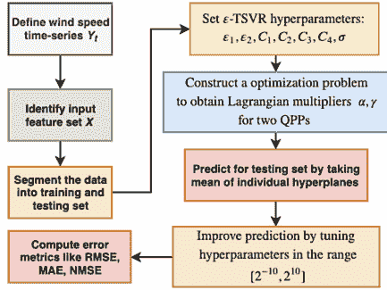

## 图 4.12 \(\epsilon\)-TSVR 算法的示意流程图。

图 4.12 逐步说明了 \(\epsilon\)-TSVR 回归算法的过程。

如文献 [17] 所示，考虑核函数 \(K(X, X^T)\) 的凸优化问题给出为

```
min 1/2 C3(w1^T w1 + b1^2) + 1/2 ξ*^T ξ + C1 e^T ξ,
s.t. Y - (K(X, X^T)w1 + eb1) = ξ*, (4.35)
Y - (K(X, X^T)w1 + eb1) >= -εe1 - ξ, ξ >= 0, (4.36)
min 1/2 C4(w2^T w2 + b2^2) + 1/2 ξ*^T ξ + C2 e^T η,
s.t. Y - (K(X, X^T)w2 + eb2) = η*, (4.37)
Y - (K(X, X^T)w2 + eb2) >= -εe2 - η, η >= 0, (4.38)
```

其中 C1、C2、C3、C4 是基于核的 \(\epsilon\)-TSVR 的超参数。

原始优化问题的对偶给出为

```
max - 1/2 α^T S(S^T S + C3 I)^-1 S^T α^T + Y^T S(S^T S + C3 I)^-1 S^T α
-(e^T ε1 + Y^T)α   s.t. α ∈ [0, C1], (4.39)
max - 1/2 γ^T S(S^T S + C4 I)^-1 S^T γ^T + Y^T S(S^T S + C4 I)^-1 S^T γ
+(-e^T ε2 + Y^T)γ   s.t. γ ∈ [0, C2], (4.40)
```

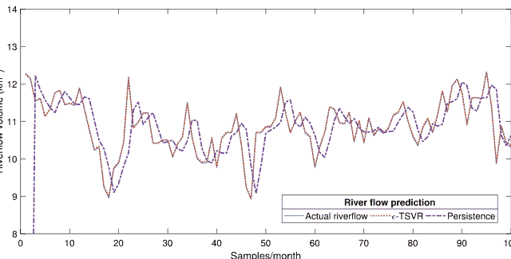

## 图 4.13 基于 \(\epsilon\)-TSVR 的河流流量预测。

其中 \(S = [K(X, X^T) e]\)，\(\alpha\) 和 \(\gamma\) 是拉格朗日乘数，它们能够在等式约束下找到函数的局部极大值和/或极小值。最终回归器 \(f_{\epsilon-TSVR}(x)\) 给出为两个函数的平均值：

\( f_{\epsilon-TSVR}(x) = \frac{1}{2}((w_1^T + w_2^T)K(X, X^T) + (b_1 + b_2)). \quad (4.41) \)

## 河流流量预测：尼罗河案例研究

接下来，我们讨论基于 \(\epsilon\)-TSVR 模型的河流流量预测。河流流量月均值收集自 https://people.sc.fsu.edu/~jburkardt/datasets/time_series/。共取样 570 个样本，并分段为训练集（470）和测试集（100）。回归的输入集由河流流量时间序列的小波分解构建。随后将详细信号和近似信号视为预测变量。图 4.13 和 4.14 说明了 \(\epsilon\)-TSVR 和持续性模型的预测时间序列图和散点图。

基于对超参数的手动调整，从表 4.4 中我们获得 \(\epsilon\)-TSVR 模型的 RMSE 为 0.0257，持续性模型的 RMSE 为 0.6150。

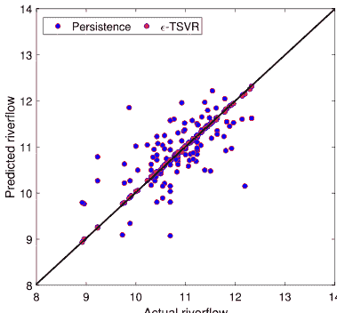

## 图 4.14 \(\epsilon\)-TSVR 和持续性算法的散点图。

## 表 4.4 \(\epsilon\)-TSVR 和持续性模型的性能指标。

| 模型 | RMSE | MSE | \(R^2\) | NMSE | U1 | U2 |
|---|---|---|---|---|---|---|
| \(\epsilon\)-TSVR | 0.0257 | 0.0006 | 0.9653 | 0.013 | 0.0012 | 0.3440 |
| 持续性 | 0.6150 | 0.3782 | 5.5652 | 6.771 | 0.0845 | 6.6146 |

本章主要讨论了用于回归分析的 SVR 及其变体。这些受监督学习模型应用于全球不同地区的风速时间序列数据集，以评估每个模型的性能。关于过拟合和欠拟合的预测性能将在后续章节中进一步讨论。此外，混合预测模型的优势推动了风速预测领域的研究日益增多。

## 参考文献

- [1] V. Vapnik, A. Lerner, 使用广义肖像方法进行模式识别, 自动化与远程控制 24 (1963) 774–780.
- [2] C. Cortes, V. Vapnik, 机器学习 20 (3) (1995) 273–297.
- [3] T. Joachims, 基于支持向量机器的文本分类：使用许多相关特征的学习, 载于: 机器学习: ECML-98, Springer Berlin Heidelberg, 1998, 第 137–142 页.
- [4] B. Schölkopf, A. Smola, K.-R. Müller, 核主成分分析, 计算机科学讲义, Springer Berlin Heidelberg, 1997, 第 583–588 页.
- [5] A. Shirzad, M. Tabesh, R. Farmani, 支持向量回归与人工神经网络在给水管网管道爆裂率预测中的性能比较, 土木工程杂志 18 (4) (2014) 941–948.
- [6] V.N. Vapnik, 统计学习理论的本质, Springer New York, 2000.
- [7] J. Chen, H. Chen, Y. Huo, W. Gao, 基于不同参数搜索方法的股票指数预测中 SVR 模型的应用, 开放统计学杂志 07 (02) (2017) 194–202.
- [8] Y. Tao, H. Yan, H. Gao, Y. Sun, G. Li, 基于修正模拟退火的 SVR 优化空调负荷预测模型, 工业信息集成期刊 15 (2019) 247–251.
- [9] W.-C. Hong, Y. Dong, F. Zheng, C.-Y. Lai, 使用带连续蚁群算法的 SVR 预测城市交通流量, 应用数学建模 35 (3) (2011) 1282–1291.
- [10] X. Wang, J. Wen, S. Alam, X. Gao, Z. Jiang, J. Zeng, 使用改进粒子群算法和支持向量机预测销售增长率, 工程中的数学问题 2014 (2014) 1–13.
- [11] J. Suykens, J. Vandewalle, 神经处理快报 9 (3) (1999) 293–300.
- [12] J. Liu, H. Zheng, Y. Zhang, X. Li, J. Fang, Y. Liu, C. Liao, Y. Li, J. Zhao, 基于小波最小二乘支持向量回归和帝国竞争算法的变压器聚合物绝缘初始故障溶解气体预测, 聚合物 11 (1) (2019) 85.
- [13] R.M. Adnan, X. Yuan, O. Kisi, R. Anam, 使用带重力搜索算法的 LSSVR 提高河流流量预测精度, 气象学进展 2017 (2017) 1–23.
- [14] UCI 机器学习库：联合循环发电厂数据集, https://archive.ics.uci.edu/ml/datasets/Combined+Cycle+Power+Plant, 2019. (访问日期：2019 年 8 月 22 日).
- [15] X. Peng, TSVR: 用于回归的高效双支持向量机, 神经网络 23 (3) (2010) 365–372.
- [16] D. Gupta, M. Pratama, Z. Ma, J. Li, M. Prasad, 使用双支持向量回归进行金融时间序列预测, PLoS ONE 14 (3) (2019) e0211402.
- [17] Y.-H. Shao, C.-H. Zhang, Z.-M. Yang, L. Jing, N.-Y. Deng, 用于回归的 ε-双支持向量机, 神经计算与应用 23 (1) (2012) 175–185.


# 基于决策树集成的回归模型

机器学习中的历史数据对全球的数据分析师来说是一大利好。在回归模型方面，第3章中描述的持久性算法和ARIMA等基准模型无法表达风速时间序列中的非线性趋势。具有核映射能力的机器学习模型在该类情况下广泛适用。

在准确性方面，基于监督学习的机器学习模型具有良好的泛化性能，即机器学习模型适应未见数据的能力。然而，基于集成的预测需求源于过拟合问题，该问题出现在支持向量回归、多元线性回归和神经网络等模型中。我们将在后续章节中结合实时数据集讨论过拟合场景。决策树旨在得出两种类型的决策：连续型（回归）和离散型（分类）。

## 5.1 随机森林回归

由Breiman [1]提出，随机森林是一种集成方法，它从给定的训练样本生成类似森林的树集合。基于集成的模型比单一方法准确得多，这归功于捕捉单个方法得到的时间序列的线性和非线性等优势。

随机森林首先将输入特征分割成一组本质上形成一棵树的子集。特定树由一个节点特征描述，该节点引出多个分支，如图5.1所示。

与SVR中的超参数（σ和C）类似，在随机森林回归中，树的数量和每个树分解中的随机特征数量是决定回归性能的参数。在每个决策树中，会创建一个拟合函数，作用于所选的随机特征。最终，在训练过程结束时会创建一个随机森林模型。值得指出的是，在训练过程中，每棵树都是由随机选择的输入向量创建的，因此被称为“随机”森林。在数学上，随机森林回归的估计输出为

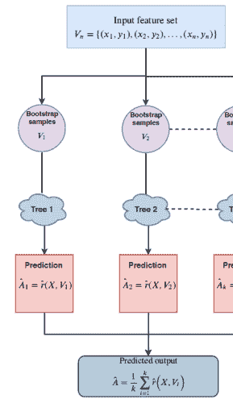

图5.1 随机森林回归模型框图。

由下式给出

\(\hat{A} = \frac{1}{k} \sum_{i=1}^{k} \hat{r}(X, V_i),\) (5.1)

其中，\(\hat{r}(X, V)\) 是训练过程结束时的代表树，\(X\) 是输入特征向量集合，\(T\) 是代表输入–输出对的集合 \(V_i = (x_1, y_1), (x_2, y_2), \dots, (x_n, y_n)\)。预测输出是对 \(k\) 个决策树求平均。随机森林回归的另一个优势是通过输入的差分采样，由于树之间不相关，因而对噪声不敏感。图5.1 说明了随机森林回归模型的框图。决策树对其训练数据敏感。更改训练数据可能会改变预测结果。

与此同时，当训练良好的模型也捕获噪声分量时，机器学习回归模型中普遍存在过拟合问题。为了减轻过拟合带来的复杂性，随机森林在灵活模型和不灵活模型之间做出妥协。在训练阶段，每棵回归树会从特征集中重复抽取样本。这保证了即使单棵树可能具有高方差，整个森林的方差可能较低。随机森林基于bagging原理工作，该原理结合不同树模型的预测，从而对正在训练的数据给出整体洞察。这也有助于减轻监督机器学习模型可能导致的过拟合。在bagging情况下，负相关学习（NCL）原理也适用于基于回归的问题 [2]。在 NCL 中，计算集成中单个样本的误差时会加入一个惩罚项。单个样本 i 的修改后误差函数由以下公式给出

\(E_i = \frac{1}{N} \sum_{i=1}^N \left(F_i(X) - y_i\right)^2 + \frac{1}{N} \sum_{i=1}^N \beta p_i, \qquad (5.2)\)

其中，\(F_i(X)\) 是第 \(i\) 个样本的预测输出，\(y_i\) 是实际值，\(\beta \in [0,1]\) 是控制惩罚强度的项，\(p_i\) 是相关函数。

随机森林回归已应用于工程的多个领域。由于随机森林能够很好地处理缺失数据，因此可以准确预测森林火灾、雨量流量和土壤侵蚀等变量。Oliveira 等人 [3] 使用随机森林（RF）回归来预测欧洲地中海地区的森林火灾。火灾密度数据来自欧洲火灾数据库，时间为6月至9月。平均海拔、最低温度、最高温度和地表粗糙度等变量被选为预测因子。RF模型的预测结果与线性回归进行了比较。结果表明，RF模型优于线性回归，表明预测因子与森林火灾之间存在非线性关系。Gong 等人讨论了RF模型与线性回归在预测国际粗糙度指数（IRI）方面的对比。粗糙度指数和预测因子的数据为平均降水量、平均冰冻指数、初始IRI测量值和年平均日交通量。选取了11000个样本，并将其分为训练集（80%）和测试集（20%）。RF模型的超参数使用网格搜索方法进行优化。就MSE和\(R^2\)而言，结果表明RF模型优于线性回归模型。

Smith 等人 [4] 讨论了多元线性回归（MLR）和随机森林回归，以预测各种化学品的浓度水平。随机森林模型考虑了多变量之间的非线性，结果表明，虽然MLR优于RF模型，但在某些情况下，RF模型的预测性能好得多。Yuchi 等人 [5] 探索了随机森林模型和多元线性回归，用于颗粒物浓度的预测。颗粒物PM2.5基于多个预测因子进行预测，如室外PM2.5浓度、季节、齿轮数量和清洁剂数量。共评估了447个样本，所有模型均采用10折交叉验证技术。MLR和RF等单个模型的\(R^2\)值分别为0.502和0.498，而综合考虑MLR和RF的混合模型给出了0.815的\(R^2\)值，表明其在预测室内PM2.5浓度方面具有优越性。

Zahedi 等人 [6] 提出了一种RF模型，用于预测弯管管件中的固体颗粒侵蚀。为此目的，选择了管径、颗粒尺寸、液体粘度和材料硬度等预测变量。RF模型的性能与线性回归、支持向量机和神经网络等基准模型进行了比较。结果表明，RF模型的预测值与实验值吻合良好。还观察到，RF模型高估了侵蚀率，这可能是由于不同预测变量之间相互影响所致。我们现在讨论两个随机森林模型案例研究，分别涉及降雨和原油价格预测。

### 5.1.1 月度降雨预测：案例研究

为了检验随机森林模型相对于持久性算法等基准模型的有效性，在印度喜马偕尔邦开展了一项月度降雨预测案例研究。选取了1901–2017年的月度降雨数据，共1404个样本，分为训练集和测试集。就模型输入而言，利用小波变换将降雨时间序列分解为各种低频和高频分量。该随机森林模型的预测因子包括细节分量和第五近似信号，后者代表低频分量。回归使用800个训练样本进行，其余604个用于测试。

表5.1 显示了随机森林模型的性能指标。就RMSE而言，25.14的值与持久性算法和ARIMA模型相比表明误差较高。这种表现不佳由较低的SSR/SST值体现，表明对于当前数据集，从小波分解角度看，预测因子的质量不足以根据RF模型进行回归分析。


### 表 5.1 随机森林模型的性能指标

| RMSE | MSE | SSR/SST | SSE/SST | IOA | U1 | U2 |
|---|---|---|---|---|---|---|
| 25.1418 | 632.0196 | 0.7130 | 0.0800 | 0.999 | 0.0984 | 0.5905 |

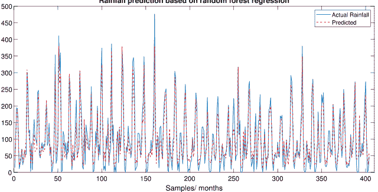

### 图 5.2 基于随机森林方法的喜马偕尔邦降雨预测。

图 5.2 展示了基于随机森林模型对印度喜马偕尔邦的降雨预测。

### 5.1.2 原油价格预测：案例研究

原油是一种重要的贸易商品，其价格受市场波动影响。提前进行的预测有助于全球的交易者和石油公司出于经济原因规划其进出口。原油价格预测基于随机森林模型和持续性算法进行。每日价格被建模为一个时间序列，时间跨度约为 8 年（2011 年 7 月 15 日至 2019 年 8 月 15 日），如图 5.3 所示。自相关函数和偏自相关函数表明时间序列滞后元素之间存在定量关系。总共 2106 个样本被分割为训练集（1500 个）和测试集（606 个）。RF 模型的预测变量包括通过价格时间序列小波变换获得的细节信号和近似信号。RF 模型的模拟在 R 软件中进行，使用 1000 棵树。参见图 5.4。

表 5.2 描绘了原油价格预测的性能指标。就 RMSE 而言，RF 模型比持续性算法优越 52.51%。同样需要注意的是，持续性算法的 SSR/SST 值

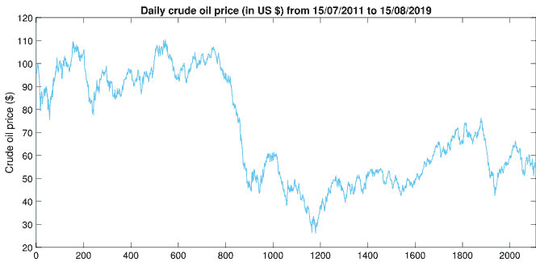

图 5.3 原油价格时间序列图。

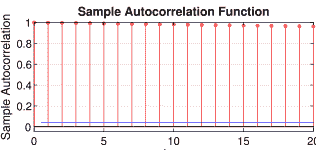

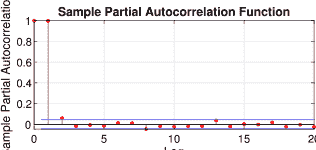

图 5.4 原油价格的自相关和偏自相关函数。

### 表 5.2 原油预测随机森林模型的性能指标。

| 模型 | RMSE SSE/SST | MSE U1 | SSR/SST U2 |
|---|---|---|---|
| RF | 0.5486 | 0.3009 | 0.9200 |
| | 0.0045 | 0.0046 | 0.4925 |
| Persistence | 1.1553 | 1.3347 | 1.1625 |
| | 0.1340 | 0.0254 | 1.1235 |

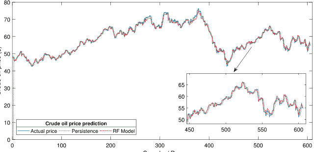

图 5.5 基于随机森林回归的原油价格预测。

## 5.2 梯度提升机

梯度提升机（GBM）是一种基于集成的回归方法，它会考虑先前拟合决策树的损失。在 GBM 模型中，各种弱学习者被组合以得到一个准确的模型。基于提升的回归树由于适当提升算法所带来的优势，在预测准确响应值方面具有强大的能力。特定的提升算法通过以损失函数的形式最小化弱模型的不准确性来增强树模型 [7]。因此，对于提升算法而言，主要任务是减少每次迭代中弱学习者造成的误差。最终的预测响应是拟合树的线性组合。GBM 相较于传统回归模型的一个优势在于它避免了过拟合。在 GBM 中，每个决策树的学习率决定预测性能。较高的学习率表明预测所需的树数量较少，反之亦然 [8]。基于交叉验证实验，可以获得所需的理想树数量及学习率。由于 GBM 是一种结合所有单独弱模型的集体模型，单个模型的目标是减少由损失函数生成的误差。一种常用的损失函数是 $\mathcal{L}_2$ 函数，它最小化预测值与实际值之间的平方误差之和。考虑 $k$ 个这样的弱模型，它们用于在给定特征集 $x = [x_1, x_2, ..., x_n]$ 的情况下预测变量 $y$，这在数学上可以表示为

```
\(\hat{y} = \sum_{i=1}^k f_i(x),\) (5.3)
```

其中 $f_i(x)$ 代表每个弱学习者，这些弱学习者被集体训练以改进预测结果。损失函数给出为

```
\(\mathcal{L}_2 = \frac{1}{N} L(y_i, \hat{y}_i), \quad L(y_i, \hat{y}_i) = \sum_{i=1}^N (y_i - \hat{y}_i)^2,\) (5.4)
```

其中 $L(y_i, \hat{y}_i)$ 是基于 $N$ 个观测值的平方误差的损失函数。GBM 回归技术的目标是最小化 $\mathcal{L}_2$ 损失函数。然而，$\mathcal{L}_2$ 损失函数对异常值更敏感，并可能降低模型的鲁棒性。为确保高鲁棒性，使用 Huber 损失函数，其可表示为

```
\(L(y, \hat{y}) = \begin{cases} \frac{1}{2}(y - \hat{y})^2, & |y - \hat{y}| \le \delta, \\ \delta(|y - \hat{y}| - \delta/2), & |y - \hat{y}| > \delta, \end{cases}\) (5.5)
```

其中 $\delta$ 表示斜率。梯度提升机的概念围绕梯度下降和提升算法展开。为优化 GBM 中的超参数，使用梯度下降算法，它在考虑梯度负值的同时最小化成本函数。让我们考虑一个 $\mathcal{L}_2$ 损失函数，其相对于预测样本 $\hat{y}_i$ 的梯度给出为

```
\(\frac{\partial L(y, \hat{y})}{\partial \hat{y}_i} = \frac{\partial}{\partial \hat{y}_i} \sum_{i=1}^N (y_i - \hat{y}_i)^2 = 2(y_i - \hat{y}_i) \frac{\partial}{\partial \hat{y}_i} (y_i - \hat{y}_i) = -2(y_i - \hat{y}_i).\) (5.6)
```

这里的梯度表明，在跟踪损失函数的最小点时，GBM 实际上跟踪的是残差向量 $y - \hat{y}$。类似地，对于 $\mathcal{L}_1$，可以通过求损失函数的梯度来跟踪 MAE

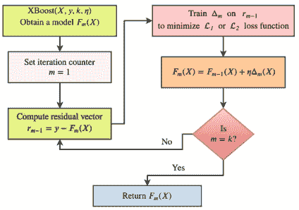

图 5.6 梯度提升机的 XGBoost 算法。

given as

```
\frac{\partial L(y, \hat{y})}{\partial \hat{y}_i} = \frac{\partial}{\partial \hat{y}_i} \sum_{i=1}^N |y_i - \hat{y}_i| = -sign(y_i - \hat{y}_i). \quad (5.7)
```

GBM 模型的准确性取决于弱学习者的数量和学习率。此外，GBM 模型的本质在于提升技术，该技术以阶梯式的方式然后以并行的方式组合所有弱模型，如随机森林模型所示。在数学上，GBM 模型的递归形式给出为

```
F_m(x) = F_{m-1}(x) + \eta \Delta_m(x), \quad (5.8)
```

其中 $\eta$ 表示学习率，$\Delta_m$ 指拟合残差的回归模型。图 5.6 说明了用于获得最佳回归器的 XGBoost 算法。

在我们的风速预测模拟中，随机森林和 GBM 的源代码分别载于附录 A.4 和 A.5。

Song 等人 [9] 提出了一种用于预测盐中笼状水合物相平衡的 GBM 模型。该模型的输入包括 11 个变量，涉及 CH$_4$、CO$_2$ 和 N$_2$ 等气体以及 KCl 和 NaCl 等盐。使用了两种模型，分别是深度神经网络（DNN）和梯度提升回归树，以压力和温度作为输出。结果表明，GBM 模型在以温度和压力作为模型输入时均优于 DNN。此外，以温度作为输出的 GBM 模型优于以压力作为输出的 GBM 模型。

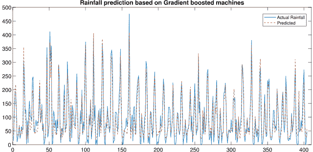

### 图 5.7 基于梯度提升机的印度喜马偕尔邦降雨预测。

Miskell 等人 [10] 讨论了一种用于预测新西兰基督城 PM2.5 颗粒物短期峰值浓度的 GBM 模型。温度、相对湿度、风速、阵风和气压等变量被用作预测模型中的预测因子。

同样，还使用四个不同时间间隔的不同 GBM 模型对 PM2.5 的高峰进行二元分类。在太阳能预测领域，Persson 等人 [11] 研究了 GBM，其中进行了多站点太阳能预测。采用了 2014 年 4 月 14 日至 2015 年 2 月 28 日期间日本的太阳能历史数据，并将其分割为训练集（75%）和测试集（25%）。在考虑数值天气预报重要性的前提下，进行了短期和长期预测等场景。观察到，对于长期功率预测，数值天气预报的相对重要性增加。与基准模型（如持续性算法、自回归模型和气候学）相比，GBM 模型的归一化 RMSE 值在 0.1 到 0.137 之间变化。

### 5.2.1 月降雨预测：案例研究

与随机森林回归类似，降雨预测使用梯度提升机进行。预测集，即降雨时间序列的细节信号和近似信号，保持不变。从图 5.7 所示的时间序列图来看，降雨的变异性很高，表现出非线性特征。模型模拟在 R 中运行，通过分割


### 表 5.3 梯度提升机模型的性能指标

| RMSE | MSE | SSR/SST | SSE/SST | U1 | U2 |
|---|---|---|---|---|---|
| 25.0592 | 627.55 | 0.8084 | 0.0795 | 0.0975 | 0.4546 |

### 表 5.4 用于原油预测的 GBM 模型的性能指标

| Model | RMSE | SSE/SST | MSE | U1 | SSR/SST | U2 |
|---|---|---|---|---|---|---|
| GBM | 0.6486 | 0.0085 | 0.4207 | 0.0076 | 0.8420 | 0.6925 |
| Persistence | 1.1553 | 0.1340 | 1.3347 | 0.0254 | 1.1625 | 1.1235 |

将数据集划分为训练集（800）和测试集（606）。最佳树数通过交叉验证确定。

表 5.3 描绘了降雨预测的性能指标。结果表明，GBM 在 RMSE 和 SSR/SST 方面优于 RF 模型。RF 和 GBM 模型均具有相似的预测性能，可用于具有高度非线性特性的时间序列。

### 5.2.2 原油价格预测：案例研究

原油价格每天都在变化，且常被各石油公司从预测角度进行研究。常见预测模型可能无法提供准确的油价数值，长期来看可能导致公司遭受损失。与 RF 模型类似，GBM 模型的预测采用价格时间序列的细节信号和近似信号作为预测变量进行。时间序列以类似于随机森林模型的方式划分为训练集和测试集。

如表 5.4 所示，从 RMSE 来看，GBM 相较于 RF 模型是较劣的模型，且给出较低的 SSR/SST 值。然而，其预测性能被发现远优于持续性算法，后者由于 SSR/SST 值较高而存在过拟合问题。

### 图 5.8 基于梯度提升机的原油价格预测

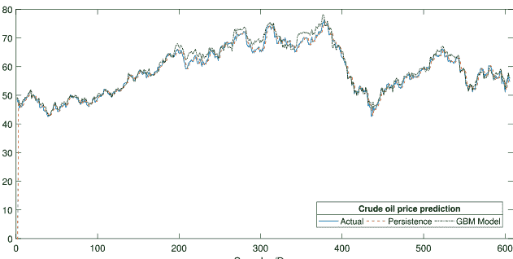

本章重点介绍用于时间序列预测的基于决策树集成的回归模型。随机森林和梯度提升机分别采用袋装（bagging）和提升（boosting）原理，以得出最佳预测。当历史数据量较大时，使用决策树模型进行回归最为合适。决策树模型的主要优势在于其能够结合多个弱模型，构建出一个强大且稳健的模型，与单一模型相比能够提供更好的预测性能。在后续章节中，我们将讨论不同陆上和海上风电场场址的爬坡事件预测决策树集成模型。

## 参考文献

- [1] L. Breiman, J.H. Friedman, R.A. Olshen, C.J. Stone, 分类与回归树, Routledge, 2017.
- [2] Y. Liu, X. Yao, 基于负相关的集成学习, Neural Networks 12 (10) (1999) 1399–1404.
- [3] S. Oliveira, F. Oehler, J. San-Miguel-Ayanz, A. Camia, J.M. Pereira, 使用多元回归和随机森林模拟地中海欧洲火灾发生空间格局, Forest Ecology and Management 275 (2012) 117–129.
- [4] P.F. Smith, S. Ganesh, P. Liu, 神经科学预测中随机森林回归与多元线性回归的比较, Journal of Neuroscience Methods 220 (1) (2013) 85–91.
- [5] W. Yuchi, E. Gombož, B. Boldbaatar, J. Galsuren, S. Enkhmaa, B. Beejin, G. Naidan, C. Ochir, B. Legtseg, T. Byamba, P. Barn, S.B. Henderson, C.R. Janes, B.P. Lanphear, L.C. McCandless, T.K. Takaro, S.A. Venners, G.M. Webster, R.W. Allen, 高度污染城市室内细颗粒物浓度预测中随机森林回归与多元线性回归的评价, Environmental Pollution 245 (2019) 746–753.
- [6] P. Zahedi, S. Parvandeh, A. Asgharpour, B.S. McLaury, S.A. Shirazi, B.A. McKinney, 管道弯头固体颗粒侵蚀的随机森林回归预测, Powder Technology 338 (2018) 983–992.
- [7] D. Solomatine, D. Shrestha, AdaBoost.RT：回归问题的一种提升算法, 载于: 2004 IEEE 国际神经网络联合会议 (IEEE Cat. No.04CH37541), IEEE, 2004.
- [8] J. Elith, J.R. Leathwick, T. Hastie, 增强回归树实用指南, Journal of Animal Ecology 77 (4) (2008) 802–813, https://doi.org/10.1111/j.1365-2656.2008.01390.x.
- [9] Y. Song, H. Zhou, P. Wang, M. Yang, 使用梯度提升回归树和深度神经网络预测笼状水化物相平衡, Journal of Chemical Thermodynamics 135 (2019) 86–96.
- [10] G. Miskell, W. Pattinson, L. Weissert, D. Williams, 使用提升梯度机模型基于测量 PM2.5 的空气质量仪器网络预测短期峰值浓度, Journal of Environmental Management 242 (2019) 56–64.
- [11] C. Persson, P. Bacher, T. Shiga, H. Madsen, 使用梯度提升回归树进行多站点太阳能功率预测, Solar Energy 150 (2017) 423–436.

# 第 6 章

# 混合机器智能风速预测模型

现代电网的可靠性与安全性高度依赖于准确的风速和功率预测。虽然风速的非线性特性给传统方法的预测带来了挑战，但基于机器学习的混合模型有效解决了这一问题。本章采用基于小波分解技术和多种 SVR 变体的混合模型。为确定最佳模型，对实时风速数据集计算了性能指标。ε-双支持向量回归（ε-TSVR）和双支持向量回归（TSVR）与经典 SVR 和 LSSVR 联合用于短期风速预测，并将其性能与基准持续性模型进行比较。我们还基于美国和印度的风电场场址，对更大规模数据集中这些模型的性能进行了评估。

## 6.1 引言

基于机器学习的混合模型使风速预测领域的研究大幅增加 [1]。Candenas 和 Rivera [2] 展示了基于 ARIMA-ANN 的预测模型，在固定预测时域内进行风速预测。Liu 等人 [3] 提出了一种基于支持向量机和遗传算法（GA）的混合预测方法，利用小波分解变换将风速时间序列分解，以消除潜在的随机变化。Zhang 等人 [4] 提出了一种基于高斯过程回归（GPR）和自回归（AR）的混合技术，并将其结果与 SVM、ANN 和持续性算法进行了比较。Mi 等人 [5] 探索了一种混合方法，包含小波分解变换、极端学习机和离群值校正技术，用于多步风速预测。小波和小波包分解消除了风速序列中的噪声分量，极端学习机对分解技术得到的子信号提供多步预测。

Li 等人 [6] 提出了一种基于恒定权重和变量权重的短期风速预测组合方法。Jiang 等人 [7] 提出了一种新的短期风速预测方法，基于对相邻风力涡轮引起的波动进行建模，所选输入提供给 v-SVM 模型。Azimi 等人 [8] 提出了一种基于 k-means 聚类和多层感知神经网络的特征选择模型，用于短期风速预测。Jiang 等人提出了一种基于相关性的离散小波变换（DWT）、最小二乘支持向量机（LSSVM）和广义自回归条件异方差（GARCH）方法，用于短期风速预测。不同子序列之间的相关系数用于评估用于风速预测的 LSSVR 模型的输入 [9]。

Liu 等人 [10] 讨论了一种修正的 Broyden–Fletcher–Goldfarb–Shanno（BFGS）神经网络和基于小波变换的信号处理技术，用于短期风速预测，并在四个风速数据集上进行了验证。小波分解后的每个子序列确定相关系数，以评估其相对重要性。Tian 等人 [11] 提出了一种多目标预测算法，其中数据预处理技术基于互补集合经验模态分解（EEMD）、变分模态分解和样本熵。所提模型进一步在八个风速数据集上验证，结果表明该模型相较于基准模型具有优势。然而，该模型唯一的局限在于中间阶段耗时较多。三个变量（风速、电负荷和电价）使用 Elman 神经网络（ENN）进行预测，其权重和超参数由 Wang 等人 [12] 提出的现代蜻蜓算法进行优化。由于三个变量的时间序列高度非线性，小波变换、经验模态分解和集合经验模态分解等信号处理技术在预测相关领域被广泛应用。

Du 等人 [13] 提出了一种基于鲸鱼优化算法（WOA）-LSSVR 技术的多步超前预测方法，并将其应用于风速、电价和电负荷预测。所提技术在来自新加坡、中国和澳大利亚的六个数据集上进行了验证。广义回归神经网络（GRNN）和反向传播神经网络（BPNN）等现有基准回归模型用于比较分析。就性能指标（如


均方根误差和平均绝对误差，提出的 WOA-LSSVR 模型优于 GRNN 和 BPNN。

Wang et al. [12] 提出了一种基于混合小波神经网络 (WNN) 模型的多目标正弦-余弦算法 (MOSCA) 优化技术。优化问题基于多目标正弦-余弦函数。首先用某些值初始化候选解，并允许其在给定搜索空间内收敛或发散。实现了修正的互补组合经验模态分解 (MCEEMD)，以解决诸如组合经验模态分解 (EEMD) 等简单预处理技术所带来的问题。Wang et al. 提出的模型还用于评估风速预测的鲁棒性和稳定性，因为高度非线性时间序列会导致准确预测困难。基于 MOSCA-WNN 的模型用于预测每个子序列，并将结果汇总。提出的模型与 WNN、GRNN、ARIMA 和持续性模型进行了比较。

以时间消耗形式的复杂性可能是预测模型中的严重问题，可以使用 SVR 模型的变体来解决这一问题。在电力系统中，诸如风电坡率和功率瞬变等事件（可表示为时间序列形式）可以通过将信号分解为时频域（如小波变换 [14] 所示）以连贯的方式进行分析。在本章中，我们讨论了基于 db4 滤波器的小波变换分解，这有助于实现平滑且局部化的分解。

基于小波变换、经验模态分解和 SVR 变体的混合模型。使用类似持续性算法的基准模型来比较混合预测模型的性能指标。此外，对混合模型进行了正则化，以观察其对 SSR/SST 值的影响。本章结构如下：第 6.2 节描述了小波变换在短期风速预测中的应用。此外，第 6.3 节强调了短期风速预测的问题公式。在第 6.4 节中，讨论了基于小波变换的混合模型结果，接着在第 6.5 节中介绍了不同风电场站点的基于 EMD 的混合模型。

## 6.2 小波变换

信号处理技术已与机器学习方法联合使用，以提高预测精度并消除时间序列中的随机波动。傅里叶变换、小波变换和小波包分解等信号变换是常用的算法。在风速分解中使用傅里叶变换的主要缺点是关于时间尺度的信息丢失，而小波变换克服了这一问题。小波变换在时间和频率尺度上捕获信号的信息。由于时域变化在风速时间序列分析中具有更大的重要性，因此不优先使用傅里叶变换。

小波变换的想法最初由地球物理学家 Jean Morlet 于 1982 年提出，用于地震波分析，可分为连续小波变换 (CWT) 和离散小波变换 (DWT)。连续小波涉及母小波的连续缩放和时间移位。高尺度（低通滤波器）提供关于信号的近似信息，而低尺度（高通滤波器）提供信号的详细信息。从计算角度看，DWT 比 CWT 更丰富，因此前者在信号处理中应用更广泛。从数学上讲，CWT 和 DWT 表示为

```
B(a, b) = \frac{1}{\sqrt{a}} \int_{-\infty}^{+\infty} r(x)\phi\left(\frac{x - b}{a}\right), \quad (6.1)

B(u, v) = 2^{-u/2} \sum_{t=0}^{N-1} r(t)\phi\left(\frac{t - v \cdot 2^u}{2^u}\right), \quad (6.2)
```

其中 r(t) 是风速时间序列，N 是其长度，\(\phi\) 是母小波函数，缩放和平移参数是整数 u 和 v 的函数。首先，将原始风速时间序列分解为低频和高频分量。小波变换的主要目标是从风速时间序列中收集重要信息。就风力预测而言，选择合适的分解信号作为预测模型的输入。小波滤波器可以从 Haar、Daubechies、墨西哥帽和 Coiflet [15] 等小波家族中选择。WT 过程涉及每个阶段对近似信号进行连续分解，如图 6.1 所示。

每个分解阶段获得的两个信号是近似信号（A5，包含低频分量）和细节信号（D1, ..., D5，包含高频分量），它们共同构成输入特征矩阵。风速是短期风力预测算法（SVR 及其变体）中使用的输出，如图 6.2 所示。

## 6.3 混合预测框架

本研究利用混合小波变换和基于 SVR 的方法进行短期风速预测。就滤除随机波动的能力而言，混合方法比单一方法更高效。风速预测误差取决于预测持续时间或范围。对于市场清算操作和经济负荷调度，通常短期风速预测（范围从 30 分钟到 3 小时）是首选方案。现代电力市场已从受管制市场转向去管制市场，这允许多个参与者进入竞价过程，从发电公司购买零售电力。风力预测采用混合模型进行，即小波-SVR、小波-LSSVR、小波-TSVR 和小波-ε-TSVR。通过计算各种性能指标来评估预测精度，如均方根误差 (RMSE)、平均绝对误差 (MAE)、平方残差和 (SSR)、测试样本平方偏差和 (SST)、测试样本平方误差和 (SSE)、一致性指数 (IOA) 以及 Theil's U1 和 U2 统计量 [16]。从数学上讲，这些指标表示为

```
RMSE = \left[ \frac{1}{n} \sum_{i=1}^{n} (\hat{x}_i - x_i)^2 \right]^{1/2} , \quad \text{MAE} = \left[ \frac{1}{n} \sum_{i=1}^{n} |\hat{x}_i - x_i| \right] , \quad (6.3)
```

```
SSR/SST = \frac{\sum_{i=1}^{n} (\hat{x}_i - \bar{x})^2}{\sum_{i=1}^{n} (x_i - \bar{x})^2}, \quad \text{SSE/SST} = \frac{\sum_{i=1}^{n} (\hat{x}_i - x_i)^2}{\sum_{i=1}^{n} (x_i - \bar{x})^2}, \quad (6.4)
```

```
IOA = 1 - \sum_{i=1}^{n} (\hat{x}_i - x_i)^2 \Big/ \sum_{i=1}^{n} (|\hat{x}_i - \bar{x}| + |x_i + \bar{x}|)^2 ,
```

```
U1 = \sqrt{ \frac{1}{n} \times \sum_{i=1}^{n} (\hat{x}_i - x_i)^2 } \Big/ \left( \sqrt{ \frac{1}{n} \times \sum_{i=1}^{n} x_i^2 } + \sqrt{ \frac{1}{n} \times \sum_{i=1}^{n} \hat{x}_i^2 } \right) ,
```

```
U2 = \sqrt{ \frac{1}{n} \times \sum_{i=1}^{n} \left( (x_{i+1} - \hat{x}_{i+1}) / x_i \right)^2 } \Big/ \sqrt{ \frac{1}{n} \times \sum_{i=1}^{n} \left( (x_{i+1} - \hat{x}_i) / x_i \right)^2 } ,
```

其中 \(\hat{x}_i\)、\(x_i\) 和 \(\bar{x}\) 分别是测试样本的预测值、实际值和平均值。Theil's U1 和 U2 统计量是重要指标，常用于金融和银行业，以确定预测精度和质量。统计量 U1 决定预测的准确性，而 U2 决定预测的质量。图 6.3 显示了通过混合小波-SVR 方法进行预测的框图。

### 数据集描述

为测试混合小波-SVR，选择了西班牙、马萨诸塞州西部 (美国)、南达科他州 (美国)、维多利亚 (澳大利亚) 和印度的风电场站点，其描述性统计量列于表 6.1 中。

图 6.4 显示了这些风电场站点的风速变化：

- Paxton, MA: 该风电场位于马萨诸塞州西部，坐标为 42°18'11.6" 和 71°53'50.9"。风速每 10 分钟测量一次，使用安装在地面以上 78 m 处的杯式风速仪。风速数据范围从 2011 年 1 月 1 日到 2011 年 1 月 7 日 22:30。


### 图 6.3 使用小波变换和机器智能模型进行预测。

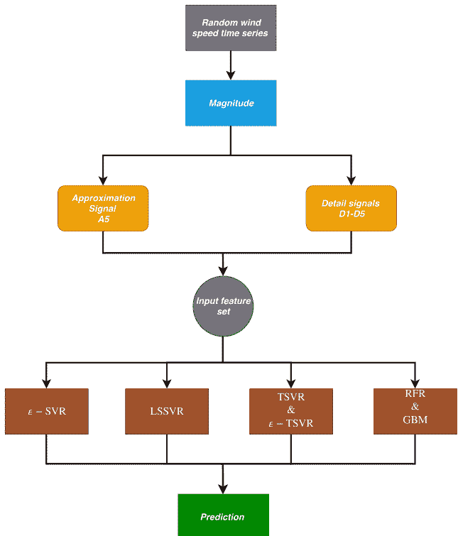

### 表 6.1 各风电场风速描述性统计。

| 风电场（数据集） | 最大值（m/sec） | 最小值（m/sec） | 平均值（m/sec） | 标准差 |
|---|---|---|---|---|
| 萨特文托，西班牙（A） | 13.23 | 0.41 | 4.6072 | 1.9395 |
| 帕克斯顿，马萨诸塞州（B） | 14.39 | 0.35 | 6.9209 | 2.3734 |
| 布兰德福德，马萨诸塞州（C） | 13.73 | 0.30 | 6.0553 | 2.1242 |
| 主教与书记员，马萨诸塞州（D） | 13.31 | 0.36 | 6.7065 | 2.5923 |
| 贝雷斯福德，南达科他州（E） | 15.06 | 0.58 | 5.4729 | 2.9828 |
| AGL 麦克阿瑟（F） | 9.05 | 1.92 | 6.2926 | 1.5035 |
| 姆庞杜尔（G） | 8.48 | 0.71 | 4.8878 | 1.4641 |

### 萨特文托，西班牙
(数据集：A)

### 帕克斯顿，马萨诸塞州
(数据集：B)

### 布兰德福德，马萨诸塞州
(数据集：C)

### 主教与书记员，马萨诸塞州
(数据集：D)

### 贝雷斯福德，南达科他州
(数据集：E)

### 维多利亚州 AGL 麦克阿瑟
(数据集：F)

风速（m/sec）

每 10 分钟样本数

每小时样本数

图 6.4 数据集 A 至 F 的风速。

- 萨特文托，西班牙：该风电场位于西班牙加利西亚的萨特文托，纬度 43°21'35.9''，经度 −7°52'47.9''。所选数据集为 2017 年 10 月的数据，风速按小时测量。

- 布兰德福德，马萨诸塞州：布兰德福德位于北纬 42.223°、东经 72.968°，风速在距地面 60 m 处使用杯式风速仪每 10 分钟记录一次。风速数据范围从 2011 年 1 月 1 日至 2011 年 1 月 7 日 22:30。

- 主教与书记员，马萨诸塞州：风速监测站位于北纬 41.574°、东经 70.249°，风速仪安装在地面以上 15 m 处。数据范围从 2011 年 1 月 1 日至 2011 年 1 月 7 日 22:30，每 10 分钟记录一次。

- 贝雷斯福德，南达科他州：风场位于北纬 43.088°、东经 96.786°，数据范围从 2006 年 3 月 1 日 22:20 至 2006 年 3 月 8 日 20:50。风速在 20 m 高度每 10 分钟记录一次。

- 澳大利亚维多利亚州 AGL 麦克阿瑟：该风电场位于南纬 38.049°、东经 142.190°，装机容量 420 MW，配备 140 台 V112-3.0 维斯塔斯风力涡轮机。每小时风速数据采集时间为 2019 年 2 月 26 日 00:00 至 2019 年 3 月 5 日 23:00 [17]。

- 印度卡尼亚库马里姆庞杜尔：位于泰米尔纳德邦卡尼亚库马里，装机容量 1500 MW。2019 年 1 月的风速数据以 10 分钟间隔记录 [18]。

自相关函数（ACF）图描述了时间序列样本在不同滞后时刻与自身的相关性。在数学上，时间序列 \(S_t\) 在滞后时刻 \(k\) 的 ACF 表示为

$$r_k = \frac{\sum_{i=1}^{N-k} \left( S_t - \overline{S} \right) \left( S_{t+k} - \overline{S} \right)}{\sum_{i=1}^{N} \left( S_t - \overline{S} \right)^2}.$$ (6.5)

图 6.5 说明了所有数据集的风速时间序列的周期性。

对于数据集 A 至 E，我们发现滞后时刻 1 和 2 占主导地位，表明相关性强。然而，数据集 F 的滞后阶数 7 的自相关为负。

## 6.4 结果与讨论

一种混合模型基于小波分解技术和机器智能 SVR 模型构建，其中 80% 的数据用于训练，而

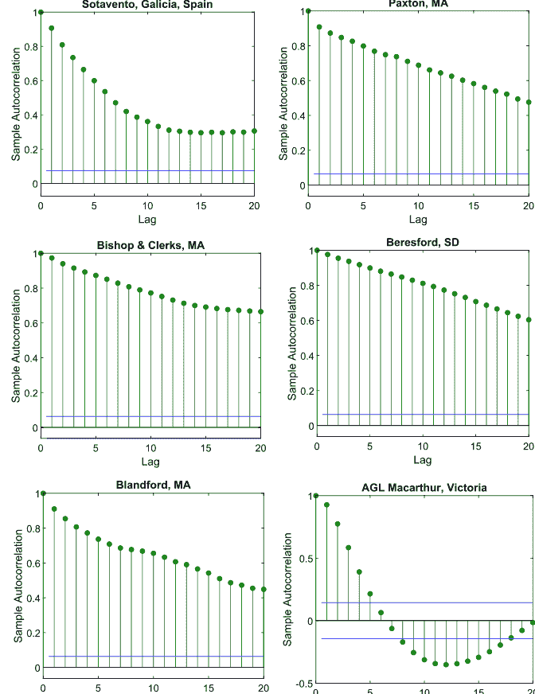

图 6.5 萨特文托、帕克斯顿、布兰德福德、主教与书记员、贝雷斯福德和 AGL 麦克阿瑟的风速时间序列周期性。

剩余部分用于测试。TSVR 和 ε-TSVR 预测模型与 ε-SVR 和 LS-SVR 模型进行评估比较。对于 ε-TSVR，我们假设正则化因子 \(C1 = C2\) 且 \(C3 = C4\)。同样，对于 TSVR，我们选择 \( C_1 = C_2 \)。由于正则化参数对容差误差设置软限制，选择最佳 \( C \) 值对预测精度有显著影响。此外，由于训练阶段的过拟合会导致精度低下，正则化成为机器学习回归的重要方面。

构建回归模型所用的核函数是带宽 \( \sigma \) 的径向基函数（RBF）：\( k(x, x_i) = \exp \left( - \frac{\|x - x_i\|^2}{2\sigma^2} \right) \)。超参数 \( C_1, C_2, C_3 \) 和 \( C_4 \) 以及 RBF 带宽 \( \sigma \) 从集合 \( 2^i, i = -9, -8, \dots, 9, 10 \) 中选取。最优参数可通过手动调整或网格搜索算法调优。选取标记为 A、B、C 和 D 的四个风电场相关数据集来测试混合预测模型的性能。数据集 A 包含 720 个样本，其中 80%（576 个）用于训练，20%（144 个）用于测试。同样，对于数据集 B、C 和 D，800 个样本用于训练，200 个用于测试。

表 6.2 和 6.3 描述了基于小波的混合 SVR 模型的各种性能指标。对于数据集 A，\( \varepsilon \)-TSVR 和 TSVR 在 RMSE 方面分别比 \( \varepsilon \)-SVR 优异 41.95% 和 84.25%。同样，对于数据集 B、C 和 D，\( \varepsilon \)-TSVR 在 RMSE 方面分别比 \( \varepsilon \)-SVR 优异 3.537%、63.03% 和 59.60%。在所有模型中，\( \varepsilon \)-TSVR 和 TSVR 在所有数据集的 RMSE 和 MAE 方面定量优于 LS-SVR 和 \( \varepsilon \)-SVR。在 \( \varepsilon \)-SVR 中，拉格朗日矩阵尺寸较大且使用不等式约束；然而，LS-SVR 使用等式约束，计算速度更快。

此外，TSVR 是 \( \varepsilon \)-SVR 和 LS-SVR 的混合体，采用两种二次规划公式，具有更好的推广能力。LS-SVR 由于优化问题规模较小，处理器时间最少。\( \varepsilon \)-TSVR 所需时间少于经典 \( \varepsilon \)-SVR 和 TSVR，在四个数据集中，B、C 和 D 对于各自模型的计算时间大致相同。SSR/SST 和 SSE/SST 比率提供拟合优度的估计。SSR/SST 比率值大于 1 意味着训练过程中存在过拟合，这在测试阶段是不可取的。在所有回归器中，TSVR 获得最优的 SSR/SST 和 SSE/SST 比率。最优 SSR/SST 比率接近 1 但不大于 1。当发生过拟合时，SSR/SST 取值大于 1，这最终会降低预测精度。预测从统计角度评估，通过确定所有模型的一致性指数（IOA）和 Theil 的 U1 和 U2 统计量。

### 表 6.2 小波 ε-SVR、LS-SVR、TSVR 和 ε-TSVR 的性能指标。

| 数据集 | 模型 | RMSE | IOA | MAE | U1 | SSR/SST | U2 | SSE/SST | CPU 时间 |
|---|---|---|---|---|---|---|---|---|---|
| A | ε-SVR | 0.1423 | 1.0000 | 12.254 | 0.0233 | 0.9434 | 1.1281 | 0.064 | 5.7964 |
| | LS-SVR | 0.1097 | 1.0000 | 8.4668 | 0.0028 | 0.9417 | 0.9665 | 0.0038 | 0.5924 |
| | TSVR | 0.0224 | 1.0000 | 1.4877 | 0.0011 | 0.9821 | 0.9496 | 0.0008 | 3.1864 |
| | ε-TSVR | 0.0823 | 1.0000 | 7.6699 | 0.00116 | 0.9694 | 0.0150 | 0.0021 | 2.4421 |
| | 持续性 | 0.7241 | 0.9991 | 71.41 | 0.0913 | 1.0192 | 1.1331 | 0.2925 | 0.3024 |
| B | ε-SVR | 0.0424 | 1.0000 | 6.8172 | 0.0138 | 1.0055 | 0.0645 | 0.0003 | 11.244 |
| | LS-SVR | 0.0329 | 1.0000 | 4.6550 | 0.00340 | 0.9862 | 0.0466 | 0.0001 | 0.8165 |
| | TSVR | 0.0148 | 1.0000 | 2.0444 | 0.0008 | 0.9965 | 0.0072 | 0.00003 | 6.2343 |
| | ε-TSVR | 0.0409 | 1.0000 | 6.8764 | 0.0021 | 0.9884 | 0.0130 | 0.0003 | 3.6897 |
| | 持续性 | 0.7825 | 0.9998 | 66.31 | 0.0731 | 1.0197 | 1.0000 | 0.1437 | 0.2560 |

从表 6.2 可以看出，ε-TSVR 和 TSVR 模型在 Theil 的 U1 和 U2 统计量方面优于 ε-SVR、LS-SVR 和持续性模型，从而表明这两个模型的精度优于其他模型。图 6.6 显示了四个风电场四种 SVR 变体的预测结果。ε-TSVR 和 TSVR 的预测精度进一步使用 Diebold–Mariano（DM）检验进行检验。DM 统计检验假设一个原假设，即两个预测模型具有相似精度 [19]。

考虑实际时间序列 \(y_t\) 和预测时间序列 \(\hat{y}_{1t}\) 及 \(\hat{y}_{2t}\)。实际时间序列与预测时间序列之间的误差为 \(e_{it} = \hat{y}_{it} - y_t\)。在数学上，DM 检验可表示为

$H_0: e_{1t} - e_{2t} = 0, \quad H_1: e_{1t} - e_{2t} \neq 0, \quad \forall t;$ (6.6)

\(H_0\) 和 \(H_1\) 分别表示原假设和备择假设。


### 表 6.3 小波-$\varepsilon$-SVR、LS-SVR、TSVR和$\varepsilon$-TSVR的性能指标。

| 数据集 | 模型 | RMSE | IOA | MAE | U1 | SSR/SST | U2 | SSE/SST | CPU时间 |
| :--- | :--- | :--- | :--- | :--- | :--- | :--- | :--- | :--- | :--- |
| C | $\varepsilon$-SVR | 0.1791 | 0.9980 | 24.211 | 0.0453 | 0.9777 | 1.3804 | 0.0151 | 12.3536 |
| | LS-SVR | 0.0733 | 1.0000 | 8.9438 | 0.0021 | 0.9929 | 0.0231 | 0.0027 | 0.8962 |
| | TSVR | 0.0100 | 1.0000 | 1.2674 | 0.0003 | 0.9976 | 0.0046 | 0.0004 | 6.2235 |
| | $\varepsilon$-TSVR | 0.0662 | 1.0000 | 8.7964 | 0.0040 | 1.0127 | 0.0635 | 0.0022 | 3.7219 |
| | 持续性模型 | 0.6939 | 0.9998 | 54.95 | 0.0734 | 1.0501 | 1.0769 | 0.2934 | 0.0818 |
| D | $\varepsilon$-SVR | 0.1901 | 1.0000 | 28.8003 | 0.0230 | 1.0538 | 0.8751 | 0.0174 | 11.041 |
| | LS-SVR | 0.1427 | 1.0000 | 20.5274 | 0.0129 | 0.9798 | 0.6855 | 0.0098 | 1.2148 |
| | TSVR | 0.0740 | 1.0000 | 9.4829 | 0.0050 | 0.9816 | 0.0746 | 0.0026 | 6.7960 |
| | $\varepsilon$-TSVR | 0.0768 | 1.0000 | 12.1187 | 0.0047 | 0.9507 | 0.0254 | 0.0028 | 9.0181 |
| | 持续性模型 | 0.4366 | 0.9998 | 34.71 | 0.0587 | 1.0535 | 0.6667 | 0.1156 | 0.0925 |

原假设指出两个不同预测序列的误差相同，备选假设与之相反。在本例中，我们将TSVR（检验1）和$\varepsilon$-TSVR（检验2）的DM统计量与经典$\varepsilon$-SVR模型进行比较。该检验在1%显著性水平下针对数据集A、B、C和D进行，结果在表6.4中以高亮显示。

图6.7和图6.8展示了不同SVR变体中RBF带宽$\sigma$和正则化因子C对SSR/SST比率的变化。

因此，通过拒绝DM检验的原假设，我们观察到TSVR和$\varepsilon$-TSVR模型相对于$\varepsilon$-SVR模型都具有显著的预测优越性，证明了混合SVR模型及其变体相对于持续性模型的稳健性。

SSR/SST比率用于估计训练数据是否已过拟合。$\varepsilon$-TSVR和TSVR在测试样本上的SSR/SST比率变化优于经典$\varepsilon$-SVR和LS-SVR，随$\sigma$变化（保持C

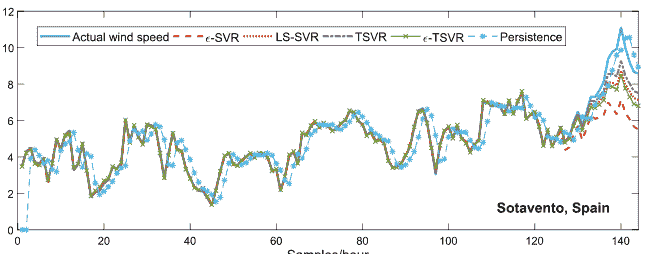

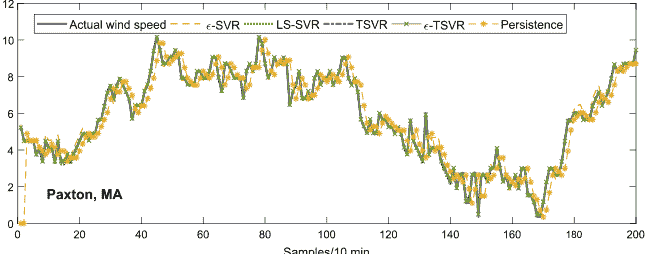

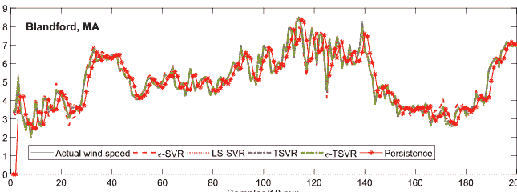

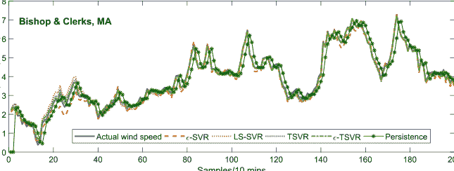

### 图 6.6 $\epsilon$-SVR、LS-SVR、TSVR、$\epsilon$-TSVR和持续性模型的预测。

### 表 6.4 数据集的Diebold–Mariano检验。

| 数据集 | 检验 1 | 检验 2 |
|---|---|---|
| A | 10.7291 | 9.7084 |
| B | 7.6321 | 7.4852 |
| C | 5.2699 | 5.2398 |
| D | 6.9036 | 6.6344 |

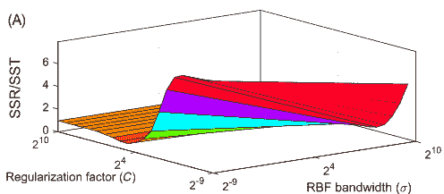

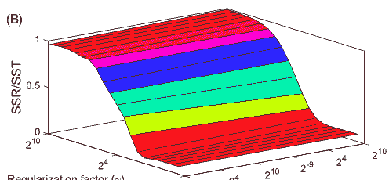

### 图 6.7 (A) $\epsilon$-SVR和(B) LS-SVR中随RBF带宽$\sigma$和正则化因子（$C$）变化的SSR/SST。

（保持C不变）和C（保持$\sigma$不变）。当我们增加$\sigma$（从$2^{-9}$到$2^{10}$）时，$\epsilon$-SVR和TSVR的SSR/SST值从0增加到1，而LS-SVR保持不变。然而，对于$\epsilon$-SVR，SSR/SST值在$\sigma=2^4$之后先减小后增大。

为进一步验证更大数据集对我们混合模型的影响，我们选取了马萨诸塞州布兰德福德（数据集：C）和印度坎亚库马里区穆潘达尔（数据集：G）的风速数据。数据集C和G的训练集分别包含4000和3000个样本，测试集包含

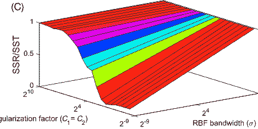

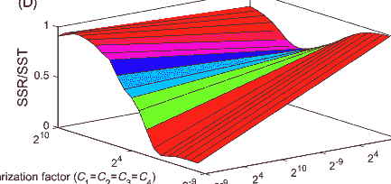

### 图 6.8 (C) TSVR和(D) $\varepsilon$-TSVR中随RBF带宽$\sigma$和正则化因子（$C$）变化的SSR/SST。

共1000个样本。预测性能在表6.5中给出，并如图6.9所示。

从表6.5可以看出，$\varepsilon$-TSVR和TSVR在RMSE和MAE方面明显优于$\varepsilon$-SVR和LS-SVR。在计算速度方面，对于数据集C和G，$\varepsilon$-TSVR分别比$\varepsilon$-SVR节省了93%和81%的时间。

## 6.5 基于经验模态分解的风速预测SVR变体

本节讨论了一种基于经验模态分解（EMD）和支持向量回归（SVR）变体的混合模型。就像小波变换一样，EMD是一种用于评估时间序列波动性的信号预处理技术。图6.10展示了基于ARIMA-EMD的混合风速预测模型流程图。风速预测分为两部分进行。首先，基于ARIMA模型预测线性特征；其次，利用支持向量回归及其变体等机器学习模型处理非线性特性。

### 表 6.5 较大数据集的性能指标。

| 数据集 | 模型 | RMSE | MAE | SSR/SST | SSE/SST | IOA | U1 | U2 | CPU时间 |
|---|---|---|---|---|---|---|---|---|---|
| C | $\epsilon$-SVR | 0.0416 | 33.7801 | 1.0079 | 0.0001 | 1.0000 | 0.0031 | 0.1440 | 911.4211 |
| | LS-SVR | 0.0194 | 12.7811 | 1.0013 | 0.00003 | 1.0000 | 0.0014 | 0.0489 | 13.3221 |
| | TSVR | 0.0036 | 2.2739 | 0.99994 | 0.00001 | 1.0000 | 0.00002 | 0.0084 | 355.011 |
| | $\epsilon$-TSVR | 0.0127 | 8.9721 | 0.9985 | 0.00001 | 1.0000 | 0.00094 | 0.1371 | 61.0762 |
| | 持续性模型 | 0.8553 | 640.65 | 0.9826 | 0.0755 | 1.0000 | 0.0633 | 0.7813 | 0.3024 |

| 数据集 | 模型 | RMSE | MAE | SSR/SST | SSE/SST | IOA | U1 | U2 | CPU时间 |
|---|---|---|---|---|---|---|---|---|---|
| G | $\epsilon$-SVR | 0.0283 | 20.3760 | 0.9823 | 0.0008 | 1.0000 | 0.0041 | 0.6416 | 347.304 |
| | LS-SVR | 0.0170 | 12.6992 | 0.9851 | 0.00003 | 1.0000 | 0.0026 | 0.5163 | 5.9329 |
| | TSVR | 0.0143 | 9.6658 | 0.9871 | 0.00002 | 1.0000 | 0.0022 | 0.00485 | 70.2648 |
| | $\epsilon$-TSVR | 0.0157 | 10.9721 | 0.9910 | 0.00001 | 1.0000 | 0.0165 | 0.1241 | 63.3087 |
| | 持续性模型 | 0.2053 | 73.4500 | 1.0213 | 0.0523 | 1.0000 | 0.0318 | 0.6053 | 0.0131 |

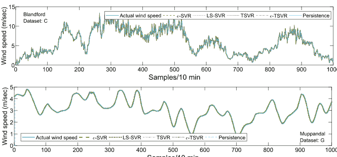

### 图 6.9 较大数据集的预测结果。

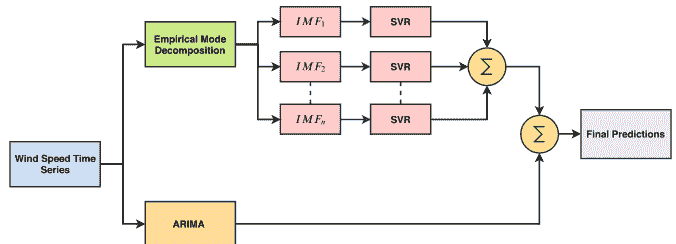

### 图 6.10 基于ARIMA-EMD的混合风速预测模型流程图。

确定时间序列的固有模态分量（IMFs）和残差的步骤如下：

- 对于给定的时间序列\(a(t)\)，定位局部最大值和最小值，并进行插值以形成\(a_u(t)\)和\(a_l(t)\)作为上包络和下包络。
- 计算上包络和下包络的均值\(a_m(t) = \frac{a_u(t)+a_l(t)}{2}\)。
- 通过从原始时间序列中减去均量分量来获得细节分量，即\(a_d(t) = a(t) - a_m(t)\)。
- 如果\(a_m(t)\)和\(a_d(t)\)满足任一停止准则，则获得第一个IMF和残差。停止准则：(i) 由极大值和极小值形成的均包络应为零；(ii) 零交叉点数与极值点数应相差一或零。
- 重复上述步骤，直至获得第一个IMF和残差。

Fan等人[20]讨论了一种基于EMD-SVR的混合模型，用于预测澳大利亚市场的电负荷，其中使用粒子群优化来确定最优SVR参数。结果表明，与PSO-BP和PSO-SVR等基准模型相比，Fan等人提出的模型表现更好。在船舶运动和波高预测领域，Duan等人[21,22]研究了一种基于EMD的自回归（AR）-SVR模型，其中船舶运动和波高的非线性通过EMD过程捕获。结果表明，EMD-AR-SVR模型相比AR和SVR模型取得了显著改进。Xiang等人[23]基于经验模态分解探索了一种SVR-ANN模型，用于预测中国的降雨量。采用了三个不同的数据集，SVR用于短期预测，而ANN用于长期预测。结果表明，与传统方法相比，EMD-SVR和EMD-ANN方法在RMSE和MAE方面取得了显著改进。Yu等人[24]提出了一种基于


基于EMD-SVR的频谱预测，并将其结果与自回归模型和常规SVR模型进行比较。

300个样本的频谱数据被分割为训练集（250个）和测试集（50个）。AR、SVR和EMD-SVR模型的RMSE值分别为0.1310、0.1148和0.0673，这表明基于EMD的模型在预测非平稳时间序列（如频谱）方面具有优越性。在股价预测方面，Yang等人[25]讨论了基于ARIMA-EMD-SVR的综合模型，适用于NASDAQ、TSEC、SP500和NIKKEI 225四个市场。所用数据为2010年1月1日至2010年12月31日的数据，90%的数据用于训练SVR模型。结果表明，与AR、SVR和EMD-SVR模型相比，基于ARIMA-EMD的SVR模型具有更好的预测性能。此外，还使用一种称为方向对称性（direction symmetry）的指标评估了模型的稳健性。

接下来，我们讨论用于短期风速预测的基于ARIMA-EMD的SVR模型。图6.10所示的混合模型涉及基于ARIMA模型的线性预测和基于EMD-SVR模型的非线性预测。ARIMA模型的滞后阶数基于风速时间序列的ACF函数确定。我们考虑四个数据集：位于马萨诸塞州西部的Bishop & Clerks、Blandford和Paxton，以及丹麦近海风电场Anholt，这些站点的风速数据可从URL（http://www.soda-pro.com）获取。风速时间序列每10分钟测量一次，共1000个样本，其中800个用于训练SVR模型，其余200个用于测试。首先，将风速时间序列分解为五个固有模态分量（IMFs，包括一个残差）。随后对这些IMF分别进行预测，然后将预测结果聚合。SVR模型及其变体的超参数在2⁻¹⁰–2¹⁰范围内手动调整。图6.11和6.12展示了四个不同数据集的预测结果。

基于ARIMA-EMD的SVR变体根据RMSE、均方误差（MSE）、SSR/SST、SSE/SST以及Theil's U1和U2统计量等误差指标进行评估。表6.6描述了误差指标，从中可以观察到，对于所有四个数据集，ε-TSVR和TSVR模型在RMSE和MAE方面均优于常规SVR和LS-SVR模型。对于标记为Xx的数据集Anholt，ε-TSVR具有最大IOA，表明实际值与预测值之间具有良好的一致性。在RMSE方面，ε-TSVR比常规SVR模型好27.22%。同样，对于数据集Bishop & Clerks，ε-TSVR模型在RMSE和MSE方面优于常规SVR、LS-SVR和TSVR。然而，值得注意的是，从计算角度看，LS-SVR是所有回归器中最快的。

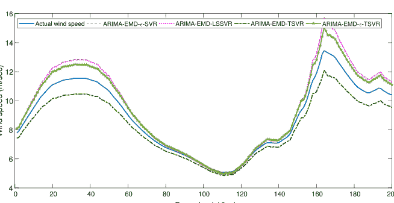


### 图6.11 基于ARIMA-EMD的ε-SVR、LS-SVR、TSVR和ε-TSVR模型对Anholt和Bishop & Clerks数据集的预测

在本章中，我们研究了基于小波变换和经验模态分解技术的短期风力预测混合机器智能SVR模型。选择四阶Daubechies（db4）小波滤波器来对四个不同风电场的风速时间序列进行分解。在这些回归器中，基于小波变换和ARIMA-EMD、TSVR、ε-TSVR的混合模型被证明是四个数据集基于性能指标的更好短期预测选择。从计算角度看，LS-SVR在CPU上耗时最少，而ε-TSVR由于其优化问题规模较小，计算时间比ε-SVR少。通过最优选择SVR超参数RBF带宽和正则化常数，可以进一步提高所有混合模型的风速预测精度。此外，还研究了数据集C和G对大数据集的影响。结果表明，ε-TSVR方法在RMSE和MAE方面优于TSVR、LS-SVR和ε-SVR。


### 图6.12 基于ARIMA-EMD的ε-SVR、LS-SVR、TSVR和ε-TSVR模型对Blandford和Paxton数据集的预测

### 表6.6 基于ARIMA-EMD的ε-SVR、LS-SVR、TSVR和ε-TSVR模型的性能指标。

| 数据集 | 模型 | RMSE | IOA | MSE | U1 | SSR/SST | U2 | SSE/SST | CPU时间 |
|---|---|---|---|---|---|---|---|---|---|
| Xx | ε-SVR | 0.8918 | 0.7953 | 1.584 | 0.1371 | 0.9998 | 0.0460 | 0.9102 | 1.05007 |
| Xx | LS-SVR | 0.8577 | 0.7356 | 1.6008 | 0.1268 | 0.9998 | 0.0444 | 0.9067 | 0.0889 |
| Xx | TSVR | 0.7532 | 0.5673 | 0.7744 | 0.0978 | 0.9998 | 0.0422 | 1.0939 | 0.5595 |
| Xx | ε-TSVR | 0.6490 | 0.4212 | 1.4008 | 0.0726 | 0.9999 | 0.0339 | 1.8895 | 0.2756 |
| D | ε-SVR | 0.8259 | 0.6821 | 1.619 | 0.3280 | 0.9995 | 0.1056 | 0.4390 | 0.7385 |
| D | LS-SVR | 0.7300 | 0.5329 | 1.538 | 0.2563 | 0.9996 | 0.0922 | 0.3353 | 0.1220 |
| D | TSVR | 0.5182 | 0.2685 | 1.5329 | 0.1291 | 0.9998 | 0.0623 | 1.1374 | 0.6391 |
| D | ε-TSVR | 0.4963 | 0.2463 | 1.5231 | 0.1184 | 0.9998 | 0.0577 | 5.4156 | 0.93116 |
| C | ε-SVR | 0.6822 | 0.4653 | 1.3097 | 0.2354 | 0.9996 | 0.0669 | 2.2648 | 0.8444 |
| C | LS-SVR | 0.6854 | 0.4697 | 1.2095 | 0.2355 | 0.9996 | 0.0668 | 4.8873 | 0.0876 |
| C | TSVR | 0.6899 | 0.4759 | 1.2460 | 0.2366 | 0.9996 | 0.0672 | 8.3949 | 0.5567 |
| C | ε-TSVR | 0.6573 | 0.4320 | 1.3191 | 0.2148 | 0.9997 | 0.0610 | 1.2391 | 0.5432 |
| B | ε-SVR | 6.556 | 42.98 | 6.926 | 7.259 | 0.9970 | 0.0992 | 0.9804 | 0.8300 |
| B | LS-SVR | 0.9765 | 0.9535 | 1.5738 | 0.1607 | 0.9998 | 0.0777 | 0.5870 | 0.0965 |
| B | TSVR | 0.7969 | 0.6350 | 1.2710 | 0.1070 | 0.9998 | 0.0636 | 0.6254 | 0.5764 |
| B | ε-TSVR | 0.9875 | 0.9751 | 1.5566 | 0.1647 | 0.9998 | 0.0741 | 1.4054 | 0.6753 |

## 参考文献

[1] H.S. Dhiman, D. Deb, J.M. Guerrero. 用于风力预测和爬坡事件的混合机器智能SVR变体, Renewable & Sustainable Energy Reviews 108 (2019) 369–379, https://doi.org/10.1016/j.rser.2019.04.002.

[2] E. Cadenas, W. Rivera, 墨西哥三个不同地区采用混合ARIMA–ANN模型的风速预测, Renewable Energy 35 (12) (2010) 2732–2738.

[3] D. Liu, D. Niu, H. Wang, L. Fan, 使用小波变换和由遗传算法优化的支持向量机进行短期风速预测, Renewable Energy 62 (2014) 592–597.

[4] C. Zhang, H. Wei, X. Zhao, T. Liu, K. Zhang, 基于高斯过程回归的短期风速预测混合方法, Energy Conversion and Management 126 (2016) 1084–1092.

[5] X. Mi, H. Liu, Y. Li, 采用小波、极端学习机和离群值校正算法的风速预测方法, Energy Conversion and Management 151 (2017) 709–722.

[6] H. Li, J. Wang, H. Lu, Z. Guo, 基于变权重的短期风速预测组合模型的研究与应用, Renewable Energy 116 (2018) 669–684.

[7] P. Jiang, Y. Wang, J. Wang, 采用混合模型的短期风速预测, Energy 119 (2017) 561–577.

[8] R. Azimi, M. Ghofrani, M. Ghayekhloo, 基于数据挖掘和小波分析的混合风力预测模型, Energy Conversion and Management 127 (2016) 208–225.

[9] Y. Jiang, G. Huang, X. Peng, Y. Li, Q. Yang, 一种新型风速预测方法：辅助DWT、LSSVM和GARCH的混合方法, Journal of Wind Engineering and Industrial Aerodynamics 174 (2018) 28–38.

[10] H. Liu, Z. Duan, F. Han, Y. Li, 基于二次分解、集成方法和误差校正算法的大规模多步风速预测模型, Energy Conversion and Management 156 (2018) 525–541.

[11] C. Tian, Y. Hao, J. Hu, 基于混合数据预处理和多目标优化的新型风速预测系统, Applied Energy 231 (2018) 301–319.

[12] J. Wang, W. Yang, P. Du, Y. Li, 基于多目标优化的电力系统混合预测框架的研究与应用, Energy 148 (2018) 59–78.

[13] P. Du, J. Wang, W. Yang, T. Niu, 采用混合预测系统的电力系统多步前瞻预测, Renewable Energy 122 (2018) 533–550.

[14] M. Silva, M. Oleskovicz, D. Coury, 基于小波变换的三端线路混合故障定位器, Electric Power Systems Research 78 (11) (2008) 1980–1988.

[15] T. Qian, M.I. Vai, Y. Xu (编), 小波分析与应用, Birkhäuser, 巴塞尔, 2007.

[16] Y. Hao, C. Tian, 一种新型空气质量预警混合系统的研究与应用, Applied Soft Computing 74 (2019) 729–746.

[17] Macarthur天气历史数据下载 – meteoblue, https://www.meteoblue.com, 2019. (2019年3月9日访问).

[18] Merra – www.soda-pro.com, http://www.soda-pro.com, 2019. (2019年3月11日访问).

[19] F.X. Diebold, 二十年后比较预测准确性：关于Diebold–Mariano检验使用和滥用的个人观点, Journal of Business & Economic Statistics 33 (1) (2015) 1.

[20] G.-F. Fan, S. Qing, H. Wang, W.-C. Hong, H.-J. Li, 基于经验模态分解和自回归的电力负荷预测支持向量回归模型, Energies 6 (4) (2013) 1887–1901.


- [21] W. Yang Duan, L. Min Huang, Y. Han, Y. Hui Zhang, S. Huang, 基于混合AR-EMD-SVR模型的非线性非平稳船舶运动短期预测, 浙江大学学报：科学A版 16 (7) (2015) 562–576.

- [22] W. Duan, Y. Han, L. Huang, B. Zhao, M. Wang, 基于混合EMD-SVR模型的显著波高短期预测, 海洋工程 124 (2016) 54–73.

- [23] Y. Xiang, L. Gou, L. He, S. Xia, W. Wang, 基于集合EMD的SVR–ANN组合降水预测模型, 应用软计算 73 (2018) 874–883.

- [24] C.-J. Yu, Y.-Y. He, T.-E Qian, 基于EMD和SVR的频谱预测方法, 收录于: 2008年第八届智能系统设计与应用国际会议, IEEE, 2008.

- [25] H.-L. Yang, H.-C. Lin, 综合ARIMA、EMD与SVR的股票指数预测集成模型, 人工智能工具国际期刊 25 (02) (2016) 1650005.

# 第 7 章

# 风电场爬坡预测

全球范围内，风能已减轻了基于常规化石燃料的发电负担。陆上和海上风电场的风能资源评估有助于准确预测和分析爬坡事件的性质。爬坡事件是指风电场中风速在短时间内发生变化，导致功率出现大幅变化的情景。从工业角度来看，短时间内发生的大规模爬坡事件可能会对并入公用电网的风电场造成损害。在本章中，爬坡事件采用混合机器智能技术进行预测，如支持向量回归（SVR）及其变体、随机森林回归和梯度增强机，适用于陆上和海上风电场场址。采用基于小波变换的信号处理技术从风速中提取特征。结果表明，基于SVR的预测模型具有最佳预测性能。此外，梯度增强机（GBM）对爬坡事件的预测更接近双支持向量回归（TSVR）模型。此外，通过计算小波分解和经验模态分解获得的特征的对数能量熵，对陆上和海上风电场的爬坡功率随机性进行了评估。

## 7.1 科学与工程活动中的爬坡事件

正如本书迄今所见，风能是许多日常工程应用的基础。首先，它从大气中获取，用于商业、住宅和工业目的发电[1]。统计数据表明，风电是许多发展中国家和发达国家电力组合中的重要支柱[2]。风力发电高效且碳足迹可忽略，因此成为最廉价的能源来源之一[3]。风力发电机通常建在农业用地附近，允许农民继续耕作，因为单台风力发电机占用的面积与周围可用土地相比非常小。然而，风能面临的一个主要挑战是其间歇性，这使得其可靠性成为严峻挑战[4]。通过先进的预测算法，可以以一定精度预测风速。此外，选址合适的风电场场址在塑造风能并网的可持续性方面起着重要作用。尽管风能在发电和无污染能源方面有多种积极影响，但它也引发了生态问题，涉及涡轮机转子造成的鸟类死亡和高噪音水平[5]。Desholm[6]按鸟类与涡轮机碰撞的敏感程度对丹麦Nysted风电场的鸟类物种进行了排序。一项基于学习曲线分析的中国近期研究表明，风电场性能在很大程度上受益于风力发电机制造商和风电场开发商的经验，表明风能资源具有间接的财务影响[7]。

风速还影响许多商业实践，如农业、作物预测、洪水预测、地震预测和建筑能源需求预测[8]。风速的间歇性还可能导致耕地中的重要作物被连根拔起，从而减少产量。Martins等人[9]开展了一项案例研究，以预测巴西半干旱地区玉米作物的产量，其中选择了最高和最低温度、降雨量、气压以及10米高处的风速等多种气象参数，用于预测作物产量以进行旱灾管理。除了风速外，环境空气温度、土壤温度和相对湿度等其他多种气象变量在农业预测中起着重要作用[10]。收获、田地准备、播种和灌溉等重要农业决策过程依赖于气象变量，其中之一就是风速。

农业是许多发展中国家的主要产业，其对一国国内生产总值（GDP）的贡献通常很高[11]。全球范围内，有报道称气候变化影响了各种农业实践，包括作物营养缺乏、半干旱和干旱地区的严重干旱条件以及不希望的富营养化，从而耗尽水体中的氧气[12]。Ullrich等人[13]利用土壤与水评估工具（SWAT）研究了土地管理实践对水质和水量的影响。以环境温度、风速和相对湿度的快速随机变化为形式的气候条件变化，导致印度拉贾斯坦邦巴纳斯河流域小麦、大麦和玉米的产量发生变化[14]。为评估模型精度，计算了RMSE值，分别为小麦、大麦和玉米的11.99、16.15和19.13。Robichaud等人[15]进行了风洞实验，以评估极端风速条件（6、11和18 m/s）造成的沉积物损失。据报道，沉积物损失从低风速到高风速分别为6.5 g/m²到6258 g/m²。Li等人[16]探讨了颗粒物（PM2.5）排放对2001—2010年中国农业生长的影响。由于PM2.5排放受特定地区风速特征的影响，两者之间存在直接的负相关关系。

风速影响农业用地的土壤侵蚀，从而危及作物的肥力和产量。Sirjani等人[17]在风洞实验中讨论了半干旱和干旱地区不同土壤特性（如平均重量直径、土壤黏粒和含水量）的土壤侵蚀现象。Wiggs等人[18]开展的一项案例研究展示了风速变化如何影响南非西中部地区（该地区降雨量低）的土壤侵蚀和侵蚀性。风速测量使用安装在0.5 m、0.9 m、1.5 m和2.3 m高度的四杯风速仪阵列进行，土壤侵蚀量通过表面安装的盐化通量冲击记录仪测量。实验分为七类事件，时间从2007年8月7日至2007年11月13日。每当冲击风速增加或达到阈值时，即被认为发生土壤侵蚀事件。实验结果表明，土壤侵蚀主要发生在平均风速增加的事件期间，特别是在3 m/s至15 m/s的范围内。风速的快速变化还会导致沿海地区高层建筑和低层住宅被连根拔起。然而，地表风造成了大部分损害，其变异性高度依赖于地表的性质。土地性质由地表粗糙度长度z₀表征，不同表面之间有所差异。

风速还影响水库表面产生的洪波高度。D.A. Molitor提出的米制洪波高度z_d与公里每小时制风速之间的经验关系[19]表示为

```
$z_d = 0.032\sqrt{UF} + 0.75 - 0.27F^{1/4},$ (7.1)
```

其中U为风速（km/h），F为吹程（km）。

下一节将研究古吉拉特邦两个地点（瓦多达拉和苏拉特）的风速变化对水库堤坝影响的案例研究。此外，Wang等人[20]开展了关于不同风速对棉花燃烧影响的实验研究


已报告在高风速下存在显著的燃烧速率。就空气质量而言，大气中颗粒物的量在很大程度上受风速变异性的影响。Pushpawela等人[21]研究了风速对澳大利亚布里斯班市亚热带城市环境中新粒子形成的影响。

新粒子形成（NPF）事件使用安装在建筑物六楼的中性团簇和空气离子光谱仪（NAIS）在澳大利亚布里斯班昆士兰科技大学进行记录。据报道，NPF发生主要在早晨8点到9点期间，由大气中较高的风速触发，针对污染更严重的城市（例如中国北京和意大利波河流域）。下一部分将在多个案例研究中研究不同场景下风速和升压事件的影响。

### 7.1.1 水坝壁：古吉拉特邦瓦尔萨德的案例研究

水库常被用来储存降雨水并在降雨稀少时期动员使用。建造这种储水机制需要在河流的自然河道上建坝，称为拦河坝[22]。吹过水库水面的风速常常产生波浪，这些波浪累积地冲击水坝壁并施加力。水库表面产生的波高可以根据风速U和波高zd之间Molitor的经验关系式（如7.1所示）来确定。

对古吉拉特邦瓦尔萨德县奥朗加河支流坦河附近的查斯曼德瓦水库（20°37'02" N，73°22'36" E）进行了一案例研究，其励风径长F = 4.38 km。

图7.1展示了古吉拉特邦瓦尔萨德查斯曼德瓦水库的风速、波高和水坝壁上的波力。3月至5月期间可见风速的变异性，平均风速显著从5 km/h变化到15 km/h。在此期间风速的变化中，水坝壁上的平均弯矩显著从235.48 kN·m上升到344.55 kN·m，根据（7.4）确定，增加了46.32%。

每月平均风速数据收集于1998–2007年，地点位于古吉拉特邦苏拉特的印度气象局（IMD）观测站，高度为10 m。接下来，我们使用对数定律推算水库水面处的风速，高度通过减去最高蓄水位（FRL = 214 m）和最深河床高程


图7.1 查斯曼德瓦水库水坝壁上的风速、波高和波力。

（DBL = 169.5 m）。文献[23]给出的风速对数定律如下

$$
\frac{u_{res}}{u_{10}} = \frac{\log \left( \frac{z_{res}}{z_0} \right)}{\log \left( \frac{z_{10}}{z_0} \right)},
$$
(7.2)

其中\(u_{res}\)和\(u_{10}\)分别为水库高度和参考高度处的风速（单位：km/h），\(z_{res}\)、\(z_{10}\)和\(z_0\)分别为水库高度、参考高度和地表粗糙度长度。水面处因风速产生的波高可使用（7.1）求得。

由于水面处风速产生的波浪会对水坝壁施加力和弯矩，其表达式为

$$
F_w = 2\gamma_w z_d^2,
$$
(7.3)

$$
BM_{res} = F_w \left( D_{res} + \frac{3}{8} z_d \right),
$$
(7.4)

其中\(\gamma_w\)为水的比重，\(z_d\)为波高，\(D_{res}\)为水库静水深度。风速的高升压率会导致水坝壁上产生显著的波力，并可能使水工结构的稳定性面临危险。

### 7.1.2 森林风险管理：一个案例研究

森林覆盖了地球陆地表面的30.825%，针对风速随机性所导致风险的适当管理策略是园艺学研究中的重要组成部分[24]。然而，由于植被结构复杂（包括叶片大小、形状和地形），森林地区的风廓特性较为复杂[25]。森林区域的风速不仅会引起与树木和灌木相关的风险，还会引起水土流失和农作物害虫从一个地点传播到另一个地点[26]。风速造成的损害通常与树冠的非均质性和丘陵地形有关[27]。当风吹过森林时，由于茎干、叶片和树枝等障碍物提供的阻力，其风速大小会降低。全球森林管理协会的主要担忧是风速快速变化引发的森林火灾危险。

对葡萄牙蒙特西纽自然公园的森林开展了分析升压风速影响的案例研究。该公园动植物资源丰富，树种包括皮利牛斯栎、栗栎、柳树和霍尔姆栎。然而，葡萄牙北部地区大量分布着高度为20 m至25 m的皮利牛斯栎。风速数据每小时在蒙特西纽公园中心的气象塔上收集。风速测量使用一组安装在地面以上10 m处的杯式风速计进行。还收集了温度（°C）、相对湿度（%）和烧毁面积（ha）等其他气象变量。所选持续时间的风速变化按以下公式计算

$$
\Delta u_{\text{for}} = u_{\text{for}}(t + \Delta t) - u_{\text{for}}(t), \quad (7.5)
$$

其中\(u_{\text{for}}\)（单位：km/h）为森林树冠层内的风速。由于森林火灾全年不规律发生，烧毁面积时间序列使用对数变换进行转换，并绘制其频数分布。图7.2展示了升压风速和烧毁面积的频数分布。升压风速遵循正态分布（由红色实线表示），其大小的随机变化导致森林火灾风险增加，这由风速快速变化时呈现的上升趋势所示。

### 7.1.3 草莓种植案例研究，美国加州蒙特雷

草莓是美国加利福尼亚州和佛罗里达州以及西班牙广泛种植的重要果蔬作物，其中加利福尼亚州产量领先。草莓产量对天气的依赖性促使人们预测环境温度、相对湿度、风速和土壤温度等重要变量。气候预报帮助草莓农场经营者提前规划收割。水资源管理措施也会影响草莓产量。草莓种植的另一个重要问题是存在昆虫/害虫，它们会降低草莓的有效产量，其中西方臭椿象和双斑叶螨是主要害虫。

我们研究了风速变异性连同土壤温度对加利福尼亚州草莓产量的影响。位于加利福尼亚州中部沿海的蒙特雷市占加利福尼亚州草莓产量的32.9%。风速（m/s）数据连同土壤温度（°C）和产量（kg/ha）来自加州灌溉管理信息系统（CIMIS），时间为2018年9月5日至9月11日的一周。计算了风速、土壤温度、升压风速（风速变化）和草莓产量之间的相关性。两个变量x和y之间的皮尔逊相关系数为


图7.2 葡萄牙蒙特西纽自然公园升压风速、森林烧毁面积、风速模式以及烧毁面积和升压风速变化的频数分布。

两个变量\(x\)和\(y\)之间的皮尔逊相关系数由以下公式给出

$$
\rho_{xy} = \frac{n \sum(xy) - \sum x \sum y}{\sqrt{(n \sum x^2 - (\sum x)^2)(n \sum y^2 - (\sum y)^2)}}. \quad (7.6)
$$

下表显示了皮尔逊相关系数：

| | 土壤温度 | 产量 | 风速 | 升压风速 |
|---|---|---|---|---|
| 土壤温度 | 1 | -0.277 | -0.221 | 0.098 |
| 产量 | -0.277 | 1 | 0.685 | 0.798 |
| 风速 | -0.221 | 0.685 | 1 | 0.354 |
| 升压风速 | 0.098 | 0.798 | 0.354 | 1 |

其中\(Z_{corr}\)为皮尔逊相关系数矩阵，指示风速、升压风速、土壤温度和草莓产量之间的相关性。从矩阵可以看出，风速与产量之间的相关系数为0.685，表明存在较强正相关性。此外，升压风速（\(\Delta u\)）与产量之间的相关系数为0.798，表明风速变异性影响草莓产量。草莓作物的产量还受大气中PM2.5污染物浓度的影响。日平均PM2.5浓度与草莓产量之间的相关系数如下

| | 产量 | PM2.5 |
|---|---|---|
| 产量 | 1 | 0.513 |
| PM2.5 | 0.513 | 1 |

### 7.1.4 空气质量：哥伦比亚波哥大的案例研究

大气中的空气颗粒物和气体不仅降低空气质量，还在健康危害和食物链过程失衡方面阻碍生态系统的平衡。导致全球空气质量恶化的主要因素是工业和车辆排放。环境温度、风速、相对湿度、阵风和云量会影响特定地区的空气质量指数（AQI）。已开展了与AQI相关的研究，通常将风速对大气中颗粒物（PM2.5和PM10）浓度的影响联系起来[28]。根据世界卫生组织（WHO）的一项研究，呼吸系统疾病的严重程度与SO\(_2\)污染物强烈相关。


我们研究了哥伦比亚波哥大市风速和坡道风速对空气质量指数（AQI）和颗粒物浓度（PM2.5）的影响。风速（m/s）数据连同AQI和PM2.5浓度（µg/cm³）均来自美国环境保护署，采集时间为2018年9月1日至2018年9月14日的14天[29]。已评估PM2.5浓度、风速和风坡速之间的Pearson相关系数，Pearson相关系数矩阵如下

| | 风速 | 风阵风 | PM2.5 | 风坡 |
|---|---|---|---|---|
| 风速 | 1 | 0.85 | -0.319 | 0.193 |
| 风阵风 | 0.85 | 1 | -0.322 | 0.14 |
| PM2.5 | -0.319 | -0.322 | 1 | -0.053 |
| 风坡 | 0.193 | 0.14 | -0.053 | 1 |

PM2.5与风速之间存在弱负相关性。这特别表明，风速增加会降低PM2.5浓度水平，反之亦然。风速和风向的随机快速变化也对空气质量指数有显著影响，表明其在重工业排放地区的益处。图7.3展示了哥伦比亚波哥大的风速、AQI、PM2.5浓度水平和坡道风速。参见图7.4和7.5。

研究了回归分析，以确定风坡对PM2.5浓度水平的影响。回归分析在SPSS环境中对哥伦比亚波哥大市一个月的逐时数据进行。回归模型的输入为10 m和80 m高度处测得的风速、空气质量指数（AQI）、地面处测得的风阵风以及10 m和80 m高度处的坡速。分析了两种情况：无坡速（案例A）和有坡速（案例B）。表7.1展示了各种性能指标。

接下来，我们对阿联酋阿布扎比市的PM2.5水平进行回归分析。风速数据连同坡道风速和空气质量指数作为自变量用于预测PM2.5水平。逐时数据来自美国环境保护署，时间范围为2018年9月3日至2018年9月15日。回归基于自回归积分滑动平均（ARIMA）方法，其中p、d、q分别为自回归、差分和滑动平均模型的阶数。标准ARIMA(p, d, q)


图7.3 波哥大的风速、AQI、PM2.5水平和坡道风速。


图7.4 哥伦比亚波哥大的风速、风阵风频率分布以及随坡道风速变化的AQI和PM2.5水平。


图7.5 哥伦比亚波哥大的风速、风阵风频率分布以及随坡道风速变化的AQI和PM2.5水平。

表7.1 哥伦比亚波哥大PM2.5水平的回归分析。

| 性能指标 | 案例A | 案例B |
|---|---|---|
| RMSE | 0.8632 | 0.8212 |
| R² | 0.9213 | 0.9498 |


图7.6 阿联酋阿布扎比PM2.5水平预测。

模型给定为

```
\hat{y} = \mu + \phi_1 y_{t-1} + \phi_2 y_{t-2} + \cdots + \phi_p y_{t-p} - \theta_1 e_1 - \cdots - \theta_q e_{t-q},\quad (7.7)
```

其中，\hat{y}为感兴趣变量的预测值，\phi_i（i = 1, 2, ...., p）为自回归过程的系数，\theta_i（i = 1, 2, ...., q）为移动平均过程的系数，e_{t-q}为具有q阶移动平均模型的误差项。ARIMA(1,0,1)用于预测PM2.5水平的未来值。阶数(p, d, q)可通过计算PM2.5时间序列的自相关性来确定。预测精度通过计算实际值与预测值之间的均方根误差（RMSE）来衡量，公式如下

```
RMSE = \sqrt{\frac{1}{N} \sum_{i=1}^{N} (\hat{y}_i - y_i)^2},\quad (7.8)
```

其中，\hat{y}_i和y_i分别为N个观测值的PM2.5浓度水平的预测值和实际值。计算得到的RMSE为12.585。图7.6展示了PM2.5浓度水平的预测值和实际值。

迄今为止，在本章中，我们已分析了风速及其变异性对不同科学和工程方面的影响。接下来，我们讨论四个案例研究以研究风坡的影响。风速的随机快速变化被称为坡，并具有多种灾难性影响。首先，我们研究了印度古吉拉特邦瓦尔萨德Chasmandva区水库挡墙的案例。计算了由于风速在水面产生的波高，并确定了其对水库挡墙的相应力和弯矩，发现从3月到5月，由于平均风速从5 km/h变为15 km/h，弯矩增加了46.32%。然后，我们研究了风速对葡萄牙森林树冠层森林风险管理的影响，其中风坡导致随风速快速变化而迅速蔓延的森林火灾。接着评估了风速对加州蒙特利农场草莓种植的影响，其中日产量与坡速之间的相关系数为0.798，因此表明风坡是草莓产量的有利场景。然后我们分析了风速对哥伦比亚波哥大市和阿联酋阿布扎比市空气质量的影响。PM2.5浓度水平与风坡速之间的Pearson相关系数计算结果为-0.053，表明随着风坡速大小增加，空气质量状况得到改善。

## 7.2 风电场中的坡事件

由于风速突变导致的间歇性风电对并网电厂至关重要，并会导致系统可靠性低和运营成本高等极端情况。风电功率坡事件定义为短时间内产生的风电功率变化率超过预定义阈值（通常为50%）[30]。根据[31]，当功率信号的变化 |P(t + Δt) − P(t)| 大于所述阈值 ΔP<sub>ramp</sub> 时，即认为发生功率坡事件。风速的间歇性要求安装电池以应对峰值需求。然而，电池的快速充放电会降低电池寿命[32]。对于功率坡上升或下降事件的分析，需要设置阈值功率。对于给定的风力涡轮机，设坡阈值功率为额定风功率的r%。然后我们可以定义两个不同的坡阈值：

\(\Delta P_{ramp} = \begin{cases} + r\% \text{ of } P_{nominal} = P_{th}^u, \\ - r\% \text{ of } P_{nominal} = P_{th}^l, \end{cases}\) (7.9)


图7.7 风电功率坡事件示意图。

其中，\(P_{th}^u\)和\(P_{th}^l\)分别为给定时间段内坡上升和坡下降事件的上下坡阈值。我们在功率坡事件期间比较了基于小波变换和\(\varepsilon\)-SVR、LS-SVR、TSVR以及\(\varepsilon\)-TSVR的混合预测方法。

### 7.2.1 \(\varepsilon\)-SVR和LS-SVR的坡事件误差分析

考虑图7.7所示点g和点h处的功率坡上升事件。

设点g和点h处的风电功率分别为\(P_g\)和\(P_h\)，并令\(\Delta P_{gh} = P_h - P_g\)表示时间间隔\(\Delta T\)内的风电功率变化。根据\(\varepsilon\)-SVR和LS-SVR，预测值为

```
\(\hat{P}_{g1} = (\alpha_g - \alpha_g^*)k(x, x_g) + b, \quad \hat{P}_{h1} = (\alpha_h - \alpha_h^*)k(x, x_h) + b, \quad (7.10)\)
\(\hat{P}_{g2} = \eta_g k(x, x_g) + b_1, \quad \hat{P}_{h2} = \eta_h k(x, x_h) + b_1, \quad (7.11)\)
```

在坡点g和h处，其中\(\alpha_g\)和\(\eta_g\)为拉格朗日乘数，\(b\)和\(b_1\)为偏置项，\(\hat{P}_{g1}\)、\(\hat{P}_{h1}\)和\(\hat{P}_{g2}\)、\(\hat{P}_{h2}\)分别基于\(\varepsilon\)-SVR和LS-SVR模型的预测值。预测值\(\hat{P}_{g1}\)、\(\hat{P}_{h1}\)与实际值\(P_g\)、\(P_h\)的误差如下

```
\(e_{SVR} = \hat{P}_{h1} - P_h - \hat{P}_{g1} - P_g, e_{LS-SVR} = \hat{P}_{h2} - P_h - \hat{P}_{g2} - P_g, \quad (7.12)\)
```

其中，\(e_{SVR}\)和\(e_{LS-SVR}\)分别基于\(\varepsilon\)-SVR和LS-SVR模型的误差。由于坡事件发生在两个设定点之间，误差采用(7.12)所述形式。如果LS-SVR性能优于


\(\epsilon\)-SVR, 则有 \(e_{LS-SVR} < e_{SVR}\)，即，

\(\hat{P}_{h1} - P_h - \hat{P}_{g1} + P_g > \hat{P}_{h2} - P_h - \hat{P}_{g2} + P_g.\) (7.13)

令 \(\beta_h = \alpha_h - \alpha_h^*\) 且 \(\beta_g = \alpha_g - \alpha_g^**，并简化 (7.13)，得到

\(\beta_h k(x, x_h) + b - \beta_g k(x, x_g) - b > \eta_h k(x, x_h) + b_1 - \eta_g k(x, x_g) - b_1.\) (7.14)

由于 \(\epsilon\)-SVR 和 LS-SVR 的核矩阵元素 \(k(x, x_i)\) 相等，该方程可进一步简化为

\(k(x, x_h)\big(\beta_h - \eta_h\big) - k(x, x_g)\big(\beta_g - \eta_g\big) > 0.\) (7.15)

因此，若满足 (7.15)，则 LS-SVR 在爬坡事件期间将优于 \(\epsilon\)-SVR。

### 7.2.2 TSVR 和 \(\epsilon\)-TSVR 的爬坡事件误差分析

同样，TSVR 和 \(\epsilon\)-TSVR 可基于相同方法进行比较。设 \(e_{TSVR}\) 和 \(e_{\epsilon-TSVR}\) 分别表示基于 TSVR 和 \(\epsilon\)-TSVR 的点 \(g\) 和点 \(h\) 之间风功率爬坡的误差。则有

\(\hat{P}_{g3} = \frac{1}{2}(w_1 + w_2)k(x, x_g) + \frac{1}{2}(b_1 + b_2),\) (7.16)
\(\hat{P}_{h3} = \frac{1}{2}(w_1 + w_2)k(x, x_h) + \frac{1}{2}(b_1 + b_2),\) (7.17)
\(\hat{P}_{g4} = \frac{1}{2}(u_1 + u_2)k(x, x_g) + \frac{1}{2}(b_3 + b_4),\) (7.18)
\(\hat{P}_{h4} = \frac{1}{2}(u_1 + u_2)k(x, x_h) + \frac{1}{2}(b_3 + b_4),\) (7.19)

其中 \(b_1\)、\(b_2\) 和 \(b_3\)、\(b_4\) 为偏置项，\(\hat{P}_{g3}\)、\(\hat{P}_{h3}\) 和 \(\hat{P}_{g4}\)、\(\hat{P}_{h4}\) 分别为使用 TSVR 和 \(\epsilon\)-TSVR 预测的风功率值。随后比较预测爬坡功率 \(\hat{\Delta P}_{gh}\)，TSVR 和 \(\epsilon\)-TSVR 在 \(\Delta P_{gh}\) 中的误差为

\(e_{TSVR} = \hat{P}_{h3} - P_h - \hat{P}_{g3} + P_g, \quad e_{\epsilon-TSVR} = \hat{P}_{h4} - P_h - \hat{P}_{g4} + P_g.\) (7.20)

比较爬坡功率误差，若 \(e_{TSVR} > e_{\epsilon-TSVR}\)，则得

\(\hat{P}_{h3} - P_h - \hat{P}_{g3} + P_g > \hat{P}_{h4} - P_h - \hat{P}_{g4} + P_g.\) (7.21)

定义 \(\frac{1}{2}(w_1 + w_2) = \hat{w}\) 和 \(\frac{1}{2}(u_1 + u_2) = \hat{u}\)，并简化 (7.21)，得到

\(\hat{w}\left(k(x, x_h) - k(x, x_g)\right) > \hat{u}\left(k(x, x_h) - k(x, x_g)\right). \quad (7.22)\)

当满足 (7.22) 时，\(\varepsilon\)-TSVR 在点 \(g\) 和点 \(h\) 之间的爬坡事件期间优于 TSVR。

### 7.2.3 爬坡事件分析的案例研究

在本研究中，我们选取了五个风电场，即 Sotavento（西班牙）、Paxton 和 Blandford（马萨诸塞州）、Beresford（南达科他州）[33] 以及 AGL Macarthur 风电场，维多利亚，澳大利亚，以分析风功率爬坡事件。爬坡功率阈值选定为额定功率（\(P_{nom}\)）的 15%。选用丹麦制造商 Vestas 的风力涡轮机（Vestas V112），额定风速为 12 m/s，以研究风功率爬坡事件。研究了两种爬坡事件，即功率爬升事件和功率下降事件。给定风力涡轮机的额定风功率为 3.6496 MW。爬坡功率事件的阈值限值选定为额定功率的 15%。图 7.8 显示了不同轮毂高度连续调度窗口中风功率变化（\(\Delta P_{wind}\)）的频率分布。

10 米轮毂高度处的风速数据使用风廓线功率法 [34] 转换至 40 m 轮毂高度，其表达式为

\(\frac{u_h}{u_r} = \left(\frac{z_h}{z_r}\right)^\alpha, \quad (7.23)\)

其中 \(u_h\) 和 \(u_r\) 分别为所需轮毂高度和参考轮毂高度处的风速（单位：m/s），\(z_h\) 和 \(z_r\) 分别为所需水平和参考水平处的轮毂高度（单位：m），\(\alpha = 1/7\) 是取决于大气条件的经验计算常数 [35]。表 7.2 显示了不同风电场场站风功率爬升和爬下事件计算的绝对误差（AE）值。在所有风场站的爬升事件期间，\(\varepsilon\)-TSVR 的性能优于 TSVR、LS-SVR 和经典 \(\varepsilon\)-SVR。

从图 7.8 可见，当在任意高于地面的轮毂高度记录风速时，风功率爬坡事件的概率会增加。五个风电场场站的风功率爬坡事件数量如图 7.9 所示。


图 7.8 Sotavento、Paxton 和 Blandford 不同轮毂高度下的风功率变化频率分布。

## 7.3 陆上和海上风电场的爬坡事件分析

可再生能源领域的最新进展已简化了许多发展中国家的电力生产组合。以风能为驱动力，陆上和海上技术在全球范围内都吸引了巨额投资 [36]。陆上风电场靠近公用电网具有优势，而海上风电场需要长输电缆将海上电力输送到电网。然而，与陆上相比，海上地区具有强劲的风场，这在很大程度上补偿了远离电网的不足，因此海上风电场的安装数量急剧增加。此外，由于湍流更小、风速更均匀，海上场景下风力涡轮机的寿命更长 [37]。海上风电场的劣势在于安装和工程成本较高，以及发电机和机械设备的磨损。另一方面，陆上风电场在有限土地可用性、视觉侵入和野生动物受损方面面临接受度挑战。陆上和海上风电场运行之间的决定性因素是地表粗糙度长度。观察表明，地表长度越大，风速降低越高，理论上地面处的风速为零 [38]。

表 7.2 风功率爬坡事件期间的性能指标（AE）。

| 风电场 | 模型 | 爬升 | 下降 |
|---|---|---|---|
| Sotavento, 西班牙 | ε-SVR | 0.7245 | 0.7626 |
| Sotavento, 西班牙 | LS-SVR | 0.4587 | 0.5303 |
| Sotavento, 西班牙 | TSVR | 0.3600 | 0.4191 |
| Sotavento, 西班牙 | ε-TSVR | 0.1414 | 0.2019 |
| Paxton, 马萨诸塞州 | ε-SVR | 0.0454 | 0.0174 |
| Paxton, 马萨诸塞州 | LS-SVR | 0.0347 | 0.0133 |
| Paxton, 马萨诸塞州 | TSVR | 0.0118 | 0.0055 |
| Paxton, 马萨诸塞州 | ε-TSVR | 0.0018 | 0.0104 |
| Blandford, 马萨诸塞州 | ε-SVR | 0.0574 | 0.8058 |
| Blandford, 马萨诸塞州 | LS-SVR | 0.0350 | 0.1650 |
| Blandford, 马萨诸塞州 | TSVR | 0.0237 | 0.1454 |
| Blandford, 马萨诸塞州 | ε-TSVR | 0.0161 | 0.1211 |
| Beresford, 南达科他州 | ε-SVR | 0.0657 | 0.1074 |
| Beresford, 南达科他州 | LS-SVR | 0.0500 | 0.1058 |
| Beresford, 南达科他州 | TSVR | 0.0074 | 0.0025 |
| Beresford, 南达科他州 | ε-TSVR | 0.0067 | 0.0021 |
| AGL Macarthur, 维多利亚, 澳大利亚 | ε-SVR | 0.2540 | 0.5497 |
| AGL Macarthur, 维多利亚, 澳大利亚 | LS-SVR | 0.1221 | 0.3624 |
| AGL Macarthur, 维多利亚, 澳大利亚 | TSVR | 0.0669 | 0.1877 |
| AGL Macarthur, 维多利亚, 澳大利亚 | ε-TSVR | 0.0570 | 0.2821 |


图 7.9 不同轮毂高度下的风功率爬坡事件频率。

陆上和海上地区的风能潜力一直是活跃的研究领域。尤其是海上地区的安装活动，由于需要将大型叶片和支撑结构放置在深海海水中，面临运输成本的挑战。海上风力涡轮机面临的另一个问题是由风力和波浪力结合引起的失控振动问题 [39]。由于海上风速较高，爬坡事件发生的概率增加。欧洲国家的风电增长导致对爬坡事件进行了详细研究，特别是被分类为爬升事件和下降事件，每种事件都以短时间内风速的突然变化为特征。

数学上，风功率爬坡事件描述为

\(\Delta P_w^{Ramp} = P_w(t + \Delta t) - P_w(t), \qquad (7.24)\)

其中 \(\Delta P_w^{Ramp}\) 是爬坡风功率，表示为两个连续时间间隔的算术差。

风功率爬坡事件的发生由总风电场功率的阈值确定。风功率预测是调节电力市场的基本市场程序，风电场运营商在制定准确的风力预测策略的情况下，有优势从其发电中获利。适当预测这些爬坡事件可以防止间歇性电网故障，为此，对爬坡事件进行适当表征至关重要。例如，在 Horns Rev 风电场，短时间内可见风功率的大幅变化 [40]。Gjerstad 进行的一项研究表明，风功率的变化由边界层的大气性质触发 [41]。

影响风速变化的大气因素是平均环减率 \partial T/\partial z，即空气温度 T 随高度 z 变化的速率。对于连接到德国电网的海上风电场，在 8 小时内，变流器之间的风功率传输从


由于风速突然变化，从 4 GW 增加到 19 GW [42]。此外，Nissen 研究了丹麦霍夫索雷沿海地区的风速季节性变化，结果表明风速变化主要在春季和冬季占主导地位 [43]。同时，Potter 等人指出，风力发电爬坡事件基于幅度误差、相位误差和位置误差进行表征 [44]。Cutler 等人讨论了 MesoLAPS 和风力发电预测工具（WPPT），用于分析和分类大型风力发电爬坡事件。在 5 分钟和 10 分钟采样间隔的两个风速时间序列上，对为期一年的根均方误差（RMSE）进行了评估 [45]。

结果表明，RMSE 值比传统的持续性方法和气候学方法更为乐观。Cornejo-Bueno 等人 [46] 描述了支持向量回归（SVR）、高斯过程回归（GPR）、多层感知机（MLP）和极端学习机（ELM）等机器学习技术，用于预测风力发电爬坡事件。对三个风电场进行了实验分析，结果表明，基于 GPR 的回归在 6 小时的时间间隔内能产生更好的爬坡预测。

### 7.3.1 陆上和海上风电场的案例研究

在本节中，我们讨论了预测模型（持续性、ε-SVR、LSSVR、TSVR、ε-TSVR、RFR 和 GBM）的预测性能。爬升和爬降事件的阈值设为额定风力发电的 10%。预测过程是通过将整个数据集划分为训练集（80%）和测试集（20%）来进行的。对于持续性模型，预测是使用两个前一个调度窗口进行的。此外，对于 SVR 及其变体，超参数（即 RBF 带宽 σ 和正则化参数 C）从集合 [2^-10, 2^-9, ..., 2^9, 2^10] 中进行调优。对于随机森林回归（RFR）和梯度提升机（GBM），模拟是在 R studio 中使用 random forest 包进行的。训练阶段使用的树木数量为 RFR 的 1000 棵，而对于 GBM，学习率保持为 0.05，树木数量为 10000。所有预测模型的输入特征集是一个矩阵，由风速时间序列小波分解得到的近似信号 A5 和细节信号（D1、D2、...、D5）组成。此外，我们将爬升和爬降事件的绝对误差分别评估为 R^up 和 R^down。表 7.3 描绘了陆上和海上风速数据集的均值和标准差（SD）。

| 陆上风电场 | 站点坐标 | 均值 | SD |
| --- | --- | --- | --- |
| Amakhala Emoyeni, SA (a) | −32.17° N, 25.95° E | 6.264 | 3.198 |
| Clyde, Scotland (b) | 55.46° N, 03.65° W | 3.829 | 1.626 |
| Gansu, China (c) | 40.20° N, 96.90° E | 4.000 | 2.477 |
| McCain Foods, UK (d) | 52.56° N, 0.172° W | 6.491 | 3.519 |
| Shepherds Flat, USA (e) | 45.70° N, 120.06° W | 6.074 | 2.618 |
| Akhfenir, Morocco (f) | 27.95° N, 12.00° W | 3.096 | 1.505 |

| 海上风电场 | 站点坐标 | 均值 | SD |
| --- | --- | --- | --- |
| Amrumbank, Germany (Aa) | 54.50° N, 7.80° E | 11.176 | 4.962 |
| Anholt, Denmark (Bb) | 56.60° N, 11.21° E | 8.999 | 3.537 |
| Gemini, Netherlands (Cc) | 54.03° N, 5.96° E | 7.577 | 4.174 |
| HornsRev 2, Denmark (Dd) | 55.60° N, 7.59° E | 11.183 | 4.546 |
| Veja Mate, Germany (Ee) | 54.31° N, 5.87° E | 11.490 | 4.685 |
| Walney, UK (Ff) | 54.04° N, 5.92° W | 11.342 | 5.015 |

对于陆上风电场站点，标记的数据集为 **a**、**b**、**c**、**d**、**e** 和 **f**。对于数据集 **a**，GBM 在 RMSE 和 NMSE 方面优于所有预测模型。对于预测爬升和爬降事件，TSVR 优于 GBM 和 RFR。在 $R^2$ 方面，TSVR 提供了接近 1.00 的最佳拟合，而 $\varepsilon$-SVR 给出大于 1.00 的值，导致过拟合。通过使用 RFR 和 GBM 可以避免预测中的过拟合。图 7.10–7.12 说明了不同陆上数据集的散点图。

同样，对于海上风电场数据集（**Aa**、**Bb**、**Cc**、**Dd**、**Ee** & **Ff**），图 7.13–7.15 说明了散点图。

TSVR 在预测风速方面的 RMSE 和 NMSE 优于所有模型，而对于预测爬坡事件，TSVR 在 $R^2$ 方面给出了最佳结果。此外，由于数据集规模较大，TSVR、$\varepsilon$-TSVR、RFR 和 GBM 的计算时间比传统的 $\varepsilon$-SVR 更少。陆上风电场站点的详细性能指标在表 7.4、7.5 和 7.6 中描绘。

在不同回归器中，TSVR 对于数据集 **c** 和 **d** 的爬升和爬降事件给出了最小预测误差。在 RMSE 方面，对于数据集 **c**，TSVR 分别比 $\varepsilon$-TSVR、LSSVR、RFR 和 GBM 优 85%、84.2%、98.3% 和 97.6%。

从陆上风电场的性能指标可以观察到，随机森林和梯度提升机等决策树集成方法的 RMSE 和 NMSE 显著低于监督机器学习模型。例如，对于数据集 **a**，ε-SVR


图 7.10 陆上风电场站点的散点图：数据集 a 和 b。


图 7.11 陆上风电场站点的散点图：数据集 c 和 d。


图 7.14 海上风电场站点的散点图：数据集 Cc 和 Dd。


图 7.15 海上风电场站点的散点图：数据集 Ee 和 Ff。

### 表 7.4 爬坡预测模型的性能指标（陆上站点）。

| 数据集 | 模型 | RMSE U2 | NMSE Rup | R2 Rdown | U1 CPU time |
| --- | --- | --- | --- | --- | --- |
| a | LSSVR | 0.3602 | 0.0177 | 0.9856 | 0.0024 |
| | | 0.5678 | 0.0236 | NA | 1.46082 |
| | TSVR | 0.3525 | 0.0177 | 0.9899 | 0.0001 |
| | | 0.0519 | 0.0016 | NA | 57.41689 |
| | ε-TSVR | 0.3475 | 0.0178 | 0.9701 | 0.0046 |
| | | 0.6538 | 0.0036 | NA | 7.3946 |
| | RFR | 0.3436 | 0.1251 | 0.9506 | 0.5633 |
| | | 0.6276 | 0.0789 | NA | 4.2693 |
| | GBM | 0.1197 | 0.0044 | 0.9705 | 0.0115 |
| | | 0.1539 | 0.0043 | NA | 0.7119 |
| | Persistence | 0.4399 | 0.0221 | 1.0145 | 0.0259 |
| | | 0.6296 | 0.2800 | NA | 0.02545 |
| | ε-SVR | 0.3620 | 0.0178 | 1.0004 | 0.0029 |
| | | 6.6035 | 0.0862 | NA | 238.8274 |
| b | LSSVR | 0.0403 | 0.00057 | 0.9748 | 0.0044 |
| | | 0.5716 | 0.1169 | 0.1498 | 0.76059 |
| | TSVR | 0.0268 | 0.0002 | 0.9832 | 0.0029 |
| | | 0.444 | 0.0881 | 0.1228 | 23.9192 |
| | ε-TSVR | 0.0486 | 0.0008 | 0.9758 | 0.0053 |
| | | 0.6978 | 0.1098 | 0.1332 | 3.3806 |
| | RFR | 0.06991 | 0.00121 | 0.9730 | 0.0660 |
| | | 0.7191 | 0.1112 | 0.1421 | 32.11 |
| | GBM | 0.0651 | 0.0017 | 0.9986 | 0.0078 |
| | | 0.0219 | 0.0235 | 0.0307 | 45.93 |
| | Persistence | 0.4399 | 0.0108 | 1.0068 | 0.0190 |
| | | 0.6429 | 0.2350 | 0.2000 | 0.04356 |
| | ε-SVR | 0.0593 | 0.0013 | 0.9556 | 0.0065 |
| | | 0.6517 | 0.1876 | 0.2367 | 84.4812 |

模型给出大于 1 的 R2 值，这表明在未见数据上进行时存在过拟合。第 5 章中讨论的过拟合问题可以通过使用 XBoost 等提升算法来消除。还值得注意的是，预测爬降事件的误差大于预测爬升事件的误差。这一观察结果对大多数数据集都成立。

考虑数据集 Aa。RMSE 值最小的是 ε-TSVR，其次是 TSVR 和 LSSVR。决策树集成方法给出了


### 表 7.5 爬坡预测模型性能指标（陆上风电场）。

| Dataset | Model | RMSE U2 | NMSE R^up | R^2 R^down | U1 CPU time |
|---|---|---|---|---|---|
| c | LSSVR | 0.1806 | 0.0026 | 0.9263 | 0.0141 |
| | | 0.2834 | 0.0600 | 0.5072 | 1.41105 |
| | TSVR | 0.0284 | 0.00002 | 0.9884 | 0.0022 |
| | | 0.0034 | 0.0014 | 0.1119 | 61.54305 |
| | ε-TSVR | 0.1964 | 0.0031 | 0.9252 | 0.0154 |
| | | 0.5499 | 0.0793 | 0.5588 | 7.82425 |
| | RFR | 1.7407 | 0.2461 | 0.4191 | 0.1478 |
| | | 1.3082 | 1.7112 | 5.0778 | 8.3472 |
| | GBM | 1.2148 | 0.1239 | 0.6060 | 0.1740 |
| | | 0.2787 | 0.1661 | 3.4109 | 0.6997 |
| | Persistence | 0.3989 | 0.0129 | 1.0051 | 0.0309 |
| | | 0.6207 | 0.3250 | 0.1950 | 0.03783 |
| | ε-SVR | 0.1937 | 0.0030 | 0.9253 | 0.0152 |
| | | 0.4438 | 0.0563 | 0.5227 | 251.86508 |
| d | LSSVR | 0.0263 | 0.000009 | 0.9927 | 0.0024 |
| | | 0.4229 | 0.0300 | 1.09 | 0.519493 |
| | TSVR | 0.0040 | 0.00002 | 1.000 | 0.0003 |
| | | 0.0662 | 0.0004 | 0.00002 | 15.967091 |
| | ε-TSVR | 0.0732 | 0.0007 | 0.9814 | 0.0067 |
| | | 0.6507 | 0.1065 | 0.0471 | 2.067738 |
| | RFR | 0.6014 | 0.0489 | 0.7966 | 0.0543 |
| | | 0.9854 | 0.0204 | 0.1416 | 5.187355 |
| | GBM | 0.2758 | 0.0103 | 0.9585 | 0.0252 |
| | | 0.1458 | 0.1001 | 0.1444 | 0.505211 |
| | Persistence | 0.2154 | 0.0063 | 1.0023 | 0.0197 |
| | | 0.5417 | 0.3550 | 0.3500 | 0.0616 |
| | ε-SVR | 0.0382 | 0.0001 | 0.9951 | 0.0035 |
| | | 0.6014 | 0.0594 | 0.0345 | 33.06520 |

与持久性算法相比，预测性能较好。从 R^2 指标来看，持久性模型和 ε-SVR 模型给出的值大于 1，导致数据过拟合。采用决策树方法可以降低过拟合，如 RFR 和 GBM 模型的 R^2 值所示。对数据集 Bb 也可发现类似观察。

值得注意的是，如表 7.7、7.8 和 7.9 所示，在海上风电场的情况下，GBM 的爬坡预测性能与 TSVR 明显更接近。

### 表 7.6 爬坡预测模型性能指标（陆上风电场）。

| Dataset | Model | RMSE U2 | NMSE R^up | R^2 R^down | U1 CPU time |
| :--- | :--- | :--- | :--- | :--- | :--- |
| e | LSSVR | 0.0232 | 0.000006 | 0.9935 | 0.0017 |
| e | | 0.3551 | 0.0626 | 0.0689 | 1.022718 |
| e | TSVR | 0.0042 | 0.00002 | 0.9994 | 0.00004 |
| e | | 0.004 | 0.0134 | 0.0125 | 43.2523339 |
| e | ε-TSVR | 0.0344 | 0.0001 | 0.9921 | 0.0025 |
| e | | 0.7606 | 0.1058 | 0.1035 | 5.18525 |
| e | RFR | 0.09609 | 0.00137 | 0.9607 | 0.0016 |
| e | | 0.2612 | 0.1527 | 0.093129 | 15.87 |
| e | GBM | 0.07739 | 0.0008 | 0.9968 | 0.0059 |
| e | | 1.3718 | 0.0822 | 0.0160 | 36.72 |
| e | Persistence | 0.2517 | 0.0077 | 1.0065 | 0.0185 |
| e | | 0.6629 | 0.5450 | 0.1700 | 0.002612 |
| e | ε-SVR | 0.0400 | 0.0001 | 0.9974 | 0.0029 |
| e | | 0.4500 | 0.0603 | 0.0981 | 253.34162 |
| f | LSSVR | 0.0216 | 0.0001 | 0.9971 | 0.0022 |
| f | | 0.4651 | 0.0475 | 0.1055 | 0.700270 |
| f | TSVR | 0.0030 | 0.0000002 | 0.9993 | 0.0003 |
| f | | 0.0112 | 0.0076 | 0.0003 | 17.6919 |
| f | ε-TSVR | 0.0467 | 0.0005 | 0.9922 | 0.0049 |
| f | | 0.8286 | 0.1660 | 0.0980 | 4.27225 |
| f | RFR | 0.085906 | 0.00175 | 0.9552 | 0.0057 |
| f | | 0.8316 | 0.03032 | 0.08309 | 15.83 |
| f | GBM | 0.07239 | 0.001219 | 0.9998 | 0.0051 |
| f | | 0.7216 | 0.01447 | 0.1298 | 44.66 |
| f | Persistence | 0.2250 | 0.0118 | 1.0040 | 0.0234 |
| f | | 0.5833 | 0.3050 | 0.2250 | 0.0494 |
| f | ε-SVR | 0.0440 | 0.0004 | 1.0129 | 0.0046 |
| f | | 0.7638 | 0.0518 | 0.0776 | 63.81193 |

### 7.3.2 爬坡事件不确定性讨论

迄今所得结果表明，基于 SVR 的回归器优于基于 RFR 和 GBM 的预测方法。值得注意的是，在爬坡事件研究中，连续样本之间的时间间隔在确定阈值方面起着重要作用。在欧阳等人开展的一项研究中，中国某风电场收集的风速数据每 15 分钟采样一次，并使用 ARIMA 模型预测风力发电 [47]。此外，摆动门算法用于检测爬坡事件。爬坡事件预测的 RMSE 值发现范围在 32%。此外，使用经典 SVR、GPR、MLP 和 ELM 等机器学习技术，对 6 h 时间间隔的爬坡事件进行预测，RMSE 值发现范围为 5–7 MW。

然而，陆上和海上风电场的风速时间序列在幅度方面存在很大变异性。因此，以 10 分钟为时间间隔的爬坡事件研究在市场清算和日前情景中带来了关键要求。本工作涉及使用 10 分钟采样间隔对陆上和海上风电场进行风力发电爬坡事件预测。对于海上风电场，由于风速高且变化大，爬坡事件的概率增加。因此，在本工作中，我们通过融合先进的机器学习算法（如 SVR 变体、随机森林回归和梯度提升机），扩展了爬坡事件预测研究。结果表明，基于 TSVR 的预测模型在爬升和爬降事件中产生最低误差。

### 表 7.7 爬坡预测模型性能指标（海上风电场）。

| Dataset | Model | RMSE U2 | NMSE R^up | R^2 R^down | U1 CPU time |
|---|---|---|---|---|---|
| Aa | LSSVR | 0.0225 | 0.00004 | 0.9899 | 0.0013 |
| | | 0.352 | 0.004 | 0.0221 | 0.507431 |
| | TSVR | 0.0037 | 0.00001 | 0.9998 | 0.0002 |
| | | 0.0745 | 0.0034 | 0.0038 | 11.28299 |
| | ε-TSVR | 0.0429 | 0.0001 | 0.9891 | 0.0025 |
| | | 0.5738 | 0.0162 | 0.0777 | 2.0435 |
| | RFR | 0.0989 | 0.00104 | 0.9799 | 0.0036 |
| | | 0.5161 | 0.1032 | 0.05638 | 31.2 |
| | GBM | 0.0967 | 0.0075 | 0.9904 | 0.0032 |
| | | 0.5016 | 0.1052 | 0.0423 | 50.59 |
| | Persistence | 0.324 | 0.0084 | 1.0001 | 0.019 |
| | | 0.6 | 0.185 | 0.345 | 0.051183 |
| | ε-SVR | 0.0367 | 0.0001 | 1.0009 | 0.0022 |
| | | 0.5024 | 0.0167 | 0.0375 | 84.006 |
| Bb | LSSVR | 0.0198 | 0.00006 | 0.9912 | 0.0013 |
| | | 0.3908 | 0.08 | 0.031 | 0.4999 |
| | TSVR | 0.0038 | 0.0000002 | 0.9998 | 0.0002 |
| | | 0.0115 | 0.0043 | 0.0028 | 12.5415 |
| | ε-TSVR | 0.0434 | 0.0003 | 0.9998 | 0.0028 |
| | | 0.7492 | 0.1064 | 0.0771 | 1.9274 |
| | RFR | 0.7733 | 0.00105 | 0.9718 | 0.0034 |
| | | 0.0081 | 0.18005 | 0.07037 | 31.0600 |
| | GBM | 0.06248 | 0.00068 | 0.9994 | 0.003 |
| | | 0.0071 | 0.180035 | 0.07988 | 44.5800 |
| | Persistence | 0.1655 | 0.0048 | 1.0067 | 0.0106 |
| | | 0.6389 | 0.38 | 0.3 | 0.1496 |
| | ε-SVR | 0.0367 | 0.0002 | 1.0001 | 0.0024 |
| | | 0.0074 | 0.0186 | 0.0849 | 27.9990 |

### 表 7.8 爬坡预测模型性能指标（海上风电场）。

| Dataset | Model | RMSE U2 | NMSE R^up | R^2 R^down | U1 CPU time |
| :--- | :--- | :--- | :--- | :--- | :--- |
| Cc | LSSVR | 0.0232 | 0.00006 | 0.9944 | 0.0021 |
| | | 0.3838 | 0.0217 | 0.0305 | 0.514049 |
| | TSVR | 0.0064 | 0.000004 | 0.9993 | 0.0005 |
| | | 1.0497 | 0.0001 | 0.0012 | 13.034972 |
| | ε-TSVR | 0.0463 | 0.0002 | 0.9871 | 0.0043 |
| | | 1.0083 | 0.056 | 0.076 | 1.90010 |
| | RFR | 0.07823 | 0.00724 | 0.9763 | 0.0051 |
| | | 1.0091 | 0.7805 | 0.0896 | 30.58 |
| | GBM | 0.07146 | 0.0039 | 0.9863 | 0.0041 |
| | | 1.0012 | 0.1687 | 0.04527 | 43.47 |
| | Persistence | 0.2577 | 0.0079 | 1.0015 | 0.0238 |
| | | 0.5 | 0.55 | 0.555 | 0.04261 |
| | ε-SVR | 0.0626 | 0.0004 | 0.9875 | 0.0058 |
| | | 1.0347 | 0.0765 | 0.0866 | 39.806 |
| Dd | LSSVR | 0.0244 | 0.000004 | 0.9987 | 0.0014 |
| | | 0.057 | 0.0139 | 0.0119 | 0.5023 |
| | TSVR | 0.0032 | 0.00007 | 0.9999 | 0.0001 |
| | | 0.0213 | 0.0024 | 0.0027 | 12.7748 |
| | ε-TSVR | 0.0352 | 0.00009 | 0.9994 | 0.002 |
| | | 1.5215 | 0.0338 | 0.0229 | 1.9140 |
| | RFR | 0.09762 | 0.00072 | 0.9758 | 0.0042 |
| | | 0.7166 | 0.09793 | 0.04394 | 38.7200 |
| | GBM | 0.0793 | 0.001004 | 0.9868 | 0.0056 |
| | | 0.8166 | 0.00686 | 0.0029315 | 55.4600 |
| | Persistence | 0.4252 | 0.0138 | 1.0038 | 0.0236 |
| | | 0.75 | 0.055 | 0.45 | 0.0492 |
| | ε-SVR | 0.0379 | 0.0001 | 1.0105 | 0.0021 |
| | | 0.6116 | 0.0136 | 0.0123 | 80.1100 |


表 7.9 斜坡预测模型的性能指标（离岸场地）。

| 数据集 | 模型 | RMSE U2 | NMSE R^up | R^2 R^down | U1 CPU time |
|---|---|---|---|---|---|
| Ee | LSSVR | 0.0263 | 0.00005 | 0.9994 | 0.0015 |
| | | 0.4724 | 0.0032 | 0.0626 | 0.50647 |
| | TSVR | 0.004 | 0.00001 | 0.9997 | 0.0002 |
| | | 0.0309 | 0.0004 | 0.0018 | 12.743 |
| | ε-TSVR | 0.0437 | 0.0001 | 0.9994 | 0.0024 |
| | | 0.633 | 0.004 | 0.1313 | 1.90508 |
| | RFR | 0.1059 | 0.0008 | 0.9761 | 0.0059 |
| | | 0.8372 | 0.2281 | 0.3498 | 37.43 |
| | GBM | 0.08278 | 0.0004 | 0.9951 | 0.0096 |
| | | 1.8164 | 0.08923 | 0.0112 | 57.2 |
| | Persistence | 0.3866 | 0.0109 | 1.0057 | 0.0215 |
| | | 0.6 | 0.19 | 0.105 | 0.052525 |
| | ε-SVR | 0.0338 | 0.00008 | 1.0041 | 0.0019 |
| | | 0.1171 | 0.0885 | 0.0112 | 90.5178 |
| Ff | LSSVR | 0.0206 | 0.00003 | 0.9991 | 0.0012 |
| | | 0.3587 | 0.0015 | 0.044 | 0.58391 |
| | TSVR | 0.0029 | 0.000006 | 0.9995 | 0.0001 |
| | | 0.173 | 0.0003 | 0.0065 | 12.78991 |
| | ε-TSVR | 0.037 | 0.0001 | 0.9912 | 0.0022 |
| | | 0.419 | 0.0034 | 0.0408 | 1.87901 |
| | RFR | 0.1059 | 0.00084 | 0.9774 | 0.0062 |
| | | 1.2043 | 0.1264 | 0.2182 | 33.01 |
| | GBM | 0.0929 | 0.00064 | 0.9976 | 0.0054 |
| | | 0.3996 | 0.04356 | 0.07129 | 48.38 |
| | Persistence | 0.3244 | 0.0079 | 1.0036 | 0.0139 |
| | | 0.5 | 0.21 | 0.405 | 0.05162 |
| | ε-SVR | 0.033 | 0.00008 | 1.0001 | 0.0019 |
| | | 35.36 | 0.0358 | 0.0535 | 87.76891 |

陆上和海上风电场中的斜坡事件是一个具有挑战性的问题。由湍流气流激发的风速随机性可能导致叶轮叶片和塔架产生不需要的振动，从而质疑其结构稳定性。信号或时间序列的随机性通常可以通过计算对数能量熵来表达。为了批判性地审视表达为 (7.24) 的斜坡事件信号，我们使用两种信号处理技术（如小波变换分解 (WT) 和经验模态分解 (EMD））来分解所获得的信号。相比之下，小波变换将信号分解为低频和高频分量，而 EMD 另一方面能够从信号中提取主导频率的振荡特性。


图 7.16 使用小波变换和 EMD 的斜坡信号及其分解。

斜坡信号使用 db4 小波滤波器和小波变换进行分解，同时使用 EMD 将其分解为五个固有模态分量（IMF）。信号 h(t) 的对数能量熵定义为

$E\{h(t)\} = \sum_{t=0}^{T} \log(h(t))^2.$ (7.25)

图 7.16 说明了典型斜坡事件信号及其使用小波变换和 EMD 的信号分解，其中显示了从小波变换和 EMD 中获得的低频（LF）信号。

表 7.10 斜坡事件信号的对数能量熵。

| 数据集 | 模型 | WT | EMD |
|---|---|---|---|
| a | TSVR | 6.6094 × 10³ | 5.6985 × 10³ |
| | RFR | 6.2866 × 10³ | 5.5948 × 10³ |
| | GBM | 6.7926 × 10³ | 5.5943 × 10³ |
| Aa | TSVR | 1.7259 × 10⁴ | 1.5646 × 10⁴ |
| | RFR | 2.0676 × 10⁴ | 1.2297 × 10⁴ |
| | GBM | 2.0776 × 10⁴ | 1.4621 × 10⁴ |

这种信号分解用于通过计算基于 TSVR、RFR 和 GBM 的预测斜坡信号的对数能量熵来评估斜坡事件信号的随机性，如表 7.10 所示。

对于某个特定预测模型，基于 WT 的对数能量熵大于基于 EMD 的对数能量熵，这表明斜坡事件信号中存在高阶随机性。就不确定性而言，基于分解的预测模型优于文献中列出的单一方法，能够获得更好的斜坡预测效果。在本工作中，研究了六个陆上和六个海上风电场的风电功率斜坡事件。收集了 2019 年 3 月、采样间隔为 10 分钟的风速数据。所有数据集的可用数据均转换为 90 m 的轮毂高度。阈值选定为额定风电功率的 10%，并以此评估斜坡事件点的绝对误差。基于机器学习的预测模型与基准持续性模型进行了比较。基于 TSVR 的模型在斜坡上升和斜坡下降事件中均给出最小误差。对于海上风电场数据集，RFR 和 GBM 的性能系数（R²）接近 1.00，表明预测值与实际值之间吻合良好。此外，观察到预测斜坡下降事件的误差大于斜坡上升事件。

总体而言，基于机器学习的预测模型是分析短期风电斜坡的良好近似器。使用信号分解技术评估了 TSVR、RFR 和 GBM 情况下的风电功率斜坡系列随机性，且采用 RFR 时随机性最小。像 TSVR 和 GBM 这样的机器智能模型表明，在存在大规模斜坡上升和斜坡下降事件时，可以保持电网稳定运行。在回归器中，ε-TSVR 在绝对误差方面优于 TSVR、LS-SVR 和 ε-SVR。对不同轮毂高度的斜坡事件进行了分析，记录的斜坡事件数量随高度显著增加。机器智能混合方法提高了斜坡事件期间风电场的预测性能。

## 参考文献

- [1] P. Breeze, 《风力发电》, Academic Press, 2015.
- [2] J. Waewsak, C. Kongruang, Y. Gagnon, 发展中国家有限风能资源下风力发电厂评估：南部泰国 Ko Yai 的应用, 《可持续能源技术与评估》19 (2017) 79–93, https://doi.org/10.1016/j.seta.2016.12.001.
- [3] S. Ji, B. Chen, 中国典型风电场碳足迹核算, 《应用能源》180 (2016) 416–423, https://doi.org/10.1016/j.apenergy.2016.07.114.
- [4] H.-J. Wagner, J. Mathur, 《风能系统导论》, Springer Berlin Heidelberg, 2009.
- [5] K. Dai, A. Bergot, C. Liang, W.-N. Xiang, Z. Huang, 与风能相关的环境问题——综述, 《可再生能源》75 (2015) 911–921, https://doi.org/10.1016/j.renene.2014.10.074.
- [6] M. Desholm, 鸟类对死亡率的敏感性：拟建风电场迁徙鸟类物种评估优先级, 《环境管理杂志》90 (8) (2009) 2672–2679, https://doi.org/10.1016/j.jenvman.2009.02.005.
- [7] D. Hayashi, J. Hueteler, J.I. Lewis, 随风而去：中国风电产业学习曲线分析, 《能源政策》120 (2018) 38–51, https://doi.org/10.1016/j.enpol.2018.05.012.
- [8] V. Pérez-Andreu, C. Aparicio-Fernández, A. Martínez-Ibernón, J.-L. Vivancos, 地中海气候住宅建筑中气候变化对供暖和制冷能源需求的影响, 《能源》165 (2018) 63–74, https://doi.org/10.1016/j.energy.2018.09.015.
- [9] M.A. Martins, J. Tomasella, D.A. Rodriguez, R.C. Alvalá, A. Girola, L.L. Garofolo, J.L.S. Júnior, L.T. Paolicchi, G.L. Pinto, 通过作物预测改善巴西半干旱地区的干旱管理, 《农业系统》160 (2018) 21–30, https://doi.org/10.1016/j.agsy.2017.11.002.
- [10] P. Calanca, 农业中的天气预报应用, 载于: 《农业与食品系统百科全书》, Elsevier, 2014, 第 437–449 页.
- [11] M. Eberhard, D. Volrath, 农业技术对发展速度的影响, 《世界发展》109 (2018) 483–496, https://doi.org/10.1016/j.worlddev.2016.03.017.
- [12] A.G. Maia, B.C.B. Miyamoto, J.R. Garcia, 气候变化与农业：环境保护和生态系统服务是否重要?, 《生态经济学》152 (2018) 27–39, https://doi.org/10.1016/j.ecolecon.2018.05.013.
- [13] A. Ullrich, M. Volk, 应用土壤与水评估工具 (SWAT) 预测替代管理措施对水质和水量的影响, 《农业水资源管理》96 (8) (2009) 1207–1217, https://doi.org/10.1016/j.agwat.2009.03.010.
- [14] S.K. Dubey, D. Sharma, 印度巴纳斯河流域主要作物产量气候变化影响评估, 《全环境科学》635 (2018) 10–19, https://doi.org/10.1016/j.scitotenv.2018.03.343.


[15] P. Robichaud, J. Jennewan, B. Sharratt, S. Lewis, R. Brown, 评估农业覆盖物减少野火后风蚀的效果, Aeolian Research 27 (2017) 13–21, https://doi.org/10.1016/j.aeolia.2017.05.001.

[16] H. Li, J. Tatarko, M. Kucharski, Z. Dong, 由风蚀导致的农业土壤中PM2.5和PM10排放, Aeolian Research 19 (2015) 171–182, https://doi.org/10.1016/j.aeolia.2015.02.003.

[17] E. Sirjani, A. Sameni, A.A. Moosavi, M. Mahmoodabadi, B. Laurent, 伊朗法尔斯省利用便携式风洞研究风蚀及其与土壤性质的关联, Geoderma 333 (2019) 69–80, https://doi.org/10.1016/j.geoderma.2018.07.012.

[18] G. Wiggs, P. Holmes, 南非西中部自由州农业土地上的风蚀和粉尘产生的动态控制, Earth Surface Processes and Landforms 36 (6) (2010) 827–838, https://doi.org/10.1002/esp.2110.

[19] F. Senturk, 水坝和水库水力学, Water Resources Pubns, 1995.

[20] J. Wang, W. Yang, P. Du, Y. Li, 基于多目标优化的电力系统混合预测框架的研究与应用, Energy 148 (2018) 59–78.

[21] B. Pushpawela, R. Jayaratne, L. Morawska, 城市环境中风速对新粒子形成事件的影响, Atmospheric Research 215 (2019) 37–41, https://doi.org/10.1016/j.atmosres.2018.08.023.

[22] J. Chen, H. Shi, B. Sivakumar, M.R. Peart, 人口、水、食品、能源和大坝, Renewable & Sustainable Energy Reviews 56 (2016) 18–28, https://doi.org/10.1016/j.rser.2015.11.043.

[23] A. Peña, S.-E. Gryning, C.B. Hasager, 海洋大气边界层中风速剖面的测量与建模, Boundary-Layer Meteorology 129 (3) (2008) 479–495, https://doi.org/10.1007/s10546-008-9323-9.

[24] R.J. Keenan, G.A. Reams, F. Achard, J.V. de Freitas, A. Grainger, E. Lindquist, 全球森林面积动态: 2015年FAO全球森林资源评估的结果, Forest Ecology and Management 352 (2015) 9–20, https://doi.org/10.1016/j.foreco.2015.06.014.

[25] Z. Jiao-jun, L. Xiu-fen, G. Yutaka, M. Takeshi, 树木内及上方的风廓线, Journal of Forestry Research 15 (4) (2004) 305–312, https://doi.org/10.1007/bf02844959.

[26] P. Hannah, J.P. Palutikof, C.P. Quine, 预测复杂地形森林区域的风速, 载: M.P. Coutts, J. Grace (编), 风与树木, Cambridge University Press, 1995, pp. 113–130.

[27] J.J. Finnigan, Y. Brunet, 平坦和丘陵地形森林中的湍流气流, 载: M.P. Coutts, J. Grace (编), 风与树木, Cambridge University Press, 1995, pp. 3–40.

[28] R. Simpson, 一种避免短期和长期暴露违反PM10健康标准的排放控制模型, Atmospheric Environment. Part A, General Topics 24 (4) (1990) 917–924, https://doi.org/10.1016/0960-1686(90)90294-w.

[29] Airnow 国务院, https://www.airnow.gov, 2018.

[30] B. Greaves, J. Collins, J. Parkes, A. Tindal, 坡度事件的时间预报不确定性, Wind Engineering 33 (4) (2009) 309–319.

[31] C. Kamath, 通过历史数据分析理解风坡度事件, 载: IEEE PES T&D 2010, 2010, pp. 1–6.

[32] G. Ren, J. Liu, J. Wan, Y. Guo, D. Yu, 风力发电间歇性概述: 影响、测量和缓解解决方案, Applied Energy 204 (2017) 47–65.

[33] 伯茨福德，南达科他州（2006年）的风速计数据（风速、风向）, https://openei.org, 2019. (2019年3月1日访问).

[34] J.S. Irwin, 作为表面粗糙度和稳定性函数的风廓线幂律指数的理论变化, Atmospheric Environment (1967) 13 (1) (1979) 191–194.

[35] E.K. Akpinar, S. Akpinar, 用于发电的风力涡轮机特性和风能特性评估, Energy Sources, Part A: Recovery, Utilization, and Environmental Effects 28 (10) (2006) 941–953.

[36] J. Cruz, M. Atcheson (编), 浮式海上风能, Springer International Publishing, 2016.

[37] M.D. Esteban, J.J. Diez, J.S. López, V. Negro, 为什么选择海上风能? Renewable Energy 36 (2) (2011) 444–450, https://doi.org/10.1016/j.renene.2010.07.009.

[38] 空气动力学粗糙度长度 – AMS词汇表, http://glossary.ametsoc.org, 2019. (2019年4月28日访问).

[39] S. Colwell, B. Basu, 海上风力涡轮机中用于结构控制的调谐液柱阻尼器, Engineering Structures 31 (2) (2009) 358–368, https://doi.org/10.1016/j.engstruct.2008.09.001.

[40] C.L. Vincent, P. Pinson, G. Giebela, 北海上的风速波动, International Journal of Climatology 31 (11) (2011) 1584–1595, https://doi.org/10.1002/joc.2175.

[41] J. Gjerstad, S.E. Aasen, H.I. Andersson, I. Brevik, J. Lovseth, 低频海洋大气湍流分析, Journal of the Atmospheric Sciences 52 (15) (1995) 2663–2669.

[42] O. Kramer, N.A. Treiber, M. Sonnenschein, 基于支持向量机的风电坡度事件预测, 计算机科学丛书, Springer International Publishing, 2014, pp. 37–48.

[43] J. Nissen, 将数值模型应用于模拟沿海边界层, 博士论文, 2008.

[44] C.W. Potter, E. Grimmit, B. Nijssen, 专用概率快速坡度事件预报工具的潜在效益, 载: 2009 IEEE/PES电力系统会议与博览会, IEEE, 2009.

[45] N. Cutler, M. Kay, K. Jacka, T.S. Nielsen, 利用气象观测和WPPT检测、分类和预测风电场功率输出中的大型坡度, Wind Energy 10 (5) (2007) 453–470, https://doi.org/10.1002/we.235.

[46] L. Cornejo-Bueno, L. Cuadra, S. Jiménez-Fernández, J. Acevedo-Rodríguez, L. Prieto, S. Salcedo-Sanz, 基于混合机器学习回归技术和再分析数据的风电坡度事件预测, Energies 10 (11) (2017) 1784, https://doi.org/10.3390/en10111784.

[47] T. Ouyang, X. Zha, L. Qin, Y. He, Z. Tang, 基于残差修正的风电坡度事件预测, Renewable Energy 136 (2019) 781–792, https://doi.org/10.1016/j.renene.2019.01.049.

# 第8章

# 风尾流存在下的监督学习预测

风能安装需要对可用土地面积和附近大气条件进行精确研究。从风能资源中捕获的功率取决于场地的风速。在风尾存在下，为了最大化功率捕获而优化风电场内风力涡轮机的布置是一项主要挑战。风尾是一种气动现象，会导致下游涡轮机捕获的功率减少。本章采用 Jensen 和 Frandsen 的风尾模型高斯变体，制定了一种基于双侧高斯尾迹模型的方法。所提出的模型确保，与单尾迹和多尾迹场景的现有基准解析模型相比，入射风速对下风侧涡轮机的尾迹影响被最小化。此外，针对两种风电场布局，在考虑基准尾迹模型和我们所提出的模型的情况下，开展了尾迹存在下的短期风速预测。使用一种称为灰色关联分析的方法识别了重要的上风侧涡轮机，并评估了预测精度。

## 8.1 引言

能源需求的不断增长正在迅速推动全球以大型风电场形式安装风力涡轮机。风力涡轮机安装在大片土地上，将移动空气中可用的能量转换为电能。由于土地面积受限和设备成本高昂，我们必须为所需的能源生成设计合适的风电场布局 [1], [2]。风力涡轮机的风能捕获受许多因素影响，例如风速、风向和最佳涡轮机间距 [3]。

在风电场地形中，风力涡轮机之间必须保持最佳运行距离，以避免由风尾引起的潜在降额。风尾是一种气动现象，会导致（a）下游涡轮机处的风速大小降低，以及（b）空气湍流增加，从而对涡轮机结构造成机械载荷 [4]。风尾可分为近尾迹和远尾迹；前者


延伸至距离为一个到三个转子直径的范围，其中流场取决于涡轮几何结构 [5]。

早期的尾迹模型在20世纪80年代发展起来，N.O. Jensen 提出了一种单尾迹模型，用于描述单个上风向涡轮对下风向涡轮造成的风速缺损。各种分析模型，如 Ainslie's model [6]、Larsen's model [7] 和 Frandsen's model [8] 已被使用。最常用的模型是 Jensen's model，它假设轮毂后尾迹线性扩展。Ainslie's model 考虑了一种带有对称雷诺方程的数值尾迹模型，用于计算尾迹发展，使得尾迹缺损随下风向距离增加而单调衰减（实验值为 4D）[9]。然而，Ainslie's model 的计算时间被发现较大 [10]。Tian 等人提出了一种新的二维 Jensen 尾迹模型，该模型采用变化的尾迹衰减率而非常数。进行了数值模拟来计算尾迹缺损，并与实测数据进行了比较。结果表明，所提二维 Jensen 尾迹模型在近尾迹区域存在低估现象 [11]。Ishihara 等人 [12] 提出了一种分析模型，涵盖了推力系数和空气湍流对尾迹缺损的影响。数值模拟与在风洞中进行的试验进行了比较，所提分析模型的结果与实验分析吻合良好。

尾迹导致单个风力涡轮出现功率损失，从而促使对风尾迹进行详细研究，因此多年来开发了许多分析模型和野外模型来研究它们 [13], [14]。实验结果表明，由于尾迹干扰，下风向涡轮的功率损失可达 40%，涡轮结构上的动态载荷增加可达 80% [15]。在此，一个转子直径为 0.9 m 的风力涡轮实验装置距离风洞入口段 4 个转子直径，并在下风向距离为 0.6D 和 3D 处测量了尾迹速度分布。Jensen's wake model 经过验证和测试，用于适应风中的功率损失，且损失在可接受范围内 [16–18]。尾迹研究在风电场布局优化问题（WFLOP）中也发挥着重要作用，其中风力涡轮的最佳布置可实现最小尾迹效应和最大功率捕获 [19]。

由于风本身具有随机性，其准确预测是电力行业的一大挑战。风速预测已成为确保电力系统安全与可靠性的关键组成部分，因为风电渗透率增加会导致运行不可靠 [20]。它还用于市场清算运行和高效负荷调度规划。风力预测根据预测时域大致分为极短期（几秒到 30 min）、短期（30 min 到 6 h）、中期（6 h 到 1 天）和长期（1 天到 1 周）风力预测 [21]。Okumus 等人 [22] 回顾了近期预测方案，其中包括用于提高预测精度的混合方法。在这些方法中，最常用的预测方法是两种或多种机器学习方法与时间序列模型（ARMA 和 ARIMA）相结合。此外，基于时间序列的预测模型（如 ARMA 和 ARIMA 方法）被用于短期风速和功率预测。然而，由于风速序列的非线性，ANNs、SVR [23] 和 ELM 等机器学习方法近来被发现被采用。Patel 等人 [2, 24] 讨论了多个风电场风力调度的预测算法，并考虑电池寿命优化。

在存在风尾迹的情况下预测风速是一项艰巨的任务。风尾迹会导致从风能资源捕获的功率减少，因此风电场中风力涡轮的最佳布置可实现土地面积的高效利用。对于受尾迹影响的下风向涡轮，最显著的上风向涡轮会影响下风向涡轮的预测精度。在本语境下，最显著的上风向涡轮是指其尾迹效应在下风向涡轮处造成最大功率缺损的涡轮。本章的主要贡献如下。

- 1. 提出了一种包含 Jensen 和 Frandsen 分量的双向高斯尾迹模型，并针对两种人工风电场布局及两组风速数据集，对单尾迹和多尾迹场景进行了测试。
- 2. 考虑尾迹效应研究了短期风速预测，并使用灰色关联分析识别了显著的上风向涡轮。分析了所提双向高斯尾迹模型和基准模型的预测精度。

本章组织如下。第 8.2 节描述了各种风尾迹模型：Jensen 模型、Frandsen 模型以及所提双向高斯尾迹模型。此外，第 8.3 节讨论了存在尾迹时短期风速预测的个别方法学。在第 8.4 节中，我们展示了结果和讨论。


图 8.1 不同尾迹模型的分类。

## 8.2 风尾迹

如前所述，风尾迹会导致风电场中下风向涡轮处的风速降低。受尾迹影响的风力涡轮还面临涡轮结构机械载荷增加的问题。除文献中引用的分析尾迹模型（如 Jensen's model、Ainslie's model、Larsen's model 和 Frandsen's model）外，许多基于计算流体力学（CFD）的二维和三维野外模型也已应用于尾迹建模。不同尾迹模型在图 8.1 中进行了分类。

由于计算不确定性和耗时，分析尾迹模型比野外模型更受青睐 [8]。我们将讨论风电场布局中单尾迹和多尾迹条件下的分析模型。

### 8.2.1 Jensen 和 Frandsen 单尾迹模型

Jensen [25] 提出了一种单尾迹模型，基于尾迹锥沿下风向距离线性扩展的假设。自由流风速 u0 是下风向涡轮预期接收到的风速，但由于尾迹效应，这些涡轮处会观察到速度缺损。基于尾迹锥内流体动量守恒，距离上风向涡轮 x 处的受尾迹影响涡轮半径可表示为

r_x = r_0 + \alpha x, (8.1)

其中 r0 是风力涡轮的转子半径，\alpha 代表转子后方的尾迹扩展率，x 为如图 8.2 所示的下风向距离。


图 8.2 Jensen 单尾迹模型的风力涡轮布局。

\(\alpha\) 的取值取决于风电场地形（表面粗糙度、轮毂高度）和大气条件（空气湍流）。尾迹扩展常数 \(\alpha\) 的经验估计为

\(\alpha = \kappa \left[ \log_e \left( \frac{h}{z_0} \right) - \psi_m(h/L) \right]^{-1}, \quad (8.2)\)

其中 \(\kappa = 0.4\) 为冯·卡门常数，\(h\) 和 \(z_0\) 分别为涡轮轮毂高度和表面粗糙度长度。因子 \(\psi_m(h/L)\) 决定给定轮毂高度处的局部大气稳定性校正 [26]。根据 Jensen 模型，单个上风向涡轮的尾迹效应导致位于距离 \(x\) 处的下风向涡轮的有效风速 \(u_j\) 为

\(u_j = u_0 \left( 1 + (\sqrt{1 - C_t} - 1) \left( \frac{r_0}{r_x} \right)^2 \right), \quad (8.3)\)

其中 \(C_t = a(2 - a)\) 为推力系数，根据执行盘理论，诱导因子 \(a = 1 - \frac{u_j}{u_0}\)。

Frandsen 等人 [8] 将转子后方的尾迹扩展描述为矩形剖面，而 Jensen 模型中为梯形剖面。根据 Frandsen 模型，下风向距离 \(x\) 处的风速 \(u_f\) 为

\(u_f = u_0 \left( \frac{1}{2} \pm \frac{1}{2} \sqrt{1 - 2 C_t \left( \frac{r_0}{r_x} \right)^2} \right). \quad (8.4)\)

已得到一项经验结果来估计 \(r_x\) 与 \(C_t\)、\(\alpha\) 和 \(r_0\) 之间的关系，其表达式为

\(r_x = r_0 (\beta + \alpha x / 2 r_0)^{1/2}, \quad (8.5)\)


\(\beta = 0.5 \left( \frac{1 + \sqrt{1 - C_t}}{\sqrt{1 - C_t}} \right). \quad (8.6)\)

在 (8.4) 中，"+" 号适用于 \(a \le 0.5\)，"-" 号适用于 \(a > 0.5\)。

### 8.2.2 拟议的风尾流模型

Jensen 和 Frandsen 估计的速度缺损基于顶帽状速度分布。多项风洞实验表明，远尾流区域横向方向的速度缺损服从高斯分布 [12]。Wu 和 Porté-Agel [27] 基于大涡模拟（LES）框架研究了独立风机尾流的湍流影响。远尾流末端的速度缺损假设服从高斯分布 [28]，如下所示

\(u = u_0 \left( 1 - A(x) e^{\frac{-r^2}{2\sigma^2}} \right), \quad (8.7)\)

\(A(x) = 1 - \sqrt{1 - \frac{C_t}{8(\sigma/2r_0)^2}}, \quad (8.8)\)

其中 \(u_0\) 是自由流风速，\(A(x)\) 是每个下游位置 \(x\) 处引起的最大归一化速度缺损，\(\sigma\) 是每个下游距离 \(x\) 的尾流宽度。

然而，风机之间的质量流量并不恒定，因为部分入射风动能会因空气湍流而损失。Larsen 提出的另一种尾流模型曾用于确定尾流影响下游区域的风速，但由于计算需求较高，此处不予采用。基于 Jensen 和 Frandsen 尾流模型的高斯变化，我们提出了一种双侧高斯尾流模型，如图 8.3 所示，其中两台风机相隔“x”个转子直径，且远端的速度缺损假设服从高斯分布。

尾流随下游距离 \(x\) 线性扩展，并取决于用 \(\psi_m(h/L)\) 衡量的稳定性因子所表征的大气条件，以及用地表粗糙度长度 \(z_0\) 所表征的地形条件。边界线 \(Y_1\)、\(Y_2\) 和 \(Y_3\) 是基于 Jensen 和 Frandsen 原始尾流场景分析尾流效应的区域。根据 Jensen 的观点，在边界 \(Y_2\) 和 \(Y_3\) 中，质量守恒定律


图 8.3 双侧高斯尾流模型。

成立，可数学表达为

\(\int_{r_2}^\infty \rho u_0 2\pi r dr + \int_0^{r_2} \rho u_2 2\pi r dr = \int_0^\infty \rho u 2\pi r dr,\) (8.9)
\(u_2 = (1 - 2a)u_0,\) (8.10)

其中 \(r_2\) 是下游距离 \(x_1\) 处从尾流中心线起的径向距离，\(\rho\) 是不可压缩流体（空气）的密度，\(u_2\) 是转子后方的风速。根据执行器盘理论，\(a\) 是诱导因子。将 (8.10) 和 (8.7) 代入 (8.9)，得到

\(A(x) = \frac{a}{(\sigma/r_2^2)},\) (8.11)

其中 \(\sigma\) 是 \(x\) 的线性函数，其估计值 [29] 为

\(\sigma = \frac{r}{\sqrt{2}} = \frac{r_0 + \alpha x}{\sqrt{2}}.\) (8.12)

因此，Jensen 的高斯分布尾流模型给出为

\(u = u_0 \left( 1 - \frac{a}{(\sigma/r_2^2)} e^{\frac{-r^2}{2\sigma^2}} \right).\) (8.13)

此外，Frandsen 的高斯版尾流模型假设控制管 \(Y_1 Y_3\) 处的质量流量不恒定。根据动量守恒原理，得到

\(T = \int_0^\infty \rho (u_0 - u) 2\pi r dr = \frac{1}{2} \rho A_0 (u_0^2 - u^2),\) (8.14)

其中 \(T\) 是存在尾流风速 \(u\) 时的净推力。此外，将 (8.11) 和 (8.7) 代入 (8.14)，得到

\( A(x) = 1 - \sqrt{\left( 1 - \frac{C_t}{2(\sigma/r_0)^2} \right)}, \quad \sigma = \frac{r}{2} = \frac{r_0 + \alpha x}{2}, \quad (8.15) \)

其中 \(A(x)\) 是尾流中引起的最大归一化速度缺损，\(\sigma\) 是给定下游距离 \(x\) 的尾流宽度。我们现在基于 Jensen 和 Frandsen 的高斯尾流方法提出一种双侧高斯尾流模型，可数学表达为

\( u = u_0(1 - Q(x, r)), \quad Q(x, r) = A_j(x, r)A_f(x, r), \quad (8.16) \)
\( \sigma_j = \frac{r_0 + \alpha x}{\sqrt{2}}, \quad \sigma_f = \frac{r_0 + \alpha x}{2}, \quad (8.17) \)
\( A_j(x, r) = \frac{a}{(\sigma_j/r_0)^2} e^{\frac{-r^2}{2\sigma_j^2}}, \quad A_f(x, r) = \left( 1 - \sqrt{\left( 1 - \frac{C_t}{2(\sigma_f/r_0)^2} \right)} \right) e^{\frac{-r^2}{f^2}}, \quad (8.18) \)

其中 \(A_j(x, r)\) 和 \(A_f(x, r)\) 分别是给定下游距离 \(x\) 和径向距离 \(r\) 的 Jensen 和 Frandsen 高斯分量，它们是尾流扩展系数 \(\alpha\) 和下游距离 \(x\) 的函数。此外，\(\sigma_j\) 和 \(\sigma_f\) 分别是 Jensen 和 Frandsen 模型作为 \(x\) 函数的尾流宽度。

将 Jensen (\(A_j(x, r)\)) 和 Frandsen (\(A_f(x, r)\)) 分量相乘的动机源于两个模型各自的优势。Jensen 模型节省时间，而 Frandsen 模型对远尾流区域 \(5D_0-7D_0\) 具有良好的近似精度。所提双侧高斯尾流模型已与 Jensen 和 Frandsen 尾流模型等基准模型在单尾流和多尾流场景下进行了测试，其结果将在下文介绍。对于我们所提模型，在给定尾流扩展系数 \(\alpha\) 下，尾流风速 \(u\) 是针对固定径向距离计算的，如表 8.1 所示。

### 8.2.3 单尾流模型案例研究

我们讨论两个分析模型，即 Jensen 和 Frandsen 的单尾流模型。为分析这些单独模型的性能，收集了波士顿港 Tower Hull 处风场 WBZ（原名 Westinghouse Broadcasting，即波士顿的广播电台）在 2006 年 9 月期间的风速数据。风速由杯式风速计在 61 米的轮毂高度每 10 分钟测量一次，精度为

表 8.1 尾流模型计算的风机规格。

| 参数 | 数值 |
|---|---|
| 转子半径 (m) | 38.5 m |
| 推力系数 ($C_t$) | 0.88 |
| 尾流常数 ($\alpha$) | 0.05 |
| 轮毂高度 (h) | 61 m |

±2%。所选 250 个数据点的风速序列的最大风速和最小风速分别为 13.05 m/s 和 1.5 m/s，平均风速为 7.58 m/s。

尾流增长常数 \(\alpha\) 根据给定轮毂高度 \(h\) 和地表粗糙度长度 \(z_0\) 使用经验关系 (8.2) 计算。由于在中性大气边界层中分析尾流效应，大气稳定性修正系数 \(\psi_m(h/L)\) 被视为零。对于 \(C_t\)，基于风电场中每台风机都在贝兹极限下运行的假设，选取值 0.88，此时功率系数为 0.58，对应诱导因子 \(a = 0.33\)。对于中性大气边界层（ABL）运行，发现 \(C_t\) 值随功率输出增加而增大 [30]。上游风机后方的尾流取决于尾流增长常数 \(\alpha\)，而 \(\alpha\) 又取决于风电场土地的地形特征。

考虑图 8.2 中的单尾流风机布局。风机 \(WT_1\) 是上风向风机，\(WT_2\) 是下风向风机。WBZ Tower Hull 的风速范围为 1.5 m/s 至 13.0 m/s，前提是 ABL 不分层（垂直方向空气密度变化为零），风电场中每台风机轮毂处的压力降恒定，且尾流流动的推力系数 (\(C_t\)) 保持不变。使用 (8.3) 和 (8.4) 模拟观测到的有效风速，并计算 RMSE 和决定系数 \(R^2\) 以评估单尾流模型的性能。表 8.2 展示了性能指标，Frandsen 的单尾流模型在 RMSE 和 \(R^2\) 方面优于 Jensen 模型。

先前所述的拟议模型和基准模型已在不同下游距离（\(x = 2.5D_0\)、\(3D_0\) 和 \(5D_0\)）下进行测试。图 8.4 显示了由于 \(WT_1\) 的尾流效应，在下游距离 \(2.5D_0\) 处风机 \(WT_2\) 上观测到的有效风速，涵盖了 Jensen、Frandsen 和所提双侧高斯尾流模型，其中 \(u_0\) 指自由流风速。


表 8.2 单尾流场景的性能指标。

| 模型 | 指标 | 2.5D0 | 3D0 | 5D0 |
|---|---|---|---|---|
| Jensen | RMSE | 3.7865 | 3.5461 | 2.7769 |
| | R² | 0.8628 | 0.8683 | 0.8605 |
| Frandsen | RMSE | 1.0668 | 0.9375 | 2.7769 |
| | R² | 0.8885 | 0.8780 | 0.8964 |
| Proposed | RMSE | 0.7148 | 0.7146 | 0.7169 |
| | R² | 0.8976 | 0.8823 | 0.8971 |


图 8.4 基于所提和基准模型的 WT2 尾流影响。

基于 RMSE，在下游距离为 2.5D0 时，所提双向高斯尾流模型比 Jensen 模型优越 81.11%，比 Frandsen 模型优越 32.99%。

### 8.2.4 多尾流模型

本研究可进一步扩展至由多个上游风力涡轮机引起的风尾流。由于不同位置放置的风力涡轮机产生的遮挡效应，使用 Jensen 模型 [31] 在存在尾流时的有效风速为

```
u = u_0 \left( 1 - \sum_{i=1}^N \left( 1 - \sqrt{1 - C_t \left( \frac{r_0}{r_{ij}} \right)^2} \frac{A_{sh,i}}{A_0} \right) \right), (8.19)
```

其中 \(A_{sh,i}\) 是上游风力涡轮机遮挡下风力涡轮机经历的重叠面积，且

```
A_{sh,i} = r_0^2 \cos^{-1} \left( \frac{d_{ij}^2 + r_0^2 - r_{ij}^2}{2 d_{ij} r_0} \right) + r_{ij}^2 \cos^{-1} \left( \frac{d_{ij}^2 + r_{ij}^2 - r_0^2}{2 d_{ij} r_{ij}} \right) - \frac{1}{2}\sqrt{((r_0 + d_{ij})^2 - r_{ij}^2)(r_{ij}^2 - (r_0 - d_{ij})^2)}, (8.20)
```


图 8.5 多尾流场景下的遮挡效应。

并且基于 Frandsen 尾流模型，多尾流场景下的有效风速如下

\(u = u_0 \left( \frac{1}{2} \pm \frac{1}{2} \sqrt{1 - 2C_t \left( \frac{r_0}{r_{ij}} \right)^2 \left( \frac{A_{sh,i}}{A_0} \right)} \right)\), (8.21)

其中 \(d_{ij}\)、\(r_0\)、\(r_{ij}\) 分别是上游风力涡轮机 \(WT_i\) 与下游风力涡轮机 \(WT_j\) 之间的水平距离、风电场中所有涡轮机的转子半径，以及由于 \(WT_i\) 的尾流效应导致的下游涡轮机 \(WT_j\) 的半径，而 \(N\) 是引起遮挡效应的风力涡轮机总数。

图 8.5 显示了下游风力涡轮机经历的重叠面积。基于重叠面积，计算多尾流场景下的遮挡程度，其中一台风力涡轮机接收来自多个上游风力涡轮机的尾流。对于所提的双向高斯尾流模型，由于 \(N\) 个上游风力涡轮机 \(WT_i\)，在 \(WT_j\) 处的有效风速为


图 8.6 包含五台风力涡轮机的风电场布局。

(i = 1, 2, ..., N) 如下所示

```
u = u_0(1 - \sum_{i=1}^N Q_{ij}(x, r)), \quad (8.22)
Q_{ij}(x, r) = A_{ij}(j)A_{ij}(f)D_{o,i}, \quad D_{o,i} = \left(\frac{A_{sh,i}}{A_0}\right), \quad (8.23)
```

其中 N 是对下游风力涡轮机 WT_j 造成遮挡的上游风力涡轮机总数，D_{o,i} 是由遮挡引起的重叠程度，A_{ij}(j) 和 A_{ij}(f) 是使用 (8.18) 计算的 Jensen 和 Frandsen 分量。为了测试 Jensen 和 Frandsen 模型在多尾流条件下的性能，在图 8.6 中选择了一个五台涡轮机风电场布局 (WFL)。为研究多尾流效应，作出以下假设：

- **A1** 风电场中的风力涡轮机具有相同的转子直径 D_0。
- **A2** 下游距离为 10D_0–12D_0 后，风力涡轮机 WT_1 的尾流效应消失。

由于多个上游风力涡轮机，在 WT_4 和 WT_5 处观察到的有效风速使用 (8.19) 和 (8.21) 计算。WT_4 和 WT_5 处由于多尾流效应导致的有效风速如图 8.7 所示。

观察到，Frandsen 模型在多尾流情况下优于 Jensen 模型。此外，随着上游和下游涡轮机之间距离 x_{ij} 的增加，尾流效应减弱。对于五台涡轮机风电场布局中的风力涡轮机 WT_4 和 WT_5，测试了 Jensen 和 Frandsen 模型在多尾流条件下的性能。参见图 8.8。


图 8.7 由于 $WT_1$ 和 $WT_2$ 的尾流效应，$WT_4$ 处的有效风速。


图 8.8 由于 $WT_1$、$WT_3$ 和 $WT_4$ 的尾流效应，$WT_5$ 处的有效风速。

评估了基准模型和所提模型的性能指标 RMSE。对于 $WT_4$，使用 Jensen 模型的 RMSE 为 46.70%，使用 Frandsen 模型的 RMSE 为 15.88%。同样，对于 $WT_5$，基于 Jensen 模型的 RMSE 为 142.91%，基于 Frandsen 模型的 RMSE 为 50.81%。与基准模型相比，基于所提模型的 $WT_4$ 和 $WT_5$ 的 RMSE 值分别为 3.85% 和 7.56%。因此，远尾流端的速度分布与实验结果 [32] 吻合良好。

此外，通过对数据集 D2 进行多尾流场景测试，验证了所提尾流模型。2018 年 3 月 1 日至 30 日，通过安装在 61 米高度的杯式风速计，每小时测量西班牙 Sotavento 风电场的风速数据。为测试多尾流场景，选择了前 250 个数据点。数据集 D2 的描述性统计量为 $u_{max} = 17.3$ m/s，$u_{min} = 0.35$ m/s，$u_{mean} = 7.625$ m/s，标准差为 2.677。


图 8.9 对于数据集 D2，由于 (WT1, WT2) 和 (WT1, WT3, 以及 WT4) 的尾流效应，WT4 和 WT5 处的有效风速。

对于风力涡轮机 $WT_4$，使用 Jensen 模型的 RMSE 为 33.87%，使用 Frandsen 模型的 RMSE 为 11.72%，使用所提模型的 RMSE 为 2.344%。对于风力涡轮机 $WT_5$，Jensen 模型的 RMSE 为 111.44%，使用 Frandsen 模型的 RMSE 为 39.2%。与基准模型相比，所提模型记录的 RMSE 为 4.2%。图 8.9 显示了 $WT_4$ 和 $WT_5$ 的尾流速度。

## 8.3 风力预测中的尾流效应

风力预测是规划和运行并网风电场的关键步骤。各种基于时间序列方法（如 ARIMA）和智能学习算法（如 ANNs 和 SVR）的方法被用于风力预测 [33]。我们研究了存在风尾流时的预测问题。在某个风电场中，并非所有风力涡轮机都接收到相同大小和方向的风速。此外，在多尾流条件下，风力涡轮机会经历多个上游风力涡轮机引起的尾流，但并非所有风力涡轮机都会对下游风力涡轮机造成显著的尾流效应和湍流。由于并非所有上游风力涡轮机都会引起速度赤字，为识别特定下游风力涡轮机上的显著上游风力涡轮机，进行了灰色关联分析 (GRA)。接下来，我们将讨论 GRA 涉及的各个步骤。

### 灰色关联分析

灰色关联分析（GRA）是一种常用于系统分析技术的重要金融工具 [34]。GRA 的核心思想是建立各种决策序列与参考序列之间的接近程度。除了尾流影响之外，影响决策的其他标准已在其他地方考虑 [35]。考虑多个上游风力涡轮机尾流影响的预测精度在很大程度上受 GRA 结果的影响。

此外，完成 GRA 后，仅选择灰色关联度较高的变量作为风速预测模型的输入。灰色关联分析的步骤如下：

- 1. 选择与决策序列长度相同的参考序列，记为 \( X_0 = (x_{01}, x_{02}, ..., x_{0n}) \)，并将决策序列表示为矩阵 \( L \)，该矩阵表示包含参考序列 \( X_0 \)、\( X_i = (x_{i1}, x_{i2}, ..., x_{in}) \) 的所有决策序列，其中 \( i = 1, 2, ..., m \)：

  \( L = \begin{bmatrix} x_{01} & x_{11} & \dots & x_{m1} \\ x_{02} & x_{12} & \dots & x_{m2} \\ \vdots & \vdots & \ddots & \vdots \\ x_{0n} & x_{1n} & \dots & x_{mn} \end{bmatrix} . \) (8.24)

- 2. 接下来，通过初值变换、均值变换或极差变换等方法对所有序列进行标准化。矩阵 \( L \) 转换为

  \( L' = \begin{bmatrix} x'_{01} & x'_{11} & \dots & x'_{m1} \\ x'_{02} & x'_{12} & \dots & x'_{m2} \\ \vdots & \vdots & \ddots & \vdots \\ x'_{0n} & x'_{1n} & \dots & x'_{mn} \end{bmatrix} . \) (8.25)


- 3. 标准化后，计算参考序列和决策序列对应元素的绝对差值，即 \(\Delta_{ik} = |x'_{0t} - x'_{ik}|, i = 1, 2, ..., n, k = 1, 2, ..., m\)。

- 4. 计算 \(\Delta_{\min} = \min(\Delta_{ik})\) 和 \(\Delta_{\max} = \max(\Delta_{ik})\)。

- 5. 参考序列 \(x'_{0t}\) 与决策序列 \(x'_{it}\) 之间的关联系数使用下式计算：

```
\(r(x'_{0t}, x'_{it}) = \frac{\Delta_{\min} + \rho \times \Delta_{\max}}{\Delta_{it} + \rho \times \Delta_{\max}},\quad (8.26)\)
```

其中，\(\rho \in (0, 1)\) 称为分辨系数。通常，所有计算均取 \(\rho = 0.5\)。

- 6. 计算灰色关联度

```
\(r(X_0, X_i) = \frac{1}{n} \sum_{t=1}^n r(x'_{0t}, x'_{it}), \quad i = 1, 2, ..., m, \quad (8.27)\)
```

并按降序排列。然后选择前 \(j\) 个输入来对有尾流存在时的风速进行预测。

本研究采用 GRA 来识别对给定下风向风机有显著影响的上风向风机。单个上风向风机产生的尾流风速被视为决策序列，而自由流风速 \(u_0\) 被视为参考序列 \(X_0\)。对拟议的双向高斯尾流模型和基准模型，分别在不使用和使用 GRA 的情况下进行短期风速预测，并比较以 RMSE 为指标的预测结果。

## 8.4 结果

本节阐述了在存在风尾流情况下，针对两种不同风电场布局（即五机风电场布局（图 8.4）和 15 机风电场布局（图 8.13））的短期预测框架。针对两组数据集收集了风速数据，一组是波士顿港马萨诸塞州 WBZ 塔风电场，另一组是位于西班牙加利西亚索塔文托的风电场。表 8.3 显示了两个风电场及其采样时间的描述性统计量。

图 8.10 显示了两个风电场 WBZ 塔赫尔和西班牙加利西亚索塔文托的风速时间序列。这两个数据集 D1（500 个数据点）和 D2（720 个数据点）分别在 2018 年 3 月 1 日至 30 日期间，每 10 分钟和每小时获取一次。

表 8.3 WBZ 塔赫尔（马萨诸塞州）和西班牙索塔文托的风速描述性统计量。

| 风电场 | 数据集 | 最大值 (m/s) | 最小值 (m/s) | 平均值 (m/s) | 标准差 |
|---|---|---|---|---|---|
| WBZ 塔，马萨诸塞州 | D1 | 10.14 | 0.36 | 4.4966 | 2.3143 |
| 索塔文托，西班牙 | D2 | 17.53 | 0.35 | 7.1768 | 2.8009 |


短期风速预测（即 D1 为 10 分钟，D2 为 1 小时）基于 RMSE、残差平方和以及测试样本平方差和（SST）等标准指标进行分析。这些指标的数学表达式为

```
RMSE = \sqrt{\frac{1}{N} \sum_{i=1}^{N} (\hat{X}_i - X_i)^2} \times 100\%, \quad SSR/SST = \frac{\sum_{i=1}^{N} (\hat{X}_i - \bar{X})^2}{\sum_{i=1}^{N} (X_i - \bar{X})^2}, \quad (8.28)
```

其中，\(\hat{X}_i\)、\(X_i\) 和 \(\bar{X}\) 分别为 \(N\) 个测试样本的预测值、实际值和均值。RMSE 越低，预测模型越好。SSR/SST 比值越高，表明测试样本的实际值与估计值之间的一致性越好。

### 8.4.1 五机风电场布局的预测结果

预测过程首先包括计算下风向风机在单个上风向风机尾流影响下接收到的风速。选取了五机风电场和 15 机风电场的布局。在五机风电场布局情况下，WT_4 和 WT_5 为下风向风机。两台风机的尾流风速分别使用 Jensen 模型和 Frandsen 模型计算。为简化起见，两个风电场布局的风机参数选取相同，并列于表 8.1 中。

风机 WT_4 受 WT_1 和 WT_2 的尾流影响，而 WT_5 受 WT_1、WT_3 和 WT_4 的尾流影响。上风向风机 WT_i 与下风向风机 WT_j 之间的距离 x_{ij} 已在第 8.2.4 节中列出。使用 (8.3) 和 (8.4) 计算尾流风速后，通过将尾流风速时间序列与参考序列 X_0（此处为自由流风速 u_0）进行比较，对其进行灰色关联分析。随后获得的灰色关联度（GCD）r(u_0, u_{ij}) 按其大小降序排列，并选取前 j 个输入。在五机布局情况下，针对风速序列 u_15、u_35 和 u_45 求得了 GCD，以选取用于预测风机 WT_5 风速的输入。u_15、u_35 和 u_45 的 GRA 结果在表 8.4 中突出显示。

表 8.4 五机布局数据集 D1 和 D2 的灰色关联度及其排名。

| 灰色关联度 | D1 值 | D1 排名 | D2 值 | D2 排名 |
|---|---|---|---|---|
| r(u_0, u_15) | 0.7074 | 3 | 0.5867 | 3 |
| r(u_0, u_35) | 0.8529 | 1 | 0.6748 | 1 |
| r(u_0, u_45) | 0.8234 | 2 | 0.5940 | 2 |

GCD 降序排列为 r(u_0, u_35) > r(u_0, u_45) > r(u_0, u_15)，其中 u_35 和 u_45 作为输入，用于 SVR 模型预测 WT_5 的风速。WT_5 的风速还通过将所有引起尾流的风机作为 SVR 模型输入，在不考虑 GRA 的情况下进行预测。有效风速使用五层 Daubechies 4（db4）小波变换分解为近似信号（a5）和细节信号（d1、d2、d3、d4、d5）。

预测使用 SVR 模型进行，数据分为训练集（前 80%）和测试集（剩余 20%）。SVR 模型使用径向基函数（RBF）作为核函数。SVR 超参数从集合 {2^i, i = -9, -8, ..., 10} 中选择。这种搜索空间的选择使我们能够从有限实数集中确定最优参数，并实现快速计算。我们为 SVR 预测选择了 RBF 核函数，带宽取为 \(\sigma = 2^5\)，正则化常数 \(\gamma\) 取为 \(2^2\) [36]。

表 8.5 数据集 D1 和 D2 的风机 \(WT_5\) 预测结果。

| 数据集 | 指标 | Jensen 模型（无 GRA） | Jensen 模型（有 GRA） |
|---|---|---|---|
| D1 | RMSE (%) | 6.53 | 5.84 |
| | SSR/SST | 1.0897 | 1.0124 |
| D2 | RMSE (%) | 12.93 | 11.86 |
| | SSR/SST | 1.0483 | 1.0488 |
| Frandsen 模型 | | | |
| | | 无 GRA | 有 GRA |
| D1 | RMSE (%) | 3.68 | 3.31 |
| | SSR/SST | 1.0986 | 1.0928 |
| D2 | RMSE (%) | 9.02 | 6.43 |
| | SSR/SST | 1.0552 | 1.0578 |
| 拟议模型 | | | |
| | | 无 GRA | 有 GRA |
| D1 | RMSE (%) | 2.86 | 2.56 |
| | SSR/SST | 1.1087 | 1.1902 |
| D2 | RMSE (%) | 7.33 | 4.91 |
| | SSR/SST | 1.0270 | 1.0020 |

表 8.5 显示了基于 Jensen 和 Frandsen 尾流模型，针对两个数据集 D1 和 D2 的风机 \(WT_5\) 预测结果。

Frandsen 模型的风速预测精度优于 Jensen 模型。采用拟议模型，对数据集 D1 和 D2 进行短期风速预测，并将结果与基准模型进行研究。对于数据集 D1，发现 RMSE 低于 Jensen 和 Frandsen 模型。对于数据集 D1，无 GRA 时 RMSE 为 2.86%，而对于数据集 D2，RMSE 为 7.33%。对于数据集 D1，基于无 GRA 的 Jensen 模型的 RMSE 值为 6.53%，基于 Frandsen 模型则为 3.68%。Jensen 模型的 SSR/SST 比值为 1.0897，使用 Frandsen 模型时为 1.0986。通过在预测模型中引入 GRA，Frandsen 模型的 RMSE 为 3.31%，Jensen 模型的 RMSE 为 5.84%。Frandsen 模型的 SSR/SST 比值发现优于 Jensen 模型，从而表明基于该模型的风速预测更好。较高的 SSR/SST 比值意味着实际值与估计值之间的一致性较好。


图 8.11 针对数据集 D1 的 WT5 在有无 GRA 情况下的风力预测。

图 8.11 和 8.12 分别展示了基于 Jensen 模型、Frandsen 模型和所提模型，在数据集 D1 和 D2 上，考虑尾流影响下 WT5 的短期风速预测结果。

短期预测采用混合方法 wavelet-SVR 进行，其中 80%（400 个数据点）用于训练，而


图 8.12 针对数据集 D2 的 $WT_5$ 在有无 GRA 情况下的风力预测。

20%（100 个数据点）用于测试。对于数据集 D2，风力涡轮机 $WT_5$ 的有效风速基于 Jensen 和 Frandsen 模型计算，并对输入 $u_{15}$、$u_{35}$ 和 $u_{45}$ 进行 GRA。基于 GCD 排名，我们选择 $u_{35}$ 作为 SVR 模型的输入，并结合使用小波变换进行分解信号。数据集 D2 的 RMSE 值


图 8.13 15 涡轮风电场布局示意图。

在不使用 GRA 且基于 Jensen 模型时为 12.93%，基于 Frandsen 模型时为 9.02%。Jensen 模型的 SSR/SST 比值为 1.0483，使用 Frandsen 模型时为 1.0552。较高的 SSR/SST 比值意味着回归器从数据中提取了最大的统计信息。估计较低速度缺失的尾流模型可产生更高的年发电量 (AEP)。

### 8.4.2 15 涡轮风电场的预测结果

接下来，我们讨论在存在风尾流情况下，针对涡轮机非对称排列的 15 涡轮风电场布局（如图 8.13 所示）的短期风速预测。

风力涡轮机 WT12 受到迎风涡轮机 WT3、WT4、WT5、WT7、WT9 和 WT10 的尾流影响。由于迎风涡轮机导致的有效风速分别使用 (8.19) 和 (8.21) 计算，用于 Jensen 和 Frandsen 模型：

```
u_{12eff} = u_0 \left( 1 - \sum_{i=1}^{N} \left( 1 - \sqrt{1 - C_t \left( \frac{r_0}{r_{ij}} \right)^2 } \frac{A_{sh,i}}{A_0} \right) \right), \quad (8.29)
```

其中，$u_{12eff}$ 是由于迎风涡轮机尾流影响在 $WT_{12}$ 处的有效风速。由于迎风涡轮机 $WT_i$ 导致的重叠区域 $A_{sh,i}$ 使用 (8.20) 计算。基于 Jensen 模型、Frandsen 模型和所提模型，计算了由 $WT_i$（$i = 3, 4, 5, 7, 9, 10$）导致的风速 $u_{i,j}$。在表 8.6 中，我们以 $u_0$（自由流速度）为参考，使用 GRA 计算了数据集 D1 和 D2 的灰色关联度 $r(u_0, u_{i,j})$。

SVR 模型在 80% 的数据上进行训练，并在剩余 20% 的数据上进行测试。带宽 $\sigma = 2^5$ 的 RBF 核函数为

表 8.6 D1 和 D2 的 12 涡轮布局灰色关联度及排名。

| 灰色关联度 | D1 值 | D1 排名 | D2 值 | D2 排名 |
|---|---|---|---|---|
| $r(u_0, u_{3,12})$ | 0.8218 | 3 | 0.6644 | 5 |
| $r(u_0, u_{4,12})$ | 0.8529 | 1 | 0.6748 | 4 |
| $r(u_0, u_{5,12})$ | 0.7809 | 5 | 0.7065 | 3 |
| $r(u_0, u_{7,12})$ | 0.7228 | 6 | 0.8246 | 1 |
| $r(u_0, u_{9,12})$ | 0.8234 | 2 | 0.5940 | 6 |
| $r(u_0, u_{10,12})$ | 0.7917 | 4 | 0.7260 | 2 |

表 8.7 针对数据集 D1 和 D2 的风力涡轮机 WT12 预测结果。

| 模型 | 数据集 | 指标 | 无 GRA | 有 GRA |
|---|---|---|---|---|
| Jensen 模型 | D1 | RMSE (%) | 5.86 | 4.66 |
| Jensen 模型 | D1 | SSR/SST | 0.9866 | 1.0224 |
| Jensen 模型 | D2 | RMSE (%) | 8.06 | 6.86 |
| Jensen 模型 | D2 | SSR/SST | 1.0519 | 1.2934 |
| Frandsen 模型 | D1 | RMSE (%) | 4.78 | 4.38 |
| Frandsen 模型 | D1 | SSR/SST | 1.0933 | 1.0818 |
| Frandsen 模型 | D2 | RMSE (%) | 6.38 | 6.21 |
| Frandsen 模型 | D2 | SSR/SST | 1.0297 | 1.3603 |
| 所提模型 | D1 | RMSE (%) | 4.82 | 2.56 |
| 所提模型 | D1 | SSR/SST | 1.0599 | 1.0190 |
| 所提模型 | D2 | RMSE (%) | 5.52 | 4.72 |
| 所提模型 | D2 | SSR/SST | 1.0363 | 1.0150 |

使用。对于数据集 D1，SVR 模型的输入为有效风速 $u_{12eff}$ 的小波分解信号（a5; d1, d2, d3, d4, 和 d5）以及迎风涡轮机 $WT_i$（$i = 3, 4, 5, 7, 9, 10$）导致的风速序列 $u_{i,j}$。对 $WT_{12}$ 的短期风速分别在不使用 GRA 和使用 GRA 情况下各进行一次预测，即仅根据排名使用选定的输入（$u_{5,12}$；$u_{7,12}$；$u_{10,12}$）来预测 $WT_{12}$ 处的有效输入。表 8.7 显示了基于 Jensen 模型、Frandsen 模型和所提模型的性能指标。

对于数据集 D1，不使用 GRA 时，基于 Jensen 模型的短期风速预测 RMSE 为 5.86%，基于 Frandsen 模型的 RMSE 为 4.78%。使用 GRA 时，Jensen 模型的 RMSE 为 4.66%，Frandsen 模型的 RMSE 为 4.38%。研究发现，在存在尾流情况下，使用 GRA 进行风速预测的 SSR/SST 比值优于不使用 GRA 的情况。性能指标表明，基于 Frandsen 模型的尾流建模和风速预测优于 Jensen 模型。图 8.14 和 8.15 分别展示了基于 Jensen 模型、Frandsen 模型和所提模型，针对数据集 D1 和 D2 的风力涡轮机 $WT_{12}$ 预测结果。

同样，对于数据集 D2，不使用 GRA 时 Jensen 模型的 RMSE 为 8.06%，而 Frandsen 模型的 RMSE 为 6.38%。使用 GRA 时，Jensen 模型的 RMSE 为 6.86%，而 Frandsen 模型的 RMSE 为 6.21%。可以看出，Frandsen 模型的 RMSE 小于 Jensen 模型，这意味着在存在风尾流情况下涡轮机 $WT_{12}$ 的预测效果更好。Jensen 模型和 Frandsen 模型的 SSR/SST 比值一致，表明实际值与估计值之间吻合良好。

基于我们所提模型，我们发现 GRA 在 RMSE 方面提供了显著更好的预测性能。数据集 D1 的 RMSE 在不使用 GRA 时为 4.82%，使用 GRA 时为 2.56%。同样，对于数据集 D2，RMSE 在不使用 GRA 时为 5.52%，使用 GRA 时为 4.72%。对于 15 涡轮风电场布局，针对 $WT_{12}$ 进行了风速预测，我们发现所提模型在存在风尾流情况下具有更好的预测性能。

本章通过考虑两种不同的风电场布局和风力涡轮机数量，讨论了存在尾流情况下的短期风速预测。尾流效应基于 Jensen 和 Frandsen 提出的模型进行研究。对于单尾流场景，所提双侧高斯尾流模型与 Frandsen 模型和 Jensen 模型在不同下风向距离下进行了比较。在风电场中，下风向涡轮机会受到多个涡轮机尾流的影响，从而产生阴影效应。多尾流场景在一个五涡轮风电场布局上进行了测试，就 RMSE 而言，所提模型比 Frandsen 模型高出 75.75%，比 Jensen 模型高出 91.75%。短期风速预测采用基于小波分解和 SVR 的混合方法进行。预测模型的输入基于灰色关联度选取，仅选择有意义的输入，即迎风涡轮机被选作输入以预测下风向涡轮机的风速。


图 8.14 针对数据集 D1 的 WT12 在有无 GRA 情况下的风力预测。

基于我们的研究，我们发现对于两种风电场布局，使用 GRA 时，所提模型在 RMSE 方面优于 Frandsen 模型和 Jensen 模型，并且仅选择有意义的迎风涡轮机作为 SVR 预测模型的输入，我们获得了更好的预测精度。GRA 在识别实际导致速度缺失的风力涡轮机方面的重要性，有助于实现风电场的高效微选址。GRA


图 8.15 针对数据集 D2 的 WT12 在有无 GRA 情况下的风力预测。

用于为基于 SVR 的预测模型选择输入特征。基于 SVR 的预测结果会高估风速预测值，这由大于 1 的 SSR/SST 指数所示。SVR 的过拟合情形可能通过使用改进的 SVR 变体来克服，例如最小二乘支持向量回归 (LSSVR) 和双支持向量回归 (TSVR)。


一种基于GRA的框架用于研究风尾流存在下的风速预测。本文针对新型双侧高斯尾流模型测试了Jensen和Frandsen等基准尾流模型。所提出的尾流模型基于Jensen和Frandsen模型的高斯变体。该模型针对两个数据集D1和D2进行了测试，考虑了单尾流和多尾流场景。所提出的模型优于Jensen和Frandsen模型。此外，预测工作通过对风速时间序列使用五层Daubechies小波分解为近似信号和细节信号来开展。小波变换去除了序列中的噪声分量，并使用SVR来预测风速。GRA被用作重要工具来识别对尾流效应有显著贡献的上游风电机组。结果表明，对于两种风电场布局，GRA都能提高预测精度。

## References

- [1] S. Chowdhury, J. Zhang, A. Messac, L. Castillo, 无约束风电场布局优化（UWFLO）：影响最大发电量的关键因素研究, Renewable Energy 38 (1) (2012) 16–30.
- [2] P. Patel, A. Shandilya, D. Deb, 基于预测算法和电池寿命考虑的优化混合风力发电, in: 2017 IEEE伊利诺伊电力与能源会议（PECI）, IEEE, 2017.
- [3] J.F. Manwell, 风能详解：理论、设计与应用, Wiley, Chichester, U.K., 2009.
- [4] C.L. Archer, A. Vasel-Be-Hagh, C. Yan, S. Wu, Y. Pan, J.F. Brodie, A.E. Maguire, 风能应用中尾流损失模型的综述与评价, Applied Energy 226 (2018) 1187–1207.
- [5] P. Hashemi-Tari, K. Siddiqui, M. Refan, H. Hangan, 水平轴风力涡轮机近尾流流动动力学的风洞研究, Journal of Physics. Conference Series 524 (2014) 012176.
- [6] J. Ainslie, 计算风力涡轮机尾流中的流场, Journal of Wind Engineering and Industrial Aerodynamics 27 (1–3) (1988) 213–224.
- [7] G.C. Larsen, H.A. Madsen, K. Thomsen, TJ. Larsen, 尾流蜿蜒：一种务实的方法, Wind Energy 11 (4) (2008) 377–395.
- [8] S. Frandsen, R. Barthelmie, S. Pryor, O. Rathmann, S. Larsen, J. Højstrup, M. Thogersen, 大型海上风电场风速缺失的解析模型, Wind Energy 9 (1–2) (2006) 39–53.
- [9] H. Sun, H. Yang, 一种创新三维风力涡轮机尾流模型的研究, Applied Energy 226 (2018) 483–493.
- [10] R.J. Barthelmie, G.C. Larsen, S.T. Frandsen, L. Folkerts, K. Rados, S.C. Pryor, B. Lange, G. Schepers, 与 sodar 测量的海上风力涡轮机尾流剖面的尾流模型模拟比较, Journal of Atmospheric and Oceanic Technology 23 (7) (2006) 888–901.
- [11] L. Tian, W. Zhu, W. Shen, N. Zhao, Z. Shen, 一种新型二维风力涡轮机尾流模型的开发与验证, Journal of Wind Engineering and Industrial Aerodynamics 137 (2015) 90–99.
- [12] T. Ishihara, G.-W. Qian, 考虑环境湍流强度和推力系数影响的基于高斯的新型风力涡轮机解析尾流模型, Journal of Wind Engineering and Industrial Aerodynamics 177 (2018) 275–292.
- [13] T. Göcmen, P. van der Laan, P.-E. Réthoré, A.P. Díaz, G.C. Larsen, S. Ott, 丹麦技术大学开发的风力涡轮机尾流模型：综述, Renewable & Sustainable Energy Reviews 60 (2016) 752–769.
- [14] J.K. Sethi, D. Deb, M. Malakar, 尾流相互作用存在下的风力涡轮机农场建模, in: 2011能源、自动化与信号国际会议, IEEE, 2011.
- [15] H. Schümann, F. Pierella, L. Setran, 风洞中风力涡轮机尾流的实验研究, Energy Procedia 35 (2013) 285–296.
- [16] A. Crespo, J. Hernández, S. Frandsen, 风力涡轮机尾流和风电场建模方法综述, Wind Energy 2 (1) (1999) 1–24.
- [17] R.J. Barthelmie, K. Hansen, S.T. Frandsen, O. Rathmann, J.G. Schepers, W. Schlez, J. Phillips, K. Rados, A. Zervos, E.S. Politis, PK. Chaviaropoulos, 海上大型风电场中流场与风力涡轮机尾流的建模与测量, Wind Energy 12 (5) (2009) 431–444.
- [18] F. Porté-Agel, Y.-T. Wu, C.-H. Chen, 风向对大型风电场涡轮机尾流和功率损失影响的数值研究, Energies 6 (10) (2013) 5297–5313.
- [19] J. Park, K.H. Law, 基于序列凸规划的最大化风电场电力生产的布局优化, Applied Energy 151 (2015) 320–334.
- [20] L. Guan-yang, W. Hongzhao, L. Guanglei, C. Yamei, L. Hong-zheng, S. Yi, 风电场并入配电网的安全与稳定性分析, IOP Conference Series: Materials Science and Engineering 199 (2017) 012102.
- [21] S.S. Soman, H. Zareipour, O. Malik, P. Mandal, 不同时间尺度的风力发电和风速预测方法综述, in: 2010北美电力研讨会, IEEE, 2010.
- [22] I. Okumus, A. Dinler, 风能预测现状及用于小时预测的混合方法, Energy Conversion and Management 123 (2016) 362–371.
- [23] J. Zhou, J. Shi, G. Li, 用于短期风速预测的支持向量机精调, Energy Conversion and Management 52 (4) (2011) 1990–1998.
- [24] P. Patel, D. Deb, 基于电池荷电状态的最优风电场功率管理算法, in: 2017年第六届电气工程计算机应用-最近进展国际会议（CERA）, IEEE, 2017.
- [25] N. Jensen, 关于风力发电机相互作用的简要说明, 1983.
- [26] R.B. Stull (编), 边界层气象学导论, Springer Netherlands, 1988.
- [27] Y.-T. Wu, F. Porté-Agel, 大气湍流对风力涡轮机尾流的影响：一项LES研究, Energies 5 (12) (2012) 5340–5362.
- [28] M. Bastankhah, F. Porté-Agel, 一种新型风力涡轮机尾流解析模型, Renewable Energy 70 (2014) 116–123.
- [29] L. Sizhuang, F. Youtong, Jensen模型、Frandsen模型及其高斯变体分析, in: 2014年第17届电气机械与系统国际会议（ICEMS）, IEEE, 2014.
- [30] A. Sathe, J. Mann, T. Barlas, W. Bierbooms, G. van Bussel, 大气稳定度对风力涡轮机载荷的影响, Wind Energy 16 (7) (2012) 1013–1032.
- [31] F. González-Longatt, P. Wall, V. Terzija, 风电场性能中的尾流效应：稳态与动态行为, Renewable Energy 39 (1) (2012) 329–338.
- [32] C.D. Markfort, W. Zhang, F. Porté-Agel, 穿过和越过排列与交错风电场的湍流和标量传输, Journal of Turbulence 13 (2012) N33.
- [33] Q. He, J. Wang, H. Lu, 一种短期风速预测混合系统, Applied Energy 226 (2018) 756–771.
- [34] S.-F. Yin, X. Jing Wang, J. Hui Wu, G. Li Wang, 医院医疗支出影响因素的灰色关联分析, in: 信息计算与应用, Springer Berlin Heidelberg, 2010, pp. 73–78.
- [35] H.S. Dhiman, D. Deb, V. Muresan, M.-L. Unguresan, 风电场混合运行的多标准决策方法, Symmetry 11 (5) (2019) 675, https://doi.org/10.3390/sym11050675.
- [36] H. Duan, R. Wang, X. Liu, H. Liu, 确定RBF支持向量机调参超参数范围的方法, in: 2010电子产品、电子服务和电子娱乐国际会议, IEEE, 2010.

## Epilogue

风速预测是风能领域不可或缺的一部分。风能资源蕴含巨大的能量，因此对给定区域需要进行准确评估。现代电网依赖备用电力容量的可用性，这种依赖可能会推高系统成本。基于未来时间范围的风力预测在去管制化市场结构中发挥着重要作用。从经济角度看，提前可用的风电计划可以为大型互联电力系统实现最优功率调度。随着混合风电场概念在发展中国家和发达国家中日益普及，预测领域的研究大幅增加。

现代市场中的风速预测旨在规划备用电力容量。不可靠的预测可能会危及发电和需求方面的系统平衡。为解决准确风电预测这一问题，机器智能模型与统计模型相结合，用于改进短期和中期预测。风速时间序列的非线性会导致统计模型失效，从而为机器智能模型铺平道路。旨在解决风速时间序列波动性的常用信号分解技术有助于提高短期风速预测的精度。小波变换和经验模态分解是用于分解风速时间序列的流行技术之一。此外，一种在每个阶段分解低频和高频信号的分组分解技术也被使用。然而，由于其耗时问题，该技术并不受青睐。在本书中，讨论了基于经典支持向量回归及其变体（如LSSVR、TSVR和ε-TSVR）的模型，并评估了其在不同实时风速数据集下的性能。

虽然这些模型属于监督机器学习范畴，但我们也讨论了用于风速和功率爬坡事件预测的决策树集成模型，如随机森林和梯度提升机。我们还讨论了功率爬坡事件预测，其中风速大小的突变可能会影响风电场运行。全球各地的不同风速数据集被采用并用于功率爬坡


预测。还讨论了决策树集成模型相对于 SVR 模型及其变体的潜在优势，其中过拟合问题会导致原始风速数据出现较大误差。我们还讨论了在存在尾流相互作用的情况下，基于机器学习的预测模型在风电场中的特殊应用。考虑了具有不同风电场布局的两个案例研究，并识别出影响特定风力涡轮机预测的相关风力涡轮机。

总体而言，为了实现考虑备用电力容量的最佳风力发电调度，可以找到一种旨在为风速时间序列寻找最佳可能机器学习模型的综合解决方案。风电场运营商还面临决策制定的重要挑战，其根源在于用于规划风力发电调度的预测技术 [1–3]。对于混合风电场，风电场运营商决定采用的运营策略也取决于可用的备用电力容量。为了确保预测与备用容量之间的良好平衡，可以推导出一种考虑改变风电场电力生产的尾流效应的综合方法。通过实施重定向策略，尾流效应可以在一定程度上得到控制。这些策略涉及像 LIDAR 这样的精确测量设备，它可在风速实际与风力涡轮机相互作用之前提供风速估计。此类设备的可用性有助于风电场运营商采取必要措施，配合将要实施的运营策略。由于风电市场要求以 30 分钟至 1 小时的短间隔进行批准，因此更加关注短期风力预测，后者也试图涵盖天气模型。综合方法将确定最佳预测技术，在尾流影响下，该技术将在储能系统（BESS）方面节省备用电力容量并延长其寿命。

## References

- [1] H.S. Dhiman, D. Deb, 混合风电场的决策与控制, Springer, 2019.
- [2] H. Dhiman, D. Deb, V. Muresan, V. Balas, 风电场尾流管理：一种自适应控制方法, Energies 12 (7) (2019) 1247, https://doi.org/10.3390/en12071247.
- [3] H.S. Dhiman, D. Deb, V. Muresan, M.-L. Unguresan, 混合风电场运行的多标准决策方法, Symmetry 11 (5) (2019) 675, https://doi.org/10.3390/sym11050675.

# APPENDIX A

# Introduction to R for machine learning regression

## A.1 Data handling in R

R 中的数据可以以多种形式处理，例如向量、列表、矩阵和数据框。常用的形式是向量和列表，因为它们易于操作。向量和矩阵表示同质数据，而列表和数据框处理异质数据。

### A.1.1 Data handling via vectors, lists, and data frames

### Example A.1. Creating vectors in R

```
Player <- c("Cristiano","Messi","Neymar")
Salary<-c(35000,50000,100000)
```

### Example A.2. Creating lists in R

```
Profile <- list(name=c("Cristiano","Messi","Neymar"),
salary=c(75000,50000,100000))
```

### Output

```
Profile
$name
[1] "Cristiano" "Messi" "Neymar"
$salary
[1] 75000 50000 100000
```

### A.1.2 Importing data through .xlsx and .csv files

机器学习应用中使用的大部分数据以列向量形式存储，保存在 .xlsx 或 .csv 文件中。从流行性和安全性角度来看，Microsoft Excel 文件格式提供的数据处理、存储、操作和计算功能是无可争议的。方便的是，在 R 中，可以使用简单的一行命令将包含大量数据的 Excel 文件直接导入工作区。以下代码展示了如何为巴西某站点导入风速数据以及其他几个气象变量；请查看导入数据的输出并可视化导入数据的摘要。

### Example A.3. Example to import data from .xlsx file

```
library(xlsx)
read.xlsx("wind_data_brazil.xlsx",sheetName="Sheet2")
View(wind_data_brazil)
```

### Output

| 序号 | 臭氧 | 太阳辐射 | 风速 | 温度 | 月 | 日 |
|---|---|---|---|---|---|---|
| 1 | 41 | 190 | 7.4 | 67 | 5 | 1 |
| 2 | 36 | 118 | 8.0 | 72 | 5 | 2 |
| 3 | 12 | 149 | 12.6 | 74 | 5 | 3 |
| 4 | 18 | 313 | 11.5 | 62 | 5 | 4 |
| 5 | NA | NA | 14.3 | 56 | 5 | 5 |

### Summary

```
summary(wind_data_brazil$Wind)
```

| 最小值 | 下四分位数 | 中位数 | 均值 | 上四分位数 | 最大值 |
|---|---|---|---|---|---|
| 1.700 | 7.400 | 9.700 | 9.958 | 11.500 | 20.700 |

导入 .csv 文件的工作方式类似。我们还给出一个导入名为“Anholt_Denmark_March2019.csv”的文件的示例。要查看变量的摘要，可以使用与 .xlsx 文件相同的命令。

### Example A.4. Example to import data from .csv files

```
library(readr)
data <- read_csv("Anholt_Denmark_March2019.csv")
View(data)
```

### A.1.3 Line plots, histograms, and autocorrelation function for wind speed in R

考虑一个变量列表 f1，包含某站点的风速、温度、湿度和气压。要绘制该站点的风速分布，可以方便地使用以下 R 命令。

### Example A.5. R code for Line plot & Histogram

```
plot(f1$windspeed,xlab = "time",ylab = "Wind speed")
```

参见图 A.1。


图 A.1 风速折线图。


图 A.2 使用 R 命令绘制的风速概率密度分布。

```
hist(f1$windspeed,main="Wind speed distribution",col="red",
probability = TRUE)
```

参见图 A.2。

现在讨论风速的自相关函数 R 命令。自相关函数描述了元素与序列本身元素之间的依赖关系。对于风速时间序列，自相关有助于选择 ARMA 和 ARIMA 模型的滞后阶数。主导滞后时刻有助于识别风速中的行为模式。在数学上，时间序列 Y_t 在滞后时刻 k 的自相关表示为

$$r_k = \frac{\sum_{t=1}^{N-k} (Y_t - \overline{Y}) (Y_{t+k} - \overline{Y})}{\sum_{t=1}^{N} (Y_t - \overline{Y})^2}. \quad \text{(A.1)}$$

### Series f1$windspeed


图 A.3 R 中时间序列 f1$windspeed 的 ACF 图。

### Example A.6. Autocorrelation of time-series

```
acf(f1$windspeed, lag.max = length(f1$windspeed), plot = TRUE)
```

参见图 A.3。

### A.1.4 Parameter estimation for wind speed probability density functions in R

各种 PDF，如韦伯分布、瑞利分布、伽马分布、对数正态分布和林德利分布，基于决定风速分布形状和尺度的参数。此类参数的估计基于对数似然函数的非线性最小化。在 R 中，可以通过为各个分布应用定义函数来估计参数。例如，第 2 章中描述的 Stacy–Mihram 模型具有参数 α 和 β，可以通过最小化对数似然函数的负值来估计。

$$
L(v|\alpha, \beta) = n \log \beta - n \beta \log \alpha + (\beta - 1) \sum_{i=1}^{n} \log(v_i) - \sum_{i=1}^{n} (v_i / \alpha)^\beta. \quad \text{(A.2)}
$$

让我们考虑参数向量 θ = (α, β)，使得 θ[1] = α 且 θ[2] = β。可按以下方式使用用于非线性最小化的函数 nlm。

### Example A.7. Parameter estimation for distributions in R

```
n<-length(Y)
fn<-function(theta)
{
```


图 A.4 风速与风向之间的散点图。

```
-n*log(theta[2])+n*(theta[2])*log(theta[1])-(theta[2]-1)
*sum(log(Y))+sum((Y/theta[1])^theta[2])
}
theta_est<-nlm(fn, theta <- c(20,45), hessian=TRUE)
```

在这些 R 命令中，Y 是描绘风速时间序列的列向量，n 是时间序列的长度。请注意，此处最小化的函数 fn 是 (A.2) 所述对数似然函数的负值。参数的初始猜测通过向量 theta<-c(\alpha_0, \beta_0) 传递。估计值 (\hat{\alpha}, \hat{\beta}) 可以使用 $ 运算符作为 theta_est$estimate 访问。

### A.2 Linear regression analysis in R

线性回归旨在将因变量 Y 建模为自变量 X 的函数，其表达式如下

\(Y = \phi_1 + \phi_2 X + v, \quad \text{(A.3)}\)

其中 \phi_1、\phi_2 和 v 是回归模型的截距、斜率和误差项。让我们学习如何在 R 中执行简单的线性回归。我们取某特定区域的风速作为数据集 Y，风向作为 X，以查看风速对风向的依赖性并分析误差指标。风速和风向数据收集自美国的 Bishop & Clerks 风电场。50 个数据点的散点图在图 A.4 中说明。此外，表 A.1 描绘了前 10 个风速和风向数据点。数据可以通过 .xlsx 文件导入 R 工作区，如前一节所述。


| 风速 (Y) (m/s) | 风向 (X) (度) |
|---|---|
| 6.51 | 240.7 |
| 6.63 | 237.1 |
| 7.31 | 238.2 |
| 6.45 | 238.9 |
| 6.21 | 240.3 |
| 5.99 | 238.9 |
| 5.64 | 240.1 |
| 5.97 | 249.8 |
| 6.27 | 252.4 |
| 5.46 | 253.3 |

### 表 A.1 风速和风向
用于线性回归的数据。

### 示例 A.8. 线性回归的 R 代码

```
lm.fit<-lm(speed ~ direction)
summary(lm.fit)
```

### 输出

调用：
lm(formula = speed ~ direction)
残差：
最小值 1Q 中位数 3Q 最大值
-2.1752 -0.7153 -0.2277 0.8084 3.0242
系数：
估计值 标准误 t 值 Pr(>|t|)
(Intercept) 1.87824 3.50950 0.535 0.595
direction 0.01925 0.01388 1.387 0.172
残差标准误：1.097，自由度为 48
多元 R 平方：0.03852，调整 R 平方：0.01849
F 统计量：1.923，自由度为 1 和 48，p 值：0.1719

从这段 R 代码输出可以看出，风速与风向相关，其数学模型如下（参见图 A.5）

speed = 1.87824 + 0.01925 · direction. (A.4)

值得注意的是，当前回归问题的 R² 值非常小。如果使用多个自变量，预测可以进一步改进。


### 图 A.5 R 中速度和距离的线性回归模型。


### 图 A.6 支持向量回归模型。

## A.3 R 中的支持向量回归

现在让我们看看如何为前一个案例中研究的示例拟合一个用于回归模型的支持向量机模型。这里风速和风向的数据保持不变。我们尝试拟合如图 A.6 所述的 svm 模型并找出其误差性能。

### 示例 A.9. SVR 的 R 代码

```
model <- svm(speed ~ direction)
predicted_speed <- predict(model, direction)
points(direction, predicted_speed, col = "red", pch=4)
rmse <- function(error)
{
sqrt(mean(error^2))
}
error <- model$residuals # same as speed-predicted_speed
predictionRMSE <- rmse(error)
```

### 'svm' 的性能

### 图 A.7 调整 SVM 超参数后的均方误差。

```
plot(direction,speed,pch=14)
points(direction,predicted_speed,col="red",pch=4)
```

通过调整超参数，SVM 性能可以进一步提高。可以在 2-10—210 的范围内进行网格搜索，以确定容差误差 ε 和正则化参数 C 的最优值。接下来给出了超参数调整的 R 命令。

### 示例 A.10. R 中的超参数调整

```
tuneResult <- tune(svm, speed ~ direction, data = Data,
ranges = list(epsilon = seq(0,1,0.1), cost = 2^(2:9)) )
```

在本示例中，Data 是一个由风速和风向组成的数据框，它们是列向量。可以使用 print(tuneResult) 访问超参数调整的结果。参见图 A.7。

## A.4 R 中的随机森林回归

随机森林回归可以在 R 中使用一组命令实现。预测器（自变量）和输出变量的数据应以数据框的形式存储。对于机器学习技术，数据按适当比例分为训练集和测试集。考虑一个以风速作为输出变量、其小波分解作为预测变量的数据集。如第 5 章所述，近似信号和细节信号构成了预测风速的输入数据集。在本示例的 RF 模型中，我们选取包含 4320 个样本的数据框 f5，并将其分为训练集（3000）和测试集（1320）。

### 示例 A.11. RF 模型的 R 代码

```
head(f5)
summary(f5)
library(caret)
library(caTools)
traindata<-f5[1:3000,]
testdata<-f5[3001:4320,]
xtrain<-traindata[,c(2,3,4,5,6,7)]
ytrain<-traindata[,1]
test<-testdata[,1]
xtest<-testdata[,c(2,3,4,5,6,7)]
library(randomForest)
rfrobj<-randomForest(ws~.,data=f5,
ntree=1000,keep.forest=TRUE, importance=TRUE,
na.action=na.omit)
summary(rfrobj)
predict.rfr<-predict(rfrobj,xtest)
write.table(predict.rfr, file = "rfr.txt", row.names = TRUE,
col.names = NA)
print(predict.rfr)
summary(predict.rfr)
rmse.rfr<-sqrt(mean((predict.rfr-ytest)^2))
nmse.rfr<-sum((predict.rfr-ytest)^2)/sum((ytest-mean(ytest))^2)
r2.rfr<-sum((predict.rfr-mean(ytest))^2)/sum((ytest-mean(ytest))^2)
plot(rfrobj)
lines(predict.rfr)
```

此外，为了确定给定数据集的最佳树数，可以使用 R 命令 which.min(rfrobj$mse)。图 A.8 说明了树数变化时的 MSE 值。

## A.5 R 中的梯度提升机

与随机森林回归类似，梯度提升机（GBM）可以用于预测风速或任何其他变量。我们现在讨论前一节中讨论的相同示例的 GBM 模型 R 代码。参见图 A.9。

### rfrobj


### 图 A.8 RF 模型中树数的 MSE 变化以及实际值与预测值之间的散点图。


### 图 A.9 GBM 模型中树数的 MSE 变化以及实际值与预测值之间的散点图。

### 示例 A.12. GBM 的 R 代码

```
library(gbm)
library(xgboost)
library(h2o)
library(pdp)
library(ggplot2)
head(f5)
summary(f5)
traindata<-f5[1:3000,]
testdata<-f5[3001:4320,]
xtrain<-traindata[,c(2,3,4,5,6,7)]
ytrain<-traindata[,1]
test<-testdata[,1]
xtest<-testdata[,c(2,3,4,5,6,7)]
gbm.fit<-gbm(formula=ws~.,data = f5,
var.monotone = c(0,0,0,0,0,0),
distribution = "gaussian", n.trees = 10000, shrinkage = 0.05,
interaction.depth = 3, bag.fraction = 0.5, train.fraction = 0.5,
n.minobsinnode = 10, cv.folds = 5, keep.data = TRUE,
verbose = FALSE, n.cores = 1)
print(gbm.fit)
sqrt(min(gbm.fit$cv.error))
gbm.perf(gbm.fit,method="cv")
ynew<-predict(gbm.fit, xtest, 9982, type = "link",
single.tree = FALSE)
write.table(ynew, file = "yGBM.txt", row.names = TRUE,
col.names = NA)
library(forecast)
accuracy(ynew,ytest)
rmse.gbm<-sqrt(mean((ynew-ytest)^2))
nmse.gbm<-sum((ynew-ytest)^2)/sum((ytest-mean(ytest))^2)
r2.gbm<-sum((ynew-mean(ytest))^2)/sum((ytest-mean(ytest))^2)
write.table(ytest, file = "ytest.txt", row.names = TRUE,
col.names = NA)
```

## 索引

- A
- 绝对误差 (AE), 117
- 丰富风能资源, 9
- 执行器盘模型 (ADM), 10
- 高级预测算法, 7, 101
- 农业预报, 102
- 空气质量指数 (AQI), 109, 110
- 相关领域, 1
  - 预测, 76
  - 风力预测, 5
- 年发电量 (AEP), 162
- 年能源生产 (AEP), 19
- 人工蜂群优化 (ABCO), 28
- 人工神经网络 (ANN), 6, 9, 27, 29, 34, 36, 41, 143, 154
- 大气边界层 (ABL), 149
- 大气条件, 26, 28, 117, 141, 145, 146
- 自回归 (AR), 29, 75, 110
- 自回归外生移动平均 (ARMAX), 29, 30
- 自回归集成移动平均 (ARIMA), 4, 29, 30, 32, 36, 37, 61, 77, 110, 113, 143
  - 模型, 32, 64, 91, 94, 131
  - 过程, 32
- 自回归移动平均 (ARMA), 4, 29, 30, 32, 143
  - 模型, 30–32
  - 过程, 31
- B
- 反向传播神经网络 (BPNN), 76
- 电池储能系统 (BESS), 5
- 基准模型, 32, 37, 61, 64, 70, 76, 77, 93, 143, 149, 153, 154, 156, 159
  - 持续性模型, 67, 75, 136
  - 预测模型, 53
  - 尾流模型, 141, 167
- 双侧高斯尾流模型, 143, 146, 148–151, 156, 164, 167
- 双峰风, 11
- 双峰风制度, 13
- 提升算法, 67, 68, 129
- C
- 加州灌溉管理信息系统 (CIMIS), 107
- 经典 SVR 模型, 53
- 联合循环电厂 (CCPP), 49
- 计算流体动力学 (CFD), 144
- 连续小波变换 (CWT), 78
- 常规 SVR 模型, 94, 95
- 作物预测, 102
- 三杯风速计, 84, 148, 153
- D
- 分解预测算法 (DFA), 27
- 深度神经网络 (DNN), 27, 69
- 离散小波变换 (DWT), 27, 76, 78
- 下游距离, 146–148
- 下风向距离, 144–146, 149, 152, 164
- E
- 地震预测, 102
- 电力, 1, 101
- 电力生成, 11
- 电力市场, 4, 5, 79, 120
- Elman 神经网络 (ENN), 76
- 经验模态分解 (EMD), 28, 91, 134
- 经验小波变换 (EWT), 27
- 集成经验模态分解 (EEMD), 29, 76, 77
- 误差函数, 63
  - 度量, 31, 94
  - 最小化, 36
  - 预测, 122


- 统计学, 32
- 术语, 47, 48, 113
- 极端学习机 (ELM), 10, 29, 34, 75, 121

## F

- 场模型, 142, 144
- 萤火虫算法 (FA), 14
- 洪水预报, 102
- 预报
  - 准确性, 31, 32, 77, 81, 86, 87, 165, 167
  - 误差, 30
  - 方法, 28
  - 包, 32
  - 性能, 46
  - 结果, 32
  - 方案, 4
  - 系列, 36, 88
  - 优越性, 88
  - 技术, 28
  - 风电, 131
  - 风电功率突变事件, 121
  - 风速, 27

- 预测
  - 准确性, 81, 96, 141, 143, 155
  - 算法, 9, 26, 27
  - 相关领域, 76
  - 应用, 26
  - 领域, 27
  - 混合, 79
  - 方法, 26, 29, 36, 143
  - 模型, 36, 78, 87, 155, 157, 159, 164
  - 性能, 58, 91, 121, 164
  - 过程, 121, 157
  - 结果, 46, 87, 94, 156, 157, 162
  - 风力涡轮机的预测结果, 159, 164
  - 河流流量, 49, 58
  - 销售增长, 46
  - 方案, 143
  - SVR, 159
  - 技术, 27
  - 工具, 28
  - 风, 1, 4–7, 11, 25, 27, 29, 75, 78, 79, 143, 154, 164, 167
  - 风电, 3, 120
  - 风速, 27

- 森林火灾, 5, 63, 107
- 来流风速, 156
- 频率分布, 12, 107, 117

## G

- 高斯过程回归 (GPR), 10, 75, 121
- 高斯尾流, 148
- 广义回归神经网络 (GRNN), 76
- 遗传算法 (GA), 5, 14, 18, 28, 36, 37, 44, 75
- 全球预报系统 (GFS), 28
- 全球风能理事会 (GWEC), 9
- 梯度提升机 (GBM), 7, 67, 70, 71, 101, 121, 122, 133
  - 模型, 67, 69–71
  - 回归技术, 68
- 梯度提升回归树, 69
- 灰色关联分析 (GRA), 155, 158
- 灰色关联度 (GCD), 158
- 国内生产总值 (GDP), 102

## H

- 历史数据, 29, 36, 41, 70, 72
  - 在机器学习中, 61
- 轮毂高度, 117, 136, 145, 148, 149
  - 涡轮机, 4, 145
- 混合
  - 方法, 27, 36, 49, 75, 79, 143, 164
  - 模型, 27, 32, 36, 75, 77, 79, 84, 90, 91, 94, 95
  - SVR模型, 46, 88
- 混合预测, 79
  - 方法, 8, 49, 115
  - 模型, 36, 45
  - 模型性能, 86
  - 模型优越性, 59
- 超参数, 37, 46, 55, 57, 58, 61, 68, 76, 86, 121
  - 用于LSSVR, 49
  - RF模型, 63
  - SVR, 44, 96, 158
  - SVR模型, 94
  - TSVR, 51

## I

- 帝国竞争算法 (ICA), 49
- 一致性指数 (IOA), 81, 86
- 印度气象局 (IMD), 104
- 间歇性风电, 114
- 国际粗糙度指数 (IRI), 63
- 本征模态函数 (IMF), 28, 93, 94, 135

## J

- Jensen尾流模型, 142

## L

- 拉格朗日乘数, 51, 55, 58, 115
- 学习率, 67, 69, 121
- 最小平方支持向量分类器 (LSSVC), 46
- 最小平方支持向量回归 (LSSVR), 46, 48, 49, 75, 121, 122, 129, 166
  - 算法, 47
  - 用于预测, 49
  - 模型, 76
  - 回归, 47
  - 技术, 49, 76
- 平准化度电成本 (LCOE), 2
- 线性
  - 预测, 94
  - 回归, 49, 61, 63, 64
  - 回归模型, 63
  - 回归器, 42
- 对数能量熵, 134–136
- 损失函数, 48, 67, 68

## M

- 机器智能SVR模型, 84
- 机器学习 (ML), 1, 7, 29, 34, 36, 61, 67, 75, 77, 121, 132, 143
  - 算法, 27, 133
  - 模型, 9, 61, 91
  - 回归, 41, 42, 86
- 马尔可夫链 (MC), 27
- 最大似然估计 (MLE), 13
- 最大功率, 19, 142
- 平均绝对误差 (MAE), 31, 81
- 平均绝对百分误差 (MAPE), 28, 31, 36, 49
- 均方误差 (MSE), 94
- 微观选址, 18, 19
  - 涡轮机, 7
  - 风电场, 19
  - 风力涡轮机, 18
- 模型
  - 基准, 32, 37, 61, 64, 70, 76, 77, 93, 143, 149, 153, 154, 156, 159
  - 用于突变事件预测, 72
  - 用于回归, 71
  - LSSVR, 76
  - 机器学习, 9, 61, 91
  - 多尾流, 152
  - 预测, 71, 77, 121, 122, 136
  - 回归, 34, 41, 46, 61, 67, 86, 110
  - TSVR, 87, 94
- 改进的互补集合经验模态分解 (MCEEMD), 77
- 月降水量预测, 64, 70
- 移动平均 (MA), 30, 32
- 多目标预测算法, 76
- 多元
  - 回归模型, 46
  - 涡轮机, 164
  - 尾流场景, 141, 143
- 多元线性回归 (MLR), 49, 63
- 多步预报, 75

## N

- 负相关学习 (NCL), 63
- 神经网络 (NN), 6, 27, 28, 34, 37, 46, 49, 61, 64, 76
- 神经网络小波变换 (NNWT), 36
- 新粒子形成 (NPF), 104
- 非线性模型, 27
- 非线性回归, 56
- 归一化均方误差 (NMSE), 49, 122
- 数值天气预报, 70

## O

- 近海
  - 风电场, 8, 10, 72, 94, 101, 118–121, 130, 132–134, 136
  - 风电场数据集, 122, 136
  - 风电场安装, 119
  - 风电, 2
  - 风电场址, 133
  - 风力涡轮机, 120
- 陆地
  - 数据集, 122
  - 风电场, 3, 8, 72, 101, 118, 120–122, 132
  - 风电场址, 122, 133
- 最优
  - 布置, 142
  - 电力调度, 4
  - 涡轮机间距, 141
- 过拟合, 59, 61, 62, 67, 129, 130
  - 数据点, 67
  - 场景, 61

## P

- 粒子群优化 (PSO), 5, 14, 28, 37, 44, 93
- 颗粒物, 64, 103, 104, 109, 110
- 性能
  - 预报, 46
  - 预测, 58, 91, 121, 164
  - 指标, 53, 96
  - 指标, 64, 65, 75–77, 81, 110, 122, 149, 163, 164
  - 用于陆上风电场, 122
  - 用于降雨预测, 71
  - 用于TSVR, 53
  - 预测, 71
  - 回归, 55, 61
  - 风电场, 102
  - 风力涡轮机, 6
- 持续性
  - 算法, 29, 49, 53, 61, 64, 65, 67, 70, 71, 75, 77, 130
  - 方法, 36, 37
  - 模型, 32, 46, 53, 54, 58, 71, 77, 87, 88, 121
- 相位误差, 121
- 管道爆裂率 (PBR), 41
- 电力
  - 功率系数, 10
  - 电力公司, 49
  - 电力调度, 6, 23
  - 电力流, 23
  - 电力预报, 75, 143
  - 发电, 11, 23, 49, 101, 102, 118
  - 发电预测, 49
  - 电力行业, 142
  - 幂律, 4
  - 功率损失, 142
  - 近海风能, 2
  - 功率输出, 11, 49
  - 电厂, 9, 28, 49, 114
  - 功率预测, 49
  - 电能质量, 3
  - 功率突变, 101, 117
  - 功率突变事件, 114
  - 可再生能源, 10
  - 储备容量, 23
  - 信号, 114
  - 电力系统, 23
  - 电力系统运行, 4
  - 电力系统安全, 142
  - 涡轮机, 6
  - 风能, 1–4, 6, 7, 9, 10, 18, 19, 23, 27, 28, 101, 114–117, 120, 141
  - 风电场, 120
- 预测
  - 降雨, 93
  - 突变事件, 8, 122
  - 股票价格, 44
  - 气象变量, 6
  - 风电功率突变事件, 133
- 预测
  - 准确性, 37, 113
  - 持续时间, 79
  - 误差, 122
  - 来自RF模型, 63
  - 预测时域, 4, 26, 75, 143
  - 线性, 94
  - 模型, 36, 71, 77, 121, 122, 136
  - 性能, 71
  - 功率, 49
  - 降雨, 65, 70, 71
  - 突变, 136
  - 突变事件, 132, 133
  - 结果, 68
- 预测性能, 63, 67, 71, 130
- 预测因子, 63, 64, 70, 71
  - 集合, 70
  - 变量, 46, 49, 53, 58, 64, 65

## R

- 径向基函数 (RBF), 43, 86, 158
  - 带宽, 86, 88, 121
- 突变
  - 事件, 3–5, 7, 8, 11, 101, 104, 117, 118, 120, 131–133, 136
  - 误差分析, 115
  - TSVR的误差分析, 116
  - 预测, 132, 133
  - 信号, 134–136
  - 研究, 132
  - 风电场中的突变事件, 114
  - 预报, 121
  - 功率, 101, 117
  - 功率误差, 116
  - 预测, 136
  - 预测性能, 130
  - 信号, 135
  - 风电, 120
  - 风速, 106
- 随机森林回归 (RFR), 7, 61–63, 70, 101, 121, 133
  - 模型, 62
- 随机森林 (RF), 61–65, 69, 71, 121, 122
  - 模型, 63–65, 67, 71
  - 超参数, 63
- 回归
  - 分析, 41, 64, 110
  - 方程, 29
  - 函数, 36
  - 线性, 49, 61, 63, 64
  - LSSVR, 47
  - 机器学习, 41, 42, 86
  - 方法, 34
  - 模型, 34, 41, 46, 61, 67, 71, 86, 110
  - 性能, 55, 61
  - 树, 62
- 回归器, 8, 42, 44, 48, 51, 55, 76, 86, 95, 122, 136
  - 线性, 42
  - SVR, 43
- 相对湿度, 49, 70, 102, 107, 109
- 相关向量机 (RVM), 28
- 可再生能源
  - 能源, 1, 2, 25, 118
  - 能源, 1–3, 23, 25
  - 能源技术, 1
  - 能源, 10
  - 能源, 1, 2
- 储备容量, 4, 23
- 储备电力容量, 6
- 储备电力模式, 6
- 水库堤墙, 5, 103, 104, 106, 114
- 河流流量, 49, 104
  - 预报, 49, 58
  - 径流量, 58
  - 径流量预报, 58
  - 小波分解, 58
- 均方根误差 (RMSE), 31, 46, 49, 58, 64, 65, 71, 81, 86, 91, 93–96, 113, 121, 122, 149, 150, 153, 154, 156, 157, 159, 164, 165
  - 用于数据集, 164
  - 值, 94, 102, 121, 129, 132, 153, 159
  - 用于数据集的值, 162

## S

- 信号
  - 分解, 136
  - 分解方法, 37
  - 分解技术, 36
  - 功率, 114
  - 处理, 76–78, 101, 134
  - 突变, 135
  - 突变事件, 134–136
  - 风, 28
- 模拟退火 (SA), 44
- 单尾流模型, 144, 148, 149
- 土壤侵蚀, 63, 103, 106
- 土壤温度, 102, 107, 109
- SSR/SST比率, 86, 88, 157, 159, 162, 164
- 标准ARIMA模型, 27
- 股票价格, 23, 25, 46
  - 预测, 94
  - 预测, 46
- 草莓种植, 107, 114
- 草莓产量, 107, 109, 114
- 结构风险最小化 (SRM), 41
- 优越性, 16, 36, 64, 67, 76, 94
  - 预报, 88
  - TSVR, 53
- 监督学习, 7, 34, 41, 61
  - 方法, 46
  - 模型, 58


- 受监督的机器学习模型, 63, 122
- 支持向量机 (SVM), 27
- 支持向量回归 (SVR), 7, 9, 41, 91, 101, 121
  - 预测, 159
  - 预测模型, 165
  - 超参数, 44, 96, 158
  - 模型, 46, 53, 77, 93, 94, 158, 161–163
  - 超参数, 94
  - 回归器, 43
- 表面粗糙度, 32, 62, 63, 103, 106, 120, 145, 146, 149
- 表面风, 103
- T
- 阈值功率, 114
- 涡轮机, 6, 10, 18, 143, 144, 149, 158
  - 配置, 5
  - 下游, 141
  - 下风向, 141–145, 149, 151, 152, 155–158, 164
  - 风电场, 158
  - 几何, 142
  - 轴高, 4, 145
  - 在风电场中, 151
  - 微观选址, 7
  - 参数, 9, 158
  - 功率, 6
  - 结构, 141, 142, 144
  - 技术, 11
  - 上游, 167
  - 上风向, 141–145, 149–152, 155, 156, 158, 162–165
  - 风电场, 162
  - 风电场布局, 156, 162, 164
- 双支持向量机 (TSVM), 53
- 双支持向量回归 (TSVR), 50, 51, 53, 54, 75, 85–88, 90, 91, 95, 96, 101, 115–117, 121, 122, 129, 130, 136, 166
  - 算法, 50
  - 超参数, 51
  - 模型, 87, 94
  - 优化, 51
  - 性能指标, 53
  - 优越性, 53
- U
- 无监督学习, 7, 34
- V
- 速度亏损, 144, 146, 155, 165
- W
- 尾流
  - 中心线, 147
  - 锥体, 144
  - 亏损, 142
  - 发展, 142
  - 效应, 141–146, 149, 151, 152, 155, 157, 164, 167
  - 扩展, 142, 144, 145
  - 扩展因子, 148
  - 流, 149
  - 流速, 158
  - 干扰, 142
  - 模型, 142, 144, 146–149, 151, 159, 162
  - 建模, 144, 164
  - 场景, 146, 153
  - 主流, 149
  - 研究, 142
  - 速度, 148, 154
  - 速度分布, 142
  - 宽度, 146, 148
  - 风力涡轮机, 149
- 水分配网络 (WDN), 41
- 小波分解 (WD), 28, 37, 64, 76, 101, 121, 163, 164
  - 技术, 75, 84
  - 变换, 75
- 小波神经网络 (WNN), 77
- 小波变换, 8, 27–29, 34, 36, 37, 64, 65, 76–79, 91, 95, 96, 115, 134, 135, 158, 161, 167
- 弱模型, 68, 72
- 韦布尔分布, 11–14, 17
- 鲸鱼优化算法 (WOA), 76
- 风
  - 行为, 32
  - 条件, 5
  - 数据, 28
  - 方向, 9, 13, 18, 19, 141
  - 能源, 3–5, 7, 9, 10, 101, 102
  - 装置, 9, 141
  - 扇区, 7, 9, 10
  - 风电场, 3, 5–7, 9–13, 16, 18, 19, 34, 37, 77, 81, 84, 86, 87, 95, 101, 102, 117, 120, 121, 131, 141, 144, 145, 149, 152, 154, 156, 158, 164, 165
  - 预测性能, 137
  - 陆地, 149
  - 微观选址, 19
  - 性能, 102
  - 功率, 120
  - 气流, 32, 106
  - 预报, 32
  - 预报精度, 25, 159
  - 预报, 1, 4–7, 11, 25, 27, 29, 75, 78, 79, 143, 154, 164, 167
    - 相关领域, 5
    - 方法, 26, 36
    - 模型, 91
    - 策略, 120
    - 工具, 4
  - 阵风, 109, 110
  - 入口, 142
  - 装置, 10
  - 风电公园, 10, 141
  - 功率, 1–4, 6, 7, 9, 10, 18, 19, 23, 27, 28, 101, 114–117, 120, 141
    - 调度, 4
    - 预报, 3, 120
    - 预报, 3
    - 渗透, 4, 142
    - 电厂, 6
    - 预测工具, 121
    - 斜坡事件, 114, 117, 120, 121, 136
    - 斜坡序列, 136
  - 剖面, 106
  - 剖面功率定律, 117
  - 斜坡, 77, 110, 114
  - 斜坡功率, 116
  - 模式, 3, 9, 11–14
  - 资源, 4, 10, 11, 16, 102, 141, 143
  - 资源评估, 10, 101
  - 扇区, 9
  - 序列, 28, 75
  - 剪切, 18
  - 信号, 28
  - 场址, 11, 75
  - 风速, 15, 16, 18, 27, 103, 104, 106, 117, 152, 162
  - 风洞, 102, 103, 142, 146
  - 风力涡轮机, 1, 5, 6, 9–11, 13, 18, 25, 76, 101, 114, 117, 120, 141, 142, 144, 146, 149–152, 154, 158, 161, 162, 164, 165
    - 叶片寿命预测, 5
    - 装置, 141
    - 微观选址, 18
    - 性能, 6
    - 涡轮机最优布置, 18, 141, 143
    - 速度, 103, 104, 120
    - 尾流, 4, 5, 141–144, 146, 150, 151, 154, 156, 162, 164, 167
    - 尾流造成功率损失, 142
    - 涡轮机尾流, 164
    - 尾流模型, 141, 143
  - 风电场布局优化问题 (WFLOP), 142
  - 风电场布局 (WFL), 5, 18, 19, 141–144, 152, 156, 158, 164, 165, 167
  - 风电功率预测工具 (WPPT), 121
- 葡萄酒质量, 53
  - 针对 TSVR, 53
  - 预测, 53
- 世界卫生组织 (WHO), 109

### 风能工程系列

## 风力预报和爬坡事件预测中的监督机器学习

Harsh S. Dhiman, Dipankar Deb 和 Valentina Emilia Balas

*风力预报和斜坡事件预测中的监督机器学习* 提供了风力发电与预报广泛领域的最新概述，重点阐述了机器学习在这一新兴知识领域中的作用和需求。

书中介绍并分析了多种回归模型和信号分解技术，包括最小二乘法、双支持向量和随机森林回归，所有内容均基于监督机器学习。书中还探讨了斜坡事件预测和尾流相互作用等特定主题，以及预测性能，作者提供了多种风电场数据集和已进行的统计检验，以验证所提出预测模型的稳健性。

风速预报已成为确保电力系统安全、可靠和安全运行的重要组成部分，因此本参考书对所有从事可再生能源及风力预报和发电领域研究的研究人员和专业人员都十分有用。

## 主要特点

- 包含多种基于监督机器学习的回归模型
- 为涡轮机风电场布局提供全球案例研究
- 包含风力预报领域的最先进的模型和方法论

## 作者简介

**Harsh S. Dhiman，** 是印度艾哈迈达巴德基础设施技术研究与管理学院（IITRAM）电气工程系的研究员。他于 2016 年获得印度瓦多达拉 Maharaja Sayajirao 大学技术与工程学院电气电力工程硕士学位，并于 2014 年获得印度艾哈迈达巴德 Nirma University 技术学院电气工程学士学位。

**Dipankar Deb 教授，博士，** 目前是印度艾哈迈达巴德基础设施技术研究与管理学院（IITRAM）电气工程系的正教授。他于 2007 年获得美国弗吉尼亚大学夏洛茨维尔分校博士学位，导师为 IEEE 会员、ECE 系教授 Gang Tao 教授。2017 年，他当选为 IEEE 高级会员。他拥有 6 项授权美国专利，发表了 17 篇 SCI 收录期刊论文，并撰写/编辑了 6 本书。

**Valentina Emilia Balas 教授，博士，** 目前是罗马尼亚阿拉德“Aurel Vlaicu”大学工程学院自动化与应用软件系的正教授。她获得蒂米什瓦拉理工大学应用电子学与电信博士学位。她是《国际先进智能范式期刊》（IJAIP）和《国际计算系统工程期刊》（IJCSySE）的主编，多家国内外期刊编辑委员会成员，以及国家和国际项目的评估专家。


学术出版社
Elsevier 的一个印牌
elsevier.com/books-and-journals

ISBN 978-0-12-821353-7


