# 支持早期儿童期计算机科学概念的发展：家长和教育工作者的实用指南

朱莉·达琳是安娜堡 STEAM 学校的教师/图书管理员。她拥有密歇根大学信息科学硕士学位，并且是树莓派认证教育工作者。朱莉教授技术已有 20 多年。

D. J. 库尔斯是一位作家、插画师和设计师，热爱书籍、户外探险和老爷车。她原本来自华盛顿州，现在在密歇根州东南部享受骑行、探索和小镇家庭生活。

献给我的家人——感谢你们与我一起踏上这段旅程，并在每一步都为我加油。

家长和教育工作者——我希望这本书能为您提供一份蓝图，开启对学习、探索的终生热爱，并发现通过玩耍和创造技术所带来的乐趣与创造力。

献给我的 A2 STEAM 学生和同事——感谢你们以深思熟虑的意见帮助塑造这些书籍。

朱莉·达琳

## 简介：如何使用本书

《早期儿童计算机科学概念发展支持：家长与教育者实用指南》面向 4–8 岁儿童编写；然而，许多活动对稍大一点的学习者（最高 10 岁）也同样有效。本书采用的标准是计算机科学教师协会（CSTA）K–2 年级计算机科学标准（经许可转载）。扩展活动基于作者教授技术 20 多年的经验。这些活动可供已经掌握内容并渴望学习更多内容的儿童使用。

如果你刚开始教你的孩子或学生学习**计算机科学**，可以考虑按顺序使用本书。你也可以根据需要或兴趣跳着读，利用目录找到想要的主题。

考虑将本指南与配套绘本 *Little Computer Scientists* 和 *Little Hackers* 搭配使用，通过有趣的故事和引人入胜的图片进行朗读，介绍计算机科学概念和词汇。你可以在我的网站 authorjuliedarling.com 上找到更多资源。

## 致谢

衷心感谢所有参与使本书变得更好的大手小手，没有你们，本书永远不会如此出色。首先，感谢 Bree、Willa 和 Brad Darling 在整个写作过程中对我的启发和支持。感谢 Mark Lawrence、Paula Lawrence、Jan Gray、Emily Gray、Dan Gray、Chana Hawkins、Nate Hatt、Rachel Jensen、Kelly Parachek、Sharon Norris、Cathy Darling、Bob Darling、Kara Darling、Blake Darling、Paula Ortiz、Brian Darling、Pixie Sharp、Sarah Primeau、Adil Ali 和 Michelle Bernhardt，做如此棒的加油者。感谢 William Lau 提供宝贵见解，并允许使用你出色的计算机科学涂色页。感谢 Anne Fitzpatrick 和 Darren Cools 提供使这些书得以出版的关键部分。感谢我的同事和朋友（以及朋友的朋友）的试读、想法和反馈，特别是 Nancy Gibson、Lisa Pham、James Luxon、Kelly Newton、Sarah Van Loo、SaTonya Thomas、Emily Bawol、Chad Bertelson、Joe Thomas、Jenna Garcia、Kate Stafford、Nancy Rosenbaum、Heather Cooper、Monica Jones、Sandy Aldrich 和 Louis Devaney。感谢 Rebecca Collazo、Quinn Cowen、Shelley Strelluf、Katherine Laidler、Alex Andrews 以及 Routledge/Taylor & Francis 的精彩团队。最后，感谢我的 A2 STEAM @ Northside 学生。你们每天都激励着我。希望你们喜欢这些帮助塑造的书籍。

# 第 1 章

# 计算机系统

## 介绍

向儿童介绍计算机系统时应深思熟虑，采用能让学习者感到自信并投入的任务和活动。可以考虑为学习者制作“技术老板”名字帐篷（Tech Boss name tents），并思考如何培养成长型思维。通过明确教授如何使用鼠标或触控板，以及如何区分软件和硬件，为他们成功做好准备。教导学习者如何安全上网，并帮助他们对独立探索和编程充满信心。教给学习者输入/输出歌曲（Input/Output song）。考虑使用一些机器人和/或物理计算选项来增加乐趣，并让学习者起步顺利。在“故障排除塔莎”（Troubleshooting Tasha）的帮助下教他们排除故障。在第 1 章中，你将找到所有这些以及更多内容的想法和模板。将本章作为触石，帮助学习者对计算机和技术产生终生的热爱。请注意，尽管我会在全文中经常提到学习者（复数），但大部分内容也可用于一对一教学。

## 入门

在教年幼的孩子如何为任务选择合适的软件时，需要从基础开始。定义软件是一个很好的第一步。保持简单。解释软件告诉计算机要做什么，就像大人告诉孩子要做什么一样。然而，与孩子不同，计算机必须执行你告诉它们的事情。它们不会感到无聊、沮丧或疲劳——它们只是遵循指令。

### 解释软件的脚本

向你的学习者解释，在教室里，老师可能会告诉你举手并等待被点名后再提问（让他们练习举手。“是的！就是这样。”）。家里的大人可能会告诉你，在睡觉前需要刷牙（让他们假装刷牙——“别忘了后面的牙齿！”）。有时你不想举手或刷牙，或者你可能只是忘了。说：“你有没有忘过举手或忘过刷牙？”给学习者一些时间来回答。“我也是！我们是人，这样没关系。我们会练习并变得更好，对吧？”

解释：“计算机对被告知的事情没有任何感情。它们不会忘记，也不需要练习。它们只是遵循指令。使用计算机时，你可以扮演大人，告诉它你想让它做什么。你可以当老板。这难道不有趣吗？！不过，首先，你必须学会如何指挥计算机。你需要知道它能做什么和不能做什么。计算机只能执行它被编程要做的事情。”这是进行快速理解检查的好时机。问你的学习者：“计算机知道如何做所有事情吗？”他们很可能会大声喊出“不！”，因为你已经给了他们这个答案。你也可以要求竖大拇代表“是”，竖大拇指向下代表“不”，或者大拇指向侧面代表“不确定”。

## 技术老板

### “技术老板”名字帐篷

可以考虑为学习者制作桌面名字帐篷卡片。将学习者称为“技术老板”能让他们产生归属感，并意识到他们掌控自己的设备（而不是设备掌控他们，即使有时感觉恰恰相反）。

这些桌面名字帐篷也可以作为视觉提示，当学习者一起工作并轮流使用设备或机器人时。轮到输入或选择选项的学习者可以将其“技术老板”名字帐篷正面朝上放置，而他们的同伴则将名字帐篷面朝下放置。你可以使用计时器；五分钟可能是一个合适的时间，具体取决于任务和学习者的年龄。当计时器倒计时到零时，同伴互换任务和名字帐篷位置。

### 为学习者成功做好准备

说：“有时候犯错可以吗？”（等待学习者肯定回答）。问：“你觉得我会犯错吗？”你可以分享一个关于你犯的（也许很有趣的）错误以及你如何修复它的个人故事。接下来问：“如果我们犯了错误，或者没立刻理解某件事，我们可以做什么？”引导学习者做出如下回答：我们再试一次，我们看看能做什么来修复它，我们通过练习变得更好，我们向朋友、家长或老师寻求帮助，等等。

### 成长型思维

指出犯错没关系，并且通过练习我们会变得更好，这是树立“成长型思维”（Dweck, 2007）的一部分。发展“成长型思维”（相对于“固定型思维”）是任何类型学习的关键部分，并应持续鼓励：

> 这种成长型思维基于这样的信念：你的基本素质是可以通过你的努力、策略以及他人的帮助来培养的。尽管人们在各个方面可能有所不同——在最初的天赋和才能、兴趣或性情方面——但每个人都可以通过应用和经验来改变和成长。

(Dweck, 2007)

在我的课堂上，我会公开指出自己犯的错误，并示范如何修复。例如，当我点击错误的链接或按钮时，我会邀请学习者帮助我解决问题。我会说类似“哎呀，我点错了链接！我该怎么修复？”我经常分享一些自己曾经不擅长某事但通过练习变得更好的例子。例如，“你知道吗，当我刚开始学打字时，我只用了食指，打字超级慢？你觉得我是怎么打得更快的？”

### 教孩子如何使用鼠标和触控板

问：“有人知道怎么打开这个程序吗？我们怎么让它启动？”你需要演示点击图标。这可能是单击或双击，取决于设备。年幼的孩子需要练习这一点。让他们跟你一起练习，用食指假装在桌子上点击。食指抬起，告诉你的学习者“单击，点击一次”，然后“双击，快速点击两次”。把它变成一个游戏，每次你说出其中之一时，让他们轻敲一次或两次手指。打乱你宣布单击或双击的顺序。让学习者轮流喊出“单击/双击”，其他孩子则用手指在桌子上“点击”来响应。

一旦他们对此有信心，介绍右键单击。年幼的学习者可能还在学习如何分辨左右，所以首先解释食指和无名指之间的区别。说：“你的食指是左键单击，你的中指是右键单击。”将“右键单击”添加到你的点击练习游戏中。如果有人仍然难以确定使用哪个手指，你可以让他们把手描在一张纸上，并将食指标记为“左键单击”，中指标记为“右键单击”（或者只标记“L”和“R”）。

一旦学习者掌握了所有这些内容，他们可以尝试在未连接的鼠标上操作，然后最终使用连接的鼠标打开他们选择的程序（太棒了！）如果你的学习者使用带有触控板的设备，他们可能需要练习用中指和无名指一起两指按压来右键单击。确保对这个过程进行**脚手架**引导。强调在计算机上，我们称图片为“图标”或“**缩略图**”。让学习者重复一遍：“我们把这个叫什么[指向]？还能叫什么？”

### 光标最初可能会让人惊讶

年幼的学习者起初往往难以让光标按照他们想要的方式移动。许多面向年幼学习者的设备配备触摸屏（我强烈建议从触摸屏开始）。当他们第一次接触鼠标时，可能会试图把鼠标从桌子上拿起来，以便让光标到达屏幕顶部，而且通常不知道当到达桌子边缘后该如何继续移动光标。他们不知道要把鼠标举起来，移动一下，然后再放回去。如果你的学习者在使用触控板，他们需要学会抬起手指而不是鼠标。

你需要为他们示范这一点，并让他们练习，同样先从未连接的鼠标开始。这也可以是一个游戏。说：“向前，远离你就是向上！”并让他们向前移动鼠标，同时重复你说的话“向上！”；“向后，朝你方向就是向下！”并让他们向后移动鼠标，同时说“向下！”然后你可以随机喊出方向：“向上！向上！向右！向下！向左！再向左！你如何继续向左？”观察确保他们“驾驶”鼠标朝着正确的方向，并在他们遇到困难的地方多花些时间。一旦学习者掌握了这些技能，就可以开始帮助他们探索设备了。

这也适用于使用触控板的学习者。你会想要夸张地演示如何抬起手指并将其放回触控板（并指出何时使用两个手指），以便他们理解你在做什么。

### 计算机系统——设备——包容性

> **CSTA K-2 Standard 1A-CS-01:** 选择并操作适当的软件来执行各种任务，并认识到用户对其使用的技术有不同的需求和偏好。
>
> “人们使用计算设备准确快速地执行各种任务。学生应该能够为需要完成的任务选择合适的应用/程序。例如，如果学生被要求画一幅画，他们应该能够打开并使用绘图应用/程序来完成这项任务；或者如果学生被要求制作演示文稿，他们应该能够打开并使用演示软件。此外，在教师指导下，学生应该比较和讨论具有相同主要功能的软件偏好。学生可以比较不同的网络浏览器或文字处理、演示或绘图程序。”

### 探索程序和应用的脚本

说：“我们怎么知道你的设备能做什么？”这将引出各种反应，其中许多可能是正确的。你需要引导这次对话。具体细节将取决于你的学习者能使用什么类型的设备。

指出，dock或桌面上可访问的软件并非设备上的全部内容。向你的学习者展示如何在其设备上查找程序/应用。如果你是一对一教孩子，可以坐在他们旁边，指出他们如何在设备上找到已加载的软件/应用。如果你使用Mac，可以使用的一种方法是选择“访达–应用程序”。在PC上，你可能会进入“开始–设置–应用”。在iPad上，你会进入主屏幕并滑动，直到进入“App Library”。如果你在教一个班级，将设备显示在大屏幕上很有用（为此你可能需要一台文档摄像头），以便你的学习者能看到你在做什么。

提问：“你觉得这些应用都有什么功能？有办法知道吗？”指出，程序/应用上有图片，称为图标或缩略图，并且在大多数设备上，当你将鼠标悬停在程序/应用上时（“mouse over”即将光标置于上方但不单击——有时也称为“mouse hover”），通常会出现文字。这段文字描述能让你多了解一些该程序/应用的功能。

举个直观的例子，音乐应用的音符图标就很不错。但如果你将鼠标悬停在图标上后仍无法判断该程序的功能怎么办？为了了解更多关于程序/应用的信息（这些是你的成年人告诉你可以使用的），你可能需要打开它们。

教孩子如何独立探索他们的设备并使用正确的术语，能增强他们的自信心。这会带来掌握能力，进而激发他们学习更多的兴趣。教孩子使用电脑进行创作。给他们一些可供使用的应用/程序选择。为他们提供一些使用这些应用/程序可以创作的示例，以帮助他们取得成功。

## 安全第一

教导学习者安全探索也同样重要。与他们讨论如果遇到令人害怕或担忧的事情该怎么做。Common Sense Education（www.commonsense.org/education）提供优秀的免费资源，可用于就此开展富有成效且适合年龄的讨论。最重要的要点是：你的学习者绝不应向网上陌生人透露自己的任何信息（姓名、地址、电话号码、所在学校），如果遇到让自己感到不舒服、害怕或担忧的事情，应立即寻求可信任的成年人的帮助。

我经常问我的学生：“你会走到公园里一个陌生人面前，告诉他你的名字、地址和电话号码吗？”他们知道不应该这样做，于是我会继续问：“那网上给你发消息的人呢？”通常，我需要澄清的是：你的成年人为了约朋友来玩而把你的地址告诉朋友是可以的，但要记住，是你的成年人在把这个地址告诉别人，这一点非常重要。孩子未经成年人同意，绝不应透露这些信息。

## 选择程序和应用

现在你的学习者已经了解设备上的一些程序/应用，并掌握了关于网络安全的基本指导，是时候教他们根据要完成的任务选择程序/应用了。首先，带他们浏览一下自己的设备，并指出完成哪项任务应该使用哪个应用/程序。“如果我想创作一幅数字绘画，我应该选择这些应用中的哪一个？如果我想写一个故事呢？如果我想学习编程呢？如果我只想知道今天外面天气怎么样呢？”

务必指出，不同的程序/应用可以用于完成类似的任务。提问：“为什么有人会选择其中一个而不是另一个？”指出，有些程序/应用是基于网页的，因此需要互联网才能工作。那么，如果你无法上网，或者网络不稳定，该怎么办呢？使用非基于网页的程序/应用就是一个很好的理由。也许你只是更喜欢其中一个；如果它们基本完成相同的任务，出于这个理由选择一个应用而不是另一个可以吗？当然可以！

## 软件拓展：解释操作系统

在判断软件是否与你的设备兼容时，首先要考虑的是你的设备运行的是哪种操作系统。操作系统的职责是管理设备上运行的所有软件和硬件。最常用的三种操作系统是Microsoft Windows（大多数PC）、MacOS（Apple产品）和Linux（开源）。使用下一页的“操作系统”涂色页向你的学习者介绍操作系统。

## 操作系统

每个设备都需要操作系统才能运行。它是设备上最重要的软件。

最常见的三种操作系统类型是Microsoft Windows、MacOS和Linux。

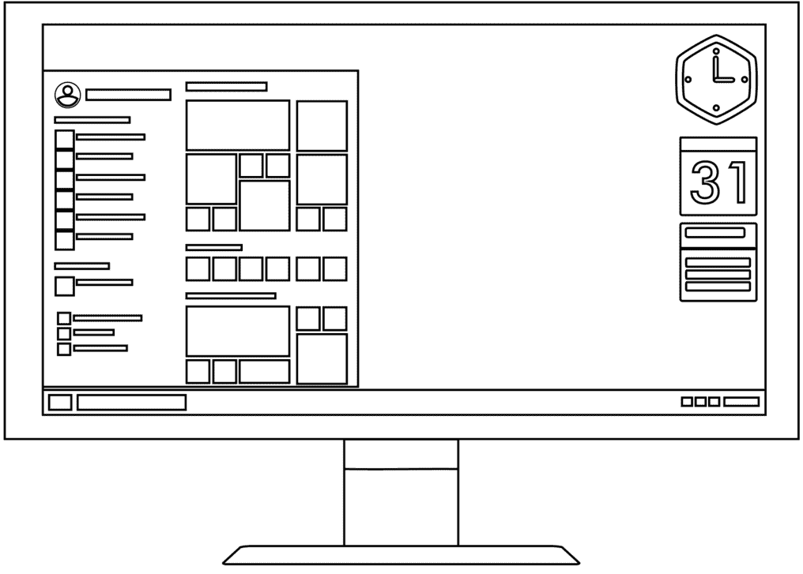

图片摘自《计算机科学涂色书：计算机科学的温和有趣入门》（William Lau 著，经许可复制）。

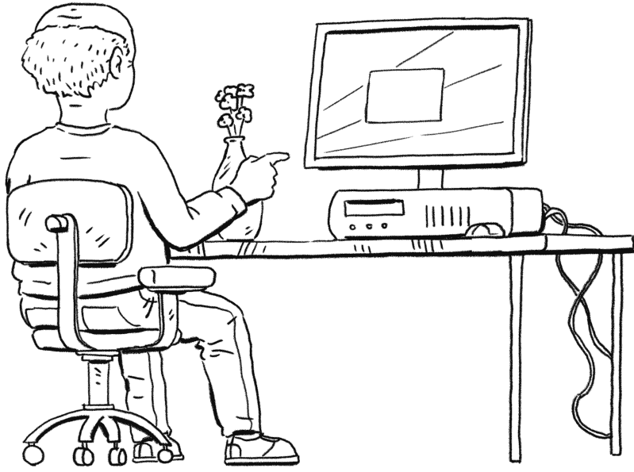

## 计算系统——硬件和软件——通信

CSTA K-2 标准 1A-CS-02：在识别和描述计算系统常见物理组件（硬件）的功能时，使用恰当的术语。

“计算系统由硬件和软件组成。硬件由物理组件构成。学生应能够识别并描述外部硬件的功能，例如台式计算机、笔记本电脑、平板设备、显示器、键盘、鼠标和打印机。”

教孩子了解硬件很重要，但仅让他们死记硬背事实太枯燥了。重要的是要循序渐进。尽可能让孩子亲手操作这些物品，并使用游戏、歌曲和幽默来使学习更具吸引力。

### 教授硬件的脚本

### 计算机鼠标

首先，向你的学习者展示一个外置有线鼠标。说：“有人知道这叫什么吗？看，它有一条尾巴！但在这种情况下，因为它连接到计算机，这部分[指向电缆]实际上被称为电缆。”如果你的学习者没有猜对，解释这是计算机鼠标。让他们重复说“计算机鼠标”。

用手指轻轻敲击一下。问：“这看起来是硬的还是软的？”让他们拿在手里感受一下，看看它是硬的。传阅一下。等每个人都有机会触摸后，问：“你觉得这是*硬件*还是*软件*？”接着问：“我用它来做什么？”如果你的教学风格有点滑稽，可以说：“我把它当帽子戴吗？我用它当皮带吗？当耳环呢？不？”

和学习者一起开怀大笑后，把话题拉回课程：“那我到底用它来做什么（如果不是当时尚配饰的话）？”解释计算机鼠标就像你手指或手的延伸。如果你不使用带触摸屏的设备，鼠标尤其有用。如果你还没有玩过本章前面的鼠标/光标游戏，请解释：当你沿平坦表面移动鼠标时，设备屏幕上的指针会向同一方向移动。当你轻触（单击）鼠标顶部左侧时，它会在屏幕上单击。如果你单击鼠标右侧，通常会给你额外选项。如果你*玩过*鼠标/光标游戏，可以邀请一位学习者演示鼠标的工作原理！

### 台式机与笔记本电脑

在教学习者区分台式机和笔记本电脑时，房间里最好至少各有一台示例机器。说：“我这里有两台（或任意数量的）计算机。”敲击每台的侧面。“这是硬的还是软的？这让这些计算机成为*硬件*了吗？”（是的！）

通过以下说法区分笔记本电脑和台式机：“这是一台笔记本电脑（指），这是一台台式机（指）。你觉得哪一台放在我腿上更舒服？”让学习者指。“就是这台较小的，对吧？它是笔记本电脑，因为我可以把它放在我的腿*上*使用。哪一台更适合留在书桌上？”让学习者指。“就是这台较重的（可能包含更多部件，取决于计算机类型），对吧？我使用时会把它放在书桌*上*。把它放在腿上会非常不舒服！这就是为什么它叫*台式机*，因为你使用时会想把它放在书桌上！”

### 打印机

敲击打印机的侧面（你的学习者现在应该已经习惯这个了）。说：“这看起来是硬的还是软的？”问：“那它算硬件吗？”（是的！）问：“这是什么？”（打印机。）“它有什么作用？”（当你“告诉”它时，打印文档。）解释有些打印机只能黑白打印，而另一些还可以*同时*打印彩色。指出打印机只能处理特定尺寸的纸张。一个你应该反复强调的主题是：计算机科学中的一切都由硬件和软件的构建和编程方式来定义。这些就是它们的局限性。你可以问：“我能制造一台打印非常大纸张的打印机吗——比如巨大的海报？”（当然！）“这台打印机能做到吗？”（不能，因为它不是为此构建的。）

如果你想针对年龄较大的学习者扩展这节课，可以接着问：“我们有没有办法给这台打印机加装零件或更换部件，让它 _能够_ 打印巨型海报？”如果可以，这就是黑客的一个方面，即让设备或程序做一些最初设计时未打算完成的事情。

## 显示器

轻拍显示器的侧面。说：“这看起来是硬的还是软的？”问：“那这就是硬件吗？”（是的！）问：“这是什么？”（电脑显示器/屏幕。）解释：“电脑显示器就是显示你正在处理内容的屏幕，并让你看到你可以用这台电脑做什么。”

如果你正在与稍大或更高级的学习者一起工作，可以继续说：“你可以用这台电脑做什么，取决于上面加载的软件。你可以通过下载/安装软件/应用程序在这个设备上添加额外的软件吗？当然可以！你可以删除已经安装的应用程序/软件吗？当然！这也可以做。但是，你应该确保自己没有删除重要的东西，也没有安装可能含有 **恶意软件** 的东西，尤其是如果这台电脑不属于你。我可以添加更多显示器，这样我就有更多空间来查看我在电脑上处理的内容吗？可以！”

如果你一直连续照着这些脚本讲，对年龄较小的学习者来说，听太多了。根据学习者的年龄，可以考虑把脚本拆分成每天一个新想法。之后安排一次大脑休息、一首歌或一个能让学习者活动起来的游戏。_输入/输出霍基波基舞_ 是个不错的选择，因为它与学习硬件和软件相关。

## 输入/输出霍基波基舞

按经典儿歌 _霍基波基舞_ 的曲调唱这些歌词：

- 你把鼠标插进去 [假装插入]
- 你把键盘插进去 [假装插入]
- 你输入文字 [假装打字]
- 你随意晃动双手 [张开并合拢双手]
- 你进行输入/输出，掌控你的科技 [原地转圈]
- 这就是全部的意思！[跟着节奏拍三下手]

- 你把打印机插进去 [假装插入]
- 你把文字打印出来 [假装抓纸张]
- 你把图片打印出来 [假装双手各拿着文件]
- 你把它们都展示出来！[举起你假装的文件]
- 你进行输入/输出，掌控你的科技 [念这行时原地转圈]
- 这就是全部的意思！[拍三下手]

- 你做输入，输出 [原地摇摆]
- 你做输入，输出 [原地摇摆]
- 你做输入，输出 [原地摇摆]
- 这就是全部的意思！[拍三下手]

## 扩展——物理计算与机器人

**物理计算** 这个词有时与机器人技术互换使用，因为两者都可以包含带有传感器、灯光、显示器、电机和其他输入/输出的设备。这些功能使这些设备非常吸引人，也是增强你的计算机 **STEAM** 或 **STEM** 课程的好方法。

出于实际目的，我大致将两者区分开来；“机器人”下列出的大多是自成一体的设备，而“物理计算”下列出的产品则有多个部件，可以根据需要添加和/或组装。我还为高级/年龄较大的学习者包括了几个选项，以提供一些关于下一步去向的想法。如果你在学校工作，且组织没有为这些提供资金，可以考虑申请一笔补助金。在我目前的学校，我的同事们通过 Bosch Best Grant (www.bestteachergrant.org) 取得了很大成功。

物理计算和机器人涵盖了为不同年龄段设计的各种设备，具有各种功能和价格点。这可能会有点令人不知所措。购买前请务必做一些研究（如果可能的话，最好亲手试用），如果你在学校工作，可以考虑先只购买一台，然后再决定是否购买全班一整套。这一台设备或套件可以先作为选择/活动站，直到你确定什么最适合你的空间和你的年龄组。下面你会找到目前市场上一些不错选择的简要概述。

### 机器人/机器人技术概览

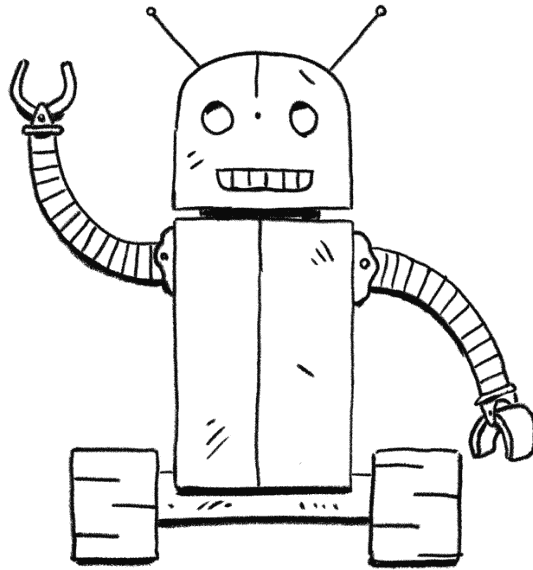

- **Bee-Bot/Blue-Bot** ($$$) 推荐适合 3–8 岁。可以无屏幕使用。新款 Bee-Bot 和所有 Blue-Bot 型号包含“看并说”（语音和感知）。
- **Botley** ($) 推荐适合 5 岁及以上。无屏幕，不需要额外设备即可运行，只需遥控“发射器”。包含活动套装。
- **Code & Go Robot Mouse** ($) 推荐适合 4 岁及上。使用双面编码卡片进行无屏幕编程。
- **Edison Robot** ($$) 推荐适合 4–16 岁。机器人小车。可以使用从条形码（适合最小的学习者）到“Edblocks”、“EdScratch”，最后到“EdPy”的年龄/技能进阶进行编程。
- **Ozobot Evo** ($$–$$$) 推荐适合 5 岁及以上。可以使用彩色线条（颜色代码）或基于积木的编程（Ozoblockly）进行编程。可以有或没有屏幕地使用。
- **Sphero Bolt** ($$$) 推荐适合 8 岁及以上（也可用于年龄较小的孩子）。色彩鲜艳、可编程的机器人球。比 Sphero mini 更大，功能更多。
- **Sphero Mini** ($$) 推荐适合 8 岁及以上（也可用于年龄较小的孩子）。色彩鲜艳、可编程的机器人球。
- **Wonder Workshop Dash** ($$$) 推荐适合 6–11 岁。使用 Blockly。

### 物理计算概览

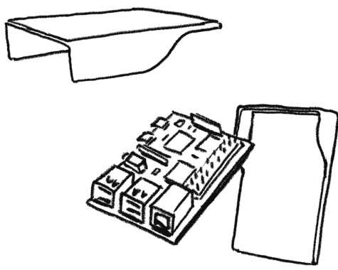

**Arduino** ($$–$$$) 套件推荐适合 11 岁及以上。可用于高级儿童和更复杂的项目。套件包含各种部件。对于喜欢 Makey Makey 的孩子来说，这是一个很好的进阶选择。

**LEGO® Education Spike™ Essential** ($$$$) 套件专为 1–5 年级课堂使用而设计。建议每两名学习者配备一套。课程与计算机科学标准对齐。LEGO® 还为 PreK–K（Coding Express）和初中（Spike™ Prime）提供课程/套件。

Makey Makey ($$) 推荐适合 8 岁及以上。STEM“发明套件”。使用鳄鱼夹连接现实世界中的导电物体（你的身体、香蕉等）。

Micro:bit ($) 推荐适合 8–14 岁。兼容 Microsoft MakeCode、Python 和 Scratch。

Raspberry Pi ($$–$$$) 可用于高级儿童和更复杂的项目。套件包含各种部件。对于喜欢 Makey Makey 的孩子来说，这是一个很好的进阶选择。类似于 Arduino，但有自己的操作系统。

VEX ($$$–$$$$) 拥有各种产品，价格范围不同。“123”推荐适合幼儿园及以上，“GO”推荐适合 3 年级及以上，“IQ”推荐适合 6 年级及以上。套件功能多样，专为课堂使用而设计。

## 关于学习编程方式的说明

物理计算/机器人选择可以用来学习不同的编程方式。起初可能看起来复杂，但基本上有三种学习编程的方式形成进阶：(1) 初读者调整方式，(2) 基于积木的编程，(3) 基于文本的编程。

### 初读者调整方式

我的首选推荐是 ScratchJr 应用程序，它通过拖放拼图风格的拼块来教授编程概念，为初读者提供有用的视觉调整。其他幼儿早期产品（在机器人/机器人技术概览部分中描述）使用诸如语音命令、卡片或彩色线条等功能。这些功能让我们年龄最小的学习者在学习阅读的同时也能取得成功。

### 基于积木的编程

基于积木的编程选项包括 Scratch、Blockly 和 Snap！这些也允许学生拖放拼图风格的代码块，教授编程原理。此外，它们还包含书面详细信息/说明。基于积木的编程被推荐为学习编程的第一步（适合大约 7 或 8 岁及以上的学习者），前提是学习者也能独立阅读。

### 基于文本的编程

基于文本的编程适用于已经理解编程基本原理的学习者。基于文本的编程涉及输入实际编程语言的文本命令。学习者准备好进行这种编程的年龄取决于先前知识和动机。这可能早在 8 岁，具体取决于学习者试图掌握哪种编程语言以及他们之前接触编程内容的程度。Python 和 HTML/CSS 被认为是很好的入门方式。相比之下，我不建议从 C++ 开始。

## 计算机系统—故障排除—测试、沟通

> CSTA K-2 Standard 1A-CS-03: 使用准确术语描述基本硬件和软件问题。
>
> “计算机系统问题有不同的原因。这个级别的学生不需要理解这些原因，但他们应该能够使用准确术语来沟通问题（例如，当应用或程序未按预期运行时，设备无法开机，声音无法工作等）。理想情况下，学生应该能够使用简单的故障排除策略，包括关闭再打开设备以重启，关闭并重新打开应用，打开音箱，或插入耳机。然而，这些在标准中未被指定，因为这些问题可能不会发生。”

如果您的学习者和我的一样，当他们的设备出问题时，他们开口就说它“出故障了”（或类似的概括性短语）。“出故障”是一个表示某事出了问题的有用词。然而，教孩子成功进行故障排除的第一步，是让他们在描述问题时具体化。下一页的“故障排除塔莎来拯救”手册包含指导故障排除的有用步骤（由我们的吉祥物故障排除塔莎带领）。考虑将其作为工具，帮助您与学习者一起搭建故障排除支架。

### 故障排除塔莎来拯救！

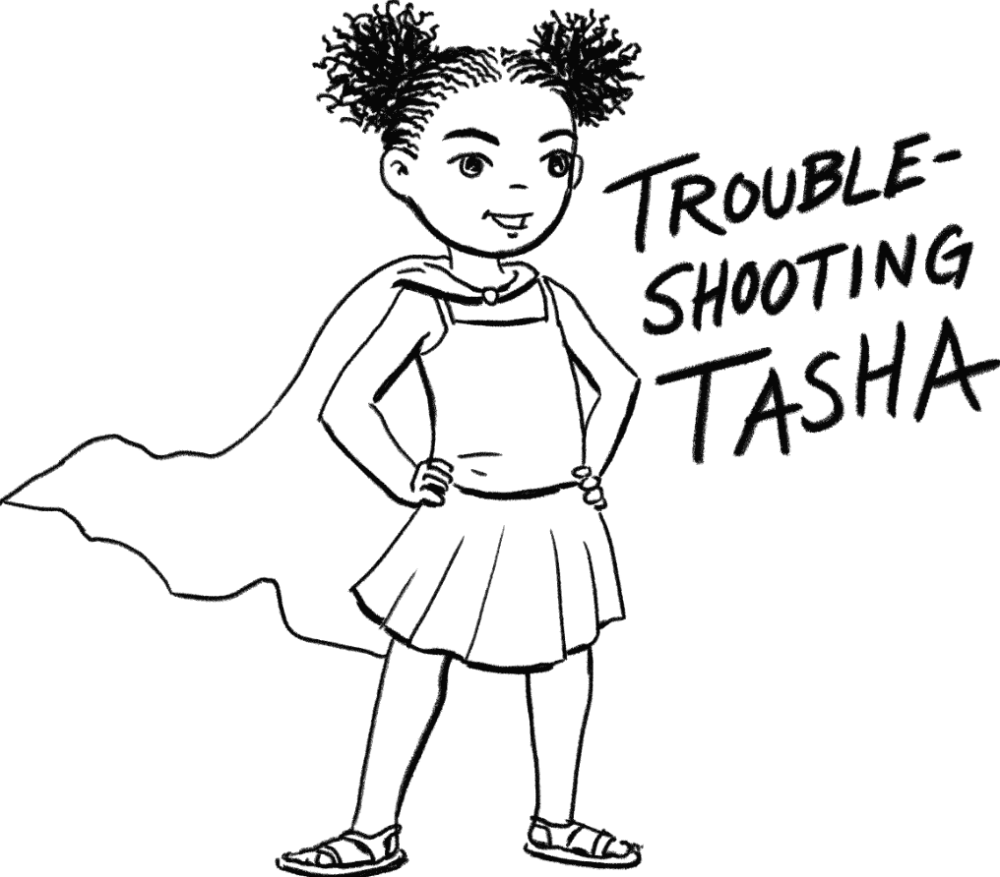

故障排除塔莎来帮助您修复设备！但首先她需要知道这些问题的答案：

### 问题 1：什么地方不工作了？

### 问题 2：什么时候不工作（一直都不行，还是仅在这个网站/应用/情境下不行）？

### 问题 3：我们可以做什么来尝试修复它？

经过一些练习——您也可以成为一名故障排除超级英雄！

使用此空间在修复设备时画出自己穿着披风的样子。

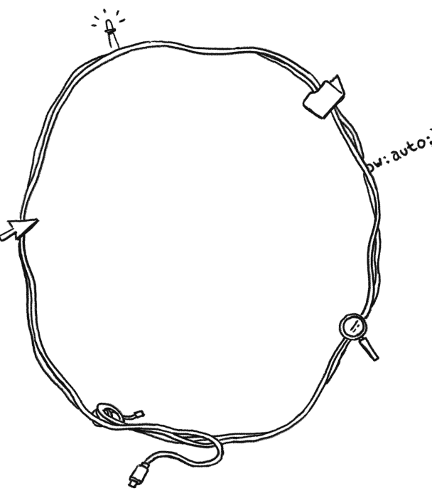

## 结论

第 1 章包含您开始学习者计算机科学探险所需的一切，方式深思熟虑且充满乐趣。继续使用本章中包含的工具，在学习者进步、掌握软件、硬件、故障排除、编程、机器人和物理计算知识时提供帮助。浏览本书末尾的资源部分，获取更多推荐材料。

## 参考文献

Dweck, C. S. (2007). 心智：成功的新心理学. Ballantine Books.

Lau, W. (2020). 计算机科学涂色书：计算机科学温和有趣的入门. William Lau.

# 第 2 章

# 网络与互联网

## 介绍

年轻学习者天性信任他人。他们需要被教导何时以及如何谨慎。在介绍登录凭据时，您首先需要教学习者什么是用户名和密码（即登录凭据）。请务必随后解释我们为何使用这些，以及他们应该（和不应该）与谁共享。与年龄较大的学习者一起使用“登录凭据：理解检查”手册。玩“点击！点击！恶意软件”和“红灯/绿灯：密码安全游戏”来让它变得有趣。一起唱《傻乎乎的密码歌》。使用“云彩涂色页”传达网络工作原理的基本理解。

## 网络与互联网—网络安全—沟通

CSTA K-2 Standard 1A-NI-04: 解释什么是密码以及我们为何使用它们，并使用强密码保护设备和信息免受未经授权的访问。

> “学习保护自己的设备或信息免受他人不想要的使用，是学习网络安全的必要第一步。学生不需要使用多个强密码。他们应适当地使用和保护被要求使用的密码。”

## 教授登录凭据的脚本

解释用户名是告诉设备（或应用/网站）您是谁的方式。它将您与您的东西连接起来（保存的文档、电子邮件、保存的游戏等）。您的用户名通常不会更改。用户名是您的特殊技术名字。出于安全考虑，它不应与您的真实姓名相同。确保您的学习者知道，用户名可以与某些人共享，但首先应先与可信赖的成年人确认。

解释您的密码是访问设备（或应用/网站）的第二部分，它应该格外保密。让您的学习者提出一些他们认为为什么这很重要的想法。我通常会花些时间解释，如果某人知道您的密码，他们就可以进入您的东西并随意篡改。就像别人进入您的房间并弄乱您的东西不有趣一样，别人进入您设备上的东西并弄乱它们也不有趣。我们希望避免这种情况。

“您的密码只在您、您的设备和您信任的成年人之间。”在此处暂停，回顾谁是可信赖的成年人，谁不是。“您的老师是可信赖的成年人吗？您的邻居呢？您的最好的朋友呢？您家里的成年人呢？您的老师需要知道您在家中使用的电脑的用户名和密码吗？（不）。您家里的成年人需要知道您学校设备的用户名和密码吗？（是的，尤其是如果您把这些设备带回家做作业的话）。您可能需要回顾几次，让他们掌握诀窍。如果您的风格是傻乎乎的，您还可以问问您的狗、猫、鸟或窗外的松鼠是否需要知道您的登录凭据。”

## 红灯/绿灯：密码安全游戏

玩红灯/绿灯游戏，并用它来加强何时保持密码安全。在传统游戏中，一个人站在空间一侧，例如体育馆、田径场或操场（“呼叫者”），其他人都在另一侧。当呼叫者说“绿灯！”时，所有人朝他们跑去，试图率先到达。当呼叫者说“红灯！”时，所有人必须停止。任何没有足够快地停止（或听到“红灯！”时还在跑）的人都必须回到起点。您可以连续喊“绿灯”或“红灯”来增加变化。率先到达呼叫者的人将成为新的呼叫者。

要使用此游戏教导孩子何时可以共享密码，不要大喊“红灯！”和“绿灯！”，而是大喊出应该或不应该知道孩子密码的人的名字/头衔。您可以有一个列表（图片和书面文字）供呼叫者使用，带有列和/或绿色或红色文本，以帮助指示谁是与谁共享密码的安全人选，谁不是。如果需要，名字和头衔可以在同一游戏中重复使用。

一些“红灯”示例可能是：您的邻居、您的朋友、您的表亲、陌生人、刚认识的人。一些“绿灯”示例可能是：您的老师、您的学校图书管理员、您的成年人、您的监护人、您的狗、您的猫、您自己。在游戏前与学习者讨论哪些答案是“红色”哪些是“绿色”，并确保根据您的社区进行调整。对于年龄较小的学习者，我总是使用“成年人”来指代家里可信赖的成年人，因为并非所有我的学生都和爸爸妈妈住在一起，而“成年人”更具包容性。对于年龄较大的学习者，出于同样的原因，我说“可信赖的成年人”。

同样，您可以添加各种动物来让它变得滑稽，只要您提前告诉学习者这些动物属于哪一类（一个会重复密码的鸟不是与其共享密码的好动物，但任何其他动物都可以是“绿灯”）。

告诉您的学习者，与您的用户名不同，您的密码应该不时更改。如果非可信赖的成年人（例如另一个孩子）使用了您的密码，也应立即更改。在教年龄较大的学习者时，我会详细说明，有时您可能会收到一条消息（通常是电子邮件），称其他人可能已访问您的帐户。这是另一种更改密码，也许启用多因素身份验证的重要行动。启用多因素身份验证后，第一个“因素”是您的密码，但还需要另一个“因素”，例如发送给您的验证码（通过短信或电子邮件），或语音、指纹、面部或视网膜扫描等生物识别。如果您相当确信

即使只有你一个人在使用你的登录凭据，密码也应该每隔一段时间更换一次。以防万一。对于年龄较小的学习者，一年更换一次就足够了。

如果你的学习者在登录时从未使用过自己的用户名和密码，他们需要大量练习。他们的用户名不应超过八个字符，密码也应该简单。对于年龄较小的学习者，一个不错的经验法则是创建由两个单词组成的密码，中间用大写字母，末尾加一个单个数字——例如，“techBoss1”。他们需要练习如何输入大写字母以及如何在键盘上找到数字和字母。但是，使用包含大写字母和数字的密码有助于教导年轻学习者创建安全密码的基础。随着他们年龄增长，可以添加符号。

通过限制年轻学习者需要使用的字符数量，你可以提高他们独立掌握登录技能的几率。在考虑年轻学习者的登录凭据时，安全性和可用性应始终保持平衡。在学校环境中，我强烈建议为每位学习者创建一张登录卡，卡片正面写上他们的姓名，背面写上他们的登录凭据。指出当他们不需要登录时，应该把卡片翻回来（这样只露出他们的姓名）。这是加强登录凭据安全性的另一种方式。

在学校环境中，当你第一次教学习者登录时，也可以考虑制作一份带有屏幕截图的讲义，供他们在执行步骤时参考。预留额外的练习时间，并为完成任务较快的学习者准备其他活动。对于年龄较小的学习者，可以考虑使用歌曲来帮助他们记住保护密码安全，例如 The Silly Password Song。

## 滑稽密码歌

保护好你的密码。嘘 嘘 嘘嘘嘘 [手指放在嘴唇上]
保护好你的密码！嘘 嘘 嘘嘘嘘 [手指放在嘴唇上]
不要告诉你的兄弟
不要告诉彼此
保护好你的密码！嘘 嘘 嘘嘘嘘 [手指放在嘴唇上]

让你的密码变长 [伸出手臂]
让你的密码变长 [伸出手臂]
让你的密码变长 [伸出手臂] 以使其强壮 [二头肌弯举]
让你的密码变长 [伸出手臂]
保护好你的密码。嘘 嘘 嘘嘘嘘 [手指放在嘴唇上]

经常更换你的密码 [伸出手指并像打字一样移动它们]
经常更换你的密码 [伸出手指并像打字一样移动它们]
经常更换你的密码，不要让它被抓到！ [装作从空中抓取某物的样子]
经常更换你的密码 [伸出手指并像打字一样移动它们]
保护好你的密码。嘘 嘘 嘘嘘嘘 [手指放在嘴唇上]

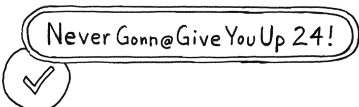

图 2.1 一个安全密码的示例。

## 网络安全扩展：更安全的密码

如果你正在与年龄较大的孩子合作，教导他们安全密码是指长度较长（越长越好）且包含字母（大写和小写）、数字和符号组合的密码。此外，如果为每个账户使用唯一密码（并在可能时使用唯一用户名），你的密码会安全得多。你应该避免使用容易被猜到的信息，例如出生日期、家人或宠物的名字，或者单词“密码”。

尽管如此，安全密码也必须是你能记住的密码。当前的最佳实践建议使用 3–4 个随机单词和一个符号。这样更容易记住，从而让人不太可能将密码写在容易被发现的地方。

另一个不错的经验法则是用数字或符号替换一些字母。如果你这样做保持一致，就很容易记住。例如，将字母 O 替换为零 (0)，或将字母 S 替换为美元符号 ($)，将使密码更安全。使用这种格式，我可以将“少即是多”写成这样：le$$i$m0re。

另一项建议（在可能时）是为每个登录创建唯一密码，并将其安全地保存在密码管理器中，例如 PassKeep。密码管理器会保存你的登录凭据，使其安全并消除记忆的需要（尽管你仍然需要记住用于访问密码管理器的那个密码）。

不遵循这些提示会使你的密码更容易遭受暴力破解攻击。暴力破解攻击的一个示例是，黑帽黑客尝试通过尝试每一种可能的密码组合来访问你的账户。如果你的密码较短（例如，一个四位数字）或是字典中的单词，则更容易受到暴力破解攻击。

## 登录凭据：理解检查

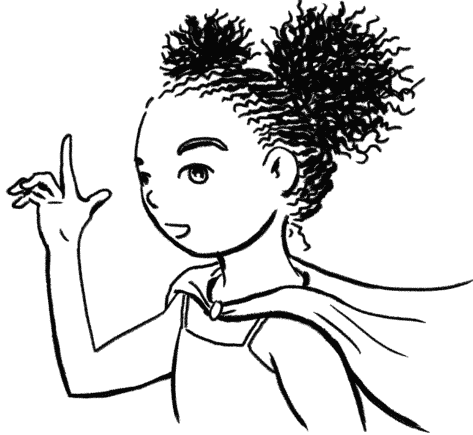

姓名：

什么是用户名？

什么是密码？

我们为什么要保密密码？

我们应该对谁保密？

你的监护人可以知道你的密码吗？

你如何创建一个安全的密码（且你能记住的密码）？

## 网络安全扩展：使用游戏

当你的学习者理解了基础知识后，你会希望在 **网络安全** 和互联网安全方面深入学习。研究表明，使用游戏和歌曲以及以不同方式（展示、讲述和添加动作）强化内容，有助于孩子们记住更多所学内容。即使是更严肃的话题，也要尽可能以有趣的方式参与材料。考虑“点击点击恶意软件！”游戏。

### 点击点击恶意软件！

使用传统的儿童游戏“鸭子鸭子鹅”来强化，点击未知网站可能会导致你的电脑感染恶意软件。就像在传统游戏中一样，让你的学习者围成一圈坐着，身体相互面对。

指定的“老鼠”（可以戴老鼠耳朵）会轻轻拍每个孩子的头。这样，他们就会“点击”（拍）每个“网站”（孩子的头）。与传统游戏中每次拍打时说“鸭子”或“鹅”不同，老鼠会说“点击”或“恶意软件”。

当老鼠拍孩子的头并说“恶意软件”时，那个孩子会跳起来试图标记/感染老鼠（电脑），而老鼠会试图绕着孩子们跑一圈并在恶意软件的位置坐下……在被标记之前。如果老鼠在没有被标记的情况下回到那个位置，他们就是“安全”的（他们可以大喊“病毒已隔离”或“防病毒软件有效”），然后恶意软件可以交换角色并充当老鼠。如果原始老鼠在被标记之前*没有*到达开放/安全的位置，他们必须重新开始当老鼠并再试一次。对于年龄较大的学习者，他们不只说“恶意软件”，还可以命名特定类型的**恶意软件**：**病毒**、**蠕虫**、**间谍软件**、**勒索软件**等。

## 网络安全扩展：介绍词汇

为了让孩子们更好地理解任何学科，他们需要理解所使用的术语。这是配套绘本《小小计算机科学家》和《小小黑客》的意图之一。随着你的学习者进步，请解释以下内容。

当你的电脑有恶意软件（病毒、间谍软件、蠕虫）时，你可以通过**重新启动**电脑并使用**安全模式**来解决问题。这意味着你将以一种方式重新启动电脑，只运行电脑需要的最基本程序。这种重新启动设备的方式可以帮助你识别和修复潜在问题（包括但不限于恶意软件）。为了了解如何在设备上使用安全模式重新启动，请在 Google 上搜索“reboot”、“safe-mode”以及你的特定设备类型（例如，“Macbook Air”）。

**已隔离病毒**是指被限制在安全区域的病毒，它无法感染设备的其余部分。你可以使用防病毒软件来实现这一点。**特洛伊木马**以古希腊关于特洛伊城陷落的故事命名，是指恶意软件伪装成合法程序。下载后，恶意软件会造成危害。这是另一种可以使用防病毒软件隔离的病毒。目前推荐（在本书撰写时）的防病毒软件示例包括 Avira、McAfee、Bitdefender、Malwarebytes 和 Norton Antivirus。

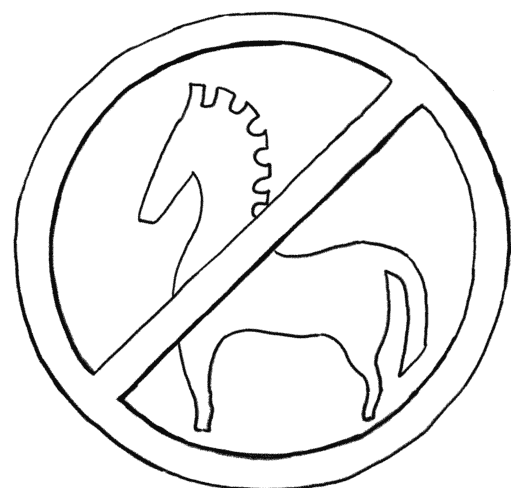

说到黑客攻击，**黑客**并不总是在做坏事。黑客攻击有三种类型：白帽、灰帽和黑帽。**白帽黑客攻击**是网络安全专家所做的工作。他们致力于发现和修复漏洞，并试图防止其他黑客入侵。这也被称为“伦理黑客攻击”。发起假网络攻击以发现漏洞被称为**渗透测试**，简称“渗透测试”。**灰帽黑客攻击**是指有人（未经授权）入侵系统，以提高意识并暴露漏洞（这也称为黑客行动主义）。**黑帽黑客攻击**是指有人（未经授权）入侵系统，意图造成损害和/或窃取信息。

## 扩展—网络—一些基础

在《小小计算机科学家》中，朋友们设置了一个局域网（LAN，local area network），以便他们都可以一起在 Minecraft 中构建。局域网的常见用途是家中通过 Wi-Fi 连接的设备。另一个例子是学校：计算机和打印机是网络的一部分，以便轻松共享文件，每个人都可以访问打印机。联网设备非常方便且有趣。然而，与许多有趣的事物一样，它们也可能带来安全风险。例如，如果有人访问您所有设备都连接在一起的网络，他们现在可能会入侵所有这些联网设备。这就是为什么我们使用防火墙，有时还会使用安全路由器和交换机来降低被入侵的可能性（也是为什么在使用公共免密码 Wi-Fi 时需要格外小心）。

互联网本身也被视为一个网络。这个网络通常被称为“云”。使用《云涂色页》向学习者展示可能连接到云的设备类型。

### 云

下面画出的物体都可以连接到互联网。这就是它们被称为物联网（或简称 IOT）的原因。

互联网是世界上最大的网络。它通常被称为**云**（虽然你肉眼看不见它——你必须想象它的样子）。使用云来访问或控制这些物体称为**云计算**。你可以把它想象成一朵悬浮在你头顶的大云，所有物体——物联网——都连接到它上面。

给你认出的物体上色。接下来，按你想象的方式给云上色。

数一下你认出的物体数量。在这里写下那个数字：___

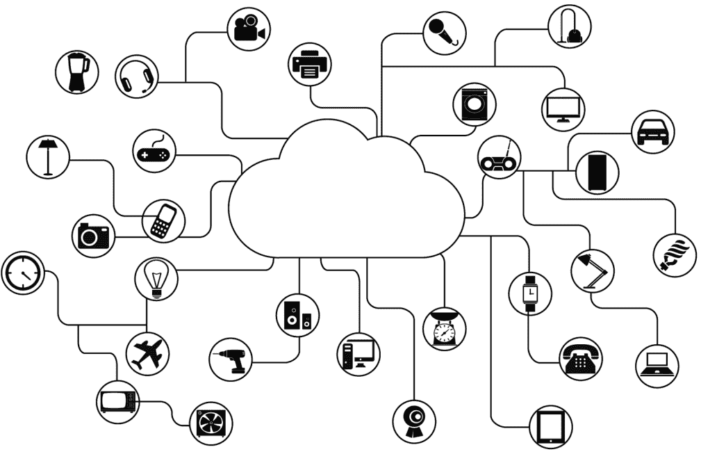

（涂色页来自 William Lau 的《计算机科学涂色书》。经许可复制。）

## 结论

网络和网络安全是微妙且不断发展的学科，因此用大体笔触来教授这些内容很有帮助。对于年幼的学习者，温和地介绍安全概念及其必要性就足够了。网络和网络安全工作仍然供不应求；对这些主题感兴趣的学习者应被鼓励继续探索。希望你享受了玩“点击点击恶意软件！”和“红灯/绿灯密码安全游戏”以及唱“愚蠢密码歌曲”。第 3 章将乐趣延续下去，通过机器人舞会和绘图（也许还要吃！）M&M’s（或你喜欢的零食）来进行数据与分析。

## 参考文献

Lau, W. (2020). 《计算机科学涂色书：计算机科学的温和有趣入门》。William Lau.

# 第 3 章

# 数据与分析

## 引言

教你的学习者通过融入机器人舞会和绘图（也许还有吃）M&M’s（或你喜欢的零食）等有趣活动来享受**数据**分析。使用本章中的课程来教授数字与物理（或实时数据）的区别，各自的优势和用途，如何进行预测，以及科学方法。

## 数据与分析—存储—抽象

> CSTA K-2 标准 1A-DA-05：使用计算设备存储、复制、搜索、检索、修改和删除信息，并将存储的信息定义为数据。
>
> “计算设备存储和处理的所有信息都称为数据。数据可以是图像、文本文档、音频文件、软件程序或应用、视频文件等。当学生使用软件在计算设备上完成任务时，他们将操纵数据。”

当孩子们最初学习数据时，他们需要被明确地教授不同类型的数据叫什么，如何区分不同类型的数据，以及如何保存和检索文件。在与你最年幼的学习者开始这些主题时，尽可能将数字世界与他们可以触摸和操纵的有形物理对象联系起来很有用。

例如，可以考虑准备同一张照片的打印版和数字版、一份数字和打印的书面文档，以及一个麦克风，你可以对着它实时讲话，然后将你的声音数字化录制以供回放。在比较和对比这些内容时，还要有用地解释什么时候拥有数字与物理（或实时）数据表示是有帮助的（反之亦然）。

## 活动：比较和对比数字数据与物理/实时数据

提前准备好你的数据和有形对象：

- 同一张照片的数字版和实体版。
- 一个麦克风（可以是设备内置的）和某种录音软件，准备好录制你的声音——Voice Memo、Voice Recorder 或基于网页的 Vocaroo (https://vocaroo.com) 都可以。
- 一份文档的实体版和数字版。这可以只是你的学习者名单、一段书面句子或段落（在 Microsoft Word、Google Docs 或对你最合适的任何工具中），并附有打印副本。

或者，如果你想要更精致一些，可以设计一个有趣的活动（远足、聚会）邀请函。Canva (www.canva.com) 是我最喜欢用来设计邀请函的工具之一。

这些数据比较可以一次性完成，也可以在几天内逐一处理——无论什么对你和你的学习者最合适。

### 比较数字照片数据与实体照片数据的脚本

向你的学习者发放一张实体照片，并在设备上显示同一张照片的数字版本，让所有人都能看到。让他们说出他们注意到的数字照片和打印照片之间相同和不同的地方。倾听他们的回答，澄清任何误解。告诉他们照片是一种可以看到的数据。

区分并命名实体版和数字版。询问他们认为每种类型各有什么优势：“我用这个[指向]实体照片能做什么，而用这个[指向]数字照片做不到”（反之亦然）。引导对话，帮助你的学习者思考数字版本的照片处理和复制。与之形成对比的是，打印副本随时可访问，而数字副本可能需要电池/电源，或者可能需要互联网连接，具体取决于它是如何存储/保存的。

### 比较实时音频数据与录制音频数据的脚本

打开你喜欢的语音录音软件，准备就绪。Voice Memo、Voice Recorder 或基于网页的 Vocaroo (https://vocaroo.com) 都可以。因为 Vocaroo 是基于网页的，因此在任何有互联网连接的设备上都可用，本脚本将以 Vocaroo 为例。

不录制的情况下对你的学习者大声说一句话，例如：“我今天非常兴奋能给你们讲授计算机科学！我很高兴你们都在这里。我大声说出来是因为我希望你们实时听到。有没有办法我可以把这条消息保存为录制的数据，这样你们以后可以再次听到？即使我不在这里？”给你的学习者一个回应的机会。

接下来，打开你的音频录音软件。向你的学习者讲解你正在做什么。例如：“我现在正在打开这个音频录音软件。我将用它来录制我的声音。语音录音，就像照片一样，是一种数据。我用来创建这个音频[指向你的耳朵]数据的软件叫做 Vocaroo。你能重复一遍吗？你可以使用任何有互联网连接的设备访问 Vocaroo。你只需在谷歌等**搜索引擎**中输入 Vocaroo，或输入**网址**，vocaroo.com。我马上就要用它来录制我的声音了。看到那个红色的麦克风图标了吗[指向屏幕上的它]？当我准备好时，我只需点击它并开始说话。请确保关闭_你们_的声音，这样_这次_只录制我的声音。准备好了吗？3-2-1 声音关闭。”

“我正在点击红色麦克风开始录制……现在[点击红色麦克风图标]……我今天非常兴奋能给你们讲授计算机科学！我很高兴你们都在这里[按下中央的红色方块图标停止录制]。当 Vocaroo 录制我的声音时，它向我显示了一个方块内闪烁的红色方块。你看到了吗？你注意到我点击了中间的那个大红色方块（方块内的方块）来停止并保存录制吗？你还注意到屏幕上有什么吗？让我们点击左侧的这个刷新按钮[点击带箭头的红色圆圈图标]重新开始录制，再看一遍。注意这样做会_擦除_第一次录制。我马上会向你展示如何_保存_你的录制。”

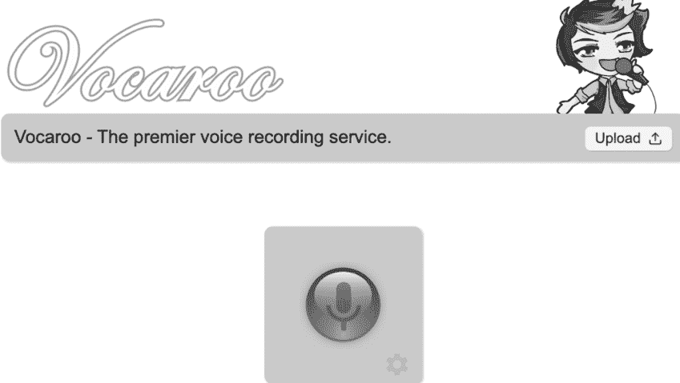

图 3.1 Vocaroo 网站录制按钮图片。

点击红色刷新按钮，并指出录制按钮右侧的秒数计数器以及左侧的暂停按钮。说明秒数计数器告诉你录制时长（以秒为单位），屏幕左侧带有两条线的方框即为暂停按钮。暂停按钮用于在想要休息时暂停录制；准备好后，可再次点击它以继续同一录制。

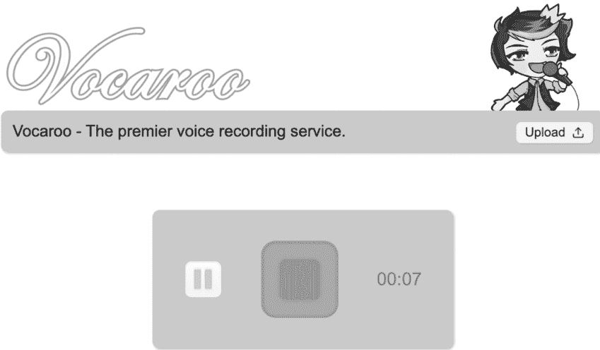

图 3.2 Vocaroo 网站录制进行中的图片。

如果您正在与年龄较大的学习者一起工作，可能希望在此处停下来，给他们尝试录制自己声音的机会。您需要确保他们能在自己的设备上轻松访问 Vocaroo。在黑板上写上“Vocaroo”，或通过 **学习管理系统**（LMS）分享链接。

最后，您需要确保向学习者解释如何保存和共享他们的语音录音/音频数据。指引他们找到屏幕底部写有“Save & Share”的绿色矩形图标，并告诉他们在得到喜欢的录音后点击该图标。

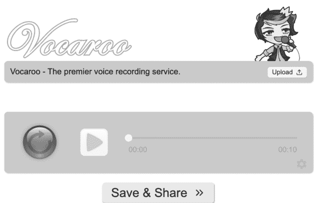

图 3.3 Vocaroo 网站“保存和共享”界面图片。

这将为他们提供多个选项，包括复制录音链接（以便粘贴到您的 LMS 中提交）、通过电子邮件发送、将其下载为 .MP3 文件、创建并保存 **二维码** 以便访问等。指导学习者选择最适合自己的选项。

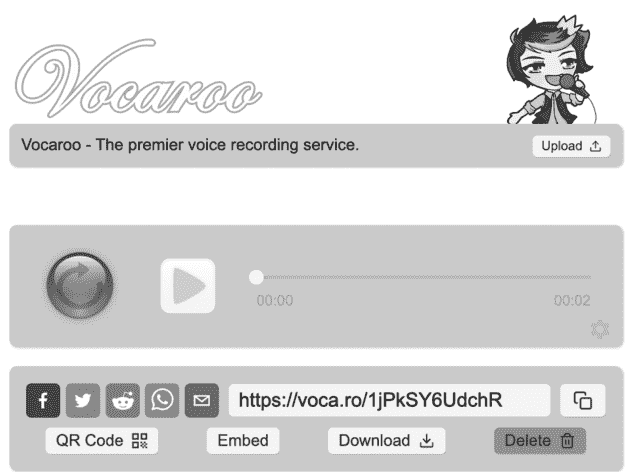

图 3.4 Vocaroo 网站额外共享选项图片。

结束本课时，重复你开头说的话：“我今天非常兴奋能给你们讲解计算机科学！非常高兴大家都来了。我刚才大声对你们说过了，现在我也把它录下来了，因为我真的希望你们听到这段话，知道我有多高兴今天能和大家在一起！在本课中，我们学习了数据。我*未录制*就对你说这句话，与录制后对你说，有什么区别？” 给学习者回应机会，然后继续：“音频录音能让我做哪些事情，而只是大声说出来（未录制）却做不到？”

指出，当你当面说出这句话时，学习者可以看到你的肢体语言和面部表情。这使他们更容易看出你有多高兴能教他们。然而，该消息的音频录制可以保存和共享，这也非常有用——尤其是当需要与今天不在场的人分享录音时。

让学习者自己举例说明语音录音的用途。如果是一对一辅导，学习者可以直接向你讲述他们的想法。如果是面对大组，这是一个很好的“两两分享”机会：让学习者与旁边的一两个孩子配对，轮流分享各自的想法。结束本课时，请几位学习者向全组分享。如果你想巩固本课内容，甚至可以让他们录制自己最喜欢的想法，并保存和分享这些录音。

### 比较数字文档数据与物理文档数据的教学脚本

制作一份邀请函。打印一份副本，并将数字副本显示在学习者容易看到的地方。随意使用下面的示例。您可以在我的网站（authorjuliedarling.com）上获取示例邀请函的副本。

欢迎学习者，并告诉他们你非常兴奋能邀请他们参加机器人舞会（或邀请函上写的任何内容）。告诉他们，你创建这份邀请函是为了让他们记住详细信息、时间和地点，以免错过。解释，这种邀请函是一种称为文档的数据。

## 你受邀参加机器人舞会！！！

| 字段 | 详细信息 |
|------|----------|
| 日期： | |
| 时间： | |
| 地点： | |

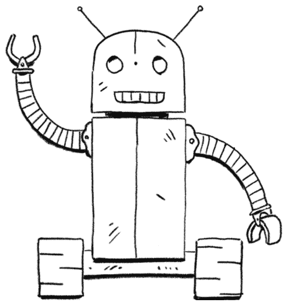

提问：“我可以用这份物理文档做什么？我可以把它递给你查看吗？你可以在上面画画或添加细节吗？” 接着提问：“这份邀请函的数字副本呢？我现在可以把哪一份通过电子邮件发送给你的监护人，让他们立即了解机器人舞会的情况？你可以带哪一份回家给他们看？” 让学习者自己举例说明两种数据（物理邀请函与数字邀请函）各自的优势，以及他们为什么可能会选择其中一种方式而不是另一种（或者什么时候制作两种都是个好主意）。

您可以考虑用一场真实的机器人舞会作为本课的后续活动。学习者可以装扮成机器人和/或像机器人一样跳舞。您甚至可以创建一个主题歌曲播放列表，Kraftwerk 的“The Robots”、“It’s More Fun to Compute”和“Home Computer”，以及 Yo Gabba Gabba! 的“We Are the Robots” 都是不错的选择。Bounce Patrol 的“Do the Funky Robot”也很好玩。您应该能够通过谷歌搜索找到所有这些歌曲；此外，我的网站（authorjuliedarling.com）上也链接了一系列机器人舞会资源。

## 数据：扩展

随着学习者年龄增长，并对数据使用有良好理解后，请指出文件扩展名（.pdf、.mp3、.docx）。解释文件扩展名告诉你文件包含什么类型的数据。理解不同类型的文件和文件扩展名是执行上传、下载和转换文件等更高级任务所必需的。

您还应讨论数据如何存储和检索。解释将数据存储在“云端”（例如您的 Google Drive）、学校或家用计算机的本地驱动器上、共享驱动器上或外部存储设备上的区别。包括为何需要为重要数据创建备份（以防文件损坏或意外删除）。

随着学习者技能提高，教他们如何组织数据以便轻松找到、如何使用逻辑命名约定，以及为什么将数据组保存在文件夹中很有用也很有价值。例如，在撰写这些书籍时，我将每本书保存在单独的文件夹中。文件夹和手稿 _小小计算机科学家_ 都称为“小小计算机科学家”，尽管我保留了手稿的早期版本，但我为每个版本都加上了数字命名（例如 _v.7 小小计算机科学家_），以便轻松找到最新版本。组织和命名数据也可以迁移到其他计算机科学技能中——例如网页设计。

## HTML/网页设计：初步步骤

在设计网站时，网页设计师需要确定在导航菜单和/或侧边栏中添加哪些链接、如何命名它们，以及如何组织这些链接页面，以便人们能够轻松找到它们。结合对 HTML 和 CSS（或许还有 JavaScript）的理解，这可以发展成为网页设计职业。

Google Sites 是孩子们练习 HTML 基础知识的一个简单免费平台。Google Sites 与您的 Google 账户关联。选择一个全新的空白站点，这样更容易查看您制作的内容。为了练习使用 HTML，请找到右侧导航中写有“插入”的位置。从此处，您可以访问“嵌入”。选择“嵌入代码”，输入您的 HTML，然后点击左下角的“插入”。

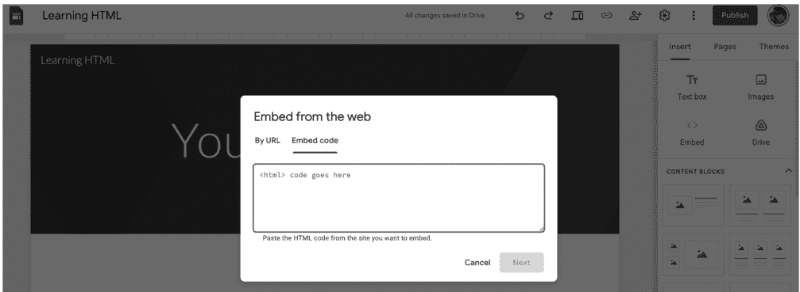

图 3.5 Google Sites 截图，演示了可以手动输入 HTML 的位置。

有大量书籍和在线资源可供学习 HTML。对于刚开始学习的年轻学习者，我喜欢 SuperCampus Jr 的“HTML with the Caveman”视频（www.youtube.com/@supercampusjr9058）。

## 数据与分析——收集和可视化与转换——沟通，抽象

> CSTA K-2 标准 1A-DA-06：以各种视觉格式收集和展示相同的数据。
> 
> “收集和使用关于周围世界的数据是日常生活的一部分，并影响着人们的生活方式。学生可以收集天气数据，例如晴天与雨天、上学开始时和结束时的温度，或暴雨过程中的降雨英寸数。学生可以数一数一袋糖果（如 Skittles 或 M&M's）中各种颜色糖果的数量。学生可以制作关于他们感兴趣事物的调查，例如喜欢的食物、宠物或电视节目，并从同龄人和其他人那里收集调查答案。收集到的数据随后可以组织成两种或更多可视化形式，例如柱状图、饼图或图画图。”

## 活动：使用“趣味装”糖果教孩子们绘制数据图表

使用“趣味装”Skittles 或 M&M's 糖果袋教孩子们分析数据是我教授这项技能的最爱方式，因为这对孩子们来说极具吸引力。然而，在介绍本课之前，您需要确保学习者明白，在完成分析（甚至可能向您展示结果）之前，他们不能吃糖果。如果您的学习者和我的一样，您需要在分发糖果前多次重复这个指示，并可能让他们复述一遍：“你什么时候可以吃糖果？”（只有在最后我说可以的时候才能吃）。

### 何时教授此活动

本活动要求学习者具备计数、书写或输入数字（1–10）以及识别、书写或输入颜色名称的基本理解。此活动可能最适合从幼儿园中段或期末开始（约 5½ 岁）。年龄较大的学习者也会觉得这很有趣，并可以使用 Excel 或 Google 表格 用他们的数据创建更复杂的图表。

### 事先搭建支架

如果你正在与年龄较小的学习者一起工作，可以通过提供包含你选择的“趣味装”糖果中颜色名称的单词库来搭建这部分内容，将单词库写在容易看到的地方，或者随意复制“使用‘趣味装’M&M's 制作条形图”讲义。考虑使用这些颜色来书写颜色名称。例如，用绿色写“green”，用红色写“red”，等等，以协助单词识别。

在学习者数糖果时，让他们可以查阅的课桌/工作站或墙上贴有数字线也很有用。

请注意，食物活动有时可能会带来问题。在购买糖果之前，请确保不会遇到过敏原问题。如果食物过敏或其他饮食限制是个问题，可以考虑使用彩色珠子或类似物品来进行此活动。

### 收集材料

本活动需要：

- 每位学习者一袋“趣味装”糖果。
- 一张方格纸，一张白纸（如果没有方格纸则用两张白纸）或“使用‘趣味装’M&M's 制作条形图”讲义。
- 每位学习者一支铅笔，以及与糖果颜色相对应的绘画工具（蜡笔、彩色铅笔或记号笔）（蓝色、棕色、绿色、橙色、红色、黄色）。
- 糖果颜色的单词库（针对年龄较小的学习者），用相应颜色书写。
- 数字线（针对年龄较小的学习者，可选）。
- 如果学习者将在白纸上制作图表，则需要一把尺子（可选）。
- 用于绘制数字数据图表的软件设备（针对年龄较大的学习者）。

### 教学脚本

向每位学习者发放一包“趣味装”糖果，并再次提醒他们在活动完成前不要吃糖果。发放纸张，并告诉他们可以打开糖果，将其倾倒在上面。指导学习者按颜色将糖果分成堆。糖果按颜色分开后，让他们在每堆旁边写下颜色名称（如果他们愿意，可以用相应的颜色书写这些颜色名称——例如，用绿色铅笔写“green”）。如果你使用“使用‘趣味装’M&M's 制作条形图”讲义，可以跳过写下颜色名称的步骤（但如果学习颜色是他们正在练习的技能，学习者仍然可以用相应颜色给单词上色）。

接下来，让他们数出每个颜色堆中有多少颗糖果。通过指导学习者数第一堆，将糖果数量写在纸上颜色名称旁边，然后再次数同一堆来检查工作，来演示这一点。如果第二次的计数不同，让他们再检查一遍。他们也可以和朋友互相检查彼此的工作。

一旦他们确信计数正确，就可以画出条形图（或使用讲义上的条形图），并涂色与每种颜色糖果数量相对应的方框数量。例如，如果他们有三颗红色的 M&M's，应该（使用红色）在标记为“red”的行中涂色第 1、2、3 列。让他们重复此过程，直到他们将所有 M&M's 都画在图上。

### 使用“趣味装”M&M's 制作条形图

Name______________________________________

打开你的“趣味装”M&M's 包装，但暂时不要吃它们！

按颜色将糖果分成堆。每种颜色你有多少颗？

### 数你的 M&M's

| 颜色 | M&M's 数量 |
|---|---|
| 蓝色 | |
| 棕色 | |
| 绿色 | |
| 橙色 | |
| 红色 | |
| 黄色 | |

一旦你弄清楚包装里每种颜色有多少颗，就使用下面的条形图（通过涂色矩形）来显示你的包装里每种颜色有多少颗，方法是涂色直到对应的数量的方框。将数字列标记为“M&M's 数量”；将颜色行标记为“M&M's 颜色”。

### 绘制你的 M&M's 图表

| | 1 | 2 | 3 | 4 | 5 | 6 | 7 | 8 | 9 | 10 | 11 | 12 | 13 | 14 | 15 | 16 | 17 | 18 | 19 | 20 |
|---|---|---|---|---|---|---|---|---|---|---|---|---|---|---|---|---|---|---|---|---|
| 蓝色 | | | | | | | | | | | | | | | | | | | | |
| 棕色 | | | | | | | | | | | | | | | | | | | | |
| 绿色 | | | | | | | | | | | | | | | | | | | | |
| 橙色 | | | | | | | | | | | | | | | | | | | | |
| 红色 | | | | | | | | | | | | | | | | | | | | |
| 黄色 | | | | | | | | | | | | | | | | | | | | |

## 扩展活动：用你的数据制作数字图表

如果你正在与年龄较大的学习者一起工作，可以使用他们纸上收集的数据，通过 Excel 或 Google 表格（或你觉得最合适的任何工具）创建数字条形图和饼图来展示结果。如果你正在与一组人一起工作，他们也可以比较自己的数字，甚至可以找出每种颜色的平均数、中位数和平均数。

要在 Google 表格 中使用数据创建饼图，请让你的学习者执行以下操作：

- 1. 通过 +New 并从下拉菜单中选择“Google 表格”，转到 Google 表格 捷径或从他们的 Google Drive 开始一个新的 Google 表格。
- 2. 在左上角为新的 Google 表格 设置标题，以便他们的 Google 表格 在 Google Drive 中易于定位（以防他们不小心关闭它或稍后需要找到它）。

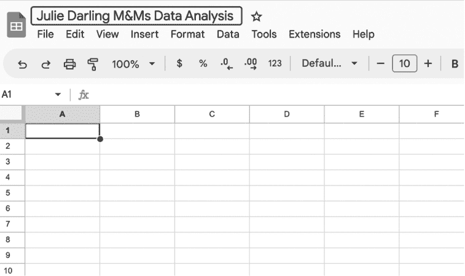

图 3.6 如何命名 Google 表格 以便轻松定位的示例。

- 3. 让你的学习者使用他们之前使用的实体纸质文档（用于写下他们“趣味装”包中 M&M's 的数字和颜色）来为其 Google 表格 中的相应列贴标签并填写。

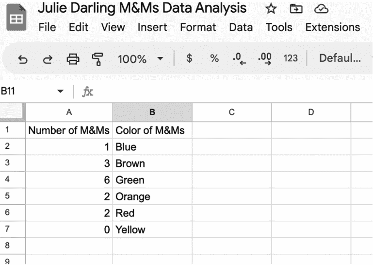

图 3.7 如何将 M&M's 数字和颜色数据添加到 Google 表格 的示例。

- 4. 接下来，让他们单击并拖动以选择他们想在饼图上显示的数据。然后从顶部导航栏单击“插入”并选择“图表”。

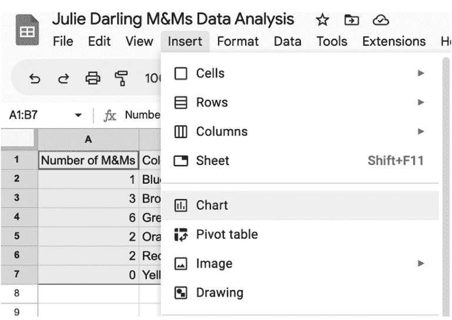

图 3.8 在 Google 表格 中选择数据并插入图表的截图。

- 5. 饼图是默认图表。它将与屏幕最右侧的图表编辑器工具一起显示。在图表编辑器的“图表类型”下拉菜单下，你的学习者可以选择以不同图表类型显示数据、更改标签或执行其他所需的编辑。

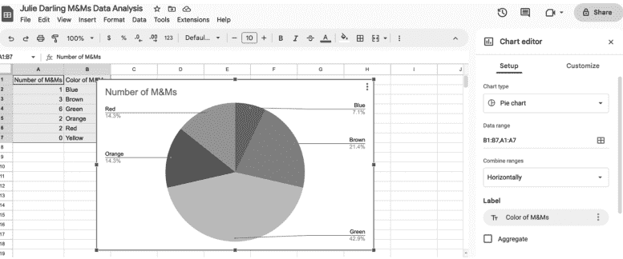

图 3.9 使用 Google 表格 创建的 M&M's 数据饼图。

## 数据与分析——推理与模型——抽象

> CSTA K-2 标准 1A-DA-07：识别并描述数据可视化（如图表或图形）中的模式，以进行预测。
>
> “数据可以用来对世界进行推断或预测。学生可以分析一袋糖果中颜色的图表或饼图，或多袋糖果中颜色的平均值，识别哪些颜色最多和最少的模式，然后预测在新一袋糖果中哪些颜色最多和最少。学生可以分析上学开始和放学时测得的温度图表，识别温度上升和下降的模式，并根据观察到的模式预测他们认为一天中特定时间温度会上升还是下降。”

要解决此标准，请利用上一节活动中“使用‘趣味装’糖果教孩子制作图表”的数据，教你的学习者进行预测。让他们第二次完成此活动，但在打开糖果包装之前，让他们猜测预测自己在包装里会发现每种颜色有多少颗。他们可以单独写下这些预测，或者如果你正在与一组人一起工作，你可以为每种颜色预测点名一位学习者。让他们解释自己的推理。

请让你的学习者想出一种方法，使他们的预测更加准确。例如，不要只是猜测，也许他们可以咨询其他孩子并比较他们的结果。如果你正在一对一地与你的学习者一起工作，你们俩都可以吃很多 M&M's 并为每包保留数据（你也可以只计数

不吃掉它们，把吃的留到以后，虽然不那么刺激，但可能更有利于防止肚子疼）。

如果你与一群人合作，更精确的方法是统计第一轮所有参与者的结果，统计小组结果中每种颜色的平均值，并利用此进行预测。一旦他们算出实际数字，你的学习者就可以将这些数字与他们的预测进行比较。这些步骤：提问、进行研究、做出预测/假设并验证该假设，即**科学方法**的步骤。在预测、统计、比较和分析的辛苦工作之后，举办一个 M&M's 吃糖派对来庆祝。可以考虑播放他们可能是巨人乐队专辑 *Here Come the 123s* 中的一些曲目，而你的学习者则享用他们的 M&M's。

## 结论

我希望第 3 章已经激发你举办一场精彩的机器人舞会，肚子里塞满了 M&M's（或其他零食），同时欣赏你漂亮的图表。也许这已经让你对学习更多关于网页设计、录制消息（甚至是播客？）以及使用科学方法产生了兴趣。别停下来！第 4 章更深入地探讨了计算机科学的支柱：**算法**和编程的基础。

# 算法与编程

## 简介

第 4 章深入探讨了**算法**和**编程**，这些是计算机科学的支柱性主题。使用本章来教你的学习者关于**分解**、**迭代**、**算法**、**序列**、**变量**、**调试**、**循环**、**归属**、**二进制**和**密码**。通过尽早进行分类、键盘输入和结对编程，为你的学习者奠定成功的基础。一起唱 *调试之歌*，别忘了使用二进制写下你们的“秘密代码”！

## 编程——支架式教学与其他注意事项

## 分类

与最年幼的学习者一起，使用分类活动来强化模式识别，这是编程和**调试**所需的关键技能。在教年幼的学习者收纳材料时，以不同的方式将用品分类到箱子和筐中，正面贴上单词和照片，指示物品应如何分类，并支持初级阅读。定期更换这种方式，帮助他们学习不同的分类模式/方法。

例如，按数字、带数字的积木、边数或你认为最适合你材料的字母、形状和颜色，来存放积木、美术用品和其他材料。这也可以用松果和树叶等天然物品，以及游戏室或教室材料来完成。考虑以这种方式组织你的学习环境。通过搜索“Montessori sorting”可以找到无数建议和玩具。

通过询问 *他们* 应该如何对物体或用品进行分类，以便在某些活动中更容易找到或使用，来让你的学习者产生归属感。例如，问你的学习者：“如果我想画一幅我房子的图片，我该如何整理绘画用品，以便能快速找到我想要使用的颜色？”让任务变得更快更简单是计算机如此强大和有用的主要原因之一。用日常任务来**支架式教学**这个想法，有助于年幼的学习者开始以这种方式思考。

## 结对编程

在教孩子编程时，让他们结对工作。这种学习方法应用到编程中被称为**结对编程**。具体是这样的：两个孩子会一起工作，并频繁切换角色。一个孩子先写代码——被称为“驾驶员”。另一个孩子——叫“领航员”——会检查代码并提出意见。对于年幼的孩子，你可以每隔五分钟设置一个计时器，提醒他们切换角色。随着学习者年龄增长，他们会变得更擅长独立切换角色。刚开始进行结对编程时，你需要监督学习者，确保两人都积极参与，并在指定的时间间隔切换角色。你可能还需要告诉学习者谁应该先担任哪个角色。

## 键盘输入技能

年幼的学习者应先使用积木式编程学习编程背后的概念。ScratchJr 应用非常适合 5–7 岁的孩子，之后他们应该过渡到 Scratch（面向 8–16 岁开发）。当你的学习者成为 Scratch 大师后，就可以加入文本编程了。

年长的学习者需要了解如何在键盘上输入符号，才能成功使用文本编程语言。由于大多数学生在一年级结束时开始更流畅地阅读，这是教二年级学生的一个好技能。此外，为了让孩子们成功进行文本编程，他们需要掌握基本的打字/键盘输入技能。

在尝试文本编程之前，还应涵盖高级打字技能，例如如何输入符号（如括号 ( )、大于号 > 和小于号 < 符号、反斜杠 \\ ）以及大写字母。Typing Club (typingclub.com) 是一个学习打字技能的绝佳免费资源。作为指导学生的成年人（家长/监护人或教师），你需要提醒他们将手指放在主行上，这样之后他们就能不看手快速高效地打字了。

通常建议从 HTML/CSS 或 Python 开始学习文本编程。查看本书的资源部分，了解推荐的书籍和网站来学习这些内容。你也可以在我的网站 (authorjuliedarling.com) 上找到这些资源的链接。在《小小计算机科学家》中，角色“在命令行中使用 Python”。命令行是一种直接向计算机输入指令的方式，而不是使用鼠标从下拉菜单中点击和选择。这种文本界面通常能让你工作更快，并对计算机有更多控制权。在 PC 上，通过找到“命令提示符”来访问；在 Mac 上，通过找到“终端”来访问。要小心！因为命令行给了你更多控制权，如果你出错，可能会真的搞砸事情（例如，永久删除重要数据或弄乱格式）。

## 算法与编程——算法——抽象

> CSTA K-2 标准 1A-AP-08：通过创建和遵循算法（一组分步说明）来建模日常流程，以完成任务。
>
> “组合是将较小的任务组合成更复杂任务的过程。学生可以为制作简单食物、刷牙、准备上学、参与清理时间创建和遵循算法。”

简单来说，算法是按特定顺序完成的一系列步骤。教授算法的好方法是教你的学习者一个最喜欢的食谱。对于年幼的学习者，这可以是只需要组装的食谱，例如徒步混合坚果。将视觉和书面说明结合在一起，也能强化初级读者的字母和单词识别。

将步骤写下来也有助于更好地展示计算机科学中算法的样子（与仅仅给出口头指令相比）。使用这个传统的徒步混合坚果食谱。根据口味和过敏情况进行调整，并考虑使用你选择的食材添加步骤照片。

### 简单的徒步混合坚果食谱

取出一个 1 杯量杯，以及一个带密封盖的大型可重复使用容器（可装下四杯）或一个一加仑塑料袋（滑拉式或拉链式封口最适合摇晃食材并保持新鲜）。

准备好你的食材：

- 葡萄干
- M&M's
- 花生（或其他脆脆的东西）
- Cheerios 麦片

使用量杯量出每种食材一杯，然后一次将一种加入容器中。

密封盖子（或袋子顶部），检查确保盖好紧，然后剧烈摇晃混合食材。享用吧！这种徒步混合坚果非常适合徒步旅行或其他探险时携带。

教师和家长/监护人也可以与年幼的学习者合作，为各种日常流程创建可视化/书面的**算法**并张贴出来——例如准备睡觉、准备上学、学校日程安排、学习站以及轮换方式等。请务必保持简单——年幼的孩子一次只能成功遵循少数几条指令。一次不超过三条是一个好经验法则（尽管这可以在变成常规后逐步增加）。年龄较大的学习者可以遵循步骤更多、复杂度更高的指令。与所有学习一样，想办法让这件事既有创意又有趣。

一次引入其中一项流程，并继续将它们称为“算法”——例如，“我们的睡前算法是什么？首先我们刷牙……”让你的学习者告诉你每个流程/算法的步骤是什么。年幼的学习者可以指向流程的视觉步骤/提示，以强化步骤和顺序。如果从头写所有这些感到繁琐，可以考虑借助 **AI** 网站（如 GoblinTools (https://goblin.tools)）将任务分解为步骤。之后，你可以轻松地进行调整并添加来自学校或家庭的照片。

问问你的学习者，如果你刷完牙 _然后_ 才把牙膏挤在牙刷上，会发生什么。讨论算法/日常流程中步骤的顺序在现实生活中 _和_ 向计算机下指令时都很重要。步骤顺序错误会导致流程/程序无法得到你想要的结果。

## 算法与编程—变量—抽象

CSTA K-2 标准 1A-AP-09：通过使用数字或其他符号来表示信息，模拟程序存储和操作数据的方式。

> "现实世界中的信息可以在计算机程序中表示。学生可以使用竖起大拇指/竖下大拇指来表示是/否，在编写算法时使用箭头来表示方向，或者使用数字、表意文字或其他符号来编码和解码单词，以表示字母或单词。"

**变量**是计算机程序中可变事物的占位符。这是一个较大年龄学习者更容易掌握的抽象概念。不过，你也可以为年龄较小的学习者打下基础并介绍词汇。电子游戏中的积分/金币（积分/金币的数量会变化）是一个非常适合喜欢玩游戏的孩子的例子。

### 用杯子和果冻豆教授变量

你也可以使用一杯果冻豆，向不同年龄段的学习者演示这个概念。给学习者一个小杯子，放入五颗果冻豆。告诉学习者，你的变量是 5。让他们选一颗果冻豆（任意一颗）并从杯子里拿出来（如果喜欢那个味道，可以吃掉）。让他们数一数还剩下多少颗果冻豆（4）。让他们大声说出：*变量是 4*。重复此过程（可以变换一下，比如指导他们一次吃/拿走两颗而不是一颗，等等），直到杯子里所有的果冻豆都被拿走。

重新开始，添加更多果冻豆（从不同的数字开始，比如 3），并重复该过程。告诉你的学习者：“我们的变量一直在变化，但它不会自行改变。是什么导致变量增加/减少？” 当学习者年龄更大且在发展上合适时，你可以使这堂课更深入。关于何时深入讲解变量，一个很好的经验法则是针对初中阶段的学生（6–8 年级）。

## 跳房子跳跃算法

在操场上玩跳房子游戏，重温**算法**/指令。如果附近的操场上没有现成的跳房子模板，你可以用粉笔画出来。每个方格应该足够大，让学习者穿鞋的脚能舒适地跳进去，但又不能太大，以至于单脚跳时也能跳到下一个方格的中心。传统的跳房子场地通常长这样：

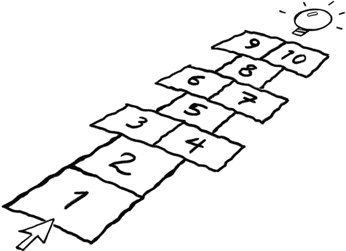

将学习者分成两人一组，或者如果你是直接与一名学习者一起工作，可以轮流进行。准备一个可以扔进跳房子方格的东西。这可以是一块石头、瓶盖，或者你手头有的任何东西。确定谁先开始，并让他们将物体扔进一个方格（在某些游戏版本中，你按顺序扔物体，先从方格 1 开始，然后是方格 2，等等）。一个人跳，另一个人给跳跃者提供指令/算法。每个方格内只允许一只脚，跳跃者不能触碰边缘。跳跃者不能跳过方格，一旦捡起物体，他们就需要手里拿着物体，按逆序沿着方格跳回来。

指令/算法可能是这样的：“用右脚跳进方格 1，现在右脚跳进 2，同时左脚跳进 3”等等。指令必须快速下达，否则你的跳跃者会失去平衡（这才有趣）！一旦捡起物体（通常是在弯腰并单脚保持平衡时），执行指令的人必须转身跳回方格 1，同样不得触碰任何方格的外侧线，同时仍需按顺序遵循数字。如果他们摔倒或触碰外侧线（或者教练给出错误的指令，或者他们没有遵循正确的指令），他们可以重新开始再试一次（或者让别人来试——任一规则都可以）。一旦某人成功，就轮到下一个人。从传统的跳房子游戏开始，然后考虑换一种方式。

由于这个游戏用于教学算法（与传统跳房子不同），让教练变换算法/指令。挑战教练给出能让跳跃者更快到达物体、降低其失去平衡的可能性、或增加挑战性的指令。如果他们跳房子跳得非常好，能不能倒着跳来做？跳跃者应严格遵循指令。如果教练没有给出正确的指令，跳跃者就无法成功，他们需要调试。

一旦你的学习者掌握了这个，可以考虑让他们报名 Code.org 上的计算机科学基础课程。这个免费的、针对性的课程涵盖 4–11 岁，包括为“非阅读者”设计的课程。课程既有趣又吸引人，既包含在线选项，也包含“非联机”选项。如果这个平台对你和你的学习者效果良好，Code.org 提供的课程可以一直教授计算机科学技能，直至高中。

## 二进制

二进制是计算机的“语言”。它由 1（信号开启）和 0（信号关闭）组成。计算机芯片由晶体管组成，晶体管像微小的开关一样工作。如果电流流过晶体管，则为信号开启，即 1。如果没有电流流过晶体管，则为信号关闭，即 0。二进制也称为机器代码。计算机的中央处理器（CPU）只能理解用二进制/机器代码编写的信息。

由于二进制代码对计算机科学至关重要，值得教给学习者相关词汇，并引入“一个事物可以代表另一个事物”的概念。在《小小计算机科学家》中，读者被鼓励尝试使用二进制写出他们的“密码”名字。一年级（5–6 岁）的学生就可以做到这一点。此外，最小的学习者可以用二进制“拍手”（张开手表示 0，拍手表示 1）。二进制也可以通过开关灯（开为 1，关为 0）来演示。让学习者在你开关灯时读出二进制数字序列，然后交换角色，让他们来拨动开关，这样会更有趣。使用“代码扩展活动 2：使用二进制为你的代码编程”来帮助学习者用二进制写出他们的名字。对于年龄较小的学习者，我发现如果他们先圈出名字中的字母，这样能更快找到他们想要的二进制代码，会很有帮助。

如果你想更深入地教孩子关于密码和加密的知识，（更具体地说，如何用不同的字母、数字或符号替换传统字母表字母来编写秘密代码），最简单的方法是给字母表编号，然后用数字替换字母。使用“代码扩展活动 1：使用数字为你的代码编程”来帮助你的小年龄段学习者做到这一点。另一种传统选择称为凯撒（移位）密码，即移动字母表中的字母（例如，如果移位 1，你会把 A 写成 B，B 写成 C，依此类推）。

## 代码扩展活动 1：使用数字为你的代码编程

## 使用密码写出你的名字

使用下面的数字用秘密代码写出你的名字。

首先在密钥中圈出你名字中的字母。接下来，用那些数字代替你名字中的字母。

例如，Zuri 会这样写她的名字：

| 26 | 21 | 18 | 9 |
|---|---|---|---|
| Z | U | R | I |

在下面的空白处用密码写出你的名字，使用旁边的密钥，将你名字中的字母替换为密钥中的数字

| Key |
|---|
| A = 1 |
| B = 2 |
| C = 3 |
| D = 4 |
| E = 5 |
| F = 6 |
| G = 7 |
| H = 8 |
| I = 9 |
| J = 10 |
| K = 11 |
| L = 12 |
| M = 13 |
| N = 14 |
| O = 15 |
| P = 16 |
| Q = 17 |
| R = 18 |
| S = 19 |
| T = 20 |
| U = 21 |
| V = 22 |
| W = 23 |
| X = 24 |
| Y = 25 |
| Z = 26 |

## 代码扩展活动 2：使用二进制为你的代码编程

### 大写字母转二进制—密钥

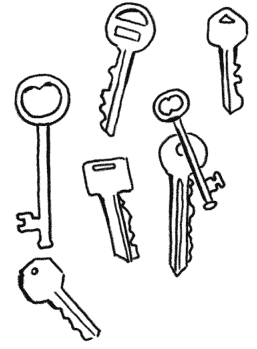

| Letter | Binary | Letter | Binary |
| :--- | :--- | :--- | :--- |
| A | 01000001 | N | 01001110 |
| B | 01000010 | O | 01001111 |
| C | 01000011 | P | 01010000 |
| D | 01000100 | Q | 01010001 |
| E | 01000101 | R | 01010010 |
| F | 01000110 | S | 01010011 |
| G | 01000111 | T | 01010100 |
| H | 01001000 | U | 01010101 |
| I | 01001001 | V | 01010110 |
| J | 01001010 | W | 01010111 |
| K | 01001011 | X | 01011000 |
| L | 01001100 | Y | 01011001 |
| M | 01001101 | Z | 01011010 |

## 算法与编程扩展活动 3：创建随机密码

通过从字母表的不同起点开始来更改密钥，并使用更安全的“秘密代码”写下你的名字！

### 大写字母到偏移二进制—密钥

| 字母 | 二进制 | 字母 | 二进制 |
| :--- | :--- | :--- | :--- |
| A | 01000001 | N | 01001110 |
| B | 01000010 | O | 01001111 |
| C | 01000011 | P | 01010000 |
| D | 01000100 | Q | 01010001 |
| E | 01000101 | R | 01010010 |
| F | 01000110 | S | 01010011 |
| G | 01000111 | T | 01010100 |
| H | 01001000 | U | 01010101 |
| I | 01001001 | V | 01010110 |
| J | 01001010 | W | 01010111 |
| K | 01001011 | X | 01011000 |
| L | 01001100 | Y | 01011001 |
| M | 01001101 | Z | 01011010 |

## 算法与编程—变量—抽象

CSTA K-2 标准 1A-AP-10：使用序列和简单循环开发程序，以表达想法或解决问题。

> “编程被用作创建反映广泛兴趣的产品的工具。控制结构指定程序中指令执行的顺序。序列是程序中指令的顺序。例如，如果在编程简单动画故事时对话没有按正确顺序排列，故事就讲不通。如果编程机器人的命令顺序不正确，机器人就无法完成所需的任务。循环允许多次重复一段代码序列。例如，在展示蝴蝶生命周期的程序中，可以将循环与移动命令结合起来，让角色进行持续但受控的移动。”

向年幼学习者教授的一项基本技能是故事的顺序。在学校，他们会阅读图画书或童话，并被要求识别故事的开头、中间和结尾。在有机会自己写（和/或画）故事时，孩子们通常会获得相同的结构。这项技能（按顺序排列事件/步骤）可以迁移到培养计算机科学技能。

## 教学序列

在编程中，给出指令的顺序（序列）对程序的成功至关重要。回顾之前提到的刷牙示例（在刷牙后才把牙膏挤在刷子上），或者其他学习者可以与之建立具体现实生活联系的事物。

另一个场景可能是：如果你的大人本应开车送你去约会玩耍？而不是他们通常做的事，他们开车去约会地点，然后打开车门把你放进安全座椅。问题出在哪里？你的大人需要按什么顺序采取哪些步骤才能送你去约会地点？一旦你从学习者那里得到成功的答案，就请他们举出自己因步骤顺序错误而产生问题的示例。通过陈述来结束这节课：“你遵循这些步骤的顺序很重要，不是吗？在计算机科学中，我们称按特定顺序排列步骤为序列。你能把这个词说给我听吗？”

## 教学循环

理解如何编写高效代码的第二个重要概念是使用 **循环**。循环是使代码更高效的一种方式。不必多次重复同一行代码，只需创建一个循环即可。这就是说“拍手一次，拍手一次，拍手一次，拍手一次”和说“拍手四次”之间的区别。你可以使用这个示例来演示循环，然后陈述：“当我只说拍手四次时，是不是更快更简单？在计算机科学中，这样编写代码称为 _循环_。把这个词说给我听（循环）。”如果你与稍大一点的学习者一起工作，可以让他们自己想出使用循环可以提高效率的示例，以检查理解情况。

## 算法与编程—模块化—计算问题

CSTA K-2 标准 1A-AP-11：将解决问题所需的步骤分解为精确的指令序列。

“分解是将任务分解为更简单任务的行为。学生可以分解制作花生酱果冻三明治所需的步骤、刷牙、画图形、让角色在屏幕上移动或解决编程应用中的关卡。”

## 介绍分解的脚本

问你的学习者：“你喜欢蛋糕吗？你知道怎么做蛋糕吗？如果你在教室里，请学习者赞成举大拇指，反对举下大拇指，不确定的话举到一边。你只是弹个手指就完成了吗？不是！你必须知道要遵循哪些步骤以及按什么顺序。

“你是一次性完成所有这些步骤吗？那样的话你需要非常多只手臂。我只有两只手臂，即使有两只手臂，我也一次只能处理一个步骤。那么，你知道我该怎么做吗？我必须将蛋糕制作食谱分解为一次一个步骤。你以前这样做过吗？

“如果我漏掉一个步骤或犯了一个错误会怎样？如果我在蛋糕里加了一杯盐而不是一杯糖会怎样？给学习者一些回应的机会，并确保他们明白用盐代替糖不会好吃。我们需要检查每个步骤，以确保不犯错误，否则蛋糕可能会做得难吃。

“你知道我们在编程中也这样做吗？你必须一次只进行一个步骤，并且必须检查每个步骤。在编程中，检查我们的步骤以确保我们做得对，这被称为调试。当你编写代码时犯错误，就意味着你的代码会难吃吗？不是！这意味着它可能无法工作，或者可能无法按你想要的方式工作。

为了让这节课保持轻松愉快，你可以继续引用“难吃的代码”和“好吃的代码”。当你的学习者成功时，你可以告诉他们写出了超级好吃的代码。

这也是一个很好的机会，向学习者展示如何逐步查看代码，方法是在 ScratchJr、Scratch 上演示，或者与较大的学习者一起使用代码怪物 (www.crunchzilla.com/code-monster) 之类的工具。

另一种加强学习 **分解**（将某事物分解为其组成部分，例如制作蛋糕所涉及的原料和步骤）的方法是让年幼的学习者查看一幅图画，并按形状将其分解。使用 *学习分解* 讲义让年幼的学习者进行一些练习。

## 学习分解

姓名

在下面的图片中，写出你看到以下形状的数量。

- 圆形
- 三角形
- 矩形

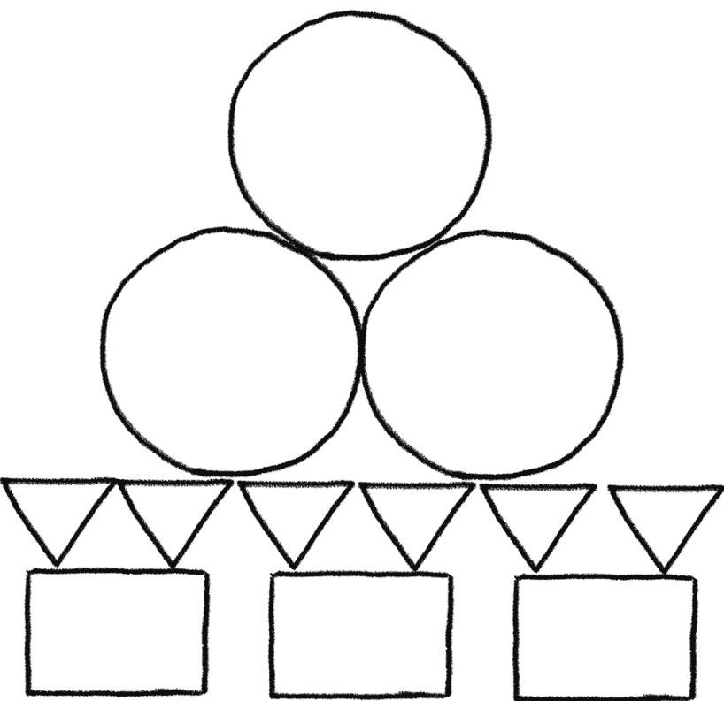

## 算法与编程—程序开发—测试

CSTA K-2 标准 1A-AP-12：制定描述程序事件序列、目标和预期结果的计划。

> “制定程序将做什么的计划可以澄清创建程序所需的步骤，并可用于检查程序是否正确。学生可以创建规划文档，例如故事地图、分镜图或序列图形组织者，以说明他们的程序将做什么。此阶段的学生可能在教师的帮助下完成规划过程。”

年幼的学习者习惯于动手操作：绘画、学习握铅笔，并将想法写在纸上。学习如何创建程序也不应有所不同。

鼓励你的学习者使用他们偏好的方法规划程序——这可能是分镜图、图形组织者或编程日志。年龄较小的学习者可以画出预期结果的图片。年龄较大的学习者可以创建包含序列的更多细节。指导年龄较大的学习者使用符号（例如，使用乘法符号“x”表示循环），并记录哪些有效、哪些无效以及他们打算下次尝试什么。

## 算法与编程—程序开发—沟通

CSTA K-2 标准 1A-AP-13：在开发程序时使用他人的想法和创作时，应给出署名。

> “使用计算机伴随着一定的责任。学生应当为他人创建的作品（如图片、音乐和代码）署名。如果向全班展示作品，署名可以口头进行；如果在班级博客或网站上分享作品，署名可以书面或口头进行。此阶段的适当署名不需要正式引用，例如参考文献或参考书目文档。”

在成为合乎道德的技术使用者的过程中，即使是年龄最小的学习者也应当在使用或引用他人作品时给予署名。首先问年幼的学习者：“你在哪里找到这个精彩的 [无论是什么]？”，并指出如何查找作者、艺术家、编码者或组织名称等信息。如果你正在与正在发展阅读/写作能力的学习者一起工作，你可以让他们口头告诉你哪个作品是哪个朋友制作的。例如：“你知道是谁做了这个吗？给他们署名真的很重要。”对于阅读/写作能力进步的学习者，让他们练习通过编写简化的引用作品版本来给予署名，例如“照片由 Aiza 拍摄”、“音乐由 Zuri 创作”或“代码由 Tasha 编写”。

通过要求学习者在创作独特的绘画、照片或句子时也为自己署名（在作品上写上自己的名字或互相告知是自己创作的）来强化这项技能。当你向他们展示自己制作的任何东西时，可以现场示范此做法，并且始终为他人制作的作品署名。

继续询问（并回答）以下问题：“为什么要署名？这是正确的做法。你希望自己的作品得到署名，不是吗？什么时候该署名？只要有人制作了什么东西。怎么署名？”最后这个部分取决于年龄。首先教年幼的学习者说明是谁制作的，并最终进步（到初中结束时）采用你偏好的格式进行正确的引用。APA、MLA 或 Chicago 都是不错的选择。

年龄较大/水平更高的学习者还可以学习复制并粘贴 URL（统一资源定位符，也称为网址），用于引用在线找到的作品。

随着学习者在这方面变得更加熟练，你可以将寻找创建正式引用所需的元素变得有趣，把它变成一场寻宝游戏/竞赛。例如，让他们导航到同一网页或打开同一本书，看谁能最先找到版权或出版日期。找到后，让每个人记下来并转到下一所需信息。使用“引用寻宝工作表”来收集开始创建引用所需的组件。一旦学习者习惯于定位和收集这些元素，下一步就是学习如何正确格式化引用（可以考虑使用引用生成器，例如 Bibme，www.bibme.org）。

## 引用寻宝——找齐所有碎片！

**图书和网页版**

| 字段 | |
|-------|--|
| 作者姓名 | |
| 出版日期/年份 | |
| 书名或网页标题 | |
| 出版商或组织名称 | |
| URL（仅限网站或电子书） | |

## 算法与编程—程序开发—测试

CSTA K-2 标准 1A-AP-14：调试（识别并修复）包含序列和简单循环的算法或程序中的错误。

“算法或程序可能并不总能正确运行。学生应该能够使用各种策略，例如更改步骤顺序、逐步遵循算法，或尝试和错误来修复算法和程序中的问题。”

年幼的学习者可能不熟悉“调试”这个术语。可以考虑用有趣的吟唱/歌曲来介绍这个词汇。

### 调试歌

用这种对唱式的“跟我重复”歌曲向学习者介绍调试的概念。首先告诉你的学习者：“这是一首‘跟我重复’的歌曲”，并让他们重复这句话。

注：歌词可以根据你的偏好唱或念。

- 你：“别烦我了”（拍大腿）
- 孩子们：“别烦我了”（孩子们拍大腿）
- 你：“别烦我了”（拍大腿）
- 孩子们：“别烦我了”（孩子们拍大腿）

- 你：“我们得调试”（边说边拍掉每个肩膀）
- 孩子们：“我们得调试”（孩子们拍掉每个肩膀）
- 你：“我们得调试”（边说边拍掉每个肩膀）
- 孩子们：“我们得调试”（孩子们拍掉每个肩膀）

- 你：“我们得找到问题”（将手举到额头上，眼睛上方，像在寻找什么东西）
- 孩子们：“我们得找到问题”（孩子们重复手势）
- 你：“我们得找到问题”（将手举到额头上，眼睛上方，仿佛在寻找什么东西）
- 孩子们：“我们得找到问题”（孩子们重复手势）

- 你：“我们得调试”（边说边拍掉每个肩膀）
- 孩子们：“我们得调试”（孩子们拍掉每个肩膀）
- 你：“我们得调试”（边说边拍掉每个肩膀）
- 孩子们：“我们得调试”（孩子们拍掉每个肩膀）

- 你：“我们得修复错误”（假装在空中打字）
- 孩子们：“我们得修复错误”（孩子们重复手势）
- 你：“我们得修复错误”（假装在空中打字）
- 孩子们：“我们得修复错误”（孩子们重复手势）

- 你：“我们得调试”（边说边拍掉每个肩膀）
- 孩子们：“我们得调试”（孩子们拍掉每个肩膀）
- 你：“我们得调试”（边说边拍掉每个肩膀）
- 孩子们：“我们得调试”（孩子们拍掉每个肩膀）

- 你：“现在我们的程序可以工作了！”（在空中挥拳）
- 孩子们：“现在我们的程序可以工作了！”（孩子们重复手势）
- 你：“现在我们的程序可以工作了！”（在空中挥拳）
- 孩子们：“现在我们的程序可以工作了！”（孩子们重复手势）

- 你：“因为我们调试了”（边说边拍掉每个肩膀）
- 孩子们：“因为我们调试了”（孩子们拍掉每个肩膀）
- 你：“因为我们调试了”（边说边拍掉每个肩膀）
- 孩子们：“因为我们调试了”（孩子们拍掉每个肩膀）

### 关于调试的教学脚本

当你的学习者熟悉这首歌中的词汇后，通过解释这个术语的起源，给他们更多关于调试含义的背景。格雷斯·霍珀上将在与团队一起试图弄清楚为什么他们的计算机出现错误时，使“调试”一词闻名。当他们打开硬件时，发现里面卡着一只飞蛾。正是这只飞蛾导致了错误！一旦他们移除了飞蛾，并字面意义上“调试”了他们的计算机，他们就能够修复这个问题（国家地理，2020）。

问你的学习者：“你每次遇到电脑问题，都是因为里面有只飞蛾吗？你怎么看？”让他们用竖起大拇指表示同意，竖下大拇指表示不同意，大拇指向侧面表示不确定。“不，这只是我们现在的叫法；我们把电脑问题称为 bug，是为了纪念那只飞蛾。调试意味着我们正在查找并修复问题。”

最后，给你的学习者一些查找和修复错误（调试代码）的现场示例。Code Monster（www.crunchzilla.com/code-monster）是一个很好的工具。在跟随教程时，你可以故意犯个错误，并让你的学习者帮你找出并修复它。你也可以给他们读《小小计算机科学家》来强化这项技能。

## 算法与编程—程序开发—沟通

> CSTA K-2 标准 1A-AP-15：使用正确的术语，描述程序开发迭代过程中所采取的步骤和所做的选择。
>
> “在这个阶段，学生应该能够谈论或书写他们所创建的程序的目标和预期结果，以及他们在创建程序时所做的选择。这可以通过编程日志、与老师的讨论、课堂演示或博客来完成。”

### 教授迭代过程的脚本

问：“当你第一次做某事时，第一次就总能做对吗？（不行！）当然不是。你必须练习，尝试不同的事情，以不同的方式练习。例如，你有没有拼过拼图？你有不同的策略来找到哪些拼图块能拼在一起吗？如果你认为某个拼图块应该放在某个位置，但它不合适，你会怎么做？你会把它扔在地上哭吗？（不行！）你会尝试另一个位置，或者如果你感到沮丧，就休息一下，稍后再回来，对吧？你的代码无法运行时也是同样的道理。”

“尝试不同的事情并做出改变，直到做对（或做得更好），这被称为迭代。这是一个大词。你能跟我重复一遍吗？” 进行示范：“这不像我想要的那样工作，我要试试别的——我刚才用的那个大词是什么（迭代）？”“对！我要尝试新的迭代来看看是否更好。我在进行实验！”

这就像先写一份草稿，然后继续修改以使其更好。在尝试这些不同的迭代时，在日记中记录你尝试了什么、什么有效（什么无效）。我们可以作为一个小组向全班分享我们尝试过的内容，或者（特别是如果我们在家学习）我们可以创建一个博客或视频，帮助其他人从我们的迭代/实验中学习。

### 消除对错误的污名化有助于成长

迭代非常重要，因为它有助于消除对错误的污名化。失败或犯错误并不是一件坏事。将错误正常化，通过称它们为迭代来消除污名。这有助于孩子们更有安全感地承担更多风险，从而带来创新（和成长型思维）。教导孩子们，当他们有一个目标并尝试新事物时，他们应该思考这个选择是让他们更接近还是更远离目标。如果这让他们更远离目标，他们是否发现了什么有趣的东西？他们是想坚持原来的目标，还是改变一下？庆祝学生们承担风险并走出舒适区。

## 结论

我希望你和你的学习者喜欢唱 *调试之歌*，使用二进制编写了许多秘密代码，并通过寻宝游戏找到了引用的所有部分。我希望你利用算法既能制作美味的混合坚果，又能在跳格子游戏中导航。我希望你使用迭代来承担风险并改进或发现新事物。最重要的是，我希望你和你的学习者玩得开心。既然你了解了算法和编程的基础知识，是时候来探讨一些 *计算的影响* 了。在我们的最后一章中，我们将介绍其中的一些影响，包括网络安全、**数字公民意识**和**网络欺凌**。

## 参考

国家地理学会。（2022年5月20日）。公元1947年9月9日：世界上第一台计算机臭虫。https://education.nationalgeographic.org/resource/worlds-first-computer-bug

# 第 5 章

# 计算的影响

## 介绍

这是我们书中的最后一章，介绍了计算的一些影响。第5章讨论了网络欺凌，并解释了挺身而出者和旁观者之间的区别。本章还包含如何创建“旧科技抚摸动物园”以及想象新技术的机会的详细信息。使用本章来引导孩子们，并根据他们的想法，问他们一些引导性问题：“你的大人是否使用手机来查找去往某地的路线？那互联网呢——他们是否曾经使用谷歌搜索问题的答案？他们是否会给别人发电子邮件？”年龄较小的学习者可能不知道，但年龄较大的学习者可能意识到这些用途非常普遍且有帮助。接下来，问问你的学习者，如果设备无法正常工作会发生什么。如果Wi-Fi断开、电力中断或手机没电了会怎样？路线、电子邮件、节目和游戏会发生什么？

问问你的学习者：“你知道吗，在人类存在的大部分时间里，这些设备都不存在？你认为人类在手机出现之前做什么？那在互联网出现之前呢？在电视节目和电影出现之前呢？如果这些东西都消失了，你会怎么做？”

## 技术的影响

告诉你的学习者：“既然你对计算机和互联网的强大有了一些了解（其实这就是智能手机——一台可以放进口袋的计算机），你想发明什么样的程序、机器人或技术？我非常希望拥有一个能打扫整个房子的机器人，一个可以即时翻译任何语言编写的书籍和论文的应用程序，一台传送机器，当然还有一辆飞行汽车！谁不想要会飞的呢！！

这将是介绍一些新兴技术的绝佳机会，例如虚拟现实、人工智能（A.I.）或增强现实。

选择一项进行简要概述（如果你需要基础知识，请参阅词汇表），并请你的学习者思考这些技术可能以何种方式影响学习和我们的日常生活。你可以使用虚拟现实来看看其他国家的生活是什么样子吗？历史时期呢？其他行星呢？对此全都可以！那人工智能呢？当计算机被教导如何学习时会发生什么？它们可以夺走人们的工作吗？有时会。它们做得和人类一样好吗？不总是，但有时它们做得甚至更好。它们可以用于改善我们的日常生活吗？通常可以以某种方式。想想你可能想教计算机或机器人做什么。这就是人工智能的核心。最后，考虑增强现实。你可以使用设备将什么叠加到现实世界中，以丰富它并使其更有趣或更有教育意义？

请你的学习者使用扩展活动：发明新技术，思考他们可以发明什么新技术。如果你有时间和材料，你甚至可以鼓励他们用纸板、积木或其他东西建造一个模型。完成后，请他们向其他人介绍他们惊人的发明，或者通过数字方式，也许使用在线协作工具！

通过在线协作工具或学习管理系统分享作品有很多用处。这些工具让孩子们可以分享他们引以为豪的作品，并与他人合作。这包括与可能住得很远的孩子合作，他们可能会提供多元的视角。这很有力量，应该鼓励。对于年龄较小的学习者，这可能意味着使用Seesaw与家人分享他们创作作品的照片。对于年龄较大的学习者，这可能意味着通过网站、视频帖子、博客文章或播客，与真实受众建立联系，谈论对他们重要的问题。

## 扩展活动：发明新技术

姓名

发明一个尚不存在的应用程序、程序或其他新类型的技术！

你的技术有什么作用？

它如何让人们的生活变得更好？

它长什么样？在下方空白处画一张草图。为其各个部分标注每个部分的作用细节。

## 讨论技术缺点的剧本

问问你的学习者：“既然我们已经讨论了计算机和技术有多酷，那么有什么缺点吗？当人们有选择使用设备来观看节目和玩游戏时，你认为他们在现实中会更多还是更少地互相交谈？你认为这是好事还是坏事？你知道吗，长时间使用设备有时会让眼睛疼痛？当你需要远离技术休息时，有哪些有趣的活动可以做？也许可以去外面，玩积木，做拼图，或读一本（实体）书？”

## 扩展活动：旧科技抚摸动物园

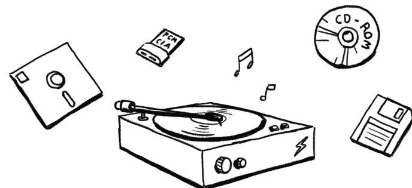

如果你确实想深入探讨这个话题，可以考虑举办一个“旧科技抚摸动物园”。虽然这需要大量的准备，但这是一种非常有趣且有力的方式，可以让你的学习者有机会体验技术的演进。你可以尝试展示多种技术，也可以先从一种开始。这始终可以在以后扩展。

如果你想要稍微省力一点的活动，可以比较用铅笔书写、使用打字机打字，或使用设备/计算机用手或声音（语音转文本）写东西。问问你的学习者，他们如何将这些书面信息发送给远方的人。

如果你有更多准备时间，可以考虑向孩子们展示听音乐方式的演变。你可以借用，或者如果能在庭院拍卖或旧货商店以低价找到，甚至可以购买诸如唱片机、Walkman、便携式CD播放器、收音机、不同世代的iPod，以及带有流媒体服务（如Spotify）的设备等物品。（也许你还能弄到一个8轨播放器或Victrola，或者如果做不到，就展示这些设备的视频）。如果你能找到这些设备且运行良好，并且你的学习者可以实际聆听（适合年龄的）音乐，这堂课就会非常有力量。通过比较和对比这些播放音乐设备的使用方式以及音乐分享方式来结束此活动。

## 比较和对比播放音乐技术的一些想法

可以问这样的问题：“你能和朋友分享音乐吗？那住得远的朋友呢？你可以轻松使用Spotify等音乐流媒体服务做到这一点，但你和你的朋友都必须订阅该服务。人们过去常常刻录CD并制作“混音带”（磁带上的歌曲混合），但大多数人能接触到的艺术家和歌曲不如你现在在流媒体服务上能找到的多。旧技术还存在存储问题。你需要在家里某个地方存放所有的磁带、CD和/或唱片。”

如果你有一盘磨损的磁带，可以利用此机会讨论物理存储音乐的方式如何损坏或磨损（这也是重新审视数据存储的另一个机会——在这里，就是云端中的音乐）。你甚至可以向你的学习者展示如果从磁带中拉出磁带会发生什么，如何用铅笔尝试将其重新卷回磁带盒，以及这并不总能修复它。指出，物理音乐存储方式的优势在于，只要你有空间存放并且它没有损坏，你就永久拥有那张CD或唱片。将此与每月为流媒体服务付费以继续访问你想听的音乐进行对比。

## 计算的影响——社交互动——协作

> CSTA K-2 标准 1A-IC-17：在网上尊重且负责任地与他人合作。
>
> “在线沟通能够促进积极的互动，例如与许多人分享想法，但在线沟通的公开和匿名性质也允许以网络欺凌形式出现的恐吓和不当行为。学生可以在博客或其他在线协作空间中分享他们的作品，并注意避免分享不当信息或可能让他人识别其个人身份的信息。学生可以以友善和尊重的方式对他人的作品提供反馈，如果其他人分享了不应该分享的内容，或者在在线协作空间中以不友善或不尊重的方式对待他人，他们可以告诉成年人。”

**数字公民意识**在教授计算机科学技能的同时非常重要，包括在网上安全、负责、友善和尊重。在面对面教授这些技能时，使用与你对学习者使用的相同术语。在我的课堂上，我将其简化为两条基本规则。在所有事情上，我们都努力做到友善和温和。

任何不友善或不温和的行为都会导致重新引导，或者可能提供另一种访问内容的方式。例如，如果有人不能温和地对待计算机（或者年龄较大的学习者在玩在线游戏而不是完成给定的作业），他们将获得该活动的“离线”替代版本。

一旦我看到他们掌握了友善和温和的期望，通过告诉我并向我展示这意味着什么，他们就有机会在在线活动和“离线”活动之间进行选择。学习者（在我的帮助下）继续努力，始终如一地满足用友善和温和的言行对待自己、彼此和设备的期望。

你也可以遵循这些一般准则，但我也建议使用Common Sense Education (www.commonsense.org/education)。

常识教育提供了出色、免费且适合不同年龄段的资源，可用于教授数字公民意识和互联网安全技能。这些资源包括教学计划、视频等。可以从这些资源入手，但不要止步于此。一旦学习者了解了基本概念和术语，就应继续在每个课程中直接运用这些技能，始终以“各方面都要友善温和”作为核心原则。

## 网络安全

在每个年级，都应教导学习者避免与陌生人分享以下信息：全名、个人电子邮件、实际地址、电话号码、就读学校和居住城市。许多学校都有安全巡逻队（Safety Patrol）计划，由年长的孩子帮助年幼的孩子穿过斑马线、乘坐校车，并总体保持安全。除了教师和家长的常规指导外，还可以建立网络安全巡逻队（Online Safety Patrol），由年长的孩子指导年幼的孩子了解需要保护哪些信息，并提醒他们在网上也要友善。

## 数字公民意识与网络欺凌

随着在线互动、协作（包括基于互联网的游戏）以及后来的社交媒体使用不断加深，继续强化孩子们如何识别网上有人行为不安全或不友善，以及该如何应对，变得越来越重要。

任何读过网络评论的人都知道，人们在进行数字化互动时会变得更加大胆。匿名性和数字通信带来的疏离感，让有些人变得极其残忍。网络欺凌在网上泛滥，我的学习者从二年级起就曾目睹或亲身经历过网络欺凌，因此有必要以适合年龄的方式向所有孩子传授这项重要技能。

首先，请学习者定义什么是网络欺凌。年幼的学习者有时难以区分网络欺凌和粗鲁行为，因此你需要分别给出两者的例子。用全大写字母对他人大喊大叫，虽然粗鲁，但不属于网络欺凌；但一群人在网上给别人起绰号、说坏话，则属于网络欺凌。另一种明确的网络欺凌行为是：有人使用他人的照片或视频来公开羞辱或尴尬对方。

对于年幼的学习者，你可以举个例子：“假设你绊倒摔跤，为此感到尴尬，这感觉很糟糕，对吧？如果有人拍下你绊倒摔跤的视频，并分享给其他人，这些人继续传播，那会更糟糕。这就是网络欺凌。”

教导你的学习者成为“主动干预者”，而非“旁观者”。旁观者是指目睹欺凌行为（无论是线下还是线上）但不参与（也不对此采取任何行动）的人。相比之下，主动干预者是指采取行动支持被欺凌者的人。他们会站出来，通过与欺凌者对抗或以其他方式提供支持，来维护被欺凌者。这可以是简单的事情，比如关心受害者，倾听他们对事件的感受，并让他们知道你认为那是不对的，你站在他们这边。

## 计算机的影响——安全、法律与伦理——沟通

> “人们使用计算技术的方式可能对自己或他人有益，也可能有害。分享私人信息、在公共设备上保持登录状态等有害行为应当被识别并避免。”

复习第 2 章中关于密码和登录凭据的课程。一旦学习者掌握了登录（或登入）其设备和账户，教会他们退出（或登出）这些设备和账户也很重要。你需要演示如何操作。请务必等到他们对登录充满信心后再进行，以免产生挫败感。

当然，对于使用共享设备的学习者来说，这项技能尤为重要，但教会所有人养成这个习惯也很好，因为它增加了一层安全保障。如果你的学习者正在使用共享设备，并发现有人忘记登出的设备，教他们做一个良好的数字公民，立即帮那个人登出。

## 结论

使用《Supporting the Development of Computer Science Concepts in Early Childhood》为你的学习者提供扎实、全面的计算机科学基础，以便他们能够继续学习和探索！将本指南与配套绘本《Little Computer Scientists》和《Little Hackers》搭配使用，有助于建立词汇量并与内容建立更多联系。如果你想了解更多，可以探索本书的资源部分。在我的网站上，你会发现更多内容：authorjuliedarling.com。

## 我编写这些书的原因：

### 低年级小学教学资源与计算机科学中的包容性

我受到启发编写了这一系列丛书——*小小计算机科学家*、*小小黑客* 和 *支持幼儿期计算机科学概念的发展*——因为我在 K–12 环境中教授技术已有 20 多年，虽然针对 8 岁及以上儿童教授技术和计算机科学概念的书籍数不胜数，但我一直未能找到适合低年级小学生的优秀、全面的教材。我最诚挚的希望是，你能在这里找到这样的资源。

此外，尽管有大量旨在吸引自认是女性和 **BIPOC（黑人、原住民和有色人种）** 人群关注 STEM 的资源和计划，但其中较少的人继续从事 STEM 职业。在探究原因时，我偶然发现了一系列研究，指出部分问题（针对自认是女性的人群）源于性别刻板印象。更令人担忧的是，这些刻板印象早在 6 岁时就开始形成（Master et al., 2021）。我们知道，代表性很重要，它有助于打破刻板印象。这一套三本书的丛书——《小小计算机科学家》、《小小黑客》和《支持幼儿期计算机科学概念的发展》——面向 4–8 岁儿童编写，是我为解决这一问题所作出的微薄贡献。我非常希望所有年轻学习者都能在书页中看到自己的身影。

非常感谢阅读我的书！你可以在我的网站上找到更多资源：authorjuliedarling.com。

### 参考文献

Master, A., Meltzoff, A., & Cheryan, S. (2021, November 22). 关于兴趣的性别刻板印象早早开始并导致计算机科学和工程领域的性别差距. **PNAS** 118(48), e2100030118. https://doi.org/10.1073/pnas.2100030118.

## 术语表、资源与索引

### 术语表

本术语表包含全文中出现的粗体术语，以及你在与学习者探索计算机科学时可能遇到的其他术语。

**抽象**是从手头任务所需的细节中分离出不需要的细节。抽象有助于使复杂的想法和概念变得更简单。它是放宽视野、看全局，而不是被每一个细节分散注意力。在计算机科学中，抽象通过关注核心特征而非小细节，使代码更易于理解。

**算法**是按特定顺序执行的一组步骤，用于完成任务或解决问题。食谱是算法的一个示例。

**数组**是允许存储相关（相同数据类型）数据集合（如数字列表或名称列表）的数据结构。

**人工智能（AI）**是指计算机系统能够学习和解决问题的能力。它是计算机科学的一个新兴领域。AI 使计算机能够执行以前只有人类才能完成的任务。

**署名**是向作品的作者或艺术家致谢。

**增强现实**是使用虚拟元素增强现实世界环境。Pokémon GO 是增强现实的一个示例，因为 Pokémon GO 角色通过你的相机叠加在你对现实世界的视图上。

**二进制**是计算机的“语言”。它由 1（信号开启）和 0（信号关闭）组成。计算机芯片由晶体管构成，晶体管就像微小的开关。如果电流流过晶体管，则为信号开启，即 1。如果没有电流流过晶体管，则为信号关闭，即 0。二进制也称为“机器代码”。计算机的中央处理器（CPU）只能理解用二进制/机器代码编写的信息。

**BIPOC** 代表黑人、原住民和有色人种。

**Blockly** 是一种基于积木的可视化编程语言，类似于 Scratch。

**布尔表达式**有两个选项：“true”或“false”。这也可以是“yes”或“no”或“1”和“0”。例如，如果你在参加测验并且答对了，那就是“true”或“yes”或“1”；如果答错了，那就是“false”或“no”或“0”。

**暴力破解攻击**是指黑客通过尝试每一种可能的密码组合来试图进入你的账户。如果你的密码较短（例如，四位数字）或是词典中的单词，则更容易遭受暴力破解攻击。

- **旁观者** 是数字公民身份中指目睹有人在网上行为恶劣的人，虽然他们不参与不友善的行为，但也不会做任何事情来帮助。

- **密码** 是一种重新排列字母（或使用其他替换）来伪装消息的方式。

- **云** 是指通过互联网连接的所有事物（例如对象、设备）。云是世界上最大的网络。使用云通过互联网连接设备被称为云计算。

- **代码** 是指代表其他事物的符号、字母、单词和数字。示例包括密码、摩尔斯电码或计算机代码。

- **编程** 是编写计算机可理解的一组指令。这通常与编程混用，但编程包括设计、测试、维护等。

- **命令行** 是一种将指令直接键入计算机的方式（而不是使用鼠标单击并从下拉菜单中选择）。这种文本界面通常可以让你工作得更快，并让你更好地控制计算机。

- **计算思维** 是一组解决问题的技能，包括分解、抽象、模式识别、调试、迭代和算法设计。

- **计算机科学** 是对计算系统的研究，包括计算机网络、人工智能、应用程序开发、电子游戏开发等。

- **条件**（有时称为选择）是计算机程序中给出的决策指令。它们本质上是一种编程流程图，提供 If-then 指令。例如，如果在下雨（这是 TRUE），那么我们将进行室内课间休息；如果在下雨（这是 FALSE–它是 *不* 下雨），那么我们将在户外玩耍。

- **损坏的文件** 是已损坏或无法正常运行的文件。

- **CSS（层叠样式表）**（参见 HTML）。

- **网络欺凌** 是指某人（或一群人）使用数字工具（社交媒体、在线网站的评论区、游戏网站）来欺负他人。

- **网络安全** 是致力于保障计算机和系统安全的领域。网络安全专业人员有时被称为“白帽黑客”或“道德黑客”。

- **数据** 是指计算机存储和处理的所有信息。这包括计算机指令、数字（价格、数量、测量值）、文本（姓名、地址）、图像（照片、绘画、素描）、音频（语音、音乐）和视频（电影、动画）。

- **数据库** 用于有效存储和搜索大量数据。数据库的一个示例是美国国会图书馆数字馆藏数据库，您可以在其中查找历史事件的原始文档。

- **数据结构** 是为了方便访问而存储数据的方式。这些包括数组、树和数据库。

- **调试** 是查找和修复计算机程序中的错误或问题。

- **分解** 是将某事物分解为更小的部分、步骤或任务。这是寻找解决方案和解决问题的有用技能。将代码分解为较小的块可以使代码更易于理解。

- **深度学习**（参见 AI）。

- **数字公民身份** 是指在网上保持安全、负责任、友善和尊重。

- **初学者读者** 是指正在学习阅读的儿童。这可能是我们最年幼的学习者，他们正在学习识别字母表中的字母及其发音，或者是能够识别一些单词但尚未成为独立读者的儿童。

- **文件扩展名** 是文件名末尾句点后的字母。它们告诉你正在使用什么类型的文件。

- **函数** 是一种将代码块分组的方式。这使重用常见代码块变得容易。以这种方式对代码进行分组还允许程序员更快速、更轻松地读取、编写和调试代码。某些编程语言具有内置函数，称为方法。

- **黑客** 并不总是怀有恶意。黑客攻击分为三类：白帽、灰帽和黑帽。**白帽黑客攻击** 是网络安全专家所做的工作。他们致力于查找和修复漏洞，并试图防止其他黑客入侵。**灰帽黑客攻击** 是指某人未经授权进入系统，以提高意识并暴露漏洞（这也称为黑客行动主义）。**黑帽黑客攻击** 是指某人未经授权进入系统，意图造成损害和/或窃取信息。

- **HTML（超文本标记语言）和 CSS（层叠样式表）** 是网页设计的基本构建块。HTML 用于构建网页内容，CSS 用于格式化内容，然后层叠到整个页面（与需要对每行代码进行更改相比）。例如，如果页面上的所有标题都是绿色，而您想将其更改为紫色，可以使用 CSS 来完成——速度很快！

- **图标/缩略图** 是微小的可点击图片（有时还包含文本），用于展示程序或文件的大致内容。

- **物联网（IOT）** 是可以通过互联网控制的设备。这包括计算机、手机、家电、灯光等。

- **迭代** 是工程设计过程的一部分，即通过不断改进设计来修复问题并进行改进。这适用于改进或修复代码。

- **JavaScript** 是一种用于创建动态/交互式网站内容的 Web 编程语言。

- **密钥** 是用于加密或解密数据的工具——例如，在编码或解码密码时。

- **局域网（LAN）代表本地局域网。** 这是一种将设备连接在一起形成网络的方式。它通常用于允许多人访问相同信息。局域网的一个有趣用途是设置一个局域网，让您的孩子可以和朋友一起玩《我的世界》。随着他们长大，他们可以学会自己做到这一点。局域网的另一个示例是家庭中的 Wi-Fi 路由器。这是一个连接家庭中使用的设备（可能包括计算机、电视、智能音箱、智能恒温器、智能家电等）的局域网。

- **学习管理系统（LMS）** 是 Google Classroom、Canvas、Blackboard 或 Seesaw（一种被认为更适合低年级小学生的有限学习管理系统）等系统。它们是用于快速、轻松地组织和共享学生资源的工具。

- **循环** 是在满足特定条件之前重复执行的编程指令。

- **机器代码**（参见 二进制）。

- **恶意软件** 也称为恶意软件，是旨在造成损害的程序。不同类型的恶意软件有不同作用，包括减慢设备速度、发送感染其他设备的垃圾邮件（病毒）、窃取个人数据，甚至在您支付黑客赎金之前阻止您访问设备上的任何内容（勒索软件）。

- **Micro:bit** 是一种物理计算设备，有时被称为“微型计算机”。

- **鼠标移过/鼠标悬停** 是指将鼠标/光标移动到某物上方但不单击。在计算机上将鼠标移过某物上方通常会在单击前显示其他信息。这是教给年轻学习者的一项有用技能（而且可以节省时间）。

- **多因素身份验证** 是提高账户安全性的方法。启用后，第一个“因素”是您的密码，下一个“因素”可能是发送到您手机或电子邮件的验证码，或语音、指纹、人脸或视网膜扫描等生物识别信息。

- **开源** 是任何人都可以查看代码的地方。任何人也可以使用和编辑它。

- **操作系统** 管理设备上运行的所有软件和硬件。最常用的三种操作系统是 Microsoft 的 Windows、MacOS 和 Linux。

- **结对编程** 是两人配合一起编写代码。一人担任“驱动者”并编写代码，而另一人担任“领航员”，检查代码并提供意见。驱动者和领航员会频繁切换角色。

- **渗透测试** 也称为“渗透测试”，是指网络安全专家发起模拟网络攻击以查找漏洞。

- **网络钓鱼** 是指有人试图诱骗您提供您的信息。网络钓鱼诈骗用于窃取从密码到银行账户信息的任何内容。最常见的网络钓鱼类型之一是发送一封要求您单击链接以登录外部账户的电子邮件。一旦您单击该链接，

打开一个虚假账户登录页面，你浑然不觉地将登录凭证输入到骗子控制的登录页面中。现在骗子已经拥有你的凭证和账户信息。

**物理计算**有时与机器人技术混用，因为两者都可以包含带有传感器、灯光、显示器、电机和其他输入/输出的设备。就我们的目的而言，我将“物理计算”区分为具有多个可按需添加和/或组装的部件的对象。

**弹窗**是弹出在你屏幕上的广告（和其他消息）。有时它们只是广告。然而，一种黑帽黑客行为是创建一个弹窗广告，告诉用户他们的电脑中了病毒，需要下载软件来清理系统。然而，当他们下载该软件时，它不是清理系统，而是安装了病毒。另一种常见策略不是安装病毒，而是告诉用户设备感染了恶意软件，并指示用户拨打骗子接听的电话号码。然后，他/她会诱使用户安装允许骗子控制用户设备的软件。大量弹窗突然出现通常是电脑上安装了恶意软件的迹象。当电脑突然比平时运行得更慢时，这也可能表明存在恶意软件。

**编程** （参见 编码）。

**Python** 是一种流行的软件编程语言（以 BBC 喜剧系列《蒙蒂·派顿的飞行马戏团》命名）。它有许多应用，包括：人工智能、机器学习、游戏设计、创建网站和数据分析，因此非常多功能。Python 被认为是一种“高级”编程语言，这意味着人们易于读写。这也是使其成为初学者良好编程语言的部分原因。此外，你可以逐行运行代码来检查错误，使故障排除更容易。孩子们学习编程的一个良好进阶路径是从 ScratchJr 开始，进阶到 Scratch，然后探索 Python 和/或 HTML/CSS。

**二维码**是一种“快速响应”条形码，扫描后会链接到某种数据或信息。

**隔离病毒**是已被限制在安全区域的病毒，该区域无法感染设备的其余部分。你可以使用防病毒软件来执行此操作。

**勒索软件**是一种恶意软件，除非你向恶意黑客付款，否则它会阻止你访问文件。

**树莓派**是一种价格低廉的个人计算机，可以放在手掌中。你可以将各种外设连接到树莓派。其中一些用于可用性：例如，电源、显示器、鼠标、键盘和 micro-SD 卡。其中一些用于创新：例如，摄像头，或者“传感器扩展板”（Sense Hat），它允许你追踪环境中压力、湿度、运动等方面的变化，并使用板载 LED（发光二极管，看起来像小灯泡，但实际被视为微小半导体）来查看这些数据。Python 是一种适合与树莓派一起使用的语言（你也可以使用 Scratch）。

**重启**是重新启动你的计算机。

**根** （参见 树）。

**安全模式**是仅运行少数几项内容的情况下启动计算机。安全模式用于诊断计算机问题。

**支架式教学**是在教孩子们一个没有额外支持可能难以学习的概念时提供支持。例如，你可以通过提供词库来运用正确术语进行支架式教学。

**Scratch** 是一种基于积木块的可视化编程语言。Scratch 整合了一个完整的网站和应用社区，旨在教 8–16 岁的孩子编程。

**ScratchJr 应用**是一种可视化编程语言，使用拼图块样式的代码块（拖放）来编写程序。ScratchJr 专为 5–7 岁的初学者设计。

**科学方法**涉及用于找到问题或疑问解决方案的逻辑步骤序列。这些步骤包括提出问题、进行研究、做出预测/假设以及测试该假设。

**搜索引擎**是允许用户使用关键字搜索互联网（而非输入确切 URL）的软件。常见的搜索引擎包括 Google、Yahoo、Bing 和 DuckDuckGo。

**序列**是按一定顺序执行的一系列指令。

**Snap!** 是一种类似于 Scratch 的基于积木块的编程。它由 UC Berkeley 设计，并宣称具有用于“严肃研究计算机科学”的“高级功能”。

**间谍软件**是一种在后台运行、未经用户同意而秘密收集敏感数据的恶意软件。

**STEM** 代表科学、技术、工程和数学。

**STEAM** 代表科学、技术、工程、艺术和数学。

**字符串**是编程语言中使用的一种数据类型，包括字母、单词、数字或字符。它们通常用引号括起来——例如，“Hello world！”它们可用于各种任务，包括撰写消息。

**缩略图** （参见 图标）。

**树**是组织层次数据结构的一种方式。树的起点称为“根”。例如，在网页设计中，树的根将是 <html>。此之后的所有内容都“源自”此根。

**特洛伊木马**以古希腊关于特洛伊城陷落的故事命名，是指恶意软件伪装成合法程序。下载后，恶意软件会造成危害。

**干预者**是数字公民身份中的一个术语，指目睹他人在网上恶意对待他人，并采取行动、通过面对施暴者或以其他方式提供支持来为被霸凌者挺身而出的人。

URL 代表统一资源定位符，也称为网站地址。互联网上的每个网页都有其独特的 URL。这些通常以 http://www 开头。

变量是计算机程序中可能更改的内容的占位符。

虚拟现实是一种模拟的 3-D 体验，用于使计算机生成的环境具有沉浸感。通常，需要 3-D 眼镜或头显才能体验虚拟现实。不建议 13 岁以下的儿童使用某些虚拟现实。年龄较小的儿童更容易出现眼睛疲劳和疲倦等不良影响。目前尚无相关长期研究，但建议任何人使用 VR 头显时限制时间。

病毒是一种通过将其自身恶意代码“感染”到程序中来修改程序的恶意软件。

病毒扫描程序是防病毒软件的一部分。当你运行防病毒软件时，它会搜索整个系统以查找并删除恶意软件。

网络浏览器是允许你访问互联网的软件应用程序。常见的网络浏览器包括 Google Chrome、Firefox、Microsoft Edge 和 Safari。

Wi-Fi 是一种使用无线电波将互联网连接发送到设备的系统，无需使用电线。

蠕虫是一种恶意软件，其特征是在入侵系统后能够独立复制。

### 资源

- **Alice** (www.alice.org). 3D 世界构建的免费下载。可用于教授计算机科学基础和/或 Java 编程语言入门。推荐初中及以上年级使用。

- **作者 Julie Darling** (https://authorjuliedarling.com/resources). 作家 Julie Darling 收集计算机科学、创客空间等相关资源的网站。

- **BibMe** (www.bibme.org). 一种可用于格式化参考文献引用的引用生成器。

- **Bosch 最佳教师资助** (www.besteachergrant.org). Bosch 环保与 STEM 教师（BEST）资助计划每年向 Pre-K-12 教师颁发资助。

- **Canva** (www.canva.com). 免费的基于网页的图形设计工具，用于制作邀请函、海报等。包含模板。

- **Code.org** (https://code.org). 面向 K-12 教育工作者的免费全面计算机科学课程。

- **Code Club** (https://codeclub.org). 面向 9 岁及以上人群运营编程俱乐部的资源。包括 Scratch、Python 和 HTML/CSS 的免费项目指南。

- **Crunchzilla 的 Code Monster** (www.crunchzilla.com/code-monster). 一个免费的基于网页的交互式资源，用于学习 JavaScript 基础知识。

- **常识教育** (www.commonsense.org/education). 可用于以适龄方式有效教授互联网安全和数字公民身份的免费资源。

- **CS First** (https://csfirst.withgoogle.com/s/en/home). Google for Education 计算机科学课程。免费、基于网页，并包括“脱机”活动。

- **体验 AI** (https://experience-ai.org). 面向 11–14 岁人群的人工智能和机器学习教育资源。

- **编程女孩** (https://girlswhocode.com). 面向 3–5 年级和 6–12 年级的俱乐部资源（重点关注女孩和非二元性别学生，但对所有人开放）。还包括高中暑期项目以及大学和职业计算机科学与技术项目的资源。

- **GoblinTools** (https://goblin.tools). 一个用于将任务分解为步骤的 AI 网站。描述任务，然后单击魔法棒将该任务分解为离散步骤。这是用于教授算法思维的理想工具。

- **Hello Ruby** (www.helloruby.com/play). 可免费下载的计算机科学概念学习活动。

- **《Here come the 123s》由 They Might be Giants 演唱** (www.theymightbegiants.com/here-come-the-123s). 适合儿童的有趣教育歌曲，可用于巩固计数和其他数学概念。

- **和穴居人一起学 HTML** (www.youtube.com/@supercampusjr9058). SuperCampus Jr 的有趣视频，用于教年轻学习者入门 HTML。

- **月球黑客松** (https://moonhack.com). 一项面向 8–15 岁人群的年度免费两周国际编程活动。

- **Scratch** (https://scratch.mit.edu). 面向 8 岁及以上人群的免费基于网页的积木块编程网站。

- **ScratchJr** (www.scratchjr.org). 一款专为 5–7 岁儿童设计的免费积木块编程应用。

- **SciGirls** (https://pbskids.org/scigirls). 一个面向女孩的 PBS Kids STEM 网站，包含视频、游戏等。

- **Seesaw** (seesaw.com). 一款面向早期小学学习者开发的通信、课程和“轻量级学习管理系统”工具。用于在教师、儿童和家庭之间发送信息，与儿童共享课程，在学校和家庭之间共享作业，并完成作业。包含带有计算机科学课程的免费图书馆。

- **Snap!** (https://snap.berkeley.edu). 一个免费的基于网页的积木式编程网站。Snap! 是 Scratch 的扩展/重新实现。

- *Python 少儿编程：趣味编程入门* 由 Jason R. Briggs 著（No Starch Press, 2022）是一本用于教孩子学习 Python 的全面图书。

- **Tinkercad** (www.tinkercad.com). 一个用于 3D 设计、学习电路和设计代码块的免费基于网页的程序。

- **Typing Club** (www.typingclub.com). 一个用于学习键盘打字技能的免费基于网页的程序。

- **Vocaroo** (https://vocaroo.com). 免费的基于网页的语音录制软件.

### Index

- 应用程序 (apps) 4–6, 10, 29, 77
- 人工智能 (AI) 46, 65, 72–3, 76, 79
- 增强现实 (AR) 65, 72
- 归属 44, 57–9, 72
- 二进制 44, 49, 51–2, 63, 72
- BIPOC 71–2
- 密码: 密码 44, 49, 52, 73; 密钥 50–2, 75; 秘密代码 44, 49–50, 52, 63, 73, 75
- 云计算 26–7, 35, 68, 73
- 编码: 编码 1, 12–13, 45, 49, 54, 57, 62, 73, 76–7, 79–80; 基于积木的编码 12–13, 45, 72, 77, 79–80; 基于文本的编码 13, 45 文本界面 73 另见 编程
- 命令行 45, 73
- 计算机科学 9, 12, 17, 30, 33, 35, 43–4, 46, 49, 53–4, 68, 70–2, 77, 79–80
- 损坏的文件 35, 73
- 中央处理器 (CPU) 49, 72
- 光标 4–5, 9, 75
- 网络安全: 网络安全 18, 21, 24–5, 28, 73–5; 防火墙 26; 多因素身份验证 19, 75; 渗透测试 25, 75; 安全模式重启 25; 隔离 24–5, 76; 安全密码 20–3
- 数据 29–33, 35–43, 45, 47, 68, 73
- 数据库 73–4
- 调试 44, 49, 54, 60–2, 73–4
- 分解 54–6, 73–4
- 数字公民: 数字公民 68–9, 70, 73–4, 77, 79; 旁观者 69, 73; 网络欺凌 68–9, 73; 干预者 69, 77
- 下载 10, 32, 35, 64, 76–7
- 初级读者 13, 44–5, 57, 74, 77
- 文件扩展名 35, 74
- 图表 37, 40, 42–3

- 成长型思维 1, 3, 62
- 黑客攻击: 黑客攻击 10, 25–6, 73–4, 76; 黑帽 22, 25, 74, 76; 暴力攻击 22, 72; 灰帽 25, 74; 白帽 25, 73–4 另见 网络安全
- 硬件: 硬件 1, 6, 8–10, 14, 17, 61, 75; 计算机显示器 8, 10, 44, 76; 台式计算机 5, 8–9; 笔记本电脑 8–9; 鼠标 1, 3–5, 8–10, 24, 45, 73, 75–6; 打印机 8–10, 26
- 图标 3–5, 30, 32, 74
- 互联网: 互联网 6, 18, 24, 26, 27, 30, 64–5, 69, 77–8; 云 26–7, 35, 68, 73; 云计算 27, 73; 物联网 27, 74; Wi-Fi 26, 64, 75, 78
- 输入 10–11, 44, 76 另见 输出
- 迭代过程 62–3, 73–4
- 键盘输入 45, 80
- 局域网 (LAN) 26, 75
- 学习管理系统 (LMS) 32, 65, 75, 80
- 恶意软件: 恶意软件 10, 24–5, 75–8; 间谍软件 24–5, 77; 勒索软件 24, 75–6; 特洛伊木马 25, 77; 病毒 24–5, 76, 78; 蠕虫 24–5, 78
- 机器码 49, 72, 75
- 鼠标悬停 5, 75
- 网络 18, 26–8, 73, 75
- 开源 6, 75
- 操作系统 6–7, 13, 75
- 输出 10–11, 76 另见 输入
- 物理计算 11–13, 75–6 另见 机器人技术
- 编程: 编程 44–7, 53–4, 57, 60–3, 72–7, 79; 算法 45–9, 53–4, 57, 60, 62–3, 72; 循环 53–4, 57, 60, 75; 结对编程 44–5, 75; Python 13, 45, 76, 79–80; 序列 53, 60, 77; 变量 47, 78, 另见 编码
- 二维码 32, 76
- 机器人技术: 机器人技术 11–13, 76; 机器人 2, 11–13, 33, 35, 53, 65
- 另见 物理计算
- 安全 5, 18–22, 24, 68–9, 73–4, 79
- 脚手架 4, 14, 37, 44, 77
- 科学方法 29, 43, 77
- 搜索引擎 30, 77
- 软件 1, 4–10, 14, 24–5, 29–30, 75–8, 80
- 排序 44
- STEAM/STEM 11, 13, 71, 77, 79
- Tech Boss 1–2, 10
- 缩略图 4–5, 74, 77
- 触摸板 1, 3–4
- 故障排除 1, 14–16
- 打字 另见 键盘输入
- 统一资源定位符 (URL) 30, 58–9, 77–8
- 虚拟现实 (VR) 65, 78
- 网页设计: 网页设计 35, 74, 77; CSS 13, 35, 45, 73–4, 76, 79; HTML 13, 35–6, 45, 74, 76, 79; JavaScript 35, 74, 79

