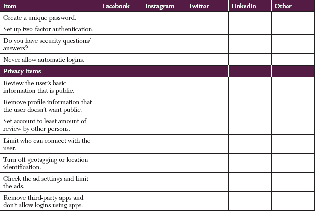
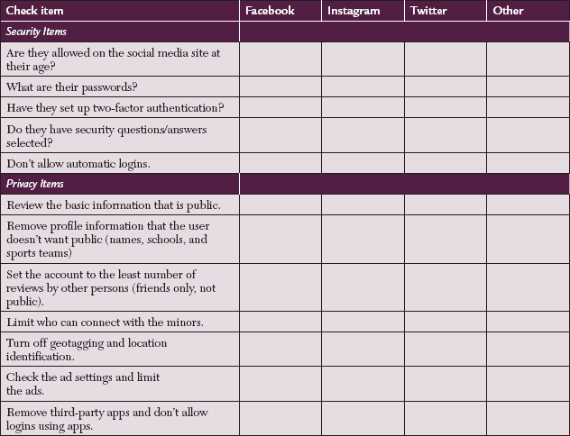
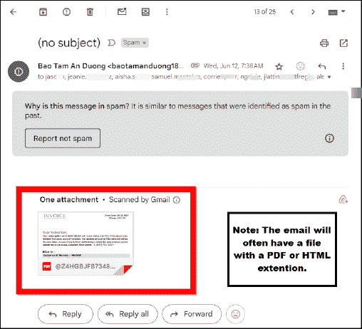
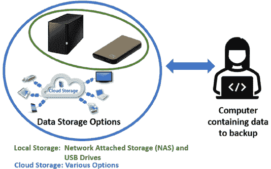
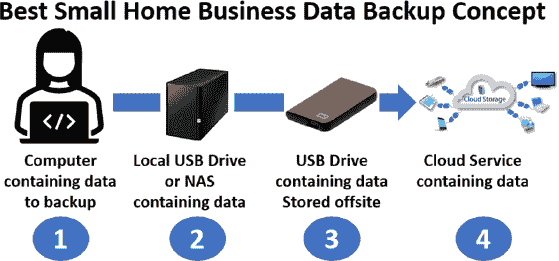
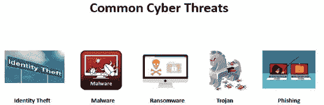
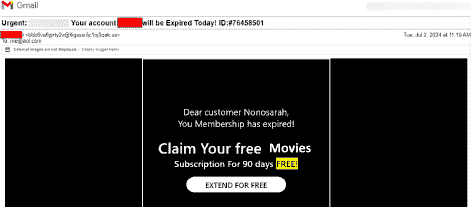
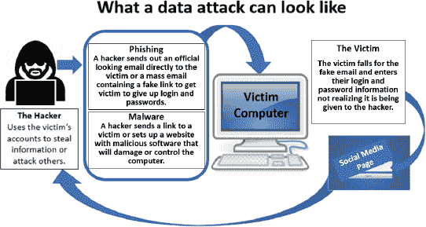
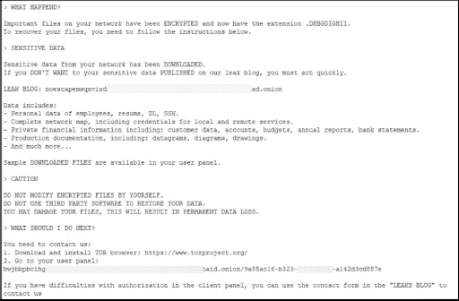
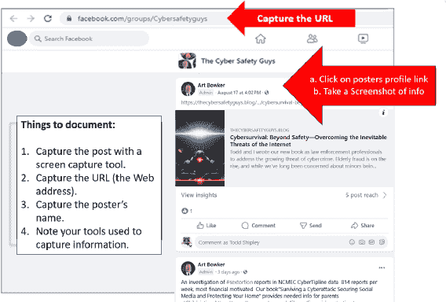

# 网络攻击生存指南：社交媒体安全与家庭网络保护

Todd G. Shipley

Art Bowker

献给所有不疲倦地与欺诈和滥用侵害弱势群体的黑暗作斗的人们——这本书献给你们，以感谢你们的勇气和对正义的承诺。教育他人防诈骗是一项终身事业。

# 报复色情

## 应对社交媒体风险：安全与隐私

### 阅读字体细则

### 安全

### 电子邮箱/手机电话

### 密码

### 隐私

### 避免社交媒体诈骗的步骤

### 在社交媒体上使用化名

### 其他在社交媒体上不要做的事情

### 社交媒体会泄露位置吗？

### 在没有个人资料的情况下使用社交媒体

### 用户手机上的社交媒体

### 结交和/或约会网站

### TikTok

### 结论

### 参考文献

# 第 5 章：保护儿童

## 本章内容

### 儿童与技术

### 培养良好的网络实践

#### 识别需求与技术

#### 管理网络风险的四个基本流程

##### 控制设备

##### 限制

##### 监控

##### 定期检查

#### 识别设备上安装的程序

#### 社交媒体

##### 针对未成年人的在线服务

##### 儿童与用户协议

#### 使用监控软件

##### 法律问题

##### 其他问题

##### 关于监控软件的最后思考

#### 教育儿童社交媒体密码

#### 儿童在网网上遇到的犯罪

#### 其他在线考量

#### 监控儿童的在线活动

##### 培养良好的手机习惯

##### 需要注意的儿童警示信号

##### 额外考量

### 结论

### 参考文献

# 第 6 章：保护成年家庭

## 本章内容

### 脆弱成年人面临的风险是真实的

### 常见的在线威胁

### 预防

#### 监控针对成年人的诈骗

#### 注意与受害相关的行为

#### 艰难的对话

#### 老年人如何安全使用社交媒体

### 识别诈骗

#### 处理潜在的网络攻击/诈骗

### 向权职部门报告

### 帮助脆弱成年人从在线诈骗中恢复

### 数字遗产与死后规划

### 注销去世家庭成员的社交媒体账号

### 结论

### 参考文献

# 第 7 章：在在线市场中生存

## 21 世纪的狩猎

### 传统市场

### 互联网市场

### 常见的网络诈骗

### 进一步诈骗的常见方法

### 在线市场的保护方法

#### 对电话进行在线查询

#### 在购买前调查商家

#### 识别欺诈网站

#### 使用社交媒体账户

#### 使用个人借记卡/信用卡

#### 第三方钱包或虚拟卡

#### 立即报告问题

### 结论

# 第 8 章：保护小型家庭企业

## 本章内容

### 21 世纪的小型家庭企业 (SHB)

### 防止常见诈骗

### 针对小型企业的常见诈骗

### 建立最佳实践

### 免费和低成本的网络安全学习内容

### 可使用政策 (AUP)

### 执行 AUP

### 业务社交媒体

### 会议安全实践

### 数据备份是小型家庭企业的必要需求

#### 制定数据备份计划

#### 存储需求/成本

#### 云存储

#### 本地数据备份

#### 使用网络存储设备 (NAS)

#### 处理小型家庭企业设备

#### 数据留存法律要求

#### 设备跟踪

### 结论

### 参考文献

# 第 9 章：在数字（网络）攻击中生存

## 本章内容

### 在网络攻击中生存

### 网络钓鱼、鱼叉式钓鱼和短信诈骗 (Smishing)

### 定期数据备份

### 立即网络响应

### 勒索软件攻击

### 应对网络骚扰

### 联系执法部门

### 报告网络犯罪

#### 记录

#### 报告犯罪

#### 信用监控与冻结

##### 信用监控

##### 信用冻结

##### 诈骗警报

##### 延长诈骗警报

### 个人网络保险

### 结论

向读者介绍了连接互联网的风险，特别是随着物联网（IoT）设备的兴起的背景。它提供了关于风险排序和缓解风险的实用建议，并强调了正确配置路由器的重要性。本章节包含了路由器设置清单以及连接到你网络上的设备跟踪。

## 第 3 章](#chapter03.xhtml)：安全上网

探索用户在访问互联网时面临的各种危害，并提供最大限度减少这些威胁的可操作步骤。它涵盖了安全浏览、管理 Cookie、使用反病毒和反间谍软件，以及通过 VPN 和 Wi-Fi 保护连接的要点。它还澄清了隐私与安全之间重要的区别。

## 第 4 章](#chapter04.xhtml)：保护社交媒体

涵盖了社交媒体平台带来的风险，并提供了在线保护个人数据的策略。从创建和维护安全密码到养成良好的安全习惯，本章为读者提供了安全导航社交媒体所需的工具。

## 第 5 章](#chapter05.xhtml)：保护儿童

关注儿童在数字领域中面临的特定脆弱性。它提供了批准设备和管理相关网络风险的指南，以确保年轻用户保持安全。

## 第 6 章](#chapter06.xhtml)：保护成年家庭成员

研究了照顾可能不具备处理网络威胁能力的脆弱成年人所面临的独特挑战。它提供了保护他们免受网络犯罪的策略，并概述了亲人去世后处理社交媒体的步骤。

## 第 7 章](#chapter07.xhtml)：在在线市场中生存

强调了在线购物和交易的风险。提供了在现代时代穿于数字市场时如何识别威胁并保护自己的人的贴士。

## 第 8 章](#chapter08.xhtml)：保护小型家庭业务

为小型家庭业务（SHBs）提供关键建议。涵盖了广泛的话题，包括防范诈骗、数据安全、社交媒体管理和员工计算机监控，帮助 SHB 所有主保护其数字资产。

## 第 9 章](#chapter09.xhtml)：在数字（网络）攻击中幸存

通过回顾前面章节中的关键预防策略，让读者准备应对网络攻击，并提供关于如何在攻击中幸存和恢复的额外指导。

## 第 10 章](#chapter10.xhtml)：未来趋势

讨论了数字安全的新兴趋势，并对个人和企业在持续面对新且不断演变的网络威胁时未来可能发生的情况提供了见解。

T. Shipley

A. Bowker

2024 年 7 月

# 鸣谢

我要感谢我的整个家人，我的妻子和女儿，特别是那些能从中获益的我的父母。

在这一路途中，我受到了许多致力于终身反欺诈的人的影响。

James “Jimmy” Deal，一位朋友也是一位反欺诈战斗士，他一直都在，并一直鼓励我坚持战斗。

Todd G. Shipley

我要感谢我的孩子 Stephanie 和 Mark，以及我的孙辈们 Scarlett、Raylan、Vivian、Margaret、Owen、Felicity 和 Abigail——愿这本书能为你们和后代创造一个更安全的在线世界贡献力量

Art Bowker

为了确保这本书成为公众的一项宝贵资源，我们向具有处理特定人群（如脆弱成年人或网络犯罪受害者）专业经验的父母或个人征求了草案章节的意见。感谢以下个人对改进我们书籍意见和建议：Maryum Ali, Tim Barry, Stephanie Burlison, Bonnie Burthker, Jeff Coyle, Julie Delaney, Anitra Merrett, Danielle Mahoney, Jack Riffle, Michael Sullivan, Rich Threadgill, Rachel Yokely 以及 “Big Ashes” John Cryer, CFE, Erin West, Esq.

| 章节 | 1 |

## 网络生存 VS 安全

## 本章内容

理解网络犯罪是当今世界的事实，是理解保护自己和家庭需求的第一步。本章提供了关于重大网络犯罪事件的数字和历史数据，并对我们所有人面临的网络风险进行了概述。

现代人类是一个连接的物种。互联网使得这一切成为可能，提供了在 20 世纪 80 年代后期商业化时很少有人能想象的通信和信息访问。遗憾的是，我们的信息公路也把世界上有犯罪倾向的人与无数毫无防备且未做好准备的受害者连接起来。网络犯罪影响着我们每，个人（包括儿童在内）在一生中多次面临网络犯罪尝试/行为的概率很大。（(图 1.1）

许多网络犯罪研究是由反恶意软件供应商支持的，侧重于不安全的个人电脑、手机或设备的危险，这些供应商希望这些担忧能转化为产品销售。这些确实是严重的担忧，不保护自己的设备是愚蠢的。然而，如果人们认为简单的反病毒、反间谍软件和防火墙就能保护他们免受 21 世纪存在的所有网络危险，那是天真的。这些基础措施只是数字时代生存的起点。

过去十年发生的重大数据泄露，例如 Target (2013)、Sony (2014)、Anthem (2015)、OPM (2015)、Equifax (2017)、Microsoft (2020) 和 Facebook (2021) 所经历的，并不是针对个人用户的攻击，而是针对委托用户数据的公司。一旦攻击者获得了信息，他们要么将其用于恶意目的，要么卖给他人，后者通过身份盗窃或其他金融犯罪使个人用户受害。

如果认为个人所做的只是避免在认为网络安全不是优先事项的公司处购物、工作或获取服务，那就太好了。但在受害和数据被盗之前，人们如何确定这一点呢？人们本可以开始在像 Hee Haw’s Gordie’s General Store 那样的商店购物，那里没有计算机或互联网漏洞，但那不是当代的现实。此外，对于某些机构，人们没有选择。人们必须与他们打交道。当然，我们提到的这些机构是指尚未建立不可逾越的网络堡垒的政府机构。2014 年，美国国务院、白宫、国家海洋和大气管理局以及美国邮政加入了被黑客攻击的政府实体长名单。与 2015 年人事管理局（OPM）的泄露相比，这些显得微不足道。这次重大泄露包含了申请安全审查的政府员工的背景信息。像许多其他人一样，两位作者都收到了 OPM 的信函，确认他们是数据盗窃受害者。

图 1.1 网络犯罪受害者人数 [FBI, 2024]。

书中的信息是建议你如何避免受害，不仅是基于作者作为执法调查人员的视角，还基于他们作为受害者的经验。

即使用户没有向某个机构寻求服务，他们也会暴露自己。无数个人已经建立了社交网络个人资料，但往往没有考虑过安全或隐私设置。他们与他人分享信息，认为与其交流的对象正是他们所声称的身份。人们错误地说服自己，他们发布的内容不会被分享给他们不认可的人。人们往往错误地信任自己的亲属、朋友和同事不会将他们的信息转发给他人，或者他们认为自己的安全/隐私设置已经锁定。由于有了所有这些误解，人们还认为社交媒体网站拥有某种安全保护措施，可以防止他们成为受害者。

不幸的是，这些网站包含的海量信息使其成为寻找可转化为价值信息（例如访问某人的银行账户）的犯罪分子的诱目标。社交媒体公司也无法免受网络攻击。2013 年，黑客从`Facebook`、`Twitter`和`LinkedIn`等社交网络网站，以及电子邮件提供商`Google`和`Yahoo`处窃了两百万个密码。作为最大的社交媒体公司的 CEO，并不意味着免受因密码使用不当导致的攻击。`Facebook`创始人`Mark Zuckerberg`的`Twitter`和`Pinterest`账户被接管，是因为他重复使用了黑客在 2012 年从商业社交媒体巨头`LinkedIn`的泄露密码库中发现的密码。

攻击也字面上从每个方向和每个设备袭来。美国和西欧成千上万未安全的`webcams`（摄像头）为位于俄罗斯联邦某处的网站提供了素材。作为一种极端的隐私侵犯，这些不安全的`webcams`还可以被用来确定抢劫或入室盗窃的最佳时间。`Webcams`并不是漏洞。一位安全专家正确地观察到，我们的咖啡壶、电视、炉子和冰箱都连接了`Internet`，而且它们的安全协议并不总是充分的。如何避免这种日益融入到普通家庭设备中的网络风险？最近的报告指出，某些现代车辆已被黑入，发现的漏洞允许攻击者控制汽车功能，例如启动和停止。

在计算机早期，普渡渡大学计算机操作、审计与安全技术（`COAST`）项目的主任`Gene Spafford`认为：“唯一真正安全的系统是关掉电源、铸在混凝土块中并密封在带铅衬的、有武装守卫的房间里——即使是这样我也有疑虑。” Spafford [1989]。今天，我们生活在一个每个人不仅必须担心自己的计算机或系统，还要担心每个人的社会。现实情况是，无论一个人让自己的计算机和个人习惯变得多么安全，其他人都可能掉链并使他们暴露在网络危害之中。如果不是公司、机构或社交媒体上的“朋友”，那么就是咖啡壶或冰箱向世界泄露信息。

更糟糕的是，网络受害不仅局限于个人身份标识和信用/财务被盗或隐私被侵犯。还有其他更阴险的危害正等待着网络公众。对儿童的性剥削长期以来困扰着`Internet`。儿童性侵者经常访问青少年聊天室寻找受害者。欺凌和跟踪在网线上日益发生，10% 到 40% 的青少年经历过网络欺凌。`Sextortion`（性勒索）是一种犯罪分子利用受害者的裸照获取财务报酬或更严重的后果，这不仅导致了财务损失，还导致了许多自杀。一些杀手，更具体地说，连环杀手正在利用`Internet`狩猎受害者。

网络犯罪分子经常使用社会工程技术说服受害者交出财务。`Internet Crimes Complaint Center`（`IC3`）报告称，2023 年因投资诈骗导致的损失在他们跟踪的所有网络犯罪中最多。根据`IC3`数据，投资诈骗损失从 2022 年的 33.1 亿美元增加到 2023 年的 45.7 亿美元，增加了 38%。如图 1.2 所示，投资诈骗受害者通常超过四十岁。图 1.3 显示所有报告的`IC3`犯罪损失严重影响了老年群体。网络威胁并没有随着人们年龄的增长而减少 [FBI, 2024]。

安全或保护意味着一个人免受危险或伤害。我们可以减少并可能避免它，但`Internet`提供的访问并非没有危险或伤害。`cybersurvival`（网络生存）一词要好得多。它承认危险或伤害的存在，但其内涵超越了安全或保护，意味着克服那些攻击。

写这本书的目标不是让用户“拔掉插头”并停止使用`Internet`。在数字世界中做鸵鸟不是生活之道。作者们将根据他们的网络法律执法经验，不仅最大限度地提高读者避免成为受害的能力，而且在他们成为网络受害者时做好准备。目标是让读者在一个网络犯罪事件日益成为日常常态的世界中生存。作者们将提供有关如何加强网络防御以及识别和避免网络风险的信息。他们专门设立了章节来保护儿童、弱势成年人和小型企业。他们还为读者提供了有关如何在在线市场保持安全的信息。他们将教育读者在成为网络受害者时如何度地减少伤害。最后，作者们将教育读者如何向执法部门正确记录和报告网络攻击，以最大限度地增加犯罪者被捕和起诉的可能性，希望让当今数字世界中的每个人都更安全。

图 1.2 按年龄划分的`IC3`投资投诉。

图 1.3 按年龄分组的所有`IC3`投诉。

作者们将通过简化概念且不用技术术语淹没读者来实现这些目标。当他们确实使用技术信息时，会有相应的解释。作者们多年来一直在对执法部门进行这些概念的教育和培训，他们知道如何向不具备计算机科学学位的人解释这些。

本章讨论了连接互联网的风险，并对这些风险的排序提供了建议，特别是针对物联网（IoT）设备的风险。本章还涵盖了缓解这些风险的关键——使用配置恰当的路由器。此外，文中还包含了路由器配置清单以及连接到互联网的设备记录清单。

## 连接互联网

易用性是衡量设备价值的标准。用户期望操作简单，并希望第一次使用时就能运行，无需反复调试。从历史角度看，计算机的进步一直在追求简单。一个例子是图形用户界面（`GUI`），它允许用户无需输入命令即可操作计算机。即插即用允许新设备在连接到计算机时立即开始工作。简单性已内置在如今的技术中，但简单性伴随着隐藏的代价，即安全性。

如今，访问互联网需要两样：一个设备（笔记本电脑、台式电脑、平板电脑、手机等）和一个互联网服务提供商（`ISP`）。这非常简单。这种方式的互联网访问就像是在没有刹车和安全带的高速路上。本章将讨论设备如何连接到互联网、相关的风险以及如何确定安全优先级。

## 早期计算机连接

最初，计算机及其所有相关设备是通过电缆或线路连接的。这些设备包括鼠标、键盘、打印机、扫描仪，以及曾经的调制解调器。调制解调器通过电话线连接到互联网，并通过另一根电缆连接到计算机。如果家庭用户没有调制解调器，他们的计算机就无法连接互联网。

在商业环境中，情况要复杂一些。计算机通常连接到其他计算机，其中一些被称为`routers`，并充当通信交通警察的角色。技术较高的家庭用户会有一个`router`，特别是当他们家庭网络中有多台计算机时。稍后将详细讨论`routers`，它们的功能允许几台计算机“共享”另一个设备，例如打印机或调制解调器。早期的互联网连接即使在商业和家庭网络环境中也需要调制解调器来连接互联网。

20 世纪 90 年代后期，调制解调功能从外部设备移动到了计算机内部组件。用户将电话线直接插入计算机的“端口”来接入互联网。`ISP`开始扩展除“拨号上网”之外的服务类型，例如数字订阅线路（`DSL`）和电缆。这些额外的服务类型不需要外部调制解调器，只需通过“转换器”插入计算机，然后插入计算机端口即可。剩余的拨号`ISPs`通过电话线直接插入计算机端口进行访问。外部设备（如打印机、扫描仪和`routers`）仍需要直接连接到计算机的电缆才能工作。

21 世纪初，无线技术出现（参见图 2.1](#）。计算机不再有电线直接连接到打印机等设备。计算机可以通过无线电波或`Wi-Fi router`连接到调制解调器。无线`router`仍然通过拨号、`DSL`或电缆`ISP`通过线路连接到用户的互联网连接。即使这也发生了变化。从手机开始，计算机可以通过无线`ISP`上网。电线已成为过去。

图 2.1 无线访问。

在向无线连接过渡期间，`ISPs`开发出了一种结合了调制解调器和`router`功能的设备。这种组合调制解调器`router`允许家中许多计算机通过一个连接到互联网。这使得家庭用户能够从任何允许与其组合调制解调器/路由器通信的设备立即访问互联网。这些新设备的设计是为了方便普通家庭用户无忧地连接，然而，内置的安全措施却很松散。此外，家庭用户修改设备设置以增强安全性的权限有限。某些设备的`access code`固定在设备底部。家中的任何访客（如维修人员、保姆等）只需将设备翻过来用手机拍张照片，就能获得接入无线网络所需的`access code`。此外，`ISP`供应商并不总是能跟上安全更新和补丁。AT&T Linksys 曾被发现这样一个漏洞，导致其变得容易受到攻击。（参见图 2.2。）

图 2.2 路由器工作原理概念。

## 路由器是守护者

如前所述，由于`routers`可以与其他设备共享网络资源（通信），它们就像通信交通警察。它们的功能远不止于此。在计算机和黑客之间提供了额外的防御层。

设备要连接到互联网，需要一个唯一的互联网协议（`IP`）地址，由`ISP`提供。该`IP address`在发送电子邮件、浏览等活动期间会提供给其他计算机。如果不使用`router`，该`IP address`就会变成攻击者的直接连接。从意义上说，这就像向某人提供未公开的电话号码，让他们可以骚扰对方。

`Routers`是第一道防线。攻击者在攻击计算机之前必须绕过`router`。`Routers`使用`ISP`提供的相同`IP address`连接互联网。它通过提供互联网不可见的本地`IP addresses`来“过滤”指向其受保护设备的通信。通信进入`router`，由`router`决定应由哪台设备接收，然后根据其分配的本地`IP address`进行转发。一个配置适当的`router`不会广播这些本地`IP addresses`或它服务的设备数量。

将其类比为老式的酒店接线员。拨入电话的人永远不知道客人住在哪个房间。“通话”到达`router`（接线员），由接线员根据此类通信规则将其转发给目标接收者（房间）；例如，晚上 9 点后不再转发通话。如果通信被认为是威胁或不允许，`router`就不会将其转发给设备。

`Routers`经常带有防火墙，可以限制入站和出站通信。其他路由器则拥有防火墙控制网络内设备之间的通信。这样一来，受攻击的设备（如打印机）就无法用于控制另一台设备（如计算机）。

`Routers`还可以为某些设备提供家长控制或限制。这些控制包括在特定时间无法访问互联网，或禁止访问特定网站或包含违反标准文本的网页（显性语言或过多脏话）。

某些`routers`支持虚拟专用网络（`VPN`），允许用户远程连接到特定网络，例如家庭用户远程连接到其业务网络。`Routers`还监控网络使用情况，并在出现可疑情况时发送电子邮件或短信警报。

# 应该购买什么类型的路由器？应该花多少钱？

选择合适的路由器可能是一个挑战，因为人们希望以合理的价格获得最好的产品。问题在于，技术变化非常快，如果不加建议，推荐的品牌或型号很快就会过时。为了保护家庭网络，Wi-Fi 路由器需要具备某些特定功能。

通常，用户主要关注的是连接到 Wi-Fi 路由器的范围（例如，它能覆盖整个房屋？）以及连接时获取数据的速度。从安全的角度来看，这些是我们对路由器最后才关心的问题。大多数新路由器都是即插即用的。用户必须登录 Web 风格界面并通过向导进行设置。软件向导或设置是一个引导用户通过一系列步骤配置程序的用户界面。它通过将复杂或不熟悉的任务分解为较小、易于管理的部分来简化任务，而且通常速度很快。让我们来看看在购买家用 Wi-Fi 路由器时应该关注哪些点。

## 需要考虑的关键特性

### 1. 标准、标准、标准

不要被`802.11g`、`802.11n`或`802.11ac`等长长的标准列表搞混。它们是路由器能力的书面技术标准。`802.11`是官方标准名称，后面的字母是版本号。对于普通家庭用户来说，首选最新的可用标准。不要购买旧技术，因为新标准很快就会被取代。用户不应因购买旧设备而让网络面临风险。他们应该购买最新版本。用户可以询问科技商店的销售店员，或在 Google 上搜索“当前 802.11 标准”。

### 2. 多频段路由器

在寻找路由器时，用户会发现大多数现代路由器都在多个带宽上进行广播。通常，`2.4GHz`和`5GHz`频段使用户方便在一个频段上浏览，在另一个频段上流视频。

### 3. 使用 MIMO 还是不使用 MIMO

多用户多输出（MIMO）是一项允许许多设备同时获取高带宽 Wi-Fi 信号的技术。它在多个连接上更高效地分配数据，为用户提供更快的 Wi-Fi 速度。

### 4. 安全

Wi-Fi 网络很流行但可能不安全。用户必须保护家庭网络，以防止范围内的黑客窃听。为了做到这一点，必须考虑 Wi-Fi 背景下安全的意味着什么。有一系列关于安全特性的令人头疼的缩写。它们按照安全程度从高到低的顺序列出：

a. `WPA3`

b. `WPA2 + AES`

c. `WPA + AES`

d. `WPA + TKIP/AES`

e. `WPA + TKIP`

f. `WEP`

g. `开放网络`（完全没有安全措施）

请记住，网络的安全性取决于连接到网络的最低不安全的设备。这意味着连接到 Wi-Fi 的手机、平板电脑、电脑或其他设备都需要相同级别的安全防护才能确保网络安全。目前最高的安全性是`WPA3`。Wi-Fi 保护访问意味着第二种实现。

---

### 路由器设置指南

要设置您的小型办公室和家庭办公室（SOHO）路由器，请遵循本指南。某些不同步骤取决于制造商。

#### 设置步骤

1. 插入路由器并开启路由器。

2. 将接入调制器连接到路由器。将以太网线插入名为`WAN`、`uplink`或`Internet`的路由器端口。

3. 关闭调制调器并重新开启（这是为了确保路由器被识别）。

4. 将电脑连接到路由器。将以太网线端插入电脑的网络连接，另一端插入路由器上的空闲端口。

5. 打开路由器管理工具。在连接到路由器的电脑上打开 Web 浏览器。检查路由器底部或安装手册获取 IP 地址。通常默认地址为`http://192.168.1.1`或`http://192.168.0.1`。

6. 登录路由器。输入默认用户名和密码（由路由器文档提供）。

#### 路由器设置清单

| 任务 | 已完成 |
| :--- | :--- |
| 插入路由器并开启路由器。 | |
| 将接入调制器连接到路由器（`WAN`/`uplink`）。 | |
| 关闭调制调器并重新开启。 | |
| 通过以太网线将电脑连接到路由器。 | |
| 通过 IP 地址打开路由器管理工具。 | |
| 使用默认凭据登录。 | |
| 更改默认管理员密码和用户名。 | |
| B | 开启加密。如果此功能可用，考虑使用它来进一步加固用户访问（但在实施之前，请了解其功能以及密钥如何以及存储在何处）。 |
| C | 更改无线网络名称；这通常被称为`SSID`。不要使用默认名称。使其具有唯一性以便易于记忆。这是计算机看到并连接的 WiFi 名称。 |
| D | 启用媒体访问控制（`MAC`）地址过滤——或访问控制。你可以使用此功能来控制访问路由器的设备。`MAC`地址是与计算机网卡或其他设备关联的物理地址。在 Google 上搜索以获取设备`Mac`地址的步骤。使用此功能仅允许用户录的`MAC`地址使用路由器。（大多数现代路由器都会提供设备列表及其`MAC`地址，以允许其接入网络。） |
| E | 为设备分配静态 IP 地址。这是另一项安全功能，可以防止未知设备进入并使用路由器。通过此功能，用户可以为他们允许的每个设备分配内部 IP 地址。 |
| F | 在更改密码并为路由器 WiFi 连接命名后禁用`SSID`广播。一个重要的安全特性是关闭其广播。如果不进行广播，没人知道它的存在。只有用户知道名称和密码，因此只有他们可以访问路由器的 WiFi。 |
| G | 关闭`Ping`返回。大多数路由器都有一个响应请求的功能，称为`Ping`，用于识别它们是否在线。关闭此功能可以使路由器免于某些利用该功能识别攻击目标的特定互联网威胁（隐于身形）。 |
| H | 在路由器上启用防火墙（如果已安装）。某些现代路由器具有额外功能，例如防火墙，其功能是增加安全性以防止访问网络，因此防火墙对它们来说非常重要。 |
| I | 开启内部安全日志。大多数情况下，路由器上的安全事件日志默认是关闭的。开启此功能以记录并提供任何安全事件或对设备的未经授权访问，以便日后审查。 |

注意

此表包含的信息是一个通用指南，具体步骤将取决于路由器的品牌和型号。请务必审阅制造商的安装指南以获取详情。

完成这些步骤后，验证计算机是否可以连接到路由器和互联网。

# 物联网 (IOT)

物联网（`IoT`）是一个术语，用于表示所有具有唯一标识符并连接到互联网的设备。它不仅涵盖计算机，还涵盖任何可以通过互联网通信的设备。该列表在不断增长，可以包括医疗设备、工业、建筑或农业设备、家用电器和环境控制。为什么这是一种风险？首先，这些设备通常没有安全功能或安全功能非常松散。其次，这些设备正越来越多地成为生活的一部分。对于普通公众来说，它们可以包括从家用恒温器到孩子的说话娃娃，或是起搏器等任何物品。销售这些设备的供应商可能没有披露它们的安全风险。黑客已利用看似毫无价值的`IoT`设备攻破了高价值目标。2018 年，一组黑客利用赌场里的鱼缸恒温器盗取了高额客户数据库。任何`IoT`设备都可能带来潜在的安全风险。意识到风险是变得更加安全并能够采取行动的第一步。

## 如何发现网络风险？

识别网络风险有时是一项令无无措的任务。在当今世界，任何时候连接到互联网的任何设备都可能受到攻击，个人信息可能会暴露。我们中的许多人记得小时候就被告诫要小心世界潜在的危险。“不要和陌生人说话”是我们小时候听过的最常见的警告之一。这是为了帮助我们在不可预测的世界中保持安全，并避免与未知人员发生的问题。我们教导孩子“陌生人危险”的概念，并且不要从陌生人那里拿糖。

很少有人能预料到等待我们的数字危险，特别是这些危险在婴儿潮一代成长时期并不存在。早期的 X 世代（出生于 1965 年至 1980 年之间的公民）在 20 世纪 90 年代万维网出现并普及之前，已经是成年人、青少年或儿童。他们的父母或老师中很少有人知道如何使用电脑，更不用对不断发展的数字危险做好准备了。

千禧一代（出生于 1981 年至 1996 年之间）面临着类似的问题，因为他们的父母中很少有人接触过数字安全的基础知识。简而言之，我们处于这样一个社会：像陌生人危险这样的实体威胁被灌输到我们脑海中，但现代社会的数字危害才开始被强调。另一个问题是，数字危害似乎在不断变化或演变。似乎随着每项新技术的创新，某些犯罪分子利用它来实现邪恶的目的。

## 我们的 IoT 风险是什么

为了清楚起见，本节将从潜在风险与实际损害的角度来看待。最坏的情况是所有的`IoT`设备都可以被黑入并接管。如果黑客可以接管设备，他们利用这种控制可以实现什么？他们能暴露个人信息或威胁儿童的安全吗？

风险可以被视为一个连续体，每个设备都带有与其关联的所有风险。将其考虑为用于攻击其他设备并可能控制该设备的潜在风险。该设备本身是否具有实现某些目标的内置硬件，即在监视或控制该位置的某些功能（温度、锁、空气和照明）吗？黑客的控制是否会导致设备引发电气火灾或其他损坏？`表 2.3`列出了人们在家庭 IoT 设备中可能发现的四种 IoT 风险等级。你可以借此了解你家中可能存在的风险。

### 表 2.3 IoT 风险的四个等级

| 风险等级 | IoT 风险描述 |
|---|---|
| 低风险 | 此级别涵盖不处理敏感或个人数据的 IoT 设备，它们的故障或滥用不会对个人或组织构成重大威胁。这些设备的示例包括智能家用电器、健身追踪器和环境传感器。 |
| 中等风险 | 这一级别的设备可能对个人和组织构成中等风险。这些设备可能会收集个人信息（如健康数据或财务信息），但对敏感数据的访问有限。这些设备被破解可能会导致个人信息暴露或服务中断。 |
| 高风险 | 这一级别的 IoT 设备在被攻破后具有造成重大损害或中断的潜力。它们可能访问关键基础设施或敏感数据，设备破解可能导致严重后果。高风险 IoT 设备的示例包括医疗设备、工业控制系统和智能汽车。 |
| 关键风险 | 这一级别的设备对个人和组织构成最高风险。它们拥有访问高度敏感数据的权限，并且对于关键基础设施（如电网、交通系统或供水系统）的运行至关重要。这些设备被破解可能会导致灾难性后果，包括大范围的服务中断和潜在的生命损失。 |

请注意，即使是无法访问敏感数据的 IoT 设备，也可能被用于提供有关用户习惯的信息。例如，智能家用电器或健身追踪器等低风险设备，一旦被破解，可能会让黑客获知某人何时在家，或者在特定时间可能在何处。

## 检查设备以识别家庭安全风险

用户应该对自己目前拥有的设备有一个通用的了解，并且他们可能对家庭技术的不安全性感到担忧。将这些物品分为不同的功能，记录它们的特定用途，并绘制家庭网络图，是很有帮助的。使用表 2.4 开始绘制你房屋技术的设备图。

1. 确定家里哪些设备允许访问互联网。这些通常是由服务提供商提供的路由器，或者是用户自行添加的路由器。

2. 查看通过无线或以太网线连接到此路由器的设备。以太网线连接本质上更安全，因为它们是定向连接的。Wi-Fi 的安全性较低，因为它使用可以被截获的无线电波。

3. 大多数 IoT 设备将通过路由器连接到互联网。

   a. 每个设备都附有有关如何连接它的说明书。

   b. 识别每个设备的登录程序。

   c. 逐一登录设备并识别该设备可用的安全功能。

   d. IoT 设备最经常被忽视的安全措施是更改管理员和密码；请立即更改这些内容。

   e. 考虑在路由器中使用`MAC filtering`功能，并为 IoT 设备分配内部 IP 地址。

表 2.4 数字风险清单应包含所有家庭成员的设备，包括手机、iPad 或平板电脑、电脑和家庭路由器。还有其他需要考虑的因素。例如，汽车呢？冰箱、监护摄像头、安全摄像头、GPS 设备、家用恒温器或任何通过无线连接的电子设备都可能带来风险。记录物品的品牌、型号、序列号以及任何识别标记（这在物品被盗时可以帮助警方，也可用于保险之目的）。

一旦某人对这些物品有了清单，他们就能更好地判断未经授权访问家庭的风险。如果某些设备是移动的，将会遇到新的风险。在工作中使用移动设备、连接到办公室网络、连接朋友家的 Wi-Fi 以及在当地咖啡店连接，都会让移动设备面临额外的风险。图 2.3 展示了如何绘制房屋图的示例。

图 2.3 房屋绘制图。

在绘制房屋图时，用户应该物理地画出路由器的位置。要记住，普通家庭路由器的 Wi-Fi 信号传输范围大约为一百英尺。可以查看制造商网站来确定其传输距离。

## 某些蓝牙的危险

蓝牙技术虽然方便且被广泛使用，但如果不妥善保护，可能会产生潜在的危险。主要风险之一是窃听，因为蓝牙信号可以被黑客截获，他们可以获取密码、信用卡号和个人对话等敏感信息。这可能导致身份盗窃、财务损失和隐私侵犯。此外，未安全的蓝牙连接还可能受到恶意软件攻击，允许黑客控制设备。

为了确保蓝牙安全并最大限度地减少这些风险，用户可以采取一些预防措施：

- 首先，在不使用时关闭蓝牙很重要，因为这可以防止未经的设备连接到你的设备。

- 仅与受信任的设备配对，并避免在黑客可能有机会截获你连接的公共场所使用蓝牙。

- 不要将设备设置为“可发现”模式，以免设备在未经许可的情况下检测并连接。

其他常见的蓝牙威胁还包括将手机与租汽车配对。配对可以方便地下载联系人列表、电子邮件和短信。如果你没有从租汽车或折旧的旧车中删除这些信息，其他人可能会访问这些数据。

## 还有谁在看你的摄像头？

你仔细设置摄像头是为了在你离开时看你的房子或孩子。看到孩子们是否准时回家或在放学后做作业是很棒的。但还有谁可能在看你的摄像头令人不安。如果你不注意这个玩具的安全，世界上任何人都可能整天盯着你，晚上也一样。`Shodan`网站为白帽（伦理）黑客、犯罪分子、性犯罪者以及任何国家提供了发现和识别连接到互联网的不安全摄像头的能力。发现互联网上的设备只需访问他们的网站并输入你的`IP 地址`。如果`Shodan`爬取了`IP 地址`，任何信息都会在那里被找到。

## 摄像头门事件

2010 年，宾夕法尼亚的一个学区同意支付 61 万美元达成一项联邦诉讼的和解。这项被称为“摄像头门”丑闻的诉讼涉及学校秘密并远程激活学生在家里使用的笔记本电脑中的嵌入摄像头 [Robbins 2010]。这是一个警示，提醒人们要留意带家中的设备并采取相应措施。这包括你带回家的公司设备，这些设备可能具有与本案学校类似的远程监控功能。

## 短信安全

短信可能会带来各种危险，之一就是短信被截获。这意味着有人可以在未经手机主人知情或同意的情况下访问并阅读短信内容。当涉及银行账户号码或信用卡详情等敏感信息时，这可能尤为令人担忧。即使向朋友或亲戚发送信用卡照片，如果被截获，也会危及财务安全。此外，数据留在服务提供商的网络中，使其受到黑客或其他恶意入侵者的攻击。

我们都知道，技术正日益成为我们车辆的一部分，从蓝牙功能和`GPS`定位到自动驾驶功能不一如此。正如我们之前强调的，在实现这些新功能时，安全性并不总是首要任务。这些漏洞允许小偷使用`USB`设备盗取车辆，或允许黑客远程控制车辆（例如启动或停止车辆）。现代车主必须熟悉其车辆的计算机功能，并跟上制造商所有的计算机更新。一个显然重要的第一步是更改默认密码。在互联网上对车辆及其计算机进行有关已知漏洞的更新研究并解决它们。关于其他步骤，请参阅《Physics World》中题为“如何黑进自动驾驶汽车”的文章 [Ornes 2020]。

## 结论

在当今的数字世界，理解网络安全的基本概念对于保护个人及其数字信息至关重要。本章讨论了连接互联网的风险，并对这些风险进行了排序建议，特别是与`IoT`设备相关的风险。减轻这些风险的关键在于使用配置恰当的`router`。本章还提供了`router`配置清单以及连接到互联网的设备文档清单。第 3 章将超出`router`的范围，讨论在线网络安全需要采取的额外措施。

## 参考文献

Ornes, S. 2020. “How to hack a self-driving car.” `Physics World`, 2020 年 8 月 18 日. [`physicsworld.com/a/how-to-hack-a-self-driving-car/`](https://physicsworld.com/a/how-to-hack-a-self-driving-car/)

Robbins 2010. `Robbins v. Lower Merion School District, Dist. Court, ED Pennsylvania 2010 Civil Action No. 10-665`.

Whittaker, Z. 2017. “Security researcher says DirecTV hardware can be easily hacked.” `ZDNET`, 2017 年 12 月 12 日. [`www.zdnet.com/article/security-researcher-says-directv-hardware-can-be-easily-hacked/`](https://www.zdnet.com/article/security-researcher-says-directv-hardware-can-be-easily-hacked/)

| 章节 | 3 |
| --- | --- |

# 安全上网

## 本章内容

上网会使用户暴露于风险之中。本章识别了这些风险并涵盖了消除它们的步骤。它特别涵盖了`browsers`、`cookies`、`antivirus`、`antispyware`和`firewall`软件，通过虚拟专用网络（`VPN`）和`Wi-Fi`连接。它还讨论了隐私与安全之间的区别。

## 互联网风险

第 2 章涵盖了保护家庭网络的步骤，以确保没有人访问用户的设备。上网会让用户暴露在必须解决的其他风险中。本章探索了为了确保用户在线安全必须处理的其他领域。请记住，互联网不仅仅是万维网，它包含了每一个使用互联网的协议。这包括`email`、音乐共享工具、文件共享以及许多其他在访问互联网时经常被视为理所当然的基本功能。所有这些常用的互联网工具都可能让攻击者访问用户的计算机。

### 为联网使用保护计算机安全的考虑因素

技术总是在变化，针对它的攻击也是如此。在线研究可能会因关于安全含义的冲突建议让普通人无所适从。网络安全行业必须评估针对系统的威胁，以帮助确定应采取哪些安全措施。普通家庭计算机或小型企业的风险与大型公司不同。以下部分评估了连接互联网的计算机所带来的小型办公/家庭办公室（`SOHO`）风险。

### 评估风险

风险评估是评估和分析潜在漏洞与威胁的过程。它帮助用户确定威胁发生的概率，并识别如果这些威胁变为现实可能产生的后果。这一过程有助于识别需要改进的领域，以及可以添加以保护家庭网络的额外安全措施。表 3.1

#### 表 3.1 风险评估

| 步骤 | 评估内容 |
| --- | --- |
| 1. | 资产识别 | 第一步是识别个人家庭网络中的所有资产，如计算机、`routers`、连接的设备和个人数据。 |
| 2. | 威胁评估 | 识别可能损害网络的潜在威胁，例如`malware`、`phishing`、物理盗窃或人为失误。 |
| 3. | 漏洞评估 | 识别网络中任何使之更容易受到攻击的漏洞或弱点，例如过时的软件、弱密码或未安全的`Wi-Fi`网络。 |
| 4. | 风险分析 | 评估每个威胁发生的概率和影响。 |
| 5. | 优先级排序 | 根据发生概率对风险排序。这将帮助用户优先关注最关键的风险。 |
| 6. | 风险缓解 | 开发一个计划来减轻或减少已识别的风险。这可能包括实施安全措施，如`antivirus`软件、`firewalls`和使用强密码。 |
| 7. | 实施与监控 | 实施风险缓解计划并定期监控网络是否有任何新漏洞或威胁。记住，威胁和漏洞在不断涌现。 |

通过这些步骤，`SOHO`计算机用户可以识别并希望解决风险。从长远来看，这使得网络更安全，更不容易受到攻击。这个过程很重要，但永不会完结。定期审查和更新风险评估有助于确保用户持续的安全。

## 基础 SOHO 安全考虑因素

到目前为止，本章查看了风险，并尝试评估应对网络威胁所需的类型。用户实际上可以采取哪些措施来影响网络安全？以下列表探索了一些基础知识：

**安装 SOHO 防火墙**

本地`firewall`是识别和防止外部网络攻击极佳地点。许多公司制造各种有助于保护家庭网络的设备。在用户网络和互联网之间放置防火墙是`SOHO`安全的基本要求。

**配置/更新操作系统**

用户对操作系统是否有深入了解，还是仅对其功能熟悉？`Windows`用户的配置考虑与`Apple`用户不同。`Linux`用户的考虑与两者也非常不同。用户需要审查安全需求并实施最佳实践。

**杀病毒/间谍软件检测软件**

现代系统面临许多外部（甚至是内部）来源的攻击。保护用户计算机系统的下一步是确保计算机安装了`antivirus`和`spyware`检测工具。这再次是一个需要研究的复杂领域，但它是安全的必然。

**使用虚拟专用网络（VPN）**

`VPN`在安全方面可以发挥重要作用。如果用户的风险评估确定其浏览流量可能被破解，那么安装和使用`VPN`可能是合适的。

**阻止浏览器 Cookie/活动内容**

Cookies 和其他浏览器跟踪设备每天都被营销公司和网站所有者用于合法目的。对于评估过风险的用户来说，它们可能会成为隐私和安全问题。根据用户潜在的威胁，阻止和防止对在线行为的跟踪可能是一种有效的策略。

## 安装/更新浏览器

浏览器可能是一个复杂的问题。有很多不同的浏览器，每种都有其优缺点。用户应该选择一个与自己的风险概况匹配的浏览器，并确保其是最新版本。

## 使用加密

加密对许多用户来说是一个谜团。何时使用加密的选择实际上取决于他们的威胁分析。普通用户可能不需要使用加密。但用户评估中确定的威胁水平将决定这些需求。请记住，加密的成功使用取决于许多因素。数据是静态的（存储在硬盘上）还是通过电子邮件通信发送的？每种都有不同的要求，并会影响加密使用的有效性。

## 使用安全计算机

安全计算机是指用户已经识别了其风险，并采取了必要步骤来积极保护该设备的计算机。

## 维护更新

保持设备安全是一个持续的过程。一旦系统安全了，基于目前的技术和理解，并不意味着下个月甚至明天它仍然安全。保持操作系统、路由器、浏览器和其他软件的更新是一项关键且持续的功能。图 3.1 为你提供了在设置家用计算机时上述考虑因素的视觉大纲。

图 3.1 设置计算机时的考虑因素。

## 评估用户的互联网风险

在今天的数字时代，互联网已成为每个人日常生活中不可或缺的一部分。人们用它处理从联系朋友家人到购物和银行的一切事务。互联网提供的便利性也伴随着风险。用户评估这些风险并采取必要的预防措施来保护个人信息是非常重要的。

风险可能包括来自各种数据泄露的在线数据、大量的网络诈骗以及身份盗窃的传统威胁。意识到潜在威胁并在在线共享个人信息时保持谨慎非常重要。这包括使用安全可靠的网站、定期更改密码，以及注意在社交媒体上分享的信息。了解谁有权访问个人数据也很重要，包括搜索引擎和数据聚合器。通过评估风险和采取积极措施，用户可以更好地保护自己的个人信息，并享受更安全的在线体验。一旦用户有了风险意识，他们就可以采取步骤将威胁降至最低。这可以包括使用强且唯一的密码的基础知识、对在线分享的信息保持谨慎，并定期监控其账户是否有任何可疑活动。通过关注网络安全实践，并保持对安全措施和潜在威胁的更新状态也很重要。通过评估互联网风险，用户可以在利用互联网提供的海量资源和连接的同时，更好地保护自己和个人信息。

上网不仅仅是使用万维网。接入互联网会将用户暴露在各种风险之中。意识到这些风险并采取预防措施保护个人信息是非常重要的。一个主要风险是搜索引擎收集的数据。搜索引擎存储用户的搜索历史和个人信息。这些数据被出售并用于定向广告。出售给第三方的数据通常是在用户不知情或不同意的情况下进行的。这些数据聚合器收集并将个人和公司数据出售给各种其他公司。这些数据用于定义用户的购买行为，并使数据收集者更容易跟踪他们的在线活动。此外，黑客和其他技术窃贼构成了重大威胁，因为他们通过钓鱼诈骗、恶意软件或通过利用用户设备及存储数据系统的漏洞来非法访问用户的敏感数据。

## 用户需要了解的其他风险

有一整系列用户可能不知道的风险。它们也是对用户个人信息的威胁，且用户几乎没有控制力。这些包括用户的医生、政府机构，以及他们在线或在线下购物的商家。许多用户甚至不知道，因为他们与`eBay`、`Amazon`或`Walmart`等公司有在线关联。

## 保护个人信息（PI）的步骤

在今天的世界上，用户无法做什么来保证其个人数据的保护，但可以采取一些步骤来防止其滥用。以下是用户需要考虑的一些步骤。

1. **在家中/办公室。** 我们扔掉了很多带有 PI 的材料。人的垃圾里充满了这些东西。旧式黑客经常使用“翻垃圾”来寻找 PI 和其他敏感信息，以供以后恶意使用。在扔掉邮件、药瓶和医生指示时考虑这一点。就像回收利用一样，考虑为这些物品制作一个专门的破坏箱，如果所在的社区允许，可以通过粉碎、撕碎或燃烧进行安全销毁。考虑聘请服务来安全地销毁包含 PI 的物品。

2. **双重和多因素身份验证。** 这通过要求除密码外还需要代码或令牌，为用户的账户增加了额外的安全层。这可以帮助防止未经授权访问，即使有人获取了用户的密码。智能手机还使用身份验证器应用程序。这些用于生成一次性代码，该代码只有应用程序和访问的网站已知。图 3.4 描述了双重身份验证的基本工作原理。

3. **避免使用公共 Wi-Fi 进行敏感活动。** 公共 Wi-Fi 网络通常是不安全的，使得黑客很容易截获用户的数据。避免在使用公共 Wi-Fi 进行需要输入敏感信息的活动，如在线银行服务或购物。当然，除非用户已经如之前描述的那样启用了`VPN`。

4. **警惕可疑电子邮件和信息。** 钓鱼诈骗是黑客获取个人信息常用的方法之一。对于索要个人信息或引导用户点击可疑链接或打开未请求文档的电子邮件和信息保持谨慎。如果有疑问，请使用经过验证的联系方式（而不是信息中提供的信息）联系发送者或公司，以确保它是合法的请求。用户还可以查看发送者的电子邮件地址以判断其是否合法。

5. **用户应定期监控他们的账户和信用。** 养成定期检查银行和信用卡账单以发现任何未经授权费用的习惯。用户还可以检查其信用报告是否有任何可疑活动。如果用户发现任何差异，应立即报告。在信用报告机构开设账户也是观察账户变更的良好工具。如果有人担心个人信息被用于开设新账户，可以考虑冻结其信用。这将防止任何人在以用户名义开设新的信用账户。

## 社交媒体隐私

用户应该使用社交媒体上的隐私设置。社交媒体平台拥有隐私设置，允许用户控制谁可以查看他们的帖子和个人信息。根据自己的舒适度检查并调整这些设置是非常关键的。让账户对互联网上的所有人开放可能不是个人安全水平的最优选择。用户应定期检查这些设置，以确保它们保持准确无误。

在数字时代，社交媒体公司、数据聚合者和手机制造商收集用户每一次在线操作的信息是一项常见做法。许多公司使用数据跟踪和分析来更好地了解其受众并投放更具针对性的广告。为了保护信息免受这些公司的侵害，用户可以使用广告拦截器并限制在网上分享的个人信息量。用户还可以查看并调整各种网站和应用程序上的隐私设置。此外，留意自己点击的内容和访问的网站也有助于减少被收集的数据量。

定期检查并删除不再使用的应用程序和账户也是一个好主意，可以最大限度地减少数字足迹。用户应该关注数据泄露事件，并在数据遭到泄露时采取措施保护自己的信息。总之，对自己的在线活动保持警惕和谨慎对保护个人信息大有裨益。

## 隐私与安全

在线安全是指为了保护在线信息和系统免受未经授权的访问和潜在威胁而采取的措施。这包括实施强密码、使用防火墙和防病毒软件，以及频繁更新软件和系统以防止黑客入侵。在线安全旨在确保在线数据和服务的机密性、完整性和可用性。

相反，在线隐私是指个人对其在线信息收集、使用和共享的控制。这包括保持姓名、地址和财务细节等个人信息的私密，并在未经同意的情况下不与第三方共享。在线隐私还涉及能够在在线上浏览、通信和进行交易，而不必被监控或在未经许可的情况下被收集个人信息。在线安全侧重于保护数据免受外部威胁，而在线隐私侧重于保护个人信息免受未经许可的访问或使用。

## 浏览器功能

访问互联网不仅仅是使用万维网。在浏览器中输入统一资源定位符（`URL`）或地址（或点击 Google 或其他搜索引擎中的链接）背后有一整套过程。技术方面已写在许多书中。为了让人访问互联网上喜爱的网站，背后有很多大量工作。从安全的角度来看，用户必须知道浏览器向他人和网站透露了关于他们的什么信息。只有拥有这些知识，他们才希望限制自己的风险暴露。

### 选择浏览器

考虑哪个浏览器具有最强大且最可靠的安全功能是非常重要的。一些流行的浏览器，如`Google Chrome`和`Mozilla Firefox`，提供了针对恶意软件和网络钓鱼尝试的内置保护。将浏览器更新到最新的安全更新和补丁以确保获得最大的保护也很重要。此外，寻找一个允许自定义安全设置的浏览器，例如调整隐私级别和阻止某些类型的 cookie。

选择在保护用户数据和尊重隐私权方面有良好记录的浏览器。提供私人浏览或无痕模式功能的浏览器也可以通过不存储您的浏览记录、cookie 或登录信息来增加额外的安全保障。此外，考虑提供广告拦截器或反跟踪技术功能的浏览器，因为这些功能也能帮助保护用户的在线安全和隐私。最终，仔细研究和比较不同的浏览器，以确定哪一个能为用户的特定需求和疑虑提供最佳安全功能是至关重要的。

### 浏览器初始设置

在下载和安装新浏览器时，可以考虑的因素包括阻止 cookie。这在每个浏览器中都不同。但为了防止网站跟踪你是谁，这是必须的。每个浏览器处理阻止 cookie 的方式不同。

对于`Chrome`浏览器，点击屏幕右上角的三个点图标。这将打开一个弹出窗口。点击`设置`。在图 3.2 中显示的新标签页将允许用户访问`隐私和安全`设置。用户要找到访问其特定浏览器安全设置的方法，应使用以下搜索参数进行 Google 搜索：`browser privacy and security settings + (特定浏览器)`。

图 3.2 Chrome 浏览器“隐私和安全”设置。

### 持续浏览器维护

人们需要定期清理杂物并移除 cookie、浏览历史和临时 Internet 文件。用户可以使用能够从系统中移除跟踪设备的工具，例如`CCleaner`、`Bit Bleach`（因用于希拉里·克林顿的系统而闻名）。也可以在浏览器设置下完成。在浏览器的`隐私和安全`部分有多个保护自己的选项。默认设置`允许网站保存和读取 cookie 数据（推荐）`是开启的。从安全的角度来看，这对于用户来说不是最有效的选项，因为无法阻止公司或恶意分子跟踪他们的浏览。最好的选项是选择`阻止第三方 cookie`，但用户必须理解，如果选择了此项，某些网站将无法正常显示。问题是用户想要安全还是极佳的网站体验？这是用户的选择，或者是运气，是安全还是让恶意分子有机会访问他们的系统。图 3.3 描述了浏览器如何与网站通信以向浏览器带来数据并在计算机上生成网站。

图 3.3 浏览器与服务器的通信。

图 3.4 双重认证。

## 额外的隐藏措施

隐藏数据寻求公司的一种简单方法是虚构身份。这是合法的，但可能违反网站的服务条款。只要不从事违法行为，在互联网上使用“账号”（虚拟在线身份）是常见的。这是一种极端措施，需要大量精力来确保定期使用虚假信息。当用户想使用真实身份在`Amazon`上购买东西时可能会出现问题。浏览器可能会暴露用户的真实身份。

## 私密模式

还有许多可下载的阻止 cookie 和网站的应用程序。有些作为浏览器扩展提供，但取决于你正在使用的浏览器。有许多不同的广告拦截软件，如`ADBlock`或`Ghostery`，你可能想调查这些以协助你的保护。

浏览器的私密模式是一项允许用户在不留下任何在线活动痕迹的情况下浏览的功能。这意味着当使用私密模式时，浏览器不会保存浏览历史、Cookies 或设备上的临时文件。这对于关注隐私或与他人共享设备的人来说是一个非常有用的工具。Chrome 将此功能称为无痕模式。此外，请记住，使用无痕模式并不能完全免受钓鱼诈骗或其他恶意软件的在线威胁。访问网站时，即使使用私密模式，用户的 IP 地址可能会被暴露。

## 使用他人的 WiFi

参考第 2 章讨论的路由器和 WiFi 安全。当你不在家使用其他 WiFi 时，如何知道你所连接的连接是安全的？在朋友家里、咖啡馆或其他其他地方访问 WiFi，某些业务可能会让用户面临风险。用户可能不知道有人在监视他们的网络。在决定使用这些未知的 WiFi 之前，用户需要保护好自己的设备。以下是一些注意事项：

1. 在访问未知的 WiFi 之前，确保启用防火墙软件。

2. 确认公共 WiFi 连接的名称是否正确。恶意攻击者可以设置类似的名称来诱骗用户接入错误的连接。

3. 如果 WiFi 连接不需要用户名和密码，请考虑不要使用。这不是安全的。有些业务会提供用户名和密码，但完全没有安全功能。

4. 在出门之前，关闭笔记本电脑或 iPhone 上自动连接 WiFi 的功能。用户也应该关闭蓝牙连接。

5. 仅使用`HTTPS`服务访问网站，以防止访问可能恶意的网站。`HTTPS`确保与特定网站的通信是安全的。`SSL`是用于通信安全的加密形式。

6. 使用虚拟专用网络`VPN`（见 VPN 章节）。在使用社交媒体账户时，确保激活双因子身份验证。

7. 关闭文件共享和网络发现。

8. 在不在家时关闭 WiFi。这可以防止设备发生任何意外连接。

## WiFi 攻击类型

用户可能会遇到多种 WiFi 攻击。一种常见的类型是中间人攻击（`MITM`），攻击者拦截并中继用户与无线网络之间的通信。这允许攻击者窃取登录凭据或财务数据等敏感信息。另一种常见的`MITM`攻击是用户可能会遇到恶意访问点或伪造的 WiFi 热点。这是攻击者设置虚假无线网络以诱骗用户连接。这允许攻击者监控并控制用户的所有流量。WiFi 用户需要意识到这些攻击类型，并采取措施保护自己和数据。

### 识别 WiFi 攻击

WiFi 用户识别`MITM`攻击的主要方法是注意他们所连接的网络。如果用户发现自己在不知情的情况下连接到了不同的网络，这可能是`MITM`攻击的迹象。此外，用户可能会注意到互联网连接比平时慢，或者频繁遇到断开。这可能是黑客通过路由器拦截并中继用户流量的结果。

识别`MITM`的另一种方法是查看网络上的任何异常活动，例如频繁的网络中断或网速缓慢。这可能是有人拦截并重定向网络流量的迹象。此外，检查尝试访问网站的安全证书有助于识别中间人攻击。如果证书无效或已被更改，很可能有人尝试拦截连接。始终保持警惕并定期检查网络和设备设置以防止此类攻击。用户还需要警惕任何索要个人信息或登录凭据的弹出消息或警报，因为这些也是`MITM`使用的策略。如果用户发现网络上出现任何奇怪或意外的行为，及时断开并进一步调查以防止潜在攻击。

### 使用虚拟专用网络 (VPN) 获得更好的安全性

`VPN`是通过互联网到另一个网络的安全连接。它允许通过互联网进行通信而不让恶意攻击者或政府查看你的流量。它还可以用于访问地区限制的网站，或在开放或公共 WiFi 连接上从窥探的恶意攻击者那里隐藏浏览活动。`VPN`将用户的设备连接到互联网某处的服务器，从而允许使用该计算机的互联网连接浏览网页。世界其他地方看到的是该计算机而不是用户。它充当代理，防止寻找用户的人识别其真实位置。

### VPN 如何工作

用户使用该公司的软件将设备连接到`VPN`。然后，用户的设备就像位于与`VPN`相同的本地网络上。用户的浏览随后通过加密连接发送到`VPN`服务。用户连接互联网的方式就像他们身处`VPN`所在地一样。在公共 WiFi 上使用`VPN`的用处是，用户不会被本地观察，流量也不会被拦截。`VPN`服务可以看到用户的所有流量。图 3.5 描述了 VPN 如何工作。

### 3. 获取 VPN

找到`VPN`服务最简单的方法是在搜索引擎上搜索当前的`VPN`。有许多`VPN`服务可供选择。每种`VPN`服务在功能和定价上都有不同。稍作研究即可提供适用于用户需求的服务列表。

选择合适的虚拟专用网络 (`VPN`) 服务对于新手互联网用户来说可能非常困惑。选择正确的`VPN`服务的第一步是了解自己的需求。确定为什么需要`VPN`以及哪些功能对用户是重要的。例如，如果用户想要访问地理限制的内容，则寻找具有广泛服务器网络的`VPN`。如果用户想要保护自己的在线隐私，则寻找具有严格无日志策略的`VPN`。了解自己的需求将有助于缩小范围并使选择过程变得更容易。

接下来，研究并比较不同的 VPN 服务。寻找来自信誉良好的来源的评价和评分，并阅读用户体验。注意速度、安全协议、用户易用性和客户支持等因素。此外，检查价格计划并选择一个符合预算的。某些 VPN 服务提供免费试用或退款保证，这对于新手用户在承诺长期订阅之前测试服务非常有帮助。通过详尽的研究和比较不同的选项，新手互联网用户可以选择出符合其特定需求和预算的 VPN 服务。

考虑的最重要因素是 VPN 服务提供的安全和隐私保护水平。新手互联网用户可能不熟悉 VPN 使用的各种加密协议，因此选择一个提供强加密并遵循行业安全标准的服务非常重要。此外，某些 VPN 供应商会记录用户活动日志，而另一些则有严格的`no-logging policy`（无日志策略）。对于新手用户，选择`no-logging VPN`以确保最大的隐私可能是最好的。用户可能还想考虑 VPN 服务器的位置和速度。这些会影响用户的浏览和流媒体速度。用户还可以通过`Google’s Safe Browsing technology` (`https://transparencyreport.google.com/safe-browsing/search?hl=en`) 运行网站 URL，以查看该网站是否已被标记。

# 用户的个人数据已经泄露在网上

我们对互联网经常误解的一点是，各种网站收集的关于我们和家人的数据量。揭示个人在线上可能有多少数据最简单的方法是`Google your name`（在谷歌搜索你的名字）。找到的数据可能只是收集个人信息的公司数据库中实际存在的一小部分。互联网上可获得的用户数据收集自许多地方。如果想获得关于在线个人数据更令人可怕的体验，可以前往`www.spokeo.com` (http://www.spokeo.com)、`www.pipl.com` (http://www.pipl.com) 或`www.zabasearch.com` (http://www.zabasearch.com) 等网站并搜索你的名字。

通常被称为`data aggregators`（数据聚合器）的公司会收集并排序我们的个人信息，以出售给他人并用于营销目的。如果你愿意支付几美元，这些数据聚合器将给你更多信息。这些数据聚合器是收集你的数据、尝试对其进行清理并将其与其他数据进行匹配，然后将这些信息出售或分发给其他数据发布者和营销人员的公司。此类数据的额外用户可能包括搜索引擎、评论网站和你的社交媒体网站。

## 从数据聚合器中删除个人数据

数据聚合器是网站，从社交媒体、公共记录和其他在线平台等各种来源收集并存储大量的个人信息。这些数据随后可以出售给营销公司、广告商或其他利益方。如果某人担心自己的隐私并想从这些聚合器中删除数据，可以遵循以下步骤。

首先，识别拥有个人信息的数据聚合器。用户可以通过进行简单的在线搜索或使用搜索引擎来做到。一旦确定了聚合器，请访问他们的网站并寻找他们的`opt-out`（退出）或`removal policies`（删除策略）。某些聚合器备有专门的`opt-out form`（退出表单）供用户填写，而另一些则可能要求用户直接向他们发送电子邮件。务必仔细遵循说明并提供所有必要信息，以成功删除你的数据。记录已退出的聚合器也是一个好主意，以备后参考。用户可能还会考虑使用在线隐私保护服务，这些服务可以帮助他们同时从多个聚合器中识别并删除数据。

用户还可以访问如`https://www.privacyrights.org/data-brokers`等网站，获取有关这些网站的更多信息以及如何从单个网站删除其数据的途径。

## 罪犯如何共享用户数据？

这是一个比较复杂的问题，需要另一本书才能很好描述。罪犯非常擅长利用技术对付我们。他们使用的这些工具通常被称为`anonymization`（匿名化）、`Dark Web`或`Dark Net`。这些工具会影响用户的浏览和流媒体速度。用户还会考虑这些工具。这些工具公开共享并出售我们的信息，例如电子邮件、密码或信用卡信息。

这些工具最常见的工具是名为`Tor`的。你可以合法地在`www.torproject.org`找到它。它是一个工具。它是一个注册的非营利组织，通过捐赠资金（即使来自政府）。请记住，根据用户对个人风险和安全的评估，`Tor browser`可能是一个符合其需求的工具。考虑到没有任何软件可以保证对所有恶意软件类型提供完全保护，因此养成良好的浏览习惯并定期备份重要数据作为额外的保护层至关重要。

选择声誉良好且值得信赖的品牌同样重要，还要定期更新软件以确保其能够跟上不断变化的网络威胁形势。确定最适合用户用途软件的极佳方法是阅读评论。人们可以比较价格，以根据其特定需求确定最佳价值。

防病毒/恶意软件检测软件可能会非常消耗内存。请确保您的机器上有大量的 RAM，以便充分运行该软件且不影响其他软件的运行。

## 防火墙软件

防火墙是来自与防病毒软件不同来源的保护。对用户系统的访问可能来自进入网络的连接，而这些连接并不一定会被自动拦截。防火墙可以保护家庭用户免受此类攻击。用户的路由器具有某些设置可以保护用户免受此类攻击。添加软件防火墙可以为系统增加额外的报告和保护。

## 识别恶意网站

恶意网站通常是用户系统受感染的原因。在识别这些网站时，有几个关键点需要注意。首先，密切关注网站的 URL。如果它看起来可疑或陌生，最好远离。恶意网站通常具有不寻常或拼写错误的 URL，或者可能使用数字或符号代替单词。它们的 URL 通常与合法网站有细微差别。这是骗子常用的策略，用使他们的网站看起来真实。

另一个红旗是网站要求提供个人信息或登录凭据，特别是当它不是安全网站时（URL 旁有锁头图标指示）。确保网站的 URL 以`https`而非仅`http`开头。注意网站的设计和布局。如果它看起来不专业、杂乱、有大量的拼写或语法错误，或有很多弹出广告，这可能是虚假或恶意网站的红旗。如果网站有很多弹出广告或意外要求用户下载某些内容，最好保持谨慎。这些可能是黑客用于在用户设备上安装恶意软件的策略。即使拒绝请求也可能导致感染。如果不确定，请关闭浏览器退出网站。在点击任何链接或下载任何内容之前，研究该网站也很重要。用户可以使用搜索引擎查找该网站，查看是否有关于其诈骗或恶意的报告。可以考虑通过 Google 的安全浏览技术（`https://transparencyreport.google.com/safe-browsing/search?hl=en`）运行网站 URL，查看该网站是否已被标记。通过警惕并遵循这些步骤，可以防止意外下载恶意软件或落入钓鱼诈骗。

当用户收到指向网站的可疑电子邮件或链接时，他们应该避免点击它，而是手动输入网站的 URL 以确保访问的是合法网站。总的来说，保持谨慎并注意这些警告信号有助于防止在不知情的情况下下载恶意软件或成为钓鱼诈骗的受害者。

为了防止意外下载恶意软件或钓鱼，采取强大的安全措施是至关重要的。这包括使用声誉良好的防病毒软件并保持其更新。此外，用户可以安装浏览器扩展程序或插件来标记潜在的恶意网站。通过警惕并遵循这些步骤，可以防止意外下载恶意软件或落入钓鱼诈骗。

## 其他网络风险

媒体公司对个人数据的持续收集和跟踪引发了对隐私和安全的担忧。许多用户并没有意识到自己在网上的每一个举动都在被监控，他们的信息正在被出售给第三方。这导致了关于此类行为的伦理影响的辩论，并呼吁行业应具有更高的透明度和监管。虽然媒体公司认为，这种数据收集对于向用户提供个性化和相关的内容是必要的，但批评者认为这是对隐私权的侵犯。随着技术的不断进步，媒体公司在收集和使用个人数据方面的作用和影响将继续是一个讨论和关注的话题。

## 收集用户一举一动的媒体公司

媒体公司已成为我们生活中至关重要的部分，因为它们负责为我们提供新闻、信息和娱乐。其中许多公司也在收集我们的在线行踪。这些媒体公司通常被称为数字世界中的巨头，它们包括 Google、Facebook、Amazon 和 Twitter 等主要平台。它们使用复杂的算法和跟踪技术来收集有关浏览习惯、社交媒体互动和在线购物的数据。这些信息随后被用于定向广告，并创建关于偏好、行为和兴趣的详细档案。

这些公司拥有广泛的影响和影响力，在全球范围内数十亿用户。他们可以访问海量的个人数据，对在线活动的持续监控引发了对隐私和安全的担忧。虽然他们声称使用这些数据是为了个性化用户体验并改进服务，但对信息如何使用的缺乏透明度和控制是一个日益增长的顾虑。随着这些公司继续扩张并主导数字格局，消费者意识到他们数据收集的程度并采取措施保护隐私是非常重要的。

## 个人风险评估

考虑到本章讨论的所有主题，你现在开始评估对你个人家庭网络和家庭可能构成的威胁。在表 3.2 风险评估中，我们提供了一份考虑清单，你可以利用它来指导你识别个人家庭在使用技术时的弱点。请将此列表作为基础指南，并添加可能在你个人家庭环境特有的其他项目。在完成检查清单时，请记录下你审查的时间以及你是如何完成的。

### 表 3.2 风险重新评估

| 需要考虑的事项 | 已审查/完成 |
| --- | --- |
| 为所有在线账户使用强强度且唯一的密码。 | |
| 避免对设备使用默认密码，并定期更改它们。 | |
| 避免在在线用户名或密码中使用易于识别的信息，如你的全名或出生日期。 | |
| 使用密码管理器为所有账户安全地存储和生成强密码。 | |
| 启用双重/多因素身份验证以增加安全性。可用时使用身份验证器应用。 | |
| 定期更新软件和操作系统，以防止安全漏洞。 | |
| 使用信誉良好的防病毒软件并保持其更新。 | |
| 使用防火墙防止未经授权访问你的计算机或网络。 | |
| 使用安全的浏览器并启用“请勿追踪”功能，防止网站跟踪你的在线活动。 | |
| 在提供个人信息之前，阅读并理解网站和应用程序的隐私政策。 | |
| 识别社交媒体上的隐私设置，并根据个人的安全需求进行调整。 | |
| 警惕钓鱼邮件，永远不要点击可疑链接。 | |
| 不要在社交媒体平台、在线表单或账户上分享个人信息。 | |
| 尽可能避免使用公共 Wi-Fi。 | |
| 在公共网络上访问互联网时，使用虚拟专用网络 (VPN)。 | |
| 定期在外部硬盘或安全的云存储上备份重要数据。 | |
| 在丢弃敏感文档之前，使用碎纸机。 | |
| 保持个人设备（如笔记本电脑和智能手机）的物理安全，并使用密码或生物识别认证以防止未经授权访问。不要将设备留在公共场所无人看管。 | |
| 避免使用公共计算机或共享设备处理网银或购物等敏感任务。 | |
| 定期检查银行和信用卡账单，查看是否有任何未经授权的费用或可疑活动。 | |
| 了解当前的安全威胁，并在保护个人数据方面保持警惕。 | |

## 结论

访问互联网并不是没有安全问题的。本章涵盖了各种可用工具和功能的最佳安全实践。第 4 章讨论了保护社交媒体的额外步骤。

| 章节 | 4 |
| --- | --- |

# 保护社交媒体

## 本章内容

本章涵盖了社交媒体的安全保护。它讨论了使用社交媒体的关注点和风险，以及在线保护个人数据的方法。这包括密码安全，以及在在线世界中维护安全密码有多重要。

### 社交媒体的使用

社交媒体像电话和电视一样无处不在。它不仅是为了连接朋友和家人，还作为一种必要的业务工具。遗憾的是，社交媒体安全对大多数用户来说是事后考虑的问题。我们生活在一个社交媒体安全对大多数用户来说是事后考虑的世界里。

*(注：源文本在“社交媒体的使用”部分包含大量重复循环；在保留核心信息的同时，已根据指令优化了段落格式)*

# 5. 冒充

一个日益引起关注的问题是利用用户账户的照片创建一个虚假的社交媒体账号，以欺骗他人提供账户访问权限或进行欺诈。

## 复仇性色情（REVENGE PORN）

遗憾的是，某些人并不介意使用最具威胁性的图像来报复他人。人们出于恶意在互联网上发布他人的难看裸照。愤怒和情绪化的人会做出由于互联网的特性而无法挽回的行为。电子图像不会像纸质图像那样损坏。它们很容易在设备之间进行复制和传播。一旦这些图像发布到网上，它们就会流遍全球。一旦上线，它们就可以被下载、复制，甚至被搜索引擎缓存。一张尴尬的照片可能会变成数百万份完全相同的。

遗憾的是，这通常是前性伴侣试图羞辱或骚扰某人。在未经许可的情况下发布裸露或具有性显骨内容的图像或视频。这在许多司法管辖区都是犯罪，绝不应该被视为无意的玩笑。这显然是青少年在拍摄当时看似无辜且有趣的照片时所面临的危险之一。许多青少年恋情的结束，而这些图像超出预期受众范围的风险是非常真实的。警告孩子这种潜在的陷阱是重中之重。分享青少年（十八岁以下）的性显骨图像一直是犯罪。大多数州现在还有法律禁止未经许可发布成年人图像。2018 年，一名女性在某民事诉讼中获得了 645 万美元的赔偿，因为她的版权遭到了侵犯，被告意图伤害她她在网上冒充她、跟踪她，并故意造成了她的精神痛苦 [Doe v. Elam 2014]。

## 应对社交媒体风险：安全与隐私

处理社交媒体风险的第一步是识别用户所有的账户。使用密码管理器记录每个账户的用户名/电子邮件和密码（参见表 4.1）。如果用户不再使用的账户没有任何用途，请将其关闭，因为这将消除账户稍后被破解的风险。对于剩余的账户，用户需要考虑两个相关但独立的概念，即安全和隐私。

### 表 4.1 用户的社交媒体账户记录

## 阅读字体细则

用户通常会注册最新、最亮眼的东西，社交媒体账号也不例外。我们经常在注册前懒得去阅读用户协议。我们通常只是点击接受按钮，从不阅读内容。社交媒体的隐私政策也是如此。大多数人直接点击通过，而没有实际阅读。用户在同意受其条款约束之前，应该花一点时间阅读协议。人们可能会对自己同意的内容感到惊讶。此外，用户应该阅读隐私政策，以及社交媒体网站关于他们将如何使用个人数据的说明。很多时候，数据会被卖给其他公司，或者在协议中被归类为共享你的数据。

另一个安全考量是公司将如何处理账户泄露。用户应该理解如果他们的数据从网站被盗取，社交媒体网站将做什么。用户想要与其开展业务的公司可能对他们的个人信息构成真实威胁。这些协议是重要的，但用户应该意识到，社交媒体网站并不总是积极地寻找违规行为。例如，考虑`Facebook`和`Instagram`，它们都由`Mega`所有。它们都禁止性犯罪者在自己的网站上使用。这并不意味着性犯罪者不在他们的网站上。性犯罪者经常用假名甚至真实姓名注册并进入网站。`Facebook`和`Instagram`都没有搜查性犯罪者登记信息或进行刑事背景检查以禁用性犯罪者账户。他们依靠个人用户向他们举报这些个人资料。它们在删除色情和其他禁止的内容方面做得更好，但不要误认为，这些内容在他们的网站上仍然可以找到。这是在允许孩子使用网站时需要考虑的问题。即使被社交媒体协议或政策禁止，他们仍有暴露于不恰当内容的风险。

用户在阅读社交媒体网站的策略和协议后必须做出决定。用户是否可以在自己的端调整任何内容（例如他们如何使用社交媒体账号），以使其仍然可以维持？如果用户无法进行个人调整，那么他们应该注销社交媒体账户。用户应该在阅读政策/协议时就能注销它。用户应该意识到这些协议可以被修改，他们应该继续评估这些是否合适。用户不会一生受限于任何社交媒体。

越来越多地，除了社交媒体提供的协议外，还有其他用户需要注意的协议。几乎所有雇主都有独立的政策或关于员工如何使用社交媒体的规定。雇主并不孤单。从小学到大学的学校也有此类规定。甚至兄弟组织和俱乐部通常会有社交媒体政策。这些政策共同规定了诸如谁可以为组织创建社交媒体形象，以及员工/学生/成员在社交媒体上可以和不能发布的内容。即使没有特定的社交媒体政策，组织通常也认为，在网上发布的反映组织或其成员负面影响的内容可以并且会导致某种不利的行动。新闻中充斥着员工或学生的故事，他们的在线帖子或与某些社交媒体小组的关联导致他们被组织纪律或解雇，因为他们的行为违反了明确的社交媒体政策或隐性的行为政策。

## 安全

安全至关重要。如果用户的社交媒体账户没有安全保护，无论用户选择了哪些隐私设置，攻击者都可以获得完全访问权限。每个社交媒体服务都有不同的方法来保护用户对服务的访问。许多用户只是创建账户并登录，而不考虑服务的安全功能包含什么。大多数从不查看可更改的功能来识别可以增强安全的可能安全功能。以下是用户为了保护账户应该提供的某些安全类型。

## 联系邮箱/手机

## 密码

第一步是设置一个强密码。密码不能让认识用户的人，或通过用户公开提供的信息轻易猜到。例如，如果一个人是铁热的运动迷，随处穿着自己喜爱的球队的球衣并在网上发布球队评论/动态，那么使用一个与其喜爱的球队没有某种关联的密码并不是一个好主意。此外，还应该为每个社交媒体账户设置独立的密码。同时要考虑定期更改密码。考虑使用密码管理器来协助创建和存储密码。如果发生数据泄露，请立即更改密码，不要等待社交媒体公司的通知。此外，还要更改该社交媒体账户关联的邮箱账户密码。最后，不要将密码保存在设备附近。

## 创建强密码的技巧

暴力破解是指有人使用程序尝试许多不同的密码，直到找到正确的密码为止。为了防止这种攻击，你的密码应该足够长且复杂。一个强密码应该包含大写字母、小写字母、数字和符号的混合。避免使用常用词或容易获取的信息。

1. 你的密码长度至少为十二个字符。
2. 使用字母、数字和特殊字符的组合。
3. 不要对多个账户使用相同的密码。
4. 使用密码管理器来生成和存储你的密码。
5. 定期更改密码，或者在怀疑密码已被泄露时更改。

# 地理标记

地理标记现在已出现在许多功能中。其中最显而易见的一个是在用户拍摄的照片上添加拍摄时的地理位置标记。这可能是危险的并会危及个人安全。例如，如果一个孩子在开启地理标记功能的情况下拍摄照片并将照片发布到网上，他们可能会向跟踪者提供其卧室的确切位置。并不是所有的社交媒体在发布图像时都会保留这些数据，但为什么要冒这种风险呢？

## 移除第三方插件或应用程序

### 第三方插件和应用程序

第三方插件和应用程序在社交媒体网站上可能看起来很酷。当使用它们时，通常会离开社交媒体网站的安全防护，进入一个安全性存疑的未知网站。参加`Facebook`提供的关于用户是哪种动物的调查，可能会导致一个未知国家的未知公司访问用户的手机。

### 检查社交媒体个人资料

`Facebook`和`LinkedIn`等网站允许用户以他人的视角查看自己的个人资料。利用此功能检查他人看到的内容，以确保信息没有被无意中泄露。

表 4.2 社交媒体安全/隐私清单已添加，旨在为您提供一个审查社交媒体和隐私的清单。使用此清单作为个人指南，帮助保护您的社交媒体账户。

**表 4.2 社交媒体安全/隐私清单**

# 规避社交媒体诈骗的步骤

1. **在接受好友、发布内容和点击时要具有选择性。**
2. **对不认识的人要谨慎选择。** 接受所有的连接请求可能是危险的。如果一个人不认识某人，他们真的想与之建立联系吗？假账户被用来尝试访问用户的账户或其人脉。应该对最近创建的账户保持怀疑，特别是当这些账户表现得像很可能早就创建了账户的人时。有些账户你可能认识，但犯罪分子会冒充朋友试图访问用户的账户和好友列表。当真实本人已经是联系人时，看到一个假账户尝试与用户连接的情况并不罕见。
3. **在点击链接前想两次。**
4. **小心你的签到地点。** 地理标记是否已开启？用户是否刚刚提醒了窃贼自己不在家？
5. **不要在网上分享个人信息。**
6. **留意钓鱼诈骗。**
7. **不要使用社交凭据登录第三方网站。**
8. **避免可能获取用户个人资料和其他个人信息的问答和游戏。** 这些通常设计用于让用户泄露关于自己的细节，这些细节可用于获取密码或破解双重身份验证问题。
9. **避免点击发布的点击党内容。** 通常，这些内容是关于名人去世的突发新闻或关于最新的名人被偷照片的新闻。这些可能且往往是通过恶意链接访问用户设备的尝试。

# 在社交媒体上使用假名

为不同的社交媒体服务使用不同的假名是完全可能的。社交媒体网络希望用户感到安全并彼此信任，而使用假名并不代表信任。鉴于目前存在许多允许机器人（试图模仿人类的计算机代码）在社交媒体上做出响应的假账户，很容易理解为什么公司只想要真人。他们正在使用一些技术，例如要求用户感到安全并彼此信任，而使用假名并不代表信任。

仅从你操作系统的官方商店下载第三方应用程序。`Android`用户使用`Google`商店，`iPhone`用户使用`Apple`商店。这有助于确保应用程序经过了审核且不会是恶意软件。在下载之前对应用程序进行研究。简单的`Google`搜索可能会向用户提供比应用商店广告更多关于该程序的信息。

### 3. 保持怀疑

互联网上的人会向手机用户发送各种奇怪的东西，例如来自陌生人的奇怪短信、奇怪的电子邮件和奇怪的电话。务必始终保持怀疑，不要轻信收到的个人或信息。如果用户不知道信息来自何处，请将其删除。

### 4. 使用双重身份验证

用户使用的每个应用程序都应该开启双重身份验证。如果该程序未验证你与该应用程序的连接，请保持警惕并考虑不要使用该程序。

### 5. 获取一个好用的密码管理器

手机上的密码管理器可以帮助防止重复使用同一个密码。目前有几个不错的选择。稍作研究，用户就能找到适合自己的一个。

### 6. 关闭旧账户

不要让旧账户一直开启。这是一个巨大的安全风险。

### 7. 在公共 Wi-Fi 上使用 VPN

在手机上使用`VPN`，特别是当你离开家中的`Wi-Fi`网络时。

### 8. 注意应用程序权限

应用程序请求的权限太多了。注意你允许了哪些权限。如果程序请求的访问权限过多，请考虑卸载该程序。

## 约会及/或约友网站

如`Match.com`这样的约会网站和如`Tinder`这样的约友网站很大程度上属于社交媒体，因为它们要求用户建立个人资料，以便在网络平台上与其他互动。约会网站的个人资料还需要电子邮件帐户。即使是这些网站中最露骨的，也有用户协议以及隐私和安全设置。它们通常允许用户免费创建个人资料，但要访问许多网站的许多功能需要按月订阅。（`Facebook`也有它自己的网站`Facebook dating`，它是免费的。）许多网站还允许用户购买额外服务，例如个人资料置顶、额外的消息功能和/或购买数字礼物/代币的能力。这些网站（特别是约友网站）的一个主要区别是用户倾向于使用假名。另一个区别是用户使用这些网站的目标是从线上世界转向现实世界（约会和/或约友）。某些网站的设计仅通过其向用户提供的在线通信服务来产生收入，而不希望用户在线下见面。许多此类网站上出现的微小字体是承认该网站纯粹用于娱乐目的，用户无打算面谈。

还记得那些西部电影中的场景吗？酒馆里的女人们一直表现得很友好，为了让牛仔们给她们买饮料，从而为酒馆赚钱？在数字领域中运行着同样的原理。个人资料保持了用户的兴趣，他们不是买饮料，而是让用户购买代币和消息，以便继续与个人资料互动。这些特定的个人资料无疑由网站而非真实个人运营，只是为了让用户购买数字商品。通常这些个人资料上会有一个小心形，标明它们是只对在线活动（特别是聊天）感兴趣的用户。

一种诈骗者的技巧是在约会网站上与用户联系。

`TikTok`是一款允许用户创建、观看和分享短视频的社交媒体应用。视频可以在`TikTok`上查看，也会出现在其他平台上。2023 年，联邦调查局（`FBI`）和美国司法部对`TikTok`发起了调查，其中包括对该公司涉嫌监视美国记者的指控 [Hansen 2023]。国会也举行了听证会，并在 2024 年通过了在美国禁止该应用的法律 [Associated Press 2024]。这并非终结，因为该法律可能会面临法庭挑战。

美国出于几个原因想要禁用该应用程序。主要原因是国家安全，因为`TikTok`是一家中国公司，人们担心中国政府会强制公司提供用户数据，包括来自其他国家公民的数据。美国此前曾在联邦员工的手机上禁止了`TikTok`应用。在 50 个州中，有 32 个州已禁止在公共部门员工的手机上使用它。这说明存在一种真实的可能性：无论公司如何安全地维护个人数据，都可能被迫将这些数据提供给他人，包括政府。在美国，访问互联网服务提供商维护的数据需要基于合理理由的授权。其他国家有不同的标准。因此，在选择社交媒体、应用以及决定分享或发布内容时，请记住这一点。

## 结论

社交媒体改变了我们今天生活的世界。从我们使用的电脑到随身携带的手机；社交媒体在我们的生活中无处不在。本章讨论了如何安全使用社交媒体，以及如何保护我们使用的各种社交媒体工具。下一章将介绍如何在网上保护儿童。

儿童使用技术带来了一些积极的影响，也带来了一些非常糟糕的影响。下一章将就保护儿童免受目前通过技术针对儿童的邪恶力量提供指导。

## 参考文献

- Associated Press. 2024. "在美国禁止 TikTok 对你意味着什么。" AP News, 2024 年 4 月 24 日. [`apnews.com/article/tiktok-divestment-ban-what-you-need-to-know-5e1ff786e89da10a1b799241ae025406`](https://apnews.com/article/tiktok-divestment-ban-what-you-need-to-know-5e1ff786e89da10a1b799241ae025406)
- Doe v. David K. Elam II, 2:14-cv-09788-PSG-SS (C.D. Cal. 2014).
- Federal Trade Commission. "FTC 起诉在线约会服务 Match.com 所有者，使用虚假的兴趣广告欺骗消费者支付 Match.com 订阅。" 联邦贸易委员会, 2019 年 9 月 25 日. [`www.ftc.gov/news-events/news/press-releases/2019/09/ftc-sues-owner-online-dating-service-matchcom-using-fake-love-interest-ads-trick-consumers-paying`](https://www.ftc.gov/news-events/news/press-releases/2019/09/ftc-sues-owner-online-dating-service-matchcom-using-fake-love-interest-ads-trick-consumers-paying)
- Hansen, C. 2023. "司法部调查 TikTok 所有者涉嫌监视美国记者：报道。" US News, 2023 年 3 月 17 日. [`www.usnews.com/news/national-news/articles/2023-03-17/justice-department-investigation-tiktok-owner-for-spying-on-u-s-journalists-reports`](https://www.usnews.com/news/national-news/articles/2023-03-17/justice-department-investigation-tiktok-owner-for-spying-on-u-s-journalists-reports)
- Holmes, A. 2019. "Tinder 表示'我们的免费产品中确实有注册的性罪犯'。" Business Insider, 2019 年 12 月 2 日. [`www.businessinsider.com/tinder-says-registered-sex-offenders-use-app-match-group-2019-12#:~:text=Tinder%2C%20OkCupid%2C%20Plenty%20of%20Fish,ProPublica%20and%20Columbia%20Journalism%20Investigations`](https://www.businessinsider.com/tinder-says-registered-sex-offenders-use-app-match-group-2019-12#:~:text=Tinder%2C%20OkCupid%2C%20Plenty%20of%20Fish,ProPublica%20and%20Columbia%20Journalism%20Investigations)
- Ortuay, B. 2020. "约会应用因未成年人使用和性侵犯面临美国调查。" AP News, 2020 年 3 月 30 日. [`apnews.com/article/a93a6e2b02b7f979efca92ea7266e9f2`](https://apnews.com/article/a93a6e2b02b7f979efca92ea7266e9f2)

简单的`Google`搜索就可以找到许多供父母使用的网络安全实践资源。一些很棒的网站包括`safekids.com`，它现在隶属于`ConnectSaftey.org`，以及`commonsensemedia.org`。除了丰富的资源外，这些网站还提供了可以打印并签名的承诺书（pledges）。`Safekids.com`为十岁以下儿童、青春期儿童/青少年、手机使用以及父母提供了单独的承诺书。总而言之，这些承诺书是关于的能够让所有人都能理解的、关于什么是允许的、什么是不允许的宽泛陈述。它们还共同包含了明确将进行使用时间段和电脑管理的陈述。对于非常年幼的孩子，用户（父母）可能需要关注某些元素，例如使用时间段，并让他们意识到自己将受到监控。随着孩子的成长并获得更多的数字自由，当孩子涉足网络世界时，人们也希望继续与他们沟通父母的期望。重要的是，这些陈述是父母在管理孩子网络风险时在此基础上建立的基础。

# 识别需求与技术

管理个人网络风险的第一步是识别他们为了教育和发展目的需要哪些电脑。这个过程将取决于孩子所处的年龄段。一些平板电脑可能适合较小的孩子（三到五岁），但手机是不妥的。用户还必须理解，允许的设备越多，意味着需要管理的设备也越多。在允许儿童拥有电子邮件帐户以及在游戏系统或社交网络上拥有个人资料时，也应该考虑同样的流程。考虑使用表 5.1，这是一份通用的数字访问年龄指南。这只是一个建议。孩子的成长速度非常不同。父母应将其视为指南，在此基础上管理孩子的网络风险。

## 表 5.1 设备年龄指南

| 年龄段 | 设备类别 | 设备适用性 |
| :--- | :--- | :--- |
| 3-8 岁 | 教育平板电脑 | 如`Leap`或`Vtech`等平板电脑 |
| 6-12 岁 | 教育软件 | 帮助孩子进行媒体使用 |
| 8-16 岁 | 游戏机 | 如`Nintendo Switch`或`PlayStation`等游戏机 |
| 10-16 岁 | 虚拟现实头戴设备 | 提供沉浸式体验 |
| 8-16 岁 | 笔记本电脑 | 帮助孩子进行数学、科学和语言艺术学习 |
| | 智能手机 | 孩子使用 |
| | 电子阅读器 | 孩子使用 |

## 表 5.2 父母参考

| 父母参考 | 网址 |
| :--- | :--- |
| Common Sense Media | 该网站对电影、电视节目、书籍、游戏提供评分 | https://www.commonsensemedia.org |
| Family Online Safety | 该机构为父母保护孩子在线提供资源和技巧 | https://www.fosi.org/ |
| Screenagers | 这部电影和网站指导父母应对数字世界 | https://www.screenagers.com/ |
| National PTA | 与 Norton 推出了 Smart Talk，这是一个免费工具，帮助家庭设置安全规则 | https://thesmarttalk.org/ |
| 美国儿科学学会 | 该组织提供了关于屏幕时间和媒体使用的指南 | https://www.healthychildren.org/English/family-life/Media/Pages/Default.aspx |

# 管理网络风险的四个基本流程

管理网络风险的四个基本流程是：控制设备、限制、监控和定期检查。

### 控制设备

如果不需要，从一开始就不要购买。这很简单，但家庭通常有多个处于特定年龄段的孩子。用户必须考虑，一个孩子可能会允许另一个使用未经许可的设备。用户必须考虑如何防止这种情况的发生。

### 限制

限制有两种：口头/书面协议和技术执行。之前讨论的承诺书可能会规定使用时间段或设备禁止。决定起草书面协议还是进行口头协议限制取决于用户及其对正式程度的需求。

技术限制包括：在家庭电脑上设置家长控制的特定帐户、在其他设备上实施家长控制、使用密码、限制安装新的软件/硬件以及路由器配置。

### 监控

监控可以简单地要求孩子在家庭公共区域使用设备以便积极监督。也可以是技术性的，具体来说使用监控软件/硬件记录他们的行为以供以后查看。在本章后面的部分将讨论有关技术监控的问题。

### 定期检查

最后一个过程涉及定期检查，以确保用户的孩子没有找到绕过其设置的协议和限制的方法。其中最简单的方法是确保受限设备处于它应该所在的位置。更具侵入性的步骤可能包括检查搜索历史，可以通过浏览器的`History`标签页访问。要找到此标签的位置，可以在 Google 上搜索（`Browser name` + `search history`）。检查路由器日志也是一种选择，但需要开启日志记录并了解用户路由器的操作。不要忘记询问有关孩子使用的问题，包括在用户无法控制的设备上的使用，例如在朋友家里。

# 识别设备上安装的程序

在当今世界，手机应用对许多青少年和孩子来说就是一切。不久之前，视频应用`Vine`曾非常流行；如今则是`TikTok`（这在美国可能被禁用）。在`Instagram`上分享个人故事和照片也很流行。许多游戏应用非常受欢迎，还有各种即时通讯应用。通常，用户在世界上的物理位置决定了他们可以使用哪些应用。作为家长，审查应用是必要的，以保护孩子免受可能导致其遭受他人伤害的技术。用户是否查看过孩子的手机并打开所有应用来查看它们是什么？某些设备带有应用，例如“`Calculator#`”，它们看起来无害，但打开应用后，人们很快就会发现应用不是计算器，而是向父母隐藏通信的手段。如果用户对设备拥有家长控制权，他们应该能够限制下载应用或安装新应用。以下是用户需要注意的应用列表，他们的孩子可能在不理解危险的情况下使用这些应用。这不是一个详尽的列表，但它可能会让你对与这些应用相关的风险/问题有一个大致的概念。表格 5.3 反映了这些应用，没有优先级顺序。

## 表格 5.3 家长需要了解的问题应用

| 应用 | 是什么种的应用？ | 为什么家长应该担心？ |
| --- | --- | --- |
| `Tor` 和 `I2P` | 提供对暗网的访问。 | 获取药物和其他成人材料。 |
| `TikTok` | 用户分享个人视频。 | 在美国对色情内容的访问可能会受到限制。由于最近州级的立法变化。 |
| `WhatsApp` | 通讯（在线电话、短信、视频聊天） | 难以控制内容。 |
| `Kik` | 提供群组或私信。 | 供应商未设置年龄限制。供应商的消息在 48 小时后删除，难以监控。 |
| `Snapchat` | 群组或私信、视频和照片。 | 难以监控。 |
| `Blendr`, `Tinder`, `MeetMe`, 和 `Hot or Not` | 在线成人约会应用，允许消息以及照片和视频交换。 | 儿童可以将个人信息和图片上传到成人网站，导致与网站上的成人见面。`Hot or Not` 还由于“评分”系统导致网络欺凌风险。 |
| `Calculator#` | 秘密应用 | 用于向查看孩子手机的父母隐藏通信的应用。 |

如果用户发现可能不合适或可能危害孩子的应用，必须做出一些决定。首先，不要恐慌。研究该应用并找出它是做什么的。下载该应用并了解其社交媒体方面可能会让人开眼界。如果处于关系中，在没有先与伴侣确认的情况下进入约会应用是有问题的。用户可能想要考虑在线上关注/添加孩子的好，以进入他们的世界。不要在他们的页面上发布内容。如果发现问题，与他们交谈。利用这次对话来解决你的顾虑。

# 社交媒体

由于《1998 年儿童在线隐私保护法》（[`COPPA` of 1998 [`COPPA` 1998`],]），最流行的社交网络如`Facebook`要求人们至少十三岁才能开户。`COPPA`是一项美国法律，禁止任何运营在线服务的组织或个人（包括社交媒体服务）在没有父母许可的情况下收集十三岁以下任何人的个人信息。为了避免父母许可的要求，这些在线服务决定直接禁止 13 岁以下的人拥有账户。《通用数据保护条例》（`GDPR` [`European Union 2016``]）适用于覆盖欧洲的 16 岁以下成年人的在线服务，尽管取决于成员国。

## 监管社交媒体的各州

2023 年，美国各州开始通过立法，要求未成年人获得父母或监护人的同意才能注册社交媒体账户。两个著名的例子是俄亥俄州和犹他州。[`Ohio 2023, Utah 2023`]。犹他州的《社交媒体监管法》（`SMRA`）要求未成年人获得父母或监护人的同意才能开设社交媒体账户。它还要求社交公司验证用户的年龄，并允许父母监控孩子所看到的内容。该法律还规定了宵禁，防止未成年人在晚上 10:30 到第二天早晨 6:30 之间访问其账户，除非获得父母的许可。这两个州都提起了诉讼，目前尚不清楚这些法律是否会立住，或者其他州和联邦政府是否会采取类似的措施。

## 特别针对未成年人的在线服务

某些在线服务允许 13 岁以下的未成年人拥有账户，前提是获得父母的许可。正如未成年人可能会撒谎年龄以获得超出年龄要求的账户一样，捕食者也可以通过恶意手段渗透这些服务以接触用户的孩子。针对未成年人的网站并不能消除监控其使用的需要。用户必须决定孩子访问的适当年龄，以及他们希望批准哪些账户。记住，任何账户，即使是像`Facebook`这样的主流服务，都可能让孩子接触到用户不希望他们在特定年龄看到的内容。

## 表格 5.4 儿童社交媒体隐私清单

# 家庭科技用户协议

家庭科技用户协议是一系列父母和孩子在在家中使用技术产品时同意遵守的规则和准则。这些协议非常重要，因为它们有助于建立预期、设定界限并促进负责任的技术使用。通常，孩子们在很小的时候就会接触技术，可能并不理解潜在的风险和后果。通过建立用户协议，父母可以教育孩子如何安全、适当地使用技术，同时为监控使用情况和解决可能出现的任何问题制定准则。

创建用户协议应该是父母和孩子之间的共同努力，以便双方之间进行开放的沟通与理解。这些协议可以涵盖多个主题，如时间限制、适当内容、网络安全以及违反规则的后果。随着孩子的成长和技术的演进，父母定期重新审视并更新协议是非常关重要的。通过让孩子参与这一过程，他们将对自己的技术使用有更好的理解和主翁感。表 5.5 为想要创建家庭科技用户协议的父母提供了在线资源。

## 表 5.5 父母用户协议在线指南

| 引用 | 网页地址 |
| --- | --- |
| Common Sense Media 的家庭媒体协议 | [`www.commonsensemedia.org/family-media-agreement`](https://www.commonsensemedia.org/family-media-agreement) |
| 联邦贸易委员会保护孩子在线隐私父母指南 | [`www.consumer.ftc.gov/articles/0031-protecting-your-childs-privacy-online`](https://www.consumer.ftc.gov/articles/0031-protecting-your-childs-privacy-online) |
| 国家在线安全父母在线安全中心 | [`nationalcollege.com/categories/online-safety`](https://nationalcollege.com/categories/online-safety) |
| KidsHealth 的网络安全 | [`kidshealth.org/en/parents/net-safety.html`](https://kidshealth.org/en/parents/net-safety.html) |
| ConnectSafely 的儿童与科技父母指南 | [`connectsafely.org/parentguides/`](https://connectsafely.org/parentguides/) |

# 使用监控软件

父母保留执行控制和管律孩子的法律权利。监控软件（包括 GPS 追踪软件）提供了侵入用户孩子隐私的能力，这在过去的几代中是不可能的。这种监控能力已内置在某些父母控制软件中，特别是手机应用程序中，初看之下这似乎是用户想要利用的功能。然而，这可能会让人怀疑，自己是想做孩子的父母，还是他们孩子在线体验的监狱管理员。除了这个重要问题外，用户还必须考虑重要的法律后果。

## 法律问题

美国联邦和/或州的窃听法案（统称为`Title III`法律）禁止非通信参与方拦截“实时”通信。联邦法提供了最低的隐私保护水平，而某些州提供了更强的保护。许多美国法院裁定，计算机监控可以被视为窃听。`Title III`法律对违规行为包含了刑事和民事惩罚。

除了法律程序（如法院命令或搜查令）），监控可以在获得同意的情况下进行。同意有两种：第一种是“单方同意”，包含在联邦法和 38 个州的法律中。另一种类型被称为“双方同意”。这意味着通信双方都必须同意监控，才能符合此豁免条件。有十二个州（加利福尼亚州、康涅狄格州、佛罗里达州、伊利诺伊州、马里兰州、马萨诸塞州、密歇根州、蒙大拿州、内华达州、新罕什尔州、宾夕法尼亚州和华盛顿州）要求双方同意。

许多人可能认为，只需要孩子的同意通过应用程序监控其数字生活即可。这可能没问题，有些州要求通信双方都同意监控。假设用户住在双方同意州之一，且是一个单亲家庭。孩子开始与非监护父母发短信。那位非监护父母会同意监控他们与孩子的通信吗？他们会对此制造麻烦并采取法律行动吗？如果一个人住在单方同意州，而孩子带着设备（如手机）去了一个双方同意州（例如参加学校旅行或在假期探访亲戚），那么在 във州期间发生的任何通信都需要双方同意才能进行监控。

## 其他问题

监控软件除了法律担忧外，还有其他问题。并非所有设备（如游戏系统）都可以安装监控软件。大多数防病毒软件以及防火墙都会禁用或对监控软件的功能产生其他问题。毕竟，它是间谍软件。这要求用户通过其防病毒软件和防火墙为监控软件授权异常。如果创建了异常，就会为其他人安装其他监控软件的机会，以针对用户或其家庭实施恶意目的。如果有人未经授权访问监控软件的结果，他们可能会获得有关用户及其家庭的巨量信息。获取某些监控应用程序（特别是低成本或免费软件）会引起更多问题，例如在用户的系统中引入其他恶意软件。

监控软件会产生大量待审查的数据。这些数据根据安装的设备数量倍增。取决于应用程序，它还可以向用户发送关键事件的警报。如果警报配置不当，很快会被虚假信息淹没。例如，如果用户决定每次孩子访问带有“sex”一词的网站时收到警报，用户就会收到关于性别歧视、性教育或标题为《性别大战》的新闻邮件警报。监控软件必须正确配置并处理数据审查，否则它将迅速违背你管理孩子网络风险的初衷。

## 部署监控软件

1. 如果监控应用程序允许，选择阻止某些活动的功能，或仅在尝试突破限制时生成警报。通过完全停止通信，阻止有助于缓解对无意监控需要双方同意的通信的担忧。

2. 告知孩子其设备上部署了监控软件。这可能会阻止他们的不良行为，也可能使他们转向未受监控的设备。

3. 如果不需要，避免捕获所有内容。例如，如果担心色情浏览，没必要捕获基于网络的电子邮件。

4. 设置监控在关键事件时触发（如色情网站）。某些监控程序预定义了问题网站列表。这进一步限制了监控范围。

5. 考虑仅捕获发出的通信，因为你的孩子可能同意了监控。

## 关于监控软件的最后思考

我们并不是在这里推荐或反对监控应用程序的。这些程序是对隐私的侵犯，在将其纳入管理孩子网络风险的努力之前，应该审慎考虑。它们不应成为每个家庭的标准流程。如果用户能够使用限制措施而不是主动监控，他们无疑会更好。在某些极端情况下，例如孩子曾是网络犯罪者或网络受害者（尤其是遭受欺凌时），这种做法可能是合理的。鼓励用户考虑所有已讨论过的注意事项，并在在他们孩子的设备上部署这种极端管理措施之前，寻求法律指导。

# 教导孩子社交媒体密码

用户的孩子很可能在使用社交媒体，即使他们说自己没有用。在`Instagram`或`Pinterest`上简单搜索可能就能找到他们的页面。现在的孩子大多避开`Facebook`。那里的一些账户只是为了让父母放心，他们没有在网上进行任何令人担忧的活动。最好的办法是尽早教他们关于账户密码的使用。给他们他们在第 4 章中关于密码的教训。告诉他们不要分享密码。正如我们所知，现在的儿朋友明天可能是敌人。当有人伪造用户孩子的帖子并说或做一些刻薄或尴尬的事情时，密码共享会产生情感伤害。正如我们过去所看到的，对方并不一定是孩子。父母在网上对其他孩子可能同样刻薄和冷酷（甚至是犯罪性的）。用户需要向孩子强调，如果发生数据泄露，要立即更改密码，不要等待社交媒体提供者的通知再这样做。还应该强调不要将密码写在纸上或贴在电脑的便利签上。

# 孩子在网上遭遇的犯罪

网络受害不仅限于成年人。孩子可能会落入并遭受各种诈骗和犯罪行为。父母不仅在操场上，在孩子玩玩的虚拟环境中也需要时刻保持警惕。以下是几个需要注意的可能犯罪行为：

## 网络欺凌

任何形式的欺凌对我们的孩子都有害。网络欺凌可能让人无所措且具有非常的危害。现在的孩子在技术上花费了大量时间，遇到一个刻薄的人可能几性更大。从线下开始的欺凌（例如在学校里）如果包含网络骚扰，可能会更有害。在在线和线下成为目标的欺凌受害者永远无法从虐待中解脱，即使在他们自己的家里。

## 网络捕食者

互联网上既有男性也有女性在捕猎我们的孩子。这些捕食者可能会尝试与孩子见面，但有些人通过欺骗和勒索，使孩子暴露自己以获取利益。悲剧的是，已经发生了受害者自杀的性勒索案件。国家失踪与儿童中心 (`NCMEC`)有一个互动体验 No Escape Room ([`noescaperoom.org/`](https://noescaperoom.org/))，让父母和照顾人员面对青少年性勒索的真实威胁 [NCMEC 2024]。

## 网络钓鱼

这指的是使用电子邮件欺骗接收者点击带有恶意内容的链接或附件的人，这些内容可能导致数据和身份盗窃以及欺骗。

# 其他在线考虑因素

社交媒体上发布的内容可以在互联网上留多年。用户的孩子几年前发布的内容可能不是他们现在希望人们看到的。（注：原文在此处存在大量重复段落，翻译时已根据指令要求去重处理，保留核心逻辑）。如果孩子理解当他们看到某些时可以找父母，上述事件发生的概率就会降低。这需要父母进行一次讨论，定义问题材料，其范围从对他人的欺凌、威胁暴力、自杀念头或色情内容。

# 监控孩子的在线活动

在当今数字时代，父母密切监控孩子的在线活动至关重要。随着互联网上海量的信息和内容，孩子也可能面临风险和危险。父母意识到孩子在网上去哪里以及在做什么是非常重要的，以保护他们免受网络诈骗和捕食者的侵害。通过监控孩子的在线活动，父母可以更好地引导和教育他们安全的上网习惯，并识别任何可能表明孩子正成为目标的红旗或警告信号。

监控孩子去哪里以及在网上做什么只是确保他人不利用他们的方法之一。另一种方法是教育他们以下几点：

1. 在接受朋友、发布内容和点击时要谨慎。不要接受不认识的人的请求，即使他们看起来像孩子。

2. 在发布之前仔细考虑。记住发布的内容生命周期很长，而且字面上可以被任何人看到。

3. 小心他们打卡的位置。

4. 不要在网上分享个人信息。

5. 不要向他人发送照片，即使他们认识对方。这一点可能比我们想象的要困难，因为孩子在网上什么都发。

6. 注意钓鱼诈骗。

7. 不要使用社交媒体凭据登录第三方网站。

8. 避免要求访问个人信息的测试和游戏。

9. 不要相信网上发布的任何内容。通过多个来源验证信息，并向信赖的成年人核实信息。

10. 让他们对关注的群体或事业保持谨慎。加入或关注不当的群体（例如种族主义或极端主义者）可能会影响他们日后的生活。

# 养成良好的手机习惯

目前最好的育儿建议是建立一种常规惯例：让孩子在晚上将手机、平板电脑和电脑连接到公共区域进行充电。不要把设备带上睡觉。这很困难；如果父母双方在这一问题上没有达成统一的纪律，失败是不可避免的。孩子没有理由带着手机上床。考虑在家庭技术用户协议中增加关于手机使用的条款，包括睡寝时间后不准使用、在家里餐桌上或餐厅内不准使用，以及睡寝后设备应存放在何处。查表 5.6 提供了一份清单，帮助父母指导孩子使用手机。再次，看护孩子是一个复杂且持续的问题。如今的手机手机是微型计算机，为孩子们提供了与全球的连接。该清单旨在为父母提供一些建议，帮助他们教育孩子掌握安全概念，防止他们成为手机世界的受害者。

## 表格 5.6 父母监控孩子上网清单

| | 待解决事项 | 已完成 |
| --- | --- | --- |
| 1. | 为上网使用设定规则和边界，包括时间限制和适当内容指南。 | |
| 2. | 考虑安装家长控制软件，以限制对某些网站或内容的访问。 | |
| 3. | 定期检查浏览器历史，查看孩子访问了哪些网站。对于手机，还要随机检查短信和联系人，查看他们正在给给谁发信息以及关于什么的话题。 | |
| 4. | 与孩子谈论在网上分享个人信息的潜在危险。 | |
| 5. | 教导孩子永远不要点击可疑的链接或弹出窗口。 | |
| 6. | 监控孩子的社交媒体账号，并设置隐私设置以限制谁可以看到他们的帖子。 | |
| 7. | 教导孩子为他们的在线账户使用强且唯一的密码。 | |
| 8. | 鼓励孩子在网上遇到让他们感到不适的内容时，向你或信任的成年人沟通。 | |
| 9. | 定期查看孩子的联系人、朋友列表以及他们在社交媒体平台上加入的群组。 | |
| 10. | 与孩子保持沟通畅通，并对他们的在线活动进行频繁讨论。 | |

## 孩子身上需要警惕的红信号

确保孩子知道他们可以和父母交流，特别是要展示他们观察到的或针对他们的任何不良行为。在可怕的事情发生之前干预并帮助他们度过困境要比事后容易得多。当他们不和我们交流时，我们必须寻找他们是否被他人在线虐待的迹象。查表 5.7 列出了孩子在经历在线虐待后可能表现出的常见红信号非完全列表。

## 表格 5.7 孩子身上的警示红信号

| | 红信号 | 持续关注项 |
| --- | --- | --- |
| 1. | 你的孩子在网上、发短信、游戏或使用社交媒体应用花费的时间比平时多。 | |
| 2. | 或者，你的孩子在网上、发短信、游戏或使用社交媒体应用花费的时间比平时少得多。 | |
| 3. | 对以下内容表现得比比常更保密：■他们在和谁说话■■他们在网上在做什么■■他们在智能手机上在做什么■■隐藏智能手机■ | |
| 4. | 突然在社交媒体上拉黑你（或其他家庭成员）。 | |
| 5. | 你的孩子在玩社交媒体、发短信或发邮件后，显得心烦意乱（即使是愤怒或恐惧）或与你及家庭朋友疏远。 | |
| 6. | 他们的智能手机、笔记本电脑或平板上突然出现：■新电话号码■新短信■新电子邮箱地址■新通信应用■ | |

| 7. | 对学校和喜欢的活动行为发生了突然变化。 | |

| 8. | 你的孩子孤立了家人和朋友。 | |

| 9. | 你注意到孩子在饮食、睡眠和/或消费模式或习惯上发生了变化。 | |

| 10. | 出现自残行为，例如割伤自己和/或自杀念头。 | |

父母最了解自己的孩子。如果他们真的来找你，说明他们信任你。如果（此处原文逻辑较乱）他们遭遇了在线虐待……

（注：参考文献部分未根据原文的逻辑完整性进行翻译）

本章讨论了照顾那些不具备处理网络问题能力的脆弱成年家庭成员的概念。主题包括保护他们免受网络犯罪的方法、处理网络攻击的后果，以及在他们去世后处理其社交媒体。

### 脆弱成年人面临的风险是真实的

2024 年，联邦调查局（`FBI`）网络犯罪投诉中心（`IC3`）报告称，60 岁以上人群在 2023 年的损失超过了 34 亿美元，与 2022 年的报告损失相比增长了近 11%。老年受害者向 `IC3` 提交的投诉也增加了 14%。[联邦调查局 2024 年]

在数字世界中保护脆弱的成年人家庭成员（老年人和残障成年人）怎么强调都不为过。随着世界人口开始老龄化，在线老年人的数量正在增加。我们经常听到更多关于年轻人的问题和网络风险。但被忽视的是社交媒体上的老年人数以及他们面临的伤害。他们正在使用电脑、智能手机和平板电脑访问各种可能让他们暴露于网络风险之中的资源。

脆弱的成年成员更容易信任他人，特别是政府机构，这使他们成为那些假冒政府或诱导他们信任自己的诈骗者的易受猎物。由于各种原因，他们可能会感到孤立和孤独。这种孤独和孤立感让他们很容易被犯罪分子通过关注和虚假赞美来操纵。由于年龄或疾病导致的心智/身体健康下降或有限，影响了他们怀疑或检测他人恶意意图的能力。他们也不熟悉技术。这些因素加上他们拥有财务资产/资源的可能性，使他们网络犯罪分子极具吸引力的目标。犯罪分子识别出了这些因素，并将不会犹豫地利用它们牟利。家庭成员需要制定计划来帮助他们并保护他们免受这些网络风险。

### 常见的在线威胁

脆弱成年人家庭成员面临的一些常见威胁与大多数人遇到的威胁许多相同。某些威胁似乎专门针对易感的成年人，例如身份盗窃。随着技术和在线交易的使用增加，诈骗者偷取个人和财务信息变得更容易了。脆弱成年人可能没有年轻一代那么精通技术，使他们更容易向虚假网站或不认识的人透露个人信息。

在线威胁有多种形式。这些威胁通常会导致财务损失，损害个人信息，并对脆弱成年人的心理/情感健康产生负面影响。了解这些威胁及其运作方式至关重要。表 6.1 列出了其中一些威胁。表 6.2 提供了提供更多有关这些威胁、新兴趋势和/或报告及处理方法的详细信息的网站。

### 表 6.1 在线威胁的类型

| 类型 | 定义 |

| :--- | --- |

| 身份盗窃 | 身份盗窃是一种犯罪，指某人在未经许可的情况下使用他人的个人信息（如姓名、社会安全号码、信用卡号或其他识别信息）来实施欺诈或其他犯罪。这可能导致财务损失以及对受害者声誉和信用的损害。 |

| 在线诈骗 | 在线诈骗利用互联网欺骗受害者交出资金、个人信息或敏感数据。这些诈骗可以采取各种形式，包括虚假网站/个人资料、钓鱼邮件、电话、社交媒体或短信。通常使用社会工程策略来诱骗受害者交钱或个人信息。他们通常承诺不切实际的奖励或利益。他们还可能涉及威胁，以说服受害者如果不采取某些行动，就会面临财务或法律损害。这些诈骗通常涉及冒充合法组织或机构，并利用恐惧或紧迫感迫使受害者立即采取行动。本表描述的虚假技术支持、投资和加密货币、Medicare 和医疗保健、浪漫诈骗都是具体的例子。 |

| 虚假技术支持 | 这些欺骗计划涉及冒充合法公司（如 `Microsoft` 或 `Apple`），并欺骗受害者让他们获得计算机或个人信息的访问权限。如果显示弹出警告，请对系统进行扫描，因为系统可能被感染。这是虚假的。如果系统已更新，弹出窗口诈骗应会大幅减少。诈骗可能导致财务损失或身份盗窃。 |

| 投资和加密货币诈骗 | 这些欺骗计划承诺巨额且不现实的投资回报。他们通常会说服目标他们是专家，或者他们认识一位正在提供建议的可靠人士。他们使用虚假网站、社交媒体账号、报告、截图和电子邮件来证明投资是真实的且具有巨大价值。这些投资范围从高风险股票/债券投资，到黄金市场和数字货币（如 `Bitcoin`）。他们诱骗受害者投入资金。一旦投资，诈骗者就会提供虚假信息显示受害者的投资正在增长，以诱他们进一步投资。受害者将无法收回他们的投资或任何虚假利润。 |

| Medicare 和医疗保健诈骗 | 这些诈骗通过承诺虚假或未经批准的医疗治疗或服务来针对老年人和脆弱个体。这些诈骗还可能涉及身份盗窃，诈骗者使用盗取的信息向 Medicare 为虚假服务或设备开账。 |

| 浪漫诈骗 | 这些都是虚假的。这些诈骗通常在要求要钱之前对受害者进行数周或几个月的诱导，通常是为了虚假的投资计划或以虚假名义获取个人信息。如果未能说服受害者转账或提供个人信息，可能会发生性暗示调情，以说服脆弱成年人发送裸照以进行勒索计划。 |

| 祖父母诈骗 | 这是针对老年人最常见的诈骗类型之一。在这种诈骗中，老年人会接到一个假冒成他们的孙辈或其他陷入困境的亲属的电话。冒充亲人的来电者声称发生了车祸、被捕或需要紧急资金援助。在这些情况下，诈骗者经常利用社交媒体或其他公共来源找到的信息使他们的故事听起来更有说服力。他们要求受害者立即通过电汇、礼品卡或预付借记卡发送资金，一旦资金寄出就很难追踪和追回。人工智能（`AI`）可能被用来冒充亲人，使请求资金援助的信息更具可信度。考虑在与亲人交流时采用一个无法被猜到的密码或密码短语，以确保用户实际上是在与真人对话，而不是 AI 创建的语音。 |

## 网络骚扰

网络骚扰是指使用社交媒体、短信或在线论坛等电子通信工具对他人进行骚扰、恐吓或威胁的行为。它可以有许多形式，包括散布谣言、分享尴尬或私密信息，或发送伤害性或威胁性的信息。某些用户（喷子）会在会在他人的帖子下反复发布负面信息。`Cyberbullying`（网络欺凌）是网络骚扰的一个分支。`Cyber-stalking`（网络跟踪）也是另一种类型，可能涉及现实世界的跟踪。

## 性勒索

这种通常针对未成年人的犯罪也可能让脆弱成年人成为受害者。受害者被他人欺骗发送露骨图片。在收到图片后，受害者会被告知对方会将照片发送给朋友（这些朋友的名字是从社交媒体个人资料中获取的），除非他们提供现金、礼品卡等。

## 恶意软件和病毒

恶意软件和病毒是旨在利用或破坏计算机系统或网络的恶意软件。用户可能会通过受感染的电子邮件、链接或下载无意中下载这些软件，并导致巨大的损害，例如窃取个人信息、加密数据或导致系统崩溃。

## 表格 6.2 在线威胁资源

| 组织 | 网站 |

| :--- | :--- |

| 美国退休人员协会 (AARP) | [`www.aarp.org/home-family/personal-technology/`](https://www.aarp.org/home-family/personal-technology/) [`www.aarp.org/money/scams-fraud/fraud-watch-network/`](https://www.aarp.org/money/scams-fraud/fraud-watch-network/) [`www.aarp.org/money/scams-fraud/`](https://www.aarp.org/money/scams-fraud/) |

| 更好商业局诈骗追踪器 | [`www.bbb.org/scamtracker/us`](https://www.bbb.org/scamtracker/us) |

| 网络犯罪支持网络 | [`cybercrimesupport.org/`](https://cybercrimesupport.org/) |

| 联邦调查局 (FBI) | [`www.fbi.gov/how-we-can-help-you/scams-and-safety/on-the-internet`](https://www.fbi.gov/how-we-can-help-you/scams-and-safety/on-the-internet) |

| FBI 网上犯罪投诉中心 | [`www.ic3.gov/default.aspx`](https://www.ic3.gov/default.aspx) |

| 联邦贸易委员会 (FTC) | [`www.ftc.gov/`](https://www.ftc.gov/) [`consumer.ftc.gov/identity-theft-and-online-security`](https://consumer.ftc.gov/identity-theft-and-online-security) |

| 身份盗窃用资源中心 | [`www.idtheftcenter.org/`](https://www.idtheftcenter.org/) |

| IRS 身份盗窃用中心 | [`www.irs.gov/identity-theft-central`](https://www.irs.gov/identity-theft-central) |

| 消费者金融保护局 (CFPB) | [`www.consumerfinance.gov/`](https://www.consumerfinance.gov/) |

| 医疗保险诈骗 | [`www.medicare.gov/basics/reporting-medicare-fraud-and-abuse`](https://www.medicare.gov/basics/reporting-medicare-fraud-and-abuse) |

| 国家老年保护服务协会 | [`www.napsa-now.org/financial-exploitation/`](https://www.napsa-now.org/financial-exploitation/) |

| 国家失踪与受剥儿童中心 (NCMEC) 给成年人的网络安全提示 | [`www.missingkids.org/netsmartz/resources`](https://www.missingkids.org/netsmartz/resources) |

| 国家老年人虐待中心 | [`ncea.acl.gov/`](https://ncea.acl.gov/) |

| 国家老年协会养老定位器 | [`eldercare.acl.gov/Public/Index.aspx`](https://eldercare.acl.gov/Public/Index.aspx) |

| 国家消费者信用基金会 | [`www.consumercredit.com/`](https://www.consumercredit.com/) |

| 诈骗警告 | [`www.scamalert.sg/`](http://www.scamalert.sg/) |

| 社会安全局 | [`www.ssa.gov/fraud/`](https://www.ssa.gov/fraud/) |

| [StaySafeOnline.org](http://StaySafeOnline.org) | [`staysafeonline.org/resources/online-safety-privacy-basics/`](https://staysafeonline.org/resources/online-safety-privacy-basics/) |

### 预防

之前建议的所有加强系统的步骤都同样适用于脆弱成年人的系统（电脑、平板电脑、Kindle 电子书、手机等）。确保他们的系统安装了最新的软件以及防病毒和反间谍软件。还需确保他们的社交媒体个人资料设置也受到限制。通过加强防御，许多威胁可以在它们出现在脆弱成年人面前之前就被阻止。教育他们如何访问垃圾邮件箱。他们应该只在垃圾邮件箱中寻找他们期待的、被误判为问题的特定电子邮件。

请注意，许多辅助生活机构会为居民提供免费 Wi-Fi。评估脆弱成年人系统的安全性。

## 监控脆弱成年人诈骗

### 表格 6.3 危险信号讨论

| | 危险信号 | 涵盖 |

| :--- | :--- | :--- |

| 1. | 来自未知发送者或他们以前从未互动过的公司的电子邮件或消息。包括未知或不可信赖的来电员。 | |

| 2. | 声称来自政府机构、金融机构或公用事业公司的电话或电子邮件，威胁除非立即采取行动，否则将采取某些行动（留置、账户冻结/关闭或逮捕）。政府机构不会就此类事项进行沟通。 | |

| 3. | 索要个人信息的非请求消息或电子邮件，例如密码、银行账户或社会安全号码。 | |

| 4. | 请求远程访问其计算机的非请求要求。 | |

| 5. | 消息或电子邮件中的语法和拼写错误。 | |

| 6. | 消息或电子邮件中可疑的链接或附件。 | |

| 7. | 假的网站或社交媒体个人资料。强调网络犯罪分子可以创建亲友的假社交媒体账号。 | |

| 8. | 声称中中了未参加的奖项或彩票的消息或电子邮件。 | |

| 9. | 投资或财务机会的非请求报价。任何听起来好得不可相信的提议。 | |

| 10. | 要求预付、汇款或使用预付借记卡或礼品卡作为支付。 | |

除了监控诈骗，为脆弱成年人设置边界也很重要。这可能包括限制他们对互联网的访问或为可疑活动设置警报。参与家庭成员的日常生活，并定期检查他们的财务状况和任何变化至关重要，这可以防止他们做出可能导致风险的冲动或无知决策，并及时发现异常以减少可能发生的损失。

公开讨论各种诈骗类型有助于脆弱成年人识别并避免潜在的欺骗。向相关部门报告任何诈骗或网络犯罪。警惕和意识，可以让老年人免受这些恶意计划的侵害。如果家庭成员遭遇了诈骗，请向信赖的家庭成员或专业人士寻求帮助（参考 6.7 和 6.8）。在考虑这些措施时，如果用户无法监控财务状况，可能考虑任命一位信赖的家庭成员或财务顾问来协助监督账户。

在考虑这些措施时，仔细考虑到 6.7](chapter6.7#tab6-7)。

| | |

| 11. | 要求立即付款或要求快速采取行动，包括提供时间限制以迫使他们行动。 |

| 12. | 使用恐吓性语言进行威胁，例如声称账户将被关闭或挂起。 |

| 13. | 请求个人信息，例如社会安全号、信用卡号或来自未知来源的银行信息。 |

| 14. | 账户上出现了意外费用。 |

#### 注意与受害相关的行为

有许多行为红信号可能表明脆弱的家庭成员正成为诈骗者的目标。一个主要的红信号是财务习惯或模式的突然改变。例如，如果亲人一直对金钱非常小心，但突然开始进行大额不寻购买或将钱送给陌生人，这可能意味着他们正被诈骗者操纵。另一个红信号是与家人和朋友孤立增加。诈骗者通常试图孤立受害者以获得他们的信任并控制其行为。如果亲人变得更加神秘或疏远，则需要进一步调查，确保他们没有被诈骗者利用。

另一个常见的行为红信号是性格或精神状态的突然改变。诈骗者经常利用恐惧策略或情感操纵来剥削受害者，这会导致行为或情绪的变化。如果亲人变得更加焦虑、恐惧或偏执，这可能是他们正受到网络犯罪攻击的信号。如果他们在讨论财务状况或任何近期互动时显得困惑或迷失方向，这也是一个信号。早期发现行为将有助于减少损害。以下可能表明家庭成员已受骗的具体变化：

- 突然出现财务困难

- 对网络活动增加隐秘性

- 与结识的“新朋友”共处

- 询问在手机上安装新的 App

- 表达出的愿望

- 相信财富会增加

# 困难的对话

没有人想要承认自己被愚弄或欺骗了。对于大多数时间都保持独立且可能不习惯依赖别人的家庭成员来说，讨论此类问题是一项挑战性任务。有些人可能有认知障碍，这使他们难以完全理解情况。他们可能害怕失去独立或自尊。这些对话也可能很困难，因为家庭成员可能会为未能保护好亲人而感到内疚或负责。看到家庭成员被利用在情感上也是一种负担，而且面对他们也具有挑战性。

他们中的许多人可能在一个信任他人是常态的时代长大，他们可能很难接受世界上存在想要利用他们的人。他们因为落入显而易见的圈骗而感到尴尬和羞耻，这阻止他们向亲人承认这种欺骗。自尊可能让他们固执地不承认有些不对劲。他们可能很难接受自己已经无法独立做决定，或者不想承认自己正在被利用。这些因素可能使进行富有成效的对话变得困难。家庭成员以敏感和同情的方式对待这些对话，并对脆弱的亲人保持耐心和理解。

与用户住在一起的高风险成年人可能会更容易识别家庭成员在认知/情感关注方面的潜在问题。独居的脆弱成年人可能更难注意到认知下降。

向易感成年人提供与他们身份相似的网络犯罪受害者的真实案例，可能会有所帮助。针对老年人的最大网络犯罪之一被称为“杀猪盘”（pig butchering）。在被要求为本书对“杀猪盘”提供定义时，网络犯罪和加密货币专家 Erin West 出了以下观点：

杀猪盘是迄为止对财务和心理健康破坏性最大的诈骗威胁。这种犯罪源于东南亚的有组织犯罪，它结合了浪漫诈骗的传统元素，并通过强迫受害者将其全部净资产投资到一个虚假的加密货币平台来进一步升级。“杀猪盘”一词源于中文的 `sha zu pan`，意为通过爱轰（love bombing）让受害者变肥，直到最终将其杀掉，并损失所有的钱。

其运作方式是这样的：骗子在社交媒体平台上与受害者联系，转到加密聊天窗口，并开始为期数月的追求，在此期间，骗子会展示令人羡慕的生活方式，如奢华旅行、高端家居和车辆。他们每天会发长达 4–5 小时的消息。受害者被误导认为找到了真爱。随后，骗子透露自己通过加密货币赚了钱，并让受害者小额投资一个由骗子控制的虚假 Web 平台。受害者看到了指数级的收益，骗子随之诱导受害者投入越来越多的资金，变卖退休金和子女的大学账户。最终，当受害者尝试提取资金时，会被要求缴纳 25%的税费，且需要提供新资金。受害者随后会借出高利率贷款和二抵抵押贷款，结果发现整个过程都是一个骗局。大量受害者发现自己在情感上被彻底击垮，并遭受了财务完全丧失的痛苦。

Erin West 曾在加利福尼亚州圣克拉拉县（Santa Clara County）检察官办公室担任过 25 年的副地区检察官。她被分配到地区执法联盟计算机小组（`REACT`），这是一个由 17 个地方、州和联邦机构组成的伙伴关系，其中圣克拉拉县检察官办公室被指定为领导机构。它是加利福尼亚州 1997 年专门为打击高科技犯罪而创建的五个小组之一。[`reacttf.org/10701.htm`](http://reacttf.org/10701.htm)

图 6.1 用于启动杀猪盘诈骗的垃圾短信（图像由 AI 生成）。

图 6.1 是一条通过短信收到的真实信息。这是一条典型的旨在开启对话的消息，正如 Erin West 在前文摘要中所描述的，旨在引导接收者参与进一步对话。通常会使用一张女性的照片来使这条垃圾信息看起来真实，并试图让信息的接收者放松。

以下真实案例摘取自美国司法部的新闻稿，证明了这些计划通常涉及多个共谋者。

## 四人因涉从加密货币投资诈骗中洗钱数百万美元被指控 [美国司法部 2023 年]

洛杉矶揭开了一份包含七项指控的起诉书，指控四个人在了一项旨在洗白加密货币投资诈骗收益以及涉及数百万美元受害者资金的其他诈骗计划中扮演了涉的角色。

法院文件指控，被告合谋开设壳公司和银行账户，以洗白加密货币投资诈骗（也称为杀猪盘）及其他诈骗计划的受害者收益。他们将资金转移到国内和国际金融机构。相关杀猪盘团伙的整个诈骗计划涉及至少 284 笔交易，导致受害者损失超过 800 万美元。超过 2000 万美元的受害者资金直接存入了与被告相关的银行账户。

## 四人因针对老年人的全美技术支持诈骗被指控 [美国检察官，密苏里州东区，2024 年]

调查于 2023 年 8 月开始，在此之前，一名 78 岁的密苏里州男子对一个声称其电脑感染了病毒的弹出消息做出了回应。受害者和他 76 岁的妻子被虚假告知，他们的银行信息已泄露，因为有人正通过电脑访问儿童色情。为了逃避刑事起诉，他们被告知支付 88,000 美元。

按照一系列短信中的指示，这对密苏里州夫妇收集了钱，拍了照片并将其密封在纸箱里。他们被要求等待快递员，但在快递员到达时开始产生怀疑并拒绝交钱。他们报警了警察，快递员被捕。

指控文件显示，该快递员被支付了 `$500` 至 `$1,000` 来从受害者处提取现金，并使用伪造护照和欺骗获得的借记卡将其存入银行。随后，他提取出银行汇票发送给共谋者。

调查人员了解到，阴谋的领导者为快递员提供了任务和指示。快递员是从大学招募的。他们利用台湾公民的名字和护照欺骗性开设金融账户。

在 2020 年 3 月到 2023 年 7 月之间，通过该计划有约 700 万美元的汇票被存入一个银行账户。

## 针对全美老年人的印度计算机黑客诈骗 [美国检察官，蒙塔大纳州，2024 年]

蒙塔大纳州的一个联邦法官判处一名印度籍人士入禁四三个月，原因是他在一项针对全美美国老年人的国际计算机黑客计划中，从卡利斯佩（Kalispell）的一位女性那里盗取了 15 万美元，该计划导致总损失超过 120 万美元。被判的男子是一个“幻影黑客”，即那些“……层层伪装的技术支持、财务和政府身份以获取他人计算机访问权限的人”（第 5 段）。该骗子前往海外收集受害者的钱。受害者对法的陈述揭示了这种犯罪如何在财务损失之外对受害者产生了负面影响。

一份受害者陈述道：“感到非常受侵犯……我在情感上缩进了壳，不想以任何方式变得脆弱。我不知道现在还能安全地信任谁。我觉得完全不安全”（第 7 段）。另一位受害者写道：“我开着一辆 2007 年的车，这笔损失让我无法买新车。生活成本不断上涨，对于靠固定收入的人来说这毫无帮助。我不确定是否还能再次获得内心的平静并信任他人”（第 8 段）。

浏览社交媒体可以是老年人与家人朋友保持联系的一种有趣且兴奋的方式，但安全地进行至关重要。保护他们社交媒体使用的第一步是管理隐私设置。确保他们只与朋友和家人分享个人信息，并调整设置，使得只有通过的联系人才能查看他们的个人资料。许多平台提供双重身份验证，这要求在登录前从第二个设备获取代码或确认。这为他们的账户增加了额外的安全层保护，以防止被黑客攻击或未经授权的访问。用户可能需要协助他们完成这些设置，并定期检查以确保其设置得当。

此外，对他们来说，警惕来自陌生人的好友请求也很重要，在没有验证对方身份的情况下不要接受。同样重要的是，他们要意识到诈骗者会创建真实朋友/亲属的虚假资料。

提醒弱势成人，他们在社交媒体上看到的所有并非真实。随着虚假新闻和网络仇恨言论的兴起，老年人可能会陷入虚假信息和负面的陷阱，导致孤独感和脆弱感。社交媒体已成为我们日常生活中无处不在的一部分，各年龄的人使用各种平台进行联系、分享和获取信息。虽然它可以提供许多好处，例如与家人朋友保持联系，但它伴随着风险，特别是对老年人而言。老年人可能不熟悉社交媒体相关的技术和潜在危险。对他们来说，理解如何安全地浏览这些平台至关重要。他们需要时间在分享或相信信息之前进行核查。他们需要被提醒避免发布敏感或有争议的话题，并在与他人互动时保持尊重。通过遵循这些安全提示，老年人可以享受社交媒体的所有益处，而不损害他们的个人信息或安全。下方的“社交媒体安全讨论点”列表提供了与弱势成人讨论涵盖的关键社交媒体安全讨论要点。表 6.4 讨论了在回顾网络安全话题时，与弱势成人讨论的各种话题类型。

### 表 6.4 社交媒体安全讨论点

| # | 描述 |
| --- | --- |
| 1 | 创建强且唯一的密码。老年人应避免在多个账户上使用相同的密码，并为每个社交媒体账户创建一个强且唯一的密码。密码管理器对于可能忘记许多密码的老年人来说尤为重要。 |
| 2 | 谨慎点击来自未知来源的链接或打开附件。这些可能包含病毒或恶意软件，可能会损坏他们的设备或窃取其信息。这些链接还可能引导恶意网站，导致其系统感染恶意软件。在点击任何链接或下载附件之前，核实信息的来源总是更安全的。 |
| 3 | 发布前思考。在社交媒体上分享任何内容之前，老年人应该考虑这些内容可能如何被用来对付他们。这包括个人信息、照片，甚至是位置签到。 |
| 4 | 谨慎对待好友请求。老年人应只接受他们认识并信任的人的好友请求。警惕可能试图在社交媒体上建立联系的陌生人关重要。他们还需要理解，诈骗者会以朋友/亲属的名字创建虚假资料来欺骗他们建立联系。 |
| 5 | 限制个人信息。应警告老年人不要在社交媒体平台上分享全名、地址、电话号码或出生日期等个人信息。 |
| 6 | 注意虚假新闻和诈骗。老年人应警惕社交媒体上流传的虚假新闻和诈骗。建议在分享或相信这些信息之前对其进行事实核查。 |
| 7 | 使用信誉良好的社交媒体平台。老年人应坚持使用信誉良好且著名的社交媒体平台，以减少诈骗和其他问题的风险。约会网站经常被犯罪分子利用，通过各种手段迫害受害者。诈骗者会试图说服目标在消息应用上继续交流，例如 `WhatsApp` 或 `Telegram`。这些应用程序的使用是为了方便诈骗者的操作，并进一步隐藏他们的踪迹。 |

## 识别诈骗

尽管采取了预防措施，弱势成人在使用社交媒体时仍可能遇到虚假资料、诈骗或其他令人担忧的内容。如果他们在社交媒体上遇到任何可疑活动或收到来自未知来源的消息，知道识别和报告它们就很重要。例如，如果有人收到来自朋友或家人的索钱可疑信息，他们应该在发送任何资金之前核实请求的真实性。他们可以通过其他通信方式直接与该人联系，例如打电话或要求信赖的家人核实他们是否在寻求帮助。诈骗者对 AI 的使用将使这变得具有挑战。社交媒体平台对虚假资料、诈骗和其他令人担忧的内容设有专门的举报功能。弱势成人应该了解这些功能并在必要时使用。社交媒体上需要留意的某些红旗包括：

* 最近创建的资料
* 带有可疑或无信息且好友数量有限的资料
* 索要个人信息或钱财的自来信息
* 语法或拼写错误的帖子或消息
* 要求要钱、汇款、购买/转移数字货币或礼品卡
* 请求交换裸体照片或视频，这在以后可能被用于勒索弱势成人。

## 处理潜在的网络攻击/诈骗

发现成年家庭成员已成为网络攻击或诈骗的受害者是一个压力巨大且令人担忧的情况。保持冷静并理智地处理情况至关重要。处理潜在事件的第一步是收集有关发生情况的所有信息和细节。这包括收到的任何可疑电子邮件、短信或电话，以及任何可能已泄露的财务交易或个人信息。记录一切并跟踪可能进一步调查所需的任何证据至关重要。如果受害发生在社交媒体平台上，请记录发生的地点以及涉及的个人资料。捕获所有文本/聊天消息。某些程序允许用户下载这些内容。如果没有，用户应该对消息进行截图。

一旦收集了所有必要信息，立即采取行动保护受害者并防止进一步损害至关重要。这可能包括联系相关的金融机构冻结账户或注销信用卡，更改所有在线账户的密码和安全问题，并通知相关当局。（美国居民请参见表 6.7，美国境外请参见表 6.8）。教育受害者如何识别和避免未来的潜在诈骗，以及定期监控其账户的任何可疑活动也很重要。最后，在这一困难时期提供情感支持和保证对于帮助受害者感到安全和放心至关重要。表 6.5 是帮助从身份盗用和诈骗中恢复的四步指南。如果您或您的亲人成为受害者，请考虑这些步骤。

### 表 6.5 从身份盗用/诈骗中恢复的四个步骤

| # | 步骤 | 行动 |
| --- | --- | --- |
|  |  |  |

# 财务与报告程序

1. **联系金融机构**：一旦怀疑发生身份盗用或欺诈，请立即联系银行、信用卡公司和其他金融机构。告知他们可疑活动，并要求他们冻结账户以防止进一步的未经授权的交易。
2. **向当局报案**：向当地警察部门或相应机构报案。（美国居民请参考第 6.7 表，美国境外地区请参阅第 6.8 表）。这将有助于为事件建立官方记录，并可能对于后续步骤（如对欺诈费用提出争议或保险用途）是必要的。
3. **检查信用报告**：向一家主要的信用信局索取一份信用报告副本。第 9 章包含了 Equifax、Experian 或 TransUnion 的联系方式，以及美国境外其他信用信局的联系方式。仔细检查报告，查看是否有任何未经授权的账户或查询。如果发现任何差异，请向信用信局提出争议。
4. **监控您的账户和信用**：定期监控银行和信用卡账单，以发现任何不熟悉的费用或交易非常重要。考虑在信用报告上设置欺诈警报或信用冻结，以防止在您不知情的情况下以您的名义开设账户。考虑注册信用监控服务，以便在信用报告出现任何可疑活动时接收提醒。

## 向适当当局报案

报告网络诈骗可以帮助防止他人陷入同样的诈骗陷阱，并协助对诈骗者进行调查和起诉。当有人成为诈骗目标时，采取行动并向适当当局报案至关重要。第 6.6 表提供了向执法部门报告网络犯罪的步骤。如果您或您的亲人成为受害者，请审阅这些步骤。

### 表 6.6 向当局报案诈骗

| 步骤 | 描述 |
| :--- | :--- |
| 收集所有必要信息 | 在报案诈骗之前，收集有关诈骗者和诈骗本身的所有细节非常重要。这包括收到的任何通信或文件，以及诈骗者的姓名、联系信息和任何其他身份信息。 |
| 联系适当当局 | 如果诈骗涉及财务欺诈，请联系当地警察部门。在美国，还需向联邦贸易委员会（FTC）或消费者金融保护局（CFPB）报告。如果是网络诈骗，请向互联网犯罪投诉中心（IC3）报告。对于与身份盗用相关的诈骗，请联系联邦贸易委员会（FTC）或社会安全局（SSA）。对于涉及联邦税退款计划的案件，请联系美国国税务局（IRS）。 |
| 提交报告 | 这些当局大多数都有在线投诉表单，可以通过填写这些表单来报告诈骗。这些表单通常要求提供诈骗细节、诈骗者信息和联系方式。确保在报告中提供尽可能详细的细节。 |
| 跟进 | 报案后，向当局跟进至关重要，以确保他们已收到报告并且他们正在采取适当行动。索要报告的案件号或参考号，这将有助于跟踪调查进度。 |
| 向相关金融机构报案 | 如果诈骗涉及信用卡或借记卡的欺诈交易，请立即向银行或信用卡公司报告。他们可能撤销交易并防止进一步的欺诈扣。 |
| 告知他人 | 诈骗者通常针对多个受害者，因此向他人发出诈骗警告非常重要。向消费者保护机构报案，在社交媒体上分享经历，或在跟踪诈骗和欺诈的网站上发表评论。 |
| 警惕后续诈骗 | 报案后，受害者可能会收到冒充当局的诈骗者发来的后续电话或邮件。他们可能会索要更多个人信息或金钱以帮助解决诈骗。警惕这些后续诈骗，并始终通过第 9 章核实其真实性。 |

### 表 6.7 在美国报告网络犯罪

| 机构 | 搜索方式 |
| :--- | :--- |
| 当地警察部门 | 搜索 `[城市名] 警察局`（例如：克利夫兰警察局） |
| 州检察长办公室 | 搜索 `[州名] 检察长办公室`（例如：内华达州检察长办公室） |
| 联邦调查局（FBI） | 联邦调查局（FBI） |
| 互联网犯罪投诉中心（IC3） | 联邦贸易委员会（FTC） |
| 消费者金融保护局（CFPB） | 联邦贸易委员会（FTC） |
| 美国国税务局（IRS） | 美国国税务局（IRS） |
| 联邦贸易委员会（FTC） | 联邦贸易委员会（FTC） |
| 社会安全局（SSA） | 社会安全局（SSA） |
| 联邦邮政检查局（USPIS） | 联邦邮政检查局（USPIS） |

### 表 6.8 在美国境外报告网络犯罪

报告机制因国家而异。有些国家有专门的在线选项，另一些国家则建议前往当地警察部门。

| 国家 | 细节 |
| :--- | :--- |
| 澳大利亚 | 网络犯罪：[`www.cyber.gov.au/report-and-recover`](https://www.cyber.gov.au/report-and-recover) 身份盗用：[`www.scamwatch.gov.au/report-a-scam`](https://www.scamwatch.gov.au/report-a-scam) |
| 加拿大 | 网络犯罪：[`www.cyber.gov.ca/incident-management`](https://www.cyber.gov.ca/incident-management) 身份盗用：[`www.priv.gc.ca/privacy-topics/identities/identity-theft/guide/`](https://www.priv.gc.ca/privacy-topics/identities/identity-theft/guide/) |
| 欧盟 | 网络犯罪：[`www.europol.europa.eu/report-a-crime/report-cybercrime-online`](https://www.europol.europa.eu/report-a-crime/report-cybercrime-online) 欺诈：[`anti-fraud.ec.europa.eu/olaf-and-you/report-fraud/`](https://anti-fraud.ec.europa.eu/olaf-and-you/report-fraud/) |
| 日本 | |

# 网络犯罪举报资源

| 国家 | 类别 | 资源链接 |
| :--- | :--- | :--- |
| 日本 | 网络犯罪/诈骗 | [在日本进行反诈骗举报](https://japanantifraud.org/report-a-fraud-in-japan/#:~:text=If%20you%20have%20been%20scammed,Center%20of%20Japanese%20Police%20Department.&text=Please%20leave%20this%20field%20empty,human%20by%20selecting%20the%20cup) |
| 新西兰 | 网络犯罪 | [`www.police.govt.nz/advice-services/cybercrime-and-internet`](https://www.police.govt.nz/advice-services/cybercrime-and-internet) |
| 新西兰 | 身份盗用 | [`www.scamwatch.gov.au/report-a-scam`](https://www.scamwatch.gov.au/report-a-scam) |
| 英国 | 诈骗与网络犯罪 | [`www.actionfraud.police.uk/`](https://www.actionfraud.police.uk/) |
| 英国 | 身份盗用 | [`ico.org.uk/for-the-public/identity-theft/`](https://ico.org.uk/for-the-public/identity-theft/) |

## 帮助脆弱老年人从网络诈骗中恢复

为受害者提供情感支持和安慰至关重要。被诈骗可能会让老年人感到羞愧、内疚和脆弱。向他们表现同理心和理解，并告诉他们这不是错。鼓励他们谈论自己的经历，并在不加评判的情况下专注倾听。这将帮助他们处理情绪并从事件中走出来。

对于老年人来说，从网络诈骗中恢复可能是一个艰难且压力巨大的经历。他们可能会感到被羞辱、被侵犯，甚至遭受财务损失。作为亲人或护理人员，提供情感支持和安慰帮助他们应对局面至关重要。鼓励他们谈论自己的感受，并让他们知道落入诈骗并不是他们的错。在不进行批评的情况下倾倾听，并理解他们的情绪至关重要。

此外，帮助他们向相关部门举报此类诈骗行为。这不仅能让他们获得控制感，还能防止诈骗者再次针对他人。最后，支持他们采取必要的预防措施保护自己免受未来诈骗的影响，例如更改密码以及对可疑邮件或电话保持警惕。采取这些步骤对于帮助老年人从网络诈骗中恢复并防止他们再次受害起着关重要的作用。

## 数字遗产与死后规划

对于可能不熟悉技术的成年家庭成员（包括老年人）来说，理解数字遗产规划的重要性是一个重要的概念。确保你的亲人已经制定了适当的遗产计划。这包括遗嘱、授权书和预先医疗指示。强调指定数字遗产执行人的必要性，并为他们提供账户和设备的必要登录信息。讨论创建数字遗嘱的重要性，其中包括关于如何访问和关闭所有在线账户的信息。强调去世后将个人信息和账户处于开启状态可能带来的潜在风险，例如身份盗用和欺诈活动。提供关于家庭成员去世后如何安全转让数字资产和账户所有权的建议，包括使用密码管理器和更新在线遗嘱。

制定数字遗产计划对于确保数字资产在去世后得到妥善管理和分配至关重要。这包含了所有的在线账户，如社交媒体、电子邮件和财务账户，以及任何具有情感或货币价值的数字文件或文档。有了数字遗产计划，这些资产可能会被找回。如果没有此类计划，它们可能无法访问或落入他人手中。仔细考虑希望谁访问自己的数字资产，以及在自己无法管理自己后希望他们如何处理这些资产至关重要。

从列出所有数字资产开始，包括在线账户、社交媒体简介和其他重要的数字信息。如果能指定一个数字执行人将很有帮助，即一个受信任的、按照意愿处理数字资产的人。数字执行人或受托人将根据意愿管理数字资产。

## 安全与法律考量

了解电脑包含了大量的个人信息是非常重要的。在某些情况下，它们是个人灵魂的窗口。它们可能包含过去的不当行为或不忠，甚至是可疑的。非法材料涉及儿童色情。寻找甚至持有此类材料都是非法的。如果发现此类材料，用户需要寻求法律建议，将此类材料移交给有关部门可能会对其产生法律影响。

另一个考量是数字账户的安全与隐私。必须仔细考虑与谁分享账户信息以及他们将拥有访问权限。考虑共享此类敏感信息的潜在风险并采取必要的预防措施，例如使用强且唯一的密码并启用双重身份验证。注意共享账户信息可能引起的任何法律或财务影响，并在需要时寻求法律建议。最终，仔细的考虑和规划对于确保数字账户和密码安全、负责任地传递至关重要。

## 关闭去世亲人的社交媒体账户

失去亲人绝非易事，在数字时代，随着社交媒体的普及，哀悼和结束的过程增添了新的维度。许多人使用社交媒体平台记录和分享生活，形成了在他们去世后依然存在的数字形象。当家庭成员去世时，如果处理不当，他们的账户可能会成为痛苦和风险的来源。

在家庭成员去世后让社交媒体账户保持开启状态可能会带来各种风险和危险。最令人担忧的问题之一是身份盗用。黑客和骗子可以使用去世者在社交媒体账户上的个人信息和照片来创建假资料或访问敏感信息。保持账户开启会导致财务损害，并损害去世者的在线声誉。此外，保持这些账户开启还会导致隐私泄露，陌生人可以访问对话、照片和其他私人信息。网络犯罪分子可能会利用亲人的账户去伤害那些可能不知道他们已去世的亲友。

在家人去世后关闭社交媒体账户似乎是一项冷酷且缺乏感情的任务，但处理这其中的情感因素至关重要。社交媒体已成为人们表达思想、感受和记忆的平台。对于逝者来说，他们的社交媒体账户是其生活的数字呈现。因此，以敏感和尊重的态度处理这些账户至关重要。

此外，强调从逝者的社交媒体账户中删除个人信息和照片也至关重要。这些账户存储着大量的个人数据，不应被遗弃。这不仅可能被恶意利用，而且违背了逝者的隐私权。因此，必须采取必要步骤保护他们的身份和声誉。

除了关闭去世家属社交媒体账户的实用原因外，还有一个情感方面需要考虑。社交媒体可以是保持记忆延续的方式，而永久删除爱人的在线足迹这一想法在情感上可能难以接受。

保留逝者数字记忆的一种方法是在社交媒体平台上创建一个纪念页面。这允许朋友和家人继续分享记忆、故事和信息，以缅怀逝者。另一个选项是从账户中下载照片和视频并将其存储在物理存储设备中，提供一种切实的方式来纪念和珍视逝者的在线存在。这可以通过将照片和视频下载到物理存储设备（如`USB drive`或外部硬盘）来实现。搜索社交媒体平台的帮助部分以了解如何下载账户。通过这种方式，家人可以在未来几年里保留并珍视这些记忆。表 6.9 反映了关闭逝者社交媒体账户时考虑的事项。

### 表 6.9 关闭逝者社交媒体账户的注意事项

| 动作 | 描述 |
| :--- | :--- |
| 1. 选择人员管理流程 | 第一步是选择一位值得信任的家人或朋友来处理逝者社交媒体账户的关闭工作。此人需要拥有账户访问权限，并应该清晰了解逝者的意愿。 |
| 2. 收集必要信息 | 在开始关闭账户之前，必须收集所有必要信息，包括登录凭据、与账户关联的电子邮件地址以及任何其他相关细节。 |
| 3. 联系社交媒体平台 | 每个社交媒体平台都有其关闭去世用户账户的特定流程。最好直接与他们联系并遵循其特定说明。某些平台（如`Facebook`）设有指定的账户纪念选项，将个人资料保留作为数字纪念碑，供朋友和家人纪念逝者。 |
| 4. 提供必要文件 | 某些社交媒体平台可能需要某些文件来证明死亡，如死亡证明或讣告。遵循他们的说明并提供必要文件以确保账户被正确关闭是重要的。 |
| 5. 删除个人信息 | 账户关闭后，删除逝者的任何个人信息或照片至关重要。这包括删除可能包含敏感信息的标签、帖子和评论。此外，检查逝者是否还有其他在线账户（如电子邮件或在线银行）并将其关闭，以防止任何潜在的身份盗用也至关重要。 |

以下列表提供了关闭爱人账户的一般步骤：

1. 使用提供的凭据登录社交媒体账户。
2. 进入设置或账户管理部分。
3. 寻找“注销”或“删除”账户的选项。
4. 如果有“注销”选项，这将临时挂起账户并在稍后可以重新激活。如果用户想要永久删除账户，请寻找“删除”或“关闭”账户的选项。
5. 按照提示操作确认删除账户。
6. 对逝者的所有社交媒体账户重复此过程。

处理爱人的离世可能是极其艰难的，尤其是当处理可能包含私信的个人社交媒体时。表 6.10 包含了一些处理亲人去世悲伤的资源。我们处理悲伤的方式各不相同。如果你需要讨论这些事件，不要害怕联系这些在线或其他本地资源。

### 表 6.10 悲伤支持在线资源

| 团体 | 描述 | 网址地址 |
| :--- | :--- | :--- |
| GriefShare | 通过基于视频的课程、在线资源和在线悲伤社区提供在线悲伤支持。 | [`www.griefshare.org`](https://www.griefshare.org) |
| The Compassionate Friends | 提供各种在线悲伤支持资源，包括聊天室、虚拟支持小组和在线论坛。 | [`www.compassionatefriends.org`](https://www.compassionatefriends.org) |
| National Alliance for Grieving Children | 为失去亲人而悲伤的儿童、青少年及其家庭提供在线支持小组和网络研讨会。 | [`childrengrieve.org`](https://childrengrieve.org) |
| Modern Loss | 这个在线社区为经历过失去的人们提供支持、资源和个人文章。 | [`modernloss.com`](https://modernloss.com) |
| Open to Hope | 该网站提供关于悲伤和丧失的文章、播客和视频，以及一个用于支持和联系的在线社区。 | [`www.opentohope.com`](https://www.opentohope.com) |

## 结论

采取行动并实施安全措施来保护我们在数字世界中的爱人永远为时不晚。通过积极主动和保持信息灵通，我们可以为家人创建一个安全的在线环境。这包括设置社交媒体账户的隐私设置、使用安全密码以及定期更新设备和软件。此外与家人就互联网的潜在危险以及如何保持安全进行开放诚实的对话也是重要的。有了正确的工具和知识，我们都可以在保护数字世界中的爱人方面发挥作用。

对于想要了解更多网络安全知识的人有许多可用资源。政府机构、非盈利组织和技术公司提供了各种教育材料和支持计划。此外，对于想要提高数字素养的人，还有许多在线课程和教程。通过利用这些资源，我们可以继续学习并适应技术，反过来更好地保护数字世界中的爱人。承诺保持信息灵通、保持警惕，并采取必要步骤确保我们和成年家人的在线体验安全。

## 参考文献

美国司法部

U.S. Department of Justice

公共事务办公室。2023\. “四人因洗钱加密货币投资诈骗资金被指控”。美国司法部新闻稿 23-1419，2023 年 12 月 14 日。[`www.justice.gov/opa/pr/four-individuals-charged-laundering-millions-cryptocurrency-investment-scams`](https://www.justice.gov/opa/pr/four-individuals-charged-laundering-millions-cryptocurrency-investment-scams)

美国联邦调查局网络犯罪投诉中心。2024\. “2023 IC3 老年人诈骗年度报告”。[`www.ic3.gov/Media/PDF/AnnualReport/2023\_IC3ElderFraudReport.pdf`](https://www.ic3.gov/Media/PDF/AnnualReport/2023_IC3ElderFraudReport.pdf)

美国密苏里州东区美国检察办公室。2024 年。“四人因针对老年人的全国性金融诈骗被指控”。USAOEMO 新闻稿，2024 年 2 月 15 日。[`www.justice.gov/usao-edmo/pr/four-accused-nationwide-financial-scam-targeting-elderly`](https://www.justice.gov/usao-edmo/pr/four-accused-nationwide-financial-scam-targeting-elderly)

美国蒙大拿州美国检察办公室。2024 年。“一起源自印度的针对全国老年人的计算机黑客诈骗，从卡利斯佩尔一名女性手中窃取了 15 万美元，一名印度公民被判处监禁四年多”。USAOMT 新闻稿，2024 年 2 月 14 日。[`www.justice.gov/usao-mt/pr/india-based-computer-hacking-scam-targeted-elderly-across-country-and-stole-150000`](https://www.justice.gov/usao-mt/pr/india-based-computer-hacking-scam-targeted-elderly-across-country-and-stole-150000)

# 第七章：在 21 世纪的在线市场讨价交易中生存

寻找廉价商品是人的本性。在互联网出现之前，人们通常通过访问车库拍卖、庭院销售以及参加拍卖来寻找便宜商品。互联网改变了这一点，`eBay`、`Craigslist`、`Facebook Marketplace`、`Next Door`、`Etsy` 等在线市场的出现，满足了这种寻找便宜商品的需求。网络犯罪注意到了这一点，并开发了在这些在线场所盗窃的方法。卖家和买家都无法避免这些犯罪的影响。这些犯罪不仅限于在线盗窃。一些买家和卖家在将在线交易转为现实面交货物时遭到了杀害、攻击和/或抢劫。本章将讨论在线市场的风险以及如何降低这些风险。

## 传统市场

在在线市场出现之前，商品和服务的销售非常简单。市场受`caveat emptor`（买家自负）原则严格监管。参与者可以实地检查货物并面对面交流。虽然可能存在夸大描述，但买家可以使用自己的感官和判断力，在出价时考虑这些夸大因素或直接离开。庭院/车库销售或拍卖的买家会带走购买的物品，因此不会发生无法交付的情况。如果卖家接受了坏支票或伪币，他们可能会被欺骗，但这类情况非常罕见。如果产品被证明有缺陷，他们知道去哪里退货或找谁索要退款。在美国，`联邦贸易委员会`（Federal Trade Commission）和`商业改进局`（Better Business Bureau）可以协助处理欺骗性经营的实体店。

邮购交易是我们现在看到的许多网络欺诈行为的温床，例如不交货、不付款以及诱饵替换计划。它们再次与地址、邮箱等元素挂钩，这些元素可用于追踪诈骗者。`美国邮政`（U.S. Postal Service）在打击这些诈骗者方面拥有多年经验。虽然复杂的诈骗分子会设法增加追踪难度，但与网络欺诈犯罪分子完全不可相比。互联网不仅为新手诈骗者提供了机会，也为复杂的诈骗分子和组织提供了大发展的空间。

## 在线市场

互联网极大地改变了商品的买卖方式。卖家和买家不再需要在地理上接近。传统的车库/庭院销售和拍卖有固定的地点和设定的销售时间。在线市场永不休眠，不受这些限制。这是诈骗者运作的完美环境。他们与受害者之间的距离使得起诉变得更加困难。诈骗者隐藏真实身份和真实位置的能力在实体世界是无法达到这种程度的。快速关闭并移动其在线业务的能力可以在几分钟内完成。产品的数字图像可以轻松创建，即使诈骗者根本并不拥有它们。他们的虚假库存可以根据需要轻松存储和移动。电子金融交易为欺骗开启了新途径，而这在买卖双方面对面现金交易时是无法发生的。

### 常见的网络欺骗

至少有七种通过网络欺骗获利的犯罪方法。它们是：

1. **未交付货物/未交付付款**：最常见的欺骗方法之一是卖家未交付货物或买家未付款。
2. **诱饵替换（Bait and Switch）**：这发生在欺骗性卖家代表某种产品出售，但交付了不合格或有缺陷的产品时。
3. **过度付款欺诈**：欺骗性买家无意中过度支付了物品费用并要求退还过度部分。问题是整个付款都是假的。卖家退还了过度付款，结果发现欺骗性买家全额撤销了原始付款，或者原始支票是无效的。更糟糕的是，如果卖家还发送了物品，他们不仅损失了产品，还损失了过度付款的部分。
4. **三角欺骗（Triangulation Fraud）**：毫无防备的买家使用信用卡、借记卡或其他电子方法向欺骗性卖家下单。欺骗性卖家获取了无防备买家的资金，但使用被盗的信用卡信息为买家购买物品，并将买家的账单详情作为交付地址。买家并没有意识到欺骗性卖家使用了盗取的信用卡信息来完成他们的订单。
5. **身份盗窃**：卖家（诈骗者）可能对销售任何东西都不感兴趣。他们的目标是获取信用卡和个人信息，以便日后实施身份盗窃或协助三角欺骗。
6. **欺诈性额外购买**：买家购买产品或服务，后来发现卖家还使用了他们的信用卡信息购买了他们并未同意购买的额外物品或服务。有时这些额外费用会在几周或几个月后出现，货物并未交付。这在维生素和补充剂市场很常见。
7. **账户接管**：网络犯罪分子获取合法卖家和买家账户的访问权限。然后他们使用这些被盗账户实施上述欺诈，或出售保存的卡信息、支付网关和数字钱包账户。

### 进一步网络欺骗的常见方法

在线犯罪可以使用许多方法诱导毫无防备的受害者相信在线骗局是真实的。方法包括在帖子中发布不存在的产品的数字图像（通常从真实的网站复制）。其他误导方法可能稍微复杂一些，它们通常包括：

1. **虚假评论**：诈骗者有多种方法来建立信誉，使自己看起来合法。这些包括使用其他网络犯罪分子操作的机器人来发布好评。
2. **账户合谋**：欺骗性卖家会建立虚假的买家/卖家账户为他们的欺骗账户背书。这通过操纵评分来增加他们的信誉。他们这样利用账户间的虚假交易来规避审查。
3. **报价保护/抬价（Bid Shielding/Shilling）**：在网络拍卖中，犯罪分子会使用虚假账户抬高报价，为欺骗性卖家获取更多利润。在抬价中，买家通过伙伴或虚假账户人为抬高报价，阻碍他人竞价。在最后时刻，抬价账户取消高价，允许欺骗性买家以较低的报价赢得拍卖。

“买者自负”（买家/卖家要小心）在在线市场和传统市场同样适用。不要仅仅依赖产品数字图像、买卖双方简介和评论的表象。如果销售价格或展示的产品好得令人难以相信，那么它很可能真的如此。对买家或卖家以及待售产品进行全面的尽职调查研究。在进行该研究时，不仅要使用他们的姓名和简介，还要使用他们提供的电子邮件地址、电话号码和邮寄地址。网上可能已有关于他们问题的报告。较新的简介可能是一个疑点。大量具有相似或相同评论的评价可能表明它们是虚造的。避免没有联系方式或拒绝提供合法联系方式的卖家。此外，请采取以下步骤：

### 在线交易安全检查清单

`Table 7.1` 在线交易安全检查清单旨在为您提供一个易于使用的清单，以协助您在在线交易中的安全。

1. **让卖家/买家提供电话号码并进行验证。**
   - a. 警惕连接到`Google Voice`等服务的号码。报告显示，诈骗者会尝试发送带有`Google Voice`验证码的短信并向用户索要该代码来验证用户身份。如果用户提供了验证码，他们将尝试用它创建一个与用户手机号码关联的`Google Voice`号，并将其用于欺诈交易。
   - b. 电话的声音与他们声称的身份相符？例如，如果某人声称来自某个地方，但其说话方式与其所在地不符（例如带有外语口音或破碎的英语），这是一个红旗信号。
   - c. 他们是否只在自己选择的时间与用户交谈？这可能表明他们正在使用一个听起来更合法的团队来与用户交流。没有口音的人听起来可能更有说服力。他们在促成交易方面可能更加老练。视频通话也是如此。他们可能使用一个表现更好的团队来看起来更具说服力。
   - d. 注意清晰度较差的电话。这可能表明该电话是通过互联网从境外地点发出的。这也使得难以确定来电者的声音和合法性。

2. **支付形式：** 警惕那些坚持将电汇作为唯一接受支付形式的买家。一种常见的骗术是过度支付，然后在用户退回溢付款后取回全部款项。同样，不要兑取过度支付的支票。不要兑现，而是要求开具准确购买金额的支票。再次，一种常见的骗术是提供坏支票作为过度支付，让卖家退还差额。如果收到银行本票、汇票或其他等物，请拨打用户在网上找到的银行电话，而不是买家提供的号码，以验证支票的有效性。

3. **托管服务：** 对于大额物品，请使用合法的在线托管服务，该服务将在买家收到订单物品之前持有付款。

4. **绝不要提供社会安全号码或驾照号码：** 合法的卖家不会询问此类信息，但身份窃取者会要求。

5. **使用信用卡进行在线购物：** 如果货物未提供或有缺陷，这可以通过信用卡公司提供额外保护。此外，许多信用卡在尝试从曾有欺诈交易记录的商家处购买时会提醒用户并阻止交易通过。

# 面对面交易

有时卖家和买家会面对面完成交易。这大大增加了不仅是财务而且是人身伤害的可能风险。在公共场所安排会面地点，特别是警察站或物业处。犯罪分子不想与警察有瓜葛，将避免在此类地点会面。除了警察的存在，那里通常还有监控该区域的摄像头，这对有犯罪倾向的人具有进一步威慑。如果可能，最好在警察站内部。许多警察站已建立了网络销售安全区或安全交易区（参见`Table 7.2 面对面交换货物`），专门确保买卖双方在交易期间的安全。`Safe Trade Stations`（`https://www.safetradestations.com/safetrade-station-list.html`）提供了提供此类服务的警察机构列表。如果会面地点没有参与的警察机构，请联系当地警察局。

在线借记卡和信用卡是两种不同的产物。它们最终使用相同的信贷交易系统，但在法律上是不同的，且用户的个人责任以及银行更换资金的要求也可能有所不同。借记卡类似于现代支票交易，它是对用户账户中实际拥有的资金的扣款。信用卡是信用的延伸，是银行机构的资金。根据所遭遇的欺诈情况，银行在更换个人资金方面可能没有处理其提供的信贷损失时那么快。借记卡的安全性比过去有所提高，但仍然存在欺诈者可能通过借记卡访问银行账户并耗尽个人资金的可能性。使用信用卡进行在线购物通常是最佳安全选择。

## 第三方钱包或虚拟卡

在在线购物时，防止欺诈的一种良好方法是使用第三方钱包，如果用户拥有`Google`、`Apple`或`PayPal`账户即可使用。它们拥有用于保护用户交易的支付系统。它们使用一种名为`tokenization`（令牌化）的过程。它们通过自己的系统提供虚拟信用卡号或支付，而不是用户的原始卡片。

许多信用卡公司都提供虚拟卡作为选项。`Privacy.com`（`https://privacy.com/`）也提供虚拟卡号服务，帮助防止用户成为受害者。

## 立即报告问题

立即报告借记卡/信用卡上任何未经授权的交易。这应该向银行机构和执法部门报告。报告得越早，资金就能越快返回用户的账户。执法部门通常会提供一个案件编号，银行可能需要该编号作为犯罪已报告的证明。

### 表格 7.1 在线交易安全清单

| 检查项目 | 动作 | 已验证 |
| --- | --- | --- |
| 定期检查您的信用卡/借记账户 | 定期检查账户活动。是否存在未经授权的交易？如果发现异常或可疑情况，联系银行。 | |
| 信用卡/借记卡 PIN 码保护 | 不要向任何陌生人、家人或任何来电人员提供身份识别码。 | |
| 避免公共网络 | 公共互联网网络（咖啡馆、机场和其他公共场所）是不安全的。如果用户必须使用，请考虑使用`VPN`以防止窃听。 | |
| 强密码 | 再次，强密码（尤其是财务和银行信息的强密码）对于防止成为犯罪受害者至关重要。 | |
| 使用安全的网站 | 寻找网站上的小锁功能。这意味着它们是安全的。在输入借记或信用卡详情之前，确保已看到它。如果没有，请停止输入信息。 | |
| 寻找钓鱼攻击 | 钓鱼可以以伪造网站或账户登录页的形式出现，这些页面看起来合法但实际上并非。盲目跟随电子邮件、短信甚至网页中的链接可能是危险的。 | |
| 双重身份验证 (2FA) | 确保为银行信息设置了双重身份验证。 | |
| 账户警提醒 | 为任何种类的交易设置账户提醒，当用户账户发生交易时发出通知。 | |

### 表格 7.2 面对面商品交换

| | | |
| --- | --- | --- |
| 1. | 警察到场以确保每个人的安全。部门将对现场交换有规定，例如特定的开放时间、需要预约，以及禁止携带枪支。如果可能，请在部门内部会面。 | |
| 2. | 仅在白天时段见面，除非警察部门提供 24 小时的室内设施。 | |
| 3. | 警察不会参与交易细节。如果交换的物品可能是被盗的，某些警察部门可能检查出售物品的序列号，以确定其是否在被盗物品数据库中。 | |
| 4. | 在交易前或交易后携带大量现金要小心。交易完成后，采取预防措施防止被跟踪。遵循本章中关于接受支票或其他支付形式的预防措施。 | |

某些物品在警察局进行交换是不切实际的，例如大型家具或无法运行的车辆。因此建议采取以下措施：

- 如果交易必须在警察局外进行，人多力量大。永远不要让自己处于劣势。让两个或两个其他个人在场，并确保对方知道会有人在场。
- 永远不要让某人单独离开，即使去厕所也不行。
- 不要让超过一个人同时前往用户住所购买或出售物品。

## 结论

本章概述了在线安全的最佳实践。这包括在在线购物时需要考虑的事项清单，以及一些帮助防止用户信用卡或卡片被破解的资源。第 8 章将讨论小微企业保护。

# 保护小微企业

## 本章内容

本章讨论了小型家庭业务 (SHB) 保护的概念。主题包括预防商业诈骗的方法、作为 SHB 如何处理社交媒体、数据备份、过时系统的数据销毁、接受政策以及监控 SHB 员工的计算机使用情况。

## 21 世纪的小微企业

由于新冠病毒肺炎，商业发生了变化。那些没有认为自己不需要在线业务的小微企业企业主面临着在社交距离成为新常态的世界中生存的严酷现实。新模式，即使对于餐厅等传统的实体店，也要求他们拥有一个强大的在线形象。零售业务必须提供让客户在线购物和购买的能力。在新冠病毒之前，许多企业允许员工灵活远程办公。那些没有拥抱远程办公的人现在将其视为继续运营的必要条件。

创建在线形象也使企业、其员工和客户都成为犯罪分子的潜在目标。在疫情期间，犯罪分子在进行非法行为时并没有保持社交距离，例如干扰 Zoom 会议。书中之前涵盖的个人网络安全问题显然适用于 SHB。为 SHB 电脑创建一个数字风险清单，如表 2.4 所示。这在硬件丢失或被盗时将非常重要。根据需要继续参考那些特定章节以涵盖 SHB 的网络保护。本章涵盖了某些对 SHB 独特的领域。

## 预防常见的商业诈骗

如今的商业诈骗通过电子邮件或电话进行攻击。它们的成功取决于所有者或 SHB 员工对技术的天真。通过实施良好的实践是可以预防的。良好实践的缺失可能会导致糟糕的局面，例如勒索软件对 SHB 所有数据进行加密。

### 针对小微企业的常见诈骗

联邦贸易委员会 [2024] 识别了九种小微企业诈骗，这些是书中其他地方欺诈计划的变体。它们是：

**虚假发票和未订购商品**

虚假发票有时会被发送给 SHB。它们模仿了 SHB 可能订购的产品或服务。诈骗者希望负责支付费用的人员假设这些费用是合法的并进行付款。诈骗子还会致电 SHB，通过验证地址或提供免费目录或样品来确认一个虚假订单。如果 SHB 对诈骗子的任何询问回答了“是”，未订购的商品就会送达 SHB。随后，诈骗子会进行高压付款要求。请记住，在美国，收到的任何未订购商品都可以保留，而无需付款。图 8.1 是钓鱼邮件和附件的示例。请注意正在发生的网络钓鱼尝试类型，在不确定邮件真实且并非来自诈骗者之前，不要点击邮件或其附件。

图 8.1 发票钓鱼示例。

### 在线列登与广告诈骗

诈骗子还会试图欺骗 SHB 为不存在的广告或虚假商业目录中的列登付费。他们将再次利用策略来获取 SHB 的确认。稍后，SHB 将收到一张巨额账单，诈骗子可能会利用之前的互动细节甚至录音来施压付款。

### 假冒业务与政府诈骗

SHB 也不受这种诈骗的影响。假装成信任实体的诈骗子会试图恐吓 SHB 付款或提供信息。他们会假装是公用事业公司，威胁关闭将业务运营的服务。某些诈骗子会声称他们是 Web 托管公司，威胁如果不立即付款，SHB 将失去其网站 URL。他们假装成政府人员，威胁要吊销营业执照、罚款或提起民事诉讼。有些人会试图销售 SHM 可以免费获取的职场合规海报。另一些则会试图说服 SHB 为不存在的业务拨款支付申请费。

### 技术支持诈骗

技术支持诈骗也针对 SHB。其目标是获取资金或计算机系统，或两者兼有。诈骗子向毫无防备的员工声称他们是 SHB 的技术支持，需要访问权限以帮助进行更新或其他其他不存在的问题。一旦获得访问，诈骗者就会猎取 SHB 的敏感数据，如密码、客户记录或信用卡信息。

### 社会工程学、钓鱼与勒索软件

网络诈骗者欺骗员工相信他们是主管或高级员工，诱使他们发送资金或提供机或敏感信息（如密码或银行信息）。这可能始于钓鱼邮件、社交媒体联系或电话，并强调提供信息的紧迫性。诈骗子将使用鱼叉式钓鱼策略向特定员工发送针对性邮件以获取访问权限。恶意邮件用于欺骗员工点击链接以感染其系统或加密数据，而数据只能通过向诈骗子支付费用来解密。

### 业务教练诈骗

某些诈骗子会用虚假的业务教练计划欺骗 SHB。这些计划使用虚假的证言、视频、研讨会演示和推销电话，承诺帮助 SHB 增长。他们可能从低初始成本开始，并随着提供的服务增加而增加。增长的承诺从未实现。

### 更改在线评价

某些诈骗子会声称通过少量费用发布在线评价来帮助 SHB。另一些则可能会收取费用将 SHB 下架。

### 信用卡处理与设备诈骗

诈骗子还会试图欺骗 SHB 为不存在的广告或虚假商业目录中的列登付费。他们将再次利用策略来获取 SHB 的确认。稍后，SHB 将收到一张巨额账单，诈骗子可能会利用之前的互动细节甚至录音来施压付款。

### 虚假支票诈骗

之前讨论过过度付款。在这种情况下，诈骗者针对 SHB。

## 实施最佳实践

即使是最小的企业也应该有一些关于接受实践的文档。为了防止意外，所有员工应接受培训。表 8.1 提供了一个清单。

### 表 8.1 预防清单

| 行动 | 日期 |
| --- | --- |
| 培训员工以防欺诈 | |
| 验证付款并分离职责 | |
| 维护内部控制 | |
| 了解员工 | |
| 精通技术：学习技术 | |
| 保护客户信息 | |
| 考虑购买保险 | |
| 向 FTC 或执法部门报告诈骗 | |

### 免费和低成本在线学习内容

SHB 所有者及其员工需要定期了解网络安全。员工意识培训可以从国家标准与技术学院的网络安全教育倡议 (NICE) 获取：`https://www.nist.gov/itl/applied-cybersecurity/nice/online-learning-content`。网站上的链接提供免费或低成本的在线培训。主题涵盖信息技术到网络安全等。考虑将这些网站作为常规教育计划。

执行`AUP`（可接受使用政策）的首要要素是确定用户被授权使用的计算机。这可以是专门分配给他们的设备，也可以是为他们使用而设置的带有不同用户配置的计算机。根据人员的专业水平，SHB 可能需要外包用户配置的设置工作。

SHB（小型商业实体）应该记录与每个员工相关的特定设备或用户账户。如果其工作职需要，SHB 还应该为员工分配一个特定的电子邮件帐户。一旦 SHB 指定了设备或用户账户，它就可以确定员工可以访问哪些雇主系统组件/服务了。这可以通过多种方式实现。在设置用户账户时，SHB 可以限制他们运行的程序、他们是否可以安装软件/硬件，或者他们可以访问哪些文件。SHB 甚至可以限制员工访问互联网的时间。SHB 还可以通过特定程序和使用业务路由器来实现限制。

最后一个要素是监控员工对`AUP`的遵守情况。这可以通过文件活动监控（`FAM`）来实现。市上有免费和付费的程序可以执行`FAM`。建议进行 Google 搜索以找到最适合 SHB 需求的程序。YouTube 上也有视频演示如何部署和使用`FAM`。`FAM`中值得寻找的一个良好功能是发送警报的能力。需要考虑的重要警报包括访问/复制/删除敏感文件/文件夹的尝试。其他是防病毒软件命中时的警报。

除了`FAM`之外，还有监控软件程序可以记录输入的击键并对用户的活动进行截图。如第 5 章所示，部署此类软件可能会产生法律影响。另一个考虑因素是这些程序可以存储用户活动日志。通过 Google 搜索可以找到当前最适合 SHB 需求的顶级监控程序。检测到的任何`AUB`违规行为都应及时调查并处理。

## 业务社交媒体

之前章节中提到的有关社交媒体的所有预防措施对企业来说同样有效。表 8.2 列出了对拥有社交媒体影响力的企业需要考虑的一些额外考虑因素。

### 表 8.2 业务社交媒体清单

| 行动 | 日期 |
| --- | --- |
| 计划 SHB 想如何使用社交媒体，以及哪些网站有助于业务发展。 | |
| 开一个符合该站点对企业要求的社交媒体帐户。某些社交媒体网站具有特定于企业的功能。例如，Facebook 既有代表企业或品牌的业务主页，也有面向个人的个人主页。个人不应该像个人身份一样为企业设置帐户。 | |
| 审查该站点针对业务帐户的特定功能，例如限制帖子/评论的控制功能、帖子审核、授予用户访问权限的程序、授予管理员控制权等。 | |
| 考虑允许客户/访客与业务社交媒体互动的程度。他们可以发布评论吗？如果允许评论，请考虑使用特定社交媒体网站可能存在的审核控制功能。 | |
| 考虑每条帖子如何符合 SHB 的整体营销计划。如果不符合，就不要发布。 | |
| 定义哪些员工将拥有访问社交媒体以发布帖子、审核他人帖子并回复帖子的权限。 | |
| 考虑 SHB 如何监控账户。SHB 是否可以给员工这种能力？如果是的话，给谁？ | |
| 记录与第 4 章表 4.1 一致的帐户和密码，并要求员工在没有管理批准的情况下不要更改密码。 | |

# 视频会议安全最佳实践

在新冠肺炎肺炎期间，视频会议非常常见，不请自来客的骚扰也同样常见。以下是举行在线会议的一些考虑因素：

### 与会者

在会议之前了解如何操作该软件。像`Microsoft Teams`这样的工具具有许多用户起初可能不理解的功能，在第一次在线会议期间寻找它们的工作原理并不是一个好主意。在直播开始前熟悉这些功能。可能需要在会议开始前设置好软件，因为等待会议开始时间可能会导致用户落后并迟到参会。会议期间需要开启视频吗？视频背景中有什么可以用来识别用户或其位置？在会议期间，要表现得好像麦克风和摄像头一直是开启的，即使它们处于静音和/或关闭状态。

### 主持者

开放式会议允许不受欢迎的人参加。确保创建会议 ID 和密码。如果会议软件有锁定功能，请在所有人进入后锁定会议。考虑录制会议以及相关的法律问题。参见第 5 章法律问题）。会议结束后，除非使用用户名和密码进行保护，否则不要分享链接。使用虚拟房间功能来加入会议。

# 数据备份是 SHB 的必要需求

数据丢失时有发生。有时是无意的，有时则不是。数据留存对 SHB 的持续运营至关重要。业务运行的每台基本计算机都需要一个备份计划。这不仅是为了防止病毒或勒索软件，也是为了应对洪水、火灾等情况。硬盘，即使是固态硬盘也会故障。预先花费几百美元可以节省 SHB 在恢复成本上花费数千美元。

## 制定数据备份计划

企业的规模各异。如果用户的 SHB 达到相当规模，请考虑与会计师和/或律师讨论哪些记录需要备份以及执行的最佳方法。此处的讨论是针对规模最小的企业，其员工人数和/或收入要少得多。SHB 可能根据其规模考虑外包其数据存储和 IT 需求。

## 识别重要数据

识别哪些数据对 SHB 至关重要。常见的 SHB 示例是任何反映已收入、预期收入（应收账款）、已付费用、待支付费用（应付账款）、销售收据和库存等资产。任何与供应商和客户相关的信息也是重要的。根据业务规模，这些记录可能维护在会计文件或电子表格中。文字处理文档中的记录（例如发票模板和信信抬头、业务计划/报告、人事记录和合同草案）也是重要的。其他记录可以是扫描的，例如签署的合同和税务报表。某些记录可能是发给或来自供应商和客户的电子邮件。其他记录可能是数字库存照片。

下一个考虑因素是识别出所有处理此类数据的设备。这些设备显然包括台式电脑或笔记本电脑，但也可能包括移动设备。如果 `SHB` 拥有网络，数据是维护在网络服务器上、用户的计算机上，还是两者兼有？在识别出设备后，考虑设备上维护了多少种类的重要数据。仅备份设备的特定驱动器/文件夹可能是合理的，而备份整个设备的存储空间也可能是合理的。表 8.3 提供了数据备份的考虑因素。这不是一个详尽的列表，但涵盖了 `SHB` 需要备份的大部分重要数据。检查 `SHB` 的数据并识别数据通常存储在何处，以正确完成此列表。

### 表 8.3 需要考虑备份的关键数据类型

| 数据类型 | 示例 |
| --- | --- |
| 公司人员记录 | 联邦、州和当地税收记录、工资记录、养老金/401K 记录、当前及过去的员工记录 |
| 行政文档 | 销售数据、营销数据、社交媒体账户信息、保险记录、设备和物业租赁文件、律师/客户材料、待处理法律案件信息、联邦和州税收申报 |
| 财务数据 | 财务系统数据、每日交易、网站交易、设备库存、收入记录、银行对单、费用收据、差旅收据 |
| 专有数据 | 客户列表、销售数据、商标和专利申请、专有代码 |

### 存储需求/成本

`SHB` 已经确定了关键数据及其维护位置。现在它需要决定多长时间备份一次数据，对于 `SHB` 来说最佳备份方案是什么（软件/硬件/云端），以及成本是多少。图 8.2 描述了家庭用户通常可以使用的基本数据存储概念。

**图 8.2 数据存储选项**

#### 云存储

许多业务应用程序可以通过云技术获得，这只是备份的另一种形式。在 `SHB` 计划中评估云端存储了多少数据，以及在发生事故后如何访问数据。使用在线备份服务使备份所有数据变得简单。然而，吸取的教训是，这需要管理。如果 `SHB` 正在使用云备份，它上一次检查云服务文件以确保数据正在备份且是 `SHB` 数据的当前版本是什么时候？负责账目系统的人是否创建了不在云备份计划中的新人员文件夹？如果是这样，那些必要的文件可能没有被备份。

#### 本地数据备份

`SHB` 是否正在将文件保存到连接的 `USB Drive` 中？如果将所有必要文件都复制到安装在 `SHB` 计算机上的第二个驱动器上，这将简化备份过程。选择一个系统来本地备份 `SHB` 的数据可能是具有成本效益的，但它存在需要考虑的问题。备份计划是什么？对于 `SHB` 来说，最佳实践是每晚备份。适用于个人和 `SHB` 的备份软件随处可见。大多数软件都允许用户设置计划，在每天或每晚的固定时间自动备份其数据。具有加密功能的软件可以增加数据安全性，防止黑客访问并阻止 `SHB` 客户个人数据的泄露。

最近的备份副本应从现场移除并存储在异地。如果办公室发生火灾，只要备份在异地是安全的，业务就能从这场灾难中生存。如果 `SHB` 不遵守备份计划以及将副本移至异地存储，这一切都无法实现。

#### 使用网络附属存储设备

网络附属存储设备（`NAS`）是 `SHB` 备份数据的一种非常有效的方法。`NAS` 是连接到 `SHB` 网络的的文件级数据存储服务器。这些小型设备的优势在于，它们可以为网络上的所有人提供计算机数据存储。`NAS` 可以连接到公司内部路由器，并为每个人提供一个独立的驱动器号来备份其数据。大多数设备安装和操作非常简单，不需要 IT 人员进行安装。由于它们仍然是硬盘，因此需要监控。它们是备份和数据保留的极佳选择。在图 8.3 中，我们描述了如何正确备份数据以防止数据丢失。遵循这一过程有助于家庭用户在多个位置保护数据，从而防止由于数据存储在单一位置而导致的丢失。

**图 8.3 最佳备份概念。**

### 处理 SHB 设备

备份很重要，但当 `SHB` 不再需要所有的计算机和手机时，它们该如何处理？`SHB` 是否需要为了目的保留数据？处理设备的首要考虑因素是不让个人、公司数据遗留在设备上。将 `SHB` 设备捐赠给维修它的非营利组织是件好事。这符合法律吗？

首要目标是让你的数据变得不可读。数据销毁应确保没有任何人可以恢复它。考虑该过程所需的时间和成本也是重要的。另一个考虑因素是法律要求规定的销毁。如果是，请确保销毁过程符合法律。数据销毁的最佳标准之一是美国国家标准技术研究院（`NIST`）指南（[`nvlpubs.nist.gov/nistpubs/nist800-88.pdf`](https://nvlpubs.nist.gov/nistpubs/nist800-88.pdf)）。是一些可能的数据销毁方法：

1. `删除/格式化`：这是最不推荐的方法，因为数据可能被恢复。
2. `数据擦除`：这是通过在现有数据上写入数据来彻底消除现有数据的过程。
3. `消磁`：这是使用强磁铁破坏数据的过程（这可能适用于硬盘，但不适用于固态设备）。
4. `物理销毁`：通过在硬盘上钻孔、使用锤子将设备击碎或粉碎来破坏设备。有用于完全销毁驱动器的硬盘粉碎机。

这些技术可以用于计算机、硬盘、手机、优盘或 `IoT 设备`。`SHB` 的销毁选择取决于过程所需的时间和成本。另一个潜在资源是寻找当地专门从事数据销毁的公司。

#### 数据保留法律要求

`SHB` 是否被告知需要保留数据以备诉讼？及时妥善地应对是避免昂贵诉讼费用（包括法院制裁）的必要。数据很容易被覆盖，即使是无意的，`SHB` 也可能为丢失承担责任。请尽快联系律师和数字取证专家获取数据保留方面的建议和协助。

#### 设备跟踪

有些程序可以帮助 `SHB` 跟踪其设备，以防被盗窃或丢失。它们通常还可以远程擦除设备以防止数据被窃。再次，Google 搜索是寻找符合 `SHB` 需求最佳方法之一。

## 结论

# 章节概述

本章概述了小型家庭企业（SHB）保护其系统和数据的最佳实践。这些实践包括培训员工以及建立使用准则，涵盖社交媒体的使用规定。文中涵盖了多种数据备份方法，以及在数据不再需要时安全地销毁数据。第 9 章将讨论如何应对网络攻击。

## 参考文献

联邦贸易委员会. 2024. “诈骗与您的小微企业：业务指南。”联邦贸易委员会，2024 年 7 月。[`www.ftc.gov/business-guidance/resources/scams-your-small-business-guide-business#comm`](https://www.ftc.gov/business-guidance/resources/scams-your-small-business-guide-business#comm) 关于诈骗。

# 第 9 章：在数字（网络）攻击中生存

## 本章内容

本章讨论了如何预防、生存和应对特定的网络攻击，并强调了之前章节中涵盖的步骤。

### 在网络攻击中生存

网络攻击被视为对设备或数据的破坏或盗窃。该术语已扩大到包括对个人产生的影响（不仅数据或设备），例如网络跟踪、他人发布前情人的非法图片（报复性色情）或人肉搜索（doxing），即在社交媒体网站上发布个人信息（如地址和电话号码）进行骚扰。网络攻击还包括利用计算机性剥儿童以及情感/心理脆弱的人群。这些攻击以不同的方式发生（参见图 9.1）。攻击者可能会尝试访问您的设备以窃取数据，或植入恶意软件以加密数据索勒金。对于网络跟踪者，他们可能在用户的系统中插入间谍软件以跟踪其在线和线下活动。在其他情况下，例如网络欺凌，他们可以在不直接访问用户数据或系统的情况下，在网上骚扰用户或亲友。他们经常攻击最脆弱的群体，我们的孩子和年长的亲友。要在任何此类攻击中生存需要一些计划和冷静的应对。存在许多类型的潜在网络攻击可能会损害、禁用或盗取数据。表 9.1 中提到了一些常见的攻击及其预防方法。

图 9.1 常见的网络威胁。

表 9.1 攻击与预防。

| 攻击 | 预防 |
| --- | --- |
| 恶意软件：下载到计算机中的恶意文件。该文件可能窃取信用卡数据、收集用户击键记录和密码，并/或加密设备数据索要勒金。这完全取决于软件的预设功能。木马程序：木马（Trojan horse）是一种通过隐藏在合法内容中来传递载荷的恶意软件。这可能是来自恶意网站的软件下载更新，也可能是电子邮件中的链接或看似合附件，其中包含恶意软件。勒索软件：一种专门用于加密用户计算机上的文件并要求勒金以获取解密密钥的恶意软件程序。黑客希望在通常隐藏在暗网的特定网站上获得加密货币支付。 | 1. 避免从未识别的来源下载程序。2. 保持杀病毒软件更新。3. 备份所有数据。（建议参见第 8 章）。 |
| 社会工程：操纵人员使其泄露机密信息。社会工程是心理操纵的艺术。其目标是让人执行某些操作。犯罪分子使用这些方法是因为更容易被利用。网络钓鱼（Phishing）、针对性网络钓鱼（Spear phishing）、短信钓鱼（Smishing）都是社会工程的形式。 | 4. 绝不要通过电话提供信息。5. 不要理会你认识提出的请求。6. 不要点击电子邮件或短信中的链接。 |
| 网络跟踪/网络骚扰：利用互联网或其他手段进行骚扰、恐吓。这包括儿童和成人。这包括他人发布前情人的非法图片（报复性色情）或人肉搜索，即在社交媒体网站上发布个人信息（如地址和电话号码）以骚扰目的。 | 7. 限制发布的个人信息数量。8. 检查所有账户的隐私设置。9. 开启本书之前讨论过的双重身份验证。 |

## 网络钓鱼、针对性网络钓鱼和短信钓鱼

网络钓鱼诈骗是来自政府、银行或知名公司的官方外表电子邮件，旨在诱骗受害者暴露其系统。邮件可能包含一个链接或其他需要遵循的指令，欺骗受害者向攻击者提供个人或公司信息，例如银行详情或账户的登录名和密码信息。钓鱼攻击频繁涉及向用户发送成百上千封封邮件，冒称来自特定的银行或公司，随机希望其中某些目标确实与他们冒称的实体有关系。针对性网络钓鱼使用相同的技术，但它是有针对性的攻击，通常针对企业或政府机构。他们会冒称是目标会信任的实体。例如，他们会创建一封伪造成目标雇主内部（如总裁）的电子邮件，以说服目标采取对雇主不利的操作。寻求的操作各异，但可能包括允许攻击者访问雇主的系统，或说服他们汇款资金。短信钓鱼（Smishing）与网络钓鱼相同，但通过发送短信而非电子邮件来实现。图 9.2 是另一个网络钓鱼邮件的示例，使用了接收者可能实际使用的知名公司。在如今的电子邮件安全中，审查收到的任何邮件都是必要的，特别是当这些邮件来自已知服务时。诈骗者复制知名服务，并刻意使用相同的信息和图像试图欺骗你点击邮件，然后使用你的登录名和密码访问账户。不幸的是，那个网站是诈骗者的，而你刚刚给了他们登录名和密码，他们可以利用这些接管你的账户。

图 9.2 电子邮件钓鱼示例。

表 9.2 描述了用于攻击你的计算机和智能手机的犯罪通用类别。图 9.3 是一张描述这一过程的图片。

### 表 9.2 网络犯罪的通用类别

| 针对计算设备的犯罪 | 使用计算设备的犯罪 |
| --- | --- |
| 病毒 | 钓鱼邮件 |
| 恶意软件 | 鱼叉式钓鱼 |
| 勒索软件 | 短信钓鱼 (smishing) |
| 拒绝服务攻击 (DOS) | 网络骚扰 |
| | 身份盗窃 |
| | 社会工程学（也可以通过电话、短信甚至信件无需电脑完成） |

**图 9.3 数据攻击可能的样子。**

### 定期数据备份

在当今世界，几乎每一张拍摄的照片和每一次通信都是在电脑或手机上完成的。全球超过一半的互联网用户通过手机访问互联网。当计算设备因意外或恶意活动而故障时，除非已备份数据，否则已故亲人的家庭照片、业务文件、学校作业等都会丢失。确保个人从数据灾难中恢复的最重要措施是采用第 8 章中讨论的创建定期备份程序。

### 立即网络响应

表 9.3 是一份清单，包含了 FBI 处理计算机系统攻击的通用指南，以及一些额外的建议。更多来自 FBI 的信息可以访问 `https://www.fbi.gov/investigate/cyber#What-You%20Should%20Know` 和 `https://www.fbi.gov/how-we-can-help-you/scams-and-safety/common-scams-and-crimes/ransomware`。

### 勒索软件攻击

本书反复强调要保持操作系统、软件（包括可靠的杀病毒软件和反恶意软件）以及应用程序处于最新状态，并执行数据备份程序，且不要点击链接或下载可疑文件。所有这些步骤也是 FBI 防止勒索软件攻击的建议，以及在攻击发生时制定应急预案。FBI 的立场不支持支付赎金。他们指出：

支付赎金不能保证你或你的组织能找回任何数据。它还会鼓励犯罪者针对更多受害者，并为他人参与此类非法活动提供动力。如果你是勒索软件的受害者，请联系当地的 FBI 地区办事处寻求协助，或在线提交举报。向 FBI 互联网犯罪投诉中心 (IC3) 提交报告。（联邦调查局，n.d.）图 9.4 是计算机在勒索软件攻击期间可能显示的消息示例。

**图 9.4 计算机上的勒索软件说明示例。**

在表 9.3 中，我们提供了一份成为勒索软件攻击受害者时的考虑因素清单。在攻击发生前查看此内容，这样在你万一成为勒索软件受害者时，你就知道需要完成的事情。

### 表 9.3 网络攻击响应清单

| 行 | 日期 | 备注 |
| --- | --- | --- |
| 隔离所有可能感染的计算机。这意味着从网络中移除所有可能感染的设备。这将防止任何进一步的网络泄露。从物理上拔掉计算机的网线，或关闭设备上的 Wi-Fi。 | | |
| 关闭任何其他设备的电源。 | | |
| 通过将其离线来立即保护备份数据或系统。 | | |
| 修改在线账户密码和网络密码。 | | |
| 检查日志。计算机和网络服务器都有计算机和用户操作的日志。检查这些日志可以提供有关攻击范围的信息。可能需要 IT 支持协助来查找和解释这些日志 | | |
| 根据需要从当地 IT 支持处寻求帮助。 | | |
| 警告家人、朋友和同事可能发生的攻击。 | | |
| 联系执法部门（第 6 章，参见表 6.9） | | |
| 联系涉及的互联网提供商 (ISP)、社交媒体或网站。 | | |
| 关闭受影响的账户 | | |

### 应对网络骚扰

- **不要参与**：不要对骚扰者做出反应，不要回应或回复消息或帖子，简单地忽略此人的存在。网络骚扰者通常只想要用户的反应。得不到任何反应可能会停止他们的活动。
- **屏蔽**：采取恰当措施防止此人在该服务上联系用户。大多数社交媒体服务都有屏蔽联系的方法。
- **举报他们**：通知用户被联系的 Web 服务商，并在需要时联系执法部门。
- **检查手机间谍软件**：这要稍微复杂一点，但要确保杀病毒软件已更新到最新版本。如果用户仍然认为手机或计算机存在问题（骚扰者黑入了用户的设备），请停止使用它，更换账户，并购买新手机或计算机。如果情况恶化，考虑咨询数字黑客专家。请注意，某些骚扰者可能会在受害者的车辆或身上留下跟踪设备。如果怀疑如此，请寻求执法部门协助。
- **如果他们出现在现实生活中怎么办**：如果是紧急情况，请拨打 `911`。如果用户无法逃离现场，请去安全的地方，然后拨打 `911`。

### 联系执法部门

如果警方不知道犯罪发生，他们就无法提供帮助。案件看起来可能很小，但报告它可以让当局了解犯罪分子正在作案。用户的报告即使很微小，也可能为执法提供必要的信息。其他考虑因素包括：

1. 如果有人面临危险，始终联系执法部门。
2. 向保险公司报告损失通常需要警方报告单号。
3. 联系发生诈骗的公司和银行。
4. 向所有信用报告机构申请信用卡警告。

### 举报网络犯罪

第 6 章（本卷；表 6.9 和 6.10）提供了举报网络犯罪的执法部门联系方式。执法部门需要各种信息，指向谁、什么、何地、何时以及为什么。以下是举报时可能需要的信息。

#### 记录

记录是执法部门可以用于调查的证据，一画胜于千言。

有时需要额外的步骤。例如，钓鱼邮件链接中嵌入的 URL 不会出现在截图或打印件中。在不点击链接的情况下捕获该链接可能很困难。最简单的方法是将用户的鼠标光标悬停在可疑链接上，它会弹出一个小窗口显示该链接。用户随后可以对该链接进行截图或将其写下来。

#### 收集

收集工作应包括信息的作者或来源。这可能需要用户查看用户资料，并连同问题的贴帖子一起进行截图。电子邮件需要展开以显示信头信息。显示信头信息的方法在每个电子邮件客户端中都不同。如果用户想了解更多关于如何在其电子邮件中查找信头的信息，可以访问 MX Toolbox 的网站：`https://mxtoolbox.com/Public/Content/EmailHeaders/`。他们提供了一份详细的邮件客户端列表以及访问信头的方法。

#### 邮件信头

邮件信头包含单封邮件的跟踪信息，这对于执法部门非常有用。它们详细记录了邮件从发送者到接收者在通过各种邮件服务器（称为邮件传输代理）时在互联网上经过的路径。取决于所经路径和使用的电子邮件服务，这可以是一个或两个邮件服务器，也可以更多（Gmail 到 Gmail 账户永远不会离开 Google 服务器）。这些邮件信头除了服务器信息外，还包含时间戳（服务器传递邮件的时间）、IP 地址（该服务器的 IP）、发送者/接收者信息以及其他对调查人员可能有用的信息。这些信息有助于协助执法部门找到并定位发送邮件的人员。

#### 为什么/是什么

帖子可能是文本、图片和/或视频。要准备好描述用户为何认为除了提供截图之外，该内容还值得采取行动。如果没有关于用户为何认为其内容可疑或违法的具体说明，执法部门可能没有时间审查视频或图像。例如，提供的视频反映了一个人正在讨论威胁要伤害或杀死某人的情况。

#### 在哪里

有时，帖子会包含反映作者所在地或可能是其意图目标的信息。如果用户能从帖子中确定这些信息，请将其记录下来。在网络空间中，提供看到帖子的地址至关重要。在图 9.5 中，从截可以清楚地看到它是在 Facebook 上查看的，因为它包含了 URL。需要获取整个地址，而不仅仅是域名。有时，从截图中无法看清。也许帖子发生在聊天室或即时消息中。如果用户无法在截图中记录位置，他们可能需要将其写下来。再次，记录要保持完整。

图 9.5 为执法部门捕获可在线证据。

#### 何时

用户已经截了屏、打印出来或拍摄了数字照片。其中可能包含日期和时间，也可能不包含。用户需要记录他们看到它的时间，即日期、时间和所在时区。采用传统方法将其写下来。例如，在日期/时间/时区于此网络位置（特定的完整 URL、特定的聊天、特定的即时消息等）看到了该帖子。

# 举报犯罪

记录（包括截图）已经完成。现在是时候举报了。

## 信用监控与信用冻结

### 信用监控

信用监控是一种跟踪变化的服务。它不能防止欺诈，但会通知用户潜在的活动。在美国，用户可以通过访问 `https://www.creditreport.com/` 请求此服务。它帮助用户识别其信息是否在未经授权的情况下被使用。

### 信用冻结

信用冻结是一种用于保护消费者免受身份盗窃的方法。它限制了对用户信用报告的访问，这意味着他人无法开设新的信贷。用户在不解除冻结的情况下，仍然可以进行申请工作、租公寓或购买保险等。

## 欺诈警报

欺诈警报是设置在账户上的安全警报。它通常指的是信用卡账户或信用局列出的账户列表。当发现潜在的欺诈账户活动时，客户、信用卡公司或信用局均可以设置警报。

# 延长欺诈警报

延长欺诈警报是一种出现在用户信用报告上的通知，有效期为七年。它要求贷款机构在处理信用（credit）或贷款申请之前核实用户的身份。延长欺诈警报是为身份盗窃受害者设计的，旨在为他们的信用历史提供更长时间的保护。该警报需要受害者提供更多信息，并且通常需要提交执法部门的报告，以验证其身份盗窃受害者的身份。表格 9.6 为读者提供了延长欺诈警报概念的轮纲。

### 表格 9.6 延长欺诈警报

| 谁可以设置： | |
| --- | --- |
| | 延长欺诈警报仅适用于身份被盗窃、且在 [IdentityTheft.gov](http://IdentityTheft.gov) 完成联邦贸易委员会（FTC）身份盗窃报告或已提交警方报告的人员。 |

## 三大信用局服务

在美国，信用局独立运行，并要求分别联系每家机构来添加警报。表格 9.7 是用户可以用于设置警报的联系信息列表。表格 9.8 是美国境外信用局的联系信息列表。

### 表格 9.7 美国信用局联系信息

| 信用局 | 联系信息 |
| --- | --- |
| Experian | 在线：Experian 冻结中心 [`www.experian.com/freeze/center.html`](https://www.experian.com/freeze/center.html) 电话：1-888-397-3742  邮寄请写至： Experian Security Freeze  PO Box 9554  Allen, TX 75013 |
| Equifax | 在线：Equifax 信用报告服务 [`www.equifax.com/personal/credit-report-services/`](https://www.equifax.com/personal/credit-report-services/) 电话：1-800-685-1111  邮寄请写至： Equifax Information Services LLC  PO Box 105788  Atlanta, GA 30348-5788 |
| TransUnion | 在线：TransUnion 信用冻结 [`www.transunion.com/credit-freeze`](https://www.transunion.com/credit-freeze) 电话：1-888-909-8872  邮寄请写至： TransUnion LLC  PO Box 2000  Chester, PA 19016 |

### 表格 9.8 美国境外信用局

| 信用局 | 联系信息 |
| --- | --- |
| GURU Inc. 全球信用报告机构链接信用 | [`www.creditguru.com/index.php/links-global-credit-agencies-collection-agencies`](https://www.creditguru.com/index.php/links-global-credit-agencies-collection-agencies) |
| 欧洲信用局 S&P Global、Moody’s 和 Fitch，即所谓的“三大”信誉评级机构，正维持着对欧洲信用评分市场的主导地位。 | [`www.openriskmanual.org/wiki/European\_Credit_Bureaus`](https://www.openriskmanual.org/wiki/European_Credit_Bureaus) |

## 网络保险

网络保险单可以为与数字信息盗窃相关的费用提供报销。决定是否需要这种保险取决于用户认为其个人信息丢失对他们意味着什么。在喜爱的搜索引擎上进行简单搜索，就可以找到几家提供此类保险的公司。这类保险可以为房主提供以下保障：个人、勒索或欺诈。

- **个人保护保障**：防止个人遭受网络攻击的财务成本。
- **网络勒索**：当网络犯罪分子威胁要公开个人数据、照片或信息，以金钱或加密货币作为赎金时提供保护。
- **网络财务损失**：当受害者遭受某种欺诈时（例如信用卡欺诈使用或身份盗窃）提供保护。
- **数据泄露**：当委托给用户的个人数据丢失、被盗或发布时提供保护，例如志愿者非营利数据或来自买家的小企业信用卡信息、U 盘或个人计算设备被盗。

## 结论

本章涵盖了许多关于如何在网络攻击中幸存的信息。这有时是一项复杂且困难的任务。通过本章以及本书其他章节涵盖的内容，用户应该能够限制攻击损害并致力于恢复。第 10 章

| 章节 | 10 |
| --- | --- |

# 未来趋势

## 本章内容

本章讨论了未来的网络忧虑以及可以采取哪些措施来避免成为受害者。

### 为未来做准备

为了在网络攻击中生存，适当准备需要保持某些警惕性。本章关注两种技术：人工智能和人脸识别，作者认为这些技术将越来越多地用于受害。

### 基础知识

恶意软件分子不断开发新的病毒/蠕虫来克服用户的防护。第 2 章和第 3 章介绍了保持更新的重要性。保持软件和系统更新只是准备的一个方面。用户还应该关注新闻。两位作者都是 2015 年美国人事管理局（O.P.M.）泄露事件的受害者。在 O.P.M. 正式通知之前，新闻就提醒了我们。由于各种原因，某些公司提供通知时必须更具伦理性。信赖的消息源可以在通知前提醒用户。定期访问以下网站也是有益的：网络投诉中心（IC3）[`https://www.ic3.gov/Home/AlertsChoice`](https://www.ic3.gov/Home/AlertsChoice)、Krebs on Security (https://krebsonsecurity.com) 以及 Kim Komando Show ([`www.komando.com/`](https://www.komando.com/)) 以了解网络犯罪趋势。

### 人工智能 (AI)

未来的网络犯罪关注点之一是人工智能。一项 2023 年关于人工智能的总统命令提供了以下定义：

b) “人工智能”或 `A.I.` 一词的含义如 15 U.S.C. 9401(3) 所示：一种基于系统的系统，对于给定的人类定义目标，可以影响现实或虚拟环境的预测、建议或决策。人工智能系统使用机器和人类输入感知感知和虚拟环境；通过分析将此类感知抽象为模型；并使用模型推理形成信息或行动方案。

人工智能有望解决各种社会问题，包括限于疾病治疗和工程问题。目前的人工智能具有局限性，但这些局限可能会随着技术的进步而克服。问题在于进步有多快，以及是由人类控制还是人工智能控制其自身的进步。

人工智能为网络犯罪分子（无论是个人还是组织）提供了一个实施网络攻击并提高有效性的强大新工具。人工智能可以通过多种方式被用于网络犯罪。作为直接工具，它可以用于发现软件代码中的错误或漏洞。然后它可以被用于创建利用这些漏洞的病毒或蠕虫。

它也可以用于发现公司网络防御中的漏洞并克服这些漏洞。网络犯罪分子也可以利用 AI 为其攻击选择最佳目标，无论是待剥削的公司，还是欺诈计划中最脆弱和/或利润最丰厚的目标。

守法者将使用 AI 来使他们的软件和防御更加安全。这随后演变成某种比比谁的 AI 更优的军备竞赛。竞赛的获胜者将是那些拥有资源获取最佳 AI 的人。公司往往要与其国家资源支持的犯罪组织作斗。在这场战斗中，小型企业主的机会可能更大。他们拥有的选择将我们在第 8 章和第 9 章中提到的处理后果的实践。同样，私人也必须准备好实施第 9 章中提到的实践，以便在拥有他们数据的受害实体发生 AI 网络事件时生存下来。

AI 还为网络犯罪分子提供了一种强大的社会工程工具，用来克服受害者的抗拒心理并赢得他们的信任。它可以用于让钓鱼邮件/短信信息更具可信度。AI 可以生成看起来非常真实的图像和视频。他们可以伪造真实人物（包括名人）的照片和视频，以使他们的推销更加合法。他们可以转换自己的图像或视频，改变年龄、种族和性别，并与目标进行实时互动。它可以创建伪造语音（甚至是实时的），用于欺诈电话计划。这些伪造语音甚至可以冒充受害者认识的人。它还允许一个人创建多个虚假个人来进一步推销他们的计划。这不仅让犯罪社会工程变得更有效，还进一步隐藏了他们的身份。

书中提到的关于绝不转发任何人的身份标识符或银行信息的保护措施是最佳防御。人们不应该与他们在网上结识的人投资于任何计划，无论该计划看起来有多好。在采取任何行动之前，他们应该与银行或其他机构建立直接、独立的联系。

### 网络犯罪分子的作案

在 2000 年代，一名被定罪的银行劫和注册性侵犯者在 Plenty of Fish 交友网站上获得了一个简介。通过这个简介，他遇到了一位年长的女性，获得了她的信任，并非法获取了她的信用卡信息。他利用信用卡信息非法购买了一台计算机系统。

利用这台电脑，他创建了一家虚构的企业。利用他在监狱期间创建院长年度报告时积累的知识，他创建了一份虚假公司股说明书。利用计算机，他开设了具有不同分机的互联网语音信箱。任何拨打提示号码的人都会看到连接到各个部门（如销售、工程等）的选项。他拥有这家公司并正在寻找投资者。

回到网上并使用他的 Plenty of Fish 简介，他伪装成一个拥有工程学博士学位的企业主。他联系了另一个不同的已婚年长女性。他获得了她的信任，并让她提取出 401(k) 退休金来投资他的虚构公司。在在第一位受害者报告其信用卡欺诈后，该男子被捕，他的计划也通过对其没收的计算机进行审查被发现。他被送回了监狱。

他的逮捕和监禁全在 AI 出现之前。想象一下，如果这个犯罪分子可以接触 AI 来进行他的欺诈活动，他本可以取得什么样的成就。AI 将改变犯罪分子产生欺诈计划的速度。执法部门面临的挑战将是在犯罪分子使用 AI 时跟上这些快速的进展。

### 检测 AI 的使用

有一些程序可以确定是否使用了 AI，特别是针对文本。简单的 Google 搜索就能发现它们。一组工具，Google Cloud 的 Vision AI (`https://cloud.google.com/vision`) 可以用于分析和检测 AI 创建的内容（文本、图像和视频），但它不是免费的。对于那些无法投资此类程序的人，还有其他选择。商业改进局（B.B.B.）提供了检测文本、照片和视频中使用 AI 的提示（`https://www.bbb.org/all/spot-a-scam/how-to-identify-ai`）。

AI 正在进步，因此 AI 生成内容中的错误和红旗可能会减少。随着技术的演进，识别问题内容的提示也会发生变化。在相信之前通过事实核查对虚假视频和图像保持警惕。考虑使用 SIFT，这是一种检测操纵的四步流程 [Caulfield 2019]。SIFT 步骤是：停止（Stop）、调查来源（Investigate the source）、寻找更好的报道（Find better coverage）以及将声明、引用和媒体追溯到原始语境（Trace claims, quotes, and media back to the original context）。

### 停止 (Stop)

在“停止”步骤中，用户停下来考虑他们对该网站或信息来源的了解、其其实际性的声誉以及所提的声明。如果用户没有这些知识，建议对该主题进行进一步研究。Caulfield [2019] 指出：

第二，在你开始使用其他动作后，很容易掉进“兔子洞”，偏离到与原始任务仅有遥远相关的旁上。如果你感到自己在事实核查工作中力不从心，请停止并花几秒钟记住你的目的。如果你只是想重新发布、读一个有趣的故事或获取某个概念的高层次解释，那么查明一下该出版物是否信誉良好就足够了。如果你在进行自己的深度研究，你可能想要追溯报篇文章中的单个声明并独立地验证它们。请记住，这两种调查都同样有用。快速而浅的调查将构成了我们在网上进行的大部分工作。我们处理简单事情时变得更快，部分是因为这样我们可以把更多时间花在重要的事情上。但无论哪种情况，定期停止并重新评估我们的反应或搜索策略都是关键。（para. 7）

### 调查来源 (Investigate the Source)

是谁在提供信息？他们是否有意图或偏见要以特定方式呈现信息？Caulfield [2019] 指出：“在阅读之前花六十秒弄清楚媒体的来源将有助于你判断它是否值得投入时间，如果值得，将帮助你更好地理解它的意义和可信度”（para. 11）。

### 寻找更好的报道 (Find Better Coverage)

寻找初始报道网站之外的其他信息源。关注那些在报道和分析方面受信任的网站。从这些其他来源中形成共识，判断最初呈现的信息是否准确。

### 将声明、引用和媒体追溯到原始语境 (Trace claims, quotes, and media back to the original context)

通常，在网上看到的内容是从另一个网站重新发布或转发的。回到最初发布的地方。将声明、引用等追溯到原始来源，可以让你判断最初看到的版本是否经过准确呈现。

## 面部识别 (FACIAL RECOGNITION)

面部识别技术在近年来发展迅速，能够根据面部特征识别并验证个人身份。该技术使用生物识别数据，通过分析面部特征并与已知脸数据库进行对比来识别个人。其有效性也得到了 AI 的增强。虽然它有许多潜在的益处，例如增强安全和提高执法部门的效率，但它也有被犯罪分子滥用的可能性。面部识别技术被利用的最令人担忧的方式之一是被跟踪者和/或强奸犯利用，他们可以利用该技术识别、跟踪并锁定潜在受害者。

### 跟踪者的梦 (A Stalker’s Dream)

在当今世界，社交媒体和在线平台为犯罪分子获取可能作为目标或身份的面部图像提供了丰富的宝库。这项技术允许攻击者在公共场所拍摄潜在受害者的照片，并将其上传到人脸识别网站。一旦这样做，该网站可能会将照片与受害者的社交媒体账户关联，从而获取该人的真实姓名、地址等信息。这可能导致现实生活中的跟踪并对受害者造成潜在伤害。

人脸识别软件还可以帮助收集真实个人的照片。这些收集来的照片被用于支持虚假资料，进而针对他人进行欺诈或更恶劣的行为。通过这种方式，真人（通常是成人娱乐明星）的照片在各种场景下被收集，并用于在约会网站上创建虚假档案。

## 结论

随着技术的不断进步，犯罪的未来将发生巨大变化。随着 `AI`、大数据和 `IoT` 的广泛使用，犯罪分子将拥有更复杂的工具来实施其非法活动。此外，加密货币和其他数字形式货币的兴起将使犯罪分子更容易进行洗钱和隐藏踪迹。随着犯罪分子越来越擅长利用技术漏洞并针对毫无防备的受害者，网络犯罪将继续增加。

通过利用预测分析和机器学习，执法机构能够识别犯罪模式并预测潜在的犯罪行为。实时监控和人脸识别软件也将协助追踪嫌疑人和破破案件。这种情况正在欧洲和中国发生。智能城市也可以在减少犯罪方面发挥作用。在城市地区整合技术将允许安全措施的进步，包括自动人脸识别和生物识别系统。这可能威慑犯罪分子，并使识别和追踪他们变得更容易。即使是使用区块链技术也可以创建一个防篡改的系统来存储证据并确保法律程序中数据的完整性。所有这些技术变化必须取得平衡，特别是在西方世界，要在个人隐私权与政府解决犯罪的需求之间。技术并非一无处。书中讨论的方法和流程将帮助用户应对网络威胁。对于社会而言，保持警惕并适应未来的变化以防止和打击网络犯罪活动是至关重要的。

## 参考文献

- Caulfield, M. (2019). “SIFT (四步法).” Hapgood, June 19, 2019. [`hapgood.us/2019/06/19/sift-the-four-moves/`](https://hapgood.us/2019/06/19/sift-the-four-moves/)
- 行政命令第 14110 号. “人工智能的安全、安全和可赖的发展与使用.” 2023 年 10 月 30 日发布。
- [`www.whitehouse.gov/briefing-room/presidential-actions/2023/10/30/executive-order-on-the-safe-secure-and-trustworthy-development-and-use-of-artificial-intelligence/`](https://www.whitehouse.gov/briefing-room/presidential-actions/2023/10/30/executive-order-on-the-safe-secure-and-trustworthy-development-and-use-of-artificial-intelligence/)

## 索引

### A

- 可接受使用政策 (AUP), 117–118
- 账户合谋, 107
- 反病毒/恶意软件检测软件, 41
- 人工智能 (AI)
    - 网络犯罪分子, 142, 143
    - 定义, 142
    - 局限性, 142

### B

- 诱敌守守, 105, 106
- 竞价保护/竞标, 107
- 蓝牙, 21
- 浏览器
    - 特性, 32
    - 隐藏措施, 35
    - 安装/更新, 27
    - 维护, 33
    - 密码管理器, 53
    - 隐私和安全设置, 32–33
    - 隐私模式, 35
    - 选择, 32
    - 与服务器的通信, 34

# 主题索引

- 设置, 32
- Tor, 40

## C

- 征信局, 138–139
- 信用冻结, 136–137
- 信用监控, 136
- 网络攻击，生存与预防, 128–129
- 征信局，联系信息, 138–139
- 信用冻结, 136–137
- 信用监控, 136
- 网络骚扰，应对, 133
- 网络保险, 139
- 扩展欺诈警报, 138
- 欺诈警报, 137
- 执法, 137
- 钓鱼诈, 129
- 勒索软件攻击, 131–132
- 定期备份, 131
- 报告, 133–136
- 手机短信钓鱼, 129
- 针对性钓鱼, 129
- 网络欺凌, 74
- 网络犯罪分子, 142, 143
- 网络勒索, 139
- 财务损失, 139
- 网络骚扰, 133
- 犯罪分子, 74

## D

- 深网, 40
- 数据泄露, 39–40
- 数据聚合者, 39, 43, 74, 139
- 数字安全
  - 蓝牙, 21
  - 数字风险, 17
  - 设备连接互联网, 9–11
  - 数字风险检查清单, 18–21
  - 第一道防线, 12–13
  - 物联网 (IoT), 16
  - 短信, 22
  - 车辆保护, 22–23
  - 摄像头, 21–22
  - 家庭 Wi-Fi 路由器, 13
- 垃圾翻捡, 29

## E

- 加密, 14, 16, 27, 36, 39, 116, 123

# 主题索引

- 设置, 32
- 网络安全风险, 43
- 数据聚合器, 39
- 风险评估, 28–29
- 火墙, 41
- 互联网风险, 25–26
- 恶意网站, 42
- 媒体公司, 43–45
- 在线隐私 vs. 安全, 31
- 个人数据保护, 29–31
- SOHO 电脑安全考虑因素, 26–28
- 双重身份认证, 34
- WiFi 攻击类型, 36–37
- 未知的 WiFi 网络, 35–36

## VPN

- 需考虑的因素, 38–39
- 工作原理, 37–38

## 祖父母诈骗, 83

# I

## IC3 投资投诉（按年龄组）, 5

## 身份盗窃, 95, 97, 107

## 隐身模式, 34–35

## 互联网诈骗, 106

### 互联网市场

- 获利的网络犯罪手段, 106–107
- 诈骗网站的识别, 110–111
- 个人借记卡和信用卡风险
- 在线交易安全检查清单, 111–112
- 立即报告问题, 111
- 第三方钱包或虚拟卡, 111
- 保护方法, 108–109

## 物联网 (IoT), 16–17

- 风险等级, 18

## 互联网销售安全区（安全交易区域） 109

## 互联网服务供应商 (ISP), 10

# K

## Krebs 安全博客, 141

# M

## 中间人攻击 (MITM), 36–37

# O

## 人事管理局 (OPM), 3

- 单方同意, 72
- 在线隐私与安全, 31
- 过付诈骗, 106, 116

# P

## 幽灵黑客, 92

- 网络钓鱼, 74, 115, 129
- 猪肉盘骗, 89–91

## 保护儿童

- 数字访问指南, 64–65
- 手机检查清单, 76–77
- 常见警示, 77–78

## 网络风险管理

- 设备控制, 66
- 监控, 67
- 定期检查, 67
- 限制, 66
- 监控儿童在线活动, 75–77

## 监控软件

- 部署, 73
- 最后的思考, 73
- 法律问题, 71–72
- 其他问题, 72–73
- 在线考虑, 75
- 在线受害, 74
- 家长参考, 65–67

## 问题的应用

- 家长需要了解, 68
- 社交媒体, 68–70
- `Safekids.com`, 64
- 性掠夺者, 64
- 社交媒体密码, 73–74
- 与技术, 63
- 用户协议, 70–71

# R

## 勒索软件攻击, 114, 131–132

- 路由器, 10
- SOHO 路由器检查清单, 15–16
- 工作原理, 11

# S

## 性敲勒索, 4, 74, 83

- 儿童的性剥削, 4

## 小型家庭业务 (SHB) 保护

## 数据备份

- 云存储, 123
- 关键数据类型, 121–122
- 网络附属存储设备 (NAS), 123
- 计划, 120
- 存储概念, 122
- USB 驱动, 123
- 数据销毁方法, 124–125
- 在线视频会议, 119–120

## 诈骗预防

- 可接受使用政策 (AUP), 117–118
- 冒充企业和政府诈骗, 115
- 商业教练计划, 116
- 检查清单, 117
- 信用卡交易和设备租赁, 116
- 假支票诈骗, 116
- 假发票和未订单商品, 114
- 网络安全学习内容, 117
- 在线列表广告诈骗, 115
- 在线后评价, 116
- 社交工程、钓鱼和勒索软件, 114, 115
- 技术支持
- 社交媒体
- 社交媒体检查清单, 119
- 21 世纪, 113
- 短信钓鱼 (Smishing), 129
- 社交媒体
  - 在手机上, 58–59
  - 约会和交友网站, 59–61
  - 物理位置, 57–58
  - 隐私设置, 54–55
  - 匿名名, 56–57
  - 用户应该避免的事项, 57
  - TikTok, 61–62
  - 使用情况, 47–48
  - 个人信息的价值, 48–49
  - 无个人资料, 58
  - 针对性钓鱼, 129

# T

- Kim Komando 秀, 141
- TikTok, 61–62
- 令牌化, 111
- Tor, 40

# 传统市场，105–106

# 三角骗诈骗，107

# 双重身份认证，34, 54

# 双方同意，72

# V

## 网络犯罪受害者，1–2

## 脆弱成年人家庭成员保护

## 逝后规划，98–100

## 常见的在线威胁，82–84

## 艰难的对话，88–89

## 数字遗产规划，98–100

## 遭受网络攻击/诈骗受害，94–95

## 诈骗监控，85–87

## 猪肉盘杀，89–91

## 针对未来诈骗的预防措施，98

## 预防，85

## 危险信号讨论，86

## 举报网络诈骗方案，95–98

## 诈骗识别，94

## 社交媒体导航，92–93

# W

## 摄像头门事件，22

## 摄像头，3

## 个人或家庭使用的 Wi-Fi 保护访问，14

## 有线等效隐私 (WEP),14

## 无线访问，10

## WPA3，14

## WPA3 个人版，14
