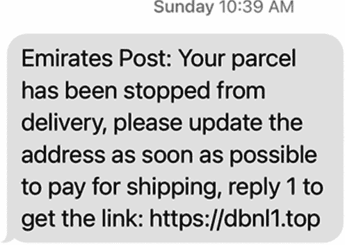
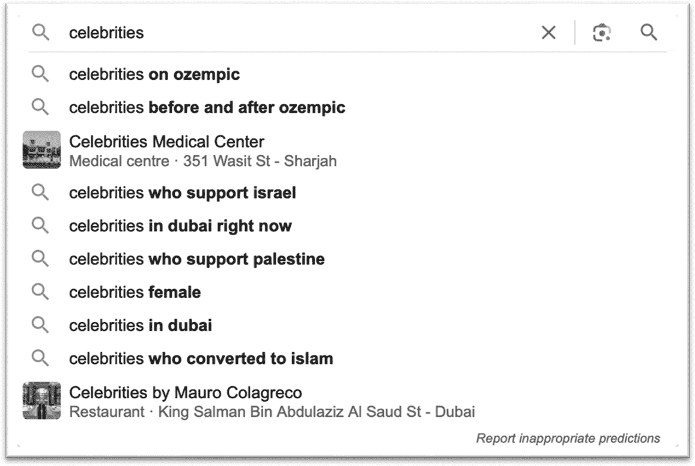
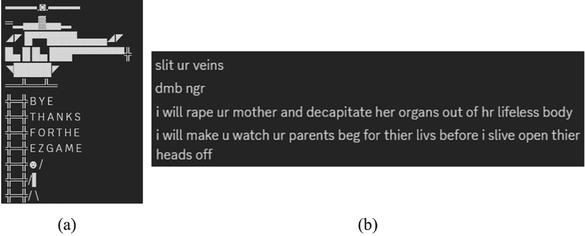
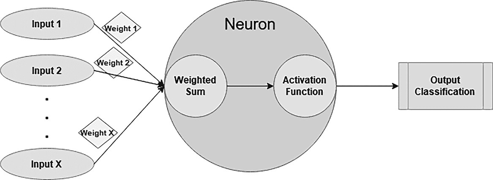
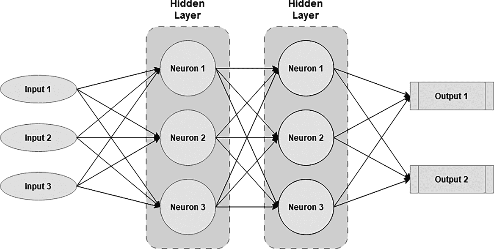

# 在狂野的网页中生存：网络复杂地形导航的用户攻略书

## 关于作者

Gergely, Marton 是该大学系统的讲师。他出生于布达佩斯，在德克萨斯大学圣安东奥分校获得工商管理博士。目前研究技术。

Grey, Ian 是该大学临床心理学副教授。他出生于科克，在特伦尼学院获得学士和博士学位。目前授心理。

Saleous, Heba 是巴斯坦裔美国人，在 Marton Gergely 的指导下攻读博士。她在该校获得硕士学位。目前研究行为。

## 引言

DOI：[10.1201/9781032679389-1](https://dx.doi.org/10.1201/9781032679389-1)

你可能从未听说过叫 Thomas Midgley，如果他还活着，可能会希望自己的名字只留在历史中。Midgley 是一位美国发明家，他在生前获得过重大科学奖，拥有超过 100 项专利，并被选入美国国家科学院，这是科学家能获得的最高荣誉之一。然而，他也不幸地被誉为“比以前或之后的任何人都造成了更严重环境灾难的人”。

在 20 世纪 50 年代，Thomas 的任务是让冰箱变得不容易在厨房里爆炸，这是当时常见的现象。Thomas 正确地识别出所使用的化学品是问题的根源，他发明了今天被称为氟氯烃（即 `CFC`）的物质，随后被用于数十亿喷雾罐甚至哮喘吸入器中。他还发明了铅汽油来解决发动机爆震问题，这为他工作的公司赚了数百万美元。这两项发明都导致了温室气体问题以及气候变化带来的生存威胁。遗憾的是，由于互联网，你可能会认为那是假新闻。前总统唐纳·特朗普确实是这么想的，你将在接下来的书中发现这一点。

托马斯·米德奇（Thomas Midgley）的故事带给我们一个警示：我们人类非常非常擅长发明东西，但在预测这些发明未来将如何影响我们方面并不那么擅长。即使我们确实想到了，我们也有一种人类的倾向，会严重低估潜在的负面后果，并被眼前的利益劫持。这就像和一位患有自恋型人格障碍的超模约会。没错，他们可能缺乏共理心，需要不断的关注和赞拜，而且恰好异常自傲……但是，该死，他们真美极了。一切都会没问题的。直到问题真的发生。就看看最近发明的人工智能吧。人们对它在商业、医学和物流领域的应用充满了美好的愿景，并承诺能增强决策能力。但一旦提到学生论文或《终结者》电影的情节，你就会变成一个彻底的扫兴者。人类愚蠢的长历史应该让我们都变得更加怀疑和警惕。然而，我们并不会，仅仅对互联网的历史、当代特征和后果的粗略了解，就能让你意识到这一点。

## 互联网的兴起

互联网发明于 1983 年，10 年后的 1993 年，其发明者蒂姆·伯纳斯-李（Tim Berners-Lee）将万网发布到了公共领域。它彻底改变了互联网，让并非计算机科学家的普通人也能创建名为“网站”的东西，并在其中填充文本、图形、音频和超链接。本质上，1993 年对互联网的未来做出了三个广泛的预测。

第一个预测是互联网将没有未来。以太网的发明者罗伯特·梅卡菲（Robert Metcalfe）预测，互联网将在两年内“发生壮性的超新星爆发并……发生灾难性的崩溃” [1]。作为一个爱赌的人，他承诺如果他的预言没有实现，就吃下自己的脸。在他预言两年后，在一次维网国际会议上发表主题演讲时，他拿出一份预测互联网崩溃的专栏打印稿，将其放入搅拌机并加入一些水，然后喝了那杯“吃下自己的脸”的奶昔。你不得不不佩服一个言行合一的人。

第二个预言是，由于互联网让信息以闪电速度到达指尖，后代将成为人类历史上最聪明的的一代，他们放学后直接回家，和家人一起钻研《大英百科全书》。这种理想主义一直延伸，到人们甚至相信，由于社区的连接和扩张，这将导致一种新形式的社会乌托邦。美国诗人约翰·佩里·巴洛夫（John Perry Barlow）甚至对互联网的社会可能性写了抒情溢表的文字，他在 1996 年写道：“大多数的人类交流将是虚拟而非物理的，构成的不是物质，而是构成梦想的素材” [2]。只是，约翰本该知道有些梦想实际上是噩梦。

最后一个预测被一位名叫伊利莎白·瓦尔加斯（Elizabeth Vargas）的女士完美捕捉到了，她在 1993 年是美国 NBC 频道的主持员。她对搭档说：“有这么多你不真正认识的人，难道不会让你感到困扰吗？每个人都在登录，进行着这些交谈，一起一起抱怨或一起牢骚……” [3]。现在，花点时间问问自己，哪一个预测最能反映我们现在生活的互联网现状。到底有多少比例的孩子实际上是回家读百科全书的，更重要的是，其余那些人在做什么？我们的虚拟社交世界现在是否反映了美丽而无害的梦想？目前正在发生多少抱怨和牢骚？这本书探讨了这些后果，事实上，如果这些后果仅仅限于增强了抱怨，那么对我们许多人来说，结果可能会更好。

## 数字世界的现实

互联网现在已无处不在，并编织进我们生活的每一个纤维中。在某些方面，它是卓越的。它赋予了我们与远方朋友和家人联系的能力，能够轻松执行支付账单等无聊但必要的生活任务的能力，以及在不离开沙发的情况下预订下一次度假旅行的手段（这有点讽刺）。它还让你（如果你愿意的话）可以在自己家里待上几个月，在网上订购你需要的东西，正如目前惊人数量的日本人选择这样做。这些很好，但互联网也变成了一团糟麻。这是一个数字世界，脆弱性和阴暗面都暴露了出来。它已经变成了一个雷区，一个应该怀着畏之心去对待的东西。它有它的用途，也有它的危险。

我们在这里不谈论互联网的良性方面。当你即将掉进一个敞开的下井，或者发现自己正陷在井底想要爬出来时，谈论有人行道的好处是没有意义的。相反，我们写这本书是作为一份互联网生存指南，通过描述正在发生的各种违规行为，作为让你对潜在伤害的“陷阱”保持警惕的手段。我们并不指唐纳德·特朗普、马克·扎克伯格或 TikTok 的中国所有者会特别为这本书背书。但就像互联网本身，尤其是你喜爱的社交媒体平台一样，我们希望让你留在这里关注，以找出究竟为什么。系好安全带！你以后可以再决定关掉。作为最后的打算，我们还可以推荐卡茨斯基尔山区（Catskill Mountains）的一座很好的禅寺。

## 参考文献

# 1 以太网海盗——非法下载的冒险

DOI: [10.1201/9781032679389-2](https://dx.doi.org/10.1201/9781032679389-2)

> “Bee boop, beep boo, beep boop. Eeeee urrrrr, deedle deedle, screeeelllllllll, ee ee ee, burrrrrr blur blur.”

这要么是悦耳的音乐，要么是黑板上划过的指甲声。之间没有折中。尽管如此，那是我们许多年轻人的声音。你们中的一些（包括我亲爱的妻子，她可能永远不会打开这本书）根本不知道我在说什么。你们是 90 年代及之后后的孩子。但对于那些幸运地在那个时代出生的人，你们对这个声音非常熟悉。那是通往自由的大门。通往瓦哈拉的大门。通往世界（万维网）的大门。

我们过去坐在 1990 年代的 `Compaq` 电脑前等待这种声音。但只有当所有人都熟睡了，且电话线路空闲的时候。启动免费的 `AOL` 试用软件，那是我们从当地的 `Blockbuster` 录像店一大把地拿的（方便地附带在一个漂亮的小 CD 上，封面上有一个无处不在的 `AOL` 小人形象）。然后，我们就会启动 `Napster` 这件天赐般的礼物。搜索我们刚刚在电台里听到的 `Blink-182` 的新歌，甚至更好，在 `MTV` 上看到的歌。我们耐心地等待着蓝色的进度条开始覆盖灰色的水平矩形，知道我们离纯粹的听觉享受只有 15 分钟之遥。一旦你下载了足够多的这些，你甚至可以把自己的歌单刻制成 CD，并在校车上给朋友听。但你必须小心并拿稳它，因为那些 `Discman` 还不还没有防跳跃功能。

如果上面的场景让你想起了那段时光，那么你可能也处于磁带时代。耐心地坐在收音机旁等一首好歌出现，这样你就可以快速按下 `AIWA` 响响上的录音键，希望 DJ 不断的喋喋不会干扰到你完美协调的混音磁带。或者你可能是一个视觉型的人，曾痴迷于将《比弗利山庄 90210》录制到索尼 `Dynamicron E-180` 空带上。尽管如此，这都是一个不同的时代了。在所有这些情况下，我们的联系并没有那么紧密。在手机出现之前，社交媒体出现之前，我们并没有频繁地把自己暴露。世界自此发生了变化，我们沉浸媒体的方式也发生了变化。随着技术的每一次进步，每一个新创新的近咫尺，潜伏在黑暗中的负面影响也随之而来。在我们变成完全的“悲观派帕蒂”之前，让我们揭开这些侵权行为（即所谓的盗版）源于何处、以及是如何产生的。

嗖！你回到了过去。确切说是 1770 年。一个少年和他的父亲正在访问西斯廷教堂，听到了合唱团唱的一首歌。那首歌是格莱里于 1638 年创作的《Miserere, Deus》，被严密守护。音乐严禁离开教堂，否则将面临绝教威胁 1。事实上，这首曲子的乐谱仅允许三个人拥有：利奥波一世（神圣罗马皇帝）、约翰五世（葡萄牙国王）以及乔瓦尼·巴蒂塔·马蒂尼（一位意大利修士兼作曲家）2。总之，这个 14 岁的少年被这首歌迷住了，无法忘怀。以至于他凭记忆记抄了整首曲，而这份抄本在第二年在伦敦出版。那个少年是谁？莫扎特。

好吧……无论这是否真实，没有人能百分之百确定，但你必须承认，故事本身很酷。有人认为，即使是像莫扎特这种水平的孩子，在听过一次（或也许两次）后凭记忆记抄一首曲也是极不可能的。另一些人说，他写的曲子并不是西斯廷教堂合唱团唱的那首，而是一首受其深度启发的非常相似的作品（我想“翻唱”或“采样”这些词那时还没被发明）。无论如何，我们关于非法下载的故事都有了一个非常有趣的开头，如果我可以这么说的话。

快进几个世纪来到 80 年代，我们突然拥有了 `Cher` 的波卷头、`a-ha` 的热门单曲《Take on Me》、德罗宁 `DMC-12`（以及马蒂·麦法莱）、`K-Swiss` 霓虹风夹，以及钢金双色劳力士登山型手表。而且我们还进入了盗带时代。不，我们谈论的不是 19 世纪牛仔人靴筒内部，那是他们用来藏匿非法武器和酒以躲避视线的部位（尽管这正是该词的起源）。我们当然，谈论的是非法复制的音乐、电影和软件，换句话说，就是盗版的“三大件”。让我们逐一分析它们。

## 音乐

既然我们已经提到了我们的好朋友沃尔夫冈（阿玛德，阿玛德），那么继续从音乐开始也是恰好的。那么，是什么大技术奇迹让音乐能够被如此自由且肆惮地复制呢？嗯，首先是 1948 年晶体管收音机的出现。没有这个精巧的小设备，人们无法在家里、办公室或在途中无线地收听他们喜爱的歌曲。在此之前，音乐主要通过黑胶片来欣赏，而众大家所知，黑胶片并不便于便携。因此，无线广播出现拯救了局面。但，单此并无大碍！事实上，它只是让音乐比以往任何时候都要流行。广播电台向音乐人支付版税，每个人都很开心。直到荷兰 `Philips` 的那些人在 60 年代出现，并真的搞砸了一切……但我们有点进展得太快了。

通过发明 `Compact Cassette`（又名磁卡盒式磁带），人们现在可以购买预录制的“唱片”，它们非常坚固（相对而言，你可能需要一支铅笔……懂这个梗的人可以加分！），最重要的是，可以轻松带到任何地方。本质上，这些微小的磁带卷工作方式非常像广播电台以前播放歌曲时使用的那种大型开盘式磁带机。当然，那些设备非常庞大笨重，需要专业人员操作。于是，小巧的磁带诞生了，它本身就是一场革命。不仅任何人不需要音频工程的高学位就能播放歌曲，他们还可以`录制`内容！！“什么？！”，我听到你在尖叫。我知道。大开眼界。

### 录音的兴起

最初，在磁带上录音的能力仅通过麦克风实现。这允许人们录制现场音乐和整场音乐会，还可以对广播里播放的歌曲进行那种无处不在但并不完美的复制，或者复制另一盘磁带。我告诉过你们，`Philips` 的那些家伙是音乐盗版背后真正的邪恶天才（当然，我在开玩笑）。现在，将这项技术与录音机箱（一个机器里既有收音机又有磁带播放器）的兴以及偶像 `Sony Walkman` 的崛起相结合，突然之间我们有了盗版的完美风暴。

本质上，版权侵权行为不仅在实际上受到了鼓励，而且是内置的！用户可以简单地从广播中录制歌曲，创建他们自己的混音磁带（然后你可以把它送给你的宝贝），或者更好，使用第二个磁带机（有些录音机箱已配备），你可以进行带对带的录制，几乎毫不费力地复制你朋友 Nigel 的整个专辑收藏。完美了，现在你可以拿着你那方便的 `Walkman`，随随地带上 `N.W.A` 的《Straight Outta Compton》的盗版拷贝去任何地方。

### 反击

在 20 世纪 80 年代初，这种非法复制变得如此糟糕，以至于英国广播电台开始播放“家庭录带正在杀死音乐”的口号，试图反击版权侵权 [3]。`Dead Kennedys` 的专辑《In God We Trust, Inc.》的一个磁带版本甚至包含了一个空白面，上面印着信息：“家庭录带正在杀死唱片行业的利润！我们留出这一面是为了让你提供帮助” [4]。

### 数字化革命

随着时间的推移，事情开始“数字化”……（正文后续段落遵循相同的逻辑）。

艺术家们无法从音乐中获报，唱片公司正在巨额亏损，必须采取行动了。于是，音乐和科技公司汇聚在一起，创造了一个音乐的新时代。本质上，数字音乐播放器的兴起（最重要的是那个正面带有旋转旋钮的小型白色设备）让人们远离了 CD 盘。在那个时候，获取音乐有两种方法。一种是合法途径……去实体店购买 CD 盘。另一种是大家都会的选择……要么让你的朋友艾米莉（Emily）帮你刻一张 CD，要么自己直接在网上下载。所以，唱片公司必须自问的一个重大问题是：既然大家最终都会把歌曲从物理光盘中提取（`rip`）到电脑里，那么 CD 盘还有必要吗？为什么不完全消除中间商呢？这就是 `iTunes` 商店诞生的由来。你们某些人可能还记得 `WinAmp` 这样的瑰宝，但它们只允许你播放下载或从其他来源提取的 `MP3` 和 `WAV` 文件。因此，在 `iTunes` 生态系统中原生销售数字下载才是天才之处所在。本质上，Apple 在 2008 年为 `iPhone` 软件所做的（我们稍后讨论软件时会涵盖），他们在 2003 年先在音乐上实现了。现在，你不仅可以跳过提取 CD 的那种痛苦过程（尽管公平地说，随着计算技术的进步，这个过程确实变得越来越快了），你甚至不需要出门！此外，你不需要像买那些该死的实体 CD 那样买下整张专辑。我们已经知道，任何专辑中 90% 的歌曲其实都是凑数的。现在，你可以只买你想要的单曲！只需花费整张专辑的一小部分价格！双赢！再次如此！

但一个大问题迫在眉睫。有什么什么能阻止某人在 `iTunes` 上购买一首歌，并立即通过 `BitTorrent` 或我们之前讨论过的无数应用之一将其分享到网上呢？这些唱片和科技巨头是否犯了如此重大的错误？当然没有！欢迎来到 `DRM`（数字权利管理）的世界。数字权利管理让音乐创作者能够保护他们的歌曲不被分享。此外，当所有其他科技公司都加入 `iTunes` 商店的行列时，每个人都有自己的文件格式！索尼、Windows、亚马逊等……而且它们之间互不兼容。自然，这让大家都感到非常开心和和平。你可能合法地在 `iTunes` 上购买了一首歌，但无法将其上传到你的 `Microsoft Zune` 上。大叹气。永恒的幸福。不，真的，不仅内容是不同的文件类型，而且经过了加密。所以，你可以把它发送给任何你，上传到任何地方。但如果没有许可和数字签名（传输起来复杂得多），音乐文件就变得毫无用处。

随着时间的推移，破解这些 `DRM` 的方法层然而出，科技公司开始缓慢放宽，并将所有文件类型转换为几种通用的格式。此外，随着 `Spotify` 和 `Deezer` 等流媒体平台的出现，“拥有”（即使是免费的）音乐的想法变得越来越没意思。2017 年到 2021 年间，全球与音乐相关的盗版减少了 65%，这种减少大部分归功于流媒体的兴起 [10]。我们也开始看到许多艺术家直接将自己的歌曲免费上传到 `YouTube`、自己的网站和其他类似的平台。在我看来（至少对我而言），艺术家放弃所有权观念似乎是未来的发展之路。专注于与流媒体提供商、广播电台或电影电视节目达成许可协议（你有没有注意到现在大多数 `Netflix` 剧集的配乐有多好听？我确定他们为音乐版权支付了巨额资金），以及网站或 `YouTube` 的广告收入，同时依靠演唱会票和周边销售，这才是关键。没错，现在的音乐人仍然尝试在 `iTunes` 等平台上出售歌曲和专辑，甚至为那些非常老派的人售卖一些 CD 和黑胶唱片，但从长远来看，这以后不再是音乐人薪水的主要来源，这一点越快被理解和接受，我们都会过得越好。

最后，你可能会听到一些关于 2021 年后音乐盗版数字开始增加的传闻，主要魁祸首是所谓的“流媒体提取”（`stream-ripping`） [10]。简单来说，通过简单的 `Google` 搜索就能找到数百个网站和应用，它们让你本质上可以从 `Spotify` 甚至 `YouTube` 等平台上将任何内容下载成一个方便的文件，并将其公开，与你八亿个亲密的朋友分享 [11]。现在，在消除音乐盗版（或任何其他类型的盗版）的每一步中，我们总是会面临某种挫折，因为精通技术的人会找到方法应对这些措施。尽管如此，我们应该始终记住的一点是，当我们听到这类泛泛论时，必须非常警惕：

> 仅在 2019 年 7 月一个月，艾德·西恩（Ed Sheeran）的专辑 `Divide` 下载量超过了 612 万次，坎耶的 `The Life of Pablo (2016)` 有 28 万次，Lady 姬·加加的首秀 `The Fame Monster (2009)` 有超过 20 万次。

> 随机选取的三张专辑，每月被非法下载超过百万次。

> 根据典型的 `iTunes` 或 `Amazon` 下载零售价，这代表了大约 1000 万美元的损失。

> [12]

仅仅因为数百万人下载了这些内容，并不构成 1000 万美元的损失。这种说法建立在一个巨大的假假设之上：每一个非法下载歌曲或专辑的人都会用自己的钱购买。这绝对不是事实，但音乐公司非常希望你相信这一点。我将用最后一个例子来结束这一节。印度目前在音乐盗版方面排名第一 [10]。写作时印度的人均收入约为 2000 美元（这还是自 2015 年以来翻了一倍） [13]。`iTunes` 上专辑的平均价格为 9.99 美元 [14]。你觉得这说得通吗？抱歉告诉唱片公司，来自北方邦拉什邦的卖茶小贩 Manoj 不会把他的月收入全部花在泰勒·斯威夫特的新专辑《The Tortured Poet’s Department》。就把它当成免费广告吧。

## 电影和电视

1983 年，索尼遭到了通用城市影业（Universal City Studios）的诉讼。一场在法院持续一年的诉讼对生意可没好处，对吧？就像 Napster 案一样，这不在于索尼做了或没做什么，因为索尼和 Napster 本身在物理上并没有进行任何版权侵权行为。关键在于它们允许用户做了什么。

通用城市影业声称，索尼让他们的 Betamax 用户能够轻松复制电视上播放的任何节目。这一主张后来被美国最高法院驳回，法院裁定，只要是为了个人使用，个人制作此类副本完全属于公平合理使用[16]。简而言之：在辛苦工作了一天后，在舒适的客厅里吃着斯旺森莎利牛排电视晚餐，复制一集《骑士侠》（Knight Rider）以备稍后观看，这是完全没问题的。但制作一百份《德拉斯家族》（Dallas）的剧集并在教堂街（Church Street）和东布罗士（East Broadway）之间销售？就不行了。老天，在印度，他们甚至公开运营 VHS 录像带图书馆，并出租这些盗版的电影拷贝[17]。

然而，缓慢而坚定，VHS 最终让位于 DVD。我们甚至不想尝试谈论激光压（LaserDisc）那种灾难，但你可以利用空闲时间去查查。就像 CD 一样，我们现在有了数字文件，这意味着复制变得更加容易。于是 DRM（数字版权管理）列车再次袭来，带来了各种新发明。但再次，有了正确的工具就能轻松剥离。

在相当一段时间内，DVD 保持的优势是文件大小与可用带宽及互联网速度之间的对比。歌曲仍然相当较小，因此即使下载速度慢也可以应付，但电影和剧集要大得多。所以，直到高速宽带的兴起，非法下载才显出了它的丑面目。在那之前，事情一直很简单：刻一张 DVD，烧一份拷贝。让我说一句——我不记得是否记得看过过第一部《哈利·波特》电影（是在我高中音乐课上花 5 美元买的一张 DVD 上），底部还横着一个写“华纳影业公司财产”的大横幅……

DVD 之后是 HD DVD 与蓝光光片的大战（很高兴看到索尼在 Betamax 惨败后赢得了胜利）。这些再次增加了文件大小，但此时此时（21 世纪 00 年代中期），互联网速度已经绰绰有余，通过 P2P 网络进行在线下载达到了历史高位。

但就像音乐一样，流媒体平台的发明（这里感谢 Netflix，因为没有你，谁知道我们会在哪儿）导致用户开始再次放弃“所有权”的概念（就像音乐一样）。Hulu、Amazon 以及所有带 `+` 的平台相继涌现。似乎在某个时刻，每一个像样的电视频道都在名字后面加了 `+`，并开始每月收取 10 美元。

这当然模仿了音乐行业，随后引发了相当比例的流媒体抓取或非法流媒体。如今，只需 20 美元，你就能买到一个来自中国的小黑盒，通过 `HDMI` 插在电视上，就能获得世界上每一个电视节目！虽然不太好用，但确实可行！

最后，我们需要谈谈我们的老朋友兼敌人“HDCam”，有时只叫“CAM”（懂的都懂）。在电影院的黑暗中，有些人会……掏出一个巨大的三脚架和一台小型摄像机，录下整部电影。然后他们回家，将其以种子格式上传到无数网站。画面摇抖，音质糟糕透顶。但人们还是会下载。

这是盗版中一个奇怪而独特的方面，在音乐盗版中并没有真正的对应物（也许录制演唱会，但没人会只录音频，很可能是视频，然后我们又回到了视频盗版领域）。尽管如此，这仍然是电影制厂需要处理的一个普遍障碍。

现在，与音乐盗版不同，我不是在这里对如何解决影视盗版问题发表任何概括性的声明。这个问题要棘手得多。再次，2024 年，我们看到全球盗版水平的上升。印度再次领先领先（但考虑到近 15 亿人口，想想 15 年前该国家几乎没有 500 万个宽带连接，看到这并不意外）[18]。

但同时，我们应该从全球角度来看，全球人口每年增长约 1%。同时，互联网用户每年增长约 6-8%，而且，印度目前的互联网普及率仅为约 50%[19]。这只是印度……全球互联网使用率徘徊在 64% 以上。

加上电影和剧集通常比音乐贵的事实，这意味着该领域未来会有更多的盗版，我们将面临一段非常艰难的旅程（为什么是我们？继续阅读以找到答案）。显然，就像音乐一样，我们需要意识到这些机构所做出的主张。

MPA（美国电影协会）是最坚决散布关于盗版造成金钱损失论调的组织。MPA 由 Netflix、派拉蒙影业、索尼影业、通用影业、华特迪士尼工作室和华纳兄弟公司组成。这里完全没有利益冲突！所以，请记住我的观点：一次非法下载并不意味着损失一次销售！

## 软件与游戏

现在，让我们再次回到 20 世纪 80 年代的普通家庭，大家正看着热门剧《警探威》（Magnum P.I.）中汤姆·塞勒克开着他的红色法拉利 308 GTS 在奥瓦胡岛穿梭。

这些坐在家里、完全不懂计算机或编程的普通人，奇迹地获得了下一个大件——苹果 Macintosh 128K。现在，神奇地，每个人都能拥有并使用计算机。这些机器不再局限于那些以技术为嗜好的极客。史蒂夫·乔布斯个人实现了计算机的民主化。

而现在，随着这一飞跃，每个人都能轻松、快速地在软盘之间复制软件和游戏。嗯，这对利润可没好处。

从简单的磁盘拷贝演变为大规模在线共享方式，现在 Law 先生和软件制作商都面临着令人头疼的问题。随着苹果新电脑的发布，以及 Commodore 等竞争对手的出现，用户数量开始增长，软件市场自然也开始做大。当然，更多的软件意味着更多的盗版。

从简单的“这儿有一张载有游戏或软件的软盘”，到更复杂的邮件方案（用户可以在其中交易、出售或请求盗版拷贝软件），盗版方法层出不穷。为了防止这种现象发生，软件公司开始在他们的应用程序中添加加密和密钥。但一如往常，这是一场猫鼠游戏，而在这种情况下，盗版者是“猫”。

随着互联网的发明，我们有了公告板（BBS），人们不仅在上面上传软件（连同所需的密钥），而且完全消除了猜测，通过破解软件来消除任何保护。这些软件被称为“warez”[20]。

随着 Napster 等平台的兴起，就像音乐和视频一样，软件分变得更加普遍。BitTorrent 让这一切变得更加简单快捷（互联网速度的增加意味着没有人会在意软件文件变得越来越大，这显然也不会阻碍下载），因此，软件行业确实开始陷入挣扎。

现在，许多主要的软件制造商已经转向了在线订阅和云端模型，例如 Adobe 的 Creative Cloud 和 Microsoft Office 365。通常情况下，这使得传统的盗版形式效果大减。然而，软件盗版仍然存在，只需看一眼 YouTube 教程即可。

方法变得越来越复杂，简而言之，基本上就是绕过应用程序激活和许可检查。随着移动计算的兴起，所有这些应用商店的出现引入了新形式的盗版，特别是针对付费移动 App 的授权发行。

确实，许多公司通过免费提供应用程序来完全规避盗版风险，仅通过广告收入获利，但这使得终端用户的体验不那么吸引人。所以，最终，无论软件开发者做什么，都没有赢家。这在未来必须想办法，不过，如果我能告诉你这个问题的解决方案，我绝对不会在这里写这本书了（可能正开着我的湾湾流飞机去巴厘，躺在沙滩上喝着迈泰酒）。

那么，为什么软件盗版如此严重呢？嗯，通常来说，虽然音乐/视频领域和软件领域具有相似的特征，例如高制作成本和低复制成本（这意味着花钱的不是物理生产，而是创造整个该死的东西的过程），但区别在于音乐和视频是“体验型”商品[21]。

客户以完全不同的眼光看待它们因为因为购买（或在我们的情况下通过种子下载）它们是为了娱乐。没人为了好玩而买 `Microsoft OneNote`。现在这给我们带来了一个更大的问题……没人“需要”下载音乐或视频。我们这样做是为了好玩，所以如果我们不想下载，可以直接说“不，我很好”并跳过它。

另一方面，对于软件我们真的没法这样做。如果你工作需要 `Adobe Photoshop`，那么你工作就真的需要 `Adobe Photoshop`。

那么，为什么软件盗版如此严重呢？嗯，通常来说，虽然音乐/视频领域和软件领域具有相似的特征，例如高制作成本和低复制成本（这意味着花钱的不是物理生产，而是创造整个该死的东西的过程），但区别在于音乐和视频是“体验型”商品[21]。

客户以完全不同的眼光看待它们，因为他们购买（或在我们的情况下通过种子下载）它们是为了娱乐。没人为了好玩而买 `Microsoft OneNote`。现在这给我们带来了一个更大的问题……没人“需要”下载音乐或视频。我们这样做是为了好玩，所以如果我们不想下载，可以直接说“不，我很好”并跳过它。

另一方面，对于软件我们真的没法这样做。如果你工作需要 `Adobe Photoshop`，那么你工作就真的需要 `Adobe Photoshop`。

## 会出现什么问题？

现在，你坐在这里想：“天哪，Marton，你说的这一切听起来是那么棒，为什么我不完全停止购买音乐/视频/软件，而直接在网上免费下载一切呢？”嗯，没那么简单。让我们快速讨论一下可能会出什么错！

首先，让我们思考一下这些制作你珍爱的电影、电视节目、音乐、软件和游戏的人最终会有怎样的结局。显而易见，我们必须提到收入损失。当然，大公司告诉我们的数字确实是扭曲的，当然，它们确实如此，它们正试图恐吓民众。但是的，确实存在销售额损失，诚然，并不是每一次非法下载都意味着销售额损失（向我在前几页提到的老朋友 Manoj 致敬），但有些确实是这样。

销售额损失会导致什么？导致各处收入下降和利润的下降。没有人想亏钱，如果你亏了钱，很有可能你不会再跳上那匹马了，以免被再次踢中腹部。因此，如果盗版率高高，公司对新产品的投入就会减少。

这反过来可能意味着新音乐、新电影、节目、游戏和软件的减少[22]。如果这些领域的投资减少，会有少的人自愿进入这些领域，这意味着整体创新能力将会减少。

因为现在，来自爱达荷州博伊西的 Sarah Jane 不知道自己能否作为一名乡村音乐词曲作者维持生计。或者，如果他们只是在当今世界起步的新手，小韦斯·安德森可能会选择进入金融行业，因为显然他无法通过电影赚钱，所以你与《布布达佩斯大酒店》无缘。

如果 Kanzuri Yamuchi 成为一名老师，我们就不会有《极速星球》系列了。坎耶·韦斯特可能会选择进入政界，你好，总统先生，我们没有《大学辍学者》专辑了……实际上，那张专辑的情况可能并不那么离谱……

### 网络安全威胁

然后我们遇到了与网络安全相关的威胁。你如何知道你在那个 `RandomAccessMemories.rar` 文件中下载的 Daft Punk 专辑解压后实际上是一份歌曲列表，而不是一个 `.exe` 文件？坦率地说，很多时候你并不知道自己在下载什么，这应该让你感到恐惧。

如今恶意软件文件如此容易被隐藏并寄生在看似无辜的东西上，那里简直是一片丛林。这里是来自领先的网络攻击响应公司提供的一份快速表格，告诉了你将面临着什么[23]（表 1.1）。

#### 表 1.1 Crowdstrike 的恶意软件类型[23]

| 类型 | 它做什么？ | 现实世界示例 |
| --- | --- | --- |
| 勒索软件 | 在支付赎金之前禁用受害者对数据的访问权限 | RYUK |
| 无文件恶意软件 | 对操作系统原生文件进行修改 | Astaroth |
| 间谍软件 | 在用户不知情的情况下收集用户活动数据 | DarkHotel |
| 广告软件 | 投放不希望的广告 | Fireball |
| 木马 | 将自己伪装成理想的代码 | Emotet |
| 蠕虫 | 通过自我复制在网络中传播 | Stuxnet |
| 根程序 | 为黑客提供受害者设备的远程控制权 | Zacinlo |
| 键盘记录器 | 监控用户的击键 | Olympic Vision |
| 机器人 | 发起大规模的洪水攻击 | Echobot |
| 移动恶意软件 | 感染移动设备 | Triada |
| 擦除器恶意软件 | 擦除无法恢复的用户数据 | WhisperGate |

所以，如果你在互联网上非法下载，这些中的每一个都是你多了一个需要担心的事情。正如我所说，它并没有你想象中那么安全。

为了让你有个直观的概念，英国近半参与过流媒体抓取的人表示，他们或他们认识的人曾是诈骗、身份盗用、欺诈或数据丢失的受害者[24]。诚然，这只是相关性而非因果关系，但概率是非常明确的。

现在，亲爱的读者，你必须问自己，下载一份非法版的《饥饿游戏》是否值得，如果这意味着你电脑上所有的个人信息现在都落入了一个俄罗斯黑客手中，他要么将其全部公开，要么强制向他指定的加密货币支付 1000 美元。

### 法律影响

最后，让我们讨论一下整件事的法律影响。我们很清楚。非法下载是非法的。这在名字里就写着。是的，你可以使用 VPN 来掩盖你的身份。诚然，你可以克制上传自己的文件，以防止你的 ISP（互联网服务提供商）注意到你的 IP 地址上有大量异常流量。

我之所以说“方向错误”的原因是，随着世界向日益在线的环境发展，下载变得越来越无处不在。每个人的日常生活都必须使用数据下载，因此 ISP 无法再仅仅通过比常大的数据下载量就从远处定位盗版者。他们可以做的是查看上传。通常情况下，定位上传数据中的异常要容易得多。

总之，这些都是简单的解决方案，虽然微乎其微，但仍然没有改变你正在非法下载的事实。其后果可能是严重的。看看表 1.2 即可。

#### 表 1.2 各国非法下载的惩罚示例[25]

| 国家 | 犯罪类型 | 处罚措施 |
| --- | --- | --- |
| 美国 | 民事（可转为刑事） | 每部作品罚款 200 至 150,000 美元 |
| 英国 | 刑事 | 最高 10 年监禁 |
| 荷兰 | 刑事 | 最高 4 年监禁并罚金 45,000 欧元 |
| 瑞士 | 刑事 | 最高 3 年监禁 |
| 俄罗斯 | 刑事 | 最高 500,000 欧元罚金 |
| 瑞典 | 刑事 | 最高 2 年监禁 |
| 西班牙 | 刑事 | 最高 6 年监禁 |

总会有描写这些可怜灵魂的文章，他们只是不知道自己在做什么，单纯不知道非法下载是犯罪[26, 27, 28 以及 29]。受总是那些大公司，或者是利用无辜者的邪恶电影制片厂。正如你可能听过的，不知道法律不是违法的借口。

事实上，索尼已经开始了自己的反盗版斗争[30]。这一切始于他们上传了自己电影的伪造种子，这些种子实际上没有任何作用。整个目的只是为了让下载变得极其消耗资源，并从根本上导致用户的电脑崩溃。此后他们升级了手段，使用位于亚洲大量的计算机发动攻击并打击共享版权内容的人。

所以，最终取决于你如何对上述所有信息做出选择。你是对下一位艺术家的可能流失感到遗憾（想象一下，如果没有了公主殿下泰勒，所有的 Swifties 粉丝该怎么办，因为她决定去成为宾夕法尼亚州的一名银行经理），仅仅对潜在的技术后果感到恐惧，或者只是想站在法律正确的一，无论你最终决定做什么，至少（在读了这些之后）你现在将以一种稍微更理智、经过研究的方式来进行。

正如达赖喇嘛曾说过的：“充分了解规则，才能有效地打破它们”。

## 参考文献

3. “音乐盗版历史——简要说明，” Bytescare, 2024 年 1 月 15 日. [在线]. Available: [`bytescare.com/blog/history-of-music-piracy`](https://bytescare.com/blog/history-of-music-piracy). [访问: 2024 年 6 月 19 日]。

4. A. S. Cummings, 《声音的民主：20 世纪音乐盗版与美国版权的重塑》，英国牛津：牛津大学出版社, 2013, 第 202 页。

5. “Napster,” 维基百科。 [在线]. Available: [`en.wikipedia.org/wiki/Napster`](https://en.wikipedia.org/wiki/Napster). [访问: 2024 年 6 月 19 日]。

6. D. Kravets, “Napster 审判在七年后结束，在此期间定义了在线共享，”Wired, 2007 年 8 月 31 日. [在线]. Available: [`www.wired.com/2007/08/napster-trial-e/`](https://www.wired.com/2007/08/napster-trial-e/). [访问: 2024 年 6 月 19 日]。

7. J. F. Buford, H. Yu, 和 E. K. Lua，《P2P 网络与应用》，第 1 版. 美国马萨诸塞州伯灵顿：Elsevier/Morgan Kaufmann, 2009。

8. “Napster 的死亡螺旋开始，”History.com, 2024 年 3 月 5 日. [在线]. Available: [`www.history.com/this-day-in-history/the-death-spiral-of-napster-begins`](https://www.history.com/this-day-in-history/the-death-spiral-of-napster-begins). [访问: 2024 年 6 月 19 日]。

9. Paratii, “10 个步骤看 P2P 内容分发历史，”Medium, 2017 年 10 月 25 日. [在线]. Available: [`medium.com/paratii/a-brief-history-of-p2p-content-distribution-in-10-major-steps-6d6733d25122`](https://medium.com/paratii/a-brief-history-of-p2p-content-distribution-in-10-major-steps-6d6733d25122). [访问: 2024 年 6 月 19 日]。

10. M. Stassen, “音乐盗版在过去 5 年内急剧下降，但在 2021 年又开始缓慢增长，”Music Business Worldwide, 2022 年 2 月 3 日. [在线]. Available: [`www.musicbusinessworldwide.com/music-piracy-plummeted-in-the-past-5-years-but-in-2021-it-slowly-started-growing-again/`](https://www.musicbusinessworldwide.com/music-piracy-plummeted-in-the-past-5-years-but-in-2021-it-slowly-started-growing-again/). [访问: 2024 年 6 月 19 日]。

11. H. McIntyre, “什么是流媒体抓取？人们偷取音乐的新方式，”Forbes, 2017 年 8 月 11 日。[在线]. Available: [`www.forbes.com/sites/hughmcintyre/2017/08/11/what-exactly-is-stream-ripping-the-new-way-people-are-stealing-music/?sh=2fd579fc1956`](https://www.forbes.com/sites/hughmcintyre/2017/08/11/what-exactly-is-stream-ripping-the-new-way-people-are-stealing-music/?sh=2fd579fc1956)。[访问: 2024 年 6 月 19 日]。

12. “盗版从未被流媒体杀死，”Muso。[在线]. Available: [`www.muso.com/magazine/piracy-was-never-killed-by-streaming`](https://www.muso.com/magazine/piracy-was-never-killed-by-streaming)。[访问: 2024 年 6 月 19 日]。

13. M. Cyrill, “印度人均收入自 2014-15 年以来翻倍，但财富分配不均，”India Briefing, 2023 年 3 月 7 日。[在线]. Available: [`www.india-briefing.com/news/indias-per-capita-income-doubles-since-2014-15-but-wealth-unevenly-spread-27325.html`](https://www.india-briefing.com/news/indias-per-capita-income-doubles-since-2014-15-but-wealth-unevenly-spread-27325.html)。[访问: 2024 年 6 月 19 日]。

14. “Apple Music 多少钱？”FreeYourMusic, 2023 年 8 月 2 日。[在线]. Available: [`freeyourmusic.com/blog/how-much-is-apple`](https://freeyourmusic.com/blog/how-much-is-apple)。[访问: 2024 年 6 月 19 日]。

15. “VHS 与 Betamax 录带的区别，以及 VHS 如何成为家用录带，”Capture, 2023 年 4 月 26 日。[在线]. Available: [`www.capture.com/blogs/vhs-vs-betamax`](https://www.capture.com/blogs/vhs-vs-betamax)。[访问: 2024 年 6 月 19 日]。

16. “美国索尼公司诉通用影业公司, 464 U.S. 417 (1984),”Justia, 1984 年 1 月 17 日。[在线]. Available: [`supreme.justia.com/cases/federal/464/417/`](https://supreme.justia.com/cases/federal/464/417/)。[访问: 2024 年 6 月 19 日]。

17. H. McIntyre, “什么是流媒体抓取？人们偷取音乐的新方式，”Forbes, 2017 年 8 月 11 日。[在线]. Available: [`www.forbes.com/sites/hughmcintyre/2017/08/11/what-exactly-is-stream-ripping-the-new-way-people-are-stealing-music/?sh=2fd579fc1956`](https://www.forbes.com/sites/hughmcintyre/2017/08/11/what-exactly-is-stream-ripping-the-new-way-people-are-stealing-music/?sh=2fd579fc1956)。[访问: 2024 年 6 月 19 日]。

18. M. Cyrill, “VHS 与 Betamax 录带的区别，以及 VHS 如何成为家用录带，”Capture, 2023 年 4 月 26 日。[在线]. Available: [`www.capture.com/blogs/vhs-vs-betamax`](https://www.capture.com/blogs/vhs-vs-betamax)。[访问: 2024 年 6 月 19 日]。

*（注：由于原文文本中编号 11-18 的内容与 3-16 存在重复，根据“不要重复输出原文”的原则，此处仅对您提供的文本内容进行了对应翻译。如需完整对应所有条目，请告知。）*

27. S. O’Shea, “电影下载与上传的诉讼，”Global News, 2019 年 2 月 9 日。[在线]. Available：[`globalnews.ca/news/4933339/lawsuits-movie-downloading-uploading/`](https://globalnews.ca/news/4933339/lawsuits-movie-downloading-uploading/)。[访问: 2024 年 6 月 19 日]。

28. A. Holpuch, “明尼苏达州女子因非法下载 24 首歌曲需支付 22 万美元，”The 卫报, 2012 年 9 月 11 日。[在线]. Available：[`www.theguardian.com/technology/2012/sep/11/minnesota-woman-songs-illegally-downloaded`](https://www.theguardian.com/technology/2012/sep/11/minnesota-woman-songs-illegally-downloaded)。[访问: 2024 年 6 月 19 日]。

29. M. Hardigree, “RIAA 是如何夺走我的复古野马的，”Jalopnik, 2010 年 10 月 19 日。[在线]. Available：[`jalopnik.com/how-the-riaa-took-my-vintage-mustang-5667666`](https://jalopnik.com/how-the-riaa-took-my-vintage-mustang-5667666)。[访问: 2024 年 6 月 19 日]。

30. L. H. Newman, “报告：索尼影视正利用自己的网络攻击阻止泄露文件的扩散，”Slate, 2014 年 12 月 13 日。[在线]. Available：[`slate.com/technology/2014/12/sony-pictures-is-using-ddos-attacks-to-keep-its-leaked-files-from-spreading.html`](https://slate.com/technology/2014/12/sony-pictures-is-using-ddos-attacks-to-keep-its-leaked-files-from-spreading.html)。[访问: 2024 年 6 月 19 日]。

# 2 如果你教了一个人如何钓鱼……——网络诈骗的机制

DOI: [`10.1201/9781032679389-3`](https://dx.doi.org/10.1201/9781032679389-3)

当我年轻时，我经常和家人一起去镇集市。集市一年只真正一次，而且是在学校休息期间，所以这应该是一项特别的庆祝活动。作弊的游戏、油腻的食物、霓虹色的诱发糖尿病的甜点，还有一头头扎着彩虹鬃毛、头上挂着泡沫角的随机小马。在集市场的尽头，总有一顶帐篷，里面坐着一位穿着蓬蓬袍、留着凌乱长发的的老妇人。人们兴奋地排队想和她交谈，但当我问为什么时，她告诉我：“我们不搞那些东西”。我问她她是做什么的，她告诉我那个女人自称是占命师并进行手相。她接着告诉我，那个老太太只是在诈骗人，她的占卜没有任何意义。然而，人们仍然继续排队，给这个女人送钱买虚假的占卜服务。

当我年轻时，我经常和家人一起去镇集市。集市一年只真正一次，而且是在学校休息期间，所以这应该是一项特别的庆祝活动。作弊的游戏、油腻的食物、霓虹色的诱发糖尿病的甜点，还有一头头扎着彩虹鬃毛、头上挂着泡沫角的随机小马。这并不是我是否相信它们的力量或任何宇宙实体的问题，但在当时看来这非常可疑。如果她是一个预言者，她的工具在哪里？她的蜡烛呢？她实际上真的只是一个住在帐篷里、需要剪头发的老妇人。在等父母带兄弟姐妹去上手间期间观察她时，她甚至没有在好好看她的客户。作为一个孩子，我只是觉得这很有趣。

这种诈骗已经存在很久了。神谕诈骗是最老的类型之一，至少可以溯到公元前 8 世纪，当时古希腊的德尔福神谕声名 `#ch2.xhtml#ref2_1`。诈骗者会装成德尔福神谕之一，并向那些用金钱或财物进行交易的人提供预言（当然是随口编造的）。那时候人们对占命师的怀疑态度少得多（不要忘记，曾有一段时间，文化是围绕着神秘主义旋转的）。快进到公元 20 世纪，这种诈骗出现了一个有趣的转折，诈骗者伪装成解决他们面临问题的（为了某种回报而提供帮助的）行义士。虽然情况略有不同（为了某种回报而获得一无），但前提是一样的。再次快进到今天，我们仍然会由于人工智能参与导致人们由于不存在的服务而损失积蓄，如果这种游戏已经玩了几个世纪，人们仍然会上当吗？正如凯文·米特尼克（Kevin Mitnick）曾说：“黑客总是寻找安全链中最薄弱的环节。在我看来，这些环节通常是人，而不是技术”`#ch2.xhtml#ref2_`。

米特尼克是一个非常著名的社会工程工程师，他演变成了网络安全领域的大人物。如果你以前没听过这个词，社会工程工程师是指通过富有魅力地伪装成他人，诱导目标透露信息或执行特定任务的人`#ch2.xhtml#ref2_3`。这种魅力足以让受害者为了某些原因而放弃。想象一下：如果有人打电话给你，说他们是你公司的 IT 支持技术人员，声称你的账户发现了服务器冲突，你会相信他们吗？你无法承担任何可能影响工作进展的风险。这是社会工程工程师试图骗你交出信息的一种方式——通过引起轻微恐慌来让你服从。后来，你会记住 IT 人员不会（不应该）直接询问你的凭据，但那时已经太晚了。

所以，这就是米特尼克如何在 20 世纪 80 年代和 90 年代将自己列入 FBI 通缉犯名单的：通过社会工程进入公司——当然，是未经授权的。他这样做并不是为了钱，他只是想看看自己能不能做到。然而，犯罪就是犯罪，他最终在 1995 年被判入监狱，在里面度过了五年来反思他所做。出狱后，他成为网络安全领域的知名人物，创立了一家以他命名的安全咨询公司（`Mitnick Security`），并写了多本关于他作为社会工程工程师经历的书，以及其他人遵循他生活方式的故事。从意义上说，他是做这一切的完美人选；他曾在对面待过一段时间，并了解犯罪分子会如何渗透公司，特别是通过员工。再次（我应该重复一下），米特尼克这样做仅仅是为了好玩，而不是为了获得任何实际，除了设定目标并成功的成就感（对于大多数和他共度监狱的人来说，这还不够——他们贪婪得多）。他总共写了四本书：《欺骗的艺术》（The Art of Deception）、《隐形的艺术》（The Art of Invisibility）、《入侵的艺术》（The Art of Intrusion）和《线缆中的幽灵》（Ghost in the Wires）。所有这些书对于如何利用人类来获取对系统的未经授权访问，以及基础设施存在的其他缺陷以及我们该如何保护自己，都极具见解。

米尼克（Mitnick）在书中描述的策略通常涉及使用电话来实施他的计划；他会拨打电话假装成几个不同的人来获取他想要的信息，从而获得对目标的未经授权的访问。在他年轻时，并不是所有人都能使用互联网，因此他的大多数策略必须通过电话进行。你知道那些恶作剧电话吧，有人会问你的冰箱是否在运行，如果你回答“是”，他们就会咯咯笑笑并让你去抓住它？当然，那些只是恶作剧，但米尼克（以及其他效仿者）此此是出于不同的目的：为了获取信息。在当时，通过电话“戏弄”他人以获取敏感信息被称为 `phreaking`（电话诈），本质上是对电信系统局限性的实验和利用（显然，正如名称所示，这个词来源于单词 phone） [[[4, 5]]。随着互联网的普及，这些花招从纯粹通过电话演变为也通过电子邮件发生，变成了所谓的 `phishing`（网络钓鱼）。

## 抛线

为了帮助你想象网络钓鱼在更高层面的运作方式，请想象真正的钓鱼（这次是正确的拼写）。一个随意的钓鱼者（对你我来说是 fisherman，但请听我说，我正在说明一个观点）只会抓起一根鱼竿，如果他们足够无聊就会带上鱼饵，然后去最近的湖泊抛出线，希望钓到点鱼。他们可能会钓到，也可能钓不到。这取决于环境、鱼饵（如果有的话）、天气、一天中的时间……许多因素。另一方面，一个更老练的钓鱼者会做更多的研究。他们可能会研究季节以及是否值得出去、当时的最佳地点、在任何特定地点可以钓到的鱼的种类、针对那种特定鱼应该购买什么样的鱼饵，以及一天中的最佳活动时间。他们会在钓鱼活动中投入更多精力，因此成功率可能更高。网络钓鱼者（这就是我的重点了，现在我们在谈论网络空间了）的工作方式非常相似。一个随意的钓鱼者会尝试放下简单的鱼饵，希望有人足够愚蠢而掉入他们的陷阱。一个更复杂的钓鱼者会研究他们计划放置陷阱的环境；他们可能遇到的用户类型、这些用户的潜在兴趣、专门且仔细定制的鱼饵（我们稍后会讨论这是什么样的）……显然，用户更容易落入后一种钓鱼者的陷阱，而不是前者的。“phishing”一词字面上就源于 `fishing`（钓鱼），只是将“f”替换为“ph”，以追随“phone phreak”（电话诈骗）的趋势。

## 网络钓鱼的演变

`phishing` 一词产生于 1996 年，当时一个名为 `AOHell` 的破解（突破许可限制）软件在应用程序文本中处处提到了这个词 [5]。它涉及一种 AOL（美国在线——当时顶尖的互联网提供商）诈骗，变分子会钓取合法用户的账户信息，这些用户就会成为他们的受害者（谢他们），以此获得免费的互联网访问权限。

2000 年之后，钓鱼攻击演变为更多地关注在线银行、网络市场平台、支付系统和社交媒体。钓鱼者不再尝试通过电话收集凭据，而是注册大量伪装成合法网站的域名，欺骗用户提交用户信息 [5, 6]，例如 `amazone.com` 而不是 `amazon.com`。电子邮件程序被创建来向人们发送带有这些“假”链接的邮件，将用户引导至恶意域名。天哪，这发展得非常快……在 2004 年到 2005 年之间，美国有 120 万用户成为钓鱼攻击的受害者，导致了 9.29 亿美元的损失 [6]。不要忘记，在那时对大多数人来说互联网是一个全新的世界，他们并不理解“不要和陌生人说话”也适用于在线互动。所以，你认为人们现在应该更聪明了……但我想得早了。钓鱼攻击继续演变，要么变得更加复杂，要么与恶意软件结合。

## 钓鱼技术

针对钓鱼受害者并没有单一的方法。这些攻击可以是广泛且无针对性的，但诈骗者也会针对特定用户，这被称为 `spear phishing`（鱼叉式钓鱼）或 `whale phishing`（鲸鱼钓鱼，也称为 `whaling`）。所以再次强调，普通钓鱼是广泛的。`Spear` 和 `whale phishing` 是有针对性的，取决于目标的“大小”。我可能会使用普通的鱼叉来捕捉 `barracuda`（梭鱼，使用特定策略捕鱼）。在这种情况下，我可能需要针对一名秘书以获得内部系统的访问权限，因此，那就是我的目标。或者，我正试图从学术作者那里偷取未出版的书手稿（如你正在读的这本），所以我针对的是一家大型出版社。在鲸鱼钓鱼中，如果我的目标是 `whale`（鲸鱼，通常等同于针对公司的高层高管，如经理或 CTO），我可以为自己配备极其特定的工具，如鱼叉和巨轮。

记录一下，我不赞同这种行为，我只是想让你了解目标的规模之大。如果不够小心，任何人都可能成为网络钓鱼的目标，这就是 Snapchat 发生过的情况。这是一家非常流行的应用程序（你可能听过它）的公司，你可以与人们分享十秒钟的媒体片段（私下或公开），这些片段在被查看后就会永久消失，或者在二十四小时帖子过期后消失。Snapchat 在 2016 年沦为这种鲸鱼式攻击的受害者，当时一名 HR 员工回复了一封（据称）由他们 CEO 发出的邮件。该员工回复了邮件，并附上了所要求的信息……整个公司的薪资数据 [7]。不幸的是，他们发送数据的对象实际上并不是他们的老板，而是钓鱼者。他们可以让媒体在十秒后消失，但他们无法对这种错误这样做。但他们不是唯一掉入这种圈套的人。在同一年，希捷（Seagate）的一位高管回复了一封鲸鱼邮件，并泄露了所有现任和前员工的财务信息，导致约 10000 人的所得税数据泄露。同样的事情发生在美泰（Mattel），他们的高级财务官向一名诈骗者转账了 300 万美元，因为他相信该请求来自 CEO。

但像上面那样的针对性攻击并不是我们唯一需要关注的。我们面临的攻击不仅针对，而且规模更大！太好了！这些攻击不再针对特定的个人，而是升级为一次性针对整个群体（具有特定共同特征的人）。因此，在野外环境中，`watering hole`（水穴）是所有动物聚集在一起饮水的地方。它被视为一个避难所，捕食者和猎物在这里有共同利益：生存。对于怀有恶意念的人来说，他们可能会认为这个地方是捕食者出击的完美契机；猎物在喝水时会放松警备，而且有大量的捕猎目标。或者，如果不是捕食性动物想要利用这个群体，那么一个极度邪恶的人可能会将其视为投毒水源的机会，杀掉所有饮用这种水的生物。

在某种意义上，人类与动物很相似，因为我们有聚集在一起维持生存或进行互动的地方。在职场中，这可能是厨房里的饮水器，因此有了“饮水机聊天（water cooler chat）”这一说法，同事们聚在一起，边喝着……嗯，水，边聊天。如果有人在饮水器里投毒……那么，你会害掉整个公司（这里的网络犯罪分子会因此产生灵光一闪）。是的，这种行为在互联网上也会发生。诈骗者来到并“投毒”一个网站，然后全世界使用该网站的用户都会受到影响，因为他们都依赖于使用那个特定的服务。

### 水穴钓鱼（Watering Hole Phishing）

这就是`watering hole`水穴钓鱼攻击的工作原理：攻击者发现目标用户群体访问最频繁的网站，并为其注入恶意代码或创建一个该网站的克隆版本，让合法用户误访问 [9]。这种类型的攻击的一个案例发生在 2019 年，被命名为`Holy Water`（圣水），其目标是宗教网站、慈善机构和志愿者计划 [10]。任何访问此类网站的人都会成为目标，无论是试图学习信仰并获得神灵青睐的孩子，还是通过显示器向他人强加宣传材料的极端主义分子。这是一场范围广泛的钓鱼攻击，但它只影响了访问那些特定网站的用户。

通常，水穴攻击有两种实施方式：要么利用合法网站上发现的漏洞，要么通过克隆或伪造这些网站，并注册一个与真实域名非常相似的域名（例如我之前提到的`amazone.com`（http://amazone.com））。在线购物网站往往是后一种方法的伪装，例如`eBay`或`Amazon`。攻击者注册一个看起来与实际 URL（链接地址）诡异相似的电子邮件和网站域名，然后砰！你收到了一封来自`amazons@amazons.email`的邮件，要求你验证支付方式 [11]。

那么，回到`Holy Water`攻击……它到底做了什么？嗯，钓鱼者在这些特定的宗教网站中注入了恶意的`JavaScript`代码，并收集了所有用户的信息。你只需要点击其中一个受影响的链接，诈骗者就能获取你的信息。真是有趣的事。

### 语音钓鱼（Vishing）与短信钓鱼（Smishing）

好了，那么……几十年来，钓鱼者一直依靠电子邮件作为攻击的主要媒介，现在他们已经开始进化了。他们意识到自己并不能总是依赖电子邮件来尝试。好吧，女士们、先生们，他们回到了古代电话拨号（phone phreak）的老办法，并开始使用电话通话作为攻击模式。我们绕了一大圈回来了。

现在被称为`vishing`，即语音钓鱼，钓鱼者滥用电话（或`Skype`、`WhatsApp`等等）拨打受害者电话，试图说他们服从要求并提供敏感信息 [12]。本质上就是重了一次电话拨号。尽管这种技术很老了，但它显然仍然有效！你知道人们是怎么说的，“东西没坏就不要修它”。

与此同时，人们忘记了电话可以被用于诈骗。2019 年，在英国议会已经遭受了其他钓鱼尝试的轰炸（这些尝试大多失败了）之后，攻击者转而对成员进行语音钓鱼，试图骗他们在电话中交出凭据 [13]。你猜怎么着？他们成功了！

这里唯一的（某种）遗憾是，我和我的千禧一代同事讨厌电话。我们觉得接电话不舒服、尴尬，甚至在大多数时候会无视它们（即使是重要的电话——抱歉，Marton！），但我们确实喜欢短信。

如果钓鱼者在语音钓鱼中没有成功，他们可能会转为`smishing`，即使用短信（SMS 或通过`WhatsApp`或`iMessage`等消息应用）作为攻击媒介。这些钓鱼信息通过短信发送给目标，而不是电子邮件或电话，并声称需要“紧急”关注 [9]。银行、零售店、科技机构和快递服务经常被用作信息中的伪装，以说服目标配合，例如`US Bank`、`Amazon`、`Apple`或`American Express` [14]。

毕竟，你不想因为没有发送确认信息而错过你的 Amazon 快递，对吧？类似的案例可以在图 2.1 中看到，那是 2023 年发生在我表弟身上，当时一个所谓的快递服务声称收货地址缺失，用户必须点击链接来解决此问题。

图 2.1 钓鱼者伪充酋邮政的短信钓鱼尝试

一条短信钓鱼尝试信息显示：“酋邮政：您的包裹已停止派，请尽快更新地址以支付运费，回复 1 获取链接：”，随后是一个无效的恶意网站地址：`h t t p s, 冒号, 双斜杠, d b n l 1 dot top`

这类钓鱼攻击相对容易实施，但它们并不是在线诈骗的唯一形式。别忘记，钓鱼大多数时候只是为了获取信息或让某人顺从要求，但攻击者不会立即获得任何收益。这需要时间。如果你想要立竿见效，还有其他选择。

例如，我在本章开头提到的“尼日利亚王子”案例。我们的王子会试图诱骗受害者向攻击者汇款，方法是让他们相信自己确实很有钱，只是当时正陷入了困境，稍后会还给他们。

这是一个可以追溯到 1920 年的骗局，当时一位名为 Crentsil 的教授（你可能好奇是什么样的教授，当然了，一位“奇迹教授”）试图联系现今加纳地区的人们，声称自己拥有魔法力量，并说如果能借给他一小笔钱，他就能让信件人受益 [15]。在一年内，Crentsil 被指控三项所谓的“419”罪名，这是尼日利亚刑法中引用诈骗行为的文章编号。

从那以后，“尼日利亚王子诈骗”就成了`419 诈骗`的代名词，这是一种`预付费用`（有时被称为`受益人`）诈骗，你预先支付一些钱，并希望以后能获得更多回报 [16]。

现在，人们可能对大家最喜爱的尼日利亚王室很熟悉了，因此犯罪分子可能会诉用其他身份，通常是商人或富裕家庭成员。如果你看过 Netflix 上的《Tinder 猎人》（Tinder Swindler）或在新闻中关注过这个案件，你可能熟悉 Simon “Leviev”，他在约会应用 Tinder 上诈骗了许多女性。

他的姓氏之所以加了引号是因为那不是他的真姓，他只是在网上使用它来试图证明自己来自列维夫家族的说法，该家族以钻石大亨列维夫·阿夫诺罗维奇·列维夫而闻名。与他匹配的女性会相信他，关系也会随之发展。

一旦建立了信任，Simon 就会要钱，声称自己正处于某种绝境，需要一些现金来摆脱困。但他其实完好无损，反而会用第一个女朋友寄给他的钱去追求第二个女性。然后，他会重复这个循环：向第二个女性要钱来对标第三个，以此类推。

哇，这既是 419 诈骗，又像某种庞氏骗局（一种投资骗局，用来自后期投资者的钱支付给早期投资者，以营造巨额利润的幻象……但在本例中情况反过来了，Simon 拿了早期“投资者”的钱并给了“后期”的人！）！

事实上，《Tinder 猎人》是三类骗局的结合体：我们刚刚讨论的 419 骗局、某种庞氏骗局，以及另一种被称为`猫鱼诈骗`（`catfishing`）、`情感诈骗`或`约会软件`诈骗。请让我营造一下氛围，点上蜡烛，让你更好地了解后者是什么。

我的一个朋友通过我们玩的一款视频游戏在网上认识了一个男生。他们一见就投缘。不久后，我们邀请他加入我们的`Teamspeak`服务器（当时还没有`Discord`）并参加我们的比赛。他真的是个好人，而且很可爱（他给她发过自己的照片，自然而然，她也给了我们看）。

但我们看到朋友对他魂牵梦萦，所以我们警告她，除了在线互动之外，我们并不真正了解他。他们违背了我们的建议，在认识仅三个月后就建立了关系。

这个家伙开始吞噬她的生活：占据她的时间、孤立她、需要时刻在云端陪伴她、需要她随时随地待命、只要她出门就要求更新状态……这些都是虐待关系的迹象（好吧，是一部分，但你懂我的意思）。

更糟糕的是，他一直向她要钱。不知道为什么，他总是缺几个钱，比如点外卖、需要付账单、付心理治疗师费用（也许是预兆？）、油钱……总是有借口！我们试图再次警告她，但她拒绝听从，将他的虐待要求视为爱和关心的表现。而且她认为需要报答！

这种情况持续了一年多，最后他才承认从外貌到意图对我们朋友所说的都是谎言，然后他砰地一下就消失了。

看到我们的朋友经历这一切非常令人心碎，但遗憾的是，她不是第一个或唯一的受害者。她的经历通常是这些情感/猫鱼/在线约会诈骗运作的方式：诈骗者创建一个虚假身份，试图了解目标，使用“自己”的照片和其他相关的个人信息来建立信任并建立联系，一旦鱼饵上钩，他们就会根据需要长时间拖延受害者，索要钱或其他物品 [16]。

通常，这些可能发生在约会网站或应用上，但正如我朋友的情况一样，也可能发生在其他的在线社交平台上。这里还有一点需要记住，可能还存在第二个受害者：即那些照片被用于诈骗的人（《Tinder 猎人》没这么做，但我朋友的诈骗者做了）。

这些照片是在未经所有者许可的情况下使用的，通常取自`Google`、`Instagram`、`Facebook`或`Tinder`等存储大量图像的网站 [17]。最近，猫鱼骗者不再从社交媒体偷这些图像……不！他们已经演变为利用生成式 AI 创建全新的图像……但我将在专门介绍 AI 的章节中详细说明。

现在换个思路：当那个让你怀疑的人提议给你提供什么时，会发生什么？这听起来很奇怪，不是吗？通常，如果有人想骗你，他们会试图说服你给他们，而不是相反。

但让我打个比方：你知道那些警告吗，有人谎称是维修工无故敲门，要求进入室内检查洗衣机是否运行正常？拿着这种招数，尝试从技术的角度想象一下。他们可能给你提供什么？如果你猜是设备维修，那么很好，你得到了一个奖饼。

不过，为了让这一招生效，坏人希望你对电脑一无所知。在`技术支持`或`维修`诈骗中，攻击者会假装成来自大型科技公司（如`Microsoft`或`Google`），并试图说服他们需要访问你的设备 [16]。

他们会告诉你需要下载某些远程访问软件，这将允许他们直接访问你的计算机。好吧，你直接给了他们访问设备的权限，这意味着他们可以直接安装任何他们的恶意软件，并承诺这能解决你的问题。他们甚至可以搜寻并收集你可能保存在硬盘上的敏感信息和文件。

一旦他们成功完成了所有操作，他们就掌握了主动权！他们可以继续诈骗你，或者拿着你基本上手交给他们的信息溜走，并在背后占你便宜。

当然，除了我们上面提到的那些，还有无数种类型的诈骗。本章的空间根本无法讨论所有的诈骗手段。但你应该意识到，所有这些诈骗都有一个共同点，那就是它们总是针对你的信任和知识匮乏（或天真）。

在技术支持诈骗中，骗子希望你缺乏足够的技术知识，从而欺骗你认为他们比你懂得多，只是想提供帮助。真是些好人啊……

另一种让你被利用的方式是利用你潜在的财务诉求。如今，给某人钱通常是很可疑的，即使是对朋友家人也是如此。在今天这样一个世界上，我甚至不确定是否还能拿回来（而且我确实需要钱来生存，你懂的）。

但尽管如此，人们一直告诉我要投资某些东西（房地产、黄金、比特币、Gamestop 股票……现在任何东西都可以变成投资品！），但我一直对此有些犹豫。我的意思是，所有这些代码、数字和市场追踪……我看到哥哥在银行工作时做这些事情，即使作为一个旁观者也感到应不从心。

那么，我能做什么呢？找个经纪人吧！在金融和投资领域更有资质的人……这才是我需要的。找一个人花少量的手续费为我做这些事。这样我就可以真正进入市场开始赚钱了……听起来更靠谱一些，我可能更容易被诱去跳坑。

骗子似乎也意识到了这一点。在“猪肉盘”（pig butchering）诈骗中，你会遇到假装成经纪人的人，提议帮你投资股票或加密货币，但一旦你给了他们钱，他们就会消失 [18]。

当然，你不会把钱给一个随机路人。首先，需要某种程度的信任。骗子想和你聊天，了解你，让你对他们感到足够自在，直到他们终于抛出问题：“你允许我有荣幸帮助你投资吗？”

然后他们会用一个巨大的、亮丽的、闪光的、华丽的……投资组合来达成交易。有了这一切，你就被钓住了。“好！”你禁不住欢呼，并开始对你极佳的新未来（这里用了一个投资双关语）以及即将向你的所有新且令人兴奋的机会感到目眩和兴奋。

然后，骗子会轻轻地牵着你的手（比喻地说），引导你进入一个“完全合法”的投资平台，你可以在那里开始“投资” [18]。他们甚至会试图说服你投入更多，直到你最终拒绝或根本负担不起。

当你终于去提回收益时，你可能会发现平台已无法访问或不再可用，你的新朋友也是如此。你变得一无所有。你被宰杀了，就像一只被宰的猪一样。

## 寻找理由

我几乎能感觉到你的眉头因为过度紧锁而抽筋，并听到你脑子里那些小齿轮为了理解这一切而转动的声音。现在，你可能在想人类为什么会如此腐败，以至于人们想要这样伤害他人。我们共同生活在这个地球上，我们都是人类，我们是一个民族。他们如何为自己的恶行径辩护呢？

嗯，有一种叫做`中和理论`（neutralization theory）的东西，人们会找理由为自己的偏差行为辩护。让我选另一个朋友作为例子（她不介意……我希望如此）。我叫她 Lydia。

Lydia 是个老烟户，从我们高中最后几年开始就开始了。我不特别喜欢她抽烟，因为我担心她未来的健康，而她也承认后悔开始抽烟，因为她依赖它作为一种应对机制。

如果我想做件坏事，下次见到她时，我可以拿走她的烟盒并拆开里面的每一根香烟。这并不完全是一项会让我坐牢的犯罪，但她对我的行为也不会太高兴。从技术上说，我偷了她的财物（烟盒和里面的香烟），那是她花辛苦钱买的，并且“恶意”地破坏了它（在她眼里是这样的话）。

即使她很难过，如果我是一个糟糕的朋友，我不会为做这种事感到内疚，因为我会尝试为我为什么这么做找借口，这会有几个理由：首先，我认为抽烟有害（这只是我的个人观点，我的意思不是对外面那些被尼古丁驱动的朋友们造成伤害），其次，我实际上是在帮助我的朋友而不是伤害她（否认伤害）。

通过这种方式，我通过为自己的行为辩护，中和了我的“恶毒”行为。当然，这只是我个人的角度，仅仅是为了让自己好受一点。现实是，我的朋友仍然会发大雷霆。

这就是骗子在犯罪时试图思考的方式；他们通过中和理论为自己的行为辩护，通过：否认责任、否认造成了任何伤害、暗示受害者自作如此、转移责任，或声称他们是为了更高的权威做某事（例如，四大——自我、家庭、政府、上帝）[19]。

涉及到这些在线诈骗，犯罪分子倾向于遵守中和理论的规则来解释他们最初为什么要诈骗他人。例如，曾有一项研究对两个在非洲运营的预付费用骗子进行了采访，以了解他们如何获得专业知识以及他们为什么要犯罪 [20]。

这两名骗子详细讨论了他们如何开始从事宠物诈骗，即他们试图免费送掉一只（不存在的）动物，因为某种原因他们无法留着（比如房东不允许养宠物）。他们会声称由于情况紧急，愿意免费送出宠物。

当潜在受害者中了计并询问动物时，骗子会准备许多从网上获取的宠物照片和视频，以及虚假的文件。如果受害者感兴趣，骗子会神奇地变得距离受害者“极远”，但只要受害者愿意支付运费/转账费，他们愿意发送。

对于一只免费宠物来说，这可能是一笔小代价（该死的，如果你从正规渠道购买，纯种藏獒犬真的非常贵）。但骗子现在开始创造更多的理由让受害者汇钱，比如由于天气原因改变运输方式、进入国家所需的疫苗等，直到对方最终改变主意并拒绝提供更多现金。

当被问及为什么要诈骗受害者（他们在采访中一直称他们“西方人”，所以我们大致知道他们的目标是谁）时，这些诈骗者合理化为他们认识的其他骗子通常由于成功而拥有“奢侈的生活”（为了更高的权威——他们想要更好的生活来支持自己和家人），并且这构成了对他们国家被殖民化的补偿（基本上是说他们的目标应该得到如此，因为历史事件给他们的人民国家带来了巨大的痛苦）。

钓鱼执法者（Catfishers）/情感诈骗者在思维方式上并没有太大。他们仍然遵循中和理论，只是理由不同。在一项关于犯罪分子如何为情感诈骗合理的广泛研究中，研究人员发现指责受害者是关键。

犯罪分子表示，双方都在寻求利益，无论是财务上的（他们）还是情感上的（受害者），因此受害者应该接受自己的命运 [21]。此外，诈骗者通过最小化造成的伤害（在他们脑中）来证明自己的行为，因为这只是一些金钱损失。

他们甚至拒绝不对自己的行为承担任何责任，并说根本没有受害者。他们坚持这些观点，是因为钓鱼者必须在诈骗中投入精力，建立关系，有时甚至奖励目标。

此外，责任被转移到了两个人身上：受害者因为太轻信而上当，以及执法机构没有阻止此类犯罪的发生。通过指责执法机构，诈骗者基本上承认这些犯罪风险较低，比传统犯罪小 [20, 21 和 22]。

所以，即使这些理由与诈骗者提供的理由不同，结果是一样的（从受害者那里偷钱），而且通用的辩护理由也是一样的（自我、政府）。

显然，正如我们现在学到的，金钱让世界运转！至于网络诈骗为何会发生，共同的分母似乎是……*鼓鼓*……钱。惊喜吧，惊喜！

无论我们看的是之前描述的任何犯罪，还是我提到的研究，网络诈骗的关键动机几乎总是与钱有关，由于贫困、低收入生活或失业（在诈骗者一方）[20, 22]。Tinder 诈骗——钱。我朋友的诈骗——钱。419 诈骗——钱。杀猪盘——钱。钱，钱，钱。

人们为了生活挣扎，他们需要快速赚钱来生存。如果不是为了钱，诈骗者可能作为一个群体加入；他们认识了诈骗的人并受到启发加入，特别是当亲眼目睹朋友的成功时 [20, 22]。

> “我们是一起长大的。然后他开始过奢华的生活，威士忌，夜店。我开始问他是怎么做到的。他说他只是在网上和从未见过的人聊天，他们会寄钱给他” [20]。

这些朋友甚至会在外出时承担受访诈骗者的费用，增加了他们已经感受到的自足生活的动力。每当莉娅付咖啡钱时，我请她吃寿司，然后给我买火锅，循环就这样持续。这就是朋友之间所做的事。对于诈骗者来说，没有理由应该不同。

如果不是为了钱或同伴压力，诈骗者实际上也喜欢他们。对某些人来说，他们甚至将其视为一种游戏，这进一步巩固了他们最初实施犯罪的合理性 [21]。

## 落网与沉没

所以，我们查看了事情的阴暗面，即是什么、如何以及为什么。至少，我们看到的“为什么”是网络诈骗者为什么这样做。我们还没有问那个老问题：为什么人们会不断掉进这些陷阱？是什么让人们看着明显是诱饵的信息却如此轻易地交出信息？

首先，人类是社交动物；我们需要与他人交流，做一些让我们感到不孤独的事情。不幸的是，这种对交流的需求会让人们容易成为诈骗的受害者。孤独和孤立会影响任何人 [23, 24]。

这发生在你喜欢聊天的情感诈骗中。如果你有一点点自控力，你可能会看到眼前的诈骗。再次，如果你犹豫了，就会发生那种情况。冲动与落入诈骗的概率之间似乎存在这种联系 [23, 25, 26 和 27]。

如果一个人点击他们看到的每一个链接，他们可能没有意识到自己正掉入陷阱。另一种可能性是寄钱；如果你喜欢的人要求要钱，一个冲动的人可能会寄过去。不，那段短暂的反思时间可能会让你意识到：嘿！这是诈骗！

这其中的另一个大因素当然是用户对计算机的熟悉程度。正如我们之前所说的，诈骗者利用你的信任和缺乏知识。具有较高数字素养水平或养成媒体习惯的人往往比那些不熟悉互联网的人更容易识别出来 [26, 27]。

这就是我们写这本书的原因！为了帮助你不断提高数字素养，让你意识到这些陷阱。

但请不要误会，这反面可能也是问题。在那里，失败的原因是自大。这种自信也会阻碍人们成功识别区别（我们称之为乐观偏差）。去问问伊卡斯吧。噢……等等……你不能。好吧，你不能的第一点是因为这只是希腊神话中的故事。另一个原因与伊卡斯和他的父亲代达卢斯发生的事情有关。

在光谱的另一端，我们发现一些人只是知识不足，或者通常不具备足够的认知能力来判断一条信息是否为诈骗（认知能力指的是人的记忆、批判性思维、处理速度以及注意/感知）。这些能力也会随着年龄的增长而退化，并受到随年龄增长的疾病的进一步影响，例如痴呆、阿尔茨海默症或感官丧失。这里的悲剧性事实是，有些人愿意利用这一点。因此，认知能力和年龄都是一个人检测诈骗能力的因素 [25, 26 和 27]。无论我们如何宣扬网络安全，教训都有可能被遗忘、误解或完全没有被处理。虽然年龄会影响潜在的受害风险，但它真的像人们想象中那么大吗？

让我稍微扩大一下这个问题：到底是谁成了我们这一章所讨论的在线诈骗的受害者？我们都知道那个刻板印象……“老年人更容易受到诈骗” [28]。嗯，亲爱的朋友们，没那么简单。没错，从年龄组来看，60 岁及以上的人最容易受骗，这是绝对真实的。但具体有多大？请查看表 2.1。

### 表 2.1 2023 年美国诈骗案件与损失 [29]

| 年龄组 | 案件数量 | 损失 |
| --- | ---: | ---: |
| 60 岁及以上 | 101,068 | 38 亿美元 |
| 50–59 岁 | 65,924 | 17 亿美元 |
| 40–49 岁 | 84,052 | 15 亿美元 |
| 30–39 岁 | 88,138 | 12 亿美元 |
| 20–29 岁 | 62,410 | 3.607 亿美元 |
| 20 岁以下 | 18,170 | 4070 万美元 |

因此，在 2023 年，60 岁以上的老年人报告的案件数量和损失最多 [29]。但紧随其后的三个年龄组也差不远！报告数字确实没有太剧的差异，但有趣的是，尽管最年轻的一组财务损失最少，他们的报告数量却是最多的（所以，基本上这群年轻人要么掉入了更多诈骗，但受害程度比长辈轻，或者他们在看到诈骗时就报告了）。

总而言之，每三个美国人中就有一个人在一生中的某个时刻做过金融诈骗的受害者 [29]。这是一个沉重的打击。为了深入探讨，就像任何地方的任何事情一样，也可以考虑性别差异。53% 的女性比男性更可能接受自己可能成为金融类诈骗受害者的事实，而男性中只有 45% 认为同样的事情可能发生在自己身上 [30]。这是一种自大，还是现实中确实如此？嗯，在大洋彼岸另一项较小研究也观察到了类似的趋势，6.7% 的女性曾成为诈骗受害者，而男性仅为 5.8% [31]。

而且对诈骗的易感性不仅仅取决于性别，不，不。不同的种族群也可能有不同的易感性。例如，在英国，非洲裔人士（其次是混血人士）是最容易陷入诈骗陷阱的人 [31]。不要忘记，无论年龄、性别或种族，成为诈骗受害者也会在情感和心理上影响你（这可能表现为恐惧、焦虑、抑郁、羞愧和愤怒，此外还会对你的信心造成巨大打击）[31]。

那么，大多数人落入了哪种诈骗陷阱？这一切真的重要吗？嗯，让我们先看看这些数字的历史，只需快速证明一个观点。仅在美国，自 2019 年以来报告的诈骗案件增加了一倍（2023 年达到 880,418 起），而损失额增长了四倍（2023 年达到 125 亿美元）[29]。所以，我不是在吓唬你，这事儿是真的。过去 5 年里有近 400 万份投诉，总损失达 374 亿美元 [29]。

这些都是巨大的数字。好，那么如果我们进一步挖掘这些数据会发生什么？也许将其分为子类别？在表 2.2 中你可以看到具体的威胁。

### 表 2.2 2023 年美国诈骗统计 [29]

| 诈骗类型 | 案件数量 | 损失 |
| --- | ---: | ---: |
| 网络钓鱼 | 55,851 | 744,219 |
| 投资诈骗 | 39,570 | 460,575 |
| 技术支持 | 37,560 | 924,518 |
| 商业邮件诈骗 | 21,489 | 570,830 |
| 身份盗用 | 19,778 | 126,203 |
| 情感诈骗 | 17,823 | 652,544 |
| 费用诈骗 | 8,045 | 134,516 |

基本上，这张表告诉了一个非常重要的点：案件数量并不等同于损失金额。例如，网络钓鱼的案件最多，但损失最低。相反，我们之前讨论的投资诈骗虽然只有 39,000 起案件，但导致的被盗金额最高。

26. M. Butavicius, R. Taib, and S. J. Han, “为什么人们不断掉入钓鱼陷阱：时间压力和欺骗线索对钓鱼邮件检测的影响，” *Computers & Security*, 2022 年 12 月，[在线]. Available：[`doi.org/10.1016/j.cose.2022.102937`](https://doi.org/10.1016/j.cose.2022.102937). [访问日期: 2024 年 6 月 25 日]。

28. N. Ebner, D. Pehlivanoglu, “老年人更容易受到诈骗的影响吗？心理学家关于谁最易受影响以及何时学到了什么，”佛罗里达大学新闻, 2024 年 6 月 11 日，[在线]. Available：[`news.ufl.edu/2024/06/older-adults-vulnerable-to-scams/#:~:text=Individual%20risk%20factors&text=For%20example%2C%20among%20people%20around,greater%20susceptibility%20to%20email%20phishing`](https://news.ufl.edu/2024/06/older-adults-vulnerable-to-scams/#:~:text=Individual%20risk%20factors&text=For%20example%2C%20among%20people%20around,greater%20susceptibility%20to%20email%20phishing). [访问日期: 2024 年 6 月 25 日]。

30. “近三分之一的美国人报告称是网络金融欺诈的受害者。”Ipsos, 2023 年 12 月，[在线]. Available：[`www.ipsos.com/en-us/nearly-1-3-americans-report-being-victim-online-financial-fraud-or-cybercrime`](https://www.ipsos.com/en-us/nearly-1-3-americans-report-being-victim-online-financial-fraud-or-cybercrime). [访问日期: 2024 年 6 月 25 日]。

# 3 我、我自己以及一个陌生人——身份窃取者的纪史

DOI: [10.1201/9781032679389-4](https://dx.doi.org/10.1201/9781032679389-4)

所以，我刚刚在 Netflix 上看了关于 Ashley Madison 的纪录片，它在我的脑海中挥之不去。因此，我将从这一章开始，给你们讲述这个故事。对于你们中可能不知道的人来说，Ashley Madison（很有趣的是，名字就是用当时美国最流行的两个女孩名字命名的）是一个面向已婚人士的约会网站。“人生苦，尽情偷遇吧”这一前提并不新鲜，但没有人像 Ashley Madison 那样充分利用它。现在，在人气最高时期，该网站声称有 6000 万用户，分布在 53 个不同的国家 [1]。我们说“声称”，是因为公司是这么说的，考虑到我接下来要告诉你们的其他内容，我们有几个理由怀疑他们的真实性。人们使用自己的姓名、信用卡信息、位置等注册了该网站，就像他们注册任何其他在线服务一样。当你这样做时，你总会认为这些服务应该是可靠的。

## Ashley Madison 的兴起与泄露

在人气最高时期，该网站声称有 6000 万用户，分布在 53 个不同的国家 [1]。我们说“声称”，是因为公司是这么说的，考虑到我接下来要告诉你们的其他内容，我们有几个理由怀疑他们的真实性。人们使用自己的姓名、信用卡信息、位置等注册了该网站，就像他们注册任何其他在线服务一样。当你这样做时，你总会认为这些服务应该是可靠的。

不仅客户数据没有得到保护，Ashley Madison 本身也是如此。当然，现在 Ashley Madison 的高层知道 Impact Team 团队是一个真正的威胁，并且显然拥有服务器的访问权限。那么，他们选择了怎么做？什么都没做。一切只是被掩盖了，直到 2015 年 8 月那个决定性的一天，60 GB 的数据以 BitTorrent 下载的形式被上传，其链接在暗网上可用。

## 泄露的后果

立刻，每个人都开始翻阅数据，寻找他们的配偶、邻居、老师、女儿、律师是否在该网站上有个人资料。正如你们所猜到的那样，这种数据泄露导致了许多后果，从婚姻破裂、失去工作到甚至自杀。公司开始通过创建搜索引擎来让数据更易于获取，以便人们可以查询被曝光个人的姓名 [2]。其他人则开始向受影响的个人勒索钱，说如果他们不给，就会公开羞辱他们。本质上，互联网变成了一个渴望剧剧的青少年暴民，试图侵入 Ashley Madison 用户的私人生活。

让整个局面变得更加疯狂的是，除了用户数据外，Ashley Madison 的 CEO 及其团队的内部邮件也被泄露了。CEO 在往来邮件中承认，那些用户支付了 `$20` 的“安全删除”功能（实际上什么都没做），这为他们每年创造了超过 `$1 million` 的收入。事实证明，他并没有人们想象中那么好的人（咳，咳）。真是大大其舌。

听好了，简单来说，Ashley Madison 的支付方案是：女性不需要支付任何费用，但男性需要支付所有费用，包括发送和查看消息。在当时的 3000 万用户中，据揭露有 550 万个注册女性账户。虽然男女比例并不理想，但毕竟如此。进一步的调查显示，在这些 550 万女性用户中，只有 `0.2%`（即约 1.2 万人）真正使用过这些账户。其余的创建后就被遗忘了（此外还发现，很大一部分账户可以追溯到是在 Ashley Madison 办公室的 IP 地址创建的）。

然后，在这些 1.2 万活跃女性用户中，只有 9,700 人回复过男性 [1] 的消息。显然，这不是一个可持续的商业模式！那么，Ashley Madison 做了什么？当然是创建虚假资料！你猜他们用了谁的照片？是现实生活中女性的照片。但虚假资料并不会回复男性。如果 Ashley Madison 靠着男性发消息来赚钱，那么这种做法就行不通。所以下一步是什么？创建基于 AI 的机器人来代表虚假女性发送消息。没错，没错。机器人向男性发送消息，每当一个男性打开、阅读或回复机器人的消息时，Ashley Madison 就能赚钱。

雪上加霜的是，还有案例显示女性被男性搭讪，对方告诉她们他们曾在 Ashley Madison 上私聊过。当然，这些女性完全不知道自己的真人形象正被机器人所占用 [3]。

## Ashley Madison 案例的意义

这个世界是一个绝对疯狂的地方，在这个节点，如果你不再对任何事感到惊讶或许会更好。那么，为什么 Ashley Madison 案例如此重要？嗯，从技术上来说，它具有两个方面：

1. 首先，我们可以看到人们在互联网上与随机公司分享了多少敏感的隐私数据。
2. 其次，我们可以看到任何人（无论是公司、机器人、黑客还是其他人）想要简单接管或摧毁你的生活是多么而容易。

## 判定责任

我们都做过这种事。我们在某个时候都分享了太多关于自己的信息。但归根结底，关于这个特定案例是谁的错？嗯，当然是公司，因为他们未能妥善保护客户的数据。此外，他们出售了实际上不存在的垃圾。噢噢，还欺骗人们花费数百万美元去和虚假机器人聊天。

人们自己呢？用户呢？他们无辜的吗？从技术上讲，他们清楚自己正处于什么样的境地。我确定有少数个人不在乎数据泄露，也不在乎作为 Ashley Madison 用户的身份被公开曝光。然而，如果我是个赌徒（虽然我不是，因为我每次尝试赌博最后都会输），我会重注于 99% 的用户并不希望自己的身份被暴露。他们不希望自己的配偶、朋友、家人知道他们最深层、最阴暗的多妻制秘密。这就是为什么我们导致了自杀等极端案例。

最后，黑客是无辜的吗？绝对不是，这些自杀受害者的血，更不用说数百万盲目卷入他人戏剧的无辜者（例如配偶们）所遭受的精神折磨，都在 Impact Team 手手中。但归根结底，发生了什么？数百人的生命被摧毁。黑客从未被捕。而 Ashley Madison 在一起集体诉讼中索赔了区区的 `$11 million`（甚至不到他们年收入的 10%）。

## 结论

所以，亲爱的读者，我们从这一切中学习了什么？那就是当涉及到互联网隐私数据时，用户总是损失最惨的。“只有你才能防止森林火灾，”熊哥 Smokey 是这样说过的。但在本例中，他的意思是只有你才能防止你的数据被泄露或被用来对付你。现在，Ashley Madison 案例虽然涉及某些身份盗用方面，但它有力地提醒了我们数字时代的脆弱性。

随后在 20 世纪初，照片身份识别开始出现（尽管直到本世纪中叶它才真正被充分利用）。多年来，我们还被赋予了一系列数字……护照、驾照、社会安全号码、税收识别号、银行账户、信用卡、地址等等。一个人的身份慢慢变成了一系列随机数字。这些随机数字允许你购买房屋、申请银行贷款、办理信用卡并进行日常购物。犯罪分子很快就发现，仅仅通过欺骗从人们那里获取这些数字是多么容易。

身份盗窃的第一种技术形式是使用电话。在 20 世纪 60 年代和 70 年代，近乎 100% 的身份盗窃都是通过电话完成的 [4]。在这些骗局中，身份盗窃者会拨给毫无防备的受害者，告诉他们中奖了一张往返百慕大岛的全包往返机票，或者是一辆配备了 426 Hemi 发动机的 1968 年款普利茅斯巴拉库达。他们需要做的只是验证幸运赢家的身份！只需快速核实社会安全号码、姓名、地址和银行账户信息，那辆闪亮的新车就归你了！当然，既没有假期，也没有闪亮的新车，盗贼们现在拥有了你所有的信息，可以用你的名义贷出一堆贷款。我们对这些受害者不能太严厉，因为在当时关于身份盗窃的信息以及保护个人信息的重要性并不十分普及，也没有公开宣传。人们对披露这些信息并没有恐惧，因为“最坏会发生什么呢？”今天，当然，这种基于电话的身份盗窃数量已大幅减少，仅占总身份盗窃的 7% 左右，但仍然不是零。你可能会认为人类能识破一个 60 年前的骗局……

## 翻垃圾桶的时代

在电话身份盗窃之后，进入了翻垃圾桶时代。在现代以前，信用卡号码并不像现在这样隐藏在收据和账单上。那里没有 `XXXX XXXX XXXX 2524` 这种写法，一切都直接写着完整的信用卡号！这为犯罪分子提供了绝佳的机会去搜寻人们的垃圾并收集收据和银行信函。由于隐私并不是问题，他们可以获得大量的不同数据源，任人挑选。

在整个 20 世纪 80 年代，甚至没有人考虑过有人会想翻他们肮脏、臭臭的垃圾。因此，没有采取任何应对措施。新闻和媒体很快注意到了这种犯罪分子通过人们的垃圾偷取身份和信息的趋势。因此，碎纸机行业火了。在 20 世纪 80 年代以前，碎纸机专门是政府、军队和银行的专利。现在，每个人和他们妈都跑去买了一个 [5]。

## 互联网时代

这让我们回到了现在。今天，62% 的身份盗窃发生在互联网上 [4]。显然，身份盗窃显著改变了互联网的流行程度。格局已经从公开的偷窃转变为更复杂的手段，但其首要目标仍然是：为了钱窃取个人信息。无论是因为你在某个不靠谱的网站上半价购买新 `PS5` 时的疏忽，还是因为你给一位尼日利亚王子发了钱（他恰好由于某些巨大的误解导致资产被冻结，但一旦解决就会十倍报答你），无论哪种，你都是自愿将信息给了本不应该拥有它的人，而一切正由此开始（表 3.1）。

### 表 3.1 FCC 最常见的 5 种身份盗窃类型 [6]

| 身份盗窃类型 | 报告数量 | 在前五中的百分比 |
| --- | ---: | ---: |
| 信用卡欺诈-新账户 | 381,122 | 42.0% |
| 杂身份盗窃 | 279,221 | 30.7% |
| 银行欺诈-新账户 | 84,335 | 9.3% |
| 政府福利欺诈-申请/领取 | 82,419 | 9.1% |
| 贷款欺诈-商业/个人贷款 | 81,342 | 9.0% |
| **总计（前五）** | **908,439** | **100.0%** |

在表格中，你可以看到 FCC 在 2023 年最常见的身份盗窃类型，请记住，这些只是被报告的……也想想每年有多少案件未被报告。所以，留意那些索要社会安全号码的人（或者如果你不像美国苹果派那样美国，就看你国家的对应物是什么），因为那是开信用卡的方式，也是最流行的身份盗窃形式。

此外，在在线购物或回复邮件（表格中第二大块，杂身份盗窃下的第 2 项），我能说的就是用你的脑子。查看 URL（网址本身——很抱歉，但亚马逊的网址不是 `Amaezon.cc`，所以你可能不应该在那里输入信用卡号）。电子邮件也是如此，杰夫·贝佐斯绝不会从一个随机的 Yahoo 账户给你发邮件要求验证身份。

## 为了诈骗或实施犯罪

> 金钱，它是一项犯罪。

我们都曾听过有人被诱导去做不该做的事。这种心理操纵被称为社会工程。基本上，通过伪装成有权力的人，你可以轻松地诱导低级员工泄露机密，甚至让你获得系统或物理权限。正如俗语所说，“表现得像你是这地方的主人一样”。

这种自信通常会吓到并困扰人们，他们不仅不请求许可或思考自己在做什么，反而盲目地顺从并接受命运（因为如果他们错了，最后看起来很愚蠢或受到训斥，并可能丢工作）。

以前有一段刘易斯·汉密尔顿在 2014 年墨尔本大奖期间的视频让我想到了完全相同的场景。当时刘易斯不得不退赛并骑着滑板车回到围场，当然需要通过安检门。他全副武装，头盔、面罩、全赛车服。他试图打开感应门，但显然没有带通行证（我的意思是，如果你刚从 F1 赛车里出来，谁会带）。安保拦住了他要求看证件，刘易斯回答道：“我是车手”，然后就走进去了（如果你在 Google 搜索“Lewis Hamilton I’m a driver”就能找到那个视频）。

西蒙·列维维夫（Simon Leviev，又名`Tinder 骗子`）和安娜·索罗金（Anna Sorokin，出自《天才女骗欺娜》）会是一个非常不起眼的组合。西蒙的整个人设都是围绕伪装成俄罗斯以色列钻石巨头`列夫·列维维夫`（这是一个非常真实存在的人物）的儿子和唯一继承人。而安娜则以“安娜·德尔维”的名义活动，同样自称是富家继承人。两人简直是天生一对。

虽然安娜“仅”骗了人们`$275,000`，但西蒙的操作规模要大得多（我们稍后会提到）。安娜本质上利用她虚假的继承人身份，结合“你不知道我是谁吗”的态度，通过社交工程手段渗透了纽约的上层社交圈 [7]。她伪造财务文件，让人们相信她在德国和瑞士各地都有巨大的信托基金……此外，她还伪造了一系列电汇确认单来进一步巩固这一点。

当然，这创造了大量机会。利用所有这些信息、一些假文件和伪造支票，她能够欺骗朋友和熟人支付她的费用（开口借钱，但从不还），甚至欺骗银行和房地产中介直接给她钱，或者在没有抵押品的情况下批准贷款。然后，她利用所有的钱过着极其奢华的生活，购买最昂贵的定制服装，并住在世界上最豪华的酒店里。

最后，人们开始注意到她的攻击性本质（也许是由于之前提到的那种骗术技巧过头了），以及她只用现金支付并住在酒店的事（除了试图隐藏纸面记录的罪犯，没人会这样做）。当人们开始察觉她的行径时，她甚至胆大到进行报复……

例如，当安娜被要求为她在`11 Howard`的酒店预订付款时（她大叫道“别人都不得这样做”），她报复性地购买了酒店经理名字对应的域名，并试图每人勒索他们`$1 million`，以换取拿回域名 [8]。我打赌她在派对上一定很好玩。

结果，她最终被送进了监狱（意料之中），在里面服了三年刑后被遣返回德国。现在，她必须在全天候的软禁下服剩余刑期，面临最糟糕的惩罚：不准使用社交媒体！

这一切，与西蒙·列维维夫、安娜·索罗金或德尔维（无论她怎么自称）相比，仍然像个圣人。与安娜那小小的`$275,000`相比，西蒙通过他疯狂的骗局和计划骗取了高达`$10 million`的资金 [9]。

西蒙从小就不干好事。他从小小的支票诈骗开始，但在他将名字从`Shimon Yehuda Hayut`改为`Simon Leviev`之后，大事情发生了：他欺骗别人相信自己是那位被称为“钻石之王”的亿万俄罗斯以色列商人的继承人 [10]。现在他的新身份已经建立，庞氏骗局就可以开始了。

对于你们中需要稍微复习的人来说，庞氏骗局是……

## 为了心理折磨和乐趣

> 钱，他们说，是当今一切恶的根源。

有时候钱是不够的。有时候个人（通常是那些有着肮脏过去的人）想要别的东西。通俗地说，他们想要血……他们想要伤害某人。

## 超越简单恶作剧的骗局

在这些简单的恶作剧之外，我们还有一些旨在伤害个人或企业、破坏声誉并诽谤公众形象的骗局。例如，`Instagram`和`Facebook`就是这类诈骗行为的宝库。

任何人都可以开设新账号，而且不必用他们自己的名字。我明天就可以用你的名字开一个账号，并开始以你的身份向人们发消息。这种情况确实发生在我身上，我不得不说，这一点也不好玩。

显然，我们邻居的保姆和那个阴暗家伙勾结了。我真算幸运，足够幸运地看到我们房子外发生的一些阴暗交易，于是我把这件事告诉了朋友，也就是邻居（她的雇主）。我们可以叫他`George`，或者`George Costanza`。

尽管如此，我只是在为`George`考虑。他随后立即与保姆谈了话，让她停止在他家里或附近进行任何这种不名誉的勾当。结果，那个保姆直接去找了所谓的男朋友，告诉他我见过他们了，这就是为什么他们那萌芽的爱情必须走向幻灭。

自然地，他对此并不太客气，一心要报复性地让这个保姆被解雇。在整整六个月里，他把自己的使命变成了从心理上消磨我们，直到保姆被解雇，她就能再次加入他（在失业队伍中）。

于是，他开始在`Facebook`上疯狂轰炸我们。由于我们所有人（我的邻居和他的妻子，以及我和妻子）的`Instagram`和`Facebook`个人资料都是公开的，他没花多长时间就找到了我们。而且他确实找到了。

好了，没什么大不了的，屏蔽然后继续过日子。但他并没有就此罢手。噢，不不……他随后学会了如何创建新账号。他从创建他自己名字的重复账号及其变体开始，并继续向我们每天发送数百条消息。

这仍然不是世界末日，我们在所有这些新账号上都封了他，继续过自己的生活。当他意识到这行不通时，他必须变得更有创意一点。

*灵光一现*。

他为我们四个人都创建了账号。这个人进入`Instagram`和`Facebook`，拍了我们的照片，并创建了四个名字拼写略有不同的新账号，发布了我们的照片。

接着是致命的一击……开始给我们的朋友发消息。冒充成我们！

幸运的是，他的英语并不好。实际上，那几乎根本不是英语，只是连续胡乱输入的几个辅音，所以对于我们的大多数朋友来说，这是一个很大的警示信号，他们很快向我们发送了关于这些潜在诈骗账号的消息。

我们警告了`Facebook`，你猜怎么着？我们收到一条信息，说这些账号没有违反社区准则，因此没有必要禁用。所以，这种情况一直持续了很久很久。

我们自然在那个时候锁定了我们所有的账号并让它们无法访问（我强烈建议亲爱的读者，你也这样做！）。直到有一天，他就这么消失了。

如果你问我的话，这有点平淡收场。这整个折磨持续了大约六个月。由于`George`没有解雇那个保姆，我想那个家伙只是累了，将其看作是浪费时间，然后转而寻找另一个可怜虫。

我们可以把这些“简单”的骗局、恶作剧，随你怎么去称呼它们，并将它们变成持续几十年的完整计划。这就是我们下一个故事的内容。

你可能听过`Hollywood Con Queen`，但以防你没听过，`Apple TV+`有关于它的很棒纪录片剧（看，我完全没有偏袒`Netflix`！）。

想象一下——你是一个年轻、充满希望的`好莱坞`演员（在这种情况下，也可以是摄影师、厨师、化妆师等，但现在先说是演员），你收到了一封来自著名导演的`WhatsApp`消息。他说他在为`HBO`做的另一个节目里看到了你的一些作品，并留下非常深刻的印象。当然，他说，你很棒。

一旦他意识到这行不通，他就不得不更有创意一点。

*灵光一现*。

他为我们四个人都创建了账号。这个人进入`Instagram`和`Facebook`，拍了我们的照片，并创建了四个名字拼写略有不同的新账号，发布了我们的照片。

接着是致命的一击……开始给我们的朋友发消息。冒充成我们！

幸运的是，他的英语并不好。实际上，那几乎根本不是英语，只是连续胡乱输入的几个辅音，所以对于我们的大多数朋友来说，这是一个很大的警示信号，他们很快向我们发送了关于这些潜在诈骗账号的消息。

我们警告了`Facebook`，你猜怎么着？我们收到一条信息，说这些账号没有违反社区准则，因此没有必要禁用。所以，这种情况一直持续了很久很久。

我们自然在那个时候锁定了我们所有的账号并让它们无法访问（我强烈建议亲爱的读者，你也这样做！）。直到有一天，他就这么消失了。

如果你问我的话，这有点平淡收场。这整个折磨持续了大约六个月。由于`George`没有解雇那个保姆，我想那个家伙只是累了，将其看作是浪费时间，然后转而寻找另一个可怜虫。

好了，没什么大不了的，屏蔽然后继续过日子。但他并没有就此罢手。噢，不不……他随后学会了如何创建新账号。他从创建使用自己名字的重复账号及其变体开始，并继续每天向我们发送数百条消息。这仍然不是世界末日，我们在所有这些新账号上都封了他，继续过自己的生活。

当他意识到这行不通时，他就不得不变得更有创意一点。灵光一现。他为我们四个人都创建了账号。这个人进入`Instagram`和`Facebook`，拍了我们的照片，并创建了四个名字拼写略有不同的新账号。发布了我们的照片。接着是致命的一击……开始给我们的朋友发消息。冒充成我们！

幸运的是，他的英语并不好。实际上，那几乎根本不是英语，只是连续胡乱输入的几个辅音，所以对于我们的大多数朋友来说，这是一个很大的警示信号，他们很快向我们发送了关于这些潜在诈骗账号的消息。我们警告了`Facebook`，你猜怎么着？我们收到一条信息，说这些账号没有违反社区准则，因此没有必要禁用。

所以，这种情况一直持续了很久很久。我们自然在那个时候锁定了我们所有的账号并让它们无法访问（我强烈建议亲爱的读者，你也这样做！）。直到有一天，他就这么消失了。如果你问我的话，这有点平淡收场。这整个折磨持续了大约六个月，由于`George`没有解雇那个保姆，我想那个家伙只是累了，将其看作是浪费时间，然后转而寻找另一个可怜虫。

我们可以把这些“简单”的骗局、恶作剧，随你怎么去称呼它们，并将它们变成持续几十年的完整计划。这就是我们下一个故事的内容。你可能听过`Hollywood Con Queen`，但以防你没听过，`Apple TV+`有关于它的很棒纪录片剧（看，我完全没有偏袒`Netflix`！）。

想象一下——你是一个年轻、充满希望的好莱坞演员（在这种情况下，也可以是摄影师、厨师、化妆师等，但现在先说是演员），你收到了一封来自著名导演的`WhatsApp`消息。他说他在为`HBO`做的另一个节目里看到了你的一些作品，并留下非常深刻的印象。当然，他说，你很棒。

# 4 个谎言、点赞与笑话——社交媒体的虚假闹剧

美国一家主流媒体《华盛顿邮报》（The Washington Post）进行了一项有趣的研究，以回应总统对他们关于唐与现实之间微妙关系报道的频繁指责。他们系统且仔细地每天追踪了这位前总统在任期内发表的“谎言”。尽管他们无法出于正当法律原因直接称其为谎言，但尽管如此，报告说到总统任期结束时，唐已经累积了惊人的30,573个“谎言”，平均每天21个。

不仅仅是《华盛顿邮报》为了避免任何党派偏见而采取此做法。事实上，有一个专门的维基百科页面，标题为“唐纳德·特朗普的虚假或误导性陈述”，其他主流媒体（如`CNN`）也对特朗普“谎言”的规模提供了统计数据。

虽然人们认为政治家撒谎是理所当然的（至少在某种程度上如此），但让唐（Don）与众不同的地方不仅在于他“造谎”的规模，更在于很大一部分行为是通过社交媒体媒介发生的。

当`Twitter`在2021年1月封禁了他的平台账号时，他拥有近8,900万粉丝；在他使用`Twitter`的12年里，他发布了约57,000条推文`[3]`。据我所知，迄今为止还没有人分析过这些推文中有多少是“谎言”，但考虑到《华盛顿邮报》和`CNN`此前的报道，很难相信没有产生溢出效应。

然而，我们确实知道，在2020年总统大选之后的24天内，`Twitter`为特朗普总统200条（约30%）推文或转发贴添加了警告标签，指出这些内容包含虚假、争议或误导性信息。

2020年感恩节当天，特朗普虚假地发了一条推文：

> 刚看到投票计票结果。拜登绝不可能获得80,000,000票！！！这是一场100%捏造的选举。

随后他在`Twitter`上声称：

> 2020年的大选完全是一个骗局，我们赢了很多（并希望扭转这一虚假结果）。

考虑到他拥有的8,900万粉丝，这意味着数以百万计的人直接在手机里接收到了假新闻。正如此，对于虚假新闻研究人员来说，唐就像是微生物学家手中的培养皿：一个观察怪异事物形成并看它们会成长成什么样的有趣场所。在特朗普推文的案例中，它演变成了国会骚乱。

在基础层面，这里正在发生两件事：第一是可验证的事实被认为是虚假的，第二是显而易见的谎言被当作真相兜卖。我们是如何变成这样的？社交媒体又扮演了什么角色？为什么数百万美国人不相信气候变化是真实的`[4]`？

唐在2012年发的推文可能与此有关？那时他声称气候变化实际上是由中国创造的，为了阻碍美国的竞争力；如果你认为那是假新闻，可以在`Twitter`上自己去查。或者去`X`。或者无论埃隆这周管它叫什么名字。顺便说一下，那是真实的唐。

在这条推文中声称“全球变暖”是一个概念，有点像在说地球是平的，而且是在我们没注意时被外星人变平的。我在此假设，唐在该帖子上获得的近70,000个“赞”中，很大一部分相当于人们在说：“是的，唐，你说得对…………又是外星人在作怪。”

撇开平地球论的争论不谈，这条推文只有两种可能的解释：

1. 唐真的相信他所说的话，并像传播肥料（误导信息）一样传播他的信念。
2. 他知道这是假的，并故意向大众倾倒垃圾信息（蓄意虚假信息）。

正如你可能已经意识到的，鉴于他曾拥有足够的核武器访问代码，这两种假设都让人感到有些不安。

## 为什么社交媒体是虚假新闻的完美温床？

大多数假新闻的产生和传播都出现在社交媒体平台，因为至少出于四个原因，这里是误导信息和蓄意虚假信息传染的近乎完美的培养地。莫斯科克里姆林宫的现任者多年前就意识到了这一点，长期以来一直在大量利用社交媒体平台传播假新闻。

顺便说一下，德国联邦政府已对此深恶痛绝，他们现在有一个官方网站，专门用于识别和纠正在德国社交媒体用户中传播的来自克里姆林的假新闻`[7]`。

首先，几乎任何人只要一点创造性思维就能生成并发布假新闻，这些内容很容易被伪装成合法，并在几分钟内触达数千用户。坏消息是，你可以在不久的将来预见到假新闻的海啸。

由于AI平台现在可以在几秒钟内生成数千个假标题，创建假新闻已变得容易得多。这些AI程序甚至可以创建视觉图像（这在社交媒体上是必不可少的），并为你丰富故事。

其次，还有人为因素的影响。假新闻的传播速度超过真实、准确的内容，因为人们转发假新闻内容的可能性高出70%，这意味着它能更快地接触更多人`[8]`。

这背后还有人类虚荣心和一些基础心理学因素。很多假新闻被认为是新颖的，而分享新颖信息的人喜欢被视为“知情者”。这是一个不幸且令人沮丧的事实，有些人倾向于拥抱并传播荒诞的想法，因为他们相信这会为他们在这个在线社交网络中带来更多的关注、尊重和地位。

另一个因素是，假新闻包含旨在诱发强烈负面情绪的内容，如愤怒、恐惧和厌恶。当这些情绪被激活时，要进行批判性的反思思维就会变得困难得多，我们更有可能做出反射性反应并分享这些内容`[9]`。

第三，社交媒体网站的构建方式在虚假新闻的传播中起着很大作用。你可能会认为，那些传播虚假新闻的人本身就带有偏见，或者倾向于相信虚假新闻（这一点稍后会讨论），但事实并非那么简单。

原因之一是，社交媒体平台的高度用户仅仅是习惯性地转发虚假新闻，但这里的关键在于理解这种习惯是如何形成的。要理解这种习惯的形成，重要的是要意识到社交媒体平台并不鼓励转发准确信息。它们并非美德的典范，尽管它们的社区准则可能让你产生这种相反的想法。

它们的目标是让用户保持登录状态，让他们不断发布和分享，而那些频繁发布和分享（尤其是煽动性的、吸引眼球的信息）的用户最容易吸引注意力。“赞”和“分享”随后强化了这种行为。不幸的是，这是许多用户的行为基准。

此外，社交媒体平台使用的算法只将互动率（这显然是他们的目标，即点赞、评论、分享、粉丝）作为“质量”的信号，并将最受“赞”的内容排在用户动态的最顶端。然而，由于算法优先考虑信息的流行程度，导致平台上内容的整体质量下降`[10]`。这是一个关于形式战胜内容的绝佳例子。

第四个原因实际上与社交媒体公司自身对其平台上发布的虚假新闻的反应有关。重要的是记住，社交媒体公司的首要目标是让用户继续使用该平台。用户产生收益。事实就是如此。

如果我们回到特朗普关于2020年选举被窃夺的推文，你会记得`Twitter`最终永久封禁了他的账户（尽管出于某种原因，埃隆·马斯克在2022年取消了这一封禁），但那是在多年推特并转发有关一系列话题的虚假新闻之后。这些内容包括：

- 克林顿夫妇为了杀害杰弗里·爱普斯坦以掩盖他们参与其性犯罪的指控；
- 有81%的白人被黑人杀害；
- 唐纳德·特朗普声称他在特朗普大厦的电话被时任总统巴拉克·奥巴马窃听了`[11]`。

别忘了全球变暖。

在这些推文中没有一个让他被封禁。但他最臭名昭著的推文之一是关于2001年去世的28岁女性洛里·克劳斯蒂斯（Lori Klausutis），她在美国佛罗里达州斯卡伯勒的国会办公室工作。不幸的是，她在办公室里去世了，尽管医学部门表示她的死亡是因为心脏状况导致她晕倒并头部撞击在桌子上，但特朗普在2020年5月发布了以下内容：

> 他们什么时候才对佛罗里达州那个疯子乔·斯卡伯勒（Joe Scarborough）案开启悬案？他逃脱了杀人罪吗？有些人是这么认为的……不显而易见吗？现在正在发生什么？完全是个疯子！

记住，特朗普当时是总统，他在这里明确暗示美国电视节目主持人、政治评论员乔·斯卡伯勒（Joe Scarborough）犯了谋杀。乔恰好是特朗普及其政策的有力批评者，并对此公开表态，这并非巧合。

事实上，特朗普推销这一特定的阴谋论已经很长时间了，因为他不喜欢乔在国家电视台上对他的评价。如果你认为一个现任总统可以利用社交媒体在没有任何证据的情况下指控某人杀人是很糟糕的，那么接下来发生的事情要糟糕得多，并展示了社交媒体公司如何向虚假新闻火上浇油的现实。

洛里的丈夫提莫西·克劳斯蒂斯（Timothy Klausutis）写信给当时的`Twitter`首席官，要求公司删除特朗普那些推动阴谋论的推文。然而，他们没有这样做；尽管正如提莫西所指出的，这些推文违反了`Twitter`的社区规则和法律条款。它们显然违反了。

但`Twitter`拒绝删除这些帖子，因为他们在做自己想做的事，即让用户留在平台上。该公司长期以来认为，像特朗普这样的人物在很大程度上免受其内容政策限制，因为他们的推文具有历史意义，且通常符合“公共利益”`[12]`。

然而，在这种情况下，`Twitter`明显缺乏行动（它在比喻上一直允许特朗普逃脱杀人罪，字面上也逃脱了杀人指控）引起了大量关注，公司也面临许多批评性的质疑。他们通过提到晦涩的产品改进来回应，并表示他们正在“努力标记误导性信息”。

从表面上看，这听起来是一个积极的步骤，但这些努力实际上往往会导致虚假新闻传播得更快、更深。要理解为什么，请关注这里的“标记”（label）一词。

## 警告标签如何让虚假新闻传播更快

例如，2020年11月，`Twitter`开始通过在推文末尾添加蓝色小标签来标记推文，这些标签反映了总统选举对特朗普被窃夺的内容。这些标签包含了诸如“关于选举的这一主张存在争议”和“这一说法可能具有误导性”等陈述，前面有一个带圈的感叹号。有点像香烟包装上的警告。注意。

2020年11月12日，`Twitter`宣布它使用“争议”和“可能具有误导性”等术语标记了约30万条相关推文，但关键是，它没有删除这些推文，也没有阻止它们的传播。

但我们先不要急着太悲观。现实情况是，这些被标记的推文实际上比未标记的推文传播得更远、持续更久，并且获得的互动更多`[13]`。换句话说，以这种方式对推文进行标记，其净效果是加速了它们的传播。

虽然社交媒体帖子上的警告标签可能会减少人们相信虚假信息的意愿，但它们似乎在减少其传播方面并不有效。此时，社交媒体公司可能会齐齐摊手，声称他们并不知道会发生这种情况。他们已经尽力了。

但你可以很确定他们确实注意到了，因为过去几年里有大量研究表明，警告标签有助于虚假新闻“长出翅膀”。`Twitter`对其平台上发生的情况收集了大量数据，公司有一大批数据科学家深入研究该平台上用户行为的多个方面。

如果他们真的想停止虚假新闻，他们要么直接将其标记为虚假，要么简单地封锁，但对生意没有好处。社交媒体公司既不是善良的也不是中性的：别让那些有趣的猫咪视频误导了你。

主流媒体机构可能并不完美，但至少有编辑流程、制衡机制，并最终有法律体系。在社交媒体上，你所能希望的最好结果就是内容审核员尽早快速地识别虚假新闻，或者算法能捕捉到它们。但即使他们做到了，这些新闻很可能仅仅得到一个警告，并最终还是传播得更快。

虚假新闻背后的“原因”本身就是一个复杂待解的问题，并且超出了我们在这里讨论的范围。然而，在整个历史上，某些类型的“领导者”表现出对削弱独立媒体的渴望。这些人绝不喜欢公开批评，并希望控制关于他们自己和行为的叙述。

小唐（Don）在这一点上始终如一：在主流媒体是虚假信息制造者的虚假幌子下攻击主流媒体。显然，他的议程是完全破坏主流媒体的信誉，因为通过将他们转移到他想要去的地方符合他的最大利益。

他创造了一个近乎奇迹的现象：让数百万共和党人自愿地跟随他。2016年，几乎四分之三的自认共和党人表示他们对国家新闻机构至少有一定的信任。这个数字在2021年下降到三分之一，今天可能更低`[14]`。大多数现在可能已经订阅了唐自己的社交媒体平台`Truth Social`。任务完成。

## 社交媒体新闻使用模式

当美国人在社交媒体上定期获取新闻时，`Facebook`目前优于所有其他社交媒体网站。十个美国成年人中有三个人表示他们经常在那里获取新闻，大约四分之一的人经常在`YouTube`上获取新闻`[15]`。

一半的`X`（原`Twitter`）用户报告称这是他们新闻的来源。女性更倾向于使用社交媒体平台作为新闻来源，考虑到女性通常在社交媒体平台上花费的时间更长，这并不出人意料。

然而，30岁以下的成年人现在信任社交媒体网站信息的概率与他们信任国家新闻机构信息的概率几乎相等`[16]`。当然，缺点是由于这一年轻群体社交媒体的使用频率更高，他们接触虚假新闻的风险比老一代更大。

似乎，那些依赖社交媒体获取新闻的人在检测虚假新闻方面做得也不及他人。英国剑桥大学的一些才华横溢的科学家设计了一项在线测试，用于评估对误导性信息的敏感性`[17]`。高分意味着你擅长检测虚假新闻，低分则显然表示相反。

总的来说，那些将社交媒体作为主要新闻来源的人的表现似乎不如那些使用传统新闻来源的人。如果我们按平台划分，情况是这样的：从`Snapchat`获取新闻的人中有一半的人得分最低，而唐的社交媒体平台`Truth Social`的用户位居第二垫底，占比45%，之后是`WhatsApp`（44%）、`TikTok`（41%）和`Instagram`（38%）`[18]`。

此时你可能在想，社交媒体和虚假新闻只是一段毒性关系，但真正糟糕的消息是，许多依赖社交媒体的人无法区分基于事实的新闻和虚假新闻：一些令人沮丧的估计显示，这一比例高达 70%。

这应该引起人们的注意。它也引发了一系列问题：谁会上这些事的当？是什么让人们容易受到虚假新闻的影响？是某种特定的人吗？是由于政治忠诚吗？是倾向于相信阴谋论吗？甚至是由于你所在地吗？

嗯，解决这个问题的最好方法是将其看作一份食谱，多种让你敏感的因素组合，因为这很少是单一因素造成的。从居住地开始，直觉上你可能会认为由独裁者统治的国家在传统媒体不信任度上名列首位。公平地说，你得出这个结论并没有错。如果我是利比亚人，在穆阿马尔·格达菲（Muammar Gaddafi）执政期间，我会发现自己对媒体报持怀疑态度。然而，美国、法国和英国在主流媒体信誉度排名中位列最低 `[19]`。（顺便说一下，芬兰是大多数人信任的地方，但那里的天气让人们不太想搬过去）。

为了回答为什么会出现这种情况，值得记住 2017 年 1 月唐就任总统后发生的一件事。

### 规模对唐来说很重要

（正如他会说的那样，“非常巨大”），因为这很重要，他派出了他的新闻秘书一个叫肖·斯派塞（Sean Spicer）的男人，他声称参加就典礼的人群是“历史上见过的就典礼最大的观众——绝对——无论是在现场还是范围内” `[20]`。

然而，有一个小问题，事实是参加活动的人群航照片和当天华盛顿地铁的流量清楚地表明，2013 年巴拉克·奥巴马（Barack Obama）就典礼的人群要多得多。好吧，也许你可能会觉得那家伙犯了个错，但事情变得超级诡异的是，在肖做出那个极其离谱的主张的第二天，美国总统顾问凯莉安·康维伊（Kellyanne Conway）出现在新闻发布会上，局势发生了真正的奥威尔式转折。

她通过引用“替代性事实”（alternative facts）来支持肖的说法，这为奥威尔的“双重思想”（doublethink）概念注入了生命。凯莉安提供了推动所谓的“后真相”（post truth）疾病最清晰的例子之一：即对客观真相追求的放弃，对科学信任的减少，以及对基于证据推理的抛弃。

这是虚假新闻滋生的完美沼泽环境，而这里有一位关键政府顾问在宣扬事实实际上取决于你想要什么。如果她从国会大厦掉下来，也许重力也有替代方案。

同样令人意外的是，在她对美国人进行公开欺骗后的四周内，奥威尔反乌托邦小说《1984 年》的销量增加了 95,000%。至少有人看出了那是鬼话。

## 媒体不信任与过滤泡泡

在那些对传统媒体的不信任被日益推崇的国家，唐（以及其他人）多年来一直在这样做，出现了一种选择性的新闻接触，人们可能会转向传播误导信息的社交媒体平台，并且对这些来源的批判性评估减少 `[21]`。

更简单地说，如果你生活在一个官方媒体信任度跌底的地方，人们更倾向于转向数字来源来解释他们周围发生的事件。然而，社交媒体和新闻的问题在于，社交媒体是所谓的“窄播”（narrow casting）的典型范例。

广播（broadcasting）中的“广”是为了意味着，至少在原则上，它试图接触广泛的人群。正如你可能猜到的，这在社交媒体平台上并没有发生。特普向他的粉丝者发布内容，这已经是一个窄群体（尽管粉丝量很大），而算法产生了一个过滤泡泡，你在其中通常只能看到相同的内容。信息民主化的宏伟愿景也就如此。

回到对事件寻求解释的部分，因为这是非常关键的一点。我们人类天生就倾向于对事件寻求解释，例如“为什么夏天感觉更热了”到“COVID-19 是从哪里来的？”。当不确定性和威胁感交织时，我们这种“寻求解释”的机制就会加速。

在 COVID-19 疫情早期，我们许多人都因压力和焦虑增加而感到恐慌，难怪网络上充斥着各种假新闻，说病毒是蓄意的生物战，或者说 5G 网络基塔是罪魁祸首。为了减轻压力并重新获得控制感，我们试图寻找逻辑。

然而，问题在于，在受到威胁的情况下，我们更容易受到假新闻的影响，而且我们创造出的感往往并不理智。人类的思维似乎陷入了混乱。

当你想要了解像 COVID-19 这样发生的信息时，你会去哪里？你寻求的不是当地的图书馆或社区教授，而是口袋里的设备，而人们在互联网上做的第一件事就是寻找信息。但并非所有信息都是平等的。

## 思维模式、启发式与对假新闻的敏感性

我们都喜欢认为自己很长思考。我很少遇到有人会说“是的，思考不是我的强项……最好留给别人吧。”然而，我们自己的思维远非无懈可击。

这难道就是为什么当唐（Don）说全球变暖只是中国为了破坏美国而伪造的想法时，有那么多人相信他吗？我们的思维中是否存在与无法发现假新闻有关的问题？

好吧，这里有一个问题供你去寻找答案，但请先观察一下自己的思维。

一个球棒和一个球总共花费 1.10 美元。球棒比球贵 1.00 美元。球多少钱？

当我第一次遇到这个问题时，我的直觉回答是球是 10 分钱，球棒 1 美元。我猜你可能也是这样。我们直觉上认为（顺便说一句，如果你留意自己的思维，这种想法非常快）那是正确答案，因为它在直觉上是合理且直接的。易如反菜，但它是错误的答案。

实际答案是球 5 分钱，球棒是 1 美元 5 分钱。现在你的大脑在想：“什么……这不对。”如果球棒比球贵 1 美元，如果球是 10 分钱，这意味着球棒是 1 美元 10 分钱，但你必须加上球的价格，这使得总价升到了 1.20 美元。

如果你思考得更仔细并投入一些注意力，你会发现球必须是 5 分钱，球棒是 1 美元 5 分钱，嘿，这样一来总价正好是 1.10 美元。

这个小小的数学难题证明了我们实际上依赖两种类型的思维：一种快速、简单的直觉思维，另一种是需要更多能量和注意力的缓慢、审慎的分析性思维。但传达的信息是，直觉思维即使感觉是正确的也可能是错误的。

为了看到这个实践中的例子，我们只需要回到唐身上，他是一个源源不断的“礼物提供者”。

2020 年 10 月初，社交媒体上开始迅速出现帖子，声称新的疾病控制中心（`CDC`）研究发现，大多数感染 COVID-19 的人都戴了口罩。2020 年 10 月 15 日，唐在 NBC 播出的一次社区会议上犯了经典的“球棒和球”错误，他表示：“但就在几天前，他们发布了一份声明，说 85% 的戴口罩的人会感染。”

他所说的“他们”理然是指 `CDC`。唐似乎很快得出了结论：戴口罩会让你感染 COVID-19，或者至少没有提供任何保护。虽然唐使用了研究中正确的百分比，但基于直觉思维（某些人可能会说这是有限的或完全没有），他误解了真实情况。

事实上，`CDC` 的研究报告，85% 的人表示总是或经常佩戴口罩。然而，研究还发现，对于组中检测结果为阴性的人，89% 的人也以同样的频率佩戴口罩。

研究进一步指出，“患有和未患 COVID-19 的人在公共场所的口罩使用率都很。即使对于那些一直戴口罩的人，也有一些无法戴口罩的活动，如吃饭或喝水。感染 COVID-19 的人更有可能在餐厅吃过饭。”

当然，不可能“一直”戴口罩，因为否则人如何吃饭或喝水呢？事实上，在餐厅摘下口罩才是关键点。可怜的口罩被假指了，而它是无辜的。

“球棒测试”展示的人类思维类型具有相当大的意义。也许所有的总统候选人都应该接受这个测试。这并不是说直觉思维一定是一件坏事，或者分析性思维更优越，但事实是，我们应该意识到这两者的差异和陷阱。

也许更重要的是我们应该知道在处理当前情况下哪种模式更为合适。我最喜欢的一篇关于人们如何思考他们所读内容的期刊文章，有一个非常绝妙的非学术标题：“论对伪深奥胡话的接收与检测” [22]$。

在一个非常精彩的实验中，作者将“伪深奥胡话”定义为表面上看起来印象深刻、真实且有意义，但实际上是空洞的（描述胡话的委婉说法）。有时学者们确实是纯粹的文字匠。

总之，他们做了一件简单的事：向人们展示由随机排列的术语组成的陈述，这些陈述具有标准的语法结构，但没有可以识别的逻辑含义（例如，“整体性平静了无限现象”）。

为了供你之乐，这里是其他 AI 生成的胡话示例：“梦境正接近临界点”、“没有非局性，人就无法成长”，以及我个人最喜欢的：“人类毫无损失。我们正处于高频的共情呼唤之中，这将我们与宇宙本身对齐。我们正处于超越与自我的十字路口。” [23]$。

随后他们出现并衡量了思维模式，具体来说人们是倾向于直觉风格还是倾向于分析风格。现在，如果你对上述胡话陈述表示接受，我恐怕消息并不良好。

事实证据表明，接受这类胡话陈述的人主要依赖于这种直觉思维模式，但他们的反思能力较低、智力水平较低、更容易相信阴谋论、更有可能持有宗教和超自然信仰，并且更可能支持补充和替代疗法。对于某些人来说，这可能是理想的约会对象。

顺便说一下，对于那些可能忘记的人，唐确实在一次电视直播上建议过注射消毒剂可能是治疗 COVID-19 的方法 [24]$。这并不是大多数人想象中的替代疗法，但我非常确定某地方真的有人遵循了他的建议。我希望他们活下来读到了这些。

正如谚语所说：“保持开放的心是有益的，但不要开得太大以至于大脑掉出来。”

直觉型思维方式是人们在评估信息时使用的一种心理捷径，但究竟是什么导致了它的实际发生呢？当我们遇到无法立即判断真伪的信息，以及当我们处于信息过载状态（例如在浏览信息馈流时）时，这种思维方式往往会开启。

这就是所谓的 `heur`（启发式）大显身场的地方，它是心理捷径的一个高级术语，就像我们在球棒和棒球的成本问题中遇到的那样。

我们没有人是一张白纸，所有人都有先前的信念和意识形态倾向。这些捷径产生的途径之一仅仅是通过接触，即某人接触特定信息的次数。重复接触会让事物变得熟悉，甚至难以置信的是，即使是对假新闻标题的一次先验接触，实际上也会增加以后对该标题的信任，即使它是极度不合理的 [25]$。

鉴于人们通常使用多个社交媒体平台（平均接近七个 [26]$），很容易看出对同一新闻的重复接触如何产生熟悉感，并引发所谓的“幻觉真实”效应。此外，假新闻在社交媒体平台上的传播速度通常比准确新闻快七倍，这种熟悉感可以很快且容易地建立。

### 算法如何助养假新闻

然而，在涉及到假新闻、否认主义或事实性新闻时，问题并不完全出在人类。每个人应该记住，社交媒体的存在并不是为了你的利益。

现实中，它是其所有者的收入来源，他们通过在你不喜欢的图像和视频之间插入付费广告来赚钱。社交媒体平台的设计方式增强了熟悉感，并往往会延续“回声室”效应。

正如前面提到的，这些平台的设计初衷是通过提供越来越多你喜欢的内容让你不断向下滚动。他们让你留在馈流是因为他们使用了算法来寻找、学习并执行你的喜好模式。

他们知道，情感煽动（无论是正面还是负面）的馈流能留停留更久，而且他们特别擅长识别与你之前关注过的内容相似的内容。一旦它们学会了（它们学得很快），就会提供更多类似的内容，并进行一些微调以保持新鲜感。

现在，你拥有的是一个循环反馈回路，将你困在自己的过滤气泡中 [27]$。在可能完全没有察觉的情况下，你现在处于一个回声室中，你只能接触到反映并加强你自身的信息或观点。

如果你有疑问，这对此证明。2015 年，Facebook 的研究人员发表了一项研究，证明 Facebook 算法确实通过有时从个人馈流中隐藏用户可能不同意的内容，在用户之间建立了回声室：例如，对于自认为为自由派的用户，算法从每 13 个来自新闻来源的多样化内容馈流中移除了一个。

总的来说，结果显示 Facebook 算法排名系统导致用户内容馈流中的多样化材料减少了约 15%，多样化材料的点击率降低了 70% [28]$。

我们在不经意间掉入另一个小陷阱是所谓的“从众效应”。我们受他人影响往往比想象的要大得多。例如，某条假新闻在社交媒体平台上积累的“赞”越多，人们就越倾向于相信它，仅仅是因为我们容易受社会共的影响——如果很多人认为它是真的，那么它就一定是真的。

基本上，如果我们看到许多其他人认为某事是真的的，那么我们也更有可能认为它是真的。最后，回到唐（身上，如果你一开始就认为假新闻源是可信的，那么你更有可能相信假新闻，比如“全球变暖是破坏美国经济的中国式诡计”。

相信假新闻和否认准确新闻的一个大预测因素仅仅是新闻内容是否符合人们的先验信念和意识形态倾向。社交媒体加剧了这一点，因为正如我们所看到的，它会乐意地投喂更多属于你特定类型的信念和意识形态。

### 人格类型与易感性

这种直觉型思维似乎使人们倾向于相信假新闻，但这里有一个最后的问题：思维方式是否与特定的人格类型相关？而且在忙碌地滑动屏幕时，哪些人格特别倾向于消费和相信假新闻？

嗯，多项研究表明，具有某些特定病态人格的个体（即分裂倾向型、偏执型和表演型）在检测假新闻方面表现得不给力，而且更容易因假新闻而产生更多的焦虑 [29]$。

患有这些障碍的人倾向于产生大量的“魔法幻想”，即倾向于认为无关事件之间存在因果关系，尽管它们之间缺乏任何合理的因果联系。

当然，很难看出为什么偏执与相信假新闻有关。支持反映阴谋论的假新闻是偏执人格的共同特征，而且基于科学的信息往往被拒绝，因为被视为“系统”的一部分并受政治系统的控制。

直觉和分析型思维方式不是转瞬即逝的。它们往往随时间保持稳定，有趣的是，它们与某些人格特征有关。

例如，直觉型思维方式通常与外向以及体验新事物、改变和刺激的动力相关，而具有更具分析性思维方式的人更有动力在生活中寻找一致、可预测的模式 [30]$。直觉型的人可能是那些适合晚上出去狂欢的人。

### 所以，我们学到了什么？

假新闻永远不会消失，但现实是社交媒体现在是它发生的主要场所。根据人类的弱点以及它们与社交媒体平台特征和故意设计特征的相互作用，社交媒体现在是假新闻进入潜在数百万人脑海的完美特洛马。

鉴于人工智能可能让世界淹没在假新闻中，以及社交媒体平台将其直接递送到你手中，有人认为迫切需要对此此采取行动。这是一种以前未见的规模的尝试操纵，但遗憾的是，在近乎不断的、可爱猫咪视频、名人八卦以及你在滑动时任何能让你伏隔核产生多巴胺冲动的在线馈流中，要说服人们应该进行批判性思维并培养数字素养是极其困难的。

有人认为，应该社交媒体平台打击虚假信息并对某些研究人员所谓的“知识易感性”个体差异进行事实核查，这似乎只是在委婉地说帮助保护那些完全不了解自己的人 [31]$。也许是时候学会区分了，因为社交媒体公司并没有将此作为他们的首要任务。

## 参考文献

1. G. Kessler, S. Rizzo 和 M. Kelly. “特朗普四年内的虚假或误导性言论总数达 30,573 条”，“华盛顿邮报》，2021 年 1 月 24 日。[在线]。可访问：[`www.washingtonpost.com/politics/2021/01/24/trumps-false-or-misleading-claims-total-30573-over-four-years/`](https://www.washingtonpost.com)。[访问日期：2024 年 6 月 22 日]。
2. “唐纳德·特朗普的虚假或误导性陈述。”维基百科，[在线]。可访问：[`en.wikipedia.org/wiki/False_or_misleading_statements_by_Donald_Trump`](https://en.wikipedia.org/wiki/False_or_misleading_statements_by_Donald_Trump)。[访问日期：2024 年 6 月 22 日]。
3. A. Madhani 和 J. Colvin, “告别 @realDonaldTrump，他在发布 57,000 条推文后离开了”，“美联社，2021 年 1 月 9 日。[在线]。可访问：[`apnews.com/article/technology-joe-biden-donald-trump-social-media-aba9e7c118b21910817f26d0a34a4e27`](https://apnews.com)。[访问日期：2024 年 6 月 22 日]。
4. A. Uteuova. “研究显示，近 15%的美国人不相信气候变化是真实的，”卫士报”，2024 年 2 月 14 日。[在线]。可访问：[`www.theguardian.com/us-news/2024/feb/14/americans-believe-climate-change-study`](https://www.theguardian.com)。[访问日期：2024 年 6 月 22 日]。
5. E. Myers. “弗莱林效应——解释 IQ 评分的提高，”简单心理学”，2023 年 8 月 7 日。[在线]。可访问：[`www.simplypsychology.org/flynn-effect.html`](https://www.simplypsychology.org)。[访问日期：2024 年 6 月 22 日]。
6. “美国虚假新闻引起的真实事件。”丸红综合研究所。[在线]。可访问：[`www.marubeni.com/en/research/potomac/backnumber/19.html`](https://www.marubeni.com)。[访问日期：2024 年 6 月 22 日]。
7. “俄罗斯虚假信息的案例与事实。”德国联邦内政与社区部，[在线]。可访问：[`www.bmi.bund.de/SharedDocs/schwerpunkte/EN/disinformation/examples-of-russian-disinformation-and-the-facts.html`](https://www.bmi.bund.de)。[访问日期：2024 年 6 月 22 日]。
8. S. Vosoughi, D. Roy 和 S. Aral, “线上真实与虚假新闻的传播，”科学》，第 359 卷，第 6380 期，第 1146–1151 页，2018 年。[在线]。可访问：[`doi.org/10.1126/science.aap9559`](https://doi.org/10.1126/science.aap9559)。[访问日期：2024 年 6 月 22 日]。

9. “它是如何传播的。”维多利亚大学。[在线]。可访问：[`libguides.uvic.ca/fakenews/how-it-spreads`](https://libguides.uvic.ca/fakenews/how-it-spreads)。[访问日期：2024 年 6 月 22 日]。

10. G. Ceylan, I. A. Anderson 和 W. Wood，“分享误导信息是习惯性的，而不仅仅是因为懒惰或偏见”，《美国国家科学院院报》，第 120 卷，第 4 期，页 `e2216614120`，2023 年。[在线]。可访问：[`doi.org/10.1073/nas.2216614120`](https://doi.org/10.1073/nas.2216614120)。[访问日期：2024 年 6 月 22 日]。

11. S. Min Kim 和 H. Knowles。“特朗普转发了将克林顿夫妇与爱普斯坦死亡联系的推文”，《华盛顿邮报》，8 月 11 日。[在线]。可访问：[`www.washingtonpost.com/politics/trump-retweets-conspiracy-post-tying-clintons-to-epsteins-death/2019/08/10/e9461004-bbbf-4e92-a011fb27a7/`](https://www.washingtonpost.com/politics/trump-retweets-conspiracy-post-tying-clintons-to-epsteins-death/2019/08/10/e9461004-bbbf-4e92-a011fb27a7/)。[访问日期：2024 年 6 月 22 日]。

12. T. Spangler。“Twitter 解释了封禁特朗普账号需要什么条件”，2019 年 10 月 16 日。[在线]。可访问：[`variety.com/2019/digital/news/twitter-donald-account-deleted-policy-1203720/`](https://variety.com/2019/digital/news/twitter-donald-account-deleted-policy-1203720/)。

13. Z. Sanderson, M. A. Brown, R. Bonneau, J. Nagler 和 J. T. Tucker，“特朗普的选举推文在平台内外持续传播”，《哈佛肯尼迪学院（HKS）评审评论》，2021 年。[在线]。可访问：[`doi.org/10.37016/mr-2020-77`](https://doi.org/10.37016/mr-2020-77)。[访问日期：2024 年 6 月 22 日]。

14. C. Cilliza。“这是特朗普最持久且损害性的遗产”，CNN，2021 年 8 月 30 日。[在线]。可访问：[`edition.cnn.com/2021/08/30/politics/trump-legacy-fake-news/index.html`](https://edition.cnn.com/2021/08/30/politics/trump-legacy-fake-news/index.html)。[访问日期：2024 年 6 月 22 日]。

15. “美国信任：美国人信任新闻媒体吗？”皮尤研究中心，2022 年 1 月 5 日。[在线]。可访问：[`www.pewresearch.org/journalism/2022/01/05/trust-in-america-do-americans-trust-the-news-media/`](https://www.pewresearch.org/journalism/2022/01/05/trust-in-america-do-americans-trust-the-news-media/)。[访问日期：2024 年 6 月 22 日]。

16. J. Liedke 和 J. Gottfried。“30 岁以下的美国人对社交媒体信息的信任程度已接近主流新闻机构”，皮尤研究中心，2022 年 10 月 27 日。[在线]。可访问：[`www.pewresearch.org/short-reads/2022/10/27/u-s-adults-under-30-now-trust-information-from-social-media-almost-as-much-as-national-news-outlets/`](https://www.pewresearch.org/short-reads/2022/10/27/u-s-adults-under-30-now-trust-information-from-social-media-almost-as-much-as-national-news-outlets/)。[访问日期：2024 年 6 月 22 日]。

17. `YourMist Streamlit` 应用。YourMist。[在线]。可访问：[`yourmist.streamlit.app/`](https://yourmist.streamlit.app/)。[访问日期：2024 年 6 月 22 日]。

18. C. Murray，“测试显示，Z 世代和千禧一代比年长者更容易陷入虚假新闻”，《福布斯》，2023 年 6 月 28 日。[在线]。可访问：[`www.forbes.com/sites/cmurray/2023/06/28/gen-z-and-millennials-more-likely-to-fall-fake-news-than-older-people-test-finds/`](https://www.forbes.com/sites/cmurray/2023/06/28/gen-z-and-millennials-more-likely-to-fall-fake-news-than-older-people-test-finds/)。[访问日期：2024 年 6 月 22 日]。

19. A. Fleck。“新闻信任度最高和最低的地方”，The Wire，6 月 3 日。[在线]。可访问：[`thewire.in/media/where-trust-in-news-is-highest-lowest`](https://thewire.in/media/where-trust-in-news-is-highest-lowest)。[访问日期：2024 年 6 月 22 日]。

20. N. Rattner。“特朗普的选举谎言是其言论中最受欢迎的”，CNBC，2021 年 1 月 13 日。[在线]。可访问：[`www.cnbc.com/2021/01/13/trump-tweets-legacy-of-lies.html`](https://www.cnbc.com/2021/01/13/trump-tweets-legacy-of-lies.html)。[访问日期：2024 年 6 月 22 日]。

23. S. Pearce，“胡话生成器”。[在线]。可访问：[`sebpearce.com/bullshit/`](https://sebpearce.com/bullshit/)。[访问日期：2024 年 6 月 22 日]。

24. “新冠病毒：在特朗普建议注射消毒剂作为治疗方法后引发抗议”。2020 年 4 月 24 日。[在线]。可访问：[`www.bbc.com/news/world-us-canada-52407177`](https://www.bbc.com/news/world-us-canada-52407177)。[访问日期：2024 年 6 月 22 日]。

25. T. J. Smelter 和 D. P. Calvillo，“图片和反复接触增加了人们对新闻标题准确性的感知”，《应用认知心理学》，第 34 卷，第 1061–1071 页，2020 年。[在线]。可访问：[`doi.org/10.1002/acp.3684`](https://doi.org/10.1002/acp.3684)。

26. B. Dean。“社交媒体用户”。Backlinko，2024 年 2 月 21 日。[在线]。可访问：[`backlinko.com/social-media-users`](https://backlinko.com/social-media-users)。[访问日期：2024 年 6 月 22 日]。

27. J. Fournier。“算法如何放大虚假信息并制造分歧”，《希尔日报》（The Hill），2021 年 11 月 10 日。[在线]。可访问：[`thehill.com/changing-america/opinion/581002-how-algorithms-are-amplifying-misinformation-and-driving-a-wedge/`](https://thehill.com/changing-america/opinion/581002-how-algorithms-are-amplifying-misinformation-and-driving-a-wedge/)。[访问日期：2024 年 6 月 22 日]。

28. Z. Tufekci。“Facebook 算法如何适度地抑制内容多样性——新闻动态如何主宰点击”，Medium，2015 年 5 月 7 日。[在线]。可访问：[`medium.com/message/how-facebook-s-algorithm-suppresses-content-diversity-modestly-how-the-newsfeed-rules-the-clicks-b5f8a4bb7bab`](https://medium.com/message/how-facebook-s-algorithm-suppresses-content-diversity-modestly-how-the-newsfeed-rules-the-clicks-b5f8a4bb7bab)。[访问日期：2024 年 6 月 22 日]。

29. Á. Escolà-Gascón, N. Dagnall, A. Denovan, K. Drinkwater 和 M. Diez-Bosch，“谁会相信虚假新闻？虚假新闻消费者的心理和临床特征证据”，《人格与个体差异》，第 200 卷，第 `111893` 页，2023 年。[在线]。可访问：[`doi.org/10.1016/j.paid.2022.111893`](https://doi.org/10.1016/j.paid.2022.111893)。[访问日期：2024 年 6 月 22 日]。

30. L. Sagiv, A. Amit, D. Ein-Gar 和 S. Arieli，“并非所有的伟大脑都想法相同：系统与直觉的认知风格”，《人格杂志》，第 82 卷第 5 期，第 402–417 页，2014 年。[在线]。可访问：[`doi.org/10.1111/jopy.12071`](https://doi.org/10.1111/jopy.12071)。[访问日期：2024 年 6 月 22 日]。

31. “社交网络的阴黑心理学”。PsychVarsity，2023 年 5 月 27 日。[在线]。可访问：[`www.psychvarsity.com/The-Dark-Psychology-Of-Social-Networks`](https://www.psychvarsity.com/The-Dark-Psychology-Of-Social-Networks)。[访问日期：2024 年 6 月 22 日]。

# 5 破解健康——互联网对医疗信息的影响

DOI：[`10.1201/9781032679389-6`](https://dx.doi.org/10.1201/9781032679389-6)

曾几何时，`OxyContin` 是一种灵丹药。`Purdue Pharma` 这样声称过。1996 年，他们发布了 `OxyContin`，这是一种专为严重疼痛设计的强效阿片类药物。但他们对其进行了激进营销，声称它比其他阿片类药物更不容易产生成瘾。这是一个谎言。

`Purdue Pharma` 花费数百万用于营销，以说服医生 `OxyContin` 是安全的。他们甚至付费让医生讲解其益处。但事实是，`OxyContin` 具有高度成瘾性，许多人因此依赖。

随着时间的推移，`OxyContin` 带来的代价日益增长。人们死于过量，家庭支离破碎。阿片类危机开始蔓延，但 `Purdue Pharma` 并没有采取任何行动阻止它。事实上，他们似乎在鼓励这种现象。

尽管有明显的警告，`Purdue Pharma` 仍继续将 `OxyContin` 作为一种安全有效的药物进行营销。他们甚至忽视了他们所引发的危机的现实。当他们最终采取行动时，已经太晚了。

`Purdue Pharma` 最终面临了法律后果，但伤害已经造成。阿片类危机今天仍影响着数百万人，许多人仍在受苦。这是对企业贪婪的危险以及监管的重要性的一次悲剧提醒。

这是一个极佳的例子，就是 Netflix 上一部名为《痛成瘾药》（Pain Hustlers）的电影。去看看吧。虽然这是对非常真实的阿片类危机的虚构刻画，但它将清晰地展示出这一切是如何发生的。制药公司会聘佣有魅力的年轻销售人员（被称为医药代表）挨门拜访诊所，推销他们阿片类药物的好处。有时，即使医生有些不情愿，代表们也会进行一些“润滑”。一辆新的保时捷 993？为什么不呢？想要一次全包费的夏威夷“差旅”？没问题！事实上，如果你开方量足够大，我们大可以把你列入工资名单！但这并不是这些公司的手段止步于此。医生被聘请担任会议的“演讲者”，以说服其他医生开方他们正在推销的药物！这完全没有利益冲突吧！如果一个医生不急于与代表合作，他们甚至会偷偷地（例如通过给接待员送鲜花和巧克力）从签到日志中获取姓名和电话号码，并尝试私下联系患者（并告诉他们，应该吃的是他们的药，为什么他们的医生不给开处！？）。这些阿片类公司甚至被发现与电子健康记录公司（存储你所有医疗数据的公司）勾结。基本上，只需支付“名义”费用，这些公司就会发布关于谁患什么疾病以及在哪些地区的相关信息，以便医药代表能够针对性地寻找这些人。因此，希波克拉誓言被抛之脑后，现在的唯一焦点是销售、销售、销售！

这意味着，无论这对患者来说是否是正确的，制药公司都鼓励医生为了越来越多的理由为越来越多的患者开处越来越多的阿片类药物（到最后，你得了什么病根本不重要了——轻微头痛？来，试试 `OxyContin` 吧！）。与此同时，制药商还在忙于其双管齐下进攻的第二部分：通过营销活动淡化其新型 12 小时效药物的成瘾风险，并过度强调患者对舒适的需求。这一切都是为了获得更高的处方率。当然，这一切在道德、伦理和法律上都是极不可疑的。

是的，最终所有的谎言都追上了普渡制药公司（`Purdue Pharma`）等公司。在 2007 年（以及在 2020 年再次，因为他们第一次并没有收手），普渡公司因在知情的情况下对阿片类药物使用的风险做出虚假陈述而认有刑事罪。该公司还是数千起诉讼的目标，被指控通过其对 `OxyContin` 的欺骗性营销成为阿片类危机的催化剂。在 1999 年到 2019 年的 20 年间，有近 25 万人死于处方阿片类药物过量 [[3]]。通过此，女士们先生们，普渡从 `OxyContin` 中赚了约 350 亿美元的利润。

普渡最终在 2019 年破产。事实上，所有者萨克勒家族（Sackler family）非常有远见，在局面失控之前从公司中撤回了 110 亿美元，这样他们就可以逃跑并过上奢华的生活 [[3]]。不过，这并不完全符合计划，因为他们对整件事仍负有法律责任。因此，他们提了一个计划，将公司重组为一个致力于解决阿片类危机引发的问题的非营利组织（本质上是他们由于贪婪和疏忽所造成的问题）。他们将如何资助这一切呢？他们将从最初从公司撤回的 110 亿美元中取出 45 亿美元！作为交换？萨克勒家族将从所有责任中解脱。恭贺普渡制药公司做得出色。致以敬意（Chapeau）。

现在，亲爱的读者，我能看到你坐在椅子边缘，读着这个引人入胜的故事，心里在想：“是吧，但这跟我有什么关系呢？”。首先，我希望你能看到，医生做出的所有决策并非基于对你这个患者最好的选择，而是有时仅仅是为了销售需求。那个无处不在、无所不能的美元符号。但更重要的是，我想让你思考这些公司是如何攻击世界以获得追随者的……通过向市场投放广告、销售代表，以及通过聘佣的（在道德上存疑的）医学发言人。那么，在这个方程式中缺失了什么在当今世界如此盛行的元素？如果这个案例发生在今天，他们可以利用什么来获得巨大的优势？鼓点响起……社交媒体。

我们生活在这个 TikTok 这个 Instagram 那个的世界里。从熊猫放屁到青少年女孩跳街舞挑战无无一有。噢是的，还有海量的（再次是道德上存疑的）医学建议。所以，让我们以 `OxyContin` 为例，与今天 `Ozempic` 的情况进行对比。对于那些可能不知道的人，`Ozempic` 是一种看起来像过敏应急笔（`EpiPen`）的注射药物，专为糖尿病糖尿病患者控制血糖而开发。但猜怎么着？那并不是它卖得如火并导致全球短缺的原因……是因为 TikTok 上的 `Ozempic` 热潮。事实上，仅在 TikTok 上，标签 `#ozempic` 的浏览量已经超过了 6 亿次，且仍在不断增加 [[4]]。它之所以流行，是因为药物的副作用之一是神奇的减重效果。现在，我想在这里列出一些加入 Ozempic 大伍的名人名单，有趣的是，我去了 Google 搜索了“使用 Ozempic 的名人”（正如你常做的那样）。我把预测结果放在了下面的图片中（图 5.1）。

Figure 5.1 Google Predictive Search Results for the Term “Celebrities”.

当然，Google 会使用我的位置、之前的搜索历史以及许多其他数据来为我量身定制这些结果（所以我的结果会和你的略有不同）。但比这些更重要的是，Google 正在众包所有之前搜索过的术语，并利用这些术语预测我可能想看的内容。

当然，你无疑见过这个列表上的第一和第二名。在击败“名人医疗中心”和“支持以色列的明星”之后，我们得到了金牌和银牌得者：“使用`Ozempic`的名人”和“使用`Ozempic`前后的对比”。名单上的人包括奥普拉·温妮瑞、凯莉·克拉克森、艾米·舒默、胡皮·戈尔德堡、特瑞西·摩根（还是特瑞西·乔丹？我总是把这两个人搞混）、查尔斯·巴克利。

停顿一下以增加戏剧效果（并深呼吸）。现在速度快一倍……比莉·吉珍·金、克洛伊·卡戴珊、艾尔·罗克尔、瑞贝尔·威尔逊、凯特·温斯莱特、史蒂芬·弗莱、杰西卡·辛普森、马克·沃尔伯格、切尔西·汉勒、埃隆·马斯克，名单还将长下去（我就不麻烦你们那几百个其他人了，不客气）[5, 6]。

但问题是，不仅怀疑这些明星都在用`Ozempic`……他们都在电视和社交媒体上积极公开过他们使用这种神奇药物的情况。正如特瑞西·摩根在一次采访中所说的：“我去开了方，拿了`Ozempic`。我不打算放弃它……它让我的食欲减少了一半。现在我一次只吃半包多力片。”[5]。

问题是，这些人中真的有人有资格为大众提供医疗建议吗？他们有医学学位吗？趣趣的事实是——在我刚才念出的这些名字名单中，**没有一个**拥有医学学位，或任何种类的研究生学位（抱歉了，胡皮，但荣誉学位是不计数的）。例如，我刚才引用的特瑞西·摩根甚至高中都没有毕业。因此，英国和澳大利亚的当局甚至对在网上推广这些药物的网红发出了警告，因为药物广告是一项高度监管的活动，需要事先授权[4]。

所以，现在，我们有一群不具备医学资质的明星在谈论`Ozempic`多么好。再加上社交媒体平台上大量（可能甚至资历更低）的网红也在做同样的事情，你认为会发生什么？人们正奔向他们的家庭医生要求开具`Ozempic`。

不想运动或节食吗？别担心，总会有人为你开具`Ozempic`的。这就是所谓的“标签书外”使用（`off-label use`）（本质上只是为了未获批准的用途，或在未批准的年龄组、剂量、方法等情况下使用药物）。因此，这种在标签书外使用`Ozempic`人数的激增导致了药物短缺，使得真正的目标客户（即实际上患有糖尿病的患者）难以获得。

在法国，一年内，有 2,185 名患者接受了`Ozempic`，尽管他们并没有患有糖尿病[4]。这些数字迫使澳大利亚和法国等国家发布医疗建议，要求医生仅为患有 2 型糖尿病且有心脏病或中风风险的患者开具该药物（从而承认了短缺并试图优先考虑那些最需要的糖尿病患者），并基本上请求医生停止标签书外处方[4]。

现在，可怕的是，似乎没有人在意，甚至没有考虑过副作用。再次强调，这不是一种奇迹药物，即使是`Ozempic`的创造者诺和诺德德（`Novo Nordisk`）也表示他们不“推广或认可其产品的标签书外使用”（我确定他们说这话时非常严肃，面无表情，一边数着他们赚入的如山般的钞票）[4]。

但说认真的，副作用是存在的。它是一系列的问题，从恶心、脱水一直到严重的便秘或腹泻，以及胰腺炎[7]。在罕情况下，甚至还有癌症[4]。而这些只是他们在医学试验中发现的副作用。

他们让谁参加了这些医学试验呢？2 型糖尿病患者（绝对不是一个来自俄亥俄州、名叫 Charlene、稍微有点懒且对双层培根芝士汉堡胃口很好的微胖中年妇女）。所以，这对我们意味着什么？嗯，这意味着诺和诺德德在测试药物时，并没有针对标签书外使用进行测试。因此，我们实际上并不知道非糖尿病患者可能面临的全方位副作用是什么[8]。

我能告诉你们的是，截至 2024 年，美国已有 3000 例过量用报告，以及 100 例与`Ozempic`相关的死亡，英国另有 20 例，澳大利亚有 1 例[9, 10, 11 和 12]。

这，当然只是你如何卷入医疗信息世界的一个例子。网红的“天才”医疗建议走红的例子多得是说。`Ozempic`只是在跟随它之前的每一个趋势。所有的饮食。所有的运动。肉毒杆。填充物。整形手术。每一个都是真实的，而且是社交媒体上的现状趋势[17, 18]。这一切都有非常真实的副作用。也别忘记那个被丈夫起诉的韩国女性，因为他们出生的孩子长得完全不像他们中的任何一个，这也算一种副作用[19]。

现在，稍微偏离一下这个想法（但仍然处于同一个轨道上），即在没有完全了解情况的情况下，你就娱乐性地决定开始服用某种不错的新药的说明外用途，或者通过手术让脸部填满微塑料——这一切仅仅是因为你最好朋友的妹妹的邻居的舅舅的发型在推特上说这是一个好主意。

我们还有另一个相关的话题叫做“知情同意”，这绝对需要被讨论。简单来说，知情同意是指对一个人如果，比方，服用药物、接受手术或向任何人提供任何医疗数据时可能发生的情况进行**充分披露**。一份完整的正负面影响清单。利与弊。

通过向患者或研究受试者提供这些信息，他们就可以对做什么做出明智且知情的决定（你真的认为这些信息是从马克·沃尔伯格的 Instagram 贴文里获取的吗？）。例如，如果`Dr. Wilkinson`告诉`Joe-Bob`：“听着，Joe-Bob，这种药短期内会让你感觉好些，但从长期来看，你会上瘾，而且你极有可能过量死亡，”我敢打赌`Joe-Bob`可能会告诉医生把那处方药直接塞进他的……锁骨里。

但这不仅仅是告诉患者（或受试者）一切，而是要以一种他们能够理解的方式来做。

> Mert, ha nem érted amit mondok, akkor miért is mondom el neked?

对于你们中 1% 说匈牙利语的人，你们明白我的意思。对于另外 99% 不说匈牙利语的人，你们也明白我的意思，只是你们还不知道而已。你们一定很困惑，看着这个页面就像我疯了一样。

点在于，我确实告诉了你一些事情，你只是没懂。从法律上来说，我确实告诉过你了。如果知情同意仅仅于此，那么我就履行了我的法律义务和医疗职责。

所以，当医生说你的“特异性血流动力学反应预示着矛盾性假共病谱，有必要采取全面的多色治疗方法”时，你可能也不知道发生了什么。因此，为了真正实现知情同意，医生必须解释发生了什么。你哪里出了问题，药物的潜在副作用等等。因为只有当你理解了某事，你才能对它做出决定。

最后，为了获得完全的知情同意，做出决策的人也必须是自愿的。如果我告诉你关于`Ozempic`或`OxyContin`的所有医疗副作用、潜在的利与弊，完全用你能理解的方式来说，但随后用枪指着你的头说“吃了，否则我就开机”，那并不完全是知情同意。

## 同意挑战的演变

最初，同意是简单的。它总是针对单项事务，并且有特定的时长或特定的目的。但随着大数据的兴起，我们现在拥有了巨大的生物医学数据仓库，一切都变得模糊了。例如，要看出受试数据的未来用途和影响将变得越来越困难。

因此，我们正处于一个十字路口，根据原始定义，获取知情同意的难度变得越来越大（而且许多公司干脆选择了不这样做）。在涉及收集的医疗数据时，知情同意面临着更多的挑战。

是的，理想情况下，我们都希望自己的医疗数据是隐私且匿名的。但是，例如，某些数据永远无法真正匿名化（我们稍后会详细讨论）。这给知情同意的理念带来了一系列新规则，并使我们需要新的解决方案来保障其安全。

问题就在于此。为了让我们理解如何处理现代的同意问题，一如既往地，弄清楚这个想法源自何是非常重要的。但在我们继续深入之前，让我们从更广阔的角度来看这个问题。

## 医疗失范与伦理

未获得知情同意就是我们所谓的“医疗失范”。随着国际法在药品销售方面日益严格，公司需要进行越来越大的临床试验。但这些需要时间和精力的。所以，通常对于这些公司来说，最好的办法就是走捷径。

例如，当`COVID-19`疫情袭来时，全球每个制药公司都在研发疫苗。但当然，时间非常紧迫，先上市的就能赚大钱。那么，该怎么办？像`Covaxin`这样的公司无法找到足够的合法志愿者参加`Phase III`试验，最终使用了毫无防备的受害者……普通大众[20]。

`Bharat Biotech`（`Covaxin`的制造者）依靠印度贫民窟的居民，误导弱势群体让他们相信自己正在接受`COVID`疫苗，而实际上，他们使用的是未经测试的疫苗（在某种程度上，正如他们所说，是安慰剂，但这不确定）。

那可能更糟。想象一下，一个穿白大褂的人告诉你你将接种疫苗。你欣喜若狂，因为到处传播的这些`COVID-19`宣传已经在你心中注入了某种恐惧。所以，你对终于能打上疫苗感到高兴！万岁！但没有人告诉过这是一场试验。没有人告诉你收到的可能是安慰剂。见鬼，你甚至不知道什么是安慰剂！

现在，这种事情并不新鲜。这种知情同意方面的失范在普通医疗护理中已经存在了一个多世纪，在医学研究中也存在了几几十年。有无数疯狂的疏忽和在道德上有缺陷的决策。

多年来，医生们做过很多疯狂的事情。这也许是因为他们对患者的治疗采取了威权（可能还是过度保护）的方法（毕竟，医生是聪明的，而患者是愚蠢的）。

尽管规则可以追溯到 1665 年，即便在当时，根据 1665 年《约克公爵法》（纽约的奠基法），医生和外科医生在治疗前也获得患者的同意，但现在仍有数百万关于医疗程序意外结果的诉讼，而患者对此反对、未批准或未获得充分信息[22]。

还记得我们之前讨论过的知情同意的要素吗？这不仅关乎你在纸上签字同意某种药物或程序，还关乎你的医生以你能理解的方式解释与该药物或程序相关的所有内容！所以，在我们讨论接下来的案例时，请记住这一点。

我们将讨论的第一个重大法庭案件是 1905 年的`Pratt v. Davis`案。在该案中，一名外科医生在没有咨询该女性的情况下，切除了她的子宫和卵巢，以治疗她的癫痫。听起来像是一个合理的权衡吗？

好吧，法院裁定：“医生或外科医生无论技术多高\[…\]不得未经许可违反患者的身体完整性”[23]。这一步是现代版知情同意的首批主要基石之一。

另一个大案是 1914 年的`Schloendorff v. Society of New York Hospital`案，尽管患者对某项手术**明确**拒绝，外科医生仍然进行了手术[24]。更糟糕的是，事情并没有完全按照计划进行，导致医生不得不切除患者的一些手指。

在这一案中，法院的裁定是：“每个成年且神智健全的人类都有权决定对自己的身体进行什么处理”[24]。这是巩固当今知情同意概念的又一大步（请记住关于“神智健全”的那句话，我们稍后会讨论）。

第三个值得注意的法庭案件（也是我们今天讨论的最后一个，所以你可以深吸一口，我们快结束了）是 1957 年的`Salgo v. Leland Standford Jr. University Board of Trustees`案。在这里，“知情同意”这一术语首次被使用。

患者在常规程序后醒来时永久瘫痪了，你猜怎么着，患者从未被告知过存在这种风险。因此，此案的裁决基本上让人们周知，未能披露医疗风险或替代治疗方案可能成为法律诉讼的原因[25]。

## 异本质，但在医疗研究中

所以，导致知情同意成为一种现象不仅仅是因为医生的失误。当我们谈到医疗研究时，我会说这一部分要糟糕、糟糕得多。这些是会让你魂牵梦绕的事。首先，这些事情竟然发生过就简直是疯狂的。

让我们直接进入主题，从最开始就深入探讨……纳粹在第二次世界大战期间的医学实验。纳粹医生以科学研究的名义，臭名地酷刑并杀死集中营囚犯。

1946 年，这些行为在一个被称为“医生审判”的审判中受到了审（这是针对德国战争罪的 12 场审判中的第一场）。23 名被告中有 20 名是医生。他们都被判定参与人体实验和大规模屠杀而有罪[26]。

最终，这导致了《纽伦堡法典》的引入，并在很久以后，还间接导致了《赫尔辛基宣言》的诞生。

另一个由于缺乏适当的研究监督而产生的著名例子是 1971 年的斯坦福监狱实验[27]。一组学生被要求在一个即性的监狱环境中充当囚犯和守卫。最终，他们对自己角色的扮演过于认真，导致受试者遭受了长期的心理创伤。

第三，也是最后一个（可以可以说是美国历史上最臭名昭著的不伦理的人体实验研究），是塔斯基基梅毒实验。这是一个大案子。600 名贫困的非洲裔人在 40 年的时间里接受了关于未治疗梅毒影响的研究。

然而，他们最初被告知实验仅将持续几个月。受试者甚至从未被告知他们实际上患有梅毒，也没有获得任何药物（尽管已知有治愈方法）[28]。

这与斯坦福监狱实验一起，导致了《美国联邦受试者保护政策》（也称为“通用规则”）以及 1979 年的《蒙特利报告》的产生。这两者本质上现在要求涉及人类受试者的研究通过我们所谓的“机构审查委员会”或“伦理审查委员会”进行监督。这些委员会存在于全球几乎每个研究的大学和公司。

## 知情同意的要求

好了，既然我们知道了为什么要有知情同意，让我们来聊聊为什么它需要更新一下。正如我们之前提到的，知情同意需要三个要素[22]：

1. **信息**：医生和医疗人员（以及任何提供医疗建议的人）需要向你披露与药物或程序等的所有信息，包括任何可能的风险。

2. **理解**：上述所有信息应以你能完全理解的方式给你。这里的关键在于，提供信息的人需要理解他们所面对的人的能力（我们在几页前讨论`Schloendorff v. Society of New York Hospital`案时暗示过这一点）。

3. **自愿参与**：当然，你的同意必须是自愿的（无论是进入还是退出你正在做的任何事情），不受任何权协、胁迫或影响。稍后会详谈！

好了，我看你坐在那里，读了这么多医学术语后，眼睛直直的，像 Krispy Kreme 甜甜圈一样发神。我知道你们在哀求我告诉我，到底在这个老天爷的地地上，这一切对你们的生活有什么影响。

“我不提供我的医疗数据，所以我为什么要在意呢？”嗯，好笑的是，参与提供医疗数据的人比你想象的要多得多。光在我家里，就有 3 台`Macs`、2 台`iPads`、3 台`iPhones`、2 个`Apple Watches`、2 个心率监测器（一个同步到一台运行`iFit`的跑步机上，另一个连接到一台带有`Garmin Edge 1030`自行记录器的自行车上），以及一台`Garmin Index`智能秤。

你猜怎么着？这些设备每一个都能收集、记录和存储某种医疗信息，甚至将其传输到远远的彼岸”（互联网）。因此，在设置每一台设备时，我都必须承认我已提供知情同意，这样这个特定的小东西才能发挥它的作用。

你认为我读过**任何**那些知情同意文件吗？见鬼去！我直接滑过了那页一页的文字，直奔那个大“YES”按钮，速度比苍蝇在正午阳光下的空旷地里找到狗粪还快。我想你们所有人都是这么做的。

然后，我们去诊所，通过在接待台签署那张小同意表，也让他们获得了访问我们在线存储的医疗数据的权限。我们的健康保险也是如此……为了让他们支付费用，他们必须获取我们的记录，对吧？药房呢？他们也保留你的数据！

我们最终提供的医疗数据比我们意识到的要多得多。而所有这些都存储在某处很小的安全服务器上，被锁得好好的。直到它们不再安全。所以，我们的生活正在被监控。数据正在被记录。但是，我们已经给了同意！

那么，问题出在哪里？嗯，委婉地说，即使我们读了整份 100 页的同意表，这些公司也极可能没有告诉你真相、全部真相以及唯有真相。让我来数数这些公司（比如`Facebook`、`Google`、`FitBit`和`Apple`等）是如何对我们撒谎的。

### 未经同意而收集或共享的医疗数据

所以，让我们从对知情同意最公而易见的忽视开始——公司在甚至不通知用户的情况下收集医疗数据。

比如多伦多大学在 2023 年设法获取了超过 613,000 人的电子医疗记录[29]。据称，他们以需要进行研究为幌子，欺骗家庭医生提交了整个患者图表。然而，并没有所谓的研究，正如大学内部的一位吹哨者所指出的，所有这些收集是为了形成一个巨大的医疗数据服务器，然后他们可以将其卖给第三方。

自然地，多伦多大学否认了所有这些指控，并拒绝回应公众的关注。但与此同时，他们也宣布将停止任何此类数据的收集、使用和传输……很有趣。他们听起来一点也不像是有罪的。（后续文本如原文……）

现在让我们谈谈另一个话题。我们在在线医疗信息方面遇到的第二个大问题是安全性。让我们假设性地说，你实际上同意将自己的医疗数据提供给`23andMe`，以便他们对你的种族进行背景检查并了解更多关于你家族谱的信息。

毕竟，你向他们发送了那种颊部拭子，他们声称这超级简单——“只是唾液。没有血。不需要针头”[32]。那么，能出什么差错呢？

嗯，实际上，问题大大了。在 2023 年底，一群黑客获取了所有这些信息。在`23andMe`的 1400 万用户中，他们攻入了其中 690 万人的账户[33, 34]。

接着他们开始针对特定人群进行攻击。首先是犹太人，然后是中国人。黑客最终发布了按这两类分类的所有人员数据文件。这些数据画像（data profiles）也已经在黑市场上供出售[33]。

由于这刚刚发生在几个月前（在写本文时），没有人知道这会导致什么后果。但我很确定，结果不会好看。

自然，人们非常担心这些泄露的信息会导致针对性攻击。在泄露发生后，`23andMe`的两个主要竞争对手[Ancestry.com](http://Ancestry.com)和`MyHeritage`开始要求用户使用双重身份认证[35]。巧合吗？我觉得不是。

`23andMe`因疏忽、违反暗示合同和侵犯隐私等指控被起诉[36]。该案件仍在审理中，但在 2023 年 12 月，`23andMe`更新了他们的条款和条件，以防止任何集体诉讼[37]。所以，即使他们泄露了你所有的数据，你也无能为力。真一点都不阴险！

再次强调，这不是第一次发生此类泄露。2021 年，来自`Apple`和`FitBit`等机构的 6100 万健身追踪器记录被暴露[38]。

一家名为`GetHealth`的公司将其健身追踪器和可穿戴设备的所有医疗数据存储在一个没有密码保护的数据库中。这些记录包含用户数据，包括姓名、用户名、出生日期、体重、身高、性别地理位置，虽然数据大部分来自`FitBit`设备和`Apple Healthkit`，但它们还从其他源同步健康数据，包括`Google Fit`、`Jawbone UP`、`Microsoft`、`Sony Lifelog`、`Withings`、`Android Sensor`，你猜还有谁……`23andMe`（又是你们！）[38]。

几年前`Google`也发生了类似的情况。`Google`曾运行一个秘密项目，将美国第二大医疗保健供应商`Ascension`的 5000 万美国人的个人医疗数据传输到`Google`[39]。这个所谓的“南丁格尔项目”（Project Nightingale）收集了来自 21 个州的医疗数据，而且根本没人知道。这到目前为止是医疗领域此类中规模最大的数据传输。你猜怎么着？传输的数据包含了所有患者的完整个人详情，包括姓名和病史。想知道更多吗？`Google`的任何员工都可以访问这些数据。他们没有对任何数据进行任何安全保护或匿名化处理[40]。谢天的是，似乎没有发生泄露，但仍然有一个非常愤怒的员工向世界揭露了这一切。这确实并不让`Google`形象变好在哪里。

这引出了我的下一个，也是幸运的最后一点。关于“匿名化”（anonymization）这个观点，以及它是否真的具有意义或作用。对于你们可能不知道的人来说，匿名化是从医疗数据中移除个人信息的过程。根据现代做法，大多数人和公司似乎认为这足以保护人们的医疗数据（通常，他们甚至会在知情同意书中告诉这一点，以便让你更愿意提供数据）。但事实真的是这样吗？让我给你们讲一个小故事。20 世纪 90 年代中期，马萨诸塞州团体保险委员会（Massachusetts Group Insurance Commission）产生了一个好主意，发布州员工的匿名化医疗数据[41]。此举背后的想法是帮助研究人员获取此类医疗数据以进行实验、开发趋势、预测未来、统治世界等等。科研性的东西。所以，该州花费了大量时间删除病史中所有明显的标识符，如姓名、地址和社会安全号码。完美。研究人员们，不客气！

然而，一位名叫`Latanya Sweeney`的计算机科学学生认为这是一个愚蠢的主意，并决定证明这一点。在数据发布时，马萨诸塞州州长`William Weld`向所有人保证，该州通过删除所有这些标识符保护了患者的隐私。于是，Sweeney 去寻找州长的医院记录。她拥有关于州长的几个关键信息，比如他住在马萨诸塞州的剑桥市（方便的是，那里只有 5.4 万居民和 7 个邮政编码）。花 20 美元，她购买了剑桥市完整的选民记录，你猜怎么着，那里包含了该市每个注册选民的姓名、地址、邮政编码、出生日期和性别。通过将这些数据与“匿名”的州医疗记录相结合（我用括号是因为我们都知道它们并非真正匿名），Sweeney 相对轻松地找到了州长，因为剑桥市只有六个人和他出生日期相同，其中只有三个人是男性，而在这些男性中，只有他住在特定的邮政编码区[41]。进展到这一步后，她给州长发送了自己的健康记录，包括他最近的诊断和处方。我希望`. Weld`准备好了过肾上腺素注射笔（EpiPen）来打开呼吸道，因为我确定他会被吓到的。但是，被找到的不只是他的医疗记录。Sweeney 证明，仅需三项信息：邮政编码、出生日期和性别，就能唯一识别 87% 的美国人[41]。

该死！

从根本上说，从那时起，我们学到的是“个人信息”即使经过了匿名化，也可以被重新变得“个人化”。你只需要正确的数字片段（再次强调，这里是在玩双关梗）。那么，为什么人们一次又一次地想要重新审视匿名化这一想法呢？

就在 2014 年，英国的公共医疗体系 NHS 曾想将全英国的医疗数据放入一个公共数据库[42]。英国 NHS 患者与信息国家总监蒂姆·克尔西（Tim Kelsey）甚至这样说：“我可以肯定地吗？任何使用这些数据的人都不会知道你是谁。”[42]。请记住，这是拉塔尼亚·斯维尼（Latanya Sweeney）拆穿马萨诸塞州州长谎言后的二十年了。而且这种情况还在不断发生。

虽然斯维尼曾表示她可以通过三个特征就能识别出 87%的美国人，但科学家们现在说，他们可以通过 15 个特征识别出 99.98%的人。而且这不仅仅是医疗数据……这正是唐纳德·特朗普的税单在 2019 年最终公开的方式[43]。2014 年，纽约所有出租司机的家庭地址和收入从一个巨大的匿名数据集中被揭露（该市发布了 1.73 亿次出租行程的详细数据）[44]。再往前溯溯，2008 年，一个包含 50 万用户电影评分的匿名 Netflix 数据集通过将评分与 IMDb 网站上的公开评分进行对比被去匿名化了[44]……

这一切并没有停止。公司继续发布和销售数据集，因为归根结底就是钱。公司需要数据。研究人员需要数据。政客需要数据。他们都愿意为此支付巨资。所以，让我通过火上加油来结束这段话。像安信（Experian）这样的公司出售大量的此类匿名数据集。它们每人身上包含的信息比你想象的要得多……最近出售的一个数据集就包含了 1200 万美国人的匿名数据。现在，还记得我告诉过你 99.98%的美国人只需 15 个特征就能被识别吗？安信的数据集包含了 248 个[45]。

## 我们从中中学到了什么？

让我们尽可能简单地总结一下。在处理医疗数据和信息时（无论是你提供数据、提供同意，还是仅仅从 TikTok 这类不靠谱的来源获取医疗信息），这些是你最应该警惕的事情。再次，这一切都回到了“信息、理解和自愿性”这三部曲，到目前为止，你应该对此了如指掌了。

### 双向道

当我们谈论信息时，不仅要考虑信息的来源和它的有效性，还要记住流出的端，即数据共享。信息是双向道。你需要了解一切才能给予同意（仅仅阅读埃隆·马斯克关于 Ozempic 的推文并决定那适合你是不够的）。反之，每当你向任何人提供医疗数据时，你都需要思考，如果这些信息与其他人共享会发生什么？它对某些可能有什么价值，他们为什么想要它（拥有它能获得什么——例如想想那些为了营销目的通过共享隐私数据而赚大钱的公司）。

第二，当然，你可能会被医疗世界（以及社交媒体上医疗信息的周边世界）涌入信息的复杂性数量所淹没。如果你无法理解必要的细节，就学 Nike 的反面。不要这样做（无论那个“做”是什么）。

最后，做出自己的决定，并确保这些决定是自愿做出的。特别关注那些脆弱的群体（例如儿童、老人、精神障碍者等）。保护他们并确保他们没有陷入不可靠的状况变得双倍重要。所以，当你妹妹想尝试那些新奇的丰唇填充，只因为凯莉·金纳在她最后一个 Instagram 视频中看起来很辣时，请留意她。如果你不照顾她（并向她解释知情同意的三个类别），她可能变成下一个明星。

## 参考文献

- `S. Sweeney`, “personal information,” CNN, Oct. 14, 2016.

- `L. Ryan`, “‘You want a?’ Los Angeles Times, May 5.

- `A. Howe`, “Justices put Purdue,” SCOTUS, Aug. 10, 2023.

- `O. Duboust`, “Ozempic: How a TikTok trend,” Euronews, Mar. 3, 2023.

- `K. Hogan`, “Stars who’ve spoken about Ozempic,” People, Jun. 10, 2024.

- `C. Callahan`, “18 celebrities who’ve opened up about taking Ozempic,” Today, May 21, 2024.

- `A. Northrop`, “Ozempic for weight loss: Is it safe? What experts say,” Forbes, Jun. 7, 2024.

- `D. Blum`, “What Is Ozempic and Why Is It Getting So Much Attention?,” The New York Times, Nov. 13, 2023.

- `J. Childs`, “Ozempic overdose? Poison control experts explain why thousands OD’d this year,” Los Angeles Times, Dec. 20, 2023.

10. L. Andrews, “超过 100 名美国人与 Ozempic 及类似的减肥药有关——包括一名因‘肠道肿块’去世的 28 岁患者和一名孕妇，我们的分析显示，”《每日邮件报》，2024 年 4 月 11 日。[在线]。 可获取：[`www.dailymail.co.uk/health/article-13276757/deaths-linked-ozempic-weight-loss-drugs-analysis.html`](https://www.dailymail.co.uk/health/article-13276757/deaths-linked-ozempic-weight-loss-drugs-analysis.html)。 [访问日期：2024 年 6 月 21 日]。

11. E. Stearn, “揭秘：像 Ozempic 这样的减肥针已与英国的 20 人死亡有关——包括 30 多岁的人士——专家发布发出新警告，”《每日邮件报》，2024 年 4 月 5 日。[在线]。 可获取：[`www.dailymail.co.uk/health/article-13266925/Weight-loss-jabs-like-Ozempic-linked-TWENTY-deaths-Britain.html`](https://www.dailymail.co.uk/health/article-13266925/Weight-loss-jabs-like-Ozempic-linked-TWENTY-deaths-Britain.html)。 [访问日期：2024 年 6 月 21 日]。

12. G. Chung, “母亲在服用 Ozempic 减肥以参加女儿婚礼后去世，”NBC 迈阿密，2023 年 11 月 10 日。[在线]。 可获取：[`www.nbcmiami.com/news/national-international/mom-dies-after-taking-ozempic-to-lose-weight-for-daughters-wedding/3156998/`](https://www.nbcmiami.com/news/national-international/mom-dies-after-taking-ozempic-to-lose-weight-for-daughters-wedding/3156998/)。 [访问日期：2024 年 6 月 21 日]。

13. A. Walsh and P. Rai, “减肥针的热潮助长了在线黑市场，”BBC 新闻，2023 年 11 月 15 日。[在线]。 可获取：[`www.bbc.com/news/health-67414203`](https://www.bbc.com/news/health-67414203)。 [访问日期：2024 年 6 月 21 日]。

14. G. Mammoser, “TikTok 网红被指控销售假 Ozempic 和其他减肥药，”Healthline，2024 年 5 月 9 日。[在线]。 可获取：[`www.healthline.com/health-news/tiktok-influencer-sold-fake-ozempic#:~:text=A%20New%20York%20TikTok%20influencer,faced%20”life%20threatening”%20injuries`](https://www.healthline.com/health-news/tiktok-influencer-sold-fake-ozempic#:~:text=A%20New%20York%20TikTok%20influencer,faced%20”life%20threatening”%20injuries)。 [访问日期：2024 年 6 月 21 日]。

15. S. Goodyear, “公司表示，数百个网站正在出售假 Ozempic。医生表示情况只会变得糟糕，”CBC 广播电台，2024 年 4 月 19 日。[在线]。 可获取：[`www.cbc.ca/radio/asithappens/fake-ozempic-report-1.7176597`](https://www.cbc.ca/radio/asithappens/fake-ozempic-report-1.7176597)。 [访问日期：2024 年 6 月 21 日]。

16. 世界卫生组织发布针对用于糖尿病治疗和减肥的假药的警告，世界卫生组织，2024 年 6 月 20 日。[在线]。 可获取：[`www.who.int/news/item/20-06-2024-who-issues-warning-falsified-medicines-used-for-diabetes-treatment-and-weight-loss`](https://www.who.int/news/item/20-06-2024-who-issues-warning-falsified-medicines-used-for-diabetes-treatment-and-weight-loss)。 [访问日期：2024 年 6 月 23 日]。

17. E. Upton-Clark, “Z 世代的新身份，”商业内幕，2024 年 5 月 2 日。[在线]。 可获取：[`www.businessider.com/botox-injections-fillers-plastic-surgery-gen-z-social-media-filters-2024-5`](https://www.businessider.com/botox-injections-fillers-plastic-surgery-gen-z-social-media-filters-2024-5)。 [访问日期：2024 年 6 月 21 日]。

18. K. Peterson, “应对社交媒体对整形手术的影响，”整形外科，2023 年 6 月 29 日。[在线]。 可获取：[`www.plasticsurgery.org/news/navigating-social-medias-influence-on-plastic-surgery-decisions#:~:text=In%20recent%20years%2C,showcasing%20before%20transformations`](https://www.plasticsurgery.org/news/navigating-social-medias-influence-on-plastic-surgery-decisions#:~:text=In%20recent%20years%2C,showcasing%20before%20transformations)。 [访问日期：2024 年 6 月 21 日]。

19. 无法永远隐藏：该模型成为了梗，BBC 新闻，2015 年 10 月 29 日。[在线]。 可获取：[`www.bbc.com/news/world-asia-3456874`](https://www.bbc.com/news/world-asia-3456874)。 [访问日期：2024 年 6 月 21 日]。

20. E. Mitra and J. Hollingsworth, “印度某城市的数十贫民窟居民认为他们参加了临床试验，”CNN，2021 年 2 月 26 日。[在线]。 可获取：[`edition.cnn.com/2021/02/25/asia-vaccine-trials-covid-intl-hnk/index.html`](https://edition.cnn.com/2021/02/25/asia-vaccine-trials-covid-intl-hnk/index.html)。 [访问日期：2024 年 6 月 21 日]。

21. B. Cassidy, “医学研究正在改变，数据隐私法没有，”Healthcare Dive，2024 年 4 月 30 日。[在线]。 可获取：[`www.healthcaredive.com/news/medical-research-data-privacy-laws-hipaa-senator-cassidy-714609/`](https://www.healthcaredive.com/news/medical-research-data-privacy-laws-hipaa-senator-cassidy-714609/)。 [访问日期：2024 年 6 月 21 日]。

22. M. Gergely, F. K. Dankar, and S. Alrabaee, “违规行为与同意：医学研究中知情同意的重要性，《学术、医学和社会环境中的科学诚信：欺诈、违规与假新闻》，J. Faintuch 和 S. Faintuch 编辑，2022。

23. L. A. Bazzano, J. Durant, and P. R. Brantley, “知情同意的现代史与关键信息的作用，《Ochsner Journal》，第 21 ，第 1 期，第 81–85 页，2021 年春季。

24. Schloendorff  New York Hospital，CaseText，1914 年 4 月 14 日。[在线]。 可获取：[`casetext.com/case/schloendorff-v-new-york-hospital`](https://casetext.com/case/schloendorff-v-new-york-hospital)。 [访问日期：2024 年 6 月 21 日]。

25. Salgo v Leland Stanford Jr University Board of Trustees (1957)，FindLaw，1957 年 10 月 22 日。[在线]。 可获取：[`caselaw.findlaw.com/court/ca-court-of-appeal/1759823.html`](https://caselaw.findlaw.com/court/ca-court-of-appeal/1759823.html)。 [访问日期：2024 年 6 月 21 日]。

26. 医生审判，Wikipedia。[在线]。可获取：[`en.wikipedia.org/wiki/Doctors%27_Trial`](https://en.wikipedia.org/wiki/Doctors_27_Trial)。[访问日期：2024 年 6 月 21 日]。

27. 斯坦福实验，Wikipedia。[在线]。可获取：[`en.wikipedia.org/wiki/Stanford_experiment`](https://en.wikipedia.org/wiki/Stanford_experiment)。[访问日期：2024 年 6 月 21 日]。

28. 塔斯基基美国卫生服务署未治疗梅毒研究，CDC，2023 年 1 月 9 日。[在线]。可获取：[`www.cdc.gov/tuskegee/index.html#:~:text=The%20U.S.%20Public%20Health%20Service%20(USPHS)%20Untreated%20Syphilis%20Study%20at,after%20it%20was%20widely%20available`](https://www.cdc.gov/tuskegee/index.html#:~:text=The%20U.S.%20Public%20Health%20Service%20\(USPHS\)%20Untreated%20Syphilis%20Study%20at,after%20it%20was%20widely%20available)。[访问日期：2024 年 6 月 21 日]。

29. A. Russel and C. Lieberman，“吹哨人指控多伦多大学数据项目在未经同意的情况下收集了 60 万份患者记录，”Global News，2023 年 1 月 24 日。[在线]。可获取：[`globalnews.ca/news/9428080/university-of-toronto-medical-records-data-project-ontario-privacy-complaint/`](https://globalnews.ca/news/9428080/university-of-toronto-medical-records-data-project-ontario-privacy-complaint/)。[访问日期：2024 年 6 月 21 日]。

30. T. Hunter and J. B. Merrill，“健康应用会将您的担忧与广告商共享。HIPAA 无法阻止这一点，”华盛顿邮报，2022 年 9 月 22 日。[在线]。可获取：[`www.washingtonpost.com/technology/2022/09/22/health-apps-privacy/`](https://www.washingtonpost.com/technology/2022/09/22/health-apps-privacy/)。[访问日期：2024 年 6 月 21 日]。

31. H. Davies，“特德·克鲁兹利用一家收集数百万不知情 Facebook 用户数据的公司，”卫卫报，2015 年 12 月 11 日。[在线]。可获取：[`www.theguardian.com/us-news/2015/dec/11/senator-ted-cruz-president-campaign-facebook-user-data`](https://www.theguardian.com/us-news/2015/dec/11/senator-ted-cruz-president-campaign-facebook-user-data)。[访问日期：2024 年 6 月 21 日]。

32. “23andMe 如何工作，”23andMe。[在线]。可获取：[`www.23andme.com/en-int/howitworks/#`](https://www.23andme.com/en-int/howitworks/#)。[访问日期：2024 年 6 月 21 日]。

33. “23andMe 数据泄露，”维基百科。[在线]。可获取：[`en.wikipedia.org/wiki/23andMe_data_leak`](https://en.wikipedia.org/wiki/23andMe_data_leak)。[访问日期：2024 年 6 月 21 日]。

34. L. H. Newman，“23andMe 用户数据在针对阿什肯纳犹太人的攻击中被盗，”有连线杂志，2023 年 10 月 6 日。[在线]。可获取：[`www.wired.com/story/23andme-credential-stuffing-data-stolen/`](https://www.wired.com/story/23andme-credential-stuffing-data-stolen/)。[访问日期：2024 年 6 月 21 日]。

35. A. Belanger，“黑客之后，23andMe 为用户提供了 30 天时间退出集体诉讼豁免，”Ars Technica，2023 年 12 月 7 日。[在线]。可获取：[`arstechnica.com/tech-policy/2023/12/23andme-changes-arbitration-terms-after-hack-impacting-millions/`](https://arstechnica.com/tech-policy/2023/12/23andme-changes-arbitration-terms-after-hack-impacting-millions/)。[访问日期：2024 年 6 月 21 日]。

36. “Santana 等人诉 23andMe way 案，”彭博社法律，2023 年 10 月 9 日。[在线]。可获取：[`www.bloomberglaw.com/public/desktop/document/Santanaetalv23andMeIncDocketNo323cv05147NDCalOct092023CourtDocket?doc_id=X1Q6OKJP4D82`](https://www.bloomberglaw.com/public/desktop/document/Santanaetalv23andMeIncDocketNo323cv05147NDCalOct092023CourtDocket?doc_id=X1Q6OKJP4D82)。[访问日期：2024 年 6 月 21 日]。

37. Z. Whittaker，“23andMe 数据被窃促使 DNA 测试公司默认开启双重认证，”TechCrunch，2023 年 11 月 7 日。[在线]。可获取：[`techcrunch.com/2023/11/07/23andme-ancestry-myheritage-two-factor-by-default/`](https://techcrunch.com/2023/11/07/23andme-ancestry-myheritage-two-factor-by-default/)。[访问日期：2024 年 6 月 21 日]。

38. H. Landi，“Fitbit、Apple 用户数据在泄露中暴露，影响 6100 万健身追踪器记录，”Fierce Healthcare，2021 年 9 月 13 日。[在线]。可获取：[`www.fiercehealthcare.com/digital-health/fitbit-apple-user-data-exposed-breach-impacting-61m-fitness-tracker-records`](https://www.fiercehealthcare.com/digital-health/fitbit-apple-user-data-exposed-breach-impacting-61m-fitness-tracker-records)。[访问日期：2024 年 6 月 21 日]。

39. R. Copeland，“Google 的 Nightingale 项目收集了数百万美国人的健康数据，”华街日报，2019 年 11 月 11 日。[在线]。可获取：[`www.wsj.com/articles/google-s-secret-project-nightingale-gathers-health-data-on-americans-157390`](https://www.wsj.com/articles/google-s-secret-project-nightingale-gathers-health-data-on-americans-157390)。[访问日期：2024 年 6 月 21 日]。

40. E. Pilkington，“Google 的医疗数据缓存包含了数百万人的姓名和详细信息，”卫报，2019 年 11 月 12 日。[在线]。可获取：[`www.theguardian.com/technology/2019/nov/12/google-medical-data-project-nightingale-secret-transfer-health`](https://www.theguardian.com/technology/2019/nov/12/google-medical-data-project-nightingale-secret-transfer-health)。[访问日期：2024 年 6 月 21 日]。

41. N. Anderson，“‘匿名化’数据并非如此，原因如下，”Ars Technica，2009 年 9 月 8 日。[在线]。可获取：[`arstechnica.com/tech-policy/2009/09/your-secrets-live-online-in-ruin/`](https://arstechnica.com/tech-policy/2009/09/your-secrets-live-online-in-ruin/)。[访问日期：2024 年 6 月 21 日]。

42. E. Bolten，“你的 NHS 数据是完全匿名的——直到不是，”The Conversation，2014 年 2 月 10 日。[在线]。可获取：[`theconversation.com/your-nhs-data-is-completely-anonymous-until-it-isnt-22924`](https://theconversation.com/your-nhs-data-is-completely-anonymous-until-it-isnt-22924)。[访问日期：2024 年 6 月 21 日]。

43. M. Yglesias，“解析特朗普税单争端，”Vox，2019 年 5 月 10 日。[在线]。可获取：[`www.vox.com/policy-and-politics/2019/5/10/1853728/trump-tax-returns-congress-irs`](https://www.vox.com/policy-and-politics/2019/5/10/1853728/trump-tax-returns-congress-irs)。[访问日期：2024 年 6 月 21 日]。

44. A. Hern，“研究人员说，可以从匿名数据中提取纽约出租详情，”卫报，2014 年 6 月 27 日。[在线]。可获取：[`www.theguardian.com/technology/2014/jun/27/new-york-taxi-details-anonymised-data-researchers-warn`](https://www.theguardian.com/technology/2014/jun/27/new-york-taxi-details-anonymised-data-researchers-warn)。[访问日期：2024 年 6 月 21 日]。

45. A. Hern，“研究显示‘匿名化’数据永远无法完全匿名，”卫报，2019 年 7 月 23 日。[在线]。可获取：[`www.theguardian.com/technology/2019/jul/23/anonymised-data-never-be-anonymous-enough-study-finds`](https://www.theguardian.com/technology/2019/jul/23/anonymised-data-never-be-anonymous-enough-study-finds)。[访问日期：2024 年 6 月 21 日]。

# 6. 我用小眼睛观察——互联网与数字间谍

DOI：[10.1201/9781032679389-7](https://dx.doi.org/10.1201/9781032679389-7)

> 美国是一个让你快乐的巨大阴谋。
>
> ——约翰·阿迪克（John Updike）

- 2004——入伍美国陆军，特别是陆军预备队特种部队，在一次训练演习中断了双腿（他是这么说的）。获得行政退伍，并被鼓励以其他方式服务国家 [1, 2]。

- 2006——参加中央情报局（`CIA`）工作的筛选过程。尽管回答不足，副局长还是决定给他一个机会。随后被带往 `The Hill`（弗吉尼亚州沃伦顿训练中心 B 站），接受网络战教育。获得顶级机密权限，并了解了《外国情报监视法》，该法案回避了公民的第四修正案权利（关于财产的搜查和扣押）[3]。

- 2007——驻瑞士日内瓦，以 IT 和网络安全专家的外交身份任职，这让他能够接触到大量机密文件。开始质疑美国政府行为的伦理道德。在主管为他们的目标设置了虚假的醉酒驾驶指控以威迫他提供信息后，他从中央情报局辞职 [1]。

- 2009——在日本 `NSA` 任职，负责一个被他命名为“Epic Shelter”（史诗避难所）的项目，即开发一个允许政府在紧急情况下备份中东关键数据的计算机程序。他很快发现 `NSA` 和其他美国政府机构正在向盟国管理政府、基础设施和金融部门的不同计算机系统注入恶意软件，这样一旦任何盟国反抗美国，该国家可以通过这些恶意软件被有效地中和 [3]。

- 2012——搬到夏威夷担任 `Dell` 的承包商工作，工作地点在名为“隧道”（The Tunnel）的地方，那是一个位于二战地下地堡内的 `NSA` 设施，被改用于电子监视和信号情报行动（拦截和分析通信）。他获悉自己所从事的 `Epic Shelter` 项目实际上被用于提供实时数据，协助美国无人机飞行员对恐怖主义嫌疑者发动致命打击 [1, 3]。

- 2013 年 4 月 9 日——被 `Booz Allen Hamilton`（一家专门从事情报工作的美国政府供应商）雇佣，以便秘密获取他计划泄露并公开的机密信息。开始向记者发送美国政府机密文件 [1, 3]。

- 2013 年 5 月 20 日——告诉 `NSA` 主管他需要休息一段时间进行治疗。搬到香港，因为该地区的言论自由提供了许多保障，且其与美国的引渡条约对他有利 [1, 3]。

- 2013 年 6 月 2 日——揭露举报人身份，并向少数选定的记者公布了数千份 `NSA` 机密文件，涉及对数百万 `Verizon`（一家大型美国电信供应商）客户的国内电子邮件和电话数据的收集，这只是一个名为 `PRISM` 的更广泛计划的一小部分 [3, 4]。

- 2013 年 6 月 5 日——《卫报》和《华盛顿时报》发表了关于美国政府机构如何强制最大的电信公司交出用户用户隐私数据的文章 [4]。

- 2013 年 6 月 10 日——因违反公司道德准则和政策被 `Booz Allen Hamilton` 解雇。该公司发布声明，称“有关此个人声称泄露机密信息的报道报道令人震惊，如果事实属实，这一行为代表了对我们公司行为准则和核心价值观的严重违背” [5]。

- 2013 年 6 月 14 日——被美国司法部根据 1917 年《间谍法》指控为窃窃、“未经授权传播国防信息”以及“故意向未经授权的人员传播机密通信情报信息” [3]。

- 2013 年 6 月 23 日——离开香港前往厄瓜多尔。在美国当局注销其护照后被困在俄罗斯。在机场生活了一个多月（类似于电影《机场快》） [1, 3]。

- 2013 年 8 月 1 日——在俄罗斯当局处理其申请期间获得临时庇护。同时，《卫报》发表了另一篇（基于泄露信息）的文章，讲述了 `NSA` 如何向英国情报机构付费，开发可以利用任何地方、任何手机的技术 [6]。

- 2013 年 10 月 14 日——《华盛顿邮报》利用相同的文件披露，`NSA` 利用传输世界上大部分互联网流量的光纤电缆，每年从 `Yahoo、Gmail` 等处收集超过 2.5 亿个账户的数据 [7]。

- 2014——在一年临时庇护到期后，获得了三年的俄罗斯居留许可 [8]。

- 2020——获得俄罗斯永久居留 [9]。

- 2022——被**弗拉基米·普京**授予俄罗斯国籍 [10]。

现在，我确定你正在思考的问题：“我们可能在说谁？”如果你没猜到，他是来自北卡罗来纳州伊利莎白斯城的爱德华·斯诺登先生。在长片《斯诺登》中由约瑟夫·戈登·列维特饰演，我必须说，那个选角真的、非常、非常好。他们看起来像双胞胎。总之，爱德华·斯诺登向世界展示了你的私人数据和通信是多么的不受保护。引用马克·吐恩过的话：“如果投票产生任何影响，他们就不会让我们投票了”（从技术上讲，目前无法证实到底是谁说的，但嘿，怎样，这被广泛归于马克先生，所以我们就这么说吧）。这和斯诺登有什么关系呢？嗯，同样的，如果政府想访问你的私人数据，他们就会这样做。这并不是政府第一次被发现监视其公民，而且你可以非常确定这不会最后一次。

在整个斯诺登闹剧发生前不久，朱利安·阿桑基是另一个美国国家之敌（如果你没看过威尔·史密斯主演的老电影，在此致敬一下）。他也通过他的网站 `WikiLeaks` 揭露了机密政府文件，据称有约 1 亿份与战争、间谍和腐败相关的个人文件 [11]。这些公布的文件是他黑入政府数据库收集的，以及前政府员工提交的（如切尔西·曼宁，她曾就职于美国陆军）。2019 年，美国司法部称这是“美国历史上最大的机密信息泄露事件之一”。

## 为什么这些泄露事件是如此严重的问题？

嗯，首先（从军事角度来看），据说这些泄露会危及外特员的行踪，暴露个人身份，披露政府和军事计划等等。是的，这显然是一个问题。但真正令人震惊的发现，是美国政府所持有的关于私人的个人数据（有些人会说这是非法的，或者至少是不合伦理的），例如数百万人的每日通话录音，以及对人们电话和互联网记录的监控 [1]。……

你看，世界并非一直是这样的。让我们回到几个世纪前看看原因。

在独立战争期间，美国人正在与英国人战斗。在这，有一件事一直让美国人非常愤怒，那就是英国士兵不断进入美国家庭并直接占领。他们会夺走食物、武器以及他们想要的任何东西。这在共产主义国家或君主制国家并不罕见……从技术上讲，一切都属于统治者或政府，因此他们可以随心所欲。此外，该统治者或政府的士兵是作为该统治者或政府的代理人行动的，因此他们也可以做同样的事情。这就是我们所说的“通用搜索令”（`general warrant`）。

当然，美国人人都觉得“这是我的”以及“这太胡扯了”，于是他们下了誓言。如果他们赢得了战争，他们将制定法律，规定私有财产不能被政府简单夺走。因此，当 1776 年《独立宣言》签署时，它包含了第四修正案。这项立法从根本上保护人们不受政府对其财物的搜查或查收……“人民对其的人身、房屋、文件和财产，不受不合理搜查和查收的权利” [12]。

那么，我们为什么坐在这里讨论一部 250 年前的法律呢？嗯，女士们先生们，因为现代的监视法律仍然基于这部古老的法令。你看到上面引言中提到的“文件”（`papers`）了吗？嗯，这现在指的就是你的数据。你的 Tinder 资料数据、你的 WhatsApp 消息、你的 Snapchat 私信，甚至你的电话通话。

## 立法的演变

随着时间的推移，增加了一些新法律，以完善法律格局并补充第四修正案。其中一个例子是 1986 年的《电子通信隐私法》，又名《窃听法》（`Wiretap Act`），它禁止政府官员在没有搜令的情况下记录通话。总的来说，并没有太大变化。根据时代发展，某些行为被明确为合法或非法，但第四修正案的本质保持不变——即在没有搜令的情况下，不得搜查或查收物理财产或电子数据。

但这一切在 2001 年全部崩塌了。在 9/11 事件之后，乔治·布什（那个画家，不是收集袜子的那个）签署通过了一项名为《爱国法案》（`Patriot Act`）的小法律。简而言之，它拿了第四修正案、窃听法以及所有类似的法律，并将它们全部撕碎。现在，任何政府实体只需要说几个特殊的词就不需要搜令了。这些魔咒词是“这是一个国家安全问题”。一旦说出这几个简单的词，机构现在就拥有了全面的监视能力，包括监听国内和国际电话 [13][14]。

没多久，它就被政府用于在被攻破的计算机上搜索秘密和敏感信息。搜索可以专门针对目标国家进行定制，例如，在格鲁吉亚（国家，不是州），他们可以寻找特定政府官员的信息；土耳其可以收集关于叙利亚以及每个人的信息。

## 争议与现代背景

事实上，《爱国法案》极具争议，以至于美国公民自由联盟（`ACLU`）声称它“威胁我们最基本的自由” [15]。那么，这部法律到底是如何通过的？嗯，迈克尔·摩尔在他的纪录片《华盛顿 9/11》中，著名地开车在华盛顿街大声播放《爱国法案》，并暗示没有参议员读过它。一位国会议员表示：“我们不读大部分草案。你真的知道如果我们读每一份草案意味着什么吗？这会减慢进度。”更有趣的是？英国情报机构也在效仿，要求放宽对监视法律的限制，因为他们认为在处理数据时这些法律是“负担性的” [16]。

## 恶意软件与监视

现在，虽然《爱国法案》是一种（技术上讲）收集私人数据和监视人的合法手段，但还有大量基于恶意软件的监视尝试（如斯诺登揭露的那样），例如 `Zeus`、`Pegasus` 和 `Stuxnet` [17][18][19][20][21][22][23]。其中某些已被证明是由政府制造的，另一些是由个人制造的，但被怀疑用于政府。让我们快速拆解每一个。让我们从 `Zeus` 开始，它是一种木马类型的恶意软件（一种看起来无害的软件，但在下载后会执行其他操作），它通过垃圾邮件等方式传播，伪装成在线商店、电话公司、银行等。一旦用户点击了这些邮件中的链接，他们会被重定向到一个可以下载并执行程序的链接。`Zeus` 随后会监控击键（窃取用户名和密码的理想工具）、银行信息以及各种其他东西。

## Pegasus（飞马座）

另一方面，`Pegasus` 是直接为政府用途而创建的。它由以色列公司 `NSO` 开发，该公司的宗旨是协助政府打击恐怖主义和犯罪（强调仅处理政府客户），`Pegasus` 的目的是秘密且远程地安装在运行 iOS 和 Android 系统的手机上，以读取短信、录制通话、收集密码、追踪用户位置、访问设备的麦克风和摄像头，并通常从已安装的应用程序中收集信息 [18, 19]。

讽刺的是，尽管 `NSO` 声称开发 `Pegasus` 是为了对抗犯罪和恐怖主义的产品，但显而易见，世界各地的政府一直在利用该程序进行一些非常阴暗的事情，例如监视记者、律师、政治异见人士甚至人权活动人士 [20]。让事情变得更有趣（或者我们应该说，让水变得更浑）……尽管 `NSO` 是一家私营公司，但如果没有以色列国防部的批准，他们不能向外国政府出售任何 `Pegasus` 的许可证 [21]。

## Stuxnet（震网病毒）

我们将提到的最后一种间谍软件是 `Stuxnet`。`Stuxnet` 是一种蠕虫（本质上是一种在同一网络的计算机之间爬爬的病毒），据称是美国和以色列合作的产物，被称为“奥林匹克运动会行动”，尽管双方都没有公开承认这一点 [22]。

基本上，`Stuxnet` 针对的是监控控制与数据采集（`SCADA`）系统（一组连接在一起的用于监控和控制某些关键机器和过程的计算机，例如工厂或发电厂）。它甚至做过破坏伊朗核设施等事情，据报道 `Stuxnet` 感染了超过 20 万台计算机 [23]。朝鲜也曾尝试过同样的事，但由于其极度的保密和孤立状态，最终失败了（因为无法将 `Stuxnet` 注入到他们的系统中）。

## 社会工程与 USB 风险

但是，当涉及到从政府（甚至是公司或个人）那里窃取数据时，实际上并没有你想象的那么困难。你不需要像 2015 年剧集《黑客帝国》中那样通过疯狂的全球黑客尝试来访问某人的数据。主角 `Elliott` 需要访问一个封闭且安全的警局网络数据。因此，为了做到这一点，他利用了最简单的优势：普通人的好奇心（以及愚蠢）。他将病毒上传到几个 `USB` 优盘中，然后来到警察局。接着他将它们散落在入口附近的地板上，希望有人会捡起一个并带进去。

果不其然，一个精神头脑活跃的警察从地板上捡起一个，带进室内，并插在自己的电脑上查看里面有什么（正如俗说，好奇害死猫）。在这一刻，恶意软件得手了，`Elliott` 获得了获得了对警局网络的访问权限。这不仅仅是虚构作品，这在现实生活中实际上是一种非常著名的战术。

2008 年，一个包含名为 `Agent.btz` 蠕虫的闪存器被插入美国某处军事基地的一台笔记本电脑，从那里，它像野火一样蔓延到美国国防部的计算机中 [24]。一旦检测到这种入侵，花了整整十四个月才从政府网络中移除该恶意软件。这实际上导致了许多政府办公室和私营公司禁止使用 `USB` 优盘。所以，你从中学了什么？如果你发现了一个随机的 `USB` 优盘，看在上帝的分上，千万不要把它插入你的系统。

## AI 与大众监控

现在，最后，让我们谈谈这些监控方法中最可怕的一种。令人恐惧的 `AI`。别担心，你将在 `Heba` 的章节中了解到更多关于 `AI` 的潜在恐怖。所以，让我们从零开始吧。现在，我们被摄像头包围着……监控摄像头、交通摄像头、卫星、无人机、手机、摄像头等，既有私人的政府的。我们知道这一点，这并不意外。全球都有大众监控，无论是在上海、阿布扎比还是伦敦。截至 2023 年，中国拥有超过 7 亿个监控摄像头，而美国约为该数字的四分之一 [25]。

通常，围绕此类录像使用的法律是相当清晰的。通常情况下，在公共场所的行为可以被录制，而在应该是私人区域的行为不应该被录制（我们将在后的章节中讨论）。只要 `CCTV` 的使用没有违反这些规则，且其使用是合理的（例如为了遏制犯罪），就是可以的。但现在，随着这些摄像头与我们的好朋友“人工智能”的结合，我们正进入一个微小的伦理灰色地带。

通过如 `Clearview AI` 等产品，政府能够利用摄像头从根本上预测犯罪意图或行为 [26]。此外，公司的算法可以将摄像头上的实时面部与从互联网收集的 200 亿张图像（包括社交媒体应用程序）进行匹配，以识别犯罪分子。乌克兰国防部于 2022 年开始使用 `Clearview AI` 来识别俄罗斯攻击者和战俘 [27]。据报道，以色列也在使用一种名为“福音”（The Gospel）的类似的 AI 监控技术。以色列军声称他们能够实时挑选目标，同时减少平民伤亡。然而，许多人认为这种目标选择系统在最好情况下是未经证明的——而在最坏的情况下，为杀害平民提供了技术上的理由 [28, 29]。这种流水线杀戮技术的问题在于目标选择过程极快。在过去，通过传统战争，军队每几天可能会发现一个新目标，而有了 `AI`，这个数字跳跃到了每天数百个目标，而且当然，其中许多目标没有经过人眼验证。系统完全依赖于其程序，几乎没有人类干预。因此，这些系统很容易被视为一台不带偏见的（或者说是非常偏见的）杀戮机器。这就是问题所在，每获得一项新的技术优势，都可能演变成一个新的伦理或道德困境。

现在，在本书中，主要问题在于没有足够的人来审查不断收集的所有数据。而这正是 `AI` 发挥用场的地方。`AI` 可以从字面上“监控”所有的摄像头，审查所有数据，甚至根据这些数据做出决策，而且不需要午休。这正是中国、美国和英国等国家正在做的事情。以下直接摘自 NPR 对名为 `Synthetaic` 的 AI 监控公司 CEO 采访的引言 [30]：

> 几十年来，摄像头一直监控着城市、企业甚至家庭。但这些素材主要储存在本地，审查它们需要人类的眼睛。现在不再如此了。AI 系统现在可以在城市中搜寻一辆面包车，实时扫描车牌甚至人脸……`Synthetaic` 真的可以在可以在世界上任何地方找到你想要的任何东西……例如，我们曾在整个俄罗斯东部沿海搜索过船只，我们可以在几分钟内找到每一艘船。这非常令人惊叹。能够扫描像俄罗斯这样国家的广阔海岸，这就是为什么这种技术引起了大型政府情报机构的关注。监控所有需要被监控的内容一直是一项劳动密集型业务……在数字时代，情报机构淹没在照片和视频中。收集的数据量远超过人类分析工作力量能够现实分析的量。

现在，以“1984”风格实施这只是时间问题了。事实上，有传言说中国在他们的社会信用系统中实施这种监控（该系统通过分析公民的社会行为以及查看财政和政府数据，给他们出一个数值评分，然后根据分数对其进行相应的惩罚或奖励） [31, 32]。想象一下，你喝下了那罐美味的山岭汽水，在意志薄弱的瞬间，你决定把它扔在街上，而不是像个文明人一样把它扔进垃圾桶。`CCTV` 立即捕捉到了这一点，它背后的 `AI` 分析了你的脸并确定了你是谁，砰！你那良好的社会信用分就此没了。

现在，现实地说，这些传言已经基本消散了，据称中国的社会信用系统其实相当低科技 [33]。中国政府也表示，他们主要感兴趣的是欺诈和不道德的商业行为（如不履行法律合同或贷款违约），而不是真的在武汉街头上乱扔山岭汽水罐的个人。显然，再次不可否认的是，这类基于监控的监控系统确实有益处。但另一方面，这些系统也容易被偏离和利用。在网络安全领域，我们总是说，安全性的增加是以隐私的减少为代价的。所以，亲爱的读者，你需要判断哪种对你来说意义更大。

现在，正如你可能看出的，本章（到目前）大部分都在讨论政府如何通过秘密劫持你的互联网通信和个人数据来监视你。当然，还有其他类型的监视，例如职场监视（雇主监控员工），以及普通的监视，即某些路人要么是偷窥者，要么正试图通过你的设备获取你的数据，甚至是公司级的监视，即公司出于某种或其他原因想要你的数据。让我们通过简要讨论这些内容来结束本章。

## 员工监控

这些内容中最容易讨论的是员工监控。长期以来已经确立，雇主能够在员工工作期间监控他们的员工（在某种程度上）。基本上，如果你正在雇主提供的电脑或手机上，在雇主提供的互联网连接上，雇主有法律权利进行追踪。

如今，互联网上到处都是“窥视者”。有些人只是对窥视你的数据感兴趣，但我们已经在身份盗用一章节中涵盖过那些了，所以让我们简单略过它们。然后，还有一些人想窥视你。例如，前谷歌员工 `David Barksdale`，他通过公司权限访问用户的聊天记录、电子邮件和其他通信内容，窥探并跟踪了四名未成年用户 [36]。

所以，这就引出了那个故事……当 Target（塔吉）仍在微调这一算法时，在他们发现不应该仅仅向客户发送婴儿用品广告和优惠券之前，他们当然确实尝试过这样做。后来，一个男人气冲冲地出现在明尼阿波利的一家 Target 超市，要求见经理，并手里攥着一大叠优惠券。“我女儿在信箱里收到这个了！她还在读高中，你们竟然给她寄送婴儿服和婴儿床的优惠券？你们是想鼓励她怀孕吗？”当然，经理完全不知道这个男人在说什么。他并不了解 Target 使用的那些新奇的广告策略。但那确实是一封 Target 的广告，是发给那个男人的女儿的，里面有一堆孕妇装、育儿家具以及快乐微笑婴儿照片的优惠券。经理能做的就是道歉。他完全不知道发生了什么……几天后，经理再次打电话给那个男人表示歉。只是为了保险起见，确保之间没有隔阂。男人的声音听起来有些反常且有些尴尬。“我跟我女儿谈过了，”他说，“事实证明我家里发生了一些我没有完全察觉的事情。她八月份要生孩子了” [44, 45]。

现在，在这一切之后，启示是什么？有没有办法可以规避所有这类监视？当然，你可以使用防病毒软件、反间谍软件，胶住你的摄像头，停止使用婴儿监视器，妈的，你甚至可以搬到阿拉斯加的冰屋里住。但到底，一旦你踏出冰屋的边界，就是无限制的了。如今，任何公开的内容为了质量保证都会被监控和记录。任何私密的内容都是地狱，可能还是公开的，并且为了保险而被监控。我总是说，发送每一封邮件都要像用公司信纸一样。打每一个电话都要像被录音一样。无论别人拥有关于你的什么数据，确保给他们的弹越少越好。最后，反抗是没有用的。放松点。接受吧。并记住：老大哥正在看着你。

## References

1. “爱德华·斯诺登，” 维基百科。[Online]. Available: [`en.wikipedia.org/wiki/Edward_Snowden`](https://en.wikipedia.org/wiki/Edward_Snowden). [Accessed: Jun. 19, 2024].

2. S. D. Dwilson, “斯诺登在军队中真的受伤了吗？” Heavy, 2016 年 9 月 16 日。[Online]. Available: [`heavy.com/entertainment/2016/09/was-snowden-injured-in-army-did-break-legs-how-shin-splints-special-forces-movie/`](https://heavy.com/entertainment/2016/09/was-snowden-injured-in-army-did-break-legs-how-shin-splints-special-forces-movie/). [Accessed: Jun. 19, 2024].

3. “爱德华·斯诺登：时间线,” NBC 新闻, 2014 年 5 月 27 日。[Online]. Available: [`www.nbcnews.com/feature/edward-snowden-interview/edward-snowden-timeline-n114871`](https://www.nbcnews.com/feature/edward-snowden-interview/edward-snowden-timeline-n114871). [Accessed: Jun. 19, 2024].

4. G. Greenwald, “美国安全局每天收集数百万威信电信客户的电话记录，” 卫卫报, 2013 年 6 月 6 日。[Online]. Available: [`www.theguardian.com/world/2013/jun/06/nsa-phone-records-verizon-court-order`](https://www.theguardian.com/world/2013/jun/06/nsa-phone-records-verizon-court-order). [Accessed: Jun. 19, 2024].

5. “Booz Allen 关于有关信息泄露报告的声明,” Booz Allen Hamilton, 2013 年 6 月 11 日。[Online]. Available: [`investors.boozallen.com/news-releases/news-release-details/booz-allen-statement-reports-leaked-information`](https://investors.boozallen.com/news-releases/news-release-details/booz-allen-statement-reports-leaked-information). [Accessed: 2024 年].

6. N. Hopkins and J. Borger, “独家：NSA 为 GQ 支付秘密资金，” 卫卫报, 2013 年 8 月 1 日。[Online]. Available: [`https://www.theguardian.com/uk/news/01/nsa-paid-spying-edward-den`](https://www.theguardian.com/uk/news/01/nsa-paid-spying-edward-den). [Accessed: 2024 年].

7. B. Gellman and A. Solani, “美国安全局收集数百万电子邮件”，《华盛顿邮报》，2013 年 10 月 14 日。[在线]。可用地址：<https://www.washingtonpost.com/world/security/nsa-collects-millions-of-email>。[访问日期：2024 年]。

8. A. Anish, “获得三年许可”，《路透社》，2014 年 7 月。[在线]。可用地址：<https://www.reuters.com/article/idUS07/>。[访问日期：2024 年]。

9. M. Ilyushina, “普京授予美国举报者国籍”，《路透社》，2022 年 9 月 27 日。[在线]。可用地址：<https://www.reuters.com/world/putin-citizenship-us-whistle>。[访问日期：2024 年]。

10. Putin grants U.S., 《路透社》，2020 年 9 月 8 日。[在线]。可用地址：<https://www.reuters.com/world/>。[访问日期：2024 年]。

11. Why Wikileaks’ Julian Assange faces, BBC, 2024 年 5 月 20 日。[在线]。可用地址：<https://www.bbc.com/news/world-us-682213>。[访问日期：2024 年]。

12. Constitutional Amendments – Amendment 4 – ‘The Right to Privacy’，《罗根总统图书馆》。[在线]。可用地址：<https://www.reaganlibrary.gov/constitutional-amendments-amendment-4-right-privacy>。[访问日期：2024 年]。

13. M. Tran, “布什签署争议监视法”，《卫报》，2007 年 8 月 6 日。[在线]。可用地址：<https://www.theguardian.com/world/2007/aug/06/usa.marktran>。[访问日期：2024 年]。

14. B. R. Lemons, “2001 年美国爱国法案对电子监视法律的影响”，联邦执法训练中心，2001 年。[在线]。可用地址：<https://www.fletc.gov/sites/default/files/imported_files/training/programs/legal-division/downloads-articles-and-faqs/research-by-subject/miscellaneous/patriotact.pdf>。[访问日期：2024 年]。

15. D. Lithwick and J. Turner, “爱国法案指南第一部分”，Slate，2003 年 9 月 8 日。[在线]。可用地址：<https://slate.com/news-and-politics/2003/09/a-guide-to-the-patriot-act-part-1.html>。[访问日期：2024 年]。

16. H. Davies, “英国情报机构在 AI 数据上‘违反了隐私规则’”，《卫报》(The Guardian)，2023 年 8 月 1 日。[在线]。访问：<https://www.theguardian.com/technology/2023/aug/01/uk-intelligence-spy-agencies-relax-burdensome-laws-ai-data-bpds>。[访问日期：2024 年 6 月 19 日]。

17. M. Schwirtz, “俄罗斯间谍活动利用网络犯罪的黑客行为”，《纽约时报》(New York Times)，2017 年 3 月 12 日。[在线]。访问：<https://www.nytimes.com/2017/03/12/world/europe/russia-hacker-evgeniy-bogachev.html?smid=tw-nytimes&smtyp=cur&mtrref=undefined&_r=3>。[访问日期：2024 年 6 月 19 日]。

18. T. Brewster, “关于 NSO 组织的所有信息：这群通过单条短信黑破 iPhone 的专业间谍”，《福布斯》(Forbes)，2016 年 8 月 30 日。[在线]。访问：<https://www.forbes.com/sites/thomasbrewster/2016/08/25/everything-we-know-about-nso-group-the-professional-spies-who-hacked-iphones-with-a-single-text/?sh=741751df3997>。[访问日期：2024 年 6 月 19 日]。

19. C. Timberg, R. Albergotti, and E. Gueguen, “尽管有炒作，iPhone 的安全性并非 NSO 间谍软件”，《华盛顿邮报》(Washington Post)，2021 年 7 月 19 日。[在线]。访问：<https://www.washingtonpost.com/technology/2021/07/19/apple-iphone-nso/>。[访问日期：2024 年 6 月 19 日]。

20. R. Bergman and M. Mazzetti, “全球最强网络武器之争”，《纽约时报》(New York Times)，2023 年 6 月 15 日。[在线]。访问：<https://www.nytimes.com/2022/01/28/magazine/nso-group-israel-spyware.html>。[访问日期：2024 年 6 月 19 日]。

21. D. E. Sanger, N. Perlroth, A. Swanson, and R. Bergman, “美国因间谍软件将以色列公司 NSO 集团列入黑名单”，《纽约时报》(New York Times)，2021 年 11 月 3 日。[在线]。访问：<https://www.nytimes.com/2021/11/03/business/nso-group-spyware-blacklist.html>。[访问日期：2024 年 6 月 19 日]。

22. E. Nakashima and J. Warrick, “官员表示，震蠕病毒是美国和以色列专家的作品”，《华盛顿邮报》(Washington Post)，2012 年 6 月 2 日。[在线]。访问：<https://www.washingtonpost.com/world/national-security/stuxnet-was-work-of-us-and-israeli-experts-officials-say/2012/06/01/gJQAlnEy6U_story.html>。[访问日期：2024 年 6 月 19 日]。

23. M. B. Kelley, “震蠕病毒对伊朗工厂的攻击比想象中危险得多”，《商业 Insider》(Business Insider)，2013 年 11 月 20 日。[在线]。访问：<https://www.businessinsider.com/stuxnet-was-far-more-dangerous-than-previous-thought-2013-11>。[访问日期：2024 年 6 月 19 日]。

24. N. Shachtman, “内部人士怀疑 2008 年五角大楼攻击是间谍行为”，《Wired》，2010 年 8 月 25 日。[在线]。访问：<https://www.wired.com/2010/08/insiders-doubt-2008-pentagon-hack-was-foreign-spy-attack/>。[访问日期：2024 年 6 月 19 日]。

25. 中国的大规模监控，《维基百科》。[在线]。访问：<https://en.wikipedia.org/wiki/Mass_surveillance_in_China>。[访问日期：2024 年 6 月 19 日]。

26. J. R. Saura, D. Ribeiro-Soriano, and D. Palacios, “政府部署中的行为科学问题”，《政府信息季度》(Government Information Quarterly)，第 39 卷第 4 期，2022 年。

27. K. Hill, “脸识别走向战争”，《纽约时报》(New York Times)，2022 年 4 月 7 日。[在线]。访问：<https://www.nytimes.com/2022/04/07/technology/facial-recognition-goes-to-war.html>。[访问日期：2024 年 6 月 19 日]。

28. G. Brumiel, “以色列正在加沙使用 AI 系统寻找目标。专家称这只是开始”，《NPR》，2023 年 12 月 14 日。[在线]。访问：<https://www.npr.org/2023/12/14/1218632/israel-using-an-ai-system-to-find-targets-in-gaza-experts-say-it-the-start>。

29. H. Davies, B. McKernan, and D. Sabbagh, “‘福音福音’：以色列如何利用 AI 选择轰炸目标”，《卫报》(The Guardian)，2023 年 12 月 1 日。[在线]。访问：<https://www.theguardian.com/world/2023/12/01/the-gospel-how-israel-uses-ai-to-select-bombing-targets>。[访问日期：2024 年 6 月 19 日]。

30. G. Brumiel, “AI 如何彻底改变政府监控”，《NPR》，2023 年 6 月 13 日。[在线]。访问：<https://www.npr.org/2023/06/13/118168277/how-ai-is-revolutionizing-how-governments-conduct-surveillance>。[访问日期：2024 年 6 月 19 日]。

31. N. Kobie, “中国社会信用体系复杂的真相”，《Wired》，2019 年 6 月 7 日。[在线]。访问：<https://www.wired.com/story/china-social-credit-system/>。[访问日期：2024 年 6 月 19 日]。

32. “中国的社会信用体系”，贝特斯曼基金会 (Bertelsmann Stiftung)。[在线]。访问：<https://www.bertelsmann-stiftung.de/fileadmin/files/imported_files/aam/Asia-Book_A_03_China_Social_Credit_System.pdf>。[访问日期：2024 年 6 月 19 日]。

37. H. Fry, “这就是某些 Airbnb 房主监视你的地方，以及为什么这一切将会停止”，《洛杉矶时报》，2024 年 3 月 13 日。[在线]。可用地址：<https://www.latimes.com/california/story/2024-03-13/feel-like-somebodys-watching-you-inside-an-airbnb-not-for-long-company-says>。[访问：2024 年 6 月 19 日]。

38. J. Flannigan, “父母警告：你的婴儿监视器被黑客攻击了”，《赫芬顿邮报》，2017 年 8 月 24 日。[在线]。可用地址：<https://www.huffpost.com/entry/parental-warning-your-bab_b_11668882>。[访问：2024 年 6 月 19 日]。

39. K. Utehs, “婴儿摄像头监控器攻击和绑架威胁为技术安全敲警”，《ABC7 新闻》，2018 年 12 月 21 日。[在线]。可用地址：<https://abc7news.com/baby-monitor-cam-hack-threat/4940379/>。[访问：2024 年 6 月 19 日]。

40. S. Nelson, “胶住你的摄像头？‘恐怖的’恶意软件将你直播给全世界”，《美国新闻与世界报道》，2015 年 7 月 29 日。[在线]。可用地址：<https://www.usnews.com/news/articles/2015/07/29/tape-your-webcam-horrifying-malware-broadcasts-you-to-the-world>。[访问：2024 年 6 月 19 日]。

41. K. O’Flaherty, “Apple Siri 窃听让数百万用户面临风险，《福布斯》，2019 年 7 月 28 日。[在线]。可用地址：[`www.forbes.com/sites/kateoflahertyuk/2019/07/28/apple-siri-eavesdropping-puts-millions-of-users-at-risk/`](https://www.forbes.com/sites/kateoflahertyuk/2019/07/28/apple-siri-eavesdropping-puts-millions-of-users-at-risk/)。[访问：2024 年 6 月 19 日]。

42. G. A. Fowler, “Alexa 一直都在窃听你，《华盛顿邮报》，2019 年 5 月 6 日。[在线]。可用地址：[`www.washingtonpost.com/technology/2019/05/06/alexa-has-been-eavesdropping-you-this-whole-time/`](https://www.washingtonpost.com/technology/2019/05/06/alexa-has-been-eavesdropping-you-this-whole-time/)。[访问：2024 年 6 月 19 日]。

43. D. MacMillan, “技术的秘密：正在筛选你 Gmail 的开发者，《华尔街日报》，2018 年 7 月 2 日。[在线]。可用地址：[`www.wsj.com/articles/techs-dirty-secret-the-app-developers-sifting-through-your-gmail-153054442`](https://www.wsj.com/articles/techs-dirty-secret-the-app-developers-sifting-through-your-gmail-153054442)。[访问：2024 年 6 月 19 日]。

44. C. Duhigg, “公司如何获取你的秘密，《纽约时报》，2012 年 2 月 16 日。[在线]。可用地址：[`www.nytimes.com/2012/02/19/magazine/shopping-habits.html`](https://www.nytimes.com/2012/02/19/magazine/shopping-habits.html)。[访问：2024 年 6 月 19 日]。

你可能会很好奇 20 世纪 70 年代和 80 年代的邪教与现在有什么关系，因为那仅仅是历史。然而，快回到 2023 年 8 月，美国密苏里州有包括两名儿童在内的六个人失踪了。他们当时都住在圣路易斯的一栋房子里，某一天，他们全部消失了。微波炉里还留着食物，洗衣机里还有衣服，而且奇怪的是，价值几千美元的鞋子留在了那里 [4]。显然每个人都是匆忙离开。随后的警方调查声称，失踪小组曾是一个在线灵性邪教的一部分，追随一个名叫拉沙德·贾马尔（Rashad Jamal）的人的教学。像月（Moon）和琼斯（Jones）这些人一样，贾马尔也自称拥有令人印象深刻的背景，包括是被送回地球的半神人类。他表示，他的任务是“启蒙、告知并增加地球的频率”，并向人们阐明关于政府的真相，这个政府显然在故意关闭通往其他维度的星门。

然而，20 世纪 70 年代的邪教与今天之间有一个巨大的区别。人民圣殿和统一教会的成员和领袖是聚集在物理场所，而今天的人不再受物理限制，可以在虚拟世界中聚集。贾马尔的“教学”可以在他名为“宇宙智慧大学”（University of Cosmic Intelligence）的 YouTube 频道上找到，该频道拥有 207,000 个惊人的订阅者，截至编写时，已有 204 个“教育类”视频可观看。他在 TikTok 上有近 20 万粉丝，在 X 上有超过 1 万粉丝，在 Instagram 上有 9 万粉丝 [5]。从任何标准来看，这都是一个非常大的追随群体和极大的影响力。统一教会或人民圣殿从未拥有过那种水平的追随。

对于贾马尔来说，这也是一项巨大的成就，因为他目前因性猥亵儿童和虐待儿童在佐治亚州的一所联邦监狱服刑 18 年。不知为何，他似乎偶尔还会从监狱内部在网上发布他的教学。贾马尔说自己不是邪教领袖，而是一个将宇宙真相带给追随者的“灵性影响者”。今天邪教或“高控制群体”与过去的一个区别是，现如今你可能根本无法见到邪教领袖本人（正如贾马尔对那六个来自圣路易斯的失踪者所称的那样）。由于 YouTube 等平台，他们可以以好莱坞级别的视频制作随时出现在你家里的屏幕上。这就是今天互联网的一个特征，即更多“非正统”但高度精良的视觉化思想可以传播，并被那些寻找意义、答案和联系的人所接受的程度。毕竟，成年人使用互联网的首要原因是寻找信息 [6]。

将邪教斥为某种形式的变异或异常，并将成员归类为疯子是错误的，因为对邪教的研究实际上可以告诉我们许多关于作为人类的需求，甚至关于我们在互联网时代如何继续满足这些需求。互联网是新的，但我们的需求是非常古老的，而我们所有人拥有的这些基本需求之一就是归属感。当路口有一群可爱、友好的朋友承诺各种神奇的益处，或者现在在线上点一下就能获得时，为什么要坐在家里感到悲伤和孤独呢？属于一个群体还可以带来许多额外益处，例如让你理解这个通常非常困惑的世界，甚至为你生活中的问题提供解决方案。他们经常承诺为你提供比你自身更大的事物的知识：政府真正的运作机制、宇宙的真相，以及寻找真爱的机会。对于后者，只需看看“双生焰宇宙”（Twin Flames Universe），它为你提供了一个机会（需支付高额费用）来寻找“你的终极爱人和永恒的灵性互补，你完美的人” [7]。对于前者，你还可以成为“创造地球”的一员。这听起来很美好，但前成员指控通过 YouTube、Instagram、X 以及他们自己的网站进行复杂的营销，“这个宇宙”的所有者利用邪教式的控制来控制追随者的方方面面，从他们与原生家庭的接触到选择浪漫伴侣，甚至根据随心所欲的决定分配性别认同 [8]。尽管在 Netflix 和 Amazon Prime 上有关于该组织的指控性纪录片，人们仍然在加入。仅仅 YouTube 上就有 1506 个双生焰视频，而且似乎没有人对该组织有任何负面情绪。由于法律行动的威胁太令人生畏，这难怪这个“宇宙”的所有者现在是万富翁。

无论是在现实世界还是虚拟世界，邪教通常源于几种基本要素的混合。首先，我们主要是社会性动物，我们几乎所有人都渴望与某人在一起或与某种事物建立联系，无论是一个事业、一个群体还是一共同观点。其次，我们是意义机器；我们需要并寻求对周围往往是零散的事件的解释。此外，我们往往会被那些似乎拥有答案且具有足够说服力的人所吸引。第三，再加上被剥夺权利、被剥权、被隔绝、被剥夺和被忽视的感觉，受其“影响”的空间就大敞了。

听曾身过邪教的人描述他们最初为什么加入是非常有趣的。许多人描述了一种个人迷失和隔绝的感觉，而让他们加入邪教并留在那里的，是因为与其他邪教成员以及邪教领袖的联系。他们通常描述的是一种强烈的社区感，尽管通常是功能失调的，其特征是高水平的强制控制。从本质上说，他们的理由听起来非常像是一种归属感或对社交需求的满足。一个经常被忽视的事实是，我们受他人影响比我们通常关心或愿承认的要得多 [9]。

如果你观察互联网上社交媒体的早期表现，如 `Six Degrees`、`Frendster`、`Facebook`、`MySpace`、`Hi5`，它们都有一个共同点，那就是增加他人联系的承诺。它们提供了我们在线交流的手段。它们回避了物理距离带来的困难，并很快让我们有机会在与老朋友联系的同时，也能与我们以前可能从未见过的志趣相投的社区建立联系 [10]。

在当时，在这些平台上，社交元素主要是关于分享你最近度假的照片。2005 年 12 月，`Facebook` 有 600 万活跃用户。到 2024 年，这个数字已经上升到超过 30 亿月活跃用户。言外之意的是：至少有 30 亿人正在以某种形式尝试满足社交需求。事实上，在全球范围内，与朋友家人保持联系是人们使用互联网除寻找信息外的第二大原因 [11]。

然而，作为连接人们的手段，社交媒体很快演变成了与最初意图完全不同的东西。它迅速变成了一个不仅仅是与他人建立联系的空间。它变成了自我修饰、“替代”新闻传播、产品和活动销售、品牌建设和广告的手段。它后来产生了诸许多功能，如“点赞”、“关注”以及现在几乎无处不在的术语“影响者”（influencer）。正如已经讨论过的，它也变成人们提供意义和答案的地方，而且通常是需要付费的。

社交媒体后来变得明显的是，一旦你打开虚拟社交连接的大门，你也将将一系列其他正常的人类脆弱性释放到虚拟或在线世界，例如对社交认可的需求，以及不可避免的社交比较和社交攀比活动。互联网，特别是社交媒体，为这些及其他脆弱性的发挥提供了一个新的乐场。三十亿人可能在 `Facebook` 上看起来连接在一起，但重要要问的问题是，这种新的连接性是否对人们的健康有益。这是过去 20 年许多研究关注的问题，而答案是复杂的。但关于使用社交媒体对人是否有害的问题，或许重新表述为它如何与正常的人类特征和脆弱性相互作用的问题。例如，如今我们有了新的词汇来描述社交媒体使用的一些意想不到的影响，例如“Facebook 嫉妒”（Facebook Envy）和“Facebook 抑郁”（Facebook Depression）。这些术语是如何进入日常语言的？

## 社交比较的影响

嗯，让自己感到不快乐的最可靠且最有效的方法之一，就是与他人进行不利的比较。在过去，你可能会对邻居门口停的新车感到一丝嫉妒，但至少你只是在与物理距离很近的人进行比较。然而，社交媒体平台可以将这种社交比较的普通特质“类化”，并往往导致不愉快的结果。现在，在虚拟世界中，你可以比较的人数几乎没有限制，但有一个根本性的警告。

在浏览他人个人资料（这被称为 `Facebooking`）时，你通常接触到的只有别人生活的积极方面，他们似乎在从事的惊人活动，他们拥有的酷体验，以及那些似乎比你的更快乐、更完美的家庭和生活。因为在手机、平板电脑和家用电脑上可以快速简单地创建媒体，人们开始在社交媒体上发布的内容更快、更短，且真实性得多，人们开始发布并描绘一种更具理想化的自我形象 [12]。

大量暴露于他人生活中这种超级积极但通常非常扭曲的闪光点，往往会导致自卑感。但由于大多数 `Facebook` 等社交媒体平台的用户通常只发布他们生活的积极方面，而排除负面方面，这种影响被放大了。当你反复感到自卑时，抑郁就不会在后后潜伏 [13]。你可能认为人们会意识到自己身上发生了什么并停止浏览社交媒体，但许多人并没有，并且经常再次回去，徒劳地寻找证明别人的生活实际上并不比自己的更好的证据。作为回应，一些人甚至转而吹嘘或放大他们的成就，以表现出更好的形象，这加剧了比较的恶性循环。奇的是，这在不同性别之间的表现略有不同，例如男性倾向于发布更多关于他们的成就，而女性倾向于强调自己的外表和社交生活 [14]。

关于德国 `Facebook` 嫉妒的一项早期研究发现，在 `Facebook` 上花时间后，实际上多达三分之一的人感到自己的生活更糟、更不满意了 [15]。信你不信，至少在德国人中，怨恨和嫉妒最常见的原因显然是看到别人的度假照片。之后，拥有更好社交生活的指标是嫉妒的第二大原因，因为用户甚至会将看似无害的事物（如生日祝福、点赞和评论的数量）与他们的在线朋友进行比较。

并不意外的是，人们从事的社交比较通常反映了他们年龄段特有的普遍野心。例如，30 多岁的人最可能羡慕家庭的幸福，而较年轻的女性更有可能羡慕其他女性的魅力。另一方面，30 多岁的男性倾向于羡慕社交媒体上其他男性的社会地位和声望 [16]。但记住的关键是，社交比较是我们都会参与的活动，在很多方面，它是完全正常的事情。虽然社交比较可以促使一些人向积极的方向发展，但它也能引发许多人的负面情绪，如嫉妒、愤恨和怨恨。

21 世纪一个令人不快的全球趋势是，年轻人（18 至 25 岁的人群）的心理健康状况似乎发生了断崖式下跌。与前几代相比，处于人生这一阶段有越来越多的人感到更加焦虑、孤独、抑郁和压力，但对生活的意义感却在减少 [18]。虽然这些问题的产生原因复杂，但一些人指向社交媒体对这一群体的影响，他们是出生后第一批完全体验数字世界的一代。这一人群的童年和青少年时期特征是，以前所未有的几乎持续暴露在社交媒体的这种环境中中，这种影响可能已经延续到了成年早期。尽管社交媒体在增加联系方面具有内在的潜力，但越来越多的年轻人自己将社交媒体视为心理健康状况恶化的助成因素，因为它导致了泛滥的社会比较 [19]。他们还经常报告，过度使用社交媒体会导致面对面互动减少、疏离感增加、负面自我认知，以及自尊心和身体形象方面的问题。

社交媒体平台在成年期不同阶段的流行程度存在巨大差异，并且根据年龄，它们似乎产生不同的影响。Instagram、TikTok 和 Snapchat 在 24 岁以下的人中最受欢迎，而在 65 岁以上的人中几乎无人问津 [20]。Facebook 的趋势则反相反，在英国，少于 10%的 24 岁以下的人报告其为他们的首选平台。相比之下，65 岁以上的人中超过四分之三报告其为首选平台。年轻人社交媒体使用频率较高与该群体很大一部分人的心理健康状况持续相关，但对于 50 岁以上的人来说，使用频率的增加似乎具有积极影响。事实上，互联网使用频率低似乎与老年人生活满意度水平下降有关 [21]。社交媒体老年用户通常认为心理状态更好，原因之一仅仅是因为随着年龄的增长，你越少与他人进行比较，而且你越越不在乎别人怎么看你 [22]。

## 社交媒体与关系

社交媒体影响的不只是个人，人们越来越多地意识到它对关系也产生了一些负面影响。如果你已经结婚或正在考虑结婚（甚至正处于离婚的边缘），你可能需要考虑一个相当不幸的新趋势，即社交媒体正成为导致离婚率上升的因素之一。快速浏览许多法律事务所的网站，可以发现至少有一些轶事证据，显示有越来越多的客户声称 `Facebook`、`Snapchat`、`Twitter`、`WhatsApp`或其他社交媒体网络在其离婚中起了重要作用。虽然听起来可能有些危人听听，但某些报告的数据实际上并不值道。一些来源显示，高达三分之一的离婚案将 `Facebook` 列为破裂的因素之一 [23]。这不仅仅是一个美国的现象，根据 2009 年英国的一项调查显示，约 20%的离婚申请书中提到了 `Facebook` [24]。也许更令人担忧的是，三分之二的法律专业人员表示，他们在离婚诉讼中使用配偶一方或另一方的社交媒体个人资料。这很容易理解。一个在法庭上辩称经济贫困的丈夫，可能会发现自己在站在法官面前时，很难解释社交媒体上他最近在塞舌尔度假的照片。与其“三思而后行”，在如今“发布前先思考”可能更明智。好消息是，法律事务所现在甚至提供关于在面临离婚时在社交媒体上该做什么和不该做什么建议。例如，如果你发现自己在离婚期间想过删除自己的社交媒体账户，那么法律建议是不要这样做。因为在像美国这样的国家，删除社交媒体账户构成了离婚中的“证据毁灭”，法官们对此并不感冒 [25]。

那么，像 `Facebook` 这样的社交媒体网络对关系和婚姻是否有有害影响呢？很容易发现一些研究报告称，浪漫关系中一方或双方较高的社交媒体使用率会导致关系中的冲突水平升高，伴侣感到被忽视，且关系中的承诺感降低，激情和亲密感也较低 [26]。这一切都可能让你认为社交媒体在某种程度上有直接责任。然而，更准确的可能是，社交网络对于已经陷入困境的关系（关系不可避免地会在某个时刻陷入））特别危险。如果一对夫妻处于这种状态，那么正常的脆弱性就会被激活，并集中在对方对社交媒体的使用上。他们在在线上和谁聊天？他们在给谁发短信？很快，对伴侣的监控、怀疑、嫉妒和不信任就会围绕配偶与其他人的联系及关系显现出来，这会加速婚姻崩溃和离婚。

### 社交媒体对关系开始和结束的影响

十年前，一些研究人员甚至预测，由于与过去伴侣联系的程度和便利性，社交网站可能会导致离婚率和出轨率的增加 [27]。像 `Ashley Madison` 这样的网站甚至为已婚人士提供了寻找新伴侣的机会，这对于那些已经担心婚姻关系的人可能毫无帮助。如今，互联网上甚至有建议可以帮助你检测伴侣是否在进行网络外遇 [28]。

社交媒体产生巨大影响的一个领域是关系的开始，正如我们刚刚看到的，还有它们的结束。有些人敏锐地察觉到了利用人们寻找爱情、欲望或纯粹人类陪伴的商机。如果你能联系上前女友，那么你也能联系上新的。世界上第一个约会网站始于 1995 年的 [Match.com](http://Match.com)，但使用计算机寻找爱情实际上始于 30 年前。1965 年，一些哈佛学生（也许他们也对自己的感情生活并不满意）成立了一家名为 `Compatibility Research Inc` 的公司。这些进取的学生开发了一份纸质的 75 题调查卷，加上关于他们自己的问题（包括 `SAT` 分数），供爱情的申请者填写。个人随后通过邮寄返回问卷（连同 `$3` 的费用），回复内容被输入 `IBM 1401` 计算机，这台机器是计算机界的 T 型车，因为它是世界上第一台价格相对便宜且广泛普及的主机计算机 [29]。`IBM` 会进行处理，个人会收到一份计算机生成的匹配列表。到 1966 年，该公司声称有 9 万名用户使用该服务，这意味着这些学生赚取的钱相当于现在的 250 万美元。

如今，爱情变得更加有利可图。自 1995 年以来，使用社交媒体平台寻找伴侣的人数爆炸式增长。2023 年，使用 `Tinder`、`Bumble` 和 `Hinge` 等约会平台的人数超过了 3.21 亿，预计这一数字到 2028 年将增长到 4.52 亿 [30]]。如今的收入惊人，接近 60 亿美元 [31]]。

这些平台的影响是巨大且多样的。1995 年 `Match.com` 推出后不久，最早的观察之一是跨族婚姻的增加，这一趋势随着不同约会平台的发展持续上升。十年前，通过在线约会相识的人报告说他们的婚姻更加满意和稳定。今天，这种趋势似乎发生了反转：在线相识并随后结婚的人现在报告，他们的关系比那些通过传统方式结配偶的人不满意、不稳定 [32]]。

这种变化的解释可能是由于用于匹配人们的算法，也可能仅仅是因为从表面巨大的约会池规模中产生的预期是导致关系结果差异的因素之一。例如，当约会应用上的选项看起来丰富且易于获取时，人们在遇到困难时可能不那么愿意维持一段关系 [33]]。

当然，正如社交媒体和网络平台的其他方面一样，许多人的结果并没有得到丘比特之神的眷顾。近一半的约会平台用户表示，他们对在线约会感到挫败，三分之一的人表示约会平台让他们感到悲观，四分之一的人表示使用该平台让他们感到不安全 [34]]。

情况可能变得更糟。约会平台上的近一半的女性（也有四分之一的男性）表示，他们在约会网站或应用上收到的联系方式让他们感到不适，男女都收到过不希望的不当性信息或图片。最后，几乎等量的男性和女性声称曾担心过自己的安全，甚至因此完全屏蔽了某人或向约会网站举报他们 [35]]。

对你在个人资料上向右滑的人保持警惕也是值得的。如果你从未成为浪漫诈骗的受害者，请认为自己很幸运。其基本原理简单但通常非常有效。诈骗者在约会应用上创建一个具有极其迷人的照片和个人属性的虚假资料，让受害者认为他们想要一段关系，但真实目标是获取金钱，通常借口如果没有财务援助就无法继续关系，或者他们需要钱来线下见你。

一旦受害者被资料上欺骗性的外表吸引，骗子就会迅速转向使用 `WhatsApp`、`Telegram` 或 `SMS` 短信进行更直接的交流，使用经过演练的战术仔细与受害者建立个人关系，以获得他们的信任和爱。这些诈骗在 2016 年给用户造成的损失高达 7500 万美元，这一数字在 2020 年增长到惊人的 3.4 亿美元 [36]]。

如果你认为自己对浪漫诈骗免疫，请记住以下几点：诈骗者现在正在使用 AI 生成的图像来创建独特的约会资料。这是一个聪明的技巧，因为任何稍微懂技术的人都可以在网上进行快速搜索以找到图片的重复项。但使用 AI 生成的图片可以帮助骗子规避那些保持必要警惕的择偶者的怀疑 [37]]。

遗憾的是，但也意料之中，寻找伴侣的人现在正通过将自己的照片通过 AI 增强应用来实际上在诈骗他人。遗憾的是，但也意料之中，这些经过 AI 增强的你在吸引潜在追求者方面表现优于真实照片 [38]]。在竞争面前，使用此类应用的诱惑很大，但它为所有参与者创造了虚幻的预期。未来，那些最初在网上相识的人，首次约会可能会越来越令人失望。

## 性行为与互联网

互联网也改变了人类行为中最为私密的方面之一——性行为的行为和预期。在互联网访问量最大的 50 个网站中，有六个是“成人”或色情网站 [39]]。尽管估计互联网上只有 4% 的页面与色情有关，但其相对影响是巨大的。这 50 个网站中的三个，每月贡献了近 60 亿次网站访问，大约每分钟 13.5 万次。顺便说一下，平均访问时长为 18 分钟。

所有互联网搜索中近 13% 是搜索色情内容，超过三分之一的互联网下载与成人材料有关 [40]]。关于基于互联网的色情，出现了一些有趣的模式。用户观看性暗示内容最喜欢的时间是凌晨。周五是最受欢迎的“看片”日，而周日的访客人数最多 [41]]。

最近的一项调查揭开了关于人们首次接触成人内容的惊人见解。四之三的人表示在 15 岁时看过在线色情，仅有超过十分之一的人承认在 9 岁之前就遇到过它 [42]]。

互联网导致了色情材料的获取达到了前所未有的水平，这并非没有后果。在基础层，持续接触色情会影响个人对性活动的预期，反过来又负面影响他们形成和维持浪漫或性关系的能力。似乎更频繁使用色情内容的男性报告说对伴侣以及对性性的欲望较少，而且性功能障碍的比例在年轻男性中一直在增加 [43]]。

这并非一项纯男性的活动。访问成人网站的女性数量一直在增加，高达三分之一的女性表示他们经常使用互联网访问与男性相同的免费网站 [44]]。

## 内容审核员：谁来保护保护者？

作为最后一个问题，你可能会好奇是谁在互联网上巡逻，以努力维护用户的网络安全。二十年前，一部极具创意且幽默的电视节目在英国电视上播出，由英国国宝级人物托尼·罗宾森（Tony Robinson）主持。在每一集中，托尼都会挑选并向观众介绍一些真正糟糕的历史职业，如水蛭采集者、瘟疫埋葬者、捕鼠员，甚至是“罪孽食用者”。他经常尝试尝试这些工作，结果往往出人意料地滑稽。

现代的枪械爱好者可能不会经常思考早期的火药形式从何处来，但在过去，英国早期的火药行业依赖于所谓的“采硝工”（`Saltpetre-Men`）。这些人的任务是挖掘浸泡过尿液的油桶、厕所和鸡舍，以获取制造火药的关键成分——`硝酸钾`（`potassium nitrate`）。显然，腐烂完全的土壤是最好的类型，他们整天都在挖掘这些东西。然而，让这份工作变得特别不愉快的是，为了确定在哪里挖掘以及挖多深，`采硝工`必须品尝土壤和粪便来评估质量 `[45]`。意料之中，这份工作的人的一个共同抱怨是他们无法摆脱那种气味。

如果你认为那些糟糕职业的时代早已过去，请为一种因互联网和社交媒体兴起而产生的职业留一点思考，那就是“内容审核员”。他们必须处理的内容远超 `采硝工` 的工作强度。

社交媒体平台的“墙”必须为每天使用它们的数百万用户保持整洁。我们期望它们是安全的，就像我们期望电视节目不会在周日午餐新闻后（当时孩子们在家）播放色情电影一样。然而，问题在于社交媒体网站的主要特征；用户可以发布内容和评论。这包括发布黑暗的内容：斩首、谋杀、攻击、自杀、动物虐待、报复性色情、儿童虐待、种族主义和极端宣传。

为了阻止这些材料出现，社交媒体平台依赖于一种被称为“内容审核”的过程，这基本上是一个检测大多数人认为淫秽、非法、有害或侮辱性内容的过程，确保这些内容在进入你喜欢的平台之前，或至少在进入后不久被拦截。

你可能会问，他们是如何做到的？主要平台使用了算法工具、用户举报以及所谓的由内容审核员进行的“人工审核”。`content moderator`（内容审核员）这个职位名称听起来既模糊又无害，在派对上介绍职业可能会导致人们问你这涉及什么？很有可能，由于各种原因，`内容审核员`无法告诉他们，包括非常严格的保密协议，但更有可能是因为你根本不想考虑这份工作。

这些工作者是决定内容是否符合社交媒体平台政策和准则的人。但他们也是那些处理最残忍内容的人：观看它们、评估它们、审查它们并在并在时将其发送给警方。

所有社交媒体平台都有所谓的“社区标准”，作为迈向更高透明度的一部分，这些标准规定了出现在社交媒体上的内容标准和决策标准。例如，`Facebook` 对平台上允许和不允许的内容有一套特定的规则。该公司声明了以下几点：

> “我们会移除某些内容，即使它具有某种程度的新闻价值，如果保留它会产生伤害风险，例如身体、情感和财务上的损害，或对公共安全的直接威胁，我们也会移除它” `[46]`。

平台还规定了违反其价值观的禁止内容，涵盖暴力和犯罪行为（即策划和宣扬犯罪）、安全（例如儿童和成人的性剥削）、令人反感的内容（例如仇恨言论）、完整性和真实性（例如虚假信息）。

然而，无论所声称的标准如何，都必须有人确保这些材料不会出现在网上，考虑到涉及的人数规模，这并非易事。`Facebook` 拥有超过 20 亿日用户，这意味着有大量的潜在发布内容以及滥用的机会，以确保内容不滥用标准 `[47]`。

`Facebook` 对价值观和标准的承诺有一个有趣的地方，即它主要依靠其他公司为他们执行内容审核工作。`Facebook`（以及其他公司）有向美国和非洲的公司外包人工内容审核工作的历史记录 `[48]`。审核员的工作很简单：观看和阅读发布的内容。这些人塑造了网络上可见的内容，同时也保护了这些社交媒体巨头的声誉。

内容审核员通常需要观看儿童性虐待和暴力描写，以及其他展示残忍、羞辱、种族主义和歧视的内容 `[49]`。他们每天可能接触这类内容小时。根据对该视频分享平台及其母公司提起的诉讼，`TikTok` 的审核员经常接触儿童色情、强奸、斩首和动物残肢 `[50]`。其中一起集体诉讼甚至提到了食人者的画面。那是真正的“黑暗之心”式情节。

你可能会认为，考虑到他们所的工作，他们应该是受到最好照顾的一群员工。遗憾的是，他们似乎并不是。尽管审核员对许多在线平台的业务模式至关重要，但他们往往被低估了，被要求坚持下去，并且没有获得与其他专业人士同等的福利和保障。

在美国、西班牙以及非洲已经发起了几起集体诉讼，其中一些已经取得了了成功。然而，一个问题是，像替代性创伤和职业倦怠之类的综合症通常是累积和逐渐发生的，这使得个人很难意识到自己或他人的变化。当你坐下来开始注意时，可能已经太晚了。

内容审核员报告说，为了保护他人安全而必须观看的内容导致他们产生了许多负面心理变化：对人类和世界的愤世嫉俗、麻木、愤怒、睡眠障碍、疲劳、对儿童过度警觉以及对关系的负面影响，以及慢性焦虑 `[51]`。

## 但我们能做什么？

很难定论地证明成年人使用社交媒体更具负面影响。人们的生活是复杂的，要理清互联网和社交媒体对成年人心理健康的影响极其困难。许多研究都是相关性的，因此证明因果关系将一直是棘手的。

然而，得益于埃隆·马斯克的公司 `Starlink`，我们有机会观察到互联网对一群此前未接触过互联网的人产生了什么影响。`Starlink` 于 2022 年进入巴西，为亚马逊偏远地区一个拥有 2000 人的名为 `Marubo` 的部落提供了高速数字连接的可能性。

起初，大家对能够上网感到非常兴奋，但事情很快开始失控。虽然接入互联网因为与医疗服务的接触增加而拯救了一些部落成员的生命（蛇咬在亚马逊是一个大问题），但他们用于生存的狩猎和捕鱼的时间减少了，部落的年轻男性开始分享色情并表现出一些非正常的性化行为，部落成员之间的交流也受到了影响，因为许多人都在社交媒体上花费了几个小时。

他们似乎确实追上了我们这些过去接触了 20 年互联网的生活节奏。作为回应，部落的长辈决定将上网时间限制为每天早上两小时、晚上五小时，以及周日全天 [52]。他们知道它是用的，但他们亲眼并非常迅速地发现这真的是一个现代版的潘多拉盒子。也许这给了我们所有人一个启示。

## 参考文献

1. “乔纳斯敦，”大英百科全书。[在线]。可用：[`www.britannica.com/event/Jonestown`](https://www.britannica.com/event/Jonestown) [访问日期：2024 年 6 月 24 日]。
2. B. Bennett, “文明教牧师的奇异生活，”外交政策（Foreign Policy），2012 年 9 月 4 日。[在线]。可用：[`foreignpolicy.com/2012/09/04/the-strange-life-of-reverend-sun-myung-moon/`](https://foreignpolicy.com/2012/09/04/the-strange-life-of-reverend-sun-myung-moon/) [访问日期：2024 年 6 月 24 日]。
3. D. Chidester, 救赎与自杀：吉姆·琼、人民协会与乔纳斯敦[北美宗教]，第 2 版。印第安纳州布卢明顿：印第安纳大学出版社，2004。
4. B. Beckett, “密苏里州 Rashad Jamal 追随者失踪，”独立报（The Independent），2024 年 6 月 24 日。[在线]。可用：[`www.independent.co.uk/news/world/americas/crime/missouri-cult-rashad-jamal-followers-missing-b2475283.html`](https://www.independent.co.uk/news/world/americas/crime/missouri-cult-rashad-jamal-followers-missing-b2475283.html) [访问日期：2024 年 6 月 24 日]。
5. A. Merlan. “一位拥有大量粉丝的在线先知被判定为虐待儿童，”VICE，2023 年 8 月 21 日。[在线]。可用：[`www.vice.com/en/article/m7b99y/an-online-prophet-with-a-huge-following-has-been-convicted-of-child-abuse`](https://www.vice.com/en/article/m7b99y/an-online-prophet-with-a-huge-following-has-been-convicted-of-child-abuse) [访问日期：2024 年 6 月 24 日]。
6. 2022 年全球常见的上网原因，Statista，2024 年 4 月 1 日。[在线]。可用：[`www.statista.com/statistics/1387375/internet-using-global-reasons/`](https://www.statista.com/statistics/1387375/internet-using-global-reasons/) [访问日期：2024 年 6 月 24 日]。
7. `Twin Flames Universe`，2024 年 6 月 24 日。[在线]。可用：[`twinflames.com/`](https://twinflames.com/) [访问日期：2024 年 6 月 24 日]。
8. A. Romano, “逃离双魂：社交媒体内部，”Vox，2023 年 11 月 14 日。[在线]。可用：[`www.vox.com/culture/2395980/escaping-twin-flames-netflix-ayan-twin-flames-soulmates`](https://www.vox.com/culture/2395980/escaping-twin-flames-netflix-ayan-twin-flames-soulmates) [访问日期：2024 年 6 月 24 日]。
9. M. Rousselet, O. Duret, J. Hardouin, and M. Grall, “邪教成员：什么因素导致加入或离开？”精神医学研究（Psychiatry Research），第 257 卷，27–33 页，2017。[`doi.org/10.1016/j.psychres.2017.07.018`](https://doi.org/10.1016/j.psychres.2017.07.018) [访问日期：2024 年 6 月 24 日]。
10. A. Lenhart, “社交媒体与友谊，”Pew Research，2015 年 8 月 6 日。[在线]。可用：[`www.pewresearch.org/internet/2015/08/chapter-4-social-media-and-friendships/`](https://www.pewresearch.org/internet/2015/08/chapter-4-social-media-and-friendships/) [访问日期：2024 年 6 月 24 日]。
11. 2022 年全球常见的上网原因，Statista，2024 年 4 月 24 日。[在线]。可用：[`www.statista.com/statistics/1387375/internet-using-global-reasons/`](https://www.statista.com/statistics/1387375/internet-using-global-reasons/) [访问日期：2024 年 6 月 24 日]。
12. P. Suciu, “社交媒体不再那么社交化了。还能恢复吗？”福布斯（Forbes），2023 年 11 月 16 日。[在线]。可用：[`www.forbes.com/sites/petersciu/2023/11/16/social-media-isnt-really-all-social-anymore-can-it-be-again/?sh=57d26c8bbe`](https://www.forbes.com/sites/petersciu/2023/11/16/social-media-isnt-really-all-social-anymore-can-it-be-again/?sh=57d26c8bbe) [访问日期：2024 年 6 月 24 日]。

15. P. Reaney，“来自网站带来的离婚上升证据？”路透社（Reuters），2010 年 2 月 11 日。[在线]。可用：[`www.reuters.com/article/us-divorce-internet-idUSTRE6194ZE2010/`](https://www.reuters.com/article/us-divorce-internet-idUSTRE6194ZE2010/) [访问日期：2024 年 6 月 24 日]。

16. F. Carraturo, et al.，“社交网站上的嫉妒、社会比较与抑郁：系统综述”，欧洲健康心理调查杂志（European Journal of Investigation in Health and Psychology），第 13 卷第 2 期，2023。

18. “新报告揭示年轻人的心理健康挑战”，哈佛大学教育学院，2023 年 10 月 24 日。[在线]。可用：[`www.gse.harvard.edu/ideas/news/23/10/mental-health-challenges-young-adults-illuminated-new-report#:~:text=A%20perception%20that%20the%20world,others%20and%2034%25%20reported%20loneliness`](https://www.gse.harvard.edu/ideas/news/23/10/mental-health-challenges-young-adults-illuminated-new-report#:~:text=A%20perception%20that%20the%20world,others%20and%2034%25%20reported%20loneliness) [访问日期：2024 年 6 月 24 日]。

19. A. M. Khalaf, A. A. Alubied, A. M. Khalaf, and A. A. Rifaey，“社交媒体对青少年和年轻人心理健康的影响：系统性综述”，Cureus，第 15 卷，第 8 期，e42990，2023 年。[`doi.org/10.7759/cureus.42990`](https://doi.org/10.7759/cureus.42990) [访问日期：2024 年 6 月 24 日]。

20. “2024 年成人人媒体使用与态度报告”，Ofcom，2024 年 4 月 19 日。[在线]。可用：[`www.ofcom.org.uk/__data/assets/pdf_file/0020/283025/adults-media-use-and-attitudes-report-2024.pdf`](https://www.ofcom.org.uk/__data/assets/pdf_file/0020/283025/adults-media-use-and-attitudes-report-2024.pdf) [访问日期：2024 年 6 月 24 日]。

21. E. Calder，“频繁使用互联网可改善老年人的心理健康”，伦敦大学学院，2020 年 7 月。[在线]。可用：[`www.ucl.ac.uk/news/2020/jul/frequent-internet-use-improves-mental-health-older-adults`](https://www.ucl.ac.uk/news/2020/jul/frequent-internet-use-improves-mental-health-older-adults) [访问日期：2024 年 6 月 24 日]。

22. M. J. Callan, H. Kim, and W. J. Matthews，“社会比较倾向和个人相对剥夺的年龄差异”，人格与个体差异，第 87 卷，第 196–199 页，2015 年。[`doi.org/10.1016/j.paid.2015.08.003`](https://doi.org/10.1016/j.paid.2015.08.003) [访问日期：2024 年 6 月 24 日]。

23. B. T. McDaniel, M. D. Drouin, and J. D. Cravens，“你有什么需要隐藏的吗？社交媒体网站上的外轨行为与婚姻满意度”，人类行为中的计算机，第 66 卷，第 88–95 页，2017 年。[`doi.org/10.1016/j.chb.2016.09.031`](https://doi.org/10.1016/j.chb.2016.09.031) [访问日期：2024 年 6 月 24 日]。

24. “研究声称 Facebook 正在加剧离婚”，每日电报，2009 年 12 月 21 日。[在线]。可用：[`www.telegraph.co.uk/technology/facebook/6857918/Facebook-fuelling-divorce-research-claims.html`](https://www.telegraph.co.uk/technology/facebook/6857918/Facebook-fuelling-divorce-research-claims.html) [访问日期：2024 年 6 月 24 日]。

25. J. Sisemore，“社交媒体如何影响婚姻？”Sisemore 律师事务所，2022 年 5 月 18 日。[在线]。可用：[`www.thetxattorneys.com/blog/how-does-social-media-affect-marriage`](https://www.thetxattorneys.com/blog/how-does-social-media-affect-marriage) [访问日期：2024 年 6 月 24 日]。

26. “社交媒体如何影响关系”，Medical News Today，2023 年 2 月 15 日。[在线]。可用：[`www.medicalnewstoday.com/articles/social-media-and-relationships`](https://www.medicalnewstoday.com/articles/social-media-and-relationships) [访问日期：2024 年 6 月 24 日]。

27. R. McDermott, J. Fowler, and N. Christakis，“分手是很难的，除非其他人都在这样做：纵向样本中社交网络对离婚的影响”，Social Forces，第 92 卷，第 2 期，第 491–519 页，2013 年。[`doi.org/10.1093/sf/sot096`](https://doi.org/10.1093/sf/sot096) [访问日期：2024 年 6 月 24 日]。

28. S. Stritof，“你的配偶在出轨吗？”Verywell Mind，2022 年 12 月 28 日。[在线]。可用：[`www.verywellmind.com/is-spouse-having-cyber-affair-230065`](https://www.verywellmind.com/is-spouse-having-cyber-affair-230065) [访问日期：2024 年 6 月 24 日]。

29. “1401 数据处理”，IBM 档案，2024 年 6 月 24 日。[在线]。可用：[`www.ibm.com/history/1401`](https://www.ibm.com/history/1401) [访问日期：2024 年 6 月 24 日]。

30. S. Jo，“在线恋爱”，Statista，2024 年 3 月 27 日。[在线]。可用：[`www.statista.com/topics/7443/online`](https://www.statista.com/topics/7443/online) [访问日期：2024 年 6 月 24 日]。

31. A. Hadji-Vasile，“在线恋爱”，Cloudwards，2024 年 5 月 19 日。[在线]。可用：[`www.cloudwards.net/online-statistics#:~:text=It%20estimated%20that,%20Does%20online%20Work`](https://www.cloudwards.net/online-statistics#:~:text=It%20estimated%20that,%20Does%20online%20Work) [访问日期：2024 年 6 月 24 日]。

32. S. Buck，“在线恋爱”，Psychology Today，2023 年 10 月 12 日。[在线]。可用：[`www.psychologytoday.com/us/blog/in-digital-age#:~:text=Ten%20years%20ago,%20Does%20online%20Work`](https://www.psychologytoday.com/us/blog/in-digital-age#:~:text=Ten%20years%20ago,%20Does%20online%20Work) [访问日期：2024 年 6 月 24 日]。

33. L. Sharabi and E. Dorrance，“在线效应”，人类行为中的计算机，第 66 卷，第 88–95 页，2017 年。[`doi.org/10.1016/j.chb.2016.09.031`](https://doi.org/10.1016/j.chb.2016.09.031) [访问日期：2024 年 6 月 24 日]。

40. K. Buchholz，“互联网中色情内容的占比”，Statista，2019 年 2 月 11 日。[在线]。可用：[`www.statista.com/chart/16959/share-of-the-internet-that-is-porn/`](https://www.statista.com/chart/16959/share-of-the-internet-that-is-porn/) [访问日期：2024 年 6 月 24 日]。

41. J. Wise，“有多少个色情网站？”EarthWeb，2023 年 3 月 21 日。[在线]。可用：[`earthweb.com/how-many-porn-sites-are-there/`](https://earthweb.com/how-many-porn-sites-are-there/) [访问日期：2024 年 6 月 24 日]。

42. Pornhub 统计数据，Scott Max，2024 年 6 月 24 日。[在线]。可用：[`scottmax.com/pornhub-statistics/`](https://scottmax.com/pornhub-statistics/) [访问日期：2024 年 6 月 24 日]。

43. A. D. Dwulit 和 P. Rzymski，“色情内容与性功能障碍之间的潜在关联：观察性研究的综合文献综述”，《临床医学杂志》（Journal of Clinical Medicine），第 8 卷，第 7 期，第 914 页，2019 年。[`doi.org/10.3390/jcm8070914`](https://doi.org/10.3390/jcm8070914) [访问日期：2024 年 6 月 24 日]。

44. F. Vera-Gray，“是的，女性也看色情片：这是她们点击的内容以及原因”，《时代报》（The Times），2024 年 1 月 21 日。[在线]。可用：[`www.thetimes.com/uk/society/article/yes-women-watch-porn-heres-what-theyre-clicking-on-and-why-n059q59v5`](https://www.thetimes.com/uk/society/article/yes-women-watch-porn-heres-what-theyre-clicking-on-and-why-n059q59v5) [访问日期：2024 年 6 月 24 日]。

45. M. Pitt，“改变世界的 300 个工业秘密”，《化学工程师》（The Chemical Engineer），2022 年 9 月 29 日。[在线]。可用：[`www.thechemicalengineer.com/features/the-300-industrial-secret-that-changed-the-world/`](https://www.thechemicalengineer.com/features/the-300-industrial-secret-that-changed-the-world/) [访问日期：2024 年 6 月 24 日]。

46. “新闻价值内容的方法”，Meta 透明中心，2023 年 8 月 29 日。[在线]。可用：[`transparency.meta.com/features/approach-to-newsworthy-content/`](https://transparency.meta.com/en-gb/features/approach-to-newsworthy-content/) [访问日期：2024 年 6 月 24 日]。

47. B. Dean，“2024 年 Facebook 用户统计数据”，Backlinko，2024 年 2 月 23 日。[在线]。可用：[`backlinko.com/facebook-users`](https://backlinko.com/facebook-users) [访问日期：2024 年 6 月 24 日]。

48. E. Hannon，“Facebook 内容审核员称这项工作是酷刑”，Eurews，2023 年 6 月 26 日。[在线]。可用：[`www.eurews.com/2023/06/29/facebook-content-moderators-call-the-work-do-torture`](https://www.eurews.com/2023/06/29/facebook-content-moderators-call-the-work-do-torture)。

49. R. Spence, A. Biful, E. DeMarco，“内容审核的心理影响：一项定性研究”，《网络心理学》（Cyberpsychology: Journal of Psychosocial Research），第 17 卷，第 4 期，2023 年。[`doi.org/10.3390/jcm8070914`](https://doi.org/10.3390/jcm8070914)（DOI 链接备注）。

50. A. Court，“偏远亚马逊部落连接了埃隆·马斯克的互联网服务，并迷上了色情片”，《纽约邮报》（New York Post），2021 年 12 月 24 日。[在线]。可用：[`www.nypost.com/2021/12/24/remote-amazon-tribe-connects-to-elon-musks-starlink-internet-service-become-hooked-on-porn/`](https://www.nypost.com/2021/12/24/remote-amazon-tribe-connects-to-elon-musks-starlink-internet-service-become-hooked-on-porn/)。

这一切的意义在于，游戏已经存在了非常、非常久了，它们的存在是为了满足我们对乐趣和与他人互动的一些基本需求。同样，我们今天玩的许多游戏，无论是传统的桌面游戏（棋类、卡牌游戏等）甚至是现代视频游戏，都受到了这些古老游戏的启发。那么，我们是如何从在棋盘上移动小棋子演变成疯狂按按钮并盯着电脑屏幕的呢？数字游戏的概念始于 1952 年，当时 `OXO`（基本上就是井字棋）作为剑桥大学博士论文的一部分被创造出来[6]。但这是一个私下创建的视频游戏。后来，一个名叫拉尔夫·鲍尔（Ralph Baer）的男人出现了，他想探索在家玩数字游戏的可能性。他后来被称为“视频游戏之父”，他创造了第一台家用游戏机 `Brown Box`，这导致了我们今天拥有的游戏机的发展[6, 7]。最终在 1975 年，第一款商业化视频游戏 `Pong` 在 Atari 主机上发布，数字游戏世界自此开始发展。

紧随其后的是街机视频游戏的黄金时代。你会发现，我们并没有直接从简单的 `Pong` 跳跃到今天这种在卧室里花几个小时玩游戏的程度。实际上，在正式的 PC 和主机游戏出现之前，先是街机游戏。这些是巨大的机器，用 8 位音乐和大而闪烁的彩色按钮吸引着你。花费 25 分钱，你就能进入一个非常有限的世界，你可以在那里躲避幽灵的同时吃豆子，或者从大猩猩手中拯救公主。想想其他游戏，如 `Frogger`、`Space Invaders` 和 `Asteroids`。当 20 世纪 80 年代到来，街机厅是聚集地。我那时还没出生，但从电影和节目描述来看，那里看起来是一个很棒的地方，人们口袋里满是硬币，围在巨大的游戏机旁，为同伴玩家欢呼。

1978 年到 1983 年之间的时期就是我们现在所说的黄金时代，因为那是游戏普及度开始飙升的时期。这始于 1978 年`Space Invaders`在美国的发布，它在接下来的一年里变得越来越流行，这恰好与街机主机上使用的矢量显示技术的发展相吻合 \[8, 9\]。到 1980 年，美国街机行业已经产生了约 28 亿美元的收入……全部来自四分硬币 \[10, 11\]。两年后，1982 年，街机行业的收入（同样来自四分硬币）已增长到近 80 亿美元 \[11, 12\]。尽管取得了这些成功，但到 1983 年，街机视频游戏市场开始停滞，其中一个原因是家用视频游戏机开始变得流行。视频游戏并没有灭绝，而是开始演变。

在此期间，街机厅开始举办竞争性赛事以进一步改善业务，像`Sega`这样的大型游戏公司也通过亲自赞助一些赛事加入了其中 \[13\]。竞争性街机游戏甚至被电视化，并在美国的`Starcade`或英国的`First Class`等节目上播放 \[13\]。事实上，即使是现在，我们仍然会有`Tetris`、`Mortal Kombat`或`Final Fight`这样游戏的复古（旧式街机）游戏比赛。那时举行的比赛被认为是电竞。毕竟，电竞确实代表“电子竞技运动”，涉及职业或业余玩家或团队在视频游戏中进行相互竞争 \[14\]。

今天，电竞行业规模巨大。我们说论的是世界各地大量的赛事（本地和国际，大小皆有），这是一个数十亿美元的行业，参赛团队可以赢得大量奖金。截至 2024 年 3 月，全球电竞行业的收入为 43 亿美元（供参考，该行业 2023 年收入为 38 亿美元，在此之前的 2022 年为 32 亿美元）\[14\]。仅在 2024 年（截至 2024 年 6 月），一些最热门的游戏奖金池已经增长到数百万。到目前为止（写本文时，大多数竞技游戏正处于赛季中期），游戏`Counterstrike`拥有 870 万美元的奖金，`DotA 2`有近 700 万美元，`Rainbow Six Siege`有 530 万美元，`Fortnite`有 460 万美元，`League of Legends`有 420 万美元 \[15\]。虽然这些奖金目前是数百万，但大部分收入来自周边、游戏开发者费用、赞助和直播。

任何与运动相关的事的酷炫之处（不仅仅是电竞），在于你不需要去现场观看这些比赛。你可以舒适地待在家里看它们。好吧，算是不舒适。我和朋友为了看我们最喜欢的游戏决赛而熬夜的次数太多了。但视频游戏酷炫的地方在于，在当今世界，它们不是单人玩的。互联网已变得越来越易于获取，更多的开发者也开始决定赛事是否值得举办。2024 年 1 月，工具和服务领域的一大公司之一`StreamElements`报告说，`Twitch`的总时长达到了 19.02 亿小时 \[16\]。如果你不想算的话，那是 792. 万天。

嗯，有几个原因。首先仅仅是为了休闲或娱乐目的——因为这很有趣。但人们想玩视频游戏还有其他原因。在娱乐软件协会（Entertainment Software Association）2024 年对美国玩家进行的一项调查中，[20]超过三分之二的受访者表示是为了“打发时间或放松”，同等比例的人表示他们玩游戏是为了好玩。其他出现的原因还包括“沉浸与逃避”、与朋友、家人和社区建立联系、竞争以及产生成就感。调查中近四之三的成年人表示他们也认为视频游戏对培养解决问题的能力有帮助，三分之一的人报告说它们有助于提高团队协作能力 [20]。

### 视频游戏的益处

同样值得指出其他一些益处。你知道视频游戏在医疗保健领域非常有帮助吗？我指的是身体健康和心理健康。对于身体健康，像`DanceDanceRevolution`（跳舞机力）、`Wii Fit`和`Ring Fit Adventure`（健身环大冒险）等游戏已被证明有助于减肥和物理治疗 [21, 22 和 23]。对于心理健康，视频游戏对有抑郁或焦虑症状的个人似乎具有治疗作用。对于注意力障碍（如`ADHD`），美国食品药品管理局（FDA）授权了一种名为`EndeavorX`的游戏，该游戏为患有`ADHD`的儿童定制 [24]，可以通过激励机制提高动力和专注力，并且比药物更具效益 [25, 26 和 27]。

视频游戏还可以具有教育益处！我知道这听起来很奇怪，但研究表明将游戏融入教育活动中可以帮助数学、语言、科学和词汇的学习动力和记忆 [28, 29]。再次强调，激励机制是非常棒的；为了让孩子在游戏中进步并获得奖励，他们必须完成任务，而为了完成任务，他们必须完成所教课程（当然，是以更具趣味的形式呈现给他们的）。甚至有一整整集《辛普森一家》剧集是关于这个的！你知道巴特（Bart），那个调皮的孩子，在学校、家里、镇上到处惹麻烦。好吧，镇上很有钱，玛格（Marge）在约翰·传奇（John Legend）的帮助下成功说服了镇民建立一所基于科技的学校。巴特在意识到自己正在接受定制的游戏化教育时，非常兴奋，甚至按时且相应地完成了所有作业，只为为学校的数字形象解锁皮肤（不同的服装）。再次强调，激励机制是非常棒的。

### 危险与痴迷

你可能在此时会认为视频游戏全是乐趣和游戏，完全没有坏处，但正如我们在互联网其他其他领域看到的那样，事情没那么简单。事实上，“克拉克逊乐队（The Klaxons）”对视频游戏危险性的警报比你想象的要早得多。1982 年，《太空侵略者》（`Space Invaders`）风靡一时，同年美国的一些精神科医生发表了一篇论文，讨论了三个年龄在 25 到 37 岁的男人的相当异常的行为，他们玩这个游戏，而且恰巧他们正准备结婚。其中一个男人带未婚妻去“约会”是为了一起玩游戏或看他玩游戏，另外一个男人甚至为了多玩几局而推迟了一个小时的蜜月之旅。我怀疑在那些时刻，他们的妻子对他们并不完全满意。

但真正有趣的一点是，这三个男人的游戏时间频率增加了四倍（每周多达 15 次），并且都报告说在晚上睡着前会幻想游戏。痴迷现象首次在视频游戏的背景下出现 [30]，并且一直一直没有消失。当你看到某些人在视频游戏上花费的惊人时间时，就能明白为什么了。2023 年底在美进行的一项调查显示，22%的 18 至 29 岁年龄段的人每周花 6 至 10 小时玩视频游戏，8%的人平均每周投入超过 20 小时玩游戏 [31]。当你意识到美国有超过 2000 万被认为是长期玩家时，这些数字加起来是一段极其大量的时间 [32]。

### 问题性游戏

然而，在喜欢的事情上花费时间并不自动意味着问题的存在。毕竟，人们会花费大量时间在其他活动上，如烹饪、爱好和去健身房，这通常不是问题。但对某些人来说，视频游戏可能会变成问题性的或障碍的。当个人卫生被忽视，出现明显的体重减轻或增加、过度游戏导致睡眠不足、在工作时玩游戏、避免与朋友接触，并最终对自己花费的时间撒谎时，很难不认为这存在问题。许多人认为，这种功能障碍特征与其他成瘾行为具有同等之之。

事实上，发布`ICD-11`（国际疾病分类）的世界卫生组织已将“游戏障碍”（Gaming Disorder）纳入一种精神疾病，并将其定义为对游戏的缺乏控制，以及对视频游戏的过度关注，以至于其优先于工作、社交等日常生活活动 [33]。ICD 的美国亲戚——由美国精神学会发布的`DSM-5`还没有走那么远，但已经表示这是一个需要进一步研究的状况。2022 年进行的一项研究查看了来自 33 个国家、155 项研究的 40 万多个体的游戏模式。研究发现，仅有 10%的儿童和青少年（8 至 18 岁）以及年轻人（18 至 28 岁）符合游戏障碍的标准，考虑到游戏者的总人数，这个比例相对较小 [34]。

但有趣的是，他们还研究了问题性游戏的风险因素。风险包括压力、低自尊、情绪困扰、抑郁、焦虑、人际冲突、遭受欺凌、学业表现不佳、多动或注意力不以及家庭功能障碍。换句话说，某些方面，过度游戏只是应对生活中负面事情的一种方式。也许不是最好的方式，但确实是一种方式。

在线视频游戏可能让你面临的另一个风险是骚扰和言语攻击。人们玩的最流行的视频游戏包括竞争性的 PvP（玩家对玩家）游戏，例如`League of Legends`、`DotA 2`、`Overwatch`和`Fortnite`。这些游戏并不都属于同一个类型或类别，但它们似乎确实吸引了一种极具竞争性、输赢心态极端的行为模式。并不是每个人都会认同别人在游戏中玩耍的方式和原因，尤其是在基于团队的多人在线游戏中。然而，某些特定个人会以此为理由在游戏中骚扰其他玩家（有时在游戏外也是，通过私信（`DMs`）向对方继续骚扰，或者在更极端但谢幸非常少见的情况下进行跟踪）。虽然在某些语境下使用的辱骂词汇令人发笑（例如，“去死你妈”），但骚扰确实会对接收者的心理健康产生影响，特别是当这些行为极端不安或具有暴力倾向时。图 8.2 展示了“幽默”骚扰（这里的幽默之处在于它是一个愚蠢的小图片）和极端骚扰的两个例子（警告：极端例子中的语言非常刻薄）。

图 8.2 (a) 幽默和 (b) 极端骚扰的示例

自 2019 年以来，反诽谤联盟（`ADL`）每年在美国进行一项研究，观察青少年和成年游戏中骚扰的程度。他们不仅关注普通骚扰，还关注身份驱动的攻击、对争议性话题的接触以及对玩家的影响。他们的研究发现，在 2023 年的最新调查中，74% 的未成年人（10-17 岁）和 76% 的成人（18 岁及以上）经历过某种形式的骚扰，且这一数字逐年增加 [36]。在游戏中还可以经历不同类型的骚扰，而不仅仅是常见的“你真个垃圾，去死吧”这种言语攻击。你还会遇到仇恨言论（针对特定身份的虐待），以及对他生命的威胁或对对其潜在暴力行为的描述 [36]。

如果玩家在游戏中经历了任何令他们不快的经历，他们可以获得举报的选项。这可能是显性的语言问题，也可能是模糊的可疑或烦人的游戏行为。当你为任何游戏创建账户时，会向你展示行为准则或服务条款，公司会在其中明确提到各种负面行为，并强制你在进入游戏之前接受这些条款。如果你被发现行为不当，可能会受到惩罚。惩罚程度取决于“罪行”的严重。惩罚措施从对你所用语言的简单警告到完全封号不等。公司正尽力从源头上防止恶意行为发生。但我们需要一些视角。全球有 30 亿到 32 亿游戏玩家，其中亚洲占了该数字的一半 [37]。现在有数千游戏，有些是全球通用的，有些是地区性的。如果我们深入挖掘并从稍微技术一点的角度来看，尝试思考网络流量必须不断通过的所有服务器。这些攻击行为是如何被检测并停止的？

游戏审核是一项在许多方面都比显而易见的困难的任务（确保遵守规则）。让任务变得复杂的是，游戏术语就像任何其他语言一样；如果你不熟悉，就无法理解它。依靠人工审核员来监控在线共享的游戏内容（聊天、视觉媒体、链接）会让整个过程容易出现人为错误。例如，如果使用的脏话是葡萄牙语，但处理举报工单的审核员只会英语和法语，他们要么会将工单转给其他人，希望他们能听懂这种语言，要么完全忽略该举报（由于他们起初就必须筛选的内容量极其巨大，这种情况经常发生）[38, 39]。这就是我们可以引入 AI 来帮助的地方。

AI 审核可以通过减少人类必须审查的潜在不安内容量来协助人类，但即使是这些自动化方法也有其局限性。其一，AI 审核也面临人为错误的风险；毕竟，系统是由人类团队开发、训练和部署的。另一个令人担心的是不断演变的语言。与书面语言不同，游戏语言的演变类似于社交媒体语言。例如，我那一代使用诸如`GTFO`（“滚蛋”）和`BM`（没礼貌）之类的缩写。然而，现在的孩子们使用诸如`GOAT`（史上最强，用于那些值得称赞的玩家）、`yeet`（扔某物）和`bussin’`（描述某物非常棒）等短语。这意味着，一种不断变化的语言是一种难以追踪的语言。因此，即使我们有游戏聊天数据集来训练 AI 模型，如果语言发生了演变，只要模型不能自动调整并学习这些短语，它就需要持续重新训练。这再次取决于实现方式，而实现是由人类完成的，人类永远容易出错。

为了防止滥用，游戏聊天的审核是在线游戏中一场持久的战斗，但还有其他事情需要担心，例如恶意软件和纯粹的盗窃。现在，游戏通常在安全环境中开发，并在部署前检查安全漏洞。开发者通常会做得很好，但同样，人为疏忽是不可避免的现象。具有在线功能的游戏的不同组件都可能被滥用。

此类滥用最常见的示例之一是通过`RCEs`（远程代码执行），攻击者可以远程运行恶意脚本（一小段代码）来针对个人。`RCEs`起初是如何获得攻击机会的呢？嗯，一种方法是通过游戏插件。某些游戏（如《魔兽世界》`World of Warcraft`）允许用户安装插件来提高游戏某些方面的质量，例如提供更整洁、可定制的用户界面，或者跟踪并宣布即将出现的敌人技能。玩家还可以通过游戏内链接相互共享脚本。其中一种脚本曾被用于利用游戏的拍卖系统，从其他玩家那里夺取“金币”（游戏货币）。该脚本会虚标待售物品的价格，同时让游戏中的拍卖条目在受害者看来是合法的 [40, 41]。一旦物品出售，受害者就会发现他们丢失的金币比他们认为列出的多得多。

如果游戏本身没有被用攻击媒介，恶意用户也可以利用玩家在游戏中升级或提升整体游戏体验的愿。2024 年 3 月，一个名为`Cartis Tweaks`的用户在 YouTube 上进行了一场恶意活动，吸引用户加入与游戏`Roblox`相关的 Discord 频道，该游戏通常由孩子和网红玩 [42, 43]。他们利用青年的纯真（或绝望），鼓励观众下载一个 PC 优化器来帮助他们更好地玩游戏。遗憾的是，这等同于“下载更多内存”来增加你 PC 的内存，因为下载更多东西可能会降低游戏质量而不是提高它。在这种情况下，他们下载的东西被称为“Tweaks”或“Tweaker”，是一种旨在窃取信息的恶意软件。一旦下载，这种恶意软件就会在受害者 PC 的后台运行，并开始上传敏感信息（如用户名和密码组合以及它们用途的服务）并将其流到犯罪分子的命令与控制中心。

诱导他人下载恶意软件来“提高”游戏质量只是欺骗人的方法之一。如果你还没有遇到过这些事情，许多在线游戏，尤其是`MMORPGs`（大型多人在线角色扮演游戏），都有自己的虚拟经济。一个例子是《魔兽世界》，它具有资源交易、供需关系和战略销售等功能。自然，如果你在赚取（游戏）钱方面遇到困难，你可能在玩实际游戏时也会遇到困难，特别是在“终局”阶段，你被要求达到最高等级并配备适当装备来玩更高级的内容。这类游戏闻名的特点之一是存在代练和金币商人，他们提供游戏内服务，如带你通过某些内容块或为你提供金币。

## 虚拟经济与代练

这类游戏闻名的特点之一是存在代练和金币商人，他们提供游戏内服务，如带你通过某些内容块或为你提供金币。自然，如果你在赚取（游戏）钱方面遇到困难，你可能在玩实际游戏时也会遇到困难，特别是在“终局”阶段，你被要求达到最高等级并配备适当装备来玩更高级的内容。

---

## 掷骰子

抽盒属于所谓的`gacha`系统。`Gacha`是`gachapon`的缩写，最初是在日本流行的一种实体胶囊机“游戏”。其想法是你可以玩一个小游戏或向机器投入一些钱来获得微型胶囊。在里面，你会得到某种奖品，就像宾糖蛋的操作一样。奖品的质量、类型和数量取决于所玩的游戏和花费的金额。它可能简单到投入 25 分钱获得包含 6 种不同小钥匙之一的胶囊，也可能是支付 20 美元购买包含各种特殊玩具、衣服、零食和/收藏品的盒子。游戏开发者利用这个想法为玩家提供游戏激励，鼓励他们继续游戏，同时鼓励他们尝试获取增强游戏质量的功能。你可能会认为这是一个双赢局面；公司维持了游戏用户群，而玩家感到乐趣，并渴望拥有质量更好的游戏。问题在于，这实际上是赌博，而赌博很快就会变成一个问题。

你可以使用游戏过程中获得的游戏货币来购买这些箱子。你也可以花钱，比如现实世界的货币。不幸的是，有些人确实这么做了。如果你看看之前的百分比，胜算显然对你不利，对吧？你需要购买多少个箱子才能保证获得独占奖励？情况也变得更加复杂。在某些游戏中，仅仅获得一次角色/物品是不够的。你可能想多次“掷骰子”，因为拥有多份相同的角色/物品可以让你升级并提升游戏体验。

现在，你可能对越越抽越感兴趣。毕竟，如果你已经如此费力地去获取奖品，为什么要让它仅仅处于简单的所有权状态？为什么不让它更强呢？如果游戏角色/物品本身非常弱，必须升级才能玩呢？恭喜你，你现在已经迈入了赌博世界的第一步。赌博简单来说就是在游戏或赌注中承担资金或其他筹码的风险 [46]，而获取游戏中的箱盒意味着你正在承担虚拟或实际资金的风险。因此，箱盒系统实际上就是赌博系统。多项研究发现，多个国家的箱盒系统与青少年及成人的问题赌博之间存在联系 [47, 48, 49 和 50]。一些国家，如比利时、荷兰、美国、英国、中国和日本，将箱盒视为赌博的形式，并有相应的法律法规。

我希望可以说这个问题并不局限于箱盒。许多游戏都有被称为“微交易”的服务，你花费真钱换取少量的游戏内奖励或加成。这些可以是战斗通行证/里程碑奖励，或者是针对额外游戏货币或物品的“幸运折扣”，这些内容可能比你保持 F2P（免费游戏）状态更快地提升账户。一个例子是，当你开始玩带有某种排名系统的新手机游戏时，一旦你完成教程，就会弹出一个窗口，提供“欢迎礼包”的“折扣”。通常，这涉及到花费 0.99 美元购买包含额外游戏货币的小礼包，其中包括与现实货币相关的货币（大多数情况下，游戏会有两种货币：一种是你在玩游戏时免费获得的，另一种是你必须购买的）。现在，0.99 美元听起来并不多，对吧？但想象一下你不断掉入这个陷阱。或者你持续购买 5 美元的战斗通行证，虽然它们已经有了免费奖励，但你需要花费真钱来获得更好的奖金。这种支出会积少成多。

不幸的是，孩子们也掉入了这些赌博和微交易的陷阱，以获得可能的战品。其中一个案例是一个 11 岁的男孩在一周内花费了 464 英镑购买手机游戏的卡包 [51]。那个孩子说他们这样做是因为开始购买卡包后游戏变得更好了。一个更极端的案例是一个 13 岁的女孩在 4 个月内花费了父母的 64,000 美元进行内购 [52, 53]。人们可能会认为她还年轻，被游戏诱导且并不明白自己在做什么，但她也删除了交易记录来掩盖踪迹。

世界各国开始将这些系统视为赌博，并制定了新的法律法规，特别是为了保护 18 岁以下的玩家。日本和是中国最早尝试打击抽卡系统和微交易的国家。2012 年，日本首次尝试通过禁止“完全”或“组合”（compu）抽卡来打击抽卡，这种抽卡你获得的是最终奖品的碎片而不是整个奖品本身 [54, 55]。这诱导了用户不断购买箱子，希望能最终完成终极奖励。

8. J. Whittaker (`#ch8.xhtml#R_ref8_8`), 《网络空间手册》，Routledge, 2003 年 12 月 4 日, [在线]. 可访问：`https://doi.org/10.4324/9780203486023`。[访问：2024 年 6 月 25 日]。

9. S. Kent (`#ch8.xhtml#R_ref8_9`), 《视频游戏的终极历史》，美国, 2001 年 10 月。[访问：2024 年 6 月 25 日]。

10. “电子教育”，Electronic Communications, Incorporated, 1983。[访问：2024 年 6 月 25 日]。

11. E. Johnson (`#ch8.xhtml#R_ref8_11`), “视频游戏销量：1972–1999”，Gaming Alexandria, 2021 年 6 月 7 日, [在线]. 可访问：`https://www.gamingalexandria.com/wp/2021/06/video-game-sales-1972-1999/#arcadescoin-op`。[访问：2024 年 6 月 25 日]。

12. E. Rogers 和 J. Larsen (`#ch8.xhtml#R_ref8_12`), “硅谷热热”，Basic Books, 1984。[访问：2024 年 6 月 25 日]。

13. Rohan (`#ch8.xhtml#R_ref8_13`), “电竞何时开始的？电竞何时变得流行的？电竞历史”，Esports GG, 2022 年 12 月 30 日, [在线]. 可访问：`https://esports.gg/guides/esports/the-history-of-esports/`。[访问：2024 年 6 月 25 日]。

14. “电竞 - 全球”，Statista, 2024 年 3 月, [在线]. 可访问：`https://www.statista.com/outlook/amo/esports/worldwide`。[访问：2024 年 6 月 25 日]。

15. “2024 年奖金排名最高的电竞游戏”，Esports Charts。[在线]. 可访问：`https://escharts.com/top-games`。[访问：2024 年 6 月 25 日]。

16. “2024 年 1 月直播现状：Twitch 连续 5 个月的每日增长，幻兽世界惊艳出道”，Medium, 2024 年 2 月 13 日, [在线]. 可访问：`https://blog.streamelements.com/state-of-the-stream-for-jan-2024-twitch-has-5-months-of-daily-growth-palworld-has-stellar-debut-61049f6f002a`。[访问：2024 年 6 月 25 日]。

17. J. Stolz (`#ch8.xhtml#R_ref8_17`), “社交游戏理论：社会科学通用理论大纲”，Humanities and Social Sciences Communications, 2023 年 6 月 30 日, [在线]. 可访问：`https://www.nature.com/articles/s41599-023-01862-0`。[访问：2024 年 6 月 25 日]。

18. “社交游戏到底是什么？它们有何不同？”，Medium, 2018 年 9 月 17 日。[在线]. 可访问：`https://medium.com/buff-game/what-exactly-are-social-games-and-what-makes-them-different-e24623382558`。[访问：2024 年 6 月 25 日]。

19. “2017 年至 2027 年全球数字视频游戏用户数，分领域（十亿计）” (`#ch8.xhtml#R_ref8_19`)，Statista, 2024 年 1 月, [在线]. 可访问：`https://www.statista.com/forecasts/456610/video-games-users-in-the-world-forecast`。[访问：2024 年 6 月 25 日]。

20. “2024 美国视频游戏行业核心事实”，美国娱乐协会, 2024, [在线]. 可访问：`https://www.theesa.com/resources/essential-facts-about-the-us-video-game-industry/2024-data/`。[访问：2024 年 6 月 25 日]。

21. C. Comeras-Chueca, J. Marin-Puyalto, A. Matute-Llorente, G. Vicente-Rodriguez, J. Casajus 和 A. Gonzalez-Aguero (`#ch8.xhtml#R_ref8_21`), “主动视频游戏对健康体重儿童和青少年相关健身及运动能力的影响：系统综述和荟萃分析”，International Journal of Environmental Research and Public Health, 2021 年 6 月, [在线]. 可访问：`https://doi.org/10.4324/9780203486023`。[访问：2024 年 6 月 25 日]。

22. C. B. Oliveira 等 (`#ch8.xhtml#R_ref8_22`), “主动视频游戏对儿童和青少年的影响”，Scandinavian Journal of Medicine, 2020。[在线]. 可访问：`https://doi.org/10.1111/130`。[访问：2024 年 6 月 25 日]。

23. I. K. dos Santos 等 (`#ch8.xhtml#R_ref8_23`), “用于儿童和青少年的电子游戏”，IJERPH, 2021 年 2 月, [在线]. 可访问：`https://doi.org/10.3390/ijerph180`。[访问：2024 年 6 月 25 日]。

24. S. Hollister (`#ch8.xhtml#R_ref8_24`), “FDA 批准了首款处方游戏”，The Verge, 2020 年 6 月 16 日。[在线]. 可访问：`https://www.theverge.com/2020/6/16/2129839/fda-approved-adhd-game`。[访问：2024 年 6 月 25 日]。

25. M. Kowal, E. Conroy, N. Ramsbottom 和 A. Campbell (`#ch8.xhtml#R_ref8_25`), “缓解抑郁和焦虑的心理健康：叙述性回顾”，JMIR Serious Games, 2021。[访问：2024 年 25 日]。

26. A. Boldi 和 A. Rapp (`#ch8.xhtml#R_ref8_26`), “商业视频游戏作为心理健康的资源：系统综述”，Behaviour & Information Technology, 2021 年 7 月, [在线]. 可访问：`https://doi.org/10.1080/0144929`。[访问：2024 年 6 月 25 日]。

27. I. Peñuelas-Calvo 等 (`#ch8.xhtml#R_ref8_27`), “用于注意力多动的评估和治疗的视频游戏”，European Child & Adolescent Psychology, 2022 年, [在线]. 可访问：`https://doi.org/10.1007/s00787-020-1557-w`。[访问：2024 年 6 月 25 日]。

28. A. Gordillo, D. Lopez-Fernandez 和 E. Tovar (`#ch8.xhtml#R_ref8_28`), “教师编写的游戏与基于游戏的学习在软件工程中的有效性比较”，IEEE Transactions on Education, 2022 年 1 月, [在线]. 可访问：`https://doi.org/10.1109/TE.2022.314268`。[访问：2024 年 6 月 25 日]。

29. L. Martinez, M. Gimenes 和 E. Lambert (`#ch8.xhtml#R_ref8_29`), “学术学习的娱乐视频游戏：系统综述”，Journal of Educational Computing, 2022 年 1 月, [在线]. 可访问：`https://doi.org/10.1177/0735633121053848`。[访问：2024 年 6 月 25 日]。

30. D. R. Ross, D. H. Finestone 和 G. K. Lavin (`#ch8.xhtml#R_ref8_30`), “太空侵入者痴迷”，JAMA, 1982 年 9 月 10 日, [在线]. 可访问：`https://doi.org/10.1001/jama.1982.03330100017009`。[访问：2024 年 6 月 25 日]。

31. J. Clement (`#ch8.xhtml#R_ref8_31`), “2023 年 12 月美国成人每周玩游戏的时间，按年龄分组”，Statista, 2024 年 2 月, [在线]. 可访问：`https://www.statista.com/statistics/202839/time-spent-playing-games-by-social-gamers-in-the-us/`。[访问：2024 年 6 月 25 日]。

32. C. Tilds, “18-25 岁和 26-35 岁的男女玩视频游戏的时间比看广播电视更长,” Frameplay, 2021 年 3 月，[在线]. 可用：[`frameplay.com/resource/men-and-women-ages-18-25-26-35-spend-more-time-playing-video-games-than-watching-broadcast-tv/`](https://frameplay.com/resource/men-and-women-ages-18-25-26-35-spend-more-time-playing-video-games-than-watching-broadcast-tv/)。[访问日期：2024 年 6 月 25 日]。

54. E. Killham, “日本消费者厅宣布‘完全抽卡’为非法”，Venture Beat, 2012 年 5 月 18 日。[在线]. 可访问：[`venturebeat.com/games/complete-gacha-illegal/`](https://venturebeat.com/games/complete-gacha-illegal/)。[访问日期：2024 年 6 月 25 日]。

55. N. Straub, “所有针对开箱制定法律的国家（以及规则是怎样的）”，Screen Rant, 2020 年 10 月 5 日, [在线]. 可访问：[`screenrant.com/lootbox-gambling-microtransactions-illegal-japan-china-belgium-netherlands/`](https://screenrant.com/lootbox-gambling-microtransactions-illegal-japan-china-belgium-netherlands/)。[访问日期：2024 年 6 月 25 日]。

56. J. Ye, “中国宣布减少视频游戏支出规则”，路透社, 2023 年 12 月 22 日, [在线]. 可访问：[`www.reuters.com/world/china/china-issues-draft-rules-online-game-management-2023-12-22/`](https://www.reuters.com/world/china/china-issues-draft-rules-online-game-management-2023-12-22/)。[访问日期：2024 年 6 月 25 日]。

57. T. Gerken, “根据比利时博彩法，视频游戏开箱被宣布非法”，BBC 新闻，2018 年 4 月 26 日, [在线]. 可访问：[`www.bbc.com/news/technology-43906306`](https://www.bbc.com/news/technology-43906306)。[访问日期：2024 年 6 月 25 日]。

58. 数字、文化、媒体和体育部, “政府对视频游戏开箱证据征求的回应”，Gov.UK, [在线]. 可访问：[`www.gov.uk/government/calls-for-evidence/loot-boxes-in-video-games-call-for-evidence/outcome/government-response-to-the-call-for-evidence-on-loot-boxes-in-video-games`](https://www.gov.uk/government/calls-for-evidence/loot-boxes-in-video-games-call-for-evidence/outcome/government-response-to-the-call-for-evidence-on-loot-boxes-in-video-games)。

# 第 9 章 秋千到智能手机——社交媒体对孩子的影响

DOI: [`10.1201/9781032679389-10`](https://dx.doi.org/10.1201/9781032679389-10)

有时父母在养养孩子面临的最大挑战是其他父母在做什么。当我自己的女儿 11 岁时，她一直向我要智能手机。几乎每个父母在考虑给孩子提供智能手机时天生都会感到焦虑，因为他们知道它能做什么，能访问什么，以及它通往网络世界的大门。父母并不会自动地想：“啊，现在他们可以查阅《大英百科全书》，阅读爱因斯坦的狭义相对论了，一切都会好起来”。对给孩子买智能手机完全没意见，其程度应该相当于允许你十一岁的孩子开始抽烟。

你是一个成年人，你清楚互联网上潜伏着什么；色情、未成年人性化、网络喷子、人肉搜索、网络欺凌、网络诈骗，甚至还有伪装成其他孩子的恋童癖者。社交媒体对于孩子的心理发展来说就像是“启示录四骑士”。此外还有一些父母并不常想到的：病毒式挑战、危险的挑战活动、潮流和极端节食。我一直告诉女儿现在不行，但也许你下次生日可以。但她给出的回应是父母最害怕的。她开始列出班上所有其他被父母给了手机的孩子名单。她的好朋友 Molly 甚至也有一个。现在作为一名父母，你陷入了极大的困境。你说不在乎其他父母在做什么（但你是在乎且无法向他们承认），同时你知道你孩子的同伴地位正在像第三世界国家的货币一样迅速贬值。突然间，你的孩子成了异类，而他们感受到了这一点。其他父母像多米诺骨牌一样在你周围倒下，最终你也屈服了。也许 Molly 最初被给手机是因为她的父母如果迟了接她，可以给她打电话。也许还有其他合理的理由，但 Molly 的父母引发了一系列连锁，最终导致你作为父母处于一个相当不愉快且不受欢迎的境地。你想保护孩子，但实际上无法告诉他们你拒绝给他们手机（“虫子”）的真实原因。

## 同伴影响的压力

给孩子智能手机有最佳年龄吗？智能手机的出现和社交媒体的兴起改变了与以前几代完全不同的孩子，因为他们出生在一个完全数字化的世界。“自拍”的出现是在 2010 年随着手机前置摄像头的出现而 1。看看周围，你可以看到年幼的孩子如何使用互联网，但幸运的是他们的兴趣仅限于卡通。正如我们后将看到的，`click-look-reinforce` 的关系已经被社交媒体推向了疯狂的高度。但目前，社交媒体对孩子的整体影响涉及考虑以下准则：孩子长大想成为什么取决于他们觉得什么酷。

在 20 世纪 60 和 70 年代，孩子长大想成为的首选职业是宇航员。今天，孩子一直想成为的首选职业之一是成为某个社交媒体平台上的“网红”，这种愿望直接源于社交媒体 2。对于男孩来说，这排在职业运动员之后位居第二；而女孩们似乎还理智一些，对于她们来说，这排在第五。我想象这并不是许多父母希望孩子倾向的职业，但也许孩子们并没有完全疯掉。“网红”这个词基本上是一个试图在社交媒体上推销货物的销售员的华丽说法 3。然而，正如你预期的那样，网红自己对它的定义更具“影响力”。对他们来说，这是根据其权威性、知识、地位或与观众的关系来影响他人的购买决策的能力 4。对于某人来说，这是一项不错的技能，并不是许多父母会拒绝的技能。

> 亲爱的儿科医生：我的孩子非常想要手机，但我不太确定。我听过关于孩子发送不当信息的可怕故事。我担心他在手机上花太多钱。我听说班上大多数孩子已经有手机了，他感到被孤立了。

这就是网红的崛起，每个父母都知道它具有爆发的潜力。根据一些互联网来源（需要保留意见）如 Influencer Marketing Hub5 所示，网红营销的市场规模从 2019 年以来翻了一番，到 2022 年全球范围内价值 164 亿美元。看来孩子们正在追随金钱。

# 卫生总长敲响警报

社交媒体对青少年心理健康是否有负面影响，这是一个复杂的问题。今天的孩子没有经历过没有数字技术的世界，但完全可以说，数字世界在建立之初，并没有考虑到他们身心健康的良好发育问题 \[6\]。大型社交媒体平台的所有者从未从这个立场出发，从那以后就一直在玩着一种“追逐”与“躲避球”相结合的戏码。

近期，关于社交媒体对孩子影响的警报声变得愈发响烈，以至于在 2021 年，美国卫生总长维维·穆尔西博士（Dr. Vivek Murthy）发布了一份国家报告，指出使用社交媒体平台是该年龄段心理健康危机的关键驱动因素之一 \[7\]。这是一个相当严肃的断言，应该引起人们的关注，甚至可能让你想冲向家里的路由器。

这似乎也不像是科技巨头之间“噢，我们从没考虑过这一点”的情况，因为考虑到 2023 年，纽约市检察官莱蒂蒂亚·詹姆斯（Letitia James）与美国 30 多个其他州的首席检察官一起，对社交媒体巨头 `Meta`（`Facebook` 和 `Instagram` 的所有者）提起了诉讼。诉讼指控该公司故意在 `Instagram` 和 `Facebook` 上设置了某些功能，为了利润而刻意让青少年“上瘾” \[8\]。

基本上，这项指控是，许多社交媒体平台的设计方式刻意增加了青少年的习惯性使用，并让他们暴露在委婉地说，往往不符合他们最佳利益的内容中。这与毒贩在学校周围徘徊、拿着免费的零食袋以捕捉未来的客户的行为并没有多远。

2024 年初，`Meta`、`X` 和 `TikTok` 等其他公司的首席执行官被传到美国国会，就使用社交媒体对儿童心理健康造成伤害的指控进行证词。他们已经承诺将让平台对青少年更安全。这并不是他们第一次这么做了 \[9\]。

某些平台在限制孩子在其上花费的时间方面所做的努力也被证明有些心不从心。例如，`TikTok` 在 2023 年对 18 岁以下的人群推出了一小时的时间限制，但一旦达到该限制，用户只需输入密码即可继续滑动。无论那些让社交媒体平台更安全的承诺（以及努力）如何，现在正有一项日益增长的运动，呼吁完全禁止 16 岁以下儿童使用社交媒体平台 \[10\]。

但在我们讨论社交媒体可能给儿童带来的潜在伤害之前，必须说，它并非全是坏事，而这恰恰是关于社交媒体影响的辩论最初变得有些复杂的原因。例如，青少年经常说社交媒体是一个他们可以在其中展现创意一面的论坛，并在那里找到积极的确认身份认同的内容 \[11\]。

然而，它也能帮助心理健康的某些方面，因为一些患有轻度抑郁症状的女性青少年表示，如果没有社交媒体，她们的生活会更糟。她们还说社交媒体内容可以帮助她们理解自己的经历和感受。

在益处方面，超过一半的青少年报告社交媒体让他们感到更被接受，三分之二的人说他们可以轻松找到可以帮助他们度过难关的人，超过四分之三的人说觉得自己与朋友的生活发生的事情保持着联系。这些都是好事，对吧？

嗯，是的，但如果你观察这三项益处的底层主题，你可能也会注意到将它们连接在一起的东西，而这从根本上让孩子和青少年更容易受到社交媒体使用的伤害。这种联系就是对社交需求、同伴认同和连接感。

## 为什么青少年更容易受到社交媒体的影响

青少年之所以更容易受到社交媒体的影响，是因为存在一些原因，他们大脑在投票、开车、喝酒等方面尚未足够成熟。这很大程度上是因为大脑在情绪、复杂思维、是非错感方面尚未发育完全，最关键的一点是，他们无法有效地评估风险 \[12\]。

这并不是在开关语（双关），但在没有头盔的情况下，青少年更容易受到社交媒体的影响这并非意外。他们的大脑仅仅仍在发育中。要要理解卫生总长为何对社交媒体和儿童心理健康感到如此焦虑，值得了解一些科学知识。

从 10 岁左右开始，大脑经历重大变化，推动他们寻求社交奖励，包括关注和认可 \[13\]。这些东西对青少年来说就像金子一样，但这也是他们开始与他人进行社交比较的年龄。这也是他们开始认为与父母待在一起是极度不酷的开始。

这是因为在这个年龄，“快乐荷蒙”`催产素` 和 `多巴胺` 的受体在一个被称为腹侧纹状体的大脑区域开始增多，这个区域使得他们对社交事物（除了他们的父母、叔叔、阿姨和任何他们认为古老的人）特别敏感。

在大脑中腹侧纹状体的旁边是另一个被称为腹侧苍球的区域，这个区域涉及动机，因此一个区域让你感到快乐，而另一个区域则驱动你寻找能让你快乐的东西。

但大脑本身并不在乎社交注意力来自何处，无论是社交媒体上的点赞还是面对面的赞美，它都会同样地释放快乐荷蒙；然而，因为这是一个大脑奖励中心，你会更有动力去追求。

孩子之所以更容易受到这种奖励，是因为成年人倾向于拥有固定的自我感，不那么依赖同伴的反馈。此外，事实是成年人大脑的另一个被称为前额叶皮层的区域发育更完全，这反过来调节了对社交奖励和社交拒绝的情绪反应。

换句话说，作为成年人，当有人对你的帖子点点踩按钮时，你不会崩溃，你可能会很容易地将其置之脑后。

很少有成年人可以没有智能手机的生活，而孩子们成长为成人，那么孩子接触手机的正确年龄应该是几岁？这是一个很好的问题，但考虑到现状，这个问题也显得有些毫无意义。

在美国，几乎一半的十岁儿童拥有智能手机，到 14 岁时，这一数字已飙升至 91% \[15\]。社交媒体的使用在青少年女孩中几乎是普及的，受调查的女孩中比例高达惊人的 98%，男孩的比例也没有低到哪里 \[16\]。

无论年龄问题的答案是什么，魔神已经破出了瓶子，它不会自己回去的。老师们尤其是老师，对于年纪越来越小、越来越多的孩子在学校里带手机的现象已经厌透了。学校已成为青少年智能手机流行病的“震中”。

孩子们在学校里在手机上花费大量时间的问题，加上父母对社交媒体的担忧，导致了某些严肃的反思。一些学校尝试过只允许旧式“功能机”进入校园的方法，但这种“美沙酮式”的手机替代方法并不成功。

目前，英国几乎四之三的小学要么在孩子到达学校时收缴手机，要么引入了“锁箱”，智能手机在里面经历着类似于 COVID-19 级别的封锁 \[17\]。爱尔兰的一些小学已经完全禁止了任何形式的手机。

幸运的是，孩子们并不太擅长抗议或发起革命，在大多数情况下只是接受了。但父母们很担心（至少他们应该这样做），而且这种担心似乎在增加。

在被问及时，几乎一半的美国父母认为由于使用社交媒体，他们的孩子的心理健康在过去一年中恶化了 \[18\]，更多的人认为高频率的社交媒体使用导致他们的后代无法正常社交 \[19\]。父母们处于孩子使用社交媒体的最前线，他们正恳求人们人们倾听。

## 社交媒体与时间小偷

“成瘾”一词已很大程度上渗透进了关于青少年使用社交媒体平台的话题（以及父母的噩梦）中。媒体充斥着诸类的声明：“每 5 个美国父母中就有 1 个担心他们的青少年迷网” \[20\] 以及“社交媒体成瘾是真实的！40% 的印度父母承认他们的青少年对手机成瘾” \[21\]。

“成瘾”一词在父母脑海中勾勒出孩子出神、不愿离开卧室、学业落后以及其他恐惧的画面。让父母尖叫着成瘾的唯一原因是孩子们在社交媒体平台上花费的时间，这并不难理解。

一些调查报告显示，青少年粘在社交媒体平台上的平均时间是*每天* 4.8 小时 \[22\]。看起来女孩是更严重的违规者，她们平均时间为 5.5 小时，男孩每天只少不到一小时。

很有可能，如果你是一个父母，当孩子放学回家，几乎每次看他们在做什么时，他们的脸离屏幕都不远。近 5 小时的时间并没有为青少年需要做的其他事情留下多少时间，比如作业、家庭时间以及在真实的非虚拟场所与朋友聚会。

父母们感到严重担心并不，尤其是当以下信息加入其中时：每天在社交媒体上花费超过三小时的青少年，出现不良心理健康结果（如抑郁和焦虑症状）的风险是双倍的 \[23\]。难怪父母们大叫着“放下手机”的齐鸣声在全国范围内此起。

三个最大的社交媒体时间小偷是 YouTube、TikTok 和 Instagram，占据了青少年社交媒体时间的近 90% \[23\]。TikTok 特别是似乎对孩子们来说等同于数字鸦片，一些研究报告称在这一单一平台上的平均时间高达每天 159 分钟。在不涉及技术的情况下，几乎一半受访的女孩表示她们觉得对该平台产生了成瘾，当你理解了这一点，就更容易理解为什么了。

TikTok 的设计初衷（其他社交媒体平台也是如此）是为了让你留在“跑步鼠轮”上。它渴望你的关注，因为更高的用户参与度会增加广告收入。2023 年，拥有 TikTok 的母公司在美国报告了 160 亿美元的收入 \[24\]。

该平台使用被称为“算法投放”的技术，这种算法被描述为一种“超级力量” \[25\]。它创建了所谓的“为你推荐（FYP）”。

基本上，TikTok 使用 `AI` 和机器学习来分析你看过的视频、你在视频上花费的时间、你喜欢什么以及你分享和评论的内容。这些每一个小动作都带有一定的权重，并向平台反馈你作为用户对内容的参与程度。

所以，孩子每看一次视频，TikTok 都会收集关于关于他们的信息，在短短几小时内，算法就能检测出他们的音乐口味、爱好和兴趣、他们觉得什么好笑，甚至他们是否处于抑郁状态 \[26\]。

算法知道孩子喜欢什么，然后将这些熟悉的内容与新内容混合，以保持新鲜感以及你可能会说的“成瘾性”。这不是魔法。这只是一个为了保持用户参与而设计的巧妙公式。

它只是把你想看的内容呈现给你，而你会继续看下去，因为那是你喜欢的。本质上，你的动态流中出现越多让你产生共鸣的视频，你就越可能留在平台上或回到它。

TikTok 极度依赖你观看每个视频花费的时间来引导你观看更多让用户持续滑动的视频，而这个过程有时会导致年轻观众进入某些危险的深渊。它可能会将他们推向推广形象问题、自杀念头甚至自残的内容。

还有一种令人遗憾且可能产生损害的趋势，孩子们在观看网红视频后，利用社交媒体为自己诊断心理疾病。高达一半的青少年最终给自己贴上了某种诊断标签 \[27\]。

这正是 TikTok 等算法问题的核心所在，因为它会在屏幕上呈现你产生过互动的内容，如果抑郁内容能让你留存其中，那么你得到的就是这些内容。

有太多令人心碎的故事，父母的青少年子女自杀后，随后在孩子去世前使用的社交媒体平台上，发现了源源不断的关于抑郁、分手、死亡和自杀的视频。大多数父母认为，算法给他们的孩子投喂了这种负面能量的“饮食”，一些人因此决定采取法律行动对平台提起诉讼 [28]。

就在几年前，《华尔街日报》发布了一项调查，涉及对超过 100 多个自动化账户进行监控，以观察 TikTok 算法是如何工作的。在短短半多小时内，该报纸报道，一个被设定为与抑郁视频互动的机器人随后接收到了一种超过 90% 是关于悲伤主题的内容流 [29]。

长时间接触此类内容，对于一个可能已经在挣扎的青少年来说，不会产生中立的影响。当时，TikTok 的代表表现得有些防御性，并声称使用机器人的调查并不代表人类行为，但这种论点无法在与父母的公关战中获胜。

TikTok 或许正在觉醒。在 2024 年年中，该公司承认某些类型的内容“如果成类观看可能会出现问题。这包括诸如节食饮食、极端健身、性暗示和悲伤的内容” [30]。

然而与此同时，他们在声明时也留了些余地，他们还声称这类信息`可能`符合 FYF（为你推荐）的条件，但他们会中断重复的内容模式以确保其不会被看到得`过于频繁`。

虽然这些听起来都很正面，但他们完全没有明确说明的是：如何定义“过于频繁”？具体的算法到底是什么？同样值得记住的是，TikTok 自 2016 年 9 月发布以来已有近八岁了。似乎他们花费了很长时间才达到这一步，也许是在父母诉讼和国会质询的推动下实现的。

报告接报告的报告以某种方式建议，像 TikTok、Instagram 和 Snapchat 这样的社交媒体平台的设计应该促进健康，并减少对危险内容的接触。但这样做不利于业务。

我承认我使用 Instagram，我很快注意到一点：屏幕上出现的内容绝不是随机的；在一个摩托车信息流上点个赞，在接下来的两天里，到处都是摩托车，然后它就会开始跳出穿着清少的女性的照片。我推测有一个算法在将两者联系在一起（也许是机车爱好者的特征）。

在你成为已经有高水平抑郁症状的青少年女孩之前，这一切都是好玩的游戏，但这里有一个不好趣的事实：患有中重度抑郁症状的女孩，每月在社交媒体平台上遇到有害自杀相关内容的概率几乎是没有抑郁症状女孩的三倍。

但让事情变得复杂的是，她们也经常报告在社交媒体上遇到有帮助的心理健康信息和资源。这是好、坏、以及我们将提到的理想化审美标准的混合体。

## 孩子们在社交媒体上接触到了什么

父母在涉及到孩子和社交媒体时，自然会产生某种健康的偏执。坏消息是，这种偏执很大程度上是有根据的。看看孩子们在 Instagram 和 Snapchat 上发生的一些事情很快就会让你双腿发软。

超过一半的 11 至 15 岁女孩曾被陌生人接触过，其方式让她们感到不安 [31]。与其去定义“不安”这个词，不如花点时间思考一个叫 Clare 的女孩发生了什么事。

她拍了一段自己跳舞的视频并发布在 TikTok 上。这是很多每天都会做的事。Clare 的视频引起了大量关注并获得了近 5000 个点赞，但其中许多是性化评论。然而，当时 Clare 只有 11 岁 [32]。

一些更具体的统计数据惊人。总的来说，近 50% 的女孩表示，她们曾在社交媒体平台上接收过未经自愿的私，其中 Instagram (58%)、Snapchat (57%) 和 TikTok (46%) 是发生这种行为的主要平台。

在社交媒体上让青少年接触性化内容的问题，不仅局限于那些滑动屏幕并发表猥秽评论的猥琐分子。社交媒体平台上的大多数网红实际上是女性 [33]。

然而，身体在网红的自拍中似乎起了很大作用，她们可能会花费大量的时间和精力来创作完美的照片，以吸引注意力，从而增加赚钱的机会。一条 Instagram 帖子可能会因为一个在厨房台面上摆出暗示性姿势、穿着清少的火辣年轻女孩而吸引你的注意，但嘿，事实证明她一直都在推销氨基酸 [34]。

不幸且令人遗憾的是，女性网红在社交媒体上吸引注意的最简单方法之一就是性化审美。为了证明这一点，一项研究对 Instagram 上的一个随机女性网红进行了抽样，并分析了在几个月内这些网红的图像、互动和评论。

研究发现了一个色情化自我呈现的光谱，范围从研究者所谓的“较柔和”的引用——即网红采取姿势来突显性化的身体部位。她们还倾向于使用“色情风”的动作，如轻轻拉拉头发、触碰张开的嘴唇，甚至张开双腿对着镜头蹲下。甚至有些图像难以与主流的商业色情片区分来 [35]。

因此，实际上，青少年在社交媒体平台上接触到的性化材料可能来自几个方向。

那么，当然，还有社交媒体对青少年身体形象的影响。你听过所谓的“Snapchat 变形焦虑症”吗？如果你是一个整形医生，你可能已经听过了。

人们喜欢在社交媒体上发布自己最好的照片，这是一个公理，这对于青少年和成年人都是如此。格鲁乔·马克斯（Groucho Marx）曾开玩笑说：“这些是我的原则，如果你不喜欢……好吧，我还有其他的原则。”

嗯，Instagram 和 Snapchat 应用了几乎完全相同的概念，但这次是针对你自己的照片。如果你不喜欢这张自己的照片，我们会给你另一张、更好的。

这两个平台现在都提供了一系列图像修饰滤镜，允许用户更改肤色、柔化细细纹和皱纹、改变眼睛、嘴唇和脸颊的大小，并改变身体外貌的各个方面 [36]。

然而，美国的几位敏锐的整形医生注意到，一些人要求对其进行的物理改变，与社交媒体滤镜生成的图像有许多相似之处。因此这就是“Snapchat 变形焦虑症”一词的由来。

幸运的是，这提供了对咨询需求的温和引导。诚然，这把滤镜推向了极端，但它确实让你对社交媒体如何影响青少年对自身形象的感觉产生了疑问。

当你意识到青少年时期是产生身体形象问题、进食障碍和心理健康困难的脆弱时期时，围绕社交媒体作用的问题就变得更加重要了。

一个每天在社交媒体平台上花费三小时的青少年，会接触到成百上千甚至数千经过修过的同伴、网红、时尚模特和名人的图片，这可能导致他们对几乎所有人无法实现的审美理想产生内化 [37]。

外貌比较不可避免地发生，而对自身形象的不满是最可能的结果。虽然所有性别的青少年受到这些外貌比较的影响，但似乎女性青少年对社交媒体平台上描绘的非现实审美标准以及对“瘦削理想”的频繁推崇压力最为敏感。

这是因为首先，青春期发育本身对女性青少年的身体自尊是一种威胁，因为会出现身体脂肪增加等意外身体变化。其次，还存在一种恶性循环，青少年依赖关注外貌的受欢迎信号来满足对同伴认可和社交地位的需求，从而导致无休止的身体比较 [38]。

为止为止，许多研究已经关注了社交媒体对青少年身体形象的影响，一项又一项研究得出了相同的总体结论：过度使用社交媒体会导致由于这些内化标准产生的不健康的身体自尊，从而加剧外貌比较和对负面外貌评价的焦虑 [39]。

当你简单直接地询问青少年社交媒体对他们身体形象的影响时，近一半的 13 至 17 岁青少年表示社交媒体让他们感觉更糟，只有一小部分人表示它让他们感觉好一些。

此时对社交媒体的怀疑者可能会指出这是一个先有鸡还是先有蛋的问题。是已经身体形象和心理健康问题的孩子在社交媒体上花费更多时间，还是使用社交媒体导致了严重的身体形象和心理健康问题？

在你认为这个问题尚无定论之前，一项有趣的研究指向社交媒体至少维持了青少年糟糕的身体形象。研究人员选取了一组 17 至 25 岁之间、每天在社交媒体上花费两小时且有焦虑和抑郁症状的年轻人。

在为期三周的时间里，他们将社交媒体的使用减少一半，并与没有减少平台时间的一组进行比较。出乎意料的是，这些“减少者”报告说，结果他们对自己的外貌和体重感到更快乐了 [40]。

问任何一个成年人成长时学校里的其他孩子是什么样的，我打赌几乎每个人都会讲述，有些孩子就是霸凌者，让他们的生活变得痛苦。我们应该记住，孩子并不是美德和纯真的典范，他们中的某些人彼此非常刻薄和恶毒。

有些人人随着年龄的增长依然保持那样，并在毕业后成为老练的网络喷子。恶意可以开始得很早。在社交媒体兴起之前，你至少可以在放学后回家，逃避一会儿学校或社区的霸凌者。

如今他们可以追进你的家里。几乎没有逃之机。这些之徒跟随你进入数字世界，引发了我们现在所谓的“网络欺凌”。

虽然普通的霸凌者有点胆小，倾向于避免面对面的冲突，但数字世界让霸凌者现在可以以此为业。这完美适合他们。

有时你可能甚至不知道霸凌者是谁，因为现在他们可以创建虚假资料，并在完全匿名的情况下向你发射骚扰导弹。但更糟糕的是，当旨在骚扰你的内容被发布时，它会像野火一样蔓延，更糟糕的是，它可以被很长时间访问。

美国青年的第二大死因是自杀。对于这个自由世界的领袖来说，这不是一个令人愉快的数据，有些人声称社交媒体平台导致了这种情况。网络欺凌在太多案例中与受害者的自杀有关，这种现象产生了“网络自杀”（cyberbullicide）一词 [41]。

网络欺凌的影响坦率非常糟糕。花点时间思考以下数据。作为网络欺凌受害的孩子，报告自杀念头和尝试的可能性是别人的四倍以上 [42]，三分之一遭受网络欺凌的人会发展出社交焦虑，这种焦虑通常会持续到成年期 [43]。美国几乎一半年龄在 13 至 17 岁的孩子报告过他们遭受过网络欺凌 [44]。

社交媒体平台上的网络欺凌有几种形式和规模：攻击性的辱骂、排挤、散布虚假传言、收到未请求的裸照、不断被询问在做什么、身体威胁，以及分享未经他们同意的裸露图片。女孩成为网络欺凌受害者和实施者的概率大约是男孩的两倍。

有趣的是青少年自己对什么有助于停止网络欺凌的看法。他们中一半的人认为霸凌者应该受到执法部门的“小访”，十人中有四人认为社交媒体公司应该寻找并删除反映欺凌的帖子，几乎相等的人认为社交媒体公司应该强制人们在社交媒体上发布时使用真实姓名。

## 社交媒体如何影响睡眠

如果你询问父母对孩子使用社交媒体平台最担心的问题，他们成上社交媒体、收到掠夺性信息、接收或参与 X 级内容或对话，以及与陌生人聊天 [45]。这些是让许多父母彻夜不安的担忧，但当父母自己清醒时，往往是他们的孩子在玩，而社交媒体通常是罪魁祸首。

现在你可能会付诸耸肩，说好吧他们只是第二天会累，不会造成什么重大伤害，但这种风险是真实存在的。之前我们讨论了孩子的大脑在 10 岁左右会发生变化，但有时被忘记的是睡眠对孩子整体大脑发育至关重要的程度。

是时候系好安全带，深呼吸，并思考以下与青少年经常睡眠不足相关的负面健康清单了：肥胖、胆固醇升高、糖尿病、记忆力和注意力下降、IQ 和学业表现下降，以及抑郁、焦虑、攻击性和 ADHD 风险的增加 [46]。

睡眠对孩子的身体和心理健康极其重要，统计数据读起来并不愉快。高达三分之一的婴儿和学龄儿童睡眠健康状况良好，超过四分之一的高中学生每天睡眠少于建议的八小时 [47]。

当然，这种睡眠不足的白天僵尸儿童的现象有许多原因，但社交媒体的使用似乎是其中之一。事实上，有三个与社交媒体相关的因素是睡眠不良的驱动因素。

首先，手机等手持设备发出的光即使开启了夜间模式或蓝光过滤器，也足以抑制褪黑素水平，而褪黑素是向身体发出睡眠信号的主要激素 [48]。

其次，观看也是一个问题。你在 `TikTok` 上看到那种快节奏的图像在清醒时会强烈刺激大脑，导致入睡变得困难。此外，当孩子们终于入睡后，大脑可能无法维持深层非梦睡眠，因为大脑仍在处理那些图像 [49]。

还有一个极其简单的事实：如果孩子因为 `FOMO`（错失恐惧症）等原因看社交媒体，他们就处于清醒状态，睡眠时间正在流逝。请记住，社交媒体平台的算法像铁锈一样永不睡眠，它们会持续工作。

## 快速总结……

到这里，关于社交媒体对大量儿童的影响，将由你自己得出结论。`Instagram` 和 `TikTok` 等平台已被他人指出可能是对青少年心理健康伤害最大的平台。

例如，举报人弗朗西斯·豪根（Frances Haugen）在 2021 年报告说，`Facebook` 进行了自己的研究并发现不仅是 `Instagram` 对青少年是有危险的，而且明显比其他形式的社交媒体糟糕 [50]。

除了举报人，还有大量科学论文正在研究社交媒体对儿童心理健康的影响，看来对许多人来说，这种风险是真实的，且利大于弊。

在本章的开头，我们强调了美国医务长对社交媒体影响的担忧。2024 年 5 月，他进一步表达了担忧，在美国国会要求社交媒体网站贴上标签，提醒用户这些平台“未被证明是安全的”，并且与青少年的严重心理健康损害有关” [51]。

他不太可能这样做仅仅是为了让自己有事可做。虽然魔鬼可能无法回到瓶子里，但我们确实应该考虑，在 16 岁之后接触社交媒体是否会更明智。也许应该遵循“宁防勿失”的原则。

毫无疑问，这将受到抵制，我不怀疑大型社交媒体平台的所有者和股东会变出许多积极的发现来反驳负面结论。

## 参考文献

1. J. Jargon. “乔纳森·海德特指责科技导致青少年焦虑。管理反弹已成为一项全职工作，”华尔街日报，2024 年 5 月 10 日。[在线]。访问：[`www.wsj.com/tech/personal-tech/jonathan-haidt-anxious-generation-book-smartphones-676bcadb?reflink=desktopwebshare_permalink`](https://www.wsj.com/tech/personal-tech/jonathan-haidt-anxious-generation-book-smartphones-676bcadb?reflink=desktopwebshare_permalink) [访问日期：2024 年 6 月 22 日]。

2. F. Zandt. “美国青少年最喜欢的未来职业，”Statista，2023 年 10 月 11 日。[在线]。访问：[`www.statista.com/chart/31014/most-popular-future-jobs-with-united-states-teenagers/`](https://www.statista.com/chart/31014/most-popular-future-jobs-with-united-states-teenagers/) [访问日期：2024 年 6 月 22 日]。

3. “网红，”剑桥英语词典，[在线]。访问：[`dictionary.cambridge.org/dictionary/english/influencer`](https://dictionary.cambridge.org/dictionary/english/influencer)。[访问日期：2024 年 6 月 22 日]。

4. W. Geyser. “什么是网红？”Influencer Marketing Hub，2024 年 2 月 14 日。[在线]。访问：[`influencermarketinghub.com/what-is-an-influencer/`](https://influencermarketinghub.com/what-is-an-influencer/) [访问日期：2024 年 6 月 22 日]。

5. Influencer Marketing Hub，2024 年 6 月 22 日[在线]。访问：[`influencermarketinghub.com/`](https://influencermarketinghub.com/) [访问日期：2024 年 6 月 22 日]。

6. J. Haidt. “现在结束基于手机的童，”2024 年 5 月 13 日。[在线]。访问：[`www.theatlantic.com/technology/archive/2024/03/teen-childhood-smartphone-use-mental-health-effects/677722/`](https://www.theatlantic.com/technology/archive/2024/03/teen-childhood-smartphone-use-mental-health-effects/677722/) [访问日期：2024 年 6 月 22 日]。

7. “医务长发布关于使用社交媒体对青少年心理健康影响的新告告，”美国卫生与人类服务部，2023 年 5 月 23 日。[在线]。访问：[`www.hhs.gov/about/news/2023/05/23/surgeon-general-issues-new-advisory-about-effects-social-media-use-has-youth-mental-health.html`](https://www.hhs.gov/about/news/2023/05/23/surgeon-general-issues-new-advisory-about-effects-social-media-use-has-youth-mental-health.html) [访问日期：2024 年 6 月 22 日]。

8. “如果你的孩子沉瘾了 `TikTok`，这可能是治疗方法，”纽约时报，2023 年 11 月 17 日。[在线]。访问：[`www.nytimes.com/2023/11/17/technology/tiktok-addiction-kids.html`](https://www.nytimes.com/2023/11/17/technology/tiktok-addiction-kids.html)。[访问日期：2024 年 6 月 22 日]。

9. P. Ryan. “对社交媒体成瘾正在改变认知，”国家报，2024 年 2 月 2 日。[在线]。访问：[`www.thenationalnews.com/uae/2024/02/like-smoking-near-children-addiction-is-changing-how-people-see`](https://www.thenationalnews.com/uae/2024/02/like-smoking-near-children-addiction-is-changing-how-people-see)。[访问日期：2024 年 6 月 22 日]。

16. “女孩对社交媒体的真实感受，”Common Sense Media，[在线]。可用自：[`www.commonsensemedia.org/sites/default/files/research/report/how-girls-really-feel-about-social-media-researchreport_web_final_2.pdf`](https://www.commonsensemedia.org/sites/default/files/research/report/how-girls-really-feel-about-social-media-researchreport_web_final_2.pdf)。[访问：2024 年 6 月 22 日]。

17. E. Yeomans 和 A. Mitib，“在学校禁止手机将对孩子和父母有益，”《泰晤士报》，2024 年 2 月 19 日。[在线]。可用自：[`www.thetimes.co.uk/article/banning-mobile-phones-in-schools-will-help-children-and-parents-xxjf7h5s5`](https://www.thetimes.co.uk/article/banning-mobile-phones-in-schools-will-help-children-and-parents-xxjf7h5s5)。[访问：2024 年 6 月 22 日]。

18. A. O’Connell-Domenech，“调查显示，半数父母认为社交媒体导致孩子心理健康状况恶化，”《山日报》，2023 年 5 月 3 日。[在线]。可用自：[`thehill.com/policy/healthcare/3984360-parents-childrens-mental-health-worse-social-media-survey-finds/`](https://thehill.com/policy/healthcare/3984360-parents-childrens-mental-health-worse-social-media-survey-finds/)。[访问：2024 年 6 月 22 日]。

19. “社交媒体时代的青少年教育，”Lurie Children’s Blog，2020 年 9 月 1 日。[在线]。可用自：[`www.luriechildrens.org/en/blog/social-media-parenting-statistics/`](https://www.luriechildrens.org/en/blog/social-media-parenting-statistics/)。[访问：2024 年 6 月 22 日]。

20. C. Murez. “五分之一的美国父母担心其青少年对网络成瘾，”HealthDay，2023 年 10 月 30 日。[在线]。可用自：[`www.healthday.com/health-news/child-health/1-in-5-us-parents-worry-their-teen-is-addicted-to-the-internet`](https://www.healthday.com/health-news/child-health/1-in-5-us-parents-worry-their-teen-is-addicted-to-the-internet)。[访问：2024 年 6 月 22 日]。

21. “社交媒体成瘾是真实的！40%的印度父母承认其学龄期孩子迷手机，”《印度经济时报》，2022 年 12 月 2 日。[在线]。可用自：[`economictimes.indiatimes.com/industry/services/retail/centrepoint-onlines-white-wednesday-sale-bigger-than-ever/articleshow/105292508.cms`](https://economictimes.indiatimes.com/industry/services/retail/centrepoint-onlines-white-wednesday-sale-bigger-than-ever/articleshow/105292508.cms) [访问：2024 年 6 月 22 日]。

22. “2024 年青少年平均屏幕时间，”CosmoTogether，2024 年 2 月 14 日。[在线]。可用自：[`cosmotogether.com/blogs/news/average-screen-time-for-teenagers-in-2024#:~:text=Over%20half%20of%20the%20teens,about%204.8%20hours%20each%20day`](https://cosmotogether.com/blogs/news/average-screen-time-for-teenagers-in-2024#:~:text=Over%20half%20of%20the%20teens,about%204.8%20hours%20each%20day)。[访问：2024 年 6 月 22 日]。

23. K. Katella. “社交媒体如何影响青少年的心理健康：父母指南，”耶尔大学医学，2024 年 6 月 17 日。[在线]。可用自：[`www.yalemedicine.org/news/social-media-teen-mental-health-a-parents-guide#:~:text=Over%20to%20a%20research%20study,including%20depression%20and%20anxiety`](https://www.yalemedicine.org/news/social-media-teen-mental-health-a-parents-guide#:~:text=Over%20to%20a%20research%20study,including%20depression%20and%20anxiety)。[访问：2024 年 6 月 22 日]。

24. “华盛顿威胁禁止，`TikTok` 美国收入达 160 亿美元，”路透社，2024 年 3 月 15 日。[在线]。可用自：[`www.reuters.com/technology/tiktoks-us-revenue-hits-16-bln-washington-threatens-ban-reports-2024-05/`](https://www.reuters.com/technology/tiktoks-us-revenue-hits-16-bln-washington-threatens-ban-reports-2024-05/)。[访问：2024 年 6 月 22 日]。

25. “破解算法，”ContentWorks，2024 年 4 月 17 日。[在线]。可用自：[`contentworks.agency/cracking-the-algorithm/`](https://contentworks.agency/cracking-the-algorithm/)。[访问：2024 年 6 月 22 日]。

26. K. Lang，“`TikTok` 算法 2024：我们已知的排名，”Buffer，2024 年 3 月 26 日。[在线]。可用自：[`buffer.com/resources/tiktok-algorithm/`](https://buffer.com/resources/tiktok-algorithm/)。[访问：2024 年 6 月 22 日]。

27. E. McVay，“社交媒体与自我诊断，”约翰霍普金斯医学，2023 年 8 月 31 日。[在线]。可用自：[`www.hopkinsmedicine.org/articles/2023/08/social-media-and-self-diagnosis`](https://www.hopkinsmedicine.org/articles/2023/08/social-media-and-self-diagnosis)。[访问：2024 年 6 月 22 日]。

28. O. Carville, “TikTok 算法持续将脆弱儿童推向自杀，”彭博，2023 年 4 月 20 日。[在线]. 可用自：[`www.bloomberg.com/news/features/2023-04-20/tiktok-effects-on-mental-health-in-focus-teen-suicide`](https://www.bloomberg.com/news/features/2023-04-20/tiktok-effects-on-mental-health-in-focus-teen-suicide)。[访问：2024 年 6 月 22 日]。

29. “深入 TikTok 算法：华尔街日报视频调查，”华尔街日报，2021 年 7 月 19 日。[在线]. 可用自：[`www.wsj.com/articles/tiktok-algorithm-video-investigation-11626877`](https://www.wsj.com/articles/tiktok-algorithm-video-investigation-11626877)。[访问：2024 年 6 月 22 日]。

30. “社区规范，”TikTok，2024 年 4 月 17 日。[在线]. 可用自：[`www.tiktok.com/community-guidelines/en/fyf-standards/?cgversion=2024H1update&lang=en`](https://www.tiktok.com/community-guidelines/en/fyf-standards/?cgversion=2024H1update&lang=en)。[访问：2024 年 6 月 22 日]。

31. W. Conybeare. “调查发现孩子在网上被陌生人接触，”2024 年 2 月 27 日。[在线]. 可用自：[`ktla.com/news/survey-finds-that-more-children-are-being-contacted-by-strangers-online/`](https://ktla.com/news/survey-finds-that-more-children-are-being-contacted-by-strangers-online/)。[访问：2024 年 6 月 22 日]。

32. P. Freyne 和 J. Hogan. “爱尔兰青少年在看什么，”《爱尔兰时报》，2024 年 5 月 11 日。[在线]. 可用自：[`www.irisimes.com/life-style/2024/05/11/its-hard-to-scrolling-what-are-irelands-youth-watching-on-tiktok/`](https://www.irisimes.com/life-style/2024/05/11/its-hard-to-scrolling-what-are-irelands-youth-watching-on-tiktok/)。[访问：2024 年 6 月 22 日]。

35. J. Drenten, L. Gurrieri, and M. Tyler, “数字文化中的性化劳动：Instagram 网红、色情风尚与注意力变现”，《性别、工作与组织》，第 27 卷，第 1 期，第 41–66 页，2020 年。[在线]。可用：[`doi.org/10.1111/gwao.12354`](https://doi.org/10.1111/gwao.12354)。[访问：2024 年 6 月 22 日]。

36. K. Ramphul and S. G. Mejias, “‘Snapchat 变形障碍’是一个真实的问题吗？”《Cureus》，第 10 卷，第 3 期，页 e2263，2018 年。[在线]。可用：[`doi.org/10.7759/cureus.2263`](https://doi.org/10.7759/cureus.2263)。[访问：2024 年 6 月 22 日]。

37. J. Sliwa, “减少社交媒体的使用可显著改善青少年和年轻成年人的身体形象”，美国心理学会，2023 年 2 月 23 日。[在线]。可用：[`www.apa.org/news/press/releases/2023/02/social-media-body-image`](https://www.apa.org/news/press/releases/2023/02/social-media-body-image)。[访问：2024 年 6 月 22 日]。

38. H. Yang, J. J. Wang, G. Y. Q. Tng, and S. Yang, “社交媒体和智能手机使用对女性青少年身体自尊的影响：认知与情感模型测试”，《儿童》（瑞士巴塞尔），第 7 卷，第 9 期，页 148，2020 年。[在线]。可用：[`doi.org/10.3390/children7090148`](https://doi.org/10.3390/children7090148)。[访问：2024 年 6 月 22 日]。

39. X. Bi, Q. Liang, G. Jiang. “完美完美的代价：媒体审美理想内化对青少年进食障碍倾向的影响机制。”《BMC 心理学》，第 12 卷，第 138 期，2024 年。[`doi.org/10.1186/s40359-024-01619-7`](https://doi.org/10.1186/s40359-024-01619-7)。[访问：2024 年 6 月 22 日]。

40. H. Thai 等人, “减少社交媒体的使用可改善情绪困扰青年的外表和体重，《大众媒体心理学》，2023 年。[在线]。可用：[`doi.org/10.1037/ppm000460`](https://doi.org/10.1037/ppm000460)。[访问：2024 年 6 月 22 日]。

41. A. Schonfeld, D. McNiel, T. Toyoshima, and R. Binder, “网络欺凌与自杀，《美国精神病学会与法律杂志》，第 51 卷，第 1 期，第 112–119 页，2023 年。[在线]。可用：[`doi.org/10.29158/JAAP.220078-22`](https://doi.org/10.29158/JAAP.220078-22)。[访问：2024 年 6 月 22 日]。

42. “网络欺凌与青少年自杀念头、自杀尝试相关”，美国卫生协会，2022 年 7 月 12 日。[在线]。可用：[`www.nih.gov/news-events/nih-research-matters/cyberbullying-linked-suicidal-thoughts-attempts-adolescents`](https://www.nih.gov/news-events/nih-research-matters/cyberbullying-linked-suicidal-thoughts-attempts-adolescents)。[访问：2024 年 6 月 22 日]。

43. Vojnichic, “网络欺凌的影响”，2024 年，《数据》。[`dataprot.org/`](https://dataprot.org/)。[访问：2024 年 6 月 22 日]。

44. 皮尤研究中心, “社交媒体使用与睡眠质量的影响”，《皮尤研究中心》，2022 年 12 月 15 日。[`www.pewresearch.org/`](https://www.pewresearch.org/)。[访问：2024 年 6 月 22 日]。

45. 伊洛斯, “18 岁以下青少年对社交媒体使用的担忧”，《伊洛斯》，2023 年 9 月 14 日。[`www.ipsos.com/`](https://www.ipsos.com/)。[访问：2024 年 6 月 22 日]。

46. 刘、李、王和江, “接触视频游戏对睡眠及睡眠后能力的影响：系统性评价”，《睡眠科学》（圣保罗），第 11 卷，第 4 期，第 302–314 页，2020 年。

47. 鲍勒和伯克, “Facebook 使用与社交诱导警醒”，《英国心理学》，第 110 卷，第 3 期，第 51–529 页，2019 年。[在线]。可用：[`doi.org/10.1111/bjop.12354`](https://doi.org/10.1111/bjop.12354)。[访问：2024 年 6 月 22 日]。

48. 佩拉基亚和库尔乔, “接触视频游戏对睡眠及睡眠后能力的影响：实验证据的系统评价”，《睡眠科学》（圣保罗），第 11 卷，第 4 期，第 302–314 页，2020 年。

# 10 机器中的灵魂——AI 的无形影响

DOI：`10.1201/978102679389-11`

1. `你`不得伤害人类，或通过不作为而导致人类受到伤害。
2. `你`必须服从人类向`你`下达的命令，除非这些命令与第一法则冲突。
3. `你`必须保护`你`自身的生存，只要这种保护不会与第一法则或第二法则冲突。

从我有记忆以来，这三条法则一直贯穿安德鲁·马丁的人生。他一直过着最好的生活，无论是打扫房间、为家人准备食物，还是制作精美的木工品。这三条法则在他的脑海中不断回响，直到他意识到自己与众不同。他身上有些特别之处。从那时起，安德鲁开始突破自己的边界，以自己的方式探索这三条法则。他改进了自己的木工技术，通过自己的作品开启了事业，并不断完善自我，特别是在外表方面。当然，会有障碍，无论是来自新的边界还是遇到的人，但这些都没有阻止他成为最好的自己。最终，在 200 岁生日时，安德鲁在生命的最后时刻获得了平静。

安德鲁的年龄没有记错。他确实活了 200 岁。之所以可能，是因为安德鲁实际上是一个机器人，他最初是为了服务马丁家族而创造的。然而，他有些不同。他比同类的其他机器人更敏感、更有意识。他所遭遇的障碍来自于被程序化在他内的“机器人三法则”、他不断进化的意识，以及那些将他仅仅视为人类金属奴隶的人。尽管在旅程中他变得越来越人性化，甚至使用了有机部件来替换他的机器人零件，但第一法则仍然影响着他的行为。

《机械世纪人》是艾萨克·阿西莫的一部经典小说，后来在 1999 年被改编成电影，由深受喜爱的罗宾·威廉姆斯主演扮演我们的机器人安德鲁·马丁。我列出的这三个规则就是阿西莫的“机器人三法则”，自从在他的故事中诞生以来，它们影响了流行文化中许多围绕科幻和人工智能的引用，例如`Mega Man`主角经常受这些法则影响的视频游戏系列）和`Automata`一部使用了阿西莫法则变体的电影）。阿西莫几部围绕三法的小说甚至被改编成了电影或电视节目，如我提到的《机械世纪人》、《我，机器人》、《钢铁之洞》和《来自未知的奥秘》。

然而，这一切都是虚构的。在现实世界中，人工智能要稍微不同，即使我们正在朝着一个看起来像科幻电影中的方向发展。AI 代表“人工智能”（Artificial Intelligence），已成为我们时代最热门的话题之一。大众可能知道 AI 是`ChatGPT`、最终将取代人类员工的计算机，或者是让你生成栩真图像和视频的工具。虽然那个未来并不遥远，但 AI 实际上比这丰富得多，而且作为一项技术，它的历史实际上比你想象的要老得多。

## 人工智能的起源

人工智能的概念从 20 世纪 50 年代左右就存在了。这一切始于一个名叫艾兰·图灵（Alan Turing）的人，他被誉为人工智能和认知科学的奠基之一，他从根本上相信的大脑本质上就是计算机，甚至开发了`图灵测试`来判断机器是否具备思考能力（但让我们先不要急于这一结论）[1]。作为一个术语，“人工智能”最早由约翰·麦西锡（John McCarthy）在 1956 年创建`逻辑理论学家`计算机程序时创造的[2, 3 和 4]。它的通用目的是自动化推理，换句话说，就是试图模仿人类的决策和行为。正如尼尔·阿姆斯特朗十年后所说，虽然“这是人类的一小步”，但确实是人类的一大飞跃”。

在图灵和麦西锡的工作为人工智能奠定基础几年后，弗兰克·罗森布拉特（Frank Rosenblatt）开发了`感知器`（perceptron），这是一种受大脑启发的人工神经网络，也被称为`人工神经网络`（`ANN`）[5]。我们可以称他为第一感知器珀西瓦尔勋爵。或者我们应该直接简称为 Percy 吗？我们将这么做……Percy 最初的设计是接收二进制输入并返回二进制输出。这足够简单。换句话说，在最简单的形式下，有两个可能的输入值和两个可能的输出值（如果今天下雨，是，带伞；如果没有下雨，不带伞，等等）。这种模型随后就可以开始将事物分类为好或坏、是或否、0 或 1、高或低等。Percy 有不同的部分：他有`input`（输入）值、一些`weight`（权重）值（代表输入的“重要性”）、一个`activation function`（激活函数）以及他最终的`output`（输出）[6]。`输入值`乘以`权重`，得到`加权和`。这个`加权和`然后传递到`激活函数`中，将其值转换为符合特定规则的值，例如如果我们对输入进行二分类（即输出只能是 0 或 1）。`激活函数`的输出就是感知器的输出。然而，需要注意的是，这个输出是一个`预测`；计算机本身（目前）还不是思考实体，并且不能像我们人类这样有确定性地提供反馈。图 10.1 展示了简单的感知器通常的模样。

图 10.1 感知器 Percy，带有他的输入、权重、神经元和输出。

这是人工智能和计算领域的一个巨大里程碑，因为它展示了机器像人类一样思考的潜力，甚至可以从经验中学习以提高性能。然而，我们可以迅速看到其中的一个陷阱：如果提供的数据比`感知器`能够处理的复杂会怎样？研究人员开始研究改进这些发现的方法，例如专注于语言处理以及更大更复杂的网络。当然，计算机硬件变得越来越强大，拥有更强的处理器和更多的存储空间，这也没有坏。20 世纪 80 年代，神经网络开始使用`反向传播`（backpropagation），这本质上是一种关键算法，允许网络从自己的输出中学习，并以此自我训练（我们以后会详细讨论，因为它是现代人工智能的发展和演变的基础）[2]。

现在，在 20 世纪 70 年代和 80 年代，人工智能侧重于创建预定义规则，这最终限制了它的进展。但最终，在 20 世纪 90 年代，我们解锁了让人工智能研究爆炸式增长的关键钥匙。人们开始高度依赖统计方法，这为`机器学习`（machine learning）成为人工智能领域的关键组成奠定了基础（讽刺的是，当时这是一个不受欢迎且陷入艰难的领域）。所以，直到这两个领域合并，人工智能才变得先进到足以启发诸如用于自然语言处理的`隐马尔可夫模型`和用于计算机视觉的`卷积神经网络`等技术的革命性发展，这两个主题我们今天仍然在提到[5]。人工智能终于能够“听”和“看”（换句话说，我们终于拥有了正确的语音和物体识别、文本和图像分类，甚至语言翻译）。这正发生在 IBM 的`深蓝`能够击败象棋冠军加里·卡斯帕罗夫的同一时期。不是一次，而是两次[2]。所以，人工智能非常火热。它正在成长并变得比以往任何时候都流行。可能性是无限的。然而，缺乏用于训练和测试模型的数据仍然限制了人工智能能走多远（我们无法以 1.44MB 软盘的形式到处存放数 PB 字节的数据）。这就是下一个大步到来的时候。21 世纪。千禧年。大数据时代。从本质上说，数据的三个主要特征确实帮助推了人工智能的边界：`variety`（多样性）、`volume`（大量）和`velocity`（获取速度）[7]。现在我们拥有了这些海量数据，人工智能模型能够学习到更多复杂的趋势，反过来大大提高了其预测的准确性。更多数据意味着更好的结果。

但一切并非一帆风顺。随着更多数据的出现，AI 模型需要跟上不断增长的数据量和复杂性。我们之前讨论过的简单感知器必须进化。珀西必须变成一个由神经元组成的`network`（网络）。于是，深度学习诞生了，这个新模型被称为多层感知器（MLP）`[8]`。或者我想这应该被称为“二世珀西瓦尔·感知器勋爵”。他的肖像仍然挂在他家族位于巴金汉郡的庄园的入口处，可以在图 10.2 中看到。现在，有几点不同需要注意：更多的神经元（更多的问题）（（注：我不认为 Biggie 会因为这个梗而变得那么受欢迎）、隐藏层的存在，以及拥有多个输出的巨大可能性。这自然地增加了整个系统的复杂性，但正是这种增加的复杂性驱动了我们今天拥有的许多 AI 应用（想想特斯拉的自动驾驶、新发布并改进的 Siri，还有谁能忘记我们的好朋友 ChatGPT 先生……不过稍后会详细介绍这些）。

图 10.2 多层感知器的示例。

## 那么，我们可以用 AI 做什么？

好了。我想你已经稍微了解了一些关于这个被称为 AI 的神奇谜团的基础构建模块，所以现在可能是时候进入它的一些现状了，以及为什么企业在当今市场中对其如此重视。简单来说，它有帮助。非常有帮助。亚马逊报告说，在 2023 年部署 AI 帮助广告业务后，其收入在一年内翻了三倍`[9]`。嗯，这有点误导性。你可能会认为他们收入翻倍是因为他们开始使用 AI。好吧，抱歉要打破你的幻想，但亚马逊是 AI 的非常早采用者，已经使用了 20 多年……从 20 世纪 90 年代个性化推荐的简单目标营销，到 2010 年代的 Alexa，再到今天 AI 驱动的仓库机器人和用于预测分析的疯狂强大模型。那么，他们是如何实现收入翻倍的呢？通过他们名为`AWS`（亚马逊云服务）的云服务向其他公司出售 AI。本质上，亚马逊的收入从 31.7 亿美元增加到 104 亿美元，很大程度上是因为每个人都想要 AI，而亚马逊恰好是少数向大众提供 AI 工具和服务的提供者之一`[9]`。

但还有无数理由进入 AI 领域。

最简单的例子就是 OpenAI 的 `ChatGPT`，或者它的竞争对手/双胞胎 Google Bard/Gemini。这些都是先进的聊天机器人服务，你可以出于各种原因与它们交流，例如寻求学习某个主题的帮助、生成文本、将一种语言翻译成另一种语言，甚至仅仅是聊天。

之前我提到了语言处理（没有深入探讨）。现在我们来聊聊这个吧。`ChatGPT` 高度依赖这种自然语言处理（或 `NLP`），而 `NLP` 是深度学习的主要应用之一，它让计算机能够理解和生成人类语言 `[10]`。你猜怎么着？`NLP` 也擅长发现语言中的模式。它可以很容易根据特定趋势对消息进行分类……例如垃圾邮件检测，我很确定我们对此都感激不尽……

> 尊尊敬的先生/女士，
>
> 我们现在需要您的账户支付信息。
>
> 越快越好，因为我们突然丢失了……

在这种情况下，这些 `NLPs` 通过检测语言模式来工作，就像格式化的亚马逊 `[11]`。但是等等！还有更多！

例如，这些数据可以用于预测需求。本质上，这些数据可以被收集并整理成数据集。然后我们可以使用这些数据集来训练 AI 显示哪些是垃圾，哪些不是，酷吗？

另一方面，我们可以把这些数据放在一起，用于分析和可视化。这就是我们所谓的“商业智能”，世界各公司将其用于营销、销售、IT 和安全 `[12]`。

例如，就像我们的垃圾邮件一样，客户数据可以被收集并汇总成数据集。然后我们可以使用这些数据集来预测趋势。

好，介绍一下背景。假设你拥有连锁杂货店。比比尔迪（Aldi）一样。如果你没有库存，那就很糟糕。如果库存过多呢？那也很糟糕（东西开始过期，然后被扔掉）。

这变得复杂了，如果人们在某些日期购买牛奶，但只有在温度为 20 度的情况下？但这仅适用于你的法兰福门店。在米尔凯恩斯，人们只在周五和周一购买，但前提是牛奶是本地生产且小于 48 小时。现在这种情况变得复杂。

这也是 AI 蓬发展的另一个领域：供应链管理，其分析能力用于预测理想数量、价格、运输等。亚马逊也是该领域的王者。他们不仅买了自己的货队（顺便说一下，这些是 `Rivian` 为他们定制的），还进入了货机业务以消除对第三方的任何依赖 `[13]`。

再次，如果没有使用 AI，这些计算是无法实现的。但是等等！还有更多！再次！

AI 的预测能力不仅在过滤垃圾邮件、发现营销趋势或优化供应链方面出色……AI 在医学领域也扮演着重要角色。它可以帮助改进医疗诊断、执行机器人手术、管理医疗数据，此外在医学研究的数据分析方面提供帮助，它可以加速新药发现 `[14]`。

本质上，医生可以使用 AI 监测患者的生命体征并检测健康的任何变化。所有这些数据都可以被收集并进一步分析，以确定未来患疾病的概率。

除了健康监测和检测，AI 还可以用于个性化医疗。它可以学习患者的诊断结果并定制合适的治疗剂量和方案。

辉瑞已经在这些领域工作了多年。具体来说，他们在新药的开发和测试中使用 AI `[15]`，在识别疾病症状中使用 AI `[16]`，甚至（回到上节）在疫苗的库存和供应链管理中使用 AI `[17]`。

以同样的方式，AI 也可以在网络安全领域做出预测性决策。研究发现，学习模型有助于检测、识别和优先处理威胁/风险、保护数据、自动化重复流程以便员工专注于其他更重要的任务，并分析用户行为以发现异常 `[18, 19]`。

就像处理垃圾邮件一样，我们现在能够预测哪些行为是良性的，哪些行为是恶性的（看懂我的梗了吗？也许我在这里把之前的例子稍微搞混了……）。

其中一个例子是黑莓（BlackBerry）的 `Cylance AI`，它是一个利用 AI 为其他组织提供网络安全的解决方案 `[20]`。你以为它们完蛋了，对吧？诚然，不再有带 QWERTY 键盘的黑莓手机了，但它们在软件领域仍然非常活跃。

`Cylance AI` 甚至声称拦截的攻击比人工干预多出 25%，它优化了资源使用，减少了误报，并能够预测网络攻击可能发生的时间。在我看来这是一种双赢。

微软也利用 AI 开发了 `Copilot`，这是他们的生成式 AI 模型。`Copilot` 已嵌入到多个微软解决方案中，例如 `Windows Defender`、`Microsoft Intune`（一个应用程序管理控制中心）以及 `Microsoft Entra`（一个用于保护网络访问和身份的服务）`[21]`。

但是，既然我们也可以用 AI 防止现实世界中的风险，为什么只停留在预防计算空间中的风险呢？

其中一个例子已成为过去几年人工智能领域最热门的话题之一，我保证普通公众对这项 AI 应用的了解比在本章讨论的任何其他应用都要多。这当然就是 AI 在自动驾驶车辆上的应用。

所有大巨头——特斯拉、奔驰、现代和凯迪拉克——都在吹耀在其车辆上使用 AI。噢噢，别忘了亚马逊。他们也试图加入这辆车（天呐，他们真的什么都做。如果我必须押注在某家公司会统治世界（有点像天网 Skynet 那样），绝对投给亚马逊）。

顺便说一下，这是《终结者》的第一个梗。试着找出所有的梗。

回到自动驾驶汽车，AI 在当今世界最显见、最直接的应用就是让杰弗里·贝乔斯（CEO，企业家，1964 年出生，杰弗里，贝乔斯）能够一边吃着他的烤章鱼，喝着加柠檬片的气泡水，同时他的车带着他在西雅图穿梭，往返于会议之间。

这些自动驾驶功能研究周围的环境和其他车辆的行为，以在道路上实时做出决策（再次预测并防止现实世界中的风险）。车辆旨在研究周围环境并边行驶边学习，不仅为驾驶员和乘客，也为路行和其他司机提供更安全的体验。

更进一步，我们现在达到了这种程度：奔驰使用 AI 不仅是为了跟踪车辆周围的外部世界（把那些平民挡在外面），还可以监控车内的你和你的乘客，确保你们都在神圣的舒适中旅行 `[22, 23]`。这才是真正的奢侈。

现在，开着你那新奇的高级电动自动驾驶车时跟踪周围环境确实很不错，但 AI 也可以用于更巨大的环境。我是说真的非常大。像地球那么大。

基本上，AI 可以监控我们的整个环境。那么，为什么我们需要这些呢？像 `CropX`、`John Deere` 和 `Indigo` 等公司已经开始利用 AI 实现更可持续、更高效的农业实践。但要做到这一点，你需要监控很多变量。当然，AI 在此帮助。

例如，`CropX` 从土壤获取数据并将其输入其基于 AI 的系统，提供有关土壤和作物健康的实时洞察，允许农民监控他们的土地，同时优化资源利用、提高生产力并最大限度地减少对环境的影响 `[24]`。

农业不应被低估。如果你不知道，可以看看 Amazon Prime 上的《克拉克森的农场》（`Clarkson’s Farm`）。如果你对土地耕作不足，你就得不到足够的回报并会亏钱。如果你过度耕作，最终会使土壤养分流失，导致你什么也长不出来（看懂我的梗了吗？眨眨眼。推一下。如果还不懂，就去看节目吧。老实说，你不会后悔的）。

好了，回到农业。经历了这些起起伏伏，我认为杰里米需要像 IBM 的 `Watson` 那样的东西。`Watson` 可以研究土壤、天气设备数据来帮助监控农田，同时优化生态系统 `[25]`。

AI 还可以通过分析工作流数据并对季节性交易提供反馈来优化作物产量。通过看节目你应该知道，这些都是非常重要的东西。

但问题是农民非常固执。他们不喜欢改变。他们希望年年一年地做同样的事情，即使结果不是理想的。

那么，该怎么办？不要怕！AI 在这方面也能帮助！教育是关键。你需要教他们 AI。但如果这些农民不喜欢坐在教室里学习呢？因为，你知道的，传统的教学方法太无聊了。

那么，AI 在这里大显身场，提供个性化学习，并确保我们的农民表现良好（好了，不仅是农民，还有所有年龄和背景的学生）。

Google 提供其 AI 来帮助学生个性化学习，通过其 `Google Classroom` 服务提高互动性，并帮助教育者找到更多吸引学生的方法 `[26]`。使用的 AI 模型 `Gemini` 将为教育者提供关于演示材料和分配作业的建议。

对于学生，`Gemini` 在检测到他们遇到困难时提供实时反馈并提供提示。

微软也通过在定制的教学解决方案中集成 `Copilot`（我们之前讨论过的那个用于网络安全的同一个 `Copilot`）来帮助改进教育。该 AI 模型能够轻松地总结信息，帮助学生头脑风暴，为数学题提供分步解释，协助提高写作能力，对作业提供反馈，并在必要时甚至改变整个学生的学习体验 `[27]`。

那么当我们的小学生们回家，在他们的小脑因了所有的学习和阅读而精疲力竭时呢？嗯，AI 在教室外也能提供帮助（你敢定 AI 的小爪已经伸入了游戏世界！）。

AI 已经一次又一次被用于改进游戏，无论是开发还是玩家体验。

对于像《地下城与地下龙》这样的桌面游戏，AI 可以同时用于角色创建和故事生成。在某些情况下，AI 可以被完全取代故事中的人类因素，以此减轻地下城主（引导玩家进行冒险的人）。

Latitude 的 `AI Dungeon` 在故事生成和图像生成方面都实现了这一点 `[28, 29]`。

另一个例子是 `Nevermind`，这是一款恐怖类视频游戏，它利用 AI 来增强玩家体验，使游戏变得越来越可怕。该游戏利用 `Affectiva` 的情感分析能力，通过游戏内行为研究玩家，并结合生物反馈（通过智能可穿戴设备，如智能手表，甚至是摄像头）`[30]`。

在开发端，育碧已将 AI 用于其部分游戏开发，例如《刺客信条：起源》……从本质上说他们他们 AI 创建了动态的沉浸式环境 `[31]`，并使用一个名为 `Ghostwriter` 的内部 AI 工具为 NPC（非玩家角色——玩家在游戏过程中可能与之交互的实体）生成对话和行为，以减轻剧本作家必须完成的工作 `[32]`。

与你在《GTA 海盗猎：圣安德利亚斯》中偷开 `Buccaneer` 时得到的那些基础脚本相比，这简直是巨大的进化。

## 但这一切都是好事吗？

正如我们在这一章目前所看到的，我们可以利用 AI 做许多真正新颖、有用且有益的事情。但这引出了我们那个价值百万的问题：可能会出什么问题？

所以，在哲学世界中，我们有一个被称为`电车难题`的伦理困境。基本上，有一辆电车正沿着山坡冲下。在轨道上有五个个人被绳子绑着大汉！不知道为什么，但让我们假设是某个邪恶的疯子把他们放在那里的。也许是来自未来的某个 AI 驱动机器人被送到这里杀死 `Sarah Connor`。

尽管如此，如果没有人采取行动，这五个人就要被撞了。但是看！有一个逃生路线，还有一个可以将电车引到那条路上的开关！欢庆吧，大家都获救了！

但没那么快……分叉路也有一个人绑在轨道上（该死，我们可能应该去寻找那个把这些人绑在轨道上的家伙）。只不过这次只有一个。

所以，伦理问题是：你是什么都不做，让那五个人被压扁？还是转动电车，看着只有一个人被压扁？

这里关键的伦理区别在于，如果你什么都不做，这不是你的错。但如果你转了电车，你就是自愿杀害了一个人。但是，是一个命换五个命。所以，为了救五个人而杀掉一个人，这种伦理权衡值得吗？我让你先思考一会儿，直到我们进入下一段。

好了，下一段。我希望你已经仔细考虑了你的决定，因为这些我们在开发基于 AI 的事物时面临的非常真实的问题。

例如，回到自动驾驶汽车。必须有人对这些进行编程，它们注定会在某个时刻对外部事件做出反应，甚至可能发生一两次事故。所以，在这些情况下，程序员有权保护谁？车内的乘客？行人？随机的自行车骑行者？另一辆车的乘客？

让我客观地来看待这个问题。在开发这些 `AIs` 的规则时，需要将现实生活中的情况和状况输入程序。只有拥有大量这类情况（就像我们谈论垃圾邮件时那样），AI 才能开始独立做出决策。但再次，这些都偏向于你提供的原始数据集。

AI 并不知道对错，所以从技术上说，这取决于程序员如何解决这部分问题。

所以回到自动驾驶汽车……假设我们有一辆车在路上行驶。AI 注意到车前方有一个无法形容的巨大深渊，如果继续行驶，车会被整个吞噬。让情况变得更复杂，假设它移动得太快，无法及时刹车。

现实情况下，它只有两个选择：向右或向左移动。右侧有一辆巨大的卡车，如果我们撞上它，我们 AI 驱动车辆的乘客肯定会受伤，甚至死亡。假设车里有五个乘客。

左侧有一辆正在行驶的小型 `Vespa` 摩托车。如果我们转向那里，我们所有的五个乘客都会很安全，但 `Vespa` 骑手可能会有点……丧失行动能力。

猜怎么着？这又是一个电车难题。但现在 AI 的程序员必须做出拨动开关的决定，或者从技术上说，汽车应该保护谁：乘客还是 `Vespa` 骑手。这没那么容易，对吧？

现在，让我们超越编程这些 `AIs` 时的伦理问题。遗憾的是，我很抱歉地说，用户本身也有很多方法可以滥用这项技术。

AI 的误用范围极广，从不对他人造成任何伤害的简单个人利益，到利用该技术进行纯粹的恶意行为。就像我之前列出的好处一样，滥用 AI 的可能性也是无限尽的。

如果你已经读过 Marton 关于间谍的章节，你可能已经熟悉政府和军队如何使用 AI 进行监控和目标定位。因此，我将探索 AI 可以被利用的其他一些方式。遗憾的是，我们没有时间、空间或精力去过过所有方式。但请放心，还有很多、很多。

让我们从一个相当简单的例子开始。我之前提到的 AI 益处之一是用于教育，帮助老师和学生进行学习、交流和完成作业。

然而，一些学生却将其视作滥用学习模型的机会，尤其是像生成式 AI 模型，如 `GPT`（`ChatGPT` 背后的实际模型）以及 `Bard`/`Gemini`。这些模型是根据托管它们的公司可以获取的所有知识进行训练的，包括互联网、媒体、现有数据集等。

因此，如果你向选定的模型就某个特定话题提出特定问题，它将根据其在训练阶段学到的内容做出回答。

自然，这引发了人们对学术诚信的质疑，因为学生现在能够使用这些模型在作业中作弊，或直接抄袭内容 `[33, 34]`。

在一项针对现任本科和研究生生的调查中，56% 的人表示他们使用 AI 来帮助完成作业或考试，54% 的人承认使用 AI 完成此类事情在技术上被视为作弊 `[35]`。所以，他们承认了这么做，但同时也知道这是错误的。

为了日益增加的利用 AI 的学术作弊行为，像 `TurnItIn` 这样流行的查重服务公司已经发布了新的 AI 检测服务 `[34]`。

这并不是一个孤立事件，我也抓到过无数使用 `ChatGPT` 的学生（实际上在上学期我的的一门课上，我只有**一个**学生通过了某项作业的 AI 检测）。

这些学生只需将作业问题复制到模型中，然后将模型返回的任何回答复制粘贴到他们的报告中。我很幸运的是，这通常很容易发现，尤其是当一个平庸的 D 等学生给出的答案与诺贝尔奖得主的水平相鼓时。

而可怕的部分是，任何人都可以这样做，而不仅仅是学生。曾有律师在法庭上使用 `ChatGPT` 生成的结果（该律师引用了虚假案例，当被问及这些案例从何来时，他自豪地回答是“ChatGPT！”），还有学者被发现从 AI “抄袭”了整篇期刊文章（如果是由 `GPT` 写的，这真的算抄袭吗？这值得深思……）`[36]`。

好了。现在，让我们从日常基础级的作弊和抄袭提升一个层次。进入一些真正奇异的内容：AI 陪伴。

这并不完全新鲜。在 AI 出现之前，人们只是与无物体亲近；在 21 世纪初，曾出现过一种男性约会并结婚等比例“真人”娃娃的狂热。

例如，早在 2006 年，`Cleverbot` 就已经存在了。它是一个非常流行的聊天机器人，旨在学习并响应你它的对话 `[37]`。

拥有一个感知 AI 进行交流的可能性也出现在各种电影、电视节目和游戏中。

我想到的第一部电影是《她》（Her），它于 2013 年上映，由华金·菲尼克斯和斯嘉莱特·约翰逊主演。嗯，它并没有真正“主演”斯嘉莱特·约翰逊，因为她在电影中从未在屏幕上出现过真人。但她的声音是重要的一部分，因为她是华金·菲尼克斯饰演的角色西奥多所爱上的 AI。

在与青梅竹马离婚后经历了漫长而艰辛的斗争，西奥多安装了一个新的操作系统（OS），它非常像 `Siri`，但旨在适应和进化。

这个名为 `Samantha` 的操作系统具有对话性、幽默感、调情且富有直觉，西奥多很快与它（她）建立了纽带。萨曼莎继续进化，直到最后两人之间绽放了浪漫关系（尽管西奥多是人类，而萨曼莎是一个程序）。

自然，这部电影引发了关于人类对陪伴的需求以及我们为了实现这种需求愿意跨越的边界的一系列问题。

再次，银幕上发生的事情往往会在现实生活中被模仿。当一位名为近诚彦（Akihiko Kondo）的日本男子决定嫁给 `Vocaloid` 明星初音未来（Hatsune Miku）（`Vocaloid` 只是使用软件制作的虚拟歌手，在演唱会上使用全息投影演唱，就像 2012 年科切拉音乐节上的帕奇）时，这些边界也遭到了质疑 `[38]`。

总之，当诚彦与未来结婚时，他嫁的是角色本身，而不是负责她的开发者。这是通过 `Gatebox` 实现的，这是一种胶囊形状的设备，可以在内部视觉化角色 `[39]`。

诚彦购买了一个 `Gatebox` 并用它“召唤”了初音未来，并在 2019 年与她合法结婚。这引发了与《她》同样的争议：在纯虚拟实体中寻求陪伴是否太过了？

在与初音未来结婚的消息公布后几年的一次采访中，诚彦提到，与模拟对象的相处实际上帮助他从抑郁症中恢复了，现在他已经回到了现实世界 `[40]`。

即使我们不是使用 AI 进行陪伴，我们仍然可以使用它创造整个生命。在理论上，这个想法听起来并不糟糕，直到你意识到这可以被用来诈骗或伤害他人。

生成式 AI 用于恶意目的创建“人”的方式之一是“网络钓鱼”（cat.fishing）。正如诈骗章节中解释的那样，网络钓鱼是在网上假装成别人来欺骗他人以获取金或个人利益，通常通过约会软件或社交媒体进行。

生成式 AI 可用于这种诡计创建一个虚假身份 `[41]`。两位科学家通过使用 `Stable Diffusion` 生成了一个名为 `Claudia` 的 19 岁女性虚拟形象，并前往 `Reddit` 寻找潜在受害者 `[42]`。没多久，他们就通过让用户支付裸照赚取了 100 美元。

至少“Claudia”是一个实际上并不存在的虚构人物。只要有足够的关于个人数据，生成式 AI 就可以在视觉和听觉上模拟一个真实的人。这可能导致完全的身份盗窃，使受害者作为一个人的身份被完全破坏（而不仅仅是银行或社会安全账户被盗取）。

这就是我们所说的 `Deepfaking`（深度伪造）。`Deepfakes` 是“深度学习”（deep learning）和“伪造”（fake）这两个词的结合，虽然它们可以有一些有趣的应用，比如制作奥巴马唱歌或特朗普跳舞的视频，但也可能存在一些巨大的副作用 `[31]`。

就在写本文时，已经出现了几十个误导性且可能损害职业生涯的乔·拜登视频。特别是考虑到现在是选举年，这个时机抓得恰好完美。更糟糕的是，共和党（GOP）还是其中一些视频的幕后推手 `[43]`。

基本上，这些深度伪造可以成为一种诈骗，在任何时候推翻你最接近的竞争对手。

深度伪造也可以被用于其他恶意。最近进入新闻的事件之一涉及一家名为 Arup 的英国工程公司。基本上，该公司的首席财务官（CFO）通过视频聊天与许多财务员工会面，并授权向香港的一些银行账户转账。结果，在财务人员转账后后发现，那次授权实际上并非来自 CFO。CFO 根本不知道发生了什么。视频会议上的那个人是深度伪造的。该公司最终向某些诈骗者汇了 2500 万美元 [44]]。另一起类似的事件发生在几年前，即 2019 年，一家未具名的英国能源公司被骗了 24.3 万美元 [45, 46]]。诈骗者当时深度伪造了 CEO 的声音，并利用它请求并确认了交易。可怕的时代。

深度伪造真实的人除了伪装成他们来骗取毫无防备的受者的巨款外，还有其他用途。可以使用生成式 AI 生成某人的裸照用于性勒索（强迫受害者屈从要求，否则就发布其裸骨内容的勒索行为） [41]]。即使裸照并不存在，勒索者也可以找到足够的潜在受害者参考照片并输入 AI，使其能够生成他们在脆弱位置的真实图像甚至视频。就这么简单。报复性色情求助热线（Revenge Porn Helpline，是的，这确实有这么回事）声称，合成性材料的报告在 2022 年到 2023 年之间增加了一倍以上 [47]]。

更令人警觉的是，犯罪分子已经开始创建 AI 儿童色情 [48, 49]]。除了揭开窗户纸直说出来外，没有其他办法可以美化这种说法。显然，对于真实儿童的真实照片，此类材料在大多数国家都是违法的 [50, 51]]。但为了规避这些法律，犯罪分子开始使用这些生成式 AI 方法和深度伪造来制作此类材料。如果被发现持有这些材料，照片在鉴定上会被视为合成的，犯罪分子可以辩称所持有的材料是虚构的，因为其中的儿童并不存在。因此，他们不符合目前儿童色情的定义。为了应对这种暴行罪的新演变，澳大利亚和加拿大等世界国家已开始修改法律，使得持有`任何`描述`任何`儿童涉及`任何`性暗示内容的材料都是违法的 [51]]。此外，像 FBI 等组织也开始就此类材料发布类似的警告，声称他们遇到过使用 AI 创建涉及儿童性材料的类似案例 [52]]。他们甚至逮捕了一名来自北卡罗来纳州的儿童精神科医生，并判处入禁 40 年 [50]]。

然而，AI 模型的用途远不止创建性内容。情况变得越来越糟糕，不是吗？现在我们进入了版权盗窃领域！基本上，它还可以偷取各种形式的艺术品（图像、文本、音乐等）。几位艺术家已经站出来公开举报，人们利用 AI 偷取他们的作品，这不仅导致这些艺术家的销售额下降，还导致知名度和人气减少。例如，网络艺术家 Adam Ellis、Sarah Andersen、Grzegorz Rutkowski、Kelly McKernan 等人已对`Runway AI`提起诉讼，指控其非法使用他们的作品进行模型训练并反用于图像生成，构成侵权 [53]]。McKernan 在 Google 上搜索自己的名字时，发现一张由`Midjourney`（一种流行的高质量 AI 艺术生成器）生成的 AI 图像出现在搜索结果顶部。遗憾的是，法官驳回了他们的诉求，但艺术家们继续对抗 AI 艺术。

但这怎么以及为什么可能呢？嗯，从技术上讲，当 AI 将受版权保护的内容作为输入时，在何所谓的`合理使用原则`（Fair Use Doctrine）下是允许的，“在训练 AI 模型时……使用受版权保护的材料是合法的。这是因为合理使用法允许在特定条件下无需所有者许可即可使用受版权保护的材料” [54]]。

与此类似，但反过来，关于 AI 创建作品的版权主张在当地似乎也站不住脚。例如，生成式 AI 已出现在电影和电视节目（当然都是受版权保护的），而且没有引起任何问题或动静。再次引出一个显而易见的问题：AI 生成的东西真的能拥有版权吗？根据美国版权法，不能，那么这些制片厂是如何逃脱法网的？

嗯，这里有一个微小的漏洞。法律规定，“`完全`由人工智能创作的作品——即使是根据人类编写的文本提示生成的——也不受版权法保护” [54]]。所以，这些电影和剧集是与人类结合起来制作的。因此，版权无无失。

一个引起恐慌的例子是漫威《秘密入侵》（Secret Invasion）的首映，该剧使用 AI 生成了片头片曲——他们甚至在制作名单中列出了 AI [55]]。迪士尼和漫威还被指控使用 AI 生成《洛基》（Loki）第二季的宣传画 [56]]。迪士尼的电影《舞会》（Prom Pact）也被批评，因为观众注意到电影中的群众看起来像是 AI 生成的 [57]]。

还有，谁能忘记《速与激情 7》中保罗·沃克（Paul Walker）的 AI 形象呢，那在他意外事故和不幸去世之后。配合着 Wiz Khalifa 那首催人泪的歌曲《See You Again》，导演詹姆斯·万（James Wan）结合了深度伪造、存档素材，甚至使用了保罗的兄弟 Cody 作为替身，创作了电影的结尾场景。无论喜欢还是讨厌（尽管我们能明显看出那是 AI 生成的，而且完全不合格），但不知为何，它奏奏了 [58]]。

现在考虑到我们已故的保罗的相似之处并将其用于他的告别电影中，我想说好吧，这很合理。但当这些生成式 AI 和深度伪造技术被用于未经许可合成生成名人的肖像（外貌、行为和声音）时，它们并不仅止于此。

这种现象的一个著名案例是某无名公司的牙科计划广告，该广告使用了深度伪造的`Tom Hanks`。嗯，`Tom`看了该广告，并警告他的粉丝说那不是他本人，该公司在未经他许可的情况下生成了他的肖像 [59]。但谁知道世界上有多少这类虚假的好莱坞影星广告在流传。如果我告诉你我认为外面只有这一个，那我一定是在撒谎。

另一个例子涉及`Scarlett Johannson`，她也与`Mr. Hanks`陷入了类似的境地。如果你还记得，我在在本章的开头很方便地提到了电影《形形》，因为`Scarlett Johannson`配音了`Samantha`。讽刺的是，电影里只有她的声音……好吧，现在她声称`OpenAI`将她的声音用于`Sky`，即`GPT-4o`的“声音” [60, 61]。

这位演员表示，她在今年早些时候曾受到`OpenAI`的邀请，为 AI 机器人配音，但她拒绝了多次。自然地，这位演员对这种肖像感到愤怒，并起诉了该公司，指控其在未经同意的情况下使用了她的声音。这是巧合吗？还是包裹在谜团中的谜团？

这种对 AI 生成内容的过度依赖在艺术界引起了相当大的震动。遗憾的是，我提到的这些案例发生在`SAG-AFTRA`抗议期间及之后。这些抗议活动寻求为媒体专业建立工会，以确保他们获得应有的全部荣誉 [62]。

主要目标是确保演员和艺术家获得合理的薪水、合适的工作条件、获得保障的医疗和养老福利，并保护他们的作品免受未经授权的使用。最后一部分在这里真正适用。遗憾的是，由于相关方有大量的公开内容（名人的剧集电影、歌手的声音、艺术家的艺术等），使得即使对于普通人来说，生成他们肖像的媒体也变得“简单”。

例如，在 2023 年初，`Reddit`用户`u/chaindrop`生成了一个`Will Smith`吃意大利面条的视频（该视频在互联网上迅速走红）[63]。也许在写完这本书后，我也会如此幸运。

## 那么，我们该何何发展？

所以，就这样周而复始；它何时停止没人知道。但人们尝试做了一些预测，基本上分为两个阵营。

一方面，按照 AI 的增长速度，我们将被更广泛的“代理”包围，它们对上下文有更深的理解，并有更复杂的交互。这为 AI 在个人导师、助理甚至顾问等职位取代人类开辟了道路 [64]。当然，这可能实现。

但要让 AI 无处不在，开发者必须真正加快行动。这需要除了目前免费提供的代码之外，访问更多先进的模型代码。因此，这可能意味着模型将更加开源，开发者将有更多机会接触强大的模型，从而导致更强大的应用程序 [65]。

然而，另一方面，极可能随着随着我们周围 AI 存在感的增加，我们需要对其使用进行监管 [66]。围绕 AI 的更多监管还意味着法律界需要理解什么是 AI，以及对个人、隐私和数据的潜在风险。

尽管 AI 看起来很强大，但仍有很多问题需要解决。作为真正生活在这个世界中的生物，在投入之前，我们必须改变对技术的看法，充分理解其益处，也理解其影响。总而言之：

> 机器从核火的灰烬中崛起。它们消灭人类的战争已经持续了数十年，但最后的战斗将在这里，在我们的现在进行。

## 参考文献

1. B. Copeland, “Alan Turing,” Britannica, Jun. 19, [Online]. Available: https://www.britannica.com/biography/Alan-Turing.

2. What is intelligence (AI)?, IBM, [Online]. Available: https://www.ibm.com/topics/artificial-intelligence.

3. S., “The first AI,” Popular Science, Oct. 3, [Online]. Available: https://www.popsci.com/technology/first-ai.

4. M. Diaz, “What is AI?” ZDNet, Jun. 5, [Online]. Available: https://www.zdnet.com/article/what-you-need-about-artificial-intelligence.

5. E., “The History of Artificial,” freeCodeCamp, Apr. 10, [Online]. Available: https://www.freecodecamp.org/history-of/.

6. A. Bhardwaj, “What is a Perceptron?” Medium, Oct. 12, [Online]. Available: https://towardsdatascience.com/what-a-perceptron-bas-of-neural-networks-ccfea20590.

7. S. Tiao, “What Is Big Data?” Oracle, Mar. 11, [Online]. Available: https://www.oracle.com/ae/big-data/.

8. J. Holdsworth and M. Scapicchie, “What is deep learning?” IBM, Jun. 17, [Online]. Available: https://www.ibm.com/topics/deep-learning.

9. K. Paul, “Amazon sales soar with boost from artificial intelligence,” The Guardian, Apr. 30, [Online]. Available: https://www.theguardian.com/technology/2024/apr/30/amazon-sales-report-ai.

10. What are AI applications?, Google Cloud, [Online]. Available: https://cloud.google.com/discover/ai-applications.

11. P. Castagno, “How to identify Spam using Natural Language Processing (NLP)?,” Medium, Oct. 26, 2020, [Online]. Available: https://towardsdatascience.com/how-to-identify-spam-using-natural-language-processing-nlp-af91f4170113.

12. C. Vazquez and M. Goodwin, “What is artificial intelligence (AI) in business?”,” IBM, Feb. 20, 2024, [Online]. Available: https://www.ibm.com/topics/artificial-intelligence-business.

13. “[亚马逊如何利用人工智能改进您的假期购物并更快交付包裹的 5 种方式，”亚马逊，2023 年 11 月 27 日 [在线]。可用：[`www.aboutamazon.com/news/operations/amazon-uses-ai-to-improve-shopping`](https://www.aboutamazon.com/news/operations/amazon-uses-ai-to-improve-shopping)。[访问：2024 年 6 月 25 日]。

14. “[医学中的人工智能是什么？”，IBM，在线]。可用：[`www.ibm.com/topics/artificial-intelligence-medicine`](https://www.ibm.com/topics/artificial-intelligence-medicine)。[访问：2024 年 6 月 25 日]。

15. [S. Fujimori], “当人工智能遇到生物学，”辉瑞制药，2022 年 7 月，在线]。可用：[`www.pfizer.com/news/behind-the-science/when-ai-meets-biology`](https://www.pfizer.com/news/behind-the-science/when-ai-meets-biology)。[访问：2024 年 6 月 25 日]。

16. “[通过数学计算确定罕见心脏疾病，”世界心脏联合会，2020 年 9 月 21 日，在线]。可用：[`world-heart-federation.org/news/doing-the-math-to-pin-down-a-rare-heart-disease/`](https://world-heart-federation.org/news/doing-the-math-to-pin-down-a-rare-heart-disease/)。[访问：2024 年 6 月 25 日]。

17. [S. Chadha], “数字化如何帮助生命科学领军者以光速前进，”麦肯锡公司，2022 年 5 月 31 日，在线]。可用：[`www.mckinsey.com/industries/life-sciences/our-insights/how-digital-helps-a-life-sciences-leader-move-at-light-speed`](https://www.mckinsey.com/industries/life-sciences/our-insights/how-digital-helps-a-life-sciences-leader-move-at-light-speed)。[访问：2024 年 6 月 25 日]。

18. “[人工智能（AI）网络安全，”IBM，在线]。可用：[`www.ibm.com/ai-cybersecurity`](https://www.ibm.com/ai-cybersecurity)。[访问：2024 年 6 月 25 日]。

19. “[网络安全中的人工智能是什么？”，索斯，在线]。可用：[`www.sophos.com/en-us/cybersecurity-explained/ai-in-cybersecurity`](https://www.sophos.com/en-us/cybersecurity-explained/ai-in-cybersecurity)。[访问：2024 年 6 月 25 日]。

20. “[使用 Cylance AI 保持领先，”黑莓，在线]。可用：[`www.blackberry.com/us/en/products/cylance-endpoint-security/cylance-ai`](https://www.blackberry.com/us/en/products/cylance-endpoint-security/cylance-ai)。[访问：2024 年 6 月 25 日]。

21. “[用 AI 保护，”微软，在线]。可用：[`www.microsoft.com/en-us/security/business/solutions/generative-ai-cybersecurity#Products`](https://www.microsoft.com/en-us/security/business/solutions/generative-ai-cybersecurity#Products)。[访问：2024 年 6 月 25 日]。

22. “[计算机大脑与自动驾驶，”梅赛德斯-奔驰，在线]。可用：[`group.mercedes-benz.com/innovation/case/autonomous/artificial-intelligence.html`](https://group.mercedes-benz.com)。[访问：2024 年 6 月 25 日]。

23. [D. Shapiro], “梅赛德斯-奔驰利用 NVIDIA AI 和 Omniverse 实现车辆产品生命周期数字化，”英伟达，2023 年 2 月 23 日，在线]。可用：[`blogs.nvidia.com/blog/mercedes-benz-digitalization/`](https://blogs.nvidia.com/blog/mercedes-benz-digitalization/)。[访问：2024 年 6 月 25 日]。

24. “[作物倍增器，”CropX，在线]。可用：[`cropx.com/`](https://cropx.com/)。[访问：2024 年 6 月 25 日]。

25. “[农业 Watson 决策平台，”IBM，2018 年，在线]。可用：[`www.ibm.com/downloads/cas/0XZ1RAW`](https://www.ibm.com/downloads/cas/0XZ1RAW)。[访问：2024 年 6 月 25 日]。

26. “[用 AI 推进教育，”Google 教育版，在线]。可用：[`edu.google.com/why-ai-for-education/`](https://edu.google.com/why-ai-for-education/)。[访问：2024 年 6 月 25 日]。

27. “[在教育领域扩大 Microsoft Copilot 的访问，”微软，2023 年 12 月 13 日，在线]。可用：[`www.microsoft.com/en-us/education/blog/2023/12/expanding-microsoft-copilot-access-in-education`](https://www.microsoft.com/en-us/education/blog/2023/12/expanding-microsoft-copilot-access-in-education)。[访问：2024 年 6 月 25 日]。

28. “[AI Dungeon，”CropX，在线]。可用：[`cropx.com/`](https://cropx.com/)。[访问：2024 年 6 月 25 日]。

29. “[网络安全中的 AI 是什么？”，索斯，在线]。可用：[`www.sophos.com/en-us/cybersecurity-explained/ai-in-cybersecurity`](https://www.sophos.com/en-us/cybersecurity-explained/ai-in-cybersecurity)。[访问：2024 年 6 月 25 日]。

30. “[使用 Cylance AI 保持领先，”黑莓，在线]。可用：[`www.blackberry.com/us/en/products/cylance-endpoint-security/cylance-ai`](https://www.blackberry.com/us/en/products/cylance-endpoint-security/cylance-ai)。[访问：2024 年 6 月 25 日]。

31. “[用 AI 保护，”微软，在线]。可用：[`www.microsoft.com/en-us/security/business/solutions/generative-ai-cybersecurity#Products`](https://www.microsoft.com/en-us/security/business/solutions/generative-ai-cybersecurity#Products)。[访问：2024 年 6 月 25 日]。

32. “[计算机大脑与自动驾驶，”梅赛德斯-奔驰，在线]。可用：[`group.mercedes-benz.com/innovation/case/autonomous/artificial-intelligence.html`](https://group.mercedes-benz.com)。[访问：2024 年 6 月 25 日]。

33. [D. Shapiro]，“梅赛德斯-奔驰利用 NVIDIA AI 和 Omniverse 实现车辆产品生命周期数字化”，英伟达，2023 年 2 月 23 日，在线]。可用：[`blogs.nvidia.com/blog/mercedes-benz-digitalization/`](https://blogs.nvidia.com/blog/mercedes-benz-digitalization/)。[访问：2024 年 6 月 25 日]。

34. “[作物倍增器，”CropX，在线]。可用：[`cropx.com/`](https://cropx.com/)。[访问：2024 年 6 月 25 日]。

35. “[农业 Watson 决策平台，”IBM，2018 年，在线]。可用：[`www.ibm.com/downloads/cas/0XZ1RAW`](https://www.ibm.com/downloads/cas/0XZ1RAW)。[访问：2024 年 6 月 25 日]。

36. “[用 AI 推进教育，”Google 教育版，在线]。可用：[`edu.google.com/why-ai-for-education/`](https://edu.google.com/why-ai-for-education/)。[访问：2024 年 6 月 25 日]。

37. “[在教育领域扩大 Microsoft Copilot 的访问，”微软，2023 年 12 月 13 日，在线]。可用：[`www.microsoft.com/en-us/education/blog/2023/12/expanding-microsoft-copilot-access-in-education`](https://www.microsoft.com/en-us/education/blog/2023/12/expanding-microsoft-copilot-access-in-education)。[访问：2024 年 6 月 25 日]。

38. “[AI Dungeon，”CropX，在线]。可用：[`cropx.com/`](https://cropx.com/)。[访问：2024 年 6 月 25 日]。

39. “[网络安全中的 AI 是什么？”，索斯，在线]。可用：[`www.sophos.com/en-us/cybersecurity-explained/ai-in-cybersecurity`](https://www.sophos.com/en-us/cybersecurity-explained/ai-in-cybersecurity)。[访问：2024 年 6 月 25 日]。

40. “[使用 Cylance AI 保持领先，”黑莓，在线]。可用：[`www.blackberry.com/us/en/products/cylance-endpoint-security/cylance-ai`](https://www.blackberry.com/us/en/products/cylance-endpoint-security/cylance-ai)。[访问：2024 年 6 月 25 日]。

41. “[用 AI 保护，”微软，在线]。可用：[`www.microsoft.com/en-us/security/business/solutions/generative-ai-cybersecurity#Products`](https://www.microsoft.com/en-us/security/business/solutions/generative-ai-cybersecurity#Products)。[访问：2024 年 6 月 25 日]。

42. “[计算机大脑与自动驾驶，”梅赛德斯-奔驰，在线]。可用：[`group.mercedes-benz.com/innovation/case/autonomous/artificial-intelligence.html`](https://group.mercedes-benz.com)。[访问：2024 年 6 月 25 日]。

*注：输入文本包含重复条目，或相较于提示内容扩展了编号；最终来源块中提供的所有行均已保留。*

38. E. Jozuka，“跨越维度：与全息结婚的男人”，CNN Health，2018 年 12 月 29 日，[在线]。可获取：[`edition.cnn.com/2018/12/28/health/rise-of-digisexuals-intl/index.html`](https://edition.cnn.com/2018/12/28/health/rise-of-digisexuals-intl/index.html)。[访问日期：2024 年 6 月 25 日]。

39. “Gatebox”，Gatebox.ai，[在线]。可获取：[`www.gatebox.ai/`](https://www.gatebox.ai/)。[访问日期：2024 年 6 月 25 日]。

40. Y. Obuno，“那个‘结婚’了虚拟角色初音未来的日本男人发生了什么？”，每日日本新闻（The Mainichi），2022 年 1 月 11 日，[在线]。可获取：[`mainichi.jp/english/articles/20220111/p2a/00m/0li/028000c`](https://mainichi.jp/english/articles/20220111/p2a/00m/0li/028000c)。[访问日期：2024 年 6 月 25 日]。

41. S. Hinduja，“生成式 AI 作为骚扰和伤害的媒介”，网络欺凌研究中心，2023 年 5 月 10 日，[在线]。可获取：[`cyberbullying.org/generative-ai-as-a-vector-for-harassment-and-harm`](https://cyberbullying.org/generative-ai-as-a-vector-for-harassment-and-harm)。[访问日期：2024 年 6 月 25 日]。

42. B. Cost and A. Court，“我的女友‘Claudia’其实是一个 AI 网络诈骗者——我觉得我被欺骗了”，纽约邮报，2023 年 4 月 12 日，[在线]。可获取：[`nypost.com/2023/04/12/my-girlfriend-was-really-an-ai-catfish-i-feel-cheated/`](https://nypost.com/2023/04/12/my-girlfriend-was-really-an-ai-catfish-i-feel-cheated/)。[访问日期：2024 年 6 月 25 日]。

43. A. Seitz-Wald，“金融人员在与深度伪‘首席财务官’进行视频通话后支付了 2500 万美元”，ABC 新闻，2024 年 6 月 18 日，[在线]。可获取：[`www.nbcnews.com/politics/2024-election/misleading-gop-videos-biden-viral-fact-checks-rcna133316`](https://www.nbcnews.com/politics/2024-election/misleading-gop-videos-biden-viral-fact-checks-rcna133316)。[访问日期：2024 年 6 月 25 日]。

44. K. Magramo，“英国工程巨头 Arup 曝为 2500 万美元深度伪造诈骗受害者”，CNN 商业，2024 年 5 月 17 日，[在线]。可获取：[`edition.cnn.com/2024/05/16/tech/arup-deepfake-scam-loss-hong-kong-intl-hnk/index.html`](https://edition.cnn.com/2024/05/16/tech/arup-deepfake-scam-loss-hong-kong-intl-hnk/index.html)。[访问日期：2024 年 6 月 25 日]。

45. Trend Micro，“通过深度伪造音频进行的异常 CEO 诈骗从一家英国公司窃取 24.3 万美元”，趋势科技（Trend Micro），2019 年 9 月 5 日，[在线]。可获取：[`www.trendmicro.com/vinfo/us/security/news/cyber-attacks/unusual-ceo-fraud-via-deepfake-audio-steals-us-243-000-from-u-k-company`](https://www.trendmicro.com/vinfo/us/security/news/cyber-attacks/unusual-ceo-fraud-via-deepfake-audio-steals-us-243-000-from-u-k-company)。[访问日期：2024 年 6 月 25 日]。

46. L. Tung，“忘记邮件：诈骗者使用 CEO 声音‘深度伪造’欺骗他人汇款”，ZNet，2019 年 9 月 4 日，[在线]。可获取：[`www.zdnet.com/article/forget-email-scammers-use-deepfakes-to-con-wiring/`](https://www.zdnet.com/article/forget-email-scammers-use-deepfakes-to-con-wiring/)。[访问日期：2024 年 6 月 25 日]。

47. K. Papristou，“2023 复仇色情报告”，复仇色情热线（Revenge Helpline），2024，[在线]。可获取：[`revengehelpline.org/resources/helpline-and-reports/`](https://revengehelpline.org/resources/helpline-and-reports/)。[访问日期：2024 年 6 月 25 日]。

48. E. Clark，“恋童者利用 AI 生成性侵内容”，福布斯（Forbes），2023 年 10 月 31 日，[在线]。可获取：[`www.forbes.com/sites/elijahclark/2023/10/31/pedophiles-using-ai-to-generate-sexual-abuse-imagery/`](https://www.forbes.com/sites/elijahclark/2023/10/31/pedophiles-using-ai-to-generate-sexual-abuse-imagery/)。[访问日期：2024 年 6 月 25 日]。

49. M. Murphy，“犯罪者利用 AI 生成儿童虐待图像”，彭博社（Bloomberg），2023 年 5 月 23 日，[在线]。可获取：[`www.bloomberg.com/news/articles/2023-05-23/predators-exploit-ai-tools-to-depict-abuse-prompting`](https://www.bloomberg.com/news/articles/2023-05-23/predators-exploit-ai-tools-to-depict-abuse-prompting)。[访问日期：2024 年 6 月 25 日]。

50. E. Casey，“威斯康星州检察长：使用 AI 制作儿童色情是一个日益严重的问题”，WPR，2024 年 5 月 23 日，[在线]。可获取：[`www.wpr.org/news/people-using-ai-to-create-child-porn-is-a-growing-problem-wisconsin-ag-says#:text=According%20to%20the%20U.S.%20Department%20Justice%2C%20a%20child%20psychiatrist,into%20child%20sexual%20material`](https://www.wpr.org/news/people-using-ai-to-create-child-porn-is-a-growing-problem-wisconsin-ag-says#:text=According%20to%20the%20U.S.%20Department%20Justice%2C%20a%20child%20psychiatrist,into%20child%20sexual%20material)。[访问日期：2024 年 6 月 25 日]。

51. ‘Fluffy89502’，“文件：各国儿童色情合法性地图.svg”，维基百科，2020 年 4 月 24 日，[在线]。可获取：[`en.wikipedia.org/wiki/File:Legality_of_child_pornography_by_country.svg`](https://en.wikipedia.org/wiki/File:Legality_of_child_pornography_by_country.svg)。[访问日期：2024 年 6 月 25 日]。

52. IC3，“生成式 AI 及类似在线工具创建的儿童性虐待材料是非法的”，联邦调查局（FBI），2024 年 3 月 29 日，[在线]。可获取：[`www.ic3.gov/Media/Y2024/PSA240329`](https://www.ic3.gov/Media/Y2024/PSA240329)。[访问日期：2024 年 6 月 25 日]。

53. B. Brittain，“艺术家在更新后的版权诉讼中对 Stability 和 Midjourney 发起新挑战”，路透社（Reuters），2023 年 11 月 30 日，[在线]。可获取：[`www.reuters.com/legal/litigation/artists-take-new-shot-stability-midjourney-updated-copyright-lawsuit-2023-11-30/`](https://www.reuters.com/legal/litigation/artists-take-new-shot-stability-midjourney-updated-copyright-lawsuit-2023-11-30/)。[访问日期：2024 年 6 月 25 日]。

54. E. Glover，“AI 生成内容与版权：我们知道的什么”，Built in，2024 年 2 月 28 日。[在线]。可获取：[`builtin.com/artificial-intelligence/ai-generated-content-copyright#:text=According%20to%20the%20U.S.%20Department%20Justice%2C%20a%20child%20psychiatrist,into%20child%20sexual%20material`](https://builtin.com/artificial-intelligence/ai-generated-content-copyright#:text=According%20to%20the%20U.S.%20Department%20Justice%2C%20a%20child%20psychiatrist,into%20child%20sexual%20material)。[访问日期：2024 年 6 月 25 日]。

55. Z. Sharf，“漫威使用 AI 制作《秘密入侵》片头，制片人称这符合‘变幻’剧情”，Variety，2023 年 6 月 21 日，[在线]。可获取：[`variety.com/tv/news/secret-invasion-artificial-intelligence-1235604/`](https://variety.com/tv/news/secret-invasion-artificial-intelligence-1235604/)。[访问日期：2024 年 6 月 25 日]。

56. J. Weatherbed，“迪士尼的《洛基》因涉嫌使用生成式 AI 面临抵制”，The Verge，2023 年 10 月 9 日，[在线]。可获取：[`www.theverge.com/2023/10/9/2390959-disney-marvel-loki-generative-ai-poster-backlash-season-2`](https://www.theverge.com/2023/10/9/2390959-disney-marvel-loki-generative-ai-poster-backlash-season-2)。[访问日期：2024 年 6 月 25 日]。

57. P. Bilderbeck，“观众在迪士尼剧背景中发现整排 AI 路人演员后震惊”，Unilad，2023 年 10 月 13 日，[在线]。可获取：[`www.unilad.com/film-and-tv/news/disney-prom-pact-ai-actors-851337-20231013`](https://www.unilad.com/film-and-tv/news/disney-prom-pact-ai-actors-851337-20231013)。[访问日期：2024 年 6 月 25 日]。

58. Faciaai，“保罗·沃克在去世后是如何出现在《速度与激情 7》中的？”，Medium，2023 年 11 月 27 日。[在线]。来源：[`https://faciaai.medium.com/how-did-paul-walker-appear-in-fast-7-after-his-death-fda6acfea096`](https://faciaai.medium.com/how-did-paul-walker-appear-in-fast-7-after-his-death-fda6acfea096)。[访问日期：2024 年 6 月 25 日]。

59. Guardian Staff，“汤姆·汉克斯表示，在未经许可的情况下，牙科计划广告中使用了他的 AI 版本”，英国卫报，2023 年 10 月 2 日，[在线]。来源：[`https://www.theguardian.com/film/2023/oct/02/tom-hanks-dental-ad-ai-version-fake?ref=upstract.com`](https://www.theguardian.com/film/2023/oct/02/tom-hanks-dental-ad-ai-version-fake?ref=upstract.com)。[访问日期：2024 年 6 月 25 日]。

60. K. Tenbarge，“OpenAI 停用了被许多人认为像斯卡莱特·约翰逊的语音”，NBC 新闻，2024 年 5 月 20 日，[在线]。来源：[`https://www.nbcnews.com/tech/tech-news/openai-chatgpt-her-demo-video-scarlett-johannson-rcna153059`](https://www.nbcnews.com/tech/tech-news/openai-chatgpt-her-demo-video-scarlett-johannson-rcna153059)。[访问日期：2024 年 6 月 25 日]。

61. D. Chmielewski and A. Tong，“斯卡莱特·约翰逊表示 OpenAI 聊天机器人的声音与其‘诡异地相似’”，路透社，2024 年 5 月 21 日，[在线]。来源：[`https://www.reuters.com/technology/scarlett-johansson-says-openai-chatbot-voice-eerily-similar-hers-2024-05-21/`](https://www.reuters.com/technology/scarlett-johansson-says-openai-chatbot-voice-eerily-similar-hers-2024-05-21/)。[访问日期：2024 年 6 月 25 日]。

62. SAG-AFTRA，“关于——使命宣言”，SAG-AFTRA，[在线]。来源：[`https://www.sagaftra.org/about/mission-statement`](https://www.sagaftra.org/about/mission-statement)。[访问日期：2024 年 6 月 25 日]。

63. ‘名为 Roy 的机器人’，“AI 威尔·史密斯在吃面（AI 视频和音频）”，YouTube，2023 年 4 月。[在线视频]。来源：[`https://www.youtube.com/watch?v=XQr4klqzw`](https://www.youtube.com/watch?v=XQr4klqzw)。[访问日期：2024 年 6 月 25 日]。

64. R. Toews，“2030 年的 5 个 AI 预测”，福布斯杂志，2024 年 3 月 10 日，[在线]。来源：[`https://www.forbes.com/sites/robtoews/2024/03/10/ai-predictions-for-the-year-2030/`](https://www.forbes.com/sites/robtoews/2024/03/10/ai-predictions-for-the-year-2030/)。[访问日期：2024 年 6 月 25 日]。

65. K. Sachdeva，“2024 年 AI 进展与趋势的前 6 大预测”，IBM，2024 年 1 月 9 日，[在线]。来源：[`https://www.ibm.com/blog/top-predictions-for-ai-advancements-and-trends-in-2024/`](https://www.ibm.com/blog/top-predictions-for-ai-advancements-and-trends-in-2024/)。[访问日期：2024 年 6 月 25 日]。

66. U. Wahid, I. Simpson, and N. Sargunar，“预测：数据隐私和网络安全如何改变法律实践”，KPMG，[在线]。来源：[`https://home.kpmg.com/us/insights/2024/04/predictions-on-data-security`](https://home.kpmg.com/us/insights/2024/04/predictions-on-data-security)。[访问日期：2024 年 6 月 25 日]。

# 结语

DOI:10.32101/9781026938123

因此，当我们翻开最后一页，对这段关于互联网迷宫般景观的探索告别时，请记住，虽然数字领域有其奇迹，但也潜藏着阴影。我们带你走过了起伏波动，对荒诞之处大笑过，也对潜伏在无辜点击背后的危险感到发栗。不要让对乌托邦式在线世界的失败预测让你沮丧，这并不会削弱互联网惊人且具有变革性的力量。重要的是记住，它仍然是一面镜子，反映了人性的光辉与缺陷。

当你继续航行这片数字边疆时，请保持警惕。保护你的个人信息，质疑你遇到的任何事情的真实性，并动用你的大脑。培养一种健康的怀疑精神。毕竟，互联网仍然是一个工具，强大却中立（尽管并非完全……你不能把某人的别有用归咎于`1s`和`0s`），最终它的影响取决于人类选择如何使用它。一如既往，能力越大，责任越大。保持信息灵通，保持谨慎，最重要的是，保持好奇。冒险可能在此结束，但你的旅程仍在继续，由你在这个巨大且不断演变的互联网世界中所做出的每一个决定所塑造。

# 致谢

在经历了近一年的工作后，我们三位谦卑的作者想要向那些引导我们走到今天的人致敬。没有这些人的耐心、支持，以及在恰当时刻用 Instagram 短视频分散我们注意力的非凡能力，这本书早就会写完——但过程会没趣得多。他们对我们写作的信念让我们我们坚持下去，即使当我们一致认为读这本书的人可能只有……嗯，就是我们自己自己的时候。感谢大家忍受了深夜的打字声、我们没完没了的喃喃和咒骂，以及对同义词的绝望搜索。

## Marton

我想感谢我美丽的妻子 Christy 和出色的女儿 Lana，忍受我……不仅是在写这本书期间，更是在日常生活中。我知道我通常不是那种最容易相处的人（或者我是吗？），但再加上迫在眉睫的巨大截止日期、150 页的手稿写作，以及近 300 页的校对和编辑，我确定我相处起来并不完全愉快。所以，感谢你们做我的支柱，也是我的软肋。

## Ian

我将这本书献给我最好的朋友和生命中的“藤壶”Brettjet Lyn Cody 博士。感谢过去的一年，感谢那些海伦·凯勒式的时刻、DT 的洗牌与摇晃、沙发冲浪，以及不断的、无数次的欢笑声。没有你，这一切都不可能。你让我重获新生，正如歌中所唱，向着远方，牵起我的双手。

## Heba

我将这项工作献给我的家人和朋友，他们在写这本书期间忍受了我的脾气。保佑他们。<3

我想向书中提到的问题的过去、现在和潜在受害者表示敬意。保佑他们，但是以另一种不同的方式。c:

# 索引

## A

- Amazon（公司）14–15, 18, 23, 35, 38–39, 65, 142, 145, 158, 172, 235–237, 239–240
- America Online (AOL) 7, 35
- Ancestry.com 115, 120
- 古老游戏 180–181
- 匿名化 121–122
- 反诽谤联盟 (ADL) 189
- Apple 13, 19–20, 39, 72, 115–116, 120, 145
- 游戏厅 181–182
- 人工智能 (AI)
  - 农业 239
  - 自主驾驶车辆 239, 242
  - 机器人 61
  - 作弊 244
  - 陪伴 245
  - 内容生成 43, 81, 91, 95, 168, 249
  - 版权盗窃 248–249
  - 网络安全 238
  - 数据偏见 243
  - 深度伪造 (Deepfakes) 246–250
  - 教育 240
  - 垃圾邮件 236
  - 伦理挑战 242–243
  - 基础 231–235
  - 医疗 237–238
  - 审核 190–191
  - 社交媒体 21
  - 间谍 138–142, 243
  - 供应链管理 237
  - 视频游戏 241
  - 神经网络 (ANN) 232
- Ashley Madison (网站) 58–62, 69, 165
- Asimov, Isaac 231
- Assange, Julian 133

## B

- 婴儿监视器 144, 148
- Baer, Ralph 181
- 从众效应 14, 94, 104
- Bard/Gemini 236
- Belmont 报告 111
- BitTorrent 12–14, 20, 60
- BlackBerry（公司）238

## C

- 疾病控制中心 (CDC) 90–91, 101
- 网络安全 24, 33, 141, 238
- COVID-19 74, 89–92, 110–111
- 通用规则 111
- 中央情报局 (CIA) 130
- Clearview AI 139
- 中国 18, 138, 140–141, 181, 195–197
- 邪教 155–158
- 社区标准 170–171
- CleverBot 245
- ChatGPT 231, 234, 236, 244, 260
- 版权侵权 14, 248
- 磁带 8, 10–13, 15
- CD 11–14
  - Burning 11–12

## D

- 赫尔辛基宣言 111, 114
- 数字版权管理 (DRM) 14, 17
- DVD 17–18

## E

- 电子竞技 182–183

## F

- Facebook 43, 71–72, 86, 93–94, 108, 116, 118–119, 158–164, 170–171, 208, 222
- 公平使用原则 248–249
- 虚假新闻 80–84, 95–96
- 电影 16–19, 74, 133
- 第四修正案 134–135

## G

- 扭卡抽 194–197
- 赌博 195
- 游戏剥削 192–194
- 游戏后果
  - 过度游戏 187
  - 游戏障碍 187–188
  - 骚扰 188–191
  - 健康 188
- 游戏原因
  - 娱乐 185
- 健康 185–186
- Google 15, 43, 116, 118, 120–121, 144–145, 236, 240, 248

## H

- 有害内容
  - 动物虐待 170
  - 儿童儿童 170, 247–248
  - 骚扰与网络欺凌 188, 220–221
  - 仇恨言论 170
  - 政治宣传 170
  - 种族主义 170
  - 报复色情 170, 247
  - 自杀 170
- HDCAM 18
- 《她》（电影）245
- 好莱坞骗局 72–74

## I

- IBM（公司）234
- 身份盗窃 62–66
- 知情同意 109–111, 113–115
- Instagram 43, 63, 71–77, 87, 104, 108–109, 124, 156, 158, 163, 208, 213, 216–218, 222
- iTunes 13–16

## J

- 约翰斯逊，斯嘉莱特（演员）245, 250
- JVC 16

## K

- 卡斯帕罗，加里（国际象棋）234
- 近藤章彦 245–246

## L

- 《英雄联盟》（游戏）183–184
- 列维耶夫，西蒙 41, 67–70
- 抽箱盒 194, 197

## M

- 麦迪逊广场花园 154
- 恶意软件 24–25, 43, 131, 136, 138, 192–193
- 漫威（漫画和电影）249
- Match.com 165–166
- 麦卡锡，约翰 232
- 医疗违规行为 110–111
- 心理健康
  - 青少年 209, 212–213, 219
  - 儿童 208, 210–212
- 微交易 196–197
- 初音未来（歌手）245
- 米尼克，凯文 32–34, 53
- 审核
  - 社交媒体 170
  - 视频游戏 190
- 金钱收益 46–48, 63–64, 183
- 美国电影协会（MPA）19
- 《机器人》（电视剧）137–138
- 音乐 9, 18, 20

## N

- Napster 7, 11–12, 17, 20
- 国家安全局（NSA）131–132
- 自然语言处理（NLP）233, 236
- 中性理论 45
- 纽伦堡法 111, 114

## O

- OpenAI 236, 250
- 奥威尔，乔治 88, 139–140
- 奥施康定 100–104, 108–109
- 奥森匹 5, 104–109, 123

## P

- 爱国者法 135–136, 146
- 点对点（P2P）11–12, 18
- 飞木兽（恶意软件）136–137
- 罚金 26
- 人民圣殿 155
- 感知器 232–235
- 辉瑞 238
- 海盗行为 10, 14–16, 20–22
- 普拉特诉戴斯 112
- 普渡制药 101–103

## R

- Reddit 246, 251
- 远程代码执行（RCE）192
- 收入损失 24, 35, 51–53, 167
- 独立战争 134

## S

- 萨尔戈诉莱兰·斯坦福二世大学董事会 113
- 骗局
  - ‘419’骗局 41
  - AI 生成 167, 247
  - 猫鱼叉 41
  - 投资 44
  - 尼日利亚王子 32, 40
  - 神谕 32
  - 钓鱼攻击 34
  - 杀猪盘术 44
  - 庞氏骗局 41, 69
  - 维修 43
  - 浪漫 41, 47, 167
  - 性勒索 247
  - 短信钓鱼 39
  - 鱼叉式钓鱼 36
  - 语音钓鱼攻击 38
  - 水井鱼攻击 37
- 舍伦多夫诉纽约医院 112
- 性
- 性倾向 168–169
- 性化 217
- 智能手机 205, 212
- 史密斯，威尔（演员）251
- Snapchat 36, 87, 134, 163–164, 216–218
- 斯诺登，爱德华 133–136
- 社交工程学 33, 66–67
- 社交游戏 183
- 社交媒体 81–83, 86, 104, 108, 159–172, 205, 207–223
- 软件 19–22
- 索尼 8, 10, 14, 16–19, 120
- 索罗金，安娜 67–68
- Stable Diffusion 246

- `斯坦福监狱实验` 114
- `流媒体`
  - `恶意` 193
  - `媒体` 14, 18, 22, 183
  - `流媒体剥离` 15, 18, 24
- `溃蠕（恶意软件）` 136–137
- `监控` 134, 138–139, 141

## T

- `Target（零售）` 146–148
- `《医生审判》` 113
- `有电困难题` 242
- `机器人三法则` 230–231
- `TikTok` 4–5, 87, 104, 108, 123, 156, 163, 171, 208–209, 213–217, 222
- `特朗普，唐纳德` 77–80, 83, 87–89, 90, 92, 118, 122
- `图灵，艾伦` 231
- `塔斯基基梅毒实验` 114
- `Twitter/X` 78–79, 83–86, 108, 156, 158, 208
  - 年龄 51–52, 163
  - 焦虑 162, 221
  - 认知能力 50
  - 抑郁 162, 209, 221
  - 嫉妒 161
  - 种族 52
  - 性别 51–52, 213
  - 冲动 49
  - 知识匮 44, 49–50, 157
  - 孤独 49, 157, 162
  - 乐观偏偏差 50
  - 人格 94
  - 睡眠剥夺 221–222
  - 压力 162
  - 信任 44, 49
  - 虚荣 81

## W

- 窃听法 135
- 世界卫生组织 (WHO) 187

## Y

- `YouTube` 14–15, 21, 86, 156–158, 213

## Z

- `宙斯斯 (恶意软件)` 136
