# 可再生能源的人工智能与机器学习可持续发展

## 6.1 简介

### 6.1.1 动机

分布式发电机（DGs）以不同形式和容量迅速发展，正在改变电气配电系统（EDSs）经典规划的面貌。尽管可再生能源DG技术带来了诸多好处，但DG与现有EDS不当集成可能导致多种经济和技术挑战。因此，优化DG规划对于确保EDS的输出满足预期的电力效率、电压稳定性、功率损耗降低、耐用性和盈利能力至关重要（Abdmouleh, Gastli, Ben-Brahim, Haouari, & Al-Emadi, 2017; Ehsan & Yang, 2018）。

基于可再生能源（RESs）的分布式电力生产是解决当前环境威胁的长期方案，因为其广泛可用性、可持续性、无污染发电和环境友好性。最广泛使用的可再生能源DG类型是光伏（PV）和风力涡轮机（WT）系统，其中发电具有间歇性。

由于其普遍的经济性、可靠性、无污染发电和环境友好性，基于RESs的分布式电力生产是应对当前环境挑战的长期方法。PV和WT系统具有间歇性发电特点，是最常用的可再生能源DG形式。DG是向消费者供电的安全且经济有效的方式，通常连接到配电网络或客户场所。因此，从规模、位置和形式方面对DG进行最优规划和分布至关重要，以实现电力系统预期的经济、技术、环境和监管效益（Zubo et al., 2017）。

### 6.1.2 文献综述

有大量技术和算法用于解决最优DG规划问题。2017年，利用解析方法（AMs）确定DG的最优位置，用于最小化有功功率损耗（APL）、能量损耗成本和DG单元年度投资成本，并引入新的电压稳定性指数（VSI）（Kazmi & Shin, 2017）。这些方法包括用于各种技术经济和环境指标的粒子群优化（PSO）算法（Tanwar & Khatod, 2017）、用于配电公司利润和初始投资最大化的PSO（Kansal, Tyagi, & Kumar, 2017）、用于最小化APL的共生生物搜索（SOS）算法（Nguyen-Phuoc, Vo-Ngoc, & Tran-The, 2017）、用于最小化APL并改善母线电压的花粉传播算法（FPA）方法（Oda, Abdelsalam, Abdel-Wahab, & El-Saadawi, 2017）、用于最小化线路损耗的磷虾群算法（KHA）（Chithra Devi, Lakshminarasimman, & Balamurugan, 2017）、用于减少APL并改善电压偏差（VD）和VSI的蚁狮优化算法（ALOA）（Ali, Elazim, & Abdelaziz, 2017）、以及用于最小化有功和无功能量指数的应用灰狼优化器（GWO）算法（Sultana, Khairuddin, Mokhtar, Qazi, & Sultana, 2017）。

2018年，基于APL、VD和VSI三个目标，应用了一种新的有效随机分形搜索算法（SFSA）（Nguyen & Ngoc Vo, 2018）。提出了蚁狮优化算法（ALOA）用于减少APL和VD（Hadidian-Moghaddam, Arabi-Nowdeh, Bigdeli, & Azizian, 2018），并采用ALOA减少APL从而最大化净节约（Ali, Elazim, & Abdelaziz, 2018）。采用了一种新的解析方法（AM）对基于DG的风力发电场（WFs）进行优化，考虑系统电压稳定性并最小化WFs的成本组件（Nikkhah & Rabiee, 2018）、用于最小化能量VSI的蚱蜢优化算法（GOA）（Sultana et al., 2018）、用于减少APL和VD的基于种群的增量学习（PBIL）算法（Grisales-Noreña, Montoya, & Ramos-Paja, 2018）、用于最小化APL的基于生物地理学优化的差分学习（DLBBO）算法（Ravindran & Victoire, 2018）、用于减少基于APL的损耗敏感因子（LSF）的蜻蜓算法（DA）方法（Suresh & Belwin, 2018）、用于最小化APL并最大化VSI的综合教学-学习优化（CTLBO）技术（Quadri, Bhowmick, & Joshi, 2018）、用于最小化APL和VD的人类舆论动态（HOD）技术（Mahajan & Vadherva, 2018）以及用于最小化APL的飞蛾火焰优化（MFO）算法（Tolba, Diab, Tulsky, & Abdelaziz, 2018）。

2019年，混沌差分进化（CDE）技术被应用于最小化包括年度经济损失、维护成本和APL在内的各种目标（Kumar, Mandal, & Chakraborty, 2019a）。采用了基于对抗的调谐混沌差分进化（OTCDE）技术，考虑成本指数、电压偏差指数和线路潮流容量指数（Kumar, Mandal, & Chakraborty, 2019b），并采用大象群优化（EHO）算法减少所有母线的APL和无功功率损耗（QPL）（Prasad, Subbaramaiah, & Sujatha, 2019）。将离散-连续超球面搜索（DC-HSS）算法应用于带有软开放点和DG的EDS中以最小化APL（Diaeldin, Abdel Aleem, El-Rafei, Abdelaziz, & Zobaa, 2019），采用蜘蛛猴优化（SMO）算法最小化电压偏差（Deb, Chakraborty, & Deb, 2019），应用启发量矩匹配（HMM）技术用于最小化APL和VD的多目标指数（Ehsan, Cheng, & Yang, 2019），采用飞蛾火焰优化（MFO）算法在实际阿尔及利亚EDS中减少APL和增强VSI（Settoul, Zellagui, Abdelaziz, & Chenni, 2019），并采用MFO算法最小化ALP（Settoul, Chenni, Hassan, Zellagui, & Kraimia, 2019）。生物地理学优化（BBO）算法被应用于在保持电压谐波畸变在限值内的同时降低APL（Duong, Pham, Nguyen, Doan, & Tran, 2019）、用于最小化APL的统一粒子群优化（UPSO）（Gkaidatzis et al., 2019）以及将APL最小化作为目标的混合PSO算法（Yaprakdal, Baysal, & Anvari-Moghaddam, 2019）。

最近，在2020年，改进的哈里斯鹰优化（HHO）算法被用于最小化APL、减少VD和增加VSI（Selim, Kamel, Alghamdi, & Jurado, 2020），改进的分布估计算法（IEDA）用于最小化APL（Yang, Yang, Wu, & Liu, 2018），修正的飞蛾火焰优化（MMFO）算法用于最小化总运行成本、APL、VD和污染排放（Elattar & Elsayed, 2020），回溯搜索优化（BTSO）算法用于最小化线路中的有功和无功功率流并最大化微电网成功指标（Osama, Zobaa, & Abdelaziz, 2020）、基于博弈论策略的疯狂PSO（CRPSO）算法用于最小化购电成本和APL（Karimizadeh, Soleymani, & Faghihi, 2020）、考虑APL以及不同负载水平下电压调节器分接变化的郊狼优化算法（COA）（Chang & Chinh, 2020），并应用弹簧搜索算法（SSA）来最小化排放、VD、APL和能源成本（Dehghani, Montazeri, & Malik, 2020）。

### 6.1.3 贡献与章节组织

本章提出了一种基于修正WOA方法（称为余弦自适应WOA算法，CAWOA）的新方法，用于电力系统中基于RES的DG的最优集成，以实现技术经济效益。本研究的主要贡献和结论总结如下：

- 使用CAWOA技术对各种基于DG的RES（太阳能光伏PV-DG和风能WT-DG）进行最优集成。
- 将CAWOA方法应用于标准IEEE 33节、69节和118节EDS。
- 最优集成已被选择以最小化各种技术和经济指标：测试系统的总APL、TVV和TOC。
- 通过与现有优化技术进行比较，验证了所提算法的有效性。
- 本章研究了不同类型的DG对配电线路中有功和无功支路电流的影响。
- 它研究了在60%至120%之间变化的不同负载率下电压剖面和功率损耗的影响，以反映负载不确定性。

本章包含五个部分及参考文献列表，组织如下：第6.2节介绍数学问题表述；第6.3节介绍所应用的CAWOA算法；第6.4节提供仿真结果、讨论及结果比较；第6.5节介绍结论。

## 6.2 问题表述

### 6.2.1 多目标函数

在本章中，作者针对EDS提出了一种多目标函数（MOF），并由以下等式表示：

$$MOF = \min \sum_{i=1}^{Nbus} \sum_{j=2}^{Nbus} \alpha_1 \cdot \Delta APL_{ij} + \alpha_2 \cdot \Delta TVV_i + \alpha_3 \cdot \Delta TOC_{ij}$$ (6.1)

$$\sum_{m=1}^{3} \alpha_m = |\alpha_1| + |\alpha_2| + |\alpha_3| = 1$$ (6.2)

在本章中，$\alpha_1$ 取为0.5，而$\alpha_2$和$\alpha_3$取为0.25，这是基于实践、技术和经济指标。三个指标由以下公式表示：

$$\Delta APL = \frac{P_{Loss}^{After DG}}{P_{Loss}^{Before DG}}$$ (6.3)

and:

$$P_{Loss} = \sum_{i=1}^{Nbus} \sum_{j=2}^{Nbus} R_{ij} \frac{(P_{ij}^2 + Q_{ij}^2)}{V_i^2}$$ (6.4)

\(\Delta TVV = \frac{TVV_{After DG}}{TVV_{Before DG}}\)

其中：

\(TVV = \sum_{i=2}^{N} |1 - V_i|\)

系统研究的 TOC 值包含了运行和维护成本，并计入了并入配电系统的 DG 成本（Diaaeldin et al., 2019）。\(\Delta\)TOC 指数按以下公式计算：

\(\Delta TOC = \frac{TOC_{After DG}}{TOC_{Before DG}}\)

DG 并入前后的 TOC 由以下表达式计算（Imran & Kowsalya, 2014）：

\(TOC_{Before DG} = K_2 \times P_{Loss}^{Before DG}\)

\(TOC_{After DG} = \left( K_1 \times P_{Loss}^{After DG} \right) + \left( K_2 \times P_{Loss}^{Before DG} \right)\)

### 6.2.2 等式约束

等式约束表示潮流平衡方程，可表述为（Chang & Chinh, 2020; Dehghani et al., 2020; Elattar & Elsayed, 2020; Hassan & Zellagui, 2019; Imran & Kowsalya, 2014; Karimizadeh et al., 2020; Osama et al., 2020; Yang et al., 2018）：

\(P_G + P_{DG} = P_D + P_{Loss}\)

\(\mathcal{Q}_G + \mathcal{Q}_{DG} = \mathcal{Q}_D + \mathcal{Q}_{Loss}\)

### 6.2.3 配电线路不等式约束

不等式约束表示电力系统运行极限，可给出为：

- (a) 节点电压限制：

\(V_{min} \le |V_i| \le V_{max}\)

- (b) 电压跌落限制：

\(|1 - V_i| \le \Delta V_{max}\)

- (c) 线路容量约束：

\(|S_{ij}| \le |S_{max}|\) (6.14)

### 6.2.4 DG 机组不等式约束

对于 PV，DG 源仅输出有功功率，而对于 WT，DG 源输出有功和无功功率（Chang & Chinh, 2020; Dehghani et al., 2020; Hassan & Zellagui, 2019; Imran & Kowsalya, 2014; Karimizadeh et al., 2020; Lasmari et al., 2020）。

- (a) DG 容量限制：

\(P_{DG}^{min} \le P_{DG} \le P_{DG}^{max}\) (6.15)

\(Q_{DG}^{min} \le Q_{DG} \le Q_{DG}^{max}\) (6.16)

- (b) DG 功率因数：

\(PF_{DG}^{min} \le PF_{DG} \le PF_{DG}^{max}\) (6.17)

\(PF_{DG} = \frac{P_{DG}}{\sqrt{P_{DG}^2 + Q_{DG}^2}}\) (6.18)

- (c) DG 位置：

\(2 \le DG_{position} \le N_{bus}\) (6.19)

- (d) DG 数量：

\(N_{DG} \le N_{DG.max}\) (6.20)

- (e) DG 安装位置：

\(n_{DG,i} / Location \le 1\) (6.21)

约束值的限制如表 6.1 所示。

| 参数 | | 33-bus | 69-bus | 118-bus |
|---|---|---|---|---|
| 节点数 | | 33 | 69 | 118 |
| P_DG (kW) | 最小值 | 10 | 10 | 10 |
| | 最大值 | 3000 | 3000 | 3000 |
| Q_DG (kVar) | 最小值 | 10 | 10 | 10 |
| | 最大值 | 2000 | 2000 | 2000 |
| V_j (p.u.) | 最小值 | 0.95 | 0.95 | 0.90 |
| | 最大值 | 1.05 | 1.05 | 1.10 |
| ΔV_max (%) | | 5 | 5 | 10 |
| PF_DG | 最小值 | 0.80 | 0.80 | 0.80 |
| | 最大值 | 1.00 | 1.00 | 1.00 |
| DG 数量 | | 2 | 3 | 5 |

### 6.3 余弦适应鲸鱼优化算法 (CAWOA)

2016 年，Mirjalili 开发了基本鲸鱼优化算法 (WOA) 方法（Mirjalili & Andrew, 2016）作为一种创新的生物启发式启发技术。座头鲸的自然身体运动是 WOA 的基础。三个步骤用于描述气泡网捕猎过程并推导 WOA 数学模型。建模步骤在以下小节中详细说明（Elaziz & Mirjalili, 2019; Mirjalili & Andrew, 2016）。图 6.1 展示了基本 WOA 中实现的勘探机制。这种增强策略可以根据 _p_ 的度量修改螺旋和圆周运动（Elaziz & Mirjalili, 2019）。

在基本 WOA 方法中，勘探与开发阶段之间的运动通过距离控制参数 "_a_" 从 2 线性下降到 0 发生。余弦适应 WOA (CAWOA) 方法采用余弦函数来调节 WOA 的参数 "_a_"，以在迭代过程中实现不同的勘探和开发组合（Eid & Abraham, 2018）。CAWOA 方法采用余弦函数而非线性函数来对参数 "_a_" 在迭代过程中的衰减进行处理；如公式 (6.22) 所示。使用余弦特性对 "_a_" 进行衰减会导致不同的勘探和开发组合（Saha & Panda, 2020）。CAWOA 技术的伪代码如算法 6.1 所示。

## 6.4 结果与讨论

### 6.4.1 测试系统

所提 WOA 算法使用 MATLAB 2017b 开发，并在配备 Intel i5、2.7 GHz 和 8 GB RAM 的 PC 上进行仿真。

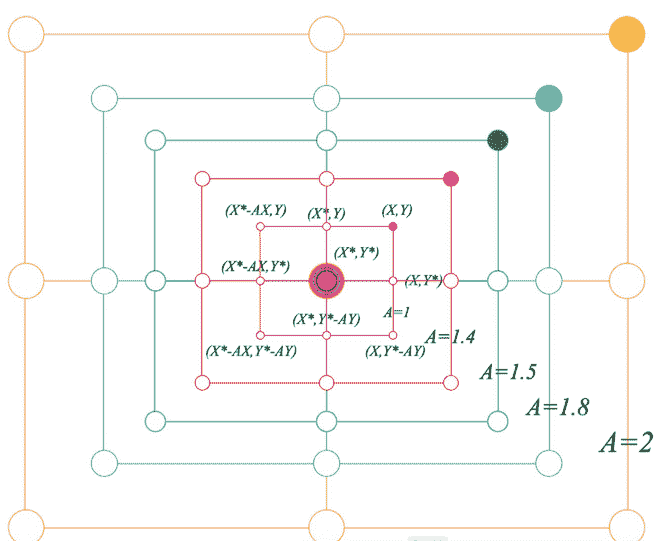

第一个测试系统是标准 IEEE 33-bus 系统，由 33 个节点、32 条配电线路组成，有功功率负载为 3715 kW，无功功率负载为 2300 kVar，额定电压为 12.66 kV，如图 6.2B 所示。第二个测试系统是标准 IEEE 69-bus 系统，由 69 个节点、68 条配电线路组成，有功功率负载为 3791.89 kW，无功功率负载为 2694.10 kVar，额定电压为 12.66 kV，如图 6.2C 所示。为了说明所提算法在大规模配电系统中的适用性，将其应用于标准 IEEE 118-bus 系统，该系统由 118 个节点组成，有功功率负载为 22.71 MW，无功功率负载为 17.04 MVar，如图 6.2C 所示。所有测试系统的额定电压均为 12.66 kV。

所提 CAWOA 算法在三个考虑的 IEEE 配电系统中，在存在 PV-DG 和 WT-DG 的情况下的收敛优化特性如图 6.3 所示。

从图中可以看出，安装 PV-DG 时，IEEE 33-bus 系统需要近 50 次迭代才能获得最优解，而 IEEE 69-bus 系统在第 170 次迭代获得最优解，较大的 IEEE 118-bus 系统需要更长时间才能获得最优解——超过 170 次迭代——但对于三个系统，可以观察到前几次迭代中出现快速收敛。

- **算法 6.1 CAWOA 的伪代码。**
- 1. 生成初始种群 \(X_i\) (\(i = 1, 2, ..., n_p\))
- 2. 评估 \(X_i\) 中每个候选解的适应度
- 3. \(X^*\) 是最佳候选解
- 4. **while** (\(t < t_{max}\))
- 5. **for** \(i = 1\) 到 \(n_p\) （针对每个搜索代理）
- 6. 按方程更新参数 \(a\)：
  - \(a = 1 + 0.5 \cdot \cos \left( \pi \frac{t}{t_{max}} \right)\) (6.22)
  - 更新 \(A, C, l\) 和 p
- 7. **if** (\(p < 0.5\))
- 8.   **if** (\(|A| < 1\))
- 9.     按方程更新搜索代理的位置：
    - \(\vec{D} = \left| \vec{C} \cdot \vec{X}^*(t) - \vec{X}(t) \right|\) (6.23)
    - \(\vec{X}(t+1) = \vec{X}^*(t) - \vec{A} \cdot \vec{D}\) (6.24)
- 10.   **else if** (\(|A| \ge 1\))
- 11.     选择随机搜索代理 (\(X_{rand}\))
- 12.     按方程更新搜索代理的位置：
    - \(\vec{D} = \left| \vec{C} \cdot \vec{X}_{rand} - \vec{X} \right|\) (6.25)
    - \(\vec{X}(t+1) = \vec{X}_{rand} - \vec{A} \cdot \vec{D}\) (6.26)
- 13.   **end if**
- 14. **else if** (\(p \ge 0.5\))
- 15.   按方程更新当前代理的位置：
    - \(\vec{X}(t+1) = \vec{D}' \cdot e^{bt} \cdot \cos(2\pi l) + \vec{X}^*(t)\) (6.27)
- 16. **end if**
- 17. **end for**
- 18. 检查是否有搜索代理超出搜索空间
- 19. 计算每个搜索代理的 MOF
- 20. 如果存在更好的解，则更新 \(X^*\)
- 21. \(t = t + 1\)
- 22. **end while**
- 23. 返回 \(X^*\)

在 WT-DG 安装的案例研究中，IEEE 33-bus 和 69-bus 系统在第 60 次迭代提供最优解，而 118-bus 系统需要近 180 次迭代才能获得最佳解，这与该系统的大规模有关。

### 6.4.2 最优结果分析

DG 并入前所有配电系统的参数在表 6.2 中表示，安装在 EDS 上的所有 DG 的参数在表 6.3 中表示，PV-DG 和 WT-DG 并入后的优化结果在表 6.4 中表示。

根据表 6.4 中说明的结果，对于第一个测试系统 (IEEE 33-bus)，CAWOA 算法为 PV-DGs 选择的容量为 850.3 和 1158.6 kW，而对于 WT-DG 为 828.0 kW，功率因数为

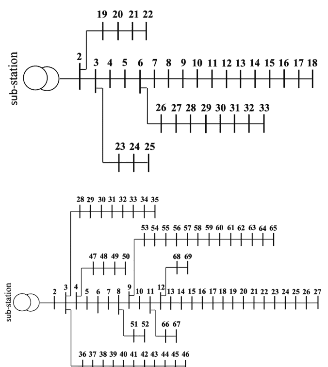

FIG. 6.2 标准 EDSs 的单线图：(A) IEEE 33-bus，(B) IEEE 69-bus，（续）

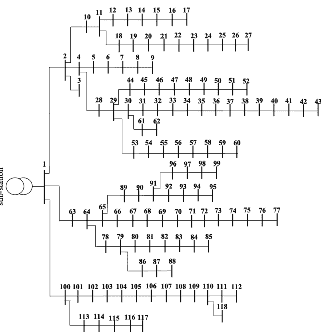

图 6.2—续 (C) IEEE 118-bus。

0.8944（滞后）和 1243.3kW，功率因数为 0.8（滞后）。分布式电源（DG）已连接至其最佳位置。它们位于 13 号和 30 号母线；因此，对于 PV-DG，ΔAPL 最小化至 41.3132%，对于 WT-DG，最小化至 13.9037%。

对于第二个测试系统，考虑 IEEE 69-bus。在优化三个分布式电源（DG）的容量后，最优容量分别为 576.1、339.3 和 1716.8kW，连接至 11 号、21 号和 61 号母线，从而将 ΔAPL 最小化至 30.8611%。相应地，容量为 432.7、315.8 和 1662.2kW 的 WT-DG 分别安装在 11 号、21 号和 61 号母线，使 ΔAPL 最小化至 2.0168%。

对于第三个测试系统，即较大规模的 IEEE 118-bus 系统，需要五个 PV-DG 来将 ΔAPL 最小化至 44.3794%，分别位于 39 号、74 号、80 号、96 号和 110 号母线，每个 PV-DG 的定义容量分别为 2971.4、2257.4、2382.4、1782.6 和 2911.1kW。另一方面，建议将五个 WT-DG 单元安装在 39 号、47 号、72 号、80 号和 118 号母线，WT-DG 注入的有功功率适当输出分别为 2.9038、2.1597、2.7667、2.3067 和 2.9171 kW，结合前述位置，可将 ΔAPL 最小化至 17.9853%。

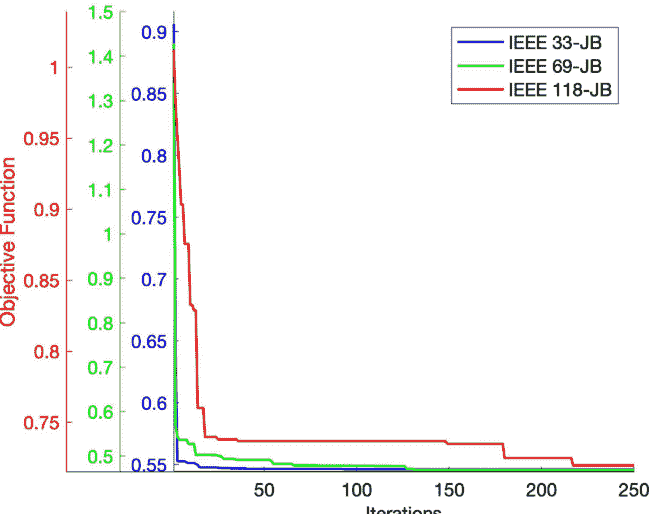

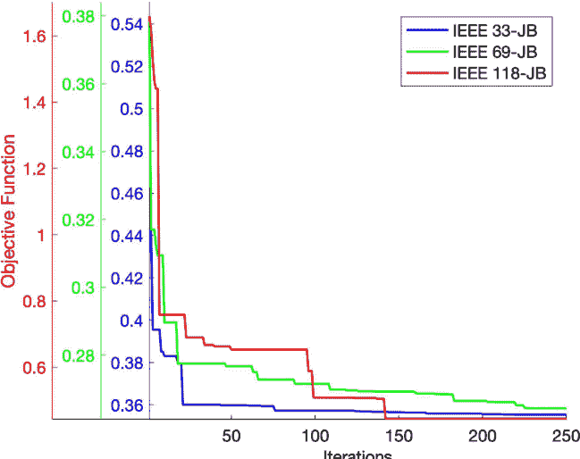

图 6.3 面向 EDSs 研究的 CAWOA 收敛曲线：(A) PV-DG，(B) WT-DG。

| 参数 | IEEE 33-bus | IEEE 69-bus | IEEE 118-bus |
|---|---|---|---|
| \(\sum P_{Loss}\) (kW) | 210.9875 | 224.9480 | 1297.5000 |
| \(\sum Q_{Loss}\) (kVar) | 143.1284 | 102.1406 | 978.4956 |
| \(V_{min}\) (p.u.) | 0.9038 | 0.9092 | 0.8688 |
| \(\sum TVV\) (p.u) | 1.8047 | 1.8704 | 5.2877 |
| TOC (k$) | 1054.9375 | 1124.740 | 6487.500 |

| DG 类型 | DGs 参数 | IEEE 33-bus | IEEE 69-bus | IEEE 118-bus |
|---|---|---|---|---|
| PV-DG | | | | 2971.4 (39) |
| | | | 576.1 (11) | 2257.4 (74) |
| | \(P_{DG}\), kW (Bus) | 850.3 (13) | 339.3 (21) | 2382.4 (80) |
| | | 1158.6 (30) | 1716.8 (61) | 1782.6 (96) |
| | | | | 2911.1 (110) |
| | \(\sum P_{DG}\) (MW) | 2.0089 | 2.6322 | 12.3049 |
| WT-DG | | | | 2.9038 (39) |
| | | | 432.7 (12) | 2.1597 (47) |
| | \(P_{DG}\), kW (Bus) | 828.0 (13) | 315.8 (21) | 2.7667 (72) |
| | | 1243.3 (30) | 1662.2 (61) | 2.3067 (80) |
| | | | | 2.9171 (118) |
| | \(\sum P_{DG}\) (MW) | 2.0713 | 2.4107 | 13.0540 |
| | | | | 0.8321 (39) |
| | | | 0.8000 (12) | 0.8869 (47) |
| | | 0.8944 (13) | 0.8000 (21) | 0.8321 (72) |
| | \(PF_{DG}\) | 0.8000 (30) | 0.8000 (61) | 0.8028 (80) |
| | | | | 0.8321 (118) |

| 参数 | PV-DG | WT-DG | PV-DG | WT-DG | PV-DG | WT-DG |
| :--- | :--- | :--- | :--- | :--- | :--- | :--- |
| | IEEE 33-bus | | IEEE 69-bus | | IEEE 118-bus | |
| \(\sum P_{Loss}\) (kW) | 87.1657 | 29.3351 | 69.4215 | 4.5367 | 575.8223 | 233.3590 |
| \(\Delta APL\) (%) | 41.3132 | 13.9037 | 30.8611 | 2.0168 | 44.3794 | 17.9853 |
| \(V_{min}\) (p.u.) | 0.9685 | 0.9804 | 0.9790 | 0.9943 | 0.9554 | 0.9662 |
| \(\sum TVV\) (p.u.) | 0.6775 | 0.1862 | 1.0277 | 0.1087 | 3.3633 | 1.4590 |
| \(\Delta TVV\) (%) | 37.541 | 10.318 | 54.946 | 5.812 | 63.6061 | 27.5923 |
| TOC (k$) | 1403.60 | 1172.28 | 1402.43 | 1142.89 | 8790.79 | 7420.94 |
| \(\Delta TOC\) (%) | 133.051 | 111.123 | 124.689 | 101.613 | 135.503 | 114.388 |
| CPU TIME (s) | 6.0750 | 7.7052 | 11.6577 | 13.2048 | 21.6061 | 23.3794 |

从该分析中可以看出，在安装分布式电源（DG）后，所测试系统的功率损耗最小化、电压剖面改善以及运行成本最小化方面都有显著改善，但主要观察是 WT-DG 的贡献高于 PV-DG。这不仅与所提算法定义的最优无功功率有关，也与算法达到的最优滞后功率因数有关，这导致了安装在最佳位置的 WT-DG 注入的有功和无功功率的最优选择。

图 6.4 显示了所有配电系统不同案例研究下的母线电压剖面。在安装分布式电源（DG）单元后，所测试电力系统的电压剖面均有所改善。可以看出，对于每种分布式电源（DG）单元的不同电压剖面，所提算法获得的最优因子的效果使得 WT-DG 能够对电压剖面保持更好的改善，并使其几乎变为平坦。

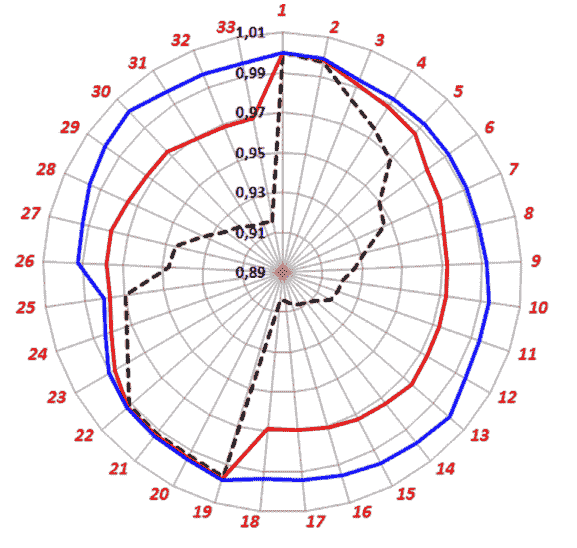

图 6.4 EDSs 的母线电压剖面：(A) IEEE 33-bus，

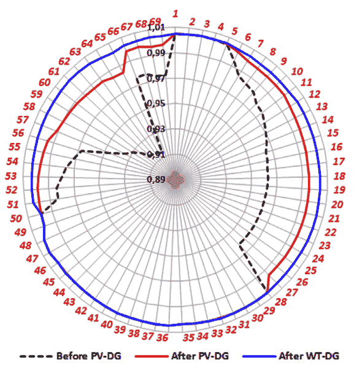

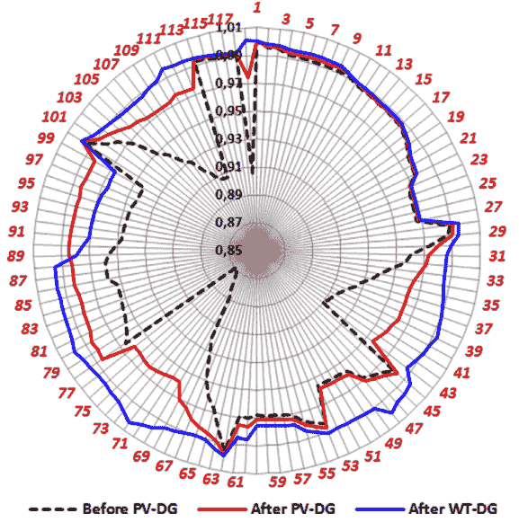

图 6.4—续 (B) IEEE 69-bus，和 (C) IEEE 118-bus。

图 6.5 说明了分布式电源（DG）安装对三个测试系统有功功率损耗的影响。分析图 6.5 可知，安装分布式电源（DG）后，有功功率损耗量有显著减小。

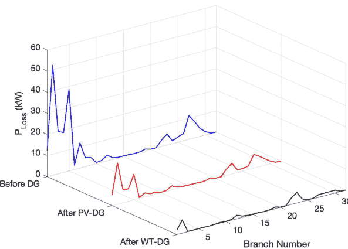

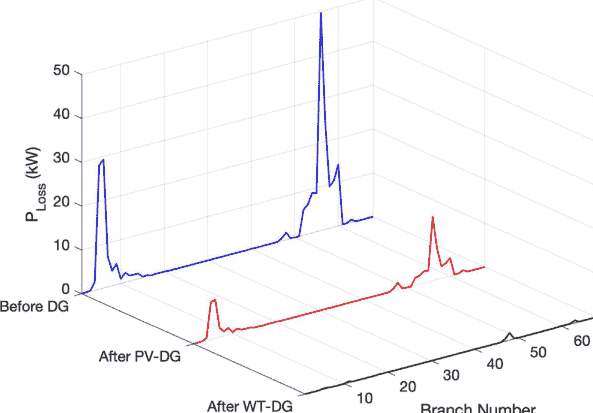

图 6.5 EDSs 的有功功率损耗：(A) IEEE 33-bus，(B) IEEE 69-bus，和（续）

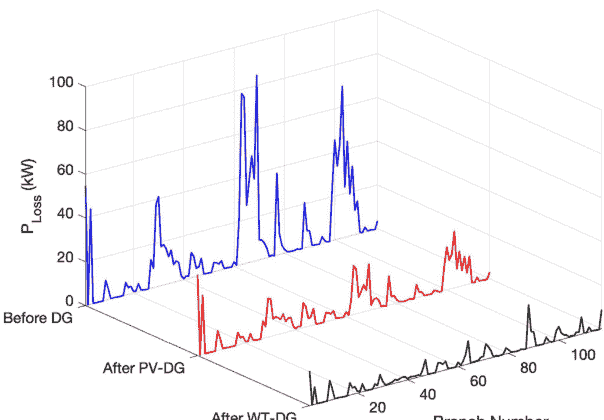

图 6.5—续 (C) IEEE 118-bus。

观察到，WT-DG 安装对功率损耗的最小化贡献大于 PV-DG 安装。这些结果归因于 WT-DG 注入的无功功率的贡献，以及所提算法定义的最优功率因数。如上文表 6.3 所述，功率因数设定在 0.8 至 0.9 之间（滞后）。

图 6.6 展示了分布式电源（DG）安装对三个测试系统母线电压偏差的影响。一般来说，安装两种类型的分布式电源（即 PV-DG 和 WT-DG）将减小所有母线的电压偏差。然而，从电压变化曲线可以看出，将 WT-DG 集成到所测试系统中注入的有功和无功功率在减小电压偏差方面更有效。此外，可以注意到，在系统电压水平方面，WT-DG 提供的改善比 PV-DG 更大。

### 6.4.3 比较结果

表 6.5 包含了针对所有测试 EDS 系统，各种优化算法与所提 CAWOA 算法的比较结果。

表 6.5 中所示的比较旨在展示所提 CAWOA 算法的性能。该表包含了所提算法与文献中其他基准算法的详细比较，涉及三个测试系统在集成 PV-DG 和 WT-DG 时的有功功率损耗、\(\Delta APL\)、\(\Delta TVV\) 和 \(\Delta TOC\)。

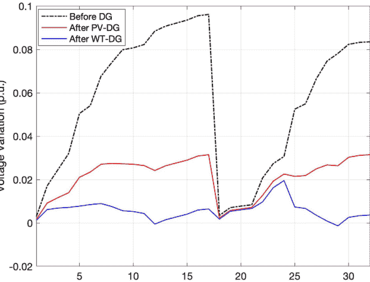

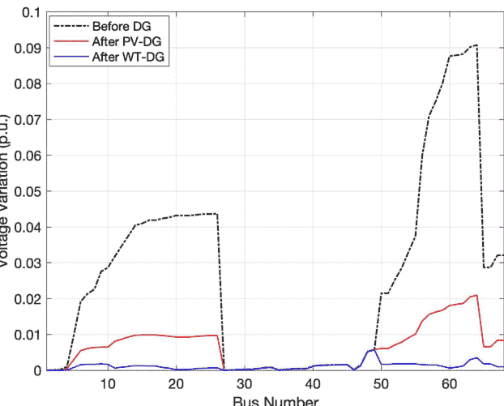

图 6.6 标准 EDSs 的母线电压变化：(A) IEEE 33-bus，(B) IEEE 69-bus，和（续）

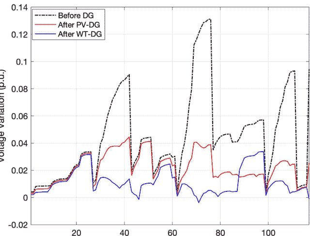

图 6.6—续 (C) IEEE 118-bus。

对于第一个测试系统，IEEE 33-bus，CAWOA 分别与三种算法（即用于 PV-DG 的 BSOA、FPA 和 KHA，以及用于 WT-DG 的 PSO、BSOA 和 ALOA）进行了比较，前提是存在 PV-DG。所比较的算法将有功功率损耗量减小至 89.340kW、89.2000kW 和 87.4260kW，进而分别将 ΔAPL 减小至 42.3437%、42.2774% 和 41.4366%，并将 ΔATOC 减小至 133.875%、133.822% 和 133.149%。另一方面，CAWOA 将有功功率损耗减小至 87.1657kW。这使得 ΔAPL 和 ΔATOC 分别最小化至 41.3132% 和 133.051%。基于 WT-DG 集成的所比较算法也能够确定所需的最优位置和容量，将功率损耗分别减小至 39.1000kW、31.9800kW 和 30.9251kW，如前所述。在此情况下，ΔAPL 已最小化至 18.5319%、15.1573% 和 14.6573%。ATOC 已减小至 114.826%、112.126%、111.726% 和 111.123%。

第二个系统，IEEE 69-bus，与三种现有算法（即 CDE、CSFS 和 SFSA）进行了比较。在 PV-DG 安装的案例研究中，可以看出，在安装三个由这些算法获得的最佳位置的 PV-DG 后，功率损耗已分别减小至 69.4360kW、69.4300kW 和 69.4280kW，ΔATOC 分别减小至 124.694%、124.692% 和 124.691%；同时，最小功率损耗和 ΔATOC

表 6.5 各种优化算法给出的系统结果。

| 测试系统 | DG类型 | 应用算法 | Σ P_Loss (kW) | ΔAPL (%) | ΔTVV (%) | ΔTOC (%) |
|---|---|---|---|---|---|---|
| IEEE 33节点 | PV-DG | BSOA (El-Fergany, 2015) | 89.3400 | 42.3437 | 41.0040 | 133.875 |
| IEEE 33节点 | PV-DG | FPA (Oda et al., 2017) | 89.2000 | 42.2774 | 35.5738 | 133.822 |
| IEEE 33节点 | PV-DG | KHA (Chithra Devi et al., 2017) | 87.4260 | 41.4366 | 37.4577 | 133.149 |
| IEEE 33节点 | PV-DG | **CAWOA** | **87.1657** | **41.3132** | **37.5409** | **133.051** |
| IEEE 33节点 | WT-DG | PSO (Kaur, Kumbhar, & Sharma, 2014) | 39.1000 | 18.5319 | 10.6721 | 114.826 |
| IEEE 33节点 | WT-DG | BSOA (El-Fergany, 2015) | 31.9800 | 15.1573 | 32.6148 | 112.126 |
| IEEE 33节点 | WT-DG | ALOA (Ali et al., 2017) | 30.9251 | 14.6573 | 9.2037 | 111.726 |
| IEEE 33节点 | WT-DG | **CAWOA** | **29.3351** | **13.9037** | **10.3175** | **111.123** |
| IEEE 69节点 | PV-DG | CDE (Kumar et al., 2019a) | 69.4360 | 30.8676 | 54.9401 | 124.694 |
| IEEE 69节点 | PV-DG | CSFS (Nguyen & Vo, 2019) | 69.4300 | 30.8649 | 54.9401 | 124.692 |
| IEEE 69节点 | PV-DG | SFSA (Nguyen & Ngoc Vo, 2018) | 69.4280 | 30.8640 | 54.9348 | 124.691 |
| IEEE 69节点 | PV-DG | **CAWOA** | **69.4215** | **30.8611** | **54.9455** | **124.689** |
| IEEE 69节点 | WT-DG | LSFSA (Injeti & Kumar, 2013) | 16.2600 | 7.2283 | 15.0075 | 105.783 |
| IEEE 69节点 | WT-DG | BFOA (Imran & Kowsalya, 2014) | 12.9000 | 5.7347 | 25.9356 | 104.588 |
| IEEE 69节点 | WT-DG | GWO (Nowdeh et al., 2019) | 7.3100 | 3.2496 | 7.4476 | 102.600 |
| IEEE 69节点 | WT-DG | **CAWOA** | **4.5367** | **2.0168** | **5.8116** | **101.613** |
| IEEE 118节点 | PV-DG | CSFS (Nguyen & Vo, 2019) | 581.580 | 44.8231 | 69.0849 | 135.858 |
| IEEE 118节点 | PV-DG | SFSA (Nguyen & Ngoc Vo, 2018) | 578.741 | 44.6043 | 70.1780 | 135.683 |
| IEEE 118节点 | PV-DG | KHA (Nowdeh et al., 2019) | 576.490 | 44.4308 | 69.6220 | 135.545 |
| IEEE 118节点 | PV-DG | CAWOA | 575.822 | 44.3794 | 63.6061 | 135.503 |
| IEEE 118节点 | WT-DG | LSFSA (Injeti & Kumar, 2013) | 684.028 | 52.7189 | 49.2880 | 142.175 |
| IEEE 118节点 | WT-DG | SFSA (Nguyen & Ngoc Vo, 2018) | 236.528 | 18.2295 | 41.4244 | 114.584 |
| IEEE 118节点 | WT-DG | KHA (Sultana & Roy, 2016) | 233.383 | 17.9871 | 40.9649 | 114.390 |
| IEEE 118节点 | WT-DG | CAWOA | 233.359 | 17.9853 | 27.5923 | 114.388 |

由所提算法获得的结果分别为 69.4215kW 和 124.689%。另一方面，WT-DG案例研究的结果已与 LSFSA、BFOA 和 GWO 进行了比较；据报道，其提供的功率损耗分别为 16.2600kW、12.9000kW 和 7.3100kW，$\Delta APL$ 和 $\Delta TOC$ 分别为 7.2283%、5.7347% 和 3.2496%，以及 105.783%、104.588% 和 102.600%。CAWOA 实现的功率损耗量为 4.5367，因此 $\Delta APL$ 和 $\Delta TOC$ 分别为 2.0168% 和 101.613%。

第三个测试系统（IEEE 118节点）配备了PV-DG。所得结果已与CSFS、SFSA和KHA进行比较，它们的功率损耗分别为581.580、578.741和576.490kW，$\Delta TOC$ 分别为142.175%、114.584%和114.390%。以与PV-DG相同的方式，WT-DG已与LSFSA、SFSA和KHA进行比较；基于这些算法，功率损耗降低至684.028kW、236.528kW和233.383kW，$\Delta TOC$ 降低至142.175%、114.584%和114.390%，而CAWOA 实现的功率损耗和$\Delta TOC$ 分别为233.359kW和114.388%。

综合以上结果以及文献基准算法与所提CAWOA算法的对比来看，文献算法已实现了显著的功率损耗降低。然而，对于包含PV-DG和WT-DG的三个测试系统，CAWOA算法在功率损耗最小化和总运行成本方面提供了更好的结果；这表明CAWOA算法在确定PV-DG和WT-DG的最佳位置和容量方面具有优越性能。

图 6.7 展示了在存在PV-DG和WT-DG时，三个标准IEEE系统的 $\Delta TOC$ 和 $\Delta APL$ 柱状图。这是为了展示所提算法相对于标准文献算法的有效性。

图 6.7 所示结果表明，在所有三个IEEE测试场景中，应用CAWOA优化不同系统中DG的选址与容量，旨在降低有功功率损耗指数和总运行成本时，所提算法证明了其处理此类拟议目标函数的能力。此外，CAWOA与其他算法的比较表明，CAWOA算法表现良好，并能够基于不同类型的DG单元，在功率损耗最小化或运行成本改进方面获得最佳和最优结果。

### 6.4.4 DG对支路电流的影响

图 6.8 显示了DG安装对所有三个测试系统中有功和无功支路电流的影响。如图所示，有功电流用虚线绘制，无功电流用实线绘制；无功电流的负号表明负载的性质为感性。安装DG的目标之一是降低支路电流，因为系统中支路的损耗首先取决于流经这些支路的电流。可以注意到，在DG安装后，三个测试系统的支路电流明显降低；因此，功率损耗也随之降低。

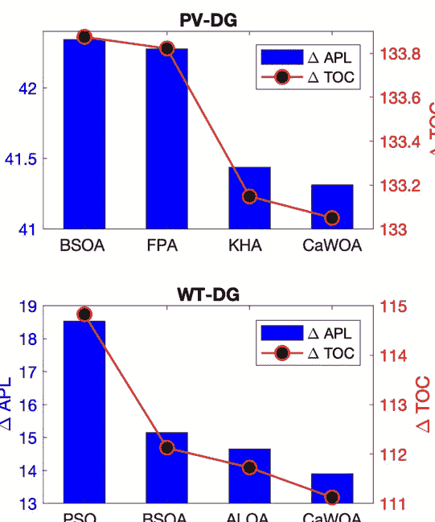

由于WT-DG注入了无功功率，在三个测试系统中，支路电流受WT-DG的影响大于PV-DG。

### 6.4.5 负载能力变化对EDS的影响

为验证所提算法的有效性和性能，已将其应用于标准IEEE配电系统。对于所有测试系统情况，电力系统馈线负载按10%负载的阶梯，从60%（轻载）线性变化至120%（峰载）；同时，对于每个负载

#### PV-DG

#### WT-DG

图 6.7—续 (B) IEEE 69节点，

阶梯变化。IEEE 33、69 和 118 节点在不同负载变化下的电压剖面如图 6.9 所示。

每个测试系统的允许上下电压限值在图 6.9 中用虚线红线绘制。在DG安装前，某些节点电压在特定负载下超出了允许限值。例如，在IEEE 33节点系统中，从6号节点到18号节点以及从26号节点到33号节点的电压达到了最小值——这些值小于0.95 p.u.——但在安装PV-DG并考虑消耗变化后，观察到电压剖面显著改善，最小值已变为18号节点的0.95 p.u. 同样，在WT-DG中，电压剖面也有所改善，但优于PV-DG。IEEE 69节点和IEEE 118节点系统也可以得出同样的观察结果——基于PV-DG和WT-DG，针对不同消耗负载获得了最佳电压剖面。还可以注意到，系统在轻载消耗下的电压剖面始终优于中载和峰载。

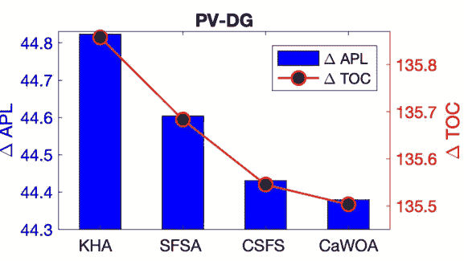

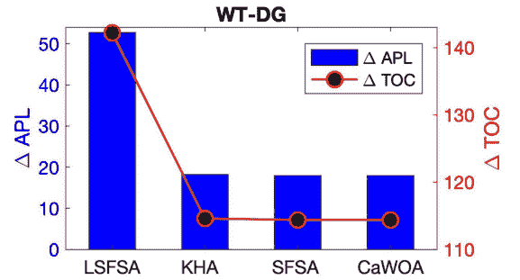

图 6.7—续 (C) IEEE 118节点。

图 6.10 展示了为了研究负载能力对三个测试系统在DG单元并网前后总有功和无功功率的影响，以与之前相同的负载变化方式进行。负载从60%变化到120%，步长为10%，有功和无功功率损耗同时计算。

如图所示，在轻载消耗情况下（负载的60%），有功和无功配电线路损耗达到最小。另一方面，在高载消耗情况下，获得了最高的功率损耗。无论是在DG单元安装前还是安装后，都可以看出功率损耗与负载的增加成正比。

另一个观察是，DG单元并网后获得了最佳剖面——DG单元注入的功率始终使损耗上

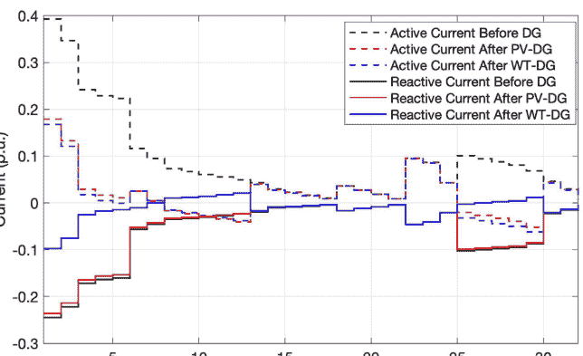

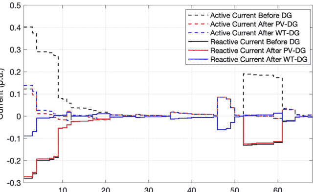

图 6.8 EDSs 的有功和无功支路电流：(A) IEEE 33 节点，(B) IEEE 69 节点，以及（续）

在不同负载能力下达到其最优最小值。此外，在存在 WT-DG 且负载呈线性变化时测得的有功和无功功率损耗，优于存在 PV-DG 时所获得的损耗；这一观察对于三种测试系统均成立。

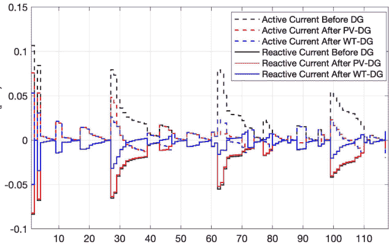

图 6.8—续 (C) IEEE 118 节点。

## 6.5 结论

本章提出了 CAWOA 算法，用于求解 EDSs 中可再生能源分布式发电机（DG）最优选址与容量的技术经济分析问题。因此，采用了多目标函数，用于在最优功率因数下实现 PV-DG 和 WT-DG 源的最优集成。所提算法得到的最优功率因数对功率损耗和节点电压具有积极且明显的影响，这与文献中许多提出预定义功率因数的技术不同。总体而言，安装 WT-DG 可获得最佳效果。

本研究中，所提算法被应用于在预定义容差范围内，在等式和不等式约束条件下，最小化有功功率损耗指数、电压变化指数和总运行成本指数，以避免违反这些约束。计算了有功和无功支路电流，结果表明，安装 DG 后电流最小化，且电流剖面在 WT-DG 的存在下减少更多。通过负载的线性变化，得到了审慎且真实的结果；负载能力结果表明，总功率损耗和电压剖面随负载的增加或减少成正比。

为了展示所提算法的性能，将所得结果与文献中其他现有算法结果进行了比较。比较研究表明，CAWOA 在最小化所研究系统功率损耗方面优于所比较的算法；此外，在系统中安装相同数量的 DG 情况下，其表现良好并获得更好的结果。总体而言，结果表明 CAWOA 可以处理此类拟议的目标函数。

本研究工作为配电公司降低功率损耗提供了指导和建议。该工作还将帮助配电公司更轻松、更可靠地将小型可再生能源纳入配电网络。

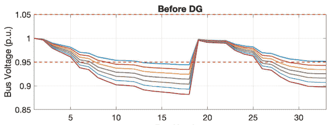

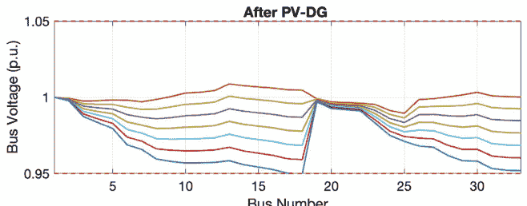

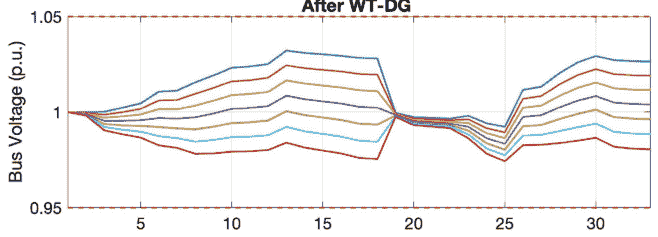

图 6.9 不同负载变化下的 EDSs 电压剖面：(A) IEEE 33 节点，（续）

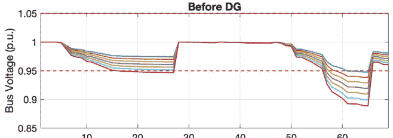

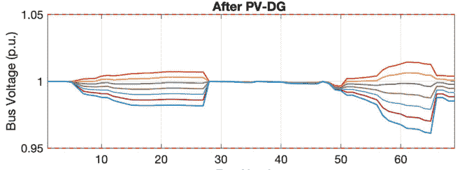

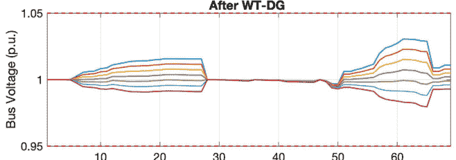

图 6.9—续 (B) IEEE 69 节点，以及（续）

## 缩写和符号

### 缩写

- APL 有功功率损耗
- EDS 电气配电系统
- OPF 最优潮流
- PV-DG 基于 PV 源的 DG
- VD 电压偏差
- VSI 电压稳定性指数
- WT-DG 基于 WT 源的 DG

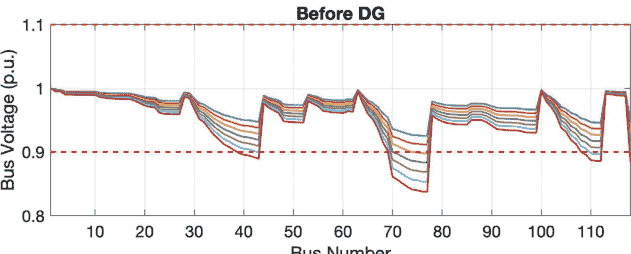

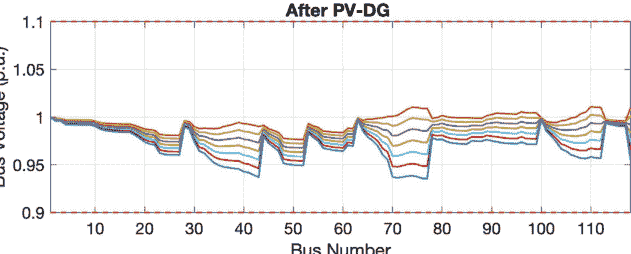

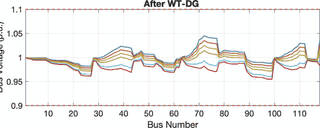

图 6.9—续 (C) IEEE 118 节点。

### 目标函数符号

- $K_1$: 变电站和 DG 供应的有功功率成本系数（4 美元/kW）
- $K_2$: DG 的维护和安装成本系数（5 美元/kW）
- $N_{bus}$: 节点数量
- $OF$: 目标函数
- $P_{ij}, Q_{ij}$: 配电线路的有功和无功功率

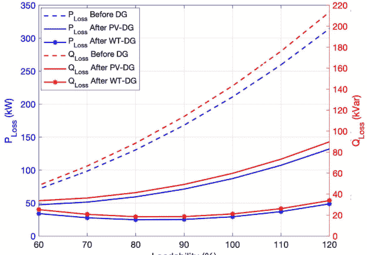

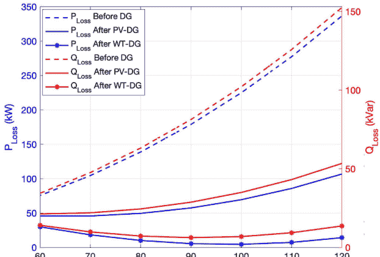

图 6.10 在不同负载能力值下 EDSs 的总有功和无功功率损耗：(A) IEEE 33 节点，(B) IEEE 69 节点，以及（续）

- $P_{Loss}$ 配电网总有功损耗
- $R_{ij}$ 配电线路电阻
- $TOC$ 总运行成本
- $TVV$ 总电压变化

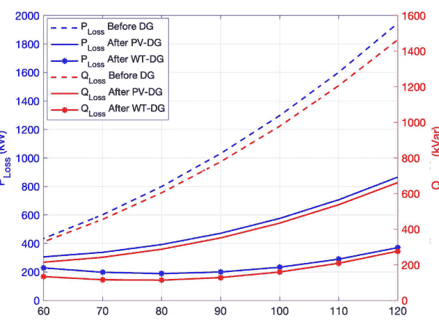

图 6.10—续 (C) IEEE 118 节点。

| $V_i$ | 节点 $i$ 处的电压 |
| --- | --- |
| $\alpha_1, \alpha_2, \text{and } \alpha_3$ | 权重因子 |
| $\Delta APL$ | 有功功率损耗指数 |
| $\Delta TOC$ | TOC 指数 |
| $\Delta TVV$ | TVV 指数 |

### 约束符号

| $DG_{Position}$ | DG 单元位置 |
| --- | --- |
| $N_{DG}$ | DG 单元数量 |
| $n_{DG, i}$ | 节点 $i$ 处的 PV-DG 单元位置 |
| $P_D, Q_D$ | 需求负载的总有功和无功功率 |
| $P_{DG}, Q_{DG}$ | 来自 DG 的总有功和无功注入功率 |
| $P_{DG}^{min}, P_{DG}^{max}$ | DG 有功功率输出的最小和最大限值 |
| $PF_{DG}$ | DG 功率因数 |
| $PF_{DG}^{min}, PF_{DG}^{max}$ | $PF_{DG}$ 的最小和最大值 |
| $P_G, Q_G$ | 发电机的总有功和无功功率 |
| $P_{Loss}, Q_{Loss}$ | 总有功和无功功率损耗 |
| $Q_{DG}^{min}, Q_{DG}^{max}$ | DG 无功功率输出的最小和最大限值 |
| $S_{ij}$ | 节点 $i$ 到节点 $j$ 支路的视在功率 |
| $S_{max}$ | 最大视在功率 |

| 符号 | 描述 |
| --- | --- |
| $V_1$ | 发电站处的电压等于 1.0 p.u. |
| $V_{min}, V_{max}$ | 限定指定电压 |
| $\Delta V_{max}$ | 最大电压跌落 |

## CAWOA 算法参数

- A 和 C 系数向量
- a 控制参数
- b 表示对数螺旋状态的常数
- D 第 i 条鲸鱼与猎物之间的距离
- D' 确定鲸鱼 i 到猎物的位置或距离
- l 范围 -1 到 1 之间的任意数
- p 范围在 0 到 1 之间的任意数
- r 区间 0 到 1 内的随机向量
- t 表示当前迭代
- $t_{max}$ 最大迭代次数
- X 位置向量
- X* 迄今获得的最佳解的位置向量
- $X_{rand}$ 任意位置向量（一条随机鲸鱼）

## 参考文献

- Abdmouleh, Z., Gastli, A., Ben-Brahim, L., Haouari, M., & Al-Emadi, N. A. (2017). 可再生能源分布式发电集成中应用优化技术综述. Renewable Energy, 113, 266–280. https://doi.org/10.1016/j.renene.2017.05.087.
- Ali, E. S., Elazim, S. A., & Abdelaziz, A. Y. (2018). 使用蚁狮优化算法对可再生分布式发电进行最优分配和容量确定. Electrical Engineering, 100(1), 99–109. https://doi.org/10.1007/s00202-016-0477-z.
- Ali, E. S., Elazim, S. A., & Abdelaziz, A. Y. (2017). 用于可再生分布式发电最优选址与容量的蚁狮优化算法. Renewable Energy, 101, 1311–1324. https://doi.org/10.1016/j.renene.2016.09.023.
- Chang, G. W., & Chinh, N. C. (2020). 基于郊狼优化算法的光伏分布式发电战略规划方法. IEEE Access, 8, 36180–36190. https://doi.org/10.1109/ACCESS.2020.2975107.
- Chithra Devi, S. A., Lakshminarasimman, L., & Balamurugan, R. (2017). 辐射配电系统中多 DG 选址与容量的磷虾群算法研究. Engineering Science and Technology, an International Journal, 20(2), 748–759. https://doi.org/10.1016/j.jestch.2016.11.009.
- Deb, G., Chakraborty, K., & Deb, S. (2019). 基于蜘蛛猴优化技术的分布式发电侧需求管理分配. International Transactions on Electrical Energy Systems, 29(5), e12009. https://doi.org/10.1002/2050-7038.12009.
- Dehghani, M., Montazeri, Z., & Malik, O. P. (2020). 使用弹簧搜索算法对配电系统中的电容器组和分布式发电进行最优容量与布置. International Journal of Emerging Electric Power Systems, 21(1), 1–9. https://doi.org/10.1515/ijeeps-2019-0217.

- Diaaeldin, I., Abdel Aleem, S., El-Rafei, A., Abdelaziz, A. Y., & Zobaa, A. F. (2019). 有软开点和分布式发电的有源配电网最优网络重构. Energies, 12(21), 4172. https://doi.org/10.3390/en12214172.

- Duong, M. Q., Pham, T. D., Nguyen, T. T., Doan, A. T., & Tran, H. V. (2019). 径向配电系统中太阳能光伏分布式发电机组最优位置与容量的确定. Energies, 12(1), 174. https://doi.org/10.3390/en12010174.

- Ehsan, A., Cheng, M., & Yang, Q. (2019). 基于场景的在可再生能源发电和电力需求不确定性下的有源配电系统规划. CSEE Journal of Power and Energy Systems, 5(1), 56–62. https://doi.org/10.17775/CSEEJPES.2018.00460.

- Ehsan, A., & Yang, Q. (2018). 电力配电网中可再生能源分布式发电的最优集成与规划：分析技术综述. Applied Energy, 210, 44–59. https://doi.org/10.1016/j.apenergy.2017.10.106.

- Eid, H. F., & Abraham, A. (2018). 基于修改鲸鱼优化算法的自适应特征选择与分类. International Journal of Computer Information Systems and Industrial Management Applications, 10, 174–182.

- Elattar, E. E., & Elsayed, S. K. (2020). 基于可再生能源的分布式发电机最优位置与容量确定：使用修改蛾火焰优化技术. IEEE Access, 8, 109625–109638. https://doi.org/10.1109/ACCESS.2020.3001758.

- Elaziz, M. A., & Mirjalili, S. (2019). 一种用于改进鲸鱼优化算法初始种群的超启发式算法. Knowledge-Based Systems, 172, 42–63. https://doi.org/10.1016/j.knosys.2019.02.010.

- El-Fergany, A. (2015). 使用回溯搜索优化算法的多种类型分布式发电机最优分配. International Journal of Electrical Power and Energy Systems, 64, 1197–1205. https://doi.org/10.1016/j.ijepes.2014.09.020.

- Gkaidatzis, P. A., Bouhouras, A. S., Sgouras, K. I., Doukas, D. I., Christoforidis, G. C., & Labridis, D. P. (2019). 基于最优分布式发电布置方法的可再生能源高效渗透. Energies, 12(7), 1250. https://doi.org/10.3390/en12071250.

- Grisales-Noreña, L. F., Montoya, D. G., & Ramos-Paja, C. A. (2018). 基于PBIL和PSO技术的分布式发电机最优容量与位置. Energies, 11(4), 1018. https://doi.org/10.3390/en11041018.

- Hadidian-Moghaddam, M. J., Arabi-Nowdeh, S., Bigdeli, M., & Azizian, D. (2018). 使用蚁狮优化技术的分布式发电多目标最优容量与选址. Ain Shams Engineering Journal, 9(4), 2101–2109. https://doi.org/10.1016/j.asej.2017.03.001.

- Hassan, H. A., & Zellagui, M. (2019). 基于技术经济指标的标准径向配电系统中DG与DSTATCOM最优同时集成的MVO算法. In 21st international Middle East power systems conference (MEPCON), (MEPCON), 17–19 December. Egypt: Tanta University. https://doi.org/10.1109/MEPCON47431.2019.9007995.

- Imran, A. M., & Kowsalya, M. (2014). 使用细菌觅食优化的配电系统中多个分布式发电机的最优尺寸与选址. Swarm and Evolutionary Computation, 15, 58–65. https://doi.org/10.1016/j.swevo.2013.12.001.

- Injeti, S. K., & Kumar, N. P. (2013). 一种用于小型、中型和大型径向配电系统中多个DG最优接入点与容量识别的新方法. International Journal of Electrical Power & Energy Systems, 45(1), 142–151. https://doi.org/10.1016/j.ijepes.2012.08.043.

- Kansal, S., Tyagi, B., & Kumar, V. (2017). 配电系统中最优分布式发电布置的成本效益分析. International Journal of Ambient Energy, 38(1), 45–54. https://doi.org/10.1080/01430750.2015.1031407.

- Karimizadeh, K., Soleymani, S., & Faghihi, F. (2020). 使用联盟博弈论提升微电网网络性能的DG单元最优布置. IET Generation, Transmission & Distribution, 14(5), 853–862. https://doi.org/10.1049/iet-gtd.2019.0070.

- Kaur, S., Kumbhar, G., & Sharma, J. (2014). 配电系统中多个DG单元最优布置的MINLP技术. International Journal of Electrical Power & Energy Systems, 63, 609–617. https://doi.org/10.1016/j.ijepes.2014.06.023.

- Kazmi, S. A. A., & Shin, D. R. (2017). 负荷增长下具有新电压稳定性指标和损耗最小化条件的环网配电网中DG布置的规划方法. Energies, 10(8), 1203. https://doi.org/10.3390/en10081203.

- Kumar, S., Mandal, K. K., & Chakraborty, N. (2019a). 基于多目标反向混沌差分进化的用于技术经济分析的最优DG布置. Applied Soft Computing, 78, 70–83. https://doi.org/10.1016/j.asoc.2019.02.013.

- Kumar, S., Mandal, K. K., & Chakraborty, N. (2019b). 一种通过最优分布式发电布置进行技术经济分析的新型反向调谐混沌差分进化技术. Engineering Optimization, 51, 1–20. https://doi.org/10.1080/0305215X.2019.1585832.

- Lasmari, A., Zellagui, M., Chemni, R., Semaoui, S., El-Bayeh, C. Z., & Hassan, H. A. (2020). 使用PV-based DG和DSTATCOM单元同时集成的配电系统最优能量管理系统. Energetika, 66(1), 1–14. https://doi.org/10.6001/energetika.v66i1.4294.

- Mahajan, S., & Vadhera, S. (2018). 使用人类观点动力学优化技术的分布式发电机组最优位置与容量. Distributed Generation and Alternative Energy Journal, 33(2), 38–57. https://doi.org/10.1080/21563306.2018.12002410.

- Mirjalili, S., & Andrew, L. (2016). 鲸鱼优化算法. Advances in Engineering Software, 95, 51–67. https://doi.org/10.1016/j.advengsoft.2016.01.008.

- Nguyen, T. P., & Ngoc Vo, D. (2018). 一种用于径向配电系统中分布式发电机最优分配的新型随机分形搜索算法. Applied Soft Computing Journal, 70, 773–796. https://doi.org/10.1016/j.asoc.2018.06.020.

- Nguyen, T. P., & Vo, D. N. (2019). 配电系统中分布式发电机位置、容量和数量最优确定的混沌改进型随机分形搜索算法. Neural Computing and Applications, 31(11), 7707–7732. https://doi.org/10.1007/s00521-018-3603-1.

- Nguyen-Phuoc, T., Vo-Ngoc, D., & Tran-The, T. (2017). 基于共生生物搜索方法的配电系统中分布式发电机最优数量、位置和容量. Advances in Electrical and Electronic Engineering, 15(5), 724–735. https://doi.org/10.15598/aee.v15i5.2355.

- Nikkhah, S., & Rabiee, A. (2018). 考虑电力系统电压稳定性的风电投资最优化. Renewable Energy, 115, 308–325. https://doi.org/10.1016/j.renene.2017.08.056.

- Nowdeh, S. A., Davoudkhani, I. F., Moghdaddam, M. H., Najmi, E. S., Abdelaziz, A. Y., Ahmadi, A., et al. (2019). 使用新型混合方法的以损耗降低和可靠性提高为目标的配电系统中可再生能源模糊多目标布置. Applied Soft Computing, 77, 761–779. https://doi.org/10.1016/j.asoc.2019.02.003.

- Oda, E. S., Abdelsalam, A. A., Abdel-Wahab, M. N., & El-Saadawi, M. M. (2017). 使用花朵授粉算法提升配电系统电压稳定性的分布式发电规划. Ain Shams Engineering Journal, 8(4), 593–603. https://doi.org/10.1016/j.asej.2015.12.001.

- Osama, R. A., Zobaa, A. F., & Abdelaziz, A. Y. (2020). 配电网最优微电网划分的规划框架. IEEE Systems Journal, 14(1), 916–926. https://doi.org/10.1109/JSYST.2019.2904319.

- Prasad, C. H., Subbaramaiah, K., & Sujatha, P. (2019). 使用大象群优化算法的配电系统中最优DG布置的成本效益分析. Renewables, 6(2), 1–12. https://doi.org/10.1186/s40807-019-0056-9.

- Quadri, I. A., Bhowmick, S., & Joshi, D. A. (2018). 径向配电系统中分布式能源资源最优分配的综合技术. Applied Energy, 211, 1245–1260. https://doi.org/10.1016/j.apenergy.2017.11.108.

- Ravindran, S., & Victoire, T. A. A. (2018). 一种基于生物地理学的带有有效功率因数模型的分布式发电机最优选址与容量算法. Computers & Electrical Engineering, 72, 482–501. https://doi.org/10.1016/j.compeleceng.2018.10.010.

- Saha, N., & Panda, S. (2020). 开关磁阻电机控制的余弦自适应修正鲸鱼优化算法. Computational Intelligence, 1–41. https://doi.org/10.1111/coin.12310.

- Selim, A., Kamel, S., Alghamdi, A. S., & Jurado, F. (2020). 基于单目标和多目标方法的改进哈里斯鹰优化器的配电系统中DG最优布置. IEEE Access, 8, 52815–52829. https://doi.org/10.1109/ACCESS.2020.2980245.

- Settoul, S., Chenni, R., Hassan, H. A., Zellagui, M., & Kraisnia, M. N. (2019). 用于配电系统损耗降低的多个光伏分布式发电机组最优位置与容量的确定的MFO算法. In 7th international renewable and sustainable energy conference (IRSEC), Agadir, Morocco, 27–30 November. IRSEC48032.2019.9078241. https://doi.org/10.1109/IRSEC48032.2019.9078241.

- Settoul, S., Zellagui, M., Abdelaziz, A. Y., & Chenni, R. (2019). 基于蛾火焰优化算法的实际配电网中可再生能源分布式发电的最优集成. In International conference on advanced electrical engineering (ICAEE), Algiers, Algeria, 19–21 November. https://doi.org/10.1109/ICAEE47123.2019.9014662.

- Sultana, U., Khairuddin, A., Mokhtar, A. S., Qazi, S. H., & Sultana, B. (2017). 基于分布式发电布置的配电系统能量损耗最小化优化方法. Journal Teknologi, 79(8), 87–96. https://doi.org/10.11113/jt.v79.5574.

- Sultana, U., Khairuddin, A. B., Sultana, B., Rasheed, N., Qazi, S. H., & Malik, N. R. (2018). 使用蚱蜢优化算法的多个分布式发电和电池交换站的布置与容量. Energy, 165, 408–421. https://doi.org/10.1016/j.energy.2018.09.083.

- Sultana, S., & Roy, P. K. (2016). 径向配电系统中分布式发电机最优位置的确定的磷虾群算法. Applied Soft Computing, 40, 391–404. https://doi.org/10.1016/j.asoc.2015.11.036.

- Suresh, M. C. V., & Belwin, E. J. (2018). 使用蜻蜓算法的配电网中最优DG布置以实现效益最大化. Renewables, 5(4), 1–8. https://doi.org/10.1186/s40807-018-0050-7.

- Tanwar, S. S., & Khatot, D. K. (2017). 配电系统中可再生能源DG最优布置与容量的技术经济与环境方法. Energy, 127, 52–67. https://doi.org/10.1016/j.energy.2017.02.172.

- Tolba, M. A., Diab, A. A. Z., Tulsy, V. N., & Abdelaziz, A. Y. (2018). 基于蛾火焰优化算法的配电网中分布式发电和电容器组最优分配的LVCI方法. Electrical Engineering, 100(3), 2059–2084. https://doi.org/10.1007/s00202-018-0684-x.

Yang, L., Yang, X., Wu, Y., & Liu, X. (2018). 基于改进分布估计算法的分布式发电最优配置应用研究. *能源*, *11*(9), 2363. https://doi.org/10.3390/en11092363.

Yaprakdal, F., Baysal, M., & Anvari-Moghaddam, A. (2019). 存在可再生能源时的可重构微电网最优运行调度. *能源*, *12*(10), 1858. https://doi.org/10.3390/en12101858.

Zubo, R. H. A., Mokryani, G., Rajamani, H. H., Aghaei, J., Niknam, T., & Pillai, P. (2017). 考虑不确定性的可再生能源分布式发电接入配电网运行与规划综述. *可再生能源与可持续能源评论*, *72*, 1177–1198. https://doi.org/10.1016/j.rser.2016.10.036.
