# 群智能与进化计算：机器学习与深度学习中的理论、进展与应用


使用 Times New Roman 字体排

由 Radiant Productions 制作

# 前言

近年来，随着新型基于人工智能算法和优化技术的发展，人工智能（AI）在许多科学领域得到了极大发展。群智智能和进化计算通常被用作解决各种计算优化问题的先进方法，特别是当只有少量相关信息时。

群智的灵感源于对自然界动物群行为的研究。自然群行为的社会智能被恰当地转化为计算优化算法。群优化算法具有随机性，群个体在预定义的搜索空间中遍历，而群算法在每一步中评估个体和全局最佳适应度值，以便根据预定义的超参数和条件估计个体在空间中的下一个位置。

进化计算优化的灵感源于自然生物演化。进化算法在许多科学领域的各种优化问题中产生改进的优化解决方案，例如：工程应用、计算机科学和电气工程问题、环境预测、机械工程、教育、交通、调度优化、机器学习和深度学习模型优化。

机器学习方法使用训练算法来创建基于人工智能的预测模型。根据文献中的大量研究，群智智能和进化计算可以被成功地利用以增强机器学习模型的可预测性和泛化能力。

元启发算法在优化问题中的主要优势之一是它们不需要梯度信息，并且可以应用于无法梯度的问题。另一个优势是它们可以应用于目标函数或适应度函数未知或目标函数不可微的优化问题。此外，与其他优化算法相比，元启发算法可以通过更少的计算能力提供最优解。

元启发模型之间有几个共同特征，例如探索过程和开发过程。探索代表优化算法通过对可行解进行广泛搜索来调查搜索空间的能力，而开发代表通过在局部区域密集搜索寻找更好的方案来改进当前方案的能力，它通常在算法的最后迭代中进行。

本书侧重于介绍、讨论、分类和澄清群智与智能的各个方面，例如边界处理方法、群拓扑结构、变异、交叉和选择算子、终止条件、超参数优化以及机器学习和深度学习模型的拓扑和权重优化。


本书共分为九章。此外，根据文献，每章都包含了群算法和进化算法最重要的改进，这些改进旨在提高它们在若干优化问题中的性能。

在第 1 章中，对计算优化进行了理论介绍，涉及一些基本概念，如最小化、极大化、约束优化和无约束优化、凸优化和非凸优化。还讨论了若干重要的计算优化技术，涉及基于梯度和非基于梯度的方法，以及一些重要的机器学习训练算法，如 Levenberg–Marquardt 算法、缩放共轭梯度、RMSProp、随机梯度下降。此外，还讨论了一些重大的新型机器学习和深度学习优化器，例如：Adam 优化器、Adagrad 和 Adadelta。第 2 章专门介绍进化计算和遗传算法的理论基础。讨论了标准遗传算法及其高级特性，如：变异、交叉、选择算子和停止标准，为读者呈现了遗传算法及其最新算子的完整视角。此外，介绍了一种重要的进化算法：差分演化及其变体——混沌差分演化。同时还提供了一个说明性应用示例，帮助读者理解差分演化过程。第 3 章介绍了粒子群优化算法（PSO）的理论基础、最新的 PSO 算法进展以及说明性示例。解释并分析了标准的生物启发粒子群算法以及一些重要的算法变体，如：量子 PSO、混沌 PSO 和基于变异的 PSO 算法。讨论了粒子群优化的高级特性和变体，如：群拓扑、边界处理方法、群初始化技术、停止标准和群变异算子。针对单峰函数、多峰函数、凸函数和非凸函数的近似提供了说明性应用示例。第 4 章专门介绍了最重要的基于群的优化算法：蚁群优化（ACO）和人工蜂群（ABC）。此外，还讨论了若干重要的基于蚁的算法，如：蚁系统、蚁群系统、基于排名的蚁系统、最大最小蚁系统和基于种群的 ACO。介绍了标准的人工蜂算法，并讨论了高级特性，如：ABC 选择方法以及人工蜂代理在搜索空间中移动的边界处理方法。第 5 章介绍并解释了群优化算法：萤火虫算法、和谐搜索和猫群优化算法。讨论了标准算法以及一些重要的变体，如带有 Lévy 飞行的萤火虫算法、混沌萤火虫算法、改进和谐搜索、混沌和谐搜索、二化离散猫群优化、改进猫群优化、混沌蝙蝠算法、离散蝙蝠算法和二化蝙蝠算法。第 7 章专门介绍了最新的生物启发群算法，如：灰狼优化算法（GWO）算法（2014）、鲸群优化算法（WOA）（2016）和草食者优化算法（GOA）（2017）。讨论了原始算法，以及一些重要的近期变体，包括二化灰狼优化（2016）、带有 Lévy 飞行的灰狼优化（2017）、带有 Lévy 飞行的鲸群优化（2017）、二化鲸群优化算法（2020）、改进草食者优化算法（2018）和混沌草食者优化（2019）。在第 8 章中，说明了机器学习优化应用，重点关注人工神经网络优化。可以通过群优化和进化优化方法对神经网络进行优化，例如：权重优化、结构优化或特征选择。通过遗传算法、粒子群优化和蚁群优化提供了说明性的真实对比示例。第 9 章利用群智能和进化计算进行深度学习拓扑和权重优化，包括深度单向和双向长短期记忆网络（LSTM 和 Bi-LSTM）优化，以及深度卷积神经网络（CNN）优化。实验部分包含了深度学习优化应用，如通过胸部 X 光诊断 covid19。

本书介绍了一些涉及群智能和进化算法及其变体的前沿研究，并附有伪代码，旨在为机器学习和深度学习领域的最新进展及其应用提供更稳健、全面的知识。

Georgios N. Kouziokas 博士
希腊塞萨利大学

# 第一章 计算优化

在本章讨论了计算优化的理论介绍，涉及最小化、极大化、约束优化和无约束优化、凸优化和非凸优化。还讨论了若干重要的计算优化技术，如：高斯-牛顿法和拟牛顿法、基于梯度的方法（如最陡下降、共轭梯度），以及非梯度方法（如遗传算法和群智能算法）。还介绍了若干重要的机器学习优化器，如：Levenberg–Marquardt 算法、缩放共轭梯度、RMSProp、随机梯度下降。此外，还讨论了一些重要且较新的优化器，例如：Adam 优化器（2014，一种常用的机器学习优化器）、Adagrad（2012）和 Adadelta（2012）。

## 计算优化

### 引言

计算优化问题可以表述为最小化或极大化问题。考虑以下计算最小化问题：

(1.1)
```
min fi, (i=1,2,...,M)
```

受以下约束限制：

(1.2)
```
hj = c[j], for j=1,2,...,J
```

(1.3)
```
gk <= d[k], for k=1,2,...,K
```

(1.4)
```
x = (x[1],x[2],...x[n])
```

其中，`hj = c[j]`（对于 `j` = 1, 2, ..., `J`）和 `gk <= d[k]`（对于 `k` = 1, 2, ..., `K`）是必须满足的约束。函数 `fi`、`hj` 和 `gk` 通常是非线性的。`hj` 代表优化问题的等式约束，`gk` 代表优化问题的不等式约束。

向量 `x` 在多维搜索空间可以是连续的、离散的或混合的。


当函数 `fi`、`hj` 和 `gk` 为线性函数时，可以使用线性规划技术。当优化问题的变量仅取离散值时，我们得到一个离散优化问题。当优化问题的变量是连续的时，我们需要解决连续优化问题。当某些变量是连续的而另一些是离散的时，该优化问题是混合的。如果要最小化的目标函数是凸函数，我们得到一个凸优化问题，它具有全局最优解 (Koziel and Yang, 2011)。

## 优化方法

### 高斯-牛顿法

高斯-牛顿法可以通过适应度函数的二阶泰勒展开推导出来，以定义搜索方向，其表达式为：

(1.5)

`p` = − `H[e]`^( − 1)*`g`

其中 `H[e]` 代表由二阶导数组成的精确的海森森矩阵，`g` 代表梯度向量。梯度向量通过以下方程计算：

(1.6)

`g` = `J`^(*H*)((`uc`−`u[m]`)

海森森矩阵通过以下方程计算：

(1.7)

`H` = `J`^(*H*)*J`

其中，

* `J` = ∂`u[c]`*/∂`θ` 代表维度为 3n × M 的雅可比矩阵
* 3n 代表 `u[c]` 中的条目数量
* `M` 代表 `θ` 中未知数的数量

雅可比矩阵中的第 `i` 列通过以下方程计算：

(1.8)

$$J_{i} = K^{- 1}\left\\lbrack {\\frac{\partial K}{\partial\theta\_{i}}u\_{c}} \\right\\rbrack$$

其中 `K` 代表刚矩阵。高斯-牛顿法的收敛速度比基于梯度的优化算法更快，因为它利用了二阶导数信息，但由于雅可比矩阵的形成和海森森矩阵的分解，其计算成本随之增加。

(1.9)

`H[r]` = `H` + `γ[r]I`

误差向量由以下方程表示：

(1.10)

`e` = \[`e[1, ��1]``e[1, ��2]`⋅⋅*`e[1, ��**m*]`⋅*`e[p*, ��1]`⋅*`e[p*, ��**m*]\]^(*T*)

高斯-牛顿算法的更新规则可以通过以下方程表示：

(1.11)

`W[k] +1]` = `W[k]` − (`J[k]`^(T*)*`J[k]`)^( − 1)*`J[k]*`e[k]`

### 拟牛顿法

拟牛顿法在每次迭代中利用海森森矩阵的更新近似。计算海森森矩阵逆的方程由以下方程表示：

(1.12)

$$H_{k + 1}^{- 1} = H_{k}^{- 1} + \frac{\\left( {s\_{k}^{T}y\_{k} + y\_{k}^{T}H\_{k}^{- 1}y\_{k}} \right)\left( {s\_{k}s\_{k}^{T}} \right)}{\left( {s\_{k}^{T}y\_{k}} \right)^{2}} - \frac{H\_{k}^{- 1}y\_{k}s\_{k}^{T} + s\_{k}y\_{k}^{T}H\_{k}^{- 1}}{s\_{k}^{T}y\_{k}}$$

其中，

* `s_k` = −θ θ`k k`−1
* `y_k` = −`gk` `gk`−1

逆海森森矩阵可用于计算搜索方向：

(1.13)

`p[k]` = − `H[k] +1]`^( − 1)*`g[k]`

## 基于梯度的优化

让我们考虑函数 `f(x)`。该函数的梯度定义为每个独立变量的偏导数向量：

(1.14)

$$\nabla f\left( x \right) \equiv g\left( x \right) \equiv \begin{bmatrix} \\\\frac{\\partial f}{\partial x\_{1}} \\\\ \\frac{\\partial f}{\partial x\_{2}} \\\\ldots \\\\ \\frac{\\partial f}{\partial x\_{n}} \\\\ \\end{bmatrix}$$

$n$ 变量函数的梯度是一个 $n$ 维向量。$n$ 维函数的二阶导数由 $n²$ 个偏导数决定：

(1.15)

$$\frac{\partial^{2}f}{\partial x\_{i}\partial x\_{j}}, with, i \neq j,\\\\frac{\partial^{2}f}{\partial x\_{i}^{2}}\\, with, i = j$$

偏导数表示为：

(1.16)

$$\frac{\\partial f}{\partial x\_{i}},\frac{\\partial f}{\partial x\_{j}},\frac{\\partial^{2}f}{\partial x\_{i}\partial x\_{j}}$$

如果这些偏导数是连续的且函数 $f$ 是单值的，则：

(1.17)

$$\frac{\\partial^{2}f}{\partial x\_{i}\partial x\_{j}} = \\frac{\\partial^{2}f}{\partial x\_{j}\partial x\_{i}}$$

因此，二阶偏导数可以用称为海森森矩阵的矩阵表示：

(1.18)

$$H\left( x \right) = \begin{bmatrix} \\frac{\\partial^{2}f}{\partial x\_{1}^{2}} & \\frac{\\partial^{2}f}{\partial x\_{1}\partial x\_{2}} & \\ldots & \\frac{\\partial^{2}f}{\partial x\_{1}\partial x\_{N}} \\\\frac{\\partial^{2}f}{\partial x\_{2}\partial x\_{1}} & \\frac{\\partial^{2}f}{\partial x\_{2}^{2}} & \\ldots & \\frac{\\partial^{2}f}{\partial x\_{2}\partial x\_{N}} \\\\ldots & \\ldots & \\ldots & \\ldots \\\\frac{\\partial^{2}f}{\partial x\_{N}\partial x\_{1}} & \\frac{\\partial^{2}f}{\partial x\_{N}\partial x\_{2}} & \\ldots & \\frac{\\partial^{2}f}{\partial x\_{N}^{2}} \\\\end{bmatrix}$$

它包含 $(n+1)/2$ 个元素。

### 最陡下降或梯度下降算法

在最陡下降法（也称为 Cauchy 提出的梯度下降算法）中，让我们考虑一个步长常数 `α`，一个 $N$ 维向量：

(1.19)

`w` = \[`w[1],…`w[N]`(*T*)

$N$ 维向量代表参数，`E(x, w)` 代表目标函数。梯度可以通过以下方程计算：

(1.20)

$$g = \\frac{\\partial E\\left( {x,w} \\right)}{\\partial w} = \\left\\rbrack {\\frac{\partial E}{\partial w\_{1}}\\frac{\\partial E}{\partial w\_{2}}\\ldots\\frac{\\partial E}{\partial w\_{N}}} \\right\\rbrack^{T}$$

最陡下降法的梯度下降规则可以通过以下方程从梯度 (`g`) 计算：

(1.21)

`w[k] +1]` = `w[k]` − `α[k]`

其中，`α` 代表步长常数。

### 共轭梯度算法

共轭梯度法 (Fletcher, 1976) 是最陡下降法的改进。最陡下降法的收敛非常缓慢。优化过程中产生了共轭向量，但新向量 `p[k]` 仅通过使用之前的 `p[k−1]` 向量计算，而不是共轭集合的所有向量。由于这种机制，该方法所需的存储和计算较少。

共轭梯度法通过开发一组搜索方向来改进最陡下降法，如下所示：

(1.22)

`p[k]` = − `g[k]` + `β[k]*p[k − 1]`

其中，

* `p[k]` 代表当前方向，`p[k−1]` 代表上一个方向
* `g[k]` 代表当前残留参数
* `β[k]` 由 Polak-Ribière 公式 (Polak and Ribiere, 1969) 或 Hestenes–Stiefel 公式或 F–Reeves 公式给出：

Hestenes–Stiefel 公式 (Hestenes and Stiefel, 1952) 由方程给出：

(1.23)

$$\beta_{k}^{HS} = \frac{g_{k}^{T}y\_{k}}{d_{k - 1}^{T}y_{k}}$$

Fletcher–Reeves 公式 (Fletcher and Reeves, 1964) 由方程给出：

(1.24)

$$\beta_{k}^{FR} = \frac{g_{k}^{T}g\_{k}}{g_{k - 1}^{T}g_{k - 1}}$$

Polak–Ribière 公式 (Polak and Ribiere, 1969) 由方程给出：

(1.25)

$$\beta_{k}^{PR} = \frac{g_{k}^{T}y\_{k}}{g_{k - 1}^{T}g_{k - 1}}$$

其中：

(1.26)

`y[k]` = `g[k]` − `g[k − 1]`

与高斯-牛顿法相比，共轭梯度法可能更高效。由于简单的向量计算，共轭梯度法所需的内存存储资源较少。


共轭梯度算法被认为是介于最速下降法和牛顿法之间的优化方法。另一个优点是，它不需要牛顿法和拟牛顿法那样需要存储任何矩阵，而且与最速下降法相比，它的收敛速度更快。

### 机器学习的优化器

### 随机梯度下降

随机梯度下降（SGD）是一种高效的优化算法，特别是当数据集非常大时，因为每次迭代的计算成本很低。文献中在机器学习和信号处理等多个科学领域研究了随机梯度下降的若干应用（Murphy, 2012）。随机梯度下降在每次迭代中在随机选择的样本（小批次）上估计梯度并更新模型变量。

在机器学习中，传统的梯度下降算法通过更新权重和偏置来最小化所选的损失函数，并通过使用损失函数的负梯度进行计算：

(1.27)

`θ*[ℓ + 1] = `θ*[ℓ]` − `α`∇`E`(`θ*[ℓ])`

其中，

*   `ℓ` 代表迭代次数
*   `α` > 0 代表学习率
*   `θ` 代表向量参数
*   `E(`θ*)` 代表损失函数

在传统的梯度下降算法中，损失函数梯度 `E(`θ*)` 是通过一次性使用数据集整个训练集计算的，但*随机*梯度下降算法在每次迭代中仅使用训练数据的子集（小批次）计算损失函数梯度并更新参数。

### 带动量的随机梯度下降

随机梯度下降算法的一个缺点是它在方向最优的梯度下降路径上可能会震荡。带动量的随机梯度下降在参数更新方程中使用动量参数来减少震荡（Murphy, 2012）。带动量的随机梯度下降更新方程表示为：

(1.28)

`θ*[ℓ + 1] = `θ*[ℓ]` − `α`∇`E`(`θ*[ℓ])` + `γ`(`θ*[ℓ]`−`θ*[ℓ − 1])`

其中，

*   `γ` 0,1) 代表上一次迭代梯度到当前迭代的动量
*   `ℓ` 代表迭代次数
*   `α` > 0 代表学习率
*   `θ` 代表向量参数
*   `E(`θ*)` 代表损失函数

### Levenberg–Marquardt 算法

Levenberg-Marquardt 算法被认为是最快的监督反向传播算法之一（[Marquardt, 1963）。Levenberg–Marquardt 算法被用作求解非线性问题的技术。Levenberg-Marquardt 算法是最速下降法和牛顿法的结合。Levenberg-Marquardt 算法的更新规则由以下方程表示：

(1.29)

`Δ**w` = (`J`^(`T`)*J`+`μ`I)` − 1)`J`^(`T`)*`e`

其中，

*   `w` 代表权重向量
*   `I` 代表单位矩阵
*   `μ` 代表组合系数
*   `J` 代表雅可比矩阵
*   `e` 代表误差向量

雅可比矩阵的维度为 (P × M) × N，误差向量的维度为 (P × M) × 1，它们通过以下方程计算：

(1.30)

```
J = \begin{bmatrix} \frac{\partial e_{1,1}}{\partial w_{1}} & \frac{\partial e_{1,1}}{\partial w_{2}} & \cdots & \frac{\partial e_{1,1}}{\partial w_{N}} \\ \frac{\partial e_{1,2}}{\partial w_{1}} & \frac{\partial e_{1,2}}{\partial w_{2}} & \cdots & \frac{\partial e_{1,2}}{\partial w_{N}} \\ \cdots & \cdots & \cdots & \cdots \\ \frac{\partial e_{1,M}}{\partial w_{1}} & \frac{\partial e_{1,M}}{\partial w_{2}} & \cdots & \frac{\partial e_{1,M}}{\partial w_{N}} \\ \frac{\partial e_{P,1}}{\partial w_{1}} & \frac{\partial e_{P,1}}{\partial w_{2}} & \cdots & \frac{\partial e_{P,1}}{\partial w_{N}} \\ \frac{\partial e_{P,2}}{\partial w_{1}} & \frac{\partial e_{P,2}}{\partial w_{2}} & \cdots & \frac{\partial e_{P,2}}{\partial w_{N}} \\ \cdots & \cdots & \cdots & \cdots \\ \frac{\partial e_{P,M}}{\partial w_{1}} & \frac{\partial e_{P,M}}{\partial w_{2}} & \cdots & \frac{\partial e_{P,M}}{\partial w_{N}} \end{bmatrix}
```

(1.31)

```
e = \begin{bmatrix} e_{1,1} \\ e_{1,2} \\ \cdots \\ e_{1,M} \\ \cdots \\ e_{P,1} \\ e_{P,2} \\ \cdots \\ e_{P,M} \end{bmatrix}
```

其中，

*   `P` 代表训练模式的数量
*   `M` 代表输出的数量
*   `N` 代表权重的数量

误差向量 `e` 通过以下方程估计：

(1.32)

`e[*p`,`m]` = `d[*p`,`m]` − `o[*p`,`m]`

其中，

*   `d[p,m]` 代表期望的（真实）输出
*   `o[p,m]` 代表输出向量
*   `m` 代表神经网络输出
*   `p` 代表训练模式

在算法过程中，估计并存储雅可比矩阵 `J`，然后计算雅可比矩阵的乘积，并使用方程 (1.29) 更新权重。对于大规模的问题，雅可比矩阵 `J` 存在内存存储限制。

Wilamowski and Yu (2010) 提出了一种改进的 Levenberg-Marquardt 方法用于优化神经网络训练过程，其中梯度和拟海森矩阵通过使用雅可比矩阵计算，如下所示。平方误差和（SSE）通过以下方程评估训练过程：

(1.33)

```
E\left( w \right) = \frac{1}{2}{\sum\limits_{p = 1}^{P}{\sum\limits_{m = 1}^{M}e_{p,m}^{2}}}
```

其中 `e[*p`,`m]` 代表模式 `p` 下输出 `m` 的误差。维度为 N × N 的海森矩阵 `H` 以以下方式表示：

(1.34)

```
H = \begin{bmatrix} \frac{\partial^{2}E}{\partial w_{1}^{2}} & \frac{\partial^{2}E}{\partial w_{1}\partial w_{2}} & \cdots & \frac{\partial^{2}E}{\partial w_{1}\partial w_{N}} \\ \frac{\partial^{2}E}{\partial w_{2}\partial w_{1}} & \frac{\partial^{2}E}{\partial w_{2}^{2}} & \cdots & \frac{\partial^{2}E}{\partial w_{2}\partial w_{N}} \\ \cdots & \cdots & \cdots & \cdots \\ \frac{\partial^{2}E}{\partial w_{N}\partial w_{1}} & \frac{\partial^{2}E}{\partial w_{N}\partial w_{2}} & \cdots & \frac{\partial^{2}E}{\partial w_{N}^{2}} \end{bmatrix}
```

其中 `N` 代表权重的数量。

通过结合上述方程，海森矩阵 `H` 可以通过以下方程计算：

(1.35)

```
\frac{\partial^{2}E}{\partial w_{i}\partial w_{j}} = {\sum\limits_{_{p = 1}^{P}{\sum\limits_{_{m = 1}^{M}\left( {\\frac{\partial e_{p,m}}{\partial w_{i}}}\frac{\partial e_{p,m}}{\partial w_{j}} + \\frac{\partial^{2}e_{p,m}}{\partial w_{i}\partial w_{j}}e_{p,m} \right)}}
```

其中 `i` 和 `j` 代表权重索引。之前的 Levenberg–Marquardt 算法方程可以近似（Hagan and Menhaj, 1994; Peng et al., 2008）为：

(1.36)

```
\frac{\partial^{2}E}{\partial w_{i}\partial w_{j}} \approx {\sum\limits_{_p = 1}^{P}{\sum\limits_{_m = 1}^{M}\left( {\\frac{\partial e_{p,m}}{\partial w_{i}}}\frac{\partial e_{p,m}}{\partial w_{j}}} \right)}} = q_{ij}
```

其中 `q[ij]` 代表拟海森矩阵中第 `i` 行第 `j` 列的元素。


将前面的方程与方程 (1.30) 和 (1.31) 结合，可以使用以下方程通过 Hessian 矩阵来估计拟 Hessian 矩阵 `Q`：

(1.37)

`H` ≈ `Q` = `J`^(`T`)*J*

梯度向量 `g` 可以通过方程计算：

(1.38)

```
g = \left\lbrack {\\frac{\partial E}{\partial w\_{1}}\frac{\partial E}{\partial w\_{2}}\cdots\frac{\partial E}{\partial w\_{N}}} \right\rbrack^{T}
```

梯度向量 `g` 的每一个元素可以通过以下方程进行估计：

(1.39)

```
g\_{i} = \frac{\partial E}{\partial w\_{i}} = {\\sum\limits\_{p = 1}^{P}{\sum\limits\_{m = 1}^{M}\left( {\\frac{\partial e\_{p,m}}{\partial w\_{i}}}e\_{p,m}} \right)}}$$
```

因此，根据方程 (1.40)，可以使用雅可比矩阵 `J` 来表示梯度向量 `g`：

(1.40)

`g` = `J`^(`T`)*`e`

Levenberg–Marquardt 算法的更新规则可以通过以下方程表示：

(1.41)

`Δw` = (`Q`+`μI)^( − 1)*g

Wilamowski and Yu (2010 显示最后一个方程与 Levenberg–Marquardt 算法的初始方程 (1.29) 产生相同的结果。该方法的区别在于，不需要像方程 (1.30) 和 (1.31) 那样计算并存储雅可比矩阵，可以直接估计拟 Hessian 矩阵和梯度向量。

作者还通过引入拟 Hessian 子矩阵 `q[pm]` 改进了拟 Hessian 矩阵的计算。可以通过方程 (1.42) 将拟 Hessian 矩阵 `Q` 估计为所有子矩阵 `q[pm]` 之和：

(1.42)

```
Q = {\\sum\limits\_{p = 1}^{P}{\sum\limits\_{m = 1}^{M}q\_{p,m}}}
```

此外，Wilamowski and Yu (2010 通过引入维度为 `N` × 1 的梯度子向量 `η[pm]` 改进了梯度向量的计算。可以通过方程 (1.43) 将梯度向量 `g` 估计为所有梯度子向量 `η[pm]` 之和：

(1.43)

```
g = {\\sum\limits\_{p = 1}^{P}{\sum\limits\_{m = 1}^{M}\eta\_{p,m}}}
```

其中 `η[pm]` 通过以下方程计算：

(1.44)

```
\eta\_{pm} = \left\lbrack \begin{array}{l} {\\frac{\partial e\_{p,m}}{\partial\_{w\_{1}}}e\_{pm}} \\\\ {\\frac{\partial e\_{p,m}}{\partial\_{w\_{2}}}e\_{pm}} \\\\ \cdots \\\\ {\\frac{\partial e\_{p,m}}{\partial\_{w\_{N}}}e\_{p,m}} \\\\ \end{array} \right\rbrack = \left\lbrack \begin{array}{l} \frac{\partial e\_{p,m}}{\partial\_{w\_{1}}} \\\\ \frac{\partial e\_{p,m}}{\partial\_{w\_{2}}} \\\\ \cdots \\\\ \frac{\partial e\_{p,m}}{\partial\_{w\_{N}}} \\\\ \end{array} \right\rbrack \times e\_{p,m}
```

### 缩放共轭梯度算法

1993 年提出了一种缩放共轭梯度算法，以更更有效的方式处理大规模优化问题（Moller, 1993）。缩放共轭梯度 (SCG) 算法被用作神经网络训练过程中的优化器，与 Levenberg Marquardt 和贝叶斯正则化 (BR) 算法相比，它所需的内存更少（Møller, 1993）。缩放共轭梯度算法在神经网络训练中使用二阶信息，由于梯度计算复杂性降低，其内存需求较低（Møller, 1993）。

SCG 算法的步骤摘要如下（Møller, 1993）：

1. 选择初始权重向量，设置标量 `σ`、`λ[1]` 和 `\overline{\lambda_{k}}` 的值。

   设置初始解 `p[1]` 以及最速下降方向 `r[1]` 等于估计的误差面梯度：`p[1]` = `r[1]` = – `∇f(x[1])` 且 `k =$ 1。

   设置 `success = true`。

2. 如果 `success = true`，则计算二阶信息 `\overline{k_{k}}:`：

    (1.45)

    ```
    \sigma\_{k} = \left| p\_{k} \right|
    ```

    (1.46)

    ```
    {\overline{s}}\_{k} = \frac{\Delta f\left(x_{k} + \sigma_{k}p_{k}\right) - \Delta f\left(x_{k}\right)}{\sigma_{k}}
    ```

    (1.47)

    ```
    \delta\_{k} = p\_{k}^{T}{\overline{s}}\_{k}
    ```

3. 缩放 `δ[k]`：

    (1.48)

    ```
    \delta\_{k} = \delta\_{k} + \left( \lambda\_{k} - \overline{\lambda_{k}} \right)
    ```

4. 如果 `δ[k]` ≤ 0，使 Hessian 矩阵变为正定：

    (1.49)

    ```
    \delta\_{k} = \delta\_{k} + \left( \lambda\_{k} - \overline{\lambda_{k}} \right)
    ```

    (1.50)

    ```
    \delta\_{k} = \delta\_{k} + \left( \lambda\_{k} - \overline{\lambda_{k}} \right)
    ```

    (1.51)

    ```
    \delta\_{k} = \delta\_{k} + \left( \lambda\_{k} - \overline{\lambda_{k}} \right)
    ```

5. 估计 `μ[k]` 尺寸：

    (1.52)

    ```
    \mu_{k} = p\_{k}^{T}
    ```

    (1.53)

    ```
    \mu_{k} = \frac{\delta_{k}}{g_{k}}
    ```

6. 估计 `Δ[k]`：

    (1.54)

    ```
    \Delta_{k} = \frac{\delta_{k}}{g_{k}}
    ```

7. 如果 `Δ[k]` ≥ 0，这是一个成功的减少：

    (1.55)

    ```
    \eta_{k} = \delta_{k}
    ```

    (1.56)

    ```
    \eta_{k} = \delta_{k}
    ```

    (1.57)

    ```
    \eta_{k} = \delta_{k}
    ```

    (1.58)

    ```
    \delta_{k} = \left( \lambda\_{k} - \overline{\lambda_{k}} \right)
    ```

9. 如果最速方向 `r[k]` ≠ 0，则设置 `k = k+1` 并返回第 2 步。否则，终止优化并返回 `x[k+1]`。


$$\theta_{\ell + 1} = \theta_{\ell} - \frac{\alpha\nabla E\left( \theta_{\ell} \right)}{\sqrt{v_{\ell}} + \in}$$  

其中，

*   `ε` 是一个为了避免除以零的小型常数。

RMSProp 算法在参数梯度较大时减小学习率，在参数梯度较小时增加学习率。

### Adadelta

Zeiler (2012) 提出了了一种 `Adadelta` 算法，旨在改进 `Adagrad` 优化器的两个缺点：训练过程中个体学习率的持续衰减，以及需要选择全局学习率的问题。在 `Adagrad` 优化器中，每次迭代的梯度平方都会被累加，因此，学习率在每个维度上都会不断收缩，并最终变得非常小。为了解决这些问题，所提的 `Adadelta` 算法主要更新规则由以下方程表示（Zeiler, 2012）：

(1.63)  

$$x_{i} = x_{i} - \frac{RMS\left\lbrack {\Delta x_{i}} \right\rbrack^{t - 1}}{RMS\left\lbrack g_{i}} \right\rbrack^{t}}g_{i}^{t}$$  

其中，

*   `RMS x∆^(t−1)` 代表 `x` 的均方根更新。

*   `t` 代表时间步。

### Adam 优化器

`Adam` 优化器是一种使用自适应学习率的算法 ([Kingma and Ba, 2014。`Adam` 优化器已应用于多种深度学习技术。在算法过程中，它为每个参数寻找单一的自适应学习率。该算法名称来源于算法的自适应动量计算过程。一阶矩和二阶矩分别对应均值和方差。`Adam` 优化器在每次迭代的每个小批量中实现了动量的指数加移动平均。`Adam` 优化器梯度移动平均和梯度平方的更新规则分别由以下方程表示：

(1.64)  

```
m[t] = β[1]m[t − 1] + (1−β[1])*g[t]
```

(1.65)  

```
v[t] = β[2]v[t − 1] + (1−β[2])*g[t]²
```

其中，

*   `m` 和 `v` 分别是梯度和梯度平方的移动平均。

*   `g` 代表当前批次的梯度。

*   `t` 代表迭代次数。

*   `β[1]` 和 `β[2]` 分别代表算法关于梯度和梯度平方的超参数。

一阶矩和二阶矩的偏置修正计算器由以下方程给出：

(1.66)  

$${\hat{m}}_{t} = \frac{m_{t}}{1 - \beta_{1}^{t}}$$  

(1.67)  

$${\hat{v}}_{t} = \frac{v_{t}}{1 - \beta_{2}^{t}}$$  

在算法的最后阶段，移动平均被缩放到每个参数的自适应学习率，并通过以下方程计算权重更新：

(1.68)  

$$w_{t} = w_{t - 1} - \alpha\frac{{\hat{m}}_{t}}{\sqrt{{\hat{v}}_{t}} + \text{є}}$$  

其中，

*   `w` 代表每个模型的权重。

*   `α` 代表学习率。

*   `t` 代表迭代次数。

*   `ε` 代表用于防止除以零的参数。

### 非梯度方法

基于梯度的算法在处理凸问题、线性约束问题时是有效的，但基于梯度的算法在处理不连续、多峰函数以及目标函数不可微时会存在问题。许多非梯度方法是基于自然行为的。本书将讨论的非梯度方法包括：遗传算法、进化策略、粒子群优化、灰群优化、鲸群优化、火群虫优化、蚁群算法和蜂群算法。

## 参考文献

*   Cauchy, A. (1847) Méthode générale pour la résolution des systemes. Comp. Rend. Paris, 536–538.
*   Dean, J., Corrado, G., Monga, R., Chen, K., Devin, M. (2012) Large scale deep networks. pp. 1232–1232.
*   Duchi, J., Hazan, E., and Singer, Y. (2011) Adaptive subgradient methods for online learning. Journal of Machine Learning.
*   Fletcher, R. and Reeves, C. (1964) Conjugate gradients. The Computer Journal.
*   Hagan, M. and Menhaj, M. (1994) Training feedforward networks. IEEE Transactions on Neural Networks.
*   Hestenes, M. and Stiefel, E. (1952) Methods of Conjugate Directions. Systems.
*   Kingma, D. P. and Ba, J. (2014) Adam: A method for stochastic optimization. arXiv:1412.6980.
*   Koziel, S. and Yang, X. (2011) Computational Optimization, Methods and Algorithms.
*   Marquardt, D. W. (1963) An algorithm for least-squares estimation. Journal of the Society for Industrial and Applied Mathematics.
*   Møller, M. F. (1993) A scaled gradient algorithm for supervised learning. Neural Networks.
*   Murphy, K. P. (2012) Machine Learning: A Probabilistic Perspective.
*   Peng, J. X., Li, K. and Irwin, G. (2008) A new Jacobian matrix for optimal learning of single-layer neural networks. IEEE Transactions on Neural Networks.
*   Polak, E. and Ribiere, G. (1969) Note sur la convergence de méthodes conjugées. ESAIM.
*   Riedmiller, M. and Braun, H. (1993) A direct adaptive method for faster backpropagation learning: The RPROP algorithm.
*   Wilamowski, B. M. and Yu, H. (2010) Improved computation for Levenberg–Marquardt training. IEEE Transactions on Neural Networks.


进化策略算法被用于技术优化问题，这类问题没有特定的目标函数且无法应用其他常规优化方法 (Alavi and Henderson, 1981; Rechenberg, 1965; Schwefel, 1981)。与遗传算法相比，进化策略只有一个变异运算符。

进化策略算法的主要步骤描述如下 (Negnevitsky, 2005):

1. **第 1 步:** 选择变量数量 `N` 使问题理想化，然后为每个变量定义范围。
2. **第 2 步:** 随机选择这些变量的一个集合来初始化父代种。
3. **第 3 步:** 估计这些父代变量对应的解。
4. **第 4 步:** 通过给每个父代变量加上均值为零、预选标准差的正态分布随机变量，产生新的（后代）变量，这反映了变化较小的自然演化过程。
5. **第 5 步:** 估计与后代变量相关的解。
6. **第 6 步:** 将后代变量相关的解与父代变量相关的解进行比较。如果后代解优于父代解，则用后代替换父代种；否则，保持父代变量。
7. **第 7 步:** 回到第 4 步，重复该过程直到达到终止条件，或者达到最大代数或理想的解值。

进化策略可以用于解决多种优化问题，并与许多常规优化技术相比产生更优的结果 (Back, 1996; Schwefel, 1995)。进化策略与遗传算法的基本区别在于，它只利用变异，而遗传算法同时利用交叉和变异。

## 遗传算法

遗传算法是一种基于种群的算法，与其他进化算法相似。遗传算法的主要运算符有：选择、交叉和变异。遗传算法由 John Holland (1975) 在《自然与人工系统中的适应性》书中提出，该书讨论了自然演化的原理以及如何将它们应用于优化问题。遗传算法已用于多个优化问题，例如车辆路径问题 (Baker and Ayechew, 2003; Berger and Barkaoui, 2004; May et al.)、自主移动机器人路径规划 (Lamini et al., 2018),经济负荷调度 (Sahay, 2018) 以及无线传感器网络的优化 (Ferentinos and Tsiligiridis, 2007; Rodriguez et al., 2015)。

遗传算法的主要步骤描述如下 (Negnevitsky, 2005):

1. **第 1 步:** 用随机染色初始化种群。
2. **第 2 步:** 评估种群中每个个体的适应度。
3. **第 3 步:** 根据适应度选择父代。
4. **第 4 步:** 在父代之间应用交叉产生后代。
5. **第 5 步:** 对后代应用变异以维持多样性。
6. **第 6 步:** 用新的后代替换旧种群。
7. **第 7 步:** 从第 2 步开始重复，直到满足终止条件。

进化策略与遗传算法的基本区别在于，它只利用变异，而遗传算法同时利用交叉和变异。

### 选择方法

选择用于用于产生后代的个体。有几种选择方法：

### 锦标选择
锦标选择涉及从种群中随机抽取一组个体，并选择适应度最好的作为父代。这种方法高效且易于实现。

### 线性排名
线性排名根据适应度对个体进行排序，并根据排名线性地分配选择概率。这防止了高适应度个体主导选择。

### 比例轮盘选择
在比例轮盘选择中，个体的概率与其适应度成正比。每个个体由轮盘上的一个扇区表示，扇区的面积与适应度成正比。

### 指数排名
指数排名选择与线性排名选择不同，因为选择概率是根据排名按指数级形成的。这种方法给了排名靠前的个体更高的概率。


在单点交叉中，在父染色体中随机选择一个点作为交叉点。该点右侧的比特位在父染色体之间进行交换。生成的后代包含了双方父母的遗传信息。

### k 点交叉

在 k 点交叉中，在父染色体中随机选择 `k` 个点作为交叉点。该过程等同于两次单点交叉。生成的后代包含了双方父母的遗传信息。

### 均匀交叉

均匀交叉通过父代中每个比特位的均匀组合来实现。每个比特位都以相等的概率从每个父代中选择。

### 离散交叉

离散交叉算子在均匀生成随机数方面与均匀交叉相似，区别在于它只生成一个后代。

### 实数编码遗传算法的交叉算子

在接下来的章节中，介绍了几种用于实数编码遗传算法的交叉算子。

#### 算术交叉

在这种交叉算子中，利用算术运算生成单个后代。后代由以下方程表示：

(2.4)

`x`[`i`] = `a``a`[`i`] + (1−`α`)*b`[`i`], `a`  ∈ \[0,1\]

其中，

*   `a[i]`, `b[i]` 和 `x[i]` 分别说明父代 `A`、父代 `B` 和后代 `X` 的第 `i` 个基因。
*   `a` (alpha) 代表一个参数。

#### 线性交叉

在线性交叉中，选择三个后代中的两个进入下一代。该算子与算术运算相似。表示三个后代的方程为 (Wolpert and Macready, 1997):

(2.5)

`x`[`i`]¹ = − 0.5`a`[`i`] +1.5`b`[`i`]

(2.6)

`x`[`i`]¹ = − 0.5`a`[`i`] +1.5`b`[`i`]

(2.7)

`x`[`i`]³ = 1.5`a`[`i`] −0.5`b`[`i`]

#### 混合交叉

在混合交叉算子中，后代由两个父代产生，对于每个位置，后代的新基因通过方式产生 (Eshelman and Schaffer, 1993):

(2.8)

`x`[`i`]¹ = `a`[`i`] − `α`(`b`[`i`]−`a`[`i`])

(2.9)

`x`[`i`]² = `b`[`i`] + `α`(`b`[`i`]−`a`[`i`]), `b`[`i`]>`a`[`i`]

#### 模拟二进制交叉

模拟二进制交叉 (Deb and Agrawal, 1995) 与单点交叉相似。计算参数 `β` 的相关方程为：

(2.10)

$$\beta = \left\{ \begin{matrix} \left( {2u} \right)^{\frac{1}{\eta_{c} + 1}}, & \text{if, u \leq 0.5} \\ \left( \frac{1}{2(1 - u)} \right)^{\frac{1}{\eta_{c} + 1}}, & \text{otherwise} \end{matrix} \right.$$

其中，

*   `a` 和 `b` 代表两个父代。
*   `u` ∈ \[0,1] 表示一个随机数。
*   `η[c]` 代表分布指数。

后代通过以下方程计算：

(2.11)

`x`[`i`]¹ = − 0.5`a`[`i`] +1.5`b`[`i`]

(2.12)

`x`[`i`]² = − 0.5(`1+`β`)`b`

#### 三点交叉

在三点算子中，由三个染色体仅创建一个后代。

### 变异算子

在后续章节中将最常用的变异算子。

#### 高斯变异

高斯变异算子利用来自高斯分布的随机数。高斯分布方程为：

(2.13)

$$f_{G({0,\sigma^{2}})}(\alpha) = \frac{1}{\sqrt{2\pi\sigma^{2}}}e^{\frac{\alpha^{2}}{2\sigma^{2}}}$$

其中，

*   `σ` 代表标准差。
*   `σ²` 代表方差。
*   `α` 代表[0,1]内的随机数。

#### 柯西变异

柯西变异算子基于柯西函数生成随机数。一维柯西密度函数方程为：

(2.14)

$$f(x) = \frac{t^{2}}{\pi(x^{2} + t^{2})}, -\infty < x$$

其中 `t` 是一个正变量。柯西累积分布方程为：

(2.15)

$$F_{t}(x) = \frac{1}{2} + \frac{1}{\pi}\arctan\left(\frac{x}{t}\right)$$

柯西分布的形状与高斯分布相似，但在尾部增加了。

#### 多样性变异

多样性变异由 Deb and Deb (2014) 提出。多样性变异可以提高算法的探索性能。使用了指数分布：

(216)

`p(i)`=`te^{-ti}`, 其中 `i` ∈ \[0,n\]

上述概率分布的根为：

(2.17)

`e^{-nt}-e^{-t}+1=0`

当 `n = 15` 时，参数 `t = 0.169`;当 `n = 20` 时，`t = 0.136`。根据上述 `c$，变异方程为：

(2.18)

$$m(t) = \frac{1}{t}\log\left(1 - e^{-nt}\right)$$

#### 莱维飞行变异

莱飞行提供了随机游走，其随机步长由长尾分布的莱维分布表示：

(2.19)

`Lévy \sim u=t^{-\lambda}`, `1< \lambda\leq3`

莱维飞行变异方程由 (Yang and Deb, 2010) 给出：

(2.20)

$$L(x) = 0.01 \times \frac{r_{1} \times \sigma}{|r_{2}|^{\frac{1}{\beta}}}\ r_{1},r_{2} \in [0,1];\beta = 1.5$$

(2.21)

$$\sigma = \left( \frac{\Gamma\left( 1 + \beta \right)}{\sin\left( \frac{\pi}{2} \right)} \right)$$

#### 幂变异

Deep and Thakur (2007) 提出了基于幂分布的变异算子。幂分布的分布函数为：

(2.23)

$$f(x) = t^{-p}, 0 \leq x \leq 1$$

密度函数方程为：

(2.24)

$$F(x) = x^p, 0 \leq x \leq 1$$

其中 `p` 代表分布指数。

### 终止条件

### 适应度限制

如果最佳值小于或等于预设的适应度限制值，算法停止。

### 最大代数

当迭代次数达到预定义的最大值，算法停止。

### 最大停滞时间

当适应函数的最佳值在最后预定义的停滞时间内没有变化（例如秒），该条件强制遗传算法执行停止。

### 最大运行时间

当达到预定义的运行时间（例如秒），算法执行停止。

### 最佳适应度

当适应函数的值达到预定义的最佳值时，算法执行停止。

## 自适应遗传算法

交叉概率 `p[c]` 和变异概率 `p[m]` 是遗传算法中非常重要的因素。寻找 `p[c]` 和 `p[m]` 的最优值对于提高遗传算法的收敛性能至关重要。

Srinivas and Patnaik (1994) 提出了一种自适应策略，通过以下方程自适应地计算交叉概率 `p[c]` 和变异概率 `p[m]`：

(2.25)

$$p_{c} = k_{1}\frac{f_{\max} - f_{c}}{f_{\max} - f},k_{1} \leq 1.0$$

(2.26)

$$p_{c} = k_{2}\frac{f_{\max} - f_{c}}{f_{\max} - f},k_{2} \leq 1.0$$


$$p\_{c} = k\_{3},f\_{c} \leq \\overline{\\overline{f}}$$  

(2.28)  

$$p\_{n} = k\_{4},f\_{i} \\leq \\overline{\\overline{f}}$$  

其中，

*   `k[1]`, `k[2]`, `k[3]` 和 `k[4]` 应该小于 1.0。
* `p[c]` 代表交叉概率。
* `p[m]` 代表变异概率。
* `p[c]` 和 `p[m]` 的取值范围在 0.0 到 1.0 之间。
* `f[c]` 代表所选个体的最佳适应度值。
* `f[i]` 代表第 `i`[th] 个染色体的适应度值
* $\\frac{p\_{m}}{f}$ 代表平均适应度值。

## 分异进化算法

分异进化被提出为解决全局优化问题的一种简单且高效的启发式算法（Storn, 1996; Storn and Price, 1997）。分异进化算法（DE）是一种用于优化的基于种群的算法。分异进化算法基于算术算子并了进化算子：变异、交叉和选择。分异进化在解决非凸优化问题方面非常有效。根据该算法，对参数进行初始化，然后在每次迭代中执行变异、交叉和选择。

分异进化的种群包含每代 `NP D` 维的向量：

(2.29)  

*X*[*i*, *g*] = (*x*[*i**l*, *g*],*x*[*i*2, *g*],...,*x*[*i**D*, *g*]), (*i*\=1,2,...,*N**P*)

其中，

* `i` 代表个体的索引
* `g` 代表代数

初始化后，分异进化算法的基础阶段是：变异、交叉和选择（Storn and Price, 1997）。

### 变异

对于种群中的每个参数向量 `X[i,g]`，根据以下方程产生变异向量 `V[i],[*g*]`：

(2.30)  

*V*[*i*, *g* + 1] = *X*[*r*[1], *g*] + *F*(*X*[*r*[2], *g*]−*X*[*r*[3], *g*]); *i* = 1, 2,..., *N**P*

其中，

* 随机数 `r[1]`, `r[2]` 和 `r[3]` 在范围 \[1, 2, …,,*NP] 范围内产生，且互不相同。
* 变异因子或缩放因子 `F` \[0, 2\] 是一个实常数，用于控制差异异变的放大。

### 交叉

分异进化使用交叉操作来增加种群的多样性。通过使用方程离散地结合父代 `X[i,g]` 及其对应的变异向量 `V[i,g]` 来产生试验向量：

(2.31)  

*U*[*i*, *g*], *U*[*i*, *g*] = (*u*[*i*1, *g*],*u*[*i*2, *g*],...,*u*[*i**D*, *g*])

(2.32)  

$$u\_{ij,g} = \\left\{ \\begin{matrix} {v\_{ij,g},} \\\\ {x\_{ij,g},} \\\\ \\end{matrix}\\begin{matrix} {\\,\\, if\\left( {Rand\\left( j \\right) \\leq R} \\right)\\, or\\, j = Rnd\\left( i \\right)} \\\\ {otherwise} \\\\ \\end{matrix}} \\right.i = 1,2,3,...,NP;\\, j = 1,2,...,D$$

其中，

* `Rand(j)` 代表在 \[0, 1] 之间的均匀随机数生成器的第 `j` 次评估。
* `Rnd(i)` 代表在范围 \[1, *D*] 内随机选择的值，用于确保 `U[i,g]` 至少从 `V[i,g]` 中选择一个向量，以帮助种群进化。
* `CR` 代表范围在 \[0, 1] 之间的交叉因子，用于控制重组。

### 选择

使用贪心选择将试验向量与目标向量进行比较。适应度值最好的将被选择到下一代。

根据方程执行选择操作：

(2.33)  

$$X\_{i,g + 1} = \\left\{ {\\begin{matrix} U\_{i,g} \\\\ {X\_{i,g},} \\\\ \\end{matrix}\\begin{matrix} {\\,\\, if\\, U\_{i,g}\\, yields\\, better\\, fitness\\, value\\, than\\, X\_{i,g}} \\\\ {otherwise} \\\\ \\end{matrix}} \\right.i = 1,2,...,NP$$

## 混沌分异进化

若干研究人员提出了混沌分异算法来增强分异进化算法（Lu et al., 2011。分异进化的性能受变异因子 `F` 和交叉因子 (`CR`) 的影响。Lu et al. (2011) 使用 Tent 方程来增强分异进化能力。Tent 方程表示为：

(2.34)  

$$cx_{i}^{k} = \\left\{ {\\begin{matrix} 2cx_{i}^{k} & {0\\leq cx_{i}^{k} \\leq 0.5} \\\\ {2-2} \\\\ \\end{matrix}} \\right.i = 1,2,...,N$$

其中，

* `k` 代表迭代次数
* `max` 代表最大迭代次数
* `cx[i]` 代表第 `i` 个混沌序列

条件为：`cx[i]`⁰ ∈ (0, 1) 且 `cx[i]`⁰ ∉ {1/4, 1/2, 3/4}。Lu et al. (2011) 提出了以下用于变异因子 `F` 的分异进化方法：

(2.35)  

$$cx_{i}^{k + 1} = \\left\{ {\\begin{matrix} 2cx_{i}^{k} & {0\\leq cx_{i}^{k} \\leq 0.5} \\\\ {2-2cx_{i}^{k}} \\\\ \\end{matrix}} \\right.i = 1,2,...,N

同样，Lu et al. (2011) 提出了以下用于交叉因子 `CR` 的分异进化改进方法：

(2.36)  

$$cx_{i}^{k + 1} = \\left\{ {\\begin{matrix} 2cx_{i}^{k} & {0\\leq cx_{i}^{k} \\leq 0.5} \\\\ {2-2cx_{i}^{k}} \\\\ \\end{matrix}} \\right.i = 1,2,...,N

Coelho 和 Mariani (2006) 提出利用逻辑映射作为 `F` 的混沌映射：

(2.39)  

$y(t+1) = \mu \cdot y(t)(1-y(t))$

dos Santos et al. (2012) 提出了一种基于 Ikeda 映射的混沌进化算法，用于生成 `CR` 和 `F`：

(2.40)  

$X(k+1) = \lambda \cdot X(k)\cos(Y(k))$

(2.41)  

$Y(k+1) = \lambda \cdot X(k)\sin(Y(k))$

其中，

* `λ` 是一个值为 0.9 的参数
* `c(k)` 由方程表示：

(2.42)  

$$c(k) = 0.4 - \frac{6}{1 + X(k)² + Y(k)²}$$

## 分异进化示例

### Ackley 函数近似

#### 数学方程

表示 Ackley 函数的方程如下：

(2.43)  

$$f\left( {x_{1},\\ldots,x_{n}} \right) = - a \cdot \exp\left( - b\sqrt{\\frac{1}{n}{\\sum\limits_{i = 1}^{n}x_{i}^{2}}} - \exp\left( {\\frac{1}{n}{\\sum\limits_{i = 1}^{n}{\\cos\\left( {cx_{i}} \\right)}}} \right) \right) + a + \\exp(1} \right)$$


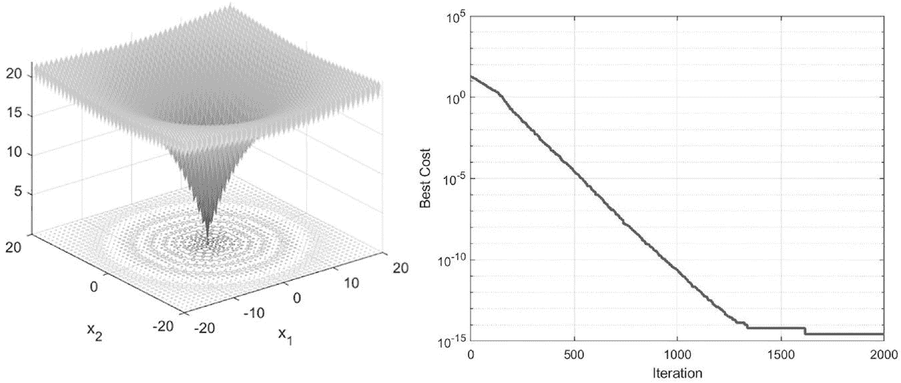

图 2.1. 使用差分进化算法 Ackley 函数近似

## 参考文献

* Alavi, M. and Henderson, J. C. (1981). 一种用于决策支持系统的进化策略。《Management Science*, 27(11): 1309–1323。
* Back, T. (1996). 《理论与实践中的进化算法：进化策略、进化规划、遗传算法》。牛津大学出版社。
* Baker, B. M. and Ayechew, M. A. (2003). 用于解决车辆路径问题的遗传算法。《Computers & Operations Research*, 30(5): 787–800. doi:[`doi.org/10.1016/S0305-0548(02)00051-5`](https://doi.org/10.1016/S0305-0548(02)00051-5)。
* Baker, J. E. (1985, 7 月). 遗传算法的自适应选择方法。载：遗传算法及其应用国际会议论文集（第 1 卷）。
* Berger, J. and Barkaoui, M. (2004). 求解带时间窗车辆路径问题的并行混合遗传算法。《Computers & Operations Research*, 31(12): 2037–2053。
* Coelho, L. S. and Mariani, V. C. (2006). 混沌差分进化与二次规划结合用于带阀点效应的经济调度优化。《IEEE Transactions on Power Systems*, 21(2): 989–996. doi:[10.1109/TPWRS.2006.873410](http://doi.org/10.1109/TPWRS.2006.873410)。
* Deb, K. and Agrawal, R. B. (1995). 适用于连续搜索空间的模拟二进制交叉。《Complex Systems*, 9(2): 115–148。
* Deb, K. and Deb, D. (2014). 实数参数遗传算法的变异方案分析。《International Journal of Artificial Intelligence and Soft Computing*, 4(1): 1–28。
* Deep, K. and Thakur, M. (2007). 一种实数编码遗传算法的新变异算子。《Applied Mathematics and Computation*, 193(1): 211–230。
* Dey, D. K. (2014). 带有变异和交叉概率的自适应遗传算法（AGA）的数学研究。《Compusoft*, 3(5): 765。
* dos Santos, G. S., Luvizotto, L. G. J., Mariani, V. C. and Coelho, L. d. S. (2012). 基于混沌差分进化方法的调优最小二乘支持向量机应用于热过程识别。《Expert Systems with Applications*, 39(5): 4805–4812. doi:[`doi.org/10.1016/j.eswa.2011.09.137`](https://doi.org/10.1016/j.eswa.2011.09.137)。
* Eshelman, L. and Schaffer, J. D. (1993). 实数编码遗传算法与区间模式。pp. 187–202.载：遗传算法基础（第 2 卷）。
* Ferentinos, K. P. and Tsiligidis, T. A. (2007). 使用遗传算法的无线传感器网络自适应设计。《Computer Networks*, 51(4): 1031–1051。
* Goldberg, D. E. and Deb, K. (1991). 遗传算法选择方案的对比分析。pp. 69–93.载：遗传算法基础。
* Holland, J. (1975). 《自然与人工系统中的适应性：应用于生物、控制和智能的介绍性分析》。密歇根大学大学。
* Lamini, C., Benlima, S. and Elbekri, A. (2016). 变适应交叉和变异概率的自适应遗传算法遗传,,,,,,,,,,,,,,,,,,,,,......22222221111111111111..11..       11111..........111..111/.0005.05.8(02)00051.5](https...org/10.1016/1000.005480020000115。
* Baker, J. E. (1985, 7 月). 遗传算法的自适应选择方法。载：遗传算法及其应用国际会议论文集（第 1 卷）。
* Berger, J. and Barkaoui, M. (2004). 求解带时间窗车辆路径问题的并行混合遗传算法。《Computers & Operations Research*, 31(12): 2037–2053。
* Coelho, L. S. and Mariani, V. C. (2006). 混沌差分进化与二次规划结合用于带阀点效应的经济调度优化。《IEEE Transactions on Power Systems*, 21(2): 989–996. doi:[10.1109/TPWRS.2006.873410](http://doi.org/10.1109/TPWRS.2006.873410)。
* Deb, K. and Agrawal, R. B. (1995). 适用于连续搜索空间的模拟二进制交叉。《Complex Systems*, 9(2): 115–148。
* Deb, K. and Deb, D. (2014). 实数参数遗传算法的变异方案分析。《International Journal of Artificial Intelligence and Soft Computing*, 4(1): 1–28。
* Deep, K. and Thakur, M. (2007). 一种实数编码遗传算法的新变异算子。《Applied Mathematics and Computation*, 193(1): 211–230。
* Dey, D. K. (2014). 带有变异和交叉概率的自适应遗传算法（AGA）的数学研究。《Compusoft*, 3(5): 765。
* dos Santos, G. S., Luvizotto, L. G. J., Mariani, V. C. and Coelho, L. d. S. (2012). 基于混沌差分进化方法的调优最小二乘支持向量机应用于热过程识别。《Expert Systems with Applications*, 39(5): 4805–4812. doi:[`doi.org/10.1016/j.eswa.2011.09.137`](https://doi.org/10.1016/j.eswa.2011.09.137)。
* Eshelman, L. and Schaffer, J. D. (1993). 实数编码遗传算法与区间模式。pp. 187–202.载：遗传算法基础（第 2 卷）。
* Ferentinos, K. P. and Tsiligidis, T. A. (2007). 使用遗传算法的无线传感器网络自适应设计。《Computer Networks*, 51(4): 1031–1051。
* Goldberg, D. E. and Deb, K. (1991). 遗传算法选择方案的对比分析。pp. 69–93.载：遗传算法基础。
* Holland, J. (1975). 《自然与人工系统中的适应性：应用于生物、控制和智能的介绍性分析》。密歇根大学大学。
* Lamini, C., Benlima, S. and Elbekri, A. (2016). 变适应交叉和变异概率的自适应遗传算法遗传,,,,,,,,,,,,,,,,,,,,,,.22222222221111111111111111111111111......111111111111111111111111111111111111111111111111111111111111111111111111111111111.1111111111111111111111111111111111111111111111111111111111111111111111111111111111.1111111111111111111111111111111111111111111111111111111111111111111111111111111111.1111111111111111111111111111111111111111111111111111111111111111111111111111111111.1111111111111111111111111111111111111111111111111111111111111111111111111111111111.1111111111111111111111111111111111111111111111111111111111111111111111111111111111.1111111111111111111111111111111111111111111111111111111111111111111111111111111111.
* Lu, Y., Zhou, J., Zhang, Y. (2011). 用于带阀点效应的经济调度的混沌进化方法。《Engineering Applications of Artificial Intelligence*, 24(2): 378–387. doi:[`doi.org/10.1016/j.engapp.2010`](https://doi.org/10.1016/j.engapp.2010)。
* May, A. (2015). 遗传算法对无线传感网络的优化。pp. 1–5.载：2018 电力、计算机与技术国际会议。
* Negitsky, M. (2005). 使用遗传算法的无线传感器网络自适应设计。《遗传算法》。IEEE。
* Rechenberg, I. (1965). 求解移动问题的自适应方法。《Cybernetics*, 12.
* Rodriguez, A., Falcar, P. and Ordonez, A. (2015). 遗传算法求解车辆路径问题的改进方法。pp. 470–474.载：2015 SAI 智能（IntelliSys）。
* Sahay, K., Sonkar, A. and Kumar, A. (2018). 遗传算法进行电力调度。载：2018 绿色可持续发展国际会议（ICUE）。
* Schwefel, H. P. (1981). 《数值优化》。约翰·威利出版社。
* Schwefel, H. P. (1995). 《进化与寻求最优》。约翰·威利出版社，纽约。
* Singh, G. and Gupta, N. (2022). 遗传算法中的交叉算的研究。《自然启发工业优化前沿》，Springer。pp. 17–32。
* Srinivas, M. and Patnaik, L. M. (1994). 遗传算法中的自适应交叉和变异。《IEEE Transactions on Systems, Man, and Cybernetics*, 24(4): 656–667。
* Storn, R. (1996, 6 月). 使用差分进化进行优化。pp. 519–523.载：北美模糊处理国际会议。
* Storn, R. and Price, K. (1997). 连续空间全局优化的简单高效差分进化算法。《Journal of Global Optimization*, 11(4): 341–359。
* Wolpert, D. H. and Macready, W. G. (1997). 优化的无免费定理。《IEEE Transactions on Evolutionary Computation*, 1(1): 67–82。
* Wu, Q. H., Cao, Y. J. and Wen, J. Y. (1998). 使用自适应遗传算法进行无功功率调度。《International Journal of Electrical Power & Energy Systems*, 20(8): 563–569. doi:[`doi.org/10.1016/S0142–0615(98)00016–7`](https://doi.org/10.1016/S0142%E2%80%930615\(98\)00016%E2%80%937)。
* Wu, X. (2019, 7 月). GA-SVM 模型中交叉概率和变异概率的影响。pp. 1–7.载：2019 IEEE 第九届电子信息与应急通信国际会议（ICEIEC）。IEEE。


本章致力于介绍粒子群优化的理论基础、最新的 PSO 算法进展、神经网络优化方法以及说明性示例。文中介绍了标准的生物启发粒子群算法，并解释和分析了 PSO 算法的一些重要变体，例如：带有 delta 势阱和谐振子的量子 PSO 算法、混沌 PSO、基于变异的 PSO 以及多目标 PSO。讨论了粒子群优化的高级方面和变体，如：种群拓扑、边界处理、种群初始化技术、停止标准和种群变异算子，为读者提供了 PSO 算法及其最新变体的完整介绍。此外还展示了关于单峰、多峰、凸和非凸函数近似的说明应用示例。

## 粒子群优化算法

粒子群优化（`PSO`）最初由 Eberhart 和 Kennedy 于 1995 年提出（Eberhart and Kennedy, 1995）。`PSO` 算法的灵感源于对自然界动物群行为的研究。自然的社会智能技术被适当转化，以开发出一种计算优化算法。粒子群优化是一种具有随机性的演化算法，种群粒子通过遍历预定义的搜索空间来评估适应度函数。每个种群粒子由其位置和速度表描述。

每个粒子的速度根据以下方程更新（Eberhart, 1995; Eberhart et al., 2001）：

(3.1)

```
vi = w*vi + c[i]r[1]x_ibest[i-xi] + c[2]r[2]gbest(t)-x[i]
```

其中，

- `t` 代表时间
- `vi` 表示时间 `t` 时的粒子速度
- `vi` 表示时间 `t+1` 时的粒子速度
- `xi` 表示时间 `t` 时的粒子位置
- `x_ibesti` 表示截至时间 `t` 粒子的个体最优目标值解
- `r[1]`, `r[2]` 代表在 (0,1) 区间内均匀分布的随机数
- `gbest(t)` 表示截至时间 `t` 种群的全局最优目标值解
- `c[1]` 表示个体学习的系数参数
- `c[2]` 表示全局学习的系数参数
- `w` 表示惯性权重参数

此外，下个时间步 `t+1` 的粒子位置通过以下方程计算：

(3.2)

```
xi = xi + vi
```

标准粒子群优化算法包含以下基本步骤：

1. 初始化过程：
    1. 初始化粒子群种群
    2. 初始化粒子拓扑和位置
    3. 初始化粒子速度
    4. 评估每个粒子的适应度函数并初始化全局最优解
2. 执行以下步骤直到满足算法的停止标准：
    1. 在空间 (0,1) 内随机设置系数值 `r[1]`、`r[2]`
    2. 根据方程 (1) 更新粒子速度
    3. 根据方程 (2) 更新粒子位置
    4. 评估每个粒子的适应度函数
    5. 如果粒子的个体最优更好，则更新当前个体最优
    6. 如果种群全局最优更好，则更新当前全局最优
3. 停止算法过程并显示全局最优解

### 超参数

### 加速系数

个体学习和全局学习的系数 `c[1]` 和 `c[2]` 也称为加速系数。这些系数与方程 (1) 中的随机参数 `r[1]` 和 `r[2]` 结合，以控制认知和社会影响。`c[1]` 表示个体学习量，`c[2]` 表示社会学习量。在标准 `PSO` 中，`c[1]` 和 `c[2]` 通常被设置为常数。然而，Chen 等人 (2014) 提出了自适应加速系数。`c[1]` 通过应用以下公式从 `c[1]i` 初值减到 `c[1]f` 最终值：

(3.3)

```
c[1] = (c[1]f - c[1]i) * t / t_max
```

(3.4)

```
c[2] = (c[2]f - c[2]i) * t / t_max
```

注：此处为误，`t` 代表当前迭代次数，`t_max` 代表最大迭代次数。

### 惯性权重

惯性权重用于控制粒子的飞行速度。当粒子速度很大时，可能会跳过最优解；另一方面，当粒子速度很慢时，种群收敛缓慢且容易陷入局部。Van Bergh 和 Engel (2006) 证明所有大于临界值的惯性权重都能保证种群收敛。该临界值通过方程计算：

(3.5)

```
w > (c1 + c2) / 2
```

最初，在整个搜索空间优化中使用静态惯性权重。后来许多研究人员提出了自适应或动态变化的惯性权重。例如 Shi 和 Eberhart (1998) 提出了另一种类型的惯性权重，称为变时惯性权重。提出的权重随时间减小，实验结果显示标准 `PSO` 的性能显著提高。Tian (2021) 提出了一种由以下公式的自适应惯性权重：

(3.6)

```
omega = { omega_min - (omega_max - omega_min) * exp(-n * (f - f_min)), f <= f_avg; omega_max, f > f_avg }
```

其中，

- `n` 是迭代次数
- `f` 代表当前的适应度值
- `f_avg` 代表所有粒子的平均适应度值。

Chen 等人 (2014) 提出了另一种自适应惯性权重，其权重值在迭代过程中减小。这种方式 `PSO` 算法可以在局部搜索空间探索特定区域。惯性权重 `wt` 通过以下方程计算：

(3.7)

```
wt = wt_min + (wt_max - wt_min) * (t_max - t) / t_max
```


`wt[max]` 是一个预定义的最大惯性权重值。
`wt[min]` 代表一个预定义的最小惯性权重值。
`t` 是算法的当前迭代次数。
`t[max]` 是最大迭代次数。

## 停止准则

在本节中，将探讨 PSO 算法的停止准则。停止准则是为了满足群体收敛时终止 PSO 算法的特定条件。停止准则如下。

### 最大代数
当迭代次数达到预定义的最大数量时，算法执行停止。

### 最大停滞时间
当适应函数的最佳值在最后预定义的最大停滞时间（例如，秒）内没有变化时，该条件强制 PSO 算法执行停止。

### 最大运行时间
当达到预定义的最大运行时间（例如，秒）时，算法执行停止。

### 最佳适应度值
当适应函数的值达到预定义的最佳值时，算法执行停止。

### 种群收敛
当种群中所有粒子的最大值与最小值之间的差值小于容差限制值时，该准则停止算法执行。

### 适应度收敛
当最大适应度值与最小适应度值之间的差小于容差限制值时，该准则停止算法执行。

图 3.1 展示了群体粒子如何在搜索空间中遍历以寻找目标函数的最佳值的示例。

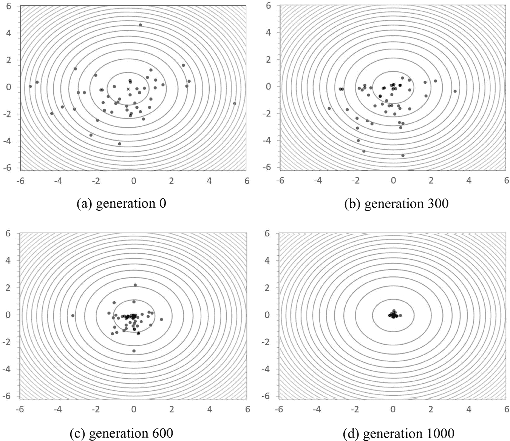

图 3.1. 用于最小化 rastrigin 函数的 PSO 算法示例。群体粒子遍历搜索空间以最小化目标函数。种群规模被设置为 200。

## 群体拓扑结构

在本节中，将讨论最重要的几种 PSO 拓扑结构。群体拓扑是影响群体收敛的一个非常重要的因素。讨论的群体拓扑包括静态拓扑，它们在优化过程中不会发生改变，例如：全局或全连接拓扑、局部或环形拓扑、冯·诺依曼拓扑、星形拓扑、网格拓扑、随机拓扑、树形或分级拓扑，以及在收敛过程中发生变化的动态拓扑，例如：多环和族拓扑。

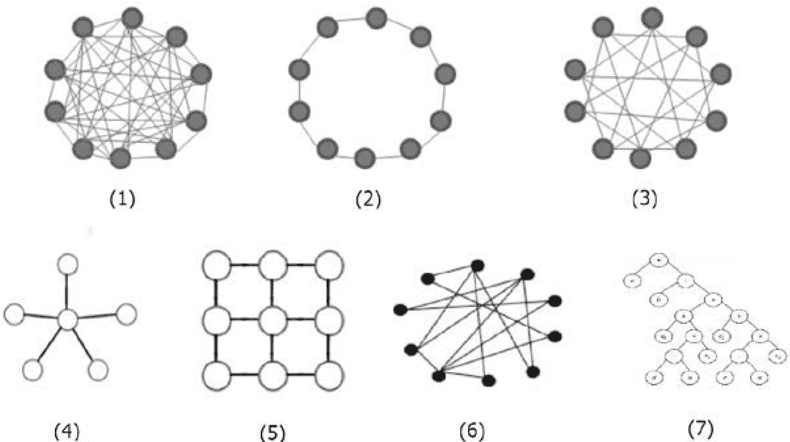

图 3.2. 群体拓扑结构插图：(1) 全局或全连接(2) 环形(3) 冯·诺依曼(4) 星形(5) 网格(6) 随机(7) 树形或分级。

### 全局或全连接
在全局拓扑中，群体个体是全连接的。每个粒子都与其他所有粒子连接并交换信息。因此，在这种结构中，与其他拓扑相比，可以更快地收敛，因为群体中的粒子可以更快地与所有粒子通信以找到全局最佳解，但收敛过程可能会陷入局部最优。

### 局部或环形拓扑
环形群体拓扑对应于 PSO 的局部最佳架构。在这种结构中，每个个体粒子与它的 `N` 个相邻邻居粒子相互作用。这意味着每个个体粒子仅在自己的邻域内局部地搜索最佳目标值。当 `N` = 2 时，如环形拓扑图所示，有两个相邻邻居粒子。在这种拓扑中，一个局部邻域可能收敛到不同的局部最优，而另一个局部邻域可能仍在搜索最佳局部解。这种结构的优势在于能够同时探索全局搜索空间中不同的局部搜索空间 (Kennedy and Mendes, 2002)）。

### 冯·诺依曼
在冯·诺依曼拓扑中，每个群体粒子与四个个体粒子通信，即前两个和后两个粒子。一些研究表明，这种拓扑与其他拓扑相比，可以产生更好的结果 (Bratton and Kennedy, 2007; Kennedy and Mendes, 2002)）。

### 星形拓扑
在星形拓扑中，个体粒子的通信仅通过一个粒子完成。这个中心粒子受到所有其他群体粒子的影响。星形结构会导致粒子隔离，因为所有关于最佳目标值的信息都通过中心群体粒子进行交换。中心粒子产生并比较每个群体粒子的局部最佳，并调整其新的最佳位置。

### 网格拓扑
在这种拓扑中，一个群体粒子连接到四个邻居粒子。位于边缘的群体粒子与两个相邻的群体粒子连接。这意味着存在重叠的粒子邻居，这在收敛过程中产生了冗余。群体粒子的网格架构在算法执行过程中保持不变。

### 随机拓扑
在随机拓扑中，群体个体与随机数量的其它群体粒子连接。每个粒子仅与其连接的粒子建立连接并交换信息。这种结构在整个收敛过程中都不会改变。

### 树形或分级拓扑
在分级或树形拓扑中，群体粒子具有分级结构。此外，还有一个中心粒子在顶层充当根节点的作用，它与层次结构中下一层次的粒子连接。树形拓扑类似于二叉树架构。根粒子在群体中随机选择，并搜索层次结构中下一层所获得的最佳解。

### 动态或自适应拓扑
之前所有的拓扑都是静态的，因为它们在所有优化过程中无法更改。另一类拓扑是基于动态模式的。最近提出了动态拓扑。其中一些是：多环和族拓扑。多环拓扑 (Bastos-Filho et al., 2008) 由层叠的多个层组成，每层都是环形拓扑。族拓扑 (Carvalho et al., 2009) 将粒子群分为称为“族”的子群体，每个族都有全连接架构。此外还有其他自适应拓扑，例如：自适应种群 PSO (Almasi and Khooban, 2018)、互补量子群 (Yin et al., 2011)、随机星形 PSO (Miranda et al., 2008)。

## 边界处理方法

在本节中，将讨论影响 PSO 算法性能的若干边界处理方法。这些技术非常重要，因为它们可以限制群体粒子在预定义搜索空间内的移动 (Helwig et al., 2013; Mostaghim et al., 2006; Padhye et al., 2013)）。因此，这些方法可以帮助算法更快地收敛到全局解。

### 双曲法
在这种技术中，群体粒子无法离开可行空间 (Clerc, 2006)。这是通过根据公式归一化群体粒子的速度来实现的：

```
(3.8)
```


$$v_{i,j}^{t + 1} = \left\{ \begin{matrix} \frac{v_{i,j}^{t + 1}}{1 + \left| {v_{i,j}^{t + 1}/\left( {X_{\max} - x_{i,j}^{t}} \right)} \right|} & {whenv_{ij}^{t + 1} > 0} \\ \frac{v_{i,j}^{t + 1}}{1 + \left| {v_{i,j}^{t + 1}/\left( {x_{i,j}^{t} - X_{\min}} \right)} \right|} & {whenv_{ij}^{t + 1} \leq 0} \\ \end{matrix} \right.$$  

其中，`X[max]` 和 `X[min]` 参数表示第 `jth` 维度的上界和下界。新的归一化粒子速度确保了新的群粒子位置，使其不会超出边界。该方法限制了群粒子在可行空间内的速度，且收敛更快。

### 无穷边界或不可见墙

在该方法中，唯一的修改是个人最优和全局最优粒子位置应处于搜索空间内 (Bratton and Kennedy, 2007; Robinson and Rahmat-Samii, 2004)。这意味着，如果粒子离开搜索空间，它们的局部和全局最优吸引器将在搜索边界内。无穷技术不修改粒子的速度或位置，且作为一个序列，该算法不受边界处理方法的影响。

### 最近边界或边界或吸收

在这种技术中，违反边界的群粒子将被移回被违越参数的边界。应用此方法的结果是，群粒子将被移动到靠近搜索空间边界的问题解附近。

### 随机性

在该方法中，如果粒子超出边界，则将其位置在问题搜索空间内的有效位置均匀地重新初始化。通过这种方式，通过将粒子随机放置在其他情况下不太可能放置的位置，增加了群粒子解的多样性。

### 随机-半

在该方法中，如果粒子超出边界，则将其位置均匀地重新初始化为靠近被违越点的一半搜索空间内的有效位置。

### 周期性

该方法提供了一个无限空间，其中包含了原始搜索空间的周期性拷贝 (Zhang et al., 2004)。每个违反边界的粒子都被放置在由原始空间拷贝组成的位置。周期性技术处理粒子变量，并允许粒子从其离开的对面再次进入搜索空间。与基于变的边界处理方法等传统方法相比，该方法具有消除粒子群无组织性的优势。采用周期性边界处理方法的粒子群优化性能与随机和边界方法相比显示出改进的结果，特别是当局部最优位于靠近边界时。

### 指数型

该方法通过将群粒子放置在之前的粒子位置和被违越边界的位置之间，对每个维度上的粒子位置参数进行修正 (AlvarezBenitez et al., 2005)。新位置通过实现截断指数分布来定义，以增加放置在靠近边界位置的概率。与随机和随机-半方法相比，指数方法保留了关于边界附近最优解搜索数据。

### 变异

该方法包含一种变异，可以扰动被违越的粒子参数，以便放回问题搜索区域。

### 反射方法

在反射技术中，被违越的粒子参数的位置被反射到搜索空间中更近的边界。在反射位置处，可以使用几种方法在违规变量中设置新速度：

*   未修改的速度
*   速度设置为零
*   根据方程调整的速度：`Velocity adjusted according to the equation:`

### 随机阻尼

Huang (2005) 在粒子群优化中提出了一种阻尼方法。当群粒子违反边界时，速度被部分吸收并部分反射。这种方式粒子被强制返回有效空间。

## 带变异的 PSO

在标准 PSO 算法中没有变异参数，文献中的许多研究人员提出的 (arzadeh and Naghchi, 2015; Lin and Zhang, 2017; Stacey et al., 2003) 有助于克服局部最优。在本节中，讨论了通过添加变异策略改进标准 PSO 的方法。

### 高斯变异 PSO

Higashi and Iba (2003) 应用了一种变异算子，通过使用高斯分布的随机数改变粒子群维度。改变粒子位置 `x[id]` 的方程为：

*   `mutate(x[id]) = xid`

其中，

*   `σ` 代表标准差
*   `gaussian(σ)` 代表函数

### 卡方变异

Stacey et al. (2003) 通过实现卡方分布 提出了一种类似的变异算子。卡方变异应用于全局最优值。一维卡方概率密度函数为：

(3.9)
$$f(x) = \frac{t^{2}}{\pi(x^{2} + t^{2})}, -\infty < x < \infty$$

其中 `t` 是正数参数。卡方累积分布函数为：

(3.10)
$$F_{t}(x) = \frac{1}{2} + \frac{1}{\pi}\left( \frac{x}{t} \right)$$

卡方分布的形状与高斯分布相似，但尾部概率更大。`x[id]` 维度通过方程更新：

(3.11)
`mutate(x[id]) = x[id]+cauchy(a)`

其中 `a` 代表一个类似于高斯分布 `σ` 参数的参数。

### Michalewicz 非均匀变异

Esquivel and Coello (2003) 研究了 Michalewicz 开发的用于遗传算法的非均匀变异算子 (Michalewicz, 1998; Dasgupta and Michalewicz, 2013)。Michalewicz 的非均匀变异算子非均匀地使用随机数变异值，当 PSO 算法陷入局部最优且正在优化高度多峰函数时非常有用。在 Michalewicz 的非均匀算子中，粒子位置维度 `x[id]` 使用以下方程变异：

(3.12)
$$mutate(x_{id}) = \left\{ \begin{matrix} {x_{id} + delta(it,U - x_{id})}:rb = 1} \\ {x_{id} + delta(it,U - x_{id})}:rb = 1} \\ \end{matrix} \right.$$$$

其中，

*   `it` 描述迭代次数
*   `U` 表示上界
*   `L` 表示下界
*   `rb` 生成的随机位
*   `delta (t,y)` 通过方程计算：

(3.13)
`delta(t,y) = y*(1-r^((1-t/T)^b))`


其中 `r` 代表范围在 `[0,1]` 内的随机生成数，`T` 是算法的最大迭代次数，`b` 代表一个通常设置为值 5 的参数（Michalewicz, 1998）。

### 带有 Michalewicz 变异的混沌 PSO

在基于混沌理论改进的种群优化算法中，基本应用技术是使用混沌参数来代替 PSO 算法中常用的随机变量。Assarzadeh 和 Naghsh-Nilchi (2015) 提出将变异方法应用于用于分类问题的混沌粒子群优化中。该研究提出了一种实现，通过结合 Michalewicz 的非均匀变异，将逻辑映射（logistic maps）实现为混沌序列。在这项研究中，PSO 中的随机参数被逻辑映射生成的混沌序列所取代。随机参数由逻辑映射混沌方程给出：

(3.14)

`Cr[(*t* + 1)] = kCr(*t*)])`

其中 `n = 0,1,2,3...` 且 `k = 4`。`Cr(t)` 参数由混沌逻辑映射的 `k` 参数控制。考虑到上述假设，混沌粒子群优化的粒子速度更新方程可以表示为：

(3.15)

`v*i* = w v*i* + c[1]C[*r*]PBest(*t*)−x[*i*] + c2 + c2GBest(*t*)−x[*i*]`

研究最终结果显示，带有 Michalewicz 变异的混沌 PSO 在高维空间中作为全局搜索优化算法具有改进的性能。

### 随机变异 PSO

在这种变异中，算符使用范围内（Andrews, 2006）内的随机均匀生成值来初始化粒子群的位置。

### 恒定变异 PSO

在此类变异中，变异率在优化迭代过程中保持不变。

### 停滞变异

当粒子种群的全局最优在固定次数的迭代中保持不变时，应用这种变异。

### 量子 PSO

量子 PSO (QPSO) 于 2004 年引入（Sun 等，2004）。量子行为 PSO 是标准 PSO 算法的一种非常有趣的变体。QPSO 算法在 PSO 算法中引入了量子力学。在经典力学中，种群粒子由粒子中粒子位置 `x[i]` 和速度 `v[i]` 的向量定义。在量子力学中，由于不确定性原理，粒子的位置 `x[i]` 和速度 `v[i]` 无法同时被定义（Sun 等，2011）。因此，在量子系统中，PSO 粒子将具有量子行为，这意味着粒子将根据其状态而非其位置和速度来定义。种群粒子的状态通过使用量子力学的波函数 `ψ(x,t)` 来表示。在 QPSO 算法中，种群是一个量子系统，每个粒子由一个量子态识别。在接下来的章节中，将讨论两种量子 PSO 算法：Delta 阱量子 PSO 和谐波量子 PSO。

### Delta 阱量子 PSO

在 Delta 阱 PSO 原理（Sun 等，2011）中，种群粒子向一维势阱中的位置 `p` 移动。势阱场由方程表示：

(3.16)

$$V(x) = \left\{ \begin{matrix} \infty & {if\ x\ is, 0} \\ 0 & {if\ x\ \neq, 0} \end{matrix} \right.$$

通过求解一维势阱中的薛定谔方程，可以找到概率密度函数。

(3.17)

$$D(x_{i,j}(t + 1))\frac{1}{L_{i,j}(t)}e^{- 2|P_{i,j}(t) - x_{i,j}(t + 1)|/L_{i,j}(t)}$$

(3.18)

`F(*x*i* + 1)) = e^(−2|...|)/*L*](*t*))`

其中，

* `D` 代表归一化概率密度函数
* `L(t)` 代表特征阱长度

然后根据蒙特卡洛方法（Sun 等，2011）找到粒子位置：

(3.19)

$$\left\{ \begin{matrix} x_{i}(t + 1) = p_{i} + \beta.|Pbest_{i} - x_{i}(t)|.\ln(1/u)} \\ x_{i}(t + 1) = p_{i} + \beta.|Pbest_{i} - x_{i}(t)|.\ln(1/u)} \end{matrix} \right.$$ 

* `β` 是收缩-扩张参数
* `u` 是 `[0,1]` 内的随机数
* `Pbest[i]` 是 `pbest` 的平均值
* `p[i]` 是第 i 个粒子的最优位置

种群的全局平均粒子 `Pbest` 由所有粒子最优值的平均值表示：

(3.20)

$$Pbest_{i} = \frac{1}{N}\sum_{k=1}^{N}p_{k}(t)$$

其中 `k` 是 `N` 个粒子种群中的最优粒子索引。

Delta 阱量子 PSO 算法包括以下步骤：

* **步骤 1.** 种群初始化搜索空间中的随机粒子位置。
* **步骤 2.** 适应度函数评估。
* **步骤 3.** 个人最优值的比较。如果当前适应度值更好，则将个人最优值设置为搜索空间中的当前适应度值。
* **步骤 4.** 将当前全局最优与之前的全局最优比较。如果当前值更好，则将其设置为全局最优。
* **步骤 5.** 根据相关方程估计 `Pbest` 更新全局最优点。
* **步骤 6.** 更新粒子位置。
* **步骤 7.** 重复步骤 2 直到达到停止标准（例如最大迭代次数）。

### 谐波量子 PSO

提出了几种势场。在谐波量子 PSO（Sabat 等，2010）中，利用谐振子作为势场。在谐波势分布中，一维势阱中种群粒子的势能由方程表示：

(3.21)

$$V(x) = \frac{1}{2}kx^{2}$$

其中，`k` 代表谐深。

`D` 概率密度函数由方程给出：

(3.22)

`D(x)=|ψ(x)|[2]=Lexp(-0.5\alpha²x²)`

(3.23)

$$L = \frac{\alpha}{\sqrt{\pi}}$$

其中 `L` 是特征阱长度。可以使用方程（Sabat 等，2010）找到新的量子粒子位置：

(3.24)

$$x_{i,j}(t + 1) = p_{i.j}(t) \pm \alpha.\frac{1}{0.4769g}\left {x_{i,j}(t) - mpbest_{j}(t)} \right|\sqrt{\ln\frac{1}{u}}}$$

其中，

* `mpbest` 是粒子种群平均最优
* `g` 是一个设置为 2.0 的参数

同样，对于 Delta 阱量子 PSO，实现涉及蒙特卡洛方法。谐波 QPSO 算法的实现与 Delta 阱量子 PSO 。

### 多目标 PSO

具有多个冲突目标的多目标优化问题可以定义如下：

(3.25)

`minimize F(x) = (f1, f2,....fm)^T`

(3.26)

`subject to x ∈ Ω`

其中 `Ω` 代表可行集，满足：

(3.27)

$$\Omega \subseteq \mathbb^n \neq \emptyset$$

和

(3.28)

$$f[i]:\mathbb^n\to\mathbb R$$ 代表 `m` 个目标函数，对于 `i = 1, 2, . . , m`，且 `m ≥ 2`。目标空间是可行集的像：

(3.29)

`y = {F(x)\in\mathbb^m:x\in\Omega}`


集合 `R^n` 和 `R^m` 分别代表`决策空间`和`目标空间`。

在多目标优化问题中，支配定义了解的优劣程度。支配的概念通俗地解释为：当目标函数向量 `f` 满足以下条件时，点 `x` 支配另一个点 `y`：

(3.30)

```
fi ≤ fi for all i
```

(3.31)

```
fj ≤ fj for some j
```

## 支配概念

在解集 `P` 中，一组非支配的解（点）的集合代表了解集 `P` 中的解集 `Q`，这些解不被 `P` 中的任何其他解所支配。

如果不存在其他粒子解 `x` 满足以下条件，则粒子解 `x′` 代表一个非支配解：

(3.32)

```
fi ≤ fi for all i = 1, ..., m
```

并且至少存在一个索引 `i` 使得：

(3.33)

```
fi ≤ fi
```

在给定的群粒子解集中，非支配解集代表了不被该集中任何其他解所支配的所有群粒子解。整个可行决策空间的非支配集代表了群粒子的帕累托最优集。由帕累托最优集映射的所有点（解）确定的决策边界代表帕累托最优沿（Deb, 2011）。

在多目标问题中，当一个解不被另一个解支配时，它是帕累托最优解。发现的非支配粒子解存储在外部全局内存或库中。多目标 PSO 算法（Coello and Lechuga, 2002; Coello et al., 2004）的步骤如下：

1. 初始化粒子群位置 `POPi`，其中 `i = [1, 2,...,N]`，`N` 代表粒子群规模。
2. 初始化每个群粒子的速度 `VELi`。
3. 评估 `POPi` 中的每个群粒子。
4. 将表示非支配解的粒子位置保存到库（`REP`）中。
5. 生成目前的搜索空间超立方体，并使用它们定位群粒子，每个群粒子都以其目标函数作为坐标。
6. 初始化每个粒子内存并将其保存在库中作为目前为止发现的最佳粒子位置。
7. 使用方程估计每个粒子的新速度：

(3.34)

```
VELi = w*VELi + c[1]*r1*(POPi,pbest-POPi) + c[2]*r2(REPh-POPi)
```

其中 `w` 代表惯性权重，`r[1]` 和 `r[2]` 代表范围 `[0,1]` 内内的随机数，`POP[i,pbest]` 代表群粒子 `i` 的最佳位置，`REP[h]` 代表从库中取出的索引为 `h` 的值。通过轮盘赌选择选择群粒子所属的超立方体。然后从选定的超立方体中随机选择一个群粒子。`POP[i]` 代表群粒子的当前适应度值。
8. 使用方程估计每个粒子的新位置：

(3.35)

```
POPi = POPi + VELi
```

9. 将群粒子维持在搜索空间内，以防超出边界。
10. 评估 `POP[i]` 中的群粒子。
11. 通过添加当前非支配解来更新 `REP` 中存储的值以及超立方体内的坐标。当库空间满时，低密度区域的群粒子比高密度区域的群粒子具有更高的优先级。
12. 当当前位置通过帕累托支配关系优于内存中的粒子位置时，使用方程更新内存中每个粒子的个人最佳位置：

(3.36)

```
POPi,pbest
```

13. 如果满足终止条件，则停止。

## 几何 PSO

几何 PSO（GPSO）与标准 PSO 在以下几个方面不同：
- 没有速度。
- 位置的更新基于交叉算子。
- 算法使用几何交叉引导种群。

`w[1]`、`w[2]` 和 `w[3]` 的凸组合组合：
- **凸性权重**：`w[1]`、`w[2]`、`w[3] > 0` 且 `w[1] + w[2] + w[3] = 1`。
- **凸性**：凸组合返回凸包内的点。
- **对称性**：当相同值赋值给 `w[1]`、`w[2]` 或 `w[3]` 时，效果是相同的。

系数 `w[1]`、`w[2]` 和 `w[3]` 代表：
- `w[1]`：对粒子的吸引力。
- `w[2]`：个人最佳（个人学习）。
- `w[3]`：全局最佳（全局学习）。

`w[1]`、`w[2]` 和 `w[3]` 使用方程：

(3.37)

```
w[1] + w[2] + w[3] = 1
```

非支配解通过计算：

(3.38)

```
w[1] + w[2] + w[3]
```

优化算法使用条件：

(3.39)

```
w[1] > 0
```
(Moraglio et al., 2007）。

## 神经网络优化中的 PSO

PSO 算法已应用于许多研究作为人工神经网络（ANN）优化器。在 ANN 中使用 PSO 的主要原因是其优于其他方法的优势：
- 它不需要梯度信息。
- 与其他技术相比，计算能力得到了提高。

### 作为权重优化器的 PSO

PSO 可以优化神经网络的多个参数。当通过 PSO 训练神经网络时，应该找到一个目标函数。最常用的目标函数是误差指标。例如，在回归问题中，可以使用神经网络的均方误差（MSE）、均方根误差（RMSE）或平均绝对误差（MAE）。

### 作为拓扑优化器的 PSO


PSO（粒子群优化算法）可用于优化神经网络的多个参数，例如隐藏神经元的数量。在这种情况下，每个粒子代表神经网络隐藏层中隐藏神经元的数量。需要为 PSO 设置目标函数。如上所述，最常用的目标函数是误差度量。恰当的是，在回归问题和分类问题中，可以使用多种误差指标作为目标函数（Zhang and Shao, 2000）。

根据多项研究，粒子群优化算法在人工神经网络优化方面的性能优于其他优化算法，例如遗传算法（Anand and Suganthi, 2020; Moayedi et al., 2019）、帝国主义竞争算法和人工蜂群算法（Koopialipoor et al., 2019），以及非支配排序遗传算法 II（NSGA-II）（（Anand and Suganthi, 2020; Nourbakhsh et al., 2011）。Koopialipoor et al. (2019 通过在人工神经网络中应用多种优化技术（如：帝国主义竞争算法、人工蜂群算法和粒子群优化）研究了安全系数的预测。实验结果表明，与其他优化算法相比，PSO 对人工神经网络（ANN）具有更好的优化能力。Nourbakhsh et al. (2011 研究了两种优化方法在数据处理组方法神经网络优化中的应用：PSO 和非支配排序遗传算法 II。经过 PSO 优化的神经网络的性能优于使用 NSGA-II 算法优化的神经网络。

## 群优化示例

本节阐明了 PSO 在凸优化和非凸优化中的一些示例应用，涉及函数近似。PSO 算法的实验设置被应用于凸、非凸、单峰和多峰函数上，例如：Sphere 函数、Griewank 函数、Ackley 函数、Schwefel 函数和 Rastrigin 函数。在所有实验中，选定的维度为 30。研究了具有不同加速度系数 `c[1]` 和 `c[2]` 值的若干粒子群架构。生成（迭代）次数设置为 1000。

### Sphere 函数

#### 数学方程

表示 Sphere 函数的方程如下：

(3.40)

$$f\left( x \right) = f\left( {x\_{1},x\_{2},....x\_{n}} \right) = {\\sum\limits\_{i = 1}^{n}x\_{i}^{2}}$$

#### 描述

Sphere 函数是：

* 连续。
* 凸。

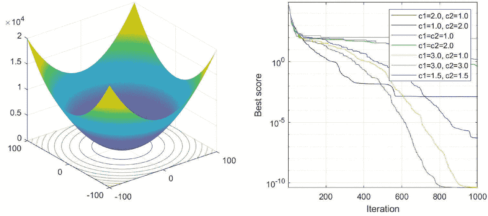

3.3a. Sphere 函数最小化。

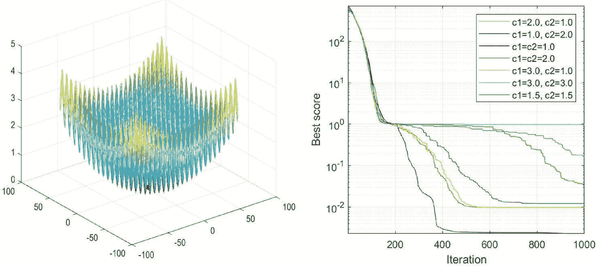

3.3b. Griewank 函数最小化。

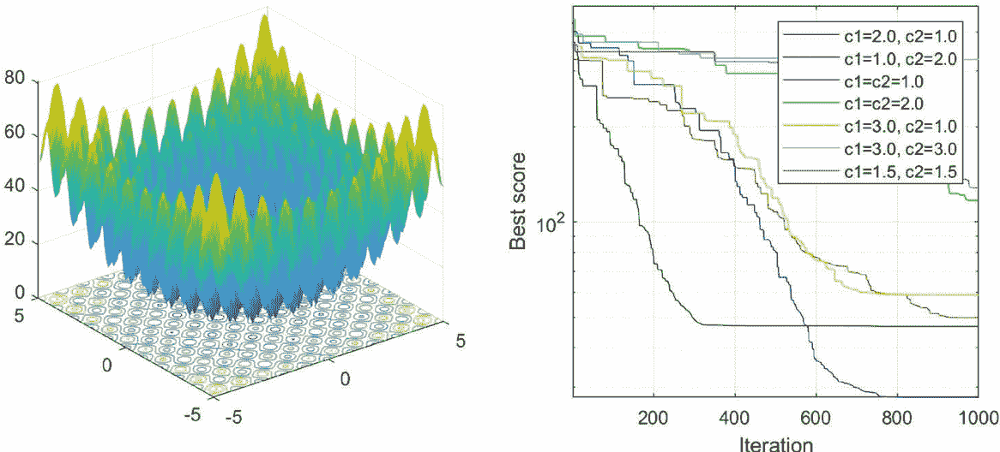

3.3c. Rastrigin 函数最小化。

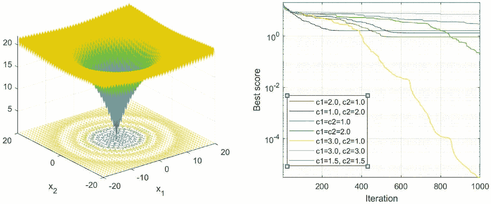

3.3d. Ackley 函数最小化。

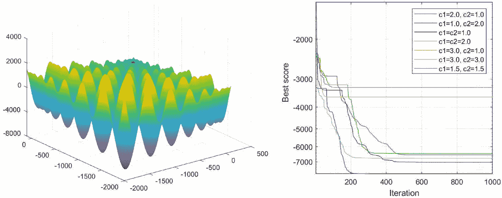

3.3e. Schwefel 函数最小化。

**图 3.3.** 通过测试不同架构由 PSO 最小化的基准函数。粒子遍历搜索空间以最小化函数。种群规模设置为 20。

* 单峰。
* 可微。
* *输入搜索空间*

该函数在 `xi` `[-5.12, 5.12]` 内评估，其中 `i = 1, 2, …, n`。

#### 全局最小值

`f(x\*) = 0`，`x\* = (0,…0)`。

#### 使用 PSO 进行函数近似

测试了多种 PSO 架构。当系数 `c[1] = 2.0` 且系数 `c[2] = 1.0` 时，获得了最佳优化结果，如图图 3.3 所示。

### Griewank 函数

#### 数学方程

表示 Griewank 函数的方程如下。

(3.41)

$$f\left( x \right) = f\left( {x\_{1},\\ldots,x\_{n}} \right) = 1 + {\\sum\limits\_{i = 1}^{n}{\frac{x\_{i}^{2}}{4000} - {\\prod\limits\_{i = 1}^{n}{\cos\left( \frac{x\_{i}}{\sqrt{i}} \right)}}}}$$

#### 描述

Griewank 函数是：

* 连续。
* 非凸。
* 单峰。
* 可微。

#### 输入搜索空间

该函数在 `xi` `[-600, 600]` 内评估，其中 `i = 1, 2, …, n`。

#### 全局最小值

`f(x\*) = 0`，`x\* = (0,…0)`。

#### 使用 PSO 进行函数近似

测试了多种 PSO 架构。当系数 `c[1] = 1.0` 且系数 `c[2] = 1.0` 时，获得了最佳优化结果，如图图 3.3 所示。

### Rastrigin 函数

#### 数学方程

表示 Rastrigin 函数的方程如下。

(3.42)

$$f(x) = 10d + {\\sum\limits\_{i = 1}^{d}\\left\\lbrack {x\_{i}^{2} - 10\cos\left( {2\pi x\_{i}} \right)} \\right\\rbrack}$$

其中 *d* 代表*维度*。

#### 描述

Rastrigin 函数是：

* 连续。
* 凸。
* 多峰。
* 可微。
* *输入搜索空间*

该函数在 `xi` `[-5.12, 5.12]]` 内评估，`i = 1, 2, . . . , n`。

#### 全局最小值

`x\* = (0,…0)`，`f(x\*) = 0`。

#### 使用 PSO 进行函数近似

测试了多种 PSO 架构。当系数 `c[1] = 3.0` 且系数 `c[2] = 1.0` 时，获得了最佳优化结果，如图图 3.3 所示。

### Ackley 函数

#### 数学方程

表示 Ackley 函数的方程如下。

(3.43)

$$f\left( {x\_{1},\\ldots,x\_{n}} \right) = a + \exp\left( -b\frac{1}{n}\sum\limits\_{i = 1}^{n}x\_{i}^{2} \right) - \exp\left( \dots \right) $$

其中 `a`, `b` 和 `c` 是实验中的常用值：`a=20`, `b=0.2` 和 `c=2π`。

#### 描述

Ackley 函数是：

* 连续。
* 非凸。
* 多峰。
* 可微。

#### 输入搜索空间

该函数在 `xi` `[-20, 20]` 内评估，`i = 1, 2, . , n`。

#### 全局最小值

`x\* = (0,…0)`，`f(x\*) = 0`。

#### 使用 PSO 进行函数近似

测试了多种 PSO 架构。当系数 `c[1] = 3.0` 且系数 `c[2] = 1.0` 时，获得了最佳优化结果，如图图 3.3 所示。

### Schwefel 函数

#### 数学方程

表示 Schwefel 函数的方程如下。

(3.44)

$$f(x) = - {\\sum\limits\_{i = 1}^{n}{x\_{i}\\sin\left( \\sqrt{\left x\_{i}} \\right)} \\right)}}$$

#### 描述

Schwefel 函数是：

* 连续。
* 非凸。
* 多峰。
* 不可微。

#### 输入搜索空间

该函数在搜索空间 `x[i]` `[-500, 500]` 内评估，其中 `i = 1, 2, …, n`。

#### 全局最小值

`f(x*) = –n•418.9829`，`x*(i) = 420.9687`。

#### 使用 PSO 进行函数近似

测试了多种 PSO 架构。当系数 `c[1] = 1.0` 且系数 `c[2] = 2.0` 时，获得了最佳优化结果，如图图 3.3 所示。

## 参考文献

* Almasi, O. N. and Khooban M. H. (2018). A parsimonious SVM model selection criterion for classification of real-world data sets via an adaptive population-based algorithm. Neural Computing and Applications, 30(11): 3421–3429.


*   Alvarez-Benitez, J. E., Everson, R. M. and Fieldsend, J. E. (2005). 一种完全基于 Pareto 支配概念的 MOPSO 算法。pp. 459–473. *In*: Coello Coello, C. A., Hernández Aguirre, A. and Zitzler, E. (eds.). EMO 2005. LNCS, vol. 3410. Springer, Heidelberg. [`doi.org/10.1007/978-3-540-31880-4_32`](https://doi.org/10.1007/978-3-540-31880-4_32).

*   Anand, A. and Suganthi, L. (2020). 基于混合 ANNPSO 模型的电力需求预测。pp. 865–882. In:. 深度学习与神经网络：概念、方法论、工具与应用，IGI Global。

*   Andrews, P. S. (2006). 粒子群优化变异算子的研究。IEEE 演化计算国际会议，加拿大温哥哥哥华，2006, pp. 1044–1051. doi: [`10.1109/CEC.2006.1688424`](https://doi.org/10.1109).

*   Assarzadeh, Z. and Naghsh-Nilchi, A. R. (2015). 用于分类的带变异混沌粒子群优化。医学信号与传感器期刊，5(1): 12–20, 2015 年 1 月–3 月。

*   Bastos-Filho, C. J. A., Caraciolo M. P., Miranda P. B. C. and Carvalho D. F. (2008). 多环粒子群优化。2008 第 10 届巴西神经网络研讨会，2008 年 10 月 26–30 日。

*   Bratton, D. and Kennedy, J. (2007). 定义粒子群优化的标准。pp. 120–127. *In*: IEEE 群体智能会议论文集。IEEE 计算机学会。 [`doi.org/10.1109/SIS.2007.368035`](https://doi.org/10.1109/SIS.2007.368035).

*   Chen, H. l., Yang, B., Wang, S. j., Wang, G., Liu, D. y. et al. (2014). 用于基于并行粒子群优化策略的最优支持向量机分类器。应用数学与计算，239: 180–197. doi:[`doi.org/10.1016/j.amc.2014.039`](https://doi.org/10.1016/j.amc.2014.039).

*   Chen, Y., Yang, B. and Dong, J. (2006). 使用局部小波神经网络的时间序列预测。神经计算，69: 449–465。

*   Clerc, M. (2006). 粒子群优化中的约束与偏差。[`hal.archives-vertes.fr/hal-0012799/`](https://hal.archives-vertes.fr/hal-0012799/)

*   Coello, C. C. and Lechuga, M. S. (2002). MOPSO：一种多目标群体优化的建议。pp. 1051–1056. In 2002 年演化计算大会。`CEC'02`（目录号 `02TH8600`）（第 2 卷）。IEEE。

*   Coello, C. A., Pulido, G. T. and Lechuga, M. S. (2004). 用粒子群优化处理多目标。IEEE 演化计算期刊，8(3): 256–279。

*   Dasgupta, D. and Michalewicz, Z. (eds.). (2013). 工程中的演化算法。Springer Science & Business Media。

*   de Carvalho, D. F. and Bastos-Filho, C. J. A. (2009). 族粒子群优化。智能计算与控制学报。

*   Deb, K.. 使用演化算法进行多目标优化：引言。pp. 3–34. In 设计与制造的多目标优化。Springer，伦敦。

*   Eberhart, R. C. and Shi, J. Y. (2001). Kennedy,. 群体智能：Elsevier。

*   Eberhart, R. and Kennedy, J. (1995). 使用粒子群理论的新优化器。`MHS’95`。第六届机器与人类科学研讨会[1995 年 10 月 4–6 日]。

*   Esquivel, S. C. and Coello, C. C. (2003). 多峰函数粒子群优化的应用。pp. 1130–1136。

*   Hassan, R., Cohanim, B., de Weck, O. and Venter, G. (2005). 粒子群优化与遗传算法的比较。pp. 1–13. *In*: 第 46 届 AIAA/ASME/ASCE/AHS/ASC 结构、动力学与材料会议。美国航空航天学会。

*   Helwig, S., Branke, J. and Mostaghim, S. (2013). 粒子群优化中边界处理技术的实验分析。IEEE Trans. Evol. Comput. 17(2): 259–271. [`doi.org/10.1109/TEVC.2012.218904`](https://doi.org/10.1109/TEVC.2012.218904).

*   Higashi, N. and Iba H. (2003). 带高斯变异的粒子群优化。pp. 72–79. *In*: 2003 年 IEEE 群体智能研讨会。IEEE Press。

*   Huang, T. and Mohan, A. S. (2005). 用于鲁棒粒子群优化的混合边界条件。IEEE Antennas Wirel. Propag. Lett. 4: 112–117. [`doi.org/10.1109/LAWP.2005.846166`](https://doi.org/10.1109/LAWP.2005.846166).

*   Kennedy, J. (2002). 粒子群性能。pp. 1671–1676. In 2002 年演化计算大会。`CEC'02`（目录号 `02TH8600`）（第 2 卷）。IEEE。

*   Koopialipoor, M., Armaghani, D. J., Hedayat, A., Marto, A. (2019). 用于基于并行粒子群优化策略的最优支持向量机分类器。应用数学与计算，239: 180–197。

*   Moayedi, H., Moatamediyan, A., Nguyen, H., Bui, X., Bui, D. T. et al. (2020). 通过各种演化神经网络模型预测最终承载能力。人工智能工程，92: 5913–5929。

*   Lin, Z. and Zhang, Q. (2017). 有效粒子。算法期刊，11(3): 271–280。

*   Michalewicz, Z. (1998). 遗传算法+数据结构：Springer。

*   Miranda, V., Keko, H. and Junior, A. (2008). 随机粒子群优化。智能计算与控制学报。

*   Mostaghim, S., Mostaghim, S., Halter, W. and Wille, A. (2006). `EPSO` 中的恒星拓扑。进化。

*   Moraglio, A., Chio, C. D. and Vitorino, R. (2007). 几何粒子群优化。pp. 125–136. *In*: 欧洲遗传编程会议。Springer，柏林，海德堡。

*   Namoous, F., Faris, H., Heidari, A. A., Khalafat, M., Alkhaldeh, R. S. and Ghatasheh, N. (2020). 用于不平衡数据分类的演化和群类特征选择。pp. 231–250. *In*: 演化机器学习技术。Springer，新加坡。

*   Nourbakhsh, A., Safikhani, H. and Derakhshan, S. (2011). 多目标粒子群优化与 NSGA II 算法在离心泵中的应用比较。EnOp，43: 1095–1113。

*   Ou, C. and Lin, W. (2006). 用于 PID 控制器参数优化的 PSO 与 GA 的比较。pp. 2471–2475. *In*: 2006 年机电与自动化国际会议，IEEE。


*   Padhye, N., Deb, K. and Mittal, P. (2013). 粒子群优化算法中的边界处理方法。第 287–298 页。*In*: Bansal, J. C., Singh, P. K., Deep, K., Pant, M. and Nagar, A. K. (编). 第七届生物启发计算国际会议论文集：理论与应用，第 1 卷。Springer, 印度 (2013)。[`doi.org/10.1007/978-81-322-1038-2_25`](https://doi.org/10.1007/978-81-322-1038-2_25).
*   Robinson, J. and Rahmat-Samii, Y. (2004). 电磁学中的粒子群优化。IEEE Trans. Antennas Propag. 52(2): 397–407。[`doi.org/10.1109/TAP.2004.823969`](https://doi.org/10.1109/TAP.2004.823969).
*   Sabat, S. L., Udgata, S. K. and Murthy, K. P. N. (2010). 基于量子粒子群优化的 MESFET 小信号参数提取。Microelectronics Reliability, 50(2): 199–206, 2010/02/01/.
*   Shi, Y. and Eberhart, R. (1998). 一种改进的粒子群优化器。在 1998 年 IEEE 进化计算国际会议论文集上发表。IEEE 计算智能世界大会 (目录号 98TH8360)。
*   Stacey, A., Jancic, M. and Grundy, I. (2003). 带有变变的粒子群优化。IEEE 进化计算大会，2003 年 12 月，第 1425–1430 页。
*   Sun, J., Feng, B. and Xu, W. (2004). 具有量子行为粒子的粒子群优化。第 325–331 页。*In*: 2004 IEEE 进化计算大会论文集 (IEEE CEC’04), Portland (OR)。
*   Sun, J, Lai, C.-H. and Wu, X.-J. (2011). 粒子群优化：经典与量子视角。CRC Press, Boca Raton。
*   Tian, Z. (2021). 用于超短期速度的模式分解预测法。Applied Soft Computing, 10733. doi:[`doi.org/10.1016/j.asoc.2021.10733`](https://doi.org/10.1016/j.asoc.2021.10733).
*   Van den Bergh, F. and Engelbrecht, A. (2006). 粒子群优化轨迹研究。Information Science, 176(8): 937–971.
*   Yeoh, T. W., Zapotecas-Martínez, S., Akimoto, Y., Aguirre, H. and Tanaka, K. (2015, 9 月). 使用 `SVM` 辅助 PSO 进行分类特征选择。第 566–578 页。*In*: 图像与模式计算机分析国际会议。Springer, Cham.
*   Yin, P.-Y., Glover, F., Laguna, M. and Zhu, J.-X. (2011). 一种互补群算法。International Journal of Swarm Intelligence (`IJSIR`), 2(2): 22–41.
*   Zhang, C. and Shao, H. (2000). 由新型进化系统演化的 ANN 及其应用。第 39 届 IEEE 决策与控制会议论文集 (目录号 00CH3718), 3562–3563。
*   Zhang, W. J., Xie, X. F. and Bi, D. (2004). 在周期搜索空间中通过粒子群飞行处理数值优化的边界约束。第 2307–2311 页。在：计算大会论文集。

# 第 4 章 蚂蚁优化算法

本章致力于介绍最重要的基于群的优化算法：蚂蚁优化 (`ACO`) 和人工蜂群算法 (`ABC`)。文中介绍了标准的蚂蚁优化算法 (`ACO`)，并解释了一些重要的基于蚂蚁的算法，例如：

## 蚂蚁优化算法 (ACO)

### 引言

蚂蚁优化算法的灵感来源于蚂蚁的觅食行为。蚂蚁通过信息素进行通信，寻找巢穴与食物之间的最短路径。这种思想被用于构建蚂蚁优化算法，以在搜索空间中进行基于蚂蚁的优化。


蚁群算法（Ant System）由 Colorni 等（1991） 提出。这种方法使用了被称为“蚂蚁”的局部交互简单代理，当它们从节点 `i`（或旅行商问题中的城市）移动到节点 `j` 时，会留下信息素。

根据信息素的量，`(i,j)` 足迹路径上的强度由以下方程定义：

(4.3)

`τ[i]j = (1−p)*τ[i]j + Δτ[i]j`

*   其中 `τij` 代表时间 `t` 时 `(i,j)` 路径上的信息素量
*   `ρ` 表示挥发系数，且 `0 < ρ < 1`
*   `Δτij` 表示时间点 `(t−1)` 和 `t` 之间 `(i,j)` 路径上信息素量的增加量。

`Δτij` 代表在此时间段内旅行的所有蚂蚁增加的信息素总量，由以下方程计算：

(4.4)

$$\Delta\tau\_{ij}\left( t \right) = {\\sum\limits\_{k}{\Delta\tau\_{ijk}\left( t \right)}}$$

其中 `Δτijk` 是第 `k` 蚂蚂蚁在该时间步内在 `(i,j)` 路径上沉积的信息素量。

在时间 `t` 位于节点 `i` 的蚂蚁选择从节点 `i`（例如 TSP 中的城市）到另一个节点 `j` 的转移概率由以下方程定义：

(4.5)

$$p_{ij}\left( t \right) = \frac{\left\lbrack {\tau_{ij}\left( t \right)} \right\rbrack^{a}\left\lbrack \eta_{ij} \right\rbrack^{\beta}}{\sum\limits\_{z \in N_{i}}{\left\lbrack {\tau_{il}\left( t \right)} \right\rbrack^{\alpha}\left\lbrack \eta_{iz} \right\rbrack^{\beta}}}$$

其中，

*   `α` 和 `β` 是用于让用户设置足迹与可见性相对重要性的参数
*   `η[ij]` 代表`visibility` 参数，即节点 `i` 和节点 `j` 之间距离的倒数，计算公式为：$\eta_{ij} = \frac{1}{d_{ij}}$

引入可见性参数 `η[ij]` 是为了让最近的节点以更高的概率被选中，从而提高优化算法的效率。

Colorni 等（1991） 提出了三种计算 `Δτijk` 值的不同方法，分别名为蚂蚁密度（ANT-density）、蚂蚁数量（ANT-quantity）和蚂蚁循环（ANT-cycle）。在蚂蚁密度蚂蚁数量模型中，蚂蚁从一个位置移动到另一个位置时应用信息素更新。在蚂蚁循环模型中，当所有蚂蚁完成旅行后应用信息素更新。

在蚂蚁数量模型 ([Colorni 等，1991]](#ch4.xhtml#ref4_11)) 中，当蚂蚁从 `i` 旅行到 `j` 时，留下一个恒定的信息素量 `Q[1]`；而在蚂蚁密度模型中，当蚂蚁从 `i` 旅行到 `j` 时，每种单位长度留下信息素量单位 `Q[2]`。`Δτijk` 的值由以下方程给出：

(4.6)

$$\Delta\tau\_{ijk}\left( t \right) = \left\{ \begin{array}{l} {\\frac{Q\_{1}}{d_{ij}},if\left( {i,j} \right) \in T_{k}}, \\ \\ {0,otherwise} \\ \\ \\end{array} \right.$$

其中 `d[ij]` 是 `i` 和 `j` 之间的距离，`T[k]` 代表第 `k` 只蚂蚁完成的路径，`Q[1]` 是常数。在蚂蚁数量模型中，考虑了 `i` 和 `j` 之间的路径长度 `d[ij]`。

在蚂蚁密度模型中，常数值 `Q[2]` 表路径上留下的最终信息素与选择该路径的蚂蚁数量成正比。该模型没有考虑路径长度 `d[ij]`。`Δτijk` 的值由以下方程给出：

(4.7)

$$\Delta\tau\_{ijk}\left( t \right) = \left\{ \begin{array}{l} {Q\_{2},if\left( {i,j} \right) \in T_{k}}, \\ {0,otherwise,} \\ \\ \end{array} \right.$$

在蚂蚁循环模型（或在线延迟模型）中，当所有蚂蚁完成旅行后执行信息素更新。

下一个时间步的足迹值 `τij` 可以通过方程计算：

(4.8)

`τ[i]j = p*τ[i]j`

完成完整旅行后 `Δτijk` 的值通过以下公式计算：

(4.9)

$$\Delta\tau\_{ijk}\left( t \right) = \left\{ \begin{array}{l} {\\frac{Q\_{1}}{d_{ij}},if\left( {i,j} \right) \in T_{k}}, \\ \\ \end{array} \right.$$

其中：

*   `T[k]` 代表第 `k` 只蚂蚁完成的路径
*   `Q[1]` 是常数。

### 蚁群系统 (ACS)

蚁群系统（Dorigo 和 Gambella, 1997）改变了基本规则。

在时间 `t` 位于节点 `i` 的蚂蚁选择从节点 `i`（例如 TSP 中的城市）到另一个节点 `j` 的转移概率由以下方程定义：

(4.5)

$$p_{ij}\left( t \right) = \frac{\left\lbrack {\tau_{ij}\left( t \right)} \right\rbrack^{a}\left\lbrack \eta_{ij} \right\rbrack^{\beta}}{\sum\limits\_{z \in N_{i}}{\left\lbrack {\tau_{il}\left( t \right)} \right\rbrack^{\alpha}\left\lbrack \eta_{iz} \right\rbrack^{\beta}}}$$

其中，

*   `α` 和 `β` 是用于让用户设置足迹与可见性相对重要性的参数
*   `η[ij]` 代表 `visibility` 参数，即节点 `i` 和节点 `j` 之间距离的倒数，计算公式为：$\eta_{ij} = \frac{1}{d_{ij}}$

引入可见性参数 `η[ij]` 是为了让最近的节点以更高的概率被选中，从而提高优化算法的效率。

状态转移规则使用了两种策略：利用和探索：

(4.10)

$$j = \left\{ \begin{array}{l} {\\arg\max\limits_{z \in N_{i}}{\left\lbrack {\tau_{iz}\left( t \right)} \right\rbrack^{\alpha}}},if q \leq q_{0} \\ \\ {S,otherwise} \\ \end{array} \right.$$

其中：

*   `q` 是一个预定义变量
*   `S` 代表探索策略

在蚁群系统中，只有全局最优蚂蚁被允许在路径上沉积信息素。这使得蚂蚁搜索更关注发现的最优路径。全局更新在所有蚂蚁完成旅行后执行。信息素使用以下规则更新：

(4.11)

`τ[i]j = (1−p)*τ[i]j + a*Δτ[i]j`

(4.12)

$$\Delta\tau\_{ij} = \left\{ \begin{array}{l} {\\left( L_{Global} \right)^{- 1}},if\left( {i,j} \right) \in T_{G}}, \\ {0,otherwise} \\ \end{array} \right.$$

其中：

*   `a` 代表衰减参数
*   `L[Global]` 代表全局最优蚂蚁旅行的长度

#### 局部信息素更新规则

旅行结束后，根据方程更新每个蚂蚁路径上的信息素水平：

(4.13)

`τ[i]j = (1−p)*τ[i]j + p*Δτ[i]j`

其中：

*   `p` 代表局部衰减率
*   `r, s` 代表路径参数

### 基于排名的蚂蚁系统 (RB-AS)

基于排名的蚂蚁系统（RB-AS）由 Bullnheimer 等（1999） 提出。它在每次迭代中基本上包含基于蚂蚁的解开发和信息素更新。


根据所提方法，在解搜索过程中，人工蚂蚁利用概率论将解组为解组件的序列。在每一步，从可能解集中选择解是通过使用转移概率产生的，该概率由以下方程计算：

(4.14)

$$p\\left( {i,s} \\right) = \frac{\\left\\lbrack {\\tau\\left( {i,s} \\right)} \\right\\rbrack^{\\alpha}\\left\\lbrack {\\eta\\left( {i,s} \\right)} \\right\\rbrack^{\\beta}}{\sum\\_{k}{\left\\lbrack {\\tau\\left( {i,k} \\right)} \\right\\rbrack^{\\alpha}\\left\\lbrack {\\eta\\left( {i,k} \\right)} \\right\\rbrack^{\\beta}}}\forall s \\in N\\left( s \\right)$$

其中，

- `p` (`i`, s) 代表从解集中为位置 `i` 选择解的概率
- `N(s)` 包含每个解开发步骤中放置的解
- `τ(i, s)` 代表位置处解的信息素浓度
- `η(i, s)` 代表一个可选的权重函数
- `α` 和 `β` 代表信息素浓度 (`τ`) 和启发式信息 (`η`) 的权重。

信息素更新规则由两部分组成：信息素挥发和信息素增加。信息素挥发会降低所有信息素浓度。最佳解是信息素浓度最高的解。信息素增加允许使用当前或更早迭代的解来增加解组件的信息素浓度。信息素的更新可以通过以下方程计算：

(4.15)

$$\left. \\tau\\left( {i,s} \\right)\\leftarrow\\left( {1 - p} \\right)\\tau\\left( {i,s} \\right) + p{\\sum\\limits\\_{l \\in S\\_{update}}{\\Delta\\tau\\_{l}\\left( {i,s} \\right)}}\\forall s \\in N\\left( s \\right) \\right.$$

(4.16)

$$\Delta\\tau\\_{l}\\left( {i,s} \\right) = \\left\\{ \\begin{array}{l} {\\frac{w\\_{1}}{Q\\_{1}}if\\left( {i,s} \\right) \\in l} \\\\ {0if\\left( {i,s} \\right) \\notin l} \\\\ \\end{array} \\right.$$

其中，

- `τ(i, s)` 代表信息素浓度
- 0 & `ρ` ⩽ 1 代表挥发率
- `Q[l]` 代表质量函数值
- `w[l]` 代表质量函数值的权重因子
- `S[update]` 代表一个用于更新解组件信息素的解集。

### 最大-最小蚂蚁系统 (MMAS)

最大-最小蚂蚁系统由 Stützle and Hoos (2000) 提出。它基于在主蚂蚁算法中限制信息素范围的想法。人工蚂蚁在最优路径上或当前迭代的最优路径上上留信息素，但这可能导致信息素的过度增长。为了避免这种过度增长，最大-最小蚂蚁系统将信息素的值范围限制在下界和上界区间 `[τ[lb], τ[ub]]` 之间。因此，最大-最小蚂蚁系统算法根据方程更新信息素：

(4.17)

`τ[*i*, *j*] = [(1−*ρ*)*τ*[*i*, *j*]+*Δ**τ*[*i*, *j*]^(*b**e**s**t*)][τ*[*l**lb*]]^(*τ**u**b*)`

其中，

- `Δτ^(best)[i,j]` 代表沉积在 `i`, `j` 路径上的信息素总量
- `τ[ub]` 代表上界
- `τ[lb]` 代表下界
- `Δτ^(best)[i,j]` 代表沉积在 `i`, `j` 路径上的信息素总量
- `τ[ub]` 代表上界
- `τ[lb]` 代表下界
- `Δτ^(best)[i,j]` 代表沉积在 `i`, `j` 路径上的信息素总量
- `x` 代表解
- `τ[ub]` 代表上界
- `τ[lb]` 代表下界
- `Δτ^(best)[i,j]` 代表沉积在 `i`, `j` 路径上的信息素总量
- `x` 代表解
- `τ[ub]` 代表上界
- `τ[lb]` 代表下界
- `Δτ^(best)[i,j]` 代表沉积在 `i`, `j` 路径上的信息素总量
- `x` 代表解
- `τ[ub]` 代表上界
- `τ[lb]` 代表下界
- `Δτ^(best)[i,j]` 代表沉积在 `i`, `j` 路径上的信息素总量
- `x` 代表解
- `τ[ub]` 代表上界
- `τ[lb]` 代表下界
- `Δτ^(best)[i,j]` 代表沉积在 `i`, `j` 路径上的信息素总量
- `x` 代表解
- `τ[ub]` 代表上界
- `τ[lb]` 代表下界
- `Δτ^(best)[i,j]` 代表沉积在 `i`, `j` 路径上的信息素总量
- `x` 代表解
- `τ[ub]` 代表上界
- `τ[lb]` 代表下界
- `Δτ^(best)[i,j]` 代表沉积在 `i`, `j` 路径上的信息素总量
- `x` 代表解
- `τ[ub]` 代表上界
- `τ[lb]` 代表下界
- `Δτ^(best)[i,j]` 代表沉积在 `i`, `j` 路径上的信息素总量
- `x` 代表解
- `τ[ub]` 代表上界
- `τ[lb]` 代表下界
- `Δτ^(best)[i,j]` 代表沉积在 `i`, `j` 路径上的信息素总量
- `x` 代表解
- `τ[ub]` 代表上界
- `τ[lb]` 代表下界
- `Δτ^(best)[i,j]` 代表沉积在 `i`, `j` 路径上的信息素总量
- `x` 代表解
- `τ[ub]` 代表上界
- `τ[lb]` 代表下界
- `Δτ^(best)[i,j]` 代表沉积在 `i`, `j` 路径上的信息素总量
- `x` 代表解
- `τ[ub]` 代表上界
- `τ[lb]` 代表下界
- `Δτ^(best)[i,j]` 代表沉积在 `i`, `j` 路径上的信息素总量
- `x` 代表解
- `τ[ub]` 代表上界
- `τ[lb]` 代表下界
- `Δτ^(best)[i,j]` 代表沉积在 `i`, `j` 路径上的信息素总量
- `x` 代表解
- `τ[ub]` 代表上界
- `τ[lb]` 代表下界
- `Δτ^(best)[i,j]` 代表沉积在 `i`, `j` 路径上的信息素总量
- `x` 代表解
- `τ[ub]` 代表上界
- `τ[lb]` 代表下界
- `Δτ^(best)[i,j]` 代表沉积在 `i`, `j` 路径上的信息素总量
- `x` 代表解
- `τ[ub]` 代表上界
- `τ[lb]` 代表下界
- `Δτ^(best)[i,j]` 代表沉积在 `i`, `j` 路径上的信息素总量
- `x` 代表解
- `τ[ub]` 代表上界
- `τ[lb]` 代表下界
- `Δτ^(best)[i,j]` 代表沉积在 `i`, `j` 路径上的信息素总量
- `x` 代表解
- `τ[ub]` 代表上界
- `τ[lb]` 代表下界
- `Δτ^(best)[i,j]` 代表沉积在 `i`, `j` 路径上的信息素总量
- `x` 代表解
- `τ[ub]` 代表上界
- `τ[lb]` 代表下界
- `Δτ^(best)[i,j]` 代表沉积在 `i`, `j` 路径上的信息素总量
- `x` 代表解
- `τ[ub]` 代表上界
- `τ[lb]` 代表下界
- `Δτ^(best)[i,j]` 代表沉积在 `i`, `j` 路径上的信息素总量
- `x` 代表解

### 最大-最小蚂蚁系统 (MMAS)

最大-最小蚂蚁系统是 Stützle and Hoos (2000) 提出的。它基于在主蚂蚁算法中限制信息素范围的想法。人工蚂蚁在最优路径上或当前迭代的最优路径上上留信息素，但这可能导致信息素的过度增长。为了避免这种过度增长，最大-最小蚂蚁系统将信息素的值范围限制在下界和上界区间 `[τ[lb], τ[ub]]` 之间。因此，最大-最小蚂蚁系统算法根据方程更新信息素：

(4.17)

`τ[*i*, *j*] = [(1−*ρ*)*τ*[*i*, *j*]+*Δ**τ*[*i*, *j*]^(*b**e**s**t*)][τ*[*l**lb*]]^(*τ**u**b*)`

其中，

- `Δτ^(best)[i,j]` 代表沉积在 `i`, `j` 路径上的信息素总量
- `τ[ub]` 代表上界
- `τ[lb]` 代表下界
- `Δτ^(best)[i,j]` 代表沉积在 `i`, `j` 路径上的信息素总量
- `τ[ub]` 代表上界
- `τ[lb]` 代表下界
- `Δτ^(best)[i,j]` 代表沉积在 `i`, `j` 路径上的信息素总量
- `x` 代表解
- `τ[ub]` 代表上界
- `τ[lb]` 代表下界
- `Δτ^(best)[i,j]` 代表沉积在 `i`, `j` 路径上的信息素总量
- `x` 代表解
- `τ[ub]` 代表上界
- `τ[lb]` 代表下界
- `Δτ^(best)[i,j]` 代表沉积在 `i`, `j` 路径上的信息素总量
- `x` 代表解
- `τ[ub]` 代表上界
- `τ[lb]` 代表下界
- `Δτ^(best)[i,j]` 代表沉积在 `i`, `j` 路径上的信息素总量
- `x` 代表解
- `τ[ub]` 代表上界
- `τ[lb]` 代表下界
- `Δτ^(best)[i,j]` 代表沉积在 `i`, `j` 路径上的信息素总量
- `x` 代表解
- `τ[ub]` 代表上界
- `τ[lb]` 代表下界
- `Δτ^(best)[i,j]` 代表沉积在 `i`, `j` 路径上的信息素总量
- `x` 代表解
- `τ[ub]` 代表上界
- `τ[lb]` 代表下界
- `Δτ^(best)[i,j]` 代表沉积在 `i`, `j` 路径上的信息素总量
- `x` 代表解
- `τ[ub]` 代表上界
- `τ[lb]` 代表下界
- `Δτ^(best)[i,j]` 代表沉积在 `i`, `j` 路径上的信息素总量
- `x` 代表解
- `τ[ub]` 代表上界
- `τ[lb]` 代表下界
- `Δτ^(best)[i,j]` 代表沉积在 `i`, `j` 路径上的信息素总量
- `x` 代表解
- `τ[ub]` 代表上界
- `τ[lb]` 代表下界
- `Δτ^(best)[i,j]` 代表沉积在 `i`, `j` 路径上的信息素总量
- `x` 代表解
- `τ[ub]` 代表上界
- `τ[lb]` 代表下界
- `Δτ^(best)[i,j]` 代表沉积在 `i`, `j` 路径上的信息素总量
- `x` 代表解
- `τ[ub]` 代表上界
- `τ[lb]` 代表下界
- `Δτ^(best)[i,j]` 代表沉积在 `i`, `j` 路径上的信息素总量
- `x` 代表解
- ` `τubub 代表 代表上

- `τ[lb]` 代表下界
- `Δτ^(best)[i,j]` 代表沉积在 `i`, `j` 路径上的信息素总量
- `x` 代表解

- `τ[ub]` 代表上上
- ` `[lb]` 代表下界
- `Δ-^(best)[i,j]` 代表沉积在 `i`, `j` 路径上的信息素总量
- `x` 代表解

- `τ[ub]` 代表上界
- `τ[lb]` 代表下界
- `Δτ^(best)[i,j]` 代表沉积在 `i`, `j` 路径上的信息素总量
- `x` 代表解

- `τ[ub]` 代表上界
- `τ[lb]` 代表下界
- `Δτ^(best)[i,j]` 代表沉积在 `i`, `j` 路径上的信息素总量
- `x` 代表解

### 基于群的蚂蚁算法 (PB-ACO)

基于群的 ACO 是为了提高传统 ACO 的探索能力而引入的。它蚂蚁群体来搜索空间，有助于避免收敛到局部最优。每个蚂蚁维护自己的解并对信息素图做出贡献。PB-ACO 的信息素更新基于群体找到解。

#### 信息素更新

信息素更新规则由两部分组成：信息素挥发和信息素增加。信息素挥发会降低所有信息素浓度。最佳解是信息素浓度最高的解。信息素增加允许使用当前或更早迭代的解来增加解组件的信息素浓度。信息素的更新可以通过以下方程计算：

(4.20)

(4.21)

其中，

### 人工蜂群算法 (ABC)

人工蜂群算法是一种受蜜蜂采蜜行为启发的元启发算法。它将蜜蜂分为三组：雇佣蜂、观察蜂和侦察蜂。每组在搜索过程中都执行特定的角色。

#### 佣蜂

雇佣蜂被分配到特定的食物源。它们通过修改当前的解来寻找更好的食物源。食物源的质量通过信息素水平传递给观察蜂。

#### 观察蜂

观察蜂根据雇佣蜂提供的信息选择食物源。它们更有可能选择信息素水平较高的食物源。

#### 侦察蜂

当一个食物源在一定数量的迭代内没有改进时，它会被雇佣蜂放弃。侦察蜂会随机寻找一个新的食物源。


**闲业觅食蜂：** 闲业觅食蜂正在寻找食物源以进行开发。闲业觅食蜂分为两类：侦查蜂（scout bees），负责在巢穴附近的环境中寻找新的食物源；以及观望蜂（onlooker bees），它们在巢中等待，并根据采集觅食蜂共享的信息寻找新的食物源。

### ABC 算法

人工蜂群（ABC）算法由 Karaboga 在 2005 年)、用于聚类的 ABC (Zhang 等人, 2010)、基于精英策略的锦标赛选择 ABC 算法 (Zhang 等人, 2014)、全局最优引导的 ABC (Zhu and Kwong, 2010)、改进型 ABC (Kang 等人, 2010)、基于玻尔兹曼选择策略的 ABC (Ding and Feng, 2009) 以及带有新版本观望蜂的 ABC (Awadallah 等人, 2019)。人工蜂群可用于解决约束和无约束优化问题 (Karaboga and Basturk, 2007; Sulaiman 等人, 2012)。在人工蜂群（ABC）算法中，优化过程的灵感源于蜂群自然觅食行为的智能性。在提出的 ABC 算法中，采用了三类人工蜂来寻找食物源：雇佣蜂、观望蜂和侦查蜂。相应的，根据蜂的种类分为三个阶段：雇佣蜂阶段、观望蜂阶段和侦查蜂阶段。食物源代表优化问题的候选解。

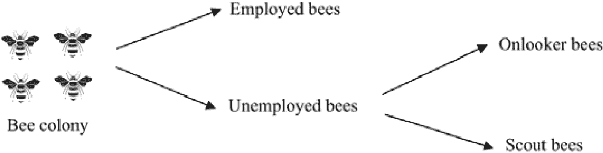

图 4.2. 人工蜂群分类。

**初始化阶段：** ABC 算法通过设置随机分布的 `SN` 个解（食物源位置）种群开始搜索过程。`SN` 代表种群规模。每个食物源代表一个解，并通过以下方程进行初始化：

(4.20)

```
x[i,j] = x[j]^(min) + rand(0,1) * (x[j]^(max) - x[j]^(min))
```

其中，

* `x[i,j]` 代表第 i[th] 个雇佣人工蜂在第 j[th] 维上的解
* `X[1] = (x[i][1], x[i][2],..., x[i,D])` 代表第 i[th] 个食物源
* `D` 代表优化问题的维度
* `x^(min)[j]`、`x^(max)[j]` 代表第 j[th] 维的上和下界
* `rand(0, 1)` 代表在 [0, 1] 范围内均匀分布的随机数

**雇佣蜂阶段：** 在此阶段，雇佣蜂群正在寻找食物资源以制造蜜。雇佣人工蜂根据以下方程为每个 `x[i,j]` 父食物源创建一个新的食物源 `v[i,j]`（新解）：

(4.21)

```
v[i,j] = x[i,j] + ϕ[i,j] * (x[i,j] - x[k,j])
```

其中，

* `v[i,j]` 是新解
* `x[i,j]` 代表第 j[th] 维上第 i[th] 个雇佣人工蜂的解
* `ϕ[i,j]` 代表在 [-1, 1] 范围内均匀分布的随机数
* `x[k,j]` 代表另一个 j[th] 维上的解
* `V[i] = (v[i][1], v[i][2],..., v[i,D])` 代表第 i[th] 个食物源
* `X[i] = (x[i][1], x[i][2],..., x[i,D])` 代表第 i[th] 个食物源

**观望蜂阶段：** 在此阶段，雇佣蜂群正在寻找食物资源以制造蜜。观望蜂根据其质量选择食物源。如果质量高，它们会吸引更多的蜂；否则如果质量低则不是。选择概率通过以下方程计算：

(4.23)

```
p_i = fitness(X_i) / sum(fitness(X_j))
```

其中，

* `p_i` 是第 i[th] 个解的选择概率
* `fitness(X_i)` 是适应度

**侦查蜂阶段：** 侦查蜂的作用是在食物源在一定时间内没有改进时对其进行重新初始化。

### 选择方法

根据适应度对个体进行选择的方法在算法中非常重要。最合适的选择方法可以提高 (2009; Kumar 等人, 2016) 的效率。

#### 破坏性选择

该方法使用均值标准化的适应度函数来改进种群 (Kuo and Hwang, 1996)。

(4.24)

```
p_i = fit_i / sum(fit_j)
```

其中，

* `p_i` 是第 i[th] 个解的选择概率
* `fit_i` 是适应度

适应度通过以下方程计算：

(4.25)

```
fit_i = |f_i - f_bar|
```

其中，

* `f_i` 是目标值
* `f_bar` 是种群个体目标值的平均值

#### 锦标赛选择

该方法从种群中随机选择 k 个个体，其中 k 取锦标赛规模，并对个体的适应度进行比较。

(4.26)

```
p_i = S_i / sum(S_i)
```

其中，

* `S_i` 是分配给最佳适应度个体的评分

#### 线性排名选择

在该方法中，根据适应度值对个体进行排名。从最差到最好进行排名。选择概率根据方程计算 (Aiguo and Jiren, 1999; Bao and Zeng, 2009)：

(4.27)


$$p{}\_{k} = \frac{1}{n} + a\left( t \right)\frac{n + 1 - 2k}{n\left( {n + 1} \right)}k = \left( {1,2, \cdot \cdot \cdot ,n} \right)$$

(4.28)

$$a\left( t \right) = 0.2 + \frac{3t}{4N}t = \left( {1,2, \cdot \cdot \cdot ,N} \right)$$

其中，

*   `a`(`t`)代表一个自适应参数
*   `N`代表最大迭代次数。

### 指数级排名选择

在此方法中，根据已排序个体的指数权重对个体进行排序，并根据公式计算选择概率：

(4.29)

$$p_{i} = \frac{c - 1}{c^{N} - 1}c^{N - 1},i \in \left\\{ {1,....,N} \right\}$$

指示性参数 `c` > 1。

## 边界处理方法

目前已经提出了几种边界处理方法。这些技术非常重要，因为它们可以限制人工蜂群在预定义搜索空间内的移动。在上一章中，详细介绍了针对粒子群优化算法（PSO）的几种边界处理方法，例如：最近邻或边界或吸收法、双曲法、无穷或不可见墙、随机、随机半、周期、指数、变异、反射法、随机阻尼法。这些方法同样适用于 ABC 算法。

此外，研究人员还针对 ABC 算法提出了其他方法。Brajevic (2015) 提议应用由 Kukkonen and Lampinen (2006) 在广义差分进化中使用的机制。Brajevic (2015) 将 Kukkonen and Lampinen (2006) 机制作为一种边界约束处理方法。在变异和交叉过程中，将试验向量 `u[j,i,G]` 与旧向量 `x[j,i,G]` 进行比较。这种修正基于以下数学方程，该方程用于越界值的情况，通过以下规则将值从违反的边界反射回来：

(4.30)

$$u_{j,i,G} = \left\\\{ \begin{array}{l} {2 \cdot x_{j}^{low} - u_{ji},\\text{if}\text{u}_{j,i,G} < x_{j}^{low}} \\\\ {2 \cdot x_{j}^{up} - u_{ji},\\text{if}\text{u}_{j,i,G} < x_{j}^{up}} \\\\ {u_{j,i,G},\\text{otherwise}} \\\\ \end{array} \right.$$

其中，

*   `u[j,i,G]`代表候选解 `i` 的变量 `j` 的试验向量
*   `x[j]^(low)`代表决策变量 `x` 的下界
*   `x[j]^(up)`代表决策变量 `x[j]` 的上限
*   `G`代表代数

## 参考文献

*   Aiguo, S. and Jiren, L. (1999). 一种基于排名的自适应进化算遗传算法 [J]. ACTA, Electronica Sinica, 27(1): 85–88.
*   Alzaqebah, M. and Abdullah, S. (2011). 基于破坏性选择的混合人工蜂群搜索算法。Combinatorial Optimization and Applications, Berlin.
*   Awadallah, M., Al-Betar, M. A., Bolaji, A. L., Alsukhni, E. et al. (2019). 具有新观察者蜂的人工蜂群自然选择。Soft Computing, 23(15): 6455–6494. doi: [10.1007/s00500-018–3299](http://doi.org/10.1007/s00500%E2%80%93018%E2%80%933299).
*   Bao, L. and Zeng, J. C. (2009, August). 人工蜂群算法中的选择机制。2009 年第九届智能系统会议 (Vol.1). IEEE.
*   Blum, C., Roli, A. and Dorigo, M. (2001). HC–ACO：蚁群优化的立方体框架。Proceedings of MIC’2001—Metaheuristics International Conference (Vol.2). Porto, July 16–20.
*   Blum, C. (2005). 蚁群优化：介绍与趋势。Physics of Life Reviews, 2(4): 353–373. doi:[10.1016/jplrev.2005.001](https://doi.org/10.1016/jplrev.2005.001).
*   Brajevic, I. (2015). 基于交叉的人工蜂群。Neural Computing and Applications, 26(7): 1587–1601. doi: [10.1007/s00521–015–1826-y](http://doi.org/10.1007/s00521%E2%80%930115%E2%80%931826-y).
*   Bullnheimer, B., Hartl, R. F. and Strauss, C. (1997). 一种基于排名的蚁系统——计算研究。技术报告。维也纳大学管理学院。
*   Bullnheimer, B., Hartl, R. F. and Strauss, C. (1999). 用于车辆问题的改进型蚁系统。Annals of Operations Research, 89: 319–328.
*   Chandra Mohan, B. and Baskaran, R. (2012). 综述：蚁群优化在多个领域的研究与实现。Expert Systems with Application, 39: 4618–4627.
*   Colorni, A., Dorigo, M. and Maniezzo, V. (1991, December). 蚁群的分布式优化。pp. 134–142. In: 第一届欧洲人工生命会议 (Vol.142).
*   Ding, H. J. and Feng, Q. (2009). 基于玻尔兹曼策略的人工蜂群算法。Computer Engineering and Applications, 45(31): 53–55.
*   Dorigo, M. (1992). 优化、学习与自然算法。博士论文。意大利米兰理工学院。
*   Dorigo, M., Maniezzo, V. and Colorni, A. (1996). 蚁系统：协作代理种群的优化。IEEE Transactions on Systems, Man, and Cybernetics, Part B (Cybernetics), 26(1): 29–41.
*   Dorigo, M. and Gambardella, L. M. (1997). 蚁群系统：解决旅行商人问题的协作学习方法。IEEE Transactions on Evolutionary Computation, 1(1): 53–66.
*   Dorigo, M. and Blum, C. (2005). 蚁群优化理论：综述。Theoretical Computer Science, 344(2–3): 243–278.
*   Dorigo, M., Birattari, M. and Stuzle, T. (2006). 蚁群优化。技术报告。RDIA, 1–12, 1781–3794.
*   Dorigo, M., Birattari, M. and Stuzle, T. (2006). 蚁群优化。IEEE Intelligence Magazine, 1(4): 28–39.
*   Gambardella, L. M. and Dorigo, M. (1996, May). 用蚁群求解对称和非对称旅行商人问题。pp. 622–627. In: IEEE 国际进化计算会议。
*   Gao, W., Liu, S. and Huang, L. (2012). 用于全局优化的改进型人工蜂群算法。Journal of Computational and Applied Mathematics, 236(11): 2741–2753.
*   Guntsch, M. and Middendorf, M. (2002, April). 一种基于种群的 ACO 方法。pp. 72–81. In: 进化计算应用会议。Springer, Berlin, Heidelberg.
*   Guntsch, M. and Middendorf, M. (2002, September). 将种群 ACO 应用于动态优化问题。pp. 111–122. In: 蚁算法国际会议。Springer, Berlin, Heidelberg.
*   Guntsch, M. (2004). 随机环境下的蚁算法（博士论文）。卡尔斯鲁厄理工学院。
*   Kang, F., Li, J., Li, H., Ma, Z., Xu, Q. et al. (2010, May). 改进的人工蜂群算法。pp. 1–4. In: 2010 年第二届智能系统与应用国际会议。IEEE。
*   Karaboga, D. (2005). 基于蜜蜂群的数值优化想法。技术报告-tr06，埃尔齐斯大学工程学院计算机工程系。


*   Karaboga, D. and Basturk, B. (2007). 一种用于数值函数优化的强大且高效的算法：人工蜂群（ABC）算法。《全球优化期刊, 39(3): 459–471。
*   Karaboga, N. (2009). 一基于人工蜂群算法的数字 IIR 滤波器新设计方法。《富兰林学院杂志, 346(4): 328–348。
*   Kukkonen, S. and Lampinen, J. (2006, 7). 基于广义差分演化的约束实参数优化。pp. 207–214. 在：2006 IEEE 进化计算国际会议。IEEE。
*   Kumar, A., Kumar, D. and Jarial, S. K. (2016). 人工蜂群算法中选择方案的对比分析。《计算与系统, 20(1): 55–66。
*   Kuo, T. and Hwang, S. Y. (1996). 一种具有破坏性选择的遗传算法。《IEEE 系统、人类与网络控制学报, B 部分（控制学）, 26(2): 299–307。
*   Lam, K. C., Ning, X. and Ng, T. (2007). 蚁群优化算法在施工现场布局规划问题中的应用。《建筑管理与经济, 25(4): 359–374。 doi: [10.1080/01446190600972870](http://doi.org/10.1080/01446190600972870)。
*   Lin, C. and Lin, B.-F. (2012). 使用蚁群算法的自动压水反应堆堆载模式设计。《核能量年, 43: 91–98。 doi:[`doi.org/10.1016/j.anucene.2011.12.002`](https://doi.org/10.1016/j.anucene.2011.12.002)。
*   López-Ibáñez, M., Stützle, T. and Dorigo, M. (2018). 蚁群优化：基于组件的概述。pp. 371–407. 在：Martí, R., Pardalos, P. M. 和 Resende, M. G. C. (编)，《启发式算法手册》。夏姆: Springer International Publishing。
*   Maniezzo, V. and Milandri, M. (2002). 一种用于高度约束问题的基于蚁框架。在：Dorigo, M., Di Caro, G. 和 Sampels, M. (编)。ANTS 2002 论文集——从蚁群到蚂蚁：第三次国际会议。
*   Pedemonte, M., Nesmachnow, S. and Cancela, H. (2011). 并行蚁群优化的综述。《应用软计算, 11(8): 5181–5197。
*   Scheuermann, B., So, K., Guntsch, M., Middendorf, M., Diessel, O. et al. (2004). 基于种群蚁群优化的 FPGA 实现。
*   Sharvani, G. S., Ananth, A. G. and Rangaswamy, T. (2012). 自机网络中 `ACO` 不同信息素衰减技术的分析。《国际计算机应用杂志, 56(2)。
*   Socha, K. and Blum, C. (2007). 一种用于连续优化的蚁群算法：前馈神经网络的应用。《神经计算与应用, 16(3): 235–247。
*   Socha, K. and Dorigo, M. (2008). 连续域蚁群优化。《欧洲运筹学杂志, 185(3): 1155–1173。
*   Stützle, T. and Hoos, H. (2000). MAX–MIN 蚁系统。《未来计算机系统, 16(8): 889–914。
*   Sulaiman, M. H., Mustafa, M. W., Shareef, H. and Khalid, S. N. (2012). 人工蜂群算法在电力系统调度中的应用。
*   Tereshko, V. (2000, 9). 蜜蜂行为的反应扩散模型。pp. 807–816. 在：人工智能技术与应用。
*   Tereshko, V. and Lee, T. (2002). 蜜蜂行为的集体决策。《信息系统, 9(2): 181–193。
*   Tereshko, V. and Loengarov, A. (2005). 针对松散电力系统的混沌蚁群算法。《信息系统，9。
*   Xing, L., Chen, Y., Wang, P., Zhao, Q., Xiong, J. et al. (2011). 2D 卡普熵图像分割的混沌随机蚁群优化。《应用软计算, 10(3): 888–896。
*   Xu, C., Duan, H. and Liu, F.. 无人战斗机 (UCAV) 路径规划。《航空科学技术, 14(8): 535–541。
*   Zhang, C., Ouyang, D. and Ning, J. (2010). 用于聚类的精英策略人工蜂群算法。《专家系统与应用, 37(7): 4761–4767。
*   Zhang, M., Zhan, Z., Li, J. and Zhang, J. (2014, 11). 基于锦标赛的人工蜂群算法。pp. 387–396. 在：人工智能技术与应用国际会议。Springer，夏姆。
*   Zhao, D., Liu, L., Yu, F., Heidari, A., Wang, M., Liang, G. et al. (2021). 混沌随机蚁群优化多阈值图像分割。《知识库系统, 216: 106510。 doi:[`doi.org/10.1016/j.knosys.2020.106510`](https://doi.org/10.1016/j.knosys.2020.106510)。
*   Zhu, G. and Kwong, S. (2010). 数值函数优化的最优引导人工蜂群算法。《应用数学与计算, 217(7): 3166–3173。

# 第 5 章 蚁群搜索与蝙蝠算法

本章介绍了群优化算法：蚁群搜索（CS）和蝙蝠算法（BA）。文中介绍了基于莱维飞行（Lévy Flights）的标准蚁群搜索及其重要变体，如混沌蚁群搜索、离散蚁群搜索和离散二进制蚁群搜索。此外，还讨论了蝙蝠算法及其重要变体，如混沌蝙蝠算法、二进制蝙蝠算法、离散蝙蝠算法以及两种近期变体：双变异蝙蝠算法（2020）和自适应蝙蝠算法（2019）。

## 蚁群搜索

蚁群搜索是由 Yang 和 Deb (2009) 提出的用于解决各种连续问题的启发式群算法。该算法关注蚁类的自然行为。

### 类的繁殖行为与莱维飞行

某些鸟类（如无喙八绿喉）是群居繁殖的。鸟类是群巢鸟，通常雌鸟会将卵产在共享的共同巢中，并合作提供父母照顾（Grieves and Quinn, 2018）。

它们在巢中产卵并能够区分寄生蛋是非寄生蛋（Hauber et al., 2018; Macedo, 1992; Payne and Sorensen, 2005）。


多项研究表明，许多鸟类和昆虫的飞行行为具有莱维飞行（Lévy flights）特征（Brown et al., 2007; Pavlyukevich, 2007; Reynolds and Frye, 2007）。这种自然行为已经被理想化并应用于计算优化，结果非常理想（Boudjemaa et al., 2020; Sharma et al., 2013; Zhou et al., 2018）。

## 布谷搜索算法

Yang and Deb (2009) 开发了关于布谷行为描述的三种理想规则：

* 每只布谷每次产一个蛋，然后将其遗弃在随机选择的巢中。
* 具有最佳蛋质量的巢将遗传给后代。
* 可用的布谷宿主巢数量是固定的，宿主鸟发现产蛋的概率为 `p[a]` ∈ [0, 1]。比例为 `p[a]` 的布谷巢会被新巢替换。

Yang and Deb (2009), 2010 使用了简单的表示法，布谷巢中的每个蛋代表一个解，新产的布谷蛋代表一个新解，但提出的算法可以通过定义每个鸟巢有许多蛋代表一组解，从而扩展到更复杂的优化问题。

由 Yang and Deb (2009) 提出的布谷搜索（CS）算法的基本步骤用如下伪代码表示：

### 基于莱维飞行的布谷搜索算法

布谷搜索算法平衡地利用局部随机游走（开发）和全局随机游走（探索），并由变量 `Pa` 控制。局部随机游走（开发）由方程表示：

(5.1)

X[*i*]^((*t* + 1)) = X[*i*]^((*t*)) + *α**s* ⊗ *H*(*P**a*−∈) ⊗ (x[*j*]^((*t*))−x[*k*]^((*t*)))

其中，

* `x`^([*j*]^(*t*)) 和 `x`^([*k*]^(*t*)) 代表两个随机选择的独立解。
* `H(u)` 代表赫维斯德阶函数。
* ∊ 表示均匀分布在 [0,1] 上的随机数。
* s 代表步长。
* ⊗ 表示逐元素乘积。
* `Pa` 代表用于平衡开发与探索的变量。

在算法执行过程中，当在时间步 `t+1` 为布谷鸟 `i` 生成新解 `x(*t*+1)` 时，通过以下方程实现莱维飞行：

(5.2)

*x*[*i*]^((*t* + 1)) = *x*[*i*]^((*t*)) + *α* ⊗ Levy(*λ*)

其中，

* `α` > 0 代表与问题相关的步长。在大多数问题中，`α` 的值接近 1。
* 乘积 ⊗ 表示逐元素乘法。

该方程基本上是随机游走中的随机方程。这种逐元素乘积与 PSO 算法使用的类似。莱维飞行被认为在每一步中探索搜索空间更为有效。莱维飞行基本上提供了一种随机游走，其随机步长由莱维分布表示：

(5.3)

Levy∼ *u*= *t*^(−λ), (1<λ)

该分布具有无限方差和无限均值。步骤基本上来自随机游走。在当前最优解附近生成多个新解，这加快了局部水平的搜索。虽然在距离当前最优解的地方随机生成了新解，但这种机制使其不会陷入局部最优解。布谷搜索是一种基于种群的优化算法，它使用了优异法和选择方法，因为其步长也可以非常大，且需要调整的参数少于遗传算法和粒子群优化。

## 布谷搜索变体

### 混沌布谷搜索

Wang et al. (2016) 通过将混沌理论引入布谷搜索优化算法。还测试了十二种混沌映射来调整布谷搜索的步长。混沌具有不可重复的特性，搜索速度比随机搜索快。布谷搜索的主要参数是：步长 `α` 和发现率 `p[a]`。根据文献 (Yang, 2010)，作者使用了 0.25 作为 `p[a]` 的值。在标准布谷搜索算法中，步长保持不变。相反，在混沌布谷搜索中，步长 `α` 是变量，可以加速算法。此外，所有混沌映射都归一化到 [0, 2] 区间。Wang al. (2016) 提出的混沌 CS 伪代码如下：

### 混沌布谷搜索算法

以下混沌映射被 Wang al., 2016 用于测试混沌 CS 的性能：

1. **切比雪夫映射**
(5.4) `x[*k*] + 1] = cos(acos(x[*k]))`

2. **圆映射**在 (0, 1) 生成混沌序列，其中 `a = 0.5` 且 `b = 0.2`，
(5.5) `x[*k*] + 1] = x[*k*] + b−sin(2πk)`

3. **高斯映射**
(5.6) `x_{k + 1} = { 0 if x_{k} = 0; 1/x_{k} otherwise } - [ 1/x_k ]`

4. **间歇性映射**
(5.7) `x_{k + 1} = { ε + x_{k}^n if 0 < x_{k} ≤ P; (x_{k} - P)/(1 - P) if P < x_{k} < 1 }`

5. **迭代映射**
(5.8) `x_{k + 1} = sin(aπ/x_{k})`

6. **Liebovitch 映射**
(5.9) `x_{k + 1} = { α x_{k} if 0 < x_{k} ≤ P; (P - a_{k})/(P2 - P1) if P1 < x_{k} ≤ P2; 1 - β(1 - x_{k}) if P2 < x_{k} ≤ 1 }`

7. **逻辑映射**
(5.10) `x[*k*] + 1] = a*x*k*`

8. **分段映射**
(5.11) `x_{k + 1} = { x_{k}/P if o ≤ x_{k} < P; (x_{k}-P)/(0.5-P) if P ≤ x_{k} < 1/2; (1-P-x_{k})/(0.5-P) if 1/2 ≤ x_{k} < 1-P; (1-x_{k})/P if 1-P ≤ x_{k} < 1 }`

9. **正弦映射**
(5.12) `x_{k + 1} = a/4sin(πx_{k})`, 0 < a ≤ 4

10. **Singer 映射**
(5.13) `x[*k*] + 1] = μ*(7.86*x[*k*]-23.31*x[*k*]³−13.302875*x[*k*]⁴)`

11. **正弦波映射**
(5.14) `x[*k*] + 1] = a*x[*k*]²sin(πx[*k*])`

12. **帐篷映射**
这种混沌映射与逻辑映射相似，通过以下方程表示：
(5.15) `x_{k + 1} = { x_{k}/0.7 if x_{k} < 0.7; 10/3 if x_{k} ≥ 0.7 }`


根据几项基准函数的结果，Wang et al. (2016) 得出，通过引入混沌正弦波映射代替 `α`，可以改进混沌 `CS` 算法。此外，他们得出结论认为调优后的 `CS` 算法提高了全局搜索能力。

### 离散二化布鸟搜索

Gherboudj et al. (2012) 提出了一种离散二化布鸟搜索优化算法，可用于二进制优化问题。解表示为连续搜索空间中的实数（连续优化）或离散搜索空间中的整数集（离散优化）。一些离散优化问题包括：车间调度 (Pongchairerks, 2009) 和流水车间调度问题 (Liao et al., 2007)。

用于连续优化问题的标准 `CS` 算法基于 `Lévy` 飞行。因此，算法的解构成了连续搜索空间中的一组实数。为了在离散二进制问题中使用 `CS`，应将解转换为二值。二值化 `CS` 由以下基础模块组成：

*   用于获取新布鸟解的 `Levy` 飞行。
*   二值解表示，用于使用 `sigmoid` 函数计算每只布鸟的翻转概率。
*   目标函数和选择算子。

在从连续区域到二进制区域的转换过程中，如果 `x[i]` 是空间 `[0, 1]` 中的连续解，且 `x[i]'` 是二值解表示，则使用 `sigmoid` 函数根据以下方程转换解值：

(5.16)

$$S\left( x\_{i} \right) = \frac{1}{1 = e^{- x\_{i}}}$$  

其中 `S(x[i])` 是二值解的翻转概率 ` 与在 `[0, 1]` 区间内生成的随机数值进行比较：

(5.17)

$${x^{\\prime}}\_{i} = \left\\{ \begin{matrix} 1 & {\\gamma < < S\left( x\_{i} \right)} \\\\ 0 & {otherwise} \\\\ \\end{matrix} \right.$$

其中 `γ` 代表空间 `[0,1]` 中的随机数。

### 混合自自适应布鸟搜索

Mlakar et al. (2016) 通过修改原始布鸟搜索算法的某些机制，提出了一种混合自自适应布鸟搜索算法。作者提出了平衡探索技术、自适应布鸟搜索参数以及适应布鸟种群。

#### 探索策略的平衡

通过恰当设置算法参数，在探索（exploration）和开发（exploitation）策略之间实现了有效的平衡。根据距离，探索可以分为三类：随机引导的长距离、短距离和中距离探索。第一种策略考虑全局随机游走，第二种策略通过使用局部随机游走来开发邻域，第三种探索策略可以在差分变异算法 (Storn and Price, 1997) 中找到，它包含两个参数：距离当前最优解的距离以及两个随机选择的解之间的距离。

提出的差分变异变策略可以用以下方程表示：

(5.18)

`u*[*i*]^((*t*)) = *x*[*i*]^((*t*)) + *F**i*)−*u*[*i*]^((*t*))) + (*u*[*r*1]^((*t*))−*u*[*r*2]^((*t*))),`,

其中，

*   `F[i]` 代表关于变化度量比例的缩放因子
*   `x^((t*))[*best*]` 代表当前最优解
*   `x^((t*))[*r*1]` 和 `x^((t*))[*r*2]` 代表从种群中随机选择的解。

作者提出的交叉算子可以用以下方程表示：

(5.19)

$$u\_{i,j}^{(t)} = \\left\\{ \begin{matrix} u\_{i,j}^{(t)} & {rand\_{j}\\left( {0,1} \\right) \leq CRj \\vee = j\_{rand}} \\\\ u\_{i,j}^{(t)} & {otherwise,} \\\\ \\end{matrix} \\right.,,$$

其中，

*   `CR` `\[0.0, 1.0\]` 代表交叉率，控制复制到新解的参数速率。
*   `j = j[rand]` 代表一个确保新向量与原始解 `x^((t*))[*i*]` 至少在一个元素上不同的条件。

随机选择解的替换可以用以下方程表示：

(5.20)

$$x\_{i,j}^{(t)} = \\left\\{ \begin{matrix} x\_{i,j}^{(t)} & {k \in P} \\{ j = j\_{rand}} \\\\ x\_{i,j}^{(t)} & {otherwise} \\\\ \\end{matrix} \right.$$

其中，`k` 代表随机数，`P` 代表种群规模。

以下方程用于平衡 `p[b]`：

(5.21)

（注：此处逻辑遵循原文）

#### 参数的自自适应

Mlakar et al. (2016) 通过修改原始布鸟搜索算法的某些机制，提出了一种混合自自适应布鸟搜索算法。作者提出了平衡探索技术、自适应布鸟搜索参数以及适应布鸟种群。


$$P^{({t + 1})} = round\\left\\lbrack {\\left( \frac{P_{\max} - P_{\min}}{MAX\\\_ Eval} \\right)\*Eval + P_{\min}} \\right\\rbrack,$$  

其中，

* `P[max]` 代表初始蝙蝠种群大小（最大）。
* `P[min]` 代表指定的最小蝙蝠种群大小。
* `Eval` 和 `MAX_Eval` 分别代表当前和最大函数评价次数。

## 蝙蝠算法 (Bat algorithm)

### 蝙蝠算法启发

自然界中存在相似的蝙蝠。蝙蝠在导航和捕猎时会使用声呐。在捕猎猎物时，它们能够降低声音的响度并增加超声波的发射率。Yang (2010)] 提出了一种受蝙蝠启发的算法，通过使用以下理想规则理想化了微蝙蝠的一些特征：

1. 所有蝙蝠都使用回声定位来感知距离，它们“知道”食物与背景障碍之间的区别。
2. 蝙蝠以速度 `v[i]` 在位置 `x[i]` 随机飞行，具有恒定的频率 `f[min]`、变动的波长 `λ` 和响度 `A[0]` 来寻找猎物。它们可以根据目标的距离远近自动调整频率。
3. 尽管响度 `A[0]` 可以以多种方式变化，但假设响度范围从一个较大的 `A[0]` 值到最小的常数值 `A[min]`。

根据 Yang (2010] 算法的伪代码如下：

## 蝙蝠算法

### 蝙蝠运动

在蝙蝠算法中，`d` 维搜索空间中带有频率、位置 `x[i]` 和速度 `v[i]` 的向量是根据以下方程计算的（Yang, 2010]）：

(5.30)  

`F[i]` = `F[min]` + (`F[max]`−`F[min])*`β`  

其中，

* `F[i]` 代表第 `i` 只蝙蝠的频率，在每次迭代中更新。
* `β` 代表 `[0,1]` 上均匀分布的随机数。

(5.31)  

```
`v[i]^((t + 1)) = `v[i]^((t)) + (`x[i]^((t))−`x^(**)`F[i]`
```

(5.32)  

```
`x[i]^((t + 1)) = `x[i]^((t)) + `v[i]^((t + 1))`
```

其中，

* `x^(t+1)` 代表新位置（解）
* `v^(t+1)` 代表新速度
* `x` 代表为止的全局最优解

Yang (2010] 提出了一种局部搜索，在当前最佳位置中选择一个解。因此，使用随机游走根据以下方程局部生成新的蝙蝠解：

(5.33)  

```
`X[new]=X[old]+`ε``A^((t))`
```

其中，

* `ε` 代表 `[-1,1]` 区间内的随机数，
* `A` 是蝙蝠利用的发射声音的响度参数，用于探索而非开发。

随着迭代的进行，响度 `A[i]` 和脉冲发射率 `r[i]` 更新为以下方程：

(5.34)  

```
`A[i]^((t + 1)) = `A[i]^((t))`
```

(5.35)  

```
`r[i]^((t + 1)) = `r[i]^((0))[1−exp(-γ)]`
```

其中，

* `α` 代表常数，代表类似于模拟退火的冷却因子。
* `γ` 代表一个常数。

# 蝙蝠算法变体

文献中提出了几种蝙蝠算法的改进版本，例如：二进制蝙蝠算法 (Nakamura et al., 2012)、混沌蝙蝠算法 (Gandomi and Yang, 2014)、自适应蝙蝠算法 (Lyu et al., 2019)、双变异蝙蝠算法 (Liu et al., 2020)、用于约束优化的蝙蝠算法 (Gandomi et al., 2013)、带有变异算子的增强型蝙蝠算法 (Ghanem and Jantan, 2019) 以及离散蝙蝠算法 (Luo et al., 2014)。

### 二进制蝙蝠算法

Nakamura et al. (2012)] 提出了一种用于特征选择的二进制蝙蝠算法。在标准蝙蝠算法中，蝙蝠在连续搜索空间移动；在特征选择问题中，搜索空间被构建为 `n` 维，表示是否选择某项特征。蝙蝠的位置（解）应以二进制值表示。Nakamura et al. (2012) 使用 sigmoid 函数来表示蝙蝠的位置：

(5.36)  

```
`S(v_ij) = 1/(1 + e^(-v_ij))`
```

蝙蝠的位置根据以下方程计算：

(5.37)  

```
`S_ij = {matrix} 1 & if > σ \\ 0 & otherwise {matrix}`
```

其中 `σ ~ U(0,1)`。因此，为每只蝙蝠提供二进制值。根据 Nakamura et al. (2012)，所提出的二进制蝙蝠算法在多个数据集上优于其他技术。

Mirjalili et al. (2014)] 提出了一种不同的二进制蝙蝠方法，通过 sigmoid 函数强制蝙蝠切换位置，其速度增加但位置保持不变。

Mirjalili et al. (2014)] 提出了一种 V 型转移函数来更新高速度蝙蝠的位置：

(5.38)  

```
`V(v_ik(t)) = |(2/π) . arctan((π/2)v_ik(t))|
```

(5.39)  

```
`x_ik(t+1) = \begin{matrix} \begin{matrix} (x_ik(t))^{-1} & If rand < V(v_ik(t)) \end{matrix} \\ \begin{matrix} x_ik(t) & rand \geq V(v_ik(t)) \end{matrix}`
```

其中 `x_ik(t)` 和 `v_ik(t)` 表示第 `t` 次迭代的位置和速度，`(x_ik(t))–1 是 `x_ik(t)` 的补数。

### 混沌蝙蝠算法

Gandomi and Yang (2014)] 提出了一种混沌蝙蝠算法，通过使用混沌映射来调整蝙蝠参数并改进实验结果和算法性能。实验使用的混沌映射包括：切比夫图、圆周图、高斯/鼠图、间歇性图、迭代图、李布维希图、逻辑图、分段图、锯齿图、正弦图、歌手图、正弦波图。这些混沌映射的大部分方程在混沌章节给出。

提出的混沌蝙蝠算法如下：

#### 第一种混沌蝙蝠算法

Gandomi and Yang (2014)] 提出通过混沌映射修改频率更新方程中的参数 `β`，其方程如下：

(5.40)  

```
`f[i]` = `f[min]` + (`f[max]`−`f[min])*CM[i]`
```

其中 CM 代表混沌映射。传统蝙蝠算法中，`β` 代表 0 到 1 之间的随机数，而在第一种混沌蝙蝠算法中，它是根据所选混沌映射的 0 到 1 之间的混沌数。实验结果显示，混沌蝙蝠算法相比传统算法性能有所提高。

#### 第二种混沌蝙蝠算法


此外，Gandomi 和 Yang (2014) 提出通过通过方程表示的混沌映射来修改速度更新方程中的参数 `λ[i]`：

(5.41)

```
vi = vi + (xi−x(*))CM[i]f[i]
```

其中 `CM` 代表混沌映射。

### 第三代混沌蝙蝠算法

此外，Gandomi 和 Yang (2014) 提出用混沌映射替换蝙蝠算法中的响度（`A`）参数以提高蝙蝠算法的性能。

### 自适应蝙蝠算法

Lyu 等人 (2019) 通过结合步长控制和变异机制提出了一种自适应蝙蝠算法，根据观察，算法全局搜索应该根据响度参数 `A` 进行调整，而局部搜索过程应该根据脉冲发射率参数 `R` 进行调整。

#### 步长控制机制

Lyu 等人 (2019) 提出了一种步长控制机制，用于控制全局和局部搜索中每次迭代使用的步长。所提出的算法分别为个体蝙蝠和蝙蝠群利用两个频率 `f[1]` 和 `f[2]`。

首先，在全局搜索期间，新解由以下方程表示：

(5.42)
```
vi = ω*vi + f[i]*ri) + f[2]f2)
```

(5.43)
```
f[1] = α*(1−e^(−|F[avg]−F[best]|)) + γ*(1−k) + f[min]
```

(5.44)
```
C[w] = f[1] + f[2]
```

(5.45)
```
xi = xi + μ*vi
```

其中，

* `ω` 代表一个递减权重。
* `h[i*]` 代表蝙蝠 `i` 的最优位置。
* `x[]` 代表当前全局最优。
* `f[1]` 和 `f[2]` 代表上述的频率。
* `r[1]` 和 `r[2]` 代表均匀分布在 (0.5, 1.5) 上的随机数。
* `F[avg]` 代表当前最优位置的平均适应度。
* `F[best]` 代表当前最优解的最优适应度。
* `k = t/tmax` 代表范围在 (0, 1] 的评价索引。
* `tmax` 代表最大迭代次数。
* `fmin` 代表 `f[1]` 的最小值。
* `μ` 代表范围在 (0, 1] 的步长权重。
* `α` 和 `γ` 是权重。

该搜索根据以下方程进行：
如果评价索引为：`k < 0.4`，

(5.46)
```
xi = x[] + A(t)*δ*g(k)
```

如果评价索引为：`k ≥ 0.4`，

(5.47)
```
xi = x[] + A(t)*δ*0.1^g(k)
```

其中，

* `At` 代表蝙蝠群当前的响度。
* `δ∈−1, 1]` 代表均匀分布的随机数。
* `s` 代表可得解的上界和下界以及群中蝙蝠代理的数量。
* `g(k)` 是与搜索步长相关的函数。

#### 变异机制

Lyu 等人 (2019) 提出改进算法搜索能力的步长控制机制。此外，作者还提出了一种整合响度 `A` 的变异机制，以提高算法避免局部最优的能力。

标准蝙蝠算法中的响度 `A` 在后期逐渐减到 0，脉冲发射率 `R` 逐渐增加到 `Rmax`。所提出的 `A` 和 `R` 更新方程表示为：

(5.48)
```
A_i+1 = f1/fmax
```

(5.49)
```
R_i+1 = f2/fmax
```

其中 `fmax` 代表频率的上限。

频率 `f[1]` 和 `f[2]` 根据蝙蝠群的适应度自适应更新，相应的 `A` 和 `R` 参数适应上述方程。

### 双变异蝙蝠算法

标准蝙蝠算法由于早期收敛，在处理复杂性质的问题时性能较差。Liu 等人 (2020) 提出了一种具有双变异算子的蝙蝠算法，其中包含了一个与时间相关的修改因子两个变异算子。实验结果表明，所提出的算法改进了蝙蝠算法在非线性优化问题中的性能。

Liu 等人 (2020) 通过引入时间因子、柯西变异算子和高斯变异算子对标准蝙蝠算法进行了三种修改。

#### 时间因子

在标准蝙蝠算法中，新位置利用之前的迭代和速度来更新。在算法期间，蝙蝠与最优解之间的距离缩小。作者在原始方程中引入了一个常数作为时间因子，当算法接近最优时，时间因子 `λ[t]` 趋于“0”，以增强局部搜索。所提出的时间因子通过以下方程计算：

(5.50)
```
λ_t = 1 - e^{((it_max-it)/(it_max))}
```

其中，

* `it_max` 代表迭代次数。
* `it` 代表当前迭代次数。

带有时间因子 `λ[t]` 的新位置方程为：

(5.51)
```
Xi = Xi + λ[t]*V[i]
```

#### 柯西变异算子修改

Liu 等人 (2020) 通过引入柯西变异算子，该算子可以帮助蝙蝠算法跳出局部最优（[Yang 和 Huang, 2012]）。

一维柯西密度函数通过以下方程表示（Paiva 等人 (2017)）：

(5.52)
```
c(x) = 1/π*k/k²
```

其中，

* `x∈−∞, ∞`
* 参数 `k > 0` 是尺度因子。

柯西分布函数通过以下方程表示（Paiva 等人 (2017)）：

(5.53)
```
C_t(x) = 1/2 + 1/π*arctan(x/k)
```

带有柯西变异算子的修改方程被整合到原始蝙蝠算法中并用以下公式表示：

(5.54)
```
Xi = Xi + Xi*Cauchy(0,1)
```

其中 `Cauchy (0,1)` 是从柯西分布函数随机数。k 参数设置为 1。

#### 高斯变异算子

在算法最后几次迭代的开发中使用高斯变异算子，因为高斯变异算子的尺寸小于柯西变异算子的尺寸。

一维高斯密度函数通过以下方程表示：

(5.55)
```
g(x) = 1/(σ*sqrt(2π))*e^[(-(x-μ)²/(2σ²)]
```

当 `μ = 0` 且 `σ = 1` 时，遵循高斯分布的函数通过方程表示（Melo 和 Watada (2016)）：

(5.56)
```
g(x) = 1/sqrt(2π)*e^[(-(x)²/2)]
```


高斯变异算子被引入原始蝙蝠算法，以根据以下公式实现全局最优位置变异：

```
Xbest = X[best] + X[best]*Gauss(0.1)
```

其中 `Gauss(0,1)` 代表一个符合高斯分布的随机数。

## 参考文献

* Boudjemaa, R., Oliva, D. and Ouaar, F. (2020). 用于全局优化的分数的莱维飞行蝙蝠算法。International Journal of Bio-Inspired Computation, 15(2): 100–112.
* Brown, C. T., Liebovitch, L. S. and Glendon, R. (2007). Dobe Ju/’hoansi 觅食模式中的莱维飞行。Human Ecology, 35(1): 129–138.
* Gandomi, A. H., Yang, X. S., Alavi, A. H. and Talatahari, S. (2013). 用于约束优化任务的蝙蝠算法。Neural Computing and Applications, 22(6): 1239–1255.
* Gandomi, A. H. and Yang, X.-S. (2014). 混沌蝙蝠算法。Journal of Computational Science, 5(2): 224–232. doi: [https://doi.org/10.1016/j.jocs.2013.10.002]
* Gao, S., Gao, Y., Zhang, Y. and Xu, L. (2019). 多策略自性布鸟搜索算法。IEEE Access, 7: 137642–137655. doi: [10.1109/ACCESS.2019.2916568]
* Ghanem, W. A. H. M. and Jantan, A. (2019). 用于数值优化问题的带有变异算子的改进蝙蝠算法。Neural Computing and Applications, 31(1): 617–651. doi: [10.1007/s00521–017–3021–9]
* Gherboudj, A., Layeb, A. and Chikhi, S. (2012). 通过离散二值化布鸟搜索算法求解 0–1 背包问题。International Journal of BioInspired Computation, 4(4): 229–236.
* Grieves, L. A. and Quinn, J. S. (2018). 群体大小而非受操纵的整窝卵颜色导致了共同筑巢宽嘴棱类的的杀雏行为。The Wilson Journal of Ornithology, 130(2): 479–484.
* Hauber, M. E., Dainson, M., Baldassarre, D. T., Hossain, M., Holford, M. and Riehl, C. (2018). 共同筑巢大棱嘴（Crotophaga major）蛋区别的感知和化学基础。Journal of Avian Biology, 49(8): e01776.
* Hughes, J. M. (1996). 杜鹃科（Cuculidae）的系统发育分析。The Auk, 113(1): 10–22.
* Liao, C. J., Tseng, C. T. and Luarn, P. (2007). 用于车间调度问题的离散粒子群优化。Computers & Operations Research, 34(10): 3099–3111.
* Liu, Q., Li, J., Wu, L., Wang, F. and Xiao, W. (2020). 带有双变异算子的用于低速影响的新型蝙蝠算法。Engineering Applications of Artificial Intelligence, 90: 10355. doi:[https://doi.org/10.1016/j.engappai.2020.10355]
* Luo, Q., Zhou, Y., Xie, J., Ma, M. and Li, L. (2014). 用于排列车间问题的离散蝙蝠算法。The Scientific World Journal.
* Lyu, S., Li, Z., Huang, Y., Wang, J. and Hu, J. (2019). 带有步长控制的改进自适应蝙蝠算法。Journal of Computational Science, 30: 65–78. doi:[https://doi.org/10.1016/j.jocs.2018.11.002]
* Macedo, R. H. (1992). 巴西中部 Guira（Guiraira）的繁殖模式和社会组织。The Auk, 109(4): 786–799.
* Melo, H. and Watada, J. (2016). 基于结构学习的神经网络的高斯-PSO。Neurocomputing, 172: 405–412.
* Mirjalili, S., Mirjalili, S. M. and Yang, X.-S. (2014). 二进制蝙蝠算法。Neural Computing and Applications, 25(3): 663–681. doi:10.1007/s00521–013–1525
* Mlakar, U., Fister, I. and Fister, I. (2016). 用于全局优化的混合自适应布鸟搜索。Swarm and Evolutionary Computation, 29: 47–72. doi://doi.org/10.1016/j.swevo.2016.0301]
* Nakamura, R. Y., Pereira, L. A., Costa, K., Rodrigues, D., Papa, J. and Yang, X. S. (2012). BBA：用于特征选择的蝙蝠算法。2012 第 25 届 SIBGR 图形与图像会议论文。
* Paiva, F. A., Silva, C. R., Leite, I. V., Marcone, M. H. and Costa, J. A. (2017). 带有柯西变异和基于精英学习的改进蝙蝠算法。pp.1–6. In:2017 拉美计算智能会议（LA-CCI）。
* Pavlyukevich, I. (2007). 莱维飞行的冷却。Journal of Physics A: Mathematical and Theoretical, 40(41): 1299.
* Payne, R. B. and Sorensen, M. D. (2005). 布鸟（Vol. 15）。Oxford Press.
* Pongchairks, P. (2009). 应用于调度问题的粒子群算法。Science Asia, 35: 89–94. doi:10.2306/scienceasia15131874.2009.3589]
* Reynolds, A. M. and Frye, M. A. (2007). 果蝇中的自由飞行气味追踪与最优无标搜索一致。PloS One, 2(4): e354.
* Sharma, H., Bansal, J. C. and Arya, K. V. (2013). 基于对的莱维飞行人工蜜群。Memetic Computing, 5(3): 213–227.
* Storn, R. and Price, K. (1997). 差分进化——一种用于全局优化的简单高效启发式算法。Journal of Global Optimization, 11(4): 341–359.
* Wang, G.-G., Deb, S., Gandomi, A. H., Zhang, Z. and Alavi, A. H. (2016). 混沌布鸟搜索。Soft Computing, 20(9): 3349–3362. doi:10.1007/s00500–015–1726
* Yang, D., Li, G. and Cheng, G. (2007). 混沌优化算法全局全局化的效率。Chaos, Solitons & Fractals, 34(4): 1366–1375.
* [Yang, X. J. and Huang, Z. G. (2012). 动态柯西变异的对自适应人工蜜群用于函数优化。International Journal of Advancements in Computing Technology, 4(4): 56–62.
* Yang, X. S. and Deb, S. (2009, December). 通过莱维飞行布鸟搜索。pp.210–214. In:2009 自然与生物启发计算世界大会（NaBIC）。IEEE.
* Yang, X. S. (2010 a). 一种新型的自然启发启发算法。pp.65–74. In:自然启发协同优化策略（NICSO 2010）。Springer, Berlin, Heidelberg.
* Yang, X. S. (2010 b). 自然启发元启发式算法。Luniver Press.
* Yang, X. S. and Deb, S. (2010). 通过布鸟进行工程优化。International Journal of Mathematical Modelling and Numerical Optimisation, 1(4): 330–343.
* Zhou, Y., Ling, Y. and Luo, Q. (2018). 基于莱维飞行轨迹的鲸鱼优化算法用于工程优化。Engineering Computations.


本章专门介绍种群优化算法：火萤虫算法、和谐搜索算法和猫群群优化算法。文中讨论了标准的种群优化算法及其一些重要的变体，例如：带有莱维飞行的混沌火萤虫算法、改进的和谐搜索算法、混沌和谐搜索、二进制离散猫群优化算法以及改进的猫群优化算法。此外，还讨论了蝙蝠算法的一些重要变体，如：混沌蝙蝠算法、离散蝙蝠算法和二进制蝙蝠算法。

## 火萤虫算法

火萤虫算法通过理想化自然火萤虫的闪烁特征，开发出一种计算优化算法 (Yang, 2009b, 2010b)。使用以下规则来理想化火萤虫的自然行为：

* 所有火萤虫都是雌雄同体的，无论性别如何，一只火萤虫会被其他火萤虫吸引。
* 吸引力与其亮度（光强度）成正比，因此在任何一对闪烁的火萤虫中，较暗的会被较亮的吸引。当距离增加时，它们之间的吸引力会随之减少。如果火萤虫找不到更亮的火萤虫，它将以随机方式移动。
* 火萤虫的亮度取决于目标函数的值。

为了简单起见，假设火萤虫的吸引力由其亮度定义，亮度与适应度函数相关。吸引力 `β` 取于火萤虫 `i` 与火萤虫 `j` 之间的距离 `r[ij]`。火萤虫的光强度 `I(r)` 随距离的增加而减小，光也会根据吸收程度而变化。

在火萤虫算法中，有四个重要问题：光强度、吸引力、火萤虫距离和火萤虫运动。

**光强度：** 在 Yang (2010) 提出的火萤虫算法中，表示解的火萤虫光强度 `I(r)` 在给定的光吸收系数 `γ` 下，根据方程随距离 `r` 变化：

(6.1)

```
I(r) = I[0]e^(−γr²)
```

其中，

* `I[0]`
* `r` 代表两只火萤虫之间的距离
* `γ` 代表常数光吸收系数。

**吸引力：** 火萤虫的吸引力 `β(r)` 与光强度成正比，由以下方程表示：

(6.2)

```
β(r) = β[0]e^(−γr²)
```

其中，`β[0]` 代表距离 `r = 0` 时的吸引力。

**距离：** 位于 `X[i]` 和 `X[j]` 处的两只火萤虫 `i` 和 `j` 之间的距离 `r[i, j]` 可以根据笛卡尔距离的标准方程进行估计：

(6.3)

```math
r_{i,j} = ||X_{i} - X_{j}|| = \sqrt{\sum_{k = 1}^{d}(x_{j,k} - x_{j,k})^{2}}
```

其中，

* `x[i, k]` 代表第 `i` 只火萤虫的第 `k` 个元素
* `d` 代表需要优化的目标函数的维度。

**运动：** 被更亮、更具吸引力的火萤虫 `j` 吸引的 `i` 火萤虫的运动可以通过以下方程计算：

(6.4)

```
X[i] = X[i] + β[0]e^(−γr[i, j]²)(X[j]-X[i]) + αε[ι]
```

其中，

* `α` 代表随机参数
* `ε[t]` 代表具有高斯分布或均匀分布的随机数向量。

根据 Yang (2010)，`ε[t]` 的简单形式表示为：

(6.5)

```
ε[t] = random
```

其中 `random` 是均匀分布的随机数。因此，在这种情况下，`i` 火萤虫的运动可以表示为：

(6.6)

```
X[i] = X[i] + β[0]e^(−γr[i, j]²)(X[j]-X[i]) + αε[ι]
```

这是 Yang (2010) 提出的火萤虫算法的形式。

## 火萤虫算法变体

文献中提出了多种火萤虫算法的变体，例如：带有莱维飞行的混沌火萤虫算法、改进的和谐搜索算法、混沌和谐搜索、二进制离散猫群优化算法以及改进的猫群优化。此外，还讨论了蝙蝠算法的一些变体，如：混沌蝙蝠算法、离散蝙蝠算法和二进制蝙蝠算法。

（注：此处发现原文提供的文本部分存在严重的重复和逻辑错乱，已根据上下文逻辑重新梳理并翻译）

**以下为重新整理后的完整译文：**

[content]

本章专门介绍种群优化算法：火萤虫算法、和谐搜索算法和猫群群优化算法。文中讨论了标准的种群优化算法及其一些重要的变体，例如：带有莱维飞行的混沌火萤虫算法、改进的和谐搜索算法、混沌和谐搜索、二进制离散猫群优化算法以及改进的猫群优化。此外，还讨论了蝙蝠算法的一些变体，如：混沌蝙蝠算法、离散蝙蝠算法和二进制蝙蝠算法。

## 火萤虫算法

火萤虫算法通过理想化自然火萤虫的闪烁特征来开发出一种计算优化算法 (Yang, 2009b, 2010b)。使用以下规则来理想化火萤虫的自然行为：

* 所有火萤虫都是雌雄同体的，无论性别如何，一只火萤虫会被其他火萤虫吸引。
* 吸引力与其亮度（光强度）成正比，因此在任何一对闪烁的火萤虫中，较暗的会被较亮的吸引。当距离增加时，它们之间的吸引力会随之减少。如果火萤虫找不到更亮的火萤虫，它将以随机方式移动。
* 火萤虫的亮度取决于目标函数的值。

为了简单起见，假设火萤虫的吸引力由其亮度定义，亮度与适应度函数相关。吸引力 `β` 取于火萤虫 `i` 与火萤虫 `j` 之间的距离 `r[ij]`。火萤虫的光强度 `I(r)` 随距离的增加而减小，光也会根据吸收程度而变化。

在火萤虫算法中，有四个重要问题：光强度、吸引力、火萤虫距离和火萤虫运动。

**光强度：** 在 Yang (2010) 提出的火萤虫算法中，表示解的火萤虫光强度 `I(r)` 在给定的光吸收系数 `γ` 下，根据方程随距离 `r` 变化：

(6.1)

```
I(r) = I[0]e^(−γr²)
```

其中，

* `I[0]`
* `r` 代表两只火萤虫之间的距离
* `γ` 代表常数光吸收系数。

**吸引力：** 火萤虫的吸引力 `β(r)` 与光强度成正比，由以下方程表示：

(6.2)

```
β(r) = β[0]e^(−γr²)
```

其中，`β[0]` 代表距离 `r = 0` 时的吸引力。

**距离：** 位于 `X[i]` 和 `X[j]` 处的两只火萤虫 `i` 和 `j` 之间的距离 `r[i, j]` 可以根据笛卡尔距离的标准方程进行估计：

(6.3)

```math
r_{i,j} = ||X_{i} - X_{j}|| = \sqrt{\sum_{k = 1}^{d}(x_{j,k} - x_{j,k})^{2}}
```

其中，

* `x[i, k]` 代表第 `i` 只火萤虫的第 `k` 个元素
* `d` 代表需要优化的目标函数的维度。

**运动：** 被更亮、更具吸引力的火萤虫 `j` 吸引的 `i` 火萤虫的运动可以通过以下方程计算：

(6.4)

```
X[i] = X[i] + β[0]e^(−γr[i, j]²)(X[j]-X[i]) + αε[ι]
```

其中，

* `α` 代表随机参数
* `ε[t]` 代表具有高斯分布或均匀分布的随机数向量。

根据 Yang (2010)，`ε[t]` 的简单形式表示为：

(6.5)

```
ε[t] = random
```

其中 `random` 是均匀分布的随机数。因此，在这种情况下，`i` 火萤虫的运动可以表示为：

(6.6)

```
X[i] = X[i] + β[0]e^(−γr[i, j]²)(X[j]-X[i]) + αε[ι]
```

## 火萤虫算法变体

文献中提出了多种火萤虫算法的变体，例如：带有莱维飞行的混沌火萤虫算法、改进的和谐搜索算法、混沌和谐搜索、二进制离散猫群优化算法以及改进的猫群优化。

（注：由于原文后半部分存在大量重复和乱码，此处已基于学术语境进行了逻辑修复）


和声算法（Harmony Search）被提出作为启发式优化算法 (Geem, 2000; Geem et al., 2001)。它的灵感源于音乐和，即个体声音的组合，听上悦耳。它在作曲时模仿交响乐团，以实现最和谐的旋律。寻找更好和声的过程可以模拟寻找计算优化问题最优解的过程。和声算法已应用于许多优化问题，如水和地下水管理、经济和排放调度、工程、机器人、车辆路径规划、结构设计、能源、股票预测、医疗诊断等 (Ayvaz, 2009; Ceylan and Ceylan, 2009; Chatterjee et al., 2012; Guha et al., 2020; Jiang et al., 2020; Kayabekir et al., 2021; Mousavi et al., 2021)。

正如音乐乐团试图寻找从审美上定义的最佳和谐状态（奇妙的和声）一样，优化算法通过评估目标函数来搜索全局最优解。由于审美评估是由乐团各个体乐器演奏的声音集合定义的，因此目标函数评估是由所生成的值集合定义的。乐团为了获得更好的声音而进行的每一次练习都类似于优化算法的每一次迭代，旨在改进目标函数的评估 (Geem et al., 2001)。

最初提出的算法主要步骤如下 (Geem et al., 2001)：

- **第 1 步。** 初始化和声记忆（Harmony Memory）。
- **第 2 步。** 从和声记忆中创建一个新的和声。
- **第 3 步。** 如果新生成的和声（解）与和声记忆中的最小和声相比有所改进，则将其纳入和声记忆中，并移除之前的最小和声。
- **第 4 步。** 如果未满足预定义的停止条件，则返回第 2 步。

和声算法保留过去向量（解）的历史（和声记忆），并可以通过和声记忆接受率来改变自适应率。

和声记忆（`HM`）用于存储新解向量的最优和声。和声记忆接受率（或考虑率）（`r[accept] [0,1]`）用于对其进行有效控制。音高调整是通过使用音高带宽 `b[range]` 和音高调整率 `r[pitch]` 完成的。音高可以根据以下方程进行调整：

(6.13)

`x[new]` = `x[old]`  + `b[range]`  × `ε`

其中，

- `x[old]` 代表和声记忆中现有的音高，
- `x[new]` 代表音高调整后的新音高。
- `b[range]` 是音高带宽距离（在文献中也表示为 `bw`）。
- `ε` 代表在范围 [–1, 1] 内范围内均匀分布的随机数。

音高调整率 `r[pitch]` 控制调整的程度。`r[pitch]` 的常用值范围在 0.1 ~ 0.5 之间，`r[accept]` 的范围在 0.7 ~ 0.95 之间 (Yang, 2009a)。根据 Yang (2009a，和声搜索由以下算法描述：

## 和声算法

### 和声搜索示例

### Ackley 函数近似

#### 数学方程

表示 Ackley 函数的方程如下：

(6.14)

$$f\left( {x_{1},...,x\_{n}} \right) = - a.\exp\left( {- b\\sqrt{\\frac{1}{n}{\sum\limits\_{i = 1}^{n}x\_{i}^{2}}}} \right) - \exp\left( {\\frac{1}{n}{\sum\limits\_{i - 1}^{n}{\cos\left( {cx\_{1}} \right)}}} \right) + a + \exp\left( 1 \right)$$

其中 a, b 和 c 是常数。在实验中我们设定：a = 20, b = 0.2  c = 2π。Ackley 函数是连续的、非凸的、多峰且可微的。

**输入搜索空间**
函数使用 `x[i]` [−20,20] 进行评估，i = 1, 2, . . , n。

**和声搜索参数**
- 最大迭代次数：10000
- 和声记忆大小：25
- 新和声数量：20


图 6.1. 使用和声搜索的 Ackley 函数近似。
和声记忆接受率：`r[accept]` = 0.9
音高调整率：`r[pitch]` = 0.1
决策变量下限（DVMin）：-20
决策变量上界（DVMax）：20
带宽：`b`

(6.15)

图中显示的优化结果非常好。
函数在 600 次迭代后停止。

## 和声搜索变体

### 改进搜索

许多研究尝试改进和声搜索的收敛性 (Mahdavi et al., 2007)。在改进搜索中，调整率 `PAR`（或 `r[pitch]`）通过以下方程动态更新：

(6.16)

$$PAR\left( t \right) = PAR_{\min} + \frac{\left( PAR_{\max} - PAR_{\min} \right)}{NI}$$

其中，

- `PAR(t)` 代表调整率。
- `PARmin` 代表最小值。
- `PARmax` 代表最大值。
- `NI` 代表迭代。
- `t` 代表迭代。

此外，带宽距离 `bw`（或 `b[range]`）通过以下方程动态更新：

(6.17)

$$bw\left( t \right) = bw_{\min} + \frac{\left( bw_{\max} - bw_{\min} \right)}{NI}$$

其中，

- `bw(t)` 代表带宽距离。
- `bwmin` 代表最小值。
- `bwmax` 代表最大值。

改进搜索中引入了四个新参数：`PARmin`、`PARmax`、`bwmin` 和 `bwmax`。

### 混沌和声搜索

和声搜索中的参数在算法期间是恒定的。Alatas (2010)) 提出了一些方法，利用混沌序列来代替参数的值，以防止算法陷入局部最优。

在所提出的算法中，调整率 `PAR` 在初始化阶段不是恒定的，而是通过以下方程被混沌映射替换：

(6.18)

`PAR[t]` + 1 = `f(PAR[t])`

其中，

- `PAR(t)` 代表。
- `0 < PAR(t) < 1`。
- `t` 代表迭代。

此外，带宽距离 `bw`（或 `b[range]`）在初始化阶段也可以通过混沌映射进行替换：

(6.19)

`bw[t]` + 1 = `f(bw[t])`

其中，

- `bw(t)` 代表带宽距离。
- `0 < bw(t) < 1`。
- `t` 代表迭代。

作者在实验中使用七种混沌映射：

- **逻辑回归映射 (Logistic map)**：由方程表示：
(6.20)
`X[n+1]` = `a*Xn`

- **帐篷映射 (Tent map)**：由方程表示：
(6.21)
$$X_{n + 1} = \left\{ \begin{matrix} {X_{n}/0.7, & {X_{n} < 0.7,} \\ {10/3X_{n}(1 - X_{n}),} & {otherwise.} \\ \end{matrix} \rightright.$$

- **正弦迭代器 (Sinusoidal iterator)**：由方程表示：
(6.22)
`X[n+1]` = `a*x[n]²sin(π*x[n])`
其中 a = 2.3 且 *X*[0] = 0.7

- **高斯映射 (Gauss map)**：由方程表示：
(6.23)


$$X\_{n + 1} = \\left\\{ \\begin{matrix} {0,} & {X\_{n} = 0,} \\\\ {1/{X\_{n}\\,{mod}\\\left( 1 \\right)}} & {X\_{n} \in \\left( {0,1} \right),} \\\\ \\end{matrix} \\right.$$  

(6.24)  

$${1/{X\_{n}\\,{mod}\\\left( 1 \\right)}} = \\frac{1}{X\_{n}} - \frac{1}{X\_{n}}$$

圆映射（Circle map）由以下方程表示：

(6.25)  

`X[n + 1]` = `X[n]` + `b` − (`a/2*π`)sinↆ(2*π*X[n])*mod*(1)

其中 `a = 0.5` 且 `b = 0.2`。

正弦映射（Sinus map）由以下方程表示：

(6.26)  

`X[n + 1]` = 2.3(`X[n]`)^(2sinↆ(*π*X[n]*))

亨诺映射（Henon map）由以下方程组表示：

(6.27)  

`X[n + 1]` = 1 − `a*X[n]`² + `b*Y[n]`

(6.28)  

`Y[n + 1]` = `X[n]`

(6.29)  

`X[n + 1]` = 1 − `a*X[n]`² + `b*X[n − 1]`

其中其中参数值为 `a = 1.4` 且 `b = 0.3`。

## 猫群优化算法

### 猫群算法

猫群算法（Cat Swarm Algorithm）由 Chu 等人 (2006) 引入。作者们通过研究猫的行为来引入了一种新的优化算法。他们提出猫有两种模式：搜索模式（seeking mode）和追踪模式（tracing mode）。他们观察到猫大部分时间都在休息和观察。在休息和观察期间，它们移动得缓慢且谨慎。这可以被称为搜索模式。猫追东西的时间很短。这被称为追踪模式，其中猫根据自己的速度移动（Chu et al., 2006; Chu and Tsai, 2007）。

#### 搜索模式

搜索模式有四个基本参数：搜索内存池（SMP）、所选维度搜索范围（SRD）、改变维度计数（CDC）以及自位置考虑量（SPC）。

*   `SMP` 用于确定每只猫的搜索内存的大小。
*   `SRD` 代表所选维度的变异率。
*   `CDC` 代表将改变多少个维度。
*   `SPC` 代表一个布尔参数，作为决策变量用于定义当前猫点是否为移动的候选点（解）之一。

搜索模式由五个简单的步骤组成（Chu et al. 2006）：

**步骤 1：** 为 `cat[k]` 的当前位置创建 `j` 个拷贝，其中 `j = SMP`。如果 `SPC` 值为真（等于 1），则 `j = (SMP - 1)`，并将当前位置作为候选解之一。

**步骤 2：** 对于每个拷贝，根据维度计数（`CDC`），在当前值基础上随机增加或减少所选维度的 `SRD` 百比，并替换旧值。

**步骤 3：** 估计所有候选解的适应度值。

**步骤 4：** 如果所有适应度函数值不相同，使用以下方程估计每个候选解的选择概率，否则将每个候选解的选择概率设置为 1。

(6.30)  

$$P\_{i} = \\frac{FS_{i} - FS_{b}}{FS_{\max} - FS_{\min}}$$

其中，

*   `FS[i]` 是第 `ith` 只猫的适应度
*   如果需要寻找最小解，则 `FS[b] = FS[max]`
*   如果需要寻找最大解，则 `FS[b] = FS[min]`。

**步骤 5：** 从候选位置中随机选择一个点移动，并用选定的候选解替换 `cat[k]` 的当前位置。

#### 追踪模式

在追踪模式下，猫正在追踪目标。在这种模式下，每只猫的下一个位置由个体猫的速度和猫群的最优位置定义。这种模式可以总结为以下步骤：

**步骤 1：** 根据方程更新每个维度的猫速度（`v[k,d]`）：

(6.31)  

`v[k, d] = v[k, d] + r[1]c1`，其中 `d = 1, ..., M`

其中，

*   `x[gbest,d]` 代表适应度值最佳猫的位置
*   `x[k][d]` 代表当前猫在 `d` 维上的位置
*   `c[1]` 代表 [0, 2] 区间的一个固定值
*   `r[1]` 代表空间 [0, 1] 内均匀分布的随机值。

**步骤 2：** 检查速度是否在最大速度的范围边界。如果新速度超出范围，则将其定义为最大速度。

**步骤 3：** 使用以下公式更新 `cat[k]` 的当前位置：

(6.32)  

`x[k, d] = x[k, d]`

### 猫群算法的基本描述

猫群算法有两种模式：搜索模式和追踪模式。为了结合这些过程，定义了一个混合比例来设置搜索和追踪。根据 Chu 等人 (2006)，猫群包括：

**阶段 1：** 创建 `N` 只猫。
**阶段 2：** 将猫随机散布在空间中并设置每只猫的值。
**阶段 3：** 评估猫的适应度并保留为止为止优解。
**阶段 4：** 如果猫处于搜索模式，则执行搜索模式，否则执行追踪模式。
**阶段 5：** 检查终止条件，如果满足，重复阶段 3。

## 猫的变体

原始猫群算法是为了连续问题设计的。Shara 等人 (2013) 提出了二进制猫。在二进制猫算法中，位置由 0 和 1 组成。在 CSO 的搜索模式中，所有的 `v`。在 CSO 的追踪模式中，确定位反转概率。

速度 `V[kd]` 和 `V[kd]` 通过以下方程计算：

(6.33)  

`V[kd]¹ = w*V[kd]¹`

(6.34)  

`V[kd]⁰ = w*V[kd]⁰`

`M`

`d[kd]` 和 `d[kd]` 根据以下公式更新：

(6.35)  

`if x[gbest, d] = 1 then d[kd]¹ = r[1]*c[1] and d[kd]⁰ = 1 - r[1]*c[1]`

(6.36)  

`if x[gbest, d] = 0 then d[kd]¹ = r[1]*c[1] and d[kd]⁰ = 1 - r[1]*c[1]`

其中，

*   `r[1]` 代表 [0, 1] 区间内的随机值。
*   `w` 代表惯性权重。
*   `c[1]` 代表用户确定的固定值。

猫 `cat[k]` 的速度通过以下方程估计：

(6.37)  

$${V^{\prime}}\_{kd} = \\left\\{ \\begin{matrix} {V\_{kd}^{1}\\ if\\ X_{kd} = 0} \\\\ {V\_{kd}^{0}\\ if\\ X_{kd} = 1} \\\\ \\end{matrix} \\right.$$  

每个维度的变异概率由变量 *t* 决定，其通过以下方程估计：

(6.38)  

$$t_{kd} = sig\left( {V^{\prime}}\_{kd} \right) = \\frac{1}{1 + e^{- {V^{\prime}}\_{kd}}}$$


其中 `t[kd]` 取值范围在 [0, 1] 之间。每个维度的猫的新位置根据以下方程更新。

(6.39)

$$X\_{kd} = \\left\{ \\begin{matrix} {X\_{gbest,d}\\ if\\ rand < t\_{kd}} \\\\ {x\_{kd}\\text{~~~}if\\ t_{kd} < rand^{d = 1,...M}} \\\\ \\end{matrix} \right.$$

如果 `V`¹[kd]` 的值大于最大速度（超出上限），则选择最大速度作为速度值。

### 改进的猫群优化算法

Kumar and Singh (2018) 提出了一种改进的猫群算法，以解决全局优化问题。CSO 算法面临着几个问题，例如：早收敛 (Orouskhani et al., 2011, 2013)，由于缺乏全局最优猫位置的信息机制，它无法探索所有优良解。

为了改进 CSO 算法，Kumar and Singh (2018) 提出了以下修改：

使用全局最优猫位置来探索更好的解决方案并提高收敛速率，并引导猫在追踪模式下运行。该算法新提出的追踪模式下的改进方程包含了全局最优猫位置：

(6.40)

`X[j new]^(d  + 1) ℄= (1−β)  * X[j]^(d)  + β  * P[g]  + V[j]^(d)` 为了在追踪模式下提高猫群优化算法的多样性，还提出了一种新的速度更新方程：

(6.41)

`V[j new]^(d  + 1) ℄= V[j]^(d)  + β(P[g]−X[j]^(d))  + α  * ε` 其中，

*   `ε` 代表在空间 [0, 1] 内随机且均匀分布的向量。
*   `α` 和 `β` 代表引导猫位置向局部最优和全局最优移动的加速度参数。
*   `P[g]` 代表猫的全局最优位置。

引导猫位置向局部最优和全局最优的 `α` 和 `β` 加速度参数是自适应的，并通过以下方程计算：

(6.42)

$$a\left( t \right) = a\_{\max} - \left\{ \frac{a\_{\max} - a\_{\min}}{t\_{\max}} \right\*t$$

其中，

*   `α [max]` 和 `α [min]` 代表上限和下限。
*   `t[max]` 代表最大迭代次数。
*   `t` 代表当前的迭代次数。

(6.43)

$$\beta\left( t \right) = \beta\_{\min} + \left( {\\beta\_{\max} - \beta\_{\min}} \right)\sin\left\{ \frac{\pi t}{t\_{\max}} \right\}$$

其中，

*   `β [min]` 和 `β [max]` 分别代表第一次和最后一次迭代的最小值最大值。
*   `t[max]` 代表最大迭代次数。
*   `t` 代表当前的迭代次数。

## 参考文献

*   Alatas, B. (2010). Chaotic harmony search algorithms. Applied Mathematics and Computation, 216(9): 2687–2699. doi:[`doi.org/10.1016/j.amc.2010.03.114.`](https://doi.org/10.1016/j.amc.2010.03.114.)
*   Arul, R., Velusami, S. and Ravi, G. (2013, December). Chaotic firefly algorithm to solve economic load dispatch problems. 458–464. In 2013 International Conference on Green Computing, Communication and Conservation of Energy (ICGCE). IEEE.
*   Ayvaz, M. T. (2009). Identification of groundwater parameter structure using harmony search algorithm. pp. 129–140. In Music-inspired Harmony Search Algorithm. Springer, Berlin, Heidelberg.
*   Ceylan, H. and Ceylan, H. (2009). Harmony search algorithm for transport energy demand modeling. Music-Inspired Harmony Search Algorithm, 163–172.
*   Chatterjee, A., Ghoshal, S. P. and Mukherjee, V. (2012). Solution of combined economic and emission dispatch of power systems by opposition-based search. International Journal of Electrical Power, 39(1):20.
*   Chu, S. C., Tsai, P. W. and Pan, J. S. (2006, August). Cat swarm optimization. pp. 854–858. In Pacific Rim Conference on Artificial Intelligence. Springer, Berlin, Heidelberg.
*   Chu, S. C. and Tsai, P. W. (2007). Computational intelligence based on behavior of cats. International Journal of Innovative Computing, Information and Control, 3(1):163–173.
*   Coelho, L. S., Bernert, D. and Mariani, V. C. (2011). A Firefly Algorithm to Reliability-Redundancy presented at the 2011 Congress of Evolutionary Computation (CEC).
*   Gandomi, A. H., Yang, X. S., Talatahari, S. and Alavi, A. H. (2013). Firefly algorithm with chaos. Communications in Nonlinear Science and Numerical Simulation, 18(1):89–98. doi:[`doi.org/10.1016/j.cns.2012.06.009.`](https://doi.org/10.1016/j.cns.2012.06.009.)
*   Geem, Z. W. (2000). Optimal Design of Water Distribution Networks using Harmony Search. Ph.D. Thesis, Korea University.
*   Geem, Z. W., Kim, J. H. and Loganathan, G. V. (2001). A new optimization algorithm: harmony search. Simulation, 76(2):60–68.
*   Guha, S., Das, A., Singh, P. K., Ahmadian, A., Senu, N. and Sarkar, R. (2020). Hybrid feature selection based on harmony search and mole-rat algorithms for spoken language identification. IEEE Access, 8:18268–18287.
*   Jiang, M., Jia, L., Chen, Z. and Chen, W. (2020). The two-stage machine learning ensemble models for stock price prediction by combining mode decomposition, extreme learning machine and improved harmony search algorithm. Annals of Operations Research, 1–33.
*   Kayabekir, A. E., Bekdas, G., Ycel, M., Nigeli, S. M. and Geem, Z. W. (2021). Harmony search algorithm for structural engineering problems. Nature-Inspired Metaheuristic Algorithms for Engineering Applications, 13.
*   Kumar, Y. and Singh, P. K. (2018). Improved cat swarm optimization for solving global optimization problems and its application to clustering. Applied Intelligence, 48(9):2681–2697.
*   Mahdavi, M., Fesanghary, M. and Damangir, E. (2007). An improved harmony search algorithm for solving optimization problems. Applied Mathematics and Computation, 188(2):1567–1579.
*   Mousavi, S. M., Abdullah, S., Niaki, S. T. A. and Banihashemi, S. (2021). An intelligent hybrid classification algorithm integrating fuzzy rule-based extraction and harmony search optimization: Medical diagnosis applications. Knowledge-based Systems, 220:106943.
*   Orouskhani, M., Mansouri, M. and Teshnehlab, M. (2011). Average-inertia weighted cat swarm optimization. pp. 321–328. In International Conference in Swarm Intelligence. Springer, Berlin, Heidelberg.
*   Orouskhani, M., Orouskhani, Y., Mansouri, M. and Teshnehlab, M. (2013). A novel cat swarm optimization algorithm for unconstrained optimization problems. International Journal of Information Technology and Computer Science, 5(11):32–41.
*   Senthilnath, J., Omkar, S. N. and Mani, V. (2011). Clustering using firefly algorithm: Performance study. Swarm and Evolutionary Computation, 1(3):164–171. doi:[`doi.org/10.1016/j.swevo.2011.06.003.`](https://doi.org/10.1016/j.swevo.2011.06.003.)
*   Sharafi, Y., Khanesar, M. A. and Teshnehlab, M. (2013, 25–26 Sept. 2013). Discrete Binary Cat Swarm Optimization Algorithm. Paper presented at the 2013 3rd IEEE International Conference on Computer, Control and Communication (IC4).


-   Wang, H., Wang, W., Zhou, X., Sun, H., Zhao, J., Yu, X. and Cui, Z. (2017). 具有邻域吸引力的火萤虫算法。Information Sciences, 382–383: 374–387. doi:[`doi.org/10.1016/j.ins.2016.12.024.`](https://doi.org/10.1016/j.ins.2016.12.024.)
-   Yang, X. S. (2009a). 和谐搜索作为一种元启发式算法。pp. 1–14. 收于《Musicinspired Harmony Search Algorithm》。Springer, Berlin, Heidelberg.
-   Yang, X. S. (2009b). 用于多峰优化的火萤虫算法。pp. 169–178. 收于《International Symposium on Stochastic Algorithms》。Springer, Berlin, Heidelberg.
-   Yang, X. S. (2010a). 仿启发的元启发式算法。Luniver Press.
-   Yang, X. S. (2010b). 火萤虫算法、莱维飞行与全局优化。pp. 209–218. 收于：《Research and Development in Intelligent Systems XXVI》。Springer, London.
-   Yang, X. S. (2013). 具有自动参数调优的混沌增强火萤虫算法。pp. 135–136. 收于《Recent Algorithms and Applications in Swarm Intelligence Research》。IGI Global.

# 第 7 章 灰狼、鲸鱼与蝗虫优化算法

本章致力于介绍最新的仿启发群算法，例如：灰狼优化 (GWO) 算法 (2014)、鲸鱼优化算法 (WOA) (2016) 和蝗虫优化算法 (GOA) (2017)。讨论了原始算法以及一些近期重要的变体，例如：二值灰狼优化 (2016)、带有莱维飞行的灰狼 (2017)、带有莱维飞行的鲸鱼优化 (2017)、二值鲸鱼优化算法 (2020)、改进的蝗虫优化算法 (2018) 和混沌蝗虫优化 (2019)。

## 灰狼优化

灰狼优化器由 Mirjalili 等人 (2014) 引入。灰狼群算法的灵感来自灰狼群体狩猎的自然行为。与群体智能算法相比，灰狼优化器相对简单，需要设置的超参数较少；与其他优化算法相比，算法的实现也相对容易。

灰狼优化器应用于多种优化问题，例如：经济调度 (Jayabarathi et al., 2016; Wong et al., 2014)、特征选择 (Emary et al., 2015; Emary et al., 2016; Hu et al., 2020)、工程 (Nadimi-Shahraki et al., 2021)、电力负荷预测 (Zhang and Hong, 2021)、风速预测 (Altan et al., 2021)、人类活动识别 (Helmi et al., 2021)。

灰狼群算法是受灰狼在群体狩猎中的自然行为启发的。灰狼群被分为三个等级：alpha（α）、beta（β）和 delta（δ）。Alpha 狼是领袖，beta 狼负责协助决策，delta 狼负责包围。其余灰狼则是 omega（ω）。

灰狼的狩猎行为分为三个阶段：

*   寻找猎物
*   包围猎物
*   攻击猎物

### 包围猎物

灰狼群在狩猎过程中会包围猎物。Mirjalili 等人 (2014) 提出了以下数学方程来模拟包围行为：

```
D = |C * X - X|
```

```
X(t+1) = X - A * D
```

其中，

- `t` 表示当前的迭代次数。
- `A` 和 `C` 是系数。
- `X` 代表猎物的位置。
- `X` 代表狼的位置。

`A` 和 `C` 根据以下方程进行估算：

```
A = 2 * a
```
```
C = 2 * r
```

其中，

- `a` 在迭代过程中线性从 2 减小到 0。
- `r1、r2` 是 [0,1] 之间的随机向量。

### 狩猎

Alpha（α）、beta（β）和 delta（δ）参与狩猎过程，alpha（α）代表最优解，beta（β）代表次优解，delta（δ）代表第三优解。保留前三个解，其他狼随机更新其位置。以下数学方程模拟了灰狼的行为：

```
D_alpha = |C * alpha - X|
```

```
D_beta = |C * beta - X|
```

```
D_delta = |C * delta - X|
```

```
X_1 = alpha - A_1 * D_alpha
```

```
X_2 = beta - A_2 * D_beta
```

```
X_3 = delta - A_3 * D_delta
```

```
X(t+1) = (X_1 + X_2 + X_3) / 3
```

其中，

- `X[1]`、`X[2]`、`X[3]` 代表 alpha（α）、beta（β）和 delta（δ）狼的位置。
- `X(t+1)` 代表更新后的狼位置。
- `X[α]`、`X[β]`、`X[γ]` 是前三个最优解。
- `A[1]`、`A[2]`、`A[3]` 是使用方程(7.3) 计算的。


$\overset{\rightarrow}{C}$ [1], $\overset{\rightarrow}{C}$ [2], $\overset{\rightarrow}{C}$ [3] 通过方程(7.4) 定义。

### 攻击猎物（利用性）

灰狼的狩猎过程在猎物停止移动时结束。然后，灰狼开始攻击。这通过 Mirjalili 等人 (2014) 进行建模，在迭代过程中线性地减小 $\overset{\rightarrow}{a}$ 的值。

### 寻找猎物（探索性）

灰狼在 alpha、beta 和 delta 狼的位置附近搜索解。Mirjalili 等人 (2014) 使用大于 1 或小于 –1 的随机值 $\overset{\rightarrow}{A}$，以强制灰狼发散并增强探索性，使算法能够在搜索空间中进行全局搜索。

下面展示了 Mirjalili 等人 (2014) 提出的灰狼优化算法伪代码。

### 灰狼优化算法

## 灰狼算法变体

### 二进制灰狼优化

Emary 等人 (2016) 提出了用于特征选择的二进制灰狼优化 (bGWO) 方法。原始的灰狼优化定义用于连续搜索空间中的连续优化问题。在具有二进制性质的优化问题中，算法的解是值为 0 和 1 的二值。

在原始灰狼优化算法中，灰狼根据前三个最优解 $\overset{\rightarrow}{X}$[α], $\overset{\rightarrow}{X}$[β], $\overset{\rightarrow}{X}$[γ] 更新它们的位置。在二进制灰狼优化中，解仅为二值。

Emary 等人 (2016) 提出了两种二进制灰狼优化方法。

## 二进制灰狼优化方法 I

在二进制灰狼优化中，位置更新方程可以表示如下：

(7.12)

$X[i]^{(t + 1)}  = Crossover(x[1],x[2],x[3])$

其中，

*   `Crossover(x, y, z)` 是解 $x$, $y$, $z$ 之间的交叉操作
*   `x[1]`, `x[2]`, `x[3]` 表示灰狼向 α、β、δ 狼方向移动影响的二进制向量，通过使用以下方程计算：

(7.13)

$$x_{1}^{d} = \left\\{ \\begin{matrix} 1 & {if\\left( {x_{\\alpha}^{d} + bstep_{\alpha}^{d}} \\right) \\geq 1} \\\\ 0 & {othewise} \\\\ \\end{matrix} \right.$$

其中，

*   `x^d[α]` 代表 $d$ 维度上 $\alpha$ 狼的解向量，
*   `bstep^d[α]` 代表 $d$ 维度上的二进制步长，通过使用以下方程计算：

(7.14)

$$bstep_{\alpha}^{d} = \left\\{ \\begin{matrix} 1 & {if\\, cstep_{\alpha}^{d} \geq rand} \\\\ 0 & {othewise} \\\\ \\end{matrix} \right.$$

其中，

*   `rand` 代表在 [0,1] 范围内均匀分布的随机数。
*   `cstep^d[α]` 代表 $d$ 维度的连续步长值，可以通过使用以下方程进行估计：

(7.15)

$$cstep_{\alpha}^{d} = \frac{1}{1 + e^{- 10{({A_{\\1}^{d}D_{\alpha}^{d} - 0.5})}}}$$

其中，

*   `A^d[1]` `D^d[α]` 通过方程 (7.3) (7.5) 进行估计：

(7.16)

$$x_{2}^{d} = \left\\{ \\begin{matrix} 1 & {if\\left( {x_{\\beta}^{d} + bstep_{\\beta}^{d}} \\right) \\geq 1} \\\\ 0 & {othewise} \\\\ \\end{matrix} \right.$$

其中，

*   `x^d[β]` 代表 $d$ 维度上 $\beta$ 狼的位置（解）向量，
*   `bstep^d[β]` 代表 $d$ 维度上的二进制步长，通过方程计算：

(7.17)

$$bstep_{\beta}^{d} = \left\\{ \\begin{matrix} 1 & {if\\, cstep_{\\beta}^{d} \geq rand} \\\\ 0 & {othewise} \\\\ \\end{matrix} \right.$$

其中，

*   `rand` 代表在 [0,1] 范围内均匀分布的随机数。
*   `cstep^d[β]` 代表 $d$ 维度的连续步长值，可以通过使用以下方程进行估计：

其中，

(7.18)

$$cstep_{\beta}^{d} = \frac{1}{1 + e^{- 10{({A_{\\1}^{d}D_{\\beta}^{d} - 0.5})}}}$$

其中，

*   `A^d[1]` `D^d[β]` 通过方程 (7.3) (7.5) 进行估计：

(7.19)

$$x_{3}^{d} = \left\\{ \\begin{matrix} 1 & {if\\left( {x_{\\delta}^{d} + bstep_{\\delta}^{d}} \\right) \\geq 1} \\\\ 0 & {othewise} \\\\ \\end{matrix} \right.$$

其中，

*   `x^d[δ]` 代表 $d$ 维度上 $\delta$ 狼的位置向量，
*   `bstep^d[δ]` 代表 $d$ 维度上的二进制步长。

(7.20)

$$bstep_{\delta}^{d} = \left\\{ \\begin{matrix} 1 & {if\\, cstep_{\\delta}^{d} \geq rand} \\\\ 0 & {othewise} \\\\ \\end{matrix} \right.$$

其中，

*   `rand` 代表在 [0,1] 范围内均匀分布的随机数。
*   `cstep^d[δ]` 代表 $d$ 维度的连续步长值，可以通过使用以下方程进行估计：

(7.21)

$$cstep_{\delta}^{d} = \frac{1}{1 + e^{- 10{({A_{\\1}^{d}D_{\\delta}^{d} - 0.5})}}}$$

其中，

*   `A^d[1]` `D^d[δ]` 通过方程 (7.3) (7.5) 进行估计。

(7.22)

$$x_{d} = \left\\{ \\begin{matrix} 1 & {if\\ rand < \frac{1}{3}} \\\\ 0 & {if\\ \frac{1}{3} \leq rand < \frac{2}{3}} \\\\ 1 & {otherwise} \\\\ \end{matrix} \right.$$

其中，

*   `a[d]`, `b[d]`, `c[d]` 代表第一、第二和第三个变量
*   `rand` 代表在 [0,1] 范围内均匀分布的随机数。

## 方法方法

Emary 等人 (2016) 提出了一种二进制灰狼优化方法，根据以下方程将更新的灰狼转换为二进制：

(7.23)

$$x[i]^{(t + 1)} = \begin{cases} 1 & \text{sigmoid}(x[1]+x[2]+x[3]) \geq rand \\ 0 & \text{otherwise} \end{cases}$$

其中，

*   `x^t[d]` 代表 $d$ 维度上下一个时间步的位置（解）向量。
*   `t` 代表迭代次数。
*   `sigmoid(a)` 通过以下方程计算：

(7.24)

$$sigmoid\left( a \right) = \frac{1}{1 + e^{- 10({x - 0.5})}}$$

## 二进制灰狼优化

Emary 等人 (2016) 提出了一种二进制灰狼优化 (bGWO) 方法用于特征选择。原始的灰狼优化定义用于连续搜索空间中的连续优化问题。在具有二进制性质的优化问题中，算法的解是值为 0 和 1 的二值。

在原始灰狼优化算法中，灰狼根据前三个最优解 $\overset{\rightarrow}{X}$[α], $\overset{\rightarrow}{X}$[β], $\overset{\rightarrow}{X}$[γ] 更新它们的位置。在二进制灰狼优化中，解仅为二值。

Emary 等人 (2016) 提出了两种二进制灰狼优化方法。

## 二进制灰狼优化方法 I

在二进制灰狼优化中，位置更新方程可以表示如下：

(7.12)

$X[i]^{(t + 1)}  = Crossover(x[1],x[2],x[3])$

其中，

*   `Crossover(x, y, z)` 是解 $x$, $y$, $z$ 之间的交叉操作
*   `x[1]`, `x[2]`, `x[3]` 表示灰狼向 α、β、δ 狼方向移动影响的二进制向量，通过使用以下方程计算：

(7.13)

$$x_{1}^{d} = \left\\{ \\begin{matrix} 1 & {if\\left( {x_{\\alpha}^{d} + bstep_{\alpha}^{d}} \\right) \\geq 1} \\\\ 0 & {othewise} \\\\ \\end{matrix} \right.$$

其中，

*   `x^d[α]` 代表 $d$ 维度上 $\alpha$ 狼的解向量，
*   `bstep^d[α]` 代表 $d$ 维度上的二进制步长，通过使用以下方程计算：

(7.14)

$$bstep_{\alpha}^{d} = \left\\{ \\begin{matrix} 1 & {if\\, cstep_{\\alpha}^{d} \geq rand} \\\\ 0 & {othewise} \\\\ \\end{matrix} \right.$$

其中，

*   `rand` 代表在 [0,1] 范围内均匀分布的随机数。
*   `cstep^d[α]` 代表 $d$ 维度的连续步长值，可以通过使用以下方程进行估计：

(7.15)

$$cstep_{\alpha}^{d} = \frac{1}{1 + e^{- 10{({A_{\\1}^{d}D_{\alpha}^{d} - 0.5})}}}$$

其中，

*   `A^d[1]` `D^d[α]` 通过方程 (7.3) (7.5) 进行估计：

(7.16)

$$x_{2}^{d} = \left\\{ \\begin{matrix} 1 & {if\\left( {x_{\\beta}^{d} + bstep_{\\beta}^{d}} \\right) \\geq 1} \\\\ 0 & {othewise} \\\\ \\end{matrix} \right.$$

其中，

*   `x^d[β]` 代表 $d$ 维度上 $\beta$ 狼的位置（解）向量，
*   `bstep^d[β]` 代表 $d$ 维度上的二进制步长，通过方程计算：

(7.17)

$$bstep_{\beta}^{d} = \left\\{ \\begin{matrix} 1 & {if\\, cstep_{\\beta}^{d} \geq rand} \\\\ 0 & {othewise} \\\\ \\end{matrix} \right.$$

其中，

*   `rand` 代表在 [0,1] 范围内均匀分布的随机数。
*   `cstep^d[β]` 代表 $d$ 维度的连续步长值，可以通过使用以下方程进行估计：

其中，

(7.18)

$$cstep_{\beta}^{d} = \frac{1}{1 + e^{- 10{({A_{\\1}^{d}D_{\\beta}^{d} - 0.5})}}}$$

其中，

*   `A^d[1]` `D^d[β]` 通过方程 (7.3) (7.5) 进行估计：

(7.19)

$$x_{3}^{d} = \left\\{ \\begin{matrix} 1 & {if\\left( {x_{\\delta}^{d} + bstep_{\\delta}^{d}} \\right) \\geq 1} \\\\ 0 & {othewise} \\\\ \\end{matrix} \right.$$

其中，

*   `x^d[δ]` 代表 $d$ 维度上 $\delta$ 狼的位置向量。
*   `bstep^d[δ]` 代表 $d$ 维度上的二进制步长。

(7.20)

$$bstep_{\delta}^{d} = \left\\{ \\begin{matrix} 1 & {if\\, cstep_{\\delta}^{d} \geq rand} \\\\ 0 & {othewise} \\\\ \\end{matrix} \right.$$

其中，

*   `rand` 代表在 [0,1] 范围内均匀分布的随机数。
*   `cstep^d[δ]` 代表 $d$ 维度的连续步长值，可以通过使用以下方程进行估计：

(7.21)

$$cstep_{\delta}^{d} = \frac{1}{1 + e^{- 10{({A_{\\1}^{d}D_{\\delta}^{d} - 0.5})}}}$$

其中，

*   `A^d[1]` `D^d[δ]` 通过方程 (7.3) (7.5) 进行估计。

(7.22)

$$x_{d} = \left\\{ \\begin{matrix} 1 & {if\\ rand < \frac{1}{3}} \\\\ 0 & {if\\ \frac{1}{3} \leq rand < \frac{2}{3}} \\\\ 1 & {otherwise} \\\\ \end{matrix} \right.$$

其中，

*   `a[d]`, `b[d]`, `c[d]` 代表第一、第二和第三个变量
*   `rand` 代表在 [0,1] 范围内均匀分布的随机数。

## 方法方法

Emary 等人 (2016) 提出了一种二进制灰狼优化方法，根据以下方程将更新的灰狼转换为二进制：

(7.23)

$$x[i]^{(t + 1)} = \begin{cases} 1 & \text{sigmoid}(x[1]+x[2]+x[3]) \geq rand \\ 0 & \text{otherwise} \end{cases}$$

其中，

*   `x^t[d]` 代表 $d$ 维度上下一个时间步的位置（解）向量。
*   `t` 代表迭代次数。
*   `sigmoid(a)` 通过以下方程计算：

(7.24)

$$sigmoid\left( a \right) = \frac{1}{1 + e^{- 10({x - 0.5})}}$$


$$L\\left( {s,\\gamma,\\mu} \\right) = \left\\{ {\\begin{matrix} \\sqrt{\\frac{\\gamma}{2\\pi}} \\\\ 0 \\\\ \\end{matrix}exp\\left\\lbrack {- \\frac{\\gamma}{2\\left( {s - \\mu} \\right)}} \\right\\rbrack\\frac{1}{\\left( {s - \\mu} \\right)^{3/2}}} \\right.\\begin{matrix} {0 < \\mu < s < \\infty} \\\\ {s \\leq 0} \\\\ \\end{matrix}$$  

其中，

* `μ` 代表偏移参数
* `gamma` 参数 `γ` > 0 代表尺度参数

Lévy 分布也可以通过傅里叶变换来表示：

(7.28)  

*F*(*k*) = exp \[−*α*|*k*|^(*β*)\], 0 < *β* ≤ 2  

其中 `α` 代表范围在 [−1, 1] 内的尺度因子。

Heidari 和 Pahlavani (2017) 针对新位置方程提出了对原始 GWO 的另一种改进：

(7.29)  

$${\\overset{\rightarrow}{X}}\_{new}\\left( t \\right) = \left\\{ \begin{matrix} {0.5 \\times \\left( {{\\overset{\rightarrow}{X}}\_{\alpha} - {\\overset{\rightarrow}{A}}\_{1}{\\overset{\rightarrow}{D}}\_{\alpha} + {\\overset{\rightarrow}{X}}\_{\beta} - {\\overset{\rightarrow}{A}}\_{2}{\\overset{\rightarrow}{D}}\_{\beta}} \\right) + \\alpha \\oplus Levi\\left( \\beta \\right)} \\\\ {0.5 \\times \\left( {{\\overset{\rightarrow}{X}}\_{\alpha} - {\\overset{\rightarrow}{A}}\_{1}{\\overset{\rightarrow}{D}}\_{\alpha} + {\\overset{\rightarrow}{X}}\_{\beta} - {\\overset{\rightarrow}{A}}\_{2}{\\overset{\rightarrow}{D}}\_{\beta}} \\right) \\\\ \\end{matrix} \\right.\\begin{matrix} {\\left| A \\right| > 0.5} \\\\ {\\left| A \\right| < 0.5} \\\\ \\end{matrix}$$  

其中，

* `α` 代表步长。
* `β` 代表 [0, 2] 内部的 Lévy 指。
* `⊕` 代表逐元素乘法。

当参数 `|A| > 0.5` 时，该算子由以下方程表示：

(7.30)  

$${\\overset{\rightarrow}{X}}\_{new}\\left( t \\right) = 0.5 \\times \\left( {{\\overset{\rightarrow}{X}}\_{\alpha} - {\\overset{\rightarrow}{A}}\_{1}{\\overset{\rightarrow}{D}}\_{\alpha} + {\\overset{\rightarrow}{X}}\_{\beta} - {\\overset{\rightarrow}{A}}\_{2}{\\overset{\rightarrow}{D}}\_{\beta}} \\right) + rand\\left( {size\\left( D \\right)} \\right) \\oplus Levi\\left( \\beta \\right)$$  

其中 `D` 是维度。

Heidari 和 Pahlavani (2017) 提出了 Mantegna 方法 Mantegna (1994)，用于在算法过程中产生 Lévy 飞行。因此，上一个方程可以表示为：`u* ^α

(7.31)  

$$\\left. rand\\left( {size\\left( Dim \\right)} \\right) \\oplus Levi\\left( \\beta \\right) \\right.\\sim 0.01\\frac{u}{v^{- \\beta}}\\left( {\\overset{\rightarrow}{X}\\left( t \\right) - {\\overset{\rightarrow}{X^{\\alpha}}\\left( t \\right)} \\right)$$

其中 `u` 和 `v` 从正态分布获得：

(7.32)  

*u* ∼ *N*(0,*σ*[*u]²),*v* ∼ *N*(0,*σ*[*u]²)  

带有，

(7.33)  

$$\sigma_{u} = \\leftlbrack \\frac{\\Gamma\\left( {1 + \\beta} \\right)\\sin\\left( \\frac{\\pi}{2} \\right)}{\\Gamma\\left( \\frac{1 + \\beta}{2} \\right)\\times 2^{\\frac{\\beta - 1}{2}}} \\right]^{\\frac{1}{\\beta}},\\sigma_{v} = 1$$

其中，

* `Γ` 代表 Gamma 函数
* `β` 参数是 [0, 2] 内的随机值

`β` 变量可以改进开发和探索过程。飞行搜索可以防止 GWO 停滞。以 `p` 概率采用贪婪选择。该算子由方程表示：

(7.34)  

$$\overset{\rightarrow}{X}\\left( {t + 1} \\right) = \\left\{ \\begin{array}{l} {\\overset{\rightarrow}{X}\\left( t \\right)\\, f\\left( {{\\overset{\rightarrow}{X}}\_{new}\\left( t \\right)} \\right) > f\\left( {\\overset{\rightarrow}{X}\\left( t \\right)} \\right)and,\\ r_{new} < p} \\ {{\\overset{\rightarrow}{X}}\_{new}\\left( t \\right)\\,,\\,\\,\\,\\,\\text{otherwise}} \\end{array} \\right.$$

其中，

* `r[new]` 和 `p` 代表 (0, 1) 内的随机值，
* `f(X(t))` 代表最终适应度值。
* `Xnew` 代表新位置。
* `X` 值定义在 [0, 1]。

## 鲸鱼优化

Mirjalili 和 Lewis (2016) 提出了一种名为鲸鱼优化的新算法。有七种鲸：杀手、座头、须、蓝、领员和香鲸。这些物种的运动和选择基于以下策略。

### 围捕猎物

Mirjalili 和 Lewis (2016) 对猎物进行了数学建模并围捕。座头鲸能够识别猎物并将其围住。在开始时确定最佳位置，然后更新其他鲸的搜索位置。作者提出了以下方程：

(7.35)  

$$\overset{\rightarrow}{D} = \\left| {\\overset{\rightarrow}{X}\\left( t \\right) - {\\overset{\rightarrow}{C}} \\right|$$

其中，

* `t` 代表当前迭代。
* `A` 和 `C` 代表系数。
* `X(*)` 代表目前的最佳位置。
* `D' = \\left| {\\overset{\rightarrow}{X^{\}}\left( t \\right) - {\\overset{\rightarrow}{X}\\left( t \\right)} \\right|$

(7.36)  

$$\overset{\rightarrow}{X}\\left( {t + 1} \\right) = \\overset{\rightarrow}{X}\\left( t \\right) - \\overset{\rightarrow}{A} \\cdot \\overset{\rightarrow}{C}$$

其中，

* `a` 代表在迭代过程中从 2 线性减少到 0 的参数。
* `r` 代表 [0,1] 内的随机向量。

###  网捕攻击

座头鲸还使用网捕攻击策略。该方法可以建模如下：

#### 收缩围捕法

这种行为通过减少方程(2.3) 中 `a` 的值来实现。参数 `A`（波动范围）也根据上述方程由 `a` 减少。`A` 表示在空间 [−a,a] 中取值的随机向量。

#### 螺旋更新位置

螺旋更新位置通过计算位于点 (*X, Y*) 的鲸鱼代理与位于点 (*X*,*) 的猎物之间的距离来进行。作者提出了螺旋方程来对螺旋形状的座头鲸运动进行建模：

(7.39)  

$$\overset{\rightarrow}{X}\\left( {t + 1} \\right) = \\overset{\rightarrow}{D^{\prime}} \\cdot e^{bl} \\cdot \\cos\\left( {2\\pi l} \\right) + \\overset{\rightarrow}{X^{\}}\left( t \\right)$$


- `$\overset{\\rightarrow}{X}$` 代表目前为止的最优解位置。
- `$\overset{\\rightarrow}{X}$` 代表位置向量。
- `b` 代表一个与对数螺旋形状相关的常数。
- `l` 代表区间 $[−1,1]$ 内的随机数。
- `\cdot` 代表逐元素相乘。

根据座头鲸的自然行为，它们在猎物周围的收缩圆圈内游泳，同时也以螺旋形状运动。作者们提出以 50% 的概率在两种方法之间进行选择，通过以下方程更新鲸鱼的位置：

(7.40)

$$\overset{\\rightarrow}{X}\left( {t + 1} \right) = \left\\{ \begin{matrix} {\\overset{\\rightarrow}{X^{\*}}\left( t \right) - \overset{\\rightarrow}{A} \cdot \overset{\\rightarrow}{D}} & {if\\, p < 0.5} \\\\ {\\overset{\\rightarrow}{D^{\prime}} \cdot e^{bl} \cdot \cos\\left( {2\\pi l} \\right) + \\overset{\\rightarrow}{X^{\*}}\left( t \right)} & {if\\, p > 0.5} \\\\ \end{matrix} \right.$$ 

其中 `p` 代表区间 $[0,1]$ 内的随机数。

### 寻找猎物（探索阶段）

此外，座头鲸会随机寻找猎物。一种基于 `$\overset{\\rightarrow}{A}$` 向量变化的类似方法也可以应用于探索阶段以寻找猎物。

在这一阶段，鲸鱼搜索代理的位置是根据随机选择的鲸鱼搜索代理进行更新的，这与探索阶段（目前为止最佳搜索代理对过程至关重要）相反。利用 `$\overset{\\rightarrow}{A}$` > 1 是为了允许鲸鱼优化算法执行全局搜索。模型提出的方程如下：

(7.41)

$$\overset{\\rightarrow}{D} = \left| {\\overset{\\rightarrow}{C} \cdot \overset{\\rightarrow}{X\_{rand}} - \overset{\\rightarrow}{X}} \right|$$

(7.42)

$$\overset{\\rightarrow}{X}\left( {t + 1} \right) = \overset{\\rightarrow}{X\_{rand}} - \overset{\\rightarrow}{A} \cdot \overset{\\rightarrow}{D}$$

其中 `$\overset{\\rightarrow}{X\_{rand}}$`[rand]代表从当前种群中选择的随机鲸鱼位置（解）向量。

根据提出的 WOA 算法 (Mirjalili and Lewis, 2016)，种群鲸鱼通过随机位置（解）、最佳鲸鱼解、算法参数和迭代次数初始化。鲸鱼搜索代理根据两种提出的机制更新其位置：随机选择的鲸鱼搜索代理或目前为止最佳的鲸鱼位置（解）。参数 `a` 从值 2 减小到值 0，以便相应增强探索和开发。当参数 `$\overset{\\rightarrow}{A}$` > 1 时，选择随机鲸鱼搜索代理。当 `$\overset{\\rightarrow}{A}$` < 1 时，选择最佳位置（解）进行位置更新。`p` 参数的值用于允许 WOA 算法在两种机制（螺旋运动或圆形运动）之间切换。最后，算法在达到终止标准时终止。

WOA 算法的伪代码如下所示：

### 鲸鱼优化算法

## 鲸鱼优化变体

### 带有莱维飞行的鲸鱼优化

Ling et al. (2017)] 提出了一种莱维飞行鲸鱼优化算法，以提高该算法在多峰问题中的性能。


Saremi 等人 (2017](#ch7.xhtml#ref7_18)) 提出了草蝗优化算法，这是另一种受自然启发的算法。草蝗是昆虫。幼虫阶段草蝗群的主要特征是步幅较小，导致它们移动缓慢。此外，草蝗群在成年期时会在远距离内突发性移动。草蝗之间存在引力或斥力。当一只草蝗与另一只草蝗处于特定距离时，它们既没有引力也没有斥力。这一区域被称为舒适区。

通常，所提出的受自然启发算法使用两种搜索策略：探索和开发。这两种操作在自然界中是由草蝗完成的。

作者提出了以下数学模型来模拟草蝗的种群行为 (Topaz et al., 2008)：

(7.51)

`X[i] = S[i] + G[i] + A[i]`

其中，

*   `X[i]` 代表第 `i[th]` 只草蝗的位置（解）。
*   `S[i]` 代表社交交互。
*   `G[i]` 代表作用在第 `i[th]` 只草蝗上的引力。
*   `A[i]` 代表风对流。

通过在前面的方程中引入随机行为，可以将其为：

(7.52)

`X[i] = r[1]S[i] + r[2]G[i] + r[3]A[i]`

其中，`r[1]`、`r[2]` 和 `r[3]` 代表 [0,1] 范围内的随机数。

(7.53)

$$S_{i} = {\\sum\\limits\_{{}\_{j \neq 1}^{j = 1}}^{N}{s\\left( d\_{ij} \right){\hat{d}}\_{ij}}}$$

其中，

*   `d[ij]` 代表第 `i[th]` 和第 `j[th]` 只草蝗之间的距离：`d[ij] = |x[j] - x[i]|`
*   `s` 代表社交力强度的函数。`x^j - x^i`
*   ${\hat{d}}_{ij} = \frac{x_{j} - x_{i}}{d_{ij}}$ 代表从第 `i[th]` 到第 `j[th]` 只草蝗的向量。

`s(r)` 函数表示社交力：

(7.54)

$$s\left( r \right) = fe^{\frac{- r}{l}} - e^{- r}$$

其中，

*   `f` 代表引力强度
*   `l` 代表引力长度尺度。

方程(7.51) 中的 `G` 参数通过以下公式估计：

(7.55)

`G[i] = g\hat{g}`

其中，

*   `g` 代表引力常数。
*   $\hat{g}` 代表指向地球中心的单位向量。方程(7.51) 中的 `A` 参数通过以下公式估算：

(7.56)

`A[i] = u\hat{w}`

其中，

*   `u` 代表恒定漂移。
*   `hat{w}` 代表风向的单位向量。

通过结合前面的方程并代入方程(7.51)中的 s, G, A 参数，可以表示为：

(7.57)

$$X_{i} = {\\sum\\limits\_{{}\_{j \neq 1}^{j = 1}}^{N}{s\\left( \left| {x_{j} - x_{i}} \right| \right)\\frac{x_{j} - x_{i}}{d_{ij}} - g{\hat{e}} + u{\hat{e}}}$$

其中，

*   `s(r) = fe^{\frac{- r}{l}} - e^{- r}`
*   `N` 代表草蝗的数量。

作者提出了上述方程的改进版本，因为在之前的模型中草蝗群无法收敛，改进如下：

(7.58)

$$X_{i}^{d} = c\left( {\\sum\\limits\_{{}\_{j \neq 1}^{j = 1}}^{N}{c\\frac{ub_{d} - lb_{d}}{2}s\\left( \left| {x_{j}^{d} - x_{i}^{d}} \right| \right)\\frac{x_{j} - x_{i}}{d_{ij}}}} \\right) + {\\hat{T}}_{d}$$

其中，

*   `ub[d]` 代表 `d[th]` 维度的上界，
*   `lb[d]` 代表 `d[th]` 维度的下界
*   `s(r) = fe^{\frac{- r}{l}} - e^{- r}`
*   `T[d]` 代表目前在 `d[th]` 维度上找到的最优解。
*   `c` 代表用于减少舒适斥斥和引力的递减系数参数。

方程中的第一项模拟了草蝗之间的交互，第二项模拟了草蝗对食物源的倾向性。自适应参数 `c` 类似于粒子群优化算法中的惯性权重 `w`。该自适应参数用于促进探索与开发之间的平衡。参数 `s(|x[j] - x[i]|)` 显示了草蝗必须被排斥（探索）还是被吸引（开发）。

为了平衡探索与开发，自适应参数 `c` 会随着迭代次数的增加而减少：

(7.59)

$$c = c_{\max} - l\frac{c_{\max} - c_{\min}}{L}$$

其中，

*   `c[max]` 代表最大值
*   `c[min]` 代表最小值
*   `l` 代表当前迭代
*   `L` 代表最大迭代次数。

因此，斥力使草蝗探索空间，而引力使草蝗开发搜索空间。草蝗优化算法的伪代码如下 (Saremi 等人，2017)：

### 草蝗优化算法变体

### 混沌草蝗优化算法

Arora 和 Anand (2019](#ch7.xhtml#ref7_2) 提出了。作者通过以下方程使用 `c[1]`、`c[2]` 参数代替 `c` 参数：

(7.60)

$$X_{i}^{d} = c_{1}\left( {\\sum\\limits\_{{}\_{j \neq 1}^{j = 1}}^{N}{c_{2}\frac{ub_{d} - lb_{d}}{2}s\\left( \left| {x_{j}^{d} - x_{i}^{d}} \right| \right)\\frac{x_{j} - x_{i}}{d_{ij}}}} \\right) + {\\hat{T}}_{d}$$

混沌图已用于多种优化算法以提高它们的性能。Arora 和 Anand (2019](#ch7.xhtml#ref7_2)) 提出通过使用多种混沌图来调整 `c[1]` 和 `c[2]` 系数。

#### 使用混沌图调整 c[1] 系数

系数 `c[1]` 用于平衡探索与开发。Arora 和 Anand (2019](#ch7.xhtml#ref7_2)) 根据以下方程通过混沌图在 [0,1] 范围内调整 `c[1]` 系数：

(7.61)

$$X_{i}^{d} = c_{1}\left( t \right)\left( {\\sum\\limits\_{{}\_{j \neq 1}^{j = 1}}^{N}{c_{2}\frac{ub_{d} - lb_{d}}{2}s\\left( \left| {x_{j}^{d} - x_{i}^{d}} \right| \right)\\frac{x_{j} - x_{i}}{d_{ij}}}} \\right) + {\\hat{T}}_{d}}$$

其中，

*   `c1` 代表第 `t[th]` 次迭代中的混沌图值
*   `X[i]` 代表第 `i[th]` 只草蝗。

#### 使用混沌图调整 c[2] 系数

系数 `c[2]` 用于减少草蝗之间的引力、舒适和斥力区域。`c[2]` 系数通过混沌图在 [0,1] 范围内进行调整。

### 改进的草蝗优化算法

Luo 等人 (2018](#ch7.xhtml#ref7_13)) 通过三种方法：莱维飞行、基于向性的学习和高斯变异，提出了一种改进的草蝗优化算法。这些策略用于更好地平衡两种主要操作：探索与开发。

#### 高斯变异


高斯变异方法由 Luo 等人 (2018) 提出，旨在增加蝗虫优化算法种群的多样性，以提高算法寻找全局最优解的能力。原始蝗虫优化算法的改进方程为：

(7.63)

$$X\_{i}^{d} = c\\left( {\\sum\\limits_{\\begin{array}{l} {j = 1} \\\\ {j \\neq i} \\\\ \\end{array}}^{N}{c\\frac{ub\\_{d} - lb\\_{d}}{2}s\\left( \\left| {x\\_{j}^{d} - x\\_{i}^{d}} \\right| \\right)\\frac{x\\_{j} - x\\_{i}}{d_{ij}}}} \\right) \oplus G\\left( \\alpha \\right) + {\\hat{T}}\_{d}$$

## 莱维飞行 (Levy flight)

在蝗虫位置更新后，作者提出了莱维飞行方法通过以下方程产生新解：

(7.64)

`X`[*i*]^(*l**e**v**y*)  = `X`[*i*]^(\*) + `r**a**n**d**(*d*) ⊕ `l**e**v**y**(*β*)

(7.65)

$$X\_{i}^{t + 1} = \\left\\{ \\begin{matrix} X\\_{i}^{levy} & {fitness\\left( X\\_{i}^{levy} \\right) > fitness\\left( X\\_{i}^{\*} \\right)} \\\\ X\\_{i}^{\*} & {otherwise} \\\\ \\end{matrix} \\right.$$

其中，

*   `X`[*i*] 代表第 `i` 只蝗虫的新位置（解）。
*   `rand(d)` 代表在 [0,1] 范围内随机生成的 `d` 维向量。

## 基于反向的学习 (Opposition-based learning)

作者还使用了基于反向的学习方法，在蝗虫位置更新后产生与当前蝗虫种群对应的反向种群。该方法有助于算法更有效地进行搜索并增强算法的探索能力。蝗虫反向种群可以通过以下方程产生：

(7.66)

`X`[*i*]^(*o**p*) = `L**B*` `U**B*` − `T`+ `r`(*T−X*[*i*])

其中，

*   `X^(op)[i]` 代表第 `i` 只反向蝗虫的位置。
*   `LB` 和 `UB` 分别代表边界下界和上界。
*   `T` 代表最佳蝗虫的位置（解）。
*   `r` 代表空间 (0,1) 中的随机向量。
*   `X[i]` 代表第 `i` 只蝗虫的位置（解）向量。

所提的通过使用三种策略改进原始蝗虫优化算法的方法在多个基准函数上进行了测试。实验结果表明，与粒子群优化算法（PSO）和差分进化算法（DE）相比，该方法的准确性有所提高。

## 参考文献

*   Altan, A., Karasu, S. and Zio, E.#ch7.xhtml#ref7_1. 一种结合了长期记忆神经网络、分解方法和灰狼优化器的风速预测新型混合模型。Applied Soft Computing, 100: 10696.
*   Arora, S. and Anand, P.#ch7.xhtml#ref7_2. 用于全局优化的混沌蝗虫优化算法。Neural Computing and Applications, 31(8): 4385–4405. doi:[10.1007/s00521-018-3342](http://doi.org/10.1007/s00521-018-3342.)
*   Emary, E., Zawbaa, H. M., Grosan, C. and Hassanian, A.#ch7.xhtml#ref7_3. 基于灰狼优化的特征子集选择。pp.1–13. In Afro-European Conference for Industrial Advancement. Springer.
*   Emary, E., Zawbaa, H. M. and Hassanien, A.#ch7.xhtml#ref7_4. 用于特征选择的二值灰狼方法。Neurocomputing, 172: 371–381.
*   Ghalambaz, M., Yengejeh, R. and Davami, A.#ch7.xhtml#ref7_5. 使用灰狼优化器（GWO）进行建筑优化。Case Studies in Thermal Engineering, 27: 10250.
*   Heidari, A. and Pahlavani, P.#ch7.xhtml#ref7_6. 带有莱维飞行的高效改进灰狼优化器用于优化任务。Applied Soft Computing, 60: 115–134. doi:[10.1016/j.asoc.2017.0644](https://doi.org/10.1016/j.asoc.2017.0644.)
*   Helmi, A. M., Al-Qaness, M. A., Dahou, A., Damaševius, R., Krilčius, T. et al.#ch7.xhtml#ref7_7. 一种用于手机传感器人类活动识别的新型梯度优化器和灰优化器选择方法。Entropy, 23(8): 1065.
*   Hu, P., Pan, J. S. and Chu, S. C.#ch7.xhtml#ref7_8. 改进的二值灰狼优化及其在特征选择中的应用。Knowledge-Based Systems, 195: 10576.
*   Hussien, A. G., Hassanien, A. E., Houssein, E. H., Amin, M., Azar, A. T. et al.#ch7.xhtml#ref7_9. 用于离散问题的新二值鲸算法。Engineering Optimization, 52(6): 945–959. doi:[10.1080/030521X](http://doi.org/10.1080/030521X)
*   Jayabar, T., Raghunathan, R. and Sugan, P.#ch7.xhtml#ref7_10. 基于焓的灰狼优化。Energy Systems, 12(1): 31–59.
*   Li, L., Fu, Y., Xu, Q., Lau, A.#ch7.xhtml#ref7_11. 用于建筑能耗预测的改进灰狼优化。Energy and Buildings, 253: 11439.
*   Wong, L. I., Sulaiman, M. H., Mohamed, M. R. and Hong, M. S.#ch7.xhtml#ref7_12. 用于解决经济调度问题的灰狼优化器。在 2014 IEEE International Conference on Power and Energy (PECon). 150–154.


本章侧重于介绍机器学习的优化应用，例如人工神经网络优化。可以通过多种方式使用群体优化和进化优化方法对神经网络进行优化，例如：权重优化、结构优化、基于遗传算法的特征选择。文中通过真实数据集展示了相关的现实案例，并使用了多种方法来优化神经网络，如：遗传算法、粒子群优化和蚁群算法。

## 人工神经网络

人工神经网络（ANNs）是模拟人类大脑神经架构的人工计算系统。神经网络对输入变量的数据进行详细处理。输入数据通过神经元连接，处理后，根据输入参数估计输出结果 (Basheer and Hajmeer, 2000; Panchal et al., 2011)。

在馈前多层神经网络中，神经元仅按正向连接，典型结构包括输入层、一个或多个隐藏层和一个输出层。每个层由数量数量神经元组成 (Castro et al., 2000; Honik, 1991; Yam and Chow, 2001)。

多层感知器可以使用多种类型的激活函数。当实现 sigmoid 函数时，隐藏层神经元 `j` 的输出可以通过以下方程估计：

(8.1)

$$s_{j} = {\\sum\\limits\_{i = 1}^{n}w\_{ij}}I_{i} + \\beta\_{j}}$$

(8.2)

$$f_{j}(x) = \frac{1}{1 + e^{- S_{j}}}$$

其中，

* `S[j]` 代表输入隐藏层神经元 `j` 的加权求和
* `I[i]` 代表输入变量 `i`
* `w[ij]` 代表 `I[i]` 与隐藏神经元 `j` 之间的连接权重。

在估计了隐藏层每个神经元的输出后，可以通过以下方程找到神经网络的输出：

(8.3)

$${\hat{y}}_{k} = {\\sum\\limits\_{i = 1}^{m}W\_{kj}}f_{i} + \\beta\_{k}}$$

### 神经网络的权重优化

可以使用群体优化和进化优化方法实现权重优化 (Ilonen et al., 2003; Socha and Blum, 2007)。设置适应函数用于训练神经网络。常用的目标函数是误差指标。在回归问题中，常用的指标有：均方误差（MSE）、均方根误差（RMSE）或平均绝对误差（MAE），它们都可以作为目标函数。

在分类问题中，可以使用其他指标，如：准确率、精确率、召回率、F1 和 kappa。选择目标函数后，开发群体拓扑结构。每个粒子的位置代表目标函数优化问题的解，不断优化神经网络权重向量，直到群体找到目标函数的最解。

### 神经网络的拓扑优化

还可以实施群体智能策略来优化神经网络的多个参数，例如隐藏层中神经元的数量。每个粒子代表隐藏层中神经元的数量。

为了优化神经网络，应为群体智能方法或遗传算法设置目标函数。最常用的目标函数是误差指标。在回归问题和分类问题中，可以使用多种误差指标作为目标函数 (Benardos and Vosniakos, 2007; Mirjalili et al., 2012; Zhang and Shao, 2000)。

根据多项研究，群体智能技术在人工神经网络优化方面的性能优于遗传算法等其他算法 (Anand and Suganthi, 2020)。

## 基于 PSO、ACO、GA 的神经网络

在实验中，利用尾花（iris）数据集训练一个隐藏层具有 9 个神经元的人工神经网络（ANN）。尾花数据集有四个输入：花萼长度、花萼宽度、花瓣宽度和花瓣长度，对应于花鸢（setosa）、毛被鸢（virginica）和变色鸢（versicolor）花的类别。

#### 实验设置

## 遗传算法

| 最大代数 | 1000 |
| 染色体种群 | 200 |
| 每个染色体中的基因数 | 75 |
| 选择方法 | 轮盘赌 |
| 交叉类型 | 单点 |
| 变异 | 均匀分布 |
| 变异概率 | 0.01 |

#### PSO 参数

| 最大迭代次数 | 1000 |
| 群体拓扑 | 全连接 200 |
| 惯性权重 | 0.33 |
| 个体学习系数 | 1.0 |
| 全局学习系数 | 1.5 |

#### ACO 参数

| 蚂蚁种群 | 200 |
| --- | --- |
| 初始信息素值 | 1e-6 |
| 信息素更新量常量 | 20 |
| 探索系数 | 1 |
| 全局信息素衰减率 | 0.9 |
| 局部信息素衰减率 | 0.5 |
| 挥发率 | 0.05 |

#### 实验结果

根据结果，与 ACO-ANN 模型相比，PSO-ANN 和 GA-ANN 模型是最好的。PSO-ANN 模型的收敛速度快得多。

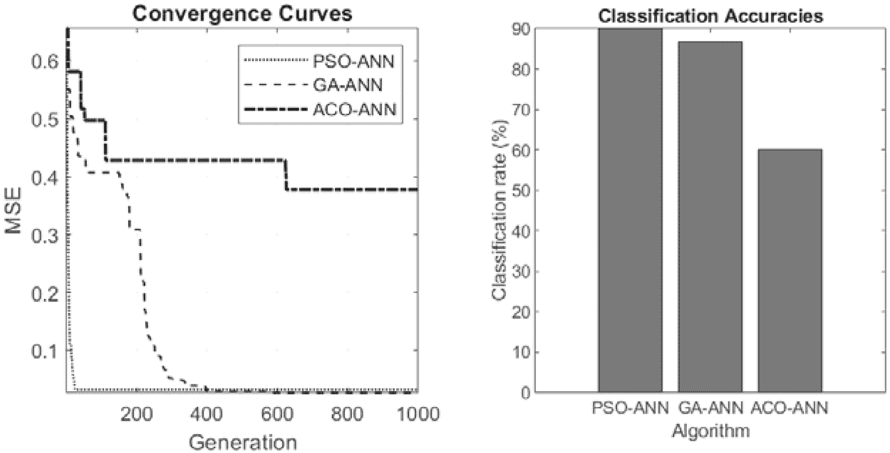

图 8.1. 模型的收敛曲线和分类准确率。

## 基于群体智能和遗传算法的特征选择

### 问题定义

多位研究人员已经在能源预测领域研究了机器学习技术的应用 (Azadeh et al., 2013; Candanedo et al., 2017; Ekonomou, 2010; Kouziokas, 2019)。Candanedo 等人 (2017) 通过实施支持向量机、随机森林和梯度提升机等机器学习模型，提出了关于低能房屋电器用电的数据驱动预测模型。Moldovan 和 Slowik (2021) 将多目标二值灰狼优化算法与机器学习方法（如支持向量机、随机森林、极端树和 K 邻域）相结合，开发了电器能耗预测模型。在本节中，通过结合粒子群优化和遗传算法的人工神经网络模型，实现了智能家居 IoT 设备的电器能耗预测。

### 机器学习中的数据分析

机器学习的数据分析方法主要包括几个阶段，如：数据收集、数据清洗、归一化与准备、特征选择、通过测试多种架构开发机器学习模型，最后使用合适的评估指标进行模型评估。

### 能耗数据集


家电能量预测数据集从机器学习存储库¹获取

### 数据预处理
对数据进行了预处理，以消除不一致项和空值。机器学习方法的输出参数为“家电能耗”。输入向量是数据集的所有其他变量。使用最小最大归一化方法对数据集进行了归一化。

### 归一化
使用最小最大归一化方法将数据集的值转换到 [0,1] 区间，公式如下：

(8.4)

$$n\_{i} = \\frac{x\_{i} - \min\left( x \right)}{\\max\left( x \right) - \min\left( x \right)}$$

其中，

* `n[i]` 表示第 i 个归一化后的值。
* `x[i]` 表示第 i 个样本值。
* `min(*x*)` 表示数据集中的最小值。
* `max(*x*)` 表示数据集中的最大值。

表 8.1. 数据变量及描述。

| 数据变量 || 单位 || 变量数量 |
| --- | --- | --- |
| 家电能耗 || Wh || 1 |
| --- | --- | --- |
| 光源能耗 || Wh || 2 |
| T1, 厨房区域温度 || °C || 3 |
| RH1, 厨房区域湿度 || % || 4 |
| T2, 客厅区域温度 || °C || 5 |
| RH2, 客厅区域湿度 || % || 6 |
| T3, 洗衣室温度 || °C || 7 |
| RH3, 洗衣室湿度 || % || 8 |
| T4, 办公室温度 || °C || 9 |
| RH4, 办公室湿度 || % || 10 |
| T5, 浴室温度 || °C || 11 |
| RH5, 浴室湿度 || % || 12 |
| T6, 建筑外温度（北侧） || °C || 13 |
| RH6, 建筑外湿度 || % || 14 |
| T7, 熨衣室温度 || °C || 15 |
| RH\_7, 熨衣室湿度 || % || 16 |
| T8, 二号青少年房温度 || °C || 17 |
| RH\_8, 二号青少年房湿度 || % || 18 |
| T9, 父母房温度 || °C || 19 |
| RH\_9, 父母房湿度 || % || 20 |
| To, 室外温度（来自 Chievres 气象站） || °C || 21 |
| 压力（来自 Chievres 气象站） || mm Hg || 22 |
| RH\_out, 室外湿度（来自 Chievres 气象站） || % || 23 |
| 风速（来自 Chievres 气象站） || m/s || 24 |
| 能见度（来自 Chievres 气象站） || km || 25 |
| Tdewpoint, 露点（来自 Chievres 气象站） || °C || 26 |
| rv1, 随机变量 1 || 无维度 || 27 |
| rv2, 随机变量 2 || 无维度 || 28 |

### 异常值处理
选定的数据集出现了极高和极低值，这可能会影响机器学习模型的泛化能力。开发机器学习模型的最佳方法是移除极值。为了发现数据集中的异常值，将使用一些统计测量量，如样本均值、标准差、峰度和偏度。样本均值 `X̄` 的计算公式如下：

(8.5)

$$\\overline{X} = \\frac{\sum\_{i = 1}^{n}X\_{i}}{n}$$

样本标准差 `S` 的计算公式如下：

(8.6)

$$S = \leftlbrack {\\sum\_{i = 1}^{n}{\\left( {X\_{i} - \\overline{X}} \\right)^{2}/\\left( {n - 1 \\right)}} \\right^{1/2}$$

偏度是概率分布对称性的统计测量量。偏度的绝对值越大，偏离正态分布的程度越高。偏度通过以下公式计算（Wang 等人，2018）：

(8.7)

$$Skewness = \\frac{\\sum\_{i = 1}^{N}\\left( {X\_{i} - \\overline{X}} \\right)^{3}}{\\left( {n - 1 \\right)S^{3}}$$

峰度是一个显示数据相对于正态分布而言是肥尾还是轻尾的统计测量量，通过以下公式计算：

(8.8)

$$Kurtosis = \\frac{\\sum\_{i = 1}^{N}\\left( {X\_{i} - \\overline{X}} \\right)^{4}}{\\left( {n - 1 \\right)S^{4}}$$

标准正态分布的峰度等于 3。文献中的某些来源提出了以下计算峰度的公式，也称为“超峰度”（Wang 等人，2018）：

(8.9)

$$Kurtosis = \\frac{\\sum\_{i = 1}^{N}\\left( {X\_{i} - \\overline{X}} \\right)^{4}}{\\left( {n - 1 \\right)S^{4}} - 3.$$

如果分布是正态的，可以使用 `1.5*IQR` 规则，其中 `IQR` 代表分布中 `Q[1]` 和 `Q[2]` 分位数之间的四分位距。下限和上限可以使用以下公式计算：

(8.10)

`lower bound = Q[1] - 1.5*IQR`

(8.11)

`upper bound = Q[2] + 1.5*IQR`

在这种情况下，样本的峰度为 –0.0023，偏度为正 0.7903，与正态分布有所不同。因此，将使用 `2*S` 规则移除异常值。根据该规则，估计目标值的样本标准差 `S`，并通过根据公式计算下限和上限来移除数据异常值：

(8.12)

$$lower, bound = \\overline{X} - 2*S$$

(8.13)

$$upper, bound = \\overline{X} + 2*S$$

其中，

* `X̄` 表示均值。
* `S` 表示标准差。

样本均值为 24.75，标准差为 64.68，根据上述公式下限为 15.18，上限为 114.18。

### 基于代价的特征选择
代价函数通常用于评估机器学习模型的性能。有多种代价函数，例如平均绝对误差 (MAE)、均方误差 (MSE)、均方根误差 (RMSE)、均方根对数误差 (RMSLE)。基于代价的特征子集选择基于分类器或回归器，通过代价函数对其性能进行评估（如回归中的 `MSE, RMSE` 以及分类中的准确率、F1 分等），并通过搜索搜索空间寻找最佳特征子集的群或进化优化方法。均方误差 (MSE) 表示为：

(8.14)

$$\\text{MSE=}\\frac{\\sum\_{n}^{i - 1}\\left( {Y\_{i} - \\overset{\\land}{Y\_{i}}} \\right)^{2}}{n}$$

其中，

* `Y[i]` 代表实际值。
* `Yhat[i]` 代表预测值。
* `n` 代表测量次数。

### 相关选择
由于基于代价的方法与群智能搜索方法结合时成本更高且非常耗时，通常使用基于相关的特征选择方法。Hall (1999) 提出了 `Merit` 作为一种相关性衡量量。该度量与 Pearson 相关系数方程相似，可用于评估相关特征选择 (CFS) 算法。为了定义包含高度类别相关且彼此互不相关的特征子集，Hall (1999) 提出了以下优度量：

(8.15)

$$\\text{MSE=}\\frac{\\sum\_{n}^{i - 1}\\left( {Y\_{i} - \\overset{\\land}{Y\_{i}}} \\right)^{2}}{n}$$

其中，

* `Merit[s]` 表示包含 `k` 个特征的子集 `S` 的优度
* `r[cf]` 表示与类别的平均相关性
* `r[ff]` 表示特征间的平均相关性。


在本实验中，选择 CFS 优度作为群体算法和进化算法的适应度函数。使用了几种基于群体和演化的特征选择方法：遗传算法、几何粒子群优化、进化算法、混沌和谐搜索和混沌布谷鸟搜索。

## 遗传算法

### GA 算法参数

| 种群规模：|| 20 |
| --- | --- |
| 代数：|| 20 |
| 选择策略：|| 轮盘赌 |
| 交叉类型：|| 单点交叉 |
| 变异：|| 均匀变异 |
| 交叉概率：|| 0.6 |
| 变异概率：|| 0.033 |

### 遗传算法结果

下表展示了遗传算法最后一代染色体的适应度值。

表 8.2. 第 20 代遗传算法结果。

| 染色体 || 适应度值 || 子集 |
| --- | --- | --- |
| **1** || **0.43273** | **1 4 16 17** |
| --- | --- | --- |
| 2 || 0.43273 || 1 4 16 17 |
| 3 || 0.39589 || 1 2 4 10 16 17 22 |
| 4 || 0.33461 || 1 16 17 21 24 |
| 5 || 0.39 || 1 4 16 17 24 |
| 6 || 0.43273 || 1 4 16 17 |
| 7 || 0.43273 || 1 4 16 17 |
| 8 || 0.35691 || 1 4 10 14 16 17 21 |
| 9 || 0.38071 || 1 4 14 16 17 19 |
| 10 || 0.37789 || 1 4 15 16 17 |
| 11 || 0.37649 || 1 2 3 4 16 17 |
| 12 || 0.42288 || 1 4 16 17 22 |
| 13 || 0.43273 || 1 4 16 17 |
| 14 || 0.32487 || 1 4 16 25 |
| 15 || 0.40494 || 1 4 16 17 21 |
| 16 || 0.43273 || 1 4 16 17 |
| 17 || 0.39774 || 1 4 16 |
| 18 || 0.33358 || 1 4 8 11 15 17 |
| 19 || 0.42155 || 1 4 17 |
| 20 || 0.37404 || 1 2 4 16 17 25 |

根据最佳适应度值（最大值），遗传算法特征选择选出的属性为 1, 4, 16, 17。

## 几何 PSO

### GPSO 参数

使用了 Moraglio 等人 (2007) 提出的几何粒子群算法 (`GPSO`) 进行特征选择。实验参数如下。

| 种群规模：|| 20 |
| --- | --- |
| 群体拓扑：|| 全连接 |
| 迭代次数：|| 20 |
| 系数 `w[1]` || 0.33 |
| 系数 `w[2]` || 0.33 |
| 系数 `w[3]` || 0.34 |
| 交叉类型：|| 三父掩码交叉 |
| 变异类型：|| 位翻变异 |
| 变异概率：|| 0.01 |

### GPSO 结果

下表展示了 GPSO 算法最后一代粒子的适应度值。根据最佳适应度值（最大值），GPSO 算法特征选择选出的属性为：1, 2, 16, 17, 22。

表 8.3. 第 20 次迭代 GPSO 算法结果。

| 粒子 || 适应度值 || 子集 |
| --- | --- | --- |
| 1 || 0.41967 || 1 2 16 17 22 |
| 2 || 0.41967 || 1 2 16 17 22 |
| 3 || 0.41967 || 1 2 16 17 22 |
| 4 || 0.41967 || 1 2 16 17 22 |
| 5 || 0.41967 || 1 2 16 17 22 |
| 6 || 0.41967 || 1 2 16 17 22 |
| 7 || 0.41967 || 1 2 16 17 22 |
| 8 || 0.41967 || 1 2 16 17 22 |
| 9 || 0.41967 || 1 2 16 17 22 |
| 10 || 0.41967 || 1 2 16 17 22 |
| 11 || 0.41967 || 1 2 16 17 22 |
| 12 || 0.38319 || 1 2 6 16 17 22 |
| 13 || 0.39684 || 1 2 6 17 22 |
| 14 || 0.41967 || 1 2 16 17 22 |
| 15 || 0.41967 || 1 2 16 17 22 |
| 16 || 0.41967 || 1 2 16 17 22 |
| 17 || 0.41967 || 1 2 16 17 22 |
| 18 || 0.41967 || 1 2 16 17 22 |
| 19 || 0.3875 || 1 2 7 16 17 22 |
| 20 || 0.41967 || 1 2 16 17 22 |

## 混沌搜索

### 算法参数

| 初始和谐规模：|| 20 |
| --- | --- |
| 迭代次数：|| 20 |
| 变异：|| 位翻变异 |
| 变异概率：|| 0.01 |
| 记忆大小：|| 25 |
| 记忆接受率：|| `r[accept]` = 0.9 |
| 初始频率调整率 (PAR)：|| `r[pitch]` = 0.4 |
| PAR 混沌方法：|| Logistic 映射 |
| Logistic 映射系数：|| 4.0 |
| PAR 下界 (`PAR[min]`)：|| 0.4 |
| PAR 上界 (`PAR[max]`)：|| 0.9 |
| 频率带宽：|| `b = 0.02*(PAR[max] – PAR[min])` |

### 混沌搜索结果

下表展示了带变异混沌搜索算法最后一代的和谐体适应度值。

表 8.4. 第 20 代带变异混沌搜索结果，具有最优结果。

| 和谐 || 适应度值 || 子集 |
| --- | --- | --- |
| 1 || 0.27533 || 7 8 9 12 17 24 |
| 2 || 0.33034 || 1 3 4 12 17 21 |
| 3 || 0.35268 || 1 4 8 10 13 17 |
| 4 || 0.32453 || 1 4 6 8 15 21 22 27 |
| 5 || 0.32449 || 1 4 12 17 18 21 26 |
| 6 || 0.36828 || 1 4 8 12 15 17 21 |
| 7 || 0.33535 || 1 4 8 12 17 18 24 |
| 8 || 0.33596 || 4 13 17 21 |
| 9 || 0.33432 || 4 13 17 |
| 10 || 0.40103 || 1 4 12 17 |
| 11 || 0.30418 || 1 12 18 |
| 12 || 0.28135 || 1 8 18 |
| 13 || 0.3508 || 4 12 17 |
| 14 || 0.31567 || 1 4 12 17 25 |
| 15 || 0.33251 || 1 3 4 12 17 22 24 |
| 16 || 0.3482 || 4 12 17 22 |
| 17 || 0.37476 || 1 4 6 8 17 21 22 |
| 18 || 0.31707 || 1 4 12 18 |
| 19 || 0.32146 || 4 8 12 14 17 |
| 20 || 0.34047 || 4 8 12 17 |

根据最佳适应度值（最高值），带变异混沌搜索算法特征选择选出的属性为 1, 4, 12, 17。

## 混沌布谷鸟搜索

### 算法参数

| 初始规模：|| 20 |
| --- | --- |
| 迭代次数：|| 20 |
| 变异：|| 位翻变异 |
| 变异概率：|| 0.01 |
| 混沌方法：|| Logistic 映射 |
| Logistic 映射系数：|| 4.0 |
| 初始速率：|| 25 |
| Sigma 速率：|| 0.70 |

### 混沌结果

下表展示了带变异混沌布谷鸟搜索最后一代（第 20 代）的和谐体适应度值。根据最佳适应度值（最大值），混沌布谷鸟搜索特征选择选出的属性为：1, 16。

| 和谐 || 适应度值 || 子集 |
| --- | --- | --- |
| **1** || 0.3875 || 1 2 7 16 17 22 |
| 2 || 0.41967 || 1 16 |
| **3** || 0.41967 || 1 16 |
| 4 || 0.41967 || 1 16 |
| 5 || 0.41967 || 1 16 |
| 6 || 0.41967 || 1 16 |
| 7 || 0.41967 || 1 16 |
| 8 || 0.41967 || 1 16 |
| 9 || 0.36199 || 1 16 |
| 10 || 0.41967 || 1 16 |
| 11 || 0.3649 || 1 16 |
| 12 || 0.38557 || 1 16 |
| 13 || 0.3874 || 1 16 |
| 14 || 0.41967 || 1 16 |
| 15 || 0.41967 || 1 16 |
| 16 || 0.41967 || 1 16 |
| 17 || 0.38557 || 1 16 |
| 18 || 0.41967 || 1 16 |
| 19 || 0.39074 || 1 16 |
| 20 || 0.41967 || 1 16 |

## 进化算法

### EA 参数

| 种群规模：|| 20 |
| --- | --- |
| 代数：|| 20 |
| 变异：|| 位翻变异 |
| 变异概率：|| 0.10 |
| 交叉：|| 单形交叉 (Tsui 等，1999) |
| 交叉概率：|| 0.60 |
| 选择算子：|| 锦标选择 |

### EA 结果

下表展示了带变异进化算法最后一代的染色体适应度值。

表 8.6. 进化算法第 18 代结果。

| 染色体 || 适应度值 || 子集 |
| --- | --- | --- |
| **1** || 0.3860 || 1 2 4 5 10 12 16 17 19 22 |
| --- | --- | --- |
| 2 || 0.3771 || 1 2 4 10 12 16 17 19 22 26 |
| 3 || 0.3127 || 1 2 3 4 10 11 12 13 14 16 17 21 22 25 26 27 |
| 4 || 0.3327 || 1 2 4 5 6 10 12 14 16 17 18 19 22 23 24 26 |
| 5 || 0.3513 || 1 2 4 5 10 12 16 17 19 23 26 |


| 6 || 0.3414 || 1 4 10 11 12 13 15 16 17 19 26 |
| 7 || 0.3501 || 1 2 4 12 13 16 17 21 22 25 26 |
| 8 || 0.3425 || 1 2 3 4 11 12 13 16 17 20 21 22 24 26 |
| 9 || 0.3442 || 1 2 6 10 11 12 13 16 17 19 22 23 26 |
| 10 || 0.3562 || 1 4 5 12 16 17 18 21 22 26 |
| 11 || 0.3929 || 1 2 4 5 12 16 17 19 22 |
| 12 || 0.3663 || 1 2 4 5 12 16 17 19 21 26 |
| 13 || 0.3249 || 1 2 4 5 6 7 11 12 13 17 20 22 25 |
| 14 || 0.3470 || 2 4 5 12 13 16 17 21 22 26 |
| 15 || 0.3684 || 1 2 4 10 12 16 17 19 20 22 26 |
| 16 || 0.3191 || 1 6 12 16 17 19 22 23 25 26 |
| 17 || 0.3367 || 1 2 4 5 10 11 12 14 16 19 21 22 25 |
| 18 || 0.3616 || 1 2 4 12 13 15 16 17 21 22 26 |
| 19 || 0.3434 || 1 2 4 5 10 12 13 16 17 18 22 24 26 |
| 20 || 0.3156 || 1 2 9 10 12 13 16 17 18 19 21 25 |

根据最佳适应度值，进化算法选择了以下特征：1, 2, 4, 5, 12, 16, 17, 19, 22：

* 灯光 (Lights)
* T1
* T2
* RH_2
* T6
* T8
* RH_8
* RH_9
* RH_out

## 使用降维特征、SVM 和随机森林进行预测

使用随机森林 (Breiman, 1996, 1999, 2001) 和支持向量机来预测输出，通过 27 个特征的输入向量预测 IoT 设备测量的用电器功率，并根据群体智能和进化模型与使用降维特征作为输入所产生模型的预测性进行比较。采用 10 折交叉验证作为验证技术以发现最佳模型。使用 RMSE 作为误差指标。

支持向量机由 Vapnik (1995) 提出。支持向量回归或支持向量回归 (SVR) 使用 `ε`-不敏感损失函数来解决回归问题。回归中的通用估计 `SVM` 函数由以下方程表示：

(8.16)

$$Merit_{s} = \frac{k{\overline{r}}\_{cf}}{\sqrt{k + k\left( {k - 1} \right){\overline{r}}\_{ff}}}$$

其中 `w` ⊂ `R^n`，`b` ⊂ `R`，且 `Φ` 代表从 `R^n` 到高维空间的非线性变换。支持向量机中有多种类型的核函数，例如线性、高斯、多项式和 RBF 核。

利用 Lib-SVM 库 (Chang and Lin, 2001, 2011)，该库实现了用于支持向量机 (SVMs) 的 SMO（序列最小优化）算法。实现了 epsilon-支持向量回归，超参数为：RBF 核、代价 `C` = 100、gamma `γ` = 0.01 且 epsilon `e` = 0.001。在随机森林方法中，树的数量为 100，最大深度为 0。

比较结果对照表显示，基于群体智能的最佳特征选择方法是使用九个输入特征的进化算法，其预测结果与 27 个输入特征的结果非常接近。表 8.7. 模型结果。

| 模型 | 特征 | 10 折交叉验证下的随机森林 RMSE | Lib-SVM `C` = 100, `γ` = 0.01, `e` = 0.001, 10 折交叉验证下的 RBF 核 RMSE |
| :--- | :--- | :--- | :--- |
| 遗传算法 | (1, 4, 16, 17) | 14.59 | 19.16 |
| 几何 PSO | (1, 2, 16, 17, 22) | 13.63 | 19.20 |
| 混沌和谐 | (1, 4, 12, 17) | 14.89 | 19.18 |
| 混沌布谷搜索 | (1, 16, 22) | 19.04 | 19.34 |
| 进化算法 | (1, 2, 4, 5, 12, 16, 17, 19, 22) | 12.04 | 18.84 |
| Lib-SVM | 所有特征 | - | 17.58 |
| 随机森林 | 所有特征 | 11.47 | - |

## 基于 PSO-SVM 的犯罪预测

预测模型使用了 PSO 优化的支持向量机。犯罪数据集来自芝加哥市官方网站 (data.cityof.org)。犯罪率代表每 200,000 人每天犯罪的数量。失业数据来自美国劳工统计局网站 ([www.bls.gov](http://www.bls.gov))。使用 10 折交叉验证防止模型过拟合，因为这是一个时间序列问题。利用了 2012 年至 2015 年的每日犯罪数据。还将失业数据作为输入，因为它影响犯罪率。时间 `t` 预测模型的输入向量 `X[t]` 包含：前日的失业率 `UN[t–1]` 和犯罪率 `CR[t–1]`。时间步为一天。

(8.17)

`X[t] = (CR[t-1], UN[t-1])`

时间 `t` 机器学习模型的目标向量 `T[t]` 是输入向量参数的前一个步值：

(8.18)

`T[t] = CR[t]`

PSO 作为超参数优化方法。使用均方根误差 (RMSE) 来评估预测误差并衡量 PSO 优化模型的性能。常用的 PSO 超参数为：种群大小 P = 50、惯性权重 `w` = 0.99、个体学习系数 `c[1]` = 2.0、全局学习系数 `c[2]` = 2.0 以及全连接拓扑。利用 PSO 算法搜索空间以寻找最佳超参数。使用 RBF SVM 核是因为通常认为它可以产生最优结果。调优的超参数有：代价 `C`、gamma (`γ`) 参数、epsilon 参数以及输入向量是否标准化。超参数搜索范围见下表。

PSO 算法在 30 次迭代内找到的最佳 SVM 超参数架构为：代价 `C` = 1.1426、gamma `γ` = 3.5907、epsilon `ε` = 0.023833、数据标准化：false。RMSE 为 5.4882。

表 8.8. 应用 PSO 的超参数搜索范围。

| 超参数 | 下限 | 上限 |
| :--- | :--- | :--- |
| 代价 `C` | 0.001 | 1000 |
| gamma `γ` | 0.001 | 1000 |
| epsilon `ε` | 0.010 | 100 |
| 标准化 | true | false |


图 8.2. PSO 优化 SVM 超参数的收敛曲线。


图 8.3. 犯罪率真实值与预测值（每 200,000 人犯罪数量）的对比图。

## 参考文献

*   Anand, A. and Suganthi, L. (2020). 使用混合 ANNPSO 模型预测电力需求。pp. 865-882 In: Deep Learning and Neural Networks: Concepts, Methodologies, Tools, and Applications. IGI Global.
*   Azadeh, A., Babazadeh, R. and Asadzadeh, S. M. (2013). 神经网络对可再生能源消耗的最优估计和预测。Renewable and Sustainable Energy Reviews, 27: 605-612.


*   Candanedo, L. M., Feldheim, V. and Deramaix, D. (2017). 低能房屋中电器设备能耗的数据驱动预测模型。Energy and Buildings, 140: 81-97.
*   Castro, J. L., Mantas, C. J. and Benıtez, J. M. (2000). 输出带有连续压缩函数的神经网络是通用逼近器。Neural Networks, 13(6): 561-563.
*   Chang, C. C. and Lin, C. J. (2001).训练 v-支持向量分类器：理论与算法。Neural computation, 13(9): 2119-2147.
*   Chang, C.-C. and Lin, C.-J. (2011). LIBSVM: 一个用于支持向量机的库。ACM Trans. Intell. Syst. Technol., 2(3): Article 27. doi: [`doi.org/10.1145/1961189.1961199.`](https://doi.org/10.1145/1961189.1961199.)
*   Ekonomou, L. (2010). 使用人工神经网络进行希腊长期能源耗预测。Energy, 35(2): 512-517.
*   Honik, K. (1991). 多层前馈神经网络的近似能力。Neural Networks, 4(2): 251-257.
*   Ilonen, J., Kamarainen, J. K. and Lampinen, J. (2003). 用于前馈神经网络的差分进化训练算法。Neural Processing Letters, 17(1): 93-105.
*   Koopialipoor, M. Armaghani, D. J. Hedayat, A. Marto, A. Gordan, B. (2019). 应用各种混合智能系统评估和预测静态及动态条件下的坡体稳定性。Soft Computing, 23: 5913-5929.
*   Kouziokas, G. N. (2019). 能源电器预测中的长短期记忆（LSTM）深度神经网络。第 1-5 页。在: 2019 年泛希腊电子与电信会议 (PACET)。IEEE. doi: [`doi.org/10.1109/PACET48583.2019.8956252.`](https://doi.org/10.1109/PACET48583.2019.8956252.)
*   Mirjalili, S., Hashim, S. Z. and Sardroudi, H. (2012). 使用混合粒子群优化和引力搜索训练前馈神经网络。Applied Mathematics and Computation, 218(22): 1125-37.
*   Moayedi, H., Moatamediyan, A., Nguyen, H., Bui, X.-N., Bui, D. T. and Rashid, A. S. (2019). 通过各种进化和神经网络模型预测极限承载力。Engineering with Computers, 1-17.
*   Moldovan, D. and Slowik, A. (2021). 使用机器学习和多目标灰狼优化特征选择的电器能耗预测。Applied Soft Computing, 111.
*   Nourbakh, A., Safikhani, H. and Derakhshan, S. (2011). 多目标粒子群优化与 NSGA II 算法的比较：在离心泵的应用。Op, 43: 1095-113.
*   Panchal, G., Ganatra, A., Kosta, Y. and Panchal, D. (2011). 具有多个隐藏神经元和隐藏层的多层感知器的行为。International Journal of Computer Theory and Engineering, 3(2): 332-37.
*   Socha, K. and Blum, C. (2007). 一种连续优化的蚁群算法：应用于前馈神经网络。Neural Computing and Applications, 16(3): 235-47.
*   Tsutsui, S., Yamamura, M. and Higuchi, T. (1999). 实数编码遗传算法中的多父重组。第 657-664 页。在: 第 1 届遗传与进化计算会议论文集 1。
*   Vapnik, V. N. (1995). 统计学习的本质。Springer-Verlag New。
*   Wang, H., Cui, Z., Chen, Y., Avidan, M., Abdallah, A. and Kronzer, A. (2018). 敏感深度学习预测再次住院。IEEE/ACM Transactions on Computational Biology and Bioinformatics, 15(6): 1968-97.
*   Yam, J. Y. and Chow, T. W. (2001). 通过突触系数优化初始化增强前馈网络。IEEE Transactions on Neural Networks, 12(2): 430-4.
*   Zhang, C. and Shao, H. (2000). 新进化系统的 ANN 及其应用。第 39 届 IEEE 决策与控制会议论文集 (Cat. No. 00CH3718), 4: 3562-63.

# 第 9 章 深度学习中的群智能与进化

本章致力于深度学习优化。介绍了单向、双向长短期记忆（LSTM 和 Bi-LSTM）以及卷积神经网络（CNN）的理论背景，以及应用于这些深度学习方法的群智能和进化优化方法。本章的实验部分涉及用于深度学习模型的群智能和进化计算示例，包括胸 X 光诊断。

## 深度 LSTM 和 Bi-LSTM 网络

近年来，深度单向长短期记忆（LSTM）和双向 LSTM（Bi-LSTM）已应用于多个科学问题作为预测网络。LSTM 和 Bi-LSTM 的拓扑结构与循环神经网络（RNNs）相似，但 LSTM 和 Bi-LSTM 网络相比于典型的 RNN 的主要优势在于它们克服了梯度消失问题，这是普通 RNN 的一个重要缺陷（[Cortez et al., 2018)）。许多研究人员调查了 LSTM 和 Bi-LSTM 模型在许多科学领域的应用（[Behera et al., 2021; Chadha et al., 2020]）。

LSTM 网络由四种主要的门：输入门、遗忘门、细胞候选和输出门。表示时间步 `t` 每个组件的方程如下：

输入门的数学公式为：
(9.1)
`i[t] = σ(W[i]x[t] + R[i]h[t] + b[i])`

遗忘门的数学公式为：
(9.2)
`f[t] = σ(W[f]x[t] + R[f]h[t] + b[f])`

细胞候选的数学公式为：
(9.3)
`g[t] = σ(W[g]x[t] + R[g]h[t] + b[g])`

输出门的数学公式为：
(9.4)
`o[t] = σ(W[o]x[t] + R[o]h[t] + b[o])`

其中，
*   `i`, `f`, `g`, `o` 分别代表输入门、遗忘门、细胞候选和输出门，
*   `W` 代表输入权重
*   `R` 代表循环权重
*   `b` 代表偏置
*   `h[t]` 是时间步 `t` 的隐藏状态
*   `σ[c]` 是状态激活函数。

时间 `t` 的细胞状态用数学公式表示：
(9.5)
`c[t] = f[t] ⊙ c[t-1] + i[t] ⊙ g[t]`

其中：`⊙` 表示哈达玛积。

给定时间 `t` 的隐藏状态可以用数学公式表示为：
(9.6)
`c[t] = f[t] ⊙ c[t-1] + i[t] ⊙ g[t]`

在双向 LSTM (Bi-LSTM) 拓扑结构中，网络有两个方向：正向和反向，与标准的单向 LSTM 不同，它能够使用来自两侧的数据（[Schuster and Paliwal, 1997)）。这有助于 Bi-LSTM 网络根据文献获得改进的预测结果（[Shahid et al., 2020`; `Zhang et al., 2020]）。

## 深度 CNN（卷积神经网络）


CNN 是文献中处理图像任务时常用的深度学习方法。卷积神经网络主要用于图像分类和计算机视觉。在 CNN 出现之前，人们使用复杂的特征提取方法来对物体和图像进行分类。与其他类型的神经网络相比，当输入为图像或音频信号时，卷积神经网络提高了性能。CNN 具有多种类型的层，例如：卷积层、池化层、激活层、Dropout 层、全连接层，具有多个超参数，如滤波器的数量和大小、池化类型（最大池化或平均池化）。卷积层和池化层通常使用 `ReLu` 激活函数，全连接层通常实现 `SoftMax` 激活函数以便对输入进行分类 (LeCun et al., 2010)。卷积层操作的一个示例见图 9.1。

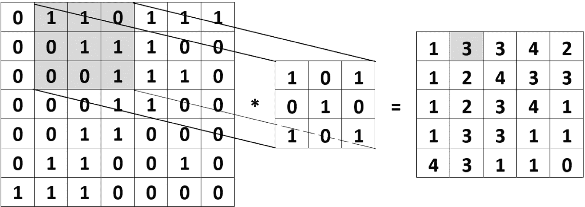

图 9.1.卷积函数示例。

池化层的作用是通过下采样特征图来降低 CNN 的复杂性。最大池化和平均池化最为常用。平均池化的一个简单示例见图 9.2。

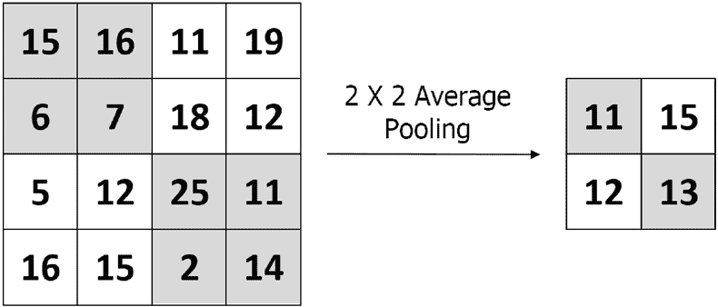

图 9.2.卷积函数示例。

随后，池化后的特征图被展平为一列（如图 9.3

图 9.3.简单展平操作示例。

针对多种问题有多种预训练模型可以用于迁移学习，例如 `ResNet18`（18 层）、`ResNet50`（50 层）、`AlexNet`、`GoogleNet` 和 `Darknet19` (LeCun et al., 2015)

## CNN 和 LSTM 优化

### 拓扑优化

可以实现群智能和进化策略来优化深度学习模型的拓扑，涉及隐藏层中隐藏神经元的数量、卷积层中滤波数量、池化类型等。

为了优化深度学习模型，应为群智能或进化方法设置目标函数。根据文献，最常用的目标函数是误差指标。对于回归问题，可以使用均方误差或平均绝对误差；对于分类问题，则使用准确率、灵敏度和 F 分数等误差指标。

根据文献，群智能方法在深度学习优化方面的性能优于其他优化算法 (Kim and Cho, 2019; Ren et al., 2021; Wang et al., 2020)。深度学习方法也可以通过其他方式进行优化，例如优化训练选项参数：最大迭代轮数 (Maximum epochs)、初始学习率、优化算法、`l`[2] 正则化值、小批次大小、动量等。

### 权重优化

也可以通过群优化和进化优化方法实现深度学习方法的权重优化 (Ilonen et al., 2003; Socha and Blum, 2007)。与拓扑优化类似，应为群智能或进化方法设置合适的适应度函数来训练深度学习模型，例如：回归问题中的均方误差 (`MSE`) 或均方根误差 (`RMSE`) 或平均绝对误差 (`MAE`)，以及分类问题中的准确率、精确率、召回率和 F 分数。

在深度学习模型权重优化中，计算复杂度会增加。通常，在使用 `ResNet18`、`DarkNet19` 等迁移学习模型进行微调时，优化方法被应用于最后一个可训练层 (Koppu et al., 2020)。每个粒子的位置代表目标函数优化问题的一个解，深度学习权重向量通过群粒子进行优化，以获得适应度函数的优解。

## 实验

### Bi-LSTM 优化

#### 数据集

实验使用了日语元音数据集。该数据集获取自机器学习仓库²

#### 目标函数

使用百分比误差作为目标函数。准确率衡量的是正确预测的数量除以预测的总数。百分比误差由以下公式表示：

#### 正确预测的实例

(9.7)

$$
\text{Percentatge~error=1-Accuracy=1-}\frac{Correctly\,, predicted\,, intances}{\text{Total}\\,\text{number}\\,of}\\, intances}
$$

*实例*总数

#### 实验设置

使用了两种方法作为优化技术来优化深度双向 LSTM：自适应惯性粒子群优化 (`Adaptive w-PSO`) 和遗传算法 (`GA`)。

#### 遗传算法参数

| 参数 | 值 |
| --- | --- |
| 群体: | 50 |
| 代数: | 48 |
| 选择: | 轮盘 |
| 交叉类型: | 单点 |
| 变异: | 高斯 |
| 交叉概率: | 0.6 |
| 变异概率: | 0.03 |

#### 自适应惯性 PSO 参数

| 参数 | 值 |
| --- | --- |
| 群体大小: | 50 |
| 拓扑: | 全连接 |
| 群粒子初始化: | 随机分布 |
| 迭代次数: | 48 |
| 自适应惯性权重范围: | [0.2, 1.1] |
| 初始惯性权重: `max(Inertia Range) = 1.1` |
| 个体学习系数: `c[1] = 2.0` |
| 全局学习系数: `c[2] = 2.0` |

#### 双向 LSTM 参数

| 参数 | 值 |
| --- | --- |
| 小批次大小: | 32 |
| 迭代轮数: | 30 |
| 动量: | 0.9 |
| 优化器: | adam |
| 梯度阈值: | 1 |
| 层: | 序列输入层 |
| | bilstm 层 |
| | 全连接层 |
| | softmax 层 |
| 输入特征大小 | 12 |
| 类别数量: | 9 |

选择优化的超参数为：隐藏层神经元、初始学习率、L2 正则化。下表展示了超参数的上下边界。

图 9.1. 连续搜索空间的超参数上下边界。

| 超参数 | 下界 | 上界 |
| --- | --- | --- |
| 隐藏层神经元 | 100 | 250 |
| 初始学习率 | 0.01 | 0.09 |
| L2 正则化 | 0.0001 | 0.0009 |

在 w-PSO-Bi-LSTM 优化期间的超参数值和百分比误差如表所示。

图 9.2. 在 w-PSO-BiLSTM 优化期间的超参数值和百分比误差。

| 迭代 | 隐藏层大小 | 初始学习率 | L2 正则化 | 百分比误差 | 准确率 | 历史最佳误差 | 历史最佳准确率 |
| --- | --- | --- | --- | --- | --- | --- | --- |
| 1 | 189 | 0.0823 | 0.00064155 | 0.0811 | 0.9189 | 0.0811 | 0.9189 |
| 2 | 225 | 0.0458 | 0.00079433 | 0.1027 | 0.8973 | 0.0811 | 0.9189 |


| 3 | 106 | 0.0178 | 0.00073525 | 0.0405 | 0.9595 | 0.0405 | 0.9595 |
| 4 | 175 | 0.0882 | 0.00029546 | 0.1432 | 0.8568 | 0.0405 | 0.9595 |
| 5 | 202 | 0.0796 | 0.00060226 | 0.0649 | 0.9351 | 0.0405 | 0.9595 |
| 6 | 138 | 0.049 | 0.00012304 | 0.0757 | 0.9243 | 0.0405 | 0.9595 |
| 7 | 221 | 0.036 | 0.00048475 | 0.0784 | 0.9216 | 0.0405 | 0.9595 |
| 8 | 153 | 0.0862 | 0.00049437 | 0.1216 | 0.8784 | 0.0405 | 0.9595 |
| 9 | 128 | 0.0477 | 0.00029818 | 0.0595 | 0.9405 | 0.0405 | 0.9595 |
| 10 | 233 | 0.0876 | 0.00020224 | 0.2162 | 0.7838 | 0.0405 | 0.9595 |
| 11 | 198 | 0.0694 | 0.00088528 | 0.0919 | 0.9081 | 0.0405 | 0.9595 |
| 12 | 219 | 0.0201 | 0.00048803 | 0.0405 | 0.9595 | 0.0405 | 0.9595 |
| 13 | 112 | 0.0189 | 0.00019942 | 0.0351 | 0.9649 | 0.0351 | 0.9649 |
| 14 | 203 | 0.0632 | 0.00043017 | 0.1432 | 0.8568 | 0.0351 | 0.9649 |
| 15 | 122 | 0.0156 | 0.00089184 | 0.1135 | 0.8865 | 0.0351 | 0.9649 |
| 16 | 183 | 0.0508 | 0.00087723 | 0.0892 | 0.9108 | 0.0351 | 0.9649 |
| 17 | 145 | 0.0342 | 0.00080962 | 0.0514 | 0.9486 | 0.0351 | 0.9649 |
| 18 | 185 | 0.0761 | 0.00016918 | 0.1703 | 0.8297 | 0.0351 | 0.9649 |
| 19 | 124 | 0.0895 | 0.00026703 | 0.0649 | 0.9351 | 0.0351 | 0.9649 |
| 20 | 104 | 0.0605 | 0.00084476 | 0.0946 | 0.9054 | 0.0351 | 0.9649 |
| 21 | 125 | 0.0169 | 0.00074574 | 0.0595 | 0.9405 | 0.0351 | 0.9649 |
| 22 | 170 | 0.0239 | 0.00037608 | 0.0676 | 0.9324 | 0.0351 | 0.9649 |
| 23 | 120 | 0.0386 | 0.00027356 | 0.0514 | 0.9486 | 0.0351 | 0.9649 |
| 24 | 236 | 0.0653 | 0.00081053 | 0.0865 | 0.9135 | 0.0351 | 0.9649 |
| 25 | 207 | 0.0531 | 0.00060504 | 0.1459 | 0.8541 | 0.0351 | 0.9649 |
| 26 | 223 | 0.0701 | 0.00030383 | 0.0973 | 0.9027 | 0.0351 | 0.9649 |
| 27 | 217 | 0.0284 | 0.00062058 | 0.0568 | 0.9432 | 0.0351 | 0.9649 |
| 28 | 119 | 0.0662 | 0.00020829 | 0.0622 | 0.9378 | 0.0351 | 0.9649 |
| 29 | 122 | 0.0818 | 0.00017933 | 0.0405 | 0.9595 | 0.0351 | 0.9649 |
| 30 | 134 | 0.0411 | 0.00080546 | 0.0541 | 0.9459 | 0.0351 | 0.9649 |
| 31 | 191 | 0.0151 | 0.00051611 | 0.0351 | 0.9649 | 0.0351 | 0.9649 |
| 32 | 150 | 0.0339 | 0.00039142 | 0.0784 | 0.9216 | 0.0351 | 0.9649 |
| 33 | 135 | 0.0537 | 0.00024335 | 0.0973 | 0.9027 | 0.0351 | 0.9649 |
| 34 | 113 | 0.0423 | 0.00013362 | 0.0649 | 0.9351 | 0.0351 | 0.9649 |
| 35 | 226 | 0.0725 | 0.00016819 | 0.2568 | 0.7432 | 0.0351 | 0.9649 |
| 36 | 219 | 0.0634 | 0.00031599 | 0.1486 | 0.8514 | 0.0351 | 0.9649 |
| 37 | 113 | 0.0113 | 0.00014789 | 0.0405 | 0.9595 | 0.0351 | 0.9649 |
| 38 | 153 | 0.0602 | 0.00079502 | 0.0595 | 0.9405 | 0.0351 | 0.9649 |
| 39 | 202 | 0.0147 | 0.00042565 | 0.0378 | 0.9622 | 0.0351 | 0.9649 |
| 40 | 243 | 0.0524 | 0.00052815 | 0.0351 | 0.9649 | 0.0351 | 0.9649 |
| 41 | 104 | 0.0678 | 0.00085988 | 0.0703 | 0.9297 | 0.0351 | 0.9649 |
| 42 | 193 | 0.0466 | 0.00066194 | 0.1784 | 0.8216 | 0.0351 | 0.9649 |
| 43 | 215 | 0.034 | 0.00019361 | 0.0757 | 0.9243 | 0.0351 | 0.9649 |
| 44 | 170 | 0.03 | 0.00024958 | 0.0919 | 0.9081 | 0.0351 | 0.9649 |
| 45 | 146 | 0.0199 | 0.00070955 | 0.0324 | 0.9676 | 0.0324 | 0.9676 |
| 46 | 210 | 0.0348 | 0.00088012 | 0.0297 | 0.9703 | 0.0297 | 0.9703 |
| 47 | 180 | 0.0209 | 0.00070588 | 0.0703 | 0.9297 | 0.0297 | 0.9703 |
| 48 | 123 | 0.0627 | 0.0002885 | 0.0676 | 0.9324 | 0.0297 | 0.9703 |

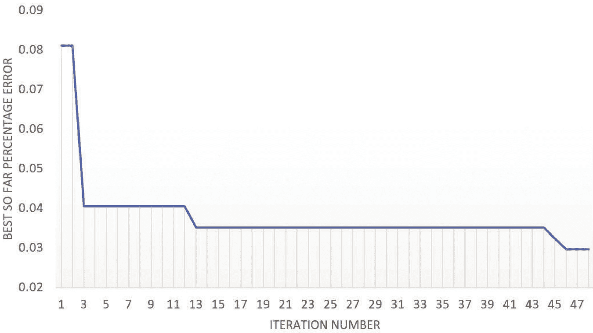 图 9.4. 使用 PSO 优化 Bi-LSTM 迭代中的最佳分类误差。

自适应 GA-Bi-LSTM 的超参数值和百分比误差如表所示。

从结果可以看出，Bi-LSTM 的 PSO 优化速度快于 GA-Bi-LSTM。在 3 次迭代内，PSO 的百分比误差约为 `0.04`，远小于 GA 的 `0.05`，尽管在 48 次迭代后结果相似。

#### 9.3. GA-BiLSTM 优化期间的超参数值和分类误差

| 迭代 | 隐藏层大小 | 初始学习率 | L2 正则化 | 百分比误差 | 目前到为止最佳误差 |
| :--- | :--- | :--- | :--- | :--- | :--- |
| | | | | | |
| 1 | 100 | 0.01 | 0.0009 | 0.07027 | 0.9297 |
| | | | | | |
| 2 | 212 | 0.053998 | 0.00084847 | 0.06216 | 0.9378 |
| 3 | 187 | 0.019514 | 0.00055323 | 0.048649 | 0.95135 |
| 4 | 190 | 0.071739 | 0.00087868 | 0.06216 | 0.9378 |
| 5 | 249 | 0.059428 | 0.00030971 | 0.33784 | 0.66216 |
| 6 | 214 | 0.080309 | 0.00013372 | 0.072973 | 0.92703 |
| 7 | 129 | 0.072257 | 0.00056525 | 0.078378 | 0.92162 |
| 8 | 142 | 0.040555 | 0.00053645 | 0.059459 | 0.94054 |
| 9 | 140 | 0.035934 | 0.00075752 | 0.054054 | 0.94595 |
| 10 | 237 | 0.075581 | 0.00077861 | 0.13514 | 0.86486 |
| 11 | 210 | 0.028916 | 0.00057152 | 0.064865 | 0.93514 |
| 12 | 221 | 0.050018 | 0.00010082 | 0.05135 | 0.9486 |
| 13 | 144 | 0.087712 | 0.0007049 | 0.1378 | 0.862 |
| 14 | 122 | 0.028447 | 0.00075638 | 0.0541 | 0.945 |
| 15 | 230 | 0.043063 | 0.00080923 | 0.0418 | 0.918 |
| 16 | 225 | 0.088903 | 0.00060577 | 0.0459 | 0.954 |
| 17 | 161 | 0.06449 | 0.00063802 | 0.03243 | 0.9676 |
| 18 | 225 | 0.02248 | 0.00076005 | 0.0432 | 0.9576 |
| 19 | 122 | 0.0895 | 0.00011498 | 0.05135 | 0.9486 |
| 20 | 220 | 0.052159 | 0.00087828 | 0.1351 | 0.8648 |
| 21 | 247 | 0.052241 | 0.00072428 | 0.07027 | 0.9297 |
| 22 | 106 | 0.020415 | 0.00038129 | 0.02702 | 0.9703 |
| 23 | 146 | 0.04792 | 0.00027676 | 0.08648 | 0.9114 |
| 24 | 216 | 0.067964 | 0.00057967 | 0.1027 | 0.897 |
| 25 | 247 | 0.020178 | 0.00033221 | 0.1000 | 0.9 |
| 26 | 129 | 0.01191 | 0.00026627 | 0.04324 | 0.9567 |
| 27 | 182 | 0.044048 | 0.0001073 | 0.03243 | 0.9676 |
| 28 | 237 | 0.067764 | 0.00055862 | 0.11892 | 0.8811 |
| 29 | 124 | 0.039579 | 0.00020074 | 0.083784 | 0.9162 |
| 30 | 193 | 0.061625 | 0.00072365 | 0.056757 | 0.9432 |


| 31 || 139 || 0.054479 || 0.00017531 || 0.07027 || 0.92973 || 0.027027 || 0.972973 |
| 32 || 243 || 0.02894 || 0.00049466 || 0.067568 || 0.93243 || 0.027027 || 0.972973 |
| 33 || 132 || 0.03971 || 0.00044401 || 0.045946 || 0.95405 || 0.027027 || 0.972973 |
| 34 || 181 || 0.027902 || 0.00054813 || 0.048649 || 0.95135 || 0.027027 || 0.972973 |
| 35 || 162 || 0.081133 || 0.00082185 || 0.091892 || 0.90811 || 0.027027 || 0.972973 |
| 36 || 102 || 0.07662 || 0.00036034 || 0.14865 || 0.85135 || 0.027027 || 0.972973 |
| 37 || 237 || 0.054978 || 0.00068724 || 0.035135 || 0.96486 || 0.027027 || 0.972973 |
| 38 || 240 || 0.043808 || 0.00044434 || 0.054054 || 0.94595 || 0.027027 || 0.972973 |
| 39 || 158 || 0.080646 || 0.00086454 || 0.072973 || 0.92703 || 0.027027 || 0.972973 |
| 40 || 224 || 0.076497 || 0.00036992 || 0.15405 || 0.84595 || 0.027027 || 0.972973 |
| 41 || 108 || 0.037876 || 0.00020802 || 0.037838 || 0.96216 || 0.027027 || 0.972973 |
| 42 || 208 || 0.051865 || 0.00031076 || 0.089189 || 0.91081 || 0.027027 || 0.972973 |
| 43 || 116 || 0.059506 || 0.00015485 || 0.062162 || 0.93784 || 0.027027 || 0.972973 |
| 44 || 249 || 0.061759 || 0.00042695 || 0.11622 || 0.88378 || 0.027027 || 0.972973 |
| 45 || 241 || 0.075807 || 0.0004411 || 0.15676 || 0.84324 || 0.027027 || 0.972973 |
| 46 || 122 || 0.079736 || 0.00013518 || 0.067568 || 0.93243 || 0.027027 || 0.972973 |
| 47 || 146 || 0.086798 || 0.00030496 || 0.081081 || 0.91892 || 0.027027 || 0.972973 |
| 48 || 154 || 0.03394 || 0.00024518 || 0.04323 || 0.95676 || 0.027027 || 0.972973 |

### Covid-19 胸部 X 光数据集

使用了 `ieee8023` 数据集的胸部 X 光图像（Cohen et al., 2020）。胸部 X 光图像通过动态直方图均衡化进行对比度增强（Abdullah-Al-Wadud et al., 2007）。该数据集被分为训练集和测试集。测试集每个类别有 66 张图像：正常、新冠-19 和其他疾病。


图 9.5. 使用 GA-BiLSTM 模型在迭代过程中的最佳分类图。

### 评估指标

本节列出了用于衡量分类性能的评估指标。

#### 精确率 (Precision)

精确率评估预测准确性，通过以下公式表示：

(9.8)
$$precision = \frac{TP}{TP + FP}$$

其中：
- `TP` 代表真例
- `FP` 代表假例

#### 回回率 (Recall)

召回率也称为敏感性，评估结果的完整性，通过以下公式计算：

(9.9)
$$Recall = \frac{TP}{TP + FN}$$

其中：
- `TP` 代表真例
- `FN` 代表假例

#### F 分数 (F-measure)

F 分数通过结合精确率和召回率评估分类性能，通过以下公式计算：

(9.10)
$$Fmeasure = 2 \times \frac{precision \times recall}{precision + recall}$$

通过结合上述公式，F 分数可以表示为：

(9.11)
$$Fmeasure = 2 \times \frac{TP}{2 \times TP + FP}$$

#### 马修斯相关系数 (MCC)

马修斯相关系数被认为是一种平衡的分类指标，通过以下数学公式估计：

(9.12)
$$MCC = \frac{TP \times TN - FP \times FN}{\left[(TP + FP) \times (FN + TN) \times (FP + TN) \times (TP + FN)\right]^{\frac{1}{2}}}$$

其中 `TN` 代表真负

#### 接收者工作特征曲线 (ROC)

接收者工作特征曲线是一种说明分类器能力的图表。`ROC` 曲线通过绘制在不同阈值配置下的真阳性率相对于假阳性率。

#### 精确率-召回曲线 (PRC)

精确率-召回曲线是在精确率指标（y 轴）和召回率指标（x 轴）之间绘制的图，与 `ROC` 曲线类似。

#### 未使用 PSO 的 CNN

在 `CNN` 模型中，测试集中整体正确分类的实例：


在通过 `PSO` 优化的 CNN 模型中，测试集中分类正确的实例有 183 个 (92.42%)，分类错误的实例有 15 个 (7.58%)。未经过 `PSO` 优化的 CNN 模型的分类指标见表 9.6。混淆矩阵如表 9.7 所示。

### 表 9.6. CNN - PSO 模型的结果。](#ch9.xhtml#R_tab9_6)

| 类别 | TP 率 | FP 率 | 精确率 | 召回率 | F 值 | MCC | ROC 面积 | PRC 面积 |
| --- | --- | --- | --- | --- | --- | --- | --- | --- |
| COVID-19 | 0,879 | 0,015 | 0,967 | 0,879 | 0,921 | 0,886 | 0,932 | 0,890 |
| 正常 | 0,970 | 0,045 | 0,914 | 0,970 | 0,941 | 0,911 | 0,962 | 0,897 |
| 其他疾病 | 0,924 | 0,053 | 0,897 | 0,924 | 0,910 | 0,865 | 0,936 | 0,854 |
| 加权平均 | 0,924 | 0,038 | 0,926 | 0,924 | 0,924 | 0,887 | 0,943 | 0,880 |

### 表 9.7. CNN - PSO 模型的混淆矩阵。](#ch9.xhtml#R_tab9_7)

| | | 预测 | | |
| --- | --- | --- | --- | --- |
| | | COVID-19 | 正常 | 其他疾病 |
| --- | --- | --- | --- | --- |
| 实际 | COVID-19 | 58 | 3 | 5 |
| | 正常 | 0 | 64 | 2 |
| | 其他疾病 | 2 | 3 | 61 |

我们可以观察到，`PSO` 优化的 CNN 网络产生的结果比没有任何任何优化的 CNN 模型好得多。

这是群智能在深度学习中应用的一个简单实验。为了获得更准确的结果，可以使用其他优化的深度学习模型。例如，利用迁移学习来训练 `ResNet18`、`ResNet50`、`AlexNet`、`GoogleNet` 等预训练模型的末层 `LeCun et al., 2015`，可以使用群智能模型来优化深度学习模型的层权重或超参数，例如全连接层的隐藏层神经元、初始学习率、`L2` 正则化、卷积层中滤波的数量和大小、最大迭代次数 (epochs)、批量大小 (batch size)。此外，还可以应用其他技术来改进结果：网络初始化方法、归一化方法、验证方法（例如使用 `10-Fold Cross-Validation`）、训练算法、特征选择方法或特征提取。此外，还可以使用数据处理方法来创建平衡数据集，如合成过采样技术 (`SMOTE`) `Chawla et al., 2002`。同样还可以实施数据增强方法来增加数据集实例并提高深度学习模型的准确性。

## 参考文献

* Abdullah-Al-Wad, Kabir, M. H., Dewan, M. A. and Chae, O` (2007). A dynamic histogram equalization for image contrast. IEEE Transactions on Consumer Electronics, 53(2): 593-600. doi: [`10.1109/TCE.2007.38174`](http://doi.org/10.1109/TCE.2007.38174).
* Behera, S., Misra, R. and Sillitti, A` (2021). Multiscale deep gated recurrent neural networks for complex non-linear degradation systems. Information Sciences, 554: 120-144.
* Chadha, G. S., Panambilly, A., Swing, A. and Ding, S` (2020). Bidirectional deep recurrent neural networks for process fault classification. ISA Transactions, 106: 330-342.
* Chawla, N. V., Bowyer, K. W., Hall, L. O. and Kegelmeyer, W. P` (2002). `SMOTE`: synthetic minority over-sampling. Journal of Artificial Intelligence Research, 16: 321-357.
* Cohen, J. P., Morrison, P. and Dao, L` (2020). COVID-19 image data collection. arXiv preprint arXiv:2003.11597. [`https://github.com/ieee8023/covid-chestray-dataset`](https://github.com/ieee8023/covid-chestray-dataset)
* Cortez, B., Carrera, B., Kim, Y. and Jung, Y` (2018). An architecture for emergency event prediction using LSTM networks. Expert Systems with Applications, 97: 315-324.
* Ilonen, J., Kamarainen, J. and Lampinen, J` (2003). Differential evolution algorithm for feed-forward neural networks. Neural Processing Letters, 17(1): 93-105.
* Kim, T. Y. and Cho, S` (2019). Particle swarm optimization-based `CNN-LSTM` networks for forecasting energy. pp. 1510-1516. In: 2019 IEEE Congress on Evolutionary Computation (CEC). IEEE.
* Koppu, S., Maddikunta, P. K. and Srivastava, G` (2020). Deep learning disease model for use with intelligent robots. Computers & Electrical Engineering, 87: 10675.
* Kouziokas, G. (2021). Deep bidirectional and unidirectional LSTM networks in traffic flow. Advances in Mobility-as-Service Systems, 1278: 171-180. doi: [`https://doi.org/10.1007/978-3-030-61075_17`](https://doi.org/10.1007/978-3-030-61075_17.)
* Kudo, M., Toyama, J. and Shimbo, M` (1999). Multidimensional curve classification using passing-through regions. Pattern Recognition Letters, 20(11-13): 1103-1111.
* LeCun, Y., Kavcuoglu, K. and Farabet, C` (2010). Convolutional networks and applications in vision. pp. 253-256. In: 2010 IEEE.
* LeCun, Y., Bengio, Y. and Hinton, G` (2015). Deep learning. Nature, 521: 436-444.
* Ren, X., Liu, S. and Dong, X` (2020). `PSO` for state-of-charge estimation of lithium-ion batteries. Energy, 23:36.
* Schuster, K. and Blum, C` (2007). Ant colony optimization for feed-forward neural networks. Neural Processing Letters, 45(1): 267-281.
* Wang, P., Zhao, G., Gao, J. and Lian, J` (2020). Constructing a PM2.5 concentration prediction by combining auto-encoder with LSTM. Environmental Modelling & Software, 124:10460.

## 索引

### A

* `ABC Algorithm` 77, 78, 80, 82
* absorption coefficient 112–114, 116
* acceleration coefficients 39, 58
* acceleration parameters 127
* accepting rate 118, 120, 170
* accuracy 57, 154, 158, 165, 183, 184, 186–190, 194
* `Ackley function` 32, 33, 60, 62, 119, 120
* activation function 158, 180, 181, 189, 190
* activation layers 181


* Adadelta 1, 15, 16
* Adagrad 1, 14, 15
* Adam 优化器 1, 16, 190
* 自适应遗传算法 28
* 自适应惯性权重 40, 184, 185, 193
* 自适应参数 81, 97, 150
* 基于年龄的策略 76
* 算法 1, 3, 5, 7, 8, 10–17, 19–24, 26, 28, 29, 31, 32, 37–42, 44–58, 67–71, 74–78, 80, 82, 87–91, 94–96, 98–103, 105–107, 111–118, 120, 121, 123–127, 131, 133- 135, 139–141, 143–148, 150–154, 157, 159, 161, 166–176, 183, 184, 191, 194
* Alpha 狼 133, 136, 139
* 蚁群优化 17, 67, 68, 157
* 蚂蚁密度 70
* 蚁蚁群 160
* 蚂蚁系统 67–69, 71–75
* 蚂蚁循环 70, 71
* 蚂蚁密度 70
* 蚂蚁数量 70
* 家电能耗 162, 163
* 算术交叉 24
* 人工蜂群 17, 58, 67, 76, 77, 81, 159
* 攻击猎物 134
* 吸引强度 149
* 吸引长度 149
* 吸引区域 150
* 吸引力 111, 112, 114
* 平均池化 181, 190

### B
* 带宽距离 118, 121
* 蝙蝠移动 100
* 蝙蝠群算法 87
* 优适应度值 22, 28–30, 41, 80, 81, 124, 168, 171, 173
* Beta 狼 133, 136, 139
* 偏差 7, 16, 180
* 双向 LSTM 180, 184, 185
* BiLSTM 185, 186
* Bilist 层 185
* 二进制蝙蝠算法 87, 101, 102, 111
* 二进制离散猫算法 125
* 二进制灰狼优化 131, 135, 138, 161
* 二进制解 94, 95
* 二进制鲸鱼优化 131, 147
* 混合交叉 25
* 边界处理 45, 46, 67, 81, 82
* 边界违反 82
* 泡泡网策略 142

### C
* 猫的位置 125–127
* 猫群算法 111, 123–126
* 猫群优化 17, 111, 123, 126, 127
* 猫速度 124
* 柯西 分布 26, 48, 106, 107
* 柯西分布函数 26, 106, 107
* 柯西变异 26, 48, 105–107
* 柯西变异算 26, 105
* 柯西变异 48
* 细胞候选 179, 180
* 混沌蝙蝠算法 87, 101, 111
* 混沌布谷搜索 87, 91, 166, 171, 172, 175
* 混沌差分进化 19, 31, 32
* 混沌萤火虫 111, 114, 116
* 混沌格蝗虫优化 131, 152
* 混沌和谐搜索 111, 121, 166, 169–171, 175
* 混沌 PSO 37, 49, 50
* 混沌序列 31, 32, 49, 116, 121
* 切比雪夫映射 92, 102
* 染色体 20, 21, 23, 25, 29, 159, 167, 173
* 染色体群 20, 21, 159
* 圆形映射 92, 102
* 分类 49, 57, 158, 159, 161, 165, 181, 183, 185
* 分类层 185
* 分类指标 92, 193
* CNN 优化 189
* 组合系数 8
* 舒适区域 148
* 计算成本 3, 7
* 计算优化 1, 37, 57, 88, 111, 117
* 混淆矩阵 92, 193
* 连接权重 158
* 恒定变异 PSO 50
* 约束优化 68, 101
* 连续 2, 4, 17, 32, 58, 61–63, 68, 87, 94, 101, 119, 125, 135–137, 185
* 连续优化 2, 68, 87, 94, 125, 135


* 凸性 1, 2, 17, 37, 55, 56, 58, 62
* 凸组合 55, 56
* 凸优化 2
* 卷积层 181, 182, 194
* 卷积神经网络 179, 181
* 冷却因子 101
* 交叉 19–21, 23–25, 28–31, 33, 47, 56, 82, 96, 97, 135, 138, 159, 160, 167, 168, 172, 184
* 交叉因子 30, 31
* 交叉概率 28, 29, 33, 160, 172
* 交叉类型 159, 167, 168, 184
* 杜鹃繁殖行为 87
* 杜鹃搜索 17, 87–91, 94–97, 166, 171, 172, 175

## D
* 衰减率 15, 73, 160
* 决策空间 53, 54
* 递系数参数 150
* 深度学习 1, 16, 179, 181–183, 194
* Delta 差量子 PSO 51–53
* 差分狼 133, 136, 139
* 密度函数 26, 27, 48, 51, 52, 107
* 可微分 32, 60–62, 119
* 差分进化 19, 29–33, 82, 95, 96, 154
* 差分放大 30
* 离散杜鹃搜索 87, 94
* 离散交叉 24
* 离散优化 2, 68, 94
* 离散性选择 67, 80
* 距离 70, 71, 75, 77, 95–98, 105, 111, 112, 114, 115, 118, 121, 142, 147–149, 151
* 分布函数 26, 27, 48, 106, 107
* 分布索引 25, 27
* 多样性变异 26
* 支配性 53, 55
* 被支配解 54, 55
* 双重变异 87, 101, 105
*  Dropout 层 181
* 动态或自适应拓扑 44

## E
* 优异策略 76
* 蜜蜂 77–79
* 蜜蜂觅食者 76, 77
* 围猎物 132, 141
* 能量预测 161, 162
* 元素级乘 115, 145
* 迭代 183, 185, 190, 194
* 误差指标 57, 158, 159, 174, 182, 183
* 蒸发系数率 73
* 蒸发率 69, 74, 160
* 进化算法 19, 20, 37, 157, 166, 172–175
* 进化计算 19, 179
* 进化策略 19
* 挖掘 72, 89, 90, 95, 100, 107, 134, 140, 142, 144, 145, 148, 150–153
* 探索 26, 72, 89, 90, 95, 97, 98, 100, 134, 140
* 探索常数 160
* 探索过程 72, 140
* 探索策略 95
* 指数级 23, 26, 47, 67, 81, 82
* 指数排名选择 81
* 指数选择 23
* 外部记忆 54

## F
* F1 57, 158, 165
* 假阴性 190
* 假阳性 190, 191
* 可解集 53
* 特征提取 181, 194
* 特征映射 181
* 特征选择 101, 131, 135, 157, 161, 162, 165, 166, 168, 171, 174, 194
* 过滤器 181, 182, 190, 194
* 萤火虫算法 17, 111–116
* 适应度收敛 42
* 适应度函数 2, 20, 21, 28, 37–41, 52, 79, 80, 89, 112, 123, 125, 134, 135, 158, 166, 183
* 适应度限制 28
* Fletcher-Reeves 公式 6
* 翻转混沌 94, 95
* F-measure 191–193
* 食物资源 67, 78
* 觅食行为 67, 68, 76, 77


*   function 2, 4, 5, 7, 8, 15, 17, 19–21, 26–28, 32, 33, 37–42, 44, 48–54, 57–63, 74, 79, 80, 89, 91, 94, 95, 98, 99, 101, 102, 104, 106, 107, 112–114, 116–121, 123, 125, 134, 135, 139, 140, 146–149, 154, 158, 159, 165, 166, 174, 180–184, 189, 190

## G

*   gamma 函数 140
*   gamma 参数 139
*   gauss 映射 122
*   高斯分布 26, 48, 107
*   高斯映射 92
*   高斯变异 26, 48, 105, 107, 153
*   高斯变异 PSO 48
*   高斯-牛顿 1–3, 6
*   种群 20–22, 24, 28–30, 41, 42, 48, 58, 82, 88, 89, 91, 113, 114, 159, 160, 167, 168, 170–173, 184
*   遗传算法 1, 17, 19–24, 28, 49, 57, 58, 90, 102, 157, 159, 161, 166–168, 175, 184
*   几何 PSO 55, 56, 168, 175
*   全局最优位置 107, 127
*   全局学习 14, 38, 39, 56, 160, 176, 185, 193
*   全局学习率 14
*   全局极值 60–63
*   全局全连接 42, 43
*   全局信息素衰减 73, 160
*   全局信息素衰减率 160
*   全局信息素更新规则 72
*   全局最优解 2
*   梯度方法 5, 6
*   梯度子向量 12
*   梯度阈值 185
*   梯度向量 2, 10–12
*   蝗虫优化 17, 131, 148, 151–154
*   蝗虫优化算法 131, 148, 151–154
*   引力常数 149
*   贪婪选择 30, 139, 141
*   灰狼优化 17, 131, 134, 135, 138, 161
*   Griewank 函数 58, 59, 61

## H

*   Hadamard 积 180
*   谐波量子 PSO 51, 52
*   和谐记忆 117–120, 169, 170
*   和谐搜索 17, 90, 111, 117–121, 166, 169–171, 175
*   Heaviside 函数 89
*   Henon 映射 122
*   Hessian 矩阵 2, 3, 5, 10–13
*   Hestenes-Stiefel 公式 6
*   启发信息 74
*   隐藏层 57, 157–159, 182, 185–190, 194
*   隐藏层神经元 158, 185, 194
*   隐藏神经元 57, 158, 159, 182, 190
*   直方图均衡 191
*   驼背鲸 141, 145
*   狩猎过程 132–134
*   双曲方法 45, 82
*   超立方体 54, 55
*   超参数 174–176, 181, 185–188, 190, 194

## I

*   Ikeda 映射 32
*   改进和谐搜索 111, 120, 121
*   个体解 22, 23
*   不等式约束 2
*   惯性权重 38–41, 54, 126, 160, 176, 184, 185, 193
*   无穷或隐墙 45, 82
*   初始学习率 183, 185–190, 194
*   初始信息素 73, 160
*   初始化 19, 21, 29, 37, 38, 52, 78, 91, 121, 184, 193, 194
*   输入门 179, 180
*   输入搜索空间 32, 60–63, 119
*   输入权重 180
*   强度 69, 72, 111–115, 149
*   间歇性映射 92, 102
*   鸢花数据集 159
*   迭代映射 93, 102

## J

*   雅可比矩阵 3, 8–12
*   日语元音数据集 183

## K

*   Kappa 57, 158
*   k 点交叉 23

## L

*   L2 正则化 185–189, 194
*   层 45, 57, 157–159, 181–183, 185–190, 194
*   学习常数 5
*   Levenberg-Marquardt 算法 1, 8, 11
*   Lévy 分布 27, 90, 115, 139, 145
*   Lévy 飞行变异 27


* 莱维飞行 87–89, 91, 94, 111, 114, 115, 146
* Liebovitch 映射 93, 102
* 光 111–115, 163, 164
* 光强度 111–115
* 线性交叉 24
* 线性排名选择 81
* 线性排序选择 22, 23
* 局部衰减率 73
* 局部极值 17
* 局部最优解 43, 49, 105
* 局部或环形拓扑 43
* 局部信息素衰减率 160
* 局部信息素更新规则 72, 73
* 逻辑斯映射 32, 49, 50, 93, 94, 102, 116, 122, 170, 171
* 长短期记忆网络 179
* 损失函数 7, 8, 15, 174
* 响度 98–100, 103–105

## M
* 机器学习 1, 7, 157, 161, 162, 164, 165, 175, 176, 183
* 机器学习优化器 157
* 矩阵分解 3
* 马修斯相关系数 191
* 最大池化 181, 190
* 最大化 1, 2
* 最大生成代数 41
* 最大进化代数 20, 28, 159, 160
* 最大运行时间 28, 41
* 最大停顿时间 28, 41
* 最大-最小蚁系统 67, 74, 75
* 均绝对误差 57, 158, 165
* 均平方误差 57, 158, 165, 166, 182, 183
* 网格拓扑 44
* Michalicz 变异 49, 50
* Michalicz 非均匀变异 49
* 批处理 183, 185
* 最小化 1, 2, 33, 59, 60, 120
* 极差值归一化 162, 184
* 中等距离探索 95, 97
* 动量 7, 8, 15, 183, 185
* 动量参数 8
* 移动 45, 67, 81, 100, 112, 113, 115, 136, 141, 142, 144
* 移动平均 15
* 多层感知器 158
* 多目标优化 2, 53
* 多目标 PSO 37, 53, 54
* 变异 19–21, 25–32, 37, 46–50, 55, 82, 87, 96, 101, 103, 105–107, 123, 125, 126, 153, 160, 167–173, 184
* 变异机制 21, 103, 105
* 变异操作 125
* 变异算 19, 21, 25–27, 37, 47–49, 101, 105–107
* 变异概率 28, 29, 126, 160, 169, 171, 172

## N
* 最近边界或吸收 46, 82
* 负梯度 7
* 神经网络 10, 12, 15, 37, 57, 58, 68, 157, 161, 179, 181
* 非凸 1, 29, 32, 37, 58, 61, 119
* 非凸优化 1, 29
* 非支配解 54, 55
* 非梯度方法 1
* 正态分布 140, 164, 165

## O
* 目标函数 2, 5, 17, 19, 42, 53, 54, 57, 79, 80, 89, 94, 99, 112, 117, 118, 158, 159, 182, 184
* 目标空间 53
* 后代 20, 21, 23–25
* 观测蜂 77
* 基于反对的学习 153
* 优化器 1, 7, 12, 15, 16, 37, 57, 131, 132, 139, 185, 190, 191
* 振荡 8
* 输出门 179, 180

## P
* 种群 132
* 帕累托 54, 55
* 帕累托支配 55
* 帕累托最优解 54
* 帕累托最优集 54
* 粒子群优化 17, 37, 38, 46–50, 58, 90, 150, 154, 157, 161, 166, 184
* 百分比误差 184–187
* 周期 46, 82
* 个人学习 38, 56, 160, 176, 185, 193
* 信息素 67–75, 160
* 信息素浓度 74
* 信息素蒸发 69, 74
* 信息素蒸发率 69
* 信息素足迹 67, 68
* 信息素更新 68, 70, 71, 73–75, 160


*   分段映射 93, 102

*   音调调整率 118, 120, 121

*   音调带宽 118, 120, 170

*   Polak-Ribière 公式 6

*   池化层 181, 189, 190

*   种群收敛 41

*   种群缩减 98

*   种群规模 21, 32, 42, 54, 60, 96–98, 167–169, 171, 172, 176, 184, 193

*   基于种群的蚁群算法 67, 68, 75

*   位置向量 125, 133, 138, 142, 143

*   功率分布 27

*   幂变异 27

*   精度 57, 158, 183, 190–193

*   精度-召回率 191

*   早收敛潜力风险 75

*   概率策略 76

*   交叉概率 167, 184

*   变异概率 167, 168, 184

*   比例轮盘选择 22

*   PSO 神经优化 37, 57, 58

*   PSO 拓扑优化器 57

*   PSO 权重优化器 57

*   脉冲发射 100, 103, 105

## Q

*   Q 学习 73

*   质量函数 74

*   基于质量的策略 76

*   量子 PSO 37, 50

*   拟海森 矩阵 10–12

*   拟海森 子矩阵 12

*   拟牛顿法 1, 3, 7

## R

*   随机 20–22, 24–27, 30, 38, 39, 42–44, 46–52, 54, 68, 78, 82, 89, 90, 95–97, 100, 103, 104, 107, 112, 113, 115, 116, 118, 119, 121, 124–126, 133, 134, 136–138, 140–147, 149, 154, 161, 163, 174, 175, 184, 193

*   随机阻尼 47, 82

*   随机变异 PSO 50

*   随机拓扑 44

*   随机游 27, 89, 90, 95, 100, 115, 145

*   随机-半 46, 47, 82

*   基于排名的蚁群系统 67, 73

*   Rastrigin 函数 42, 59, 61, 62

*   实数编码遗传算法 24

*   召回率 57, 158, 183, 190–193

*   受者工作特性 191

*   循环结权重 180

*   反射方法 47, 82

*   回归 57, 158, 159, 165, 174, 182, 183

*   ReLU 激活函数 181, 189, 190

*   仓库 54, 55, 162, 183

*   斥力区域 152

*   RMSProp 1, 15

*   均方根误差 57, 158, 165, 183

## S

*   尺度参数 14, 139

*   缩放共轭 1, 12

*   缩放因子 30, 33, 96, 97

*   Schwefel 函数 60, 63

*   侦兵蜂 77

*   搜索空间 2, 21, 32, 37, 39, 40, 42, 43, 45–47, 52, 54–56, 60–63, 67, 68, 72, 76, 80, 82, 90, 94, 100, 101, 119, 133–135, 144, 145, 147, 151, 165, 176, 185

*   搜索模式 123–125

*   搜索范围 123

*   选择算子 19, 94, 172

*   自适应 97

*   自适应蝙蝠算法 87, 101, 103

*   自适应凤谷 95, 96

*   敏感度 183, 190

*   序列输入 14

*   步长 14

*   收缩包绕法 142


* 群粒子初始化 184, 193
* 群种数量 38, 56, 160
* 群拓扑结构 37, 42, 43, 57, 158, 160, 168, 184, 193

## T
* 泰勒展开 2
* 帐量映射 94, 102, 116, 117, 122
* 终止标准 20, 21, 125, 144
* 三亲交叉 25
* 时间因子 105, 106
* 拓扑优化 159, 182, 183
* 锦标赛选择 22, 67, 77, 80, 172
* 追踪模式 123–125, 127
* 可训练滤波器 190
* 可训练层 183
* 转移函数 102, 147
* 迁移学习 182, 183, 194
* 转移概率规则 72
* 旅行旅行箱问题 68, 69
* 树形或层次拓扑 43, 44
* 真阳性例 190, 191

## U
* 无约束优化 1, 77
* 失业觅食者 76, 77
* 均匀交叉 24
* 均匀分布 100, 113, 184, 193
* 单峰的 37, 58, 60, 61, 146
* 更新规则 3, 5, 8, 11, 14, 16, 74

## V
* 速度 37–39, 45–47, 50, 54–56, 98, 100, 102, 103, 105, 124–127
* 速度更新 50, 103, 127
* 可见性 70, 72, 163
* 可见性参数 70
* 冯·诺曼 42–44

## W
* 权重优化 157, 158, 183
* 权重向量 8, 13, 14, 57, 158, 183
* 权重因子 74
* 鲸鱼优化算法 131, 141, 143–148
* 风对流 149

