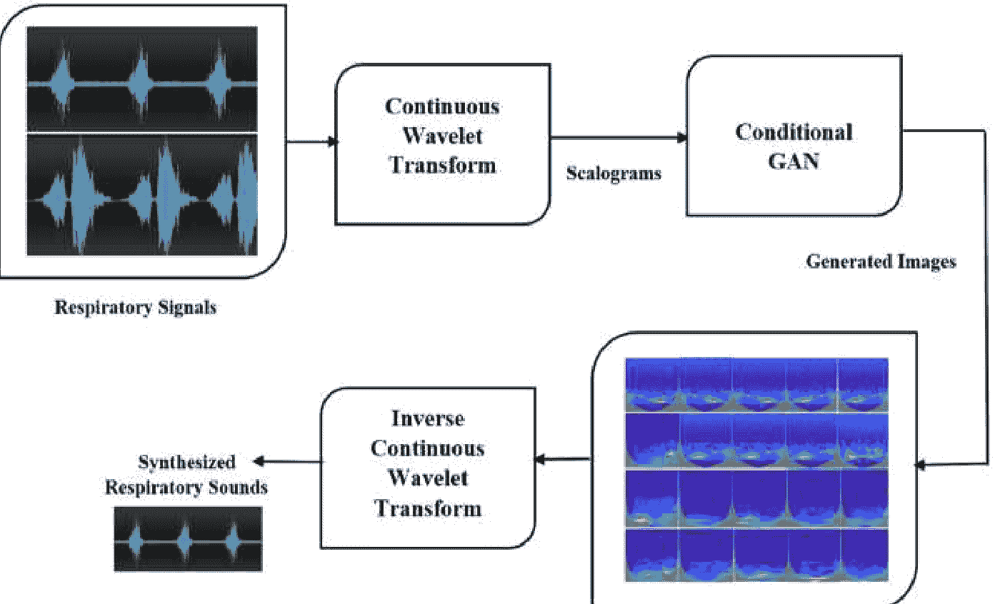
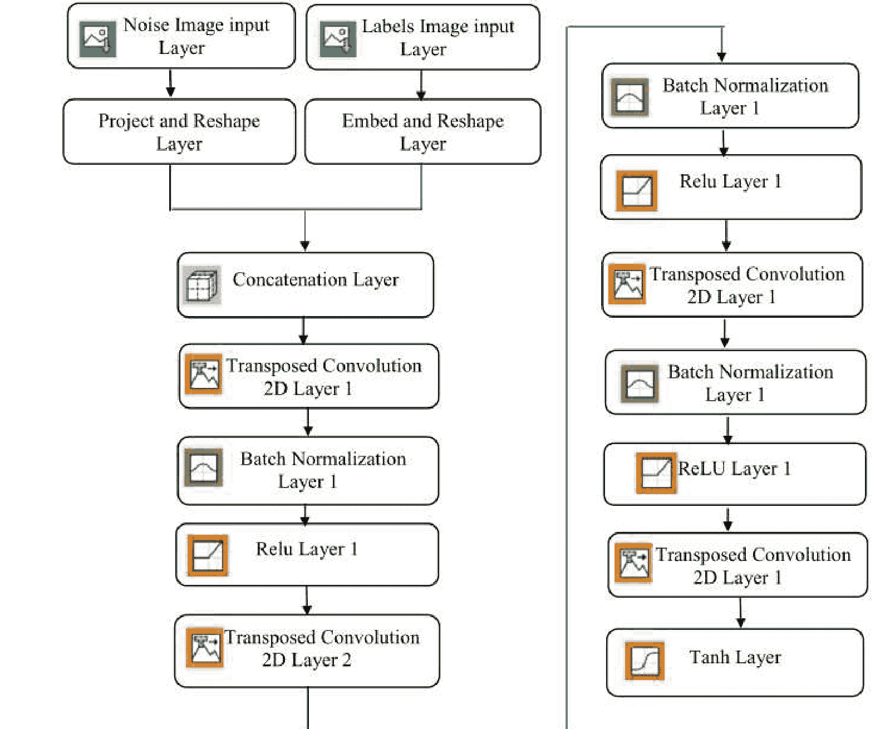
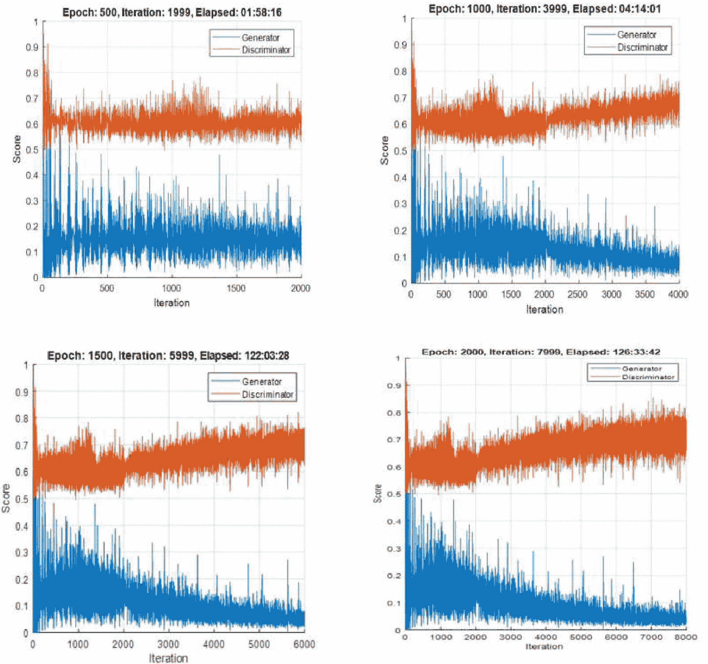
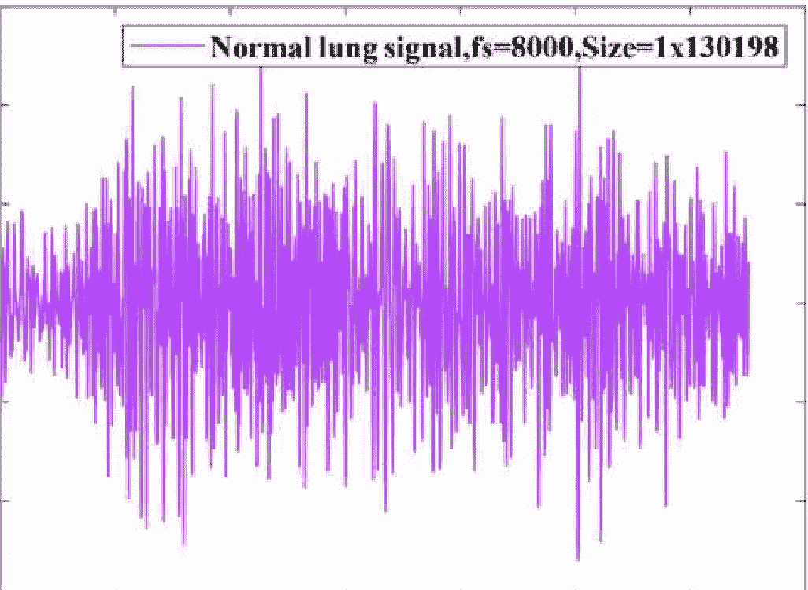
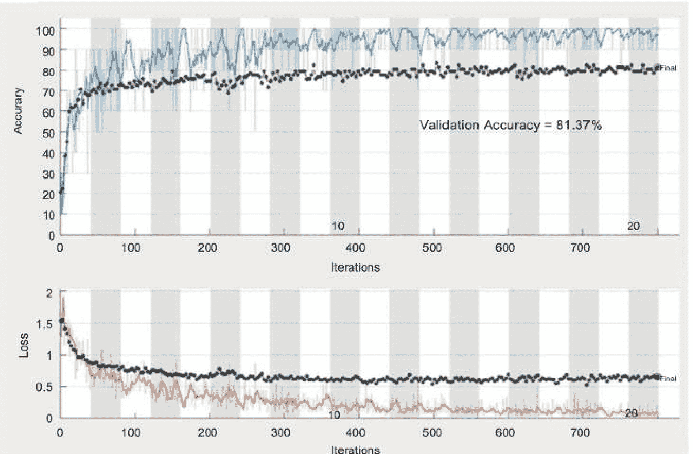
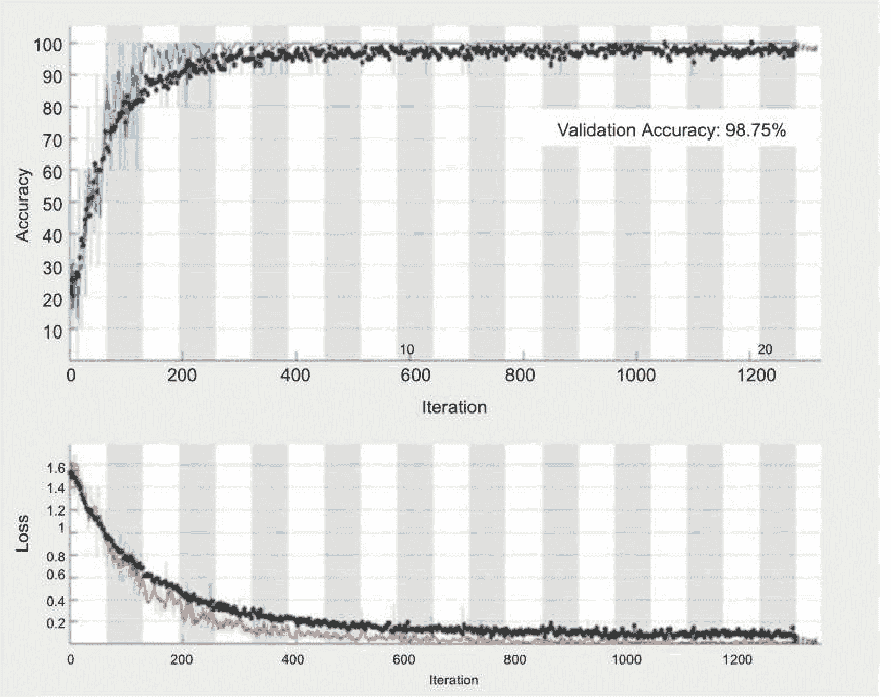

# 使用条件生成对抗网络从尺度图表示合成呼吸信号

# 第7章

# 基于尺度图表示的呼吸信号条件生成对抗网络合成

**S. Jayalakshmy**a、**Lakshmi Priya**b和**Gnanou Florence Sudha**c  
aIFET工程学院，维卢布勒姆，印度  
b马纳库拉·维纳亚加技术学院，本地治里，印度  
c本地治里工程学院，本地治里，印度

## 7.1 引言

慢性呼吸系统疾病是一组影响气道和呼吸系统解剖结构的长期性疾病。肺部疾病被认为是全球疾病负担的最大贡献因素。一些呼吸系统疾病包括慢性阻塞性肺疾病（COPD）、哮喘、职业性肺病、慢性支气管炎、肺炎等。世界卫生组织（WHO）和"健康人民2020"计划的诊断研究显示，目前美国有超过2500万人被诊断患有哮喘，约1480万成年人被确诊为COPD[1]。此外，国际呼吸学会论坛（FIRS）预测，超过数百万人生活在肺动脉压力升高的状态下，超过5000万人患有与职业相关的肺部感染，由此可以推断，超过10亿人正受到慢性呼吸系统疾病的影响[2]。

COPD的病因包括α-1抗胰蛋白酶蛋白缺乏、长期暴露于空气污染、化学品、烟雾以及工作场所的粉尘吸入。这种缺乏会导致肺部恶化，还可能影响肝脏。肺部疾病的常用监测和诊断技术包括肺活量测定法、CT扫描、动脉血气分析和肺部听诊。呼吸听诊是检查肺部疾病最常用的诊断工具，它为医学专家提供生理和病理信息，以便继续进行治疗方案[3]。呼吸音（RS）是用于诊断某些呼吸系统异常的最重要的生物信号之一。从胸壁和口腔检测到的呼吸音可分为正常（肺泡性）音和附加音。一些异常声音包括喘息、鼾音（低音调喘息）、喘鸣和爆裂音，这些声音的频率各不相同。

使用传统听诊器聆听肺部声音使肺部听诊技术简单、易用，并且是最受欢迎的无创诊断方法。

为了进一步协助医疗从业者进行诊断，基于深度学习的计算机辅助诊断（CAD）系统在过去几年中得到了广泛应用。然而，为了使这些深度学习算法能够精确区分即使是微弱的异常呼吸模式，需要大量的训练数据。另一方面，公开可用的正常和异常呼吸音数据集数量非常有限。在这些资源不足的情况下，深度学习模型往往会面临一些限制，如过拟合——模型仅在训练数据上表现良好，而在其他未见过的数据上表现不佳。这可以被视为传统基于深度学习的CAD系统面临的最大挑战。尽管研究中已经采用了多种训练模式和架构设计，但在数据稀缺的情况下训练模型仍是一项艰巨的任务。因此，为了获取更多样本，数据增强是合理的解决方案。

为了扩大数据集的规模，传统的增强方法会在给定图像中产生普通的变异，以获得原始图像的不同方面。一些修改包括旋转变化、平移、反射和缩小图像尺寸[4]。从呼吸信号的角度来看，使用传统的增强方法将音频信号转换为二维表示并不合适。具体而言，围绕时间轴的随机翻转意味着信号在时间上被反转，而随机的Y轴翻转将完全改变对频率的理解。同样，X方向的随机平移意味着仅存在时间偏移，Y方向的平移则表示频谱被修改，这可能并非原始信号的真实表示。为了模拟较慢或较快的呼吸而在X方向进行随机缩放，同时不改变频率特性，这在物理上是有意义的，但这反过来又会在信号表示中添加随机噪声。

为了解决这些问题，本研究旨在借助生成对抗网络（GAN）人工改善数据集。本研究提出利用时频表示（即信号的图像表示）通过GAN架构合成呼吸信号。尺度图是通过连续小波变换获得的信号能量密度的可视化表示，已被发现能够很好地区分不同类别的呼吸信号[5]。连续小波变换的可逆性使得利用GAN架构间接合成信号成为可能。

GAN是一类深度学习框架，能够从称为潜空间的已知数据表示中成功生成图像。GAN由两个深度神经网络组成，称为生成器和判别器，它们相互竞争以学习已知训练集图像的概率分布函数，因此称为"对抗"。本研究的结果无疑将解决这一挑战。

研究发现准确率提高至85.7%的敏感性和92.4%的特异性。此外，在2018年，Salehinejad等人[10]也通过实现GAN生成人工图像用于胸部X射线图像的病变分类，见证了数据集样本的扩展。作者利用深度卷积神经网络（DCNN）识别五类不同的胸部X射线疾病，性能结果得到了改善。

2019年，Bhattacharya D.等人[11]提出了深度卷积生成对抗网络（DCGAN），并在NIH胸部X射线图像开放数据库上进行实验，以利用GAN提高CNN模型的效率，取得了65.3%的准确率。借助结构校正GAN，Dai等人[12]在胸部X射线图像中进行了肺部和心脏区域之间的分割。在该研究中，作者引入了一个批评网络，以识别更高层次的结构，从而获得实用的分割结果，实现真实的分割效果。通过该方法的多次综合尝试，最终获得了高精度的真实分割结果。

Onishi等人[13]探索了深度CNN（DCNN）和GAN，以生成足够数量的图像来区分恶性和良性肺结节。在该研究中，利用肺结节中部的像素值分布生成图像。这种使用DCNN进行预训练和微调的方法能够区分约66.7%的良性结节和93.9%的恶性肺结节，并将分类准确率相比原始图像提高了20%。

除了CT和PET图像之外，Chaudhari等人[14]还尝试了在基因表达数据集上使用改进生成器GAN（MG-GAN）的增强方法，并与基础GAN和KNN分类器的性能进行了比较。结果表明，MG-GAN将准确率提高了18.8%和11.9%，此外误差函数的损失值从0.6978急剧下降至0.0082，使其适用于包含敏感数据的应用。Luo等人[15]探索了基于GAN的渐进式增强在电致发光图像上的应用，用于光伏电池组件的故障分类，并通过扩大的数据集将性能最大提升了14%。此外，Li等人[16]将研究重点放在传动行业中齿轮安全性的可靠性分类上，使用GAN技术，其中作者引入了有界GAN来生成不同设置的齿轮数据，并使用ADAM优化器训练模型。研究结果表明，所提出的有界GAN在操作指标上优于其他方法。GAN还广泛应用于磁共振成像扫描、视频监控、临床信息学、计算生物学、汽车领域等多个领域。

此外，基于GAN的方法在音频合成领域也增强了信号的分析、处理和分类能力，并显示出潜在收益。尽管人工智能和生成模型领域取得了最新进展，但通过神经网络从固有声音中编译信息

使用GAN处理医学图像和音频的方法成为可能[13–23]，但在现有研究中观察到的一些技术差距包括生成数据样本的质量、失真及其在数据集中的分布，这些都不够好，导致分类准确率较差，因为准确率在很大程度上依赖于质量和数量两方面。此外，图像生成过程的速度非常慢，尤其是在语音合成领域。由于自回归建模的特性，这对高维数据造成了限制。此外，在某些情况下，使用人工生成样本数据训练的网络模型在输入真实图像时表现不佳。所有这些差距都可以在所提出的研究中借助条件GAN得到解决。受参考文献[24]中条件GAN性能改进的启发，本研究采用时频表示的尺度图方法与cGAN相结合，以改进目标定位并合成呼吸音，从而区分正常和异常的肺音。

## 7.3 用于信号合成的GAN

在本节中，将详细解释简单GAN和条件GAN的架构，以及所提出的使用条件GAN从基于小波的时频表示合成呼吸音信号的系统模型。本研究所提出的条件GAN被用于人工生成更多数量的尺度图图像。将所提出的模型作为数据增强技术，预计通过计算机辅助诊断可以获得更好的预测准确率。

### 7.3.1 简单GAN

简单GAN由两个同时训练的网络组成，分别称为生成器和判别器。生成器通过估计潜在空间中的潜在概率分布来学习生成模仿数据的新图像，判别器则扮演二元分类器的角色，将输入图像映射到真实图像数据集或生成图像集。生成器模型必须经过训练，使得生成的图像与训练所用图像非常相似，从而使判别器难以区分原始图像和生成图像。判别器反过来学习确保其性能优于生成器。GAN的这种对抗学习行为使得生成的图像非常接近真实训练集图像。图7.1展示了简单GAN的架构[25]。

### 7.3.2 条件生成对抗网络

与基础GAN不同，cGAN采用监督方法，在训练过程中生成器和判别器神经网络都适应于满足条件

**图 7.3** 用于合成呼吸音的系统模型

喘息信号作为输入给予时频变换。连续小波变换将时域呼吸信号转换为时间-尺度分析，并以尺度图表示的形式呈现。这些真实的尺度图被输入到条件GAN中，以便借助cGAN中的生成器网络生成更多人工尺度图图像。最后，应用逆CWT在时域中合成呼吸音信号。

#### 7.3.2.2 使用CWT的时间-尺度表示

连续小波变换（CWT）修改基函数的时间长度，以实现可变的时频定位。为了解释非常小的频率变化，CWT使用较长基函数，但代价是时间定位受限；同时使用较短基函数以确保时间上的高定位性[27]。这种时频变换产生一个以时间尺度对幅度的频谱，称为尺度图。与语谱图相比，尺度图适用于在不同尺度下分析真实信号。由于CWT变换中的频率本质上是对数的，因此获得的尺度图也使用对数刻度频率轴。

#### 7.3.2.3 cGAN的生成器和判别器网络架构

生成器和判别器的网络架构如图7.4和图7.5所示，相应的分析结果列在表7.1和表7.2中。在cGAN中，

**图 7.4** 生成器网络架构。

生成器网络由连续的转置卷积层和批归一化组成，用于放大不同维度的数组。提供给全连接部分的小规模噪声向量将输入转换为1024个高尺度图像特征，并进一步重塑为4×4×1025以馈入卷积模块。经过几个连续的转置卷积阶段，中间特征被转换为与输入尺寸相等的输出图像（64×64×3）。该生成器网络为每类呼吸音单独生成合成尺度图，以获得更广泛的类别样本。

另一方面，判别器网络使用多个带泄漏ReLU的卷积层来生成预测值。从输入到判别器块的给定图像（维度为64×64×3）开始，通过一系列卷积层提取维度为4×4×512的高尺度特征。然后，这些特征被展平并输入到全连接网络。该网络逐步将特征分配至低尺度以进行分类。

**表7.1 生成器网络的分析结果——续表**

| 序号 | 名称 | 类型 | 激活值 | 可学习参数 |
|---|---|---|---|---|
| 14 | ReLU3 ReLU | ReLU | 32 × 32 × 64 | — |
| 15 | tconv4 3 个 5 × 5 × 64 转置卷积，步幅 [2 2]，裁剪方式相同 | 转置卷积层 | 64 × 64 × 3 | 权重 5 × 5 × 3 × 64 偏置 1 × 1 × 3 |
| 16 | tanh 双曲正切 | Tanh | 64 × 64 × 3 | — |

**表7.2 判别器网络的分析结果**

| 序号 | 名称 | 类型 | 激活值 | 可学习参数 |
|---|---|---|---|---|
| 1 | 图像 64 × 64 × 3 图像 | 图像输入 | 64 × 64 × 3 | — |
| 2 | 丢弃 25% Dropout | 丢弃 | 64 × 64 × 3 | — |
| 3 | 标签 1 × 1 × 1 图像 | 图像输入 | 1 × 1 × 1 | — |
| 4 | emb 重塑层，输出大小为 64 × 64 × 3 | 嵌入和重塑层 | 64 × 64 × 1 | 嵌入权重 50 × 4 全连接权重 4096 × 50 全连接偏置 4096 × 1 |
| 5 | Cat 沿维度3拼接两个输入 | 拼接 | 64 × 64 × 1 | — |
| 6 | conv1 64 个 5 × 5 × 4 卷积，步幅 [2 2]，填充方式相同 | 卷积 | 32 × 32 × 64 | 权重 5 × 5 × 4 × 64 偏置 1 × 1 × 64 |
| 7 | lrelu1 泄漏ReLU，缩放系数 0.2 | 泄漏ReLU | 32 × 32 × 64 | — |
| 8 | Conv2 128 个 5 × 5 × 64 卷积，步幅 [2 2]，填充方式相同 | 卷积 | 16 × 16 × 128 | 权重 5 × 5 × 64 × 128 偏置 1 × 1 × 128 |
| 9 | bn2 批归一化，128 个通道 | 批归一化 | 16 × 16 × 128 | 权重 1 × 1 × 1 × 128 偏置 1 × 1 × 128 |

**表7.2 判别器网络的分析结果——续表**

| 序号 | 名称 | 类型 | 激活值 | 可学习参数 |
|---|---|---|---|---|
| 10 | lRelu2 泄漏ReLU，缩放系数 0.2 | 泄漏ReLU | 16 × 16 × 128 | — |
| 11 | Conv3 256 个 5 × 5 × 128 卷积，步幅 [2 2]，填充方式相同 | 卷积 | 8 × 8 × 256 | 权重 5 × 5 × 128 × 256 偏置 1 × 1 × 256 |
| 12 | bn3 批归一化，256 个通道 | 批归一化 | 8 × 8 × 256 | 权重 1 × 1 × 256 偏置 1 × 1 × 256 |
| 13 | lRelu3 泄漏ReLU，缩放系数 0.2 | 泄漏ReLU | 8 × 8 × 256 | — |
| 14 | Conv4 512 个 5 × 5 × 256 卷积，步幅 [2 2]，填充方式相同 | 卷积 | 4 × 4 × 512 | 权重 5 × 5 × 256 × 512 偏置 1 × 1 × 512 |
| 15 | bn4 批归一化，512 个通道 | 批归一化 | 4 × 4 × 512 | 权重 1 × 1 × 512 偏置 1 × 1 × 512 |
| 16 | lRelu4 泄漏ReLU，缩放系数 0.2 | 泄漏ReLU | 4 × 4 × 512 | — |
| 17 | Conv5 1 个 4 × 4 × 512 卷积，步幅 [1 1]，填充 [0 0 0 0] | 卷积 | 1 × 1 × 1 | 权重 4 × 4 × 512 偏置 1 × 1 |

#### 7.3.2.5 步骤

生成原始的、逼真的尺度图和合成呼吸音的各个阶段概述如下：

1. **第1步：** 使用连续小波变换检查和分析给定的呼吸信号，这些信号具有整数个时变频率。
2. **第2步：** 借助MATLAB小波工具箱生成各种肺音的Morse尺度图表示。
3. **第3步：** 将原始肺音信号获得的尺度图输入条件GAN。
4. **第4步：** 借助建模后的生成器网络生成逼真的尺度图图像。
5. **第5步：** 将生成的尺度图输入逆CWT，合成原始呼吸信号。

**第6步：** 将通过连续小波变换提取的原始尺度图图像和通过cGAN生成的尺度图图像提供给预训练模型AlexNet CNN [5]、GoogLeNet [28]和ResNet 50，以量化性能。

## 7.4 结果与讨论

为了验证所提出的使用条件GAN的数据增强技术的性能，将通过连续小波变换提取的原始尺度图图像和通过cGAN生成的尺度图图像输入到不同的预训练模型中。对所有类别的呼吸音在有增强和无增强两种情况下的分类性能进行了比较。

### 7.4.1 数据集

本研究使用的数据集来自多个来源，即RALE（呼吸声学实验室环境）数据库[29]、Think Labs肺音库[30]和ICBHI [31]基准（公有可用的数据库）。这些档案包含基于性别的多种正常和异常肺音。在训练和测试阶段，整个肺音数据库被任意分割为70%和30%。总体而言，该数据库包含73个正常文件、281个爆裂音文件、33个鼾音文件和122个喘息文件。

### 7.4.2 使用条件GAN进行数据增强

本节解释了使用cGAN进行数据增强过程的训练阶段。在实验过程中：

- (i) 生成器网络的潜在输入数量设为100。通常，生成器随机生成作为尺度图的RGB噪声。
- (ii) 鉴别器网络通过建模的卷积滤波器，试图找出随机噪声尺度图与呼吸音真实尺度图图像之间的差异。
- (iii) 为了使鉴别器网络困惑，生成器从转置卷积滤波器中学习。
- (iv) 只要鉴别器处于最大程度的困惑状态，该过程就无尽地持续下去。

在所提出的方法中，网络分别以500、1000、1500和2000四个不同的轮次进行训练，并观察所有情况下的代价函数。训练进展及其两个网络分数的可视化表示如图7.6所示。

**图7.6** 不同轮次下生成器和鉴别器的训练曲线。

为了检查网络在训练过程中的收敛情况，分数被绘制在0到1的尺度上。生成器网络的分数被定义为生成图像对应鉴别器输出的平均似然值。在图7.6的情况1中，即500轮次时，发生了模式崩溃现象，这表明生成器无法学习与不同输入相对应的尺度图表示。因此，为了增强生成器产生更多输出的能力，增加了轮次数。情况(2、3、4)的训练曲线表明，生成器的分数达到0，而鉴别器的分数几乎延伸至1，这意味着鉴别器网络正在主导生成器网络，因此能够正确分类大多数图像。由于情况3和4的曲线几乎稳定，训练阶段在1500轮次时停止。进一步增加迭代次数会增加网络的计算时间。

**图7.8** 使用ICWT从尺度图生成的正常声音样本。

### 7.4.5 性能结果

为了评估使用条件GAN进行数据增强的性能，使用AlexNet、GoogLeNet和ResNet 50等预训练深度学习模型进行分类。对所有类别的呼吸音在无增强和有增强两种情况下进行分类，并比较所有深度学习模型的结果。对于无增强的数据集分类，训练图像数量为357张，测试图像为153张。同样，对于有增强的分类，使用cGAN为每个类别的呼吸音生成200张图像。其中，500张图像用于训练，300张用于测试。用于建模网络的实验设置列于表7.3中。

**表7.3** 训练网络模型的参数设置。

| 序号 | 超参数 | 值 |
|---:|---|---|
| 1 | 动量 | 0.9 |
| 2 | 初始学习率 | 0.0001 |
| 3 | 学习率下降因子 | 0.2 |
| 4 | 学习率下降周期 | 5 |
| 5 | 轮次数 | 20 |
| 6 | 批量大小 | 10 |
| 7 | 优化器 | SGDM |

**图7.9** ResNet 50网络在真实图像（无增强）情况下的训练进度。

从表中可以看出，在有增强分类的情况下，所有类别的分类准确率几乎都高于98%，而在无增强情况下则相对较低。此外，在表7.8中，所有类别的F1分数都很高，这表明在增强数据的各种情况下，验证准确率都更好。

### 7.4.6 分析

本章提出的方法演示了通过使用条件生成对抗网络生成合成尺度图图像，作为数据增强的替代方法来训练CNN。所提出的方法使用三种预训练模型进行实验，即AlexNet、GoogLeNet和ResNet 50分类器。具有五个卷积层和三个全连接层的预训练AlexNet模型，在原始尺度图图像的情况下准确率为68.63%，而使用cGAN数据增强方法以1500轮次训练的网络准确率则达到96.38%。相同数量的图像使用具有22层深度的GoogLeNet分类器训练时，无增强情况下的准确率为73.86%，有数据增强时为96.88%。第三个模型ResNet 50包含49个卷积层和一个全连接层。该网络在训练后，无增强情况下的准确率为81.37%，有增强情况下为98.75%。这表明更深的网络在计算和参数数量方面都被证明是高效的。此外，在有无增强情况下都具有良好准确率的模型，即ResNet-50，使用多种指标进行评估，包括准确率、精确率、召回率和F1分数。

**图7.10** ResNet 50网络在增强情况下的训练进度。

**表7.5** ResNet 50网络在无增强情况下的混淆矩阵。

|  | 爆裂音 | 正常 | 鼾音 | 喘息 |
|---|---:|---:|---:|---:|
| 爆裂音 | 71 | 9 | 1 | 3 |
| 正常 | 3 | 18 | 0 | 1 |
| 鼾音 | 0 | 0 | 10 | 0 |
| 喘息 | 3 | 4 | 5 | 25 |

**表7.6** ResNet 50网络在有增强情况下的混淆矩阵。

|  | 爆裂音 | 正常 | 鼾音 | 喘息 |
|---|---:|---:|---:|---:|
| 爆裂音 | 72 | 3 | 0 | 0 |
| 正常 | 0 | 75 | 0 | 0 |
| 鼾音 | 0 | 0 | 75 | 0 |
| 喘息 | 0 | 1 | 0 | 74 |

**表7.7** ResNet 50模型在无增强情况下的精确率和召回率。

| 类别 | 准确率（%） | 精确率 | 召回率 | F1分数 |
|---|---:|---:|---:|---:|
| 爆裂音 | 87.58 | 0.85 | 0.92 | 0.88 |
| 正常 | 88.89 | 0.82 | 0.58 | 0.68 |
| 鼾音 | 96.08 | 1 | 0.63 | 0.77 |
| 喘息 | 89.54 | 0.68 | 0.86 | 0.76 |

**表7.8** ResNet 50模型在有增强情况下的精确率和召回率。

| 类别 | 准确率（%） | 精确率 | 召回率 | F1分数 |
|---|---:|---:|---:|---:|
| 爆裂音 | 99 | 0.96 | 1 | 0.98 |
| 正常 | 98.67 | 1 | 0.95 | 0.97 |
| 鼾音 | 100 | 1 | 1 | 1 |
| 喘息 | 99.67 | 0.99 | 1 | 0.99 |

根据表7.8的结果，精确率、召回率和F1分数的高值表明，在增强数据的情况下，所有类别的呼吸音的验证准确率都更好。

## 7.5 结论与未来展望

由于将传统数据增强技术应用于信号的时频表示存在挑战，本研究针对所研究的信号实验了一种新颖的数据增强方法。在本章中，利用无监督学习结构的GAN来为不同类别的呼吸音生成合成图像。为了更精准地针对图像生成，将条件信息施加于基础GAN。条件GAN的矛盾学习行为使得生成的尺度图图像非常接近呼吸音的原始尺度图图像。研究还发现，所建模的鉴别器网络的性能优于生成器网络，因此能够准确地对大多数图像进行分类。此外，使用不同的预训练深度学习分类器评估了数据增强方法的性能，并与无增强的原始图像进行了比较。结果表明，与不使用cGAN的情况相比，数据增强方法中所有模型的分类准确率都有显著提高。此外，ResNet 50模型的测试准确率提高到98.75%，所有类别的精确率、召回率和F1分数均较高。

呼吸音类别，从而获得更好的预测。这项研究可以进一步扩展到其他类型的GAN，如循环GAN和Wasserstein GAN，用于图像的合成生成。也可以将相同的设置与使用变分卷积自编码器生成的图像进行比较，以产生更好的预测模型。

# 参考文献

1. https://www.healthypeople.gov/2020/topics-objectives/topic/respiratory-diseases （呼吸系统疾病——访问日期：2020年5月10日）。
2. http://www.who.int/gard/publications/The_Global_Impact_of_Respiratory_Disease.pdf （呼吸系统疾病的全球影响——访问日期：2020年5月5日）。
3. M. Satkar, I. Madhbhavi, N. Niranjan, M. Dogra, 呼吸系统听诊. Ann. Thoracic Med. 10 (3) (2015) 158.
4. A. Sharif Razavian, H. Azizpour, J. Sullivan, S. Carlsson, 现成的CNN特征：一个惊人的识别基线，见：IEEE计算机视觉与模式识别研讨会会议录，2014年，第806–813页。
5. S. Jayalakshmy, G. F. Sultana, 基于优化卷积神经网络的呼吸疾病尺度图预测模型，Artif. Intell. Med. 103 (2020) 101809.
6. I. J. Goodfellow, J. Pouget-Abadie, M. Mirza, B. Xu, D. Warde-Farley, S. Ozair, 等，生成对抗网络，2014，arXiv预印本 arXiv:1406.2661.
7. P. Costa, A. Galdran, M. I. Meyer, M. D. Abramoff, M. Niemeijer, A. M. Mendonça, A. Campilho, 迈向对抗性视网膜图像合成，2017，arXiv预印本 arXiv:1701.08974.
8. L. Bi, J. Kim, A. Kumar, D. Feng, M. Fulham, 通过多通道生成对抗网络（GANs）合成正电子发射断层扫描（PET）图像，见：《分子成像、运动器官的重建与分析，以及卒中成像与治疗》，Springer, Cham，2017年，第43–51页。
9. M. Frid-Adar, E. Klang, M. Amitai, J. Goldberger, H. Greenspan, 使用GAN进行合成数据增强以改进肝脏病变分类，见：2018年IEEE第15届生物医学成像国际研讨会（ISBI 2018），IEEE，2018年4月，第289–293页。
10. H. Salehinejad, S. Valade, T. Dowdell, E. Colak, J. Barnett, 使用生成对抗网络在X射线中进行胸部病理分类的深度神经网络泛化，见：2018年IEEE国际声学、语音与信号处理会议（ICASSP），IEEE，2018年4月，第990–994页。
11. D. Bhattacharya, S. Banerjee, S. Bhattacharya, B. U. Shankar, S. Mitra, 基于GAN的数据增强新方法并改进疾病分类，见：《交互式医学图像分析中机器智能的进展》，Springer, Singapore，2020年，第229–239页。
12. W. Dai, J. Doyle, X. Liang, H. Zhang, N. Dong, Y. Li, E. P. Xing, SCAN：用于胸部X射线器官分割的结构校正对抗网络，arXiv (2017)，arXiv预印本 arXiv:1703.06870.
13. Y. Onishi, A. Teramoto, M. Tsujimoto, T. Tsukamoto, K. Saito, H. Toyama, H. Fujita, 使用由生成对抗网络训练的深度卷积神经网络对计算机断层扫描图像中的肺结节进行自动分类，BioMed Res. Int. 2019 (2019) 6051939. https://doi.org/10.1155/2019/6051939.
14. P. Chaudhari, H. Agrawal, K. Kotecha, 使用MC-GAN进行数据增强以改进基因表达数据上的癌症分类，Soft Comput. 24 (2019) 11381–11391.
15. Z. Luo, S. Y. Cheng, Q. Y. Zheng, 基于GAN的增强方法用于提高电致发光图像中光伏组件缺陷电池单元分类的CNN性能，见：IOP会议系列：地球与环境科学，第354卷(1)，IOP Publishing，2019年10月，第012106页。
16. J. Li, H. He, L. Li, C. Chen, 一种带有有界GAN的新型生成模型用于齿轮安全可靠性分类，IEEE Trans. Ind. Electr. 66 (11) (2019) 8772–8781.
17. A. Shrivastava, T. Pfister, O. Tuzel, J. Susskind, W. Wang, R. Webb, 通过对抗训练从模拟和无监督图像中学习，见：IEEE计算机视觉与模式识别会议录，2017年，第2107–2116页。
18. C. Donahue, J. McAuley, M. Puckette, 对抗性音频合成，2018，arXiv预印本 arXiv:1802.04208.
19. J. Shen, R. Pang, R.J. Weiss, M. Schuster, N. Jaitly, Z. Yang, R.A. Saurous, 通过将WaveNet基于梅尔频谱图预测进行条件化的自然TTS合成，见：2018年IEEE国际声学、语音与信号处理会议（ICASSP），IEEE，2018年4月，第4779–4783页。
20. A. Marafioti, N. Perraudin, N. Holighaus, P. Majdak, 时间-频率特征的对抗生成及其在音频合成中的应用，见：国际机器学习会议，2019年5月，第4352–4362页。
21. S. Dieleman, A.V.D. Oord, K. Simonyan, 逼真音乐生成的挑战：大规模建模原始音频，2018，arXiv预印本 arXiv:1806.10474.
22. K. Kumar, R. Kumar, T. de Boissiere, L. Gestin, W.Z. Teoh, J. Sotelo, 等. MelGAN：用于条件波形合成的生成对抗网络，见：神经信息处理系统进展，2019年，第14910–14921页。
23. S. Vasquez, M. Lewis, MelNet：频域音频生成模型，2019，arXiv预印本 arXiv:1906.01083.
24. M. Mirza, S. Osindero, 条件生成对抗网络，2014，arXiv预印本 arXiv:1411.1784.
25. Y. Qian, H. Hu, T. Tan, 使用生成对抗网络进行数据增强以实现稳健的语音识别，Speech Commun., 114 (2019) 1–9.
26. https://www.mathworks.com/help/deeplearning/ug/train-conditional-generative-adversarial-network.html （条件生成对抗网络——访问日期：2020年4月20日）。
27. A.H. Naimi, J. Sadowsky, 连续小波变换与可变分辨率时频分析，Johns Hopkins APL Techn. Digest 18 (1) (1997) 134–140.
28. L. Balagourouchetty, J.K. Pragatheeswaran, B. Pottakkat, G. Ramkumar, 基于GoogLeNet的集成FCNet分类器用于局灶性肝脏病变诊断，IEEE J. Biomed. Health Inform. 24 (6) (2020) 1686–1694.
29. R.A.L.E. 存储库. Rale.ca, n.p., 2017. 网络资源。2017年2月28日访问。
30. https://www.thinklabs.com/lung-sounds （肺音库——访问日期：2019年1月24日）。
31. B.M. Rocha, D. Filos, L. Mendes, G. Serbes, S. Ulukaya, Y.P. Kahya[a], E. Kahya, 等. 用于评估呼吸音分类算法的开放获取数据库，Physiol. Measur. 40 (3) (2019), 035001.
